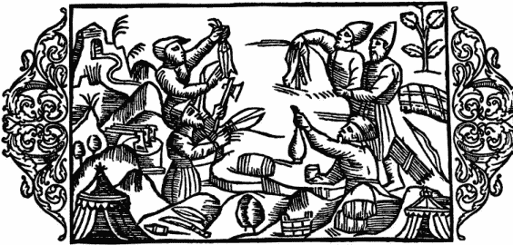
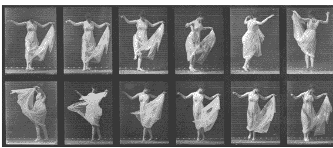
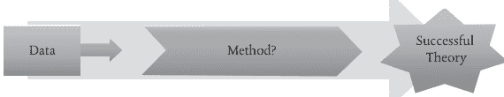
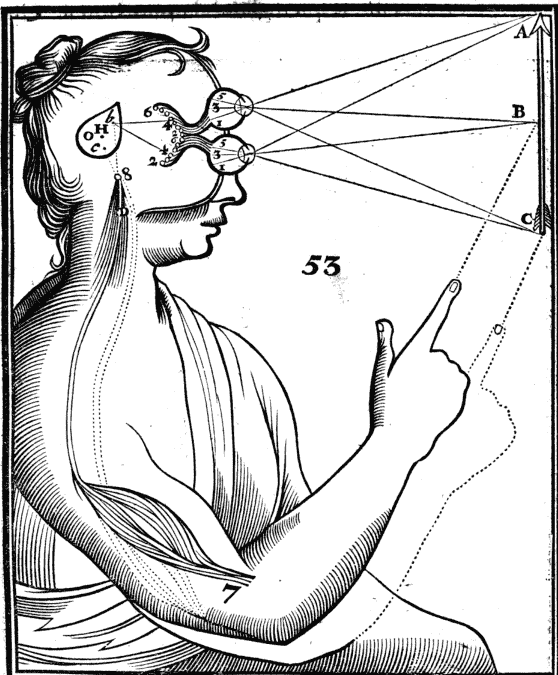

# 哲学方法论：从数据到理论

## 致谢

这本书的起源故事有些不寻常。2013年，我们三个人策划写一本关于元伦理学的书，其早期版本是2015年阿姆斯特丹自由大学（Vrije Universiteit）一场为期三天的研讨会的主题。那次研讨会改变了我们的项目。其中一个重要的批评是：“你们推销这本书是为了实现一种独特的哲学方法论。但你们只勾勒了它的轮廓。让我们听听更多！”

试图遵循这一告诫被证明是挑战性的。我们对哲学方法论思考得越多，就越觉得需要说的话。因此，我们没有简单地将对这一主题的观点并入关于伦理哲学的手稿中，而是决定写一本关于一般哲学探究的独立专著。结果就是你面前的这本书。

我们对帮助过我们的人充满感激。我们特别感谢雷内·范·沃尔登堡（René van Woudenberg）及其同事在自由大学组织的研讨会上做出的贡献，并感谢塞尔利姆·伯克（Selim Berker）、阿南迪·哈蒂亚加迪（Anandi Hattiangadi）、特里斯特姆·麦克尔森（Tristram McPherson）和迈克·里奇（Mike Ridge）花时间阅读我们的作品，并在活动中对其提供了广泛且深刻的批评。还要感谢牛津大学出版社出色的编辑彼得·莫姆奇洛夫夫（Peter Momtchiloff），他聘请了克里斯·戴利（Chris Daly）、乔尔·普斯特（Joel Pust）和（再次）特里斯特姆·麦克尔森担任评审员；他们每个人对手稿草案都提供了有帮助的反馈。回应他们的尖锐意见使我们的项目延长了几个月——我们希望，这一切都是为了让这部作品比在没有他们批判性关注的情况下更清晰、更深邃。

我们最初在2019年的两篇文章中发表了我们关于方法论的一些观点，并在许多场合也表达过这些观点，包括布鲁根大学、吉林大学、位于柏林的德国分析哲学学会、岭南大学、巴塞罗那大学的LOGOS研究小组、哈佛大学、麻省理工学院（MIT）、斯德哥尔摩大学、佛蒙特大学、威斯康星大学麦迪逊分校、圣路易斯华盛顿大学和德克萨斯大学奥斯汀分校。感谢所有这些座谈会、会议和研讨会的参与者，以及许多对我们工作产生启发的对话。

## 引言

这本书是对哲学探究的尝试。我们认为你和我们一样，一直在努力应对一个哲学问题——也许是自由意志的问题。因此我们开启了一项熟悉的任务：发现或开发一种理论。

我们致力于这一主题有几个原因，除了我们相信其价值之外。原因之一是关于探究的承诺深深影响了讨论和辩论。当这些承诺产生分歧时，通常会导致严重的误解并引发争议——正如康德所说，“一个无止境的战场”。

然而，这些影响是可以避免的。正如佛教认为某种洞察可以消除痛苦一样，我们相信对哲学探究的清晰视角有助于消除源于方法论的误解和分歧。

写这本书的另一个原因（在这些观察下尤为重要）是为了让哲学家能够透明且明确他们的方法论承诺。遗憾的是，这一要求现在很大程度上被忽视了，导致一些人谈论方法论“丑闻”或“危机”，并对某种“方法论意识提高”表示“希望”。这种说法可能夸张。但即便如此，问题确实存在于我们身上。彼得·戈德弗雷-史密斯（Peter Godfrey-Smith）写得并不错：

> 所有的哲学都充满着对哲学工作应该如何进行以及哲学理论应该尝试做什么的讨论和焦虑。

与此同时，许多哲学家对提供任何类似于哲学配方都表示怀疑，更不用说如何做哲学了。

嗯。哲学，可以说，它太困难、富有创造性且不可预测，以至于没有一种切实有益的方法来描述它应当如何展开。因此，我们不应该旨在拟制定一套哲学探究的理论。我们也不应该对其他哲学家如何开展他们的工作提供建议。

我们同意，寻找哲学成功的配方是误入歧途的，而且发布建议存在着自满的风险。但这并不意味着关于哲学探究没有什么是有趣或重要的。可以说明的。

首先，我们可以区分不同类型的哲学探究。哲学可以以实践模式进行，例如，作为实现某些个人、社会、政治或伦理目的的手段。也可以以美学模式进行哲学思考；或许这对于那些仅仅因为发现哲学活动优雅、引人注目或令人敬畏而从事哲学的人来说是正确的思考方式。其他模式也是可能的。虽然我们自己是多元主义者，认可这些不同选择的兼容性和合法性，但我们在这里关注的是理论模式下的哲学参与。正如后文将展现的，我们认为这种探究旨在为引发它的问题寻求认识论上令人满意的解决方案。

我们的首要目标是解决哲学探究的五个核心问题，将其理解为一种理论探究。前两个可以简单表述为：

- 哲学探究的结构是什么？
- 哲学探究的主要目标是什么？

回答这些问题需要建立一个此类探究的模型，识别它的基本组成部分、它们是如何组织的，以及这些元素在如此组织后旨在实现什么。我们在第一章中完成这些工作。

根据我们在该章建立的模型，哲学探究的两个主要部分集中在数据和一种理论方法上——前者是探究的起点，后者是一套用于理论构建和评估的标准。我们将论证，主要目标是某种理解，它可以作为哲学进步的衡量标准。因此，我们接下来的三个问题是：

- 什么是哲学数据？
- 什么是健全的哲学理论化方法？
- 是否有理由认为哲学进步可以实现或已经实现？

书的其余部分（第2至第6章）将涉及这些问题。

我们通过详述一种关于数据的认识论理论来回答关于数据的第三个问题，这种理论优先考虑探究者有充分理由相信的理论前主张。我们的讨论强调了数据在探究中的作用，维护了哲学数据免受“理论负载”的指控，说明了数据的种类和数据收集程序，并将我们偏好的观点与社会学、形而上学、心理学或语言学角度分析数据的竞争观点进行对比。我们在第二和第三章完成这项工作。

我们对第四个问题的回答将围绕一组特定的理论构建和评估标准。我们将论证，满足这些标准的理论通过提供某种类型的理解来解决探究。在论证这一主张时，我们的项目做出了一些规范性承诺：我们不仅对哲学探究是什么提供说明，还对什么是做得好立场，通过规划其成功的可能路径来制图。这项事业占据了第4和第5章。在第4章中，我们回顾了经典和当代的哲学文本，旨在识别各种方法论上的美德。然后，我们考虑了一些突出的哲学方法，指出了它们的吸引力及其局限性。这为第5章中我们展示并初步辩护我们认可的哲学方法奠定了基础，我们将其标记为“三层方法”。

第五个问题关于进展，迫使我们面对一种熟悉的焦虑——即进展是否可以实现或已经实现，尽管付出了巨大的努力。在第6章中，我们通过使用三层方法来解释并缓解这种焦虑，我们认为这种方法可以扩展到其他学科。虽然我们主要关注哲学探究，但我们认为许多内容可以扩展到其他理论活动类型，如科学、历史和数学的某些领域。

注释是历史导向型哲学项目的核心。然而，正如我们所信的，只要哲学史本身就是哲学，那么这些项目的某些方面确实属于我们的研究范畴。

尽管我们经常会讨论哲学是如何或过去是如何进行的，但我们的项目首要任务并非为了刻画哲学思考的实践体验，或考察哲学探究中最新的创新。这种探究被视为一种理论性探究，其追求应该是超越在特定历史时刻或特定社会背景下偶然占据显著地位的趋势和信念。良好的方法论应当反映这一点，并指示如何实现这一愿景。此外，在涉及哲学理论化时，并不是无所皆非；良好的理论化应当受到稳健方法的引导。这些都是我们为后续章节中将开发的方法论所设定的雄心之一。

在某种意义上，我们在书中辩护的方法论是新颖的。同时，它并没有预示着对哲学的激进重构。我们的首要目标是推进一种哲学探究模型，开发一套哲学数据理论，并整合一套哲学理论化方法，这种方法在被遵循时能够促进理解。我们将认可的标准在许多哲学家从事其工作时是熟悉的，尽管这些标准尚未被充分地证明、排序和整合，以至于揭示它们如何促进探究的主要目标。该项目不是为了引发一场革命，而是深化我们对哲学探究以及如何做好探究的理解。

# 第一章 探究的本质

亚里士多德曾著名地写道，哲学始于惊奇。当然，哲学探究的动力远不止于此。好奇、困惑、恼怒、痛苦，甚至是深层的愤怒都可能促使我们这样做。尽管这些状态高度多样，但它们有这样一个共同点：它们诱导我们提出想要通过探究来解决的问题。

在哲学中，核心问题涉及诸如下主题：现实的本质、我们认知能力的性质和范围，以及实践规范的内容和地位。这些问题包括但不限于以下内容：

- 为什么是有胜于无？
- 上帝存在吗？
- 我们有自由意志吗？
- 脑体是什么关系？
- 是否存在所谓的人性？
- 如果对外部世界的知识是可能的，那么它是如何实现的？
- 如果思维和语言确实指向世界，它们是如何指向的？
- 意义的本质是什么？
- 是否存在客观的规范标准？
- 是否存在一个单一且基本的道德原则，如果是，它是什么？
- 什么是良好的生活？

自然地，哲学家们也还在与大量更具体的问题作斗争，例如：

- 存在是一种属性吗？
- 全能需要哪些能力？
- 自由意味着拥有做出选择的能力吗？
- 什么是信念？
- 性别是一个生物学范畴吗？
- 有理由的信念与知识之间的区别是什么？
- 是否可以引用抽象对象？
- 意义具有规范性吗？
- 一个标准的客观性意味着什么？
- 道德原则与仅仅的权宜原则有何区别？
- 良好的生活需要具备美德吗？

参与哲学探究就是努力解决此类问题，以及那些更细致的问题。这意味着将此类问题视为开放的，目标是以尽可能令人满意的方式对其做出回应。理想情况下，结果将是成功解决这些问题，使探究终结。

我们关注的是处于理论模式的哲学探究。这种探究是一个属中的物种——理论性探究。因此，它将通过让我们更清晰地观察该属本身来帮助我们理解目标。

我们将通过解决关于此类探究的两个基本问题来实现。第一个问题涉及其结构：这项事业的基本元素或阶段是什么？虽然在实践中通常是一项混乱的事务，但我们在不同的实例中识别出两条共同线索。

哲学家有时接触某些理论探究的模型，但这些模型并没有标记出它的任何阶段。例如，在罗伯特·斯坦纳克（Robert Stalnaker）关于“探究的抽象结构”的影响力的图中，思考者被视为试图将可能世界缩小到特定子集的信徒，该子集包含仅包含回答引发探究查询的世界。这种图看起来严重不完整。因为它没有告诉我们探究展开意味着什么；它仅仅观察到了它发生了。在分析探究结构时，我们需要的是对探究组成部分的洞察，以及这些组件是如何关联并构成某种特定过程的。无论“可能世界”探究模型有何种优点，它都没有提供这种洞察。

解决方案并不是简单的假设多个阶段。例如，考虑约翰·杜威（John Dewey）提出的五阶段探究观，它包括：

- (i) 一种感到的困难，(ii) 困难的定位与定义，(iii) 对可能解决方案的建议，(iv) 通过推理对建议的影响的发展，(v) 进一步的观察和实验并导致对其的接受或拒绝

但一个以观察和实验为终点的过程，不足以捕捉涉及广泛理论问题的探究。我们不会通过观察和实验来解决谎言者悖论、弄清楚为什么是有而不是虚无，或者确定质数的分布——特别是如果这些是实证性的任务的话，正如杜威所坚持的那样。

另一个问题困扰着笛卡尔未出版著作《心灵指导规则》中闻名的探究模型。特别考虑规则 4 和规则 5：

> 如果我们要调查事物的真理，我们就需要一种方法。
>
> 整个方法完全取决于如果我们要发现某些真理，对我们必须集中心智的对象进行排序和安排。如果我们能够严格遵循这种方法，前提是我们要首先将复杂晦涩的命题逐步简化为更简单的命题，然后从最简单命题的直觉开始，尝试通过相同的步骤获得对其余部分的知识。

这种模型设定了一个具有两个主要阶段的结构。然而，这种结构是错误的，因为它狭隘地关注执行笛卡尔计划，即使一系列单一的思想或命题变得清晰明确。虽然这也许是理论探究的一种类型，但显然不是唯一的选择。跨科学和人文科学的探究并没有钻研到什么是“最简单”的，然后利用直觉从那里“攀升”到“对其余部分的知识”。对探究结构的描述应该是完全通用的，适用于该类型的每一个实例。

比“可能世界”更有前景的是辩证法模型、杜威式和笛卡尔式方法，根据这些方法，探究在于制定和澄清对开启探究问题的候选答案，然后对发展并评估支持或反对这些答案的论点。

这种模型设定了一个结构，似乎避免了前两个模型的局限性。但这种替代方案并没有公正代表探究是如何展开的，或者它旨在揭示什么。在调查谋杀案时，夏洛克·福尔摩斯并没有简单地列出嫌疑人——即“谁干的？”问题的候选答案——然后支持他们有罪或无罪的论点。相反，正如侦探在《血字的研究》中明确的那样，他的探究始于收集数据：

> “你似乎对目前的问题并不在意，”我[华生]最后打断福尔摩斯关于音乐的论述说道。
>
> “还没有数据，”他回答道，“在没有[数据]之前进行理论化是一个致命错误。”

只有在收集数据之后，侦探才追求一种解决他查询的谋杀案观点。这种观点不仅仅是某个嫌疑人有罪的命题。福尔摩斯可能得出一个不可辩驳的论证，其结论是莫里亚蒂教授在客厅里用一瓶毒药犯了罪，但仍然不知道莫里亚蒂是如何产生杀人心的，他是如何使用那种特定物质的，或者这一犯罪的程度与莫里亚蒂过去的行为如何匹配。通过这些方式，对福尔摩斯犯罪探究的辩证处理遗漏了事业的重要维度。同样，对探究的辩证处理错过了或模糊了数据的作用，而数据对于广泛的领域——生物学、经济学和宗教哲学（回想我们上面的例子）是基础性的。辩证法模型也扭曲了处理数据的项目。后者超越了单纯的论点提供：正如我们在引言中提到的，论点的结论并不能说明。因此，尽管辩证法模型描述了一项可能发挥作用的活动，但它绝不是故事的全貌。

这让我们回到我们提议的模型。有几个理由倾向于一个包含我们区分的两个探究阶段（数据收集和理论化）的模型。

首先，这样做为“探究在于旨在提供理论的反思过程”这一观点提供了实质性的精确化。我们的模型打开了这个黑箱，不仅识别了起点和终点，还识别了引导探究者从前者转向后者的过程中的两个阶段。

其次，这样做同时避免了局限性。我们的模型识别了两个阶段，这两个阶段本身并不强制要求承诺任何类似于笛卡尔计划或杜威实验主义的东西。阶段也没有禁止任何一种。相反，我们的模型代表了任何学派、进入任何主题的探究者，从开启问题到掌握解决该问题的理论的步骤。

第三，一个强调数据和理论化的模型能够很好地解释探究的深度和广度。这两个特征在我们对辩证法的讨论中都有体现，该讨论指出探究可能包含但不局限于论点的提供。如果探究在于构建一个处理可能广泛的考量（数据）的理论（理论化），那么这正是我们所应该预期的。

第四，我们的模型解释了引言中提到的一个成功条件：理论只有在处理了数据（其输入）时才是成功的。它还解释了

> 9 在两篇关于哲学方法的、丰富但被忽视的文章中，Collingwood (1933, Ch. VIII) 和 Castañeda (1980, 各处*) 也强调了数据收集和理论化的重要性。然而，他们都没有将其视为探究的两个基本阶段，而且他们对每个者的构想与我们显著不同。

## 20 探究的本质

在缺乏任何数据的情况下反对理论化的禁令。此外，该模型还阐明了特定现实世界探究的各个方面，例如它们可能是不完全的（当它们忽略了数据收集、排除了理论化，或对两者仅做出部分贡献时），或是有缺陷的（当它们对其中某件事表现得很糟糕时）。根据这些观点，我们并不打算设立门槛：不完全或有缺陷的探究仍然属于探究。

第五，通过区分数据收集和理论化所扮演的角色，我们的模型使得在特定案例中考察探究的基本元素及其关系成为可能。即使许多实际的探究实例也只是不完美地实现了这两个阶段，关注它们有助于深化关于在实践中如何从探究的开始到其结束的问题。换句话说，用这两个阶段来对探究进行建模，不仅在理论上有趣，在实践上也同样重要。因为它使我们能够审视完成每项任务需要什么，以及如何良好完成——这是改进我们探究努力的重要第一步。

为了理解区分这两个阶段是如何做到的，请注意，它帮助我们准确定各种方法论承诺，这些承诺可以进行适当评估。在哲学中，元伦理学实在主义者与其表达主义竞争对手之间的长期争论可以被作为一个说明。

实在主义观点肯定了道德现实的存在，且它是客观的，意义在于它并不像（比如）礼仪规范那样是由我们自己构思的。而且他们认为，思想和话语有时真实地代表了这种现实。表达主义者通常否定这些主张中的至少一个。不同的方法论承诺是这一分歧的核心。

## 探究的结构 21

每种观点对数据都有假设。实在主义者通常假设元伦理学数据由常识或直觉主张组成，其中一些主张似乎意味着存在一种思想和话语所代表的客观道德现实。表达主义者通常假设数据主要涉及道德语言和道德判断，强调道德话语、道德思想与行动之间的联系。

同样，每种观点也对理论化有假设。实在主义者通常认为，一个满意的理论应当认可常识或直觉的含义，只有当对它们的挑战无法得到充分满足时才放弃它们。表达主义者则通常假设一个满意的理论必须是简洁的，不设定任何在解释上可以丢弃的特征。他们补充说，一个满意的理论必须与自然科学告诉我们的世界的信息充分连续。

这些假设并非空谈；相反，它们引发了实在主义者和表达主义者之间的大量辩论。每种观点的支持者由于对数据和理论化的假设不同，得出了截然不同的结论。实在主义者通常得出结论，由于他们的理论认可了常识或直觉的含义，并充分满足了相关挑战，因此他们的观点是领先的观点。¹¹⁰ 表达主义者通常得出结论，只有他们的观点才能以足够简洁和自然的方式处理关于语言和判断的数据，因此赢得了高分。¹¹¹

¹¹⁰ 参见，例如：Nagel (1986, 143–4)，McNaughton (1988, 40–1)，Brink (1989, Chs. 1–2)，Shafer-Landau (2003, Chs. 1–3) 以及 Enoch (2019, 30–3)。虽然 Harman (2010) 不是实在主义者，但他推广了一种通用的保守方法论，这种方法与这些作者所青睐的方法相契。

¹¹¹ 参见，例如：Blackburn (1993, Part II and 1998, Ch. 3) 以及 Gibbard (2003, Ch. 1–2)。对比 Ayer (1936, Ch. 6)，他增加了对一种已失效的意义理论的承诺。

¹² 参见，例如：Bealer (1993), Dorr (2007) 和 Carmichael (2010) 关于普遍性的论述，以及 Devitt (2014) 关于完美的。

## 22 探究的本质

实在主义者和表达主义者往往未能明确他们关于数据和理论化的承诺，即使在他们这样做时也很少进行辩护。在这些方面并非独一无二：实在主义者和唯名论者关于普遍性的辩论表现出类似的动态。² 前者和后者的成员经常对数据和理论化做出不明确的承诺。这有助于我们准确定各种方法论承诺，这些承诺可以进行适当评估。

# 探究的目标 25

目标。即使探究者修正了这些错误，他们的工作也远未结束，因为真信念可能是缺乏根据的，并且仍然让关于探究对象的许多重要问题悬而未决.¹⁶ 如果探究者获得了一个既真又有根据的信念，仍会有更多工作要做。因为对于这样一个信念，甚至一组信念，其本身并不能保证以完全成功的方式解决探究所需的全面且系统性的阐明（下文称为“简单地”解决探究）。

当我们考虑到即使是知识也无法提供保证时，这一点就变得清晰了。因为这种成就可能是基于证词或记忆的重复获得的，使其与对支持或解释答案的考虑的忽视相兼容。普通知识也与混乱或纠结相一致，例如当新信息没有解决认知失调，反而引发了失调。无论何种情况，探究都结束了。

重要的是，知识也可能包含某种混乱和多重性。一个小学级级可能知道 π 是

> ¹⁶ 我们据此拒绝了杜波依斯（1898, 16）关于探究目标是“简单真理”的观点，许多当代哲学家也了这一立场（参见 Niinuoto 1984; Haack 1993; Anderson 1995）。其他批评者还包括 Kitch (1990 和 1993), Bright (2017) 和 Nado (2019)，以及文中讨论的简单知识观的支持者（例如，Williamson 2000; Bird 2007; Whitcomb 2010; Miracchi 2015; Beebee 2018; Sosa 2019; Kelp 2021）。特别是关于哲学目标有一系列替代概念。例如，Gutting (2009 和 2016, 325) 优先考虑“对区别以及各种图景及其理论表述的优劣的知识”；Nozick (1981, 21–2) 和 Wilson (2014, 45–50 以及 2017, 92) 赞理论选项的积累；Deleuze 和 Guattari (1996, 55) 认为“哲学的对象是创造永远新的概念”；Adorno (1993, 102) 将哲学视为“一种表达人们无法言说之物的努力”；而许多哲学家坚持达成共识是哲学目标的一部分。随后的考虑将比比适用于这些提议；我们将在第3节中对共识的必要性表示怀疑。

# 26 探究的本质

圆周长与直径的比率，同时又对 RATIO（比例）这一概念感到困惑。例如，他们可能错误地将比例理解为（比如）某种小数展开必须终止或重复的东西。在这种情况下，他们知道关于一个关键问题的答案——“$\pi$ 是圆周长与直径的比率吗？”——但还没有达到对该问题进行进一步探究变得多余的程度。知道种族哲学中一个核心问题——“它是一个社会建构？”——答案的哲学家也可能处于类似的境地。无论正确答案是什么，如果他们对 SOCIAL CONSTRUCT（社会建构）这一概念感到困惑，错误地认为它（比如）需要明确的群体共识，那么他们对这个核心问题的探究就没有结束。因为他们对答案的把握存在裂缝，使得宣布收工是不恰当的；他们对答案的知识并不能相应缓解他们的好奇心。

核心问题无法通过堆积额外的知识来解决——例如，关于比例或社会建构什么是知识。因为任何此类知识本身可能包含导致其缺陷的概念混乱。因此，思考者可能对引导他们探究的问题答案拥有广泛的知识，但未能解决它们。虽然对答案的普通知识是一个正当的目标，但它未能解决探究，因此在我们的意义上不是一个终极的正当目标¹⁷

探究者不需要追求目标——正当的目标也是好的！尽管如此，各种目标之间的差异是

> ¹⁷ 这一推理过程意味着拒绝了 Friedman (2017 和 2019) 提出的两个探究规范：“不要相信并探究”规范和“无知规范”，根据这些规范，人们应当分别在相信或知道时才进行探究。参见 Archer (2018, §5)。

# 理论理解 27

考虑到它们所服务的三个目的，这些目标之间的差异是显著的。这些目标为在探究过程中选择追求有前景的问题提供了参考点，因为这些问题的解决将确保这些目标的实现；它们为评估理论的优劣提供了标尺，如果理论没有交付此类目标所规定的成果，那么它们是可以被批判的；它们还作为评估构建这些理论所用方法的基础。

例如，一种理论化方法可能会产生真信念而毫无所获。但如果我们寻求的是探究的终极正当目标，那么这种方法就是不充分的。如果我们认为，理论化的产出应该根据其是否能够实现此类目标来评估，那么在评估现有的哲学方法（第4章）以及开发和辩护我们自己的偏好方法（第5和第6章）时，我们希望关注它们是否做到了这一点。为做到这一点的方法有一个术语将会有帮助。因此，我们建议将一种方法称为“可靠的”（sound）

正如所述，我们的观点是理论理解是终极的正当目标。我们现在转向阐述理解的特征，在此论证它的吸引力。

# 3. 理论理解

我们可以通过阐述一个领域为了提供理解而必须具备的一些属性，来揭示理解的核心特征。

# 28 探究的本质

鉴于关于理解本质的争议，我们希望明确哪些特征构成了理解。虽然我们的项目并不取决于它们如何被理论化。理论理解 29

理论理解，正如我们解释的那样，是代理人在充分掌握以下属性的理论时的状态。

首先，理论具有高度的**准确性**（accuracy），因为很大不准确的理论将无法消除混乱（误解的特征）。

其次，理论是**基于理由的**（reason-based），这意味着除了仅仅的连贯性外，它得到了支持其准确性的积极考虑。

第三，理论是**稳健的**（robust），回答了许多关于重要特征的问题。忽视此类问题的理论遗留了产生理解所需的要素。

第五，理论是**有秩序的**（orderly），不仅提供特定的解释，还提供了该领域的更广泛视角——例如，通过揭示它们之间的基本关系或联系。这种理论避免了杂乱，杂乱的范式只是简单的列表，没有说明其项目如何或是否被排序或组织。

第六，理论是**连贯的**（coherent），不仅在内部，而且在外部，与其他广泛的提供理解的理论良好契合。一个学科的理论如果与一组准确、基于理由的、稳健的、启性的且有秩序的其他领域理论发生巨大冲突，并不能进一步促进理解，反而会使其混乱（误解的另一个特征）。

尽管六个属性都贡献于理论理解，但它们的方式各异。后两个属性与前四个不同，它们仅有条件地做出这种贡献。理论的秩序性和连贯性只有在理论在某种程度上具备其他四个特征时，才对其提供理解的能力产生贡献。以这种方式，前四个属性在理解上是基础性的，而后两个则不是。

第四，理论是**启性的**（illuminating），因为它的答案至少不仅是概括性的，而且是真正的解释性的，超越了对这些特征的简单描述，解释了每个特征为何存在或实例化。

> ¹⁸ 我们说“充分”不是指在每个方面都完美，而是为了与“仅仅部分的掌握”形成对比。

> ¹⁹ 像探究一样，领域可以相互重叠、嵌套和组成。它们也可以独立于对定义它们的问题集的充分探究而被考虑。

当探究者充分掌握这些具有六个属性的理论时，他们理论的对象对他们来说是有意义的。这就是理论理解，根据我们的解释，它是独特的。它不能还原为真信念或有根据的信念（或它们的交集）。它也不是

## 30 探究的本质

等同于普通知识。正如上述解释，这种理解的功能，首先，在于以一种稳健、有序、连贯的方式阐明所研究现实的部分，而不仅仅是陈述关于它的系列已知真理或经过证实的信念。理论理解并非认识论上的完美。尽管如此，它是认识论上的卓越。它是探究终极恰当目标的首选者¹¹

为了理解最后这一观点，请注意它处理了挑战其他竞争者的要点。理论理解不能是无根据或狭隘的，它既不会引起不协调，也不会与无知兼容。它还排除了我们那些涉及 `RATIO`（比例）和 `SOCIAL CONSTRUCT`（社会建构）示例所示说明的那种混乱和混杂。它符合这些标准并不意外。毕竟，如果探究者完全掌握了一个准确、基于理性、稳健、具有启发性、有序且连贯的理论，他们对探究主题的把握将既全面又系统。我们对关于该主题的一系列广泛核心问题（包括解释性问题）拥有准确的回答。这些答案将相互契合，并获得理性的支持。此外，探究者将在没有概念混乱的情况下掌握这些答案。在这种情况下，他们的好奇心、惊奇或困惑将得到适当缓解。

近期的认识论见证了关于理解超越一切其他认识论成就价值的论点的激增：参见其他 Elgin (1996, 122ff.)、Zagzebski (2001)、Kvanvig (2003, Ch. 8) 以及 Pritchard (2010, Ch. 4 and 2016, §§2–4)；对比 Delsén (2016)。我们在这里不依赖这些论点，尽管它们可能为我们的评估提供独立支持。关于理解更全面的处理，请参见 Benson (2017)。

## 理论理解 31

这一推理路线可以通过以下观察来加强支持：即为了获得这种缓解，并不需要获得广泛的、更高要求的认识论或真理论成就（例如绝对确定性），这些是不必要的。这类成就在许多方面可能是理想的。但即使探究者未能达到这些成就，这本身也不会否定他们探究的成功，只要他们终结于对我们所确定的具有六个属性的理论的完全掌握。

我们在上一节中的论点也对以下观点提出了怀疑：即存在一种要求要求的认识论或真理论成就——即一个终极恰当目标。虽然我们还没有对这一观点给出决定性的反驳，但我们论证了普通知识无法解决探究。（我们也有理由相信，要求较低的状态，如真信念、辩护信念和辩护真信念，同样失败了。）因此，任何不同于理解的探究终极恰当目标必须比知识强，但至少与理解一样。我们不确定可能是什么——特别是考虑到我们上述的主张，即任何比理解更强的东西都是不必要的。无论如何，在某种重要的意义上，这并不紧要。因为我们已经提供了理由，认为理解是解决探究所需的最小认识论成就。而这正是我们书中所有论点所要求的全部。

（为了简化我们的讨论，我们经常会写得好像理论理解是探究的终极恰当目标。这不应被理解为意味着没有其他终极恰当目标，而是作为一种主张的简称，即理解足以解决探究，而没有更弱的认识论或真理论成就可以做到这一点。）

我们赋予理解的特殊作用可以通过与流行观点的对比来进一步说明，该观点近期——

## 32 探究的本质

由 David Chalmers 辩卫——即探究者应该追求对真理的集体收敛。Chalmers 认为，其他可能的目标（包括理解）涉及“在某种程度上降低了我们的眼界”。²²¹ 虽然我们赞同 Chalmers 对集体性的强调，但我们拒绝对真理和一致的狭隘关注。除了早期（在 §2 中）提出的关于真信念与探究终极恰当目标之间关系的担忧外，我们还对 Chalmers 的建议提出两个进一步的担忧。这两者都依赖于关注我们确定的六个使理解可能的属性。

首先，对真理的集体收敛似乎不足以解决探究。因为这种收敛不能确保拥有、更不用说掌握一个具有上述所有六项特征的理论。但在缺乏此点的情况下，我们很难认为探究是完成的。还有更多工作要做。

其次，收敛是不必要的，无论它是由完全一致还是部分一致构成的。假设我们发现人类心理学（由于其产生共识的倾向）使得收敛变得不可得。尽管如此，如果探究者足够幸运，开发出了实现所有六个特征的理论，理解就足以解决探究。我们得出结论，Chalmers 的指责是反的。对真理的收敛只有在伴随理解的情况下结束探究。从这个意义上说，追求更多一致是“在某种程度上降低了我们的眼界”。²²¹ Chalmers (2014, 14)。通过“真理”，Chalmers 指的是正确回答所调查问题的命题。

## 理论理解 33

尽管如此，正如上述预期的，我们支持 Chalmers 的建议，将探究的追求表述为集体术语。具体而言，我们肯定探究的终极恰当目标必须是能够被集体追求的并且是集体性的。理论理解符合这些条件。它可以通过数据收集、理论化或两者兼具备。而且这些努力产生的理解在原则上是广泛可的。

我们一直关注理解的重要性。科学、哲学、邻学科可能也包含了其他的认识论项目——例如美学的、神性的、实用的或政治的。无疑，哲学家有时会通过这些其他认识论标准来评价观点。我们的意图并不是质疑此类观点的合法性，或促进一种对理解没有兴趣的探究图。相反，我们的主张仅仅是理解是探究的终极恰当目标。这一主张对于具有不同认识论承诺的人应该是友。的，许多实用主义者、无政府主义者和反理论者指责我们设定的野心。但他们的担忧是

对于两本有影响力的反理论著作，请参见 Baier (1985, Ch. 12) 和 Williams (1985)。Dewey (1910 和 1938) 是著名的实用主义者，而 Feyerabend (1975) 著名的无无政府主义。Urmson (1967, 232) 在总结 J. L. Austin 的著作时也无无政府主义观点：“没有人知道自由、真理和人格等问题的满意解决方案会是什么样的，预先设定任何解决这些问题的正确原则是毫无根据的教条主义。”

## 34 探究的本质

通常针对我们所承诺的或明确拒绝的思想，例如对简单性重要性的夸大感，或者对需要“绝对概念”的客观性的膨胀观念。此外，我们的方法与许多实用主义者、无政府主义者和反理论者的陈述动机相契。这些动机包括反思思维的历史和文化背景，以及与此类反思相关的广泛考量。我们的主张也兼容这样观点：在某些情况下，对于某些问题的理论理解是不可实现的，或者不是容易获得的。例如，我们同意 David 的话，他写道通过长期且困难的探究来逐步改进目前接受的标准或概念是哲学的问题.³³

如果我们的主张是正确的，会有两个结论。首先，一个方法只有在它拥有资源指导构建一个使探究者能够获得理解的理论，并（同时）便于从这一角度评估候选理论时，才是健全的。其次，因为方法以数据为输入，我们必须明确数据的性质以及收集手段。我们在接下来的两章中介绍哲学中数据的观点，这些观点与开发旨在产生成功理论的哲学方法的作用是一致的。然后我们将把书中剩余部分致力于评估现有方法，提出我们偏好的方法，并揭示它的许多益处。

> ³³ Wiggins (2001, 82).

## 2. 哲学数据

每一项理论探究都有其数据，即必须由某种理论处理的考虑因素，而该理论解决了开启探究的问题。在整个哲学领域，例子比处不在：在语言哲学中，一个事实是，专有名词的使用者有时对被指称的人一无所知；在感知哲学中，我们有时会经历生动的错觉和幻觉；在行动哲学中，某些尝试是不成功的；的；在元伦理学中，道德判断与行动紧密相关；在美学中，某些艺术作品是杰作；在女性主义哲学中，一系列社会实践和制度促进了男性优于女性的利益；此类如此。我们在本章的目标是更清晰地阐述此类数据的性质和作用。

我们主张三个主要论点。首先，哲学数据具有四个基本特征，这使得它们与其他类型的考虑因素区分开来。其次，关于数据“理论负载性”的常见担忧并非哲学理论构建的毁灭性障碍，而是可以被合理解决的。第三，哲学数据不应被构认为探究者认同的事物、现实的构成性特征、关于事物如何呈现的断言，或对语言通常使用的描述。相反，正如我们在下一章中论证的，它们是探究者有充分认识理由认为是现实本身的真实特征。

## 1. 数据的四个特征

数据具有四个基本特征，这些特征将在随后的讨论中发挥重要作用。

首先，数据是对某一领域进行理论反思的起点，意义在于它们是此类理论构建的输入，而非输出。在这方面，给定领域的数据与关于该领域的理论化之间存在着一种不对称的关系。

其次，数据对某一领域具有“探究约束性”，意义在于它们构成了一个数据集，其功能是将给定的理论探究锚定在其主题上（即该探究所涉及的领域）。当我们说它们将探究“锚定”在其主题上时，我们意在传达两点：首先，数据集是理论者接触该主题的首要手段。其次，完全忽略数据集对某一领域进行的调查很可能（或至少更有可能）偏离该领域的轨道，并因此无法解决探究。尽管忽略某一个数据可能不会让探究者徒劳无功，但完全忽略数据池的人更有可能迷失线索。

第三，数据是被收集的。虽然这本身不是一个争议性主张，但关于数据的收集存在争议，特别是关于执行此类任务的适当程序。数据收集的候选程序包括利用诸如感知、直觉、内省、常识、语言判断、想象和推理等来源。在这一问题上，有空间进行或多程度的限制；一些哲学家只承认这些中的一种是收集数据的适当程序，而另一些人则接受一种允许多种此类程序的多元主义。（我们将在下一章中投入部分内容来探讨这些问题，并为某种多元主义的版本辩护。）

第四，数据是中性的。这体现在两个方面。第一是数据是非主动的（non-active），这是因为某个特定的数据点可能是错误的。即使一组数据在总体上是正确的，数据中偶尔也会存在错误。数据集可能是噪声的，或者包含与该集合中其他元素不兼容的离群值。数据是理论构建的输入，事后看来这些输入可能无法经受推敲¹。

数据中性的第二个方面是，它们充当了理论者之间的通用货币。这涉及几个维度。其一，数据是让不同派系的理论者值得关注的事物，即使其中一些理论者最终拒绝它们。其二，数据具有理论欠决定性（underdetermine）：这一事实使得不同流派的探究者能够在汇聚同一个数据集的同时，探索处理它们的不同方式。数据也经常是开放的：理论者对于如何解释、精炼或澄清相关数据存在分歧，而这些数据可能是模糊或说明不足的，因此需要精确化。通过这些方式，数据是具有普世性的（ecumenical），将从事研究的理论们统一在一起。

例如，来自个人身份形而上学的一条数据：我们拥有拥有四腔心脏的哺乳动物身体、由约一千亿个神经元组成的大脑以及器官。这样的数据充满了生物学和解剖学的承诺，但这并不会损害数据作为个人身份竞争性观点之间“中立裁判者”的地位。数据是可以被收集的，而一个良好的数据收集来源可能会利用其他领域中得到支持的理论来完成任务。

明确的是，我们并不否认有害的“理论负载”（theory-ladenness）是有可能的。然而，作为对担忧的第二个回应，识别此类情况通常相对容易，并且可以消除或纠正这些负面影响。例如，当担心某特定考量存在偏见时，支持截然不同理论的支持者可能会进行相同的实验。如果他们得到了相似的结果，那就证明不存在偏见。当然，某些情况可能会被无视。也许某些考量本身就深受某种认为其是任意的或缺乏正当性的理论的渗透。此类考量恰恰因为这种渗透，确实无法被归为数据（理论化的输入）。在没有理由相信相反的情况下，认为这种有害影响是普遍存在且不可救药的是过于悲观的。

虽然我们通过上述观点来回答对理论负载的普遍担忧，但我们也注意到第三个回应。假设（似乎是可能的）某些数据倾向于某些审美理论而非其他理论。例如，假设审美判断与个人偏好之间的密切联系对主观主义观点比客观主义观点更友好，而艺术专家的存在以及对某些作品作为杰作的长期认可则倾向于相反的方向。客观主义者应该并且确实承认前者；主观主义者应该承认后者。但只要处理数据的方法本身在竞争性审美理论之间是中立的，允许在某些条件下拒绝某些数据，那么一切都是合规的。

这是因为第四点，方法不应将它们所的数据的数据视为神圣不可侵的、是无论发生什么情况都需要保留的。如上所述，数据是理论化的可能出错的起点。这项活动最终可能决定，某些数据仅仅是无法通过批判性审查的表象。这正是例如消除论唯物主义者——那些否认任何心理活动存在的人——对于“人有信念”这一数据所做出的裁决。或者，理论者可能接受数据，但拒绝认为这些数据倾向于某一理论而非其他理论的主张。例如，许多理论者接受“坏事会发生在好人身上”这一数据，但否定这表明无神论优于他们偏好的观点。

我们提供了四个理由，来说不必担心数据必然会非法地带有理论负载、无法作为理论化的中立起点的指控。重要的是，数据的中立性并不意味着提莫西·威廉森（Timothy Williamson）讨论的论题中要求的共识，我们称之为“严格中立性”（Strict Neutrality）。⁴ 该论题引用了一种对中立性的极其严苛理解：

> ⁴ 参见 Williamson (2007, 209ff.)，他使用了“证据中立性”（Evidence Neutrality）这一标签，并在对将数据“心理化”倾向的批判背景下反对这一论题。我们也拒绝这种倾向；参见下文第3.3 节。

根据这种中立性的定义，主题 φ 只有当 φ 的真值在“原则上是无争议可决定的”时才是中立的，这意味着一个人“能够说服所有来者（无论他们的观点有多奇怪）关于 φ 的真值”。相比之下，我们的中立性概念没有这种推论。严格中立性绝非从数据是非事实的（non-factive）这一观点中得出。它也不是由数据作为通用货币的主张所暗示。对比：美元是北美的通用货币，尽管某些商人由于限制涉及黄金、斧头、皮毛或鱼的交易，可能在任何情况下都拒绝承认美元合法。

图 2 北欧和俄罗斯商人以物易物。

因此，我们的通用货币概念有助于保持数据集作为“竞争性理论之间中立裁判者”的角色。

然而，应用于数据时，严格中立性的主要问题不在于它过度，而在于它葬送了探索。由于哲学家能够提出理由去怀疑最显而易见的主张，几乎没有任何考量能获得该论题所要求的共识。严格中立性将数据缩小到消失点，从而破坏了探索本身的可能性。

5 5 Williamson (2007, 210–14).

6 Williamson (2007, 210). 这是威廉森本人赞赏的角色，尽管还不清楚他的观点如何保护了这一角色，因为他的观点将数据等同于证据，将证据等同于知识（一种事实状态），如注释1所示。

# 3. 关于数据的三个理论

哲学家很少对哲学数据进行直接且显性的理论化——即数据是什么，或者为什么一个项值符合数据的定义。尽管如此，也可以识别出几种不同的数据理论。本节介绍并批判性地评估了三个最显著的候选理论，根据它们处理数据的四个基本特征（关于数据的数据）的程度对每种进行评估。这些理论将数据视为我们认同的事物、现实的构成性特征，或关于语言或表象的主张。我们将认为所有这些观点都存在问题。下一章将介绍并辩护一种替代理论，该理论关注数据的认识论概况。

在我们进行检查之前，有三点。首先，我们对每种理论的表述将包含一个条款，旨在确保数据是预理论的，在探索的第一阶段进入场景，而不是在涉及理论化的第二阶段。该条款指出，关于领域 D 的数据不属于 D 的任何“良构”理论。也就是说，它们不是一组关于 D 的主张，且这些主张在对 D 进行探索的第二阶段满足良好方法的标准⁷从这个意义上说，

> ⁷ 这个对良构理论的定义基于你在第一章（§1）中对理论的刻画。糟糕理论可能只是重复数据这一事实促使我们关注处理数据的良构（在我们的技术意义上）理论。

数据是预理论的。虽然它们可能倾向于关于特定主题的某一个或某一个理论（如前节所述），但它们并没有结束关于该主题的探索。

其次，我们对数据理论的评估将采用一种相当开放的理解，即处理一个项值需要什么。如果一个数据理论理解了或解释了各种关于数据的数据，或者它得出了这些数据是真实的结论，那么它就处理了它们。然而，如果一个理论与这些某些数据不兼容，或者没有提供它们是真实的保证，那么该理论就没有处理它们——至少在没有后续提供拒绝它们的理由的情况下。（我们在第5章中详细说明什么是处理一个项值，但这个简述就足够了。）

第三，我们的评估将主要关注这些理论是否处理了四个关于数据的数据中的三个：作为起点、中立的以及限制探索的。我们将涵盖的所有理论都与剩余的数据（即数据是被收集的）兼容，尽管它们中没有一个解释了为什么数据被收集或解释了这种收集。正如下一章所讨论的，我们认为我们偏好的数据观点在这两个方面表现良好。

## 3.1 社会学理论

根据我们所谓的数据“社会学理论”，如果主题 φ 是关于领域 D 的数据，那么当且仅当因为 φ 是关于 D 的，它不属于 D 的任何良构理论，并且是一个进入者们暂时认同为 D 的核心的主张。⁸

> 8 参见例如，Heney (2016, 26)。对比 Williamson (2007, 238) 讨论的“实用主义观点”。

## 数据的三种理论 45

社会学理论流畅地处理了“数据是起点”这一观察。它可能也解释数据的中立性，因为一个满足其条件（根据非事实性）的断言，以及满足其条件的内容，对于不同理论倾向的探究者来说，可能是合适的关注对象（根据通用货币）。

然而，社会学理论与“数据限制探究”的观点并不一致。因为该观点并未提供保证，确保数据集通过促进对该主题的访问并将探究锚定在其主题上，并确保忽视该数据集更有可能导致理论化偏离轨道。原因是显而易见的：探究者的共识并不决定什么属于某个领域。假设一个寻求回答正义核心问题的哲学家社区临时性地同意正义等同于一个偶数。（德德里克·帕菲特报告说，某些毕达哥学派被认为持有过这种观点。）⁹ 这并不能推导出该断言是关于正义的一个数据——这与社会学理论所暗示的恰恰相反。

可以说，如果数据确实将探究与其主题联系起来，那么这对于真实的社会学理论来说将是一个偶然¹⁰。这种巧合将是幸运的，

> ⁹ Parfit (2011, 324).

> ¹⁰ 推测，这个反事实假设仅在相关的评估工作包含了理想化的代理人（例如那些卓越的真理追踪者，或者具有高度认识地位的人）时才是假的。但第一种理想化威胁到使社会学观点变成形而上学理论的一种（在 §3.2 中讨论），而第二种则威胁到使其成为认识论理论（在下一章中发展）的一个分支。在任何情况下，这种理想化与社会学理论的精神（即使不是字面意思）存在张，社会学理论旨在承认人类进行探究时处于的高度非理想条件。

¹¹ Rorty (1979, 176).

## 数据的三种理论 47

## 3.3 心理语言理论

根据我们所谓的“心理语言理论”，当且仅当 $\phi$ 不属于 $D$ 的任何良构理论，并且属于一个特定领域的心理或语言主言类类时，$\phi$ 就是一个关于领域 $D$ 的数据。

在范式案例中，这些主言是关于事物是如何呈现的、我们拥有什么直觉、我们在理论之前相信什么，或者语言是如何被恰当或通常地使用的。例如，在形而上学中，人们广泛接受颜色通常看起来是客观的，并且说是合适的——也许在讨论一盒蜡笔的内容时——“这根蜡笔是红色的，而另一根是橙色的，这是一个事实。”

心理语言理论认为所有数据都是如此的¹² 为了说明，考虑上述提到的一个假定审美数据的更精确表述的版本，即：

- 偏好：审美判断与个人偏好紧密相关。

这种表述没有明确引用事物是如何呈现的、我们拥有什么直觉、我们在理论之前相信什么，或者语言是如何被使用的；它告诉我们一个关于审美判断与个人偏好之间紧密关系的假定事实。现在考虑：

- 偏好 $Preferences_v$：看起来审美判断与个人偏好紧密相关。

- 偏好 $Preferences_\lambda$：可以（直接或通过暗示）说“审美判断与个人偏好紧密相关。”

这些数据明确引用了事物是如何呈现的或语言是如何被使用的；它们并不涉及一个关于审美判断与个人偏好之间紧密关系的假定事实。心理语言理论认为数据的形式不是 `Preferences`，而是 `Preferences_v` 或 `Preferences_\lambda`。

心理语言理论可以很容易地处理“数据是起点”的观察。然而，这种观点将数据限制为心理或语言主言的主要动机是为了满足中立性。如果数据由此类主言组成，那么这些数据就可以在相互竞争的理论者之间充当通用货币，他们的争议不会阻碍他们对呈现或语言用法等事的共识。这些数据也可能是错误的，未能描绘出被调查领域的真实真实特征，而这些特征并非完全是心理或语言的¹³

> ¹² 一些哲学家支持心理语言理论的限制版本，这允许某些数据不是心理语言的，尽管核心数据是（参见 Castañeda 1980, 32 和 47；对于特定领域的示例，请参见 Weatherson 2003, 27 和 Finlay 2014, 121）。我们下文将施的反对意见同样适用于限制版本。

然而，心理语言理论的这一优点与它可能是其最大的缺点交织在一起，这涉及到数据与主题之间的关系。这个问题可以通过以下两难困境提出来。

首先，假设心理语言理论认为数据就是主题。这意味着所有主题都由心理或语言现象组成。当然，这正是语言唯主义者构想事物的方式。但任何派系的唯主义都是实质性理论（其本身是为了处理而通过理论化产生的），而且极具革命性。这种理论将要求我们显著改变对主题的观念，从某种通常是一个或………………数据和主题，我们应该避免预设全局唯主义。

那么，转向两难困境的第二种选择。假设心理语言理论否定数据是主题，而是认为数据与理论化关注的对象有某种其他关系。这与数据的中立性是兼容的，因此符合中立性的主要动机。它还规避了上述提出的反对意见，因为避免了哲学始终是心理或语言的这一不可信的后果。事实上，它承认哲学的主题通常由对象、属性、事实以及非心理或语言的实体组成。

> ¹³ 许多心理语言观点的支持者似乎源于一种比中立性更强的某种承诺，这种承诺被“严格中立性”（Strict Neutrality）命题所捕捉。这使得他们的观点容易受到 §2 中描述的过度问题的影响。

哲学的主题。首先，这种方法假定数据与哲学主题之间存在巨大的差距。为了清楚起见，这个差距关于两个截然不同类型的内容——心理语言内容和哲学主题。鉴于数据限制探究，这个差距不能保持不可逾；它需要被桥接，以确保那些探究被锚定在其主题上，而主题并非完全是心理语言的。在这里我们在心理语言理论内部发现了一种深层的张力。一方面，它要求数据与给定哲学领域的内容之间存在巨大的差距，以实现其确保中立性的愿望，并避免忽略该领域的大部分内容。另一方面，它也不需要是巨大的，以确保哲学探究可以访问其主题，并确保敏感性使得这种探究比其他情况下更容易在线。目前尚清楚这种张力是否能得到满解决。

这带我们来到第二点：虽然可能有解决这种张力的方法，但它们可能会在其他地方产生不协调，从而仅仅移动了地毯下的包。为了理解这一点，假设

我们需要通过支持一种桥梁原则来跨越这一鸿沟，该原则允许从相关的心理语言学主张过渡到相关的（但不限于心理语言学的）主题内容；这种原则将有助于通过数据获取后者。例如，假设某种理论采纳了“事物通常如其所表现的那样”这一原则，这将允许理论者通过（例如）通过偏好（`Preferences_v`）来获取偏好（`Preferences`）联系。这一原则与许多哲学理论的根本承诺是显然不兼容的，这些理论果断地拒绝这种保守的原则，转而主张对各种哲学问题采取修正主义的观点。例如，任何形式的美学属性虚无主义都无法支持这一原则。相反，这些理论致力于拒绝任何此类桥梁原则，因为它们主张在涉及美的问题时，事物往往并非如其所表现的那样。对于道德的错误理论、形而上学中的简朴本体论，或科学哲学中的激进工具主义形式也是如此：它们否认事物通常如其所表现。因此，心理语言学理论支持者面临的挑战是识别出一种跨越心理语言学数据与哲学主题之间鸿沟的原则，但该原则又不能与他们自身哲学观点的承诺产生冲突。尚不清楚这一挑战是否能够实现（至少以一种在保守和修正观点之间保持中立的方式）。

第三点紧随第二点。挑战产生于心理语言学理论认为哲学数据与哲学主题之间存在巨大鸿沟。这一主张的主要动力是追求确保中立性。但正如我们将在下一章努力证明的那样，在对我们偏好的数据观点呈现和辩护中，可以通过另一种方式实现中立。因此，心理语言学理论被迫追寻一种接受的桥梁原则，在哲学理论化中引入了一个多余的“本转”。

到为止，我们根据关于数据的数据评估了心理语言学理论。我们以对该理论的两个截然不同的观察结束，其中第一个观察强调了它与实际哲学实践的分离。事实上，几乎所有著名的哲学理论都认识到数据并不会被心理或语言现象所穷尽。例如，美学理论提供的不仅是对 `Preferences_v` 或 `Preferences_\lambda` 的解释，还对 `Preferences` 中指定的联系提供了解释。而且在批评客观主义观点时，它们指责竞争对手无法解释 `Preferences_v` 或 `Preferences_\lambda`，而是它们无法处理 `Preferences` 中指定的联系（或者无法像客观主义理论那样很好处理）。类似的叙述也适用于形而上学，即表达主义客观观点被认为无法解释道德判断的动机效力的表象，或对这种动机效力进行恰当言说（felicitous speech），而是该观点无法理解这种判断的动机力量。这些哲学家认为，数据不仅仅是心理语言学理论所承认的那种简单的心理或语言主张，而是主题本身的特征，或假定的特征。¹⁴

¹⁴ 参见 J. 尔尔·奥斯汀（J. L. Austin）对他偏好的语言方法论的著名澄清，这实际上要求理论者关注主题本身：“当我们审视我们应该说什么时……我们再次不仅是在看词汇……还在看我们用来描述词汇的现实：我们正在利用对词汇的敏锐意识来加强我们对现象的感知，但不将其作为最终的裁决者（1956–7/1979, 182）。

我们的第二个观察不是描述性的，而是规范性的。心理语言学理论嘲弄了许多正当的哲学探究，这些范式案例探究的是非心理、非语言现实中居住者的本质和地位。哲学家注定无法回答诸此类问题，例如上帝是否存在、先验知识是否可能，或者是否存在客观的美学和道德事实。如果我们仅仅依赖于关于我们心理状态的主张或我们恰好用于探索这些问题的语言，我们就误解了哲学事业，并未能回答我们的心理问题。

我们在下一章将转向呈现一种数据的替代观点，这种观点避免了上述问题。核心思想是，什么被算作数据，与我们有认识论理由去相信的主张紧密相连。这一理论正确处理了数据与哲学主题之间的联系。它还处理了令竞争对手绊数据的三个基本特征。此外，我们将论证，它阐明了数据的其他几个重要特征，例如在某些条件下被正当拒绝以及数据收集的过程。

## 3 数据的认识论理论

哲学理论化必须从某处开始。根据我们呈现的探究模型，起点应该是被调查领域的数据。我们已经论证，此类数据并不一定具有问题性的理论负载。它们也不是最好通过社会学、形而上学、语言学或心理学的术语来解释。相反，在我们看来，正确的数据理论是一种优先考虑其认识论地位的理论。

我们把这一章用于呈现和辩护我们偏好的这一观点的版本。我们的辩护将涵盖前一章列出的数据的四个基本特征：数据是起点、限制探究的、被收集的以及是中立的。我们将特别仔细地观察数据收集的过程，识别其组成要素，并展示我们的认识论理论版本如何有助于阐明其结构和动态。我们还将讨论我们的观点如何对数据被正当拒绝的条件进行简洁的表述。如果我们的论点是正确的，它们将填补近期哲学方法论工作中的一个巨大空白，提供一个完全通用的哲学中的数据理论。

根据数据的认识论理论，当且仅当 $\phi$ 关于 $D$，$\phi$ 不属于 $D$ 的任何构造良好的理论，并且探究者相对于 $\phi$ 处于良好的认识论地位时，$\phi$ 就是关于领域 $D$ 的一个数据¹¹

认识论理论的不同版本可能以不同的方式解释相关的认识论地位。当然，任何接受的解释都必须处理数据的四个基本特征。我们认为这意味着，以知识来刻画“良好的认识论地位”的观点太强了，因为知识是事实性的，而不是中立的。相比之下，一个仅仅关注认识论许可性的立场就太弱了，因为它无法确保数据是限制探究的；毕竟，这种许可是由大量的信念实现的，其中许多信念的内容即使被忽略也不会导致探究者偏离轨道。在两者之间正是我们寻求的良好的认识论地位。

尽管我们对“良好的认识论地位”的正确解释保持官方中立，但我们将试图通过使用熟悉的范畴来揭示认识论理论的吸引力

> ¹ 这一认识论理论表述适用于作为理论探究结构中特征的数据（参见第1章第1节）。由于探究者的认识论地位可能随时间变化，刻画实际探究实例中特定时刻的数据需要时间索引。

……关于信念的认识论理由。四个特征使其成为一个恰当的候选方案。

首先，它比知识弱，但比认识论上的许可要求更高，因此避免了上述对这二者的顾虑。其次，它是一种可推翻的认识论状态——信念的理由可能被足够有分量的反向考量所抵消或消灭。当这些考量不存在时，这些理由虽然是未被击败的，但仍是可推翻的。第三，某些信念理由是“强有力的”：它们不会轻易被竞争性考量击败，且拥有这些理由意味着拥有了（至少某些）证据。正如后文所示，我们将注意力限制在未被击败的强认识论理由上——我们称之为“好”理由。第四，信念理由的类别在本质上不是个体主义的，它也涵盖了计数。在我们正在发展的数据观点中，相关的理由在广义上是社会性的，因为它们是针对集体考虑的探究者的理由。这里的核心思想是，当涉及到数据时，重要的是群体（即探究者）所拥有的好理由，而不是某个特定个体所拥有的理由。

我们将这种数据方法称为：

**认识论理由理论：** φ 是一个关于领域 D 的数据，如果当且仅当，由于 φ 是关于 D 的，使得 φ 不属于任何关于 D 的良好理论，并且集体考虑的探究者有好理由相信 φ.³

> ³ 我们愿意采用如下工作假设：一个理由被集体考虑的探究者所拥有，只要在该集体中探究者的某一个（可能是非平凡的）子集中该理由，且该理由对其余大多数人是可用的。这捕捉了这样一个观点：即使群体中的一个或多个成员缺乏该理由，该群体仍可能拥有该理由（也许因为他们恰恰支持了某些独特观点，这些观点对他们而言是群体所有理由的推翻因素，而群体又拥有针对这些推翻因素的理由）。

关于“数据是在理论化时必须以某种方式处理的考量”这一常识，该理论意味着“必须”充当了认识论模态词，用于指示理由的平衡的要求。

虽然认识论理由理论提供了对数据定义的实质性解释，但在某些重要方面它也是不表态的。它与关于集体探究者拥有理由以及探究者为何拥有理由的各种解释都是兼容的。例如，它可以与截然不同的观点相结合，如美德认识论（诉诸探究者的能力）、现象学教条主义（关注探究者的显现或表象）以及主观贝叶斯主义（调用给定探究者背景信念的概率）。它也与规范性强度的不同分析、解释或衡量标准兼容。例如，对于为什么某些理由比其他理由更强的解释，可能会侧重于模态特质的特征（如在面对额外证据时的韧性），并强调溯因因素（如作为与不同观点的对话者对话的产物）。⁴ 此外，认识论理由理论与以下观点兼容：

> ³ 回想，理论之所以是“良好构建的”，当且仅当它是一组在探究的第二阶段满足某种严谨方法标准的断言。认识论理由理论所提出的条件意味着，每个领域都包含了非常广泛的数据。那些希望缩小范围的人可以在已列出的三个条件基础上增加第四个条件：ϕ未被 D 以外的领域理论所处理。我们的核心数据概念（见下文第 2 节）指向了数据集中重要元素中的一个零值因素。

> ⁴ 参见 Jaggar (1988, VII–XI) 关于“法外”和“颠覆性”见解在探究中的重要作用。我们对强度的理解设计是为了防止对封闭群体、以及被欺凌者或装腔作者主导的群体的担忧。

关于什么才被算作对具有相关强度理由的推翻因素的不同观点。（我们将在下一节回到最后一个问题上。）

兼具实质性和灵活性是认识论理由理论的优势。它的主要优点在于它处理了数据的基本特征。首先观察到，数据是起点。正如其理应当的那样，认识论理由意味着数据并非该领域理论化的输出。如果一组断言满足了该观点的条件，那么这些断言就是关于该事实的，并且集体考虑的探究者有好理由相信它们。因此，这些断言在必须由领域理论处理的项中占有一席。事实上，通过这条关于数据的首要数据，它们扮演了理论化中输入而非输出的角色。

与它的竞争对手不同，认识论理由理论还处理了中性：数据充当了通用货币，同时又是非事实性的。它们之所以充当通用货币，是因为相信它们的好理由是集体考虑的探究者所拥有的。这种方法与第 2 章（§1）描述的通用货币的所有三个维度一致。即使是可能拒绝数据的理论学家，数据也值得关注，因为数据有强理由支持，这些理由虽然是可推翻的，但对于群体而言仍未被击败。集体考虑的探究者有好理由相信的数据通常是模糊或定义不充分的。数据并不决定唯一的理论，因为此类断言可能与多种不同的观点兼容。

认识论理由理论并不意味着数据持有或真实。因此它也平滑地处理了数据的非事实性。与数据的形而上学理论相比，认识论理由理论承认数据与主体之间存在差距的可能。然而，与语言理论不同，认识论并不否认这种差距存在不同类型的内容之间。事实上，在认识论观点下，当数据正确时，其内容是匹配的。该观点还帮助我们理解如何弥合这一差距。它是通过对作为探究约束的地位进行认识论处理来做的：简而言之，数据集通过两种方式在认识论上将探究与其主体联系起来。首先，鉴于数据提供认识理由，完全忽略数据的调查很可能——或者至少考虑到认识理由——很可能偏离领域轨道。其次，如果没有认识理由，或者只有微不足道的理由，那么探究就无法正确锚定在其主体上。

满足这一条件需要什么，是一个开放的问题，而且通常极难回答。

对于哪些主张满足该条件的问题也是如此。因此，认识论理由理论为消解关于哪些主张应被计为数据的争议提供了明示。这些争议是真实的，并且可能是重要的。如果我们的观点是正确的，这些分歧是可以预测的。它们可以追溯到一种不幸但又熟悉的不透明性，这种不透明性有时在我们试图确定理由的权衡平衡时随之产生。

一些人会试图通过将哲学数据限制在特定的考量范围内来使事情变得简单，例如那些被广泛接受的、反映在语言日常用法中的、或经科学可验证的考量。认识论理由理论给出了（正确的）判决：这些观点犯了沙文主义的错误。因为它们非法地否认了任何其他考量可能提供良好的认识论理由来认为相关领域是某种方式而非另一种。我们可以通过将数据视为在认识论上有良好支持的考量（无论它们是什么）来避免这种沙文主义。

拒绝沙文主义并不是意味着主张任何观点皆可。认识论理由理论认为，哲学数据受到探究者集体拥有的良好理由的限制。它阐明了精确化一个数据（precisify a datum）需要。对给定数据 $q$ 的满意精确化必须是一个由良好的认识论理由支持的主张，同时不遗漏 $q$ 中任何被此支持的内容。通过这种方式，认识论理由理论阐明了精确化的合理性。

认识论理由理论还涉及方法的合理性。鉴于探究者有充分理由认为数据是所调查领域的真实特征，如果一种理论化方法对数据所提供的证据不敏感，那么它就不能称是可靠的。同样，任何允许理论者在不证明其拒绝理由的情况下拒绝数据的方法也是如此。事实上，我们的观点解释了为什么数据对何者构成可靠的方法具有深远影响。

最后，考虑理论探究本身的性质。理论探究并不是一个认识中立的过程。相反，当探究者恰当地参与其中时，他们享有某种良好的认识论地位；他们有良好的认识论理由去相信关于该领域的系列主张。注意以下由探究者在给定领域内陈述的话的摩尔悖论特征：“这些是数据，必须处理的考量，但我们缺乏理由认为它们能识别该领域的真实特征。”认识论理由清晰地解释了为什么这种陈述如此令人困惑，而且解释了为什么恰当的参与探究与缺乏任何信念理由是不兼容的。

哲学数据不会魔术地出现在现成的列表中；它们必须被收集。认识论理由有助于阐明这种收集的内部运作机制，并与个人或小组开展的数据收集最佳实践相一致。

在我们看来，数据收集过程包含三个基本组成部分。第一部分包括其输入，包括任何对回答关于领域的核心问题可能相关的内容——例如，实际或假设的案例、语言语料库、调查结果等。第二部分包括数据收集的输出，即数据本身。第三部分是一个引导收集者从前者转向后者的程序。

数据收集程序是筛选和窗口化（windowing）的方法，以确定在手领域中什么构成什么不构成数据。在哲学数据收集中起过重要作用的程序示例包括：

- 对环境中环境中物品的感知
- 对自身现象状态的内省
- 对思想实验的直觉
- 对样本句的语法性、意义或真值条件的语言判断
- 关于何者存在、已知等的常识判决
- 对未来可能的想象
- 从观察到的样本进行归纳推理
- 对普通对话的社会学观察
- 关注边缘化或受压群体成员的证词
- 对调查结果的统计分析
- 选取、实施和分析情境模型
- 通过档案研究寻找某种实践的起源
- 使用特定的解释学解释文本

不言而喻的是，这些程序仅代表了已经和可以被用于收集哲学数据的极小样本。另请注意，它们可以相互重叠、交叉并结合。我们并不声称其具有穷尽性或排他性。

我们将一个程序视为两个元素的结合。首先，有一个**来源**（source）：一种对各种输入形成思考的方式，通过这种方式，收集者得出关于该领域是某种方式的信念。我们在上述示例中提到的候选来源包括感知、内省、语言判断、常识、想象和推理。其次，有一个**技术**（technique），核心涉及将来源应用于输入。在前述示例中隐含的候选技术包括注意力转向环境、关注自身现象状态、反思思想实验、琢磨样本句子等。

来源和技术可以混合匹配。为了说明，对思想实验的反思将利用直觉；在其他时候，这种反思将与关于“我们会说什么”的语言判断相结合。正如这所示，同一种技术可以与不同的来源结合，从而产生不同的程序。同样，我们可以将一个来源与不同的技术结合，从而创建额外的程序——例如当我们利用直觉对思想实验做出判决，或者用它来评估一个一般原则的合理性时。

来源必须具有良好的认识论地位。因为如果不具备，那么依赖它们将无法为收集者提供良好的信念理由，从而违反了数据认识论理由理论施加的结构。但仅仅依赖良好认识论地位的来源并不足以构成一个成功的数据收集程序。有前景的来源必须与有前景的技术配合使用。虽然技术可能无法就其认识论价值进行直接评估，但可以根据它们是维持还是损害了与其结合的来源的良好认识论地位来进行评估。

技术具有多种属性，这些属性必须纳入评估：它们可以是简单或复杂的、高效或低效的、灵活或僵化的、无区别或选择性的。某些技术将表现良好，而另一些注定会阻碍收集真实数据的努力。上述候选技术可能处于这一分界线的前端；而阅读星象、茶叶或塔罗牌，即使与感知（物体）等良好来源对齐，也处于后一端。

在我们看来，存在多种合法的来源与技术的组合（程序），包括上述的许多项。同时，我们承认，即使排除认识论上的怀疑，不同的程序提供的信念理由强度也不相同。因此，我们肯定了一种判别性的多元主义（discriminate pluralism），即承认具有不同权威性的程序。在哲学中支持这种中庸立场的一个原因是，哲学数据可能同时包含经验和先验元素（因此是多元主义的），而且某些程序在认识论上优于其他程序是可能的（因此是判别性的）。

为了说明我们的多元主义，考虑近期关于“技能”（know-how）性质辩论中运用的各种数据，其一个范例是跳舞技巧。吉伯特·莱尔在《心灵概念》中著名地声称，技能不是命题知识的一种种类，而是一种能力类型。莱尔通常被认为是根据对普通语言反思所收集的数据发展出这一观点的。

插图 3 如何跳舞知识。

为了支持相反的观点，一些结合了当代语言学技术（涉及嵌入式疑问的句法和语义）的程序被引用。⁹ 通过对调查进行统计分析收集的数据（一种在实验哲学中很流行的程序）也是如此。¹⁰ 其他数据则通过对思想实验的反思收集。¹¹ 更多数据则通过现象学反思¹² 以及对认知科学各种发现的解释¹³被辨别出来。这些多元收集努力的结果是一个极其丰富的数据集，并得到了多种证据的支持，而竞争性的“技能知识”（know-how）理论正恰当恰渴望处理这些数据。

> ⁹ Stanley and Williamson (2001)。作为回应，Rumshit (2003) 等人收集了跨语言以及所谓的语料数据，他们认为这些数据指向与 Williamson 立场相反的方向。
>
> ¹⁰ Benson, Moffett, and Wright (2009).
>
> ¹¹ See, e.g., Benson and Moffett (2011) and Cath (2011).
>
> ¹² Dreyfus (2014).
>
> ¹³ Glick (2011, §1) 提供了一个有用的总结。

## 数据收集的过程

我们在这里并不对特定程序的比较优劣采取立场，也不对其前景是否会根据所研究的哲学领域而变化发表意见。我们也不会仔细审查传统程序，或者它们编码系统性偏见或偏误的方式。我们的目标不是解决此类问题，而是揭示探究第一阶段的结构，并证明认识论理由理论为数据收集内部机制提供了一个有用的视角。因此，我们为关于特定程序可行性的更详细讨论留下了空间，而我们对第一阶段的描述有助于规范这些讨论。因为来源与技术之间的区别提醒我们，要将程序某一个元素的优点（或缺点）与另一个元素区分开来，而认识论理由理论解释了为什么相关的优点（或缺点）具有认识论意义。

如果无限进行下去，数据收集可能会产生无限量的数据。由于处理这样一个池是不切实际的，理论者有充分的理由寻求一个相对较小的数据集。这可以通过排除那些处理后能阐明给定子领域核心问题的数据来实现。其中最重要的是那些被其他数据所涵盖的杂项数据。一个领域的“核心”数据并非如此。关于一个不属于核心的数据例子，考虑“收容流浪者倾向于良好生活”这一主张。尽管这是关于良好生活的理想数据，但将其提取出来相对困难。毕竟，它也是一个“积极参与奖励活动倾向于良好生活”的数据，而处理后者的任何考虑考虑可能都会对前者产生同样的作用，尽管反之则不然。

## 当代元伦理学中的核心数据

由于每个领域都包含大量的核心数据，“挑选樱桃”的威胁是真实的。探究者偶尔进行盘是一种良好的做法，以确保他们在第二阶段的理论化得到了适当安置。

为了说明这可能是什么，考虑当代元伦理学，其核心问题包括“道德是客观的吗”、“道德知识是如何可能的？”以及“为什么要道德？”这些领域的探究者承认了跨越道德规范、形而上学、认识论、心理和语义维度的广泛数据。其中一些可以作为核心数据。例如：

- *相关性*：事物在道德上的关联与其在非道德上的关联如何。
- *独立性*：某些道德要求无论主体如何思考、感受、欲望、希望、幻想等都依然有效。
- *不可逃避性*：就规范评估而言，某些道德要求和理由是不可避免的。
- *优先性*：道德要求和理由有时优先于非道德要求。
- *非任意性*：道德不是任意的。
- *非偶然性*：某些事物所具有的道德特征并非深层次的偶然性。
- *实用性*：道德判断具有实用性态度的特征；它们指导、引导并激励行动。
- *陈述性*：道德判断具有陈述性态度的特征；它们是谓词性的、可评估真假的，且适合推理的。
- *把握*：道德主体有时能够把握，或被恰当地安置把握道德现实。
- *易错性*：道德主体可能在道德现实上出错。
- *显而易见性*：某些道德主张是显而易见的，有时甚至是高度的。
- *一致性*：对于一系列道德问题存在广泛的道德共识。
- *分歧*：存在广泛的道德分歧，其中一些可能是无法解决的。

这些数据并没有穷尽地描述道德思想、话语和现实的元伦理学维度。它们也不完全精确，因为它们——像几乎所有数据一样——相当模糊，并有待澄清或阐释。例如，它们在表面并没有表现出其范围或模态力量。鉴于数据是理论化的输入，作为中立的起点，可以通过不同的方式来处理，进一步的反思可能会揭示出相当确定的规格化。关于此类问题的争端与将上述所有内容都视为元伦理学中的核心数据的观点是完全兼容的。

即使没有用于识别核心数据的算法，我们也可以征用各种启发式方法来协助我们完成这一项目。例如，探究者可以检查领域 D 中的某个数据是否被琐事充斥，或者是否也是 D 之外许多其他领域的数据，或者是否由 D 中的另一个数据所推导出的；其中任何一点都可以有效地表明该数据不属于 D 的核心。或者，探究者可以询问某个数据是否在关于给定领域的哲学辩论中发挥了核心作用；如果是，则表明它是该领域的核心数据。这种保守的启发式方法被一种更激进的方法所平衡：如果发现某个数据被研究给定领域的人忽略了，但其处理有望改变该领域的辩论，那么这表明它是领域的核心数据。某些程序可能比其他程序更好地执行此类启发式方法，从而确定一个领域的核心数据。这种方式很大程度上取决于数据收集过程中选择了哪些程序。

## 数据冒充者

我们强调了数据在理论的构建和评估中起着核心作用。因为数据是限制探究的中立起点，任何理论不能简单地拒绝或忽略它们。但正如我们强调的，数据并不是不可侵犯的，我们也是会出错的数据收集者。因此，任何合理的哲学理论化方法必须允许两种可能性。

第一种是将假定的数据揭露为纯粹的伪装，仅有名。这样做是发现尽管表面如此，并没有合理的理由去相信给定的主张，至少在全体探究者而言如此。此类主张不是数据，而是冒充者。它们可以通过无数方式被揭穿。

探究者可能会被提醒他们在收集数据时使用的程序存在缺陷，导致无意中产生了伪品。或者可能是他们长期以来就拥有了足够的证据来反驳他们错误视为数据的主张。例如，他们可能曾想当然地认为给定主张在形而上上是可能的，但现在注意到这会与他们长期 true 的命题矛盾。他们也可能发现存在一个不同的论点，他们有理由去相信（例如，原始主张在概念上是可能的）；那是数据，而不是原始主张。这表明

第三种情况是，探究者意识到他们误用了一个用于纠正某一主张的程序，而该程序实际上交付了相信另一个主张的充分理由。这种情况可能会发生（例如）：一个看起来是支持某个非条件主张的有力理由，结果证明它只支持一个条件命题，而该命题的后件正是该主张。

尽管为了揭露伪冒者而审视候选数据是一项健康的方法论活动，在这方面可能会表现过度。除其他因素外，怀疑的狂热可能导致对真实数据的非法驳回。我们可以详细阐述我们的上一个例子来说说明这一点。考虑规范伦理学和道德心理学中的一个假设数据，即存在拥有仁爱、谦虚和智慧等美德的道德模范。怀疑此类模范存在的人可能会坚持，真实的数据是：如果某人是道德模范，那么她拥有这些美德——这个条件命题，而非其非条件的后件，才是我们有充分认识理由去相信的。¹⁴ 这种策略在某些情况下可能是正确的。然而，值得注意的是，有时我们有充分理由相信一个给定的主张及其相关的条件命题。就价值而言，这就是我们在讨论道德模范案例时倾向于说的。无论意见是否正确，要点在于，当在寻找一个主张来替代假设数据时，

¹⁴ 怀疑论者包括 Harman (1999) 和 Doris (2002)；他们的早期批评者包括 Srinivasan (2002) 和 Kamtekar (2004)。我们在此处的评论涉及错误理论者、虚无主义者和其他各个领域的修正主义者可能持有的担忧，即尽管数据集包含许多被这些理论者认为是虚假的非条件元素，数据集又是如何限制探究的。

需要准确确定探究者究竟对哪些主张拥有充分的认识理由去相信。

现在转向第二种可能性，它涉及的不是伪冒者，而是削夺者（disablers），即探究者合法地拒绝了真实数据。我们的目标是反驳这种情况：即给定的主张曾是一个数据，或许仍然符合数据标准，尽管某些理论学家合理地支持与其相矛盾的观点。数据削夺者使得这些情况成为可能。从方法论上讲，记录某些事物在什么条件下被视为数据削夺者是非常重要的，这为拒绝给定数据提供了正当性。认识理由规定了这些条件。

挑战在于识别避免两个极端的条件。一方面，被归为数据削夺者不应太容易。例如，数据不应因为与某人的偏好理论冲突，或者因为处理它们会很复杂，就被正当地拒绝。另一方面，理论学家识别数据削夺者也不应太困难，因为探究不应该偏向于保守的结论。

掌握了数据的认识理由理论，我们可以识别出以下使得一组考量有资格成为数据削夺者的条件：

- C 削夺了某组探究者的某个数据，当且仅当 C 为他们提供了充分理由去相信该数据是错误的，或者对其保持保留判态度，并且这一理由至少与相信该数据的理由一样强。

当所涉及的充分理由被集体考虑的探究者拥有时，该主张就失去了其作为数据的地位。但也存在某些情况，充分理由并非由集体的探究者拥有，而仅由（例如）行家拥有。

在这种情况下，数据保留了其地位——即集体考虑的探究者仍然有充分理由去相信它——尽管某些理论学家合法地拒绝了它。

上述双向条件句关系既具有实质性，也具有信息量。但它在至少一个方面还需要进一步的阐明：它没有指明一个理由与另一个理由一样强的条件。在这里，和他处一样，我们寻求避免让自己陷入某个特定的（很可能是有争议的）立场，将这一细节的解决留给进一步调查。尽管如此，即使没有规定此类比较强度的必要充分条件，我们也可以对什么种类的考量是和不是数据削夺者的良好候选者给出五点评论。

首先，假设一组探究者遇到新证据，证明某项程序在特定方面在认识论上是有缺陷的，该证据至少与他们之前相信其输出的理由一样强。或者假设一组探究者发现了新证据，决定性地支持一个与他们的某条数据相矛盾的立场。在这两种情况下，这种证据都充当了数据削夺者的功能。

其次，假设基于认识论的、来自另一个领域的数据，或我们对世界最佳蓝图的元素。（对于目前而言，可以将其包括我们最优秀科学的产出和某些常识元素。在第5章中，我们将提供某种确切的刻画。）如果这样的考量对某个数据产生了严重怀疑，那么它就是数据削夺者的良好候选者。因为这样的考量往往在认识论上处于非常好的状态，从而提供了足够的理由来认为给定的数据是错误的。毕竟，大多数普通代理人有理由相信的东西可能完全偏离

我们对世界最佳蓝图的元素——特别是我们最优秀科学的产出。如果这些元素与一个由理由支持的数据冲突，而这些理由的强度并不如支持这些元素的理由，那么我们就拥有了数据削夺者的雏形。

第三，假设一个主张与某些数据冲突，但其特征是：它被理论认可会增加该理论的优美性——例如它的简单性或优雅性。这本身不足使该主张成为数据削夺者。

第四，且更谨慎地说是，如果一项考量是、或完全基于认识论的、一个声称解决哲学或另一个领域某个核心问题的理论，那么对于大量数据来说，它不太可能是数据削夺者的良好候选者。以休谟主义者和佛教徒支持的“非我”身份理论为例。无论该观点有多少优点，要点在于它本身可能具备削夺“此类行为伴随着经验”这一数据的认识特征。这一点同样适用于物理主义、二元论、唯心主义、柏图主义、唯名论、自然主义、无神论、形质主义、享乐主义等理论。无疑，这类观点在理论的构建和评估中可以发挥重要作用。而且在充分规定的情况下，这些观点中的

## 数据伪冒者，数据削夺者

可能与某个领域的数据不兼容。但即使在充分规定的情况下，人们也会怀疑任何——我们所的观点延伸到了其他领域的伟大理论。关系依恋理论（心理学）、社会结构功能主义（社会学）、揭示偏好理论（经济学）、自私基因理论（生物学）以及量子领域的哥本哈根诠释（物理学）——每一个都可能在探究中发挥作用，尽管缺乏作为数据削夺者的认识依据。这并不是说这类理论不可能获得地位，即提供至少与支持各种数据的理由一样强的充分认识理由。我们的主要思想仅仅是，我们目前有理由认为，那些关于旨在完全解决哲学或另一个领域某个核心问题的理论不太可能是候选者。可能存在其他观点，如 S4 模逻辑、因果实在论或自然选择理论，拥有足够的认识依据来扮演数据削夺者的角色。我们对这些可能性不表态。这引出了我们的第五点也是最后一点：此类立场是否是数据削夺者的良好候选者，通常需要根据具体情况进行评估。通过规定数据被削夺的条件，认识理由铺平了道路。数据是哲学探究的生命线，是作为理论化输入的中立起点。鉴于其至关重要的作用，我们在收集数据时必须小心，竭力排除

冒充者。即便在我们认定了某项数据为真实信息后，我们必须对潜在的削弱因素保持警惕。尽管如此，任何数据都不应被轻率地忽略，拒绝所有数据是危险的。因为数据会限制探究，将探究锚定在其所的主题上。理论所提供的认识论理由对这些（以及其他）观察结果是合理解释。当我们转向关于理论化的问题时，我们想要记住这一观点的种种益处。话虽如此，我们对探究第二阶段所提出的许多积极主张，并不依赖于这种对数据的特定构想。尽管如此，它们构成了一个自然的整体——一种改进了现有趋势和方法的方法论图景，其中几种方法我们将在下一章中进行探讨。

## 方法的问题

我们现在转向方法，即探究的引擎。探究的第一阶段包括收集数据，而第二阶段侧重于理论的构建与评估。我们将后一个阶段（本章及下一章的主题）称为“理论化”。

第一章概述了理论化的三个组成要素：它的输入、输出，以及将理论者从前一个引导到后者的方法。方法的输入是数据。方法的输出是理论。方法本身包含了一组标准，起着双重作用：它们在给定数据的情况下，为构建理论提供指导；同时也作为评估理论优劣的标准。例如，一种方法可能包含某些标准，指导理论者构建的理论在内部是自洽的，并且比竞争对手更简单。这些标准反过来又作为评估理论的手段。

衡量方法成功的首要标准在于，它能够让研究人员定位，以实现探究的终极正当目标。我们所说的“方法问题”，要求我们识别出一种能够引导理论者从数据走向实现该目标理论的方法。

方法问题的出现部分是因为，正如我们所指出的，数据本身并不能选择单一理论，更不用说是一个准备好解决探究的理论了。回答方法问题，首先要处理应对数据的这种“欠决定性”问题。因为这涉及到明确是什么让探究者能够锁定一个不仅与数据兼容，而且是探究的终极正当目标——理论理解的理论。

一些思想者认为，方法问题没有答案：这些怀疑论者否认存在一种方法，能够在合适的条件下引导哲学家从数据走向理解。另一些人则认为，这个问题没有原则性的答案：无政府主义者认为，实现探究终极正当目标的最佳策略，就是让任何人在任何时候做任何事，无论如何、何时、何地、无论做什么。我们并不认同这一点，并将在本章和下一章中考察具有更大方法论雄心的观点。

> 1 回想我们使用的“探究的终极正当目标”不应被理解为暗示唯一性，而是作为一种主张的简写，即理论理解（而非任何更弱的认识或真理成就）足以解决理论性探究（见第一章，第3节）。
>
> 2 费耶巴德的《反对方法》（1975）是无政府主义的经典典范。一些反理论者倾向于文中所述的怀疑论立场（例如，参见 Horwick 2012，第2章）。

## 关于方法的两项数据

我们的讨论从识别一组关于哲学方法的数据开始，这对数据在哲学理论化的范式示例中是熟悉的。通过对一些实际哲学实践的具体实例进行仔细观察，我们将识别出第三项关于健全方法之德的数据——即这种方法能让探究者成功地遵循其指令以实现理论理解。这些练习将澄清方法问题，并揭示解释为何现有哲学方法未能充分回答该问题所需的资源。这将为我们在下一章介绍一种替代方法奠定基础，这种方法在汲取熟悉方法的同时，力求提供那个答案。

到目前为止，我们关于方法的主张是高度示意性的。我们说它的输入是数据：必须由其输出处理的考量。我们还强调，方法不会仅仅承认此类数据的存在，而是会为理论者提供具体的标准，关于究竟要精确处理什么内容。实际上，这些标准发布了治理其第二阶段的探究范式。因此，通过“方法”，我们指的不仅仅是用来做哲学的工具——例如现象学方法或谱系学批判。相反，我们指的是一种规定了从数据转向理论时应该做什么的东西。

> ³ 还有许多其他类型的工具。例如，参见 Maitra (2016, §6) 列出的八项对哲学女性主义工作具有核心意义的“工具”，以及 Sider (2020, Ch. 1) 对形而上学模态和后模态“工具”的清单。

我们现在准备好为其填充血肉，收集一些将锚定我们对方法问题答案搜索的数据。一个很好的起点是反思标准的哲学实践，观察到当哲学家⁴ 努力构建一个理论时：

- 提出论证
- 提出异议
- 对这些异议提供回应
- 提供澄清
- 开发解释
- 对逻辑、数学、科学以及（在不同程度上）的产物表现出敏感性

无论我们如何称呼方法，它对此类活动都是友好的。我们此意思是，实际上，方法包含了此类活动。方法对上述活动友好的主张是一个限制探究的起点，在探究方法的人群中是通用语。与其它数据一样，这个“友好数据”也是错误的。尽管如此，完全可以说它是不完全的，或者是具有修正性。

此类标准将构成一种无法容忍这些活动的方法。显而易见，我们有认识论理由认为参与此类活动是哲学的一部分。

**图4** 苏格拉底、阿斯帕西亚、伯里民和阿尔基比德在辩论。

友好数据可能看起来显而易见，但值得明确。因为它确保了对方法的调查能够正确连接到实践。而事实上，某些观点在处理这个问题上存在困难。例如，考虑简单的方法，它们要求理论者构建一个仅仅符合数据的理论——例如一个由数据隐含的，或者相反赋予数据概率。尽管我们认为此类方法包含真内核，但它们提出的标准并没有公正代表哲学实践。虽然构建一个仅由数据隐含或赋予概率的理论与上述大多数活动兼容，但此类方法也可以同样容易与一种规避各种辩论元素的“试错”策略相结合。实际上，简单方法未能解释友好数据。

令人惊讶的是，这些观点无法满意地回答方法问题。因为，如果哲学方法本身对上述活动是友好的这一事实，那么健全的方法对此类活动也是友好的这一事实。换句话说，方法问题的正确答案是这种方法：确保从数据转向一个准备好交付理论理解的理论时，哲学家会参与上述活动。但简单方法没有做到这一点。

此类方法在另一个可能更深层次的方面也失败了。只有当方法的标准筛选了多个符合数据的理论，并排除了绝大部分理论的竞争时，我们才称这种方法为“决定性的”。决定性处理了数据对理论的欠决定性。在隐含、概率化以及其他此类关系仅仅是多种理论可能都符合数据的方式这一范围内，简单方法缺乏迈出下一步的标准。它们不是决定性的，因此不是健全的。

因此，一个健全方法的两个重要特征是：它对上述活动是友好的，并且在刚刚指定的意义上是决定性的。但友好数据和我们所谓的“决定性数据”并不是唯一的数据，必须通过对方法论问题的回答来处理。接下来，我们将尝试收集第三个维度，核心是健全方法所表现出的一系列特征。这样做使我们能够仔细审视主导了当代哲学的四种方法。

我们识别这一特征集合的策略是间接的。我们将通过对经典和当代哲学著作的批判性审查，分离出一系列方法论倾向。这些倾向中许多是值得赞赏的，并共同构成了一个关于健全方法的多维度数据。然而，它们与某些存在问题的倾向密切相关，并很容易演变成这些问题倾向。我们的任务是将它们解耦开来。

## 2.1 近期哲学中的方法论趋势

我们从一个观察开始，即哲学家们倾向于嗅出竞争理论中潜在的麻烦方面。虽然以寻求识别其局限性的方式与其他立场接触是值得赞赏的，但当这种接触导致哲学家得出其所反对的对象劣于自己的立场，而又缺乏使此类结论合理所需的比较工作时，这种接触就变得有问题了。

哈特·菲尔德（Hartry Field）对数学实在主义关于独立于心灵的数字存在的承诺的审查是值得赞赏的，因为它正确地强调了数学实在主义者面临的严峻挑战，即解释我们如何能够理解这样被定义的数字。然而，可以认为，受菲尔德讨论启发的理论者，如果仅仅基于实在主义未能解释我们数学信念的可靠性的指控，就得出实在主义劣于反实在主义的结论，他们就走错了一步。要建立这样的结论，需要追问（例如）反实在主义是否遭受了与人们认为实在主义同样严重的问题。

哲学探究中第二个值得赞赏的倾向是识别一个领域的核心特征，并坚持认为关于该领域的理论应该包含关于它们本质以及它们为何存在的某些见解。然而，对现象的关注有时会鼓励理论者碎片化地讨论领域的特征，将他们的分析限制在某些类型的考量上，而这些考量被处理为决定性地确立了关于该领域的某一种理论。

莎莎·街特（Sharon Street）对规范实在主义的讨论显示了对规范思想起源的演化因素的敏感性。但当她声称这些考虑因素本身就“解决”了反对实在主义的辩论时，也面临着陷入非法诱惑的风险。毕竟，正确评估哲学理论在促进对其目标产生理解方面的优点，不仅需要考虑单一的考量或一种类型的考量，还需要考虑广泛的数据。

> 5 Field (1989, 25–30 and 230–9; 2005)。Field 将他对实在主义的批判描述为对 Benacerraf (1973) 提出的论点的“重构”。

> 6 参见 Wittgenstein (1953, §593)；哲学疾病的一个主要原因——不均衡的饮食：只用一种例子来滋养思想。”

> 7 Street (2008, 207 and 2015, 692)。

第三种相当不同的值得赞赏的倾向是承认在面对各种挑战时捍卫自己理论的重要性。在《无处风景》（The View from Nowhere）中，托马斯·内格尔（Thomas Nagel）坦诚地承认并应对了反对他所支持的规范实在主义立场的几个有影响力的论点。然而，对防御必要性应当与毫无根据的假设区分开来，这种假设认为除了以连贯的方式回答此类反对意见之外，没有其他必须做的事能使人的观点比竞争理论更值得信赖。

内格尔在告诉我们时调情了这种假设，他告诉我们不需要——事实上不能——说任何话来“使[实在主义]比替代方案更合理”，除非指出一个最初的、未经证实的“预设存在真实的价值和理由”，并注意到用于“反驳不可可能性论证”的资源。⁸ 然而，尽管可能某些信念（例如基本的感知或内省信念）在支持它们方面拥有一个令人满意的预设，但对于一个整个哲学理论（如规范实在主义）不需要任何积极支持的观点，几乎没什么可说的。只要一个理论提供了对某些领域或主题的真正理解——而非仅仅是（例如）一种许可的视角——它实现此点的主张必须是赢得来的，而不是预设的。

哲学家们对核心哲学术语、概念或属性分析之间的区分具有潜在理论兴趣非常敏感——看看20世纪认识论在埃德蒙·格提尔（Edmund Gettier）对“辩护真信念是命题知识的充分条件”这一假设提出著名的反例后，对知识分析的痴迷。这种敏感性是第四种值得赞赏的倾向。但区分和分析并不是构建和评估哲学理论的全部。借用 H. H. Price 的术语，除了“分析清晰性”之外，还有“全局清晰性”，它由“引出给定领域内各种元素之间的某些系统关系”。¹⁰ 这种关系的范式是解释，但其他的（如连贯性）也是重要的。因此，当认识论者断或假设“什么是知识？”是他们领域的主要问题时，他们不仅面临着非法贬低各种其他认识现象的风险，例如智力美德性质、认识理由和理解。他们还面临着忽视提供知识本身的全局清晰性的重要风险，包括知识与探究、智慧、专业知识和良好生活等事物所属的系统关系。

+ ⁸ Nagel (1986, 143–4)。

⁹ 参见 Korsgaard (1996, 41–2)，她提出了类似的担忧。

当代哲学中的其他倾向集中在评估理论及其应得价值的标准的多样性和强度上。其中两种倾向显然值得赞赏的。第一个关于强度的倾向在于承认某些标准优于其他标准。例如，泰德·西德（Ted Sider）在为不存在复合对象的虚无主义假设辩护时，认可了简洁性的比较意义，理由是“虚无主义允许我们从基础理论的思想中消除‘部分’”。¹¹ 第二个关于多样性的倾向在于承认标准的多元性，例如解释力、连贯性和简单性。特别值得注意的是，大卫·刘易斯（David Lewis）对一系列不同标准（如与常识契合、统一性和经济）的敏感性，这体现在他维护具体实在主义合理性的尝试中。²

¹⁰ Price (1945, 29)。 ¹¹ Sider (2013, 240)。

![img/2ba9cae91083537eea95cedc8859dee2_94_0.png]

图 5 所谓的复合对象被分解。

¹² Lewis (1986, 3–5 and 134–5)。另见 Lewis (1983, x–xi); 比较 Lewis and Lewis (1970, 211–12) 和 Armstrong (1989), §1.4)。

确定其可行性只是其中一个例子。将简洁性（parsimony）视为不仅是重要的，而且是始终具有优先考虑的，因为简洁性并不总是站在良好的一边。¹13 如果理论 T 比理论 T* 更简洁，但 T 的简洁性使其比 T* 更无可能促进理解，那么 T 的简洁性就并不能为它赢得任何加分，更不用说能弥补其其他方面的短板了。更广泛地说，一个观点不能因为其在某一个标准上的表现逊于竞争对手就被完全否定。同样，仅仅一个理论在某一个评估维度上表现更好这一事实，不足以使其成为最佳（即最有可能促进对其主题内容的理解）。一个理论作为一种理论的地位，只有在应用了多个标准后才能被正确确定。

## 2.2 良好方法的基础

我们的分析揭示了一系列值得赞誉的方法论倾向。每种倾向都对应一种方法论美德，它是使探究者能够实现探究终极正确目标的特征。如果我们的讨论切中要害，一种良好的哲学方法必须是：

- 全面的（Comprehensive）：它要求理论不仅要处理单一的考虑因素或类型的考虑因素，还要处理广泛的数据。
- 需要支持的（Support-requiring）：它提供的理论在认识论上得到了为其辩护的积极考量的良好支持。
- 概括的（Synoptic）：它确保无论青睐哪种理论，都能最能揭示所涉及主题中的系统性关系（包括解释性关系）。
- 多维的（Multidimensional）：它整合了多个标准。
- 层次的（Hierarchical）：它承认标准扮演着不同的角色，且某些角色比其他角色具有更大的意义。
- 比较的（Comparative）：它能够对竞争理论的个体和相对优点进行评估。

> 13 哲学家如 Quick (1948)、Lewis (1986, 4)、Churchland (1984, 18)、Gibbard (2003, xii)、Melnyk (2003, 244ff.) 以及 Olson (2014, 147–8) 对简洁性始终具有优先考虑的观点表示了赞同。要区分“一个标准至高无上”的假设与“对理论的合理性存在某些必要条件（例如，处理该领域的数据）”这一合理立场。人们可以支持后者的立场，而不需要同时赋予单一标准相对于所有其他标准的优先重要性。

一种良好的方法在思考方法时，作为一种中立的、约束探究的起点，体现了这些许多美德。它值得那些不同良好方法候选者的支持者关注，非常适合作为他们对此问题进行理论化的锚点，且其本身并非此类理论化的产物。因此，尽管它具有复杂性和新颖性，它也有资格成为关于方法的一项数据；我们称之为“美德数据”。

回想起方法是一组标准，为理论构建提供指令，并为理论评估提供衡量尺度。此外，一个方法只有在满足其标准并使探究者能够实现探究的终极目标时，它才是公正的——在这里，理论恰好满足了方法的标准，意味着该理论至少拥有该目标的一些核心特征，可能（在邻近的世界中）拥有所有特征。基于我们在第一章（§3）中的论点，即探究的终极目标是理论理解，这些特征将包括那里所讨论的此类理解的六种特征：准确性、健壮性、基于理性的、启发性的、秩序性和连贯性。

到为止，我们已经识别了良好方法必须处理的三类数据，并注意到简单的方法并不足以胜任。

## 现有方法 91

在这里，我们识别了四种著名方法的简明表述，许多哲学家在进行理论化时遵循了这些方法。我们认为这些表述是“简明”的，因为它们抽离了各种细节和假设，以显化每种方法的核心承诺。¹14 尽管我们将讨论的方法不是互斥的，但每种方法都被认为是完整的，即为了解决理论探究，除了遵循其指令外，不应有其他要求。我们自己认为这些方法包含了重要的见解。然而，通过我们收集的三类数据的视角，对它们的组成标准进行简要检查，将使我们能够确定每种方法面临的挑战，从而激发我们去寻求更充分的方法，而我们将在下一章提供这种方法。

首先，考虑一种关注于澄清的方法，它指导理论者定义或分析一系列核心术语、概念或属性。我们称之为：

**分析法（Method of Analysis）：** 在构建关于给定领域的理论时，理论者应当识别一组关于该领域的论题，提供对其核心术语、概念或属性的分析，且此类分析符合某些足够高的标准。最佳理论是那些所提出的分析相对于竞争对手在最高程度上符合这一标准的理论。¹15

分析法有多种形式。一些支持者青睐普通用法，另一些人青睐当代语言理论的形式化机制，还有一些人青睐被称为“分支法”（Ramification）的广泛的功能性分析风格。另一种选择是青睐一个术语或概念的“点”、它所扮演的角色，或者追求可能完善意义以更好地实现这一目的的分析。第二种方法专注于汇集理由，我们称之为：

**论证法（Method of Argument）：** 在构建关于给定领域的理论时，理论者应当识别一组关于该领域的论题，其结论符合某些足够高的标准。最佳理论是其论证以这种方式在最高程度上得到支持的理论。¹⁶

> ¹⁶ 引用自 Craig (1990)。Carnap (1950/1962) 强调了角色。Heidegger (1927) 将其标记为“存在性分析”。推理的收益将是逻辑上的：有效的、有说服力的，或足以让人相信的。前提的标准可以是确定的、显而易见的、被理想观众接受的、能够抵御相关挑战的等等。

第三种方法通过 David Armstrong 描述的“成本效益分析”来权衡理论的优缺点。我们称之为：

**成本效益法（Cost-Benefit Method）：** 在构建关于给定领域的理论时，理论者应当识别一组关于该领域的论题，其正面特征（收益）与负面特征（成本）比例很高，其中这些特征本身是相等且可加的。最佳理论是相对于竞争对手实现了最高这种比例的理论。¹⁹

这种方法的支持者可能从一系列候选收益中选择：理性支持、预测能力、解释范围、简洁性、保守性等等。此类特征的缺失或相反特征的存在将被视为成本。对于为什么给定特征是收益的解释可以从真导性、实用性到美学卓越。

第四种方法关注系统化，是 John Rawls 所说的“广义反思平衡”（wide reflective equilibrium）。²⁰ 它一直是

¹⁸ Armstrong (1989, 19)。

¹⁹ 这种方法的支持者包括 Quine and Ullian (1970, Ch. 6)、Lewis (1983 and 1986)、Armstrong (1989, §1,4)、Gibbard (2003)、Weatherson (2003)、Godfrey-Smith (2006)、Daly (2010, 216–18)、Enoch (2011)、Paul (2012)、Rawls (2013)、Sider (2013 and 2020)、Nolan (2015, §5)、Beebee (2018, §II and IV)、Massimi (2018) 以及 Goldwater (2021)。

¹⁷ 我们从 Thomson (1990) 和 Chalmers (2014) 借用了“论证方法”。其他方法的支持者或实践者包括 Harman (1977)、Parfit (1984)、Kamm (1993)、Baker (2000)、Bogossian (2006)、van Inwagen (2006)、Siegel (2010)、Korman (2015)、Barnes (2016)、Manne (2017) 和 Khader (2018)。

²⁰ Rawls (1971, 19–20); cp. Rawls (1974 and 1980)。另见 Goodman (1955, 63–4)。

## 94 方法问题

关于哲学方法论的讨论，它经常被那些希望澄清其方法论承诺的哲学家热情引用：

**反思平衡法（Method of Reflective Equilibrium）：** 在构建关于特定领域的理论时，理论者应当关注他们对该领域核心问题的审慎判断，并通过一种反思过程——即在判断或原则发生冲突（相互之间，或与他们的任何其他相关信念冲突）时对其进行修改、增加或放弃——寻求使其审慎判断（在任何抽象程度上）与解释这些判断的原则之间实现一致性。最好的理论是那种相对于竞争对手而言达到了最高程度这种一致性的理论.¹²¹

这种方法既是单一的（以平衡作为唯一标准），又是灵活的（允许根据满足该标准的需求以任何必要的方式进行修改、增加和放弃）。²²

无疑还存在其他方法，但可以说，在当代哲学中，这四种方法是最突出的。这绝非偶然，因为这每种方法似乎都能实现至少一个正当的探究目标。具体而言，它

> ²¹ 参见前注注释中的引用。该方法的其他支持者或实践者包括 Daniels (1979 和 1996), Brink (1989, Ch. 5), DePaul (1993 和 1998), Bealer (1996a, 4 和 1996b, 284–6), Elgin (1996 和 2017), Sayre-McCord (1996), (1999, 42), Putt (2000, §1.4), Scanlon (2002 和 2014), Gozzano (2006), Arras (2007), Lerner and Leslie (2013), Peregrin and Svoboda (2017), Edwards (2018, 20), Finn (2018), 以及 Lycan (2019)。下文省略“宽（wide）”。

> ²² Rawls (1971, 19–20) 负责将这一标准命名为“平衡”，他将其解释为“许多考量的相互支持，使一切形成一个连贯的整体”。

# 分析法、论证法、成本效益法与反思平衡法的局限

分析法可能产生关于定义的知识，论证法产生经过证明的信念（或许是知识），成本效益法产生给定证据下具有高概率的信念，而反思平衡法产生一组连贯的判断。然而，正如我们接下来将论证的那样，目前尚不清楚这些方法是否有哪一个能让理论者走上实现探究终极正当目标的道路。

## 4. 改进空间

我们正在寻找一种方法，能够规定如何从数据获得一个提供理解的理论，从而为方法问题提供满意的回答。在这里，我们指出了某些理由，怀疑上一节所描述的任何方法都具备实现此点的要素。

### 4.1 处理关于方法的三类数据

一个原因是源于对第 1-2 节中识别出的数据的反思。处理这三类数据可以作为检验一种方法是否可靠的测试。

#### 友好性数据

关于第一类：友好性数据似乎规避了上一节描述的某些方法的掌握。这项数据告诉我们，在范式案例中，实施哲学方法涉及参与诸此类活动：

- 提出论证
- 提出反对意见
- 对这些反对意见提供回应
- 寻求澄清
- 寻求解释
- 对逻辑、数学、科学以及（在不同程度上）常识的产出表现出敏感性

考虑分析法。尽管它的组成标准符合对目标、回应和澄清的兴趣，但并不清楚这些标准是否能让对论证和解释的追求产生意义。如果理论化时唯一重要的是产生一组（例如）识别出是必要的且先验可知的全称量化等双命题的论题，那么理论者没有特殊的理由去进行论证或解释；他们同样可以容易地通过咨询对假设情况的直觉并整理定论来获得这些等双命题。当涉及到对解释的驱动力时，论证法的标准似乎并没有更好。如果理论化时唯一重要的是汇集自己观点的合理解释，那么搜寻解释就是多此一举了。

#### 决定性数据

现在转向决定性数据，根据该数据，可靠的方法会在多个符合数据的理论中进行选择，从而排除掉大量理论进入竞争范围。我们不确定这四种方法中是否有哪一个能处理该数据。这是出于两个原因。首先，所有四种方法对数据保持沉默；在它们的组成标准中，没有任何东西指导理论者去汇集处理这些数据的声明。²³ 其次，即使这些方法被补充以做到这一点，关于理论选择的问题将仍然存在。也许每种方法的标准可以被配置成这样，以引导探究者进入一小组理论。²⁴ 但问题在于细节。

²³ 我们的表述没有提到数据，这源于我们对忠实性的追求，即捕捉这些方法在文献中标准化的呈现方式。但每种方法都可以认为存在输入，这些输入以（例如）前提或审慎判断的形式存在，它们完全可以作为数据。这是否会导致对数据的可接受处理是一个重要问题，但我们在这里不会追究。

²⁴ 反思平衡法可能是一个例外。假设我们将数据集解释为启动反思过程的判断集合，该方法指导探究者构建与该集合高度一致的理论。所有此类理论都符合数据。但该方法未能筛选这些候选者，从而违反了决定性数据。

#### 美德数据

这引出了我们的美德数据，该数据认为一种可靠的方法是全面的、需要支持的、总括的、多维的、层次化的且具有比较性的。在我们看来，这四种方法未能拥有整套要素，导致每种方法都不完整（缺乏至少一种美德）或有缺陷（阻碍了至少一种美德）。

在理想情况下，分析法和论证法可能是全面的、需要支持的、多维的且具有比较性的。但在我们看来，这两种方法的标准中似乎没有任何东西能使其具有总括性或层次性。即使用复杂的标准反复应用，事实仍然是这些方法没有识别包括解释关系在内的第一种特征。也没有满足第二种特征。因此，这两种方法都是不完整的。

至于成本效益法，它是多维的且具有比较性的，允许多种标准的并存，因为它将它们视为基本相等且聚合的。当涉及到理解时，远不清楚某一方面的收益是否能补偿其他方面的损失。例如，如果一个理论达到了高水平的简洁性，但这是以牺牲解释为代价的，对它们进行权衡。我们在上面使用了 Armstrong 等人喜爱的经济术语描述了这一点，他们建议理论者“衡量价格”，²⁵ David Enoch 最近则使用了“加总可信性点”的语言，这些点是通过对一组问题提出的回答的数量和质量获得的。回答问题为理论赢得一些点；该答案具有解释性赢得更多；该答案是简洁的赢得更多；缺少其中一项或多项则意味着点数的损失；以此类推。加总获得的点数，衡量“收益”与“损失”的对比，哪种理论得分最高（即拥有“最多可信性点”）就获胜。²⁶

结果是，成本效益法允许理论者未能回答一系列问题，只要它在其他方面表现得极好。这使得它是不全面的。该方法还允许缺乏理性支持或解释力的理论存在，因此使其既是不需要支持的也不具总括性的。因为该方法将所有正面特征视为基本等同，任何此类特征都可以被牺牲，导致该方法缺乏层次性。在这些方面，它没有处理美德数据。

如果缺乏范围和理性的支持，那么这种权衡将严重削弱该理论促进理解的能力。如果是如此，它的简洁性可能在任何方面都无法胜出，更不用说弥补其他方面的缺陷了。`成本-效益法`纵容了这种可疑的行为，使其不仅显得不完整，而且可能是恶性的。

接下来转向“反思平衡法”。这种方法显然具有两种方法论上的优点，既是全面的，又具有比较性。它还可能是总括性的。遗憾的是，该方法是不完全的，而且也可能是恶性的。²⁷

为了理解其原因，请记住，它允许理论者引入各种类型的新主张，只要这样做就能增加平衡。事实上，如果理论者想要避免简单地重复该方法的起点（即最初的经过考虑的判断），他们将被迫进行此类补充。因此，该方法为系统性理论打开了大门，而这些理论的主张除了连贯性之外，没有任何其他支持它们的考量。这引发了担忧：反思平衡法并没有提供足够的支持要求。它认可了那些属于“与谣言和骗局放在一个盒子里”的产出——援用威尔雷德·塞尔斯针对狭隘关注连贯性的尖刻评价。²⁸

此外，该方法在维度和层次上似乎显得不足，因为（像成本-效益法一样），它似乎许可了非法的权衡。有时，只有通过放弃外延充分或理性支持的原则，转而采用缺乏这些特征的原则，才能实现平衡。作为一种可能性，想象关于某个领域的准确主张极其复杂；因此，它与各种承诺处于紧张状态。进一步想象，关于该领域的另一种替代且不准确的主张要简单得多，并且不会引发同样的紧张关系。在这种情况下，我们可能通过第二种主张极大增强平衡。即使准确性有时可以与其他特征进行交换，但我们刚刚描述的这种权衡在我们看来是一项糟糕的交易。

如果这些担忧是合理的，那么反思平衡法未能处理这种德性的数据。由于该方法遗漏并可能阻碍了一个或多个德性方法论的要素，它充其量是不完整的，最坏则是恶性的。

### 4.2 实现探究的最终正当目标

到目前，我们根据这四种方法在方法数据方面的糟糕表现，对这四种方法进行了负面评价。评价的第二个理由，是源于对这些方法交付探究最终正当目标的能力的直接评判。我们将一个“健全的方法”定义为：成功遵循其指令能使探究者处于能够实现这一目标的位置，我们认为这一目标是**理论理解**。这种理解要求对理论有充分把握，且该理论是准确的、基于理性的、稳健的、启发的、有序的且连贯的。我们没有理由认为上述任何方法能够产生具备这六个特征的理论，有理由认为每种方法注定会力不足。

**分析法**即使在被宽泛解释为：其实施产生了一系列准确、基于理性、连贯并对分析对象提供某些解释性启示的分析时，仍然可能无法产生完成所有所需解释的理论。或者，该方法并未准备产生稳健的（回答某个领域的核心问题，而这些问题是多且多样化的）理论，或是有序的理论（超越一组特定特征的解释，从而提供关于领域内各种元素如何相互关联的更广阔视角）。**论证法**也处于类似的境地。因为它仅仅批准论证的结论，而结论（正如我们在引言中提到的）远未达到理论，更不用说是稳健、有序且启发的理论了。探究者可以分析和论证到“牛回家”，但分析和结论必须经过整合和解释，才能交付一个产生对领域理解的理论。这种整合性和解释性的工作超出了分析法和论证法的范畴。

我们对另外两种方法的担忧呈现出不同的形式。在**成本-效益法**中，从某种意义上说，一切都是可夺取的。它确实选择了同时具备理解的所有六个特征的理论。例如，如果一个理论成功地以准确性的代价获得了高度启发、稳健、有序和连贯，那么该方法就许可将后者视为可弃。在另一种语境下，不同的成本和效益组合可能会使不同的特征变得可弃。相比之下，成功实施反思平衡法可以保证一个理论至少是稳健、有序且连贯的。但该方法臭名昭著地未能让探究者进入实现哪怕是一点点准确性的轨道；也不清楚它所青睐产出是否在指示意义上是基于理性的。事实上，如果帮助探究者实现平衡的修改、增加或放弃偏离了目标、缺乏支持或破坏了稳健性，那么获得的平衡将无法促进理论理解。

需要明确的是，做出这些判决并不意味着我们认为所有四种方法都是没用的。正如我们所注意到的，这些方法帮助探究者实现探究的正当目标，例如辩护信念或知识。²⁹ 然而，现在的问题在于是否存在一种健全的方法，能够交付一个实现探究最终正当目标的理论，即理论理解。从这来看，我们讨论过的所有方法没有一个达到标准。

### 4.3 补救措施

这些方法的支持者可以自由尝试弥补我们发现的缺陷，以便他们偏好的方法能够充分处理所有三个数据。但并不清楚这些方法是否易于修复。因为此类修订几乎不是偶然；而是相当于方法基本指令的重大更改。

例如，考虑反思平衡法。为了确保这种方法具有足够的层次性，其指令需要经过修订，以禁止通过糟糕交易（如上所述）获得平衡的可能性。然而，这似乎引入了除平衡之外的其他标准——这是对该方法精神而非仅仅是文字的修订。或者，为了确保成本-效益法不许可非法权衡，支持者需要修改其构成标准，以否认各种利益（相应的成本）是大致相等且可加的。我们的观点是，这种修订是不可能的，而且面临着将该方法变成它不是的东西的风险。

为了进一步理解挑战，考虑方法防御者可能提供的几种回应。代表成本-效益法时，克里斯·戴利写道，该方法的潜在批评者并不是拒绝方法本身，而是拒绝对各种成本和效益的权重……辩论的焦点不在于成本-效益法的适用性，在于哪些因素是成本，哪些是利益，以及给予它们什么样的权重。

#### 方法的问题

反思平衡法的支持者对于我们提出的指控有两个自己的回应。第一种诉诸于对该方法的某种解释，强调了其灵活性。例如，肯尼斯·瓦尔登建议一种“反本质主义”的观点，其核心含义是“反思平衡法并不确切是指*任何东西*。”³¹ 也就是说，

> 反思平衡法不应被理解为一种提出了关于[数据]性质、方法论以及认识成功标准的理论的特定方法，而应被理解为当我们否认能够做到这一点时所留下的方法。³²

这种立场完全可以作为对“将某些……探究的偶然特征被视为探究的本质的诱惑”的一种“补剂式矫正”。³³ 然而，如果将其视为对我们所表达忧虑的回应，这种立场至少在两个理由上是不够的。首先，它没有提供任何确保确定性（或该方法缺乏的德性）的手段。其次，它越界了。只要方法的要点和目的是指导和约束理论化，那么这种方法所体容的空虚性就不能被视为对特定方法的辩护，而应被视为对方法的*怀疑主义*的退缩。

我们将考虑的第二个回应诉诸于这样观点：反思平衡法是唯一的选择。托马斯·斯坎隆写道：

- ³¹ Walden (2013, 244). ³² Walden (2013, 255).
- ³³ Walden (2013, 255). 本质主义的普遍批评者德里达曾对他所青睐的方法——解构主义发表过著名的类似评论，最终写道：“什么是解构？当然，什么都不是！”（1991, 275）。

> 在我看来，这种方法如果被恰当理解，实际上是就道德事务以及许多其他主题做出决定的最佳方式。事实上，它是唯一可以辩护的方法；明显的替代方案是幻觉的。³⁴

这段话的最后一个主张被我们认为是不正确的。想想我们目前为止检查的不同方法。它们优先考虑概念分析、论证或杂杂益处（如简洁性或预测能力）。在下一章中，我们将详细介绍一种优先考虑调适、解释、证实和整合的方法。这些标准中没有一个等同于平衡。因此，如果“没有反思平衡法的其他替代方案”这一断言有可能是真的，那也仅仅因为它假设了这种方法不需要优先考虑平衡，而是有时可以给其他标准赋予最大的权重。然而，这并不是对方法的充分辩护，而不仅仅是因为它抽空了该方法的独特内容。因为该断言本身并不支持“诉诸反思平衡可以圆满回答方法问题”这一主张。

那么一种重新回到我们描述的四种方法的方法又呢——这种“全包”方法是否能规避我们的反对？也许吧。但我们对这一前景并不乐观。这四种方法似乎优先考虑指向完全不同方向的标准，使得人们不清楚它们是否以及如何能被一致地结合。在我们看来，整合的实现只能以引入修订为代价，这些修订将实质上改变至少其中一些方法的字面意思，并违反其精神。

- ³⁴ Scanlon (2002, 149). 参见 DePaul (1998)，以及 Keefe (1999, 42) 的评论：“我建议，没有可能的替代方法论。”

如果我们的批判性意见切中要害了，那么方法问题——如何从数据获得一个实现探究最终正当目标的理论？——尚未得到解答。在下一章中，我们将提出我们自己的解决方案。

# 5. 三级方法

一种健全的方法能引导探究者实现理论理解。本章介绍了一种旨在为此而设计的方法。我们支持这种方法并不是因为它让哲学家的工作变得容易；事实上，它对要求非常高。我们之所以被其组成标准所吸引，并不是因为它们彻底改变了哲学思维；相反，所有这些标准在许多哲学家工作的方式中都是熟悉的。然而，它们尚未以一种结合、整合和明化的方式结合起来，以揭示它们的结合如何能促进探究的最终正当目标：理论理解。由于它们运行在三个不同的层级上，我们将它们构成的方法称为“三级方法”。

它的第一层指导理论者通过一系列主张和承诺来处理给定领域的数据。第二层指示理论者确保这些构成其理论的主张和承诺本身在认识和解释上都是根据充分的。第三层则要求理论者在某些方面使他们的理论具有德性。这些是以下的基石：

**三级方法**：在构建给定领域的理论时，理论者应当阐述一组关于领域的论题，这些论题 (i) 调适并解释数据，(ii) 本身经过证实和整合，并且 (iii) 具有特定的理论德性。由 (i) 和 (ii) 给的前两层所有标准都包含了排除条款。每一层都优先于其后续层级。最好的理论是在这些层级（按此顺序）相对于其竞争对手达到最高程度的。

三级方法这种简练的表述暗示了该方法如何保留第 4 章的洞察。它部分通过对分析（其可能服务于调适、解释）、证实（因为平衡是整合的核心）以及杂杂益处（以德性的形式）分配角色来实现。然而，三级方法既没有重复那些标准，也没有简单地将它们相加。这使其与众不同。我们提供该方法的五个标准的图表，直观地描述了它们的组织方式。

### 第一层：处理数据

| 标准 |
| :--- |
| 1. 调适标准 |
| 2. 解释标准 |
| 3. 证实标准 |
| 4. 整合标准 |
| 5. 德性标准 |

三级方法的第一层和第二层都有一对标准。第一层的标准优先于第二层（我们将在下文解释其意义）。前两层的所有标准都优先于第三层的唯一标准，后者在我们的方法版本中仅在足够好的理论之间起到平局的作用。

简练的表述和图表都展示了三级方法元素的基本内容和组织。虽然我们对方法五个标准的正式陈述将追求中立，但我们也将填充许多细节，尽管是以允许进一步阐述和完善的方式进行。因此，本章的主要目标不是敲定每一个细节，而是介绍三级方法的要素元素，并从它们如何协作的视角对其进行安排。

#### 1.1 调适标准

数据是理论化的输入。我们方法第一层两个标准的功能是确保理论处理数据。理论者不需要收集关于某个领域的最后一个数据来获得成功。相反，正如之前预料的（第 3 章第 2 节），理论者将注意力放在核心数据上会更好。

第一个指令由以下给出：

**调适标准**：一个给定领域的理论必须调适该领域的数据，或者至少对“这些数据不需要调适”这一主张提供充分辩护，在给定 T 的情况下，如果数据可能成立或真实，则 T “调适”了该数据。关于这一标准我们提供三个说明。

首先，虽然我们对相关概念的分析开放，但其基本含义和应用是直观的。例如，回顾审美判断与个人偏好密切相关的这一数据。关于审美领域的现实主义和反现实主义观点在逻辑上都与这一数据一致；后者关于审美特征取决于我们的态度的断言显然使得这一数据变得可能，而前者则不然。这是这两个观点之间理论上重要的区别，调适标准承认了这一点。¹

> ¹ 任何对相关概念的充分分析都将保留三个属性：第一，它比逻辑一致性更好（文中的例子）；第二，它允许数据在给定理论 T 上可能是，即使 T 不解释该数据（在 §1.3 中给出了例子）；第三，在给定 T 的情况下数据是否可能并不完全取决于该数据的模态状态。

相反，一个理论可以充分地辩护“这并非必须的”这一主张。在我们看来，这种辩护可以采取两种形式之一。它可能提供一个充分的理由，相信该理论与一组独立的主张保持一致，而这组主张完全容纳了该数据（在这种情况下，理论本身无需这样做）。或者它可能识别一个“数据禁用器”，它提供了一个不可击败的认识论理由，以击败支持特定数据的理由（如第 3 章第 3 节所述）。

第三，一个观点可能在不同程度的范围内满足“调适标准”。最后一点既有定量维度，也有定性维度。从定量上说，一个理论可能针对某些而非所有数据满足了这一标准；它需要补充来处理剩余部分。在这种情况下，理论承担了调适负担，只有通过扩展原始观点才能消除这些负担。如果修正后的观点能够消除这些负担，那么从这一标准来看，它的表现优于原始观点。从定性上说，一个理论在满足某数据集的标准方面可能表现卓越，或许通过使其成员具有极高的可能性来实现。或者，一个理论可能使其具有仅仅是可能的，在这种情况下，该理论满足了调适标准，但仅是及格的。

#### 1.2 解释标准

理论仅仅让数据具有可能性是不够的。它的任务也是解释这些数据。这正是……

> ² 在第 3 章（第 1 节）中，我们将良好的理由描述为一种对信念的不可击败的认识论理由，这种理由不会被竞争性考虑轻易击败，且拥有这种理由意味着拥有至少某些证据。

**解释标准**：一个给定领域的理论必须解释该领域的数据，或者至少对“这些数据不需要此类解释”的主张提供充分的辩护，其中理论 $T$ “解释” $\varphi$ 仅且仅当 $T$ 调用了 $\psi$，使得 $\varphi$ 成立或为真是因为 $\psi$ 成立或为真。如上所述，我们对这一标准有三点说明。

首先，我们对“一个实体的持有或真实是因为另一个实体的持有或真实”这一概念的精确分析留待后续。推测，一个满意的分析将抵消各种形式的解释（例如因果、统一、模态、构成的、基础的、本质的），每种形式都意味着特定领域的充分性条件。^3 关于解释的认识论，解释者（`explanans`）的认识论地位比其所解释的数据要弱可能是完全适当的——毕竟数据通常由卓越的理由支持，要始终召集一个具有相似资历的解释者是一项艰巨的任务。

其次，在解释标准的逃逸条款中引用的辩护可以采取三种形式之一：它可能涉及 (i) 提供充分理由相信该理论与一组独立的主张保持良好一致，而这些主张本身解释了数据（在这种情况下，如上所述，观点无需自身这样做）；(ii) 识别一个数据禁用器；或 (iii) 提供充分理由相信该数据不容解释，而是解释性基础的。

第三，与上一个标准的情况一样，一个理论可能在定量和定性上以不同程度满足解释标准。从定量上说，在某些情况下，一个观点将解释大部分而非所有数据——剩余部分

^3 贯穿全文我们省略了“充分的”，仅谈论“解释”和“解释的过程”。

# 第一级：处理数据

构成了解释的负担。如果该观点得到补充以消除其中某些负担，那么结果观点就比原始观点更有优势。从定性上说，一个理论可能对某个数据提供深层解释，或者仅提供一个最小程度充分的解释。前者显然更好。

## 1.3 论前两个标准之间的关系

虽然调适标准和解释标准都关注数据，但它们标志着两个不同的、尽管是互补的智力项目：前者标准为理论者提供了一个可被推翻的规范（`defeasible norm`），用于证明数据可能的真实性，而后者则为他们提供了一个可被推翻的规范，以解释其为何是真实的。

这些标准还可能产生分歧，因为理论可能在让某个数据具有可能性的同时解释它。例如，这是解释“非自然主义道德实在论未能解释道德与非道德特征之间的关系”这一指控的一种方式，该指控通过各种道德随附论（`moral superience theses`）被法化：该观点暗示了道德在非道德之上的随附具有可能性，但未能解释它（或其某些特征）。一个理论解释了数据而不对其进行调适的想法则没那么直接。可以认为，在许多乃至所有情况下，如果一个观点解释了某个数据，那么在该观点下，该数据也是可能的。也许存在解释不蕴含调适的例外。⁴ 但由于这不会影响随后的任何内容，我们可以对这个问题保持中立。

毫无遗留地满足解释标准是困难的。在某些情况下，即使解释有限范围的数据可能是一项重大成就。

⁴ 参见 Clatterbuck (2020)。

# 第二级：奠基础

然而，当剩余部分很多时，该观点可能是缺陷的。相比之下，如果剩余部分相对较少，该理论可能状态良好，准备对其主题提供理论性的理解。

事实上，第一级的两个标准都具有理解的特征。通过满足调适标准，观点有更大的可能是*准确的*（`accurate`）；通过履行解释标准，它提供了更大的*启示性*（`illuminating`）的承诺；通过对数据共同完成这些工作，理论实现了*稳健性*（`robustness`）。^5 

鉴于这三个特征对理解的重要性，以及它们与调适标准、解释标准的关系，第一级在三级法中占据了特殊地位。这部分由以下充分性条件捕捉：一个理论只有在两个标准上都表现尚可时，才具有理解的机会。⁶ 

> 5 第一级的两个标准如何与模型匹配？我们允许模型在理论化中扮演各种角色，包括数据的调适和解释。只要模型是准确的，或者与其所代表的偏差在认知上是可以忽略的就可以（Bengson 2020, §3）。类似的观点也适用于理想化、比喻、类比和叙事。

> 6 我们可以对什么是“表现尚可”保持中立，尽管我们倾向于认为它排除了完全使用逃逸条款。

## 2.1 证实标准

三级法的第一级筛选了处理数据的理论。但理论化不能止于此。因为处理数据的理论会主张或带有承诺，引发关于其认识论和解释资历的问题，以及与科学理论和常识的关系；理论者必须直面这些问题。这引导我们进入三级法的第二级，旨在确保理论的主张和承诺是有根据的。

在第二级，理论首先被要求去辩护并解释——简而言之，“证实”——其主张（即构成性假设）和承诺（即这些假设的含义及其应用）。虽然我们已经表述了我们将使用的解释概念，但我们将对辩护的概念说明更多。

我们区分了两种辩护。主要类型包括为给主张提供正面的认识论支持。在我们看来，相关的支持类型是信念的认识理由。这种理由不需要在辩论上具有说服力，能够从理性上说服对手。它不需要是不可推翻的，甚至是结论性的。尽管如此，它需要良好的（既强大又是不可击败的）。⁷ 次要类型辩护包括对观点的真实反对的回应。在这里，理论者是在“防守”——回应现有或预期的批评，而不是为自己的观点建立积极的案例。

> 7 我们留下了各种细节。例如

通过诊断并充分回应反对意见，这种防御方式可以加强初级防御中提出的正面论点，从而强化对该理论主张和承诺的支持。但正如这所暗示的，次级防御是寄生在初级防御上的：前者并非相信该观点的理由，充多只是增强了后者所提供的理由。

我们将对理论主张和承诺进行辩护和解释的要求称为：

**实证标准（Substantiation Criterion）：** 一个针对给定领域的理论必须实证其主张和承诺，或者至少对“它不被要求这样做”这一主张提供充分的辩护。

在确定该标准的主要原理之前，我们对这一标准有四点说明。

首先，实证标准适用于理论提出的任何主张或承诺。其中包括理论在第一层级通过满足“调和标准”和“解释标准”处理数据时所提出的主张。但这些并非全部。实证标准也适用于理论在第二层和第三层列出的所有进一步的主张和承诺。

其次，满足该标准的免责条款可以采取两种形式。它可能涉及识别出充分理由，认为某个理论与一组独立的命题良好地一致，而这组命题实证了相关的主张或承诺（再次，该理论不需要自己做到这一点）。或者，它可能涉及提供充分理由，相信某个主张或承诺不需要实证。虽然我们怀疑理论者能够规避辩护的要求，但在涉及解释时，他们可以引用一个充分理由，相信某个给定的主张或承诺是“未被解释的解释者”，从而利用免责条款。任何未完成的事宜——即未满足本标准要求的要求的张或承诺——都被视为“实证负担”。

第三，尽管我们对实证标准的各个层面的精确分析尚留了余地，但我们承认以下限制：理论对其主张或承诺的解释不能引用其自身已经解释的数据，否则将导致循环论证。然而，我们允许一个观点对其主张和承诺的辩护可以引用其自身处理过的数据。它们甚至可以引用它们处理了该数据这一事实。（例如，这种推理可能是溯因法辩护的一部分。）但请注意，在任何情况下，都不是数据本身或正在被处理这一事实单独提供了所需的辩护；还需要额外的主张，而且这些极有可能是实质性的主张（例如，相关的主张或承诺提供了对数据的最佳解释）。

第四，实证标准与第一层级的标准的相似之处在于，它可以在更大不同程度上被满足。如上所述，这一点有两个维度。在定性上，辩护和解释可以优劣不齐，取决于它们所提供的理由的强度或它们所提供的启示程度。在定量上，我们承认一个针对给定领域的理论在理想情况下将继续实证其主张和承诺，直到每一个可以被辩护和解释的主张都得到了充分的辩护和解释，并且在该项工程中列出的每一个可辩护且明确的主张或承诺本身也得到了充分的辩护和解释，如此反复。然而，在某些时刻，这些主张和承诺可能非常远离目标领域，以至于对它们进行辩护和解释不会实质性地加深对该领域的理解。未能实证此类主张和承诺的理论并非理想的，尽管它可能仍然达到卓越。

实证标准的原理显而易见：理论实证其主张和承诺的程度越高，它对其目标的理解就越深。通过辩护其主张和承诺，一个观点变得基于理由；通过解释其主张和承诺，它增加了稳健性和整体启示。将这两者结合增强了获得更高准确性的前景。考虑这样一个观点，它仅通过引用一组未经辩护且未解释的主张来调和并解释整个领域的数据。当被迫在这样的观点与另一个通过接受辩护和解释（实证）的主张和承诺来调和并解释相同数据的理论之间进行选择时，我们显然应该选择后者，因为它很大程度上具备这四种理解特征。

## 2.2 整合标准（Integration Criterion）

我们现在转向嵌入我们方法第二层级的另一个标准，我们称之为：

**整合标准（Integration Criterion）：** 一个针对给定领域的理论必须确保其主张和承诺彼此以及我们对世界的最佳图景整合，或者至少对“这种整合没有问题”这一主张提供充分的辩护，其中理论 T 与 $\phi$ 整合当且仅当 T 不仅仅与 $\phi$ 一致，而且与其相干（`coheres with`）。这种表述揭示了要求整合的两个原理之一：在缺乏整合的情况下，一个观点缺乏产生理解的理论所展现的一贯性。第二个原理是，假设我们对世界的最佳图景是良好的，那么整合增加了提高准确性的前景。

这一假设是相当安全的，因为我们对世界的最佳图景被要求以一种宽泛且相对不承诺的方式来理解，即指定一系列由良好理由支持的主张——具体来说，就是常识以及我们物理学、生物学、化学、医学、逻辑和数学提供的无争议主张。

意不奇的是，在任何给定时间指定常识提供了什么是一件复杂的事情。对于目前的目的，让我们说一个主张只有在被你和我共同接受时才算被提供；此外，该主张是你的家庭和我们家庭之间的共同基础是一个充分条件。闪电倾向于预示降雨、老虎有条纹、被击通常会疼，![img/2ba9cae910835eea95cedc8859dee2_126_0.png] 图 6 虎虎（`Panthera tigris`）——大多数人类知道自己的名字——这些都是符合。某个特定的哲学观点（如自由意志或硬决定论）是真实的，或者某个特定的哲学命题（如双效应理论）是正确的，并不符合。

某些哲学观点包含冲突，因此缺乏内部整合。其他观点与我们对世界的最佳图景冲突，因此缺乏外部整合。无论是内部还是外部，这些冲突可能可能涉及严格的不相容性。当不涉及时，理论者可以增加一个消除紧张关系的主张（例如，在看似不一致的主张之间建立联系）。当涉及时，理论者必须提供充分理由来否定这种冲突是没有问题的——根据整合标准的免责条款。任何一种策略都能减轻理论的整合负担，否则这种负担将一直存在。

## 2.3 关于第一层和第二层之间的关系

实证标准和整合标准识别了两个不同的任务。但它们在联系上是关联的，因为两者都超越了第一层（对数据的调和和解释），通过向理论者发布可反驳的规范，以确保主张和

## 第三级：突出美德

理论的承诺本身是具有良好基础的。理论者可以按顺序进行，在转向第二级标准之前，先处理第一级的标准。但他们不必这样做。在尝试完成第一级的工作之前，先在第二级做一些工作通常是有意义的。例如，一个为了辩护接纳某数据的主张而引入的理论的解释者（`explanans`），可能兼任对该数据的解释。

这两个层级在至少在另一个另一个方面上是互补的。当证实与整合标准（`Substantiation and Integration Criteria`）以及接纳与解释标准（`Accommodation and Explanation Criteria`）都达到较高程度时，所得的观点不仅有望变得准确、启发性、健壮、基于理性且连贯，而且有望实现促进对其主题产生理解的理论所具有的秩序性。

在 §1.3 中我们曾说，一个理论当且仅当在第一级的两项标准方面都表现尚平可时，它才是最小程度充分的。假设一个理论在第二级的标准方面也表现尚平可。那么，且仅如此，该理论才是“值得尊敬的”，因为它有望提供适度水平的理解。这意味着这两个层级都是重要的，尽管重要程度并不相等。然而，第一级的优先性是可撤销的，从这个意义上说，第二级的广泛成功可能会带来理解上的实质改进，而这些改进仅会被第一级的微小失败略微削弱。（反之亦然。）

## 3. 第三级：突出美德

大多数哲学家都倾向于比竞争对手更有“美德”的观点——例如，比对手更谦逊、更简洁、更自然、更有成效或更美。我们同意在某些条件下，美德至关重要。关键问题是这些条件是什么。假设在三级法（`Tri-Level Method`）的前两个层级中，多个理论之间基本相等。在这种情况下，且仅在在这种情况下，理论者被要求上升到方法的第三级，该级指示他们关注理论整体的美德。这些是以下的主题：

### 美德标准：在其他条件都相等的情况下，给定领域的理论必须比竞争理论在理论上更有美德。

在对这一标准做出两点说明后，我们将探讨其动机。

首先，需要强调的是，这一标准针对的是理论的卓越性，因此涉及“比……在理论上更有德”的关系，且仅当其关系对象是完整的理论时如此。就这一标准所言的，对简洁性和其他各种假设美德的诉求，当问题涉及（例如）一个理论所提出的特定解释的充分性时，可能会发挥不同的作用。在这种情况下，我们可能会注意到一个解释比另一个更有美德，因此也更充分。在考虑由“解释与证实标准”所发出的解释要求时，这可能是直接相关的。但对于理论的整体评估而言，它只会产生间接影响，甚至可能根本没有影响，因为其本身并不意味着一个包含了该解释的理论是有美德的，或比竞争对手更有美德。

其次，我们将序言从句“在其他条件都相等的情况下”（`all else being equal`）解释为：美德标准仅起到平局的作用，且仅在满足两个条件时才发挥作用：(i) 候选理论都是值得尊敬的，在第一级和第二级至少表现尚平可；(ii) 候选理论在这些层级的四项标准方面大致相等——也就是说，基本处于平级。这种具体化并非三级法本身强制要求的。但由于下文提供的理由，我们认为它是令人信服的。由于第一级和第二级足以识别出一个优于竞争对手的理论，因此会有很大范围的情况（大多数情况如此）使得这第五项标准没有发挥作用。无论在实践中还是原理上，三级法的第二级都可能是理论者努力的终点。因为可能某个领域的某个理论在接纳和解释该领域的数据、以及证实和整合其主张和承诺方面，做得更为出色。

有一条从亚里士多德到阿奎那、奥卡姆和康德的长期传统支持美德标准，并连同其“其他条件不变”（`ceteris paribus`）条款。这些哲学家中的一些认为，理论美德在理论选择中起着作用，因为他们假设简洁性和其他候选美德是有助于导真的：`simplex sigillum veri`（简洁是真理的标志）。我们并不采纳这一假设。相反，由于我们的方法旨在促进理解，因此当且仅当拥有某种候选美德在某种程度上有助于或增强了理解时，我们才认可该候选美德是真实的。任何未达到这一标准的所谓美德都未能被视为理论美德，因此与美德标准无关。我们并不对哪些美德能通过审核发表立场。

我们对理论美德作用的观点源于两个主张的结合：

- (i) 任何一种理论美德，无论是单独还是与其他美德共同作用，都不足以其拥有有助于或增强该观点提供对其主题的理解的能力。

- (ii) 一旦接纳、解释、证实和整合标准至少在尚平可的情况下得到满足，那么观点体现理论美德确实有助于或增强该观点提供对其主题的理解的能力。

这种结合的动机可以通过以下几类考虑来解释。

将“简洁性”的美德作为主张 (i) 的测试用例。笛卡尔在《沉思集》开始时引入的唯我论立场极其简单。这一立场认为，只存在一个人——你——以及你的心理状态。至少在一种解释下，唯我论比一个假定了你、心理状态外加一个外部世界的理论要简单得多。然而，唯我论是一个疯狂的观点。它之所以疯狂，很大程度上是因为它完全忽视了任何关于存在的观点都必须接纳和解释的数据（包括你的同类），未能捍卫自己的主张和承诺，并蔑视与我们的世界整合的要求。也许唯我论可以解释这些数据，证实其主张和承诺，并实现内外部整合，或满足所有相关的逃避条款。点在于，唯我论比外部世界简单的这一事实本身，并不能促进理论理解；唯我论的相对简洁性本身并不能说明这一点。

这一主张 (i) 的论证可以扩展到其他假设的美德。它意味着，虽然这些美德可能像许多人暗示的那样发挥重要的方法论作用，但它们的意义比有时假设的更局限、更微小。它们本身并不会增加获得理论提供理解的四种特征（准确、启发性、基于理性或健壮）的机会。诚然，某些美德可能有助于获得另一对特征——连贯性和秩序性，这些特征对理解的贡献是有条件的（如第一章第3节所述）。或者，它们可能会增强接纳、解释、证实和整合对理解的贡献。我们认为，此类美德的工作可以合理地解释为主张 (ii) 所描述的方式，这意味着其角色被限制在作为尊敬理论之间的平局打破者。

我们意识到有些人会有不同的观点，认为理论美德的方法论作用比这种解释所允许的强大得多。例如，可能会说：

只要一个理论是值得尊敬的，即使它在第一、二层级上与竞争理论相比仅是逊色，它的美德也会使其天平向其有利。

严格来说，这一提议与“三层方法”是兼容的。但并非我们的观点。因为该提议并未充分尊重第三级唯一标准与第一、二层级四项标准之间已经出现的差异。我们主张，调和、解释、证实和整合标准（但不是美德标准）在构成上与一个提供理解的理论的四个基本属性是内在联系的：准确性、启发性、基于理性和稳健性。如果一个理论在第一、二层级标准下的表现不如竞争对手，那么它就比对手更有可能在最高程度上拥有这些属性。由此得出，该理论并非最可能提供理解的那个——即便它在简单性方面远胜竞争对手，或者在其他方面具有更高的理论美德。这正是我们对理论美德观点的内涵所在。

## 4. 简要说明

通过实例来展示三层方法的运作可能会有所帮助。我们已经提到过唯我论与外部世界观之间的争论，后者胜出：因为唯我论在第一层级的表现糟糕，尽管它具有简单性，但它未能达到最起码合格的标准。（在第二层级情况会更糟。）那么不那么直观的争端呢，例如涉及怀疑论、自由意志、道德或心物问题的争议？鉴于它们的复杂性，以及我们保持本书简洁的努力，任何涉及此类争端的插图都必须是示意性的¹¹¹

我们的说明侧重于试图解决心物问题的著名理论——即回答心理状态与身体状态之间联系的问题。根据同一性理论，每种心理状态都等同于一种脑状态；相比之下，二元论认为心理状态无法完全由物理状态（包括脑状态）来解释。

这两种理论在调和数据（三层方法的层级一标准）方面表现如何？同一性理论和二元论似乎都能很好地利用能够调和关于意识体验以及作为信念和欲望的态度数据的主张。此类数据可能包括：

- (a) 作为信念和欲望的态度具有意图性；
- (b) 许多心理状态与行为之间仅存在偶然联系；
- (c) 许多心理状态之间存在必然联系。

还有一些候选数据，人们经常声称二元论能够调和，而同一性理论却做不到：

- (d) 拥有意识体验有一种“某种感觉”；
- (e) 心理状态是多重实现的¹²

> ¹¹ 对于那些对形而上学感兴趣且手头无事事的读者，我们提供了两本书，在构建和评估非自然主义道德现实主义和道德直觉主义的过程中，我们将三层方法充分投入了运作。参见 Bengson, Cuneo, and Shafer-Landau (2023及待出版)。

> ¹² 这一数据据说是通过使用思想实验和实证科学工具收集的（例如，Putnam 1967 以及 Block and Fodor 1972）。

## 三层方法

另一方面，还有一些被认为只有同一性理论才准备好调和的候选数据，例如：

- (f) 在人类以及多样的非人类动物中，所有的心理状态都与各种脑活动相关联；
- (g) 心理事件与物理事件之间存在因果联系。

同一性理论者对于他们无法调和 (d) 和 (e) 的指责，其回应要么是质疑这些数据，要么通过旨在提供所需调和的分量主张来补充他们的理论。例如，同一性理论者可以通过提出对多重实现现象怀疑的论据来否定 (e)¹³，或者通过关于质性（qualia）本质的实质主张来补充其核心观点，确认一种使 (d) 可能还原论解释¹⁴。二元论者也可以类似地回应。他们可能会否定 (f) 和 (g)——例如通过支持副现象论或偶然论¹⁵——或者通过旨在调和这些数据的雄心勃勃的主张来补充理论。事实上，一些二元论者建议了各种心理物理定律来调和 (f)，另一些人提供了对二元论友好的心理因果解释以调和 (g)¹⁶。

> ¹³ 参见，例如 Zangwill (1992) 和 Shapiro (2000)。
> ¹⁴ 参见对 Gozzano and Hill (2015) 的若干贡献。
> ¹⁵ Jackson (1982) 著名地选择了副现象论，而 Malebranche (1674/1997, 225, 448–50, 和 660–70) 则支持偶然论。
> ¹⁶ 参见，例如 Yablo (1992) 和 Bealer (2007)，他们对笛卡尔（现已失效）的主张提出了替代方案，即非物理的心通过松果体与物理身体相互作用（如插图 7 所示，该图出现在笛卡尔 1664 年出版的《人论》中）。

插图 7 心物交互。

转向解释（三层方法的第二种标准），两种理论都必须得到补充以解释 (a)-(c)。某些数据被认为构成了更大的挑战。例如，对于“解释鸿沟”的支持者来说，同一性理论在原则上无法解释 (d)；同一性理论者对此异议，并可能提供自己的方案以提供所需的调和。

> ¹⁷ Levine (2001) 强调了“解释鸿沟”。

在三层方法的第二层级，我们发现两种理论都需要证实的第一个部分。虽然我们承认理论者尚未努力符合该方法，但这等同于提供了信念的理由。暗示二元论与 (f) 和 (g) 一致的论据被用来支持同一性理论。至于证实的第二个部分（涉及整合），争论相当直白：虽然两种理论在内部都是一致的，但二元论被认为与我们最好的科学冲突，而同一性理论则被认为与常识冲突。因此，每种理论的支持者都会发现自己需要证明与最佳图景兼容，或者充分辩护此类冲突的无害。

最后，进入第三级及其对理论美德的强调，关于二元论还是同一性理论更简单存在一些争论；然而，大多数争论者似乎意识到，在前两个层级发生的事情足以让这个特定问题变得无关紧要，或者至少不是决定性的因素。如果简单性等理论美德仅仅是平局规则（tie-breakers），正如我们版本的三层方法所主张的那样。

正如简要说明所示，符合该方法并不代表参与哲学理论构建方式的彻底转向；它指导理论者从事的活动是熟悉的。同时，插图也帮助说明，符合该方法并不意味着按部就班。这里我们注意到该方法的几个独特特征。

首先，尽管同一性理论和二元论等观点截然不同，但三层方法要求每个理论处理全范围的数据，这些是它们之间的通用货币。该方法排除了理论者挑选数据的方法，即在理论适合这样做时调和并解释数据，而忽视或忽略剩余的数据。相反，根据该方法，面对顽固数据，理论必须向两个方向之一移动：要么必须寻找能够调和和解释自身无法解释的数据补充，要么必须充分辩护这些数据不需要被调和和解释的主张（例如提供相关的数据消除器）。否则它必须承认未能承担的负担——这些剩余部分表明，该理论在对其研究对象提供理论理解方面存在很大缺陷。

此外，三层法指示理论学家尽可能良好且完善地构建他们的观点，而不是简单地与竞争对手进行争论和反驳——这种情况在理论学家仅仅转嫁举证责任，或固着于给定辩证法内部可接受的操作时经常发生。虽然论证和对反对的回应有其地位（作为防御的一部分），但该方法赞赏那些能够涵盖并解释数据，并证实和整合自身主张与承诺的理论（或者，相反，充分辩护其无需做其中一项或多项这些事的主张）。重要的是，完成这一切不仅仅是一项比较性的尝试，因为它并不意味着理论学家们（无论是二元论、同一性理论还是其他观点的支持者）仅仅通过证明自己的主张优于竞争理论，来支持自己的主张、承诺和论证策略。它也不包括理论学家们回头顾及对手，去罗列并回应他们可能提出的反对。这还不是订阅者证明其观点表现出竞争性立场所不具备的理论美德的问题。通过这种方式，该方法指示哲学家不要关注其他理论，而是首要处理数据¹⁸。高程度上满足该方法标准的观点，将能够对其研究对象提供理解，无论其他理论可能或可能未完成其他什么。

> ¹⁸ Castañeda (1980, 133) 同样敦促哲学家关注数据，而不是（例如）参与争论式的推球或在局部争议中进行干预。

## 回答方法问题

最后，三层方法的标准至少在以下两个方面是中立的。首先，它们并不偏好符合某些综合哲学观点的理论，例如自然主义、有神论、泛心论等。因为此类观点并不具备默认地位，而且它们不属于我们半技术意义上对世界的最优图景。其次，该方法的标准并不优待表现出某一种理论美德（如简洁性或统一性）的观点。理论美德仅在一切条件同等时才有意义。像同一性理论这样的观点可以自由强调其简单性。同样，像二元论这样的观点可以强调其核心概念（例如痛苦）是共同划分的（joint-carving）。但两种理论都必须向别处寻求，以获得增强对心身关系理解的资格。简而言之，它们必须通过涵盖和解释数据，以及证实和整合自身的主张与承诺（或者，相反，通过相应的逃避条款）来实现。

## 5. 回答方法问题

我们将方法定义为一组用于理论构建和评估的标准。三层方法组成标准所蕴含的指示为理论构建提供了实质性的实践指导。这些标准说明了理论学家需要做什么，以开发出一个能够处理数据、有良好根据且（在相关时）具有理论美德的理论。该方法还提供了一种确定理论优点的手段：可以根据其在方法五个标准上的表现优劣对其进行评估。这对于理论评估至关重要。

也许更重要的是三层方法处理了上一章中收集的关于方法的三个方面数据。首先，该方法涵盖并解释了关于理论辩论核心特征的“友好数据”。因为该方法对哲学家在从事哲学时参与的活动是友好的，例如：

- 提出论证
- 提出反对
- 对这些反对提供回应
- 提供澄清
- 开发解释
- 对逻辑、数学、科学以及（不同程度的）常识的产出表现出敏感性

三层方法还解释了为什么哲学家参与这些活动是一件好事：这样做会导致标准的满足，而这些标准在构成上与探究的终极正确目标相关。通过提出论证和提出或回应反对，哲学家通过产生初级和次级压力测试来改进他们的理论¹⁹。开发解释有助于满足“证实标准”的其他部分，或者说是“解释标准”。

> ¹⁹ 三层方法还涵盖并解释了哲学实践要素中更具体的方面，例如反对的性质（见下表）以及论证的重要性和局限性（例如 Nozick 1981; van Inwagen 2006, Lecture 3; 以及 Ballantyne 2013）和反例（例如 Weatherson 2003 以及 Bonevac, Dever, and Sossi 2011）。例如，反例很重要，因为它们暴露了涵盖的失败；它们的局限性在于即使某些数据没有被涵盖，涵盖标准也可以被满足——正如其逃避条款允许的那样。

对逻辑、数学、科学和常识产出的敏感性能理论学家能够履行“整合标准”。至于澄清，这可能发生在任何点。在某些情况下，它可能仅仅是阐明前一两个主张中的关键术语，或者明确那些主张的含义。在其他情况下，需要的澄清可能更为复杂，当理论学家通过与紧邻竞争对手进行区分，或通过预判并阻止误解来完善观点时。澄清甚至可能以分析的形式出现，分析在某些情况下涵盖并解释了一系列数据，从而成为回答各种问题的强大理论的基础，包括“什么是 F?”以及“为什么 F 不同于 G?”这类形式的问题²⁰。

> ²⁰ 我们希望这些说明能在某种程度上表明，许多哲学工作无论是直接还是间接地都贡献了标准的满足。只要做到了，此类工作就具有巨大的价值。

## 反对的性质与多样性

三层方法对反对的基调提供了一种简单且具有启发性的描述：

- 一个考量是对哲学理论的反对，仅当且该考量提供了理由认为该理论在三层方法的一个或多个标准方面表现糟糕。

该方法还阐明了常见的反对风格以及它们为何属于反对。因为它识别了每种风格可以合理针对的理论评估维度。例如：

- 不是真正的理论、不完整：理论没有涵盖和解释足够的数据（或充分辩护这一缺陷），因此在“涵盖”和“解释”标准方面表现糟糕。
- 描述性不足、违背直觉、现象学偏差：理论没有涵盖足够的数据（或充分辩护这一缺陷），因此在“涵盖标准”方面表现糟糕。
- 解释性不足、贫乏、缺乏启发性：理论没有解释足够的数据（或充分辩护这一缺陷），因此在“解释标准”方面表现糟糕。
- 特设的、缺乏动机：理论没有维护其一个或多个主张或承诺（或充分辩护这一缺陷），因此在“证实标准”方面表现糟糕。
- 神秘、过早停止：理论没有解释其一个或多个主张或承诺（或充分辩护这一缺陷），因此在“证实标准”方面表现糟糕。
- 循环：理论通过调用其主张或承诺旨在解释的一个或多个数据，来解释其一个或多个主张或承诺，因此在“证实标准”方面表现糟糕。
- 不可维持的、不可信、违反科学或常识：理论与我们对世界的最佳图景相冲突（在未充分辩护这种冲突没有问题的情况下），因此在“整合标准”方面表现糟糕。
- 不简洁的、不优雅的、丑陋的、不自然的、难以处理的等：理论在某些非琐要方面比竞争对手缺乏理论美德，因此如果适用，在“美德标准”方面会表现糟糕。

我们认为，这些表述清晰地刻画了哲学家在构建其理论，或在其所选领域针对竞争理论提出反对时，正当试图预先消除的各种反对意见。

其次，“三层方法”的五个标准具有决定性意义：它们在多个符合数据的理论中进行筛选，排除了绝大多数竞争者。因此，该方法通过数据解决了理论的确定性问题。因为它识别了一组指令，一旦成功遵循，就能让探究者锁定某一理论——该理论不仅暗示或概率化了数据，而且为任何完全掌握它的人提供了理解支持。

第三，“三层方法”处理了“德性数据”（virtues datum），展现了第 4 章（§2）中所确立的可靠方法的特征。该方法是全面的：其针对理论的“调适标准”和“解释标准”不仅关注单一类型的考量，还涵盖了目标领域内广泛的数据。它还需要支持：它授予理论“假定”或“默认”的地位，因为根据“实证标准”（Substantiation Criterion）的辩护部分，只有当理论获得充分的理由支持时，才能获得其正向地位。此外，该方法是总括性的：根据该标准的解释部分，它要求对数据以及理论自身的主张和承诺进行解释。因此，它确保了无论它青睐哪种理论，都能最有效地揭示主题中的系统性关系。此外，该方法是直观的多维的：它并没有特权某个特定的理论诉求，而是识别了至少四个（调适、解释、实证和整合）以及根据相关情况可能的第五个维度（德性/virtuosity），这是探究者在理论构建和评估中必须关注的。此外，该方法是分层级的：它为这些诉求分配了不同的角色，从而承认某些诉求比其他具有更高的意义（特别是大多数情况下，“德性标准”重要性远低于第一级和第二级的标准）。最后，“三层方法”是比较性的：它能够对单个理论以及竞争理论的相对优劣进行评估。每个候选理论都可以根据其满足该方法的程度来接受评估，竞争理论之间也可以根据它们的表现优劣进行相互衡量。

因此，我们的主张是，“三层方法”处理了关于方法的三个数据维度。在阐述其标准时，我们指出了这些标准如何在构成上与提供理解的理论的六个特征相关联。因此，我们认为该方法是可靠的，对方法问题给出了满意的回答。我们之前观察到，如果一个方法是可靠的，那么（在其他条件相同）探究者有充分的理由认可其产出。这就是为什么——尽管它设定了高标准——我们仍鼓励在追求哲学问题的答案以及广义的哲学进步时采用“三层方法”。

> ²¹ 请注意，第 4 章（§3）中讨论的所有现有方法都缺乏至少一种这些德性。我们还论证，这些方法未能让探究者获得具备理论理解之六大特征的输出，而且其中许多输出并非明显具有决定性，也未针对第 4 章（§1）中讨论的所有常见哲学活动进行精细调整。这些都是支持我们依赖“三层方法”而非这些熟悉的替代方案来寻求哲学进步（我们下一章的主题）的进一步理由。独立的支持可以从 Chalmers (2014, §§4–5) 和 Beebee (2018, §II) 的建议中找到，他们认为替代方案（特别是“论证方法”和“成本效益方法”）实际上阻碍而非促进了进步。

## 哲学进步

长期存在且具有影响力的指责是，哲学的进步比不上数学和自然科学的进步。伯特兰·罗塞尔（Bertrand Russell）在《哲学问题》（*The Problems of Philosophy*）中著名的担忧：

> 如果你问一位数学家、矿物学家、历史学家或任何其他学者，他的科学确定了哪些确定的真理，他的回答只要你愿意听就可以持续多久。但如果你把同样的问题问一个哲学家，如果他是坦诚的，他不得不承认他的研究还没有取得像其他科学那样的积极性成果。¹

在这里，罗塞尔将科学与哲学的“积极成果”刻画为“一组确定的真理”，而非理解的成就——这才是探究最终的正当目标。

> ¹ Russell (1912/1997, 154–5)。请注意，这段话没有区分“由其科学确定的”作为数据的真理与作为理论组成部分的真理。为了确保公平，我们在随后的内容将关注理论。

哲学方法论：从数据到理论：John Bengenson, Terence Cuneo, and Russ Shafer-Landau, Oxford University Press. © John Bengenson, Terence Cuneo, and Russ Shafer-Landau 2022. DOI: 10.1093/oso/9780192826424.003.007

但这种刻画只是他核心负面论点的附带，即：哲学在进步方面与其他知识领域相比处于劣势地位。这一论点继续被广泛接受。

罗塞尔的怀疑是对哲学进步更多担忧的缩影，这种担忧关注不在于哲学相对于“其他科学”的所谓劣越性，而在于哲学是否能够取得任何进步。康德在这方面的焦虑是众所周知的。在谈到他所谓的“形而上学”时，康德写道它是一个战场，而且是一个似乎专门注定要在模拟战斗中测试人的力量的战场；没有一个战斗者获得过哪怕一点阵地。因此，毫无疑问，形而上学的程序现在……康德的继承者将这种悲观主义扩展到了形而上学边界之外的哲学本身。

为什么进步难以捉摸？康德暗示是因为未能开发和实施一种方法。他并不孤单；许多人都将方法视为罪魁祸首。这里的观点并非仅仅是哲学家未能阐述或正确遵循他们的方法承诺：这本身并不是进步的障碍。也不是担心哲学辩论充斥着分歧——在我们看来，共识并不总是学科健康的信号³。相反，深层的问题在于缺乏一种通过正确执行就能促进理解的方法。这种进步（我们称之为“认知进步”，noetic progress）似乎遥不可及。

> ³ 参见 Solomon (2001), Beatty and Moore (2010), 以及 Dang (2019)。如果分歧以调和主义观点描述的方式产生辩词，广泛的可能构成额外威胁（参见 Elga 2007 和 Feldman 2007；关于哲学进步的应用，参见 Kornblit 2013, Goldberg 2013, 2019）。

关注认知进步是合适的，不仅是因为理论理解是探究最终的正当目标。这种关注还具有一个优点，即认识到哲学调查不必以解决问题的方式来评估。事实上，即使给定领域的一个或多个领先问题是不可解决的，这本身也不会阻止对该领域的理解。认知进步比这更复杂，也更微妙。

这些言论旨在凸显哲学进步问题的各个层次，一个充分的解决方案必须回答四个问题：

- 存在性问题：哲学在其核心问题上是否确实取得了认知进步？
- 比较问题：哲学在其核心问题上取得的认知进步，与其他理论领域取得的进步相比具有可比性吗？
- 操作性问题：哲学如何在其核心问题上实现认知上的进步（noetic progress）？
- 评估性问题：如何可能对哲学在其核心问题上的认知进步（如果有的话）获得一种有原则的评估？

这些问题以一种非常有趣的方式相互关联。回答第二组问题需要提供一种方法，该方法可以指导哲学理论的构建，使这些理论能够提供理论性的理解，并能够对这些理论在多大程度上实现了这种益处进行有原则的评估。如果我们上述以方法为导向的诊断是正确的，那么提供这种方法也是为了完全满意地回答第一组问题所需的。因此，尽管存在性问题和比较性问题在近期文献中受到了大部分关注，但我们认为，操作性问题和评估性问题识别了问题的根源。

在本章中，我们将讨论三层方法如何使我们能够对所有四个问题提供答案，从第二组问题开始。

## 1. 操作性与评估性问题

为了理解该方法如何协助解决操作性和评估性问题，区分三个相互交织但又不同的智力项目将很有帮助。

**理论构建**是指通过对给定领域的数据阐述一组主张来开发该领域的候选理论，这些主张要满足适应（Accommodation）、解释（Explanation）、证实（Substantiation）和整合（Integration）标准（以及相关的德性准则 Virtue Criterion）。

> ⁴ 许多关于哲学进展的讨论遗漏了我们识别出的一个或多个问题。Chalmers (2014, 3) 帮助区分了第一对问题，同时将根源问题诊断为方法问题。

**理论评估**包括将这些准则应用于理论，以确定它在方法的前两个层级的每一项标准上表现如何。**理论比较**是指将多个理论的评估并列放置，以确定哪种观点在前两层的准则上表现最好（如果平局，则考虑德性准则）。

三层方法使探求者能够在这些智力项目的每一个上实现认知上的进步。我们对操作性问题和评估性问题的回答解释了如何做到。

### 1.1 回答操作性问题

操作性问题关注理论构建，追问哲学是否能够开发在其核心问题上实现认知进步的理论。我们的答案现在应该很清楚了：通过构建一个在第一层和第二层上高度满足四个标准，并（在相关情况下）在第三层满足第五个准标准的领域理论。

# 哲学进展

## 1.2 回答评估性问题

操作性问题指向理论构建事项，而评估性问题关注理论评估和比较，这两者都是评估的维度。如何可能对哲学在其核心问题上的认知进步（如果有的话）获得一种有原则的评估？再次遵循三层方法：按顺序应用其准则，以确定给定领域的理论在多大程度上适应并解释了该领域的数据，实质性地整合了其主张和承诺，并（在相关情况下）实现了各种理论德性。我们将首先讨论该方法如何有助于理论评估，然后转向它对比较性评估的处理。

在上一章列出方法的准则时，我们提出，一个理论之所以是最低充分的，仅仅是因为它在第一层准则方面表现尚可，而之所以是体面的，仅仅是因为它在第二层准则方面也表现尚可。其他类别的评估也是可能的。例如，一个理想理论（它以最大程度满足三层方法的所有准则）将赋予一种非凡的理解。但一个理论不必是理想的也是卓越的，即为目标领域提供了理解既是实质性的，使得进一步的构建工作可能促进适度的改进。对于我们这些探求者来说，一个卓越的理论是一个极值得追求的目标。

我们承认，在数据上达成一致的哲学家有时会在哪些主张产生适应和解释上产生分歧。他们有时会对什么是充分的辩护或解释，或者哪些主张需要解释产生意见。一个观点是否与另一个一致有时存在争议；它是否符合我们最好的世界图，以及该图包括哪些元素，也取决于争议。这种争议是自然的。但它们并不威胁到我们目前所识别的准则的字面意思或精神。事实上，在某种意义上，这些准则在争议中往往是被预设的。

然，这些争议可能给评估项目带来实践挑战。但由于在广泛的问题上存在普遍共识，这些困难得到了缓解。为了说明，认识论者大多数时候认同观点，即任何先验知识理论应该解决以下主题：

- (1) 我们如何获得这种知识；
- (2) 它是否可以被经验反驳（`empirically defeasible`）；
- (3) 它是否可以是综合性的而不是分析性的；
- (4) 它与我们最好的世界图的一致程度。

可以肯定，在开发先验观点时，对于哪一个项目值得首先关注有时存在争议。许多对先验的怀疑者强调 (2) 和 (4)，而其支持者倾向于关注 (1) 和 (3)。

> 5 怀疑者包括 Quine (1951)、Kitch (2000) 和 Devitt (2014)；支持者包括 Bealer (1992)、Bonjour (1997 和 2014)、Chalmers (2002) 和 Peacock (2004, Ch. 6)。

尽管这些分歧很重要，但它们不应掩盖这样一个事实：对于满意的理论必须以某种方式解决所有四个问题，非常有共识。

此外，现在被广泛接受的是某些关于理论主张必须是什么样的影响性尝试是偏离目标的。例如，Paul Benaceraf 建议，任何承诺数学真理的先验知识的观点都必须通过识别一种……因果关系来解释这种承诺

## 操作方法与评估性问题 147

认知者的信念以及他们针对的数学事实。6 出于各种原因，很少有人认为这一要求是令人满意的。7 这些理由的存在有助于消除人们对应用该方法标准的可性的担忧。

尽管如此，我们承认评估一个理论并非易事，因为这将需要根据第一层和第二层的所有四项标准，评估该观点的优劣程度。三级方法（`The Tri-Level Method`）在如何最好地进行此类评估方面是官方中立的。例如，它对于如何最好衡量解释的充分性不表态；它没有提供任何确定某种辩护优于或劣于另一种的算法；它没有说明如何衡量连贯性。虽然可以引入各种元方法（`meta-methods`）来解决这些进一步的问题，但这样做不会影响三级方法本身的构成，而是代表了对其的详述和完善。然而，即使在缺乏此类元方法的情况下，这四个标准及其排序也是理论评估的有价值的工具。

正如所述，理论比较紧随这种评估之后。因为只有在首先对每个观点进行单独评估后，多个观点才能并肩竞争。在第一层和第二层上最高程度满足四项标准的观点就是最好的；这样的理论正处于对其主题领域提供最大程度理解的轨道上。在极少数情况下，如果多个理论在这些层面上表现同样出色，美德标准（`Virtue Criterion`）将选择

> 6 Benaceraf (1973, SIV).
>
> 7 原因之一是它与归纳知识和对未来的知识冲突；另一个是 Benaceraf 等人对相关解释必须是因果关系的这一论点的动力不足。关于该问题的讨论是充实的。另，参见 Burgess 和 Rosen (1997, 46–9), Linnebo (2006), 以及 Bengson (2015)。

脱胜出的那一个。⁸ 其结果是一个推理原则，我们称之为

**向理解提供者推理（`Inference to the Understanding-Provider, IUP`）：如果一个受尊敬的理论相对于其竞争对手最高程度地满足了三级方法的标准，那么（在其他条件相同的情况下）探究者有充分理由接受该理论而非其对手。**

这一原则是我们的主张自然结果，即三级方法是可靠的（即能够提供理解），加上我们早前的观察，探究者有充分理由认可一种可靠方法的输出。⁹

我们承认应用 `IUP` 所需的类比较具有某种困难性。理论在如何调和和解释数据方面，或者在选择满足实证和整合要求方面会有不同。因此，它们在主张和承诺方面也将有所不同。这些差异可能是许多的，并且在很多情况下是根本性的。一旦我们意识到这些点，比较评估的任务可能看起来变得不可从心。

但给出绝望的忠告可能还时过早了。虽然确定给定理论的比较优势并不总是轻而易举的，但这并不意味着总是是不可能的。相反，通常有很多清楚的情况，我们可以

> ⁸ 如果在（极不太可能）的情况下，美德标准也出现了平局会怎样？在这种情况下，对于哪种理论最能促进理解的问题，我们必须接受平局。然而，我们对这种可能性开放：在这种语境下，理论的其他特征（例如它们的实际益处）可能会被用来解决决定接受哪种观点的这一不同问题。
>
> ⁹ `IUP` 的一个简洁特征是，它承诺辩护并解释一个被称为“向最佳解释推理”（`IBE`）的原则版本：如果一个理论在解释某些现象方面比其竞争对手更好，那么（在其他条件相同的情况下）探究者有充分理由接受它而非那些对手。

## 操作方法与评估性问题 149

能够做出此类判定。考虑一个最低充分的理论，它在第一层辩护、解释并整合了它所提出的所有主张和承诺。与另一个未能处理数据，或在处理数据时留下了其主张和承诺未实证且未整合（而不利用逃避条款）的理论相比，显然更有可能促进理解。第一个理论是受尊敬的；后者则完全不是。

成功地进行比较评估将取决于许多因素，其中几个我们在注意到各种可能对评估大得应手的元方法时就已经强调过了。理论家们可能希望寻求额外的元方法来帮助完成理论比较的任务。虽然三级方法并不反对这些，但它也不要求它们。在任何情况下，它们对我们这里的项目都是必不可少的。我们呈现的是一种方法，它定位了这样一种标准：理论满足这些标准意味着它最有利于推进对某一主题的理解。我们可以从一般意义上说，调和、解释、实证、整合和美德这些关键概念以及它们如何相互作用，构成了核心。我们的任务并非去辩护这些概念的单一的且无疑是有争议的规范，即那种为了制定和实施相关的元方法而要求的规范。此外，请记住，我们论证过三级方法的标准在构成上与理论理解是联系的。重要的是，这种联系将在该方法关键概念的任何合理的详述和完善中保持，并被任何合法的元方法保留。这是我们发现没有必要纠结这些事情的原因之一。

10 即使如目前所示，三级方法也提供了一个信息丰富且实用的指南。事实上，我们已经见证了其标准的两次实质应用：

## 哲学进展 150

## 2. 存在与比较问题

我们已经论证，三级方法有助于揭示认知进展是可能的，以及理论如何根据其促进此类进展的能力进行评估。但它们本身并没有解决存在和比较问题。剩下的是解决哲学是否实际上取得了认知进展，如果是，它与自然科学相比如何。

### 2.1 基本问题与首要问题

我们认为对哲学进展的悲观情绪是没有根据的，因为它是基于对两类问题的混淆。第一类是领域的基本问题，其解决结果是该领域的最终目标。第二类是领域的首要问题，它们是

首先，我们考察了数据（回想第2章），并随后展示了方法调和并解释了所有这些数据。其次，方法也适用于方法（即对方法进行理论化）；这通过我们在第 4 章收集数据的努力以及我们在第 5 章对三级方法处理这些问题的讨论得到了证明（见注释21）。这两个案例表明，三级方法不仅有效，而且范围广泛，适用于任何存在限制哲学探究的数据。

## 存在与比较问题 151

这种区别是直观的，可以通过联想起非哲学学科的问题来说来说。

考虑自然科学：一方面是关于诸如宇宙起源、物质的基本组成部分以及生命的早期起源的问题；另一方面是关于诸如黑洞的特征、狭义相对论与量子力学原理的一致性，以及人类基因组特征的问题。虽然后列表中的问题非常重要，并且可以认为是当代科学研究的首要问题，但它们对于各自领域的基础性并不如前列表中的问题那样。这种区别在数学中也适用，数学的基本问题可能涉及涉及自然数的结构和质数的分布。相比之下，大卫·希尔伯特在1900年著名的二十三个数学问题界定的并不是数学的基本问题，而是（用希尔伯特自己的话）特定的、其解决方案在当时具有首要兴趣和重要性（我们应该说是过去具有）的问题，对20世纪数学科学的进步具有“深远意义”。¹¹

> ¹¹ Hilbert (1902, 437–8).

哲学也有它的基本问题，其中一些在本书开头列出。这些问题中的每一个都属于并有助于塑造哲学特定子领域的轮廓.¹²

> ¹² 然而，基本问题并不决定那些子领域研究的领域或主题。因此这类问题与 Stoljar (2017, 12) 所说的“主题问题”不同，后者“引入或定义或构成一个主题或客体

## 152 哲学的进展

当代哲学者的雷达显示，过去几十年里每个子领域的大量哲学研究，最好被理解为致力于更具体的问题。这些问题在根本性上并不如那些问题，但被合理地归类为当时的首要问题。这些包括关于意识与行为之间的关系（心灵哲学）、知识的各种性（认识论）、奠基关系的基本特征（形而上学）、约束与许可之间的区别（规范伦理学）、语义与语用之间的关系（语言哲学）以及道德理由与动机之间的联系（元伦理学）。

应当明确的是，在涉及到自然科学、数学和哲学的根本问题时，探究尚未达到它们所追求的理论理解水平。与此同时，我们认为，这些领域的探究者对于他们处理的许多首要问题已经取得了实质性的理解。尽管哲学的进展可能等同于自然科学和数学的进展，但当我们进行同类项比较，并观察各自在首要问题上取得的进展时，我们可以看到哲学并不是罗塞尔所认为的那样是一个巨大的失望.¹³

“物质。”相反，根本问题属于斯托尔贾（2017, 11）所说的“大问题”中最大的那些，尽管首要问题在斯托尔贾的意义上也是大。

> ¹³ 至少有一种对罗塞尔论点的近期辩护明确将数学家在大多数希尔伯特问题上的成功（或部分成功）与罗塞尔文本中处理的哲学问题的缺乏成功相对应（参见 Chalmers 2014, 9–12）。但正如我们解释的那样，希尔伯特的问题是首要的而非根本的。罗塞尔文本中的所有或几乎所有问题——关于表象与现实的区别、知识的可能性、归纳与先验、普遍性以及真性的本质——都是根本性的。其他类似的、与之下相比是不当的比较是由提出的，例如 McGinn (1993, 12)、Dietrich (2010, §2)、Gutting (2016, §11) 和 Papineau (2017)。

¹十四 我们建立的温和立场与对进展的悲观观点形成对比，后者强调我们内在的认知局限性或哲学问题的理论特征（参见 McGinn 1993 关于“认知封闭”和 Nagel 1986 关于“观点”）。我们的立场虽然很难说是悲观，但也与斯托尔贾（2017）的高度……

## 154 哲学的进展

## 2.2 共享框架（重新排序的上下文）

## 存在与比较问题 153

记住，对某一理论的收敛并不是其产生答案能力的先决条件；某些探究者可能根本没有注意到某个理论的认知承诺。此外，哲学是如此困难，探究者追求不同的观点是理性的。这种分散的方式允许他们覆盖更广阔的地带。

尽管如此，我们承认某些人可能倾向于将持久的哲学分歧视为对认知进展主张的否定。我们鼓励有这种倾向的人观察到，哲学中存在实质性的收敛，其程度未被注意到。有意识地思考自己学科的哲学家通常会对其中的辩论非常敏感。但他们不应该忽视支撑这些辩论的广泛共识。这种共识作为一个共同框架运作，其元素构成了被调查领域的部分视角。哲学辩论中心的（通常是有争议的）理论建立在这些共享框架之之上。

例如，当哲学家对上帝的存在、因果关系的性质或正义原则产生分歧时，他们通常是在广泛共识的背景下进行的——“身体旋转的轴心。”¹⁵ 该框架统一了这样一种乐观观点：哲学家通过简单将原始问题替换为继任问题的答案，解决了“大问题”（见注12）。由于在每种情况下，原始问题和继任问题被认为都是开启探究的问题实例（该问题被丰富地标记为“大”的），我们发现这种处理哲学进展的方法是令人不满的。此外，虽然斯托尔贾（2017, 32）对方法论问题保持沉默，但我们对进展的方法伴随着对两个方法问题的答案——操作性问题和评价问题——这些问题识别了问题的根源。

¹十五 借用维特根（1969, §152）的一个短语。

## 存在与比较问题 155

每个领域的理论者不可避免包含一系列区别（例如权力与其行使、对象与事件、或行为与特征之间的区别）；被区分项目之间相似性和差异的清单；目标（例如上帝、因果关系或正义）的一系列必要条件，以及各种充分条件；关于这些条件本身的信息，即它们如何（以及如何）被正当地精确化；关于目标的解释作用的各种主张；理论死胡同的记录；开放可能性的列表等等。此类共识往往从缝隙中流逝，而分歧则占据了大部分的注意力。

在涉及到科学和数学时，情况似乎反转了：在那里，共享框架是最显著的，而争端被认为是专家的保留领域。这种疏忽源于这样一种观察：当人们质疑哲学的进展时，他们倾向于强调其根本问题上答案的缺失。这种倾向忽略了这样可能性：即在首要问题上取得了重大进展；我们认为，这些进展丰富了作为强有力的哲学辩论持续之背景的框架。相比之下，当人们赞扬科学的进展时，他们通常提到其首要问题方面的许多进展，而忽略了根本问题仍然存在的事实.¹⁶

这种熟悉的动态基于一种双重标准，这种标准无处不在，几乎不可见。如果我们的共享框架假设是正确的，我们可以认为这种双重标准负责……

> ¹⁶ 当然，科学领域对于许多首要问题也存在相当大的分歧。参见例如 Wolchover (2020) 关于物理学家对粒子的观点。

156 哲学进展

对于对哲学的大部分悲观情绪，以及对于其进展与其他领域进展之间许多不招意的比较。

## 2.3 认知进展的形式

上述言论并不构成对存在性和比较性问题的回答，但它们有助于铺陈背景。下一步是提供认知进展的有力范例，这些进展可以采取多种形式。

首先，通过识别对曾经看似可行的主张或论点的深层困难，可以提高理解。埃德蒙·格蒂尔（`Edmund Gettier`）的反例瓦解了知识的 `JTB`（信念、真、证）分析；逻辑实证主义被揭示了其证实性准则具有自我削弱性质的工作所瓦解；享乐主义被罗伯特·诺齐克（`Robert Nozick`）的“体验机器”幽灵所困扰；在对逻辑恶问题的认可很大程度上消失后，在海伦·隆吉诺（`Helen Longino`）等人的深刻分析之后，科学完全没有价值的这一长期观念已走到了尽头。$^{17}$ 这些实例都是都是显性进展的实例，尽管对于从这些工作中汲取的教训，仍存在一些阻力。这些负面结论支持了积极的观点，这些观点虽然仍然是理性的、稳健的、启发性的、且且贯的，但现在比那些被取代的理论更准确。

$^{17}$ 由于我们认为本段中的示例以及本节其余部分对许多读者来说是熟悉的，为了避免让脚注淹没你们，我们将放弃提供引用的惯例。

## 存在性与比较性问题 157

其次，通过阐述此前被忽视阻碍了对特定领域理论化的区别，可以实现认知进展。¹18 由于对现象意识与接入意识之间的差异进行了分类管理，我们对心灵的理解得到了大幅提高。区分不同的多样性（例如本体论的、性质的、意识形态的、句法的等）有助于更好地理解其在理论选择中的作用。霍夫曼（`Hoffman`）对权利类型及其相应义务的四分，协助探究者在理论化这些规范性关系时切除各种模糊和混淆。自由意志的概念通过引入代理人因果与事件因果之间的区分而得到了增强。在这些每一个领域中，关注此类区分的理论更有可能具备六种促进理解的特征中的一种或多种。

第三，认知进展可以表现为逐渐地提高现有理论的可行性。有无数例子可供选择。休谟（`Hume`）的原初功用主义，甚至是边沁（`Bentham`）提供的规范化表述，都比西德威克（`Sidwick`）《伦理学方法》中的后果论理论要简单且不全面得多。同样，今天的元伦理学表达主义版本比其起源的非认知主义观点领先了几个光年。种族哲学也以这种方式使得当代理论比前几代所设想的指数级更好。几个因素使得这种创新成为可能，包括哲学家在完善其理论时能够利用的“解释库”的扩张：

> ¹1⁸ 参见 Gutting (2009 and 2016)。

# 哲学进展

借鉴之.¹19 最近的理论化阐明了这个库的内容：作为随附、构成、实现、组成、同一、基础等关系，现在可以被应用于哲学论述中。有了这些关系，理论家可以以增强理解的方式来放大和精炼他们的观点。

第四，认知进展可能通过扩大给定领域内重要可能性的范围而发生。这里的例子也十分丰富，包括 W.D. 罗斯（W.D. Ross）规范伦理学中的初步义务理论、恩斯特·索萨（Ernest Sosa）和琳达·扎格贝斯基（Linda Zagzebski）的美德认识论、鲁斯·巴尔肯·马库斯（Ruth Barcan Marcus）对模态逻辑的贡献，以及玛莎·努斯鲍姆（Martha Nussbaum）的能力方法。我们不想对这些选项的任何一个真实性下定论。但可以说，那些准备尊重创新方法所体现的洞见（或从其错误中学习）的理论，更有可能是准确的、理性的、稳健的、启发性的、有序的或贯的。

所有形式的进展都拓宽了并深化了在哲学理论化过程中通常被理所当然的框架。这个框架是对给定领域提供理解的理论的骨干，尽管是不完全的。

## 2.4 说明认知进展

在识别了至少四种认知进展的形式后，让我们现在对认知进展的可能性提供详细说明：

> ¹⁹ 我们从 Kitch (1981, 512) 借用了这个引用的术语。
>
> 20 参见 Nozick (1981, 21–2) 和 Wilson (2014, 145–50 and 2017, 92)。

# 存在性与比较性问题 159

空间限制我们只有两个——一个在这里提供，关于上述道德理由与动机之间的联系；另一个涉及感知哲学，包含在下方的框中。每个例子都围绕一组连贯的主张，代表了过去理论化的果实。我们选择的例子并没有特别之处；很容易识别出更多。

通过对曾经显赫的主张或论点的长期批判过程、做出新颖的区别、逐渐改进领先的竞争者以及探索全新的可能性，暂时的元伦理学家们挖掘了关于道德理由与动机之间联系的以下非显而易见的真理：

- 某物只有在能够有助于解释代理人的行动时，才是一种动机。
- （至少）两种类型的动机之间存在区别：某种类型的心理状态，如欲望，它在行动中起因果作用（“动机者”），以及人们在行动时考虑的考量（“动机理由”）。
- 动机者和动机理由都区别于规范理由，后者支持某种反应。
- 一项考量之所以是良好的动机理由，因为它也是强有力的规范理由。
- 某物只有在是规范理由时，才是道德理由。
- 一个理由只有在它足够强时，违反它才会使其变得不可责。
- 动机者的强度与规范理由的强度之间没有直接相关。
- 代理人在特定时间即使缺乏动机者或动机理由，也存在行动的道德理由。
- 当代理人接入她的某个规范理由时，它能够作为动机理由。
- 在某些条件下，这种能力得到了实现：此时道德理由和动机理由汇合。
- 当这种情况发生时，代理获得可撤销的道德荣誉。
- 美德代理人的范例是在很大程度上体现这种汇合的人。
- 恶德代理人的范例是在道德理由与动机理由之间存在系统性差异的人。

这只是一个很容易凑成的更长列表的开始。²¹ 注意这些主张不是数据，因为它们属于我们在（第二章第3节）中所说的关于道德理由与动机联系的“良好”理论。

| 罗塞尔的挑战与当代感知哲学 | 罗塞尔的挑战是什么？他正确地建议哲学家和我们的科学家可以引用许多同行共识的真理，尽管对非专业人士来说可能是新奇。 |

## 存在性与比较问题 161

现在考虑如果当代感知哲学家被要求对他们的领域做出同样的陈述，他们可能提供的真理体系。这些包括：

- 眼见不为实；感知一个物体具有某些特征并不要求相信物体具有该特征。
- 感知 $o$ 具有 $F$ 比感知 $o$ 以及感知本身需要更多。
- 感知 $o$ 具有 $F$ 并不等同于知道 $o$ 具有 $F$，尽管它可以作为此类知识的基础。
- 感知可以进行关于（de re）引用和单一思维。
- 感知至少有时是理论负载的（theory-laden）。
- 专家感知比初学者更多或更好，至少部分原因是因为前者拥有比后者更丰富的概念库。
- 只有当某种状态能够提供引导其主体行为并影响其主体非感知表征状态的信息时，该状态才是一个感知状态。
- 某些感知状态是感知经验，它们通过其现象特征（phenomenal character）被个体化。
- 所有感知经验都表现出现象意识和访问意识。
- 成功地感知 $o$ 比获得关于 $o$ 的真实感知经验需要更多。
- 两个感知状态在主观上可能无法区分，但在现象特征上可能不同。
- 感知经验是可纠正的：拥有感知经验并不要求相信自己正在拥有该经验。
- 相信自己拥有某种感知经验并不意味着自己正在拥有该经验。
- 感知经验的现象特征是非常细微的。
- 感知经验的现象特征是非传递的。

以此类推——这些只是这巨大冰山的一角。

## 162 哲学进展

## 2.5 三层级方法的作用

我们已经看到三层级方法（Tri-Level Method）在回答“如何做”和评价性问题方面起着核心作用。问及它是否阐明了上述进展是自然而然。我们认为它确实如此。通过认可关于道德理由与动机之间联系的所有十三项主张，当代元伦理学家比其前任能够更好地容纳和解释关于此类理由的数据。他们比早期观点所主张的，在很大程度上证实并整合了这些主张。在前一章中，我们看到该方法的标准在构成上与理论理解的六个特征相关。因此，我们上面列出的主张集对这些特征的实现与满足该方法的标准相关，这并不令人意外。

我们的示例说明了三层级方法如何在哲学首要问题方面支撑认知进展（noetic progress）。它们还揭示了该方法帮助解释这种进展是如何发生的能力：即在涉及这些问题的主题时，通过容纳、解释、证实和整合方面的成功。明确的是，该主张并不是说满足该方法标准的观点构建一直是刻意的。相反，我们怀疑在许多情况下，哲学家们意图满足其他方法所引用的标准；或者他们仅仅是想在哲学实践的典型活动（论证、反对、回答、解释等）中进行解释。无论何种情况，在这样做过程中，他们成功地满足了该方法的标准。

三层级方法还有助于解释为什么哲学基础问题方面的进展相对匮乏。因为哲学家们尚未构建出充分证实的观点，以内部和外部整合的方式容纳并解释关于基础问题主题的大部分或全部数据。尽管如此，只要他们在涉及首要问题的广泛主题上做到了这一点，他们发展出的观点就证明了哲学领域存在认知进展这一主张。

让我们总结一下。三层级方法与理解的构成性联系为回答“如何做”和评价性问题铺平了道路。在这里，针对存在性与比较问题，我们论证了三个相互关联的结论。

第一个是拒绝罗塞尔的负向命题，并对其吸引力进行诊断——即未能区分基础问题与首要问题。我们的论点不是说哲学在各自的问题上与数学和自然科学是平起平坐的。相反，我们的观点是，这种区分表明情况远没有许多人声称的那么糟糕。如果哲学在其基础问题上的进展与数学和自然科学在其首要问题上的进展相比处于劣势，那也是无害的。虽然像这样比较苹果和橘子显然是有问题的，但它经常促成了对哲学进展的批判。

我们还论证了——作为第二个结论——涉及到首要问题时，三层级方法通过识别其可能的来源帮助解释哲学进展：哲学家们发展出了比前任更满足该方法标准的观点。意乎不宜，他们尚未解决哲学的基础问题，这些问题的范围和复杂性使得构建此类问题的体面（更不用说卓越）理论变得异常困难。事实上，此类问题可能是不可解决的；尽管如此，即使在这一意义上哲学没有“终点”，如果理论者们在很大程度上满足了方法的标准，这也确保关于这些问题主题的认知进展。

但在基础问题方面缺乏进展——这是我们的第三个结论——三层级方法有助于解释这一点（以及它的相对无辜）。

当然，在某种意义上，即使是关于哲学首要问题的进展也是缓慢且偶然的；虽然在这些问题上有进展，但它是断断续续的。不过这是预料之中的。对于一种基本标准在构成上与理论理解相关的方法（如三层级方法），此前尚未制定，更不用说充分实施。在这里，我们也认为，通过适当的方法论训练，进展是可及的。

# 参考文献

- Adler, Mortimer Jerome. 1927. *Dialectic*. Harcourt, Brace and Company.
- Adorno, Theodor W. 1993. *Hegel: Three Studies*. Translated by Shierry Nicholsen. MIT Press.
- Anderson, Elizabeth. 1995. “Knowledge, Human Interests, and Objectivity in Feminist Epistemology,” *Philosophical Topics*, 23: 27–58.
- Anscombe, G. E. M. 1957. *Intention*. Basil Blackwell.
- Archer, Avery. 2018. “Wondering about What You Know,” *Analysis*, 78: 596–604.
- Armstrong, D. M. 1973. “Epistemological Foundations for a Materialistic Theory of the Mind.” *Philosophy of Science*, 40: 178–93.
- Armstrong, D. M. 1989. *Universals: An Opinionated Introduction*. Westview Press.
- Arras, John D. 2007. “The Way We Reason Now: Reflective Equilibrium in Bioethics.” In Bonnie Steinbock, ed. *The Oxford Handbook of Bioethics*. Oxford Press: 46–71.
- Austin, J. L. 1956–1979. “A Plea for Excuses.” *Proceedings of the Aristotelian Society*, 57: 1–30.
- Ayer, Alfred J. 1936. *Language, Truth and Logic*. Gollancz Ltd.
- Baggini, Julian and Peter S. F. 2010. *The Philosopher’s Toolkit: a Compendium of Philosophical Concepts and Methods*, second edition. Wiley-Blackwell.
- Baier, Annette. 1985. *Postures of the Mind*. University of Minnesota Press.
- Baker, Lynne Rudder. 2000. *Persons and Bodies: A Constitution View*. Cambridge University Press.
- Ballantyne, Nathan. 2013. “Knndown Arguments.” *Erkenntnis*, 79: 525–43.
- Barnes, Elizabeth. 2016. *The Minority Body*. Oxford University Press.
- Baz, Avner. 2017. *The Crisis of Method in Contemporary Analytic Philosophy*. Oxford University Press.
- Bealer, George, 1992. “The Incoherence of Empiricism.” *Aristotelian Supplementary Volume*, 66: 99–138.
- Bealer, George. 1993. “普遍性。” *The Journal of Philosophy*, 60: 5–32.
- Bealer, George. 1996a. “论哲学知识的可能性。” *Philosophical Perspectives*, 10: 1–34.
- Bealer, George. 1996b. “概念与概念占有的理论。” *Philosophical Issues*, 9: 261–301.
- Bealer, George. 2007. “心理因果关系。” *Philosophical Perspectives*, 21: 23–54.
- Beatty, John and Alfred Moore. 2010. “我们应该追求共识吗？” *Episteme*, 7: 198–214.
- Beebee, Helen. 2018. “哲学怀疑论与哲学的目标。” *Proceedings of the Aristotelian Society*, 118: 1–24.
- Benacraf, Paul. 1973. “数学真理。” *The Journal of Philosophy*, 70: 66–79.
- Bengson, John. 2015. “把握第三领域。” *Oxford Studies in Epistemology*, 5: 1–38.
- Bengson, John. 2017. “理解的统一性。” 收于 Stephen Grimm 编， *Making Sense of the World: New Essays on the Philosophy of Understanding*. Oxford University Press: 14–53.
- Bengson, John. 2020. “足够真实。” *Mind*, 129: 256–68.
- Bengson, John and Marc A. Moffett. 2011. “非命题的智性主义。” 收于 John Bengson and Marc A. Moffett 编， *Knowing How: Essays on Knowledge, Mind, and Action*. Oxford University Press: 161–95.
- Bengson, John, Terence Cuneo, and Russ Shafer-Landau. 2019a. “道德理论化中的方法、女孩子们与数据。” 收于 Karen Jones, Mark Timmons, and Aaron Zimmerman 编. *The Routledge Handbook of Moral Epistemology*. Routledge: 401–18.
- Bengson, John, Terence Cuneo, and Russ Shafer-Landau. 2019b. “为进步服务的方法。” *Analytic Philosophy*, 60: 179–205.
- Bengson, John, Terence Cuneo, and Russ Shafer-Landau. 2023. *道德宇宙*. Oxford University Press.
- Bengson, John, Terence Cuneo, and Russ Shafer-Landau. 即将出版. *把握道德*. Oxford University Press.
- Bengson, John, Marc A. Moffett, and Jennifer C.Wright. 2009. “关于‘如何做’的民观点。” *Philosophical Studies*, 142: 387–401.
- Bird, Alexander. 2007. “什么是科学进步？” *Noûs*, 41: 64–89.
- Bird, Otto. 1953. “如何阅读《大全》中的文章。” *New Scholasticism*, 27: 129–59.
- Blackburn, Simon. 1993. *准实在主义论文集*. Oxford University Press.
- Blackburn, Simon. 1998. *统治激情：实用推理的理论*. Clarendon Press.
- Block, Ned and Jerry A. Fodor. 1972. “心理状态不是什么。” *The Philosophical Review*, 81: 15–89.
- Boghosian, Paul. 2006. *知识的恐惧：反对相对主义与构造主义*. Oxford University Press.
- Bonevac, Daniel. 2004. “无平衡的反思。” *The Journal of Philosophy*, 101: 36–83.
- Bonevac, Daniel, Josh Dever and David Sosa. 2001. “反例的谬误。”
- BonJour, Laurence. 1997. *为纯理性辩护：先验辩护的理性主义说明*. Cambridge University Press.
- BonJour, Laurence. 2014. “为先验辩护。” 收于 Matthias Steup, John Turri, and Ernest Sosa 编， *Contemporary Debates in Epistemology*, 第二版. Wiley-Blackwell: 177–84.
- Brandt, Richard. 1979. *善与正的理论*. Oxford University Press.
- Brandt, Richard. 1990. “人的科学与广义的反思平衡。” *Ethics*, 100: 259–78.
- Bright, Liam Kofi. 2017. “论欺诈。” *Philosophical Studies*, 174: 291–310.
- Bink, David. 1989. *道德主义与伦理的基础*. Cambridge University Press.
- Bronstein, David. 2016. *亚里士多德论知识与学习：后形而学*. Oxford University Press.
- Burgess, Alexi, Herman Cappelen and David Plunkett, 编. 2020. *概念工程与概念伦理*. Oxford University Press.
- Burgess, John and Gideon Ros. 1997. *没有对象的主体：数学名义解释的策略*. Oxford University Press.
- Burnye, Miles. 1981. “亚里士多德论理解。” 收于 Enrico Berti 编， *Aristotle on Science: The Posterior Analytics*: 97–39.

Cappelen, Herman. 2018. *修正语言：论概念工程*. Oxford University Press.

Cappelen, Herman, Tamar Zagoski, and John Hawthorne, 编. 2016. *牛津哲学方法手册*. Oxford University Press.

Carmichael, Chad. 2010. “普遍性。” *Philosophical Studies*, 150: 373–89.

Carnap, Rudolf. 1950/1962. *概率逻辑*, 第二版. University of Chicago Press.

# 参考文献

Castañeda, Hector-Neri. 1980. *哲学方法*. Northwestern Publications.

Cathy, Yuri. 2011. “无知。” 收于 John Bengson and Marc A. Moffett 编， *Knowing How: Essays on Knowledge, Mind, and Action*. Oxford University Press: 113–35.

Chalmers, David. 2002. “可想象性蕴含可能性吗？” 收于 Tamar Zagoski and John Hawthorne 编， *Conceivability and Possibility*. Oxford University Press: 145–200.

Chalmers, David. 2014. “为什么哲学没有进步？” 收于 Matthias Steup, John Turri, and Ernest Sosa 编， *Contemporary Debates in Epistemology*, 第二版. Wiley-Blackwell: 185–94.

Chalmers, David, David Manley, and Ryan Wasserman, 编. 2009. *形而上学：本体论的基础*. Oxford University Press.

Child, Roderick. 1977. *知识论*, 第二版. Prentice Hall.

Churchland, Paul M. 1984. *物质与意识*. MIT Press.

Clatterbury, Hayley. 2020. “低概率解释的辩护。” *Philosophy of Science*, 87: 91–112.

Collingwood, R. G. 1933. *哲学方法论*. Oxford University Press.

Copp, David. 1985. “道德、理性与科学：成本效益分析的原理。” *Social Philosophy and Policy*, 2: 128–51.

Craig, Edward. 1990. *自然状态：论概念综合*. Oxford University Press.

Cummins, Robert. 1998. “反思平衡。” 收于 Michael DePaul and William Ramsey 编， *Rethinking Intuition*. Rowman and Wakefield, Inc.: 113–28.

Daly, Christopher. 2010. *哲学方法导论*. Broadview Press.

Daly, Christopher. 2015. *帕格莱夫哲学方法*. Macmillan.

Dang, Haixin. 2019. “科学家需要一致吗？” *Philosophy of Science*, 86: 1029–40.

Daniels, Norman. 1979. “广义反思平衡与理论接受。” *The Journal of Philosophy*, 76: 25–82.

Daniels, Norman. 1996. *公正与辩护：理论与实践中的反思平衡*. Cambridge University Press.

Deleuze, Gilles & Félix Guattari. 1996. *什么是哲学？*. Columbia University Press.

Dellsén, Finnur. 2016. “科学进步：知识与理解。” *Studies in History and Philosophy of Science*, 56: 72–83.

Dennett, Daniel C. 2013. *直觉泵与其它思维工具*. W. N. Norton Company.

DePaul, Michael. 1993. *平衡与精炼：道德调查的一致性方法*. Routledge.

DePaul, Michael. 1998. “为什么要用反思平衡？” 收于 Michael DePaul and William Ramsey 编， *Rethinking Inquiry*. Rowman & Little Publishers, Inc.: 293–309.

Derrida, Jacques. 1991. “给一位日本朋友的信。” 收于 Michael Kamuf 编， *A Derrida Reader*. Oxford: 270–6.

Descartes, René. 1628/1995. *灵魂指导法则*. John Cottingham, Robert Stoothoff, 和 Dugald Murdoch 译。*笛卡尔哲学著作*, 第一卷. Cambridge University Press.

Devitt, Michael. 2014. “没有先验。” 收于 Matthias Steup, John Turri, and Ernest Sosa 编， *Contemporary Debates in Epistemology*, 第二版. Wiley-Blackwell: 185–94.

Dewey, John. 1910. *我们如何思考*. D. C. Heath.

Dewey, John. 1938. *逻辑：探究的理论*. Henry Holt.

Dietrich, Eric. 2010. “哲学没有进步。” *Essays in Philosophy*, 12: 329–44.

Doris, John. 2002. *性格缺失：人格与道德行为*. Cambridge University Press.

D’Oro, Giuseinna and Soren Overgaard, 编. 2017. *剑桥哲学方法论手册*. Cambridge University Press.

Dorr, Cian. 2007. “不存在抽象对象。” 收于 Theodore S, John Hawthorne, and Dean W. Zimmermann 编， *Contemporary Debates in Metaphysics*. Blackwell: 32–64.

Doyle, Arthur Conan. 1887. *红发记：福尔摩斯探案之谜*. Ward, Lock, and Co.

Dreyfus, Hubert L., 编. 2014. *熟练应对：日常感知与行动的现象学论文*. Oxford University Press.

Dubois, W. E. B. 1898. “黑人问题研究。” *The Annals of the American Academy of Political and Social Science*, 11: 1–23.

Duhem, Pierre. 1914. 《物理理论：其对象与结构》。Marcel Riviera & Cie.

Dummet, Michael. 1978. “分析哲学可以是系统性的吗，它是否应当是系统性的？” 收于 Michael Dummet 编，《真理与其他谜题》。哈佛大学出版社：437–58。

Edwards, Douglass. 2018. 《真理的形而上学》。牛津大学出版社。

Elga, Adam. 2007. “反思与分歧”。Noüs，41: 479–502。

Elgin, Catherine Z. 1996. 《审慎判断》。普林斯大学出版社。

Elgin, Catherine Z. 2017. 《足够真实》。麻理工出版社。

Enoch, David. 2011. 《严肃对待道德》。牛津大学出版社。

Enoch, David. 2019. “元而上学中的非自然主义实在主义”。收于 Tristam McPherson 和 David Plunkett 编，《罗奇奇形而上学手册》。Routledge：29–42。

Feldman, Fred. 1992. 《与死神对峙：对死亡本质与价值的哲学研究》。牛津大学出版社。

Feldman, Richard. 2007. “合理的宗教分歧”。收于 Louis Antony 编，《没有上帝的哲学家》。牛津大学出版社：194–214。

Feyerabend, Paul. 1975. 《反对方法》。New Left Books.

Field, Hartry. 1989. 《实在主义、数学与布莱克威尔》。

Field, Hartry. 2005. “关于先验的近期辩论”。《牛津认识论研究》，1: 69–88。

Finlay, Stephen. 2014. 《语言的混淆：一种规范性语言理论》。牛津大学出版社。

Finn, Suki. 2018. “怀孕形而上学的方法论”。发表于纽约州立大学研究生中心逻辑与形而上学研讨会。

Frances, Bryan. 2015. “对哲学的令人担忧的怀疑”。Episteme，13: 289–303。

Friedman, Jane. 2017. “为什么要悬判？”Noüs，53: 296–315。

Friedman, Jane. 2019. “探究与信念”。Noüs，53: 296–315。

Gadamer, Hans George. 1960/1989. 《真理与方法》，第二修订版。Bloomsbury Press.

Gentler, Tamar Szabó 和 John Hawthorne 编。2002. 《可设性与可能性》。牛津大学出版社。

Gibbard, Allan. 2003. 《思考如何生活》。哈佛大学出版社。

Glick, Ephraim. 2011. “评价知识主义的两种方法论”。《哲学与现象学研究》，83: 398–434。

Godfrey-Smith, Peter. 2003. 《理论与现实：科学哲学导论》。芝加哥大学出版社。

Godfrey-Smith, Peter. 2006. “形而上学中的理论与模型”。《哈佛哲学评论》，14: 4–19。

Goldberg, Sanford. 2013. “分歧、反驳者与断言”。收于 David Christensen 和 Jennifer Lackey 编，《分歧的认识论：新论文》。牛津大学出版社。

Goldman, Alvin I. 1970. 《人类行为理论》。普林斯大学出版社。

Goldwater, Jonah. 2021. “肿块与账本：几乎极低成本的数学巧合”。Erkmentis，86: 789–812。

Goodman, Nelson. 1955. 《事实、虚构与预测》。哈佛大学出版社。

Gozzano, Simone. 2006. “功能性角色语义与反思平衡”。《Acta Analytica》，21: 62–72。

Gozzano, Simone 和 Christopher S. Hill 编。2015. 《类型身份的新视角：心理与物理》。剑桥大学出版社。

Gutting, Gary. 2009. 《哲学家知道的》。剑桥大学出版社。

Gutting, Gary. 2016. “哲学进展”。收于 Herman Cappelen, Tamar Szabó Gindler 和 John Hawthorne 编，《牛津哲学方法论手册》。牛津大学出版社：309–25。

Haak, Susan. 1993. 《证据与探究》。Wiley-Blackwell.

Hadot, Pierre. 1981/1995. 《作为生活方式的哲学》。Wiley-Blackwell.

Hajek, Alan. 2016. “哲学启发与哲学方法论”。收于 Herman Cappelen, Tamar Szabó Gindler 和 John Hawthorne 编，《牛津哲学方法论手册》。牛津大学出版社：348–73。

Hanson, Norwood Russell. 1958. 《发现的模式：对科学概念基础的探究》。剑桥大学出版社。

Hardimon, Michael O. 2017. 《重新思考现实：削减实在主义的辩护》。哈佛大学出版社。

Hare, R. 2013. “罗尔斯的正义论”。《伦理》，114: 458–91。

Harman, Gilbert. 1977. 《道德的本质》。牛津大学出版社。

Harman, Gilbert. 1999. “哲学遇到心理学：来自语言研究对道德理论的启示”。《认识论》，32: 1–35。

Harman, Gilbert. 2010. “认识论作为探究”。收于 Jonathan Dancy 和 Matthias Steup 编，《认识论问题》。Wiley-Blackwell:152–

Haslanger, Sally. 2012. 《抵抗现实：社会建构与社会批判》。牛津大学出版社。

Khader, Serene. 2018. 《去殖民化主义：一种跨国女性主义》。牛津大学出版社。

Kornblith, Hilary. 2013. “哲学知识可能吗？”收于 Diego E. Machuca 编，《分歧与怀疑》。Routledge：260–77。

Korsgaard, Christine. 2019. 《规范性的来源》。哈佛大学出版社。

Kriegel, Isaiah. 2013. “修订性形而上学的认识论挑战”。《哲学家印记》，13: 1–30。

Kuhn, Thomas. 1962. 《科学革命的结构》。芝加哥大学出版社。

Kvanvig, Jonathan. 2003. 《知识的价值与理解的追求》。剑桥大学出版社。

Lerner, Adam 和 Sarah-Jane Leslie. 2013. “范畴、泛主义与反思平衡：来自语言研究对道德理论化的启示。《哲学视角》，27: 366–403。

Levine, Joseph. 2001. 《紫雾：意识之谜》。牛津大学出版社。

Lewis, David. 1983. 《哲学论文》。牛津大学出版社。

Lewis, David. 1986. 《论世界的复数》。Basil Blackwell.

Lewis, David 和 Stephanie Lewis. 1970. “洞”。《澳洲哲学杂志》，48: 206–12。

Linnebo, Øystein. 2006. “数学柏拉图主义的认识论挑战。”《哲学研究》， 129: 545–74.

Livengood, Jonathan and Justin Sytsma. 2015. 《实验哲学的理论与实践》。Broadview Press.

Lycan, William. 2019. 《哲学中的证据》。Oxford University Press.

Machery, Edouard. 2017. 《在其适当范围内的哲学》。Oxford University Press.

MacIntyre, Alasdair. 1988. “谁的正义？哪种理性？”University of Notre Dame Press.

Maitra, Ishani. 2016. “女权主义。”收于 Herman Cappelen, Tamar Szabó Gendler, and John Hawthorne, 编，《牛津哲学方法论手抄》。Oxford University Press: 690–708.

Malebranche, Nicolas. 1674/1997. 《真理的追寻》。由 Thomas M. Lennon 和 Paul J. Olscamp 译。Cambridge University Press.

Manne, Kate. 2017. 《女孩：厌女症的逻辑》。Oxford University Press.

Massimi, Michaela. 2018. “四种哲学真理。”《哲学与现象学研究》，96: 342–59.

McGinn, Colin. 1993. 《哲学问题：探究的局限》。Basil Blackwell.

McGrath, Sarah. 2019. 《道德知识是不够》。Oxford University Press.

McNaughton, David. 1988. 《道德愿景：伦理学导论》。Blackwell.

McPherson, Tristram. 2015. “反思平衡的方法论无关性。”收于 Christopher Daly, 编，《帕拉梅夫哲学方法手册》。Palgrave Macmillan: 652–74.

McPherson, Tristram. 2020. 《伦理学的认识论与方法论》。Cambridge University Press.

Melnyk, Andrew. 2003. 《物理学家宣言：彻底的现代唯物主义》。Cambridge University Press.

Mill, J. S. 1867/1900. 《逻辑体系：推理与归纳法，关于证据原则与科学调查方法的联系观点》。Longmans, Green, and Co.

Miracchi, Lisa. 2015. “知识就是你所需要。”《哲学问题》，25: 353–78.

Moore, G. E. 1903. 《伦理学原理》。Cambridge University Press.

Mueller, Gustav Emil. 1965. 《柏拉图：作为辩证法的哲学的创始人》。Philosophical Library.

Nado, Jennifer. 2019. “知识是不够。”《澳洲哲学杂志》，95: 68–72.

Nagel, Thomas. 1986. 《无处处的视角》。Oxford University Press.

Niuluoto, Ilka. 1984. 《科学是进步的吗？》Reidel.

Nolan, Daniel. 2015. “刘易斯的哲学方法。”收于 Barry Loewer and Jonathan Schaffers, 编，《大卫·刘易斯伴侣指南》。Wiley-Blackwell.

Nozik, Robert. 1981. 《哲学解释》。Harvard University Press.

Olson, Jonas, 2014. 《道德错误理论》。Oxford University Press.

Overgaard, Søren, Paul Gilbert, and Stephen Burwood. 2013. 《哲学导论》。Cambridge University Press.

Papineau, David. 2012. 《哲学装置：证明、概率、可能性》。Oxford University Press.

Papineau, David. 2017. “哲学比科学更难吗？”《时代文学增报》（6月1日）：www.the-tls.co.uk/articles/public/philosophy-harder-than-science.

Parfit, Derek. 1984. 《理由与人》。Oxford University Press.

Parfit, Derek. 2011. 《重要性何，第2卷》。Oxford University Press.

Paul, L. A. 2012. “作为建模的形而上学：侍女的故事。《哲学研究》。

Peacock, Christopher. 2004. 《理性的领域》。Oxford University Press.

Peirce, Charles Sanders. 1877. “信念的固着。《流行科学月》，12: 1–15.

Pregjerin, Jaroslav and Vladimir Svoboda. 2017. 《反思平衡与逻辑理解原则：逻辑法则》。Routledge.

Plunkett, David. 2015. “我们应该使用哪些概念？元语言协商与哲学方法论。《探究》，58: 828–74.

Price, H. H. 1945. “清晰是不够的。《亚里士多德学会补充卷》，19: 1–31.

Priest, Graham. 2006. “什么是哲学？”《哲学》，81: 189–207.

Pritchard, Duncan. 2010. “知识与理解。”收于《知识的本质与价值：三次调查》，与 Alan Miller 和 Adrian Haddock 合著。Oxford University Press: 3–88.

Pritchard, Duncan. 2016. “亲眼见为实：感知知识、理解与智力自主。《Episteme》，13: 29–42.

Pust, Joel. 2000. 《直觉》。

Putnam, Hilary. 1967. “心理学谓词。”收于 W. H. Cap and D. Merrill, 编，《艺术与宗教》。University of Pittsburgh Press: 37–48.

Quine, W. V. 1948. “论存在。《形而上学评论》，2: 21–38.

Quine, W. V. 1951. “经验主义的两个教条。《哲学评论》，60: 20–43.

Quine, W. V. 1970. “翻译的不确定性。《哲学杂志》，67: 178–83.

Quine, W. V. and J. S. Ull, 1970. 《信念之网》。Random House.

Ragland, C. and Sarah Heidi, 编, 2001. 《什么是哲学？》。Yale University Press.

Rawls, John. 1971. 《正义论》。Harvard University Press.

Rawls, John. 1974. “道德理论的独立性。《美国哲学协会会议与演讲》，47: 5–22.

Rawls, John. 1980. “道德理论中的康德主义。《哲学杂志》，77: 515–72.

Rayo, Agustin. 2013. 《逻辑空间的构造》。Oxford University Press.

Raz, Joseph. 1982. “反思平衡的主张。《探究》，25: 307–30.

Rescher, Nicholas. 2006. 《哲学辩证法：形而上学论文》。State of New York Press.

Rorty, Richard, 编 1967. 《语言转向》。University of Chicago.

Rorty, Richard. 1979. 《哲学与自然的镜像》。Princeton University Press.

Rosen, Michael. 1982. 《黑格尔的辩证法及其批判》。Cambridge.

Rummitt, Jan. 2003. “萨沃。《哲学杂志》，100: 158–66.

Russell, Bertrand. 1912/1997. 《我们对外部世界的知识》。George Allen and Unwin.

Ryle, Gilbert. 1949. 《心灵的概念》。Hutchinson.

Sayre-McIntosh, Geoffrey. 1996. “相干认识论与道德理论。”收于 Walter Sinnott-Armstrong 和 Mark Timmons, 编，《道德知识》。Oxford University Press: 137–89.

Scanlon, T. M. 2002. “罗尔斯的辩护。”收于 Samuel Freeman, 编，《罗尔斯伴侣》。Cambridge University Press: 139–67.

Scanlon, T. M. 2014. 《理由的现实主义》。Oxford University Press.

Sellars, Wilfrid R. 1956. “经验主义与心灵哲学。《明尼苏达科学哲学研究》，1: 253–329.

Shafer-Landau, Russ. 2003. 《道德现实主义：辩护》。Oxford University Press.

Shapiro, Lawrence A. 2000. “多重实现。《哲学杂志》，97: 635–54.

Sider, Theodore. 2013. “反对部分性。《形而上学研究》，8: 237–93.

Sider, Theodore. 2020. 《形而上学的工具与科学的形而上学》。Oxford University Press.

Siegel, Susanna. 2010. 《视觉经验的内容》。Oxford University Press.

Siegel, Susanna. 2017. 《感知的理性》。Oxford University Press.

Smith, Nicholas. 2020. “简单地找到答案，还是单脚站着的整个探究。《Disputatio》，12: 181–98.

Sober, Elliott. 2009. “科学与哲学中的简约性论证：自然主义的案例。《美国哲学协会会议与演讲》，83: 117–55.

Solomon, Miriam. 2001. 《社会经验主义》。MIT Press.

Sosa, Ernest. 2019. “信念中的悬置。《Episteme》，16: 357–68.

Sreenivasan, Gopal. 2002. “关于错误的错误：德性理论与归因。《心灵》，111: 47–68.

Stalnaker, Robert. 1984. 《探究》。Cambridge University Press.

Stanley, Jason and Timothy Williamson. 2001. “形而上学的方法。《哲学杂志》，98: 411–44.

Stebbing, L. S. 1932–3. “形而上学分析的分析。《亚里士多德学会会议》，33: 65–94.

Stich, Stephen. 1988. “反思平衡、分析认识论与认知多样性问题。《综合杂志》，74: 391–413.

Stoljar, Daniel. 2017. 《哲学进展：对理性乐观的辩护》。Oxford University Press.

Strawson, Peter. 1992. 《分析与形而上学》。Oxford University Press.

Street, Sharon. 2008. “理由的构造主义。《形而上学研究》，3: 207–46.

Street, Sharon. 2015. “真的有重要吗，还是我们进化出这种想法法？”收于 Byrne, Joshua Cohen, Gideon Rosen 和 Seana Shifrin, 编，《牛津哲学导论》。Norton: 685–93.

Thomson, Judith Jarvis. 1990. 《权利的领域》。Harvard University Press.

Trout, J. D. 2002. “科学解释与理解的秘密。《科学哲学》，69: 22–33.

Urmson, J. O. 1967. “J. L. Austin.” 见 Richard Rorty, ed. 《语言转向》。University of Chicago Press: 232–8.

van Inwagen, Peter. 2006. 《恶的问题》。Oxford University Press.

Walden, Kenneth. 2013. “为反思辩护”。《Philosophical Studies*, 166:243–56.

Weatherson, Brian. 2003. “反例有什么用？”。《Philosophical Studies*, 115:1–31.

Weinberg, Jonathan M. 2007. “如何从经验上挑战直觉而不引发怀疑主义”。《Midwest Studies in Philosophy*, 31: 318–43.

Whitcomb, Dennis. 2010. “好奇心曾被框架化”。《Philosophy and Phenomenological Research*, 81:664–87.

Wiggins, David. 2001. 《重新的同一性与实体》。Oxford University Press.

Williams, Bernard. 1985. 《伦理与哲学的边界》。Harvard University Press.

Williamson, Timothy. 2000. 《知识及其限限》。Oxford University Press.

Williamson, Timothy. 2007. 《哲学的哲学》。Blackwell.

Williamson, Timothy. 2013. 《作为形而上学的模态逻辑》。Oxford University Press.

Williamson, Timothy. 2018. 《做哲学：从普通好奇到推理》。Oxford University Press. 重印版为《哲学方法：极简入门》。

Wilson, Jessica. 2014. “形而上学方法论三个教条”。见 Matthew C. Haug, ed. 《哲学方法论：扶手椅还是实验室？》。Routledge: 145–65.

Wilson, Jessica. 2017. “哲学进展的三大障碍”。见 Russell Blackwell and Damian Broerick, ed. 《哲学的未来：哲学进展的问题》。Wiley-Blackwell: 91–104.

Wittgenstein, Ludwig. 1953. 《哲学研究》。G. E. M. Anscombe 和 Rush Rees, 编。

Wittgenstein, Ludwig. 1969. 《确定性》。G. E. M. Anscombe 和 G. H. von Wright, 编。

Volchover, Natalie. 2020. “什么是粒子？”《Quanta》（11月12日）：www.quantummagazine.org/what-is-a-particle-202201112.

Wright, Crispin. 2004. “对无的辩护（以及免费的基础）？”《亚里士多德学会论文集》，78: 167–22.

Yablo, Stephen. 1992. “心理因果”。《The Philosophical Review*, 101: 245–80.

Zagzebski, Linda. 2001. “恢复理解”。见 Matthias Steup, ed. 《知识、真理与责任：关于认识辩护、责任与美德的论文》。Oxford University Press: 235–51.

Zangwill, Nick. 1992. “变量实现：尚未证明”。《Philosophical Quarterly*, 42: 214–19.

# 索引

+ 调适标准（三层方法） 110–11, 113, 114, 116, 121, 124, 126, 135, 142

与解释的关系

标准 113–14

与实证与整合的关系

美德 120–21

与美德标准 124

Adler, Mortimer Jerome 17n7

Adorno, Theodor W. 25n16

美学 35, 40–1, 46, 48, 51, 52, 110

改善性分析 92n16

分析清晰性 86

分析 见 改善性分析、分析清晰性、概念分析、阐释、分析方法

无政府主义 78n2

Anderson, Elizabeth 25n16

Anscombe, Elizabeth 91n15

反本质主义 104

反理论 33–4, 78n2

Archer, Avery 26n17

论证

及其辩护 115–6, 132, 134

在哲学实践中的 80–2

成功条件 7, 92–3

与理论化的对比 6–7, 18, 101

阿奎那，托马斯斯 123

+ 亚里士多德 10, 23, 123

Armstrong, David 65n7, 87n12, 93, 98

Arras, John D. 94n21

Austin, J. L. 33n22, 52n14

Ayer, A. J. 22n11

Baggini, Julian 8n9

Baier, Annette 33n22

Baker, Lynner Rudder 92

Ballantyne, Nathan 134n19

Barnes, Elizabeth 92n17

Baz, Avner 22n2

Bealer, George 8n8, 22n12, 60n5, 94n21, 128n16

Beatty, John 14n13

Beebee, Helen 25n16, 93n19, 138n21, 141n13

认识理由 55–6

调查的目标 23

关于 47

Benacer, Paul 84n5, 146–7

Benson, John 30n20, 66n10, 114n5, 127n11, 147

Bentham, Jeremy 156

最好的世界 73, 119–20, 133

Bird, Alexander 25n16

Bird, Otto 17n7

Blackburn, Simon 22n11

Block, Ned 127n12

Bogossian, Paul 92n17

Bonevac, Daniel 99n27, 134n19

Bonjour, Laurence 22n12, 146n5

Brandt, Richard 99n27

Bright, Liam 25n16, 21n10, 94n21, 102n29

Bronstein, David 16n6

佛教 2, 74

Burgess, Alex 6n6

Burgess, John 147n7

Burniat, Miles 23n13

Burwood, Stephen 6n6

Copp, David 99n27

成本效益方法 93–45, 97–9, 101–2, 108

反例 8, 134n19, 156

Craig, Edward 92n16

Cummins, Robert 60n6, 99n27

Cune, Terence viii 127n11

Daly, Chris vii 6n6, 8n9, 93103

Dang, Haixin 141n3

Daniels, Norman 94n21

数据 4, 35–62

Cappelen, Herman 6n6, 8n11, 92n16

Carmichael, Chad 22n12

Carnap, Rudolf 92n16

Castaeda, Hector-Neri 19n9, 48n12, 132

Cathy, Yumi 66n11

Chalmers, David 6n6, 32–3, 92n17, 138n21, 142n4, 146n5, 152n13

收集 见 数据 常见的 42, 58, 80

条件的与非条件的 71

核心数据 67–70

Chisholm, Roderick M. 91n15

Churchland, Paul M. 88n13

Clatterbuck, Harley 113n4

认知封闭 153n4

集体收敛 32–3, 154

Collingwood, R. G. 2n2, 19n9

常识 21, 37, 64, 80, 119, 136

概念分析 92n16, 108, 135

概念工程 6, 92n16

孔子 3n4

后果主义 157

认识论理论 52–64

例子 14, 35, 40–1, 46, 47, 52, 65–6, 68–69, 127–82

特征 36–38

处理 6, 12, 44, 95–100

根据三层方法 109–14

 冒充者 68–71

作为方法的输入 13, 36, 79

作为调查限制 36–4, 47, 50, 55, 59, 70, 71n14, 76

形而上学理论 46–7

关于方法 79–83, 95–100

中性 37–8, 39–43, 47

# 索引

## A
非活动 37n1, 47, 58, 80
开放性 38–58
精确化 61
心理语言理论 47–53
社会学理论 44–46
作为出发点 4, 36, 37n1, 39, 41, 44, 58, 70
严格中性 见 严格中性
蕴含的理论 81
数据理论性的理论性
理论对理论的不确定性 38, 58, 78, 82, 137
数据收集 5, 37, 40, 59, 62–68
候选的排序技术 64–7
关于的争议 37, 60
例子 65–6
程序 13n2, 63–4, 65, 70
多元主义关于 65
与理论的关系 13, 19, 20
源于 63–5
调查的结构 12, 13, 17, 20
技术 64–6
何时进行 144
防御 85, 115–16, 117–83, 112

## D
Deleuze, Gilles 8n, 25n16
Dening, Finn 30n2
Dennett, Daniel 8n9
Paul, Michael 94n21
Derrida, Jacques 16, 124, 138
Descartes, René 16, 124, 139
决定性 82–3, 96
Devitt, Michael 22n12, 146n5
Dewey, John 15
杜威主义 19
Dietrich, Eric 152
不一致 1, 2, 3, 20, 41, 72, 140
划分 28
领域 31
Doris, Giuseppe 66
Dorr, Cian 77
Doyle, Arthur 78
Dreyfus, Hubert L. 12
二元主义 17
Dubois, W. F. 24
Duhem, Pierre 25
Dummett, Michael 26
Edwards, Douglas 27
Elga, Adam 33
Elgin, Catherine 34
认识理由 35
以及防御 36, 39, 44, 58, 59, 60, 61, 70, 76, 80, 81, 82, 83, 84, 85, 86, 87, 88, 89, 90, 91, 92, 93, 94, 95, 96, 97, 98, 99, 100, 101, 102, 103, 104, 105, 106, 107, 108, 109, 110, 111, 112, 113, 114, 115, 116, 117, 118, 119, 120, 121, 122, 123, 124, 125, 126, 127, 128, 129, 130, 131, 132, 133, 134, 135, 136, 137, 138, 139, 140, 141, 142, 143, 144, 145, 146, 147, 148, 149, 150, 151, 152, 153, 154, 155, 156, 157

## E
认识论理论 52–64
例子 14, 35, 40–1, 46, 47, 52, 65–6, 68–69, 127–82
特征 36–38
处理 6, 12, 44, 95–100
根据三层方法 109–14
冒充者 68–71
作为方法的输入 13, 36, 79
作为调查限制 36–4, 47, 50, 55, 59, 70, 71n14, 76
形而上学理论 46–7
关于方法 79–83, 95–100
中性 37–8, 39–43, 47
非活动 37n1, 47, 58, 80
开放性 38–58
精确化 61
心理语言理论 47–53
社会学理论 44–46
作为出发点 4, 36, 37n1, 39, 41, 44, 58, 70
严格中性 见 严格中性
蕴含的理论 81
数据理论性的理论性
理论对理论的不确定性 38, 58, 78, 82, 137
数据收集 5, 37, 40, 59, 62–68
候选的排序技术 64–7
关于的争议 37, 60
例子 65–6
多元主义关于 65
与理论的关系 13, 19, 20
源于 63–5
调查的结构 12, 13, 17, 20
技术 64–6
何时进行 144
防御 85, 115–16, 117–83, 112

## H
Haug, Matthew C. 6n6
Hawthorne, John 6n6, 8n11
Heidegger, Martin 92n16
Heidt, Sarah 8n8
Heney, Diana B. 44n8
Hilbert, David 151, 152n13
Hill, Christopher S. 128n14
Hintikka, Jaakko 17n7
Hofeld, Wesley 157
hooks, bell 3n4
整合准则（三层法） 118–21, 126, 143
- 与调和标准和解释标准的关系 120–1
- 与美德标准的关系 124
- 直觉 21, 37, 60, 64

## J
Jackson, Frank 91n15, 128n15
Jaggar, Allison 57n4

## K
Kamm, F. M. 92n17
Kamtekar, Rachana 71n14
Kant, Immanuel 1, 123, 140
Keefe, Rosanna 105n34
Kelly, Thomas 99n27
Kelp, Christoph 25n16
Khader, Serene 92n17
Kieregaard, Søren 3n4
Kitcher, Philip 146n5, 158n19
认知技能 65–6
知识
- 理想化 参见同同一性理论 127–132
向最佳解释推理 (IBE) 148n9
向理解力提供者推理 (IUP) 148
探究 10–34
- 12n1 的分析
- 完全成功的解决 24
- 目标 23–7, 30–3
- 不完整或缺陷 20
- 输入 13
- 开启 13
- 开放式的 14n2
- 以及问题 13, 14n3, 27
- 结构 12–23
- 以及理论理解 27–34
- 85–6, 156 的分析
- 作为探究的适当目标 25–6

## K (续)
Korman, Daniel Z. 92n17
Kornblith, Hilary 141n3
Korsgaard, Christine 85n9
Kriegel, Uriah 125n9
Kuhn, Thomas 39n3
Kvanvig, Jonathan 30n20

## L
Lerner, Adam 94n21
Leslie, Sarah Jane 94n21
Levine, Joseph 130n17
Lewis, David 86–7, 83n13, 93n19, 98
- 谎言者悖论 15
- 可能性 110
- 类型（形式） 3, 12
- 终极适当目标 24–7, 30–3
Linnebo, Øystein 147n7
Livengood, Jonathan 66
Longino, Helen 156
Lycan, William 65n7, 94n21, 141n3

## M
Machery, Edouard 66
McIntyre, Alasdair 39n3
Maitra, Ishani 79n1
Malebranche, Nicholas 128n15
Manley, David 66
Manne, Kate 92n17
Marcus, Ruth Barban 158
Marx, Karl 3n4
Massimi, Michaela 93n19
- 数学实在主义 83–4, 146–7
- 决定性数据 参见 决定性数据
- 现存方法 90–5
- 另参见成本效益法；分析方法；论证方法；反思平衡法
- 友好数据 参见 友好数据
- 作为层级性的 89, 90, 138
- 作为多维的 89, 90
- 以及进展 143–48, 162–4
- 问题 参见方法问题
- 对……的怀疑 78, 104
- 可靠的 27, 61–2, 77–8, 82, 88–90
- 另参见理解
- 作为需要支持的 89
- 作为总览的 89
- 与理论化的关系 13n2, 19, 79
McGinn, Colin 15n13
McGrath, Sarah 99n27
McPherson, Tristram Vii 99n27
Melnyk, Andrew 88n13
元伦理学 52, 127n11, 152
- 核心问题 68
- 68 中的核心数据
- 表达主义与实在主义之间的辩论 20–2, 52
- 道德理由
- 运动 159–60
- 152, 157, 159–60, 162 中的进展
- 元方法 147, 149
- 数据的而上学理论 46–7
- 方法 4, 5, 77–138
- 对……的焦虑 2, 1–140
- 作为比较的 89, 90
- 作为全面的 88, 90
- 关于数据 79–83
- 处理 95–100, 135–8
- 定义 77, 79
- 决定性的 82
- 现代哲学趋势 83–8
- 分析方法 91–2, 95, 96–7, 101, 103, 108
- 论证方法 92–3, 95, 97, 101, 138
- 反思平衡法 94, 95, 97n24, 99–101, 102–3
- 约翰·米尔 32-身心问题 127–32 参见二元论理论
- 模态实在主义 87
- 模型 63, 114
- 费特·马科特 66n10, 66
- 阿尔弗雷德·摩尔 141n3
- G. E. 摩尔 91n5
- 道德心理学 71
- 埃米尔·穆勒 17n7

## N
Overgaard, Søren 6n16

## P
Papineau, David 8n9, 152n13
Parfit, Derek 45, 92n17
Paul, L. A. 93n19
Peacock, Christopher 146n5
Peirce, Charles Sanders 23
Nado, Jennifer 25n16
Nagel, Thomas 85, 53n14
自然主义 6, 133
中立性 37–8, 39–43, 45, 47, 48–9, 51–2, 55, 58 参见 严格中立
虚无主义 51n14, 86
伊尔卡·尼尼 25n16
- 认知进展
- 定义 141
- 实例 158–61
- 形式 162–4
- 关于的问题 141–2
- 回答 143–4, 144–9, 150–60
丹尼尔·尼兰 93n19
- 规范伦理学 67, 71, 156, 157, 158
- 规范实在主义 84–5
- 无我理论 74
罗伯特·诺齐克 (Nozick, Robert) 3n5, 25n16, 134n19, 156, 158n20
Nussbaum, Martha 158
感知哲学 35, 160–1
个人身份 40, 74
哲学活动 80–2, 95–6, 134–5
在审美模式 3, 33
- 与其他领域的区别 8n8
- 首要问题 151–2
- 基础问题 151–2
- 方法论趋势 83–8
哲学探究 参见探究
哲学方法 参见方法
进展 参见进展
在理论模型 3, 11–12, 33 中
普兰亭格 (Plantinga, Alvin) 156
可能性点 98 参见理论美德
大卫·普伦凯特 (Plunkett, David) 6n6, 92n16
可能世界探究模型 15
实用主义 33–4, 44n8
H. H. Price 86
格拉姆·普里斯特 (Priest, Graham) 88n3
- 反对 135
- 性质与多样性 135–7
- 在哲学实践中 80–2 参见反例
威廉·奥卡 (Occam, William of) 123
偶然论 128
约纳斯·奥尔森 (Oelson, Jonas) 88n3
邓肯·普里查德 (Pritchard, Duncan) 24n15, 30n20
进展 5, 139–61
- 实例 156–61
- 形式 158–
- 认知 参见无进展
哲学中对比数学与自然科学 139–40, 151–2, 155, 163
三层法与 143, 149, 150, 162–4
关于乐观与悲观的 5, 140, 150, 153n14, 155–6
种族哲学 26, 157
C. P. Ragland 8n8
约翰·罗尔斯 (Rawls, John) 93–4, 102n29
奥古斯丁·拉约 (Rayo, Augustin) 93n19
约瑟·拉兹 (Raz, Joseph) 99n27
宗教哲学 154–5, 156
尼古拉斯·雷舍 (Rescher, Nicholas) 17n7
理查德·罗蒂 (Rorty, Richard) 2n2, 46
吉德恩·罗森 (Rosen, Gideon) 147n7
迈克尔·罗森 (Rosen, Michael) 17n7
W. D. Ross 158
伊恩·鲁米夫 (Rumiff, Ian) 66n9
伯特兰·罗素 (Russell, Bertrand) 139–40, 152n13, 162–
- 探究的适当目标 23–3 参见探究的
- 语言理论 47–53
希拉里·普特南 (Putnam, Hilary) 127
格雷戈里·赛尔 (Sayre, Geoffrey) 94n21
威尔尔德·塞尔斯 (Sellars, Wilfred) 99
西奥多·西德 (Sider, Theodore) 18, 93
劳伦斯·沙弗 (Shafer, Lawrence) 141
苏珊娜·西格尔 (Siegel, Susanna) 92
亨利·西德威克 (Sidwick, Henry) 157
简单性 6, 74, 97
在三层法中的作用 114, 120, 121, 124, 135, 147
整体论 118, 134

## 重复条目（原文重复部分）
科林·麦金纳 (McGinn, Colin) 15n13
莎拉·麦格拉斯 (McGrath, Sarah) 99n27
特里斯特姆·麦斐森 (McPherson, Tristram Vii) 99n27
安德鲁·梅尼克 (Melnyk, Andrew) 88n13
元伦理学 52, 127n11, 152
- 核心问题 68
- 68 中的核心数据
- 表达主义与实在主义之间的辩论 20–2, 52
- 道德理由
- 运动 159–60
- 152, 157, 159–60, 162 中的进展
- 元方法 147, 149
- 数据的而上学理论 46–7
- 方法 4, 5, 77–138
- 对……的焦虑 2, 1–140
- 作为比较的 89, 90
- 作为全面的 88, 90
- 关于数据 79–83
- 处理 95–100, 135–8
- 定义 77, 79
- 决定性的 82
- 现代哲学趋势 83–8
- 分析方法 91–2, 95, 96–7, 101, 103, 108
- 论证方法 92–3, 95, 97, 101, 138
- 反思平衡法 94, 95, 97n24, 99–101, 102–3
- 约翰·米尔 32-身心问题 127–32 参见二元论理论
- 模态实在主义 87
- 模型 63, 114
- 费特·马科特 66n10, 66
- 阿尔弗雷德·摩尔 141n3
- G. E. 摩尔 91n5
- 道德心理学 71
- 埃米尔·穆勒 17n7
Overgaard, Søren 6n16

大卫·帕蒂诺 (Papineau, David) 8n9, 152n13
德里克·帕菲特 (Parfit, Derek) 45, 92n17
L. A. 保罗 (Paul, L. A.) 93n19
克里斯托弗·皮考克 (Peacock, Christopher) 146n5
查尔斯·桑德斯·皮尔斯 (Peirce, Charles Sanders) 23
詹妮弗·纳多 (Nado, Jennifer) 25n16
托马斯·尼格尔 (Nagel, Thomas) 85, 53n14
自然主义 6, 133
中立性 37–8, 39–43, 45, 47, 48–9, 51–2, 55, 58 参见 严格中立
虚无主义 51n14, 86
伊尔卡·尼尼 (Niini, Ilka) 25n16
- 认知进展
- 定义 141
- 实例 158–61
- 形式 162–4
- 关于的问题 141–2
- 回答 143–4, 144–9, 150–60
丹尼尔·尼兰 (nolan, Daniel) 93n19
- 规范伦理学 67, 71, 156, 157, 158
- 规范实在主义 84–5
- 无我理论 74
罗伯特·诺齐克 (Nozick, Robert) 3n5, 25n16, 134n19, 156, 158n20
马莎·努斯鲍姆 (Nussbaum, Martha) 158
感知哲学 35, 160–1
个人身份 40, 74
哲学活动 80–2, 95–6, 134–5
在审美模式 3, 33
- 与其他领域的区别 8n8
- 首要问题 151–2
- 基础问题 151–2
- 方法论趋势 83–8
哲学探究 参见探究
哲学方法 参见方法
进展 参见进展
在理论模型 3, 11–12, 33 中
普兰亭格 (Plantinga, Alvin) 156
可能性点 98 参见理论美德
大卫·普伦凯特 (Plunkett, David) 6n6, 92n16
可能世界探究模型 15
实用主义 33–4, 44n8
H. H. Price 86
格拉姆·普里斯特 (Priest, Graham) 88n3
- 反对 135
- 性质与多样性 135–7
- 在哲学实践中 80–2 参见反例
威廉·奥卡 (Occam, William of) 123
偶然论 128
约纳斯·奥尔森 (Oelson, Jonas) 88n3
邓肯·普里查德 (Pritchard, Duncan) 24n15, 30n20
进展 5, 139–61

# 索引

- 实例 156–61
- 形式 158–
- 认知 参见无进展

哲学中对比数学与自然科学 139–40, 151–2, 155, 163
三层法与 143, 149, 150, 162–4
关于乐观与悲观的 5, 140, 150, 153n14, 155–6
种族哲学 26, 157

C. P. Ragland 8n8
约翰·罗尔斯 (Rawls, John) 93–4, 102n29
奥古斯丁·拉约 (Rayo, Augustin) 93n19
约瑟·拉兹 (Raz, Joseph) 99n27
宗教哲学 154–5, 156
尼古拉斯·雷舍 (Rescher, Nicholas) 17n7
理查德·罗蒂 (Rorty, Richard) 2n2, 46
吉德恩·罗森 (Rosen, Gideon) 147n7
迈克尔·罗森 (Rosen, Michael) 17n7
W. D. Ross 158
伊恩·鲁米夫 (Rumiff, Ian) 66n9
伯特兰·罗素 (Russell, Bertrand) 139–40, 152n13, 162–

- 探究的适当目标 23–3 参见探究的
- 语言理论 47–53

希拉里·普特南 (Putnam, Hilary) 127
格雷戈里·赛尔 (Sayre, Geoffrey) 94
威尔尔德·塞尔斯 (Sellars, Wilfred) 99
西奥多·西德 (Sider, Theodore) 18, 93
劳伦斯·沙弗 (Shafer, Lawrence) 141
苏珊娜·西格尔 (Siegel, Susanna) 92
亨利·西德威克 (Sidwick, Henry) 157

简单性 6, 74, 97
在三层法中的作用 114, 120, 121, 124, 135, 147
整体论 118, 134

科林·麦金纳 (McGinn, Colin) 15n13
莎拉·麦格拉斯 (McGrath, Sarah) 99n27
特里斯特姆·麦斐森 (McPherson, Tristram Vii) 99n27
安德鲁·梅尼克 (Melnyk, Andrew) 88n13

元伦理学 52, 127n11, 152
- 核心问题 68
- 68 中的核心数据
- 表达主义与实在主义之间的辩论 20–2, 52
- 道德理由
- 运动 159–60
- 152, 157, 159–60, 162 中的进展
- 元方法 147, 149
- 数据的而上学理论 46–7
- 方法 4, 5, 77–138
- 对……的焦虑 2, 1–140
- 作为比较的 89, 90
- 作为全面的 88, 90
- 关于数据 79–83
- 处理 95–100, 135–8
- 定义 77, 79
- 决定性的 82
- 现代哲学趋势 83–8
- 分析方法 91–2, 95, 96–7, 101, 103, 108
- 论证方法 92–3, 95, 97, 101, 138
- 反思平衡法 94, 95, 97n24, 99–101, 102–3
- 约翰·米尔 32-身心问题 127–32 参见二元论理论
- 模态实在主义 87
- 模型 63, 114
- 费特·马科特 66n10, 66
- 阿尔弗雷德·摩尔 141n3
- G. E. 摩尔 91n5
- 道德心理学 71
- 埃米尔·穆勒 17n7

Overgaard, Søren 6n16

Thomson, Judith Jarvis 92n17

思想实验 60, 64

三级方法 (Tri-Level Method) 5, 107–38
关于方法的数据，处理 135–8
辩护 115–6
插图 126–33
（处理数据）的第一级 107–9, 108–14
参见 调整 (Accommodation)
准则，解释 (Criterion, Explanation)
准则
（基础理论）的第二级 107–9, 114–21
参见 整合准则 (Integration Criterion)，证实准则 (Subantiation Criterion)
（强调优点）的第三级 107–9, 121–6
参见 准则 (Virtue Criterion)
解释反对 136–7
解释进展 143, 149, 150–161
回答方法问题 133–5, 138

Trout, J.D. 24n15

真 15n4, 25, 27, 31, 113, 139
集体收敛 32–3
作为探究的目标 4, 7, 12–13
23–7, 30–7, 78, 89, 134
两阶段探究方法 13–14, 19–22
Ullian, J. S. 93n19

探究的终极目标 23–7, 30–3, 77–8, 88, 95, 100–2, 134, 140, 141, 153
理解 4, 27–34
特征 28–9
以及哲学进展 141–3, 145, 147–9, 156–
可靠的方法 78, 79, 89–90, 101–2, 114, 118, 124, 138, 145, 147–8, 149
理论上的 27–34, 78–89, 102, 107, 125n21
以及三级方法 132–3, 138n2
作为探究的终极目标 23, 30–31, 78, 134, 141, 153

Urmson, J. O. 33n22
van Inwagen, Peter 92n17, 134n19

准则（三级方法） 122–6, 147–8
优点参见 理论优点，准则，优点
美德数据 89, 97, 98, 100, 135

Walden, Kenneth 104
Wasserman, Ryan 6n6
Weathron, Brian 48n12, 60n5, 93n19, 134n19
Weinberg, Jonathan M. 60n6
良构理论 43, 46, 57, 160n21
Whitcomb, Dennis 25n16
Wiggins, David 34
Williams, Bernard 33n22
Williamson, Timothy 2n2, 25n16, 37n1, 44n8, 66n9, 92n17
Wilson, Jessica 2n3, 25n16, 158n20
Yablo, Stephen 128n16
Wittgenstein, Ludwig 3n4, 39n3, 84n6, 154n15
Zagzebskki, Linda 30n20, 125n10, 158
Wolchover, Natalie 155n16
Wright, Crispin 60n6
Zangwill, Nick 128n13
