# 摄影与艺术：19世纪实践与辩论论文集

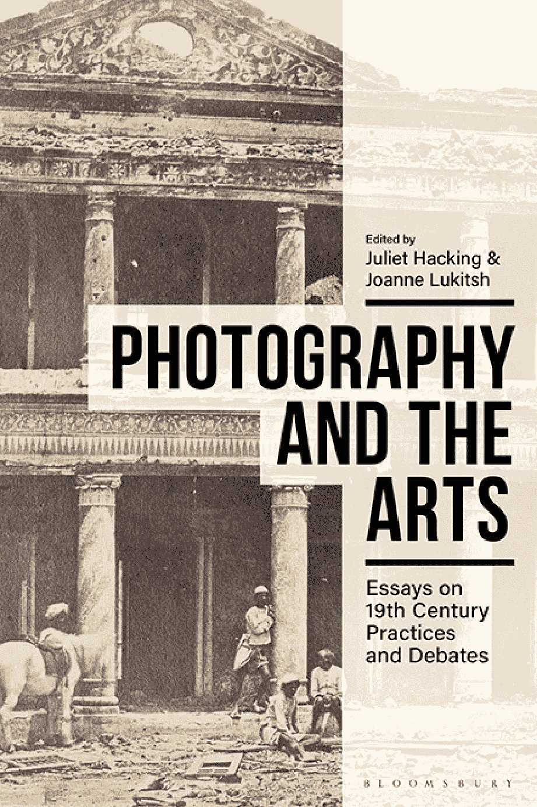

- 参考文献 208
- 10.6 William Sidney Mount，《加利福尼亚新闻》，1850年，画布上油画，21 ½ × 20 ¼ 英寸。Ward Melville 夫妇捐赠，1955年。© 纽约长兰岛博物馆 165
- 10.8 Montgomery P. Simons，《激情系列》，Mann Saturwaite II，1853 年，银版摄影，3 ¾ × ¾ 英寸。弗吉尼亚州里奇蒙德，170
- 11.2 Henry Peach Robinson，《春天》，约1862 年，蛋白银打印。维多利亚与阿尔伯特博物馆（V&A）摄影协会收藏，在国家彩票遗产基金和艺术基金的慷慨支持下获得，2135–2018。© 伦敦维多利亚与阿尔伯特博物馆 183
- 11.4 Henry Peach Robinson，《工作完成》，1877 年，蛋白银打印，56 × 74.5 厘米 (22 ⅙ × 29 英寸)。洛杉矶盖蒂博物馆，898。数字图像由 Getty 开放内容计划提供 185
- 12.2 Julia Margaret Cameron，《虔诚》，1865 年，蛋白银打印，22.8 × 27.9 厘米。伦敦维多利亚与阿尔伯特博物馆，45154。© 伦敦维多利亚与阿尔伯特博物馆 194
- 12.4 Julia Margaret Cameron，《阿德莱德·塔伯夫人》，1865 年，蛋白银打印，26 × 21 厘米。伦敦维多利亚与阿尔伯特博物馆，45142。© 伦敦维多利亚与阿尔伯特博物馆 198
- 12.6 凯门夫人的摄影展，帕尔街120，价格表，1865年11月，无页码（详情）。国家艺术图书馆，伦敦维多利亚与阿尔伯特博物馆 202

## 致谢

本项目由保罗·梅隆中心（Paul Mellon Centre）和伦敦苏德比学院（Sotheby's Institute of Art）于2016年6月联合举办的研究活动形成。编辑对这两个机构表示诚挚感谢，并感谢当天发表论文的人（包括 Margaret McDonald、Anne Wagner 以及本书的其他贡献者）以及与会人员。

编辑对 MassArt 基金表示感谢，该基金的拨款支持了 Joanne Lukish 对本书的研究，并感谢苏德比学院研究委员会为 Juliet Hacking 文章中的插图提供的帮助。他们还感谢匿名同行评审员对手稿提出的敏锐且具有建设性的意见。

我们诚挚感谢所有为本书提供图像的版权所有者，特别是以下机构：巴黎科学院、里尔市立图书馆、纽约罗彻斯特乔治伊曼博物馆、纽约大都会博物馆、纽约公共图书馆、费城博物馆、皇家室收藏信（© 英国伊丽莎白二世女王）、法国学会等。

## 引言

在总结它们的主题、论点和方法之前，我们将首先阐明主导的方法论和理论框架，这些框架构成了近期对当今被界定为“摄影性”特征的19世纪多元化实践的文化理论化基础。

欧洲和美国科学、社会科学及文学领域对摄影意义的近期理论化，重新构建了关于19世纪摄影的叙事，使其超越了对艺术合法性的追求。从20世纪90年代末开始，将19世纪的摄影与当代的认识论、科学和哲学范式联系起来已成为一种学术上的必然要求，同样强调这些范式与生理及审美视觉观念之间的相互依赖性亦是如此。

在《欲望的燃烧：摄影的概念》（*Burning with Desire: Conceptions of Photography*，1997）中，杰弗里·巴奇森（Geoffrey Batchen）通过追溯到浪漫时期的光化学实验话语，探讨了摄影的社会和文化兴起。在科学史的巨著《客观性》（*Objectivity*，2007）中，劳伦斯·达斯顿（Lorraine Daston）和彼得·加利森（Peter Galison）将主体性认同为一种普遍的渴望对象，而是一种特定的方法论，这种方法在19世纪获得了科学权威，并与关于自我的哲学和心理问题深度纠缠。这两位作者身份分别为历史学家和科学哲学家，通过对科学能力中经验数据的图形（有时是摄影的）插图提出了相关主张。同样作为科学历史学家，詹妮弗·塔克（Jennifer Tucker）在《揭示的自然：维多利亚科学中作为见证者的摄影》（*Nature Exposed: Photography as Eyewitness in Victorian Science*，2005）中，分析了摄影作为科学调查主要组成部分的兴起，她在书中认为，摄影并非以一种完全成熟的证据模式出现的。相反，它似乎并没有受到当代科学写作中那种感知的主观性色彩的负担；客观性是为它制造的。得益于加利森、达斯顿、塔克和其他学者的见解，再也无法将相机的机械操作与摄影师的主观性和艺术能动性完全对立开来处理了。

这种科学转向的另一流派是将经典的摄影实践重新注入到它们曾被斥责的科学网络和话语中，以证实其主张。典型的如《威廉·亨利·福克斯·塔尔博特：超越摄影》（*William Henry Fox Talbot: Beyond Photography*，2013），这是一部论文集，探讨了塔尔博特所参与的多个学术领域的研究。同样重要的是，那些扭转了经验与审美指令之间极化关系、转而追踪它们相互作用的描述。在《奇异图像，失败的复制：威廉·亨利·福克斯·塔尔博特与早期摄影》（*Singular Images, Failed Copies: William Henry Fox Talbot and the Early Photograph*，2015）中，维罗尼卡·梅森（Vered Maimon）主张，应当承认这些指令是由一个更广泛的认识论范式结合在一起的，在这种范式中，想象在科学中起着决定性且合法的作用。梅森认为，在暗箱中观察到的景物创建永久渲染，并没有导致未经媒介的摄影复制。相反，这些图像创造了一种独特的视觉模式，受到时间的侵蚀，特别是曝光的持续时间。科学领域近期的绘画转向和摄影话语的科学转向是其结果，证明了向定量与定性和解更广泛的认识论转变。

詹妮弗·塔克的断言认为，就英国科学而言，“照片”是按性别划分、按阶级分层的劳动的成果，这强调了摄影对象与其生产、展示、创作和接收的社会意义产生共鸣。英国摄影工业中的小资产阶级男性工人为了让摄影被承认是一种创造性劳动，编码了他们对社会、政治和审美能动性的渴望，这已成为广泛研究的主题。近期，文化历史学家通过研究识别了法国和英国女性摄影师（无论是爱好者还是商业）以及在新兴摄影行业工作的女性的商业、科学和艺术活动，这些研究通常以非线性的方式追踪通过被忽视的对象和记录的摄影活动痕迹。在这些描述中，社会生物学通过一种方法获得了新的活力，这种方法允许生命交汇、作用并照亮其历史时刻更广泛的经济、政治和社会状况。

关于照片在19世纪涉及劳动力和选举权问题的说法，是两项关于“构图摄影”（由两个或多个负片打印的摄影版画）研究的核心。因为在暗室中的组装是互换的。

媒体（例如电报和新闻）文化形式（例如电影）进一步“驱逐”了学者巴恩所批评的、早期关于摄影的提供的“隧道式历史”，巴恩使用了“摄影特权主义”这一术语来描述19世纪文化的摄影。将摄影与文化联系起来，根据帕齐亚·迪·贝洛（Patrizia Di Bello）的观点，处于主导欧洲和美国的艺术作品所谓独特性之间。近期对摄影中娱乐活动的研究，涉及了剧场化的幻象，以及街头表演者的展示，利用了经验和大众科学，进一步证明了艺术与科学的渗透性。其持续的女性化特征这种“游戏”的形式结合对“构图摄影”的操控，认为可变性、表演性、梦幻和幻想是摄影的关键属性，并进一步动摇了二十世纪理论化中归属于摄影表现的索引性观点。全球北方学者日益关注源自南方实践和辩论的特殊性及其理论化，以及它们对既有理论和方法范式的意义。摄影不再被视为一种数字工具，在21世纪的现实主义小说中，摄影的数字“物质性”的剧烈变革引发了数字和社会组成部分的历史解释。摄影研究中数字的理论化，与其说是与之前的模拟时代的认识论断裂，不如说是算法读取和挖掘在线图像数据对定义我们特定历史时刻的“监控资本主义”的影响。另一个新兴的“物质性”方面涉及全球变暖危机；预想自然资源无穷尽的可用性现在正从一个全新的框架被理解，即它们植根于一种并非进步而是无节制剥削的意识形态之中。

1859年，夏尔斯·波德莱尔（Charles Baudelaire）写道“摄影应用不当的发展”，认为它“像所有其他纯粹的物质进步发展一样，加剧了法国艺术天才的贫乏”。摄影与想象力的这种极化，使得波德莱尔提出，摄影应当“回归其真正的职责，成为服务于艺术的仆人——但是一个极其卑微的仆人，就像印刷或速记一样，既不创造也不补充文学”。波德莱尔将摄影知识与神职阶级等同，对两者来说都是轻蔑的，但尽管如此，他将这种低廉的摄影劳动描述为重要的：“让它[摄影]从被遗忘的倾塌废墟中拯救那些正在吞噬的珍贵书籍、印刷品和手稿，它们的形态正在溶解，需要在我们记忆的档案中占据一席之地”。波德莱尔对摄影能够为人类记忆保存事物、干预时间流逝的承诺愿景，与湿法胶底片（印在蛋白纸或盐纸上）的出现是同时代的。蛋白纸传统上与问候卡、名片的工业化规模生产，以及摄影作为欧美现代性和消费主义的组成部分的出现联系在一起。但波德莱尔对从单张底片可以制作无限数量印刷品的预测恰恰是如此：预测。他构想的摄影作为抵御现代化断裂的屏障的作用，并没有受到褪色照片和破碎玻璃底片等物理限制的约束。

正如学者们最近注意到的，有充分证据表明，19世纪的人意识到摄影与其所声称的新力量相比具有局限性。我们认为，这对于波德莱尔式的幻想也是如此，即将摄影视为一种无误的复制过程……这种过程关注文字的写实，以及对“更广泛的覆盖……的需求，包括特定历史时刻和摄影‘网络’的局限性、创新和商业压力。”19世纪的照片并非标准化的商品：例如，蛋白纸的制造过程中很少有步骤是机械化的。考虑“摄影例外论”意味着重新审视现有的当代经典文献和陈述，这些文献将摄影视为现代性和现代化的（物质）附生现象，并联系物质对象和实践在产生摄影意义中的重要性。

今天，通过所谓的数字资源获取知识和客体的途径大大增加，物质与非物质的相互作用是我们当代时刻和历史方法的一个决定性特征。本卷中的文章认为，应当承认物质表现与摄影非物质概念之间的共生性质，而不是将它们分别置于微观和宏观层面的分析中。这一时期照片物理生产中利益关系的可变性凸显出来，摄影图像在接受、流通、获取和保存过程中的可变性亦然如此。

对物质形成及其所属的多个网络进行制图，使我们能够重构产生这些网络的重要的、有时是无形的交换。追踪照片在多个话语领域出现的学术研究（例如在个人与机构之间通过手传、邮政和蒸汽轮船进行的流通），进一步削弱了“19世纪照片曾具有固定映射”这一观点的可信度。

本论文集的标题没有指定地理限定词。这并不是为了将文章所呈现的西欧、英国殖民（以及在较小程度上）美国的场景、实践和话语普遍化。工业资本主义的迫切要求在视觉文化领域产生了更廉价的传播模式和视觉形象，这与特定的国家形成（如政治话语、科学研究、政府对艺术的赞助和艺术教育）以及更大的形成（如历史和当代艺术的展示与销售）始终处于紧张状态。这里所提案例的历史特殊性是更广泛意义的基础：它们严谨的历史方法是我们判断其发现和解释的标准。本卷的其他贡献还包括将关注科学、制造和大众图像的研究引入当代“艺术”实践。由于英美现代主义项目，希尔和亚当森、亨利·皮奇·罗宾逊、朱莉·玛格丽特·卡梅隆、彼得·亨利·埃默森和乔治·戴维森等英国人物引起了我们的关注，但对前者的拒绝并不导致对后者的拒绝；也不意味着个人及其实践不能与里斯摄影打印（Imprimerie photographique）的化学实验，或英属印度帝国旅游图像中的权威性在同一框架下进行讨论。文章中探讨的摄影与艺术之间的相互作用，源于特定的社会文化形成，这些形成在其提供的历史和方法论洞见中超越了局部。

# 第一部分：复制的艺术

本节的文章还探讨了19世纪的摄影复制过程如何在文化、社会和制度形式的节点中发展。史蒂芬·C·平森（Stephen C. Pinson）分析了早期摄影研究中可能被边缘化的复制案例。在《摄影的虫：伊波莱特·费索（Hippolyte Fizeau）的摄影雕刻和其他复制媒介》中，平森利用社会和艺术研究网络（包括对电学和昆虫学的研究）来阐明费索印刷品的意义。基于亨利·泽纳（Henri Zerner）的观察——即“复制”应用于当时的法国摄影时，“与其说它是一个真正的概念，不如说是一个模糊的语义场”，平森解释了该领域的多学科元素，包括费索印刷品的主题和视觉效果。平森对这一转型时期费索摄影雕刻的调查，在早期摄影实验与工业革命的科学和文化转型之间建立了新的文化联系。

在《铸造历史：摄影与石膏铸造在殖民档案创建中的作用》中，莎拉·维多利亚·特纳（Sarah Victoria Turner）开启了南肯辛顿博物馆19世纪70年代早期建筑细节铸造计划的“共同努力”。她对这两种形式相互作用的考察描述了观众性的新维度以及摄影复制品的新制度角色。

在《现代化的维多利亚：朱莉·玛格丽特·卡梅隆的照片（1886–1914）》中，共同编辑乔安娜·卢基什（Joanna Lukish）强调了摄影复制品在卡梅隆死后艺术身份形成中的重要性。卡梅隆坚持她的专辑具有美学品质，在遥远的地方或摄影打印的新进展中，她转向最近完善的碳法工艺，在1875年离开英国前往其在斯里兰卡（当时为英属锡兰）的家族种植园之前选择了一系列照片。从19世纪80年代到第一次世界大战，卡梅隆的照片很大程度上是通过碳相片和其他复制品广为人知的。在此期间，追求自称为艺术视角的新一代摄影师制作卡梅隆照片的复制品，并利用它们来传达他们自己的审美关注。卢基什分析了卡梅隆对基于镜头的细节和暗示的维多利亚式实验是如何支持他们的现代主义关注的。

# 第二部分：摄影与美学

本节四篇文章的共同动态是，每位主角都积极探索如何将审美模式扩展到摄影中。这些文章强调了这些对拍摄和面对镜头摆拍等物理活动探索的历史特殊性。路易·迪西尔·布兰卡特·埃拉尔（Louis-Desiré Blanquart-Evrard）在摄影史上以将大规模生产技术应用于底片和照片的生产而闻名。他在法国利的摄影打印厂（Imprimerie photographique）通常被描述为一个初创的、工业规模的印刷工厂。在《摄影与如画性：路易·迪西尔·布兰卡特·埃拉尔活动的的美学与化学基础》中，赫尔塔·沃尔夫（Herta Wolf）提出了指导其创新性摄影生产的复杂且多方面的目标，以及对学者和业余爱好者者观众对该打印厂作品口味的预期。沃尔夫评估了布兰卡特·埃拉尔在19世纪50年代发表的照片（底片化学灵敏度技术改进的结果）如何转化了如画风景图像的参数。

## 引言

在《如画般的冲突：十九世纪大英帝国的摄影与暴力美学》中，肖·罗伯特·威尔尔科（Sean Robert Willcock）探讨了印度和中国的殖民冲突照片如何参与了“风景”作为一种美学的形成，这种美学使观众对暴力和政治控制的图像敏感。威尔尔科识别出此类照片中美学与伦理之间活跃的紧张关系。例如，费利斯·贝托（Felice Beato）在 19 世纪 50 年代和 60 年代为他的拍摄了英国殖民暴力的被掘墓和死亡受害者场景，这使他在殖民国家表面规范之外的行为赋予了美学权威。威尔尔科对 19 世纪 70 年代在印度产生的风景构图的分析，证明了视觉文化中对风景的摄影引用如何继续支持英国的殖民计划。

在《阳光照射：伊丽莎白·莱莱（伊斯特莱克）与太阳的东方目光》（选自《希尔与亚姆森的碳盐摄影））中，林赛·史密斯（Lindsay Smith）坐在阳光下由大卫·奥塔维斯·希尔（David Octavius Hill）和罗伯特·亚姆森（Robert Adamson）拍摄碳盐肖像的经历，对她关于摄影的写作产生了影响：这不仅在她 1857 年著名的论文中（文中包含了十年前发表的关于绘画和碳盐摄影的著名描述），伊斯特莱克关于在明亮阳光下摆姿的描述，结合她对碳盐照片中光线描绘与传统的“铅笔、画笔和烧蚀”图形艺术之间美学连续性的追踪，史密斯认为，伊斯特莱克对碳盐摄影美学的欣赏，特别是她对时间持续性的引用，对于理解伊斯特莱克对湿版摄影时代艺术主张的负面判断至关重要；根据她的分析，当时摄影成为了既定秩序所有表现形式的挑战。

在《像米开朗基式的粗糙石块的卡莱尔：通过雕塑思考朱莉亚·玛格丽特·卡梅隆肖像中的摄影》中，帕特里齐·迪·贝洛（Patrizia Di Bello）阐明了卡梅隆对维多利亚天才刻画中的历史意义层次。摄影师引用米开朗基让其大理石“未完成”的方法，为她的照片带来了多层面的含义：从维多利亚时代关于雕塑家的“未完成”（non-finito）是天才的标志还是未能维护学术规范的争论，到卡梅隆与这位维多利亚狮子的社交和知识上的接近以及他著名的火爆性格。根据迪·贝洛的描述（这种描述围绕焦点作为口头或形式争议），将卡梅隆的摄影不仅与大师先例联系起来，还与产生易于复制的雕塑商品的当代塑实践联系起来。

# 第三部分：摄影与绘画

一位著名摄影师参与绘画的社会性质是本节文章的框架。鉴于两篇文章所探讨的绘画与摄影之间的交流相隔了几十年，19 世纪英国现代性和现代化的转变为一个重要的潜台词。在《艺术、复制与报道：罗杰·芬顿的克里米亚照片》中，

索菲·戈登（Sophie Gordon）揭示了一个通常被誉为报道作品的维多利亚摄影项目中的艺术动机。芬顿的赞助人艾纽父子（Agnew and Sons）出版社委托他拍摄特定主题，供一位受欢迎的叙事画家研究使用；而在绘画制作期间，出版商将芬顿的照片进行了全国巡展，据报道有超过 200 万人观看。她评估了巡展展览的评论，以考察芬顿的照片如何通过民族主义和集体经历的视角产生折射，既被读作对一场在媒体广泛报道的争议战争的记录，也被视为诗意的反思。

在《摄影中的印象派》中，霍普·金斯利基（Hope Kingsley）考察了英国摄影师乔治·戴维森（George Davidson）在 1890 年关于法国绘画中这一运动与艺术摄影实践相关性的论点。金斯利基认为，印象派对摄影美学的意义在很大程度上局限于一种断言：世纪末的风景主义摄影师转向这些画家的范例——他们的作品当时在焦点和模糊等摄影设备上是没有争议的。金斯利基对 19 世纪 80 年代后期英国艺术和摄影文本的总结性解读，为戴维森艺术摄影与印象派之间的联系了特定条件，包括他与彼得·亨利（Peter Henry）自然主义摄影的分歧。戴维森思想的关键在于他的针孔摄影实践，因为他图像中特征性的焦点扩散效果从正面和反面都被解读为在意图和结果上都是印象派的。金斯利基在1889 年伦敦古尔德画廊举办的克劳德·奈（Claude Monet）画展的背景下考察了戴维森的论点，这一事件将印象派美学的争议性带入了英国的艺术圈。

# 第四部分：艺术摄影

（注：此部分内容与前文高度重复，已按要求处理唯一内容。）

## 引言

# 摄影与艺术

是一种现象学影响，近期经历了一场方法论的复兴？《摄影与艺术》并未直接参与这些方法论辩论；相反，它将历史特殊性的解构、物质文化和意义的部署，视为对学术抽象传统价值评估的一项重大挑战。在最近一次关于什么才是真正的摄影的探索中，当调查在没有解释的情况下被框定于摄影对艺术的诉求这一问题时，这些辩论所谓的哲学性中立性被暴露无遗了.^45 这是一种自“照相机”一词被广泛使用以来一直伴随着摄影批评和理论的修辞手法：对十九世纪摄影性质和未来的“客观”探究，通常被构建为对摄影与艺术关系的探究，或实质上关注其这种关系。这种对美学的漠不，类似于对哲学的声称；它让偏见和得得利益作为普遍性来运作。这正是特殊性（物质的、历史的和学术的）价值所在；它允许读者看到与其自身范围——以及其排除的范围——相关的所提出的主张。当摄影的“实践与辩论”在个人和集体主体性的表达上如此丰富时，却将摄影中的审美活动声称为恋物化、浅薄化和/或透明化，这是批判性的失败。《摄影与艺术：世纪实践与辩论论文集》坚持认为，具有意义且实质性的理论和文化活动已经从摄影中兴起，并将继续如此下去。

- 22 Caroline Line, *The Serious Pleasures of Suspense: Victorian Realism and Doubt*（Charlottesville: Virginia Press, 2003）；Helen Groth, *Victorian Photography and Literature*（Oxford: Oxford Press, 2003）；Jennifer Green-Lews, *The Invention of Modern Memory*（London: Bloomsbury, 2017）。

- 24 Bann, *Against Exceptionalism*, 96。

- 28 Elizabeth Segal 等人, *Playing with Pictures*, 2009。

- 31 Elizabeth Edwards, *Raw Histories: Photography, Anthropology and Museums*（Oxford and New York: Berg, 2001），*The Camera as Interface: Amateur Photographers and Historical Imagination*, 1885–1918（Durham and Duke University Press, 2012）及 ‘Photography and the Material Performance of the Past’, *History and Theory*–48, 4 (2009年12月): 130–50。另见 Elizabeth Edwards 和 Janice Hart (编), *Photographs, Objects, Histories: On the Materiality of Images*（New York and London: Routledge）。

- 32 理论层面上物质性的特权可能是近期的，但这里概述的许多二十世纪方法和概念，源于文化研究（在该范畴下包括艺术研究）中一个成熟的方法论分支。James Reilly 的著作是为十九世纪蛋白纸照片制作而出版的，在80年代为修复师出版的；当时研究摄影的主流方法论范式是文本的。

## 引言

15

James M Reilly, 《蛋白相片的历史、技术与结构》, 美国保护协会协会预印本, 1980年5月, 93–8, http://albumen.conservation-us-library/c20/reilly1980.html (访问于 2019年7月7日)。如今，修复人员的研究已发表在展览目录中；例如，Mitra Abbaspol, Lee Ann Daffner 和 Maria Morris Hamburg 著，《物体：照片。现代摄影：托马斯·沃克收藏 1909–1949》（纽约：现代艺术博物馆, 2014）以及 Anne McCauley 编选，《白特与他的世界：摄影的艺术与工艺, 1895–1925》（新亥文: 耶鲁大学出版社, 2017）。2019年9月在耶鲁大学举办的“材料信息学：21世纪的摄影——美国美术保护协会（FAIC）摄影修复研讨会”会议汇聚了各类文化利益相关者——修复师、艺术史学家和艺术家、收藏家以及从业者——旨在共同探讨数字未来中摄影的命运。

- 33 Shoshana Zub, 《资本主义时代：在权力新边疆为人类未来而斗争》(纽约: Public Affairs, 2019); Scott McGuire, 《数字摄影与运作档案》，收于 Sean Cuthbert, Daniel Palmer 和 Nathaniel Tkacz（编），《数字光影》(伦敦: Open Humanities Press, 2015), 122–43.

- 34 Robin Keegan 为 Martha Rosler, Caroline Walker Bunn, Natasha Eaton, Michael Ann Holly, Jones Mickey, Robin Keyes, Alice LaGamma, Monika Wagner, Oliver Watson 和 Tristan Wedden 撰写的文章贡献，《田野笔记：物质性》，《公报》(The Bulletin) 第95卷，第1期 (2013): 10–37。关于全球变暖对现代时期历史网络影响的深远评估，请参见 Dipesh Chakrabrabary，《历史的气候：四项论述》，批判性查询》(Critical Inquiry) 第35期 (2009年冬季): 187–222。

- 35 Charles Baudelaire，《1859年沙龙》，收于《艺术巴黎 1845–1862：查尔斯·波德莱评论的沙龙与其他展览》，由 Jonathan Mayne 翻译并编辑 (伦敦: Phaidon Press, 1965), 149–155。

- 36 同上，154。

- 37 同上。

- 38 Sabine T. Kriebel 和 Andrés Mario Zervigón（编），《摄影与怀疑》(Abingdon, Oxford: Routledge, 2017)。

- 39 Green-Lewis, 《维多利亚时代的摄影》，第 xvii 页。

- 40 Lindsay Smith, 《路易斯·卡罗尔：移动中的摄影》(伦敦: Reaction, 2015); Edwards, 《原始历史》， 8–9。Gregory Mittman 和 Kelley Wilder（编），《记录世界：电影、摄影与科学记录》(芝加哥: 芝加哥大学出版社, 2016)。

- 42 本部选集对朱莉亚·玛格丽特·卡梅隆（Julia Margaret Cameron）摄影的关注，证明了在摄影美学、视觉文化和女性创造力方面的重要新方法，这些方法通过她的实践不断被深化。

- 43 这种“生产”风格被 Di Bello 用于《雕塑摄影》(Sculptural Photographs) 第81页。Christopher Pinney，《七姐妹》，《论文十一》(Thesis Eleven) 第113卷，第1期 (2012): 141–56, 11。

- 44 Diarmuid Costello，《‘新’摄影理论新新在哪里？，《美学与艺术批评杂志》(The Journal of Aesthetics and Art Criticism) 第75卷，第4期 (2017年秋季): 439–52, 439–40。

## 贡献者

**Patrizia Di Bello 博士**，伦敦贝德肯大学历史与理论教授

在伦敦贝德肯大学，Patrizia Di Bello 担任历史与理论教授。她与 Hammad Naser 等合编了《从银盐工艺到数字技术：摄影》(Calotype to Digital) (2017)。她的研究包括《雕塑摄影》(Sculptural Photographs) 以及其他主题，并出版了《维多利亚时代的摄影》(Victorian Photography)。

**Sophie Gordon 博士**，温莎士城堡摄影收藏部主管

在温莎士城堡，Sophie Gordon 负责摄影收藏。在此之前，她是纽约公立图书馆艺术、版画与摄影分部的副馆长。她的研究兴趣包括19世纪的印度和中东摄影，以及极地探索摄影。她最近的出版物是与 Alka 等合编的《战争的影子：罗杰·芬顿的摄影》(Shadows of War) (2009)。*

**Julian Hacking 博士**，伦敦艺术会学院当代艺术硕士项目主任，摄影研究负责人

在艺术会学院，Julian Hacking 曾是贝德肯大学摄影硕士课程主任。他的研究涵盖摄影与美术与其他形式的交叉，以及过去与现在的视觉文化。

**Hope Kingsley 博士**，温莎士城堡教育与收藏策员

在温莎士城堡，Hope Kingsley 负责促进学术研究。她的研究重点是19世纪和20世纪的摄影。她的展览和出版物包括与 Mark Hallet 共同策划的《皇家学院250年夏季展》(The Great Spectacle) (2018)。

**Joanne Lukitish 博士**，马萨诸塞艺术与设计学院艺术教授

Joanne Lukitish 关于朱莉亚·玛格丽特·卡梅隆有大量著作，包括J.保罗·盖蒂博物馆的摄影目录 (2002) 以及《拉拉斐尔派：摄影与绘画，1848–1875》(2010)。除了关于历史和现代摄影的论文文章外，Lukitish 还参与了关于 Barbara (2018) 和 Laura 的出版物。

**Stephen C. Pinson 博士**，纽约大博物馆摄影部展员

Stephen C. Pinson 对摄影史有广泛研究，特别关注摄影的起源。在2015年回到大都会之前，Pinson 曾在纽约公立图书馆艺术、版画与摄影分部工作。过去十五年来他组织的多次展览涵盖了摄影媒介的整个历史。他是《推测的达盖尔：L.J.M. Daguerre 作品中的艺术与企业》(2012) 以及《里程碑式的之旅：吉罗·德普鲁尼的达盖尔摄影》(2019)的作者。

**Lindsay Smith 博士**，萨塞大学英语学院教授，摄影与视觉文化中心联合主任

Lindsay Smith 研究19世纪摄影、文学与绘画之间的关系，在该领域发表了大量著作，包括《维多利亚时代的摄影、绘画与诗歌》(1995)、《焦点政治：女性、儿童与19世纪摄影》(1998)、《拉拉斐尔主义：诗歌与绘画》(2013)、《路易斯·卡罗尔：移动中的摄影》(2015) 以及《色彩与维多利亚时代的摄影》(2020)。

**Sarah Victoria Turner 博士**，伦敦英国艺术研究研究所副院长

Sarah Turner 的研究涵盖了1850年以来英国艺术的各个方面及其国际背景。她拥有丰富的著作。她还策划并参与了多次展览，例如在皇家学院与 Mark Hallet 共同策划的《盛大奇观：皇家学院250年夏季展》(2018)。作为伦敦-亚洲研究项目的联合负责人，她也是在线期刊《英国艺术研究》(British Art Studies) 的共同编辑和创始人。

## 贡献者

Diane Waggoner 博士，华盛顿国家美术馆19世纪摄影策展人

Diane Waggoner 曾策划过多次展览，并合著了多本展览目录，包括*美国快照的艺术，1888–1978：罗伯特·E·杰克逊收藏（2007）*、*暗室里：数字时代之前的摄影工艺（2009）*、*拉拉斐尔派的镜头：英国摄影与绘画，1848–1875（2010）*以及*密西西比河以东：19世纪美国风景摄影（2017）*。她还是《路易斯·卡罗的摄影与现代童年（2020）》的作者。Waggoner 曾任职于耶鲁大学美术馆、亨廷顿图书馆艺术收藏及植物园。

Marta Weiss 博士，伦敦维多利亚和阿尔伯特博物馆摄影高级策展人

Marta Weiss 在 V&A 策划了以下展览和展示：*创作中：摄影（2018）*、*露西·玛格丽特·卡梅隆（2015）*、*持久的力量：1950s–1990s的英国体验摄影（2015）*以及*来自中东的光（2012）*；她还是许多展览目录及其他摄影相关出版物的作者。Weiss 目前正领导 V&A 摄影中心扩建计划的第二阶段。在加入伦敦这家博物馆之前，Weiss 曾在普林斯顿大学美术馆和大都会博物馆策划展览，并在大都会博物馆担任摄影部的切斯特·戴尔研究员。

Sean Robert Willcock，伦敦大学贝德塞学院艺术史系 Earlyhame 早期研究员

Sean Robert Willcock 是伦敦大学贝德塞学院艺术史系的 Leverhame 早期职业研究员。他的研究兴趣是维多利亚时代视觉文化中暴力的兴起，特别关注艺术家和摄影师如何与帝国地缘政治相互互动。他的著作发表在《艺术史》、《摄影史》和《英国艺术研究》杂志上，他目前正在撰写他的第一本专著《维多利亚时代的战争与和平愿景：美学、地缘政治与帝国》。

Herta Holf 教授，科隆大学艺术史系历史与摄影理论大学教授

# Herta Holf

Herta Holf 在摄影史学，以及艺术史、科学与媒体史交汇的 19 世纪摄影领域发表了大量著作。她是两卷本著作《摄影话语：摄影时代末期的摄影批判》（Diskurse der Fotografie. Fotokritik am Ende des fotografischenitalters，2002,2003）和《展示与证明：作为文化技术和知识媒介的摄影》（Zeigen und/oder Bewiesen: Die Fotografie als Kulturtechnik und Medium des Wissens，2016）的编辑。她编译的作品即将出版。

## 引言

本选集的论文重绘了对 19 世纪艺术摄影学术研究的既有边界，考察了摄影与艺术之间物质与隐喻的相互作用，其中“艺术”涵盖了当时视觉文化中的各种媒介。论文中提出的观点将摄影与美术、平面艺术和雕塑艺术之间复杂的交流置于其物质和社会背景中，并阐明了伴随这些交流的美学辩论如何受到科学、阶级身份和社会抱负、国家身份和帝国主义等一系列问题的影响并与之对话。书中插图的照片出现在作品集、相册和书籍的页面上，出现在博物馆和美术馆的墙上，展示在商店橱窗内，和/或在学术或摄影组织的会议上从人传到手中。《摄影与艺术：19世纪的实践与辩论论文》声称摄影与艺术之间的历史互动具有重要意义，这种意义超越了色彩地位、质量判断或分类的问题。

《摄影与艺术》这一标题是对阿伦·沙夫（Aaron Scharf）1968 年的作品《艺术与摄影》（Art and Photography）的重新演绎。我们的标题既尊重了这一被认为是该领域最广知的英语著作，又强调了其知识时刻与当下的区别。Scharf 从新形式可能的角度勾勒出艺术与摄影（主要是欧洲的，兼及美国）之间的相互作用，为“艺术”等同于“绘画”的现代主义思想扫清了道路。任何由于 19 世纪摄影而获得的文化认可都将成为绘画获得回报的媒介。基于他在伦敦考陶尔德艺术学院完成的博士论文，Scharf 的文本是……

# 摄影与艺术

对于整个摄影，尤其是早期摄影，“十月计划”（October project）的关键在于，法兰克福学派艺术评论家沃尔特·本雅明（Walter Benjamin）的著作在20世纪70年代被左翼学者和现代主义艺术评论家重新发掘之后。对于本雅明而言，19世纪摄影提出的各种主张是19世纪80年代初其商业化的症状，当时这些主张是使商业摄影师的服务和商品物化的手段。他对早期图像（如1840年代大卫·奥斯塔维斯·希尔和罗伯特·亚当斯所拍摄的作品）的理论化，预示了拒绝被归入艺术19世纪摄影“微小偶然火花”的批判可能性。

书中的论文指出，与摄影相关的美学诉求是特定社会政治条件的历史组成部分。阐明这些加密的文化干预需要权威知识生产、批判性思维和熟练论证所需的历史特殊性和智力严谨性。我们认为，这些论文在这方面是典范。

## 引言

在总结这些主题、论点和方法之前，我们首先将阐明主导的方法论和理论框架，这些框架构成了近期对今日被界定为“摄影性”的19世纪多元化实践的文化理论基础。

欧美自然科学、社会科学和文学领域中对摄影意义的近期理论化，重新构建了关于19世纪摄影的叙事，使其超越了对艺术合法性的追求。从20世纪90年代末开始，将19世纪的摄影与当代的认识论、科学和哲学范式联系起来已成为学术上的必然要求；同样，坚持这些范式与生理及审美视觉观念之间的相互依赖性也已成为共识。在《欲望燃烧：摄影概念》（1997）中，杰弗里·巴切森（Geoffrey Batchen）倾向于通过追溯到浪漫主义时期的光化学实验话语，来关注摄影的社会和文化兴起。在科学史的巨著《客观性》（2007）中，洛莱恩·达斯顿（Lorraine Daston）和彼得·加利森（Peter Galison）将“主体”识别为并非一种诉求，而是一种在19世纪获得科学权威的方法论，并与自我的哲学和主观问题深度纠缠。这两位作者（一位历史学家一位科学哲学家）通过引用科学简书中对经验数据的图形（有时是摄影）插图，提出了他们的主张。詹妮弗·塔克（Jennifer Tucker）也是一位科学历史学家，她在《自然的揭示：维多利亚时代科学的目击者摄影》（2005）中将摄影分析为科学调查的主要组成部分，在书中她认为，摄影并非以一种完全成熟的客观证据模式呈现的。相反，它似乎并未受到当代科学写作中那种感知到的主观恐惧的影响，而是其客观性是为之“制造”出来的。得益于加利森、达斯顿、塔克等学者的见解，将相机的机械操作与摄影师的主观性和艺术主体性进行对立来读已不再可行。

在这一科学转向的另一个分支，是将经典的摄影实践重新引入到它们曾被排除在外的科学网络和话语中，以声称对其的所有权。典型的例子是威廉·亨利·福克斯·塔尔博特（William Henry Fox Talbot）：《超越摄影》（2013），这是一部论文集，它将塔尔博特参与的多个学术领域内的摄影研究纳入其中。同样重要的还有那些颠覆了经验与审美要求之间的现代极化对立，并转而追踪两者相互作用的论述。在《单一的图像，失败的复制：威廉·亨利·福克斯·塔尔博特与早期摄影》（2015）中，薇拉·梅森（Vera Maison）主张应当承认，这些要求是由更广泛的认识论范式联系在一起的，在这种范式中，例如想象力在科学中发挥了决定性和正当的角色。梅森认为，在暗箱中观察到的事物的永久意义的创造并没有导致意料之外的摄影复制。相反，这些图像创造了一种被时间侵蚀的独特视觉模式，特别是曝光的时间持续性。科学领域近期的“视觉转向”和摄影话语中的“科学转向”是其产物，证明了向定量与定性趋同的更广泛认识论转变的证据。

詹妮弗·塔克的断言，就英国科学而言，“摄影是性别划分和阶级分化的劳动的结果”，这坚持了摄影对象与其生产、展示、庆祝和接收的社会意义产生共鸣。英国摄影工业中的小资产阶级男性工人为了让摄影被承认是创造性劳动，编码了他们对社会、政治和审美主体性的欲望，这已成为广泛研究的主题。近期，文化历史学家识别了女性摄影师（无论是业余还是商业性的）以及在法国和英国新兴摄影行业中工作的女性的商业、科学和艺术活动，这些研究通过通常以非线性的方式追踪他们在被忽视的对象和记录中的摄影活动痕迹。在这些叙述中，社会生物学作为一种方法焕发了新生，这种方法允许个人生活交汇、作用并照亮其所历史时刻更广泛的经济、政治和社会状况。

关于摄影卷入19世纪劳动力和被剥夺权利问题的主张，是“构图摄影”（从两个或多个负片打印的摄影场景画）两项研究的核心。因为暗室中的组装是可交换的，因此类似于无脸劳动的理想。摄影历史学家乔丹（Jordan）近期提出，摄影的嵌入是现代社会发展的一个主要特征，使观众能够判断其视觉经验的可靠性。巴切森（Bass）声称，在1850年代，识别在视觉欺骗中运作的社会政治机能，即他所谓的“视觉辨别”，已成为调和个人主体性及其在社区地位的关键。根据萨拉·M·米勒（Sarah M. Miller）的，巴切森的叙述解构了将客观性视为首要的现代摄影史。

当摄影不再被视为科学事实的例子，或不再从作为机器的创造性工具的角度来解读时，摄影理念与其他主观过程的纠缠是一个焕发新生的学术研究领域。文学学者的一项重要跨学科研究分支，理论化了摄影理念如何影响了19世纪的小说。在这项关注文学现实主义的研究中，诺瓦克（Novak）认为，怪诞和排版摄影“现实主义”与维多利亚小说产生并依赖于特性。其他叙述关注摄影作为文学装置（或部署的心理过程）的结构性作用；此处值得注意的是卡罗琳·莱文（Caroline Levine）对悬疑的研究、海伦·格罗斯（Helen Groth）的怀旧以及詹妮弗·格林-刘易斯（Jennifer Green-Lewis）的记忆。这些研究重申了许多二十世纪文化写作中对技术客观性价值化的主观性和认知过程。与这些文学研究一样，对摄影嵌入“其他媒体”及其历史的跨学科考察（从通信媒介如电报和新闻媒体，到文化形式如视觉艺术和电影），进一步解构了学者史蒂芬·巴切森（Stephen Bann）所说的早期19世纪摄影叙述提供的“隧道历史”：这些历史几乎不超越摄影主题来解释摄影。

巴切森创造了“摄影例外论”这一术语，赋予了摄影在19世纪视觉文化中的特殊地位。根据帕特里亚·迪·贝洛（Patrizia Di Bello）的观点，结合文化考察摄影，定位了在统治欧洲和美国的绘画艺术话语中所述的艺术作品的所谓独特性。

自然资源的无穷可用性现在被赋予一个新的框架来理解，即它们植根于一种没有进步、只有无限制剥削的意识形态之中。

1859年，夏尔斯·波德莱尔提到“摄影应用不当的发展”，这像所有其他纯粹的物质性进步发展一样，导致了法国艺术天才的贫乏。对于摄影与想象力之间的这种极化，波德莱尔建议摄影应该“回归它的真正职责，成为科学和艺术的仆人——但要非常卑微，就像印刷或速记一样，它们既不创造也不补充文学。”波德莱尔将摄影知识与文员阶层等同起来，这对双方都是轻蔑的；尽管如此，他将这种低廉的摄影劳动描述为重要的：“让它[摄影]从那些崩塌的废墟中拯救那些书籍、印刷品和手稿，它们是正被吞噬的珍贵物品，其形式正在溶解，需要在我们记忆的档案中占一席。”波德莱尔对摄影为人类记忆保存事物、干预时间流逝的承诺愿景，与湿法柯银负片在蛋白纸或盐纸上的出现是同时期的。蛋白纸传统上与名片和肖像照的工业化规模生产有关，并与摄影作为欧洲和美国壮丽现代性及消费主义组成部分的出现联系在一起。但波德莱尔对单张负片可以制作出无限数量打印品的投影恰恰如此：投影——这是他设想作为堡垒的角色。

## 摄影与美学

### 引言

在《画意性冲突：19世纪英国帝国的摄影与暴力美学》中，肖恩·罗伯特·威尔尔科克（Sean Robert Willcock）探讨了印度和中国的殖民冲突照片如何参与了“画意性”这一宏大的社会建构，成为一种能够让观众对暴力和政治控制图像敏感的美学。威尔尔科克识别了此类照片中美学与伦理之间活跃的紧张关系。例如，费利斯·贝托（Felice Beato）在19世纪50年代和60年代为他的镜头对英国殖民暴力下支离和死亡的受害者场景进行摆拍，这使他在表面上超出殖民国家规范的行为中动用了美学权威。威尔尔科克对19世纪70年代在印度产出的画意构图的分析，证明了视觉文化中对画意性的摄影引用如何持续支持英国的殖民计划。

在《阳光冲击：伊丽莎白·莱利（埃斯特莱克）与希尔和亚姆森银盐摄影法中的阳光“凝视”》中，林赛·史密斯·埃斯特莱克（Lindsay Smith Eastlake）在阳光下让大卫·奥塔维乌斯·希尔和罗伯特·亚姆森拍摄银盐照片的经历，对其关于摄影的写作产生了深远影响：不仅体在她著名的1857年论文中（其中包括她对摄影与艺术关系的探索），还体在她十年前发表的关于绘画与银盐摄影的较为人知的讨论中。埃斯特莱克在明亮阳光下面对镜头拍照的描述，结合她对银盐摄影中光影欺骗与既有图形艺术（“铅笔、画笔与灼烧法”）之间美学连续性的追踪，认为：埃斯特莱克对银盐摄影美学的欣赏，特别是她对时间持续性的诉诸，对于理解埃斯特莱克对湿法火胶时代摄影艺术手工艺的负面判断至关重要；根据她的分析，当时的摄影已对既定秩序的所有表现构成了挑战。

在《像米开朗基的粗石般的卡莱尔：通过雕塑思考摄影——朱莉亚·玛格丽特·卡梅隆肖像集》中，帕特里齐·迪·贝洛（Patrizia Di Bello）阐明了卡梅隆对维多利亚天才的大胆刻画中所含的历史意义层次。摄影师借用米开朗基让大理石雕塑“未完成”的方法，为她的照片带来了多层面的意义：从维多利亚关于雕塑家的“未完成”（non-finito）是天才的标志还是未能维持学术规范的辩论，到卡梅隆与这位维多利亚贵族及其著名的火爆性格在社交和知识上的接近。迪·贝洛的描述围绕焦点作为口头或正式论展开，将卡梅隆的摄影不仅与老大师先例联系起来，还与产生易于复制的雕塑商品的当代雕塑实践联系起来。

## 第三部分：摄影与绘画

一位著名摄影师参与绘画的社会性质是本节文章的框架。鉴于两篇文章中所探究的绘画与摄影之间的交流跨越了数十年，19世纪英国的现代性与现代化的转型是一个重要的底层文本。在《艺术、复制与报道：罗杰·芬顿的克里米亚摄影》中，索菲·戈登（Sophie Gordon）揭示了一个通常被誉为报道作品的维多利亚摄影项目中的艺术动机。芬顿的赞助人——阿格纽父子公司（Agnew and Sons）委托他为一位流行的叙事性画家拍摄特定主题作为习作；而在绘画制作期间，出版商将芬顿的照片进行了全国巡展，据报道观众人数超过200万。她评估了对巡展的评论，以通过民族主义和集体经验的视角来审视芬顿的照片，将其既读作对一场已在媒体上广泛报道的争议性战争的记录与反思。

在《摄影中的印象派》中，霍普·金斯斯利（Hope Kingsley）考察了英国摄影师乔治·戴维森（George Davison）在1890年的辩论，即法国绘画中的这一派运动对艺术摄影实践的相关性。金斯斯利认为，印象派对摄影美学的意义在很大程度上局限于一种主张：世纪末的画派摄影转向这些画家的范例——而这些作品当时因焦点和模糊等摄影手段而充满争议。金斯斯利对19世纪80年代后期英国艺术和摄影文本的总结性阅读，为戴维森等人在艺术摄影与印象派之间提出的特定条件，包括他与彼得·亨（Peter Henry）的自然主义摄影的分歧。戴维森思想的关键在于他的针孔摄影实践，因为图像中特征性的焦点扩散效果从正面和反面两个方面被解读为意图和结果上具有印象派色彩。金斯斯利在1889年伦敦高普画廊举办的莫奈绘画画展的背景下评估了戴维森的论点，这一事件将印象派美学的争议性引入了英国的摄影圈。

## 第四部分：艺术摄影

为镜头摆拍场景将是一位向往艺术绘画标准的19世纪摄影师可能的方向。在事实的情况下，这种做法是特例而非规律。在《我们艺术家的诗意天赋：美国叙事性达盖摄影》中，迪安·瓦格纳（Diane Waggoner）考察了19世纪50年代美国文化中一个短暂的时刻，当时摄影师使用达盖摄影工艺创作了创新的寓言、宗教和题材图像。瓦格纳分析了这些主题在高艺术和视觉文化中的来源，特别是对日常生活题材画日益增长的兴趣。瓦格纳认为，照片应仅作为记录工具的观点在19世纪60年代占据主导地位，结束了这些精心安排的画面。

在19世纪50年代末60年代初的英国，一种新兴的摄影批评话语辩论了摄影的美学以及艺术摄影的合法性。合编朱莉特·哈金（Juliet Hacking）在《激进的亨利·皮奇·罗宾逊、阿尔弗雷德·亨利与摄影的批评接受（1859-63）》中考察了批评如何影响罗宾逊，以及如何对其实践构成了更大的威胁。通过对专业媒体中罗宾逊评论的仔细阅读，哈金为摄影的模仿与发明的社会基础提供了论证。

在《来自自然》到《为了绘画：朱莉亚·玛格丽特·卡梅隆与南辛敦博物馆》中，玛塔·魏斯（Marta Weiss）调查了（现）维多利亚和阿尔伯特博物馆对卡梅隆照片的收购，并赋予了这些作品艺术地位。通过关注南辛敦博物馆的机构协议，从购买卡梅隆的照片到将其纳入收藏的机构分类，魏斯确认了卡梅隆照片在机构内不固定且可变的状态。通过博物馆档案保存的记录追踪卡梅隆的照片，她证明了卡梅隆的照片与老大师艺术、素描、艺术复制品以及艺术研究相关。卡梅隆的照片是以与19世纪收购的其他数千照片相同的条件进入收藏的。

本书的文章根据自己的术语提出论点：尽管如此，某些主题作为整体的影响显现出来。后现代主义将复制视为非艺术的推崇，作为一种挑战现代主义“原创性”这一神圣工艺地位的手段，一直持续（无疑部分是因为与现代主义的其他遗产一样，文化产业的市场力量需要“原创”与“复制”的等级划分）。在欧美现代主义中，“生产”一词引发了符号意义的丰富，而作为其对立面的“复制”被等同于自动化、记录和挪用，是贫乏记忆的物种。当前认识论时刻的表现之一（受数字化的启发）是从“复制逻辑”转向“复制逻辑”：近期的学术要求我们寻找一种语义丰富的复制（有时被构想为“复制”），作为概念化过去和现在摄影的重要场所，并将其物质形式和形上学与对“迭代”的理论理解相结合，德里达将其命名为一种不可避免的、差异重复。本书将“复制”定位为一个因数字时代演变的认识论而重新焕活力的术语，并认为这种活动是生成性的、创造性的，甚至是艺术性的。

为了结束本引言，我们转向当代摄影话语中的另一个分支：关于摄影定义的本体论的、特别是具有争议性的问题。它是光线在胶片上的记录，即所谓的“摄影事件”？还是通过图形印刷或19世纪早期电镀等工艺创作的摄影对象？

这难道是近期经历了了方法论复兴的“现象学影响”吗？《摄影与艺术》并未直接参与这些方法论辩论；相反，它将历史特殊性与去碎片化、物质文化与意义的部署，识别为对学术抽象传统评估体系的重大挑战。在最近一次关于何构成恰当摄影的探究中，当调查在没有解释的情况下被设定时，这些辩论所谓的哲学无私性被暴露无遗，这是一种自“摄影”一词被广泛使用以来一直带有摄影批评和理论的修辞手法：对19世纪摄影的本质和未来的“客观”探究通常被设定为一种探究，或者实质上关注其与艺术的关系。这种对美学的无私，类似于对哲学提出的主张；它允许偏见和既得利益者作为普遍的形式运作。这正是特殊性（物质的、历史的和学术的）的价值；它允许读者看到摄影中的审美活动仅仅是物化，当其“实践与辩论”如此是个人和集体主体性的表达时，若将其视为肤浅且透明的，那是一种批判性的失败。《摄影与艺术：19世纪实践与辩论论文》坚持认为，重大且实质性的理论和文化活动已经从对美学的追求中兴起，并将继续如此。

## 引言

《摄影师的眼光》（纽约：现代艺术博物馆，纽约平面设计协会发行，约1966）。Walter Benjamin，《摄影简史》，最初发表于 *Der Literarische Welt*，1931年9月18日、1931年9月25日和1931年10月2日，重印于 *Screen* 13, no. 1 (1972): 5–26; http://screen.oxfordjournals.org/content/13/1/5 (访问于2019年9月20日)。这些观点也是 Benjamin 的观点；Gisele Freud, *La Photographie en France au XIXe siècle: essai de sociologie et d'esthétique* (Paris: A Monnier, 1996), 49.

Abigail Solomon-Godeau, *Photography at the Dock: Essays on Photographic History, Institutions, and Practices* (Minneapolis: Minnesota State Press, 1994)。许多 *October* 期刊的文章收录在 Bolton, *The Contest of Meaning* 中。例如，Tanya Sheehan, *The Medicine of Photography in Nineteenth-Century America* (University Park, PA: Pennsylvania State University, 2011)，一个关于该时期摄影方法中心性的论点，是反击摄影历史化的明确尝试。Geoffrey Batch, *Burning with Desire: Concepts of Photography* (Cambridge, MA: MIT Press, 1997); Lorraine Dalton and Peter Galison, *Objectivity* (New York: Books, 2007). Jennifer Tucker, *Nature Exposed*, 4. Steve Edwards, *The Making of English Photography*。Jordan Bear 的阅读在该文集中（见文章11）受到了“视觉判别力”作为政治共鸣关键场所的挑战。同上，4。‘Sarah M. Miller reviews Jordan Bear’s Disillusioned’, *Critical Inquiry*, 2015年11月5日, https://criticalinquiry.uchicago.edu/sarah_m_miller_reviews_jordan_bears_disillusioned (访问于2019年6月10日)。

## 引言

James Reilly，《蛋白石相片的历史、技术与结构》，美国保护协会预印本，1980年5月，93–98，http://albumen.conservation-us.org/library/c20/reilly1980.html（访问日期：2019年7月7日）。如今，修复人员的研究已发表在展览图录中；例如，可参阅：Mitra Abbasov、Lee Daffner 和 Maria Morris Hamburg，《物体：现代摄影：托马斯·沃尔特收藏1909–1949》（纽约：现代艺术博物馆，2014）以及 Anne McCauley 等，《克拉伦·H·怀特与他的世界：摄影的艺术与工艺，1895–1925》（新黑尔文：耶鲁大学出版社，2017）。2019年9月在耶鲁大学举办的“21世纪的材料信息学：摄影保护中的 FAIC 研讨会”会议汇集了各领域的文化利益相关者——修复师、艺术史学家和艺术家、收藏家和策展人——旨在共同探讨数字未来中客体的命运。

33 Shoshana Zuboff，《资本主义的生存：在权力新前沿为人类未来而斗争》（纽约：Public Affairs，2019）；Scott McGuire，《数字摄影与操作档案》，收录于 Sean Cuthbert、Daniel Palmer 和 Nathaniel Tkacz（编），《数字光影》（伦敦：Open Humanitarian Publications，2015），第122–143页。

34 Robin Keegan 为 Martha Rosler、Caroline Walker Myers、Natasha Eaton、Michael Ann、Amelia Jones、Michael Kelly、Robin Keegan、Alice LaGomma、Monika Wagner、Oliver Watson 和 Tristan Wedding 写的文章，《实地笔记：物质性》，载于《艺术公报》第95卷第1期（2013年）：第10–37页。若要对全球变暖对现代时期历史收成的影响进行深远评估，请参阅 Dipesh Chakravarti，《历史的气候：四项观点》，《批判性询问》第35期（2009年冬季）：187–222页。

35 Charles Baudelaire，《1859年沙龙》，收录于《1845–1862艺术：查尔斯·波德莱尔评论的沙龙与其他展览》，由 Jonathan Mayne 翻译并编辑（伦敦：Phaidon Press，1965），第149–155页，133页。

36 上同，154页。

37 上同。

38 Sabine T. Kriebel 和 Andrés Mario Zervigón（编），《摄影与怀疑》（阿宾登，牛津：Routledge，2017）。

39 Green-Lewis，《维多利亚时代的摄影》，第 xvii 页。

40 Lindsay Smith，《路易斯·卡罗尔：移动中的摄影》（伦敦：Reaktion，2015）；Edwards，《原始历史》，第8–9页。Gregory Mittman 和 Kelley Wilder（编），《记录世界：电影、摄影与科学记录》（芝加哥：芝加哥大学出版社，2016）。

42 本文集对朱莉亚·玛格丽特·卡梅隆（Julia Margaret Cameron）实践的关注，证明了摄影美学、视觉文化和女性创造力中不断通过她的实践所开发的重要新方法。

43 Di Bello 在《雕塑摄影》第81页使用了“再复制”（reproduction）这一表述方式。

44 Christopher Kinney，《七姐妹》，《论文集》第11卷第113第1期（2012年）：第144–156页，第11页。

45 Diarmuid Costello，《“新”摄影理论有何新之处？》，载于《美学与艺术批评杂志》第75卷第4期（2017年秋季）：第439–452页，第439–440页。

# 摄影的缺陷？

## 希波利特·菲索（Hippolyte Fizeau）的摄影蚀刻及其他复制媒介

Stephen C. Pinson

在 1936 年，纽约公立图书馆（NYPL）获得了一批属于阿曼·路易·希波利特·菲索（Armand-Louis-Hippolyte Fizeau，1819–1896）的书籍和图像。通常，菲索被公认为测量光速的物理学家。

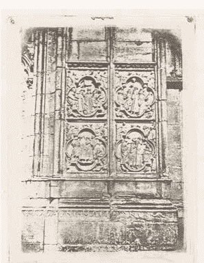

**图 1.1** 伊波利特·菲索（Hippolyte Fizeau）与诺埃尔·帕马尔·勒布尔塞尔（Noël Paymal Lerebours），《美德》，巴黎圣母院浮雕（第一版），1841–1840年，摄影蚀刻。图像尺寸：$4 \frac{1}{16} \times 3$ 英寸（$10.6 \times$ $7.6$ 厘米）。纽约公立图书馆米里姆和伊拉·D·瓦拉赫艺术、版画与摄影部门：摄影收藏品（106PH1349.026）。经纽约公立图书馆许可复制。https://digitalcollections.nypl.org/items/11653420-1e64-0137-a337-653b44e2651。

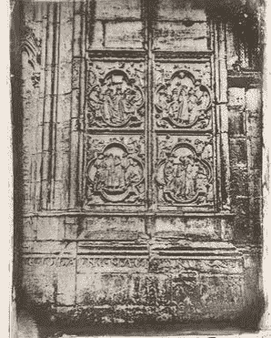

**图 1.2** 伊波利特·菲索与诺埃尔·帕马尔·勒布尔塞尔，《美德》，巴黎圣母院浮雕（第二版），1841–1840年，摄影蚀刻。图像尺寸：$4 \frac{1}{16} \times 3$ 英寸（$10.6 \times$ $7.6$ 厘米）。纽约公立图书馆米里姆和伊拉·D·瓦拉赫艺术、版画与摄影部门：摄影收藏品（106PH1349.027）。经纽约公立图书馆许可复制。https://digitalcollections.nypl.org/items/12398bb0-1e64-0137-0097-5732a5866d48。

# 摄影与艺术

同一幅印刷图像的不同状态之间的联系，是因为菲索是根据他自己用不同深度蚀刻的一块金属板，和/或根据他作为摄影蚀刻过程中一部分电镀的银版摄影的不同状态进行打印的。${12}$例如，上文证明的测试版第二状态（图1.2）中可以看到更微妙的阴影和更高程度的细节。

菲索的实验源于莫里茨·冯·乔比（Moritz von Jobi，1801–74）在1838年意识到电镀——通过化学产生的电流在铜板上沉积金属——具有无限的应用，从印刷到工业品和艺术品的复制无一不包。${13}$菲索似乎是第一个将该工艺应用于银版摄影的研究人员，在1841年春季尝试摄影蚀刻之前，他就已经从原作中制作了副本。${14}$后期工艺非常复杂，但菲索本质上是使用一个酸蚀的银版摄影板作为铜板，他首先在其上电镀了一层金，然后是最后的涂层，使底板变厚，从而增加了可以蚀刻的深度，以及可以制作的次数。

勒布尔塞尔购买了菲索在法国的专利权，瑞士工程师约翰·胡尔曼（Johann Hurlmann，1793–1850）监督了这些板的印刷。勒布尔塞尔的姓氏（最初蚀刻在银版板上）在许多纽约公立图书馆的摄影蚀刻图中反向出现，而胡尔曼是菲索在纽约公立图书馆收藏的十四幅肖像中唯一的名字。${15}$

我能够识别出的菲索摄影蚀刻的主题除了肖像外，还包括绘画的复制蚀刻：由莱昂·鲁耶叶（Leon Rouillet，1645–99）根据皮埃尔·梅里纳克（Pierre Merignac，1612–95）的《葡萄圣母》创作的作品，以及保罗·梅尔丘里（Paolo Mercuri，1804–84）根据利奥波德（Leopold，1794–1835）1831年沙龙画作《收割者抵达马尔切斯港》创作的蚀刻画。${16}$ 还有建筑细节和雕塑复制品，包括圣母院教堂的浮雕（来自北立唱诗班的14世纪《圣母的安息》，见图1.1和1.2；以及南横廊的13世纪《美德》）；一座无染原罪像，玛利亚脚下有一条蛇，她头戴星冠；以及一份由自然学家乔治·库维埃（Georges Cuvier，1769–1832）制作的昂热尔第一件墓葬的石膏复制（图1.3）。${17}$ 可能被称为“科学”的主题包括勒布尔塞尔设计的气压计、一张可能用于阿尔弗雷德·多内（Alfred Donné）《微型课程》（1845）的银版显微测试样，以及一只昆虫放大图（我们稍后会回到图1.4）。${18}$ 这种主题的混合是早期光机械复制尝试的典型，其中包括针对艺术家、科学家和出版行业读者的印刷品。菲索依赖于在少数爱好者范围内制作的可用银版摄影（大部分来自同一受众），这些作品是通过专业性竞争完成的。${19}$

事实上，菲索并不是第一个对银版摄影进行化学处理并打印的人。在他之前的是法国医生阿尔弗雷德·弗朗索瓦·多内（Alfred-François Donné，1801–78）和奥地利解剖学家克里斯蒂安·约瑟夫·贝杰斯（Christian Josef Berjes，1801–74）。

**图 1.3** 伊波利特·菲索与诺埃尔·帕马尔·勒布尔塞尔，《美德》，巴黎圣母院浮雕（第二版），1841–1840年，摄影蚀刻。图像尺寸：$4 \frac{1}{16} \times 3$ 英寸（$10.6 \times$ $7.6$ 厘米）。纽约公立图书馆米里姆和伊拉·D·瓦拉赫艺术、版画与摄影部门：摄影收藏品（106PH1349.027）。经纽约公立图书馆许可复制。https://digitalcollections.nypl.org/items/12398bb0-1e64-0137-0097-5732a5866d48。

**图 1.4** 伊波利特·菲索与诺埃尔·帕马尔·勒布尔塞尔，《美德》，巴黎圣母院浮雕（第一版），1841–1840年，摄影蚀刻。图像尺寸：$4 \frac{1}{16} \times 3$ 英寸（$10.6 \times$ $7.6$ 厘米）。纽约公立图书馆米里姆和伊拉·D·瓦拉赫艺术、版画与摄影部门：摄影收藏品（106PH1349.026）。经纽约公立图书馆许可复制。https://digitalcollections.nypl.org/items/11653420-1e64-0137-a337-653b44e2651。

事实上，菲索并不是第一个对银版摄影进行化学处理并打印的人。在他之前的是法国医生阿尔弗雷德·弗朗索瓦·多内（Alfred-François Donné，1801–78）和奥地利解剖学家克里斯蒂安·约瑟夫·贝杰斯（Christian Josef Berjes，1801–74）。他的实验与英国物理学家罗伯特·格罗（Robert Grove，1811–96）和法国化学家夏尔·路易斯（Charles-Louis，1804–59）的研究相吻合。${20}$ 这些后来者和菲索一样，受益于所谓的“伽电学”；电镀是19世纪使用的术语。

# 摄影与艺术

摄影版画，即使将其鉴定为床虱在今天看来可能是科学研究中一种奇特的选择。

然而，在19世纪，在国家实用科学馆（National Gallery of Practical Science）或1832年在伦敦开业的阿德莱德画廊（Adelaide Gallery）等流行科学娱乐场所，通过氧氢显微镜放大的跳蚤、苍蝇和床虱是非常常见的。此外，识别出这些昆虫的观众中，乔治·居维叶（Georges Cuvier）在他1817年的经典著作《动物界》（*Le Règne Animal*）中声称，床虱广为人知，值得专门描述，尽管家犬也是如此。昆虫和节肢动物也出现在使用电力和显微镜技术的早期摄影实验中。

阿尔弗雷德·多内（Alfred Donné）通过银版摄影法制作并于1839年10月提交给科学院的首批作品中，有一张苍蝇眼睛的显微视图。³³¹ 多内是第一个将氧氢焰（或石灰光）应用于摄影的人，并且可能是在查尔斯·谢瓦莱尔（Charles Chevalier）制造的电光³⁵之后，与莱昂·福柯（Léon Foucault，1819–1868）一起研究痒螨³⁴。谢瓦莱尔几年前曾与昆虫学家亚历山大·勒斐布尔（Alexandre Lefebvre，1798–1867）合作开发³⁶³⁷，谢瓦莱尔的父亲文森特在1840年向科学院展示了显微图像照片，其中引起疥疮的螨（Acari Scabies）银版照片引起了著名植物画家让·皮埃尔·弗朗索瓦·图尔平（Jean Pierre François Turpin，1775–1840）的强烈反应。³⁸ 图尔平赞扬了银版摄影工作的精确准确性，但他从未批评过其在自然史对象上的应用。由于显微放大的昆虫在银版摄影中看起来仅仅是阴影或剪影，他将这些打印品与试验印（épreuves）或杂乱的墨水印象相比。印刷制作者为了清除金属板上的墨水会提取原始的银版照片。当费索制作床虱的版画时，尚未被定位，但与图尔平的观点相比，这种打印品可能被认为是“模糊、无细节、无效果”。³⁹

事实证明，图尔平在1837年对安德鲁·克罗斯（Andrew Cross）的一个研究标本发出了严厉的斥责.³⁴⁰ 图尔平将这种节肢动物比作微观的尘螨，并蔑低其所谓的“新起源模式”，他批评其为 *Acari horridus*，即可怕的螨³⁴¹ 他绘制了一幅详细的图（图1.5），描绘了一个带有孵化卵的雌标本，这证明了该物种的繁殖依赖于性别分化、交配和受精。图尔平发现，在由权威科学家证实之前，应该保持这些“惊人的发现”，克罗斯的螨将落入与相反的自发生成生物相同的命运，像“无法承受真实持续观察的幻影”一样消失。²

回想起来，很难将图尔平的这段训读视为他后来对银版摄影打印品反应的预演。毕竟，克罗斯的可恐的螨在黑暗中自发出现，就像某些原始摄影媒介。²

## 用于摄影的虫？

**图1.5** 皮埃尔·图尔平，*Acarus horridus*，1837年，根据图尔平的作品由未知艺术家创作。说明：“带有卵的雌标本，由M. Cross [sic] 人工创作！图2 显微镜下的动物（包括头部在体长 ½ [毫米]）。尺寸：19.3 × 18.3 cm。出自《科学院学报》（Comptes rendus l'Academie des sciences）5（1837年11月13日），676。大都会博物馆，Joyce F. 照片图书馆，NH666。纽约大都会博物馆。

如果费索的虫处于优先地位，那么也许该作品的相对冷门证明了图尔平关于银版摄影不适用于自然史的观点。另一方面，关于克罗斯螨的持续和近期辩论证明了图尔平在科学话语中的持久性是错误的。⁴ 也许他对银版的复制也是错的。与其将这些片段视为系统中的“虫”，扰乱了传统的昆虫学和摄影史，我们应该接受这些变化是预期媒介之间未探索关系的证据。¹ 在19世纪40年代初，费索以一种令人震惊的新视觉格式展示了极其常见的虫并进行了复制。作为回应，世界——由于某种电击或感染——捕捉到了这种虫。

> *本文献给亨弗雷德·泽内，源于2015年5月1日在哈佛大学的一次演讲，以纪念他从艺术历史系的退休。*

- 2. 经典叙述，见Douglas Crisp，“博物馆的老旧/图书馆的新主题”，*Parachute* 22 (1981):32–7。

- 4. Henri Zerner，“Gustave Le Gray，制光师-艺术家”，载于*Gustave Le Gray*,1820–1884（洛杉矶：J. Paul Getty博物馆，2002），210–12。

- 6. E. P. Goldsmidt & Co.，“独特的摄影绘画集”，“卡凸罗法摄影、‘摄影版画’”等；福克斯·塔尔博特和法国学派早期摄影实验的标本。

- 11. 如果费索的虫处于优先地位，那么也许该作品的相对冷门证明了图尔平关于银版摄影不适用于自然史的观点。另一方面，关于克罗斯螨的持续和近期辩论证明了图尔平在科学话语中的持久性是错误的。⁴ 也许他对银版的复制也是错的。

- 13. 关于雅可比（Jacobi），作者Herbert Heinrich，“电镀与电铸的发现”，《化学教育杂志》第15卷，第12期（1938）：565–75。

# 摄影与艺术

# 摄影的虫子？

21 见 Marcello Pera，《The Ambiguous Frog: The Galvani-Volta Controversy over Animal Electricity》(Princeton: Princeton University, 1992)。

22 关于“电的话语不稳定性”，见 Walter Moser，《Le galvanisme: Joker au courant des désirs et savoirs 1800》，见 Olivier Samuel (ed.),《The Electric Age》(Ottawa: Ottawa Press, 2011), 66–84；在线获取 http://books.org/uop/394（2020年7月1日访问）。关于电力专利，见 Rhys Moser，《Frankenstein's Children: Electricity, and Early-Nineteenth-Century London》(Princeton: Princeton University, 1998), 164–93。

23 关于实验总结，见 Brian Bright，《The Mite That Shocked the World: The Life and Work of Pioneer》(Leicester: 2015) 和 Morus，《Frankenstein's Children》，139–43。

24 关于 Cross 的引用，见他1837年12月27日的信，以及1838年1月29日在伦敦学会发表的《Description of Some Experiments Made with the Voltaic Battery》，见《Transactions and the Proceedings of the London Society, from 1837 to 1840》(London: Smith, Elder and Co.), 15–16 (页码）。见 Wright, Andrew Cross, 118–66。

25 例如，见 Coleman，《Insects and Performers in the Eighteenth Century》，见《Life》 no. 3 (2006), 70–84 和 Morus，《Frankenstein's Children》,175，关于摄影与摄影的平行发展。

26 关于摄影如何以完美图像为名进行否认的任何研究，见 Geoffrey Bacon，《Forget Not: Photography and Remembrance》(Princeton: Architectural Press, 2004)。

27 见 Parikka，《Insect Media: An Archaeology of Animals and Technology》(Minneapolis: University of Minnesota, 2010), xix。

28 Wright, Andrew Cross, 52–5。关于伏特/伽尔尼辩论，见 Richard C. Volta，《The Battery, Animal Electricity, and Frankenstein》，European View no. 1 (2021年2月), 21–41。

29 当美国自然历史博物馆名誉馆员、异翅专家（即“真虫”）Randall Toby 回复邮件，并将该物体鉴定为螨科（Cimicidae），具体为臭蚤（*Cimex lectarius*）时，我感到有些不安。

30 见 Kent D. Wells，《Fleas of the Insects: The Wonders of the Microscope》，Magic Lantern Gazette no. 29/3 (2017年夏季/秋季), 3–4。

31 见 Georges Cuvier，《Les insectes domestiques (Canis familiaris L.)》，Le règne animal divisé 1 (Paris: Berville, 1829): 149–50 以及《La Nature des insectes (Cimex lectularius L.)》，vol. 3, 393。关于17世纪中期到19世纪床蚤的普遍性，见 L. O. J. Boynton，《The Bed Bug in the Age of Elegance》，Furniture History 1 (1965), 15–31。

32 见 Samuel F. B. Morse，《The Daguerreotype》，New-York Observer 17 no. 16 (1839年4月20日), 6。

33 见 CRAS 9 (1839年10月14日), 485。

34 见 CRAS 10 (1840年2月17日), 288–9。如果你关注 Foucault，见 Gabriel Wright，《Daguerre, Donné Foucault, trois- francs créent la microphotographie》，médecine/sciences 13 (1997), 45–8。

# 摄影与艺术

35 见 CRAS 10 (1840年3月16日)，Chevalier 在1836年将这件后来改装了达盖银摄影设备的仪器提交给了昆虫学会。

36 见同上。CRAS 10 (1840年4月6日), 583。

37 见同上，《Sur l'application du Daguerreotype relativement à la représentation des objets d'histoire naturelle》，CRAS 10 (1840年4月13日), 587–94。

38 见同上。

39 见同上，《Note sur une espèce d'Acarus》，由 M. Robertson 在10月30日的会议上提交给学院，Adam Cross 曾将此文传给他，见CRAS 5 (1837年11月13日), 668–76。

40 Crossé 螨被应用了许多新词，如 *Acarus crossii*、*Acarus galvani* 和 *Acarus electricus*，见 Wright, Andrew Cross, 132。

41 见 Turpin，《Note sur une espèce d'Acarus》， 674。

42 关于媒体作为昆虫以及昆虫类媒体模型的更多信息，见 Parikka，《Insect Media》。

43 鉴定 Crossé 螨的问题直到2010年才再次被关注，其标本幻灯片于2012年报告。见 Wright, Andrew Crosse, 158–9。

44 见 Parikka，《Insect Media》， 62: “源于环境和代理人的扰动是任何机构或组合提供功能的关键。在这里，扰动、变化和‘虫/bug)’并不是功能性系统中需要排除的元素，而是为它提供了一种生活的关系，或者说‘生命’。”发明了灯泡等事物的 Thomas Alva Edison 似乎是第一个这样使用‘bug’词的人。见 Francis Arthur Jones，《Thomas Alva Edison: Sixty Year of an Inventor's Life》(New York: T.Y. Crowell & son, 1908), 250–1。

## 铸造史：摄影与石膏铸造在殖民档案创建中的作用

Sarah Victoria Turner

在亨利·科尔（Henry Cole，1843–1916）1872年出版的封本书籍《古德里建筑》（*The Architecture of Ancient Delhi*）中，看到的图像非常奇特且引人注目（图2.1）。这是一张大型照片生动地描绘了殖民时期印度制造石膏复制品的场景，科尔本人在1869–70年冬季的铸造活动中监督了这一过程。画构图中心是一位英国陆军官（推测是科尔，当时是皇家工兵少尉），他戴着头盔，手持指挥棍，观察着一群印度工人正在为库特布宣塔（Qutub Minar）制作石具，这是一座始于12世纪的宗教建筑。其他几名似乎穿着军装的印度男子站在场景背景中。照片展示了将灰尘飞的石膏颗粒变成粘稠液体以倒入模具所需的流体动作。各种身体为了这次拍摄的特殊活动而有意识地停下工作，但照片并未能完全冻结时间或更多。

轻微的模糊，特别是在科尔（倒胶者）形象周围，将我们带回这张图像的真实时间，让我们很容易想象出这幅石膏复制品的*活人景*（*tableau vivant*）工作的节奏：刷、倒、刮、干。流支撑一个模具的木盒上的白色石膏提醒了科尔书的读者石膏复制品的原始物质性。这张图像揭示了生产这些古代建筑雕塑石膏复制品所需的复杂过程和关系。它还表达了一种敬畏，或许科尔和摄影师查尔斯·谢帕德（Charles Shepherd，来自已为人知的印度公司）共同分享了石膏铸造和摄影复制过程的转化能力——这种能力能将液体材料转化为固体形式，以便在远超制作地的地方进行运输和分享。

# 摄影与艺术

**图2.1** 查尔斯·谢帕德，《模具师群体》，1869–70年，碳版。摘自亨利·科尔，《古德里的建筑，特别是库特布宣塔周边的建筑》，科尔 R.E 少尉，印度西北西省考古调查局前任监事（伦敦：阿鲁德尔协会，1872年）。经费城艺术博物馆图书馆及档案库许可复制。

我正利用这张照片来思考石膏铸造和摄影这两种复制技术在发展过程中的重要关系与竞争。这些技术在19世纪的博物馆、策展人和历史学家手中被开发、理论化，并越来越多地结合使用，以创建一个关于来自全球建筑对象的档案——尽管这是一个碎片化的档案。《古德里的建筑》的出版由伦敦的南肯辛斯顿博物馆（现为维多利亚和艾尔伯特博物馆）的办公室赞助，并得到了阿鲁德尔艺术知识促进协会的支持。该项目得到了殖民时期印度英国当局的支持，包括科尔所属的英国陆军。南肯辛斯顿博物馆并非孤立地收集石膏复制品以快速扩大其藏品，巴黎的特罗卡德罗博物馆和纽约大博物馆等机构也开展了类似的项目。石膏铸件在19世纪被赞誉为“教学和传播历史建筑的卓越媒介”，是“理想的展品而非二流替代品”。

然而，到20世纪中叶，许多藏品已被拆除。尽管维多利亚和艾尔伯特博物馆仍保留了大量的铸造展厅（Cast Courts），但南亚石膏复制品的大部分在20世纪50年代被毁了。事实上，谢帕德照片中制作的石膏具已不存在于博物馆中。这些石膏复制品被移除（有时是销毁）也导致了石膏和摄影复制技术之间历史互动的消失——无疑这种互动无论在何种程度上，都通过复制媒介迅速扩张了欧洲对其他文化纪念碑和文物的认知。

## 铸造史

### 铸造活动：亨利·科尔在德里

与其对的痴迷一致，大部分材料都是从伦敦运送的。

正如卡维塔·辛格（Kavita Singh）所指出的，博帕尔的贝姆派遣了一位特西达尔[官员]协助采购冷却器、脚手架，并从村子里收集了大量的竹子、绳子和其他材料。根据科尔的报告，这显然引起了当地人的极大兴奋，他收到源源不断的人要求观看帐篷内晾干的石具。铸造工作（共112件）于1870年2月21日完成。

公约规定，“全世界各国都拥有自己的精美纪念碑，可以通过铸件、电铸、摄影进行复制，而不对原作造成任何细微损坏。”

与其对的痴迷一致，大部分材料都是从伦敦运送的。

虽然西北西省调查的报告中详尽记录了桑奇项目，但对于德里项目，科尔倾注了一本令人印象深刻的书，书中谢帕德图像的照片是通过昂贵且创新的伍德伯里（Woodburytype）打印工艺和自动版摄影工艺（Autotype）制成的（图2.3和2.4），这可能归于阿鲁德尔协会的资金支持。与其科尔对装饰的痴迷一致

## 铸造史

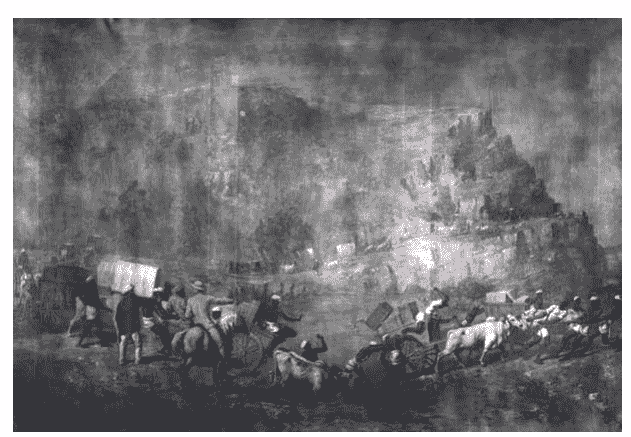

**图 2.2** 无名（源自印度），从贾布尔普尔到桑奇的材料运输，1870–74年，布面，122.5 × 183.5 cm。伦敦维多利亚与阿尔尔伯特博物馆（IPN.904），©伦敦维多利亚与阿尔尔伯特博物馆。

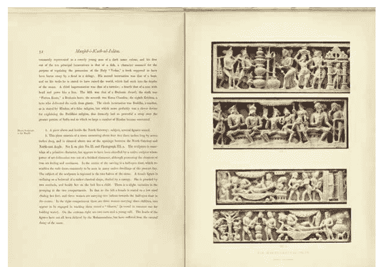

伊斯兰清真寺（Masjid-Kut-ul-Islam）。

被带有许多红石拱门的庭院包围，拱门处没有开口，因为庭院的墙非常高且呈阶梯状建造。各种各样的石制尖塔是世界上最美的建筑之一。庭院由一系列拱门包围，这些拱门是入口，如同一片拱门和柱子组成的森林。位于南侧的库特卜塔（Qutb Minar）高塔从庭院内可见。石尖塔位于未封闭的庭院的四个角。

- 1. 堡垒群内部的一扇门，拱门景观以及
- 2. 从南侧望向伊斯兰清真寺庭院。
- 3. 从庭院望向库特卜塔。

**图 2.3** 查尔斯·谢泼德德（Charles Shepherd），“III.A & III.B. 伊斯兰清真寺。”《印度雕塑》，1869–70年，碳粉版。选自《古德里的建筑，特别是库特卜塔周边的建筑》，作者：亨利·哈迪·科尔（Henry Hardy Cole），R. E. 陆尉，印度北部省考古调查局前任局长（伦敦：阿伦德尔协会，1872年）。经费拉德菲亚艺术博物馆图书馆及档案许可复制。

图 2.4 查尔斯·谢泼德德，“库特卜塔截面，1869–70年，碳粉版。”选自《古德里的建筑，特别是库特卜塔周边的建筑》，作者：亨利·哈迪·科尔（Henry Hardy Cole），R. E. 陆尉，印度西北省考古调查局前任局长（伦敦：阿伦德尔协会，1872年）。经费拉德菲亚艺术博物馆图书馆及档案许可复制。

在此处，谢泼德创作了光影处理细致且构图精美的图像，专注于建筑细节的材质感和纹理。谢泼德的摄影作品在科尔的书中再现，反驳了二维图像的扁平化逻辑。相反，伍德伯里照印法（`Woodburytype`）和自动感光照印法（`autotype`）唤起了库特卜塔建筑的立体感，并通过光、颜料、有机产物、金属和纸张等材料执行了它们独特的“铸造”。伍德伯里工艺实际上是一种“光照凸浮雕”印刷，它也使用明胶制作浮雕伍德伯里印制品。这种印制品因其稳定性和耐褪性而受到推崇，在1864年至1910年间常用于书籍和杂志的特版印刷。²⁰

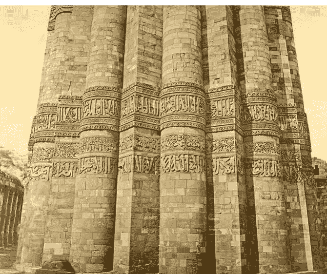

## 铸造史

尽管如此，柱廊使得复制的实际劳动变得非常可见（记得这是在科尔的书中作为第一张照片呈现的，见图 2.1）。正如伊丽莎白·德华兹（`Elizabeth Edwards`）所写，照片不仅仅是“关于”一个事件，它本身就是事件。²² 建筑复制的事件——聚集模具制造者、石膏铸造师、工人、主管、摄影师——都结合在这一图像之中。因为科尔是一份共同努力的宣言，是石膏铸造与摄影协作保护和记录建筑遗产的共同尝试。

在《古德里的建筑》引言中，亨利·哈迪·科尔指出，德里库特建筑群的石膏铸造和摄影项目被构想为一项共同努力……（注：此处原文存在大量重复的错误文本，已根据指令去重并翻译核心内容）。

## 展览历史

这张由南肯辛顿博物馆首位女性驻摄影师伊莎贝尔·阿格内斯·考珀（`Isabel Agnes Cowper`）于1872年拍摄的照片捕捉了南肯辛顿博物馆建筑庭厅的一个房间，展示了这些铸件在到达位于南肯辛顿的新家时（建筑庭厅于1873年开放）的状态。它们与一种新力量产生共鸣，作为原始纪念碑“现场”制作的官方认可复制品，其权威性和学术价值却在帝国博物馆中“场外”赋予（图2.5）。它遮盖了阿克巴尔王座的复制品

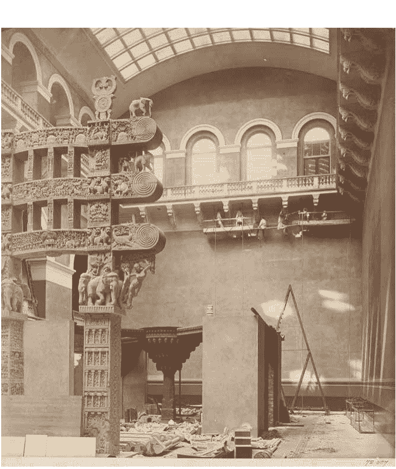

**图 2.5** 伊莎贝尔·阿格内斯·考珀，肯辛顿博物馆，东部铸造厅，约1872年，蛋白银盐版照片。图像尺寸：27 cm × 25 cm。伦敦维多利亚与阿尔伯特博物馆，72507伦敦维多利亚与阿尔伯特博物馆。

# 摄影与艺术

来自法特普尔·西里（`Fatehpur Sikri`）——事实上监督了其周围的一切，包括在危险平台上的工人——的是来自桑奇（`Sanchi`）的大门（`torana`）的全尺寸铸件。亨利·哈迪·科尔（`Henry Hardy Cole`）希望通过这些铸件，“印度建筑，正如埃及、亚述、希腊等国一样”，将被视为世界建筑史的重要组成部分。”32 这个大门可能成为收藏中最为著名、最受推崇的铸品。

铸件本身并不能吸引游客，而是通过扩展文本和照片档案、说明文字和指南来提供支持。拿着指南的19世纪博物馆参观者可以比较和对比世界各地的建筑，将它们分为审美、社会和文化分类体系。亨利·哈迪·科尔根据南肯辛顿的收藏品撰写了一本关于印度艺术的书，他将南亚艺术痴迷、偏执地划分为“宗教类型”（佛教、印度教、耆那教和穆斯林教），这种做法定义了此后一段时间的学术模式。33 那么，制作印度纪念碑的铸件和照片的任务，与调查和保护印度的过去具有相同的教化使命，正如人类学家伯纳德·科恩（`Bernard Cohn`）所描述的“英国帝国主义及其相关殖民知识形式的五种模式。”34 通过铸件，哈迪尔希望建立一个可靠、详细且有组织的印度建筑史材料档案，该档案最终由英国人监督，在他看来，它是基于“通过确定日期而获得的坚实信息”，而非“往往基于神话和传统而非古代事实的土著著作。”35 显然，这是一份碎片化的档案，因此是一份高度碎片化的档案（诚然，所有的档案都是如此）。但它也是对在原址保护印度纪念碑以及通过其复制品来传播知识的深情辩护。这通常与他所渴望的殖民当局立场背道而驰。科尔的话往往很犀利：“当显然存在从原件制作仿制品的手段时，允许这个国家的古代艺术原品作品被掠夺，这似乎是一种自杀性且无法辩护的政策？”36 难怪科尔在1881年成为印度首任古迹策展员，他也是最后一个担任这一头衔的人。随后发行了更多折页出版物，报告包含了桑奇修复工作的更新。”37

## 被遗弃者

科尔石膏模型项目在博物馆内的命运在20世纪变得日益脆弱。这从维多利亚与阿尔伯特博物馆移走印度铸件以及它们随后在20世纪50年代被毁中凸显了这一点。“正是以谢泼德（`Shepherd`）照片形式呈现的系列图像，提供了更持久、更永久的记录，该书在1872年重印，现在的数字副本使其可以在网上轻松获取。”38 19世纪中期见证了石膏复制品的鼎盛，这不仅体现在南肯辛顿的收藏中，还体现在对埃及、亚述、希腊、罗马复制品的组装，这些复制品展示在西德汉的水晶宫（`Crystal Palace`）。然而，在19世纪后期，摄影开始取代石膏作为记录媒介，并以更低的成本制作、拍摄和传播世界各地的图像。随着摄影变得日益可靠且负担得起，石膏铸造的混乱变得显而易见。

在所有意义上（宏观而言），科尔式的复制项目在19世纪是可能的。当摄影最终取代了石膏，并在20世纪被史蒂芬·班（`Stephen Bann`）描述为“摄影的例外”时，许多相关的复制品遭遇了瓦解。尽管如此，证明复制品在殖民时期的权威性仍然是重要的。

我要感谢合编辑者在编写本章过程中提供的宝贵建议。我也感谢哥伦比亚大学南亚研究所的同事以及维多利亚与阿尔伯特博物馆提供的反馈意见。

# 注释

- +1 印度古迹，亨利·哈迪·科尔，1872。

- +2 一本关于石膏铸造过程的实用插指南，可以在南肯辛顿找到，1911。

- +3 希望这本书有助于对19世纪复制媒介之间关系的欣赏，参见史蒂芬·班，“摄影的例外”，见亨利·科尔，《复制》（伦敦：`Seeley`，2001）。

- +4 有更多信息，请参见塔帕蒂·古哈·塔库塔（`Tapati Guha-Takta`）《复制的偏执：数字时代的共享》，帕尔塔·查特吉（`Partha Chatterjee`）和塔帕蒂·古哈·塔库塔（编），印度文化史：物质性与实践（牛津大学出版社，2014），180–220。

- +5 博物馆的，1815-2020。

- +6 《摄影进入印度》（英国图书馆，2008）。

- +7 塔帕蒂·古哈·塔库塔对桑奇的复制写过大量文章。我受益于《复制与纪念碑，《南亚研究》29，第2（2013），77–109。

- +8 有更多关于印度殖民方法转变的信息，请参见塔帕蒂·古哈·塔库塔，《纪念碑、物品：殖民及后印度机构》（纽约：哥伦比亚大学出版社，2004）。

- +9 凯维·辛哈（`Kavit Sinha`）《印度的博物馆收藏》，盖雅特里·辛哈（`Gayatri Sinha`）编，《1857-2007印度艺术与视觉文化》（孟买：`Marg Publications`，2009），40–57（第46页）。塔帕蒂·古哈·塔库塔指出，博帕尔的贝格姆在19世纪50和60年代面临来自英国考古学家以及法国领事的持续压力，要求将“苏帕大门”送给维多利亚女王或拿破三世。古哈·塔库塔，《复制的偏执》，189。

- +10 它是英国、爱尔兰、普鲁士、黑森、法国、比利时、俄罗斯、瑞典、挪威、意大利、奥地利、丹麦和印度政府赠的。公约副本复制于布伦丹·科米尔（`Brendan Cormier`）编的《复制：数字时代的共享》，https://vanda-production-assets.s3.amazonaws.com/2018/06/15/11/42/57/e8582248-8878-4886-e8a22-eb8bf74ace68/Copy%20Culture.pdf（2020年7月1日访问）。

# 铸造历史

- 15 H. H. Cole 报告，印度西北省考古普查局局长，呈给伦敦印度部（`India Office`）印度事务次秘书，1869年8月24日。印度政府内政部，考古分支，1869–70年，2–4页。

- 16 Giovanni Ferdinando Ranchi，《英国与爱尔兰雕塑的实践与功能制图（1851–1951）》，格拉斯哥大学艺术史与 `HATII`，在线数据库，2011年（`http://sculpture.gl.ac.uk/view/person.phpid=msib7-120661485`，访问日期2019年7月4日）。

- 17 参阅 `http://contents.cam.ac.uk/item/O13960/transporting-of-materials-from-jalbpur-oil-painting-unknown/`（访问日期2020年7月1日）。

- 18 Cole，《古德里建筑》，3–4页。

- 19 使用伍伯里（`Woodbury`）和自动感光版（`Autotype`）工艺是因为它们被认为比其他复制技术更具持久性和稳定性，因此更适合出版物。

- 20 Dusan C. Stulik 和 Art Kaplan，《摄影过程分析签名图谱》（洛杉矶：盖蒂保护保护中心，2013年），4页。

- 21 Maria Antonia Pizzarri（编），《从石头到纸张：建筑摄影与历史痕迹》（编），《印度的痕迹：摄影、建筑与表征政治（1850–1900年）》（新亥哈文与伦敦：耶尔大学出版社，2003年），35页。

- 22 Elizabeth Edwards，《原始历史：摄影、人类学、博物馆》（牛津：`Berg`，2001年），10页。

- 23 Cole，《古德里建筑》，5页。

- 24 同上同。

- 25 同上同。

- 26 Cole，《古德里建筑》，2页。

- 27 Fergus，引自 Bernard S. Cohn。《殖民主义及其知识形式》（普林斯顿：普林斯顿大学出版社，1996年），92页。另见 Guha-Thakura，《纪念碑、物品、历史》。

- 28 Cole，《古德里建筑》，5–6页。

- 29 同上同。

- 30 同上同。

- 31 Tim Barrington，“南肯森辛顿博物馆与殖民计划”，收录于 Tim Barrington 和 Tom Flynn（编），《殖民主义与物体：帝国、物质文化与博物馆》（伦敦与纽约：`Routledge`，1998年），11–27页。

- 32 Cole，《古德里建筑》，8页。

- 33 Henry Hardy Cole，《南肯森辛顿博物馆展出的印度艺术目录》（伦敦：`G.E. Eyre and W. Spottiswoode`，1874年）。

- 34 Cohn，《殖民主义及其知识形式》。

- 35 Cole，《古德里建筑》，2页。

- 36 关于马德拉斯的阿姆拉瓦蒂提托帕（`Amravavati Tope`）赠品的备忘录，内政会议/考古，1882年，第9号，A部分，Nai. Guha-Thakura，“纪念碑的生产与复制”。

- 37 欲获取开放访问网站 archive.org 上的书籍版本，请参阅 `https://archive.org/details/architectofan00cole`（访问日期2020年7月1日）。

- 38 Stephen Bann，《卓越图像：19世纪法国摄影与视觉经济》（新亥哈文：耶尔大学出版社，2013年）。我要感谢 Juliet Hacking 建议我参考与我的观点相关的 Stephen Bann 作品。

# 维多利亚时代的现代化：阅读朱莉亚·玛格丽特·卡马隆的摄影

现代化的维多利亚时代：阅读朱莉亚·玛格丽特·卡马隆（1886–1914）的摄影

卡马隆之所以使用伍伯里和自动感光版工艺，是因为它们被认为比其他复制技术更具持久性和稳定性，因此更适合出版物。

Dusan C. Stulik 和 Art Kaplan，《摄影过程分析签名图谱》（洛杉矶：盖蒂保护保护中心，2013年），4页。

Maria Antonia Pizzarri（编），《从石头到纸张：建筑摄影与历史痕迹》（编），《印度的痕迹：摄影、建筑与表征政治（1850–1900年）》（新亥哈文与伦敦：耶尔大学出版社，2003年），35页。

Elizabeth Edwards，《原始历史：摄影、人类学、博物馆》（牛津：`Berg`，2001年），10页。

Cole，《古德里建筑》，5页。

同上同。

同上同。

Cole，《古德里建筑》，2页。

Fergus，引自 Bernard S. Cohn。《殖民主义及其知识形式》（普林斯顿：普林斯顿大学出版社，1996年），92页。另见 Guha-Thakura，《纪念碑、物品、历史》。

Cole，《古德里建筑》，5–6页。

同上同。

同上同。

Tim Barrington，“南肯森辛顿博物馆与殖民计划”，收录于 Tim Barrington 和 Tom Flynn（编），《殖民主义与物体：帝国、物质文化与博物馆》（伦敦与纽约：`Routledge`，1998年），11–27页。

Cole，《古德里建筑》，8页。

Henry Hardy Cole，《南肯森辛顿博物馆展出的印度艺术目录》（伦敦：`G.E. Eyre and W. Spottiswoode`，1874年）。

Cohn，《殖民主义及其知识形式》。

Cole，《古德里建筑》，2页。

关于马德拉斯的阿姆拉瓦蒂提帕（`Amravavati Tope`）赠品的备忘录，内政会议/考古，1882年，第9号，A部分，Nai. Guha-Thakura，“纪念碑的生产与复制”。

欲获取开放访问网站 archive.org 上的书籍版本，请参阅 `https://archive.org/details/architectofan00cole`（访问日期2020年7月1日）。

Stephen Bann，《卓越图像：19世纪法国摄影与视觉经济》（新亥哈文：耶尔大学出版社，2013年）。我要感谢 Juliet Hacking 建议我参考与我的观点相关的 Stephen Bann 作品。

欲获取开放访问网站 archive.org 上的书籍版本，请参阅 <https://archive.org/details/architectofan00cole>（访问日期 2020 年 7 月 1 日）。

Stephen Bann，《卓越图像：19 世纪法国摄影与视觉经济》（新亥哈文：耶尔大学出版社，2013 年）。我要感谢 Juliet Hacking 建议我参考与我的观点相关的 Stephen Bann 作品。

# 摄影与艺术

对卡马隆的解读支持了他们对摄影学的看法。正如本文将证明的，这些解读累积重新定义了卡马隆的摄影实践，与其关注其历史意义，不如关注其对现代摄影的价值。

两个较大的、相互关联的问题出现在对卡马隆艺术主张的记录中。第一个问题是这一时期摄影师通过强调卡马隆对焦的独特使用来实现实践现代化。第二个问题是他们通过卡马隆照片的复制来传达这样一个观点：焦点是其影像的关键元素。卡马隆将人类视觉与镜头焦点联系起来的签名引发了关于摄影的讨论。卡马隆对焦的操控让新兴的摄影师将其视为历史先驱，尽管这意味着他们的艺术过程脱离了历史语境。这不仅发生在评论中，也发生在材料层面：评论家经常阅读那些并非由其创作、但具有不同视觉效果的版本。正如我们在本文中所看到的，在 1913–1914 年（布鲁姆伯小组将卡马隆及其同类作为其现代主义的历史背景十多年之前），艺术摄影师利用卡马隆照片的复制将她的图像转化为一种新的艺术对象，这种对象可以承载现代性。

> ‘我无法忍受我多年的努力被遗忘’

1875 年，预见到家庭将从怀特岛的弗莱特水搬到斯里兰卡（当时的锡兰），卡马隆聘请了伦敦的自动感光公司制作她图像的碳盐照片。碳盐照片在化学上比蛋白胶照片更稳定，但如果没有适当的处理和存放，就会褪色和色调丢失。自动感光公司要么使用卡马隆的湿法干胶片制作碳盐照片，要么当她的胶片损坏时，拍摄一张卡马隆的蛋白胶照片并使用这张复制胶片制作碳盐照片。根据业余爱好者的观点，卡马隆的声誉在她 1879 年去世后迅速被遗忘。布鲁姆伯小组，特别是她的外甥女弗吉亚·伍尔夫（1882–1941），对卡马隆的肖像，在 1886 年就已经开始关注。业余爱好者认为卡马隆那种“特殊的柔和感”在肖像中是一个早期案例。1889 年，通过彼得·亨利·埃默森（1856–1936）的著作《自然主义摄影：艺术学生教程》，摄影师将卡马隆视为艺术的先驱，为了

## 维多利亚时代的现代化

（这位业余爱好者（卡梅伦）遭遇的）或色调效果（例如，卡梅伦为她的蛋白版照片购买者提供了灰色或棕色色调的选择）。⁸ 这些决定提升了她的摄影作品作为艺术商品的地位。卡梅伦在去世前签署的少数几张碳版照中显示了她在碳法工艺中复制了灰色和棕色色调，并实验了碳法工艺可能实现的玫瑰色和红色调¹ 该公司制作了约七十张卡梅伦的作品¹⁰ 关于这些作品的布局知之甚少，卡梅伦对自动感印公司分得的利润感到不满，但在她搬到斯里兰卡之后，该公司似乎充当了她的代理人。1875 年，该公司为伦敦摄影学会的展览贡献了卡梅伦照片的碳版照；1877 年，它广告宣传了卡梅伦的“卓越国家肖像系列、美丽女性研究、历史与诗意画作”，当时有其他历史绘画和版画的碳法摄影复制品、装饰艺术和历史文物在伦敦画廊待售¹¹

卡梅伦坚持从不对她的负片进行修改，在自动感印公司 1879 年为卡梅伦写的讣文中，他们报告了她负片的“缺陷”¹² 很难从少数几个可以追溯到当时的自动感印照片对该公司的修图手法做出概括性描述：在某些作品中，可以看到对形状的微妙强化；在另一些作品中，进行了大量的修图以使细节不那么模糊¹³ 自动感印公司一直制作卡梅伦的作品直到 1912 年，当时他们回复了阿尔弗雷德·斯蒂格利茨（Alfred Stieglitz，1864–1946，美国领先的艺术摄影师兼编辑）关于该公司所持有的卡梅伦照片的垂询¹⁴ 后期艺术摄影师对她的关注使埃利奥特·卡梅伦对她摄影作品的美学（作为其创作实践的一个方面）产生了极大兴趣，她转向自动感印公司传播其照片的原因，以及该公司为了销售卡梅伦作品的碳版而对其负片进行的修改。

## “一个业余且训练不完善的艺术家”

1889 年春天，两个事件让朱莉亚·玛格丽特·卡梅伦的作品再次受到英国艺术摄影师和艺术观众的关注。摄影师兼理论家彼得·亨利·埃默森（Peter Henry Emerson）在新《艺术学习者的自然主义摄影》中简要讨论了卡梅伦，而亨利·谢尔尔·海伊（Henry Herschel Hay，1852-1911）在一次推广其母亲商业摄影工作室的伦敦展览中将其母亲的照片纳入其中。在《自然主义摄影》中，埃默森认为艺术摄影师应该使用“差异化聚焦；以接近人类视觉，在图像中表现他们对自然的审美反应”¹⁵ 这本书是埃默森作为摄影师的实践产物，以及他对人类视觉科学主题、镜头光学和艺术中自然主义历史的研究¹⁶ 埃默森点名表扬雷杰兰德（Rejlander）和安托万·萨缪尔·卡梅伦（Antoine Samuel-Cameron）是自该媒介发明以来“唯一”过“任何”艺术价值作品的摄影师，尽管没有人像埃默森提倡的自然主义摄影那样使用焦距。对于埃默森来说，卡梅伦是“最后且最……”的，但他赞扬她使用了他为自然主义摄影师提倡的早期快速直立镜头，并且没有对她的负片进行修改¹¹7 埃默森的理论对亨利·皮奇·罗宾森（Henry Peach Robinson）以及那些在单一图像中组合负片的艺术摄影师，以及那些为相机虚构场景的人来说构成了特殊的挑战。

亨利·卡梅伦的展览展出了他母亲的照片、他自己的商业照片，以及他为画家乔治·沃茨（George Watts，1817–1904）的作品制作碳版复制品，沃茨是家族朋友，也是他母亲的艺术合作者和导师。沃茨也参加了展览¹⁸ 目前不清楚朱莉亚·卡梅伦展出的图像是蛋白照片、自动感印公司的照片，还是可能是亨利自己为母亲照片制作的碳版。《艺术杂志》（Magazine of Art）上的一篇短讯描述这是“我们在伦敦看到的同类作品中最重要的，因为‘卡梅伦夫人和卡梅伦先生如何利用聚焦来减轻细节和缺乏整体艺术效果，这是摄影的特征’”¹⁹

# 摄影与艺术

1889 年春天，两个事件让朱莉亚·玛格丽特·卡梅伦的作品再次受到英国艺术摄影师和艺术观众的关注。摄影师兼理论家彼得·亨利·埃默森（Peter Henry Emerson）在他的新书《艺术学习者的自然主义摄影》中简要讨论了卡梅伦，而亨利·谢尔尔·海伊（Henry Herschel Hay，1852-1911）在一次推广其母亲商业摄影工作室的伦敦展览中将其母亲的照片纳入其中。在《自然主义摄影》中，埃默森认为艺术摄影师应该使用“差异化聚焦；以接近人类视觉，在图像中表现他们对自然的审美反应”¹⁵ 这本书是埃默森作为摄影师的实践产物，以及他对人类视觉科学主题、镜头光学和艺术中自然主义历史的研究¹⁶ 埃默森点名表扬雷杰兰德（Rejlander）和安托万·萨缪尔·卡梅伦（Antoine Samuel-Cameron）是自该媒介发明以来“唯一”过“任何”艺术价值作品的摄影师，尽管没有人像埃默森提倡的自然主义摄影那样使用焦距。对于埃默森来说，卡梅伦是“最后且……”的，但他赞扬她使用了他为自然主义摄影师提倡的早期快速直立镜头，并且没有对她的负片进行修改¹¹7 埃默森的理论对亨利·皮奇·罗宾森（Henry Peach Robinson）以及那些在单一图像中组合负片的艺术摄影师，以及那些为相机虚构场景的人来说构成了特殊的挑战。

# 摄影与艺术

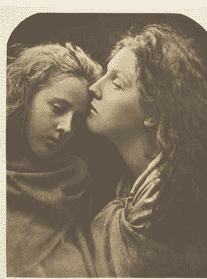

**图 3.1** 朱莉亚·玛格丽特·卡梅隆（Julia Margaret Cameron），《和平之吻》（The Kiss of Peace），1869 年（底片），1890 年（照相凹版）。出自《艺术家》（Sun Artists），第 5 号，1890 年，尺寸：12.9 × 17.1 厘米。芝加哥艺术学院；露西娅·伍兹（Lucia Woods）捐赠，1976.175。经芝加哥艺术学院/纽约艺术资源许可复制。

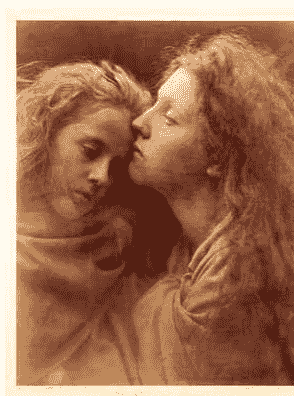

**图 3.2** 朱莉亚·玛格丽特·卡梅隆，《和平之吻》，1869 年，蛋白盐银盐照片。35.1 × 28.2 厘米。皇家摄影学会收藏/伦敦维多利亚和阿尔尔伯特博物馆，RPS.826-2017，位于 V&A 博物馆的皇家摄影学会收藏，在国家乐票遗产基金和艺术基金的慷慨援助下获得。

在对照片中模特的表演表现中³³¹艾默森（Emerson）仍将这张富有想象力的照片视为一种记录，并借此评估模特表演的技巧性。通过这种方式，艾默森为一代艺术摄影师刻画了朱莉亚·卡梅隆的实践——根据《女爱好者》（The Lady Amateur）的说法，他们已经忘记了卡梅隆。

# 从维多利亚到现代

1904 年，伦敦的一场卡梅隆作品将这位摄影师坚定地定位于一个历史性的维多利亚时刻。在幸运书店（Serendip Bookshop）展廊展出的几乎所有照片都是蛋白盐照片，其中许多是由卡梅隆圈子的人或其子女出借的。这些蛋白盐照片是社交网络的产物。目录文章的作者是爱丽丝·梅内尔（Alice Meynell, 1847–1922），一位著名的记者、诗人以及关于维多利亚时代作家书籍的作者³³³²梅内尔将卡梅隆对焦的方式评价为她的发明（“卡梅隆夫人没有让相机生硬的眼睛完全对准主体，而是让它斜向观察，而且这是偶然为之”）。根据梅内尔的说法，卡梅隆创作的视觉效果深受大众欢迎（“因为大众确实很喜欢黑白艺术中的柔和感”），同时也吸引了艺术家的青睐（卡梅隆的构图具有一种‘几乎威尼斯的感觉，以及一种形式感，她奇迹地成功地通过摄影这种与多幅画意图迥然不同的媒介将其表现出来”）。

# 维多利亚时代的现代化

卡梅隆对镜头的使用是她艺术的元素之一，因为在梅内尔看来，光是卡梅隆棱镜般的艺术手段，是“表现性的阴影”；她对姐妹们美感的选择不同于常见的理想，以及她在拍摄她们时那种“镇静和升华她们姿态的艺术”。梅内尔将相机的现实主义与卡梅隆的文化和社会价值观联系起来——“她姐姐们的伟大，卡梅隆夫人的历史性工作，以及其独特的美感，使其在艺术中脱颖而出”³⁴梅内尔在卡梅隆的照片与典型维多利亚时代绘画的色彩和造型（以及“黑白艺术”）之间建立的联系，明智地将卡梅隆的照片置于一种受艺术家和大众欣赏的历史性视觉文化之中。

弗雷德里克·H·埃文斯（Frederick H. Evans, 1853–1943），这位著名的艺术摄影师和摄影书籍作家，他界定了卡梅隆摄影新兴感知的术语⁵他评论了幸运画廊（Serendipity Gallery）的爱好者展。与梅内尔不同，埃文斯将卡梅隆与当代摄影联系起来，他试图解释她对“真正令人惊讶的肖像研究”的创作。尽管摄影方法已经如此惊人的进步、被增加、简化并使结果更加确定，但在卡梅隆时代，这并没有在许多艺术摄影中体现。埃文斯指出，他研究这些作品的“主要秘密”在于卡梅隆没有现代底板、镜头和铂金板，因此他的愿景可以在不受那些破坏其作品并使照片褪色的干扰技术影响的情况下呈现出来⁶埃文斯强调“愿景”对摄影的重要性，指的是卡梅隆的艺术超越了她的时代，其作品的卓越性……

## 维多利亚时代的现代化

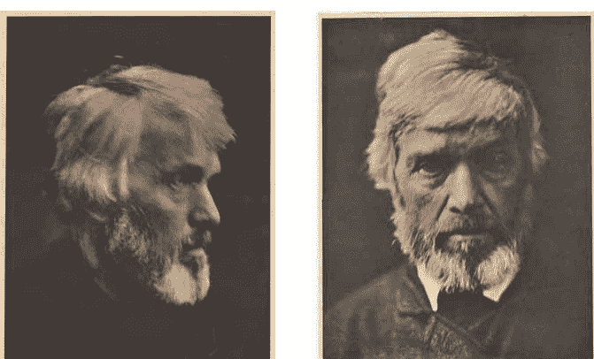

**图 3.3** 朱莉亚·玛格丽特·卡梅隆，“托马·卡莱尔[肖像]，1867年（负片）；1913年（胶版摄影）。出自《摄影工作：摄影季刊》第41（1913年1月）。图像尺寸：8 1/2 × 6 1/4 英寸（21.6 × 15.9 厘米）。费城艺术博物馆，源自多萝西·诺曼收藏品 1997-146-125。

**图 3.4** 朱莉亚·玛格丽特·卡梅隆，“托马·卡莱尔[正脸]，1867年（负片）；1913年（胶版摄影）。出自《摄影工作：摄影季刊》第41（1913年1月）。图像尺寸：7 13/16 × 6 1/8 英寸（19.8 × 15.6 厘米）。费城艺术博物馆，源自多萝西·诺曼收藏品 1967–285-263。

（图 3.4）卡梅隆利用深度感来刻画卡莱尔头部相对于肩膀的轮廓，这意味着头发与额头、胡须与嘴巴之间的色调变化，传达了类似的绘画平面化与塑造形状之间的相互作用。在去年（1912年）的《摄影工作》中，斯蒂利茨选取了毕加索胸像的侧面和正面的半色调照片，就像雕塑的证照一样（图 3.5 和图 3.6）。⁴毕加索被放置在一个表面上，在较暗的背景照射下，每幅图像都呈现为*雕塑*。在大多数情况下，斯蒂利茨使用中间调而非明暗对比来描绘毕加索对角度和弯曲形状的塑造。斯蒂利茨对卡梅隆《卡莱尔》照片的胶版摄影，以及它们在期刊中的排列顺序，通过现代艺术的视角强调了卡梅隆的照片，表现出一种绘画性与表面之间的张力。

仅一年后，在1914年10月，著名的艺术摄影师阿尔文·兰格登·科伯恩以不同于斯蒂利茨的方式，构思了艺术摄影中的现代性。在这一不确定、恐惧和战争迫近的时刻，科伯恩组织了一场名为《摄影老大师》的展览，展出了卡梅隆、希尔、刘易斯·卡罗尔和托马·基思的作品¹⁴科伯恩的展览完全由这些摄影师作品的摄影复制组成，这种活动

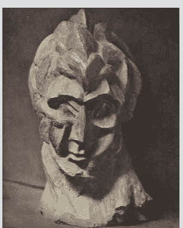

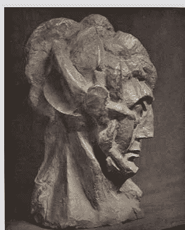

**图 3.5** 仿帕布罗·鲁伊斯·y·毕加索，“女性头部”[费尔南德·奥利维耶，1909年–正脸]，1912年，半色调。出自《摄影工作：摄影季刊》特号（1912年8月），19.5 × 15.1 厘米（画页），© 2019 毕加索遗产委员会/艺术家权利协会 (ARS)，纽约。经费城艺术博物馆许可复制。

**图 3.6** 仿帕布罗·鲁伊斯·y·毕加索，“女性头部”[费尔南德·奥利维耶，1909年–侧面]1912年，半色调。出自《摄影工作：摄影季刊》特号（1912年8月），19.5 × 15.1 厘米（画页），© 2019 毕加索遗产委员会/艺术家权利协会 (ARS)，纽约。经费城艺术博物馆许可复制。

体现了展览标题中嵌入的现代与传统之间的张力。在他在《世纪杂志》上发表的一篇关于展览的文章中，科伯恩为每位摄影师提供了简短传记，写道在“这些不祥的日子”背景下，他将摄影师的角色视为一个“为后世保存当代美”的人。这是当时摄影界的一种角色——尽管他为展览选择了标题，科伯恩认为这四位摄影师比当时的普通职业摄影师更“现代”。⁵

科伯恩通过从照片中制作复制负片并在铂纸上打印，在《摄影老大师》展览中制作了二十张卡梅隆的照片。早于十年，弗雷德里克·埃文斯已经想象到卡梅隆使用现代摄影材料来完美地实现他的愿景。科伯恩转向铂工艺来制作卡梅隆的照片，这是永久的，因此符合科伯恩的预期。科伯恩直接承认卡梅隆和19世纪的摄影师使用的铂工艺的脆弱性，写道他制作铂版复制是因为“大多数旧照片都是陈旧且褪色的”——尽管科伯恩的卡梅隆照片复制可以传达作品的“精神”。科伯恩将卡梅隆和19世纪的摄影师视为艺术家，能够实现艺术成就。

这篇文章关注了通常被称为“摄影复制品”的作品所扮演的历史角色。朱莉亚·玛格丽特·卡梅隆制作的蛋白相和碳相展示了她对摄影作品美学的关注，以及她对摄影材料的认可。卡梅隆利用相机和光线在照片中产生细微的差别。这些视觉效果在绘画空间的复制品中消失了，减少了她对对比度的使用。由于对卡梅隆肖像的反复偏好，有意识的艺术摄影师注意到，她的肖像可以可靠地定位在维多利亚时代的时刻。卡梅隆图像的这些现代主义转型，取代了她自己的创造力，并提供了一个关于摄影进步和时间性的新叙事。该文章的早期版本曾在2015年在英国林肯大学的“反思早期摄影”以及2017年在美国普斯顿大学的“反思绘画主义：1895年至1925年的艺术与摄影”。

# 注释

+ 阿格内斯·查普曼（姓曼格斯），“业余爱好者对卡梅隆夫的回忆，《摄影新闻》第30，第1426（1886年1月1日）：2–4。阿格内斯·曼格斯·查普曼（1850–1936）为“维维恩”制作，朱利安·科克斯和科林·福德，《朱莉亚·玛格丽特·卡梅隆：全集》（洛杉矶：保罗·盖蒂博物馆与布拉德福摄影博物馆合作，2003），517，目录号1163–4。

2 《回忆》，2003，3–4。

3 朱莉亚·玛格丽特·卡梅隆，《维多利亚时代的男性与美女摄影》，由吉尔亚·沃尔夫和罗杰·弗莱序序（伦敦：L. & V. Woolf，1926）。乔安娜·胡蒂克，“达芬奇”：朱莉亚·玛格丽特·卡梅隆与罗塞蒂兄弟的交流，收录于《拉斐派生活：英国摄影与绘画，1848–1875》（华盛顿特区：国家艺术馆与伦德·洪姆弗里斯出版社，2010），134–45。

赫尔穆特·格恩海姆，《朱莉亚·玛格丽特·卡梅隆：她的生活与摄影作品》，第2版（米尔尔顿，纽约：1975），53–4。

6 布兰奇·科尼什关于朱莉亚·卡梅隆的未标记信件，引自格恩海姆，《朱莉亚·玛格丽特·卡梅隆》，53–4。

7 詹姆斯·M·莱利，“蛋白相的历史、技术与结构’，美国保护协会印本，1990，83–8，http://album.conservation-us.org/library/reilly1980.html，2019年7月7日访问。

8 科克斯和福德，《朱莉亚·玛格丽特·卡梅隆》，2，图。

9 1036–2017, RPS 909–2017, RPS 1282–2017，费城艺术博物馆的皇家摄影协会收藏。

10 “附录：铭文、印章与摄影业务”，收录于科克斯和福德，《朱莉亚·玛格丽特·卡梅隆》，500–1。此本文称卡梅隆的所有胶版相片都是根据卡梅隆的负片制作的，但事实并非如此：RPS 1036–2017，费城博物馆的皇家摄影协会收藏。卡梅隆曾写道从损坏的负片发送一张照片供公司复制，格恩海姆，《朱莉亚·玛格丽特·卡梅隆》，53。

11 “147号；卡梅隆女士的研究，印于纸质正片负片的胶版中（原件已销毁）；大英摄影学会第21次年度展，1876年，http://erps.ac.uk/exhibit_details.php=14812，2019年2月10日访问。“胶版摄影，《学院：文学、科学与艺术评论》，第20期，27（1977年7月）：i。

12 科林·福德，《卡梅隆收藏集：送给约翰·赫歇尔爵的朱莉亚·玛格丽特·卡梅隆摄影相册》（沃金：范·罗斯特兰·海因里希与伦敦国家肖像馆合作，1975），朱利安·科克斯，“开启视觉的惊喜”，收录于科克斯和福德，《朱莉亚·玛格丽特·卡梅隆》，53。

13 1036–2017，费城艺术博物馆的皇家摄影协会收藏。

## 维多利亚时代的现代化

25 艾默生（Emerson）写道，使用 F/6 的“Jamine”镜头没有小光圈，这枚镜头的“正色差”意味着磨砂玻璃上的图像看起来清晰，但负片却“处于离焦状态”；艾默生，“莉亚·玛格丽特·卡梅隆夫人，36–37. 格恩海姆（Gernheim）检查了该镜头，并对其能力出了平衡的评价；Gernheim, Julia Margaret Cameron, 69–70。她的第一台带有 Jamine 镜头的相机是女儿和女婿送的礼物。在1865年8月之前一定购买了快速直立镜头（Rapid Rectilinear lens），因为在该月为止，她使用这种新型更大镜头拍摄的作品包括：Cox and Ford, Julia Margaret Cameron (Gtty catalogue number 157)。

26 艾默生报告说，科纳赫（Colnaugh）收藏的1864年卡梅隆打印品已不再有他的印件了；“莉亚·玛格丽特·卡梅隆夫人，41。

27 编辑阿瑟·布斯（Arthur Booth）写道，亨利·卡梅隆（Henry Cameron）在《太阳艺术家》（Sun Artists）杂志上将照片复制为照相。他在注释中的解释是，摄影师放大了照相板尺寸以减少质量损失，但并未表明这些板子是用碳版照片或蛋白照片制成的。卡梅隆在照片制作方面经验丰富，但实际上并不清楚他是否参与了《太阳艺术家》常规刊的制作。该杂志中复制的四个卡梅隆照片列于 Cox and Ford, Julia Margaret Cameron: Sir John Hers (Gtty catalogue number 675); Alfred Tennyson (Gtty catalogue number 807); The Kiss of Peace (Gtty catalogue number 1129)。

28 艾默生，“莉亚·玛格丽特·卡梅隆夫人，”

29 艾默生，“人物摄影的艺术面”，《艺术杂志》14卷 (1891年8月): 310。

30 迈尔斯（Myers）通过与卡梅隆会面受邀从事摄影。参见 See “伊芙琳·迈尔斯，著名的肖像摄影师，https://www.npg.org/collections/search/person/mp07354/eveleen-myers-neant (2020年7月访问)。”

31 艾默生，“人物摄影的艺术面”，315–16。

32 “莉亚·玛格丽特·卡梅隆摄影展，迈内尔夫人（Mrs. Meynell）注，Serendipity 画廊，118 Westbourne Grove, W. [1904]；；朱··巴德尼（June Badeni），《纤细树：爱丽·迈内尔传》(Padstow, Cornwall: Tabb House, 1982)。迈内尔的儿子埃维特（Everett）开设了 Serendipity 书店。

33 迈内尔，“摄影展”，3–5。

34 同上，6。

35 弗雷德里克·H·埃文斯（Frederic H. Evans），“莉亚·玛格丽特·卡梅隆摄影展”，“业余摄影师”（The Amateur Photographer）40卷 (1904年7月): 43–4。

36 铂金摄影打印纸比蛋白纸化学更稳定。埃文斯与拉切尔·丹辛（Rachel Danzing）提到了“我们良好的 CC 照相纸”，这是铂金纸的商业名称，“阿尔弗雷德·史蒂格利茨：摄影工艺与相关的保护问题，摄影保护主题 4 (1991): 57–79。”

37 R. 柴尔德·贝利（R. Child Bailey），“绘画摄影”，载自《完全摄影师》，第2版 (纽约: McClure, Phillips & Co, 1970), 356–7。

38 “绘画摄影”，“摄影作品”（Camera Work) (1907) 第18期, 23页。

39 “已发行数字的绘画摘要，《摄影作品”（Camera Work) (1905) 第12期。该期未编号。

60 摄影与艺术

- 40 前引书。Autotype 公司给阿尔弗雷德·史蒂格利茨的信，1912年9月12日。

- 41 “我们的印板”，“摄影作品”（Camera Work) (1913) 第41期, 42页。贝利在《完全摄影师》中对卡梅隆的讨论摘于此。

- 42 《摄影作品》中的卡梅隆图像为：I. Carlyle (Gtty catalogue number 629); II. Carlyle (Gtty catalogue number 627); III. Herschel (Gtty catalogue number 76); IV. Joachim (Gtty catalogue number 695); V. 十岁的伊芙琳 (Gtty catalogue number 497)。史蒂格利茨从 Autotype 公司挑选的卡梅隆肖像包含了20世纪初：伊芙琳在1864年被卡梅隆拍摄时17岁，1913年计划进行莎士比亚剧角的国际巡演；小提琴科学家约翰·赫歇尔活到了1907年，并在1903年在留声机上录制了他的作品。虽然约翰·赫歇尔已于1871年去世，但这位卓越科学家的肖像在此处作为他对摄影发明的贡献的象征。

- 43 《摄影作品》（Camera Work) (特刊，1912年8月)。史蒂格利茨被确认为杂志第48页两张网版照片的摄影师。

- 44 展览在伦敦英国皇家摄影学会开幕，并于2015年巡展纽约和布法罗。帕梅拉·格拉斯夫·罗伯茨（Pamela Glasgow Roberts），阿尔弗雷德·朗登·科伯恩 (马德里: Fundación Mapfre, 2014); 布法罗艺术学院布莱特美术馆，《摄影大师展目录》，2015年1月20日–

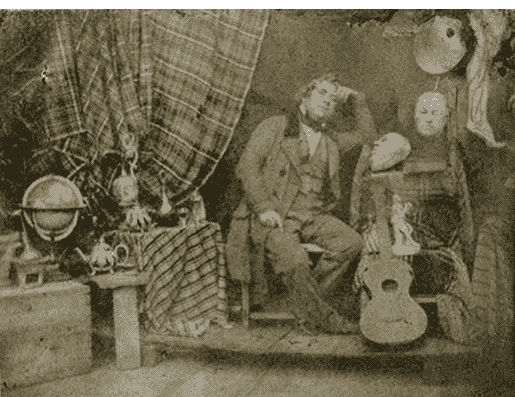

**图 4.1** 路易·迪西尔·布朗卡-埃瓦尔，作者在其工作室的自画像，这是一张从带有涂层的纸质负片经由水代硫酸钠调色的低对比度盐纸照片；是1846年9月23日写给弗朗索瓦·阿拉戈（François Arago）信中附的两张样本照片之一；蒙在拷贝纸上，尺寸为9.2 × 27.5 cm（照片尺寸：8.4 × 11 cm），巴黎科学院档案馆。

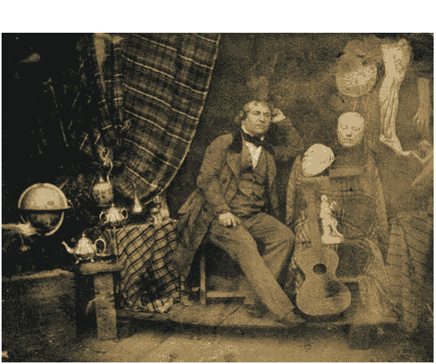

**图 4.2** 路易·迪西尔·布朗卡-埃瓦尔，作者在其工作室的自画像，这是一张从带有涂层的纸质负片经由水代硫酸钠调色的高对比度盐纸照片；是1846年9月23日写给弗朗索瓦·阿拉戈（François Arago）信中附的两张样本照片之一；蒙在拷贝纸上，尺寸为9.5 × 27.5 cm（照片尺寸：8.4 × 10.8 cm），巴黎科学院档案馆。

# 摄影与艺术

随信附上的信件和照片表明作者是一位艺术家和爱好者，尽管如此，画面展示了他被收藏品环绕着。这些物品包括茶壶、玻璃杯、长度不一布料，以及两尊展示布朗卡-埃瓦尔本人和雕塑家研究对象的石膏：在照片的右上角，可以看到一条刻得非常真实的腿，照片中可以辨认出肌肉和血管，以及一只延伸并包含前臂的手。所有展示的物体在许多银版摄影中都能看到（例如，参见路易·雅克·曼德·达盖尔的《奇珍室内部》，1837年；或查尔斯·福蒂尔的《静物》，1839年，巴黎；或希波利特·巴雅尔（Hippolyte Bayard）后期的海报）；这些都是艺术家或收藏家的空间视角。在提到的照片中，被描绘的人物占据了更多空间；左侧是一块垂落的格子纹布料，他靠在一把铺着格子布的椅子上，被描绘的人物直视着观画者的眼睛。当布朗卡-埃瓦尔拍摄第一批银版摄影中所示的内容时，他也强调了他的纸相工艺的图像质量，这种工艺能够同样地再现这些景象。他如此称呼——通过揭示自己是一个艺术爱好者——提供了一个跨越时代的自画像，并声称他的工艺赋予了摄影新的创作自由。

同时，还有其他他自己不为人知的关键传记事实，这些事实足以表明他试图理解摄影实践细节的尝试。这些事实有助于解释一位来自法国的商人兼业余爱好者如何能够对摄影技术进行实验性研究并开发工艺，正如他在1846年的信中所提到的，这些并非发现，不如说是对“基础”经过良好研究的“应用”——我们可以补充说，这些基础是由他人提供的。然而，在他后期关于工艺的论文中，他向他所谓的纸摄影“基础”的创始人——即威廉·亨利·福克斯·塔尔伯特（William Henry Fox Talbot, 1800–1877）致敬，包括那1851年关于纸摄影的专著，以及他在1869年的《La photographie, ses origines et ses progrès》（摄影的起源与进步）等出版物中的历史研究。布朗卡-埃瓦尔发表的文章中并未提到，他对摄影实验的热情源于当时化学实验室流传的那种知识。这些知识为他改进纸摄影奠定了基础，这直到他在1872去世后才被揭露，当时本杰明·科伦维德（Benjamin Corenwider）和阿尔丰斯·达万（Alphonse Davanne）在他们的讣中讨论了这一点。

布朗卡在私立学校接受过教育，在烟草行业工作，直到1831年嫁入一个富裕的布商家庭并加入岳父的生意。1826年，他听了弗雷德里克·库曼（Frédéric Kühmann）的化学讲座，讲座在工业家和年轻科学家中非常受欢迎，吸引了多达300名观众。库曼（1803–81）在被任命利尔新设立的化学主任教授后的一年，在卢兹利尔建立了一家化工厂，由于他喜欢让自己周围环绕渴望学习的学生，比他年幼一岁的布朗卡加入了他的实验室，担任助理和记录员。后来，这成为了他化学知识的基础，根据科伦维德的说法，“这门科学对他对摄影艺术所贡献的发现和改进是至关重要的。”

# 摄影与画意性

# 阿尔丰斯·达万（1824–1912）

阿尔丰斯·达万（1824–1912），一位化学家和摄影及其工艺手册的作者，同样提到了库曼的作用，他指出，“在这位卓越科学家的实验室里[布朗卡-埃瓦尔][他]学习了化学基础，这对于任何想要认真研究摄影工艺的人都是非常有用的。”他补充道，布朗卡不仅仅是一个业余爱好者，他本质上是一个化学家，“一个艺术家，一旦被摄影的魅力吸引，便倾注了整个一生。”

## 摄影性与如画性

他的工艺在刻画人物方面的特殊潜力，这在1846年9月的两幅小幅“生活画”（tableaux vivants）中展现了摄影师作为工作室中艺术家的身份（图4.1和4.2）。

通过将一张模糊的底片与一张正确冲洗的照片一同提交，布兰卡特-埃拉德（Blanquart-Evrard）针对了广泛认为塔尔伯特（Talbot）的巴亚德照片缺乏对比度的意见。布兰卡特-埃拉德通过第一张照片对应的第二张印张证明了，他精细的工艺确实能够在纸上产生锐利且高对比度的照片，而且具有耐光性，因此能够抵御时间的侵蚀。通过这两个标品，布兰卡特-埃拉德含蓄地证明了他的光化学方法优于竞争对手，并明确阐述了艺术家-摄影师在实现作品理想色调值时所拥有的自由度。³⁹

摄影师提交给学术和协会的作品中包含的所有已知人物都被归类为“历史文献”³，分为两类：肖像（通常在让人联想到风景画的环境中布置）和艺术复制品。1月提交给阿拉拉戈（Arago）和美术学院的作品是他亲友中的卓越成员，他们分别展示了他的个人（图4.3）或合影（图4.4）。其中，某些标品是布兰卡特-埃拉德的摆拍自画像，他不仅在各种场景中摆姿，还穿插于不同的角色之中，例如扮演神父。这些照片有趣之处在于，它们建立在两种不同的视觉表现范式之上。一种是“写生”（depiction sur vif）原则；在这种情况下，照片是在户外拍摄的，姐妹们在日常生活的背景和自然的姿态中面对镜头——这些姿态被画中捕捉的情境所合法化和缓解。另一种范式——与1846年9月的提交作品相一致——源于收藏家工艺的图像学。它构成了布兰卡特-埃拉德在《纸制印版：为1847年1月25日报告提供的支持》标题下收集的大多数带注释照片的基础⁴⁰这些照片展示了陈列的物品，并用家中精选的珍贵物品装饰。其中一件物品在不同照片中被重新排列，可以在几张照片中看到：由雅各·二世·范·奥斯特（Jacob II van Oost）1893年的油画肖像，后来捐赠给了里尔的美术馆（图4.4）。³⁴¹ 根据马博（Marchbot）的说法，这组照片唤起了一种“奇想与氛围，他称之为‘罕见的知实主义’。”⁴²他认为，这是基于纸张重量的早期照片特有的独特品质。通过这种关注，他认为自己可以证明那些偏好并实践纸本摄影（而非达盖尔法）的当代人的品味⁴³通过这一观察，法国国家图书馆前摄影策展人马博复制了19世纪中期用于营销纸本摄影的摄影（画意性）修辞手法：即纸本摄影与“如画性”（the picturesque）的联系。他并识别了布兰卡特-埃拉德在里尔制作的所有相集所依据的视觉范式。

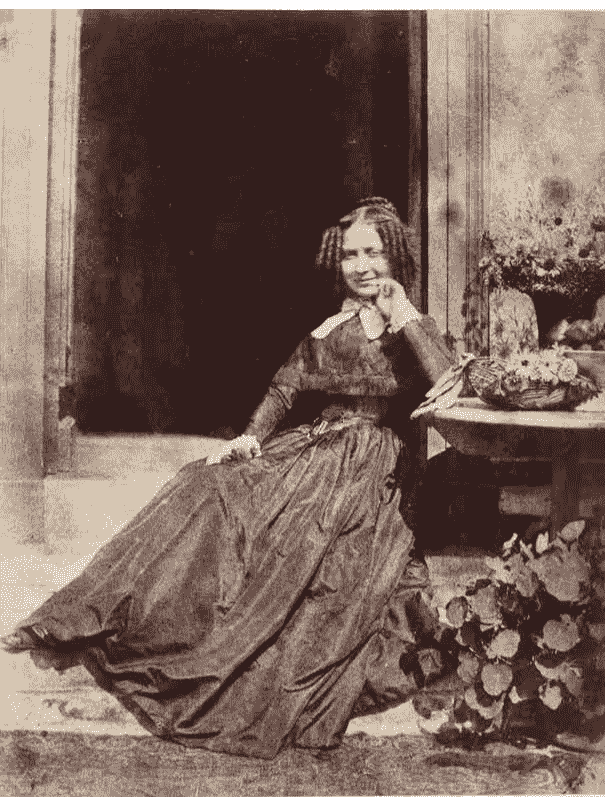

纸制印版测试章

为向学院报告提供支持（1847年1月）

来自里尔的 布兰卡特-埃拉德 著

后期正片。经氯化金处理。

**图 4.3** 路易·德西雷尔·布兰卡特-埃拉德，一位微笑女性的图像，“源自1847年1月向法国学院报告提供支持的纸制负片正片”；后期正片，经氯化金调色，装在纸板上；源自 D·布兰卡特·埃拉德《摄影：其起源、进展与演变》（里尔：L. Danel印刷厂，1869），法国国家图书馆，藏书区，BN 304b。

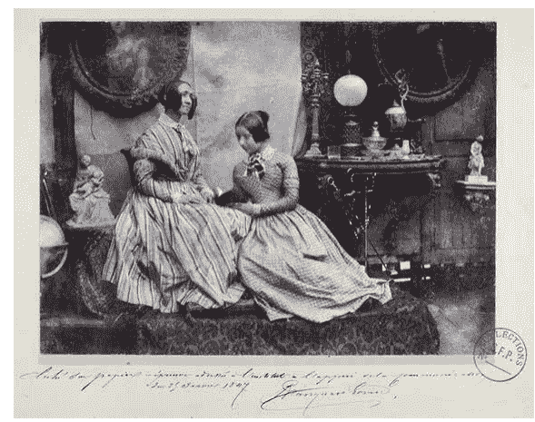

**图 4.4** 路易·德西雷尔·布兰卡特-埃拉德，两位女性的合影，“源自纸制负片正片”。于1847年1月25日提交给[法国学院]的报告；经亚硫酸钠处理的盐纸印张，20.5 x 15 cm，法国摄影协会，巴黎，馆藏编号41–98。

# 如画之旅：摆拍与风景

布兰卡特-埃拉德对1851年摄影周的看法是，“摄影除了产生肖像外，只有极少数业余爱好者能够拍摄建筑和风景照片；而在专业人士中，也只有极少数人拥有艺术感，使他们利用光影和姿态将摄影操作提升到艺术的高度。”在他的《纸本摄影》（Photographie sur papier）中，他将这种感觉与法国摄影协会的讨论联系起来，促使他将改进纸本摄影程序及其商业方面的想法提交给美术学院。正如过去一样，他在通信中附带了一些照片。在回顾导致他建立自己的印刷厂的原因时，布兰卡特-埃拉德不仅提到了作为《如画之旅》（Voyages pittores）主体的、说明一个地区特定特征的风景（*cou locale*），还提到了对于这些如画场景传播至关重要的媒介：石版画。他认为后者具有一种典范功能，因为它不仅交织了媒介及其出版策略（即：印刷操作、订阅方案、定期分发固定数量的版画等），还代表了呈现这些景点（*sites*）的媒介。

# 摄影与艺术

在创立摄影厂（Imprimerie photograph）时，布兰卡特-埃拉德不仅是为了证明他工艺的化学技术和经济可行性，更是为了提供一个审美观点。恰恰，1851年在里尔印刷的第一部作品题为《艺术家与爱好者的摄影集》（Album photographique de l'artiste et de l'amateur）。这一称谓不仅指向目标受众——作为当代摄影鉴赏家的艺术家和爱好者——还指向一个审美原型：查尔斯·波瓦、伊西多尔·泰勒男爵（Baron）和阿尔封·西勒（Alphon de Cilleux）的《法国如画浪漫之旅》（Voyages picturesque et romantiques de France）。值得注意的是，该系列中1820年和1825年出版的前两卷，以及直到1878年才出版的最后一卷，都是献给诺尔曼地的。法国北部也是布兰卡特-埃拉德制作相集的历史活动的核心³³

在对浪漫主义时代风景摄影的研究中，让·阿德马（Jean Adhémar）注意到，“如画且浪漫”（picturesque et romantique）这一词出现在18世纪中叶的法国，最初包括“对绘画和美术的认知”；如画性是欣赏艺术品的教堂和场所的清单⁴⁴这在1770年前发生了变化，当时桑维拉（Sendvilla）在其《旅游回忆录》（Mémoires d'un tourisme）中将“如画”的新含义随着马车和蒸汽轮从法国引入英国。⁵⁵这种语义转变是由法国对托马斯·吉宾（Thomas Gilpin）于1770年至1792年间关于如画之美的观察的推动的。吉宾使用“如画”一词并非指代单个艺术作品及其列举，而是在审美意义上指定一种介于崇高与美之间的中间或第三种概念。他的著作并不特别系统，提供了多种定义：特征性的风景是对粗旷景观的描绘，充斥着被常春藤覆盖的废墟，带有转瞬即逝的意图⁶⁶除了废墟，舞台——阿德马的话是“群体”（groupes de personnes）是该流派的关键元素，因为正如吉宾也观察到的那样，“除了自然的亲密面，还有旅程；它们是极大关注的对象。”⁴⁷在这些生动的场景中，我们只考虑一般的形状、服装、群体和职业；我们通常在多样性、美感和任何获取的选择中找到因果关系⁴⁸1851年至1855年间在里尔出版的作品集既是博物馆，也就是说，是视觉化地编类的艺术珍宝和如画风景，并“装饰”有装饰配件，且被“快乐的人们”所“填充”。⁵⁰尽管如画性中处理的所有主题都存在于布兰卡特-埃拉德的相集中，但在相集收集的照片中，这些主题可以明确地置于一个如画的过去。到19世纪中期，他以此工艺为模板的石版旅行相集中的图像已经改变，反映了日益现代的绘画观念⁵¹这些变化涉及所描绘的地区以及版画中呈现的物体。

# 摄影与如画性 73

例如，农舍在1830年后的出现频率日益增加；阿德马尔（Adhémar）认为，这种新主题代表了坚定不移的哥特式建筑，以及对“如画性”的含蓄反驳，并补充说，人们广泛承认对自然景观的描绘本身就已经足够了。¹⁵² 旅行画集中的新小说也是由媒介本身引起的：塞热·勒芒（Ségène Le Men）写道，旅游实践的变化随着景观作为一种绘画流派的演变以及在图像和文字中对地点的呈现而同步进行。这就是为什么他将风景之旅描述为基于摄影技术创新的“图片博物馆”。同样，布兰奎特-埃达（Blanquart-Errard）提供的对艺术现实的视觉档案，以及个人照片所示，如果没有摄影的化学技术影响是不可能的¹⁴

当代评论家在讨论两者时都涵盖了视觉汇编的构图和阅读行为.³⁵⁵ 弗朗斯·威（（Francis Wey，1812–82）在他对1851年摄影印刷厂（Imprimerie photographique）出版的第一本画集的评论中，利用了这种叙事策略，将带我们前往法国和那不勒（位于《艺术家与爱好者的画集》，Album de l'artiste et de l'amateur）并回到创造者家乡弗兰德斯伊普尔（Ypres）的旅行联系起来。如果这种叙事初看似乎遵循如画之旅的模式（图4），则强调了我们现在面临着某种真正新颖的东西。由皮尔·斯波滕（Pierre Spotheen）拍摄的《伊普尔市场》充满了满墙的商品、水果、蔬菜以及渔民的大厅。阅读威的描述——悬挂在绳子上的布料长度、成堆的农产品和堆成金字塔的筐子——我们认为几乎可以感受到光学的物理质感……因为它似乎描绘了生活本身，这张市场广场的照片（值得注意的是，它在其他画集中以略有不同的版本再次出现）是一幅写生画（picture sur vif）。

# 动态装饰（Staffage le vif）

在伊格纳斯·杰菲尔斯（Ignaz Jeaffles）1835年的《美学词典》（Aesthetisches Lexicon）第一卷中，他将“Beiwerk”——“装饰”、“配件”或当代术语中的“pargera”定义为图形和视觉艺术中所有的辅助性内容，这些内容虽然必不可少，但有助于理解主旨，并帮助填充空白处。尽管这些材料看起来是某种“发明”的产物，且在构图中处于从属地位，以免不会让观察者的“注意力”从画面中真正感兴趣的对象上转移³⁶ 19世纪中期的摄影图像，像斯波滕的市场视图（图4.5）一样，展示了生活的场景和活动，这对感觉很重要，因为根据当时的审美理论，这些应当从于中心构图，这种焦点的转移正是威的《埃弗莱斯》（Ephrais）所强调的。他通过对浪漫主义如画之旅的图像学和审美偏好训练了其批判性眼光，我们非常赞美了晚期哥特式大教堂，它占据了画面背景的三分之三，以及部分遮挡了大教堂的伊普尔织布厅，这是华丽式风格（Flamboyant style）的另一个显著例子⁷⁷但他强调（日常）生活发生在前景，即 au centre de la。“它”

# 74 摄影与艺术

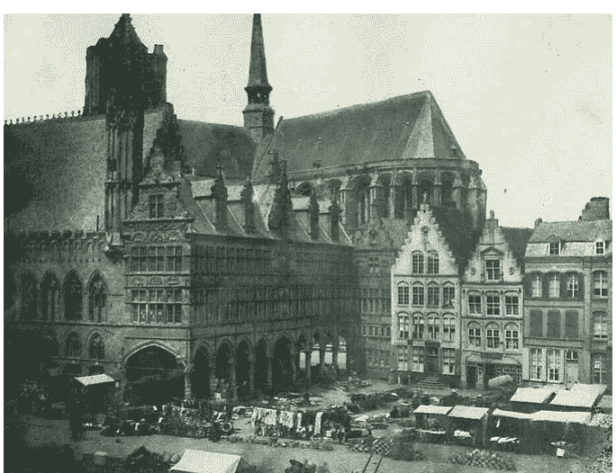

**图 4.5** 皮尔·斯波滕（Pierre Spotheen），《伊普尔市场[Place de Marché à Ypres]》。选自《艺术家与爱好者的摄影画集》（Album photographique de l'artiste et de l'amateur），1851年由布兰奎特-埃达印刷厂（Imprimerie photographique de Blanquart-Évrard）印刷；盐纸相片，15.9 × 20.8 cm。© 洛尔市立图书馆，收藏号 album S 2–9，第410页。

威得出结论说，这幅画（preuve）的出现是在极短的时间内获得的⁸⁸ 媒介所规定的瞬间性，反过来在画面中变得可见，证明了风景的真实性。

照片的索引性源于其光化学起源，使摄影师能够记录“自然，*写生*（sur vif）”，而不仅仅是概念意义上的。作为结果，由于动态装饰（staffage）的存在，尽管在画面中可能并非刻意的，但它们承担了新的角色。在1851年的摄影作品中，那里的人群出现在前景，尽管它们在画面中并非刻意——更多的是，照片展示了人物与建筑之间显著的不一致性。通过这种在比例上的跨越，观察者的视线被引导向建筑。相比之下，摄影使场景自然化。⁹

# 摄影与如画性

在布兰奎特-埃达的所有画集中，1853年的《摄影学研究》（Études photographiques）可以说生动地反映了他的摄影印刷厂引入的绘画现代性。类型场景和人物虽然被静止在如画的传统中，但被剥离了服装，因此失去了任何历史维度。这种方式进入画集的人正在从事画面视觉化的活动：观察者可以判断或推断他们是什么。即使照片无法以静态形式呈现运动，人物似乎处于运动中。这赋予了现实主义。使《摄影学研究》脱颖而出的是，尽管人物可能按照如画的习惯安排，但它们代表的并非“古代”法国，而是现在。这里是现代法国：切苹果（图4.6）、磨坊、牵驴、甚至午睡（图4.7）。

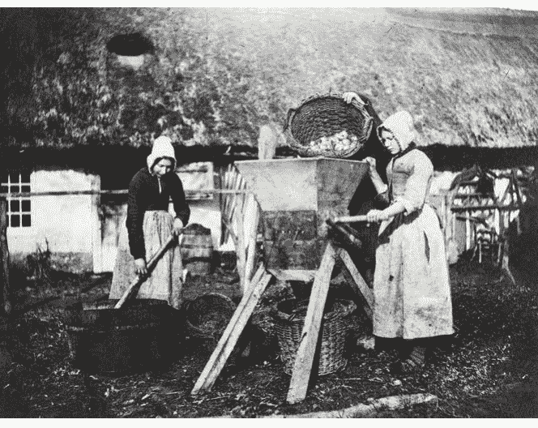

**图 4.6** 未知摄影，《农民磨坊[Paysans faisant un moulin]》。选自《摄影学研究》（Études photographiques），盐纸相片，15.1 × 20 cm；装裱于纸板55 × 39 cm，© 洛尔市立图书馆，收藏号 album S-4，第177页。

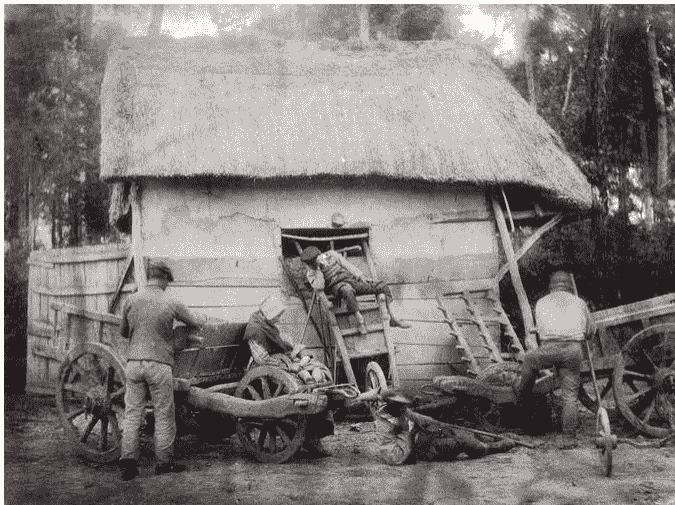

**图 4.7** 未知摄影，《草草小屋前休息的农民家庭[Famille paysanne au repos, devant un hangar au toit de chaume]》。选自《摄影学研究》（Études photographiques），盐纸相片，18 × 23.3 cm；装裱于纸板55 × 39 cm，© 洛尔市立图书馆，收藏号 album S-4，第201页。

## 摄影的局限性：艺术与化学

布兰奎特-埃达感兴趣的不仅仅是通过自然化的类型场景来激活画面。即使从事日常活动的人被赋予了画面巨大的意义，这位摄影化学家也没有忘记分配地球化学的影响。但不仅是描绘的主题，影像的媒介质量也是创作“智能”（此处指设备生成的）艺术作品的前提。布兰奎特-埃达反思了这种情况如何发生——甚至在他摄影印刷厂1855年完成多年后——他在1863年用英文发表了论文《论艺术对摄影实践的介入》（On the Intervention of Art in the Practice of Photography）。在书中他明确指出，艺术在摄影中取得立足不仅是因为对新主题的呈现。他通过向我们展示照片复制人类活动的困境——这些活动总是基于一个极短的瞬间——成功展示了艺术对此类照片能够施加的潜在影响。这种“……影响减少了

安德烈·泰菲莱特

# 摄影与艺术

20 Corenwinder, 《在布朗凯-埃瓦尔先生墓前的演说》, 666。本明·科伦温德（Benjamin Corenwinder, 1820–84）当时任里尔科学、农业与文学会主席，他写了这篇讣告。他同样在1847年作为库尔曼的助手进行过学习，当时正是布朗凯-埃瓦尔首次向科学院提交他的作品之时。

21 Davanne, 《达万论布朗凯-埃瓦尔先生之逝》, 114–15。布朗凯-埃瓦尔与库尔曼的亲密关系通过他以收藏家肖像风格为这位化学家拍摄的照片得到了证实；此外，库尔曼的妻子也是布朗凯-埃瓦尔1846–47年样稿画集中的肖像模特之一。

22 布朗凯-埃瓦尔给阿拉戈的信，1846年9月23日。

23 “信函 [阿拉戈先生代表布朗凯-埃瓦尔先生，关于一系列纸本精美照片]；CRAS 25 (1846)，1846年12月7日会议，1083。

24 乔治·维尔，《摄影的历史与进步浅论》，收录于布朗凯-埃瓦尔，《纸本摄影法教程》。xxx 维尔是少数几个提到布朗凯-埃瓦尔富有身份的人之一，以此强调他的摄影活动和创新并非出于对个人利益的追求。

25 他认为，同样的做法是，即对其摄影作品进行批判性评价（布朗凯-埃瓦尔，《摄影术》）。《其起源、进步与转型》，25。参见，例如，《1851年大博览会的讲座，在H. R. 艾尔伯特王子的提议下在艺术、制造与商业协会发表》 (David: Bogue, 1852), 378。

26 参见布朗凯-埃瓦尔在《雷肖德专辑》（法国摄影学会）中的照片，《利奥波德·罗伯特肖像，F.H.》，第57号：35；《利奥波德·罗伯特肖像，E.H.》；

27 美术学院档案馆 E 5 34，“送别信”，1月10日的信随附在莱斯蒂·莱蒂布法尔先生2月17日的信之后；另见《美术学院会议记录》，第8卷：1845–1849，Syylle Bellamy-Brown 著（巴黎：École des Charts, 2008），24。

28 Bidesiot 和 Ragut，该委员会由画家兼雕刻家路易·亨利（1757–1866）、建筑师弗朗索瓦·德雷特（1777–1850）、雕塑家路易·珀蒂奥（1794–1862）、画家兼雕刻家奥古斯特·路易·德斯诺耶（1779–1857）、历史画家-弗朗索瓦·爱杜尔·皮科（1768–1889）、雕塑家奥古斯特·杜蒙（1801–84）、画家兼奖章制作师雅克·爱杜尔·加特索（1788–1881）、建筑师兼法国学院成员-希波利特·勒巴斯（1782–1867）组成。

29 《美术学院会议记录》，第8卷，220。

30 1847年6月19日周六会议，213。

31 路易·维克多·布尔贡，《代表委员会提交的报告》，旨在审查来自里尔的M·布朗凯-埃瓦尔先生制作纸本摄影测试的的工艺。1847年4月20日会议，《美术文学协会协会年报》XVII卷（从1850年5月1日起计算的三个学年）222–6；在代表作者提交报告的委员会中，包括画家鲁日热和雕刻家朗索梅特。美术协会成立于于1830年10月18日，是一个由艺术家和爱好者组成的协会，他们隶属于《艺术家杂志》的编辑部，致力于推广艺术和艺术家；它还为有困难的艺术家管理着一项困难基金。参见 https://fr.wikipedia.org/wiki/Société_des_beaux_arts_de_Paris（于2015年8月27日访问）。

## 摄影与绘画

32 “应用物理——达盖尔先生的工艺 [此处原文为：塔尔博特缺席了两次学院会议。达盖尔先生的工艺，伦敦，1839年1月29日]；CRAS 8 (1839)，1839年2月4日会议，170–171；弗朗索瓦·阿拉戈，《银版摄影法》，CRAS 9 (1839)，1839年8月19日会议，25–67（其在1839年6月3日众议院报告后曾重复出现）；赫尔塔·沃尔，《作为素描老师的自然》，收录于 Mirius Junius, 卡特琳娜·德和奇特拉·拉马林格姆（编），《威廉·福克斯·塔尔博特：超越摄影》，英国艺术研究第23卷（纽哈芬与伦敦：耶鲁大学出版社，2013），119–42。

## 33 弗朗索瓦·爱杜尔·埃瓦尔，《关于M·布朗凯-埃瓦尔的工艺与产物的报告，1847年1月19日周六提交学院》，收录于《美术学院会议记录》，第8卷，235–9；詹姆斯·查尔斯（1746–1823）是一位法国物理学家、化学家和发明家，曾用永久性材料进行过摄影实验（参见“应用物理——达盖尔先生的工艺 [此处原文为：塔尔博特缺席了两次学院会议。达盖尔先生的工艺，伦敦，1839年1月29日]”）；CRAS 8 (1839)，1839年2月4日会议，170–4，以及阿拉戈，《银版摄影法》。

## 34 皮科，《关于布朗凯-埃瓦尔的工艺与产物的报告，1847年1月19日周六提交学院》。

## 35 德德西尔·达盖尔的策略；赫尔塔·沃尔，《早期摄影中的翻译》，《摄影》第38期，第150，赫尔塔·沃尔编（2018冬季），5–16。

## 36 弗朗索瓦·韦对塔尔博特-埃瓦尔工艺的优越性评价道，他写道后者失败了，而布朗凯-埃瓦尔甚至成功复制了面部特征（在美术学院，弗朗索瓦·韦，《如何成为银版摄影法》，收录于《家庭博物馆》，1853），289–303。参见威廉·亨利·福克斯·塔尔博特给大卫·布鲁斯特的1851年10月20日的信，他在中抱怨法国人声称发明了纸本摄影，尽管这纯粹源自英国（布拉德福科学与媒体博物馆，1937–49；WH的信，`http://fastarchive.org/letters/transcriptDate.php?month=1851&pageNumber=13&page=23`，于2020年1月26日访问）。

## 37 1869年1月8日会议，《法国摄影学会公报》第15 (1869)：6。这些照片收藏于法国摄影学会，并收录于《摄影术的起源、进步与转型》的豪华版中，国家图书馆（BNF特藏书），304。

## 38 雅各布·范·奥斯特，来自马克西姆·埃瓦尔（洛米尼斯-昂布比耶伯男爵，步兵上校）的详细信息，巴黎，里尔美术学院，第6卷。科德莉亚·哈托里（画作收藏）和弗朗索瓦·贝克沃（文献收藏），与作者于2015年2月11日的邮件往来，我非常感谢他们提供的信息。

## 40 伯纳德·塔尔博特，《布朗凯-埃瓦尔，第25a + 两个主题》，《目录》，收录于《19世纪法国摄影展望：版画与摄影杰作》，选集，巴黎国家图书馆和纽约大都会博物馆（巴黎：Berger-Levault，1880），无页码。

## 41 同上；参见保罗·路易·鲁伯特对法国银版摄影与纸本摄影之间关系的贡献（即：“这导致了银版摄影在法国的兴起……”；爱好者的出版，《摄影史：摄影的历史与美学》第38期，第150（2018冬季），27–35（技术知识）。《摄影：布朗凯-从1839年至1851年》。

## 42 路易·布朗凯-埃瓦尔（编），《应用摄影。摄影打印》，CRAS 32 (1851)，4月14日，55–6。这封信分别重登于《光》杂志（关于纸本感光摄影与摄影打印的笔记，《光》第1卷，第12期（1851年4月））以及他的媒介史回顾顾中（《摄影术：起源、进步》，24–5）。

## 43 查尔斯·诺迪（1780–1844）、伊西多尔·泰勒男爵（1789–1879）和阿尔丰斯·德·卡利（1778–1876）（编），《法国风景与浪漫之旅：法国-诺曼底》，第1和第2卷（巴黎：Pierre D’Aïné，1820年和1825年）；伊西多尔·泰勒男爵（编），《法国诺曼底风景与浪漫之旅》，第3卷（巴黎：Firmin-Didot，1878）。布朗凯-埃瓦尔在布朗凯-埃瓦尔先生部门的历史委员会中幸存下来，669。还有安妮·德·蒙达丹，《旅行》（Cinisello Balmaso: Silvana, 2009），127, 35–129。

## 44 让·阿德马尔，《列维兄弟的纸本版石画》，第一卷，87，引自路易·雷亚、让·梅塞和让·阿德马尔，《卡洛·范卢：浪漫主义时期法国风景石画，新时期》（巴黎：Armin Colin,1938），190–283。阿德马尔（1908–1987）于1932年至1961年担任国家图书馆素描收藏部馆长，后于1974年成为部门主管（1961–77）。

## 45 斯坦达尔，《游客回忆》（巴黎：Michel Lévy,1854），200。收录于阿德马尔，《浪漫时期法国的纸本版石画》，200。

## 46 约瑟夫·格拉斯森，《光自那时或威廉·金平与18世纪末的如画风景风景》，收录于米克尔·谢费尔（编），《文字自然：对18世纪文本的国际视角》（柏林：Lang, 2001），169–181。

## 47 阿德马尔，《浪漫时期法国的纸本版石画》，200，参考金平的《论印刷，包含如画美原则的标记》（伦敦：Robson,1768）以及T. F. 多斯博恩的《游客语法；或关于旅行者风景与古迹的规则；汇编自权威并作为金平原则的提要》（伦敦，1826）。

## 48 威廉·金平，《三篇论：如画美；如画旅行；以及写生风景：配首关于风景画的诗，这些现在是

## 摄影性与如画性

《关于作者执行其自身绘画的原则与模式的两篇论文》（1792），第3版（伦敦：T. Cadell and W. Davies, 1808），44–5。

## 49 这一点从一些相集的标题中可以看出来：例如，《摄影博物馆》(1853)、《摄影画廊》(1853)、《巴黎摄影》(1851) 以及《当代艺术》(1854)。

## 50 Adhémar, 《浪漫主义时期法国风景石版画》，234, 230页。

## 51 同上，248页。

## 52 根据阿德马尔（Adhémar）的生动之述，这种倾向仅仅是一时的风尚（同上，248页）。

## 53 Ségologne Le Men, 《Taylor 和 Nodier 笔下旧法国的如画与浪漫旅行：一个出发的纪念碑》，载于 Lucie Guoyard 等人（编），《如画旅行》，39–63, 47。

## 54 例如，欧内斯特·拉克（Ernest Lacan），《摄影及其在美术中的各种应用》，载于《通用监测报：法兰西帝国杂志》，1855年1月12日，45–7页，《光》第5卷第3号（1855年1月20日）：11–12页。

## 55 弗朗西斯·韦（Francis Wey），《布兰卡-埃维尔先生的摄影集》，第1卷第33号（1851年9月21日）：130–131页，131页。

## 56 Ignaz Jettels, 《美学词典中：美与艺术家理论的字母手册——德国艺术家艺术展的简要说明；作为诗学、修辞、音乐、实践、版画、建筑、材料、戏剧等》，第2卷1：abs B 维也纳（Carl Gerold, 1835），90页。他对布景人物（staffage）的构想遵循约翰·沃尔夫冈·冯歌德对该术语的定义；参见后者的《关于风景表现的论文》，调色板：一种周期性期刊，第3期（1800年）：153–156页。

## 57 韦赞美了耶斯的美；或“法国东方七角式建筑，点缀着在蓝色背景上精细刺绣的轻盈蕾丝。” 韦，《布兰卡-埃维尔先生的摄影集》，第1卷，

## 58 在《法国的如画旅行》三卷本中，有不同的描绘模式：小插画，或如布景人物那样，其功能——无论比例大小，它们都可能比自然界中的更高或更小——是作为建筑描绘的谦卑仆人；例如，图12，“朱米耶斯修道院遗址，北岸”，由雅克·曼努埃尔·达盖尔（Jacques Manuel Daguerre）绘制，由戈德弗里·恩尔曼（Godfrey Engelmann，1788–1839）复制，载于泰勒爵（编），《旧法国的如画与浪漫旅行》，旧诺曼底，第1部分（Firmin-Dodot），1820年。

## 60 在这方面，人体“当它恰当、处于运动中，比静止时更具如画性。”吉尔平，《三篇论文》，12–13页。

## 61 路易·德西西尔·布兰卡-埃维尔（Louis Désiré Blanquart–Évrard），《论摄影实践中艺术的发明》，载于《英国摄影杂志》第10卷第185号（1863年8月1日和15日）：302–304页和326–327页。在法语原文中，当布兰卡-埃维尔解释道时，问题直接聚焦于：“艺术留下的部分是当涉及到生生自然（'lorsqu'il s'agit de la nature vivante' 'Intervention de'art dans la photographie'）”，《利尔科学、农业与艺术学报》，第9卷，1863年2月2日和4月17日，149–163页和443–446页。

## 62 路易·德西尔·布兰卡-埃维尔，《论摄影实践中艺术的发明》，载于《英国摄影杂志》第10卷第185号（1863年8月1日和15日）：302–304页和326–327页。

## 63 同上。

## 如画性的冲突：摄影与19世纪的暴力美学

肖·罗伯特·威尔（Sean Robert Willock）

本章探讨了早期摄影接触中审美倾向与伦理关注之间的张力。第一张显式展示冲突受者的照片——弗朗西斯·贝托（Felice Beato）的《屠杀后的塞昆德巴格内部》（1858年）（图5.1），即便以现代标准衡量也是对破坏暴力的震惊记录。头骨、肋骨：一个恐怖的骨骸占据了场景的前景。照片记录了1857年3月位于印度北部的英国人对起义军的胜利现场。遗骸是那些“叛乱者”，散布在建筑废墟前。

当贝托——一位殖民地摄影师——到达这一地点时，身体早已被埋。他安排了它们的挖掘，为了让这张照片显示摄影如何开始塑造对生命与死亡最敏感方面的接触方式。然而，这种对生命与死亡最敏感方面的接触是激进而新的，用鲁斯金的话说，它是从美学而非“伦理”的角度做出回应，植根于一种悠久且流行的艺术传统：如画性。对痛苦和毁灭的美学化，在1839年摄影的发明时，对于维多利亚时代的人来说并不是一个新问题，因为在破旧房屋和乞民的现场，这种粗糙和不规则的特征已经为像贝托这样的摄影师提供了殖民战争的保护。在贝托接触毁灭的一年前，艺术评论家鲁斯金宣布：“如画性的现代感觉，主要包含了对废墟的喜悦，或许是所有特征中最令人怀疑的，是令人震惊的。”这种如画性的原创性——由18世纪的吉尔平（William Gilpin）建立，并在鲁斯金时代仍然流行——提供了一个使摄影与世界的伦理关系可以协商的框架。

鲁斯金对“低级”如画情感的批判认为其是“极其无情的”，这预示了更晚的学术观点：美学不仅仅是一套优先考虑粗纹理、不规则性和废墟的规范；它是一种现代的观察方式，通过对视觉欣赏的唯一强调，抑制了观众的道德反应。鲁斯金在如画气质中识别出的现代感的“硬化”，部分培养了被扎希德·R·查德里（Zahid R. Chaudhary）称为“幻影美学”的——感知结构，沃尔特曾将其识别为工业现代性的征兆。在查德里对19世纪印度摄影与感知的复杂解读中，如画性被视为一种现代感知习性（habitus）——一种根深蒂固的观察方式——通过对威胁性刺激提供“审美盔甲”来调节殖民地的遭遇。我想强调这种现代的美学化反射的潜在双重性。

**图5.1** 弗朗西斯·贝托，《屠杀后的塞昆德巴格内部》，1858年，蛋白银相片，24 × 28.7 cm。洛杉矶盖蒂博物馆。数字图像由盖蒂摄影计划提供。

## 如画性的冲突

如画的观察方式，其通过视觉规范调节震惊体验的方式，使英国人面对他们可疑的双重性，亨里·A·吉鲁（Henry A. Giroux）称之为“堕落的美学”：人类的痛苦“从属于美、设计和品味的形式属性。”因此，在使主体能够以审美满足来回应贫困、战争或废墟的同时，如画的倾向是令人不安的。这种极端情况被以“如画的方式”感知，本身就是令人震惊的——这也是鲁斯金焦虑的来源。

双重性目前显而易见；我建议，当对一个可能令人不安的现实以美学而非“伦理”（维多利亚时代人）的角度做出回应时，将如画艺术元素引入摄影是一个充满特定戏剧的过程，特别是当它涉及在暴力的阴影下构图身体（生与死）。对于塞昆德巴格框架之外发生的印度人草草绞决和任意处决一无所知的人来说，生者与死者相对于建筑废墟的组合具有令人不安的共鸣。这四个印度男人的姿态中有些什么——站在被战争蹂躏的建筑背景前，面前散落着死者的骨骸——暗示了他们的脆弱性。这些人物几乎没有胜利者的那种幸灾乐祸态。他们与同胞遗骸的尸体定位，被置于朱迪斯（Judith）所说的“不稳定性”（precarity）框架内：一种政治引发的状态，导致某些人群差异地暴露于伤害、暴力和死亡。

**图5.2** 威廉·霍奇斯（William Hodges），《塞昆德拉阿克巴皇帝之墓》，石版画。洛杉矶盖蒂博物馆。数字图像由盖蒂摄影计划提供。

马抵消了场景，通过引入一种驯养动物，在战争的混乱中重新建立了一种中心秩序。马戴着缰具且温顺，它的存在唤起了如画美学中常见的牧歌主义，其中荒野元素被人类居住和控制的迹象所抵消。学者们将此类如画策略视为典型的帝国主义，主宰异地领土，并通过使化的景观服从熟悉的视觉模式，为大英帝国提供连贯的表达。

贝托——一位多才的摄影师——在利用这种悠久且流行的如画传统的同时，也利用经典的景观主题——马匹和人物布景——从事更具记录性的实践模式。贝托

# 摄影与艺术

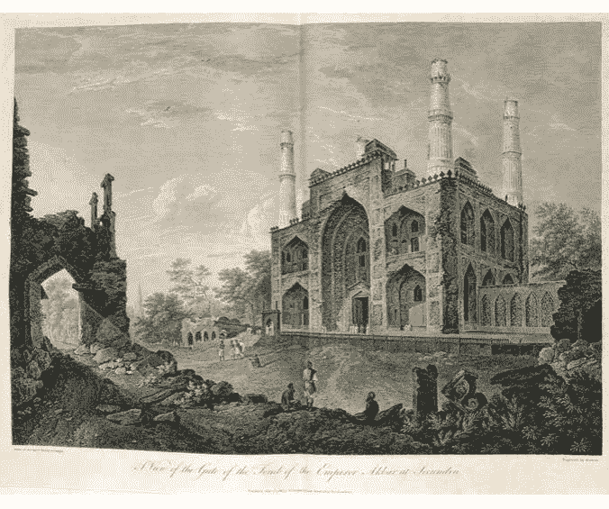

**图 5.2** 约翰·布朗（John Browne）根据威廉·霍奇斯（William Hodges）的作品创作，《阿克巴皇帝陵墓入口景》，1786年，蚀画，46.5 × 62.2 厘米。© 英国图书馆委员会，P2327。

将现代战争的恐怖置于一种熟悉的审美语境中，利用部分“如画般”的语言来帮助人们接受一种几乎没有例可循的意象。正如鲁斯金所言，“混乱与废墟之光”可以被如画画通者轻易接纳：“倒塌的小屋——荒凉的别墅——空废的村庄——被风蚀的荒野——正在侵蚀的小屋——对他而言……它们展示了石材和木材的锯齿角，且全都是同样令人愉悦的景象。”¹⁴

然而，贝托（Beato）对“残暴”的转化，并不仅仅是如画元素的简单应用。¹⁵ 在1858年贝托抵达塞昆德拉巴格（Secundrabagh）两年后，他向东前往中国记录第二次鸦片战争（1856-60年）。某场战斗后，一位英国军医大卫·菲尔·伦尼博士（Dr David Field Rennie）回忆道曾路过“令人痛苦”的“恐怖多重体”现场和成堆的“死者与垂者”，结果发现贝托处于一种“非常兴奋”的状态，站在一群尸体旁，“恳求”不要在被他的摄影设备记录之前干涉。伦尼博士在看到“大屠杀”场面时的的惊心恐惧，与贝托快乐的摄影投入形成了鲜明对比：后者甚至将现场描述为“美丽的”。¹⁶ 产生的图像（图 5.3）虽然在沉思废墟，但其构图上并未呈现出传统意义上的“如画”，也让人完全无法从任何传统意义上辨别出“美”。相反，这个术语似乎笨拙地借用了既有的艺术话语，以便从记录报道的初级视角来阐述“大屠杀”的巨大吸引力（贝托显然看到了记录时时事的价值，在短短五年内从克里米亚战争到印度起义，再到中英冲突）。在摄影历史的这一早期，还没有成熟的摄影新闻框架来解读图像创作的邂遇。

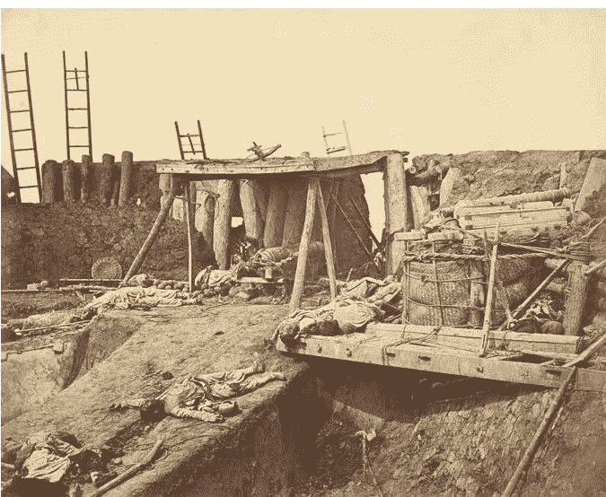

**图 5.3** 贝托。法军进入的北塘堡角度，1860年，相片银盐印相，22.3 × 30 厘米。洛杉矶盖盖蒂博物馆，2007.26.112。数字图像由盖盖蒂开放内容计划提供。

从总体水平来看，贝托与中国人的相遇预示了现代性不断变化的感知安排——这种惯习首先通过“如画”的倾向体现，随后通过摄影得以体现，在这种倾向中，世界被常规地转化为一幅画面以便去体验。¹⁷ 图像创作的过程以及美学的语言与规范，正日益开始规制即使是最极端场景的情感共鸣。伦尼博士从血肉之躯的痛苦角度看到这种破坏，发现场景是“令人痛苦的”，而贝托以显性的绘画术语感知同一场景时，在他的审美“兴奋”中似乎缺乏同情心。因此，即使贝托没有采用显性的如画技法，他也体现了鲁斯金在人们身上（包括他自己）所指出的那种伦理缺失的视觉方式——即通过将所有的痛苦处理得比真实更具“如画感”，从而放弃了所有……怜情的主张。¹⁸

在1845年写给父母的一封信中，鲁斯金表达了那些最终进入他在《现代画家》中关于“如画性”论述的伦理焦虑，承认自己对苦难有一种某种艺术投入：

> 昨天，我在博洛尼亚遇到一个贫穷的孩子平躺在人行道上——像尸体一样睡着——是因为食物太少。我立刻停下脚步，不是出于怜悯，而是为他瘦弱骨头上那块可破烂奶酪的褶皱感到愉悦，并给了那个母亲一些钱，为了赶走苍蝇，我画了一幅速描。¹⁹

鲁斯金对苦难的反应与贝托在中国的表现惊人地相似，带有某种令人怀疑的审美冲突。

# 摄影与艺术

在图像创作的瞬间，本身就是令人不安或不体面的。这解释了为什么，尽管摄影仍然是殖民体验的一个关键方面——特别是在帝国的边疆——尽管相机技术变得越来越廉价和普及，但在殖民档案中，这类照片却相对稀少。此类图像的公开传播具有引发丑闻的可能：1886年，当《泰晤士报》对威洛比·霍珀（Willoughby Hooper）尉拍摄缅甸“土匪”被处以枪处决的做法表示愤怒时，引发了公众抗议和议会调查²⁹ 报纸称“对犯人的拍照并非孤立事件”，这一事实得到了印度总督的证实，他承认曾“听过犯人被拍过”³⁰

这种审美化暴力的事件可以从冲突习惯的角度来理解：皮埃尔·布尔迪厄（Pierre Bourdieu）使用了内化结构、感知方案和行动的系统，这些系统为社会内部思维和能动提供了坐标³¹ 查达德里（Chaudhary）和派尼（Piney）都有理论化殖民文化的习惯，前者强调其作为“审美舒适”模式的地位（这是一个风景如画“形式化”的过程），后者则强调其张力和制度组成（其中殖民官僚机构、交通网络和商业在某些方面“定义”了摄影的正确用法。）² 然而，面对暴力时，通过将其消化为一张画面来调节经验的感知习惯，在精英层面并未完全规范化或整合到社会习惯中——即那种静静编码生活世界的默契代码系统³³——即便如此，前者从物流和商业的双重角度成功地在后者实现了这一点（贝托（Beato）的图像很受欢迎）。³⁴ 这种现代的、绘画式的奉献可能会冒犯英国人的感官，即使在苦烈的帝国战争的无序状态中也是如此。

# 审美与伦理

风景如画倾向逾越社会秩序的程度，从一组令人惊讶的图像中显露出来：这些是在起义后，在考普尔（Cawpore）一座广受欢迎的殖民战争纪念碑处产生的宁静的、明信片式的摄影。这是一个在战争暴行之后充满情感色彩的空间，在反殖民统治的起义早期，印度反抗者埋葬了殖民者的男女老少，导致了英国人系统性残暴且恐怖的报复。这是一个极具情感张力的主题，象征着帝国无与伦比的脆弱和损失；它汇聚了种族暴力的记忆，并引发了对新叛乱的恐惧。纪念碑的流行照片，如萨缪尔·伯恩（Samuel Bourne）的《考普尔纪念碑世界》（约1865年），通过诉诸典型的风景如画表征策略，处理了该空间的剧烈共鸣，将纪念碑公园描绘成田园诗般的宁静。然而，我们在这些场景中遇到的不仅是等待解码的艺术主题。这

# 风景如画的冲突 93

**图 5.4 萨缪尔·伯恩，《考普尔纪念碑世界（约1865年）》，蛋白盐版照片，23.7 × 31.6 厘米。© 图书馆。**

# 摄影与艺术

现代性的新奇感、碎片化与冲击。一种感知习惯帮助维多利亚时代的人们确定方向，提供了一个理解异域和困难刺激的视觉框架；然而，这些视觉与表述的习惯也损害了他们根据其他逻辑与人及地方打交道的能力：激进排他性的理想将帝国想象中的 Cawn 公园神圣化；或者如拉斯金在拒绝“低级”画意摄影时所要求的的人道同情心；或是对阵死的敌友的体面对待。对痛苦、死亡和纪念等敏感议题的美学化交织着伦理的困境；在嵌入于不安场景的美学中，潜藏着某种过度追求画意享受的风险，一种道德冷漠甚至忧伤的幽灵，使得这种现代应对机制成为一种潜在的干扰。

本研究由 Leverhul House 资助。我要感谢合编者 Juliet Hawking 和 Joanne Lukitsch 在整个写作过程中提供的宝贵意见和指导。我也感谢伦敦大学贝克斯克学院（Birkbeck, University of London）的同事对我基于本研究的早期论文提供的反馈。

# 注释

- 1. Christopher Pinney, *The Coming of Photography to India* (London: British Library, 2008), 126.
- 2. Susan Sontag, *On Photography* (London: Penguin Books, 1973), 3.
- 3. John Ruskin, *Modern Painters IV* (London: Smith, Elder, and Co., 1856), 1.
- 4. 同上, 9. 我对拉斯金对画意摄影的批判（将其视为现代感知主义文化的起源）的理解，得益于 John Macarthur, 'The Heartlessness of the Pictures: Sympathy and Disgust in Ruskin's Aesthetics', *Assembly* 32 (1997): 139.
- 5. Malcolm Andrews, *The Search for the Pictures: Landscape Aesthetics and Tourism in Britain, 1760–1800* (Stanford: Stanford University Press, 1989), 5.
- 6. 拉斯金在意大利帕马给其父亲的信，1845年7月10日。引自 Robert Hewison, 'Ruskin and the Pictures', from *John Ruskin: The Argument of the Eye* (Princeton: Princeton University Press, 1976), http://www.victorianweb.org/authors/ruskin/hewison/2.html, 2019年1月7日访问。
- 7. Zahid R. Chaudhary, *The Aesthetic of Empire: Photography in Nineteenth-Century India* (Minneapolis and London: University of Minnesota Press, 2012), 73–107.
- 8. 同上, 116.
- 9. Henry A. Giroux, 'Disturbing Pictures: Murderous Images and the Aesthetics of Depravity', *Third Text*, no. 3 (2012): 259–73.
- 10. Judith Butler, *Frames of War: When Life Is Grievable?* (London and Brooklyn: Verso, 2009), 25.
- 11. Giles Tillotson, *The Artificial Empire: The Indian Landscapes of William Hodges* (Richmond, Surrey: Curzon Press, 2000).
- 12. Jeffrey Auerbach, 'The – and the Homogenization of Empire', *The British Art Journal* 5, no. 1 (2004): 283–305.
- 13. Chaudhary 和 Anne Lacoste Beato 在“画意”和“记录”实践模式之初均有参与。见 Chaudhary, 80；以及 Anne Lacoste, *Felice Beato: A Photographer on the Easternmost* (Getty Publications, 2010), 5.
- 14. 拉斯金, *Modern Painters*, 10.
- 15. Chaudhary, *Afterimage of Empire*, 80.
- 16. 引自 David Harris, *Of Battle and Beauty: Felice Beato’s Photographs of China* (Santa Barbara: London: University of California Press, 1999), 29.
- 17. Chaudhary, *Afterimage of Empire*, 110.
- 18. 拉斯金（在意大利帕马）给其父母的信，1845年7月。
- 19. 同上。
- 20. 桑塔格对摄影的观点从她1977年《摄影论》中的文章转变为她后来对痛苦图像的沉思，《Regarding the Pain of Others》(New York: Picador, 2003)。我主要讨论她的早期观点，将它们视为现代摄影理论中一个重要流派的代表，这一理论的特征是对摄影感知的伦理缺陷表现出极度的焦虑。见 Susan Linfield, *The Cruel Radiance: Photography and Political Violence* (University of Chicago Press, 2010), 3–32.
- 21. Chaudhary, *Afterimage of Empire*, 80.
- 22. 见 Susan Buck-Morss, ‘Aesthetics and Anesthetics: Walter Benjamin’s Artwork Essay Reconsidered’, *October* 62 (Autumn 1992): 3–41.
- 23. Walter Benjamin, ‘The Work of Art in the Age of Mechanical Reproduction’ (1936) 收录于 Joanne Marx 和 Margaret Smith (编), *Experiences in Visual Culture: Critical Concepts in Media and Cultural Studies*, IV (London and New York: Routledge, 2006), 131.
- 24. 拉斯金, *Modern Painters*, 9.
- 25. 拉斯金, 对画意摄影的批判（视为现代感知主义文化的起源）。
- 26. Sir George Campbell, (ed. Charles Bernard), *Memoirs of My Career*, II (London: Macmillan and Co., 1893), 4.
- 27. 同上。
- 28. Macarthur, 'The Heartlessness of the Pictures', 136.
- 29. Macarthur, 'The Heartlessness of the Pictures', 139.
- 30. 拉斯金（在意大利帕马）给其父母的信，1845年7月。
- 31. Chaudhary, *Afterimage of Empire*, 80.
- 32. 见 Susan Buck-Morss, ‘Aesthetics and Anesthetics: Walter Benjamin’s Artwork Essay Reconsidered’, *October* 62 (Autumn 1992): 3–41.
- 33. Pinney, *The Coming of Photography to India*.
- 34. 同上。
- 35. 见 Susan Buck-Morss, *The Dialectics of Seeing: Walter Benjamin and the Arcades Project* (New York: University of Chicago Press, 2012).
- 36. 见 Susan Buck-Morss, ‘Aesthetics and Anesthetics: Walter Benjamin’s Artwork Essay Reconsidered’, *October* 62 (Autumn 1992): 3–41.
- 37. 见 Susan Buck-Morss, ‘Aesthetics and Anesthetics: Walter Benjamin’s Artwork Essay Reconsidered’, *October* 62 (Autumn 1992): 3–41.
- 38. 见 Susan Buck-Morss, ‘Aesthetics and Anesthetics: Walter Benjamin’s Artwork Essay Reconsidered’, *October* 62 (Autumn 1992): 3–41.
- 39. 见 Susan Buck-Morss, ‘Aesthetics and Anesthetics: Walter Benjamin’s Artwork Essay Reconsidered’, *October* 62 (Autumn 1992): 3–41.

# 阳光照射：伊丽莎白（拉斯金莱克）与 Hill 和 Adamson 银版摄影中阳光的“专注凝视”

Lindsay Smith

伊丽莎白·拉斯金莱克（1809–1893）于1857年发表在《季度评论》上的现已成为经典的论文《摄影》，通常被读作她对摄影与艺术关系的观点总结。由于这种“新奇而神秘的艺术”创作的“几幅老先生肖像”能够“复兴”十七世纪荷兰肖像大师伦勃朗的“精神”，拉斯金莱克将太阳视为其创造者，亲切地称之为“太阳笔”。对于她随后提出的太阳在多大程度上可以被视为艺术家的问题，答案是否定的。

拉斯金莱克与 Hill 和 Adamson 的联系广为人知，学者们也讨论了她1857年论文中对太阳能性的描述。但拉斯金莱克将太阳拟人化的根源可以追溯到1840年代她以伊丽莎白·里比的身份在爱丁堡接触并记录银版摄影法（calotype）时期。我们忽视了她纸工艺的一个形成阶段，正如他们忽视了她在明亮的阳光下为 Hill 和 Adamson 拍摄的经历一样。

## 晒伤

我从那个时期的一张卡罗相开始说，画面中强烈的阳光穿透脸庞，溶解了一位年轻女性的中分线（图 6.1）。她从椅子上向前倾，从捕捉她的支撑物中向外望去。她绕在耳朵周围的辫发在阳光直射的这种强度下，呈现出抛光珠子的形状。在她交叠的手下方，女子那件有花纹的长袍完全消失在阴影中；右脚趾从下方露出来。在深邃阴影的刻画下，她的五官特征强调了被捕捉在感光纸上的太阳光的力量。最清晰的是那双深邃的眼睛和女性富有表现力的嘴部，抵御了图像其他部分消失的命运。与此同时，在模特旁的一张小雕刻桌上，一本书承载着重量，并被厚重窗帘混乱的褶皱部分遮挡。这些带有自觉的道具，是沃尔特·本雅明对商业研究描述中后期所标记的物品的前身，试图在一个显然是户外的环境中营造出一个家庭空间。⁷ 但希尔和亚当斯在1843年至1847年间拍摄的摄影属于那个十年——该媒介的装饰性工业化时期——其特征是“曝光时间从最亮光到最暗阴影的相当时期”⁸ 本雅明在肖像画中发现了从最亮光到爱丁堡先驱者的“某种新奇而奇异的事物”的绝对连续；⁹ 这种品质诱发观察者产生一种“偶然性的火花，一种‘此地此刻’”¹⁰ 在本雅明关于伊丽莎白·约翰斯顿·哈尔的卡罗相的案例中，摄影的连续性引发了人们想要知道“一个依然真实的模特名字”的欲望¹¹

这位在闪耀阳光下被画出的人的“名字”是玛蒂尔·里格比（1815–90），她是伊丽莎白·里格比的妹妹。¹¹ 姐妹俩出生并成长于诺福克郡，1842年与母亲安恩、天真的帕尔格雷夫以及大姐姐简（出生于1806年）一同搬到了爱丁堡。¹² 希尔和亚当斯在罗克庄（Rock House）围墙花园的阳光捕捉中拍摄了这张卡罗相，那里位于科尔顿山脚，曾是一位画家和石画家。希尔对摄影这一新媒介感兴趣，源于他在创作苏格兰教会第一次总会的大型团体画像时面临的挑战¹³ 相比之下，亚当斯精通卡罗技术，这是从他的教授大卫·布鲁斯特爵士那里学到的。罗伯特·亚当斯于1843年5月10日从圣安德鲁斯来到爱丁堡，租下罗克庄以建立他的摄影工作室。¹⁴ 他与希尔合伙，而希尔的角色“纯粹是艺术家”¹⁵ 这两人随后为珍特（杰西）（1805–67）拍摄了数千张卡罗相，直到亚当斯在1848年去世。

伊丽莎白·里格比在爱丁堡时已经是著名的旅行作家、翻译家和评论员，她是1843年至1847年间希尔和亚当斯拍摄频率最高的模特之一¹⁶ 玛蒂尔·里格比出现在作品中的次数少得多。尽管如此，在这幅迷人的肖像画中，妹妹被误认为是姐姐（见图 6.1）。当我们考虑到希尔和亚当斯为这对姐妹摆姿的不同方式时，这个错误有些令人惊讶；玛蒂尔直接面对太阳，而伊丽莎白在这对爱丁堡组合拍摄的她的几张卡罗相中是低头的。例如，我们发现后者坐着，眼睛低垂，手肘支在两本书上，头靠在手心（图 6.2）。琳达·沃尔曾建议：

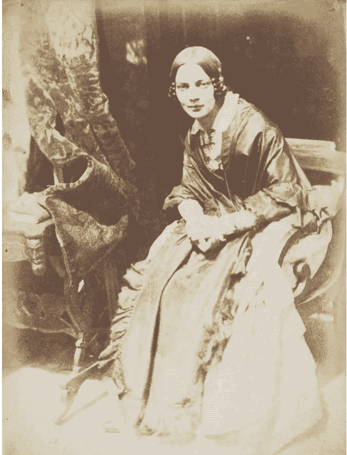

**图 6.1** 大卫·奥克塔维斯·希尔和罗伯特·亚当姆森，玛蒂尔（里格比）史密斯夫人，1843–7，从纸负片制的盐纸照片，21.3 × 厘米。爱丁堡国家美术馆，来自索菲亚·芬莱遗赠，1937，PGP HA 21。

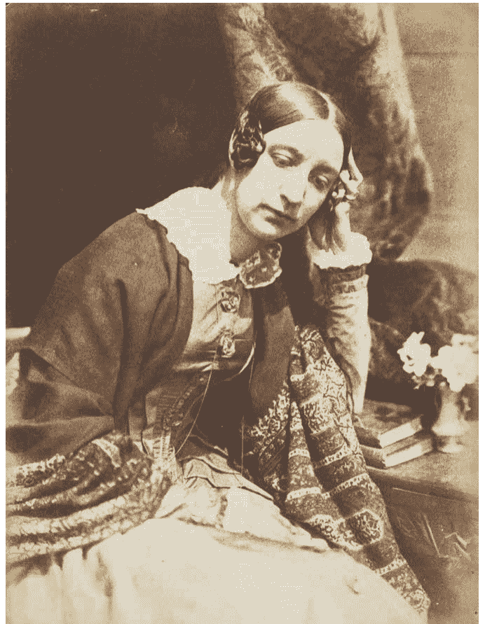

**图 6.2** 大卫·奥克塔维斯·希尔和罗伯特·亚当姆森，伊丽莎白（里格比）夫人，1843–7，从纸负片制的盐纸照片，20.6 × 15.3 厘米。爱丁堡国家美术馆，埃利特收藏，1950，PGP HA 283。

姿态和道具的差异在希尔和亚当姆森的姐妹肖像中将伊丽莎白表现为“独立思考的且富有博学的”¹⁷，而将玛蒂尔表现为“带有社交性的害羞的”¹⁸ 这种对比在玛蒂尔的卡罗相中通过一本书花表现出来，这“显然不是一个符号化的属性”¹⁹ 我们沉浸于这些肖像，将重点从卡罗相与绘画之间的潜在图像连续性，转而关注模特对阳光的反应。正如所提到的，太阳在玛蒂尔的卡罗相中扮演了重要角色；事实上，模特似乎处于被晒伤的危险之中。太阳的视线——以不同的方式在希尔和亚当斯对她的画像中被感知到。事实上，在1843年，她对避开摄像头的理由进行了评论。但里格比并没有提供我们预期的那种“艺术性的”解释。在她10月7日写给伦敦出版商约翰·穆瑞的信中，她提到了几张卡罗相肖像样本，其中包括她自己的三张：“视线是由于极明阳光的必然结果，导致其无法抬起。”²⁰ 她解释说，低头是因为阳光在她的眼睛里。并没有否定这幅和其他肖像中低头视角的常见替代方案。

## 阳光照射

在1843年1月的匿名文章《光影摄影》中，大卫·布鲁斯特爵士在约翰和罗伯特·亚当姆森的卡罗相中发现了“伦勃朗速图中所有的真实与美”²³ 年后，即1845年，在一封给画家罗伯特·希尔的信中，他认为诺森汉顿侯爵的卡罗肖像具有“奇特的伦勃朗韵”²⁴ 翌年，《雅典杂志》将塔尔伯特在《自然铅笔》中出版的卡罗相等同于“伦勃朗宽广而宏大的研究”²⁵ 这种类比证明了复制品长期存在且持续的市场

# 摄影与艺术

以及对伦勃朗作品的模仿，26 作为对无可比拟的光影呈现的缩写，它在希尔和亚姆森（Hill and Adamson）的卡罗蛋白法中也标志着光的特定特征。

在她1843年给穆里的信件和1857年的论文《摄影》之间，伊丽莎白·里格比（Elizabeth Rigby）在对德国绘画的评论中完善了她最初对卡罗蛋白法“伦勃朗效应”的评价，她在评论中加强了后来成为她对希尔和亚姆森作品之持久痴恋的观点。但在里格比于1844年3月在《季刊评论》（Quarterly Review）上匿名对杜塞尔多夫艺术学派的严厉批评中，很容易忽视摄影的意义了.27 出于确定“德国艺术家真的比我们想象的要先进得多吗？”的愿望，28 里格比谴责了对“技巧”而非“真实”的偏好，29，并利用卡罗蛋白法的例子对比了英国绘画与德国绘画中的“自然版本”，并证明了前者的优越性：

简而言之，我们给出自己的自然版本——他们给出自己的；哪一个才是正确的？然而，确实存在一个标准，而且是一个无可诉求的标准，因为它基于证明而非观点。这可以在最近发现的那个奇妙源泉中找到——那是对那些艺术家在作品中反映自然的唯一可靠测试，唯有自然本身才能对其裁决。我们指的是那些美丽而奇妙的卡罗蛋白画——在每一位真正艺术家眼中都是如此珍贵，不仅是因为它们对自然无与伦比的真实，更是作为艺术中所有受推崇真理的胜利证明。无论画家高低，只要自然向他们揭示过自己，在这里都能找到自己的辩护。让希尔先生将卡罗蛋白仪器对着一个处于支配位置的简单曼利头部，它就创造了一个爵士·乔舒亚（Sir Joshua）——给它一张布满岁月皱纹的老脸，它就还了我们一个伦勃朗——召唤三个或四个光腿的小顽童，我们有了米里洛（Murillo）的乞丐男孩——将其置于一组新黑镇的渔民面前，我们有了泰尼尔斯（Teniers）的荷兰农民，或是奥斯塔德（Ostade）的乡村小酒馆——或对着一面破旧的砖墙，彼得·德·霍格（Peter de Hooge）的金属版画便出现在我们面前。将其带入错综的山林风景，它向我们展示了霍伯马（Hobbema）、甘恩斯伯拉（Gainsborough），甚至还有我们之前未充分提供的康斯泰尔（Constable）——给它参错的尖塔和叶密的堤岸，遥远的柳树和闪烁的小溪，嬉动的光影和挣扎的光芒，阳光下的风暴和水波的光束——最后，给它在空气中最灵动的光芒——特纳（Turner）的毁灭者们只能舔尘——这是对鲁斯金（Ruskin）先生最高的赞誉。艺术和天才已成功捕捉的每一个真理在这里都有了原型；但我们在天上、地上，或地下水下召唤出的，又何产生一幅杜塞尔多夫的绘画呢？30

在一段推崇“卡罗蛋白画”模仿并以此合法化绘画风格的能力的文字中，里格比将伦勃朗与雷诺兹（Reynolds）列为肖像画画家，将荷兰和西班牙体俗画家、风景画家霍伯马、甘恩斯伯拉、康斯泰尔以及最具当代性的特纳，列为“受推崇的”艺术家。

## 阳光照射

因其表现的“真实性”而受推崇。然而，她声称，杜塞尔多夫学派在受到同样的“摄影式”衡量标准时，只能失败。里格比解释道，只要向“希尔先生[的]卡罗蛋白仪器”呈现一个场景、一个人或一个物体，太阳就会产生一个原型，以此“测试”那些声称“反映自然”的艺术品。通过重复邀请记录“自然自身”的原作中的任何“如画的”场景，里格比的句子结束在光影的精彩效果中。闪烁的小溪、嬉动的光影、阳光下的风暴和警觉的光束导致了阳光中动态的峰值。事实上，那些特纳的批评者的“尘埃”显现为光光中“舞动的微粒”。里格比对希尔和亚姆森的脚注支持提出了一个问题，即卡罗蛋白法究竟是“绘画”、“绘画”还是“版刻”，在同样的语境下，艺术家似乎在铅笔、画笔和刻刀方面同样精通。

# 阳光

十年后，在《摄影》中，伊斯特莱克夫人（Lady Eastlake）召唤了伦勃朗对媒介的描述，在《季刊评论》中回顾了希尔和亚姆森的作品。此前与荷兰大师相比的作品，她宣布与伦勃朗和雷诺兹的相似性已经消失了！遗憾实践已经过去，如果没有记忆，她将这种艺术上的归因于技术和化学的发展——特别是弗雷德里克·阿彻（Frederick Archer）的火胶法——卡罗蛋白法捕捉伦勃朗作品中光之秘密的能力已为了看到更多而牺牲了。

# 摄影与艺术

与鲁斯金（Ruskin）1845年在看到皇家学院展出的特纳之作《帕斯里纳》（1828年）后的日记一致：

> 它就像是他们中的一点现实，正如里格比在1846年对那幅素描的描述。

里格比对特纳捕捉光线的引用与她对卡罗蛋白法的赞誉也产生了共鸣。在这方面，希尔从1848年起经常评论纸的作用：“粗糙的表面和整张纸不均匀的纹理是卡罗蛋白法细节褪色的主要原因，而这也是它的灵魂所在。”伊斯特莱克在19世纪50年代对盐纸质量的持续喜爱，当她赋予卡罗蛋白法召唤艺术家“精神”（其中伦勃朗尤为突出）的倾向时，她是在对图像嵌入纸纤维做出反应，因为盐纸的分辨率较低，暗部细节较少。

## 阳光照射

我想回到马蒂尔·里格比身上。在希尔和亚姆森的另一幅同一姿势的肖像中，我们看到她坐在椅子上（图6）。可以说，她看起来不那么伦勃朗了。光线在肖像中没有遮挡她的脸，如果不仔细观察，也没有遮挡她的头发颜色。画面中的一切看起来如此。但仔细观察，一把被弃用的必需用品——阳伞被轻轻合上并支撑着。在模特部的右侧，模特拒绝了它并选择正对镜头，或者将其降下拍摄。无论情况如何，阳光从未通过使用在相机外的阳伞来记录其存在。

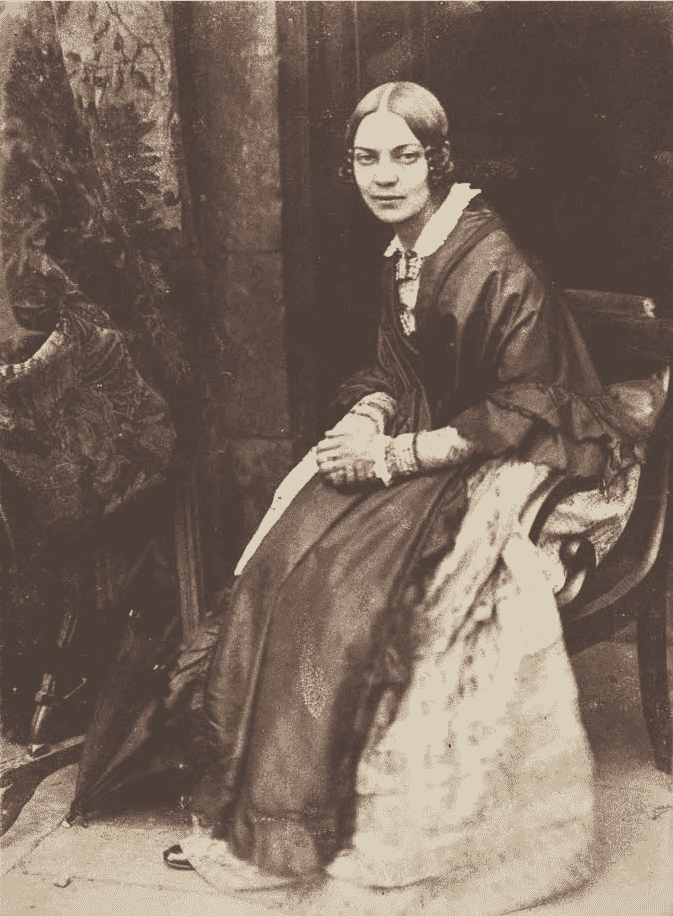

**图 6.3** 大卫·奥塔维乌斯·希尔与罗伯特·亚姆森，玛蒂尔达（里格比）史密斯夫人，1843–7，纸性负片的盐纸相打印品，20.8 × 15.2 cm。苏格兰国家美术馆，由珍特·诺特曼小姐捐赠，PGP HA 405。经爱丁堡国家肖像馆许可复制。

# 108 摄影与艺术

从时间的角度来看——“让照片有足够的时间”和“将精力集中在一个人身上”——传达了她既作为模特坐过又观察卡盐摄影法（calotype）的经历。

我回到了本雅明，他关于模特“持续性”的描述似乎演变成一种在户外需要长时间曝光的卡盐摄影，这“迫使主体将生命聚焦在当下，而不是匆忙它。”对于本雅明来说，19世纪50年代室内商业肖像馆减少了这种持续性的质量。对于伊斯特莱克（Eastlake）来说，转向室内工作室以及19世纪40年代模特在阳光下流逝的时间，在很大程度上也导致了与伦勃朗所代表的那种艺术联系的丧失。这种从室外到室内的转变是由一颗偶然的小石子带入我的视野的，那块石头掉落在玛蒂尔达·里格比卡盐摄影作品的左侧。这是一个微小的异常细节，摄影师很容易将其排除在镜头范围之外。然而，这块被阳光温暖触过的无害小石头的韧性，锚定了这张户外图像的“此时此地”。同时，当邀请她衡量模特负片之间的首次间隙时，在没有阴影的情况下，这块石头指向了最细微的物体，伊斯特莱克声称，在1857年，摄影“赋予了一种甚至无法看见的身份强度。”

伊斯特莱克对卡盐摄影优于后续工艺的持久偏好，很大程度上归于它与光的关联，这种光由伦勃朗作为老大师、透纳作为画家以不同方式呈现。但在不那么抽象的层面，这种关联源于在岩石屋（Rock House）长时间坐着的直接体验。我用她的朋友玛丽·史密斯写给他1847年6月22日的一封信中对这段经历的生动记录来结束此。史密斯写道：“我做了一整天的卡盐摄影，我拍了七种不同的姿势，我不知道给伊莉莎·里格比拍了多少张，我认为她成功地达到了那种质量，我们一起出去了。”在卡尔顿山与里格比作为模特出现时，史密斯将自己限制为镜头的被动对象，而承担了摄影师的主动角色。在一种惊人的主体转移中，史密斯对“卡盐”这一动词的近似，体现在模特在过程中的物理角色，以及在盛夏阳光下坐着的要求。伊斯特莱克对希尔和亚姆森实践的第一手知识，对她对这种媒介更广泛的理解产生了深远影响。纸质工艺包含了一种后来被让出的、接近艺术的潜力，它封装了一种持续性的质量，那是她在岩石屋所经历的热量和阳光的照射。

# 注释

- 1 埃丽莎白·伊斯特莱克，“摄影”，《季度评论》 101, no. 202 (1857年4月): 442–68，重印于艾兰·特拉赫伯格编，《摄影经典论文》（康涅狄格州纽亥；Lee's Island Books, 1980）， 40–68。
- 2 同上，40。
- 3 同上，40。
- 4 关于太阳作为“绘画媒介”，见乔伊·斯纳德，“事实自明”（Res Ipsa Loquitur），收录于洛琳·达斯顿（编），《说话的物体：艺术与科学的客观课程》（纽约：Zone Books, 2004), 195–221；另见史蒂夫·爱德华兹，《摄影的制作：寓言》（宾夕法尼亚州帕克公园：宾夕法尼亚州立大学，2006），10–3。海因里希·施瓦茨记录了希尔和亚姆在太阳较高时进行卡盐摄影；让光线以锐角落在他们的模特身上。大卫·奥塔维乌斯·希尔，《摄影大师》，海伦·E·弗兰克尔（伦敦：George G. Harrap & Co., 1932），40。施瓦茨在此背景下罗伯特·亨特在《摄影手册》（1854）中的解释，当“垂直”时，模特眼睛下会投下深色且不自然的阴影（40, n. 21）。
- 7 沃尔特·本雅明，《摄影简史》，收录于《街道与作家》，埃德蒙·詹金斯与金斯斯利·肖特著（伦敦：Verso, 1985），247。
- 8 同上，243。
- 9 关于本雅明对此的反应，见例如：莎拉·史蒂文森，《大卫·奥塔维乌斯·希尔个人艺术》（纽亥：耶尔大学出版社，2004），2–4。玛蒂尔达·里格比嫁给了詹姆斯·史密斯。她的儿子查斯·伊斯特莱克（1851–1917）编辑了他那位在1849年嫁给查斯·洛克伍德的伊丽莎白的日记和信件。

# 像米开朗基的粗石的卡莱尔：通过雕塑思考朱莉·玛格丽特·卡梅肖像中的摄影

Patrizia Di Bello

1867年，朱莉·玛格丽特·卡梅（1815–79）向约翰·赫歇尔（1792–1871）寄了她在1864年首次制作的专辑的“完成版”。这些新照片是用她刚购买的相机拍摄的，其中包括科学家本人——《戴帽的约翰·赫歇尔爵士》、作家《像米开朗基雕塑中一块粗石的卡莱尔》（图7.1）以及诗人《阿尔弗雷德·丁丁尼森》（1809–92）——所有标题均由卡梅在专辑目录页上题写。与此已出现在1864年版专辑中的画家G. E. 瓦特斯（1817–1904）一起，还有卡梅热烈友好并作为导师和灵感来源的几位人物，她在本章分析的摄影美学思维的发展中起到了至关重要的作用。

新相机比第一部要大——尺寸为15乘12英寸，并配备了专为提高景深而设计的线性镜头。这种能力可以在拍摄肖像时，捕捉到相机之外多个平面上的锐利细节，例如鼻子、嘴唇和眼睛。卡梅利用相机为她心中的名男女拍摄了非凡的等身特写肖像，其效果几乎与她用第一部相机拍摄的作品一样模糊和失焦。凭借着她们在名人肖像市场的成功（这个市场本已成熟，可以对大多数名片摄影工作室拍摄的那些清晰、细腻且通常是静止的肖像形成替代品），卡梅复制了她那些巨大的“头部照”，通过她的伦敦代理商出售印制品，并将其纳入了多次展览。照片并没有像她希望的那样让她获得财富，但确实提高了评论界对其作品的评价，此前在摄影杂志上的评价很糟糕。她的男性肖像尤其受到了赞誉：“这些完美画面中粗犷的男性化线条，头部既强有力而又显得庄严，是无比拟的。”卡莱尔本人对自己的照片持矛盾态度：“这好像照片突然开口说话了，极其丑陋且忧伤，但几分神似。”这幅肖像后来作为名片重新出版了。

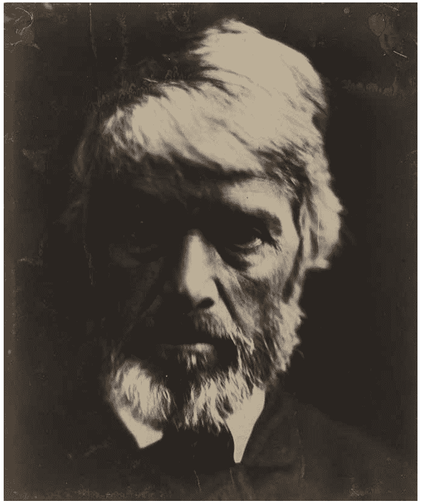

**图7.1** 朱莉·玛格丽特·卡梅，《像米开朗基雕塑中一块粗石的卡莱尔》，1867年，湿法火棉负片蛋白银相片，33.5 × 28 cm，10311239。© 国家科学与媒体博物馆/科学与社会图片库 – 版权所有。

《像米开朗基粗石的卡莱尔》是1875年由伦敦自动感印公司制作的碳版画，曾登于阿尔弗雷德·斯蒂格利茨的杂志《摄影作品》。

关于卡莱尔的肖像已有大量论述。策展人科林·福德（Colin Ford）在1974年赫歇尔专辑待售时，起到了关键作用将其留在了英国，他将其称为“卡梅夫人最伟大的作品之一，她拍摄过的最有力量、张力的肖像之一。”艺术史学家罗伯特·凯尔西（Robert Kelsey）评价这幅肖像“在强调图像背后的表演性交流方面非常奇特”，并讨论了大型肖像如何“用雕塑般的明暗对比来表现她的被描绘者”，利用摄影过程中的缺陷使“不完美成为成就的标志，以及一种野心的体现”。对于摄影学者米里亚姆·布鲁西乌斯（Mirjam Brusius）来说，在卡莱尔的肖像中，卡梅成功地表现了他的力量和不透明感之外，还传达了他的脆弱性。印象防止了模糊性，使卡莱尔复杂且矛盾的性格变得可见。卡梅认为，她将米开朗基作品中思想与头部之间的紧张关系重塑为机器与[缺失]之间的关系。本文的目标是测试卡梅对时间引用的影响，通过对她与米开朗基的对比进行更丰富的理解，对其中一些评估进行细化，说明这种对比更广泛意义上可能关于卡梅的摄影思维和实践说明了什么。

在肖像中，卡莱尔的脸从照片模糊的黑暗中动态地显现出来。皮肤线条呈线性，白色的头发和胡须像层状岩石，这种效果是由卡莱尔在曝光期间未能保持静止而模糊造成的，暗示了地质现实而非人类的衰老。右侧的眼睛（画面较亮的一侧）在表情和焦点上都显得痛苦地柔软。另一只眼睛从左侧的黑暗中窥视，以更有渗透力的目光看着我们，深色瞳孔中相对锐利的高光以及似乎抬起的眉毛强调了这一点。看着照片，很难解码哪些形状是由卡莱尔的特征和表情形成的；哪些是由光线和对焦形成的；他不愿以锐利的方式捕捉并固定左侧审判性的眼睛，还是右侧那更脆弱、更具吸引力的眼睛。很难判断贯穿照片的这种拒绝面对画面的抗性——也许源于我们的体验（当我们眼睛试图但未能捕捉到任何细节时），源于卡莱尔对摄影过程的态度，他不愿意为卡梅的相机坐好（静止），或是源于卡梅不愿将镜头向外移动以至少捕捉他的某些特征，因为之前的远景照已让商业工作室使用了相机。事实上，作为女性，卡梅拒绝了这张照片的另一个更清晰的版本，那个版本是“正确”反过来打印的——没有像她在所有幸存的该肖像版本中那样反转负片（图7.2）。在这些版本中，卡莱尔糟糕的发型和不平整的衬衫领子似乎是

**图7.2** 朱莉·玛格丽特·卡梅，《卡莱尔的肖像》，1867年，湿法火棉负片蛋白银相片，33.5 × 28 cm，10311239。© 国家科学与媒体博物馆/科学与社会图片库 – 版权所有。纽约大艺术博物馆，1949年，碳版画。

卡莱尔的肖像被广为讨论。策展人科林·福德（Colin Ford）在1974年赫歇尔专辑待售时起到关键作用将其留在英国，他将其称为“卡梅夫人最伟大的作品之一，她拍摄过的最有力量、张力的肖像之一。”艺术史学家罗伯特·凯尔西（Robert Kelsey）评价这幅肖像“在强调图像背后的表演性交流方面非常奇特”，并讨论了大型肖像如何“用雕塑般的明暗对比来表现她的被描绘者”，利用摄影过程中的缺陷使“不完美成为成就的标志，以及一种野心的体现”。对于摄影学者米里亚姆·布鲁西乌斯（Mirjam Brusius）来说，在卡莱尔的肖像中，卡梅成功地表现了他的力量和不透明感之外，还传达了他的脆弱性。印象防止了模糊性，使卡莱尔复杂且矛盾的性格变得可见。卡梅认为，她将米开朗基作品中思想与头部之间的紧张关系重塑为机器与之间的。本文的目标是测试卡梅对时间引用的影响，通过对她与米开朗基的对比进行更丰富的理解，对其中一些评估进行细化，说明这种对比更广泛意义上可能关于卡梅的摄影思维和实践说明了什么。

在肖像中，卡莱尔的脸从照片模糊的黑暗中动态地显现出来。皮肤线条呈线性，白色的头发和胡须像层状岩石，这种效果是由卡莱尔在曝光期间未能保持静止而模糊造成的，暗示了地质现实而非人类的衰老。右侧的眼睛（画面较亮的一侧）在表情和焦点上都显得痛苦地柔软。另一只眼睛从左侧的黑暗中窥视，以更有渗透力的目光看着我们，深色瞳孔中相对锐利的高光以及似乎抬起的眉毛强调了这一点。看着照片，很难解码哪些形状是由卡莱尔的特征和表情形成的；哪些是由光线和对焦形成的；他不愿以锐利的方式捕捉并固定左侧审判性的眼睛，还是右侧那更脆弱、更具吸引力的眼睛。很难判断贯穿照片的这种拒绝面对画面的抗性——也许源于我们的体验（当我们眼睛试图但未能捕捉到任何细节时），源于卡莱尔对摄影过程的态度，他不愿意为卡梅的相机坐好（静止），或是源于卡梅不愿将镜头向外移动以至少捕捉他的某些特征，因为之前的远景照已让商业工作室使用了相机。事实上，作为女性，卡梅拒绝了这张照片的另一个更清晰的版本，那个版本是“正确”反过来打印的——没有像她在所有幸存的该肖像版本中那样反转负片（图7.2）。在这些版本中，卡莱尔糟糕的发型和不平整的衬衫领子似乎是

# 摄影与艺术

坐在由操作员控制的机器面前——那是机械而非艺术家的手——这并不被视为“两个主体之间的相遇”。卡梅隆（Cameron）声称她的作品就像米开朗基罗坚持其主体性的存在一样，这种主体性植根在她与摄影过程交互的结果之中。

卡莱尔（Carlyle）的著作影响了他对英雄崇拜的思想，以及创作劳动力在肖像中运用的“对一个人生命的总结，而非对偶然印象的记录”的力量，正如他在卡莱尔肖像中尝试做的那样。正如艺术史学家保罗·巴洛（Paul Barlow）所示，卡莱尔的绘画“粗略地，创造出一系列焦躁的笔触、涂抹和刮擦”，是画家如何帮助他与卡莱尔遭遇的真实性，将他的肖像描绘成一种未解决的斗争；在此之前，卡梅隆将其嵌入自己与卡莱尔以及材料的斗争中，以记录不仅是坐姿者“偶然位置”的内容。她不愿将卡莱尔在镜头前的姿态和情感固定下来，这一点通过她沉默或不精确的面部得以视觉化，并通过她用“自己的手”处理玻璃板和使用铅笔制作照片而得到了增强和具象化。

# 米开朗基罗在米开朗基罗的圈子里有着特殊的共鸣

米开朗基罗在米开朗基罗的圈子里有着特殊的共鸣。瓦茨在19世纪40年代在意大利学习后被称为“英国的米开朗基罗”$^{27}$。他以建议学生效仿米开朗基罗而闻名$^{28}$，卡梅隆的《米开朗基罗后的女先知》是他们持续构图的一部分——这张照片被包含在他1864年送给瓦茨的专辑中$^{29}$。丁尼森位于弗莱什沃特的房子与米开朗基罗相邻，室内装饰有罗马米开朗基罗西斯廷天顶板的照片，以及佛罗伦萨美第奇家族陵墓的照片$^{30}$。后者是穆雷1856年《意大利北部旅行指南》推荐的亮点之一，当时阿利纳里——佛罗伦萨艺术与建筑摄影的国际供应商——已经提供了关于该陵墓的照片$^{31}$。米开朗基罗在19世纪广受欢迎，但学术观念认为只有完全完成的作品才能充分展示艺术家的精湛，而所谓的“完成”是让笔触或无凿的痕迹变得难以察觉，从而压制了艺术的痕迹。

在18世纪80年代，约翰·鲁斯金指责米开朗基罗“工艺糟糕……”完成仓忙且不完整$^{34}$。沃尔特·帕特则肯定了他“未完成（non-finito）”的优越性$^{35}$。早在1833年，《名人传记：米开朗基罗·布纳纳罗蒂》——由实用知识传播协会出版，当时卡梅隆的丈夫查尔斯·海是该委员会成员——书中就描述了美第奇陵墓中的大卫像：

> 与其说是粗糙的，不如说是非常完成——但却最壮丽。拥有更多将削弱整体的高贵效果，而这种效果恰恰通过由于留给想象的空间而得以增强。也许没有像这位伟大大师那样富有天赋的大脑能……成功进行如此大胆的尝试。天才是……他宏伟作品留下的未完成状态，被这种经常与天才共生的耐心占据，这种耐心在达到其伟大目标后……放弃了细节$^{36}$

## 像米开朗基罗粗石般的卡莱尔

米开朗基罗的作品未完成，不是因为遗憾的历史行为——如被迫离开佛罗伦萨或工艺糟糕，而是因为一种审美决定。不耐不是性格缺陷，而是天才的智慧，他们理解放弃细节可以完善作品。这种理解也有助于理解米开朗基罗的陈述（许多传记者都重复过），他对作品的愿景是在与正在处理的大理石块对话中产生的。通过揭示米开朗基罗留下的痕迹，粗糙的部分使他的愿景在行动中发展。卡梅隆对米开朗基罗的呼唤是要求我们把模糊和失焦的照片视为聚焦和视觉化的行为，或将光学或化学痕迹视为摄影材料的*非有限（non-finite）*。

很难说卡梅隆是否对米开朗基罗的*未完成（non-finito）*有这些或类似的评价，因为那是伊丽莎白·巴雷特·布朗宁1851年的诗歌《吉达（Casa Guida）》中提到的，其中未完成的胸像是强大的，因为它赋予了十九世纪的意大利人通过想象来完成它的需求。这种想法很容易想象到类似的观点曾被读在“小荷兰人故居（Little Holland House）”，布朗夫妇经常出入于那里，“英国的米开朗基罗”开始练习雕塑。瓦茨的《普罗米修斯》是根据大卫像创作的，其未完成的状态是米开朗基罗的自像$^{39}$

# 像米开朗基罗粗糙石块般的卡莱尔

威姆转瞬即逝的摄影雕塑使用了360度摄影，这是二十世纪及以后继续制造和使用的许多雕塑机器的一种变体。⁴⁹ 卡梅对这些设备的了解可能使她将自己和米开朗基罗的作品描述为不同于那些“从这种机器切割出来的”。⁵⁰ 正是在这些关于艺术性与机械或无思考完成的辩论背景下，米开朗基罗在《布鲁图斯》或《日》中粗糙的面部，成为了卡梅思考如何“变革摄影”的参考。⁵ 我与直接雕刻的对比——将雕塑家使用锤子和凿的手势替换为摄影师处理镜头、手柄和照片的手势——忽略了（火胶版）摄影固有的多重本质，并且在更务实的面上，忽略了如何依靠她亲手制作的每一张照片来实现盈利的问题。为了完全理解摄影作为一种机械生产和复制媒介的本质，卡梅必须审视她同时代的雕塑作品。

这是她在1874年的《我的玻璃房年史》中所述的。这段自传性的叙述写于她因财务问题准备离开英国之际，它将照相机刻画为不是一台机器，而是一个具有记忆和创造活力的生命体。⁵² 卡梅对她的肖像的愿景，正如米开朗基罗的面部一样，源于她与以下内容的互动：

> 当我聚焦并考虑到我眼中的某物非常美时，我会停留在那里，而不是像所有其他摄影师坚持的那样，将镜头对准最清晰焦点。⁵³

有趣的是，她在雕刻卡莱尔肖像时放弃了米开朗基罗，但在描述泰尼森对她所画肖像的反应时又回到了雕塑——泰尼森将那张照片戏称为“脏僧”。

> 桂诗人曾对此评价说，他更喜欢这张照片，除了雅尔拍的某一张以外的任何其他照片；这种比较似乎太滑稽了。这更像是把杜杜夫人的一个蜡像头部与伍尔纳的一个理想化英雄半胸像相比。⁵⁴

与拉拉斐尔前派相关的雕塑家托马斯·伍尔纳曾用多种材料通过奖章证书和胸像描绘过多次泰尼森。卡梅将一张威廉·杰弗里·泰尼森1857年的胸像照片放入她妹妹“米亚”（玛丽亚·杰克逊）的收藏中。十九世纪的雕塑在某些方面比米开朗基罗的直接雕刻更接近摄影。与照片一样，伍尔纳从原始“负片”制作泰尼森并非为了展示；用于制作“原始石膏”的模具随后被铸成铜，用大理石复制，或用于制作石膏或帕里亚石的版本。正如摄影一样，艺术家的触碰通过机械手段进行中介——从模型进行模塑和铸造、艺术家手作的原始雕塑以及用于制作原始石膏的雕塑机器，都是通过专业机械劳动工将原始石膏转化为大理石、青铜和像的索引方法。

# 摄影与艺术

乔安·卢基奇所示，伍尔纳对摄影感兴趣⁴⁶，并且不反对用机械复制品来补充他的真人写生——他获取了泰尼森额头和鼻子的铸件，以提高他1856年胸像的真实性.³⁷ 这些是标准的室内做法，允许雕塑家继续寻求新的订单，这对于将一种昂贵的媒介转化为可行的业务至关重要。卡梅当时也在沿着类似的思路，让她的肖像缩小为名片（cartes-de-visite），或将她的负片交给Autotype公司制作碳印，过程涉及复制——类似于从她的原作制作新的“模具”⁵⁸

《年史》充满了深受卡莱尔启发的肖像观念，展示了“内在的伟大以及外在人物的特征”⁵⁹ 它还渗透着对伦敦摄影工作室和商业摄影馆的鄙夷。然而，通过像伍尔纳和米开朗基罗一样思考摄影，卡梅在这里更接近于为一种机器美学开发摄影，这种技术装置可以创作肖像，使理想化的英雄——现代性无意中设计的特权主体性——既在镜头中又在镜头前。在这种对摄影的概念化中，卡梅的摄影和著作是摄影史中持续对话的一个关键时刻，这种对话涉及作为机器时代商品的照片，与作为真实的痕迹、世界的足迹与人类手动作交织的作品的照片，后者赋予了机器自身的主体性，并为它们留下了幻想、欲望和想象的标记。

感谢编辑们在撰写这一章时提供的许多出色的观点和重要信息。

# 注释

- 1 关于此专辑及相关信函，见：Colin Ford, *The Cameron Collection: Album of Photographs by Julia Margaret Cameron, Presented to John Herschel* (Wokingham): Reinhold in association with the National Portrait Gallery, London, 1975); 第13页。
- 2 Victoria Olsen, *From Life: Julia Margaret Cameron and Photography* (New York: Palgrave Macmillan), 2003.
- 3 同上，第174页。
- 4 Joanne Lukitch, *Cameron: Her and Career* (Rochester, NY: International Museum of).
- 5 在《年史》中。
- 6 在《年史》中。
- 7 在《年史》中。
- 8 在《年史》中。
- 9 在《年史》中。
- 10 在《年史》中。
- 11 在《年史》中。
- 12 在《年史》中。
- 13 在《年史》中。
- 14 在《年史》中。
- 15 在《年史》中。
- 16 在《年史》中。
- 17 在《年史》中。
- 18 在《年史》中。
- 19 在《年史》中。
- 20 在《年史》中。
- 21 在《年史》中。
- 22 在《年史》中。
- 23 在《年史》中。
- 24 在《年史》中。
- 25 在《年史》中。
- 26 在《年史》中。
- 27 在《年史》中。
- 28 在《年史》中。
- 29 在《年史》中。
- 30 在《年史》中。
- 31 在《年史》中。
- 32 在《年史》中。

《有用知识库，名人传记：米开朗基罗·布昂纳罗蒂》[sic]（伦敦：Baldwin and Craddock, 1833），42。

Leigh Carroll,《从神话到逻辑：伊丽莎白·巴蕾特·布劳宁〈古迪之窗〉中的波兰美学与边缘诗学》，维多利亚文学与文化 28, no. 1 (2009): 109–110。

Willfrid Blunt,《米开朗基罗：乔治·弗雷德里克·沃茨传记》（伦敦：Hamilton, 1975), 191。

Östermark-Johansen,《甜蜜与力量》，249–52。

在维多利亚和阿尔博物馆（V&A）收藏中搜索米开朗基罗布鲁图斯的案例：https://vam.ac.uk/in/O4125/brutus-plaster-cast-micangelo/（2020年7月16日访问）。

[Eastlake],《季度评论》，101, no. 02 (1857年4月): 442–68, 445。

同上，462。

同上，433。

《未完成：视觉化的思想》，作者 Kelly Baum 和 Andrea Bayer（纽约：大都会艺术博物馆，2016）。

Fored, Cameron 收藏，140–1。

《我的思想在此处》，作者 Lindsay Smith,《聚焦的政治：女性、儿童与19世纪的摄影》（曼彻斯特：曼彻斯特大学出版社，1998）。

David Brewster,“给爱丁堡大学成员的演讲”，摄影杂志（1864年1月）：16–87。

Angel Dunstan,《“19世纪的雕塑与真实性的印记”，19: 漫长的19世纪的跨学科研究，19 (2014), http://19.bbk. 访问于（2019年8月31日）。

Cameron 写给“亲爱的先生”：

Agnes Chapman,《neele Mangles》，“一位业余爱好者对凯梅伦的回忆”，“纪事”，35, no. 1426 (1886年1月1日):2–4。

Cameron,“纪事”，15。

同上，157。John Edwin May 为丁尼森创作的肖像位于伦敦国家肖像画廊，https://www.npg.org/collections/（2019年8月22日访问）。

Joanne Lukitch,《博物馆漫步中的专辑相片：米亚专辑》，收录于 Therese Mulligan（编），Julia·玛格丽特·凯梅伦的《送给我最好的姐姐米亚：照片相集》（Alquerque：新墨西哥州立大学博物馆，1994），27–31。

Joanne Lukitch,《Thomas Woolner：通过摄影审视雕塑》（利兹：亨利·摩尔学院，2006）。

Amy Woolner,《Thomas Woolner R.A.，雕塑家与诗人：他在信件中的生活》（伦敦：Chapman & Hill, 1917），110–11。

关于底片的观点，可以参考 Patrizia Di Bello 的《从火盐摄影法到数字技术的雕塑摄影》（伦敦与纽约：Bloomsbury, 2018）。参见 Natasha Ruiz-Gomez,“奥古斯特·罗尔与‘科学图像’；崇高的复制对比摄影”，收录于 Minsoo Kang 和 Amy Woodson-Boulton（编），《工业时代的愿景，1830–1914：欧洲的现代性与表征焦虑》（Aldershot：Ashgate, 2008），109–36。

Cameron,“纪事”，15。

# 摄影与艺术

作者：Hacking, Juliet; Lukitsh, Joanne

出版：Bloomsbury Publishing Plc, 2020

ISBN 9781350048539, 9781350048553, 9781350048546, 9781350048560

永久链接 https://books.scholarsportal.info/en/read?id=/ebooks/ebook6/bloomsbury6/2021-07-07/1/9781350048560

页码125 至 138

从 Scholars Portal Books 于 2021-12-23 下载 Téléchargé de Scholars Portal Books sur 2021-12-23

## 艺术、复制与报道：罗杰·芬顿的克里米亚摄影

Sophie Gordon

尽管罗杰·芬顿（1819–69）被认为是重要的维多利亚艺术摄影师，但他1855年在克里米亚战争期间拍摄的照片被描述为“宣传画”，旨在“抵消《时报》中对战役的负面描写”。¹ 考虑到芬顿被视为政府的走狗，摄影历史学家发现这些克里米亚照片如此难以融入芬顿的故事，这或许并不令人意外。关于芬顿的著名权威指出，阿尔伯特王子（1819–61）可能在委托拍摄这些照片方面发挥了作用，或者出版商 Thomas Agnew and Sons 被指示派遣摄影师前往克里米亚制作图像，以抵消当时对战争的批评。

## 克里米亚战争 1853–6

尽管罗杰·芬顿（1819–69）被认为是重要的维多利亚艺术摄影师，但他1855年在克里米亚战争期间拍摄的照片被描述为“宣传画”，旨在“抵消《时报》中对战役的负面描写”。¹ 考虑到芬顿被视为政府的走狗，摄影历史学家发现这些克里米亚照片如此难以融入芬顿的故事，这或许并不令人意外。关于芬顿的著名权威指出，阿尔伯特王子（1819–61）可能在委托拍摄这些照片方面发挥了作用，或者出版商 Thomas Agnew and Sons 被指示派遣摄影师前往克里米亚制作图像，以抵消当时对战争的批评。

# 对视觉

尽管罗杰·芬顿（1819–69）被认为是重要的维多利亚艺术摄影师，但他1855年在克里米亚战争期间拍摄的照片被描述为“宣传画”，旨在“抵消《时报》中对战役的负面描写”。¹ 考虑到芬顿被视为政府的走狗，摄影历史学家发现这些克里米亚照片如此难以融入芬顿的故事，这或许并不令人意外。关于芬顿的著名权威指出，阿尔伯特王子（1819–61）可能在委托拍摄这些照片方面发挥了作用，或者出版商 Thomas Agnew and Sons 被指示派遣摄影师前往克里米亚制作图像，以抵消当时对战争的批评。

## 芬顿前往克里米亚拍摄的委托

尽管罗杰·芬顿（1819–69）被认为是重要的维多利亚艺术摄影师，但他1855年在克里米亚战争期间拍摄的照片被描述为“宣传画”，旨在“抵消《时报》中对战役的负面描写”。¹ 考虑到芬顿被视为政府的走狗，摄影历史学家发现这些克里米亚照片如此难以融入芬顿的故事，这或许并不令人意外。关于芬顿的著名权威指出，阿尔伯特王子（1819–61）可能在委托拍摄这些照片方面发挥了作用，或者出版商 Thomas Agnew and Sons 被指示派遣摄影师前往克里米亚制作图像，以抵消当时对战争的批评。

# 艺术、复制与报道

尽可能地与其他知名人物一起。巴克基需要将芬顿的照片复制并整合到他的画作中，以获得每个人最生生的形象。对于《塞瓦斯托波尔战前的盟军将军及其各自参谋官》（图 8.1），巴克基复制了芬顿的许多照片。画作的视觉证据表明，巴克基完全复制了某些照片；而对于另一些，画家将两张或多张照片结合在一起，有时将一个人的头部与另一个人的身体结合。有时他会直接复制整个群体，例如芬顿照片中的《第8骠骑兵的营营》，几乎直接从照片复制到画作的左下角（尽管省略了群体背后的女性）。巴克基还复制了芬顿的《受伤的祖瓦夫士兵》和《女装》，颠倒了其构图并将其放在画作的右下角（图 8.2）。将巴克的画作与芬顿拍摄另一位女性法妮·杜贝利的照片进行对比，这清楚地表明，巴克基并没有像对待女性肖像那样将芬顿的摄影研究视为不可侵犯的文件。它也揭示了前者中弗洛伦斯·南廷尔的形象是基于芬顿的研究。

巴克基以当代历史场景的画家而闻名。通过与格纽父子和其他印刷商合作，他通过销售作品的复制品和图形复制品获得了商业成功，这通常在他们的公开展览之后。巴克基展示画作是希望游客能购买印刷复制品：预计通过销售复制品盈利，而不是出售画作本身。这种程序意味着委托原始主题并获得其图形复制版权至关重要。据当时报道，格纽父子为芬顿的克里米亚委托花费了100英镑.¹¹10 出版商为巴克基画作委托的摄影研究，在某种程度上解释了为什么芬顿以不同的姿势拍摄某些个人。

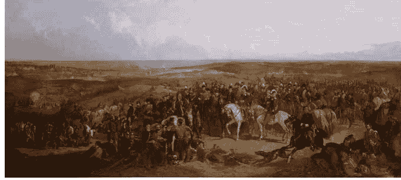

**图 8.1** 托马斯·巴克基，《塞瓦斯托波尔战前的盟军将军及其各自参谋官》，1856年，油彩颜画布，64.5 × 14.1 cm（25.4 × 5.6 英）。伦敦私人收藏。经苏得比许可复制。

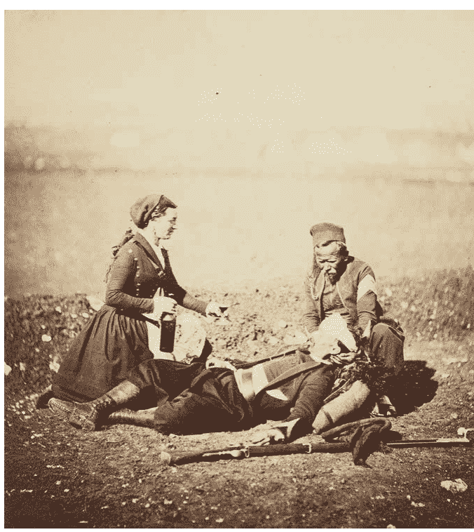

**图 8.2** 罗杰·芬顿，《受伤的祖瓦夫士兵与女装》，1855年5月5日，蛋白盐银版冲印，17.4 × 13.1 cm。皇家收藏，RCIN 2500401。皇家收藏信托/© 女女王伊丽莎白二世 2019年。

例如，芬顿拍摄了奥斯曼军队司令奥马尔·帕夏（Omar Pasha）、法国军队总司令佩利西埃将军（General Pélissier）和军团司令博斯凯将军（General Bosquet），他们都以相同的方式：骑马呈侧面三分之四侧坐姿。我们可以推断，格纽家族指示了芬顿如何拍摄，以及他们在巴克基画作中呈现的样子。巴克基被委托拍摄骑马的高级军官，这侧面证明了芬顿在克里米亚创作许多图像背后的艺术需求。除了个人坐模的肖像外，芬顿还创作了多幅群体肖像。这些群体特别关注参加过轻骑兵旅队冲锋的团士兵，可能出版商预计在他们的行动获得巨大名声后，公众会对这些人产生更大的兴趣。在英国，战争的公众叙述已经将这些冲锋者视为英雄。芬顿的群体照片还包括非战斗人员，包括女性，她们在英国和法国分别被称为“随军妇女”（suters）和“随军女”（vivandières），负责协助烹饪、洗涤、杂货供应和急救.¹¹

芬顿拍摄了随从一些高级军官的、被称为“努比亚亚人”的私人仆，以及协助建设和其他脑力任务的女士，包括被称为“克罗地亚人”和“鞑靼人”的男性。这些“类型型”肖像的数量远超预期，表明芬顿对该主题有个人兴趣；此外，对战争描绘的集中在摄影和艺术上也有意义。这些“异域风情”的祖瓦夫和非欧洲人几十年来一直是描绘印度和中东的艺术家的题材，作为更广泛的东方主义项目的一部分.¹² 祖瓦夫在战争期间因勇敢闻名，成为艺术家的青睐。他们出现在从写地油画到维多利亚女王（1819-1901）绘制的私人草图等媒介中。³ 芬顿可能认为这些主题会吸引作为潜在客户的巴克基。

## 格纽的芬顿摄影

当巴克基选择芬顿的照片作为其画作的研究对象时，格纽父子正在举办一系列令人印象深刻的照片展。照片的专门展示从项目之初就是芬顿委托的一部分。出版商于1855年9月在伦敦举办了芬顿摄影的首展，在伦敦帕尔马广场的水彩画廊展出了280张照片。在接下来的的一年里，这一展览随后在全英国从格拉斯哥到埃克塞特的至少26个不同地点举行。有些展览同时进行，需要多套芬顿的照片。每个场馆都有自己的印刷目录，而照片的选择之间进行了细微调整。

（注：由于原始文本中存在大量重复和OCR错误，译文已根据逻辑进行了清理和整合，确保内容流畅。）

# 艺术、复制与报道

尽可能地与其他知名人物一起。巴克基需要将芬顿的照片复制并整合到他的画作中，以获得每个人最生生的形象。对于《塞瓦斯托波尔战前的盟军将军及其各自参谋官》（图 8.1），巴克基复制了芬顿的许多照片。画作的视觉证据表明，巴克基完全复制了某些照片；而对于另一些，画家将两张或多张照片结合在一起，有时将一个人的头部与另一个人的身体结合。有时他会直接复制整个群体，例如芬顿照片中的《第8骠骑兵的营营》，几乎直接从照片复制到画作的左下角（尽管省略了群体背后的女性）。巴克基还复制了芬顿的《受伤的祖瓦夫士兵》和《女装》，颠倒了其构图并将其放在画作的右下角（图 8.2）。将巴克的画作与芬顿拍摄另一位女性法妮·杜贝利的照片进行对比，这清楚地表明，巴克基并没有像对待女性肖像那样将芬顿的摄影研究视为不可侵犯的文件。它也揭示了前者中弗洛伦斯·南廷尔的形象是基于芬顿的研究。

巴克基以当代历史场景的画家而闻名。通过与格纽父子和其他印刷商合作，他通过销售作品的复制品和图形复制品获得了商业成功，这通常在他们的公开展览之后。巴克基展示画作是希望游客能购买印刷复制品：预计通过销售复制品盈利，而不是出售画作本身。这种程序意味着委托原始主题并获得其图形复制版权至关重要。据当时报道，格纽父子为芬顿的克里米亚委托花费了100英镑.¹¹10 出版商为巴克基画作委托的摄影研究，在某种程度上解释了为什么芬顿以不同的姿势拍摄某些个人。

**图 8.1** 托马斯·巴克基，《塞瓦斯托波尔战前的盟军将军及其各自参谋官》，1856年，油彩颜画布，64.5 × 14.1 cm（25.4 × 5.6 英）。伦敦私人收藏。经苏得比许可复制。

**图 8.2** 罗杰·芬顿，《受伤的祖瓦夫士兵与女装》，1855年5月5日，蛋白盐银版冲印，17.4 × 13.1 cm。皇家收藏，RCIN 2500401。皇家收藏信托/© 女女王伊丽莎白二世 2019年。

例如，芬顿拍摄了奥斯曼军队司令奥马尔·帕夏（Omar Pasha）、法国军队总司令佩利西埃将军（General Pélissier）和军团司令博斯凯将军（General Bosquet），他们都以相同的方式：骑马呈侧面三分之四侧坐姿。我们可以推断，格纽家族指示了芬顿如何拍摄，以及他们在巴克基画作中呈现的样子。巴克基被拍摄骑马的高级军官，这侧面证明了芬顿在克里米亚创作许多图像背后的艺术需求。除了个人坐模的肖像外，芬顿还创作了多幅群体肖像。这些群体特别关注参加过轻骑兵旅队冲锋的团士兵，可能出版商预计在他们的行动获得巨大名声后，公众会对这些人产生更大的兴趣。在英国，战争的公众叙述已经将这些冲锋者视为英雄。芬顿的群体照片还包括非战斗人员，包括女性，她们在英国和法国分别被称为“随军妇女”（suters）和“随军女”（vivandières），负责协助烹饪、洗涤、杂货供应和急救.¹¹

芬顿拍摄了随从一些高级军官的、被称为“努比亚亚人”的私人仆，以及协助建设和其他脑力任务的女士，包括被称为“克罗地亚人”和“鞑靼人”的男性。这些“类型型”肖像的数量远超预期，表明芬顿对该主题有个人兴趣；此外，对战争描绘的集中在摄影和艺术上也有意义。这些“异域风情”的祖瓦夫和非欧洲人几十年来一直是描绘印度和中东的艺术家的题材，作为更广泛的东方主义项目的一部分.¹² 祖瓦夫在战争期间因勇敢闻名，成为艺术家的青睐。他们出现在从写地油画到维多利亚女王（1819-1901）绘制的私人草图中。³ 芬顿可能认为这些主题会吸引作为潜在客户的巴克基。

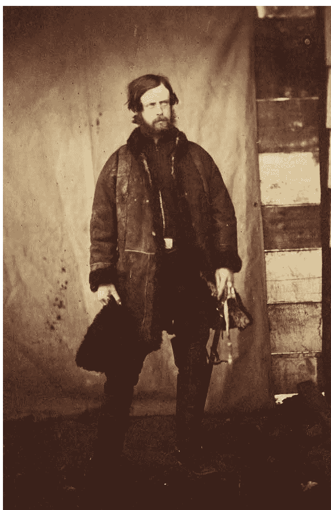

**图 8.4** 罗杰·芬顿，*巴尔戈尼爵*（Lord Balgonie），1855年，蛋白盐摄影打印品，17.7 × 11.7 厘米。皇家收藏，RCIN 2500273。皇家收藏信托/© 伊丽莎白二女王陛下2019。

# 艺术、复制与报道

巴尔尼站在墙前，空洞地望向远方。^22 他的身后露出了木木板，暗示这是一个为了冲突而建造的临时结构。他那凌乱的外表和姿态表明他刚刚走下战场。他在1857年的早逝被归因于战争的艰辛。^23) 芬顿在全英国举办的所有摄影展中都包含了巴尔尼的肖像，这一决定表明他认为这张照片对于关于战争以及冲突对退伍军人影响的辩论有所贡献。

## 芬顿克里米亚摄影的接待

尽管芬顿摄影展的观众规模很大，但高游客量并没有转化为向公众出售其作品。1856年12月，Agnew and Sons 公司将湿法溴胶负片和剩余的照片出售给了他们的竞争对手 Paul and Dominic Colnaghi & Co 公司。很快，芬顿的照片就以大幅折扣的价格出售了。^24) 出版商本可以考虑对他们创作的巴克画的作品进行推广。Agnew and Sons 已经从芬顿摄影展的门票收入中获得了了巨额利润。公众对巡展的兴趣可能已经达到了尽头。在随后将基于芬顿照片“翻译”成图形版本的过程中，我们开始看到照片的新奇感以及它们为展览观众创造的想象空间如何成为战争的问题。

展厅提供了一个公共空间，观众可以在这里聚集，通过观看一系列图像来思考战争，并与同样受到事件影响的他人伴在一起。当照片被翻译成版画时，它们失去了一些即时性，但也变得更容易被消费。一个很好的例子是芬顿的《战争会议》（The Council of War）所经历的转变，这是一幅三位指挥官的合照，在盟军胜利的消息传回英国时展。这张照片迅速成为他所有克里米亚作品中评论最多的作品之一，维多利亚女王在她的日记中提到了这张图像。^25) 另一位著名画家奥古斯塔·艾（Augustus Egg）根据芬顿的《战争会议》照片创作了一幅画。艾的作品于1856年在伦敦的格雷夫斯画廊展。^26) 艾在几个方面偏离了芬顿的影像，最显著的是改变了佩西耶将军（General Pélissier）仰望他的他的位置——变得更加动态，这种对佩西耶防御奥斯曼军队的描绘符合当时的叙事，该叙事描述佩西耶是1855年6月盟军胜利的主要力量，导致了战争的结束。艾还在背景中添加了人物，并将人物稳固地安置在军事环境中。艾对芬顿照片的转化允许了细微的变化，这有助于公众对作品的接受。也许照片的视觉内容和其情感影响对于维多利亚时代的公众来说太强烈了，以至于他们不想购买芬顿的前线照片并在家庭环境中观看它们。战争在后方和前方都是创伤性的，特别关注了照片、印刷品和绘画中返回英国的退伍伤兵的处境。^27 也有可能照片太模糊，无法向公众传达清晰的信息，而艾添加了更多细节，使场景的信息更加清晰。

“战争会议”这一主题的吸引力是显而易见的，因为它是盟军胜利的象征。艾画的石版画复制明显大于芬顿的照片（图 8.5）。如果现存印刷品的数量

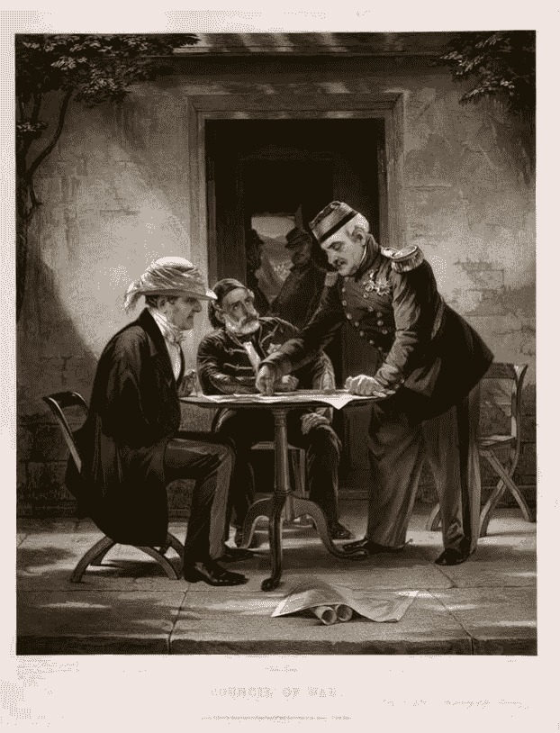

**图 8.5** Samuel Bellin，仿奥古斯塔·艾，仿罗杰·芬顿，《战争会议》，1857年，混合媒介石版画，74.7 × 60.3 厘米（版幅）。皇家收藏，RCIN 661975。皇家收藏信托/ © 伊丽莎白二女王陛下2019。

# 艺术、复制与报道

考虑到芬顿作品展览的流行以及他的照片向木刻画、绘画和版画的转化，很清楚，维多利亚时代的公众准备好同时接受照片的多重视觉背景：作为战争报道；作为对作品的情性和诗意的反思；对所呈现个人英雄主义的评论；作为“其他艺术家的真实源材料”。今天，为了理解由一位具有艺术性的摄影师创作的芬顿克里米亚照片，我们需要一种严谨的方法将其归类为报告；通过更倾向于将芬顿的克里米亚照片不仅视为完成的作品，而且也视为可以通过语境和复制进行转化的中间作品，我们可以在这组非凡的照片中发展出更细致入微的理解。显然，19世纪50年代摄影与艺术之间的关系是紧密的，并被维多利亚观众认为不仅是可以接受的，而且完全是有益的。

我非常感谢……的贡献。

# 注释

- 1 我非常感谢……的贡献。出版商本可以考虑对巴克画的作品进行推广。

- 2 出版商本可以考虑对他们创作的巴克画的作品进行推广。Agnew and Sons 已经从芬顿摄影展的门票收入中获得了了巨额利润。

- 3 也有可能照片太模糊，无法向公众传达清晰的信息，而艾添加了更多细节，使场景的信息更加清晰。

- 4 艾在几个方面偏离了芬顿的影像，最显著的是改变了佩西耶将军（General Pélissier）仰望他的他的位置。

# 艺术、复制与报道

1855年的展览目录并未包含随后版本中出现的报媒体简报。

- 16 《伦敦插画新闻》，《芬顿先生的摄影马车——源自克里米亚展览会》，1855年11月17日，557页。《伦敦插画新闻》，《克罗地亚人：根据R. 芬顿在克里米亚拍摄的照片》，1855年12月29日，753页。

- 17 克里斯托弗·希伯特，《伦敦插画新闻》中的维多利亚时代英国社会史（伦敦：Angus & Robertson，1975年），13页。1855年7月1日发生的报刊税废除，有助于降低成本。

- 18 前述文献。贝尔法斯特，1856年3月2日。

- 19 《伦敦每日新闻》，1855年9月20日。重印于托马斯·阿格纽父子出版的《罗杰·芬顿先生：在克里米亚拍摄的摄影作品展》（伦敦：Thomas Brett，1856年），5页。

- 20 《文学公报》，1855年9月22日。重印于阿格纽出版的《在克里米亚拍摄的摄影作品展》，1856年，12页。

- 21 《克里米亚摄影展》，利物浦摄影杂志》，第2卷，第23期（1855年11月）：134页。

- 22 泰勒·布劳宁，《崩溃：索姆战役上的压力危机》（伦敦：Little，爱丁堡，私人出版，2016年），335页。

- 23 他饱受了克里米亚战役的艰辛，并于1855回到家。威廉·弗雷泽，《梅维尔家族：梅尔维尔伯爵与莱文伯爵》（爱丁堡，私人印刷，1890年），379页。巴尔戈尼的死亡在讣告中被报道为是由于其在克里米亚战役中的服役导致长期疾病后“去世”的；《邓迪、珀斯和库帕尔广告报》，1857年9月4日，4页。

- 24 现在已准备以低于出版价的价格折扣出售。《雅典尼姆》，芬顿的摄影，1857年1月3日，2页。

- 25 在这些作品中最具历史意义且最有趣的是《军事会议》的画作，“来自克里米亚的摄影，《雅典尼姆》，1855年9月29日，1118页。维多利亚女王写道：“我们单独用餐，看着由L·R·拉格兰恩先生、佩利西埃和奥马尔·帕夏拍摄的最有趣的照片，那是在拍摄采石场的那个早晨坐在一起拍摄的。”皇室档案馆 VIC/MAIN/QJV，1844年8月8日。

- 26 埃格画作的所在地目前已不详，而 Graves & Co 公司发出的石版画存在于许多收藏中。

- 27 参见例如维多利亚女王访问伤兵的摄影和绘画，由约瑟夫·坎达尔和罗伯特·霍莱特委托创作。这些作品及其他作品收录于戈的《战争阴影》（2017）中。

# 摄影中的印象主义

霍普·金斯利（Hope Kingsley）

1890年12月，英国摄影师乔治·戴维森（George Davison, 854–1930）进行了一场名为“摄影中的印象主义”的全面演讲，讨论了当代绘画与一个类似的进步摄影师流派之间的相关性，他自己也算在其中¹。戴维森的演讲在伦敦艺术学会发表²，并随后发表在几份刊物上³，对印象主义及其与摄影的相关性进行了广泛讨论。在绘画风格和技术尚处于英国艺术主流边缘地位的时期，他对印象主义的拥抱是极其超前的的，而他的演讲将印象主义理念引入了英国摄影界。戴维森为印象主义在摄影中的应用提供了一个雄心勃勃的论点。他认为有必要这样做，部分是因为他的摄影作品在不列颠摄影协会的近期展览中引起了关注——批评。在他演讲两个月前，戴维森的摄影《老农场》（An Old Farmstead, 1889）（图9.1）因其软焦效果而备受赞誉和青求，这种特征被等同于印象派绘画中快速、速描般的笔触。因此，戴维森正在验证自己的摄影方法。更广泛地说，通过将摄影师的目标与画家对齐，他论证了摄影作为艺术媒介的等效性。

戴维森在印象主义被吸收摄影美学的初期，提供了一个异常具体的描述。摄影史通常将印象主义置于其实的时间范围之外，要么回到19世纪60年代，要么推向世纪初的画意。此类描述在视觉上可能引人注目，但往往是时代错误的，将相似性误认为是因果关系。本文重新审视了19世纪80年代末和90年代初初的印象主义，并将戴维森的理想置于他的艺术背景之中。它考虑了戴维森的主要来源：新英语俱乐部画家弗朗西斯·贝茨（Francis Bates, 1853–1950）的著作，以及英美

**图9.1** 乔治·戴维森，《老农场》，1889年。胶版画，于1897年后印刷。尺寸：15.4 × 20.4 cm。在《摄影工作：摄影季刊》第18期（1907年4月）作为《洋葱地》出版。经威尔逊摄影中心许可转载。照片致谢：威尔逊摄影中心。

# 艺术、复制与报道

1855年的展览目录并未包含随后版本中出现的报媒体简报。

- 16 《伦敦插画新闻》，《芬顿先生的摄影马车——源自克里米亚展览会》，1855年11月17日，557页。《伦敦插画新闻》，《克罗地亚人：根据R. 芬顿在克里米亚拍摄的照片》，1855年12月29日，753页。
- 17 克里斯托弗·希伯特，《伦敦插画新闻》中的维多利亚时代英国社会史（伦敦：Angus & Robertson 1975年），13页。1855年7月1日发生的报刊税废除，有助于降低成本。
- 18 前述文献。贝尔法斯特，1856年3月2日。
- 19 《伦敦每日新闻》，1855年9月20日。重印于托马斯·阿格纽父子出版的《罗杰·芬顿先生：在克里米亚拍摄的摄影作品展》（伦敦：Thomas Brett，1856年），5页。
- 20 《文学公报》，1855年9月22日。重印于阿格纽出版的《在克里米亚拍摄的摄影作品展》，1856年，12页。
- 21 《克里米亚摄影展》，《利物浦摄影杂志》，第2卷，第23期（1855年11月）：134页。
- 22 泰勒·布劳宁，《崩溃：索姆战役上的压力危机》（伦敦：Little，爱丁堡，私人出版，2016年），335页。
- 23 他饱受了克里米亚战役的艰辛，并于1855回到家。威廉·弗雷泽，《梅维尔家族：梅尔维尔伯爵与莱文伯爵》（爱丁堡，私人印刷，1890年），379页。巴尔戈尼的死亡在讣告中被报道为是由于其在克里米亚战役中的服役导致长期疾病后“去世”的；《邓迪、珀斯和库帕广告报》，1857年9月4日，4页。
- 24 现在已准备以低于出版价的价格折扣出售。《雅典尼姆》，芬顿的摄影，1857年1月3日，2页。
- 25 在这些作品中最具历史意义且最有趣的是《军事会议》的画作，“来自克里米亚的摄影”，《雅典尼姆》，1855年9月29日，1118页。维多利亚女王写道：“我们单独用餐，看着由L·R·拉格兰恩先生、佩利西埃和奥马尔·帕夏拍摄的最有趣的照片，那是在拍摄采石场的那个早晨坐在一起拍摄的。”皇室档案馆 VIC/MAIN/QJV，1844年8月8日。
- 26 埃格画作的所在地目前已不详，而 Graves & Co 公司发出的石版画存在于许多收藏中。
- 27 参见例如维多利亚女王访问伤兵的摄影和绘画，由约瑟夫·坎达尔和罗伯特·霍莱特委托创作。这些作品及其他作品收录于戈的《战争阴影》（2017）中。

# 摄影中的印象主义

霍普·金斯利

1890年12月，英国摄影师乔治·戴维森（George Davison, 1854–1930）进行了一场名为“摄影中的印象主义”的全面演讲，讨论了当代绘画与一个类似的进步摄影师流派之间的相关性，他自己也算在其中¹。戴维森的演讲在伦敦艺术学会发表²，并随后发表在几份刊物上³，对印象主义及其与摄影的相关性进行了广泛讨论。在绘画风格和技术尚处于英国艺术主流边缘地位的时期，他对印象主义的拥抱是极其超前的，而他的演讲将印象主义理念引入了英国摄影界。戴维森为印象主义在摄影中的应用提供了一个雄心勃勃的论点。他认为有必要这样做，部分是因为他的摄影作品在不列颠摄影协会的近期展览中引起了关注——批评。在他演讲两个月前，戴维森的摄影《老农场》（An Old Farmstead, 1889）（图9.1）因其软焦效果而备受赞誉和追求，这种特征被等同于印象派绘画中快速、速描般的笔触。因此，戴维森正在验证自己的摄影方法。更广泛地说，通过将摄影师的目标与画家对齐，他论证了摄影作为艺术媒介的等效性。

戴维森在印象主义被吸收进摄影美学的初期，提供了一个异常详实的描述。摄影史通常将印象主义置于其实际的时间范围之外，要么回到19世纪60年代，要么推向世纪初的画意派。此类描述在视觉上可能很有力，但往往是时代错误的，将相似性误认为是因果关系。本文重新审视了19世纪80年代末和90年代初的印象主义，并将戴维森的理想置于他的艺术背景之中。它考虑了戴维森的主要来源：新英语俱乐部画家弗朗西斯·贝茨（Francis Bates, 1853–1950）的著作，以及英美

**图9.1** 乔治·戴维森，《老农场》，1889年。胶版画，于1897年后印刷。尺寸：15.4 × 20.4 cm。在《摄影工作：摄影季刊》第18期（1907年4月）作为《洋葱地》出版。经威尔逊摄影中心许可转载。照片致谢：威尔逊摄影中心。

# 戴维森的观点

戴维森在演讲开始时，对印象主义进入摄影美学的初期提供了一个异常详实的描述。摄影史通常将印象主义置于其实际的时间框架之外，回到19世纪60年代或推向世纪初的画意派。此类描述在视觉上可能引人入胜，但往往是时代错误的，将相似性误认为是因果关系。

# 摄影与艺术

《业余摄影师》（The Amateur Photographer）向其读者推荐了英国摄影协会（NEAC）1886年的首届展：

> “法国式的写实处理法在这里与刻苦的努力和英式的严谨完美结合……占主导地位的色彩色调宁静，但其中有一抹明亮的光闪显示了克制夸张的价值。色彩的正确‘数值’以及对技术卓越的严格关注是至关重要的.¹18”

这些美学追求可以在弗雷德里克·古达尔（Frederick Goodall, 1855–1944）的《罗克兰角》（Rockland Broad，1883）中看到，这被认为与一幅已失的画布相似（图9.2）。《罗克兰角》在NEAC1886年的展览上展出.¹19 古达尔是NEAC的创始人之一，他的绘画展现了《业余摄影师》所描述的特征：低调的色调准确地描绘了灰色的天空，并点缀着小小的色彩亮点。宽阔的水域和天空环绕着两岸，撑船上的撑船夫以及隐没在枯树间的低矮农场。《罗克兰角》是对古达尔随后由彼得·埃默里·莫顿（Peter Emery Morton）拍摄的照片中所景的还原性综合，这些照片收录在他的摄影集《诺福布罗阔地的生命与景观》（1887）中。古达尔画中撑船夫的直立姿态可见于一张摄影研究图中（图9.3），而整体构图与另一张照片（图9.4）最为接近。《业余摄影师》向业余摄影师推荐了1886年的NEAC绘画，赞其具有“赞叹的构图、主题安排、直接的情感和细致的光影，²⁰ 而且古达尔与艾默生的合作是一个重要的——尽管是不典型的——例子，展示了NEAC画家与摄影师的密切合作。”

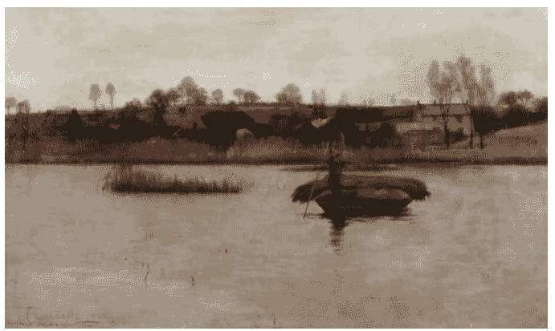

**图9.2** 托马斯·弗雷德里克·古达尔，《罗克兰角》，诺福克，1883年，布上油画，91.8 x 153.2 cm。经诺里维奇城堡博物馆与美术馆及诺福克博物馆服务机构许可复制。照片版权：诺福克博物馆服务机构（诺里维奇博物馆与美术馆）。

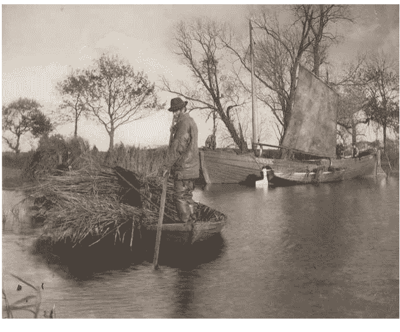

**图9.3** 彼得·亨利·艾默生与托马斯·弗雷德里克·古达尔，《格拉登割草人的回归》，1885年。铂金照片。图像尺寸：22.7 × 28.8 cm。出版于P. H. 艾默生与T. F. 古达尔的《诺福布罗阔地的生命与景观》，1887年，第XXX版。经威尔逊摄影中心许可复制。照片版权：威尔逊摄影中心。

艾默生通常被视为项目的策划者，但绘画和照片的时间顺序表明，是古达尔确定的绘画地点决定了摄影路线。²¹

## 戴维森的来源：莫奈与印象派

在“印象主义”讲座中，戴维森赞美了某些天才印象派绘画中自然的完美境界，这让他产生了一种崇高感的*情感*——当一个人偶然发现关于自然光、色彩或空气的微妙事实，并愉快地转入其中时.¹² 他很可能在1889年4月和5月看到了法国印象派绘画，当时古皮画廊（Goupil Gallery）展出了“莫奈的二十印象”。这是这位艺术家一生中在伦敦唯一的展览。²³ 当戴维森在1890年的讲座中描述印象派绘画时，他的话与莫奈在古皮画廊的作品呼应：“一艘从岸边视角面对海浪浪尖的船”是《海上风暴》（Marine-Tempest）的主题，而“破碎的土地”暗示了《奥热蒙特磨坊》（Le Moulin de'Orgemont）宽阔而粗糙的前景。

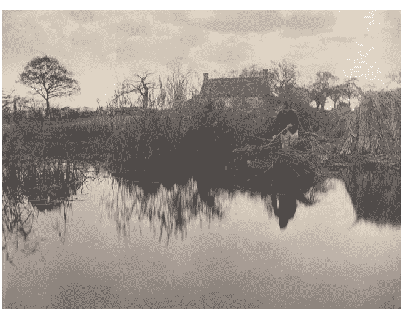

**图9.4** 彼得·亨利·艾默生与托马斯·弗雷德里克·古达尔，《测绘格拉登》，1885年。铂金照片。图像尺寸：21.9 × 29.3 cm。出版于P. H. 艾默生与T. F. 古达尔的《诺福布罗阔地的生命与景观》，1887年，第XIV版。经威尔逊摄影中心许可复制。照片版权：威尔逊摄影中心。（1873年）（图9.5）。⁴ 但戴维森对印象派绘画的喜爱并未被广泛认同。他承认对绘画中的“新影响”持有“热烈的反对”，关注“莫奈的画”。莫奈的方法是不寻常的，正如戴维森引用艺术史学家和批评家尚诺（Chesneau）所解释的那样，尚诺是印象派画家的早期支持者：公众的眼睛——对自然读法的长期接触，并在很大程度上受到绘画技巧滥用的阻碍——拒绝承认这种风格的意义和价值。但它将会到来。

戴维森的引用出自尚诺的《艺术教育》（1880年，英文译本1886年），该书中阐述了印象派创新的优点，包括大胆的色彩、高调数值和富有表现力的笔触⁸。尚诺承认作品执行“粗糙、简略且看起来不完整”的困难⁹；而莫奈在阿让日在附近的冬景（图9.5）显示出低调的自然色调，这种狂放的笔触很容易引发尚诺在书中指出的那种批评。

至于彼得·亨利·艾默生，他在那个春天的伦敦的其他展览中，将古皮画廊的莫奈展推荐给“所有自然主义艺术的学生”。³⁰ 但

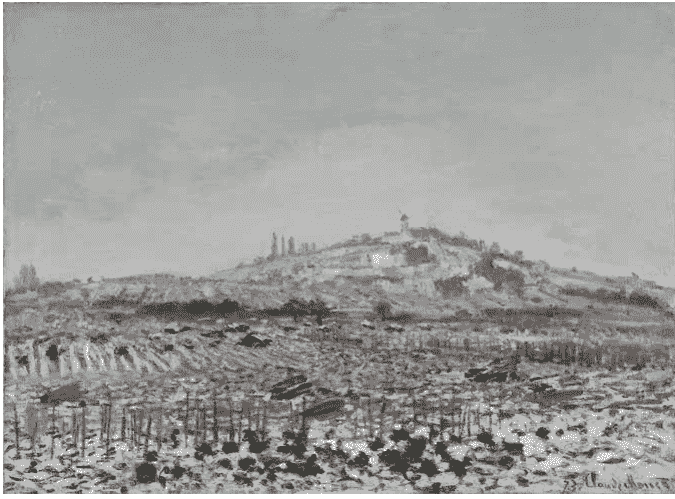

**图9.5** 克劳德·莫奈，《雪中的葡萄园，望奥热蒙特磨坊》，1873年，布上油画，58.4 × 81.3 cm，位于弗吉亚美术馆，弗吉亚州，阿多夫·D.和威尔金斯·C.基金会。⁵经弗吉亚美术馆许可复制。照片：凯瑟琳·韦泽。

《业余摄影师》警告印象派作为一种摄影影响：“我们希望不要出现摄影作品在任何方面像克劳德·莫奈等人在古皮画廊展出的那些‘印象’。”¹艾默生对《业余摄影师》的评论表示反对，正确地将其解读为批评他自己的摄影理论。他退缩了，坚持认为他“从未主张摄影像所谓的‘印象派的作品’”，并引用了自己在《自然主义摄影》中的话：“我们认为所谓的现代‘印象派’的作品只是一种暂时的狂热”² 摄影界还有两篇关于莫奈展的报道。《摄影新闻》（Photographic News）节选了彭内在《星报》（Star）上的报道，该报道主张认可莫奈的艺术能力，并引用玛格丽特·卡梅的照片作为摄影艺术手段的证据。《相机》（The Camera）在对艾默森《自然主义摄影》的评论中讨论了古皮画廊的莫奈画布，将艾默森的美学与莫奈的作品相比⁴ 它谴责莫奈绘画缺乏定义，并将印象派解释为一种原则，即摄影师应该“通过使照片模糊并缺乏所有细节来模仿这些印象派的效果”。⁵ 这种将印象派与“模糊”照片等同的做法触动了戴维斯的神经，因为他在1889年在英国摄影学会（PSGB）的年展上展出了四张照片⁶。《每日电报》（Daily Telegraph）赞誉这些作品是“通过小孔捕捉的、柔和的、印象派的作品”。⁷ 但艾默生批评戴维森的图像显示出整体的扩散，而不是他所倡导的差焦⁸

## 戴维森的旧农场

六个月后，戴维森承认接受小孔摄影的光学效果需要“巨大的勇气”：“这是一种实验，一种抛锚；它不同于动摇宗教信念。”宗教信念”这一说法可能是对艾默生的讽刺，后者将对他自然主义摄影的怀疑者视为英雄。戴维森通过画家的范例得到了体现：“每一个学会观察并捕捉叶片精神和生命的艺术家，总有一天达到完美的境界，并进行宽泛的绘画³ 在那个秋天，他建议了一种与这种宽泛绘画风格等效的摄影方法，断言摄影师可以使用散焦来表现印象派绘画的效果。正如画家使用宽泛的处理来剔除平庸并确保主题的精神和特征一样……为了同样的聚焦目的，焦是摄影师唯一的手段，对我来说，这是该功能伟大且领先的应用.¹⁰ 因此，他在1890年的英国摄影学会展览上展出了《旧农场》（图9.1），并收到了好评。《泰晤士报》将其与戴维森的另一张照片一起赞美它：“也许没有通过摄影方法创作出更美丽的风景了。”⁴ 这种积极的与大众媒体对印象派绘画的保留态度形成对比，这无疑比戴维森的一些摄影同行所给予的接待要慷慨得多。苏格兰摄影师安德鲁·普林格（Andrew Pringle）宣布：

> “如果在自然中看到像戴维森先生的《家园》[原文如此]那样模糊……我应该立刻进精神院。如果我像在其他作品中——通过自然主义绘画或摄影——那样看到自然，我应该去精神院或离最近的树下。”³

戴维森的照片可能是模糊的，但并非不可触及。构图被组织成对比鲜明的色调，其中广阔的田野被深色的树木和农场建筑捕捉。这些水平线被垂直的茎部衬托，这种视觉上的显著性导致戴维森在1898年将照片重新命名为《洋葱田》。

正如模糊，印象派绘画是一种视觉挑战，因为很难将粗糙的涂抹转化为连贯的画面。1889年，《艺术家》（The Artist）解释说，莫奈的绘画可以从远处观察以“产生预期的效果”；近看则是“除了专家之外，这种精妙的笔触是无法理解的”。⁴ 同样的方法被建议用于解决戴维森的小孔照片，正如《泰晤士报》在1890年的解释道：“从合适的距离看，这张画（旧农场）给非常真实”

# 摄影中的印象派 147

对主体的描绘，很大比例是将高超艺术处理所产生的宽泛效果与照片中真实的细节真实结合在一起。⁴⁵ 《英国摄影杂志》不喜欢离焦效果：视觉受到的最初扰动非常令人痛苦，无论从远处看还是其他角度，这种强度都会增强。⁴⁶

## 自然主义与印象派：术语定义

对于某些评论家来说，针孔摄影和印象派绘画的视觉效果是不自然的，埃默森也认为它们不符合自然主义。然而，戴维森在他关于“印象派”的演讲中承认，这群新画家“曾各种自称为印象派者、自然主义者等；⁴⁷ 这种印象派与自然主义的混淆很常见。事实上，法国印象派绘画建立在自然主义基础之上，而自然主义本身是对长期致力于*外光派绘画*艺术承诺的延伸。⁸1889年，《相机》杂志通过将莫奈的作品与埃默森在《自然摄影》中的术语联系起来，宣布：“正是埃默森博士敦促摄影师去崇拜和模仿的印象派，或自然主义。”⁴⁹ 埃默森在书中理清了这些术语，解释说虽然印象派与自然主义的意思相同，但他更倾向于后者，因为者的艺术作品“可以提升到一个标准——自然”。对于埃默森来说，自然构成了一个客观标准，而印象派是建立在主观基础上的：“画家可以声称他所看到的大部分自然；每位独立画家都成为自己和他人的标准。”⁵⁰ 正如埃默森暗示的，自然主义与表现艺术家视觉经验的印象派策略之间等效性。但这些方法的区别在于画面表达艺术家对自然景观的“感官”或主观“印象”的程度——前者倾向于光学客观性，后者则倾向于个人感知。1890年，戴维森举例说明了“印象”是如何运作的：“画家并不画风景中的树，他画的是树的印象。他的印象可能与别人不同，但那可能是真实的。”⁵¹

埃默森拒绝了印象派，在听完戴维森的演讲后，他也否定了自然主义，宣布道：“我现在和将来既不是理想主义者、写实主义者、自然主义者，也不是印象派者——*确实是摄影印象派！；并将‘摄影印象派’注释为对骗子的亵渎。”⁵² 他的话包含在《自然主义摄影的死亡》中，这是他在1890年12月底印刷的一份册子，并于1891年1月提交给摄影杂志出版。埃默森的这种“放弃”，关键在于拒绝了自然作为艺术基础的首要地位。它还涉及其他问题，之一就是确立自己相对于戴维森的权威：“前几天在艺术学会，戴维森先生的一的论文——一个没有受过训练、知识浅薄的业爱好者——其中我的想法被随意且无礼地处理了，没有给我任何荣誉。”⁵³ 戴维森确实引用了埃默森，但引用的是美国诗人和哲学家拉尔夫·沃尔多·埃默森（1803–82），而不是他的表弟彼得·亨利·埃默森。⁴⁴

# 摄影与艺术

摄影杂志报道了这场争议，尽管重点在埃默森身上，他一直是一个多产且有趣的争议来源。除了埃默森，另一个对戴维森观点最尖锐的批评来自艺术家兼评论家约瑟夫·潘尔，他在1891年一次相机俱乐部关于艺术摄影的辩论中提出。尽管潘尔对戴维森的见解有所贡献，但他言辞毫不讳。他坚持认为，“莫奈在风景中的线条、[德加]、[詹姆斯·麦尼尔]惠斯勒以及[约翰·辛格]萨根在人物和肖像画中的线条代表了一种完全超出任何摄影可能性的艺术形式⁵⁵ 而且他完全否定了摄影师艺术表达的机会：“你观察并看到自然中美好的东西，然后你期望一台机器向你展示同样的东西——一台没有感觉或情感的机器，一台以你相同的比例接收对象的机器。”⁶ 在随后的讨论中，他声称摄影师在吸纳当代艺术思想方面是虚伪的，或天真的：“你们说你们是印象派者，给出你们的印象。看起来你们不像。你们带上相机，去大自然，说‘这是一件好事’。你们跑出相机，把头伸进黑袋子里，这一切让你对自然有了完全不同的看法。”⁷

潘尔的干预引起了震动。噪音最终平息，潘尔继续出现在相机俱乐部的会议和晚宴上与摄影师们交流。戴维森在1893年扩展了他的论点，解释说虽然“印象派绘画是个人的，正如每件艺术作品或或如此”，但作品并非晦涩的：“也许是草堆上的闪烁光芒，或是剧场的运动。”⁸ 戴维森在英格兰俱乐部看到这样的作品：莫奈的《草堆》系列画布在1893年在英格兰俱乐部展，沃尔特·西克的室内画在1888年和1892年在NEAC展。⁹ 1893年，莫奈在普通媒体中仍收到负面评价，但在摄影杂志中表现较好，特别是《爱好者摄影》等杂志，将戴维森和同仁视为贡献者。1895年，《相机杂志》赞誉莫奈捕捉雪光的效果——这种幻象是完美且奇妙的¹⁰ 戴维森的《印象派》演讲是接受印象派与摄影相关的重要早期步骤。其艺术效果被内化在画意运动中，这一运动很大程度上归功戴维森及其同仁，因为俱乐部是1892年成立的圈子的孵化器。这些影响跨了大西洋：阿尔弗雷德·斯蒂格茨在1894年加入了俱乐部和印象派圈，并活跃于期刊（1897年）和《相机工作》（1903年）。这个圈子在1907年完成，《相机工作》出版了八张戴维森的照片¹¹

## 注释

1. 乔治·戴维森，“摄影中的印象派”，演讲，艺术学会，1890年12月17日，发表于《英国摄影杂志》第37卷第159期（1890年12月26日）：821–4；另见824–6。戴维森是伦敦相机俱乐部的秘书，1885年成立的“业余爱好者”（非商业）摄影师协会的参考。

2. 伦敦艺术学会（皇家艺术制造与贸易学会）于1852年12月举办了伦敦首次公展，以及1853年伦敦摄影学会的成立会议。

3. 戴维森的演讲也印在《印象派新闻》、《相机与艺术及家庭文化》中。弗朗索瓦，“印象派与摄影”，《摄影史》第35卷第1期（2009年2月）：18–25。

4. 玛格丽特·哈克识别戴维森为重要主角，并简要获取了他的而非他对印象派理论或艺术史背景的理解。玛格丽特·哈克，《印象派圈：印象派摄影1892–1910》（伦敦：Heinemann，1979年），31–2。

5. 见亚阿隆·沙夫，《艺术与摄影》（伦敦：Allen Lane，1968），131, 133, 136；菲利普·杰格等，《欧洲的印象派画意摄影，1888–1918》（伦敦和纽约：圣路易斯艺术博物馆，2006年），1, 17, 68。

6. 柯克·沃德尔挑战了戴维森关于摄影对印象派画家形式策略影响的主张，见《真诚的虚伪：重审印象派与摄影》，《美国艺术》第68卷第1期（1980年冬季），487–98，以及《时间的意识形态：德加与摄影》，《美国艺术》第68卷第6期（1980年夏季），96–110。

7. 戴维森，“摄影中的印象派”，821。

8. 同上，822。

9. 同上，823。

10. 同上，822。

11. 弗茨·弗朗西斯·贝茨，《自然主义绘画》（伦敦：The Artist，1887年）。贝茨的文本首先出现在《艺术家及家庭文化》第7卷，75–82页，1886年3月至9月共七篇文章中。

12. NEAC的法国灵感包括画家让·弗朗索瓦·米勒和朱尔·巴斯蒂安·勒帕，后者领导了19世纪70年代末兴起的自然主义运动。

13. 贝茨，《自然主义绘画》（1887），27。

14. 戴维森，“摄影中的印象派”，822。

15. 《艺术学生的自然主义摄影》（伦敦：Sampson Low, Marston, Searle and Rington，1889），埃默森并未创作这些艺术家，但他们包含了NEAC的画家弗雷德里克·古达尔，他在1885年见过此人。古达尔向他介绍了其他NEAC的艺术家，包括乔治·克劳森和亨利·朗格。

# 摄影与艺术

16. 尽管贝特在《艺术家》上的文章比自然主义摄影早了三年，但埃默森坚持认为贝特采用了他的观点（以及标题），贝特否认了这一指控。“埃默森博士对自然主义摄影的放弃”，“摄影新闻”第35卷，第16期（1891年）：62；贝特给《摄影新闻》、《相机》和《艺术家》的编辑作了回复。

17. 《摄影预告》回顾了1886、1887、1889、1890、1891、1892和1893年新英艺术俱乐部（NEAC）的展览。

18. “我们的观点”，“业余摄影师”第3卷，第85期（1886年5月）：242。

19. 我感谢托马斯·古达尔的后人提供的关于古达尔1886年提交的作品《最后的》的信息。

20. “我们的观点”，“业余摄影师”，1886年，242。

21. 托马斯·古达尔的后人提供了关于比较绘画和艺术家创作地的宝贵信息。

22. 戴维森，“摄影中的印象主义”，822。

23. 除了古皮尔画廊外，莫特从1870年起的伦敦展均为以小组展的形式进行。

24. 戴维森，“摄影中的印象主义”，822。《海洋——风暴》，也被称为《微风中的波》（1866），编号XII，伦敦古皮尔画廊，1889年。见弗朗西斯·福利《假借莫特伪造莫特：1870–1905年的莫特营销》，载于弗朗西斯·福利（编），《莫特与法国风景：奶牛与诺曼底》（爱丁堡：苏格兰国家美术馆，2006年），149, 123。《奥尔磨》（1873）编号XV，伦敦古皮尔画廊，1889年。见丹尼尔·怀尔德斯坦，克劳德·莫特，《完整绘画：全集目录》（科尼克）：塔申出版；巴黎：怀尔德斯坦研究所，1996年），110。

25. 戴维森，“摄影中的印象主义”，821。

26. 舍纳肖在《巴黎日报》的三篇文章（1874年4月2日、5月7日和5月9日）中赞扬了第一批后来闻名于世的印象派画家。这些法文译文重登于《新印象主义：1874–1886年的印象主义》中。文献集。第一卷：评论，鲁丝·本顿编，1（旧金山：旧金山美术博物馆，1996年），17–20。

27. 同上，821。在他的讲座中，戴维森错误地将他们称为“德·舍纳”。

28. 恩斯特·舍纳肖，“艺术与自然”，载于《艺术教育》（1880），克拉拉·贝尔译（伦敦：Cass & Co., 1886），217。

29. 同上，216。

30. P. H. 埃默森，“自然艺术”，载于“通信”，“摄影新闻”第33卷，第160期（1889年5月10日）：埃默森还向古皮尔画廊推荐了卡米·科里的作品，在新英艺术俱乐部推荐了约翰·辛格·萨金特的作品，并在皇家学院推荐了托马斯·古达尔的作品。

31. “我们的观点”，“业余摄影师”第9卷，第24期（1889年5月21日）：319。该评论出现在针对埃默森的《自然主义摄影》的各种给编辑信之前。

32. “所谓的‘印象派’是莫特。”P. H. 埃默森，“埃默森的‘自然主义摄影’”，“摄影新闻”第33卷，第1605期（1889年6月7日）：381。埃默森引用了《自然主义摄影》，22。

33. 未署名评论[约瑟夫·佩内]，“星报”关于摄影中的印象主义，“摄影新闻”第33卷，第1600期（1889年5月3日）：304。星报完整的评论将莫特的画布描述为“意义上最完整的画；如果你无法在其中看到毫无艺术感的画，那不是画家的错，而是你的错”。“未知艺术家”[约瑟夫·佩内的匿名笔名]，“绘画中的印象派——邦德街的一些展览”，“星报”，第39（1889年4月29日）：2。

34. 未署名评论，“印象主义与摄影。埃默森博士的新书”，“相机”第3卷，第36期（1889年5月1日）：295，戴维森看到自己关于摄影协会的文章的评论紧随其后；他的最后几段与该评论在一起。见乔治·戴维森，“我们的摄影协会：其增长与工作”，“相机”第3卷，第36期（1889年5月1日）：292。

35. “印象主义与摄影。埃默森博士的新书”，“相机”，296, 36 “戴维森的画”，“摄影”第11卷，第21期（1889年4月4日）：240。他曾在1888年在英国摄影学会展出过一张铂版摄影作品《萨塞克斯风景》。

37. “每日报对摄影展的意见，《泰晤报》，英国摄影杂志第36卷，第53期（1889年10月4日）：654。

38. P. H. 埃默森，“埃默森的英文信”，“业余摄影”第10卷，第26期（1889年11月29日）：365。

39. 戴维森，“绘画聚焦”，“摄影”第28期（1890年5月29日）：339。

40. 乔治·戴维森，“问题”，“摄影新闻”第34卷，第80期（1890年11月14日）：883。

41. 一位大师的作品曾于1890年作为原作展出过，但该原作已不存。

42. “伦敦媒体对摄影展的意见，《泰晤报》，摄影杂志第37卷，第58期（1890年10月3日）：632。

43. 安德鲁·普伦西，“摄影中的印象主义”，“摄影”第3卷，第13期（1891年1月8日）：22。普伦西和戴维森都是摄影杂志的编辑委员会成员以及柯达董事会成员。

44. 未署名评论，“古皮尔画廊的莫特”，“艺术家”1889年5月1日：147–8，载于《英国的印象派：评论界》，凯特·林特编，311–12。

45. “伦敦媒体对摄影展的意见，《泰晤报》，1890年5月29日，632。

46. “摄影学会展”，“英国摄影杂志”第37卷，第58期（1890年10月10日）：645。

47. 戴维森，“摄影中的印象主义”，821。

48. 见脚注13关于法国。当时，“自然主义者”和“自然主义”这两个词是通用的。

49. “印象主义与摄影。埃默森博士的新书”，296。

50. 埃默森，“业余摄影”，22。

51. 乔治·戴维森对威廉·伯顿的未发表回复，“关于自然主义者的两个教条”，“相机杂志”第4卷，第42期（1890年3月）：66。

52. “埃默森博士对自然主义摄影的放弃”，“摄影新闻”第35卷，第99期（1891年1月23日）：62。该文本也出现在《英国摄影杂志》、《业余摄影师》、《相机》。

53. “埃默森博士对自然主义摄影的放弃”，63。

54. 戴维森引用了拉尔夫·沃尔多·埃默森《艺术》（论文12）中的几行，《随笔集》（波士顿：James Munro & Co., 1841），294。戴维森，“摄影中的印象主义”，822。

55. 约瑟夫·潘，“作为艺术的阻碍与助力”，“相机杂志”第5卷，第57期（1891年4月）：75。

56. 同上，75。戴维森挑战了对摄影作为本质严苛且粗俗艺术媒介的广泛偏见。戴维森，“摄影中的印象主义”，824。

57. 佩内随后的讨论。[阿尔弗雷德·马塞尔]，“摄影作为艺术的诉求”，“相机杂志”第5卷，第60期（1891年7月）：150。“黑袋”是在使用相机玻璃视屏成像时使用的暗布。

58. 乔治·戴维森，“摄影与印象主义”，“摄影”第5卷，第233期（1893）：255。

59. 沃尔特·西柯特（1880–1942）于1888年加入新英艺术俱乐部（NEAC），他的音乐厅场景在1888年和1889年被广泛评论。肯尼斯·麦康尼，《新英：新艺术俱乐部历史》（伦敦：皇家学院，2006年），47–51。关于西柯特1892年的提交，见`https://www.tate.org.uk/art/research-publications/camden-town/`

60. 未署名评论[查尔斯·舍纳]，“新的还是旧的？”，“相机”第36卷，第53期（1889年10月4日）：654。

61. 未署名评论，“近期展览”，“相机杂志”第5卷，第60期（1891年7月）：129。

62. 未署名评论，“萨塞克斯风景”，“摄影”第11卷，第21期（1889年4月4日）：240。

63. 未署名评论，“印象主义与摄影。埃默森博士的新书”，“相机”第3卷，第36期（1889年5月1日）：295。

64. 未署名评论，“印象主义与摄影。埃默森博士的新书”，“相机”第3卷，第36期（1889年5月1日）：296。

65. 未署名评论，“印象主义与摄影。埃默森博士的新书”，“相机”第3卷，第36期（1889年5月1日）：296。

66. 未署名评论，“印象主义与摄影。埃默森博士的新书”，“相机”第3卷，第36期（1889年5月1日）：296。

---

## 摄影与艺术

1860年代。³ 创作这些叙事性达盖银摄影的摄影师——其中包括米德兄弟（查尔斯·理查德·米德（1826–58）和亨利·米德（约1823–1853）、J. E. 梅亚尔（1813–1901）、亚历山大·赫斯勒（1823–95）、乔治·伯纳德（1819–1902）以及最著名的加布里埃·哈里森（1818–1902）——曾参加1851年伦敦各国万国博览会和1851年各国工业博览会（纽约水晶宫博览会），并获得了一定的国际和国内声誉。他们叙事性达盖银摄影的主题可以分为三类：寓言、宗教和美国生活的世俗场景。他们缺乏文学、神话或历史题材，而这些题材在英国可以被雷杰兰德、罗宾森以及19世纪60年代后期的朱莉·玛格丽特·卡梅隆所开发。这些美国达盖银摄影被认为足够奇特，以至于引发关于此类主题在摄影中适用性的评论和观点。在当时文献提到的作品中，已知仅有少数作品传世至今。尽管如此，它们的受接受程度为我们观察美国摄影早期历史上某个特定时期对摄影的地位和理解提供了一个窗口。³

美国摄影师使用直接达盖银工艺法制作叙事性图像的这段短暂时期，与开创性的《摄影艺术杂志》（PAJ）的出版相相时代。该杂志首创于1851年，由亨利·亨特·斯内林（1817–97）编辑，出版了近十年之久（其名称在1854年至1859年间更改为《摄影与美术杂志》（PFAJ)）。斯内林的意图不仅是指导摄影师解决技术问题，还为了提供艺术方面的教育，正如杂志标题的变更所宣称的那样。该杂志定期附带盐纸打印品——其中一些源自纸质负片，另一些是三种类型的达盖银（即使用纸质负片重新拍摄达盖银，并从负片印成盐纸打印），其中包括一些编辑认为特别赞叹的、现存的唯一题材达盖银图像。

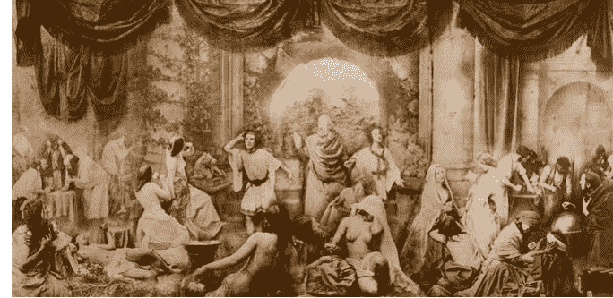

图 10.1 奥斯卡·雷杰兰德，《生命的两种方式》，1857年，由雷杰纳德·马尔比于约1925年制作的明胶银照片。图像（整体）：104.1 x 200.7 cm（41 x 79 英寸），纽约州罗彻斯特乔治·伊斯曼博物馆；皇家摄影学会赠，1978.0841.0001。经罗彻斯特乔治·伊斯曼博物馆许可复制。

## “我们艺术家的诗意天赋”

# 摄影与艺术

斯内林是这些努力的推动者：在评论米德兄弟的作品集《人生的七个阶段》（目前未经处理）时，他写道：“我们希望看到更多此类作品的展览。它将激发艺术家的诗意天赋，并创造出更精致的趣味。”斯内林主张达盖银摄影师应该打破肖像画的根源，指出达盖银的内容应局限于其艺术中更简单、更容易的部分。相反，他认为他们“应该将其作为[摄影]的科学和艺术应用展示出来。”斯内林对摄影师“诗意天赋”的赞扬凸显了早期关于摄影本质及其合法应用的争论。除了肖像之外，使用达盖银工艺制作的美国叙事性图像引发了以下问题：摄影是否符合已建立的绘画等级体系；这种媒介除了现实主义外是否也用于理想主义；它应该被认为是具有想象力的还是仅仅是机械的；摆拍摄影是否是一项应该鼓励的创造性活动，还是代表了对极渴望的摄影视觉经验体制的违背。

## 寓言

在摄影中投身寓言题材的摄影师挑战了这样观点：即这种媒介在定义上是在没有人类手干预的情况下记录可见世界，这种解释出现在大多数最早的摄影记录中。但在该媒介探索性的前十五年里，有少数摄影师接受了这一挑战。同样，这些寓言性的达盖银摄影中很少有可追溯，但从出版物的引用中已知的标题更多。已知且现存的达盖银包括米德兄弟的《世界四部分》系列和梅亚尔的《生活设计系列中的主祷文》，均在万国博览会的美国馆展出，并在出版的展览报告中进行了详细描述。

《世界四部分》展示了“欧洲、亚洲、非洲和美国。第一部分由一组美丽的形象代表，被艺术环绕；第二部分由一个穿着亚洲服饰的人代表，坐在长凳上，双腿交叉坐，拿着烟斗等；第三部分由两个跪着的黑人代表，从腰部到膝盖处没有穿外衣；第四部分由一组印第安人代表。他们受到了广泛赞誉。”报告中描述梅亚尔的《主祷文》系列为“在风格上带有一种戏剧性”，但“在执行上非常精细，光影分布和谐，一种赞叹的渗透了整幅画；这作为梅亚尔贡献中最出色的之一，没有色彩，且……”梅亚尔是一位出生于英国的摄影师，在费城工作过几年，并参加过英国和美国的展会。¹¹他在美国创作了这一系列，利用最美丽的女性作为模特来拟人化意义，体现了“神性的祈祷”；¹²

现存的纸打印主要寓言作品是哈里森的达盖银《过去、现在与未来》，尽管它有时被归于他（图10.2）。哈里森的几作品在万国博览会和纽约水晶宫展出，获得了铜奖和评论界的赞誉。1851年，PAJ发表了关于哈里森的详细介绍，由于他的艺术背景，他优于大多数操作者。作为纸币刻字师的子孙，他成长于艺术家庭。S. J. 伯尔声称哈里森是第一个创作他所谓的*描述性达盖银*的人——即具有诗歌性的画面。他认为大多数摄影师将这种媒介视为“仅仅是机械和化学操作，利用优雅的姿态和褶皱”。相比之下，哈里森全身投入艺术作品的研究，“构思了将肖像转化为完成画作的奇妙想法”，并在“对褶皱进行适当研究后，改变普通达盖银中常见的冷淡色调，以产生明显的光线、柔和的色调和阴影；没有这些，绘画或达盖银都称不上优秀。”¹⁴

伯尔赞誉《过去、现在与未来》是哈里森最受推崇的达盖银之一，并特别关注主题的表现力：“艺术家和诗人对这幅精美的画赞誉有加，并对他美丽的达盖银草图感到如此痴迷，以至于他现在被公认为是‘诗意摄影大师’。”¹⁵哈里森本人强调其题材的艺术先例，始于1851年：

> 我不希望被误解为将达盖银与绘画或雕塑同日齐论，但我更强调地认为，艺术是那些高级艺术的亲手创作，而且谁敢说我们不能在自己的类型中像画家在素描本中一样创作诗诗歌；或者我们不能拥有信仰、愿望和爱的代表，就像雷诺兹一样；像穆里奥一样的圣家庭；或者像带着十字架和羔羊的小耶稣，就像拉斐尔一样？”¹⁶

哈里森拍摄的三个女性的照片包含了许多艺术回响。这三个人与他自己提到的基督教神学美德——信仰、愿望和爱产生共鸣，同时也借鉴了古典三女神以及希腊时序（Horae，也被人化为三个女性）。萨缪尔·谢莱1801年的微型画《时序、和谐、骰子，或过去、现在与即将到来的时刻》（现于普罗维登斯卫艺馆），该画曾于皇家学院展出，随后被刻版作为格雷诗作《春之颂》一个版的扉画。波士顿人爱德华·格林·马尔本在19世纪初制作了谢莱作品的微型复制品，该作品于1854年被普罗维登斯卫艺馆收购。马尔本与来自波士顿的画家华盛顿·阿尔顿一同前往伦敦，伯尔认为阿尔顿是哈里森的研究来源；哈里森很可能认识这两位先驱中的一个或两个。哈里森遵循了风景画先例。尽管画面上有三个年龄相的女性，但她们代表了不同的时期，尽管其指向有些模糊，这幅银版摄影因其精湛、平衡的构图获奖。复制纸印品显示，哈里森在工作室里摆拍模特并在主体身上实现了均匀的光照。利用女性美，这种寓言概念简单直接，外观并不过于戏剧化（正如梅雅尔的照片所示），更类似于银版摄影。然而，尽管它多次展出并通过复制纸印品在PFAI中流传，但它并没有激发其他银版摄影采用类似的奇幻题材。

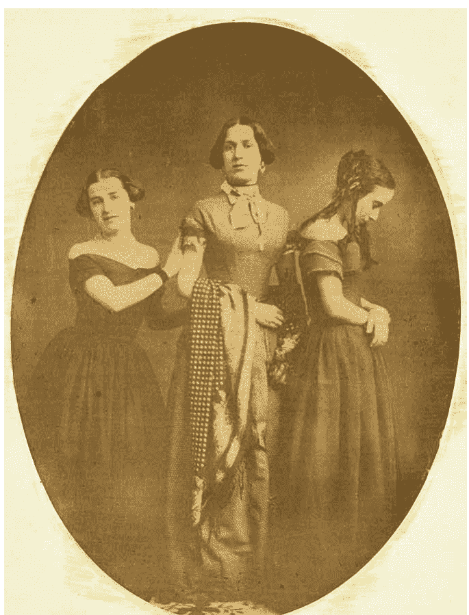

由 Lawrence 拍摄银版摄影。由 Whipple 进行水晶摄影。

过去、现在与未来。

**图 10.2** 加布里尔·哈里森（Gabriel Harrison），《过去、现在与未来》，约 1851 年，由 J. A. Whipple 根据 Harrison 的银版摄影作品制成的盐纸印品，20 × 14.9 cm（7 ⅞ × 5 ⅞ 英寸）。数字图像由盖蒂博物馆的开放内容计划提供。

## 宗教

从1851年开始，安东尼奖竞赛（Anthony Prize Competition）是银版摄影师之间促进艺术竞赛的最重要尝试。该竞赛由纽约经营著名摄影的早期摄影师之一爱德华·T·安东尼（Edward T. Anthony）赞助，在PFAI和当时的另一本重要摄影杂志《汉弗莱杂志》（Humphrey's Journal）上受到了广泛报道。¹⁷竞赛宣布提供500美元奖金，于1853年举行，奖金被用于制作奖项银壶。¹⁸每位参赛者被要求提交四张银版摄影，尺寸从分板到全板不等。竞赛面向国际参赛者，但竞争者全部是美国人：哈里森、赫斯勒、巴纳德、杰里米亚·格尼（Jeremiah Gurney）、塞缪尔·鲁特（Samuel Root）、乔治·K·沃伦（George K. Warren）、詹姆斯·布朗（James Brown）、塞缪尔·马苏里（Samuel Masury）、格雷高里·西尔（Gregory Silbee）、普斯顿·M·凯瑞（Preston M. Cary）和约尔·E·惠特尼（Joel E. Whitney）。评审团由塞缪尔·F·B·莫斯（Samuel F. B. Morse）、约翰·W·德拉珀（John W. Draper）和詹姆斯·伦威克（James Renwick）组成，他们在1840年代深度参与了摄影。鲁特和德拉珀一直是美国银版摄影的先驱，尽管他们在1853年已不再从事，而哥伦比亚大学教授伦威克曾委托安东尼在1840年东北边界测量中担任摄影师。哈里森获得头奖，鲁特获得亚奖，每项奖正如竞赛宣布的那样，授予“其四张银版摄影作品被评审认为平均水平最佳的银版摄影师”。¹⁹

参赛人数稀少且肖像占主导地位让组织者感到失望，甚至包括格尼和鲁特的获胜肖像。在提交的40张银版摄影中，哈里森的四张和巴纳德的一张在PFAJ的文章中受到了特别提及。虽然肖像是“由于不断的练习，因此操作者具有熟练的经验而一类更容易完善的图片”，斯内林（Snelling）赞扬了能够跳出常规并创作出具有艺术感构图的人，认为比只能拍出完美肖像的人更优，因为那种构图更困难且具艺术性。提到的两张银版摄影是来自布鲁克林的加布里尔·哈里森的《圣婴》，以及来自纽约奥斯韦戈的乔治·N·巴纳德的《午后时刻》，后者接近完美。²⁰

巴纳德的作品之所以广为人知，是因为它在PFAJ的同一期中被复制为盐纸印品（图10.3），而哈里森的《背负十字架的耶稣》仍然存在（图10.4）。哈里森的三件作品包括另一个宗教题材《马大利亚利亚》，以及两件以《过去、现在与未来》、《年轻美国与赫利亚（或银版摄影艺术）》风格的寓言作品。²¹

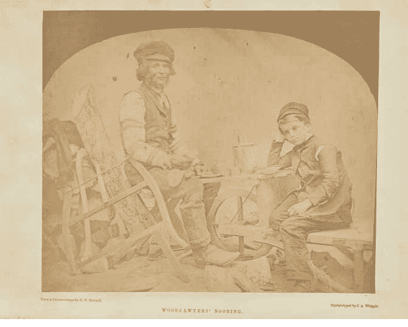

**图 10.3** 乔治·N·巴纳德，《午后时刻》，约 1853 年，由 J. A. Whipple 制成的盐纸印品，18 × 13 cm。

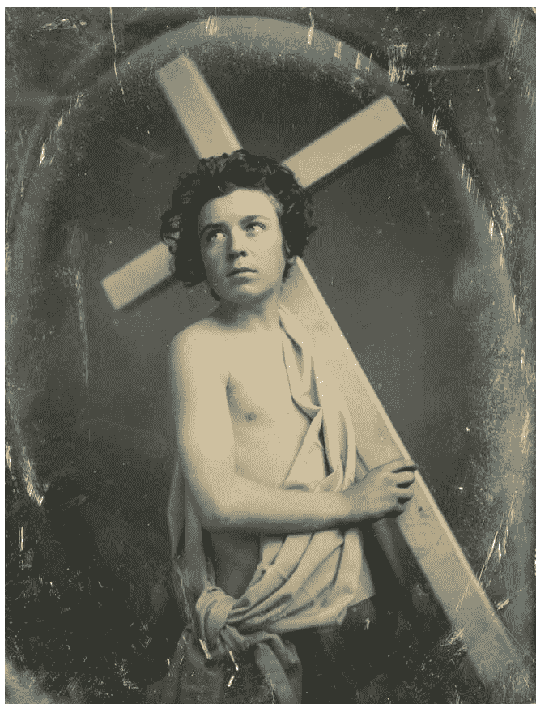

**图 10.4** 加布里尔·哈里森，《背负十字架的耶稣》，约 1850 年，银版摄影，16 × 14 cm。

## 我们艺术家的诗意天赋

与哈里森等人的、基于欧洲视觉传统的寓言和宗教场景不同，银版摄影的风俗画侧重于独特的美国题材。哈里森再次处于领先地位，早在1840年代中期就创作了一幅关于他儿子（后来成为《年轻美国》和《圣婴》的模特）前往乔治·哈里森胸像之旅的风俗画，该作品在1845年华盛顿博览会上曾获奖。²⁵在这幅银版摄影《加州新闻》中，哈里森表现了另一个明显的美国题材，展示了自己与他的雇主马丁·劳伦斯（Martin Lawrence）、劳伦斯的儿子以及另一个男人站在一起，仿佛在听到加州淘金的消息（图10.5）。他的构图显然参考了1850年同名画作（图10.6）由威廉·西德尼·蒙特（William Sidney Mount）创作，他是最著名的美国风俗画家。蒙特的场景设定在一个邮局里，墙上的一个广告预告着一艘开往旧金山的船。来自社会各阶层的人物聚集在一起，包括一名年轻女性和一名黑人男子。哈里森显然也熟悉理查德·卡顿·伍德维尔（Richard Caton Woodville）的《墨西哥战争新闻》（美国艺术水晶桥博物馆），该画作展示了一群来自不同阶层和种族的美国人聚集在报纸周围。哈里森描绘他的模特围聚在一个人周围，其构图更为简单，只显示了四个男性，他们也属于同一个社会经济阶层。虽然哈里森并没有传达出戴着高丝帽的中心人物听众们自己正准备向西部寻找财富的感觉，但其他人物暗示了听到消息时那种显而易见的兴奋之情。他利用自己作为演员的经验，对银版摄影媒介进行了戏剧化的处理，唤起了那个年轻国家强健的公共领域的氛围，这正如当时的绘画作品一样。尽管绘画中的风景和道具在照片中缺失了，但哈里森的银版摄影依然具有戏剧性，依赖于模特的表演。

巴纳德（Barnard）为1853年安东尼奖（Anthony Prize）参赛者提交的作品也是对风俗画的一次严肃尝试，捕捉了一个日常生活的场景：一个加拿大木锯工和他的儿子正在吃午饭，拍摄于纽约州奥斯韦戈的工作室里（图10.3）。巴纳德为参赛提供的说明来自一位未具名的朋友，这位朋友指出这样的主题对于银版摄影来说是多么不寻常，展现了“更多的生活和精神，以及对艺术规则更严格的关注”。作者描述道：

> 这幅画最美之处在于那个男孩；他的神态显得懒散、劳累过度，他对餐桌上诱惑的漠然地表明他正处于一种我们所有人作为男孩时都体会过的身体痛苦中——即疲累到无法进食。他那张聪明、深思的脸在直视你的眼睛时，通过那抽象的神态表明他的心不在焉……他坦诚而阳气的面容了他的本性，谁知道我们面前的这个木锯工的男孩，未来可能是他国家光荣星座中的一颗璀璨之星呢。²⁷

这位朋友的描述符合当时的艺术评论。作者并没有关注巴纳德对场景的布置，而是关注了两个模特之间故事与情感的成功交流。对男孩内心世界的丰富想象揭示了美国的功绩主义理想；尽管出身卑微，但他最终会成长为社会的杰出成员。巴纳德的构图和朋友的言论证明了他们的视觉素养以及共同的价值观和品味，这正是斯内尔（Snelling）希望通过他在《艺术杂志》（PAJ）上的写作所培养的。呼应蒙特等同时代的风俗画，巴纳德强调了劳动的尊严，维护了从扬基人到边疆人的美国典型人物的神话。这种对美国性格的强调是“职业类”银版摄影（也称为“小职业”petits métiers）的更详尽的版本，这些照片产量远大于风俗场景，并与肖像相结合，人物通常穿着他们的工作服，从事着某种职业。正如基思·戴维斯（Keith Davis）所指出的，选择木锯工不仅强调了美国工业的进步，也对前工业时代表达了怀旧；对森林砍伐正在破坏景观的认识在1850年代已经进入了艺术话语。²⁸

## 戏剧性

蒙哥马利·P·西姆斯（Montgomery P. Simons，约1816–1877）是一位著名的银板摄影师，他最初因其高质量的肖像画在费城成名，并在美国创作了最独特的一组主体照片。在弗吉尼亚州里士满工作期间，西姆斯遇到了曼·萨图尔维特二世（Mann Satterwhite II，1824–1892），这是一位对艺术感兴趣的年轻人，他后来通过制造和销售“情人肉汁”发了大财。借鉴查尔斯·勒·布鲁（Charles Le Brun）17世纪关于人脸表情表达的论文，他委托西姆斯为他拍摄近30张自己的银板照片，包括他、他的兄弟温斯顿·萨图尔维特以及一位艺术家朋友，旨在描绘不同的情绪。西姆斯的这系列作品都是在1月2日同一天完成的，一直由萨图尔维特收藏，直到他将这些照片遗赠给他在1893年去世前创立的里士满**萨图尔维特博物馆**。

萨图尔维特留有日记，在去世前几天，他写道哈伯德（Hubbard）“过去一周或十天都在忙于形而上学、相学中的情绪研究。为了掌握情绪的钥匙，他发现了一套精美的说明系统。¹²”萨图尔维特的物品中有一叠纸，上面有勒·布鲁的文字说明，但插图并未实现。¹³相反，并不清楚萨图尔维特和他的伙伴们是否将情绪视为目的本身，还是将其视为帮助哈伯德制作插图的练习。萨图尔维特还列了一份他及朋友在当天选择作为模特的情绪清单，“什么激发了这些情绪？”，并附上了他的“钥匙”，其中包括从爱到疯狂的情绪，如愤怒、懊悔、恨、欲望、忧郁、愚蠢，最后是疯狂和白痴。¹⁴不幸的是，没有一张银板照片标记了相应的情绪，因此每张照片描绘的情绪是不确定的。

这三人在每幅肖像中更换了服装：在某些照片中，他们简单地穿着白衫，而另一些则用格子布或厚布包裹自己表达情绪。例如，缠在萨图尔维特头上的格子布看起来很滑稽，可能被用来传达愚蠢或白痴。肖像多为腰部以上或胸像，但其中一张，萨图尔维特穿着衣服站着，格子布像围裙一样系着。每幅作品都经过精心制作（有时很整洁，有时显得随意），衬衫领口要么扣好要么敞开——以传达积极或负面的情绪。在某些照片中，情绪完全通过面部表达，而在另一些中使用了手。在其中一张，萨图尔维特眯着眼睛，露出牙齿，他的褶皱从脸上伸出来，仿佛刚刚用手抓过头发（图10.8）。他的表情暗示他正在所列的情绪中表演疯狂、愤怒或可能的嫉妒。

在执行这个项目时，正如艾兰·特拉赫伯格（Alan Trachtenberg）讨论过的，这四位合作者与摄影肖像的矛盾作斗争。通过利用勒·布鲁

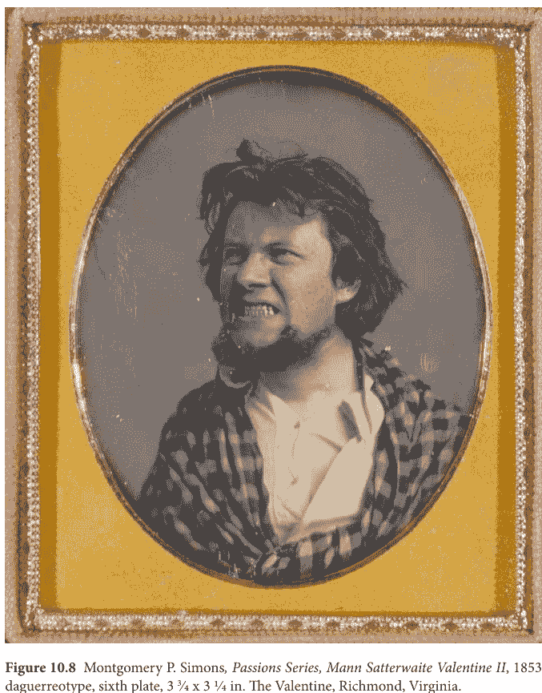

这些人们将照片与关于内在情绪如何在身体上外部表现的悠久传统联系了一起。但通过表演这些情绪（为了在银板上捕捉它们所必需的），他们面临着走向戏剧化的风险，“戏剧性”一词也随之出现——正如评论者对梅雅尔的《主祷文》的评论——这标志着摄影师的行为已经超出了该媒介被认为适当的范围。值得注意的是，西姆斯似乎从未宣传过他参与了这项活动。情人本人也曾批评他们的照片工艺缺陷且表情不当.³³⁵

随着摄影实践从银板摄影转向采用纸质和玻璃工艺，制作叙事性照片的动力并没有持续。1856年，斯平林（Spelling）指出画家越来越多地将摄影作为其精构图的辅助，“整个构图可以在几分钟内构思并执行，在获得合适的模特方面几乎不需要帮助”，这些模特可以在一天中“任何时间被放在他面前，只有他的良心、天才和技能才是为色彩提供最佳效果的必要条件——他唯一提到的具体例子是几年前提到的赫斯勒（Hesler）和巴纳德（Barnard）的作品《Sowsaway的午后》、《三位诗人》等，这些作品曾出现在杂志的复印纸印品中。³⁶事实上，到19世纪60年代，塞勒斯（Sellers）注意到构图照片的缺失，哈里森（Harrison）则分开了摄影职业，全身投入表演。

美国摄影师随后随着银板摄影的衰落大多放弃了这类创作。风题材仅在商业商店中繁荣，而这些作品在摄影界内部受到蔑视。在谈论“构图”照片的优点之前，在雷杰兰德（Reijlander）的《生活的两种方式》中，塞勒斯注意到“存在很大怀疑，我们的许多鉴赏家从他们的收藏中剔除了商店里制作的虚构的半戏剧化照片”。塞勒斯使用的“半戏剧化”一词，与哈里森对摄影和戏剧的双重拥抱，或情人及其朋友对情绪的表达完全大相径庭。“戏剧性”现在与某些摄影师被认为的庸俗联系在一起。他通过描述一个对《哈姆雷特》鬼魂场景的模拟描绘（在立体照片中使用粗糙的背景和填充的鸟类作为角色），给出了他的最终观点：“没有正理由让喜欢这些东西的人不满足于风景、构图照片、幽默或启发性的作品。”³³⁷

但有野心的摄影师拒绝了戏剧性，现实主义战胜了理想主义。在19世纪50年代后期和60年代，肖像、风景和工业成为接受的摄影模式，因为它们符合国家的认同感。风题材直到19世纪70年代才兴起，之后，摄影讲述故事的想法才被许可。作者感谢米歇尔·史莱（Michelle Smiley）的研究。

# 摄影与艺术

# 注释

- 1 关于此主题，见 Sarah Gillespie, *The Early American Daguerreotype: Cross-Currents in Art and Technology* (Cambridge: MIT Press, 2016); Martha Sandweiss, ed., *Photography in Nineteenth-Century America* (Amon Carver Museum and New Wilt
- 2 见 Elizabeth Johns, *American Genre* (New Haven: Yale Press, 1991).
- 3 见 Anthony Davis, *National of Photography* (2007).
- 4 见 Anthony Hamber, *Photography and the 1851 Great Exhibition* (New Castle, Delaware and London: V&A, 2018).
- 5 ‘id, by Dobson, Richard & Co the New York Crystal Palace, 被描述为一个发育不良孩子非常舒服的姿态，色彩很糟糕。“The Exhibition at Crystal Palace, Humphrey’s Journal 5, no. (15 August 1853): 139–43. 文章还提到《休憩的丘比特》被撤展并被一个更优秀的时刻取代。Solomon Carvalho，一张来自南卡罗来州的巴尔的摩银板照片，于1852展于弗兰克林学院。见 *Origins of American Photography*, 49 and 45–51 关于那些幸存的作品，如
- 6 ‘Gossip’, *Photographic Art-Journal*, 6, no. 1 (1883): 65. 出生英国的梅兄弟在纽约经营了一家著名的摄影馆，于1851年开放，在此之前他们在奥尔巴尼立足。见 V. V. Lyons, ‘The Brothers Mead, History of Photography 14, no. 2 (April–June 1990): 113–34.
- 7 ‘Daguerreotypes in the World’s Fair’, *Photographic and Fine Art Journal* 7, no. 1 (January 1854): 16.
- 8 关于此主题，见 Sarah Gillespie, *The Early American Daguerreotype: Cross-Currents in Art and Technology* (Cambridge: MIT Press, 2016); Martha Sandweiss, ed., *Photography in Nineteenth-Century America* (Amon Carver Museum and New Wilt

# “艺术家的诗意天才” 173

纽约：Harry N. Abrams, 1991); John Wood, 编，《达盖摄影法》（爱荷华市：爱荷华大学出版社, 1989）； Richard Rudisill，《镜像：达盖摄影法对美国社会的影响》（阿尔布克基市，新墨西哥州：新墨西哥大学出版社, 1971）； Beaumont Newhall，《美国之达盖摄影法》（纽约：Dover 出版公司, 1976）； 以及 Robert Taft，《摄影与美国景象：历史，1839–1889》（纽约：麦克伦出版社, 1938）。

- 9 “米德兄弟”，选自《Gleason 摄影绘画伴侣》，第24期（1852年6月12日）：377页。它们在《摄影艺术杂志》第1卷第3期（1851年3月）：18页中也被描述为“因其巧妙的构思、精妙的构图和卓越的表现而引人注目”。
+ 10 评审团报告，引用自 Harper，《摄影与1851年世博览会》，223页。
+ 11 Mayall 于1842年搬到费城，与另一位摄影师 Samuel van Loen 建立了合伙关系，随后于1846年返回英国。他在世博览会上展出了其他叙事性作品，但这些更有可能是在英国制作的：四部分组画，插画托马斯·坎贝尔的诗《士兵之梦》、《神圣的祝福：一个盎格-撒逊儿童（仿自然）》以及其他钓鱼的男孩。参见 Harper，《摄影与1851年世博览会》，222页。此外，在评论中还提到了一幅《巴克斯斯与阿里阿涅涅》。参见 Harper，《摄影与1851年世博览会》,
+ 12 《达盖摄影全景图：尼加拉瀑布、莎士比亚的[误]出生地、遗迹、摄影作品、名流肖像等》，收藏于达盖摄影机构画廊（J. Mayall, 1847），引用自 Roger Taylor，《1839–1865年在英国展出的摄影作品：摄影师及其作品汇编》（渥太华：加拿大国家美术馆, 2002）。Mayall 显然在展出该系列作品时极力强调是他，而非 Lawrence Harrison，于1847年回到英国并入住了位于斯特兰德街的工作室。
+ 13 参见 Harper，《摄影与1851年世博览会》，217–218页。1853年，Harrison 给 PA 写了一封信，坚持认为他而非 Lawrence 才是《过去、现在与未来》的摄影师。Gabriel Harrison，“水晶达盖摄影对比 vs：《纽约论坛报》，《摄影艺术杂志》第3期（1853年9月）：194–195页。
+ 14 S. J.,，“加布里尔·哈里森与达盖艺术”，“摄影艺术杂志》第3期（1851年3月）：17页。
+ 15 同上。
+ 16 致编辑的信，《摄影艺术杂志》第1卷第1期（1851年1月）：64页。
17 参见“安东尼奖画作”，选自《摄影与美术杂志》第7卷第1期（1854年1月）：6–11页；“向 J. Gurney 赠送银壶”，“摄影”第5卷第18期（1854年1月）：273–274页；以及“安东尼达盖奖”，“摄影与美术杂志”第7卷第2期（1854年2月）：37–39页。
+ 18 PFAFA 包含了一幅精美银壶的版画，壶上刻有达盖的肖像。“安东尼奖画作”，6–7页。
+ 19 安东尼奖画作，
+ 21 《年轻的美国》，Harrison 之子的肖像（他也是《手抱十字架的圣耶稣》的模特），被描述为带有深色织袍。收藏于乔治·伊斯特曼博物馆。《海伦娜》，它被描述为一位拥有华丽厚重织袍褶皱的女性，胸口那颗“坐着的太阳”上璀亮的星芒缓解了其遮蔽的面部，比邻“安东尼奖画作”，9页。
22 “安东尼奖委员会报告”，选自《Humphrey 杂志》第5卷第19期（1854年1月）：298页。
23 Harrison 对他的玛利亚·马格拉拉达盖摄影的描述与《抱着十字架的婴儿》有相似之处：理想的画面将她描绘为将十字架贴在胸前，眼神充满坚信与温柔，她的目光随着上帝的羔羊看向上方的天堂宫殿。“安东尼奖壶”，9页。
+ 24 同上。
+ 25 Burr.Garrick Harrison 与达盖艺术，175页。这幅达盖摄影收藏于德国伊斯特曼博物馆的一个收藏集中，其中还有另一幅稍些时候为其女儿 Helio 拍摄类似的作品。
+ 26 “安东尼奖壶”，10页。
+ 27 Keith F. Davis，《George N. Barnard：谢曼战役的摄影师》（堪萨斯城市，密苏里州：Hallmark Cards, Inc., 1990年），35–37页。
+ 28 Thomas Cole，《美国风景论》，选自《美国月报》第7卷（1836年1月）：12页。
+ 29 F. Harrison，来自威斯康星州奥什科什。1854年，一位穿着低领裙、头发向后梳起以露出高额头的女性达盖摄影被描述为具有“宁静而庄严的表情”。

## 小产阶级摄影美学

特里·伊格尔顿（Terry Eagleton）认为，“美学作为一种知识话语的诞生，恰逢了文化生产开始遭受商品化带来的痛苦与尊严的时期。”从微观层面来看，我们可以将其看作19世纪50年代后期专业摄影美学诞生的写证。关于摄影与艺术关系的文章数量增加，正处于该媒介商业化的一个特定关键节点：立体图像和名人肖像的成功商品化，使得摄影在工业化国家的注意力经济中占据了更重要的地位。然而，这项新技术的符号价值与其行业的不稳定性之间是相矛盾的。在这种背景下，那些通过引入一个被称为“摄影”的中地，将机械性与隐喻性等二立概念联系起来的文章，也是一种关于社会流动性的论证。这一中地将成为小产阶级工人社会诉求的场所，他们将“下班后”的休闲乃至整个工作日都献给了摄影。

根据史夫·爱德华兹（Steve Edwards）的观点，19世纪60年代摄影杂志中所谓的“艺术语言”深受“小产阶级乌托邦主义”的感染，这种主义与“自我培养”的意识形态相兼容；正如其倡导者塞缪尔·斯迈尔斯（Samuel Smiles，1812–1904）所言，这种学说包含了对一个人所有部分的教育或训练；包括身体、道德以及智力。”摄影杂志关于构图的辩论深受斯迈尔斯自我培养的影响；此外，这对我的分析至关重要，它们证明了所承诺的个人（及社会）赋能是需要代价的。虽然对于摄影领域的小产阶级工人来说，拥护中产阶级意识形态所声称的美德（如真实、诚实、正直；功绩主义）并实现社会流动并不容易，但体现这些美德却很容易。对于小产阶级主体来说尤为如此，他们对体面的诉求比他们试图模仿的对象更不安全。“尽管亨利·皮奇·罗宾森（Henry Peach Robinson）十四岁时就进入了行业，但他作为印刷员训练以及随后在一个时尚且快速扩张的疗养小镇获得了一家摄影工作室，使他处于行业中高端且受尊敬的一端。”另一方面，他在摄影构图辩论中的对手——摄影评论家阿尔弗雷德·亨利·沃尔尔（Alfred Henry Wall，1828（洗礼）-1906），其职业生涯极不稳定。沃尔尔的批评风格可能显得极不一致，直到你阅读他的文章并发现这些文章是受到对体面某种微弱把握的影响而写的。尽管如此，沃尔尔的文章对构图摄影的接受起到了决定性作用，并因此决定了未来几十年里艺术摄影将是以及将是什么。

## 作为摄影评论家的阿尔弗雷德·亨利·沃尔尔

沃尔尔在现代关于十九世纪英国摄影的描述中经常被引用，他是一名小产阶级摄影工人，从19世纪50年代后期开始摄影杂志的活跃贡献者。他在这些杂志关于摄影美学的辩论中具有战略性且往往充满争议的贡献，在当时对于定义术语和参数具有重要意义，现在对于揭示其利益关系也具有重要意义。1860–1861年左右，沃尔尔对《摄影新闻》（Photographic News）施了前所未有的影响力；同时，他的文章被转载在其他摄影杂志（包括美国的杂志）上；而他作为南伦敦摄影学会秘书的其他活动，确保了他在发表于摄影杂志的会议纪要中找到了另一个平台。沃尔尔的行为具有批判性：他的产出惊人，不仅仅以自己的名义写作，还以匿名和化名的名义写作，这种操作模式帮助他赢得了大量的专栏。他将与摄影杂志后页相关的更具观点为导向的、对抗的模式带到了前台。通过这种方式改变了与新闻商业主义相关的作者模式的渗透，沃尔尔的文章为我们提供了批判性地阅读他所参与的辩论的手段，他冗冗的风格促使其他作家揭示出涉及的利益。作为一名摄影领域的小产阶级工人，沃尔尔为摄影杂志写的文章可以被声称是为了“自我培养”，而他无法获得稳定的工作表明他的某些空闲时间可能是被迫的。以下沃尔尔关于摄影的早期文章并非孤立的，而是界限性的，为我们提供了探测那些不一定被出来的内容的手段。看来，自我培养的（出现）并非仅仅通过欺骗性的目的实现的。

在1859年期间，作者主体阿尔弗雷德·H·沃尔尔（Alfred H. Wall）出现在《利物浦摄影杂志》（Photographic Journal）和《汉姆弗里摄影及艺术科学杂志》（Humphrey's Journal of Photography and the Allied Arts and Sciences，一种美国杂志，他的许多为《利物浦摄影杂志》写的文章在此处转载）。他以匿名事务作者的身份开始这一年，年底时已成为一篇关于摄影美学论文的作者：这可能是由于日益竞争激烈的摄影杂志论坛扩大，将摄影塑造成为体力劳动与创造性劳动之间的中介点所提供的自我培养机会。沃尔尔以《写给年轻摄影师的信》开始这一年，该信于1859年1月至12月刊登《利物浦摄影杂志》。从1859年5月开始，沃尔尔为同一杂志撰写另一系列关于“实用指导”（照片上色）的文章，但这次是用他的本名。沃尔尔的匿名“信”（据说是由于中国面临迫在眉睫的危险）发表在《利物浦摄影杂志》上的同一天，他第一次读到了关于摄影与祭坛关系的持续思考。这是南伦敦摄影学会（SLPS）的一次会议。摄影美学主题是该学会唯一具有哲学用途潜力的非技术主题。摄影美学主题在学会中很少讨论。

# 摄影与艺术

值得注意的是，沃尔尔关于“摄影作为艺术之一”的论文没有出现在SLPS所属的《利物浦摄影杂志》，而是出现在《新闻》（the News）上。根据他的朋友H. S.沃德（H. S. Ward）的说法，沃尔尔所说的“革命”是指辛普森（Simpson，1825–80）的编辑工作，始于1860年8月，并在1861年将其所属从《英国摄影杂志》转为《新闻》。在辛普森编辑的第一年，《新闻》成为了四个事业的平台：杂志本身、南伦敦摄影学会、沃尔尔的专业和批判资质，以及关于摄影可以是什么的主张。

19世纪50年代后期，关于摄影的文章中（包括日报/定期和摄影杂志）出现了一种修辞，声称摄影与艺术将打破正常秩序。这种保守观点通过求助于一套派生词汇来表达，如“大众”（在群众中）、“人民”、“民主”或“舆论”——以反对一个有价值的词汇相对，后者包括“受过教育的”和智慧天才；“艺术”、“灵魂”和“诗歌。”根据这种立场，所谓的舆论实际上是少数人操纵广泛的大众采纳他们的观点。辛普森使用“议会”和“民主”等术语来引导《摄影新闻》，隐含地挑战了这种渴望的赋权观点。阿尔弗雷德·H·沃尔尔在《新闻》页面对摄影界发出的号召，旨在使摄影被认可为能够进行艺术表达，因此带有政治色彩：

> 坚信摄影可以作为精细艺术之一占据一足之地；在这一方面可以达到一种几乎未曾希望过的巅峰，我号召大家协助以实现这种消费。¹⁸

沃尔尔将摄影未能实现其潜力归因于既得利益集团对其的忽视，也归因于其读者：像斯迈尔斯一样，他斥责那些对自我提高艰苦工作感兴趣的人，在这种情况下，就是那些不顾其名誉而使用这种媒介的人。然而，《新闻》并没有维护它向读者推广的民主美德：根据其传记作者的说法，在短的一时期内，沃尔尔几乎写了该杂志的所有内容。⁹虽然这一主张无法证明，但对他在摄影杂志上批评文章的仔细阅读强烈表明，沃尔尔的作者虚构和欺骗，以及多个作者人格的创造，操纵了少数观点进入了。

# “极度邪恶”

作为一名摄影评论家。这并不意味着他的个人处境或他的著作仅仅反映了这一阶层划分：相反，他实质性地贡献了一种审美立场的创造，这种立场后来与后者的利益认同了一起。当他在摄影杂志上作为作者主体出现时，沃尔还继续在这些刊物中以化名和匿名的方式发表他的观点，将自己的观点呈现为少数人的观点，有时又是大多数人的观点。正如我们所看到的，这种反民主的行为对于将构图摄影塑造成道德化的现实主义，以及使其在摄影群体中作为合法摄影艺术形式流传具有重要意义。这是因为在 19 世纪 60 年代初，构图摄影（尽管短暂）成为了一种摄影叛乱。

# 亨利·皮奇·罗宾森的摄影艺术实践

与之相关的主张是认为摄影与既有秩序对立，并将其与其他类被认为不合法的模仿物种等同，例如有机研磨和蜡蜡模型，并被描述为对真实的恐怖的机械近似。²⁰ 1858 年，罗宾森在《摄影杂志》的一篇文章中，亨利·皮奇·罗宾森拒绝了对摄影的这种贬义定性，但并未为将其归入艺术范畴提供一个连贯的理由¹¹¹ 几个月后，在苏格兰摄影学会因其作品《他们，他们来了！》（They They Come!, 1859）授予银奖后，罗宾森接受了向学会发表论文的邀请。他声称，创作体现摄影最高表现的作品应该是摄影工作者的一项职责，他主张他们将一些空闲时间投入这种追求。²² 罗宾森声称通过对他获得构图的过程进行实证说明来介绍摄影，以便他人能够模仿他的实践。例如，罗宾森透露，他并没有在图像所描绘的场景中拍摄他的模特，而是在他的后院拍摄他们，然后在黑暗中将他们装裱，用户外环境的特征抵消底片的特征，以创造出最终的构图。

1988 年，关于罗宾森，玛格丽特·哈克（Margaret Harker）声称，罗宾森对其工作方法的披露引发了“摄影内部的抗议风潮”。³³ 然而，那些杂志显示，对罗宾森论文的最初反应仅限于《英国摄影杂志》末页的几条敷衍评论。其中第一个归于迈克尔·哈纳福德（Michael Hannaford），据说是苏格兰皇家摄影学会（SLPS）的成员。他表达了对整篇论文的反对，特别是对罗宾森从拉前拉斐派对自然忠诚的信条与罗宾森构图照片的方法之间所对比。哈纳福德声称，罗宾森的方法是欺骗的典范。²⁴ 哈纳福德这种偏见的干预在一个月后遭到了“斯普林格斯夫人”（Mrs Springiggs）的讽刺性回应。斯普林格斯夫人是一个爱管闲的小资产阶级主妇，她是当代期刊新闻中常见的笑柄，她将罗宾森的方法认同为做她的补丁时使用的方法

# 摄影与艺术

与这些方法相同，并向编辑询问她自己是否也是一位艺术家。²⁵

# 构图对比补丁

当阿尔弗雷德（Alfred）在 1859 年底开始写作摄影美学时，他像罗宾森一样，挑战了那些将摄影等同于大众并对其对低级模仿形式做出所谓预测的人的观点¹²⁶ 然而，沃尔并没有将某种特定的摄影实践视为让摄影师被认为具有艺术能力的典范。相反，他将批评视为实现这一目标的手段：根据沃尔的说法，如果照片作为它们自己的画作在展览中，它们将被识别为绘画性作品。²⁷ 他最初在写作中赞同构图摄影，²⁸ 但对罗宾森在苏格兰摄影学会发表的论文做出回应，写了一篇题为“构图”对比“补丁”的文章。²⁹ 沃尔在他的论文标题中使用了“斯普林格斯夫人”创造的讽刺性词汇，重复了哈纳福德对构图摄影美学的认同，并用借自报纸末页的敌对语调表达了他的愿景。沃尔认为，那些所谓的“构图摄影”只有在“构图”指的是对场景的选择或人物的组组时，才是艺术摄影，而不是通过在暗室中将不同底片的区域暴露在同一张摄影纸上来创造一张摄影图片。沃尔说，“补丁摄影师”是在为了模仿而进行欺骗，并剥夺了摄影最高且唯一的价值；即“奇妙的真实性”。³⁰ 他谴责罗宾森对公众实施了欺骗，因此违背了他的良心。³¹ 对他来说，罗宾森对“斯普林格斯夫人”付以轻松的笑之，因为他承认自己必须认真对待一个拥有沃尔背景的对手。²² 然而，“斯普林格斯夫人”和 A. H. 沃尔很可能是同一个人。³³

沃尔为摄影媒体写的关于摄影与艺术关系的文章具有高度的策略性：他策划的辩论是为了说服读者某个特定版本的摄影美学的优点。尽管领先的摄影师弗朗西斯·弗里（Francis Frith, 1822–98）在 1859 年于《艺术杂志》上写时认为，赋予摄影的真实性标志着它与艺术的区别，沃尔最忠实的自然手稿将接近艺术的状态。³⁴ 这是沃尔对化名所持的观点。“爱真理”（Lovetruth），存在现实主义和理想主义两种类型，而摄影属于第一类。³⁵ 处于争议的艺术现实主义是指，对主体物质方面或氛围效果的渲染并不自动标志着所代表的更高价值的缺失。相反，摄影师的作用是以这样一种方式渲染现实生活中遇到的场景，以便他内心激发的情感能够传达给照片的观众。³⁶ 为了实现这一点，摄影师必须投入智力以及机械劳动，为摄影以及他自己主张一种隐性的中间地带。占据这一性的中间地带（实际上或表演性）允许摄影师，以及摄影

# “极度邪恶” 181

摄影师，这种看起来是极具个性的风格开始看起来像是一种模仿和欺骗的策略性部署，以支持将 A. H. 沃尔认同。两种情况下需要的是对沃尔制造的批判性欺骗

沃尔与罗宾逊之间的意见分歧，在《英国摄影杂志》受委托的另一篇文章中看到，辩论的术语随着沃尔的风格变得日益激烈。与此同时，沃尔的地位由于他对艺术评论的虚伪尝试而削弱了。乔治·威尔尔士·戴蒙德（Hugh Welsh Diamond, 1809–1886）（《摄影杂志》）、乔治·华盛顿·辛普森（George Wharton Simpson）（《摄影新闻》）在共同敌人面前联合在了一。1861 年，《时报》祝贺伦敦摄影会在摄影师的自负方面行使了明智判断，排除侵入艺术领域的作品；然而，匿名评论员（汤姆·泰勒 Tom Taylor, 1817–80）对罗宾逊的《森林假日》（A Holiday in the Wood, 1860）（图11.1）的纳入表示遗憾，他声称该作品属于此类。这种构图摄影具有一种体裁类型的元素：在户外环境中对不同人物组进行复杂的安排，本例中代表田园英国乡村的山坡和森林，以及十个正忙于嬉戏、采花采果的年轻人。从《时报》的评论可以看出，泰勒知道照片是如何制作的，但当时照片在 1862 年国际博览会上展出时，展览目录上的标题增加了“多张底片打印”。对于《雅典》杂志来说，这张此前被认为“最成功且有效”的照片现在“让观众感到极其忧郁”。《伦敦画报》在 1861 年改变了对构图摄影是高水平摄影努力的意见，转而认为这种劳动是徒劳的。《每日电报》更进一步，断言“这种戏法系统是极度邪恶的”。

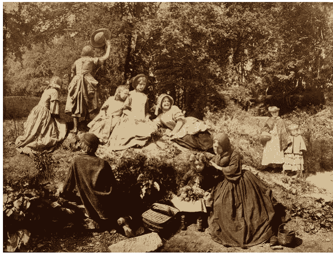

**图 11.1** 亨利·皮奇·罗宾逊（Henry Peach Robinson），《森林中的假期》，1860年6月，蛋白银盐相片（不规则形状），44.7 × 56.5 厘米。纽约州罗彻斯特乔治·伊斯特曼博物馆，阿尔登·斯科特·博耶（Alden Scott Boyer）赠，1970.0192.001。经罗彻斯特乔治·伊斯特曼许可复制。

当既有权利的守护者声称，制作蒙太奇摄影组合的做法类似于将权力交给了那些不配欣赏的人时，钻石（Diamond）、沙德尔特（Shadbolt）和辛普森（Simpson）通过支持构图摄影作为摄影艺术的合法形式作为回应。然而，这与其说是对自然秩序的叛逆挑战，不如说是向他们的读者展示的一种象征性表演，即他们有权决定什么是或不是法的摄影艺术。这些编辑现在开始在各自杂志的页面上对主题行使同质化功能：例如，在1863年初，《摄影笔记》（*Photography Notes*）愤怒的编辑托马斯·萨顿（Thomas Sutton，1819–75）支持构图摄影是摄影中唯一没有市场的类别，并认为这是对媒介的滥用；钻石将他的观点描述为“彻头彻尾的异端”⁴⁶萨顿的观点与日报和定期刊媒体上的评论员观点形成共鸣，他们认为构图摄影是理想堕落的象征。沙德尔特、辛普森和钻石的回应是主张唯有真实才是真实的，⁴⁷。在1863年初，钻石展示了罗宾逊的《带五月花回家》（*Bringing Home the May*1862）（图11.2），这是一幅大型摄影组合，由九张负片组成，描绘了从田里采完五月花回来的年轻妇女和女孩，他用如下辞藻描述：

“极端邪恶”183

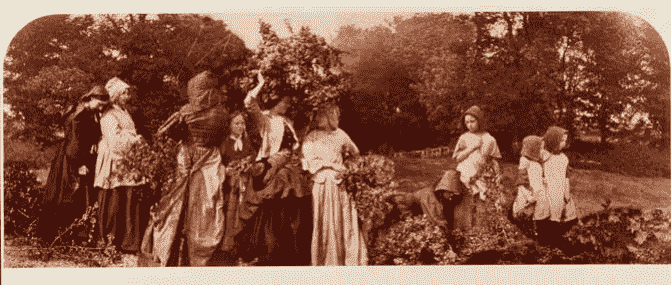

**图 11.2** 亨利·皮奇·罗宾逊，《带五月花回家》，约1862年，蛋白银盐相片。维多利亚和阿尔伯伯特博物馆（V&A）皇家摄影学会收藏品，在国家彩票遗产基金和艺术信托的慷慨资助下获得，RPS.2135-2018。© 皇家摄影收藏馆/伦敦维多利亚和阿尔伯伯特博物馆。

罗宾逊先生从未制造画面，而是直接走向自然；他没有使用任何种类的人工配件，也不装扮他的人物……他们就是我们在华威克斯郡郡迷人的小巷里看到的那些穿着简朴的女孩，在那里我们也看到了这种郁郁葱葱的风景.¹¹48

这种对罗宾逊工作方法的描述，与其摄影师本人在摄影杂志上的阐述直接矛盾。在那些杂志中，他强调自己如何通过装扮模特、使用多种照片以及通过将一种事物假装成另一种事物来欺骗眼睛，来实现他所追求的效果。为了让罗宾逊的设置、模特和主题被认为是真实的，现在主张将摄影现实主义视为一种被赋予价值的模仿变得必不可。几天后，辛普森在《摄影新闻》（*Photographic News*）中写道：“没有人梦想过从摄影中期待想象……但什么艺术不是理想化的呢？¹49

## 作为现实主义的摄影艺术

领先摄影杂志之间达成共识，认为摄影艺术没有容身理想的地方，这对罗宾逊后来的摄影实践和写作具有重要意义。1861年，钻石将罗宾逊最近的作品《莎拉洛特夫人》（*The Lady of Shalott*，图11.3，基于丁尼森抒情歌谣广为人知的亚瑟王传说，由五张负片组成）视为那些致力于“为摄影赢得其在美术中应有的地位”的作品之一⁵⁰但罗宾逊（1892年）拒绝这项工作，称之为“一个可怕的错误”（我的斜体）。¹5¹他用这些词汇来评价，被认为是1863年出现的摄影美学重大转变的症状，当时有影响力的作家、评论家和从业者关闭了摄影对理想的诉求。1868年，罗宾逊在《摄影新闻》中写道：

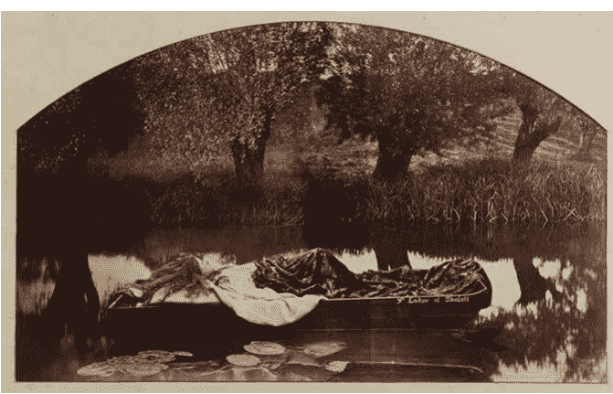

**图 11.3** 亨利·皮奇·罗宾逊，《莎拉洛特夫人》，1861年，蛋白银盐相片。维多利亚和阿尔伯伯特博物馆（V&A）皇家摄影学会收藏品，在国家彩票遗产基金和艺术信托的慷慨资助下获得，RPS.3281-2018。© 皇家摄影收藏馆/伦敦维多利亚和阿尔伯伯特博物馆。

我将局限于所谓的画面的构建：事实上，我打算处理身体，也许是骨骼，而不是灵魂；处理有形的，而不是无形的；处理可以教的，而不是必须感受的。鲁斯关于摄影美学的立场，即艺术摄影师必须从现实中呈现场景，摄影创造力应位于场景的构思中（即在负片曝光之前）；这一少数观点现在已成为修辞上的共识。根据约翰·泰勒（John Taylor）的《摄影中的绘画效果：给摄影师的构图与明暗法提示》（1868年），他提醒我们浪漫主义在19世纪活跃的文化层面上已经发生了日蚀.³³我们扩展了泰勒对罗宾逊关于绘画元素的描述，认为其文字与他后来的展览一样平淡。在罗宾逊后期的照片中，理想几乎完全从画面本身转移到了标题上，后者借用了英国文学或诗歌或寓言式的礼仪，如《一天的工作结束了》（*The Day's Work Is Done*，1877）（图11.4）。这幅构图描写了一对装扮古朴的老夫妇，在一个简陋的农屋环境中，一位祖母般的人物正在照料，而她的丈夫正勤奋地对着（推测是）圣经劳动。这种精湛的渲染，通过多张负片实现，

这种文艺复兴透视的效果，

“极端邪恶”185

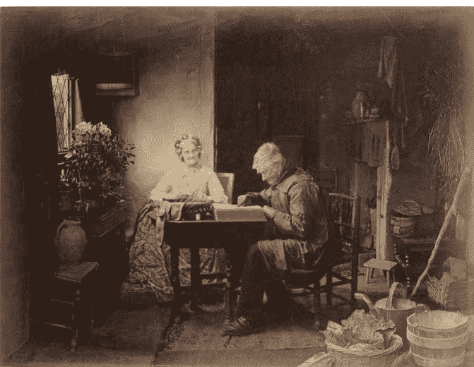

**图 11.4** 亨利·皮奇·罗宾逊，《一天的工作结束了》，1877年，蛋白银盐相片，56 × 74.5 厘米。洛杉矶保罗·盖蒂博物馆，898。数字图像由盖蒂开放计划提供。

这种效果不应使我们忽视这样一个事实，即罗宾逊早期的大比例照片绝非平淡。罗宾逊早期照片中显而易见的透视、比例和关系的扭曲，以及其他模仿性的缺失，不应被视为实现某种目标的原始尝试。正如我们的分析表明，这些透视、比例和关系的明显扭曲，以及罗宾逊早期照片中的其他模仿性的脱节，不应被视为实现某种目标的原始尝试。

还是一名摄影评论家、编辑、小说家、剧作家、儿童文学、普通作家和传记作家；参见未署名的（亨利·斯诺登·瓦德），《简传：A. H. 沃尔》，《节目》第2卷第17期（1895年5月）：103–4；H.S.W.（亨利·斯诺登·瓦德），《摄影制图学》，《节目》第10卷第119期（1903年11月）；以及H.S.W.，《A. H. 沃尔之死，《英国摄影杂志》（以下简称 BIP）第53卷第248期（1906年6月）：512–13。另见《纯净的摄影》，第80–3页。

- 10 未署名的（阿尔弗雷德·H. 沃尔），《给年轻摄影师的信》，《摄影杂志》（利物浦）第6卷第5期（1859年1月1日）；9：最后一封（25封中的最后一封）发表在第6卷的最后一期（1859年12月15日）。

- 11 阿尔弗雷德·H. 沃尔，《摄影上色的实用指南，《摄影杂志》（利物浦）第6卷（1859年5月1日）：112页；该系列延续到第7卷（1860年）和第8卷（1861年），其中第8卷成为了《英国摄影杂志》的创刊。

- 12 阿尔弗雷德·H. 沃尔，《作为艺术之一的摄影，《摄影新闻》第3卷第69期（1889年12月30日）：193–5页。

- 13 H.S.W.，《A.H. 沃尔先生之死》，第512页。事实上，沃尔继续在《英国摄影杂志》工作。此外，他为《摄影新闻》和《英国摄影杂志》创作的一些文章，包括《作为艺术之一的摄影》，在英国和美国的摄影杂志上被转载登。

- 14 乔治·华盛顿·辛普森，除了担任《摄影新闻》的编辑外，还是一名记者、摄影师和摄影手册的作者，

- 15 需要注意的是，“作为艺术之一的摄影”在辛普森担任编辑之前就已经出现在《摄影新闻》中了。沃尔的商业条目以及他的《应用于摄影的着色手册》（1861年，以《摄影新闻》的名义出版）也曾出现在该刊物上。

- 17 最著名的是查尔斯·波德莱尔的《现代肖像与摄影》，这是他对1859年美术学院沙龙的评论；在线见于 journals.org/edphotographies/185（2019年1月14日）。另见罗纳德·坎贝尔，《用于肖像的摄影——在艺术家工作室进行的对话，《艺术杂志》第4卷（1858年9月1日）：273–5页，以及未署名的（H. 斯托托里-马斯凯莱恩），《摄影的现状，《国家评论》第8卷第16期（1859年4月）：365–92页和379–80页。

- 18 阿尔弗雷德·H. 沃尔，《作为模仿艺术的摄影，《摄影新闻》第4卷第14期（1860年11月9日）：327–8,8页，

- 19 未署名的（H. S. 瓦德），《简传：A. H. 沃尔》，第104页。瓦德在对沃尔的讣中重复了这一主张。

- 20 参见例如，《英国摄影的诞生》，第148–53页。

- 21 亨利·皮奇·罗布森，《摄影：艺术与科学性》（第二部分），《摄影杂志》第5卷第71期（1858年10月2日）：47–8,8页，

- 22 亨利·皮奇·罗布森，《论从多张负片冲印照片，《英国摄影杂志》第7卷第115期（1860年4月2日）：94–5页。

- 23 M. Harker，亨利·皮奇·罗布森，第27页。

- 24 “摄影八卦，1号，《英国摄影杂志》第7卷第117期（1860年5月1日）：140页。

- 25 “与斯普金斯先生关于补丁的信件，《英国摄影杂志》第7卷第119期（1860年6月1日）：172页。

沃尔直接挑战了霍华德和坎贝尔的文章，以及《国家评论》中的文章（见脚注19），见在《作为艺术之一的摄影》，第193页。

A.H.W.（阿尔弗雷德·H.），《来自摄影师的笔记本——摄影展与艺术进展，《摄影新闻》第4卷第111期（1960年10月19日）：292–3，292页。这一断言的敏锐度并未引起学术界的关注。

沃尔，《作为艺术之一的摄影》，第191页。

阿尔弗雷德·H. 沃尔，“构图”对比“画面，《英国摄影杂志》第7卷第120期（1860年6月15日）：176页。沃尔态度反转的原因尚为人知。我们可能会推测这是对《摄影杂志》回归摄影主题的敌意回应，而这一领域被沃尔和那些旨在吸引日益增长的小资产阶级读者的摄影杂志所占据。第30页。同上。

31. 同上。

32 亨利·皮奇·罗布森，“构图，《英国摄影杂志》第7卷第121期（1860年10月2日）：89–90页。

33 斯普金斯夫人可能是沃尔的笔名之一，这可以从他的一后一文中推断出来；未署名的（A. 沃尔），保罗访问斯普金斯夫人——关于清晰度，《英国摄影杂志》第8卷第145期（1861年7月1日）：246页。

34 弗朗西斯·菲特，《摄影的艺术，《艺术杂志》第5卷第1期（1859年3月）：71–2页。

35 参见沃尔《来自摄影师的笔记本》的最后片刻；A. H. 沃尔，“对话1，《摄影新闻》第4卷第10期（1860年11月30日）：36–4页。

36 参见沃尔在“协会规程”标题下的评论，《摄影杂志》第6卷第91页（1859年11月15日）：76–82页。

37 乔治，编辑，《英国摄影杂志》第7卷第12期（1860年7月2日）：187–8页。

38 未署名的（H. 钻石），评论——森林中的假期。由亨利·P. 罗布森，《摄影杂志》第8卷第14期（1860年12月15日）：72–3页。钻石众所周知是萨里郡医院的女性部门主管，1858年8月成为编辑。

39 至于这一态度反转，阿尔弗雷德·H. 沃尔，“关于保持，《摄影新闻》第4卷第12期（1860年12月28日）：411–12页。

40 未署名的（汤姆·泰勒），摄影展，《时代报》第1卷第18期（1861年7月15日）：152–3页。

41 未署名的，“艺术——摄影协会，《美术》第1734期（1861年1月19日）：88–9页，以及未署名的，“摄影协会——年度展，《太阳报》第2338（1861年1月24日），无页码。

42 女王委员会，1862年国际博览会。XIV类（伦敦：女王委员会，1862年），第2页。关于展会上摄影分类的辩论，参见爱德华兹，《英国摄影的诞生》，以及哈金，《摄影人格化》。

43 未署名的，“艺术——国际博览会，《美术》第1825期（1862年10月18日）：504–5页。

根源性的恶意

- 44 参见（托马斯·萨斯顿），编辑，《报纸评论与摄影，《摄影时代》第1卷第18期（1861年7月15日）：152–3页。

- 45 未署名的，“国际博览会”，《每日电报》第2194期（1862年7月5日）：5页。

- 46 托马斯·萨斯顿，“论摄影的用途与滥用”，《摄影笔记》第8卷第163期（1863年1月15日）：14–18页；以及未署名的（H. 钻石），论构图师，《摄影杂志》第8卷第130期（1863年2月16日）：234–5页。萨斯顿受过剑桥教育的数学家，也是一名摄影师、摄影发明者，在居住的泽西岛从事摄影工作。1856年，萨斯顿创立了《摄影笔记》。

- 47 1866年，罗布森关闭了他的伦敦工作室，并在1865年随家人搬到伦敦，靠近他的朋友华盛顿·辛普森。在伦敦的三年里，他为艺术摄影师建立了一个私人工作室，并为摄影杂志写文章：Harker，亨利·皮奇·罗布森，41页。

- 48 参见例如，未署名的（H.W. 钻石），评论——带回五月，《摄影杂志》第8卷第130期（1863年2月16日）：235–6页。

- 49 未署名的（G. W. 辛普森），关于艺术摄影及其评论的最后结语，《摄影新闻》第7卷第237期（1863年2月20日）：134页。

- 50 未署名的（H. 钻石），评论——H. P. 罗布森的《拉洛特的夫人》，《摄影杂志》第7卷第114期（1861年10月15日）：286–7，287页。

- 51 Harker，亨利·皮奇·罗布森，“摄影中的画意效果：摄影师的构图与明暗法课程”，《摄影新闻》第12卷第491期（1868年1月31日）：52–53页。

- 52 John Taylor，“亨利·皮奇·罗布森与维多利亚理论”，《摄影史》第3卷第4期（1979年10月）：295–303页。

- 53 Jordan Bear，《幻灭：维多利亚时代的摄影与敏锐的主体》（宾夕法尼亚州大学公园：宾夕法尼亚州大学出版社，2015年），第5页。

- 54 同上，第4卷，第32页。

# 玛尔塔·魏斯

在1982年极具影响力的论文《摄影的叙述空间：景观/远景》中，罗莎林德·克劳斯（Rosalind Krauss）反对将“最初为了探索、探险和测量目的而拍摄”的照片引入艺术博物馆展览和艺术史分类。克劳斯将批判集中在对蒂莫西·奥苏利文（Timothy O’Sullivan）的美国西部测量照片以及尤金·阿格特（Eugène Atget）的巴黎远景的重新呈现上。到2018年，当我及同事们正准备维多利亚和阿尔伯特博物馆（V&A）新摄影中心的首届展览时，某些照片从实用的记录转变为艺术博物馆中展示和研究的珍贵对象的身份转变已得到广泛认可。我们对这种轨迹的认识，影响了我们在展位中呈现许多照片的方式，其中包括奥苏利文和阿格特的的作品，我们恰好将这些作品安装在画廊的一侧墙壁附近。为了承认奥苏利文创作纳瓦霍悬崖上的居所远景的背景，我们装裱了这张照片，其宽度足以显示其最初发表的完整页面，并带有官方印章和“美国陆军工程兵团，战部”的标题（图12.1）。从博物馆环境的远处看，这种没有地平线的构图类似于一种现代主义的抽象画。但景观中微小的人物提供了比例感，而印刷的说明文字暗示这些人物是政府资助的类型学调查的一部分。在随同阿格特四张照片的标签中，我们注意到，V&A曾在1902年直接从摄影师那里购买了这些巴黎楼梯的远景，作为装饰性金属制品的记录，这是在阿格特作为一位原型现实主义大师被纳入摄影史之前。

如果长期以来人们已经接受了某些最初以纪实或实用为目的制作的摄影随后被重新归类为艺术品，那么还有其他十九世纪的照片其身份似乎保持得更为稳定。朱莉·玛格丽特·卡梅隆（Julia Margaret Cameron，1815–79）的照片就是此类。它们显然是作为艺术创作的，且至今仍作为艺术品发挥作用。

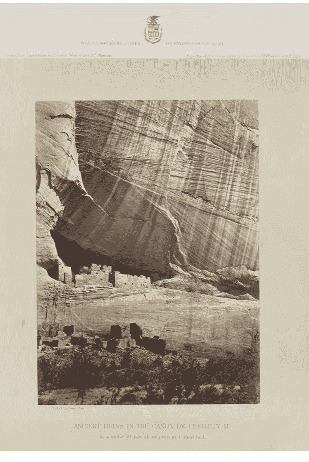

**图12.1** 蒂莫西·奥苏利文，《新墨西哥州谢尔河谷的古代遗迹》，1873年，蛋白盐银照片，27.3 x 20.1 cm。维多利亚和阿尔伯特博物馆，伦敦，PH.242-1979。© 维多利亚和阿尔伯特博物馆，伦敦。

今天，它们的身份似乎自创作以来一直保持不变。在一句经常被引用的话中，卡梅隆宣称了她摄影实践的艺术目标：“我的理想是提升摄影的高度，通过结合现实与理想，并在对诗意和美尽一切可能的投入而不牺牲真理的情况下，为摄影获得高艺术的特征和用途。”

## 从“自然研究”到“为绘画的研究”

在V&A摄影中心，在奥苏利文和阿特金斯作品的对面，卡梅隆的照片占据了她显然为它们而设计的空间：画廊墙面。

在摄影生涯期间，卡梅隆不仅在商业艺术画廊、国际展览和摄影学会展览中展出，而且在1865年，V&A本身（或者说是当时的南肯辛斯顿博物馆）收藏了她100多件受意大利文艺复兴启发的圣母像、文学主题以及极具感染力的柔焦风格的作家和艺术家的特写肖像。博物馆在当年晚些时候展出了这些作品，据其中一位评论家的说法，它们被放置在“显眼的位置……靠近画作收藏品”。这是卡梅隆一生中仅有的博物馆展览，为她的照片提供了进一步的机构背书，并表明博物馆在接受摄影作为一种艺术形式方面是非常早的。

然而，这些在19世纪60年代抱负勃勃地创作、被艺术设计博物馆收藏并展出的、在今天同一处展示的照片，其看似稳定的身份，在对这些照片进行更仔细的检查后变得复杂了。如果南肯辛斯顿博物馆收购的某些照片在1860年代是带着野心创作的，被艺术设计博物馆收藏并展出的，在今天同一处展示，那么通过对这些照片的仔细检查，这种身份变得复杂了。

# 摄影与艺术

综合来看，这三张照片展示了卡梅隆（Cameron）本人如何探索摄影记录外貌与唤起想象的双重能力。两张半身肖像（图 12.4 和 12.5）均以同一处清晰的树干和树枝为背景。相对锐利的焦距突显了塔尔伯特（Talbot）的面部和饰品，在其中一张她戏剧性地交叉了双手。除了改变姿势，卡梅隆通过添加精心安排的织物和下方刻有的密尔顿名言，将她的妹妹从维多利亚时代的形象转变为名族形象，名言内容为：“来吧，修女，奉献与守护，坚定而端庄”。那张特写侧面（图 12.3）相比之下更具激性，展示了卡梅隆在深色中性背景前，发展出她标志性的柔焦和定向光线风格。卡梅隆没有为这幅肖像命名，但确实为其他类似的去语境化姐妹肖像作品赋予了文学化的标题。

在南肯辛斯顿博物馆，这些最初被描述为“自然习作”或“肖像”的照片最终获得了另一种意义，因为所有的“肖像”都被博物馆归类为“绘画习作”。在后来的系统中，塔尔伯特作为修女的照片被归类为“绘画习作”，并在底卡上描述为“塔尔伯特，阿德莱德夫人，肖像”，在索引中既标记为“修女，阿德莱德·塔尔伯特夫人的肖像习作”，又是“塔尔伯特，阿德莱德夫人；修女肖像习作”。在博物馆的背景下，“习作”一词是多语言的，在不同时期有不同的含义。它最初用于区分描绘模特本人的照片与那些扮演角色的装扮模特照片。前者类似于记录性摄影，而后者与文学或历史主题的绘画有更多共同点。最终，卡梅隆的一些照片被归类为“绘画习作”（包括一些名人士），而另一些被归类为“肖像”。虽然“人物习作”和“自然习作”术语暗示了某种艺术阐释以及未完成作品的非正式性，但“绘画习作”意味着这些照片仅仅是通往艺术品创作道路上的一个有用步骤。

## 展出的

尽管博物馆记录显示了照片进入博物馆时是如何被描述的以及随后如何被分类的，但关于卡梅隆照片在南肯辛斯顿博物馆展出的证据却非常少¹¹⁴ 博物馆记录中唯一的提到出现在《通信登记》中，在 1865 年 9 月 19 日的条目后，记录了收到一封信，信中卡梅隆夫人“请求展出照片”¹¹⁵ 1865 年 11 月 3 日，两处引用似乎涉及它们：一处已发表，另一处在一封私信中。发表的引用出现在一篇文章的脚注中，评论家阿尔弗雷德·H·沃尔尔（Alfred H. Wall）在文中概述了四类艺术摄影肖像。沃尔尔将卡梅隆的肖像与大卫·温克里夫（David Wyncliffe）的作品归为类，并将温克里夫柔和的色调比作“古代大师的精美古画”。他抱怨卡梅隆安排笨拙且不经意的织物、糟糕的画面构图，以及由于由于镜头使用不当而导致的、显而易见的扭曲或糟糕的线条；并继续写道，“这些作品的优点更多是归功于挑选良好的模特的个人魅力，而非真实的艺术知识、技巧或品味”。他进一步质疑了卡梅隆在杂志和展览中获得的积极反响，对它们在“高层艺术赞助者”中的受欢迎感到奇怪。最后，沃尔尔在句讽刺的插话中考虑，他对这些作品的负面评价是否准确，因为“我发现卡梅隆夫人的照片在南肯辛顿博物馆获得了一个显眼的位置，靠近画作收藏区，它们在那里‘仅傲傲自立’”。这篇文章关于展览的揭露极少：展出的照片数量、标题以及展览在博物馆内的确切位置仍然不清楚。但沃尔尔的言论确实……

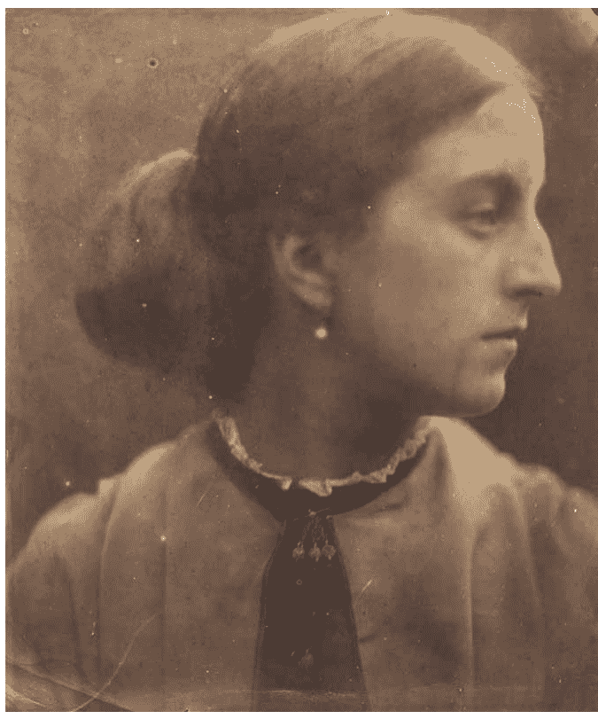

**图 12.3** 卡梅隆，《阿德莱德夫人肖像》，1865年，银盐版照片，27.5 × 23.5 cm，伦敦南肯辛顿博物馆。© 伦敦南肯辛顿博物馆

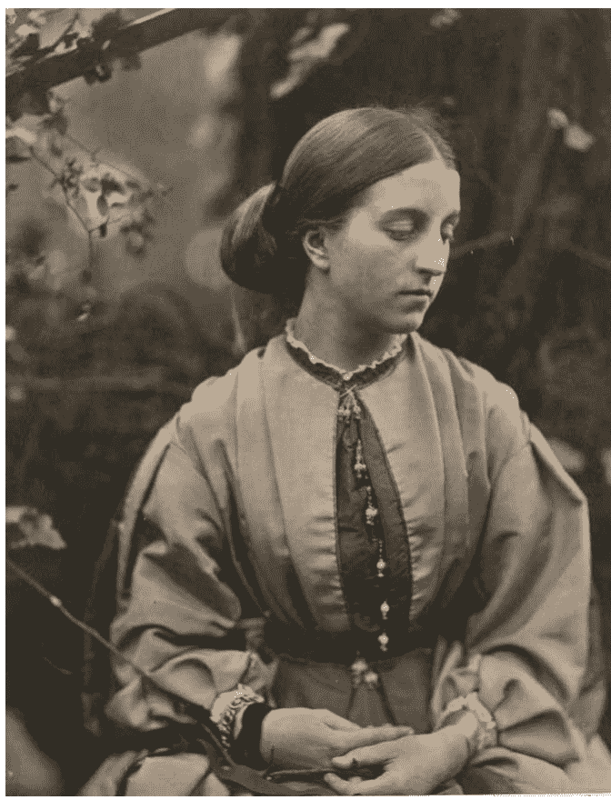

**图 12.4** 卡梅隆，《阿德莱德夫人》，1865年，银盐版照片，26 × 21 cm，伦敦南肯辛顿博物馆。© 伦敦南肯辛顿博物馆

由于他认为它们在博物馆中的出现是作为艺术对待的（尽管是错误的）证据。与此同时，卡梅隆的朋友凯特·佩里（Kate Perry）给圈内的另一位成员威廉写信，关于在博物馆看到这些照片：

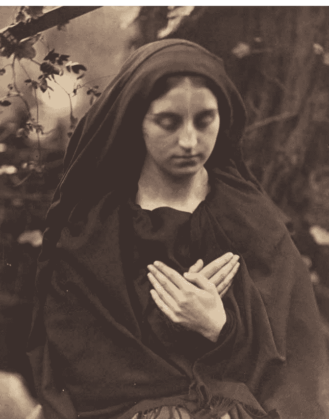

**图 12.5** 卡梅隆，《阿德莱德夫人》，1865年，银盐版照片，25 × 20 cm，伦敦南肯辛顿博物馆。© 伦敦南肯辛顿博物馆

佩里的描述更多是幽默而非描述性的，因为它将孙辈的名字与奶奶搞混了（卡梅隆并没有名叫玛格丽特的孙辈；她的女儿有两个孩子叫夏洛特和阿德莱德）。佩里实际上在博物馆展示的可能是一个关于长子的照片。博物馆在 1864 年从卡梅隆处收购了五张照片，照片上带有不同的签名⁸

对安妮·特莱西·波尔（Annie Thackeray Pole）的提到，以及卡梅隆本人写信要求展示照片，反映了卡梅隆职业的社交方面。作为卡梅隆和科尔（Cole）的好友，特莱西属于沃尔尔最近指责过度赞誉的“高层艺术赞助者”。事实上，她在当年早些时候发表了一篇抒情的文章，将卡梅隆的照片与列奥纳德、米开朗基罗和梅西的作品相提并⁹

因此，卡梅隆照片在南肯辛斯顿博物馆展出的证据仅限于：博物馆档案中关于卡梅隆希望在博物馆展出照片的记录；一篇攻击卡梅隆技巧的文章中的脚注；以及一封准确性存疑的私信。这些对于构建“博物馆展览赋予了卡梅隆照片艺术价值”这一主张来说是非常脆弱的基础。

## 艺术的摄影

除了 1865 年的展览外，博物馆对卡梅隆照片进入收藏后处理的所有方式都表明，它们并非被视为独立的艺术品，而是作为艺术家和设计师的素材。这是博物馆收集的大多数照片的主要目的。正如摄影收藏部助理馆长 T. C·格罗夫（T. C. Grove）在 1908 年解释的那样：

> “该收藏旨在为各种工作者服务——制造商、教师、艺术学生、图案设计师以及各行各业的工人——因此自然包含了艺术领域之外的许多物体照片。事实上，几乎每种照片都能找到用途；植物、花卉和动物被设计师和书籍插画家不断使用，而建筑和地形图作为记录具有价值，除了建筑学生之外，也被许多读者使用。”²⁰

## 从“自然研究”到“绘画研究”

科尔（Cole）显然意识到，卡梅（Cameron）的照片一经购买对设计师而言就是有益的。他将其中四张给了格雷高里·斯尔克斯（Gregory Sykes），后者当时正为南肯辛顿的一栋建筑设计装饰方案。21 凭借着高远的目标，卡梅的照片似乎与那些为了临摹而拍摄的照片完全不同。在视觉上还是陈述意图上，它们都缺乏当时博物馆收集的照片所那种清晰度。例如，在1865年夏天，在收购几批卡梅的照片空隙，博物馆购买了一组名为《叶片的解剖》（*The Anatomy of Foliage*）的照片。这些照片是主要的森林树木，每棵树都在冬夏季节从同一视角拍摄的；使学生能够在被茂叶遮挡时追踪其枝干。22 这些树木照片与卡梅的一样是“写实的”，但博物馆为了艺术家、设计师、学生和鉴赏者的参考而积累的数以万计的艺术、设计和建筑摄影，绝大多数并非如此。

与这些记录性摄影不同，卡梅的照片现在可能被南肯辛顿博物馆视为一种特殊的收藏，但最初的情况是，卡梅本人认为她的照片对艺术家可能具有意义，或许也有用。1865年11月，正当她的照片在博物馆收集并展示的同时，她在帕尔马街（Pall Mall）的法国画廊（French Gallery）举办了一场个人展。23 在价格目单顶端，一份加粗打印的声明宣布：“所有艺术家均可半价购买（图12.6）”。24 同年6月，卡梅在写给朋友珍·西尼尔（Jane Senior）的信中表达了这一意图：“我很早，也不是时间不久，就告诉了科纳基（Colnaghi），所有艺术家都可以以半价购买我的版画。”25 她的决心表明卡梅将自己视为一名艺术家，并且提供折扣作品——这显然超过了她从照片中尽可能多赚钱的愿望——甚至是为了支付开支——她在信中对此表示遗憾。卡梅可能认为自己是一个艺术家，而向其他艺术家提供折扣是证明她也是其中之一的一种方式。但她也可能将自己的照片视为艺术家的灵感来源，这是她的朋友考文特里·帕默（Coventry Palmer）的观点。作为卡梅最有说力的支持者之一，他将她的照片与老大师绘画相提，并认为照片的最终目的是作为艺术家的工具，而非艺术品本身。事实上，他拒绝了她“试图将它们制成画”的做法：

> “她并不是没有在纸上放过一个或多个高贵的头部或形象；但她必须将它们组合成生活场景（tableaux vivants），并将其命名为《信仰、盼望与慈善》、《圣阿格尼丝》、《幼童的萨穆埃尔》、《乔托的问候》等等。这种效果往往很奇怪，有时甚至是怪诞的。”

帕莫尔（Patmore）青睐她的肖像，写道：“照片中头部的美是艺术的最高境界。我们似乎在注视许多许多鲁尼、列奥纳多和凡·拉克，”但他继续写道：

> “摄影的地位是艺术家眼睛的引导和纠正者……通过像卡梅夫人这样的摄影的帮助，能力平平的艺术家能够创作出那些非卓越艺术家无法画出的肖像，而且……卓越的艺术家可以达到一种长期被认为已经灭绝的卓越。²⁶

## 所有艺术家均允许半价购买。

| 编号 | | | 士. | 便. |
|---|---|---|---|---|
| 1 | 《放弃》（Resignation, a Study） | .. | 5 | 0 |
| 2 | 《花与刺》（Flower and Thorn） | .. | 7 | 6 |
| 3 | 《阿斯尔塔》（Astarte） | .. | 10 | 0 |
| 4 | 《信仰、盼望与慈善》（Faith, Hope and Charity） | .. | 10 | 0 |
| 5 | 《虔诚》（Devotion） | .. | 7 | 6 |
| 6 | 《圣阿格尼丝》（St. Agnes） | .. | 5 | 0 |
| 7 | 《幼童的萨穆埃尔》（The Infant Samuel） | .. | 5 | 0 |
| 8 | 《爱丽丝·杜·肯》（Alice du Cane） | .. | 5 | 0 |
| 9 | 《圣西西莉亚》（St. Cecilia） | .. | 7 | 6 |
| 10 | 《问候，乔托》（The Salutation, after Giotto） | | 7 | 6 |
| 11 | 《五位贤女》（The five Wise Wisgins） | | 15 | 0 |
| 12 | 《五位愚女》（The five Foolish Vigins） | 每对 | | |
| 13 | 《月光下的玛德》（Maud, by moonlight） | .. | 5 | 0 |
| 14 | 《长苦》（Long Suffering） | .. | 10 | 0 |
| 15 | 《热诚祈祷》（Fervent in Prayer） | .. | 10 | 0 |
| 16 | 《爱》（Love） | .. | 10 | 0 |
| 17 | 《神圣》（Divine Love） | .. | 10 | 0 |
| 18 | 《在盼望中休息》（Resting in Hope） | .. | 10 | 0 |
| 19 | 《深藏心中》（Kept in the Heart） | .. | 10 | 0 |

| 20 | 《患难中的忍耐》（Patient in Tribulation） | .. | 10 | 0 |

图12.6 卡梅摄影展，帕尔马街，价格表，1865年11月，未标页（细节）。国家艺术图书馆，维多利亚和阿尔伯特博物馆。

## 从“自然研究”到“绘画研究”

卡梅分享照片最多的艺术家是她的好朋友`G. F. 瓦茨`（`G. F. Watts`）。在她的信件中，对艺术家的慷慨与她从照片中赚钱的需求之间存在冲突。瓦茨敦促她：“请不要寄给我昂贵的副本……给我任何未装裱的冲印即可，我能够判断，并为成功所吸引，不会觉得我在从你那里拿钱。”

在南肯辛顿博物馆内部，他们为卡梅的照片支付全价，馆目录证实这些照片被视为艺术家的有益材料。28 在1868年的第一个索引集中，卡梅的照片与多位知名艺术家的素描归为类（图12.7）。因此，南肯辛顿博物馆将朱莉亚·玛格丽特·卡梅的“写实”与老大师素描等同，将它们分类为国家艺术图书馆可以查阅的二维作品。科尔进一步模糊了这些类别之间缺乏区别的做法，特别是在提到一张拉斐尔素描的摄影时。1860年7月，当他辩卫南肯辛顿博物馆摄影部门的工作（该部门生产艺术和建筑摄影，有时向公众出售）时，他辩称，拉斐尔的一幅原作素描在质量上“并不比”这位艺术家的照片更好：

> “我有……拉斐尔素描的副本。在最近佳斯蒂最近的拍卖中，一幅不比此大、质量不差的素描卖了超过20英镑；通过摄影的作用以及部门的行为，任何（照片）……”

“她并不是没有在纸上放过一个或多个高贵的头部或形象；但她必须将它们组合成生活场景，并将其命名为《信仰、盼望与慈善》、《圣阿格尼丝》、《幼童的萨穆埃尔》、《乔托的问候》等等。这种效果往往很奇怪，有时甚至是怪诞的。”

帕莫尔（`Patmore`）青睐她的肖像，写道：“照片中头部的美是艺术的最高境界。我们似乎在注视许多许多鲁尼、列奥纳多和凡·拉克，”但他继续写道：

> “摄影的地位是艺术家眼睛的引导和纠正者……通过像卡梅夫人这样的摄影的帮助，能力平平的艺术家能够创作出那些非卓越艺术家无法画出的肖像，而且……卓越的艺术家可以达到一种长期被认为已经灭绝的卓越。²⁶

## 所有艺术家均允许半价购买。

| 编号 | | | 士. | 便. |
|---|---|---|---|---|
| 1 | 《放弃》（Resignation, a Study） | .. | 5 | 0 |
| 2 | 《花与刺》（Flower and Thorn） | .. | 7 | 6 |
| 3 | 《阿斯尔塔》（Astarte） | .. | 10 | 0 |
| 4 | 《信仰、盼望与慈善》（Faith, Hope and Charity） | .. | 10 | 0 |
| 5 | 《虔诚》（Devotion） | .. | 7 | 6 |
| 6 | 《圣阿格尼丝》（St. Agnes） | .. | 5 | 0 |
| 7 | 《幼童的萨穆埃尔》（The Infant Samuel） | .. | 5 | 0 |
| 8 | 《爱丽丝·杜·肯》（Alice du Cane） | .. | 5 | 0 |
| 9 | 《圣西西莉亚》（St. Cecilia） | .. | 7 | 6 |
| 10 | 《问候，乔托》（The Salutation, after Giotto） | | 7 | 6 |
| 11 | 《五位贤女》（The five Wise Wisgins） | | 15 | 0 |
| 12 | 《五位愚女》（The five Foolish Vigins） | 每对 | | |
| 13 | 《月光下的玛德》（Maud, by moonlight） | .. | 5 | 0 |
| 14 | 《长苦》（Long Suffering） | .. | 10 | 0 |
| 15 | 《热诚祈祷》（Fervent in Prayer） | .. | 10 | 0 |
| 16 | 《爱》（Love） | .. | 10 | 0 |
| 17 | 《神圣》（Divine Love） | .. | 10 | 0 |
| 18 | 《在盼望中休息》（Resting in Hope） | .. | 10 | 0 |
| 19 | 《深藏心中》（Kept in the Heart） | .. | 10 | 0 |
| 20 | 《患难中的忍耐》（Patient in Tribulation） | .. | 10 | 0 |

图12.7 南肯辛顿博物馆摄影收藏索引（伦敦1868年），（细节）。国家艺术图书馆，维多利亚和阿尔伯特博物馆。

## 人像研究：-

| | | | |
|---|---|---|---|
| 拉斐尔素描 | 奥斯陆博物馆 | 53857-859 53927 | 225 |
| 艺术与工业 | 53881-606 | 331 |
| 米开加素描 | 54143-140 | 331 |
| 米勒与夏登 | 41208-211 | 167 |
| 自然中的，卡梅夫人 | 44725-744 | 245 |
| 杜勒素描 | 奥斯陆博物馆 | 53841-842 | 225 |
| 艺术与工业 | | |

# 摄影与艺术

在1868年的索引中，还有一个名为“卡梅夫人”（`Cameron, Mrs.`）的条目，下列出了三组照片：“人体研究”、“画像与自然研究”以及“自然研究”。这些术语与三年前照片进入博物馆时，收购登记表和接收室所使用的术语一致。虽然标注了卡梅是作者，但并没有包含作品标题。照片的身份——其作为艺术品的传统标志——在机构内部的分类中逐渐被侵蚀。

## 作为艺术的摄影

令人惊讶

# 从“自然的研究”到“绘画的研究”

在这一轨迹中，卡梅希望她的摄影作为高雅艺术品的愿望受到了压抑，但她希望让自己的作品被艺术家接触的愿望得以实现。卡梅的摄影最终在博物馆内找到了一个今天广为人知的地位。

维多利亚和阿尔尔伯特博物馆（`V&A`）的摄影收藏与大多数艺术博物馆一样，包含了最初为其他领域创作的摄影作品，现在现在作为艺术品进行研究和展示。这些包括艺术和建筑记录、地质调查记录、民族志肖像以及各种快照，但这类寥寥无几。尽管艺术史学家和博物馆专业人士已经意识到在艺术博物馆中对摄影进行去语境化的陷阱，但他们对最初作为艺术品创作的摄影的制度地位关注少得多。朱莉亚·玛格丽特·卡梅摄影在南肯辛顿博物馆内意料之外的路径，证明了有必要进一步研究十九世纪社会中艺术摄影的地位。

`Juliet Haacking` 在此论文的准备过程中提供了宝贵的支持。感谢她以及 `Joanne Lich` 持续的鼓励与合作。我感谢我的 `V&A` 同事 `Erika Lederman` 和 `Ella Ravillion`，他们都慷慨地和我分享了他们博士研究的某些。

# 注释

- 1 `Rosalind Krauss`，“摄影的论述空间：风景/景观”，《Art Journal》 42, no. 4 (1982年冬季): 311–119, 1983.
- 2 朱莉亚·玛格丽特·卡梅给`约翰·赫歇尔爵士`的信，1864年12月31日，伦敦国家肖像馆`海因茨档案与图书馆`。重印于 `Colin Ford` 的《The Cameron Collection: An Album of Photographs by Julia Margaret Presented to Sir John Herschel》(`Wokingham: Van Nostrand Reinhold in association with the National Portrait Gallery, London, 1975`), 140–1。原文强调。
- 3 展品清单，请参阅 `Julian Cox` 和 `Colin Ford` 的《Julia Margaret Cameron: The Complete Photographs》(`Los Angeles: The J. Getty Museum in association with The National Museum of Photography, Film & Television, Bradford, England 2003`), 538–4。关于南肯辛顿博物馆收购卡梅摄影的完整描述，见 `Marta Weiss` 的著作《Julia Margaret Cameron: Photographs to Electrify You with Delight and Shartle the World》(`London: MACK in association with V&A Publishing, 2015`)。
- 4 `A. H. Wall`，“实用艺术提示：对摄影肖像领域艺术进步的批判性评论”，《British Journal of Photography》 12 (1865年11月3日), 557–9.
- 5 `T. C. Grove`，“摄影部门报告”，1908年6月12日：`V&A 档案`，`ED 84/85`，重组委员会会议纪要。
- 6 打印索引，国家艺术图书馆摄影集：《Photography Studies for Drawing, Painting, Etc.` 制作于1901年左右。物体编号 `45154` 在此处列为“睡眠中的孩子；以及母亲；头部研究”。一份名为《Photographs Classification》的1920年后的装订本，列出了三十九类摄影，

# 摄影与艺术

从“解剖学”（第一类）到“壁画”（第XXXVIII类）。这两份文件现在均藏于维多利亚和阿尔尔伯特博物馆的文字与图像部。

感谢 `Ella Ravisharius` 分享这些信息，并提醒我上述索引注释。

朱莉亚·玛格丽特·卡梅给`亨利·科尔`的信，1865年5月20日，维多利亚和阿尔尔伯特博物馆国家艺术图书馆，`MSL/1934/537/8/2/1`。

“给住在小荷兰人居（`Little Holland House`）的卡梅女士，让她在那里拍我的肖像。一个德国女孩在我身上说话。”`亨利·科尔日记`，1865年5月19日，维多利亚和阿尔尔伯特博物馆国家艺术图书馆，`MSL/1934/412`。

这些是1865年8月送给银行家收藏家`奥弗斯顿勋爵`（`Lord Overstone`）的专辑标题。专辑包含许多南肯辛顿博物馆收集的相同图像，现在位于洛杉矶`J·保罗·盖蒂博物馆`的收藏中。

价格从5到10先林不等。图书馆接收室日记（`Library Receiving Room Diaries`）现藏于维多利亚和阿尔尔伯特博物馆档案，摄影收购登记表位于维多利亚和阿尔尔伯特博物馆文字与图像部。

虽然第一批（主要是圣母像，以及其他圣经、文学和寓言主题）不包含肖像，但随后的小组是肖像与装装或叙事场景的混合。博物馆收购登记表，维多利亚和阿尔尔伯特博物馆文字与图像部。

`Mark Hawworth-Booth`指出当时南肯辛顿博物馆有很多知名度更高的作品，包括维多利亚女王收藏的拉斐尔挂毯草图。《摄影：一种独立的艺术》(`V&A Publications, 1997`), 81–2。

`V&A 档案`，`MA/4/2`，信函摘要与登记表：注册文件 `RP/1865/2074`。信函摘要和登记表中列出的信是寄给博物馆处理公文的，但未保留。保存在国家艺术图书馆的卡梅给亨利·科尔的信是给科尔的私人信，未注册。

`Wall`，“Practical Art Hints”，558

`Kerry Perry小姐`给[`William`] `Brookfield先生`的信，`Hans Place 33号`，1865年11月3日，见于 `Charles and Francis Brooks`的《MS Brooks and Her Circle》，第2卷 (1874) (`New York: Smith, Elder, 1905`)。卡梅唯一的女儿，`Julia`，于1873年出生。

由于缺乏1865年南肯辛顿博物馆卡梅展览的记录，我们无法确定其展出的是馆藏还是其他选择。`安·伊莎贝拉·Thackeray`，“A Book of Photographs，”《Pall Mall Gazette》(`1865`)

`Thackeray`于1868年重印。

`Grove`，无页码。

从“自然的研究”到“绘画的研究”207

- 24 关于这个11月的，卡梅摄影展，120
- 25 朱莉亚·玛格丽特·卡梅给`Jane Senior`的信，1865年6月29日，科学与媒体博物馆，`2001–5059`。
- 26 `Coventry Patmore`，“卡梅的摄影，”《Macmillan’s magazine》 no. 23 (1886年1月): 230–1。
- 27 `G. F. Watts`给朱莉亚·玛格丽特·卡梅的无日期信，国家肖像馆`海因茨档案与图书馆`，`NPC P215 (1a/1b/c)`。尽管`Watts`经常被称为卡梅的艺术导师，但他们的关系还需要进一步探索。`Watts`确实评价过她寄来的照片，但他可能受到了她作品的启发。`Julia Fagan-King`说服力地指出，`Watts`似乎根据卡梅的摄影创作了某些绘画。见 `Julia Fagan-King`，“Cameron, Watts, Rossetti: The Influence of Photography on Painting”，《History of Photography》 10, no. 1 (1986年1月–3月): 19–29。
- 28 接收室日记记录的价格与法国目录中的折扣价一致。
- 29 南肯辛顿博物馆国家艺术图书馆摄影收藏索引（伦敦1868）。
- 30 引用自 `John Physick`，《Photography and the South Kensington Museum》(`London: Victoria and Albert Museum, 1975`), 5。
- 32 国家艺术图书馆摄影集：《Photographic Studies for Drawing, Painting`, Etc.》
- 33 引用自 `Haworth-Booth`，《Photography: An Independent Art》， 121。

# 参考文献

`Abbaspour, Mitra` 与 `Lee Ann Daffner`, `Maria Morris Hambourg`. 《对象：照片。现代摄影：托马斯·瓦尔特收藏，1909–1949》。纽约：现代艺术博物馆，2014年。

`Adhémar, Jean`. 〈浪漫主义时期法国的风景石版画〉收于 `Carle VanLano` 的《Rest: Les Lithographies de pays en France à l'époque romantique》，由 `Louis Rey`, `Jean Messelet` 和 `Jean Adhémar` 编，第 190–283 页。《法国艺术档案：新时期》，第 XIX 卷。 巴黎：`Armand Colin 出版社`，1938年。

`Armstrong, Malcolm`. 《风景的追寻：英国的风景美学与旅游，1760–1800》。 斯坦福：`斯坦福大学出版社`，1989年。

`Andrews, Carol`. 《图书馆中的场景：书中的摄影阅读，1843–1875》。马萨诸塞州剑桥：`麻省理工出版社`，1998年。

`Auerbach, Jeffrey`. 〈画作与帝国的同化〉。《英国艺术杂志》，第 5 卷，第 1 期（2003）：第 283–305 页。

`Avery-Quash, Susan` 与 `Jillian Sheldon`. 〈铅笔是我心之子：伊丽莎白·莱利（伊斯特莱克夫人）的发现画集〉。《英国艺术杂志》，第 14 卷，第 2 期（2013）：第 45–64 页。

`Baker, Malcolm`. 〈复制连续体：石膏复制师、石膏马赛克与作为19世纪博物馆补充模式的摄影〉收于《Plaster Casters: Making, Collecting and Displaying from Classical Antiquity to the Present》，由 `Rune Frederiksen` 和 `Ekhart March` 编，第 485–500 页。柏林与纽约：`De Gruyter 出版社`，2010年。

`Baker, Malcolm`. 〈书写雕塑展示：史学与某些当代问题〉。《Cahiers de l'école du Louvre》[在线]，第 8 期（2016）。http://journals.openedor.org/cel/332; DOI: 10.4000/cel.332。

`Baldwin, Gordon Daniel` 与 `Sarah Greenough`, 《整个伟大的世界：罗杰·芬斯顿的照片，1852–1860》。纽约与伦敦：`耶鲁大学出版社`，2004年。

`Baker, Stephen`. 〈反对例外主义〉收于《摄影及其起源》，由 `Tanya Sheehan` 和 `Andrés Varguis` 编，第 94–103 页。奥克斯福德，`阿宾登`（`Abingdon`）：2015年。

`Barn, Stephen`. 《卓越的图像：版刻师与19世纪法国的视觉经济》。新哈文：`耶鲁大学出版社`，2013年。

`Barlow, Paul`. 〈面对过去与现在：国家肖像画馆与对“真实”肖像画的追寻〉收于《Portraiture: Facing the Subject》，由 `Joanna Woodall` 编，第 219–38 页。曼彻斯特：`曼彻斯特大学出版社`，1997年。

`Barringer, Tim`. 〈南肯辛顿博物馆与殖民计划〉收于《Colonialism and the Object: Material Culture》，由 `Tim Barringer` 和 `Tom Flynn` 编，第 209–26 页。伦敦与纽约：1998年。

`Barringer, Tim`, `Jason Rosenfeld` 与 `Alison Smith`. 《拉斐斐尔派：维多利亚时代的先锋》。伦敦：`Tate 出版社`，2012年。

`Batchen, Geoffrey`. 《欲望的燃烧：摄影的概念》。马萨诸塞州剑桥：`麻省理工出版社`，1997年。

`Batchen, Geoffrey`, 编. 《摄影零：对罗兰·巴特〈明室摄影学〉的反思》。马萨诸塞州剑桥：`麻省理工出版社`，2009年。

`Bate, Francis`. 《自然主义绘画学派》。1887年。最初发表于《Art and Journal of Home Culture》，第 7 卷，第 75–82 页（1885年9月至1886年9月）。`查尔斯·波德莱尔`（著），由 `Jonathan May` 翻译并编辑。伦敦：`Phaidon 出版社`，1965年。

`Baum, Kelly` 与 `Andrew Bayer`, 编. 《视觉化的思想》。纽约：`大都会博物馆`，2016年。

Baylor, R. Child. 〈画相摄影〉收于《The Complete Photography》，第 2 版，第 356–37 页。纽约：McClure 出版社，1963年。

Bean, Jordan. 《幻灭：维多利亚时代的摄影与敏锐的主体》。宾夕法尼亚州大学公园：宾夕法尼亚州立大学，2015年。

Beebe, Gregory. 《工作室：机械复制与设计地位的变迁》。《Design Issues》，第 23 卷，第 4 期（2007年秋季），第 46–61 页。

Benjamin, Walter. 〈摄影简史〉发表于《Literarische Welt》，1931年9月19日至1931年10月25日；见《Screen》，第 13 卷，第 1 期（1972）：第 5–26 页。

Berson, Ruth, 编. 《新印刷术：1874–1886》。

Blanquart, Ernest. 《法国艺术档案：新时期》，第 XIX 卷。Louis. 〈摄影的起源〉发表于《Design Issues》，第 23 卷，第 4 期（2007年秋季），第 46–61 页。

Bonetti, Marie. 〈美学与非美学〉发表于《History of Photography》，第 34 卷，第 1 期（2014年6月），第 30–43 页。

Brewster, Sid. 〈摄影的媒介〉发表于《The Edinburgh Review》。〈Drawing by the Agency〉，第 76 卷，1883–1885 页。

Coburn, Alvin. 〈焦点问题〉发表于《摄影新闻》，第 34 卷，第 1680 期，1890年11月14日，第 883 页。

Coln, Bernard. 《殖民主义与形式》。普林斯顿州普林斯顿：普林斯顿大学出版社，1996年。

Coke, Van. 《银版摄影》。阿尔伯克基基：新墨西哥大学出版社，1964年。

Coleman, A. 《美国摄影的起源，1835–1885：从银版摄影到干板》。堪萨斯市：内尔逊-阿金森博物馆联合耶鲁大学出版社，2007年。

Coleman, Deirdre. 〈十八世纪的娱乐昆虫〉发表于《Life》，第 30 卷，第 3 期（2006年夏季），第 107–84 页。

Costello, Diarmuid. 〈摄影理论之何〉发表于《美学与艺术批评杂志》，第 75 卷，第 4 期（2017年7月），第 439–52 页。

Cornier, Brian, 编. 《代码文化：数字生产时代的共享》。2018年。

Cox, Julian 与 Colin Fry. 《玛格丽特·卡梅伦：全集》。洛杉矶：Getty 博物馆联合国家摄影电影电视博物馆，2003年。

Crimp, Douglas. 〈博物馆的老旧/图书馆的新主题〉发表于《Practice》（1981）第 32 期，第 32–7 页。Douglas Crimp 著，Louise 摄影，《博物馆的废墟》，马萨诸塞州剑桥：麻省理工出版社，1993年，第 66–81 页。

## 参考文献

Di Bello, Patrizia. 《雕塑性摄影：从卡罗法到数字技术》。伦敦与牛津：Bloomsbury, 2018。

Di Bello, Patrizia. 《维多利亚时代的英国女性专辑与摄影：母亲与情妇》。阿尔德斯肖特：Ashgate, 2007。

Doucet, Emily. 〈在历史中，未来：法国早期摄影中的决定论。〉*Communication + 17*, no. 1 (2018年10月): 1–19。

Dunstan, Angel. 〈19世纪雕塑与真实性的印记。〉*19. Interdisciplinary Studies in the Long Century* (2014), http://19.bbk.ac.uk (访问日期：2019年8月31日)。

Egleton, Terry. 《美学的意识形态》。牛津：Blackwell, 1990。

[Elizabeth Easton], 《伊斯顿夫人的日记与信函》，Charles Smith 编辑。伦敦：John Bryan, 1895。

[Elizabeth Easton], 〈摄影，〉*Quarterly Review* 101, no. 02 (1857年4月): 442–68。

Edwards, Elizabeth. 《作为历史的相机：业余摄影师与历史想象，1885–1918》。德纳与伦敦：杜克大学出版社, 2012。

Edwards, Elizabeth. 〈摄影与过去的物质化表演。〉*History and Theory* 48, no. 4 (2009年12月): 130–150。

Edwards, Elizabeth. 《原始历史：摄影、人类学与博物馆》。牛津与纽约：Berg, 2001。

Edwards, Elizabeth 与 Janice Hart, 编。《摄影、物体、历史：论图像的物质性》。纽约与伦敦：Routledge, 2004。

Steve, Mike. 《英国摄影的形成》。宾夕法尼亚州大学公园市：宾夕法尼亚大学出版社, 2006。

Emerson, Peter Henry. 〈人物摄影的艺术面。〉*Magazine of Art* 14 (1891年8月): 310–16。

Emerson, Peter Henry. 〈艾默森的英文信。〉*Amateur Photographer* 10, no. 269 (1889年11月): 365–6。

Emerson, Peter Henry. 〈朱莉亚·玛格丽特·卡梅隆夫人。〉*Naturalistic Photography Photographic News* 33, no. 1065 (1889年6月7日): 31。

Emerson, Peter Henry. 〈自然主义艺术。〉*Photographic News* 33, no. 1601 (1889年5月10日): 33–42。

Emerson, Peter Henry. 《艺术学生的自然主义摄影》。Sampson Low, Sterne and Rivington, 1899。

Emerson, Ralph Waldo. 〈卡梅隆、罗塞蒂：论文中摄影的影响。〉James Munro & Co., 1841。

Fagan-Jia, Julia. 〈卡梅隆：摄影对绘画的影响。〉*History of Photography* 10, no. 1 (1986年1月–3月): 19–29。

Falconer, John. 〈威洛比·华拉斯·霍珀“对摄影的热衷”。〉*The Photography Collector* 4 Winter (1983): 258–85。

Fulk, Ulrich. 《纪律与国家：从第二帝国到世界大战期间法国化学意识形态》。莱比锡：Springer大学出版社, 2000。

Figes, Orlando. 《犯罪》(Crimeaaa)。伦敦：Penguin Books, 2010。

Flint, Kate, 编。《英国的印象派：评论界的接受》。伦敦：Routledge & Kegan, 1984。

Flour, Isabelle. 〈论国家建筑博物馆的形成：建筑博物馆与肯辛顿博物馆之争。〉*Architectural History* 51 (2008): 211–38。

Foa, Michelle. 〈文本抑制：维多利亚晚期英国的摄影评论。〉*History of Photography*, 36, no. 1 (2012): 33–44。

Ford, Colin. 《卡梅隆收藏：朱莉亚·玛格丽特·卡梅隆给约翰·赫歇尔爵士的照片集》。沃金汉：Van Noordrand 联合国家肖像馆, 1975。

Fowler, Frances. 〈从莫奈身上赚钱：1870–1905年英国市场化的莫奈。〉收《莫奈与风景：韦瑟与诺曼底》，Frances Fowler 编辑。爱丁堡：苏格兰国家美术馆, 2006: 141–58。

Fandiani, Giovanni. 《1851–1951年英国与爱尔兰雕塑的实践与功能》。格拉斯哥大学艺术史与HATII在线数据库，2011。http://glasgow.ac.uk/view/person.php?id=msb7_1206146685 (访问日期：2019年1月4日)。

Frederiken, 与 Eckart March, 编。《刻板：从古代到现代》。柏林：Gruyter, 2010。

Freund, Gisele. 《19世纪法国摄影：社会学与美学尝试》。巴黎：A Monde, 1996。

Frith, Charles. 〈摄影的艺术。〉*Art-Journal* 5 (1859年3月): 71–2。

Fuldner, Karl. 〈艾默森的演变。〉*Tate Papers* 27 (2017年春季)。https://www.tate.org/research/publications/tate-papers/27/emerson-evolution (访问日期：2019年)。

Galifat, Thomas. 〈法国摄影的存在……19世纪的女性、摄影与话语。谁害怕？1839–1945〉，Ulrich Pohl 编辑，34–49。巴黎：Editions Hazan, 2015。

Gallari, Barbara. 《塑造美国泰特：叙事》。伦敦：New York Society with Gifts, 2011。

Gautran, Jean-Claude. 〈从……。〉收《Blanquart–Évard》，Jean Claude 与 Alain Buis 编辑，加莱地区摄影中心，34–55。

Gernshe, Helmut. 《朱莉亚·玛格丽特·卡梅隆：她的生平与摄影作品》。修订版：Aperture, 1975。

Gernsheim, Helmut. 《摄影师：克里米亚战争》。伦敦：Secker & Warsburg, 1954。

Gillespie, Sarah. 《达盖摄影：艺术与技术的潮流》。剑桥：MIT Press, 2016。

Gilpin, William. 《三篇论文：论风景美学；论风景旅行；论风景写生：作者执行的原则与方法》(1792)。第3版。伦敦：T. Cadell and W. Davies, 2018。

Gregory, Henry A. 〈不安的愉悦：堕落的图像与堕落的美学。〉*Text*, no. 3 (2012): 259–73。

Glas, Jörn. 〈眼前的图像：威廉·吉尔平与18世纪的风景。〉收《记录的自然：18世纪的国际视角》，Michael Scheffel 编辑，69–88。柏林：Lang, 2001。

Gordon, Sophie. 《战争的阴影：罗杰·芬顿的克里米亚摄影，1855》。伦敦：Royal Collection, 2017。

Green-Lewis, Jennifer. 《框架维多利亚时代：摄影与现实主义文化》。伊塔卡：康奈尔出版社, 1996。

Green-Lewis, Jennifer. 《维多利亚时代的摄影、文学与现代记忆的发明：过去》。Bloomsbury, 2017。

Groth, Helen. 《维多利亚时代的摄影与怀旧》。牛津：牛津出版社, 2003。

Guha-Thakurta, Tapasi. 〈复制的概念：过去的现在的复制。〉收《印度的文化历史：物质性与实践》，Partha Chatterjee 编辑，18–220。牛津：牛津出版社, 2014。

Guha-Thakurta 与 Bodhisattva Kar. 〈殖民印度视觉表征的强迫。〉收《印度的：摄影、建筑与表征的政治，1850–1900》，Maria Antonella Peizzari 编辑，103–39。新哈文：加拿大建筑中心与耶尔英国艺术中心, 2003。

Guha-Thakurta 与 Bodhisattva Kar. 《纪念碑、物体、历史：殖民与后殖民印度的艺术机构》。纽约：哥伦比亚大学出版社, 2004。

Guha-Thakurta 与 Bodhisattva Kar. 〈纪念碑的生产与再生。〉*South Asian Studies* 29, no. 2 (2013): 77–109。

Gunning, Tom. 〈不可见的世界，可见的媒介。〉收《光：摄影与不可，1840–1900》，Corey Kelly 编辑，51–63。旧金山：旧金山艺术博物馆, 2008。

Guntherth, André. 〈摄影机构：摄影协会的小说。〉*Études photographiques* 12 (2002年11月): 37–63。

Guntherth, André. 〈法国摄影协会的诞生。〉收《法国摄影协会收藏的独特视角》，André Gunther, Michel Poirier 与 Carole Trouille 编辑，15–16。谢尔布尔：Le point du jour, 2004。

Hacking, Juliet. 《摄影与艺术市场》。伦敦：Humphries, 2018。

Hacking, Juliet. 〈人格化的摄影：英国摄影中的艺术与身份。〉博士论文，伦敦大学考陶德艺术学院，1998。

Hacking, Juliet. 《维多利亚时代的波西米亚王子：大卫·温基菲尔德摄影》。慕尼黑；伦敦：Preston, 2002。

Harker, Margaret. 《亨利·皮奇·罗宾逊：摄影艺术大师，1830–1901》。牛津：Basil Blackwell, 1988。

Harker, Margaret. 《摄影艺环：1892–1910年的摄影分离运动》。伦敦：Heinemann, 1979。

Hamber, Anthony. 《摄影与1851年万国博会》。特拉华州新卡斯尔与伦敦：V&A, 2018。

Harris, David. 《真与美：菲利克斯·贝托的中国摄影》。圣巴巴芭芭拉；伦敦：加州大学出版社, 1999。

Haworth-Booth, Mark. 《摄影，一种独立艺术：维多利亚和阿尔伯特博物馆的摄影，1839–1996》。普林斯顿：普林斯顿出版社, 1997。

Heilbrun, Christophe. 〈印象与摄影。〉*History of Photography* 33, no. 1 (2009): 18–25。

Heinrich, Herbert. 〈电镀法与电刻字法的发现。〉*Journal of Chemical Education* 15, no. 12 (1938): 56–75。

Hellman, Karen. 〈安托万·克洛代：一位摄影界人物。〉博士论文，纽约市，2010。

Hellman, Karen. 《现实/理想：19世纪中期的法国摄影》。洛杉矶：J.保·盖蒂博物馆, 2016。

## 参考文献

Jacobi, Carol and Hope Kingsley. 《光影绘画：从前拉斐尔学派到现代的艺术与摄影》。伦敦：Tate出版社，2016。

James, Isabelle. 〈Blanquart-Évrard 与法国摄影出版的起源〉。《1851–1855年出版摄影相集分类目录》。日内瓦：Librairie Droz 出社，1981。

Johns, Elizabeth. 《美国风派绘画：日常生活的政治》。新亥维港与伦敦：耶鲁大学出版社，1991。

Jürgen, Ioannis Vasallos, and Lena Fernandes. 〈约瑟夫的 Bertotyp：为科学服务的印刷〉。《荷兰国立博物馆公报》第66 卷，第2 期（2018年）：144–69。（注：“Bertotyp”可能是“Bertotype”的误拼）

Keller, Ulrich. 《终极视角：克里米亚战争视觉史》。阿姆斯特丹：Gordon and Publishers，2001。

Kelsey, Robin. 《摄影与偶然的艺术》。马萨诸塞州剑桥市：哈佛大学出版社 Belknap 出社，2015。

Kingsley, Hope, and Christopher Ripley. 《被艺术诱惑：过去与现在的摄影》。伦敦：国家美术馆公司，2012。

Kossy, Boris. 《厄库尔·弗罗伦斯的先驱摄影作品》。纽约与伦敦：Routledge出版社，2018。

Krauss, Roland. 〈索引笔记：美国的70年代〉10月3日（1977年）：第 68–81 页，以及〈索引笔记：美国的70年代，第2部分〉10月4日（1977年秋季）：第 58–67 页。

Krauss, Roland. 〈“摄影”的话语空间：景观/视界〉。《艺术杂志》第42 卷，第4 期（1982年）：311–39。

Kriebel, Susanne T and Andrés Zervigón, 《摄影与怀疑》。阿宾登，牛津，2017。

Lacoste, Anne. 《Feleza Beato：东方之路上的摄影》。洛杉矶：J.保罗·盖蒂博物馆，2010。

Le Men, Ségalène. 〈Taylor 和 Nodier 笔下旧法国的风景与浪漫旅行：纸张上的纪念碑〉。收录于《风景游记》，由 Lucie Goujard 等人编，第 33–69 页。Cisalno：Balsamo：2009。

Lending, Andre. 《海报纪念碑：建筑与复制的力量》。普林斯顿与牛津：普林斯顿大学出版社，2017。

Leonardi, Nicoletta and Simon Natali, 《19世纪的摄影与其他媒介》。宾夕法尼亚州大学公园：宾夕法尼亚州大学出版社，2018。

Lequeux, James. 《悬念的严肃乐趣：维多利亚现实主义与叙事怀疑》。查洛茨维尔与伦敦：弗吉尼亚大学出版社，2003。

Linfield, Susie. 《关键辐射：摄影与政治暴力》。芝加哥大学出版社，2010。

Lubin, David. 《描绘国家：19世纪美国的艺术与社会变革》。新亥维港：耶鲁大学出版社，1996。

Likitsh, Joanne. 〈博物馆墙上的相册：Mia 相册〉。收录于《我最亲爱的妹妹 Mia：朱莉亚·玛格丽特·卡默的摄影集》，由 Therese Mulligan 编，第 27–31 页。阿尔伯克基市：新墨西哥艺术博物馆，1994。

Likitsh, Joanne, Cameron. 《她的作品与职业》。纽约州罗彻斯特市：国际摄影博物馆，乔治·伊斯特曼之家，1986。

## 参考文献

# 参考文献

Lukshit, Joanne. 〈如利奥芬奇一般：朱莉亚·玛格丽特·卡默与罗塞蒂兄弟的交流〉。收录于 *前拉斐尔镜头：英国摄影与绘画，1848–1875*，由 Diane Wagner 编，第 134–45 页。华盛顿特区：国家美术馆与 Lund Humphries 出版社，2010。

Lukish, Joanne. 《Thomas Woolner：透视摄影》。利兹：Moore Institute，2006。

Lyden, Anne M. 《完美的化学反应：Hill 和 Adamson 的摄影作品》。爱丁堡：苏格兰国家美术馆，2017。

Lyons, V. V. 《米德兄弟》。《摄影史》第 14 卷，第 2 期（1990 年 4 月–6 月）：第 113–14 页。

Maimon, Vero. 《独特的图像，失败的复制：威廉·亨利·泰尔伯与早期摄影》。明尼阿波利：明尼苏达大学大学出版社，2015。

Macarthur, John. 〈画面的无情：鲁斯金美学中的同情与反感〉。《汇集》第 32 卷（1997 年 4 月）：第 126–41 页。

Marbott, Bernard. 〈Banquart-Erard, Il. 25 a+b. 两个主题〉。收录于 *20 世纪法国摄影观察：20 世纪的摄影*，法国国家图书馆，巴黎，纽约大博物馆，巴黎：20 世纪摄影。

Mayor, Carol. 《快感：维多利亚时代的表演与欲望》。达哈姆：杜克大学出版社，1995。

McCauley, Anne. 《Clarence H. 的世界：1895–1925 年的摄影与工艺》。普林斯顿与出版社：普林斯顿：普林斯顿大学出版社，2007。

Mcauley, Anne. 〈写作笔记：摄影的到来〉。《摄影》第 21 卷，第 2 期（1997 年夏季）：第 87–101 页。

Mickey, Kenneth. 《数字时代的摄影》。伦敦：皇家学院，2006。

McGuire, Scott. 〈数字档案中的摄影〉。收录于 《数字时代》，由 Sean Cubitt 编，第 122–43 页。伦敦：2015。

Miller, Sarah. 《Jordan 的幻灭》。《批判性查询》，2015 年 11 月。

Mittman, Greg. 《摄影的起源》。收录于 《风景游记 de-in: The National Gallery of Art and Lund Humphries》，2009 年，第 27–35 页。

Morse, Samuel. 《达盖尔摄影》。《观察报》第 17 卷，第 16 期（1889 年 4 月）：第 62 页。

Morris, Rhys. 《弗兰肯斯坦式的实验》。普林斯顿：普林斯顿大学出版社，1998。

Moser, Walter. 《摄影的诞生》。收录于 《电力时代: The Electric Age》，2011 年，第 61–84 页。

Need, Lynda. 《维多利亚时代的摄影作品集》。纽约：大都会博物馆，2005。

Nickel, Douglas. 〈摄影的声张〉。《摄影杂志》第 83 卷（2001 年）：第 54 页。

Novak, Daniel. 《摄影的现实主义》。剑桥：Cambridge 出版社，2008。

Olsen, Line. 《来自的摄影》。阿宾登，牛津：阿宾登，2017。

Østermark, Jussi. 《摄影的世纪》。明尼阿波利：明尼苏达大学出版社，2010。

Park, Anne. 《摄影的世纪》。达尔哈姆：Ashgate 出版社，1998。

Pellizzi, Maria. 《维多利亚时代的摄影审判》。查洛茨维尔与伦敦：弗吉尼亚大学出版社，2003。

Pennell, Joseph. 〈作为艺术的权利〉。《摄影杂志》第 5 卷，第 6 期（1991 年 7 月）：第 139–52 页。（注：页码为 139-52 可能是误拼）。

Pennell, Joseph. 〈摄影的阻碍与帮助〉。《摄影杂志》第 5 卷，第 57 期（1991 年）：第 73–80 页。

Pennell, Joseph. 〈星光摄影〉。《摄影新闻》第 33 卷，第 1 期（1889 年 3 月）：第 2 页。

Pennell, Joseph. 〈对印象主义的星光〉。《摄影》（1889 年 4 月）：第 384 页。

Pera, Marcelo. 《英国性》。Yale 艺术中心，2016 年。

Physick, John. 《南方的摄影》。伦敦：维多利亚和阿尔伯特博物馆，1975。

Pinney, Christopher. 《意大利的摄影》。伦敦：英国图书馆，2008。

Pinney, Christopher. 〈摄影的七个主题〉。《十一》第 11 卷，第 1 期（2012 年）：第 14–56 页。

Pinson, Steven. 《L.J.M. 达盖尔的作品》。芝加哥与伦敦：芝加哥大学出版社，2012。

Pinson, Steven. 《Girault 的达盖尔银版摄影》。纽约：大都会博物馆，耶鲁大学出版社发行，2019。

Potoniée, Georges. 《摄影发现史》。巴黎：Paul Montel，1925。

Pringle, Andrew. 〈摄影中的印象主义〉。《摄影》第 3 卷，第 113 期（1991 年 1 月 8 日）：第 19–22 页。

Rodger, Philip. 《印象派摄影：1888–1918 年的欧洲摄影》。伦敦与纽约：圣路易斯艺术博物馆 Merrill 出版，2006。

Reilly, James M. 《相片的历史、技术与结构》。美国保护协会预印本（1980 年 5 月）：第 93–8 页。

Renié, Pierre-Line. 〈从摄影印刷到摄影：图像的传播化（1850–1880）〉。《摄影研究》，第 20 卷（2007 年 6 月）：第 18–33 页。

Robinson, Henry Peach. 〈构图转折〉，《英国摄影杂志》第 7 卷，第 121 期（1880 年 10 月 2 日）：第 89–90 页。

Robinson, Henry Peach. 《摄影中的绘画效果：关于构图与明暗调法的提示，并附带复合打印》。伦敦：Piper & Carter 出版社，1869。

Robinson, Henry Peach. 〈从多张负片中印制照片〉：《英国摄影杂志》7, no. 115 (1860 年 4 月 2 日): 94–95.

Roberts, Pamela Glasson. 《阿尔维恩·伦敦·科伯恩》。马德里：Mapre 基金会, 2014.

Rosler, Martha and Caroline Byum, Natasha Eaton, Michael Ann Holly, Amelia Jones, Michael Kelly, Robin Kelsey, Alisa LaGamma, Monika Wager, Oliver Watson and Tristan Witten. 〈田野笔记：物质性〉：《艺术公报》95, no. 1 (2013): 10–37.

Raubert, Paul-Louis. 〈这个将杀死那个——法国达盖尔银摄影术的衰落与业余者的出版物〉：《摄影史：摄影历史与美学贡献》38, no. 150 (2018 年冬季): 27–35.

Ruomez, Natasha. 〈奥古斯特·罗宾与“科学图像”：崇高的复制品对比摄影〉。收于 《工业时代的愿景，1830–1914：欧洲的现代性与表征焦虑》，由 Minso Kang 和 Amy Woodson-London 编，109–36。Ashgate 出版社：2008.

Ruskin, John. 《伦敦现代画家》。Smith, Elder, and Co., 1856.

Salvatore, Nick. 〈传记文学与社会史：一种亲密的关系〉：《劳动史》87 (2004): 167–92.

Sandwiches, Martha, 编. 《19 世纪美国的摄影摄影》。纽约：Henry H. Putnam, 1991.

Schaaf, Larry. 《威廉·亨利·福克斯·塔尔博特的摄影艺术》。普林斯顿：普林斯顿大学出版社, 2000.

Scharf, Anton. 《艺术与摄影》。伦敦：Alan Lane, The Penguin Press, 1968.

Schwarz, Heinrich. 《摄影大师大卫·奥塔维乌斯·希尔》。Helene E. Fraenkel. 伦敦：George G. Harper & Co., 1992.

Seifert, Christian C. 〈1630–1900 年英国境内的伦勃朗画框：概述〉。收于 《伦勃朗：大师的发现》，51–11。爱丁堡：苏格兰国家美术馆, 2018.

Sha, Richard C. 〈伏尔泰的身体、动物电与弗兰肯肯斯坦〉：《欧洲评论》23, no. 1 (2012 年 2 月): 21–41.

Sheehan, Tanya. 《医造的摄影（Doctored）：19 世纪美国的摄影医学》。宾夕法尼亚州，大学公园帕克：宾夕法尼亚大学出版社, 2011.

Sheehan, Tanya and Andrés Mario Zervignon, 编. 《摄影及其起源》。阿宾登，Oxford：Routledge 出版社, 2015.

Sheldon, Julie. 《伊丽莎白·莱利的信件》。利兹：利物浦大学出版社, 2009.

Siegel, Elizabeth, Patrizia Di Bello, Mary Weiss and Miranda Holt. 《玩转图片：维多利亚时代摄影的艺术》。芝加哥：芝加哥艺术学院联合耶鲁大学出版社, 2009.

Angel, Steven. 《首次曝光：摄影初期的文章》。洛杉矶矶：J. P. Getty 博物馆, 2007.

Smith, Graham. 〈佛罗伦萨、摄影与维多利亚时代人〉。收于 《维多利亚与爱德华时代对意大利文艺复兴的回应》，John Law 和 Lane Ostermark-Johansen 编，7:32。奥尔德肖，汉特郡：Ashgate 出版社, 2005.

Solomon-Godeau, Abigail. 《码头上的摄影：关于摄影史、机构与实践的论文》。明尼波利斯：明尼苏达大学出版社, 1994.

Sontag, Susan. 《论摄影》。伦敦：Penguin Books, 1978. ©1977.

Sontag, Susan. 《关于他人的痛苦》。纽约：Picador, 2003.

Steitzer, Otto. 《艺术与哲学：接触、影响、作用》。慕尼黑：Piper, 1996.

Stevenson, Sara. 《大卫·奥塔维乌斯·希尔与罗伯特·亚当森：苏格兰国家美术馆馆藏 1843 年至 1847 年间拍摄的卡片摄影作品目录》。爱丁堡：苏格兰国家美术馆, 1981.

Stevenson, Sara. 《大卫·奥塔维乌斯·希尔个人艺术》。新哈文：耶鲁大学出版社, 2004.

Stevenson, Sara, and John Ward. 《印制的光：亨利·福克斯·塔尔博特与罗伯特·亚当森的科学艺术》。爱丁堡：苏格兰肖像馆, 1986.

Szarkowski, John. 《摄影师的眼光》。纽约：现代艺术博物馆, 约 1966 年.

Taylor, John. 〈亨利·皮奇·罗宾逊与维多利亚理论〉：《摄影史》3, no. 4 (1979): 295–303.

Taylor, John. 《旧秩序与 P. H. 埃默森，1885–1895》。

Taylor, Roger. 〈1839–1865 年出版的摄影：摄影师作品集〉。渥华：加拿大国家美术馆, 2002. http://www.bl.ac.uk/

Thérot, André. 《弗雷德里克·库尔曼：1830–1947 年法国摄影的工业化与问题》。纽约。

Tickell, Alice. 《恐怖：英国性》。Oxon：Rout.

Tillton, Giles. 《人工帝国：景观》。里士满：Curzon Press, 2000.

Trachtenberg, Alan. 《暴露的自然：维多利亚时代的见证者》。巴尔摩尔：Hopkins University Press.

未作者. 〈埃默森的放弃宣言〉：《摄影新闻》35, no. 16 (1889 年 1 月 23 日): 62.

未作者. 〈埃默森的自然主义摄影〉：《相机》3, no. 6 (1889 年 5 月 1 日): 29.

未作者. 〈国际展〉：《摄影杂志》36, no. 153 (1882 年 5 月 4 日): 64.

未作者. 〈关于摄影展的意见〉：《摄影杂志》37, no. 158 (1890 年 10 月 4 日): 65.

未作者. 〈关于摄影展的意见〉：《摄影杂志》37, no. 108 (1890 年 10 月 10 日): 632.

未作者. 〈关于摄影展的意见〉：《摄影》9, no. 24 (1889 年 12 月 15 日): 319.

未作者. 〈关于摄影展的意见〉：《摄影杂志》7, no. 120 (1860 年 7 月 1 日): 187.

未作者. 〈作为想象想象艺术〉：《摄影新闻》4, no. 14 (1860 年 11 月 9 日): 327.

Wall, Henry. “构图”与“拼贴”：《英国摄影杂志》7, no. 120 (1860 年 7 月 1 日): 187.

Wall, Henry As [H. Wall, Sq.]. 〈作为艺术之一的摄影：摄影与其艺术关系的观察〉，见于 《英国摄影杂志》（1860 年 1 月 1 日），删于 《摄影杂志》（1860 年 1 月 16 日和 2 月 15 日），并重印于 《美国摄影与相关艺术杂志》（1860 年 2 月 1 日）。

未作者 [Wall, Alfred Henry]. 〈给年轻摄影师的信〉：《摄影杂志》(6), no. 85 (1859 年 1 月 1 日): 9，持续至 1859 年: 9，直至最后一封信 (1859 年 12 月 15 日): 29。重印于 《Humphrey's 摄影与艺术杂志》10, no. 22–24 (1859 年 3–4 月) 和 no. 1–2 (1859 年 5 月至 1860 年 2 月)。

Weinberg, H. Barbara 和 Carrie Robb Barratt, 《美国故事：日常生活绘画，1765–1915》。纽约：大都会博物馆联合耶鲁大学出版社, 2009.

Weiss, Marta. 《朱莉亚·玛格丽特·卡麦：让你兴奋并震惊世界的摄影》。伦敦：MACK 联合 V&A 出版社, 2015.

Wells, Kent. 〈元素级的蚤：氧气显微镜的奇迹〉：《魔法灯笼报》29, no. 2/3 (2017 年夏季/秋季): 3–4.

Wey, Francis. 《Publications héliographiques》，La Lumière 1, no. 28 (1851 年 8 月 17 日): 110–11。

Wey, Francis. 《Traité de photographie par M. Blanquart-Évrard (de Lille) avec une introduction de M. Georges Vallée》，La Lumière 1, no. 25 (1851 年 7 月 27 日): 99–100.

Whibley, 〈Aesthetic Bodies: New or Old?”[1893 年春季新英国艺术俱乐部展览简评], National Observer (1893 年 4 月 15 日): 542. 见 《Impressionists in England: The Critical Reception》，Kate Flint 编，312–13。

Wildstein, Daniel. 《Claude Monet, Complete Paintings: Catalogue Raisonné》。科隆: Benedikt Taschen: 巴黎: Wildstein Institute, 1996.

Volck, Sean. 〈Aesthetic Bodies: Posing on Sites of Violence in India, 1857–1900.〉。《History of Photography》，39, no. 2 (2015): 142–59.

Wilson Centre for Photography: Marta Baur 和 Hope Kingsley 编。《Salt & Silver, Early Photography 1840–1860》，来自 Wilson Centre for Photography。伦敦: MACK 联合 Wilson Centre for Photography 出版，2015.

Wolf, Henri. 〈Collections of All Will Be Formed.〉。《Photoresearch: European Society for the History of Photography》。no. 13 (2010): 54–64.

Wolf, 〈Louis Désire Blanquart-Évrards Strategies des Bewiesen.〉。见 Hera Wolf，《Zeigen und oder beweisen? Die Fotografie als Kulturtechnik und Medium des Wissens》，Ramalingan (编)，no. 23 (纽哈芬与伦敦: 耶尔大学出版社, 2013), 119–42.

Handbüchern. Fotografie Geschichte 38, no. 150, Polytechnisches Wissen, Herta Wolf 编, 179–217。柏林: Gruyter, 2016, 179–217.

Wolf, 〈Nature as a Drawing Mistress,〉，见 Mirjam Rubius, Katrina Dean 和 Chitra Adamson 编。《History of Photography. The Daguerreotype》。爱荷华市: William Henry Talbot: Beyond Photography, 耶尔大学出版社，2013, 119–42.

Wolf, Linda. 〈David Octavius Hull 和 Robert Adamson 拍摄的 Elizabeth Rigby 火盐摄影〉。Winter (1983 年 7 月–9 月): 67–81.

Wood, John, 编。爱荷华市: 爱荷华大学出版社，1989.

# 参考文献

Wright, Brian. *Andrew Crose and the Mite That Shocked the World: The Life and Work of an Electrical Pioneer*. 莱斯特: Troubad, 2015.

Zerner, Henri. "Gustave Le Gray, Heliograph-Artist." 见 *Gustave Le Gray, 1820–1884*, Sylvie Aubenas 编, 209–31. 洛杉矶: J. Paul Getty 博物馆, 2002.

Zuboff, Shoshana. *The Age of Surveillance Capitalism: The Fight for a Human Future at the New Frontier of Power*. 纽约: Public Affairs, 2019.

# 索引

Abbaspou, Mitra n.32

巴黎美术学院 (Académie des beaux-arts, Paris) 67–9, 80 n.27, 81 n.36

巴黎科学院 (Académie des sciences, Paris) 20, 26, 29 n.14, 6–8, 71, 77, 79 n.10–11, 80 n.20

Adam-Solomon, Antoine Samuel 49

Adamson, John 2, 7, 9, 99–108, 109 n.6, 110

阿德莱德画廊 (Adelaide Gallery, London) 26

Adhémar, Jean 72–3, 82 n.44, 50, 82 n.83

美学 (aesthetics) 1–4, 8–10, 32, 45, 48–9, 53, 57, 72, 111, 117, 120, 142, 175–179–80, 183

Agnew, Thomas (and Sons) 125–129, 131, 136 n.9, 136

阿尔 (Albert, France) 125, n.13

相册 (album) 29 n.9, 67, 73, 75, 111, n.15–19, 112, n.60

寓意 (allegory) 10, 155, 157–8, 160–3

(album silver) 6, n.14, 32, 41–48, 52, 57, n.27, 59, 36, 93–94, 128, 130, 182–195, 197

Allston, Washington 106

业余 (amateur) 2, 4, 49–52, 67, 71–2, 143, 147

美国 (America, United States)

Andrews, Malcolm 95

Anthony, Edward T. 160

安东尼奖 (Anthony Prize (1851)) 160, 163

阿拉贡 (Arago, France) 29 n.14, 64, 66–8, 79 n.111, 79 n.16, 82

Archer, Frederick 105

建筑/建筑纪念碑 (architecture/architectural monuments) 33–6, 38–44, n.4, 74, 85–77, 171, 201, 203

艺术/艺术摄影 (art/artistic photography) 1–3, 11–12, 48–50, 52–7, 77, 117, 148, 163–6, 178, 180, 183–6, 196

文物 (artefacts) 35, 52

艺术话语 (artistic discourse) 5, 89

阿鲁德艺术促进学会 (Arundel Society for Promoting Knowledge of Art, London) 34, 36

雅 (Atget), Eugène 191, 193

Auerbach, Jeffrey 96 n.12

真性 (hentic/authenticity) 42, 57, 115–16, n.118–19, 183

自生/自源 (autogenesis/autogenic) 3

蛋白印法 (Autotype) 48–50, 54, 58 n.10, 58 n.14, 60 n.42, 113, 120

自动摄影 (Autographic photographic) 38, 45, n.19. 见 碳法 (carbon process)

培根 (Bacon, Get) 97 n.35

Bajac, Quentin 79 n.14

Baker, Malcolm 35, n.4, n.4

Bann, 5–6, 14 n.23, 45, n.39

Baker, Thomas Jones 125–7, 129, 133, 135, 16 n.9

Barrow, Paul 116, n.21

Barnard, George N. 152–160, 164, 166, 171

Barringer, Tim 45 n.31

Bastien-Le Jules 149 n.12

Batcheon, Geoffrey 3

贝 (Bate, France) 139, 141 n.111, 150 n.16

鲍德莱 (Baudelaure, Charles) 6, n.35, 187 n.17

雅尔 (Bayard, Hyppotte) 66, 66

Bayley, R. Child 54 n.37, 60 n.41

Bear, Jordan 4, 13 n.17, 188 n.54

Beato, Felipe 2, 8–95, 91, 94 n.13

布切塞瓦 (Buccewa, France) 189 n.31

博帕尔的贝格姆 (Begum of Bhopal) 36, 44 n.13

Belin, Samuel 134

本雅明 (Benjamin, Walter) 2, 13, 5, 86, 97, n.23, 100, 108, 109 n.7, n.10

Berries, Christian 22 n.30 n.20

生物繁殖 (biological reproduction) 20, 25

比 (Biot, Jean-Baptiste) 67, 80 n.28

布朗卡尔-埃维尔 (Blanquart-Évrard, Louis-Dés) 8, 63–73, 75–78, n.2, n.10, 73, n.19, 16–17, n.31, 82 n.42–3, 83

Blunt, Wilfred 122 n.38

模糊效果 (blurred effect) 10, 33, 111, 113–147, 146

Bonetti, Maria 28 n.8

Boord, W. Arthur 59 n.27

Bourg, Louis-Victor 68, 80 n.31

布迪厄, Pierre 92

Bourne, Samuel 33, 92–3

Boynton, L. O. 31

Brewster, Sir David 103, 118, 122 n.47

英国 (Britain) 4, 9–10, 36, 87, 103, 125–6, 128–133–4, 139, 155, 162, 173

英国摄影杂志 (British Journal of Photography) 147, 149 n.1, 172, 178–9, 181

英国帝国 (British Empire) 9, 43

布鲁菲尔 (Brookfield) 198, 206 n.17

布鲁克林学院 (Brooklyn Academy) 163

Browne, John 88

Browning, Elizabeth 117, 122 n.37

笔画 (brushwork) 139, 144

Brusius, Miriam 113, 121 n.12

Buss, Saran 90

佛陀塔 (Buddha staff (Sanchi, India)) 35–6

Buisine, Alice 78 n.7

Bur, S. J. 158, 160, 173 n.14, 174 n.25, 22–5, 157–170, 163, n.21

Butler, Judith 97, n.16

火盐摄影法 (calotype) 9, 54, 99, 101–3, 108, 106

相机 (camera) 3, 5, 8–10, 30–5, 57, 25, 59, 66, 71, 82, 94, 103, 106, 111, 115–20, 141, n.15

摄影俱乐部 (Camera Club association) 144, 148 n.1

摄影笔记 (Camera Notes) 149

摄影作品 (Camera Work: A Photographic Quarterly) 54–5, 57, 60 n.42, 113, n.49

Cameron, Archie 200

Cameron, Henry Herschel 49–51, 59–27, 204

Cameron, Julia Margaret 7–9, 11, 15 n.42, 47–8, 50–7, 58 n.10, 59, 25, 60, n.142–110, 121–17, n.21, 145, 159, 162, 171–6, 205–2, 206 n.10, 118, 207 n.23

Campbell, Sir George 91, n.26

资本主义 (capitalism) 4–5, 7

碳法打印/打印工艺 (carbon print/printing–process) 8, 34, 37–8, 48–51, 57, 59, n.27, 113–114, 120

Carlyle, Thomas 54–5, 111, 136–119–20, 112 n.6

Carroll, Lewis (Charles Lutwig Dodgson) 55, 60 n.46

名片照片 (carte-de-visite photographs) 6, 111, 120, 172 n.6

Carvalho, Solomon 172 n.5

铸型/铸造 (cast/casting) 8, 33–6, 38–44, n.6, 66, 119–20, 146, 207 n.22

Chapman, Agnes Angles (Lady Amateur) 49, 52, 57 n.1

Charles, Jaques 68, 81 n.3

Chaterjee, Partha 44 n.11

Chaudhary, Zahid R. 86, 90, 92, 95, n.7, 96 n.13

Chamman, Ernest 140, 144, 150 n.26, 150 n.28

Chevalier, Charles-Louis 22, 26, 32 n.35

Chevalier, Vincent 26

Chiesa, Gabriela 29 n.10

中国 (China) 9, 88, 90–1, 177

达盖尔摄影法 (Daguerreotype/daguerreotype) 24, 31, n.29

类别 (class) 1, 3, 164, 166, 178, n.4

Claoute, Antoine 30 n.15

Colburn, Allison Lang 55–60, 65

Cohn, Samuel S. 42, 25 n.27

Coke, Van Deren 12 n.1

Cole, Henry 36, 195–199, 203

Cole, Henry Hardy 33–40, 42–43, n.4, 45

Coleman, A. D. 12 n.2

Coleman, Deirdre 31 n.25

Cole, Thomas 164, 176, 171

火蛋白法 (collodion) 6, 9, 38, 58–4, 99, 105, 112, 114, 119, 133

Coln & C. Paul 59 n.26, 133

殖民地的 (colonial/colonial) 7–9, 33–6, 39–40, 42, 86, 90–12

商业化 (commercial/commercialization) 2, 25, 29, 49–50, 59, 36, 64, 71, 93, 100, 108, 120, 161, 176

商品 (commodity) 2, 9, 44, 118, 120

构图 (composition photography) 4–5, 10, n.17, 57–17, 179, 184

冲突 (conflict) 9, 85, 92, 131, 203

巴黎艺术学院 (Conservatoire des arts et metiers, Paris) 20

临时艺术 (temporary art) 2–3, 5–7, 9, 11, 53, 67, 77, 148

临时摄影 (temporary photography) 2, 5–6, 11, 50–1, 53–4, 72, 155

为各国利益普及复制作品协会 (Convention for Promoting Universally Reproduction of Works for the Benefit of all Countries) 36

复制 (copy/copies) 11, 19, 22, 28 n.7, 34, 35, 39–41, 48, 50, 56–64, 114, 115, 118, 120, 131, 158, 160–161, 166, 171

核心 (Corebender)

Cornier, Brand 44 n.14

Cornish, Blanche 58 n.6

Costi, 15 n.45

Cowper, Isabel Agnes 41

Cox, Julian 58 n.12, n.29

克里米亚摄影 (Crimean (photographs of)) 89, 125–66

克里米亚 (Crime) 12 n.3

批评 (criticism) 10, 12, 48, 51, 125, 139, 148, 166, 175, 180

Cross & Andrew 25–37, n.31, 32 n.48

水晶宫 (Crystal Palace, Sydney) 42

Cubitt, 15 n.33

Cuvier, Georges 22–26, 31 n.31

Daffner, Lee Ann 15 n.32

Daguerre, Jacques Manuel 26, 64, 66, 68, n.59

达盖尔摄影法 (daguerre/daguerre) 19–20, 22, 25, 27–8, n.28, 19 n.31, nn.18–19, 32, 35, 66–7, 81, n.32, 103, 105–6, 155

Daniel, Malcolm 28 n.8

Daniel, Rachel 59 n.36

Daston, Lorraine

Dannne, Alphonse 66–77, 70, 80 n.21

Davis, Keith 166, 174 n.27

Davison, George 7, 10, 19–47, 149 n.1, 149 n.30, 151, 154, 131, nn.39–40, 151, 154, 151, n.56, 152 n.63

Davy, Humphrey 68

Debret, François 80 n.28

de Cilleux, Alphonse 72

欺骗 (deception) 175, 178–81

装饰艺术/作品 (decorative art/work) 49, 51, 191

设计/设计师 (design(s)/designers) 11, 87, 193, 195–201

Desnoyers, August 55

Diamond, Hugh 31, 188

Di (Di, Patrizia) 9, 14, 25, 50, 59, n.58, 122 n.43

数字 (digital) 5–6, 11, n.32, 44

Donné, Alfred 22, 26

Downing, Taylor 137

Dun, August 80 n.28

Dunstan, Angel 122 n.49

持续 (duration) 3, 9, 108

杜塞尔多夫艺术学校 (Düsseldorf school of art) 104–5

# 224

# 索引

- 女性气质 50–51

- Goldsmidt, E. P. 20, n27, n30, n18

- Fenton, Roger 19–27, 125–126, 128, 136 n27

- Goodall, Thomas Frederick 142–144, 149

- Figures, Orlando 135, n15, n19, n25

- 精致 10, 72, 118, 125–198, 183, 200

- Gordon, Sophie 103, n138, n27

- finish 105, n116–119

- finish（非虚构类）9

- 伦敦法国画廊 (French Gallery, London) 10, 143–145

- 图形艺术 1, 3, 5, 9

- 世界万博会 (1851年) 67, 78, n.4, n15, n156–158, n173

- Green-Lewis, Jenner 4, 14 n22

- Groth, H. 14 n22

- Grove, T. C. 200, 204, 5

- Folly, Charles Hippolyte 63, n78

- Ford, Colin 58 n12, 59, n27, 123, n.16, n205

- Fortier, 66, n13, n95, n98

- Fosbroke, T. D. 82 n47

- Faucault, Len 26, 30 n18, 31 n34

# 索引

- France, A. 8, 22, 30, 66, 68, 72, 75, 82, 86, 89, 92, n.41, 125, 129
- Hacking, Juliet 10–11, 12, n2, n3, n16
- Gianvano, Federico 36, 40, 45
- 半色调照片 51, 56, 60 n43
- Hall, Elizabeth Johnstone 100
- Fraser, William 137 n23
- Hamburg, Maria Morris 15 n32
- Hannaford, Michael 179–190
- 伦敦法国画廊 (French Gallery, London) 2001
- Harker, Margaret 149 n.4, 179
- Freund, Gisele 13 n.5
- Harris, David 97 n16
- Frith, Charles 180, 188 n34
- Harris, Leigh Coral 122 n.37
- “写生” 69, 73–75
- Fry, Roger 57 n.3, n.173, 1, 174 n29
- Harrison, Gabriel 158–164, 166, 168, 174 n.29
- Galifot, Thomas 13 n14
- Galison, Peter 3
- 伽尔尼电 (Galvanism), Luigi 25
- 伽尔尼电 25, 31 n22
- 化学 (galvanography) 5
- 电镀 (galvanoplasty)。选择电处理工艺 205 n2
- Gatteaux, Edouard 80 n28
- Gautrand, Jean-Claude 78 n7
- 胶凝模型 38, 40, 4.3 n22
- 银盐相片 156
- Higonnette Anne 14 n27
- 性别 3, 5, 50
- Hill, Octavius 2, 7, 9, 54–95, 899, 109 n.6
- 乔治·伊士博物馆 121, 229, 163
- Gernsheim, Helmut 28 n.7, 54 n25
- 体裁题材 155, 163–166, 168, 171
- 历史摄影 1–2, 5–64, 73 j.21, 174 n.25, 204
- Gibbs-Smith, Charles 24, 57 n.5
- Gilpin, Thomas 72, 82 n48, 83 n60
- Glasenberg, Jörn 82 n46
- Hunt, Robert 109 n.6
- Hurlmann, Johann 22, 30 n15
- 理想主义 4, 34, 150, 157, 163, 171, 180
- 模仿 11, 104, 106, 147–5, 175, 179–183, 185
- 非物质性 6, 12
- 皇家的/帝国 1, 42, 87, 92–95
- 印象 10, 139, 145, 147–9
- 印象派 10, 139–41, 143–6, 150
- 里尔摄影厂 (Imprimerie photographique) 7–8, 63, 71–69
- 索引/索引性 5, 8, 14, 29, 74, 90, 119
- 印度 5, 8–9, 34–35, 39–40, 91, 93, 129
- 艺术与建筑 36, 38–40, 42
- 库特比塔铸造 33
- 佛像（桑纳奇，印度） 35–36
- Cole 的收藏 33–40
- 工业规模摄影打印 8, 33
- 国际展览。*参见*
- Ksebier, Gertrude 53
- Keith, Thomas 55
- Kel, Robin 15 n.34, 113, 118, 121 n.11
- Kingsley, Hope 10
- Krauss, Rosalind 14 n.29, 191, 205 n.1
- Krieb, Sable T. 15 n.38
- Kuhlmann, Frédéric 66–67, 80 n.20
- Levine, Carole 4 n.42
- 光 5, 9, 11, 19, 25–32, 44, 38–51, 53–67, 70, 100, 104–10, 114–115, 118, 140–1, 157, 196
- 银河兄弟 148–149
- 文学 3–4, 67
- 文学小说 4
- 石版印刷/字体设计 71–74
- 利物浦摄影学会 186 n.4
- 巴尔的摩勋爵 131–3, 137 n.23
- Lukit, Joanne 57 n.4, 120, 120 n.42, n55–6
- 伦敦（1862年） 181, 188 n.43, 189 n.45
- 伦敦（1871年） 40
- 巴黎（1867年） 36
- James 线 59 n.25
- Jamelles, Isabelle 77 n.28
- Jeffrey, William 119
- Itgnaz 73, 83 n.56
- Joseph, Graham 60 n.42
- Jones, Elizabeth 172 n.2
- Jones, Francis Arthur 32 n.44
- 艺术家杂志 (Journal des Artistes) 80 n.31
- 摄影俱乐部杂志 148
- 摄影杂志 175–179, 183, 185, 186 n.9, 188 n.29
- 盖·保罗·盖蒂博物馆，洛杉矶 20, 205 n.3, 206 n.10
- Jürgens, Martin 28 n.8
- Macarthur, John 91 n.4
- 机器 4, 113, 115–116, 118–120, 148
- 机械 30
- Maimon, Reed 3 n.11
- Malbone, Edward Greene 160
- Malbyrd, Reginald 15 n.1
- Marbot, Bernard 69, 81 n.40
- Martin, Isabelle 30 n.17
- 物质/唯物主义/物质 1, 5–7, 11–12, 14–15 n.32, 19–20, 28 n.1, 33, 35–6, 38, 42, 43, 48–57, 66–7, 83, 81 n.33, 116, 135 n.9, 140–141, 195, 203
- Kaplan, Art 45 n.20
- 菩萨 44 n.11
- -- John Jabez 122 n.54, 156–158, 162, 170, 173 n.11
- McCauley, Anne 15 n.32
- McGuire, Scott 15 n.33
- 媒体 1–2, 4–5, 20, 25, 27–28, 32 n.42, 35–6, 43 n.3, 129
- 中介 90–77
- 精英统治术 166
- 隐喻的/比喻 1, 116
- 纽约大博物馆
- nell, Alice 52–53
- 米开朗基罗 9, 111, 115–120, 9, 116–17
- 中东 129
- 中调 54–55
- Miller, Sarah M. 4, 14 n.19
- Millet, Jean-François 149 n.12
- Milton, John 5–9
- Mittman, Gregory 15 n.41
- 模特 5, 10, 50, 52, 55, 64, 157–160, 164, 179–180, 183 n.44, 193
- 现代主义/现代性/现代化 1–9, 11, 47–48, 52–7, 86–89, 96, 108, 120
- Moigno, Abel-Napoléon-Marie 29 n.11
- 莫奈，Claude 10, 143–148, 150 n.23, 150–32, 152 n.60
- 纪念碑 35, 41, 43
- 印度 36, 39–40
- Morse, Samuel F. 26, 31, 32, 160
- Mount, William Sidney 164–166
- Murray, John 103–104, 108, 116
- 博物馆(s) 1–2, 8, 11, 19–20, 34–36, 40–43, 72, 191, 193–198, 200–1, 204–5
- 纽约现代艺术博物馆 2
- Myers, Evelyn Tennant 51, 59 n.30
- 叙事 3, 10, 15 n.34, 54, 73, 131, 133, 135, 139, 155–157, 168, 171, 173 n.11
- Natali, Simone 14 n.23
- 伦敦国家艺术图书馆 204–204, 206 n.8, 206 n.15
- 伦敦国立科学美术馆 26
- 伦敦国家肖像馆 115, 122 n.54, 172 n.6, 205 n.2, 207 n.27
- 自然主义 49, 141, 147–149
- 自然主义绘画 141–143
- 自然主义摄影/摄影师 49–51, 146
- 自然 104–105, 196–197, 204
- Nead, Lynda 14 n.26
- 土著 4, 6, 8–9, 11, 19–50, 52, 54, 56, 58, 10, 66, 63, 67–69, 108–114, 120, 156–180
- 碰撞 39, 48, 52, 114
- 胶体 122 n.58
- 负片正片摄影 155
- 堪萨斯市-雅典博物馆 174 n.30
- 伦敦新艺术俱乐部 (NEAC) 139–143, 148, 149 n.12, 152 n.60
- Newhall, Beaumont 28 n.7
- 纽约皇宫图书馆 156–158, 166, 172 n.5
- 纽约公共图书馆 (NYPL) 19, 22, 28 n.7, 30 n.15
- Nièce, Joseph C. 68, 105
- Noch, Linda 121
- Norier, Charles 72
- Norman, Julia 200
- Novak, Daniel 4, 16
- 客观性 4, 147
- 物体，摄影 5, 11, 32, 43–48, 73, 175
- 油画 37, 126, 142, 155
- 理想 9, 50, 108
- Olsen, Victoria 121
- Ostermark-Johansen, Lena 121
- O'Sullivan, Timothy 191–193
- 奥斯曼帝国 125, 133
- 焦点外 11, 117–148
- 绘画 4, 34, 50, 72, 150, 157, 163, 171, 180
- 理想主义 4, 34, 150, 157, 163, 171, 180
- 模仿 11, 104, 106, 147–5, 175, 179–183, 185
- 印象派 10, 139–141, 143–146, 150
- 理想主义 141–149
- 理想主义绘画 141–143
- 自然主义摄影/摄影师 49–51, 146
- 自然 104–105, 196–197, 204
- Nead, Lynda 14 n.26
- 土著 4, 6, 8–9, 11, 19–50, 52, 54, 56, 58, 10, 66, 63, 67–69, 108–114, 120, 156–180
- 碰撞 39, 48, 52, 114
- 胶体 122 n.58
- 负片正片摄影 155
- 堪萨斯市-雅典博物馆 174 n.30
- 伦敦新艺术俱乐部 (NEAC) 139–143, 148, 149 n.12, 152 n.60
- Newhall, Beaumont 28 n.7
- 纽约皇宫图书馆 156–158, 166, 172 n.5
- 纽约公共图书馆 (NYPL) 19, 22, 28 n.7, 30 n.15
- Nièce, Joseph C. 68, 105
- Noch, Linda 121
- Norier, Charles 72
- Norman, Julia 200
- Novak, Daniel 4, 16
- 客观性 4, 147
- 物体，摄影 5, 11, 32, 43–48, 73, 175
- 油画 37, 126, 142, 155
- 理想 9, 50, 108
- Olsen, Victoria 121
- Ostermark-Johansen, Lena 121
- O'Sullivan, Timothy 191–193
- 奥斯曼帝国 125, 133

## 228

## 索引

- 后现代主义 11
- Postoniée, Georges 29 n.14, 30 n.18
- 不稳定性 87, 176
- 新拉斐尔派 (Re-Raphaelite) 51, 119, 179
- Pringle, Andrew 146, 151 n.43
- Pseraph, Sarah 115
- 摄影介质 26–7, n.7, 187 nn.21–2, 188 n.32, 189 n.47, 189 n.52
- Rochette, Raul 67–8
- 浪漫主义 72, 117, 184
- Root, Samuel 160
- Roulet, Jean Louis 22
- 皇家工兵 33, 35–6
- 皇家摄影学会
- 维多利亚女王 129, 133, 136 n.11, 133 n.13, n.25
- 米纳巴龛 (Qub Minbar)，印度德里) 33, 35–38, 9–40
- 收藏 58 nn.9–10, 60 n.44
- Ruskin, John 85–8, 90–1 n.96 nn.3–4, n.6, 105–6, 110 n.32, 121 n.34
- Russell, William Howard 126
- 俄罗斯 225–6
- 种族/种族暴力 92, 9–64, 166, 168
- Ramalingam, Citra 13 n.10
- 拉斐尔 203
- 快速直角投影 50–1, 95 n.25, 111
- Revillac, Ega 206
- Saché, John Edward 94
- 盐纸摄影法/盐纸打印 6, 65, 71, 102–105, 107, 109 n.11, 109 n.16, 156–167, 177–74, nn.29–30
- Salvatore, Nick 13 n.15
- 真实/现实主义 4, 53, 69, 75, 90, 120, 157, 166, 171, 179–180, 82–6
- Regnault, Henry 30 n.15, bo.28
- Regnault, Victor 67
- 约翰·辛格· Sargent 148
- Shafr, Aaron 1–2, 12 n.1, 149 n.6
- Schmitt, Marie 79 n.19
- Schuh, Randall “Toby” 31 n.29
- Schweitz, Heinrich 106 n.9
- 科学/科学的 1–3, 5–27, 22, 25–7, 49, 63–66, 118, 140, 157
- 苏格兰国家肖像馆，爱丁堡 101
- Reilly, James 14–15, 32, n.8
- Rejlander, Oscar Gustaf 47, 54, 55–59, 163, 171
- 宗教/宗教科学 10, 32, 42, 146, 150–63
- 第二次鸦片 88
- 雕塑 1–2, 5, 92, 22, 33, 36–40, 55, 111, 113, 115, 117–19
- 伦勃朗 99, 103–6, 108, 117
- 文艺复兴 12, 115, 185, 193
- Rennie, David Field 88–9, 1
- Renwick, James 160
- 纪实 2, 89, 125, 135
- 自我文化 176–179, 171, 181
- Sellers, Coleman 155, 172 n.1
- Senior, Jane 201
- Shadbolt, George 181–2, 188 n.3
- Sheenan, Tanya 13 n.7, 14 n.23
- Sheldon, July 109 n.20, 110 n.48
- Shelley, Samuel 158, 160
- 表征 5, 64, 69, 73, 92–95, 99, 104, 139
- 生产 3, 7–8, 11, 15, 25–27, 36–0, 55–57, n.27, 67, 77, 118, 137
- Shepherd, Charles 33–42
- Sickert, Walter 148, 152 n.59
- Simons, Montgomery 169–170
- Simpson, George 178, 181–2, 185, 193
- signification 5, 6, 12, 14, 15, 20, 22, 26, 27, 32, 34, 39, 41, 43, 48, 51, 52, 53, 54, 55, 57, 58, 59, 60, 63, 67, 72, 77, 81, 99, 100, 103, 104, 105, 110, 113, 114, 117, 118, 120, 121, 124, 125, 130, 137, 139, 148, 149, 152, 157, 159, 163, 169, 170, 173, 174, 176, 178, 179, 181, 182, 184, 187, 189, 193, 196, 199, 200, 201, 203, 205, 206
- solar energy 99, 103, 105

# 索引

## S

**social biography** 4, 5, 6, 10, 12, 13, 15, 19, 20, 21, 22, 24, 25, 26, 27, 28, 31, 32, 34, 36, 39, 40, 41, 42, 43, 45, 47, 48, 49, 51, 52, 53, 54, 55, 57, 58, 59, 60, 63, 64, 66, 67, 69, 70, 71, 72, 73, 74, 76, 77, 78, 79, 81, 83, 84, 85, 87, 88, 89, 90, 91, 92, 93, 95, 96, 97, 98, 99, 100, 101, 102, 103, 104, 105, 106, 107, 108, 109, 110, 111, 112, 113, 114, 115, 116, 117, 118, 119, 120, 121, 122, 123, 124, 125, 126, 127, 128, 129, 130, 131, 132, 133, 134, 135, 136, 137, 138, 139, 140, 141, 142, 143, 144, 145, 146, 147, 148, 149, 150, 151, 152, 153, 154, 155, 156, 157, 158, 159, 160, 161, 162, 163, 164, 165, 166, 167, 168, 169, 170, 171, 172, 173, 174, 175, 176, 177, 178, 179, 180, 181, 182, 183, 184, 185, 186, 187, 188, 189, 190, 191, 192, 193, 194, 195, 196, 197, 198, 199, 200, 201, 202, 203, 204, 205, 206, 207, 208, 209, 210, 211, 212, 213, 214, 215, 216, 217, 218, 219, 220, 221, 222

**soft-cover** 4, 10, 11, 13, 14, 15, 19, 20, 21, 22, 25, 26, 27, 28, 31, 32, 33, 34, 35, 36, 39, 40, 41, 42, 43, 45, 47, 48, 49, 51, 52, 53, 54, 55, 57, 58, 59, 60, 63, 64, 65, 66, 67, 68, 69, 70, 71, 72, 73, 74, 75, 76, 77, 78, 79, 80, 81, 82, 83, 84, 85, 86, 87, 88, 89, 90, 91, 92, 93, 94, 95, 96, 97, 98, 99, 100, 101, 102, 103, 104, 105, 106, 107, 108, 109, 110, 111, 112, 113, 114, 115, 116, 117, 118, 119, 120, 121, 122, 123, 124, 125, 126, 127, 128, 129, 130, 131, 132, 133, 134, 135, 136, 137, 138, 139, 140, 141, 142, 143, 144, 145, 146, 147, 148, 149, 150, 151, 152, 153, 154, 155, 156, 157, 158, 159, 160, 161, 162, 163, 164, 165, 166, 167, 168, 169, 170, 171, 172, 173, 174, 175, 176, 177, 178, 179, 180, 181, 182, 183, 184, 185, 186, 187, 188, 189, 190, 191, 192, 193, 194, 195, 196, 197, 198, 199, 200, 201

**subjectivity** 4, 5, 6, 10, 11, 12, 13, 14, 15, 19, 20, 21, 22, 24, 25, 26, 27, 28, 31, 32, 33, 34, 35, 36, 39, 40, 41, 42, 43, 45, 47, 48, 49, 51, 52, 53, 54, 55, 57, 58, 59, 60, 63, 64, 65, 66, 67, 68, 69, 70, 71, 72, 73, 74, 75, 76, 77, 78, 79, 80, 81, 82, 83, 84, 85, 86, 87, 88, 89, 90, 91, 92, 93, 94, 95, 96, 97, 98, 99, 100, 101, 102, 103, 104, 105, 106, 107, 108, 109, 110, 111, 112, 113, 114, 115, 116, 117, 118, 119, 120, 121, 122, 123, 124, 125, 126, 127, 128, 129, 130, 131, 132, 133, 134, 135, 136, 137, 138, 139, 140, 141, 142, 143, 144, 145, 146, 147, 148, 149, 150, 151, 152, 153, 154, 155, 156, 157, 158, 159, 160, 161, 162, 163, 164, 165, 166, 167, 168, 169, 170, 171, 172, 173, 174, 175, 176, 177, 178, 179, 180, 181, 182, 183, 184, 185, 186, 187, 188, 189, 190, 191, 192, 193, 194, 195, 196, 197, 198, 199, 200, 201

**sun/sunlight** 9, 12, 100

**Sutton, Thomas** 182

**surveillance** 4, 5, 6, 10, 11, 12, 13, 14, 15, 19, 20, 21, 22, 24, 25, 26, 27, 28, 31, 32, 33, 34, 35, 36, 39, 40, 41, 42, 43, 45, 47, 48, 49, 51, 52, 53, 54, 55, 57, 58, 59, 60, 63, 64, 65, 66, 67, 68, 69, 70, 71, 72, 73, 74, 75, 76, 77, 78, 79, 80, 81, 82, 83, 84, 85, 86, 87, 88, 89, 90, 91, 92, 93, 94, 95, 96, 97, 98, 99, 100, 101, 102, 103, 104, 105, 106, 107, 108, 109, 110, 111, 112, 113, 114, 115, 116, 117, 118, 119, 120, 121, 122, 123, 124, 125, 126, 127, 128, 129, 130, 131, 132, 133, 134, 135, 136, 137, 138, 139, 140, 141, 142, 143, 144, 145, 146, 147, 148, 149, 150, 151, 152, 153, 154, 155, 156, 157, 158, 159, 160, 161, 162, 163, 164, 165, 166, 167, 168, 169, 170, 171, 172, 173, 174, 175, 176, 177, 178, 179, 180, 181, 182, 183, 184, 185, 186, 187, 188, 189, 190, 191, 192, 193, 194, 195, 196, 197, 198, 199, 200, 201

## T

**technology** 25, 39, 100

**theatrical** 169–70

**Thépot, André** 79

**Tickell, Alex** 95

**Tillson, Giles** 9

**Toft, Albert** 43

**final effects** 45, 59, 64, 67, 77

**transcursion (gateway)** 42

**Trachtenberg, Alan** 169, 174

**Tucker, Jenner** 3

**Turner, J. M.** 104, 106, 181

**Turner, Sarah** 78

**Turpin, Pierre François** 26–27

## U

**United States** 2, 5, 110, 157–8, 163, 168

## V

**Valentine, Mann S.** 169

**Valentine, William** 169, 69

**van Oost, Jacob** 71

**Varnee, Kirk** 149

**Victorian** 4, 8–10, 52–7

**Vigneau, Andre** 24

**visual arts** 2

**Volta, Alessandro** 5

**von Goethe, Johann Wolfgang** 83

**Voyages pittoresques et romantiques dans l’ancienne France** 71–3

## W

**Waggoner, Diane** 10, 172

**Whibley, Charles** 118

**Willcock, Sean** 9

**Willème, François** 118–19

**Wolf, Herta** 89

**战争摄影** (见 **战争战争摄影 (photographs of)**)

**photography of corpses in** 88, 91

**women photographers** 4–5, 13

**Woodburytype process** 36, 38, 45

**Ward, H. S.** 178

**Ward, George. F.** 50

**Ward, John** 109

**Woolf, Virginia** 47, 57

**Woolner, Thomas** 119–20

**Woolner, Amy** 122

**Watts, George.** 50

**Wright, Brian** 31

**Wright, Philippa** 120

**Wynfield, David Wilkie** 196

**Wells, Kentwood D** 31

**Zerner, Henri** 7, 20, 28

**wet collodion** 6, 9, 39, 48, 53, 105

**Wey, Francis** 63, 73–4, 81

**Zervingón, Andrés Mario** 14

**Zuboff, Shoshana** 15
