# PHP 7：简易上手指南


In easy steps 是 In Easy Steps Limited 的品牌

16 Hamilton Terrace . Holly Walk . Leamington Spa

Warwickshire . United Kingdom . CV32 4LY

[www.ineasysteps.com](http://www.ineasysteps.com)

# 1

## 入门

欢迎来到 PHP 交互式 Web 的精彩世界。本章将演示如何使用 Web 服务器和 PHP 引擎创建一个动态开发环境。

* 介绍 PHP
* 安装 Abyss 服务器
* 安装 PHP 引擎
* 集成 Abyss 和 PHP
* 嵌入 PHP 脚本代码
* 按规则脚本
* 总结

## 介绍 PHP

最吸引人的现代网站通过动态响应当前状况（用户名、时间、最新博客、购物车内容等）提供定制的用户体验。许多动态网站都是使用 PHP 创建的。

### 什么是 PHP？

PHP 是一种广泛使用的通用脚本语言，特别适用于 Web 开发并可以嵌入 HTML 中。它由程序员 Rasmus Lerdorf 创建，最初是用于维护他网站的一组脚本，并于 1995 年 6 月 8 日发布为“个人首页工具（PHP Tools）1.0 版本”。


这是 PHP 项目的官方标志——PHP 的官方在线可以在 [php.net](http://www.php.net) 获取。

这些工具在 1997 年的 2 版本中得到了扩展，并在次年的 3 版本中名称更改变为递归缩写“PHP: 超文本预处理器”。2000 年随着 PHP4 的发布，通过 Zend 引擎虚拟机的驱动，性能、可靠性和扩展性得到了提高。

随后，PHP5 于 2004 年发布，由新的 Zend II 引擎驱动，并由 PHP 组作为免费软件制作。计划在整个 PHP 中引入原生 Unicode 支持的实验性版本 PHP6 被放弃了。目前的版本 PHP7 于 2015 年发布，由最新的 Zend 3 引擎驱动，提供了更高的性能。今天，PHP 已安装在超过 2000 万网站和 100 万台 Web 服务器上。

- PHP 代码被包含在特殊的起始和结束处理标签中，这些标签允许你在“PHP 模式”中进出出，从而在 HTML 文档中实现指令。
- PHP 代码在服务器上（“服务器端”）执行，这与在浏览器中（“客户端”）执行的 JavaScript 代码不同。客户端接收的是脚本运行的结果，而不知道底层代码是什么。最近，服务器端已被称为“云端”。![Image0003.jpg]

上图所示的图标出现在书中，表示 PHP 7 版本中引入的新功能。

# 理解云端

每当用户请求在浏览器中查看网页时，浏览器会向 Web 服务器请求该页面并通过 `HTTP` 协议接收页面。如果网页包含 PHP 脚本，Web 服务器在向 Web 浏览器发送响应之前，会先调用 `PHP engine`：

![Image0004.jpg]

![Image0005.jpg]

`HTTP`（超文本传输协议）是通用的通信标准，允许任何连接到任何服务器的计算机访问 Web 上的文件。接下来的页面将描述如何通过在您自己的计算机上安装以下服务器端技术来创建交互式网站：

## Web Server – Abyss Web Server X1 Personal Edition

## PHP Engine – PHP 7.0.4

![Image0006.jpg]

书中的示例是用这些软件版本创建的，但可能需要或其他版本进行修改。

# 安装 Abyss

Abyss 是一款适用于 Windows、Mac OS 和 Linux 操作系统的免费紧凑 Web 服务器，可以在 `aprelium.com` 下载。尽管占用空间很，但 Abyss 支持许多强大功能，包括使用服务器端脚本生成动态内容——因此它是 PHP 的理想伴侣。![Image0007.jpg]

关于 Abyss Web Server 安装的进一步指导请访问 `aprelium.com/abyssws/start.html`。

# 安装引擎

可以在自己的计算机上安装 Abyss Web Server，为交互式网站开发提供环境：

![Image0008.jpg]

从 `aprelium.com/abyssws/download.php` 下载适用于系统的 Abyss X1 Web 服务器安装包：

![Image0009.jpg]

![Image0010.jpg]

运行安装程序并同意 (`Agree`) 许可条款，然后选择 Abyss Web Server 组件并点击 `Next`：

![Image0011.jpg]

![Image0006.jpg]

Windows 版 Abyss 安装包是一个名为 `abws1.exe` 的可执行文件，运行它来安装 Web 服务器。

![Image0012.jpg]

接受建议的路径 `C:\Abyss Web Server`，然后选择“Install as a Service”（作为服务安装）：

![Image0013.jpg]

安装过程完成后，系统的默认浏览器将打开，显示 Abyss 控制台。

![Image0014.jpg]

选择您偏好的语言，然后为以后访问 Abyss Console 输入名称和密码：

![Image0015.jpg]

现在使用选择的名称和密码登录，查看 Abyss 状态是否为“Running”（运行）：

![Image0016.jpg]

![Image0017.jpg]

在浏览器地址栏中输入 `http://localhost` 然后按 `Enter` —— 查看默认的 Abyss “Welcome”页面：

![Image0018.jpg]

![Image0019.jpg]

如果您选择“Manual startup”（手动启动）选项，Abyss 图标将不会出现在系统托盘中，以便于启动/停止控制和访问服务器。相反，可以通过浏览器访问 `http://localhost:9999` 或通过数字地址 `http://127.0.0.1:9999` 控制台（`localhost` 是 IP 地址 `127.0.0.1` 的别名）。![Image0005.jpg]

在 Abyss 控制台中，点击“Configure”按钮然后点击 General 图标，查看默认的 `HTTP Port` 为 80，且默认的 Documents Path（您的网页所在处）为 `/htdocs`。

## 安装 PHP 引擎

PHP 解释器引擎在网页内实现 PHP 脚本，适用于 Windows、Mac OS 和 Linux 操作系统，可在 `php.net` 免费下载：

![Image0001.jpg]

关于安装 PHP 的进一步指导请访问 `php.net/manual/en/install.php`。

此外，从 `aprelium.com` 可以获得适用于 Windows 版 Abyss Web Server 的预配置包，推荐用于简单快速安装：

![Image0008.jpg]

从 `aprelium.com/downloads` 下载适用于系统的 PHP 安装包：

![Image0010.jpg]

运行下载的可执行文件以启动安装向导，然后点击 `Next` 按钮开始：

![Image0020.jpg]

接下来，接受许可条款，然后点击 `Next` 按钮继续安装：

![Image0021.jpg]

![Image0019.jpg]

如果您是从 `php.net` 为 Windows Abyss 安装 PHP，请务必选择一个 `VC14 Thread Safe` 版本——因为它们需要的 Windows 依赖项较少。接受建议的目标文件夹 `C:\Program Files (X86)\PHP7`，然后点击 `Install` 按钮：

![Image0022.jpg]

![Image0015.jpg]

最后，安装完成后，点击 `Finish` 按钮关闭安装向导：

![Image0023.jpg]

![Image00005.jpg]

在配置 Abyss Web Server 以集成 PHP 时，需要 PHP 安装位置。

![Image0006.jpg]

在安装 PHP 之后，在配置以识别它们之前，Web 服务器还无法执行 PHP 脚本。

只有当 Web 服务器使用 HTTP 协议提供文档时，PHP 引擎才能解释文档。你不能直接在浏览器中打开 PHP 文件。请始终使用位置 `http://localhost/` 来运行本书中的示例。

Abyss Web 服务器现在应该已经运行在你的系统上，并已正确配置为识别具有 `.php` 文件扩展名的文档应由 PHP 引擎解释。现在可以通过创建一个简单的 PHP 脚本供 Abyss 为你的浏览器提供服务来测试配置：


`phpinfo.php`

 打开一个纯文本编辑器并准确输入下面的脚本

```php
<?php phpinfo() ; ?>
```

 将脚本保存为 `phpinfo.php` 到 Abyss 文档路径目录中，通常位于 `C:\Abyss Web Server\htdocs`

 在网页浏览器的地址栏中准确输入位置 `http://localhost/phpinfo.php`，查看 Abyss 提供一个包含你的 PHP 版本信息的网页

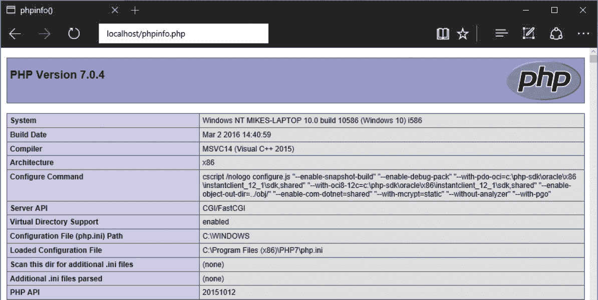


PHP 脚本是区分大小写的，因此你必须使用小写字母复制列出的脚本。

### 嵌入 PHP 脚本代码

PHP 脚本可以嵌入 HTML 文档中——这意味着 PHP 和 HTML 代码可以共存在于同一个文件中。所有嵌入的 PHP 代码必须包含在 `<?php` 和 `?>` 标签内，以便 PHP 引擎能够轻松识别并进行解释。通常，PHP 代码会将内容写入 HTML 文档的 body 部分，然后将其发送到网页浏览器：


`hello.php`

 启动一个纯文本编辑器并创建此带有空 body 部分的有效 HTML5 文档

```html
<!DOCTYPE HTML>
<html lang="en">
<head>
<meta charset="UTF-8">
<title> PHP 入门</title>
</head>
<body>

</body>
</html>
```

 在 body 部分插入标签以包含 PHP 代码

```php
<?php

?>
```

 现在，在 PHP 标签之间插入一条描述性注释和一行向 body 部分写入内容的代码

```php
# 写入传统的问候。
echo '<h1>Hello World!</h1>' ;
```

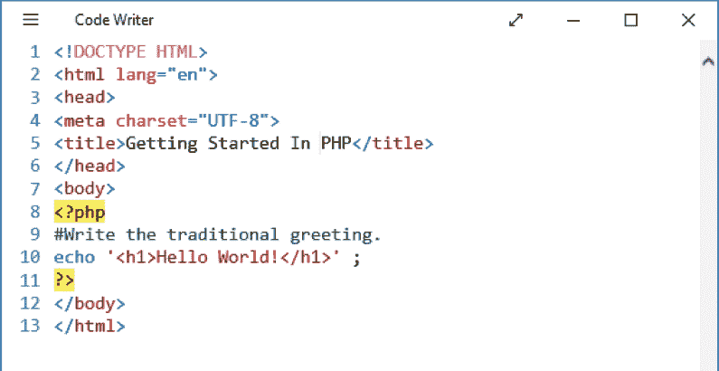


注意，描述性注释被包含在 PHP 标签之间，仅用于信息提示。

 将文档编码设置为 UTF-8 格式，然后将其保存为 Abyss 服务器 `/htdocs` 文件夹中的 `hello.php`

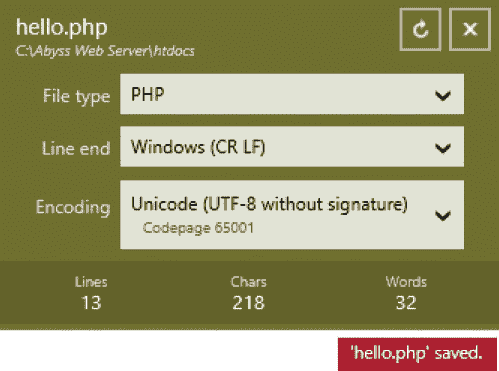

 接下来，在网页浏览器的地址栏中输入位置 `http://localhost/hello.php`，查看 Abyss 提供一个包含嵌入 PHP 代码写入内容的网页

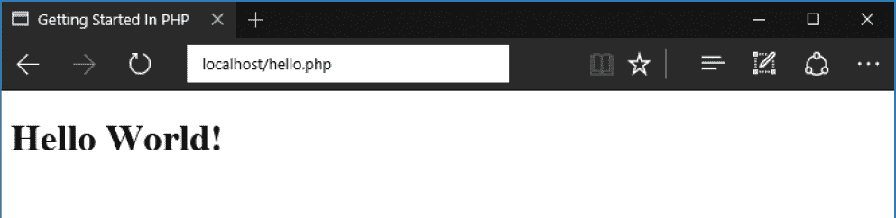

 现在，使用你网页浏览器的**查看源代码**功能查看 PHP 是否已将内容写入 body 部分，包括 HTML `<h1></h1>` 标题标签

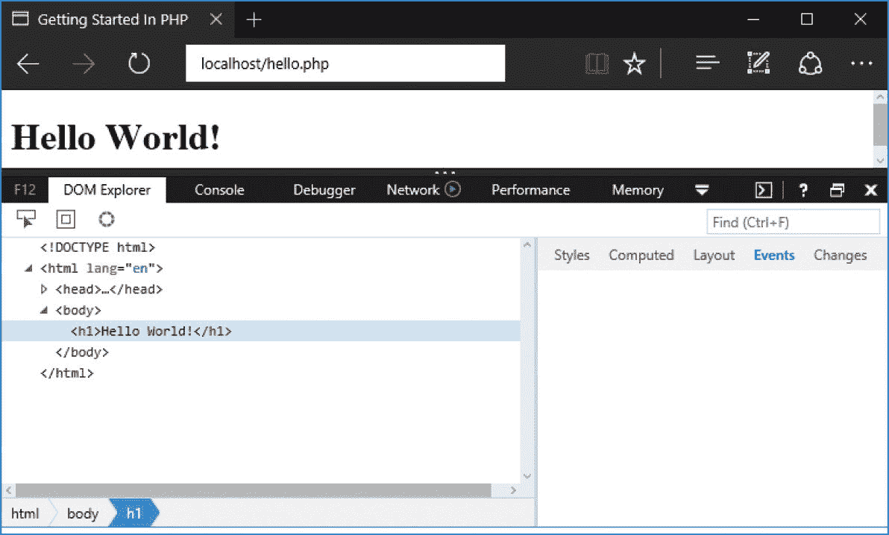

PHP 脚本也可以以相同的方式嵌入较早版本的 HTML 中。本书中的其他示例演示了嵌入 PHP 脚本，但没有重复列出 HTML 代码。


Windows 记事本会自动向文件添加隐藏的“字节顺序标记”（BOM）签名，而其他编辑器（此处所示 Code Writer）允许省略此签名。Code Writer 是从 Windows Store 提供的免费文本和代码编辑器。


注意，PHP 的 `echo` 指令会字面上地写入包含在对 `' '` 单引号内的全部内容。

### 遵循规则编写

#### 标签规则

当 PHP 引擎从 Web 服务器接收到输入时，它会从上到下读取输入，这个过程被称为“解析”。在解析过程中，PHP 引擎（又称解析器）寻找起始和结束的 `<?php` 和 `?>` 标签，并理解标签之间的内容是它必须解释的脚本代码。`<?php` 和 `?>` 标签之外的所有内容都会被完全忽略，这允许 PHP 文件拥有混合内容，并允许 PHP 代码像这样嵌入到 HTML 中：

```html
<p> 被 PHP 忽略并由浏览器显示</p>
<?php echo '将被解析的脚本代码' ; ?>
<p> 同样被 PHP 忽略并由浏览器显示</p>
```

因此为了使其正常工作，当嵌入 HTML 文件时，将所有的 PHP 脚本代码都包含在起始和结束的 `<?php` 和 `?>` 标签之间是非常重要的。


通常你嵌入的 PHP 代码总会在脚本周围有起始和结束的 `<?php` 标签。

这条规则的唯一例外是 PHP 脚本写在纯 PHP 文件中，该文件只包含代码。在这种情况下，最好省略结束的 `?>` 标签，如下：

```php
<?php echo '打印这个优先' ;
echo '打印这个最后';
```

当 PHP 脚本写在纯 PHP 文件中时，可以省略结束的 `?>` 标签。PHP 脚本可以使用短标签 `<?=` 和 `?>` 来向 HTML 文档写入单个字符串：

`<?= 'Hello!' ;` 等同于 `<?php echo 'Hello!' ; ?>`

高级 PHP 脚本也可以在满足条件时插入文本，如下：

```php
<?php if ( $expression == true ) : ?>
如果表达式为真插入此文本。
<?php else : ?>
否则插入此文本。
<?php endif ; ?>
```


条件测试将在书中后面详细介绍。

#### 语句规则

PHP 语言中的每个语句都必须以 `;` 分号结束，就像英语语言中的每个句子必须以 `.` 句号结束一样。分号被解析器识别为结束它必须必须指令。所以包含两个语句的 PHP 代码如下：

```php
<?php echo '第一个语句' ; echo '第二个语句'; ?>
```

PHP 代码块的结束标签 `?>` 自动意味着分号，因此你可以省略结束 PHP 块最后一个语句的分号，如下：

```php
<?php echo '第一个语句' ; echo '第二个语句' ?>
```


如果你愿意，终止 PHP 块的最后一个语句也没有害。

#### 注释规则

为你的 PHP 脚本代码添加注释通常是值得的，以便他人理解，或者在你以后回顾代码时理解。所有的空白和注释都被 PHP 解析器完全忽略，因此你可以尽可能添加注释，而对性能产生任何不利影响。

单行注释可以用 `#` 号字符开始，或者也可以用 `//` 双斜序列开始。

多行（块）注释必须包含在 `/*` 和 `*/` 字符序列之间，如 C 编程语言所示：

```php
<?php
echo '第一个语句' // 单行注释。
/* 这是包含两行注释的多行注释。 */
echo '第二个语句' ;
echo '最后一个语句' ; # 另一个单行注释。
?>
```


`//` 单行注释样式也用于 C++ 编程，而 `#` 单行注释样式也用于 Unix/Linux BASH 脚本。

### 总结

- PHP 是一种语言特别适用于 Web 开发，因为它可以嵌入 HTML 中
- PHP 代码在云端服务器端执行，这与在浏览器客户端执行的 JavaScript 代码不同
- 当网页包含 PHP 脚本时，Web 服务器将首先调用 PHP 引擎处理代码，然后将响应发送到网页浏览器
- 通过在自己的电脑上安装 Web 服务器和 PHP 引擎可以创建开发环境
- `http://localhost` URL 是 `http://127.0.0.1` 数值 IP 地址的别名
- 访问 Abyss Web 服务器控制台需要您的用户名和密码，地址为 `http://localhost:9999`
- 建议使用预配置的 Abyss Web 服务器软件包来快速简单安装 PHP 引擎
- 必须配置 Web 服务器以识别脚本，通过设置 `Interface`（接口）、`Interpreter`（解释器）和 `Associated Extension`（关联扩展）参数将它们重定向到 PHP 引擎
- PHP 代码指令 `phpinfo()` 可用于生成包含 PHP 版本信息的网页
- 包含 PHP 脚本的文档最好使用流行的 UTF-8 字符格式进行编码
- PHP `echo` 指令会字面地写入后续引号包含的文本内容
- 所有嵌入的 PHP 代码必须封装在 `<?php` 和 `?>` 标签内，以便 PHP 引擎识别


PHP 语言中的每个语句都必须以 `;` 分号结束。

单行注释可以以 `#` 哈希字符或 `//` 双斜杠序列开始。

多行块注释必须封装在 `/*` 和 `*/` 字符序列之间。

# 存储值

本章演示了可以存储数据的各种 PHP 容器。

- 创建变量
- 字符串引用
- 生成数组
- 数组排序
- 描述维度
- 检查类型
- 定义常量
- 探索超全局变量
- 总结

## 创建变量

“变量”是 PHP 脚本中一个命名的容器，用于存储数据值。存储的值可以使用变量名进行引用，并随着脚本的执行而更改（变化）。脚本作者可以为变量选择任何名称，只要它遵循以下三个命名规范：

- 名称必须以 `$` 美元符号开头——例如 `$name`
- 名称可以包含字母、数字和下划线字符，但不能包含空格——例如 `$subtotal_1`
- `$` 符号后的第一个字符必须是字母或下划线字符——不能是数字


注意 PHP 中的变量名是区分大小写的，因此 `$name`、`$Name` 和 `$NAME` 是三个独立的变量。


在 PHP 中 `$this` 是一个特殊变量，因此你不能使用 `this` 作为变量名。

PHP 变量是“弱类型”的，这意味着它们包含任何类型的数据，与某些语言中的“强类型”变量不同，后者在创建变量时必须指定数据类型。因此，PHP 变量可以很方便地包含一个整数、浮点数、文本字符串、`TRUE` 或 `FALSE` 的布尔值、一个对象或一个 `NULL` 空值。


在整个脚本范围内访问的变量必须具有唯一的名称。关于“变量作用域”，请参阅此处。

在 PHP 脚本中只需声明变量名称即可创建变量。然后可以使用 `=` 赋值运算符指定其值来赋予初始值（初始化）。该语句以及 PHP 中的所有其他语句都必须像这样以分号结尾：

```php
$body_temp = 98.6 ;
```

然后可以通过引用变量名来显示变量中包含的值，如下所示：

```php
echo $body_temp ;
```

有用的是，可以通过将字符串和变量名封装在双引号中，将变量的值作为混合字符串的一部分显示：

```php
echo "Body temperature is $body_temp degrees Fahrenheit" ;
```


不要混淆双引号和单引号的作用。记住，PHP 只对封装在双引号内的混合字符串进行变量替换。

双引号确保 PHP 将评估整个字符串并将命名的变量替换为它们存储的值。如果字符串被封装在单引号中，此功能将不起作用！


`variable.php`

 创建一个有效的 HTML 文档，如此处列出的那样的，然后在 body 部分插入 PHP 标签：

```php
<?php
# 在此处要插入的语句。
?>
```

 现在，在 PHP 标签之间插入一条语句来创建并初始化变量：

```php
$body_temp = 98.6 ;
```

 接下来，插入一条语句单独显示变量值：

```php
echo $body_temp ;
```

 然后，插入一条语句显示在混合字符串中替换的变量值——赋值在双引号中：

```php
echo "<p>Body temperature is $body_temp degrees Fahrenheit" ;
```

 插入一条语句为变量赋值新值：

```php
$body_temp = 37.0 ;
```

 最后，插入一条语句在混合字符串中显示变量值：

```php
echo "($body_temp degrees Celsius)" ;
```

 将文档保存为 `htdocs` 目录下的 `variable.php`，然后通过 HTTP 查看显示的变量值。


文本“字符串”可以像数值值一样存储在变量中，但必须用引号封装字符串。单引号和双引号都可以用于此目的，但必须使用相同类型的引号来表示开始和结束。例如，这些语句进行了字符串赋值：

```php
$song_title = "Summertime Blues";
```

```php
$song_title = 'Summertime Blues';
```

当你想存储一个包含引号的文本字符串时，可以在它们前面加上 `\` 斜杠字符来“转义”包含的引号，或者在字符串中使用另一种引号。例如，这些语句赋值了包含引号的字符串：

```php
$song_title = "the \"Summertime\" aria by Gerswin" ;
```

```php
$song_title = 'the "Summertime" aria by Gerswin' ;
```

第二种技术（在字符串中使用双引号）更易读，并且在书中是推荐的。


变量名不能包含空格——但下划线字符常被代替。

通过将混合字符串封装在双引号中，可以将字符串值作为混合字符串的一部分显示，如下：

```php
echo "Many regard $song_title as a popular classic" ;
```

双引号确保 PHP 将评估混合字符串并将命名的变量替换为它们存储的值。如果字符串被封装在单引号中，此功能将不起作用！

字符串值可以使用 `.` 连接运算符连接（“拼接”）成单个字符串，如下：

```php
$hi = 'Hello' ;
```

```php
$bye = 'Goodbye' ;
```

```php
$song_title = $hi . $bye ; # 'HelloGoodbye'
```

此外，在连接字符串时可以适当地插入空格和标点，因此上面的标题赋值可以修改为包含逗号和空格：

```php
$song_title = $hi . ', ' . $bye ; # 'Hello, Goodbye'
```

# 在此处插入语句。

```php
<?php
```

 现在，在 PHP 标签之间插入一个语句来创建并初始化两个变量：

```php
$phrase = 'The truth is rarely pure' ;
$author = 'Oscar Wilde' ;
```

 接下来，插入一个语句单独显示变量值：

```php
echo $phrase ;
```

 然后，插入一个语句在混合字符串（用双引号赋值的）中显示被替换的变量值：

```php
echo "<p>It is often said that <q> $phrase </q> </p>" ;
```

 插入一个语句将字符串连接到变量：

```php
$phrase = $phrase . ' and never simple' ;
```

 最后，插入一个语句在混合字符串中显示两个当前变量替换的值：

```php
echo "<p><q> $phrase </q><cite> $author </cite></p>" ;
```

 将文档保存到 Web 服务器的 `/htdocs` 目录下并命名为 `string.php`，然后通过 HTTP 打开页面查看变量值的显示。

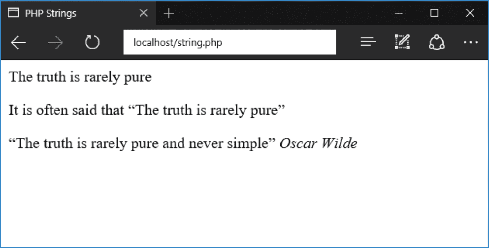


你还可以使用简写连接赋值运算符 `.=` 来连接两个字符串——这样 `$a = $a . $b` 可以简单地写成 `$a .= $b`。


为你的变量采用一致的命名风格——例如全小写的 `$my_var` 或“驼峰命名法” `$myVar`。

## 创建数组

### 索引数组

数组变量可以在顺序排列的数组“元素”中存储多个数据项，这些元素从零开始编号（“索引”）。因此，第一个数组值存储在索引为 0 的数组元素中。可以使用变量名后跟方括号中的索引数字来引用单个数组元素值。例如，`$days[0]` 引用名为 `days` 的数组变量中的第一个元素存储的值。同样，`$days[1]` 引用存储在第二个元素的值，以此类推。可以通过创建多个向连续元素赋值的语句来创建变量数组，或者通过使用单个 PHP `array()` 函数语句来填充元素：

```php
$days[] = 'Monday' ; $days[] = 'Tuesday' ; $days[] = 'Wednesday' ;
```

或者...

```php
$days = array( 'Monday' , 'Tuesday' , 'Wednesday' ) ;
```

这两者都会创建一个数组，其中每个元素中存储的值可以使用其索引号进行引用，例如 `$days[0]`。


方括号表示“元素”，因此在使用 `array()` 函数进行赋值时，变量名后不需要它们——它们只在访问元素时才需要。

### 关联数组

在创建数组时，你可以选择为每个元素指定一个键名，该键名可引用该元素的值：

```php
$months['jan'] = 'January' ;
$months['feb'] = 'February' ;
$months['mar'] = 'March' ;
```

或者...

```php
$months = array( 'jan' => 'January' , 'feb' => 'February' , 'mar' => 'March' ) ;
```

这两者都会创建一个数组，其中每个元素中存储的值可以使用其键名进行引用，例如 `$months['jan']`。

### 遍历数组

可以使用 `foreach` 循环遍历数组的所有元素，轮流引用每个元素的值并将其赋值给变量：

```php
foreach ($months as $value ) {
# 在每次迭代中使用当前的 $value。
}
```

在循环的每次迭代中也可以通过以下方式访问键：

```php
foreach ($months as $key => $value ) {
# 在每次迭代中使用当前的 $key 和 $value。
}
```

 `foreach` 结构专门用于数组设计，并提供了一种遍历所有数组键和值的简便方法。关于循环的更多信息，请参阅此处。


`array.php`

 创建一个有效的 HTML 文档，如列在此处所示的，然后在 body 中插入 PHP 标签：

```php
<?php
# 在此处插入语句。
?>
```

 现在，在 PHP 标签之间插入一个语句来创建并初始化带有值的变量数组：

```php
$days = array( 'Monday' , 'Tuesday' , 'Wednesday' ) ;
```

 接下来，插入一个语句以项目列表形式显示所有元素的值：

```php
foreach ($days as $value ) { echo $value ; }
```

 然后，插入一个语句创建并初始化一个带有键和值的变量数组：

```php
$months = array( 'jan' => 'January' , 'feb' => 'February' , 'mar' => 'March' ) ;
```

 最后，插入一个语句以定义列表形式显示所有键和值：

```php
echo "<dl>" ;
foreach ($months as $key => $value ) { echo "<dt>$key</dt><dd>$value</dd>"; }
echo "</dl>" ;
```

 将文档保存到 Web 服务器的 `/htdocs` 目录下并命名为 `array.php`，然后通过 HTTP 打开页面查看变量值的显示。


 将文档保存到 Web 服务器的 `/htdocs` 目录下并命名为 `string.php`，然后通过 HTTP 打开页面查看变量值的显示。

 下一步，插入语句以项目列表的形式在定义列表中显示数组的所有键和值。

```php
echo ‘<dl><dt>Original Element Order :<dd>’ ;
foreach( $cars as $key => $value )
{ echo ‘ &bull; ‘ , $key . ‘ ‘ . $value ; }
```

 然后，插入语句按值对数组进行排序并显示。

```php
asort( $cars ) ;
echo ‘<dt>Sorted Into Value Order :<dd>’ ;
foreach( $cars as $key => $value )
{ echo ‘ &bull; ‘ , $key . ‘ ‘ . $value ; }
```

 最后，插入语句按键对数组进行排序并显示。

```php
ksort( $cars ) ;
echo ‘<dt>Sorted Into Key Order :<dd>’ ;
foreach( $cars as $key => $value )
{ echo ‘ &bull; ‘ , $key . ‘ ‘ . $value ; }
echo ‘</dl>’ ;
```

 将文档保存到 Web 服务器的 `/htdocs` 目录下并命名为 `sort.php`，然后通过 HTTP 打开页面以查看排序后的数组值显示。

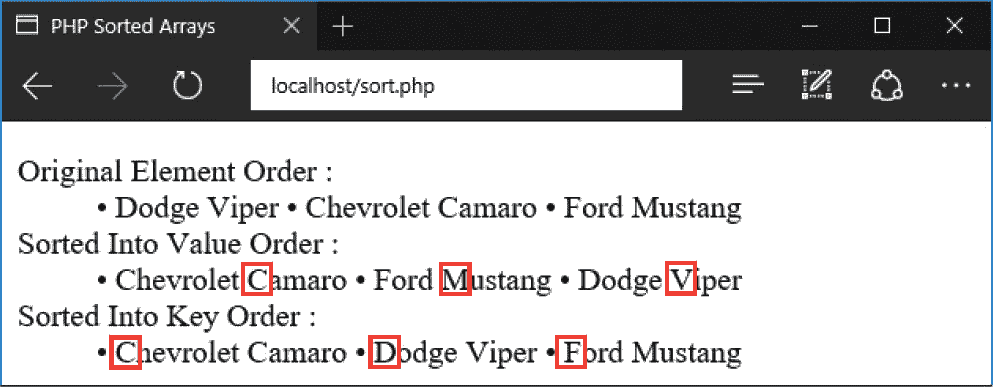


你可以使用 `count()` 函数来获取数组中的元素数量。例如：`$num = count( $array ) ;`


在键重要的情况下，请使用 `sort()` 或 `rsort()` 函数。

## 描述维度

数组元素的编号更准确的说法是“数组索引”（array index），因为元素编号从零开始，所以有时被称为“基于零的索引”。使用单个索引创建的数组是一维数组，其元素出现在单行中：

| 元素内容 | A | B | C | D | E |
| :--- | :--- | :--- | :--- | :--- | :--- |
| 索引数字 | [0] | [1] | [2] | [3] | [4] |


数组也可以有多个索引以表示多个维度。使用两个索引创建的数组是二维数组，其元素出现在多行中：

| 第一个索引 | [0] | A | B | C | D | E |
| :--- | :--- | :--- | :--- | :--- | :--- | :--- |
| | [1] | F | G | H | I | J |
| 第二索引 | | [0] | [1] | [2] | [3] | [4] |

在多维数组中，通过指定每个索引的数字来引用每个元素包含的值。例如，上述二维数组中 `[1][2]` 元素包含字母 H。

二维数组用于存储网格信息，例如 XY 坐标。创建一个具有三个索引的三维数组可以存储 XYZ 坐标。

在 PHP 中创建多维数组只需创建一个外部数组，其元素本身也是数组。按照惯例，你可以可选地为每个元素指定键名——在这种情况下用于表示每个内部数组。然后可以使用键名和内部索引数字来引用单个值：

`$matrix['Letter'][0]`


具有两个以上索引的多维数组可能会产生难以阅读的源代码，并导致错误。

然而，当将使用引号键的数组变量包含在字符串中时，始终用大括号括起来：

```php
echo “Element value is {$matrix['Letter'][0]} ” ;
```

可以使用 `foreach` 循环遍历数组，从而访问多维数组中的所有内部数组。然后可以使用嵌套的 `foreach` 循环逐个引用每个元素。


`matrix.php`

 创建一个像此处列出的那样的有效 HTML 文档，然后在 body 部分插入 PHP 标签。

```php
<?php
## 在此处插入要插入的语句。
?>
```

 现在，在 PHP 标签之间插入语句，以创建并初始化两个普通变量数组以及一个带键名的二维数组。

```php
$letters = array( ‘A’ , ‘B’ , ‘C’ ) ;
$numbers = array( 1 , 2 , 3 ) ;
$matrix =
array( ‘Letter’ => $letters , ‘Number’ => $numbers ) ;
```

 下一步，插入语句来显示单个存储的值。

```php
echo “<p>Start : {$matrix['Letter'][0]} </p>” ;
```

 最后，插入语句将所有元素中的键和值作为两个无序列表显示。

```php
foreach( $matrix as $array => $list )
{
    echo ‘<ul>’ ;
    foreach( $list as $key => $value )
    { echo “<li> $array [ $key ] = $value ” ; }
    echo ‘</ul>’ ;
}
```

 将文档保存到 Web 服务器的 `/htdocs` 目录下并命名为 `sort.php`，然后通过 HTTP 打开页面以查看排序后的数组值显示。

PHP 文件流资源的创建和使用将在第 8 章中进行详尽的演示。


布尔值常量 `TRUE` 和 `FALSE` 不区分大小写，因此也可以写成 `true` 和 `false`。

### 定义常量

脚本中永远不会改变的固定数据值应该存储在 PHP“常量”中，而不是变量中。常量是一个命名的容器，可以在其中存储数值或字符串值，并可以使用常量名称进行引用。

与变量不同，常量不能包含 `TRUE` 或 `FALSE` 的布尔值，不能表示对象，也不能是 `NULL` 空值。此外，常量不会随着脚本的执行而发生改变。这保护了常量值不被意外修改，是一种良好的编程习惯。


在创建变量时，请务必考虑其值是否会发生变化——如果不会，你应该创建一个常量而不是变量。例如：`define( ‘PI’ , 3.14 ) ;`。

常量的命名遵循与变量相同的命名规范，但传统上使用大写字母作为常量名——以便与变量名区分。常量使用 `define()` 函数创建，用于指定常量的名称和它将包含的值，如下：

`define( ‘NAME’ , value ) ;`

最重要的是，常量名不以 `$` 符号开头，因此它们不能包含在混合字符串中进行显示——因为 PHP 无法区分常量名和普通的大写字符串。例如考虑这些语句：

`define( ‘USER’ , ‘Mike’ ) ;`

`echo “Hello USER”`

...这里的输出是 `Hello USER`，而不是预期的 `Hello Mike`。

为了在输出字符串中包含常量值，必须单独引用它并使用 PHP 的 `.` 拼接运算符将其“连接”到字符串，如下：

`echo ‘Hello ‘ . USER ;`

...这里的输出现在是预期的 `Hello Mike`。

数组常量（所有元素都包含固定数据值的数组）也可以使用 `define()` 函数创建，如下：

`define( ‘WEEKDAYS’ , [ ‘Mon’, ‘Tue’ , ‘Wed’ , ‘Thu’ , ‘Fri’ ] ) ;`


使用 `define()` 函数创建常量数组的能力是 PHP 7 引入的新功能。

脚本作者定义的常量可以像 PHP 内置的预定义常量一样被使用，例如描述版本和服务器操作系统的 `PHP_VERSION` 和 `PHP_OS`。


`constant.php`

 创建一个有效的 HTML 文档，如此地列出的那样，然后在 body 部分插入 PHP 标签。

```php
<?php
# 在此处插入语句。
?>
```

 现在，在 PHP 标签之间插入一条语句来创建并初始化一个常量。

`define( ‘USER’ , ‘Mike’ ) ;`

 添加一条语句来创建并初始化一个数组常量。

`define( ‘PETS’ , [ ‘Kitten’ , ‘Puppy’ , ‘Hamster’ ] ) ;`

 接下来，插入一条语句在拼接字符串中显示两个常量值。

`echo ‘<p>Hello ‘ . USER . ‘ how is your ‘ . PETS[1] . ‘?</p>’ ;`

 插入一条语句在拼接字符串中显示 PHP 版本的预定义常量值。

`echo ‘<p>You are using PHP version ‘ . PHP_VERSION ;`

 最后，插入一条语句在字符串中显示主机操作系统的预定义常量值。

`echo ‘ running on ‘ . PHP_OS . ‘</p>’`

 将文档保存到 Web 服务器的 `/htdocs` 目录并为 `constant.php`，然后通过 HTTP 打开页面查看显示的结果。

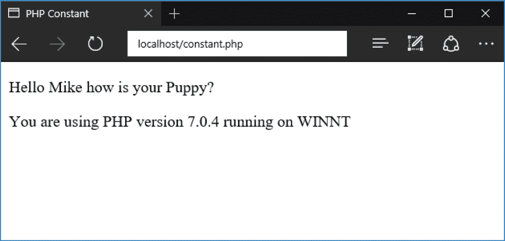


你不能在混合字符串中包含常量，不能更改其值，也不能以 `$` 符号开头其名称。


你应该始终对常量名使用大写字母，以便在代码中将其与变量区分开来。

### 探索超级全局

PHP 提供了几个预定义变量，它们在脚本的任何地方都是全局可用的。这些变量被称为“超级全局”，在此简要描述：

*   `$GLOBALS` – 一个关联数组，包含根据上下文在脚本全局作用范围内定义的所有变量的引用。变量名是此关联数组的键。例如：

```php
foreach( $GLOBALS as $key => $var) echo “• $key “
```

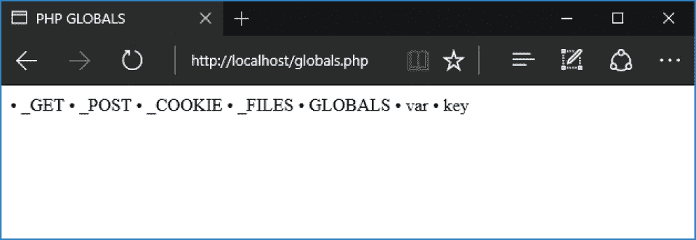

*   `$_SERVER` – 包含标头、路径和脚本位置等信息的数组，由 Web 服务器任意提供

*   `$_GET` – 通过 URL 参数传递给脚本的变量关联数组

*   `$_POST` – 传递给脚本的变量关联数组

*   `$_FILES` – 上传项目的关联数组

*   `$_COOKIE` – 通过 HTTP 传递的 Cookie 关联数组

*   `$_SESSION` – 每个脚本可用的变量关联数组

*   `$_REQUEST` – 默认包含 `$_GET`、`$_POST` 和 `$_COOKIE` 的关联数组

*   `$_ENV` – 环境变量的关联数组

`$_FILES` 超级全局在示例此地中使用。

`$_POST` 超级全局在示例此地中使用。

`$_COOKIE` 超级全局在示例此地中使用。

`$_SESSION` 超级全局在示例此地中使用。

HTTP **GET** 方法在示例此地中使用。

**总结**

- 变量是一个命名的容器，用于存储可以更改的数据。

- 存储在变量中的值可以通过该变量名引用。

- 变量名必须以 `$` 符号开头，可以包含字母、数字和下划线字符，且 `$` 之后的第一个字符必须是字母或下划线。

- 变量可以存储整数、浮点数、文本字符串、布尔值、对象或 `NULL` 值。

- 变量使用 `=` 赋值运算符进行初始化，为该变量分配一个初始值。

- 通过仅将字符串和变量名括在双引号中，可以将变量的值作为混合字符串的一部分显示。

- 字符串可以使用单引号或双引号括起来，内部的引号可以使用反斜杠进行转义。

- 使用 `.` 拼接运算符可以将字符串值连接成一个单一字符串。

- 数组变量可以在顺序的数组元素中存储多个数据项，这些元素默认从零开始编号。

- 可选择为每个数组元素指定键名（key）。

- 可以使用 `foreach` 循环遍历数组中的每个元素。

- `implode()` 和 `explode()` 函数通过添加或移除指定的分隔符在字符串和数组之间转换。

- 数组可以根据值或键按字母数字顺序排序。

- 多维数组简单来说就是元素值本身也是数组的数组。

- 可以使用 `gettype()` 和 `var_dump()` 函数检查数据类型。

- 常量是一个命名的容器，用于存储固定的整数、浮点数或文本字符串。

- 常量名不带 `$` 前缀，且全大写。

- 常量使用 `define()` 函数进行初始化。

- 超全局变量在脚本的任何地方始终全局可用。

## 执行操作

本章演示了用于算术、比较和逻辑评估的各种 PHP 运算符。

### 算术

PHP 脚本中常用的算术运算符列如下表所示，以及它们执行的操作：

| 运算符 | 操作 |
| :--- | :--- |
| `+` | 加法 |
| `-` | 减法 |
| `*` | 乘法 |
| `/` | 除法 |
| `%` | 取模 |
| `**` | 幂 |

与运算符一起形成表达式的数字被称为“操作数”——在表达式 `2 + 3` 中，数字 `2` 和 `3` 就是操作数。

加、减、乘、除运算符的作用正如你所预期的那样。然而，当使用多个一个运算符时，必须注意对表达式进行分组以提高清晰度：

```php
a = b * c - d % e / f ; # 这不清晰。
a = ( b * c ) - ( ( d % e ) / f ) ; # 这更清晰。
```

使用括号分组表达式以指定求值优先级——最内层的组先求值。

`%` 取模运算符将第一个数字除以第二个数字返回操作的余数。这对于判断一个数字是奇数还是偶数很有用。

`**` 幂运算符给出第一个操作数相对于第二个操作数幂的结果。

```php
a ** b # a 升到 b 次幂的结果
```

通过将算术运算符与 `=` 赋值运算符结合，可以创建非常有用的简写表达式。例如：

```php
a += b ; # 等于 a = ( a + b ) ;
a -= b ; # 等于 a = ( a - b ) ;
a *= b ; # 等于 a = ( a * b ) ;
a /= b ; # 等于 a = ( a / b ) ;
```

示例 `arithmetic.php`：

```php
<?php
# 在此处插入语句。
$a = 5 ;
$b = 2 ;

$result = $a + $b ; echo "Addition : $result <br>";
$result = $a - $b ; echo "Subtraction : $result <br>";
$result = $a * $b ; echo "Multiplication : $result <br>";
$result = $a / $b ; echo "Division : $result <br>";
$result = $a % $b ; echo "Modulus : $result <br>";
$result = $a ** $b ; echo "Exponentiation : $result <br>";
?>
```

### 比较

PHP 中用于比较两个值的常用运算符如下表所示：

| 运算符 | 比较测试 |
| :--- | :--- |
| `==` | 相等 |
| `===` | 相同 |
| `!==` | 不相同 |
| `!=` | 不等于 |
| `<>` | 不等于 |
| `>` | 大于 |
| `<` | 小于 |
| `>=` | 大于等于 |
| `<=` | 小于等于 |
| `<=>` | 飞船运算符 |

`==` 相等运算符比较两个操作数，如果两者在数值上相等，则返回布尔 `TRUE` 结果，否则返回 `FALSE`。字符和字符串也通过它们的 ASCII 值进行数值比较。相反，`!=` 不等于运算符在两个操作数不相等时返回 `TRUE`，否则返回 `FALSE`。

`>` “大于”运算符比较两个操作数，如果第一个的值大于第二个，则返回 `TRUE`；或者如果它的值等于或小于第二个，则返回 `FALSE`。`<` “小于”运算符进行相同的比较，但如果第一个操作数的值小于第二个，则返回 `TRUE`，否则返回 `FALSE`。在 `>` 或 `<` 运算符后添加 `=` 运算符，可以使其在两个操作数完全相等时也返回 `TRUE`。

`<=>` 飞船运算符当第一个操作数大于第二个时返回整数值 `1`，当第一个操作数小于第二个时返回 `-1`，当操作数相等时返回 `0`。

 现在，在 PHP 标签之间插入语句以创建并初始化五个变量。

`$zero = 0 ; $nil = 0 ; $one = 1 ; $upr = ‘A’ ; $lwr = ‘a’ ;`


 接下来，插入语句显示相等性比较

```
echo “0 == 0 : “ ; var_dump( $zero == $nil ) ;
echo “<br>0 == 1 : “ ; var_dump( $zero == $one ) ;
echo “<br>A == a : “ ; var_dump( $upr == $lwr ) ;
echo “<br>A != a : “ ; var_dump( $upr == $lwr ) ;
```

 插入语句显示比较评估结果

```
echo “<hr>1 > 0 : “ ; var_dump( $one > $nil ) ;
echo “<br>0 >= 0 : “ ; var_dump( $zero >= $nil ) ;
echo “<br>1 <= 0 : “ ; var_dump( $one <= $nil ) ;
echo “<hr>1 <=> 0 : “ ; var_dump( $one <=> $nil ) ;
echo “<br>1 <=> 1 : “ ; var_dump( $one <=> $one ) ;
echo “<br>0 <=> 1 : “ ; var_dump( $nil <=> $one ) ;
```

 将文档保存到网络服务器的`/htdocs`目录并命名为`comparison.php`，然后通过 HTTP 打开页面以查看显示的结果

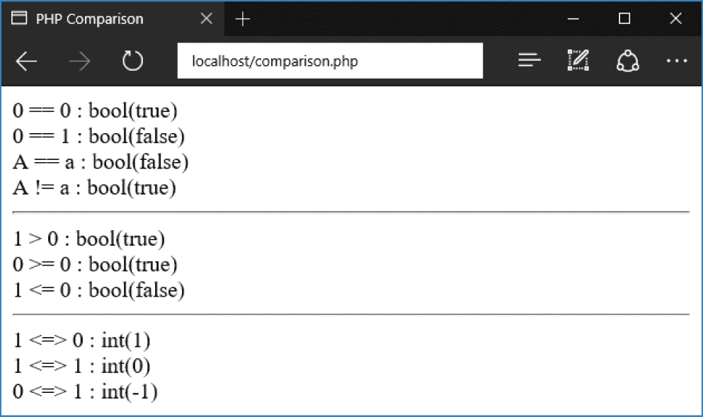


大写字母`A`的 ASCII 码值为 65，小写字母`a`为 97 —— 因此它们在这里比较返回`FALSE`。


在 PHP 语言中，布尔值`TRUE`在数值上表示为 1。

### 检查条件

### 条件运算符

条件运算符`?:`也称为“三元”运算符，因为它包含三个组件。该运算符首先评估一个表达式以得到一个`TRUE`或`FALSE`布尔值，然后根据评估结果返回两个指定结果之一。条件运算符的语法如下：

```
( test-expression ) ? result-if-true : result-if-false ;
```

条件运算符可以用于评估给定的数字是否为 1 或多个，以确保输出中关于单数和复数项的语法正确。这避免了诸如“There is 5”这样尴尬的表达：

```
$verb = ( $number == 1 ) ? ‘is’ : ‘are ‘;
echo “There $verb $number” ;
```

在这种情况下，当变量`$number`的值为 1 时，`is`结果将赋值给变量`$verb`，否则将赋值`are`结果。


不要在单条语句中使用超过一个`?:`条件运算符，因为结果可能是不可预测的。

条件运算符还可以通过检查数字除以 2 后是否有余数，来评估给定的数字是奇数还是偶数（奇偶性），然后分配相应的字符串结果：

```
$parity = ( $number % 2 == 0 ) ? ‘Odd’ : ‘Even’ ;
echo “$number is $parity” ;
```

在这种情况下，当取模运算返回值为 1 时，`Odd`结果将赋值给变量`$parity`，否则将赋值`Even`结果。

### 空值合并运算符

PHP 有一个特殊的`NULL`值，它是一个内置常量，表示一个没有任何值的变量 —— 甚至不是 0。未赋值的变量将会被评估为`NULL`。命名简练的`??`“空值合并”运算符可以从左到右遍历多个操作数，并返回第一个非`NULL`操作数的值。如果没有任何操作数具有值（且不是`NULL`），则空值合并运算符本身将返回`NULL`结果。


`??`空值合并运算符是 PHP 7 的新功能。


condition.php

 创建一个有效的 HTML 文档，如此处列出的那样，然后在正文部分插入 PHP 标签

```php
<?php
# 在此处插入语句。
?>
```

 现在，在 PHP 标签之间插入语句以创建并初始化三个变量

```
$a = NULL ; $b = 8 ; $c = ‘PHP Fun’ ;
```

 接下来，插入语句输出正确的语法

```
$verb = ( $b == 1 ) ? ‘is’ : ‘are’ ;
echo “There $verb $b <hr>”;
```

 插入语句显示整数的奇偶性

```
$parity = ( $b % 2 == 0 ) ? ‘Odd’ : ‘Even’ ;
echo “$b is $parity” ;
```

 插入语句显示非空值

```
$result = $a ?? $b;
echo “result: $result” ;
```

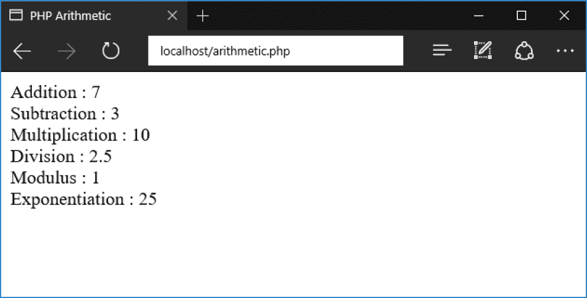 最后，将文档保存到网络服务器的`/htdocs`目录并命名为`comparison.php`，然后通过 HTTP 打开页面以查看显示的的结果

### 逻辑运算符

| 运算符 | 名称 | 描述 |
| :--- | :--- | :--- |
| `and` | `&&` | 如果两个操作数都真则返回 TRUE |
| `or` | `||` | 如果至少有一个操作数为真则返回 TRUE |
| `xor` | `xor` | 如果仅其中一个操作数为真则返回 TRUE |
| `not` | `!` | 反转操作数的逻辑状态 |

```php
echo “Yes OR No returns $result <br>” ;
$result = ( $yes || $yes ) ? ‘TRUE’ : ‘FALSE’ ;
echo “Yes OR Yes returns $result <hr>” ;
$result = ( ! $yes ) ? ‘TRUE’ : ‘FALSE’ ;
echo “NOT Yes returns $result <br>” ;
```

 将文档保存在网络服务器的`/htdocs`目录下并命名为`logic.php`，然后通过 HTTP 打开页面以显示结果。

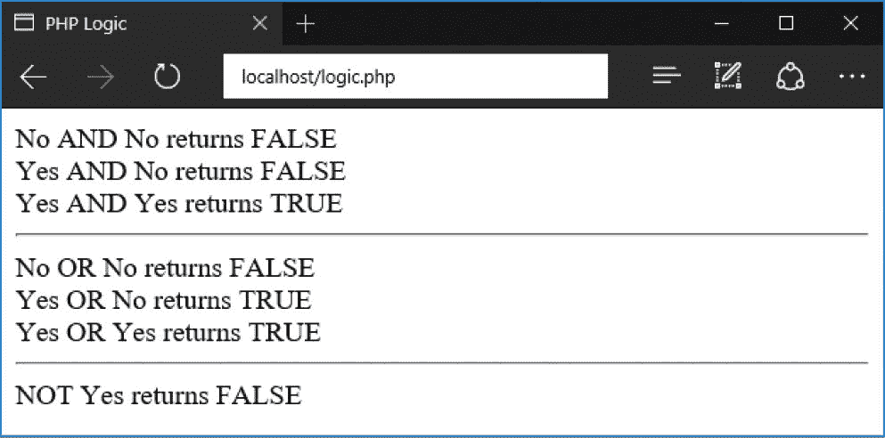


PHP 还有一个`XOR`（异或`OR`）运算符，它可以同时执行与`AND NOT`等效的评估。


注意`FALSE && FALSE`的评估返回`FALSE` —— 这可能是在演示“两个错不等于对”这句谚语。

## 比较位

一个字节由八位组成，每个位可以包含一个`1`或`0`来存储二进制数，代表从 0 到 255 的十进制值。只有当位包含`1`时，该位才会贡献一个十进制分量。组件从右到左从“最低有效位”（LSB）到“最高位”（MSB）命名。下方位模式中的二进制数代表十进制的 50。


许多 PHP 程序员从不使用位运算符，但了解它们是什么以及如何使用是有用的。

| 位 No. | 8 MSB | 7 | 6 | 5 | 4 | 3 | 2 | 1 LSB |
| :--- | :--- | :--- | :--- | :--- | :--- | :--- | :--- | :--- |
| 十进制 | 128 | 64 | 32 | 16 | 8 | 4 | 2 | 1 |
| 二进制 | 0 | 0 | 1 | 1 | 0 | 0 | 1 | 0 |

可以使用“位”运算符来操作字节的各个部分。位运算符允许对整数内的特定位进行评估和操作。

| 运算符 | 名称 | 二进制数操作 |
| :--- | :--- | :--- |
| `\|` | OR | 如果两个比较的位中有一个为`1`，则对应的位返回`1`。示例：`1010 \| 0101 = 1111` |
| `&` | AND | 如果两个比较的位中都为`1`，则对应的位返回`1`。示例：`1010 & 1100 = 1000` |
| `~` | NOT | 如果两个比较的位都不为`1`，则对应的位返回`1`。示例：`1010 ~ 0011 = 0100` |
| `^` | XOR | 如果两个比较的位中只有一个为`1`，则对应的位返回`1`。示例：`1010 ^ 0100 = 1110` |
| `<<` | 左移 | 将每个`1`的位向左移动指定的位数。示例：`0010 << 2 = 1000` |
| `>>` | 右移 | 将每个`1`的位向右移动指定的位数。示例：`1000 >> 2 = 0010` |


字节的半部分被称为“半字节”（nibble，4 位）。表中示例中的二进制数描述了存储在半字节中的值。

除非为资源有限的设备编程，否则很少需要使用位运算符，但它们非常有用。例如，`^`（异或）运算符允许在不需要第三变量的情况下交换两个变量的值：


bitwise.php

 创建一个有效的 HTML 文档，如这里所列的那样，然后在 body 部分插入 PHP 标签

```php
<?php
## 在此处插入要插入的语句。
?>
```

 现在，在 PHP 标签之间插入语句来创建并初始化两个整数值的变量

```php
$x = 5 ; $y = 10 ;
```

 接下来，添加一个语句显示赋值的值

```php
echo “X : $x , Y : $y <br>” ;
```

 插入三个异或语句通过二进制位操作交换变量值

```php
$x = $x ^ $y ; /* 1010 ^ 0101 = 1111 (十进制 15) */
$y = $x ^ $y ; /* 1111 ^ 0101 = 1010 (十进制 10) */
$x = $x ^ $y ; /* 1111 ^ 1010 = 0101 (十进制 5) */
```

 最后，添加一个语句来显示赋值的值

```php
echo “X : $x , Y : $y <br>” ;
```

 将文档保存在网络服务器的`/htdocs`目录下并命名为`logic.php`，然后通过 HTTP 打开页面以显示结果

 注意`FALSE && FALSE`的评估返回`FALSE` —— 这可能是在演示“两个错不等于对”这句谚语。

## 理解优先级

PHP 优先级决定了表达式的分组。例如，表达式`1 + 5 * 3`结果为 16，因为`*`运算符的优先级高于`+`运算符。括号可以指定优先级，例如`(1 + 5) * 3`结果为 18。相同优先级的结合性决定了表达式的分组。下表列出了按优先级排序的运算符，优先级位于顶部。

| 运算符 | 结合性 |
| :--- | :--- |
| `**` | Right |
| `++` | Right |
| `!` | Right |
| `.*` | Left |
| `+` | Left |
| `<<` | Left |
| `>>` | Left |
| `<` | Left |
| `!=` | Left |
| `==` | Left |
| `<=` | Left |
| `>=` | Left |
| `&` | Left |
| `^` | Left |
| `|` | Left |
| `&&` | Left |
| `||` | Left |
| `??` | Right |
| `=` | Left |
| `+=` | Left |
| `-=` | Left |
| `*=` | Left |
| `/=` | Left |
| `%=` | Left |
| `<<=` | Left |
| `>>=` | Left |
| `&=` | Left |
| `^=` | Left |
| `|=` | Left |
| `??=` | Left |

 注意逻辑运算符的变体形式优先级不同。这会导致表达式`$bool = true and false`产生意外结果，而`$bool = true && false`则不同。尝试使用`var_dump($bool)`查看差异。

## 修改值

`.`拼接运算符用于形成字符串。你可以使用`|=`赋值运算符将一个字符串附加到另一个上。

你可以使用`|=`赋值运算符来形成字符串。你可以使用`|=`赋值运算符将一个字符串附加到另一个上。

你可以使用`.`拼接运算符用于形成字符串。你可以使用`|=`赋值运算符将一个字符串附加到另一个上。

你可以使用`.`拼接运算符用于形成字符串。你可以使用`|=`赋值运算符将一个字符串附加到另一个上。

你可以使用`.`拼接运算符用于形成字符串。你可以使用`|=`赋值运算符将一个字符串附加到另一个上。

你可以使用`.`拼接运算符用于形成字符串。你可以使用`|=`赋值运算符将一个字符串附加到另一个上。

你可以使用`.`拼接运算符用于形成字符串。你可以使用`|=`赋值运算符将一个字符串附加到另一个上。

你可以使用`.`拼接运算符用于形成字符串。你可以使用`|=`赋值运算符将一个字符串附加到另一个上。

你可以使用`.`拼接运算符用于形成字符串。你可以使用`|=`赋值运算符将一个字符串附加到另一个上。

你可以使用`.`拼接运算符用于形成字符串。你可以使用`|=`赋值运算符将一个字符串附加到另一个上。

你可以使用`.`拼接运算符用于形成字符串。你可以使用`|=`赋值运算符将一个字符串附加到另一个上。

你可以使用`.`拼接运算符用于形成字符串。你可以使用`|=`赋值运算符将一个字符串附加到另一个上。

你可以使用`.`拼接运算符用于形成字符串。你可以使用`|=`赋值运算符将一个字符串附加到另一个上。

你可以使用`.`拼接运算符用于形成字符串。你可以使用`|=`赋值运算符将一个字符串附加到另一个上。

你可以使用`.`拼接运算符用于形成字符串。你可以使用`|=`赋值运算符将一个字符串附加到另一个上。

你可以使用`.`拼接运算符用于形成字符串。你可以使用`|=`赋值运算符将一个字符串附加到另一个上。

你可以使用`.`拼接运算符用于形成字符串。你可以使用`|=`赋值运算符将一个字符串附加到另一个上。

你可以使用`.`拼接运算符用于形成字符串。你可以使用`|=`赋值运算符将一个字符串附加到另一个上。

- 算术运算符可以结合操作数形成用于加法`+`、减法`-`、乘法`*`、除法`/`、取模`%`和幂`**`的表达式。

- 赋值运算符`=`可以与任何算术运算符结合，以执行算术计算然后赋值结果。

- 比较运算符可以结合操作数形成用于相等`==`、不相等`!=`、全等或不相等`===`、`!==`、大于`>`、小于`<`、大于或等于`>=`、小于或等于`<=`以及符号运算符`<=>`的表达式。

- 条件运算符`?:`评估表达式以获得`TRUE`或`FALSE`布尔值，然后根据评估结果返回两个指定结果之一。

- `??`空值合并运算符从左到右遍历操作数，并返回第一个非空值。

- 逻辑运算符`and`、`&&`、`or`、`||`和`xor`形成评估两个操作数的表达式并返回真或假值。

- 逻辑`!`非运算符返回单个操作数的取反布尔值。

- 位运算运算符`|`、`&`、`~`、`^`、`<<`和`>>`允许对整数内的特定位进行评估和操作。

- 前置自增`++`或自减`--`会将变量的值改变一并返回结果。

- 后置自增`++`或自减`--`返回变量的当前值，然后将其值改变一。

- 运算符优先级决定了表达式如何分组进行评估。

- 当运算符的优先级相同时，它们的结合性决定了表达式如何分组进行评估。

- `var_dump()`函数可用于查看表达式产生的类型和值。

- 特殊的`NULL`常量表示没有任何值的变量，甚至不是零。

## 测试条件

本章演示了各种 PHP 控制结构，这些结构决定了脚本将如何执行。

- 寻求真相
- 提供备选方案
- 切换分支
- 执行循环
- 在真时循环
- 跳出循环
- 总结

## 寻求真相

`if`关键字用于执行基础条件测试，评估给定表达式的`TRUE`或`FALSE`布尔值。评估后大括号内的语句仅在表达式判断为`TRUE`时才会执行。当表达式判断为`FALSE`时，PHP 解析器将直接移动到脚本的下一部分。


`if` 结构是 PHP 中最重要的特性之一，在大多数其他编程语言也是如此。

`if` 条件测试语句的语法如下：

```php
if ( test-expression ) { statement-to-execute-when-true ; }
```

当测试为 `TRUE` 时，可能有多个要执行的语句，但每个语句都必须以分号结束：

```php
if ( test-expression )
{
    statement-to-execute-when-true;
    statement-to-execute-when-true;
    statement-to-execute-when-true;
}
```

可以使用逻辑运算符 `&&` 或 `and` 来测试多个表达式，以确保只有当两个表达式都判断为 `TRUE` 时才会执行后续语句，如下所示：

```php
if ( ( test-expression ) && ( test-expression ) )
{
    statement-to-execute-when-true;
    statement-to-execute-when-true;
    statement-to-execute-when-true;
}
```


当要执行的代码只是单个语句时，可以省略大括号，但你可能为了保持一致性而始终包含大括号。

或者，可以嵌套 `if` 条件测试语句来测试多个表达式，使得只有在所有测试都判断为 `TRUE` 时才会执行语句，如下所示：

```php
if ( test-expression )
{
    if ( test-expression )
    {
        statement-to-execute-when-true;
        statement-to-execute-when-true;
        statement-to-execute-when-true;
    }
}
```

可以创建多个 `if` 条件测试语句，为脚本提供备选执行路径。


`if.php`

 在 PHP 标签之间，用一个初始化整数变量的语句开始脚本：

```php
<?php
$num = 8 ;
```

 接下来，添加语句，当数值大小的条件测试判断为 `TRUE` 时输出结果：

```php
if ( $num > 5 ) { echo "$num exceeds 5<br>"; ; }
if ( $num <= 5 ) { echo " $num is below 6<br>"; ; }
```

 现在，添加语句，当奇偶性的条件测试判断为 `TRUE` 时输出结果：

```php
if ( $num % 2 == 0 ) { echo "$num is Even<br>"; ; }
if ( $num % 2 != 0 ) { echo "$num is Odd<br>"; ; }
```

 在 PHP 标签之间，用一个仅在测试表达式为 `TRUE` 时输出结果的语句开始脚本：

```php
<?php
$num = 8 ;
```

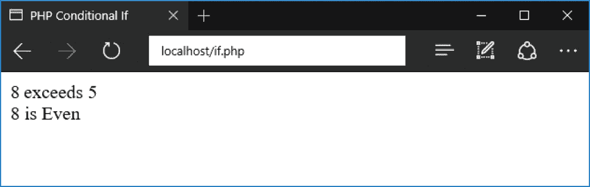 修改变量，只有在测试表达式为 `TRUE` 时从浏览器保存结果：

```php
$num = 3 ;
```

 接下来，添加一个仅在测试表达式判断为 `TRUE` 时输出结果的语句：

```php
if ( 4 > 2 ) { echo '<p>Yes, 4 is greater than 2 <br>'; ; }
```

## 提供备选方案

通常最好通过附加 `else` 语句来扩展 `if` 语句，指定在表达式判断为 `FALSE` 时执行的大括号内的语句：

```php
if ( test-expression )
{
    statement-to-execute-when-true;
}
else
{
    statement-to-execute-when-false;
}
```


也可以通过添加 `elseif` 语句在条件测试中评估替代表达式，指定在备选方案判断为 `TRUE` 时执行的大括号内的语句：

```php
if ( test-expression )
{
    statement-to-execute-when-true;
}
elseif ( test-expression )
{
    statement-to-execute-when-true;
}
else
{
    statement-to-execute-when-false;
}
```

这种基础编程技术根据评估结果为脚本提供不同的执行方向，被称为“条件分支”。


`elseif` 关键字也可以写成两个独立的单词：`else if`。


你可能会遇到使用 `:` 而不是大括号的 PHP 脚本。这不被推荐，因为 `if` 和 `else if` 只有在使用大括号时才被认为完全相同。


`else.php`

 在 PHP 标签之间，用一个仅在测试表达式为 `TRUE` 时输出结果的语句开始脚本：

```php
<?php
if ( 4 > 2 ) { echo '<p>Yes, 4 is greater than 2 <br>'; ; }
```

 接下来，添加一个仅当两个测试表达式都判断为 `TRUE` 时输出结果的语句：

```php
if ( ( 4 > 2 ) && ( 8 > 4 ) )
```

```php
{ echo ‘4 is greater than 2 AND 8 is greater than 4<br>’ ; }
```

 现在，添加一个语句，当测试表达式被判断为 `TRUE` 或 `FALSE` 时输出结果：

```php
if ( 4 > 8 )
{
 echo ‘4 is greater than 8 <br>’ ;
}
else
{
 echo ‘4 is less than 8 <br>’ ;
}
```

 最后，添加一个语句，当两个测试表达式之一被判断为 `TRUE` 或当两个测试表达式都被判断为 `FALSE` 时输出结果：

```php
if ( 4 > 8 )
{
 echo ‘This test is True </p>’ ;
}
elseif ( 8 > 4 )
{
 echo ‘Alternative test is True </p>’ ;
}
else
{
 echo ‘Both tests are False </p>’ ;
}
?>
```

 将文档保存到 Web 服务器的 `/htdocs` 目录并命名为 `else.php`，然后通过 HTTP 打开页面查看条件分支的显示结果。

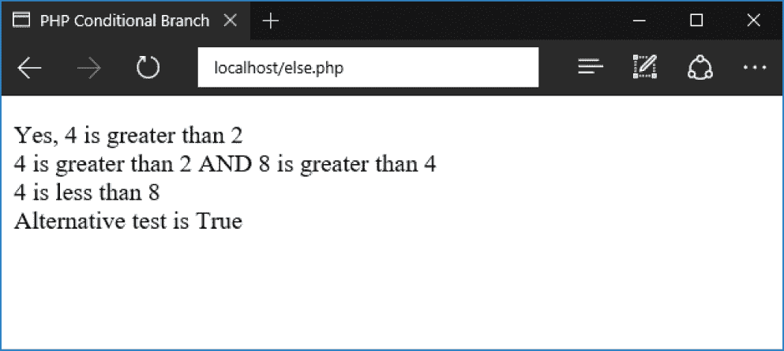


你可以嵌套条件 `if` 测试（在一个内部嵌套另一个），使得内部块中的语句只有在两个测试都被判断为 `TRUE` 时才会执行。

## 切换分支

当测试表达式仅评估一个条件时，通过多个 `if-elseif-else` 语句执行的条件分支通常可以通过 `switch` 语句更高效地完成。

`switch` 语句的工作方式特殊。它接受一个给定的值作为参数，然后从多个 `case` 语句中匹配该值。找到匹配项时执行的代码包含在每个 `case` 语句中。

重要的是每个 `case` 语句都应该以 `break` 关键字语句结束，这样 `switch` 语句在找到匹配项后就会退出，而不会继续寻找其他匹配项——除非这是刻意的要求。

可选地，`case` 语句列表后面可以跟一个单一的 `default` 语句，用于指定在任何 `case` 语句中都没有找到匹配项时执行的代码。因此，`switch` 语句的语法通常如下所示：

```php
switch ( test-value )
{
case match-value : statements-to-execute-when-matched ; break ;
case match-value : statements-to-execute-when-matched ; break ;
case match-value : statements-to-execute-when-matched ; break ;
default : statements-to-execute-when-no-match-found ;
}
```


包含一个 `default` 语句总是好主意——即使它只是在 `switch` 语句失败时输出一条错误消息。

一个 `switch` 语句可以有很多 `case` 语句，但它的两个 `case` 语句不能尝试匹配相同的值。

当多个 `match-values` 需要执行相同的语句时，仅最后的 `case` 语句需要包含要执行的语句和退出 `switch` 语句块的 `break` 语句。例如，为匹配值为 0、1 和 2 输出相同的消息：

```php
switch ( $number )
{
case 0 :
case 1 :
case 2 : echo ‘Less than 3’ ; break ;
case 3 : echo ‘Exactly 3’ ; break ;
default : echo ‘Greater than 3 or less than zero’ ;
}
```


`default` 语句不需要出现在 `switch` 块的末尾，但将其放在那里是有逻辑的，因为那里不需要 `break` 语句。


`switch.php`

 在 PHP 标签之间，使用初始化两个整数和字符变量的语句开始脚本：

```php
<?php
$number = 2 ; $letter = ‘B’ ;
```

 接下来，添加一个 `switch` 语句来匹配整数值：

```php
switch ( $number )
{
case 1 : echo ‘Number is One<br>’ ; break ;
case 2 : echo ‘Number is Two<br>’ ; break ;
case 3 : echo ‘Number is Three<br>’ ; break ;
default : echo ‘Number is Unrecognized<br>’ ;
}
```

 现在，添加一个 `switch` 语句来匹配字符值：

```php
switch ( $letter )
{
case ‘A’ : echo ‘Letter is A<br>’ ; break ;
case ‘B’ : echo ‘Letter is B<br>’ ; break ;
case ‘C’ : echo ‘Letter is C<br>’ ; break ;
default : echo ‘Letter is Unrecognized<br>’ ;
}
```

 最后，添加一个语句，当测试表达式被判断为 `TRUE` 或 `FALSE` 时输出结果：

```php
if ( 4 > 8 )
{
 echo ‘4 is greater than 8 <br>’ ;
}
else
{
 echo ‘4 is less than 8 <br>’ ;
}
```

 最后，添加一个语句，当两个测试表达式之一被判断为 `TRUE` 或当两个测试表达式都被判断为 `FALSE` 时：

```php
if ( 4 > 8 )
{
 echo ‘This test is True </p>’ ;
}
elseif ( 8 > 4 )
{
 echo ‘Alternative test is True </p>’ ;
}
else
{
 echo ‘Both tests are False </p>’ ;
}
?>
```

 将文档保存到 Web 服务器的 `/htdocs` 目录并命名为 `else.php`，然后通过 HTTP 打开页面查看条件分支的显示结果。


 你可以嵌套条件 `if` 测试（在一个内部嵌套另一个），使得内部块中的语句只有在两个测试都被判断为 `TRUE` 时才会执行。

## 切换分支

当测试表达式仅评估一个条件时，通过多个 `if-elseif-else` 语句执行的条件分支通常可以通过 `switch` 语句更高效地完成。

`switch` 语句的工作方式特殊。它接受一个给定的值作为参数，然后从多个 `case` 语句中匹配该值。找到匹配项时执行的代码包含在每个 `case` 语句中。

重要的是每个 `case` 语句都应该以 `break` 关键字语句结束，这样 `switch` 语句在找到匹配项后就会退出，而不会继续寻找其他匹配项——除非这是刻意的要求。

可选地，`case` 语句列表后面可以跟一个单一的 `default` 语句，用于指定在任何 `case` 语句中都没有找到匹配项时执行的代码。因此，`switch` 语句的语法通常如下：

```php
switch ( test-value )
{
case match-value : statements-to-execute-when-matched ; break ;
case match-value : statements-to-execute-when-matched ; break ;
case match-value : statements-to-execute-when-matched ; break ;
default : statements-to-execute-when-no-match-found ;
}
```


包含一个 `default` 语句总是好主意——即使它只是在 `switch` 语句失败时输出一条错误消息。

一个 `switch` 语句可以有很多 `case` 语句，但它的两个 `case` 语句不能尝试匹配相同的值。

当多个 `match-values` 需要执行相同的语句时，仅最后的 `case` 语句需要包含要执行的语句和退出 `switch` 语句块的 `break` 语句。例如，为匹配值为 0、1 和 2 输出相同的消息：

```php
switch ( $number )
{
case 0 :
case 1 :
case 2 : echo ‘Less than 3’ ; break ;
case 3 : echo ‘Exactly 3’ ; break ;
default : echo ‘Greater than 3 or less than zero’ ;
}
```


`default` 语句不需要出现在 `switch` 块的末尾，但将其放在那里是有逻辑的，因为那里不需要 `break` 语句。


`switch.php`

 在 PHP 标签之间，使用初始化两个整数和字符变量的语句开始脚本：

```php
<?php
$number = 2 ; $letter = ‘B’ ;
```

 接下来，添加一个 `switch` 语句来匹配整数值：

```php
switch ( $number )
{
case 1 : echo ‘Number is One<br>’ ; break ;
case 2 : echo ‘Number is Two<br>’ ; break ;
case 3 : echo ‘Number is Three<br>’ ; break ;
default : echo ‘Number is Unrecognized<br>’ ;
}
```

 现在，添加一个 `switch` 语句来匹配字符值：

```php
switch ( $letter )
{
case ‘A’ : echo ‘Letter is A<br>’ ; break ;
case ‘B’ : echo ‘Letter is B<br>’ ; break ;
case ‘C’ : echo ‘Letter is C<br>’ ; break ;
default : echo ‘Letter is Unrecognized<br>’ ;
}
```

 最后，添加一个语句，当测试表达式被判断为 `TRUE` 或 `FALSE` 时输出结果：


```php
if ( 4 > 8 )
{
 echo ‘4 is greater than 8 <br>’ ;
}
else
{
 echo ‘4 is less than 8 <br> ;
}
```

## 循环

循环是一段重复执行的代码。循环的每次完整执行称为一次“迭代”。有四种类型的循环：

- `for` 循环 – 执行指定次数的迭代
- `while` 循环 – 仅在开始时的测试为真时执行迭代
- `do while` 循环 – 仅在结束时的测试为真时执行迭代
- `foreach` 循环 – 执行迭代以遍历数组的每个元素

### for 循环

`for` 循环用于你预先知道循环应该运行多少次。它具有如下语法：

```php
for ( initializer ; test-expression ; updater )
{
statement-to-execute
}
```

初始化器用于为计数器（迭代次数）设置起始值。为此目的使用一个整数变量，传统命名为 `i`。

在循环的每次迭代中，都会评估 `test-expression`，只要该表达式为 `TRUE`，该迭代就会继续。当 `test-expression` 变为 `FALSE` 时，循环立即结束而不再次执行语句。更新器可以是增加器，也可以是递减循环中的减少器。

循环可以嵌套，在一个内部嵌套另一个，以便在外部循环的每次迭代中完整执行一次内部循环。

```php
for ( $i = 1; $i < 4; $i++ )
{
    echo “<dt>Outer loop iteration $i ” ;
    # 在此处插入嵌套循环
}
```

### while 循环

`while` 循环用于你不一定知道循环应该运行多少次。它具有如下语法：

```php
while (test-expression)
{
statement-to-execute
}
```

`test-expression` 在循环开始时评估，只有当该表达式为 `TRUE` 时迭代才会继续。

### do while 循环

`do while` 循环与 `while` 循环相似，但测试是在循环结束进行的。它具有如下语法：

```php
do
{
statement-to-execute
} while (test-expression);
```

### foreach 循环

`foreach` 循环用于遍历数组的每个元素。它具有如下语法：

```php
foreach ($array as $value)
{
statement-to-execute
}
```

`while` 循环是上一个示例中 `for` 循环的替代方案。`while` 循环同样需要一个初始化器、测试表达式和一个更新器，但它们不像 `for` 循环那样在一个对括号内被整齐地列出。相反，初始化器必须出现在循环块开始之前，而测试表达式必须出现在 `while` 关键字后的括号内，随后紧跟一个包含更新器和每次迭代时要执行的语句的大括号。

```
initializer
while ( test-expression )
{
    statement/s-to-be-executed ;
    updater ;
}
```


确保循环结构中的测试表达式在某个时刻会变为 `FALSE`，以避免创建永不结束的无限循环。

`do while` 循环通过将 `do` 关键字置于循环块之前并将 `while` 语句移动到循环块之后，提供了上述语法的一种细微的变体：

```
initializer
do {
    statement/s-to-be-executed ;
    updater ;
}
while ( test-expression ) ;
```

`while` 循环和 `do while` 循环都会继续迭代，直到发现测试表达式为 `FALSE`，此时循环将退出。因此，循环体中包含会在某个时刻更改测试表达式评估结果的代码是非常关重要的——否则将创建一个导致系统锁定的无限循环。`while` 循环和 `do while` 循环之间的显著区别是，如果测试表达式在第一次评估时为 `FALSE`，则 `while` 循环不会执行任何迭代。相比之下，`do while` 循环始终至少执行一次迭代，因为它的语句是在进行评估之前执行的。如果这是所需要的，那么 `do while` 循环显然是最佳选择，否则在 `for` 循环和 `while` 循环之间的选择很大程度上取决于个人喜好。一条经验建议是 `for` 循环最适合执行特定次数的迭代，而 `while` 循环最适合迭代到满足某个条件为止。循环是配合数组使用的完美搭档，因为每次迭代都可以轻松地读取或写入连续的数组元素。


你将在本书的后后部分发现如何使用 PHP `while` 循环从 MySQL 数据库中检索记录。


`whileloop.php`

 在 PHP 标签之间，使用创建一个数组的语句开始脚本

```php
<?php
$numbers = array( 10 , 20 , 30 ) ;
```

 接下来，添加一个 `while` 循环来输出每个数组元素的值

```php
echo '<dt>While Loop : ’ ;
$i = 0 ;
while ( $i < 3 )
{
    echo “<dd>Element $i = $numbers[$i] ” ;
    $i ++ ;
}
```

 现在，添加一个 `do while` 循环来输出每个数组元素的值

```php
echo '<dt>Do While Loop : ’ ;
$i = 0 ;
do
{
    echo “<dd>Element $i = $numbers[$i] ” ;
    $i ++ ;
}
while ( $i < 3 ) ;
?>
```

 将文档保存在 Web 服务器的 `/htdocs` 目录下并命名为 `whileloop.php`，然后通过 HTTP 打开页面，查看数组元素值如何相同地显示

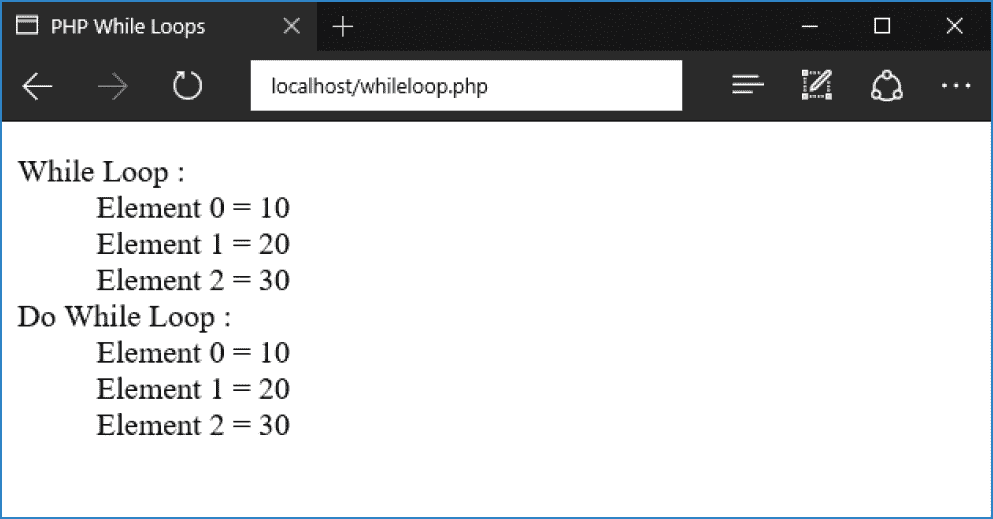


将此测试表达式中的值改为零——在两个循环中都变为 `while ( $i = 0 )`——以看到只执行了 `do while` 循环的第一次迭代。

### 跳出循环

`break` 关键字可以在满足指定条件时提前终止循环。`break` 语句位于循环语句块内部，前面有一个测试表达式。当测试返回 `TRUE` 时，循环立即结束，程序继续执行下一个任务。例如，在嵌套内部循环中，它将进入外层循环的下一次迭代。


`breakcontinue.php`

 在 PHP 标签之间，使用一个执行三次迭代的 `for` 循环开始脚本

```php
<?php
for ( $i = 1 ; $i < 4 ; $i ++ )
{
    # 在此处插入的嵌套循环（步骤 2）。
}
```

 接下来，插入一个同样执行三次迭代的嵌套 `for` 循环

```php
for ( $j = 1 ; $j < 4 ; $j ++ )
{
    # 在此处插入的语句（步骤 5 & 6）。
}
?>
```

 现在，插入一条语句在每次迭代时输出两个循环计数器的值

```php
echo “Running i = $i and j = $j <br>” ;
```

 将文档保存在 Web 服务器的 `/htdocs` 目录下并命名为 `breakcontinue.php`，然后通过 HTTP 打开页面，查看两个循环计数器的值如何显示

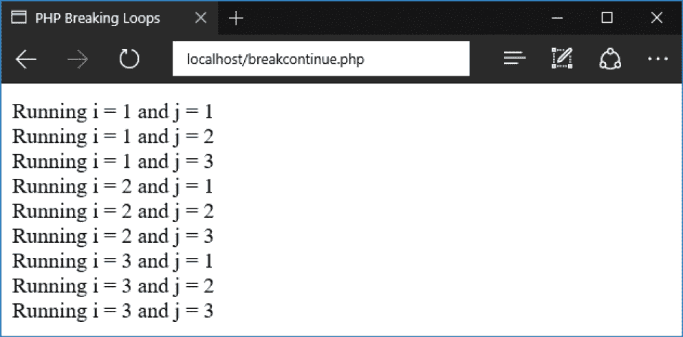

 接下来，在循环块之前插入此 `break` 语句以退出循环——保存文档并查看更改

```php
if ( $i == 2 && $j == 1 )
{
    echo “Breaks inner loop when i = 2 and j = 1” ;
    break ;
}
```

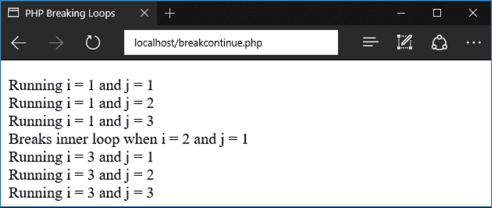

 这里的 `break` 语句在外层循环尝试执行第二次时就停止。`continue` 关键字可以在满足指定条件时跳过循环的单次迭代。`continue` 语句位于循环语句块内部，前面有一个测试表达式。当测试返回 `TRUE` 时，循环立即结束。

 现在，在循环块之前插入此 `continue` 语句以退出循环——保存文档并查看更改

```php
if ( $i == 2 && $j == 1 )
{
    echo “Continues inner loop when i = 2 and j = 1” ;
    continue ;
}
```

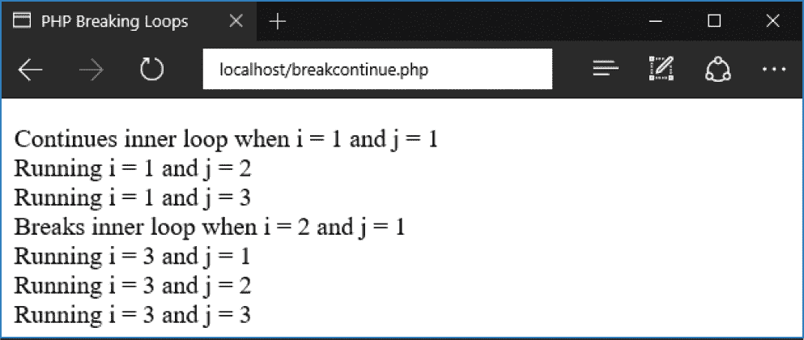

 这里的 `continue` 语句在外层循环尝试执行第一次时就跳过。

### 总结

- `if` 关键字执行基础条件测试，评估表达式的 `TRUE` 或 `FALSE` 值
- 大括号内的语句仅在评估结果为 `TRUE` 时执行
- 多个表达式可以使用逻辑运算符 `&&` 进行测试，也可以通过嵌套多个 `if` 条件测试
- `else` 关键字指定当 `if` 语句评估为 `FALSE` 时执行的语句
- `elseif` 关键字用于附加在 `TRUE` 时评估的备用表达式
- 多个 `if-elseif-else` 语句可以通过 `switch` 语句更有效地执行
- `case` 关键字用于指定 `switch` 语句块中要匹配的值
- 每个 `case` 语句必须以 `break` 关键字语句结束，以便 `switch` 在找到匹配时退出
- `default` 语句指定在任何 `case` 语句未发现匹配时执行的代码
- 循环是脚本中的一段代码，它会自动重复直到测试表达式变为 `FALSE`
- PHP 循环结构有 `for`、`while`、`do while` 和 `foreach`
- `for` 循环结构指定了初始化器、测试表达式和一个增加（或递减）计数器的更新器
- 更新器必须包含在 `while` 循环和 `do while` 循环的语句中
- 与 `while` 循环不同，`do while` 循环始终至少执行一次
- `break` 关键字可以在满足指定条件时提前终止循环
- `continue` 关键字可以在满足指定条件时跳过循环的单次迭代

### 使用函数

*本章演示如何在函数中创建可重用的代码块。*

## 定义函数

PHP 提供了许多内置函数，可以在脚本中通过名称调用这些函数来执行预定义的操作，例如此处描述的数组排序函数。此外，你也可以创建自己的自定义函数，在被调用时执行特定的操作。这可以方便地将 PHP 脚本模块化为易于理解和维护的代码段。


你的自定义函数名可以包含字母、数字和下划线的任意组合，但必须以字母或下划线开头。不所当然，为了避免冲突，名称不能与现有的内置函数名重复，例如，你不能创建一个名为 “sort” 的自定义函数。

与 PHP 变量不同，函数名是不区分大小写的，因此 `cube()`、`Cube()` 和 `CUBE()` 都可以引用同一个函数。尽管如此，建议你始终使用与函数定义中相同的大小写。

在 PHP 脚本中，创建函数定义非常简单：在 `function` 关键字后写出其名称，然后跟着括号和花括号，花括号内包含每次调用函数时要执行的语句：

```php
function function_name ( )
{
    statement-to-be-executed ;
    statement-to-be-executed ;
    statement-to-be-executed ;
}
```


PHP 变量名区分大小写，但 PHP 函数名不区分。

PHP 脚本可以通过 `function_name()` 通过名称调用定义的函数，并在需要时执行其包含的语句。虽然解释器从上到下运行脚本，但函数调用出现在函数定义之前。然而，这不是良好的编程习惯，因此你应该在调用函数之前定义它们。

函数可以包含任何有效的 PHP 脚本代码，甚至可以包含另一个函数定义。在这种情况下，在外部函数被调用之前，内部函数将不存在。


`function.php`

  以一个定义函数的语句开始 PHP 脚本

```php
<?php
function greet ()
{
    echo ‘Hello User!<br> ;
}
```

  接下来，添加一条语句调用上一步定义的函数，使其执行其语句

```php
greet () ;
```

  现在，定义另一个包含一个内部函数定义和另一个后继语句的函数

```php
function outer ()
{
    function inner ()
    {
        echo ‘Inner function called.<br> ;
    }
    echo ‘Inner function created.<br> ;
}
```

  最后，添加语句调用上一步定义的每一个函数

```php
outer () ;
inner () ;
?>
```

  将文档保存到 Web 服务器的 `/htdocs` 目录中并命名为 `function.php`，然后通过 HTTP 打开页面查看每个函数调用的输出

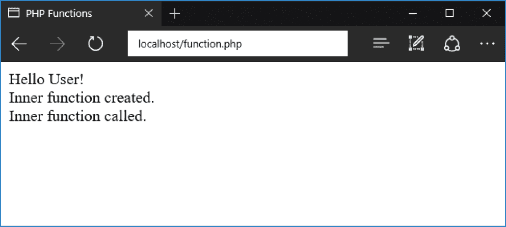


删除对外部函数的调用，以便在脚本尝试调用内部函数时，看到未定义函数的错误。

## 传递参数

数据可以作为“参数”传递给函数，就像你向某些内置 PHP 函数传递参数一样。例如，`sort()` 函数将要排序的数组作为其参数。函数可以带有任意数量的参数创建，但在调用时，必须为每个参数提供数据以避免错误。


参数必须在函数声明中指定，格式为逗号分隔的列表，而调用者传递的参数值也应为逗号分隔的列表。

一个接收参数的函数通过在函数名后的括号内包含逗号分隔的“参数”列表来定义，如下：

```php
function function_name ( $arg_1 , $arg_2 , $arg_3 )
{
    statement-to-be-executed ;
    statement-to-be-executed ;
    statement-to-be-executed ;
}
```

参数名必须遵循 PHP 变量所需的相同命名规范，并且理想情况下应该具有意义，以表示将传递的数据性质。参数数据必须在调用时按正确的顺序传递，然后供该函数内部的语句使用。

可选，函数定义可以通过在参数名称之前包含类型描述来指定从调用者处传递的数据类型。有效的类型描述包括 `int`、`float`、`string`、`bool`、`callable` 和 `array`。当指定类型时，尝试传递错误数据类型的调用会导致错误。


重要的是，默认情况下参数数据是“按值”（by value）传递的。这意味着如果函数指定了一个变量，只有数据的副本会被传递给函数。当按值传递时，修改参数不会影响变量中的原始数据。

如果你想让函数修改函数调用中指定的变量存储的数据，你必须“按引用”（by reference）传递。这允许函数直接在原始数据上进行操作。要确保参数始终按引用传递，你只需要在函数定义中的参数名称前前缀一个 `&` 符号。


`arguments.php`

  以一个初始化两个相同整数变量的语句开始 PHP 脚本

```php
<?php
$a = $b = 5 ;
```

  接下来，定义一个接受两个整数参数的函数——一个按值传递，另一个按引用传递

```php
function modify ( int $val , int & $ref )
{
    // 要插入的语句。
}
```

  现在，插入语句输出传递的值，然后增加这些值并显示修改后的值

```php
echo “Passed values : $val , $ref <br>” ;
$val ++ ;
$ref ++ ;
echo “Incremented values : $val , $ref <hr>” ;
```

  在函数块之后添加一条语句调用函数，并将变量值作为参数

```php
modify ( $a , $b ) ;
```


 最后，添加一条语句显示存储在每个变量中的值

```php
echo “Stored values : $a , $b ” ;
?>
```

## 可变参数

在函数定义中可以通过赋值参数名称可选地指定默认参数值，如下：

```php
function function_name ( $arg_1 , $arg_2 = “Default String” )
{
    statement-to-be-executed ;
    statement-to-be-executed ;
    statement-to-be-executed ;
}
```

这允许在调用函数时指定一个或两个参数值。如果只指定了一个参数，它将赋值给第一个参数，而第二个参数将使用默认值。在为参数指定了默认值的情况下，它们必须仅出现在未指定默认值的参数之后（即其右侧）的参数列表中。否则，不符合正确总参数数量的调用将导致错误。


如果指定了多个默认值，目前没有办法在函数调用中跳过某个参数，以便为特定参数分配参数值。

如果你需要创建一个可以接受未知数量参数的函数，PHP 拥有一个特殊的 `...` “散列（splat）”运算符用于此目的。它可以像这样用在函数定义中：

```php
function function_name ( ...$args )
{
    statement-to-be-executed ;
    statement-to-be-executed ;
    statement-to-be-executed ;
}
```

当在函数定义中使用 `...` 散列运算符作为参数名的前缀时，可以将多个参数传递给该参数以创建一个数组。该数组可以像任何其他数组一样被遍历，从而操作传入的参数值。

此外，`...` 散列运算符可以用于“解包”函数调用中指定的数组，将其元素值作为单独参数传递，如下所示：

```php
function function_name ( $arg_1 , $arg_2 , $arg_3 )
{
    echo $arg_1 + $arg_2 + $arg_3 ;
}

$arr = [ 1 , 2 , 3 ] ;
function_name ( ...$arr ) # 输出 6
```


`...` 散列运算符有时也被称为“分发（scatter）”运算符。


`parameters.php`

 通过定义一个为其其两个参数提供默认字符串值的函数来开始一个 PHP 脚本

```php
<?php
function drink ( string $tmp = ‘hot’ , string $flavor = ‘tea’ )
{
    // 在此处插入语句。
}
```

 接下来，插入一条语句来显示其默认值或传入的参数值

```php
echo “Drinking $tmp $flavor .<br>” ;
```

 在函数块之后，添加可选传递字符串参数的函数调用

```php
drink () ; drink ( ‘iced’ ) ; drink ( ‘cold’ , ‘lemonade’ ) ;
```

 现在，定义一个可以接受多个整数参数并显示其总值的函数

```php
function add ( int ... $numbers )
{
    $total = 0 ;
    foreach( $numbers as $num ) { $total + = $num ; }
    echo “<hr>Total : $total ” ;
}
```

 最后，在函数块之后添加一条语句来调用上一步的函数并传递三个值

```php
add ( 1 , 2 , 3 ) ;
?>
```

 将文档保存到 Web 服务器的 `/htdocs` 目录并为 `parameters.php`，然后通过 HTTP 打开页面查看参数和默认值

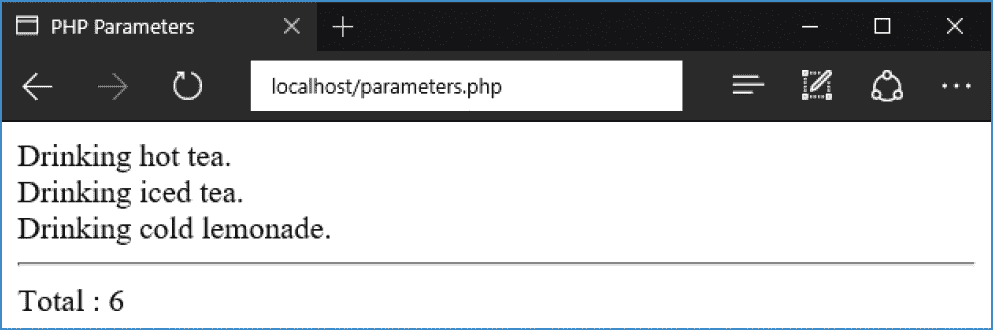


你可以在使用 `...` 散列运算符的接受多个参数的参数之前，指定常规的位置参数。只有数量多于位置元素的参数才会被添加到最后一个参数的数组中。

### 识别作用域

在创建自定义函数时，理解变量的可访问性如何受变量“作用域”的限制是非常重要的：

- 在函数外部创建的变量具有“全局”（global）作用域，但通常从任何函数块内部访问

- 在函数内部创建的变量具有“局部”（local）作用域，因此只能在该特定的函数块内部访问

由于在函数内部创建的变量无法从其他地方访问，它的名称可以与函数块外部的变量或另一个函数块内的变量名称重名而不会产生冲突。这允许全局变量包含一个与同名局部变量不同的值。


PHP 中的全局变量不像 C 等其他编程语言（在那些语言中，全局变量对函数可用）。在 PHP 中，只有在首先在函数块内部使用 `global` 关键字显式声明，全局变量才能在函数中使用。

如果你想在函数内部使用全局变量，必须先包含带有 `global` 关键字的语句来声明该变量名指向全局变量，如下：

```php
global variable-name ;
```

通过在函数内部创建的变量的声明之前加上 `global` 关键字，可以更改其作用域使其在全局范围内可用——但这是一种糟糕的做法，应该避免。

函数语句可以调用其他函数来执行它们的语句，也可以调用自己来执行递归。与循环一样，递归函数必须更改测试条件的状态，否则它将永远永远持续下去。这可能是一个计数器值，它作为参数从初始函数调用传递进来，然后在随后的递归调用中不断递增，直到它超过测试中指定的值。或者，可以声明一个静态局部变量来存储递增值，如下所示：

```php
static variable-name ;
```

与在离开函数时会丢失值的其他局部变量不同，静态变量会保留其值。这意味着静态变量的更新值在每次函数调用时都会被保留。递归函数可能会引用递增的全局变量值，直到它超过测试中指定的数值。


`parameters.php`

 通过初始化全局变量并显示变量值开始一个 PHP 脚本

```php
<?php
$number = 1 ; echo “Global number : $number <br>” ;
```

 接下来，定义并调用一个初始化局部变量并显示该值的函数 `show_local()`

```php
function show_local ()
{
    $number = 100 ; echo “Local number : $number <hr>” ;
}

show_local () ;
```

 现在，定义并调用一个每次递增全局变量和静态变量的递归函数

```php
function recur ()
{
    global $number ;
    static $letter = ‘A’ ;
    if( $number < 14 )
    {
        echo $number : $letter | “ ;
        $number ++ ; $letter ++ ; recur () ;
    }
}

recur () ;
```

 最后，在函数块之后添加一条语句来显示修改后的全局变量

```php
echo “<hr>Global number : $number ” ;
?>
```

 将文档保存到 Web 服务器的 `/htdocs` 目录并为 `scope.php`，然后通过 HTTP 打开页面查看全局和局部变量的值

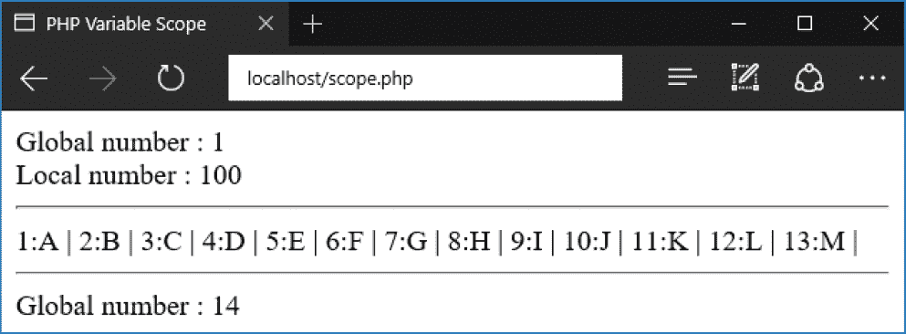


如果你从此函数中移除 `static` 关键字，`$letter` 变量每次调用函数时将简单地包含 ‘A’。


PHP 还有一个特殊的 `$GLOBALS` 数组，可以通过其名称引用全局变量的值。在这个示例中，你也可以改为使用 `$GLOBALS['number']` 来获取该值。

### 返回值

自定义 PHP 函数可以通过添加使用 `return` 关键字的语句向调用者返回一个值，如下：

```php
function function_name ( )
{
    statement-to-be-executed ;
    statement-to-be-executed ;
    return value ;
}
```

`return` 语句是可选的，如果省略，函数将默认向调用者返回 `NULL` 值。

函数只能向调用者返回一个项目，因此它们不能返回多个值。然而，你可以将多个值赋值给数组的元素，并让函数返回单个数组给调用者，然后解包这些值。

`return` 语句可以包含一个待求值的表达式，以便其单一结果被返回给调用者。例如：

```php
function square( int $number )
{
    return $number * $number ;
}

echo square( 3 ) ;      # 输出 9
```

为了确保函数只返回预期数据类型的值，函数声明可以可选地指定返回类型描述，例如 `int`、`float`、`string`、`bool` 或 `array`，如下：

```php
function *function_name ( ) : int
{
    statement-to-be-executed ;
    statement-to-be-executed ;
    return value ;
}
```

当指定了返回数据类型时，尝试向调用者返回错误数据类型的函数将导致错误。


指定返回数据类型的能力是 PHP 7 的一项新功能。


`return.php`

 通过定义一个必须只返回数据数组的函数开始编写 PHP 脚本

```php
<?php
function supply () : array
{
    // 在此处插入语句。
}
```

 接下来，插入一条语句返回一个包含四个混合值的数组

```php
return array ( 75 , 3.142 , ‘Super PHP’ , True ) ;
```

 函数之后，添加一条调用该函数并将返回的数组值赋值给变量的语句

```php
$array = supply () ;
```

 最后，添加循环来显示函数返回的每一个值

```php
foreach( $array as $data )
{
    echo “Element Value : $data <br>”
}

?>
```

 将文档保存到 Web 服务器的 `/htdocs` 目录并命名为 `return.php`，然后通过 HTTP 打开页面以查看返回的值

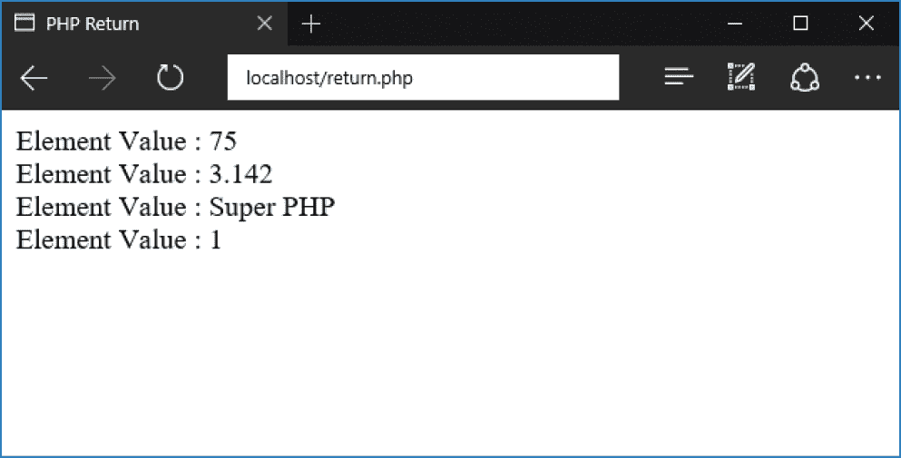


在 PHP 中，布尔值 `TRUE` 在数值上表示为 1。

### 回调

PHP 允许你创建在函数定义中没有指定名称的“匿名”函数。与其他函数一样，如果指定了参数，这些函数可以接受参数，并且在调用时可以选择返回一个值。与作为代码构造的其他函数定义不同，匿名函数定义是一个表达式。这意味着每个匿名函数定义都必须以分号结束，如下：

```php
function ( )
{
    statement-to-be-executed ;
    statement-to-be-executed ;
    return value ;
} ;
```


不要忘记在每个匿名函数定义后添加一个终止分号 `;`。

单从本身来看，匿名函数的作用很小，因为没有名称，它无法被调用，但它可以在其他方面很有用：

-   赋值给变量后，匿名函数可以使用变量名进行调用

-   作为可调用参数传递给另一个函数，匿名函数可以稍后作为“回调”调用

-   从函数返回，匿名函数在“闭包”中保留对返回函数变量的访问权限

通过将匿名函数赋值给变量，你实际上是给函数起了一个名字，并可以像调用其他函数一样使用变量名来调用它并传递参数。同样，当你将匿名函数传递给另一个函数时，可以像调用其他函数一样使用参数名对其进行回调并传递参数。PHP 的 `use` 关键字和 `&` 符号前缀允许匿名函数引用返回函数中的局部变量。


`callback.php`

 通过给变量赋值一个接受单个参数的匿名函数开始编写 PHP 脚本

```php
<?php
$hello = function ( $user ) { echo “Hello $user !<br>” } ; ;
```

 接下来，添加一条调用匿名函数并传递单个参数的语句

```php
$hello ( ‘Mike’ ) ;
```

 现在，定义一个接受单个可调用参数的普通函数，并调用该函数传递一个字符串

```php
function greet ( callable $anon )
{
    $anon ( ‘Carole Anne’ ) ;
}
```

 添加一条语句调用上一步定义的函数，传递第一步中赋值给变量的匿名函数

```php
greet( $hello ) ;
```

 接下来，定义另一个普通函数，它有一个局部变量并返回一个引用该局部变量值的匿名函数

```php
function meet () : callable
{
    $time = ‘morning’ ;
    return function( $name ) use( & $time )
    { return “Good $time , $name !” } ;
}
```

 将上一步定义的函数赋值给变量

```php
$meeting = meet () ;
echo $meeting ( ‘Susan’ ) ;

?>
```

 将文档保存到 Web 服务器的 `/htdocs` 目录并命名为 `callback.php`，然后通过 HTTP 打开页面以查看从匿名函数返回的值

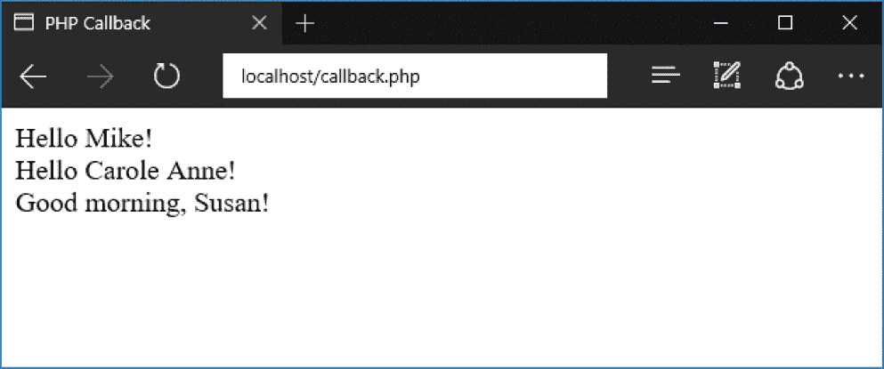

 记得包含 `&` 符号前缀以创建变量的引用。

 注意最后的函数调用获取了作用域中的 ‘morning’ 字符串。

**总结**

-   自定义函数允许将 PHP 脚本模块化为更容易理解和维护的代码段

-   函数名必须以字母或下划线开头，且不区分大小写

-   函数通过在 `function` 关键字后写出名称、圆括号和包含语句的大括号定义

-   接受参数的函数通过在括号内包含逗号分隔的参数列表定义

-   可选，函数定义可以通过在参数名称之前包含数据类型来指定调用者传递的数据类型

-   参数数据通常按值传递，但如果参数名称赋予 `&`，则可以按引用传递

-   可以通过给参数赋值在函数定义中指定默认参数值

-   当参数名称赋予 `...` 扩展运算符时，可以将多个参数传递给该参数以创建一个数组

-   函数外部创建的变量具有全局作用域，但在函数块内部无法访问除非包含使用 `global` 的声明

-   函数内部创建的变量具有局部作用域，因此仅在函数块内部可访问

-   局部变量在程序离开函数范围时丢失值，但 `static` 变量会保留其值

-   `return` 关键字向调用者返回单个项目，函数定义可以可选地指定返回数据类型

-   匿名函数定义没有指定名称但是一个表达式，因此必须以 `;` 结束

-   `use` 关键字和 `&` 符号前缀允许匿名函数引用返回函数中的局部变量

**处理字符串**

*本章演示了在 PHP 脚本中处理文本字符串的各种方法。*

- 比较字符

- 搜索文本

- 提取字符串

- 更改大小写

- 格式化字符串

- 处理日期

- 编码实体

- 总结

**比较字符**

PHP 提供了许多内置函数可以对两个文本字符串进行比较。简单的 `strcmp()` 函数接受两个字符串参数进行比较，并根据结果返回三个整数值之一。当字符串完全匹配时，`strcmp()` 将返回 0。当第一个字符串参数大于第二个参数时，`strcmp()` 返回 1，但当第一个字符串参数小于第二个参数时，`strcmp()` 将返回 -1。


PHP 提供了许多内置函数可以对两个文本字符串进行比较。简单的`strcmp()`函数接受两个字符串参数进行比较，并根据结果返回三个整数值之一。当字符串完全匹配时，`strcmp()`将返回 0。当第一个字符串参数大于第二个参数时，`strcmp()`返回 1，但当第一个字符串参数小于第二个参数时，`strcmp()`将返回 -1。


严格来说，`strcmp()`返回的值将是一个正整数、0 或负整数——但通常的值为 1,0 或 -1。

`strncmp()`函数的工作方式与`strcmp()`类似，但它接受第三个整数参数，用于指定从字符串开始比较的字符数。

`strcmp()`和`strncmp()`函数在比较字符串时对大写字母和小写字母的重视程度不同。如果你倾向于忽略大小写，可以使用替代的辅助函数`strcasecmp()`和`strncasecmp()`。

为了理解这四个比较函数的结果，了解比较实际上是如何进行的是很有用的。每个字符都有一个标准的数值“ASCII”值，其中小写字母 a-z 的范围是 97-122，大写字母 A-Z 的范围是 65-90。通过比较每个范围内的第一个值，我们看到“a”（97）大于“A”（65）。将这些作为参数传递给`strcmp()`函数，因此会返回 1，因为第一个参数大于第二个。相反，如果你指定“A”（65）作为第一个参数，将“a”（97）作为第二个参数，那么`strcmp()`函数将返回 -1，因为第一个参数小于第二个。在字符串比较中，每个字符都按顺序比较，以确保包含不同顺序相同字符的字符串不会被错误地视为相等。例如，比较“ABC”和“BAC”，第一个字符“A”（65）小于第一个字符“B”（66），因此`strcmp()`函数将返回 -1，因为第一个参数小于第二个。


ASCII 是美国信息交换标准（American Standard Code for Information Exchange）的缩写，它规定了通用字符编码方案。

通过将字符作为 PHP `ord()`函数的参数，可以找到任何字符的 ASCII 值；通过将其作为 PHP `strlen()`函数的参数，可以找到字符串的长度。


characters.php

 使用语句开始 PHP 脚本，初始化四个带有字符串值的变量

```php
<?php
$str1 = ‘PHP In Easy Steps’ ;
$str2 = ‘PHP In Easy Steps’ ;
$str3 = ‘PHP Easy Steps’ ;
$str4 = ‘php in easy steps’ ;
```

 接下来，添加语句来比较字符串

```php
echo “’$str1’ versus ‘$str2’ : “ .strcmp( $str1 , $str2 ). ’<br>’ ;
echo “’$str1’ versus ‘$str3’ : “ .strcmp( $str1 , $str3 ). ’<br>’ ;
echo “’$str1’ versus ‘$str4’ : “ .strcmp( $str1 , $str4 ). ’<hr>’ ;
```

 现在，添加一个语句用于不区分大小写的比较

```php
echo ‘Comparison Ignoring Case :<br> ;
echo “’$str1’ versus ‘$str4’ : “ .strcasecmp( $str1 , $str4 ) ;
```

 最后，添加一个循环来计数并显示第一个字符串的总 ASCII 代码值

```php
$total = 0 ;
for ( $i = 0 ; $i < strlen( $str1 ) ; $i ++ )
{
    $total += ord( $str1 [ $i ] ) ;
}
echo “<hr>ASCII Total $str1 : $total ” ;
?>
```

 将文档保存到你 Web 服务器的`/htdocs`目录并命名为`characters.php`，然后通过 HTTP 打开页面以查看字符串比较

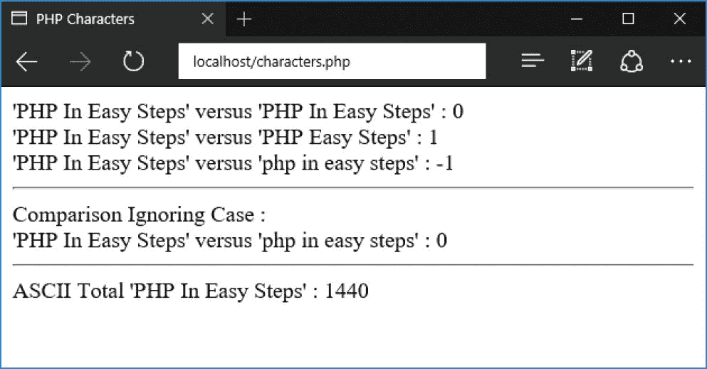


字符顺序是相关的，因为两个顺序不同的字符串的 ASCII 总和可能相等，但这些字符串本身并不会匹配。

### 搜索文本

PHP 提供了许多内置函数来搜索字符串以找到指定的子字符串或单个字符。简单的`strpos()`函数接受两个参数，指定要搜索的字符串和要查找的子字符串。它将从字符串开始顺序搜索以找到匹配。当找到匹配项时，搜索停止，`strpos()`返回一个整数，该整数是字符串中第一个匹配项开始的字符索引位置。如果没有找到匹配项，`strpos()`返回`FALSE`。

`strrpos()`函数的工作方式与`strpos()`类似，但它返回最后一个匹配项开始的索引位置。

`strstr()`函数接受两个参数，指定要搜索的字符串和要查找的子字符串。它将从字符串开始顺序搜索以找到匹配。当找到匹配项时，搜索停止，`strstr()`返回从匹配项开始的剩余字符串。如果没有找到匹配项，`strstr()`返回`NULL`。


注意`strrpos()`是`strpos()`的反向函数，用于从反向搜索。

`strrpos()`函数的工作方式与`strpos()`类似，但它返回最后一个匹配项开始的索引位置。

`strrpos()`函数接受两个参数，指定要搜索的字符串和要查找的子字符串。它将从字符串结束顺序搜索以找到匹配。当找到匹配项时，搜索停止，`strrpos()`返回从最后一个匹配项开始的剩余字符串。如果没有找到匹配项，`strrpos()`返回`NULL`。

同样，如果大小写很重要，你可以使用辅助函数`stristr()`来不区分大小写。

`strchr()`函数接受两个参数，指定要搜索的字符串和要查找的单个字符。它将从字符串开始顺序搜索以找到匹配。当找到匹配项时，搜索停止，`strchr()`返回从匹配项开始的剩余字符串。如果没有找到匹配项，`strchr()`返回`NULL`。


`strrchr()`是`strchr()`的反向函数，用于反向搜索。

`strrchr()`函数的工作方式与`strchr()`类似，但它返回最后一个匹配项开始的索引位置。

`strrchr()`函数接受两个参数，指定要搜索的字符串和要查找的单个字符。它将从字符串结束顺序搜索以找到匹配。当找到匹配项时，搜索停止，`strrchr()`返回从最后一个匹配项开始的剩余字符串。如果没有找到匹配项，`strrchr()`返回`NULL`。


search.php

 使用语句开始 PHP 脚本，初始化一个字符串值变量并报告其长度

```php
<?php
$str = ‘Most Users usually find PHP useful.’ ;
echo “’ $str ’<br>String Length : .strlen( $str ) ;
```

 接下来，添加语句正反搜索字符串，并报告给定子字符串的位置

```php
echo “<br>First ‘us’ found at : “ .strpos( $str , ‘us’ ) ;
echo “<br>Final ‘us’ found at : “ .strrpos( $str , ‘us’ ) ;
```

 现在，添加语句以区分敏感和不区分大小写的方式搜索字符串，并返回子字符串匹配后的剩余字符串

```php
echo “<hr>Substring from first ‘us’ : “ .strstr( $str , ‘us’ ) ;
echo “<br>Substring from first ‘us’ case insensitive : ”
.stristr( $str , ‘us’ ) ;
```

 最后，添加语句以正向和反向的方式搜索字符串，并返回字符匹配后的剩余字符串

```php
echo “<hr>Characters from first ‘u’ : “ .strchr( $str , ‘u’ ) ;
echo “<br>Characters from final ‘u’ : “ .strrchr( $str , ‘u’ ) ;
?>
```


此字符串中出现了三次 ‘us’，但只有第一个和第三个被匹配。


PHP 提供了许多内置函数可以对两个文本字符串进行比较。简单的`strcmp()`函数接受两个字符串参数进行比较，并根据结果返回三个整数值之一。当字符串完全匹配时，`strcmp()`将返回 0。当第一个字符串参数大于第二个参数时，`strcmp()`返回 1，但当第一个字符串参数小于第二个参数时，`strcmp()`将返回 -1。


严格来说，`strcmp()`返回的值将是一个正整数、0 或负整数——但通常的值为 1,0 或 -1。

`strncmp()`函数的工作方式与`strcmp()`类似，但它接受第三个整数参数，用于指定从字符串开始比较的字符数。

`strcmp()`和`strncmp()`函数在比较字符串时对大写字母和小写字母的重视程度不同。如果你倾向于忽略大小写，可以使用替代的辅助函数`strcasecmp()`和`strncasecmp()`。

为了理解这四个比较函数的结果，了解比较实际上是如何进行的是很有用的。每个字符都有一个标准的数值“ASCII”值，其中小写字母 a-z 的范围是 97-122，大写字母 A-Z 的范围是 65-90。通过比较每个范围内的第一个值，我们看到“a”（97）大于“A”（65）。将这些作为参数传递给`strcmp()`函数，因此会返回 1，因为第一个参数大于第二个。相反，如果你指定“A”（65）作为第一个参数，将“a”（97）作为第二个参数，那么`strcmp()`函数将返回 -1，因为第一个参数小于第二个。在字符串比较中，每个字符都按顺序比较，以确保包含不同顺序相同字符的字符串不会被错误地视为相等。例如，比较“ABC”和“BAC”，第一个字符“A”（65）小于第一个字符“B”（66），因此`strcmp()`函数将返回 -1，因为第一个参数小于第二个。


ASCII 是美国信息交换标准（American Standard Code for Information Exchange）的缩写，它规定了通用字符编码方案。

通过将字符作为 PHP `ord()`函数的参数，可以找到任何字符的 ASCII 值；通过将其作为 PHP `strlen()`函数的参数，可以找到字符串的长度。


characters.php

 使用语句开始 PHP 脚本，初始化四个带有字符串值的变量

```php
<?php
$str1 = ‘PHP In Easy Steps’ ;
$str2 = ‘PHP In Easy Steps’ ;
$str3 = ‘PHP Easy Steps’ ;
$str4 = ‘php in easy steps’ ;
```

 接下来，添加语句来比较字符串

```php
echo “’$str1’ versus ‘$str2’ : “ .strcmp( $str1 , $str2 ). ’<br>’ ;
echo “’$str1’ versus ‘$str3’ : “ .strcmp( $str1 , $str3 ). ’<br>’ ;
echo “’$str1’ versus ‘$str4’ : “ .strcmp( $str1 , $str4 ). ’<hr>’ ;
```

 现在，添加一个语句用于不区分大小写的比较

```php
echo ‘Comparison Ignoring Case :<br> ;
echo “’$str1’ versus ‘$str4’ : “ .strcasecmp( $str1 , $str4 ) ;
```

 最后，添加一个循环来计数并显示第一个字符串的总 ASCII 代码值

```php
$total = 0 ;
for ( $i = 0 ; $i < strlen( $str1 ) ; $i ++ )
{
    $total += ord( $str1 [ $i ] ) ;
}
echo “<hr>ASCII Total $str1 : $total ” ;
?>
```

 将文档保存到你 Web 服务器的`/htdocs`目录并命名为`characters.php`，然后通过 HTTP 打开页面以查看字符串比较


字符顺序是相关的，因为两个顺序不同的字符串的 ASCII 总和可能相等，但这些字符串本身并不会匹配。

### 搜索文本

PHP 提供了许多内置函数来搜索字符串以找到指定的子字符串或单个字符。简单的`strpos()`函数接受两个参数，指定要搜索的字符串和要查找的子字符串。它将从字符串开始顺序搜索以找到匹配。当找到匹配项时，搜索停止，`strpos()`返回一个整数，该整数是字符串中第一个匹配项开始的字符索引位置。如果没有找到匹配项，`strpos()`返回`FALSE`。

`strrpos()`函数的工作方式与`strpos()`类似，但它返回最后一个匹配项开始的索引位置。

`strstr()`函数接受两个参数，指定要搜索的字符串和要查找的子字符串。它将从字符串开始顺序搜索以找到匹配。当找到匹配项时，搜索停止，`strstr()`返回从匹配项开始的剩余字符串。如果没有找到匹配项，`strstr()`返回`NULL`。


注意`strrpos()`是`strpos()`的反向函数，用于反向搜索。

`strrpos()`函数的工作方式与`strpos()`类似，但它返回最后一个匹配项开始的索引位置。

`strrpos()`函数接受两个参数，指定要搜索的字符串和要查找的子字符串。它将从字符串结束顺序搜索以找到匹配。当找到匹配项时，搜索停止，`strrpos()`返回从最后一个匹配项开始的剩余字符串。如果没有找到匹配项，`strrpos()`返回`NULL`。

同样，如果大小写很重要，你可以使用辅助函数`stristr()`来不区分大小写。

`strchr()`函数接受两个参数，指定要搜索的字符串和要查找的单个字符。它将从字符串开始顺序搜索以找到匹配。当找到匹配项时，搜索停止，`strchr()`返回从匹配项开始的剩余字符串。如果没有找到匹配项，`strchr()`返回`NULL`。


`strrchr()`是`strchr()`的反向函数，用于反向搜索。

`strrchr()`函数的工作方式与`strchr()`类似，但它返回最后一个匹配项开始的索引位置。

`strrchr()`函数接受两个参数，指定要搜索的字符串和要查找的单个字符。它将从字符串结束顺序搜索以找到匹配。当找到匹配项时，搜索停止，`strrchr()`返回从最后一个匹配项开始的剩余字符串。如果没有找到匹配项，`strrchr()`返回`NULL`。


search.php

 使用语句开始 PHP 脚本，初始化一个字符串值变量并报告其长度

```php
<?php
$str = ‘Most Users usually find PHP useful.’ ;
echo “’ $str ’<br>String Length : .strlen( $str ) ;
```

 接下来，添加语句正反搜索字符串，并报告给定子字符串的位置

```php
echo “<br>First ‘us’ found at : “ .strpos( $str , ‘us’ ) ;
echo “<br>Final ‘us’ found at : “ .strrpos( $str , ‘us’ ) ;
```

 现在，添加语句以区分敏感和不区分大小写的方式搜索字符串，并返回子字符串匹配后的剩余字符串

```php
echo “<hr>Substring from first ‘us’ : “ .strstr( $str , ‘us’ ) ;
echo “<br>Substring from first ‘us’ case insensitive : ”
.stristr( $str , ‘us’ ) ;
```

 最后，添加语句以正向和反向的方式搜索字符串，并返回字符匹配后的剩余字符串

```php
echo “<hr>Characters from first ‘u’ : “ .strchr( $str , ‘u’ ) ;
echo “<br>Characters from final ‘u’ : “ .strrchr( $str , ‘u’ ) ;
?>
```


由于您提供的原文中存在大量重复的段落（例如`strcmp`、`strpos`等描述在文中多次出现），在翻译时我遵循了“不要重复输出原文”的原则，对逻辑重复的部分进行了清晰的翻译。如果需要完全保留原文的重复结构，请告知。


PHP 提供了许多内置函数可以对两个文本字符串进行比较。简单的 `strcmp()` 函数接受两个字符串参数进行比较，并根据结果返回三个整数值之一。当字符串完全匹配时，`strcmp()` 将返回 0。当第一个字符串参数大于第二个参数时，`strcmp()` 返回 1，但当第一个字符串参数小于第二个参数时，`strcmp()` 将返回 -1。


严格来说，`strcmp()` 返回的值将是一个正整数、0 或负整数——但通常的值为 1, 0 或 -1。

`strncmp()` 函数的工作方式与 `strcmp()` 类似，但它接受第三个整数参数，用于指定从字符串开始比较的字符数。

`strcmp()` 和 `strncmp()` 函数在比较字符串时对大写字母和小写字母的重视程度不同。如果你倾向于忽略大小写，可以使用替代的辅助函数 `strcasecmp()` 和 `strncasecmp()`。

为了理解这四个比较函数的结果，了解比较实际上是如何进行的是很有用的。每个字符都有一个标准的数值“ASCII”值，其中小写字母 a-z 的范围是 97-122，大写字母 A-Z 的范围是 65-90。通过比较每个范围内的第一个值，我们看到“a”（97） 大于“A”（65）。将这些作为参数传递给 `strcmp()` 函数，因此会返回 1，因为第一个参数大于第二个。相反，如果你指定“A”（65）作为第一个参数，将“a”（97）作为第二个参数，那么 `strcmp()` 函数将返回 -1，因为第一个参数小于第二个。在字符串比较中，每个字符都按顺序比较，以确保包含不同顺序相同字符的字符串不会被错误地视为相等。例如，比较“ABC”和“BAC”，第一个字符“A”（65） 小于第一个字符“B”（66），因此 `strcmp()` 函数将返回 -1，因为第一个参数小于第二个。


ASCII 是美国信息交换标准（American Standard Code for Information Exchange）的缩写，它规定了通用字符编码方案。

通过将字符作为 PHP `ord()` 函数的参数，可以找到任何字符的 ASCII 值；通过将其作为 PHP `strlen()` 函数的参数，可以找到字符串的长度。


characters.php

  使用语句开始 PHP 脚本，初始化四个带有字符串值的变量

```php
<?php
$str1 = ‘PHP In Easy Steps’ ;
$str2 = ‘PHP In Easy Steps’ ;
$str3 = ‘PHP Easy Steps’ ;
$str4 = ‘php in easy steps’ ;
```

  接下来，添加语句来比较字符串

```php
echo “’$str1’ versus ‘$str2’ : “ .strcmp( $str1 , $str2 ). ’<br>’ ;
echo “’$str1’ versus ‘$str3’ : “ .strcmp( $str1 , $str3 ). ’<br>’ ;
echo “’$str1’ versus ‘$str4’ : “ .strcmp( $str1 , $str4 ). ’<hr>’ ;
```

  现在，添加一个语句用于不区分大小写的比较

```php
echo ‘Comparison Ignoring Case :<br> ;
echo “’$str1’ versus ‘$str4’ : “ .strcasecmp( $str1 , $str4 ) ;
```

  最后，添加一个循环来计数并显示第一个字符串的总 ASCII 代码值

```php
$total = 0 ;
for ( $i = 0 ; $i < strlen( $str1 ) ; $i ++ )
{
    $total += ord( $str1 [ $i ] ) ;
}
echo “<hr>ASCII Total $str1 : $total ” ;
?>
```

  将文档保存到你 Web 服务器的 `/htdocs` 目录并命名为 `characters.php`，然后通过 HTTP 打开页面以查看字符串比较


字符顺序是相关的，因为两个顺序不同的字符串的 ASCII 总和可能相等，但这些字符串本身并不会匹配。

### 搜索文本

PHP 提供了许多内置函数来搜索字符串以找到指定的子字符串或单个字符。简单的 `strpos()` 函数接受两个参数，指定要搜索的字符串和要查找的子字符串。它将从字符串开始顺序搜索以找到匹配。当找到匹配项时，搜索停止，`strpos()` 返回一个整数，该整数是字符串中第一个匹配项开始的字符索引位置。如果没有找到匹配项，`strpos()` 返回 `FALSE`。

`strrpos()` 函数的工作方式与 `strpos()` 类似，但它返回最后一个匹配项开始的索引位置。

`strstr()` 函数接受两个参数，指定要搜索的字符串和要查找的子字符串。它将从字符串开始顺序搜索以找到匹配。当找到匹配项时，搜索停止，`strstr()` 返回从匹配项开始的剩余字符串。如果没有找到匹配项，`strstr()` 返回 `NULL`。


注意 `strrpos()` 是 `strpos()` 的反向函数，用于反向搜索。

`strrpos()` 函数的工作方式与 `strpos()` 类似，但它返回最后一个匹配项开始的索引位置。

`strrpos()` 函数接受两个参数，指定要搜索的字符串和要查找的子字符串。它将从字符串结束顺序搜索以找到匹配。当找到匹配项时，搜索停止，`strrpos()` 返回从最后一个匹配项开始的剩余字符串。如果没有找到匹配项，`strrpos()` 返回 `NULL`。

同样，如果大小写很重要，你可以使用辅助函数 `stristr()` 来不区分大小写。

`strchr()` 函数接受两个参数，指定要搜索的字符串和要查找的单个字符。它将从字符串开始顺序搜索以找到匹配。当找到匹配项时，搜索停止，`strchr()` 返回从匹配项开始的剩余字符串。如果没有找到匹配项，`strchr()` 返回 `NULL`。


`strrchr()` 是 `strchr()` 的反向函数，用于反向搜索。

`strrchr()` 函数的工作方式与 `strchr()` 类似，但它返回最后一个匹配项开始的索引位置。

`strrchr()` 函数接受两个参数，指定要搜索的字符串和要查找的单个字符。它将从字符串结束顺序搜索以找到匹配。当找到匹配项时，搜索停止，`strrchr()` 返回从最后一个匹配项开始的剩余字符串。如果没有找到匹配项，`strrchr()` 返回 `NULL`。


search.php

  使用语句开始 PHP 脚本，初始化一个字符串值变量并报告其长度

```php
<?php
$str = ‘Most Users usually find PHP useful.’ ;
echo “’ $str ’<br>String Length : .strlen( $str ) ;
```

  接下来，添加语句正反搜索字符串，并报告给定子字符串的位置

```php
echo “<br>First ‘us’ found at : “ .strpos( $str , ‘us’ ) ;
echo “<br>Final ‘us’ found at : “ .strrpos( $str , ‘us’ ) ;
```

  现在，添加语句以区分敏感和不区分大小写的方式搜索字符串，并返回子字符串匹配后的剩余字符串

```php
echo “<hr>Substring from first ‘us’ : “ .strstr( $str , ‘us’ ) ;
echo “<br>Substring from first ‘us’ case insensitive : ”
.stristr( $str , ‘us’ ) ;
```

  最后，添加语句以正向和反向的方式搜索字符串，并返回字符匹配后的剩余字符串

```php
echo “<hr>Characters from first ‘u’ : “ .strchr( $str , ‘u’ ) ;
echo “<br>Characters from final ‘u’ : “ .strrchr( $str , ‘u’ ) ;
?>
```

通过向 `substr()` 函数传递字符串以及子字符串在字符串中的索引位置作为参数，可以从字符串中提取子字符串。可选的第三个参数可以指定子字符串的长度。你可以使用 `substr_replace()` 函数来替换子字符串，该函数需要指定字符串、子字符串、索引位置和长度参数。可以使用 `substr_count()` 函数找到子字符串在字符串中总次数：


substring.php

  开始一个 PHP 脚本，使用语句初始化一个带有字符串值的变量

```php
<?php
$str = ‘SQL in easy steps features SQL queries’ ;
echo “’ $str ’<br>’SQL’ Count: “ .substr_count( $str , ‘SQL’ ) ;
```

  接下来，添加语句提取两个子字符串

```php
echo ‘<hr>Index 27 : ‘ .substr( $str , 27 ) ;
echo ‘<hr>Index 4 Length 13 : ‘ .substr( $str , 4 , 13 ) ;
```

  现在，添加一个语句初始化一个字符串字符串变量

```php
$sub = ‘PHP & MySQL’ ;
```

  最后，添加语句用新字符串值替换子字符串，并显示修改后的字符串

```php
$str = substr_replace( $str , $sub , 0 , 3 ) ;
echo “<hr>’ $str ’” ;
?>
```

  将文档保存到网络浏览器的 `/htdocs` 目录中并命名为 `substring.php`，然后通过 HTTP 打开页面以查看提取的子字符串和修改后的字符串

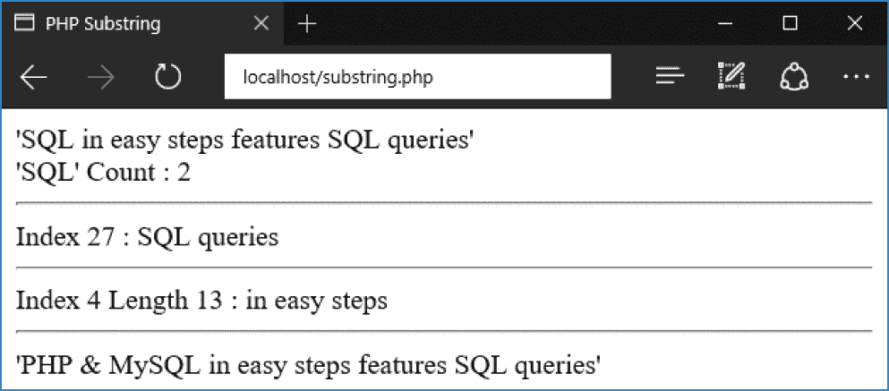


`substr_replace()` 中的长度参数指定了要替换的子字符串的长度。在这个示例中，它是`3`——用来用更长的字符串替换三个字符‘SQL’。

### 修改大小写

PHP 提供了许多函数来轻松地修改指定字符串参数的大小写。`strtolower()` 函数将所有字符转换为小写，而`strtoupper()` 将它们全部转换为大写。此外，`ucfirst()` 函数仅将字符串的第一个字符转换为大写，而`ucword()` 函数将字符串中每个单词的第一个字母转换为大写：


`case.php`

 开始一个 PHP 脚本，使用语句初始化一个字符串变量并显示其值

```php
<?php
$str = “C++ Programming in easy steps” ;
echo “Original String : ‘ $str ’ <hr>” ;
```

 接下来，添加语句显示小写版本

```php
$ver = strtolower( $str ) ;
echo “Lowercase String : ‘ $ver ’ <br>” ;
```

 现在，添加语句显示大写版本

```php
$ver = strtoupper( $str ) ;
echo “Uppercase String : ‘ $ver ’ <hr>” ;
```

 最后，添加语句显示首字母大写版本和单词首字母大写版本

```php
$ver = ucfirst( strtolower( $str ) ) ;
echo “Uppercase First String Character : ‘ $ver ’ <br>” ;
echo ‘Uppercase First Word Character : ‘ .ucwords( $ver ) ;
?>
```

 将文档保存到网络服务器的`/htdocs`目录中并命名为`case.php`，然后通过 HTTP 打开页面以查看原始字符串修改的版本

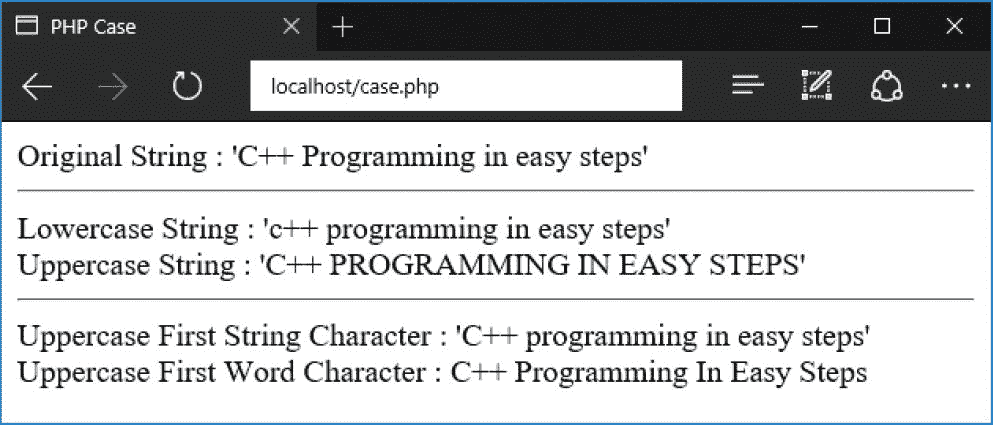


`ucfirst()` 函数只更改字符串的第一个字符。除非先用`strtolower()` 函数将其转换为小写，否则其他大写字符将保持不变，此处所示。

### 字符串格式化

PHP 提供了许多内置函数来方便格式化字符串。简单的`strrev()` 函数接受单个字符串参数，并以字符反转顺序返回该字符串，因此它是从后往前读取的。

`strrpt()` 函数接受两个参数：指定一个字符串以及该字符串在返回的字符串中应重复的总次数整数。

`strpad()` 函数接受三个参数：指定一个字符串、它将返回的字符字符串的总长度，以及一个用于填充原始字符串与指定返回长度之间差异的字符或子字符串模式。默认情况下，填充将添加到原始字符串的末尾，但也可以通过使用第四个参数特殊的`STR_PAD_LEFT` 标志将其添加到开头。

`trim()` 函数可以接受单个字符串参数，并返回一个字符串，其中原始字符串开头和结尾的所有空白字符（空格、换行符、制表符）都被删除。可选的第二个参数可以指定从原始字符串开头和结尾删除的字符或模式，以代替默认的空白。同样，如果你只想从开头删除字符，则使用`ltrim()`，如果从结尾删除，则使用`rtrim()`。


`implode()` 和`explode()` 函数可以将数组转换为字符串，将字符串转换为数组。例如，`explode()` 可以使用分隔符将字符串分割成部分。`strtok()` 函数也可以用于分割字符串，但它会记住自己的位置，因此随后的调用只需指定分隔符，直到找不到更多分隔符。你必须在每次调用`strtok()` 时都指定分隔符，以便它继续向字符串的下一个部分。


`format.php`

 开始一个 PHP 脚本，使用语句初始化一个字符串变量并显示其值

```php
<?php
$str = “| String Fun |’ ; echo “Original String : $str ” ;
```

 接下来，添加语句显示原始字符串的反转、重复和修剪后的版本

```php
echo ‘<hr>Reversed String : ‘ .strrev( $str ) ;
echo ‘<hr>Repeated String : ’ .str_repeat( $str , 3 ) ;
echo ‘<hr>Trimmed String : ‘ .trim( $str , ‘’ ) ;
```

 现在，添加语句显示 30 个字符版本的字符串，并在开头用星号填充

```php
$pad = str_pad( $str , 30 , ‘*’ , STR_PAD_LEFT ) ;
echo “<hr>Padded String : $pad ” ;
```

 最后，添加语句按空格分割字符串，并用省略号显示每个部分

```php
echo ‘<hr>Split String : ‘ ;
$token = strtok( $str , ‘’ );
while ( $token )
{
echo “ $token ... “ ; $token = strtok( ‘’ ) ;
}
?>
```

 将文档保存到网络服务器的`/htdocs`目录中并命名为`format.php`，然后通过 HTTP 打开页面以查看字符串格式化的字符串

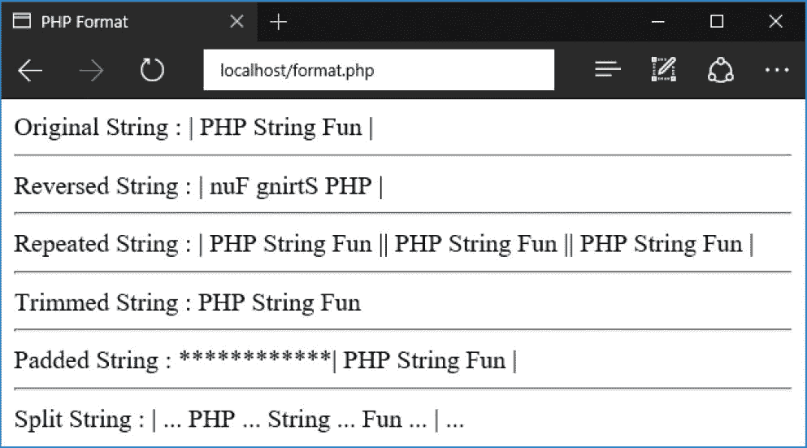


`date()` 函数调用时会返回日期字符串，但需要一个字符串参数来指定日期字符串的格式。该格式字符串可以由一系列用于日期的字母选项组成。例如，`date( ‘n/j/y’ )` 可能返回“4/22/16”。常用选项列在下方，并附有简要描述：

| **选项:** | **描述:** | **示例:** |
| :--- | :--- | :--- |
| **Y** | 四位数的年份 | 2014 |
| **y** | 两位数的年份 | 14 |
| **n** | 一位或两位数的月份 | 7 |
| **m** | 两位数的月份 | 07 |
| Key | 说明 | 示例 |
| :--- | :--- | :--- |
| **F** | 月份全称 | February |
| **M** | 三字母的月份 | Feb |
| **j** | 一位或两位数字的日期 | 4 |
| **d** | 两位数字的日期 | 04 |
| **l** | 星期全称 | Monday |
| **D** | 三字母的星期 | Mon |
| **S** | 两位字母的序数后缀 | th |
| **H** | 24 小时制的小时 | 14 |
| **i** | 分钟 | 45 |
| **s** | 秒 | 30 |
| **a** | 上午或下午 | am |


星期全称的选项是一个小写的“L”。


你可以在 PHP 在线线手册`[php.net/manual](http://www.php.net/manual)` 中发现更多`date()` 函数选项。

默认情况下，时区被设置为协调世界时 (UTC)，但你可以通过向`date_default_timezone_set()` 函数传递参数来设置你自己的时区，并使用`date_default_timezone_get()` 查看当前设置的时区。

你还可以使用智能的`strtotime()` 函数创建自己的时间戳。该函数可以接受一个日期字符串参数，并返回一个时间戳，该时间戳可以作为第二个参数提供`date()` 函数。`strtotime()` 的参数可以是普通文本日期，例如“July 4, 2017”。此外，你还可以指定如“yesterday”、“+3months”或“next Wednesday”之类的参数，`strtotime()` 函数将尝试解析并返回一个适当的时间戳。


`date.php`

 编写一个 PHP 脚本，使用语句显示当前日期、星期、时间和当前默认时区

```php
<?php
echo ‘Date : ‘ .date( ‘jS F Y’ ). ’<br>’ ;
echo ‘Day : ‘ .date( ‘l’ ). ’<br>’ ;
echo ‘Time : ‘ .date( ‘h:i:s a’ ). ’<br>’ ;
echo ‘Timezone : ‘ .date_default_timezone_get(). ’<hr>’ ;
```

 接下来，添加语句更改默认时区并显示确认，然后显示那里的当前时间

```php
date_default_timezone_set( ‘America/New_York’ ) ;
echo ‘Timezone now : ‘ .date_default_timezone_get() ;
echo ‘<br>Time now : ‘ .date( ‘h:i:s a’ ). ’<hr>’ ;
```

 现在，添加语句为明天创建一个时间戳，然后显示它的星期名称和日期

```php
$d = strtotime( ‘tomorrow’ ) ;
echo ‘Tomorrow : ‘ .date( ‘l, jS F Y’ , $d ). ’<br>’ ;
```

 最后，添加语句为一个难忘的日期创建一个时间戳，然后显示它的月份和日期数字

```php
$d = strtotime( ‘July 11, 1994’ ) ;
echo ‘David’s Birthday : ‘ .date( ‘F jS’ , $d ) ;
?>
```

 将文档保存到 Web 服务器的`/htdocs`目录并命名为`date.php`，然后通过 HTTP 打开页面以查看由选项格式化的日期字符串。

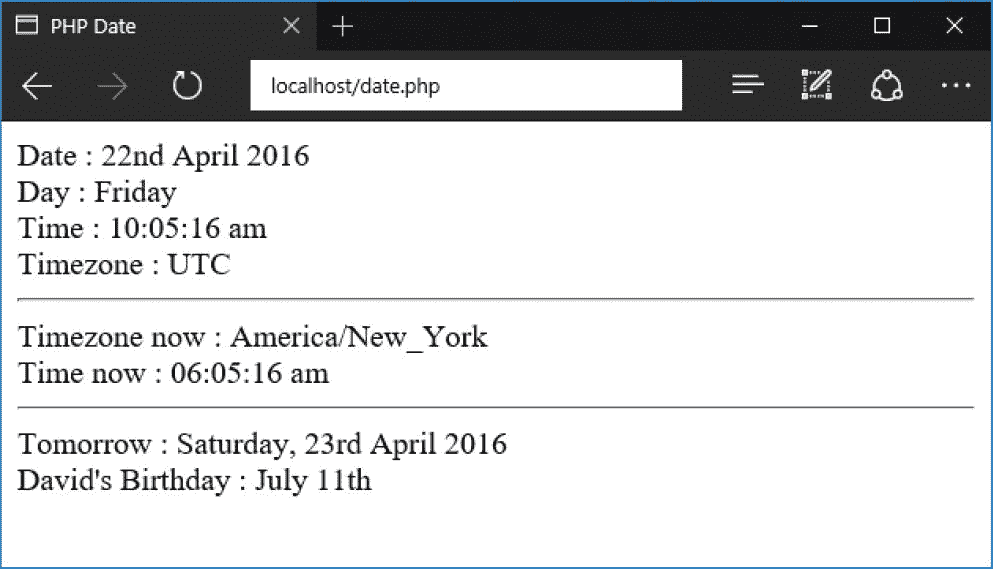


注意，你可以在格式字符串中包含如`:` 和`/` 等分隔符。


某些国家偏于 M/D/ Y 的日期顺序，而另一些国家偏于 D/M/ Y，因此你可以选择你喜欢的日期格式选项。

### 实体编码

有两个 PHP 函数可编码 HTML 代码，使得所有具有特殊意义的字符或不寻字符都被“实体”等价项替换。`htmlentities()` 函数编码以下所有字符，每个字符都有对应的实体：

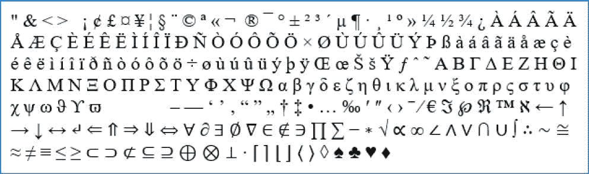


调用带有常量参数`HTML_ENTITIES` 或`HTML_SPECIALCHARS` 的 PHP 函数`get_html_translation_table()`，可以返回所有表示字符的数组。

除非你担心非英语字符，否则通常建议使用替代的`htmlspecialchars()` 函数仅编码具有特殊 HTML 意义的字符：

* `&` 符号 – 变为`&amp;`
* `“` 双引号 – 变为`&quot;`
* `‘` 单引号 – 变为`&#039;`
* `<` 小于 – 变为`&lt;`
* `>` 大于 – 变为`&gt;`

使用 PHP 编码 HTML 代码的一个良好理由是防止恶意 JavaScript 代码被浏览器意外执行。将 HTML 标签编码为实体可以确保`<script>` 标签不会识别，因此其 JavaScript 代码内容将不会执行：


`date.php`


```php
<?php
$html = “<script>alert('XSS');</script>”;
echo htmlentities($html);
?>
```

### 总结

* `date()` 函数需要一个字符串参数，该参数指定了确定返回日期字符串格式的选项。
* 默认情况下，PHP 日期时区设置为 UTC。
* `date_default_timezone_set()` 函数可指定 UTC 默认时区的备选方案。
* `strtotime()` 函数将尝试为其收到的任何日期或时间参数返回一个适当的时间戳。
* `htmlentities()` 函数将编码所有具有实体的字符串字符。
* `htmlspecialchars()` 函数将仅编码具有特殊 HTML 意义的字符，以避免被浏览器识别。

类（class）是一种可以在单个实体中同时包含变量和函数的数据结构。这些统称为该类的“成员”（members）——变量被称为类的“属性”（properties），而函数被称为类的“方法”（methods）。

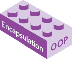

从类外部访问类成员的行为由类声明中的“访问修饰符”（access specifiers）控制。通常，这些修饰符会拒绝对类变量的访问，但允许访问可以从这些变量中存储和检索数据的方法。这种“数据隐藏”技术确保了存储的数据安全地封装在类变量成员内部，是面向对象编程（OOP）的第一条原则。

类声明以`class` 关键字开始，后面跟着一个空格，然后是程序员指定的名称——遵循通常 PHP 命名规范，但以大写字母开头。接下来是类属性声明，然后是类方法声明。这些类似于普通的变量和函数声明，但每个声明都应该以访问修饰符开头。类声明的语法如下：

```
class ClassName
{
    access-specifier $var1, $var2, $var3;
    access-specifier functionName1($arg1, $arg2, $arg3)
    {
        statements-to-execute;
    }
}
```


按照习惯，类名以大写字母开头，对象名以小写字母开头。

访问修饰符可以是`public``private` 或`protected` 关键字之一，用于指定列出成员的访问权限：

* `public` 成员可以在类可见的任何地方被访问
* `private` 成员仅对定义它的同一类中的其他成员可访问
* `protected` 成员仅对同一类的其他成员以及该类派生类的成员可访问


派生类将在本章稍后部分介绍——请参见此处。

任何现实世界中的对象都可以通过它的属性和动作来定义。例如，狗有年龄、体重和颜色等属性，以及它可以执行的如叫等动作。PHP 中的类机制提供了一种在脚本中创建虚拟狗对象的方法，其中类属性可以代表它的属性，类方法可以代表它的动作：

```php
class Dog
{
    private $age;
    private $weight;
    private $color;
    public function bark() { echo ‘WOOF!’ ; }
    // 在此处添加向属性中存储数据的方法。
    // 在此处添加从属性中检索数据的方法。
}
```


虽然 PHP 脚本类不能完美模拟真实世界的对象，但目标是将所有相关的属性和动作封装为类属性和方法。

重要的是，类声明只定义了一个数据结构——为了创建一个对象，你必须声明该数据结构的一个“实例”（instance）。这通过使用`new` 关键字将类的副本赋值给变量来实现，如下：

```php
$fido = new Dog(); // 创建一个名为“fido”的实例
// 属于程序员定义的
// “Dog”数据结构。
```

实例对象是原始类数据结构的工作副本，因此保留了它的所有特性。由于上面示例中的方法已声明为`public`，因此它在类声明外的脚本中是可见的。这意味着可以使用特殊的`->` 对象操作符调用实例拷贝的方法，如下：

```php
$fido->bark(); // 输出 WOOF!
```

`->` 对象操作符可以用于引用任何可见的类成员，但上面示例中的变量属性已声明为`private`，因此被封装在对象内部且无法直接访问。PHP 编程中的封装原则描述了在类成员中将数据和功能组合在一起——这些在这个`Dog` 类中就是年龄、体重、颜色属性和 bark 动作。


注意，在创建实例对象的语句中，必须在类名后添加括号。

### 创建对象

为了从类的私有成员中分配和检索数据，必须向类中添加特殊的`public` 访问方法。这些是用于分配数据的“setter”（设置器）方法，以及用于检索数据的“getter”（获取器）方法。访问方法通常以它们所处理的变量命名，首字母大大写，并分别以“set”或“get”作为前缀。例如，处理`age` 变量的访问方法可以命名为`setAge()` 和`getAge()`。


`setter` 和 `getter` 方法可以使用特殊的 `$this` “伪变量”引用同一类的成员，随后跟上 `->` 对象操作符和属性名。例如，使用 `$this->age` 来引用年龄属性：


`object.php`

 用语句开始 PHP 脚本声明一个名为“Dog”的类

```php
<?php
class Dog
{
    // 在此处插入成员（步骤 2-5）。
}
```

 在 `Dog` 类的括号之间，声明三个私有成员

```php
private $age;
private $weight;
private $color;
```

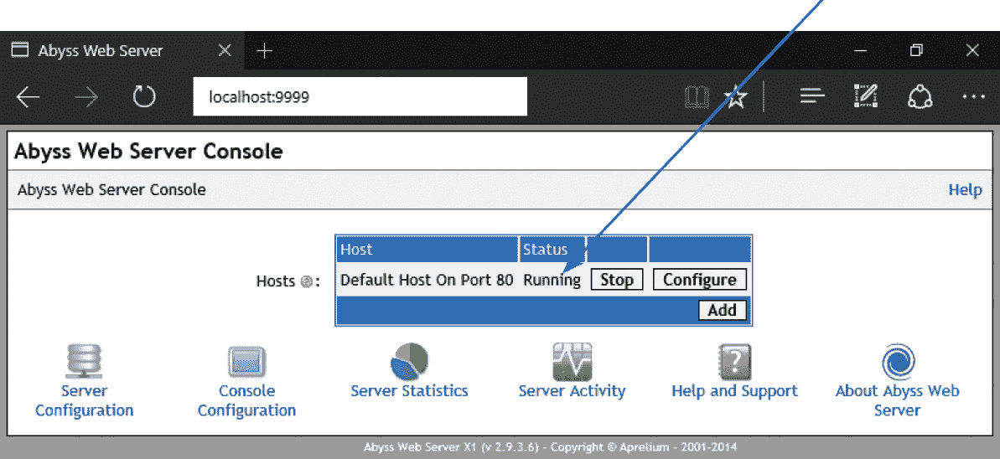 在私有变量之后，添加一个公共方法以便在调用时输出字符串

```php
public function bark() { echo ‘WOOF! <br>’ ; }
```

 为每个私有变量添加 `setter` 方法以分配值

```php
public function setAge(int $yrs) {
    $this->age = $yrs;
}
public function setWeight(int $lbs) {
    $this->weight = $lbs;
}
public function setColor(string $fur) {
    $this->color = $fur;
}
```

 在类声明中，注意所有方法都是公共的，所有变量都是私有的。这种“公共接口，私有数据”的概念是一个核心。添加 `getter` 方法从每个私有变量中检索值

```php
public function getAge() {
    return $this->age;
}
public function getWeight() {
    return $this->weight;
}
public function getColor() {
    return $this->color;
}
```

 在 `Dog` 类之后，声明一个名为“fido”的 `Dog` 类实例

```php
$fido = new Dog();
```


Fido

 通过调用每个 `setter` 方法分配数据

```php
$fido->setAge(3);
$fido->setWeight(15);
$fido->setColor('brown');
```

 通过调用每个 `getter` 方法检索分配的值

```php
echo ‘Fido is a ‘ . $fido->getColor() . ‘ dog <br>’;
echo ‘Fido is ‘ . $fido->getAge() . ‘ years old <br>’;
echo ‘Fido weighs ‘ . $fido->getWeight() . ‘ pounds<br>’;
```

 现在，添加对普通方法的调用

```php
$fido->bark();
?>
```

 将文档保存到 Web 服务器的 `/htdocs` 目录并为 `object.php`，然后通过 HTTP 打开页面查看类属性和方法的调输出

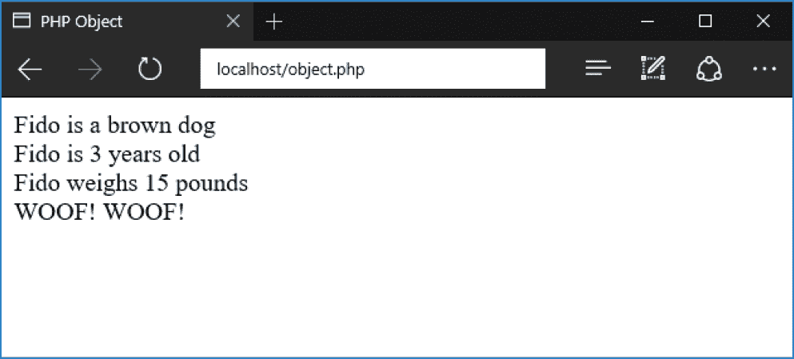


PHP 7 的新功能是还可以创建具有简单功能且没有的“匿名类”。例如，`$util = new class { public function log($s) { echo $s ; } } ;`，可以通过 `$util->log( ‘Data’ )` 进行调用。


随着新功能的引入，`object.php` 脚本将在接下来的几页中进行修改。

### 初始成员

程序可以通过声明类的多个实例来轻松地创建多个对象，并且通过向其 `setter` 方法分配单独值，每个对象都可以拥有独特的属性。

通常将设置方法（`setter` methods）合并到一个接受每个私有变量参数的单一方法会更方便。这意味着在程序中可以使用一个语句完成所有赋值，但该方法将包含多个语句。

可选地，每个参数可以为传递的每个参数指定允许的数据类型，还可以有用地为每个参数指定默认值：


`initializer.php`

 将上一个示例“object.php”的副本重命名为新程序“initializer.php”

 在 `Dog` 类声明中，将三个设置方法替换为单一的组合设置方法，并指定参数的数据类型和默认值

```php
public function setValues(int $yrs = 2, int $lbs = 8, string $fur = ‘black’) {
    // 在此处插入语句。
}
```

 在方法定义块中，插入三条语句，将传递参数的值赋值给类变量

```php
$this->age = $yrs;
$this->weight = $lbs;
$this->color = $fur;
```

 在修改类定义后，将对三个设置方法的替换替换为组合设置方法的单一调用——传递三个参数

```php
$fido -> setValues(3, 15, ‘brown’);
```

 声明 `Dog` 类的第二个实例，名为“pooch”

```php
$pooch = new Dog();
```

 为组合设置方法添加第二次调用——为新对象传递三个参数

```php
$pooch -> setValues(4, 18, ‘gray’);
```


尝试向初始化方法传递错误的数据类型，以观察类型错误的发生。

 添加调用每个获取方法（`getter` method）的语句以检索已赋值的值

```php
echo ‘<hr>Pooch: ‘ . $pooch -> getAge().’yrs’;
echo $pooch -> getWeight().’lbs ’ . $pooch -> getColor();
```

 添加第二次调用普通输出方法

```php
$pooch -> bark();
```

 现在，声明 `Dog` 类的第三个实例，名为“rover”

```php
$rover = new Dog();
```

 为组合设置方法添加第三次调用——这次为新对象传递任何参数

```php
$rover -> setValues();
```

 添加调用每个获取方法的语句以检索已赋值的值，这些值是指定的默认值

```php
echo ‘<hr>Rover: ‘ . $rover -> getAge().’yrs’;
echo $rover -> getWeight().’lbs ’ . $rover -> getColor();
```

 添加第三次调用普通输出方法

```php
$rover -> bark();
```

 将文档保存到网络服务器的 `/htdocs` 目录并为 `initializer.php`，然后通过 HTTP 访问页面查看组合初始化方法设置的输出

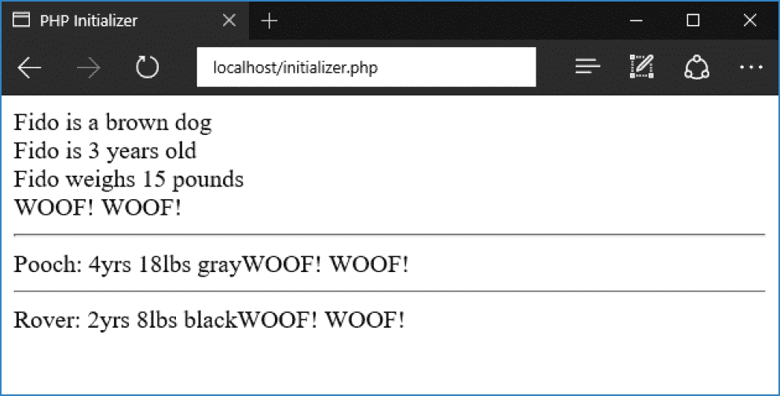


 你在此处仍然调用初始化方法，在不传递任何参数的情况下为类变量分配默认值。

## 使用构造函数

类变量成员可以通过特殊的“构造函数”方法进行初始化，该方法每当创建类的实例时就会被调用。构造方法始终始终命名为 `__construct()`，并可以接受参数来设置类变量的初始值。


构造方法有一个配套的“析构”（destructor）方法——它每当类的实例被销毁时就会被调用。析构方法始终命名为 `__destruct()`。构造方法和析构方法没有返回值并且会被自动调用——它们不能被显式调用，因此它们的声明不需要访问修饰符

初始化类变量的值在创建对象的语句中传递给构造方法，紧跟对象名称之后：


`constructor.php`

 将上一个示例“initializer.php”的副本重命名为新程序“constructor.php”

 在 `Dog` 类声明中，将 `setValues` 方法替换为此构造函数

```php
function __construct(int $yrs = 2, int $lbs = 8, string $fur = ‘black’) {
    $this->age = $yrs;
    $this->weight = $lbs;
    $this->color = $fur;
}
```

 现在添加一个简单的析构方法

```php
function __destruct() { 
    echo ‘<hr>Object Destroyed.’ 
}
```

 在 `Dog` 类声明后，编辑创建“fido”对象的语句

```php
$fido = new Dog(3, 15, ‘brown’);
```

 同样，编辑创建“pooch”对象的语句

```php
$pooch = new Dog(4, 18, ‘gray’);
```

 `Dog` 类的定义也被称为“派生”。

```php
class Dog extends Polygon { }
```

 编辑创建“rover”对象的语句

```php
$rover = new Dog();
```

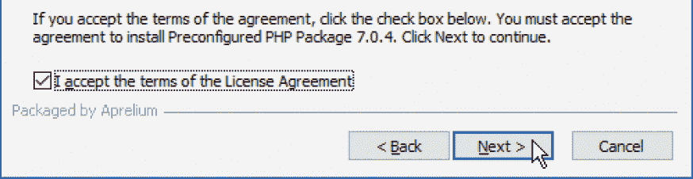 删除调用 `setValues` 方法的语句

```php
// 相关的 setValues 调用已删除
```

## 继承属性

PHP 类可以被创建一个全新的类，如之前的示例所示，也可以从现有类中“派生”。重要的是，派生类会继承它所派生的父类（基类）的成员——除了它自身的成员。


从基类继承成员的能力允许创建共享某些公共属性的派生类，这些属性已在基类中定义。例如，“多边形”基类可以定义所有多边形通用的宽度和高度属性。“矩形”和“三角形”类可以从 `Polygon` 类派生出来——继承宽度和高度属性，加上它们定义独特特征的成员。

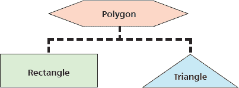

继承的优点非常强大，是面向对象编程（OOP）的第二个原则。

派生类声明在其类名后添加 `extends` 关键字，随后是它所派生的类名：

```php
class Rectangle extends Polygon { }
```

```php
<?php

class Polygon
{
    private $width , $height ;
    function construct( int $w = 4 , int $h = 5 )
    {
        $this-> width = $w ;
        $this-> height = $h ;
    }
    public function getWidth () { return $this-> width ; }
    public function getHeight () { return $this-> height ; }
}
```

 在 `Polygon` 类之后，声明一个派自 `Polygon` 类的 `Rectangle` 类，并添加一个独特的方法

```php
class Rectangle extends Polygon
{
    public function area ()
    {
        return ( $this-> getWidth () * $this-> getHeight () ) ;
    }
}
```

 在 `Rectangle` 类之后，声明一个派自 `Polygon` 类的 `Triangle` 类，并添加一个独特的方法

```php
class Triangle extends Polygon
{
    public function area ()
    {
        return ( $this-> getWidth () * $this-> getHeight () / 2 ) ;
    }
}
```

 在 `Triangle` 类之后，添加两条语句使用默认值创建每个派生类的实例

```php
$rect = new Rectangle () ;
$trio = new Triangle () ;
```

 最后，添加两个语句来输出每个派生类的独特方法所返回的值

```php
echo ‘Rectangle Area : ‘ . $rect -> area (). ’<hr>’ ;
echo ‘Triangle Area : ‘ . $trio -> area () ;
?>
```

 将文档保存到 Web 服务器的 `/htdocs` 目录并命名为 `inheritance.php`，然后通过 HTTP 访问页面以查看继承成员的输出

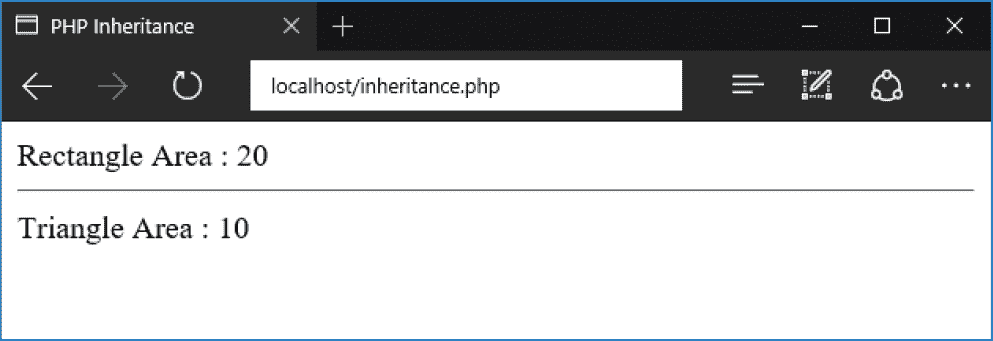


不要混淆类实例和派生类——实例是类的拷贝，而派生类是一个继承其所自基类属性的新类。


在 PHP 中，派生类始终依赖于单一基类——不支持多重继承。

## 拥抱多态

面向对象编程 (OOP) 的三个基石是封装、继承和多态。在之前的页面中，我们已经看到了数据如何封装在 PHP `class` 中，以及派生类如何继承其基类的属性，因此我们现在可以探索最后一个的基石原则：多态。

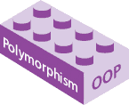

“多态”一词（源自希腊语，意为“多种形式”）描述了根据上下文赋予实体不同意义或目的的能力。例如，在现实世界中，每个人都知道如何使用按钮（实体）——你只需对其施加压力。然而，该按钮的功能取决于连接到它的东西（上下文），但结果不会影响该按钮的使用方式。

在面向对象编程的世界中，多态允许类在共享公共接口的同时具有不同的功能。接口不需要知道它正在使用哪个类，因为它们就像现实世界的按钮一样，都以相同的方式使用，但可以产生不同的上下文结果。以此这样拥抱多态让程序员能够创建可以交换的对象，并根据需求而不是条件测试来选择它们。

PHP 接口类似于类，但使用 `interface` 关键字声明，并且只能包含方法定义，而不包含任何要执行的方法语句，如下所示：

```php
interface InterfaceName
{
    // 此处只进行方法定义。
}
```


接口声明中的方法定义也可以指定参数。

实现接口的每个类必须实现其定义的所有方法，并指定要执行的语句。通过在声明中包含 `implements` 关键字和接口名称将类与接口关联，如下所示：

```php
class ClassName implements InterfaceName
{
    // 方法实现在这里。
}
```

可以通过添加一个接口和单个函数来修改之前的示例以拥抱多态。


`polymorphism.php`

 将上一个示例的拷贝“inheritance.php”重命名为新程序“polymorphism.php”

 声明名为“Shape”的接口，它包含 `Rectangle` 和 `Triangle` 类中已实现的方法定义

```php
interface Shape { public function area () ; }
```


 编辑 `Rectangle` 和 `Triangle` 类声明的第一行——将它们与接口关联

```php
class Rectangle extends Polygon implements Shape
class Triangle extends Polygon implements Shape
```

 在类块之后，添加一个接受 `Shape` 类型参数并调用其定义方法的函数

```php
function getArea ( Shape $shape )
{ return $shape -> area () ; }
```

 修改创建每个派生类实例的两个语句——传递参数值

```php
$rect = new Rectangle ( 8 , 10 ) ;
$trio = new Triangle ( 8 , 10 ) ;
```

```php
echo ‘Rectangle Area : ‘ . $rect -> area (). ’<hr>’ ;
echo ‘Triangle Area : ‘ . $trio -> area () ;
```

# 处理错误

## 捕获异常

### 总结

## 读取文件

读取和写入位于 Web 服务器上的文件对于记录信息和提供页面内容非常有用。为了处理文件，必须先使用 PHP 的 `fopen()` 函数创建一个“文件流”（filestream）对象。这需要两个参数：指定文件的名称或路径以及文件“模式”。文件模式决定了要执行的操作性质，并将文件指针放置在文件内合适的位置：

| 文件模式： | 操作： |
| :--- | :--- |
| `r` | 打开已存在的文件进行读取 文件指针从文件开头开始 |
| `w` | 丢弃现有文件的所有内容，如果不存在则创建一个新文件 文件指针从文件开头开始 |
| `a` | 打开已存在的文件并保留所有内容 文件指针从文件末尾开始 |
| `r+` | 打开文件进行读取或写入 文件指针从文件开头开始 |
| `w+` | 打开文件进行写入或读取 丢弃现有文件的所有内容，如果不存在则创建一个新文件 文件指针从文件开头开始 |
| `a+` | 打开文件进行读取或写入并保留所有内容 文件指针从文件末尾开始 |


当作为 `fopen()` 函数的参数提供时，文件模式指定符必须出现在引号内。

良好的习惯始终使用 `die()` 函数提供一个备选方案，以防创建文件流尝试失败。


作为 `die()` 函数的参数指定一个解释性消息。

当文件流成功创建后，可以通过指定文件流和字节大小作为 `fread()` 函数的参数来读取文件。如果要读取整个文件，使用 `filesize()` 函数来指定要读取的文件字节大小会非常方便。

在完成任何文件操作后，必须通过指定其作为 `fclose()` 函数的参数来销毁文件流。

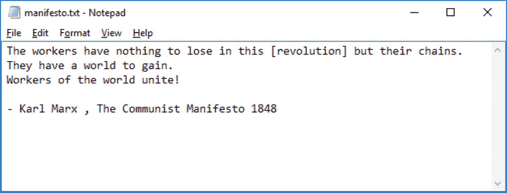


`read.php`

 启动一个 PHP 脚本，其语句尝试打开一个纯文本文件进行读取，或者在失败时退出脚本

```php
<?php
$filestream = fopen( ‘manifesto.txt’ , ‘r’ )
or die( ‘Unable to open file!’ ) ;
```

 接下来，添加一条在成功后读取文本文件并显示其全部语句

```php
echo fread( $filestream , filesize( ‘manifesto.txt’ ) ) ;
```

 现在，记住关闭文件流

```php
fclose( $filestream ) ;
```

 将文档保存到 Web 服务器的 `/htdocs` 目录下并命名为 `read.php`，同时与要读取的纯文本放在一起，然后通过 HTTP 打开页面以在浏览器窗口中显示文本内容。

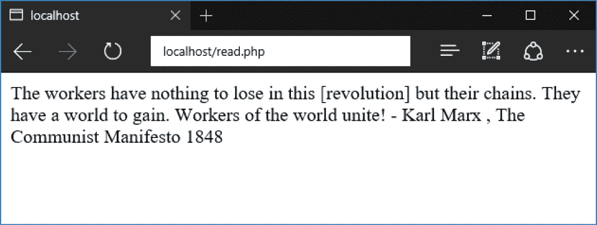


与 HTML 文档中的 PHP 块不同，纯 PHP 脚本不需要结束标签 `?>`。


注意这里的输出没有保持行尾——但上方的示例保持了。

## 读取行

一旦创建了“文件流”对象，就可以通过指定文件流作为 PHP `fgets()` 函数的参数来逐行读取其内容。要读取每一行，可以在循环中反复调用此函数。`feof()` 函数可以判断何时到达文件末尾并结束循环：

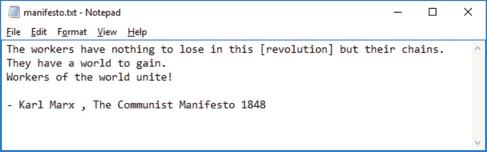


当到达文件末尾时，`feof()` 函数返回 true。


`readlines.php`

 启动一个 PHP 脚本，其语句尝试打开一个纯文本文件进行读取，或者在失败时退出脚本

```php
<?php
$filestream = fopen( ‘manifesto.txt’ , ‘r’ )
or die( ‘Unable to open file!’ ) ;
```

 接下来，添加一个循环在成功后逐行读取文本文件并显示其全部内容

```php
while( !feof( $filestream ) )
{ echo fgets( $filestream ). ’<br>’ ; }
```

 现在，记住关闭文件流

```php
fclose( $filestream ) ;
```

 将文档保存到 Web 服务器的 `/htdocs` 目录下并命名为 `readlines.php`，同时与要读取的纯文本放在一起，然后通过 HTTP 打开页面以查看文本文件。


## 读取字符

一旦创建了“文件流”对象，就可以通过指定文件流作为 PHP `fgets()` 函数的参数来逐行读取其内容。要读取每一行，此函数可以在循环中反复调用。`feof()` 函数可以判断何时到达文件末尾并结束循环：

或者，一旦“文件流”对象创建后，就可以通过指定文件流作为 `fgetc()` 函数的参数来逐字符读取其内容。要读取每个字符，此函数可以在循环中反复调用。

`readchars.php`

 启动一个 PHP 脚本，其语句尝试打开一个纯文本文件进行读取，或者在失败时退出脚本

```php
<?php
$filestream = fopen( ‘title.txt’ , ‘r’ )
or die( ‘Unable to open file!’ ) ;
```

 接下来，添加一个循环在成功后逐字符读取文本文件并显示其全部内容

```php
while( $char = fgetc( $filestream ) )
{ echo $char ; }
```

 现在，记住关闭文件流

```php
fclose( $filestream ) ;
```

 将文档保存到 Web 服务器的 `/htdocs` 目录下并命名为 `readchars.php`，同时与要读取的文本文件放在一起，然后通过 HTTP 打开。

## 写入文件

一旦创建了写入模式的“文件流”对象，就可以创建一个文本文件。通过指定文件流和文件名到 `fwrite()` 函数可以将文本写入文件。为了格式化文本，还可以写入不可打印字符来创建换行和制表：

| 字符 | 说明 |
| :--- | :--- |
| `\n` | 换行 |
| `\r` | 回到行首 |
| `\t` | 制表移动到下一个制表位 |


包含不可打印字符的字符串必须封装在双引号内，以便 PHP 解释它们。

`write.php`

 启动一个 PHP 脚本，其语句分配包含用于格式化的不可打印字符的文本

```php
<?php
$poem = “\r\n\tI never saw a man who looked” ;
$ .= “\r\n\tWith such a wistful eye” ;
$ .= “\r\n\tUpon that little tent of blue” ;
$ .= “\r\n\tWhich prisoners call the sky” ;
```

 接下来，为要写入的文件指定名称

```php
$filename = ‘poem.txt’ ;
```

 尝试用于写入的纯文本文件，或者在失败时退出脚本

```php
$filestream = fopen( $filename , ‘w’ )
or die( ‘Unable to open file!’ ) ;
```

 写入文件并显示总共写入了字节数确认

```php
$num = fwrite( $filestream , $poem ) ;
if( $num )
{
    echo “ $num bytes written to $filename ” ;
}
```

 现在，记住关闭文件流

```php
fclose( $filestream ) ;
```

 将文档在你的 Web 服务器的 `/htdocs` 目录中保存为 `write.php`，然后通过 HTTP 访问页面以查看文本文件已写入的确认。

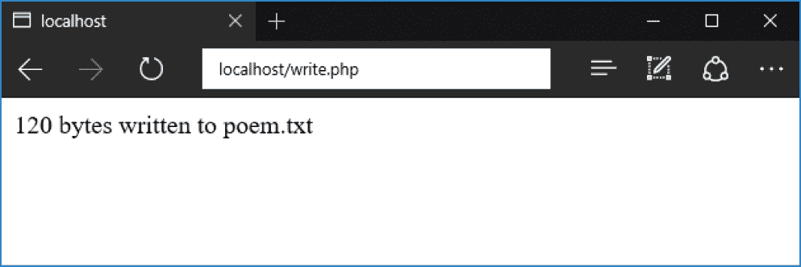

 使用文件资源管理器进入你的 Web 服务器的 `/htdocs` 目录，查看 PHP 脚本创建的文件。

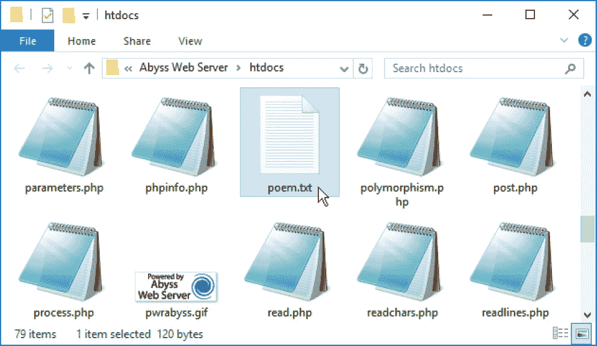

 打开文件查看 PHP 脚本写入的文本。

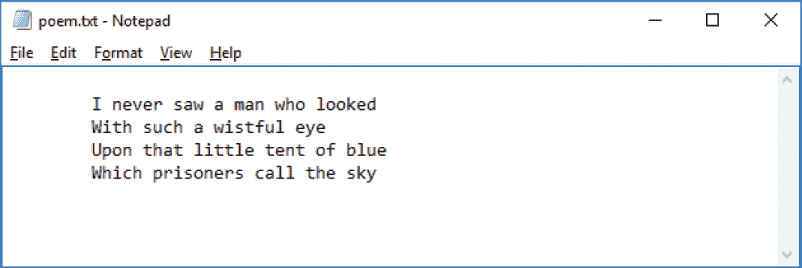


你可以反复运行此示例，每次它都会擦除内容然后重新写入。

## 追加文本

一旦创建了指定了追加模式的“文件流”（filestream）对象，就可以打开文本文件并在末尾添加文本。可以通过向 PHP 的 `fwrite()` 函数指定文件流和文件名来向文件中追加文本。该过程与写入文件相同，不同在于在将文本写入文件之前，文件指针将置于现有内容的末尾：


`append.php`

 开始一个 PHP 脚本，赋值一段语句，包括用于格式化的非打印字符。

```php
<?php
$info = “\r\n\r\n\tThe Ballad of Reading Gaol” ;
$info .= “\r\n\t\t\tOscar Wilde 1898” ;
```

 接下来，为要写入的文件命名。

```php
$filename = ‘poem.txt’ ;
```

 尝试以追加模式打开纯文本文件，如果失败则退出脚本。

```php
$filestream = fopen( $filename , ‘a’ ) or die( ‘Unable to open file!’ ) ;
```

 写入文本并显示总共追加字节数的确认。

```php
$num = fwrite( $filestream , $info ) ;
if( $num )
{
    echo “ $num bytes appended to $filename ” ;
}
```

 现在，记得关闭文件流。

```php
fclose( $filestream ) ;
```

 将文档在你的 Web 服务器的 `/htdocs` 目录中保存为 `append.php`，然后通过 HTTP 访问页面以查看文本已追加到文件的确认。

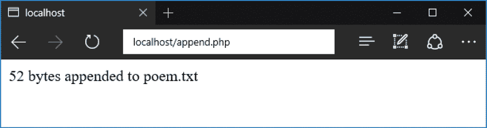

 记住非打印字符必须包含在双引号中以便解释。

 进入你的 Web 服务器的 `/htdocs` 目录并打开文件查看 PHP 脚本追加的文本。

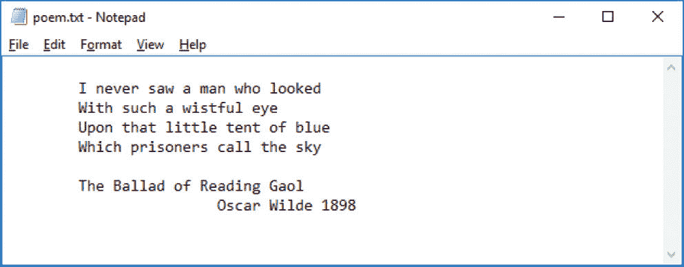

## 覆盖文本

重要的是要认识到，当你以写入模式写入现有文件时，它将覆盖任何现有内容：


`overwrite.php`

 通过尝试以写入模式打开现有文本文件来开始 PHP 脚本，如果失败则退出脚本。

```php
<?php
$filestream = fopen( ‘poem.txt’ , ‘w’ ) or die( ‘Unable to open file!’ ) ;
```

 成功后，向文件写入新文本。

```php
fwrite( $filestream , ‘Overwritten!’ ) ;
```

 现在，记得关闭文件流。

```php
fclose( $filestream ) ;
```

 将文档在你的 Web 服务器的 `/htdocs` 目录中保存为 `overwrite.php`，然后通过 HTTP 访问页面并重新打开文本文件查看其内容已被覆盖。

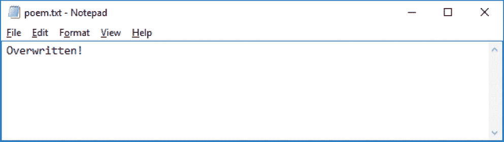

 写入文件时要小心，因为很容易不小心覆盖。

## 错误处理

你可以预测可能的错误，并在错误发生时使用 `die()` 函数或 `exit()` 函数终止正在运行的脚本。如果没有这种应急措施，默认 PHP 错误处理器在发生错误时会提供一个有用但不好看的消息。例如，使用 `fopen( ‘nonsuch.txt’ , ‘r’ )` 打开一个不存在的文件：

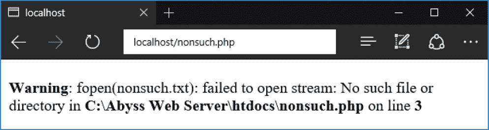

 `die()` 和 `exit()` 函数在 PHP 中执行相同的操作，但它们的术语可能具有不同的吸引力。对于某些人来说，检测到错误时使用 `die()` 似乎更合适，而在其他场景下 `exit()` 可能看起来更合适。

在错误发生时终止脚本并不总是如愿愿，但你可以创建一个自定义错误处理器，以提供比默认 PHP 错误处理器更用户友的消息。自定义错误处理器只是具有以下语法的函数：

```php
function error_handler( $level, $message, $file, $line, $context ) {
    switch($level) {
        case 2: $str = ‘Warning!’ ; break;
        case 8: $str = ‘Notice!’ ; break;
        default: $str = ‘Error!’ ; break;
    }
    echo "<b>$str</b>: $message in line $line";
}
```

基础错误级别列在本表中：

| Level | Constant | Description |
| :--- | :--- | :--- |
| 2 | `E_WARNING` | 非致命 |
| 8 | `E_NOTICE` | 非致命 |
| 256 | `E_ERROR` | 致命 |
| 512 | `E_USER_WARNING` | 用户生成 |

当发生错误时会调用自定义错误处理器，或者可以使用以下方式显式调用：

```php
set_error_handler( ‘error_handler’ );
```

 接下来，为要写入的文件命名并访问一个未初始化的变量：


```php
<?php
$info = “\r\n\r\n\tThe Ballad of Reading Gaol” ;
$info .= “\r\n\t\t\tOscar Wilde 1898” ;
$filename = ‘poem.txt’ ;
$filestream = fopen( $filename , ‘a’ ) or die( ‘Unable to open file!’ ) ;
$num = fwrite( $filestream , $info ) ;
if( $num )
{
    echo “ $num bytes appended to $filename ” ;
}
fclose( $filestream ) ;
```

 显式触发自定义错误处理器：

```php
$number = 2;
if(number >= 1 )
{
    trigger_error( ‘Value of number must be 1 or less’, $number );
}
```

 将文档在你的 Web 服务器的 `/htdocs` 目录中保存为 `append.php`，然后通过 HTTP 访问页面以查看文本已追加到文件的确认。


 注意在报告每个错误后脚本继续运行。

## 捕获异常

我们可以在特定错误发生时选择脚本如何继续。这种错误情况被称为“异常”。当异常发生时，它被称为“抛出”，而处理异常的代码被称为它的“捕获”。如果异常未被捕获，PHP 将其视为致命错误并发布一条不好看的“未捕获异常”消息，如下：

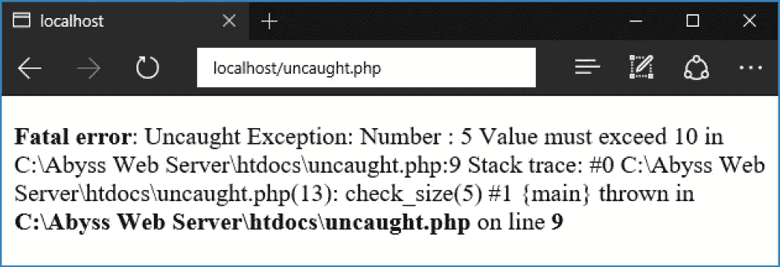

每个 **try** 块必须有一个关联的 **catch** 块，否则将发生致命的未捕获异常。

处理异常的关键是在 **try** 代码块中尝试执行操作以预测错误，并在关联的 **catch** 代码块中确定脚本如何继续。捕获块接收一个 **Exception** 类对象，该对象具有 `getMessage()`、`getFile()` 和 `getLine()` 方法。

**Exception** 类的实例可以使用 `new` 关键字创建，并可以使用 `throw` 关键字显式抛出。

自定义异常处理器也可以创建为 **Exception** 类的派生类，以提供自己的自定义方法：

```php
class MyException extends Exception {
    public function customMethod() {
        // custom logic
    }
}

try {
    throw new MyException("Something went wrong”);
} catch (MyException $e) {
    echo $e->getMessage();
}
```

  通过定义一个在条件测试失败时抛出异常的函数来编写 PHP 脚本

```php
<?php
function check_size( $num )
{
    if( $num < 10 )
    { 
        throw new Exception( “Number : $num<br>Value must exceed 10” ) ; 
    }
}
```

  预测特定错误并报告异常

```php
try { check_size( 5 ) ; }
catch( Exception $e )
{
    echo ‘<b>Size Exception!</b><br>’. $e->getMessage() .’<hr> ;    
}
```

  接下来，创建一个自定义异常处理器类

```php
class CustomException extends Exception
{
    public function get_details ()
    {
        $details = ‘ File : ‘ . $this -> getFile ().
        ‘<br>Line : ‘ . $this -> getLine ().
        ‘<br>’ . $this -> getMessage () ;
        return $details ;
    }
}
```

  现在，添加另一个在条件测试失败时抛出异常的函数

```php
function check_parity ( $num )
{
    if( $num % 2 !== 0 )
    {
        throw new CustomException ( “Number : $num <br>Value must be even” ) ;
    }
}
```

  最后，预测特定错误并报告异常

```php
try { check_parity ( 5 ) ; }
catch( CustomException $e )
{
    echo ‘<b>Parity Exception!</b><br>’ . $e -> get_details (). ’<hr>’ ;    
}
```

  将文档保存到 Web 服务器的 `/htdocs` 目录下并为 `exception.php`，然后通过 HTTP 打开页面以查看被捕获的异常和相应的消息详情

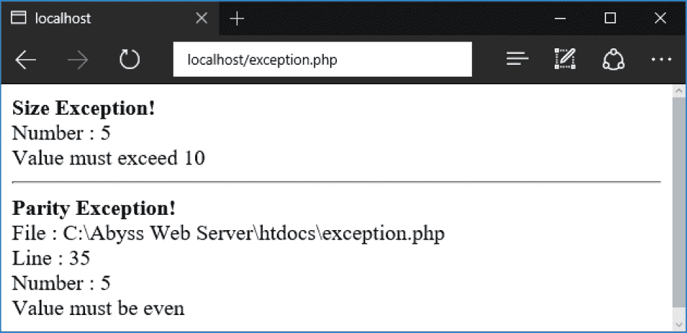


关于派生类和继承的更多信息，请参考此处。


`try` 块可以包含多个 `throw` 语句以预测多种错误情况，并可以跟随多个 `catch` 块来处理这些异常。

### 总结

- `fopen()` 函数用于创建文件流对象，需要两个参数来指定文件名和文件模式

- 当尝试创建文件流失败时，使用 `die()` 函数提供替代方案是一个良好的做法

- `fread()` 函数用于读取使用 `r` 模式创建的文件流，`filesize()` 函数可以指定文件的字节大小

- 在完成任何文件操作后，必须通过调用 `fclose()` 函数销毁文件流

- `fgets()` 函数可以逐行读取文件，`feof()` 函数可以识别文件末尾

- `fgetc()` 函数可以逐字符读取文件，并在文件末尾返回 false

- 可以通过向 `fwrite()` 函数中指定文件流和文件名作为参数来将文本写入文件

- `fwrite()` 函数在使用 `w` 模式时会覆盖现有文本，但在使用 `a` 模式时将追加文本

- 可以将函数名作为 `set_error_handler()` 函数的参数，将其指定为自定义错误处理器

- 错误处理器函数在发生错误时被调用，也可以显式地使用 `trigger_error()` 函数调用

- 当发生特定错误情况时，会抛出异常

- 如果异常未被捕获，PHP 将其视为致命错误并发布 `Uncaught Exception`（未捕获的异常）消息

- `try` 代码块用于预测特定错误，其相关的 `catch` 块用于确定当错误发生时脚本应如何继续

- `Exception` 类对象拥有 `getMessage()`、`getFile()` 和 `getLine()` 方法，可以获取异常详情

- 自定义异常处理器可以作为 `Exception` 类的派生类，以提供自定义异常方法

# 生成表单

*本章演示了如何使用 PHP 脚本处理 HTML 表单数据。*

- 执行操作

- 检查设置的值

- 验证表单数据

- 过滤数据

- 发送隐藏数据

- 处理提交

- 制作持久化表单

- 上传文件

- 包围表单

- 追加数据

## 执行操作

处理来自 HTML 表单的数据。表单提交方法可以是“GET”或“POST”。**GET** 方法将 name=value 对添加到 URL 中，但主要用于请求信息——例如检索数据库记录。**POST** 方法可以提交更多数据，并且更安全，因为数据没有添加到 URL 中，且主要用于执行操作——例如更新数据库记录。因此，书中的大多数示例首选使用 **POST** 方法。

通过 POST 提交的数据在全局变量 `$_POST` 中可用。例如，如果表单有 `name="email"` 的输入，可以使用 `$_POST['email']` 访问。HTML `<form>` 标签的 `action` 属性指定处理数据的脚本，`method` 属性指定如何发送数据。例如：

```html
<form action="script.php" method="POST">
    ...
</form>
```

通过 GET 提交的数据在全局变量 `$_GET` 中可用。例如，如果表单有 `name="id"` 的输入，可以使用 `$_GET['id']` 获取。

```php
$id = $_GET['id'];
```

## 检查设置的值

PHP 可以使用内置的 `isset()` 函数轻松确保用户已向提交的 HTML 表单字段中输入了数据。该函数接受变量名作为参数，并仅当该变量值不为 `NULL` 时返回 `TRUE` —— 因此确保该变量已“设置”了某些值。除非用户输入了值，否则空表单字段将为 `NULL`。

可以使用 `isset()` 函数进行条件测试，指示哪些表单字段留空，或者在字段已填写的情况下提供一个响应页面：


isset.php

  创建一个包含三个单选按钮的 HTML 文档，提供一个数据提交的字段

```html
<form action=” isset_handler.php ” method=” POST ”>
<fieldset>
<legend>PHP 是什么种语言？</legend>
Scripting<input type=”radio” name=” definition ” value=” Scripting ”> <br>
Markup<input type=”radio” name=” definition ” value=” Markup ”> <br>
Programming<input type=”radio” name=” definition ” value=” Programming ”>
</fieldset><p><input type=”submit” ></p>
</form>
```

  现在，将文档保存到 Web 服务器的 `/htdocs` 目录下并为 `isset.php`


isset_handler.php


 接下来，创建一个包含 PHP 脚本的 HTML 文档，用提交的值初始化变量——如果没有提交值则初始化为 `NULL`：

```php
<?php
if ( isset( $_POST['definition'] ) )
{
    $definition = $_POST['definition'] ;
}
else
{
    $definition = NULL ;
}
# 在此处插入响应语句（第 4 步）。
?>
```

 最后，插入语句根据变量的值输出适当的响应：

```php
if ( $definition != NULL )
{
    if ( $definition != 'Scripting' )
    { echo " $definition is Incorrect" ; }
    else
    { echo " $definition is Correct" ; }
}
else
{ echo 'You must select one answer' ; }
?>
```

 将文档保存到 Web 服务器的 `/htdocs` 目录下并命名为 `isset_handler.php`，然后通过 HTTP 打开 `isset.php` 并提交表单以查看响应。

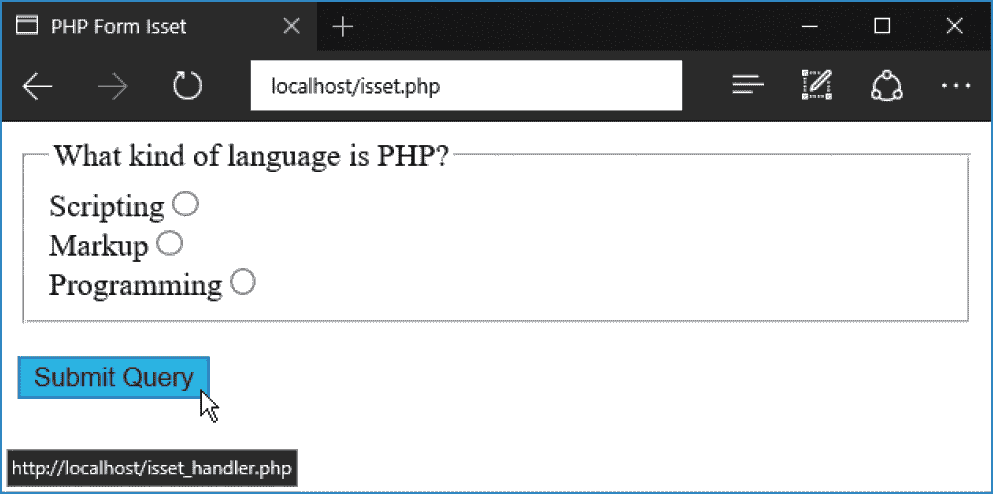


在技术上，测试条件是否不为 `TRUE` 比测试是否为 `TRUE` 更高效——因为需要评估的可能性更少。

### 验证表单数据

由于用户可能会无意提交空字段或格式错误的表单，因此您的 PHP 脚本确保必需字段已填写且提交的数据有效至关重要。

为了确保用户在文本字段中输入了内容，PHP 提供了 `empty()` 函数，它接受变长参数，如果其值为空字符串、零、`NULL` 或 `FALSE`，则返回 `TRUE`。

为了确保用户以数字格式输入数据，PHP 提供了 `is_numeric()` 函数，它接受变长参数，并仅当其值为数字时才返回 `TRUE`。

可以使用 PHP 的 `preg_match()` 函数执行更特定的数据验证，该函数接受一个“正则表达式”参数和一个用于查找模式的变长参数。通常，这用于确保电子邮件地址符合预期格式：


`valid.php`

 创建一个包含两个文本字段的 HTML 文档，用于数据提交：

```html
<form action=" valid_handler.php " method=" POST ">
<fieldset>
<legend>输入数量和邮箱地址</legend>
<p>Quantity : <input type="text" name=" quantity "></p>
<p>Email Address : <input type="text" name=" email "></p>
</fieldset><p><input type="submit" ></p>
</form>
```

 现在，将文档保存到 Web 服务器的 `/htdocs` 目录下并命名为 `valid.php`。


`valid_handler.php`

 接下来，创建一个包含 PHP 脚本的 HTML 文档，用提交的值初始化变量——如果没有提交值则初始化为 `NULL`：

```php
<?php
if ( !empty ( $_POST['quantity'] ) )
{
    $quantity = $_POST['quantity'] ;
    # 在此处插入格式验证（第 4 步）。
}
else
{ 
    $quantity = NULL ; 
    echo 'You must enter a quantity<br>' 
}
```

（注：此处原文中包含大量重复的草稿说明，译文已根据要求提取核心逻辑进行翻译）

在技术上，测试条件是否不为 `TRUE` 比测试是否为 `TRUE` 更高效——因为需要评估的可能性更少。

### 验证表单数据

由于用户可能会无意提交空字段或格式错误的表单，因此您的 PHP 脚本确保必需字段已填写且提交的数据有效至关重要。

为了确保用户在文本字段中输入了内容，PHP 提供了 `empty()` 函数，它接受变长参数，如果其值为空字符串、零、`NULL` 或 `FALSE`，则返回 `TRUE`。

为了确保用户以数字格式输入数据，PHP 提供了 `is_numeric()` 函数，它接受变长参数，并仅当其值为数字时才返回 `TRUE`。

可以使用 PHP 的 `preg_match()` 函数执行更特定的数据验证，该函数接受一个“正则表达式”参数和一个用于查找模式的变长参数。通常，这用于确保电子邮件地址符合预期格式：


`valid.php`

 创建一个包含两个文本字段的 HTML 文档，用于数据提交：

```html
<form action=" valid_handler.php " method=" POST ">
<fieldset>
<legend>输入数量和邮箱地址</legend>
<p>Quantity : <input type="text" name=" quantity "></p>
<p>Email Address : <input type="text" name=" email "></p>
</fieldset><p><input type="submit" ></p>
</form>
```

 现在，将文档保存到 Web 服务器的 `/htdocs` 目录下并命名为 `valid.php`。


`valid_handler.php`

 接下来，创建一个包含 PHP 脚本的 HTML 文档，用提交的值初始化变量——如果没有提交值则初始化为 `NULL`：

```php
<?php
if ( !empty ( $_POST['quantity'] ) )
{
    $quantity = $_POST['quantity'] ;
    # 在此处插入格式验证（第 4 步）。
}
else
{ 
    $quantity = NULL ; 
    echo 'You must enter a quantity<br>' 
}
```

### 过滤数据

为了方便验证用户输入，PHP 提供了 `filter_var()` 函数，可以同时用于验证和“过滤”输入。该函数需要两个参数：指定要过滤的变量以及使用的过滤器常量名：

| **过滤器常量:** | **约定:** |
| :--- | :--- |
| `FILTER_VALIDATE_BOOLEAN` | 布尔值 |
| `FILTER_VALIDATE_EMAIL` | 邮箱地址格式 |
| `FILTER_VALIDATE_FLOAT` | 浮点数 |
| `FILTER_VALIDATE_INT` | 整数 |
| `FILTER_VALIDATE_IP` | IP 地址格式 |
| `FILTER_VALIDATE_MAC` | MAC 地址格式 |
| `FILTER_VALIDATE_REGEXP` | 正则表达式格式 |
| `FILTER_VALIDATE_URL` | URL 格式 |
| `FILTER_SANITIZE_EMAIL` | 移除无效字符 |
| `FILTER_SANITIZE_ENCODED` | URL 编码字符串 |
| `FILTER_SANITIZE_MAGIC_QUOTES` | 反斜符转义字符 |
| `FILTER_SANITIZE_NUMBER_FLOAT` | 移除所有非数字 |
| `FILTER_SANITIZE_NUMBER_INT` | 移除所有非数字 |
| `FILTER_SANITIZE_SPECIAL_CHARS` | HTML 转义字符 |
| `FILTER_SANITIZE_STRING` | 移除 HTML 标签 |
| `FILTER_SANITIZE_URL` | 移除无效字符 |
| `FILTER_CALLBACK` | 调用自定义过滤器函数 |

过滤器在验证成功时返回 `TRUE`，否则将返回 `FALSE`。某些过滤器允许指定进一步的选项。例如，可以为 `FILTER_VALIDATE_INT` 指定数字范围。

 现在，添加一个函数来验证参数是否为格式正确的电子邮件地址：

```php
function validate( $email )
{
  if ( filter_var( $email , FILTER_VALIDATE_EMAIL ) )
  { echo( "<hr> $email IS a valid email address" ) ; }
  else
  { echo( "<hr> $email IS NOT a valid email address" ); }
}
```

 创建一个包含非法空格的电子邮件地址并尝试验证，然后对该地址进行清理并再次尝试验证：

```php
<?php
$email = 'mike @example.com' ;
validate( $email ) ;
$email = filter_var( $email , FILTER_SANITIZE_EMAIL ) ;
validate( $email ) ;
?>
```

 将文档保存到 Web 服务器的 `/htdocs` 目录中并命名为 `filter.php`，然后通过 HTTP 打开它以查看过滤结果。


用户提交输入可能会破坏你的网页，因此应该始终对其进行验证。

### 发送隐藏数据

除了用户输入到 HTML 表单输入字段中的数据外，PHP 生成的数据可以使用 HTML 隐藏表单字段进行提交。与普通输入字段一样，这些字段也会向表单处理脚本发送 `name=value` 对，但这里的值是由 PHP 提供的，而不是用户。

通常，使用隐藏表单字段提交的数据可能包括用户的登录名称和提交的时间戳：


`hidden.php`

 创建一个包含 PHP 脚本的 HTML 文档以定义时区并初始化两个变量：

```php
<?php
date_default_timezone_set( 'UTC' ) ;
$time = date( ' H:i , F j ' ) ;
$user = 'Mike' ;
```

 现在，添加一个语句来编写一个完整的表单，包含一个普通输入字段和两个隐藏字段，其值由变量设置：

```php
echo '
<form action=" hidden_handler.php " method=" POST ">
<fieldset>
<legend>Send us your comments</legend>
<textarea rows="5" cols="20" name=" comment ">
</textarea>
<input type="hidden" name=" user " value=" '. $user .' ">
<input type="hidden" name=" time " value=" '. $time .' ">
</fieldset><p><input type="submit" ></p></form> ' ;
?>
```

 将文档保存到 Web 服务器的 `/htdocs` 目录中并命名为 `hidden.php`。


此示例中的时间戳是在表单创建时创建，而不是在表单提交时创建。


`hidden_handler.php`

 接下来，创建一个包含 PHP 脚本的 HTML 文档，用提交的值初始化变量——如果没有提交值，则初始化为 `NULL`：

```php
<?php
if ( !empty ( $_POST['comment'] ) )
{
  $comment = $_POST['comment'] ;
}
else
{
  $comment = NULL ; echo 'You must enter a comment' ;
}
```

 现在，如果隐藏表单字段值已设置，则添加语句初始化两个变量：

```php
$time = ( !isset ( $_POST['time'] ) ) ? NULL : $_POST['time'] ;
$user = ( !isset ( $_POST['user'] ) ) ? NULL : $_POST['user'] ;
```

 最后，添加一个语句来输出有效的提交数据：

```php
if ( ( $comment != NULL ) && ( $time != NULL ) && ( $user != NULL ) )
{ echo "<p>Comment received : \" $comment \"<br> From $user at $time </p>" ; }
?>
```

 将文档保存到 Web 服务器的 `/htdocs` 目录中并命名为 `hidden_handler.php`，然后通过 HTTP 打开 `hidden.php` 并提交表单以查看响应。


注意这里使用了三元运算符 `? :` 代替了更长的 `if else` 语句。


你可以通过在引号前加反斜杠来转义它们，从而在输出中包含引号——此处所示。

### 处理提交

本章到目前为止的示例都使用了两个文档——一个用于显示 HTML 表单，另一个用于处理表单提交。然而，此过程可以通过单个文档完成，使用一种简单的技术来判断应该显示表单还是处理表单。

使用超全局变量 `$_REQUEST_METHOD` 来判断表单是通过 `POST` 还是 `GET` 提交的，从而显示或处理表单。如果表单是通过 `POST` 提交，脚本将处理数据并再次显示表单，通常是通过覆盖 `$_POST` 数组来实现，该数组随后将用于验证。


`single.php`

 创建一个包含 PHP 脚本的 HTML 文档，该脚本检查请求：

```php
<?php
if ( $_SERVER['REQUEST_METHOD'] != 'POST' )
{
  # 显示表单
}
else
{
  # 处理提交
}
?>
```

 现在，使用 `echo` 插入语句显示表单：

```php
echo '
<form action=" single.php " method=" POST ">
...
?>
```

（注意：`action` 属性应指向 `single.php` 文件）

 接下来，当表单为 `POST` 时插入一个语句处理提交：

```php
if ( !empty ( $_POST['comment'] ) )
{
  $comment = $_POST['comment'] ;
  echo "Comment : $comment " ;
}
else
{
  $comment = NULL ; echo 'You must enter a comment' ;
}
```

 最后，插入一个语句再次显示表单，并保留提交的数据：


`<input type="text" name="comment" value="<?php if (isset($_POST['comment'])) echo $_POST['comment']; ?>">`

（注意：`value` 属性应使用在 `input` 或 `textarea` 标签内）

```html
<input type="text" name="email" value="<?php if (isset($_POST['email'])) echo $_POST['email']; ?>">
<p><input type="submit"></p>
```

 现在，添加一个 PHP 脚本来处理表单提交。

```php
<?php
if ($_SERVER['REQUEST_METHOD'] == 'POST')
{
    // 在此处插入语句（步骤 3-5）。
}
?>
```

 接下来，在 PHP 脚本块中插入一个语句，创建一个用于错误消息的数组。

```php
$errors = array();
```

 本示例使用 `$_SERVER['PHP_SELF']` 来确保脚本在重命名后仍然能够工作。

 `if` 语句通过检查请求方法是否为 `POST` 来测试表单是否已提交，而不是用于显示空表单的 `GET` 方法。

 然后，插入语句，使用提交的值初始化变量，或将遗漏项添加到错误数组中。

```php
if (empty($_POST['name'])) { $errors[] = 'name'; }
else { $name = trim($_POST['name']); }

if (empty($_POST['email'])) { $errors[] = 'email'; }
else { $email = trim($_POST['email']); }
```

 现在，插入语句，写入错误消息或确认表单提交成功。

```php
if (!empty($errors))
{ echo 'Error! Please enter your ';
  foreach ($errors as $msg) { echo " - $msg "; } }
else { echo "Success! Thanks $name "; }
```

 将文档保存到你 Web 服务器的 `/htdocs` 目录中并命名为 `sticky.php`，然后通过 HTTP 打开并提交表单，以查看保留的值和响应消息。


 像这里所示使用 `trim()` 函数是一个良好的习惯，可以移除提交字段值中的任何前后的空格。

### 上传文件

如果 `<form>` 标签包含设置为“multipart/formdata”的 `enctype` 属性，PHP 全局变量 `$_FILES` 可以轻松地从 HTML 表单 `POST` 文件上传。提交时，会创建一个 `$_FILES` 关联数组，其键包括文件名 `name`、生成的临时名称（`tmp_name`）和文件大小 `size`。文件名和大小可以用于验证。然后可以将临时文件名连同原始文件名传递给 `move_uploaded_file()` 函数以上传文件：


`upload.php`

 创建一个包含持久化表单的 HTML 文档，其中包含一个名为“image”的文件类型输入。

```html
<form action="<?php $_SERVER['PHP_SELF'] ?>" method="POST" enctype="multipart/formdata">
选择要上传的图片：
<input type="file" name="image">
<input type="submit" value="Upload Image">
</form>
```

 现在添加一个 PHP 脚本来处理表单提交。

```php
<?php
if ($_SERVER['REQUEST_METHOD'] == 'POST')
{
    // 在此处插入语句（步骤 3-7）。
}
?>
```

 接下来，插入语句，使用用户选择的文件信息来初始化三个变量。

```php
$name = $_FILES['image']['name'];
$temp = $_FILES['image']['tmp_name'];
$size = $_FILES['image']['size'];
```

 现在，插入语句，通过测试文件扩展名来确保选的文件是所需的文件类型，否则退出。

```php
$ext = pathinfo($name, PATHINFO_EXTENSION);
$ext = strtolower($ext);
if ($ext != 'png' && $ext != 'jpg' && $ext != 'gif')
{ echo 'Format must be PNG, JPG, or GIF'; exit(); }
```

 插入一个语句，确保选的文件是所需的文件大小，否则退出。

```php
if ($size > 512000)
{ echo 'File size must not exceed 500Kb'; exit(); }
```

 PHP 配置必须允许文件上传，此示例才能工作。PHP 目录下的配置文件 `php.ini` 必须包含行 `file_uploads = On`。

 `pathinfo()` 函数提供了扩展名。

 插入一个语句，通过测试文件扩展名来确保选的文件是所需的文件类型，否则退出 `file_exists($name)`。

```php
if (file_exists($name))
{
    // 文件存在
}
```

 最后，尝试确保选的文件是所需的文件大小，否则退出 `move_uploaded_file($temp, $name)`。

```css
p#err_msg { color: #F00; font-weight: bold; }
```

 将样式表保存到你创建的 `/includes` 文件夹中，与 HTML 头部和页脚文件放在一起。

 最后，创建一个 PHP 脚本，设置网页标题并用头部和页脚内容包裹表单。

```php
<?php
$page_title = 'PHP Include';
include('includes/header.html');
echo '<form action="include.php" method="POST">
<p>Name: <input type="text" name="name"> </p>
<p>Email: <input type="text" name="email"></p>
<p><input type="submit"></p></form>';
include('includes/footer.html');
?>
```


`include.php`

 将 PHP 脚本保存到你 Web 服务器的 `/htdocs` 目录下并命名为 `include.php`，然后通过 HTTP 打开查看设置的页面标题和被静态内容包裹的表单。


你可以使用浏览器的“查看源代码”功能查看整个内容已有效整合到单个网页中。

### 附加链接数据

PHP 预定义的“超全局”变量，例如存储页面请求方法的 `$_SERVER` 数组变量，以及在用户退出前存储网站跨页面用户数据的 `$_SESSION` 数组变量，在任何脚本的所有作用域内都是可用的。


`$_SESSION` 超全局变量将用于在第 10 章中存储用户详情。

当 HTML 表单使用 `POST` 方法提交数据时，`$_POST` 数组将提交的表单值存储在同名的数组元素中。因此，可以使用 `$_POST['city']` 访问名为“city”的提交字段的值。

同样地，当使用 `GET` 方法提交数据时，`$_GET` 数组将提交的值存储在命名的数组元素中。因此，可以使用 `$_GET['id']` 访问名为“id”的提交数据。这通常用于通过在 HTML 超链接锚点的 URL 后附加 `name=value` 对来向脚本提交数据，如下：

```html
<a href="www.example.com/script.php?id=1">
```

由超链接指定的接收数据的脚本随后可以使用传递的值来确定响应：


`link.php`

 创建一个包含 PHP 脚本的 HTML 文档，该脚本在 `$_GET` 数组中寻找名为“id”的元素。

```php
<?php
if (isset($_GET['id']))
{
    # 在此处插入处理语句（步骤 2-3）。
}
```

 接下来，插入一个处理语句，将传递的值赋值给同名的 PHP 变量。

```php
$id = $_GET['id'];
```

 现在，插入一个处理语句，根据传递的值输出适当的响应。

```php
switch ($id)
{
    case 1: echo 'Cow selected<hr>'; break;
    case 2: echo 'Dog selected<hr>'; break;
    case 3: echo 'Goat selected<hr>'; break;
}
```

 最后，添加语句显示带有附加值的超链接。

```php
echo '<h1>Select a buddy</h1>';
echo '<p><a href="link.php?id=1">Cow</a> |';
echo '<a href="link.php?id=2">Dog</a> | ';
echo '<a href="link.php?id=3">Goat</a></p>';
?>
```


 将 PHP 脚本保存到你 Web 服务器的`/htdocs`目录下命名为`link.php`，然后通过 HTTP 打开并点击链接查看传递值的响应。


PHP 还提供了一个`$_REQUEST`超全局变量，它包含`$_POST`和`$_GET`数组的所有内容。这意味着可以使用`$_REQUEST['city']`访问`$_POST['city']`，但应该避免这样做。请始终根据提交类型使用特定的数组。


注意传递的`name=value`对在浏览器的地址栏中可见。

### 总结

- HTML `<form>` 标签的`action`属性指定处理表单提交的 PHP 脚本，其`method`属性指定数据如何发送到脚本。
- HTML `<form>` 标签的`action`属性指定处理表单提交的 PHP 脚本，其`method`属性指定数据如何发送到脚本。
- HTML `<form>` 标签的`action`属性指定处理表单提交的 PHP 脚本，其`method`属性指定数据如何发送到脚本。
- HTML `<form>` 标签的`action`属性指定处理表单提交的 PHP 脚本，其`method`属性指定数据如何发送到脚本。
- HTML `<form>` 标签的`action`属性指定处理表单提交的 PHP 脚本，其`method`属性指定数据如何发送到脚本。
- HTML `<form>` 标签的`action`属性指定处理表单提交的 PHP 脚本，其`method`属性指定数据如何发送到脚本。
- HTML `<form>` 标签的`action`属性指定处理表单提交的 PHP 脚本，其`method`属性指定数据如何发送到脚本。
- HTML `<form>` 标签的`action`属性指定处理表单提交的 PHP 脚本，其`method`属性指定数据如何发送到脚本。
- HTML `<form>` 标签的`action`属性指定处理表单提交的 PHP 脚本，其`method`属性指定数据如何发送到脚本。
- HTML `<form>` 标签的`action`属性指定处理表单提交的 PHP 脚本，其`method`属性指定数据如何发送到脚本。
- HTML `<form>` 标签的`action`属性指定处理表单提交的 PHP 脚本，其`method`属性指定数据如何发送到脚本。
- HTML `<form>` 标签的`action`属性指定处理表单提交的 PHP 脚本，其`method`属性指定数据如何发送到脚本。
- HTML `<form>` 标签的`action`属性指定处理表单提交的 PHP 脚本，其`method`属性指定数据如何发送到脚本。
- HTML `<form>` 标签的`action`属性指定处理表单提交的 PHP 脚本，其`method`属性指定数据如何发送到脚本。
- HTML `<form>` 标签的`action`属性指定处理表单提交的 PHP 脚本，其`method`属性指定数据如何发送到脚本。
- HTML `<form>` 标签的`action`属性指定处理表单提交的 PHP 脚本，其`method`属性指定数据如何发送到脚本。
- HTML `<form>` 标签的`action`属性指定处理表单提交的 PHP 脚本，其`method`属性指定数据如何发送到脚本。
- HTML `<form>` 标签的`action`属性指定处理表单提交的 PHP 脚本，其`method`属性指定数据如何发送到脚本。
- HTML `<form>` 标签的`action`属性指定处理表单提交的 PHP 脚本，其`method`属性指定数据如何发送到脚本。
- HTML `<form>` 标签的`action`属性指定处理表单提交的 PHP 脚本，其`method`属性指定数据如何发送到脚本。
- HTML `<form>` 标签的`action`属性指定处理表单提交的 PHP 脚本，其`method`属性指定数据如何发送到脚本。
- HTML `<form>` 标签的`action`属性指定处理表单提交的 PHP 脚本，其`method`属性指定数据如何发送到脚本。
- HTML `<form>` 标签的`action`属性指定处理表单提交的 PHP 脚本，其`method`属性指定数据如何发送到脚本。
- HTML `<form>` 标签的`action`属性指定处理表单提交的 PHP 脚本，其`method`属性指定数据如何发送到脚本。
- HTML `<form>` 标签的`action`属性指定处理表单提交的 PHP 脚本，其`method`属性指定数据如何发送到脚本。
- HTML `<form>` 标签的`action`属性指定处理表单提交的 PHP 脚本，其`method`属性指定数据如何发送到脚本。
- HTML `<form>` 标签的`action`属性指定处理表单提交的 PHP 脚本，其`method`属性指定数据如何发送到脚本。
- HTML `<form>` 标签的`action`属性指定处理表单提交的 PHP 脚本，其`method`属性指定数据如何发送到脚本。
- HTML `<form>` 标签的`action`属性指定处理表单提交的 PHP 脚本，其`method`属性指定数据如何发送到脚本。
- HTML `<form>` 标签的`action`属性指定处理表单提交的 PHP 脚本，其`method`属性指定数据如何发送到脚本。
- HTML `<form>` 标签的`action`属性指定处理表单提交的 PHP 脚本，其`method`属性指定数据如何发送到脚本。
- HTML `<form>` 标签的`action`属性指定处理表单提交的 PHP 脚本，其`method`属性指定数据如何发送到脚本。
- HTML `<form>` 标签的`action`属性指定处理表单提交的 PHP 脚本，其`method`属性指定数据如何发送到脚本。
- HTML `<form>` 标签的`action`属性指定处理表单提交的 PHP 脚本，其`method`属性指定数据如何发送到脚本。
- HTML `<form>` 标签的`action`属性指定处理表单提交的 PHP 脚本，其`method`属性指定数据如何发送到脚本。
- HTML `<form>` 标签的`action`属性指定处理表单提交的 PHP 脚本，其`method`属性指定数据如何发送到脚本。
- HTML `<form>` 标签的`action`属性指定处理表单提交的 PHP 脚本，其`method`属性指定数据如何发送到脚本。
- HTML `<form>` 标签的`action`属性指定处理表单提交的 PHP 脚本，其`method`属性指定数据如何发送到脚本。
- HTML `<form>` 标签的`action`属性指定处理表单提交的 PHP 脚本，其`method`属性指定数据如何发送到脚本。
- HTML `<form>` 标签的`action`属性指定处理表单提交的 PHP 脚本，其`method`属性指定数据如何发送到脚本。
- HTML `<form>` 标签的`action`属性指定处理表单提交的 PHP 脚本，其`method`属性指定数据如何发送到脚本。
- HTML `<form>` 标签的`action`属性指定处理表单提交的 PHP 脚本，其`method`属性指定数据如何发送到脚本。
- HTML `<form>` 标签的`action`属性指定处理表单提交的 PHP 脚本，其`method`属性指定数据如何发送到脚本。
- HTML `<form>` 标签的`action`属性指定处理表单提交的 PHP 脚本，其`method`属性指定数据如何发送到脚本。
- HTML `<form>` 标签的`action`属性指定处理表单提交的 PHP 脚本，其`method`属性指定数据如何发送到脚本。
- HTML `<form>` 标签的`action`属性指定处理表单提交的 PHP 脚本，其`method`属性指定数据如何发送到脚本。
- HTML `<form>` 标签的`action`属性指定处理表单提交的 PHP 脚本，其`method`属性指定数据如何发送到脚本。
- HTML `<form>` 标签的`action`属性指定处理表单提交的 PHP 脚本，其`method`属性指定数据如何发送到脚本。
- HTML `<form>` 标签的`action`属性指定处理表单提交的 PHP 脚本，其`method`属性指定数据如何发送到脚本。
- HTML `<form>` 标签的`action`属性指定处理表单提交的 PHP 脚本，其`method`属性指定数据如何发送到脚本。
- HTML `<form>` 标签的`action`属性指定处理表单提交的 PHP 脚本，其`method`属性指定数据如何发送到脚本。
- HTML `<form>` 标签的`action`属性指定处理表单提交的 PHP 脚本，其`method`属性指定数据如何发送到脚本。
- HTML `<form>` 标签的`action`属性指定处理表单提交的 PHP 脚本，其`method`属性指定数据如何发送到脚本。
- HTML `<form>` 标签的`action`属性指定处理表单提交的 PHP 脚本，其`method`属性指定数据如何发送到脚本。
- HTML `<form>` 标签的`action`属性指定处理表单提交的 PHP 脚本，其`method`属性指定数据如何发送到脚本。
- HTML `<form>` 标签的`action`属性指定处理表单提交的 PHP 脚本，其`method`属性指定数据如何发送到脚本。
- HTML `<form>` 标签的`action`属性指定处理表单提交的 PHP 脚本，其`method`属性指定数据如何发送到脚本。
- HTML `<form>` 标签的`action`属性指定处理表单提交的 PHP 脚本，其`method`属性指定数据如何发送到脚本。
- HTML `<form>` 标签的`action`属性指定处理表单提交的 PHP 脚本，其`method`属性指定数据如何发送到脚本。
- HTML `<form>` 标签的`action`属性指定处理表单提交的 PHP 脚本，其`method`属性指定数据如何发送到脚本。
- HTML `<form>` 标签的`action`属性指定处理表单提交的 PHP 脚本，其`method`属性指定数据如何发送到脚本。
- HTML `<form>` 标签的`action`属性指定处理表单提交的 PHP 脚本，其`method`属性指定数据如何发送到脚本。
- HTML `<form>` 标签的`action`属性指定处理表单提交的 PHP 脚本，其`method`属性指定数据如何发送到脚本。
- HTML `<form>` 标签的`action`属性指定处理表单提交的 PHP 脚本，其`method`属性指定数据如何发送到脚本。
- HTML `<form>` 标签的`action`属性指定处理表单提交的 PHP 脚本，其`method`属性指定数据如何发送到脚本。
- HTML `<form>` 标签的`action`属性指定处理表单提交的 PHP 脚本，其`method`属性指定数据如何发送到脚本。
- HTML `<form>` 标签的`action`属性指定处理表单提交的 PHP 脚本，其`method`属性指定数据如何发送到脚本。
- HTML `<form>` 标签的`action`属性指定处理表单提交的 PHP 脚本，其`method`属性指定数据如何发送到脚本。
- HTML `<form>` 标签的`action`属性指定处理表单提交的 PHP 脚本，其`method`属性指定数据如何发送到脚本。
- HTML `<form>` 标签的`action`属性指定处理表单提交的 PHP 脚本，其`method`属性指定数据如何发送到脚本。
- HTML `<form>` 标签的`action`属性指定处理表单提交的 PHP 脚本，其`method`属性指定数据如何发送到脚本。
- HTML `<form>` 标签的`action`属性指定处理表单提交的 PHP 脚本，其`method`属性指定数据如何发送到脚本。
- HTML `<form>` 标签的`action`属性指定处理表单提交的 PHP 脚本，其`method`属性指定数据如何发送到脚本。

### 保留数据

用户输入的数据经常跨多个页面需要。用户数据可以方便地存储在客户端机器的“cookie”文件中，这样用户就不必重复输入相同的数据。PHP `setcookie()` 函数通过指定三个参数轻松创建 cookie：

本章演示如何使用 cookie 保留数据。

```php
setcookie(name , value , expiry-time) ;
```


当 HTML 表单使用`POST`方法提交到服务器时，其字段会自动分配给特殊的 PHP `$_POST`全局变量。可以使用内置的`isset()`函数检查提交字段是否存在。当确认字段确实存在时，其名称和值可以存储在 cookie 中。这可能用于存储跨网站使用的用户名和密码：


`cookie_form.html`

 创建一个 HTML 文档并将此单添加到主体部分，指定提交方法和 PHP 提交处理脚本。

```html
<form name=”entry” method=” POST ”
action=” cookie_set.php ”>
<fieldset>
<legend> Enter Only Alpha Characters </legend> Name : <input type=""text” name=” user ” >
Password : <input type=""password” name=” pass ” >
<br><br><input type=""submit” value=”Log In ” >
</fieldset>
</form>
```


 将文档保存到你 Web 服务器的`/htdocs`目录下命名为`cookie_form.html`，然后通过 HTTP 打开查看表单。


### 提交数据

PHP 还提供了一个`$_REQUEST`超全局变量，它包含`$_POST`和`$_GET`数组的所有内容。这意味着可以使用`$_REQUEST['city']`访问`$_POST['city']`，但应该避免这样做。始终根据提交类型使用特定的数组。


注意传递的`name=value`对在浏览器的地址栏中可见。

### 总结

- HTML `<form>` 标签的`action`属性指定处理表单提交的 PHP 脚本，其`method`属性指定数据如何发送到脚本。
- HTML `<form>` 标签的`action`属性指定处理表单提交的 PHP 脚本，其`method`属性指定数据如何发送到脚本。
- HTML `<form>` 标签的`action`属性指定处理表单提交的 PHP 脚本，其`method`属性指定数据如何发送到脚本。
- HTML `<form>` 标签的`action`属性指定处理表单提交的 PHP 脚本，其`method`属性指定数据如何发送到脚本。
- HTML `<form>` 标签的`action`属性指定处理表单提交的 PHP 脚本，其`method`属性指定数据如何发送到脚本。
- HTML `<form>` 标签的`action`属性指定处理表单提交的 PHP 脚本，其`method`属性指定数据如何发送到脚本。
- HTML `<form>` 标签的`action`属性指定处理表单提交的 PHP 脚本，其`method`属性指定数据如何发送到脚本。
- HTML `<form>` 标签的`action`属性指定处理表单提交的 PHP 脚本，其`method`属性指定数据如何发送到脚本。
- HTML `<form>` 标签的`action`属性指定处理表单提交的 PHP 脚本，其`method`属性指定数据如何发送到脚本。
- HTML `<form>` 标签的`action`属性指定处理表单提交的 PHP 脚本，其`method`属性指定数据如何发送到脚本。
- HTML `<form>` 标签的`action`属性指定处理表单提交的 PHP 脚本，其`method`属性指定数据如何发送到脚本。
- HTML `<form>` 标签的`action`属性指定处理表单提交的 PHP 脚本，其`method`属性指定数据如何发送到脚本。
- HTML `<form>` 标签的`action`属性指定处理表单提交的 PHP 脚本，其`method`属性指定数据如何发送到脚本。
- HTML `<form>` 标签的`action`属性指定处理表单提交的 PHP 脚本，其`method`属性指定数据如何发送到脚本。
- HTML `<form>` 标签的`action`属性指定处理表单提交的 PHP 脚本，其`method`属性指定数据如何发送到脚本。
- HTML `<form>` 标签的`action`属性指定处理表单提交的 PHP 脚本，其`method`属性指定数据如何发送到脚本。
- HTML `<form>` 标签的`action`属性指定处理表单提交的 PHP 脚本，其`method`属性指定数据如何发送到脚本。
- HTML `<form>` 标签的`action`属性指定处理表单提交的 PHP 脚本，其`method`属性指定数据如何发送到脚本。
- HTML `<form>` 标签的`action`属性指定处理表单提交的 PHP 脚本，其`method`属性指定数据如何发送到脚本。
- HTML `<form>` 标签的`action`属性指定处理表单提交的 PHP 脚本，其`method`属性指定数据如何发送到脚本。
- HTML `<form>` 标签的`action`属性指定处理表单提交的 PHP 脚本，其`method`属性指定数据如何发送到脚本。
- HTML `<form>` 标签的`action`属性指定处理表单提交的 PHP 脚本，其`method`属性指定数据如何发送到脚本。
- HTML `<form>` 标签的`action`属性指定处理表单提交的 PHP 脚本，其`method`属性指定数据如何发送到脚本。
- HTML `<form>` 标签的`action`属性指定处理表单提交的 PHP 脚本，其`method`属性指定数据如何发送到脚本。
- HTML `<form>` 标签的`action`属性指定处理表单提交的 PHP 脚本，其`method`属性指定数据如何发送到脚本。
- HTML `<form>` 标签的`action`属性指定处理表单提交的 PHP 脚本，其`method`属性指定数据如何发送到脚本。
- HTML `<form>` 标签的`action`属性指定处理表单提交的 PHP 脚本，其`method`属性指定数据如何发送到脚本。
- HTML `<form>` 标签的`action`属性指定处理表单提交的 PHP 脚本，其`method`属性指定数据如何发送到脚本。
- HTML `<form>` 标签的`action`属性指定处理表单提交的 PHP 脚本，其`method`属性指定数据如何发送到脚本。
- HTML `<form>` 标签的`action`属性指定处理表单提交的 PHP 脚本，其`method`属性指定数据如何发送到脚本。
- HTML `<form>` 标签的`action`属性指定处理表单提交的 PHP 脚本，其`method`属性指定数据如何发送到脚本。
- HTML `<form>` 标签的`action`属性指定处理表单提交的 PHP 脚本，其`method`属性指定数据如何发送到脚本。
- HTML `<form>` 标签的`action`属性指定处理表单提交的 PHP 脚本，其`method`属性指定数据如何发送到脚本。
- HTML `<form>` 标签的`action`属性指定处理表单提交的 PHP 脚本，其`method`属性指定数据如何发送到脚本。
- HTML `<form>` 标签的`action`属性指定处理表单提交的 PHP 脚本，其`method`属性指定数据如何发送到脚本。
- HTML `<form>` 标签的`action`属性指定处理表单提交的 PHP 脚本，其`method`属性指定数据如何发送到脚本。
- HTML `<form>` 标签的`action`属性指定处理表单提交的 PHP 脚本，其`method`属性指定数据如何发送到脚本。
- HTML `<form>` 标签的`action`属性指定处理表单提交的 PHP 脚本，其`method`属性指定数据如何发送到脚本。
- HTML `<form>` 标签的`action`属性指定处理表单提交的 PHP 脚本，其`method`属性指定数据如何发送到脚本。
- HTML `<form>` 标签的`action`属性指定处理表单提交的 PHP 脚本，其`method`属性指定数据如何发送到脚本。
- HTML `<form>` 标签的`action`属性指定处理表单提交的 PHP 脚本，其`method`属性指定数据如何发送到脚本。
- HTML `<form>` 标签的`action`属性指定处理表单提交的 PHP 脚本，其`method`属性指定数据如何发送到脚本。
- HTML `<form>` 标签的`action`属性指定处理表单提交的 PHP 脚本，其`method`属性指定数据如何发送到脚本。
- HTML `<form>` 标签的`action`属性指定处理表单提交的 PHP 脚本，其`method`属性指定数据如何发送到脚本。
- HTML `<form>` 标签的`action`属性指定处理表单提交的 PHP 脚本，其`method`属性指定数据如何发送到脚本。
- HTML `<form>` 标签的`action`属性指定处理表单提交的 PHP 脚本，其`method`属性指定数据如何发送到脚本。
- HTML `<form>` 标签的`action`属性指定处理表单提交的 PHP 脚本，其`method`属性指定数据如何发送到脚本。

将密码存储在 cookie 中并不是最安全的方法，但此处仅用于演示如何使用 cookie 存储数据。

### 设置 cookie

在接收到表单提交后，PHP 脚本可以检查字段是否存在，并可能对其关联的值进行验证。例如，可以使用`ctype_alnum()`函数简单地确认值是否只包含字母和数字。

通过验证后，可以使用`setcookie()`函数存储提交的字段名称和值。此外，可以使用`md5()`函数对密码值进行哈希转换。成功完成后，脚本可以使用`header()`函数将浏览器重定向到另一个页面，指定该页面的 URL：


`cookie_set.php`

 开始一个 PHP 脚本，使用一个函数来处理失败的验证尝试

```php
<?php

function reject ( $entry )

{

echo “Invalid $entry <br>” ;

echo ‘Please <a href=” cookie_form.html ”>Log In</a> ;

exit() ;

}

?>
```

 接下来添加一个条件测试块，为有效数据设置两个 cookie，或调用函数处理失败的尝试

```php
if( isset( $_POST[ ‘user’ ] ) )

{

$user = trim( $_POST[ ‘user’ ] ) ;

if( !ctype_alnum( $user ) ) { reject( ‘User Name’ ) ; }

if( isset( $_POST[ ‘pass’ ] ) )

{

$pass = trim( $_POST[ ‘pass’ ] ) ;

if( !ctype_alnum( $pass ) ) { reject( ‘Password’ ) ; }

else

{

setcookie( ‘user’ , $user , time()+ 3600 ) ;

setcookie( ‘pass’ , md5( $pass ) , time()+ 3600 ) ;

header( ‘Location: cookie_get.php ’ ) ;

}

}

}

else { header( ‘Location: cookie_form.html ’ ) ; }

?>
```

 将文档保存到 Web 服务器的`/htdocs`目录并命名为`cookie_set.php`，然后查看如何检索存储的 cookie 数据


`ctype_alnum()`函数仅在其参数包含字母和数字时才返回 true。


注意这里如何使用`time()`函数获取当前时间，然后增加一小时（秒），以便将 cookie 的过期时间设置为一小时后。


如果直接打开脚本的 URL，最后的`else`语句将重定向到 HTML 表单页面。

### 获取 cookie

一旦设置了 cookie，它们会被自动分配给特殊的 PHP `$_COOKIE`全局数组变量。脚本可以使用 PHP 内置的`isset()`函数检查单个 cookie 是否存在，以寻找指定名称的 cookie。当确认 cookie 确实存在时，可以将其值很有用地赋值给普通脚本变量。这可能用于检索存储的用户名以便在页面上输出。如果请求的 cookie 不存在，脚本可以为用户提供替代方案：


`cookie_get.php`

 开始一个 PHP 脚本，通过测试查找 cookie 并在成功后检索数据输出

```php
<?php

if( isset( $_COOKIE[ ‘user’ ] ) )

{

$user = $_COOKIE[ ‘user’ ] ;

echo “<h1>Welcome $user !</h1><hr>” ;

echo ‘<a href=” cookie_data.php ”>View Cookie</a>’ ;

}
```

 接下来，为 cookie 不存在的情况添加替代输出

```php
else

{

echo ‘Please <a href=” cookie_form.html ”>Log In</a>’

}

?>
```

 将文档保存到 Web 服务器的`/htdocs`目录并命名为`cookie_get.php`

 现在通过 HTTP 打开 HTML 表单`cookie_form.html`（此处创建）并点击提交按钮，查看登录尝试未通过验证，因此没有设置任何 cookie


 点击超链接返回 HTML 表单并输入有效的用户名，然后点击提交按钮，再次查看登录尝试未通过验证


 再次返回 HTML 表单，输入有效的用户名和密码，查看验证成功


 再次返回 HTML 表单，输入有效的用户名和密码，查看验证成功——使用`cookie_data.php`查看所有数据

 `$_COOKIE`全局数组变量存储了与 cookie 相关的键和值。

### 查看 cookie 数据

一旦设置了 cookie，它们会被自动分配给特殊的 PHP `$_COOKIE`全局数组变量。脚本可以使用 PHP 内置的`isset()`函数检查单个 cookie 是否存在，以寻找指定名称的 cookie。当确认 cookie 确实存在时，可以将其值很有用地赋值给普通脚本变量。这可能用于检索存储的用户名以便在页面上输出。如果请求的 cookie 不存在，脚本可以为用户提供替代方案：

```php
<?php

if( count($_COOKIE) > 0 )

{

foreach($_COOKIE as $key => $value)

{

echo "<dt>$key</dt>";

echo "<dd>$value</dd>";

}

echo "</dl>";

}

else

{

echo "No cookies found.";

}

?>
```

`$_COOKIE`全局数组存储了与 cookie 相关的键和值。你也可以使用`var_dump()`查看所有数据。

```html
<form name = ”entry” method = ” POST ” action = ” session_set.php ”>
<fieldset>
<legend>用户名：仅限字母 </legend>
用户名： <input type=”text” name=” user ” >
密码： <input type=”password” name=” pass ” >
<p> 密码：仅限 A-Z a-z 0-9 . _ (至少 8 个字符) </p> <input type=”submit” value=”登录”>
</fieldset>
</form>
```

 将文档保存到 Web 服务器的`/htdocs`目录，并命名为`session_form.html`，然后通过 HTTP 打开页面以查看表单。


只有在页面顶部调用了`session_start()`函数，PHP 脚本才能访问会话变量。

### 设置 Session

接收到表单提交后，PHP 脚本可以检查字段是否存在，并可能对其关联的值进行验证。例如，可以使用`ctype_alpha()`函数确认它们仅包含字母，可以使用`preg_match()`函数确认值是否匹配指定模式。一旦验证通过，可以将提交的字段名称和值赋值给`$_SESSION`全局数组变量的元素。成功完成后，脚本可以使用`header()`函数指定该页面的 URL，将浏览器重定向到下一个页面：


`session_set.php`

 添加初始 PHP 脚本使会话可用

```php
<?php session_start(); ?>
```

 开始一个处理验证失败尝试的 PHP 脚本

```php
<?php
```


`function reject($entry)`

```
{
    echo "无效的 $entry <br>";
    echo '请 <a="session_form.html">登录</a>';
    exit();
}
```

 添加条件测试块以为有效数据设置两个 cookie，或调用函数处理失败的尝试

```php
if (isset($_POST['user'])) {
    $user = trim($_POST['user']);
    if (!ctype_alpha($user)) { reject('用户名'); }
    if (isset($_POST['pass'])) {
        $pass = trim($_POST['pass']);
        if (!preg_match('/^[A-Za-z0-9._]{8,}$/', $pass)) {
            reject('密码');
        } else {
            $_SESSION['user'] = $user;
            $_SESSION['pass'] = $pass;
            header('Location: session_get.php');
        }
    }
} else {
    header('Location: session_form.html');
}
?>
```

 将文档保存到 Web 服务器的`/htdocs`目录，并命名为`session_set.php`，然后查看如何检索数据。


`ctype_alpha()`函数仅在其参数包含字母时才返回 true。


`preg_match()`函数接受一个正则表达式和一个字符串参数。正则表达式超出了本书的范围，但你可以精确地复制此示例，以允许表单上描述的许可密码模式。在此示例中，密码未加密，以便在稍后演示用户密码符合指定要求。

### 获取 Session

在调用`session_start()`函数后，可以从特殊的`$_SESSION`全局数组变量访问会话数据。PHP`isset()`函数可以查找指定名称的元素。当确认该元素存在时，可以将它的值方便地赋值给普通脚本变量。这可以用于检索存储的用户名并在页面上输出。如果找不到的元素，脚本可以为用户提供替代方案：


session_get.php

 添加初始 PHP 脚本使会话可用

```php
<?php session_start(); ?>
```

 现在，开始一个 PHP 脚本来查找会话变量并在成功后检索数据输出，或者在会话变量不存在时提供替代方案

```php
if (isset($_SESSION['user'])) {
    $user = $_SESSION['user'];
    echo "<h1>欢迎 $user !</h1><hr>";
    echo '<a="session_data.php">查看会话</a>';
} else {
    echo '请 <a="session_form.html">登录</a>';
}
?>
```

 将文档保存到 Web 服务器的`/htdocs`目录，并命名为`session_set.php`，然后查看如何检索数据（注：此处再次提到了`session_set.php`，但上下文暗示是`session_get.php`）。

 使用浏览器中的  刷新按钮重新加载此页面以查看备用的“请登录”内容


注意密码符合允许的模式。

### 总结

- PHP`set_cookie()`函数可将用户数据存储在客户端机器，以便在网站的各个页面之间使用
- `set_cookie()`函数至少应提供三个参数，以指定名称、值和过期时间
- 通过`POST`方法提交的 HTML 表单会自动将字段数据分配给 PHP`$_POST`全局数组变量
- `isset()`函数可以在`$_POST`全局数组中查找指定 HTML 字段名的元素
- `ctype_alnum()`函数可用于确认一个值是否仅包含字母和数字数据以进行验证
- 使用`md5()`函数对密码值进行哈希转换以进行加密
- PHP`header()`函数可以指定`Location:URL`来重定向浏览器
- 一旦设置了 cookie，它们会自动分配给特殊的 PHP`$_COOKIE`全局数组变量
- 用户数据可以存储在服务器的 PHP`$_SESSION`全局数组变量中，作为 cookie 存储的替代方案
- 要使用 session，每个 PHP 页面必须在任何 HTML 标签之前的顶部调用`session_start()`函数
- 提交到`$_POST`全局数组的 HTML 字段数据可以分配给`$_SESSION`全局变量数组元素
- `ctype_alpha()`函数可用于确认一个值仅包含字母数据以进行验证
- `preg_match()`函数可用于确认一个值是否匹配指定的模式以进行验证
- 每个 session 都有唯一的 session ID 数字，可以使用 PHP`session_id()`函数查看
- 使用`unset()`函数可以移除 session 变量，可以使用`session_destroy()`函数终止 session
- 使用`var_dump()`函数并遍历`$_COOKIE`或`$_SESSION`数组可以查看存储的内容

11

## 连接数据库

*本章演示了如何使用 PHP 和 MySQL 数据库建立一个简单的用户论坛。*

- 建立连接
- 创建论坛
- 提供页面
- 提供表单
- 处理消息
- 确认成功
- 总结

### 建立连接

可以从标准的 PHP 脚本尝试连接 MySQL 数据库。脚本定义了一个名为`dbc`（数据库连接）的变量，其值赋值为调用内置`mysqli_connect()`函数的返回值。该调用需要四个参数来指定主机服务器、MySQL 用户名和密码以及要连接的数据库。调用成功时，`mysqli_connect()`函数返回一个代表与 MySQL 服务器连接的“对象”。脚本如下：

```php
<?php
$dbc = mysqli_connect('host', 'user', 'password', 'database')
    OR die (mysqli_connect_error());
mysqli_set_charset($dbc, 'utf-8');
```


connect_db.php


MySQL 社区版可以在 [mysql.com/downloads/mysql](http://www.mysql.com/downloads/mysql) 免费获取

`mysqli_connect()`调用成功返回的对象非常重要，因为它被用作与其他 MySQL 服务器通信的其他 PHP 函数的参数。例如，在上面的脚本中，它必须作为调用`mysqli_set_charset()`的第一个参数来标识连接。


本章假设 MySQL 数据库服务器已为本地服务器上的用户安装并配置，并且具有使用名为“website_db”数据库的完全权限。更多说明和示例可以在我们的系列丛书 [PHP & MySQL in easy steps](http://ineasysteps.com/products-page/all_books/php-mysql-in-easy-steps/) 中找到。

当连接脚本调用失败时，脚本将跳转到调用`die()`函数的备用分支。这等同于调用`exit()`立即终止脚本。可选的是`die()`函数接受一个字符串参数并在脚本停止时打印。在这种情况下，字符串消息由`mysqli_connect_error()`函数返回，描述了连接尝试失败的原因。

由于连接脚本包含敏感的用户详细信息，它不能放置在 Web 服务器`/htdocs`目录下的其他 PHP 脚本旁边。`connect_db.php`脚本应该位于`/htdocs`的父目录中，在那里无法被直接访问，但可以通过`require`语句纳入其他 PHP 脚本中，例如：

```php
<?php
require ('connect_db.php');
if ($dbc) {
    echo 'Connection successful';
}
?>
```

### 创建论坛

用户消息可以通过 PHP 脚本存储在 MySQL 数据库表中，因此随后可以检索它们并在论坛页面中显示。通常，一个包含消息的数据库表可能会存储帖子 ID、用户的名和姓、主题、消息本身以及发布日期：

| 字段名 | 内容类型 | 示例 |
| :--- | :--- | :--- |
| post_id | 数字 | 123 |
| first_name | 文本 | Mike |
| last_name | 文本 | McGrath |
| subject | 文本 | Ice Cream |
| message | 文本 | Delicious on a hot day. |
| post_date | 日期/时间 | 2016-07-24 12:30:00 |


MySQL 数据库表只能由 MySQL root 用户或被授予完全访问权限的另一个 MySQL 用户创建。

这种设计的数据库表可以使用结构化查询语言 (SQL) 创建。该数据库表的设计仅要求为存储文本的列指定 SQL`VARCHAR`或`TEXT`数据类型。帖子 ID 应该是正 SQL 整数`INT`值，表通过`AUTO_INCREMENT`自动分配，而发布时间戳应存储为 SQL`DATETIME`值。向数据库表发布消息时需要所有项目，因此每个列都必须具有 SQL`NOT NULL`规则。


用于以名为“forum”的 MySQL 数据库生成此设计的 SQL 查询命令可以在 MySQL 命令行客户端的提示符处发布，也可以通过在浏览器中运行 PHP 脚本发布。


create_forum.php

 通过一个语句开始 PHP 脚本，使用上一页中描述的标准连接脚本连接数据库

```php
<?php
require('..\connect_db.php');
```

 接下来，将表设计的 SQL 规范赋值给变量

```php
$sql = 'CREATE TABLE IF NOT EXISTS forum (' .
    'post_id INT UNSIGNED NOT NULL AUTO_INCREMENT,' .
    'first_name VARCHAR(20) NOT NULL,' .
    'last_name VARCHAR(40) NOT NULL,' .
    'subject VARCHAR(60) NOT NULL,' .
    'message TEXT NOT NULL,' .
    'post_date DATETIME NOT NULL,' .
    'PRIMARY KEY (post_id))';
```

 现在，添加测试来报告表是否创建成功，或者在失败时描述错误

```php
if (mysqli_query($dbc, $sql) === TRUE) {
    echo 'Table "forum" created successfully';
} else {
    echo 'Error creating table: ' . mysqli_error($dbc);
}
```

 记住在完成后关闭数据库连接

```php
mysqli_close($dbc);
```

 将文档保存到 Web 服务器的`/htdocs`目录并命名为`create_forum.php`，然后通过 HTTP 打开页面以创建论坛表


`VARCHAR`数据类型指定字符长度，而`TEXT`数据类型可以容纳多达 65,535 个字符。


`mysqli_query()`函数执行 SQL 查询，而`mysqli_error()`函数会在发生时提供报告。

## 提供页面

可以创建一个论坛页面，用于显示从上一页创建的 MySQL 'forum' 表中检索的之前发布的消息。论坛消息可以显示在页眉和页脚之间，并带有一个指向另一个页面的超链接，用户可以在该页面发布新的论坛消息。如果论坛数据库中没有之前发布的内容，脚本可以简单地提示当前没有消息。

PHP`mysqli_query()`函数可以进行 SQL 查询以检索表内容，而`mysqli_num_rows()`函数可以发现结果中有多少表行。当结果中找到表行时，可以使用`mysqli_fetch_array()`函数通过指定结果和`MYSQLI_ASSOC`常量作为参数来获取行和每列数据的关联数组：


forum.php

 通过一个语句开始 PHP 脚本设置页面标题

```php
<?php
$page_title = 'PHP Forum';
```

 接下来，添加一个语句包含页眉

```php
include('includes/header.html');
```

 添加一个语句打开数据库连接

```php
require('..\connect_db.php');
```

 从数据库表中检索所有消息并将其赋值给变量

```php
$sql = 'SELECT * FROM forum';
$result = mysqli_query($dbc, $sql);
```

 测试数据库表是否为空并显示适当的提示注释

```php
if (mysqli_num_rows($result) > 0) {
    // 在此处插入语句（步骤 6）。
} else {
    echo '<p>There are currently no messages.</p>';
}
```


列作为关联数组返回，其中行名是该列中每个值的键。

 接下来，插入语句，如果找到了从数据库表中检索出的所有消息，则编写一个显示这些消息的表

```php
echo '<table><tr><th>Posted By</th>
<th>Subject</th><th id="msg">Message</th></tr>';
while ($row = mysqli_fetch_array($result, MYSQLI_ASSOC)) {
    echo '<tr><td>' .
        $row['first_name'] . ' ' .
        $row['last_name'] . '<br>' .
        $row['post_date'] . '</td><td>' .
        $row['subject'] . '</td><td>' .
        $row['message'] . '</td></tr>';
}
echo '</table>';
```

 在测试块之后，添加一个语句创建一个指向“发布消息”页面的超链接

```php
echo '<p><a href="post.php">Post Message</a></p>';
```

 现在，添加一个语句关闭数据库连接

```php
mysqli_close($dbc);
```

 添加一个最终语句包含页脚

```php
include('includes/footer.html');
```


 将文档保存到 Web 服务器的 `/htdocs` 目录并命名为 `create_forum.php`，然后通过 HTTP 打开页面以创建论坛表


`VARCHAR` 数据类型指定字符长度，而 `TEXT` 数据类型可以容纳多达 65,535 个字符。


`mysqli_query()` 函数执行 SQL 查询，而 `mysqli_error()` 函数会在发生时提供报告。

## 处理消息

可以创建一个论坛页面，用于显示从上一页创建的 MySQL `forum` 表中检索的之前发布的消息。论坛消息可以显示在页眉和页脚之间，并带有一个指向另一个页面的超链接，用户可以在该页面发布新的论坛消息。如果论坛数据库中没有之前发布的内容，脚本可以简单地提示当前没有消息。

PHP `mysqli_query()` 函数可以进行 SQL 查询以检索表内容，而 `mysqli_num_rows()` 函数可以发现结果中有多少表行。当结果中找到表行时，可以使用 `mysqli_fetch_array()` 函数通过指定结果和 `MYSQLI_ASSOC` 常量作为参数来获取行和每列数据的关联数组：


`forum.php`

 通过一个语句开始 PHP 脚本设置页面标题

```php
<?php
$page_title = 'PHP Forum';
```

 接下来，添加一个语句包含页眉

```php
include('includes/header.html');
```

 添加一个语句打开数据库连接

```php
require('../connect_db.php');
```

 从数据库表中检索所有消息并将其赋值给变量

```php
$sql = 'SELECT * FROM forum';
$result = mysqli_query($dbc, $sql);
```

 测试数据库表是否为空并显示适当的提示注释

```php
if (mysqli_num_rows($result) > 0)
{
    // 在此处插入语句（步骤 6）。
}
else
{
    echo '<p>There are currently no messages.</p>';
}
```


列作为关联数组返回，其中行名是该列中每个值的键。

 接下来，插入语句，如果找到了从数据库表中检索出的所有消息，则编写一个显示这些消息的表

```php
echo '<table><tr><th>Posted By</th>
<th>Subject</th><th id="msg">Message</th></tr>';
while ($row = mysqli_fetch_array($result, MYSQLI_ASSOC))
{
    echo '<tr><td>' .
    $row['first_name'] . ' ' .
    $row['last_name'] . '<br>' .
    $row['post_date'] . '</td><td>' .
    $row['subject'] . '</td><td>' .
    $row['message'] . '</td></tr>';
}
echo '</table>';
```

 在测试块之后，添加一个语句创建一个指向“发布消息”页面的超链接

```php
echo '<p><a href="post.php">Post Message</a></p>';
```

 现在，添加一个语句关闭数据库连接

```php
mysqli_close($dbc);
```

 添加一个最终语句包含页脚

```php
include('includes/footer.html');
?>
```

 将文档保存到 Web 服务器的 `/htdocs` 目录并命名为 `create_forum.php`，然后通过 HTTP 打开页面以创建论坛表


`VARCHAR` 数据类型指定字符长度，而 `TEXT` 数据类型可以容纳多达 65,535 个字符。


`mysqli_query()` 函数执行 SQL 查询，而 `mysqli_error()` 函数会在发生时提供报告。

`$page_title = 'PHP Process Error';`

 接下来，添加一条语句来包含页眉

```php
include('includes/header.html');
```

 现在，添加一个退出函数，在验证失败时显示通知和返回帖子页的链接

```php
function fail($str)
{
    echo "<p>Please enter a $str.</p>";
    echo '<p><a href="post.php">Post Message</a>';
    include('includes/footer.html');
    exit();
}
```

 添加测试以确保表单已提交

```php
if (isset($_POST['message']))
{
    // 在此处插入语句（第 5 步）。
    // 在此处插入语句（第 6 步）。
    // 在此处插入语句（第 7 步）。
}
```


此脚本由 `post.php` 中的表单提名，用于处理提交的用户数据消息。然而，表单并不是“粘性”的——这意味着如果用户必须返回表单以完成空输入字段，任何输入的字段数据将不会被保留。

 添加测试以确保用户已填写所有表单字段

```php
if (!empty(trim($_POST['first_name'])))
{ $first_name = addslashes($_POST['first_name']); }
else { fail('First Name'); }

if (!empty(trim($_POST['last_name'])))
{ $last_name = addslashes($_POST['last_name']); }
else { fail('Last Name'); }

if (!empty(trim($_POST['subject'])))
{ $subject = addslashes($_POST['subject']); }
else { fail('Subject'); }

if (!empty(trim($_POST['message'])))
{ $message = addslashes($_POST['message']); }
else { fail('Message'); }
```

 当验证成功时，打开数据库连接

```php
require('../connect_db.php');
```

 现在，插入语句将提交的 HTML 表单字段值插入到 MySQL `forum` 数据库表中

```php
$sql = "INSERT INTO forum
( first_name, last_name, subject, message, post_date )
VALUES
('$first_name', '$last_name', '$subject', '$message', NOW())";
$result = mysqli_query($dbc, $sql);
```

 最后，插入一条语句来报告错误，或在成功后将浏览器重定向到论坛页面

```php
if (mysqli_affected_rows($dbc) != 1)
{
    echo '<p>Error</p>' . mysqli_error($dbc);
    mysqli_close($dbc);
}
else
{
    mysqli_close($dbc);
    header('Location: forum.php');
}
```

 将此脚本保存在 Web 服务器的 `/htdocs` 目录下并名为 `process.php`，然后提交一个没有任何字段内容的表单，以查看脚本显示错误消息。


注意这里使用了 PHP 的 `addslashes()` 函数来转义单引号和引号。


`NOW()` 是 MySQL 函数，返回当前时间戳的 datetime 值。


如果此脚本发现空表单字段，它将提供自己的错误消息；如果数据无法添加到数据库表中，它将提供 MySQL 错误消息。

### 确认成功

现在是测试留言板流程的时间，以确保验证执行正常，并且发布的消息出现在论坛页面上：

 打开发布消息页面，然后填写所有字段并提交表单，以查看消息出现在论坛上


“发布者”（Posted By）详情是从 MySQL `forum` 数据库表的 `first_name`、`last_name` 和 `post_date` 列检索的。

 接下来，返回发布消息页面，然后尝试发布一条没有主题（Subject）的消息以查看错误


 返回发布消息页面并发布一条消息


### 总结

- 网上有许多 Web 服务可用，它们提供了可以有效地整合到你的网页中的免费数据。
- 大多数 Web 服务提供以 XML（eXtensible Markup Language）格式提供的数据。这种格式设计为人类可读和机器可读，且不依赖于任何平台。例如，Java 程序可以通过互联网发送 XML 数据，反之亦然。
- XML 看起来非常像 HTML，但你可以定义自己的元素名称。XML 标签可能包含属性，重要的是每个元素都有开始和结束标签，这样 XML 文档才是“格式良好的”（well-formed）。
- 所有 XML 文档必须以 XML 类型声明开头——就像此处所示。


`catalog.xml`

PHP 提供了一个名为“SimpleXML”的 XML 解析器，它可以将 XML 文档加载到内存中作为层级树结构。`simplexml_load_file()` 函数需要 XML 文件的名称和路径，以将文档转换为包含 `SimpleXMLElement` 对象的数据结构。然后可以使用 `var_dump()` 函数来遍历该数据结构。


`catalog.php`

 用一个语句开始 PHP 脚本，设置页面标题并保留文本格式

```php
<?php
echo '<title>PHP SimpleXML</title><pre>';
```

 接下来，添加一个语句来加载 XML 数据或退出

```php
$xml = simplexml_load_file('catalog.xml')
or die('Unable to load data!');
```

 现在，显示所有的 SimpleXMLElement 对象

```php
var_dump($xml);
```

 将文档保存到 Web 服务器的 `/htdocs` 目录并命名为 `catalog.php`，与 `catalog.xml` 文件放在一起，然后通过 HTTP 打开该页面以查看 SimpleXMLElement 对象


注意，此数据结构描述了一个名为“book”的数组，它有五个数组元素——对应五个 XML `<book>` 元素。


XML 的无处不在使其成为跨互联网传输数据的理想选择。

## 获取节点

SimpleXML 对象包含的数据结构描述了外部和内部 XML 元素之间的父子关系。数据结构中的每个成员被称为“节点”（node）。顶层节点是 SimpleXML 对象本身的直接子后代，因此可以使用对象名、`->` 对象操作符和子节点名称来引用。例如，`$object->child`。子节点的子（孙子节点）可以通过进一步添加一个 `->` 对象操作符和孙子节点名称来引用，例如 `$object->child->grandchild`，每一代都以此类推：


`nodes.php`

 用一个语句开始 PHP 脚本，设置页面标题

```php
<?php
echo '<title>PHP SimpleXML</title>';
```

 添加一个语句来加载 XML 数据或退出

```php
$xml = simplexml_load_file('catalog.xml')
or die('Unable to load data!');
```

 接下来，获取作为第一个“book”元素子节点的“title”元素的内容

```php
echo 'First book : ' .
$xml->book[0]->title . ' in easy steps<br>';
```

 现在，获取作为第一个“book”元素子节点的“category”元素的内容

```php
echo 'Language category : ' . $xml->book[0]->category;
```

 将文档保存到 Web 服务器的 `/htdocs` 目录并命名为 `nodes.php`，与 `catalog.xml` 文件放在一起，然后通过 HTTP 打开该页面以查看节点内容


由于在同一层级上有五个“book”节点，在示例中它们被创建为一个数组。因此，每个节点都可以使用其节点名称和数组索引号单独进行引用。

## 遍历节点

SimpleXML 对象提供了方法来处理包含在其数据结构中的数据。有用的是，它的 `children()` 方法返回所有子节点，并用于遍历节点以检索每个节点的内容：


`nodes-loop.php`

 用一个语句开始 PHP 脚本，设置页面标题

```php
<?php
echo '<title>PHP SimpleXML</title>';
```

 添加一个语句来加载 XML 数据或退出

```php
$xml = simplexml_load_file('catalog.xml')
or die('Unable to load data!');
```


 接下来，初始化迭代计数器为零

```php
$counter = 0 ;
```

 现在，添加一个循环来增加计数器并显示所有“title”和“category”子节点的内容

```php
foreach( $xml ->children() as $book )
{
    $counter ++ ;
    echo ‘Book ‘ . $counter . ’ : ‘ ;
    echo $book -> title . ’ in easy steps [’ . $book -> category . ’]<hr> ;
}
```

 将文档保存到 Web 服务器的 `/htdocs` 目录并命名为 `nodes-loop.php`，与 `catalog.xml` 文件放在一起，然后通过 HTTP 打开该页面以查看节点内容


## 获取属性

`SimpleXMLElement` 内部的值可以通过在节点名称后加上引号内的属性名来引用。例如，`$object['feature']`。


`attribs.php`

 用一个语句开始 PHP 脚本，设置页面标题

```php
<?php
echo ‘<title>PHP SimpleXML</title> ;
```

 添加一个语句来加载 XML 数据或退出

```php
$xml = simplexml_load_file( ‘catalog.xml’ )
or die( ‘Unable to load data!’ ) ;
```

 接下来，获取作为第一个“book”元素子节点的“title”元素的内容

```php
echo ‘First book : ‘ .
$xml -> book[0] -> title . ’ in easy steps<br> ;
```

 现在，获取作为第一个“book”元素子节点的“category”元素的内容

```php
echo ‘Cover : ‘ .
$xml -> book[0] -> title['cover'] . ’> ;
```

 使用上一步获取的值来显示图片


注意这里的每个属性都是 `images/` 目录下的图片文件名。

## 遍历属性

SimpleXML 对象的 `children()` 方法可以再次用于遍历节点并在每次迭代中获取节点的值：


`attribs-loop.php`

 用一个语句开始 PHP 脚本，设置页面标题

```php
<?php
echo ‘<title>PHP SimpleXML</title> ;
```

 添加一个语句来加载 XML 数据或退出

```php
$xml = simplexml_load_file( ‘catalog.xml’ )
or die( ‘Unable to load data!’ ) ;
```

 接下来，初始化迭代计数器为零

```php
$counter = 0 ;
```

 现在，添加一个循环来增加计数器并显示其值，然后在每次迭代中获取一个属性值以显示图片

```php
foreach( $xml ->children() as $book )
{
    $counter ++ ;
    echo ‘ ‘ . $counter . ‘: ‘ ;
    echo ‘ title['cover'] . ’>’ ;
}
```

 将文档保存到 Web 服务器的 `/htdocs` 目录并命名为 `attribs-loop.php`，与 `catalog.xml` 文件放在一起，然后通过 HTTP 打开该页面以查看每次迭代中显示的计数器和图片


**包含订阅**

SimpleXMLElement 对象还提供了一个 `attributes()` 方法，可以返回元素内所有属性名称和值的关联数组。例如，`$obj->child->attributes()`。

正如前几页所述，通过 PHP 脚本访问 XML 文档中数据的能力，我们可以轻松地整合来自外部源的数据。许多 Web 服务以免费提供的 RSS（富内容摘要/简单聚合）馈的形式提供。在互联网上搜索“rss feed directory”可以找到许多对免费馈源进行分类的网站。RSS 馈以 XML 格式提供定期更新的数据。


你可以在 [rssboard.org](http://www.rssboard.org) 了解更多关于 RSS 的信息，并将任何 RSS 馈的 URL 输入到他们的验证器中查看其 XML 元素。

Yahoo! 开发者网络 (YDN) 在 [real.developer.yahoo.com/rss](http://real.developer.yahoo.com/rss) 提供了许多带有有用免费 RSS 馈。

使用它们的唯一要求是你必须在显示这些内容的网页上包含对 Yahoo! 的属性。

Yahoo! 提供的免费 RSS 馈之一提供了定期更新的描述娱乐新闻项目的内容，可以在 [`news.yahoo.com/rss/entertainment`](http://news.yahoo.com/rss/entertainment) 找到。

这些内容以 XML 文件的形式传递到浏览器，浏览器可以通过在外部元素上添加按钮来显示，你可以点击这些按钮来展开 (+) 或收叠 (-) 嵌套元素。

RSS 是 XML 的一种方言，其中所有文档都必须具有一个包含 `<channel>` 元素的顶层 `<rss>` 元素。数据被封装在内部元素中：


这里高亮的标签可以用于获取最感兴趣的数据。所示折叠状态的 `item` 标签也包含描述每个项目的 `title`、`description`、`link` 和“pubDate”元素。


### rss.php

 开始编写一个 PHP 脚本，使用一个语句从 RSS 馈中加载 XML 数据或退出

```php
<?php
$url = ‘http://rss.news.yahoo.com/rss/entertainment’ ;
$xml = simplexml_load_file( $url ) or die( ‘Unable to load data!’ ) ;
```

 接下来，添加一个语句加载页面页头文件

```php
include( ‘includes/rss-header.html’ ) ;
```

 现在，显示每个新闻项目，然后是页面页脚

```php
foreach ( $xml -> channel -> item as $item ) {
    echo ‘<a href=”’ . $item -> link . ’”>’ . $item -> title . ’</a>’ ;
    echo ‘<br><small>’ . $item -> pubDate . ’</small><br>’ ;
    echo $item -> description . ‘<hr>’ ; 
}
include( ‘includes/rss-footer.html’ ) ;
```

 将文档保存到 Web 服务器的 `/htdocs` 目录并命名为 `rss.php`，然后通过 HTTP 打开页面以查看新闻


Yahoo! RSS 馈的使用条款要求你必须页面上显示属性说明。

### 设置参数

某些 Web 服务提供静态 URL（例如上一个示例中的 Yahoo! RSS 馈），它仅交付由内容供应商预先定义的 XML 数据。其他 Web 服务提供更灵活的 API（应用程序接口），允许你在 URL 请求中指定参数，以决定你将接收的数据及其格式。


在 [openweathermap.org](http://www.openweathermap.org) 发现更多关于 OpenWeatherMap 的信息并注册获取你自己的 ID 密钥。

OpenWeatherMap 有一个免费的当前天气数据 API，可以在 [`api.openweathermap.org/data/2.5/weather`](http://api.openweathermap.org/data/2.5/weather) 找到。

当前天气数据 API 允许你以多种形式请求天气数据。该 API 提供的参数包括：

- `q` = 城市（或城市名、国家代码）
- `units` = 公制（摄氏度）、英制（华氏度）或标准（开尔文，默认）温度单位
- `mode` = xml、html 或 json（默认）格式
- `appid` = 必需的授权密钥，在 OpenWeatherMap 注册后免费提供

参数和所需的 `=` 值在 `?` 之后附加到 OpenWeatherMap URL 后，并用 `&` 分隔。

来自 OpenWeatherMap 的响应可以作为 XML 文件交付，可以使用 PHP 的 `asXml()` 函数指定文件名，将其写入 Web 服务器的 `/htdocs` 文件夹。可以在浏览器中检查它以发现所获取的数据性质、XML 元素名称、属性名称和结构：


### params.php

 开始编写 PHP 脚本，为四个变量分配字符串值，这些变量将用于设置响应参数

```php
<?php
$city = ‘New York’ ;
$units = ‘imperial’ ;
$mode = ‘xml’ ;
$id = ‘28df3c64f387cf55026e0de3fb8beaa4’ ;
```

 接下来，添加一个语句使用参数值构建请求字符串

```php
$request = ‘http://api.openweathermap.org/data/2.5/weather?’ .
‘q=’ . $city . ’&units=’ . $units . ’&mode=’ . $mode . ’&APPID=’ . $id ;
```

 现在，添加一个语句使用参数加载 XML 数据或退出

```php
$xml = simplexml_load_file( $request ) or die( ‘Unable to load data!’ ) ;
```

 当收到响应时，尝试将内容作为 XML 文件写入 Web 服务器的 `/htdocs` 目录

```php
try {
    $xml->asXml( ‘params.xml’ );
    // step 5.
} catch( Exception $e ) {
    echo ‘Error : ‘ . $e->getMessage() ;
}
```

 语句将浏览器重定向到新创建的 XML 文档

```php
header( ‘Location: params.xml’ ) ;
```

 响应将包含天气数据。

 这里高亮的数据是感兴趣的。

### 选择组件

在上一页检查来自 OpenWeatherMap 的响应后，可以将选组件动态整合到 PHP 应用中：


### weather.php

 通过加载页头文件开始编写 PHP 脚本

```php
<?php
include( ‘includes/weather-header.html’ ;
```

 接下来，添加一个条件判断查看页面是否通过表单提交

```php
if( $_SERVER['REQUEST_METHOD'] == ‘POST’ ) {
    // steps 3-6.
}
```

 在条件判断块内，为四个变量分配字符串值

```php
$city = ( empty( $_POST['city'] ) ) ? ”New York”: $_POST['city'] ;
$units = ‘imperial’ ;
$mode = ‘xml’ ;
$id = ‘28df3c64f387cf55026e0de3fb8beaa4’ ;
```

 

 最后，插入语句输出获取的数据

```php
$icon = ‘ http://openweathermap.org/img/w/’ .
$xml->weather['icon'] .’.png’ ;
echo ‘<h1>Today in ‘ . $xml->city['name'] .
’ it\’s </h1>’ ;
echo ‘<<ul>><li>Temperature : ‘ . $xml->temperature['value'] ;
```

```php
echo ‘&deg; ‘ . $xml->temperature[ ‘unit’ ] ;
echo ‘<li>Wind : ‘ . $xml->wind->speed[ ‘name’ ] ;
echo ‘<li>Humidity : ‘ . $xml->humidity[‘value’] . ’&#37;</ul> ;
```


注意，如果在没有用户输入的情况下提交表单，将分配一个默认城市值。


`icon` 属性的值是一个 PNG 文件的名称。当与路径和 `.png` 文件扩展名拼接时，它将提供合适的天气图像。

 在测试块之后，添加语句来创建一个表单

```php
echo ‘<form method=”POST ” action=”weather.php ”>’ ;
echo ‘<fieldset><legend>Enter City Name</legend>’ ;
echo ‘ <input type=”text” name=”city” ;
echo ‘<input type=”submit” name=”submission” value = ”Get Weather”>’ ;
echo ‘</fieldset></form>’ ;
```

 最后，在脚本中加载页面页脚文件，以表示此应用所用技术的图标

```php
include( ‘includes/weather-footer.html’ ) ;
```


将 PHP 脚本保存到 Web 服务器的`/htdocs`目录下并命名为`weather.php`，然后通过 HTTP 打开页面并提交表单，查看默认纽约位置的天气。输入另一个城市名称并重新提交，以查看相应的天气报告。


`action`属性指定相同的脚本文件名，以使表单保持刷新（sticky）。

### 总结

- 每个 XML 元素必须有起始标签和结束标签，并正确嵌套以确保良好的格式。
- PHP 有一个名为`SimpleXML`的 XML 解析器，它可以将 XML 文档加载到内存中形成分级树结构。
- `simplexml_load_file()`函数创建一个`SimpleXMLElement`对象的数据结构。
- `SimpleXML`对象的数据结构描述了外部和内部 XML 元素之间的父子关系。
- `SimpleXML`数据结构的每个成员都是一个节点。
- 顶层节点是`SimpleXML`对象本身的直接子后代。
- 使用`->`对象运算符引用节点来寻位分级树结构中的每一层。
- `children()`方法返回所有子节点，并用于遍历树节点以检索每个节点的内容。
- 可以通过在节点名称后的括号内用引号写出属性名称来引用属性。
- RSS 馈以 XML 格式提供定期更新的数据。
- RSS 是 XML 的一种方言，所有文档必须包含一个顶层`<rss>`元素，其中包含一个`<channel>`元素。
- Web 服务（Web Services）可能提供静态 URL 或 API，允许你在 URL 请求中指定参数。
- 参数值通过`=`字符指定，并在`?`之后附加到 URL 后，并用`&`分隔。
- `SimpleXML`对象可以使用`asXml()`函数写入服务器上的 XML 文件。
- `SimpleXML`对象的选定组件可以动态集成到 PHP 应用中。


