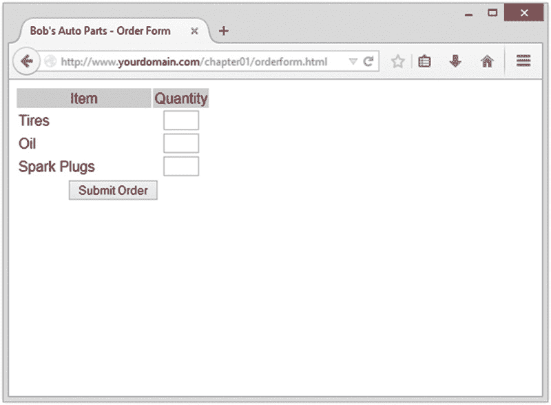
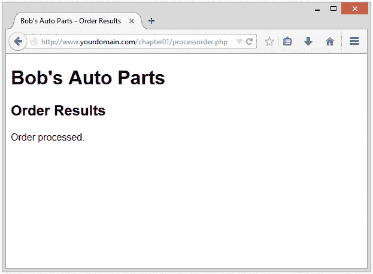
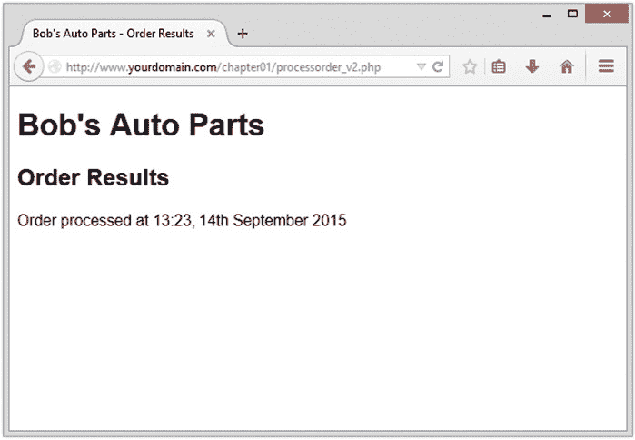
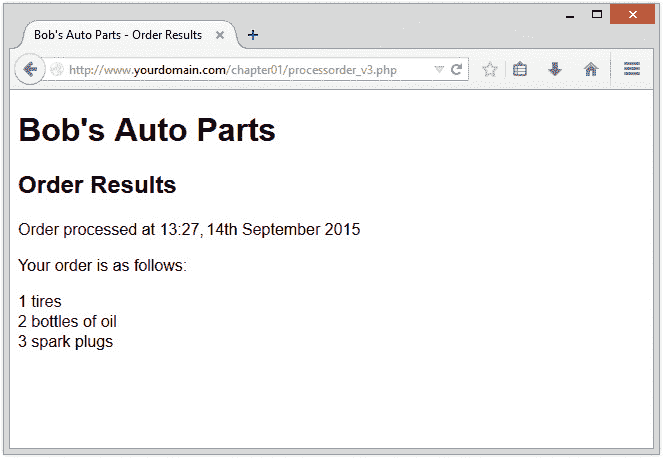
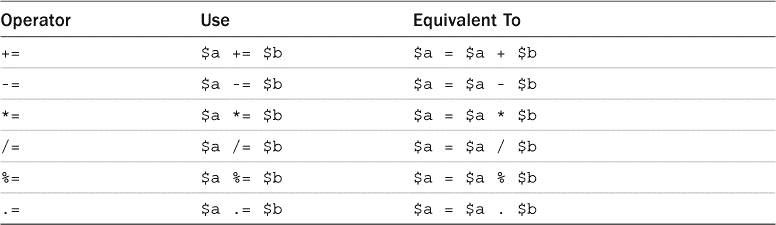
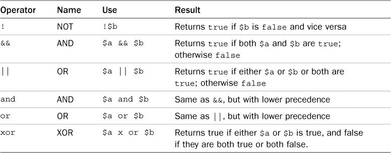
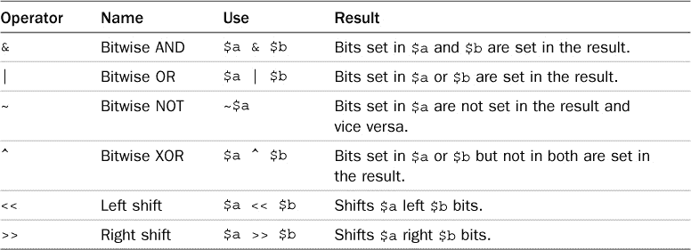

# PHP 和 MySQL Web 开发（第5版）（开发者库）

## 关于本电子书

EPUB 是一种开放的行业标准电子书格式。然而，不同设备和应用程序对 EPUB 及其许多功能的支持程度不同。请使用您的设备或应用设置来根据您的喜好自定义显示效果。您可以自定义的设置通常包括字体、字号、单栏或双栏、横屏或竖屏模式，以及可以点击或触摸放大的插图。有关您的阅读设备或应用的设置和功能的更多信息，请访问设备制造商的网站。

许多书籍包含编程代码或配置示例。为了优化这些元素的显示效果，请在单栏横屏模式下查看电子书，并将字体大小调整为最小。除了以重流文本格式呈现代码和配置外，我们还包含了代码图像，模拟印刷书籍中的显示效果；因此，当重流格式可能会损害代码列表的显示时，您将看到一个“点击此处查看代码图像”的链接。点击链接即可查看保真代码图像。要返回之前查看的页面，请点击设备或应用上的“返回”按钮。

### 作者

**Laura Thomson** 是 Mozilla 公司的工程总监。她曾担任 OmniTI 和 Tangled Web Design 的主管，并就职于 RMIT 大学和波士顿咨询集团。她拥有应用科学学士（计算机科学）和荣誉工程学士（计算机系统工程）学位。在空余时间里，她喜欢骑马、讨论自由开源软件以及睡觉。

**Luke Welling** 是一位软件工程师，经常在 OSCON、ZendCon、MySQLUC、PHPCon、OSDC 和 LinuxTag 等会议上就开源和 Web 开发主题进行演讲。他曾就职于 OmniTI、网络分析公司 `Hitwise.com`、数据库供应商 MySQL AB，并作为 Tangled Web Design 的独立顾问工作。他曾在澳大利亚墨尔本的 RMIT 大学教授过计算机科学，并拥有应用科学学士（计算机科学）学位。在空余时间里，他正试图完善（或攻克）他的失症。

**Julie C. Meloni** 是一位住在华盛顿特区的软件开发经理兼技术顾问。她撰写了多本关于 Web 编程语言和数据库主题的书籍及文章，包括畅销书 *Sams Teach Yourself PHP, MySQL and Apache All in One*。

**John Coggeshall** 是 Internet Technology Solutions, LLC 的所有者——这为全球客户提供互联网和 PHP 咨询的公司，同时也是基于订阅的 WiFi 网络 CoogleNet 的所有者。作为 Zend Technologies 全球服务团队的前高级成员，他从 1997 年开始接触 PHP，是四本已出版书籍和 100 多篇 PHP 技术文章的作者。

`Jennifer Kyrnin` 是一位作者兼网页设计师，自 1995 年来一直从事互联网工作。她的其他书籍包括*Sams Teach Yourself Bootstrap in 24 Hours*、*Sams Teach Yourself Responsive Web Design in 24 Hours*以及 *Sams Teach Yourself HTML5 Mobile Application Development in 24 Hours*。

## 我们希望听听您的声音！

作为本书的读者，`您`是我们最重要的评论家和反馈者。我们非常重视您的意见，并想知道我们哪里做得好，哪些地方可以做得更好，您希望我们出版哪些领域的内容，以及任何您愿意分享给我们的建议。

您可以通过电子邮件或直接写信的方式，告诉我们您对这本书的喜欢或不满意之处——以及我们可以做些什么来让我们的书籍变得更好。

*请注意，我们无法帮助您解决与本书主题相关的技术问题，而且由于收到的邮件量巨大，我们可能无法回复每一条信息。*

在您写信时，请务必写上书名和作者，以及您的姓名和电话或电子邮箱地址。

电子邮件：feedback@developers-library.info

邮寄：Reader Feedback

Addison-Wesley Developer’s Library

800 East 96th Street

Indianapolis, IN 46240 USA

## 读者服务

访问我们的网站并在`[www.informit.com/register](http://www.informit.com/register)` 注册本书，以便方便地访问本书可能提供的任何更新、下载或勘误。

## 访问免费网页版

无论您购买何种格式（纸质或电子版）的本书，都包含了相应的网页版，该版本提供了若干帮助您学习的特殊功能：

 在线书籍全文

 交互式测验和练习，用于测试您对内容的理解

 纸质版或电子书中未包含的额外章节

 时的更新和修正

可以使用支持`HTML5` 的任何现代网络浏览器在所有类型的电脑和移动设备上查看网页版。

要访问`PHP and MySQL Web Development, Fifth Edition`的网页版，您只需要注册这本书：

1. 前往`[www.informit.com/register](http://www.informit.com/register)`

2. 登录或创建一个新账户

3. 输入 ISBN：`9780321833891`

4. 回答问题作为购买证明

网页版将出现在您账户页面的“数字购买”（Digital Purchases）标签下。点击“启动”（Launch）链接即可访问

## 引言

欢迎阅读`PHP and MySQL Web Development`。在书中，您将发现从我们使用`PHP` 和 `MySQL` 的经验中提取出的知识，这是世界上最重要且应用广泛的两个 Web 开发工具。

本引言涵盖的关键主题：

 为什么你应该读这本书

 使用本书你将能够实现什么

 `PHP` 和 `MySQL` 是什么以及它们为什么很棒

 `PHP` 和 `MySQL` 最新版本中发生了什么

 本书的组织结构

让我们开始吧。

***

注意

访问我们的网站并在`[informit.com/register](http://informit.com/register)` 注册本书，以便方便地访问本书可能提供的任何更新、下载或勘误。

***

### 为什么你应该读这本书

本书将教你如何创建交互式 Web 应用程序，从简单的订单表单到复杂的安全的 Web 应用程序。此外，你将学习如何使用开源技术来实现它们。

本书面向已经掌握了至少`HTML` 基础知识，并且在现代编程语言中进行过一些编程，但不一定为 Web 进行编程或使用过关系型数据库的读者。如果你是一个初学者，仍然会觉得这本书很有用，但消化它可能需要更长的时间。我们尝试不遗漏任何基础概念，但我们讲解的速度较快。本书的典型读者希望通过掌握`PHP` 和 `MySQL` 来构建大型或商业性网站。你可能已经在使用另一种 Web 开发语言工作；如果是这样，这本书应该让你迅速进入状态。

我们编写这本书的第一版是因为我们厌倦了寻找那些基本上只是函数参考手册的`PHP`书籍。这些书虽然有用，但当你的老板或客户说“帮我做一个购物车”时，它们就派不上用场了。在书中，我们尽力让每个示例都变得有用。你可以直接将许多代码示例用于你的网站，也可以在经过微小修改后使用许多其他。

### 你将从书中中学到什么

阅读本书将使你能够构建真实的动态 Web 应用程序。如果你用纯`HTML`构建过网站，你就会意识到这种方法的局限性。纯`HTML`网站的静态内容只是静态的——除非你手动更新它，否则它保持不变。你的用户无法以任何意义的方式与网站进行交互。

使用像`PHP`这样的语言和像`MySQL`这样的数据库可以让你的网站变得动态：使其具有可定制性并包含实时信息。

我们刻意将本书专注于真实应用，即使在介绍章节也是如此。我们从简单系统开始，逐步深入`PHP`和`MySQL`的部分。

我们讨论了与构建真实网站相关的安全和认证方面，并向你展示如何在`PHP` 和 `MySQL` 中实现这些方面。我们还通过讨论 `JavaScript`及其在应用程序开发中可以扮演的角色，介绍了整合前端和后端技术。

在本书的最后一部分，我们描述了如何处理真实项目，并带你完成以下项目的设计、规划和构建：

 用户认证与个性化

 网页邮箱

 社交媒体集成

你可以直接使用这些项目中的任何一个，也可以根据你的需求对它们进行修改。我们选择它们是因为我们相信它们代表了程序员构建的一些常见的 Web 应用程序。如果你的需求不同，本书将帮助你在此过程中实现目标。

### 什么是 PHP？

`PHP` 是一种专门为 Web 设计的服务器端脚本语言。在`HTML`页面中，你可以嵌入`PHP`代码，这些代码会在每次访问页面时执行。你的`PHP`代码在 Web 服务器上解释，并生成访问者看到的`HTML`或其他输出。

`PHP`诞生于 1994 年，最初是一个人 Rasmus Lerdorf 的作品。它被其他才华横溢的人采用并经历了多次重大重写，带来了我们今天看到的广泛且成熟的产品。根据 Google 的 Greg Michillie 在 2013 年 5 月的说法，`PHP`运行世界上四之三以上的网站，到 2016 年 7 月，这个数字已增长到 82%以上。

`PHP` 是一个开源项目，这意味着你可以获取源代码并自由地使用、修改和重新分发它。

PHP 的主页位于 [`www.php.net`](http://www.php.net)。

Zend Technologies 的主页位于 [`www.zend.com`](http://www.zend.com)。

### 什么是 MySQL？

MySQL（读音为 `My-Ess-Que-Ell*）是一个非常快速、稳健的`关系型数据库管理系统 (RDBMS)`。数据库允许你高效地存储、搜索、排序和检索数据。MySQL 服务器控制对数据的访问，以确保多个用户可以并发工作，提供快速访问，并确保只有授权用户才能获得访问权限。因此，MySQL 是一个多用户、多线程服务器。它使用标准的数据库查询语言`结构查询语言`（`SQL`）。MySQL 自 1996 年起公开可用，但其开发历史可以追溯到 1979 年。它是世界上最流行的开源数据库，并多次获得《Linux Journal》杂志读者选择奖。

MySQL 采用双重许可方案。只要你愿意遵守该许可协议的条款，就可以可以在开源许可（`GPL`）下免费使用它。如果你想分发一个包含 MySQL 的非 GPL 应用程序，可以购买商业许可。

### 为什么使用 PHP 和 MySQL？

在构建网站时，你可以使用许多不同的产品。

你需要选择以下内容：

 在哪里运行你的 Web 服务器：云端、虚拟专用服务器或实际硬件

 操作系统

 Web 服务器软件

 数据库管理系统或其他数据存储

 编程语言或脚本语言

你最终可能会得到一个具有多个数据存储的混合架构。这些选择中的某些依赖于其他选择。例如，并不是所有的操作系统都能运行在所有硬件上，并不是所有的 Web 服务器都支持所有的编程语言，以此此类推。

在本书中，我们不过太关注硬件、操作系统或 Web 服务器软件。我们没有必要。PHP 和 MySQL 的优秀特性之一是它们可以与任何主要的操作系统以及许多次要操作系统配合。

大部分 PHP 代码可以写成在操作系统和 Web 服务器之间具有可移植性。有些 PHP 函数专门与文件系统相关且依赖于操作系统的，但这些在手册和本书中有明确的标记。

无论你选择什么硬件、操作系统和 Web 服务器，我们相信你应该认真考虑使用 PHP 和 MySQL。

### PHP 的一些优势

PHP 的一些主要对手包括 Python、Ruby（使用 Rails 或其他）、Node.js、Perl、Microsoft .NET 和 Java。

与这些产品相比，PHP 有许多优势，包括以下：

 性能

 可扩展性

 与许多不同数据库系统的接口

 针对许多常见 Web 任务的库

 低成本

 易于学习和使用

 强大的面向对象支持

 可移植性

 开发方法的灵活性

 源代码

#### 性能

PHP 非常快。使用 PHP 7 每天可以处理数百万次访问。

#### 可扩展性

PHP 可以伸缩到最微的任务，也可以扩展到大型应用程序。

#### 数据库集成

PHP 连接到许多系统。除了 MySQL 外，你还可以连接到 PostgreSQL、MongoDB、MSSQL 等。

#### 内置库

由于 PHP 是为 Web 设计的，它有许多内置函数用于执行与 Web 相关的任务以及处理 Cookie。

#### 成本

PHP 是免费的。你可以从 [`www.php.net`](http://www.php.net) 免费下载最新版本。

#### 易于学习

PHP 的语法基于其他语言。如果你已经熟悉 C 或 Perl 或类 C 语言，你几乎可以立即投入生产。

#### 面向对象支持

PHP 5 版本具有设计良好的面向对象特性。如果你学习过 Java 或 C++ 编程，你将找到预期的特性，例如继承、私有属性和方法、抽象类和方法、接口、构造函数和析构函数。你甚至会发现一些不常用的特性，如迭代器和 trait（特征）。

#### 可移植性

PHP 支持许多操作系统。你可以在像 Linux 和 FreeBSD 这样的免费 UNIX 类操作系统、商业级 UNIX 版本、OS X 或不同版本的 Microsoft Windows 上编写 PHP 代码。编写良好的代码通常不需要修改即可运行。

#### 开发方法的灵活性

PHP 允许你简单地实现简单任务，并同样轻松地适应使用模型-视图-控制器（`MVC`）等设计模式框架的大应用程序。

#### 源代码

你可以访问 PHP 的源代码。与闭源产品不同，使用 PHP 如果你想修改某些内容或增加语言功能，可以自由这样做。你不需要等待厂商发布补丁。你也不需要担心厂商倒闭或决定停止支持某产品。

#### 支持和文档的可用性

驱动 PHP 的 Zend Technologies（[`www.zend.com`](http://www.zend.com)）通过商业方式提供支持和相关软件来资助其 PHP 开发。PHP 文档和社区是成熟且丰富的资源，拥有大量可以共享的信息。

### PHP 7 的新特性

2015 年 12 月，期待已久的 PHP 7 发布发布。正如引言提到的，本书涵盖了 PHP 5.6 和 PHP 7，这可能会让你问“PHP 6 怎么了？” 简短的回答是：没有 PHP 6，也从未对公众发布过。曾有一个针对被称为“PHP 6”的代码库的开发工作，但从未实现；当时有很多雄心勃勃的计划和随之而来的复杂问题，使得团队难以继续推进。PHP 7 不是 PHP 6，也不包含该开发工作的功能和代码；PHP 7 是一个独立的版本，有自己的关注重点——特别是关注性能。

在底层方面，`PHP 7` 包含了对其驱动引擎 `Zend Engine` 的重构，这使得许多 Web 应用程序性能得到了显著提升——有时甚至超过 100%！虽然性能的提升和内存使用的减少是 `PHP 7` 发布的关键，但向后兼容性也是如此。事实上，引入的不向后兼容的语言变化相对较少。本书中会结合语境讨论这些变化，以确保这些章节在 `PHP 5.6` 或 `PHP 7` 下均具有可用性，因为商业网络托管提供商尚未广泛采用 `PHP 7`。

## MySQL 的优势优势

在关系型数据库领域，`MySQL` 的主要对手是 `PostgreSQL`、`Microsoft SQL Server` 和 `Oracle`。在 Web 应用世界，也存在使用如 `MongoDB` 等 NoSQL/非关系型数据库的日益增长的趋势。让我们来看看为什么 `MySQL` 在许多情况下仍然是一个很好的选择。

`MySQL` 有许多优势，包括：

 高性能

 低成本

 易配置、易学习

 可移植性

 源代码可用

 提供支持

下文将对这些优势进行更详细的讨论。

#### 性能

`MySQL` 无疑是非常快速的。你可以在 [`www.mysql.com/why-mysql/benchmarks/`](http://www.mysql.com/why-mysql/benchmarks/) 查看开发者的基准测试页面。

#### 低成本

`MySQL`可以通过开源许可证免费获取，也可以通过商业许可证低成本获取。如果你想将 `MySQL` 作为应用程序的一部分重新发行，且不想以开源许可为你的应用程序授权，则你需要一个许可证。如果你不打算分发你的应用程序（大多数 Web 应用都是如此），或者正在开发免费或开源软件，则不需要购买许可证。

#### 易用性

大多数现代数据库都使用 `SQL`。如果你用过其他 `RDBMS`，那么适应这一个应该不会有困难。`MySQL` 也比许多同产品更容易设置和调优。

#### 可移植性

`MySQL` 可以在许多不同的 `UNIX` 系统以及 `Microsoft Windows` 下使用。

#### 源代码


与`PHP`一样，你可以获取并修改`MySQL`的源代码。这一点对于大多数用户在大多数时间里并不重要，但它为你提供了极大的安全感，确保了未来的连续性，并在紧急情况下提供了选择。

事实上，现在有几个`MySQL`的分支和即插可用替换供你考虑使用，包括由`MySQL`原始作者编写的`MariaDB`，其中包括 Michael ‘Monty’ Widenius ([`mariadb.org`](https://mariadb.org))。

## 支持可用性

并非所有开源产品都有提供支持、培训、咨询和认证的母公司，但你可以从`Oracle`处获得所有这些（它通过收购`Sun Microsystems`获取了`MySQL`，而后者此前收购了创始公司`MySQL AB`）。

## MySQL (5.x) 有什么新？

在编写时，`MySQL`的当前版本是`5.7`。

在最近几个版本中添加到`MySQL`的特性包括：

- 广泛的安全改进
- 对`InnoDB`表的`FULLTEXT`支持
- 用于`InnoDB`的 NoSQL 风格 API
- 分区支持
- 复制改进，包括基于行的复制和`GTIDs`
- 线程池
- 可插件身份验证
- 多核扩展性
- 更好的诊断工具
- `InnoDB`作为默认引擎
- `IPv6`支持
- `Plugin API`
- 事件调度
- 自动升级

其他更改包括更多对`ANSI`标准的兼容性和性能改进。

如果你仍在使用早期的`4.x`版本或`3.x`版本的`MySQL`服务器，你应该知道以下特性从`4.0`版本起被添加到各个版本中：

- 视图
- 存储过程
- 触发器和游标
- 子查询支持
- 用于存储地理数据的`GIS`类型
- 改进的国际化支持
- 作为标准包含事务安全存储引擎`InnoDB`
- `MySQL`查询缓存，它极大地提高了 Web 应用经常运行的重复查询速度

## 本书是如何组织的？

本书分为五个主要部分：

- **第一部分，“使用 PHP”**，通过示例提供了`PHP`语言主要部分的概览。每个示例都是构建电子商务网站时使用的真实示例，而不是“玩具”代码。我们从第 1 章 “PHP 快速上手”开始这一章节。如果你已经使用过`PHP`，可以快速浏览这一章。如果你是`PHP`新手，可能需要在这里多花点时间。

- **第二部分，“使用 MySQL”**，讨论了使用关系型数据库系统的概念和设计、使用`SQL`、将你的`MySQL`数据库连接到世界以及高级`MySQL`主题。

- **第三部分，“Web 应用安全”**，涵盖了使用任何语言开发 Web 应用的一些通用问题。我们随后讨论如何使用`PHP`和`MySQL`验证用户并安全地收集、传输和存储数据。

- **第四部分，“高级 PHP 技术”**，对`PHP`内置函数进行了详细介绍。我们选择了构建 Web 应用时可能需要的函数组。你将学习与服务器交互、与网络交互、图像生成、日期处理以及会话处理。

- **第五部分，“构建实用的 PHP 和 MySQL 项目”**，是我们最喜欢的部分。它处理了大型项目管理和调试等实际问题，并提供了展示`PHP`和`MySQL`强大多功能的示例项目。

### 访问免费 Web 版

以任何格式购买此书都包含了访问相应 Web 版的权限，它提供了若干帮助你学习的特殊功能：

- 在线书籍全文
- 用于测试你对材料理解程度的交互式测试和练习
- 打印版或电子书中未包含的额外章节
- 可用的更新和修正

Web 版可以在任何支持`HTML5`的现代网络浏览器的所有类型计算机和移动设备上查看。

要访问 *PHP and MySQL Web Development, Fifth Edition* 的 Web 版，你只需要注册这本书：

1. 访问 [www.informit.com/register](http://www.informit.com/register)
2. 登录或创建新账户
3. 输入 ISBN：`9780321833891`
4. 回答问题以证明购买

Web 版将出现在你账户页面的“数字购买”（Digital Purchases）选项卡下。点击“启动”链接即可访问产品。

我们希望你喜欢这本书，并在学习`PHP`和`MySQL`的过程中像我们初次使用这些产品时一样开心。它们用起来非常愉快。很快，你就能加入成千上万 Web 开发者的行列，使用这些强大且强大的工具轻松构建动态、实时的 Web 。

# 第一部分：使用 PHP

## 1 PHP 快速上手课程

本章将为你快速概述`PHP`语法和语言结构。如果你已经是一名`PHP`程序员，它可能会填补你知识中的空白。如果你有 C、Perl、Python 或其他编程语言的背景，它将帮助你快速进入状态。

在书中，你将通过处理许多来自我们构建真实网站经验的真实示例来学习如何使用`PHP`。通常，编程教科书用非常简单的示例教授基础语法。我们选择不这样做。我们意识到，你的目标是让程序运行起来并理解语言是如何使用的，而不是苦苦地读另一本比在线手册好不到何的语法和函数参考书。

尝试这些示例。手动输入或从网站下载它们，修改它们，弄坏它们，然后学习如何再次修复它们。

本章从一个在线产品订单表单示例开始，展示`PHP`中如何使用变量、运算符和表达式。它还涵盖了变量类型和运算符优先级。你将通过计算客户订单的总额和税费，学习如何访问并操作表单变量。

然后你将使用`PHP`脚本验证输入数据来完善在线订单表示例。你将研究布尔值概念，并查看使用`if`、`else`、`?:`运算符和`switch`语句的示例。最后，通过编写生成重复 HTML 表格`PHP`来探索循环。在本章中学习的关键主题包括：

- 在 HTML 中嵌入`PHP`
- 添加动态内容
- 访问表单变量
- 理解标识符
- 创建用户自定义变量
- 检查变量类型
- 为变量赋值
- 声明和使用常量
- 理解变量作用域
- 理解运算符和优先级
- 评估表达式
- 使用变量函数
- 使用`if`、`else`和`switch`进行决策
- 利用`while`、`do`和`for`循环进行迭代

### 开始之前：访问 PHP

为了完成本章以及书中其余示例，你需要一个安装了`PHP`的 Web 服务器。为了从示例和案例研究中获得最大收益，你应该运行它们并尝试修改它们。要做到这一点，你需要一个可以实验的测试平台。

如果你的机器上没有安装`PHP`，你需要从安装它开始，或者让你的系统管理员为你安装。你可以在附录 A “安装 Apache、PHP 和 MySQL”中找到相关操作说明。

### 创建示例应用程序：Bob 的汽车零件

任何服务器端脚本语言最常见的应用之一就是处理 HTML 表单。你将通过为 Bob 的汽车零件（一家虚构的备配件公司）实现一个订单表单开始学习`PHP`。你可以在光盘的`chapter01`目录中找到本章所有示例的所有代码。

#### 创建订单表单

Bob 的 HTML 程序员为 Bob 销售的零件设置了一个订单表单。这个简单的订单表单如图 1.1 所示，与你在浏览网页时可能看到的许多表单类似。Bob 希望能够知道客户订了什么，计算订单总价，并确定订单需要缴纳多少销售税。



图 1.1 Bob 的初始订单表单仅记录产品和数量

该表单的部分 HTML 代码如列表 1.1 所示。

**列表 1.1** `orderform.html` **Bob 基础订单表单的 HTML**

点击此处查看代码图像

```html
<form action="processorder.php" method="post">
  <table style="border: 0px;">
    <tr style="background: #cccccc;">
      <td style="width: 150px; text-align: center;">Item</td>
      <td style="width: 150px; text-align: center;">Quantity</td>
    </tr>
    <tr>
      <td>Tires</td>
      <td></td>
    </tr>
    <tr>
      <td>Oil</td>
      <td></td>
    </tr>
    <tr>
      <td>Spark Plugs</td>
      <td></td>
    </tr>
    <tr>
      <td colspan="2" style="text-align: center;"><input type="submit" value="Submit"></td>
    </tr>
  </table>
</form>
```

注意`action`属性设置为将处理订单的脚本名称（你接下来将编写它）。通常，表单指定的`method`将是`get`（附加在 URL 末尾）或`post`（作为单独的消息发送）。

还要注意表单字段名称：`tireqty`、`oilqty`和`sparkqty`。你将在`PHP`脚本中再次使用这些名称。如果你使用的名称反映了输入的数据，你的`PHP`程序员生活将变得更容易。你应该考虑采用字段标准，以便网站上的所有字段使用相同的格式。

#### 处理表单

为了处理表单，你需要创建`form`标签中`action`属性提到的脚本`processorder.php`。打开你的文本编辑器并创建此文件。然后输入以下代码：

点击此处查看代码图像

```html
<!DOCTYPE html>
<html>
  <head>
    <title>Bob's Auto Parts - Order Results</title>
  </head>
  <body>
    <h1>Bob's Auto Parts</h1>
    <h2>Order Results</h2>
  </body>
</html>
```

注意你目前为止输入的所有内容都是纯 HTML。现在是时候给脚本添加一些`PHP`代码了。

### 在 HTML 中嵌入 PHP

在你文件的`<h2>`标题下，添加以下行：

```php
<?php
echo '<p>Order processed.</p>';
?>
```

保存文件，并通过填写 Bob 的表单并点击提交订单按钮，在浏览器中加载它。你应该看到类似于图 1.2 所示的输出。



图 1.2 传递给 PHP `echo`构造的文本输出到浏览器

注意你编写的`PHP`代码嵌入在一个看起来正常的 HTML 文件中。尝试从浏览器查看源代码。你应该看到这段代码：

```html
<!DOCTYPE html>
<html>
  <body>
    <h1>Bob 的汽车零件</h1>
    <h2>订单结果</h2>
    <p>订单已处理。</p>
  </body>
</html>
```

原始的`PHP`代码是不可见的，因为`PHP`解释器已经运行了该脚本并将其替换为脚本的输出结果。这意味着通过`PHP`，你可以生成可以在任何浏览器中查看的整洁 HTML；换句话说，用户的浏览器不需要理解`PHP`。

这个示例简明扼要地说明了服务器端脚本的概念。`PHP`已经在 Web 服务器上经过了解释并执行，这与`JavaScript`以及其他在用户机器的浏览器内进行解释和执行的客户端技术是有不同的。

你现在在该文件中拥有的代码由四种文本组成：

- HTML
- `PHP`标签
- `PHP`语句
- 空格符

你还可以添加注释。

示例中的大部分行都只是普通的 HTML。

### PHP 标签

前一个示例中的`PHP`代码以`<?php`开始，以`?>`结束。这与所有 HTML 标签相似，因为它们都以小于符号（`<`）开头并以大于符号（`>`）结束。这些符号（`<?php`和`?>`）被称为`PHP`标签。它们告诉 Web 服务器`PHP`代码从哪里开始结束。标签之间的任何文本都被解释为`PHP`。标签之外的任何文本都被视为普通的 HTML。`PHP`标签允许你跳出 HTML 模式。

实际上有两种`PHP`标签的样式；以下每个代码段都是等价的：

- **XML 样式**

```php
<?php echo '<p>Order processed.</p>'; ?>
```

这是我们在书中使用的标签样式；它是被首选的`PHP`标签样式。服务器管理员无法关闭它，因此你可以保证它在所有服务器上都是可用的，如果你正在编写可能在不同安装环境中使用的应用程序，这一点尤为重要。这种标签样式可以与扩展标记语言 (XML) 文档配合。通常情况下，我们建议你使用这种标签样式。

- **短样式**

```php
<? echo '<p>Order processed.</p>'; ?>
```

这种标签样式是最简单的，并遵循标准通用标记语言 (SGML) 处理指令的样式。要使用这种类型的标签——它是输入最短的——你需要在你的配置文件中启用`short_open_tag`设置，或者在编译`PHP`时启用短标签。你可以在附录 A 中找到更多关于如何使用这种标签样式的信息。我们不建议在你计划分发的代码中使用这种样式。它在许多环境中将无法工作，因为它不再是默认启用的。

### PHP 语句

你通过在起始和结束标签之间包含`PHP`语句来告诉`PHP`解释器要做什么。前一个示例只使用了一种类型的语句：

```php
echo '<p>Order processed.</p>';
```

正如你可能猜到的那样，使用`echo`结构有一个非常简单的结果：它将打印（或回显）传递给它的字符串到浏览器。在图 1.2 中，你可以看到结果是浏览器窗口中出现了文本`Order processed.`。

注意`echo`语句末尾有一个分号。在`PHP`中，分号分隔语句，就像英语中的句号分隔句子一样。如果你以前用过 C 或 Java，你将熟悉这种使用分号的方式。

漏掉分号是一个常见的且易发的语法错误。然而，发现并纠正它同样容易。

### 空格符

如换行符（回车）、空格和制表符等间隔字符被称为`whitespace`。正如你可能已经知道的，浏览器忽略 HTML 中的空白符，`PHP`引擎也是如此。考虑这两个 HTML 片段：

点击此处查看代码图像

```html
<h1>Welcome to Bob's Auto Parts!</h1><p>What would you like to order today?</p>
```

以及

点击此处查看代码图像

```html
<h1>Welcome          to Bob's

Auto Parts!</h1>
<p>What would you like
to order today?</p>
```

这两个 HTML 代码产生相同的输出，因为它们在浏览器看来是相同的。但是，你完全并且被鼓励在 HTML 中明智地使用空白符来作为人类的辅助——以增强你的 HTML 代码的可读性。`PHP`也是如此。你不需要在`PHP`语句之间有任何空白符，但如果你将每个语句放在单独的一行，代码会变得更易读。例如，

```php
echo 'hello ';
echo 'world';
```

以及

```php
echo 'hello ';echo 'world';
```

它们是等价的，但第一个版本更容易读。

### 注释

注释就是其名：代码中的注释是给阅读代码的人的笔记。注释可以用来解释脚本的用途、谁编写了它、为什么要这样写、最后一次修改是什么时候等。通常你可以在除了最简单的`PHP`脚本之外的所有地方找到注释。

`PHP`解释器忽略注释中的任何文本。从本质上说，`PHP`解析器会跳过注释，使其等同于空白符。

`PHP`支持 C、C++ 和 shell 脚本风格的注释。

以下是 C 风格的多行注释，可能出现在脚本的开头：

点击此处查看代码图像


```php
/* Author: Bob Smith
   Last modified: April 10
   This script processes orders.
*/
```

多行注释以`/*`开始并以`*/`结束。与 C 一样，多行注释不能嵌套。

你也可以使用单行注释，可以是 C++ 风格：

```php
echo '<p>Order processed.</p>'; // Start order
```

或者是 shell 脚本风格：

```php
echo '<p>Order processed.</p>'; # Start order
```

在这两种样式中，注释符号（`#`或`//`）之后直到行尾或结束标签之前都是注释。

在下面的代码中，标签之前的文本`here is a comment`是注释的一部分。标签之后的文本`here is not`将被视为 HTML，因为它在标签之外：

```
// here is a comment ?> is not
```

## 添加动态内容

到目前为止，你还没有用 PHP 做过任何无法用纯 HTML 完成的事。

使用服务器端脚本语言的主要原因是为了能够为网站提供动态内容。这是一项重要的应用，因为根据用户需求或时间变化的内容会吸引访问回到网站。PHP 允许你轻松实现这一点。

让我们从一个简单的示例开始。将`processorder.php`中的 PHP 替换为以下代码：

```php
<?php
  echo "<p>Order processed at ";
  echo date('H:i, jS F');
  echo "</p>";
?>
```

你也可以使用连接运算符（`.`）将其写在一行内：

```php
<?php
  echo "<p>Order processed at ".date('H:i, jS F')."</p>";
?>
```

在此代码中，PHP 内置的`date()`函数告诉客户处理订单的日期和时间。每次运行脚本时这些信息都会不同。运行一次脚本的结果如图 1.3 所示。



图 1.3 PHP 的`date()`函数返回格式化的日期字符串

### 调用函数

看对`date()`的调用。这是函数调用采用的通用形式。PHP 拥有丰富的函数库，可以在开发 Web 应用程序时可以使用。许多函数需要传递一些数据并返回一些数据。

现在再次看这个函数调用：

```php
date('H:i, jS F')
```

注意，它向圆括号内的函数传递了一个字符串（文本数据）。括号内的元素被称为函数的`argument`（实参）或`parameter`（形参）。这些参数是函数在输出某些特定结果时所使用的输入数据。

### 使用`date()`函数

`date()`函数期望你传递给它的参数是一个格式字符串，代表你希望的输出样式。字符串中的每个字母都代表日期和时间的一个部分。`H`是 24 小时制的小时，在需要时前导零；`i`是分钟，在需要时前导零；`j`是不带前导零的月份几号；`S`代表序数后缀（在此例中为 th），而`F`是月份的全称。

***

注意

如果`date()`向你发出了关于未设置时区的警告，你应该在你的`php.ini`文件中添加`date.timezone`设置。关于此点的更多信息，可以在附录 A 中的示例`php.ini`文件中找到。

***

要查看`date()`支持的格式完整列表，请参阅第 19 章，“管理日期和时间”。

### 访问表单变量

使用订单表的目的是收集客户订单。在 PHP 中获取客户输入内容的详情非常容易，但具体方法取决于你使用的 PHP 版本以及`php.ini`文件中的一个设置。

#### 表单变量

在你的 PHP 脚本中，你可以将每个表单字段作为一个 PHP 变量来访问，其变量名与表单字段名相关。你可以识别 PHP 中的变量名，因为它们都以美元符号（`$`）开头。（忘记美元符号是一个常见的编程错误。）

根据你的 PHP 版本和设置，你可以以不同的方式通过变量访问表单数据。在较新版本的 PHP 中，这些方法除一种外的所有方法都已弃用，因此如果你过去用过 PHP，请注意这一点已经发生了变化。

你可以通过以下方式访问字段`tireqty`的内容：

```
$_POST['tireqty']
```

`$_POST`是一个数组，包含通过 HTTP POST 请求提交的数据——也就是说表单方法被设置为 POST。有三个这样的数组可能包含表单数据：`$_POST`、`$_GET`和`$_REQUEST`。其中一个`$_GET`或`$_POST`数组持有所有表单变量的详情。使用哪个数组取决于提交表单的方法是`GET`还是`POST`。此外，通过`$_REQUEST`还可以获取通过`GET`或`POST`提交的所有数据的组合。

如果通过`POST`方法提交表单，在`tireqty`框中输入的数据将存储在`$_POST['tireqty']`中。如果通过`GET`提交，数据将在`$_GET['tireqty']`中。无论哪种情况，数据也可以可用`$_REQUEST['tireqty']`。

这些数组是一些`superglobal`（全局）数组。当我们在本章后面讨论变量作用域时，将再次回到全局变量。

让我们来看创建一个易用变量副本的示例。

要将一个变量的值复制到另一个变量，你需要使用赋值运算符，在 PHP 中是等号（=）。以下语句创建一个名为`$tireqty`的新变量，并将`$_POST['tireqty']`的内容复制到新变量中：

```php
$tireqty = $_POST['tireqty'];
```

将以下代码块放在处理脚本的开头。本书中处理表单数据的所有其他脚本在开头都包含类似的代码块。由于此代码不会产生任何输出，将其放在`<html>`和其他启动页面的 HTML 标签上方或下方没有区别。我们通常将此类代码块放在脚本开头，以便查找。

```php
<?php
  // 创建短变量名
  $tireqty = $_POST['tireqty'];
  $oilqty = $_POST['oilqty'];
  $sparkqty = $_POST['sparkqty'];
?>
```

这段代码创建了三个新变量——`$tireqty`、`$oilqty`和`$sparkqty`，并将它们设置为包含通过表单`POST`方法发送的数据。

你可以通过以下操作将这些变量的值输出到浏览器：

```php
echo $tireqty.' tires<br />';
```

然而，不建议这种方法。

在此阶段，你还没有检查变量内容以确保每个表单字段中都输入了合理的数据。尝试故意输入错误的数据并观察会发生什么。在你读完本章其余部分后，你可能想尝试向此脚本添加一些数据验证。

直接从用户处获取数据并这样输出到浏览器，从安全角度来看是非常极具风险的做法。我们不建议这种方法。你应该过滤输入数据。我们将在第 4 章，“字符串处理与正则表达式](#ch04.html_ch04)”中开始介绍输入过滤，并在第 14 章，“Web 应用安全风险](#ch14.html_ch14)”中深入讨论安全性。

目前，只需知道在通过`htmlspecialchars()`之后将用户数据 echo 到浏览器即可。为了让脚本显示某些内容，在 PHP 脚本中添加以下行：

```php
echo '<p>Your order is as follows:>';
echo htmlspecialchars($tireqty).'tires<br />';
echo htmlspecialchars($oilqty).'bottles of oil<br />';
echo htmlspecialchars($sparkqty).'spark plugs<br />';
```

现在如果你在浏览器中加载此文件，输出应该类似于图 1.4 所示。当然，实际值取决于你在表单中输入的内容。



图 1.4 processorder.php 中访问的表单变量

### 字符串拼接

在示例脚本中，`echo`打印每个表单字段的值，后面跟着说明文本。如果你查看`echo`语句，你会看到变量名和后续文本之间有一个点（.），如下：

```php
echo htmlspecialchars($tireqty).' tires<br />';
```

这个点是字符串拼接运算符，它将字符串（文本片段）组合在一起。当你使用`echo`输出到浏览器时，经常会使用它。通过这种方式，你可以避免编写多个`echo`命令。

你也可以将简单的变量放在双引号字符串内部进行 echo（数组较为复杂，我们将在第 4 章中讨论数组和字符串的结合）。考虑这个示例：

```php
$tireqty = htmlspecialchars($tireqty);
echo "$tireqty tires<br />";
```

这与本节所示的第一条语句等效。两种格式都是有效的，使用哪种取决于个人喜好。这种在字符串内将变量替换为其内容的过程被称为*插值*（interpolation）。

注意，插值仅是双引号字符串的功能。你不能以这种方式在单引号字符串内放置变量名。运行以下代码行

```php
echo '$tireqty tires<br />';
```

仅仅向浏览器发送`$tireqty tires<br />`。在双引号内，变量名会被替换为它的值。在单引号内，变量名或任何其他文本将原原封地发送。

示例脚本中每个`echo`语句中连接在一起的变量和字符串是不同类型的内容。变量是数据的符号。字符串本身就是数据。当我们在程序中使用这样一段原始数据时，我们称之为*字面量*（literal），以将它区别于*变量*（variable）。`$tireqty`是一个变量，是一个代表客户输入数据的符号。另一方面，`' tires<br />'`是一个字面量。你可以直接按照字面意思理解它。嗯，几乎如此。还记得前一节中的第二个示例吗？PHP 将字符串中的变量名`$tireqty`替换为存储在变量中的值。

记住已经提到的两种类型的字符串：使用双引号的字符串和使用单引号的字符串。PHP 会尝试解析双引号括中的字符串，从而导致了前文所示的行为。单引号字符串被视为真正的字面量。

还有第三种指定字符串的方法，即使用 heredoc 语法（`<<<`），这对于 Perl 用户来说非常熟悉。Heredoc 语法允许你通过指定一个结束标记来整洁地指定长字符串，该标记将用于结束字符串。下面的示例创建了一个三行的字符串并将其输出：

```php
echo <<<theEnd

  line 1

  line 2

  line 3

theEnd
```

标记`theEnd`是完全任意的。它只需要保证不会出现在正文中即可。要关闭 heredoc 字符串，请在行开头放置结束标记。

Heredoc 字符串会进行插值，就像双引号字符串一样。

### 理解标识符

标识符（Identifiers）是变量名。（函数和类的名称也是标识符；我们将在第 5 章“重用代码和编写函数”以及第 6 章“面向对象的 PHP”中详细讨论函数和类）。你需要了解定义有效标识符的简单规则：

-  标识符可以是任意长度，并由字母、数字和下划线组成。
-  标识符不能以数字开头。
-  在 PHP 中，标识符是区分大小写的。`$tireqty`和`$TireQty`是不同的。交替使用它们是一种常见的编程错误。函数名是这一规则的例外：它们的名称可以使用任何大小写。
-  变量名可以与函数相同。然而，这种用法会引起混淆，应该避免。此外，你不能创建一个与另一个函数同名的函数。

除了从 HTML 表单传递的变量外，你还可以声明并使用自己的变量。

PHP 的特性之一是它不需要在使用变量之前声明它们。当你第一次给变量赋值时，该变量就会被创建。详情请见下一节。

你使用赋值运算符（=）给变量赋值，就像你将一个变量的值复制到另一个变量时一样。在 Bob 的网站上，你想计算订单的项目总数和应支付金额。你可以创建两个变量来存储这些数字。首先，你需要通过在 PHP 脚本底部添加这些行来将每个变量初始化为零。

```php
$totalqty = 0;
$totalamount = 0.00;
```

这两行中的每一行都创建了一个变量并为其分配了一个字面量值。你也可以将变量值赋值给变量，如示例所示：

```php
$totalqty = 0;
$totalamount = $totalqty;
```

### 检查变量类型

变量的类型指的是存储其中的数据种类。PHP 提供了一组数据类型。不同的数据可以存储在不同的数据类型中。

#### PHP 数据类型

PHP 支持以下基本数据类型：

-  **整数 (Integer)**——用于整数
-  **浮点数 (Float)**（也称为 **double**）——用于实数
-  **字符串 (String)**——用于字符字符串
-  **布尔值 (Boolean)**——用于`true`或`false`值
-  **数组 (Array)**——用于存储多个数据项（参见第 3 章“使用数组”）
-  **对象 (Object)**——用于存储类的实例（参见第 6 章）

```php
$totalqty = 0;
$totalamount = (float)$totalqty;
```

这句话意味着“将存储在`$totalqty`中的值解释为浮点数，并将其存储在`$totalamount`中。”`$totalamount`变量将是浮点类型。类型转换不会改变类型，因此`$totalqty`保持为整数。

你还可以使用内置函数来测试和设置类型，你将在以后学习。

#### 变量变量

PHP 提供了另一种类型的变量：变量变量。变量变量允许你动态地更改变量的名称。

你可以看到，PHP 在这个领域提供了很大的自由。所有语言都允许你更改变量的值，但很少有语言允许更改变量的名称。变量变量通过使用一个变量的值作为另一个变量的名称来工作。例如，你可以设置：

```php
$varname = 'tireqty';
```

你现在可以使用`$$varname`代替`$tireqty`。例如，你可以设置`$tireqty`的值为：

```php
$$varname = 5;
```

这等同于

```php
$tireqty = 5;
```

正如你之前看到的，你可以轻松地更改存储在变量中的值。你也可以声明常量。常量存储值的方式与变量相同，但它的值只设置一次，之后在脚本的其他任何地方无法更改。

在示例应用程序中，你可能将每个销售商品的价格存储为常量。你可以使用`define`函数来定义这些常量：

```
define('TIREPRICE', 100);
define('OILPRICE', 10);
define('SPARKPRICE', 4);
```

现在将这些行代码添加到你的脚本中。现在你有了三个常量，可以用于计算客户订单的总额。

注意，常量的名称以大写形式出现。这种借自 C 语言的习惯让你一眼就能区分变量和常量。虽然强制遵循这种习惯，但它会让你的代码更易于阅读和维护。

常量和变量之间一个重要的区别是，当你引用常量时，它的前面没有美元符号`$`。如果你想使用常量的值，只需使用它的名称即可。例如，要使用刚刚创建的常量之一，你可以输入

```
echo TIREPRICE;
```

除了你定义的常量外，PHP 还设置了大量的内置常量。获取它们概览的一种简单方法是运行`phpinfo()`函数：

```
phpinfo();
```

该函数提供了 PHP 预定义变量和常量的列表，以及其他有用信息。我们将在学习过程中讨论其中一些。

变量和可能的另一个区别是，常量只能存储布尔、整数、浮点数或字符串数据。这些类型统称为标量值（scalar values）。

### 理解变量作用域

`scope`（作用域）指的是脚本内部特定变量可见的地方。PHP 中的六个基本作用域规则如下：

-  内置全局变量在脚本的任何地方都可见。
-  常量一旦声明，始终全局可见；也就是说，它们可以在函数内部外部使用。
-  在脚本中声明的全局变量在整个脚本中可见，但*在函数内部不可见*。
-  函数内部声明为全局的变量引用同名的全局变量。
-  在函数内部创建并声明为`static`的变量从函数外部不可见，但它们会在函数一次执行和下次执行之间保持值。（我们将在第 5 章中详细解释这一概念。）
-  在函数内部创建的变量是局部变量，并在函数终止时消失。

数组`$_GET`和`$_POST`以及其他特殊变量有它们的作用域规则。它们被称为*超级全局变量*（superglobals），可以在函数内部外的任何地方可见。

超级全局变量完整列表如下：

-  `$GLOBALS`——包含所有全局变量的数组（类似于`global`关键字，这允许你在函数内部访问全局变量——例如通过`$GLOBALS['myvariable']`）。
-  `$_SERVER`——服务器环境变量数组。


-  `$_GET`——通过 `GET` 方法传递给脚本的变量数组。
-  `$_POST`——通过 `POST` 方法传递给脚本的变量数组。
-  `$_COOKIE`——cookie 变量数组。
-  `$_FILES`——与文件上传相关的变量数组。
-  `$_ENV`——环境变量数组。
-  `$_REQUEST`——包含所有用户输入的数组，包括 `$_GET`、`$_POST` 和 `$_COOKIE` 的内容（但不包括 `$_FILES`）。
-  `$_SESSION`——会话变量数组。

在书中当变得需要时，我们会反复回到这些超级全局变量。

在本章稍后讨论函数和类时，我们会详细地介绍作用域。目前，我们使用的所有变量默认都是全局变量。

### 使用运算符

运算符是你用于通过对值和变量进行操作来操纵它们的符号。你需要使用其中一些运算符来计算客户订单的总额和税费。

我们已经提到了两个运算符：赋值运算符（`=`）和字符串连接运算符（`.`）。在接下来的章节中，我们将描述完整的列表。

通常情况下，运算符可以接受一个、两个或三个参数，大多数接收两个。例如，赋值运算符接收两个参数：`=` 符号左侧的存储位置和右侧的表达式。这些参数被称为*操作数*（operands）——即被操作的对象。

#### 算术运算符

算术运算符非常直观；它们就是普通的数学运算符。PHP 的算术运算符如表 1.1

表 1.1 **PHP 的算术运算符**

使用这些运算符中的每一个，你可以存储操作的结果，如下所示：

```
$result = $a + $b;
```

加法和减法的作用如你预期的那样。这些运算符的结果分别是加或减 `$a` 和 `$b` 变量的值。

你还可以使用减法符号（`-`）作为一元运算符——即接受一个参数的运算符——来表示负数，例如：

```
$a = -1;
```

乘法和除法也如你预期的那样工作。注意使用 `*` 作为乘法运算符，以及使用 `/` 作为除法运算符。

模运算符返回 `$a` 变量除以 `$b` 变量的余。考虑这段代码片段：

```
$a = 27;
$b = 10;
$result = $a%$b;
```

存储在 `$result` 变量中的值是 27 除以 10。

你应该注意，算术运算符通常应用于整数或浮点数。如果你将它们应用于字符串，PHP 会尝试将字符串转换为数字。如果它包含 `e` 或 `E`，它将被读取为科学计数法并转换为浮点数；否则，将转换为整数。PHP 会在字符串开头寻找数字作为值。

#### 字符串运算符

你已经看到并使用了唯一的字符串运算符。你可以使用字符串连接运算符连接两个字符串并生成结果，就像你使用加法运算符相两个数字一样：

```
$a = "Bob's ";
$b = "Auto Parts";
$result = $a.$b;
```

变量 `$result` 现在包含了字符串 `"Bob's Auto Parts"`。

#### 赋值运算符

你已经见过赋值运算符 `=`。始终将其称为赋值运算符，并将其读作“设置为”。例如，

```
$totalqty = 0;
```

此行应该读作“`$totalqty` 设置为零”。我们将在本章稍后讨论比较运算符时解释原因，但如果你把它称为“等于”，你会感到困惑。

##### 赋值返回值

使用赋值运算符会返回与其他运算符类似的整体值。如果你写

```
$a + $b
```

该表达式的值是 `$a` 和 `$b` 变量相加的结果。同样，你可以写

```
$a = 0;
```

这个整个表达式的值为零。

这种技术允许你形成如下表达式：

```
$b = 6 + ($a = 5);
```

此行将 `$b` 变量的值设置为 11。这种行为通常适用于赋值：整个赋值语句的值是赋值给左侧操作数的值。

在计算表达式的值时，你可以使用括号来提高子表达式的优先级，如下所示。这种技术的工作原理与数学中完全相同。

#### 复合赋值运算符

除了简单的赋值之外，还有一组复合赋值运算符。其中每一个都是对变量执行另一种操作，并将结果重新赋值给该变量的简写形式。例如，

```php
$a += 5;
```

这等同于编写以下代码：

```php
$a = $a + 5;
```

每个算术运算符和字符串拼接运算符都有对应的复合赋值运算符。所有复合赋值运算符及其影响摘要如表 1.2 所示。



表 1.2 **PHP 的复合赋值运算符**

#### 前置与后置递减

前置和后置增（`++`）及减（`--`）运算符与 `+=` 和 `-=` 运算符类似，但有几点不同。

所有的增运算符都有两个效果：增加值并进行赋值。考虑以下代码：

```php
$a=4;
echo ++$a;
```

第二行使用了前置增运算符，这是因为 `++` 出现在 `$a` 之前。它的效果是先将 `$a` 增加 1，然后返回增加后的值。在这种情况下，`$a` 增加到 5，然后返回并打印值 5。整个表达式的值为 5。（注意，存储在 `$a` 中的实际值被改变了：它不仅仅是返回了 `$a + 1`。）

然而，如果 `++` 在在 `$a` 之后，那么你正在使用的是后置增运算符。它的效果不同。考虑以下代码：

```php
$a=4;
echo $a++;
```

在这种情况下，效果是反反的。也就是说，首先返回并打印 `$a` 的值，然后对其进行递增。整个表达式的值为 4。这是将要打印的值。然而，在该语句执行后，`$a` 的值是 5。

正如你可能猜到的那样，`--`（减）运算符的行为也是类似的。不过，`$a` 的值是减少而不是增加。

#### 引用运算符

引用运算符（`&`，取地址符）可以与赋值结合使用。通常，当一个变量赋值给另一个变量时，会创建第一个变量的副本并存储在内存的其他地方。例如，

```php
$a = 5;
$b = $a;
```

这些代码行创建了 `$a` 中值的第二个副本并存储在 `$b` 中。如果你随后更改 `$a` 的值，`$b` 将不会改变：

```php
$a = 7; // $b 仍为 5
```

你可以通过使用引用运算符避免创建副本。例如，

点击此处查看代码

```php
$a = 5;
$b = &$a;
$a = 7; // 现在 $a 和 $b 都是 7
```

引用可能有点复杂。记住，引用类似于别名，而不是指针。`$a` 和 `$b` 都指向同一块内存。你可以通过如下方式取消其中一个的设置来改变这一点：

```php
unset($a);
```

取消不会改变 `$b` 的值 (7)，但会破坏 `$a` 与存储在内存中的值 7 之间的链接。

#### 比较运算符

比较运算符比较两个值。使用这些运算符的表达式根据比较结果返回逻辑值 `true`（真）或 `false`（假）。

##### 等于运算符

相等比较运算符（`==`，两个等号）允许你测试两个值是否相等。例如，你可能使用表达式

```php
$a == $b
```

用来测试存储在 `$a` 和 `$b` 中的值是否相同。如果它们相等，此表达式返回的结果为 `true`；如果不相等，则为 `false`。

你很容易将 `==` 与赋值运算符 `=` 混淆。使用错误的运算符可以正常运行而不会报错，但通常不会给你你想要的结果。通常情况下，非零值被求评为 `true`，零值被求评为 `false`。假设你如下所示初始化了两个变量：

```php
$a = 5;
$b = 7;
```

如果你测试测试 `$a = $b`，结果将是 `true`。为什么？`$a = $b` 的值是赋值给左侧的值，在这个例中是 7。因为 7 是非零值，所以表达式求评为 `true`。如果你本打算测试 `$a == $b`（其求评为 `false`），那么你在代码中引入了一个逻辑错误，这个错误极其难以发现。始终检查你对这两个运算符的使用，并确保你使用的是想要使用的那个。

使用赋值运算符而不是相等比较运算符是一个很容易犯的错误，你可能在编程生涯中会犯很多次。

##### 其他比较运算符

PHP 还支持许多其他比较运算符。所有比较运算符的摘要如表 1.3 所示。需要注意的是恒等运算符（`===`），它仅当两个操作数相等且类型相同时才返回 `true`。

#### 逻辑运算符

逻辑运算符组合条件的结果。例如，你可能使用如下所示的 AND 运算符，在 0 到 100 之间：

```php
$a >= 0 && $a <= 100
```

PHP 支持 AND、OR（异或）和 NOT。逻辑运算符的总结如表 1.4 所示。



表 1.4 **逻辑运算符**

`and` 和 `or` 运算符的优先级低于 `&&` 和 `||`。我们将在本章详细介绍优先级。

#### 位运算符

位运算符允许你将整数视为用于表示它的位序列。你可能在 PHP 中找不到位运算符的用途，但摘要如表 1.5 所示。



表 1.5 **PHP 的位运算符**

#### 其他运算符

除了目前介绍过的运算符外，你还可以使用其他。

逗号运算符（`,`）分隔函数参数或其他列表。它通常偶然使用。

两个特殊运算符 `new` 和 `->` 分别用于实例化类和访问类成员。它们将在第 6 章](#ch06)中详细介绍。

我们在这里简要讨论其他。

##### 三元运算符

三元运算符（`?:`）采用以下形式：

点击此处查看代码

```php
条件 ? 为真值 : 为假时的值
```

该运算符类似于 `if-else` 语句的表达式版本，后者将在本章后续部分介绍。

一个简单的例子是

点击此处查看代码

```php
($grade >= 50 ? '通过' : '失败')
```

此表达式将成绩评估为'通过'或'失败'。

##### 错误抑制运算符

错误抑制运算符（`@`）可以用任何任何前面——即任何产生错误或具有值的表达式。例如，

```php
$a = @(57/0);
```

如果没有 `@` 运算符，这一行会产生除以零警告。如果包含了该运算符，错误将被抑制。

如果你以此方式抑制警告，你需要编写一些错误处理代码来检查何时发生了警告。如果你在 `php.ini` 中启用了 PHP 的 `track_errors` 功能，错误信息将存储在全局变量 `$php_errormsg` 中。

## 第 1 章：PHP 速成课程

PHP 是一种广泛使用、开源、通用的脚本语言，特别适用于 Web 开发，并且可以嵌入到 HTML 中。

### 一个最小的 PHP 脚本

让我们来看一个简单但完整的 PHP 脚本。在深入细节之前，先了解一下 PHP 的工作原理是个好主意。

以下是我们这个最小 PHP 脚本的完整代码：

```php
<?php
echo "Hello World";
?>
```

如果这是一个静态 HTML 文件，它会包含相同的内容，但扩展名将是 `.html` 或 `.htm` 而不是 `.php`。当您在浏览器中查看此文件时，输出仅仅是一个带有 "Hello World" 字样的空白页面。（注意：如果没有 HTML 标签，一些浏览器可能会显示空白页面。）

这个例子中最重要的部分是 `echo` 语句。它告诉 PHP 输出 "Hello World"。分号（`;`）告诉 PHP 这是语句的结束，而 `<?php` 和 `?>` 标签告诉 PHP 将它们之间的所有内容解析为 PHP 代码。

`.php` 扩展名不是必须的。您可以将 Web 服务器配置为将具有其他扩展名的文件解析为 PHP，但使用 `.php` 是标准做法。

### 将 PHP 嵌入 HTML

PHP 经常直接嵌入到 HTML 文件中。服务器解析该文件，执行 PHP 代码，并将生成的 HTML 发送到客户端浏览器。

考虑以下示例，它根据一天中的时间生成动态问候语：

```php
<?php
if (date('H') < 12) {
  echo "早上好";
} elseif (date('H') < 18) {
  echo "下午好";
} else {
  echo "晚上好";
}
?>
```

### 为 PHP 脚本添加注释

注释对于记录代码非常有用。PHP 支持多种注释风格：

```php
// 这是一个单行注释

# 这也是一个单行注释

/* 这是
   一个多行
   注释 */
```

### PHP 如何解释空白字符

PHP 通常会忽略脚本中的额外空白字符（空格、制表符、换行符）。这意味着您可以格式化代码以使其更具可读性，而不会影响其运行。

### 语句终止符

PHP 中的每个语句都必须以分号（`;`）结尾。这不是可选的。它告诉 PHP 一条语句在哪里结束，下一条从哪里开始。

### 引入变量

PHP 中的变量以美元符号（`$`）为前缀。变量名以字母或下划线开头，后面可以跟任意数量的字母、数字或下划线。

```php
<?php
$name = "Bob"; // 将字符串 "Bob" 赋值给变量 $name
$age = 30;     // 将整数 30 赋值给变量 $age
$tax_rate = 0.10; // 将浮点数 0.10 赋值给 $tax_rate
?>
```

### 引入数组

数组是一个可以保存多个值的变量。

```php
<?php
$products = array('Tires', 'Oil', 'Spark Plugs');
// 或者，使用简写语法：
$products = ['Tires', 'Oil', 'Spark Plugs'];

echo $products[0]; // 输出 "Tires"
?>
```

### 变量类型

PHP 是一种弱类型语言，这意味着您不需要声明变量的类型。PHP 根据分配给它的值来确定其类型。

常见类型包括：

- `integer`（例如，`42`）
- `float` 或 `double`（例如，`3.14`）
- `string`（例如，`"Hello World"`）
- `boolean`（`true` 或 `false`）
- `array`

您可以使用 `gettype()` 等函数来检查变量的类型。

### PHP 常量

常量是在脚本执行期间不能更改的简单值的标识符。它们使用 `define()` 函数定义。

```php
<?php
define('TIREPRICE', 100);
echo TIREPRICE; // 输出 100
?>
```

### 创建一个简单的脚本

让我们将这些概念结合起来，创建一个计算订单总额的简单脚本。

```php
<?php
$tireqty = 2;
$oilqty = 1;
$sparkqty = 3;

$tireprice = 100;
$oilprice = 10;
$sparkprice = 4;

$totalamount = ($tireqty * $tireprice) +
               ($oilqty * $oilprice) +
               ($sparkqty * $sparkprice);

echo "总额：" . $totalamount;
?>
```

### 访问表单变量

在 Web 环境中，您经常需要获取从 HTML 表单提交的数据。PHP 提供了几个超全局数组用于此目的，例如 `$_POST`、`$_GET` 和 `$_REQUEST`。

假设您有一个提交到同一页面的 HTML 表单：

```php
<!-- HTML 表单 -->
<form action="process.php" method="post">
  轮胎数量：<input type="text" name="tireqty" /><br />
  机油数量：<input type="text" name="oilqty" /><br />
  火花塞数量：<input type="text" name="sparkqty" /><br />
  <input type="submit" value="提交" />
</form>
```

在 `process.php` 中，您可以访问这些值：

```php
<?php
$tireqty = $_POST['tireqty'];
$oilqty = $_POST['oilqty'];
$sparkqty = $_POST['sparkqty'];

// ... 继续计算总额
?>
```

### 运算符

PHP 支持多种运算符。

#### 算术运算符

```php
$sum = 5 + 3; // 加法
$diff = 5 - 3; // 减法
$prod = 5 * 3; // 乘法
$quot = 5 / 3; // 除法
$mod = 5 % 3;  // 取模（余数）
```

#### 字符串运算符

连接运算符是一个句点（`.`）。

```php
$greeting = "Hello" . " " . "World"; // $greeting 为 "Hello World"
```

#### 赋值运算符

基本赋值运算符是 `=`。

```php
$a = 10; // $a 现在为 10
$a += 5; // 等同于 $a = $a + 5; $a 现在为 15
```

#### 比较运算符

```php
$x == $y;   // 相等（值）
$x === $y;  // 相同（值和类型）
$x != $y;   // 不相等
$x !== $y;  // 不相同
$x < $y;    // 小于
$x > $y;    // 大于
```

#### 逻辑运算符

```php
$x && $y;  // 与
$x || $y;  // 或
! $x;      // 非
```

### 控制结构

#### 条件语句

##### `if` 语句

```php
if ($totalqty == 0) {
  echo "您没有订购任何东西。";
}
```


## `if...else` 语句

```php
if ($totalqty == 0) {
  echo "您没有订购任何东西。";
} else {
  echo "您订购了 " . $totalqty . " 件物品。";
}
```

## `elseif` 语句

```php
if ($discount == 0) {
  echo "无折扣。";
} elseif ($discount == 5) {
  echo "5% 折扣。";
} elseif ($discount == 10) {
  echo "10% 折扣。";
} else {
  echo "15% 折扣。";
}
```

## `switch` 语句

```php
switch ($searchtype) {
  case "Title":
    echo "按标题搜索";
    break;
  case "Author":
    echo "按作者搜索";
    break;
  default:
    echo "无效的搜索类型";
    break;
}
```

## 循环结构

### `while` 循环

```php
$num = 1;
while ($num <= 5) {
  echo $num . "<br />";
  $num++;
}
```

### `for` 循环

```php
for ($i = 1; $i <= 5; $i++) {
  echo $i . "<br />";
}
```

### `foreach` 循环

```php
$colors = array("red", "green", "blue");
foreach ($colors as $color) {
  echo $color . "<br />";
}
```

## 使用函数

PHP 有大量内置函数。您也可以定义自己的函数。

### 调用内置函数

```php
$length = strlen("Hello World"); // $length 为 11
echo strtoupper("hello"); // 输出 "HELLO"
echo number_format(1234.56, 2); // 输出 "1,234.56"
```

### 定义函数

```php
function add_tax($amount, $tax_rate) {
  return $amount * (1 + $tax_rate);
}

$total_with_tax = add_tax(100, 0.10); // $total_with_tax 为 110
```

## 介绍 PHP 手册

PHP 手册是一个宝贵的资源。它包含每个函数、语言构造和扩展的文档。您可以在 [`www.php.net/manual/zh/`](http://www.php.net/manual/zh/) 找到它。

# 第 2 章：存储和检索数据

本章介绍与文件交互以及使用数据库来存储和检索数据。

## 打开和关闭文件

打开文件的主要函数是`fopen()`。

```php
$fp = fopen("/path/to/file.txt", "r"); // 以读取模式打开
```

完成后，您必须使用`fclose()`关闭文件：

```php
fclose($fp);
```

## 从文件读取

PHP 提供了多个从文件读取的函数，例如`fread()`、`fgets()`和`file()`。

```php
// 将整个文件读入数组
$lines = file("/path/to/file.txt");

// 一次读取一行
$line = fgets($fp);
```

## 写入文件

使用`fwrite()`或`fputs()`将内容写入以写入模式打开的文件。

```php
$fp = fopen("/path/to/log.txt", "a"); // 以追加模式打开
fwrite($fp, "日志条目\n");
fclose($fp);
```

## 锁定文件

为防止多个脚本写入同一文件时发生竞态条件，请使用`flock()`。

```php
flock($fp, LOCK_EX); // 获取独占锁
// ... 写入文件
flock($fp, LOCK_UN); // 释放锁
```

## 与数据库（MySQL）交互

与 MySQL 交互最常用的方法是使用`mysqli`扩展或 PDO。

### 使用`mysqli`连接

```php
$db = new mysqli('localhost', 'username', 'password', 'database');

if ($db->connect_error) {
  die("连接失败：" . $db->connect_error);
}
```

### 运行查询

```php
// 简单查询
$result = $db->query("SELECT * FROM users");

// 预处理语句（出于安全考虑推荐使用）
$stmt = $db->prepare("SELECT * FROM users WHERE email = ?");
$stmt->bind_param("s", $email);
$stmt->execute();
$result = $stmt->get_result();
```

### 插入、更新和删除

```php
// 插入
$db->query("INSERT INTO users (name, email) VALUES ('John Doe', 'john@example.com')");

// 更新
$db->query("UPDATE users SET name = 'Jane Doe' WHERE id = 1");

// 删除
$db->query("DELETE FROM users WHERE id = 1");
```

# 第 3 章：使用数组

数组是 PHP 中必不可少的数据结构。

## 创建数组

```php
$fruits = array("Apple", "Banana", "Orange");
// 简写
$fruits = ["Apple", "Banana", "Orange"];
```

## 访问数组

```php
echo $fruits[0]; // "Apple"
```

## 修改数组

```php
$fruits[] = "Mango"; // 添加到末尾
unset($fruits[1]); // 移除 "Banana"
```

## 多维数组

```php
$products = array(
  array("Tires", 100),
  array("Oil", 10),
  array("Spark Plugs", 4)
);
echo $products[0][1]; // 100
```

## 数组函数

```php
$size = count($fruits); // 3
sort($fruits); // 按字母顺序排序
$keys = array_keys($fruits); // 获取所有键
```

# 第 4 章：字符串操作和正则表达式

## 字符串函数

```php
$name = "  Hello World  ";
$trimmed = trim($name); // "Hello World"
$search = strpos($name, "World"); // 7
$replaced = str_replace("World", "PHP", $name);
```

## 正则表达式

PHP 使用 PCRE（与 Perl 兼容的正则表达式）。

```php
// 检查电子邮件模式
$email = "user@example.com";
if (preg_match("/^[a-zA-Z0-9._%+-]+@[a-zA-Z0-9.-]+\.[a-zA-Z]{2,}$/", $email)) {
  echo "有效的电子邮件";
}

// 使用正则表达式替换
$text = "价格是 $12.34";
$new_text = preg_replace("/\$(\d+\.\d{2})/", "USD \1", $text);
```

# 第 5 章：代码重用和编写函数

## 包含和要求文件

使用`include`或`require`来包含其他 PHP 文件。

```php
include 'header.php';
require 'config.php'; // 如果文件未找到，将抛出致命错误
require_once 'functions.php'; // 只包含一次
```

## 定义和调用函数

```php
function greet($name) {
  return "Hello, " . $name . "!";
}

echo greet("Alice"); // "Hello, Alice!"
```

## 作用域和`global`

函数内的变量具有局部作用域。使用`global`关键字访问全局变量。

```php
$x = 10;
function myFunction() {
  global $x;
  echo $x; // 10
}
```

## 返回值

```php
function square($num) {
  return $num * $num;
}

$result = square(5); // 25
```

## 匿名函数（闭包）

```php
$greet = function($name) {
  return "Hello, " . $name;
};

echo $greet("Bob");
```

# 第 6 章：面向对象的 PHP

## 定义类

```php
class Car {
  public $color;
  public $model;

  public function __construct($color, $model) {
    $this->color = $color;
    $this->model = $model;
  }

  public function drive() {
    echo "驾驶一辆 " . $this->color . " " . $this->model;
  }
}
```

## 创建对象（实例）

```php
$myCar = new Car("red", "Tesla");
$myCar->drive(); // "驾驶一辆红色 Tesla"
```

## 访问修饰符

- `public`：可从任何地方访问。
- `protected`：可在类及其子类内访问。
- `private`：仅可在类内访问。

```php
class Person {
  private $secret;
  protected $id;
  public $name;

  public function __construct($name, $id, $secret) {
    $this->name = $name;
    $this->id = $id;
    $this->secret = $secret;
  }
}
```

## 继承

```php
class ElectricCar extends Car {
  public function drive() {
    echo "驾驶一辆安静的 " . $this->color . " " . $this->model;
  }
}
```

## 接口

```php
interface Loggable {
  public function logMessage($message);
}

class User implements Loggable {
  public function logMessage($message) {
    echo "用户：" . $message;
  }
}
```

# 第 7 章：错误和异常处理

## 异常

```php
try {
  $result = 10 / 0;
} catch (Exception $e) {
  echo "错误：" . $e->getMessage();
} finally {
  echo "这部分总会执行。";
}
```

## 自定义异常

```php
class InvalidAgeException extends Exception {}

function checkAge($age) {
  if ($age < 18) {
    throw new InvalidAgeException("年龄必须为 18 岁或以上。");
  }
  return true;
}

try {
  checkAge(15);
} catch (InvalidAgeException $e) {
  echo $e->getMessage();
}
```

# 第 8 章：设计您的 Web 数据库

## 数据库简介

数据库是结构化数据的有组织集合。关系数据库（如 MySQL）将数据存储在表中。

## 数据库设计原则

- **规范化**：减少数据冗余。
- **主键**：每条记录的唯一标识符。
- **外键**：将表链接在一起。

# 第 9 章：创建您的 Web 数据库

## 使用 SQL 创建数据库和表

```sql
CREATE DATABASE my_database;
USE my_database;

CREATE TABLE users (
  id INT AUTO_INCREMENT PRIMARY KEY,
  name VARCHAR(50) NOT NULL,
  email VARCHAR(100) NOT NULL UNIQUE
);
```

## 数据库用户和权限

```sql
CREATE USER 'webuser'@'localhost' IDENTIFIED BY 'password';
GRANT SELECT, INSERT, UPDATE, DELETE ON my_database.* TO 'webuser'@'localhost';
FLUSH PRIVILEGES;
```

# 第 10 章：使用您的 MySQL 数据库

## SQL 查询

### SELECT

```sql
SELECT * FROM users;
SELECT name, email FROM users WHERE id = 1;
```

### INSERT

```sql
INSERT INTO users (name, email) VALUES ('Alice', 'alice@example.com');
```

### UPDATE

```sql
UPDATE users SET name = 'Alice Smith' WHERE id = 1;
```

### DELETE

```sql
DELETE FROM users WHERE id = 1;
```

# 第 11 章：通过 Web 使用 PHP 访问您的 MySQL 数据库

## 使用`mysqli`和 PDO 连接

### `mysqli`示例

```php
$db = new mysqli("localhost", "webuser", "password", "my_database");
if ($db->connect_error) die("连接失败");

$query = "SELECT * FROM users";
$result = $db->query($query);

while ($row = $result->fetch_assoc()) {
  echo $row['name'];
}
```

### PDO 示例

```php
try {
  $db = new PDO("mysql:host=localhost;dbname=my_database", "webuser", "password");
  $db->setAttribute(PDO::ATTR_ERRMODE, PDO::ERRMODE_EXCEPTION);

  $stmt = $db->prepare("SELECT * FROM users WHERE id = :id");
  $stmt->bindParam(':id', $userId);
  $stmt->execute();
  $result = $stmt->fetch(PDO::FETCH_ASSOC);
} catch (PDOException $e) {
  echo "错误：" . $e->getMessage();
}
```

# 第 12 章：高级 MySQL 管理

## 优化

- 在`WHERE`子句中频繁使用的列上使用索引。
- 使用`EXPLAIN`分析查询性能。

```sql
EXPLAIN SELECT * FROM users WHERE email = 'test@example.com';
```

## 备份

使用`mysqldump`创建备份。

```bash
mysqldump -u username -p database_name > backup.sql
```

# 第 13 章：高级 MySQL 编程

## 事务

```php
$db->begin_transaction();
try {
  $db->query("UPDATE accounts SET balance = balance - 100 WHERE id = 1");
  $db->query("UPDATE accounts SET balance = balance + 100 WHERE id = 2");
  $db->commit();
} catch (Exception $e) {
  $db->rollBack();
  echo "事务失败：" . $e->getMessage();
}
```


### 存储过程

```sql
DELIMITER //
CREATE PROCEDURE GetUser(IN userId INT)
BEGIN
  SELECT * FROM users WHERE id = userId;
END //
DELIMITER ;
```

## 第 14 章：Web 应用程序安全风险

常见威胁包括 SQL 注入、跨站脚本（XSS）和跨站请求伪造（CSRF）。

## 第 15 章：构建安全的 Web 应用程序

### 输入验证

始终验证并清理用户输入。

```php
$email = filter_var($_POST['email'], FILTER_SANITIZE_EMAIL);
```

### 预处理语句

使用预处理语句防止 SQL 注入。

```php
$stmt = $db->prepare("SELECT * FROM users WHERE email = ?");
$stmt->bind_param("s", $email);
```

### 输出转义

转义输出以防止 XSS。

```php
echo htmlspecialchars($userInput);
```

## 第 16 章：使用 PHP 实现身份验证方法

### 会话

```php
session_start();
$_SESSION['username'] = $username;
```

### 密码哈希

```php
// 对密码进行哈希处理
$hash = password_hash($password, PASSWORD_DEFAULT);

// 验证密码
if (password_verify($input_password, $stored_hash)) {
  echo "密码有效！";
}
```

## 第 17 章：与文件系统和服务器交互

### 文件上传

使用 `enctype="multipart/form-data"` 的 HTML 表单。通过 `$_FILES` 访问文件。

```php
if ($_FILES['userfile']['error'] == UPLOAD_ERR_OK) {
  move_uploaded_file($_FILES['userfile']['tmp_name'], "uploads/" . $_FILES['userfile']['name']);
}
```

### 目录函数

```php
$files = scandir("/path/to/dir");
foreach ($files as $file) {
  if ($file != "." && $file != "..") {
    echo $file;
  }
}
```

### 执行命令

```php
$output = shell_exec("ls -la");
echo "<pre>$output</pre>";
```

## 第 18 章：使用网络和协议函数

### 发出 HTTP 请求

```php
$response = file_get_contents("http://api.example.com/data");
```

### cURL

```php
$ch = curl_init("http://api.example.com/data");
curl_setopt($ch, CURLOPT_RETURNTRANSFER, true);
$data = curl_exec($ch);
curl_close($ch);
```

## 第 19 章：管理日期和时间

```php
echo date("Y-m-d H:i:s"); // 当前日期和时间

$timestamp = mktime(12, 0, 0, 10, 15, 2023); // 2023 年 10 月 15 日 12:00:00 的时间戳

strtotime("next Monday"); // 下周一的时间戳
```

## 第 20 章：国际化和本地化

### `gettext()`

```php
putenv("LC_ALL=fr_FR");
setlocale(LC_ALL, "fr_FR");
bindtextdomain("messages", "./locale");
textdomain("messages");

echo _("Hello World"); // 输出取决于翻译文件
```

## 第 21 章：生成图像

```php
$im = imagecreatetruecolor(200, 50);
$white = imagecolorallocate($im, 255, 255, 255);
imagestring($im, 5, 10, 15, "Hello World", $white);
header('Content-Type: image/png');
imagepng($im);
imagedestroy($im);
```

## 第 22 章：在 PHP 中使用会话控制

```php
session_start();
$_SESSION['user_id'] = $user_id;
echo $_SESSION['user_id'];
unset($_SESSION['user_id']);
session_destroy();
```

## 第 23 章：集成 JavaScript 和 PHP

### 使用 jQuery 的 AJAX

```javascript
$.ajax({
  url: "api.php",
  method: "POST",
  data: { name: "Alice" },
  success: function(response) {
    $("#result").html(response);
  }
});
```

PHP 脚本`api.php`处理该请求。

## 第 24 章：其他有用功能

### 错误处理

```php
function customError($errno, $errstr) {
  echo "<b>错误：</b> [$errno] $errstr";
}
set_error_handler("customError");
```

### `eval()`

**注意**：避免将`eval()`与用户输入一起使用。

```php
eval('echo "Hello World";');
```

### `serialize()` 和 `unserialize()`

```php
$user = ["name" => "Alice", "email" => "alice@example.com"];
$serialized = serialize($user);
$unserialized = unserialize($serialized);
```

## 第 25 章：使用 PHP 和 MySQL 构建大型项目

### 代码组织

- 分离逻辑、表示和数据访问。
- 使用 MVC（模型-视图-控制器）模式。

### 版本控制

使用 Git 管理更改。

```bash
git init
git add .
git commit -m "Initial commit"
```

## 第 26 章：调试和日志记录

### 错误报告

```php
error_reporting(E_ALL);
ini_set('display_errors', 1);
```

### 日志记录

```php
error_log("发生错误：" . $error_message, 3, "/var/log/php_errors.log");
```

## 第 27 章：构建用户身份验证和个性化

### 用户注册和登录

1. **注册**：哈希密码，存储用户数据。
2. **登录**：验证密码哈希，创建会话。

```php
// 注册
$hash = password_hash($_POST['password'], PASSWORD_DEFAULT);
$stmt = $db->prepare("INSERT INTO users (name, email, password) VALUES (?, ?, ?)");
$stmt->bind_param("sss", $name, $email, $hash);
$stmt->execute();

// 登录
$stmt = $db->prepare("SELECT password FROM users WHERE email = ?");
$stmt->bind_param("s", $email);
$stmt->execute();
$result = $stmt->get_result();
$user = $result->fetch_assoc();

if (password_verify($_POST['password'], $user['password'])) {
  session_start();
  $_SESSION['user_id'] = $user['id'];
}
```

### 个性化

使用会话或用户数据来定制内容。

```php
if (isset($_SESSION['user_id'])) {
  echo "欢迎回来，" . getUserName($_SESSION['user_id']);
}
```

## 附录 A：安装 Apache、PHP 和 MySQL

### 使用 XAMPP

1. 从[`www.apachefriends.org/`](https://www.apachefriends.org/)下载。
2. 安装并启动 Apache 和 MySQL。
3. 将 PHP 文件放在`htdocs/`目录中。

### 测试

创建`test.php`，内容为`<?php phpinfo(); ?>`。通过`http://localhost/test.php`访问。

## 索引

- 数组，75-100
- 类，159-198
- 数据库，209-246
- 错误处理，199-208
- 函数，131-157
- 循环，46-50
- PHP，1-52
- 安全，331-364
- 会话，475-491
- 字符串，101-130
- 变量，23-27
- Web，218-220
- MySQL，221-246
- SQL，247-269
- AJAX，493-518
- jQuery，494-504
- 图像，449-474
- 日期，423-436
- 本地化，437-448
- 调试，543-560
- 大型项目，529-542
- PHPbookmark，561-598
- 安装，599-614
