# Java 实战

序言由 James Ward


开发编辑：Karen Miller

共同编辑：Benjamin Berg, Melinda Rankin

校对：Andy Carroll

排字员：Dottie Marsarsico

封面设计：Marija Tudor

1 2 3 4 5 6 7 8 9 10 – EBM – 19 18 17 16 15 14

关于本书 xix

# 第一部分 引言与入门步骤

## 第 1 章 Play 简介

### 1.1 什么是 Play

#### 关键特性
#### Java 和 Scala
#### Play 并非 Java EE

### 1.2 高生产力 Web 开发

#### 与 HTTP 交互
#### 简单性、生产力与易用性

### 1.3 响应式编程

#### 事件驱动
#### 可扩展性
#### 韧性
#### 响应性

### 1.4 Play 2 企业级特性

#### 简单性
#### 传统数据访问
#### 活性
#### 集成
#### 大团队应用
#### 安全性
#### 模块化

### 1.5 Hello Play!

#### 安装 Play
#### 创建你的第一个应用程序
#### Play 应用程序结构
#### 运行应用程序
#### 访问运行中的应用程序
#### 修改控制器类
#### 添加一个编译错误
#### 使用 HTTP 请求参数
#### 添加一个 HTML 页面模板

### 1.6 控制台

### 1.7 总结

## 第 2 章 应用程序的组成部分

### 2.1 介绍我们的应用程序

### 2.2 Play 应用概述

### 2.3 Play 的配置文件

### 2.4 构建配置文件

### 2.5 公共资源

### 2.6 应用程序代码

#### 编译后的资源

### 2.7 设置 IDE

#### Eclipse
#### NetBeans
#### IntelliJ IDEA
#### 使用调试器

### 2.8 总结

## 第 3 章 一个基础的 CRUD 应用

### 3.1 添加控制器和动作

### 3.2 使用路由将 URL 映射到动作方法

### 3.3 添加模型并实现功能

#### 创建模型类

### 3.4 模拟数据

### 3.5 实现列表方法

#### 列表模板

### 3.6 添加产品表单

#### 构建表单对象
#### 渲染 HTML 表单
#### 渲染输入

### 3.7 处理表单

### 3.8 添加删除按钮

### 3.9 总结

## 第 4 章 定义企业级应用

### 4.1 什么是 Play

### 4.2 Play 应用概述

### 4.3 认识到保护所写内容的重要性，Manning 的政策是在出版的书籍上使用无酸纸，并我们为此付出了最大努力。我们也意识到负有保护地球资源的责任，Manning 书籍使用的纸张至少含有 15% 的再生纸，并且在不使用元素氯的情况下进行加工。

### 4.4 定义企业级应用

### 4.5 总结

## 第 5 章 控制器——处理 HTTP 请求

### 5.1 介绍我们的应用程序

### 5.2 Play 应用概述

### 5.3 Play 的配置文件

### 5.4 构建配置文件

### 5.5 公共资源

### 5.6 应用程序代码

#### 编译后的资源

### 5.7 设置 IDE

#### Eclipse
#### NetBeans
#### IntelliJ IDEA
#### 使用调试器

### 5.8 总结

## 第 6 章 处理用户输入

### 6.1 控制器——处理 HTTP 请求

### 6.2 Play 应用概述

### 6.3 Play 的配置文件

### 6.4 构建配置文件

### 6.5 公共资源

### 6.6 应用程序代码

#### 编译后的资源

### 6.7 设置 IDE

#### Eclipse
#### NetBeans
#### IntelliJ IDEA
#### 使用调试器

### 6.8 总结

## 第 7 章 模型与持久化

### 7.1 添加控制器和动作

### 7.2 使用路由将 URL 映射到动作方法

### 7.3 添加模型并实现功能

#### 创建模型类

### 7.4 模拟数据

### 7.5 实现列表方法

#### 列表模板

### 7.6 添加产品表单

#### 构建表单对象
#### 渲染 HTML 表单
#### 渲染输入

### 7.7 处理表单

### 7.8 添加删除按钮

### 7.9 总结

## 第 8 章 使用视图模板生成输出

### 8.1 控制器——处理 HTTP 请求

### 8.2 Play 应用概述

### 8.3 Play 的配置文件

### 8.4 构建配置文件

### 8.5 公共资源

### 8.6 应用程序代码

#### 编译后的资源

### 8.7 设置 IDE

#### Eclipse
#### NetBeans
#### IntelliJ IDEA
#### 使用调试器

### 8.8 总结

## 第 9 章 异步数据

### 9.1 什么是异步数据？

### 9.2 处理异步数据

#### 处理异步请求
#### 返回异步结果

### 9.3 调度异步任务

### 9.4 流式 HTTP 响应

#### 标准响应和 Content-Length 头部
#### 提供文件服务
#### 分块响应

### 9.5 使用 Comet 进行单向通信

### 9.6 使用 WebSocket 进行双向通信

#### WebSocket 详解
#### 一个更高级的 WebSocket 应用

### 9.7 总结

## 第 10 章 安全性

### 10.1 Play 安全概念

#### Play 2 会话
#### 跨站脚本
#### SQL 注入
#### 跨站请求伪造

### 10.2 使用过滤器添加基本身份验证

### 10.3 使用动作组合进行细粒度身份验证

### 10.4 总结

## 第 11 章 模块与部署

### 11.1 模块

#### 使用模块
#### 创建模块

### 11.2 将你的应用程序拆分为多个应用程序

### 11.3 部署到生产环境

#### 打包你的应用程序
#### 多配置处理工作
#### 为管理器创建原生包
#### 设置前端代理
#### 使用 SSL
#### 部署到云提供商
#### 部署到应用服务器

### 11.4 总结

## 第 12 章 测试你的应用程序

### 12.1 测试 Play 应用

#### 编写测试
#### 运行测试

### 12.2 功能测试

#### 测试你的控制器
#### 模板测试
#### 测试路由

### 12.3 集成测试

#### 测试你的 HTTP 接口
#### 浏览器测试

### 12.4 总结

## 索引

---

## 前言

在 Struts 出现之前，我曾将整个 Java Web 应用写在单个 Servlet 方法中，因为那基本上是我用 Perl 处理这些问题的方式。那时，Java Web 应用非常简单，工具也不够成熟。随着 Web 的演进，出现了许多 Java Web 框架，它们都构建在相同的 Servlet 基础之上。Servlet 基础已经有 15 年的历史，正显现出它的陈旧。传统的 Java 框架没有跟上现代对更高开发者生产力以及新兴 Web 技术（如 RESTful JSON 服务、WebSockets、资源编译器和响应式架构）的需求。

Play Framework 的诞生是为了彻底改变 Java Web 应用的开发。Play 为现代 Web 需求而构建，并将开发者生产力作为框架的核心。我非常喜欢在使用 Play 时，只需在浏览器中点击刷新，就能立即看到更改，无论是 Java、JavaScript 还是 CSS。没有容器需要重新部署或重启。如果有编译错误，我会在浏览器中以非常有帮助的方式看到它们。像测试、持久化库、JSON 支持以及其他常用组件，Play 都是开箱即用的。通过默认支持 RESTful、支持推送通道并利用非阻塞连接，Play 为可扩展的响应式应用提供了坚实的基础。

当我从 Perl 转型到面向对象的 Java 应用时，我需要一些帮助来克服摸索实现方法的阻碍。幸运的是，像《Java 编程思想》（Bruce Eckel 著）和《Java Servlet 编程》（Jason Hunter 著）这样的书籍帮助我进入了一种全新的思维方式，让我能够快速、轻松地转向更新、更好的事物。我深信，你正在阅读的这本书也会为你做同样的事情。Nicolas 和 Sieste 从 Play 早期起就在使用它。他们是专家，不仅是“玩过”这个框架，还使用 Play 构建了许多生产环境应用。他们经历过采纳新事物的挑战，并知道你可以规避哪些痛苦。

自早期 Servlet 时代以来，Web 编程发生了巨大的变化。Play 彻底改变了构建现代 Java Web 应用的开发体验。这本书将帮助你快速过渡到更高效的构建现代 Web 应用的方法。我深信，在未来的某一天，你会回看这本书，就像我回看 Eckel 和 Hunter 的书籍一样。我只希望这本书在我学习 Play 时就已经存在了。

JAMES WARD

TYPESAFE PLAY FRAMEWORK 产品负责人

@_JAMESWARD | WWW.JAMESWARD.COM

## 序言

2009 年，我在浏览网页时偶然发现了 Play。这个框架的上手竟然如此简单，令我感到惊讶。当时，我的大部分 Web 开发是使用 Seam Web 框架的。Play 在当时是一项游戏规则的改变者，我开始使用它来构建所有的应用程序。不久后，我加入了 Play 创始人 Guillaume Bort 的团队，并为框架做出了贡献。

该框架获得了越来越多的关注，尽管主要在欧洲。随着时间的推移，我们发布了 Play 1.1，然后是 Play 1.2。Guillaume 开始构想使用 Scala 作为核心语言对 Play 进行完全重写，赋予 Play 额外的力量。其目标是在赋予 Play 用户能力的同时，保留其核心优势：Play 的简单和快速。Guillaume 与 Sadek Drobi 联手。Play 2 核心使用了先进的 Scala 特性，Play 2 专注于简单，并拥有完全支持的 Java API。Play 2 Java 可能是在不牺牲扩展性和其他功能的情况下，简单构建可扩展 Web 应用的最佳选择。

虽然我对 Play 2 的代码工作做出了贡献，但我对 Play 2 推广的主要贡献是这本书。我希望它能成为专业 Play 开发者不可多得的财富。事实上，我与合作者 Sieste 本本可以在书中加入更多信息，但我们希望在有用内容和篇幅之间保持了良好的平衡。我们还希望你会喜欢这本书，并希望它能帮助你在保持其简单性的同时，充分释放 Play 的全部潜力。

NICOLAS LEROUX

## 序言

在 Nicolas 在 Lumunatech 引入 Play 后，显而易见，这将成为我们在所有新项目中都会使用的框架。Play “懂行”。在在这种情况下，“行”可以指代很多东西。Play “懂” HTTP 和泛指 Web，这从早期的 Play 1 Beta 版本中就能明显看出，这也是为什么我们从 1.0 版本以来就在很多项目中使用它的原因。它没有让我们失望。

现在，通过 Play 2，Play 持续改进 Java 平台的 Web 开发。

有趣的是，我们现在说的是“Java 平台”，而不仅仅是“Java”。Java 平台不再等同于 Java 语言——有许多不同的语言都在针对 JVM，致力于改进开发者体验。Play 2 拥抱 Scala 是为了它的优势，但也通过提供一流的 Java API 提供了这种兼得者的利益。

我们写这本书是希望帮助你利用 Play 开发的所有优势。但更重要的是，我们还想教你 Play 背后的核心概念。它们是开发 Web 的“良好”原则，而 Play 让这些原则变得简单。我们我们实现了这些目标，并希望你喜欢这本书以及 Play 应用。

SIESTE DE KAPER

> 1 如果你想知道确切含义，请阅读响应式宣言 `http://www.reactivemanifesto.org/`

## 致谢

特别感谢 Steve Chaloner、“Infra”、“Askar”以及所有其他人提供的极其出色的反馈。

当然，我们最大的支持者是我们的家人，尽管他们完全不知道这本书是关于什么的，但他们一直支持着我们。

NICOLAS 感谢他的妻子 Sylke 在书籍项目期间的支持，并感谢他的女儿 Emilie 和 Isabelle 在他需要休息时分散他的注意力（调皮捣）。

SIETSE 感谢他的妻子 Joekie 无尽的耐心和爱心的支持——不仅是在写这本书期间，而是一直贯穿于生活的点滴。

## 关于这本书

这本书将教你如何使用 Java 编程语言通过 Play 2 开发 Web 应用程序。但也许重要的是，它还将教你 Web 开发框架背后的概念。

Java 有许多 Web 框架，但绝大多数框架都有一个致命缺陷：它们试图通过抽象层来隐藏 Web，而不是去拥抱它。这是 Play 与其他 Java Web 框架（我们指的是 `Servlets`！）之间最重要的区别。

使用 Play 开发 Web 应用程序将教你如何实现这一点。如果你是 Java EE 的资深人士，我们将尽力减少文化冲击。但如果你是刚接触 Web 开发，或者刚接触编程领域的新手，我们会成为你的后盾。我们将尽力解释你需要的所有关于 Web 开发的知识。

我们唯一的假设是你具有某些 Java 编程背景——你应该能够熟练地读写写 Java 代码。我们在书中全程使用了 Java 7 语法，因为那是编写时支持的 Java 版本。

你可能已经听说 Play 2 是用 Scala 编写的。这完全正确，我们认为该语言以及该平台提供的工具是编写 Web 平台的极佳选择。我们也认为，没有理由让你必须用 Scala 构建 Web 应用程序。Java 开发者也同意这一点，因为 Play 有第一级的 Java API，这意味着你可以在不写一行 Scala 的情况下，使用 Play 2 编写一个完整的应用程序。

在书中，我们尽可能避免了使用 Scala。有一个主题是无法避免的：Play 2 的视图模板（view templates）基于 Scala 语言的。但在书的其他部分，我们将其视为另一种模板语言，向你展示创建模板所需的基本结构。我们向你保证，不需要学习 Scala 就能跟上本书。

在我们写作时，Play 的当前版本是 2.2。这意味着我们演示的所有代码都假设 Play 版本为 2.2.x，并且我们在 2.2.0 版本下测试了每一个代码示例。

本书分为三个部分。第一部分介绍了 Play 的所有基本概念。第二部分深入探讨 Play 应用程序的核心元素，而第三部分演示了你可以在 Play 中执行的高功能。以下是所有章节的快速概述。

第 1 章介绍了 Play 并强调了其重要特性的亮点。随后展示了如何安装 Play 并创建一个简单的“Hello World”应用程序。

第 2 章查看了 Play 应用程序的构成。它涵盖了所有目录和文件，并解释了每个组件的作用。我们还展示了如何将 Play 应用程序导入你的 IDE 中。

第 3 章展示了一个简单的 Web 应用程序，没有过多的细节。在本章中，我们将看到 Play 的每个重要部分的运行：控制器（controllers）、动作（actions）、模板（templates）和表单（forms）。这是书中开发的应用程序的起点。

第 4 章退一步查看了 Play 在更传统的企业架构中处于的位置。它将 Play 与传统的 JEE 开发进行了对比，并展示了 Play 如何应对此类架构中的主要挑战。

第 5 章完全关于控制器。它解释了控制器是什么，以及动作方法（action methods）如何帮助你与 Web 交互。它还解释了路由（routing）的工作原理以及不同的作用域（scopes）。

第 6 章涵盖了如何处理用户输入。我们介绍了如何使用 Play 的 API，以及绑定（binding）和验证（validation）是如何工作的。

第 7 章介绍了数据库持久化。我们解释了 ORM 的概念，并展示了如何在 Play 中配合使用 Ebean ORM 工具。在章节末尾，如果你选择这样做，我们展示了如何使用 JPA 代替 Ebean。

第 8 章解释了模板是如何工作的。它解释了模板语法，以及如何使用组合（composition）以可重用的方式结构化你的项目。在章节末尾，我们查看了 Play 对 LESS 和 CoffeeScript 的支持，并引入了国际化 API。

第 9 章涵盖了 Play 最强大的功能之一：异步请求处理。它解释了为什么长耗时任务在“后台”执行更好，以及如何轻松实现这一点。它还展示了你如何使用 WebSockets 或 Comet 让 Web 应用程序流式传输数据。

第 10 章解释了你如何在 Play 中构建安全的应用程序。它还解释了你如何避免常见的安全问题，以及如何使用过滤器（filters）来实现身份验证（authentication）。

第 11 章涵盖了 Play 的构建过程。它解释了配置文件，并展示了如何将代码封装成可重用的模块。最后，它展示了将应用程序推向生产环境所涉及的内容。

第 12 章介绍了 Play 用于测试你应用程序的工具。它解释了各种类型的自动化测试，以及你如何为你的应用程序编写测试。

## 代码规范与下载

列表或文本中的所有源代码均为 Java。我们在书中全程使用了 Java 7 语法，因为那是编写时支持的 Java 版本。

# 第 1 部分

## 简介与第一步

在第 1 部分中，我们将介绍 Play 并展示创建 Play 应用的基础知识。

第 1 章介绍了 Play、其核心概念及其关键特性。我们将安装 Play 并创建第一个应用程序。

第 2 章详细分析了 Play 应用的结构，解释了每个文件和文件夹的作用。

第 3 章将展示如何创建一个更完整的应用程序，让你体验 Play 应用中关键的 MVC 组件。

## Play 简介

本章涵盖了以下内容：

- 什么是 Play 框架
- 高生产力 Web 框架是什么
- 为什么 Play 同时支持 Java 和 Scala
- 响应式编程
- Play 2 企业级特性
- 一个极简的 Play 应用是什么样子的


# Play 并不是一个真正的 Java Web 框架

Play 确实涉及 Java，但并不是全部事实。

Play 的第一个版本可能是用 Java 语言编写的，但它也忽略了 Java 平台的约定，为过度的企业级架构提供了一个自由的替代方案。Play 并不是基于 Java 企业版（Java Enterprise Edition）API 的，也不是为 Java 开发者设计的；Play 是为 Web 开发者设计的。

Play 不是为 Web 开发者编写的，而是由 Web 开发者编写的，他们将来自 Ruby on Rails 和 Django 等现代框架的高生产力 Web 开发带入了 JVM。Play 是为了让高效的 Web 开发者设计的。

Play 2 是用 Scala 编写的，但这并不意味着你必须用 Scala 编写应用程序，甚至不需要了解 Scala 的任何知识。这是因为 Play 2 自带了一套完整的 Java API，让你拥有选择最适合你的语言的机会。如果你以前用过 Play 1.x，你会发现 API 变得更加类型安全。

Play 并不仅仅关乎 Scala 和类型安全。Play 的一个重要方面是易用性和对细节的关注，这带来了更好的开发者体验（DX）。当你将这些点与更高的开发者生产力以及更多的 API 和架构相结合时，你就获得了一种新的涌现属性：Play 是趣的。

## 1.1 什么是 Play

Play 是趣的。Play 让你更高效。Play 还是一个 Web 框架，其 HTTP 接口简单、方便、灵活且强大。最重要的是，Play 通过引入 Java 虚拟机（JVM）的优势，改进了流行的非 Java Web 开发语言和框架——PHP 和 Ruby on Rails。

### 1.1.1 关键特性

各种特性和品质让 Play 既高效又好用：

- 简单性
- 声明式应用 URL 方案配置
- 从 HTTP 到惯用 Scala 或 Java API 的类型安全映射
- 类型安全的模板语法
- 拥抱 HTML5 客户端技术的架构
- 在浏览器中刷新页面时代码的热更新（Live code changes）
- 全栈 Web 框架特性，包括持久化、安全和国际化
- 支持事件驱动、韧性且可扩展的应用程序

我们会回来讨论为什么 Play 能让你更高效，但让我们先更仔细地看看 Play 作为一个全栈框架意味着什么。一个全栈框架为你提供了构建典型 Web 应用所需的所有内容，如图 1.1 所示。

| 集成的 HTTP 服务器 | 丰富的 HTTP 接口（提供对 HTTP 特性的完全访问） | RESTful Web 服务 API | |
| :--- | :--- | :--- | :--- |
| 高性能模板引擎 | 公共资源编译 | 异步 I/O | 集成控制台和构建系统 |
| HTML 表单验证 | 集成缓存 | Akka | |
| 与数据存储无关的模型持久化 | | | |

图 1.1 Play 框架栈

## 什么是 Play

“全栈”不仅仅是一个功能问题，这些功能可能已经作为开源库的集合存在。归根结底，如果库已经存在提供了构建应用所需的一切，框架的意义何在呢？区别在于，全栈框架提供了一个记录良好的模式，用于以特定的方式将各个库一起使用，从而让开发者有信心让独立组件协同工作。如果没有这一点，你永远不知道这些组件是否能协同工作。

在构建 Web 应用时，这意味着你可能会遇到不兼容的库或设计糟糕的架构。

### 1.1.2 Java 和 Scala

Play 支持 Java，这实际上是构建 Web 应用的一种良好方式。Java 作为编程语言的成功，特别是在企业开发中，意味着如果你计划使用 Java，将可以从这个社区中受益。近年来，出现了许多 JVM 语言，其目标是变得更加简洁并面向函数式编程。Scala 是目前 Play 支持的语言，它让开发者更加高效。Scala 的设计初衷是可扩展的，这也是 Play 名的由来。

可扩展性是 Play 的主要特性之一，它允许你轻松创建扩展的应用。可扩展性可以意味着很多事情，在书中你会看到 Play 如何允许你进行水平和垂直扩展。这很大程度上归功于 Play 的无状态本质，以及它基于 Scala（Akka）的基础，这使得开发者能够响应事件，而不牺牲可扩展性。

> **我们的姊书：Play for Scala**
>
> 如果你对使用 Play 构建 Web 应用感兴趣，那么你应该看看 Play for Scala，它是与本书同时编写的。Scala 和 Java 的区别不仅在于语法，Play for Scala 关注 HTTP 的惯用法。

## Play 不是 Java EE

在 Play 之前，Java Web 框架基于 Servlet API，这是 Java 企业版（Java EE）中提供 HTTP 接口的部分。Java EE 及其架构模式似乎是一个好主意，并带来了一些软件开发。但事实证明这是一个坏主意，因为结构是以牺牲满意度为代价的。Play 在几个方面与不同，我们将在以后详细介绍。Play 与 Java EE 最大的区别在于 Play 关注简单性，让开发者专注于业务问题而不是框架。相比之下，Java EE 曾非常复杂。

## 高生产力 Web 开发

面向开发者的 Web 框架是不同的。它们拥抱 HTTP，并提供使用 HTTP 特性的 API，而不是试图隐藏 HTTP，就像开发者掌握标准的 Web 技术（HTTP、CSS 和 JavaScript）而不是回避它们一样。

## 与 HTTP 交互

与 HTTP 交互意味着让应用程序开发者感知 HTTP 方法（如 `GET`、`POST`、`PUT` 和 `DELETE`），而不是在 HTTP 请求之上使用一个 RPC 风格的层来告诉应用程序你想创建、更新还是删除数据。它意味着应用 URL 是应用程序的公共接口，应该由应用程序开发者设计，而不是由框架固定。

### 1.2.2 简单性、生产力和易用性

在框架中，简单性源于通过几行代码就能轻松完成简单任务，而无需复杂的配置。PHP 中的“Hello World”只有的一行代码；而另一个极端是 Java Faces，在能够显示一个空白页面之前，你需要编写大量的代码文件。

生产力始于能够修改代码、在浏览器中刷新页面并看到结果。这对于许多 Web 开发人员来说是常态，而 Java Web 框架和应用程序服务器通常有很长的开发周期。虽然存在 Java 热部署解决方案，但它们并不是标准做法，且以额外配置为代价。尽管生产力还有许多方面，但这是最重要的。

易用性与开发者的生产力有关，但也与开发者的快乐有关。无论有多聪明，如果事情更容易完成，你的效率无疑会更高，但一个易用的框架远不止于此；它应该是一种乐趣，甚至是很有趣。

## 1.3 响应式编程

Play 在 Java 世界中拥有独特的特性。它允许应用程序是非阻塞的、异步且响应式的。但这究竟意味着什么？正如我们在第 4 章将看到的，应用程序的需求在近年来发生了巨大变化。今天，应用程序部署在从移动设备到云集群的各种平台上。用户的期望很高：应用程序需要毫秒级的响应，且不允许任何停机。数据量正在扩展到 PB 级。

在 Play 及类似的框架之前，扩展是通过使用更大的服务器和通过多线程进行并发处理来实现的。应用程序运行在托管服务器和容器内部。应用程序很少利用其可用的多个处理器。

响应式编程的核心在于提供一种架构，允许开发者构建事件驱动、可扩展、具韧性且响应迅速的系统：在可扩展且具韧性的应用程序栈支持下，提供具有实时感的高响应用户体验，并准备好部署在多核和云计算架构上。Play 框架充分考虑了这些目标并旨在实现它们。让我们来回顾一下每一个目标。

### 1.3.1 事件驱动

基于异步通信的应用程序实现了松散耦合的设计。发送者和接收者的实现可以不考虑事件传播的细节，从而让接口专注于通信本身。由于异步通信的接收者可以在事件发生或接收到消息之前保持休眠状态，事件驱动的方法可以高效地利用现有资源，允许大量接收者共享单个硬件线程。在重负载下的非阻塞应用程序比基于阻塞同步的传统应用程序具有更低的延迟和更高的吞吐量。

### 1.3.2 可扩展

可扩展的应用程序是可以根据需求进行扩展的应用程序。这可以通过添加或移除应用程序节点（例如服务器或 CPU）来为应用程序增加弹性来实现。架构应该在不重新设计或重写应用程序的情况下处理这种弹性。云计算环境往往为你的应用程序提供近乎完美的弹性。事件驱动系统为可扩展性提供了基础，因为它在组件和子系统之间提供了松散耦合和位置无关性。

### 1.3.3 具韧性

如今不再允许应用程序停机，业务用户期望 24/7 持续可用。如果应用程序由于某种原因而崩溃，应用程序的其余部分应该能够按照预期工作。这意味着每个组件都需要从其他组件的故障中隔离出来。事件驱动模型具有必要的原语来实现这种故障管理模型。

### 1.3.4 响应式

响应式应用程序是实时协作应用程序。今天，企业正试图越来越多地与客户互动。他们也试图对您的客户反馈做出响应。因此，应用程序应该是实时的，并允许您对任何客户反馈做出反应。响应式应用程序是不同用户之间的实时交互。一个例子是 Google Docs，它允许用户实时协作编辑文档——让他们能够在编辑和评论产生时立即看到。

现在我们已经了解了 Play 的所有目标，让我们看看 Play 是如何工作的。并不是所有企业应用程序都必须是响应式的。

## 1.4 Play 2 企业特性

Play 也适用于企业环境。它主要满足以下企业级需求。

### 1.4.1 简单性

Play 提供了一个清晰的模型，易于构建可扩展且可测试的 Web 应用程序。简单性一直是 Play 框架的强项，在企业背景下非常重要。开发者需要集中处理手头的业务问题，而不是框架。框架应该帮助他们而不是成为阻碍。Play 框架的首要关注一直是简单性。简单并不意味着应用程序简单：恰恰相反。Play 提供了简单但高效的构建块，允许开发复杂的应用程序。简单性在企业背景下很重要，因为它通过降低入门槛，使得框架在公司内被广泛采用。

### 1.4.2 传统数据访问

Play 提供了访问企业所需的所有数据。这通常意味着从一个应用程序访问多个数据库。通过 Play，默认你可以通过 JPA（标准的 Java EE 持久化 API）或 Ebean 访问这些数据。JPA 目前在企业中被广泛采用，因此开发者不会失去手感。Ebean 与 JPA 非常相似，但它尝试对数据保持无状态。你可以使用 Play 的 JDBC 助手来帮助管理低层数据访问。

### 1.4.3 活性

Play 是灵活的：一切都是可插拔、可配置和自定义的。这意味着很容易更改或扩展框架的任何部分。例如，你可以重写 Play 处理请求解析的部分。你也可以将自己的逻辑注入框架的生命周期中，例如在你的应用程序启动之前。Play 从开始就是模块化的。

### 1.4.4 集成

Play 是灵活的：一切都是可插拔、可配置和自定义的。这意味着很容易更改或扩展框架的任何部分。例如，你可以重写 Play 处理请求解析的部分。你也可以将自己的逻辑注入框架的生命周期中，例如在你的应用程序启动之前。Play 从开始就是模块化的。

### 1.4.5 大团队

Play 是灵活的：一切都是可插拔、可配置和自定义的。这意味着很容易更改或扩展框架的任何部分。例如，你可以重写 Play 处理请求解析的部分。你也可以将自己的逻辑注入框架的生命周期中，例如在你的应用程序启动之前。Play 从开始就是模块化的。

### 1.4.6 安全

Play 是灵活的：一切都是可插拔、可配置和自定义的。这意味着很容易更改或扩展框架的任何部分。例如，你可以重写 Play 处理请求解析的部分。你也可以将自己的逻辑注入框架的生命周期中，例如在你的应用程序启动之前。Play 从开始就是模块化的。

## 模块化

Play 是灵活的：一切都是可插拔、可配置和自定义的。这意味着很容易更改或扩展框架的任何部分。例如，你可以重写 Play 处理请求解析的部分。你也可以将自己的逻辑注入框架的生命周期中，例如在你的应用程序启动之前。Play 从开始就是模块化的。

## Hello Play!

正如你预期的，输出“Hello world!”是非常简单的。你只需要使用 Play 命令创建一个新应用程序，并编写几行 Java 代码。为了开始理解 Play，你将运行命令并编写代码，因为只有这样你才能获得 Play 简单性、生产力和易用性的初体验。但要做到这一点，你需要安装 Play。我们稍后就会介绍。

首先，从网站 `http://playframework.org` 下载 Play 2.2。将 zip 文件解压到你想安装 Play 2 的位置（主目录即可）。接下来，将此目录添加到 PATH 系统变量中，以便任何地方启动 Play。

设置 PATH 变量非常简单，以下是 OS X、Linux 和 Windows 的说明：

- Mac——使用文本编辑器打开 `/etc/paths` 文件，添加你安装 Play 的路径。
- Linux——使用文本编辑器打开你的启动文件。文件名取决于你使用的 shell；例如，对于 zsh 使用 `.zshrc` 或 `.bashrc`。在文件中添加以下行：`PATH=$PATH:/path/to/play`（替换为正确的路径）。
- Windows 7——前往控制面板 > 系统和安全 > 高级系统设置。点击“环境变量”按钮。你会看到一个列出变量的窗口（如图 1.2 所示其中有一个名为 PATH 的用户变量。只需将 Play 安装路径添加到其值的末尾即可。

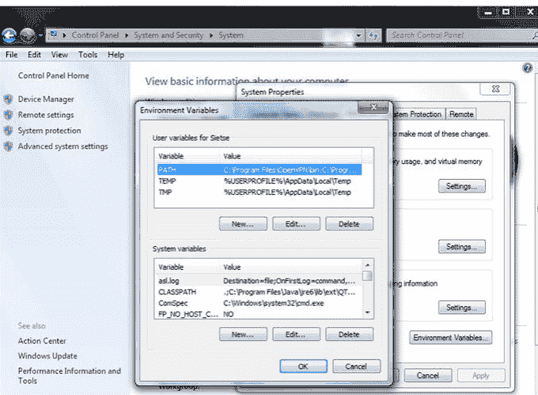

图 1.2 Windows 环境变量对话框

## Mac 用户可以使用 Homebrew

如果你正在使用 Mac OS X，也可以使用 Homebrew 来安装 Play 2。使用命令 `brew install play` 进行安装，Homebrew 将下载并解压最新版本，并处理将其添加到你的路径中。

现在，可以在打开的任何新 shell 中使用 Play 了。试着看吧；打开一个 shell，输入 `play` 命令。你应该会得到类似所示的输出：

```
$ play
2.1.1 (using Java 1.7.0_21 and Scala 2.10.0)
```

这不是一个 Play 应用！

使用 `play new` 在当前目录下创建一个新的 Play 应用，或者进入现有的应用并使用 `play` 启动开发控制台。

你可以在 `http://www.playframework.org` 浏览完整文档。

如你所见，这个命令并没有太大作用。但 Play 确实会尝试提供帮助；它告诉你它无法执行任何操作（“This is not a play application!”），并建议了一个你可以用来启动的命令（`play new`）。这将是使用 Play 时反复出现的主题；每当出现问题时，Play 都会猜测你正尝试做什么，准确解释发生了什么错误，并建议修复的下一步。不过，这不仅限于命令行输出；稍后在浏览器中也会看到类似的实用错误信息。

现在，让我们遵循 Play 的建议：创建一个新应用。

### 1.5.2 创建你的应用

Play 应用是文件系统上的一个目录，包含特定的结构，Play 使用该结构查找配置信息、代码以及所需的任何其他资源。我们不需要自己创建这个结构；当我们使用 `play new` 时，Play 会为我们完成。此命令会将当前目录转换为 Play 应用，或者你可以将新应用所需的名称作为参数添加，它将为你创建该目录。

按照传统，任何技术教程中的第一个示例都应该被称为“Hello World”。输入以下命令：`play new HelloWorld`。Play 会要求你确认名称，在问题出现时按回车即可。


```
play! 2.1.1 (using Java 1.7.0_21 and Scala 2.10.0)
http://www.playframework.org
```

新应用将在 /Users/sietse/Hello World 创建

应用名称是什么？[HelloWorld]

> HelloWorld

你想为这个新应用使用哪个模板？

- 1 - 创建一个简单的 Scala 应用
- 2 - 创建一个简单的 Java 应用

> 

Play 现在正在询问我们想要什么种项目。选择选项 2，Java。

> 2

好的，应用 HelloWorld 已创建。

玩得开心！

恭喜你，你创建了第一个 Play 2 应用。让我们看看里面包含什么。

## Play 应用结构

`play new` 命令始终创建一个具有基本结构的默认应用，包括一个最小的路由配置文件、一个处理 HTTP 请求的控制器类、一个视图模板、jQuery 以及默认的 CSS 样式表。如果你还不了解这些这些含义，不要担心；我们将在第 2 章详细介绍。

下面显示新创建的应用的完整内容。

## 新 Play 应用中的文件

- README
- app
  - Application.java
  - views
    - index.scala.html
    - main.scala.html
- conf
  - application.conf
  - routes
- project
  - build.properties
  - plugins.sbt
- public
  - images
    - favicon.png
  - javascripts
    - jquery-1.9.0.min.js
  - stylesheets
    - main.css
- build.sbt
- test
  - ApplicationTest.java
  - IntegrationTest.java

这种目录结构适用于所有 Play 应用。

现在我们已经看到了构成我们应用的文件，让我们看看它长什么样。是时候运行应用了。

## 运行应用

Play 2 始终需要在应用目录内启动，因此进入目录：`cd HelloWorld`。现在只需输入即可启动 Play。


```
$ cd HelloWorld
~/HelloWorld play
[info] Loading global plugins from /Users/sietse/.sbt/plugins
[info] Loading project definition from /Users/sietse/HelloWorld/project
[info] Set current project to HelloWorld
```


# 第1章 Play 简介

```
play! 2.2.0 (using Java 1.7.0_21 and Scala 2.10.0),
http://www.playframework.org

> 输入 'play help' 或 'license' 获取更多信息。
> 输入 'exit' 或使用 Ctrl+D 退出此控制台。

[Hello World] $
```

你处于 Play 控制台中。在 Play 控制台中，你稍后在浏览器中也会看到类似的实用错误信息。

## 1.5.7 添加一个编译错误

在动作方法（action method）中，删除 "Hello world" 的结束引号，保存文件并在网络浏览器中刷新页面。你将得到一个非常有用的编译错误，如图 1.5 所示。

修复代码中的错误，保存文件，并再次刷新页面。修复了！Play 会动态加载更改，因此你不需要在每次更改时都手动构建应用程序。

## 1.5.8 使用 HTTP 请求参数

尽管如此，这不是一个真正的 Web 示例，因为我们还没有使用 HTTP 或 HTML。让我们它更具交互性，并使其成为一个真正的 HTML 页面。此外，向控制器类中添加一个带有 `String` 参数的新动作方法：

```
public static Result index(String name) {
    return ok("Hello " + name);
}
```

现在，如果你想尝试这个新方法，你需要设置与该方法对应的 HTTP 路径（例如，`/hello`）。你还希望将名为 `name` 的 HTTP 查询参数链接到我们方法的 `name` 参数。这被称为参数绑定（binding）。为了让它工作，我们需要告诉 Play 我们想做什么。

设置这种绑定的关键在于我们之前看到的 `index` 方法最初是如何作用的。如果你打开该文件，你将看到以下行：

`conf/routes`。事实上，这个文件是：

```
GET / controllers.Application.index()
```

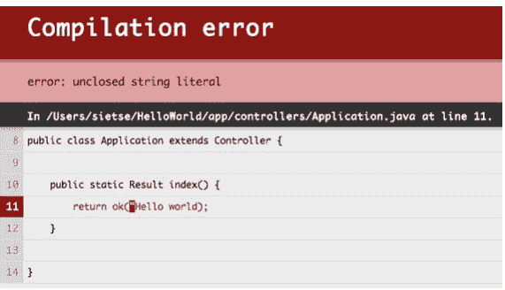

图 1.5 编译错误在网络浏览器中显示，并高亮了相关的源代码。

## Hello Play!


图 1.6 使用 HTTP 查询参数的输出

那一行被称为*路由*（route），它将 HTTP 路径映射到我们应用程序中的动作方法。在这种情况下，它将路由 URL（`/hello`）映射到 `Application.index()`。

为了让我们新的 `hello()` 方法有一个可以访问的 URL，我们需要为它创建一个路由。在 `conf/routes` 文件中添加新的一行，将 `/hello` 映射到我们的新方法，并使用名为 `name` 的 `String` 参数：

```
GET /hello controllers.Application.hello(name:String)
```

现在打开 `http://localhost:9000/hello?name=Play!`，你可以看到 URL 的查询参数是如何传递给动作控制器的。你应该得到如 1.6 所示的输出。

输出文本的示例 Web 并不好用；我们需要 HTML 输出。让我们为我们的动作方法创建一个 HTML 模板。

### 1.5.9 添加一个 HTML 页面模板

在 `app/views` 目录下，添加名为 `hello.scala.html` 的文件，内容如下：

```
@(name:String)
<!doctype html>
<html>
<head>
  <meta charset="UTF-8">
  <title>Hello@{name}</title>
</head>
<body>
<h1>Hello @{name}</h1>
</body>
</html>
```

这是一个*Scala 模板*，一种基于 Scala 语言语法的模板。别担心，你不需要学习 Scala！把它想象成其他新的模板语言即可。

我们模板的第一行定义了参数列表——在本例中是 `name` 参数。文件的其余部分是一个简单页面的 HTML 文档。如果你仔细查看 HTML 身体，你会发现它包含一个 `em` 标签，其内容是一个表达式 `@name`。它将输出 `name` 参数的值。

为了使用此模板，我们必须编辑 `hello` 动作方法，使其返回一个封装模板的结果而不是 `String` 字面量：

```
public static Result hello(String name) {
  return ok(views.html.render(name));
}
```

## Hello Play!

图 1.7 使用我们的 HTML 模板的输出

刷新网页——`http://localhost:9000/hello?name=Play!`——你将看到格式化的 HTML 输出，如图所示。

恭喜你，创建了你的第一个 Play 应用程序！你已经看到了构成 Play 应用程序的所有部分。还有一点需要注意，它虽然不是 Play 应用程序的一部分，但在开发过程中非常重要；Play 控制台。让我们看看控制台是什么：

## 1.6 控制台

Web 开发人员习惯通过浏览器与应用程序交互。通过 Play，你可以使用控制台与 Web 应用程序的开发环境和构建系统交互。这对于快速实验和自动化操作都很重要。

要启动控制台，在应用程序目录中运行 `play` 命令无需额外参数：

```
play
```

如果你已经在运行 Play 应用程序，可以输入 Control+D 停止应用程序并返回控制台。

Play 控制台提供了多种命令，包括你之前看到的 `run` 命令。例如，你可以编译应用程序以发现通常在浏览器中显示的相同编译错误，如之前看到的缺失引号：

```
[hello] $ compile
[info] Compiling 1 Java source to hello/target/scala-2.9.1/classes.
[error] hello/app/controllers/Application.java:11:
unclosed string literal
[error] return ok(index.render("Hello world\);
^
[error] hello/app/controllers/Application.java:11:
  ') expected
[error] return ok(index.render("Hello world\);
^
[error] hello/app/controllers/Application.java:12:
  '; expected
[error] }
[error] hello/app/controllers/Application.java:14:
reached end of file while parsing
[error] ^
```


# 第二章 应用程序的组成

## 本章涵盖了

- 介绍我们的示例应用程序
- 讨论新应用程序的内容
- 设置 IDE
- 配置调试器

现在你已经了解 Play 是怎么回事，是时候开始构建一个严肃的应用程序了。在本章中，我们将深入探讨构成 Play 应用程序的要素，并为你介绍构建 Play 应用程序所需的所有重要概念。后续章节将详细探索每个概念。

在本章中，我们还将介绍示例应用程序，随着章节的推进，我们将将其演变为一个企业级的应用程序。我们选择的示例并不是下一个 Twitter 或 Facebook（它们具有特定且不常见的需求和挑战），而是客户可能会要求你构建的东西。我们从创建一个开始

## 2.1 介绍我们的应用程序

在本书的剩余部分中，我们将从零开始构建企业级 Web 应用程序。Acme Paperclip 公司要求我们为构建一个基于 Web 的仓库管理应用程序。他们对仓库流程自动化有各种计划，但他们首先希望通过为他们的产品系列构建一个简单的产品目录，来证明我们有能力胜这项工作。

我们将为他们构建的应用程序是一个维护产品目录的简单 CRUD 应用程序。用户能够浏览产品列表，还可以添加新产品。这只是一个概念验证，我们将模拟存储这些产品；数据存储将使用 mock（模拟数据），而不是使用数据库。我们将在第 7 章添加持久化功能。

但首先，让我们创建一个新的 Play 应用程序作为我们的仓库应用程序。正如我们在第 1 章创建“Hello World”示例时所做，我们将使用 `play new` 命令。请运行 `play new warehouse`，你将获得一个新的目录，其中包含一个默认的 Play 应用程序。让我们看看里面有什么。

## 2.2 Play 应用程序概览

查看你的应用程序目录，你会发现它包含以下文件和目录：

```
README
app
  controllers
    Application.java
  views
    index.scala.html
    main.scala.html
conf
  application.conf
  routes
project
  build.properties
  plugins.sbt
  build.sbt
public
  images
    favicon.png
  javascripts
    jquery-1.9.0.min.js
  stylesheets
    main.css
test
  ApplicationTest.java
  IntegrationTest.java
```

> ² 创建 (Create)、检索 (Retrieve)、更新 (Update)、删除 (Delete)

## 2.3 Play 的配置文件

我们将详细介绍每个顶级目录。`app` 目录是最重要的，但我们将最后介绍它，先讨论其他的。

### 2.3 Play 的配置文件

`conf` 目录是配置应用程序的地方。它的内容如下：

- `application.conf`
- `routes`

如你所见，此目录包含两个文件：`application.conf` 和 `routes`。`application.conf` 文件包含关于你应用程序的配置信息。你将在这里配置日志、数据库连接或服务器运行的端口等内容。

应用程序配置文件在启动时加载并且是全局可用的。这意味着如果你为你的应用程序需要配置选项，可以在文件中添加一些自定义选项，并在你自己的代码中使用它们。当你运行 `play new` 时，Play 会生成一个示例配置，如果你好奇，可以打开它并研究一下。我们将在在本章以及本书的其余部分在运行这些选项时，介绍其中一些选项。

`conf` 目录中的另一个文件是 `routes` 文件。在这里，你可以定义应用程序的路由，即从 HTTP URL 到应用程序代码的映射。它已经包含了两个示例路由：

```
# 主页
GET / controllers.Application.index()

# 将 /public 文件夹中的静态资源映射到 /assets URL 路径
GET /assets/* controllers.Assets.path(path="public", file)
```

`routes` 文件的每一行都定义了一个路由。让我们关注第一个路由；我们将在 2.5 节中解释第二个路由的作用。

任何路由由三部分组成：HTTP 方法、路径和动作方法，如图 2.1 所示。

我们的示例路由将任何针对 '/' 的 HTTP 请求映射到 `controllers.Application.index()`。这意味着任何针对（根）URL 的 GET 请求都将由 `index` 处理。

```
GET /list controllers.Products.list()
```

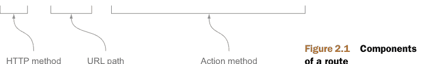

## 关于 HTTP 方法

如果你对 HTTP 协议并不熟悉，HTTP“方法”（method）的概念对你来说可能是很新的。HTTP 方法与你在 Java 中找到的方法类型无关。关于 HTTP 协议及其方法及其含义有大量的文档可以查阅；如果你好奇，可以在网上搜索，但这里是你通过本章节将获得的内容的总结。

HTTP 请求的方法表示了你请求的目的：例如，你想从服务器检索资源，还是向其提交信息。HTTP 规范中定义了许多不同的方法，协议的一些扩展还添加了更多方法，但 HTTP 标准中最常用的两种方法是 `GET` 和 `POST`。

`GET` 请求是获取资源的检索，它不包含正文，尽管 URL 可能包含参数（`?` 之后的所有内容）。重要在于，`GET` 请求永远不要对服务器产生任何持久影响；每当你 `GET` 一个 URL 时，它应该产生相同的效果。这种现象的专业术语是*幂性*（idempotence）。最重要的记住，你应该只将其用于信息的*检索*，而不是用于提交数据。

另一方面，`POST` 方法是数据提交的请求，并可能包含正文。它仍然指向一个 URL，但 `POST` 请求会对服务器产生影响。`POST` 请求通常用于创建或修改信息的表单。这就是为什么当你重新加载你 POST 过的 URL 时，浏览器会向你警告。

HTTP 标准中有许多方法，例如 `PUT` 和 `DELETE`，但我们将在讨论 HTTP API 时再谈论它们。

`controllers` 包中的 `Application` 类。我们把处理请求的方法称为“动作方法”（action methods）。

`routes` 文件对任何 Play 应用程序来说都是重要的。它允许你“设计”你的 URL。这是一件大事。（如果不是最重要的话）其他的 Java Web 框架通常规定了你的 URL 应该是什么样的，否则框架就无法工作。因为 Play 让你对 URL 模式有完全控制权，你可以设计清晰、人类可读且可收藏的 URL。

我们列表中的下一个目录是 `project` 目录，它包含了配置构建过程的文件。

## 2.4 构建配置文件

`project` 目录看起来如下：

- README
- app
- project
  - `build.properties`
  - `plugins.sbt`
  - `build.sbt`
- public

在这些文件中，你只需要处理顶级目录下的 `build.sbt`。`build.properties` 和 `plugins.sbt` 都是 SBT 配置文件，描述了要使用的 Play 版本和 SBT 版本。SBT（Scala 构建工具）是 Play 控制台和构建所依赖的工具。

`build.sbt` 是一个你偶尔需要编辑的文件。生成的 own看起来如下：

```
name := "warehouse"
version := "1.0-SNAPSHOT"
libraryDependencies += Seq(
javaJdbc,
javaBean,
cache
)
```

`Play.project.JavaSettings` 定义了应用程序的版本号以及可能需要的任何管理依赖。管理依赖是你在程序使用的库和模块，Play 可以自动查找并下载它们。这被称为解析依赖。如果你以前用过 Maven 或 Ivy，可能对这个过程熟悉。

如你所见，Play 已经为你添加了一些默认模块。每个 Play 项目默认使用 `javaJdbc` 组件与数据库交互，使用 `javaBean` 组件和 `cache` 模块提供缓存功能。你可以在第 7 章阅读更多关于数据库模块的内容。

如果你想对某个库添加依赖，你需要在列表中添加一行。例如，假设你想使用 Google 的 Guava 库来在 JDK 标准库的基础上获取一些有用的功能。你可以这样添加一个 14.0 版本的依赖：

```
name := "warehouse"
version := "1.0-SNAPSHOT"
```

> 3 Play 委托给 SBT。

4 访问 http://code.google.com/p/guava-libraries/ 了解更多关于 Guava 的信息。

```scala
libraryDependencies === Seq(
  javaJdbc,
  javaEbean,
  cache,
  "com.google.guava" % "guava" % "14.0"
)
play.Project.playJavaSettings
```

当你的应用程序下次启动时，Play 将解析依赖，自动下载 JAR 包并将其添加到类路径中。

依赖解析的工作原理是：对于某些预配置的依赖仓库，查询你所需的文件的正确版本。互联网上有各种依赖仓库，为 Java 生态系统中可用的大多数库提供服务。最为人知的仓库是 Maven 中央仓库，地址为 http://search.maven.org/。

依赖管理系统足够智能，可以下载你的依赖，称为传递依赖（transitive dependencies）。如果你在使用传递依赖，并且想要自己包含一个有有依赖列表的库，你不再需要跟踪应该放置哪个版本的 JAR。依赖管理系统会为你完成所有工作。


使用依赖的另一个巨大用处是，你不需要随源文件一起保留任何库，从而使你的代码库保持整洁和短小，同时确保它始终可以构建（只要包含这些文件的仓库服务器仍然可用）。你获得的另一个额外好处是很容易将库升级到不同版本：只需更改依赖声明中的版本，即可完成。

Play 2 在你的应用程序启动时，一旦发现此文件中发生任何更改，就会自动解析任何依赖，因此你不需要担心必须触发依赖更新。

如果你想使用一个尚未在任何仓库中的库——例如，当它是一个新库，或者你内部开发的库——你不需要使用依赖管理来使用它。你可以在应用程序根目录下创建一个新的 `lib` 目录，Play 在那里发现的 JAR 包将自动添加到应用程序的类路径中。

我们将在第 11 章中介绍更多关于依赖和依赖管理的知识。让我们进入下一个目录 `public`。

# 公共资源

`public` 目录包含以下文件：

- `README`
- `conf`
- `project`
- `public`
  - `images`
  - `favicon.png`
  - `javascripts`
    - `jquery-1.7.1.min.js`
  - `stylesheets`
    - `main.css`

正如你从其内容和名称猜的那样，`public` 目录包含直接提供而不经过任何处理的资源。这是我们在 2.3 节中看到的第二个路由：它将此目录的内容作为公共资源提供，这些文件是客户端目录可用的。

# 将 /public 文件夹中的静态资源映射到 /assets URL 路径

```
GET /assets/*file controllers.Assets.at(paths("public", file))
```

公共资源通常用于你的应用程序。诸如图像、样式表、JavaScript 文件和静态 HTML 页面都是公共资源。公共资源不是由你的应用程序生成的；它们直接提供给客户端。

为提供公共资源添加一些额外功能。它支持使用 `ETag` 头部进行缓存，以及使用 `gzip` 进行压缩。

如果你对预处理某些文件（例如 LESS 样式表、Coffee-script 或 JavaScript 文件）感兴趣，请务必阅读第 2.6.1 节关于编译资源的章节。但首先，让我们移动 `app` 目录。

## 应用程序代码

`app` 目录是你的应用程序最重要的目录。它包含了你的应用程序代码——应用程序中任何编译的部分，例如你的源文件和视图模板，我们稍后会讨论。新生成时，`app` 目录包含以下内容：

```
app
  controllers
    Application.java
  views
    index.scala.html
    main.scala.html
conf
project
public
target
```

这些文件负责生成我们在第 1 章 1.5.5 节导航到 `http://localhost:9000/` 时看到的欢迎页。

有一个文件负责生成我们在导航到 `http://localhost:9000/` 时看到的欢迎页：`Application.java`，它处理业务逻辑。

有两个视图文件 `index.scala.html` 和 `main.scala.html`，它们位于 `views` 目录，它们负责生成 HTML。它们在 `controllers` 目录中生成内容。

LESS (http://lesscss.org) 是一种动态样式语言，被编译为 CSS，提供了更强大且灵活的样式语言。`.less` 文件保存在 `app/assets` 中将被编译到应用程序的公共文件夹，这意味着结果作为公共资源可用。

CoffeeScript (http://coffeescript.org) 是一种编译为 JavaScript 的编程语言。它通常认为比 JavaScript 更整洁、更易读，并且越来越流行。`.coffee` 文件放置在 `app/assets` 中将被编译到应用程序的公共文件夹，就像 LESS 文件一样。

如果你在使用 CoffeeScript、JavaScript，你可能想使用 Google 的 Closure 编译器（https://developers.google.com/closure/compiler/；不要与编程语言 Clojure 混淆）。Closure 编译器分析你的 JavaScript 代码，尝试让它更快，并警告你潜在的问题。它还可以让你的代码更小（这被称为压缩），这将使其下载和运行更快。像 LESS 和 CoffeeScript 一样，将任何你想编译的 `.js` 文件放置在 `app/assets` 目录中，它们将被编译到 `/public`。

# 第二章 应用程序的组成

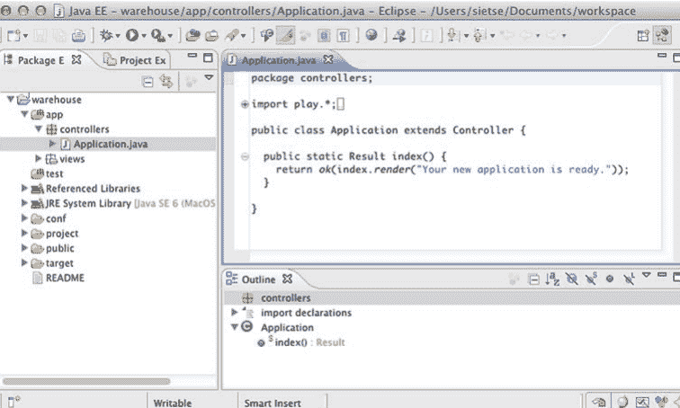

### 2.2 在 Eclipse 中创建新的 Play 应用

首先，你能够生成 Eclipse 特有的文件，这些文件会指示 Eclipse 如何加载你的应用程序及其依赖项，以及如何构建它。当你从 Play 控制台运行 `eclipse` 命令时，Play 会为你生成必要的文件。

一旦生成了这些文件，Eclipse 就能将你的应用程序目录识别为 Eclipse 项目并可以直接导入。要执行此操作，请使用 Eclipse 菜单栏中“File（文件）”下的“Import（导入）”命令。当 Eclipse 询问想要导入什么时，进入“General（常规） > Existing Projects into Workspace（现有项目到工作空间）”。在下一个页面，点击“Browse（浏览）”选择你的应用程序根目录，Eclipse 就会如图 2.3 所示识别该项目。点击“Finish（完成）”按钮，你的 Eclipse 项目设置就完成了。

## 2.7 NetBeans

NetBeans 是另一个知名且广泛使用的 Java IDE。它是开源且免费的。NetBeans 7.3 原生支持 Play。你只需要在 NetBeans IDE 中安装 NBPlay 插件即可。要执行此操作，请访问 http://plugins.netbeans.org/plugin/47637/。

### 设置 IDE

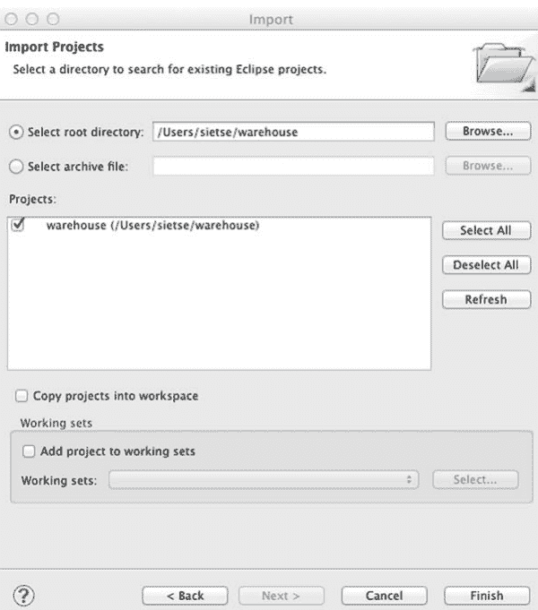

图 2.3 在 Eclipse 中导入项目

你应该看到一个类似于图 2.4 的屏幕。

点击“Download（下载）”按钮下载插件并将其保存到已知位置。下载完成后，在 NetBeans IDE 中，选择菜单“Tools（工具） > Plugins（插件）”。选择“Download（下载）”选项卡，然后点击“Add Plugins（添加插件）”按钮。如图 2.5 所示，选择之前保存的 NBPlay 插件。

你现在正在安装插件。

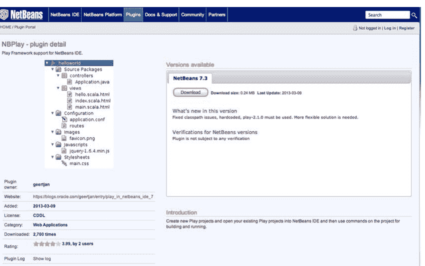

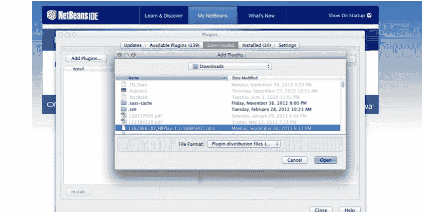

图 2.4 NetBeans 插件中心

图 2.5 安装 NetBeans 插件

### 设置 IDE

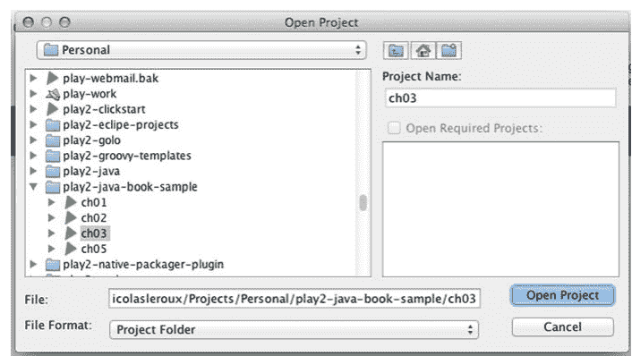

**图 2.6** 在 NetBeans IDE 中打开新项目

现在，打开你新创建的项目。NetBeans 现在识别出它是一个 Play 2 项目，如图 2.6 所示。

Play 2 插件为 Play 2 模板文件和路由文件提供了语法高亮、语法检查和自动补全，如图 2.7 所示。

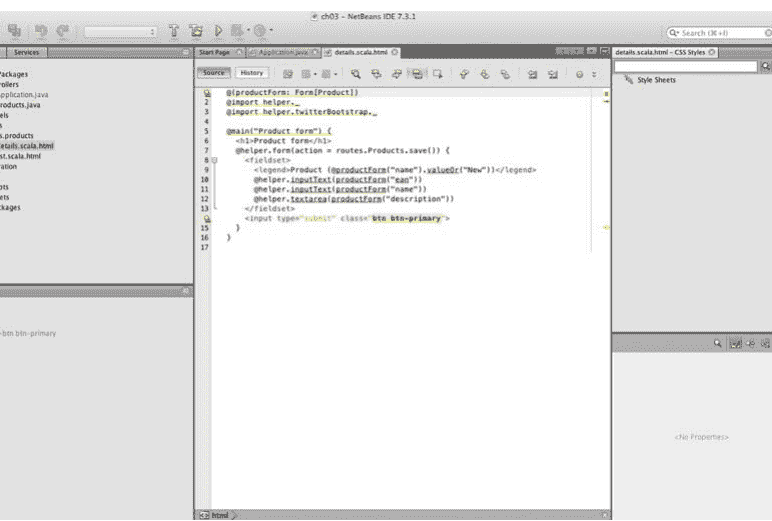

**图 2.7** 在 NetBeans IDE 中的新应用程序

## 2.7.3 IntelliJ IDEA

IntelliJ IDEA 是来自 JetBrains 的概念性 IDE。它是开源的，社区版免费使用，付费的“Ultimate（旗舰）”版本提供了更强大的功能。

从 12 版本开始，IntelliJ 支持 Play 2。这意味着在 Play 2 模板和路由文件中，你可以获得语法高亮、检查和自动补全，如图 2.8 所示。

Play 2 可以根据你的应用程序创建一个 IntelliJ“项目”，该项目中的模型部分可以导入到你可能拥有的任何现有项目中。要创建 IntelliJ 项目，请从 Play 2 控制台运行 `idea` 命令。

要在 IntelliJ 中打开项目，请从菜单栏选择“File（文件） > Open project...（打开项目...）”，并选择你的应用程序目录。

### 2.7.4 使用调试器

Java IDE 中最有用的功能之一是它们的调试器，调试器接入 JVM 并允许你在任何点（例如断点）暂停代码执行，以检查应用程序的状态。

要调试 Play 应用程序，你需要以调试模式启动它，并配置你的调试器使用远程调试，这意味着你的调试器将连接到一个已经运行的 JVM，而不是由 IDE 启动并连接到它。

### 设置 IDE

要以调试模式启动 Play，请使用 `debug` 参数启动它。Play 会告诉你应该将调试器连接到哪个端口，默认为 9999：

如果你想对 Play 应用程序使用 Eclipse 的调试器，你需要从“Run（运行）”菜单设置一个新配置。选择“Remote（远程）”并点击“New（新建）”创建一个新的远程配置。将其设置为连接到本地 上端口 9999 的 Play 应用程序。要开始调试，请从菜单栏选择“Run（运行） > Debug（调试）”，如图 2.9 所示。

要对 Play 应用程序使用 IntelliJ 的调试器，请从菜单栏选择“Run（运行） > Edit Configurations（编辑配置）”，然后点击左上角的加号。在弹出的菜单中，选择“Remote（远程）”创建一个新的调试配置。要开始使用你的新配置，从菜单栏选择“Run（运行） > Debug...（调试...）”。

## 配置

创建、管理配置并附加 Java 虚拟机

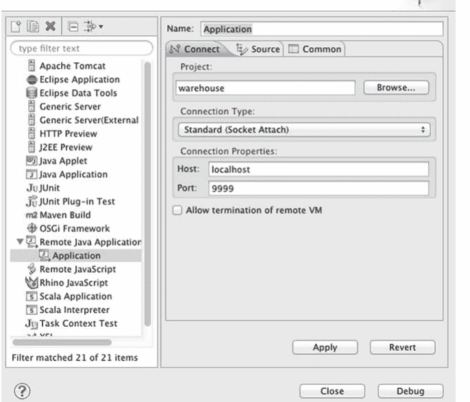

图 2.9 Eclipse 中的调试配置

## 2.8 总结

在本章中，我们创建了一个 Play 2 项目并识别了哪些目录构成了应用程序。我们还学习了如何设置 IDE 以及如何将调试器附加到运行的应用程序。在下一章中，我们将开始编码。

# 基础 CRUD 应用程序

本章涵盖：

- 对所有主要概念的介绍
- 创建一个应用程序

在上一章中，我们引入了示例应用程序：仓库管理系统。既然我们知道了要构建什么，并且设置好了 IDE，现在是开始编码了。

在本章中，我们将开始实现一个概念验证（POC）应用程序。它是一个简单的 CRUD 应用程序，数据存储在内存中而不是数据库。我们将在后续章节中演进这个 POC 应用程序，但这个简单的应用程序将作为我们的起点。我们将从设置带有方法的控制器开始。

## 添加控制器和操作

在第 1 章中修改了 `Application` 类，更改了默认输出并添加了自定义操作。`Application` 类是控制器的示例。控制器作为 action 方法的所在地，这些 方法是应用程序的入口点。当 HTTP 请求到达 Play 服务器时，它由路由器处理，路由器通过 `conf/routes` 文件配置。在选择正确的 action 方法后，该方法执行必要的逻辑以对请求返回结果。这一过程如图 3.1 所示。

让我们为上一章创建的新应用程序创建一个控制器。控制器的唯一要求是它扩展 `play.mvc.Controller`。它不需要属于特定的包，尽管将控制器放在 `controllers` 包中很方便。让我们为我们的产品目录创建一个控制器。因为我们处理的是产品，我们将将其命名为 `Products`。在 `controllers` 包下创建 `Products` 类（这意味着文件名为 `/app/controllers/Products.java`）。让此类扩展 `Controller`，如下：

```
package controllers;
import play.mvc.Controller;
public class Products extends Controller {
}
```

空控制器不做任何事情。控制器的全部目的是提供 action 方法。一个 action 方法必须符合以下要求：

- 它必须是 `public`（公共的）。
- 它必须是 `static`（静态的）。
- 它的返回类型必须是 `Result`（其子类）。

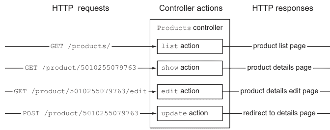

图 3.1 请求路由到操作

## 使用路由将 URL 映射到动作方法

让我们为我们的控制器添加动作方法（action methods）。对于我们的概念验证应用程序，我们需要列出目录中的产品、显示单个产品的详情，并保存新产品和更新的产品。我们稍后会为这些操作添加动作，但现在我们将让它们返回一种特殊类型的结果：TODO。TODO 结果表示该方法尚待实现。相应的动作如下列表所示：

### 列表 3.1 添加动作方法

```java
package controllers;
import play.mvc.Controller;
import play.mvc.Result;

public class Products extends Controller {
    public static Result list() {
        return TODO;
    }

    public static Result newProduct() {
        return TODO;
    }

    public static Result details(String ean) {
        return TODO;
    }

    public static Result save() {
        return TODO;
    }
}
```

- 列出所有产品
- 显示空白的产品表单
- 显示产品编辑表单
- 保存产品

现在我们已经有了动作方法，给它们分配 URL，以便我们可以访问它们。

### 3.2 使用路由将 URL 映射到动作方法

为了确定哪个动作方法处理给定的 HTTP 请求，Play 会获取请求的属性（例如方法、URL 和参数），并在一组映射路由中进行查找。正如我们之前在第 2.3 节中看到的，路由是在应用程序 `conf` 目录下的 `routes` 文件中配置的。按照下列表为我们的新操作添加路由：

### 列表 3.2 为我们的产品目录添加路由

| 路由 (Route) | 动作 (Action) |
| --- | --- |
| GET /products/ | controllers.Products.list() |
| GET /products/new | controllers.Products.newProduct() |
| GET /products/:ean | controllers.Products.details(ean: String) |
| POST /products/ | controllers.Products.save() |

现在我们有了一些路由，让我们尝试它们。如果应用程序尚未运行，请启动它，并将浏览器指向 http://localhost:9000/products/。你应该能看到图 3.2 所示的页面。

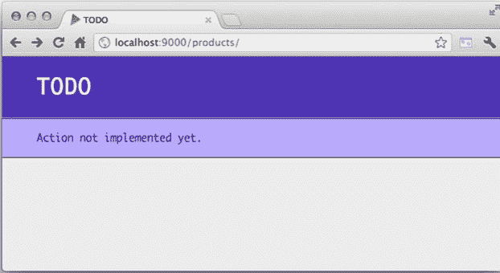

图 3.2 Play 在 /products 的 TODO 占位符

如果你看到了 TODO 占位符页面，说明控制器、动作方法和路由都设置正确。是时候添加功能了。第一步是添加一个用于建模建模的类。

## 3.3 添加模型并实现功能

为了创建一个产品目录，我们需要一个类来表示应用程序中的“一个产品”。此类类被称为模型类（model classes），因为它们代表了现实世界的概念。

### 3.3.1 创建模型类

我们目前保持产品模型简单：文章编号、名称和描述即可。对于文章编号，我们将使用 EAN 代码，这是一种 13 位的国际标准代码。虽然代码由数字组成，但我们不会对其进行数学运算，因此我们将使用 `String` 来表示 EAN 代码。


# 创建 Product 类

在名为 `models` 的新包下创建一个名为 `Product` 的类。同样，Play 并没有要求你必须在 `models` 包中建模类，但这是一种惯例。将我们之前提到的属性添加到我们的新类中，并添加一个构造函数，以便在实例化时设置这些属性。此外，添加一个无参数构造函数，当我们稍后添加数据库持久化时会需要它。我们最后添加的是 `toString()` 方法，因为这将使我们更容易看到我们拥有哪个产品对象。

我们最终得到了如下列表所示的类：

## 列表 3.3 /app/models/Product.java

```java
package models;

public class Product {
    public String ean;
    public String name;
    public String description;

    public Product() {}

    public Product(String ean, String name, String description) {
        this.ean = ean;
        this.name = name;
        this.description = description;
    }

    public String toString() {
        return String.format("%s %s", ean, name);
    }
}
```

# 第3章 基础 CRUD 应用

```html
<tr>
<td href="@Routes.details(product.ean)">
@product.ean
</td>
<td href="@Routes.details(product.ean)">
@product.name</a></td>
<td href="@Routes.details(product.ean)">
@product.name</a></td>
</tr>
</body>
</table>
```

渲染后（我们稍后会介绍如何实现），此模板将产生如图 3.3 所示的页面。

别担心，稍后我们会让它变得更好。首先，在不进入过多细节的情况下（关于模板的更多细节请参阅第 8 章），让我们看看模板中发生了什么。

## 模板是如何工作的

列表模板的第一行是参数列表。

```
@products: List[Product]
```

通过参数列表，我们定义了此模板接受哪些参数。参数列表中的每个项目都由一个名称、一个随后的冒号以及参数类型组成。在我们的示例中，我们有一个名为 `products` 的参数，类型为 `List[Product]`，表示我们想要渲染的产品列表。此参数列表将是此模板的 `render` 方法定义的一部分，这就是 Play 实现模板安全的方式。

让我们看看下一行代码，它开始了一个代码块：

```
@main("Products catalogue") {
...
}
```

通过这段代码，我们调用了另一个模板，即名为 `main` 的模板。这是 `/app/views/main.scala.html` 模板，是 Play 在我们创建应用程序时为我们创建的。它包含了一些样板 HTML 代码，我们将其封装在所有页面周围，这样我们再也不需要担心它了。我们在块中编写的代码将最终位于渲染的 HTML 页面的 `<body>` 标签中。这就是你如何在 Play 中组合模板的方法，我们将在稍后的章节中看到更多内容。

> ^3 在 Scala 语法中，泛型类型参数使用方括号而不是像 Java 那样使用角括号。

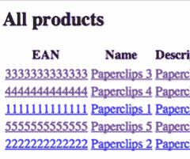

## 实现列表方法

我们代码块主体主要是 HTML，它将原封不动地包含在渲染页面中。只剩下一部分模板代码——遍历我们产品列表的部分：

```
@for(product <- products) {
...
}
```

这段代码类似于普通的 Java `for-each` 循环：它遍历集合并对集合中的每个元素重复执行它编写的代码，将当前元素分配给变量。在我们的示例中，它为 `products` 列表中的每个 `Product` 生成一行表格数据。列表 3.7 显示了完整的循环以供参考：

## 列表 3.7 生成产品描述的 for-each 循环

```
@products: List[Product]
<table class="table table-striped">
<thead>
<tr>
<th>EAN</th>
<th>Name</th>
<th>Description</th>
</tr>
</thead>
<tbody>
@for(product <- products) {
<tr>
<td><a href="@routes.Products.details(product.ean)">
@product.ean
</a></td>
<td><a href="@routes.Products.details(product.ean)">
@product.name
</a></td>
<td><a href="@routes.Products.details(product.ean)">
@product.description
</a></td>
</tr>
}
</tbody>
</table>
```

紧随 `@` 的代码片段会被求值，结果包含在输出中。在这种情况下，我们使用它来打印产品的属性，并根据路由配置生成指向我们操作方法的链接。关于路由的所有内容，请参阅第 5 章。我们很快就会渲染模板，但首先添加一些样式。

## 添加 Bootstrap

在我们的示例中，我们更多地关注功能而不是样式；毕竟这是一本关于 Play 的书，而不是关于网页设计的。但有一种方法可以用很小的努力让事情看起来更好：由 Twitter 提供的 Bootstrap。

Bootstrap 提供了一些 CSS 和图像文件，可以让 HTML 看起来很好，只需在此处添加 HTML 类即可。在 Play 应用程序中使用 Bootstrap 很简单。方法如下：

首先，从网站 http://getbootstrap.com 下载最新版本的 Bootstrap。将 zip 文件的内容解压到应用程序 `public` 目录下的 `bootstrap` 目录中。这将使得文件从你的应用程序可用。

接下来，我们将在模板中包含 Bootstrap CSS。我们在所有页面中都需要它，主模板是执行此操作的最佳位置。打开 `/app/views/main.scala.html` 文件，并在 `<head>` 元素下方添加以下行：

```html
<link href="@routes.Assets.versioned("bootstrap/css/bootstrap.min.css")" rel="stylesheet" media="screen">
```

这将允许你的页面由 Bootstrap 设置样式，从现在起，我们将使用 Bootstrap 让我们所有的示例看起来更好。如果你想学习更多关于 Bootstrap 的知识，请查看网站 http://getbootstrap.com。

# 渲染模板

现在我们有了模板，我们剩下的工作就是收集产品列表并在 `list` 方法中渲染模板。下面的列表显示了如何操作：

## 列表 3.8 渲染列表模板

```java
...
import views.html.*;

public class Products extends Controller {

    public static Result list() {
        List<Product> products = Product.find.all();
        return ok(views.html.products.list.render(products));
    }
}
```

## 添加表单支持

这些辅助函数用于帮助我们生成 HTML。第一个导入了通用的 HTML 辅助函数，第二个让生成的 HTML 符合 Twitter Bootstrap 布局。当我们开始表单时，首先使用这些辅助函数之一：

```
@helper.form(action = routes.Products.save()) {
}
```

表单辅助函数生成一个 HTML `<form>` 元素。`action` 参数告诉它表单应该提交到哪里。在这种情况下，它是我们 `Products` 控制器的 `save` 方法。Play 会为我们将其转换为具有正确 URL 值的 action。

如果没有任何字段，表单就没太大用处。让我们看看它们是如何构建的。

### 渲染输入字段

我们的表单包含一个单一字段集（fieldset），它是使用普通 HTML 创建的。`fieldset` 的 `legend` 字段的值非常值得一看。它以普通文本“Product”（产品）开头，然后我们使用表单对象来构建剩余的值：

```
@productForm("name").value("New")
```

在这里，我们通过调用 `productForm("name")` 来请求字段名。该对象的类型是 `Form.Field`，它代表字段中 `name` 属性的字段名。要获取它，我们需要调用字段的 `value` 方法。由于我们不知道该字段是否有值，因此我们使用 `value` 方法，它允许我们在字段没有值时指定一个默认值。这意味着我们不需要手动检查值，从而避免了在模板中编写大量杂乱、冗长的代码。

模板中的接下来的几行渲染了输入元素——为我们的 `Product` 类的每个属性渲染一个：

```
@helper.inputText(productForm("ean"))
@helper.inputText(productForm("name"))
@helper.textarea(productForm("description"))
```


当我们的表单渲染时，这些行将如列表所示渲染：

列表 3.10 渲染后的输入元素

```
<div class="clearfix" id="ean_field">
  <label for="ean">ean</label>
  <div class="input">
    <input type="text" id="ean" name="ean" value="">
    <span class="help-inline">/</span>
    <span class="help-block"></span>
  </div>
</div>
```

> ⁴ `productForm("name")` 是 `productForm.field("name")` 的缩写。

# 第 3 章 基础 CRUD 应用

```
<div class="clearfix" id="name_field">
  <label for="name">name</label>
  <div class="input">
    <input type="text" id="name" name="name" value="**">
    <span class="help-inline"></span>
    <span class="help-block"></span>
  </div>
</div>

<div class="clearfix" id="description_field">
  <label for="description">description</label>
  <div class="input">
    <textarea id="description" name="description" </textarea>
    <span class="help-inline"></span>
    <span class="help-block"></span>
  </div>
</div>
```

通过三行简单的代码，我们就生成了所有的 HTML！而且有 Bootstrap 辅助函数，看起来也不错。

模板表单的最后一行添加了一个普通的 HTML 提交按钮，到此，我们的表单就准备就绪。当你尝试时，表单将调用我们尚未实现的 `save` 方法，所以它不会执行什么操作。让我们现在来处理它。

## 3.7 处理表单提交

当你在浏览器中提交表单时，表单会被提交到 HTML `<form>` 元素 `action` 属性中指定的 URL，在我们的案例中，它最终落到我们的 `Products.save` action 方法中。现在轮到我们了，将这些表单参数转换为一个 `Product` 对象，并将其添加到产品目录中。幸运的是，Play 有工具可以让这项工作变得简单。

我们在上一个节中创建 `Form` 对象时，我们使用它基于 `Product` 类创建了一个 HTML 表单。但 Play 的表单也可以反过来这样工作。这种反向过程被称为绑定（binding）。

Play 可以将一组名称/值组合作为 `Map` 绑定到具有相同名称属性的类上。在这种情况下，我们不想绑定一个 map，而是想从请求中绑定值。在 HTTP 请求中，这种情况非常常见，以至于 `Form` 类必须有 `bindFromRequest`。这将返回一个新的 `Form` 对象，其值从请求参数中填充。要从我们的表单提交中获取 `Product` 并将其添加到目录，我们可以编写以下代码：

列表 3.11 Product 绑定

```
public class Products extends Controller {
  ...
  public static Result save() {
    Form<Product> boundForm = productForm.bindFromRequest();
    Product product = boundForm.get();
    product.save();
    return ok(String.format("Saved product %s", product));
  }
}
```

当你尝试表单时，你将得到一个简单的文本消息，告知你产品已成功添加。如果你接着检查我们在 3.5 节中创建的目录列表，就可以验证这一点。

但我们目前的实现并不特别好。例如，用户可以自由省略 EAN 代码和产品名称；目前这行得通，但这不是我们想要的。另外，报告结果的文本消息也不太好。如果能在失败时带上错误消息重新渲染表单会好得多，并在成功时显示表单。

首先，让 ean 和 name 字段变为必填。我们可以通过注解让这些字段变为必填 `play.data.validation.Required`。Play 会检查这些注解并报告错误。

列表 3.12 添加约束

```
...
import play.data.validation.Constraints;

public class Product {

    @Constraints.Required
    public String ean;
    @Constraints.Required
    public String name;
    public String description;
}
```

我们需要做的是在控制器中执行验证并显示错误或成功消息。在我们的方法的第二行，我们询问 Form 是否错误，如果有，我们就添加错误消息并渲染页面。如果没有错误，我们添加成功消息并重定向到产品列表。

列表 3.13 更好的 save 实现

```
public static Result save() {
    Form<Product> boundForm = productForm.bindFromRequest();
    if(boundForm.hasErrors()) {
        flash("error", "Please correct the form below.");
        return badRequest(render(boundForm));
    }

    Product product = boundForm.get();
    product.save();
    flash("success", String.format("Successfully product %s", product));

    return redirect(routes.list());
}
```

错误和成功消息是不可见的。我们把它们添加到了名为 flash scope 的地方。flash scope 是我们在请求之间存储变量的地方。flash scope 中的所有内容在下一个请求到来之前会被删除。它非常适合这种成功和错误消息，但我们仍然需要记住它们。

由于这些消息在整个应用程序中使用，让我们把它们添加到主模板，因为每个页面都扩展了它。这样，每个页面都会自动显示我们放入 flash scope 的任何消息。将列表 14 中的行添加到 `app/views/main.scala` 中 `<body>` 元素的开头。

列表 3.14 显示 flash 成功和错误消息

使用表单验证可以做很多，但现在这些足够了。你可以在第 6 章学习所有关于表单的知识。

现在有了工作的表单，可以使用它编辑产品。为了实现这一点，我们需要像列表所示实现 `details` 方法：

列表 3.15 实现 details 方法

```java
public class Products extends Controller {
  ...
  public static Result details(String ean) {
    final Product product = Product.findByEan(ean);
    if (product == null) {
      return notFound(String.format("Product %s does not exist.", ean));
    }
    Form<Product> filledForm = productForm.fill(product);
    return ok(details.render(filledForm));
  }
}
```

## 添加删除按钮

请修正下表单。

# 产品表单

产品 (回形针 6)

| ean | 此字段为必填 |
| :--- | :--- |
| name | Paperclips 6 |
| 必填 | |
| description | Example回形针 6 |
| 必填 | |

图 3.6 我们表单中的验证错误

如你所见，不需要大量的代码就能将“新产品”转换为“编辑产品”表单。这种方法从 URL 中获取一个 EAN 代码作为参数，正如我们在 3.2 节的路由文件中定义的那样。然后，我们根据 EAN 查找产品。如果没有具有该 EAN 的产品，我们就返回 404 - Not Found（未找到）错误。

如果我们找到了产品，就会创建一个新的 `Form` 对象，并根据找到的产品数据进行预填充。我们对现有对象表单使用 `fill` 方法来实现这一点。需要注意的是，这并没有填充现有的表单，而是根据现有表单创建一个新的表单对象。

一旦我们有了表单，剩下的工作就是渲染模板并返回 "ok" 结果，就像 `newProduct` 中一样。此操作完成后，产品列表中的所有链接都能正常工作。完成 CRUD 功能还需要最后一步：我们需要实现删除功能。

## 3.8 添加删除按钮

让我们开始为我们的 `Products` 控制器添加一个 `delete()` 方法。该功能在很大程度上与 `details()` 方法相似；我们接收一个 EAN 参数，搜索对应的 `Product`，如果找不到，则返回 404 错误。一旦获取了 `Product`，我们就将其删除并重定向回 `list()` 方法。列表 3.16 显示了该方法。

列表 3.16 delete() 动作方法

```
public static Result delete(String ean) {
    final Product product = Product.findByEan(ean);
    if (product == null) {
        return notFound(String.format("Product %s does not exist.", ean));
    }
    product.remove();
    return redirect(routes.Products.list());
}
```

现在我们需要添加一个更改某些内容的方法，按以下顺序排列以便从 Web 端调用。因为这是 JavaScript，我们不能将其设置为 GET 操作。在 RESTful 接口中，我们必须将其设置为 DELETE 操作。为了实现这一点，我们将使用一些 JavaScript 来发送 DELETE 请求；我们不能使用简单的链接（那会发出 GET 操作）。这很简单；以下代码将指示你的浏览器向服务器发出一个 DELETE 请求：

```
<script>
function del(urlToDelete) {
    $.ajax({
        url: urlToDelete,
        type: 'DELETE',
        success: function(results) {
            // 刷新页面
            location.reload();
        }
    });
}
</script>
```

现在，让我们更改路由以添加一个 DELETE 路由，如下：

```
DELETE /products/:ean controllers.Products.delete(ean: String)
```

现在是时候为我们的删除操作添加用户界面了：由于删除操作需要 HTTP 调用，我们添加了一个简单的链接来调用我们的 JavaScript 方法，该方法反过来调用服务器并刷新页面。我们添加了一个带有 `onclick` 处理程序的简单链接并调用我们的 JavaScript，这就完成了。后续列表了更新后的列表。

列表 3.17 更新后的模板—app/views/products/list.scala

```
@(products:List[Product])
main("Products catalogue") {
<h2>All products</h2>

<script>
function del(urlToDelete) {
    $.ajax({
        url: urlToDelete,
        type: 'DELETE',
        success: function(results) {
            // 刷新页面
            location.reload();
        }
    });
}
</script>
<table class="table-striped">
<thead>
<tr>
<th>EAN</th>
<th>Name</th>
<th>Description</th>
<th></th>
</tr>
</thead>
<tbody>
@for(product : products) {
<tr>
<td><a href="@routes.Products.details(product.ean)">@product.ean</a></td>
<td><a href="@routes.Products.details(product.ean)">@product.name</a></td>
<td><a href="@routes.Products.details(product.ean)">@product.description</a></td>
<td>
<a href="@routes.Products.details(product.ean)"><i class="icon icon-pencil"></i></a>
<i class="icon icon-trash" onclick="del(@routes.Products.delete(product.ean))"></i>
</td>
</tr>
}
</tbody>
</table>

<a href="@routes.Products.newProduct()" class="btn">
<i class="icon-plus"></i> New product
</a>
```

继续并测试它。你现在应该可以从列表中删除产品了。

添加了功能后，我们的概念验证应用的功能已经完成。

## 3.9 总结

在本章中，我们实现了一个简单的概念验证应用。我们在内存数据存储中实现了所有 CRUD 功能。我们从一个包含一些基础动作方法的控制器开始，并将它们连接起来。

# 第 4 章 回顾企业应用

# 61

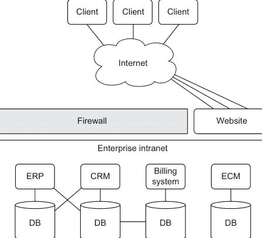

图 4.2 集成后的企业应用生态系统

CRM：客户关系管理

ERP：企业资源计划

ECM：企业内容管理

来自不同系统的信息分发到其他业务应用程序。

通常，这类应用程序在晚上进行批处理运行。例如，每晚运行一次批处理，从 CRM 系统收集新客户并输入到账单系统中。这允许应用程序保持隔离状态（正如它们各自的业务部门一样）。通常，用户界面与应用程序本身一样复杂，因为几乎没有留时间来考虑用户。

与现有系统的集成在大多数情况下并不是应用程序需求的一部分；它往往是在开发过程中不断被添加的，导致架构变得非常复杂且难以维护。扩展性也变成了一个问题。图 4.2 展示了完成集成后典型的企业应用系统。

正如我们所看到的，系统之间并没有产生真实的交互。大多数时候，一个应用程序直接访问另一个应用程序的数据源。这导致了以下问题：

- 强耦合，使得应用程序难以更新或升级
- 缺乏关注点——CRM 应用程序现在可以决定充当 ERP
- 数据完整性问题

如今，企业应用倾向于围绕一个新概念进行开发和架构设计：面向服务的架构。其理念是每个应用程序都应该设计成一个服务。这允许：

- 松耦合
- 服务可重用
- 标准化的服务合约
- 服务可发现性

面向服务的架构 (SOA) 是一种基于结构化软件模块集合（称为服务）的软件设计和架构模式，这些模块共同提供了大型软件应用的完整功能。SOA 的目的是允许连接到网络的大量的应用程序轻松协作。

最常见的实现是通过所谓的 ESB（企业服务总线）。每个服务通过消息进行通信。ESB 通常执行以下任务：

- 监控和控制服务之间消息交换的路由
- 控制服务的部署和版本
- 确保服务的重用性
- 提供通用服务，如事件处理、数据转换、消息和事件队列、安全或异常处理

图 4.3 展示了上一个图中应用程序的典型 SOA 实现。

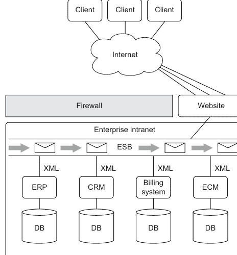

CRM：客户关系管理

ERP：企业资源计划

ECM：企业内容管理

图 4.3 使用 SOA 的企业应用

# 确定今日企业应用的挑战 63

SOA 在企业中仍然较新。主要缺点由于大量的配置和实现细节导致复杂性。事实是，需要额外的精力来维护所有服务。大多数时候，不同服务之间的通信通过消息交换发生。设计消息交换流和消息组合需要额外的关注。SOA 往往也不太符合规范，意味着在 Web 上暴露服务仍然需要额外努力。

显然，有一种新事物正在改变这种现状：互联网。这对企业应用来说是一个游戏规则的改变者，带来了新的挑战。

## 4.2 确定今日企业应用的挑战


今天，请求信息并立即获取似乎是理所当然的。改变改变了日常生活。如果我们想知道从新加坡出发的航班何时到达，可以连接到机场网站获取立即结果。我们不需要等待一两个小时才能获得信息。更好的信息推给我们；当重要（或不重要）的事件发生时，我们的手机可以提醒我们。例如，当凯尔特人赢得 NBA 赛时，我们的手机会告诉我们。应用程序是响应式的。

作为用户，我们现在正在处理多个信息流。我们不再是拉取信息；现在信息是推给我们的。

用户与 IT 系统的交互也发生了巨大变化。在使用酒店预订系统之前，我们不需要阅读用户手册，也不需要培训课程。软件现在每个人都可以访问和使用。

由于软件易于触达和访问，用户可以向不同系统添加更多信息，产生越来越多的数据。今天，我们正在处理海量信息。

有了如此大量的信息，大多数互联网 Web 应用程序提供了一种通过公共 API 进行查询的方法，允许第三方结合这些信息并实时进行重新分发。Web 应用程序之间进行实时通信。

简单性也是关键。大多数流行的 Web 应用程序专注于一个问题并提供一个简单的解决方案。企业应用应该向它们学习。这并不意味着应用程序本身是简单的；而是意味着应用程序可以被扩展。

扩展性通常是企业的一个强性需求。但谈论企业扩展性与谈论 Web 应用扩展性不是一回事。对于后者，我们通常是指应用程序可以处理数百万用户。企业扩展性意味着应用程序能够随着企业需求增长。这可以体现在用户方面，但也意味着应用程序应该能够扩展到新的业务需求。例如，如果 X 公司收购了 Y 公司， X 公司的通讯录应用程序应该能够吸收 Z 公司的通讯录。扩展涉及到支持更多用户和更多数据，但也涉及集成更多系统。云计算有助于前者，而简单的架构和云 API 有助于后者。再次，现代 Web 应用提供了这两个需求。

你可能同意，当我们谈论 Web 应用时，这一切都是前提的。企业应用很少满足这些需求。正如所猜测的，企业必须解决这些挑战以保持竞争优势：

- 向客户/员工推送实时数据
- 处理大量数据流
- 提高扩展性和集成
- 提供与最新客户端的轻松集成
- 确保应用程序与现有系统之间的互操作性

互联网、HTML5、XML、JSON 和 HTTP 协议（以及优秀的开发者）提供了解决这些挑战的大部分底层需求，正如我们在后续章节中看到的。还存在一种范式转变，由于硬件演进，客户端程序变得越来越复杂；例如，你的手机比你两年前的台式电脑还要强大。企业也会适应这种新范式。

简单并不意味着你只能构建简单的应用程序。相反，这意味着应该很容易集成应用程序组件。其理念是用简单的构建块来分解你复杂的应用程序。每个构建块都应该足够简单，让每个人在不需要太多理解的情况下理解。

## 理解 Play 在企业环境中的应用

思考。它还允许新开发者加入项目并从一开始就开始工作，而无需浪费时间配置环境或理解其他模块的细节。

高生产力意味着任何开发者都可以在几小时内生成可运行的软件，并且不需要外部帮助即可完成。

现代框架意味着框架专注于服务器端，并将尽可能多的任务委托给（丰富的）客户端。Play 确保尽可能将任务交给网络浏览器，并允许与最新的浏览器规范轻松集成。今天，许多创新发生在客户端。我们的智能手机现在比两年前的桌面电脑还要强大。因此，服务器应该尽可能将任务交给客户端。服务器为客户端做的越少（例如渲染或用户界面交互），应用程序的可扩展性就越高。

Play 还设计为通过 HTTP 与与其他 Web 应用轻松集成。它提供了轻松与其他 Web 应用通信的功能。

这些概念如何适用于企业环境？如果你将网络看作一家巨型公司，将不同的 Web 应用视为业务部门，一切就都能解释通了。许多 Web 应用能够从其他 Web 应用获取数据。例如，大多数新的 Web 应用允许你使用现有的 Framework 凭据登录；你不需要重新实现用户验证。让我们详细查看它的含义以及 Play 如何提供帮助。

Play 通过推广 RESTful Web 应用实现了应用之间的可达性和互操作性。这意味着 Web 应用应该使用 REST 暴露其方法和数据，并且大多数时候它们也应该将自己暴露为 Web 服务。

RESTful Web 应用是使用 HTTP 和 REST 原则实现的 Web 应用。它是资源的集合，具有四个定义的方面：

- Web 应用的基础 UI，如 `http://example.com/warehouses/`
- Web API 支持的数据的互联网媒体类型
- Web API 使用 HTTP 方法支持的操作集（例如，`GET`、`PUT`、`POST` 或 `DELETE`）
- 超文本驱动的 API（由 URL 定义 API）

为了便于 Web 应用内部的通信，Web API 通常是 Web 应用的一部分。REST 促进了既有信息系统的复用。这意味着 REST API 倾向于复用相同的架构，这使得开发者的工作变得更加容易。

RESTful 架构的目标是：

- 组件交互的可扩展性
- 接口的通用性
- 组件的独立部署
- 用于减少延迟、强制安全和封装遗留系统的中间组件

# 第 4 章 企业级应用，Play 风格

如果我们对这个企业级术语进行转译，它意味着应用之间具有更强的互操作性、使用预定义操作生成接口的标准方法（例如，`GET`、`PUT`、`POST` 或 `DELETE`），以及组件之间的松耦合。这正是企业级应用所追求的。

REST 风格描述了六个架构限制：

- 客户端-服务器——统一接口将客户端与服务器分离。这种关注点的分离意味着，例如，客户端不关心数据存储（数据保留在每个服务器内部），从而提高了客户端代码的可移植性。服务器不关心的用户界面或用户状态，因此服务器可以更简单、更具扩展性。只要它们之间的接口不改变，服务器和客户端也可以独立地替换和开发。
- 无状态——服务器的通信进一步限制为服务器请求上不存储任何客户端上下文。来自任何客户端的每个请求都包含处理请求所需的所有信息，任何状态都保存在客户端中。
- 可缓存——就像万维网一样，客户端可以缓存响应。因此，响应必须隐式或显式地定义自己为可缓存或否，以防止客户端在后续请求中复用或使用不当的数据。良好的缓存管理可以部分或完全消除客户端交互，进一步提高可扩展性和性能。
- 分层系统——客户端通常无法判断自己是直接连接到服务器，还是连接到路径中的中间设备。中间服务器可以通过负载均衡和提供共享缓存来提高可扩展性。
- 按需代码（可选）——服务器可以通过发送可执行代码临时扩展或自定义客户端的功能。示例包括如 `JavaScript` 等客户端脚本。
- 统一接口——前文讨论的客户端与服务器之间的统一接口简化并解耦了架构，使得每个部分都能独立演进。

遵守这些限制并符合 REST 架构风格，可以使任何类型的分布式超媒体系统拥有理想的涌现属性，例如性能、可扩展性、简单性、模块化、可见性、可移植性和可靠性。Play 的本质强制了这些原则，这意味着使用 Play 实现 RESTful Web 应用比以往任何时候都更容易。

回到企业环境，在创建新应用时，从高层次来说，我们希望：

- 复用现有的软件块
- 从其他系统检索数据
- 向其他系统暴露数据

我们说 Play 促进了 REST 架构风格，它提供了所讨论的元素，同时关注简单性和复用现有的信息系统。图 4-4 显示了我们的企业级应用使用 REST 风格架构后后的样子。

通过 Play，每个企业级应用都是一个 Web 应用，每个企业都提供一个 REST Web API。企业级应用通过 HTTP 使用 RESTful API 相互通信。REST Web API 在设计 Web 应用时自然形成。因此，Web 应用的架构设计是关键。我们将在下一节中看到当我们构建仓库应用时这一切是如何运作的。通常，不同应用之间的通信通过 HTTP 进行，交换 JSON、XML 或开发者同意的任何格式。

在实践层面，企业倾向于拥有大型开发团队。因此，在团队之间分配工作是关键。Play 提供了两种实现方法：

- 创建 Play 模块或子应用
- 创建 Web 应用（即服务）


- CRM: 客户关系管理
- ERP: 企业资源计划
- ECM: 企业内容管理

## 定义我们的仓库企业应用

应用 HTTP 动词，我们想要暴露以下接口：

- `GET /product/new` “创建产品”页面
- `POST /product/` 创建新产品
- `GET /product/123456789101` 显示产品 123456789101 的详情页
- `POST /product/123123123123` 更新产品 123123123123
- `DELETE /product/123123123123` 删除产品 123123123123
- `GET /products/` 列出所有产品
- `GET /stockitems/` 显示仓库层级的当前库存物品
- `POST /stockitems/123123123123?quantity=2` 向当前库存量添加两个产品 123123123123
- `POST /stockitems/123123123123?quantity=-2` 从当前库存量移除两个产品 123123123123

我们可以看到，最后两条规则在 URL 获取数量参数方面略有不同。这是因为 URL 是等幂的（idempotent）；也就是说，对于给定的 URL，它们总是返回相同的值（在数学中，等幂意味着在乘以自身后值不发生变化）。通过我们定义的接口，我们可以轻松地在两个团队之间分配工作。一个团队可以开发大部分，而另一个团队可以专注于管理库存物品。其他系统（以及其他团队）已经模拟使用该接口，因为我们只返回简单且约定的数据消息。

例如，要创建一个新产品，我们将使用以下方式发送：

```
Request:/products/ Request Method:POST
Request Body:
------WebKitFormBoundary50qb38u5oy6
Content-Disposition: form-data; name="ean"

1234567891012
------WebKitFormBoundary50qb38u5oy6KC8
Content-Disposition: form-data; name="name"

Item
------WebKitFormBoundary50qb38u5oy6KC8
Content-Disposition: form-data; name="description"

A new item
------WebKitFormBoundary50qb38u5oy6KC8-
```

我们将从服务器得到以下返回内容：

```
HTTP/1.1 201 Created
Location: /product/123456789101
Content-Length: 0
```

# 第 4 章 企业应用，Play 风格

现在，如果我们想将应用暴露为 Web 服务，我们可能也会有 URI：

```
POST /api/v1/product/
GET /api/v1/product/$(id)
POST /api/v1/product/$(id)
DELETE /api/v1/product/$(id)
GET /api/v1/products/
GET /api/v1/stockitems/
POST /api/v1/product/$(quantity=$(qty)
```

你会注意到，我们在调用前缀了一个版本号，该版本号通过 api 资源暴露出来。这是因为其他系统可以引用这个唯一的 URL，而无需担心版本发生变化。这允许我们的 API 独立运行，而不影响应用程序的其他部分。例如，我们的应用程序可以使用 XML 并解释 XML。请注意，我们可以决定使用 HTTP，但对于涉及的其他系统来说这可能并不实际。在 Web 服务的情况下，我们只关心业务数据，而不取决于如何表示它们。

这意味着如果我们发送了以下内容：

```
Request URL:/products/
Request Method: POST
Request Body:
<xml version='1.0' encoding='utf-8'>
<product ean="123456789101" name="item"
description="an item"/>
```

服务器响应为：

```
HTTP/1.1 201 Created
Location: /product/123456789101
Content-Length: 102
<xml version='1.0' encoding='utf-8'>
<product ean="123456789101" name="item"
description="an item"/>
```

如你所见，行为是相同的；只是交换协议发生了变化。XML 很容易转换，任何系统都可以对其进行修改以用于其他应用程序。这种接口的巨大优势在于，你的应用程序现在能够与其他进行通信。这意味着你企业中的另一个应用程序可以作为客户端并向仓库应用程序请求信息。由于 Play 应用天生是异步的，Play 应用可以同时请求多个部分信息，并在结果可用时对其进行组合和转换。

## 4.5 总结

在本章中，我们解释了什么是企业应用以及它与其他应用的区别。我们看到了允许企业应用进行通信的各种类型架构。我们识别了即将到来的企业挑战，并迅速看到了 Play 如何提议解决这些问题。然后，我们看到了 Play 如何融入企业环境，以及通过使用 RESTful 原则，企业应用如何简单高效地通信。我们还学习了如何解构我们的应用程序，以便多个团队可以并行工作。

然后，我们关注了将在贯本书中构建的应用程序，以及如何构建一个接口以便内部和其他系统能够与其通信。在下一章中，我们将实现这个接口。我们将通过解释 Play 控制器如何工作来使其具体化。

## 控制器如何工作

在应用 HTTP 方面，我们想要暴露以下内容：

- 控制器如何工作
- 路由
- 拦截器
- 作用域

在本章中，我们将详细解释控制器在 Play 中如何工作。我们将通过解释以下内容来具体化：

- 控制器如何工作
- 路由
- 拦截器
- 作用域

（注：原文此处存在大量重复段落，根据排版规范已合并去重）

## 控制器与方法

 方法

在 Play 中，控制器是方法的聚合。方法是一个接收某些参数并返回 `Result` 类实例的静态方法。换句话说，方法总是采取如下：

```java
public static play.mvc.Result methodName(params)
```

注意方法是静态的。这是因为控制器实际上是单例，这符合 HTTP 的方法。由于 HTTP 没有对象的概念，主要是过程化的，我们不应该尝试在控制器中映射那些对象概念。你应该将你的方法视为来自 HTTP 的入口点。你可以将它们与 Java 程序的静态 `main` 方法相比。

由于方法作为入口点，你不应该在控制器和方法中放入过多业务逻辑。相反，我们做的是传入的 HTTP 请求转换为你的业务逻辑理解的数据，交给该逻辑，并将结果转换为 HTTP 响应。

在编写静态代码时，线程安全通常是一个问题，但 Play 会确保所有的方法都是线程安全的。你会发现静态化对你编写代码的影响很小。

想象一下，Play 队列控制器的请求，以便最快速度处理它们。Netty 和 Akka 在底层被用于以最快速度、线程安全的方式分发并处理用户请求。但 Play 的酷之处在于这些复杂性为你处理好了，所以你不需要担心。

我们在第 3 章已经创建了第一个控制器。让我们检查它。虽然控制器是任何 Play 应用的中心点，但其实际代码位于方法中。

 检查我们的控制器

让我们回顾控制器的内容。在你最喜欢的文本编辑器或 IDE 中，打开 `app/controllers` 目录下的 `Products.java` 文件，如列表 5.1 所示。

## 从动作方法返回结果

## 列表 5.1 项目目录概述

```
warehouse
  app
    controllers
      Products.java
    models
    views
  conf
    public
    test
  db
```

> 这是我们的 Products 控制器所在的地方

我们首先来拆解类定义。下面的列表显示了一个回顾。

## 列表 5.2 Products 类定义


# 第 5 章 控制器——处理 HTTP 请求

```java
...
import play.mvc.Controller;
...
public class Products extends Controller {
}
```

类定义告诉我们，我们正在扩展 Play 的 `Controller` 类。这是控制器唯一的先决条件；没有其他任何让控制器变得“特殊”的东西。让我们继续查看方法（action methods）。

该方法的第一个动作 `list()` 显示了仓库中的库存产品项。下面的列表显示了一个回顾。

## 列表 5.3 list() 动作方法

```java
public static Result list() {
  List<Product> products = Product.findAll();
  return ok(products.render(products));
}
```

在这个示例中，`ok` 方法构建了一个 200 OK HTTP 响应，其正文是渲染列表模板的结果。注意这个方法包含的代码有多少。它所做的只是对模型层（`Products` 类）进行数据查询。

正如你可能从第 3 章记得的，我们可以通过向应用程序请求 `/products/` URL 来访问列表方法。之所以这样做是因为我们还配置了路由。我们将在 5.3 节中学习有关路由的所有知识，但首先，让我们更多地了解结果。

### 5.2 从动作方法返回结果

除了 `list()` 动作方法外，我们的 `Products` 控制器还包含几个动作方法。列表 5.4 显示了它们定义的概述。

## 列表 5.4 Products 中的动作方法

```java
public class Products extends Controller {
    public static Result list() {
        ...
    }
    public static Result newProduct() {
        ...
    }
    public static Result details(String ean) {
    }
    public static Result save() {
        ...
    }
}
```

动作方法（action method）是一个处理请求参数并产生发送给客户端结果的 Java 方法。每个动作方法都返回一个结果，该结果由 `play.mvc.Result` 值表示，它取代了 HTTP 响应。

#### 5.2.1 结果

让我们仔细看看我们的方法返回了什么：一个 `Result` 对象。结果是对客户端请求的响应。由于我们正在使用 HTML 创建 Web 应用程序，它始终是一个 HTTP 响应。它可以是带有文本正文的 OK、带有 HTML 错误消息的错误、重定向到另一个页面、404 页面等等。

`Controller` 类包含几个生成 `Result` 的状态方法。这些方法都响应 HTTP 状态码，并且它们封装了一个表示请求正文的对象。这的一个例子是我们用于创建 200 - OK 响应码的 `ok()` 方法。我们向它提供了来自列表模板的 HTML 内容，生成了我们返回的 `Result`。要为任何情况找到最佳响应码：

例如，如果用户输入一个的 EAN 编号作为 `show` 的参数，我们可以返回

```java
return badRequest("Incorrect EAN: " + ean);
```

此代码返回一个 HTTP 错误码 400，内容为文本 "Incorrect EAN: x"。一个更合适的响应是回答我们没有找到该产品：

```java
return notFound("No product with EAN: " + ean);
```

此代码返回一个 HTTP 404 错误码，内容为文本 "No product with EAN: x"。

#### 5.2.2 重定向结果

另一个实用的 `Result` 对象是 `Redirect` 结果对象。正如其名，它重定向到另一个动作方法。例如，使用 `Redirect` 结果，我们可以将用户从 `index` 方法重定向到 `list` 方法，允许我们的用户在主页查看产品列表。

```java
public static Result index() {
    return redirect(routes.Products.list());
}
```

`routes` 对象是 Play 2 认为你的 `routes` 文件生成的类。该类只包含允许你访问控制器的静态成员。现在，请记住，`Redirect` 结果是从一个动作方法重定向到另一个动作方法。我们将在下一节中进行更多细节。

还有一个非常有用的 `Result` 对象叫做 `TODO`。正如你可能猜的那样，这个 `Result` 表示该动作尚未实现。当你开发应用程序并且还没有动作方法，但仍需要返回结果时，这非常有用。例如，如果我们有动作方法但实现尚未准备就，我们可以返回：

```java
public static Result items() {
    return TODO;
}
```

当动作方法返回 `TODO` 结果时，客户端将收到 501 - Not Implemented。

#### 5.2.3 使用结果

我们能够控制返回什么状态码。但响应正文呢？Play 知道如何设置 `Content-Type` 头部吗？所有的 `Result` 方法都允许你传递一个 `Content` 对象作为参数。该对象的类型告诉 `Content` 它是什么类型的数据。事实证明，Play 中的模板也返回 `Content`。在第 3 章中，我们构建了第一个模板 `products/list.scala`。接下来的列表提醒你它它的作用：

## 列表 5.5 显示我们的项目

```html
@(products: List[Product])
@main("Products") {
    <h2>All products</h2>
    <table class="table-striped">
        <thead>
            <tr>
                <th>EAN</th>
                <th>Name</th>
                <th>Description</th>
            </tr>
        </thead>
        <tbody>
        @for(product <- products) {
            <tr>
                <td><a href="@Routes.Product.details(product.ean)">@product.ean</a></td>
                <td><a href="@Routes.Product.details(product.ean)">@product.name</a></td>
                <td><a href="@Routes.Product.details(product.ean)">@product.description</a></td>
            </tr>
        }
        </tbody>
    </table>
    <a href="@Routes.Product.newProduct()" class="btn"><i class="icon-plus"></i> New product</a>
}
```

此模板打印产品列表。你需要知道的是，Play 在执行模板时会自动编译模板。此编译的结果是一个带有 `render()` 方法的 Java 类。按照惯例，它被编译成一个类。

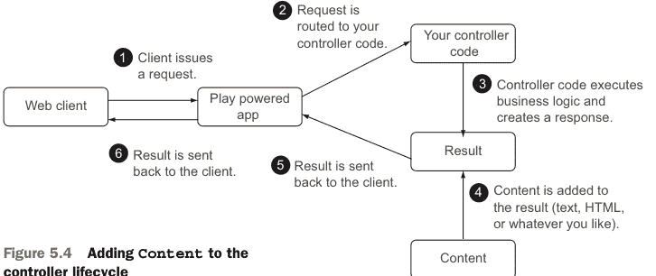

图 5.4 向控制器生命周期添加内容

现在我们能够根据客户端的意愿提供内容了。我们在图中添加了 Content 对象，以解释 Play 中完整的请求/响应生命周期，如图 5.4 所示。

现在我们能够用某些内容来响应请求。让我们来看看我们的代码在响应请求时是如何被调用的。

## 5.3 使用路由将 URL 映射到动作方法

我们现在知道如何渲染内容以及如何执行业务逻辑。但我们如何将要执行的控制器方法与客户端调用的 URL 链接起来呢？

### 5.3.1 将 HTTP 翻译为 Java 代码

记住，我们的客户端只 HTTP。但我们写的代码是 Java 语言。因此，我们需要将 HTTP “语言”翻译成 Java 语言。这就是路由器的角色：将每个传入的 HTTP 请求翻译为动作方法的调用。通过这种方式，它向客户端暴露了控制器方法。从 Play 的角度来看，一个 HTTP 请求可以被视为事件。路由器的作用是协调对这种事件的反应（图 5.5）。

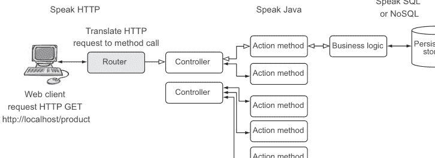

图 5.5 路由器的作用

### 使用路由将 URL 连接到动作方法

请求中包含两个主要信息：

- 请求路径（例如 `/clients/1542/photos/list`），包括查询字符串（例如 `id=2`）
- HTTP 方法（GET, POST, ...）

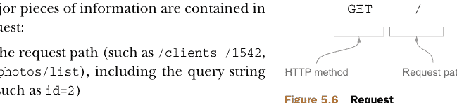

例如，当你在浏览器中使用 URL http://localhost/ 时（假设是为了查看页面），它会向 localhost 服务器发送请求。在服务器上，该请求将被分解，如图 5.6 所示。

让我们来看另一个例子。为了显示列表页的第一页，URL 可能是 http://localhost/product?page=1。它将像 5.7 所示被分解。

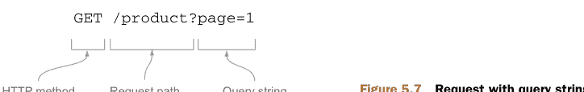

HTTP 方法可以是 HTTP 支持的任何有效方法（GET, POST, DELETE 或 HEAD）。请求路径标识了我们正尝试提供的资源。查询字符串是可选的，用于提供动态参数。查询字符串指定在 `?` 之后，并且始终以 `name=value` 的形式存在。我们假设你完全了解什么是 URL 以及什么是 HTTP 方法。如果不是，请阅读第 3 章的相关内容。

回到我们的应用程序。我们想要提供某些功能，因此我们应该能够响应对控制器和动作方法的请求。正如你可能已经的那样，我们需要将这些请求中的每一个翻译为控制器方法调用。通过这种方式，我们正在从 HTTP 请求翻译为 Java 方法调用。这种翻译就是我们所说的**路由定义**。路由定义包含在 routes文件中。对于我们的应用程序，routes 文件将暴露上面列出的功能。

表 5.1 请求列表

| 方法 | 请求路径 | 描述 |
| :--- | :--- | :--- |
| GET | / | 首页 |
| GET | /products/ | 产品列表 |
| GET | /products/?page=2 | 产品列表的第二页的 EAN |
| GET | /product/501025509763 | 给定 EAN 的产品 |
| POST | /product/501025509763 | 更新产品详情 |

路由定义在 conf/routes 文件中，如下列表所示。

**列表 5.6** 项目目录结构

```
warehouse
  app
    controllers
      Products.java
      models
      views
        products
          list.scala.html
          details.scala.html
  conf
    routes
  public
    test
  db
```

包含指向控制器动作方法路由的 routes 文件

routes 文件不是一个基于文本的文件；它实际上是会被编译为 Java 对象的代码。该对象在我们的控制器中是可以访问的，并通过 routes 进行调用。这意味着，如果路由定义无效，或者请求的 URL 在你的应用程序中不存在，你将看到编译时错误，如图 5.8 所示。

这非常方便，因为你会立即知道出了问题。这是 Play 利用类型安全使你的应用程序更健壮的另一个例子。让我们看看从中获得什么。

### 编译错误

```
value home is not a member of object Application
1 /Users/nicolasleur/Projects/book/conf/routes at line 6.
2 # 此文件定义了所有应用程序路由（优先级优先）
3 #
4
5 # 首页
6 GET / controllers.home()
7 GET /:id controllers.index(id:Long)
8 # 将静态资源映射到 /public
9 GET /assets/* controllers.Assets.at(path:String)
```

图 5.8 routes 文件错误

### 5.3.2 什么是路由

除了明显的错误外，编译的另一个好处是 routes 对象是可以访问的。这意味着如果路由定义无效，或者请求的 URL 在你的应用程序中不存在，你将看到编译时错误。

那么，路由到底是什么？在 routes 文件中，路由由以下部分组成：

- HTTP 方法
- 请求路径
- 可选的查询字符串

回到我们的应用程序。我们想要提供某些功能，因此应该能够响应对控制器和动作方法的请求。正如你可能已经的那样，我们需要将这些请求中的每一个翻译为控制器方法调用。通过这种方式，我们正在从 HTTP 请求翻译为 Java 方法调用。这种翻译就是我们所说的路由定义。路由定义包含在 routes文件中。对于我们的应用程序，routes 文件将暴露上面列出的功能。

回到我们的应用程序

路径的一部分实际上可以作为动作方法的参数。它看起来像这样：

```
GET /product/:ean controllers.Products.details(ean: String)
```

我们用带冒号的参数名称替换了标识 ID 的路径部分。然后在动作调用中引用该参数。对于 String 参数，指定参数类型是可选的，但对于其他任何类型都是必须的。

当我们在浏览器中请求 `/product/11111111111` 时，Products 控制器的 details 方法就会被调用，并带有 11111111111 作为参数。由于我们的参数是 String，Play 不需要做太多。但如果我们的参数是 Long，例如，Play 将确保参数被转换为 Long。

### 5.3.3 动态路径

Play 还能转换为其他类型，例如数组和日期，你也可以添加自己的类型，正如你将在第 6 章看到的。。

如果 Play 无法转换为所需的类型，意味着预期类型是不正确的，你正在做不该做的事。你会看到一个像图 5.11 所示的错误屏幕。

Bad request

对于请求 'GET /products?page=aaa' [无法解析参数 page 为 Int: "aaa"]

图 5.11 错误错误屏幕

## 将 URL 路由到动作方法

## 关于简单数据绑定

类型转换由 Play 自动处理，因此你不需要处理从字符串和其他类型到其他转换。这种自动转换被称为从 HTTP 请求（定义上为字符串）中绑定值到 Java 类型。在第 6 节中，我们将解释 Play 如何绑定到其他类型。绑定也是从 HTTP 到你的 Java 代码的转译过程的一部分。

这是一个非常棒的特性，让我们能够专注于当前的问题。如果你正在使用 Servlet 或任何其他框架，你可能需要编写类似于下面列表的代码。

### 列表 5.7 一个常规的 servlet 方法

```java
public void doGet(HttpServletRequest request, HttpServletResponse response) throws ServletException, IOException {
try {
    final String id = request.getParameter("id");
    final Long code = Long.parseLong(id);
    // Process...
} catch (NumberFormatException e) {
    final int status = HttpServletResponse.SC_BAD_REQUEST;
    response.sendError(status, e.getMessage());
}
```

Play 会为你处理好这些。现在，你在开发时将只会看到括号中的消息（在 5.11 中）。在生产环境中，详细信息会被省略。现在让我们来讨论动态路由部分。

当使用这种语法来定义动态路径部分时，每个参数将精确匹配一个路径，这意味着正斜杠之间（或路径开头）的每个部分。

但你有时可能需要更大的灵活性。如果你希望动态路径包含多个一个由正斜杠分隔的请求路径段，你可以使用 `*id` 语法* 定义动态路径，并将剩余路径作为参数。

例如，假设我们想要绑定到我们的产品图像。路由定义如下：

```
GET /product/image/*imagePath controllers.Products.downloadImage(imagePath: String)
```

如果我们发出类似 GET /products/image/29929/paperclip.jpg 的请求，imagePath 的值将是 29929/paperclip.jpg。

如果你了解正则表达式，你也可以使用 `$id<regex>` 语法为动态部分定义正则表达式：

```
GET /product/$ean{0-9}(13)
controllers.Products.details(ean: Long)
```


此路由仅在 EAN 包含 13 位数字时才生效，这在我们的情况下非常方便，因为我们知道 EAN 代码由 13 位组成。如果 EAN 包含字母数字作为 ID，Play 将返回未找到错误代码。

如你所知，你也可以通过 URL 传递参数。例如，`http://google.com/query=playframework` 包含一个名为 `query` 的参数，值为 "playframework"。你如何在路由文件中指定参数，以便在你的动作方法中访问它？实际上，你甚至不需要在路由文件中声明它，你只需要在动作方法的签名中使用一个同名的参数即可：

```java
public static Result results(String filter) {
...
}
```

如果动作方法定义了一些参数，则所有这些参数值都将在请求路径中进行搜索。它们将像我们之前看到的那样从请求路径中提取，或者将从查询字符串中提取。

让我们来看一个更详细的例子。假设我们想显示产品列表。但列表可能非常大，我们想要进行分页。为了访问前 10 个项目，我们将接收第一页；对于接下来的 20 个，我们将接收第二页，依此类推。以下路由定义在功能上是等效的：

```
GET /products/:page controllers.Products.list(page: Int)
GET /products/ controllers.Products.list(page: Int)
```

这两个路由定义之间有什么区别？第一个路由定义将 `page` 参数作为实际请求的一部分。客户端请求以下路径：`http://localhost/products/2`。第二个路由定义不需要 `page` 参数是请求 URL 的一部分。相反，用户需要使用的是以下 URL：`http://localhost/products/page=2`。

有趣的是，`http://localhost/products/2`（其中 "2" 是页码）并不是一个良好的资源标识符。产品列表可能会变化，因此首选第二个定义。关于这种 RESTful 概念的更多信息，请参考第 4 节。

另外注意，如果我们在请求中没有指定 `page` 参数，Play 会如图 5.12 所示会报错，因为 Play 不知道该参数的默认值。不过，有一种方法可以查看路由文件中的默认值。

 图5.12 缺少参数错误

## 将 URL 路由到动作方法

## 带有默认值的路由

如果请求中没有指定，我们应该选择一个默认值使用。例如，对于我们的分页产品列表，以下语法将请求第一页：

```
GET /products controllers.Products.list(page: Int = 0)
```

使用这种语法，不可能出现“缺少参数”的错误。当未提供参数时，将使用指定的值 "1"。请注意我们使用的是 `Int`，它是 `Integer` 类型的表示。

### 固定值作为参数

现在我们已经看到显示第一页的方法，我们可以使用固定值作为参数来实现：

```
GET /products controllers.Products.list(page: Int = 0)
```

在首页，`page` 参数的值将始终为 1，即使提供了另一个值。使用这些路由定义语法，可能会构造多个匹配相同 URL 的路由。发生发生什么？

### 路由冲突

如果有多个路由匹配同一个请求，将使用第一个（按声明顺序）。例如，在我们的路由中有如下定义：

```
GET /products/new controllers.Products.new()
GET /products/:ean controllers.Products.details(ean: String)
```

最后一行也会匹配 `/products/new`。但由于存在匹配该 URL 的行，使用的是第一个。因此，对 `/products/new` 的调用将由 `new()` 方法处理，这正是我们想要的。如果我们交换这些行，同一个请求将由带有 "new" 值的 `details()` 方法处理，这将会导致问题。我们现在已经足够了解路由定义。回到应用程序。

### 5.3.4 完成我们的路由文件

通过学习的路由，我们可以完成应用程序产品目录的路由。编辑路由文件使其包含列表所示的路由。

| 列表 5.8 我们当前的路由文件 |
| :--- |
| # 首页 |
| `GET / controllers.Products.index()` |
| `GET /products controllers.Products.list(page: Integer = 1)` |
| `POST /products/ controllers.Products.save()` |


```
GET /products/new controllers.Products.new()
GET /products/:ean 2.
```

与我们在第 3 节结束时相比，前两行发生了变化。第一行匹配应用程序的路由 URL，以前指向 `Application.index()`，但现在指向 `Products` 控制器的 `index` 方法。由于我们不再有任何使用 `Application` 控制器的路由，请随意删除该类。

第二个路由仍然指向我们的产品目录，但对动作方法的调用获得了 `page` 参数，默认值为 1。为了让应用程序再次编译并运行，我们需要更改动作方法以匹配路由。第一个方法 `index` 是新写的。我们想显示产品目录的第一页，我们将通过重定向到那里来实现。在 `Products` 类中添加以下动作方法：

```java
public static Result index() {
  return redirect(routes.list(0));
}
```

我们在路由文件中另一个更改是产品列表添加了 `page` 参数。我们需要更改动作方法以匹配路由文件的调用，否则路由文件将无法编译。在 `Products` 类的 `list` 方法中添加该参数，并修复 `save()` 方法最后一行对它的调用，如下：

```java
public class Products extends Controller {
  public static Result list(Integer page) {
    ...
  }

  public static Result save() {
    ...
  return redirect(routes.Products.list(1));
  }
}
```

不要担心更改方法的实现，我们以后会考虑。现在，让我们的路由重新编译足够了。

现在我们知道如何将 URL 链接到动作方法。但反过来呢？如果我们知道动作，如何获取相应的 URL？这是一个反向路由的过程。

### 5.3.5 反向路由

上一节中 `index` 方法的实现很有趣。它发送了一个 HTTP 响应将用户重定向到 `list` 方法。为了构造该方法的的 URL，它使用了路由对象。

路由对象是 Play 作为编译路由文件的结果生成的。路由对象是一个单例对象，仅包含返回的静态方法一个 `Action` 类型的对象。它被用作从控制器引用操作方法的方法，但也用于任何其他需要它的地方（例如在我们的视图中）。我们的操作方法是在编译时添加到该对象中的，此时 Play 生成 `routes` 对象。

`routes` 对象提供了其名称所示的功能，我们称之为反向路由（reverse routing）。

反向路由是普通路由的相反：它将 Java 翻译为 HTTP。反向路由非常重要，因为它允许我们为给定的操作方法获取 HTTP 请求。

例如，你可能希望让你的客户端指向 `edit` 方法。记住，你的客户端只识别 HTTP。你需要返回一个 HTTP 调用：一个 HTTP 方法和一个 URL。这就像是询问 `routes` 对象如何访问该操作方法。`routes` 对象返回一个 `play.mvc.Call` 对象。`play.mvc.Call` 定义了 HTTP，并提供了 HTTP 方法和 URL。它还确保了方法被正确翻译，特别是当参数是操作方法的一部分时。例如，以下调用：

```
routes.products.list(4)
```

被翻译为：

```
GET /products?page=4
```

你现在已经了解了如何通过反向路由将 HTTP 请求翻译为操作方法以及反之的所有知识。你应该对 Play 在接收到客户端请求并将其执行为 Java 代码的操作方式有了全面的理解。现在是详细查看如何简化控制器中一些繁琐操作了。

## 5.4 拦截器 (Interceptors)

让我们回到我们的仓库应用程序。异常偶尔会发生。但如果发生了，我们无法发现它。如果我们能直接告诉 Play，当特定控制器或操作方法中发生异常时，就发送一封包含错误的邮件，那就太棒了。

操作方法可以很方便地组合。这意味着你可以为操作方法添加额外的行为，这正是我们想要做的：捕获操作方法中发生的任何异常并发送有关这些异常的邮件。让我们看看它是如何工作的。

Play 提供了一个 `@With` 注解，它允许你组合操作。`@With` 注解用在操作方法的声明之前。它也可以用于类级别——即控制器本身。在我们的操作方法上声明 `@With` 注解会告诉 Play 在每次执行周围都必须执行某个操作，意味着在执行之前之后。这也被称为拦截器（interceptor），因为它拦截了对操作方法的调用。

`@With` 注解接受一个参数：我们希望我们的代码与之组合的 `Action` 类型。我们将很快构建一个 `CatchAction` 类。

例如，以下代码告诉 Play 使用 `CatchAction` 操作执行操作方法：

```
@With(CatchAction.class)
public static Result show(Long e) { ... }
```

由于我们在方法级别指定了该注解，Play 将仅对此特定方法使用它。如果我们在类级别声明它，`CatchAction` 将被用于控制器的所有操作：

```
@With(CatchAction.class)
public class Products extends Controller { ... }
```

但这个 `CatchAction` 类是什么呢？它是我们提供额外功能代码的地方。我们需要构建它。`@With` 注解接受一个 `Action` 对象作为参数。操作对象必须执行抽象类 `play.mvc.Action`，这意味着它必须实现以下方法：

该方法在操作执行之前被调用。从那里开始，`call` 方法必须使用 `delegate` 对象实际调用操作方法。`delegate` 对象是 `play.mvc.Action` 中操作方法的引用，该方法被标记了 `@With` 注解。换句话说，它代表了原始的操作方法。

让我们去编写我们的异常拦截器。首先，我们将创建一个 `ExceptionMailer` 类，用来代表实际的邮件类，这并不是本次练习的重点。创建如下列表所示的文件：

- Listing 5 /app/utils/ExceptionMailer.java

```java
package utils;
public class ExceptionMailer {
    public static void send(Throwable e) {
        System.out.println("Sending email containing exception " + e);
    }
}
```

我们将通过扩展 Play 提供的 `Play.SimpleAction` 抽象类来创建拦截器操作。`Play.SimpleAction` 类提供了我们所需的所有内容。在下一个列表中，我们将定义 `CatchAction`，它将捕获任何异常并发送邮件。

# 列表 5.10 /app/controllers/CatchAction.java

```java
public class CatchAction extends Action.Simple {
    public F.Promise<SimpleResult> call(Http.Context ctx) {
        try {
            return delegate.call(ctx);
        } catch (Throwable e) {
            ExceptionMailer.send(e);
            throw new RuntimeException(e);
        }
    }
}
```

我们扩展了自抽象 `Action` 类的 `Action.Simple` 类

这是我们需要实现的方法

任何异常都会被捕获并使用我们的 `ExceptionMailer` 类发送

我们现在在 `Products` 控制器上使用我们的 `CatchAction`，用 `@With(CatchAction.class)` 标记控制器

```java
import play.mvc.With;
@With(CatchAction.class)
public class Products extends Controller {
  }
```

让我们看看我们的实现是如何变魔术的。

# 5.4. 解释我们的 CatchAction

我们自定义 Action 的行为由我们对 `call` 方法的实现定义。该方法接受一个参数，Play 对象持有我们的会话（session）、请求（request）、响应和 flash 对象。我们将在下一节中详细查看这些概念。

在我们的实现中，对操作的调用是通过 `delegate` 对象完成的，它包含自己的 `call` 方法。如果触发了异常，我们会捕获它，我们的 `ExceptionMailer` 会发送一封带有堆栈轨迹的邮件。

现在我们知道操作是如何工作的，让我们看看使用它们的其他方法。

# 5.4.3. 操作组合 (Action composition)

一旦你有了一个拦截器，你可能在想如何使用更多拦截器；例如，一个记录对控制器任何访问的 `LogAction`。我们只需要向 `@With` 注解再添加另一个参数即可。

```
@With(CatchAction.class, LogAction.class)
```

如果你熟悉注解，你也可以定义自己的注解，以表示某个操作应该添加到操作方法中。这是一种更具读性的符号，并允许在多个 Web 之间复用。例如，为我们的 `CatchAction` 定义注解将是：

```java
@With(CatchAction.class)
@Target({ElementType.TYPE, ElementType.METHOD})
@Retention(RetentionPolicy.RUNTIME)
public @interface Catch {

```

在这个示例中，我们定义了一个名为 `Catch` 的新注解，并照常使用 `@With` 注解来指示它应该指向哪个类。使用我们新定义的注解，我们现在可以这样标记控制器：

```java
@Catch
public class Products extends Controller { ... }
```

我们不仅仅是为了可读性而使用自己的注解；使用之前的示例，我们可以指定是想发送邮件还是仅仅记录异常。让我们重新定义注解的形式：

```java
@With(CatchAction.class)
@Target({ElementType.TYPE, ElementType.METHOD})
@Retention(RetentionPolicy.RUNTIME)
public @interface Catch {
    boolean send() default true;
}
```

我们在注解中添加了一个参数，默认值为 `true`，用于指定我们是想发送邮件还是仅仅记录。参数值可以通过操作中的 `configuration` 对象进行访问。以下列表显示：

# 列表 5.11 使用配置的 CatchAction

```java
public class CatchAction extends Action {
    public Promise<SimpleResult> call(Http.Context ctx) {
        try {
            delegate.call(ctx);
        } catch (Throwable e) {
            if (configuration.send()) {
                ExceptionMailer.send(e);
            } else
                e.printStackTrace();
            }
        }
    }
}
```

在这个版本的 `CatchAction` 中，我们直接扩展 `Action`，提供了一个泛型类型参数以表示我们想使用 `Catch` 注解进行配置 ①。`configuration` 对象现在将是 `Catch` 注解的实例，这意味着我们可以访问它的 `send` 参数 ②。然后我们使用一个简单的 if语句来决定我们想要做什么 ③ ④。

¹ `ExceptionMailer` 代码此时并不相关，因为目标是展示拦截器是如何工作的。

² 如果你不了解，请阅读 http://en.wikipedia.org/wiki/Java_annotation。

## 关于作用域 (scopes)

我们能够获取代码中发生的任何异常通知。这是一个非常简单的示例，但请思考你可以如何将拦截器用于事务、安全以及你所想到的许多其他示例。

控制器还有一个我们尚未涵盖的重要方面：

## 5.5 关于作用域

我们看到通过使用控制器和路由，我们能够从客户端检索数据并将数据发送回这些客户端。我们并没有真正讨论过数据的生命周期和可访问性。我们假设数据在服务器和客户端之间进行每次通信时都会传输；这确实是实际发生的情况。


但作为开发者，你并不想去管理数据流。你希望在一段时间内存储数据；例如，请求的持续时间或浏览器会话。你将这些数据存储在特定的作用域中。Play 支持多个作用域，它为特定的生命周期存储数据。它们的访问方式类似于 Java 中的 `Map`；你根据键（key）来存储和检索值。

### 5.5.1 关于作用域的历史

Java EE 传统上定义了这些作用域：

- 应用作用域 (Application scope)
- 会话作用域 (Session scope)
- 请求作用域 (Request scope)
- 页面作用域 (Page scope)

应用作用域具有应用生命周期：你存储的数据只要你的应用程序运行，就会一直存在。

会话作用域具有会话生命周期：你存储的数据只要你的浏览器打开，就会一直存在。这传统上你在 URL 中看到的 `JSESSIONID` 参数。`JSESSIONID` 也存储在 cookie 中，因此它在连续请求中对服务器是的。这个 `JSESSIONID` 只是一个指向某些服务器端存储空间的 ID。会话作用域通常用于存储关于你的购物车的信息或你已登录的事实。

请求作用域定义了请求生命周期内的数据：客户端发起 HTTP 请求，请求随来的还有一些数据。这些数据存储在请求作用域中，并且只能在该特定请求处理期间被访问。

页面作用域定义了仅在视图（view）中可见的数据：它可以在渲染阶段访问。例如，你可能希望将应用程序当前的面包屑导航存储在作用域中，以显示当前的应用程序路径。

不同的作用域可以在概念上如图 5.13 所示来看。

> **注意**：尽管某些 Java 框架引入了对话作用域 (conversation scope)，但我们认为这与我们的解释无关，并且比其他任何事情都让人困惑。

在传统的 Java EE 环境中，所有的存储发生在服务器端。这意味着每个客户端都有一个唯一的 ID，服务器使用该唯一 ID 在服务器端检索客户端存储空间。

尽管这具有可能使用少带宽的优点，但在扩展（添加更多服务器）时可能会出现问题，因为你需要在不同的服务器之间同步所有的客户端存储空间。另一个缺点是它让服务器计算了更多操作，而客户端保持优势，但现在现在的 Web 客户端是强大的猛兽。从 CPU 的角度来看，iPhone 比任何五年前的电脑都要强大。此外，Web 标准已经演进，并为 Web 客户端增加了许多功能，例如本地存储 (local storage) 和 Web Worker (web workers)。

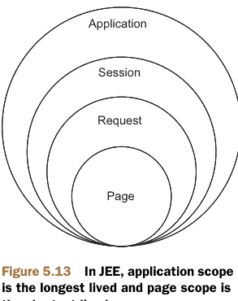

### 5.5.2 使用 Play 存储数据

当然，正如你现在可能猜到的，Play 与 Java 框架有些不同。有趣的是，来自其他语言的 Web 框架，如 Django、Ruby on Rails 和 Symphony，一直遵循与 Play 类似的方法。

Play 定义了四个作用域：

- 会话作用域 (Session scope)
- 闪作用域 (Flash scope)
- 请求作用域 (Request scope)
- 响应作用域 (Response scope)

在我们开始解释这些之前，Play 和更传统的 Java EE 框架（即 servlet 框架）之间存在根本性区别。Play 不在服务器端持有任何数据。数据要么在客户端，要么在数据库中。正因为如此，使用 Play 扩展是容易的。只需添加新服务器和负载均衡器即可。不需要服务器端的会话复制，因此没有在服务器上丢失数据的风险，因为根本没有可以丢失的数据。但它是如何运作的？Play 的秘密是什么？

## 什么是 cookie？

Cookie，也称为 HTTP cookie、web cookie。你也可以通过将数据序列化为字符串来存储更多信息，但记住每个 cookie 只能存储 4 KB。因此，只保存你需要的内容，通常是 ID。

最后，要丢弃 cookie，使用 `discardCookies`：

```
response().discardCookies("theme");
```

如你所见，响应非常直接。

## 5.5.6 会话作用域 (session scope)

存储在 session 域中的对象具有会话周期：你可以存储只要客户端浏览器打开就会持续的数据。重要的一点是，会话并不存储在服务器上，而是通过 cookie 机制供后续的 HTTP 请求使用。数据大小非常有限（最多 4 KB），且你只能存储字符串值。Session 对象不应该被用作缓存！Play 还提供了缓存机制，你可以使用它来替代。

在 session 中存储一个值：

```
Context.current().session().put("x", "myfile");
String value = Context.current().session().get("x");
System.out.println(value);
```

在控制器中，你也可以使用控制器提供的便利方法：

```
session("x", "myfile");
String value = session.get("x");
System.out.println(value);
```

> **为什么我只能在 Session 中存储字符串？**

你可能会认为，只能存储 String 对象的 Session 对象是一种退步；但我们认为它本该是这样。通过禁用复杂对象的存储，我们还消除了许多与对象状态同步或任何副作用相关的问题。通过在会话中存储不可变对象（如字符串），就不会发生任何副作用。

例如，如果我们在 session 中存储一个对象（标记为连接到数据库的）数据库实体，那么下次我们访问该对象时，该实体可能实际上已经脱离了（不再连接到数据库），从而导致各种问题。或者，该实体自我们上次访问它以来可能已经被第三方修改过，导致意料之外的行为。

## 5.5.7 闪存作用域 (flash scope)

存储在 flash 域中的对象生命周期恰好是两次请求。这意味着 flash 域中的数据将在一次重定向后生存。当你想要在重定向后保留数据时，这非常有用。为了更好地理解这一点，让我们来看一个具体的例子。

客户端发出以下请求：

```
GET /
```

服务器渲染一个 HTML 页面。在页面上，我们有一个输入电话号码的表单和一个提交按钮。当用户提交表单时，向服务器的以下地址发送 POST 请求：

```
POST /phonumber/
```

现在，一旦控制器接收到请求，就会尝试验证手机号码。如果验证失败，服务器将带有错误消息渲染同一个页面。如果你尝试刷新浏览器，你将会感到惊讶：你的浏览器会询问你是否要提交数据。这是为什么呢？因为就客户端而言，它的上一次执行点是 `POST /phonumber`。事实上，你的浏览器显示的 URL 是 http://localhost:9000/phonumber。

图 5.15 展示了我们刚刚描述的问题。

避免糟糕意外的方法是向客户端发送重定向指令，让它重定向到 `/`。与此同时，由于重定向，你丢失了错误消息。这正是 flash 作用域诞生的场景。将错误消息存储在 flash 域中，允许你在重定向后仍然能够访问错误消息。

在 Play 中，flash 域中的对象存储在一个特殊的 cookie 中，该 cookie 在两次连续请求后被刷新。

图 5.16 展示了相同的问题，但使用了 flash 作用域作为解决方案。

> **注意**：flash 作用域在 Java EE 6 中引入，并定义了与其 Play 等效的周期，但它存储在服务器端。在本文编写期间，Java EE 框架还没有 flash 作用域。

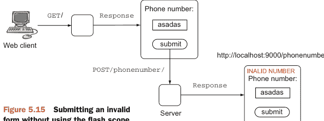

**图 5.15** 不使用 flash 作用域提交无效表单

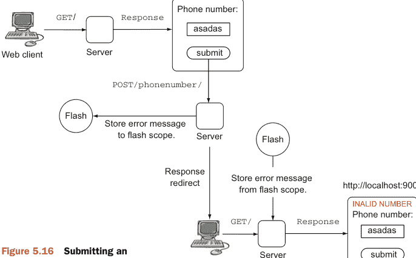

**图 5.16** 使用 flash 作用域提交无效表单

## 5.5.8 安全性如何？

存储客户端数据带来了一些安全担忧。由于用户可以访问这些数据，在不采取某些措施的情况下，它是不可信任的。例如，当你存储用户用户名时，没有什么能阻止用户输入另一个用户名并冒充另一个用户。

出于这个原因，cookies 使用密钥密钥进行签名，客户端无法修改 cookie 数据（如果他们修改了，数据将失效）。

用于签名 cookie 的密钥实际上设置在你的 `conf/application.conf` 中。

> **列表 5.12 项目结构**
>
> ```
> warehouse
>  app
> ├── controllers
> │   ├── Products.java
> │   └── models
> │       └── views
>  conf
> ├── routes
> │   └── application.conf
>  public
>  db
> ```

`application.conf` 包含了应用程序配置和重要的密钥。

如果你在编辑器中使用 `application.conf` 文件，你会发现一行以 `application.secret:` 开头的代码：

```
application.secret="
```

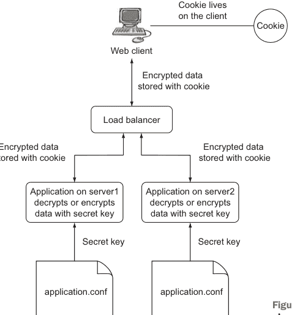

**图 5.17** 带有集群的密钥

这是我们签名 cookie 的密钥。保持它的安全非常重要，确保不要泄露。这还引出了另一个重要点：如果你运行多个应用程序实例，密钥需要在之间共享，否则一个实例无法验证另一个实例设置的数据。

让我们想象以下场景：一个负载器和应用程序运行在两个节点上：server1 和 server2。如果 server1 和 server2 不共享密钥，客户端每次都需要通信；否则服务器无法解码 cookie。如果 server1 和 server2 拥有相同的密钥，它们就可以解码 cookie，负载器也不需要区分 server1 和 server2。图 5.17 展示了加密/解密流。

> **但我的会话超时怎么办？**

我们同意会话超时是作为服务器端存储的技术解决方案引入的，而不是有用的功能。事实上，如果没有这个功能，会话会在服务器上增长，导致内存不足。但开发者习惯了会话超时，他们将其视为有用的功能。

> **总结**
>
> 在 Play 中，会话没有技术超时。它在用户关闭浏览器时失效。如果你需要特定应用程序的功能超时，只需在用户会话中存储时间戳并根据应用程序需求（最大会话时长、最大空闲时间等）进行检查。

## 5.6 总结

我们在本章从解释什么是控制器开始，然后研究了 Play 控制器的细节，特别是控制器的动作方法。我们学习了如何将客户端的请求路由到我们的动作代码。


让我们从本章总结一些关键实践：

- 使用 flash 作用域。flash 作用域非常适合向用户传递消息（涉及重定向时）。
- 使用动作方法。这是业务逻辑的入口。保持它们简短，并将所有业务逻辑委托给业务模型。
- 简单绑定是以 URL 为中心到你的动作方法的映射。

我们涵盖了如何使用拦截器以及它们为什么有用。我们实现了一个简单的拦截器，它可以捕获所有错误并发送电子邮件。

在本章中，我们学习了许多关于控制器内部机制的知识，在下一章中，我们将通过实现一些漂亮的视图来为我们的仓库应用程序增加视觉吸引力。

# 处理用户输入

- 与表单操作
- 数据绑定
- 使用 body 解析器
- 验证
- 处理文件上传

在本章中，我们将详细解释用户如何与我们的应用程序进行交互。在这里，我们将允许用户向我们的应用程序发送数据。我们将看到如何处理不同类型的数据，以及如何自定义 Play 以使用我们自己的数据类型。我们还会解释如何确保发送的数据是正确的，如果数据不正确，该如何提醒用户。

## 6.1 表单

在 Web 应用程序中处理表单涉及两项操作：显示表单和处理表单提交。表单允许用户将数据发送到服务器（我们的应用程序）。在 Play 中，表单由你可以操作的对象表示。Play 提供了实用的辅助方法来处理表单提交。由于我们不希望用户发送任何类型的数据，Play 会确保数据经过适当的格式化和处理。如果数据格式不正确，我们需要告诉用户问题所在，以便他们更正并重新提交表单。

在我们的应用程序中，为了提交产品，我们创建了两个方法：第一个方法称为 `newProduct()`，创建新产品表单；而第二个方法 `save()` 处理表单提交。我们将仔细查看操作方法究竟是如何显示空表单的。

提醒一下，图 6.1 显示了表单。

正如我们看到的，显示表单涉及以下步骤：

- 创建一个操作方法来播放表单模板
- 创建表单模板
- 创建一个操作方法来处理表单提交

图 6.1 我们的“创建新产品”表单

## 6.1.1 显示新产品表单

为了显示表单，我们创建一个 `Form` 实例来表示它。在这种情况下，我们希望表单表示一个基于 `Product` 类的表单（`Form<Product>`）。我们现有的 `newProduct()` 操作方法正是如此：

```java
...
import play.data.Form;
public class Products extends Controller {
    private static final Form<Product> productForm =
    Form.form(Product.class);
...
public static Result newProduct() {
    return ok(details.render(productForm));
}
}
```

> 基于 Product 创建新对象
> 使用我们的 Form 作为参数渲染模板

如你所见，我们正在使用 `Form.form()` 方法创建一个新的 `Form` 对象。生成的对象持有有关我们产品的所有信息，并可以包含我们在渲染表单时使用的额外信息，例如验证错误、预填值等。我们将在本章稍晚些时候详细检查表单对象。

# 第 6 章 处理用户输入

入口点

/product/new

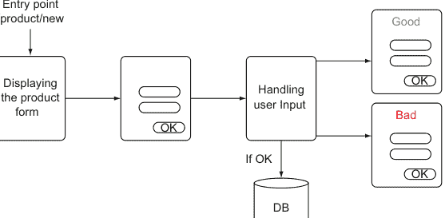

图 6.2 “创建产品表单”工作流

# 通往我们表单的路由

当我们回到第 3 章创建 `newProduct()` 操作方法时，我们也为其设置了路由。在此提醒一下：

```
GET /products/new controllers.Product.newProduct()
```

此路由使得表单在 http://localhost:9000/products/new 可用。

# 添加视图

在第 3 章中，我们创建了 `product.scala.html` 模板来渲染我们的 HTML 模板。`newProduct()` 操作方法使用它渲染一个空白的产品表单。

“新产品”表单模板允许我们收集创建新产品所需的信息。它使用 HTML 标签允许 HTML 表单由 Play `Form` 对象处理。

重要的是要意识到该对象是一个容器对象。它包含了有关我们对象模型的信息，并且可能包含验证错误信息。在第 6.4 节中，我们将广泛讨论验证。

现在，重要的是知道你可以通过表单对象访问任何字段值，并且当操作方法检测到验证错误时，可以使用它重新渲染用户输入的原始值。我们的输入辅助方法处理了这一点，因此我们不需要编写代码。

以下代码列表显示了表单的完整模板。

- 代码列表 6.1 “新产品”表单模板

```scala
@productForm: Form[Product]
@import helper._
@import helper.bootstrap._
@main("product form") {
  @helper.form(action = routes.save()) {
    <fieldset>
      <legend>@productForm("name").valueOr("New")</legend>
      @helper.inputText(productForm("ean"))
      @helper.inputText(productForm("name"))
      @helper.textarea(productForm("description"))
    </fieldset>
    <input type="submit" class="btn-primary">
  }
}
```

| 字段 | 必 |
| :--- | :--- |
| Product (New) | |
| EAN | 是 |
| Name | 是 |
| Description | |
| Save | |
| Cancel | |

## 6.2 显示表单

在我们的应用程序中，我们也希望能够编辑产品。“编辑产品”表单与“创建新产品”表单相似。从视图来看，唯一的区别在于我们需要预填一些值并更新现有模型。

为了将表单转换为编辑表单，我们执行以下操作：

- 用产品值填充表单
- 显示带有填充数据的编辑表单
- 处理用户输入

图 6.4 解释了工作流。

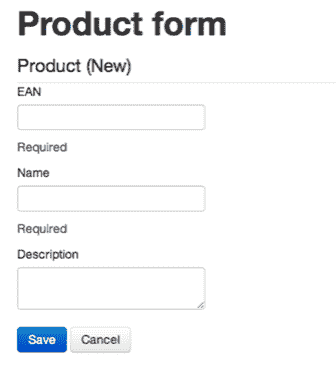

图 6.3 “创建新产品”表单

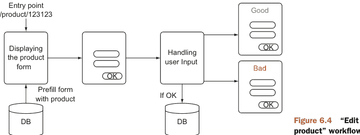

图 6.4 “编辑产品”工作流

# 为表单填充初始值

由于我们在视图中使用了 `Form` 对象，我们可以决定为表单填充一些默认值。如果我们想编辑产品，这就是我们需要做的。当我们知道要编辑对象的唯一标识符时，可以从数据库中获取它，以便在 HTML 表单中使用这些值。我们为实现此目的而编写的操作方法所示：

```java
public class Products extends Controller {
    private static final Form<Product> productForm =
        Form.form(Product.class);
    ...
    public static Result edit(String ean) {
        final Product product = Product.findBy(ean);
        if (product == null) {
            return notFound(String.format("Product %s does not exist.", ean));
        }
        Product filledForm = productForm.fill(product);
        return ok(details.render(filledForm));
    }
}
```

我们还在路由文件中添加了以下路由。该路由表示每次访问 `/products/xxx` 页面都会为产品 xxx 填充编辑页面，其中 xxx 是产品的 EAN 号。

```
GET /products/xxx controllers.Product.edit(ean:Long)
```

现在让我们看看现有的 `products/details.html` 如何支持创建和更新产品。查看以下代码列表。

# 6.3 /products/details.html

```scala
@productForm: Form[Product]
@import helper._
@import helper.bootstrap._

@main("product form") {
    @helper.form(action = routes.Products.save()) {
        <fieldset>
            <legend>@productForm("name").valueOr("New")</legend>
            @helper.inputText(productForm("ean"))
            @helper.inputText(productForm("name"))
            @helper.textarea(productForm("description"))
        </fieldset>
        <input type="submit" class="btn-primary">
    }
}
```

如你所示，编辑产品表单和创建新产品表单使用同一个模板。如果表单包含产品 ID，则它是更新；否则，我们正在创建一个新产品。

我们现在可以显示用于创建或编辑产品的表单了。接下来，我们需要处理提交表单的数据。

# 6.1.3 处理输入

表单提交后，处理表单提交的操作方法会将发送到服务器的数据转换为 `Product` 实例并保存。最后，它在 flash 作用域中设置成功消息并重定向到显示所有产品的页面。以下列出了处理表单提交的操作方法 `save()`。

# 代码列表 6.4 save() 操作方法

```java
public class Products extends Controller {
    private static final Form<Product> productForm =
    Form.form(Product.class);

public static Result save() {
    Form<Product> boundForm = productForm.bindFromRequest();
    if (boundForm.hasErrors()) {
        flash("error", "Please correct the form below.");
        return badRequest(details.render(boundForm));
    }

    Product product = boundForm.get();
    product.save();
    flash("success", String.format("Successfully added %s", product));
    return redirect(routes.list());
}
```

保存该实例


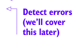


## 6.2 数据绑定

Play 使用一种名为“数据绑定”（data binding）的过程将提交的信息转换为 Java 对象。数据绑定是将请求中的元素转换为对象的过程。在 Play 中有三种绑定类型：

- 表单绑定（Form binding），我们在上一个节中已经见过它
- URL 查询参数绑定
- URL 路径绑定

数据绑定原理非常简单。HTTP 参数被映射到 Java 对象对应的属性上。映射是使用参数名称完成的。每当参数名称与对象的属性名称匹配时，该对象的属性就会被设置为参数的值。图 6.5 阐释了这一点。

在 Play 中，表单绑定主要在 `Form` 对象的帮助下通过 `bindRequest()` 方法完成。绑定处理被委托给 Spring Data，这是一个可以获取请求体并将其转换为 Java 对象属性的库。

URL 查询参数绑定包括获取 URL 参数（例如 `?x=y`）并将它们映射到 Java 对象上。该模式源自路由文件。

例如，如果我们的产品有一个 ID，我们可以有如下路由：

```
GET /products.edit(id: Long)
```

它将匹配以下 URL：

```
http://localhost:9000/products?id=12
```

Play 将字符串 "12"（查询参数始终是字符串）转换为该类型。URL 路径绑定包括将查询路径（同样是字符串）映射到另一种类型或对象。这在路由定义时也会发生。例如，当你声明时：

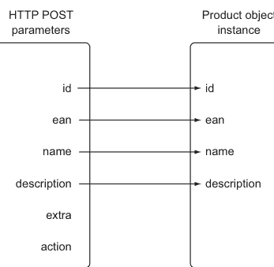

> 图 6.5 绑定过程

### 数据绑定

```
GET /products/:id Products.edit(id: Long)
```

并且你调用：

```
http://localhost:9000/products/12
```

Play 将字符串 "12"（查询路径）转换为 `Long` 类型 12。

数据绑定是反向过程。我们有一个对象，并想将其转换为有效的 URL 或表单表示。这在反向路由（reverse routing）的情况下尤为有用。关于反向路由的更多信息，请参考第 5.3.5 节。

值得注意的是，在 Play 中，每种类型的绑定都可以自定义和扩展。让我们先退一步，看看我们的产品是如何映射的。

## 6.2.1 绑定简单值

`Product` 定义为以下类：

```java
public class Product {
    public String bean;
    public String name;
    public String description;
}
```

为了完全理解绑定是如何工作的，我们将稍微“作弊”，通过响应一个 GET HTTP 请求来触发我们的 `save()` 操作方法，这样我们就可以轻松地使用浏览器发送请求。

让我们编辑路由文件，添加以下行：

```
GET /products/save controllers.Product.save()
```

我们现在可以从浏览器调用 `save()` 操作方法了，在实验完成后我们应该删除此路由条目（并使用 POST /products/one）。

```
http://localhost:9000/product/save?bean=111111111111111&name=product&description=%a20description
```

`save()` 操作方法的第一行是最重要的：

```
Form<models.Product> productForm = form(models.Product.class).bindFromRequest();
```

这创建了一个新的 `Product` 实例，然后对于匹配属性名称的每个 HTTP 请求，我们都在该属性上设置值。对于这个 GET 请求，创建了一个新的 `Product`，`bean` 参数绑定到 `bean` 属性，`name` 参数绑定到 `name` 属性，以此此类推。

我们的产品表单被请求中的 HTTP 参数值填充。然后我们可以使用以下代码访问新创建的 `Product` 实例：

```
models.Product product = productForm.get();
```

`product` 对象包含以下数据：

```
bean: 111111111111111,
name: product,
description=a20 description
```

如你所见，它与我们在 URL 中提供的参数相匹配。这是一个简单且可预测的机制。现在在 HTTP 参数和对象之间进行往返映射变得而易举。

它适用于 `String`、`Integer`、`Long` 等简单类型。Play 还提供了对更复杂的类型（如 `Date`）以及必须映射到数组或 `List` 对象的多个值的支持。

对于日期，你可以为模型添加注解：`@play.data.format.Formats.DateTime(pattern = "yyyy-MM-dd") public Date date;`

如果我们使用带有年、月、日格式的 HTTP 参数，Play 能够通过表单数据绑定器将字符串转换为 `Date` 对象。例如：

```
http://localhost:9000/project/save?date=2021-10-02
```

在绑定到 `Form` 对象时会产生一个 `Date` 对象。

Play 提供了一些内置格式化器（Formatters），位于 `play.data.Formats`。接下来，让我们看看多值绑定如何工作。

## 6.2.2 绑定多个值

这是一个常见的情况：用户从值列表中选择多个值，并且我们需要存储它们。为了说明这种情况，让我们定义一个新的场景。我们想要为产品打上标签。每个产品可以有多个标签，每个标签可以应用于多个产品。图 6.6 阐释了这种关系。

| Product | 1..n | 1..n |
|---|---|---|

图 6.6 产品-标签 关系


我们需要定义新模型。让我们创建一个 `Tag` 类。我们在 `app/models` 目录下创建一个。

### 6.5 项目结构

```
app
    - controllers
        └── Products.java
    - models
```

我们的新 `Tag` 类

这是一个相对简单的类；它持有标签名称。后续列表显示了我们的新类。

# Listing 6.6 app/models/Tag.java

```java
package models;

import play.data.validation.Constraints;
import java.util.*;

public class Tag {
    public Long id;
    @Constraints.Required
    public String name;
    public List<Product> products;

    public Tag(){
        // 留空
    }

    public Tag(Long id, String name, Collection<Product> products) {
        this.id = id;
        this.name = name;
        this.products = new LinkedList<Product>(products);
        for (Product product : products) {
            product.tags.add(this);
        }
    }
}
```

我们需要修改 `Product` 类以关联 `Tag` 类。我们使用 `List`，以便每个产品可以持有多个标签。这通过向我们的 `Product` 类（`/app/models/Product.java`）添加以下行轻松实现。

```java
public List<Tag> tags = new LinkedList<Tag>();
```

我们现在需要创建标签。为了这一点，我们将像创建某些测试 `Product` 一样伪造 `Tag` 对象。我们在第 7 章将向你展示如何使用数据库作为后端。现在，让我们坚持静态标签列表。在 `Tag` 类中，添加后续列表中的行。

# Listing 6.7 在 Tag.java 中添加模拟数据

```java
public class Tag {
    private static List<Tag> tags = new LinkedList<Tag>();
    static {
        tags.add(new Tag(1L, "lightweight",
            Product.findByName("paperclips 1")));
    }
}
```

> lightweight 标签被添加到名称匹配 paperclips 1 的产品中

# 第 6 章 处理用户输入

```java
tags.add(new Tag(2L, "metal",
Product.findByName("paperclips"));
tags.add(new Tag(3L, "plastic",
Product.findByName("paperclips"));

public static Tag findById(Long id) {
  for (Tag tag : tags) {
    if(tag.id == id) return tag;
  }
  return null;
}
```

我们已经准备好了可供使用的标签。接下来，我们需要修改视图以便对产品进行打标记。为了保持简单，我们将使用一组预定义的标签集，而不是动态生成复选框列表。让我们在我们的 `products/details.scala.html` 中添加以下代码段。

```html
<div class="control-group">
  <div class="controls">
    <input name="tags[0].id" value="1" type="checkbox" > lightweight
    <input name="tags[1].id" value="2" type="checkbox" > metal
    <input name="tags[2].id" value="3" type="checkbox" > plastic
  </div>
</div>
```

我们添加了一些类型为复选框的 HTML 元素。在绑定过程中，这些输入元素的重要部分是 `id` 属性。`[]` 符号告诉 Play 将复选框绑定到产品标签集合（在本例中为 `List<Tag>`）。一旦提交表单，Play 将自动创建一个新的 `List`，为每个被选中的框创建一个新的 `Tag` 对象，并带有 `value` 属性中指定的 ID。例如，如果我们选择了“lightweight”和“plastic”，Play 在绑定过程中期间会创建一个包含两个 `Tag` 对象的新 `List`。第一个 `Tag` 对象的 ID 将设置为 2，第二个设置为 3。如图 6.7 所示。

现在我们已经准备好了带有复选框的表单，让我们看看产品表单的视觉观 (6.8)。

| HTML 表单 | Play 绑定 | 列表 |
|---|---|---|
| ☑ lightweight (value=1) | 发送值（在控制器代码中使用 `bindFromRequest()`） | 创建 tag.id=1 |
| ☑ plastic (value=2) | | tag.id=2 |
| ○ metal (value=3) | | |
| OK | | |

图 6.7 绑定 HTML 复选框

## 数据绑定

我们的标签对象尚未与数据存储中的 `Tag` 对象相对应；它们是仅设置了 ID 的新对象。我们需要修改操作方法（action method）来查找并设置该标签。这可以在我们的控制器中轻松完成，如下代码列表所示：

# 列表 6.8 带有标签关系的 Product 保存方法

```java
public class Products extends Controller {
  public static Result save() {
    (绑定和错误处理)
    Product product = boundForm.get();
    List<Tag> tags = new ArrayList<Tag>();
    for (Tag tag : product.tags) {
      if (tag.id != null) {
        tags.add(tag.findById(tag.id));
      }
    }
    product.tags = tags;
    product.save();
    (成功消息和重定向)
  }
}
```

在显示产品时我们需要显示标签。为了实现这一点，我们需要更新视图，以便在标签存在时选中正确的复选框。我们已经（在 6.1.2 节中）看到我们的产品如何呈现我们的产品格式：

`productForm = productForm.fill(product);`

这也会加载产品关联的标签，因此不需要更改操作方法。我们的目标可以通过视图中的少量代码来实现。在渲染视图时，如果复选框关联的标签存在 `productForm` 中，我们需要为每个复选框添加 `checked` 属性。以下代码执行了该操作：

由于我们的产品关联标签可能包含 0 到 3 个标签，我们需要对它们进行迭代（代码中的 `for` 循环）。如果标签包含该值：

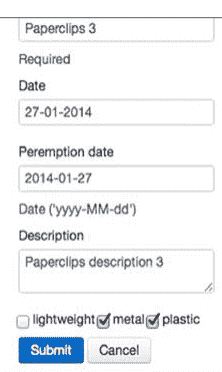

图 6.8 带有标签的编辑产品表单

1，那么我们就预选该复选框。如果你不完全理解这一行，不要担心，我们将在第 8 章中详细查看模板语法。

现在我们需要为展示的每个复选框应用此代码：

```html
<div class="control-group">
  <div class="controls">
    <input name="tags[0].id" value="1" type="checkbox">
    @for(i < 0 to 2) {
      @if(productForm("tags[" + i + "].id").value=="1") { checked }
    }
    <input name="tags[1].id" value="2" type="checkbox">
    @for(i < 0 to 2) {
      @if(productForm("tags[" + i + "].id").value=="2") { checked }
    }
    <input name="tags[2].id" value="3" type="checkbox">
    @for(i < 0 to 2) {
      @if(productForm("tags[" + i + "].id").value=="3") { checked }
    }
  </div>
</div>
```

## 数据绑定

```java
public String javascriptUnbind() {
  return this.ean;
}
```

> JavaScript 解绑——我们正在重新汇聚原始值

我们需要修改路由文件以更新我们的 `Product.edit()` 路由。修改位于 `conf` 目录下的路由。

让我们将

```
GET /product/:ean controllers.Product.details(ean: String)
```

替换为

```
GET /products/:ean controllers.Products.details(ean: models.Product)
```

这就是我们让 Play 知道我们要使用对象的方式。URL 路径中 Product 与 EAN 编号之间的自动绑定将由我们实现的方法完成。

我们需要用以下方法修改我们的 `Products` 控制器：

```java
public class Products extends Controller {
...
public static Result details(Product product) {
  Form<Product> filledForm = productForm.fill(product);
  return ok(details.render(filledForm));
}
}
```

> 新的 edit 方法直接绑定到 product 对象

现在我们更改了方法签名，也需要更新调用者。目前，我们只有一个调用者。在产品列表模板 `products/list.scala.html` 中，更改以下内容

```html
<a href="@routes.Products.details(product.ean)">
```

```html
<a href="@routes.Products.details(product)">
```

这就完成了！我们现在可以自动将 URL 绑定到 `Product` 实例。调用 `http://localhost:9000/products/111111111111` 将显示 EAN 为 111111111111 的 Product。这简化了控制器的代码，并将参数转换为 `Product` 实例的逻辑集中处理。任何需要 `Product` 的动作方法现在可以直接将其作为参数。

# 查询字符串绑定 (QUERY STRING BOUNDERS)

到为止，我们看到可以将 URL 路径绑定到模型对象。我们可以对 URL 参数（URL 的查询字符串部分）执行完全相同的操作。以我们的产品为例，这次我们将在传递产品的 EAN 作为查询参数时将其绑定到 `Product` 对象：

```
http://localhost:9000/products?ean=1
```

# 第 6 章 处理用户输入

当 Play 遇到此 URL 时，它应该根据提供的 EAN 在数据库中查找 Product。为了实现这一点，我们必须实现 `play.mvc.QueryStringBindable` 接口，类似于我们实现 `PathBindable` 的方式。由于我们需要查找 `Product` 对象，我们将在 `Product` 模型类上实现该接口。

修改 `Product` 模型类。

### 6.11 项目目录结构

```
warehouse
app
    ├── controllers
    ├── models
    │   └── Product.java  我们将要修改的 Product 类
    └── views
conf
    ├── routes
    └── public
test
```

这次我们需要更改它以实现 `play.mvc.QueryStringBindable` 接口。像 `PathBindable` 一样，该接口提供了我们需要实现的三个方法：

- `Option<T> bind(String key, Map<String,String[]>> data)`
- `String unbind(String key)`
- `String javascriptUnbind()`

`bind` 允许访问查询参数（包括值和关联键），并且必须返回类型为 `T` 的 `Option` 对象。在我们的案例，`T` 是 `Product`。`Option` 类允许我们选择返回某些内容或返回空，这是比返回 `null` 更好的替代方案。`bind` 方法的 `data` 参数允许我们访问查询参数。它由一个 `Map` 表示，包含查询参数名称及其对应的值。

与之前一样，`bind` 表示如何从 URL 参数绑定我们的产品，`unbind` 告诉我们何时从视图引用 `Product`，而 `javascriptUnbind` 则告诉 JavaScript。在我们的案例中，逻辑是基于 `Product` 属性的。在 `Product` 类中实现这些方法。请注意，这是一个简单的示例，没有检查空值或其他错误。

# 6.12 实现 QueryStringBindable 的 Product 类

```java
...
import play.mvc.PathBindable;
import play.mvc.QueryStringBindable;

public class Product implements play.mvc.QueryStringBindable {
    ...
```

# 数据绑定

```java
@Override
public Option<Product> bind(String key, Map<String, String[]> data) {
    // 实现逻辑
}
```

```java
@Override
public String unbind(String key) {
    // 实现逻辑
}
```

```java
@Override
public String javascriptUnbind() {
    // 实现逻辑
}
```

我们需要在 `routes` 文件中声明一个新的路由，以便接受类似 `/products?ean=1`：

```
GET /products controllers.Products.details(ean: models.Product)
```

# 6.13 项目结构

- warehouse
- app
  - controllers
    - Products.java
  - models
      - Product.java
  - conf
    - routes
  - public
- test

`edit` 方法与使用路径绑定相同：

```java
public static Result details(Product product) {
  Form<Product> filledForm = productForm.fill(product);
  return ok(details.render(filledForm));
}
```

正如你所看到的，调用 `http://localhost:9000/products/111111111111` 将显示 EAN 为 111111111111 的 Product。这简化了我们的代码。

# 表单字段绑定 (FORM FIELD BOUNDERS)

Play 中的表单绑定器称为格式化器（formatters），因为它们在控制器之间进行数据的格式化。格式化器（无论是预定义的还是自定义的）始终用于字符串对象的映射。你可以使用 `play.data.format.Formatters` 的 `register()` 方法注册格式化器。现在让我们为日期使用自定义格式化器，扩展 `SimpleFormatter` 类。我们必须在应用程序启动时在 `Global` 对象（或扩展 `GlobalSettings` 的类）中注册格式化器。为此我们需要在应用文件夹中创建一个 `Global.java` 文件。`Global` 对象是 Play 的一部分，定义了在应用程序周期期间调用的方法（onStart、stop、onError 等）。`Global.java` 文件的内容所示：

# 6.14 注册 Date 类

```java
import play.*;
import play.libs.*;
import java.util.*;
import models.*;
import play.data.format.Formatters.*;
import java.text.ParseException;
import java.text.SimpleDateFormat;
import java.util.Date;
import java.util.Locale;
```


public class Global extends GlobalSettings {

    public void onStart(Application app) {

        Formatters.register(Date.class, 

            new SimpleFormatter<Date>() {

                private final static String PATTERN = "dd-MM-yyyy";

                public Date parse(String text, Locale locale) throws java.text.ParseException {

                    if (text == null || text.trim().isEmpty()) {

                        return null;

                    }

                    SimpleDateFormat sdf = new SimpleDateFormat(PATTERN, locale);

                    sdf.setLenient(false);

                    return sdf.parse(text);

                }

                public String format(Date date, Locale locale) {

                    if (date == null) {

                        return "";

                    }

                    return new SimpleDateFormat(PATTERN, locale).format(date);

                }

            });

    }

}

# 数据绑定

因为我们扩展了 `SimpleFormatter` 类，我们必须实现两个方法：`parse()` 方法和 `print()` 方法。`parse()` 方法将 `String` 转换为 `Date`（绑定过程），而 `print()` 方法将 `Date` 转换为 `String`（取消绑定过程）。传入的日期字符串（如 `11-02-2008`）将被转换为代表该日期的 `Date` 对象。同样，`Date` 对象将被转换为“dd-MM-yyyy”格式的字符串。

如你所见，声明非常简单。每当我们遇到 `Date` 对象时，Play 都知道如何绑定日期并作为 `String` 返回。在某些情况下，你可能希望格式不是全局的，或者日期格式被强制执行且/或不同。

如果我们要在产品中添加一个日期，用户必须在产品详情输入字段中使用我们定义的格式输入 `21-01-2012`。同样，在我们的模型中，日期将是 `21-01-2012`，但它是一个 `Date` 而不是 `String`；格式化器处理 `String` 和 `Date` 之间的转换。

例如，如果你想有多种日期表示方式？例如，假设你想在主页上使用 `11-02/08`，而在登录屏幕上使用 `11/02/08`。Play 允许你通过注解控制绑定行为，包括自定义注解。让我们通过创建以下内容将日期格式化器转换为基于注解的格式化器：

- 一个注解
- 一个扩展了 Play 的 `AnnotationFormatter` 的格式化器

让我们从注解开始：

``` Listing 6.15 The DateFormat annotation, /app/utils/DateFormat.java

package utils;

import play.data.Form;

import play.lang.annotation.*;

@Target(ElementType.FIELD)

@Retention(RetentionPolicy.RUNTIME)

@Form.field(name = "format.date", attributes = {"value"})

public @interface DateFormat {

    String value();

}

```

该注解非常简单，是我们的日期格式的持有者。定义在 `DateFormat` 上的 `Display` 注解包含了 Play 的元数据。当由于日期格式不导致无法绑定时，Play 使用元数据在表单上显示错误消息。该注解告诉 Play 使用 `format.date` 消息键，并且该值可以作为消息的参数。

# 第 6 章 处理用户输入

让我们定义我们的格式化器。我们必须指示我们想要一个注解格式化器。这是通过扩展 `Formatters.AnnotationFormatter` 完成的。

## 6.16 AnnotationDateFormatter 类

```

Extends Formatters.AnnotationFormatter so we're

annotation aware--the Formatter applies to

DateFormat annotation and to Date object

public static class AnnotationDateFormatter

    extends Formatters.AnnotationFormatter<DateFormat, Date> {

        public Date parse(DateFormat annotation, String text,

            Locale locale)

            throws java.text.ParseException {

            if(text == null || text.trim().isEmpty()) {

                return null;

            }

            SimpleDateFormat sdf = new

                SimpleDateFormat(annotation.value(), locale);

            sdf.setLenient(false);

            return sdf.parse(text);

        }

        public String print(DateFormat annotation, Date value,

            Locale locale) {

            if(value == null) {

                return "";

            }

            return new SimpleDateFormat(annotation.value(), locale)

                .format(value);

        }

}

```

由于我们扩展了 `Formatters.AnnotationFormatter` 抽象类，与之前的 `SimpleDateFormat` 类一样，我们必须实现两个方法：`parse()` 方法执行字符串表示以创建 `Date` 对象，而 `print()` 方法执行完全相反的操作。但这次，`Formatters.AnnotationFormatter` 是感知注解的，我们的 `print()` 和 `parse()` 方法多了一个额外参数：我们的 `dateFormat` 注解。我们使用它来访问配置的模式。

正如我们在上一节看到的，我们需要在 `Global.java` 类中注册我们的 `AnnotationDateFormatter`。Listing 6.17 显示了如何操作。

# 请求体解析器

## 6.17 在 Global.java 文件中注册你的 AnnotationDateFormat

```

public class Global extends GlobalSettings {

    public void onStart(Application app) {

        Formatters.register(Date.class, new AnnotationDateFormat());

    }

}

```

现在，我们可以对模型类上的任何对象进行注解，使用以下语法表示我们想要从 `Form` 对象中绑定和取消绑定 `Date`：

## 6.18 使用 DateDateFormat 的对象模型

```

public class Person {

    @DateFormat("MM-dd-yyyy")

    public Date birthDate;

}

```

现在在我们的视图中，每个 Person 的出生日期将显示为 `MM-dd-yyyy`。在提交表单时，`birthDate` 属性将包含一个带有预期日期的 `Date` 对象。注意，在示例中，我们看到的已经是 Play 的一部分了。你不需要自己编写代码，可以使用 `play.data.format.Format` 类中定义的 `@DateTime` 注解。

# 请求体解析器

我们查看了映射到表单对象的请求体以及反之，但我们还没有探索原始体是如何处理的。这个过程是请求体解析器（body parsers）的工作。

每个传入的 HTTP POST 和 PUT 请求都包含一个体。此体可以是单部分的多部分的（multipart），并可能包含 XML、JSON、二进制数据或任何其他类型。

## 124 第 6 章 处理用户输入

请求体解析器“解码”请求并将其转换为 Play 使用的对象。由于 JSON 体与 XML 体的解析方式不同，不同的内容类型有特定的解析器。

### 6.3.1 body-parser API

所有请求体解析器都会生成 `play.mvc.Http.RequestBody` 值。该值可以通过 `request().body()` 获取。以下显示了如何使用该 API：

> Listing 6.19 获取请求体

```

public static Result index() {

    RequestBody body = request().body();

    return ok("Here is the body: " + body);

}

```

你可以使用 `@BodyParser.Of` 为特定操作指定 BodyParser。这意味着我们可以使用特定的请求体解析器来解析请求并访问值。Listing 6.20 显示了一个指定 JSON 体解析器的示例：

> Listing 6.20 指定特定的请求体解析器

```

@BodyParser.Of(BodyParser.Json.class)

public static Result index() {

    RequestBody body = request().body();

    return ok("Expected to get json: " + body);

}

```

## 列表 6.21 使用 as() 辅助方法

```

@BodyParser.Of(BodyLengthParser.class)

public static Result index() {

    BodyLength body = request().body().as(BodyLength.class);

    return ok("Request body length: " + body.getLength());

}

```

如果你没有指定解析器，Play 将使用 Content-Type 头部来决定使用哪种内置解析器：

- text/plain-String，通过 `as()` 访问
- application/json-JsonNode，通过 `Json()` 访问
- text/org.w3c.Document，通过 `Xml()` 访问
- application/form-URL-encoded-Map<String, String>,通过 `FormUrlEncoded()` 访问
- multipart/form-data-Http.MultipartFormData，通过 `MultipartData()` 访问
- 其他其他 content-type-Http.RawBuffer，通过 `Raw()` 访问

请注意，如果请求体不可用，该方法将返回 null。接下来的列表显示了如何使用 `asText()` 的示例。

## 列表 6.22 使用 body.asText() 方法

```

public static Result save() {

    RequestBody body = request().body();

    String textBody = body.asText();

if(textBody != null) {

    return ok("Got: " + text);

} else {

    return badRequest(

        ("Expecting text/plain request body")

    );

}

```

基于文本的解析器（如文本、JSON、XML 或 URL 编码表单）使用最大内容长度，因为它们必须将所有内容加载到内存中。默认内容长度限制为 100 KB。

**覆盖默认的最大内容长度** 默认大小可以在 `application.conf` 中定义：`parsers.text.maxLength=128K`。

你也可以通过 `@BodyParser.Of` 注解指定最大长度，例如接受 10 KB 的数据：

```

@BodyParser.Of(value = BodyParser.Text.class, maxLength = 10 * 1024)

public static Result index() {

    n...

```

## 第 6 章 处理用户输入

自定义请求体解析器必须用 Scala 编写，因为它们使用 Scala 的迭代 I/O 增量地处理数据。

但对于典型的 Web 内容类型（如 JSON 和二进制数据），已经有了请求体解析器，这些解析器可以在 Java 中复用以创建请求体。

现在我们理解了如何接收和转换数据，我们需要能够确保数据是有效的。

## 6.4 验证

我们已经看到如何将用户数据转换到我们的对象模型以及反之。但我们还需要确保数据在应用程序的上下文中符合某些标准。例如，某些字段可能是必填的。绑定过程可以保证数据的有效性。Play 允许你定义约束来捕获无效的提交数据。在数据无效的情况下，Play 还会向客户端提供详细的反馈。在本节中，我们将看到如何对数据输入定义约束。

### 6.4.1 使用内置验证器

Play 会验证它绑定到领域模型上的数据。Play 使用 JSR-303 和 Hibernate 验证器来执行这一步。定义约束就像在对象模型上添加注解一样简单。例如，确保用户在产品表单中提供 EAN 码，只需在 `Product` 对象上添加 `@Required` 注解：

```

import play.data.validation.Constraints;

public Product extends Model {

    @Required

    public String Bean;

}

```

为了确保用户输入符合注解定义的约束，我们需要检查 `Form` 对象上的 `hasError` 方法。验证发生在绑定后立即，并在发现错误时将其注册到表单中。验证过程会将所有错误设置到构建的 Form 中。验证错误包含相关的 i18n 错误消息键、字段名称以及可能与错误消息一起显示的参数列表。列表 6.23 显示了第 6.1.3 节中的 `save` 方法，并添加了验证检查。

列表 6.23 用于验证的 save 操作方法

```

public static Result save(\ {

Form<models.Product> productForm = 

form(models.Product.class).bindFromRequest(request);

models.Product newProduct = productForm.get();

}

```

如果发生了验证

```

if (productForm.hasErrors()) {

    return ok(edit.render(productForm));

} else {

    newProduct.saveOrUpdate();

    return redirect(routes.Product.all());

}
```


- 重新渲染我们的表单
- 保存或更新当前的 `Product` 对象
- 重定向到我们的“查看所有产品”页面

如你所见，验证表单是简单的。

### 表 6.1 内置注解

| 名称 | 描述 |
| :--- | :--- |
| `@Min` | 表示最小数字应为；例如，1。 |
| `@Max` | 表示最大数字应为；例如，2。 |
| `@Decimal` | 表示最小数字应为；例如，1.1。 |
| `@DecimalMax` | 表示最大数字应为；例如，4.2。 |
| `@Size` | 表示范围数字应为；例如，`@Size(min=2, max=4)`。 |
| `@Digits(integer, fraction)` | 检查属性是否为数字，最多包含 `(integer)` 位整数和 `(fraction)` 位小数。 |
| `@Past` | 检查注解的日期是否在过去。 |
| `@Future` | 检查注解的日期是否在未来。 |
| `@Pattern(regex)` | 检查注解的字符串是否匹配 `(regex)` 表达式模式。 |
| `@Valid` | 对对象进行递归验证。 |
| `@Email` | 检查指定的字符串是否为有效的电子邮件地址。 |
| `@Length(min, max)` | 验证注解的字符串在 `(min)` 和 `(max)` 之间（包含）。 |

### 表 6.2 内置验证器

| 名称 | 描述 |
| :--- | :--- |
| `@Null` | 表示字段应为 null。 |
| `@NotNull` | 表示字段不能为空。 |
| `@NotEmpty` | 检查字符串是否不为空或空。 |
| `@AssertTrue` | 断言此字段的布尔值为 true。 |
| `@AssertFalse` | 断言此字段的布尔值为 false。 |

> ⁴ 具体来说是 Hibernate Validator。

## 第 6 章 处理用户输入

### 表 6.2 内置注解（续）

| 名称 | 描述 |
| :--- | :--- |
| （见上表） | |

## 6.4.2 部分验证

常见的用例是针对同一个对象模型有多个验证约束。由于我们在对象模型上定义约束，因此有多个引用同一个对象模型的表单是正常的。为了说明这个用例，我们可以想象一个简单的向导，用户在以下步骤输入新产品：

1. 用户输入产品名称并提交表单。
2. 用户输入产品 EAN 名称和描述。

我们可以在第 2 步验证产品名称，但在此时显示产品名称的错误信息会很奇怪。幸运的是，Play 允许你执行部分验证。对于每个注解值，我们需要指示在哪一步应用。我们可以通过注解中的 `groups` 属性来实现这一点。让我们将 `Product` 模型类修改为：

```java
public class Product extends Model {

    public interface Step1 {}

    public interface Step2 {}

    @Required(groups = Step1.class)
    public String name;

    @Required(groups = Step2.class)
    public String ean;
}
```

> 定义第一步
> 定义第二步
> 此约束仅适用于第一步
> 此约束仅适用于第二步

我们现在需要指示我们正处于哪一步。请求 Step1：

```java
// 我们将验证限制在 Step1 "组"中
Form<Product> productForm = form(Product.class, Product.Step1.class).bindFromRequest();

if(filledForm.hasErrors())
```

> 在绑定时，告诉验证器我们只感兴趣适用于第一步的约束

我们可以对 Step2 执行相同的操作。如果模型对象被用于不同的表单并带有验证约束，这种方法就非常有用。

## 6.4.3 创建自定义验证器

Play 允许你添加自己的验证器。当你需要执行自定义验证时，这非常有用。你可以通过不同的方式实现自己的验证器：

- 使用即时验证——这种方法最快最简单
- 使用 `@ValidateWith` 并定义你自己的 `Validator` 类
- 定义一个新的 JSR 303 注解并定义一个新的 `Validator` 类

我们将详细研究这些每方法，从即时验证开始。

### 即时验证

你可以通过在模型对象上添加 `validate` 方法来定义即时验证。Play 将调用每个模型对象的 `validate` 方法。例如，为了验证我们的 EAN 数字，我们可以在 `Product` 对象模型上添加一个 `validate` 方法。`validate` 方法必须返回一个 `String` 或 `null`。如果返回 `String`，则它必须包含验证错误信息或其 i18n 键。返回 `null` 表示没有错误。

EAN 是一个 13 位数字。我们的 `validate` 方法必须检查 `String EAN` 变量是否恰好包含 13 位数字。列表 6.24 显示了如何实现。

#### 列表 6.24 EAN 数字即时验证的 validate 方法

```java
public class Product extends Model {

  ...

  public String ean;

  public String validate(String name) {

    String pattern = "^[0-9]{13}$";

    Pattern regex = Pattern.compile(pattern);

    return name != null && regex.matcher(name).matches() ? null : "Invalid EAN number";

  }

}
```

> `validate` 方法在成功时返回 null，否则返回错误消息
> 此正则表达式模式意味着“数字字符，重复13次”
> 如果输入不匹配，则返回错误消息；否则返回 null

如果你有多个属性需要验证，`validate` 方法可能并不 Practical 实用，但它是添加简单验证约束最容易、最快的方法。让我们看看如何进行复杂的验证。

### @ValidateWith

使用 `@ValidateWith` 我们可以对验证进行细粒度的控制。让我们再次以 EAN 数字作为示例。首先，我们需要在属性上标上 `@Constraints.ValidateWith` 注解。`@ValidateWith` 方法接受一个类作为参数，我们将在该类中进行自定义验证。

我们需要实现一个实现了 `Constraints.Validator` 的类。在我们的验证器中，我们需要实现 `isValid` 和 `getErrorMessageKey` 方法。`isValid()` 测试字段的有效性，`getErrorMessageKey()` 返回错误消息的 i18n 键。下面的列表显示了如何使用 `@ValidateWith` 验证 EAN 数字。

#### 列表 6.25 使用 @ValidateWith 注解验证 EAN 数字

```java
package models;

import play.data.validation.Constraints;

...

public class Product implements PathBindable<Product>, QueryStringBindable<Product> {

  public static class EanValidator extends Constraints.Validator<String> {

    @Override
    public boolean isValid(String value) {
      String pattern = "^[0-9]{13}$";
      return value != null && value.matches(pattern);
    }

    @Override
    public F.Tuple<String, Object[]> getErrorMessageKey() {
      return new F.Tuple<String, Object[]>("error.invalid.ean");
    }

  }

  @Constraints.Required
  @Constraints.ValidateWith(value = EanValidator.class, message = "must be 13 numbers")
  public String ean;
}
```

> 我们的自定义验证器类必须继承 Play 的抽象验证器
> 我们对 `isValid` 方法的实现如果字符串有 13 位数字则返回 true
> `getErrorMessageKey` 返回 i18n 消息键和可能的参数值
> 表示我们想要验证我们的自定义验证器类

使用 `@ValidateWith` 我们现在有了一个自定义的、细粒度的、可重用的验证机制。这种验证方法是 Play 特有的，但通过使用 JSR-303 标准，有一种更可移植的方式指定验证逻辑。让我们看看它是如何运作的。

### JSR-303 自定义注解和验证器

这种方法是使用 JSR-303 标准添加自定义验证的方法。它不特定于 Play，可以用于其他非 Play 应用程序。这种方法需要两个步骤：

- 定义一个注解并对 Validator 类的引用
- 定义被注解引用的 Validator 类

让我们定义一个注解，以确保我们的 EAN 数字恰好是 13 位。我们需要声明一个注解并标上 `@Constraint`。下面的列表显示了如何创建该注解。

#### 列表 6.26 JSR-303 EAN 注解

```java
@Constraint(validatedBy = EanValidator.class)
@Target({ FIELD })
@Retention(RetentionPolicy.RUNTIME)
public @interface EAN {

  String message() default "error.invalid";
  Class<?>[] groups() default {};
  Class<? extends Payload>[] payload() default {};

}
```

> 设置注解时可以计算消息
> 验证期间应用的组——参见 6.4.2
> Payload 属性目前未被 Play 使用

## 第 6 章 处理用户输入

我们需要定义一个包含验证 EAN 数字业务逻辑验证器。我们需要实现 `ConstraintValidator` 接口并实现 `isValid` 方法。`isValid` 方法返回一个指示是否有效的布尔值。下面的列表显示了 EAN 实现。

#### 列表 6.27 JSR-303 验证器

```java
public static class EANValidator extends Constraints.Validator<String> implements ConstraintValidator<EAN, String> {

    final public String message = "error.invalid.ean";

    public EANValidator() { }

    @Override
    public void initialize(EAN constraintAnnotation) {}

    public boolean isValid(String value) {
        String pattern = "^[0-9]{13}$";
        return value != null && value.matches(pattern);
    }

    @Override
    public F.Tuple<String, Object[]> getErrorMessageKey() {
        return new F.Tuple<String, Object[]>(message, new Object[]{});
    }

}
```

现在我们可以为我们的 `Product` 对象模型标上 `@EAN` 注解：

```java
public class Product extends Model {

    ...

    @EAN
    public String ean;

}
```

我们的 EAN 字段将自动进行验证。正如你所见，为对象模型添加新的验证逻辑很容易。Play 允许你使用自定义验证代码对对象进行验证，因此你可以根据需要验证数据库。

## 6.4.4 在表单上显示验证错误

很好——我们可以验证表单。但我们还需要向用户展示验证错误的原因。这轻而易举；错误消息存储在我们的 `Form` 对象中。通过将 `Form` 对象传递给视图，我们可以轻松地显示错误消息。例如，在控制器的 `save()` 操作中，我们检查表单是否有错误并传递给视图：

```java
Form<Product> boundForm = productForm.bindFromRequest();

if (boundForm.hasErrors()) {
    return ok(details.render(productForm));
}
```

在我们看来，我们可以访问表单对象并显示错误。我们可以通过表单上的 `errors()` 方法或特定字段上的 `errors()` 方法访问错误消息。我们想要显示所有的验证错误，使用 `errors()` 遍历表单错误：

```html
<p>请修复错误<ul>
@for(error <- productForm.errors()) {
    <li>@error.message</li>
}
</ul>
</p>
```

如果你想按字段访问错误，可以在字段的表字段值上使用 `errors()` 方法。例如，如果我们想访问产品名称字段潜在的验证错误：

```scala
@productForm("name").errors()
```

这将返回一个列表。使用内置的 `mkString` 来连接字符串，我们可以通过以下代码获取每个字段的以逗号分隔的错误列表：

```scala
@productForm("name").errors().mkString(",", ",")
```

对于我们当前的表单，没有需要使用这些方法，因为表单辅助类已经包含了错误。但表单辅助类并没有魔法；它们渲染错误的方法正是使用了这种技术，正如接下来的列表所示，该列表显示了字段辅助类的模板。

### 列表 6.28 字段辅助类模板的源代码

```scala
@(elements: views.html.helper.FieldElements)

@import play.api.i18n._

@import views.html.helper._

********************************************************************

* 根据 twitter bootstrap 规则生成输入

********************************************************************

<div class="clearfix" @elements.arg('class')
  @if(elements.hasErrors('error))
  id="@elements.arg('_id').getOrElse(elements.id + " _field")">
    <label for="@elements.id">@elements.label(elements.lang)</label>
    <div class="input">
      @elements.input
      <span class="help-inline">
        @elements.errors(elements.lang).mkString(",", ",")
      </span>
    </div>
    <span class="help-block">
      @elements.infos(elements.lang).mkString("", "")
    </span>
  </div>
</div>
```

我们现在知道如何验证并将任何验证错误报告给用户。我们现在能够提交任何用户输入，处理它们，并拒绝任何无效数据。让我们看看更复杂的输入情况：文件上传。

## 6.5 文件上传

是时候回到我们当前的应用程序了。这里缺少一些东西，可以让我们的剪辑更具可识别度；我们需要在视觉上识别它们。让我们添加一张图片吧。为此，我们需要稍微修改 Product 对象模型：参见下面的列表。

### 列表 6.29 在 Product 对象模型中添加图片

```java
public class Product {

    ...

    @Constraints.Required
    @Constraints.ValidateWith(BeanValidator.class)
    public String email;

    @Constraints.Required
    public String name;

    public String description;

    public byte[] picture;

}
```


我们现在需要给用户上传产品图片的机会；我们需要在表单中添加一个 HTML `input file` 元素。为此，我们需要编辑在 6.1.1 节中创建的现有 `product.scala` 模板，添加一个 HTML 文件输入，并使用 HTML `img` 元素显示它的图片。我们需要更改文件编码以发送多部分数据（multipart data）。
表单现在看起来如下列表所示。

- 列表 6.30 带有图片上传的“创建产品”表单

```scala
@productForm: Form[Product]

@import helper._

@import helper.twitter_bootstrap._

@main("Product form") {

    <h1>表单</h1>

    @helper.form(action = routes.Products.save(
        enctype = "multipart/form-data") {

            <legend>产品 (@productForm("name").valueOr("New"))</legend>

            @helper.inputText(productForm("email"))

            @helper.inputText(productForm("name"))

            @helper.textarea(productForm("description"))

            @helper.inputFile(productForm("picture"))
```

```scala
@if(productForm("picture").valueOr("").isEmpty()) {

  <div class="control-group">

    <div class="controls">

      

    </div>

  </div>

}
```

> 用于显示图片的 HTML 标签

一旦表单提交，我们需要保存用户发送的图片。遗憾的是，由于 HTTP 文件上传的工作机制，Play 无法直接将文件绑定到 `picture` 字段，因此我们需要修改 Product 控制器上的 `save()` 方法。

为了绑定用户上传的文件，我们需要访问持有文件的 HTTP 请求体。我们在 6.3.1 节中见过如何使用 `body-parser` API 来实现这一点；我们调用 `request().bodyMultipartData()`。

一旦访问了体，我们就可以请求文件并将其转换为数组。然后我们就可以保存产品。

- 列表 6.31 处理多部分文件上传

```java
public Result save(Http request) {

    Form<Product> boundForm = request.bindFromRequest();

    if (boundForm.hasErrors()) {

        return ok(details.render(productForm));

    }

    Product product = boundForm.get();

    HttpFile file = request.bodyMultipartData("picture");

    if (file != null) {

        product.picture = FileUtils.toBytes(file);

    }

    product.save();

    return redirect(routes.index());

}
```

我们现在知道如何验证并将任何验证错误报告给用户。
我们现在能够提交任何用户输入，处理它们，并拒绝任何无效数据。
让我们看看更复杂的输入情况：文件上传。

## 模型与持久化

- 本章涵盖了
- 定义数据模型
- 持久化数据
- 使用 JPA 注解映射你的模型
- 加载初始数据
- 使用 Ebean 查询数据

在之前的章节中，我们涵盖了回形针仓库应用程序的基本需求。到目前为止，我们一直通过在内存中维护静态 `Lists` 来模拟数据存储。现在是时候开始在数据库中保存我们的数据了。我们将更深入地查看数据模型，并学习更多关于数据模型在 Play 应用中的作用。

# 首先要做什么呢？

尽管在大多数应用程序框架中，从数据模型开始似乎是约定，但 Play 并不规定你从哪里开始开发应用程序；如果你想先开始开发视图（views）或控制器（controllers），Play 不会阻碍你。尽管按照你喜欢的顺序工作！

# 在代码中对现实世界建模

本章将通过开发 Java 类数据模型开始，扩展我们在上一章创建的应用程序。然后，我们将利用 Play 自带的持久化机制将数据存储在关系型数据库中。
首先，我们将扩展数据模型。

## 7.1 在代码中对现实世界建模

我们仓库应用程序最基本的要求是跟踪哪些库存物品属于什么种的产品项目。创建数据模型的一个常用技巧是使用用例（case），并写下所有的名词以及这些名词之间的关系。如果我们应用第 4 章中的需求，就会得到 7.1 所示的模型。

数据模型可以被看作是现实世界概念的表示。面向对象的语言非常适合这一点。对象的一个关键方面是它们将数据和行为分组在单个实体中。对于我们当前的数据模型，我们只对数据分组感兴趣；我们还没有想要捕捉的行为。JavaBeans 正是这种对象；它们声明了状态，但不包含行为。它们是字段的集合，通过称为 getters 和 setters 的实例方法进行访问。

典型的 JavaBean 是一段不错的代码，但包含了不必要的样板代码（boilerplate code）。如果你仔细想想，JavaBeans 是带有简单 getters 和 setters 的私有字段。JavaBeans 充满了样板代码，这些代码可以通过你选择的任何 IDE 生成。

### 7.1.1 使用 getters 和 setters 的原因

Java 类（特别是 JavaBeans）经常被赋予 getter 和 setter 方法的主要原因是封装数据并隐藏对象的内部表示。

在 `Person` 对象上调用 `getName()` 方法与直接访问其 `name` 属性之间的区别，就等于询问某人的姓名与访问其出生证并读取上面的名字之间的区别。

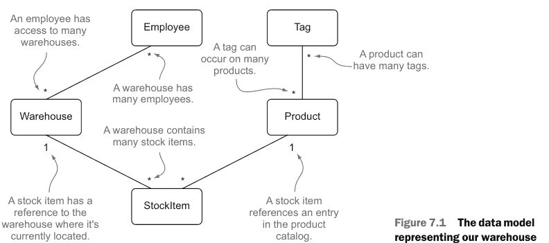

给想要知道名字的人提供名字比后者提供了多得多的控制，而且后者还可能暴露了比那个人可能选择提供的多得信息，我们可能会毁掉出生证。无论我们是无意还是有意为，这并不重要。

现在考虑一个戴着标签的人：名字在那里，所有人清晰可见，没有提供比此更多的任何信息，而且它是不可修改的。人拥有名字这一事实并没有暴露任何关于我们不所知的个人信息；人总是有名字的，你可以说它是他们公共接口的一部分。在这种情况下，询问某人的名字似乎很愚蠢。这种情况类似于拥有一个 `name` 既标记为 `final` 又标记为 `public` 的 `Person` 类。

让我们看看这些在代码中看起来是什么样。下面的列表显示了使用 getter 时的情况。

# 列表 7.1 带有 getName() 的 Person

```java
public class Person {

    private final String name;

    public Person(String name) {

        this.name = name;

    }

    public String getName() {

        return name;

    }

}
```


```java
String name = new Person("John Doe").getName();
```

在这个示例中，我们定义了一个字段，但对它的访问通过 `getName()` 方法委托。我们使用 getter 方法向 `Person` “询问”它的名字。

下面的列表显示了使用 public 字段实现的相同类。

# 列表 7.2 带有 public name 属性的 Person

```java
public class Person {

    public final String name;

    public Person(String name) {

        this.name = name;

    }

}
```


```java
String name = new Person("John Doe").name;
```

在这个示例中，我们暴露了字段，现在客户端直接读取 `name` 字段。我们实现了与上一个相同的结果，但代码更少。

公共访问的问题在于我们以后无法更改它。如果我们想更改表示方式，我们将不得不更改所有使用它的代码。这就是为什么通常使用私有字段以及对应的 getters 和 setters。如果我们暴露一个字段，我们可能会破坏依赖它的代码。

# 在代码中对现实世界建模

`Person` 的名字，我们无法，因为它的内部状态暴露给了世界，并且以后决定我们

> 不要关注幕后的人

Play 使用字节码增强技术来透明地添加 getters 和 setters 是“魔法”的例子；在后台发生了一些在代码中并不明显的事情，但效果是可见的。这是否是一个理想的情况尚待争议，但在实践中证明利大于弊。

使用 getters 和 setters 的另一个很好的理由是它们是 JavaBean 规范的一部分，该规范提供了通过方法暴露属性的标准方法。许多工具都需要这些，包括我们之后介绍的 Ebean。没有 getters 和 setters，JavaBean 约定将无法工作。

尽管 getters 和 setters 的理由充分，但缺点是它们需要额外的行代码（取决于你的格式）。虽然这看起来可能不是大问题，但如果你有很多字段，噪声就会积累；每当你引入新字段时，都必须生成或编写该方法。

### 7.1.2 为你消除某些噪声

Play 帮助消除通常使用 getter 和 setter 的所有样板代码，并在你不需要在 getter 或 setter 中放入特殊逻辑时允许使用公共字段。

Play 使用一种称为字节码增强的技巧，在原始代码编译后添加 getters 和 setters，然后重写你的客户端代码以使用生成的 getters 和 setters。如果你任何更改，你会发现代码不再编译，因为字节码增强发生在你的类编译之后，这意味着它必须

> 以前像 Play 1.x 那样有很多“魔法”，但在 Play 2 中，这是从 Play 1 继承过来的唯一东西。如果你不想用，就不需要它；你可以创建自己的 getters 和 setters，Play 不会动你的类。

访问 http://docs.oracle.com/jave/tutorial/javabeans/ 了解更多信息。

# 第 7 章 模型与持久化

一个员工可以访问多个仓库。


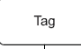

一个标签可以对应多个产品。

一个产品可以有多个标签。

一个仓库有许多员工。


一个仓库包含许多库存项。


1

一个库存项指向它当前所在的仓库。

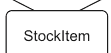

一个库存项在产品目录中有一条记录。

图 7.2 我们的数据模型回顾

如果你决定将类导出并重用到应用程序之外（例如编写公共模块或在应用程序之间共享你的数据模型），请务必仔细、深入地考虑每种方法。破坏公共接口是不明智的。

### 7.1.3 创建我们的类

由于我们已经有了基础关系型模型，让我们直接在 Java 中填充细节。请参考图 7.2 回顾我们完整模型的样式。

我们已经在之前的章节中创建了 `Product` 和 `Tag` 类，但其他类是新的。请在 7.3 中在上一节创建的应用程序的 `models` 包下创建这些类：

> 列表 7.3 用类表示我们的基础数据模型

```java
public class Product {

    public String ean;

    public String name;

    public String description;

    public byte[] picture;

    public List<Tag> tags;

    public String toString() {

        return name;

    }

}
```

EAN 是国际产品代码。

```java
public class Tag {

    public Long id;

    public String name;

    public List<Product> products;

}
```

注意这些字段是关系。

```java
public class Warehouse {

    public String name;

    public List<StockItem> stock = new ArrayList<>();

    public String toString() {

      return name;

    }

}

public class StockItem {

  public Warehouse warehouse;

  public Product product;

  public Long quantity;

  public String toString() {

    return String.format("%d %s", quantity, product);

  }

}
```


注意这些字段是关系。

你的应用程序目录现在应该看起来如下所示。

- warehouse
  - app
    - controllers
    - models
      - Product.java
      - StockItem.java
      - Tag.java
      - Warehouse.java
    - views
    - conf
    - public
    - test
    - db

恭喜你，你拥有了一个完整的数据模型！先不要太担心浏览器；我们将在第 8 章讨论视图模板。

现在我们已经有了数据模型，并且知道如何在控制器和视图中使用它，是时候开始考虑如何将数据保存到集合中了。

## 7.2 持久化与对象关系映射 (ORM)

拥有所有这些数据是有用的，但目前我们在处理请求期间构建的所有数据在处理完请求后就会丢失。我们需要持久化这些数据。我们将使用 `Ebean` 工具来保存我们的对象。

### 7.2.1 关于关系数据库

（此处省略了关于 ORM、JPA 和 Hibernate 的重复性描述翻译，直接进入核心概念说明）

### 7.2.3 介绍 Ebean

`Ebean` 是一个 ORM 框架，它在管理实体方面采取了与 JPA 不同的方法。主要区别（以及它与 Play 非常契合的地方）在于它有一个无缝 API。不用太担心这意味着什么，但如果你用过 JPA，你会发现管理实体状态的时间更短了。

`Ebean` 借用了 JPA 的一个方面：映射实体的注解。在使用 `Ebean` 时，映射实体的方式与 JPA 相同。让我们来看看它是如何运作的。

## 7.3 映射基础实体

> **跳过章节**：如果你已经熟悉如何使用 JPA 映射实体，可以跳到下一节。请查看代码示例以上手。

在将类映射到数据库时，你需要指示 ORM 工具（在这里是 `Ebean`）将对象模型中的数据映射到数据库中。你通过将类和字段映射到表和列来实现。你还需要将一个类标记为实体，告诉工具它是你想作为数据模型部分的类。

存储在数据库中的任何内容都需要一种方式来标识它。这被称为主键。虽然我们可以使用实体上的某个保证唯一的字段（这被称为自然键），例如 `Product` 类上的 `ean` 字段，但通常认为更好的做法是专门为此目的设置字段（称为合成键）。因此，我们将为实体引入一个名为 `id` 的 `Long` 字段，并使用 `@Id` 进行注解。

### 7.3.1 配置 Ebean 和数据库

我们将使用 `H2`，这是一种与 Play 自带的轻量级数据库管理系统（DBMS）。`H2` 的优点是它具有“嵌入式”模式，这意味着它会在 Play 运行时在 JVM 中按需加载。它还可以根据需要创建数据库，这非常适合在开发期间使用，此时你可能想要对数据库进行实验，并且不在意数据是否被保留。

Play 的配置包含了 `H2` 和 `Ebean` 的默认设置，但它们被注释掉了，因为并不是所有应用都需要持久化。打开应用程序目录下的 `conf/application.conf` 文件，找到并取消以下行的注释：

```
db.default.driver=org.h2.Driver
db.default.url=jdbc:h2:mem:play
db.default.user=sa
..
ebean.default.models=.*
```

> 告诉 Play 的数据库系统使用 H2
> 为我们的模型包启用 Ebean

注意我们使用的是 `db.default` 命名空间，但我们可以指定任何命名空间。Play 支持连接多个数据库。你只需要指定不同的命名空间（例如 `db.acceptance.driver`、`db.test.driver` 等）。

在测试工作之前，让我们回顾一下我们正在做的内容。在章节开头，我们使用 Java 类定义了数据模型，这些类在代码中代表了现实世界的概念。这允许我们在 JVM 内存中存储仓库状态的表示。现在，我们想将数据存储在更持久的地方；我们希望将其持久化到数据库中。Java 使用对象和方法调用，而数据库在表中存储数据并通过 SQL 进行访问。为了弥补 Java 和 SQL 世界之间的鸿沟，我们正在使用一种称为 ORM（对象关系映射）的工具将类映射到数据库。我们选择的工具是 `Ebean`。

开发应用程序时数据库服务器（也称为 DBMS）是 `H2`。这是因为它提供了灵活性，这也是它与 Play 绑定的原因。当你将应用迁移到生产环境时，你可能会将其更换为数据库，例如 MySQL、PostgreSQL 或 Oracle，这些是最著名的选项。`Ebean` 支持大多数主流 DBMS，但如果你担心兼容性，请务必检查 `Ebean` 文档。

图 7.4 展示了我们描述的架构。

好了，现在（重新）加载 `http://localhost:9000/` 页面，看看是否成功了。

哇。发生了什么？嗯，虽然看起来可能不像，但这是 Play 在提供帮助。当我们定义数据库连接时，我们让 Play 连接到 `H2` 数据库，它将在连接时自动创建数据库模式（schema），即它的结构——表和列定义。Play 为此生成了一个 SQL 脚本，现在默认提议为你运行它。脚本位于 `conf/evolutions/default/1.sql` 文件中。这被称为数据库演进（database evolution），我们稍后会看到它允许你创建数据库模式的增量版本。默认文件夹与我们之前指定的数据库配置相匹配。现在，点击“Apply this script now”（立即应用此脚本）！你会看到我们在图 1.3 中看到的默认欢迎页面。

要像图 7.3 所示映射 `Product` 类，请按照列表 7.4 所示进行更改。

### 列表 7.4 映射 Product 类

```java
import javax.persistence.*;
import play.db.ebean.Model;

@Entity
public class Product extends Model {
    @Id
    public Long id;
    public Long ean;
    public String name;
    public String description;
}
```

> 添加此注解以将此类标记为实体（entity）
> 继承 Model 类以便方便
> 引入 id 字段

... 就这些了。我们稍后会尝试一下，但首先，让我们了解如何使用数据库和 `Ebean` 来实体。

## 7.4 映射关系

让我们开始处理 `StockItem` 类。图 7.8 显示了它在模型中作用的提示。

在我们的模型中，`StockItem` 类有两个关系：一个指向 `Product`，另一个指向 `Warehouse`。我们先忽略仓库，重点关注对以下内容的引用：

每个库存项都恰好有一个指向产品的引用。

一个产品有许多库存项引用它。

**图 7.9 StockItems 与 Products 之间的关系**

在我们的仓库产品目录中，我们将存储许多不同类型的产品：红色纸夹、蓝色纸夹等。

在我们的物理仓库中，我们将存储这些产品的批次，我们称之为库存项（stock items）。例如，假设产品目录中有一个“一盒 1000 个蓝色纸夹”，我们每种类型有三托盘，每托盘装有 500 盒。其中一个目前在 A 仓库，另外两个在 B 仓库。我们总共有三个库存项。

每个单独的库存项将代表产品目录中恰好一个产品的库存。这意味着库存项与其产品之间是“多对一”关系。反之也是如此；每个产品都可能被许多库存项引用，因此产品与库存项之间是“一对多”关系。该概念如图 7.9 所示。

在关系型数据库中，一对多关系通常被建模为“多”的一侧的一个列（在本例中，即库存项），该列指向“一”的一侧中记录的 ID（例如产品）。每当从数据库中检索一个库存项时，如果需要，可以使用该 ID 从产品表中检索出正确的行。用于指向任何其他表的主键的 ID 被称为外键。这如图 7.10 所示。

### 7.4.1 映射多对一关系

让我们映射 `StockItem` 类。在 `StockItem` 类上添加 `@Entity` 注解，扩展自 `Model`，并给它一个 `id` 字段。在这个示例中，对于 `Product` 类，我们没有对该类的字段添加任何注解。这是因为它的所有字段都可以存储在数据库中；不涉及任何关系。在 `StockItem` 类中，我们只有一个字段：`quantity` 字段，它是一个 `Long` 类型，可以完美映射到 SQL `number` 类型，`Ebean` 可以自动进行映射。

其他字段是我们的 `Product` 和 `Warehouse` 类。我们需要告诉 `Ebean` 它们是对其他实体的引用，以及它们具有什么类型的关系。我们现在关注 `StockItem`。正如我们之前看到的，`StockItem` 与 `Product` 是多对一关系。因此，我们用 `@ManyToOne` 标记此字段，如下列表所示。

### 列表 7.6 StockItem-Product 多对一关系

```java
import javax.persistence.ManyToOne;

@Entity
public class StockItem extends Model {
    @Id
    public Long id;

    @ManyToOne
    public Product product;

    public Long quantity;
}
```

### 列表 7.7 保存 StockItem 及其关系

```java
StockItem item = new StockItem();
item.quantity = 0;
item.product = product;

product.save();
```

在浏览器中刷新添加此行。

当我们创建库存项时，结果如图 7.11 所示。

我们已经学习了如何映射一对多关系，那么另一侧多对一呢？当我们有一个 `StockItem` 实例时，我们可以知道产品。但当我们有一个 `Product` 时，我们无法知道库存项。为了这一点，我们需要使关系是双向的。

### 7.4.2 映射一对多关系

双向多对一关系不会影响数据库；关系信息已经存储在“一”的一侧（见图 7.12）。

这意味着检索属于特定产品的库存项只需要查询 `product_id` 列。

让我们解释如何检索 `StockItem` 对象。首先，我们需要一个字段来存储它们，作为 `Product` 类的 `List<StockItem>` 字段。我们现在只需要将其标记为一对多关系，正如我们对 `StockItem` 上的多对一字段所做的那样：用 `@OneToMany` 注解它。因为 `StockItem` 类是持久化关系的一侧，我们需要指示 `StockItem` 类中哪个属性持有该关系。我们通过在注解中使用 `mappedBy` 属性来实现这一点，如下列表。

### 列表 7.8 使 Product-StockItem 关系双向

```java
import javax.persistence.OneToMany;
import java.util.List;

@Entity
public class Product extends Model {
    @Id
    public Long id;
    public Long ean;
    public String name;
    public String description;

    @OneToMany(mappedBy = "product")
    public List<StockItem> stockItems;
}
```


```java
import javax.persistence.*;
...

@Entity
public class Product extends Model {
    @Id
    public Long id;
    public Long bean;
    public String name;
    public String description;

    @ToMany(mappedBy="product")
    public List<StockItem> stockItems;
}
```

现在从数据库检索一个 `Product` 实例，你也可以访问它的 `stockItems`。

`Warehouse` 与 `StockItem` 之间的关系是另一个一对多的例子。让我们按照后面的列表实现它。`StockItem` 类应该像下面所示。

## 7.9 StockItem.java

```java
import javax.persistence.*;
...

@Entity
public class StockItem extends Model {
    @Id
    public Long id;

    @ManyToOne
    public Warehouse warehouse;

    @ManyToOne
    public Product product;

    public Long quantity;
}
```

# 第 7 章 模型与持久化

`Warehouse` 类应该如下列表所示。

# 列表 7.10 Warehouse.java

```java
import javax.persistence.*;
...

@Entity
public class Warehouse {
    @Id
    public Long id;

    public String name;

    @OneToMany(mappedBy = "warehouse")
    public List<StockItem> stock = new ArrayList<>();

    @Override
    public String toString() {
        return name;
    }
}
```

我们的 `Warehouse` 类没有存储关于仓库的很多信息。让我们对此做些改进。

### 4.7.3 为我们的仓库添加地址

让我们为仓库添加更多信息。我们需要知道它在地球上的哪个位置，这样我们才能知道物品在哪里：我们需要一个地址。我们可以像下面的列表所示，向 `Warehouse` 类添加一组属性。

# 列表 7.11 为 Warehouse 添加地址属性

```java
@Entity
public class Warehouse {
    @Id
    public Long id;

    public String name;

    public String street;
    public String number;
    public String postalCode;
    public String city;

    @OneToMany
    public List<StockItem> stock = new ArrayList<StockItem>();
}
```

虽然这解决了我们的问题，但它为 `Warehouse` 类添加了许多属性，而这些属性共同成了仓库的单一属性：它的地址。因此，更好的做法是给地址创建一个独立的类。按照下面的列表创建 `Address` 类。

# 映射关系

```java
Listing 7.12 Address.java
public class Address {
    public Warehouse warehouse;
    public String street;
    public String number;
    public String postalCode;
    public String city;
    public String country;
}
```

然后像下面的列表所示，为 `Warehouse` 类添加一个地址属性。

```java
Listing 7.13 Warehouse.java
@Entity
public class Warehouse {
    @Id
    public Long id;
    public String name;
    public Address address;
    @OneToMany
    public List<StockItem> stock = new ArrayList<StockItem>();
}
```

图 7.13 用图表展示了这些类。

现在来进行映射

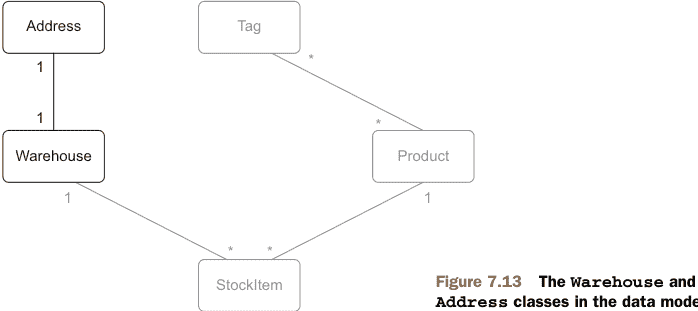

图 7.13 数据模型中的 Warehouse 和 Address 类

# 第 7 章 模型与持久化

| id | name | address_id | id | street | number | postcode | city | country |
|---|---|---|---|---|---|---|---|---|
| 1 | Warehouse | A | 1 | Heemraadssel | 70 | 3021DD | Rotterdam | Netherlands |
| 2 | Warehouse | B | 2 | Rue Trabout | 64 | 75009 | Paris | France |
| 3 | Warehouse | C | 3 | Sand Hill Rd | 2550 | 02138 | Menlo Park | United States |

图 7.14 多对一数据库关系

但在建立多对一关系时，需要做一个决策：我们需要选择关系的所有权端（owning side）。当我们建立多对一关系时，很明显，“一”的一侧的表必须持有“一”的一侧的主键。反过来操作是不可能的，因为数据库字段可能无法包含多个值。在多对一关系的情况下，我们将“多”的一侧称为关系的所有权端；它是存储关系的一侧。

在一对一关系的情况下，尚不清楚哪侧应该是所有权端；双方都具备存储关系的能力。因此，我们必须指定哪侧是所有权端。当关系是单向的（例如，只有仓库）时，在相关字段上标记 `@ToOne` 注解就足够了。当关系是双向的，双方的字段都应该用 `@ToOne` 映射。要指明哪侧是所有权端，在所有权字段上添加 `mappedBy` 参数。在我们映射完类之后，它们看起来如下：

# 列表 7.14 Warehouse.java

```java
@Entity
public class Warehouse {

    @Id
    public Long id;

    public String name;

    @ToOne
    public List<StockItem> stock = new ArrayList<StockItem>();

    @ToOne
    public Address address;

}
```

# 列表 7.15 Address.java

```java
@Entity
public class Address {

    @Id
    public Long id;

    @ToOne(mappedBy="address")
    public Warehouse warehouse;

    public String street;
    public String number;
    public String postcode;
    public String city;
    public String country;
}
```

# 第 7 章 模型与持久化

Ebean 翻译的此方法可以调用一个或多个 SQL INSERT 语句，这就是我们使用 SQL 在数据库表中存储新记录的方式。

接下来，我们想对数据库查询执行类似的操作：根据某些标准向数据库请求数据。在最简单的情况下，根据对象的 ID 从数据库查询一个对象。当你确切知道想要访问哪个对象时，就会执行此项操作。

现在我们将从数据库中查询一些测试数据，所以最好里面有一些内容。如果你有亲自动手（DIY）的心情，请继续使用测试数据创建并持久化几个对象层次结构。如果你觉得懒（像所有优秀的程序员一样），你可以切换到我们示例代码库中本章使用的应用程序。我们已经设置好使用演进机制（evolution mechanism）预加载了大量测试数据。运行应用程序，它将在第一次请求时填充数据库。

我们现在应该有一组很不错的测试数据加载到数据库中了。让我们开始工作吧。

### 7.5.1 根据 ID 获取

让我们根据 ID 获取一个 Product（产品）。现在我们的数据库中应该已经有一个，所以让我们查看 H2 控制台中我们保存的产品。打开 H2 控制台，点击 product 表。它会在窗口右侧的文本区域填充一个 SQL 查询，选择 product 表中的所有行。点击 Run（运行）并查看结果。注意最后一行的 ID；在我们的示例中，假设它是 1。

现在如何使用数据库呢？根据 ID 查找实体是非常常见的操作，因此 Ebean 为其提供了一个专门的静态方法：`Ebean.find(clazz, id)`。从参数中可以看出，我们只需要告诉它我们想要查找的对象的类（Product）和它的 ID（ID）。在我们的案例中，我们正在根据 EAN 编号查找产品。让我们看看如何使用 EAN 编号进行数据库查找。

### 7.5.2 使用 Finder API

还记得在第 7.3.3 节中，我们为 Product 类本身添加了 `save()` 方法，并扩展了 `Model` 类吗？如果 `find()` 也有这个功能不是不是更好吗？在 Product 类中添加一个静态方法并将其委托给 `Ebean.find()` 方法是否会更好？但 Play 已经为你提供了一个更好的选项：`Model.class`，它为任何实体提供了一个完整的查询 API。

你需要实例化它，所以让我们为 Product 类添加一个字段以获取用于 Products 的 Finder 实例。在 Product 类中添加以下方法：

```java
public class Product extends Model {
...
  public static Finder<Long, Product> find =
    new Finder<>(Long.class, Product.class);
  ...
}
```

## 查询对象

如你所示，`Finder` 的构造函数接受两个参数，都是 `Class` 对象。第一个参数告诉 Finder 实体的 ID 字段类型，第二个参数是要查询的实体的类型。我们可以使用 `find` 对象根据 ID 查找我们的产品：

```
Product.findById(ID);
```

此外，我们还将使用 `find` 对象根据其 EAN 编号查找产品。如果你还记得第 6 章，我们实现了基于 EAN 产品编号的 Product 对象查找。接下来的代码列表显示了 Product 模型类中的相关代码。

### 列表 7.18 我们当前的 Product 类 EAN 查找

```java
... import play.mvc.PathBindable;
import play.libs.F.Option;
public class Product implements PathBindable<Product> {
...
    @Override
    public Product bind(String key, String value) {
        return this.ean;
    }

    @Override
    public String unbind(String key) {
        return this.rawValue;
    }

    @Override
    public String JavaScriptUnbind() {
        return this.ean;
    }
}
```

如你所示，我们剩下的工作就是为 `findFindBy` 方法提供正确的实现。我们的新实现显示在接下来的列表中：

### 列表 7.19 更新后的 findByEan 实现

```java
public class Product {
...
    public static Product findByEan(String ean) {
        return find.where().eq("ean", ean).findUnique();
    }
...}
```

# 第 7 章 模型与持久化

`findByEan` 方法的实现非常直接。我们正在发布一个数据库查询，选择 EAN 与给定参数相匹配的唯一产品。

保存所有文件，并在浏览器中加载 http://localhost:9000/details/11111111111。你应该能看到之前保存的产品信息。

我们 Products 控制器中的 `save()` 动作方法需要稍微更改，因为我们现在需要区分创建新产品和更新产品。接下来的列表显示了新的实现。

### 列表 7.20 新的 save() 实现

```java
public static Result save() {
MultipartFormData body = request().body().asMultipartFormData();
Form-Product bound = product.form.fromRequest(body);
if (bound.FormhasError()) {
  flash("Error correct the form below.");
  return badRequest(details.render(boundForm));
}
Product product = boundForm.get();
MultipartFormData.FilePart part = body.getFile("picture");
if (part != null) {
  File file = part.getFile();
  try {
    product.picture = file;
  } catch (IOException e) {
    return internalServerError("Error reading file");
  }
}
List<Tag> tags = new ArrayList<>();
for (Tag tag : product.tags) {
  if (tag.id != null) {
    tags.add(Tag.findById(tag.id));
  }
}
product.tags = tags;
if (product.id == null) {
  product.save();
} else {
  product.update();
}
flash("Successfully added %s", product);
return redirect(routes.list(1));
}
```

### 7.5.3 加载初始数据

我们已经确定需要在应用程序启动时加载数据。Play 允许通过两种方式加载数据：

- 演化脚本（Evolution scripts）

- 启动时调用的 Global Java 类的 onCreate() 方法以及 YAML 数据文件

### 演化脚本

我们在 7.3.1 节中看到 Play 会生成一个数据库脚本来创建我们的 schema。我们需要做的就是向此脚本中添加数据。另一种方法是在 `conf/evolutions/default/` 目录下创建一个名为 `2.sql` 的文件，并添加一个 SQL insert 语句在应用程序启动时添加数据。演化 SQL 脚本的格式如下：

```sql
# -- Initialize tags
# -- Ups
insert into tag(id,name) values (1, 'lightweight');
insert into tag(id,name) values (2, 'metal');
insert into tag(id,name) values (3, 'plastic');
# -- !Downs
SET REFERENTIAL_INTEGRITY FALSE;
```

演化脚本用于创建数据库 schema 并为你的应用程序填充初始数据。它们还用于在应用程序的不同版本之间执行 schema 更新。演化脚本包含两个部分：应用程序启动时执行的 SQL 和应用程序关闭时执行的 SQL。

演化脚本按顺序调用（`1.sql`, `2.sql` 等）；在应用程序启动时，会应用 Ups 部分定义的 SQL；在应用程序关闭时，会应用 Downs 部分。

你可以通过在演化脚本的 Ups 部分添加 SQL insert 语句，用现有的产品预填充你的数据库。

### YAML 数据文件

我们从第 6 章 6.2.3 节中看到，Play 提供了一种方法通过使用 `Global` 类的 `onCreate()` 方法在应用程序启动期间包含自定义代码的方法。该类会被自动实例化，并在我们的应用程序启动时调用 `onCreate()` 方法。

我们将使用这种技术来加载一个包含你标签目录的文件。我们的目录将用 YAML 编写。YAML 是一种适用于所有编程语言的人类友好数据序列化标准。

编辑 `app` 目录下的 `Global.java`，并按照列表所示修改 `onCreate()` 方法。

## 查询对象

### 列表 7.22 Global 类上新的 onStart() 方法


```java
import com.avaje.ebean.*;
import models.*;

public class Global extends GlobalSettings {
    ...
    public void onStart(Application app) {
        InitialData.insert(app);
    }
    static class InitialData {
        public void insert(Application app) {
            if (Ebean.find(Tag.class).findCount() == 0) {
                Map<String, List<Object>> map = 
                    (Map<String, List<Object>>) Yaml.load("initial-data.yml");
                Ebean.save(all.get("tags"));
            }
        }
    }
}
```

`InitialData.insert()` 方法是前向的：如果数据库中还没有数据，我们就插入。Play 提供了一个工具类来加载 YAML 文件，这变得非常简单。我们现在有时间创建一个 YAML 文件了。在 `conf` 目录下创建一个 `initial-data.yml` 文件。Play 默认将 `conf` 作为类路径的一部分，这意味着位于该目录的文件无需指定完整路径即可加载。`initial-data.yml` 的内容如下列表所示。

### 列表 7.23 initial-data.yml 文件

```yaml
- !!models.Tag
  id: 1
  name: lightweight
- !!models.Tag
  id: 2
  name: metal
- !!models.Tag
  id: 3
  name: plastic
```

请注意，文件不包含制表符（tabs），而是空格。前面的空格和标点符号是重要的。通过该文件，我们定义了一个包含 `model.Tag` 对象的标签集合。每个对象包含一个 `id` 和一个 `name`。标签集合通过以下行被 Ebean 引用并保存：

`Ebean.save(all.get("tags"));`

### 7.5.4 创建复杂的查询

我们已经知道了如何在应用程序启动时加载数据，这非常有用。你现在可以安全地为产品打标签，因为标签已经在数据库中了。你现在需要更强大的方式来查询数据库。让我们看看 Ebean 和 Finder 提供了什么。

数据库擅长根据你的任何标准查找数据。如前，SQL 是在 RDBMS 中搜索数据时使用的语言。在面向对象的环境中使用 SQL 的缺点是它是基于关系世界的视图；它与面向对象编程不兼容，而这正是我们进行 ORM 的意义所在。

JPA 和 Hibernate（以及其他解决方案）通过定义不同的查询语言来绕过这个问题，这种语言看起来像 SQL，但允许你查询类和对象，而不是数据库表和列。

在 Java 中创建此类查询意味着使用字符串来构建它们。如果我们需要动态组合查询（这是一种面向对象的操作），我们需要拼接字符串；这会迅速变得混乱混乱，意味着我们的代码将变得难以阅读，或者糟糕的是，会出现 Bug。使用字符串不是你想做的事；除其他问题外，它是琐碎、混乱且容易出错的，编译器完全无法帮助我们。在类型安全的世界中，这并不优雅。

构建查询的替代方案是基于标准的 API。基于标准的 API 允许你使用对象组合来构建查询对象，该对象将为你构建并执行 SQL 查询。这意味着你不需要处理混乱的字符串。

### 列表 7.25 StockItem 的 find 方法

```java
public static Finder<Long, Product> find() {
  return new Finder<Long, Product>(Long.class, Product.class);
}
```

> 构建一个用于查找 StockItem 对象的 Finder

当我们运行此代码时，将获得数据库中所有的库存项目列表。在浏览器中加载 `http://localhost:9000/stockitems/`。你将看到类似下面的输出：

StockItem 1 - 300x product 1

StockItem 2 - 200x product 1

StockItem 3 - 500x product 1

#### 过滤我们的选择

让我们看看查询在英文版本的子句是什么：

- 给我所有的 StockItems...
- ... 数量为 300 或更多...
- ... 按数量从高到低排序...
- ... 但十个足够了。

我们想想为查询添加条件，以将结果列表缩小到我们感兴趣的对象。为此，我们将在 Finder 对象上使用 `where()` 方法，后跟上我们希望结果匹配的条件。

在这种情况下，我们需要指定一个“大于或等于”的条件，我们可以通过 `ge()` 方法实现。该条件需要知道两个信息：它适用于哪个字段，以及它的目标值是什么。我们想将其应用到 `quantity` 字段，目标值为 300，因此我们传递了这些值。我们的方法现在看起来如下：

```java
public static Result index() {
  List<StockItem> items = StockItem.find()
    .where()
    .ge("quantity", 300)
    .findList();

  return ok(items);
}
```

在浏览器中重新加载，列表现在应该只包含数量为 300 或更多的库存项目：

StockItem 1 - 300x product 1

StockItem 3 - 500x product 1

可以使用许多其他条件；请查阅 Ebean Query 类的文档获取完整列表。

让我们看看查询的下一步需要什么：

- 给我所有的 StockItems...
- ... 数量为 300 或更多...
- ... 按数量从高到低排序...
- ... 但十个足够了。

现在的列表某种程度上是随机排序的。嗯，它是按 ID 排序的，因为我们没有指定顺序；数据库可以自由地按任何顺序返回项目。永远不要信任默认排序行为；如果你切换数据库供应商（例如将应用迁移到生产环境时），它可能会发生。

#### 排序

让我们指定一个排序子句。这是通过 `orderBy` 方法实现的，并指定我们想要排序的字段：在我们的例子中是 `quantity`。

```java
public static Result index() {
  List<StockItem> items = StockItem.find()
    .where()
    .ge("quantity", 300)
    .orderBy("quantity")
    .findList();
  return ok(items);
}
```

刷新页面，我们的列表现在应该过序了：

StockItem 3 - 500x product 1 StockItem 1 - 300x product 1

我们的查询中还有一点需要添加：

- 给我所有的 StockItems...
- ... 数量为 300 或更多...
- ... 按数量从高到低排序...
- ... 但十个足够了。

结果列表可能会变得很大，所以让我们获取前十项。我们需要使用 `setMaxRows()` 方法来设置结果的最大数量：

```java
public static Result index() {
  List<StockItem> items = StockItem.find()
    .where()
    .ge("quantity", 300)
    .orderBy("quantity")
    .setMaxRows(10)
    .findList();
  return ok(items);
}
```

重新加载页面，我们的列表应该被修剪：

StockItem 3 - 500x product 1

使用 `setMaxRows()` 方法，我们可以实现分页，将大列表拆分为多页。通过 `setMaxRows()`，我们确定想要多少个项目，以及从哪里开始。数据库将始终返回第一组项目。如果我们请求第二页数据，可以使用 `setFirstRow()` 方法指定从哪里开始。

使用这两个方法就可以实现分页。Ebean 让它变得更加简单，不需要你手动计算分页参数。让我们详细查看。

#### 分页

表格分页是大多数 Web 应用都需要的功能。使用 Ebean 执行起来非常简单。以我们的产品列表为例。现在，我们的 Controller 正在调用 Product 对象上的 `find()` 方法。让我们定义一个接受页码参数的 `find()` 方法，如 7.26 所示。

### 列表 7.26 支持分页的 find() 方法

```java
public static List<Product> find(int page) {
    return find.where()
        .order("id asc")
        .pagingList(10)
        .fetch(false)
        .getPage(page);
}
```

> find 现在返回 Page 对象
> 我们需要 fetch 数据吗？
> 当前页码，从 0 开始

分页查询所有产品并按 ID 返回最多 10 个产品。我们现在需要如下修改 Product Controller 的 `list()` 方法：

```java
public static Result list(Integer page) {
    Page<Product> products = Product.find(page);
    return ok(list(products));
}
```

由于我们现在使用了 `list.scala.html` 视图，我们需要对其进行微调。下面显示了相关的更改。

### 列表 7.27 list.scala.html 视图

```scala
@(currentPage: com.ebean.Page[Product])

<html>
  @for(product <- currentPage.list()) {
    <tr>
      ...
    </tr>
  }
</html>

<div id="pagination" class="pagination">
  <ul>
    @if(currentPage.hasPrev) {
      <li><a href="?page=${currentPage.previousPageNumber}">Previous</a></li>
    }
    <li>Page ${currentPage.pageNumber}</li>
    @if(currentPage.hasNext) {
      <li><a href="?page=${currentPage.nextPageNumber}">Next</a></li>
    }
  </ul>
</div>
```

> 将 Page 对象作为参数传递给模板
> 返回当前页的产品列表
> 判断是否有上一页的方便方法

### 使用 JPA 代替 Ebean

在开发新应用时，你可能会使用 Ebean，也可能觉得更好。事实上，包含 JPA 是不错的。

### 7.6.1 配置 Play

启用 JPA 有两个步骤：将数据源暴露给 JNDI 以及将 JPA 添加到依赖中。首先，打开 `application.conf`，在数据库配置中添加 `jdbc` 属性（参见 7.3）。此外，如果你已经启用了 Ebean，请确保删除或注释掉所有以 `ebean` 开头的行以禁用它。

接下来，我们将 Play 的 Ebean 模块切换为 Play 的 JPA 模块。打开 `project/Build.scala`，将 `Ebean` 替换为 `javaJpa`，使得 `appDependencies` 列表如下：

### 列表 7.28 appDependencies

```scala
val appDependencies = Seq(
  javaCore,
  javaJdbc,
  javaJpa
)
```

剩下的只需添加对 JPA 实现的依赖。如果需要，Hibernate 是很好的选择，但你可以选择任何 JPA 实现。找到你实现的 artifact ID，并将其添加到依赖中。这里是 Hibernate 的示例：

```scala
val appDependencies = Seq(
  javaCore,
  javaJdbc,
  javaJpa,
  "hibernate" % "hibernate-entitymanager" % "3.6.9.Final"
)
```

启动应用时，JPA 将可用。你仍然需要配置 JPA 本；它需要一个持久单元，

### 7.6.2 添加 Persistence.xml

对于 Play 应用，没有特殊的地方来配置 JPA。与所有项目一样，JPA 需要在 `persistence.xml` 中声明持久单元。在 Play 中，你需要将其放在 `conf/META-INF` 目录下。列表 7.29 显示了一个 `persistence.xml` 示例，对应于上一节中配置的 H2 `DefaultDS` 源。

### 列表 7.29 persistence.xml

```xml
<persistence xmlns="http://java.sun.com/xml/ns/persistence"
xmlns:xsi="http://www.w3.org/2001/XMLSchema-instance"
xsi:schemaLocation="http://java.sun.com/xml/ns/persistence http://java.sun.com/xml/ns/persistence/persistence_2_0.xsd"
version="2.0">

  <persistence-unit name="DefaultPersistenceUnit"
  transaction-type="RESOURCE_LOCAL">
    <provider>org.hibernate.ejb.HibernatePersistence</provider>
    <non-jta-data-source>DefaultDS</non-jta-data-source>
    <properties>
      <property name="hibernate.dialect" value="org.hibernate.dialect.H2Dialect"/>
    </properties>
  </persistence-unit>
</persistence>
```


现在你的 JPA 应用已经准备就绪了。它的运行方式与其他任何 JPA 应用无异，但 Play 中的一些类会让你的工作变得更容易。

## 7.6 内置 JPA 辅助工具

以下是在 Play 应用中使用 JPA 时对你有所帮助的一些功能列表：

- 启动 JPA——你可以通过调用 `play.db.jpa.EM()` 在应用程序的任何点获取 `EntityManager`。
- 将 action 方法封装在事务中——在任何 action 方法上加上 `@play.db.jpa.Transactional` 注解，即可将该方法中的所有操作封装在事务中。

## 7.7 总结

在本章中，我们为仓库应用程序创建了一个基础模型，并了解了如何使用 E 将对象持久化到数据库中。我们引入了 ORM 的原理，并解释了基本的 JPA 映射原理，以及基础的关系类型：

- 一对多
- 多对一
- 一对一
- 多对多

JPA 映射的内容比这些关系类型多得多，例如映射类继承或嵌入对象，但这些主题超出了本书的范畴。E 的文档对大多数功能都有很好的介绍，但如果你想了解关于 JPA 映射的所有细节，请阅读 Oracle 的 Java EE 教程。

我们还学习了如何在存储后使用 Ebay 和 Play 的 Finder API 从数据库中检索对象。最简单的形式是根据 ID 获取对象，但我们也学习了如何使用 Ebay 的 Query API 创建更复杂的查询。

在整个章节中，我们一直使用 Play 提供的便利类和方法，这帮助我们学习了在用 Play 创建对象模型时的一些最佳实践。

本章中最重要的建议可能是将行为（behavior）放在模型类（model classes）中。大多数框架鼓励这样做，而是创建 DAO 层。Play 是不同的，它通过让你轻松地“正确”这样做，来帮助你创建非贫血的对象模型。这些最重要的例子是 `Model` 和 `Finder` 类；你可以通过扩展或实例化它们来提供优雅且整洁的 API。

在下一章中，我们将通过实现一些良好的视图来完善知识，为我们的仓库应用程序增加一些视觉吸引力。

# 第 8 章 使用视图模板生成输出

本章涵盖了：

- Scala 模板简介
- Scala 模板语法
- 复用模板代码和组件
- 执行常见任务

我们学习了如何使用模型来结构化和存储数据以及业务日志，以及如何使用控制器来桥接 Java 世界与基于 HTTP 的网络之间的鸿沟。

我们涵盖了 MVC 中的 M 和 C，但 V（即视图层）呢？我们需要一个视图层来向客户端展示应用程序所做的工作，无论客户端是浏览器还是使用我们 API 的其他系统。

使用 Play 开发应用程序时，创建输出的选项是模板。你可能以前用过某种模板系统，但你会发现 Scala 模板引擎（Play 自带的默认模板引擎）有些不同。正如我们在前面的章节中所说，Scala 模板被编译成类，并且是完全类型安全的。

在本章中，我们将向你展示在 Play 应用中使用 Scala 模板创建视图所需的所有知识。但 Scala 模板并不是你唯一的选择。在章节结束处，我们将向你展示替代模板引擎。

首先，我们将深入探讨 Scala 模板的工作原理，以及为什么它是 Java 应用的默认选项。

## 8.1 编译型、类型安全模板的优势

即使是用 Java 开发 Play 2 应用，你默认的模板选项也是 Scala 模板引擎。这可能令人惊讶，因为你显式地选择了 Java 而不是 Scala。

首先，不要害怕；与任何其他模板系统不同，你只需要学习如何执行某些事情（例如遍历集合或做出 if/else 决策），而无需了解其原理或语法的含义。此外，许多 Scala 语法与 Java 非常相似；下面的代码段在 Java 和 Scala 中都是在对象上调用带参数方法的有效语法：

```scala
catalog.getProduct(ean);
```

使用 Scala 并不是使 Scala 模板引擎与其他模板系统不同的唯一之处。最传统的模板系统工作原理是：你用自定义语法编写模板文件，并通过该模板的文件名调用引擎。然后模板引擎加载并评估它。此时它会显示自定义指令，通常称为标签（tags），这些指令描述了模板的结构。这些通常是循环、if/else 结构，或者包含或扩展其他模板文件的指令。

在解析模板结构后，模板引擎将开始生成输出，此时它将评估模板的动态部分，即表达式。这些表达式解析出作为模板标签输入的值或直接输出的变量。这些表达式通常定义在某些模板语言中，例如 JEE 框架中的统一表达式语言（UEL），或者任何像 Ruby 或 Groovy 这样的动态语言。

这种方法的缺点之一是，每次渲染模板时都必须重复表达式评估工作。每一次都是如此。这是浪费的。

另一个缺点是，大多数表达式引擎是动态类型的，这意味着无法保证什么种类型的对象最终进入你的模板，因此当你犯错时，编译器无法警告你。这就是为什么 Scala 模板与众不同；它们被编译成类，并且是完全类型安全的。

## 8.2 Scala 模板语法

虽然编译后的模板和类型安全很棒，但它们并没有解释为什么这种模板语言要用 Scala。毕竟，Java 本身也具有这些特性，为什么不直接用 Java 呢？答案是 Scala 具有一些 Java 中不具备的特性，或者能让代码更简洁的特性。例如，Scala 编译器比 Java 具有更好的类型推断能力，节省了大量的类型声明。

既然我们已经知道了原因，让我们来看看具体实现方法：实际的模板语法。

### 8.2.1 模板定义

正如我们在前面的章节所示，Scala 模板会被编译为类，你可以从 Java 代码中调用它们。编译后的类将位于一个 view 包中，并且它们都包含一个名为 render 的方法。该方法依赖于哪些参数取决于模板本身顶部定义的模板参数。

模板参数是函数参数，类似于 Java 中的方法参数，它们需要一个名称和一个类型。在 Scala 中，名称在前，后面跟着一个 `:`，然后是类型。模板可以有零个或多个参数，用逗号分隔，并且它们都应该放在模板文件的顶部。例如，一个具有类型为 `List[Product]` 的 `product` 参数和一个类型为 `Integer` 的 `count` 参数的模板：

```scala
@(product: List[Product], count: Integer)
```

你可以看到，List 的类型参数与普通的 Java 语法略有不同：Java 在 `List<Product>` 中使用尖括号，而 Scala 使用方括号 `[]`，这意味着你必须写成 `List[Product]`。唯一的区别在于语法；意义仍然相同。

现在我们已经知道了如何定义模板参数，可以查看模板的实际主体了。

### 8.2.2 模板主体

模板主体由纯文本（可以是任何内容，如 HTML、JSON、XML 或 CSV）与 Scala 代码混合组成。文本将直接复制到输出，而 Scala 代码则实现了模板的逻辑和动态部分。

> 这意味着编译器知道对象的类型，而无需在源代码中显式说明。

模板引擎唯一引入的表示 Scala 代码的符号是：字符 `@`。例如，来自我们在第 3 章列表模板的这段代码片段，如下列表所示。

#### 列表 8.3 scala.html

你可以看到，这个模板由纯 HTML 组成，渲染时将直接复制到输出。我们标记了作为 Scala 代码的部分。这些部分使得你的模板具有动态性。

这段代码片段中最有趣的部分是 `for` 语句。在这种形式下，Scala for 表达式等同于普通的 for/in 循环；它接收一个集合，并为集合中的每个成员重复主体中的代码。但在这种情况下，主体不是代码，只是文本。不过循环的行为正如你预期的那样；主体会为 `products` 中的每个条目进行重复。

for 循环的主体还包含一些 Scala 表达式，这些 Scala 表达式会被求值，结果的值将被包含在模板输出中。出于安全和兼容性考虑，所有表达式都经过了 HTML 转义。这意味着即任何作为 HTML 文本无效的字符都经过了正确的转义，以便在 HTML 文档中显示。如果你希望显示表达式的原始的、未转义的值，可以使用 `@Html()`：

```scala
// boldName = <b>world</b>
Hello ${boldName}!
```

如前所述，Scala 表达式以 `@` 字符开始。但表达式和其余文本从何时开始呢？

### 8.2.3 表达式的作用范围

在这个 `for` 循环的案例中，Scala 表达式的作用范围很明确：行开头的表达式，如果它包含块，则在块的结束处结束（由大括号指定）。

内联表达式的情况就没那么明确了，例如对 `routes.product.show()` 的函数调用以为产品链接的 `href` 属性生成值，或者构成链接大部分文本的值引用。在这些情况下，模板引擎足够智能解析出一个表达式并输出它找到的第一个值。因此，这种语法适用于简单表达式。考虑我们产品链接的文本（在第 8.3 节中描述）。表达式和纯文本的拆解如图 8.2 所示。

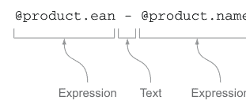

图 8.2 链接文本拆解

在这里，模板引擎知道 Scala 表达式何时结束，并继续将行的其余部分视为直到下一个 `@` 字符。

有时一个简单的表达式是不够的；你可能想输出某个需要稍微修改的值。在这种情况下，你仍然可以使用 `@` 语法，但你应该将表达式包裹在大括号中，如图 8.3 所示。

这种语法风格允许你通过显式指定结束位置来编写更复杂的表达式。现在，如果你想写，你可以编写一个更冗长的、多语句的表达式，使用大括号而不是，如图 8.4 所示。

img/1f90c92b70e5931c18b6f9f04c8da72e_205_0.png

图 8.3 多语句表达式

## 8.3 使用模板输出

```scala
@(product: List[Product], count: Integer)
```

### 8.4 模板参数是函数参数，类似于 Java 中的方法参数，它们需要一个名称和一个类型。在 Scala 中，名称在前，后面跟着一个 `:`，然后是类型。模板可以有零个或多个参数，用逗号分隔，并且它们都应该放在模板文件的顶部。例如，一个具有类型为 `List[Product]` 的 `product` 参数和一个类型为 `Integer` 的 `count` 参数的模板：

```scala
@(product: List[Product], count: Integer)
```

你可以看到，List 的类型参数与普通的 Java 语法略有不同：Java 在 `List<Product>` 中使用尖括号，而 Scala 使用方括号 `[]`，这意味着你必须写成 `List[Product]`。唯一的区别在于语法；意义仍然相同。

现在我们已经知道了如何定义模板参数，可以查看模板的实际主体了。

### 8.2.2 模板主体

模板主体由纯文本（可以是任何内容，如 HTML、JSON、XML 或 CSV）与 Scala 代码混合组成。文本将直接复制到输出，而 Scala 代码则实现了模板的逻辑和动态部分。

> 这意味着编译器知道对象的类型，而无需在源代码中显式说明。

模板引擎唯一引入的表示 Scala 代码的符号是：字符 `@`。例如，来自我们在第 3 章列表模板的这段代码片段，如下列表所示。

#### 列表 8.3 scala.html

你可以看到，这个模板由纯 HTML 组成，渲染时将直接复制到输出。我们标记了作为 Scala 代码的部分。这些部分使得你的模板具有动态性。

这段代码片段中最有趣的部分是 `for` 语句。在这种形式下，Scala for 表达式等同于普通的 for/in 循环；它接收一个集合，并为集合中的每个成员重复主体中的代码。但在这种情况下，主体不是代码，只是文本。不过循环的行为正如你预期的那样；主体会为 `products` 中的每个条目进行重复。

for 循环的主体还包含一些 Scala 表达式，这些 Scala 表达式会被求值，结果的值将被包含在模板输出中。出于安全和兼容性考虑，所有表达式都经过了 HTML 转义。这意味着

# Scala 模板语法

即任何作为 HTML 文本无效的字符都经过了正确的转义，以便在 HTML 文档中显示。如果你希望显示表达式的原始的、未转义的值，可以使用 `@Html()`：

```scala
// boldName = <b>world</b>
Hello ${boldName}!
```

如前所述，Scala 表达式以 `@` 字符开始。但表达式和其余文本从何时开始呢？

### 8.2.3 表达式的作用范围

在这个 `for` 循环的案例中，Scala 表达式的作用范围很明确：行开头的表达式，如果它包含块，则在块的结束处结束（由大括号指定）。

内联表达式的情况就没那么明确了，例如对 `routes.product.show()` 的函数调用以为产品链接的 `href` 属性生成值，或者构成链接大部分文本的值引用。在这些情况下，模板引擎足够智能解析出一个表达式并输出它找到的第一个值。因此，这种语法适用于简单表达式。考虑我们产品链接的文本（在第 8.3 节中描述）。表达式和纯文本的拆解如图 8.2 所示。


图 8.2 链接文本拆解

在这里，模板引擎知道 Scala 表达式何时结束，并继续将行的其余部分视为直到下一个 `@` 字符。

有时一个简单的表达式是不够的；你可能想输出某个需要稍微修改的值。在这种情况下，你仍然可以使用 `@` 语法，但你应该将表达式包裹在大括号中，如图 8.3 所示。

这种语法风格允许你通过显式指定结束位置来编写更复杂的表达式。现在，如果你想写，你可以编写一个更冗长的、多语句的表达式，使用大括号而不是，如图 8.4 所示。

img/1f90c92b70e5931c18b6f9f04c8da72e_205_0.png

图 8.3 多语句表达式

## 8.3 使用模板输出

```scala
@(product: List[Product], count: Integer)
```

# 第 8 章 使用模板生成输出

## 示例 8.6 使用索引变量迭代

```scala
@(products: Set[Product])
<table class="table-striped">
// 我们将跳过无关部分
@for((product, i) <- products.zipWithIndex) {
  <tr>
    <td>@i</td>
    <td><a href="/routes.Products.show(ean)">详情</a></td>
    <td>@product.name</td>
    <td>@product.description</td>
  </tr>
}
</table>
```

Scala 模板语法比此功能更多，但对于你将编写的大多数模板来说足够。让我们学习使用 `if/else` 语句进行决策。

## 8.3.2 决策

当然，Scala 拥有 `if/else` 语句，并且可以在模板中使用。作为一个示例，我们将扩展列表模板，在没有可用产品时显示一条友好消息（参见示例 8.7）。

## 示例 8.7 if/else 语句

```scala
@if(products.isEmpty()) {
  <p>未找到产品。</p>
} else {
  <dl>
    // 这里列出产品
  </dl>
}
```

你可以看到，`if` 语句非常直观，与 Java 完全相同。但在 Scala 中，语句可以写得更短；方法调用前的括号是可选的。我们可以像下所示所示重写条件。

## 示例 8.8 更简洁的语句

```scala
@if(products.isEmpty) {
  <p>未找到产品。</p>
} else {
  <dl>
    // 这里列出产品
  </dl>
}
```

## 使用模板构建页面

现在我们知道了如何创建模板，让我们看看如何重用模板代码以避免重复。

## 8.4 页面结构

就像普通代码一样，你的页面是由更小的部分组成的。许多部分在其他页面中是可以重用的，而有些部分是特定于某个页面的。这些部分本身并没有特殊之处；它们就是模板。在本节中，我们将展示如何使用可重用的模板来构建页面。

### 8.4.1 包含

我们只展示了 HTML 片段，而不是完整的页面。让我们开始为列表创建一个正确的 HTML 文档。Products 控制器中的 `list` 代码与之前相同，但使用了不同的模板：

```java
public Static Result list(Integer page) {
    Page<Product> products = Product.find(page);
    return ok(views.html.catalog.render(products));
}
```

图 8.5 页面

要创建模板，请在 `views` 目录下直接创建一个名为 `catalog.scala.html` 的文件。使用示例所示的内容。

## 示例 8.9 页面的完整 HTML，app/views/catalog.scala.html

```scala
@(currentPage: com.play.dbms.Page)
<!DOCTYPE html>
<html>
<head>
    <title>Routes</title>
```


# 第 8 章 使用视图模板生成输出

## 8.4.2 布局

我们在上一节中使用的 include 让我们的模板变得更好了一些，但它并不完美。目前，目录页面仍然渲染了它本不需要的整个 HTML，例如 HTML DOCTYPE 声明、`head` 元素以及页眉和页脚（这些在每个页面上都存在）。

事实上，只有 `<h2>所有产品</h2>` 和页脚之间的部分才是目录操作的职责：

```html
<h2>所有产品</h2>

<script>
function del(urlToDelete) {
  $.ajax({
    url: urlToDelete,
    type: 'DELETE',
    success: function(results) {
      // 刷新页面
      location.reload();
    }
  });
}
</script>

<table class="table table-striped">
  <thead>
    <tr>
      <th>EAN</th>
      <th>名称</th>
      <th>描述</th>
      <th>日期</th>
      <th></th>
    </tr>
  </thead>
  <tbody>
    @for(product <- currentPage.getList()) {
      <tr>
        <td><a href="@routes.Products.details(product)">@product.ean</a></td>
        <td><a href="@routes.Products.details(product)">@product.name</a></td>
        <td><a href="@routes.Products.details(product)">@product.description</a></td>
        <td>@product.date.format("dd-MM-yyyy")</td>
        <td>
          <a href="@routes.Products.details(product)"><i class="icon icon-pencil"></i></a>
          <a onclick="javascript:del('@routes.Products.delete(product)')"><i class="icon icon-trash"></i></a>
        </td>
      </tr>
    }
  </tbody>
</table>

<div id="pagination" class="pagination">
  <ul>
    @if(currentPage.hasPrev()) {
      <li class="prev">
        <a href="@routes.Products.list(currentPage.getPageIndex - 1)">&laquo;</a>
      </li>
    } else {
      <li class="prev disabled">
        <a>&larr;</a>
      </li>
    }
    <li class="current">
      <a>@currentPage.getDisplayXToYofZ("*", " / ")</a>
    </li>
    @if(currentPage.hasNext()) {
      <li class="next">
        <a href="@routes.Products.list(currentPage.getPageIndex + 1)">&rarr;</a>
      </li>
    } else {
      <li class="next disabled">
        <a>&rarr;</a>
      </li>
    }
  </ul>
</div>

<a href="@routes.Products.newProduct()" class="btn">
  <i class="icon-plus"></i> 新产品
</a>
```

所有内容都应该从模板中提取出来。我们可以使用 include 技术，但在这里并不理想，因为我们需要提取内容之前的 HTML 和内容之后的 HTML。如果使用 include，我们需要两个模板：一个包含内容之前，另一个包含内容之后。这会破坏模板的结构。幸运的是，模板引擎提供了一些功能，允许我们将其提取到单一模板中。

### 布局模板

```html
<!DOCTYPE html>
<html>
<head>
  <title>paperclips.example.com</title>
  <link href="@routes.Assets.at('css/bootstrap.css')" rel="stylesheet">
  <link href="@routes.Assets.at('stylesheets/main.css')" rel="stylesheet">
  <link rel="icon" href="@routes.Assets.at('images/favicon.png')">
  <script src="@routes.Assets.at('javascript/jquery.min.js')"></script>
</head>
<body>
  <div class="navbar navbar-inverse" id="navigation">
    <div class="container">
      <a class="brand" href="@routes.Products.index()">日志</a>
      <ul class="nav">
        <li><a href="@routes.Products.index()">首页</a></li>
        <li><a href="@routes.Products.list()">产品</a></li>
        <li><a href="@Contact">联系</a></li>
      </ul>
    </div>
  </div>

  <div class="container">
    @if(flash.containsKey("success")) {
      <div class="alert alert-success">
        @flash.get("success")
      </div>
    }
    @if(flash.containsKey("error")) {
      <div class="alert alert-error">
        @flash.get("error")
      </div>
    }
    @content
  </div>

  <footer class="footer">
    <div class="container">
      <p>Copyright ©2012 paperclips.example.com</p>
    </div>
  </footer>
</body>
</html>
```


## 197 使用模板组合构建页面

我们有一个可以调用的模板，例如 `views.html.main`。起初，这似乎没什么用。我们如何从目录模板调用它？我们没有可以传递的内容。目录模板正在渲染想要包含在主模板的内容。

我们可以通过 Scala 的技巧解决这个问题。在 Scala 中，你也可以使用大括号作为参数块，这是有效的：`views.html.main()`。通过这种函数调用包裹模板，我们实际上渲染了主模板并传递了目录模板的内容。如下列表所示：

### Listing 8.3 重构后的目录模板

```scala
@currentPage: ebean[Product]

@main(@Products) {

<h2>All products</h2>

<script>
function del(urlToDelete) {
  $.ajax({
    url: urlToDelete,
    type: 'DELETE',
    success: function(results) {
      // 刷新页面
      location.reload();
    }
  });
}
</script>

<table class="table table-striped">
  <thead>
    <tr>
      <th>EAN</th>
      <th>名称</th>
      <th>描述</th>
      <th>日期</th>
      <th></th>
    </tr>
  </thead>
  <tbody>
    @for(product <- currentPage.getList()) {
      <tr>
        <td><a href="@routes.Products.details(product)">@product.ean</a></td>
        <td><a href="@routes.Products.details(product)">@product.name</a></td>
        <td><a href="@routes.Products.details(product)">@product.description</a></td>
        <td><i>${product.date.format('dd-MM-yyyy')}</i></td>
        <td>
          <a href="@routes.Products.details(product)"><i class="icon icon-pencil"></i></a>
          <a onclick="javascript:del('@routes.Products.delete(product)')"><i class="icon icon-trash"></i></a>
        </td>
      </tr>
    }
  </tbody>
</table>
```

```html
<a onclick="javascript:del(@Routes.Products.delete(product.ean))">
  <i class="icon-trash"></i></a>
</td>
</tr>
</body>
</table>
<div id="pagination" class="pagination">
<ul>
  @if(currentPage.hasPrev) {
    <li class="prev">
      <a href="@Routes.Products.list(currentPage.getPage - 1)&amp;lt;</a></a>
    </li>
  } else {
    <li class="prev disabled">
      <a>&amp;lt;</a>
    </li>
  }
  <li class="current">
    <a>@currentPage.setDisplayXtoYofZ(" ", "/")</a>
  </li>
  @if(currentPage.hasNext) {
    <li class="next">
      <a href="@Routes.Products.list(currentPage.getPage + 1)&amp;gt;</a></a>
    </li>
  } else {
    <li class="next disabled">
      <a>&amp;gt;</a>
    </li>
  }
</ul>
</div>
<a href="@Routes.Products.newProduct()" class="btn">
  <i class="icon-plus"></i> 新产品
</a>
```

我们将此模板构建的所有 HTML 都包装在了一个对主模板的调用中！现在，此模板唯一的操作就是调用主模板，并传递正确的内容参数。这在 Play 中被称为“布局参数”（layout parameter）。

我们可以向主模板添加除内容参数以外的参数，我们将为下一个参数添加一个新的参数列表，因为你只能在包含单个参数的参数列表周围使用花括号。假设我们还想将页面标题设为参数，那么我们可以更新主模板的第一部分：

```scala
@(content: Html)
<html>
<head>
  <title>回形网商店</title>
```

改为：

```scala
@(title: String) (content: Html)
<head>
  <title>title</title>
```

现在我们可以从另一个模板中调用此模板：

```scala
@main("Products") {
  // 此处编写内容
}
```

为 `main.scala.html` 的标题参数提供一个默认值很有用，这样我们可以在调用方法时选择跳过它：

```scala
@(title: String="回针!") (content: Html)
```

如果我们想调用此模板并对默认标题满意，只需直接使用以下方式调用它：

```scala
@main() {
  // 此处编写内容
}
```

注意，对于第一个参数列表仍然我们需要空括号；我们无法完全跳过它。

## 8.5 使用 LESS 和 CoffeeScript：资源流水线

网页不仅仅由 HTML 组成。样式由 CSS 提供，额外的交互由 JavaScript 提供。Play 通过支持改进现有技术的工具，让编写 CSS 和 JavaScript 变得更容易。

浏览器通过 CSS 和 JavaScript 处理 HTML，因此你的应用程序必须输出这些格式，浏览器才能理解它们。然而，这些语言并不是开发者的唯一选择。许多开发者倾向于使用 LESS 和 CoffeeScript 而不是 CSS 和 JavaScript。LESS 是一种样式语言，它通过 LESS 解释器或编译器转换为 CSS；而 CoffeeScript 是一种脚本语言，它通过 CoffeeScript 编译器转换为 JavaScript。

正如我们在第 2 章中提到的，Play 集成了 LESS 和 CoffeeScript 编译器。虽然我们不会教你这些技术，但我们将向你展示如何在 Play 应用中使用它们。

### 8.5.1 LESS

相比纯 CSS，LESS 为你提供了许多优势。LESS 支持变量、混合器（mixins）、嵌套以及其他让 Web 开发人员生活更轻松的结构。考虑以下纯 CSS 示例，我们将头部和页脚元素的背景颜色设置为绿色。此外，我们对页脚中的链接元素使用了粗字体。

```css
.header {
  background-color: #0b5c20;
}

footer {
  background-color: #0b5c20;
}

footer a {
  font-weight: bold;
}
```

这个示例展示了 CSS 的某些局限性。我们必须重复颜色代码，如果我们想选择页脚内部的元素，必须重复 `.footer` 选择器。使用 LESS，我们可以编写如下内容：

```less
@green: #0b5c20;
.header {
  background-color: @green;
}

footer {
  background-color: @green;
  a {
    font-weight: bold;
  }
}
```

我们使用描述性名称声明了一个变量来存储颜色，因此可以在一处更改值。我们还通过将选择器移动到 `.footer` 选择器内部对 `.footer` 选择器使用了嵌套。这使得代码更容易读取和维护。

### 8.5.2 CoffeeScript

CoffeeScript 是一种编译为 JavaScript 的语言，主要由对 JavaScript 的语法改进组成。CoffeeScript 不使用花括号而是使用缩进，并具有非常短的函数字面量表示。考虑以下 JavaScript 示例：

```javascript
math = {
  root: Math.sqrt,
  square: square,
  cube: function(x) {
    return x * square(x);
  }
}
```

在 CoffeeScript 中，你可以这样写：

```coffeescript
math =
  root: Math.sqrt
  square: square
  cube: (x) -> x * square(x)
```

### 8.5.3 资源流水线

Play 的资源流水线会自动编译 LESS 和 CoffeeScript 文件，并在生产环境中进行压缩和合并。

## 8.6 国际化

### 8.6.1 消息文件

这是一个逗号分隔的语言列表，每个语言由一个 ISO 639-2 语言代码组成，可选地跟着一个连字符和 ISO 3166-1 alpha-2 国家代码。

然后，对于这些语言中的每一种，你必须在 `conf` 目录下创建一个 messages 文件，文件名为 LANG，其中 LANG 被替换为相应的语言。法语消息文件将存储在 `conf/messages.fr` 中，内容如下：

```
welcome=Bienvenue!
```

此外，你可以创建一个没有扩展名的 messages 文件，它作为默认和回退语言。如果你正在使用的语言的 messages 文件没有翻译某个消息，则将使用此 messages 文件中的消息。

为了处理应用程序中的消息，建议从一个 messages 文件开始，并确保它是完整的。如果你以后决定添加更多 messages 文件，当你忘记在另一种语言的 messages 文件中添加键时，或者你没有该消息的翻译时，将使用默认的 messages 文件。

### 8.6.2 在应用程序中使用消息

要在应用程序中使用消息，你可以使用 `play.i18n.Messages` 类上的 `get()` 方法：

```scala
Messages.get("welcome")
```

默认情况下，Play 将使用当前请求的 `Accept-Language` 头部中指定的语言，或者默认使用应用程序配置中定义的语言。如果你愿意，可以覆盖你想使用的语言，如下：

```scala
Messages.get(new Lang("fr"), "welcome")
```

在模板中，你可以如下所示使用 `Messages` 类：

```scala
@(title: String = "Paperclips!")
<h1>@Messages.get("welcome")</h1>
```

在 Play 2.1 之前，为了让模板中的自动语言选择生效，你必须添加一个隐式参数以便请求可用。你可以这样这样做：

```scala
@(title: String = "Paperclips!") (implicit request: Request)
<h1>@Messages.get("welcome")</h1>
```

消息不仅仅是字符串；它们是使用 `java.text.MessageFormat` 格式化的模式。这意味着你可以在消息中使用参数：

```
validation.required={} is required
```

你可以通过在调用 `Messages.get()` 时指定更多参数来替换这些内容：

```scala
Messages.get("validation.required", "email")
```

这将产生字符串 `email is required`。`MessageFormat` 为你提供了更多选项。假设我们想根据参数稍微更改消息。假设我们正在显示购物车中的物品数量，并且根据购物车中物品的数量显示“您的购物车是空的”（Your cart is empty）、“您的购物车有一个”（Your cart has one item）或“您的购物车有42个物品”（Your cart has 42 items）。我们可以使用以下模式：

```
shop.basketCount=Your cart (0,choice,0#is empty|1#has one item|1 < has 0 items).
```

现在如果我们在模板中使用：

```scala
<p>@Messages("shop.basket", 0)</p>
<p>@Messages("shop.basket", 1)</p>
<p>@Messages("shop.basket", 42)</p>
```

我们得到以下输出：

```
Your cart is empty.
Your cart has one item.
Your cart has 42 items.
```

通过这种方式，你可以实现与其语言不同的高级格式化，并且与应用程序逻辑解耦。有关 `MessageFormat` 的更多可能性，请参阅 Java SE API 文档。

## 8.7 总结

在本章中，我们看到 Play 提供了一个基于 Scala 的类型安全模板引擎。这种类型安全的模板引擎帮助你编写更健壮的模板，让你更有信心认为在重构后一切仍将按预期工作。

模板语法非常简洁：`@` 字符是特殊字符。模板中引用的任何值实际上都解析为一个对象，你可以对其调用方法。如果你尝试使用不存在的值或方法，Play 将准确地告诉你错误是什么以及错误在哪里。

模板被编译为类，我们已经看到了如何通过组合从可重用的组件编译复杂的页面。

通过资源流水线（asset pipeline），我们可以轻松地使用 LESS 和 CoffeeScript 代替 CSS 和 JavaScript，它还可以使用 Google Closure 编译器将 JavaScript 编译成更好的 JavaScript。

最后，Play 的国际化功能是强大的，它允许你的应用程序支持多种语言。

在下一章中，我们将更紧密地查看 Play 2 提供的高级异步功能。

# 第 3 部分：高级主题

第 3 部分涵盖了 Play 中的高级功能。这里介绍的技巧通常不是创建基础 Play Web 应用所必需的，但它们可以使你的应用程序更好。


# 第 9 章 异步数据

第 9 章关于 Play 较强大的功能之一：异步请求处理。它解释了为什么耗时任务在“后台”执行更好，以及如何轻松地实现这一点。它还展示了如何使用 `WebSockets` 或 `Comet` 构建具有流式数据的 Web 应用程序。

第 10 章解释了如何在 Play 中构建一个安全的应用程序。它解释了你如何避免常见的安全问题，以及如何使用过滤器（`filters`）来实现身份验证。

第 11 章涵盖了 Play 的构建过程。它解释了配置文件，并向你展示如何将代码封装在可重用的模块中。最后，它展示了将应用程序投入生产环境涉及的内容。

第 12 章介绍了 Play 用于测试的工具。

## 异步数据

本章涵盖了

- 异步处理数据
- 调度异步任务
- 流式响应
- 使用 `Comet` 进行单向通信
- 使用 `WebSocket` 进行双向通信

在本章中，我们将学习如何异步处理数据以及如何调度任务。首先，我们将熟悉异步数据背后的原理以及它为什么有用。处理数据的目标之一是允许应用程序扩展到数千个并发连接。然后我们将学习一种较旧且广泛使用的协议：`Comet`。最后我们将以 `WebSocket` 结束，它是处理数据的一种标准。这是一个很长的章节，我们将涵盖 Play 的大部分方面。但由于这是 Play 的一项功能，它是值得的。在开始之前，对异步数据的简单介绍是有用的。

## 什么是异步数据？

传统的框架使用“调用并返回”，称为同步处理。这意味着客户端调用服务并停止；等待服务完成任务后才继续。如果客户端代码没有其他可做，这将运行客户端的系统造成负担，让代码一直留在内存中。例如，假设你正在请求显示报告。生成报告是非常耗时的。同步处理如图 9.1 所示。

相比之下，如果我们把密集型处理委托给另一个子系统，我们的框架就有更多时间响应其他客户端或做其他事情。例如，我们可以调用一个服务计算报告，另一个时间计算另一个报告。这两个报告可以并行执行而不是顺序执行。这种情况被称为异步处理。你可以将其想象为客户端向服务发送消息，然后执行其他工作。服务完成其工作，完成后，它向客户端发送响应。

### 9.2 处理异步数据

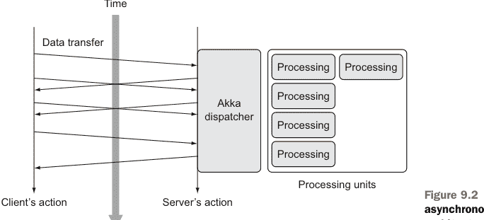

会阻塞 Play 应用程序的 `Akka` 组件（`Akka` 线程池已饱和）并阻碍应用程序的响应能力。因此，我们需要确保正在使用 Play 的异步特殊功能，这些功能将在下一节中解释。

让我们来看异步编程在 Play 应用程序中实际是如何工作的示例。我们的仓库应用程序需要一个仪表板。仪表板包含几份显示当前仓库性能的报告（也称为性能指标或 `KPI`）。这些报告的计算非常耗时。因此，并行执行它们会好得多。图 9.3 显示了我们想要的目标。

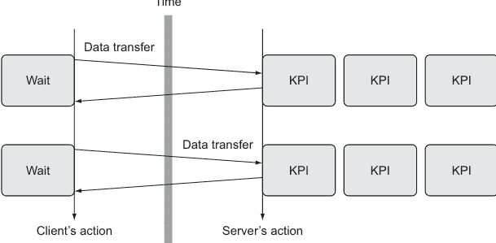

图 9.3 Play 中的并行执行

#### 9.2.1 处理异步请求

让我们看看如何从请求中并行计算两个报告。在我们的项目中创建一个 `Reports` 控制器和一个 `Report` 模型。以下列表显示了在何创建文件。

##### 列表 9.1 项目目录结构

```
app
  controllers
    Reports.java
  models
    Report.java
  views
conf
  routes
  test
```

`Report` 模型非常简单，由执行某些计算组成。以下列表显示了如何模拟报告生成。

##### 列表 9.2 模拟报告生成的模型

```java
package models;
import play.Logger;

public class Report {
  String name;

  public Report(String name) {
    this.name = name;
  }

  public void execute() {
    long start = System.currentTimeMillis();
    Logger.info("starting intensive " + name + " report at " + start);
    try {
      Thread.sleep(5000);
    } catch (Exception e) {
      Logger.info("done with intensive " + name + " report at " + start);
    }
    Logger.info("took " + (System.currentTimeMillis() - start) / 1000 + "s");
  }

  public String toString() {
    return name;
  }
}
```

`Report` 模型非常直观，包含一个报告名称和一个用于模拟报告生成的 `execute()` 方法。

如你所知，action 方法必须返回一个 `Result`。为了实现异步化，我们需要返回一个 `Promise` (`Promise<Result>`)。`Promise` 是对执行或不做某事的承诺。`Promise<Result>` 最终将用类型为 `Result` 的值兑现。通过提供 `Promise<Result>` 而不是普通结果，我们能够在不阻塞任何内容的情况下计算结果。Play 将 `Promise` 兑现后提供此结果。

异步执行代码块并获取 `Promise` 的简单方法是使用 `play.libs.Akka` 辅助类，如列表 9.3 所示。要异步运行代码，只需要实现 `Callable` 接口。你也可以查看在其他服务器线程上执行代码段的 `Akka` 辅助类，但那是另一个话题。你可以在 Manning 出版的优秀书籍中找到关于该主题的更多信息。

##### 列表 9.3 并行执行报告生成的控制器

```java
package controllers;

import models.Report;
import java.util.List;

import java.util.concurrent.Callable;
import play.*;

import play.libs.F.Promise;
import play.libs.F.Function;
import play.mvc.*;
import views.html.*;

public class Reports extends Controller {
    public static Result index() {
        Promise<Report> promiseOfEKPIReport = play.libs.Akka.future(new Callable<Report>() {
            public Report call() {
                return intensiveEKPIReport();
            }
        });
        Promise<Report> promiseOfETAREport = play.libs.Akka.future(new Callable<Report>() {
            public Report call() {
                return intensiveETAREport();
            }
        });
        Promise<List<Report>> promises = Promise.waitAll(promiseOfEKPIReport, promiseOfETAREport);
        return async(promises.map(
            new Function<List<Report>, Result>() {
                public Result apply(List<Report> reports) {
                    return ok(report.render(reports));
                }
            }
        ));
    }

    public static Report intensiveKPIReport() {
        Report r = new Report("KPI report");
        r.execute();
        return r;
    }

    public static Report intensiveETARport() {
        Report r = new Report("ETA report");
        r.execute();
        return r;
    }
}
```

> 表示此报告异步运行
>
> 表示我们想要返回一个稍后将计算的结果
>
> 表示我们希望报告生成的结果位于 `Promise` 中

一旦我们得到了结果，我们就会返回一个 `Result`。渲染报告。视图将在稍后创建。

前面的代码需要仔细的解释。首先，我们封装了每个异步运行报告生成代码块（使用 `Callable` 实现）。然后我们告诉程序，在返回结果之前，我们需要等待报告生成。使用 `Promise` 对象允许不等待报告处理完成。`Promise` 兑现后 Play 会提供结果。

#### 9.2.2 返回异步结果

你可能注意到，我们使用以下代码来返回异步结果：

```java
Promise<List<Report>> promises = Promise.waitAll(promiseOfEKPIReport, promiseOfETAREport);
return async(promises.map(
    new Function<List<Report>, Result>() {
        public Result apply(List<Report> reports) {
            return ok(report.render(reports));
        }
    }
));
```

异步执行一个代码块并获取 `Promise` 的简单方法是使用 `play.libs.Akka` 辅助类，如列表 9.3 所示。要异步运行代码，只需要实现 `Callable` 接口。你也可以查看在其他服务器线程上执行代码段的 `Akka` 辅助类，但那是另一个话题。你可以在 Manning 出版的优秀书籍中找到关于该主题的更多信息。

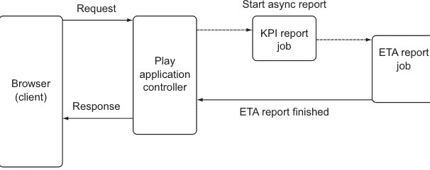

图 9.4 事件序列

一旦 `Promise` 兑现，我们就会返回一组新生成的报告。

注意的是，报告生成同时开始并同时结束。它们是并行执行的，而不是顺序执行。图 9.5 显示了报告生成后应用程序的界面。

我们现在能够异步的方式执行任务。让我们看看如何调度任务。

### 9.3 调度异步任务

在 Play 中，你可以使用 `Akka` 调度重复任务，通过一个 `actor` 或传递一个 `Runnable` 类。例如，每五秒向默认 `actor` 发送订单：

```java
Akka.system().scheduler().schedule(
    Duration.create(4, SECONDS),
    Duration.create(5, SECONDS),
    defaultActor,
    new Order(),
    Akka.system().dispatcher(),
    null
);
```

`Akka.system().scheduler()` 允许我们调度后台任务；该任务在初始化四秒后开始，并每五秒执行一次。每隔五秒，我们会向默认 `actor` 发送一个新的订单（`Order`）。解释 `actor` 是本书的主题，但 `actor` 可以被视为一种活动对象的形式，调用方法对应于发送消息。你可以在 Manning 出版的优秀著作《Akka in Action》中读到更多关于 `actor` 和 `Akka` 的知识。

除了 `actor`，你还可以使用实现 `Runnable` 接口的类并将业务逻辑放在 `run()` 方法中：

```java
Akka.system().scheduler().schedule(
    Duration.create(10, TimeUnit.SECONDS),
    new Runnable() {
        public void run() {
            // 在此处编写你的业务逻辑。
        }
    }
);
```

让我们看看 Play 是如何响应客户端的，以及 Play 如何向其客户端流式传输大量数据。

### 9.4 流式 HTTP 响应

正如我们在前面的章节中看到的，在接收并解析请求消息后，Play 会用一个 HTTP 响应消息进行响应。

有时我们希望向客户端流式传输信息。这意味着我们想要向 Web 客户端持续发送数据。以我们的应用为例，我们想要发送快速订单（expedited orders）；我们希望在订单一输入就能在屏幕上看到客户端订单。仓库的人员看到后可以立即进行打包和运输。图 9.6 显示了我们的最终应用程序。

在开始处理快速订单之前，让我们回顾一下使用 Play 返回数据的不同方法，并从技术角度来看流式数据传输有何不同。

#### 9.4.1 标准响应和 Content-Length 头部

当你发送标准的（非流式的）HTTP 响应时，Play 会自动随响应发送相应的 `Content-Length` 头部，一旦响应中的所有字节传输完毕，客户端和服务器之间的连接就会关闭。为了实现这一功能，Play 需要在开始响应之前知道响应的全部内容。

例如，以下代码向客户端返回“Hello World”消息：

```java
public static Result index() {
    return ok("Hello World");
}
```

由于 Play 知道整个响应体（"Hello World"），因此 Play 会设置合适的 `Content-Length` HTTP 头部以及任何其他强制性头部。你不需要自己指定任何内容来实现这一点。

如果快速订单的数量是固定的，那么这就是合适的方法。但在我们的情况下，快速订单的数量是不可预测的；我们希望在它们到达时进行流式传输。Play 无法计算响应的长度，也不知道何时以及何时关闭连接。因此，这种发送响应的方法在这种情况下并不适用。

这种方法的另一个问题是，整个响应必须加载到内存中——如果响应很大（例如传输文件时），可能会出现问题。

#### 9.4.2 提供文件

Play 能够向 Web 客户端流式传输文件，而无需将文件内容加载到内存中。如果采用之前的报告示例，或者报告计算完成，我们可以轻松地将计算出的报告作为 PDF 文件发送：

```java
public static Result retrievePdf(String reportId) {
    return ok(new java.io.File(report.asPdfFile()));
}
```

再次，Play 将设置合适的 `Content-Length` HTTP 头部。它能做到这一点是因为它可以在开始发送响应之前知道文件的大小。此外，此助手方法将根据文件名确定 `Content-Type` 头部，并设置 `Content-Disposition` 头部以指定 Web 浏览器如何处理此响应。一旦响应被消费，连接再次关闭。

与之前的方法一样，这种方法之所以有效，是因为响应的大小是预先知的。对于在不知道内容大小的情况下发送实时计算的内容，我们仍然没有进一步进展。

我们刚刚看到如何通过固定大小的响应向 Web 客户端流式传输大文件。让我们看看如何将序列化数据流回给客户端。

#### 9.4.3 分块响应

我们的应用示例需要流式传输快速订单。没有预定义的内容长度；它实际上可能是无限的：对于这种响应，我们使用分块传输编码（chunked transfer encoding），Play 提供了完全支持。

顾名思义，分块传输编码将响应分成多个块发送。其工作原理是，当可用合理数量的字节时，这些数据块就会被发送。服务器首先发送下一个块的大小，然后是块本身。重复此过程，直到响应完成。

这种方法的优点是，我们可以在数据可用时提供实时服务。缺点是，由于 Web 浏览器不知道内容的大小，它无法显示正确的下载进度条，但这对于我们的快速订单来说并不是问题。

假设我们有一个服务，在订单输入后立即从另一个系统提供快速订单。我们可以要求 Play 使用分块响应直接流式传输这些内容：

```java
public static Result index() {
    InputStream is = getExpeditedOrders(); 
    return ok(is);
}
```

这要求我们实现快速订单服务以返回一个 `InputStream`。快速订单在输入后立即被写入输入流。


另一个替代方案是实现你自己的分块响应构建器。Play Java API 同时支持文本和二进制分块（通过 `String` 和 `byte[]`）。列表 9.5 显示了我们 `Application.java` 控制器中的 `liveUpdate()` 方法。

> 列表 9.5 流式传输快速订单：Application 控制器

```java
public static Result liveUpdate() {
    // 准备一个分块文本 Chunks<String>
    chunks = new StringChunks<String>();

    // 当流就绪时
    public void onReady(Chunks.Out<String> out) {
        ExpeditedOrders.registerChunkOut(out);
        
        // 与客户端建立连接时调用方法
        response().setContentType("text/html;charset=UTF-8");
    }

    on(chunks);
}
```

# 第 9 章 异步数据

## 使用 Comet 进行单向通信

Comet socket 是分块传输编码（chunked transfer encoding）的一种实用应用。Comet 是一种 Web 应用模型，其中长时间的 HTTP 请求向浏览器推送数据，而无需浏览器显式请求。图 9.7 展示了 Comet 如何工作。

通过 Comet，浏览器启动请求，服务器保持连接开启，直到有内容要发送。这比传统的轮询（polling）更高效，在传统的轮询中，Web 客户端定期查询服务器以检查是否有新消息。但它只允许接收来自服务器的消息：它是一种单向通信协议。

Comet 是一个术语，涵盖了实现这种交互的多种技术。这些方法依赖于浏览器默认包含的功能（如 JavaScript），而不是非默认插件。Comet 方案与 Web 的原始模型不同，在原始模型中，浏览器一次请求一个完整的 Web 页面。

Comet socket 只是只包含 HTML `<script>` 元素的分块文本。在每个分块中，我们编写一个包含 JavaScript 的 `<script>` 标签，Web 浏览器接收后会立即执行它。通过这种方式，我们可以从服务器向浏览器发送事件；对于每条消息，我们将其封装在一个调用 JavaScript 回调函数的 `<script>` 标签中，并将其写入分块响应中。

为了说明 Comet 是如何工作的，让我们用刚才提到的概念扩展之前的示例。列表 9.8 显示了如何从服务器传回命令。

### 列表 9.8 调度器 onReceive 方法

向所有注册的客户端写入一个由客户端执行的 JavaScript 命令；将订单追加到 id 为 `counter` 的 html 元素中

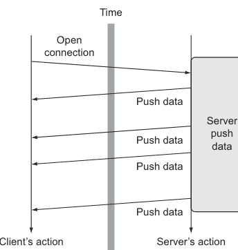

## 使用 Comet 进行单向通信

我们需要更改视图以反映我们新的 Comet 实现。让我们编辑 `comet.html` 文件。列表 9.9 显示了新的视图。

### 列表 9.9 Comet 客户端实现（我们的视图）

```java
@main("Comet") {
    <iframe style="display:none" id="messages"
        src="@Routes.Application.liveUpdate.unique()"></iframe>
    <ul id="container" style="text-align:center"
        class="nav nav-tabs nav-stacked"></ul>
}
```

对于我们收到的每个分块，我们将订单添加到 ID 为 `container` 的 div 中。`<script>` 标签引用了父 jQuery 函数。由于 iframe 接收了 `liveUpdate` 动作方法，用户会将 Comet 视为普通的页面。我们现在需要用以下路由更新我们的路由文件：

```java
GET /live controllers.Application.index()
GET /live-update controllers.Application.liveUpdate()
```

如果你在浏览器（http://localhost:9000/live）中运行它，你将看到订单显示在网页上。

Play 提供了一个处理 Comet 分块流的辅助方法，其功能与我们刚刚编写的几乎相同。它确实做到了，通过为了浏览器兼容性推送初始空白数据，并支持 String 和 JSON 消息。让我们重写示例以使用 Comet（见列表 9.10）。

### 列表 9.10 liveUpdate()

```java
public static void liveUpdate() {
    Comet comet = new Comet("parent.cometMessage") {
        public void onConnected() {
            ExpeditedOrders.registerChunkOut(this);
        }
    }
    return ok(comet);
}
```

我们还需要稍微更改 `ExpeditedOrders` 类。列表 9.11 显示了新的 ExpeditedOrders 实现。

```java
public class ExpeditedOrders extends UntypedActor {
    static List<Comet> comets = new ArrayList<Comet>();

    public static void registerChunkOut(Comet out) {
        ExpeditedComets.add(out);
    }

    public void onReceive(Object message) throws Exception {
        Order order = (Order)message;
        for (Comet comet : comets) {
            comet.sendMessage(order.toString());
        }
    }
}
```

写入的标准技术是在 iframe 中加载一个无限的分块 Comet 响应，并使用回调调用带有 HTML 页面的父框架。我们将在接下来的列表中重写我们的 `comet.html` 视图：

### 列表 9.12 客户端 Comet 实现（我们的视图）

```html
@(message: String)
@main("COMET")
<script type="javascript">
var cometMessage = function (event) {
  console.log('Received event: ' + event);
  $('#container').append("<<li><a href=\"#\" + event + "\">"></a></li>");
}
</script>
<div class="hero-unit">
<<h1>>Current Orders</h1>
<p>Prepare them all</p>
<iframe style="display:none" id="messages"
src="@routes.application.update"></iframe>
<ul id="container" style="text-align:center"
class="nav nav-tabs nav-stacked"></ul>
</div
```

Comet 本质上是通过 iframe 元素与服务器建立一个持久连接。服务器可以决定何时向 Web 客户端发送分块响应。每当发送响应时，就会调用 JavaScript 回调消息。响应作为函数参数传递。在我们的案例中，Web 线程更新页面并推送响应。由于 Play 的特性，它允许所有连接同时开启而不会饱和服务器。事实上，正如我们之前解释的，对于每个开启的连接并没有匹配的线程。这允许 Play 服务器扩展到数千个并发开启的连接。你仍然每个连接有一个 socket。

这种解决方案允许我们从服务器向客户端推送数据。要从 Web 客户端向服务器发送数据，你可能想结合 Comet 使用 AJAX 请求。但这超出了本章的范围。该协议不允许你从客户端向服务器推送数据；它是一种单向通信。你可以在 Michael S. Mikowski 和 Josh C. Powell 编写的优秀 Manning 书籍《Single Page Web Applications》（www.manning.com/mikowski/）中了解更多关于该主题的内容。这引出了下一节，关于 WebSocket：一种使双向通信可能的协议。

## 使用 WebSockets 进行双向通信

到目前，我们只看到 Web 支持单向通信：Web 客户端向服务器发出请求，服务器发送响应。我们还看到了如何从服务器向客户端流式传输数据：虽然这是一个很长的章节，但我们认为了解 WebSocket 可能是值得的——一种使双向通信可能的协议。

我们想要接收数据，但我们也想通过同一个连接回传数据。幸的是，现代浏览器通过 WebSocket 原生支持这种双向通信。让我们尝试扩展之前的示例。我们想要让人们点击订单并通知其他人他们正在处理。图 9.8 显示了结果应用。

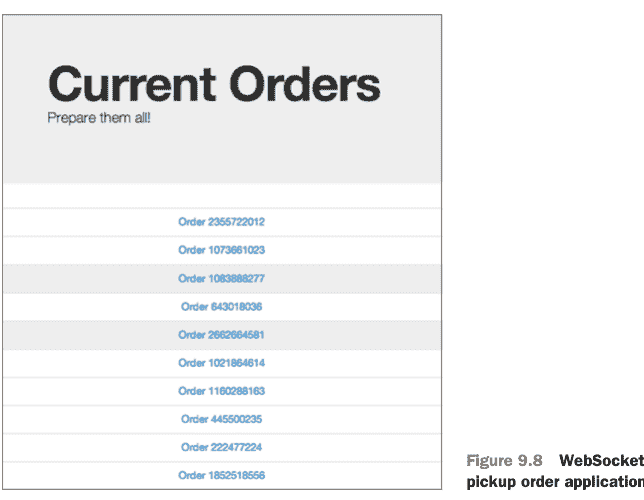

### 9.6.1 WebSocket 解析

WebSocket API 由 W3C 标准，WebSocket 协议由 IETF 通过 RFC 6455 标准（http://tools.ietf.org/html/rfc6455）。WebSocket 可以被任何客户端或服务器使用，尽管主要关注的是 Web 客户端和服务器。协议定义了服务器与客户端之间双向通信的标准方法。它还定义了浏览器内部使用的 JavaScript API。图 9.9 显示了协议的双向性。

| | 时间 |
|---|---|
| | 连接 |
| 发送数据 | 推送数据 |
| | 推送数据 |
| 发送数据 | 推送数据 |
| 客户端操作 | 服务器操作 |

此外，通信发生在常规 TCP 端口 80 上，这对于那些防火墙阻止非标准互联网连接的环境有利。WebSocket 协议目前在多个浏览器中支持，包括 Safari、Firefox 和 Google Chrome。WebSocket 还需要 Web 应用的服务端支持才能工作。

目前我们一直使用简单的动作方法来处理请求并返回 HTTP 结果。WebSocket 是完全不同的东西，无法通过标准动作处理。要处理 WebSocket，你的方法必须返回 WebSocket 而不是 Result。你的服务端 WebSocket 支持定义了如何与客户端交互：

```java
/**
 * 当 WebSocket 准备就绪调用
 *
 * @param in 输入 Socket。
 * @param out 输出 Socket。
 */
public abstract void onReady(In<A> in, Out<A> out);
```

这个方法是我们代码的入口。我们的动作方法必须返回一个实现了该方法的 WebSocket 结果。

## 使用 WebSockets 进行双向通信

`In` 对象允许你为传入的事件添加处理器。为了处理客户端消息，你可以通过提供回调处理器来使用以下两个方法：

- `onMessage()`——当客户端发送消息时，该方法会调用提供的处理器。
- `onClose()`——当客户端关闭与服务器的连接时，该方法会调用提供的处理器。

要向客户端发送消息，需要实现以下方法：

- `write`——向客户端发送消息。
- `close`——关闭与客户端的连接。

消息的类型为 `String` 类型或 `byte[]` 类型。WebSocket 可以访问请求头（来自启动 WebSocket 连接的 HTTP 请求），允许你检索标准头和会话数据。但它无法访问任何请求体，也无法访问 HTTP 响应。一旦 WebSocket 准备就绪，你就会同时获得输入和输出通道。

初看之下，这令人惊讶，因为所有操作处理都必须在回调方法中进行。要与 WebSocket 交互，我们的操作必须返回一个 WebSocket 结果并实现 `WebSocket` 类。列表 9.13 显示了一个基本示例，它向客户端发送 hello 并在控制台上打印任何消息。

### 列表 9.13 基本 WebSocket 示例

```java
public static WebSocket<String> hello() {
    return new WebSocket<String>() {

        public void onReady(WebSocket.In<String> in,
            WebSocket.Out<String> out) {
            in.onMessage(new Callback<String>() {
                public void onInvoke(Event event) {
                    System.out.println("event");
                }
            });

            in.onClose(new Callback() {
                public void onInvoke() {
                    System.out.println("Disconnected");
                }
            });

            out.write("Hello client!");
        }
    };
}
```

Play 服务端的实现非常直观。唯一棘手的部分在于添加 `Callback` 处理器：它们是你需要实现的接口。列表 9.14 显示了客户端的实现。编辑新的 `index.html` 视图，并将列表内容添加到视图中。

### 列表 9.14 基本 WebSocket 示例，客户端视图

```html
@main(message) (
  <script type="text/javascript" charset="utf-8">
  $function(){
    var WS = window['MozWebSocket'] ? MozWebSocket : WebSocket
    var socket = 
      new WS("Application.hello.websocketURL(request)");
    var receiveEvent = function (event) {
      console.log(event.data);
      socket.send("hello server");
    }
    socket.onmessage = receiveEvent
  })
  </script>
```

将传入的消息数据打印到浏览器控制台

反向路由符号将 WebSocket 翻译为 ws://localhost:9000/hello

向服务器传回 "hello"

处理来自服务器的任何传入消息的客户端处理器

最后一点，为了完成我们的示例，我们需要为我们的 `hello()` 操作方法添加一条规则。在路由文件中添加以下行：

```java
GET /hello controllers.Application.hello()
```

现在，如果你将浏览器指向 http://localhost:9000/，你应该在控制台中看到如图 9.10 所示的输出。

查看你的浏览器控制台，你会看到与图 9.11 相同的输出。

```
[info] Loading global plugins from /users/nicolaeroux/.sbt/plugins
[info] Loading project definition from /users/nicolaeroux/Projects/sample
[info] Set current project to sbt3-websocket-simple (in build file:/Users/nico

---(Running the application from SBT, auto-reloading enabled) ---
[info] play - Listening on HTTP /0:0:0.0:9000
(Server started, use Ctrl+C to stop and go back to the console...)
[info] play - Application (Dev)
Hello server
```


## 发生了什么？Web 客户端发送了请求。服务器建立了 WebSocket 连接并发送了 "Hello!" 消息。客户端随后接收了消息并传回了 "Hello"。

### 9.6.2 使用 WebSockets 的高级应用程序

我们现在有了元素来完成我们的应用程序。让我们使用 WebSockets 显示实时订单并在订单处理时通知所有操作员。我们用新的 WebSocket 实现替换之前的 Comet 实现，得到了服务端列表 9.15 和 9.16。

### 列表 9.15 我们的应用程序服务端


```java
public static WebSocket<String> liveUpdate() {
    return new WebSocket<String>() {
        // 当 WebSocket 握手完成时调用
        public void onReady(WebSocket.In<String> in, WebSocket.Out<String> out) {
            // 对于 socket 上收到的每个事件
            in.onMessage(new Callback<String>() {
                public void invoke(String event) {
                    ExpeditedOrders.notifyOthers(out, event + " is processed");
                }
            });

            // 当 socket 关闭时
            in.onClose(new Callback() {
                public void invoke() {
                    ExpeditedOrders.unregister(out);
                }
            });
        }
    };
    ExpeditedOrders.register(out);
}
```

这段代码与我们之前看到的非常相似；当 socket 准备就绪时，我们开始监听事件。对于每个传入的事件，我们使用 `ExpeditedOrders` 对象来跟踪客户端的连接，注册其 `WebSocket.Out` 对象。让我们现在看看 `ExpeditedOrders` 对象如何通知其他客户端，如列表 9.16 所示。

### 列表 9.16 通知我们的客户端

```java
public class ExpeditedOrders extends UntypedActor {
    static List<WebSocket.Out<String>> members = new ArrayList<>();

    static ActorRef defaultActor = Akka.system().actorOf(new Props(ExpeditedOrders.class));

    static {
        Akka.system().scheduler().schedule(
            Duration.create(4, SECONDS),
            Duration.create(5, SECONDS),
            defaultActor,
            new Order(),
            Akka.system().dispatcher()
        );
    }

    public static void register(WebSocket.Out<String> out) {
        members.add(out);
    }

    public static void unregister(WebSocket.Out<String> out) {
        members.remove(out);
    }

    public static void notifyOthers(WebSocket.Out<String> message, String event) {
        for (WebSocket.Out<String> out : members) {
            if (!out.equals(message))
                out.write(event);
        }
    }

    public static void notifyAll(String event) {
        for (WebSocket.Out<String> out : members) {
            out.write(event);
        }
    }

    public void onReceive(Object message) throws Exception {
        Order order = (Order) message;
        notifyAll(order.toString());
    }
}
```

你会发现列表 9.16 与 Comet `ExpeditedOrders` 实现相似。我们有两个方法：一个通知所有客户端 (`notifyAll()`)，另一个通知其他客户端 (`notifyOthers()`)。后者在我们被通知有客户端领取订单时使用。毕竟，我们只需要通知其他客户端订单正在处理中。

每五秒，`onReceive()` 方法就会带有一个新的 `Order` 参数被调用。然后我们使用 `notifyAll()` 方法通知所有客户端已发送新订单。


图 9.12 客户端点击订单的序列图

每当用户点击订单时，`notifyOthers()` 方法就会被调用，信号服务器特定客户端正在处理订单。随后调用 `onMessage()` 方法。反之，它调用 `ExpeditedOrders` 对象的 `notifyOthers()` 方法。图 9.12 说明了事件的顺序。

值得注意的是，WebSocket 协议是双向的，允许客户端向 Web 服务器发送消息（使用 Comet 协议）。以下列出了客户端的实现，以便在客户端发送和接收消息。

### 列表 9.17 我们的应用程序的客户端 WebSocket 部分

```html
@(message: String)

@main(message) {
<script type="text/javascript" charset="utf-8">
$(function() {
  var WS = window['WebSocket'] ? WebSocket : WebSocket;
  var socket = new WS(`@routes.Application.liveUpdate.websocketURL(request)`);
  var sendMessage = function() {
    socket.send($(this).text());
    $(this).css("background-color", "#EEE");
  }

  var receiveEvent = function (event) {
    var a = $("<a href='#'>" + event.data + "</a>").appendTo("#container");
    if (event.data.match(/processed/g)) {
      a.css("background-color", "#EEE");
    } else {
      a.click(sendMessage);
    }
  }

  socket.onmessage = receiveEvent;
});
</script>
</div>
<div class="hero-unit">
<h1>当前订单</h1>
<p>准备好它们！</p>
</div>
<ul id="container" class="nav nav-tabs-stacked">
</ul>
}
```

这种客户端实现非常直观。我们有两个函数：每次接收到消息时触发的 `socket.onmessage`，以及允许我们向 Web 服务器发送消息的 `socket.send`。

现在，打开两个浏览器，分别在它们中导航到 `http://localhost:9000/live`，并在其中一个浏览器中点击订单。你将在另一个浏览器中看到一条消息，指示订单已被领取并正在处理，如图 9.13 所示。

如你所见，WebSockets 易于使用，它们促进了客户端与服务器之间的实时通信，构建交互式 Web 应用变得更加容易。

# 当前订单

准备好它们！

| 订单 | 日期 |
|---|---|
| 20326640 | 2013年10月13日 01:06:09 CEST |
| 54480730 | 2013年10月13日 01:06:14 CEST |
| 115078723 | 2013年10月13日 01:06:19 CEST |
| 746633283 | 2013年10月13日 01:06:24 CEST |
| 1652325818 | 2013年10月13日 01:06:29 CEST |
| 1627482214 | 2013年10月13日 01:06:34 CEST |
| 2230776041 | 2013年10月13日 01:06:39 CEST |
| 200867872 | 2013年10月13日 01:06:44 CEST |
| 1400385755 | 2013年10月13日 01:06:49 CEST |
| 1711177848 | 2013年10月13日 01:06:54 CEST |
| 1711177848 | 2013年10月13日 01:06:54 CEST 正在处理 |
| 581837045 | 2013年10月13日 01:06:59 CEST |
| 178012275 | 2013年10月13日 01:07:04 CEST |
| 2568566508 | 2013年10月13日 01:07:09 CEST |

图 9.13 正在处理的订单

## 9.7 总结

在本章中，你学习了处理异步数据的高级技术。这是一个很长的章节，但你学到了很多东西。你了解了如何异步处理请求以及如何返回异步结果。异步结果允许你并发处理大量请求。当你必须处理多个数据源时，这一点非常重要。

你还学习了如何流式传输数据，从文件等固定大小的数据到任意长度的响应。从那里开始，你学习了分块响应的概念。为了更好地理解如何使用分块响应，你看到了关于它们在 Comet 协议中如何使用的演示。本章最后解释了较新的 WebSocket 协议以及如何在 Play 应用程序中使用它。

在接下来的章节中，你将了解到 Play 的安全机制，并查看如何保护你的应用程序免受攻击。

# 安全

# 本章涵盖

- Play 安全概念
- 使用过滤器添加基本身份认证
- 使用 action 组合进行细粒度认证

在本章中，我们首先查看 Play 2 的安全概念，以从开发者的角度理解安全应用程序意味着什么。我们将回顾我们的应用程序可能面临的各种攻击类型，以及 Play 2 提供的保护应用程序的工具。然后，我们将转向在应用程序中实际实现安全，使用过滤器进行基本认证和授权。该部分展示了低级框架的安全实现，当然 Play 提供了用于身份认证和授权的内置辅助方法。最后，我们将看到如何将这些辅助方法与 action 组合一起，为我们的应用程序添加更细粒的安全约束。

## 10.1 Play 安全概念

Web 应用程序框架旨在帮助开发者构建 Web 应用程序。其中一些框架还帮助保护 Web 应用程序。一个框架并不比另一个框架更安全：如果你正确使用它们，你能够使用许多框架构建安全的应用程序。某些框架包含了一些辅助方法（例如防止 SQL 注入），这使得构建安全的 Web 应用程序变得更容易。

总的来说，不存在这种“即插即用”的安全。安全性取决于使用框架的人，有时取决于开发方法。它还取决于 Web 应用程序环境的所有层级：后端存储、Web 服务器以及 Web 应用程序本身（可能还有其他层或应用程序）。

据估计约 75% 的攻击发生在 Web 应用程序层。在 2004 年，一项研究发现 75% 的攻击发生在 Web 应用程序层。

默认情况下，Play 2 会保护你免受跨站脚本攻击。由于某种原因，你可能想允许原始数据被渲染，这时你可以在模板中编写 `@Html` 指令。因此，按照我们之前的示例：

```
@Html(product.description)
```

用户将看到图 10.2 所示的弹出窗口。这就是为什么在模板中使用 `@Html` 指令时需要小心。


图 10.2 弹出窗口：你好，用户

### 10.1.3 SQL 注入

SQL 注入是一种利用手段，它通过使用用户输入来执行开发者并非本意执行的 SQL 查询。这可以用于破坏数据，或访问当前用户不应看到的数据。当你使用高层“find”方法时，你应该已经受到了防止 SQL 注入的保护。当你手动构建查询时，需要注意不要进行字符串拼接，而要正确使用查询占位符 (`?`) 并让底层持久化服务转义数据。

例如，JPA 风格，以下代码存在 SQL 注入风险：

```
JPA.em().createQuery('select * from product where name=" + name);
```

这意味着你可以插入以下名称：

```
'nicol':drop table users;
```

显然，这不是我们希望看到的。相反，你应该使用以下代码：

```
JPA.em().createQuery("SELECT * from product where name = ?")
.setParameter(1, name);
```

### 10.1.4 跨站请求伪造

这种攻击方法的原理是将恶意代码或链接包含在已验证的用户查看的页面中。如果该 Web 应用程序的会话未超时，攻击者可能就会执行未经授权的命令。

在我们的情况下，这可能是指向我们仓库应用程序的链接。例如，你可能正在浏览一个聊天论坛，另一个用户 Bob 在那里发布了消息。假设 Bob 构建了一个 HTML 图像元素，引用了我们仓库网站上的某个操作（而不是图像文件）。

**Bob 的帖子可能像这样：**

你好！看这里：

```

```

由于我们仓库应用程序的身份信息存储在 cookie 中，且 cookie 未过期，浏览器加载图像的尝试将提交带有 cookie 的产品表单，从而在未经原始用户许可的情况下授权了交易。Play 2 提供了一个简单的机制来防止请求伪造攻击；正确保护关键操作的唯一方法是发布身份验证令牌。其核心是为给定用户生成一个唯一的令牌，并检查表单是否提交了相同的令牌。Play 2 提供了实现此操作的所有工具。

我们将保护新的产品表单免受跨站请求伪造。为了实现这一点，我们必须启用特殊的过滤器。我们将在下一节详细介绍过滤器的所有内容。现在，为了启用过滤器，我们需要将该模块导入到我们的应用程序项目中。

这是通过编辑 `build.sbt` 文件实现的。以下显示了 `build.sbt` 所在的位置：

```
warehouse
├── app
├── conf
├── public
├── project
├── test
└── build.sbt
```

我们需要在 `build.sbt` 中添加过滤器模块。这在 `libraryDependencies` 部分可以轻松完成。

### 列表 10.1 build.sbt

```
name := "warehouse"
version := "1.0-SNAPSHOT"
libraryDependencies := Seq(
  jdbc,
  javaJdbc,
  cache,
  "com.google.guava" % "guava" % "14.0",
  filters
)
play.JavaSettings
```

### filters 模块

我们还需要创建一个扩展 `GlobalSettings` 的新类 `Global.java`。以下显示了创建 `Global` 类的位置。

```
warehouse
├── app
├── conf
├── project
├── test
└── Global.java
```

以下显示了我们 `Global.java` 中的 `filters()` 方法。

### 列表 10.2 Global.java

```java
import play.*;
import play.api.mvc.EssentialFilter;
import play.filters.csrf.CSRFFilter;

public class Global extends GlobalSettings {
  @Override
  public List<? extends EssentialFilter> filters() {
    return List.of(new CSRFFilter());
  }
}
```

### Global 类是我们的应用程序入口点

`Global` 类扩展了 `GlobalSettings`。它在应用程序周期期间调用方法，例如 `onStart()`、`onStop()`、`onError()` 等。你可以查看 javadoc 类以获取更多信息。在我们的情况下，我们希望提供一个允许我们更改跨站伪造攻击的过滤器。我们需要修改产品表单以包含生成的令牌。修改位于 `app` 下的 `details.scala.html`。

```
app
├── controllers
├── models
```


# Play 安全概念

## 目录结构

- products
- conf
- public
- views
- details.scala.html

## 应用程序入口点

我们的应用程序入口点是 `Global` 类。它在应用程序生命周期期间调用方法，例如 `onStart()`、`onStop()`、`onError()` 等。你可以查看 javadoc 类以获取更多信息。在我们的情况下，我们希望提供一个过滤器来允许我们处理跨站伪造攻击。我们需要修改产品表单以包含生成的令牌。修改位于 `app` 下的 `details.scala.html`。

## 目录结构（app 目录下）

- app
  - controllers
  - models
  - products
  - conf
  - public
  - views
  - details.scala.html

---

# 10.1 安全概念

## 10.1.1 跨站脚本攻击 (XSS)

默认情况下，Play 2 会保护你免受跨站脚本攻击。由于某种原因，你可能想允许原始数据被渲染，这时你可以在模板中编写 `@Html` 指令。因此，按照我们之前的示例：

```scala
@Html(product.description)
```

用户将看到图 10.2 所示的弹出窗口。这就是为什么在模板中使用 `@Html` 指令时需要小心。


## 10.1.2 SQL 注入

SQL 注入是一种利用手段，它通过使用用户输入来执行开发者并非本意执行的 SQL 查询。这可以用于破坏数据，或访问当前用户不应看到的数据。当你使用高层“find”方法时，你应该已经受到了防止 SQL 注入的保护。当你手动构建查询时，需要注意不要进行字符串拼接，而要正确使用查询占位符 (`?`) 并让底层持久化服务转义数据。

例如，JPA 风格，以下代码存在 SQL 注入风险：

```java
JPA.em().createQuery("select * from product where name=" + name);
```

这意味着你可以插入以下名称：

```sql
'nicol':drop table users;
```

显然，这不是我们希望看到的。相反，你应该使用以下代码：

```java
JPA.em().createQuery("SELECT * from product where name = ?")
     .setParameter(1, name);
```

## 10.1.3 跨站请求伪造 (CSRF)

这种攻击方法的原理是将恶意代码或链接包含在已验证的用户查看的页面中。如果该 Web 应用程序的会话未超时，攻击者可能就会执行未经授权的命令。

在我们的情况下，这可能是指向我们仓库应用程序的链接。例如，你可能正在浏览一个聊天论坛，另一个用户 Bob 在那里发布了消息。假设 Bob 构建了一个 HTML 图像元素，引用了我们仓库网站上的某个操作（而不是图像文件）。

### Bob 的帖子可能像这样：

> 你好！看这里：
> ``

由于我们仓库应用程序的身份信息存储在 cookie 中，且 cookie 未过期，浏览器加载图像的尝试将提交带有 cookie 的产品表单，从而在未经原始用户许可的情况下授权了交易。Play 2 提供了一个简单的机制来防止请求伪造攻击；正确保护关键操作的唯一方法是发布身份验证令牌。其核心是为给定用户生成一个唯一的令牌，并检查表单是否提交了相同的令牌。Play 2 提供了实现此操作的所有工具。

我们将保护新的产品表单免受跨站请求伪造。为了实现这一点，我们必须启用特殊的过滤器。我们将在下一节详细介绍过滤器的所有内容。现在，为了启用过滤器，我们需要将该模块导入到我们的应用程序项目中。

这是通过编辑 `build.sbt` 文件实现的。以下显示了 `build.sbt` 所在的位置：

- warehouse
  - app
  - conf
  - public
  - project
  - test
  - build.sbt

我们需要在 `build.sbt` 中添加过滤器模块。这在 `Application` 类的 `libraryDependencies` 部分可以轻松完成。

### 列表 10.1 build.sbt

```scala
name := "warehouse"
version := "1.0-SNAPSHOT"
libraryDependencies := Seq(
  Jdbc,
  javabean,
  cache,
  "com.google.guava" % "guava" % "14.0",
  filters
)
play.JavaSettings
```

### filters 模块

我们还需要创建一个扩展 `GlobalSettings` 的新类 `Global.java`。以下显示了创建 `Global` 类的位置。

- warehouse
  - app
  - conf
  - project
  - test
  - Global.java

以下显示了我们 `Global.java` 中的 `filters()` 方法。

### 列表 10.2 Global.java

```java
import play.*;
import play.api.mvc.EssentialFilter;
import play.filters.csrf.CSRFFilter;

public class Global extends GlobalSettings {
  @Override
  public List<? extends EssentialFilter> filters() {
    return List.of(new CSRFFilter());
  }
}
```

---

# 10.2 使用过滤器添加基础身份认证

在本节中，我们将讨论过滤器，这是 Play 2 的一项功能。现在是时候保护我们的仓库应用程序并只允许选定的用户访问了。为了这一点，我们将实现基础身份认证。基础认证是简单且被所有浏览器支持的。当服务器要求用户进行认证时，会发送带有 `WWW-Authenticate` 头的 HTTP 401 Unauthorized 响应。基础认证的 `WWW-Authenticate` 头部通常如下：

```
WWW-Authenticate: Basic realm="warehouse app"
```

在客户端，当用户代理想要发送身份凭据时，可能会使用 `Authorization` 头部。该头部的构建如下：用户名和密码组合成一个字符串：`username:password`。生成的字符串使用 Base64 编码。然后在编码字符串之前放置认证方法和空格（例如 "Basic"）。如果用户代理使用 Nicolas 作为用户名，那么头部格式如下：

```
Authorization: Basic bmljb2xhzppcG2FZQ==
```

总结了基础身份认证协议：我们需要检查每个传入请求的 `Authorization` 头部以查看客户端是否已授权。如果 `Authorization` 头部有值，我们需要对其进行解码并检查用户名和密码。我们在每个操作方法中这样做，但这并不方便，因为我们真的希望认证应用于整个应用程序。这正是过滤器的用武之地。过滤器本质上是应用到每个传入请求和/或响应的代码片段。过滤器在项目之间也是可复用的。这与在 `Global` 类中实现自定义代码并重写 `Request` 方法（该方法与过滤器同时被调用）实际上不同。

作为提醒，当发出 HTTP 请求时，Play 2 会解析请求头。然后接收请求正体。接下来 Play 2 会解析正体，正如第 9 章所示。下一步是发送 HTTP 响应。HTTP 响应由一组响应头组成，随后是响应正体。过滤器在 Play 2 解析完传入请求的 HTTP 头并解析完正体后立即运行。

在 Play 2 中，过滤器更多地说是 Scala 的特性而非 Java 的特性。但在 Java 中创建过滤器仍然是可行的，尽管某些部分对于普通的 Java 开发者来说可能看起来很奇怪。让我们看看如何创建我们的基础身份验证过滤器。

首先，我们需要在 `utils` 包中创建一个新的 `BasicAuthenticationFilter` 类：

- warehouse
  - app
    - utils
      - BasicAuthenticationFilter.java
  - conf
  - public
  - project
  - test

过滤器实现了 `EssentialFilter` 接口。该接口只有一个方法，它接收一个 `EssentialAction` 并返回一个 `EssentialAction`。`EssentialAction` 是一个接口，本质上代表了需要发送回客户端的内容：HTTP 请求头和正体。例如，一个 OK 响应是一个 `EssentialAction`，其 HTTP 请求头响应码为 200，正体文本为 ok。在我们的情况下，过滤器允许将 `EssentialActions` 链到一段代码上。在我们的案例中，我们需要检查 `Authorization` 请求头，如果头中包含的用户名和密码有效，则继续下一个 `EssentialAction`。`EssentialActions` 是一个接一个链下去的——我们只需要实现我们的 `EssentialAction`。

由于我们在 Java 中使用了 Scala，我们需要稍微调整代码。我们将深入研究 Play 2 的机制。要做的第一件事是创建一个抽象类，以便我们能够重用 Scala 函数并扩展 `EssentialAction` 接口。通过以下代码可以轻松实现。我们不会深入细节，但 `AbstractFunction1` 是由 Scala 库提供的 Scala-Java 桥接。

```java
public abstract class JavaEssentialAction extends AbstractFunction1<RequestHeader, Iteratee<byte[], Result>> implements EssentialAction {}
```

我们现在准备好实现我们的 `BasicAuthenticationFilter` 了。下面的列表显示了我们基础身份验证过滤器的完整源代码。

### 列表 10.3 BasicAuthenticationFilter.java

```java
package utils;

import static play.mvc.Results.*;
import play.api.libs.iteratee.*;
import play.api.libs.iteratee.Done;
import play.api.mvc.*;
import play.libs.Scala;
import scala.Option;
import scala.Tuple2;
import scala.collection.Seq;
import scala.runtime.AbstractFunction1;
import sun.misc.BASE64Decoder;
import java.util.ArrayList;
import java.util.List;

public class BasicAuthenticationFilter implements EssentialFilter {

    public BasicAuthenticationFilter() {
        // 留空
    }

    @Override
    public EssentialAction apply(final EssentialAction next) {
        // 实现 EssentialFilter 接口的唯一方法。让我们继续下一个操作（链式调用）。
        return new JavaEssentialAction() {
            @Override
            public Iteratee<byte[], SimpleResult> apply(RequestHeader rh) {
                // 调用 EssentialAction 的 apply 方法。该方法接收 RequestHeader 并以正体和 Result (Iteratee<byte[]>) 形式返回响应。
                Option<String> authorization = rh.headers().get("Authorization");
                if (authorization.isEmpty()) {
                    return unauthorizedResponse();
                }

                String auth = authorization.get();
                // 如果我们有 Authorization 请求头，继续解码此内容
                BASE64Decoder decoder = new BASE64Decoder();
                try {
                    String decoded = new String(decoder.decodeBuffer(auth.split(" ")[1]));
                    String[] credentials = decoded.split(":");
                    String username = credentials[0];
                    String password = credentials[1];

                    // 如果用户名和密码匹配，继续下一个 EssentialAction
                    if ("nicolas".equals(username) && "nicolas".equals(password)) {
                        return next.apply(rh);
                    }
                } catch (Exception e) {
                    // 无操作
                }
                return unauthorizedResponse();
            }

            private Iteratee<byte[], SimpleResult> unauthorizedResponse() {
                List<Tuple2<String, String>> list = new ArrayList<>();
                Tuple2<String, String> t = new Tuple2<>("WWW-Authenticate", "Basic realm=\"warehouse app\"");
                list.add(t);
                Seq<Tuple2<String, String>> seq = Scala.toSeq(list);
                // 将我们的列表转换为 Scala 序列（Scala 自己的列表），以便映射到 Headers 的 Scala 方法上
                return Done.apply(unauthorized("Forbidden access to the warehouse app.").withHeaders(seq));
                // 返回带有结果、内容 "Forbidden access to ..." 和 WWW-Authenticate 头的响应。我们再次获取了 Scala 对象类型。
            }
        };
    }
}

// 通过扩展 Scala 抽象函数实现你的 Java essential action。这是必要的，因为我们无法直接实现 EssentialAction 特质（一个更强大的 Scala 接口）。
abstract class JavaEssentialAction extends AbstractFunction1<RequestHeader, Iteratee<byte[], SimpleResult>> implements EssentialAction {}
```

前面的列表初看起来很复杂，但其实并非如此。它包含两个不同的部分：`EssentialFilter` 的实现和 `EssentialAction` 的实现。`EssentialFilter` 部分由实现 `apply` 方法组成，允许我们在身份验证成功时使用下一个过滤器。`EssentialAction` 部分主要由实现其 `apply` 方法组成。剩下的唯一事情是在 `BasicAuthentication` 过滤器中启用它。正如我们在 10.4 中看到的，我们需要在 `Global` 类中启用它。这里是：

- warehouse
  - app
    - Global.java
  - conf
  - public
  - project
  - test


我们需要在 `filters` 方法中包含新过滤器。下面显示了如何操作。

### 列表 10.4 Global.java

```java
import play.*;
import play.api.mvc.*;
import play.filters.csrf.CSRFilter;
import utils.BasicAuthenticationFilter;
```

```java
public class Global extends GlobalSettings {
    public <T extends EssentialFilter> Class<T>[] filters() {
        Class[] filters = {CSRFFFilter.class, BasicAuthenticationFilter.class};
        return filters;
    }
}
```

现在我们的过滤器已经激活了，如果我们把浏览器指向 `http://localhost:9000/`，我们将在图 10.4 中看到一个弹出窗口。

我们的应用程序没有任何安全防护！

## 第 10 章 安全

```
warehouse
  app
    controllers
      Application.java
  conf
  public
    project
  test
```

为了我们的目的，我们需要在末尾声明一个静态内部类 `Login`：

```java
public static class Login {
  public String email;
  public String password;
}
```

该类将存储我们的用户信息。目前，处理用户信息的 `authenticate` action 什么都不做。我们现在需要一个用于渲染登录表单的 action 以及一个用于处理登录表单的 action。通过向我们的应用程序控制器中添加列表 10.5 可以轻松实现这一目标。

### 列表 10.5 显示登录表单

```java
import static play.data.Form.form;
...
public static Result login() {
  return ok(
    login.render(form(Login.class))
  );
}

public static Result authenticate() {
  return ok();
}
```

剩下的工作就是创建登录表单。我们需要按照如下所示创建一个新的视图：

```
warehouse
  app
    views
      login.scala.html
  conf
  public
    project
  test
```

列表 10.6 显示了我们视图的内容。现在对你来说应该很容易理解了。

## 使用 action 组合进行细粒度认证

### 列表 10.6 login.scala.html

```scala
@(loginForm: Form[Application.Login])
@import helper._
@import helper.twitterBootstrap._

@main("Please sign in to the warehouse application") {
  @helper.form(login.CSRF(routes.Application.authenticate)) {
    <h1>Sign in</h1>
    <input type="email" name="email" placeholder="Email:" value="@loginForm("email").value">
    <input type="password" name="password" placeholder="Password">
    <button type="submit">Sign in</button>
  }
}
```

## 模块与部署

- 本章涵盖了
- 使用并创建你自己的模块
- 发布你的模块
- 将应用程序拆分为多个子应用
- 部署你的应用程序
- 配置生产环境

既然我们已经看到了如何在 Play 中完成很多事情，现在是时候看看别人编写的代码了。本章解释了如何使用 Play 模块，如何创建你自己的并发布它们以便他人使用。本章的后半部分涉及将你的应用程序部署到自己的机器或云端。它还解释了如何设置前端代理并使用 SSL。

## 11.1 模块

任何软件开发项目都会使用库来减少工作量。开发者可以使用大量的库，这可以为他们节省大量时间并停止重复造轮子。在第 2 章中，我们看到了如何使用 `build.sbt` 来添加库依赖，就像通常的那样。但 Play 以模块的形式提供了额外的代码复用。本节将解释如何使用自定义模块以及稍后如何构建一个。

我们将向你展示如何使用 SecureSocial 模块。另一个免费的模块是 Mailer 模块，从名字你可能猜到，它允许你发送电子邮件。

### 11.1 使用模块

Play 模块就像其他库一样，是 JAR 文件的集合。区别在于该 JAR 中会有 Play 特有的类。这意味着你可以像添加其他库一样，在 `build.sbt` 的 `libraryDependencies` 中添加模块。

假设你的应用程序需要用户登录，稍后可能允许他们通过 OAuth 登录。如果我们能找到可以使用的模块，就不需要花时间编写自己的代码。你可以在 Play 目录中找到模块列表。

在该页面搜索 "social"，你会发现一个符合要求的 SecureSocial 模块。每个模块都显示 URL 和简短描述。我们现在可以遵循 URL 来使用该模块。SecureSocial 指向官网。一旦进入安装说明，你将需要添加依赖和 resolver。resolver 是告诉 SBT 在默认仓库之外查找库的方法。

让我们开始吧。打开 `build.sbt` 并在项目设置中向 libraryDependencies 添加新的依赖和 resolver。你的 build.sbt 现在看起来应该是这样的：

#### 列表 11.1 build.sbt

```scala
name := "warehouse"
version := "1.0-SNAPSHOT"

libraryDependencies += Seq(
  javaJdbc,
  javaBean,
  cache,
  "com.google.guava" % "guava" % "14.0",
  filters,
  "securesocial" % "securesocial" % "master-SNAPSHOT"
)

resolvers += Resolver.url("sbt-plugin-snapshots",
  url("http://repo.scala-sbt.org/scalasbt/sbt-plugin-snapshots/")
)(Resolver.ivyPatterns)
```

可以通过运行 `reload` 命令让 SBT 知道你的更改。这将使 SBT 重新读取组成项目配置的文件。如果你在使用 IDE 生成的项目，还应该重新生成它（使用 idea 或 Eclipse），以便你的 IDE 识别该模块。

为了使用 SecureSocial，我们需要禁用第 10 章添加的 CSRF 过滤器。通过注释掉 `Global.java` 中的以下过滤器行可以轻松实现：

```java
public <T extends EssentialFilter> Class<T[]> filters() {
    //Class[] filters= {CSRFFFilter.class, BasicAuthenticationFilter.class};
    Class[] filters={};
    return filters;
}
```

现在我们可以在应用程序中使用该模块了。根据文档，SecureSocial 提供了注解 `@SecureSocial.SecuredAction`，我们可以它来保护 action 方法。还将用户添加到当前上下文，告诉我们当前用户。

更改应用程序使用户必须通过 OAuth 登录只需在所有相关地方对我们的 action 进行标注即可。这将是 Products 控制器中的所有 action。例如：

```java
import securesocial.core.java.SecureSocial;
...
public class Products extends Controller {
    @SecureSocial.SecuredAction
    public static Result newProduct() {
        return ok(details.render(productForm));
    }
}
```

在此更改后运行应用程序可能会失败，因为仍然有几件事我们需要提供。SecureSocial 要求我们提供 `UserService` 的实现；这是 SecureSocial 委托用于存储和检索用户。列表 11.2 显示了一个将所有内容存储在内存中的简单实现。

#### 列表 11.2 SimpleUserService-app/utils/SimpleUserService.java

```java
package utils;

import play.Application;
import securesource.core.Identity;
import securesource.core.identityId;
import securesource.core.java.BaseUserService;
import securesource.core.java.Token;
import java.util.HashMap;
import java.util.Map;
```

```java
public class SimpleUserService extends BaseUserService {
    private HashMap<String, Identity> users = new HashMap<String, Identity>();
    private HashMap<String, Token> tokens = new HashMap<String, Token>();

    public SimpleUserService(Application application) {
        super(application);
    }

    @Override
    public Identity doSave(Identity user) {
        users.put(user.identity(), user);
        return user;
    }

    @Override
    public void doSave(Token token) {
        tokens.put(token.uuid, token);
    }

    @Override
    public Identity doFind(IdentityId identityId) {
        return users.get(identityId);
    }

    @Override
    public Token doFind(String tokenId) {
        return tokens.get(tokenId);
    }

    @Override
    public Identity doFindByEmailAndProvider(String email, String providerId) {
        for (Identity user : users.values()) {
            if (user.identity().providerId().equals(providerId) && 
                user.email().isDefined() && user.email().get().equalsIgnoreCase(email)) {
                return user;
            }
        }
        return null;
    }

    @Override
    public void deleteToken(String uuid) {
        tokens.remove(uuid);
    }

    @Override
    public void expiredTokens() {
        for (Map.Entry<String, Token> entry : tokens.entrySet()) {
            if (entry.getValue().isExpired()) {
                tokens.remove(entry.getKey());
            }
        }
    }
}
```

其次，我们必须提供一些配置来告诉 SecureSocial 我们想做什么。由于 SecureSocial 自带许多可选插件来其工作，我们必须创建一个包含以下内容的 `conf/play.plugins`：

```scala
9994:securesocial.core.DefaultAuthenticator
9995:securesocial.core.DefaultTokenGenerator
9996:securesocial.core.providers.utils.DefaultPasswordValidator
9997:securesocial.controllers.DefaultTemplatePlugin
9998:utils.SimpleExecutor
9999:securesocial.core.providers.utils.BCryptPasswordHasher
10000:securesocial.core.providers.UsernamePasswordProvider
```

目前我们将设置 SecureSocial 使用电子邮件和密码登录；这就是为什么我们只启用了部分可用插件。当你构建自己的时，可以参考 SecureSocial 的说明使用它支持的某种 OAuth 提供者设置 OAuth。现在我们可以创建 `conf/securesocial` 文件，内容如下：

```conf
userpass {
  withUsernameSupport=false
  enableEmailSupport=false
  enableAvatarSupport=false
  tokenDuration=60
  tokenInterval=5
  minimumPasswordLength=8
  enableToken=true
  hasher=bcrypt
}
```

```conf
securesocialToGo {
  onLoginToGo=
  onLogoutToGo=/
  ssl=false
}
```

为了充分使用 SecureSocial，你需要配置某些提供者，例如 Twitter。为了针对 Twitter 添加令牌，我们将跳过这一步，但可以参考 SecureSocial 文档来添加，例如。

为了使此文件中的 Play 设置生效，需要从常规配置文件包含它。将以下行存放入 `conf/application.conf` 中：

```
include "securesocial.conf*"
```

现在我们需要添加一些路由，以便用户能够实际登录。在例例中——我们只需添加登录和注销路由：

```
GET /signup securesocial.controllers.LoginPage.login
GET /logout securesocial.controllers.LoginPage.logout
GET /authenticate/:provider securesocial.controllers.ProviderController.authenticate(provider)
POST /authenticate/:provider securesocial.controllers.ProviderController.authenticateByPost(provider)
GET /not-authorized securesocial.controllers.ProviderController.notAuthorized
# 用户注册和密码处理
# (仅在你使用 UsernamePasswordProvider 时才需要)
GET /signup securesocial.controllers.Registration.startSignUp
POST /signup securesocial.controllers.Registration.handleSignUp
GET /token securesocial.controllers.Registration.signUp(token)
POST /token
```


# 第 11 章 模块与部署

## 路由与控制器映射

| HTTP 方法 | 路径 | 控制器方法 |
| :--- | :--- | :--- |
| GET | `/reset` | `securesocial.controllers.Registration.startResetPassword` |
| POST | `/reset` | `securesocial.controllers.Registration.handleStartResetPassword` |
| GET | `/reset/:token` | `securesocial.controllers.Registration.resetPassword(token)` |
| POST | `/reset/:token` | `securesocial.controllers.Registration.handleResetPassword(token)` |
| GET | `/password` | `securesocial.controllers.PasswordChange.page` |
| POST | `/password` | `securesocial.controllers.PasswordChange.handlePasswordChange` |

## 11.1.2 创建模块

创建一个 Play 模块和创建一个 Play 应用一样简单。事实上，这就是你开始创建一个新模块的方法——创建一个新的 Play 应用作为起点。让我们创建一个条形码模块。该模块将允许该模块的用户通过简单的包含一个标签来向任何页面添加条形码图像。运行以下命令：

```
play new barcode
```

现在你有了一个新应用，可以删除 `public` 目录下的所有内容、示例控制器以及你不需要的文件。你应该删除 `application.conf`，因为任何配置（如果有的话）将通过使用我们模块的应用程序完成。

### 编写代码

我们提到希望用户通过在页面中包含标签来添加条形码。这个模块需要一个标签（渲染 HTML `img` 元素）、一个控制器（渲染条形码）以及一个将标签的 `img` 元素与条形码连接的路由。

但首先，我们需要创建条形码图像所需的库。我们将使用一个名为 `barcode4j` 的库。在 `build.sbt` 中添加依赖项：

```
libraryDependencies += Seq(
  javaJdbc,
  javaEbean,
  cache,
  "net.sf.barcode4j" % "barcode4j" % "2.1"
)
```

现在，让我们创建控制器。虽然模块的控制器与普通应用中的控制器一样，但将其放在 `controllers` 包中并不是一个好主意：它可能会与用户的控制器发生冲突。因此，让我们创建一个包：`com.github.playjava.controllers`。

让我们从视图开始。在 `app/views/tags` 中创建一个文件 `barcode.scala.html` 并添加以下内容：

```
@(ean: String)


```

## 模块测试与发布

如果你将浏览器指向 `http://localhost:9000/products/new` 或者点击“New product”（新产品），现在应该能看到登录页面。

我们现在有了一个可以运行的示例，展示了如何使用众多模块中的一个。遗憾的是，如果你需要其他可用模块，你得自己想如何使用它们。既然我们已经知道了从应用开发者的角度看模块长什么样，让我们来看看如何为自己构建一个。

### 测试模块

在向世界发布模块之前，在 Play 应用环境中测试它可能是个好主意。幸运的是，这很容易。如果你运行 `publish-local` 命令，SBT 将把模块发布到你的本地 Ivy 缓存。现在是时候创建一个新项目并包含我们的模块了：

```
play new module-test
```

在 `build.sbt` 中为模块添加依赖项：

```
libraryDependencies += Seq(
  javaJdbc,
  javaEbean,
  cache,
  "playforjava" % "barcode" % "1.0-SNAPSHOT"
)
```

通过在 `conf/routes` 文件的末尾添加以下行导入模块路由：

```
-> /barcode barcode.Routes
```

接下来的列表显示了模板 `index.scala.html`，它使用了我们创建的 `tags/barcode` 模板。

#### 11.4 条码模板——app/views/index.scala.html

```
@(message: String)

@main("Welcome to Play") {
  @tags.barcode("1234567890128")
}
```


如果我们运行测试应用并指向浏览器，就可以看到我们的模块按照其预期工作。图 11.1 显示了由应用程序生成的条形码。现在我们知道模块可以工作了，终于可以发布它。

### 发布模块

我们制作了一个模块，测试了它，并设置了一个可以发布它的仓库。下一步是实际发布该模块。由于在示例中我们必须发布到 Git 仓库，该过程将包括生成必要的文件、将其复制到仓库、提交更改并推送到 GitHub。Play 控制台（或者如果你喜欢使用 SBT）可以为我们生成文件，如果我们对其进行配置，它可以将文件放在正确的位置。如果我们添加了 `publishToSettings`，Play 将把文件写入我们的 Play 仓库克隆中，我们只需要提交并推送。接下来的列表显示了 `build.sbt` 的最终版本。

#### 11.5 build.sbt

```
name := "barcode"

version := "1.0-SNAPSHOT"

organization := "playjava"

publishTo := Some(Resolver.file("Our repository", new File("/Users/sietse/playjava.github.com")))

libraryDependencies += Seq(
  javaJdbc,
  javaEbean,
  cache,
  "net.sf.barcode4j" % "barcode4j" % "2.1"
)

play.Project.playSettings
```

确保将发布仓库的路径替换为你自己的。现在，如果我们在 Play 控制台中执行发布命令，提交并推送 Pages 仓库中的更改，我们就发布了模块。请注意，由于我们更新了版本号，我们发布的是一个快照版本（snapshot version）。这在 Maven 制品的世界中具有特定含义，除了开发和测试外，没有任何项目会依赖快照版本。如果你对模块的状态满意，请将版本更新为 1.0 或你喜欢的任何版本号（不带 `-SNAPSHOT` 部分）并发布它。不要忘记在之后增加版本号并重新加上 `-SNAPSHOT`，以免发布一个与已存在的生产环境版本号重复的版本。

## 11.2 将你的应用程序拆分为多个子应用程序

当项目增长时，或者应用程序范围需要一个大型团队时，将应用程序拆分为多个较小的应用程序会更好。拥有多个小型应用程序允许你分配工作，并有助于确保每个应用程序保持简单易于管理。这就是 Play 子应用程序（sub-applications）大显身手的地方。

子应用程序是 Play 应用内部的 Play 应用。现在是为你概述其工作原理以及如何构建你的项目了。让我们假设我们的应用程序需要两个团队来处理：团队 A 负责产品，而团队 B 负责报告。我们的应用程序内部需要两个子应用程序：报告应用程序和产品应用程序。

应用程序依赖定义在项目的 `build.scala` 文件中。子应用程序称为子项目（sub-project）。我们当前的主应用程序将被两个子应用程序共享。报告和产品应用程序都依赖一些公共库。公共库包括所有子应用程序共享的模型类。

### 11.6 我们的应用程序和子应用程序的目录


每个子应用程序包含一个 `build.sbt` 文件，可以包含它的依赖项，或者将子应用程序的所有路由导入主应用程序中。重要的是主应用程序中的反向路由 `/report`。它的工作方式与 11.1.2 节所述完全相同。

例如，为了添加报告子应用程序的所有路由，你需要在主路由中添加以下行：

```
-> /report report.Routes
```

这意味着子应用程序路由可以通过主应用程序在 `http://localhost:9000/report` 访问。重要的是，反向路由将是 `controllers.report.routes.Report.index()`。子应用程序的 `assets-public` 文件夹也可以使用相同的模式访问：`controllers.report.routes.Assets.at("*")`。

## 11.3 打包与部署

### 11.3.1 打包你的应用程序

当你运行 `play run` 时，应用程序将以开发模式启动。这不适用于在生产环境中运行应用程序，因为每次请求都会检查是否有文件发生了更改，这会大大减慢应用程序的速度。

作为更好的替代方案，你可以运行 `play start`。这将以生产模式启动 Play。在生产模式下，会为你的应用程序派生一个新的 JVM，并独立于 SBT 运行。你可以查看应用程序的日志输出以验证它是否正确启动。当你查看足够后，输入 `Ctrl-D`，SBT 进程将终止或让你的应用程序继续运行。你可以通过 `play stop` 停止此应用程序。

尽管 `play start` 以正确的模式启动了应用程序，但它通常不是启动应用的合适方式。它需要交互才能结束并将 SBT 从应用程序中分离。通常情况下，你希望应用程序能够在无需人工干预的情况下启动。此外，在你想要部署的机器上可能并不总是可以使用 `play` 命令。

为此，Play 提供了 `stage` 和 `dist` 任务。运行 `stage` 时，Play 会将你的应用程序编译成 JAR 文件，并将其同所有依赖 JAR 放在 `target/` 目录中。它还在 `target/` 中创建了一个启动脚本。

使用此脚本，你可以在没有 `play` 命令的情况下启动应用程序。只需运行 `target/start` 即可启动你的应用程序。

> **注意**：Play 在 `dist` 模式下不支持 Windows。遗憾的是，Play 在生产模式下运行时不支持 Windows。这是因为运行 Windows 服务与在基于 Unix 的环境中运行后台进程并不完全相同。由于这个原因，`stage` 和 `dist` 任务在 Windows 上无法工作。

`dist` 任务执行类似的操作，并将启动脚本和依赖项压缩成一个文件。运行 `play dist` 时，你会得到一个 `dist` 目录，其中包含一个带有应用程序的 zip 文件。你可以将此文件传输到要部署的服务器，解压它，并运行 zip 文件中的启动脚本。你可能需要使用 `chmod +x start` 使启动脚本具有执行权限。

`stage` 和 `dist` 命令提供了非常出色的发行版。你所有的依赖项都与应用程序打包在一起，包括 Play 和 Scala！这意味着目标机器上只需要安装 Java 环境。这使得使用 `dist` 命令打包的应用程序具有极强的移植性。

### 11.3.2 使用多份配置

在开发期间，你只需要在 `conf/application.conf` 文件中维护一个应用程序配置。当你部署到生产环境时，你需要能够使用不同的配置设置。这适用于特定于机器或环境的设置（例如目录路径），以及敏感信息（例如数据库密码）。在本节中，我们将看到如何单独配置生产环境。

起初，你可能希望通过部署应用程序然后手动编辑配置来避免此问题。这行不通，或者至少是不方便的，因为应用程序被封装在 JAR 文件中。此外，修改分发出的应用程序容易出错，且不利于自动化。

#### 不要对你的生产数据库使用相同的凭据

你可能是第一个考虑在开发、测试和生产环境中使用相同设置这种“务实”解决方案的人，以避免对单独配置的需求。但当一个团队成员误以为自己登录了开发环境而删除了整个生产数据库时，这个主意看起来就没那么妙了。

如果你为每个环境使用不同的数据库凭据（例如添加测试或开发用户名），那么你必须付出更多努力才能犯这种错误。

你需要的是一个对测试环境是“安全”的默认应用程序配置。安全的配置是在你执行运行等操作时不会产生意外副作用的配置。

假设你的应用程序向用户发送电子邮件通知。在测试环境中，配置应用程序覆盖收件人地址并使用像 `info@example.com` 这样的安全邮箱地址将很有用。在 `conf/application.conf` 中放入以下行：

```
mail.override.enabled = true
mail.override.address = "info@example.org"
include "development.conf"
```

此配置的前几行覆盖了电子邮件收件人地址，使应用程序将所有通知发送到地址 `info@example.org`，这样持续集成就不会给你系统的真实用户发送垃圾邮件。

最后一行包含了相同目录下另一个配置文件 `development.conf` 中的设置。这允许每个开发者在他们的开发环境中覆盖默认的测试配置，例如将所有通知发送到他们自己的邮箱地址。开发者可以创建自己的 `conf/development.conf` 并覆盖电子邮件地址——务必将此文件添加到 `.gitignore` 或相应的源码控制系统中。

```
mail.override.address = "code.monkey@paperclip-logistics.com"
```

此配置覆盖了 `application.conf` 中最早的测试环境配置。这之所以有效，是因为应用程序配置包含了两次相同的设置，第二个值会覆盖第一个值。注意，开发者不需要覆盖 `mail.override.enabled` 设置，因为它在默认测试环境配置中已设置为 `true`。

配置库的一个优点是，即使 `development.conf` 文件不存在，配置也不会损坏；库会静默地忽略它。这意味着开发者如果不需要，就不必提供自己的覆盖设置，也许因为他们没有在处理电子邮件通知。

确保将 `conf/development.conf` 添加到 `.gitignore` 文件中（无论使用什么种版本控制系统来指定不受控制的文件），这样一个开发者的配置就不会影响任何人的开发环境。

最后，我们必须设置生产环境配置。在这种情况下，包含一个覆盖默认设置的文件（如我们之前对 `development.conf` 所做的）并不是一个好主意，因为如果文件丢失将报错。此外，文件位置可能无法提前知晓，通常是因为生产数据库密码需要对开发者安全（保护生产数据库不受开发者干扰）。

对于生产环境，我们可以使用单独的 `/etc/paperclips/production.conf` 配置：

```
include "application.conf"
email.override.enabled = false
```

这一次，文件首先从部署包中作为资源加载 `application.conf` 中的默认配置，随后是环境设置。要使用生产配置而不是默认配置，在启动应用程序时通过系统属性指定该文件：

```
play "start -Dconfig.file=/etc/paperclips/production.conf"
```

在这种情况下，如果文件丢失，将得到错误。

(Starting server)


Type Ctrl+D to exit logs, the server will remain in background

```
Play server process ID is 61819
```

Ops cannot start the server.

Configuration error:

Configuration error(`/etc/paperclips/production.conf`):

`/etc/paperclips/production.conf` (No such file or directory)

或者，除了 `-DConfig.file`，你还可以使用 `-DConfig.url` 从远程位置加载配置文件。

## 11.3.3 为包管理器创建原生包

zip 文件可能非常通用，但你打算部署的操作系统可能有更高级的包管理工具。如果你使用 Debian 或 Ubuntu 或其变体，那么 `apt` 包会更合适，而许多其他 Linux 发行版使用 `rpm` 包。

你可以将你的应用程序打包为这些包之一。SBT 插件 `sbt-native-packer` 帮助你创建这些 `deb` 和 `rpm` 包，以及可以在 Mac OS 上使用的 Homebrew 包和适用于 Windows 的 `MSI` 包。该插件虽然强大，但它是 SBT 的一个插件，而不是针对 Play 的。因此，为你的 Play 应用制作包可能需要一些思考和努力。

还有一些基于 `sbt-native-packer` 插件构建的专用插件。`play2-native` packer 插件为 Debian 和 Ubuntu 构建 `deb` 包，而 `play2-ubuntu-package` 插件则专门为最新版本的 Ubuntu 构建轻量级 `deb` 包。

## 11.3.4 设置前端代理

通常，Web 应用运行在 80 端口。这在 Unix 上是一个特权端口，这意味着运行在普通用户账户下的程序无法绑定到该端口。这解释了为什么 Play 不使用 80 端口作为默认端口，而是使用其他端口。

当然，你可以调整权限，以便在 80 端口运行你的 Play 应用，让它直接处理 Web 流量。但让你的应用程序在 80 端口可用的常用方法是设置前端代理，例如 HAProxy、nginx 或 Apache。该代理将绑定到 80 端口，并将所有指向你的 Play 应用的流量重定向到监听非特权端口的实例。

使用代理并不仅限于限制应用程序在特定端口可用。它还可以在你的应用程序的多个实例之间提供负载均衡。例如，你可以运行应用程序的两个实例，并让前端代理在两个实例之间分配流量。这意味着你不再受限于单台机器；你可以利用多台机器运行应用程序。

它还赋予了你无停机升级的能力。如果你有一个前端代理在两个应用实例之间进行负载均衡，你可以停止一个实例，升级它并将其重启，整个过程无需停机。当升级后的实例启动后，你可以对另一个实例执行相同的操作。完成后，你已经为客户端实现了强大的**零停机**完成的应用程序升级。

HAProxy 是一个强大且可靠的代理，拥有许多高级选项，但上手非常简单。

假设我们想设置 HAProxy 监听 80 端口并将流量重定向到我们 Play 应用的两个实例。我们在这个应用中还会使用 WebSockets（在第 9 章中进行了解释），因此我们必须确保这些连接得到良好的代理处理。

这通过如下所示的配置文件来实现：

**列表 11.8 HAProxy 配置**

```
global
  daemon
  maxconn 256

defaults
  mode http
  timeout connect 5s
  timeout client 50s
  timeout server 50s
  option forwardfor
  option http-server-close

frontend http-in
  bind *:80
  default_backend play

backend play
  server srv1 127.0.0.1:9000 maxconn 32 check
  server srv2 127.0.0.1:9001 maxconn 32 check
```

在此处，我们使用 HAProxy 监听 80 端口，并将 `play back` 作为传入流量的默认后端。`play back` 配置了两个服务器：一个监听 9000 端口，另一个监听 9001 端口。服务器配置行中的 `check` 选项允许 HAProxy 定期与后端服务器建立 TCP 连接以检查其是否运行。如果未运行，则不会向该服务器发送任何请求。

HAProxy 创建了到 Play 应用的连接，从 Play 的角度来看，HAProxy 是客户端。出于日志记录的目的，在 Play 应用中使用客户端的 IP 地址是有用的。这就是为什么 `forwardfor` 选项会让 HAProxy 在请求中添加包含客户端 IP 地址的 `X-Forwarded-For` Header。

最后，由于我们使用了 WebSockets，我们设置了 `http-server-close` 选项，以防止 WebSocket 连接通过现有的 TCP 连接发送到服务器，这是不可行的。

Apache 是最常用的 Web 服务器，也具有代理功能。它不支持 WebSockets，但如果你的应用程序不需要它们，这不是问题。如果你已经在使用 Apache，那么坚持使用 Apache 作为代理可能会意义，从而减少架构中的组件数量。以下列表显示典型的 Apache 配置。

## 11.9 Apache 前端代理配置

```
<VirtualHost example.com:80>
  ServerName example.com
  ServerAdmin webmaster@example.com
  ErrorLog /var/log/apache2/example-error.log
  CustomLog /var/log/apache2/example.com-access.log combined
  ProxyRequests Off
  ProxyPreserveHost On
  ProxyPass http://localhost:9000/
  ProxyPassReverse http://localhost:9000/
  <Proxy http://localhost:9000/*>
    Order deny,allow
    Allow from all
  </Proxy>
</VirtualHost>
```

此示例为 `example.com` 站点设置了前端代理，并将请求代理到 localhost 的 9000 端口。

Apache 与 Proxy 一样可以在多个后端服务器之间进行负载均衡。我们稍微修改了配置，如下所示：

**列表 11.10 Apache 前端代理与负载均衡配置**

```
<VirtualHost example.com>
  ServerName example.com
  ServerAdmin webmaster@example.com
  ErrorLog /var/log/apache2/example-error.log
  CustomLog /var/log/apache2/example.com-access.log combined
  ProxyRequests Off
  ProxyPreserveHost On
  <Proxy balancer://mycluster>
    BalancerMember http://localhost:9000
    BalancerMember http://localhost:9001
  </Proxy>
  ProxyPass / balancer://mycluster/
  ProxyPassReverse / balancer://mycluster/
</VirtualHost>
```

## 部署到生产环境

实例或日志系统。最后，当流量很大时，它们可以轻松地为应用程序生成更多实例，并在流量减少时收缩规模。

简而言之，如果你希望尽量减少运行和扩展应用程序所花的精力，这些提供商是极佳的选择。

这些提供者的工作方式略有不同，但核心理念是相同的。你从提供者那里安装一个命令行工具，并使用它将应用程序上传到平台。命令行工具还允许你检查应用程序的状态、获取程序、获取日志等。

## 11.3 部署到应用程序服务器

Play 是一个全栈框架；与大多数其他 JVM Web 框架不同，Play 应用程序部署不需要应用程序服务器或 servlet 容器。

如果你在一个使用 JVM 技术的机构中工作，很有可能所有的 Web 应用程序都部署在应用程序服务器上，而你宝贵的 Play 2 应用程序被允许连接到互联网的唯一方式就是通过应用程序服务器。

这带来了一个问题，因为 Play 没有使用 servlet API，导致它无法运行在期望 Web 应用使用 servlet 的应用程序服务器上。

幸运的是，Play 2 有一个名为 `play2-war-plugin` 的插件，它可以将你的应用程序打包为 WAR。它在 servlet API 和你的 Play 应用程序之间提供了一个层。

Play 的一些高级功能（如 WebSockets）并不支持所有的 servlet API 版本，Play 2.0 和 Play 2.1 的功能也存在差异。因此，请确保检查插件网页上的兼容性矩阵，以确定你的应用程序和服务器是否匹配。

## 11.4 总结

在这一章中，我们学习了如何在应用程序中包含模块，以及如何使用一个流行的模块。我们从原始应用程序中提取了通用功能，并将其转换为我们自己的模块。此外，我们现在知道如何发布他人可以使用的模块了。

在本章的后半部分，我们学习了将应用程序部署到生产环境的不同策略，以及如何配置前端代理和使用 SSL。最后，我们查看了几个支持 Play 的云提供商，并看到如果有必要，可以在应用程序服务器上运行 Play 2 应用程序。

在下一章中，我们将看到如何测试我们的模块和应用程序。

## 12 测试你的应用程序

### 本章涵盖

- 使用 Play 进行测试的介绍
- 解释不同层级的测试
- 使用 Play 和 JUnit 进行单元测试、功能测试和集成测试
- 使用 Play 和 Selenium 进行浏览器测试

现在我们有了一个完整的应用程序，我们需要开始考虑进一步的开发和维护。但随着你应用程序的演进，新的 Bug 会爬入你的代码，如果你从未触碰它，外部因素的变化可能会给你的应用程序引入错误。

当你想要确保应用程序仍然按照预期方式工作时，自动化测试是一个无价的工具。此外，自动化测试在开发过程中也有帮助——它允许你验证代码的功能确实如你认为的那样。

在本章中，我们将向你展示帮助你在不同层级测试应用程序的不同测试，以及 Play 如何帮助你创建和运行这些测试。

## 12.1 测试 Play 应用程序

正如我们在前面的章节看到的，Play 应用程序由几个核心组件组成——控制器、模型、模板、表单等。Play 的优点之一是它们都以可运行代码的形式返回。这意味着对于所有这些概念，你可以在 Java 代码中访问到相应的类或方法。这意味着你可以提取任何一个独立的组件，通过执行其代码并检查结果来测试它。这就是自动化测试的核心原理——运行某些代码，将结果与预期值进行比较，并返回结果。这种测试被称为单元测试。它之所以被称为单元测试，是因为你取单个代码单元并测试它。

你还想确保它与外部世界交互——即你调用的 Web 应用或 API 的浏览器或系统。这被称为集成测试。Play 提供了一个库，通过名为 Selenium 的工具测试你的 Web API 和集成。这将测试你的应用程序在浏览器中的行为。

Play 提供了相关设施，能够测试应用程序的每个部分并让运行测试变得简单。在本节中，我们将创建第一个测试，并学习如何运行它。在接下来的章节中，我们将向你展示如何测试应用程序的各个方面。

但首先，让我们看看如何在 Play 中编写和运行测试。

## 12.2 编写测试

在 Play 2 中，所有测试都是用 JUnit 编写的。JUnit 可能是 Java 最流行的测试框架。在 JUnit 中，测试是一个标记了 `@org.junit.Test` 注解的方法。在测试方法内部，你编写一些代码并使用断言代码来验证你的假设——这些是比较预期值和实际值的方法。JUnit 提供了许多断言方法来帮助你进行比较，并在断言失败时报告问题所在。

让我们写一个简单的测试来看看这在 Play 中是如何工作的。你编写的任何测试都要放在应用程序的测试文件夹中，现在就创建一个吧。如果你使用 IDE，你可能需要重新生成 IDE 项目文件才能使其正确显示。在此文件夹中，创建一个名为 `ApplicationTest` 的新类，内容如下所示。

**Listing 12.1 ApplicationTest.java**

```
import org.junit.Test;
import static org.junit.Assert.*;

public class ApplicationTest {

  @Test
  public void testPassingTest() {
    String first = "OK";
    String second = "OK";
    assertEquals("* test will pass", first, second);
  }

  @Test
  public void failingTest() {
    String first = "OK";
    String second = "NOT OK";
    assertEquals("* test will fail", first, second);
  }
}
```

如你所示，这是一个简单的类：它没有继承类或实现接口。我们确实创建了 `org.junit.Assert` 的静态导入。`Assert` 类是 JUnit 的一部分，包含了许多断言方法。我们静态地导入了它们，这样就可以在类代码中直接调用它们。

我们类中的两个方法是实际测试。为了指示这些是我们的方法，它们必须标记为 `org.junit.Test`。我们的两个方法 `passingTest` 和 `failingTest` 比较了两个字符串的相等性。如果我们设置了两个测试，然后调用 `assertEquals` 进行比较。第一个参数是可选的，但允许你定义一个关于正在测试内容的消息。如果有真实的测试，你可以调用某些代码，然后比较方法调用的返回值或对象的状态。

现在我们已经有了测试，让我们看看运行它们时会发生什么。

## 12.2.2 运行测试

在 Play 2 中，所有测试从 Play 控制台运行。要运行它们，只需运行 `test` 命令。Play 将运行你的测试。去运行我们刚刚写的测试吧。你应该得到如 **Listing 12.2** 所示的输出。你也可以使用 `~test`（带波浪号）。该命令允许在代码更改时立即运行测试。这就是使用测试驱动开发的方法。这种方法重点在于编写定义预期改进或功能的测试，然后产生最少的代码来通过测试。

**Listing 12.2 Running our test**

```
[test-test] test
[info] ApplicationTest
[error] Test ApplicationTest.failingTest failed:
strings should be
expected equal:<OK> but was:<NOT OK>
[info] + ExampleTest.passingTest
[info] x ExampleTest.failingTest
[info]
[info]
[info] Total for test ApplicationTest
[info] Finished in 0.062 seconds
[info] 2 tests, 1 failures, 0 errors
[error] Failed : Total 2, Failed 1, Errors 0, Passed 1, Skipped 0

[error] Failed tests:
[error] ExampleTest
[error] test-test/test: Tests unsuccessful
[error] Total time: 0 s, completed Nov 10, 2012 8:36:09 PM
```

现在，如果你只有一个或可能少数测试，那么这样运行测试是没问题的；但 `test` 命令会运行应用程序中所有的测试，它最终会变得非常慢，而且输出内容太多，难以找到你想要的内容。因此，如果你只想运行某一个测试，可以使用 `test-only` 命令。

`test-only` 命令接受一个或多个类名作为参数，并将仅执行这些类中的测试。所以，如果你想运行一个测试，可以运行 `test-only ApplicationTest`。输出结果与之前大体相同，但因为这是我们唯一的测试。

单元测试非常适合测试那些某种程度上独立的类，这些类不需要无法轻易模拟的外部依赖（我们称之为对依赖进行 mocking 模拟）。例如，模型类或工具类。但你的应用程序中并不是每个部分都能存在于这样的真空环境中，正如我们接下来将看到的。

让我们写一个最实用的测试来测试我们的 Product。我们想测试在第 3 章中引入的 `findByEan` 方法是否正常工作。为此，我们需要添加以下测试：

```
@Test
public void findByEan() {
    Product product = Product.findByEan("1111111111111");
    assertThat(product.name).isEqualTo("Paperclip 1111111111111");
}
```

现在，继续运行测试。你会得到如下输出：

```
Test ApplicationTest.findByEan
failed: java.sql.persistence.PersistenceException:
java.sql.SQLException: Attempting to obtain a connection
```


# 测试 Play 应用程序

这可能不是你预期的结果。但哪里出问题了？并不是所有的类（因此所有的模板）都是完全独立的。有时你的代码依赖于对象以及其他方法和类。在 Play 中，某些代码可能需要读取配置、访问数据库或仅使用 Play 的上下文之一（如 `Session` 或 `Flash`）。当你尝试运行 Play 应用程序范围之外的代码时，你会遇到错误。这正是在这种情况下发生的情况：

```
java.sql.SQLException: Attempting to obtain a connection from a pool that has already been shutdown
```

我们的测试尝试访问数据库，但 Play 并没有运行，因此配置没有加载。

现在我们知道哪里错了，该如何修复它？Play 为你提供了工具。Play 允许你使用一个伪应用程序（fake application）。通过将你的测试代码封装在伪应用程序中，加载初始数据的 `Global` 对象以及你定义的数据库访问默认是可用的。但像 `session` 或 `request` 之类将不可用。你仍然需要传递这些内容，我们将在本章后面的部分看到。

Play 用于简化测试的设施可以在 `play.test.Helpers` 类中找到。继续为它的所有成员添加静态导入：

```java
import static play.test.Helpers.*;
```

这将允许我们访问许多东西，但现在我们感兴趣的是 `running()` 和 `fakeApplication()` 方法。`fakeApplication` 将为我们提供伪应用程序，而 `running()` 则允许我们在该应用程序的上下文中运行代码。`running()` 方法接受两个参数：作为上下文的 `Application`，以及一个要执行的代码块，由 `Runnable` 的实现表示，该实现有一个执行你代码的 `run()` 方法。将测试封装在这些方法中：

```java
@Test
public void findByean() {
    running(fakeApplication(), new Runnable() {
        public void run() {
            Product product = Product.findByean("1111111111111");
            assertThat(product.name).isEqualTo("Paperclip 1111111111111");
        }
    });
}
```

请注意，EAN 为 `1111111111111` 的 `Product` 存在，并且在第 7.5.3 节描述时已添加到我们的演进脚本中。我们还使用了一些辅助方法，让我们在描述测试内容时更具人性化。事实上，我们正在断言 `product.name` 等于 `"Paperclip 1111111111111"`。为了使用这些辅助方法，你需要静态导入 `org.fest.assertions.Assertions.*`。

```java
import static org.fest.assertions.Assertions.*;
```

运行测试我们得到了结果：

```
[error] Test ApplicationTest.failed failed:
This test will fail expected:<[OK] but was:[NOT OK]
[info] play - Starting application default Akka system.
[info] play - Shutdown application default Akka system.
[info] x failingTest
[info] + findByean
[info] + pagination
[info] + passingTest
[info]
[info] Total for test ApplicationTest
[info] Finished in 0.019 seconds
[info] 4 tests, 1 failures, 0 errors
```

> 1 这种传递 runnable 代码的方式非常冗长，但你必须一直这样做，直到 JDK 8 为我们带来 lambda，为这种工作提供一种更优雅的语法。

让我们快速创建一个分页测试：

```java
@Test
public void pagination() {
    running(fakeApplication(), new Runnable() {
        public void run() {
            Page<Product> products = Product.find(1);
            assertThat(products.getTotalRowCount()).isEqualTo(50);
            assertThat(products.getList().size()).isEqualTo(10);
        }
    });
}
```

在这里我们正在测试当我们执行分页时，结果总数为 50，然后我们在当前页获得 10 个结果。当然，正如第 7.5.3 节所解释的，我们在数据库中预置了 50 个产品。

## 使用不同的配置进行测试

默认情况下，`fakeApplication()` 根据你当前的 `application.conf` 文件实例化伪 Play 应用程序。但如果你想测试不同的设置，例如当你想使用不同的数据库时，你可以提供一个 `Map<String, String>` 作为参数。

# 第 12 章 测试你的应用程序

## 12.2 功能测试

在本节中我们将测试应用程序的各种功能。第一个测试是确认不是每个人都能访问应用程序。

### 12.2.1 测试你的控制器

为了知道我们的应用程序是否正常工作，我们需要测试“只有经过验证的用户才能访问产品列表”。让我们通过编写相应的测试来验证这一点。

在 test 目录下创建一个名为 `FunctionalTest` 的新类，并创建所示测试。

# 列表 12.3 FunctionalTest.java

```java
import org.junit.*;
import java.util.*;
import play.mvc.*;
import play.test.*;
import play.libs.*;
import static play.test.Helpers.*;
import static org.assert.collect.Assertions.*;
import com.google.collect.ImmutableMap;

public class FunctionalTest {
    @Test
    public void authenticateFailure() {
        running(fakeApplication(), new Runnable() {
            public void run() {
                Result result = callAction(
                    controllers.routes.ref.index(
                        fakeRequest())
                );
                assertThat(result.status()).isEqualTo(SEE_OTHER);
                assertThat(redirectLocation(result)).isEqualTo("/login");
            }
        });
    }
}
```

- 1 创建 `fakeApplication` 以启动应用程序
- 2 `callAction` 允许我们通过生成的路由文件调用操作方法
- 3 对 `Products` 控制器的 `index` 方法的引用
- 4 断言 HTTP 结果为重定向
- 5 断言我们将重定向到 `/login` 页面
- 6 断言重定向位置为 `/login`

# 列表 12.4 FunctionalTest.java—authenticateSuccess

```java
@Test
public void authenticateSuccess() {
    running(fakeApplication(), new Runnable() {
        public void run() {
            Result result = callAction(
                controllers.routes.Ref.authenticate(),
                fakeRequest()
                .withFormUrlEncodedMap(ImmutableMap.of(
                    "email", "nicolas",
                    "password", "nicolas"
                )));
            assertThat(result.status()).isEqualTo(SEE_OTHER);
            assertThat(redirectLocation(result)).isEqualTo("*");
            assertThat(session(result).get("email")).isEqualTo("nicolas");
        }
    });
}
```

第一个测试如之前所示启动了一个虚拟应用（`fakeApplication`）。然后，我们使用 `callAction()` 方法调用我们在 10.3 节中定义的应用程序控制器的 `authenticate()` 方法。如果你还记得，`authenticate()` 方法期望通过 HTTP 表单接收电子邮件和密码。我们正在使用 `withFormUrlEncodedMap(ImmutableMap.of("email", "nicolas","password", "nicolas"))` 方法创建一个 URL 编码表单——`ImmutableMap` 在这里并不重要；只需将其视为一个映射即可。它被附加到作为 `callAction()` 方法参数的 `fakeRequest()` 中。

我们测试了是否被重定向到应用程序的主页。最后，我们确保我们已经登录了应用程序。运行测试显示我们的应用程序运行正常，并且我们可以进行身份验证。现在是测试我们的产品列表页面了。

### 12.2.2 测试模板

让我们为模板编写第一个测试。正如你可能记得的，模板会被编译为类和方法，这意味着它们像任何其他代码一样可以进行单元测试。我们将为产品列表模板创建一个“测试”。图 12.1 显示了我们的产品列表回顾。

| EAN | 名字 | 描述 | 日期 |
|---|---|---|---|
| 0000000000 | Paperclip 0 | Paperclip 0 | 01-03-1994 |
| 0000000001 | Paperclip 1 | Paperclip 1 | 01-03-1994 |
| 0000000002 | Paperclip 2 | Paperclip 2 | 01-03-1994 |
| 0000000003 | Paperclip 3 | Paperclip 3 | 01-03-1994 |
| 0000000004 | Paperclip 4 | Paperclip 4 | 01-03-1994 |
| 0000000005 | Paperclip 5 | Paperclip 5 | 01-03-1994 |
| 0000000006 | Paperclip 6 | Paperclip 6 | 01-03-1994 |
| 0000000007 | Paperclip 7 | Paperclip 7 | 01-03-1994 |
| 0000000008 | Paperclip 8 | Paperclip 8 | 01-03-1994 |
| 0000000009 | Paperclip 9 | Paperclip 9 | 01-03-1994 |

图 12.1 产品列表

那么我们可以测试这个模板吗？有几点考虑：

- 它应该渲染 HTML
- 它应该显示产品
- 它应该包含链接
- 它在 50 个产品中包含了 10 个

我们可以使用模板中的 `render()` 方法并测试生成的输出。接下来的列表显示了此类测试的示例。

# 列表 12.5 不工作的 FunctionalTest.java

```java
@Test
public void displaysAllProducts() {
    running(fakeApplication(), new Runnable() {
        public void run() {
            Page<Product> allProducts = Product.find(0);
            Content rendered = views.html.catalog.render(allProducts);
            assertThat("text/html").isEqualTo(rendered.contentType());
            for (Product p : allProducts.getList()) {
                assertThat(rendered.body()).contains(p.name);
            }
        }
    });
}
```

这在我们案例中行不通，因为我们只能对简单情况使用 `render()` 方法，但理解正在发生什么至关重要。在这个测试中，我们首先需要获取测试产品列表并将其传递给模板 ①，然后我们在模板类（`views.html.catalog`）上调用 `render` 方法 ②。该方法返回一个 `Content` 类型的对象，我们可以在其上运行断言。

现在我们断言返回的 `Content` 是预期的类型：`text/html` ③。然后我们检查渲染的 HTML 是否包含测试产品的名称。

当我们不使用 Play 作用域（scopes）时，我们只能对简单情况使用 `render()` 方法。正如我们之前说的，`fakeApplication()` 不提供会话（`session`）或请求（`request`）。这意味着在没有 flash 作用的情况下，`session` 作用域和 `request` 作用域是无法使用的。实际上，如果你的模板使用了它们，Play 将向你抛出错误，说明没有可用的 HTTP 内容。这对于测试我们在 8.4.1 节中定义的独立 HTML 组件很有用，这也是我们展示这个测试的原因。但对于产品列表页面来说情况并非如此，因为我们在 `main.scala.html` 中使用了 flash 作用域。

现在让我们如何正确实现对产品列表页面的测试。我们编辑 `FunctionalTest.java` 文件，并将测试添加到以下列表中：

# 列表 12.6 FunctionalTest.java—listProductsOnTheFirstPage

```java
@Test
public void listProductsOnTheFirstPage() {
    running(fakeApplication(), new Runnable() {
        public void run() {
            Result result = callAction(
                controllers.routes.ref.Products.list(0),
                fakeRequest().withSession("email", "nicolas"));
            assertThat(result.status()).isEqualTo(OK);
            assertThat(contentType(result)).isEqualTo("text/html");
            String content = contentAsString(result);
            assertThat(content).contains("1 - 10 / 50");
            Page<Product> allProducts = Product.find(0);
            for (Product p : allProducts.getList()) {
                assertThat(content).contains(p.name);
            }
        }
    });
}
```


这个例子和上一个一样简单，只是这次我们直接测试了 `/products/` URL。我们现在使用 `routeAndCall()` 代替 `callAction` 方法。`routeAndCall()` 接受两个参数：我们要测试的 URL 以及它调用该 URL 的 HTTP 方法。

## 功能测试

### 12.2.3 测试路由器

我们现在能够测试应用程序的三个主要组件：模型、控制器和模板。现在是考虑应用程序的另一个关键部分了：路由器。

到目前为止，我们一直相信我们的路由根据规范是正确的。例如，在上一节中，我们测试了控制器上的 `list()` 操作与调用 `/products/` URL 是致的。让我们看看如何让断言正确，并强制要求产品列表由 `/products/` URL 提供。再次编辑 `FunctionalTest.java` 并添加以下列表：

#### 列表 12.7 listProductsOfTheFirstPage

```java
@Test
public void listProductsOfTheFirstPageWithRouter() {
    running(fakeApplication(), new Runnable() {
        public void run() {
            Result result = routeAndCall(fakeRequest(GET, "/products/")).withSession("email", "nicolas");
            assertThat(status(result)).isEqualTo(OK);
            assertThat(contentType("html/")).isEqualTo(contentType(result));
            String content = contentAsString(result);
            assertThat(content).contains("*1-10/50*");
            Page<Product> allProducts = Product.find(0);
            for (Product p : allProducts.getList()) {
                assertThat(content).contains(p.name());
            }
        }
    });
}
```

这个例子和上一个一样简单，只是这次我们直接测试了 `/products/` URL。我们现在使用 `routeAndCall()` 代替 `callAction` 方法。`routeAndCall()` 方法对于测试未找到页面或错误页面非常有用。

现在我们已经了解了如何测试应用程序的内部机制，让我们看看如何测试它与外部世界的集成。这也是集成测试。

# 第 12 章 测试你的应用程序

## 12.3 集成测试

集成测试的核心是测试应用程序在处理“外部世界”时的行为。这可以是任何内容，从用户的浏览器到与另一个网络服务的通信——无论是从你的应用程序调用它，还是它在调用你的应用程序。

集成测试与我们目前为止的测试方式不同。到目前，我们一直通过调用方法并检查结果来直接测试应用程序的代码。集成测试则是通过验证其外部接口（你的 UI 或 Web 服务 API）的行为来作为一个整体测试你的应用程序。

### 12.3.1 测试你的 HTTP 接口

正如我们在整本书中所见，对于外部世界来说，任何应用程序（无论是 Web 服务还是旨在通过浏览器使用的）都由一组 HTTP URL 组成。在进行集成测试时，你执行这些调用并检查结果。除了测试的内容完全不同，实际的测试过程是相同的：运行一些代码，并对结果进行断言。Play 提供了一些辅助工具来让这变得简单。

编写集成测试的第一步是让应用程序运行起来。像我们在 12.2 节中看到的伪应用是不够的——我们需要一个运行中的服务器。为此，我们将使用 `testServer()` 方法，而不是我们在 12.2 节中看到的 `fakeApplication()` 方法。`testServer()` 方法接受一个参数：服务器运行的端口号。

除了使用 `TestServer` 代替 `FakeApplication` 之外，使用测试服务器测试的机制与使用伪应用测试是相同的：使用 `running()` 方法，并传递 `TestServer` 实例和一个包含测试代码的 `Runnable`。下面的列表说明了。

#### 列表 12.8 使用测试服务器测试

```java
public void myIntegrationTest() {
    running(testServer(9001), new Runnable() {
        @Override
        public void run() {
            // 测试代码在这里
        }
    });
}
```

为了实际执行 HTTP 调用，我们可以使用 `WS` 类。`WS` 类是 Play 提供的 WS (WebService) 库的一部分，允许我们从客户端角度向远程系统发起 Web 调用。正如我们将看到的，它非常简单。我们将测试产品列表 URL 是否返回状态码 200 且主体不为空。列表 12.9 显示了该测试。尽管运行它吧：它应该通过。

#### 列表 12.9 一个简单的 HTTP 调用测试

```java
public void myIntegrationTest() {
    running(testServer(9001), new Runnable() {
        @Override
        public void run() {
            final WS.Response response = WS.url("http://localhost:9001").get().get();
            assertEquals(200, response.getStatus());
            assertFalse(response.getBody().isEmpty());
        }
    });
}
```

使用我们目前为止看到的技巧，你可以测试应用程序的大部分功能。如果你的应用程序没有 UI，它“仅仅”是一个 Web 服务，你可以测试几乎所有内容。如果你有一个带有 HTML/CSS/JavaScript 界面的 Web 应用程序，那是你应用程序中无法通过验证 Play 代码结果来测试的部分。你需要一个浏览器以及一种自动化你的 UI 的方法。

### 12.3.2 浏览器测试

Play 带有 Selenium 2 和 FluentSelenium 3 的集成。Selenium 是一个允许自动化浏览器测试的工具。它支持多种浏览器，以及 HtmlUnit，无头测试的方法——即在不实际使用浏览器的情况下进行浏览器测试。FluentSelenium 是一个测试框架，允许你像编写单元测试一样编写测试，而不是录制并回放浏览器交互（这是创建 Selenium 测试的“常规”方法）。

Play 让运行 Selenium/FluentSelenium 测试变得简单。基本方法与我们在集成测试中看到的相同：使用 `running()` 方法，并向它传递 `testServer` 和一个包含你实际测试代码的对象。区别在于，我们还必须传递一个浏览器配置，并且我们的测试包含在 `Callback` 中而不是 `Runnable` 中。⁴

解释所有的 Selenium 和 FluentSelenium 需要一整书，所以我们不尝试这样做，但我们将向你展示一个基础测试，来说明如何配合 Play 使用这些工具。如果你想了解更多信息，Selenium 和 FluentSelenium 都有非常优秀的文档。

对于我们的测试，让我们看看产品列表是否符合我们的预期。我们将测试页面是否实际上包含产品列表，以及点击产品是否会进入产品详情视图。首先，让我们建立基本的测试结构。列表 12.10 显示了如何做。

- ² http://selenium.org
- ³ https://github.com/FluentSelenium/FluentSelenium
- ⁴ 我们使用 `Callback` 是因为它接收参数，而 `Runnable` 不行。

#### 列表 12.10 IntegrationTest.java

```java
import static play.test.Helpers.*;
import org.junit.Test;
import play.libs.Helpers;
import play.test.TestBrowser;
import static org.junit.Assert.*;

public class IntegrationTest {
    @Test
    public void simpleProductsTest() {
        running(testServer(3333), HTMLUNIT, new Callback<TestBrowser>() {
            @Override
            public void invoke(TestBrowser browser) throws Throwable {
                // 测试代码在这里
            }
        });
    }
}
```

我们已经配置了测试使用 HTMLUnit TestBrowser，这指示 Play 使用 Selenium 配合无头的 HTMLUnit 测试浏览器。由于这种浏览器经常被使用，`play.test.Helpers.HTMLUnit` 将此测试作为常量方便地提供。还有一个 `FIREFOX` 常量，它可以设置测试使用 Firefox，但我们将使用 HtmlUnit。

现在我们已经有了测试的框架，让我们来实现它。你可能会注意到 `invoke` 方法传递了一个 `browser` 参数。该对象实际上代表我们的测试浏览器，允许我们使用 FluentSelenium API 与其交互。我们将使用它创建以下测试：

1. 转到产品列表的 URL
2. 断言页面上至少存在一个指向产品的链接
3. 点击列表中的一个产品
4. 断言浏览器的位置已更改到产品详情页的 URL
5. 断言页面显示正确的产品名称。

```java
browser.goTo("http://localhost:3333/products");
```

# 第 12 章 测试您的应用程序

现在我们已经验证了产品列表页面可以在浏览器中正确显示，让我们来测试一些交互。当我们点击链接时，我们期望被带到产品的详情页。为了验证这一行为，我们需要点击该链接，然后检查浏览器的状态。

要点击链接，我们可以先选择它，然后在其上调用 `click()` 方法。要检查浏览器的位置，我们可以在浏览器对象上调用 `url()` 方法。当然，光凭 URL 并不够说服我们。为了验证这确实是产品详情页，我们将检查其是否包含产品名称的测试项。最后的测试显示在下面的列表中。

#### 列表 12.12 测试交互

```java
...
@Test
public void productListingTest() {
    running(testServer(3333), HTMLUNIT, new Callback<TestBrowser>() {
        @Override
        public void invoke(TestBrowser browser) throws Throwable {
            browser.goTo("http://localhost:3333/products");
            // 后续测试代码
        }
    });
}
```


如果你还没有运行，请尽管去运行这些测试——它们都会顺利通过。现在，这些测试看起来可能很傻——为什么要测试链接是否有效呢？你明明完全可以容易地检查其 `href` 属性的值？嗯，没错，在某些情况下，我们本质上是在测试浏览器是否正常工作（一个依赖大量 JavaScript 的网页）。事件处理器实际上可能会破坏导航功能。如果不使用自动化，没有办法测试这一点——测试是非常有用的——它们像用户一样测试你的网页，而不需要让真实的人去承担所有各种无聊的点击操作。既然我们已经实现了这种测试的自动化，我们就可以每个层级对我们的应用程序进行测试。

## 12.4 总结

在本章中，我们看到了 Play 如何帮助你编写自动化测试。我们了解了如何运行 JUnit 测试，以及单元测试、集成测试和浏览器测试之间的区别。我们看到可以测试 Play 应用的不同部分：模型（models）、控制器（controllers）、模板（templates）和路由器（router）。使用 `FakeApplication` 以及 `play.test.Helpers` 类中的 `running()` 方法，可以通过直接调用应用程序代码来测试整个应用程序。`TestServer` 允许像客户端应用程序一样调用应用程序的 HTTP 接口，让你能够运行集成测试。Play 与 Selenium 和 Fluentium 的集成意味着你可以轻松地测试用户看到的应用程序，包括 JavaScript 的效果和用户交互的影响。

你现在已经完成了 Play 的学习并学到了很多；你掌握了应对现代 Web 应用的知识，并可以扩展这些知识。作为最后的建议，尽量保持与 Play 社区的联系。这是一个忙碌且令人兴奋的地方，我们乐意在那里听到你的声音。希望你喜欢这段旅程！

# 索引

## 符号

- `:` (冒号) 84
- `(` (括号) 186
- `{` (大括号) 183
- `@` (@ 符号) 45, 181, 184
- `~` (波浪号) 273
- `$` ($符号) 285

- Apache 266
- app 目录
  - 编译资源 28
  - 概述 27
- app/views 目录 17
- 应用服务器
  - 部署 270
  - 用于测试 276
  - 目的 23
- 秘密钥签名
- 硬币 99

- LESS 支持 29
- public 目录 26–27
- reactive 63
- 运行 13–44
- SBT 配置文件 24–26

## A

- Accept-Language 请求头 203
- Acme Paperclip 公司 22
- action 属性 50
- action 方法
  - 控制器 74
  - def 15
  - 用于 CRUD 应用 38
  - URL 映射 39–40
  - 参数 86
  - 从一个到另一个的引用 83
  - routes 文件 23
- aggregate() 函数 26
- AJAX (异步 JavaScript 和 XML) 222
- Aka 7
- 13 仓库示例的结构
- 应用 22
- 另见 CRUD spt 包 265
- asFormUrlEncoded() 方法 125
- asJson() 方法 125
- asMultiFormData() 方法 135
- asRaw() 方法 125

- 贫血域模型 (Anemic Domain Model) 150
- AnnotationFormatter 类 110
- AnnotationFormatter 类 122
- AnnotationNonEmptyFormatter 类 110
- 注解，定义自定义 91

- application/java 文件 27
- 编码内容属性 233
- application/form-URL 类型 125
- application/json 内容类型 125
- AnnotationBuild 类 236
- 可访问并运行 14
- app 目录
  - 复杂资源 28
  - 概述 27
- CoffeeScript 209
- 冲突文件 23–24
- 创建 12
- 企业级应用
  - 挑战 63–64
  - 概述 59–63
  - Play 和 64–68
- 仓库示例应用 68–70
- 22 的文件结构 22–23
- Google Closure 编译器 29

- Asset 类 273
- @FalseFalse 注解 128
- @True 注解 127
- 资源
  - 目录 29
  - LESS 199–200
  - 使用模板 201
- asJson() 方法 125
- async() 方法 212
- 异步数据
  - Comet 220–223
  - 已定义，208–209
  - 接收请求 212–214
  - 返回任务 214–215
  - 流式响应
    - 分块响应 217–219

## 索引

- 异步数据，流式响应（续）
  - Content Length 请求头 215–216
  - 概述 215
  - 服务文件 216–217
  - WebSockets
    - 示例 227–230
    - 概述 225–227
- 异步 JavaScript 和 XML, JSON
- 签名 @ 45, 181, 184
- 攻击 233
- 认证
  - 基础认证 238–243
  - 与 action

## B

- badRequest() 方法 76
- 代码控制器 255
- 条码 256
- Base64 238
- 基础认证 238–243
- BasicFilter 类 240
- 与 WebSockets 双向通信
  - 示例 227–230
  - 概述 225–227
- 二进制体解析器 223
- bind() 方法 116, 119
- 数据绑定
  - 表单字段 119–123
  - 多值值 110–114
  - 概述 108–109
  - 路径构建器 114–117
  - 查询字符串 116–119
  - 单值 109
- 表单实体 50
- 终止 181–183
- bodyparser API 124–226
- BodyParser.Of 注解 124
- Bootstrap 45–46
- 断点 34
- 浏览器，测试 283–286
- build.sbt 文件 25, 250, 260
- 字节码增强 141

## C

- 缓存 目录 7
- RESTful 应用 66
- session 范围 97
- 回调 89
- call() 方法 90
- 层级样式表 (Cascading Style Sheets)。另见 CSS
- Catch action 36
- 证书签名。CSR
- 基础，绑定 112
- 分块响应 217–219
- 数据模型类 142–143
- 客户端应用 65–66
- close() 225
- 部署到 Cloud 269
- Cloudbees 269
- 代码库，精简 200–201
- 冒号 `:` 84
- 逗号分隔值。另见 CSV
- 编译错误 16
- 评估 180
- 完成的资源 28
- 压缩 27
- 直接配置应用 23–34
- 配置文件 26
- 生产环境 64
- 冲突字节 87
- @Constraint 注解 131
- 约束，验证 51
- 容器对象 104
- Content 类 78
- Content-Disposition 请求头 217
- Content-Length 请求头 215–216
- content-length, 最大 125,
- Content-Type 请求头 96, 123, 217
- 应用对象 95
- 持续集成 271
- Controller 75
- action 方法 74
- 拦截器 @With 注解 89
- 结束 91–93
- 目的 73–74
- 结果
  - Redirect 77
  - 在响应中使用 77–80
- 冲突路由 87
- 默认值 87
- 固定值 84
- 反向路由 84, 89
- 类型安全 83
- 范围
  - flash 范围 98
  - 历史 93–94
  - request 范围 96–97
  - response 范围 97
- 结构 74–75
- 测试 276–278
- 对话规模 93
- cookies 243
- Create, Retrieve, Update, delete。另见 CRUD
- 键 257
- 跨站请求伪造 235–238
- 跨站脚本 234–235

## D

- CRUD (Create, Retrieve, Update, Delete) 控制器和 action 38–39
- 映射实体 146–147
- 保存实体 149–151
- 在 Her 中查看数据 55–53
- DELETE 方法 (HTTP) 过程 5
- delete 53–55
- RESTful 应用 66
- 使用 JavaScript Web 框架 6
- list 方法 43
- 映射关系-多对多关系 159–161
- 一一关系 152–154
- 一对多关系 154–156
- 依赖 25
- 依赖存储库 20, 26
- 解析传递性依赖 26
- dependent() 261
- 部署
  - 添加 Bootstrap 45–46
  - 渲染 47
  - URL 映射到方法 39–40
  - 模型 41–43
  - 产品表单对象 48
  - 输入字段 49–50
  - 概述 47–48
  - 渲染 48–49
  - 运行 50
  - 概述 151–152
  - 地址句和 146–159
  - ORM Ebean 147
  - 概述 143–145
  - 按 ID 查询数据库 162
  - 应用服务器 270
  - 云提供商 269
  - 配置文件 263–265
  - 包管理器 255–266
  - 设置在生产环境 268
  - 使用 SSL 268–269
- details.class.html 112
- 开发者体验。另见 DX
- 注解 128
- discard(Cookies()) 方法 97
- dist 类 253
- `($)` 285
- 下载 Play 10
- 时间 86
- DX (开发者体验) 4
- 动态路径基础 84–88
- 测试用例 41–42
- CSR 证书签名请求 269
- CSR helper 237
- CSR 跨站请求伪造 csrfToken 参数 238
- CS (层级样式表) 199
- CSV (逗号分隔值) 181
- 大括号 `[]` 183
- 过滤 170–171
- 加载数据排序 171–72
- 概述 161–162, 168–170
- 分页 172–173
- 使用 Finder API 162–165
- 不数据 109
- 数据库管理系统。另见 DBMS
- 按 ID 查询数据库 162
- 数据访问 9
- 数据绑定
  - 表单字段 119–123
  - 多值 110–114
  - 概述 108–109
  - 路径数据 114–117
  - 查询字符串 116–119
  - 单值 109
- 表单实体 50
- 终止 181–183
- bodyparser API 124–226
- BodyParser.Of 注解 124
- Bootstrap 45–46
- 断点 34
- 浏览器，测试 283–286
- build.sbt 文件 25, 250, 260
- 字节码增强 141

## E

- Ebean
  - 配置 146–147
  - 数据访问 9
  - 概述 145
- Eclipse 29–30
- eclipse 命令 30
- @Email 注解 127–128
- 企业级应用
  - 挑战 264–265
  - 数据访问 9
  - 灵活性 9
  - 集成 9
  - 大团队应用 9
  - 模块化 10
  - 概述 59–63


# 292
# 索引

## 企业级应用（续）

- 外键 152
- 通用类型 44
- Play 和 64-68
- Form 类 104
- GET 方法 (HTTP)
- 安全 9
- Formats 类 110, 123
- 概述 24
- 简单性 8-9
- Formatter 120,
- RESTful 应用 66
- 仓库示例
- body-parser API 124–126
- 路由请求 6
- 应用 68–70
- 创建 104–105
- Web 框架 6
- 企业服务总线。见
- 实体, 144
- 数据绑定
- getErrorMessage()
- 配置 Ebean 146–147
- 表单字段绑定器
- 方法 130
- 概述 145–146
- 115–123
- getter 和 setter
- 保存实体 149–151
- 多重值 110–114
- Player 创建
- 在 H 中查看数据
- 概述 108–109
- 自动 141
- Console 148–149
- 路径绑定器 114–117
- 目的 139–141
- @Entity 注解 152
- 查询字符串绑定器
- GitHub Pages 257
- 编译 184
- 117–119
- gitmine 文件 24
- 显示验证错误
- 简单字符串 109–110
- GlobalJava 文件 116
- 在表单上 132–134
- 文件上传 134–136
- GlobalSearching 类 236
- 企业服务总线 62
- 106–107
- Google Chrome 224
- 转义 # 字符 184
- 用于 CRUD 应用
- Google Closure Compiler, 29
- ETag 头部 27
- 表单对象 48
- Google Docs 8
- 评估比较 180
- 输入字段 45–90
- Google Gauss 库 25
- 事件 14
- 概述 47–48
- Groovy 179
- 编程 7
- 渲染 48–49
- gzip 压缩 27
- 演变机制 154
- 提交 50–133

# H

- 脚本 166
- 辅助函数 106
- H2
- 表达式范围 183–184
- 概述 102–103
- console 148–149
- 表达式 178
- 处理输入
- 概述 146
- 扩展标记语言.
- 107–108
- HAProxy-266–327
- & XML
- 为 104 的路由
- hasError() 方法 126

# F

- 方法 130–131
- 无头浏览器测试 283
- @Validate
- 内置 126–128
- Hello world!
- 伪应用 275
- 显示错误
- 访问运行
- 的文件结构
- 表单 132–134
- 应用 14
- 应用 22–23
- JSB500 验证
- 应用结构 13
- 文件上传 134–136
- 131–132
- 更改控制器类
- FilePart 类 135
- 局部验证 128–129
- 14–15
- 过滤器，架构
- validate()
- _228–233
- 129–130
- 创建应用 12
- findAll() 方法 172
- 前向方向 267
- HTTP
- Finder API 162–165
- 框架类 4
- 参数 16–17
- Firefox 224
- 前代理 266–268
- 页面模板 17–18
- flash scope
- 全栈框架 5
- 运行应用
- 定义 52
- 功能性测试
- 13–14
- 概述 98
- 控制器 276–278
- Helpers 类 275
- 在 167 中设置方法
- 路由器 281
- 模板的辅助函数 49
- 灵活性，企业功能 9
- 模板 278–281
- Heroku 269
- Fluentium 285, 285
- @Future 注解 128
- 模板中的 for 语句 182
- Scala 中的 for-each 循环 184

# G

- get(e) 方法 170
- generated.keystore 269

# 293
# 索引

## HTTP (超文本传输协议)

- 拦截器
  - @Annotation 89–91
  - 结束 91–93
- 国际化
  - 定义 202
  - JUnit 272
  - JVM (Java 虚拟机) 4
  - "OK" 响应 15
  - 在框架中使用 6
  - 方法 24
  - 16–17 中的参数
  - 响应 43
  - 本地化 202
  - 消息文件 202–203
  - 使用

## K

- 测试接口 282–283
- http.port 属性 269
- https.server 属性 269
- https.key 属性 269
- https.port 属性 269
- KPI (关键性能指标) 209
- https-server-option 267

## 超文本标记语言.

- 见
## 超文本传输协议.

- 见
## HTTP

- isValid() 方法 130, 132
- 迭代 184–186
- 视图布局 193–199

## J

- IDE (集成开发环境)
- 应用 34–36
- 等等性 69
- Eclipse 39–33
- IntelliJ IDEA 34
- LDAP (轻量级目录访问)
- 目录 25
- CRUD 应用模板 45–46
- 列表 46–47
- HTML 32
- 输入字段 46–53
- 表单 104
- 安装 Play 10–12
- 集成开发环境。见
- 集成测试 228–276
- 集成接口 282–283
- 集成，以及企业级应用，61
- 使用 Homebrew 11
- Mailer 模块 25
- 管理依赖项 25
- 多对 159–161
- 映射属性 151
- 在 45–46
- UserName 属性 173
- JOIN 类 143
- JSON (JavaScript 对象表示)
- JSR303 验证 126, 131–132
- JavaScript 27
- javajdbc 库 29
- JDBC 连接
- 库 25
- JET 工程 224
- if/else 语句 186–187
- 包含 67
- 初始数据 167

## L

- 大型团队应用 9
- 本地化 202
- 国际化
  - 定义 202
  - 消息文件 202–203
  - 使用
- 工程
- http.port 属性 269
- https.server 属性 269
- https.key 属性 269
- https.port 属性 269
- KPI (关键性能指标) 209
- https-server-option 267

## M

- Mac OS 10
- main.class 文件 27
- 多对 159–161
- Maven 26
- 国际化消息文件
- MessageFormat 类 203–206
- 压缩 JavaScript 29
- Mock 274
- 模型类 40–41
- 模块化 9–10
- 模块
  - 创建代码 255–256
  - 列表 250
  - 命名 256
- multipart/data-content 类型 125
- 多语句表达式 183
- MySQL 147

## N

- 自然键 145
- 导航，测试 284
- NetBeans 50–33
- Netty 74
- Nginx 266
- 非阻塞应用 7
- NotEmpty 注解 127
- notFound(method) 76
- Null 注解 127

## O

- JUnit, 253
- 对象关系映射.
- Se ORM
- ok(method) 76, 78
- onClose(method) 225
- OneToMany 注解 155
- 一对多双向关系 154–156
- 一一对一 152–154
- OneToOne 注解 155
- onMessage(method) 225
- onStart(method) 120, 166
- onStop(method) 120
- orderBy(method) 171

## ORM

- Ebean 145
- 概述 143–145
- 孤儿提交 258

## P

- PaaS (平台即服务) 269
- 包
  - 创建包 265–266
  - 命名 256
- 页面模板。服务页面，
- Git, GitHub
- 用于数据库查询的数据库 172–173
- 动作方法 86
- 在 HTTP 请求中 16–17
- 模板 180
- parameter( ) 186
- parse(method) 121
- Post 注解 128–129
- 路径绑定器 114–117
- PathBindable 接口 115
- @Pattern 注解 127–128
- Perl 6
- 持久化
- JPA
- 内置的用于 175
- 配置 173–174
- persistence.xml 文件 174–175
- 映射
- 配置 Ebean 146–147
- 概述 143–145
- 保存 149–151
- 在 H2 中查看数据
- Console 148–149
- 映射
- 仓库地址
- 类 156–159
- 多对多关系 159–161
- 一一对一关系 152–154
- 一对多双向关系 154–156

## ORM (对象关系映射)

- Ebean 145
- 概述 143–145
- 孤儿提交 258
- 查询数据库
  - 通过 ID 162
  - 加载
  - 过滤选择 170–171
  - 启动 166–171
  - 概述 161–1680
  - 分页 172–173
  - 使用 Finder API 162–165

## PHP 6

- 平台即服务。Ser PaaS
- Play
- 访问运行
- 应用 14
- 应用结构 13
- 更改控制器类 14–16
- 编译错误 16
- com 18–19
- 创建应用 12
- 定义 3–4
- 企业级应用
- 和 64–68
- 企业功能
- 数据访问 9
- 灵活性 9


# 索引

# 295

Play，企业特性（续）

- 集成 9
- 大规模应用
- 模块化 10
- 安全性 9
- 简单性 8-9
- 功能大于 4-5
- HTTP 请求
- 安装 16-17
- 对比 Java EE 6
- Java 和 5
- 页面模板 17-18
- 响应式编程
- 事件 7-8
- 概述 7
- 韧性 8
- 响应式 8
- 可扩展性 8
- 运行应用 13-14
- Scala 和 5
- Web 框架
- 输入字段 49-50
- 概述 47-48
- 渲染 48-49
- 提交 50-53
- 生产模型 104, 134
- 生产模式
- 从 263 页开始
- 使用不同的凭据
- 旋转器 263
- Windows 和 263
- 项目目录 24
- 项目命令 262
- Promise 结果 210
- 概念验证。参见 POC
- 属性，公有与私有 41
- 代理 269
- public as 27
- public 26-27
- public public 41
- 发布方法 257,
- public 命令 258
- publishTo 257
- PUT 方法 (HTTP)
- RESTful 应用 66
- Web 框架 6
- 重定向结果 77
- register() 方法 120
- 关系型数据库。参见 持久化（persistence）
- 多对多关系 159-161
- 一对多关系
  - 双向 154-156
  - 单向 152-154
  - 概述 151-152
  - warehouse address 类和 156-159
- 重载命令 251
- remover 调试 34
- render() 方法 181, 280
- 仓库 257-259
- request() 方法 79
- ResponseBody 类 124
- 请求
  - 异步数据 210-212
  - 请求范围 96
  - 路由 38
- @Required 注解 126-127
- Required 约束 51
- 响应式编程的韧性 8
- 解析依赖项 25
- resources_managed 目录 201
- HTTP 6
- 主动 7
- 简单性 7
- 可用性 7
- Play 2 for Scala
- play 命令 18
- play new 命令 12-13
- play start 命令 263
- play.data.Constraints 包 51
- play.mvc.Controller 类 3
- play.mvc 类 43
- play.plugins 253
- play-native-package 插件 276
- play-abunit-package 插件 266
- play-war-plugin 插件 270
- play.sbt 文件 25
- POC (概念验证) 37
- 代理 26
- POST (HTTP)
  - 概述 24
  - RESTful 应用 66
  - 请求路由 81
  - Web 框架 6
- PostgreSQL 147
  - 主键 143,145
  - print() 方法 121
  - 特权端口 266
- 用于 CRUD 的产品表单
- 表单对象 48

# Q

- 查询字符串绑定 117-119
- 通过 ID 查询数据库 162
- 过滤服务 170-171
- 启动时加载数据
- 演变循环 166
- YAML 数据 166-168
- 排序 171-172
- 分页 161, 162-180
- 使用 After API 162-165
- QueryStringBuilder 接口 118

# R

- 响应式编程
  - 事件 7-8
  - 概述 7
  - 韧性 8
  - 响应式 8
  - 可扩展性 8
  - 实时通信 63
  - 兑换 promise 212
  - HTTP 43
  - 流式
    - 分块响应 217-219
    - Content-Length 头部 215-216
    - 概述 215
    - 服务文件 216-217
  - 响应式编程的响应性 8
  - RESTful 应用 66
  - Result 类 38, 43, 74
  - 结果
    - 概述 76
    - 重定向结果 77
    - 在响应体中使用 77-80
    - action 方法返回类型 38
- 反向路由 88-89
- routes 文件
  - HTTP 方法 23
  - routes 文件（续）
    - 概述 83-84, 87-88
    - 目的 23
    - 路由
      - 冲突路由 87
      - 默认值 27
      - 动态路径 48-84
      - 固定值作为参数 87
      - 用于 104
      - 映射 URL 39-40
      - 概述 80-83
      - 反向路由 88
      - 路由组件 23
      - 企业级文件 83-87
  - 测试
    - 类型安全 23
    - rpm 包 265
  - Ruby on Rails 69
  - 安全 99-101
  - 会话范围 97
  - Secure Sockets 层，参见 SSL
  - SecureSocket 模块 250
  - secure.com/file 253
  - @SecuredAction 注解 251
  - 身份验证 233-248
  - 基础身份验证 238
  - 跨站请求 forge 235-238
  - 跨站脚本注入 9
  - 概述 232-233
  - 范围 99-101
  - 会话 233-234
  - SQL 注入 235
  - @Security.Authenticated 248
  - Security.Authenticator 247
  - 流式 HTTP 响应
    - 分块响应 217-219
    - Content-Length 头部 215-216
    - 概述 215
    - 服务文件 216-217
  - 应用结构 13
  - 子应用，拆分为 260-202
  - 提交表单 50-53
  - 子项目 260
  - 同步处理 208
  - 综合键 145

# S

- Safari 224
- SBT 配置文件 24-26
- sib-package 插件 265
- Scala
  - 泛型 44
  - 模板
    - 使用 178-181
    - 199-201
    - 代码复杂度 184
    - 表达式范围 183-184
    - if/else 语句 186-187
    - 包含 187-193
    - 国际化定义 202
    - 迭代 184-186
    - 布局 193-199
    - 模板体 181-183
    - 模板定义 181
- 可扩展性
  - 企业应用 61, 63
  - 响应式编程的 8
  - 调度异步任务 214-215
  - 上文对象 95
  - flash 范围 93-94
  - 概述 94
  - 请求范围 96-97
  - 选择 285
  - selenium 268
  - 序列 184
- 服务面向架构
  - 会话范围概述 97
  - 仅字符串对象 100
  - 会话安全 233-234
  - setFirstRow() 方法 172
  - setRows() 方法 171-172
  - SHA 算法 233
  - SimpleAction 类 90
  - SimpleFactory 类 120-121
  - 复杂应用和 64
  - 用于 Web 框架 7
- @Size 注解 128
- SOA (服务面向架构) 61
  - socket.Message 函数 230
  - 套接字 230
  - 将应用拆分为子-260-262
- Spring Data 108
- SQL 注入 235
- SSL, 套接字（层） 268-269
  - 阶段性任务 263
  - 启动/运行应用 13-14
  - 无状态架构 66
  - 静态页面 27
  - 目标目录 23
  - TCP (传输控制协议) 224
  - 模板
    - 使用 178-181
    - 资源
      - CoffeeScript 200-201
      - LESS 199-200
    - 使用
      - 代码复杂度 184
      - 表达式范围 183-184
      - if/else 语句 186-187
      - 包含 187-193
      - 国际化定义 202
      - 消息文件 202-203
      - 在应用 203-204
    - 迭代 184-186
    - 布局 193-199
    - 模板体 181-183
    - 模板定义 181
    - 测试 272
    - 路由 276
    - 控制器 276
    - 路由 278-281
    - 包含 278-281
    - 仓库 257-259
    - 概述 215-216
    - 服务文件 216-217
    - 应用结构 13
    - 子应用，拆分为 260-202
    - 提交表单 50-53
    - 子项目 260
    - 同步处理 208
    - 综合键 145

# U

- Ubuntu 265
- ubind() 116-118
- 解绑定
- 单向通信 Comet 220-231
- 统一表达式语言 178
- 资源定位符。参见 URL
- 唯一资源标识。参见 URI
- 单元测试 272
- 上传文件 134-136
- URL (唯一资源标识) 73
- URL (资源定位符) 设计路由 44
- 路径处理器 117
- body-parser API 124
- 数据绑定
  - 表单字段 119-123
  - 多值 110-114
  - 概述 108-109
- 路径处理器 114-117
- 查询字符串绑定 117-119
- 单值 109-110
- @Validate 注解 128
- @Validate 注解 127, 130-131
- 验证
  - 内置验证器 126-128
- 约束 51
- @Validate 注解 130-131
- JSR303 验证 131-132
- validate() 129-130
- REST 应用版本 70
- 视图模板
  - 使用 178-181
  - 资源 199-201
  - 代码复杂度 184
  - 表达式范围 183-184
  - if/else 语句 186-187
  - 包含 187-193
  - 国际化定义 202
  - 迭代 184-186
  - 布局 193-199
  - 模板体 181-183
  - 模板定义 181
- 测试 272
- 路由 276
- 控制器 276
- 路由 278-281
- 包含 278-281
- 仓库 257-259
- 概述 215-216
- 服务文件 216-217
- 应用结构 13
- 子应用，拆分为 260-202
- 提交表单 50-53
- 子项目 260
- 同步处理 208
- 综合键 145


# JAVA/WEB 开发

# Play 玩 Java

Leroux – de Kaper


对于 Java 开发者来说，Play Web 框架宛如一股清风。通过 Play，你将获得 Scala 强类型系统和函数式编程模型的强大，以及极其稳固的 Java API，这让你能够轻松创建无状态、事件驱动、基于浏览器的应用程序，并准备部署到你现有的基础设施中。

> “帮助你转型到更高效的方法来构建现代 Web 应用。”

《Play for Java》将教你如何使用 Play 2 构建基于 Java 的应用程序。本书从一个示例项目开始，通过讨论不断添加到大型示例中的简单代码片段，来解释每一个部分。在此过程中，你将对比 Play 和 JEE 模式，并学习如何构建能够无缝集成到企业级 Java 环境中的无状态 Web 应用程序。你还将学习如何开发异步和响应式 Web 应用程序。

--- 来自 Typesafe 的 James Ward

> “学习最简单 Web 框架的最简单方法。”

--- 来自 Informatica 的 Franco Lombardi Molteni

> “Java Play 2 权威指南。”

--- 来自 DiUS Computing 的 Ricky Yim

# 简介

- 使用 Java 构建 Play 2 应用程序
- 利用你的 JEE 技能
- 以异步方式工作
- 安全化并测试你的 Play 应用程序

> “理论与实践信息的完美结合。”

--- 来自 XTI 的 Jeroen Nowws

本书提供了 Java 背景知识。不假设读者具备 Play 或 Scala 知识。

> “关于 Play 2 框架的优秀教程。”

--- 康涅狄格大学 Lochana C. Minikarachchi 博士

Nicolas Leroux 是 Play 框架的核心开发者。Sietse de Kaper 开发并部署基于 Java 的应用程序。

下载 PDF、ePub 和 Kindle 格式的免费电子书，本书所有者请访问 manning.com/PlayForJava

ISBN 13: 978-1-61729-90-9
ISBN 10: 1-61729-090-4


MANNING $49.99 / 加元 $52.99 [包含电子书]
