# 玩转 Java：学习 Java 核心

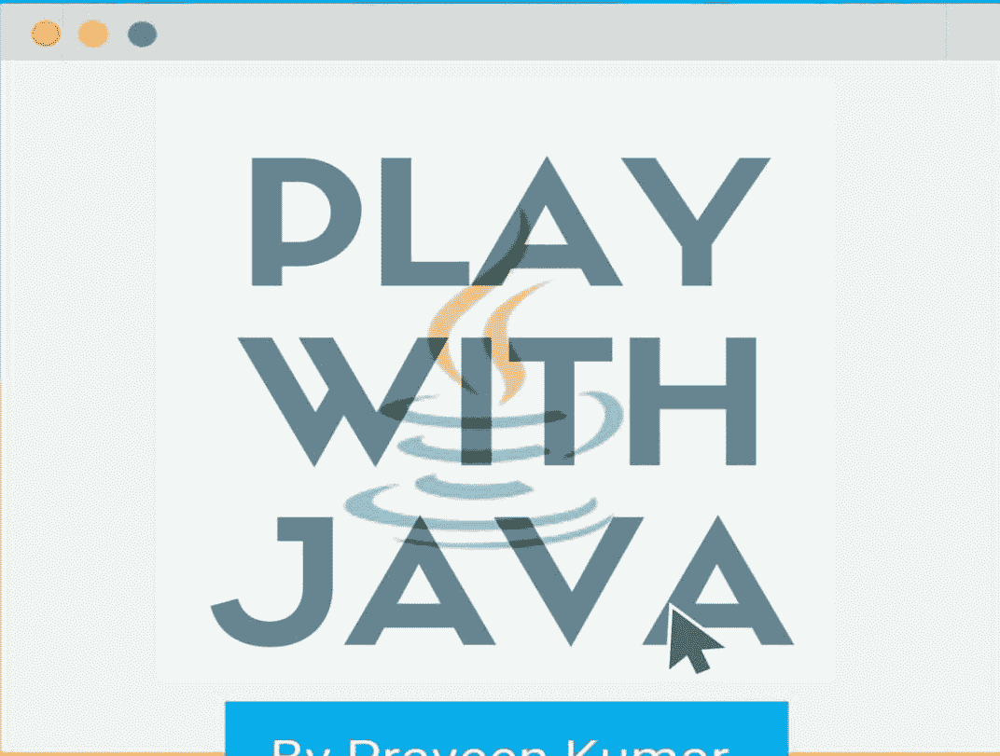

# 致谢

本书是我的同事、资深教师、技术朋友以及家庭成员提供的鼓励、指导、帮助和支持的成果。

在这里，我想借此机会对对本书成功完成起过关键作用的人表示深切的谢意，特别是我的学生们。

主要目标是提供核心 Java 足够的介绍和细节，以便学生能够高效地掌握核心 Java 的知识。任何错误和不准确之处均由我负责，并热烈欢迎任何建议！

最后，我要感谢 Kindle Direct Publishing 团队和亚马逊团队在本书出版过程中提供的热情在线支持和指导。

我希望读者在阅读这本书时，发现它有助于以一种有趣的方式学习核心 Java 编程概念。

谢谢！！

# 前言

**知识就是力量。征服知识。**

本教材旨在作为核心 Java 基础概念讲解课程，面向全球范围内高中、本科（B.Tech, BCA 和 BSc）以及研究生（MCA, MSc）学生。

本书介绍了 Java 的核心概念，旨在让学生在趣味性的环境中学习 Java。我希望你们阅读本书并进行实践的体验就像我编写它一样愉快。

Praveen Kumar

# 关于作者

Praveen Kumar

助理教授，MCA 部门，

Patna Women’s College, Patna University,

Patna, India

# Java 简介

Java 与 C++ 相关，而 C++ 是 C 的直接后代。Java 的语法源自 C。由于 C 语言不是平台无关，我们无法借助它开发应用程序。对于应用程序开发，我们需要一种平台无关的语言，即可以在不同架构的机器上运行。在 Java 中，硬件和软件编码都是相互独立的。

Java 最初由 Microsystems 于 1991 年开发，名为 Oak。1995 年，发布了第一个版本并命名为 Java。它曾以用于洗衣机等不同机器的设备形式存在。

要使用 Java，我们需要安装 1.x 版本的 `JDK`（Java 开发包），即 1.1, 1.2, 1.3, 1.4, 1.5, 1.6, 1.7, 1.8。它是免费软件。安装 `JDK` 时，会安装三个组件，即 `JVM`（Java 虚拟机）、`JRE`（Java 运行环境）和 `API`（应用程序接口）。

- `JVM` 用于编译、执行和运行程序。
- `JRE` 用于在不同的编程环境（即不同的平台）中运行程序。
- `API` 是程序员使用的预定义库。

# 用户端

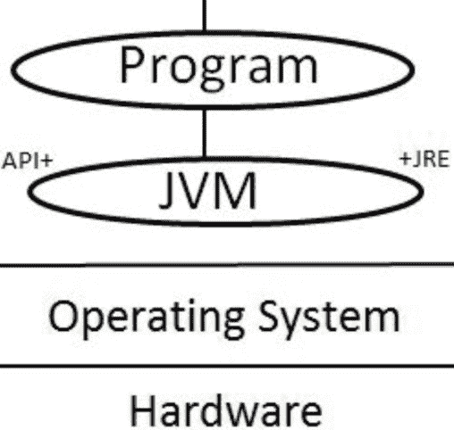

**图：Java 交互**

用户与程序交互，程序与 `JVM`、`JRE` 和 `API` 交互，这些组件与操作系统交互，最后操作系统与硬件交互。

Java 是一种既基于编译又基于解释的语言。当 Java 代码被编译时，源代码转换为字节码（一种高度优化的指令集），编译后，字节码通过 `JIT`（即时）编译器转换为机器码。

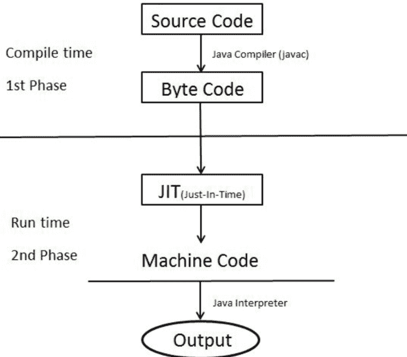

**图：Java 程序编译与运行阶段**

Java 源代码扩展名为 `.java`，它被编译形成扩展名为 `.class` 的字节码，这种字节码是机器无关的，通过即时（`JIT`）编译器转换为机器码（机器相关的），然后由解释器解释生成输出。因此，由于这种可执行的中间层代码（即字节码），Java 是一种平台无关的语言。

# Java 的特性

Java 的主要特性包括：

- 易于编码，易于学习。
- 它是平台无关/移植/架构中性的语言，即“编写一次，到处运行”。
- 它是一门面向对象的语言，即基于类和对象（后文详细讨论）。它遵循 100% OOP 特性。
- 它提供了丰富的程序模型，可以构建许多应用程序。
- Java 采用无指针架构，防止安全问题。
- Java 程序由解释器解释，这使得语言平台无关。
- Java 是多线程的，允许我们编写同时执行任务的程序。
- Java 是动态的，意味着它可以适应不断的环境。它可以根据需要加载新类。
- Java 是高度分布的，这意味着可以使用 `TCP/IP` 协议设计和构建跨网络分布式应用程序。

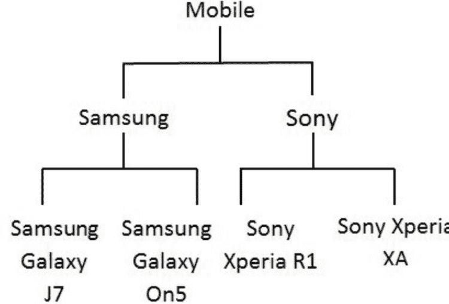

**图：继承**

# Java 编程基础

在开始学习 Java 之前，我们必须设置路径。

步骤：

1. 打开“此电脑”并点击“系统属性”。
2. 点击“高级系统设置”，并在“高级”选项卡下点击“环境变量”。
3. 点击“新建”，在变量名处输入 `path`，在变量值处输入 java 安装的实际路径。默认情况下，它安装在 `C:\Program Files (x86)`，因此，请将你的路径更改为 `C:\Program Files (x86)\Java\jdk1.7.0_09\bin`。

## 示例程序

```java
class first_prog
{
    public static void main(String[] arg)
    {
        System.out.println("Hello");
    }
}
```

在记事本中编写以下代码并将其保存为 `first_prog.java`。生成的字节码文件名与类名相同。因此，为了避免歧义，我们应该用类名保存程序。

打开命令提示符，并进入你保存程序的目录。

输入 `javac <filename.java>`，即 `javac first_prog.java` 来编译程序并按回车。如果程序中有错误，它们将列在其中。

现在输入 `java <classname>`，即 `java first_prog` 来执行程序并按回车。你将得到输出 'Hello'。

**解释：**

- `class` 关键字用于定义一个类。
- `public` 关键字用于访问修饰符（稍后将详细讨论），它与函数配合使用，以便可以从任何地方调用它。
- `static` 关键字与函数配合使用，这样就不需要创建对象，即调用时不需要对象。
- `void` 关键字用返回类型。它不返回任何值。
- 关键字始终用小写字母。
- `main()` 是一个预定义方法，程序从该处开始执行。编译器识别一个匿名对象来调用 `main` 函数。
- `String[]` 既是一个数据类型也是一个类。方括号表示它是一个数组。它用于命令行参数，即我们可以在运行时传递参数。
- `System` 是一个预定义类。
- 我们写预定义类时，首字母大写，随后的单词首字母也大写。例如：`PrintStream`
- `out` 是 `System` 类的预定义对象。
- 我们写预定义对象时用小写。
- `print()` 和 `println()` 是 `system` 类的预定义方法。
- 我们写预定义方法时，首字母小写，随后的单词首字母大写。例如：`getChar()`

## 数据类型

数据类型指的是数据元素的行为，即它是什么类型的数据，例如整数、字符串等。它还规定了对其执行的操作，例如我们不能对字符串数据类型执行数学运算，也无法连接整数数据类型。

它分为两种：

1. 基本数据类型
2. 引用数据类型/派生数据类型/抽象数据类型

基本数据类型是值类型，而抽象/派生数据是引用类型，即指针，意味着它包含了其中存储的值的地址。

### 在基本类型的情况下

```java
int a=5;
```

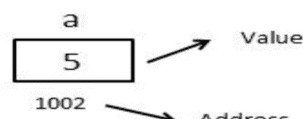

### 在引用类型的情况下

```java
Integer a=5;
```

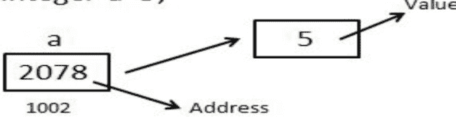

| 基本数据类型 | 引用数据类型 |
|---|---|
| byte | Byte |
| short | Short |
| int | Integer |
| long | Long |
| char | Character |
| float | Float |
| double | Double |
| boolean | Boolean |

还有一个名为 `String` 的引用数据类型。

将基本数据类型转换为其对应的引用类型称为**装箱**，而将引用数据类型转换为其对应的基本类型称为**拆箱**。这些对应基本数据类型的引用类型是类。例如：`int` 属于 `Integer` 类，`float` 属于 `Float` 类，依此类推。它们属于 `java.lang` 包，即 `java.lang.Integer`、`java.lang.Float` 等。包是类的集合。（稍后将详细讨论）

这些类被称为**包装类**，需要实例化这些类的对象。

例如：`Integer a=new Integer(5);`

字符串是一个**特殊的包装类。**

如果在不创建对象的情况下引用数据类型（即作为基本数据类型），则这些被称为**字面量**。

`Integer a=5;` // Integer 字面量

`Integer a=new Integer(5);` // Integer 包装类

# 控制流语句

## if 语句

语法：

```java
if(<condition>)
{
    if(<condition>)
    {
        statement(s);
    }
    else
    {
        statement(s);
    }
}
```

if 语句示例：

```java
class IfExample {
  public static void main(String[] arg) {
    int a=5,b=6;
    if(a>b) {
      System.out.println("a is greater");
    } else if(b>a) {
      System.out.println("b is greater");
    }
  }
}
```

> **注**：原文示例代码中 else if 处逻辑不全，已根据语境补全逻辑。

## Switch

`switch` 情况用于需要评估多个条件的情况。它遵循相同的语法：

语法：

```java
switch(expression)
{
    case <constant-1>:
        statement(s);
        break;
    case <constant-2>:
        statement(s);
        break;
    .
    case <constant-N>:
        statement(s);
    default:
        statement(s);
}
```

switch 示例：

```java
class SwitchExample {
    public static void main(String[] arg) {
        int day=3;
        switch(day) {
            case 1:
                System.out.println("Sunday");
                break;
            case 2:
                System.out.println("Monday");
                break;
            case 3:
                System.out.println("Tuesday");
                break;
            case 4:
                System.out.println("Thursday");
                break;
            case 5:
                System.out.println("Friday");
                break;
            case 6:
                System.out.println("Saturday");
                break;
            default:
                System.out.println("Invalid Choice");
        }
    }
}
```

## 循环

当我们需要根据给定条件多次执行一个或一组语句时，在这种情况下可以使用循环来执行语句。

- **for 循环**：

```java
for(<initialization>;<condition><step value>)
{
  //body
}
```

- **while 循环**：

```java
while(<condition>)
{
  //body
}
```

- **do-while 循环**：

```java
do
{
  //body
} while(<condition>);
```

- **foreach 循环**：这种循环主要用于数组（稍后将详细讨论）

循环示例：

```java
class LoopExample {
  public static void main(String[] arg) {
    for(int i=1;i<=5;i++) {
      for(int j=1;j<=i;j++) {
        System.out.print("*");
      }
      System.out.println();
    }
  }
}
```

# 类和对象

我们已经讨论了类和对象的理论。让我们通过程序来阐明。

类通过使用 `class` 关键字声明。

语法：

```java
class <classname>
{
  <type> <instance-variable1>;
  <type> <instance-variable2>;
  .
  <type> <instance-variableN>
  <access-specifier><returnt><method1>([parameter-list])
  {
    //body
  }
  <access-specifier><returnt><method2>([parameter-list])
  {
    //body
  }
  .
  <access-specifier><returnt><methodN>([parameter-list])
  {
    //body
  }
}
```

这些变量被称为实例变量，因为类的每个实例都包含这些变量的一个且唯一的副本。因此，一个对象的数据与其他对象的数据是分离且独特的。实例变量由该类的方法操作和访问。我们可以说，方法决定了类数据的使用方式。定义在类的方法和变量都是类的成员。

## 创建对象

我们需要创建一个对象来访问类的成员。

创建对象的过程被称为实例化。

语法：

```
<classname><objectname>=new <classname>();
```

在这里，类名是类的名称，对象名是对象的名称。使用 `new` 关键字来实例化对象，即在内存中分配空间并返回其引用。类名() 是默认构造函数，用于初始化对象的实例。默认构造函数会被创建并被自动调用。

## 方法

到到目前为止，我们已经使用了许多预定义方法。方法也可以由用户定义，即功能由用户定义。

### 定义方法的语法

```
<access-specifier> <returntype> <methodN>([{parameter-list}]) //函数签名
{
//定义(过程区域)
}
```

**access-specifier**（访问修饰符）可以是 `public`（公共）、`private`（私有）或 `protected`（保护），它决定了方法可以在哪里访问（稍后详细讨论）。返回值决定了方法是否返回值。方法名可以是任何有效的标识符，参数列表是可选的。这整行被称为函数签名。

函数签名的不同方式：

- 无参数无返回
- 无参数有返回
- 有参数有返回
- 有参数无返回

### 示例

- 无参数无返回
- 无参数有返回
- 有参数有返回
- 有参数无返回

### static 关键字

当成员被声明为 `static`（静态）时，可以在类的任何对象创建之前访问，且不需要任何对象的引用。我们可以将方法和变量声明为静态的。静态成员最常见的例子是 `main()`。

声明为静态的实例变量本质上是全局变量。当声明类的对象时，不会创建静态变量的副本。该类的所有实例共享同一个静态变量。

静态方法只能访问静态数据，它可以调用其他的静态变量。还可以声明静态块（`static block`）来初始化静态变量。它在类首次加载时执行一次。

示例：

```java
class exstatic
{
    static int a=3; //静态变量被用作全局变量
    static int b;
    int c;
    static void method1(int x)
    {
        System.out.println("x="+x); //可以使用局部变量
        System.out.println("a="+a);
        System.out.println("b="+b);
    }
    //System.out.println("c="+c); //错误，c是实例变量，因此不能在这里使用
    static
    {
        System.out.println("Inside static block");
        b=4; //静态变量b被初始化
    }
    public static void main(String[] arg)
    {
        method1(45);
    }
}
```

输出：

```
E:\java\new_java>javac exstatic.java
E:\java\new_java>java exstatic
Inside static block
x=45
a=3
b=12
```


# Java 核心概念

## 静态成员

在定义静态成员的类之外，静态方法和变量可以独立于任何对象使用。这是通过指定它们的类名后跟点运算符来实现的。即 `className.method()`。

示例：

```java
class exst1 {
    static int a = 42;
    static int b = 49;
    static void callme() {
        System.out.println("a=" + a);
    }
}
```

```java
class exst2 {
    public static void main(String[] arg) {
        exst1.callme();
        System.out.println("b=" + exst1.b);
    }
}
```

```
OUTPUT:
E:\java\new_java>javac exst2.java
E:\java\new_java>java exst2
a=42
b=49
```

## 嵌套类和内部类

当一个类被定义在另一个类内部，这样的类被称为嵌套类。嵌套类的范围受限于其外部类的范围。

嵌套类有两种类型：静态（`static`）和非静态（`non-static`）。静态嵌套类应用了 `static` 修饰符。因为它是静态的，它必须直接访问其外部类的静态成员。由于这种限制，静态嵌套类很少被使用。

嵌套类最重要的类型是内部类。内部类是非静态的嵌套类。它可以访问外部类的所有变量和方法，并可以像外部类的其他非静态成员一样直接引用它们。因此，内部类完全位于其外部类的范围之内。

如果类 `outer` 之外的任何代码尝试实例化内部类，Java 编译器将给出错误信息。

示例：

```java
class outer {
    int o_var = 100;
    void test() {
        inner in = new inner();
        in.display(); // 内部类的成员可以通过对象访问，但不能直接访问
        show_y();
    }
    class inner {
        int y = 10;
        void display() {
            System.out.println("Outer variable=" + o_var); // 外部类的成员可以在内部类中直接使用
        }
    }
    void show_y() {
        inner i1 = new inner();
        System.out.println("y=" + i1.y);
        // System.out.println("c=" + c); // 错误，c是实例变量，因此不能在这里使用
    }
}
```

```
OUTPUT:
E:\java\new_java>javac outer.java
E:\java\new_java>java outer
Outer variable=100
y=10
```

## 封装

封装是将数据和代码封装成单元。它用于限制对对象组件的访问，这被称为数据隐藏。为了实现封装，我们可以将类的变量设为私有，并提供 `getter` 和 `setter` 方法来修改它们。

```java
class Student {
    private String name;
    public void setName(String name) {
        this.name = name;
    }
    public String getName() {
        return name;
    }
}
public class Main {
    public static void main(String[] args) {
        Student s = new Student();
        s.setName("John");
        System.out.println(s.getName());
    }
}
```

## 方法重载

方法重载是一种特性，其中多个方法具有相同的名称但不同的参数。它被称为编译时多态。

```java
class Calculator {
    int add(int a, int b) {
        return a + b;
    }
    int add(int a, int b, int c) {
        return a + b + c;
    }
    double add(double a, double b) {
        return a + b;
    }
}
public class Main {
    public static void main(String[] args) {
        Calculator c = new Calculator();
        System.out.println(c.add(5, 10));
        System.out.println(c.add(5, 10, 15));
        System.out.println(c.add(5.5, 10.5));
    }
}
```

## 方法重写

方法重写发生在子类为其父类中已定义的方法提供特定实现时。它被称为运行时多态。

```java
class Animal {
    void sound() {
        System.out.println("Animal makes a sound");
    }
}
class Dog extends Animal {
    @Override
    void sound() {
        System.out.println("Dog barks");
    }
}
public class Main {
    public static void main(String[] args) {
        Animal a = new Dog();
        a.sound();
    }
}
```

在 Java 中，程序中可以多次定义多个同名的函数，但它们的签名不同。这种现象被称为**方法重载**。当我们说签名不同时，意味着不同的返回类型、不同的参数数量、不同的参数类型或不同的参数顺序。当 Java 遇到对重载方法的调用时，它简单地执行参数与调用时使用的参数匹配的方法版本。

调用哪个函数在编译时就已经决定了，因此它被称为**早期绑定**或**编译时多态**。

在 Java 中，还可以使用多个同名、签名相同但定义不同的函数。这种现象被称为**方法重写**。它不能在单个类中实现，至少需要两个类。它涉及到继承的概念。调用哪个方法是在运行时决定的，因此它被称为**晚期绑定**或**运行时多态**。由于重写的概念完全依赖于继承，因此将在继承章节中详细讨论。

## 构造函数

构造函数在对象创建时立即初始化对象。它的名称与其所属的类相同，在语法上与方法相似。一旦定义，构造函数会在对象创建后、`new` 操作符完成前自动被调用。构造函数没有返回类型，即使是 `void` 也不行。这是因为类构造函数的隐式返回类型是类本身。

一个说明构造函数的示例：

```java
class area {
    double len, wid;
    area() {
        len = 4;
        wid = 5;
        double res = len * wid;
        System.out.println("Area=" + res);
    }
    public static void main(String[] arg) {
        area ob = new area(); // 调用了 area()
    }
}
```

```
OUTPUT:
E:\java\new_java>javac area.java
E:\java\new_java>java area
Area=20.0
```

构造函数可以是带参数的也可以是非参数化的。上面的示例是非参数构造函数的一个例子。在带参数的构造函数中，会传递参数。

示例：

```java
class area1 {
    area1(double len, double wid) {
        double res = len * wid;
        System.out.println("Area=" + res);
    }
    public static void main(String[] arg) {
        area1 ob = new area1(4, 5); // 调用了 area1(double len, double wid)
    }
}
```

```
OUTPUT:
E:\java\new_java>javac area1.java
E:\java\new_java>java area1
Area=20.0
```

使用对象作为参数：

```java
class area2 {
    int len, wid;
    area2(int len, int w) {
        this.len = len;
        this.wid = w;
        System.out.println(len + " " + wid);
    }
    area2(area2 ob) {
        len = ob.len;
        wid = ob.wid;
        System.out.println(len + " " + wid);
    }
    public static void main(String[] arg) {
        area2 a1 = new area2(4, 5); // 调用了 area2(int l, int w)
        area2 a2 = new area2(a1);   // 调用了 area2(area2) 对象
    }
}
```

## 参数传递的类型

参数通过两种方式传递，即**按值传递**和**按引用传递**。按值传递是将参数的值拷贝到子程序的形式参数中。因此，对子程序参数的修改不会影响实参。在按引用传递中，将一个引用传递给参数。在子程序内部，使用该引用来访问调用中指定的实际参数。这意味着对参数的修改将影响用于调用子程序的实参。

按值传递的示例：

```java
class value {
    void meth(int i, int j) {
        i *= 2;
        j *= 2;
        System.out.println("Changed value of i and j: " + i + " " + j);
    }
    public static void main(String[] arg) {
        value ob = new value();
        int i = 5, j = 10;
        System.out.println("i and j before call: " + i + " " + j);
        ob.meth(i, j);
        System.out.println("i and j after call: " + i + " " + j);
    }
}
```

```
OUTPUT:
E:\java\new_java>javac value.java
E:\java\new_java>java value
i and j before call: 5 10
Changed value of i and j: 10 20
i and j after call: 5 10
```

按引用传递的示例：

```java
class reference {
    int i, j;
    reference(int a, int b) {
        i = a;
        j = b;
    }
    void meth(reference ob) {
        ob.i *= 2;
        ob.j *= 2;
    }
    public static void main(String[] arg) {
        reference ob = new reference(4, 5);
        System.out.println("i and j before call: " + ob.i + " " + ob.j);
        ob.meth(ob);
        System.out.println("i and j after call: " + ob.i + " " + ob.j);
    }
}
```

```
OUTPUT:
E:\java\new_java>javac reference.java
E:\java\new_java>java reference
i and j before call: 4 5
i and j after call: 8 10
```

## 继承

通过继承，我们可以创建一个定义一组相关项通用属性的类。被继承的类被称为**父类**或**基类**，执行继承的类被称为**子类**。

### 继承的类型

在 Java 中，继承是层次化的，包括单继承和多级继承。Java 不支持多继承。

注意：父类的私有成员不能被子类继承，即子类无法访问。

### 优点

- 它减少了冗余，即数据的共享。
- 维护变得更容易。
- 可以进行动态执行。

### 缺点

如果层级很多，复杂性会增加。

### 语法

```java
class ParentClass {
    // 方法体
}
class ChildClass extends ParentClass {
    // 方法体
}
```

示例：

```java
class parent {
    int i = 1, j = 2;
    void show() {
        System.out.println("i=" + i);
        System.out.println("j=" + j);
    }
}
class child extends parent {
    int k = 3;
    void showk() {
        System.out.println("k=" + k);
    }
    void sum() {
        int s = i + j + k;
        System.out.println("s=" + s);
    }
    public static void main(String[] arg) {
        parent p = new parent();
        child c = new child();
        p.show();
        c.show(); // 子类对象可以访问父类的成员
        c.showk();
        c.sum();
    }
}
```

```
OUTPUT:
E:\java\new_java>javac child.java
E:\java\new_java>java child
i=1
j=2
i=1
j=2
k=3
s=6
```

每当子类需要引用其直接父类时，可以使用 `super` 关键字来实现。`super` 有两种通用形式。第一种是调用父类的构造函数。第二种用于访问被子类成员隐藏的父类成员。

### 用作构造函数

每当子类的构造函数被调用时，父类的构造函数会被自动调用，即使在这种情况下没有使用 `super` 关键字，也会调用无参构造函数；但由于父类的构造函数可能带有参数，因此使用 `super` 关键字更好。

示例：

```java
class first { // 父类
    int i, j, k;
    first(int a, int b, int c) {
        i = a;
        j = b;
        k = c;
        System.out.println(i + "+" + j + "+" + k);
    }
    first(int x) {
        i = j = k = x;
        System.out.println(i + "+" + j + "+" + k);
    }
}

class second { // 子类
    int l;
    second(int a, int b, int c, int d) {
        super(a, b, c);
        l = d;
        System.out.println(l);
    }
    second(int x) {
        super(x);
        l = x;
        System.out.println(l);
    }
    public static void main(String[] args) {
        first f1 = new first(5);
        first f2 = new first(2, 4, 6);
        second s1 = new second(10);
        second s2 = new second(2, 4, 6, 10);
    }
}
```

```
输出:
E:\java\new_java>javac second.java
E:\java\new_java>java second
5+5+5
2+4+6
10+10+10
10
2+4+6
10
```

### super 的第二用法

`super` 的第二种形式最适用于子类的成员名隐藏了父类中同名成员的情况。

示例：


```java
class parent1 { // 父类
    int i = 1;
    public void print() {
        System.out.println("Welcome");
    }
}

class child1 extends parent1 { // 子类
    int i = 2;
    public void print() { // 重写的方法
        super.print(); // 调用父类的 print()
        System.out.println("to campusedulive.com");
        System.out.println(i); // 打印子类的 i
        System.out.println(super.i); // 打印父类的 i
    }
    public static void main(String[] args) {
        child1 ob = new child1();
        ob.print(); // 调用子类的 print()
    }
}
```

输出：

```
E:\java\java>javac child1.java
E:\java\java>child1
Welcome
to campusedulive.com
2
1
```

# 抽象类

抽象是指只向用户展示必要的细节。它关注对象的外部视图。它是隐藏无关细节的概念。换句话说，我们通过向用户隐藏不必要的细节来使复杂系统简单。在 Java 中，我们通过使用接口（`Interface`）和抽象类（`Abstract class`）来实现抽象。

抽象类：该类必须被继承。在这里，方法也是抽象的。在某些情况下，我们希望定义一个父类来声明给定抽象的结构，而不提供每个方法的完整实现。任何包含一个或多个抽象方法的类也必须声明为抽象。我们不能声明抽象构造函数（抽象类没有对象，因此构造函数不会被调用）或抽象静态方法（静态方法不能被继承，适用于所有类）。抽象类的任何子类必须实现父类所有的抽象方法，或者本身也被声明为抽象。

要点如下：

- 要使一个抽象类，我们必须向该类添加 `abstract` 关键字。
- 抽象类不能被实例化。
- 抽象类可以同时拥有抽象方法和具体方法。
- 抽象类的子类必须实现所有抽象方法或被声明为抽象。
- 抽象类可以有构造函数。
- 抽象类可以有 `final` 方法。
- 抽象方法没有方法体。

示例：

```java
abstract class A {
    A() {
        System.out.println("inside A");
    }
    abstract void check();
}

class B extends A {
    B() {
        System.out.println("inside B");
    }
    void check() {
        System.out.println("check implemented");
    }
    public static void main(String[] args) {
        B b = new B();
        b.check();
    }
}
```

输出：

```
inside A
inside B
check implemented
```

# 字符串处理

在许多语言中，字符串被视为字符数组。在 Java 中，字符串是对象。`java.lang.String` 类提供了许多处理字符串的方法。通过这些方法，我们可以对字符串进行修剪、拼接、比较等操作。String 的一些函数如下：

- **`charAt()`**: 返回指定索引处的单个字符。索引从 0 开始。例如：`s.charAt(3)`。
- **`getBytes()`**: 返回字符串的字节数组。换句话说，它返回字符串的 ASCII 值。
- **`equals()`**: 根据内容比较两个字符串。如果所有字符匹配，则返回 true。`==` 在 Java 中比较地址（用于引用类型）。例如：`a.equals(b)`。
- **`equalsIgnoreCase()`**: 工作与 `equals()` 相同，但不区分大小写。
- **`startsWith()`**: 检查字符串是否以指定的前缀开头。如果是该前缀则返回 true，否则返回 false。
- **`endsWith()`**: 检查字符串是否以指定的后缀结尾。如果是该后缀结尾则返回 true，否则返回 false。
- **`getChars()`**: 用于一次提取多个字符。
- **`getChars(sourcestart, sourceend, target, targetstart)`**: 具体参数形式。
- **`substring()`**: 返回提取的字符串部分。在 Java `substring` 方法中需要传入起始位置和结束位置，起始索引是包含的，结束索引是不包含的。如果不提供结束索引，它将考虑直到字符串末尾。
- **`concat()`**: 将指定的字符串拼接在字符串末尾并返回拼接后的字符串。类似于追加字符串。`+` 也用于拼接，它可以拼接无限数量的字符串，而 `concat()` 每次只能拼接两个。
- **`replace()`**: 返回一个替换了所有旧字符的新字符的字符串。
- **`split()`**: 根据给定的正则表达式分割字符串并返回数组。它也被称为分词器。
- **`toLowerCase()`**: 将字符串中的所有字符转换为小写。
- **`toUpperCase()`**: 将字符串中的所有字符转换为大写字母。
- **`trim()`**: 它消除字符串开头和结尾的空格。它不会忽略中间的空格。它用于密码字段的编码。
- **`toString()`**: 它将给定的对象或值转换为字符串。
- **`contains()`**: 它在字符串中搜索字符序列。如果找到字符值序列，则返回 true。
- **`indexOf()`**: 它返回给定字符或子字符串的第一次出现的位置。如果未找到，则返回 -1。它的返回类型是整数。
- **`isEmpty()`**: 它检查字符串是否为空。如果字符串的长度为 0，则返回 true。
- **`lastIndexOf()`**: 它返回给定字符值的最后一次出现的位置。如果未找到，则返回 -1。
- **`length()`**: 它返回字符的总数计数。
- **`toCharArray()`**: 它将字符串转换为字符数组。它的长度与字符串相似。
- **`compareTo()`**: 它将给定的字符串与当前字符串进行比较。它返回一个正数、负数或 0。
- **`valueOf()`**: 它用于值转换。它将不同类型的值转换为 String。它与 `toString()` 函数相似，但 `toString()` 是一个非静态函数（通过对象调用），而 `valueOf()` 是一个静态函数（通过类调用），属于 String 类。

示例：

```java
public class StringDemo {
    public static void main(String[] args) {
        String s = "Praveen";
        System.out.println(s);
        char t = s.charAt(4);
        System.out.println(t);
        byte[] b = s.getBytes();
        System.out.println(b[3]);
        String s1 = new String(b);
        System.out.println(s1);
        if (s.equals(s1)) {
            System.out.println("True");
        } else {
            System.out.println("False");
        }
        String empcode = "hr1001";
        System.out.println(empcode.startsWith("hr"));
        System.out.println(s.substring(2));
        System.out.println(s.substring(2, 4));
    }
}
```

输出：

```
Praveen
e
118
Praveen
True
True
raveen
av
```

## 可变与不可变字符串

`String` 类是不可变的，这意味着它的增长是不可能的或不可更改的。字符串是一种特殊的数据类型，我们可以创建它的字面量，也可以创建对象。当连接许多字符串时，它的速度很慢且消耗更多内存，因为每次都会创建一个新的实例（或变量）。

## StringBuffer 类

它代表可增长和可写的字符序列。它是字符串的对等类，提供了字符串的大部分功能。在拼接字符串时，它会增长而不会重新创建。因此，它是快速且低内存消耗。它不是一种特殊的数据类型。在 buffer 类中，我们还可以反向进行拼接。

`String` 和 `StringBuffer` 类都定义在 `java.lang.*` 中。因此，它们对所有程序自动可用。

# 接口

接口是一个 100% 不完全的情况（只给出了签名），即它包含非具体的函数。函数的定义将由实现类（`implements class`）给出。例如：事件处理是一种接口，因为当事件被创建时，该事件的执行将由用户程序员定义。这里有几个函数，其定义和签名将在后面给出，其余部分为空，将在实现类中被重写。它是与原始类相同的蓝图。接口看起来像类，但它并不是类。接口可以像类一样拥有方法和变量，但接口中声明的方法默认是抽象的（只有方法签名，没有主体）。此外，接口中声明的变量默认是 `public`、`static` 和 `final`。

创建线程有两种方法，即通过扩展 `Thread` 类或实现 `Runnable` 接口。如我们所知，Java 不支持多类继承，但在某些情况下需要来自多个类的成员。在这种情况下，接口是有用的，因为一个类可以实现多个接口。我们可以说接口是多重继承的解决方案。

- 要创建一个接口，我们使用 `interface` 关键字而不是 `class`。
- 使用 `implements` 关键字而不是 `extends`。
- 接口是隐式抽象的，这就是为什么我们不能创建接口的对象。
- 接口变量必须在声明时初始化，否则编译器将抛出错误。
- 一个类可以实现任意数量的接口。
- 如果两个接口中有两个或多个相同的方法且一个类实现了这两个接口，那么只需实现该方法一次就足够。
- 变量名冲突可以通过接口名来解决。
- 如果类包含一个接口但没有完全实现该接口定义的方法，则该类必须声明为抽象类（`abstract`）。
- 我们在 Java 中无法实例化接口。
- 它提供了完全的抽象，因为它的没有任何方法可以有方法体（具体方法）。
- 在不考虑实现部分的情况下，我们可以实现安全性。
- 当你实现接口方法时，它必须声明为 `public`。

## 定义接口的通用语法

```
访问修饰符 interface 接口名 {
    返回类型 方法名();
}
```

示例：

```java
interface C1 {
    void call();
}

class C2 implements C1 {
    public void call() {
        System.out.println("Hello");
    }

    public static void main(String[] args) {
        C2 m = new C2();
        m.call();
    }
}
```

输出：

```
Hello
```

## 包

包是封装一组类的机制，定义了存储类的命名空间。如果省略了包语句，类将放在默认包中。Java 有内置包，其中一些 `java.lang.*`, `java.util.*`, `java.io.*`, `java.applet.*`, `java.awt.*`。程序员可以定义自己的包来汇总类。Java 考虑特定位置由 `CLASSPATH` 控制。

### 创建包

创建包时，你应该选择一个名称，并在源代码的第一行包含要包含的包语句。

语法：

```
package 包名;
```

示例：

```java
package expack1;

class ExBalance {
    String cname;
    double bal;
    ExBalance(String n, double d) {
        cname = n;
        bal = d;
    }
    void show() {
        if (bal > 150) {
            System.out.print(">");
            System.out.println("Customer Name :" + cname + ": Rs." + bal);
        }
    }
}

class ExAccBalance {
    public static void main(String[] args) {
        ExBalance ca[] = new ExBalance[3];
        ca[0] = new ExBalance("Shay Mohan", 125.23);
        ca[1] = new ExBalance("Mahorari Jee", 165.09);
        ca[2] = new ExBalance("Mic Tom", 680.89);
        for (int i = 0; i < 3; i++) {
            ca[i].show();
        }
    }
}
```

输出：

```
>Customer Name :Mahorari Jee: Rs.165.09
```

# 异常处理

错误分为两种：编译时错误和运行时错误。要消除编译时错误，最好使用编译器。异常处理是处理运行时错误（逻辑错误）的一种方法。异常破坏程序正常执行流的事件。它是一个在运行时抛出的对象。异常处理在某种程度上使我们的程序更加健壮（无错误）。Java 的根类是 `Object` 类，而错误处理的根类是 `Throwable`。这种方式的唯一缺点是，异常使用得越频繁，程序运行得就越慢。异常分为以下两种类型：

## 异常的类型

- **检查异常（Checked Exception）**: 检查异常也称为 Java 的预检查异常，它由自己来处理关键异常。如果没有处理检查异常（即没有写在 `try-catch` 块中），程序将无法编译。
- **未检查异常（Unchecked Exception）**: 继承自 `RuntimeException` 的类被称为未检查异常。它们在编译时不会被检查，而是在运行时进行检查。这些异常是用户需要手动处理的异常，例如 `ArithmeticException`、`NullPointerException` 等。

**异常处理的优点**: 异常处理的优点是维持应用程序的正常流并使应用程序更加健壮。异常会破坏应用程序的正常流。

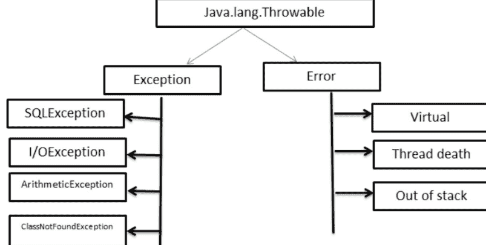

## 异常的处理方式

### 1. try-catch & finally 块

在 Java 中，`try` 块用于封装可能抛出异常的代码。发生错误时，它会将异常抛给 `catch` 块；如果没有错误，控制权就不会转移到 `catch` 块。在这里，内部调用 `throw` 关键字来抛出错误。

`try` 块的语法结构：

```java
try {
    // error code
} catch (Exception_class_name ref) {
    // Exception msg
} finally {
    // finally code
}
```

`try-catch` 和 `finally` 块有 3 种执行情况：

1. **第一种情况**: 如果发生错误，错误之后代码将不会执行。`try` 会抛出一个异常，控制权进入 `catch` 块，错误在 `catch` 块中被处理。如果没有写 `finally{}`，则 `catch{}` 之后的代码将执行。
2. **第二种情况**: 每执行一次 `try{}`，`finally{}` 就会执行一次。
3. **第三种情况**: 当 `try{}` 执行并向 `catch{}` 抛出异常时，在执行 `catch{}` 之后会执行 `finally{}`。

Java `finally` 是可选的，在需要时使用。无论是否发生异常，它总是会被执行。`try` 块中可能有 10 行代码，如果在第 6 行发生异常，异常会被处理，光标会跳出 `try` 块，而不会完全执行 `try` 块。为了执行重要代码，会使用 `finally`。`finally` 块必须后跟 `try` 或 `catch` 块。对于每个 `try` 块，必须有一个或多个 `catch` 块，但只能有一个 `finally` 块。它主要用于放置“清理”代码，如关闭文件、关闭连接等。我们把所有重要的代码写在 `finally` 中。

如果你不处理异常，在程序终止之前，JVM 会执行 `finally` 块。

### 示例

```java
class Check {
    public static void main(String[] args) {
        int a = 10, b = 0;
        try {
            int c = a / b;
        } catch (Exception ex) {
            System.out.println(ex.toString());
        } finally {
            System.out.println("Program executed");
        }
    }
}
```

输出：

```
java.lang.ArithmeticException: / by zero
Program executed
```


Program executed

## 2. 多个 catch{} 块

一个 `try{}` 块可以有多个 `catch{}` 块。当 `try{}` 中有 3 行代码且每行都可能产生中断时，可能会产生 3 个异常，为了处理 3 个异常，我们可以写 3 个 `catch{}`。但当我们使用异常的根类时，就不需要写多个 `catch` 块。一次只会发生一个异常，一次只会执行一个 `catch` 块。所有的 `catch` 块必须按照异常发生的顺序进行排列。多个 `catch` 块有助于代码更快的执行。

```java
try{
    # error code
}
catch(ArithmeticException ex){
    # Exception msg
}
catch(FileNotFoundException ex){
    # Exception msg
}
catch(ArrayOutOfBoundsException ex){
    # Exception msg
}
catch(Exception ex) {
  # Exception msg
}
```

## 3. 嵌套 try{}

`try` 块中的 `try` 块被称为嵌套块。有时会出现一种情况：块的一部分可能导致一个错误，而整个块本身可能导致另一个错误。在这种情况下，异常处理器必须嵌套。但它应该有一个连续的 `catch` 块。这种方法增加了复杂性。

```java
try {
  # statements;
  try {
    statement1;
  } catch(Exception ex) {
  }
} catch (Exception ex) {
}
```

## 4. throws 关键字

它用于检查异常。它其中没有 `try-catch{}` 块。它只能与 `main()` 使用。

```java
public static void main(String[] args) throws ArithmeticException, FileNotFoundException {
  # statements;
}
```

## I/O 流

在 Java 中获取输入：通过控制台获取输入有 4 种方式。通过：

1. `System.in`：它以 `int` 类型输入。
2. 命令行：在运行时我们需要空格分隔的输入。标准格式。
3. I/O 包：`InputStream` 和 `BufferedReader` 类。
4. `util Scanner`：它属于 `Scanner` 类。

例如，从用户处输入一个名称并显示在控制台上：

```java
class cmd{
    public static void main(String args[]){
        try{
            String s = args[0];
            System.out.print("Your name is: " + s);
        } catch(Exception ex){
            System.out.println(ex.toString());
        }
    }
}
```

执行此文件传递参数：`java cmd Rahul`

Java 通过流执行 I/O 操作。流是数据的序列或连续的位/字节，就像水流从源流到目的地。通常，它用于在网络中传输数据。I/O 包有两种读取模式。使用流是因为流意味着字节，字节意味着 ASCII ，ASCII 意味着二进制，而计算机理解二进制。`java.lang` 包包含一个名为 `System` 的类，它封装了运行时环境的多个方面。`System` 包含了三个流变量：`in`、`out` 和 `err`。

- `System.out` 指标准输出流，默认是控制台。
- `System.in` 指标准输入流，默认是键盘。
- `System.err` 指标准错误流，也是控制台。

Java 在 `java.io` 包中实现了流类。I/O 包分为以下两种流：

- **字节流**：它为处理字节级 I/O 提供了丰富的环境。它可以用于任何类型，包括二进制数据。
- **字符流**：虽然字节流类提供了处理任何类型 I/O 操作的功能，但它们无法直接处理 Unicode 字符。

Java 的主要目标是支持“编写一次，随运行”。必须包含字符的直接 I/O 支持。

### 字节流类

字节流由两个类层次结构定义。有两个根抽象类 `InputStream` 和 `OutputStream`。这些抽象类有多个子类用于处理各种设备，如磁盘文件、网络连接甚至内存缓冲区。

一些重要的字节流类：

| 流类 | 说明 |
| --- | --- |
| `BufferedInputStream` | 用于缓冲输入流。 |
| `BufferedOutputStream` | 用于缓冲输出流。 |
| `DataInputStream` | 包含读取 Java 标准数据类型的方法 |
| `DataOutputStream` | 包含写入 Java 标准数据类型的方法 |
| `FileInputStream` | 从文件读取 |
| `FileOutputStream` | 写入文件 |
| `InputStream` | 描述流输入的抽象类 |
| `OutputStream` | 描述流输出的抽象类 |
| `PrintStream` | 包含 `print()` 和 `println()` 方法的输出流 |

### 字符流类

字符流通过使用两个类层次结构来定义。根抽象类是 `Reader` 和 `Writer`。这些抽象类处理 Unicode 字符流。Java 为这些抽象类中的每一个都提供了几个具体的子类。

一些重要的字符流类：

| 流类 | 说明 |
| --- | --- |
| `BufferedReader` | 处理缓冲输入流。 |
| `BufferedWriter` | 处理缓冲输出流。 |
| `FileReader` | 从文件读取的输入流 |
| `FileWriter` | 写入文件的输出流 |
| `InputStreamReader` | 将字节转换为字符的输入流 |
| `OutputStreamReader` | 将字符转换为字节的输出流 |
| `PrintWriter` | 包含 `print()` 和 `println()` 方法的输出流 |
| `Reader` | 定义字符流输入的抽象类 |
| `Writer` | 定义字符流的抽象类 |

### 读取控制台输入

在 Java 中，控制台输入是通过读取 `System.in` 完成的。要获取与控制台连接的字符流，可以将 `System.in` 包装在 `BufferedReader` 对象中。`BufferedReader` 支持缓冲输入流。`System.in` 指向 `InputStream` 类型的对象，可以与 `InputStream` 配合。读取字符使用 `read()` 函数。读取字符串使用 `readLine()` 函数。通过使用 `System.in` 和命令行输入，可以从一个通道（即键盘）读取行，而使用 I/O 包中的 `InputStreamReader` 和 `BufferedReader` 类，可以从键盘、套接字等不同通道读取输入。`Socket` 指连接到服务器的不同终端。因此，这些 I/O 包中的类被称为标准 I/O。当我们写下 `import java.io.*;` 时，`java.io` 包中的所有类、子类和接口都会被引入，而其包和子包则不会。

> **注意：** 在执行 I/O 操作时，必须处理异常。

例如，从用户处输入名称并将其显示在控制台上：

```java
import java.io.*;
class exRead{
    public static void main(String[] args){
        try{
            InputStreamReader isr = new InputStreamReader(System.in);
            BufferedReader br = new BufferedReader(isr);
            System.out.println("Enter your name:");
            String s = br.readLine();
            System.out.print("Your name is: " + s);
        } catch (Exception ex){
            System.out.println(ex.toString());
        }
    }
}
```

输出：

```
:\java\new_java>java exRead
Enter your name:Rahul
Your name is: Rahul
```

## 文件处理

文件操作：有两个专门的类执行基于文本文件的文件读取和写入操作。

1. `FileInputStream`：它是一个用于正向读取文本基础的特殊类，即光标将指向正方向，没有方法可以反向读取数据。为此我们需要导入 `java.io.*;`。
2. `FileOutputStream`：它也是一个将数据写入基于文本文件的特殊类。如果文件不存在，它将创建一个新文件；如果文件已存在，它将覆盖它。在这里，数据可以正向写入，也可以反向写入。为此我们也需要导入 `java.io.*;`。

从文件中读取数据使用 `read()` 函数，其返回类型是整数格式的字节。一次读取 1 字节。它将返回一个 ASCII 值。返回值后，指针将向前移动 1 字节。语法使用 `System.out.print(fis.read());`。

由于用户无法理解 ASCII 值，因此将其转换为字符形式，或者说将进行解析。从字节到字符串的转换将会发生。为此我们写下 `System.out.print((char)fis.read());`。要到达文件末尾使用 `available()`。它计算指针之后文件中可用数据量。它读取字节。它以只读模式打开文件。

### FileInputStream 示例

```java
import java.io.*;
class exRead {
    public static void main(String[] args) throws Exception {
        FileInputStream fis = new FileInputStream("test.txt");
        int i;
        while((i = fis.read()) != -1) {
            System.out.print((char)i);
        }
        fis.close();
    }
}
```

### FileOutputStream 示例

```java
import java.io.*;
class exRead {
    public static void main(String[] args) throws Exception {
        FileOutputStream fos = new FileOutputStream("test.txt");
        String s = "Hello Java";
        fos.write(s.getBytes());
        fos.close();
    }
}
```

## GUI

通常我们使用 Netbeans 设计 GUI，但 Eclipse 用于专业。我们熟悉 HTML，HTML 也用于设计，但它只设计表单。HTML 表单的功能需要额外的代码，这可以通过 .Net、Java 等完成。

1. **窗口应用程序**：它只能运行在窗口上。它包含多个用于设计 GUI 的控件类。对于窗口应用程序，使用了 `java.awt`（抽象窗口工具包）包。该包包含了创建用户界面和绘制图形图像的所有类。它具有 2D 样式、外观和感觉。
2. **Web 应用程序**：它包括 Applet、JSP 和 Servlet。一些高级 Web 应用程序包括 MUC、Spring、Struts、Hibernate 和 JSF（Java Server Faces）。Applet 可以在桌面和网络浏览器中运行。在浏览器中工作时，其安全性得到了增强。Servlet 运行在网络浏览器中。
3. **移动应用程序**：用 Java 开发的最常见的移动应用程序是 Android，这是一个操作系统。它还提供了环境、工具和 API（应用程序编程接口）。
4. **Web 服务**：Web 服务没有用户界面。它只为许多应用程序提供服务。例如，板由 ICC 管理，ICC 有自己的网站和移动应用程序提供比分和其他信息，但许多其他网站和应用程序也提供比分。这些网站都使用 ICC 使用数据库，这意味着 ICC 正在为所有网站提供服务。

### awt 包的类

| 类 | 控件 |
| --- | --- |
| `Label` | label |
| `TextField` | textbox |
| `Checkbox` | checkbox, radiobutton |
| `Button` | button |
| `Choice` | combobox (单选) |
| `Select` | 多选 combobox |
| `List` | listbox |

`Frame` 也是 `awt` 包的成员。它用于创建一个空白帧。`Component` 是一个抽象类，封装了所有视觉组件的属性。所有在屏幕上显示并与用户交互的界面元素都是 `Component` 的子类。容器类（`Container`）是 `Component` 的子类，它包含了所有的控件。`Panel` 类和 `DesktopPane` 类类似于 `Container` 类。`Panel` 用于在设计上分离 Frame 上的控件，使其具有交互性。`DesktopPane` 类用于多文档界面（MDI）应用程序。

> **注意：** 在 MDI 应用中，子帧插入到父帧内部，一个父帧可以包含多个子帧。每个类都有 `add()` 方法，用于将控件添加到主容器中。

### 创建帧的程序

```java
import java.awt.*;

public class exSwin extends Frame {

    public exSwin() {
        super("First Frame");
        setSize(400,400);
        setVisible(true);
    }

    public static void main(String[] args[]) {
        new exSwin();
    }
}
```

### 使用布局管理器

布局管理器会自动在窗口内排列你的控件。每个 `Container` 对象都关联有一个布局管理器。布局管理器是实现 `LayoutManager` 接口的类的实例。不同类型的布局如下：

1. **流布局 (Flow Layout)**：这是默认布局。组件按行排列（即从左到右）。
2. **网格布局 (Grid Layout)**：它在二维网格中布局组件。在这里定义行数和列数。在 `GridLayout` 的构造函数中，我们将行数和列数作为参数传递。`GridLayout` 的替代方案是 `GridBagLayout`，在这里可以通过指定组件在网格单元格内的位置来指定它们的相对位置。
3. **边界布局 (Border Layout)**：它有四个边（北、南、东、西）和一个中央的大区域。
4. **卡片布局 (Card Layout)**：这种布局可以被想象成桌上独立的索引卡，可以进行洗牌，使得任何卡片在给定时间位于顶部。它在其他卡片之前隐藏。示例：基于标签的系统。
5. **自定义/用户定义布局**：我们可以根据需要设置屏幕像素，然后对 `LayoutObject` 传递 `null`。然后手动设置每个组件的形状和位置使用继承自 `Component` 的 `setBounds()` 方法。它有 4 个参数，即 x 坐标起始值、y 坐标起始值、控件长度和控件宽度。控件的标准尺寸为20。

### 重要术语

事件是一个描述源发生事件时状态改变的对象。监听器发生了什么类型的事件、发生在哪个控件上，并将其传递给主处理器。监听器的接口是 `ActionListener`，它属于 `java.awt.event` 包。按钮的事件是 `ActionEvent`。

### 在文本框中输入名称并在消息框中打印它的程序

```java
import java.awt.*; //用于 GUI
import java.awt.event.*; //用于事件处理
import javax.swing.*; //用于高级 GUI

public class exwin extends Frame implements ActionListener { //实现监听器
    Label lb; //初始化控件
    TextField tx;
    Button b;

    public exwin() {
        super("Window Example");
        setSize(400,400);
        setLayout(null); //用于用户定义布局
        lb=new Label("Your name:");
        tx=new TextField(15);
        b=new Button("OK");
        lb.setBounds(50,50,100,20);
        tx.setBounds(150,50,200,20);
        b.setBounds(90,100,50,20);
        add(lb);
        add(tx);
        add(b);
        b.addActionListener(this); //按钮的事件源
    }

    public static void main(String[] arg) {
        new exwin();
    }

    public void actionPerformed(ActionEvent e) {
```


if(e.getSource()==b) //用于比较事件源 {

String s=tx.getText();

JOptionPane.showMessageDialog(null,"Welcome "+s,"");

}

} //属于 javax.swing 包

}

}

```

输出：

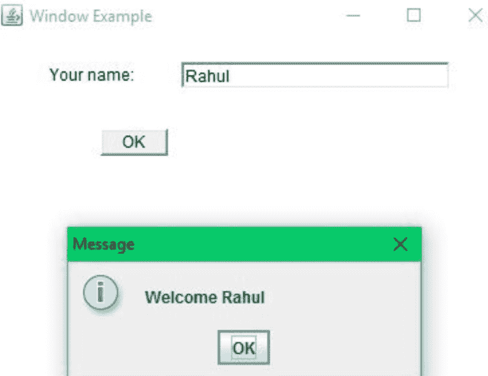

## 控件

### 复选框 (Check Box)

复选框和单选按钮属于 `Checkbox` 类。为了使用单选按钮，我们需要使用另一个名为 `CheckboxGroup` 的类，它将所有复选框分组，并允许一次选择一个。

- `getState()`：用于获取复选框当前的状态。返回类型为 `boolean`。
- `setState()`：用于设置复选框的状态。
- `getLabel()`：用于获取与复选框关联的当前标签。
- `setLabel()`：用于设置标签。

每当复选框被选中或取消选择时，就会生成一个项目事件（item event）。它被发送给 `ItemListener` 接口。它的处理器是 `ItemListener` 接口中定义的 `itemStateChanged()` 方法。

#### 阐释复选框的程序

```java
import java.awt.*;
import java.awt.event.*;
import javax.swing.*;

public class excheck extends Frame implements ActionListener, ItemListener {

    Label lb;
    Button b1, b2;
    Checkbox c1, c2, c3;
    CheckboxGroup grp;

    public excheck() {
        super("Checkbox Example");
        setSize(400, 400);
        setLayout(null);

        lb = new Label("Education Qualification");
        b1 = new Button("SUBMIT");
        b2 = new Button("EXIT");
        c1 = new Checkbox("10");
        c2 = new Checkbox("10");
        c3 = new Checkbox("BCA");

        grp = new CheckboxGroup();
        c1.setGroup(grp);
        c2.setGroup(grp);
        c3.setGroup(grp);

        lb.setBounds(50, 50, 100, 20);
        b1.setBounds(50, 80, 100, 20);
        b2.setBounds(50, 110, 100, 20);
        c1.setBounds(150, 50, 100, 20);
        c2.setBounds(150, 80, 100, 20);
        c3.setBounds(150, 110, 100, 20);

        add(lb);
        add(b1);
        add(b2);
        add(c1);
        add(c2);
        add(c3);

        b1.addActionListener(this);
        b2.addActionListener(this);
        c1.addItemListener(this);
        c2.addItemListener(this);
        c3.addItemListener(this);
    }

    public static void main(String[] arg) {
        new excheck();
    }

    public void actionPerformed(ActionEvent e) {
        if (e.getSource() == b1) {
            String s = "";
            if (c1.getState()) s = c1.getLabel();
            if (c2.getState()) s = c2.getLabel();
            if (c3.getState()) s = c3.getLabel();
            JOptionPane.showMessageDialog(null, "You have selected " + s + "");
        }
        if (e.getSource() == b2) {
            System.exit(0);
        }
    }

    public void itemStateChanged(ItemEvent e) {
        String s = "";
        if (e.getItemSelectable() == c1) {
            s = c1.getLabel();
        }
        if (e.getItemSelectable() == c2) {
            s = c2.getLabel();
        }
        if (e.getItemSelectable() == c3) {
            s = c3.getLabel();
        }
        JOptionPane.showMessageDialog(null, "You have selected " + s + "");
    }
}
```

输出：

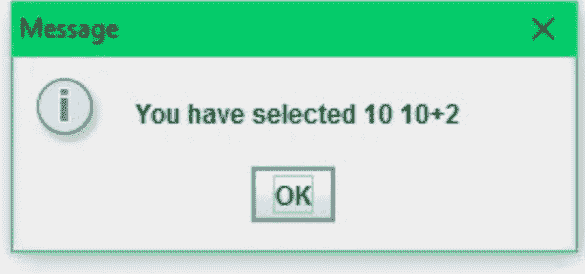

### 单选按钮 (Radiobutton)

可以创建一个互斥的单选按钮组，组内一次只能选择一个。单选按钮通过使用两个类 `Checkbox` 和 `CheckboxGroup` 创建。

- `getSelectedCheckbox()`：用于确定组中的哪个复选框被选中。
- `setSelectedCheckbox()`：用于设置复选框选中。

#### 阐释单选按钮的程序

```java
import java.awt.*;
import java.awt.event.*;
import javax.swing.*;

public class extradio extends Frame implements ActionListener, ItemListener {

    Label lb;
    Button b1, b2;
    Checkbox r1, r2;
    CheckboxGroup grp;

    public extradio() {
        super("Radio Button Example");
        setSize(400, 400);
        setLayout(null);

        lb = new Label("Radio Button");
        b1 = new Button("SUBMIT");
        b2 = new Button("EXIT");
        r1 = new Checkbox("10");
        r2 = new Checkbox("10");

        grp = new CheckboxGroup();
        r1.setGroup(grp);
        r2.setGroup(grp);

        lb.setBounds(50, 50, 100, 20);
        b1.setBounds(50, 80, 100, 20);
        b2.setBounds(50, 110, 100, 20);
        r1.setBounds(150, 50, 100, 20);
        r2.setBounds(150, 80, 100, 20);

        add(lb);
        add(b1);
        add(b2);
        add(r1);
        add(r2);

        b1.addActionListener(this);
        b2.addActionListener(this);
        r1.addItemListener(this);
        r2.addItemListener(this);
    }

    public static void main(String[] arg) {
        new extradio();
    }

    public void actionPerformed(ActionEvent e) {
        if (e.getSource() == b1) {
            String s = "";
            if (r1.getState()) s = r1.getLabel();
            if (r2.getState()) s = r2.getLabel();
            JOptionPane.showMessageDialog(null, "You have selected " + s + "");
        }
        if (e.getSource() == b2) {
            System.exit(0);
        }
    }

    public void itemStateChanged(ItemEvent e) {
        String s = "";
        if (e.getItemSelectable() == r1) {
            s = r1.getLabel();
        }
        if (e.getItemSelectable() == r2) {
            s = r2.getLabel();
        }
        JOptionPane.showMessageDialog(null, "You have selected " + s + "");
    }
}
```

输出：

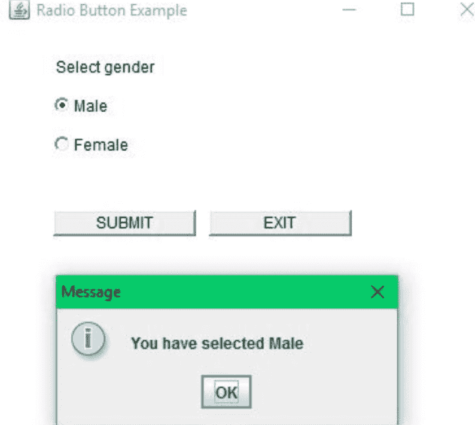

### 下拉菜单 (ComboBox)

单选按钮的替代控件是下拉列表。它属于 `Choice` 类。`Choice` 类用于创建一个弹出项目列表，用户可以从中进行选择。它只定义了默认构造函数，用于创建一个空列表。

- `add()`：用于将选择项添加到列表中。
- `getSelectedIndex()`：确定当前选中了哪一个项目，即它返回被选中项的索引值（从 0 开始）。
- `getItem()`：返回一个包含项目名称的字符串。
- 默认情况下，添加到列表的第一个项目会被选中。
- `getItemCount()`：用于获取列表中的项目数量。
- `select()`：用于设置被选中的项目。它的参数可以是一个从 0 开始的整数，也可以是与列表中名称匹配的字符串。
- `getItem(int index)`：用于获取与指定索引处的项目关联的名称。

#### 说明 Combobox 的程序

```java
import java.awt.*;
import java.awt.event.*;
import javax.swing.*;

public class exchoice extends Frame implements ActionListener, ItemListener {

    Label lb;
    Choice ch;
    Button b;

    public exchoice() {
        super("Choice Example");
        setSize(400, 400);
        setVisible(true);
        setLayout(null);

        lb = new Label("Select city:");
        b = new Button("OK");
        ch = new Choice();

        ch.add("Patna");
        ch.add("Gaya");
        ch.add("Ranchi");
        ch.add("Delhi");
        ch.add("Kolkata");

        lb.setBounds(50, 50, 100, 20);
        ch.setBounds(90, 100, 50, 20);

        add(lb);
        add(ch);
        add(b);

        b.addActionListener(this);
        ch.addItemListener(this);
    }

    public static void main(String[] arg) {
        new exchoice();
    }

    public void itemStateChanged(ItemEvent e) {
        String s = ch.getSelectedItem().toString();
        JOptionPane.showMessageDialog(null, "You have selected " + s);
    }

    public void actionPerformed(ActionEvent e) {
        if (e.getSource() == b) {
            String s = ch.getSelectedItem().toString();
            JOptionPane.showMessageDialog(null, "You have selected " + s);
        }
    }
}
```

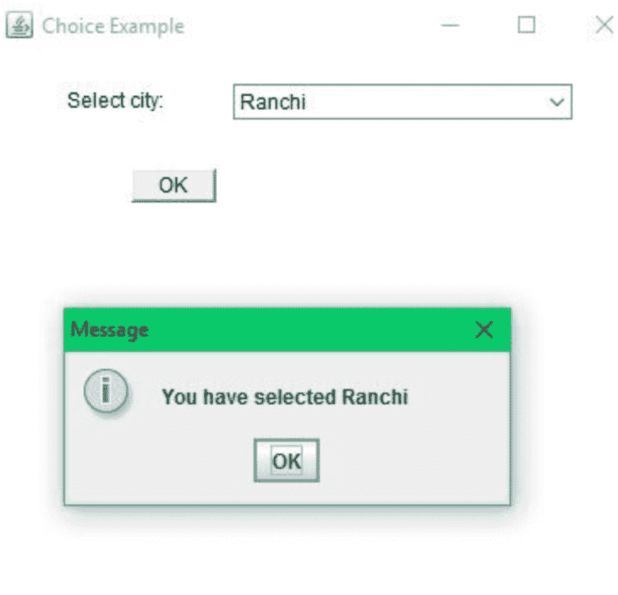

### KeyEvent 类

当发生键盘输入时，会生成一个 `KeyEvent`。它由 `KeyListener` 处理。共有三种按键事件，通过这些整数常量来识别：`KEY_PRESSED`, `KEY_RELEASED` & `KEY_TYPED`。必须重写所有这些事件，如果没有，也要将其重写为空方法。它可以在表单上和控件内部被捕获。当按键按下和释放时，会分别调用 `keyPressed()` 和 `keyReleased()` 方法。当输入一个字符时，会调用 `keyTyped()` 方法。`KeyEvent` 类对象被定义为其方法的参数。

- `getKeyChar()`：返回输入的字符。
- `getKeyCode()`：返回键码（即其 ASCII 等效值）。

对于 Esc、Ctrl 等某些键，`getKeyChar()` 不返回任何字符，且很难记住所有键的键码。为了解决这个问题，引入了**虚拟键**的概念，它们是 `KeyEvent` 类的静态常量，并与每个键绑定。例如：`VK_0` 到 `VK_9` 和 `VK_A` 到 `VK_Z` 定义了数字和字母的 ASCII 等效值。还有其他的一些如 `VK_ENTER`、`VK_CANCEL`、`VK_CONTROL` 等。

#### 说明按键事件的程序

```java
import java.awt.*;
import java.awt.event.*;
import javax.swing.*;

public class exkey extends Frame implements KeyListener {

    public exkey() {
        super("Key Example");
        setSize(400, 400);
        setVisible(true);
        setLayout(null);
        addKeyListener(this);
    }

    public static void main(String[] args) {
        new exkey();
    }

    public void keyTyped(KeyEvent e) {
    }

    public void keyPressed(KeyEvent e) {
        if (e.getKeyCode() == KeyEvent.VK_ENTER) {
            JOptionPane.showMessageDialog(null, "You have pressed Enter");
        }
        if (e.getKeyCode() == KeyEvent.VK_S && e.isControlDown()) {
            JOptionPane.showMessageDialog(null, "You have pressed shortcut key for save");
        }
    }

    public void keyReleased(KeyEvent e) {
    }
}
```

输出：
当按下 Enter 键时

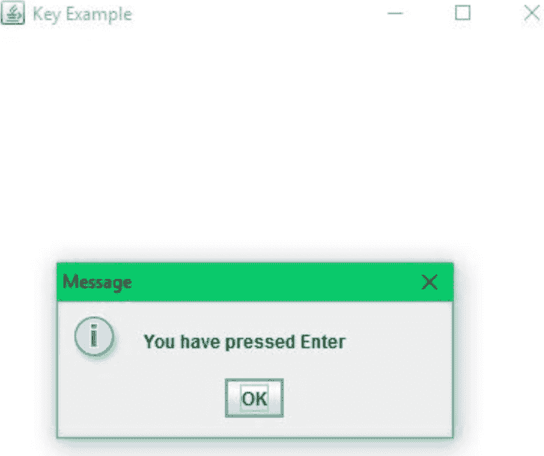

### MouseEvent 类

`MouseEvent` 由 `MouseListener` 处理。共有 5 种鼠标事件。在这里同样必须重写这些事件。

1. `mouseClicked(MouseEvent e)`
2. `mouseEntered(MouseEvent e)`
3. `mouseExited(MouseEvent e)`
4. `mousePressed(MouseEvent e)`
5. `mouseReleased(MouseEvent e)`

如果鼠标在同一点被按下并释放，则调用 `mouseClicked()`。当鼠标进入组件时，调用 `mouseEntered()` 方法。当它离开时，会调用 `mouseExited()`。`mousePressed()` 和 `mouseReleased()` 方法分别在鼠标按下和释放时被调用。`MouseEvent` 类对象被定义为其方法的参数。

- `getX()`：返回 x 坐标。
- `getY()`：返回 y 坐标。

#### 说明鼠标事件的程序

```java
import java.awt.*;
import java.awt.event.*;
import javax.swing.*;

public class exmouse extends Frame implements MouseListener {

    int x1, x2;

    public exmouse() {
        super("Mouse Example");
        setSize(400, 400);
        setVisible(true);
        setLayout(null);
        addMouseListener(this);
    }

    public static void main(String[] args) {
        new exmouse();
    }

    public void mouseClicked(MouseEvent e) {
        String s = e.getPoint().toString();
        JOptionPane.showMessageDialog(null, "Mouse clicked at " + s);
    }

    public void mouseEntered(MouseEvent e) {
    }

    public void mouseExited(MouseEvent e) {
    }

    public void mousePressed(MouseEvent e) {
    }

    public void mouseReleased(MouseEvent e) {
    }
}
```


```java
public void mouseEntered(MouseEvent e) {
    String s = e.getIDPoint().toString();
    JOptionPane.showMessageDialog(null, "Mouse entered at " + s);
}

public void mouseExited(MouseEvent e) {
    // empty
}

public void mousePressed(MouseEvent e) {
    String s = e.getIDPoint().toString();
    JOptionPane.showMessageDialog(null, "Mouse pressed at " + s);
}

public void mouseReleased(MouseEvent e) {
    String s = e.getIDPoint().toString();
    JOptionPane.showMessageDialog(null, "Mouse released at " + s);
}
```

输出：
绘制矩形并然后

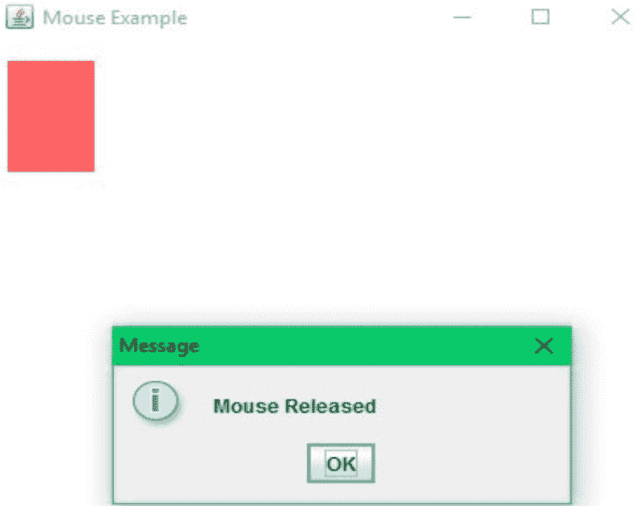

**菜单栏和菜单:** 菜单栏包含多个 `Menu` 对象。每个 `Menu` 包含 `MenuItem` 列表。每个 `MenuItem` 是用户可以选择。要创建菜单栏，首先创建一个 `MenuBar` 实例。由于 `Menu` 是 `Frame` 的子类，可以创建层级菜单。还可以包含复选菜单项。`CheckboxMenuItem` 选项在被选中时旁边会有一个标记。实现程序：

```java
import java.awt.*;
import java.awt.event.*;
import javax.swing.*;

public class exmenu extends Frame implements ActionListener {
    MenuBar mb;
    Menu m1, m2;
    MenuItem mi1, mi2, mi3, mi4;

    public exmenu() {
        super("Menu Example");
        setSize(400, 400);
        setVisible(true);
        setLayout(null);
        mb = new MenuBar();
        setMenuBar(mb);
        m1 = new Menu("File");
        m2 = new Menu("Edit");
        mb.add(m1);
        mb.add(m2);
        mi1 = new MenuItem("Calculator");
        mi2 = new MenuItem("Choice Example");
        mi3 = new MenuItem("Mouse Example");
        mi4 = new MenuItem("Key Example");
        m1.add(mi1);
        m1.add(mi2);
        m2.add(mi3);
        m2.add(mi4);
        mi1.addActionListener(this);
        mi2.addActionListener(this);
        mi3.addActionListener(this);
        mi4.addActionListener(this);
    }

    public static void main(String[] args) {
        new exmenu();
    }

    public void actionPerformed(ActionEvent e) {
        if (e.getSource() == mi1)
            new exwin1();
        if (e.getSource() == mi2)
            new exchoice1();
        if (e.getSource() == mi3)
            new exmouse();
        if (e.getSource() == mi4)
            new exkey1();
    }
}
```

输出：


# Applet（小程序）

Applet 是一种在支持 Java 的网页浏览器（如 Internet Explorer、Firefox）中运行的 Java 程序。Applet 被设计为小型程序，并可以根据需要下载。它可以是一个功能完整的 Java 应用程序，因为它可以使用整个 Java API。

Applet 是 `java.applet` 包的子类。与 Java 应用程序不同，它不包含 `main` 方法。Applet 在对象创建和对象销毁之间经历的不同状态被称为 **Applet 生命周期**（App Life Cycle）。Applet 设计用于嵌入 HTML 页面中。当用户查看包含 applet 的 HTML 页面时，applet 的代码会被下载到用户的机器上。用户机器上的 JVM 创建 applet 类的实例，并在 applet 生命周期内调用各种方法。

# Applet 生命周期

1. `public void init()`: 此方法用于 applet 需要的任何初始化。它在生命周期中只被调用一次。它实例化对象并加载 applet 的 GUI。它是线程的诞生状态。它在 applet 标签内部的 `param` 标签处理后被调用。
2. `public void start()`: 尽管 applet 对象是由 `init()` 方法创建的，但它仍然处于非活动状态。`init()` 方法调用 `start()` 方法并启动 applet 的执行。当用户离开其他页面后返回包含 applet 的页面时，它也会被调用。
3. `public void stop()`: 当用户离开 applet 所在的页面时，此方法会被自动调用。在此方法中，applet 变为临时非活动。这等同于线程的阻塞状态。
4. `public void paint()`: 此方法将 `java.awt.Graphics` 对象作为参数。它有助于创建 Applet 的 GUI。它在 `start()` 之后立即被调用，并在 applet 需要在浏览器中重绘自己的任何时候被调用。这等同于线程的可运行状态。
5. `public void destroy()`: 此方法销毁 Applet，并且在包含页面的活动浏览器关闭（而非最小化）时仅被调用一次。这等同于线程的死亡状态。

例如：

```java
import java.applet.*;
import java.awt.*;

/*
<applet code="applet1" width="400" height="400">
</applet>
*/

public class Hello extends Applet {
    public void paint(Graphics g) {
        g.drawString("Hello Java", 27, 50);
    }
}
```

注意：要运行 applet，HTML 代码必须嵌入在 Java 程序本身的注释中。

# 数据库连接

前端（GUI）与后端（DBMS/RDBMS）之间的连接被称为数据库连接。要让 Java 连接到任何关系型数据库（RDBMS），我们使用 JDBC（Java 数据库连接）。可以通过以下方式之一实现：

1. 类型 I DSN
2. 类型 II（薄客户端服务器）
3. 类型 III（服务器）
4. 类型 IV（分布式服务器）

在这里，我们将处理类型 I。DSN（数据源名称）是所有驱动程序的通用平台。它需要另一个驱动程序 ODBC（开放数据库连接）的帮助。它是用 C 语言编写的。JDBC 是用 Java、C 和 C++ 编写的。

步骤：

1. 打开控制面板并点击“管理工具”。
2. 打开“ODBC 数据源 (32位)”。
3. 打开对话框，点击“添加”。
4. 选择“Oracle in XE”并点击“完成”。
5. 打开对话框，提供数据源名称和 TNS 服务名称为“XE”。
6. 在提供 TNS 服务名称之前，确保通过点击“测试连接”并提供 oracle 的用户名和密码来测试连接。

Oracle 服务器的用户 ID 和密码被记录下来以便在代码中使用。我们在 Java 代码中使用 JDBC，在 Oracle 代码中使用 ODBC。
GUI + JDBC-ODBC + SQL

JDBC-ODBC 被称为桥接。此过程也被称为基于桥接的连接。

步骤：

1. `import package java.sql.*`
2. 创建桥接
3. `Class.forName("Sun.jdbc.odbc.JdbcOdbcDriver")`
4. 建立连接，使用 `Connection` 类来实现。
5. 插入/更新/删除/查询：当参数固定（即查询）时我们使用 `Statement` 类，当查询不固定时使用 `PreparedStatement`。当使用 `Statement` 类时，我们使用 `executeQuery()` 执行查询；当使用 `PreparedStatement` 类时，我们使用 `executeQuery()` 执行查询，并使用 `executeUpdate()` 执行 INSERT 和 UPDATE。
6. 我们使用 `ResultSet` 类根据特定参数移动特定的行和列（只读且仅向前），我们可以使 `ResultSet` 支持向后移动、保持读和写操作。对于指针的移动，使用 `next()` 方法。

执行 SELECT 查询的程序：

```java
import java.sql.*;

class exdata {
    public void voidata() {
        try {
            Class.forName("sun.jdbc.odbc.JdbcOdbcDriver"); // 它内部与 DriverManager 结合
            Connection con = DriverManager.getConnection("jdbc:odbc:myproject", "hr", "oracle");
            // 在上述语句中,"myproject" 是 DSN 名称，“hr" 是用户 ID，“oracle" 是 oracle 的密码
            Statement st = con.createStatement();
            ResultSet rs = st.executeQuery("select * from prty_mst");
            while (rs.next()) {
                // 处理结果集
            }
        } catch (Exception e) {
            e.printStackTrace();
        }
    }
}
```

# Java 中的线程

线程是可以并发运行的小代码单元。多线程允许程序的多个部分同时运行，从而最大限度地利用 CPU。

线程的类型：

1. 用户线程：由应用程序创建。它们是前台线程，JVM 会等待它们完成。
2. 守护线程：由 JVM 创建。它们执行后台任务，如垃圾回收。

线程的生命周期：


线程通过调用 `start()` 方法开始执行。在调用 `start()` 后，它进入可运行状态。`run()` 方法在 `start()` 调用后立即被隐式调用。线程从 `run()` 方法开始执行。线程结束后停止并退出。

当发生中断时，`run()` 再次被调用。也可以用户中断。当调用 `suspend()` 方法时，线程会被挂起，直到调用 `resume()` 方法。因此，此步骤已废弃，不再使用。使用 `resume()` 后，`run()` 再次被调用。使用 `sleep(毫秒)` 线程会按指定的时间暂停，一段时间后再次恢复，线程进入正常状态。

在多线程的情况下，Java 提供了通过 `wait()`、`notify()` 和 `notifyAll()` 方法实现的优雅进程间通信机制。

`wait()` 告诉调用线程释放锁并进入睡眠，直到其他线程进入同一个锁并调用 `notify()` 或 `notifyAll()`。`notify()` 唤醒在同一对象上调用 `wait()` 的第一个线程，而 `notifyAll()` 唤醒所有在同一对象上调用 `wait()` 的线程。优先级最高的线程首先运行。`run()` 方法再次被调用。

多线程中还有 `join()` 方法用于等待被调用的线程终止。其名称来自于调用线程等待指定线程加入的概念。它是灵活的，而 `notify()` 和 `notifyAll()` 更灵活。因此，最好使用 `notify()` 和 `notifyAll()`。

创建线程有两种方法，即扩展 `Thread` 类或实现 `Runnable` 接口。

## 通过扩展 Thread 类

```java
public class thread1 extends Thread {
    public void run() { // 所有处理都在 run() 中完成
        for (int i = 0; i <= 10; i++) {
            System.out.println(i);
            try {
                Thread.sleep(1000); // 它会抛出 InterruptedException
            } catch (InterruptedException e) {
                e.printStackTrace();
            }
        }
    }

    public static void main(String[] arg) {
        thread1 ob = new thread1();
        System.out.println(ob.getName()); // 获取线程名称
        ob.setName("T1"); // 修改线程名称
        System.out.println(ob.getName());
        ob.start(); // 从此处调用 start()，之后会自动调用 run()
    }
}
```

输出（OUTPUT）：
```text
E:\java\new_java>java exread1
Thread-0
T1
0
1
2
3
4
5
6
7
8
9
10
```

## 通过实现 Runnable 接口

```java
public class exthread2 implements Runnable {
    public void run() {
        for (int i = 0; i <= 10; i++) {
            System.out.println(i);
            try {
                Thread.sleep(1000);
            } catch (InterruptedException ex) {
                System.out.println(ex.toString());
            }
        }
    }

    public static void main(String[] arg) {
        exthread2 ob = new exthread2();
        Thread t = new Thread(ob);
        // ob.start(); // 使用 exthread2 类对象没有调用 start()
        t.start();      // 使用 Thread 类对象调用 start()
    }
}
```

输出（OUTPUT）：
```text
:\java\new_java>java exthread2
0
1
2
3
4
5
6
7
8
9
10
```

由于 `start()` 属于 `Thread` 类而不是 `Runnable` 接口，因此，无法直接通过类对象调用 `start()`。它是通过使用 `Thread` 类对象调用的，或者必须将 `exthread` 对象的引用转换为 `Thread` 对象来调用。

## 创建多线程 (Creating multithread)

下面是多线程的静态方法。在这里，实例在编译时创建。

```java
public class exth implements Runnable {
    String tname = "";
    Thread t;

    // 为了区分哪个是哪个线程的输出，应该给线程绑定名称
    public exth(String tname) { // 使用构造函数显示线程名称
        this.tname = tname;
        t = new Thread(this, tname); // 设置名称的第二种方法
        t.setPriority(8); // 设置线程的优先级，启动时其优先级为 5，即默认优先级
        // 这里，主线程的优先级是 5，但单个线程的优先级是 8
        t.start();
    }
}
```


## Java 多线程与网络编程示例

### 线程扩展示例

```java
System.out.println(tname + " is started");
}

public void run() {
    for (int i = 0; i <= 10; i++) {
        System.out.println(tname + ":" + i);
        try {
            Thread.sleep(1000);
        } catch (InterruptedException ex) {
            System.out.println(ex.toString());
        }
        System.out.println(tname + " is exiting");
    }
}

public static void main(String[] arg) {
    exth t1 = new exth("one");
    exth t2 = new exth("two");
    exth t3 = new exth("three");
}
```

**输出：**
```
E:\java\new_java>java exth
one is started
one:0
two is started
two:0
three is started
three:0
three is exiting
two is exiting
one is exiting
two:1
three:1
one:1
three is exiting
two is exiting
two:2
one is exiting
three:2
one:2
two is exiting
two:3
three is exiting
three:3
one is exiting
one:3
two is exiting
two:4
three is exiting
three:4
one is exiting
one:4
two is exiting
two:5
three is exiting
three:5
one is exiting
one:5
two is exiting
two:6
three is exiting
one is exiting
three:6
one:6
two is exiting
two:7
three is exiting
three:7
one is exiting
one:7
two is exiting
two:8
three is exiting
three:8
one is exiting
one:8
two is exiting
two:9
three is exiting
three:9
one is exiting
one:9
two is exiting
two:10
three is exiting
three:10
one is exiting
two is exiting
one is exiting
```

在多线程中，线程间通信应该始终处于同步模式。同步可以通过方法完成，即配合使用 `wait()` 和 `notify()`。

### 使用同步方法进行线程间通信

```java
class Shared {
    int data = 0;

    synchronized void doWork() { // 用于写入的同步方法
        try {
            Thread.sleep(1000);
            data++;
        } catch (Exception ex) {
            System.out.println(ex.toString());
        }
        notify(); // 唤醒第一个 wait() 的线程
    }

    synchronized int getResult() { // 用于读取的同步方法
        try {
            wait(); // 等待其他线程进入并 notify()
            System.out.println("Waiting...");
        } catch (Exception ex) {
            System.out.println(ex.toString());
        }
        return data;
    }
}

class Th1 extends Thread {
    Shared sh;

    public Th1(Shared s1, String st) {
        super(st); // 调用父类构造函数
        this.sh = s1;
    }

    public void run() {
        sh.doWork();
    }
}

class Th2 extends Thread {
    Shared sh;

    public Th2(Shared s1, String st) {
        super(st);
        this.sh = s1;
    }

    public void run() {
        System.out.println("Result: " + sh.getResult());
    }
}

public class Main {
    public static void main(String[] arg) {
        Shared sh = new Shared();
        Th1 t1 = new Th1(sh, "Thread1");
        Th2 t2 = new Th2(sh, "Thread2");
        t1.start();
        t2.start();
    }
}
```

### TCP 服务器示例

```java
import java.io.*;
import java.net.*;

public class TcpServer {
    public void server() {
        ServerSocket ss = null;
        Socket sc = null;
        BufferedReader br = null;
        PrintWriter pw = null;
        BufferedReader sbr = null;
        try {
            ss = new ServerSocket(8888);
            sc = ss.accept();
            pw = new PrintWriter(sc.getOutputStream(), true);
            br = new BufferedReader(new InputStreamReader(System.in));
            sbr = new BufferedReader(new InputStreamReader(sc.getInputStream()));
            String s1;
            while ((s1 = sbr.readLine()) != null) {
                System.out.println("Client says " + s1);
                pw.println(br.readLine());
            }
        } catch (Exception ex) {
            System.out.println(ex.toString());
        } finally {
            try {
                if (pw != null) pw.close();
                if (sc != null) sc.close();
                if (ss != null) ss.close();
                if (sbr != null) sbr.close();
            } catch (Exception ex) {
                System.out.println(ex.toString());
            }
        }
    }

    public static void main(String[] arg) throws Exception {
        TcpServer ob = new TcpServer();
        ob.server();
    }
}
```

### TCP 客户端示例

```java
import java.net.*;
import java.io.*;

public class TcpClient {
    public void client() {
        Socket sc = null;
        BufferedReader br = null;
        PrintWriter pw = null;
        BufferedReader sbr = null;
        try {
            sc = new Socket("localhost", 8888);
            pw = new PrintWriter(sc.getOutputStream(), true);
            br = new BufferedReader(new InputStreamReader(System.in));
            sbr = new BufferedReader(new InputStreamReader(sc.getInputStream()));
            String s1;
            while ((s1 = br.readLine()) != null) {
                pw.println(s1);
                System.out.println("Server says " + sbr.readLine());
            }
        } catch (Exception ex) {
            System.out.println(ex.toString());
        } finally {
            try {
                if (pw != null) pw.close();
                if (sc != null) sc.close();
                if (sbr != null) sbr.close();
            } catch (Exception ex) {
                System.out.println(ex.toString());
            }
        }
    }

    public static void main(String[] arg) throws Exception {
        TcpClient ob = new TcpClient();
        ob.client();
    }
}
```

**运行示例：**
```
E:\java>java TcpServer
Client says Hello
Hii
Client says bye
bye

E:\java>java TcpClient
Hello
Server says Hii
bye
Server says bye
```

## 数据报

数据报是在机器之间传递的信息包。一旦数据报被发送到其目标，就无法保证它一定能到达，或者那里是否有人在接收它。因此，当接收到数据报时，无法保证它在传输过程中没有被损坏，或者发送它的人是否仍在那里接收响应。

## UDP 的类

它使用了两个类：`DatagramSocket` 和 `DatagramPacket`。UDP 的类属于 `java.net` 包。`DatagramSocket` 是用于发送或接收 `DatagramPacket` 的机制。在接收时，`DatagramPacket` 的构造函数接受缓冲区、数据长度；在发送时，需指定接收者的 IP 地址和端口号。`InetAddress` 是用于查找并存储任何传入数据包的 IP 地址的类。`getAddress()` 用于获取用于发送的目标地址。`getPort()` 用于查找端口号。

### UDP 服务器示例

```java
import java.io.*;
import java.net.*;

public class UdpServer {
    public void server() {
        DatagramSocket ds = null;
        try {
            ds = new DatagramSocket(8888);
            while (true) {
                byte[] b = new byte[100];
                DatagramPacket rdp = new DatagramPacket(b, b.length);
                ds.receive(rdp);
                String s = new String(rdp.getData());
                System.out.println("Client says " + s);
                InetAddress inet = rdp.getAddress();
                int port = rdp.getPort();
                BufferedReader br = new BufferedReader(new InputStreamReader(System.in));
                String s1 = br.readLine();
                byte[] b1 = s1.getBytes();
                DatagramPacket sdp = new DatagramPacket(b1, b1.length, inet, port);
                ds.send(sdp);
            }
        } catch (Exception ex) {
            System.out.println(ex.toString());
        } finally {
            try {
                if (ds != null) ds.close();
            } catch (Exception ex) {
                System.out.println(ex.toString());
            }
        }
    }

    public static void main(String[] arg) throws Exception {
        UdpServer ob = new UdpServer();
        ob.server();
    }
}
```

### UDP 客户端示例

```java
import java.io.*;
import java.net.*;

public class UdpClient {
    public void client() {
        DatagramSocket ds = null;
        try {
            ds = new DatagramSocket(); // 客户端通常不绑定固定端口，或绑定其他可用端口
            InetAddress serverAddress = InetAddress.getByName("localhost");
            int serverPort = 8888; // 与服务器端口一致
            while (true) {
                byte[] b = new byte[100];
                DatagramPacket rdp = new DatagramPacket(b, b.length);
                ds.receive(rdp);
                String s = new String(rdp.getData());
                System.out.println("Server says " + s);
                InetAddress inet = rdp.getAddress();
                int port = rdp.getPort();
                BufferedReader br = new BufferedReader(new InputStreamReader(System.in));
                String s1 = br.readLine();
                byte[] b1 = s1.getBytes();
                DatagramPacket sdp = new DatagramPacket(b1, b1.length, inet, port);
                ds.send(sdp);
            }
        } catch (Exception ex) {
            System.out.println(ex.toString());
        } finally {
            try {
                if (ds != null) ds.close();
            } catch (Exception ex) {
                System.out.println(ex.toString());
            }
        }
    }

    public static void main(String[] arg) throws Exception {
        UdpClient ob = new UdpClient();
        ob.client();
    }
}
```

## Vector 示例

```
E:\java\new_java>java vector
Size=2
Capacity=3
Current Size=5
Capacity=5
5
6
5.5
7.6
9.3
```

## Stack（栈）

`Stack` 是 `Vector` 的子类，实现了标准的后进先出（LIFO）栈。`Stack` 只定义了默认构造函数，用于创建一个空栈。

- `push()`：用于将一个对象推入栈顶。
- `pop()`：用于移除并返回栈顶元素。当调用的 `Stack` 为空时，会抛出 `EmptyStackException`。
- `peek()`：返回栈顶对象但不移除。
- `empty()`：如果栈上没有任何元素，则返回 `true`。
- `search()`：确定一个对象是否存在于栈中，并返回将该对象移动到栈顶所需的入栈操作次数（即距离栈顶的距离，从 1 开始计数）。

### 示例代码

```java
import java.util.*;

class ExStack {
    public void st() {
        Stack s = new Stack();
        s.push(5);
        System.out.println(s);
        s.push(new Integer(6));
        System.out.println(s);
        s.push(new Double(6.7));
        System.out.println(s);
        s.pop();
        System.out.println(s);
        s.push(new Integer(8));
        System.out.println(s);
    }

    public static void main(String[] arg) {
        ExStack ob = new ExStack();
        ob.st();
    }
}
```

**输出：**
```
E:\java\new_java>java ExStack
[5]
[5, 6]
[5, 6, 6.7]
[5, 6]
[5, 6, 8]
```


## Hashtable（哈希表）

Hashtable 在 Hashtable 中存储键/值对。使用 Hashtable 时，我们指定一个对象作为键（key），以及我们想要与该键关联的值（value）。然后对键进行哈希处理，生成的 Hashcode 将作为值在表中存储的索引。

Hashtable 是一个列表数组。每个列表被称为一个桶（bucket）。桶的位置通过调用 `hashcode` 方法来确定。Hashtable 包含基于键的值。它包含唯一的元素。它是同步的。它可能有任何 null 键或值。

示例：

```java
import java.util.*;

class exhashtable {

    public void ht() {

        Hashtable<Integer, String> h = new Hashtable<Integer, String>();

        h.put(101, "Rahul");

        h.put(102, "Shyam");

        for (Map.Entry m : h.entrySet()) // 遍历 Hashtable，Map 是一个类，Entry 是它的属性

            System.out.println(m.getKey() + "=" + m.getValue());

    }

    public static void main(String[] arg) {

        exhashtable ob = new exhashtable();

        ob.ht();

    }

}
```

OUTPUT:

```
E:\java\new_java>java exhashtable

102=Shyam

101=Rahul
```
