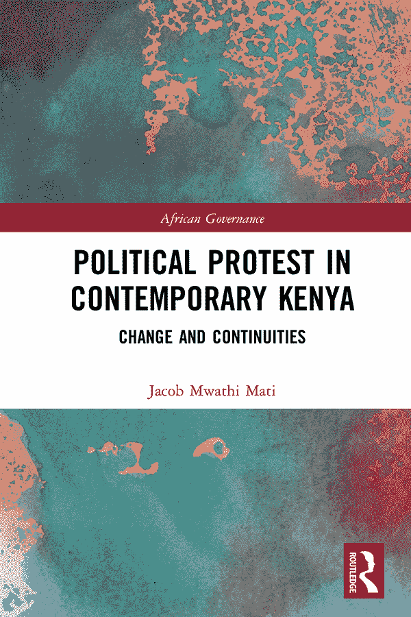
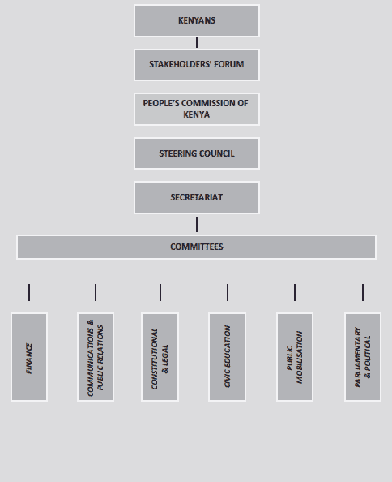

# 当代肯尼亚的政治抗议：变革与延续（非洲治理）



“这是一项关于非洲社会运动的关键性研究，通过肯尼亚 Ufungamano 倡议（Ufungamano Initiative）对政治机会、框架和动员结构进行了反思。这本书还考虑了运动在被纳入主流政治进程后，其‘破坏性力量’的局限性。”– **Shauna Mottiar**，南非夸祖鲁纳纳纳塔尔尔大学民事社会中心主任。

“Mati 关于近期肯尼亚政治抗议的新书在多个方面都非常出色。几十年来，关于非洲政治抗议的理论分析虽许多，但由于过度依赖源自欧洲及其他地区而非非洲本土的模型，很少充分解释非洲的语境。然而，Mati 将他的分析植根于非洲特别是肯尼亚的历史，仔细地考虑了‘多个竞争性阶级、族裔、宗教群体、代际和性别之间的斗争’。Mati 展示了这样一个基于跨宗教的 Ufungamano 倡议作为一个独特的肯尼亚式‘运动的运动’，尽管运动内部存在许多复杂性和变化，但它在促进公民积极参与宪法变革方面发挥了核心的长期作用。我非常向对政治抗议时期和理论（尤其是非洲地区）感兴趣的读者推荐此书；它对于理解肯尼亚的历史和政治至关重要。”– **David Horton Smith**，美国马萨诸塞州栗斯顿希尔波士顿学院社会学系研究及荣誉教授。

本书分析了肯尼亚嵌入民主治理和宪法秩序斗争的兴起、策略和结果，展示了在转型后殖民非洲国家的斗争中公民能动性的力量与局限。通过利用原始访谈、媒体和现有文献的数据，本书分析了肯尼亚宪法改革斗争的兴起、扩散、运作策略和结果，旨在强调社会运动在转型后殖民非洲国家中的力量与局限。它介入了社会运动与民主化理论的交叉领域，探讨了肯尼亚宪法转型斗争中心具有破坏性且富有创造性的力量的产生、运作和结果。书中还评估了 2010 年宪法颁布后的“意义”及发展，以阐明肯尼亚建立变革性民主政治秩序的前景。这本书不仅是理解肯尼亚特定斗争的有用工具，也为非洲大陆及其他地区的民主斗争提供了见解。

本书将令泛非洲社会运动和政治变革（特别是肯尼亚）的学生和学者感兴趣。**Jacob Mwathi Mati** 是南非索尔普拉特杰大学（Sol Plaatje University）社会学高级讲师，也是南非维特沃斯兰大学社会、工作与政治学院（SWOP）的副研究员。


献给肯尼亚许多无名的子女，他们无私地用智慧、汗水和血水灌溉宪法变革之树，让每一位肯尼亚人都能拥有更好的未来。

20. 索引

# 3 Ufungamano 倡议

## 运动中的运动

## 引言

1999 年 12 月 15 日，两场同时发生且密切相关的事件极大加剧了肯尼亚宪法改革过程中的冲突。第一场是 50 多个组织主要来自宗教团体、世俗公民社会和反对派政党的组织在内罗比的 Ufungamano 大厦（Ufungamano House）集会，旨在发起他们定义为“人民驱动”的宪法改革进程。第二场是肯尼亚民族大党（KANU）及其伙伴国家发展党（NDP）建立了一个议会特别委员会（PSC），旨在领导一个由议会主导的审查过程。这两个过程在存在上显然是相互对立的。

Ufungamano 大厦会议是由宗教社区协调小组（RCCT）召集的，该小组包括来自天主教会肯尼亚教主教会议（KEC）、肯尼亚穆斯林最高委员会（SUPKEM）、肯尼亚教会全国委员会（NCCK）、肯尼亚印度教委员会、穆斯林咨询委员会（MCC）、非洲本土教会组织、肯尼亚圣公会（ACK）、东非长老教会（PCEA）以及肯尼亚卫公会（MCK）的代表。加入这一集会的宗教团体还有此前在肯尼亚教会全国委员会（NCEC）内聚集的世俗公民社会组织。会议旨在为僵局寻找共识路径，这种僵局源于莫伊政府持续拒绝满足对人民驱动的宪法审查过程的要求。1998 年《肯尼亚宪法审查委员会修正法案》中确定的利益相关者——包括 KANU 和反对派政党——均受到了邀请。然而，KANU、希里克绍党、肯尼亚社会大会（KSC）以及国家发展党（NDP）的一部分——特别是其领导人拉拉·奥坎丁（Raila Odinga）——全部抵制了这一活动。

为期两天咨询的重要成果是建立了肯尼亚人民委员会（PCK），该委员会负责在这一后来被称为“Ufungamano 倡议”的旗帜下，通过收集和整理肯尼亚人的意见引导他们对宪法进行全面审查。共有 54 个非政府组织、社会运动、政党和政治运动在这一旗帜下团结起来，为肯尼亚新的宪法秩序游说（Ogony 2004; Andreassen and Tostensen 2006; Kindiki 2007）。可以说，在肯尼亚的近代史上，没有其他任何宪法改革运动能这样有效地挑战国家权力。

当咨询在 Ufungamano 大厦展开时，KANU 及其 NDP 伙伴利用大多数反对派议员缺席议会的机会，在 NDP 领导人拉拉·奥坎丁的担任下建立了一个竞争性的 PSC（Karanja 2008）。PSC 由 14 名 KANU 议员和 13 名反对派议员组成，后者大多来自奥坎丁的 NDP，因为大多数其他反对党（包括民主党（DP）、肯尼亚福特党（Ford Kenya）和社会民主党（SDP））拒绝参与，而是转而选择与 Ufungamano 倡议结。

这些发展是引发新一轮激烈冲突的重要触发因素，这场冲突将 Ufungamano 倡议——由大多数公民社会（涵盖世俗和宗教）以及反对派政党——与 PSC 置于对立。PSC 得到了少数宗教团体的支持，例如肯尼亚福音派联合会及其成员教会（即：非洲内陆教会、非洲独立五旬节非洲教会、救赎教会、肯尼亚救赎福音教会和东非上帝教会）。许多其他利益相关者则夹在这两个对立的极点之间。

两个平行审查过程的出现，凸显了肯尼亚政党与宗教机构之间关系的迅速恶化，考虑到它们在 1997 年 NCEC 运动的高峰曾合谋起草了 IPPG 协议。因此，Ufungamano 倡议标志着力量的重大重组，因为活动性宗教团体与世俗公民社会团体及政治反对派联手挑战国家。这引申了三个关键问题：是什么导致不同的社会和政治力量在 Ufungamano 倡议下团结？什么样的“政治”机会让 Ufungamano 倡议得以催生？Ufungamano 倡议为肯尼亚宪法改革斗争带来了哪些新议程策略？

与其前者一样，Ufungamano 倡议体现了族内族间、宗教、代际和阶级的权力政治。此外，其广泛的特征赋予了它多重矛盾。本章识别了 Ufungamano 倡议形成后的主要参与者，并分析了他们的关系以及将他们团结在一起的纽带。文章认为，正是 Ufungamano 倡议“企业家”的框架在大量不同群体中动员了集体认同。这种框架——也吸引了更广泛的公众——围绕共同的政治诉求。

本章采用社会历史方法，追溯 Ufungamano 倡议的出现到肯尼亚宪法改革过程中的各种行动者和问题。这种方法有助于解释该倡议的出现、其结构和某些运作方面，以及其成就和局限。本章首先关注参与倡议出现的参与者类型。其目的是揭 Ufungamano 倡议形成阶段的产生性矛盾。随后解释 Ufungamano 倡议是如何以及为何出现的。具体而言，这是尝试对运动的出现进行理论化。在这里，探讨了主流的政治环境，以说明为什么运动“企业家”的领导催化了反对新运动形成的不满。

## Ufungamano 倡议领导的冲突浪潮中的行动者分类

根据 Tilly (2004: 12)，社会运动是：不是独角表演，而是临时连接（且经常变化）的诉求者群体与其诉求对象之间的互动[其中]第三方（如选民、盟友、竞争性诉求者、敌人、权威以及各种公众）往往在运动中起着重要作用。因此，他继续道，“如果不关注核心诉求者以外的政治行动者，我们永远无法解释社会运动的变化和诉求者的差异”（Tilly 2004: 12）。因此，为了理解肯尼亚斗争的独特性和复杂性，有必要观察诉求者与其目标之间的动态构成及关系。这些关系主要取决于行动者之间手段和目标的一致性和/或分歧。

这是一个围绕`Ufungamano Initiative`凝聚起来的群体。它汇聚了至少三类型的参与者。第一类是具有战斗性的、行动主义的人权组织和公民社会组织，他们此前曾在`NCEC`的旗下集结（参见第 2 章）。其中包括底层阶级、学生、青年和妇女运动组织，他们都面临着日常斗争，并针对一系列社会经济问题开展活动；其次是谨慎的中产阶级成员，主要由宗教组织代表。根据`Mutua (2008: 124)`的说法，他们在大众斗争中的立场在支持激进团体和接受现状之间不断转变，“取决于个人、制度和外部因素。”最后，`Ufungamano Initiative`还包括若干反对派政党，他们的“准备政府综合症使得他们普遍上不分原则，并易受执政集团的腐败影响；他们对改革的兴趣并不在于使国家民主化，而在于为了使其夺权成为可能而进行的最小改变”（`Mutua 2008: 123`）。

了解这些迥然不同的群体如何在`IPPG`协议达成后设置分歧至关重要。解释在于`Moi/KANU`政权所实施的封闭系统。正如`North et al.’s (2013)`的`Limited Access Orders`模型所解释的，排除往往会为被排斥者的联盟营造条件。这些人可能倾向于通过抗议运动甚至暴力，作为集体挑战其处境的一种。`M. Odhiambo`对为什么这一规模较大的所谓亲改革运动会演变提供了类似的解释，以及为什么其固有的裂痕会成为这场特定斗争的象征：从 20 世纪 90 年代开始，我们看到了所谓的亲改革运动和亲改革政家的汇聚，这在很大程度上是对封闭的`Moi/KANU`系统的反应，形成了一场以宪法改革为核心关注的运动。但侧重点有所不同。反对派政治家总是强调能让他们接近权力的方面。另一方面，在这样一个贫困程度极高的背景下，普通人 [*sic`] 一直认为斗争关乎基本权利、获得改善的生活条件，以及通常的生计问题¹。

这些裂痕对于解释亲改革阵营中形成的联盟的脆弱性非常重要。事实上，它们对这场斗争提出了几个关键问题。具体而言，阵营中不同的立场在何处汇合？阵营中占据地位的精英声音——他们痴迷于克鲁鲁马式的陈词“追求政治权力，一切将随之而来”——是否理解底层的斗争，并至少尝试将其推向主流²？有证据表明，当底层的声音指向那些寻求政治权力的人时，往往被充而不闻。另一方面，精英内部也无法达成共识，因此导致了碎片化，有时迫使他们与底层进行战略性结盟，以挑战主导性的精英力量。`NCEC`和`Ufungamano Initiative`的出现就是例证。然而，这种凝聚通常以吸纳性关系为特征，对底层的背叛也是常有的。这解释了为什么对于底层阶级来说，临时汇聚最频繁的结果是他们没有发生任何变化。即使发生了一些变化，速度也极其缓慢且始终受到节制，主要是由于内部的反对。

### 以国家为中心的宪法改革参与者

第二大类参与者由那些反对以人为中心的宪法改革并在`PSC`之下集结的人组成。这里的关键人物是`Moi/KANU`政权本身及其主要者——`NDP`、`Shirikisho Party`、`KSC`以及由“肯尼亚福音信徒联合会”及其附属教会代表的亲政府公民社会组织（`Kanja 2008; Mutua 2008`）。根据`Mutua (2008)`的说法，这一群体的参与者代表了历史上在肯尼亚长期掌权的精英派别，他们推动权力向总统和一少数支持者进行非民主的集权。因此，`Mutua (2008: 123)`将他们标记为“透明、专制且抵制民主转型”。他们一直是也是肯尼亚精英内部斗争中的主导政治和经济力量，因为多年来，他们成功地通过强制、吸纳、操纵和暴力使社会顺从其意愿，同时也挫败了改革的尝试（`Katumanga 1999`）。该阵营内的参与者是`Ufungamano Initiative`的直接目标。

### 中立/漠不的参与者

第三组由对改革过程似乎既中立又漠的参与者组成。根据`Mutua (2008: 124)`，他们在意识形态上是“亲建制的”，鉴于他们“对公民社会中声音较大的派系甚至政治反对派不信任且疏远”。他认为，他们和大多数肯尼亚精英一样，来自“中间地”，在土地、房产、职业和市场方面拥有“巨大的利益”。中间地在民族、种族、地区和宗教上都是多样化的，这一事实使其变得强大”（`Mutua 2008: 124`）。由于其规模巨大，如果这一群体选择在肯尼亚不断的精英内部斗争中加入一方，转折点是不可避免的。

### 三组内部的分歧

尽管有这三大类，但任何阵营内部都没有统一性。相反，在支持民众主导的过程的支持者、支持政府主导过程的人以及对该问题保持中立的人之间存在光谱。所有三个阵营都包含了来自各种政党、公民社会和私营部门的群体和个人。当主主导过程的倡者于 1999 年 12 月 15 日至 16 日聚集在`Ufungamano House`并宣布成立`PCK`以收集和整理所有肯尼亚人的观点时，`Ufungamano Initiative`在其先驱（包括`NCEC`）失败的地方取得了成功³。

## Ufungamano Initiative 的出现：为什么以及如何

三个密切交织、相互加强的解释性变量促成了`Ufungamano Initiative`的出现。第一个是对诉者权利的剥夺。第二个是宗教领袖提供的动力，他们动员了此前已有组织但彼此不同的参与者之间的不满情绪。第三个是政治背景，包括多种机会和限制。这三个变量中的任何一个单独都不足以解释`Ufungamano Initiative`的出现。相反，它们相互支撑。现行的政治条件很重要，因为它们产生了不满，这种情绪反过来激励了参与。而且存在一个将这种不满转化为运动的机会，但这需要肯尼亚宗教领袖的行动来实现。下面，我将解释所有这些变量及其在`Ufungamano Initiative`出现中的相互作用。

### 相对剥夺感

多年来，相对剥夺感、权利被剥夺和不公之间的交集被视为集体行动出现的解释方案。Osaghae (2008)、Buechler (2000)、Gurr (1970)、Davies (1962) 和 Geschwender (1968) 等人均认为，当人们主观上认为自己缺乏特定群体所享有的资源时，就会发生大规模抗议。最终，他们预期与实际拥有物之间的巨大差距变得无法忍受，于是他们汇集力量改变现状（Davies 1962; Buechler 2000）。遵循这些作者的观点，我将证明对 Moi/KANU 国家在宪法起草过程中未能广泛参与的违背承诺的不满，产生了相对剥夺感，并推动了 Ufungamano 倡议（Ufungamano Initiative）。正如 Davies (1962: 5–6) 指出的，这种反转“迫使”人们“主观上担心费力获得的成果将付诸东流；他们的情绪变得革命化”。

## 领导力与结构背景

领导力与结构背景变量借鉴了资源动员模型，该模型强调资源是运动出现、发展、成功和失败的关键。具体而言，如第 2 章所示，只有当怀有不满的个人能够动员足够的资源采取行动时，社会运动才会发展（McCarthy and Zald 1977）。在本章稍后将明确的是，肯尼亚的宗教领袖是一项关键资源，使许多对 KANU 违背承诺感到不满的行动者能够在 Ufungamano 倡议下团结起来。他们通过将当前背景界定为寻求集体行动的政治机会来实现这一点。因此，框架构建（framing）对于不满情绪的社会构建以及将其引导至运动中作为改善不可接受条件的修正手段是非常有用的。

## 政治机会与限制

Ufungamano 倡议出现在政治机会不断扩大的背景下。这些机会源于早期的冲突周期（在第 2 章中讨论），这些周期成功扩大了竞争空间。IPPG 方案、1997 年《肯尼亚宪法审查法案》1997 年大选的结果以及随后被称为萨法里公园进程（Safari Park Process）的后续谈判（Moi/KANU 政权后来违背了此），是孕了 Ufungamano 倡议的政治机会。这些机会将在下文中详细解释。

## IPPG 协议、大选及其后续

作为 1997 年 10 月 IPPG 协议的一部分，莫伊/KANU 政权曾同意对选举法进行了一些细微的行政改革，但在这些改革被写入宪法之前，他就解散了议会。尽管如此，这些改革显著扩大了反对派的政治机会结构。

首先，对`Electoral Commission`（选举委员会）进行了重组，加入了十名由反对政党提名的新成员。⁴ 其次，双方达成协议，在 1997 年选举后，将根据各政党在议会中的实力分配 12 名特别指定的议会议员。第三，废除了《煽动法》（`Sedition Act`），以保障言论自由。第四，通过修正臭名昭著的《酋长法》（`Chiefs’ Authority Act`）和《公共安全法》（`Preservation of Public Security Act`）对国家权力实施了限制。最后，最重要的是颁布了《1997 年肯尼亚宪法审查法》（以下简称`1997 年审查法`）。

大多数反对政党认为这些是积极进展。另一方面，少数几个——包括`Ford Asili`的一部分以及有趣的是`NDP`——与`NCEC`站在一起，认为这些改革是不够的，并暗示说如果没有宪法上的锚定，莫伊总统将继续操纵政治局势。⁵

尽管有这些疑虑，IPPG 确实提供了新的政治机会，这些机会对 1997 年大选后的动员至关重要。例如，IPPG 最坚决的批评者之一、前`NCEC`共同协调人`Kivutha Kibwana`认为：

```
IPPG 的出现是对一个充满政治色彩的环境的回应，这种环境使 NCEC 的需求变得激化。国家的回应是通过 IPPG 试图解决这些需求，尽管这被 NCEC 拒绝，但它削弱了莫伊的权力。我们以前没有意识到的事情开始发生了：他管理一切的方式、守卫地盘的方式等都被削弱了。⁶
```

改革运动中的另一位重要人物、曾任`4Cs`领袖 Paddy Onyango 也同样地描述了 IPPG 协议对宪法变革斗争的影响：

```
IPPG 给了我们一个机会窗口。例如，《公共安全法》经过了审查，因此集会的权利变得更容易了……其次，知道你可以进行游威而不会被带到纳约之家（Nyayo House）⁷这本身就是解放性的，并给了我们一个动员的好机会。⁸
```

然而，IPPG 协议也“破坏了改革的势头，因为随着 1997 年选举的临近，反对派的真实利益暴露无遗，他们跨界与`KANU`达成交易。”⁹ 关于这种情况发生的原因有不同的说法。一种认为是公民社会领导的浪潮的领导力薄弱。具体来说，`NCEC`领导的抗争成果的逆转是因为领导者未能及早承认政治同僚的利益并不符合公民社会的诉求和精神。¹⁰

第二种观点是，政治精英对 1997 年公民社会领导的大规模行动感到不安，需要一个借口来削弱公民社会日益增长权力和。他们设计并/或拥抱 IPPG 主要是为了做到这一点。¹¹


尽管如此，其他人将 IPPG 视为执政政党某种善意的表现。正如前面提到的，IPPG 协议的一个重要成果——尽管被某些人认为是政治家为了在宪法改革问题上抢夺公民社会风头而抛出的鱱之饵——是`1997 年审查法`。这创造了一个参考点，在 1997 年选举后的动员中变得意义重大，因为它在许多原因上被认为是充分的。首先，它规定了`肯尼亚宪法审查委员会`（以下简称`委员会`）如何组成以实施审查。其次，它承认有必要让所有肯尼亚人参与这一过程。这一直是`NCEC`联盟集团的关键诉求。

为了回应这一要求，`1997 年审查法`赢得了许多竞争者的青睐，他们第一次真正相信自己能够参与。具体而言，其“第一附表”（`First Schedule`）列出了以下在审查过程中拥有合法代表权的利益相关者：政治政党；宗教组织；妇女组织；公民社会；以及司法总检察官。

然而，`1997 年审查法`未能说明审查过程实际上将如何进行。其主要失败之处在于对利益相关者的定义具有排他性。由于对组成`委员会`的公式缺乏明确，这雪上加霜。尽管如此，IPPG 协议及产生的`1997 年审查法`拓宽了参与宪法制定过程的制度渠道。此外，他们证实了在更大的压力下，莫伊/KANU 政权是脆弱的，并且对谈判和让步开放的。最后，尽管存在缺陷，在莫伊/KANU 政权违背其承诺之后，`1997 年审查法`在问责政治和反对该政权的抗议中提供了一个重要的集结点，并导致了“团结倡议”（`Ufungamano Initiative`）的出现。

肯尼亚人于 1997 年底投票，莫伊/KANU 再次击败了分裂的反对派，后者忽视了其支持者团结的诉求。《周刊回顾》（`Weekly Review`）（1998a: 5）观察到，莫伊的胜利——尽管多数减少到 108 名`MPs`，而反对派有 102 名——并不出意外，因为肯尼亚人是按族裔投票的：

```
来自多数民族社区的每个主要总统候选人……[都]依靠于他们的部落算术来推翻 KANU。这并未发生。由于卢奥兰（Luoland）压倒性地投票给拉拉·奥加丁（Raila Odinga），卡伦真兰（Kalenjinland）投给莫伊，卢雅兰（Luhaland）投给吉纳·瓦马瓦（Kijana Wamalwa），而基库亚兰（Kikuyuland）投给基塔基（Kibaki）。
```

在选举的月份（1997 年 12 月）以及随后的三个月里，政治策划和国家资助的暴力在各个部落地区，特别是裂谷省和沿海省爆发（《周刊回顾》1998a; 1998b;1998c;1998d;1998e;1998f）。然而，反对派精英内部的分歧继续上演，当拉拉·奥加丁和吉纳·瓦马瓦接受了选举结果并祝贺莫伊获胜时，亚马塔伊·基塔基（Mwai Kibaki）拒绝了结果并要求重选（《周刊回顾》1998a）。新年是在这种低谷中开始的。那些推动改革的反对党和宗教领袖陷入 IPPG 协议这种形式的莫伊/KANU 诱饵的速度之快，让`NCEC`中的许多激进元素颜无颜（Mutua 2008: 109; Katumanga 1999）。事实上，一些政治家和记者对`NCEC`日益增长的影响感到警惕，已经开始要求其解散，认为其授权已耗尽（Kibwana 2000）。自矛盾的是，`NCEC`的救命稻草几乎在选举后立即得临，这归功于莫伊对反对派和宪法改革的行为。他违背了他在 IPPG 协议中向其他政治家做出的每一个承诺。莫伊/KANU 的选后策略是多方面的。由于在议会中的多数减少，总统接触了他曾经的宿敌之一拉拉·奥加丁，后者领导着议会中第三大政党。这根橄榄枝最终导致了 2002 年 3 月 18 日`KANU`与`NDP`合并，仍使用`KANU`之，莫伊为党主席，奥加丁为秘书长。在合并之前，莫伊/KANU 政权在奥加丁的`NDP`的支持下，就开始系统性地破坏`1997 年审查法`，实际上也破坏了某些关键的 IPPG 协议。莫伊-奥加丁的伙伴关系以及随后对审查过程的操纵，成了因剥夺参与审查权利而产生愤怒和怨恨的主要参考点。许多对 IPPG 承诺投入了信任和希望的人感到被背叛了。结果，一群看似不熟悉的盟友——反对派政治家、宗教领袖以及更激进的、`NCEC`联盟公民社会团体——成为了盟友，为日益恶化的政治局势寻求集体行动的解决方案。

### 1997 年大选后的合作与冲突

为了理解选举后随之发生的斗争的复杂性，需要观察不同诉求者及其目标之间以及内部之间流动的关系。这些关系在很大程度上解释了宗教领袖作为竞争利益和立场之间调解力量的出现。随着时间的推移，他们的调解作用结合 `Moi/KANU` 政权对其他宪法审查竞争者的蔑视，以及广泛的社会经济和政治功能失调，促成了 `Ufungamano Initiative` 的产生。这场争议的核心在于 `1997 Review Act` 的具体化实施。

### IPPG 协议的失败

在大选结束后，`NCEC` 继续辩称 `IPPG` 协议从根本上说存在缺陷（Kibwana 2000; Mutua 2008）。此外，它还对 `Moi/KANU` 政权引导一个亲民进程的承诺表示怀疑（Kibwana 2000）。随着利益相关者试图通过一系列旨在就宪法改革的规范、机构和程序达成共识来弥补 `1997 Review Act` 的缺陷，`NCEC` 最终证明是正确的。

这些被称为 `Bomas`、`Safari Park I`、`Safari Park II` 和 `Safari Park III` 的进程¹² 揭示了深刻的裂痕，暂时偏离了改革列车。从根本上说，这些裂痕为 `Moi/KANU` 政权提供了一个机会，试图从民社会手中夺取改革程序的控制权。

政治反对派似乎在支持他们并未完全接受的民社会“立场”，与继续与 `KANU` 合作的 IPPG 精神之间挣扎（Kibwana 2000; Mutua 2008）。1998 年年中，他们选择通过加入政权组成“跨党议会委员会”来支持后者，该委员会邀请了 `1997 Review Act` 中确定的其他关键利益相关者参加 `Bomas` 和 `Safari Park` 会谈。

政治反对派的论点是，议会审查程序在法律上优于 `NCEC` 领导的民社会所主张的议会外程序。此外，他们认为将进程置于议会意味着他们稳固地掌握了控制权，并将民社会边缘到了边缘地位。(13)

### 向民社会转型

然而，随着时间的推移，反对派逐渐意识到了现实。到 1999 年中，他们被迫转向了他们之前避开的民社会团体。发生这种情况是因为，政党由于他们的天真，允许总检察长（总统任命的）召集了旨在解决 `1997 Review Act` 缺陷的利益相关者磋商。

但与 `NCEC` 结盟的成员仍然反对以议会为中心的进程。他们正确地感到（这后来在 `Njoya and 6 Others vs. Attorney General & 3 Others` 一案中得到证实），议会只能 `alter` 宪法。`Section 27` 规定“没有管辖权或权力……`abrogate` 现有的宪法并取代制定一个新的”（Kenya Law Reports 2004: 262；强调加强）。

主要的论点是，起草新宪法的权力属于整个肯尼亚人民。因此，`NCEC` 结盟团体认为，因为议会本身是宪法的产物，所以它来审查自身或定义其在审查过程中的角色是不恰当的。只有肯尼亚人民才能审查宪法并定义此类过程中各种参与者的角色（Kenya Law Reports 2004）。因此，普通肯尼亚人参与宪法的激进审查是 `NCEC` 结盟团体在 `Safari Park` 和 `Bomas` 谈判期间的关键要求。

### Safari Park 协议

`KANU` 试图将 `NCEC` 及其盟排除在 `Safari Park` 会谈之外，因为他们坚持通过议会外的大会来制定国家的新宪法（Mutua 2008）。然而，政权准备为“中立或漠不关心”团体（见上文）在谈判桌旁留一些位置。它还提出——违背了 `1997 Review Act` 的初衷——委员会的所有任命应按照地区划分进行（`Weekly Review` 1998g; 1998h）。

但反对政党、`NCEC`、`LSK` 和宗教组织均强烈反对这一点，将其识别为将审查过程种族的尝试（`Weekly Review` 1998g; 1998h）。`KANU` 最终在压力下让协，在 `Safari Park` 谈判期间达成了当时被认为是不同利益相关者之间真正的合作共识（`Weekly Review` 1998g）。

1998 年 10 月的 `Safari Park` 协议包含了几个关键特征以及对 `1997 Review Act` 的若干修订，这些修订后来定义了当 `Moi/Odinga` 派违背其承诺时，导致 `Ufungamano Initiative` 出现和运作的意见性质。该协议构成了某些利益相关者认为的不同利益相关者、议会和肯尼亚政府之间로旨在合法且在法律范围内审查宪法的合同。

这些谈判中产生的《1998 年肯尼亚宪法审查委员会修正法案》被视为政治精英之间推动审查进程的诚意信号。(14) 正由于该法案是在议会外由大多数非议会政党的利益相关者谈判的，它的颁布表明政治精英同意整个过程应尽可能脱离行政和议会的控制。

### 共识的破裂

然而，随着时间的推移，反对派的共识证明是短暂的。`KANU/NDP` 联盟通过在最终起草过程中加入一条新条款，故意增加了该法案实施的难度（Kibwana 2000），该条款特别出现在所谓的“利益相关者”名单中。

这份名单具有排他性，因为只确定了少数利益相关者。因此，法案排除了许多具有同等或更优合法性主张的团体，例如代表城市贫民的 `Muungano wa Waniji`、`National Youth Movement` 和 `National Youth Lobby for Reforms`。这些和其他诉求者认为，被排除严重损害了进程的可信力和合法性，他们将其解释为仅承认少数精英形成的契约。(17) 此外，正如 Mutua (2008:111) 所述，“Safari Park 妥协的祸在于 `CKRC` 的组成……分配名额的公式并未写入法律。”

事实上，在 1999 年 2 月，由于 `KANU` 和反对派未能就分配给政党的 13 个名额达成一致，任命委员的进程陷入了僵局。事实上，“KANU 退出了宗教领袖召集的调解政党协议的会议。”(18) 各团体通过提名其内部成员委员来确保自身利益的愿望，进一步证实了被排除在名单之外者的诉求真实性。(19) 反之，这引发了对政治精英的进一步敌意。一位 `Ufungamano Initiative` 的青年参与者回忆道：

```
在这个过程中我们认为是志同道合的人……但有些人在获得保证后就转向了另一方。以著名的 Phoebe Asio 为例。在 Safari Park，我们在一起——青年和女性共同谈判。在 Ufungamano，我们在一起，抗议并向 KANU 和 NDP 加大压力……但当肯尼亚妇女政治小组获得名额后，我记得 Phoebe Asio 一早上还在我们一起在 Ufungamano，下午她接受了 Raila Odinga 的面试，以成为议会主导进程的委员……那里有些人只在推行自己的利益。政治精英的错误在于，他们认为可以对年轻人理所当然。(20)
```

在在这种情况下，这样一群企业家利用《肯尼亚宪法审查委员会修正法案》的排他性作为机会，来构建争议以及随后产生的 `Ufungamano Initiative` 的整个计划，这并不意外。

# 肯尼亚妇女政治联盟在孵化乌芬加倡议（Ufungamano Initiative）中的作用

女性领导者在孵化乌芬加倡议过程中发挥的重要作用往往被忽视。在《1998 年肯尼亚宪法审查委员会修正法案》颁布后，政党之间就专员席位分配的争斗促使了两位鲜不为人知的女性领导者——`Phoebe Asiyo`和`Julia Ojiambo`接触宗教领袖，请求他们进行调解。此外，他们敦促这些宗教领袖抓住机会，团结分裂的反对派。这导致了`宗教社区协调小组（RCCT）`的诞生——它是乌芬加倡议的直接前身。

一份日期为 1999 年 9 月 28 日、名为《肯尼亚共和国宗教社区参与的本民肯尼亚宪法审查进程战略》的`RCCT` 机密文件、多次会议记录以及其他内部文件，提供了不可辩驳的证据，证明了肯尼亚妇女政治联盟在这些发展过程中所起的关键作用。

`RCCT`的初期活动被设计为一种调解干预，旨在打破政党之间的僵局。第一次会议于 1999 年 4 月举行，由肯尼亚圣公会首领`David Gitari 主教`主持。所有议会政党（包括`KANU`）都参加了会议，会议似乎取得了实质性进展。`KANU`的代表——该党总书记兼内阁部长`Julius Sunkuli`放弃了委员会的一个席位，将其配额从七个减少到六个。`NDP`和`Ford Kenya`随后也效法此，各自放弃了唯一的一个席位。然而，尽管`RCCT`似乎正在协商突破僵局的方法，但`Moi`还是否决了协议，并拒绝会见宗教领袖，尽管他们反复恳求。

## 转变策略与加剧的争议

1999 年 5 月，在政党斗争持续不断的背景下，莫伊（Moi）受到 `KANU` 与奥廷达的 `NDP` 合作所产生的新力量的鼓舞，宣布对《审查法案》和 1998 年游猎公园利益相关者协议发起重大进攻。他权威性地表示，议会应该是审查宪法的唯一机构，这重新引发了一场旧辩论。他表示，不再花费已分配用于修宪的 45 亿先令，而是将这笔钱用于消除贫困计划。他进一步宣布，没有必要进行受欢迎的、以人为中心的进程；相反，他将邀请两位经验丰富的外国律师来起草宪法，并提交议会进行辩论和批准。²⁷

在莫伊的逻辑中，“Wanjiku”（指代普通肯尼亚女性）对参与全面的改革过程没有兴趣也没有资格。对他而言，`NGOs` 中的多管闲事者一直伪装成“人民”并要求制定新宪法；然而，没有人选过他们。这里具有意义的事实是，这并不是莫伊第一次违背交付新宪法的承诺。因此，`RCCT` 意识到，正是莫伊及其同情者声称应监督审查过程的机构——议会——恰恰造成了僵局。此外，其他利益相关者——特别是与 `NCEC` 结盟的人——已经反对议会，因为议会受到行政部门的严重控制，行政部门只会批准其能够主导的进程。²⁸

世俗公民社会（主要是 `NGOs` 和基层运动）、宗教组织以及残存的反对政党对莫伊的声明感到震惊，随着政权不会让步这一事实变得明显时，他们转变了策略。反对莫伊和 `KANU` 的人意识到，如果发生任何变化，团结和新战略是关重要的。这些团体将莫伊的欺诈手段视为对审查过程单一最大的威胁（Mutua 2008）。他们进一步怀疑，为什么外国人应该参与一个纯粹是肯尼亚事务的进程？此外，为什么莫伊试图破坏一个已经在公开谈判中达成一致、由议会制定并由他本人签署的进程呢？

在反对中，`RCCT` 将莫伊提议的方案定为非法，并宣布他们“出于良知，不能坐视并继续目睹对法律公然蔑视……[因此他们]行动履行法律，而不是破坏法律”（`RCCT` 1999）。他们认为对莫伊阴谋的反对是基于“建立在`道德和民意`基础的正义与公平”，这在他们看来是“最高法律”（同上）。`RCCT` 与肯尼亚女性政治党团现在开始联络公民社会和志同道合的反对政党，就如何挽救这一进程并允许民众参与改革达成共识。²⁹ 1999 年 6 月，`RCCT` 与肯尼亚女性政治党团会面，规划一条前进之路，并引导肯尼亚脱离他们所描述的“深层危机[以腐败的污泥、环境退化、抢劫、谋杀、家庭暴力、族裔暴力、普遍不安全、土地掠夺和许多其他恶习为典型]”（`RCCT` 1999: 4）。他们认为，对治理的根本规则进行全面审查是解决这种弊症的唯一解药。

在这里，我们看到框架从诊断和预测转向了激励，因为在会议期间，有人建议宗教界应该接管审查过程，并使其按照 1998 年修订的 1997 年法案精神进行引导。该建议是，世俗公民和社会反对政党的利益相关者应该在宗教领袖（现在被视为中立仲裁）的领导下团结，³⁰ 进行议会外的审查过程（`RCCT` 1999）。肯尼亚人民制定自己宪法的主张和权利在会议期间被明确表达。具体而言，框架是“国家的宪法是一份契约，国家全体人民承诺在公正、和平和繁荣中管理自己……所有肯尼亚人民都应充分参与”（`RCCT` 1999: 5）。

在同一场会议上，成立了一个由四人组成的精干小组——朱莉娅·奥贾姆博博士（肯尼亚女性政治党团）、赛义德·阿斯曼（`SUPKEM`）、詹姆斯·马格里亚和哈罗德·旺加姆贝牧师（`ACK`），旨在制定一项战略，使“由宗教界领导的、以人为中心的宪法审查过程成为可能”（`RCCT` 1999）。三个月后，即 1999 年 9 月 3 日，小组向 `RCCT` 提交了《肯尼亚共和国宗教界领导的肯尼亚民本宪法审查进程战略》（同上）。该文件概述了如何建立此类进程的清晰计划，并包含了时间表。一项关键建议是让 `RCCT` 在 1999 年 10 月 13-14 日召开会议审查并批准该战略。在之前的三个月里（自 1999 年 6 月会议以来），`RCCT` 和肯尼亚女性政治党团已经联系了所有反对政党、`NCEC` 和其他公民组织，强调团结的必要性。通过这些咨询，这些团体对建立一个领导结构达成共识，以为这一新兴运动提供形状和统一的声音。³¹

10 月 13 日至 14 日，代表该国大多数信仰的 `RCCT` 领导层在 Machakos Garden Hotel 如期会面，表面上是为了“面对莫伊和 `KANU` 的强硬立场为国家祈祷”。³² 代表们批准了提议的战略，并强化了将平行进程作为新武器库的必要性。

### 宗教社区领导层受争议的授权

尽管 Ufungamano 倡议在汇聚不同利益团体以推动以人为中心的宪法审查进程方面取得了成功，但它仍充斥着许多影响其工作的矛盾。因此，虽然宗教领导层被认为“更值得信任”，但某些关键利益相关者——尤其是 `NCCK`、`NCEC` 和青年组织——仅持有谨慎乐观的态度，甚至存在公开的敌意。³⁷


例如，`NCCK` 随后在运动中占据了几个关键位置，但它最初似乎并不愿意提供所需的领导力。这就是为什么肯尼亚最著名的两个基督教力量——`NCCK` 和天主教的 `KEC` 在第一次会议上均缺席，尽管他们被邀请参加了 10 月 13 日至 14 日在马哈科斯（Machakos）召开的关键会议。虽然 `KEC` 主席 Njue 大主教代表天主教神职人员致了歉意，但 `NCCK` 并没有这样做。事实上，据说该组织的秘书长 `Rev. Mutava Musyimi` 牧师反对整个并行进程的想法，他没有参加任何最终使这一进程成为现实的会议。³⁸ 这种 `NCCK` 的“抵制”应该放在该组织“维护自己的势力地”的背景下来理解。“`NCCK` 习惯于领导，特别是秘书长认为必须由他来领导这一进程。”³⁹ 尽管如此，一系列幕后谈判最终说服了 `Musyimi` 加入。这些会议上的一位代表表示，只有在其他宗教领袖同意他关于主导进程的要求后，他才同意这样做。⁴⁰ 矛盾的是，此后他成为了 Ufungamano 倡议的领军人物。这再次证明了个人利益往往是这些斗争的核心。尽管如此，`NCCK` 在形成阶段的立场表明，在社会运动的演变和运作中，领导角色是差异化的。

`NCEC` 最初对宗教领导层对该进程的管理感到不适，也应放在对改革议程控制权的霸权斗争背景下来看。⁴¹ 此外，神职人员的集权主义倾向可能促使某些团体和个人反对宗教领导者的管理。⁴² 的然，神职人员的角色在许多方面都是矛盾的。例如，在基督教社区内部，虽然主流教会领袖（主要是天主教、方法卫斯会、圣公会和长老会）领导了变革斗争，但福音派却站在国家一边。然而，这并不意味着主流教会内部是完全的（Mati 2015）。例如，在方法主义内部，一位前任主席主教 `Lawi Imathiu` 支持 `Moi` 和 `KANU`，而当时的主席主教 `Zablon Nthamburi` 则与其他活动派神职人员一起投身于反对政权的斗争。

与此同时，青年和学生运动挑战了神职人员的公正性，认为他们每当在 `KANU` 和肯尼亚其他利益集团之间进行调解时，结果总是有利于 `KANU` 的。⁴³ 作为回应，一些神职人员成员指责那些最活跃的学生领袖仅仅是活动派学者和政治人物的“传声筒”。⁴⁴ 这些指控和反指控表明了 Ufungamano 倡议初期那种不信任和害怕背叛的普遍氛围。

此外，一些与 `NCEC` 结盟的团体认为宗教机构的神学不够激进，无法激励和动员人们实现自我解放。例如，活动家 `Okiya Omtatah` 认为“Ufungamano 倡议中缺乏对斗争的神学阐释。它缺乏强大的智力内容以及对问题的神学表述。”⁴⁵ 这一观点有一定道理。如果是由对等级制度和权力结构的神学质问驱动了 Ufungamano 倡议，那么真正的群众运动可能会发展起来。相反，中产阶级神学家、世俗公民社会和自利的政治活动家仅仅租借了底层阶层的支持。在这方面，肯尼亚印度教委员会的 `Rashmin Chitnis` 证实，他的组织参与宪法改革进程主要是为了自保，在任何方面都没有转型意义。⁴⁶ 这一承认并不意外，因为在肯尼亚，印度教社区与通常保守的资本所有阶级紧密相关。这并不意味着自保不是社会斗争出现的重要因素。相反，正如 `Tilly` (1995 引自 `Buechler 2000: 4`) 所示，17 世纪和 18 世纪欧洲的深刻变化最初遭到了大量普通人的防御行为。随后，进攻性的群众动员寻求维护旧习俗或建立新权利。此处相关的是，各种社会形成出于不同的（通常是自利的）原因加入了 Ufungamano 倡议。对于肯尼亚印度教社区而言，经济衰退（他们将其归咎于管理不善和治理低下）以及以暴乱、示威、群众行动和劳动动工形式出现的剧烈反应，意味着其主要以商业为主的成员财富缩水。⁴⁷ 他们通过与那些想要扭转这些趋势的人合作来做出。

尽管各利益相关者最初持怀疑态度，但 Ufungamano 倡议之所以能够，是因为肯尼亚的宗教领袖继续强调，如果他们要发起民众驱动的审查进程，就需要团结。当该倡议成型时，这些利益相关者很大程度上接受了宗教社区的领导，部分是因为他们清楚，自 20 世纪 80 年代末以来，活动派神职人员一直是肯尼亚政治改革斗争的核心。事实上，他们是该国最早反对一党专权的人之一（Mati 2015），这种反抗行为赢得了许多肯尼亚人的喜爱。

## 结论

### 为什么 Ufungamano 倡议（Ufungamano Initiative）在过去类似尝试均失败的情况下成功了？

首先，它是作为对 `Moi/KANU` 恐吓政策的反抗运动出现的，后者拒绝允许其他参与者参与肯尼亚人与其州长之间一份被严重破坏的契约。Ufungamano 倡议是在经历了多次背叛后，利益与挫败感汇聚的结果。它也是各种参与者和组织意识到建立“便利婚姻”之益的产物。其特定触发因素是 `Moi/KANU` 政权通过设置瓶颈来阻止民众参与审查过程，从而导致的僵局。

第二个因素是由于以往斗争的努力以及政权多次未能履行诺言而产生的政治机会。对于这一个显而易见的反民主国家拒绝接受对其与其公民的契约进行“民众驱动”的全面审查的要求，人们产生了了广泛的愤慨。这促成了各种团体的员，并最终导致了 Ufungamano 倡议的形成。因此，该倡议的出现证实了认知意识在抗议和斗争孵化中的核心作用，正如不同学派和学科背景的学者所强调的那样。正如 `Chinua Achebe` (1988: 6–7) 所言：对压迫做出适当反抗需要两类知识。受害者的自我认知首先意味着意识到压迫的存在……其次，受害者必须知道敌人是谁。他必须知道他压迫者的真名，而不是化名、假名或笔名！

布基纳法革命领袖 `Thomas Sankara` (2007: 198) 提出了社会变化的另一个前提：“如果没有某种程度的疯狂，你就无法进行根本性的改变。在这种情况下，这种疯狂源于不墨守规、背弃旧公式的勇气以及发明未来的勇气。”在肯尼亚案例中，这种意识和勇气最初出现在精英阶层和中产阶级的内部斗争中。然而，随着时间的推移，通过倡导和公民教育的过程，它扩散到了普通肯尼亚民众，最终对改革的性形成了共识。

尽管如此，不同群体的参与者对此类改革的精确性质和最理想的结果仍然存在分歧。此外，正如我们在第 4 章 中看到的，言与行之间存在着巨大的脱节，特别是在 Ufungamano 倡议对“民众议程”的界定方面。因此，它之所以是一场民众运动，仅仅是因为它是由共享宪法改革愿景的公民社会组织、宗教机构、政党和基层运动组成的联盟。精英群体长期以来分裂在宪法改革过程中持续存在，以至于我们可以认为：政治家——无论是反对派还是执政者——他们对改革的支持或反对主要基于对这种改革在多大程度上推进或减少他们夺取或维持权力机会计算。他们希望保护或增强自身的政治和经济利益，因此改革过程从未可能具有重大的解放或变革能力 (`Nzomo 2003`)。

本章还论证，尽管改革者共同的诉求和认知意识具有核心地位，但这些因素本身无法产生社会运动。另一个关键要素是创业者的领导力，他们“能够引导自己的道德和哲学世界观以及深切信念来阻止具有威胁性的发展，纠正不公正现象，为社会生活和经济活动的管理提供替代方案”（`della Porta and Diani 2006 [1999]: 3`）。第 4 章 分析了最终定义 Ufungamano 倡议有效性和局限性的形式（结构）、运作框架和策略上的矛盾。

### 注释

1. `M. Odhiambo` 作者采访，2010 年 4 月 1 日。

2. 同上上。

3. 值得注意的是，Ufungamano 倡议的形成——特别是它启动了一个脱离国家/议会控制的宪法改革进程——是 `Timothy Njoya` 在 1999 年 1 月在蒂卡蓝邮政酒店（Blue Post Hotel）举行的全国大会期间首次提出的想法（`Njoya`，作者采访，2009 年 9 月 29 日）。

4. 然而，这意味着 `KANU` 在选举委员会中仍然拥有多数席位。

5. 作者采访：`Kuria`，2009 年 9 月 26 日；`Kibwana`，2009 年 10 月 21 日。

6. `Kibwana`，作者采访，2009 年 10 月 21 日。

7. 在一党时代，`Nyayo House` 是臭名昭昭的酷刑室所在地，政治犯在未经审判的情况下被关押，被禁闭并受到国家情报机构的审问。

8. `Onyango`，作者采访，2010 年 10 月 7 日。

9. 同上。Ufungamano 倡议中来自不同选区和社会阶层的许多其他参与者持有相似观点。例如，`Mwalulu` 认为 `IPPG` 剥夺了运动的政治侧翼。

10. `Onyango`，作者采访，2010 年 10 月 7 日。

11. `Kibwana`，作者采访，2009 年 10 月 21 日。

12. 这些过程的细节由 `Mutua (2008)` 提供。

13. `Wambua`，作者采访，2009 年 10 月 13 日。

14. `Ochanda`，作者采访，2009 年 9 月 22 日。

15. 《Ufungamano 倡议利益相关者小组战略框架报告》，2000 年 1 月 27 日。

16. 作者采访：`Rema`，2010 年 3 月 22 日；`Khairallah`，2009 年 9 月 26 日；`Waruku`，2009 年 9 月 29 日。

17. `Waruku`，作者采访，2009 年 9 月 29 日。

18. `Athman`，作者采访，2009 年 10 月 12 日。

19. 《Ufungamano 倡议利益相关者战略报告》，2000 年 1 月 27 日。

20. `Athman`，作者采访，2009 年 10 月 12 日。

21. `Phoebe Asiyo 博士`和`Ojiambo 先生`是最初妇女团（Women’s Caucus）的关键领袖，该团体后来因支持 Ufungamano 倡议还是议会委员会的问题分裂为两个独立组织——肯尼亚妇女团和肯尼亚选民联盟。Asiyo 最终放弃了 Ufungamano 倡议，成为 `PSC 委员会`的委员（`Waruku`，作者采访，2009 年 9 月 29 日；《肯尼亚宪法委员会》）。

22. 作者采访：`Athman`，2009 年 10 月 12 日；`Ocholla`，2009 年 10 月 6 日；`Wandati`，2009 年 9 月 17 日。

23. `Athman`，作者采访，2009 年 10 月 12 日。`Athman` 曾担任 Ufungamano 倡议肯尼亚公民委员会委员，并是肯尼亚穆斯林高级委员会（SUPEM）成员，他知晓这些交易。他表示：“Ojiambo 和 Asiyo 私下会见了不同的宗教领袖并分别对他们说：我们国家有问题了，你们必须干预。”对 Ufungamano 内部人士的进一步采访以及对 Ufungamano 文件的显示，肯尼亚妇女团的这两个关键成员在运动的形成中起了重要作用。

24. 例如，仅列举：`RCCT 1999`；1999 年 4 月在银泉酒店举行的 `RCCT`会议纪要；以及 1999 年 10 月 13-14 日在 Machakos 酒店举行的 `RCCT`会议议要。

25. `RCCT 1999`；`Gitari`，作者采访，2009 年 9 月 21 日。

26. `Gitari`，作者采访，2009 年 9 月 21 日。

27. `Wandati`，作者采访，2009 年 9 月 17 日。

28. `Njoya`，作者采访，2009 年 9 月 29 日。

29. `RCCT 1999`；`Athman`，作者采访，2009 年 10 月 12 日。

30. 注意本案例中宗教机构立场的流动性，这证实了 `Gramsci (1971)` 的观点：公民社会（包括宗教机构）与霸权历史集团结织在一起，可以作为确保民众认可的稳定保守力量（`Katz 2006`；`Bond 2006`；`Price 2003`）。另一种，它可以是经济、政治、社会和文化领域的变革性反霸权力量 (`Mati 2008`)。

31. `Athman`，作者采访，2009 年 10 月 12 日。

32. 1999 年 10 月 13-14 日在 Machakos Garden 酒店举行的 `RCCT`会议纪要。

33. 同上。

34. 同上。

35. 这是：“KANU，5 席位；民主党，3 席位；国家发展党，2 席位；肯尼亚福特，1 席位；社会民主党，1 席位；SAFINA，1 席位”（同上：6）。

36. 1999 年 12 月 15-16 日“Ufungamano 咨询论坛”纪要；原文为粗体大写。

37. 作者采访：`Apiyo`，2009 年 9 月 16 日；`Ochanda`，2009 年 9 月 22 日；`M. Odhiambo`，2010 年 4 月 1 日；`Ndubi`，2009 年 9 月 24 日；`Kibwana`，2009 年 10 月 21 日；`Omtatah`，2010 年 3 月 31 日；`Athman`，2009 年 10 月 12 日；`Wambua`，2009 年 10 月 13 日；`Wandati`，2009 年 9 月 17 日。

38. 作者采访：`Athman`，2009 年 10 月 12 日；`Wandati`，2009 年 9 月 17 日。

39. `Athman`，作者采访，2009 年 10 月 12 日。

40. 同上。

41. 这里的论点是，`NCEC` —— 起初作为肯尼亚人权委员会和 `4Cs` 的一个项目，旨在作为公民社会的政治侧翼，推动一个用于治理肯尼亚的新宪法框架 —— 它在 Ufungamano 倡议中看到了对其所谓“公民斗争”霸权的威胁（对 Ufungamano 内部人士的进一步采访以及对 Ufungamano 文件的显示，肯尼亚妇女团的这两个关键成员在运动的形成中起了重要作用）。

42. 作者采访：`Athman`，2009 年 10 月 12 日；`Wandati`，2009 年 9 月 17 日。

## 参考文献

Achebe, C. (1988). 写下我们正确的名字。在 J. Baldwin and J. Chametzky (编) *黑人作家重新定义奋斗：致詹姆斯·鲍尔丁* (页 5–12)。Amherst, MA: University of Massachusetts Press.

Afrobarometer. (2006). 肯尼亚数据：[www.afrobarometer.org](http://www.afrobarometer.org)。2011 年 1 月 30 日访问。

Andreassen, B.D. & Tostensen, A. (2006). *橙与香蕉：2005 年肯尼亚宪法公投*. 工作论文 13. Bergen: Chr. Michelsen Institute.

Bond, P. (2006). 全球治理中的公民社会：面对分化的分析、策略与战术。《Voluntas》Vol. 17 (4): 357–69.

Buechler, S.M. (2000). *先进资本主义中的社会运动：社会行动主义的政治经济与文化构建*. New York: Oxford University Press.

肯尼亚宪法审查委员会. (2005). *肯尼亚宪法审查委员会最终报告*。Nairobi: 肯尼亚政府.

Davies, J.C. (1962). 通向革命理论。《美国社会学评论》Vol. 2 (7): 5–19.

della Porta, D. & Diani, M. (2006 [1999]). *社会运动：导论*.Oxford: Blackwell.

Geschwender, J. (1968). 社会运动与革命理论的探索。《社会力量》Vol. 47 (2): 127–35.

Gramsci, A. (1971). *监狱笔记选编*。New York: International Publishers.

Gurr, T.R. (1970). *人何何反叛*.Princeton, NJ: Princeton University Press.

Karanja, J. (2008). 肯尼亚福音派对民主的态度。在 T.O. Ranger (编) *非洲的福音基督教与民主* (页 67–93)。New York: Oxford University Press.

Katumanga, M. (1999). *肯尼亚宪法改革的公民社会与政治：全国大会执行委员会（NCEC）案例研究》。东非替代研究 (SAREAT):[`info.worldbank.org/etools/docs/library/108351/session7b.pdf`](http://info.worldbank.org)。2011 年 4 月 2 日访问。

Katz, H. (2006). 格兰西、霸权与全球公民社会网络。《Voluntas》Vol. 17 (4): 332–47.

肯尼亚法律报告. (2004). Njoya 及其他 6 人 *诉* 总检察长另一人。关于 2004 年第 82 号杂项民事申请 (OS) 的高等方法法院裁决，由 A. Ringera 法官、J.J. Kubo 和 Kasango 在内罗毕审理，2004 年 3 月 3 日。

Kibwana, K. (2000). 以民为驱动的宪法审查进程。未发表论文。

Kindiki, K. (2007). 肯尼亚宪法审查法的兴起法学。《肯尼亚法律评论》Vol. 1 (153): 153–87: [www.kenyalaw.org/Downloads_Other/kindiki_jurisprudence.pdf](http://www.kenyalaw.org)。2018 年 1 月 30 日访问。

Mati, J.M. (2008). 全球治理与发展不断变化的格局中的全球公民社会倡议联盟与网络：对全球反贫行动 (GCAP) 构建与运作政治及动态的批判性研究。硕士论文，维特沃斯兰德大学。

Mati, J.M. (2015). 约束政治转型：在肯尼亚寻求新宪法过程中活动宗教组织的双重面。《公民社会杂志》Vol. 11 (4): 348–65.

Mbiti, J.S. (1969). *非洲宗教与哲学*。Oxford: Heinemann Educational Publishers.

McCarthy, J.D. & Zald, M.N. (1977). 资源动员与社会运动：部分理论。《美国社会学杂志》Vol. 82 (6): 1212–39.


Mutua, M. (2008). *肯尼亚的民主追求：驯服利维坦*。Kampala: Fountain Publishers.

North, D.C., Wallis, J.J., Webb, S.B., & Weingast, B.R. (编) (2013). *暴力之下：政治、经济与发展问题*。Cambridge: Cambridge University Press.

Nzomo, M. (2003). 肯尼亚政治转型期的公民社会：1992–2002。在 W.O. Oyugi, P. Wanyande, and C. Odhiambo-Mbai (编) *肯尼亚的转型政治：从 KANU 到 NARC* (页 180–211)。Nairobi: Heinrich Böll Foundation.

Ogony, O. (2004). 基塔基的困境：进退两谷。《Demokrasia Kenya》：[`demokrasia-kenya.blogspot.com/2004/09/dilemma.html`](http://demokrasia-kenya.blogspot.com/2004/09/dilemma.html)。

Osaghae, E.E. (2008). 社会运动与权利主张：尼日利亚三角洲的案例。《Voluntas》Vol. 19 (2): 189–210.

Price, R. (2003). 世界政治中的跨国公民社会倡议。《世界政治》Vol. 55 (4): 579–606.

RCCT. (1999). *肯尼亚共和国宗教界参与民本宪法审查策略*。Nairobi: RCCT.

肯尼亚共和国 (1997). *宪法审查法 13 法*。Nairobi: 政府出版社.

Sankara, T. (2007). *托马斯·桑卡拉演讲：布基纳法索革命，1983–1987*。Atlanta, GA: Pathfinder Press.

Tilly, C. (1995). 解释政治过程。《美国社会学杂志》Vol. 100 (6): 1594–610.

Tilly, C. (2004). *社会运动，1768–2004*。Boulder, CO: Paradigm Publishers.

*Weekly Review* (1998a). 97 年选举，1 月 9 日：5–16。

*Weekly Review* (1998b). 激进姿态：基塔基坚决拒绝选举结果并决定通过法律途径解决，1 月 16 日：6–8。

*Weekly Review* (1998c). 蜂窝：尼蒂马和科内斯攻击库亚人，1 月 23 日：4–11。

*Weekly Review* (1998d). 种族暴力：再次发生，1 月 30 日：4–11。

*Weekly Review* (1998e). 高风险：权力继承政治与裂谷谷的种族暴力，2 月 6 日：4–8。

*Weekly Review* (1998f). 教界对政府发起的新轮攻势，2 月 27 日：5–8。

*Weekly Review* (1998g). 公共共识，6 月 26 日：4–7。

*Weekly Review* (1998h). 共识：游猎公园三会议参与者同意《肯尼亚宪法审查委员会法》修正草案，7 月 24 日：4–11。

Ufungamano 倡议（Ufungamano Initiative）根本上关注肯尼亚公民在起草新宪法过程中的民主参与。然而，与此同时，它未能在其自身内部实现完全的民主参与和问责。本章分析了 Ufungamano 倡议内部民主主张与民主弱点之间的紧张关系。具体而言，它探讨了该倡议的议题框架和动员结构，旨在展示民主主张与民主缺陷之间的紧张关系是如何产生并复制的。

本章将倡议的产生背景及其领导层置于核心位置，这些决策导致了运动内部反民主倾向的产生与复制，以及其与肯尼亚公众的关系。文章表明，Ufungamano 倡议存在多重内部矛盾，特别是在将其冲突描述为一场“人民驱动的宪法改革运动”的修辞与其实践之间的矛盾。本章认为，这些矛盾是源于多元参与者和利益方的异质碎片化，以及运动动员结构和策略的产物。

具体来说，Ufungamano 倡议体现了三种矛盾的紧张关系：在不同力量之间进行调解的必要性；参与符号化和谈判层面斗争的需求；以及在底层阶级权力日益增强的背景下，维持精英统治的愿望。这要求采用能够让运动应对这些矛盾的结构。因此，本章证明，尽管 Ufungamano 倡议坚持认为宪法制定是肯尼亚公民直接民主参与的基本权利，但其内部实践、决策权和结构并不能保证群众参与程度的最大化。这是因为，决策权并未确保权力的充分分散，而是集中在少数在运动中享有“同类之首”地位的领导者手中。因此，本章与马克思的批判相一致，即自由民主在现实中未能实现其“关于平等、团结、解放以及现有权力关系转型的语言”时存在缺陷（引自 `Held and McGrew 2003: 114`）。

本章分为五个主要部分。第一部分介绍了通用的分析框架，即领导层是运动行动阶段的关键。接两个部分分别分析了领导层在战略决策和赋能追随者方面的作用。第四部分探讨了 Ufungamano 倡议如何构建其诉求及其斗争策略。第五个主要部分探讨了倡议的制度和组织结构，以及这些结构如何相互关联以确保运动内部的向上、水平和向下的问责。这里的关键问题是：这些结构是帮助还是阻碍了 Ufungamano 倡议的工作？这一部分还讨论了领导层与结构背景之间的关系，涉及动员能力和资源引导运动实现目标。最后，简短的结论总结了本章的观点。

## Ufungamano 倡议行动阶段的领导力

运动的领导力在构建诉求、决定行动方案和策略、激励追随者投入、动员资源以及创造和识别机会方面是关键，反过来影响结果、成功与失败 (`Morris and Staggenborg 2004`）。领导角色可能会在运动的不同层次、成员和结构之间发生蜕变和扩散。领导力的扩散确保了角色和责任分配到许多成员身上。这种分散允许运动的各种成员发挥更大的影响并承担更多角色。Ufungamano 倡议内部存在相当的扩散：

可以说，作为共同主席的宗教领袖是领导者。但在领导层内部，有许多组成部分，反映了为了让事务进行下去而必须完成的许多重要工作。因此，也许领导力是体现在那些定义议程的人身上，因为在不同层面有许多领导者。所以，要定义运动的领导力，必须看不同参与者在运动中拥有什么样的影响力¹

Ufungamano 倡议的叙述表明，不同的领导者在运动发展的不同阶段出现，以承担不同的角色。因此，那些在孵育运动中发挥领导作用的人并不一定是行动阶段的领导者。尽管如此，许多参与者在运动演变的不同阶段或同时兼任了多种领导角色。

Ufungamano 倡议中至少有四种领导职能：首先，在产生和行动阶段进行`战略决策`（包括政治机会的创造和/或识别与利用）；其次，`赋能并激励追随者`；第三，`构建诉求以及斗争与动员的策略`；最后，是`确定动员结构`。这些职能之间的区别相当模糊，且存在几处重叠。例如，第一和第三项功能都涉及有效策略的制定。本章其余部分将详细讨论这四项功能。

## 领导力与战略决策

正如第 3 章中提到的，肯尼亚的宗教领袖是那些动员其他人建立 `Ufungamano Initiative` 以应对莫伊（Moi）与奥丁（Odinga）对公众参与顽固态度的创业者。因此，从一开始开始，`Ufungamano Initiative` 启动并行进程是一项战略决策，该决策源于在 `RCCT` 发起的推动下进行的长期利益相关者协商与审议。

对导致该进程通过步骤的详细分析（参见第 3 章）表明，战略领导对于实现以下目标至关重要：即精英们一直呼吁的街头政治（即群众抗议）无法打破僵局。因此，需要创新的想法来施加压力并迫使国家达成某种妥协。1998 年 5 月至 10 月期间 Safari Park 谈判期间，不同利益相关者扮演的角色就证明了这一点。虽然这些会议在当时并未被明确界定为政治机会，但结合 1999 年强调对 Safari Park 及之前的 `IPPG` 协议忠实的发展来看，显而易见，`Ufungamano Initiative` 正是如此。

这是因为 `Ufungamano Initiative` 利用了 `Moi/KANU` 的不信义来孵化一场运动并构建冲突。正如一位前 `人民委员会 (PCK)` 以及后来的 `宪法审查委员会 (CKRC)` 指出的，在莫伊于 1999 年 5 月宣布违背 1997 年《肯尼亚宪法审查法案》中的承诺后，其他利益相关者意识到将不再有进展。从那时起，`Ufungamano Initiative` 的创业者们重新回到那项许多人此前认为不可行的法案：“我们现在想要的只是继续按照规定实施草案宪法。”

全球范围内正在发生的变化带来了更多的政治机会。对问责、透明度和多党制的要求得到了西方捐助者向 `NGOs` 提供的充足资金的支持，特别是在主导的新自由主义秩序内国家面临信任危机的背景下。在这方面，`Ufungamano Initiative` 的关键人物之一指出：“因为我们 Ufungamano 的大多数人不是正统宗教组织，而是准宗教性的 `NGOs`，我们懂‘NGO 语言’；我们懂 `NGO` 文化。所以我们写了提案，由于这种语言以及需求可以获得资金支持，，我们很容易就能动员捐助资金来开展我们想做的活动。”

此外，当时非洲大陆正刮起变革之风，许多独裁政权要么被下台，要么被迫适应新的民主多党秩序。撒哈拉以南非洲国家这些新的宪法安排为 `Ufungamano Initiative` 提供了参考。例如，一位活动人士回忆道：“南非刚刚颁布了一部宪法，它几乎成为了许多国家的蓝图，特别是因为它最终超越了巩固公民和政治权利，包含了社会经济权利……它成了一种灵感。随后的许多宪法倾向于从南非 1996 年的宪法框架中大量借鉴。”

`Ufungamano Initiative` 的领导人还利用了肯尼亚已签署但实施较少的国际人权公约，作为进一步推动问责的机会。此处的主要策略是强调政权所承担的国际义务与国内现状之间的差异。

另一个被利用来聚集不同反对派团体的机会是，他们拥有共同的敌人——`Moi/KANU` 政权。一位天主教神学家对改革派为何需要利用这一点提供了见解，他认为，许多团体在长期反对 `Moi/KANU` 政权的暴行之后，才意识到如果他们继续独立行动，将无法获胜：“很容易被孤立，因为国家会将你们的反抗定性为‘天主教徒或新教徒反对这个或那个’。所以必须说：‘这是一个共同的问题；一个影响国家的问题。这是对基本权利、食物、衣服和国家财富的诉求。’因此，需要集体努力。而且，由于莫伊已经变得非常强大并涉及许多不受约束的行为，他会通过杀害或贿赂来反击任何反对派。但通过集体行动，我们意识到他们无法杀掉所有人，因为抗议声会太大了。”

1997 年的大选中，`Moi/KANU` 失去了若干议会席位，这产生了进一步的机会。突然之间，“莫伊看起来‘是可以被击败的’。”普通的肯尼亚人认为 `Ufungamano 运动` 有很大希望将他们从莫伊的沉��中解救出来。这解释了为什么运动那时出现：更多的肯尼亚人相信莫伊和 `KANU` 可以被成功挑战。

上述强调的机会指向了一个事实：只有当领导者做出战略选择利用现有秩序来孵化并驱动冲突时，现有秩序才会成为一种机会。事实上，正如 Morris 和 Staggenborg (2004: 171) 所言，“运动领袖是战略决策者，他们激励并组织他人参与社会运动。”运动在孵化后会进入行动阶段，由骨干引导，这些骨干将普遍的不满转化为苦苦大众可以理解的术语，并激发他们对集体行动的承诺。

Ufungamano 倡议（联合联盟）领导层赢得支持并激励追随者的主要策略之一，是通过提高公民权利意识教育来赋能肯尼亚人。这种赋能让部分大众能够“从一种完全顺从的地位——因为无法对抗权力而接受一切——转变为一种人们能够站出来、质疑权力并要求变革的水平。”¹²

但这种赋能究竟是如何发生的呢？在 Ufungamano 倡议的架构内部，成立了一个一个负责“公民教育”的正式委员会。公民教育涉及提高民众的政治意识，这导致了他们对加强问责制的需求，政府的政策和法案也受到了了更严格的审查……它为个人、组织团体和社区提供了动力，去研究公共权力的组织和行使方式。这增加了他们对国家结构的认知。(Cottrell and Ghai 2007: 23)

公民教育对这场斗争产生了多重影响。首先，它通过让大众意识到他们所面临的问题根源于一部糟糕的宪法，使底层阶级的斗争政治化了。¹³ 结果，底层阶级与中产阶级联手反抗剥削 (Cottrell and Ghai 2007)。

其次，公民教育是桥接基层与国家级斗争的重要工具。在这方面，不同斗争之间建立联盟的激励必须经过仔细设计。这些激励表现为由中产阶级领导的非政府组织（如 `Kituo cha Sheria`）对如 `Muungano wa Wanavijiji`（村民联盟）等底层阶级群体提供的支持（尤其是财政资源和 `pro bono` 免费法律援助）。¹⁴ 这说明了中产阶级与底层阶级之间联盟的出现，这是一个重大的进展，鼓励了大众继续抗议。这是一种对底层运动和中产阶级组织都有益的共生关系：

```
有很多限制，让我们的工作变得很困难。但我们从 NGO 那获得的支持……帮助了我们……我们没有财富，但我们很有想象力……我们加入这些斗争是因为我们希望我们作为普通公民的声音能与那些在国家煽动变革的人一起被听到……[T]他们的斗争也与我们的斗争产生了共鸣。我们帮助他们建立了自己的合法性，因为他们中包含了像我们这样的人和运动。¹⁵
```

这种支持使得底层斗争的政治化成为可能，并使与中产阶级斗争的联盟具有吸引。此外，这些 NGO 通过公民教育和团结（例如参加联合游行）鼓励了基层活动家加入这场主要以中产阶级为主的宪法改革斗争。¹⁶

公民教育还展示了诊断性框架的某些方面，通过凸显宪法的弱点，以及政府宪法责任与行动之间的差异。通过参与公民教育论坛，底层阶级的成员与中产阶级专家互动，并获得的知识传播到他们的社区中，被证明对问责政治有用。¹⁷ 在这方面，`Muungano Wa Wanavijiji` 的领导人 `Ezekiel Rema` 表示：

```
我们获得了一些技能，利用这些技能来提高人们的意识，并告诉他们：“肯尼亚宪法关于土地是这样说的的。”我们能够在论坛上自信地谈论。在住房问题上，很清楚的是政府已经签署了国际条约；我们知道有一项公约，政府承诺交付这个那个，但并没有履行。这种知识为我们的斗争增添了更大的力量。在这个过程中，我们还能与许多权人物互动，他们通过参加我们的游行来帮助我们。¹⁸
```

这种互动使公民教育的第三种结果浮出水面。具体来说，范围内建立了团结，帮助了中产阶级改革者“建立他们自己的合法性，因为他们中包含了像 `Muungano wa Wanavijiji` 这样普通人的运动。”¹⁹ 这是因为框架过程涉及主张的提出，而这些主张需要效力。作为一家为底层斗争提供支持的中产阶级 NGO 的领导人指出：“Moi 一直问一个问题：‘你们代表谁？’Moi 的问题需要一个答案。”²⁰ 这个答案的形式是底层斗争被“被要求在宪法改革运动中获得表达”。²¹ 因此，`Muungano wa Wanavijiji` 与中产阶级人权 NGO 的积极互动表明，这些斗争中存在某些阶级的相互依赖。

公民教育的第四个产物是广泛意识的形成。公民对自己的权利非常了解，以至于在 `PCK` 和 `CKRC` 遍遍全国收集意见时，他们中的许多人已经有了坚定的立场，因此操纵的程度极低。这种广泛的意识是 20 世纪 90 年代初开始的相互互动累积的影响，`4Cs` 等小组对大众关于彻底改革宪法的必要性进行了宣传。这种宣传让大众“渴望改革，因为大多数人都受到该国不利状况的影响。”²²

公民教育的第五个影响加强了肯尼亚人对“改良性集体行动”的决心和承诺 (Benford and Snow 2000: 617)。因此，有人认为，这种决心最终导致了公民推行新宪法作为肯尼亚所有问题的解决方案。

显然，公民教育的作用不仅是即时的赋能和框架目标。上述列出的影响并非偶然，而是领导层战略计算的结果。在这方面，该运动的领先成员并最终成为其发言人的 `Mutava Musyimi` 曾：“我们相信，帮助人们理解我们为什么要做我们所做的事情是正确的。”²³

因此，Ufungamano 倡议的领导层敏锐地意识到有必要说服肯尼亚人，让他们相信斗争将带来更好的生活。尽管如此，由于运动的领导人 `Rashmin Chitnis`（肯尼亚印度教委员会主席）认为，由于当时的环境，大多数人对不会产生任何变化感到绝望。但一些人希望宪法改革最终会带来变革。这是一个需要耐心和长期承诺的过程。(24) 2000 年 1 月，`NCEC` 的一名领先成员 `Kivutha Kibwana` 向 Ufungamano 倡议提交了一份备忘录，这捕捉了倡议必须面对的问题：

```
如果 Ufungamano 倡议坚持下去，Raila–Moi 的改革路线将不会成功。它不会获得必要的合法性……然而，如果目前支持倡议的议员们放弃了，可能会回到 Raila。
```

此外，为了反击国家对其程序合法性的持续攻击，Ufungamano 倡议辩称，虽然政府程序在法律上是合法的但并没有获得肯尼亚人的合法支持。相比之下，Ufungamano 倡议拥有道德权威；像 `Mutava Musyimi` 这样的领导人不断提醒我们，他们道德的声音，必须为国家提供指导。²⁵

此外，Ufungamano 倡议的领导层可以将斗争用神学术语来框架。具体来说，一些宗教领袖辩称，参与政治事务是拯救国家的职责。他们看到自己在世界的使命不仅是精神上的，也是政治和经济上的。因此，当政府失败时，宗教机构有角色应对要求。一位宗教领袖回忆道：

```
无论是穆斯林、印度教徒还是基督徒或非洲本土，都存在一种普遍的灵性。他们都追求创造者想要的和平与和谐。所以宗教是实现更高目标的工具。当你每天都在教人们不要杀人，而谋杀仍在增加时，你会感到威胁。
```

因此，各宗教团体的领导人彼此取得了联系，因为他们在精神上说服自己应该起身并为国家做些积极的事。通过这种框架，Ufungamano 倡议激励并启发了它的追随者。无论他们面临国家什么样的反抗和骚扰，他们通过向肯尼亚人承诺不会偏离变革来应对。他们不断提醒国家违背了早期的协议，因此肯尼亚人有尽一切让程序回到正轨，结束生命和财产的肆意，并通过解决经济崩溃、贪腐和贫困来重建国家。²⁷


尽管有神学框架的证据，但在运动的性质上仍存在一些矛盾。一些参与者甚至质疑 `Ufungamano` 倡议是否有真正的解放导向。他们声称，这种运动将对新宪法的要求保持坚定，并建立参与性和解放结构以确保真正的群众参与。相反，这场斗争在很大程度上仍然是精英派系之间的战斗。`Okiya Omtatah` 在陈述时强调了这些矛盾：

```
教职人员确实有他们试图解决的问题。但他们缺乏策略性；他们足够激进……但他们确实提供了一个对暴政政府提出要求的平台，他们能够迫妥协避免崩溃……他们成功地将我们带到了某种谈判桌……但这样做不够，因为在问题上缺乏清晰。当 Moi 离开 Kibaki 上台时，身份发生了变化。你发现天主教徒觉得，因为 Kibaki 和他们一样也是天主教，他们不需要与政府作对。所以，他们是在为 Moi 和他的身份战斗，还是为了理想战斗？所以，你发现他们在反抗压迫，但没有可以替代问题的理想。²⁸
```

这种批评具有某些价值。正如第 5 章将清楚的那样，教职人员领导的 `Ufungamano` 倡议走向了一种极大损害了实现激进改革机会的。这种合并是可能的，部分是因为该运动严重依赖宗教机构的现有结构，这意味着这些机构享受了不成比例的影响力。

尽管如此，我认为 `Omtatah` 的批评是过分了，很大程度上是因为他忽视了这样一个事实：教职人员领导的 `Ufungamano` 倡议在大多数之前的斗争失败的地方取得了成功。此外，他未能承认运动内部的多个领导节点，而是选择将意识形态上的懒惰归咎于教职人员。是的，教职人员是领导层中最显可见的成员。但关键问题是：为什么其他行动者没有将运动推向他们想要的方向呢？`Omtatah` 的批评也出卖了对公民社会角色的一种理想化观念。具体来说，他走在了一条危险的道路上，导致将非洲公民社会视为始终与国家对立并希望转型国家。他对 2002 年后身份变化的指控反映出了肯尼亚国家与公民社会关系复杂且流动的本质（见下文）。然而，他未能意识到手段与目标的一致性/分歧是决定这些关系性质的关键。在解释立场和身份的变化时，也没有考虑到政治经济性质的演变。

尽管有 `Omtatah` 的批评，`Ufungamano` 倡议能够动员许多肯尼亚人的支持、承诺和资源，确保了一股充满活力、坚实的力量，并且有一次，这看起来是对比新宪法体制的统一推动。大多数反对国家霸权并要求新宪法的团体都汇聚在 `Ufungamano` 倡议的宪法制定项目中。城市街道、村庄广场、清真寺和寺庙的普通肯尼亚人接受并认同该倡议提供的替代愿景。`Mutava Musyimi` 捕捉到了这一点，他认为运动受到了“公众的钦仰”：

```
我的印象是，我们对程序有巨大的支持，因为即使在财务上也是。
```

# 领导力与诉求及斗争策略的框架

领导者的另一个关键角色是塑造诉求框架和斗争策略。通过这种框架策略，`Ufungamano Initiative` 获得了挑战国家主进程所需的民众支持。结果，由于自身的宪法审查进程面临日益增长的合法性危机，国家被迫寻找挽面方法。`Ufungamano Initiative` 合性的关键在于将其斗争框架设定在宪法制定过程中。`Keck` 和 `Sikkink` (1998) 认为，要使诉求框架有效，它必须清晰、戏剧化、有力并诉诸共同原则。对于 `Keck` 和 `Sikkink` (1998: 20) 来说，有效的框架“关注问题，或通过使用戏剧化并引起对其关注问题的语言来创造问题”。他们确定了运动用于框架的四种关键策略：

1. **信息政治**，运动快速且可信地产生政治上可用的信息，并将其用在影响最大的地方。
2. **符号政治**，涉及运动识别并对强有力的符号事件提供说服力的解释。
3. **杠杆政治**，涉及识别可能受到同伴审视的目标，从而在政府或其他目标重视他人意见的假设下施加道德杠杆。
4. **问责政治**，运动试图说服其目标行动者改变其在某些问题上的公开立场。这是通过揭露言行不一的任何差异来实现的。

这四种策略在 `Ufungamano Initiative` 中都在不同程度上变得显而易见。最初，甚至在并行进程启动之前，`Ufungamano Initiative` 的发起者就将自己打造成一个压力集团，迫使国家在他们所框架的肯尼亚人民决定其想要治理方式的基本且主权的权利上做出妥协。因此，发起者认为宪法改革过程应该以人为中心，且指导该进程的委员会必须包含各种社会团体。随后，`Ufungamano Initiative` 通过以下论论证了这一框架，认为人民高于国家机构：宪法的制定是一个社会过程，而非法律过程。因此，议会不能在违反宪法的情况下参与这一过程…… 议会的干涉只会导致过程违宪…… 只有作为一个整体的集体行动的肯尼亚人，高于宪法，因此在制定新宪法时拥有在宪法之外行动的主权权利。任何作为宪法产物的机构都不能在宪法之外行动。因此，并不是任何个人或个人想要将议会、总统或总检察长排除在宪法制定过程之外——而是宪法本身将他们排除在外。总统、总检察长和议员的职位者只能像其他普通肯尼亚人一样作为个人参与这一过程。(36) 因此对于 `UUamano Initiative` 来说，政府三权（司法、议会和行政）的权力都处于下方并取决于肯尼亚人民的授权。因此，议会在宪法制定过程中的优越地位并非源于议会只能在宪法范围内行使立法责任，而不能在此之外。在这里，我们看到 `Ufungamano Initiative` 利用它想要改写的同一部宪法来挑战竞争对手的行为。它通过挪用“我们，人民”这一标签来实现，并承诺与所有其他肯尼亚人一起进行审查进程。但是，`Ufungamano Initiative` 究竟是如何利用信息、符号、杠杆和问责政治的？接下来的小节提供了解释。

## 符号政治

`Ufungamano Initiative` 将宪法框架为肯尼亚人民与其统治者之间神圣的契约（符号政治），这需要双方的投入。正如肯尼亚天主教会前首 `Ndingi Mwana a’Nzeki` 大主教所说：“宪法属于所有肯尼亚人，而不仅仅属于议会中的政治阶层”（引自 *Weekly Review* 1999: 8）。(37) 在 12 月 15 日至 16 日正式启动运动的会议期间，几位关键人物强调了这一点。例如，`NCEC` 的发言人 `Kivutha Kibwana` 呼吁拒绝与 `Ufungamano Initiative` 竞争的议会挑选委员会，因为根据现行宪法的条款，这是一个非法机构。领先的女性政治家 `Charity Ngilu`（第一位竞选总统的女性，随后成为社会民主党领袖）雄辩地论证说，肯尼亚属于所有人，他们不会允许议会剥夺肯尼亚人民的最终权力。在对相同目标持敌意的政治环境中，这种框架证实了公民社会作为反霸权权力场所的本质。这些抵抗场所对于替代方案来说是重要的社会想象。

## 信息政治

信息政治对于产生运动领导层及其诉求的合法性至关重要。正如已经指出的，该运动通过对大众进行公民教育实现了这一点。正如本章后文将明确的，`Ufungamano Initiative` 内部的一个特定机构负责公民教育。信息政治的另一种表现是通过对法律的详细分析。这种对《1997 年肯尼亚宪法修正法案》的分析，使得 `Ufungamano Initiative` 内部的参与者能够识别政治和法律机会，以及“缺陷”。

信息政治还体现在利用 `Moi/KANU` 拒绝接纳其他利益相关者所引发的焦虑的信息传递中。这种观点认为，肯尼亚人对预想中的进程寄了巨大信任，而政权通过背弃之前的承诺，正在煽动混乱。为了传达这一信息，`Ufungamano Initiative` 高度依赖现有的独立媒体机构（如 `Royal Media Services`）、宗教组织自己的通信渠道和媒体，以及独立报纸和杂志。结合新兴的手机系统，这些是动员和集结支持的关键途径，因为国家控制的公共广播机构——`Kenya Broadcasting Corporation`——对 `Ufungamano Initiative` 保持敌对。这表明，20 世纪 90 年代初肯尼亚电波的自由化为该运动提供了一个重要的政治机会。如果该运动是在国家广播机构享有垄断时期出现的，它在肯尼亚民众中的地位可能会大不相同。

一位前 `PCK` 委员解释说，他们战略性地联系了各独立媒体机构的编辑，并解释尽管政府努力将其描绘成无政府主义，但 `Ufungamano Initiative` 并非无政府主义。相反，他们只是想要对国家有利的方案。从那时起，独立媒体组织开始认真对待他们，报道他们的工作，有时在国家试图压制他们的活动时对国家进行批评：“例如，当我们在基苏姆遭到攻击时，纸质媒体将其作为头条新闻报道。它还谴了这些暴徒以及他们的金主。”³⁸

尽管如此，这些媒体机构的姿态始终取决于它们的所有权。³⁹ 存在许多选择性报道的情况，因为记者及其编辑关注的是哪些报告能卖出最多的报纸，而不是斗争的价值。这种选择性导致了“非知名公民”议程的边缘化。因此，媒体角色的性质一直存在争议。虽然控制 `Ufungamano Initiative` 的人认为媒体支持他们的斗争，但权力金字塔底层的人却持有不同意见。这些分歧表明，媒体更关注——或对来自主导社会经济阶层的压力更敏感：

> 我们的媒体是亲维护现状的。它重视并促进主导群体的利益。如果你和任何一个受过新闻学院教育的记者聊天，他们会告诉你第一大新闻价值是知名度：即，说话的人有多有名？所以，如果 [Morris] Odhiambo 在某地发声，而 [副总统] Kalonzo Musyoka 在附近，Odhiambo 永远不会受到关注。而这个 Odhiambo 是 `CLARION` 的首席执行官。想象坐在街角的男人或女人，一个摊贩或小贩…………他们完全被边缘化了。⁴⁰

因此，如果 `Ufungamano Initiative` 是一场普通的公民斗争，它可能无法获得像现在这样多的媒体报道，这将影响它利用信息政治来赢得肯尼亚人民信任的能力。

## 杠杆政治

杠杆政治在肯尼亚人民委员会（`PCK`）的形成中清晰可见——该委员会是 `Ufungamano Initiative` 的技术分支，当显然 `KANU` 永远不会允许大众参与时，它被负责领导肯尼亚人民起草他们自己的宪法。尽管最初对替代修正流程的可行性表示担忧，但它成了运动中最强有力的策略。⁴¹ 在 `KANU` 对《1997 年肯尼亚宪法修正法案》的忠实度受到质疑之际，通过启动一个独立于国家的并行委员会，`Ufungamano Initiative` 成功地对由议会领导的进程构成了最大的信誉和合法性挑战。在这方面，`P.L.O. Lumumba` 在两个进程合并后成为 `肯尼亚宪法审查委员会 (CKRC)` 的秘书，他观察到：“虽然该进程由议会领导并以一项立法为基础，但它面临了严峻挑战。`Ufungamano Initiative` 在肯尼亚人中享有很高的合法性。”⁴² 可以说，如果没有 `PCK`，`Ufungamano Initiative` 可能会像它的许多先驱一样被完全忽视。但它所拥有的替代性权力确保了它的相关性。

## 问责政治

`Ufungamano Initiative` 对问责政治的使用围绕政府对 `IPPG`、`Bomas` 和 `Safari Park` 协议的背弃，随后的《1998 年肯尼亚宪法审查委员会修正法案》，以及肯尼亚作为签署国的各种国际人权公约（见上文）。具体而言，运动要求 `Moi/KANU` 政权提供其努力遵守已签署和/或批准条约的证据。

然而，`Ufungamano Initiative` 内部的不同群体以不同的方式利用问责政治，这引导运动向了不同的方向发展，最终稀释了其议程。从根本上说，这暴露了运动内部反复的思想两极化。一个派坚持 `Ufungamano Initiative` 进程应该完全脱离《1997 年修正法案》，而另一派则认为应该朝着实施该法案的授权目标努力，无论其是否有缺陷。反对该法案的人认为：

> 它缺乏法律、社会和政治合法性，因为该法案是越权的`ultra vires`），且在宪法中没有支持或依据……[且]没有锚定在宪法的任何已知条款上。宪法中没有规定可以制定该法案的条款，因为宪法没有规定对其进行修正，任何预设为宪法修正进程立法的议会法案因此因此都是违宪的、无效的。⁴³

结构、策略和资源是驱动运动进程的杠杆。正如 `Tarrow` (1998 [1994]: 123) 指出的，结构是使抗争行为能够作为运动持续下去的资源，因为它们“将人们聚集在一起，形成联盟，对抗对手，并在动员高峰的兴奋感过去后确保他们自身的未来”。因此，它们既是维持运动行动的引擎，也是其运行的润滑油（`Mati` 2008）。然而，这些结构的精确性质取决于所涉及的问题以及该运动组成部分的多样性。

在 `Ufungamano` 倡议（`Ufungamano Initiative`）中，其组成部分之一——利益相关者支持小组所提出的建议表明，该运动敏锐地意识到对具体结构的需求。因此，建立了一个清晰的战略框架，以促进各种机构的设立。该框架很大程度上借鉴了 1997 年《审查法》的目标和精神。框架的序言写道：“**我们**Ufungamano 论坛的成员：**认识到**一个促进尊重人权以及持续经济和社会发展的开放、透明且民主的政府体系是肯尼亚人民的愿望；**考虑到**肯尼亚人民自殖民入侵初期以来，为建立这样一个政府体系所付出的勇敢努力和痛苦牺牲；**鉴于**已达成国家共识，认为通过开放、包容和参与的程序对肯尼亚宪法进行全面审查，是建立公正且持久的民主社会的关键措施；**回想起**政府在宪法改革方面多次违背承诺；**决定**为我们自己和后代争取一个公正、和平和繁荣的社会，**特此建立此项由肯尼亚人民参与的对肯尼亚宪法全面审查的框架**。” ⁴⁵

因此，1999 年 12 月 15 日 16 日的会议（以下简称 `Ufungamano I` 全体会议）试图为 `Ufungamano` 倡议初期的审查进程定型。随后，成立了一个由宗教领袖组成的指导委员会来指导这一进程。其首要任务是指导其他结构元素的创建。此外，`Ufungamano I` 全体会议强调了集结的圣职人员、活动人士和反对派政治家应当做的准备工作。

该框架建议 `Ufungamano` 倡议应采用非常松散的结构，这将允许各个小组继续自己的活动并投入到更大的运动中。这表明运动的部分活动和结构出现了官僚集权化，这是联盟或联合的特征，而非单一运动的特征。商定的结构并没有刻意去动员 1997 年《审查法》中确定的利益相关者外部机构。值得注意的是，谈判这些结构的过程揭示了主张加强公民参与（因此具有基层存在感）的人，与那些认为没有必要为此目的建立复杂结构的人之间，存在着进一步的分歧。

正如 `Ufungamano` 倡议所示，运动的动员结构往往反映了参与者及其之间关系的复杂混合。因此，`Ufungamano` 倡议的机构不仅反映了运动内部的分歧立场，还反映了某些参与者之间深层的不信任。个人、群体、地区、族裔、宗教和机构之间存在太多的竞争利益，新兴的领导结构必须兼顾这些。因此，具有不同能力和议程的参与者的异质，以及运动所需的多种领导角色，反映在演出的结构类型中。⁴⁶ 具体而言，该结构反映了将领导角色分散到各个节点和不同利益相关者的某种共识。此外，随后的动员结构具有足够的灵活性，允许意识形态、社会和政治多元主义蓬发展，让每个小组都有机会强调其特定利益，而不会感到“迷失在人群中”（`Tarrow` 1998 [1994]: 134）。这表明运动内部的领导在很大程度上是由现有的政治和组织结构决定的。事实上，各个组成小组的领导者根据自己的背景和以往经验塑造了组织结构，这反过来影响了运动的动员、策略和结果。最终结构见图 4.1。

图 4.1 `Ufungamano` 倡议的结构

注：召集者（即宗教领袖的统称）组成了指导委员会。然而，存在多个领导角色。来源：`Ufungamano` 倡议利益相关者委员会会议纪要，2000 年 1 月 19 日

## 利益相关者论坛/全体会议

利益相关者论坛/全体会议处于组织金字塔的顶端。它是最终的政策和决策机构，至少三个月正式举行一次会议。它是一个开放论坛，所有认同运动目标的人都可以聚集在此。这种大门政策是一种战略举措，旨在确保来自广泛社会、文化、经济和政治背景的所有改革派个人和团体都能加入该倡议。它通过集体方式做出决策：问题被提交给论坛进行讨论，并通常通过共识达成。棘手的分歧通过投票解决，例如关于与议会主导进程合并的提议（在第 5 章 中讨论过）。

在成立时，利益相关者论坛包含了来自广泛参与者的至少 54 个正式代表，包括底层运动、宗教机构、非政府组织、青年运动、妇女组织以及一些在 1997 年《审查法》中被确定为*真实*利益相关者的反对派政党。最终，它汇聚了所有认同该运动的人。召集每次利益相关者论坛的任务由指导委员会承担。

## 指导委员会

成立指导委员会（`Steering Council`）的想法最初是在第一届乌芳甘会议（`Ufungamano I Plenary`）上提出的。具体而言，民主党（官方反对党）议员约翰·米丘基（`John Michuki`）建议建立两个结构：一个是公民教育委员会，其职责是确定接触群众的方法；另一个是委员会，负责为宪法审查委员会组织结构的建立提供领导。米丘基进一步建议，除了支持变革的公民社会组织外，还利用现有的结构和机构（如清真寺、教堂和寺庙）来进行公共动员。他还认为有必要识别其他乌芳甘倡议（`Ufungamano Initiative`）可以在基层层面合作的机构。

在这些审议之后，成立了一个指导委员会来指导该运动的发展。因此，它是宪法审查任务委员会（`RCCT`）的自然继任者，而 `RCCT` 发起了最终形成第一届乌芳甘会议的讨论。会议同意，指导委员会将由 36 名代表组成，这些代表选自在 1997 年《审查法》和 1998 年《肯尼亚宪法审查委员会修正法》中被列为宪法改革过程中关键宗教利益相关者的宗教团体。其主要作用是提供集体领导。在形成阶段，这种机制允许进行广泛的协商，帮助乌芳甘倡议达成共识。事实上，指导委员会是该运动的“内阁”，负责引导和指导政策，并通过审查过程满足肯尼亚人的愿望。⁴⁷ 为了确定这些愿望，它任命了工作小组来调查特定问题，讨论了所得出的报告，并批准或修改了他们的提议。因此，指导委员会负责设立其他机构。它还监督了肯尼亚人民委员会（`PCK`）委员的任命。


此地具有重要意义的事实是，乌芳甘倡议领导层的其他各种竞争者将该运动的管理权交给了神职人员。这是由肯尼亚全国协商委员会（NCEC）领导的世俗公民社会部门与反对派政治精英之间的一种默契妥协，前者十多年来一直推动国家进行激进改革，而后者则总是根据时局需要行事。这似乎证实了古斯菲尔德（Gusfield, 1966: 137）的观点，即运动正式化为稳定的结构往往伴随着“热情的、煽动型领导的衰落”，因为这些领导者被“具有政治家风范的官僚管理者”所取代。这里的观点是，一种包容的、对话式的领导的出现，应该放在 NCEC 内部更具对抗性的领导者在宪法改革方面未能取得任何进展的先前“失败”背景下解读。这表明，尽管他们和社会政治上相当保守，但统一的宗教领导层仍被信任可以在政治脆弱且深度分裂的社会中，在团结各种支持变革的力量方面发挥建设性作用。事实上，指导委员会的主要功能之一是解决审查过程中产生的争议。这表明运动的领导者非常清楚，这一过程将是艰巨的。

由于指导委员会负责全面领导，它还承担了接收委员会最终报告、将其传遍整个肯尼亚，并最终组织全国宪法会议——以及后来的全民公投——的任务，以便所有肯尼亚人都能参与新宪法的批准。这些活动需要巨大的资金和人力资源，由指导委员会负责收集和部署这些资源。然而，筹款被证明是非常困难的，因为大多数支持过以前变革斗争的西方捐助者担心，乌芳甘倡议的议程可能导致激进变革，从而威胁到他们在肯尼亚的利益。因此，只有少数国家（主要是斯堪的纳维亚国家）同意资助新运动的活动。事实证明，具有重要传统本土支持的利益相关者（如肯尼亚全国基督教委员会 NCCK 和天主教教会）证明是有效的筹款者。因此，正如我们很快看到的，这导致这些选的领导者在指导委员会和更广泛的运动中承担了更显赫的角色。⁴⁸

然而，尽管运动资金有限，但它是由普通人对事业的投入以及成员之间的志愿者精神驱动前进的。成千上万的人提供了“个人贡献，并自愿投入时间和服务来支持各种努力。每个星期日，人们都会捐献`sadaqah` [施舍]。”⁴⁹ 在当时肯尼亚艰难的经济状况背景下，这确实是一个伟大的承诺。个人成员或成员团体通常提供会议场所、食物、住宿，当然还有他们自己的时间——全部都是免费的。这些礼物补充了少数支持性捐助者的资金捐赠，这些人组成了他们所谓的“乌芳甘之友”。

一位 PCK 委员建议，处理捐助者的大部分功劳应归穆塔瓦·穆西米（Mutava Musyimi）所有，“这是一个非常才华横溢的人，他坐下来思考问题并问：‘这将产生什么影响？’”(⁵⁰ 但这使得 NCCK——特别是其秘书长穆西米——在决策中拥有了巨大的筹码。因此，最终结果“并没有像预想中那样平等……因为付钱的人决定乐手吹奏什么曲调。”⁵¹ 随着预期的集体领导未能有效发挥作用，NCCK 及其领导人的统治地位进一步加剧，穆西米很快就确立了自己“同者之长”的地位。以及他作为运动事实上的（de facto）领导所享有的合法性，归功于他的个人魅力、组织内部的权力真空以及他和 NCCK 所掌握的资金资源和人脉。

## 肯尼亚人民委员会 (PCK)

PCK 是一个基于选区成员制的技术机构。其组成继承自早期的 RCCT 关于分配给每个选区成员人数的建议。⁵² 因此，大多数在 PCK 担任职位的人员姓名在议会之前就已经根据 1997 年《审查法》和 1998 年《肯尼亚宪法审查委员会修正法》的规定提交给议会，随后肯尼亚非洲党（ANU）和民主党（NDP）破坏了审查进程。当然，这两个党没有在 PCK 担任他们的职位，因为他们已经致力于竞争性的议会主导进程，因此他们的名额分配给了代表不同选区的新候选人。尽管如此，大多数委员根据之前的法律提名的事实，支持了乌芳甘倡议决心要维护 1997 年《审查法》的观点。在结构上，PCK 隶属于利益相关者论坛和指导委员会。它被专门授权与公民教育技术委员会合作，以确保协调的公民教育覆盖各地。它还要求、收集、整理并分析公众建议，以便提交利益相关者进行讨论和谈判的问题，最终目标是起草宪法草案。

指导委员会负责监督一个小型（14 人成员）秘书处的运作，该秘书处处理运动的日常行政工作，并为指导委员会和肯尼亚教会（PCK）提供支持。三位分别来自天主教、新教教和穆斯林教的秘书担任秘书处共同负责人，进一步加强了宗教机构对该运动的控制。与此同时，七位专家涵盖了宪法事务、通讯、物流、财务和行政等领域。

## 专门技术委员会

建立专门技术委员会以处理若干关键领域。这些委员会的代表名额和职位分配没有固定规定，而是根据成员的专业知识进行任命的。最重要的委员会包括：

1. **财务委员会**：负责协助指导委员会动员运动的财政资源并对其进行问责。

2. **通讯与公共关系委员会**：负责设计有效的沟通策略，对公众提出的有关审查过程的问题或问题提供快速、准确的回应，并解释该倡议在关键问题上的立场。还负责对整个运动（特别是指导委员会）就宣传材料、新闻声明和发布稿以及其他书面沟通方案的适用性提供建议。

3. **宪法与法律事务委员会**：作为运动的法律智库，该委员会就如何遵守 Bomas 和 Safari Park 谈判中达成的共识提供建议，其基本原则包含在 1997 年的《审查法》中。还提供了法律的替代性分析，这在信息政治中起到了作用。

4. **公民教育委员会**：负责接触肯尼亚人以号召他们支持审查过程，该委员会与肯尼亚教会密切合作。以协调和协作的方式促进全国范围内的意识提高，并确保普通肯尼亚人在审查过程中进行有意义、有效且高效的参与。

5. **群众动员委员会**：负责动员公众对 Ufungamano 倡议（Ufungamano Initiative）审查过程的支持。负责公共活动的后准备，例如会议、集会以及指导委员会和肯尼亚教会的巡回。还协助指导委员会制定协调各社区参与审查过程的策略。

6. **议会与政治事务委员会**：负责动员政治参与者支持审查过程，该委员会与法律与宪法事务委员会密切合作，对政治环境进行定期审查，并就指导委员会不断变化的政治趋势及其对审查过程的潜在影响。还与政党联系，以确保在政治辩论中有效传达和代表 Ufungamano 倡议的立场。

所有这些委员会都在指导委员会指导下运作，像一台运行良好的组织机器。但各种结构元素之间的关系性质是什么的？整体结构是否确保了足够的参与和问责？该运动是如何确保其组成部分之间的问责的？

利用宗教机构提供的基础设施确实有助于该运动与国家的替代方案相竞争，并到达肯尼亚的每一个角落。可以说，如果没有这些结构，Ufungamano 倡议不会取得那成功。事实上，它所有的前身，特别是国家宪法委员会（NCEC），未能达到 Ufungamano 倡议那样的成就。然而，该运动直接公民参与的途径很少，特别是在利益相关者论坛中。尽管公民一直自由参加论坛并发表意见，但将某些组织正式指定为“利益相关者”意味着许多其他组织实际上被排斥在外。此外，在这些结构中担任职务的人大多数是中产阶级。因此，人民主导的宪法改革过程的辞藻与运动的内部组织之间存在脱节。这是由于利益相关者论坛中缺乏支持公民直接参与的赋能结构。因此，尽管它自称为大众运动，尽管它捍卫普通人的斗争，但 Ufungamano 倡议由肯尼亚精英和中产阶级成员主导。

令人矛盾的是，Ufungamano 倡议享有广泛的民众支持，却未能建立能够使其接触所有肯尼亚人的结构。相反，该运动的结构被用来获得对底层阶级的控制。最终，其关键领导人声称在宪法改革过程中代表普通肯尼亚人的观点，尽管他们并没有明确的授权这样做。由于利用宗教机构现有基础设施是必然结果，这种对“人民主导过程”的狭隘解释遭到了变革联盟（Muungano wa Mageuzi）的激烈反对，后者要求一个真实的人民运动。尽管没有成功，但 Muungano wa Mageuzi 的立场凸显了代表性主张与受影响者充分参与之间的紧张关系。这种紧张在与国家主导进程的合并谈判期间尤为明显（参见第 5 章）。

该运动通过坚持代表性问题是有争议的（考虑到选举实践存疑）来反驳对精英主义的指控。在 Ufungamano I 全体会议期间，马蒂巴（Matiba）很好地捕捉到了这一点，他表示：“自 1983 年以来，肯尼亚的选举从未是自由的，因此人们不信任大多数议员。”另一位关键人物补充道：“代表性问题假设选举本身是民主的。”⁵³此外，考虑到国家的敌意，Ufungamano 倡议可能很难从肯尼亚人民那里获得民意授权。

尽管该运动遍布全国（运动将其誉为其合法性的不可否认的标志），但 Ufungamano 倡议对代表权的僭越实际上帮助破坏了这种合法性。尽管它自己呈现为一个大众运动，并在某种程度上通过肯尼亚教会的活动支持这一主张，但人们怀疑其主要目标是否曾是确保肯尼亚的底层阶级在起草新宪法时发挥重要作用。⁵⁴这绝不是否定 Ufungamano 倡议的立场与许多肯尼亚人产生共鸣的事实。相反，目的是强调该运动在试图在其决策结构中促进大众参与时所面临的运作挑战。尽管存在缺陷和不足，Ufungamano 倡议确实透明地概述了其运作和与公众接触的原则，例如宣布：“肯尼亚宪法审查的过程与宪法的最终内容同样重要，过程的完整性是[最终]宪法合法性的核心。”⁵⁵ 此外，它将开放透明、包容性、问责与累积以及自我纠正作为制宪的关键方面以及所有肯尼亚人不可剥夺的权利。这是 Ufungamano 倡议对宪法改革工程的持久贡献，尽管其在运作和结构中对这些原则的字面和精神的忠诚偶尔会动摇。

Ufungamano 倡议（团结行动）通过强有领导力、高效的结构和有效的策略取得了巨大的成就。例如，它激发了公众的想象力，动员了公民，促进了公民教育，并启动了收集公众对新宪法意见的过程。它也面临着许多挑战，尤其是如何筹资金以及招募足够的人员来完成其使命。

尽管如此，在重重困难下，它在`Moi/KANU`政权处理宪法改革的过程中制造了巨大的不确定性，以至于该政权最终开始寻找破解其人为制造的僵局的方法。这仅仅是当时动摇政府的信誉危机中的一个因素。

尽管如此，对于 Ufungamano 倡议能否巩固其优势仍存在不确定性。然而，当绝望的`Moi`政权邀请著名的宪法学者雅什·帕尔·盖盖（Yash Pal Ghai）主持其审查进程时，一个意想不到的机会突然降临。盖盖同意了，但条件是邀请 Ufungamano 倡议的领导人参与一个共同的过程。第 5 章探讨了他是如何说服他们接受这一邀请的。

正如本章所示，Ufungamano 倡议成功的关键在于它将制定宪法描述为对所有肯尼亚人的生活至关重要，因此不能仅仅交给政治家处理。因此，该运动通过主张人民拥有主权，并拥有选择他们想要的宪法类型的不可剥夺权利，将公民置于审查过程的核心。

其次，它将宪法框架为人民与其统治者之间神圣的契约，需要双方的贡献。因此，它将自己塑造为一项推动改革的努力，更根本上说，是为了以更具参与的方式重新收并改写肯尼亚人民与其政治领人之间的关系。

然而，它的结构未能实现这些目标。Ufungamano 倡议选择了一种简单但嵌套的结构，依靠其成员组织的现有基础设施来动员资源和支持。尽管在物流上是有效的，但这使得这个已经充满矛盾的运动暴露了越来越多的分歧。

## 注释

1. `Kibwana`，作者访谈，2009 年 10 月 21 日。

2. `RCCT` 会议纪要，1999 年 12 月 3 日。

3. `Lethome`，作者访谈，2009 年 10 月 2 日。

4. `同上`。

5. `Wandati`，作者访谈，2009 年 9 月 17 日。

6. 确实，乌干达、厄立特里、埃塞俄比亚和南非等国家经历了宪法改革，而马拉维、坦桑尼亚、赞比亚、刚果民主共和国、贝宁、布鲁隆迪、刚果、纳米比亚和尼日利亚等国家接受了政治多元主义，有时对其宪法进行了大幅修正（Cottrell and Ghai 2007; Whitaker and Giersch 2009）。Mutua (2008: 141) 提到“20 世纪 90 年代非洲非洲许多独裁政府在政权更迭的热潮中被推翻”。这种命运发生在赞比亚、马里、贝宁和刚果等国家。在这些国家，公民起义推翻政权后，举行了国家宪法会议以协商新的宪法秩序（Mutua 2008; Zeleza 2004）。那些拒绝顺应民意的国家（例如索马里、利比利亚、尼日利亚和阿尔及利亚）最终陷入了`政变`和/或内战。

7. `Odenda`，作者访谈，2009 年 10 月 7 日。

8. 在这些公约中最相关的包括《经济、社会及文化权利国际公约》，肯尼亚于 1972 年 5 月 1 日加入；《公民权利和政治权利国际公约》，肯尼亚于 1976 年 3 月 23 日加入；《消除对妇女一切歧视公约》，肯尼亚于 1984 年 3 月 9 日加入；以及《反酷刑公约》，肯尼亚于 1997 年 2 月 21 日加入。

9. `Gichure`，作者访谈，2009 年 10 月 12 日。

10. `Kibara`，作者访谈，2009 年 10 月 15 日。

11. 这并不是要忽视底层阶级和群众在这些斗争中的积极作用或能动性，以及群众（及其知识）与运动组织者（及其知识）之间的辩证关系。

12. `Mwachofi`，作者访谈，2009 年 9 月 27 日。

13. `Rema`，作者访谈，2010 年 3 月 22 日。

14. `同上`。

15. `同上`。

16. `同上`。

17. 作者访谈：`Apiyo`，2009 年 9 月 16 日；`Alloys`，2010 年 3 月 21 日。

18. `Rema`，作者访谈，2010 年 3 月 22 日。

19. `同上`。

20. `Ouma`，作者访谈，2013 年 4 月 7 日。

21. `同上`。

22. `Wadenya`，作者访谈，2010 年 4 月 9 日。

23. `Musyimi`，作者访谈，2009 年 10 月 9 日。

24. `Chitnis`，作者访谈，2009 年 10 月 20 日。

25. `Lethome`，作者访谈，2009 年 10 月 2 日。

26. `Gichure`，作者访谈，2009 年 10 月 12 日。

27. 取自 Ufungamano 利益相关者小组记录，2000 年 1 月 27 日。

28. `Otatah`，作者访谈，2010 年 3 月 31 日。

29. Ufungamano 倡议回应了这些情绪。例如，2000 年 8 月 8 日会议后的一份声明中感谢肯尼亚人的“支持”。

30. `Musyimi`，作者访谈，2009 年 10 月 9 日。

31. `Oganda`，作者访谈，2010 年 3 月 26 日。

32. `Ochanda`，作者访谈，2009 年 9 月 22 日。

33. `Khair`，作者访谈，2009 年 9 月 26 日。

34. `Nyabinda`，作者访谈，2010 年 3 月 25 日。

35. 事实上，包括`PCK`（肯尼亚教会委员会）在内的听证会是由天主教教会 Cheeli 组织协调的，世俗团体有时被排除在外。

36. `Riunga`，作者访谈，2009 年 10 月 14 日。

37. Ufungamano 利益相关者小组，2000 年 1 月 27 日。

38. `Lenaola`，作者访谈，2009 年 10 月 3 日。

39. `Musyimi`在 2009 年对媒体给了坦诚的评估：

40. `Kibwana`，作者访谈，2009 年 10 月 21 日。

41. `CLARION`（法律与研究中心）是一个活跃于民主化和宪法变革斗争以及人权工作的肯尼亚非政府组织。

42. 例如，见 2000 年 4 月 3 日 Ufungamano 倡议委员会会议纪要。

43. `Lumumba`，作者访谈，2009 年 10 月 1 日。

44. Ufungamano 利益相关者小组，2000 年 1 月 27 日。

45. `Njoya`，作者访谈，2009 年 9 月 29 日。

46. 取自 1999 年 12 月 15-16 日 Ufungamano 倡议会议纪要，原文中加粗并大写。

47. `Lamba`，作者访谈，2009 年 10 月 23 日。

48. `Musyimi`，作者访谈，2009 年 10 月 9 日。

49. `Gitari`，作者访谈，2009 年 9 月 21 日。

50. `Musau`，作者访谈，2009 年 9 月 24 日。

51. `Athman`，作者访谈，2009 年 10 月 12 日。

52. `Wandati`，作者访谈，2009 年 9 月 17 日。

53. `Musyimi`，作者访谈，2009 年 10 月 9 日。

54. `Ndubi`，作者访谈，2009 年 9 月 24 日。

55. `M. Odhiambo`，作者访谈，2010 年 4 月 1 日。

## 参考文献

Benford, R. & Snow, D. (2000). 框架过程与社会运动：概述与评估。*Annual Review of Sociology* Vol. 26: 611–39.

Cottrell, J. & Ghai, Y. (2007). 肯尼亚的宪法制定与民主化。*Democratization* Vol. 14 (1): 11–25.

Gusfield, R. (1966). 社会运动中领导力的功能领域。*Sociological Quarterly* Vol. 14 (2): 23–44.

Held, D. & McGrew, A. (2003). *全球化/反全球化*:伦敦：Polity。

Keck, M. & Sikkink, K. (1998). *跨国活动主义：国际政治中的倡议网络*。纽约：康奈大学出版社。

Mati, J.M. (2008). 全球治理与发展变化的背景下全球公民社会倡议联盟与网络：对全球反对贫困行动联盟（GCAP）制定与运作政治动态的批判性研究。硕士论文，维特沃斯兰大学发展研究系。

Morris, A.D. & Staggenborg, S. (2004). 社会运动中的领导力。在 D.A. Snow, S.A. Soule, and H. Kriesi (编) *布莱威尔社会运动指南* (第 171–96 页)。马尔登、牛津和维多利亚：Blackwell。

Mutua, M. (2008). *肯尼亚的民主追求：驯服利维坦*。坎帕拉：Fountain Publishers。

Tarrow, S. (1998 [1994]). *运动中的权力：集体行动、社会运动与政治*。纽约：剑桥大学出版社。

*Weekly Review* (1999). Holding the baby，2 月 12 日：4–9。


Whitaker, B.E. & Giersch, J. (2009). 宪法投票：对肯尼亚民主的影响。*Journal of Contemporary African Studies* Vol. 27 (1): 1–20.

Zeleza, P.T. (2004). 引言：非洲的人权斗争。在 P.T. Zeleza and P.J. McConnaughay (编) *非洲的人权、法治与发展* (第 1–17 页)。费城：宾法尼亚大学出版社。

# 5 成功及其悖论

## 引言

抗议运动并不总能在存在期间实现目标。在某些情况下，它们会死亡或蜕变为不同的组织形式。有时，它们的行动策略会随时间转变。例如，一个运动可能会从利用对抗性策略转向制度化的合作政治。是什么决定了这种转变？本章分析了`Ufungamano Initiative`行动策略的变化——这是一项动员公民参与起草新宪法的非凡运动。这为排他性的、国家主的`肯尼亚宪法审查委员会`进程构成了严峻的合法性危机。结果，一个专制且不容忍的政权被迫屈服，并通过这两个过程的合并为大众参与开辟了空间。虽然这种合并标志着运动的成功，但它消散了`Ufungamano Initiative`的能量和焦点。因此，这也是一个关于局限性的故事。本章探讨了`Ufungamano Initiative`成功的悖论，并涉及关于成功对抗议运动意味着什么的讨论。

关键问题是：鉴于在挑战国家方面取得了成功，为什么`Ufungamano Initiative`同意与国家领导的宪法审查进程合并？本章解释说，这是三个相互依赖因素产生。首先，合并之所以可能是因为，`Ufungamano Initiative`中的主导力量控制了财政权，并引导运动向符合其利益的方向发展。这标志着保守力量在反对`Ufungamano Initiative`旗下汇聚并挑战`KANU–NDP`政权的广泛利益的斗争中取得了胜利。

其次，该集团的主导地位以及最终的合并反映了运动内部结构的张力。Oliver 和 Myers (2003:1) 观察到，“运动轨迹会演变……并受到结构的限制，但并非由结构决定。”这是因为结构之间的摩擦可能是运动的终结，或者至少迫使它蜕变为其他形式。在我们的案例中，结构、领导层与追随者、资源与框架之间的关系决定了`Ufungamano Initiative`所采取的路径，特别是在改变其行动策略方面。正如我们在`第 4 章`中看到的，`Ufungamano Initiative`内部存在无数结构和领导冲突，这些冲突促进了霸权收编以及通过合并达成共识。

第三，合并是由`Ufungamano Initiative`领导层成员与竞争性的国家领导进程主席之间的互动塑造的。这与 Strang 和 Soule (1998)、Pitcher 等人 (1978)、Meyer 和 Staggenborg (1996) 以及 Oliver 和 Myers (2003) 的发现一致，他们都观察到运动动态是由与其他行动者的互动所塑造的。具体来说，国家行为（无论是顺应还是对运动做出强烈反应）会引发或抑制运动及其行动策略。运动从此类互动中汲取训。对于`Ufungamano Initiative`来说，这些教训促使主导派接受了合并提议。

## 合并的第一步

这两个竞争性进程的合并受到多种因素的影响。其中关键之一是领导层在`Ufungamano Initiative`及其对手中所起的作用。这具体体现在`Mutava Musyimi`在`Ufungamano Initiative`中，以及`Yash Pal Ghai`在国家主导的`肯尼亚宪法审查委员会`（以下简称`CKRC`）中所扮演的角色。特别是`Ghai`，一位肯尼亚人，也是一位国际知名的宪法专家，他于 2000 年 11 月被任命领导`CKRC`，¹他对`Ufungamano Initiative`与国家主导进程之间的战略互动产生了巨大影响。他在合并中的作用符合 Tarrow（1998 [1994]: 142）的断言，即“广泛的争端产生了外部性，使挑战者至少获得暂时的优势，并让他们能够克服自身资源基础的弱点”。具体而言，本章阐述了`Ghai`的任命是关键的外部力量，为与`Ufungamano Initiative`领导层的战略互动提供了机会，并使两个进程的合并成为可能。尽管如此，其他因素也推动了双方走向合并，例如资源限制，以及`Ufungamano Initiative`内部某些主导参与者之间的公开勾结，他们抓住时机将该运动及其`PCK`进程交给了国家。

`Moi/KANU`政权提名`Ghai`领导`CKRC`被政府支持者和批评者一致誉为神来之笔（Mutua 2008; Lumumba 2008）。从更根本上说，它产生了允许竞争进程之间进行“战略互动”的条件。因此，了解他任命的背景至关重要。

`Ghai`被日益绝望的`Moi`政府中手选中担任`CKRC`主席。这是因为，虽然`Ufungamano Initiative`的结构不足以培养出一场真正的公民运动（见第 4 章），但它动员了足够的支持，对国家主导进程的合法性成了实质性的挑战。这一成功归因于两个因素：首先，`Ufungamano Initiative`利用了成熟的宗教基础设施——可以说，在肯尼亚手机革命之前，这是与公民直接沟通最好的草根网络。其次，该国的宗教领袖拥有非常忠诚的追随者，因为他们既大胆又富有先见。² 这使得运动能够向国家施加压力，迫使`Moi`寻找挽面方法。其中之一就是提名`Ghai`领导`CKRC`。根据 Harun Ndubi 的说法：`Moi`渴望国际认可，因为他已经失去了许多阵地。他希望从让`Ghai`加入自己一方获得的结果之一，是让他被视为认真并准备好进行改革。`Ghai`拥有国际公信的记录和声誉.³

正如我们之后看到的，`Ghai`能够谈判两个进程的合并，是因为他拥有巨大的勇气、正直和信誉，在国内和国际上声无可剔的声誉，最重要的是，他拥有一种战略智慧，使他能够在缓解两个竞争精英集团之间紧张关系的同时而不疏远任何一方。在与审查进程的所有参与者打交道时，他利用这些特质，赢得了普遍的信任。

此时，有必要描述导致`Ghai`被招募的情况以及他随后在协调两个进程中所扮演的角色。这段叙述将有助于解释抗议运动的政治机会有时如何由于竞争者的行为而扩大——无论其内部资源如何。

用`Ghai`自己的 way，他在 2000 年 9 月被肯尼亚总检察长`Amos Wako`“不情愿地拉入”了肯尼亚的宪法斗争，而`Wako`在达斯萨拉姆大学担任教授期间曾是他的学生。当时，`Ghai`位于美国威斯康星大学麦迪逊分校，正在从香港大学的法学教授职位休假。`Wako`拜访了他，询问他是否会考虑加入并担任`CKRC`主席。`Ghai`最初拒绝了这一提议，并指出自从`Jomo Kenyatta`政权发布任意拘留命令迫使他逃离这个以来，他已经流亡了很久。此外，他敏锐地意识到了导致两个平行宪法改革进程出现的深层分歧和剧烈的政治压迫，并自然地认同`Ufungamano Initiative`，因为他的许多公民社会朋友都在推动这一运动。他只是不想与一个似乎一心要拆散这个国家的政府进程联系在一起。⁴

尽管如此，`Wako`敦促`Ghai`接受任命，因为每个人都尊重他，并相信他可以发挥非常有建设性的作用。⁵ `Ghai`仍然很犹豫，但经过四天的说服最终消解了他的抵抗，他同意联系`Ufungamano Initiative`核心的一些朋友并征求他们的意见。他在这些电话通话中收到的复杂信息凸显了运动内部的深层裂痕。他的一些联系人敦促他立即拒绝提议，因为接受它只会增加`Moi`的合法性。例如，`NCEC`和`Ufungamano Initiative`的著名成员、前肯尼亚法律协会主席`Kamau Kuria`回忆道：“我记得和`Ghai`谈过。。我说：‘你可以帮助肯尼亚，但你不能通过在那个委员会工作来帮助肯尼亚。`Moi`还没有准备好拥有民主宪法。’⁶ 其他人建议他推迟决定，并在做决定之前进行广泛咨询。

最后，`Ghai`同意回到肯尼亚并这样做。但首先，他坚持`Wako`和政府提供保证，确保他可以自由地与政权成员、公民社会、反对派政治家和其他利益相关者交谈，以协调两个进程。在抵达肯尼亚后，他向著名的政府和反对派政治家，以及`Ufungamano Initiative`的基督教、穆斯林和印度教领袖解释了他的使命。他还澄清说，他尚未接受担任`CKRC`主席的提名，但只要两个进程同意合并，他就有意这样做。根据`Ghai`的说法，他见过的多数人都反对这个想法：

> 几乎每个人都说了不。[Mwai] Kibaki 说了不。[Simeon] Nyachae 说了不。公民社会组织说了不。甚至 [Mutava] Musyimi 也不感兴趣。我几乎要放弃并准备回去时，收到了 Ndingi 大主教的信，要求我们再次见面。所以我我又与`Ufungamano Initiative`会了第二次面。⁷

在第二次会议期间，神职人员最终同意如果政府也愿意，就探索合并的可能性。通过这些咨询，`Ghai`意识到尽管`Ufungamano Initiative`成功地对国家主导进程发起了实质性挑战，但它充满了局限性和不确定性。他总结自己的评估如下：

> 我觉得`Ufungamano`正在失去动力，因为他们没有足够的资金来开展工作，他们的委员们在抱怨。我也认识 Oki …… 当我来到[肯尼亚]时，[我们]进行了三次一对面的会面，我很喜欢他。我认为他有远见和技能，应该发挥重要作用。但也认为`Ufungamano`会化为乌有。由于政府的威胁，我认为他们无法维持下去，而且他们已经没有了资金。我觉得这是一个挽救他们的机会。Oki 对合并非常热衷。⁸

Abubakar Zein，当时是`PCK`委员，后来成为`CKRC`成员，解释了为什么他支持`Ghai`的提议：

> 我们意识到政府一方[也]代表了他们的关键部门。为了国家的福祉，拥有一个能产生一部宪法的共同进程是重要的，而不是两个最终导致进一步冲突和可能暴力的进程。其次，`Ufungamano Initiative`兄弟会内部正在进行辩论，这是为了回答一些基本问题。其中一个基本问题是：如何在`Ufungamano`的下产生一部宪法？辩论从“它将是一份肯尼亚未来可能的灯塔，人们可以共同工作”转变为“发起一场武装斗争……但许多人意识到了共同进程的价值。回首看，每当我们为了一个目标努力，我们达到了高度，包括独立。但每当我们朝着不同的方向努力，总是会导致暴力⁹

一旦他理解了`Ufungamano Initiative`的内部动态，`Ghai`意识到尽管`CKRC`有法律支持，但它代表的是少数地位且缺乏合法性。高级政治家如`Musalia Mudadi`和`Raila Odinga`通过对`PCK`合法性的攻击背叛了对`Ufungamano Initiative`的恐惧，但这些攻击反而增强了它的合法性（Mutua 2008:1）。因此，`Ghai`意识到`Ufungamano Initiative`必须在任何未来的进程中发挥主要作用。它的好意对于政府领导进程的顺利持续和结束至关重要。如此，国家无法忽视它¹

与此同时，`Ufungamano Initiative`内许多参与者以及援助社区帮助他推动了合并的概念。同样，Harun Ndubi 回忆道：

> 人们说：“好吧，`Wako`可能是狡诈的，但`Ghai`是一个坚定的人，让我们给他一个机会。”作为法律协会的一员，我们实际上担心并好奇我们能否确保`Ghai`会交付一部宪法。由于 IPPG 的操纵，这种恐惧被认为是合法的² 这种观点在`Ufungamano Initiative`内部广泛存在³ 许多人“无法将`Ghai`与`Wako`、`Moi`和`Odinga`分离开——那是任命他担任`CKRC`主席的三人”，认为他可能成为`Moi`的傀儡（Mutua 2008:1）。与此同时，运动领导层如果想实现他们的最终目标：一个以人民为中心的宪法，就必须进行战略思考。Ndubi 捕捉到了`Ghai`提出合并想法时他们面临的困境：

> 我们担心如果我们完全拒绝，政府有能力夺走进程并诋毁我们这些想要宪法的人，然而当政府让步时，他们不想参与⁴

总之，三个因素让`Ghai`相信自己有合并的机会：`Moi/KANU`政权的绝望；`Ufungamano Initiative`对自身局限性的认识；以及双方影响力人物对他都有信心。因此，他提议在两个进程都愿意面对面之前之前它们之间进行调解。神职人员在与`Ghai`的第二次会议上同意了这一提议。同时，`Raila Odinga`（`PSC`主席）和`Moi`似乎对合并的想法持开放态度。然而，`Moi` `Ghai`与`Ufungamano Initiative`合作，因为它试图创建一个竞争性的审查进程。`Ghai`向他保证，合并将确保两个进程之间的任何差异很快消失。此后，`Ghai`专注于安排会议。他的第一步是邀请`Raila Odinga`和`Mutava Musyimi`去他家里聊天，而没有告诉他们任何一方对方也会。根据`Ghai`的说法，“他们都非常惊讶，彼此见面并不高兴。但至少他们见面了。”在会议期间，`Ghai`强调了他们直接交流的重要性：“我说他们：‘来。如果我们不能互相交流，我们要如何让这个进程发生呢？我们必须开始建立一些信任。’¹⁵ Oliver 和 Myers (2003:4) 认为政治机会最好被理解为一个多维空间，在这个空间里，某些群体或行动得到了政治精英或机构的促进或回应，而另一些则被压制或忽视。由于于原因，最好将政治机会视为一个概率矩阵，其中每个元素都是特定行动遇到来自特定其他参与者的特定回应或行动的概率。在这个案例中，`Ghai`拒绝担任`CKRC`主席直到它成为一个涵盖国家主导进程和`Ufungamano Initiative`的联合委员会，这是扩大后者政治机会的一系列事件的催化剂。这引发了一个问题：为什么`Ghai`如此热衷合并？根据他的说法，他想“在肯尼亚沿宗教、民族、代际、阶级等存在严重极化的情况下，通过加强委员会的正直和诚实来服务肯尼亚人⁶ 值得注意的是，在`Ghai`拒绝与其他委员一起宣誓后，`Moi`并没有寻找其他人来担任`CKRC`主席。这被广泛解释对他合并两个进程的默许支持，⁷ 这为`Ufungamano Initiative`提供了巨大的政治助力，并有效地缩小了双方的权力差距。它也说服了`Ufungamano Initiative`的某些成员重新考虑对合并的反对。

## 支持合并的人员

这一群体主要由被视为反动或保守的力量组成，最著名的是反对派政党和宗教团体的领袖。正如我们所看到的，这些力量也是`Ufungamano 倡议`中的主导力量。同一群参与人在 1997 年放弃了`NCEC`，在`IPPG`谈判中加入了`KANU`，而且他们是最后接受并行进程理念的人。然而，他们也包括几位`PCK`委员。他们支持合并的原因各异，从政治经济学到原则务实主义，从战略考量到对`Ufungamano 倡议`内部分裂的挫败感。换句话说，在这方面，他们是一个高度异质的群体。

### 政治经济与财务限制

支持合并的`PCK`委员通常受到改革过程政治经济的动机驱动。具体而言，他们知道，与政府拥有的海量资源相比，`Ufungamano 倡议`的资金非常有限。根据`Ghai`的说法，交给`CKRC`委员的“巨额资金”增加了合并的可能性，因为他们在`PCK`中的对应人员也渴望类似的金钱或其他利益。¹⁸ 因此，财务资源的匮乏使得`Ufungamano 倡议`更易接受共同进程的概念。这证明了尽管它比国家运作进程具有更高的合法性，尽管它在动员公民和收集意见方面取得了成功，但该运动无法筹集起草新宪法所需的人力和财力。

出乎意的是，财务状况的严峻现实导致了运动内部的紧张：“某些团体，如`SDP`……其他人不想合并，但他们没有为这个过程提供过一分钱。我们确实非常吃力。”¹⁹ 与此同时，由于必须承担的财务负担感到不满，天教会一度威胁说，除非更换`Ufungamano 倡议`的领导层，否则将撤回所有资源。同样，`NCCK`秘书长`Mutava Musyimi`批评了穆斯林社区相对有限的财务贡献，尽管他自己组织的巨大贡献使他成为了该运动的“同类之长”。²⁰

### 内部紧张关系与领导风格

`Ufungamano 秘书处`的一位前成员`Suba Churchill`回忆道，当时对`Musyimi`的支持远非普遍：

人们认为`Mutava Musyimi`变得有点咄咄逼人、不宽容且独裁。在做出决定之前，问题并没有得到详尽的讨论。我特别记得`Ufungamano 倡议`行的几次新闻发布会，其中的新闻稿是提前准备好的。是宗教社区，尤其是来自不进行详尽咨询宗教背景的`Mutava Musyimi`，提出了这种做法……[这]冒犯了许多人。²¹

事实上，正是这种独裁行为——而不是某些参与者未能筹集资金——产生了最大的敌对情绪。例如，担任筹款委员会成员的`Abdiraham Wandati`指出：

总有一种感觉，某些合作伙伴比其他人掌握更多信息。例如，在默认情况下，`NCCK`秘书长成了召集人，他总是让我们所有人措得措手不及。每当我们坐下来写募捐计划书时，甚至在我们提交之前，他就会说：“看，我已经提交了一份提议。”所以对他来说，动员资金更容易，这给了他更多筹码，因为正如你们所知，付钱的人决定乐曲。²²

最终，那些掌握钱袋的人决定了运动在大多数问题上（包括合并）的发展方向。在这方面，正如`Timothy Njoya`指出的：“Musyimi 通过为倡议提供会议、制作文件、秘书处等的资金买通了我们。他买了我们，[然后]把我们卖给了`Yash Ghai`。”²³ 这种怨恨无疑削弱了`Ufungamano 倡议`，尽管它通常被隐藏起来。(24)

### 务实主义与安全忧虑

考虑到改革过程的艰巨、资金的匮乏以及`Ufungamano 倡议`各组成部分之间不断的争斗，可以说，许多抓住合并机会的人其首要动机是务实主义。此外，那些接受这一提议的人（特别是`PCK`委员和反对派政家）认为，既然主要的争议点一直是包容性问题，考虑到政府现在似乎愿意妥协，没有真实理由让`Ufungamano 倡议`继续自我孤立。²⁵


这种立场也受到对可能性的怀疑的影响。`Wandati` 通过提出这样的提问捕捉了这种情绪：

> 如果我们继续收集肯尼亚人的意见并确实撰写宪法，除非我们推翻政府并建立一个人民议会来批准它，否则我们的草案何时会具有法律约束力？我们没有看到这种情况会发生。²⁶

亲合并派务实主义的另一个方面是他们希望避免进一步流血。`Moi/KANU` 国家及其 `NDP` 盟友继续对与 `Ufungamano 倡议` 相关的组织实施暴力，该运动的*事实*领导人担心，如果他们坚持自己的替代审查进程，将面临更大的危机，部分是因为他们自己对政权发起了合法性挑战。正如 `Ghai` 所指出的：

> 即使是在我被 `Wako` 拉拢后，来到实地了解环境的周末，人们在街上遭到枪击……甚至当我们谈判时，汽油弹被投向基苏马。我非常担心。很多人告诉我他们真的很担心，这次合并可能是避免灾难的机会。²⁷

## 向合并的转变

然而，根据 `David Gitari` 的说法，尽管教会成员是 `Ufungamano 倡议` 中最务实的成员，`Ghai` 仍有一些工作要做：

> Ghai 说服我们，合并是正确的道路……[我们]不是掌权者……因此，我们需要与他们接触并合作。我不认为我们想制定自己的宪法并就此结束。要获得影响力，必须通过议会。²⁸

因此，教会开始说服其他人。当然，许多反对派政家想要加入，因为如果 `Ufungamano 倡议` 坚持独立进程，他们面临失去机会的危险。`NCEC` 在拒绝参与 `IPPG` 进程后被孤立的记忆依然历新，合并提议为他们提供了一个完美机会去遵循一个类似于 `IPPG` 协议的脚本。²⁹

他们渴望消除公民社会在 `Ufungamano 倡议` 内的霸权。教会对合并提议的接受表明了一种意识到的、务实的且战略性的认知：他们必须与国家接触以保持影响力，同时强烈怀疑他们那些脆弱的政治盟友只要有机会就会放弃斗争。与此同时，政家们担心 `Ufungamano 倡议` 会变得如此强大，以开始左右国家的政治方向并威胁他们的集体利益。这种恐惧可能解释了为什么他们中的一些人，包括肯尼亚女性政治团体的领袖 `Phoebe Asiyo`，通过同意与 `PSC` 合作，“在幕后发挥了关键作用进行谈判并提供运作机会”。³⁰ 此外，一些反对派政家担心 `Musyimi` 已经觊觎总统位。³¹ 这种认知“让政治阶层四散逃窜，但也预示了 `Ufungamano 倡议` 的终结。”³²

所有这一切表明，不同的团体正试图相互智斗，以期成为运动中的主导力量，并对是否接受合并提议拥有最终决定权。尽管反对派政家最终宣布支持合并几乎是不可避免的，但他们中的一些最初因担心被贴上卖徒的标签而犹豫。`Ghai` 回忆道：“电视摄像机随处跟着我。来见我的政家必须确保周围没有媒体人士。一些像 `James Orengo`、`Kiraito Murungi`、`Charity Ngilu` 和 `Beth Mugo` 这样的人是在深夜来的。”³³

## “原则性”中间派

第二个群体介于支持和反对合并的极端立场之间，由传统上与 `NCEC` 结盟的组织组成。这些包括世俗的人权公民社会团体和青年运动。这表明，由合并提议和整个宪法改革项目引起的分裂既有代际差异，也存在意识形态的差异。这些团体对该提议既不兴奋也并非完全反对。相反，他们对政府的意图保持警惕，因此仅给予了有条件的支持。

该小组的成员将关键谈判问题带到了桌面上，包括：

- `CKRC` 的权力、其对行政部门的独立以及与 `PSC` 的关系
- 委员的人数及其任命方式
- 宪法全民公投
- 审查程序的范畴
- 国家宪法会议的授权和组成
- `CKRC` 在宪法中的法律地位 (Mutua 2008: 121)

他们还倡导了 Downey 和 Rohlinger (2008: 4) 所说的“战略性权衡”。`Ochieng Khairallah` 作为 `Ufungamano 倡议` 中的青年代表之一，阐述了年轻改革者对合并的立场：

> 对我们来说，宪法关乎我们自己，关乎我们的生活和未来。我们希望这部宪法能以最好的方式处理，我们并不相信合并可以轻易实现这些意图。我们要求具有原则性的参与和结果，并忠于 `Ufungamano 倡议` 声称维护的这些原则。³⁴

`Khairallah` 及其同伴的立场基于他们的理解，即真正的宪法制定是全体公民共同利益的原则性对话，而不是 `KANU` 一直以来玩的零和游戏。他们担心 `KANU` 的权力精英在合并后可能不会为有效的利益表达和对话留出空间，这将导致政权的操纵倾向再次抬头，并偏离审查程序，使肯尼亚人失去新宪法。他们还认为，合并可能会使过程偏离人民，转而走向利益集团的阴谋。这种结果“只有在 `KANU` 觉得有人能力通过抗议进行有效回应时才能被遏制。我们认为合并将夺走人们对程序的兴趣和信任。而这在很大程度上发生了。”³⁵

为了安抚这一群体，`Ghai` 在其调解角色中，于 2000 年 12 月 25 日写了一篇名为《宪法审查共同程序的建议》的长篇反思文章。他的目标是为解决青年提出的问题提供出路，他的论文确实为异见声音提供了发挥空间。`Ghai` 指出，两个程序在需要改革宪法方面已经达成共识，即这种过程应该是被大多数肯尼亚人接受的。他认为这一汇合点应该被用来让肯尼亚人获得他们想要的宪法。他还强调了需要一个共识和合作的政治过程。这与 `KANU` 和 `NDP` 直此为止尝试应用的赢者通吃制度有明显区别。

`Ghai` 随后建议，两个竞争程序之间的主要分歧基于两套法律。虽然 `Ufungamano 倡议` 遵循载入《1998 年 `CKRC` 修正法案》的 Safari Park 协议，但 `PSC` 在 2000 年修订了该法案，并根据修订后的立法案制定了 `CKRC`。因此，要合并这两个程序，需要对新的、共同程序的法律基础进行协调。

在同一篇论文中，`Ghai` 主张脱离现行的、认为 `CKRC` 是协商新宪法机构的这种（错误）观念。相反，每个人应该理解其作用是促进肯尼亚人之间的咨询，以确定他们想要的宪法。`Ghai` 认为，谈判应留给随后的国家宪法会议，并由该机构产生的宪法草案随后应接受全民公投。这将确保整个过程忠于肯尼亚人民的最终主权。

`Ghai` 提议，整个审查过程中的关键机构应该是 `CKRC`、选区论坛、国家宪法会议、议会和肯尼亚人民，特别是在举行公投时。他的建议还列出了这些机构中各自的角色。由于议会的作用极具争议，`Ghai` 提出了一个折中方案，即议会有义务通过国家宪法会议的草案。根据 `Ghai` 的说法，如果国家提供支持环境并保证和平，这种模式将确保人民、国家和审查程序机构之间进行真正的、开放和透明的参与及谈判。此外，他坚持审查程序机构必须对公众负责，并提倡全面的公民教育以确保最大程度的公众参与。这些建议后来定义了合并正式化后指导审查程序的大部分行动。

最终，那些支持原则性参与的人并没有被说服。当他们意识到国家并未准备好做出他们要求的让步时，他们与完全反对合并的团体联合在了一起。这发生在支持合并派同意一项保留审查程序中议会和总统权力完好的合并之后。原则性参与小组认为，这将导致程序（特别是 `CKRC`）容易受到议会和总统的操纵。`NCEC` 是该群体中最显可见的行动者，希望程序免受此类操纵，但其努力被神职人员和反对派政客支持改变审查基本性质的妥协做法而付诸东流。与 `NCEC` 结盟的活动人士以及 `Ufungamano` 谈判团队的一些成员将此解读为背叛行为。

反对合并的力量由 `Muungano wa Mageuzi` 领导。然而，该小组除了坚持继续进行 `Ufungamano 倡议` 之外，没有提供任何具体的后续替代方案。他们的反对是基于担心合并最终将变成一种收编，并在此过程中将肯尼亚人的民意屈从于那些反对变革的力量。此外，他们认为这会导致该运动失去其最强有力的武器——大众支持。因此，他们认为，这不仅会摧毁 `Ufungamano 倡议` 的影响力，还会削弱群众的力量。

对于这个小组来说，合并的决定是毫无原则的，他们憎恨 `Mutava Musyimi` 在谈判中所扮演的角色。事实上，有些人将他视为叛徒。作为回应，支持合并的一营辩称，反对合并的人要么是强硬派意识形态分子，要么是依靠亲 `Ufungamano` 捐赠者资金生存的团体。这导致一名 `PCK` 和一名合并后的 `CKRC` 委员指责 `NCEC` 遵循一个其他参与者都不理解的议程……[他们]他们对合并的反对如此激烈，以至于 `Kibwana` 在合并投票失败后愤而离场……我认为 `NCEC` 和 `Muungano wa Mageuzi` 的主要活动家已经变得无关紧要，他们认为合并会导致他们的捐赠资金被中断，从而导致抵抗。³⁶

然而，这再次表明政治经济考量决定了对合并提案所采取的立场。宪法制定争议即使在公民社会内部也有自己的经济和政治动态，这使得某些参与者激烈地捍卫自己的领地。某些团体没有将迈向共同进程进展视为运动最大的成就之一，而是将其视为对自身生存的威胁，因为正是他们对抗性的运作模式赋予了他们经济生命线。正如 `Otieno Ombok` 所评论的：

> 长期以来，`NCEC` 是这些斗争的权力基础[但他们]现在正在失去土地……我不认为他们喜欢这一点……`Kibwana` 动员青年组织反对合并。对他来说，如果由 `Ghai` 接管了这一过程，以后 `NCEC` 的角色又是什么呢？事实上，你会发现从那时起，`NCEC` 一直是一个空壳。³⁷

对合并提案的广泛反应表明，在改革运动内部存在竞争利益。无论这些分歧的来源为何，它们标志着 `Ufungamano 倡议` 内部最早、最明显的裂痕，这些裂痕后来引发了一场强大的风暴，最终粉碎了这场运动。这些分裂也反映了 `Ufungamano 倡议` 内部以及更广泛的宪法改革斗争中“冲突的愿景”。它们更加明显，是因为 `Ufungamano 倡议` “带来了具有极端特征的人——要求回归群众行动的大学生，以及支持对话和协商的保守但务实的宗教领袖。”³⁸

因此，该运动的组成部分无法在每个问题上达成共识。具体来说，产生共识并确立合并发生的原则绝不会是易事。`Ufungamano 倡议` 中不同利益相关者之间的分歧也表明，社会运动——除非基于身份且针对单一问题进行竞选——否则很少是连贯的实体。它们的多元性使得它们容易受到内部冲突的影响，危及它们与国家之间进行战略互动的可能性。

`Ufungamano 倡议` 在合并问题上的内部分裂产生了多重挑战。正如我们在第 4 章中看到的，运动内部有几个权威节点。在这种情况下，领导力很难定义，因为它是分散的。这种分散使该运动能够获得多种资源，包括支持者，这对于动员至关重要。但利益相关者和领导节点的多元化在涉及运动与国家之间的战略互动时也带来了挑战，特别是在合并谈判期间。

第一个此类挑战是结构性的。与政府方面形成鲜明对比的是，政府在谁做决策方面有清晰的指挥链（`Moi`、`Raila` 是除了 `PSC` 之外的两个关键人物，理论上代表政府进行谈判），而 `Ufungamano 倡议` 一方的清晰度要低得多。³⁹

理论上，`Stakeholders’ Forum` 是 `Ufungamano 倡议` 的最高决策机构。然而，它在意识形态、神学、知识和代际上的多样性，加上 `Ufungamano 倡议` 内部权威的双重性质，意味着让一个来自 50 多个机构的代表向整个论坛提交合并提案是不切实际的。为了规避这个问题，`Ghai` 首先联系了由 `Mutava Musyimi` 领导的教职人员（`Stakeholder Council` 的协调员），他认为他们是运动中的关键人物且乐于谈判。这表明，在像 `Ufungamano 倡议` 这样的运动中的运动中，本应相互制衡和加强的多个权威节点并不一定有助于民主审议和决策。事实上，有时这种配置可能会被内部和外部利用，通过个人化权威来达到收编或合作的目的。在这些情况下，通常被视为优势的会变成弱点。

`Ufungamano 倡议` 通过建立一个新机构——`Ufungamano Negotiating Team` 来谈判合并，以解决其缺乏连贯、统一决策机构的问题。这包括来自运动三个核心组成部分的代表：世俗公民社会、宗教组织和政党。此外，`PCK` 被作为一个独立的选民群体收编。`Negotiating Team` 旨在为谈判提供法律和政治指导，谈判将基于 `Ghai` 在 2000 年 12 月 25 日草拟的提案。然而，由于 `Ghai` 必须在 `Ufungamano House` 和 `NDP` 之间往返，因为后者拒绝面对面会谈，进展异常缓慢。正如 `Negotiating Team` 的多次会议记录所证，他们的讨论是高度结构化的，逐一处理 `Ghai` 的各项提案。到 2001 年 1 月 25 日，他们在宪法的性质和范围以及 `CKRC` 的组成上达到了实质性协议。`Negotiating Team` 具体阐明：

- 宪法的性质和范围是全面的；
- 团体论坛取代地区论坛作为宪法机构之一；
- 公投作为宪法机构；扩大后的委员会的主席由 `Ufungamano` 提供，第二个为女性；
- 委员会决定通过共识通过，否则将占 65%；
- 全国宪法会议决定通过共识通过，否则将占 65%；
- 批准通过多数投票通过，至少在 8 个省份；
- 政治环境通过严格遵守《公共秩序法》保障；
- 公民教育不需要许可；
- 宪法修正案应反映拟议协议

在此时，退缩似乎不是一个选项。因此，`Ghai` 认为支持共同进程的民意已经足够，于 2001 年 1 月 26 日就职。然而，他的就职变成了支持合并营与那些认为政府方面未让任何步的人之间争议的来源。此外，`Negotiating Team` 的几名成员抱怨被排除在信息之外，并暗示同事可能与 `PSC` 达成了秘密交易。在 `Ghai` 就职几天后，运动内部酝酿的风暴突然升级。关于拟议全国宪法会议的授权和组成、赋予 `CKRC` 请求修正的权力、`PSC` 的未来角色以及委员人数的战斗爆发。⁴² 此外，政府是否有权否决 `CKRC` 提名人的问题尚未解决。担心再次出现僵局，`Ghai` 请求 `PSC` 接受，作为建立信任的措施，他甚至担任 `Oki Ombaka`（`PCK` 主席）的副手。⁴³

到 2001 年 1 月 31 日，“小差异的自恋”⁴⁴ 盖过了已达成的广泛共识，因为怀疑和冲突的议程加深了 `Ufungamano 倡议` 的分裂。2001 年 1 月 31 日，`Negotiating Team` 的某些成员明确表示，协调员或 `PCK` 主席都没有代表运动谈判的授权，与他们或任何 `Negotiating Team` 成员的任何正式接触均不具有约束力。⁴⁵

这些新进展指向了让运动中的每个人都充分知情并满意的极度困难——甚至不可能。事实上，在 1 月 31 日的会议上，`Negotiating Team` 的成员批评了来自 `Secretariat` 的信息流不足，并抱怨他们没有被充分告知。显然，这是一个悖论。`Ufungamano Negotiating Team` 的成员如何在被排除在信息之外的情况下被授权进行谈判？随着非授权力量主导谈判，运动内部出现了根本性差异。正如我们在第 6 章中看到的，这些差异最终导致了 `Ufungamano 倡议` 的解体，当时世俗社会团体穆斯林人反对基督教派的主导地位而退出。最后的最后一根稻草是基督徒欢迎福音派回到他们的行列，以反对在 2005 年宪法草案中加入伊斯兰卡迪法院。

尽管有这些发展，但重要的是，`Ufungamano 倡议` 的最终决策机构 `Stakeholders’ Forum` 尚未在合并谈判中发挥作用。相反，关于可能合并的讨论和正在进行的谈判仍然少数持有各种不同观点的精英领袖的特有领域。`Musyimi` 坚持认为 `Forum` 不能参与讨论，因为他们每三个月才开一次会。他还建议至少初步谈判是一项行政责任，因此由 `Steering Council` 处理是恰当的，他们已提名 `Negotiating Team` 代表整个 `Ufungamano 倡议` 出席会议。⁴⁶ 然而，也有反对的声音，特别是来自 `NCEC`。例如，在一次 `Negotiating Team` 会议上，`Kivutha Kibwana`（`NCEC` 共同协调员）对建立一个四人起草小组（两个来自 `Ufungamano 倡议`，两个来自 `PSC`）以协调 1998 年和 2000 年修订法案的决定表示强烈反对。`Kibwana` 认为，这应该等到运动本身对每个问题都达成共识且 `Stakeholders’ Forum` 批准了之后。⁴⁷

2001 年 3 月 21 日，`Stakeholders’ Forum` 召开会议讨论合并提案，并决定支持还是拒绝它。在会议之前，人们付出了努力通过概述其优点来证明合并的合理性 `Forum` 的成员。当天的辩论既激烈又充满火药味，主要是因为 `NCEC` 成员的世俗社会团体强烈反对该提案。此外，针对政府和 `Ufungamano 倡议` 的某些成员提出了许多阴谋论。⁴⁸ 尽管如此，宗教领袖和 `PCK` 反对这种固执的愚蠢行为，认为这可能让国家陷入混乱。他们坚持认为合并是让国家免受混乱的艰难但必要的选择，而继续反对国家极不可能获得胜利。`Ufungamano 倡议` 内部的这些争议标志着一个既支持改革又反对改革的运动的二元性。这反过来破坏了运动，因为它无法识别盟友和敌人，导致了两个进程合并后不久就开始解体。在 1990 年代 `ANU` 一党执政期间，他将那些想要赶走 `ANU` 的人比作用刀片砍倒 `mugumo` Tree 的人。愤怒的 `Kibaki` 回应：尽管对合并如此激烈反对，还是进行了投票。`NCEC` 宣布他们将抵制投票，暴力爆发。在 3 月 21 日的辩论期间，`Mwai Kibaki`——官方反对派领袖——被一些参与者因他在 `ANU` 执政期间对政治多元化发表的言论而丑化（`Daily Nation` 2001）。最终，`Chemi ya Ukweli` 的学生聚集了足够的人批准合并。`Musyimi` 回忆道：

> 每个人都松了口气，对我们所获得的一切感到赞叹。在此之前，NGO、宗教界和政客还没有为了一个目标聚在一起。但领导它并非易事，面临着巨大的挑战。⁵⁰


认为支持合并的人是叛徒的观点在反对合并营中几乎是普遍的。例如，`4Cs`的一位前首席执行官表示：直到今天，我们这些人仍认为加入`CKRC`的人背叛了这次改革斗争的最初的支持和原则。在某种程度上，这开始了倡议本身影响力削减的历程，直到它变成过去自我的虚影。⁵³ 作为回应，肯尼亚妇女政治党团的员工`Peter Ocholla`（其领袖`Phoebe Asiyo`因接受`PSC`座席建议被指控背叛了`Ufungamano Initiative`）认为，双方的妥协对于推进进程来说都是不可避免且必要的。⁵⁴ 对于`Ocholla`来说，合并为两个过程赢得了。同样，`PCK`和`CKRC`委员`Abubakar Zein`坚持认为：“`Ufungamano Initiative`的意图不是分裂国家，或者拥有两个宪法进程。我们总是看到了其中的价值。”

事实上，合并过程及其结果表明，社会运动与国家之间的战略互动并不总是变革性的。正如这次合并所所示，有时它们导致了合作和收编，疏远了那些坚持激进立场的人。更根本地说，合并投票损害了`Ufungamano Initiative`影响合并的能力，因为“修订程序的竞技场转移到了议会……宗教组织和公民社会从国家那里获得了让步，却将其让给了反对派和议会”（Mutua 2008:124）。`NCEC`的`Kamau Kuria`回忆了投票当天反对合并营的失望，以及进程展开时随后的挫败：我记得 2001 年 3 月 21 日，因为对我来说，它具有重大意义。我在`Ufungamano`，我看到神职人员在出卖。从那以后我再也没有去过教会，因为我发现没有诚信。我至少期待诚意。我看到的是最糟糕的不诚实。⁵¹ 许多世俗社会团体，特别是`NCEC`、`Muungano wa Mageuzi`以及青年和学生组织，感到少数保守和反动的宗教领袖欺骗他们加入了`Ufungamano Initiative`，并向他们保证这将进步。当时，此类团体将进步性等同于反对`Moi`：“我们会加入任何反对`KANU`和`Moi`的东西。我们没想到`Musimi`会把我们完完整整地交给‘敌人’。`Musimi`与`Kibaki`勾结。他们都卖掉了`Ufungamano Initiative`，这个运动在让肯尼亚人从政治阶级的束缚中解放方面前景良好。合并结果是一场灾难性的冒险，肯尼亚从未实现新宪法。⁵²

## 合并后的进展

值得注意的是，在十名宪法委员会（`PCK`）委员被并入宪法审查委员会（`CKRC`）后，`Ufungamano`倡议并没有解散。事实上，在一段时间内，该由宗教领袖和反对派政治家组成的主导联盟在审查过程中继续发挥着关键作用。此外，除了“迫使”国家承认民众参与的要求外，该运动早期的工作也被纳入新委员会。具体而言，`PCK`从普通肯尼亚人那里收集的观点交给了`CKRC`，副本则由肯尼亚国家基督教理事会（`NCCK`）存档。

此外，合并过程采用了`Ufungamano`倡议的组织架构，包括各个专门委员会（指导、资源开发与预算、动员与外展、公民教育以及宣传与传播）(61)以及一个全体会议，全体会议再次成为核心审议和决策机构。然而，与`Ufungamano`倡议的利益相关者论坛不同，该全体会议由委员会主席主持，且仅由委员组成。新委员会的领导风格是集体领导，正如`PCK`过去一样。这种工作方式是实施《2001 年审查法案》时，“由于制宪斗争的特征是不信任，决定了没有任何事情可以留给偶然”的产物 (Lumumba 2008: 37)。

合并更根本的结果是，该过程不再具有明确的排斥性。更多的参与者代表并贡献于在全国建立的各种结构和机构。这些包括`CKRC`、选区宪法论坛、国家宪法会议、全国公投（将在晚些时候举行）以及国民议 (Lumumba 2008: 47)。因此，可以说，`Ufungamano`倡议成功地将某些关键价值观嵌入了宪法改革过程中，例如：无论社会经济地位、种族、民族、性别、宗教信仰、年龄、职业、教育或残障，都要涵盖所有肯尼亚公民，以及对肯尼亚人民保持负责的需要。

然而，尽管对`CKRC`的运作模式具有明显影响，合并后的`Ufungamano`倡议遭遇了与所有其他肯尼亚改革运动相同的命运，即在实现最终目标之前就枯萎死亡了。此前的运动曾为了政治目的被劫持，未能建立动员民众参与的结构，和/或面临资金短缺。所有这些因素导致了`Ufungamano`倡议的衰落，但它也不应对沿民族、宗教、政治、意识形态和经济的内部分裂。最重要的是，在合并投票后，与国家宪法委员会（`NCEC`）结盟的团体感到局势发展的背叛，撤回了对该运动的支持。与此同时，留下的大多数人则放松地认为他们已经通过合并实现了主要目标（民众参与）。因此，`Ufungamano`倡议变成了昔日的幻影。结果，当国家宪法会议在 2002 年召开时，该运动鼎盛时期的一些关键参与者（特别是那些反对合并的人）仅被授予观察员身份，没有投票权。这表明合并的结果是一场零和游戏。

尽管如此，`Ufungamano`倡议仍有时间对肯尼亚政治格局产生深远影响。合并一年半后，该运动中获胜的保守/反动派与`NCEC`及其盟友和于好，并与由奥拉拉·奥丁（他已与莫伊反脸）领导的小组组成了一个新的政治联盟——国家联盟彩虹联盟（`NARC`）。在 2002 年 12 月的大选中，`NARC`击败了肯尼亚非洲民族联盟（`KANU`），结束了其 37 年的统治。这次胜利的最终结果是变化的幻象——一种没有转型的过渡——导致`NARC`政权在集中精力巩固权力时，牺牲了民众对新宪法的诉求。第 6 章详细详细解释了这些进展。

# 结论

集体行动的动态过程可能导致运动与其目标之间产生传染、耗尽甚至妥协的结果。正如本章所示，`Ufungamano Initiative`是一个充满矛盾、利益竞争和多重脆弱性的混乱局面。该运动的主导派对`Ghai`的提议做出了积极回应，因为他们将合并视为保持影响力的机会，而反合并派则将其视为生存威胁。最终，`Ghai`的成功归因于多种因素的共同作用，包括疲劳、资源限制、保守领导层对运动的霸权式夺取，以及他自身的才华、毅力和说服力。他对改革进程方向的影响如此深远，以至于一位受访者认为，如果不是他被任命为`CKRC`主席，在两个进程之间达成共识极不可能——可以说是不可能的。

`Ghai`带着他的合并提案接触`Ufungamano Initiative`，是因为他尊重其实力，尽管它存在许多缺陷和不足。因此，这一运动证明了公民社会可以为国家程序和结构提供替代方案，并证明了一个背景迥异的庞大众也可以围绕共同理想凝聚在一起并迫使变革。根据《1998 年肯尼亚宪法审查法案》挑战国家并要求政府负责，是这方面的巨大成就。`Ufungamano Initiative`迫使`KANU–NDP`政权寻找挽面之。这解释了为什么政府试图招募信誉良好且可靠的`Ghai`来领导`CKRC`以恢复其信誉。随后，追求平行审查进程之间的合并是他的想法，双方都能接受。

`Ufungamano Initiative`的领导者主要来自宗教机构、反对派政治家和`PCK`，他们成为了`Ghai`推动合并的盟友。随后的辩论异常激烈，但他们最终胜利。共识的建立和合并谈判在`Ufungamano Initiative`内部以及政府阵营中都是艰巨的。尽管`Ghai`向`Ufungamano Initiative`保证政府对合并是认真的，但他必须忽视高级内阁部长的激烈批评，这些部长坚信该运动是一群心怀不满的不分分子，没有资格与国家交涉。然而，对合并的挑战不仅来自那些反对者，也来自政府拒绝直接与`Ufungamano Initiative`交。反对派和公民社会深受自身病问题的困扰，阻碍了`Ghai`达成合并的努力 (`Mutua 2008`）。然而，`Ghai`能够应对这些问题并最终统一了两个进程。

### Notes

1. `Ghai`曾帮助多个国家起草宪法，包括：赞比亚、塞舌尔、莫桑比克、斐斐、萨摩亚、斯里兰卡、柬埔寨、巴布亚新内亚、所罗门群、尼泊尔和索马里。

2. `Gitari`，作者采访，2009 年 9 月 21 日。

3. `Ndubi`，作者采访，2009 年 9 月 24 日。

4. `Ghai`，作者采访，2009 年 10 月 23 日。

5. `同`。

6. `Kuria`，作者采访，2009 年 9 月 26 日。

7. `Ghai`，作者采访，2009 年 10 月 23 日。

8. `同`。

9. `Zein`，作者采访，2009 年 10 月 7 日。

10. `Chitnis`，作者采访，2009 年 10 月 20 日。

11. `Khairallah`，作者采访，2009 年 9 月 26 日。

12. `Ndubi`，作者采访，2009 年 9 月 24 日。

13. `Ong’wen`，作者采访，2009 年 10 月 9 日。

14. `同`。

15. `Ghai`，作者采访，2009 年 10 月 23 日。

16. `同`。

17. `Churchill`，作者采访，2009 年 10 月 2 日。

18. `Ghai`，作者采访，2009 年 10 月 23 日。

19. `Ombok`，作者采访，2009 年 9 月 24 日。

20. `同`。

21. `Churchill`，作者采访，2009 年 10 月 2 日。

22. `Wandati`，作者采访，2009 年 9 月 17 日。

23. `Njoya`，作者采访，2009 年 9 月 29 日。

24. `Churchill`，作者采访，2009 年 10 月 2 日。

25. 作者采访：`Ombok`，2009 年 9 月 24 日；`Lenaola`，2009 年 10 月 3 日。`Lenaola`曾在`PCK`和合并后的`CKRC`担任委员。对他而言，“`Ufungamano Initiative`一直是为了包容性。当`Ghai`的提议出现时，我们[即`PCK`委员]同意了他们，因为这与我们对包容性的立场是一致的。”

26. `Wandati`，作者采访，2009 年 9 月 17 日。

27. `Ghai`，作者采访，2009 年 10 月 23 日。一封由`Muungano wa Mageuzi`于 2000 年 12 月 18 日写的公开信，致负责内政的国家部长、检察长和首席秘书，谴责国家机构以及`KANU`和`NDP`“暴徒”继续使用暴力。

28. `Gitari`，作者采访，2009 年 9 月 21 日。

29. `Kibwana`，作者采访，2009 年 10 月 21 日。

30. `Khairallah`，作者采访，2009 年 9 月 26 日。

31. 这些担忧可能是合理的，`Mutava Musyimi`自此加入了政坛。他在 2007 年和 2013 年当选议会议员，并在 2012 年竞选了总统。

32. `Churchill`，作者采访，2009 年 10 月 2 日。

33. `Ghai`，作者采访，2009 年 10 月 23 日。

34. `Khairallah`，作者采访，2009 年 9 月 26 日。

35. `同`。

36. `Lenaola`，作者采访，2009 年 10 月 3 日。

37. `Ombok`，作者采访，2009 年 9 月 24 日。

38. `Zein`，作者采访，2009 年 10 月 7 日。

39. `Ghai`，作者采访，2009 年 10 月 23 日。

40. `Ufungamano Initiative Negotiating Team`声明，2001 年 1 月 25 日。

41. `Mutua (2008:120)`将此仪式定于“2 月中旬”。然而，`Ghai`确实于 2001 年 1 月 26 日就职。`Ufungamano Initiative Negotiating Team`2001 年 1 月 26 日的会议记录（`Ghai`以调解身份参加）记录了他面临压力就职并启动进程。在会议上，`Ghai`解释说没有延迟的理由，因为原则上已达成协议。同一报告称：“`Ghai`离开会议参加当天晚上 7 点的记者发布会。”此外，`Ghai`与`Musyimi`之间 2001 年 2 月 2 日的系列邮件证实了 1 月的日期。

42. `Ufungamano Initiative Negotiating Team`声明，2001 年 1 月 25 日。

43. `Ghai`，作者采访，2009 年 10 月 23 日。

44. 西格蒙德·弗洛伊德在 1917 年提出了“微小自恋”这一术语，暗示

45. `Ufungamano Initiative Negotiating Team`会议记录，2001 年 1 月 31 日。

46. `Musyimi`，作者采访，2009 年 10 月 9 日。

47. `Ufungamano Negotiating Team`会议记录，2001 年 1 月 26 日。

48. `Athman`，作者采访，2009 年 10 月 12 日。

49. `同`。

50. `Musyimi`，作者采访，2009 年 10 月 09 日。

51. `Kuria`，作者采访，2009 年 9 月 26 日。

52. `Njoya`，作者采访，2009 年 9 月 29 日。在采访时，争取新宪法的斗争仍在继续。`Njoya`等`NCEC`激进立场的人认为，合并剥夺了肯尼亚 2001 年的宪法时刻。

53. `Onyango`，作者采访，2009 年 10 月 7 日。

54. `Ocholla`，作者采访，2009 年 10 月 6 日。

55. `Zein`，作者采访，2009 年 10 月 7 日。

56. `Ndubi`，作者采访，2009 年 9 月 24 日。

57. 部分支持`NCEC`的反对派议会议员包括`Paul Muite`、`Njeru Kathangu`和`Shem Ochuodho`，他们反对该法案 (`Mutua 2008`)。这表明`NCEC`的团体仍然反对合并。

58. 这十个人是：`Oki Ooko-Ombaka`博士、`Abida Ali-Aroni`夫人、`Charles M. Bagwasi`博士、`Nancy M. Baraza`女士、`Isaac Lenaola`先生、`Wanjiku M. Kabira`博士、`Ibrahim A. Lethome`先生、`Salome W. Muigai`女士、`Abubakar Zein`先生和`Riunga L. Raiji`先生 (`CKRC 2005`)。

59. 这些是`Mosonik arap Korir`博士和`Abdirizak A. Nunow`博士，他们被广泛视为`KANU–NDP`的支持。

60. 这些是：`Yash P. Ghai`教授、`Kavetsa Adagala`女士、`Phoebe M. Asiyo`夫人、`Zablon F. Ayonga`牧师、`Ahmed I. Hassan`先生、`John M. Kangu`先生、`Bernard N. Kariuki`主教、`Githu Muigai`先生、`H.W.O. Okoth-Ogendo`教授、`Domiano M. Ratanya`先生、`Ahmed I. Salim`教授、`Mohamed Swazuri`博士、`Keriako Tobiko`先生、`Paul M. Wambua`先生、`Alice Yano`女士、总检察长（当然职成员）以及`Arthur O. Owiro`先生（当然职成员兼秘书）` (`CKRC 2005`)。

61. 有关这些委员会的详情，请见`Lumumba 2008`。

62. `Hassan`，作者采访，2009 年 10 月 16 日。`Hassan Omar Hassan`是一位前学生领袖和活动人士，他在上世纪 90 年代后期从莫伊大学被开除。在采访时，他是肯尼亚国家人权委员会副主席，该委员会根据 2011 年《肯尼亚国家人权委员会法》设立的独立人权机构。此后他转型政坛，并在 2013 年至 2017 年担任当选的蒙巴萨参议员。他在 2017 年竞选蒙巴萨县长失败。

63. `Ong’wen`，作者采访，2009 年 10 月 9 日。

## 参考文献


Bates, R.H. (1999). Economic bases of democratization. In R. Joseph (ed.) *State, conflict, and democracy in Africa* (pp. 83–94). Boulder, CO: Lynne Rienner.

Bl, A. (1998). The narcissism of minor differences. *European Journal of Social Theory* Vol. 1 (1): 33–56.

Constitution of Kenya Review Commission (CKRC) (2005). *The final report of the Constitution of Kenya Review Commission*: [`kenyalaw.org/kl/fileadmin/CommissionReports/The-Final-Report-of-the-Constitution-of-Kenya-Review-Commission-2005.pdf`](http://kenyalaw.org). Accessed October 31, 2019.

Cottrell, J. & Ghai, Y. (2007). Constitution making and democratization in Kenya. *Democratization* Vol. 14 (1): 11–25.

*Daily Nation* (2001). Yes to merger, March 22: [www.nationaudio.com/News/DailyNation/22032001/News/News95.html](http://www.nationaudio.com). Accessed July 5, 2009.

Downey, D. & Rohlinger, D. (2008). Linking strategic choice with macro organizational dynamics: Strategy and social movement articulation. *Research on Social Movements, Conflicts and Change* Vol. 28: 3–38.

Lumumba, P.L.O. (2008). *Kenya’s quest for a constitution: The postponed promise*. Nairobi: Jomo Kenyatta Foundation.

Meyer, D. & Staggenborg, S. (1996). Movements, countermovements and the structure of political opportunity. *American Journal of Sociology* Vol. 101 (6): 1628–60.

Mutua, M. (2008). *Kenya’s quest for democracy: Taming Leviathan*. Kampala: Fountain Publishers.

Oliver, P.E. & Myers, D.J. (2003). The co-evolution of social movements. *Mobilization* Vol. 8 (1): 1–24.

Pitcher, B.L., Hamblin, R.L., & Miller, J.L. (1978). The diffusion of collective violence. *American Sociological Review* Vol. 43 (1): 23–35.

Strang, D. & Soule, S.A. (1998). Diffusion in organizations and social movements: From hybrid corn to poison pills. *Annual Review of Sociology* Vol. 24: 265–90.

Tarrow, S. (1998 [1994]). *Power in movement: Collective action, social movements and politics*. New York: Cambridge University Press.

# 6 被推迟的梦想

## 引言

当运动被吸收到主流政治进程后会发生什么？它们想象中的乌托邦又会发生什么？本章尝试结合 Ufungamano 倡议（Ufungamano Initiative）来回答这些问题，特别是合并如何影响了该运动的活动以及宪法审查过程的结果。本章解释了，尽管 Ufungamano 倡议迫使国家在民众参与问题上做出妥协，但这一胜利对于运动本身及其所倡导的激进国家转型项目而言却意味着终结。本章认为，由于三个主要原因，合并从根本上改变了 Ufungamano 倡议的命运，并延伸影响宪改项目的轨迹。

首先，鉴于其争议性，合并扩大了运动活动家内部现有的分歧，并最终导致了其瓦解。这是因为合并具有精英交易的所有特征，巩固了肯尼亚精英的霸权，并使底层阶级的声音边缘化。结果，它并没有解决葛兰西（Gramsci）所说的当时困扰肯尼亚的“有机危机”。事实上，解决这种危机的唯一办法是一部新宪法。这种危机源于国家精英无法调和或调节“个人、社会群体、地区、族群和机构之间的竞争利益”（Mutua 2008: 117）。为了解决这一问题，各精英竞争者诉诸群众动员，对主导精英联盟施加压力，迫使其通过两个平行进程的合并，在宪法审查过程中同时兼顾了他们自己和民众参与。这意味着合并标志着不同精英形成紧结成阵的时刻，而其悖论的结果——就像 1997 年的大规模抗议及产生的 IPPG 协议一样——仅仅是以牺牲另一个精英集团为代价，使天平向其中一个精英集团倾斜。这是因为没有任何一个主要参与者对那种可能威胁其自身特权社会地位的激进转型具有真正的兴趣。因此，合并不仅没有带来实质性变化，反而削弱了转型，并加强了精英对底层阶级的统治，这反过来又激化了危机并产生新一波争端。

其次，合并创造了民主参与的幻象，特别是对于那些认为这是实现新宪法最佳举措的人来说。随后，当领导层正在进行交易或被收编时，许多运动干部也放下了戒备。这种发生是因为 Ufungamano 倡议的领导者成功组织了底层的支持，从而有效地消灭了异见。其最终结果是，当拟议的宪法产生新的积怨时，该运动削弱了挑战政治精英主导地位或提供可行替代方案的能力。

第三，政治环境的变化进一步削弱了该运动，特别是在 2002 年大选后新政权的背景下。那次选举产生了一个基于改革平台当选的新联盟。然而，正如本章稍后部分所示，关于如何在联盟两个主要阵营之间分配政治利益的分歧，确保了新权力精英未能就新宪法的内容达成一致。与此相关的是资源供给环境的变化。合并后，此前支持 Ufungamano 倡议的捐助者对支持一个非主流的进程不再感兴趣。最终，这些因素共同限制了新宪法的实现，因为由联盟一派提出的草案在 2005 年公投中被否决。之后，民众的挫败感加上不同精英之间日益加剧敌敌，演变成了 2007 年大选总统票争议后、以族裔和政治色彩暴力为特征的不稳定能量。尽管如此，由科菲·安南（Kofi Annan）领导的杰出人物小组达成的精英内部停火成功解决了选后暴力，并为 2010 年 8 月交付新宪法创造了必要条件。下一节将分析合并后 Ufungamano 倡议衰落的原因。随后，本章将探讨合并以及随后的运动衰落如何影响宪法改革进程的进展和结果。最后，它将解释为什么以及 2005 年公投灰烬中酝发的新一波争端如何导致了 2007/2008 年的选后暴力。

社会运动学者对运动为何会衰落提出了多种理论。例如，Miller (1999) 将社会运动的衰落归因于成功、组织失败、收编、镇压或融入主流社会。对于 Blumer (1951) 以及 Della Porta 和 Diani (2006) 来说，衰落只是社会运动生命周期中的一个阶段，位于合并和官僚化之后。对于 Tarrow (1996: 47) 来说，政治冲突和联盟性质的变化可以“触发、引导并动员社会运动”。同样地，Oliver 和 Myers (2003) 将运动的衰落归因于环境的变化，因为环境决定了机会和限制。鉴于这些可能性，我们应该如何看待 Ufungamano 倡议（Ufungamano Initiative）的衰落，特别是在合并之后？接下来的叙述表明，其衰落是成功、收编、融入主流社会以及政治环境变化共同作用的结果。

### 结果：成功导致的衰落

合并后 Ufungamano 倡议的衰落首先也是其成功的产物。在对成功进行概念化时，Meyer 和 Staggenborg (1996: 1634) 认为，运动可以通过“影响政策、改变政治结盟以及提高特定问题的公众关注度和重要性”来影响政治机会结构。那么问题变成了：对于 Ufungamano 倡议来说，成功是什么？更具体地说，合并是如何影响政治机会结构并导致 Ufungamano 倡议衰落的？正如第 3 章 所示，Ufungamano 倡议的结晶是对对 Moi/KANU 和 Odinga/NDP 固执以及拒绝在宪法审查过程中接受民众参与的抗议。因此，尽管运动的领袖动员肯尼亚人起草自己的宪法，其内部占主地位的宗教和反对派政治领袖始终倾向于一个包容性的共同过程。因此，对于这一群体来说，Ufungamano 倡议与国家主导进程的合并以及随后的民众参与，代表了该运动在“实现其初衷”方面取得了无条件的成功。¹ 对他们他们来说，“当 PCK 委员加入政府主导的 CKRC 时，Ufungamano 倡议就结束了。尽管还有少数人继续自称为 Ufungamano 倡议，但其主流团队已经加入了政府。”² 此后，反对派就萎缩了。无论如何，运动中的一些活动人士认为，其意图从未是建立一个永久性的组织。因此，他们许多人对转入正式的国家主导进程并无顾虑：当合并后交付新宪法的进程开始启动时，许多曾在 Ufungamano 倡议中的人随后成为了 Bomas 会议（[i.e. 即国家宪法会议]）的代表……他们成为了宪法催生过程中的参与者……另一些人认为自己已经得到了代表，于是放弃了他们的要求和煽动……毕竟，你的兄弟或姐妹就在那里，正在制定你一直要求的宪法.³ 这意味着合并创造了民主参与的幻象，导致活动人士放下了警备。但为什么会发生这种情况？Tarrow (1996: 42) 认为，这种行为是由“群体从其直接政策环境或从其资源或能力的变化中收到的信号”引起的。这些信号之一就是坚持认为新的 CKRC 具有足够的代表性来监督审查过程。此外，新政权在 2002 年底承诺交付宪法的承诺下当选。这些政策环境的变化共同说服了大多数人，新宪法几乎是有保障的。正如我们在本章后面看到的，事实并非如此。

### 结果：收编导致的衰落

Miller (1999) 观察到，当运动的集权领导层被收编，运动就会衰落。对于 Ufungamano 倡议来说，尽管其最初的领导层遍布各个组成团体，但在合并谈判期间，它已经集中在提供最多资源的人身上。具体而言，正如第 5 章 所示，NCCK 秘书长 Mutava Musyimi 已成为该运动的“同类首席”。正是他与其他有影响力的宗教领袖以及 PCK 主席 Oki Ombaka 引导运动走向被批评者称为“收编性”的合并。鉴于这些领袖曾是运动最有效的资源动员者，反对合并的人失去了足够的资源来发起任何严肃的反对，特别是由于许多捐助者现在“认为问题已经转移到了不同的层面，支持那些本质上反对合并的团体是没有意义的。”⁴ 随着资源的不断枯竭，运动自然地衰落了。资源动员理论提醒我们，资源不仅对于运动的出现至关重要，对于其维持也是如此（参见 McCarthy and Zald 1973; 1977; Tilly 1977; McAdam 1982; McAdam, McCarthy, and Zald 1996）。

### 结果：内部紧张导致的衰落

鉴于合并的激进性质，合并加大了 Ufungamano 倡议内部的裂痕。正如 Miller (1999) 提醒我们的那样，内部紧张和派系斗会导致运动衰落。在 Ufungamano 倡议内部，那些失去合并投票的人认为支持合并派背叛了或被收编了，因为对他们来说，合并并非基于原则。⁵这种对收编的指控导致了支持合并和反对合并阵营内部更大的封闭性，并最终瓦解了运动的统一和共同目标。具体而言，合并暴露了深根蒂固的分歧，这些歧加速了运动的解体。这是因为在面对共同敌人时，宪法改革运动将几个愿景冲突的批评者和倡导者聚集在一起。⁶ 这种松散的“亲改革运动”的组合意味着 Ufungamano 倡议代表了众多多样化的利益和竞争性利益。此外，它仅在临时统一的水平上运作。因此，任何引起分裂的事题——如合并——几乎都会加剧深层的分歧。这些分歧最终导致了 2005 年公投中 NARC 政府一个派系提出的拟宪法草案的失败。

### 合并、变化的政治机会结构以及审查过程的结果

宪法审查之争经历了几个不同的阶段。每一个阶段都由竞争参与者不同程度的观点倾向所定义。此外，参与者的社会地位发生了多次变化，反映了政治环境动态的演变以及种族、宗教、阶级和权力利益的重新调整。关键人物往往频繁地从完全反对转变为对特定提议的热烈支持（反之亦然），以至于几乎无法识别出真正的改革者是谁。虽然在此过程中的许多参与者声称，他们摇摆不定的立场是基于不断变化的事实，但实际上他们的行为通常取决于他们在任何时刻在政治权力体系中所处的位置。这种持续重新定位最大的代价是改革议程本身，随着他们边缘化程度的加剧，大众中产生了一种被背叛的感觉。

在很大程度上，合并是政治精英利益汇聚的时刻，这进一步巩固了他们在整个社会、特别是在改革过程中的霸权。然而，这也引发了深刻影响政治格局的发展。具体而言，在合并之后，各精英集团之间短暂的休战使得 `CKRC` 能够启动一项宏大的公民教育项目，并向肯尼亚人收集他们对理想宪法类型的意见。委员会成员在许多世俗和宗教公民社会组织的协助下，顺利完成了这些任务。

他们面临着巨大的压力，必须在定于 2002 年后期举行的下一次大选之前完成使命。人们预计这次选举将是一个具有重大意义的政治时刻，因为宪法禁止 `Moi` 再次竞选总统。因此，在 2001 年 11 月 6 日，`Ghai` 恳求 `CKRC` 尽快起草新宪法，因为选举本身及其结果都有可能危害这一“宪法时刻”（Lumumba 2008: 57）。很容易看出为什么他如此急于结束这一过程。在政治方面，`KANU` 正在崩溃。由于对审查过程可能的结果感到担忧，`Moi` 将大部分注意力集中在保护自己免受未来因人权侵犯和腐败受起诉上。他不再信任他长期培养的部下，因此忽视了他们，转而任命了一位政治新手 `Uhuru Kenyatta` 为他选定的继任者。

然而，事实证明，在 `Moi` 任期结束之前颁布新宪法是不可能的，主要因为卸任总统利用现行宪法赋予的权力确保先举行选举。具体来说，2002 年 10 月 25 日周五，正当审查过程进入国家宪法会议 (`NCC`) 阶段之际，`Moi` 解散了议会，使整个过程陷入险境（Lumumba 2008; Cottrell and Ghai 2007）。反思这一行动的影响，`Cottrell` 和 `Ghai` (2007: 18–19) 指出：

解散产生了自动效应，即进程无法继续：每一位议员都是 `NCC` 的成员，而当选举选票发布时，议员便不再是这些成员……在解散几天后。这种解散的时机得再戏剧性不过了：`NCC` 的正式启动典定于 2002 年 10 月 28 日周一。在之前的一周里，所有非议员代表都聚集在一起进行为期一周的会议前活动……期间，关于 `CKRC` 草案的讨论由著名的学者和其他人士领导，其中包括对草案持有批评态度的人。总统在这一开幕周的最后一天，即 10 月 25 日周五下午 3 点左右解散了议会。

通过解散议会，“`Moi` 显然希望他的政党 `KAN` 能赢得选举，他选定的继任者能够坐上他的位置”（Cottrell and Ghai 2007: 12）。然而，他误判了 `KANU` 内外其他人想要接替他的决心。`Raila Odinga` 已于 2002 年 3 月 18 日领导他的国家发展党与 `KANU` 完全合并。然而，仅在几个月后，感知到 `Moi` 对 `Kenyatta` 的承诺，他领导了一批不满的高级内阁部长（最著名的 `George Saitoti`、`Kalonzo Musyoka` 和 `Joseph Kamotho`）离开了该党。这一小组组成了自由民主党 (`LDP`)，该党很快与肯尼亚国家联盟党 (`NAK`) 联手——这是一个新兴的反对组织，得到了 Ufungamano 倡议背后的许多民众和团体的支持。到那时，`NAK` 已经选定 `Mwai Kibaki`（议会官方反对派领袖）作为其竞选总统的人选，以与 `Kenyatta` 竞争。

`LDP` 团队意识到没有足够的时间发起独立的竞选，因此在 2002 年 10 月 14 日在乌霍鲁公园的集会上，通过 `Odinga` 相当冷淡的背书“`Kibaki tosha`”（大致译为“Kibaki 胜任此职位”），提升了 `Kibaki` 作为联合反对派候选人的胜算。这一声明之前，`Kibaki` 的 `NAK` 和 `Odinga` 的 `LDP` 之间签署了一份秘密的谅解备录 (`MoU`)。这两个组织的联合形成了国家联盟彩虹联盟 (`NARC`)。

综合来看，这些发展为反对派将 `KANU` 赶下台提供了所需的动力。在 `NARC` 旗帜下集的 14 个团体中，除一个外，其余都与 Ufungamano 倡议有关。唯一的例外是 `LDP`。该联盟以在 100 天内交付新宪法为平台进行竞选。

在构想政治机会时，Meyer 和 aggenborg (1996: 1634) 将“政治机会中相对稳定的方面（如传统和制度）与机会中更具波动性的元素（如公共政策、政治话语和精英结盟）”区分开来。他们进一步认为，“政治机会不仅是起义者面临的固定外部环境，也是活动人士可以改变的东西” （另参见 Tarrow 1993; Gamson and Meyer 1996）。这种对政治机会的改变会对运动产生负面或正面的影响（Tarrow 1996; Piven and Cloward 1979）。

### 2002 年大选与 `Ufungamano Initiative` 倡议


2002 年大选的结果说明，`Ufungamano Initiative` 以及更广泛的反对派成功地面对并甚至改变了政治环境。12 月 27 日，超过 63% 的肯尼亚人信任 `NARC` 的总统候选人 `Mwai Kibaki`，相信他能交付一份新宪法和一个更美好的未来。`NARC` 在议会 210 个席位中赢得了 125 席，而 `KANU` 则缩减至仅 64 席。其余席位归较小党所有。

在这次选举中，许多推动 `Ufungamano Initiative` 议程的活动人士通过 `NARC` 转向了选举政治。因此，`KANU` 的失败产生了巨大的乐观情绪，认为一场重大的变革近在咫尺。事实上，许多人相信 `NARC` 能够实现目标，正因为其有如此多的干事“积极且持续地为新宪法而斗争”（Lumumba 2008: 86）。

## 改革进程面临的挑战

矛盾的是，`KANU` 的失败危及了改革进程，并削弱了 `Ufungamano Initiative` 的意义，因为其大多数活动人士放下了警备并放松了心态，错误地认为新政权将从根本上改造国家。此外，通过提供新 `NARC` 政府内部的重要职位，对运动领袖的收买也加剧了。然而，共同敌人（被击败的 `Moi/KANU` 政权）的突然消失，加上活动人士社会地位的变化，对激进变革议程产生了最大的负面影响。

选举结束后，承诺的 100 天过去了，却没有任何尝试召集 `NCC`。相反，`NARC`——一个“与其说是因反对的对象而非其实际[主张]的内容而团结的利益联盟”（Barkan 2004: 92）——开始为了内阁职位争吵。这不仅瘫痪了政府的工作，也瘫痪了审查进程。主要的争端是 `NAK` 与 `LDP` 之间臭名昭著的权力共享协议，`Kibaki` 及其盟友拒绝履行。正如 `Ghai` 警告的那样，这些发展导致了延迟，使得宪法改革的“时机流逝”（Mutua 2008: 143）。

### 2002 年选举后的结结

随着大多数旧盟关系的破灭，2002 年大选之后出现了四种新的结结：

1. 那些要求根据秘密 `MoU` 对治理架构进行激进改革的人，主要希望这能确保他们获得更大的权力蛋糕。他们中包括 `LDP` 阵营的部分成员。

2. 那些将上台视为目的本身、不再认为需要进行激进改革的人，包括 `NARC` 中大多数 `NAK` 派系，以及在 20 世纪 90 年代国家改革争论中曾管理主义营成员的民主党盟政治家（参见第 2 章）。

3. 一个相当天真的群体，主要由公民社会和宗教参与者组成，他们支持合并，现在对 `Kibaki` 政府持保留性态度，希望它能交付一份新宪法（Lumumba 2008）。

4. 最后，是改革的激进倡导者和穆斯林团体，在运动的主流基督教领袖与反改革的福音派基督徒联手，反对在宪法草案中保留卡迪法院（`Kadhi courts`）之后，这些团体放弃了 `Ufungamano Initiative`。这种对 `Ufungamano Initiative` 的重组无疑是其终结的最后一根棺钉。

审查进程中的另一大障碍是国家宪法会议（`National Constitutional Conference`）的成员组成，`NAK` 认为这是 `KANU` 公然操纵选区划分的不可接受的产物。对此，一位知名的改革活动人士评论道：“莫伊（`Moi`）控制国家的一种方法，是在 `KANU` 支持的地区划分更多的选区，而对他支持较少的地区保持原状。例如，对比一下 `Embakasi` 和 `Ijara` 选区，它们分别有 120,000 和 7,000 名选民，但它们都选出一名议会议员。`Ijara` 一个人的选票并不等同于 `Embakasi` 一个人的选票。因此，议会通过的任何关于改写宪法的法律都不可能是民主的。”¹¹

因此，`NCC` 的代表并未按比例代表所有肯尼亚人的利益。在某一时期，`NARC` 内的 `NAK` 派系甚至建议起草一份全新的代表名单，以向有利于自己的方向倾斜。这是因为，除了选区划分问题外，他们还不希望看到在最近选举中失去席位的前议会议员，通过他们在 `NCC` 中的亲信继续对审查进程产生影响。这一切表明，新政权现在首要关心的是巩固其权力统治。

不可避免的是，由于这些问题，`NCC`（俗称为 `Bomas 进程`）被证明既漫长又断断续续。它分为三个阶段进行：

- `Bomas I` 于 2003 年 4 月 28 日至 6 月 6 日举行。¹²

- `Bomas II` 于 8 月 18 日开始，于 9 月 26 日结束，但期间两次休会。第一次发生在 8 月 25 日，此前是副总统 `Kijana Wamalwa` 世世。会议在 `Wamalwa` 葬礼后于 9 月 6 日重新开。。然而，在仅仅八天后，权力下委员会主席 `Dr Chrispin Odhiambo-Mbai` 博士的遇杀再次导致进程停滞。¹³

- `Bomas III` 于 2004 年 1 月 12 日至 3 月 23 日举行。¹⁴

到最后一个阶段时，新政府已经失去了大部分革命热情。此外，政治精英内部的分歧体现在好几次试图破坏该进程的尝试中。例如，在开始阶段，`Mutava Musyimi` —— 似乎是在根据 `NAK` 的指示行动（Lumumba 2008）——试图推翻主席 `Yash Ghai` 的席位并取而代之。在他失败后，`Musyimi` 离开了会议且再也没有回来，他将这一决定归因于感到不受欢迎以及同僚代表的敌意共同作用的结果：“我记得我第一次作为代表去 `Bomas` 的第一天。当时的接待非常刻薄。我几乎被某人撞到。我意识到其他一些在 `Ufungamano` 期间的人也受到了类似的对待。那里是一个我们一些人不受欢迎的地方。最终，我从 `Bomas` 辞职了，因为我认为它无法容纳所有人并鼓励公平辩论。我的印象是，那时已经有一个计划要剥夺 `Ufungamano` 的合法性……我辞职是因为我觉得，‘这并不是我们合并的原因’…… 甚至一些来自 `Ufungamano` 的专员现在也转而反对我们。政治进来了。”¹⁵

在背弃 `NCC` 后，`Musyimi` 动员了 `Ufungamano 倡议` 的剩余力量，制定出了一份被称为 `Ufungamano 倡议草案` 的竞争性宪法草案。然而，在挑战远受欢迎的 `NCC`（或 `Bomas`）草案方面，这并没有太大作用。

与此同时，政府继续努力通过一些从 `PKC` 加入 `CKRC` 的专员，以及其他现在反映新政权 `NAK` 派系保守倾向的人员，来操纵改革进程。随着专员日益受到政党派的影响，现有的裂痕加剧了（Lumumba 2008）。这种裂痕之一是种族问题，它重新出现并阻碍了真正的转型。此外，`NGOs` 和 `LDP` 都要求新宪法必须废除省行政当局（这是从殖民政府继承的国家压迫的关键工具），而 `NAK` 则坚持应该保留它。最后，正如前面提到的，基督徒和穆斯林教围绕 `Kadhi 法院` 问题发生了激烈的争端。¹⁶

这些争议促使 `Timothy Njoya` 等人挑战议会在没有通过全民投票的情况下颁布新宪法的权利。他们将案件诉至高等法院，`Aaron Ringera`、`Benjamin Kubo` 和 `Mary Kasango` 法官于 2004 年 3 月 25 日颁布了有利于原告的裁决。许多积极参与 `NCC` 进程的人立即指责政府与 `Ufungamano 倡议` 通谋以确保全民投票的举行。与此同时，那些认为起草和颁布新宪法的权力专门属于肯尼亚人民的人对这一裁决表示了强烈的支持（Kichana 2004）。

不仅是来自国家和 `Ufungamano 倡议` 的挑战让 `NCC` 进程陷入混乱。此外，几位处于宪法改革项目核心的著名肯尼亚人在任内去世了。其中最著名的是：

- `CKRC` 副主席 `Oki Ooko Ombaka`，于 2002 年 6 月 15 日去世；

- 副总统 `Kijana Wamalwa`，于 2003 年 8 月 25 日去世；

- 最后，充满争议的“权力下放技术委员会”协调人 `Odhiambo-Mbai` 博士，于 2003 年 9 月 14 日去世。

关于 `Ombaka` 之死，前 `CKRC` 秘书 `P.L.O. Lumumba` (2008: 69) 写道：“`Oki` 的死是对审查进程的巨大打击。他一直是民意驱动宪法的无畏斗士，也是委员会内理性的声音。他与 `Yash` 构筑了一道强大的堡垒，抵御那些亲政府专员的勾当，这些专员的私下阴谋旨在破坏该进程。在 `Wamalwa` 在伦敦医院去世后，`Kibaki 总统`宣布在 8 月 25 日至 9 月 6 日期间为为两周的国家哀悼，以纪念他在改革运动中的关键作用。自 20 世纪 90 年代初，`Wamalwa` 就是少数反对派政治家之一。”

`Musyimi` 背弃 `NCC` 后，动员了 `Ufungamano 倡议` 的剩余力量，制定出了一份被称为 `Ufungamano 倡议草案` 的竞争性宪法草案。然而，在挑战远受欢迎的 `NCC`（或 `Bomas`）草案方面，这并没有太大作用。

与此同时，政府坚持通过一些从 `PKC` 加入 `CKRC` 的专员，以及其他现在反映新政权 `NAK` 派系保守倾向的人员，来操纵改革进程。随着专员日益受到政党派的影响，现有的裂痕加剧了（Lumumba 2008）。这种裂痕之一是种族问题，它重新出现并阻碍了真正的转型。此外，`NGOs` 和 `LDP` 都要求新宪法必须废除省行政当局（这是从殖民政府继承的国家压迫的关键工具），而 `NAK` 则坚持应该保留它。最后，正如前面提到的，基督徒和穆斯林教围绕 `Kadhi 法院` 问题发生了激烈的争端。¹⁶

这些争议促使 `Timothy Njoya` 等人挑战议会在没有通过全民投票的情况下颁布新宪法的权利。他们将案件诉至高等法院，`Aaron Ringera`、`Benjamin Kubo` 和 `Mary Kasango` 法官于 2004 年 3 月 25 日颁布了有利于原告的裁决。许多积极参与 `NCC` 进程的人立即指责政府与 `Ufungamano 倡议` 通谋以确保全民投票的举行。与此同时，那些认为起草和颁布新宪法的权力专门属于肯尼亚人民的人对这一裁决表示了强烈的支持（Kichana 2004）。

不仅是来自国家和 `Ufungamano 倡议` 的挑战让 `NCC` 进程陷入混乱。此外，几位处于宪法改革项目核心的著名肯尼亚人在任内去世了。其中最著名的是：

- `CKRC` 副主席 `Oki Ooko Ombaka`，于 2002 年 6 月 15 日去世；

- 副总统 `Kijana Wamalwa`，于 2003 年 8 月 25 日去世；

- 最后，充满争议的“权力下放技术委员会”协调人 `Odhiambo-Mbai` 博士，于 2003 年 9 月 14 日去世。

关于 `Ombaka` 之死，前 `CKRC` 秘书 `P.L.O. Lumumba` (2008: 69) 写道：“`Oki` 的死是对审查进程的巨大打击。他一直是民意驱动宪法的无畏斗士，也是委员会内理性的声音。他与 `Yash` 构筑了一道强大的堡垒，抵御那些亲政府专员的勾当，这些专员的私下阴谋旨在破坏该进程。在 `Wamalwa` 在伦敦医院去世后，`Kibaki 总统`宣布在 8 月 25 日至 9 月 6 日期间为为两周的国家哀悼，以纪念他在改革运动中的关键作用。自 20 世纪 90 年代初，`Wamalwa` 就是少数反对派政治家之一。”

`Musyimi` 背弃 `NCC` 后，动员了 `Ufungamano 倡议` 的剩余力量，制定出了一份被称为 `Ufungamano 倡议草案` 的竞争性宪法草案。然而，在挑战远受欢迎的 `NCC`（或 `Bomas`）草案方面，这并没有太大作用。

## 2005 年公投及之后：被推迟的梦想？

在他最著名的诗歌之一，非裔美国诗人兰斯顿·休斯（`Langston Hughes`，1951 年）对被推迟的梦想进行了思考。这与肯尼亚在 2005 年公投拒绝宪法草案后，`Ufungamano 倡议`（`Ufungamano Initiative`）背后的社会力量是否应该重新整合有关。根据之前的讨论可以清楚，肯尼亚的族政治鳄鱼既吞噬了 `Ufungamano 倡议`，又阻碍了新宪法的实现。这尤其归因于执政的 `NARC` 政以及更广泛的肯尼亚公众内部日益扩大的分裂。但这并不意味着新宪法梦想的结束。相反，另一波争议浪潮随之出现。

2005 年公投之后发生了三个重大进展，极大地影响了宪法改革斗争的下一个阶段。第一是社会力量（尤其是公民社会内部）的重新整合，这维持了新宪法的梦想。第二是精英政治形态的进一步碎片化，加之新政治联盟和集团的结晶。这导致了第三个进展——基于种族的敌对情绪加深，最终导致了 2007 年由政治引发的族裔暴力冲突。本章的剩余部分将讨论这些进展以及它们对宪法改革斗争的影响。

### 煽动不文明：公投后的重新整合

虽然深层的社会分裂限制了 2005 年 11 月交付新宪法的机会，但公投后的这段时期见证了社会力量的重新整合，这维持了新宪法的梦想。具体而言，出现新一波争议浪潮，是因为 `Ufungamano 倡议`形成的核心问题在此时已在肯尼亚人口中广泛扩散。这有助于使主导性 `NARC` 联盟的反改革意识形态发生转变，因为精英集团之外的更多肯尼亚人继续敦促改变宪法的必要性。²⁴。因此，随着旧运动的结束，新运动开始了。值得注意的是，这波新争议浪潮的特征显然是沿着族裔和宗教界限二分化的，尽管它是由某些参与过 `Ufungamano 倡议`的社会力量所煽动的。例如，基督教团体与印度教领袖联手反对肯尼亚的穆斯林人，因为当时人们日益担心后者希望将伊斯兰机构和法律强加给其他民众。因此，与这场斗争的 previous 阶段不同，新一争议浪潮的特征演变为族裔和宗教竞争。

`Nyinguro` 和 `Otenyo`（2007 年）将这波新争议追溯到国家宪法会议讨论期间的政治分裂和边缘政策。具体来说，一些对 `NARC` 管理宪法改革进程的速度不满的代表和观察员在 2004 年 4 月初会了了面。这次会议导致了“常识宪法联盟”（`Coalition for a Commonsense Constitution`）的形成，该联盟后来更名为 `Katiba Watch`（Nyinguro and Otenyo 2007）。该小组主张恢复群众行动，以迫使 `NARC` 政权交付新宪法并实施其他政治改革，旨在确保国家财富更公平的分配并提高所有肯尼亚人的生活水平。例如，2004 年 7 月 3 日，`Katiba Watch` 的活动人士在内罗毕组织了一场和平游威，但被警察武力镇压。该小组的运动带有族裔色彩，因为此时已经很清楚，`NARC` 的主导派系（主要由来自肯尼亚中部的政治家组成）并没有打算拆解现有的治理架构，因为这允许他们在寻租和分配机会上拥有不受限制的权力。

与 `Katiba Watch` 同步，国家公民社会大会（`NCSC`）发起了 `Katiba Sasa`（现在就要宪法）运动。意义在于，`NCSC` 的大多数成员来自在 `Ufungamano 倡议`支持下处于宪法改革斗争前沿的世俗公民社会团体。²⁵。像 `Katiba Watch` 一样，`Katiba Sasa` 也呼吁恢复群众行动。然而，这并没有回到 1997 那种广泛基础的抗议。这是因为新的社会政治形态和动员显然是族裔性的，因为对 `NARC` 政权未能交付新宪法或解决长期社会经济和政治诉求的积压愤怒，最终在 2007 年竞选运动中典型的族裔煽动中得到了表现。²⁶。

在政权内部，特别是在公投前，精英内部的族裔分裂导致政府无法运作。在国家拒绝宪法草案后，`肯巴基总统`的回应是解散了他的整个内阁，并任命了一个新内阁，其中不包括任何反对草案的 `LDP` 盟政治家。最显著的缺席是 `拉伊拉·奥丁达` 和 `卡隆佐·穆西约卡`，他们的位置被对 `肯巴基` 表示同感的反对派成员（主要是 `KANU` 和 `Ford People`）所取代。这些对政府成员的解雇有助于将公投“反对”运动转化为一个全新的政治联盟——橙色民主运动（`ODM`）。然而，正如我们在第 7 章中看到的，`ODM` 的团结是脆弱的，因为其领导人的个人和族裔野心很快就合谋将其撕裂。在 2007 年大选前，这种精英内部的竞争导致它分裂为由 `奥丁达` 领导的 `ODM` 和 `穆西约卡` 领导的 `ODM-Kenya`（`ODM-K`）——两者被注册为独立的政党——此外还有 `乌霍鲁·肯雅` 的 `KANU`，后者一直是官方反对党。

与此同时，执政政权的余部进一步分裂为国家统一党（`PNU`）和 `NARC`。因此，到选举时，最初在 2002 年推翻 `KANU` 政权的原始 `NARC` 联盟已经分裂为至少三个主要的政治形态——`ODM`、`ODM-K` 和 `PNU`，以及几个较小的政党，包括仍自称为 `NARC` 的小组。所有政党都动员并依赖族裔支持。尽管 `穆西约卡` 竞选总统，但选举中的主要竞争对手是 `ODM` 和 `PNU`。他们的竞争为一场威胁国家生存的深度政治危机埋下了伏笔。从更根本上说，虽然拒绝宪法草案意味着执行部门保留了操控其他机构的权力，但国家对合法武力的垄断已被严重破坏，暴力能力已广泛扩散（Mueller 2008）。这很快就会困扰肯尼亚。例如，在选举前几个月，完全无视 1997 年的 `IPPG` 协议，`肯巴基总统`忽视了反对派，单方面任命了选举委员会的新专员。可以理解，这损害了该组织的声誉，并对其是否有能力（或意愿）监督自由公平选举提出了合理的质疑（Mueller 2008）。不久后，正如我们在第 7 章中将看到的，这种对肯尼亚选举过程的不信任助长了选后危机的爆发。

一场运动在社会中的地位可能会因自身的成功而发生巨大变化。正如本章所示，`Ufungamano Initiative` 成了自身成功的受害者。首先，与国家主导进程的合并削弱了该运动的重要性，因为当 `CKRC` 成为宪法改革的唯一舞台时，注意力便转移到了那里。此外，该运动的一些成员将合并视为终点本身。而且，许多对合并的批评者认为这本质上是收编行为，因为该运动中许多最有影响力的职员最初加入了这一共同进程，随后在 2002 年选举后便专注于巩固他们新的权力位置。

在选举后期间，曾反对 `莫伊`（`Moi`）而结的公民社会各个部门在与政府接触时采取了截然不同的立场。意料之中，许多裂痕是种族性的，一旦对权力的争斗毒化了环境并威胁到新宪法的交付，`Ufungamano Initiative` 就再也无法作为政治精英的制衡力量。

这种合并还导致了主导精英霸权的巩固，因为这本质上是保守派宗教和政治精英之间的一种精英交易。尽管他们达成的协议推迟了全面冲突，但从长期来看，它实际上加剧了肯尼亚的危机。各种精英集团之间出现了新的裂痕，其中一些人正拼命试图维持一个垂落的秩序。这些分歧最终帮助破坏了 2005 年公投中实现新宪法的梦想。


国家资助草案的失败对肯尼亚的政治发展产生了深远影响。具体来说，正如我们在第 7 章中将看到的，在公投期间相互竞选的两个精英阵营重组为参加 2007 年大选的三个主要政党。由于该国早些拒绝了调解肯尼亚竞争精英之间所需的制度性架构，对总统选举结果的不满升级为广泛的骚乱和暴力。唯一的解决方案是再次尝试，并起草一份能够鼓励这些精英进行合作的新宪法。

### 注释

1. Beatrice，作者访谈，2009 年 9 月 30 日。

2. Apiyo，作者访谈，2009 年 9 月 16 日。

3. Ndubi，作者访谈，2009 年 9 月 24 日。

4. 同上。

5. Waruku，作者访谈，2009 年 9 月 29 日。

6. Omtatah，作者访谈，2010 年 4 月 10 日。

7. `MoU` 在 `LDP` 和 `NAK` 领导人之间建立了权力共享安排，这一直困扰着 `NARC` 并摧毁了其短暂的统一。特别是，它规定了如果 `NARC` 赢得选举，`Raila Odinga` 将担任首相（该职位尚未设立）。

8. 最著名的是 `John Githongo`（反腐败组织“透明国际”的前任总监），他成为了新总统的反腐败顾问，以及 `Mutava Musyimi`，他曾任“国家反腐败运动指导委员会”主席。

9. 作者访谈：`Ong’wen`，2009 年 10 月 9 日；`Wambugu N.`，2009 年 10 月 23 日；`M. Odhiambo`，2010 年 4 月 1 日。

10. `John Michuki` 体现了该群体人员地位的转变。作为反对派议会议员，他曾是 `Ufungamano Initiative` 中最热烈的支持改革的声音之一。然而，在 2005 年关于宪法草案激烈辩论的高峰，他认为没有必要削弱行政部门的权力了，因为莫伊（Moi）现在已经下台。到 2005 年，`Michuki` 本人已成为由同族基基库人领导的政府的内阁部长。这表明变革议程被种族主义和在权力问题上缺乏客观性所蒙蔽。这种地位的转变也是“由于对失去行政权力集中所赋予现任政府的政治优势的恐惧”（`Mutua` 2008: 143）。

11. `Kuria`，作者访谈，2009 年 9 月 26 日。

12. 国家宪法会议总报告关于 2003 年 4 月 28 日至 6 月 6 日在肯尼亚会议中心（Bomas of Kenya）期间审议的报告，2003 年 7 月 17 日。获取自：[`www.katibainstitute.org/Archives/images/REPORT%20OF%20THE%20RAPPORTEUR-GENERALbomas%201%20-%20revised.pdf`](http://www.katibainstitute.org)。访问日期：2019 年 11 月 20 日。

13. 国家宪法会议总报告关于 2003 年 8 月 18 日至 9 月 26 日在肯尼亚会议中心（Bomas of Kenya）期间审议的报告，2003 年 11 月 17 日。获取自：[`www.katibainstitute.org/Archives/images/REPORT%20OF%20THE%20RAPPORTEUR%20-%20BOMAS%20II_final_.pdf`](http://www.katibainstitute.org)。访问日期：2019 年 11 月 20 日。

14. 国家宪法会议总报告关于 2004 年 1 月 12 日至 3 月 23 日在肯尼亚会议中心（Bomas of Kenya）期间审议的报告，2004 年 4 月 17 日。获取自：`http://katibainstitute.org`。

15. 这种敌意主要源于支持 `ANU` 政权的代表，以及不满的 `LPD` 集团。

16. `Wandati`，访谈，2009 年 9 月 17 日。

17. 国家宪法会议记录，2003 年 8 月 25 日。

18. 国家宪法会议记录，2003 年 4 月 30 日。

19. 作者访谈：`Kaimba`，2009 年 9 月 19 日；`Gitari`，2009 年 9 月 21 日；`Njoya`，2009 年 9 月 29 日；`Mwanyumba`，2010 年 4 月 7 日；`Runguma`，2010 年 3 月 13 日；`M. Odhiambo`，2010 年 4 月 1 日。该运动刚刚发布了一份新的 `Ufungamano Initiative` 草案，与 `Bomas` 草案截然不同。

20. `Mkangi`，访谈，2013 年 4 月 9 日。

21. 作者访谈：`Apiyo`，2013 年 3 月 20 日；`Butunyi`，2013 年 3 月 11 日；`Mutungi`，2013 年 3 月 12 日；`Obosi`，2013 年 3 月 13 日。

22. `Ombok`，访谈，2009 年 10 月 24 日。

23. `Musyimi`（访谈，2009 年 10 月 9 日）暗示政府处理这一局势不当，为 2007/2008 年的选后暴力埋下了种子。

24. `Lumumba`，访谈，2009 年 10 月 1 日。

25. 作者访谈：`M. Odhiambo`，2010 年 4 月 1 日；`Wambua`，2009 年 10 月 13 日；`Nduta`，2010 年 4 月 8 日；`Apiyo`，2010 年 3 月 21 日；`Mwachofi`，2010 年 3 月 28 日；`Nyokabi`，2010 年 3 月 31 日；`Omtatah`，2010 年 3 月 31 日。

26. 作者访谈：`Ombok`，2009 年 9 月 24 日；`Gitari`，2009 年 9 月 21 日；`Omtatah`，2010 年 3 月 31 日；`Musyimi`，2009 年 10 月 9 日。

- Barkan, J.D. (2004). Kenya after Moi. *Foreign Affairs* Vol. 83 (1): 87–100.

- Blumer, H.G. (1951). Collective behavior. In A.M. Lee (ed.) *New outline of the principles of sociology* (pp. 165–222). New York: Barnes and Noble.

- Cottrell, J. & Ghai, Y. (2007). Constitution making and democratization in Kenya. *Democratization* Vol. 14 (1): 11–25.

- della Porta, D. & Diani, M. (2006 [1999]). *Social movements: An introduction*. Oxford: Blackwell.

- Gamson, W.A. & Meyer, D.S. (1996). Framing political opportunity. In D. McAdam, J.D. McCarthy, and M.N. Zald (eds) *Comparative perspectives on social movements: Political opportunities, mobilizing structures, and cultural framings* (pp. 275–90). Cambridge: Cambridge University Press.

- Hughes, L. (1951). *Montage of a dream deferred*. New York: Holt.

- Kichana, P. (2004). The High Court judgment in Timothy Njoya and others versus CKRC and the AG. *Judicial Reform* Vol. 3.

- Lumumba, P.L.O. (2008). *Kenya’s quest for a constitution: The postponed promise*. Nairobi: Jomo Kenyatta Foundation.

- Mathenge, O. (2009). Kitonga to lead Kenya’s new push to rewrite law. *Daily Nation*, March 2: [`www.nation.co.ke/news/1056-540652-k6p32iz/index.html`](http://www.nation.co.ke). Accessed November 3, 2019.

- McAdam, D. (1982). *Political process and the development of black insurgency, 1930–1970*. Chicago, IL: University of Chicago Press.

- McAdam, D., McCarthy, J.D., & Zald, M.N. (eds) (1996). *Comparative perspectives on social movements: Political opportunities, mobilizing structures, and cultural framings*. Cambridge: Cambridge University Press.

- McCarthy, J.D. & Zald, M.N. (1973). *The trend of social movements in America: Professionalization and resource mobilization*. Morristown, NJ: General Learning Corporation.

- McCarthy, J.D. & Zald, M.N. (1977). Resource mobilization and social movements: A partial theory. *American Journal of Sociology* Vol. 82 (6): 1212–39.

- Meyer, D. & Staggenborg, S. (1996). Movements, countermovements and the structure of political opportunity. *American Journal of Sociology* Vol. 101 (6): 1628–60.

- Miller, F.D. (1999). The end of SDS and the emergence of weatherman: Demise through success. In J. Freeman and V. Johnson (eds) *Waves of protest: Social movements since the sixties* (pp. 303–24). Lanham, MD: Rowman & Littlefield.

- Mueller, S.D. (2008). The political economy of Kenya’s crisis. *Journal of Eastern African Studies* Vol. 2 (2): 185–210.

- Muluka, B. (2011). Parliament holds the key to critical stage of turning country’s history. *Standard Digital*, June 11: [`www.standardmedia.co.ke/article/2000036906/parliament-holds-the-key-to-critical-stage-of-turning-country-s-history`](http://www.standardmedia.co.ke). Accessed June 11, 2011.

- Mutua, M. (2008). *Kenya’s quest for democracy: Taming Leviathan*. Kampala: Fountain Publishers.

- Nyinguro, P.O. & Otenyo, E.E. (2007). Social movements and democratic transitions in Kenya. *Journal of Asian and African Studies* Vol. 42 (1): 5–24.

- Oliver, P.E. & Myers, D.J. (2003). The co-evolution of social movements. *Mobilization* Vol. 8 (1): 1–24.

- Piven, F.F. & Cloward, R.A. (1979). Electoral instability, civil disorder, and relief rises: A reply to Albritton. *American Political Science Review* Vol. 73 (4): 1012–19.

- Tarrow, S. (1993). Modular collective action and the rise of the social movement: Why the French Revolution was not enough. *Politics and Society* Vol. 21 (1): 69–90.

- Tarrow, S. (1996). States and opportunities: The political structuring of social movements. In D. McAdam, J. McCarthy, and M. Zald (eds) *Comparative perspectives on social movements: Political opportunities, mobilizing structures, and cultural framings* (pp. 41–61). Cambridge: Cambridge University Press.

- Tilly, C. (1977). *Studying social movements/studying collective action*. Ann Arbor, MI: University of Michigan Press.

# 7. 肯尼亚的选举与政治暴力

## 引言

本章的核心问题是：在 2005 年的余烬中孕育出的新一轮冲突是如何导致了 2007/2008 年的选举暴力，并最终在 2010 年实现了新宪法的？本章从政治经济学的角度来解释这一实现。具体而言，延续第 6 章，本文认为 2005 年的公投暴露了不仅在新政权内部而且在整个公众中的深层裂痕。尽管许多社会组织和宗教机构处于分裂状态，但以国家社会大会为形式的部分社会组织发起了“我们的宪法”运动，并持续推动新宪法的制定。然而，对国民联盟（`NARC`）未能交付新宪或解决长期社会经济政治诉的广泛不满，最终在 2007 年竞选中的民族煽动中表现出来（人权观察，2008）。最终，根深蒂固的民族分裂引发了 2007/2008 年的选后暴力，其起因是对总统票数的争议。随后的暴力构成了集体的经济和政治威胁（尤其是财产损失），触发了区域干预，并最终迫精英阶层达成交易与妥协。本章认为，暴力及其解决创造了“宪法时刻”。因此，本文认为选后暴力的“破坏性力量”最终使改革成为可能（`Mati`，2013）。

## 本章结构

本章首先概述了肯尼亚选举背景及其引发暴力的倾向。随后，探讨了为什么对 2007 年选举结果的抗议会如此迅速升级为暴力。接着，分析了社会组织内部的变化，以及这些发展如何在 2007 年与政治精英的利益汇合。最后，讨论了选后暴力的解决过程，以及这如何在 2010 年交付了新宪法。

在许多非洲国家，政治权力对于精英阶层获得经济繁荣，在某些情况下获得免受迫害自由至关重要。因此，选举竞争异常激烈，有时会导致广泛的选举相关暴力。例如，在过去的三十年里，选举引发了科特迪瓦、津巴布韦、布鲁迪、埃塞俄比亚、尼日利亚、乌干达、刚果民主共和国、南丹和南非的暴力。同样，肯尼亚在 1991 年重新引入多党制以来，已经经历了多次与选举相关的暴力爆发。然而，正是 2007/2008 年的选后暴力，暴露了一个此前曾被誉为有希望的新兴民主国家的后殖民国家内部深层的腐败。

具体而言，这次特定的暴力爆发凸显了肯尼亚政治格局中三个关键方面的内在危险：政治部落主义；肯尼亚选举高风险的“赢者通吃”导向；以及暴力在不同群体之间的扩散和常态化。政治部落主义加剧了精英内部对国家权力的竞争，因为它让胜利者能够通过法律和法律外的公共资源分配来购买忠诚度。在这个过程中，掌权者被认为倾向于与他们种族相近的人。因此，肯尼亚的政党倾向于固有的种族家产（`Mueller` 2008; `Omolo` 2002）。

2007/2008 年的暴力是在精英内部为了种族化的国家权力和资源竞争混乱中孕育的灾难性必然，这种竞争在国家拒绝宪法草案的前夕进一步加剧。正如第 6 章所示，两次全民公投活动强调了政治族群，而不是关注宪法草案的内容（`Mati` 2012; 2019）。根据在国家选举委员会（`NCEC`）和团结倡议（`Ufungamano Initiative`）中均代表国家青年运动的 `Ochieng Khairallah` 的说法，在团结倡议与国家进程合并后，形势立即急剧恶化：“在公民教育中，人们失去了大局，我们开始关注琐碎的小事……这损害损害了大局和集体利益。”¹ 结果，西格蒙·弗洛伊德所说的“小差异的自恋”变得日益盛行（`Mamdani` 1996: 8）。这为拒绝宪法草案以及 2007 年随之发生的暴力铺平了道路。

### 政治族群的概念


微小——特别是种族——差异的政治化被概念化为“政治族群”或“政治部落主义”（Berman 2010; Atieno-Odhiambo 2002; Lonsdale 1994）。政治族群通常表现为精英内部为了权力和资源的斗争，在这一斗争中，精英将种族工具化为“表达群体利益的唯一可靠位点”（Atieno-Odhiambo 2002: 230；另参见 Mati 2019: 4）。具体而言，精英们“动员社区的族群团结和政治组织……以反对竞争性种族在获取国家及其庇护资源方面的利益斗争”（Berman 2010: 10）。

政治族群为 2007/2008 年的暴力冲突铺平了舞台，特别是由于两个主导集团之间为了赢得总统职位而加剧的精英内部竞争：现任总统姆瓦·基巴基领导的肯尼亚进步党（`PNU`）和拉伊拉·奥丁领导的反对民主运动党（`ODM`）。`PNU`和`ODM`本质上都是地区种族集团的联盟，其中肯尼亚中部的种族群体（即基库库人、恩姆布人和梅鲁人）处于`PNU`阵营，而卡莱门金人、卢族人、卢赫亚人以及在某种程度上的沿岸种族群体处于`ODM`阵营。这种选举竞争引发了广泛的暴力，主要是因为肯尼亚总统职位的权力太大。具体来说，从历史角度看，总统在损害其他国家机构利益的代价下，对寻租和分配拥有不受限制的权威。因此，自 1992 年重新引入多党制以来，每届选举中的精英集团都为了控制这种权力而发生了激烈的的斗争。

在 2007 年的竞选活动中，`ODM`和`PNU`强调自身候选人的种族身份，同时将对手及其支持者描绘为权欲熏心的种族极端主义者（人权观察 2008）。此外，`ODM`将选举描绘为 41 个肯尼亚社区与基库库人之间的竞争，因为议会官方反对派领袖乌霍鲁·肯雅塔（一名基库库人）支持了基巴基（同为基库库人）。另一方面，`ODM`在肯尼亚西部大多数种族社区中获得了多数支持。应该提到的是，曾在莫伊/`KANU`政权中担任关键人物的卡莱门金精英认为，随后的基巴基政权在清洗国家官僚机构时专门针对了他们。在失去丰厚的寻租机会后，他们在 2007 年选举前夕，开始巩固对基巴基及其几乎由基库库人统治的政权的种族反对。他们通过诉诸裂谷地区的土地纠纷来实现这一点。

然而，这场竞争不仅仅关乎种族身份。例如，宗教和`majimbo`（联邦制）问题也是重要的竞选议题（Oloo 2010）。`Majimbo`变得特别具有分裂性，因为对许多人来说，它是对基库库人的蓄意攻击，而基库库可以说是该国家分布最分散的种族（Ghai 2008）。同时，在`ODM`总统候选人拉伊拉·奥丁与国家穆斯林领袖论坛（`NAMLEF`）签署一份秘密谅解备录（`MoU`）后，宗教身份成为一个主要的选举议题（Juma 2009）。

2007/2008 年的暴力是在精英内部为了国家权力和资源竞争混乱中孕育的灾难性必然，这种竞争在国家拒绝宪法草案的前夕进一步加剧。正如第 6 章所示，两次全民公投活动强调了政治族群，而不是关注宪法草案的内容（Mati 2012; 2019）。根据在国家选举委员会（`NCEC`）和团结倡议中均代表国家青年运动的 Ochieng Khairallah 的说法，在团结倡议与国家进程合并后，形势立即急剧恶化：“在公民教育中，人们失去了大局，我们开始关注琐碎的小事……这损害了大局和集体利益。”¹ 结果，西格蒙·弗洛伊德所说的“小差异的自恋”变得日益盛行（Mamdani 1996: 8）。这为拒绝宪法草案以及 2007 年随之发生的暴力铺平了道路。

微小——特别是种族——差异的政治化被概念化为“政治族群”或“政治部落主义”（Berman 2010; Atieno-Odhiambo 2002; Lonsdale 1994）。政治族群通常表现为精英内部为了权力和资源的斗争，在这一斗争中，精英将种族工具化为“表达群体利益的唯一可靠位点”（Atieno-Odhiambo 2002: 230；另参见 Mati 2019: 4）。具体而言，精英们“动员社区的族群团结和政治组织……以反对竞争性种族在获取国家及其庇护资源方面的利益斗争”（Berman 2010: 10）。

政治族群为 2007/2008 年的暴力冲突铺平了舞台，特别是由于两个主导集团之间为了赢得总统职位而加剧的精英内部竞争：现任总统姆瓦·基巴基领导的肯尼亚进步党（`PNU`）和拉伊拉·奥丁领导的反对民主运动党（`ODM`）。`PNU`和`ODM`本质上都是地区种族集团的联盟，其中肯尼亚中部的种族群体（即基库库人、恩姆布人和梅鲁人）处于`PNU`阵营，而卡莱门金人、卢族人、卢赫亚人以及在某种程度上的沿岸种族群体处于`ODM`阵营。这种选举竞争引发了广泛的暴力，主要是因为肯尼亚总统职位的权力太大。具体来说，从历史角度看，总统在损害其他国家机构利益的代价下，对寻租和分配拥有不受限制的权威。因此，自 1992 年重新引入多党制以来，每届选举中的精英集团都为了控制这种权力而发生了激烈的的斗争。

# 2007/2008 年选举后冲突的动态：从抗议到暴力

虽然暴力的导火索是对总统选举宣布结果的争议（CIPEV 2008），但在整个 2007 年，Kuresoi、Molo 和埃尔贡山就已经发生了选前暴力。人权观察组织（2008:4）的一份报告解释说，特别是在裂谷省地区，选后的流血冲突并非自发产生。它是选举前煽动，以及至少在地方层面的协调与组织的结果。在埃尔多雷特（Eldoret），当地的`ODM`动员员和其他知名人士在竞选期间召开会议，敦促在基巴基（Kibaki）获胜的情况下发生暴力，他们认为如果基巴基被宣布为获胜者，就意味着投票造假，反应应当是对当地基库库伊族居民的“战争”。在随后的日子里，袭击行动往往是由当地领导人严密组织的。

在这种情况下，随着 2007 年 12 月 30 日基巴基被宣布为胜利者，基贝拉（Kibera）的贫民窟、基斯穆（奥丁达的核心区域）以及埃尔多雷特同时爆发了抗议。随后，在国家安全人员与抗议者发生遭遇游战后，暴力迅速演变为种族暴力。不久，暴力蔓延到裂谷省和蒙巴萨的几个地区。1 月 1 日，埃尔多雷特基姆巴（Kiambaa）的一处安置内部流离民的教堂被焚烧。超过 30 人死亡，数百人遭受了危及生命的灼伤.³从 1 月中旬开始，涌入纳库鲁（Nakuru）和纳伊瓦沙（Naivasha）的数千名内部流离民导致了疑似 Mungiki 帮派的一波有组织的攻击，特别是针对卢奥族和卡里任真族（CIPEV 2008）。到 1 月底，针对种族的暴力已蔓延到大多数城市中心，这极大削弱了国家平息这种冲突的能力（Mueller 2008）。

暴力的另一个方面是由于掠夺以及缺乏贸易和货物流动的良好环境，对国内经济产生了不利影响。此外，暴力还影响了乌干达、坦桑尼亚北部、卢旺达、布隆迪和刚果民主共和国的经济，特别是 2008 年 1 月 17 日内罗比基贝拉发生一起事件后——当时抗议者挖掉了通往肯尼亚西部和乌干达的铁路，此前传闻乌干达派遣武装部队协助基巴基政府处理基斯穆的暴力。铁路不仅是肯尼亚西部更是整个东非经济的关键生命线。此外，在城市地区，此前主要局限于贫民窟的暴力和相关的掠夺开始侵入中产阶级社区，例如内罗比的伍德利（Woodley，一名议员在此遇）以及全国各城镇和市中心。从那时起，全面内战似乎不可避免，特别是在数万流离民被迫搬到主要由同族占据的地区且有组织的报复攻击开始之后。因此，根据 North 等人（2013）的假设，可以说，这种暴力极大地减少了肯尼亚乃至整个东非地区精英集团创造租金（rent creation）的机会。

同样重要的是，选后暴力发生在社会各部门（包括公民社会）深层分裂的背景下。此外，公民社会中许多经验丰富的领导人近期转入选举政治或官僚机构。其中之一是 Kivutha Kibwana，他在 20 世纪 90 年代中后期担任国家民族和解委员会（`NCEC`）有效的联合协调人，随后在 2002 年当选为马库埃尼议员。旺加里·马塔伊（Wangari Maathai）是一位通过她的绿色地带运动争取女性权利的著名活动家，她在同年当选为 Tetu 区议员。然而，在 2007 年选举中，更多领导人转向了选举政治，包括 Mutava Musyimi，他在当选为姆比雷（Mbeere）Gachoka 议员之前曾领导 Ufungamano 倡议。与此同时，Isaac Lenaola、John Githongo、Said Athman、Gichira Kibara、Maina Kiai 和 Omar Hassan 自 2002 年以来都领导过公民社会团体，或在国家机构担任过各种职务。此外，一些资深的公民社会领导人，如 Kamau Kuria 和 Davinder Lamba（均为曾任`NCEC`联合协调人），在 Ufungamano 倡议与国家主导的进程合并后，带着被背叛的感觉退出了。⁴这种转型意义重大，因为它们让公民社会在危机时刻失去了有效的领导层。

2005 年公投和 2007 年竞选活动中基于种族的派系主义也感染了主流宗教机构。结果，各种活动派宗教机构的领导人公开宣布支持他们的同族政治领袖（Mwaura and Martinon 2010; Leremore 2013; Juma 2009; Mati 2015）。反思选后危机期间肯尼亚宗教机构的深层分裂，Juma（2009: 411）写道：

> 与社会其他部门一样，教会在选举过程中很大程度上沿着种族和地区界限两极化。同样，穆斯林方面也因伊玛姆之间关于所谓的与奥丁（Raila）签署的谅解备忘录而分裂。宗教领袖之间的分歧是如此严重，以至于如果来自中部省（基巴基的地盘）的人发布一份看似支持基巴基的声明，他们在尼延扎（Nyanza）的对手也会发布一份支持奥丁的声明。因此，当选后暴力爆发时，宗教团体证明无法发布一份呼吁和平的统一声明。由于严重缺乏合法性，这些团体缺乏调解的信誉。对于某些人来说，宗教领导层的兄弟情从未恢复过。它仍然处于深层分裂状态中，并因这场合法性危机而遭受重创（Mati 2015）。

正如前所述，在肯尼亚世俗公民社会团体内部，争取新宪法的斗争并没有随着 2005 年公投拒绝宪法草案而结束。然而，这场斗争的下一阶段转变为明显的种族色彩，并最终演变成暴力。公投后的直接影响见证了新一波新宪法的争论浪潮，这些争论围绕着世俗公民社会的领导人展开。当然，这标志着宪法改革最初倡导者的回归。根据 2007 年大选后担任宪法与改革教育财团（`CRECO`）主席的 Collins George Owuor 的说法，他的小组和`URAHIA`与国家公民社会大会联手，通过`Katiba Sasa`运动启动了对新宪法的推动，该运动在肯尼亚的大多数城市中心变得活跃起来。⁵在全国各地区，`Ufungamano Initiative`倡议和`CKRC`的动员与公民教育，结合公投运动，让许多肯尼亚人充分了解了新宪法的必要性，以及哪种宪法可能解决困扰肯尼亚数十年的长期性社会经济和政治问题。这意味着对新宪法的渴望在全国范围内非常广泛。为了说明这场持续斗争的动态，关注其中心地之一基斯穆（Kisumu）是有帮助的。

### 基斯穆的暴力

在基斯穆，2007/2008 年的选后暴力始于公民之间的攻击，`ODM`支持者仅根据种族就袭击了他们认为是`PNU`支持者的人。不久后，还发生了国家对公民的暴力，警察在整个城市的贫民窟袭击抗议的`ODM`支持者。根据官方选举后暴力调查委员会（`CIPEV 2008`）的报告，在选举之前，基斯穆和整个卢奥尼安扎（Luo Nyanza）地区的紧张局势早已很高，特别是莱拉 Odinga 在肯尼亚中部的`Katina Tourist Lodge`（据说是由基巴基总统的一位亲戚拥有和经营的场所）被无情地驱逐之后。作为回应，一些`ODM`政治家警告基巴基的盟友，如果他们敢在`ODM`大本卢奥尼安扎造选，将面临敌对的对待（`CIPEV 2008: 174`）。

`CIPEV`（2008: 177）进一步报告说，基斯穆和卢奥尼安扎的暴力分为三个不同阶段：

1. 第一阶段与选举背景直接相关，发生在 2007 年 12 月 29 日至 31 日之间。其特征是游威、骚乱、敌意和不满。
2. 第二阶段发生在新年期间，显然是反抗性的，旨在对警察被视为过度使用武力的抗议，并对`ODM`领导层大规模行动的的回应，持续到 2008 年 1 月中旬。
3. 第三阶段与两个无关的事件有关：首先是纳库鲁（Nakuru）和纳维沙沙（Naivasha）的基库库（Kikuyu）团伙对卢奥族（Luo）人的针对，导致来自尼安扎以外的卢奥`IDPs`[内部流离失者]涌入；以及 2008 年 1 月底，两位`ODM`政治家——姆巴卡西（Embakasi）议员 Mabe Were 先生和 David Kimutai Too 先生被杀害。事实上，肯尼亚国家人权委员会（`KNCHR`）在他们的报告中提交了类似的证据。

`CIPEV`（2008）报告，基斯穆共有 81 人死亡，其中 64 人死于警察枪击。受害者主要是来自城市贫民窟的青年。因此，在选后暴力之后的几个月里，基斯穆成了政治动员的温床。许多当地和国家公民社会组织发起了干预，旨在确保不再发生暴力。最活跃的包括`Peacenet Kenya`、红十字会、`Amani 和平与培训中心`以及`Grassroots Trust`，后者建立了一个机构枢纽，与整个城市社区识别的调解员进行合作和培训。⁶他们大部分注意力集中在贫民窟社区，因为这些社区为争取宪法改革的和平斗争和暴力冲突提供了绝大多数的基层士兵。

在这方面，在基斯穆协调贫民窟居民联盟（`Voice of Slum Dwellers Federation`）的 Phelics Ong’ong’a 解释了他们活动主义的动力：

> 我们一直一直是这些斗争中心的人，因为我们是第一批出去游威并要求改变的人。当警察向示威者开火时，我们是被杀死的人。但我们继续战斗，因为对我们许多人来说，这是一个生死问题。我们是由于国家和私人利益勾结而不断被驱逐的人。然而，我们在这些地区已经生活了很长时间。我们大多数人出生在这些贫民窟，我们无处可去。当他们驱逐我们时，他们到底期望我们去什么哪里？因此，我们正在推动获得承认，并获得我们居住土地的所有权。作为贫民窟居民联盟，我们一直试图向成员普及人权，并为社会经济公正而战。⁷

### 基层动员

这种意识提高和动员导致基斯穆及其他其他地区的贫民窟成为争取新宪法斗争的基石。Daniel Owino 是一个在基斯穆巴士站亭位经营生意的理发师，他描述了相当曲折的经历：

> 我在理工学院学习汽车工程，后来在加里萨（Garissa）做生意，我从 1998 年起住在那里。2005 年我搬到基斯穆，但那里生意竞争非常激烈，租金也很贵，因此我转行做理发。在加里萨生活的经历告诉我，这个国家的一部分并不像基斯穆那样开放。因此，我开始参与关注正在发生的事情。在加里萨时我当然听过`Ufungamano Initiative`倡议，但当我来到基斯穆后，产生了更大的兴趣。从那时起我通过基层自救小组参与其中，让人们理解对宪法的需要……在个人层面，我一直在和做理发时的客户聊天，尤其是年轻人，我们总是谈论政治，宪法是这些讨论中的一个显著特征⁸

Owino 随后详细阐述了 2007 年发起的`Ufungamano Initiative`旨在解决影响年轻人的各种问题，如药物滥用、艾滋病和经济赋能，这是他加入的基层组织之一。它还反对宪法的重新审查。`Nyanza Youth Forum`组织了宪法论坛，政治问题在其中持续进行。其首要问题是迫切需要将权力下放到基层，以便国家的所有地区得到公平对待和发展。根据 Owino 的说法，这将确保所有肯尼亚公民作为一个地区和一个国家，对自己的产出感兴趣。每个地区得到的将与其产出相称。正如事实那样，内罗毕得到了一切，却拒绝给我们任何东西，特别是当你处于不利时。第二个关键问题是社区参与自身事务的需求。第三个是失业，尤其是年轻人中。大多数加入这些基层斗争的年轻人受到这些经济问题的驱动，并坚信他们有机会给肯尼亚一个更好的宪法¹¹

### Bunge Mwananchi 与 Kamukunji

另一个在肯尼亚主要城市中心（包括基斯穆）存在并激进各种社会经济和政治问题的基层倡议是`Bunge Mwananchi`（人民议会）。该团体在 2007/2008 年选后暴力之前和之后在基斯穆非常活跃，其基于资源匮乏背景下的创新理念，特别是在贫困社区。作为一场运动，它产生于 90 年代初，是普通肯尼亚人讨论社会、政治和经济问题的争议空间（Gachihi 2014）。一个类似的倡议特别是在基贝拉（Kibera），是`Kamukunji`，它遵循莱拉·奥丁的思想和影响以维持他在基地的势头²这两个组织的创新之处在于，它们让普通人能够在开放空间、树下或公共公园的长椅上会面，讨论社会经济问题，特别是那些出现在日报上的议题。用一位活动家的话说：

> 我们以前有`Kamukunjis`[在基贝拉]。我们会坐在树下，人们进行讨论。我们会买报纸，并指派一个人为我们读关于宪法的文章，这些是关于宪法的，是关于改变的。这些是我们过去会阅读甚至讨论的内容。我们会指定不同的讨论者，由他们引导我们了解这些主题，并告诉我们这些含义³

资金意味着基层活动家很难在正式空间会面。在 2007/2008 年选后暴力之后，活动家也开始聚集在基斯穆和平帐（另一个创新项目）来讨论问题。在某种程度上，这种策略表明了基层抗议者对大型公民社会倡议的不满。Daniel Owino 感叹道：

> 许多参与国家斗争的人在拥有大量资金的 NGO，但与基层缺乏联系……也缺乏确保民众参与的设施。例如，如果你需要举办公共论坛，你需要一个场地；而在城市和城镇，没有东西是免费的。因此，我们聚集在和平帐，这在某种上是一个`bunge la mwananchi wa kawaida`[普通公民议会]，来讨论问题，特别是当我们受到市议会的攻击时。这帮助我们应对地方层面看到的糟糕领导问题，特别是那些无所事事的议员们（councillors）。然而，在竞选期间，他们到处歌唱他们将如何帮助我们¹⁴

显然，怨恨被提出和讨论的范围远超内罗毕的市界。更重要的是，在选后暴力之后，这些讨论导致人们日益认识到，只有一部新宪法才能解决国家的问题。例如，权力下放一直是 2005 年公投和 2007 年选举中的一个主要问题，它在肯尼亚各地的公共论坛上都被公开讨论。在基斯穆，`Nyanza Youth Forum`解释了在国家政治家利用部落主义来确保自身政治生存的时代，让权力下放运作面临的挑战。Owino 和他的同龄青年活动家对这种策略发了反击。相反，他们“想要一个所有人都安全且自由的肯尼亚。”⁵此外，与之前改革斗争浪潮中提出的论点一致，新一波浪潮认为宪法对国家的治理治理和选后暴力负责。因此，需要一个新的宪法来转型国家机构，并确保良好的治理和有效的问责机制¹⁶2007 年后公民社会内部的动员也是由于对那些转向选举政治的人感到幻灭。

# 停止 2007/2008 年选举后暴力并交付新宪法


前面的讨论指向了公民社会和政治精英中多种因素的汇聚，这些因素导致了 2007/2008 年全国范围内发生的选举后暴力。这表明在政体内不同参与者之间存在暴力力量的广泛分散（参见 North *et al.* 2013）。在大多数发展中国家，广泛的暴力通常通过精英谈判——或“有限准入秩序”来遏制，这种秩序“创造了租金，使得强大的集团和个人发现放弃使用暴力符合其自身利益”（North *et al.* 2013: 3）。这些安排通过建立并制度化激励机制，使竞争集团的领导能够合作，并在他们之间达成一致的或“公平”的租金分配，从而限制了暴力。最终，这些安排可以发展为联盟甚至宪法。例如，精英谈判在解决肯尼亚 2007/2008 年选举后暴力中发挥了关键作用，随后通过制度改革激励了进一步的合作。

在当地和地区公民参与者以及地区领导多次尝试停止暴力失败后，前联合国秘书长科菲·安南博士、坦桑尼亚前总统本杰明·马卡帕，以及莫桑比克和南非前第一夫人格拉萨·马谢尔最终在非洲联盟的 auspices 下成功召集了国家统一联盟（PNU）和反对民主运动（ODM）之间的峰会会议。经过一个月的谈判，2008 年 2 月 28 日，这两个竞争党签署了一份权力共享的政治协议，允许基塔基（Kibaki）总统保留其职位，而奥拉拉·奥丁（Raila Odinga）担任新设立的总理职位。随后，两人任命了一个由各自政党部长组成的大联合政府（Brown with Sriram 2012: 244–5）。

这种强制性的政治婚姻不仅带来了相对和平，还孕育了宪法时刻。这是因为，无论是基塔基和奥丁签署的《国家和解》，还是此前的《肯尼亚国家对话与和解协议》，都高度强调了权力共享，以确保两个联盟合作解决导致暴力的根本性问题。双方现在均同意，必须通过制度改革——特别是宪法改革来解决国家的历史积怨并防止进一步暴力的发生。这份迟到已久的协议的最终结果是在 2010 年交付了一部新宪法。

## 肯尼亚国家对话与和解以及国家和解

解决危机的第一步是 2008 年 2 月 1 日达成的协议，在后来被称为“肯尼亚国家对话与和解”的支持下停止敌对行动。这项停火旨在为政治僵局和暴力事件的和平解决提供必要条件。此，双方谈判了一份政治协议，并将其作为《2008 年国家和解与和解法》确立于现行宪法之中。在肯尼亚国家对话与和解的进程中，双方都承诺结束暴力，并确定了一系列要求立即或未来采取的行动和条件。这些包括：

*   议程项目 1：立即停止暴力并恢复基本权利和自由的行动；
*   议程项目 2：应对人道主义危机的立即措施，并促进治愈与和解；
*   议程项目 3：如何克服政治危机；
*   议程项目 4：处理长期问题，包括开展宪法、法律和制度改革；土地改革；应对贫困和不平等以及解决地区发展不平衡；解决失业问题（特别是青年失业）；巩固国家凝聚力和统一；以及处理透明度、问责和豁免问题。

（South Consulting 2011: 1）North *et al.* (2013: 4–6) 认为，“有限准入秩序”政内的暴力之所以被遏制，是因为竞争联盟的领导能够约束和组织自己的追随者，相互支持以组织和约束其小组成员，并限制他人建立竞争组织的机会。在这种背景下，值得注意的是，在 2008 年 2 月 28 日下午基塔基和奥丁在哈兰比大入口握手签署《国家和解》后，暴力几乎立即停止。随后，全国范围内建立了公民秩序，而肯尼亚国家对话与和解进程创建了若干新机构以促进《国家和解》的实施。这些机构包括：

*   一个独立的审查委员会，负责调查近期选举的行为和结果，审查后续危机，并为选举改革提供建议；
*   选举后暴力调查委员会（CIPEV）；
*   一个真理、公正与和解委员会，负责有效实施肯尼亚国家对话与和解进程下达成的协议，并支持新联合政府在解决选举后危机根源方面的努力。

尽管存在着精英阶层的“权力斗争和功能失调的权力共享政府”（非洲政策研究所 2013: 2），但《国家协议》（National Accord）仍有足够的实力来维持政治分歧双方之间的休战，并重新启动停滞不前的宪法审查进程。这是因为在《国家协议》主持下达成的各项协议具有自我触发的授权。在这种背景下，政治花招可以被忽略。因此，2008 年 12 月，《肯尼亚宪法审查法案》通过，以指导宪法审查进程的下一阶段。

根据议程第 4 项的规定，专家委员会（Committee of Experts）于 2009 年 2 月 23 日成立，成员并于一周后宣誓。主席 Nzamba Kitonga（肯尼亚法律协会前主席）、副主席 Atsango Chesoni 以及四位成员——Njoki Ndung’u（曾任 2002-2007 年议会员的女性权利活动家）、Otiende Amolo、Abdirashid Hussein 和 Bobby Mkangi——全为肯尼亚人，该委员会的第一位全职主任 Ekuru Aukot 博士（Kituo Cha Sheria 的执行主任，这是一个活跃于宪法改革运动的公民社会法律咨询中心）也是肯尼亚人。加入他们的还有三位由科菲·安南非洲精英小组提名的外国公民：来自南非的 Christina Murray 教授、来自赞比亚的 Chaloka Beyani 博士以及来自乌林的 Frederick Ssempembwa（Mathenge 2009）。

该专家委员会的任务是解决此前宪法草案中的争议性问题，以产生一份“协调草案”。该文件将接受公众审查、修订，并最终提交议会和通过全民公投获得批准。该委员会根据一项议会法案的条款运作，该法案包含自我触发条款，以使其免受政治干扰，并确保其不会被解散或忽视。

尽管专家委员会致力于制定一份让所有肯尼亚人都能接受的新宪法，但它遭到了许多批评。例如，有人质疑其是否有能力在经验远丰富的 Ghai 及其团队失败的地方取得成功。意乎情的是，声浪最大的批评者是宗教领袖和政治家，他们希望控制这一进程并确保获得符合其自身利益的结果。其他挑战源于对协调草案内容的分歧，该草案很大程度上参考了之前的 Bomas 草案，而 Kibaki 的 NARC 派在 2005 年公投之前对该版本进行了淡化。最具争议的问题是土地、所谓的“堕胎条款”、伊斯兰卡迪法院（Kadhi courts）以及首选的政府形式。(20)

当协调草案最终提交议会时，提出了超过 300 项修正案。然而，这些修正案都没有获得通过所需的支持，因此议会于 2010 年 4 月 1 日全面批准了专家委员会的草案。总检察长下个月公布了拟议宪法，随后是持续到 7 月底底的激烈公民教育（安全研究所 2010）。这一时期也见证了支持和反对该草案的激烈运动。国家公民社会大会及其盟友继续开展他们的`Katiba Sasa`运动，而其他公民社会团体则在由 2008 年《审查法案》组成的参考小组（Reference Group）中服务，并组织了自己的公民教育项目。应该说，这次公民社会对进程方向的影响比斗争的 Ufungamano 倡议（Ufungamano Initiative）阶段要小。尽管如此，担任专家委员会的大多数肯尼亚人来自公民社会背景，其中一些人曾以个人或通过其组织参与过宪法改革斗争。

当 2010 年 8 月 4 日举行全民公投时，67.25%的肯尼亚人投票赞成拟议宪法，这标志着肯尼亚宪法史在经历二十年斗争后开启的新黎明。然而，值得注意的是，这一成功只有在 2007/2008 年选后暴力迫使该国政治家进行谈判、让步并形成大联合以保护自己的特权地位之后实现的。这表明，肯尼亚政治精英之间的利益汇合是交付新宪法的必要条件（`sine qua non`, Mati 2013; Muhula and Ndegwa 2014; Murunga 2014）。这一结论得到了事实的支持：新宪法在许多方面与 2005 年被否定的草案并没有根本性区别。笨拙的两级治理体系（县级和国家）、两院制议会（国民议会和参议院）以及按照族裔划分的县级政府，都暴露了该文件源于精英层面的博弈。总体而言，正如我们将在`第八章`中看到的，新宪法的专门设计是为了确保一个规模较大的精英群体能够继续从国家和县级的政治寻租中获益。

尽管如此，它也体现了肯尼亚人民开启新治理形式的集体愿望。这种愿望在 2010 年宪法的序言得到了完美体现，序言规定：

```
我们，肯尼亚人民——……`纪念`那些为我们的土地带来自由和正义而英勇斗争的人：对我们的族裔、文化和宗教多样性感到`自豪`，并决定作为一个不可分割的主权国家和平、团结地生活在一起：……`承认`所有肯尼亚人对建立一个基于人权、平等、自由、民主、社会公正和法治核心价值的政府的渴望：`行使`我们决定国家政府形式的权权且不可剥夺的权利，并充分参与了本宪法的制定：`采纳、颁布`并将本宪法交给我们和我们的后孙后代。²¹
```

最终，2007/2008 年的选后暴力及其解决和随后的发展，反映了 Fowler (2011: 2) 后来描述的“非文明且可能动摇稳定的公民能量”，但它有助于实现文明的目标。这种非文明能量源于深层的社会割裂和结构性矛盾，需要根本性的补救措施。精英压制这些能量的尝试会导致暴力、叛乱或革命。在肯尼亚案例中，对 2007/2008 年选后暴力（非文明能量）的补救措施是在国际和国内调解人的促下，Raila Odinga 的 ODM 与 Mwai Kibaki 的 PNU 达成的强制政治婚姻，以防止冲突升级为全面内战。

# 结论

本章的核心论点是：2007/2008 年选举后暴力的“破坏性力量”迫使精英阶层进行交易与妥协，最终在 2010 年产生了新宪法。这种破坏性力量是在二十年由知识分子、中产阶级公民组织和宗教机构组织的宪法改革斗争中的群众意识觉醒和公民教育之后爆发的。该国精英未能对宪法草案的内容和形式达成一致，导致其在 2005 年的公投中被否决。随后，全国范围内出现了民族政治化，以及国家机构（尤其是警察、司法部门和选举委员会）的合法性危机。其结果是排斥性国家进一步根固化，它剥夺了统治政治精英中某一部门传统的寻租机会。从那时起，暴力成为实现政治和经济目的的一种可行工具（Mati 2013）。这之所以可能，是因为民众对土地所有权的不满与精英对政治利益分配的不满结合在了一起。最后，一场关于总统选举结果的争议引发了引发一个多月激烈族群暴力冲突的火花。在某一阶段，这不仅威胁到肯尼亚本身，还威胁到了其东非邻国。这此引发了由非洲盟及其杰出人士小组领导的外国干预，这种干预最终迫使竞争性的精英联盟之间进行妥协和制度权力共享。从更根本上说，这些精英妥协为进一步的精英合作与交易铺平了道路，最终在 2010 年产生了新宪法。因此，2010 年宪法是肯尼亚主权经济和政治精英在面对 2007/2008 年选举后暴力这一“不文明”威胁时，为了维护其特权地位而做出的妥协的直接结果。因此，它与之前的版本、或者说与人民在 2005 年否决的草案相比，根本不是什么彻底的。正如我们在第 8 章中将看到的，它从未可能解决公民与主权精英之间关系的根本矛盾。

### 注释

1. Khairallah，作者采访，2009 年 9 月 26 日。
2. “肯尼亚局势”。可用：[www.haguejusticeportal.net](http://www.haguejusticeportal.net)。访问 2019 年 11 月 23 日。
3. “Kiambaa 受害者下葬”，2009 年 5 月 15 日。可用：[www.youtube.com/watch?v=gO5YkLcFacU](http://www.youtube.com)。访问 2019 年 11 月 23 日。
4. Kuria，作者采访，2009 年 9 月 26 日。
5. Owuor，作者采访，2013 年 3 月 18 日。例如，Phelics Ong’ong’a（作者采访，2010 年 3 月 26 日）曾参与了西部地区的`Katiba Sasa`活动。他还是基斯木鲁贫民窟居民联邦的协调员。该联邦针对生计和法律问题动员了基斯木鲁的贫民窟居民，重点关注宪法如何剥夺他们的权利，特别是对他们占有土地的权利。
6. 作者采访：Oganda，2010 年 3 月 26 日；Apiyo，2013 年 3 月 10 日；Basole，2010 年 3 月 27 日；Ong’ong’a，2010 年 3 月 26 日。
7. Ong’ong’a，作者采访，2010 年 3 月 26 日。
8. Owino，作者采访，2010 年 3 月 26 日。
9. 同上。
10. 同上。
11. Eban，作者采访，2010 年 3 月 26 日。
12. K’Otieno，作者采访，2010 年 4 月 7 日。
13. 同上。
14. Owino，作者采访，2010 年 3 月 26 日。
15. 同上。
16. 同上。
17. K’Opalla，作者采访，2013 年 3 月 20 日。
18. Owuor，作者采访，2013 年 3 月 18 日。
19. 根据 Juma (2009: 417) 的描述，一群在“关注和平的公民”旗号下团结的著名肯尼亚人是首批推动通过当地驱动进程来调解和平的人。该小组包括一些肯尼亚外交官，他们一直是非洲许多国家有影响力的和平调解人，例如非洲和平论坛的 Bethuel Kiplagat。他在 20 世纪 90 年代活跃于莫桑比克和苏丹的和平进程，并在另一个产生索马利亚过渡联邦政府的和平进程中担任调解员。加入 Kiplagat 的还有退休将领 Lazarus Sumbeiywo（2005 年苏丹全面和平协议的调解员）和 Daniel Opande（他曾担任纳米比亚、塞拉利昂和利比利亚联合国维和行动的指挥官）；Dekka Ibrahim Abdi 女士（获得替代性诺贝尔和平奖的和平顾问）以及 George Wachira 先生（内罗比和平倡议-非洲的高级研究与政策顾问）。其他人，包括南非诺贝尔和平奖得主德斯蒙德·图图主教、乌干达总统约韦里·穆塞维尼、加纳总统约翰·库富尔，以及未来的南非总统西里尔·拉马福萨（他当时是一位著名的商人），也曾试图干预，但他们的提议被其中一方拒绝了。
20. 关于土地问题，宪法审查专家委员会（2010: 9–10）在其最终报告中写道：

```
所谓的“堕胎条款”是指统一草案中的生命条款。天主教神职坚持必须在宪法中明确规定生命权，通过明确禁止堕胎来实现。随着积极活动人士强调他们认为的该条款对女性权利的负面影响，这变得极具争议。福音教会的领袖强烈反对加入卡迪教法院（Kadhi courts），而 ODM 和 PNU 政治家在政府体制（即纯总统制、议会制或两者的结合）上存在根本性分歧（宪法审查专家委员会 2010）。
```

21. [www.wipo.int/edocs/lexdocs/laws/en/ke/ke019en.pdf](http://www.wipo.int)。访问 2019 年 11 月 4 日。原文为粗体及大写。

## 参考文献

- 非洲政策研究所。(2013). *2013 年 3 月选举后肯尼亚日益崛起的民主复兴*。非洲政策报告第 1 期，3 月 28 日。内罗毕：非洲政策研究所。
- Arias, E.D. & Goldstein, D.M. (编辑) (2010). *拉丁美洲的暴力民主*。美国北罗来纳州州德姆：杜克大学出版社。
- Atieno-Odhiambo, E.S. (2002). 霸权企业与生存工具：肯尼亚的族裔与民主。《非洲研究》第 61 卷 (第 2 期): 223–49。
- Berman, B. (2010). *非洲的族裔与民主*。JICA 国际合作研究所工作论文第 22 号：[www.jica.go.jp/jica-ri/publication/workingpaper/jrft3q000000239k-att/JICA-RI_WP_No.22_2010.pdf](http://www.jica.go.jp)。访问 2019 年 11 月 10 日。
- BBC (2008). 肯尼亚外交和平外交努力，1 月 2 日：[`news.bbc.co.uk/2/hi/africa/7167363.stm`](http://news.bbc.co.uk)。访问 2019 年 11 月 3 日。
- Blunck, M., Vimalarajah, L., Wils, L., von Burg, C., Lanz, D., & Mubashir, M. (2017). *国家对话手册：从业者指南*。柏林：Berghof 基金运营有限公司。
- Brown, S. 与 Sriram, C.L. (2012). 大鱼不会自食自灭：肯尼亚选举后暴力的刑事问责。《非洲事务》第 111 卷 (第 443 期): 244–260。
- 选举后暴力调查委员会 (CIPEV)。(2008). *肯尼亚选举后暴力调查结果报告*：[`reliefweb.int/sites/reliefweb.int/files/resources/15A00F569813F4D549257607001F459D-Full_Report.pdf`](https://reliefweb.int)。访问 2019 年 6 月 20 日。
- 宪法审查专家委员会。(2010). *宪法审查专家委员会最终报告*：[`katibaculturalrights.files.wordpress.com/2016/04/coe_final_report-2.pdf`](https://katibaculturalrights.files.wordpress.com)。访问 2019 年 11 月 20 日。
- Fowler, A. (2011). 埃及的公民社会与政治转型：再次思考的时间到了？*ISTR 非洲公民社会研究网络简报*第 2 卷: 1–2。
- Gachihi, G. (2014). Bunge la Mwananchi（人民议会）第一部分：新自由主义全球化时代肯尼亚社会运动斗争的反思。《Pambazuka 新闻》，12 月 3 日：[www.pambazuka.org/governance/bunge-la-mwananchi-people%E2%80%99s-parliament-pt-i](http://www.pambazuka.org)。访问 2019 年 11 月 4 日。
- Ghai, Y. (2008). 权力下放：重构肯尼亚国家。《东非洲研究杂志》第 2 卷 (第 2 期): 211–226。


- 人权观察组织 (2008). *选票变子弹：有组织的政治暴力与肯尼亚的治理危机*：[www.hrw.org/report/2008/03/16/ballots-bullets/organized-political-violence-and-kenyas-crisis-governance](http://www.hrw.org)。访问 2019 年 11 月 4 日。

- 安全研究学会 (2010). *肯尼亚对新宪法的追求：关键的宪法时刻。《Polity》，7 月 29 日：[www.polity.org.za/article/kenyas-quest-for-a-new-constitution-the-key-constitutional-moments-2010-07-29](http://www.polity.org.za)。访问 2019 年 11 月 4 日。

- 国际危机组织 (2008). *危机中的肯尼亚》。非洲报告第 137 号，2 月 21 日：[www.files.ethz.ch/isn/48015/137_kenya_in_crisis_web.pdf](http://www.files.ethz.ch)。访问 2018 年 11 月 23 日。

- Juma, M.K. (2009). 非洲对肯尼亚 2007 年以后选举危机的调解。《当代非洲研究杂志》第 27 卷 (第 3 期): 407–30。

- Khamisi, J. (2018). *掠夺者与攫取者：精英 54 年的腐败与掠夺，1963–2017*。美国德克萨斯州普拉诺：Jodey 图书出版社。

- Leremore, T.M. (2013). 和平建设中的宗教组织：肯尼亚基督教委员会（NCCK）在管理 2007–2008 年选举暴力中的作用。硕士论文，内罗毕大学。

- Ldale, J. (1994). 道德族裔与政治部落主义。在 P. Kaarsolm 和 J. Hult (编辑) *发明与边界：族裔与民族主义的历史与人类学研究* (页 131–50)。罗斯基尔德：罗斯基尔德大学。 (2008). 肯尼亚的土地、工作与公民身份。《东非洲研究杂志》第 2 卷: 305–ani, M. (1996). *公民与臣民：当代非洲与殖民主义遗产*。坎帕拉：Fountain 出版社。

- Mathenge, O. (2009). 通向新宪法的道路。《国家日报》，3 月 7 日：[www.nation.co.ke/news/1056-542988-knyz/index.html](http://www.nation.co.ke)。访问 2019 年。

- Mati, J.M. (2012). 社会运动在推动政治和宪法变革中的力量与局限：肯尼亚 Ufungamano 倡议案例。博士论文，金山大学。

- Mati, J.M. (2013). 肯尼亚宪法转型斗争中的矛盾 (1990–2010)。《当代非洲研究杂志》第 31 卷 (第 2 期): 235–54. Mati, J.M. (2015). 约束政治转型：肯尼亚寻求新宪法过程中宗教组织的双重面貌。《公民社会杂志》第 11 卷 (第 4 期): 348–65. Mati, J.M. (2019). 族裔与政治。在 S. Ratu (编辑) *帕格莱夫族裔手册* (页 1–17)。新加坡：斯林格自然。

- Mueller, S. (2008). 肯尼亚危机的政治经济。《东非洲研究杂志》第 2 卷: 185–210Muhula, R & Ndegwa, S. (2014). 肯尼亚的工具主义与宪法制定：2013 年选举后的胜利与机会。在 G.R. Murunga, D. Okello 和 A. Sjögren (编辑) *肯尼亚：新宪法秩序的斗争* (页 79–96)。伦敦：Zed 书籍。

- Murunga, G.R. (2014). 精英妥协与 2010 年宪法。在 G.R. Murunga, D. Okello 和 A. Sjögren (编辑) *肯尼亚：新宪法秩序的斗争* (页 144–62)。伦敦：Zed 书籍。

- Mwaura, P.N & Martinon, C.M. (2010). 肯尼亚的政治暴力与当地教会的应对：2007 年选举后危机。《信仰与国际事务评论》第 8 卷 (第 1 期): 39–46. News24. (2007). Odinga 呼吁“群众行动”，12 月 31 日：[www.news24.com/Africa/News/Odinga-calls-for-mass-action-20071231](http://www.news24.com)。访问 2019 年 11 月 4 日。

- North, D., Wallis, J.J., Webb, S.B., & Weingast, B.R. (2013). 限制性秩序：概念框架简介。在 D.C. North, J.J. Wallis, S.B. Webb 和 B.R. Weingast (编辑) *暴力阴影下：政治、经济与发展问题* (页 1–23)。剑桥：剑桥大学出版社。

- Oloo, A. (2010). 政党动员与身份：肯尼亚政治中的新旧身份。在 K. Kanyinga 和 D. Okello (编辑) *民主转型中的紧张与反转：肯尼亚 2007 年大选* (页 31–59)。内罗毕：国际发展协会 (SID) 和内罗毕大学发展研究所 (IDS)。

- Omolo, K. (2002). 肯尼亚民主化进程中的政治族裔。《非洲研究》第 61 卷 (第 2 期): 209–21。

- Piven, F.F. (2006). *挑战权威：普通人如何改变美国*。马里兰州兰哈姆：Rowman & Littlefield。

- South Consulting (2011). *肯尼亚国家对话与和解：建设进步的肯尼亚*：[`reliefweb.int/sites/reliefweb.int/files/resources/Background-Note.pdf`](https://reliefweb.int)。访问 2019 年 6 月 7 日。

- 联合国人权高级专员办公室 (UNHCHR) (2008). *人权办公室赴肯尼亚实地调查团报告，2008 年 2 月 6-28 日*：[www.ohchr.org/_layouts/15/WopiFrame.aspx?sourcedoc=/Documents/Press/OHCHRKenyareport.pdf&action=default&DefaultItemOpen=](http://www.ohchr.org)。访问 2019 年 11 月 23 日。

- Von Holdt, K. (2014). 论暴力民主。《社会学评论》第 62 卷 (S2): 129–51.

尽管 2010 年宪法是多个维度几十年斗争的结果，但它本质上是一场为了解决暴力危机而达成的精英妥协（参见第 7 章）。此外，North 等人（2013 年）认为，宪法和其他其他制度是减少暴力威胁的关键，因为它们具有塑造精英之间关系的能力。然而，他们也提醒我们，并非所有精英妥协都具有这种效果。相反，只有那些激励精英进行合作和协调租金获取的妥协，才能减少暴力的威胁。此外，这种激励只有在发生暴力事件时租金可能下降的情况下才是有效的；而且只有当竞争性群体的领袖接受现有的执法机构时，这些激励机制才能得到强化。因此，关键问题是：鉴于 2010 年宪法的精英妥协性质，它是否为持续的精英内部合作提供了足够的激励？

在 2010 年全民公投中投票支持拟议宪法的大多数肯尼亚人将其视为一个重新理顺他们与肯尼亚权力精英之间关系，同时也维护法治的机会。此外，该文件被向肯尼亚人推销为实现社会经济机会民主化的最佳手段，这反过来将导致更公平的资源分配，并减少暴力和社会冲突的风险。那么，更广泛的问题是：新宪法是如何成功地嵌入这种进步改革的愿景的？具体而言，宪法引入了哪些新的制度安排、激励和机会，以威慑暴力、鼓励精英之间的合作并避免内战？此外，鉴于精英阶层长期忽视法治的历史，他们多大程度上遵守了 2010 年宪法的指示？至关重要的是，宪法是否为普通肯尼亚人扩大了社会经济进步和合作的机会？

这些问题是非常密切的，因为精英内部的选举竞争是宪法改革运动的先兆，该运动在 20 世纪 90 年代初形成。除了通过精英派系与大众力量的定期结盟来助长并维持这场斗争外，精英内部的权力斗争（如第 7 章所示）还导致了一种类似于 Arias 和 Goldstein（2010 年）所描述的“暴力多元主义”的政治秩序，特别是在 1991 年重新引入多党制政治之后。新宪法所带来的制度变化的影响，可以通过对最近两次肯尼亚大选（2013 年和 2017 年）行为和结果的详细分析来评估。

正如我们在第 7 章中所看到的，在一个充满基于民族的政治动员的背景下，肯尼亚在对 2007 年总统选举结果产生争议后曾处于全面暴力崩溃的边缘。五多年后，即 2013 年 3 月 4 日，肯尼亚人在另外一次高风险、充满民族色彩的选举中投票。与 2007 年一样，对总统选举票数存在分歧。然而，这一次，由于复杂的结构性和偶然因素的交织，相对和平得以维持。具体来说，2007/2008 年选后暴力之后的制度改革促进了寻租机会向更广泛的人群。同时，进一步的改革增加了公众对国家机构自主性的信心，特别是`Supreme Court`和`Electoral Commission`。因此，2013 年，莱拉·奥坎丁——再次成为总统选举的“失败者”——在`Supreme Court`对结果提出申诉，而不是在街头。此外，当法院做出对其不利的判决时，尽管他本人和社会社会都没有接受这一裁决，肯尼亚人选择了“和平胜于民主”（Long 等人，2013 年）并决定继续向前。

其他有助于和平红利的因素取决于下层阶级态度的转变，以及 2013 年选举举行的状况（包括其他国家机构、当地公民社会、媒体和`International Criminal Court`的干预）。国际社会、公民社会和媒体在说服肯尼亚竞争性精英选择和平而非暴力方面都发挥了作用。

然而，反对派的顺从充其量充量是**勉强的**，因为他们从未接受选举结果或法院诉讼结果，这严重损害了公众对司法机构和`独立选举与边界委员会 (IEBC)`作为精英内部权力竞争“中立仲裁者”的信任。结果是，2013 年至 2017 年选举之间的期间是以反对`IEBC`的激烈动员为特征的，该委员会被要求对之前的选举负责。¹此外，这些选举间隙见证了另一次宪法公投的失败，以及随后的街头抗议，迫使`IEBC Commissioners`集体辞职。因此，在 2017 年选举前几个几个月，不得不任命一整组新委员。`Supreme Court`也继续受到广泛批评。这可能促成了首席法官提前退休，为 2017 年投票前的重组法院铺平了道路。选举结束后，这个新的`Supreme Court`以多数裁决判定由于“违法和违规行为”，废除了总统选举并命令重新投票。然而，奥坎丁退出了重选，引发了其支持基础的广泛抵制。

这引发了三个关键问题：2017 年有什么不同？`Supreme Court`裁决的效果是什么？现任总统选举的无效是否意味着司法独立，并因此意味着制度趋于成熟？

下一节概述了 2013 年选举举行的背景。随后，本章介绍并分析了导致当年相对和平的因素。接着，转向受 2013 年选举结果影响的发展，并解释了这些结果如何改变了 2017 年选举的背景和行为。这一分析表明，2013 年的机构间协调通过精心构建共识和“公平感”规避了一场危机。但到 2017 年，人们认为负责裁判和仲裁精英内部权力竞争的机构不再是“公平”的。结果是抗议和暴力的升级。

2010 年宪法实施了多项改革，分散了行政部门的权力，特别是通过对总统制引入制衡机制来实现。例如，总统不再能够进行单方面的任命；相反，他的被提名候选人必须经过议会的审查和批准（Cheeseman et al. 2019）。此外，新宪法要求总统必须获得所有投票票中至少 50%加一票的支持以确保民意授权。鉴于肯尼亚政治动员基于种族的特质（Mati 2019），这意味着任何竞选总统的人都有义务组建联盟。预见到到此类联盟在本质上是不稳定的，宪法规定这些联盟必须在`政党登记员`（Registrar of Political Parties）处备案，并在整个任期内保持有效。这为新一代精英选举联盟既带来了机会，也带来了确定性。此外，宪法强化了这种确定性，因为总统只能通过议会弹劾程序才能免除其副总统。

2010 年宪法还通过建立多个机构，重构了政治权力的组织和行使，使更广泛的精英参与者能够从寻租和分配活动中获益。具体而言，它建立了一个拥有 349 名议员的两院制立法机构（比旧宪法增加了 222 名），以及一套权力下放的治理体系，将权力和资源转移到 47 个县。从根本上说，为了应对国家发展不平衡和资源分配不均的诉求，宪法在`第 174 条`下规定，权力下放将确保国家和地方资源分配的公平，国家预算的至少 15%将直接分配给县政府。下放的单位的任务是“赋予人民自治权，并增强人民在行使国家权力以及做出影响其决策的参与”。为此，每个县选出一名州长和一名副州长，由他们任命一个执行委员会为社区提供服务。此外，每个县都有一个由选举产生的成员组成的议会，负责制定地方法律并对地方行政部门进行制衡。

在过去的两次选举中，这种权力下放的最终结果是大量政治家选择竞选当地的州长，而非国家议会，因为他们知道这将让他们获得大量的经济资源和地方赞助网络。此外，权力下放导致没有单一联盟能够控制全部 47 个县的每一层权力。例如在 2013 年，47 个选出的州长中有 23 位隶属于“改革与民主联盟”（Coalition for Reforms and Democracy）。这意味着，在新的宪法安排下，尽管他们的联盟失去了总统票，他们也能分到相当大的果实。Cheeseman 等人（2019）将这种现象称为“国家上的失败者，地方上的胜利者”。当然，对于这些地方获胜者来说，阻止其所在县发生破坏性暴力是有其利益的。

2010 年宪法还引入了制衡机制，使独立的国家机构——包括`政党登记员`、`独立选举委员会 (IEBC)`、`政党纠纷法法庭`、`廉政反腐败委员会 (EACC)`、`国家团结整合委员会 (NCIC)`以及司法机关——获得了不受行政干预的必要隔离，并拥有了监管精英行为的“牙齿”。例如，司法系统通过通过 011 年建立`最高法院`并任命新首席法官`威利·穆图加`（Willy Mutunga）得到了重组。穆图加曾是一名政治犯，他自 20 世纪 80 年代起就作为改革运动中的活动家而闻名。许多观察者相信他能够启动某些迫切需要的司法司法改革。在他被任命后不久，司法机关根据新宪法的过渡条款，对其官员进行了系统性、透明且具有参与性的审查。这让政治参与者及其支持者产生了一种信心，即司法机关在未来的选举纠纷中将作为一个受信赖的仲裁者获得尊重。

《2008 年 2 月国家协议》规定，重组和为选举委员会提供资金的权力将由`基巴基总统`（President Kibaki）、`奥丁达总理`（Prime Minister Odinga）和议会共享。结果是，监督 2007 年选举的那些名誉扫地的专委员们被解雇了，并建立了一个临时`选举委员会`来监督 2010 年的公投。此后，根据新宪法的过渡条款，任命和为`IEBC`提供资源的责任继续由`基巴基`、`奥丁达`和议会共同承担。共同责任产生了一种乐观情绪，认为重组后的`IEBC`与其前任者不同，将在未来监督公正公平的选举。

正如我们在下一节将看到的，这些变化，结合公民社会、媒体及其他国家机构的重要干预，有助于在 2013 年实现一场相对和平的选举。

## 2013 年选举中和平的选择

制度防止暴力的效能取决于其运作的条件以及竞争性社会力量所出的选择。具体来说，正如`Przeworski (2004: 528)`所言，有效的制度能“阻止人们做他们本会做的事，或诱导他们做他们本不会做的事”。但`Przeworski`也提出了一个有趣的问题：“如果制度不存在，我们该如何判断人们会做或不会做什么呢？”对于本章来说这是一个切切的问题，因为它鼓励人们进行反思性分析，即新的制度安排是如何影响 2013 年和 2017 年选举中主导精英联盟领及其支持者的行为和选择的。

我们刚刚看到在 2010 年宪法的条款下建立了了几个独立机构。在接下来的小节中，我们将探讨这些机构和其他机构如何鼓励关键人物选择和平，从而帮助避免 2013 年和 2017 年再次爆发暴力。具体而言，我们将分析`国际刑事法院`、国家机构（包括`最高法院`、警察和宪法委员会）、公民社会和媒体在约束政治精英行为方面的作用，以及底层阶意识的增强。

正如我们在第 7 章中所看到的，为帮助国家从 2007/2008 年危机的创伤中恢复的措施之一是建立了选举后暴力调查委员会（CIPEV），该委员会由上诉法院法官菲利普·瓦基主席。CIPEV 举行了一系列公开听证会，并于 2008 年 10 月 16 日发布了最终报告。该报告提出了多项建议，包括改革警察和宪法，以及建立一个特别法庭以调查和起诉暴力行为的实施者。如果无法实现，委员会建议可以将此案提交给国际刑事法院（ICC）（CIPEV 2008; ICTJ 2014）。为此，CIPEV 提交了一个密封的信封，其中列有他们怀疑对暴力行为负有最大责任的人员名单，连同六箱证据，交给非洲杰出人物小组进行初步安全保管，随后移交给特别法庭或 ICC 检察官。尽管基巴基（Kibaki）和奥坎达（Odinga）敦促其下属引入一项旨在建立特别法庭的法案，但政治上的尔虞我诈导致该提议在议会失败。因此，2009 年 7 月 9 日，安南的非洲杰出人物小组宣布其已将密封信封和证据箱提交给 ICC 检察官。此后，检察官发起了调查并对六位肯尼亚人提起了诉：前警察局长侯赛因·阿里少将（Hussein Ali）、副总理乌胡鲁·肯尼亚塔（Uhuru Kenyatta）、文官部门首脑弗朗西斯·穆塔乌拉（Francis Muthaura）、高等教育部长威廉·鲁托（William Ruto）、议员亨利·科斯格盖（Henry Kosgey）以及电台记者乔舒亚·阿拉普·桑（Joshua arap Sang）。到 2013 年，ICC 确认了对六人中三人的指控：鲁托被指控动员并资助卡伦真族（Kalenjin）青年在埃尔多雷特攻击基库尤人（Kikuyu）；肯尼亚塔被指控动员并资助姆恩基基（Mungiki）对所谓的 ODM 支持者进行报复性攻击，特别是纳库鲁和纳维瓦沙地区；而记者乔舒亚·阿拉普·桑则被指控在其流行的卡伦真语方言早餐节目中扮演了传播仇恨言论的角色。


被起诉后，肯尼亚塔（基库尤人）和鲁托（卡伦真族）及其盟友创造了一种他们族群在选举后暴力中受害的叙事，并将 ICC 的干预归咎于奥坎达个人责任（Capital FM 2012）。这在 2013 年大选之前将这两个族群团结在了一个为了便利而组成的联盟中——被命名为“禧年联盟”（Jubilee Alliance）（Mamdani 2013）。大约同一时间，奥坎达、副总统卡隆佐·穆约卡（Kalonzo Musyoka）和贸易部长摩西斯·韦坦坦古拉（Moses Wetangula）组成了竞争对手“卢罗-坎姆巴改革与民主联合联盟”（CORD），该联盟在沿海肯尼亚人中也获得了广泛支持。

随着选举临近，ICC 的目光依然紧紧盯着肯尼亚以及主导联盟内部日益日益恐惧的行动者。⁴此外，几位西方外交官对禧年联盟表示反对，其中最显著的干预来自美国国务院助理副卿约翰尼·卡森（Johnnie Carson），他建议说，“选择会有后果”（Brown and Raddatz 2014; Mueller 2014）。然而，这仅仅加强了基库尤-卡伦真族的联盟（以及实际上的对手 CORD 联盟）。

考虑到基于种族的政治动员的复杂性，政治科学家穆塔希·恩古伊（Mutahi Ngunyi）预测总统选举将由“数字暴政”决定，⁵，因为禧年联盟确实能够在其族群中动员足够的支持者，在第一轮击败卢罗-坎姆巴联盟。此外，许多亲 CORD 的知识分子和所谓的“进步力量”认为，肯尼亚人不会通过选举一个被 ICC 起诉的总统来做出“非理性选择”。例如，梅纳（Maina 2013）坚持认为恩古伊的预测是有缺陷的，结论不仅不可信，而且显然带有宣传色彩。最终，恩古伊被证明是正确的（关于类似投票模式的分析，请参见 Bratton and Kimenyi 2008）。尽管如此，Mamdani（2013）、Burbidge（2014）、Carrier 和 Kochore（2014）、Ferree 等（2014）、Willis 和 Chome（2014）、Lynch（2014）、Moss 和 O’Hare（2014）以及 Cheeseman 等（2014）等人对种族理论表示质疑，特别是在 2013 年选举中，他们认为这是一场“基于议的竞争”。例如，鉴于对政治精英的普遍愤俗，Burbidge（2014）和 Lynch（2014）建议，社区要么简单地支持最有说力的联盟，要么在同族的压力下将某些“他人”排除在官外，并投票给“自己的”候选人。这被描述为贫穷人的虚假意识，他们继续崇拜那些边缘化他们的领导。

## 民间社会、国家机构与媒体

尽管如此，ICC 并非迫使此前敌对群体放下分歧的唯一驱动力。在潜在不稳定地区许多当地民间社会组织的工作也有助于维持和平。此外，国家机构和媒体敦促人们拒绝暴力。

在 2013 年选举之前、期间和之后，开展了大规模的和平运动，特别是在国家那些被认为是政治暴力热点的地区。这些运动，以及公众对和平的广泛支持，有助于削弱暴力的合法性。例如，在基斯穆（Kisumu），世俗和宗教类公民社会组织都组织了大规模的公民教育计划，而媒体也传播了和平的信息。

在选举之前，`阿曼和平论坛`（Amani Peace Forum）、`草根信托`（Grassroots Trust）、`天教会`以及`NCCK 公正与和平委员会`等组织与当地警察和省行政部门合作，针对基斯穆的青年进行目标设定、动员和组织，让他们维护和平，无论选举结果如何。同样，在蒙巴萨（Mombasa），对`Maweni (Likoni)`和`Mnazi Moja (Nyali)`非定居点居民的焦点小组讨论和访谈，强调了当地社区小组、教会、清真寺和个人领袖组织的和平运动和公众教育计划的有效性。

这些干预措施结合了社会学、政治经济学、神学和心理学方法（如社区动员和祈祷守夜）来削弱暴力的合法性。在基斯穆，由于人们普遍认为居民——特别是住在非定居点的人——如果奥辛达（Odinga）输掉选举就会变得暴力，干预策略围绕着教育公民：暴力抗议将不利他们支持的候选人，并对卢族（Luo）社区的形象以及在该城市的经济投资产生负面影响。进一步被认为，正如`2007/2008` 年集中在城市贫民窟的暴力所示，暴力对穷人的影响大于富。

基斯穆大多数贫民窟居民是无产阶级（precariat）的成员，在正式经济的边缘生存。非定居点的年轻人依靠`boda boda`（主要是摩托车或自行车出租车）业务的收入维持生存。他们构了这个社会的一个主要部门，有时会被动员为政治暴力的冲锋，正如`2007/2008` 年那样。为了避免在`2013` 年发生类似的危机，选举前，`boda boda`运营者和基斯穆非定居点的其他居民被动员成立了邻里守望小组，传播和平并反击可能煽动暴力的虚假信息。到`2013`年 4 月，这个伞形组织拥有超过 30,000 名成员，其中央委员会由城市每个区域选出的 20 个人组成。他们与其他小组和警察协同工作，确保了整个基斯穆的和平。

由`boda boda`运营者的小的小之一是`21 兄弟互助小组`（21 Brothers Self-Help Group）。根据其主席的话，暴力在`2013` 年选举期间是一个持续的威胁，但他们总是能避免它：

> 在当地的一家酒吧发生过一起事件，我们甚至不认识的人试图挑起我们的情绪，告诉我们有大量证据表明投票舞弊，我们需要走上街。我们拒绝接受这种说法，并告诉当地人保持和平。此外，我们强调，无论如何，都会有输家赢家。⁷

基斯穆`Corner Mbutta` 非定居点的一名女性`Muungano wa Wanavijiji` 领袖也回忆起曾化解了多次紧张局势，并呼吁警察平息怒火。⁸ 社区小组与警察之间的这种合作与`2008` 年形成了鲜明对比，当时基斯穆的大多数死亡（`81 人中的 64 人`）是由警察枪击造成的（见第 7 章）。在`2013` 年，曾经动不动就开枪的警察在局面失控之前保持冷静并寻求解决方案。

在基斯穆实施的许多跨部门干预表达了政治经济学论点，这些论点引用了自恢复多党民主以来，在选举相关暴力期间社区成员遭受的社会经济损失叙事。例如，一个艾滋阳性女性小组的代表认为，过去的暴力（特别是`2007/2008` 年）迫使社区健康工作者和`NGO`出于个人安全考虑离开或暂停了服务。⁹ 当然，这些行动对于依赖抗逆转录药物的艾滋阳性居民的健康危害极大。

同时，`boda boda`运营者中央委员会主席强调了暴力的经济影响：

> 暴力爆发时，生活成本就会上升，受苦的是普通人[*sic*]。例如，在`1992` 年，卡林真人（Kalenjin）在松杜（一个邻近纳迪和基斯穆县交易者的市场）遭到了[卢族]的袭击。从以后他们再也没有回来过。曾经繁荣的市场现在早已死掉。在`2007/2008` 年，基斯穆发生了类似的事情。暴力爆发时，我们的市场很长一段时间没有食物供应……`2007` 年，政客煽动`boda boda`运营者赶走其他族群的人。这些人正是那些给我们提供生意的人。所以，我们失去了经济机会……此外，被警察杀死的大多数是贫穷的`boda boda`运营者；权贵们从未被触及。我们为什么要继续让自己的生活变得困难并这样死去？我们需要一种不同的政治方式和表达不满的方式。¹⁰

这一证词表明了普通肯尼亚人日益觉醒的政治意识。卢族-尼扬扎（Luo-Nyanza）选民由于违背了奥辛达，除了`ODM`之外还选出了其他政党的候选人，这一事实加强了这种解释。此外，这种针对同族国家政治精英的底层抗议不仅限于基斯穆。奥塔亚（Othaya）也发生了类似的情况，选民们违背了基巴基（Kibaki）拒绝一位有争议的女性商人玛丽·万布伊（Mary Wambui）的，她是反对卸任总统看好的候选人的。考虑到基巴基自`1974` 年起就代表奥塔亚，这具有高度意义。同时，在内罗毕，贫穷选民压倒性支持迈克·松科（Mike Sonko）——一位把自己塑为他们捍者的华丽政客担任参议员。此外，一些议员在其族群处于边缘的地区当选，例如梅鲁、内罗毕和基斯穆的肯尼亚印度人、米戈里的索马里人以及蒙巴萨的卢族。这标志着肯尼亚自恢复多党民主以来盛行的族群政治的转变。此外，这不是偶然发生的，因为这种模式在`2017` 年选举中全国各地得到了重复。例如，来自梅鲁和基斯穆的肯尼亚印度裔议员保留了席位；一位印度裔医生在里夫特谷乌阿申胡县的一个农村选区被当选；一位博拉纳人在蒙巴萨尼亚利被当选。

那么，我们应该如何解释选民对此前在其大地曾获得近乎狂热支持的政客的突然违抗？这种行为转变是否意味着底层意识的增强，即当他们团结起来时可以主导政治方向？多年由公民社会领导的公民教育是否终于见效了，尽管有时是以矛盾的方式实现的？人们有一种日益增长的信念，对国家政治精英的反叛已经开始，底层选民现在根据他们认为谁最能服务自己来做决定，特别是在地方层面。虽然还需要几次选举才能证实这一结论，但记者们迅速报道了奥辛达在尼扬扎的一些传统支持者对其家族在地方几乎完全的政治统治地位感到不满（Otieno `2013`）。¹¹ 同样，前总统莫伊（Moi）的三个儿子在他们的大地——里夫特谷输掉了选举。关于南非，Von Holdt（2014:136）认为，针对传统领导人的暴力抗议，向当局传达了“愤怒和紧迫感”。然而，不仅仅是针对政治精英的暴力才意味着反叛。`2013` 年大规模暴力的*缺失*本身也可以被视为一种象征性的反叛，正如一些基斯穆居民所指出的，奥辛达的传统支持者不再愿意为他牺牲。¹²

## 机构与政治精英的行为

尽管有前述讨论，但我们不应忽视政治精英不断要求和平的影响，或是反对民主变革联盟（CORD）决定向最高法院挑战总统选举结果，并承诺将接受判决。这两个因素都降低了奥丁达（Odinga）支持者诉诸暴力的可能性。例如，在肯雅塔（Kenyatta）宣布获胜后，奥丁达在 3 月 9 日的国民演讲中表示，他完全信任最高法院将做出有利于他的判决。¹³ CORD 的支持者保持了冷静，因为他们认同他的乐观态度，认为最高法院会推翻`IEBC`公布的结果，特别是奥丁达声称他拥有有关操票的不可辩驳的证据。

此外，其他政治联盟的领导人在安抚其支持者方面发挥了重要作用，并呼吁竞争对手也这样做。在这方面，彼特·肯尼迪（Peter Kenneth）和穆萨利亚·穆达瓦迪（Musalia Mudavadi）在最终票数结果公布之前的早期让步，给奥丁达施了巨大的压力，使其效仿（或至少在法院寻求救济，而不是走上街）。结果，尽管奥丁达拒绝承认失败并指责`IEBC`偏见，但他仍敦促支持者保持冷静，并向最高法院提交了申请（Capital FM 2013；Daily Nation 2013）。同样，禧比联盟（Jubilee Alliance）也在规则内通过法院维护他们的胜利。

尽管如此，在奥丁达提交申请后，出现了紧张局势加剧的迹象。首先，尼亚恩扎地区的 ODM 党支持者内部出现了分裂，原因是有人指控奥丁达的一些支持基础投票给了其他候选人。其次，CORD 领导层宣布了一系列集会，表面上是为了“感谢选民的支持”。第三，奥丁达与肯雅塔在前者宣布胜利后的公开争吵引发了国家安全机构、最高法院以及一些神职人员的回应（Beja and Oketch 2013; Marete 2013）。

警察局长、国家安全顾问委员会（`NSAC`）和最高法院都反对 CORD 计划的集会，担心这些活动会煽动暴力。最高法院还警告政客不要讨论此案，因为案件正在审理中，并敦促媒体公正公平地报道其进展（Ogemba 2013）。与此同时，警察局长禁止了群众行动、示威和政治集会。`NSAC`¹⁴在同天的会议上维持了这一指令，并支持最高法院的声明。`NCCK`和国家团结与整合委员会（`NCIC`）¹⁵随后随之行动，敦促肯尼亚人在等待最高法院裁决期间保持和平。`NCCK`和`NSAC`的声明之间存在明显的相似之处，两者都点名奥丁达和肯雅塔，敦促他们“展现领导力……并避免发表可能引发仇恨和紧张的言论和行动”（Barasa 2013）。这些干预的累积压力迫 CORD 匆匆撤退，宣布在最高法院对申请做出裁决之前暂停所有政治活动（Fortunate 2013）。这一决定似乎证实了某些国家和公民社会机构约束政治精英行为的权威性增强。

## 媒体

肯尼亚媒体也通过敦促克制，并在某些情况下拒绝广播或印刷任何可能煽动暴力的内容，有助于确保和平红利。在 2 月 10 日和 25 日（即选举前的几周），几家媒体机构组织并主持了两场总统辩论，为普通肯尼亚人提供了与候选人就重要公共政策问题交流的宝贵机会，例如土地、外交、经济、国内安全以及最重要的`ICC`。¹⁶

在这些辩论中，所有候选人均对`IEBC`能够交付可靠的选举表示信心，并对司法机构在发生争议时担任中立仲裁者表示信任。他们进一步承诺维护和平、接受结果，并在失败时不煽动其支持者诉诸暴力。此外，在整个竞选期间以及随后的法院申请期间，国家媒体机构敦促肯尼亚人以和平的方式行事，并向“涌入肯尼亚的大群外籍记者[其中许多人是为了报道‘原始部落主义的非洲人’如何无法管理一场简单的选举]”发送明确的信号（Mutiga 2013）。

在这种情况下，即使在最高法院判定肯雅塔胜诉后后，奥丁达也遵守了诺言并尊重了判决。然而，他和公民社会都没有接受，这严重损害了公众对整个司法体系（以及`IEBC`）的信任。因此，在 2013 年选举之后，`IEBC`和最高法院是否应被视为“中立仲裁者”尚不清楚。Shah（2015）和 Long 等人（2013）等学者认为，肯尼亚公民尊重结果主要是因为他们希望和平维持，这一观点似乎得到了民意调查的支持，民调显示许多人认为选举是可靠的，因为它相对和平。遗憾的是，正如我们很快看到的，除非恢复对国家机构的信任，否则 2013 年可能只是肯尼亚动荡选举历史中一个短暂、和平的间歇。

## 背景下的 2017 年选举

奥丁加对选举结果和最高法院裁决的激烈反应，损害了许多选民对司法机构、`IEBC` 以及其他国家机构的信誉，并极大地增加了未来选举中发生暴力的可能性。反对联盟（CORD）继续坚持认为，偏见的 `IEBC` 在 2013 年剥夺了他们的胜利，而最高法院却无能为力。要求修改宪法——特别是针对 `IEBC`——的动员很快在一个新运动的旗帜下汇聚：`Okoa Kenya`（拯救肯尼亚）。该组织发起了一项和平运动，以收集强制进行新宪法公投所需的百万份签名，并于 2015 年 11 月 9 日向 `IEBC` 提交了一份包含不少于 160 万份签名的愿书。(17) 随后，`IEBC`开始了其标准的验证程序。几个月过去了，委员会没有给出任何消息，这导致沮丧的 CORD 领导层在 `IEBC` 办公室组织了一系列周度静坐活动。最终，在 2016 年 3 月 22 日，`IEBC` 宣布由于未达到宪法规定的门槛，该愿书被拒绝。这是因为委员会的验证程序确认，在 160 万份签名中只有 891,598 份是有效的（Simiyu 2016）。CORD 的领导人大发雷霆，发起了每周抗议和纠场活动，要求在即将到来的大选之前改革 `IEBC`（《每日国家报》 2016）。

到 2016 年中期，`IEBC` 的立场已变得难以为继。因此，需要另精英交易来避免迫在眉睫的危机。10 月 5 日，在奥丁加及其支持者的持续努力下，`IEBC` 委员被迫辞职（《经济学人》 2016）。新委员会于 2017 年 1 月被任命，距离大选还有七个月。奥丁加通过与穆萨利亚·穆达瓦迪迪（Musalia Mudavadi）的 `Amani Coalition` 结盟，扩大了他的联盟，并在国家于 8 月 8 日投票前不久形成了`国家超级联盟`（`NASA`）。然而，奥丁加仍然是主要的领帜人物，来自`Wiper Party`的卡隆佐·穆绍卡（Kalonzo Musyoka）被任命为他的副。

2017 年的选举是 2010 年宪法启动的权力下放安排和制度变化的首次真正测试。因此，遗憾的是它在一个只有七个月经验的选举委员会主持下进行的。此外，Cheeseman 等人（2019）以及 Kanyinga 和 Odote（2019）认为，新委员会从一开始似乎就中了倒霉运，反对党在整个选举过程中一直在法院对其工作提出挑战。随后，在 2017 年 7 月 27 日，`IEBC`信息、通信和技术主管克里斯托弗·姆桑（Christopher Msando）的遇杀加剧了两个主要政治阵营之间的敌意和不信任。反对党暗示，这场谋杀是禧年联盟（Jubilee Alliance）操纵选举计划的一部分（Moseti and Mukinda 2017）。此外，这还发生在袭击者在埃尔多雷特副总统家中外杀死了一名警察后的几天之后。人们广泛担心，2007/2008 年的暴力重演将不可避免。

幸运的是，投票本身是在相对和平冷静的氛围中进行的。然而，从第一批结果公布的那刻起，情况开始迅速恶化。肯尼亚塔取得了早期领先，但之后他与其他竞争者之间的差距几乎保持不变。这促使奥丁加发表声明，称 `IEBC` 的服务器可能被黑客攻击了。他要求暂停计数，直到他的主张得到调查，但 `IEBC` 仍然继续进行。8 月 10 日，委员们公布了初步结果，显示肯尼亚塔获得了 54.4%的选票，而奥丁加为 44%，尽管他们尚未收到来自全国所有投票站的必要结果扫描件。此外，他们未能对延迟提供任何解释。尽管如此，第二天，`IEBC` 正式宣布肯尼亚塔为获胜者。大多数国际观察员（来自非洲联盟、卡特中心、英联邦国家、东非共同体和欧盟）对这次选举的公正性给出了初步的合格评价，尽管有几位观察员对异常高的废票数量表示担忧。然而，`NASA`和奥丁加拒绝接受结果，声称选举显然为了有利于肯尼亚塔而被操纵。此外，`NASA`发布了自己的数据，这些似乎证实了奥丁加的胜利（Cheeseman *e*t al. 2019）。这次与 2013 年不同，奥丁加宣布他不会将案件提交给最高法院，因为他对该机构已失去所有信心。几乎立即，各地爆发了反对“奥丁加被盗选票”的抗议活动。到 8 月 10 日，已有五名抗议者被警察杀死”（半岛电视台 2017）。

## 结论

本章反思了 2010 年宪法是否治好了引发宪法改革斗争的危机。具体而言，它探讨了宪法是否从根本上改变肯尼亚的治理机构和实践，以扩大普通公民的机会，更重要的是是否建立了有效的制度来调和和管理精英内部冲突，以避免暴力再次爆发。2013 年和 2017 年的选举为回答这些问题提供了有用的案例研究，因为精英与大众之间的资源分配——特别是在种族动员政治环境下对这些资源的精英内部竞争——一直是肯尼亚宪法改革斗争以及该国长期选举暴力历史的核心。


对 2013 年和 2017 年选举中精英行为及国家机构作用的分析表明，2010 年宪法未能修正肯尼亚优势精英与国家公民之间的某些根本矛盾。在反思国家机构表现时（特别是 2017 年选举背景下），Cheeseman 等人（2019: 229）引用 Helmke 和 Levitsky（2004）的话说：“正式和非正式制度可能存在竞争，后者可能破坏前者，但习俗和规范也可以支持强大的民主制度并弥补薄弱的制度。”这意味着，尽管 2010 年宪法嵌入的制度改革将寻租机会分散到了更广泛的政治精英中，确保了更大程度的精英合作，但肯尼亚距离实现公正民主的政治秩序还有很一段路要走。这是因为精英需要确国家机构在仲裁他们的竞争时完全中立且无偏。此外，种族身份和赞助主义仍然是政治动员的主框架，而掠夺性的精英行为远未得到抑制。

### 注释

1. “拉拉·奥丁：遭受试验的民主”：[www.youtube.com/watch?v=zmF2rDbfb70](http://www.youtube.com)。访问 2019 年 6 月 20 日。

2. 肯尼亚共和国宪法（2010 年）第 174 条 C 款：[www.wipo.int/edocs/lexdocs/laws/en/ke/ke019en.pdf](http://www.wipo.int)。访问 2019 年 11 月 4 日。正如我们后将看到的，由反对派控制的县利用这一明确规定建立了人民大会，这些大会随后被用于在 2018 年初动员反对朱禧（Jilee）政府的抵制和抗议。

3. 根据 2010 年宪法条款，任命首任大法官的过程在基巴基总统于 2011 年 1 月单方面尝试任命上诉法官阿尔纳西·维斯拉姆担任此后变得激烈。奥丁加总理抗议称他未征求其意见，这显然违反了新宪法（《国家日报》 2011a）。八个公民社会组织立即起诉，寻求限制任何国家机构继续批准和最终任命程序。在 2 月 3 日的高等法院，丹尼尔·穆辛加法官裁定该提名违反了宪法第`Article 27(3)`条，因此无效（《国家日报》 2011b）。两周后，议会议长也宣布基巴基的行为违反宪法，因为他未能遵守《国家协议》的规定，未咨询总理，且未获得国民会的批准（《国家日报》 2011c）。这迫使基巴基和共和联盟党（PNU）按照宪法通过公开程序招新的大法官。最终，威利·穆图加在经过包括议会审查在内的竞争过程后被任命。最高法院的其他成员也是通过竞争招募。

4. Mkangi，作者访谈，2013 年 4 月 9 日。

5. “Mutahi Ngunyi 关于朱禧为何获胜的分析”，公民电视，2013 年 2 月 5 日：[www.youtube.com/watch?v=977VqPqcQvk](http://www.youtube.com)。访问 2019 年 5 月 20 日。

6. 作者访谈：Apiyo，2013 年 3 月 3 日；K’Opallah，2013 年 3 月 3 日；Owuor，2013 年 3 月 18 日。在这里我们再次看到了不满的种族集体化，以及处理这些问题的策略。

7. D. Odhiambo，作者访谈，2013 年 3 月 20 日。

8. Adhiambo，作者访谈，2013 年 3 月 21 日。

9. 该受访者希望保持匿名。

10. D. Odhiambo，作者访谈，2013 年 3 月 21 日。

11. 在《国家报》2013 年 1 月 20 日的一篇文章中，Otieno Otieno（2013）报道道，

12. 作者访谈：Obera，2013 年 3 月 17 日；Owuor，2013 年 3 月 18 日。

13. “拉拉·奥丁：遭受试验的民主”：[www.youtube.com/watch?v=zmF2rDbfb70](http://www.youtube.com)。访问 2019 年 6 月 20 日。

14. 人们广泛认为国家种族和委员会（NSAC）是不公正的，因为其大多数成员是基库库族人或卡林金族人（组成朱禧联盟的两个群体）。此外，重要的是安全官员在反对派大本营的战略性部署，这绝对影响了那些在 2007/2008 年选后暴力中遭受过安全部队行动创伤的当地民众。反过来，尽管禁止游行有助于减少暴力，但它让人们除了接受结果并“前进”之外别无选择。（感谢一位匿名评审员提醒我这一点。）

15. 国家民族和谐委员会（NCIC）的主要目标是促进国家对话和教育，并惩罚那些仇恨言论和煽动种族仇恨的人（[www.cohesion.or.ke](http://www.cohesion.or.ke)，访问 2019 年 7 月 30 日）。在 2013 年选举之前和之后，它承诺起诉任何煽动暴力的人（Ngirachu 2013）。

16. 参见[www.youtube.com/watch?v=i89bSa88dOE](http://www.youtube.com)；[www.youtube.com/watch?v=npWyVsq_sf0](http://www.youtube.com)。均于 2019 年 11 月 4 日访问。

17. Okoa Kenya 运动的 Facebook 页面：[www.facebook.com/permalink.php?story_fbid=981291831908057&id=706293012741275&__tn__=K-R](http://www.facebook.com)。访问 2019 年 11 月 4 日。

## 参考文献

- Aglionionby, J. (2017). 政治动荡威胁肯尼亚总统选举重选。《金融时报》，10 月 23 日：[www.ft.com/content/b73f2d7a-b581-11e7-a398-73d59db9e399](http://www.ft.com)。检索于 2019 年 5 月 20 日。

- 半东新闻 (2017). 针对选举欺诈抗议在肯尼亚演变为致命，8 月 10 日：[aje.io/txgrp](http://aje.io)。检索于 2019 年 5 月 20 日。

- Arias, E.D. & Goldstein, D.M. (编) (2010). *拉丁美洲的暴力民主*。北卡罗来纳州杜伦和伦敦：杜克大学出版社。

- Barasa, L. (2013). 法院对诉状做出裁决，敦促肯尼亚人和平。《国家日报》，3 月 21 日：[www.nation.co.ke/news/politics/Remain-calm-as-court-rules-on-petition-says-NCCK-/1064-1726650-w34ykoz/index.html](http://www.nation.co.ke)。检索于 2013 年 3 月 21 日。

- BBC 英国广播 (2017). 肯尼亚选举官员 Roselyn Akombe 逃往美国。10 月 18 日：[www.bbc.com/news/world-africa-41660880](http://www.bbc.com)。检索于 2019 年 11 月 5 日。

- Beja, P. & Oketch, W. (2013). 乌胡鲁要求拉莱亚停止指控，但总理表示不会停止。《标准数字新闻》，3 月 20 日：[www.standardmedia.co.ke/?articleID=2000079667&story_title=Kenya-Uhuru-asks-Raila-to-stop-claims-but-PM-says-he-won’t](http://www.standardmedia.co.ke)。检索于 2013 年 3 月 20 日。

- Bratton, M. & Kimenyi, M.S. (2008). 肯尼亚的投票：从视角看族族。《东非研究期刊》第 2 卷 (2 期): 272–89。

- Brown, S. & Raddatz, R. (2014). 严酷的后果还是空头威胁？西方对肯尼亚和平、公正和民主的压力。《东非研究期刊》第 8 卷 (1 期): 43–62。

- Burbidge, D. (2014). “有人能把我带出这个中产阶级区域吗？！”肯尼亚 2013 年选举中中产阶级基库库人的压力。《现代非洲研究期刊》第 52 卷 (2 期): 205–25。

- Capital FM (2012). 拉莱亚：鲁托、乌胡鲁正在为反驳国际刑事法院（ICC）铺平道路。3 月 12 日：[www.capitalfm.co.ke/news/2012/03/raila-ruto-uhuru-setting-stage-to-disprove-icc/](http://www.capitalfm.co.ke)。检索于 2013 年 5 月 20 日。

- Capital FM (2013). Mudavadi 承认失败。3 月 8 日：[www.capitalfm.co.ke/eblog/mudavadi-concedes-defeat-urges-peace/](http://www.capitalfm.co.ke)。检索于 2013 年 5 月 20 日。

- Carrier, N. & Kochore, H.H. (2014). 航于肯尼亚北部的族群与选举政治：2013 年选举案例。《东非研究期刊》第 8 卷 (1 期): 135–52。

- Cheeseman, N. (2008). 2007 年肯尼亚选举：引言。《东非研究期刊》第 2 卷 (2 期): 166–84。

- Cheeseman, N., Kanyinga, K., Lynch, G., Ruteere, M., & Willis, J. (2019). 肯尼亚 2017 年选举：赢者通得的政治？《东非研究期刊》第 13 卷 (2 期): 215–34。

- Cheeseman, N., Lynch, G., & Willis, J. (2014). 民主及其不满：理解肯尼亚 2013 年选举。《东非研究期刊》第 8 卷 (1 期): 2–24。

- 选举后暴力调查委员会 (CIPEV) (2008). *肯尼亚选举后暴力事件报告*：[https://reliefweb.int/sites/reliefweb.int/files/resources/15A00F569813F549257607001F59D-Full_Report.pdf]

- 国家日报 (2011a). 在 ODM 抗议之际，肯巴基任命新首席法官。1 月 28 日：[www.nation.co.ke/news/Kibaki-names-new-chief-Justice-as-ODM-protests-/1056-109574-eptku/index.html](http://www.nation.co.ke)。检索于 2019 年 6 月 20 日。

- 国家日报 (2011b). 法院称肯巴基的提名人非法。2 月 3 日：[www.nation.co.ke/News/politics/-/1064/110094-/7oaxi/-/index.html](http://www.nation.co.ke)。检索于 2019 年 6 月 20 日。

- 国家日报 (2011c). 长宣布肯巴基的提名人无效。2 月 17 日：[www.nation.co.ke/news/politics/Speaker-declares-Kibaki-nominees-void/1064-110924-yf8lg/index.html](http://www.nation.co.ke)。检索于 2019 年 6 月 20 日。

- 国家日报 (2013). 拉莱亚在法院挑战乌胡鲁的胜利。3 月 9 日：[www.nation.co.ke/News/politics/Raila-to-challenge-Uhuru-victory-in-Court-/1064/171524-/tn4bd-/index.html](http://www.nation.co.ke)。检索于 2019 年 6 月 20 日。

- 国家日报 (2016). CORD 支持者与反选举管理委员会（IEBC）活动冲突导致混乱和受伤。5 月 16 日：[www.nation.co.ke/news/politics/cord-iebc-demos/-/1064/320566-/r3e12z-/index.html](http://www.nation.co.ke)。检索于 2019 年 6 月 20 日。

- 国家日报 (2017). 最高法院撤销乌胡鲁·肯雅塔的当选。9 月 1 日：[www.nation.co.ke/news/Election-Petition-Supreme-Court-Uhuru/1056-4079158-j52377/index.html](http://www.nation.co.ke)。检索于 2019 年 6 月 12 日。

- 经济学人 (2016). 选举委员会辞职。10 月 7 日：[country.eiu.com/article.aspx?articleid=129468913&Country=Kenya&topic=Politics&subtopic=Forecast&subsubtopic=Election+watch](http://country.eiu.com)。检索于 2019 年 6 月 20 日。

- Ferree, K.E., Gibson, C., & Long, J.D. (2014). 肯尼亚 2013 年选举中的投票行为与选举违规。《东非研究》第 8 卷 (1 期): 153–72。

- Fortunate, E. (2013). 在法院对诉状做出裁决前，CORD 暂停集会。《国家日报》，3 月 21 日：[www.nation.co.ke/News/politics/Cord-suspends-rallies-/-/1064/1726396/-/151xcpz-/index.html](http://www.nation.co.ke)。检索于 2013 年 3 月 21 日。

- Helmke, G. & Levitsky, S. (2004). 非正式制度与比较政治：研究议程。《政治展望》第 2 卷 (4 期): 725–40。

- 国际转型正义中心 (ICTJ) (2014). 肯尼亚性暴力责任缺口：选举危机后的改革与倡议。4 月：[www.ictj.org/publication/accountability-gap-sexual-violence-kenya-reforms-and-initiatives-post-election-crisis](http://www.ictj.org)。检索于 2019 年 6 月 20 日。

- Kanyinga, K. (2019). 肯尼亚政治经济与 2017 年选举。《东非观察》(Observatoire de l’Afrique de’Est)，第 9 期，3 月：5–33。

- Kanyinga, K. & Odote, C. (2019). 政治司法化与肯尼亚 2017 年选举。《东非研究期刊》第 13 卷 (2 期): 235–52。

- Long, J.D., Kanyinga, K., Ferree, K.E., & Gibson, C. (2013). 抉和平而非民主。《民主杂志》第 24 卷 (3 期): 140–55。

- Lynch, G. (2014). 选举“联盟之”：Jubilee 党在肯尼亚裂谷省的成功。《东非研究期刊》第 8 卷 (1 期): 93–14。

- Maina, W. (2013). 什么是数字暴政？深度解析 Mutahi 的数字术。为了和平正义的肯尼亚人：[https://kptj.africog.org/what-tyranny-of-numbers-inside-mutahi-ngunyi-s-numerology/]

- Mamdani, M. (2013). 土地问题和国际刑事法院如何在选举中展开。《国家日报》，3 月 17 日：[www.nation.co.ke/oped/opinion/How-land-issues-the-ICC-played-out-in-the-election-/440808-172284-vfg4n/index.html](http://www.nation.co.ke)。检索于 2019 年 5 月 23 日。

- Marete, G. (2013). 乌胡鲁与拉莱亚在法院产生争议。《国家日报》，3 月 20 日：[www.nation.co.ke/News/politics/Uhuru-and-Raila-engage-in-court-/1064/171524-/tn4bd-/index.html](http://www.nation.co.ke)。检索于 2019 年 6 月 20 日。

- Moseti, B. & Mukinda, F. (2016). 揭秘 Msando 的死亡。《国家日报》，选举：[www.nation.co.ke/news/Election-Petition-Supreme-Court-Uhuru/1056-4079158-j52377/index.html](http://www.nation.co.ke)。检索于 2019 年 6 月 20 日。

- Mueller, S. (2014). 国际刑事法院（ICC）：政治。《东非研究》第 8 卷 (1 期): 78。

- Mutiga, F. (2013). 为了正义的肯尼亚人可以做什么：数字暴政。《国家日报》，选举：[www.nation.co.ke/News/politics/-/1064/172528-ruu3-/index.html](http://www.nation.co.ke)。检索于 2019 年 6 月 20 日。

# 9 结论

## 引言


在过去的三十年里，肯尼亚的社会经济和政治格局一直处于持续斗争之中，旨在建立一种新的宪法秩序，以约束该国政治和经济精英的扩张。当新宪法最终于 2010 年 8 月 27 日颁布时，它是持续二十年斗争的结晶。这场斗争促成了来自基层、中产阶级各部门以及肯尼亚政治、经济和宗教精英派系的不同运动所结成的联盟，以此挑战政府。现有文献大多忽视了大众在宪法改革项目中日常斗争产生的作用，而是优先考虑了中产阶级专业人士及其组织的作用。此外，现有对这些斗争的分析忽略了存在多次斗争浪潮的事实。本书的视野更广，强调了不同阶级在这些斗争中的作用，以及不同的斗争浪潮。本结论章探讨：这些斗争可能如何为当代社会运动和抗议政治学术研究提供参考，特别是在非洲背景下？

本分为三个主要部分。第一部分考察这些斗争演变的社会历史背景，旨在回答问题：是什么导致了肯尼亚当代宪法改革运动的出现？首先，认为当代国家改革斗争是国内和国际领域主观能性（agency）和结构（structure）共同产物。具体而言，领导力和公民的有意识行动（即主观能性）有助于改变他们所处的条件。其次，认为这种主观性受到现有社会经济和政治条件（即结构）的影响。

第二部分重新审视了斗争浪潮，旨在阐明宪法改革斗争的不同周期。这引向最后一部分，重点关注由“Ufungamano 倡议”（Ufungamano Initiative）主导的斗争浪潮，旨在回答问题：不同的社会经济群体和竞争性利益是如何凝聚成一场运动，并随后迫使根本性的宪法变革的？本节将探讨该运动对宪法改革斗争的贡献及其局限性。

## 肯尼亚当代社会政治抗议的生成性因素

正如整本书中所看到的，两个核心因素解释了肯尼亚当代宪法和政治改革斗争的出现。第一个是主观性，表现为公民通过领导力和有意识的行动来改变他们所处的条件。与主观性密切相关的是结构，表现为国家盛行的社会经济和政治条件。这两个生成性因素现在将得到详细的解释和分析。

### 政治与经济结构和领导纽带

肯尼亚当代社会政治斗争是为了应对现有的——尤其是日益恶化的——社会经济状况以及新的政治机遇而产生的。四个密切相关的因素促成了这一波新的冲突浪潮。第一个因素是冷战结束后全球政治经济的动荡，这促使西方捐助者将其援助重点转向民主化和人权。具体而言，巴黎集团捐助者在政治空间民主化之前暂停了对肯尼亚政府的援助，同时将资金直接拨给公民社会的民主运动活动人士（Maina 1998）。其影响之一是`Moi/KANU`政权变得可以挑战。然而，与之相对的观点是，公民社会对外国援助的日益依赖，意味着肯尼亚社会发生真正激进变革的可能性变得降低。有必要考虑受益于外国援助的运动究竟能有多激进，尤其是当提供援助的人可能从激进变革中遭受损失时。

与地缘政治优先事项变化密切相关的是第二个因素——捐助者新自由主义结构调整计划（`SAPs`）的财政紧缩措施。这些措施意味着减少对`Moi/KANU`政权的投入，并要求减少基本福利服务的公共支出，引入用户付费、公共企业和服务的私有化，以及大幅削减国家工资支出。资金的减少导致了许多严重影响：基本福利服务的崩溃；基本社会福利团结的侵蚀；不平等的加剧；以及大规模的国家裁员，导致许多人失业，大多数人最终流落贫民窟。由此产生的社会经济不安滋生了反对`Moi/KANU`政权的广泛波兰尼式反应，这些反应与非洲其他地区及全球范围内的情况相似。在这方面，Stiglitz（2002）记录了印度尼西亚、赞比亚、马拉维、扎伊尔等国受`SAPs`驱动的政权更迭。

第三，疯狂的腐败让情况变得糟糕得多，尤其是对穷人而言。具体来说，如前所述，外部资金的减少了`Moi/KANU`政权维持其庇护网络所需的经济资源。因此，为了防止主流政治精英联盟的碎片，`Moi`转向了他唯一的剩余资源——土地。此后，他的政治亲信被允许占据夺土地，而国家视而不见。特别是在城市贫民窟，精英阶层利用国家安全机构和雇佣暴徒将穷人赶出家（Kanyinga and Njoka 2002; Klopp 2008; Macharia 1992）。这种驱逐到 20 世纪 90 年代中期已司空见常（Wamucii and Idwasi 2011; Klopp 2008; Katumanga 2005; Katumanga with Cliffe 2005; Manundu 1997）。结果，Katumanga（2005: 510）得出结论，“对于大多数城市无产元素来说，直接反抗是因为他们没有退路且失去一切”（另见 Anderson 2002; Kobiah 1978）。正是在这种背景下，工人阶级，尤其是贫民窟居民开始组织起来抗议驱逐和其他经济不公。其中一个组织是`Muungano wa Wanavijiji`（参见第 3 章）。此后，这些城市贫民运动与中产阶级团体联合，共同进行宪法改革斗争，因为他们将自己的痛苦归于糟糕的政策，并相信新宪法将解决他们的困境。在这方面，参与宪法改革斗争的贫民窟居民的关键关注点是土地改革，以便他们获得所占区域的产权证。

根源性的腐败也没有放过中产阶级专业人士。例如，律师——特别是那些负责社会正义案件的律师——日益受到骚扰、绑架或未经审判的拘留。此外，骚扰延伸到了他们的家人。正如这场斗争中一位领军人物所说，“没有法律可以执业了”，因为法院被行政部门控制，导致律师们非常脆弱.¹。在这种情况下，他们选择挑战系统，希望这能让他们从政治和经济压迫中解放出来。因此，由经济必要性驱动的理性自利，是想要从贪婪国家手中挣脱而出的公民中日益增长的改革需求的关键因素。这一观点挑战了 Press（2004: xvi）的结论，即“原则性思想比理性选择/自利对（[抗议的]）动机提供了更好的解释”。

尽管存在结构性条件，领导力——第四个主要因素——是肯尼亚抗议运动的出现和运作的核心。有效的领导力——作为一种能动性和结构——解释了个人和集体不满如何转化为集体行动。这是因为需要活动者的能动性来识别、利用并推动现有动员机会边界（Mati 2013; McCarthy and Zald 1977; Nasong’o 2007; Katumanga 1999; Gusfield 1966; Morris and Staggenborg 2004）。在肯尼亚的改革斗争中，这一切需要勇气、流血、迫害和组织。这表明个人和集体能动性是将不满转化为能够挑战集体和个人压迫的社会运动组织的重要变量。

此外，大众能动性的行使得到了不满的人员动员资源的帮助。正如我们在第 2 章中所看到的，这种动员之所以发生是因为运动企业家——他们体现了能动性和结构的结合——催化并并将集体不满转化为社会运动（参见 Tilly 1977; McAdam 1982）。在`Ufungamano Initiative`的案例中，这些企业家对于汇集来自公民社会、宗教组织和反对派政党的广泛支持改革的团体以推行宪法改革至关重要。

本研究加强了关于国家结构在当代肯尼亚（及整个非洲）社会政治抗议运动的兴、运作和成就中所起作用的现有学术研究。方法论源于 `Tilly’s (2004)` 等主张，即社会运动的冲突性质需要一种系统的社会历史方法。这是因为，正如 `Regis Debray (1967: 19)` 指出的，“我们从未完全与当下处于同一时代。历史在伪装中前进；它戴着前一个场景的假具出现在舞台上。”因此，历史为理解现在提供了一个重要的视角。遵循这一方法，第一章中对肯尼亚社会抗议的历史学研究追溯了从二战后反殖民斗争开始的关键冲突浪潮。独立后，民族主义运动迅速沿着族和阶级界限瓦解。结果是随后的斗争兼具阶级和民族维度的双重性。此外，到 20 世纪 90 年代，这些斗争还获得了性别和代际维度。这表明在主斗争内部存在多个次级斗争，这些斗争由阶级、民族、性别和代际分裂所定义。在这些斗争中，由精英操纵以掩盖阶级差异的民族维度最为显著。具体而言，这表现为零星的精英内部冲突。尽管如此，每当精英受到自下而上的阶级革命威胁时，他们就会找到合作的方式来维护其特权地位。因此，精英分裂和精英契约都是这些冲突的关键特征。在其他观点中，`Press (2004)` 认为，肯尼亚 2002 年的政治转型是在国家精英之间没有进行谈判或契约的情况下发生的。然而，这忽略了这样一个事实：`KANU` 政权的一部分成员离开了该党，与反对派签署了协议（即臭名昭著的《谅解备录》），并加入了 `NARC`。此外，`Press` 未提到精英集团之间的其他契约，特别是那些反对 `Moi` 的契约，这些契约有助于为宪法改革斗争注入活力并推动其前进。例如，从本质上说，`Ufungamano Initiative` 本身就是世俗社会领袖、宗教领袖和反对党领袖之间的精英交易。同样的情况也适用于运动与竞争性的议会主导审查进程之间的合并——`1997 年 IPPG 协议`，以及真正的 2010 年宪法。

精英交易也导致了民意改革的失败。在这方面，需要从 `North et al.’s (2013)` 的理论来理解它们，该理论认为精英成员相互强化对方的特权。这在危机时期尤为如此，因为那时他们的地位受到威胁。例如，在肯尼亚，一项精英契约使 `Ufungamano Initiative` 与国家主导的进程合并，导致民意被从属。这种精英交易之所以可能，是因为领导运动的宗教、政治和世俗社会活动参与者确保了底层阶级参与的结构被扼杀，将所有的关键决策角色留在了他们手中。

本书对当代肯尼亚社会抗议的历史研究认为，发生于你 0 世纪 90 年代初的第一波关键冲突浪潮迫使废除了宪法的`第 2A 条`，该条款自 `1982` 年以来一直将政治反对派定为犯罪。这虽然开放了一些民主空间，但并不意味着转化为公平、民主的政治竞争。这为新的斗争埋下了种子，特别是在国家持续镇压的背景下。

`Moi/KANU` 政权对开放结社空间诉求的回应不仅决定了新兴社会运动的性质，还决定了它们在与国家斗争中采取的策略（`Katumanga 1999`）。例如，从 1991 年起，`Moi/KANU` 政权为了留住权力，对国家许多地区的反对派团体发起了系统性的暴力（`Kagwanja 2003; 2006; Wamucii and Idwasi 2011; Murunga 1999`）。结果，一些被针对的民族采取了建立暴力地下运动（如 `Mungiki`、`Kamjesh`、`Taliban` 和 `Baghdad Boys`）来对抗国家暴力。这种暴力能力的分散产生了一些辩证后果。首先，它允许国家维持对权力的控制并维持生存。另一方面，强制权的分散意味着国家变成了一个充满争议的空间，其领导层无法压制竞争（`Katumanga 1999`）。由于这种竞争，`Wamucii and Idwasi (2011: 196)` 观察到，一些新兴的暴力地下组织“成为对[无能]国家的首选”。但这些私刑组织的出现也必须被看作是对那臭名昭著的执政党民兵（`KANU 的青年团`）的回应，他们利用暴力和恐吓来维持政权对权力的控制（`Kanyinga and Njoka 2002`）。此外，并非所有对国家的挑战都是暴力的。事实上，大多数对抗都表现为针对国家程序和活动的和平集体行动。其中一种回应就是 `Ufungamano Initiative`。

## 是什么将不同的群体聚集在一起？Ufungamano 倡议的故事

### 第 3 章：Ufungamano 倡议（Ufungamano Initiative）与肯尼亚的宪法改革

本章追踪了肯尼亚自 1997 年来的政治发展——这是一个里程碑式的年份，最终导致了两年后 Ufungamano 倡议的成立。具体而言，在新兴的人权非政府组织、宗教机构和反对党的领导下，对全面宪法审查的累积压力在 1997 年的大规模抗议中达到顶峰，抗议威胁到了大选的进行。不情愿的莫伊（Moi）总统通过 1997 年臭名昭著的`IPPG`协议（在`KANU`与反对政党之间谈判的结果），接受了对肯尼亚选举法的微小改革。

具有启发意义的是，`IPPG`同意成立一个委员会来审查宪法，随后颁布了《1997 年肯尼亚宪法审查法案》，正式开启了国家主导的审查进程。`IPPG`协议作为一种精英内部的契约，削弱了当时规模最大的宪法改革运动——“全国大会执行委员会（NCEC）”的活力。这引发了反对派内部的分歧，许多世俗社会组织人士感到被政治精英的显性结盟所背叛，这种结盟似乎是为了让他们控制——甚至阻止——改革浪潮。

一方面，这些分歧为宪法改革的斗争带来了新的竞争者。但它们也促使捐助支持从`NCEC`转向`IPPG`以及随之产生的《1997 年肯尼亚宪法审查法案》。此后，国家在执行《审查法案》方面的顽固态度，为世俗社会组织、宗教机构和反对政党之间的合作创造了必要条件，反过来促进了 Ufungamano 倡议的出现。然而，这种合作是建立在手段与目的一致的幻象之上的。

### Ufungamano 倡议的触发因素

`Ufungamano 倡议`的特定触发因素可以追溯到 1997 年大选后的发展（见第 3 章）。特别是`莫伊/KANU`政权与拉伊拉·奥坎丁（Raila Odinga）的国家发展党（当时该国第三大党）之间建立的新联盟，为那些反对莫伊和`KANU`的人敲响了警钟。当时存在一种集体的愤怒感和共同的目标，使得集体动员能够应对共同面临的问题。这符合 Oliver 和 Myers（2003）关于运动与其对立面之间共同演化的理论，在在该理论中，每一方都会根据对方的行动和策略进行学习和调整。

虽然`Ufungamano 倡议`要求对国家架构及其与肯尼亚人民的关系进行根本性改变，但由于斗争的碎片化性质以及精英分裂的辩证本质，这些目标从未完全实现。这些因素共同为随后的精英契约创造了有利条件。在此时，关键问题变成了：：`Ufungamano 倡议`究竟取得了什么成就？

### 运动的影响

非洲政治学者们很快指出，在存在多种身份变量的背景下，要出现一个统一的运动是极不可能的。然而，`Ufungamano 倡议`帮助我们理解了具有潜在利益冲突的各种世俗和宗教公民社会组织以及反对政党，有时如何能够手手来对抗掌权者。可以说，`Ufungamano 倡议`在宪法改革项目中取得的成功比肯尼亚近期历史上的任何运动都多。它带着巨大的潜力出现，并产生了广泛的群众支持。它也是长期以来反霸权斗争以及反对不公正治理、财富创造和资源分配的政治抗争的进一步放大。它对宪法改革斗争产生了几项重大影响：

1. **第一**，`Ufungamano 倡议`作为一个统一运动的出现本身就是一项成就。由于盛行的种族政治加上根深蒂固的宗教和阶级利益，统一曾令肯尼亚许多社会政治斗争失之交。`Ufungamano 倡议`的成功是因为宗教组织领导者、世俗社会组织和进步知识分子之间利益的一致，他们成功建立了一个能够容纳观点分歧人群的运动。

2. **第二**，`Ufungamano 倡议`培养了一种“一个国家”感和对美好肯尼亚的信念，这种信念超越了其内在所有的多样性。在这方面，它的出现挑战了主流社会运动学术将“基于身份的意识”（行动者的文化、社会地位、意识形态、一般信仰、价值观、种族、性别和/或性取向）视为维持此类运动之胶粘剂的观点。具体而言，它表明，当某种愿景通过有效的框架与不同的社会力量产生共鸣，或由于有效的框架引起大多数人的关注时，就可以实现统一，最终创造出反霸权的意识形态。`Ufungamano 倡议`进一步表明，肯尼亚人的极化仅是浅层的。

3. **第三**，`Ufungamano 倡议`证明了当某些外部和内部条件——以及结构和主体——在正确的时刻汇聚时，独裁国家并非无所不能。`Ufungamano 倡议`成功推动政府在没有发生大规模暴力的情况下进入合并谈判，这本身就说明另一种斗争的力量——公民团体直接行动起草一份符合目的的宪法。根据 Cottrell 和 Ghai（2007: 12），这种行动将`莫伊政府`拖入了它不愿参加的审查。”

4. **第四**，`Ufungamano 倡议`证明了积极公民具有塑造民主的能力。这是因为通过公民教育，该运动成功去除了宪法审查过程的神秘感。在此之前，这一过程一直是“一种只有名字为人知且被少数人理解的奥秘科学”（Lumumba 2008: 52）。`Ufungamano 倡议`通过提高公众意识并揭示现有宪法与人们生活条件的联系来反驳了这一点。

5. **第五**，`Ufungamano 倡议`证明了当特定的外部和内部条件——以及结构和主体在正确的时刻汇聚时，积极公民有能力塑造民主。Ufungamano 倡议成功地将普通公民放在民主民主进程的驾驶位上。这表明，如果公民愿意为目标奋斗，民主进程是可能的。

### 策略与框架策略

Ufungamano 倡议成功的关键在于它界定宪法的方式。该运动最初将自己定位为一个压力集团，迫使国家承认人民制定自己宪法的基本权利。这在群众中发起了大规模的公民教育运动，以争取他们的支持。正是因为这种对群众支持的培养，反霸行动才是可能的（Gramsci 1971）。谁赢得了这些斗争，谁就控制国家。这种观点也解释了肯尼亚国家和社会持续的瘫痪，因为还没有明确的胜利者。**第二**，运动参与了对法律的替代性分析。正是通过对《1997 年肯尼亚宪法审查法案》的这种框架和分析，它识别出了政治机会以及它争议的“缺陷”。**第三**，Ufungamano 倡议利用了由于莫伊拒绝接纳其他利益相关者而产生的焦虑。**第四**，运动将宪法界定为人民与其统治者之间的神圣契约。因此，它双方的投入。**第五**，Ufungamano 倡议在 1999 年形成了肯尼亚人民委员会（PCK），以领导肯尼亚人民起草自己的宪法，因为很显然`KANU`绝不会允许完全参与。PCK 是 Ufungamano 倡议各种策略和机构中最强有力的。在`KANU`对《1997 年审查法案》（此处原文应指法案）的忠诚度仍受到质疑时，启动一个平行的进程，这对国家主导进程的信力和合法性成了最大的挑战。因此，`莫伊/KANU`政权被迫寻求一个更独立的人——`Yash Pal Ghai`来领导这一进程。他的影响力是巨大的，特别是在推动与国家主导进程的合并方面。

### 局限性与遗产

尽管如此，Ufungamano 倡议的案例也凸显了社会运动挑战和重组非洲国家的局限性，特别是在它们被吸纳之后。具体而言，尽管早期取得了骄目的成功，该运动仍然容易被吸收，并最终同意“被迫”与国家主导进程合并。这产生了消散运动能量的效果。那么，从这样一个充满前景的运动迅速消灭我们可以学到什么？


Ufungamano 倡议的第一个局限性是其对外部资金的依赖。无论其亲民主的说辞如何，西方捐助者最关心的是在后殖民地保护自己的利益，因此运动不得不调整其议程以维护资金。这表明，任何试图从根本上重新定义人民与外部资本关系的运动如果仍然陷入复杂的网络，将无法实现其目标。因此，尽管 Ufungamano 倡议像肯尼亚之前的许多改革倡议一样获得了广泛群众支持，但它充满了从根本上挑战其作为群众运动定义的矛盾。这些矛盾反映了更广泛社会的分裂。正如 Cottrell 和 Ghai（2007）观察到的，正是由于这些分裂，“尽管社会组织拥有广泛群众支持，在推动变革方面表现……”

Ufungamano 倡议的主要矛盾是其规定目标与其策略之间的鸿沟。具体而言，该运动未能建立一个确保群众参与的解放性结构。相反，它利用了各种宗教机构的基础设施，这使其能够与国家竞争。然而，这种策略有几个缺点：

第一，以人民为中心的国家主导进程与 Ufungamano 倡议的内部实践之间脱节，因为它所利用的结构由保守的神职人员领导和主导。对公民影响的影响会产生不同的结果。事实上，正如 Cottrell 和 Ghai（2007: 12）所论的，在几个非洲国家，宪法制定具有高度参与性，但产生的宪法却被“政府的顽固、腐败和操纵所挫败”。第三，尽管存在明确的问责机制，但很少有人物变得专横。最终，虽然普通人的斗争是 Ufungamano 倡议的一部分，但他们的这种形式主义背叛了该运动是一场真正的“人民斗争”的说法。这种形式主义和对群众的工具主义利用在肯尼亚的其他社会政治结构中显而可见，例如政党，其中一些政党自称是民主的。因此，Ufungamano 倡议和其他抗议运动必须在精英内部争夺群众灵魂的背景下来看。尽管如此，Ufungamano 倡议引起了公众共鸣，这使其能够动员大量的支持。那么，问题是：Ufungamano 倡议如何成功说服肯尼亚人它是在维护他们的利益行事？答案在于肯尼亚被精英内部争取支持的斗争所唤醒，特别是通过公民教育运动。此外，这种公民教育让人们能够想象一个替代的未来。在过程中，示威和痛苦变成了一种权利。通过这种方式，更多的人认同了这一事业。此外，普通公民浪漫化了 Ufungamano 倡议挑战声誉扫地的政权的能力。

第四个矛盾源于宗教领袖在 Ufungamano 倡议领导层发挥的作用，特别是各个基督教教派在许多问题上持有对立立场。例如，尽管天主教、循道会、公会和长老会（主流教会）在推动变革方面是重要的参与者，肯尼亚福音徒团契（Evangelical Fellowship of Kenya）附属教会支持了莫伊（Karanja 2008）。由于宗教和种族界线的对立，穆斯林徒和印度徒也加入了 Ufungamano 倡议。这变得日益明显，当`KANU`对《1997 年宪法审查法案》的忠诚度受到质疑时，启动一个平行的进程对国家主导进程的信力和合法性成了最大的挑战。因此`莫伊/KANU`政权被迫寻求一个更独立的人——`Yash Pal Ghai`来领导这一进程。他的影响力是巨大的，特别是在推动与国家主导进程的合并方面。

## 参考文献

Anderson, D. (2002). 肯尼亚的私刑者、暴力与公共秩序政治。*African Affairs* Vol. 101 (45): 531–55.

Cottrell, J. & Ghai, Y. (2007). 肯尼亚的宪法制定与民主化。*Democratization* Vol 14 (1): 11–25.

Currie, K. & Ray, L. (1986). 8 月 1 日的 Pambana：肯尼亚失败的政变。*Political Quarterly* Vol 57 (1): 47–59.

Debray, R. (1967). *革命中的革命？拉丁美洲的武装斗争与政治斗争*。B. Ortiz 译本。纽约：Grove Press, Inc.

Gramsci, A. (1971). *监狱笔记选自*。纽约：International Publishers。

Gusfield, R. (1966). 社会运动中领导力的功能领域。*Sociological Quarterly* Vol 14 (2): 23–44.

Kagwanja, P.K. (2003). 面向肯尼亚山还是面向麦加？Mungiki 组织、族裔暴力与 1987–2002 年肯尼亚莫伊时代的继任政治。*African Affairs* Vol 102 (406): 25–49.

Kagwanja, P.K. (2006). 通往乌鲁胡的权力：2002 年肯尼亚选举中的青年身份认同。*African Affairs* 51–75.

Kanyinga, K & Njoka, J.M. (2002). 青年在政治中的作用：肯尼亚城市流民的政党政治。*African Journal of Sociology* Vol 5 (1): 89–111.

Karanja, J. (2008). 肯尼亚福音派的民主态度。收录 T.O. Ranger 编，《非洲的福音基督教与民主》 (pp. 67–93)。纽约：Oxford University Press.

Katumanga, M. (1999). 宪法改革的政治：国家制宪会议（NCEC）案例研究。Alternative Research in East Africa (SAREAT)：http://info.worldbank.org/etools/library/108351/session7b.pdf。

Katumanga, M. (2005). 被围困的城市：1991–2004 年内罗毕的土匪与积累模式。*Review of African Political Economy* Vol 32: 505–20.

Katumanga, M 同 Cliffe, L. (2005). 内罗毕——武装暴力对贫困与发展的影响：武装暴力与贫困倡议案例研究。Bradford：https://scholars.brad.ac.uk/bitstream/handle/10454/996/AVPI.pdf?sequence=1&isAllowed=y。

Klopp, J.M. (2008). 回忆 Muoroto：肯尼亚的贫民窟清理、土地与民主化。*African Studies* Vol 67 (3): 295–314.

Kobiah, S. (1978). 内罗毕的占地与社区组织。马萨诸理工学院论文。

Lumumba, P.L. (2008). 肯尼亚对宪法的追求：延迟的承诺。内罗毕：Jomo Kenyatta Foundation.

Macharia, K. (1992). 内罗毕的贫民窟清理与非正式经济。*Journal of Modern African Studies* Vol 30 (2): 221–36.

Maina, W. (1998). 肯尼亚：国家、捐赠者与民主化。收录 A. Van Rooy 编，《公民社会与援助业》(pp. 134–67)。伦敦：Earthscan.

Manundu, M. (1997). 阶级冲突：肯尼亚结构调整的影响。内罗毕：内罗毕大学。

Mati, J.M. (2013). 肯尼亚宪法转型运动中的矛盾（1990–2010）。*Journal of Contemporary African Studies* Vol 31 (2): 235–54.

Mati, J.M. (2017). 肯尼亚宪法转型运动中的身份认同联盟。*Cosmopolitan Civil Societies: An Interdisciplinary Journal* Vol 9 (1): 77–97.

McAdam, D. (1982). *政治过程与黑色起义的发展，1930–1970*。芝加哥：芝加哥大学出版社。

McCarthy, J.D & Zald, M.N. (1977). 资源动员与社会运动：部分理论。*American Journal of Sociology* Vol 82: 1212–39.

Morris, A.D & Staggenborg, S. (2004). 社会运动中的领导力。收录 D.A. Snow, S.A. Soule, 和 H. Kriesi 编，《社会运动指南》(pp. 171–96)。马尔登、牛津和维多利亚：Blackwell.

Muluka, B. (2011). 会会掌握国家历史关键阶段的关键。《标准报》，6 月 10 日：www.standardmedia.co.ke/columnists/InsidePage.php?id=2000036906&cid=501&

Murunga, G.R. (1999). 肯尼亚向多元政治转型期间的城市暴力，1982–1992。*African Development* Vol 24 (1–2): 166–98.

Nasong’o, S.W. (2007). 谈判规则：社会运动、公民社会与肯尼亚的转型。

# 附录

## 受访者名单

| 姓名 | 角色/职位 | 访谈地点 |

| :--- | :--- | :--- |

| Beatrice Achieng’ | 非正式贸易员 | 基穆 |

| Monica Adhiambo | 社区成员/Muungano waavijiji 成员 | 基穆 |

| Alloys | 基层社区组织者 | 基贝拉 |

| Lawrence Apiyo | 基层组织者/公民社会活动人士 | 内罗毕 |

| Said Athman | 前活动人士/PCK 委员/文化秘书（政府工作人员） | 内罗毕文化部 |

| Dr Ekuru Aukot | 前活动人士/CSO 领袖/CoE 主任（政府工作人员） | 内罗毕 CoE |

| Ben Basole | 索票/ODM 党青年领袖/基层活动人士 | 基穆巴士站 |

| Ms. Beatrice | 民 O 组织/宗教组织员工 | 内罗毕 Waumini House |

| Cosmas Butunyi | 记者 | 内罗毕 |

| Francesca Mwereme Chibwai | Muungano waavijiji 成员/活动人士 | 蒙拜萨尼亚利 |

| Rashmin Chitnis | 肯尼亚印度教委员会主席/国家宪法会议代表 | 内罗毕 Parklands |

| Suba Churchill | 活动人士/前学生领袖/国家宪法会议代表 | 内罗毕 KNHRC |

| Fr. Gabriel Dolan | 神父/社会正义活动人士 | 蒙拜萨孟加拉贫民窟 |

| Eba Eban | 商人/公关顾问/活动人士 | 基穆铁路俱乐部 |

| Salome Nduta Gachie | 活动人士/社区组织者 | 内罗毕 |

| Prof. Yash Pal Ghai | 法律学者/CKRC 及国家宪法会议主席 | 内罗毕 Muthaiga |

| Rev. Dr Peter Gichure | KEC 顾问 | 内罗毕 CUEA |

| Archbishop David Gitari | Ufungamano 倡议利益相关者委员会成员/国家宪法会议代表 | 肯尼亚山县 Philadelphia |

| Commissioner Omar Hassan | 活动人士/前学生领袖 | 内罗毕 KNHRC |

| Hon. Gitobu Imanyara | 活动人士/议员/前政治关留者 | 南非中西部 Gallagher 庄场

| 姓名 | 角色 | 地点 |

| :--- | :--- | :--- |

| Bruno Kaimba | 国家宪法会议代表 | Mukothima, Tharaka |

| Jesse Kamau 教师 | 宗教领袖/前 PCEA 主席 | Jumuia, Limuru |

| Evanson Kariuki | 普通民 | 内罗毕 |

| Ochieng M. Khairallah | 活跃分子/前学生领袖/NCEC 下 Ufungamano 倡议成员 | 年穆斯联盟，Ngong Road，内罗毕 |

| Gichira Kibara | 前活动人士/前非政府委员会主席/专员/宪法事务秘书（政府工作人员） | 司法部，Coop House，内罗毕 |

| Mzalendo Kibunjia | 国家团结与整合委员会主席 | 内罗毕 |

| Kivutha Kibwana 教授 | 前活动人士/前议员/前总统顾问/宪法学者/国家宪法会议代表 | 总统办公室，内罗毕 |

| Wanyiri Kihoro | 前议员 | 内罗毕议会大楼 |

| George K’Opallah | 活跃分子/基层组织者 | 基斯木 |

| Owino K’otieno | 政治活动分子/学生 | Kibera |

| Kamau Kuria 博士 | 人权活动分子/宪法律师/Ufungamano 倡议谈判小组成员/NCEC 共同召集者 | Chai House，内罗毕 |

| Anthony Kwache | 非正式商人/社区组织者/活动分子 | 基斯木 |

| Davinder Lamba | 活跃分子/NCEC 共同召集者 | Mazingira Institute，Westlands，内罗毕 |

| Isaac Lenaola 法官 | PCK 和 CKRC 专员/前活动人士/高级法院法官 | 内罗毕 |

| Ibrahim Lethome | 活跃分子/宗教领袖/伊斯兰法专家/PCK 和 CKRC 专员 | 清真真寺，内罗毕 |

| P.L.O. Lumumba 博士 | 活跃分子/前学生领袖/CKRC 秘书 | ACK 园，内罗毕 |

| Donald Maganga | 基层组织者 | 沃伊 |

| David Makali | 新闻记者/政治活动分子 | 内罗毕 |

| Bobby Mkangi | 前专家委员会专员 | 内罗毕 |

| Moses Muihia 议 | 前议员/活动分子/前政治犯 | Waumini House，内罗毕 |

| Stephen Musau | 活跃分子/前学生领袖/NCEC 下 Ufungamano 倡议成员 | 680 酒店，内罗毕 |

| Mutava Musyimi 牧师/博士 | 前 Ufungamano 倡议共同召集者/前 NCCK 总秘书/国家宪法会议代表 | 内罗毕（通过电话） |

| John Mutegi | 普通民 | Ongata Rongai |

| Sam Mutungi | 国际官僚（定居点官，联合国驻苏丹特团）/人权活动分子 | 内罗毕 |

| Constantine Mwakio | 基层组织者 | 沃伊 |

| Jackson Mwalulu | 前议员/新闻记者/活动分子 | 内罗毕 |

| Felix Mwagesha Mwanyumba | 基层组织者/公民社会活动分子 | 沃伊 |

| Harun Ndubi | 活跃分子/人权律师 | Heron Court，内罗毕 |

| Wambui Ngugi | 公务员，总统办公室 | 总统办公室，内罗毕 |

| John Njiru | 民民社会活动分子 | 内罗毕 |

| Timothy Njoya 博士 | 活跃分子/宗教领袖/NCEC 共同召集者 | Ngong |

| Samuel Nyabinda 议员 | 前议员/ODM 党活动分子 | 基斯木 |

| Priscilla Nyokabi | 民民社会活动分子 | 肯尼亚游猎俱乐部，内罗毕 |

| Bernard Obera | 社区成员/城市环境规划顾问 | 基斯木 |

| Shikuku Obosi | 残疾权利活动分子 | 内罗毕 |

| Gideon Ochada | 政治分析家/NCCK 和 Ufungamano 倡议顾问 | 内罗毕 |

| Joshua Ochieng | 普通民/青年 | Kibera |

| Peter Ocholla | CSO  | Mbaruk Road，内罗毕 |

| Lumumba Odenda | 活跃分子/前政治犯/国家宪法会议代表 | 红海餐厅，内罗毕 |

| Daniel Odhiambo | NCCK  | Limuru |

| David Odhiambo | 21 兄弟 boda boda 队主席 | 基斯木 |

| Morris Odhiambo | 民民社会活动分子/新闻记者 | 内罗毕 |

| Hezekiah Odongo | 普通民/青年 | 内罗毕 Kibera |

| Audi Ogada | 活跃分子/前民兵组织成员 | 巴士站，基斯木 |

| Thomas Odhiambo Ogweya（又名 Jakambare） | 活跃分子/基层组织者/Muungano wa wanavijiji 成员 | 基斯木 |

| Kepta Ombati | 社会正义活动分子/前 NCEC 青年领袖 | 内罗毕 |

| Otieno Ombok | 活跃分子/前学生领袖/Chemi chemi ya Ukweli 下 Ufungamano 倡议成员 | Waumini House，内罗毕 |

| Felix Odero Ongona | 社区组织者/活动分子 | 基斯木 |

| Okiya Omtatah | 政治和公民社会活动分子 | ACK 园，内罗毕 |

| Oduor Ong’wen | 活跃分子/前政治犯 | MCK，内罗毕 |

| Paddy Onyango | 活跃分子 | 4C，内罗毕 |

| Steve Ouma | 社会正义活动分子 | 内罗毕 |

| Daniel Owino | 非正式商人 | 基斯木巴士站 |

| Collins George Owuor | 活跃分子/基层组织者/CRECO 主席 | 基斯木 |

| Riunga Raiji | PCK 和 CKRC 专员/前活动人士/律师 | Bharati House，内罗毕 |

| Ezekiel Rema | 非正式商人/被驱逐者/活动分子 | 内罗毕 Kibera 玩具市场 |

| Sebastian Runguma | CSO  | 南非，约翰内斯堡，Auckland Park |

| SEMA 焦点小组 | 基层社区活动分子 | Wundanyi，Taita Taveta 县 |

| Alfred Shereta | 基层社区组织者 | 沃伊 |


| Mohamed Swale | 活跃分子/Muungano wa wanavijiji 成员，村长 | 蒙巴萨 Nyali |
| Philip Thigo | 社会正义活动分子/CSO | 内罗毕 |
| Julius Wadenya | 普通民 | Kibera |
| Amanya Wafula | 社会正义活动分子/CSO | 内罗毕 |
| Jeptha wa Gathaka 牧师 | 活跃分子/宗教领袖 | Ufungamano House，内罗毕 |
| Kawive Wambua | 活跃分子 | 内罗毕 Upper Hill，CRECO |
| Charles Wambugu | 活跃分子/Ufungamano 多部门论坛秘书 | Ufungamano House，内罗毕 |
| Ngunjiri Wambugu | 活跃分子 | 内罗毕 |
| Mashengu wa Mwachofi 议 | 前议员/活动分子/社区组织者 | 沃伊 |
| Abdiraham Wandati | Ufungamano 倡议筹款委员会成员/国家宪法会议代表 | 内罗毕清真寺 |
| Caleb Wanga | 普通民 | Kibera |
| Leonard Wanyama | 国际 NGO 工作人员 | 内罗毕 |
| Boaz Waruku | 活跃分子/前学生领袖 | 内罗毕 Madaraka |
| Abubakar Zein | PCK 和 CKRC 专员/活动分子 | 内罗毕 Uraia |

# 术语索引

- **行为谱** (action repertoires) 107–108
- **问责制** (accountability) 15, 36, 41, 74, 80–83, 101, 103, 126, 158, 160, 196
- **问责政治** (accountability politics) 41, 47, 52, 63, 71, 85, 91–92, 94–95
- **联盟** (alliances) 2, 24, 19, 51, 59, 84–85, 132, 137, 142, 173, 188, 197
- **肯尼亚圣公会** (ACK) 34, 56, 68, 197
- **反殖民主义** (anticolonialism) 5–6, 8, 21
- **资产阶阶级** (bourgeoisie) 4, 25, 125
- **天教会** (Catholic Church) 39, 45–47, 56, 71, 83, 88, 92, 105, 114, 141, 164, 174, 197
- **美国中央情报局** (CIA) 10
- **魅力** (charisma) 33, 100
- **Chemi Chemi Ya Ukweli** (真理之光) 90, 105, 123
- **宪法变革公民联盟** (4Cs) 32, 46–47, 63, 77, 86, 124
- **公民教育** (civic education) 48, 75, 84–86, 92, 97–98, 100–101, 161, 163, 174, 176, 191, 195
- **公民社会** (civil society) 21–22, 24, 32–33, 42, 44–47, 50, 56–58, 60, 63–65, 68–69, 70, 72–73, 77, 88, 92, 98–99, 101, 110, 116, 119–120, 122–124, 127–128, 135, 138, 142–144, 148–149, 153–155, 157–159, 161, 163, 169, 172, 174, 176, 178, 183, 189, 191–196, 198
- **阶级** (class) 21–22, 24, 51, 57, 72
- **阶级斗争** (class struggle) 10
- **社会裂隙** (cleavage(s)) 4, 6, 1, 13, 23, 34, 40, 45, 50, 59, 65, 96, 103, 109, 13, 16, 19, 21, 134, 139, 141–142, 144, 148, 162, 192, 196, 198
- **共同进化** (co-evolution) 22, 32, 194
- **国家大会联盟** (CNC) 21, 44–45
- **冷战** (Cold War) 5, 9–10, 18–19, 189
- **集体行动** (collective action) 1, 5–7, 19–21, 33, 39, 51, 61–62, 65, 84, 86, 127, 190
- **直接竞争** (competition: direct) 3, 92
- **选举的** (electoral) 150, 168
- **种族的** (ethnic) 11, 14
- **精英内部** (intra-elite) 1, 11, 14, 17–18, 35, 51, 143, 149–150, 169–170, 182, 197
- **政治冲突** (political conflict) 1, 4, 11, 18, 21, 23, 32, 51, 65, 111, 19, 132, 144, 152, 162, 192
- **变革共识** (consensus: for change/reforms) 43, 66, 69, 75, 95, 98, 101, 121
- **精英共识** (elite consensus) 1, 5, 22
- **大众共识** (mass consensus) 1
- **国家共识** (national consensus) 21, 95
- **保守势力** (conservative forces) 5, 10, 24, 43, 72–74, 77, 113, 119, 123–124, 127, 139, 144, 196
- **肯尼亚宪法：修订法（1997）** (Constitution of Kenya: Review Act (1997)) 62–66, 94, 96, 98, 100–101, 195
- **修订委员会修正法（1998）** (Review Commission Amendment Act (1998)) 56, 66–67, 94, 98, 100
- **修订委员会** (CKRC) 50, 67, 82, 86, 94, 108–113, 116–118, 120–121, 124–127, 133–136, 139, 144, 154
- **宪法秩序** (constitutional order) 1, 57, 83, 188
- **约束** (constrains) 4, 16, 18, 20, 61–62, 108, 127, 133, 157
- **资源** (resource) 108, 127, 157
- **激性政治** (contentious politics) 4, 21
- **矛盾** (contradictions) 2, 4, 8, 10, 12, 15, 18–19, 21–23, 51, 57–58, 71, 75, 80, 87, 103, 127, 162–163, 182, 191, 196
- **反霸权** (counter-hegemony) 77
- **反向运动** (countermovement) 20
- **政变** (coup) 15–16, 25
- **独立的诅咒** (curse of independence) 9
- **抗议/冲突的周期/浪** (cycles/waves of protest/contention) 3, 22–24, 37, 45, 51, 57–58, 63, 131–132, 142–143, 148, 154, 158, 188–189, 192, 197, 199
- **民主** (democracy) 9, 36, 39, 40–43, 49, 80, 162, 169, 175–176, 189, 195
- **民主化** (democratisation) 32, 44–45, 47, 74, 140, 189
- **民主化理论** (democratisation theory) 2
- **民主党** (DP) 43, 57, 98
- **未经审羁留** (detention without trial) 1, 23, 37
- **诊断性框架** (diagnostic framing) 85
- **预后性框架** (prognostic framing) 69
- **性别多样性** (gender diversity) 2, 45, 51, 125–126, 192, 194
- **代际多样性/身份/维度** (generational diversity/identity/dimension) 2, 17, 45, 51, 57, 116, 120, 192
- **盖海 (Yash Pal)** 103, 108–121, 125, 127–129, 135–137, 139–140, 161, 195–196
- **不满** (grievances) 4–5, 7–8, 10–11, 14–15, 23, 37, 44, 51–52, 57, 61, 62, 66, 67, 75, 148, 150, 158–159, 163, 170, 172, 183, 190
- **霸权精英** (hegemonic elites) 23–24, 77, 182
- **计划** (project) 7–8
- **霸权** (hegemony) 10, 18, 21, 24, 88, 116, 131, 135, 144
- **奥巴卡 (Oki)** (Ombaka) 89, 110, 121, 125, 129, 134, 140
- **橙色民主运动** (ODM) 143–144, 150–152, 155, 159, 162, 164, 173, 176–177, 181, 183
- **庇护关系** (patronage) 13, 17–20, 35–36, 51, 150, 171, 182–183, 190
- **肯尼亚人民委员会** (PCK) 3, 56, 60, 82, 86, 89, 93–94, 98–102, 105, 108, 110–111, 113–115, 114, 141, 151, 154, 163, 195
- **肯尼亚国家联盟** (KANU) 2–3, 10–13, 15–17, 19–23, 32–38, 40, 43, 45–52, 56–57, 59–68, 70, 74, 76, 82, 84, 89, 90, 93–94, 100, 103, 107–108, 111, 120, 123–124, 127–129, 132, 133, 134, 135–137, 138, 141, 143–144, 150, 158, 159, 163, 181, 189, 190, 191–195
- **青年团** (Youth Wingers) 36, 41, 193
- **肯尼亚人权委员会** (KHRC) 44, 46, 77
- **肯尼亚国家人权委员会** (KNCHR) 130, 155
- **肯尼亚人民联盟** (KPU) 11
- **肯尼亚妇女党团** (Kenya Women’s Political Caucus) 67, 76, 82, 124
- **肯雅塔 (Jomo)** (Kenyatta) 10–14, 25, 36, 109
- **肯雅塔 (Uhuru)** (Kenyatta) 135–136, 143, 150, 170, 173–174, 177–181, 199
- **鲁比亚亚 (Charles)** (Rubia) 33, 35–37, 40, 43
- **鲁托托 (William)** (Ruto) 173–174, 181
- **1965 年第 10 号报告** (Sessional Paper No. 10 (1965)) 10, 19, 25
- **七胡子姐妹** (seven bearded sisters) 13, 17
- **社会差异** (social distinctions) 1
- **社会差异（阶级）** (social distinctions (class)) 1, 6–7, 9, 11, 16–21, 38, 46, 51, 57, 72, 80, 85, 89, 102, 113, 135, 190, 192, 194
- **社会差异（种族）** (social distinctions (ethnicity)) 1, 5, 11, 13–14, 20, 22, 25, 42, 113, 125, 126, 139, 141, 145, 150, 155, 163, 194
- **社会差异（性别）** (social distinctions (gender)) 2, 45, 51, 125–126, 192, 194
- **代际多样性/身份/维度** (generational diversity/identity/dimension) 2, 17, 45, 51, 57, 116, 120, 192
- **社会功能失调** (dysfunction(s) (social)) 34
- **政治功能失调** (dysfunction(s) (political)) 6, 65
- **选举:** (elections:)
  - (1988) 36
  - (1992) 43–44, 64
  - (1997) 47–51, 62–65, 83, 89, 193
  - (2002) 127, 132, 135, 137–138, 144, 198
  - (2007) 23, 132, 143–144, 148, 150–155, 158, 160, 163, 171, 175, 198
  - (2013) 169–170, 172–175, 177–178, 184
  - (2017) 169, 176, 178–180, 182, 199
- **选举抵制** (election boycott) 48, 50, 123, 169, 180
- **精英派系** (elite: faction(s)) 10–11, 14, 35, 38, 51, 58, 87, 168
- **脆弱性** (fragility) 20
- **碎片化** (fragmentation) 1, 5, 8, 16, 19, 22, 24, 33, 37, 58, 142, 190, 194
- **赋权** (empowerment) 84, 86, 156
- **种族竞争理论** (ethnic: competition theory) 11
- **身份** (identity) 7, 23, 150–151, 182, 199
- **剥削** (exploitation) 5–6, 19, 84, 198
- **民主恢复论坛** (FORD) 41–43
- **Asili 福党** (Ford Asili) 62
- **肯尼亚福党** (Ford Kenya) 57, 68, 77, 89
- **脆弱的霸权** (fragile hegemony) 18
- **碎片化** (fragmentation) 1, 5, 8, 16, 19, 22, 24, 32, 35, 37, 43, 48, 51, 58, 142, 190, 194
- **框架** (frame) 2, 23, 67, 75, 81–83, 91, 107, 182, 199
- **框架化** (framing) 8, 11, 18, 22, 39, 57, 62, 69–70, 75, 80–81, 87–88, 91–92, 95, 105, 191, 194
- **诊断性框架** (diagnostic framing) 85
- **预后性框架** (prognostic framing) 69
- **性别多样性** (gender diversity) 2, 45, 51, 125–126, 192, 194
- **代际多样性/身份/维度** (generational diversity/identity/dimension) 2, 17, 45, 51, 57, 116, 120, 192
- **盖海 (Yash Pal)** (Ghai (Yash Pal)) 103, 108–121, 125, 127–129, 135–137, 139–140, 161, 195–196
- **不满** (grievances) 4–5, 7–8, 10–11, 14–15, 23, 37, 44, 51–52, 57, 61, 62, 66, 67, 75, 148, 150, 158–159, 163, 170, 172, 183, 190
- **霸权精英** (hegemonic elites) 23–24, 77, 182
- **计划** (project) 7–8
- **霸权** (hegemony) 10, 18, 21, 24, 88, 116, 131, 135, 144
- **奥巴卡 (Oki)** (Ombaka (Oki)) 89, 110, 121, 125, 129, 134, 140
- **橙色民主运动** (Orange Democratic Movement (ODM)) 143–144, 150–152, 155, 159, 162, 164, 173, 176–177, 181, 183
- **庇护关系** (patronage) 13, 17–20, 35–36, 51, 150, 171, 182–183, 190


- **肯尼亚人民委员会**（PCK）3, 56, 60, 82, 86, 89, 93–94, 98–102, 105, 108, 110–111, 113–115, 114, 141, 151, 154, 163, 195

- **肯尼亚国家联盟**（KANU）2–3, 10–13, 15–17, 19–23, 32–38, 40, 43, 45–52, 56–57, 59–68, 70, 74, 76, 82, 84, 89, 90, 93–94, 100, 103, 107–108, 111, 120, 123–124, 127–129, 132, 133, 134, 135–137, 138, 141, 143–144, 150, 158, 159, 163, 181, 189, 190, 191–195

- **青年团**（Youth Wingers）36, 41, 193

- **肯尼亚人权委员会**（KHRC）44, 46, 77

- **肯尼亚国家人权委员会**（KNCHR）130, 155

- **肯尼亚人民联盟**（KPU）11

- **肯尼亚妇女党团**（Kenya Women’s Political Caucus）67, 76, 82, 124

- **肯雅塔（Jomo）**（Kenyatta）10–14, 25, 36, 109

- **肯雅塔（Uhuru）**（Kenyatta）135–136, 143, 150, 170, 173–174, 177–181, 199

- **鲁比亚亚（Charles）**（Rubia）33, 35–37, 40, 43

- **鲁托托（William）**（Ruto）173–174, 181

- **1965 年第 10 号报告**（Sessional Paper No. 10 (1965)）10, 19, 25

- **七胡子姐妹**（seven bearded sisters）13, 17

- **社会差异**（social distinctions）1

- **社会差异（阶级）**（social distinctions (class)）1, 6–7, 9, 11, 16–21, 38, 46, 51, 57, 72, 80, 85, 89, 102, 113, 135, 190, 192, 194

- **社会差异（种族）**（social distinctions (ethnicity)）1, 5, 11, 13–14, 20, 22, 25, 42, 113, 125, 126, 139, 141, 145, 150, 155, 163, 194

- **社会差异（性别）**（social distinctions (gender)）2, 45, 51, 125–126, 192, 194

- **代际多样性/身份/维度**（generational diversity/identity/dimension）2, 17, 45, 51, 57, 116, 120, 192

- **盖海（Yash Pal）**（Ghai (Yash Pal)）103, 108–121, 125, 127–129, 135–137, 139–140, 161, 195–196

- **不满**（grievances）4–5, 7–8, 10–11, 14–15, 23, 37, 44, 51–52, 57, 61, 62, 66, 67, 75, 148, 150, 158–159, 163, 170, 172, 183, 190

- **霸权精英**（hegemonic elites）23–24, 77, 182

- **计划**（project）7–8

- **霸权**（hegemony）10, 18, 21, 24, 88, 116, 131, 135, 144

- **奥巴卡（Oki）**（Ombaka (Oki)）89, 110, 121, 125, 129, 134, 140

- **橙色民主运动**（Orange Democratic Movement (ODM)）143–144, 150–152, 155, 159, 162, 164, 173, 176–177, 181, 183

- **庇护关系**（patronage）13, 17–20, 35–36, 51, 150, 171, 182–183, 190

- **肯尼亚人民委员会**（PCK）3, 56, 60, 82, 86, 89, 93–94, 98–102, 105, 108, 110–111, 113–115, 114, 141, 151, 154, 163, 195

- **肯尼亚国家联盟**（KANU）2–3, 10–13, 15–17, 19–23, 32–38, 40, 43, 45–52, 56–57, 59–68, 70, 74, 76, 82, 84, 89, 90, 93–94, 100, 103, 107–108, 111, 120, 123–124, 127–129, 132, 133, 134, 135–137, 138, 141, 143–144, 150, 158, 159, 163, 181, 189, 190, 191–195

- **青年团**（Youth Wingers）36, 41, 193

- **肯尼亚人权委员会**（KHRC）44, 46, 77

- **肯尼亚国家人权委员会**（KNCHR）130, 155

- **肯尼亚人民联盟**（KPU）11

- **肯尼亚妇女党团**（Kenya Women’s Political Caucus）67, 76, 82, 124

- **肯雅塔（Jomo）**（Kenyatta）10–14, 25, 36, 109

- **肯雅塔（Uhuru）**（Kenyatta）135–136, 143, 150, 170, 173–174, 177–181, 199

- **鲁比亚亚（Charles）**（Rubia）33, 35–37, 40, 43

- **鲁托托（William）**（Ruto）173–174, 181

- **1965 年第 10 号报告**（Sessional Paper No. 10 (1965)）10, 19, 25

- **七胡子姐妹**（seven bearded sisters）13, 17

- **社会差异**（social distinctions）1

- **社会差异（阶级）**（social distinctions (class)）1, 6–7, 9, 11, 16–21, 38, 46, 51, 57, 72, 80, 85, 89, 102, 113, 135, 190, 192, 194

- **社会差异（种族）**（social distinctions (ethnicity)）1, 5, 11, 13–14, 20, 22, 25, 42, 113, 125, 126, 139, 141, 145, 150, 155, 163, 194

- **社会差异（性别）**（social distinctions (gender)）2, 45, 51, 125–126, 192, 194
