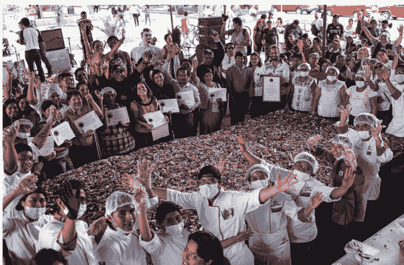
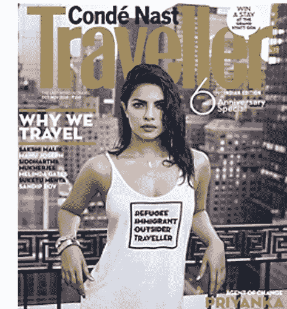

# 非俄狄浦斯空间性的后人文主义游牧主义

编辑者：

- Java Singh，印度杜恩大学
- Indrani Mukherjee，印度贾瓦哈拉尔·内赫鲁大学
- Didier Coste，法国波尔多-芒涅大学
- Olivia A. Kurajian，密歇根州立大学
- Prantik Banerjee，印度那格浦尔希斯洛学院
- Swagata Basu，印度杜恩大学
- Tonisha Guin，印度当代理论论坛
- Shelby E. Ward，维吉尼亚理工大学；塔斯库姆大学
- Hamza Iqbal，德克萨斯大学奥斯汀分校
- Ruth Prakasam，波士顿萨福克大学
- Sushmith Sihag，独立学者
- Debra A. Castillo，康奈大学
- Leigh E. McKagen，维吉尼亚理工大学；维吉尼亚军事学院
- Antara Mukherjee，独立学者
- Maria Gonzalez，加利福尼亚大学圣地亚哥分校

# 第一章

“人类”是一个区域性词汇，用于指称一种生物，这种生物的特征之一是依靠两条下肢行走，并在这一过程中解放了双手，以便为自己提供食物和庇护。一旦嘴部从提供营养的必要任务中解放出来，这一器官开始被用于扩展其发声能力，并扩大与同一空间共存的其他同种生物活动的协调。与任何其他生物（我们称之为动物（包括昆虫）以及水生脊椎动物等）一样，它们与居住相同环境的同种成员聚集在一起。随着数百万年的时间，我们的祖先通过声音和在平面上刻画符号（通常被称为写作）扩展了他们协调活动的能力。

简而言之，语言化成为一种生物的独特特征，使得该物种的成员能够讲述关于宇宙起源（用一个常用词）、地球、所有生物，以及使地球上生命成为可能的条件的故事。讲述宇宙起源（地球、所有生物起源）故事的特定物种属，正是那些通过下肢行走（这种行走意味着承担了提供食物的任务并允许他们参与语言活动）的特定生物属。此外，将上肢解放出来意味着它们可以被用于自己提供食物、庇护，并制造工具来延伸手的用途。语言化和讲故事的出现，是为了协调和反映他们行为的意义、记忆，以及短暂的社区组织构成。

这里的观点是，在现代通用的欧洲语言中，“人类”一词及其附带的信息，对于非欧洲语言的使用者来说，既不是这个词本身，也不是常见的含义。直到殖民入侵者带着他们自己的形象、他们自己的叙事到来，这种叙事忽视了、干扰了并沉默了被入侵者的思维方式，同时也考虑了他们自己以及对入侵者的判断。例如，克丘亚语中的 *Runa* 无法被准确地翻译为“人类”。*Runa* 意味着在行星和宇宙中生命的交织（所有的生命能量和水、太阳、光、风、生物以及它们持续的流动），而 *Runa* 只是其中一种特定类型的生物。“人类”，根据

## 沃尔特·米格尼奥洛的序言 xiii

西方词汇（温特论证中的`人类1`），²将自己从所有生命中分离出来，而这种生命反过来被还原为一个单一名词：*自然*，其本原状态。西方文明是由物体填充的，而不是关系和流动。安第斯宇宙学是被剥夺的（我在这里用动词，指在自我建构的运动中实施剥夺）。西方宇宙学的入侵和自我建构，以及“人类”的概念并没有构成 *Runa* 的概念。这两个概念在冲突和权力差异中共存。中文的“仁”也是如此。“仁”不能被翻译为“人类”，因为“仁”整合在*天下*（一切之下）之中，而“人类”被局限于西方宇宙学的框架内（神学和世俗的（例如，大爆炸故事取代了圣经叙事）。

千年的安第斯文明不仅在当前阶段（例如印加文明）被拆解，而且在概念上被设计、忽视和否定：对于那些尊崇他们祖先的欧洲传教士来说，安第斯人需要忘记自己的过去，从魔鬼的王国中拯救出来，而这个王国在安第斯地区是未知的。魔鬼是基督教的发明。文艺复兴的人1的叙事将自己构想为人类，并将安第斯人贬为低等的、有缺陷的人类，忽视了安第斯人基于自身宇宙学叙事的自我构想。“人类”的修辞持续存在，并成为种族主义、性别歧视以及自然客观化和商品化的基础。`人类2`随着世俗化而出现，它“去神化”了上帝并用理性取代了它。`人类3`出现在二战后，及其两个后果：通过广告入侵对消费者的生活和行为进行建模，以及最近利用人工智能对我们的生活进行编程。不仅是“人类”与行星和宇宙生命能量的分离，更是生命能量流的分离，取而之的是对生命*工具性*的崇圣化。根据温特的年代学，`人类3`将是后人类。`人类1`和`人类2`等同于“个体”的发明，这是西方文明的独特特征，既有辉煌也有痛苦。`人类3`等同于*个体*的圣化，并将其提升为自我，作为*人类*的游戏——这种模型由经济学家和军事人员开发，由一个只关心自己利益并试图欺骗对手以实现其目的的自我组成：

> ² Sylvia Wynter, "Unsettling the Coloniality of Being/Power/Truth/Freedom: Towards the Human, After Man, Its Overrepresentation—An Argument." CR: The Ew Centennial Review: 3/3, 2003, 257-337. Katherine McKittrick, editor. "Sylvia Wynter: On Being Human as a Praxis. Durham: Duke University Press, 2015.

xiv

沃尔特·米格尼奥洛的序言

他的目的：一个现代的经济人。3 我谈论的是两条轨迹；通向后人类的轨迹，以及通向`人类3`的轨迹，即一种生命游戏的巩固，这种游戏阻止了人们去问人类意味着什么。

在我的理解中，这也是后人类的领土，但正如格言所说，正如豪尔·路易斯·博尔赫斯所论，地图并非领域。还有其他的领土。其中一个是无法还原为`人类1`到`人类3`谱系的“人类之后”。“人类之后”是由自16世纪以来被种族化和性化的历史者的后裔所夺回的人文科学。他们被归类为领土化的、本体论上的（更少的人）低等的，以及认识论上有缺陷的（非理性或不完全理性），正恰因为他们的低等和缺陷，他们本不应该去思考。他们/我们现在正在思考，并正在缩小后人类和欧洲中心主义（欧洲中心主义是一种位于西欧的认识论和审美现象，其触角跨越了与其自身相同的平面）的差距。“人类之后”出现于大多数非欧洲人口，他们被排除在从人类到后人类以及从`人类1`到`人类3`的轨迹之外。后人类不是普遍的。欧洲中心主义对欧洲中心主义的批判，而温特的`人类1`到`人类3`勾勒了对欧洲中心主义的去殖民化批判。去殖民化的选择照明了通往“后人类”人性化的路径，与后人类共存。

我意识到“后人类”的推动者正试图逃避人类中心主义的趋势。我对此没有意见。但这不是可行的路。我描述的是一条脱离人类中心主义的不同路径。我并不是试图取代某种在不同框架下被构想为“后人类”的东西；我无兴趣否定它。我只是说我不完全接受它。我是在说一条路径，那就是对你想要取代的任何事物加上前缀“后-”。我谈论的是多样性中的共存（即多元性）。在一个多元的生态中，“后”意味着一条时间和概念的线，以及对单一的、普遍的时间的假设。通常认为“之后”必须是“后-”，并且在“大西洋通用性”监狱中（米歇尔·罗夫·特鲁约所提供的恰当描述）的所有异见和取代的尝试都必须用“后”来指。没有出口可以

3 Frank Shiffacher, Ego: The Game of Life. London: Polity Press, 2015.

4 Michel-Rolph Trouillillot, “North Atlantic Universals. Analytical Fictions 1492-1945.” South Atlantic Quarterly, 2002, 101/4, 835-858-

## 沃尔特·米格尼奥洛序言

资本主义——正如格言所说——因为没有逃离西方普遍性的道路。我们中的许多人并不认同这一点。

# 第二章

当我1969年来到巴黎攻读博士学位时，我已经更好地理解了在恶劣条件下搬到阿根廷意味着什么，属于世纪末的那一代，当时有成千上万的移民从布宜诺斯艾斯迁往纽约。我现在正向反的方向移动，从西方（Occident）走向东方（欧洲），但得到了科尔多大学提供的助学金的支持。

当我1973年移民到美国时，那种异乡人的感觉已经根深蒂固。我没有抱怨，也没有怀旧，这就是我的状态。我接受并生活在其中。这种生活经历带我走到了今天，让我像现在这样思考，说我所说的话。尽管我拥有学术头衔，但我首先学习的是哲学和文学，然后获得了符号学博士学位。在另一一天（比喻地说，这并非特定的某一天或某月），通过与美国拉丁裔人群的接触（当时通常被泛称为西班牙裔、奇卡诺人和拉美裔，不），当我阅读格洛丽亚·安扎尔杜亚的《边界/拉边疆：新混血种》（Border/La Frontera: The New Mestiza, 1987）时，一种“顿悟”的感觉和救赎降临了。我理解了阿根廷人的意义，这与异性恋女性完全不同（《局部历史/全球设计：领土化与边界思维》，2000年中的一个核心概念）。尽管如此，我明白在表面感官到的差异背后，存在着更深层、更深层次的逻辑。表面的差异隐藏了更深层的逻辑：殖民性的差异。

但让我们回到安扎尔杜亚身上。《文艺复兴的暗面：领土化与殖民化》（1995）源于安扎尔杜亚的书所提供的礼物。这本书是一段自传式的之旅，为了解释我内心不断成长的移民意识，我以此对文艺复兴、迁往阿根廷的移民以及西班牙殖民美洲的历史赋予以意义。安扎尔杜亚的局部历史（个人和地缘政治的）首先涉及西班牙人手中的墨西哥历史，随后是美国手中的墨西哥历史。1848年的美墨战争允许我们将“边界”向南移动，在美国境内留下了大量失去原国籍的墨西哥人。他们并没有移动；他们不是游牧民。是边界越过了他们。与安扎尔杜亚的第二个连接是她的那句话：“边界是一个开放的伤口（border es una herida abierta），第三世界与第一世界摩擦并出血，”这是两个世界的血脉汇聚，形成第三个国家。尽管代际不同、性偏好不同且局部历史不同（一边是墨西哥，另一边阿根廷），安扎尔杜亚和我共同生活着第三世界的经历。如果按照安扎尔杜亚，我那时会说“现代殖民边界是第三世界与第一世界摩擦并出血的开放伤口（heridas abiertas）”，而这些边界和伤口在今天是全球性的。这些是“边界文化”产生并持续存在的。边界思维源于边界地区的经历（种族的、文明的！）。这种经历无处不在，即使定居殖民主义结束，殖民性依然存在。“边界文化”纠缠在权力差异中（双方并不平等），而这些权力差异是由边界世界中的一个所决定的。文化差异从没有分量。

我告诉你们这个故事，是为了更明确地表达我对游牧主义、移民、移民意识和边界思维的思考。在完成《文艺复兴的暗面》手稿后，我继续了写书时开始的工作，但将我的反思带到了世纪末。这些研究、教学和发表的文章构成了《局部历史/全球设计》。在此过程中，我多次在研究生研讨会、工作坊和讲座中被问到，为什么我不引用或援用德勒兹和加塔利的“游牧主义”概念，因为在提问者的理解中，两者之间存在明显的相似之处。我在《局部历史/全球设计》的几页（66–77）中回应了这些问题的语气。我解释了为什么德勒兹和加塔利的游牧主义与我自己的经历和思考无关。从去殖民的角度来看，我们（那些遵循阿尼巴尔·基哈诺和格洛丽亚·安扎尔杜亚开辟道路的人，并在玛丽亚·卢戈内斯在基哈诺的殖民性和安扎尔杜亚的地缘政治（墨西哥/美国）以及身体政治边界地区（有色人种女性/女恋者）的交叉路口之后）并非始于空灵的概念，而是始于这些概念产生的地点和这种基础。概念与感受和情感相连，而不是漂浮在学科的云端。

> 格洛丽亚·安扎尔杜亚 Border/La Frontera. The New Mestiza. San Francisco: Aunt Lutie, 1988, 25

这就是为什么我（以及其他基于这些假设工作的人）不遵循学科规定，甚至不遵循任何自上而下的指导。去殖民性不是解构，它与后现代主义是异质的，并且是不受学科限制的。

我们（同上）并非从预设的陈述开始，这种陈述预设了生活经历而非学科规定；如果你愿意的话，是始于“生活世界”（胡塞尔在弗莱堡的生活世界，基哈诺在南美安第斯山脉的生活世界，亦或是安扎尔杜亚的生活世界，我在第一世界和第三世界之间解释过无数次），在公共演讲和写作中。就此而言，德勒兹和加塔利的经历（与胡塞尔一样，这里没有个性化）对我们是异质的（同上以及许多其他人也是如此）。他们的思考根植于西方现代性中隐含的地缘身体政治基础，并非居住在边界地区、现代性/殖民性边缘的人的经验基础。我不是在说他们是错误的，或者我们正在取代他们，或在批判他们。我只是说，他们与我们的生活和思考无关，他们有权拥有自己的观点和伦理责任。

过去两百年间的移民（自民族国家建立以来，国家的领土边界和公民身份的规定）扰乱了一个国家/一个民族（例如民族国家）的同质性，并揭示了权力边界差异。它们揭示了殖民性的“差异”（这是我在《局部历史/全球设计》中的整个论点以及出版前发表的论文和演讲中的概念），这种不可调和的差异划分了我在《局部历史》中一段总结读者或听者所感知到的相似性的观点。我通过将论建立在摩洛哥哲学家、作家和思想家阿德莱基比尔·哈提比（Abdelekibir Khatibi）以及马提尼克作家、诗人和思想家爱德华·格里桑（Eduard Glissant）（以及前几页中的安扎尔杜亚）的基础上得出了这一点。

事实上，格里桑和哈提比得出了类似的结论，但并非基于现代性视角构建的知识局部历史（如德勒兹和加塔利那样），而是基于殖民性视角构建的局部知识历史。这是权力和知识的殖民性，通过某些语言表达，这些语言引导哈提比和格里桑对西方认识论进行批判，并阐述了与其“别名”之间不可调和的差异。欧洲思想家实践

> ⁶沃尔特·D·米格尼洛，“Decoloniality and Phenomenology.The Geopolitics of Knowing and the Epistemic/Ontological Difference.” The Journal of Speculative Philosophy: 32/3, 2018, 360-387.

xviii

沃尔特·米格尼奥洛序言

对现代认识论的单调批判[而]在此语境下，格桑版本的“世界克里奥化”遵循了哈提比的路线，米格尼奥洛的另一个主张实际上是促使我们从自身的立场出发观察，正如我们一直在阅读欧洲和美国的后人类思维流派一样。然而，我们确实读过像爱德华·格桑、哈米德·达巴希和贾斯比尔·普亚等人的。我们对后人类主义的理解源于许多因素，其中包括米格尼奥洛对“启蒙人”的批判——这种人是白人男性、理性的，却深受殖民盲视、血统纯洁症以及文明使命之苦的影响。³此外，米格尼奥洛在其“关联性”（vincularidad）概念中对深层生态学的理解（契合了德勒兹和瓜塔里的的装配理论，以及爱德华·格桑的关系诗学），粉碎了任何人类[的]希望

> ¹ 与编辑的私人通信，2020年5月16日，08:04。

> ² 与编辑的私人通信，2020年5月16日，19:43。

> ³ Walter Mignolo, Local Histories/Global Designs: Coloniality, Subaltern Knowled, and Border Thinking (Duke University Press, 2000), 27, 49, 54.

## 引言

xxii

因此，我们对后人类的立场是明确的人类去中心化，涵盖了其他非人类物种和事物。原住民文化实践和认识论早已生活在有机的多极世界观中，在这种观点中，人类、非人类物种和行星力量处于持续的多元复声话语性状态。那么，我们为什么要从启蒙运动的人文传统中追求任何“人类”的东西呢？米格洛（Mignolo）将其视为现代性的暗面，它是黑暗、剥削且极度暴力的。因此，我们的后人类理解并非对我们本土-世界主义-后殖民-女性主义-杂血-黑色-少数派思维的否定。相反，它旨在对植于其人文主义传统中的“人类”进行问题化。这种另一种人类是一个全球后人类的新秩序，它不是礼貌的、不是白色的、不是理性的，更不是剥削性的。它将人类与非人类的纠缠重新路由到一种非欧洲的人类视角。这是另一种人文主义，正如安第斯印第人、加勒比克里奥尔人和达利特印度人所想象的那样，它强调了空间的一种游牧本体论，这种本体论具有问题性的混合性、间隙性或交叉。

米格洛关于“关联性”（vinculidad）的解决方案涉及所有生物与土地及宇宙之间的关系。他从这一概念源自安第斯对所有生命形式及其物质环境整体性的愿景。爱德华·格里桑（Edouard Glissant）的关系语言由岩石组成；其中，词汇、动词、名词、主语、客体并非固定在它们的位置，“在任何关系中，客体都是主体，每个对象都是主体。”⁵ 他还注意到德勒兹（Deleuz）的“根茎”，这是一个被消解的根系统，一个在地面或空中蔓延的网络，没有掠夺性的根部永久地占据。“根茎的概念维持了“根性”的思想，但挑战了“全权之根”的概念。”

本卷试图进一步对一般的游牧空间进行后人类追问，并探索一种替代思维方式的范围和伦理，这种方式正与国家的制度条纹、其所谓的理性主义、将知识视为普遍真理的观点，以及通过其殖民盲点使任何差异常态化的单一性思维不断斗争。它揭示了非人类和人类他者在通过游牧空间进行潜在领土化时是可以具有主体性且不可治理的。因此，它始终对事物的理性秩序构成了威胁，并被标记为野蛮和荒荒。非人类是在一种“生成”少数派、动物、女性和边缘化的关系性中，另一种作为人类/非人类的生存方式⁷ 这种“生成”的方式关乎于非人类与其/她的生物多样性及生态系统之间的水平网络化，这种方式是非中心-中心-（此处原文中断）

7 Deleuze and Félix Guattari, *A Thousand Plateaus (London and Minneapolis): University of Minnesota Press, 1987*, 106.

8 Brian Massumi, “Translator Note,” in *A Thousand Plateaus (London and Minneapolis): University of Minnesota Press, 1987*, xvi.

Rosi Braidotti, *The Nomadic Subject (New York: Columbia University Press, 2002)*, 14. Massumi解释说，“法语词‘tracer’——在英语中具有‘绘图’的所有图示特征，但也可以描绘痕迹或开启道路。而另一方面‘复制’（d’ecalquer）则是从模型中复制一切。”

当 Rosi Braidotti 说“游牧者是为了流动的命运，游牧者的身份是痕迹的清单”时（强调为作者所有），她唤起的是法语 `tracer`（绘图）的意义，而非 `d’ecalquer`。

世界上的原住民今天继续存在，他们正与剥夺、流离和现代化的严峻困境作斗争。事实上，正是现代性和殖民性从任何对行星的有机的理解中夺走了一切，为了征服、包含和控制其他的空间。里格贝尔塔·门丘（Rigoberta Menchu）、万丹纳·希瓦（Vandana Shiva）和格洛丽亚·安萨尔多亚（Gloria Anzaldoa）等人将整个生命投入到这个兴起的世界中。因此，后人类理解并非对人道主义的拒绝或反对，而是对启蒙人文主义的问题化和质疑。后人类主义也是从米格洛的认识论不服概念的伦理，以及格里桑构建另一种思维的坚实后人类可能性的权利中去殖民化的。

后人类游牧主义肯定了人类与非人类纠缠的多样性、变异和物质性。它否定了流动性的固定性、根优于路径、痕迹优于地图以及写作优于记忆⁸。除了从二元法中解放自己之外，它还挑战了由全球资本的新自由主义结构实现的垂直积累。金融资本聚集在陡峭的金字塔中，工厂在几天内被拔起并重新生根，高技能人才在职业传送带上移动，以流星般的速度反复跨越国界。所有的运动都不是游牧的。编码在跨国实体操作手册中的或殖民帝国的大规模动员中的——早期的跨国巨头——的超流动性，并不构成游牧运动。新自由主义全球游牧者的新游牧主义缺乏一种游牧意识，因为他们从不放弃自己的结构坐标。从全球南方到全球北方寻找更好财务报酬的移民垂直运动并非游牧；它呈现的是一种运动，而非垂直运动。与垂直运动不同，他们的重新定位未能让他们脱离那些条纹空间，他们在那里仍然处于社会文化金字塔的底部。

本卷中的文章考察了游牧运动的组成多样性。总体而言，它们还强调了一个伦理价值体系的话语痕迹，这个系统可能从对人类的稳定统一的愿景随机移动，转而与一种非单一的、游牧的观点斗争。游牧者包括移民-流亡者-难民-无家者-无国家人士、旅行者-反话语的制图者-地图绘制者、剥夺者-被剥夺权利者、内部-外部、边界同伴、全球-当地居民、动物-鸟类-森林-沙漠-空间-海洋-路径-罪犯——不断增加的与我们共同居住地球的他者。少数派游牧视角——与空间的非俄狄浦斯关系——隐含在这种共处之中。当我们仔细观察时，俄狄浦斯符号学通过多样性和身份破碎的整体性显现出来。边缘、边界和无人区的非俄狄浦斯空间与俄狄浦斯式的领土空间处于同一平面。游牧者无法居住领土，且非俄狄浦斯空间不适合永久占据。社会-政治-经济结构不稳定的锚定避开了游牧者，随着去领土化的滑入和滑出不信与精神分裂的间隙，在那里任何结构化的顶点和二元性都会崩溃，在那里多向的逃逸线浮现。

4 *Decolonial Concepts, Analytics, Praxis (Duke University Press, 2018)*, 1.

5 Glissant, *Poetics by Relation (Michigan University Press, 1997)*, xx and 11.

6 Ibid., 11.

## 引言

# XXV

监禁。这些文章与叙事之间进行着持续的多声对话，这些叙事驻扎在全球瞬时性空间的动荡天气之上。它们将间隙性/根茎状游牧认识论开辟为现实或知识的领地，作为对一个完全布线的世界中排斥性实践的政治抵抗。

第一部分“游牧装配”包含了召唤出真实的“游牧客体-作为主体-作为客体”的文章，这些客体可能是游牧者——如种子、动物以及作为浮动装配的空间——它们在配置方式上呈现出开放且如迷宫般的特征。德勒兹式的装配从根本上说是领土化的，但即使领土化是通过组装行为被构筑的，无形的装配也会在混乱而有组织的逃逸通道中浮现。鸟类通过鸟鸣、求偶舞蹈、筑巢和觅食活动与其栖息的领土产生装配。同样，非人类的人类居住者在相互界定的装配关系中安排好自己和其他领土元素。第一部分的文章探讨了此类装配的某些实现。

迪迪埃·科斯特（Didier Coste）的文章追踪了跨学科、身份和空间（无论是物理的、隐喻的还是知识性的）在全球化、局部化或无政府主义扩散中的“模糊移动性”。他用浪漫主义调和异域游牧主义，同时也处理了悬浮于传记、旅行叙事和游牧者真实故事之间的现代及当代游牧概念。他的最终目标是阅读，尤其是居住北非的俄罗斯裔法语移民伊莎贝尔·埃伯哈德特（Isabelle Eberhardt）的著作，通过她对宗教、文化、性别和语言边界的持续跨越。这篇文章的独特之处在于模糊了国家与战争机器的想象与现实边界，两者在不断的争斗中相互残杀式吞噬。迪迪埃·科斯特的文章与其他所有文章建立了横向连接，因为它从人类学中进行了挖掘，并通过对“游牧者”概念的现代操纵塑造了挖掘出的材料。

贾瓦·辛格（Java Singh）在她的文章中展示了红菜草在阿兹特宗教仪式中的重要性，以及它如何在西班牙殖民时期成为一种禁作物并生存下来。红菜草的生命力帮助它克服并长于权力的殖民。然而，任何试图通过现代科技知识来管理和推广这种传统本土作物的尝试，都是殖民贸易对殖民救赎使命的等价行为。红菜草反复拒绝占据分配给它的时间和空间，转而与其周围不断变化的习性和栖息地建立新的关系。

奥利维娅·A·库拉齐扬（Olivia A. Kurajian）广泛追踪了塞伦盖蒂-马拉生态系统，以观察穿越坦桑尼亚和肯尼亚的动物路线如何受到日益的人类活动（如建立物理围栏、划定想象的国家边界和森林砍伐）的影响。保护变成了牧民者和资本主义农场主手中的政治球。然而，如果没有社区对该生态系统环境中可持续居住的当地知识，塞伦盖蒂-马拉生态系统就无法得到管理。

普兰蒂·班纳杰（Prantik Banerjee）证实了该刊物是上层阶级的孟加拉尔“巴德罗洛克”（bhadrolok）精英对话的安全社会政治空间，尽管他们终仍是被殖民的主体。他们允许在一种身份认同的热忱中展示当地和全球知识，以渴望从他们作为被殖民者的无归属状态中获得救赎。围绕现代性和孟加拉复兴的去殖民思考产生于这一空间。在后殖民时代的孟加拉，该刊物继续作为全球国际主义自由主义倾向的本土标记。

该部分的最后由萨加塔·巴苏（Swagata Basu）的文章探讨了语言、职业、愿望和性别的装配。这位研究者是孟加拉语母，她在巴塞罗那花了三个月，与主要来自孟加拉国的南亚移民进行了详细访谈和焦点小组讨论。参与研究的女性揭示了游牧式的穿越性，她们试图将传统的的生活方式与她们被投入的全球化空间调和。

第二部分标题为“非俄狄浦斯制图学”，关注地图及其多重入口，这些地图致力于远离表征的异常，允许感知与思考的创造过程。地图作为根茎的一部分，是可拆卸、可逆转和可塑的，促进了对未知领土的探索。该部分的每篇文章都处理与旅行叙事中真实或想象地图重叠的文本，这些叙事引导游牧者进行向外或向内的旅行，有时是令人困惑的兼者。

托尼莎·古因（Tonisha Guin）关于阿廷·班德帕帕亚（Atin Bandopadhyay）儿童故事《阿塔普尔花园》的文章，通过拉达姆莫汉·巴布（Radhamohon Babu）的城市感性，审视了精英孟加拉尔巴德罗洛克对孙德尔班斯的表征。故事讲述了这位上层级寡夫与老虎以及他家的“阳光”巴加鲁（Bagharu）在恐怖中流浪，穿过红树森林三角洲的荒野。巴加鲁拒绝向外人解释任何事情的模糊抵抗，完全打破了拉达姆莫汉·巴布对本土人栖息地及其深度生态地图理解的预设观念，并将拉达姆莫汉·巴布的旅程描述为一种穿越游牧空间的身份认同失误。

谢尔比·沃德（Shelby Ward）展示了让·阿拉西加姆（Jean Arasyagam）的《地理课》和拉姆雅·查马利·杰林格（Ramya Chamalie Jiringhe）的《洛杉矶的斯里兰卡之夜》如何成为理论视角，用于批判性地阅读殖民主义语言和地理，以重建真实的斯里兰卡身份。这些诗歌通过神话和记忆，在流动的身份与身体的关系中绘制了真实知识的过程，并在他们的旅行期间对西方的殖民地理进行回写。

哈姆扎·伊克巴尔（Hamza Iqbal）的文章是以纳西尔·卡兹米（Nasir Kazmi）诗歌中游牧放纵的无家归宿与进入为主题。未知空间就是他的家，就像边境的新镇，通过记忆的转化过程成为家。文章通过哈尼尼（Harney）、莫滕（Moten）和爱德华·格里桑（Edouard Glissant）揭示了无家归宿的概念，引导他们与纳西尔·卡兹米手对话。

鲁丝·普拉卡什（Ruth Prakash）的文章绘制了在试图接待旅行者时，如何策划了一场殖民式的家务表演，以展示殖民对家庭空间完全控制的标准。她审视了维多利亚时代家务手册的缺陷。该手册本意是引发对殖民家庭中顺从行为的敬畏，结果却成为了许多旅行者对家庭空间毫无兴趣的原因。文章穿透脚本化表演的面纱，揭示了它在冒险女性旅行者的守护下如何沿着根茎线条产生分歧。

苏斯米塔·西瓦格（Sushmitha Sihwag）阅读了佩姆（Pemba）的小说《白鹤，借我你的翼》，探讨了流亡作为历史和现实体验的主题。面对真实或想象的外界时，藏族身份和纽隆-坎帕身份是离散主体自我批判模式的争议焦点。文章不断与吉尔斯·德勒兹、爱德华·赛德和迪比谢雅·阿南德（Dibyesha Anand）就游牧认识论、流亡和身份进行对话。这种关于流亡、离散、历史、虚构和身份的制图，与一个深层次且复杂的自我批判主体模型进行着协商。

## 引言

值得注意的是，德布拉·卡斯蒂（Debra Castillo）的第一篇文章关于慢电影，这种电影通过平淡琐碎的长镜头拉伸了时间。文章反驳了这种观点，即慢电影仅允许人们观察美丽的镜头，从而沉浸在宁静的审美享受中。相反，文章认为娜塔莉亚·阿尔玛达（Natalia Almada）的慢电影有目的地地带我们回到为了打发无聊而杀死时间的暴力。文章涉及了两个电影文本：纪录片《El velador》（2011）和长篇电影《Todo lo demás》（2017）。在漫长、极长的沉默与缓慢中，实际上阐述了那些本不值得受到关注的无名人物的故事。

利·麦肯根（Leigh McKagen）将电视剧《星际迷航：航者号》（1995-2001）解读为美国帝国主义意识形态的再生追踪。航者号的船员拒绝“成为”难民，并继续自称为被遗弃者/冒险家/旅行者/探险家，去殖民新领土，随后的唯一目标就是回家。文章认为，这种叙事模式规范了二战后帝国主义扩张性意识形态，这种意识形态承诺了西方的优越性。

下一篇文章将三个文本放在一起阅读：旅行杂志《康德纳斯特》（Conde Nast）的封面、特雷弗·诺亚（Trevor Noah）电视节目中关于黑人足球员的一集，以及毕卡索（Pikaso）的一幅关于疫情封锁后印度移民步行数千公里回家的漫画。安塔塔提卡·穆克尔吉（Antarctica Mukherjee）利用这三个文本将世界主义主义视为一种有问题且虚伪的事物。她剖析了霸权力量如何对移民、难民或任何其他游牧者选择性地使用普遍主义、慈善和政治正确等编码词汇，以揭示精英世界主义主义的虚假同情。

尼古拉斯·克里瓦（Nicholas Crevar）的文章展示了墨西哥裔美国诗人兼活动家奥迪莉娅·加尔万·罗德里格斯（Odilia Galván Rodríguez）的诗学如何构建边缘群体的政治意识，即“响应亚利桑那州议会法案1070的诗人们”，该法案合法化了对居住边境地区的墨西哥裔美国人和移民的歧视。她利用数字空间主张通过艺术实现团结和教育，作为对抗这些人权侵犯行为的解决方案。

桑希塔·森（Sanghita Sen）和因德拉纳尼·穆克尔吉（Indranani Mukherjee）探讨了图林·巴德杜里（Turin Badhuri）1960年的新闻叙事《受诅咒的钱巴尔河》、埃德华多·加莱诺（Eduardo Galeano）《镜镜》（2009）中的短篇《富富兰》，以及谢哈尔·卡普尔（Shekhar Kapur）的宝莱坞电影《劫匪女王》（1995），旨在探讨女性土匪占据的钱巴尔地区空间的深层生态学。普蒂（Puti）和德勒兹（Deleuze）与吉塔里（Guattari）对游牧主义的理论化，以及沃尔特·米格洛（Walter Mignolo）关于阐述位置的议程，揭示了充斥女性土匪的钱巴尔地区作为一个执行其自身游牧运动的“战争机器”的恐怖。

我们希望书中产生的后游牧游牧主义愿景，将为任何想要骑上（穿过）他们所时代混沌的荒野游牧地形的人提供一次令人兴奋的“破马体验”。深层生态学、生物伦理学、技术研究、地球研究和动物研究构成了这台机器般的战争机器组合中社会科学、通用科学和人文科学旧学科的新增内容。文学美学、美术、应用科学、批判理论以及不断发展的文化研究，已被这种全球海洋和太空空间、局部三角洲、山脉、河谷和萨瓦纳、跨越大陆的离散或流亡存在中的怀旧记忆，以及媒体、社交媒体和真实领土中持续的游牧主义（跨越不可测的边界、层级和深度）所浸润。因此，敢于风险的时代至关重要，它意味着要放弃所有基于语言的思想和符号规范的旧包袱。值得注意的是，疫情的爆发是来自游牧空间意料之外的袭击，当我们应对这种强加在我们身上的新常态时，希望大多数潜在读者做好准备，登上这台战争机器，并敢于（重新）学习新事物。

## 参考文献

- Braidotti, Rosi. *The Nomadic Subject.* New York: Columbia University Press, 2002.
- Deleuze, Gilles, and Félix Guattari. *A Thousand Plateaus.* London and Minneapolis: University of Minnesota Press, 1987.
- Glissant, Eduard. *Poetics by Relation.* University of Michigan Press, 1997.
- Mignolo, Walter, and Catherine E. Walsh. *Local Histories: Coloniality, Praxis.* Durham: Duke University Press, 2000.
- Mignolo, Walter, and Catherine E. Walsh. *On Deconiality: Concepts, Thinking.* Durham: Duke University Press, 2018.

# 摘要

文章试图澄清“游牧主义”的概念。在过去的半个世纪里，得益于多方面的扩张，该概念已从人类学转移到文学、社会学、哲学以及各种流动领域，无论是知识上的还是物理上的、全球化的还是本地的、部落的还是无政府的、传统的还是革命性的。

但在这种情况下，实际知识与想象之间的界限非常模糊。看到不同文化背景的人们如何在他们的随文中显式地或在小说或自传体小说中含蓄地推崇“游牧主义”令人惊讶，有时将其推到反对社会恶的灵丹妙药、与多样性交流、神秘色彩或“道路”的高度，除非它被感知并表现为对“系统”或所有传统社会性限制的绝望抗议。

详细追溯对某些社区相对于地理空间的生活方式的简单刻画如何被比喻性地无约束地操纵，从而削弱其意图，将是非常费细的。约翰·K·诺伊斯斯（John K. Noyes）在允许“变化的流行想象”的同时，仍然认为“对帝国边缘游牧秩序的知识，从古代直到今天对西方哲学构成了挑战”。因此，建议区分被不当归类为“游牧者”一词的截然不同的流动形式，该词的原意——在集体放牧搜寻中首领小组的成员——源自希腊语 `ποιμά`，意为牧场。

**关键词：** 易装装、随笔小说、阿尔及利亚、亚游牧、超游牧

# 第一章

游牧汇结：迪迪尔·科斯特（Didier Coste）对游牧主义的歧义解读，法国蒙田大学

## 模糊的流动性

无论是修补者还是艺人，它们都是功能性的而非随意的，集体的而非个人的，而且不是一种一不复返的迁徙。

在我们决定“游牧主义”是否仍能作为一种启示性的类比或隐喻，来探索当代对（物理、社会、情感、认识论）时空的占据或瞬态模式，或者它是否会背叛了压迫、社区解体、社区构建或部落主义、传统、断裂或退化，有必要考察关于游牧主义及其相关的当代文学中影响力的样本。由于在缺乏丰富性——及其变异的情况下无法做到这一点，我将首先批判性地关注一代仍在法国活跃、且年龄轻于德勒兹（1925-1995）和盖塔里（1930-1992）的资深作家/思想家。其次，我将讨论 J.M.G. Le Cléo 从 20 世纪 60 年代到 80 年代及之后的虚构与散文小说实践。这种实践在幻想、乌托邦和论文小说（roman à thèse）之间摇摆，揭示了“游牧主义”早在很久就被提出的，以至于：它反复代表着传统与不和谐、绝望与绝望之外的、性别角色与超越性别的韧性。第三，我将集中于一个特定的案例研究：移居北非的俄罗斯移民、法语作家伊莎贝尔·埃伯哈德特（Isabelle Eberhardt）的易装和其他越界行为已被许多传记作家和评论家辩论，特别是在后殖民主义和女性主义研究框架内。考虑到这位异域旅行作家、皮埃尔·洛蒂（他非常钦仰的年长同性恋者，后来不可避免地出现在 Le Cléo 的《沙漠》中）以及著名的自然主义作家左泊，从他反复跨越宗教、文化、语言和性别边界中，我们还能得出什么呢？

# 三篇后浪漫的、混乱的散文

我称“后浪漫的”，是因为对“游牧主义”的再再符号化，无论它们做了怎样的扭曲和伪造，其暗示或允许的内容都归于早期浪漫主义对“高贵野蛮人”的假设，这种假设存在于 18 世纪中期到 19 世纪中期在西方发展的哲学、诗学和自然美学中，以卢梭、狄德罗以及美国超验主义者爱默生和梭罗等哲学主角为主。

为了提供更多关于二千纪末“游牧主义”这种弥散性时代精神的证据，我选择了三篇由属于知识圈的知名作者撰写的法语散文：肯尼斯·怀特（Kenneth White）的《游牧精神》（L’Esprit nomade），1987年；米歇尔·马菲索利（Michel Maffesoli）的《游牧主义：启示流浪》（Du nomadisme : Vagabondages initiatives），1997年；雅克·阿塔利（Jacques Attali）的《游牧人》（L’Homme nomade），2003年。怀特是一位出生 1936 年的英国双语作家，多年前定居法国，但也是一位伟大的旅行者，试图寻找一种被称为“地缘政治”的跨学科运动——不要将其与地缘政治或“地理批判”混淆。² 马菲索利出生 1944 年，是巴黎笛卡尔大学的社会学教授；与神秘主义的荣格哲学家/人类学家吉尔特·杜兰特（Gilbert Durant）关系密切，他是一位公众人物，曾卷入多起丑闻，因为他自推自己至教授最高等级，并作为一位没有任何科学背景却了博士论文的占星术士顾问和推销者。雅克·阿塔利出生 1943 年，是一位经济学家、前高级公职人员、前总统朗索瓦·密特朗的顾问，后成为一家主要资本主义经济日报的游说人和编辑；他写过各种散文和几部小说。

这三本书的共同点是对“游牧”概念近乎无限的延伸。马菲索利从序言到最后一章在这份报告中打破了记录。首先，“游牧主义”和“流离”（errance，流浪、漫游或办事）被并在一起，用连接词“et”（和）连接，以至于无法判断它们是两个不同的事物还是同一个：“流离与游牧，在它们不同的调节中，变成了一个日益明显的事实。”³ 在下一页，所谓的“流离”是一个永恒循环的结构，维持着“人的多元性，存在的二重性。“流离”占据主导，直到它所反抗的定居秩序遥远的历史起源。流离被提到：它是游牧向定居的“滑动”。³⁴ 定居等同于政治和警察，一种准全权主义的理性被奇怪地视为启蒙运动的遗产（如果将卢梭和狄德罗视为这种批判哲学的代表，而将斯特恩或莱萨日视为其中最具代表性的作家，这就很奇怪）。根据马菲索利的观点，理性的定居冲撞并阻塞了个人和社区深层的原始成分，这些力量作为被压抑者的回归，以各种不受控甚至受控的流动体（知识、文化、社会、性、旅游和休闲）的形式出现，被归入“游牧主义”这一大类之下。因此，无助的无家可归的移民、多语言作家、商务通勤者、国际流行歌手以及在房间周围的哲学旅行者，都会参与——其中大多数人是在无意中——一场反对定居现代性的启蒙式变革。

> Geom. Real and Fictional Spaces, Robert T. Tally Jr. (New York: Palgrave Macmillan, 2011) and Robert T. Tally Jr., Spatiality (London and New York: Routledge, 2013).

> Michel Maffesoli, Du nomadisme: vagabondages initiatives (Paris: "Inédit" Le Livre de Poche, 1997), 12;除非参考文献中另有说明，否则所有译文均指原文。

> Ibid.

## 模糊的流动性

慢性性时间紊乱是反动派伪哲学家和文化理论者的常见病，他们在解放的名义下，提倡一种回到封建或部落封闭空间的可能的回归。在欧洲，十字军东征没有任何解放运动的色彩，但从文艺复兴到 19 世纪中期，甚至更晚，为了知识、偶然或生存而旅行是统一国家出现的先决条件——这受到了种族主义殖民者和剥削者的反对。对外人口的奴隶化并非定居现代人的特权：阿拉伯游牧民几个世纪以来对奴隶非洲做出了巨大贡献。历史上的游牧民族（“史前”人类采集者除外）总是部分地依赖与定居者的交换，以及针对他们进行的突袭或掠夺。对古代生活方式的理想化与各种现代流动性的融合，为一种神秘主义铺平了道路，即通过“精神”冒险从压迫现代性中解放，这种冒险将带我们回到存在的真实源头。马菲索利扭曲地使用后现代主义的修辞工具——矛盾修辞，并将朝圣者视为另一种狂欢式的过度，他将这种冲动称为“动态根源性”（dynamic rootedness），无论它是什么意思（显然与阿帕雅的“根源全球主义”不同），雅克·阿塔利并没有很好地避免自相矛盾，他的横跨、扩张、全景式的“理论”范围涵盖了从人类起源到乌托邦式的全球网络治理。像所有自封的先知一样，他通过起源为其不可信且有条件的预测辩护道：“定居只是人类历史中一个短暂的括号。”游牧者发明了一切，包括定居——如果他们先来的话，这是逻辑性的——而全球化正在使人类重新统一。“未来的重大冲突将不是它们之间的对立，而是最后一个定居帝国——美国帝国，与三个游网的、脱网的帝国竞争，它们与美国竞争并相互争斗，为了统治世界而

自身的利益：市场、伊斯兰教与民主。”⁹ 当美国帝国的军队、军舰、其主要公司以及其摩门教或天使传教士不断在世界上游荡时，这个帝国究竟有多么定居？当高管们没有固定办公室且他们的晋升取决于流动性时，这一点并没有解释¹¹⁰ 此外，如果你将市场视为一个帝国，它难道不包括它的因素——美国经济吗？尽管阿塔利（Attali）与马菲索利（Maffioli）一样，明显的优点是将“下游牧者”（贫穷、无根、无法拥有稳定家庭或无家可归的人）与其他种类区分来，例如“超游牧者”（商人、高素质工程师等不需要稳定家庭的人）。在他书的最后章节中，不可比拟的比较仍然坍塌在了一起。从农村地区迁移到邻城贫民窟的人，与位于加利福尼亚的班加罗尔计算机天才，或那些休学一年游历东南亚的背包客有什么关系？在所有与流动性、变化和交换有关的描述性和分析性分类混乱中，（理论上）可预见的结果是：在不遥远的未来，我们都应该学会同时成为游牧者和定居者。美国帝国的衰落将是罗马帝国的衰落，将只留下巨大的混乱、令人恐惧的多样性、快乐的混血……将仅剩下思想的游牧性、对差异的向往以及人们无论身处何地、处如何而日益增长的相互依赖¹¹¹ 弗朗西斯科·鲁迪格尔（Francisco Rüdiger）在对马菲索利的批判中指出，后现代是一个没有游牧者的游牧时代¹¹² 同样，在阿塔利的史诗般论文中，游牧存在的特殊性不复存在，即使在思想领域，这一概念也变成了一个空壳。

让我们看看像肯尼迪·怀特（Kenneth White）这样的诗人、翻译家、旅行家和语言迁移者是否境遇得更好（阿塔利没有提到他，但他使用了他的一些词汇，马菲索利也再也没有提到过他）。他的书集并联结了之前发表的论文，以及早期对“地缘政治”的综合，从一个早期隐喻的“知识游牧者速写”开启，在中间部分唤起了一许多重要的“人物、地点和轨迹”，特别是梭罗、麦迪尔曼、约翰·库尔弗·鲍尔斯和塞格伦的，最后以一种“世界诗学”结束。谁的方法更植根于从赫拉克利特到20世纪的严谨哲学和文学传统中，并具有相应的优缺点：当他唤起德勒勒的“游牧思想”时，他几乎没有给“拍派路线”任何认可。正如我查阅过的其他大多数此类主题的热门书籍或他引用的作者一样，怀特对女性主义或酷儿思想无动一顾，他关注的是“自然”以及像梭罗或爱德华·普鲁柯那样的最后的传统社会，但这种世界的宇宙感，使得对传统及现代社会中可能存在的性别和/或宗教、文化和语言支配影响的批判变得清晰可见。如果现代人，或者说知识游牧者的形象不是一个西方无政府主义者，他们仍然与遵循羊群法则的人不同，即使是流浪者。这些“黎明的无政府主义者，在某种程度上脱离了习俗、社会纽带和世俗联系，倾向于与自然交融，因为那也是世界的虚无，就像萨萨信一样，但与“东方皈依者”不同，他们将在世界（本身）中生存并冥想.¹³ 在参考文献中，亚历山德拉·大卫-尼尔（Alexandra David-Neil）与吉尔·德勒勒（Gilles Deleuze）的接近，反映了在处理属于符号秩序的事物时，理论与实验个人方法之间的持续犹豫，而非可以指导社会生活方式的实际文化模型。无论如何，去疆化任务意义上的纯粹游牧从未作为一种集体生活方式存在过。大多数文献中占据主导地位的人物是隐士或苦行者，是分离和孤独流浪的人物，是遗弃者、被驱逐者、流亡者或自我流放者的形象。

- ⁹ 同上, 14.

- ¹⁰ 同上, 398.

- ¹¹ 同上, 461.

- ¹¹² Francisco Ricardo Rüdiger, Civilização e barbárie na crítica da cultura contemporânea: leitura de Michel Maffesoli (Porto Alegre: EDIPUCRS, 2007), 80.

## 自己的道路或离开它

从旨在总结过去思想和方式并为派系提供预测和指导的论文，转向游记和部分自传性的叙述描写，我们通常发现对游牧持有一种着迷的态度，主要在炎热的沙漠环境中，与各种形式的掌控和超越相关。似乎在西方文学中，当犹太基督教传统表面上被伊斯兰教或其他宗教信仰取代时，圣经背景占据了主导。虚构的游牧几乎不是世俗的。然而，考虑游牧的视角，以及描述性、经验现实主义与想象性构建（幻想、补救、神秘主义、象征主义、神话）在文本的美学和解释性建议或要求之间的比例，可能是完全不同的。情感和叙事视角可以从遥远的观察到对游牧者的认同，再到尝试性地融入他们的社会。在第一种情况下（布扎蒂），他们可能是纯粹的威胁，内部敌人的外部投射，或者相反，是一个难以捉摸的、怀旧或尝试性的欲望。

- ¹³ Kenneth White, L’Esprit nomade (Paris: Grasset, 1987), 75-76.

- ¹⁴ Dino Buzzati, The Tartare Steppe (Manchester, 1985).

- ¹⁵ J. Coetzee, Waiting for the Barbarians (London: 1982).

- ¹⁶ J.M. Cléo, Desert, trans. C. (Boston: Verba Mundi, 2009), 6-8.

# 模糊的流动

- 11

- ¹⁷ Pierre Loti, Le Désert (Paris: Calmann-Lévy, 1895), 11.

- ¹⁸ 同上, 39-40.

- ¹⁹ 同上, 112.

- ²⁰ 同上, 288.

## 第一章

在他死亡的边缘。蓝衣人沿着无形的小径向斯马拉拉（Smara）移动，比这个世界上任何生物都更自由。21

克莱兹奥（Le Clézio）那些富有灵感且鼓舞人心的年轻角色——如《沙漠》中的努尔（Nour）和拉拉（Lalla）——对大地拥有近乎本能的认知，在最纯粹也因此最荒凉的状态下，“知道所有的道路”，他们与元素亲密相处。22 他们能用风真实、自然的名字命名，获得了一种由于缺乏要求带来的幸福，这种幸福甚至不是一种放弃，而是一种放手：“也许他不再等待了，不再知道任何事了，现在他变得像沙漠一样——寂静、静止、缺席。23 这些人内心的荒野，他们对城市、机构、文字（无论如何固定）所具有那种激进的“异质性”，使他们能够与自然景观、植物（如果有的话）以及动物融为一体：“他也在看着鹰。但仿佛那只鸟是他的兄弟，没有任何东西能将他们分开。他们的眼神里有着同样的目光，同样的勇气；他们分享着天空、风和沙漠那无止尽的寂静。”24 人类的拥抱与处于原始洞穴无异：他们的身体现在正处于洞穴内部，或者被困在巨人的内脏之中。”25 逃入自然世界就是归属，反之亦然。因此，当拉拉姨妈未能穿越沙漠，最终在马马赛与她的姐姐重逢时——“奴隶之地”——她继续在整座城市行走，穿行于它的迷宫，仿佛这座城市是另一个沙漠：“拉拉一直走着，漫无目的地，顺着道路走。”26 不说，对于1910-1912年间的四个不同的年轻角色来说，没有任何一个好结果：拉拉·哈瓦（Lalla Hawa），这个在摩洛哥殖民扩张中长大的孤儿在20世纪60年代的贫民窟长大，后来成为马马赛的移民；哈塔尼（the Hartani），那个与拉拉有过热烈友谊的野性牧羊少年；最后是受过偷车训练的罗马姆少年拉迪兹（Radicz）。哈塔尼在南方消失了，努尔闭上了他崇仰的失败老战士的眼睛，拉迪兹被公交车撞了。游牧文化唯一的生存迹象是由于我们故事的重复：当拉拉回到她曾漫步的摩洛哥海岸沙丘的地方时，拉拉像她母亲一样生了孩子，克隆了一棵无花树。

21. Le Clézio, *Desert*, 16.

22. Ibid., 51.

23. Ibid., 55, 22.

24. Ibid., 98.

25. Ibid., 108.

26. Ibid., 218.

## 模糊的流动性

只有在梦幻、超现实或迷幻的唤起中，传统的游牧生活（不同在于它是个体的而非部落的，这是一个本质区别）才能带来某种精神“自由”中可能固有的满足感，即脱离世俗的束缚。这种象征性观点的变体可以在克莱兹奥的多部短篇小说、小说和混合体书籍中找到，从他的第一部作品开始。《审判》（*The Interrogation*）、《飞行之书》（*The Book of Flights*）、《大地上的陌生人》（*L'Inconnu sur la terre*）、《彼岸之旅》（*Voyages de l'autre côte*）……在克莱兹奥的作品中，流动在某些时刻是绝对不可能且注定的，是逃离决定性的唯一途径²7 就像语言的实践是逃离死亡沉默的唯一途径，但它通向沉默；不断走下去是逃离死亡静止的唯一途径，尽管死亡在道路尽头某种程度上被挡在外，以最后呼吸的普通形式，或是狂喜的形式，或是回归存在，分享其所是之物的物质性（无论在何处）。仅仅是想要消失，如《之旅》中的纳贾·纳贾（Naja Naja）一样，就是一个“一直离开，在万物中旅行，]在树木间穿梭，或将自己化为香烟升起的烟云中的一个尘埃”的有效动机。28 转化为《陌生人》散文诗中抒情的第一人称主体后，叙事变成了一种兰姆波丹式的超越话语，受到审美理想化的推动：

> 美，游牧民族。没有主人、没有纪念碑、没有道路的国家：他们没有想象过旅程的终点，因为没有什么能阻挡他们。²⁹

> 然后我让欲望出发，我随着那些会飞的人离开。他们乘着风带着我远去，在光之路上疾驰。他们要去哪里？他们是不安分的旅行者，不知道各国家的名称。³⁰

再次，无论是在幸福还是痛苦中，浪漫主义的“游牧者”被描绘为对领土无所知，在无限的空间中没有方向。然而，“运动的孤独”³¹无论它自称是多么苦行，它像早期的殖民发现之旅、东方主义观点那样，仍然是占有欲且冷漠的。

> ²⁷, Didier Cote, “Nomad’s Land (on J-M. Le Clézio’s persona as “Great Wanderer“), Guest Lecture at the University of Rajasthan, 2003, https://www.academia.edu/8897685/NOMAD_S_LAND_on_J-M_Le_Clé%C3%A9s_persona_as_Great_Wanderer_

> ²⁸ J.M.G. Le Clézio, *Voyages de l'autre côte* (Paris: Gallimard, [1975] 1995), 46, 101, 40.

> ²⁹ J.M.G. Le Clézio, *L'Inconnu sur la terre* (Paris: Gallimard)

> ³¹ J.M.G. Le Clézio, *L'Inconnu sur la terre* (Paris: Gallimard), *The Interrogation*, *The Book of Flights*, 译 Simon, 2006), 76.

## 第一章

悬浮在[她的画作中]的幻象，“几乎接近特纳风景画的韵味，但她并非一位‘创造性艺术家’。”39 在一个如此“天生”受“种族”支配的人身上，为何会存在如此许多复杂的矛盾？如果令人兴奋的独特性不能排他属于民族，那么必然是某种其他事实模糊了轮廓，并使得解释（而非评价）变得困难。正如我们已经见过的，伊莎贝尔是“阳刚的”，她在她的文本中留下了许多未解释的阿拉伯语词汇，这是一种“引入当地色彩的超阳刚的方法”，但她拥有一种敏感性，这位骑着高马的年轻女性，她的性别模糊性补充了，或许正是这种整体氛围的根源。”40 很难想象还有其他作家带着她所拥有的极其不寻常的走向舞台：既是男人又是女人，既是学者又是荒野的野蛮人，既是远见的哈希什信徒，又是世纪末记者；既是穆哈默德教，又是基督教无神论者。”41

关于女性的陈词滥调——在1911年看来，不可避免地会走向男性的笔触。一个女性在洞察“像阿拉伯人那样的族”时，其优势在于“不倾向于理论化，不倾向于对所见事物解读错误的含义，不容易在解读原始的情感触动时出错”，男人很少能像女性那样以天真的投入，沉浸于一个野蛮种族的奇异生活中。”42 女性身上有一种孩子气概，她在一个早期的“情感阶段”被“停滞”了，当时想象冒险的诱惑让我们能够与原始、质的野蛮人产生认同，这种人如何有效地与丰富的博学、训练和‘精致的智力’相结合？”43 道格拉斯本人并没有解开这个谜团，但出于各种原因，包括他自己的生活方式、在卡普里岛隐居以及他的双性恋，加上世纪末英国和欧洲大陆文学艺术中盛行的性别歧视和神话，我们可以安全地假设，伊莎贝尔在道格拉斯眼中被呈现为一个典范的、异域的、雌雄同体的形象，怀旧的，也是原始完整、统一与纯洁的代表。跨越文化、“种族”、性别和语言的“游牧主义”，对于伊莎贝尔来说，正如对于——一个“极乐财富”的提供者一样。道格拉斯可能会认同福楼拜的感叹：“波洛丽夫人，我就是我。”

现在，如果我们转向伊莎贝尔的作品，并用一种更具政治性的、少投影性的视角来解读她的叙事情节、哲学思考和风格，

39. 同上, 528, 529, 538。

40. 同上, 533。

41. 同上, 532。

42. 同上, 534。

43. 同上, 527。

## 某种“游牧主义”的影响还会剩下什么？它能告诉我们什么关于它与可能的从殖民主义、资本主义和父权制统治中解放的关系？让我们审视她最著名的短小说之一《雅斯米娜》。44 雅斯米娜是一个牧羊的少女，住在巴特纳地区廷姆加德的一个村落（douar）里，离奥雷斯山不远。她本该嫁给城市巴特纳一个比她老许多、独眼眼的杂货店主。但在某个周日，雅克，一位年轻的法国军官，骑着马在酷热中在罗马遗迹附近打猎，寻找一个稍凉快的地方休息，在一个峡谷（wadi 的河床）发现了和羊群待在一起的雅斯米娜。随后发生的一切完全在预料之中：那个被那个野女孩吸引了，甚至学习了方言阿拉伯语与她交流，诱惑她，向她许下承诺，假装皈依伊斯兰教，并在得知自己将被立即调往奥兰以南许多英里外的哨所时感到绝望。女孩感到被背叛了，但接受了她的命运。雅克发了一次消息后便忘记了她。她嫁给了一个丈夫，那是一个法国军队的本土士兵，他殴打她，并因为与一名高级军官打斗而被判处十年苦役。雅斯米娜在巴特纳郊外的“黑村”——那间阴森的旅馆——当了妓女，并感染了结核病。在那段短暂的爱情故事五年后，雅克已嫁给一个优雅的法国女孩，回到了巴特纳。雅斯米娜在街上认出了他，指责并诅咒他的谎言。她扔给他一些钱。雅克称她为“另一个男人”。同一晚上，她在酒店门前的长椅去世了。

解读这篇短小说的方法有很多。首先，显而易见的是它的情感线条属于一种欧洲流行类型——通剧（melodrama），这种类型在19世纪末在舞台和小说形式上出现，无论是否有音乐，在整个19世纪及以后一直保持着巨大的成功。通剧以不同的比例结合了浪漫主义的赞扬和现实主义的模仿。你需要炽热的激情、一个认知的社会、文化、历史和地理背景。威廉·柯林斯、欧仁·苏、路易斯·德·瓦尔在其大型、复杂的小说中满足了这些标准。然而，通剧的张力或更微妙的痕迹可以在历史小说、自然主义叙事，甚至在所谓的象征主义和颓废主义作品中找到。在《雅斯米娜》以及伊莎贝尔的几个其他故事中，尽管格式要求情节简化，我们仍然包含了其中所有元素。它与一个简单的、转向异域背景的相当标准的欧洲通剧有何不同？答案的一部分在于，所谓的视角中显而易见的、有时的共情选择

> 44. 伊莎贝尔·埃伯伯哈特，《雅斯米娜》，载于《全集：沙地上的写作》（*Écrits sur le sable*，Paris: Grasset, 1990）， 94-118。

# 第一章

不成熟的女孩的心智，以及最终，在旅馆附近发现雅斯米娜的土著（spahi）。然而，第三人称叙述者始终拥有远超女主角的知识，且清楚地意识到殖民状况，这会让读者对雅斯米娜的认同变得更加困难：雅克竭尽全力避免被调走，雅斯米娜难以相信；他曾考虑过和她在一起、当地化，但对他来说，这将是跨出既定生活的一步。雅斯米娜的心智太简单，以至于无法……并最终被骗了……这证明了是正确的。在何种意义上，作者伊莎贝尔·埃伯哈特仍能被称为女性主义偶像？她的游牧主义在多大程度上对于这一形象的塑造具有决定性？

无论阿尔及利亚是否读过许多自然主义，她的叙事往往让人想起莫帕，莫帕本人深受巴扎克等人的影响——较少的讽刺和更多的感性。莫帕于1888年作为《高卢瓦报》的记者访问了阿尔及利亚。尽管他对那里实施的殖民开发模式持批评态度，但他仍称阿尔及利亚为“法国的一部分”。他较为人知的短小说之一《雅斯米娜》（在法语中与“寻找她”同音）。雅斯米娜，一个来自南方的游牧女孩的故事，是由殖民者奥贝尔讲述的，他拥有一座农场和一座堡垒（bordj），讲述者第一人称叙述者是奥贝尔的一位巴黎老友，他在阿尔及利亚徒足旅行迷失了方向。当被问及离开巴黎后的生活时，他只关注与美丽而狂野的雅斯米娜的关系，是在忠诚仆穆哈默德的帐篷下发现她的。雅斯米娜成为奥贝尔的“奴隶情人”（东方主义风格）时，他认为搬家并给她镜面穿衣柜，但她无法静止，她看了一次，又第二次，直到讲述故事的那天才回来。尽管奥贝尔用动物的词汇描述她，称她为不可知的生物，尽管他感到自己与一个野蛮牧羊女的奢侈生活是一种羞辱，甚至曾想杀掉她，但他最终表示，如果她回来，他会“接纳她：“对于女人，你总是得原谅……或者忽视。”45 莫帕作品中显然歧视女性的观点，

45. 居·德·莫帕，《雅斯米娜》，载于《左手》（*La Maine gaucheche*，Paris: Paul Ollendorff, 1889）， 64。

## 模糊的流动性

包括他的游记，但女性也同样被相当客观地描绘为男性和父权社会的受害者，处于被剥削、遗弃、忽视等处境地中。正如某些评论家所指出的，孟帕塞不应被读作标准的赛义式东方主义者。46 他的“流浪生活”片段，特别是在北非——正如他在《绿色生命》（*La Vie verte*，1890，其最后作品之一）中所称的那样——发生在对“现代”工业和消费主义生活的厌恶中；剩余的游牧者（如图瓦莱格人）则是对所谓“简单、接近自然、贫困、孤立、习惯于匮乏的部落群体”怀旧的敌人——这是一种深层的怀旧，因为人永远无法成为部落游牧者，总是太晚了。伊莎贝尔·埃伯哈特（Isabelle Eberhardt）无论是作为角色还是作者，在涉及阿尔及利亚（尤其是内陆）方面，与孟帕塞及其男性角色并没有太大区别。在伊莎贝尔未完成小说的序言中，她忠诚的朋友和仰慕者维克多·巴鲁卡德（Victor Barrucard，“绰脚者”）写道：“伊莎贝尔·埃伯哈特在任何方面都不能与她想成为南方女性混淆。她有不同的目标，穿着不同的服装。对她来说最重要的是有足够的关怀、单纯的心去路过这片土地。”47 “路过的占有”准确地描述了游牧者与其流荡领土之间的关系，以及不受产权法支配的性/情感交际。这与定居殖民者的规则以及父权社会中父姓的生育连续性相反，它关注的是使用与交换，是开放的空间和不可衡量的时间性。

伊莎贝尔与早期“现实主义”文学之间存在清晰的演变，而非视角的革命或反转，这通过她的写作与巴占1832年的短篇小说《沙漠中的狂热》（*Une passion au désert*）的对比得到了很好的证明。“这一可以称之为《埃及的法国人》的史诗片段”由一位老兵讲述了他在拿破仑·波拿巴特远征埃及期间迷失在沙漠等待救援时，在洞穴中与一只豹子发生的狂热冒险。从恐惧到温柔的亲密，西方人与那只大阿拉伯猫（始终被呈现为淫荡的雌性）之间发展出一种准色情的关系，直到有一天，后者将牙齿（尽管并不深）刺入了前者的大腿。他刺穿了“她”的脖子，“她”死时看着他，“不带情愿地。”48 士兵像一个杀了“真人”的凶手犯一样感到愧疚并哭泣。多年后，在旅行和战斗之后——拖着他的尸体走遍了更多地方后，他有时会有同样的感觉，“只有在他难过的时候。”当被问及对沙漠的着迷时，他回答道：“在沙漠中，无物也无有。……它是没有人类的上帝。”49 与《阿鲁玛》在结构和风格上的相似性令人震惊，但巴占像羚羊般的豹不在洞穴里，而是在开放的空间，那里可能被征服，但并非自由。

在伊莎贝尔的《雅斯米娜》（*Yasmina*）中，再次发生了另一个转折，增加了模糊性并排除了排除。首先，像克莱奥（Le Cléo）一样，她生活在固定位置的固体物质沉默中，远离城市。她在脑海中比拉拉（Lalla）更不像游牧者，她的整个生命都包含在一个极窄的半径内。相比之下，农夫卖家奥贝尔（Aubelle）一辈子都住在房子和店里；雅克（Jacques）则从一个驻军地到另一个驻军地，回到法国并在时尚的国际度假胜地尼斯遇到了他未来的妻子；他是一个“现代游牧者”，放弃了定居的阿拉伯女孩，因为她不够好，太过于本土化了，而他没有受到诱惑。本土化可能源于对神秘他者的恋物化，根据萨拉·艾迈德（Sara Ahmed）的理论，尽管恋物化与商品化和消费有关，但它也可以揭示其他维度，包括作为“他者”的自我创造、一种转化、神秘地迷失在陌生人的奇异之中，这种陌生人像一个具有自我毁灭倾向的诺斯主义者。50 从现代国家标准的外部视角来看，这种自我的风险转型步骤——一种蜕变——通常被诊断为异化：伊莎贝尔被许多权威机构（俄罗斯沙皇政权、瑞士资产阶级政策、法国殖民体系）认为是危险且疯狂的。在生命过半时，她无法与她恋物化的他者合为一体

> 46, Didier Cost, "Allouma, ou ce que la main gauche n'a pas dit à la main droite," French Forum, vol. III nr2, (1988): 229–242. Marie Portau-Tralie, "Refining Gray de Maupassant's 'Allouma' through the lens of Asia DDjebar: Postcolonial Algeria Conflicts Colonial France," Dalhousie French Studies, vol. 94 (Spring 2011): 146–147.

> 47, Isabelle Eberhardt, Trimadeur, by Victor Barrucard (Bibliothèque numérique romande, [1922] 2012), 13, https://ebooks-bnr.com/isabelle-trimadeur/.

## 第1章

与以男性化名写作的作者共有的象征主义/后象征主义写作，但从20世纪初读者的感知来看，这种风格可能等同于现实主义的女性化。基于这些理由，我坚定地捍卫伊莎贝尔·塞巴（Isabelle Sebar）符合被打破规范的颠覆性姿态。51 忽视这些（在历史上）是如何编码的，忽视不同文化、广阔空间和社会阶层中不协调与逃避模式的汇合，无法导致这种回顾性的、不可挽救。她不应忽视伊莎贝尔——这个（自）传人物，交替使用男性和女性身份——与普鲁斯特的阿尔贝蒂（《逝去的爱》）或科莱（《流浪者》）之间的相似性。多亏埃伯哈特等人的保持，游牧性（各种形式）的模糊性不应被还原为东方主义的挪用，让我们希望这种比喻在德勒兹和盖塔利之后再次复活。如果我们想理解女性如何像女性主义剧作家韦滕巴克尔（Wertenbacker）在《新解剖学》中所说的那样抵抗被驯化，那么对伊莎贝尔性格的重构可能是多产且或许是必要的。52 然而，在赋予“游牧学”第二次生命的道路上存在许多障碍。我们将看到在本书的“后记”中，它们是否能被克服。

> 48, Honoré de Balzac, Une passion dans le désert (Paris: Balzac, [1832] 2018), 36.

> 49, Ibid.

> 50, Sara Ahmed, *Strange Encounters. Embodied Others in Post-Coloniality* (Oxford: Routledge, 2000), 114.

> 51, Lynda Chouiten, *A Carnivalesque Mirage: the Orient in Isabelle Eberhardt’s Writings*. Ph.D. thesis (U. of Galway, 2012), 14, <http://hdl.handle.net/10379/3600>.

> 52, Timberlake Wertenbacker, “New Anatomies,” in *Plays 1* (London: Faber and Faber, 1996), Act I, scene 1.

## 参考文献

Abdel-Jaouad, Hédi. "Isabelle Eberhardt: Portrait of the Artist as a Young Nomad." Yale French Studies, 83, 1993: 93–117.

Ahmed, Sara. *Strange Encounters. Embodied Others in Post-Coloniality*. Oxford: Routledge, 2000.

Appiah, Kwame Anthony. “Afterword.” In *Cosmopolitanisms*, edited by Bruce Robbins and Paulo Lemos Horta, 271-274. New York: New York University, 2007.

Attali, Jacques. 《L'Homme nommé》。巴黎：Le Livre de Poche, 2005.

Balzac, Honoré. 《De une passion dans le désert》。由 Tania Duclos 和 Maxime Perret 校定。巴黎：eBalzac [1832] 2018.

Belenky, Masha. 〈Nomadic Encounters: Leila Sebrar writes Isabelle Eberhardt.〉《French Forum》，第 56 , 2011: 93-105.

Buzzatti, Dino. 《The Tartare Step》。曼彻：Carcanet, [1940] 1985.

Charles-Roux, Edmond. 《Nomade j'étais: les années africaines d'Isabelle Eberhardt 1899-1904》。巴黎：Grasset, 1995.

Chouiten, Linda. 《A Carnivalesque Mirage: the Orient in Isabelle Eberhardt's Writ》。博士论文，戈尔韦大学，2012.http://hdl.handle.net/10379/3600

Coetzee, J.M. 《Waiting for the Barbarians》。伦敦：Penguin, 1982.

Costier, Didier. 〈Allmou, ou ce que la main ne dit pas à la main droite.〉

Costier, Didier. 〈Nomad's Land (on J.M. Le Clézio persona as 'Great Wanderer'〉。拉贾斯坦大学客座演讲，2003. https://www.academia.edu/8876985/NOMAD_SAND_on_J_-M_Le%C3%A9zio_s_person_as_Great_Wanderer.

Deleuze, Gilles, and Guattari, Félix. 《A Thousand Plateaus》，Brian Mass 译。明尼阿波利：明尼苏达达大学出版社，1987.

Diamond, Jared. 《The World yesterday: What Can We Learn From Traditional Societies?》。纽约：Viking, 2012.

Douglas, Noah. 〈Intellectual Nomadism.〉《The North American Review》，第 193 卷，第 665 号，4月 (1991): 523-538. https://www.jstor.org/stable/2510958. 访问日期：2020年2月1日.

Eberhardt, Isabelle. （《Euvres complètes. Écrits sur le sable (récrits et journalniers)），由 Marie-Olive Delacour 和 Jean-René Huleau 编：Grasset, 1988.

Eberhardt, Isabelle. （《Euvres complètes. Écrits sur le sable (nouvelles et roman)），由 Marie-Olive Delacour 和 Jean-René Huleau 编：Grasset, 1990.

Eberhardt, Isabelle. 《The Passionate Nomad. The Diary of Isabelle Eberhardt》，Nina de Voog 译。Rana Kabbani 序。伦敦：Virago, 1987.

Eberhardt, Isabelle. 《2nd as The Nomad. The Diaries of Isabelle Eberhardt》，Annette Kobak 序，Elizabeth Kershaw 编。奇切斯特斯特：Summerdale Travel, 2001.

Eberhardt, Isabelle. 《Trimardeur》。Victor Barrucand 序。Bibliothèque numérique romande. [2022]. https://ebook-bnr.com/eberhardt-isabelle-trimardeur.

Kerouac, Jack. 《On the Road》。伦敦：Penguin classics, [1957] 2000.

Kobak, Annette. 《Isabelle, the Life of Isabelle Eberhardt》。伦敦：Virago Press, 1998.

Le Clézio, J.M.G. 〈Entretiens avec Jean-Louis Ézine. Ailleurs〉。巴黎：Arlée, 1995.

Le Clézio, J.M.G. 《Desert》，C. Dickson 从法译。波士顿：Verba Mundi Books, 2009.

Le Clézio, J.M.G. 《L'Inconnu sur la terre》。巴黎：Gallimard, [1978] 2006.

Le Clézio, J.M.G. 《The Book of Flights. An Adventure Story》，Simon Watson Taylor 译。伦敦：Vintage Books, 2010.

Le Clézio, J.M.G. 《Voyages de l'autre côté》。巴黎：Gallimard, [1975] 1995.

Lorraine, Tamsin. 《Deleuze and Guattari's Immanent Ethics》。奥尔尼：SUNY Press, 2011.

Loti, Pierre. 《Le Désert》。巴黎：Calmann-Lévy, 1895.

Maffesoli, Michel. 《Du nomadisme: vagabondages initiatives》。巴黎：““Inédit” Le Livre de Poche, 1997.

Maupassant, Guy de. 〈Allouma.〉收于《La Main gauche》，1-64。巴黎：Paul Ollendorff, 1889. https://gallica.bnf.fr/ark/12148/bpt66k69064/f7.image.r=Maupassant%20Al%20main%20gaauche

Noyes, John K. 〈Nomadism, Nomadology, Postcolonialism. By Way of Introduction.〉《Interventions Vol.》，第 6 卷(2), 2004: 159-168.

Poteau-Trial, Mary. 〈Refraining Guy Maupassant’s Allouma through the lens of Assia Djebar: Postcolonial Africa.〉《Dalhousie French Studies》，第 94 卷，春季 (2011): 141-148.

Rice, Laura. 〈“Nomad Thought”:〉《Cultural Critique》，第 17 号，冬季 (1990): 151-176.

Rolin, Olivier. 〈L’Invention du monde. Fiction et Cie》。塞维尔（Seuil），Seuil, 1993.

Rüdiger, Francisco Ricardo. 《Civilização e barbária na cultura contemporânea: leitura de Michel Maffesoli》。阿尔特格里：EDPU, 2005.

Sebbar, Leila. 《Nomadic incursions of amaranth》。伦敦：Faber and Faber, 1996.

Westenberker, Timberlake. 〈New Anatomies.〉收于《University, India》，1-57.

White, Kenneth. 《L’Esprit nomade》。巴黎：Grasset, 1987.

# 第二章：那粒可能的小种子：霸权领土上的游牧入侵

## 摘要

# 苋菜（Amaranth）：跨越神圣与世俗的边界

苋菜（Amaranth）是墨西哥中部纳瓦特人（Nahua）宗教仪式中的主角，被用于制作神性的微型塑像。在节日期间，信徒会吃掉这些塑像。殖民者禁止了这种行为，因为这模仿了基督教的圣餐。玉米并未遭遇同样的命运。在美洲殖民统治时期，苋菜作为主食一直延续了数千年，尽管面临着生存的生存威胁。在全球范围内，营养品行业、农业研究机构、慈善机构和发展机构正在推动苋菜的重新发现。本文探讨了苋菜如何跨越神圣与世俗的边界，引用了 Walter Mignolo 的“重构”以及 Rosi Braidotti 的“以生物为中心的世界主义”，展现了去殖民化的视角。

**关键词：** 重构，现代性，生物伦理，以生物为中心的世界

## 殖民冲击下的跨文化生存

在殖民征服墨西哥时期，美洲地区作为苋菜的家园已有五千年。纳瓦特人称之为 `huauhtli`，它是豆类、南瓜和藜麦的主食之一。根据《考古学杂志》的报道，殖民记录者将其贬低地称为“无用之物”，甚至将其视为杂草。萨胡贡（Sahagun）记录了，纳瓦特人在 `panquetalati` 等献给雨神特拉洛克（Tlaloc）的节日中使用苋菜制作名为 `tzoalli` 的塑像。在仪式中，信徒会粉碎并食用。殖民教会认为这些做法是不可接受的，因为它们模仿了基督教的圣餐传统——在圣餐中，祭司牺牲自己并将其肉分给信徒。1992年联合国关于拉丁美边缘作物的报告指出，苋菜的种植受到了迫害。报告还补充道，殖民时期的记录者（尤其是宗教人士）不断提及苋菜的“圣经属性”，并存在

> 这种小微粒能够

“1570年费尔纳迪尼诺·德·萨胡贡教士（Fray Bernardino de Sahagún）和1626年的鲁伊斯斯·德·阿尔孔（Ruiz de Alarcón）两次禁止种植.^7 阿尔孔在1626年对 zoalli 的攻击表明，即使在殖民一个世纪后，这种做法仍然与其所[面临]的宗教迫害一样盛行。此外，墨西哥政府在1890年进行的一项调查表明，到19世纪末，苋在墨西哥的种植几乎完全独立地消失了.^8

苋的消灭是殖民者对原住民及其艺术发起的文化战争的典型。与语言、宗教和口头文学等非物质遗产一起，体现在纪念碑、手抄和作物中的文化也遭到摧毁，以抹除复兴的精神。将‘精美的黄金艺术品’熔成金块以便运往帝国沿岸的审美价值是毁灭性的。尽管殖民者试图从精神和物质上消灭原住民文明，但针对性的实践和物品仍然生存了下来。在一种典型的跨文化案例中，由苋、玉米和蜂蜜制成的糊在从墨西哥田间消失后的几十年内，仍被用于天主教庆祝.^10 1950年卡尔·奥·萨尔写道，huauzont 或 zoalli 的饼在许多城镇和村庄的节日中可见。在描述这种贸易时，尽管受到殖民教会的反对，费尔南德·奥蒂斯写道它从新世界传到了旧世界.^12 尽管苋的生存没有古巴烟那样强劲，它仍然成功地开辟了一条进入霸权领土的游牧路径。像一个寻求生存的游牧者一样，它依靠所到过的‘足迹清单’在纳瓦特和天主教仪式之间建立了桥梁.^13

7. 同上，92。Whicker 编，《鲁伊斯·德·阿尔孔的戏剧》（Woodbridge: Tamesis, 2003），29。鲁伊斯·德·阿尔孔是管理殖民地的印得斯委员会的对立面。他还是黄金时代著名的剧作家。

8. 艾玛·克里斯蒂娜·地图（Emma Maps），《苋（Amaranthus spp.）原产于墨西哥》，Academia, Ciencia y Cultura UNAM, (2010):219,https://www.medigraphic.com/pdfs/apaunan-pa-2010/pa04.pdf

9. 柯林·麦克万、安德鲁·米尔顿和雷贝卡·斯塔西，《墨西哥镶嵌》（Durham and Duke University Press 2006），86。

10. 尽管一些记载声称在准备 zoalli 时使用了人类血液，苋糊只含有蜂蜜和烤过的种子。

11. 卡尔·奥·萨尔，《美洲南部和部的栽培植物》，J.H. 史蒂德编，《印第人手册》（Washington.C.: United States Government Office, 1950），497。

12. 费尔南德·奥蒂斯，哈丽特·德·奥尼斯，《烟草与糖》（Durham and Duke University Press 1995），183。

13. 罗莎·布拉多蒂，《游牧主体》（New York: Columbia University Press），14。

14. 米格尔·莱昂·波蒂拉，《纳瓦特哲学》（Mexico: UNAM, 1993），129，西班牙语原文翻译。

15. 同上，136。

16. 同上，131。

## 为去殖民主义回收（生物）伦理

本文展示了栖息地与伦理习惯之间不可侵越的保护关系。中美洲和安第斯原住民对苋及许多其他作物的种植是在一个由最小环境破坏、资源合理利用和充分治愈的伦理习惯所保护的栖息地进行的。这些生态实践代表了复杂的纳瓦特世界观。这种世界观可见于1524年阿兹特帝国消灭后，纳瓦特 tlamatines（或哲学家）与西班牙修士之间的对话中。根据米格尔·莱昂·波蒂拉的说法，这些对话是对殖民文化暴力的‘最后且最具戏剧性的表演’.^14 在极其‘尊重且谨慎的语言’中，纳瓦特哲学家对神性的思考可以也应该受到尊重，”因为它是基于对‘生命赋予者’丰富且崇高的概念。^15 他们解释说，神对一切‘保护’人类生命的都是牺牲；因此，人类必须通过‘流血’和祭品来尊神.^16 正是这种循环秩序使得农业和消费模式具有可持续性；因此，需要养护土壤并保护维持的生物多样性。阿兹特克的世界观是非俄狄浦式的，在他们的日常平凡中自给自足。这种所有物体、动物、植物和人类同时移动又扎根的世界观既充满栖息地也带有道德标记。自然、神和人类之间存在着明显的纠缠。牺牲是互惠责任的必要表达，也是向栖息地回馈部分‘习惯’的强化。

> 这种小微粒能够

苋的生存没有古巴烟那样强劲，它成功地开辟了一条进入霸权领土的游牧路径。像一个寻求生存的游牧者一样，它依靠所到过的‘足迹清单’在纳瓦特和天主教仪式之间建立了桥梁。栖息地与伦理习惯之间不可侵越的保护关系。中美洲和安第斯原住民对苋及许多其他作物的种植是在一个由最小环境破坏、资源合理利用和充分治愈的伦理习惯所保护的栖息地进行的。这些生态实践代表了复杂的纳瓦特世界观。这种世界观可见于纳瓦特 tlamatines 与西班牙修士之间的对话。在极其‘尊重且谨慎的语言’中，纳瓦特哲学家对神性的思考可以也应该受到尊重，”因为它是基于对‘生命赋予者’丰富且崇高的概念。他们解释说，神对一切‘保护’人类生命的都是牺牲；因此，人类必须通过‘流血’和祭品来尊神。正是这种循环秩序使得农业和消费模式具有可持续性；因此，需要养护土壤并保护维持的生物多样性。

## 微小却不屈的小谷物

与当地人口的界定。苋菜因其产量充足而被用于多种用途。这是一种需求量极大的作物，生长迅速，且耐旱、耐热。在同等面积的土地上，苋菜的产量将高于玉米。当地人并没有只关注一种主食，而是通过关于循环的、相互关联的宇宙观神话以及有机科学知识，致力于一种多元化的食物餐谱。在缺乏男性中心主义决定的情况下，苋菜像游牧者一样从一个土块移动到另一个土块。⁶ 目前对小麦、玉米和大米（当今消费量前三大谷物）的关注，代表了一种冲突的俄狄浦斯式关系，因为它并非基于环境与男性中心思维之间的相互界定。俄狄浦斯空间是一个条纹地带，边缘化作物的战争机器可以使其平滑，即使在面对许多恶毒的敌策略时。

⁶ 本提出了“有机科学知识”的概念，以区别“技术科学知识”。前者通过缓慢的治愈、逐渐的适应和对话式的干预发挥作用。技术科学特权追求结果，通过从上而强加解决方案来实现快速转型。

## 重构与全球化的技术管理凝视

游牧之路充满危险，游牧者经常遇到荒凉的地形。苋菜的游牧性正受到“奇迹食物叙事（MFN）”话语的威胁。²⁷ MFN 追踪了像 FAO、IFAP 和 WFP 等多边官僚巨头的缓解和减少营养不良的计划，以揭示这些项目在所谓“良性人道主义”主张下隐藏的殖民专横。²⁸ 从开始，它们共同的战术元素就是识别、投影并最终将单一作物神化为解决营养挑战的万灵药。它们的努力得益于营利企业和非营利组织的参与，这些组织通常来自全球北方。20世纪60年代，奇迹食物是 O2 玉米，一种富蛋白的品种，尽管机构采取了广泛的推广措施，它仍未能成为主食，最终因被发现不适合人类食用而沦为动物饲料。

⁷⁷ Emma McConnell, "Miracle Foods: Quinoa, Curative Metaphors, and the Depoliticization of Global Hunger Powers," *Gastronomica,* Vol. 15, No. 4 (Winter 2015): 70. https://www.jstor.org/10.2307/2636298.

⁸⁸ Ibid., 70.

FAO 是联合国粮农组织，IFAP 是全人类信息计划，WFP 是世界粮食计划。三者都在联合国组织的庇护下工作。

20世纪90年代，MFN 编织了“黄金大米”的故事。这种富维生素的大米杂交种随着一次显眼的活动而发布。然而，由于缺乏维生素吸收能力的证据，它仍然无法从实验室和测试场走向农民的田地。由于之前的失败，MFN 引入了第三个主角重新启动：藜麦。

在最近一次的改编中，MFN 为其主角选择了一个不同的剧本。当将玉米和米的新杂交种作为“疗愈方法”进行推广，调用的是科学家的创新能力和研究人员的技术精艺时，藜麦继续被视为传统实践和古代知识的库。29 此外，这两种奇迹洪水拥有单一“魅力营养素”的明星效应：富含赖氨酸的 O2 玉米和富含β胡萝卜素的黄金大米。30 相比之下，藜麦是蛋白质、氨基酸、维生素和矿物质的媒介；因此，不需要改进。在宣言中，联合国大会宣布2013年为“国际藜麦年”，“以承认安第斯人民的祖先实践，他们通过与自然和谐相处的祖先实践，成功地将藜麦以自然状态作为食物并为后代保存下来。”31 在宣言中，过去科学发明技术的旧语法让位于了一种维持遗传遗产的保护性实践的新方言。

将藜麦投射为商业农业短板的万能比喻，是一种失败的尝试，试图将化的预期与前哥伦斯时期饮食习惯和耕作生境中体现的生物中心平等主义伦理进行同步。Braidotti 解释说，同步“不是关于对稳定身份的确认，或对反向身份的声称，而是……关于共同步性：共享的时间区域、共享的记忆和可共享的项目时间线。”32 联合国宣言并未尝试激活“共享时间、共享记忆”，也没有承认“可共享时间线”的不可能性。伴随宣言的计划试图在十年内完成几个世纪才获得成就。

29 Ibid., 70.

30 Ibid., 72.

31, “Quinoa 2013 International Year,” FAO, accessed March 29, 2020, http://www.fao.org/quinoa/2013/mobile/en/, emphasis mine.

32 Braidotti, Transpositions, 95.

仅仅被视为保护者，而众所周知的是，“驯化植物并非自然产生或偶然驯化的，而是种子选择和适应的结果。”33 它通过认为古代人的保护是“与自然和谐”的物化，从而在时间上对这种作物进行了异域化处理。同步最显著的障碍是对于导致许多作物被遗忘的历史原因保持沉默。活动家、政府机构、慈善慈善者试图在墨西哥扩大苋菜的生产，其未来轨迹可能会与之交织在一起。在殖民统治下，藜麦的种植和消费也是非法的，苋菜的种植者被禁止在高海拔地区种植。在玻利维亚和秘鲁政府开始将其视为一种商品之前，藜麦已从它的山地老穴中提取出来进行大规模生产。在藜麦热潮期间，这种努力是成功的；在20世纪末，藜麦随处可见。藜麦的价格翻了四倍，受殖民主义的影响。全球化再次将穷人推向接触之外。藜麦热潮也给生产者带来了压力。跨国公司要求免费获取藜麦的遗传资源。这种需求意味着传统生态知识（TEK）是产生利润的。市场的失败。

## 奇迹的小种子

### 图 2.2：由 Puente 组织的促销推广活动

来源：npr⁴²

特莱达（tlayuda）是一种受欢迎的传统瓦哈卡菜肴，有许多变体。在这一场合，它是由油葵粉、玉米籽、叶子、烤蚂蚱、牛油果、萝卜子和莎莎制成的。照片显示，志愿者们拿着参与证书，工作人员穿着整洁的白色围裙、得体的厨师服、口罩、发网和手套。本文认为，这种欢快的图像捕捉了像 Puente 这类机构的核心问题——它们没有摆脱技术管理主义视角，而且这是它们作为“认识重构”（reconstitución epistémica）伦理项目失败的视觉体现。⁴³ 拉·麦克唐德（Laura Macdonald）在20 世纪 90 年代中期写作（她将该时期称为拉美的“NGO 热潮”）时指出，“北方 NGO”的家长主义态度，加上认为现代技术可以解决“第三世界问题”的错误假设，以及未能考虑到国家和国际层面不公正的社会政治等级，是导致慈善目标失败的关键因素。⁴⁴

⁴², “一个 12 平方米的特莱达，包含油葵粉。”npr，访问 2020 年 3 月 25 日，https://www.npr.org/sections/thesalt/2017/06/01/526033083/why-mexican-chefs-farmers-and-activists-reviving-the-ancient-grain-amaranth

⁴³ Walter D. Mignolo, “Calle 14: revista de investigación y estética en el campo del arte: the aesthetics decolonial una década después,” en el campo del arte 14 (25) (2019): 19, https://doi.org/10.14483/21450706.14132.

### 第2 章

商业语法和管理修辞——包括标志、包装、促销活动、专卖店以及管理层与员工之间分工明确的层级组织结构——在解决当地问题方面的失败并非罕见。

与全球北方的许多社会成员一样，Puente 可能对不公正现象的真实感知做出了反应，但其联合创始人的形象让人们在轻视他们的自我推销计划时产生了疑虑。他们的职业轨迹表明，创立 Puente 是职业阶梯上必要的一步，这为他们在全球北方更大的野心确保了合法性。⁴⁵ 尽管他们继续在 Puente 委员会任职，但他们的部分参与无法为植根于或至少移植到社区的领导力提供功能性的替代。尽管 Puente 位于瓦哈卡，那里是萨波特克人（Zapoteca）而非纳瓦特人（Nahua）地区，但前殖民文化宇宙观中的共同特征允许人们通过纳瓦特伦理来审视“根源性”问题。“植根”（rooted）或 `netnetflixli` 是纳瓦特伦理的一个基础准则，它不应与固定性或不移动性混淆。林恩·珀塞尔（Lynn Purcell）解释说，对于纳瓦特人来说，人的生命似乎在四个层面扎根：在自己的身体中、在心理中、通过社会仪式和角色在社区中，以及在神性（teotl）中。¹⁶ 这些根是可以移动的；它们可以被移植到身体、心理、社区中，并共同移动。

Puente 的运作模式与普布埃拉当地组织的博览会参与社区的“特质”形成了鲜明对比。博览会名为“Hauhtalico”，在纳瓦特语中意为“huauhtli 之屋”，以赋予这种种子应有的历史价值。⁴⁷ 另一位演讲者联系到，重新重视农业生活的第一步，是开始用原始名称 `huauhtli` 称呼油葵，各国引入了新品种，这并不是坏事，但应该以有序的方式进行。⁴⁸

这些言论表明，对恢复（*recuperación*）或复兴挑战的社区范围和历史深度有着远为深刻的。另一位演讲者联系到，重新重视农业生活的第一步，是开始用原始名称 `huauhtli` 称呼油葵，以赋予这种种子应有的历史价值。

那粒可能的小种子

## 文学中的苋菜符号学

⁵⁹ Mihai Constance and Francois J. Tardiff, “The Name of the Amaranth: Histories of Meaning., “SIDA, Contributions to Botany, 29 July 2003, Vol. 20, No. 3 (2003): 1073-1074.

⁶⁰, “amaranth., merriam-webster, accessed March 28, 2020, https://www.merriamweb.com/dictionary/amaranth.

⁶�, Ibid., 1075.

⁶²,, Ibid., 1076.

⁶³ Soledad Pérez-Abadin Barro, *Resonar silvas: la tradición bucólica en la poesía del siglo XVI* (Santiago de Compostela): University Press, 2004), 147.

⁶⁴, Ibid., 149.

引用了 Jacobo Sannazzo 在 1484 年至 1486 年间创作的阿卡迪亚第三首牧歌》：黑色纱纱作为她余生哀悼的象征。⁶⁵ 苋菜从一开始就是后殖民时代拉丁美洲诗歌想象的一部分。安德烈·贝洛和帕勃罗·鲁达将其融入他们的赞美诗；塞萨尔·瓦列霍用“una tarde de amaranto”（苋菜之夜）描述了激情的回忆；鲁达在《爱情百首情诗》也将爱人染着酒色的嘴唇视为苋菜色。⁶⁶ 诗人们被苋菜紫色、粉色、紫色、红色且丰富的盛花所震撼，而加西亚西亚·马尔克斯则被它的抽象特性所吸引，未曾提及种子本身。

# 在二十世纪，这粒种子在文学想象中找到了一席之地

墨西哥作家路易斯·胡雷萨（Luis Jufresa）在《Ummami》中赋予了它重要的角色。这部小说呈现的不仅是后殖民的，更是去殖民的种子画像。⁶⁸ 苋菜作为人类学家的工作进入叙事，他研究前西班牙时期的饮食。胡雷萨看到了文化赞赏与挪用地缘政治中的讽刺性，通过阿尔方索的沉思表明，现代知识产业的心态被殖民性所侵蚀，正如公开逐利的全球化公司一样。阿尔方索还发现自己处于“读完一篇文章后的腐烂模式”⁷⁰，文章错误地声称玉米在斯科奇米科湖的人造奇南（chinampa）岛上“生长”，事实上，那里曾是苋菜的种植区。⁶¹ 他的愤怒使他思考这种作物的历史命运。他回想起殖民时期对苋菜田的暴力破坏，随后反思了现代性/殖民性对传统知识持续的流行暴力。他以意识流的形式叙述了苋菜的故事：

> “对我们来说，直到现在，这意味着我们的许多发现仍在那些无知的法老式统治者手中被系统性地忽视了。有时我诚实地认为，我们在研究所工作是为了边缘学者的利益；我们是那些精彩细节的生产者…… 这种情况是这样的：一个人生活中只有一粒像贫民窟那样的苋菜碎片，他就会写一本叫《苋菜》的书，在书里，他会包含我多年以来说的所有内容。也许他会使用纳瓦特尔语来赋予它一种本土色彩：《傻瓜看苋菜》，出现在所有优质零售店和机场里。他们会提供伯克林的边缘终身教授职位，然后那些种植苋菜比任何人都多的中国人，将拥有他们一个全新的市场：美国中产阶级（他们如此迷失于神性问题，如此沉溺于传统，如此受控于最新的食品淘汰潮流）。《告诉我我想吃什么》可能是对一个普通的受过教育的老白人的五个字描述。他们会将加工过的中国苋菜装在闪亮的包装里，在电视上广告，并像塑料玩具一样出口。在墨西哥，我们会以疯狂的价格购买它……⁷⁰”

胡雷萨对那些遵循“宏观食品叙事”（Macro Foods Narrative）剧本的复兴计划的失败给出了简要的总结。这种叙事利用所谓的“本土色彩”，详细阐述了支持传统耕作的复杂关系。这些商业化使命利用“闪亮的包装”、电视广告、“优质零售店和机场”来推销产品。他们的技术-管理式视角扭曲了他们正要“拥有”的恰种文化——“在墨西哥，我们会以疯狂的价格购买它。”北方活动家和慈善家的福音化，与那个写了一整本书名为《苋菜》的“老白”的认知挪用同样危险。

## 那粒可能的小种子

- ⁶⁵ Gabriel Márquez, *Cien Ajos de Soledad* (Barcelona: Debolsillo, [1967] 2010), 138.
- ⁶⁶ Pablo Neruda, “Alturas de Machu Picchu IX,” in *Canto General* (Ayacucho: Fundación Biblioteca, 1981), 27.
- ⁶⁷ César Vallejo, “Capitulación,” *The Complete Poetry a Bilingual Edition* (Berkeley, Angeles, and London: University of California Press, 2007), n.p. ebook;
- ⁶⁸ Pablo Neruda, “Soneto XVIII,” *Cien Sonetos de Amor*, UNAM, accessed July 6, 2020, https://www.ingenieria.unam.mx/dcsyfi/material/Literatura_Hispanoamericana_Contemporanea/Autores_N/NERJUDA/Cien.pdf
- ⁶⁹ Luis Jufresa, *Ummami*, trans. Sophie Hughes (London: Oneworld, 2016), n.p. Kindle.
- ⁷⁰ Ibid.
- ⁷¹ Ibid.
- ⁷² Ibid.
- ⁷³ Ibid.
- ⁷⁴ Rosa Braidotti, *As Cosmopolitan* (Abingdon: Routledge, 2013), 23.
- ⁷⁵ Rosa Braidotti, *The Posthuman* (Cambridge: Polity, 2013), 66.
- ⁷⁶ Rosa Braidotti, *Metamorphoses* (Cambridge: Polity, 2002), 132.
- ⁷⁷ Braidotti, *Transpositions*, 37.
- ⁷⁸ Christopher De Shield, “The Cosmopolitan Amaranth: A Postcolonial Ecology,” *Postcolonial Text*, Vol 10, No 1 (2015): 1-22.

## 结论

文章在尾声之际，指向了驱动中美洲和安第斯苋菜生存的游牧力量，这确保了它在经历了几个世纪的毁灭努力后依然存活。苋菜充当了以生命（zoe）为中心的去人性化去根化与重新植根的力量，但不仅针对植物，也针对土壤、空气、水资源以及让这种植物最初繁荣的可持续关系经济。一个叠加层使用了印有交易经济的蓝色蓝图。

那粒可能的小麦种子

强制的同化与同质化是不可持续的，一个激进的内在区域。

## 参考文献

- Braidotti, Rossi. *After Cosmopolitanism*. Abingdon: Routledge, 2013.
- Braidotti, Rossi. *Metamorphoses*. Cambridge and Malden: Polity, 2002.
- Braidotti, Rossi. *Nomadic Subjects*. New York: Columbia University Press, 2002.
- Braidotti, Rossi. *The Posthuman*. Cambridge and Malden: Polity, 2013.
- Braidotti, Rossi. *Transpositions*. Cambridge and Malden: Polity, 2006.
- Costea, Miguel, and Francois J. Tardiff, "The Name of the Amaranth: Histories of Meaning," SIDA, Contributions to Botany, 29 July 2003, Vol. 20, No. 3 (2003): 1073-1083.
- De Shield, Christopher, "The Cosmopolitan Amaranth: a Postcolonial Ecology, Postcolonial Text, Vol 10, No 1 (2015): 1-22. https://www.postcolonial.org/index.php/pct/article/view/1878/1784.
- Durán, fray Diego. *Historia de las Indias de Nueva España e de Tierra Firme, tomo*. México: Editorial Nacional, [1880] 1951.
- Espitia Rafael, Eduardo, Manuel Sánchez, D. Escobedo López, M. De la Fuente, Ríos Valencia, G. Martínez Trejo, L. Cortés Espinoza, J.M. Hernández Casillas. Conservación y uso de los recursos genéticos de Amaranto en México. Celaya: INIFAP, Centro de Investigación Regional, 2010.
- García García, Néstor. "Cultura transnacional y culturas populares en Cuadernos Hispanoamericanos, núm. 431 (mayo 1986): 5–18.
- García Márquez, Gabriel. *Cien años de soledad*, Barcelona: Debolsillo, [1967] 2010.
- Gutiérrez Rodríguez, Patricia. "Recuperación del Cultivo de Amaranto por buen camino. La jornada del oriente. October 12, 2020. Accessed March 24, 2020. https://www.ljornadadeloriente.com/mx/recuperacion-del-cultivo-del-amaranto-por-buen-camino-de-postgradados/
- Hebjornrud, Dag, "The Mesoamerican Philosophy Renaissance." Blog of the APA, January 2020. Accessed July 7, 2020: https://blog.apaonline.org/2020/01/09/t-mesamerican-philosophy-renaissance/.
- Hernández Bermejo, J.E., and J. León, *Cultivos Marginados, Otra Perspectiva de 1992*. Rome: FAO de la ONU, 1992.
- Jufrea, Laura. *Omami*, translated by Sophie Hughes. London: Oxford, 2016. Kindle ed.
- Cecilin, Cecilia F "A New Interpretation of the Aztec Statue Coatlicue, 'Snakes-Her-Skirt,'' Ethn, April (2008): 229–250.
- León Portilla, Miguel. *La Filosofía Nahuatl*. Mexico: UNAM, 1993.
- Macdonald, Laura. "The NGO Boom in Latin America, NACLA Report on the Americas." In NACLA Report on the Americas, 28: 5 (1995): 30-35. doi: 10.1080/1074839.1995.1172575.
- Mapes Sanches, Cristina. "El Amaranto (Amaranthus spp.) planta originaria de México." Academia, Ciencia y Cultura APAUNAM, (4) (2010): 217–222. https://www.midigraphic.com/pdfs/aapaam-pa-2010/pa104e.pdf.
- Matsumoto, Nancy. "Why Mexican Chefs, Farmers, and Activists are Reviving the Ancient Amaranth," npr, May 1, 2017. Accessed March 24, 2020. https://www.npr.org/sections/thesalt/2017/05/01/526033083/why-mexican-chefs-farmers-and-activists-are-reviving-the-ancient-amaranth
- McDonnel, Emma, "Miracle Foods: Quinoa, Curative Metaphors, and the Depoliticization of Global Hunger Politics." Gastronomica, Vol. 15, No. 4 (Winter 2015): 70-85. https://www.jstor.org/stable/10.2307/2362628
- McEwan, Colin, Andrew Middleton, Caroline Cartwright, and Rebecca Stacy. *Turquoise Mosaics from Mexico*. Durham and London: University Press, 2006.
- Mignolo, Walter D. "Reconstitución epistémica: estética: la decolonial colonial una década después," Calle 14: revista de investigación en el campo del arte 14 (25) (2019): 14-32, https://doi.org/10.1448/2145076.1432.
- Mignolo, Walter D. *The Dark Side of Western Modernity*. Durham and London: Duke University Press, 2010.
- Neruda, Pablo. "Alturas de Machu Picchu," In Canto General. Ayacucho: Fundación Bibliográfica, Accessed June 6, 2020, https://www.ingeneria.com/dcsyh/material_didactico/Hispanoamericana/Autores/Cien.pdf
- Ortiz, Fernando. *Cuban Counterpoint*, translated by Harriet Long. Durham and London: Duke University Press, 1995. https://archive.org/details/cubancouterpoint00parti/page
- Pérez-Ábruz, Sebastian. *Eudaimonia: Aristotle and the Good Life*. In maquetas de amaranto: la tradición en el siglo XVI. Santiago de Compostela: Santiago University Press, 2004.
- Potter, Rensselaer, "Bioethics, The Science of Survival." Perspectives in Biology and Medicine, Volume 14, Number 1, Autumn.

# 塞伦盖蒂-马拉拉生态系统

这是通过建立保护区实现的。为了维持该地区的生物多样性并为未来使用保护资源，坦桑尼亚和肯尼亚政府分别创建了国家公园。对该地区生物多样性的破坏损害了其生态系统的平衡力量。因此，坦桑尼亚的塞伦盖蒂国家公园和肯尼亚的马斯艾国家保护区成为了人类和非人类物种的避风港。虽然国家资源仅占了跨 25,000 平方里的塞伦盖蒂-马拉拉生态系统的一小部分，但它们对于维护该地区的生物多样性至关重要。由于该生态系统的四之三位于坦桑尼亚，分之一位于肯尼亚，两国都有义务保护其国界范围内的生态系统。6

在旱季和干旱期间，塞伦盖蒂-马拉拉是一个避风港。其较高的水资源比例吸引了大规模迁徙。两次值得注意的斑牛迁徙——塞伦盖蒂迁徙和洛伊塔迁徙，展示了这一生态系统的独特方面。随着人类进入该地区，其集体行为导致人口增长，对生物多样性和生态系统健康的威胁不断增加。然而，“在低人口密度下，人们可以提取足够的资源并从保护区（PA）获得额外利益，而不损害它们；反之，保护区也可以从人类的存在中获利。”7 随着资源竞争的加剧，气候变化将加剧人类和非人类物种社区的痛苦。8

干旱和其他变化的气象现象将迫使更多资源竞争。传染病的过度流行也将对野生动物种群造成破坏，因为天气条件和降水空间限制可以预测某地饮用水或可用水的供应以及植被的健康状况。9 自然栖息地的破坏和气候变化可能导致传染病爆发。草食动物缺乏优质植被促使了迁徙。10 这些疾病和状况使已经陷入殖民主义交织叙事中的动物和人类流离失所。13 在塞伦盖蒂-马拉拉，与野生动物和环境共存且不损害其健康并对其做出贡献的人数是有上限的。遗憾的是，公园周围的人口已经超过了某种“临界点”。11 公园外的野生动物数量有所减少。事实上，“塞伦盖蒂-马拉的人口增长和城市化与土地所有权的变化并行发生，”，“人口快速增长导致了更多定居点的形成，反过来导致围栏的建造，挡住了传统的迁徙路线。”12 通过重新引导野生动物和增加的人口挑战环境，关于私有财产和土地权利的对话变得日益重要。13

## 财产与土地权利

当今非洲牧民社区的剥夺、不平等以及围绕土地利用问题的政治问题。这些问题由于两个接壤国——坦桑尼亚和肯尼亚——之间的地区分歧而进一步加剧。最近，两种特定的转变改变了草原景观。人类通过增长的人口对土地施加了日益巨大的压力。他们“通过建立围栏、创建农场、建造城镇等改变了草原景观的性质。”14 殖民和后殖民政府及机构被塞伦盖蒂-马拉拉的生物多样性和财富所吸引，却一直忽视原住民（包括人类和非人类）的福祉。15 第二种变革性变化是为了保护目的而关闭土地。保护性隔离对原住民的土地控制措施是有害的，通常导致传统牧民管理和耕种的土地被剥夺或兼并。由于基滕盖拉（Kitengela）大多数（超过 85%）的家庭从事土地以外的某种经济活动，这使得有空间

> [...] 当地马斯艾人意识到，在多位所有者和流动限制增加的情况下，在快速萎缩的牧场空间内维持大型牲群是多么困难。更多的人开始投资购物中心的地块，无论已开发还是未开发，以希望获得一种受干旱和其他周期性冲击影响较小的稳定收入.^17

随着牧场受到威胁，且资本主义货币经济威胁要破坏草原上人类活动的社会秩序，人类与野生动物之间的微妙平衡被打破了。塞伦盖蒂-马拉拉野生与人类关系的崩溃将是灾难性的，因为两者的长期生存都取决于塞伦盖蒂-马拉拉内人-野生动物-人-人互动的存在。

## 塞伦格蒂-马拉生态系统

因此，当地人口试图保护其牲畜的尝试正如国家对整个系统的影响一样影响整个系统。26 为了减少对牲畜的伤害或满足需求，一些原住民也会猎杀这些掠食者。这些猎杀行为证实了政府的指控，即原住民正在破坏生物多样性并扰乱稀树林的生态健康。这些例子不应掩盖牧民在以传统和以当地为导向管理土地方面展现出的经验和专业知识。尽管如此，2010年，肯尼亚政府通过了一部新宪法，当地人在有关土地使用的决策中拥有了更大的话语权。27 马赛人和其他原住民被赶出土地，为保护区腾出空间，并受控制和地方政府机构的意愿支配。正如塔尼亚·李（Tania Li）所解释的，社会最贫困的部分最容易操纵和驱逐。28 坦桑尼亚前议员莫林格·奥莱·皮基普尼（Moringe Ole Pikipuny）在谈到马赛对公园的反抗时表示：“将原住民从土地上驱逐是对这些保护先锋的野蛮性异化。”29

## 保护

像马赛这样的牧民与塞伦盖蒂-马拉的景观密不可分。几个世纪以来，该地区丰富的生物多样性依赖于动物与人类之间复杂的关系来控制数量并改良土地。然而，西方对“保护”的概念化在历史上曾认为，解决动物灭绝和环境破坏的方案应当排斥人类对景观的干预或参与。根据穆胡姆扎（Muhumza）的说法，经常，“国家公园的生物多样性保护是通过……保护法来实现的，其目标是除了旅游业外保留国家公园。”30 这种保护法排斥了此前拥有这些土地进行日常活动的牧民。鉴于这一认知，针对野生动物的保护措施在结论上是排他的且不可持续的。景观作为一个没有人类活动的区域的理念形成于殖民时期.^31 这种特征在西方流行媒体中传播。保护工作必须寻求恢复这种乌托式的平衡.^32 尽管深受喜爱的西方童年迪士尼电影《狮子王》（1994年）描绘了这些和谐的形象，但“生命之环”并不排除生物.^33 这也不意味着在稀树林中共同进化和共存的牧民是环境破坏的根本根源。作为猎人、牧民、农民和积极参与者，人类对塞伦盖蒂-马拉的生态系统工程产生过并将继续产生着不可否认的影响。因此：

> 有可能人类——狩猎人-采集者和放牧者——实际上创造了这种开阔的塞伦盖蒂-马拉景观。如果说最初是人类创造了塞伦盖蒂-马拉生态系统，这可能表明维持生态系统的最佳方法是让人们以类似的传统方式继续并维护它.^34

资本家和殖民力量倾向于将大规模农业视为一种高产的、首选的利用方式。在短短35年内，马拉河旱季四分之三的水资源被抽入灌溉田，马乌森林（Mau Forest）超过三分之一的树木被毁，以推动资本主义进程和人口增长.^35 虽然牲畜销售是牧民社区生活中尤为重要的方面，但这些销售为牧民融入现金经济提供了机制和机会，使其能够获得各种非传统产品（如茶、糖、玉米粉），这些小规模的财务交易对野生动物种群没有破坏，但像农业这样的环境危害是有害的.^36 事实上，农业是“与野生动物不兼容的”，而牧民所实践的传统土地利用方式在维持生物多样性和生态保护方面要好得多。37 尽管如此，今天大多数牧民仍从事某种形式的土地耕作。这种耕作可能是为了个人或经济的进步.^38 为了农业和某些保护目标对土地进行围栏阻止了野生动物的迁徙，并在人类和动物获取水等资源方面引发了特别严重的问题。坦桑尼亚政府考虑修建一条高速公路，这将不可恢复地减少生态系统中的斑马数量.^39 由于由于通达性是这一叙述中最争议的观点之一，它处于有关保护对话的前沿.^40 遗憾的是，“塞伦盖蒂-马拉生态系统由多种保护模式治理，其区别在于谁有权决定谁使用土地、谁承担保护成本以及谁从野生动物中获益（利润）。”41 显而易见的是，利益往往在政府和旅游企业之间被平分或瓜分.^42 随着公园作为一种保护形式被建立，“Asi、Ishenya、Ngorme、Ikoma、Sukuma、Kuria、Tautog、Sikazi 和马赛人在殖民和后殖民时期政府建立坦桑尼亚和肯尼亚公园及保护区时失去了大量土地，这种做法有时经过了咨询，有时没有。”43 缺乏当地知识和咨询，保护团体对他们试图培养的事业产生了极大损害。正如在各种生态系统保护计划所示，那些与土地没有直接联系的人（通常是国际公司行为者和遥远的政府）在制定和管理保护计划……误解了牧业对稀树林的积极影响，从而将传统活动问题化并予以禁止。事实上，作为生态系统工程师，牧民通过他们的活动在没有明确意图的情况下实践了环境保护.^45 然而，这种保护往往被淡化为生态旅游，而公园的建立可以占据中心地位。这种做法将自然视为财务价值，而不是一种内在就值得保护的事物.^46 然而，一个拥有如此多样性的地方仍然是世界上最贫的地区之一。尽管坦桑尼亚在过去十年经历了经济增长，但这种增长的受益者往往是城市居民，而不是自然保护区边缘的人.^47 人类与野生动物在塞伦盖蒂-马拉稀树林中互动了数千年。这个生态系统一直是……的家园。

# 塞伦盖蒂-马拉生态系统

塞伦盖蒂-马拉生态系统的健康在于“提供信息以帮助[当地人民]理解、适应和应对，社区本身必须协商新的、更基于证据的土地、农业、野生动物保护和其他政策，从长远来看可持续地提高他们的福利水平。” 51 原住民和野生动物都经历了土地剥夺和边界硬化，导致资源的获取变得不再可靠。森林的破坏和河流的转向为哺乳动物的大规模迁徙制造了不可逾越的障碍，并威胁着人类的生计。塞伦盖蒂-马拉景观不仅由象和狮子主导，深受人与动物互动关系的影响。解决方案是重构基于社区的保护工作，将牧民者重新想象为当地和生态知识的来源，他们的生活和生计取决于与其环境之间的关系。

## 参考文献

- Bartzle, Gunda S, Joseph Oguttu, Sabyasachi Mukhopadhyay, Devolent Mtui, Toby Dublin, Hans-Peter Fisch, and Suzannah Rutherford. "马赛马拉生态系统中的降水趋势与变化及其对动物种群和生物动力学的影响。" PLoS 13, no. 9 (2018). https://doi.org/10.1371/journal.pone.0202814.

- Campbell D. J, H Gichochi, A. Mwangi and L. Cheche, "Kijado地区的土地利用冲突,"见《土地利用政策》，17, 4, 10月1日, (2000): 337–348.

- Colding, John and Richard Folk. "社会禁忌：当地资源管理与生物保护的‘隐形’系统。"《生态应用》11, no. 2 (2001): 584–600.

- Davis, Richard Brian, ed. 《迪士尼与哲学：真理、信任与一点点魔法粉尘》。Blackwell哲学与流行文化系列。NJ霍霍肯: Wiley-Blackwell, 2020.

- Egan, Dan. 《大湖的生与死》。纽约: W.W. Norton & Company, 2017.

- Homewood, Katherine, Kristjanson, and Pippa Trench. 《留在马赛：东非牧场中的生计、保护与发展》。人类生态与适应研究，纽约: Springer, 2009.

- Lampray, Richard H, and Robin S Reid. "特殊力量：肯尼亚马赛马拉人类定居点的扩张：牧民业和野生动物的未来何在？"《生物地理学杂志》31, no. 6 (2004): 997–1032.

- Leach, Melissa, and Robin Mearns. 《土地的谎言：对非洲环境既有观念的挑战》。牛津: 国际非洲学院联合 James Curve 出版，1996.

- Li, Tania Murray. 《进步的意志：治理术、发展与政治实践》。杜伦: 杜克大学出版社, 2017.

- 51. 同上。

- Muhumuza, Moses, and Kevin Balkwalk. "影响国家公园保护生物多样性成功的因素：非洲案例研究的回顾。《国际生物多样性杂志》(2013): 1-20.

- Reid, Preston. 《我们出生地的草原：东非的人类、野生动物与变化》。伯克利: 加州大学出版社, 2012.

- Robinson, Carolyn A. Jost, and Melissa J Remis. "纠缠领域：中非共和国 Dzanga-Sanga 密林 (Apds) 的猎人。"《人类学报》87, no. 3 (2014): 613-636.

- Sachs, Jeffrey, and Ki-mon. 《可持续发展时代》。纽约: 哥伦比亚大学出版社, 2015.

- Scott, James C. 《为无政府主义喝彩：自治、尊严和有意义的工作与游戏的六部分》。普林斯顿: 普林斯顿大学出版社, 2014.

- Ure, John. 《寻找游牧：从海斯特·斯坦霍普到布鲁斯·查特的英美痴迷》。纽约: Carroll and Graf, 2003.

- Veldhuis, Michael P. Mark E Ritchie, Joseph O Ogutu, Thomas A Morrison et al. "跨界人类影响损害了塞伦盖蒂-马拉生态系统。《科学》363, no. 6434 (2019): 1424-1428.

- Ventseca Miller, Alicia R., Robert Spengler, Ashley Haruda, Bryan Miller, Shevan Wilkin, Sarah Robinson, Patrick Roberts, and Nicole Boivin. "中亚北部古代牧民的生态系统工程。《地球科学前沿》(2020)。https://doi.org/10.3389/feart.2020.00168.

- Williams, Raymond, and Tristram Hunt. 《乡村与城市》。伦敦: Vintage, 2016.

# 第章

## Adda 作为孟加拉人的文化话语

### 绅士阶层（Bhadralok）的省际世界主义

Prantik Banerjee

印度纳格普尔希斯洛普学院

# 摘要

当英国统治印度时，Adda 在 19 世纪的孟加拉变得非常流行。它的流行既得益于西方化，也是对西方化的反响。欧洲、世界政治，尤其是英国与 adda 紧密相连。从历史上看，adda 一直是定义孟加拉城市中产阶级男性身份的文化标记。它是孟加拉朋友和同事之间的一种非正式社交闲谈，但其内容总是具有智力色彩，涉及当地/全球政治、艺术、文学和音乐等问题。

我的论文研究了 adda 在孟加拉身份形成中所扮演的角色，赋予了它一种独特的属性，我称之为“省际世界主义”（provincial cosmopolitanism）。迪佩什·查克拉博蒂（Dipesh Chakraborty）在其开创性著作《边缘化欧洲：后殖民思想与历史差异》中，将孟加拉社区这种奇特的言说行为称为“民族的”，但我将其延伸为代表一种世界性，这种世界性同时植根于家——不仅是所属的国家，还植根于像街道、道路和小径一样局部化的家（局部性）。这种世界性代表了一种世界观（Welttanschauung），一种文化认知倾向，使孟加拉人对 adda 的热爱成为了一种生活方式。我将试图证明，作为语言表演行为的 adda 为 19 世纪末和 20 世纪初的孟加拉绅士阶层（bhadralok）创造了两种看似对立的叙事。一方面，它帮助受过中产阶级教育的孟加拉人培养了对地方性的主张，使其作为殖民臣民的卑微地位具有了某种自豪感和排他性，并倾向于反抗和颠覆。另一方面，在这种 adda 身份的形成中，还包含了另一个孟加拉人作为世界公民的本土身份。它产生了由波德莱尔和班金·钱德·查特提出的关于共产主义和社区主义的民族、集体和参与性话语。

**关键词：** 男性身份、殖民臣民、省际世界主义、表演性的、集体的

# Adda 作为一种文化话语

板球、格列瓦拉和毛主席、民剧和戏剧，可以在一种狂欢式的庆祝模式融合在一起。

作为我主要论点的补充，我还将证明，参考孟加拉人的 adda，ghaire-baire（家与世界）、本土/全球、省内/国际化等文化和社会修辞，可能并不能被视为仅代表地理和文化差异的局限二元对立。相反，我将证明，对于“永久星际化的孟加拉中产阶级”来说，adda 之所以获得动力，是因为在实践中，两者都保持着良好的平衡。我的文章使用了 Dipesh Chakrabarty、Partha Chatterjee 和 Ashish Nancy 在过去三十年中构建的孟加拉社会史修正主义写作的理论框架。

这个词被孟加拉语言学家 Suniti Kumar Chattopadhyay 翻译为谈话的地方。根据《牛津词典》在线版，adda（读音为 ud-dah）是指“人们聚集交谈的地方”或一群志同道合的人之间进行的非正式会话。这个词既指一个地点，也指这项活动本身。在孟加拉语中，添加或 add deya 实际上是指特定场所的活动以及对活动本身的参与。adda 既是一种媒介化的言语体，也是一种话语实践，历史通过它、并在其中被叙述和产生争议。著名的印度电影导演萨蒂亚吉特·雷（Satyajit Ray）显示 add 起于古希腊，那里的人为了追求真理而练习修辞。电影的核心人物是一个环游世界的舅舅，他在访问印度期间，与他唯一亲戚的儿子男孩建立了友谊。在他关于海外旅行的故事之一中，舅舅向听者讲述了 adda 的起源以及它在孟加拉文化中独特地位。

1991年，在加尔加答市成立百年庆典之际，在年度书展期间出版了一部名为《加尔加答》的选集。历史学家 Shamendra Das 在书的前言中指出，adda 是一项持久的实践，通过讨论、合作和对各种辩论话题的深度参与来丰富生活的原则。值得提到，加尔加答的 boi mel（书展）是该市的年度标志性活动之一，吸引了成千上万的游客，他们来到现场不仅是为了提供和购买书籍，还为了见证标记活动的特殊 adda。

- 2. 《Ghare Baire，在家与户外》是拉宾德拉纳特·泰戈尔（Rabindranath Tagore）于1916年出版的小说。被解读为泰戈尔内心对西方文化（baire）的热爱与对祖国主义（ghare）冲突的隐喻表达。

- 3. Amit Chaudhuri, Clearing a Space (New Delhi: Penguin India, 2008).

- 4. “adda,” Lexico.com (Oxford: Oxford University Press, 2019).

- 5. 《Angantuk》，由 Satyajit Ray 导（India: NFDC and DD Production, 1991），DVD。

- 6. Chakraborty, Provincializing Europe. Sunitumar Chattopadhyay, "Host Life in Calcutta," in Jiban Katha (Calcutta: Jijnasha, [1913] 1979), 210. Nishthiran Ray. "Preface," in Kolkata Adda, ed. Samendra Das (Calcutta: Mahajati Prakashan, 1990).

## 第四章

学者们研究了历史文献，以研究19世纪和20世纪加尔加答的 adda 状况。在19世纪，baithakharnas（客房）中的 adda 是改革、革命和民族主义思想的中心。现代孟加拉知识分子或孟加拉绅阶层（bhadralok）的诞生，是在具有相同社会经济地位的成员之间关于自由、国家和民族文化的政治和文化思想的产生和呈现。许多 adda 由孟加拉地主（zamindars）发起，他们经常担任赞助人，提供自己的客厅（baithakhana）作为聚会的场所。到19世纪后期，adda 与富有的赞助人和他的客厅脱离开。它移动到了公共聚集空间，变得更加平等。这种变化是随着孟加拉受过教育的中产阶级（sikkhito madhyabitto sreni）的增长而发生的。

20世纪的 adda 采取了混合形式，将 baithakhana 会聚与咖啡会话的元素相结合。场所范围从茶摊、办公室食堂、公交站，到年轻成员聚集在一起喝茶或咖啡进行日常闲聊的 rawk（露台）。富赞助人 baithakhana 中的旧式 adda 与在公共场所举行的新形式之间的区别在于，后者对民主成员的归属以及其表演性的言语登记。adda 处于一个转折点，三个运动构成了它的特征：从家庭空间移向公共场所，从纯男性领域转变为允许（少数）女性参与，最后从上层阶级赞助人变为来自不同社会经济阶层的成员参与。

前述提到的 adda 构成部分的变化模糊了 ghare（家）和 baire（外）之间的边界，重新配置了加尔加答的城市空间。客厅里的 adda 破坏了 ghare 的家庭性，将私人空间变成了公共空间（baire）；而在 rawk 或 kinda 俱乐部里的 adda 则让这些地方既不完全在家里，也不完全在街道上。rawk 通常是房子外或巷子旁的休息区，而 kinda 俱乐部则模糊了划分室内室外的固定边界。社会历史学家以不同的方式解释了这一现象。例如，Partha Chatterjee 将孟加拉人这种奇特的社交性归因于殖民空间的划分，归因于英国政府对殖民民角色的否定。7 在《国家及其碎片：殖民与后殖民历史》中，他认为印度中产阶级由于被英国排斥在殖民生活的公共领域之外，转而在私人领域，在那里可以通过文化、语言和家庭来强调个性和认同。正是在这个重构的私人领域，国家才被“引入”。^8

另一方面，Tithi Bhattacharya 采取了不同的观点。在她的著作《The Sentinels of Culture: Class, Education and the Colonial Intellectual in Bengal》中，她认为殖民政治经济的强制控制将来自不同且往往矛盾位置的孟加拉人聚集在 Bande Mataram 的口号下。9 根据她的观点，“国家的引入并非像 Chatterjee 所述的那样在精英的私人世界，而是在阶级冲突的意识形态解构中。”10 一个被称为 bhadralok 的新社会中产阶级出现了，由地主阶级和小产阶级组成。这种改变的社会构成导致了划分孟加拉社会的传统阶级结构的崩溃，使得民族主义运动更容易聚集动力。尽管有这些不同的观点，人们说，在殖民现代性和民族主义项目相互冲突、矛盾并兼并之时，adda 为 bhadrasaj 在高等文化领域提供了一个肥沃的生产背景。我的论文提出了三个论点，以证明 bhadralok 的 adda 与民族主义、省主义和国际主义这些主流竞争叙事之间的复杂关系。

# 孟加拉绅阶级的国际主义

# 论文论点与 Adda 文化话语分析

## 核心论点：Bhadralok 阶层的兴起与 Adda 的流行

我的论文第一个论点是，**adda** 的流行与 19 世纪后期一个新社会阶级——**bhadralok**（孟加拉绅士/中产阶级）的增长相契合。这个 **bhadralok** 中产阶级也是被殖民的异他者。**bhadralok** 社会作为一个具有独特政治和文化渊源的社会范畴出现，这是孟加拉历史上一个非凡的现象。

它一方面处于国家与政治层面，另一方面处于普世与人文层面；它既是对立且封闭的，又是包容且开放的。它提供了抵抗殖民者的基础，同时也提供了对同主者文化中许多事物的欢迎与吸纳。这一场所变成了一个转型空间，将殖民现代性与民族主义追求相结合，塑造了“士绅阶层”（**bhadralok**）的感性。它为士绅阶层的现代性观念注入了一种独特的自信调，以及一种对卓越知识如喜鹊般的本能。

历史学家尼提什·森古普塔（**Nitish Sengupta**）将现代、受过教育的孟加拉中产阶级描述为“亚洲第一个通过与西方互动改变精神世界的规模群体”¹¹。这一社会群体有一系列著名的成员——从有时被称为“印度之父”的拉贾·罗（**Raja Roy**），到在共产国际与列宁辩论的马纳巴哈拉纳特·罗（**Manabhabranath Roy**），他们热情地拥抱了欧洲启蒙运动传播的科学、理性、平等和人权主题。

正是这一特殊的、历史性的绅士群体——人文主义、理性、世俗，在寻求国际联系的同时又深陷于殖民和民族政治——被阿马蒂亚·森（**Amartya Sen**）称为“辩论的印度人”¹²。作为一种装饰文化的实践者，“聚会者”（**addabajis**）让对话成为孟加拉社区一个至关重要的方面。

到 19 世纪，孟加拉成为印度第一个现代阶级文化的产生地，这种文化既不是封建的，也不是创业性的。士绅阶层作为一个社会阶级，占据了一个政治和文化空间，他们可以通过殖民现代性的话语同时与地方性和国际化接轨。这一新兴阶级注入了自由精神和对欧洲文艺复兴的认知，开始构想建国工程。

拉宾德纳特·泰戈尔（**Rabindranath Tagore**）是这种表现的化身——他在家里拥抱世界，并在著作和海外旅行中展现了一种本土的国际主义世界观。在乔拉桑卡（**Jorasanko**）的大宅里长大的泰戈尔，经历了周围新都市国际主义的兴起，并从家庭不断变化的生活方式中，感受到与祖父德瓦卡纳特（**Dwarkanath**）的商业世界向其文雅士绅世界（**bhadramasaj**）世界的逐渐疏远。根据阿米特·乔杜里（**Amit Chaudhuri**）的观点，是泰戈尔将民族主义带入了审美领域，并创造了两者之间关键的互惠：不仅将“文化”的开端纳入民族主义计划，而且让国家彻底成为一个文化国家¹³。

> **参考文献**
>
> ¹¹ Nitish Sengupta, *History of the Bengali-speaking People* (New Delhi: UBS publishers, 2001).
>
> ¹² Amartya Sen, *The Argumentative Indian* (London: Penguin, 2005).

---

## 作为文化话语的 Adda

我的第二个观点是，在“聚会”（**adda**）的实践中，孟加拉士绅阶层协商了一种我称之为“士绅国际主义”的替代现代性。现代性作为一种多元状态的想法，导致几位士绅阶级学者在国际主义与现代性之间建立了更明确的联系¹⁴。许多国际主义运动无法被归入一个涵盖性的现代性概念中。此外，**加翁卡**（**Gaonkar**）和**恰克拉博蒂**（**Chakraborty**）等理论者认为，国际主义的多元化可以作为一种对话过程与现代性联系，而不是严格的普世过程。

在 **Gaonkar** 和 **Chakraborty** 学者看来，国际主义现在被视为一个多元且后普世的概念。因此，与主流的将国际主义视为跨国共和秩序的启蒙观念不同，我认为士绅阶层在他们的“聚会”中构建了一种后普世的国际主义，这种国际主义以此为起点，构建了不同的现代性和社会转型过程。“聚会”并不预设社会与文化与政治的分离，也不假定一个单一的世界文化。它在它的地方独特性中繁荣，也通过它与外部世界（**gare-baire**）建立的许多根茎状连接中蓬勃发展。

在殖民现代性时期，对于士绅阶层社会而言，英语教育、国际视野以及进入公务员体系的能力成为了文化权力的标志。正是由于进入现代性叙事的渴望，士绅阶层重新发明了“聚会”这种独特的内容和离散的风格。然而，尽管殖民官员带有某种文雅的姿态，但热衷“聚会”的士绅阶层无意中证实了殖民者对孟加拉人是懒惰、堕落群体的刻板印象。

“最后一个真正的英国人”尼拉德·乔杜里（**Nirad Chaudhari**）对孟加拉人的“社交性”这样说道：

> “城市[加尔各答]在社交性上缺乏的东西在聚集性中弥补了。世界上任何地方都找不到更好的社交同伴鉴赏家，也没有人比他们更依赖同伴的邻近，却对他们所承担的义务毫无理解。加尔各答的人极度需要这种陪伴，并不费吹灰之力在办公室、酒吧、图书馆或大学里不断重新聚集，而这些地方何尝不是无尽闲聊的场所。”

乔杜里反对“聚会”背后的殖民主义伪善不言喻。在《亲密敌人》中，阿希什·南迪（**Ashish Nandy**）证明了在帝国时代的孟加拉，殖民者故意构建了一个二元对立：英国人是男性主人，孟加拉人是女性化的仆人¹⁶。殖民的“文化和心理疾病”导致了英国政权对孟加拉男性的逐渐削弱，导致其人格分裂¹⁷。据报道，在一个反动时刻，斯瓦米·维韦卡南达（**Swami Vivekananda**）曾说泛印度教徒特别是孟加拉人的拯救在于三个 B：牛肉（**beef**）、肌肉（**biceps**）和《薄伽梵歌》（**Bhagavad-Gita**）。恢复并注入宗教印度教徒爱国热的方法是健身——即需要活力和力量的活动。此外，为了对抗身体更优的英国人，印度教徒改变饮食习惯为吃肉是非常重要的。遗憾的是，热衷“聚会”的士绅阶层由于倾向于培养精神而非身体，并没有消除殖民者关于懒惰孟加拉人的刻板印象。

当然，迪佩什·恰克拉博蒂（**Dipesh Chakrabarty**）已经表明，“聚会”并不是一种乌托邦式的活动；它是一个基于性别分离的资产阶级空间，很大程度上是男性对家庭责任的逃避；他们悠闲的对话“与实现任何明确结果的想法相对立”¹⁸。在恰克拉博蒂的文学现代主义中，这种活动涉及使用英印式和美国现代性的材料来创造新的举止。恰克拉博蒂写道，这是一个“人们可以在此开发新的技巧，将自己塑造为某个角色——如王尔德、萧伯纳、乔伊斯或福克纳——通过发展某些举止（为了他人的表现）、语言习惯和手势”¹⁹。

直到 20 世纪，当这个词的空间与产生现代孟加拉知识社区产生联系时，**adda** 才获得了体面。所谓的体面主要与文学和艺术品味的培养有关。

---

## 第四章：Adda 的文学素养与表演性国际主义

成为 **adda** 小组成员的条件是具备文学素养。**adda** 中的辩论需要某种程度的深度阅读、对卓越审美趣味的培养、对修辞的天赋以及对某种风格的展示——这一切都以一种赋予当地表演以国际化视野，并让其地方参与者拥有一种大都市特质的方式进行。

要成为一个 **addabaj**（聚会参与者），或者更进一步，像那些著名的孟加拉作家、艺术家和思想家一样，被授予“**adda raja**”（聚会之王）或“**adda chakravarty**”（聚会皇帝）的称号，就是将自己投入到文学大都市公民的角色，并演绎一种“表演性的国际主义”²⁰。

下面节录选自 **Jibendra Singh Ray** 的《Kallor Kal》（《Kallol 时代》），记录了两个朋友之间的一段 **adda** 对话片段：

> **Gokul** 有一天问我：“你在想什么？我觉得我好像也在想同样的想法，但说不出那个想法是什么。”
>
> 我说：“我想象着一种休息室[一家旅馆]——在那里被生活负担所累的人可以去那里休息，国籍、性别和地位将不再是任何障碍；[在那里]人们会让自己的工作变得愉快，通过与他自由交流，在欲望的轻松实现中找到充实感。”
>
> **Gokul** 把手放在我的手上，紧紧握住，喜悦地呼喊道：“那也是我一生的梦想，但我现在无法想象出它的具体形状！”²¹

这段轶事展示了 20 世纪初受过教育的孟加拉青年所吸引的世界观——一种超越民族认同的普遍人性感。**addabaj** 满脑都是受托姆·派恩（**Tom Paine**）和欧洲思想家启发的激进思想，他为民族主义计划注入了国际化的、世俗的文化。

我希望证明的是，这种国际化社区的乌托邦式构想（即走出家在共同休息室聚会，**pada** 中的 **adda**）往往与他寻找一个能够锻造地方和民族认同的“惯习”（**habitus**）相冲突。孟加拉人的 **adda** 是一个表述场所，现代话语的国际主义与国家和民族认同的地方主义在此交汇——它的地点、信仰和实践——成为了一个不同形式的国际主义、民族主义和地方主义可以相互竞争、协商，但并不总能解决的场所。

> **参考文献**
>
> ²⁰ Craig Jeffery and Colin McFarland, “Performing Cosmopolitanism,” *Environment and Planning D: Society and Space* (2008): 420-27.
>
> ²¹ Jibendra Singh Ray, *Kallor Kal* (Calcutta: 1973), 5.
>
> ²² Susobhan Sarkar, *On the Bengal Renaissance* (Calcutta: Papyrus, 1979), 353.
>
> ²³ Sandipan Deb and Ashish K. Biswas, “Much Add about Nothing,” *Outlook*, June 19, 1996, accessed June 25, 2020, https://www.outlookindia.com/magazine/story/much-adda-about-nothing/201561.
>
> ²⁴ Chaudhuri, *Clearing a Space*, 74.

他庞大但才华横溢的家族参与的戏剧、诗歌朗诵和歌曲。无疑，泰戈尔（**Tagore**）可以被视为在印度民族主义鼎盛时期倡导国际敏感意识的 **bhadralok**（上层阶级），同时又不愿完全否定民族主义。在关于文学的文章中，他宣布：“既不是国际主义毫无色彩的模糊，也不是民族崇拜激烈的教派偶像崇拜，人性的目标。”²⁵

我关于第一个论点的论文试图表明，尽管 **adda** 是一种高度地方化的文化惯习，但对于孟加拉知识分子来说，**adda** 是与欧洲现代性和进步构思进行激烈接触的场所。它的来源和灵感可能是欧洲现代性，但其实践却是地方性和民族主义的。此时的 **adda** 是一种独特的文化实验。这种通过走出家在共同休息室聚会的（**pada** 中的 **adda**）国际化社区的乌托邦式构想往往与他寻找一个能够锻造地方和民族认同的“惯习”相冲突。孟加拉人的 **adda** 是一个表述场所，现代话语的国际主义与国家和民族认同的地方主义在此交汇——它的地点、信仰和实践——成为了一个不同形式的国际主义、民族主义和地方主义可以相互竞争、协商，但并不总能解决的场所。

---

# Adda 作为一种文化话语（续论）

尽管 **adda** 具有固有的模糊性与矛盾性，但其动态的表演使得话语的表达成为可能。

可以推测，绅士阶级（**bhadralok**）的消亡与 **adda** 的衰落几乎是同时发生的。到 20 世纪 80 年代中期，第一波新自由主义浪潮正在开启印度经济，**adda** 聚集人们的力量开始减弱。如今，作为一种独特社交实验的 **adda** 在其幸存至今的稀释形式下已几乎无法辨认。曾经被尊为文化价值载库的孟加拉绅士阶级，如今也“陷入了停滞不前的地方主义和贫瘠的绝望中”²⁷。《展望》（**Outlook**）杂志上的一篇标题极具代表性的文章《绅士阶级的死亡》证实了“今天的孟加拉是一片动荡不安的荒地，布满了关闭的工厂……居住着一群自命自足且狭隘的绅士阶级。”²⁸

作者几乎为这个历史阶级撰写了一段墓志：“神话中的绅士阶级被自己的炸药炸毁了，与现代现实脱节了。”²⁹ 他的文章通过试图建立社区感知的衰落、**adda** 文化及其与其温和的实践者所谓的“无方向性”之间的联系，勾勒出了晚期资本主义不可阻挡的逻辑。讽刺的是，这篇文章同样给绅士阶级贴上了具有殖民主义色彩的“懒惰”标签，并指责绅士阶级社会的理想与发展的矢量相背道而驰。”³⁰

## 结论

# 第五章

### 语言（逃）逸：巴塞罗纳南亚移民女性的语言多样性与整合

**Swagata Basu**

印度，杜恩大学

**摘要**

本文基于在西班牙的居住经历，涵盖了八场深度访谈和参与式观察。研究显示，许多南亚女性出于家庭原因迁移加入配偶或其他家庭成员。本土国际主义的话语表达由一种本土的世界开放性交流模式定义，尽管这种开放性被阶级和性别边界所隔绝。通过姿态、感性和精致等文化策略，那些被殖民机器剥夺了公共空间和公民角色的绅士阶级，将 adda 变成了一种顺从、文化适应和反叛的独特工具。adda 是绅士阶级构建的一个文化场所，旨在一个社会和政治剧剧变化的时期，由自我、他者与世界之间不断变化的关系驱动，培养一种国际主义的想象。adda 将进一步被视为国际主义绅士阶级的一种地方性标记，成为一个不断变化的文化和的空间。本文旨在理解巴塞罗纳南亚女性的语言多样性与整合。

**关键词：** 迁移，南亚女性，语言多样性，身份，整合

## 巴塞罗纳

迁移和移动一直是人类生活的一部分。它直到最近几十年（20世纪80年代以后）才成为系统性研究的主题。居住在出生国家之外的人口总从1960年的约1亿人增加到2000年的1.55亿，再到2010年的2.14亿。根据2000年《世界人口报告》，全球人口的3.5%为国际人口。然而，报告指出“国际人口规模在扩大，但在全球占比上保持稳定。”Stephen Castles 等人指出，虽然迁移增长相对稳定，过去半个世纪增加的是国际人口中男性占52%，女性占48%。然而，她们的迁移经历与男性不同。“迁移更多是一种性别现象；性别规范、预期以及不平等的权利影响了……许多人作为独立的代理寻找更好的工作机会，通常随配偶或加入其他家庭成员。

> ^1 Asya Pisareska, Nathan Levy, Peter Scholten, and Joost Jansen, “Mapping migration studies: An empirical analysis of the research field,” in *Migration Studies* (Oxford: Oxford University Press, 2019), 1. https://doi.org/10.1093/migration/mnz033
>
> ^2 Stephen Castles, Hein de and Mark J Miller. *The Age of Migration: International Population Movements in the Modern World* (New York: Palgrave Macmillan, 2014), 7.
>
> ^3 Marie Macullie and Vinod Khadria, *Migration Report*, 2020 (Geneva: International Organization for Migration, 2019), 21.
>
> ^4 Ibid., 22.
>
> ^5 Castles et al., *The Age of Migration*, 1.
>
> ^6 Macullie and Khadria, *Migration Report*, 2022.
>
> ^7 Tom O’Neill, Anjali Fleury, and Marta Forest, “Women on the move Migration, gender equality and the 2030 Agenda for Sustainable Development,” *ODI Brief Papers*, July (2016): 4., https://www.odi.org/publications/10476-women-on-move-migration-gender-equality-and-2030-agenda-sustainable-development.
>
> ^8 Rashmi Sharma, “Gender and International Migration: The Profile of Female Migrants from India in Social Scientist, Vol. 39, no. 3/4 March-April (2011): 41, accessed: March 15, 2020. https://www.jstor.org/stable/41633793.

跨国生活指的是一系列广泛的社会、文化、政治和经济跨国关系，这些关系是移民为了在远方维持并复制其社会环境或起源地，无论是自愿还是无意中而产生的.^9

研究已经探讨了迁移与整合如何与迁出地紧密相连，以及迁移对留守人员产生的影响.^10 在迁移研究领域，将整合理解为移民融入接收国或东道社会的过程，引起了研究人员和政策制定者的极大兴趣。艾德里安·法维尔（Adrian Favell）是20世纪90年代首批系统性研究并提出“整合”作为英国社会接纳移民的一种方式的学者之一.^11 在2013年的一篇文章中，他观察了迁移和流动性不断变化的现实如何使“整合”的概念变得复杂。他批评了欧洲社会中存在的双重标准，即移民被要求融入到国家概念中。

相比之下，对于非移民人口来说，预期是他们应该感到是国家之外的集体跨国家认同的一部分（欧洲认同）。^12 整合与身份认同和归属感密切相关，是由多种因素塑造的复杂概念。在本文中，我将关注当地语言知识在移民融入东道社会中的作用。欧洲理事会认识了语言在移民整合中的重要性，并就这一主题发布了多项准则和报告.^13

> 9. Luis Eduardo Guarnizo, “The Economic of Transnational Living,” *The International Migration Review*, vol. 37, no. 3, Transnational Migration: International Perspectives, Fall, (2003): 666-699. https://www.jstor.org/stable/30037753.
>
> 10. A. Di Bartolomeo et eds., *Migrant Integration between Homeland and Host Society Volume 2* (Springer, 2017), 2. https://doi.org/10.1007/978-3-319-56370-1_1.
>
> Artjoms Leeves, Milena Nikolova and Carol Graham, "Emigration, remittances, and the well-being subject of those staying behind," *Journal of Population Economics*, (2019): 113-151. https://doi.org/10.1007/s00148-018-0718-8.
>
> 11. Adrian Favell, *Philosophies of Integration: Migration and the Idea of Citizenship in France and Britain* (London: Pal Macmillan Macmillan 2001), 100.
>
> 12. Adrian Favell, “The Changing Face of ‘integration’ in a Mobile Europe” *Council For European Newsletter*, June (2013): 3, http://www.adrianfavell.com/CESweb.pdf.
>
> 13. Jean-Claude Beacco, David Little and Chris Hedges, *Linguistic integration of adult migrants to guide policy development and implementation* (Council of Europe, Language Policy Unit), https://rm.coe.int/16802fc1cd3.

## 超多样且复杂空间中的南亚女性移民：巴塞罗纳

本文涉及来自西班牙巴塞罗纳的印度、巴基斯坦和孟加拉国的女性移民14（以下简称“南亚女性”），关注她们与接收社会当地语言的接触，以理解语言与移民整合之间的关系。本文基于我2018年作为博士研究的一部分在巴塞罗纳进行的人类野野调查。通过本文，我试图突出学习新语言的能力和语转换（translanguaging）在巴塞罗纳南亚女性社会整合中的作用。15 本文基于八场半结构化深度访谈（包括开放式和封闭式问题）、焦点小组讨论（FGD）以及参与观察。以下是构成主要样本的八位居民的表格。

### 表5.1：焦点小组的人口统计构成

| 序号 | 姓名（已修改） | 年龄 | 原籍 | 在西身份 | 在巴塞罗纳年数 | 职业 | 西班牙语或加泰罗尼亚语独立使用者 |
|---|---|---|---|---|---|---|---|
| 1 | Tripti | 53 | 印度 | 居民 | 11 | 家庭主 | 否 |
| 2 | Jhumoor | 23 | 孟加拉国 | 居民 | 5 | 家庭主 | 否 |
| 3 | Manu | 26 | 印度 | 居民 | 2 | 共同经营杂货店 | 否 |
| 4 | Sunita | 36 | 印度 | 居民 | 12 | 美容院主 | 是 |
| 5 | Laila | 17 | 巴基斯坦 | 公民 | 17 | 学生 | 是 |
| 6 | Naaz | 25 | 巴基斯坦 | 居民 | 12 | 志愿者、教师及NGO协调员 | 是 |
| 7 | Saafida | 27 | 巴基斯坦 | 居民 | 2 | 家庭主 | 否 |
| 8 | Hina | 18 | 印度 | 居民 | 12 | 学生 | 是 |

14. 来自尼泊尔、阿富汗和斯里兰卡等其他国家的女性数量可以忽略不计，因此未纳入本研究。

15. Ofelia García, "Problematizing Linguistic Integration of migrants: the role of translanguaging and language teachers", in *The Linguistic Integration of Adult Migrants Some Lessons from Research*, ed., Jean-Claude Beacco, Hans-Jürgen Krumm, David Little, Philia Thalgott (Berlin and Boston: 2017), 17.

粗略来说，语转换（translanguaging）意味着使用多种语言进行交流。

## 语言景观 (Language-scapes)

焦点小组讨论（FGD）是针对12位不同年龄的南亚背景女性进行的，她们在四个月期间参加了西班牙语课程。在可能使用了参与观察法。16

阿帕杜赖（Appadurai）的理论启发了本文使用的“语言景观”一语。对于非移民人口，预期是他们应该感到是国家之外的集体跨国家认同的一部分（欧洲认同）。^12 整合与身份认同和归属感密切相关，是由多种因素塑造的复杂概念。在本文中，我将关注当地语言知识在移民融入东道社会中的作用。欧洲理事会认识了语言在移民整合中的重要性，并就这一主题发布了多项准则和报告.^13

目前的迁移模式是男性主导的。南亚移民的典型画像是来建筑、矿业和农业等行业工作的单身男性。南亚女性几乎通过家庭团聚来到西班牙.^8 本文访谈的对象是巴塞罗纳的第一代移民，加入了

巴塞罗纳是加泰罗尼亚的首府，它是多语言的但并非联邦制.^2 两种当地语言：西班牙语和加泰罗尼亚语，存在于竞争框架内.^3 这正是需要新的隐喻来理解移民挑战的超多样语境。加泰罗尼亚和巴塞罗纳的外国人比例分别为15.1%和20.2%.^5 在亚洲人中，来自巴基斯坦的移民人数最多，其次是中国和菲律宾。尽管南亚人与拉丁美洲或摩洛哥移民相比很少，但这一现象值得研究，因为南亚人口在21世纪的第一个十年内增加了十倍.^6 需要澄清的是，本文关注的是低技能迁移。有一种高技能工人前往西班牙在跨国公司工作，尤其是IT行业，但本项主要研究并未包含她们.^7

同样，我们观察布洛梅特（Blommaett）所说的“语库”（repertoire）而非“语言”（languages），在全球化的世界中，文化是不断流动的。这与维尔托维克（Vertovec）的超多样性概念产生共鸣，超多样性是统一的、同质的、社会经济上阶层化的移民。

> 9. Luis Eduardo Guarnizo, “The Economic of Transnational Living,” *The International Migration Review*, vol. 37, no. 3, Transnational Migration: International Perspectives, Fall, (2003): 666-699. https://www.jstor.org/stable/30037753.
>
> 10. A. Di Bartolomeo et eds., *Migrant Integration between Homeland and Host Society Volume 2* (Springer, 2017), 2. https://doi.org/10.1007/978-3-319-56370-1_1.
>
> Artjoms Leeves, Milena Nikolova and Carol Graham, "Emigration, remittances, and the well-being subject of those staying behind," *Journal of Population Economics*, (2019): 113-151. https://doi.org/10.1007/s00148-018-0718-8.
>
> 11. Adrian Favell, *Philosophies of Integration: Migration and the Idea of Citizenship in France and Britain* (London: Pal Macmillan Macmillan 2001), 100.
>
> 12. Adrian Favell, “The Changing Face of ‘integration’ in a Mobile Europe” *Council For European Newsletter*, June (2013): 3, http://www.adrianfavell.com/CESweb.pdf.
>
> 13. Jean-Claude Beacco, David Little and Chris Hedges, *Linguistic integration of adult migrants to guide policy development and implementation* (Council of Europe, Language Policy Unit), https://rm.coe.int/16802fc1cd3.

14. The number of women from other countries such as Nepal, Afghanistan, and Sri Lanka is negligible thus included in this study.

15. Ofelia García, "Problematizing Linguistic Integration of migrants: the role of translanguaging and language teachers", in *The Linguistic Integration of Adult Migrants Some Lessons from Research*, ed., Jean-Claude Beacco, Hans-Jürgen Krumm, David Little, Philia Thalgott (Berlin and Boston: 2017), 17.

> 21. Ibid.
>
> 22. Fernando Requejo, "Is Spain a Federal Country?" in *50 Shades of Nationalism*, n.p., http://50shadesoffederalism.com/case-studies/spain-federal-country/.
>
> 23. Elvira Ria Gil, *Matters to people: Communication, identity and justice in Western democracies. The case of mixed societies* (Barcelona: Generalitat de Catalunya - Institut d'Autogestió, 2016), 225.
>
> 24. Jan Bloomfield, *Superdiversity and Linguistic Landscape, Chronicles of complexity* (Buffalo, Toronto and Bristol: Multilingual Matters, 2013), 14-16.
>
> 25. "Evolución de la población total y extranjjera", accessed April 25, 2020. https://www.idescasat.com/poblacionextranera/tb-08&lang=es.
>
> 26. Nachter Singh Garg, Gano and Andre Domingo Valls, "South Asian Immigration to Spain: Socio-demographic Profile and Territorial Distribution, 2000-2014," *Asian and Pacific Migration Journal*, vol. 25, Issue 2. March (2016): 196, https://doi.org/10.1177/01719866391663.
>
> 27. Gomez Ventura, "Highly skilled Indian migrant population in Spain," in *CARIM-India* (Migration Policy Centre: European University Institute, 2013), 5.
>
> 28. Garha et al., "South Asian Migration," 196.

## 语言“逃逸”（E-scapes）

在西班牙获得永久居留并申请家庭团聚后，她们加入了丈夫。由于这只有在男性成员在西班牙居住多年后才可能实现，因此当女性来到西班牙时，男性已经建立了自己的朋友、熟人和邻居圈子。他们对当地语言也有了一定的了解。正如她们家乡的典型情况，这些女性通常不工作，在经济上依赖丈夫。《国家报》（El Pais）的一份报告描绘了从巴基斯坦前往巴塞罗那的女性的惨淡景象，她们没有“离开家门”。[^29] 我进行的民族志研究对这些移民女性为何不“离开家”的原因进行了细致的理解，并强调了这种模式的例外。

### 语言“逃逸”（e-scapes）中的泡沫

特里蒂（Tripti）是一位中年孟加拉女性，在巴塞罗那生活了11年。她是家里唯一尚未获得西班牙国籍的成员。当她被问及是否要入籍时，她表示由于缺乏西班牙语能力，她没有希望。[^30] 每个周日，她都会来到一个小空间，那里结构像一个小店，但是拉瓦尔（Raval）社区一个孟加拉毗湿奴信派（Vaishnavs）小社区的寺庙[^31]，这里是巴塞罗那南亚移民最多的地方。除非认识内部人士，否则外部的人很难找到寺庙。这座寺庙在没有获得官方许可的情况下运营。一个个来到寺庙的女性开始负责厨房工作。她们剥皮、切水果蔬菜。一位老妇在一个小小的临时厨房里做饭。所有女性都穿着南亚传统服饰，纱丽（saree）或莎瓦卡米（salwar kamez）。

下午6点左右，一位30岁的南亚男性到达并担任祭司。胡姆（Jhoom）是在场的女性之一，开始安排仪式所需的物品。稍后，在小组其他女性的鼓励下，她在仪式中承担了更重要的角色，她们开玩笑说她是祭司，而她则感到害羞。当祭司向她要求时，她唱了一首歌。

[^29]: Nogueira, “De Pakistan a a Barcelona sin salir de casa,” *El País*. 2002年8月17日，访问于2020年4月26日，https://elpais.com/diario/2002/08/17/opinion/1029535209_8502155.html。
[^30]: 受访者1号于2018年5月9日与作者进行访谈。
[^31]: 毗湿奴信徒是毗湿奴派的追随者，它是印度教三大主要教派之一。毗湿奴传统以主要主神毗湿奴为中心。

慢慢地，其他人也加入了赞美歌（kirtan）。[^32] 仪式结束后，傍晚以一场孟加拉社区晚宴结束，由女性们烹饪并上菜。男性先于女性用餐，每个人都坐在地板上吃饭，这符合印度孟加拉人社区宗教节日的典型方式。

尽管孟加拉语是我的母语，但许多女性说话时的口音，以及她们唱的歌曲对我来说很陌生。随着时间的推移，观众开始增加，我后来加入了其中。正如南亚常有的，空间按性别划分的。在场的少数孩子彼此之间用西班牙语交流。一些处于学龄的孩子的母亲正在用破碎且带口音的西班牙语与他们交流。其中一位母亲告诉我，她想确保她的孩子在学校不会面临任何问题。[^33] 在随后的访问中，我发现我后来采访的那位祭司在一家餐厅当服务生。他同时在学习宗教，并接受成为祭司或传道者的培训。

寺庙中的群体动态表明，社会的规则和准则、习俗和习惯，特别是父权方面，即使在一个新的地理空间也依然保持完好。这些移民（尤其是女性）的情况可以被比作“泡沫”的比喻。有一道隐形的边界随着每个女性在新的地理空间中随处移动。除非她打破这个泡沫，否则她的迁移是部分的。她在物理上已经从印度、巴基斯坦或孟加拉的一个地点移动了。然而，她继续居住在与其起源国家相同的心理和社会空间内。我使用“语言逃逸”（language-escapes）一词来描述巴塞罗那南亚移民女性这种泡沫化的现实。

[^32]: 赞美歌（kirtan）是一种典型的宗教仪式，信徒们合唱赞美奎希纳的歌曲。
[^33]: 同意书和录音仅用于深度访谈。几次对话是自然的且未录音。

### 破泡还是迈出

巴塞罗那的大多数南亚女性移民来自农村社会，在那里女性的主要角色是照顾家庭。她们大多留存在室内空间，花费整天时间做饭、打扫、喂养孩子和处理其他家务。她们在移民后继续维持这种角色。她们确实会出门，例如接送孩子上下学，但这是她们家庭照顾责任的延伸。在研究样本中，特里蒂（Tripti）、胡姆（Jhumoor）和萨伊德拉（Saadeira）代表了这种典型特征。她们几乎不熟悉自己生活的城市。她们中没有加入劳动力市场。她们对当地语言的掌握程度最低。

在一次非正式讨论中，胡姆解释了她为什么认为像她这样的女性不工作。她说是因为西班牙没有那么多工作，因为那里没有加拿大或美国那样的小工厂或血汗工厂。她补充说，有些女性在别人家里工作，或者在酒店、养老院当清洁工。那些没有其他选择的人不得不做那类工作，但大多数人并不乐意。[^34] 许多拉丁美女性加入了西班牙的护理和款待行业。关于“体面工作”的观念影响了女性的选择。在家里外工作并不是女性赋权或自主的唯一标准。重要的是她们能够进入公共空间。由于缺乏与当地人的交流，这些女性感到疏离，比任何时候都严重。尽管她们在语言学校读了几个月，但她们无法自信地使用当地语言。她们将与西班牙语或加泰罗尼亚语者的交流缺乏归于主要原因。她们都希望与当地人更多互动。因此，她们陷入了一个恶性循环：由于需要与当地人互动而缺乏语言能力。[^35] 她们想学习当地语言，因为她们想独立。在缺乏当地语言的情况下，她们感到被幼稚化了。她们感到脆弱。她们的活动性和独立能力，无论是去看医生还是买杂货，除非她们说当地语言，否则都会受到极大限制。经济独立并不是这里的主要因素。

由于丈夫比她们早好几年到达巴塞罗那，他们自然对当地语言有更多了解。这些男性倾向于在环境中与同胞建立社交圈。然而，南亚女性，尤其是新到达的女性，渴望与当地人建立关系，并进入邻居、学校老师、附近店主的现有社交圈，并迅速意识到语言对于这一点至关重要。

当女性能够自己去孩子的学校与老师交流，或自己去看医生或银行时，她们会感到被赋权。受访者

[^34]: 我每个周日都见胡姆，在几周时间里她表现出向我学习西班牙语的兴趣。只有一次结构化访谈进行了录音。受访者2号于2018年5月与作者访谈，巴塞罗那。
[^35]: 作者作为博士研究的一部分通过问卷调查收集的数据。待提交的论文。

## 第五章

她们表示不希望等待或依赖丈夫去看医生或去孩子学校。27岁的来自巴基斯坦的 Saadifa 住在波布诺区（Poblenou），那里是一个当地人口比例高于圣安东尼（Tripti 和 Jumbo 居住的地方）的混合社区。她谈到了学习西班牙语的经历：“我觉得应该有人和我交流，如果我不懂，我希望他们能解释一下刚才说的话，我觉得这样就能学会这种语言。应该有人用西班牙语和我交流。”[^36] 她主要的担忧是她的西班牙语水平如何影响她与儿子学校的互动。她报告说，有时感到被他们忽视，但她并不认为老师和其他学校工作人员的这种忽视是出于种族主义或反移民的情绪。她说：“他们有时会忽视我们，当他们听不懂我们时，表现得就像……”[^37] 在西班牙语学校进行的焦点小组讨论中，其中一名女性对当地人表示了感谢，尤其是东道社会的其他女性，感谢他们尊重她并给了她信心。她说：“我去医院说 `poco hablo español`（我只会说一点西班牙语），于是她说 `no pasa nada`（没关系）。即使我只说一点，她也会说 `muy bien`（非常好）。”[^38]

参与焦点小组讨论（FGD）的12名受访者都是自觉努力学习西班牙语和加泰罗尼亚语的女性，但她们学习这些语言非常困难。针对这些困难，南亚女性想出了巧妙且替代的语言方法。Saadifa 解释道：“我在纸上写字，在手机上查单词，按原样学习，我能就学，这也是为什么我在学习。但我无法投入时间，因为我就是没有时间。”[^39] 她补充说她们在家里使用乌尔都语或旁遮普语。因此，尽管母亲们不懂这种语言，但仍有责任教孩子。同样，确保孩子了解母语、起源文化和宗教教义也落在母亲的肩上。但讽刺的是，正如焦点小组讨论受访者的报告一样，孩子们在成长过程中会学会当地语言，并可能在家里与兄弟姐妹或表兄弟姐妹、甚至与父亲一起使用，但不会与母亲使用。这在女性之间产生了一种新的复杂关系。

[^36]: 受访者7号于2018年5月18日与作者交谈。原始回复为印地斯坦语，由我翻译。
[^37]: 同上。
[^38]: 作者于2018年5月18日举办的焦点小组讨论的受访者之一。
[^39]: 受访者7号于2018年5月18日与作者交谈。

## 开辟属于她们自己的空间

尽管存在相互矛盾的力量，但仍有进取精神的南亚女性在离散社区中为自己划分并开辟了独特的空间。Sunita 就是一个进取女性的例子。她能流利地说西班牙语。她是距离巴塞罗那20公里的萨瓦德（Sabadell）市一家美容中心的唯一所有者。她也是一名母亲和妻子。她报告说她的客户来自所有国家，包括西班牙、加泰罗尼亚、玻利维亚和印度。她不仅掌握了语言技能，还学会了发达国家美容院典型的姿态和行为。她说话带有当地口音的西班牙语。[^40] 美容中心的名字反映了她的印度裔身份，但她坚持自己的技能是基于在加泰罗尼亚的严格训练。她处理客户的沟通，接预约电话，检查日记，在正在进行的疗程中停顿，并在结构化的访谈中进行多任务处理。

26岁的来自印度旁遮普邦的 Manu 尚未完全掌握这种语言。她表示自己并不觉得这种语言很有吸引力。因此，她并不喜欢学习。但她在波布诺区和丈夫经营着一家杂货店。当丈夫不在店里时，她学会了与客户互动所需的单词和短语。她还设计了应对困难处境的机制。当她听不懂客户时，她并不会表现出来。她充满自信，尽管她的西班牙语有口音，但手势却像当地人。有很多像 Manu 这样的女性，她们与来自东道社会的客户进行互动。在西班牙，这些小型超市（`de alimentación`）俗称为 `Paquis`，因为许多巴基斯坦人经营了其中许多商店。然而，其中少数商店由来自印度和孟加拉国的移民经营，可以在那里看到女性坐在收银台（`caixa`）。店主通常是负责记账和进货的男性。如果家庭里的女性（无论是妻子、女儿还是母亲）在收银台，她们是不拿服务报酬的。许多家庭成员的参与使得这些商店与当地人经营时相比营业时间更长。[^41]

Sunita 和 Manu 的日常互动都包含了本文此前提到的 Jan Blommaert 的“跨语转换”（`translanguaging`）元素。当 Sunita 在西班牙的前几个月怀孕时，她经常去公园，在那里听老西班牙语/加泰罗尼亚语女性的对话。她们试图交流，但由于互不了解对方语言，只能通过手势和表情交流。她还说现在虽然她会西班牙语，但偶尔也会与说加泰罗尼亚语的人互动。对话者说加泰罗尼亚语，她理解并用西班牙语回答，这种互动毫无问题地进行。当被问及“你是谁？”这个问题时，她的回答揭示了一种高度分层且复杂的身份感：

> 我关于这个不能说太多，但我可以尝试每天学点点，尽所能地帮助他人，这是我的日常。除了我的生意，结识人们，寻找朋友，我的家人，我的孩子，这些更重要……我想学更多，问题是我的没时间。我9:30回到家里，孩子们有考试，我关注他们，但那是待办的，我要去上英语课，以及……

当被问及 `de dónde`（来自哪里）即“你是哪里人？”时，Sunita 说：“我很喜欢我是印度人。老实说，我很。我对来自印度感到非常自豪。”[^42] 当她似乎对自己的起源身份和对目前居住地的融入感到同样自在时，她补充道：“我总是尝试无论住在哪里，走到哪里，都会吸收那个地方的东西，这样做的好处是人们会对任何人产生期待。”[^43] 我们从上述对话中推断出，对 Sunita 来说，作为女商人、母亲、妻子以及一个喜欢学习事物的人是她的身份。她没有将通常的身份标记，如籍贯（印度）、宗教（锡克教）、母语（旁遮普语）、性别（女性）或性取向（异性恋）来定义自己的身份。她的工作、对学习的热爱以及作为妻子和母亲的角色，是她认为最重要的。语言对她来说是工具，帮助了她的融入，使她能够成功，但她并未为此放弃自己的籍贯/文化/语言。像 Sunita 这样的女性并没有被困在交流的泡泡中。当地语言的知识使她能够与当地人口互动并通过他们理解。在她的案例中，融入是一个相互理解和接受的过程，而语言正处于核心位置。

[^40]: 基于作者2018年5月期间在萨瓦德的多次观察。

### 在两个世界之间穿梭

# 三位受访者 Laila、Naaz 和 Hina 在童年时期家庭团聚时来到巴塞罗娜的

三位受访者 Laila、Naaz 和 Hina 在童年时期家庭团聚时来到巴塞罗娜的，因此在加泰罗尼亚至少接受过部分程的学校教育。她们代表了西班牙南亚女性的第二代。她们对家乡语言或母语有所了解，无论是印地语/乌尔都语、印德语还是旁遮普语，但西班牙语和/或加泰罗尼亚语是她们的第一语言——即她们使用最多且最流利的语言。与其母亲相比，她们似乎更赋权、更独立，并且更好地融入东道社会。她们雄心勃勃；已经加入或计划进入劳动力市场。她们寻求额外的学历证明以扩大工作机会。她们对最初面临的语言挑战只有模糊的记忆，与母亲不同，语言能力对她们来说完全不是问题。

这三位受访者的“语言逃逸”（language-scapes）比目前讨论的更为复杂，因为这些受访者不断在至少三种语言和文化之间穿梭：它们的起源地或母语（们），以及两种当地语言：西班牙语和加泰罗尼亚语。除了父母的语言和文化外，这些年轻受访者还受到两种当地语言之间动态关系的影响。⁴⁴ 强大的民族主义运动在 2017 年 10 月演变成一场严重的宪法危机。⁵ 从那时，西班牙政府和加泰罗尼亚政府一直处于冲突之中。事实上，大多数移民都是我们受访者的父母——他们主要说西班牙语，并拥有西班牙国籍或渴望获得。作为一个超多样化城市的移民子女，她们也与来自不同国籍的孩子互动并成长，这些孩子在各自的家里也说多种语言。

当被问及如何定义自己的身份以及如何看待对东道社会的融入感时，大多数人给出了复杂的回答。在居住那里期间，没有人认为自己是加泰罗尼亚人或西班牙人。她们倾向于通过起源文化的习俗和习惯来认同自己的文化，尽管她们最流利的语言与与其起源文化所使用的的语言不同。她们并没有感到被东道社会歧视或区别对待。

> ⁴十四 Kathryn Woolard, Singular and Plural Ideologies of Linguistic Authority in 21st Century Catalonia (Oxford University Press, 2016), 301.
>
> ⁴十五 Kathryn Woolard, "Catalan Language, identity and independence," OUPblog January 18, 2018, accessed January 28, 2018, https://blog.oup.com/2018/01/catalan-language-identity-independence/.

一个说明受访者之间西班牙语和加泰罗尼亚语现有紧张关系的例子是，且每个人对这些语言的关系都不同：Naaz 和 Hina 是姐妹，但她们对加泰罗尼亚独立运动以及巴塞罗那人共同语言的概念持有不同观点。Naaz 表示加泰罗尼亚语是精英语言，而西班牙语是街头语言；Hina 完全不同意，并说加泰罗尼亚语是人民（普通民众）的语言，而西班牙语是历史强加语言。⁴⁶ 在三人中，Hina 对加泰罗尼亚语的情感最深。那是情感的语言，是她喜欢听的、诗歌语言。Hina 是法律和政治专业的学生，她的采访表达了许多加泰罗尼亚知识分观点。另一方面，Naaz 在南亚女性与东道社会之间充当调解者或桥梁。她经营一家非政府组织，为南亚女性提供短期任务，让她们通过使用传统技能获利，如绘制海娜（mehend）、装饰、烹饪南亚菜和传统刺绣。⁴⁷ Laila 和 Naaz 还在一个促进跨文化理解的组织赞助的项目下担任南亚女性的西班牙语或加泰罗尼亚语老师⁴⁸

## 结论

人类通过语言交流，这使他们能够形成群体、记录知识并将其传递给下一代。因此，文化和文明嵌入在语言之中，它们在群体认同的形成中起着重要作用。本文表明，对于流散状态下的南亚移民女性来说，掌握当地语言是一项本质性的工具。它帮助她们走出有限的家庭空间，打破性别角色。它开启了机会之门，打破了禁锢与沟通的泡泡。⁴⁹ 女性在原国的社会状况和文化背景起了一定作用，但她能否获得移民所提供的新机会，主要取决于她学习当地语言的能力。东道社会成员与移民互动的意愿是这种能力的的重要决定因素。这项研究期间的许多对话揭示了对后代未来、西班牙以及世界的感受。

语言（逃）逸

## 参考文献

- Appadurai, Arjun. *Modern at Large: Cultural Dimensions of Globalization*. Minneapolis and London: University of Minnesota, 1996.
- Arnaut, Karel, Jan Blommaert, Ben Rampton, and Massimiliano Spotti. *Language and Superdividity: New York: Routledge*, 2016.
- Aubia, Solé Montserat and José Rodriguez Roca. ‘Pakistani en España: un estudio basado en el colectivo.’ *Revista CIDOB d'Affers Internacional*, no. 68 (2004): 97–118.
- Beacco, Jean-Claude, David Little, and Chris Hedges. *Linguistic Integration of Adult Migrants*. Council of Europe, Language Unit, 2014. https://rm.coe.com/16802fc1cd
- Blommaert, Jan. ‘Language-The Changing diversifier.’ In *Routledge International Handbook of Diversity Studies*, edited by Steven Vertovec, 83. London and New York: Routledge, 2015.
- Blommaert, Jan. *Ethnography, Superdividity, and Linguistic Landscape, Chronicles of Complexity*. Buffalo, Toronto, and Bristol: Multilingual Matters, 2013.
- Castles, Stephen, Hein de Haas, and Mark J. Miller. *The Age of Migration: International Population Movements in the Modern World*. New York: Palgrave Macmillan, 2014.
- Eduardo Guarnizo, ‘The Economic of Transnational Living.’ *The International Migration Review* 37, no. 3. Transnational Migration: International Perspectives. (2003): 666–699. https://www.jstor.org/stable/30037753
- ‘Evolución de la población total y extranjjera.’ *Idcat*. Accessed April 25, 2020. https://www.idescat.cat/poblacionextranjera/fb=0&lang=es
- Favell, Adrian. ‘The Changing Face of ‘Integration’ in a Mobile Community.’ *Council For European Students Newsletter* (June 2013). https://www.adrianfavell.com/CESWeb.pdf
- Favell, Adrian. *Philosophies of Integration: Immigration and the Idea of Citizenship in France and Britain*. London: Palgrave Macmillan, 2001.
- García, Ofelia. ‘Problematizing Linguistic Integration of migrants: the role of translanguaging and language teachers.’ In *The Linguistic Integration of Adult Migrants: Some Lessons from Research*, edited by Jean-Claude Beacco, Hans-Jürgen Krumm, David Little, Philia Thalgott, 11-26. Berlin and Boston: De Gruyter, 2017.
- Garha, Nachterer Singh, Juan Galeano, and Andre Domingo Vas. “南亚移民进入西班牙：社会人口统计特征与领土分布，2000-2014.” *亚洲与太平洋迁移期刊*, 第25卷, 第2期 (2016年3月): 195-205页. https://doi.org/10.1177/011719686639166
- Gil, Elvira Ria. *语言对人们为何重要。西方民主国家中的沟通、身份与正义。混合社会的案例*. 巴塞罗那：Generalitat de Catalunya. Institut d'Estudis d'Autogvern, 2016年.
- Gómez, Ventura. *德语。“西班牙高技能印度移民人口。”* 载于 *CARAM-IR RI 2013*, 圣多梅尼科迪菲斯莱：欧洲大学学院迁移政策中心, 2013年.
- Ivlevs, Artjoms, Milena Nikolova, and Carol Graham. “移民、汇款与留守者的主观福祉.” *人口经济学杂志*, 第32期 (2019年): 113-151页. https://doi.org/10.1007/s00148-019-0718-8
- Kawulich, Barbara B. “作为数据收集方法的参与观察.” 载于《论坛：定性研究》, 第6卷第2期第43, 2005年5月, 在线. https://www.qualitative-research.net/index.php?fqqs/article/view/46/996
- López-Sa, Ana. “从商人到工人：西班牙的印度移民.” 载于 *CARIMIR RI 2013*. 圣多梅尼科迪菲索莱 (FI)：欧洲大学学院, 2013年.
- McAllister, Marie, and Vinod Khadar. *2020年世界迁移报告*. 国际移民组织, 2019年.
- Nogueira, Char. “无需不出户即可到达巴塞罗那.” 《世界报》, 2002年8月17日. https://elpais.com/diario/2002/08/17/opinion/1029535209-850215.html.
- O'Neil, Tam, Anjali Fleury, and Marta Foresti. “流动中的女性、性别平等与《2030年可持续发展议程》.” *ODI 简报* (2016年7月): 无页码. https://www.odi.org/publications/10476-women-woman-move-gender-equality-and-2030-agenda-sustainable-development.
- “第一部分：巴塞罗那外国人口概况.” 巴塞罗那市政府. 统计与数据传播部门 (2019年). 2020年4月25日访问, https://www.bcn.cat/estadistica/catalada/inf/pobest19/part/nt110.htm
- Pisaresky, Asha, Nathan Lee, Peter Scholten, and Joost Jansen. “绘制迁移研究地图：对研究领域年龄成本的实证分析.” 载于《迁移研究》. 牛津出版社, 2019年. https://doi.org/10.1093/mnz031
- “按国家划分的外国人口.” *Idescat*. 2020年4月25日访问. https://www.idescat.cat/poblacioestrangera?cb=12.
- Requejo, Ferran. “西班牙是一个联邦国家.” 《联邦主义色彩》. 2020年3月3日访问. http://50shadesofederalism.com/case-studies/spain-federal-country.
- Sharma, Rashmi. “性别与国际迁移：来自印度的移民.” 《社会科学家》, 第39卷, 第3/4期 (2011年3月-4月): 37-63页. https://www.jstor.org/stable/41633793.
- Vertovec, Steven. “超级多样性及其影响.” 《种族与种族研究》, 第30卷, 第6期 (2007年11月): 1024–1054页.
- Woolard, Kathryn. “加泰罗尼亚语言、身份与独立” 载于 *OUPblog*, 2018年1月18日. 2018年1月28日访问. https://blog.oup.com/2018/01/catalan-language-identity-independence/
- Woolard, Kathryn. *21世纪加泰罗尼亚语言权威的单数与复数形态*. 伦敦：牛津出版社, 2016年.

# 非俄狄浦斯制图中的地图

# 第6章

成为一个幽灵民族：

非俄狄浦斯空间性、孙德班斯与绅士阶层（bhadralok）视角

Tonisha Guin

《论坛：当代理论》

## 摘要

**bhadralok** 与主流文化紧密相关，通常译为“绅士”。本文探讨了 **bhadralok** 身份在现代孟加拉的中产阶级、世俗主义和以城市为导向的类别中是如何构建的。认为，**bhadralok** 一词在应用上是去性别化的，但在实践中仍保持根本性的男性化，并与加尔各答特定的方言和教育相关。通过对 Atin Bandopadhyay 短篇说的分析，文本考察了 **bhadralok** 视角如何与孙德班斯（Sunderbans）的认识论暴力相互作用。

**关键词**：不透明（Opacity）、俄狄浦斯（oedipal）、阈限性（liminal）、认识论暴力（epistemic violence）、反霸权（counter-hegemonic）

## 成为幽灵民族

除非解决这种规范化问题，否则无法充分解释主流孟加拉内部的种姓、阶级、地区或语言歧视是如何形成的。因此，居住在孟加拉境内城镇和乡村的孟孟加拉移民，以及来自印度其他邦的流浪社区，要么被视为静态的刻板印象，要么被遮蔽在主流孟加拉的呈现以及印度对孟加拉的呈现之中。

孙德尔班地区由于靠近加尔答且位于孟加拉，被认为是上士阶层（badrolok）一个熟悉且易及的空间。居住在孙德尔班的社区使用多种孟加拉语方言，准备并食用类似的食物，崇拜上士阶层熟悉或不崇拜的神灵。它们之间确实存在文化差异点：例如“民间”的标签、市政设施和基础设施的匮乏、上士阶层所规范化的经济、文化和社会资本，以及移民和难民社区的存在。然而，这些区别在主流想象中通常被解读为劣势点，因为崎岖的地形与在荒野中必要的栖息共同形成了等级差异，使得孙德尔班在上士阶层的视角下是一个阈限空间——因为它是孟加拉的一部分，但又不完全是。本文讨论的故事则更进一步，从一个阈限空间进展到了一个非俄狄浦式的空间。

非俄狄浦式的空间性引发了一种所有权焦虑，这种焦虑可以通过领土边界、资源获取、将某地称为家园的权利或相对于自身环境的优劣来表达，但大多数时候、压倒性地，是通过整体的归属感、身份和认同实践来体现的。合法化身份项目宏大叙事的知识体系延伸到了这些围绕空间的焦虑中。例如，加尔答作为人们广受赞誉的印度文化首的声誉，与孟加拉上士阶层身份项目所假设的高文化关联并将加尔答识别为其理想“惯习”（habitus）深度交织在一起——这是一组影响个人或社区感知其生活环境并对其做出反应的具化倾向。

> 4. 孟加拉文学正典中的许多散文和小说作品在一种看似永恒的练习中延续了这种立场。在青少年通俗文学中，从1949-50 年写的比布胡蒂尚·班德欧帕迪亚的《孙德尔班的七年》（Sunderbane Saat Baitsar），到2019年7月发表在《阿南达姆报》（Anandamela Patrika）上的评论文章，几乎没有变化。
>
> 5. Pierre Bourdieu, “物理空间、社会空间与惯习” (奥斯陆: Rapaport, 奥斯陆大学, 1996), 16-17,21-22, https://archives.library.illinois.edu/ere/University%20Archives/24
>
> 6. Babu 是对孟加拉男性的体面称呼，既可以翻译为“先生”，也可以为“主人”。

## 成为幽灵民族

一个可靠的家政人员，他雇佣的一位来自孙德尔班地区的无名女性，在某种程度上是出于一种慈善行为。这位流浪且变幻不定的女性成为了拉达姆莫汉·巴布鲁（Radhamohan Babu）唯一的谈话伙伴和助手，向他讲述着她在孙德尔班的生活以及她的儿子巴加鲁（Bagharu）的故事。在这些故事中，巴加鲁获得了略带神话色彩的，既是一个半星级的青少年，又是一个光凭名字就能吓跑老虎的年轻人。虽然他没有显式地说很多，但拉达姆莫汉·巴布对老虎恐惧巴加鲁这一事的怀疑隐含在叙事之中。

由于对她的缺席感到困扰，并对家庭生活日益不满，拉达姆莫汉·巴布出发寻找巴加鲁的母亲，并把她带回所在地。一旦离开家，孙德尔班陌生的土地让他感到不适和迷茫，并逐渐失去了熟悉的市政设施。他在黄昏时到达离巴加鲁村庄最近的地方，巴加鲁恰好遇见了他。这种宽慰感是短暂的，因为一只老虎加入了他们的行踪，在他们走向巴加鲁家的路上，向拉达姆莫汉·巴布溜悄传递信号。当他到达那里时，发现自己一直正与一只老虎和一个能驯服它的幽灵并肩。故事在精疲力竭的昏厥中结束。

# 第一章

叙事主要围绕两个看似对立的角色之间的对话构建：拉达·哈拉蒙（Radharamon），一位居住在加尔答的年老、退休的白领孟加拉上士阶层；以及巴加鲁的母亲（该角色的唯一标识，在《阿塔普尔的虎》（Atapurer Bagh）中没有名字）。她原名的缺失在恰当的时候赋予了叙事重要性，不仅是因为巴加鲁在故事高潮中扮演的角色，也暗示了她的卑贱性（abjection）。就她的绰号而言，“巴加鲁的母亲”这一描述词是我们替代专有名词和他者化所拥有的全部，这可能并不意味着无力，或者被迫如此对待。卑贱是他者化（或去人性化）极端表现之一，但也可以代表一个积极干扰传统身份或实践的主体位置。她是一个来自孙德尔班地区某个村庄的年轻贫穷女性，被描述为瘦骨嶙峋、营养不良。两人之间的权力等式体现在深度礼貌、执着的对话中，以及他偶尔、公开的不屑或嘲笑中。故事对她的肉体进行了详细的物理描述（“骨瘦的生物”、“深陷的眼睛”“骨头上无肉”），而叙述者拉达·哈拉蒙主要通过他的社会关系被描述；与他的家人、过去的工作以及邻居的关系。由于缺乏物理描述，人们假设读者被要求去构思一个代表“典型”孟加拉人的形象：城市长大的、白领、老年男性。然而，读者主要见证了一段显然相互依赖的友谊/伴侣关系。

> 7. Julia Kristeva, 《恐惧的力量：一篇关于卑贱的论文》 (New York: Columbia University Press, 1982), 7-8.

这种依赖是明显的：家庭中似乎没有其他人愿意接纳巴加鲁母亲以及她对对话的需求，以应对她的思乡之情。同样，拉达·哈拉蒙尽管看起来是一个城市中产阶级家庭的家长，却被异样地受害了，尽管有年龄和家庭地位却处于未定状态，被变成了一个跑杂工和劳动力。值得注意的是，在巴加鲁母亲意外缺席后，这些任务进一步地侵入了拉达·哈拉蒙，表明这些角色之间存在某种认同和共性，尽管他们处于对立面。故事本身的叙述像是一场漫长的对话，充满了断裂的轶事、闪回和非时间顺序嵌入的事件。它的结构实际上类似于巴加鲁母亲的那些绕来绕去的圆桌子，有几个副线和支点。尽管如此，特别是对于拉达·哈拉蒙的位置：叙事尊重读者的视线源自拉达·哈拉蒙：他是故事中的缝合人物。他的反应——嘲笑、敬畏、辩解、好奇以及故事后半部分的不安——是读者的情感解读路标，因为他们依赖巴加鲁的母亲提供这些反应所针对的描述。巴加鲁的母亲与拉达·哈拉蒙的关系体现了加尔答与孙德尔班的关系。

# 第二章

身份项目在实践和理论上，一直关注着神化和去神化自身“他者”的行为。然而在实践中，这种密不透水的二元法被打破了；实践本身必然具有偶然性和破坏性，尽管它是迭代的。阈限的实践和位置反而成为了一个在复杂的互动中定位自我与异化的肥沃且易及的场所。在主流孟加拉的社会想象中，孙德尔班由于其地理上包围了该邦（及国家），以及赋予该空间及其居民的文化联想，成为了追踪这种阈限与二元法之间震荡的合适场所。因此，说话主体的身份和社会地理位置在试图解读话语中的这些紧张关系时，变得尤为重要。

> 8. 尽管现代身份在文化研究中被视为混合、破碎的文化建构，但在斯图特·雷蒙德·威廉姆斯等作品中，身份是以整洁、连贯的宏大叙事的形式被想象的，具有清晰的开头、中间和结尾。无论是主流还是边缘，这些叙事或身份项目都锚定了关于身份如何被塑造和呈现的讨论。

# 成为幻灵民族 99

来自孙达尔班斯。以身份为中心的政治学强调了替代性生活和规范的可见性，作为对主流文化的反击，为了让边缘身份获得充分、非中介且非扭曲的呈现。人们可以在“底层研究倡议”（Subaltern Studies Initiative）反对所谓非现代社区和实践所施加的“认知暴力”的辩论中看到这一点。可见性的规范已成为身份项目的支柱：它是人们通过顺从或反对而不断交流的话题。

所选的故事在其叙事中呈现出了一条不同的轨迹：从极度对立的角色及其对话开始，追踪着一个视角化人物对这些对话中不协调之处做出的看似一致的回应，这个人充当缝合的场所。因此，在开头读到：

- “巴加鲁的母亲！那是什么名字！” 拉哈罗蒙·巴布非常惊讶。
- “巴加鲁是我大儿子。”
- “他是做什么职业的？”
- “请听，先生，他打老虎。”10
- “老虎？你是这么说的吗！杀老虎是违法的。如果政府发现了，他会进监狱的。”
- “求求你，爸爸，他打并把老虎赶到河对岸。即使像我们这样贫穷的农民也明白杀老虎是罪孽。”11

然而，故事的结构拒绝给出清晰的结局。不协调之处被允许持续存在。现代/落后、城市/农村权力关系的近乎极化被拉哈罗蒙前往孙达尔班斯的之旅不可逆转地打破了；而当他发现他的救星巴加尔已经去世时，主要的中断点出现了——这一时刻克服了拉哈罗蒙此前为了接纳巴加鲁母亲的故事而使用的“悬疑不信”的技巧、修辞、合理解释的推诿以及各种解释。

但有趣的是，这种至关重要的中断并非故事的焦点。叙事反而强调了拉哈罗蒙在面对巴加鲁母亲讲述时感受到的逐渐增长的不安和异化，随后在他前往她的旅途中也是。这种不安和异化在他意识到自己不仅是在穿过森林，旁边还有一只好奇的老虎时达到了高潮。老老虎没有杀他，是因为他是一个毫无防备的小男孩，更是因为家庭灯光的圆圈并不能保证熟悉感。相反，他的救星实际上是一个幽灵，他像生前一样既疏离又利他。发现巴加鲁母亲的故事逻辑是自洽的，且无可争议地根根于生活经验，这破碎了拉哈罗蒙的世界观：他自己的经历现在证明了，视角和知识体系不能被忽视或轻视。

在此之后，如果仅仅将拉哈罗蒙与巴加鲁母亲在故事开初面临的对立关系归结为现代/落后、城市/农村、受过教育/文盲等，那将是简化且片面了。是否需要客观地评估巴加鲁母亲的对错并不重要，因为将这种评估作为故事本身不安感的一部分，那本身就是片面了。本文的重点（也可以说是这篇叙事的重点）是拉哈罗蒙日益增长的不安和异化感，这源于他所处的世界以及他涉足的空间，尽管他在物理上距离很近，拥有相对优越的主体地位，并且根据故事本身的结构。拉哈罗蒙对巴加鲁母亲叙述的不相信和嘲笑，仅被他对她家（距离加尔各答中心仅几小时车程）的好奇和惊叹所平衡。

人们可以转向“不透明性”（opacity）的概念来审视这种不安，尽管这种内在的熟悉感甚至会被内化。格里桑（Edouard Glissant）对不透明性的宣扬是为了回应并强烈反对让——尤其是边缘身份和规范在话语上变得可理解。不透明性拒绝重构和整齐的排序，而是主张……

> 9. 底层研究倡议由拉吉特·古哈（Ranjit Guha）领导，有许多印度学者参与，其中对孟加拉语的评论特别来自帕塔·查特吉（Partha Chatterjee）、苏迪普塔·卡维拉杰（Sudipta Kaviraj）和迪佩什·查克拉博尔蒂（Dipesh Chakraborty）等学者。
> 10. 文中使用了“mara”，这是一个孟加拉语词，意为“打”也意为“杀”。
> 11. Atin Bandopadhyay，“Atapur Bagh”，收于《Kishore Rachana Samagra》（Kolkata：Anand Publishers, 1990），33-34，由我从孟加拉语翻译。

# 第 6 章

拉哈罗蒙在面对巴加鲁母亲的讲述时，随后在他前往她的途中，感受到了逐渐增长的不安和异化。这种不安和异化在他意识到自己不仅是在穿过森林，旁边还有一只好奇的老虎时达到了高潮。老老虎没有杀他，是因为他是一个毫无防备的小男孩，更是因为家庭灯光的圆圈并不能保证熟悉感。相反，他的救星实际上是一个幽灵，他像生前一样既疏离又利他。发现巴加鲁母亲的故事逻辑是自洽的，且无可争议地根于生活经验，这破碎了拉哈罗蒙的世界观：他自己的经历现在证明了，视角和知识体系不能被忽视或轻视。

此之后，如果仅仅将拉哈罗蒙与巴加鲁母亲在故事开初面临的对立关系归结为现代/落后、城市/农村、受过教育/文盲等，那将是简化。是否需要客观地评估巴加鲁母亲的对错并不重要，因为将这种评估作为故事本身不安感的一部分，那本身就是片面了。本文的重点（也可以说是这篇叙事的重点）是拉哈罗蒙日益增长的不安和异化感，源于他所处的世界以及他涉足的空间，尽管他在物理上距离很近，拥有相对优越的主体地位，并且根据故事本身的结构。拉哈罗蒙对巴加鲁母亲叙述的不相信和嘲笑，仅被她家（距离加尔各答中心仅几小时车程）的好奇和惊叹所平衡。

人们可以转向“不透明性”的概念来审视这种不安，尽管这种内在的熟悉感甚至会被内化。格里桑对不透明性的宣扬是为了回应并强烈反对让——尤其是边缘身份和规范在话语上变得可理解。不透明性拒绝重构和整齐的排序，而是主张……

> 12. Edouard Glissant, *Poetics of Relation* (Ann Arbor: University of Michigan Press, 1997), 192.

# 成为幻灵民族 101

暗示全球的知识体系是被阶级化的，西方、全球北方——或源自全球北方的体系优于全球南方.¹¹

> 13. Walter D Mignolo, "Epistemic Reconstitution(s), Colonial/Imperial Differences and Border Linking," in *Balvant Parek Memorial Series* (Baroda: Balvant Parek Centre, 2019), 68.

格里桑认为，透明度和清晰虽然可能有助于分类和理解，但会导致新理解的规范或经验在过程中被简化。他强调，“不透明”并不等于晦涩，尽管它可能被视为如此。它是那种无法被简化的东西，是参与最持久的保证¹⁴ 殖民的（以及通常是后殖民的）人类学将部落主体或土住民去人性化，他们并不是现代性项目的平等参与者¹⁵ 因此，一本由全球北方人写的关于某个部落身份和规范的书，其声誉和价值将高于由该部落的人写的书，无论是用英语还是当地语言写的。人们还可以观察精英阶层（Bhadrol）依赖全球北方的方式……

通过反转南北二元对立来尝试建立反霸权地位从长期来看并没有帮助；虽然它们创造了有意义的观点，但仍然依赖于二元结构。米尼洛建议，殖民性/现代性在概念上应该被归为一体，而不是先后顺序，无论殖民性被认为是先于还是后于现代性产生。在此过程中，他使用了安尼巴尔·基亚诺（Anibal Quijano）的殖民权力矩阵（CMP）概念，并在内部殖民主义的背景对其进行了阐述¹

> 14. Ibid., 1993.
> 15. Partha Chatterjee, "Ithaser Uttaradhikar," in *Nimmambhagar Itijas*, eds. Gautam Bhudra and Partha Chatterjee (Kolkata: Asia Publishers, 1998), 121.
> 16. Walter D Mignolo and Catherine E Walash, *On Decoloniality: Concepts, Analytics, Praxis*. (New York: Duke University Press, 2018), xii-xiv.

通过殖民干预——即全球北方产生或由其产生的知识优于全球南方创造的知识——这种现象通过殖民现代性持续存在并扩散。

现在，人们可以逃离这种整合进后殖民现代性的殖民权力面具，或全球北方/南方的阶级二元对立，而转向米格洛（Mignolo）的去殖民化吗？可以通过葛蓝（Glissant）对“不透明性”（opacity）的概念化来寻求答案。在关于印度身份政治的批判性讨论中，重点放在让被剥夺社区的生活经验/文化产变得可见，尤其是在过去的几十年里。在此，像戈帕·古鲁（Gopal Guru）这样的达利特学者不仅要求让生活经验可见，更要求达利特学者对其进行理论化。古鲁关注到主流知识活动中种姓等级的重复，在这些活动，来自社会特权阶层的学者将达利特叙事的档案视为理论化的原始来源。¹17 葛蓝所抵制的透明性，可以说与古鲁等学者所抵制的相似：后者抵制达利特作者的达利特与其他底层生活经验叙事之间的单向关系，也抵制那些通常来自种姓等级中更特权地位的学者对其进行的理论化垄断。

在拉哈罗蒙·巴布（Radharomon Babu）的故事中，他带着“士绅阶级”（Bhadralok）视角的认同和定位产生了权力。无论对话多么愉快，或者他感到何种孤独，这种理解都构成了拉哈罗蒙与巴加鲁（Bagharu）之母的互动。他可以提问，判断回答的真伪，抛弃它们，如果他愿意，可以将她的信念称为“落后的”或“迷信的”。读者的介入或缝合实际上被预期为遵循他的目光，并同意他的答案。在二元模型中，提问的权利属于权力者，反过来巩固了他们的权力。然而，不透明性以这种方式削弱了叙事中的权力：拉哈罗蒙无法将巴加鲁及其环境理解为不仅仅是幻象，而孙达尔班（Sundarbans）对于士绅阶级视角来说是半熟悉但本质上是异质的。故事从未提到这个术语，它作为一个引发不安和恐惧的恐怖故事的成功，很大程度上取决于拉哈罗蒙作为士绅阶级的身份，以及读者与其可能只能被称为“士绅阶级视角”的介入如何困扰了他。

¹7 Gopal Guru, "How Egalitarian Are the Social Sciences in India?" The Economic and Political Weekly, December (2002): 5003-5009.

# 成为一个幻影之民

# III

孙达尔班是孟加拉邦南部一个极其敏感且处于濒危的红树林湿地，那里生物多样性丰富（尤其是濒危物种），但由于居住在那里的非正式难民殖民和经济上被剥夺的社区，导致资源匮乏且缺乏政府援助。它以独特的方式落入文化、标准化身份和系统性暴力的范畴。直接的、破坏性的国家暴力（包括性暴力事件以及殴打或财产破坏）是一个更大的“组织-遮蔽”文化制度的一部分，这种制度在平凡的日常问题中运作¹1⁸ 围绕这片土地及其人民，日常、普通的表征、排除和认识论暴力的政治文化话语和谱系几乎没有可见性。学术工作主要集中在其生态脆弱性或被剥夺社区（往往在政府手中）的直接暴力行为¹⁹，在孟加拉主流文化中进行优化和客体化，这些框架化的非常赞同时刻从未获得过像可能要求的那样的学术关注和批判性评论。

需要以一种不同的、去殖民化的方式来追溯“士绅阶级”（bhadralok）的谱系。在大多数情况下，印度的后现代主流历史创造了相似的叙事。无论这些历史是符合尼赫鲁式社会想象的“现代、进步”模式，还是遵循底层研究（subaltern studies，该研究创造了“底层精英”等表述）的，即所谓的“传统”历史——即从种姓-宗教集群角度创造的、前现代或准现代的历史。²⁰ 虽然这些叙事在事实上并非错误，但存在一种表征政治，它使规范化、标准化正常，同时也遮蔽了规范化和标准化的过程。为了让普通读者读懂文本中编码的行为反映，这是产生该故事的背景，人们必须关注这一背景，以便探索故事是如何以非殖民的方式呈现孙达尔班的。

¹⁸ Deep Halder, “We Were Attacked Thrice: A Survivor’s Story of the Left Front Government’s Siege of Marchijhi,” Scroll, May 17, 2019, accessed https://scroll.in/article/923325/we-were-attacked-thrice-a-survivors-story-of-the-left-front-governments-siege-of-marchijhi.

¹⁹ 许多目击者记录和学术文本研究了马里昌皮大屠杀，例如 Deep Halder 的《Blood Island: An Oral History of the Marchijhi Massacre》和 Ross Mullick 的《Refugee Settlement in Forest Reserves: West Bengal Policy Reversal and the Marchhampi Massacre》，或者 Sukharanjan Sengupta 的《Marchijampi Beyond & With》。其他文本提到了西孟加拉的难民和左翼政治综合，尽管在讨论更广泛的问题时触及了孙达尔班；这类作品包括 Kavita Punjab 关于 Tebhaga 的著作，详细讨论了 Kaddwip 地区。像 Pranab Shetty 等学者做了许多关于孙达尔班的环境工作，他们必然会讨论人的因素。

²⁰ Ranajit Guha, “On Some Aspects of the Historiography of Colonial India,” in Selected Subaltern Studies, ed. Ranajit Guha (Oxford: Oxford University Press, 1998), 35–44.

士绅阶级（bhadralok）的主流霸权在作者和《Atapur Bagh》的内容中面临着奇特的矛盾。班德吉普（Bandopadhyay）出生于孟谷的孟加拉家庭，在孟谷受过教育，一生从事白领工作并面向孟加拉城。他下半生生活在那个城市，顶尖的孟加拉出版社出版了他的作品：因此，他可能被视为孟加拉情感的化身。同时他也是一名来自孟加拉的难民，在分裂时期跨越印度，大部分时间生活在西孟加拉。人们在班德吉普的故事中看到，描绘的人物、实践和观点与典型的孟加拉士绅阶级明显不同，后者经常被用作社区的代名词。围绕身份项目宏大叙事的生存经验和表演行为在这种情况下无法获得其整洁、凝聚的边界，即界定理想的、仅限孟加拉的。故事也遵循这一点，将自己定位在一个局限空间，这在它于孟加拉中产阶级家庭与贫困的孙达尔班村庄之间的叙事移动中尤为明显。这种局限性也体现在这种：尽管拉哈罗蒙是被缝合/介入的人，但他不断遇到反驳他对人物和地方假设的经历。他经常对巴加鲁之母的嘲讽和俯视在故事的后半部分被隐含地揭穿了。然而，这并没有改变近期对拉哈罗蒙的同情刻画，使其成为一个读者预期会讨厌的人。读者继续对他产生共情，因为他和读者在这一初看似乎非常直叙的叙事中都是错误的。

## 成为幻灵民族

他所认同的具有科学理性的白领情感从未被排斥。然而，在他从码头（ghat）走来的经历面前，这些情感既不是如此也不是那些。相反，从他所提供的知识来看，可以认为巴加胡的母亲——即便不是巴加胡本人——也保持了一种令人难以防备的透明度。不透明性依然存在。孙德班斯（Sundarbans）、巴加胡和他的家庭都汲取并部分拒绝了拉哈罗蒙（Radharomon）的属性和资源，这为拉哈罗蒙创造了一个非俄狄浦斯的空间。

# 来自孙德班斯的文化产出

来自孙德班斯的文化产出很少被认可，而且即便被接受，也是通过基于城市的士阶阶层（`badralok`）作为小众民俗作品进行呈现的。政府的态度在文化产出中得到反映并进一步扩散，反之亦然。人们首先可以通过追踪士阶阶层所造成的断裂来追踪这种认识论暴力。此外，人们可以遵循恩古吉·瓦·松奥（`N'Gugĩ wa Thiong'o`）的观点将小说视为理论；他将小说视为一种整理历史的方式，并认为它可以作为“一种感知经验的理论”，特别是在涉及殖民主义方面²。在这里，如果生命政治被理解为个体的生命获得政治和社会价值的过程，那么人们可以观察故事如何处理哪些生命是可生存的，哪些又不是。巴加胡，更年轻——因此更脆弱但也更具融合性，渴望活着——在老人去世时死去，并在老人的拯救下活了下来。

巴加胡的幽魂变成了一个抽象形象，他在死后继续徘徊在生者周围，并在他们身上关注那些进入了事实上使自己陷入危险的士阶阶层“例外”。在死亡中，巴加胡并没有逃脱关于生命是可保存的还是不可保存的生命政治范式。他变成了一个边缘化的抽象形象，主流的罪恶感现在被其吸收。主流可以继续利用他：从拯救他村庄的其他居民，到为一个需要营救的加尔各答人提供安全通道——生命落入了二元对立中“可保存”的部分——当他遇到自己在追逐巴加胡母亲所提供的身体和情感劳动时。这个对象不再是一个单一的、同质的、封闭的群体。死前后的巴加胡以及巴加胡的母亲占据了它的不同部分。通过这一点，故事不仅反映了并未公开说明但被假定存在的现有生命政治规范，而且可以说在它所开启的边缘空间和立场中，构成了反抗的条件。

> ² `N'gugĩ wa Thiong'o`, *Global Dialectics: Theory and the Politics of Knowing* (New York: Columbia University Press, 2012), 45-49.

## 第六章

《阿塔塔普尔之虎》（`Atapurer Bagh`）虽然发表在一部儿童鬼故事选集中，且完全符合收录标准，但并没有对幽魂或惊吓性瞬间投入大量的叙事空间——这是这类故事运作的两种通常方式。相反，这个故事仅将其五分之一的叙事长度用于所谓的高潮曲线：不仅与一个灵体，而且与一只老虎相遇，这两种属于超自然和灵自然恐怖的元素被预设为可能会引起年轻读者的兴趣。人们可以推测，让拉哈罗蒙感到恐惧和不安的体验，并因此对目标读者来说成为一个可怕且不安的恐怖故事的原因，在于它对“诡异感”（`the uncanny`）的运用。弗洛伊德将诡异感视为一种心理体验，指的不是绝对的神秘，而是奇异的熟悉²。孙德班斯虽然孟加拉的一部分，但它必须作为一个例外之地出现，不可否认地矛盾了士阶阶层的身份计划，即使士阶阶层成员进入其中并发现足够熟悉，以强化身份计划的假设。通过这种方式，对于拉哈罗蒙来说（在这种情况下只有拉哈罗蒙），孙德班斯变成了一个非俄狄浦斯式的尺度。

## IV

像孙德班斯这样不稳定的空间构成了一个奇特的调查场所，因为它们既完全不在孟加拉士阶阶层的想象习惯之外，也无法与它们完全调和。如果人们根据身份计划来定位身份——即对过去、现在和希望的未来的想象性宏大叙事——那么考察孙德班斯如何在士阶阶层身份计划内部持续作为一种边缘存在，可以作为一种干预行为。位于印度和孟加拉国边缘的三角洲孙德班斯作为一种濒危生态系统生存了下来，在困扰它的自然灾害中拥有丰富的动植物，最近的是2020年5月的超级气旋安潘（`Amphan`）。孙德班斯为无数边缘化社区提供了避难所，他们寻求边界自然灾害的庇护。

> ²² `Sigmund Freud`. *The Uncanny*, trans. David McClintock (London: Penguin Books, 2003), 124.

> ²³ `Shoaib Danyal`, “Sundarbans is finished’: Super cyclone Amphan leaves a trail of misery,” *Scroll*, May 26, 2020, accessed June 13, 2020, https://scroll.in/article/962916/sundarbans-is-finished-super-cycle-amphan-leaves-a-trail-of-misery-in-bengal

## 成为幻灵民族

尽管加尔各答印刷业繁荣，但关于孙德班斯的英语出版物比孟加拉语的多。虽然孟加拉语是一种共同语言，但文化伦理有独特的重叠，自己的声音（`own-voices`）很少被发表，更少被宣传。孙德班斯在具有阶姓、阶级和以城市为中心的关系的士阶阶层身份计划中呈现出某种异常，以及深度的贫困。阿廷·班德帕帕（`Atin Bandopadhyay`）对这种边缘化的描述由于其包含在一个给“儿童”看的鬼故事中，从而逃避了既有的主流和对孙德班斯的异域化处理。超自然小说和儿童文学虽然在“不道德”元素上受到监管，但也允许了现状的某种扰动，即使没有实质性地恢复正常。它并不是意图成为一种大人的、正式论文或报告，结论可以被跳过，只凸显出拉哈罗蒙经历的不透明性。通过这样做，这个故事在处理知识系统方面变得至关重要，并产生了一种隐约的意识，即现实将如何把拉哈罗蒙称为“现代的”。与此同时，巴加胡的母亲被冠以迷信和落后，这种观念轻易剥夺了她的主体性。书中对真理及其效应、信息和事实性的处理也引人注目。它引发了人们如何面对拉哈罗蒙压倒性的失调体验来参与知识系统和权力关系的问题。这个故事关注了一个知识系统无法完全被另一个系统所吞噬或否定，而不迫使读者毫不含糊地倾向于一方：虽然拉哈罗蒙作为故事的主角-叙述者和主流发言人的身份贯穿始终，但拉哈罗蒙所经历的断裂、矛盾和失调，并不允许人们轻易否定他。

108

## 第6章

## V

本文探讨了权力关系不仅存在于全球北方与全球南方之间，也存在全球南方特权地区与边缘地区之间，并如何影响知识体系的等级化。研究的叙述呼应并借鉴了孟加拉地区的规范实践，特别是加尔各答精英阶层（`Bhadralok`）关于孙达尔本（`Sundarbans`）以及对空间隐含文化极化的做法。如果一个空间由于父制继承法和对土地的女性符号化而产生了一种熟悉感和所有权的俄狄浦斯式感觉，那么拉哈拉莫蒙（`Radharomon`）无法声称继承自或熟悉孙达尔本，便是对其贬低或嘲笑其是非俄狄浦斯式的。这种不协调以及由此产生的焦虑，并没有影响到巴哈尔（`Baghar`）的母亲或其儿子。叙述中他们空间所经历的俄狄浦斯危机并未触及他们，因为他们在相互归属于土地的这种意义上是安全的，以至于空间、老虎和幽灵等一切，都是他们的环境。事实上，这种理解契合了巴哈尔深层且晦涩的抵制，他拒绝与那些他视为局外人的人分享那里。他们与孙达尔本的自然、超自然和灵自然方面融为一体；只有拉哈拉莫蒙霸权的、主流的目光无法容纳，而且无法在不产生毁灭性不协调感的情况下感知它。

## 参考文献

- `Bandopadhyay, Atin`. "Atapur Bagh." 载于 *Kishore Rachana Samagra*. 加尔各答: Ananda Publishers, 1990.

- `Bourdieu, Pierre`. "Physical Space, Social Space, and Habitus": 奥斯陆大学, 1996. https://archives.library.illinois.edu/erec/University%20Social%20241001/Production_website/pages/SteardingExercise/Physical%20Space%20Social%20Space%20and%20Habitus%20.pdf##text=PHYSICAL%20SPACE%20SPACE%20SOCIAL%20AL%20SPACE%20HABITUS%20by%20Pierre,Distinction%20into%20inner.%20percent%20to%20other%20publishing%20house. 访问于2018年2月19日。

- `Chatterjee, Partha`. "Ithasar Itteradhikar." 载于 *Nimnagar Itih*, 由 `Gautam Bhadra` 和 `Partha Chatterjee` 著。 加尔各答: Ananda Publishers, 1998.

- `Danyal, Shoaib`. "孙达尔本结束了：超级台风安潘在孟加拉留下了苦难。" *Scroll*, 2020年5月26日. 访问于2020年6月13日. https://scroll.in/article/962916/sundarbans-is-finished-super-cyclone-amphan-leaves-a-trail-of-misery-in-b

- `Freud, Sigmund`. "The Uncanny." https://www.mit.edu/allanc/freud1.pdf. 访问于2020年2月2日。

- `Halder, Deep`. "我们曾遭到三次攻击：关于左翼政府围困马里贾希的幸存者故事。" *Scroll*, 2019年5月17日. 访问于2020年4月15日, https://scroll.in/article/923325/we-were-attacked-thrice-a-survivors-story-of-the-left-front-governments-siege-of-marichajhi.

- `Glissant, Edouard`. *关系诗学* (*Poetics of Relation*). 安娜堡: 密歇根大学出版社, 1997.

- `Guha, Ranajit`, "论殖民时期印度史学的某些方面。" 载于 *底层研究选集* (*Selected Subaltern Studies*). 牛津: 牛津大学出版社. 1988.

- `Guru, Gopal`. "印度的社会科学有多平等？” *经济与政治周刊* (*Economic and Political Weekly*), 2002年12月:5003–5009.

- `Jacobsen, Knut A`. 《宗教与自然百科全》 (*Encyclopedia of Religion and Nature*). 纽约: Bloomsbury Academic, 2018.

- `Leeming, David` and `Christopher Fee`. 《女神：大母神的神话》 (*The Goddess: Myths of the Great Mother*). Islington. Reaktion Books, 2016.

- `Kristeva, Julia`. "恐怖的力量：关于排异的论文文。" 载于《恐怖的力量》 (*Powers of Horror*), n.p. thorrorjection.pdf. 访问于 http://users.cls.edu/touchfe.

- `Mignolo, Walter`. "认识论不服与知识政治。" 载于《去殖民美学》 (*Decolonial Aesthetics*). 杜克: 杜克大学出版社, 2015.

- `Mignolo, Walter D`. "西方复兴的暗面：从殖民现代性到去殖民性。" 杜克大学出版社, 2003.

- `Soja, Edward`. *第三空间：异，公正与差异* (*Thirdspace:异, Justice, and Difference*). 纽约: Routledge, 1996.

- `Sturken, Marita` and `Lisa Cartwright`. *视觉文化：视觉研究导论* (*Visual Culture: An Introduction to Visual Studies*). 纽约: Routledge, 2009.

# 来自斯里兰卡的后殖民主义“地理课”

关于后殖民主义为批判性和探究性地消除我们未习得的地理知识提供的可能；[他]所指的地理去学习化，在参与后殖民思想与地理学之间这种持续的对话时，我想要强调地点、地理与写作之间的关系，作为一种“生成”的过程。

此外，本文认为，如果正如 `Lisle` 所言，旅行写作具有这种转型潜力，那么这种潜力无法通过在地理上继续从西方向东方穿梭的叙事中找到，而是通过考察当后殖民者进行“回写”时，权力、地点和语言是如何协商的。虽然我们可以泛泛地谈论霸权的帝国权力关系，但后殖民的经历并非普遍。本文专门通过两位斯里兰卡诗人的视角，具体探讨了斯里兰卡的历史与当代政治。

第一位是珍·阿拉纳亚加姆（`Jean Arasanayagam`），她因调查斯里兰卡内部政治的诗歌而闻名，这些作品通常包含了对她自身身份或与丈夫家人（泰米尔人）关系的个人反思。她最著名的诗集无疑是《启示录83》（`*Apocalypse83*`），该书讲述了斯里兰卡种族内战以及她的家庭在安置营中被迫流离的故事。然而，阿拉纳亚加姆不仅探索了政治和民族冲突中的身份问题，还探索了国际旅行中的身份。例如，诗集《布施》（`*Alms Giving*`）和《澳洲目的地》（`*Australines, Destinations*`）包含了前往印度、澳大利亚和美国等地旅行。本文并未探讨她其中一部更具自传色彩的旅行诗，而是认为诗歌《地理课》（`Geography Lessons`）为我们审视旅行与地理的关系提供了一种本体论研究。这一部分通过应用诗标题，暗示在涉及全球旅行叙事的政治时，阿拉纳亚加姆提供了一种“后殖民”式的地理学。

第二位斯里兰卡诗人是拉米亚·查马莉埃·吉拉辛格（`Ramya Chamalie Jirasinghe`）。吉拉辛格是一位多元化的作家，她的作品涵盖了学术研究、美食写作、报纸文章、广告以及诗集。本文收录的诗出自《骨中的岛屿》（`*There’s an Island in the Bone*`），该书于2011年出版并获得了国际认可。该诗集还包括几首旅行诗，特别是前往全球北方国家的作品，包括英国和荷兰。本文探讨的美国诗歌《洛杉矶的斯里兰卡之夜》（`“Sri Lankan nights in L.A.”`）遵循了诗人前往加州的旅行以及参加晚会的经历，这恰恰展示了她作为诗人的才能以及对食物的兴趣，同时她在调查围绕身份、旅行、内战和斯里兰卡散民社区的主题。这两位诗人通过他们的旅行写作对后殖民主义、全球政治和散民提供了分析。

斯里兰卡的殖民过去包括葡萄牙人、荷兰人和英国人的存在，英国人在康提亚王国瓦解后于1815年完全且唯一地控制了该岛屿，一直持续到1948年独立。然而，殖民时期发展的民族敌对在独立国家变得变本加厉，最终导致了从1983年至2009年、近30年的内战。内战主要是针对多数派的辛哈尔-佛教政府以及泰米尔埃拉姆解放虎（`LTTE`）发起的武装叛乱。斯里兰卡散民人口在全球范围内约300万，该群体的大多数成员是由于内战直接或间接迁移的。虽然旅行通常唤起一种“特权化”的流离感，但散民包含了从被迫流离到选择性机会的旅行连续体。虽然这两位诗人都是从斯里兰卡前往海外，但吉拉辛格的旅行特别探讨了散民的身份政治，将旅行与迁移作为全球政治的当代议题结合在一起。但他们都对斯里兰卡内战的底层条件和后果提供了文学呈现。

对本文的细读（包括阿拉纳亚加姆的《洛杉矶的斯里兰卡之夜》）表明了旅行写作（或者说是旅行诗）的转型潜力。论文考虑了从这些诗歌的细读中产生了什么“后殖民教训”。后殖民地理并不试图绘制全球化和殖民主义焦虑地图，而是将这些焦虑作为出发和探索的空间。本文认为，这些作家提供了一种反对此类霸权权力关系的方法论，这些关系在历史上构成了写作和制图的政治实践，并作为一个持续管理世界的西方话语项目，以及其在当代全球政治中的影响。

我在这些细读中采用的方法论强调运动或制图，遵循了吉尔·德勒兹（`Gilles Deleuze`）和费利克斯·加塔里（`Félix Guattari`）的“游牧艺术”概念。德勒兹和加塔里所谓的“游牧线”并不寻求回避焦虑或矛盾，而是这些平滑空间点之间的“痕迹”。也就是说，游牧线在完全不同的意义上是抽象的，正因为它是多取向并穿行于点、人物和轮廓之间：它在所追踪的平滑空间中找到积极动力，而不是在为了消除焦虑和隶属平滑而进行的任何纹理化。抽象线是平滑空间的情，而不是需要纹理化的焦虑感。

与传统旅行写作影响殖民与全球化之间作用的焦虑和矛盾不同，这些斯里兰卡诗人所描绘的痕迹并不寻求纹理空间；相反他们强调系统之间的连接。正如德勒兹和加塔里所言，“痕迹始终在地图上”。德勒兹和加塔里区分“追踪”（`tracing`）与“制图”（`mapping`）对于他们所谓的“块茎状装配”（`rhizomatic assemblage`）是一个“方法论问题”。地图“不断建立起……权力组织、与艺术有关的情况以及社会斗争之间的连接”。痕迹位于地图之中，但如果地图是实验室，那么追踪就是相互作用的实验。德勒兹和加塔里暗示，“制作地图，而不是追踪”。他们解释说：“追踪已经将地图翻译成图像；它已经将块茎转化为根和须根。它根据意义和归属的轴线对其进行了组织和稳定。它使块茎结构化了，当它认为自己在复制其他东西时，实际上它在复制自身。”这就是为什么追踪是危险的。

例如，“地图不复制追踪；它形成一幅地图……在块茎中。”本文认为，传统的叙事制造了“痕迹”，也就是说，在试图庆祝和超越帝国遗产与历史时，最终复制了它。

两位诗人都使用了海特·叶（`Heather Yeung`）所称的政治“我/眼”，在流离中寻找家园和身份。然而，尽管阿拉纳亚加姆和吉拉辛格的作品提供了孤立的痕迹时刻，但这些始终是更大块茎整体的一部分。许多西方旅行者（如 `Lisle`）正在处理殖民过去的尴尬，同时也意识到没有未被发现的地方可以探索。阿拉纳亚加姆和吉拉辛格提供了一种思考和探索制图与旅行过程的替代方案。与其“平滑”殖民和/或全球化的焦虑，这些不安时刻成为了流离的机会。马里·弗尔班奇（`Mario Vrbančić`）将德勒兹和加塔里的潜力描述为“灵活的游牧思想不断在话语实践系统之间建立联系；它是一种生活的制图学，是地图的新版本，是制图师对地图与领土之间方程多样性的实验。”

找到游牧线提供了一种有助于我们联系空间冲突与碰撞的操作模式。因此，从这些诗歌中产生的不是复制品或痕迹，而是地图。

## 来自斯里兰卡的后殖民主义“地理课”

她的写作中探讨了混合身份与家的主题。梅兰妮·A·穆里（`Melanie A. Murray`）观察到，“`Arasanayagam` 在写作中绘制地图作为一种寻找她身份/家的方式”，而且“她混合血统的二元对立反映在她对分裂景观的呈现中”。——21 对于 `Arasanayagam` 而言，描写身份是一种同时绘制她自身受争议身份的焦虑与矛盾，以及当代空间和政治中殖民历史的更广泛痕迹的方法。

因此，第二堂地理课是：除了身份和自我之外，测绘还涉及“家”的概念，而不仅仅是流离。这在离散者的身上可能比在任何地方都更为明显。明琼灵敏（Trinh T. Minh-ha）写道：“今天，当我被问及我的家在哪里时，我震惊于它是多么遥远；然而，家无处不在这里，就在我这身体的边缘。”——22 空间知识不仅以可见的方式产生，而且被深刻地感知。脸的触感、味道、声音是什么？如果不是从场所的多感官经验来测绘，又意味着什么？这样做也意味着德勒兹和郭塔利对“测绘”的理解——这种理解不遵循单一的痕迹或模式，而是寻找系统的交汇，无论是殖民主义与全球化之间，还是家与远方之间。因此，家也位于身体自身的测绘中。明琼灵观察到，家是：

- [n]仅存在于眼睛和鼻子，但在我的情况下，它实际上存在于耳朵里。例如，据说作家或世界各地各地的离散群体生活在双重流亡中：远离故土，也远离母语。流离呈现出许多面貌，是我们日常的居所 23

吉拉辛格（Jirasinghe）通过考察食物、语言、服装和舞蹈来审视离散身份，对家和他处进行了感官导向的测绘，她讲述了她在洛杉矶探望来自斯里兰卡朋友的故事。在下，本文首先将 Arasanayagam 的“地理课”作为一个理论视角，通过它解读语言、地理与种族暴力之间的关系。接下来，通过吉拉辛格的《洛杉矶的斯里兰卡之夜》看到的斯里兰卡离散群体的身份形成过程，也涉及地理、民族主义和纯正斯里兰卡性的概念。这些系统都通过两个不同的叙事被解读：第一个是想象的且抽象的，第二个是传记性的。除了质问测绘的过程和地方政治之外，后殖民地理课还指出了自我和家等概念如何成为考察更大系统以及“生成空间”的切入点。

21 Melanie A. Murray, *Island Paradise: An Examination of Caribbean and Lankan Writing* (Amsterdam: 2009), 144.

22 Trinh T. Minh-ha, *Elsewhere: Immigration and the Boundary* (London: Routledge, 2011), 12.

23 Ibid.

Arasanayagam 的“地理课”作为一个理论视角，人们借此可以理解诗人表现的地理、测绘与语言之间的联系。尽管该岛的人口约 80% 是佛教徒，但由于殖民主义的历史互动，也有许多基督徒。Arasanayagam 矛盾地将她自己的地理介绍与“创世”对立并并列。她从联系地理与上帝开始：“地图对我来说是陌生的，我对一个更大的世界一无所知，我脑海中只有大造物主的话语，上帝化为肉身，一切都源于《创世记》。”24 将无知与知识并列，虽然 Arasanayagam 将诗歌置于《创世记》中，但她并没有通过善恶树引入知识的概念。相反，知识与地图一致，作为通往“更大世界”的钥匙。以这样放置生产的概念也让她能够声称并定位自己为知识的生产者，正如她继续写的：“那么，我如何命名我尚未踏足的岛屿和大陆，那些我将在自己的发现之旅中穿越的海洋。”2526

25 从亚伯拉罕传统来看，善恶知识之树是伊甸园中重要的树木之一（另一棵是生命之树）。上帝禁止亚当和夏娃食用善恶树的果实。当夏娃在蛇的诱惑下说服亚当尝果实时，两人被上帝逐出果园，这就是所谓的“人类堕落”。

26 世界在她命名它时出现在她面前；在能够命名和书写它之前，它似乎并不存在。更准确地说，世界包括岛屿和大陆，是在她发现的瞬间显的。在这些时刻，她不仅是一个作家，也是一名制图师，暗示了制图学的直接含义：写作。

Arasanayagam 哀叹她渴望成为伟大的探险家之一，在她在花园中孤独的游荡中，“我寻找魔护符、金戒指和闪烁的宝石，但我经常发现的只是带有色彩和图案的破碎瓷器碎片，”她“收集这些碎片来创造一个由花朵、皇冠、柳纹图案和奇异符号组成的马赛克，她在上面吟唱自己创造的咒语和祷词。”² 在这个世界里，她创造了一张属于自己的地图，从发现的碎片中产生表达。没有什么是“新”的；一切都是在她的制作过程中，作为一个支离破碎的整体而来的。Arasanayagam 似乎通过呈现矛盾来表明世界在能够命名它之前并不存在，然后通过德勒兹和郭塔利对地图的概念化来解决这个问题，地图是没有起源的。在 Arasanayagam 的诗中，当这些时刻被孤立时，她的创作看起来是新的，随着她继续写作，我们对地图本身有了更大的理解或视角。因此，看起来是原始的实际上是一个更大系统或系统的一部分，随着各种故事、图像和关联的开始显现。遵循游牧路线，这些是时刻，是生成空间，当破碎的碎片合为一体：通过她的写作，或者我们所说的诗意测绘。

我们必须铺开地图来追踪我们在陆地或海洋上的未来路线，我们必须旋转地球仪，我们并不知那些海洋、岛屿、环礁和半岛的历史，我们必须学习、阅读大陆的名字，从未梦想过有一天有一天我们会对每一个山谷、山脉、城市或村庄如此熟悉。探索祖先的航程仍是必需品，奇异的命运注定了我们，我们从心无旁、无所困惑，对孕育我们的血脉一无所知。³³¹

集体的“我们”似乎是她在游牧流浪中收集的发现物和碎片。这些收藏在地图绘制和命名的过程中开始呈现出一种阴暗的存在。将这些事物视为自我的延伸，她自己的身份并没有平滑或抹除这些收藏，而是让掠夺变成了一种工具，帮助她进一步探索知识与无知之间、发现与殖民之间的焦虑与矛盾。将自己和她的发现物置于殖民者的位置，它们保持不受干扰、无所困惑，统治着外部之外，并对其进行绘制和命名。Arasanayagam 试图解释说“我们必须这样做”，但他们并不知道他们所旅行的岛屿、地点和海洋的“历史”。问题在于，地图绘制这一行为中存在着不容置疑的暴力——那种划分、宣领以及命名地点的过程。

Arasanayagam 在这种从单一自我到集体的转变上是有目的的。她并不否认命名和书写世界的诱惑；相反，这让她能够强调，这些行为超越了单一的个人行为；绘制世界地图是一项集体且有意识的努力，将我们与帝国和殖民历史联系在一起。这些历史并非过去，而是我们当今世界地图的谱系。Arasanayagam 暗示了这种集体的政治动荡：“新地图显示出战争在街道上肆延；房屋被炸毁，生活器物暴露在窥视者的眼中，房间留着巨大的空洞。”³² 在最后一段诗中，她进一步将地理学历史与殖民主义历史联系起来，认为它们跨越了时间、语言和政治不断发展：

[...]

旧地图的改变长期将是古代文明和征服的终结，现在只有通过考古学家挖掘出埋藏世纪的秘密才能辨认，他们掠夺着那个过去的宝藏，测量头骨和骨碎片、陶器碎片和珍宝宝石，研究法老墓中日常生活的壁画，破译罗塞塔石上的象形文字，展开其含义，这恰恰是因为那个法国士兵偶然发现了它[……]。³³

当我们移位自身并进行旅行时，Arasanayam 的地理学依然保持不变。跨越边界，标记边缘然后再次越过它，在这些知识与无知的立场之间游走，本身就是一种暴力行为。但她将跨越边界的讨论从仅仅开启个人生活世界，扩展到了植根于帝国主义和殖民主义的、暴力的跨越历史。有一段关于征服和死亡的阴暗历史，它反映在世界的文本之中。我建议这首诗可以作为一个透镜，用以阅读地理学如何卷入全球政治的权力痕迹以及我们的当代处境的方式。正如诗中所指，Arasanayam 将地理学和帝国主义的历史与当代事件及暴力联系起来。考虑到她和家人在斯里兰卡内战期间的个人经历，很难想象她心中没有这些。但通过直接点出内战的名字，她为这首诗提供了一张“地图”而非仅仅是“痕迹”，选择了一种更通用或全球化的暴力与冲突视角。然而，其间的空间，或者暴力的运动历史也可以被命名和识别。正是在最后一点，旅行写作的转化潜力才被真正看到。地理学，作为一种生成过程，也围绕着身份和自我的问题。虽然地图是为外人制作的，但自我——内在者始终参与了这些违背。因此，在这些痕迹中被探索的地点不仅显示了旅行身体发现了什么，还显示了它记得什么。出发也一直在绘制家园。因此，接下来的诗将关注旅行身体，当她追踪家园与远方的边界时，

Jirasheng 的作品集《骨中的岛屿》（*There an Island in the Bone*）包含了若干旅行诗，包括前往美国和欧洲。在这里，家园是一个真实且想象的空间，随着旅行身体对其追踪、抹除、重新绘制，它发生了移动和变化。通过她自身的存在，旅行身体表演了也是对家园的表演，关于她每次记忆、想象、回想起和重新追踪的内容。这对于那些被迫离开家园的人来说尤为如此，包括因政治冲突而流离失所的人。如上所述，许多斯里兰卡人在为期 26 年的战争动荡期间离开了该国，而另一些人留在了，无论是出于自愿还是违背意愿。在《洛杉矶的斯里兰卡夜晚》（Sri Lankan Nights in L.A.）中，Jirasheng 在所有不同的旅行与流离连续体汇聚的夜晚，他们表演并追踪，对什么是“斯里兰卡性”提出主张。并不常见，身份与食物之间存在强有联系，特别是对于离散群体而言。例如，Maureen Chinyere Duru 写道：“离散与食物的结合，反过来凸显了身份问题，以及离散食物如何在离散社区的身份识别过程中产生影响或被反映，”³⁴ 类似的问题在这首诗中也被推到了前景。

## 来自斯里兰卡的后殖民主义“地理课”

Arasanayam 的地理学在我们移位自身并旅行时依然保持不变……[...]

在《洛杉矶的斯里兰卡夜晚》中，Jirasheng 在所有不同的旅行与流离连续体汇聚的夜晚，他们表演并追踪，对什么是“斯里兰卡性”提出主张。并不常见，身份与食物之间存在强有联系，特别是对于离散群体而言。例如，Maureen Chinyere Duru 写道：“离散与食物的结合，反过来凸显了身份问题，以及离散食物如何在离散社区的身份识别过程中产生影响或被反映，”³⁴ 类似的问题在这首诗中也被推到了前景。

类似的问题在这首诗中。Arasanayagam 在这种从单一自我到集体的转变上是有目的的。她并不否认命名和书写世界的诱惑；相反，这让她能够强调，这些行为超越了单一的个人行为；绘制世界地图是一项集体且有意识的努力，将我们与帝国和殖民历史联系在一起。

## 第7章

这种对确认并履行“斯里兰卡”的需求，是对记忆中家园的呼回，这不仅仅是为了他们自己必须去做的。尽管如此，他们这样做也是为了让后代记住它，而后代们对“家”的含义已经有了其他的影像、声音和味道。舞蹈，纱丽变得苍白无力，因为“孩子们必须看到/我们在锡里兰卡的日子里是这样生活的。”⁴¹ Jirasasinghe 观察到，斯里兰卡并未深受破坏该国的内战之苦，但它也在这里，在这个兼顾了故乡与异乡的房间里，并在诗歌中产生了冲突。与利斯（Lisle）对陷入怀旧陷阱的旅行叙事的批判不同，Jirasasinghe 认为当晚的互动并不仅仅是怀旧的“晚餐”测试那么简单。她解释道：

“在这些岸边也是如此。

栅栏正推开了肉桂桩。杰亚塞凯拉（Jayasekera）的小儿子拒绝了参加。在某些家庭里，女儿们正随着不同的旋律跳舞。

厨师们正在失去控制；新的食材不断加入。对于那些拒绝在阿布尔塔尔（Ambulthal）中加入迷迭香的人来说，炉上正跳动着心跳沸腾的舞蹈。”⁴²

围绕食物的身份表演在最后一个诗节中再次出现，但在这里，表演变得不稳定，似乎反映了这些全景画式的诗歌。当身份被判断和融合时，它们也随着食物的关系而显现。相反，她非常像 Arasanayagam 的游牧诗行一样，审视了他们收集到的所有发现物：器皿、记忆、舞蹈、衣服等，并展示了它们如何构成一幅斯里兰卡的政治地图。故乡与异乡涉及不断重新协商的映射，正如 Jirasinghe 所指出的，因此这些关于身份和国家的地图也是不确定的。

没有任何一个单一的维度可以全面地指示斯里兰卡的“岛屿性”或“国家性”，斯里兰卡总是超出其定义。在评价斯里兰卡“岛屿性”的发展时，Tariq Jazeel 指出，“每当产生关于斯里兰卡的知识时，这个地方本身就被反复陈述、复制（略有不同）。斯里兰卡不仅是一个地缘政治客体，也是我们语言和知识表述中存在的主体。”⁴³ 这些诗人是这种震荡和重新映射的例子，因为他们同样复制了他们被称为“斯里兰卡”的地理对象。

叙事或诗歌捕捉的不只是不同空间之间差异的映射，还有在差异和流离之中的身份的形成。例如，罗伯逊（Robertson）等人在《旅行者述说》（Travellers’ Tales）中的几位贡献者认为，身份是建立在“此处”与“彼处”、“我”与“非我”的想象轨迹之上的。⁴⁴ 如果我们开始叠加这种旅行中的运动重写本（palimpsest），在语言与身体物理运动之间、在此处与彼处、我与非我之间，并连接到这些遵循真实地理、具有自身时间性、历史、文化和社会政治网络的痕迹时，那么这种对斯里兰卡诗歌的文学分析也为殖民主义和全球化等更大的运作系统提供了一张“地图”。随后，这种地图也为理解全球政治中的身份关系提供了一种方法论。此外，多琳·马锡（Doreen Massey）写道：

> [地理学家长期以来遵循定义区域的原则，而这个关于‘定义’的问题几乎被简化为在地方周围画线的问题……但那种围绕一个区域的边界恰恰区分了内部和外部。它非常容易就成为另一种构建‘我们’与‘他们’之间反对点点的方式。]⁴⁵

如果我们把马锡的分析应用于这些诗人以及他们进入和离开斯里兰卡的运动，那么身体就变成了一片边疆之地，随着诗人的移动，此前定义斯里兰卡地理空间格局的线条也随之移动。

当语言唤起流离，当作家在写作中不断表演自我时，我们开始复杂化和问题化旅行的意义，延伸的不仅是斯里兰卡历史上发展的边界线，还有那经过磨练的身体。这种想象能告诉我们什么？不仅关于我们如何理解知识生产的过程，还关于身份、身体和地理的流动性。斯里兰卡身体的力量不在于其单一性，而在于其过剩。一个始终、已经在寻找替代边界线的身体，通过神话和记忆重新创造该地区的地图。

⁴¹. 同上，第8。

⁴². 同上。

⁴³. Tariq Jazeel, “Reading the Geography of Sri Lankan Island-ness: Colonial Repetitions, Postcolonial Possibilities,” Contemporary South Asia 17, no. 4 (2009): 412, https://doi.org/10.1080/0958439093324138.

⁴⁴. Robertson, et al., Travellers’ Tales, 2.

⁴⁵. Doreen B. Massey, Space, Place, and Gender (Minneapolis: University of Minnesota Press, 1994), 152.

## 参考文献

Arasanayagam, The. The Almighty Gender. Colombo: Social Scientists' Association, 2014.

Deleuze, Gilles, and Félix Guattari. A Thousand Plateaus: Capitalism and Schizophrenia, translated by Brian Massumi. London: Continuum, 2003.

Deleuze, Gilles, and Félix Guattari. The Machinic Unconscious: Essays in Schizoanalysis. Los Angeles: Semiotext(e), 2011.

Duru, Maureen Chiyn. Food and Identity: Nigerian Migrants in Belgium. L'Europeaire, Vol. 9. Bruxelles: Peter Lang, 2017.

Jazel, Tariq, “Reading the Geography of Sri Lankan Island-ness: Colonial Repetitions, Postcolonial Possibilities,” Contemporary South Asia 17, no. 4 (2009): 412, https://doi.org/10.1080/0958439093324138.

Jazel, Tariq. "Postcolonialism: Orientalism and the Geographical Imagination." Geography97, no. 1 (2012): 4-11.

Jirasinghe, Ramya. The Island. New York: University Press, 2010.

Lisle, Debbie. The Global Politics of Travel. Cambridge University Press, 2006.

Massey, Doreen B. Space, Place, and Gender. Minneapolis: University of Minnesota Press, 1994.

Murray, Alan. Island Paradise: The Myth of. Amsterdam: Rodopi, 2009.

Robertson, Gerald, et al. Travellers’ Tales. London: Routledge, 1994.

Srikandaran, Dhananjayan. Encyclopedia of Diaspora. Boston, MA: Springer US, 2005.

Yeung, Heather. "Affective Mapping in Lyric Poetry." In Geopolitical Explorations: Space, Place, and Mapping in Literary and Cultural Studies, edited by Robert T. Tally, 209–22. New York: Palgrave Macmillan, 2011.

## 第8章

## 旅程痛苦的残迹：纳西尔·卡兹米诗中的无家归属与流浪

Hamza Iqbal

德州大学

摘要

# 纳西尔·卡兹米：无家可归的流浪者

纳西尔·卡兹米（1925-1972）仍然是上世纪最受赞誉的乌尔语盖扎尔诗人之一。在他短短四十六年的人生里，他创作了大量的诗。他的著作集（kuliyāt），这足以确定他在乌尔语诗歌传统中的地位，并使他成为最经典的盖扎尔诗人之一。本文将定位并分析纳西尔诗歌中的“无家归属”——即“流浪”，正如 Harney 和 Moten 在《The Undercommons》中所讨论的，以及 Glissant 在《关系诗学》中所述的那样。也将触及相关的“hijrat”（迁徙/流亡）概念，因为这些主题在纳西尔的作品中非常突出。然而，为了实现上述目标，本文出于方法论考虑，将采取法农式的方法，从“其方法论角度来看”是处于遗弃的。正如法农在《黑皮白面》中对这种形式要求所说：“我把方法交给植物学家和数学家。方法有一个自我吞噬点。”¹

¹ Frantz Fanon, *Black Skin White Masks* (New York: Grove Press, 2008), 5.

## Harney 和 Moten 论中的“无可归者”

**恩乔布（N’Jobu）**：我给你一把钥匙，是希望你有一天能看到它。是的，那里的日落是世界上最美的，但我担心你可能仍然不受欢迎。

**埃里克·“杀蒙格”·史文斯（Erik “Killmonger” Stevens）**：为什么？

**恩乔布**：他们会说你迷失了。

**埃里克·“杀蒙格”·史文斯**：但我就在这里。

**恩乔布**：别为我流泪。

**埃里克·“杀蒙格”·史文斯**：每个人都会死。这只是我们这里的常态。

**恩乔布**：看看我做了什么。我本该很久就把你带回来的。但现在，我们都被遗弃在这里了。

**埃里克·“杀蒙格”·史文斯**：也许你的家才是迷失的那个。这就是为什么他们找不到我们。

—— 《黑豹战》，2018年

在他们开创性的论文集（亦称为《地下公社》，*The Undercommons*）中，斯特法诺·哈尼（Stefano Harney）和弗雷德·莫滕（Fred Moten）致力于识别一群（或一组），在他们看来，这些人能够、或许已经在挑战着“秩序”或“启蒙运动的生物权力”。² 这些是拒绝离开的“少数群体”，是一群不会从彼岸归来的鼹鼠，如果他们不被寻找，因为他们想要作为客体思考，作为少数群体。³ 这些是由创意写作教师、没有导师的研究生、兼职马克思主义历史学家、或我们的酷儿管理教授、州立大学伦理系、关闭的电影专业、签证过期的也门学生报编辑、历史悠久的黑人学院社会学家以及女性主义工程师工程师。⁴ 这些人与其他共同构成了“地下公社”。而“地下公社”所面对的这种“启蒙运动的生物权力”正是大学。⁵

今天，“地下公社”扮演着颠覆性分子的角色，以便进入“教学的彼岸”，在那里，正如哈尼和莫滕引用康特所言的那样，人们拥有这种决心和勇气去……

> ² Stefano Harney and Fred Moten, *The Undercommons* (Wivenhoe; New York; Port Watson: Minor Compositions, 2013), 27.
> ³ Ibid.
> ⁴ Ibid., 30.
> ⁵ 我们所说的大学是指任何美国大学，或广义上现今世界的美国教育体系。

## 旅程痛苦的残余

“地下公社”可以进入“黑色性”（blackness）的场所或空间，这是一个并非单线的概念，因此它意味着许多事情。然而，根据哈尼和莫滕的一种表述，它意味着“让如何治理一个失去自身又发现自身即其本然之物的客题变得无法回答的”。⁷ 在《地下公社》中以多种方式提及的“无可归者”概念，与“黑色性”的概念有关，且在讨论纳西尔（Nasir）的诗歌时，哪种特定含义更为流行。

无论如何，在涉及黑色性时引用无可归者的直接方式是：黑色性是“立场、家园领土、在其自身，Markman 偏离了目标，盲目但有洞察力，误译具有启示性，在同类之中，标志着一种关系性，这种关系性取代了已经流离失所的家的不可能。⁸ 曾存在一个是不可能的家。拥有家的不可能性被置换了；黑色甚至也置换了流离。因此，家并不是所有重要的。然而，无可归性是重要的，因为他们似乎在修辞地提问：这种在无可归状态中的聚在一起，这种对被拒绝之物的相互使用，这种不寻常的并置，一个既没有产生自我意识也没有产生对他者认知，而是源于某个未被提问的问题彼端的即兴创作吗？不仅仅是身处同类之中，而是在丧失（dispos）中处于同类之中，处于那些无法拥有的人之中，处于那些一无所有却在一无所有中拥有一切的人之中⁹

> ⁶ Ibid., 27.
> ⁷ Ibid., 49.
> ⁸ Ibid., 96.
> ⁹ Ibid.

显然，哈尼和莫滕是从将地下公社位于大学开始的，大学并非地下公社必然存在的唯一地方。正如哈尼所说，“地下公社是一种行为，或一种与对抗的持续实验，一种与人的共处，它几乎无法与特定的生活形式匹配，尽管它会在不同的空间和时间被切断（同上，12）。”本质上，这里所说的是地下公社的本体论。

在那种方式下没有家，类似于“从未在大西洋的右岸”，类似于“在无可归者中感到家”，并参与一种无可归性。¹⁰ 在黑色性的另一种表述中，莫滕说，一种关于定位的不可能性、关于位置耗尽的特定思考方式，只能被理解为匮乏¹¹ 这种方式之所以更优，是因为“它所承载的可能性，尽管如此困难”，¹² “无可归性是困难的，无疑，”他继续道，“但家更难。”¹³ 在这个框架下，无可归性是并非被选择的，但一旦发生，就会被全盘接纳。在1947年印度大陆分裂的背景下，纳西尔（Nasir Kazmi）也意识到类似的事情。当大量巴基斯坦的印度教徒时，一位来自姆巴拉（Ambala）的年轻大学毕业生对父亲说：“父亲，把这房子卖了，在拉合尔买个小房子吧，因为很多印度教徒正去印度。天知道会出现什么情况，我们可能被迫去拉合尔。”¹⁴ 因此，纳西尔与无可归性的持久关系产生了。无论如何，让我们看看格里尚在《关系诗学》书中对流浪的考量。

## 格里尚的流浪

爱德华·格里尚（Edward Glissant, 1928-2011）指出，在他使用的词义意义上，流浪不仅仅是“游荡”，而是包含了一种神圣的动机¹⁵ 从一开始，游牧的精妙是可见的，因为格里尚借鉴了德勒兹（Deleuze）和盖塔（Guattari）提出的茎（rhizome）概念。在格里尚看来，茎是一个封闭的系统，一个在地面或空气中扩散的网络，没有任何掠夺性的根系接管。

> ¹⁰ Ibid., 97.
> ¹¹ Ibid., 139.
> ¹² Ibid., 140.
> ¹³ Ibid.
> ¹⁴ Nasir Kazmi, "Hum, Kavita, or Shayari," in *Hijr ki Sitara*, eds. Ahmed, Mushtaq and Basir Sultan Kazmi (Lahore: Sang-e-Meer Publications, 2013), 12. "Ab ghar bech kar Lahore mein koi ghar banwa kyun kyun bohat log Sikh fararke Hindustan ja rahe hain. Allah jaane hum Lahore jaane pare."
> ¹⁵ Edouard Glissant, *Poetics of Relation* (Ann Arbor: University of Michigan Press, 2010), 211.

## 旅程痛苦的残余

茎的概念维持了根的思想，但挑战了极权的根¹⁶ 游牧这种形式，尽管外表无害，格里尚所说，并不非是一种无法“颠覆世界秩序”的形式¹⁷ 关于这种游牧或流浪，要考虑的第一点是，它直接反对现代性或民族国家。其次，正如格里尚所传的，“吟游诗人或兰波（Rimbaud）的流浪尚未彻底，但它已经是一种反对根的、热热的欲望，”这表明诗人和诗歌已经在（不透明的）世界经验中，倾向于那种游牧——即民族国家所寻求的具有“语言固性”的极权根性¹⁸ 因此，这是一种有利的游牧。在这里将游牧称为这种形式，我们的意思是关注格里尚引入并随后阐述的另一种类型的游牧。我们关注的是后者，即他首先引用的“循环游牧：每当领土的一部分耗尽时，群体就移动。它的功能是通过这种循环来确保群体的生存。”接着是“入侵式游牧……其目标是通过消灭其占有者来征服土地……它是一种绝对的前行投影：一种像箭一样的游牧，无非是某种“对定居的毁灭性渴望，”最重要的是，格里尚说，“既没有压迫而来的流放痛苦，也没有愈发敏锐的流浪癖。”¹⁹ 事实上，现代殖民是去殖民时代的一种形式，“倾向于围绕一个权力概念形成——单一、独特根的极权驱动——而不是围绕与他者的基本关系形成。”²⁰ 这种根——后殖民国家也采取的根——是单语的或语言固性的。但当然，被殖民者，“被征服或流放的人们被迫陷入了一场对身份的漫长而痛苦的追求；首要任务是反对征服者的去本质过程。在两个世纪以后，整个人口必须通过反对这些入侵者引发的身份识别或消灭过程来维护自己的身份²¹ 征服是暂时的，但殖民是永久的。如果有身份，就会危机；在现代性中，它几乎就像烟火。这是赐予的

被殖民者以继承的形式进行殖民。作为一名出生于 20 世纪 20 年代的印度人，经历了1947 年血腥的分治动乱，并在年轻时被迫离开家乡迁入一个新成立的国家并承担新的身份，纳西尔·卡兹米（Nasir Kazmi）经历了或多或少非常类似的无根的体验，这种经历与他人的流浪性是相似的。正如著名的乌尔都语评论家费拉拉克·戈拉赫普里（Firaq Gorakhpuri）指出：“纳西尔·卡兹米的语调带有如此警觉和闪烁，印度和巴基斯坦的公民都能从中听到他们自己的心声。”²²

但我们对纳西尔的作品想要表达的观点是：“在这种背景下，当这些经历被体验为对‘他者’的寻找而非领土的扩张时，流离可以被看作是有益的。”²³ 事实上，令人难以置信的是，在他的一首盖扎尔诗二联诗中，纳西尔表达的这种带有乐观色彩的情绪与格里尚（Glissant）的观点非常一致；就好像他们已经处于一种“关系诗学”之中。这首诗写道：

> Mil hī jā raftagān kā śārah / Aur kuch di phiro udās
>
> 你定会找到离者的痕迹 / 继续这种忧郁的流浪几天吧²⁴

让我们现在转向这位诗人作品中无家可归和流浪的。但在开始考虑纳西尔的盖扎尔之前，我们必须对盖扎尔（ghazal）体裁进行简要介绍。

## 盖扎尔或二联诗

纳西尔是一位多产的诗人，拥有相当数量的盖扎尔，这些作品既是虚构的也像笔记本。本文考虑他出版的《迪万》（diwān，诗集）中的诗歌，其中可能包含了他的许多（事实上，包含了大多首）但绝非全部的盖扎尔。但在接触纳西尔的盖扎尔之前，我们应该首先明确什么是盖扎尔本身。

> ²² Firaq Gorakhpuri, “Nasir Kazmi ke lehaj meiñ woh khattak aur khanak hai jis meiñ Hindustāstān par Pakistan dno basne wale apne dilo dhakanein sunai’ge,” in *Hijr k Rāt kā Sītāra*, eds. Ahmed, Mushtaq and Basir Sultan Kazmi (Lahore: Sang-e-Meel Publications), 66.
> ²³ Ibid., 18.
> ²⁴ Nauman Naqvi, *Mourning Indo-Muslim Modernity: Post-Colonial Urdu Literary Culture* (Columbia University, 2008), 189.

## 旅途痛苦的残留

盖扎尔是古典波斯语和乌尔都语诗学中最著名的抒情体裁。这种诗的形式是由二联或两行诗组成的。整个诗中二联的特定顺序并不重要；也就是说，任何诗都可以之前或之后阅读。同样，说话者或读者在朗诵盖扎尔时漏掉一个二联或完全省略也没有关系。从传统上讲，一个盖扎尔会有奇数个二联（例如五句或七句），但同样没有不可妥协的规则，至少在当代传统中如此。²⁵ 盖扎尔的模式是第一个二联（也称为 matla）的两个行中都有固定的单词或韵脚（radif）。在随后的二联中，韵脚在二联的第二行保持不变，因此模式就变成了 bA, cA, dA 等以此类推。

此外，即使是一个二联也可以被视为一个盖扎尔或一首独立的诗，而且可以说，它的顺序可以被改变而不会产生任何影响。诗有开头和结尾，但没有中间，这一原则在盖扎尔体裁中表现得最充分且美丽。²⁶ 作为一个例子，我们可以回到纳西尔的一首诗，尽管顺序是反的：

> Aur khi dhiro udās udās / hi jiē gaftagan kā śārah Mil hī jā raftagān kā śārah / Aur kuch di phiro udās
>
> 继续这种忧郁的流浪几天 / 你定会找到离者的痕迹²⁷

> ²⁵ 盖扎尔体裁及其相关的诗歌体验在过去的几个世纪里发生了变化（也许恰当的说是衰落了），但发生剧变的——至少在某个时刻——是它的接收。在殖民时代，盖扎尔在历史上第一次被殖民者视为一种女性化的、衰落且不自然的诗歌形式，并且在乌尔都语环境中深受许多思想家和评论家的影响。他们的推理——或缺乏推理——是古典盖扎尔是宫廷的（或诗歌的精髓）、抽象的，因此是衰落的。这是维多利亚道德和所谓的现实主义与自然主义趋势的时代，不禁怀疑这些看似不同的现象之间是否存在关联。正如可能存在的，参见 Naqvi, 2008.
> ²⁶ 我感谢 Roger Reeves 关于诗歌是什么的这一观点。
> ²⁷ Naqvi, *Mourning Indo-Muslim Modernity*, 189.

我们甚至不需要去理解一个二联在第一次迭代中意味着什么，以及它可能意味着，但真的没有失去任何更广泛的意义、连贯性或卓越性吗？盖扎尔作者的任务也是独特的，因为在盖扎尔世界中，不仅仅是思想，还有美学，即二联被朗诵时的微妙之处和差别。语言在这里起着重要作用，一个二联可以根据它与听众内心的共鸣（或在诗会 mushaira 的形式中产生即时赞赏）来判断。这种体裁主要是口头的和集体的。此外，“‘ishq”（激情）或许是乌尔都语宇宙中最重要的话题，但如果没有盖扎尔中显著出现的酒和醉态主题，盖扎尔是不完整的。

正如已经建议的，一个盖扎尔有一个独特的任务，因为它可能被体裁限制在围绕某些古典主题（如爱、离别、酒和灵性），并被要求坚持地面或韵脚（radif）。当事实上充满了不安时，“每一个盖扎尔的二联实际上都是一首独立的诗”²⁸，如果一个人被排除寻找整首诗的意义或把握作者的意图、诗人的生活细节或他们的意识形态，文学评论家的任务就会变得异常困难。一个二联背后可能没有任何意图，诗人只是为了特定的韵脚继续创作。

最后，可以认为在古典传统中，艺术家的传记在他的创作中大部分——但并非完全——缺失的，

> ²⁸ Pritchett 在 *Nets of Awareness* (Berkeley: University of California Press, 1994) 中对乌尔都语的美学进行了精彩的讨论。
> ²⁹ 考虑到其多义性，“ishq”这个词很难翻译，简直是不可能的；因此由于缺乏更好的英语单词，我们将将其翻译为激情（passion）。
> ³⁰ Naqvi, 35.

原因，再次是诗歌落在或围绕某些定义良好的陈词的要求。但这并不意味着使用詹姆森（Jameson）术语的“政治无意识”不存在于盖扎尔中；只是它被轻而易举地捕捉到了。³¹ 但让我们现在转向纳西尔的诗歌。

## 纳西尔：无家可归的流浪者

> ……当她走出去时，她觉得她也迁移了，每个人都在迁移，即使我们一生都住在同一个房子里，因为我们无能为力。我们都是时间上的移民。
>
> —— Mohsin Hamid, *Exit West*

盖扎尔本身没有名字，第一个二联的第一行变成了盖扎尔的标题。我们要寻找的盖扎尔的所有二联诗（she’rs）可能没有诗人已经暗示的相同主题，然而无家可归和流浪的主题将是显而易见的。让我们看看一首名为“Musalsal bekali di ko horahi!（心不断焦虑）”的盖扎尔中的第一首二联诗（shi'rs）：

> Maiñ kuñ phīrtā huñ tanhā mārā mārā / Ye bast chain se kuñ sorahī hai³²
>
> 我为什么在孤独中无目的地游荡 / 为什么这座小镇在安稳地睡觉

诗人在这里质疑他自己的流浪，这在他看来是无目的或无方向的，似乎诗人对自己来说像个陌生人，与自己保持距离，并与自己疏离，以至于他询问“如何管理那个失去自我又发现自身原貌的东西”。³³

相反，诗人指出，社区或城镇能够安稳地睡觉。现在显然，合理的假设是他所指的社区是他的，因此由于他内心的压力和迷失，社区本应该参与这种无宁静的“流浪”。

在现代后殖民国家巴基斯坦和印度，（流放）似乎不再像以前那样普遍了——至少不像过去那样了。虽然真正意义上的流放在他家人离开印度前往巴基斯坦后在某种程度上结束了，但我们的诗人用格里桑（Glissant）的话来说，正经历着内部流放的“磨难”。³⁴ 让我们看看同一首加扎尔的另一句（sh’r）：

> Chale dil se umīdo ko musafir / Ne nagrī aaj khāli horahī hai³⁵
>
> 我们这些希望的旅行者从心中出发 / 这座城市今日正被遗弃

这句诗也利用了旅行者离开的意象。在第一行（乌尔都语中称为 `misra`）中，诗人指出希望以旅行者的形象正离开他的心。令人着迷的是，对于诗人来说，开始总是意味着一场旅程：因为希望始终在路途中，准备着出发，从不停留。与此同时，这座城市——正如诗人所指的心——今天正在空虚。一颗充满希望的心就像一座挤满人的城市。它们都是自己的主宰，诗人无法影响这一点。人们无法阻止旅程离开城市，就像无法阻止希望离开心灵一样；被遗弃的心正是那个似乎在思考的人，但正如我们之前提到的，无家归并非自愿。在这里，希望离开了心灵，拥抱了流离，正如哈尼（Harney）和莫滕（Moten）所暗示的那样，最终将落得无家归。诗人似乎正处于这种这一点。然而，无家归，或者至少是这种感知，在名为《有人在讲述被遗忘的故事》（Sunatī koi khohlī kahānī）的诗的以下诗中有力地出现了：

> Taşawwur un usseh dekhā hai aksar / Khīrad kehti jisisko lā–makānī³⁶
>
> 想象力经常见证了 / 智力所构思的一种现象，而他的智力完全

在这里，我们的诗人已经构思了无家归。这是一个从字面上无法拥有构成家特质、被称为无家归的地方。

> ³⁴ Glissant, 19.
> ³⁵ Kazmi, *Dīwan*, 10.
> ³⁶ Ibid., 15.

## 旅途痛苦的残余

然而，值得关注的是，`lā-makāni` 一词字面上意思是“无家归”，它也被归于神性，因为祂不拥有任何特定的点、家或居所。祂无处不在，并非单一，而是所有的居所都是祂的；在这里，无家归或无根，非常有趣，指的是没有家或没有一个根的状态。进一步思考这一观点，也许当一个人完全拥抱他在世上的无家归状态时，他就最接近神性。然而，由于这个词，这句诗的多义性变得丰富了，一方面，我们看到诗人预见到世上的无家归；另一方面，他只是在描述他与神的相遇。另一个令人惊喜的细节是想象与智力的并置，这可以延伸到激情与理性之间的二元对立。加扎尔恋人往往拒绝智力的呼唤，追随着爱人的足迹，而他只能在想象中去爱他，从未见过他。现在，让我们来看看另一首名为《Sheher sunsän kidhar jaeñ》（城市已荒芜，我去哪里）的加扎尔的两行诗：

- Sheher sunsän kidhar jaeñ
- Khāk ho kar kahiñn bikhar jaeñ³⁷

城市已荒芜，我去哪里

我或许可以化为尘土散落在某处

诗人哀叹他城市的荒凉，暗示他找不到自己的家，并自问自己能去何处。然而，在第二行（misra）中，诗人在问题之中找到了答案，因为迷失在荒凉的城市中，他表达了化为尘土散落在某处的愿望。他究竟想散落在何处，我们不得知。我们看到的是，我们的诗人这种消散的愿望是具有块茎状的（rhizomatic），或者是倾向于反极权主义根根性的。这首加扎尔的第二句（sh’r）是：

- Rāt kitni guzar gai lekin
- Intri nahin rahiñ ke ghar jaeñ³⁸

夜晚过去了多久，但

但我没有足够的能量回家³⁸

夜晚过去了多久，但

但我没有足够的能量回家³⁸

……也搬到了他的地方。无家可归或分离甚至可能发生在一个家中，或者曾经被认为是家人的地方。

纳西尔（Nasir）有如此多的诗句，以至于我们才开始触及他诗作的冰角，这些诗句围绕着“无家可归”和“流浪”（errantry）的主题。尽管如此，在我们被认为是纳西尔诗集（diwan）的主题集中，最后的一波盖扎诗（sheh'r）写道：

Mujhe toh khair watan chokar kar amāñ na mili
Watan bhi muj se garib-ul-watan ko terse gā⁴⁴

我离开国家后并未获得避难所

然而，这个国家也会长期思念像我这样的异乡人/异类

诗人承认，他未能获得他可能寻求并想象中得到的保护，如果他离开了家，这种保护本可以让他摆脱绝望。也许在这种情况下，诗人正经历着一种内部流放，用格里桑（Glissant）的话说，这是“对‘流浪’思想的一种加剧引入，因此他被‘特定的、愉快的补偿’等想法所吞噬’‘内部流放倾向于物质舒适，这并不能真正分散痛苦。’⁴⁵ 但与我们上面看到的几句诗不同，诗人的语气似乎更加肯定，他暗示他所离开的（或被迫离开的）家——也许是因为那个家发生的变故——实际上会思念他。在这里，无家可归的感觉不仅会被那些离开的人感受到，当一个国家的公民被迫离开时，家本身也会感受到。局势在某种程度上似乎发生了反转。

## 结论

如果我们要把在次南大陆分治（Partition）的暴力中及因之而流离的人群识别为印度和巴基斯坦边界内新产生的难民和流亡者群体，那么纳西尔·卡兹米（Nasir Kazmi）的诗集（kuliyat）可以作为他们诗歌的奠基，因为他的诗无疑关于“流亡，而且经常关于‘流浪’。”⁴⁶ 此外，纳西尔的诗集也“超越了历史演变所需的对根源性的追求与胜利。”⁴⁷ 事实上，它表明了一种由于痛苦的集体历史衰落而要求的“无根性”。

+ ⁴4. Kazmi, 199.
⁴5. Glissant, 20.
⁴6. Ibid., 15.
⁴7. Ibid., 16.

## 旅途痛苦的残余

本文依赖于哈尼（Harney）和莫滕（Moten）在《地下花园》（The Undercommons）一书中暗示的无家可归概念，以及格里桑所阐述的“流浪”概念，并恰好将其定位在二十世纪伟大的乌尔都语诗人纳西尔·卡兹姆（Nasir Kazim）的一些盖扎尔诗中。事实上，格里桑在提到圣约翰（Saint-John）的意义时所说：“圣约翰的作品旨在将记忆（对人的、对童年事的记忆）向前推远…… 诗人知道他已经完全失去了他总是记得的东西，那个他留下的东西，”这几乎可以原封不动地描述纳西尔。这从我们在文中遇到的纳西尔的第一首诗（shi’r）中就显而易见：

- Mil hī jāe kā raftāñ kā surāgh
- Aur chuk din 표현 udās⁴⁹⁸

你注定会找到离者的踪迹

继续这种忧郁的游荡再几天吧

通过继续寻找他们，诗人向前推进了失去之物的记忆，因为他根本无法忘记他们。然而，他的寻找是有希望的，因为他注定会找到他们的踪迹，这种发现的希望——至少在现实世界中——只有当对那者的流浪搜索是由一个带有目的的寻求者驱动时才可能；正如我们在上面看到的，这是格里桑所说的流浪意义上‘神圣的动力’。⁵⁰ 在那个或离去的对象被找到之前，诗人像本文作者一样，只在流亡中感到如家，因为后者试图在自己的诗（she r）中表达这种集体情感：

> Rahe khāk basar kuh-e-yār se sheher-e-aghyār talak
> Jīla-watān meiñ humne ākhir apna ghar pāyā

我在被爱人的街道与陌生人的城市之间处处流浪

最终，我只在流亡中才找到了我的家

这种流亡或无家可归是诗人和作家“在被剥夺中与自己人在一起，处于那些不能的人、那些一无所有的人，并且在一无所有中拥有一切之中。”⁵⁰ 我们像那些具有灵性的苏菲苦行者一样，“在一无所有中拥有一切。’⁵¹

+ ⁴⁸ Naqvi, 189.
⁴⁹ Glissant, 210.
⁵⁰ Harney and Moten, 96.
⁵¹ Ibid.

## 参考文献

Bibi, Saghra, "Bum, Kabūtār, or Shayrī." In *Hijr kī Rāt kā Sītār*, edited by Ahmed, Mushtaq, and Basir Kazmi, 9-14. Lahore: Sang-e-Meel, 2013.

Coogler, Ryan, director. *Black Panther*. Marvel Studios, 2018.

Fanon, Frantz, *Black Skin, White Masks*. New York: Grove Press, 2008.

Glissant, Edouard. *Poetics of Relation*. Ann Arbor: University of Michigan Press, 2010.

Gorakhpuri, Firaq, "Nasir Kazmi." In *Hijr kī Rāt kā Sītār*, edited by Ahmed, Mushtaq, and Basir Kazmi, 65-66. Lahore.

## 女性的“地位”

“完全全新的条件下。”10 布朗特（Blunt）说明，这种“命运”11是1872年生活印度的5000名英国女性的现实；到1901年，这一数字增加到42000人。12 玛丽·普西达（Mary Procida）告诉我们，《印度家政与厨师》（The Indian Housekeeper and Cook）是烹饪和家务手册类众多出版物之一，在19世纪晚期直到1947年印度独立期间，这类书籍一直拥有强劲的市场。13 布朗特通过描述此类家庭指南的印刷量证实了其在20世纪80年代末到20年代间达到了“前所未有的数量”（422），14 普西达解释道，虽然这类文本可用，但该世纪后半叶定居印度的英国女性增加，提升了对这一体裁的需求。15

1858年后，前往印度定居的已婚或新入籍英国女性人数仍多于在亚大陆旅游的女性。然而，1869年后，随着苏伊士运河的开以及更多作为游客度假地的站点建立，旅行者成了一个重要群体。16 随着这类旅行者的增加，记录这些旅程以出版的兴趣也日益增长。莎拉·米尔斯（Sara Mills）对数百名女性旅行者撰写的、记录1850年至1930年间穿过英国帝国部分地区的旅行书籍之“ sheer数量之庞大”感到惊讶。17 在19世纪的大部分时间里，酒店并不是印度住宿的选项；因此，旅行者会住在亲戚家中，或持一封介绍信住在熟识者家中。18 即便女性旅行者在印度旅行期间没有住在印度英国居民的家中过夜，她们也极可能邀请他们去公务员或军官的住处喝茶、吃晚饭或其他场合聚会。斯蒂尔（Steel）和加德纳（Gardiner）解释说，从中午到下午2点，访客可以去拜访女夫人（memsahib）。19 简·罗宾森（Jane Robinson）提到，从每天晚傍五点三半开始，英国女主人或女夫人会履行这一习俗。20 这种邂逅将使访问印度的英国女士对殖民家庭有一个更亲近的观察。

因此，女性旅行者是一群需要被说服的重要群体，使他们相信英国女性在使印度印度殖民化的职责中表现优异，因为她们中的许多人后来发表了游记，这些游记可能详述这一努力的成功或失败。根据《印度家政与厨师》编辑者的观点，斯蒂尔和加德纳主张英国女性可以在英国或印度的家庭中执行同样的家政标准。21 驱动印度殖民化的底层哲学是：相信英国女性在印度可以实施这三个核心因素——“经济、谨慎、高效”，且不会遇到什么问题，因为提高该国标准以符合帝国国内实践的高预期至关重要。22 通过女夫人坚持让她们的家庭保持英国式的园林、料理和对仆人的管理，她们在抵抗英国文化的稀释。她们通过“以英国为中心的美德……”[以及]手册式的教化体制，贡献了一个殖民化的印度，旨在通过家庭改革提升帝国人民的水平。23 “肮脏、混乱和不同的文化实践”是斯蒂尔和加德纳为女夫人概述的维多利亚殖民化原则的对立面。24 女夫人和家庭重复的、如果不能说是仪式性的日常生活并不容易忍，无疑某些英国女性发现这很枯燥。25 但似乎，这种由整个家庭参与的常规活动（包括三餐、茶点、访客和通常的晚间娱乐）是英国殖民化在印度引入并灌输的稳步过程。26。

## 女性的“地位”

本文探讨了为什么居住印度的英国女性会致力于诸如《全印度家政与厨师》这样的文本，该书为实现家政成就提供了明确标准，并期望这些女性为帝国的成功树立这些典范。如果能将英国女性在印度的家政成就传给更广泛的受众，将具有更大的价值。女性旅行者是所需的关键观察者，因为她们对殖民家政的评估将提供给印度以外的读者。因迪拉·戈什（Indira Ghosh）通过澄清提供了我的观点：女性旅行者“收集并传播”了她们对印度的观察，这加强了殖民主义的核心事业，即获得全面的洞察力以理解如何征服“他者”。27 我认为这正确推断出：“这些旅行者[sic]的文本不仅仅是‘描述’现实，而是创造了现实。通过这种方式，她们‘帮助’了帝国意识形态的再生产。”28 随着旅行文学从19世纪直到英属印度统治结束成为一种流行体裁，关于印度的出版之旅在英国本土的读者中引起共鸣。29。一个积极的信息证实了女性旅行者及其文本是传达“对印度的殖民建构并重申[sic]长期存在的殖民意识形态”的手段。30。

通过女性主义分析，将如《全印度家政与厨师》之类的家政手册与女性的旅行叙事结合阅读，这些来源记录了女性如何应对并维护她们的角色，以塑造和维持在亚大陆的帝国使命；然而，同样明显的是，不同群体的女性——印度居民和印度访问者——分别经历了不同的印度。名士女性旅行者认为自己的互动与她们的对应者女夫人相比是直接、亲密且真实的，而女夫人在印度的物理活动很大程度上局限于其直接的家庭空间，这不应被视为女夫人展示其对受雇者支配地位的微小空间。戈什声称，这种权力动态的一个例子是女夫人对当地土著所拥有的权威。32 在题为“女夫人的职责”的章节中，斯蒂尔和加德纳明确表示，英国女性可以通过分配这些烹饪和清洁等日常任务，合法地规避这些体力劳动。

## 女性的“地位”

太太夫人（memsahibs）。英国女性在印度的家庭安排与其在英国本土的同类女性形成了鲜明对比。为了理解英国和印度家庭之间的差异，布伦特（Blunt）估计，在19世纪末，印度的小型家庭雇佣10到12名仆人，而较大的家庭则需要多达30人；在20世纪20年代，经营一个家庭仍需要一打仆人；相比之下，在此期间，英国规模相当的家庭只需要3到5名仆人。对此此，普西达（Procida）认为，对仆人劳动力的高度依赖，使得在印度的英国女性有时间、精力和空间通过对殖民统治（Raj）的家庭化来推进其帝国议程。普西达研究了多本家庭手册，包括斯蒂尔（Steel）和加德纳（Gardiner），认为：

普西达的观点为居住在印度的英国女性所处的专属空间提供了深刻的见解。当代学术界不再将受食谱和手册指导的英国女性视为有问题的“少数群体”。米尔斯（Mills）的女性主义著作阐明了这些历史原因——她对女性撰写的英国旅行写作的分析表明，殖民统治机构对白人女性在帝国中的角色感到不安。她说：“英国女性只被允许作为希望与纯洁的象征出现；而作为[帝国中的]积极参与者的女性几乎不被构想过。《全印管家与厨师》中的家庭管理规则强化了这些英国女性在印度所扮演的有限角色。殖民主义和帝国被认为是男性化的；而那些在印度记录自己经历的女性并不容易融入帝国的‘公文包箱’中。”

## 第9章

米尔斯意识到，对旅行写作学术关注的转向最初归功于殖民和后殖民主义批评家，如爱德华·赛德（Edward Said）、玛丽·路易斯·普拉特（Mary Louise Pratt）、霍米·巴巴（Homi Bhabha）和盖亚特里·斯皮瓦克（Gayatri Spivak）。尽管如此，19和2世纪女性撰写的游记之所以易于，得益于像维拉戈（Virago）这样的女性主义出版社的重印，以及通过女性主义视角审视这些作品的女性。

苏珊·斯洛尼克（Susan Zlotnick）在她的文章中感谢了文学评论家和女性主义历史学家对“不思考的太太夫人”这一形象的挑战。布伦特通过解释提醒我们注意这一关键转变：一些帝国评论家最终将英属殖民统治的终结归咎于英国女性，因为他们认为她们通过建立的家庭和社会划分，在英国人和印度人之间制造了种族紧张。重要的是意识到——正如珍·伦德达尔斯（Jane Rendalls）所说——白人女性主义被维护为“野蛮”或“东方”相比的高标准，白人女性是受到保护的。由于这些界限，当英国女性的职责被奇怪地界定时同时（《加尔各答评论》认为印度的英国家庭培养了适当的性别准则、国家价值观和帝国统治），她们似乎很难实现如此重大的文化和知识跨越。

普西达显示，历史学家们毫无批判地将负面行为归于英国女性，特别是“……不愿意采纳印度文化属性（包括烹饪口味和习惯），这助长了种族分裂，并导致两个群体之间产生了所谓的同情性理解”，这被认可为英国人和印度人之间摩擦产生。

一个对英国女性来说显而易见的悖论是，她们对仆人行使权威的同时，又依赖这些仆人来界定殖民家庭与印度之间的边界。这是一种奇怪的二元对立，但对于现实来说：

## 女性的“地位”

解释说，帝国提供了一种认知方式。相比之下，由于在印度的白人女性不像在英国的同类那样容易被隔离，维多利亚时代女性作为“家庭天使”的理想往往通过“帝国型”女性的滤镜进行过滤，即这些女性远赴如此遥远的地方来维持家庭领域。然而，印度的家庭领域本身就是一个不断协商和表演的场所。帝国的种族等级反映在家庭内部，那里太太夫人（memsahib）对她的仆人拥有权威，但在父权结构中仍处于从属。因此，英国女性在印度的“地位”不仅仅是家庭性的，更是一个帝国工程每天被执行和加强的场所。

## 女性的“地位”

人们受到其家庭对其施加的限制的影响，这些限制涵盖了从物理障碍到 Steel 和 Gardiner 所编写的字面指令。

一个问题必须被提出：前往次大陆的旅行者们通过如《全印度家庭管家与厨师》（*The Complete Indian Housekeeper and Cook*）这类家庭指南的视角，看到的是一个英印印度世界的真实快照吗？其次，这两位旅行者是否意识到这类书在某种程度上是出于他们的目的而存在的？或者他们会认为这是真实的，并在出版的信件和日记中传达了其真实性，而完全没有意识到在印度英国家中所展示的宏大景象是由一群人士精心策划的，而这些人的自身权威仅触及他们帝国花园的边缘？

Steel 和 Gardiner 提供的建议、语言和语气证明，作者们理解自己将对社交使命及其成功（与失败）拥有深入的观察，而且最重要的是，这些内容可以流传给英国本土的人：他们穿越次大陆的旅行信件和日记后来被出版成游记，促成了这种大英帝国共享的版本。Rendall 指出，19 世纪的英国见证了印刷文化的增长，女性既是这种文化的消费者，也是创造者。⁶⁹ Gardiner 写道：“我们并不希望主张一种极不虔诚的傲慢，但一个印度家庭如果没有尊严和威望，就无法像印度帝国一样被和平地治理。”⁷⁰ 这句被 Steel 和 Gardiner 反复引用的引言，说明了他们的认知不仅涵盖了印度境内境内的英印家庭环境的权威，还涵盖了那些从外部窥视的英国和欧洲外部环境。在殖民语境下，“维持面子”所需的关键关注，是建立在英国女性的角色和性别具有可塑性的基础上的，以便服务于 Zlotnick 所描述的“始终脆弱、始终虚构的帝国主义国家”。⁷¹

因此，为了营造出一种权威和控制的形象，Steel 和 Gardiner 强调，确保没有人看到女主人承担家务是至关重要的：她的职责是监督仆人完成这些工作⁷² 他们坚持在印度管理家庭必须遵循如此严苛的规则，是因为 Steel 和 Gardiner 认为这是无缝运行家庭的唯一途径。⁷³ 意义的不仅在于对控制的持续需求，更在于更迫切的需求——维持一种帝国式的精确和无完缺的虚表。

Procida 对此表达了类似的观察，认为像 Steel 和 Gardiner 那样的菜谱，实际上是一份指导英国女性如何通过保持对当地印度人主导权的指南，他解释道：“英印菜谱为读者提供了一种帝国控制的配方，让他们能够保持对被殖民者的影响力，而不会陷入日常生活的负担活动中。”⁷⁴ 这里的“读者”是英国女性，她们的工作是向他们的印度男厨展示如何复制英国菜肴；然而，讽刺的是，这些女性中几乎没有人烹饪经验。⁷⁵ Steel 和 Gardiner 认为这并非劣势，因为他们给新手女主人的核心建议（即评价印度厨师的菜肴）是培养……鉴赏和客观判断的艺术……⁷⁶ 这种建议的骑士品质强调了维持拥有烹饪知识的人设的重要性，并为影响感知是如何维持的提供了另一个例子。

相比之下，英国游客 Helen C. Ford 在 1889 年出版的游记《印度和锡里兰旅行笔记》（*Notes of a Tour in India and Ceylon*）中对她认为的英印女性的懒散并不印象深刻。她提到，即使是为了自己的舒适而短暂挪动椅子，这种体力活动也是受欢迎的，因为“在印度的英国女士显然不允许为自己做任何事情”。⁷⁷ Ford 的说法更为直白：“我无法忍受整天坐着无所事事，走动对人有好处。而我看到英印女士似乎一直在这样做。”⁷⁸ 讽刺的是，Ford 对 Steel 和 Gardiner 规定的行为（这种行为是英国女性要在印度成功管理家庭必须遵循的公式）恰恰不为所动；Steel 和 Gardiner 建议他们的读者监督任务的完成。⁷⁹

## 女性的“地位”

[...] 这种与当地人保持距离的努力，使得英国女性能够从殖民官僚体系书中汲取的公共生活模式，取代家庭内部的育养模式。”93 官僚体制意味着一种无知和距离：这正是好奇的访客在近距离观察英印家庭时所感受和看到的因素。在本文早些部分，曾提到女性旅行者的游记“创造”了对印度的特定描述。94 但，文本似乎提供了详细的指示，规定了在印度经营一个高效家庭所必需的“乌托邦式的家庭空间”。95 除了前往次大陆的旅行者外，他们并不一定要向一个伟大的帝国掩饰管理良好的英印家庭，正如斯蒂尔（Steel）和加德纳（Gardiner）达成的那样，“坚持[要求仆]每天都以同样的风格完成所有事情。然后，如果朋友意外来吃晚餐……]96 晚餐可能平淡，甚至简陋，但将是正确的，而她与琐碎细节无关。”97 尽管很准确，但这些指令与女性旅行者记录的关于她们遭遇国家的冒险相比，听起来是那么忧伤（triste），这些记录包含了与印度女性的互动、对习俗和宗教的学习。98

与此前后前往印度的其他女性一样，列诺文斯（Leonowens）和福德（Ford）拒绝将男夫人（mensahib）视为权威，这显然是意料之中的。为了给女性旅行者为何会有这种反应提供背景，戈斯（Ghose）解释道：“在整个帝国范围内流浪的独立女性证明了英国女性完全有能力管理自己的事务。”99 与女性旅行者的严苛标准（即居住印度的英国女性所遵循的行为）相比，她们与印度的交流在地理、人员和文化参与方面是不拘束的。当被女性旅行者审视时，男夫人对仆人的控制并不了不起；这种经历并没有鼓励女性旅行者表达殖民统治对当地人口产生了影响。然而，像《全能印度管家与厨师》（*The Complete Indian Housekeeper and Cook*）这样的家务手册的目的并不是为了改变或修订居住英国女性、其仆人、食物或装饰的外、行为或做法。类似的...

93 Swati Chattopadhyay, “Goods, Chattels and Sundry Items’: Constructing 19th-Century Anglo-Indian Domestic Life,” *Journal of Material Culture* 7, no. 3 (2002): 245. doi:10.1177/13591835020070301.

94 Ghose, Ibid.

95 Steel and Gardiner, xviii.

96 Ibid., 81.

97 Rendall, 115.

98 Ghose, 139.

...帝国主义，准则的成功实施意味着男夫人是“正确的”。^99

斯蒂尔和加德纳是为一个小众群体写作的，即居住在印度的英印女性，她们的生活不可避免地在细微而重要的方面受到帝国主义的影响和管理。该家务手册的间接读者也包括女性旅行者，她们对穿过印度英国家庭旅程的反思和描述，是为了传达一个预设的信息：即英国居民正在有效地为帝国使命做出贡献。通过试图在每个殖民家庭中创造出完全相同的英印生活方式快照，斯蒂尔的家务/表演手册充当了在旅行期间了解印度的障碍，正如殖民家庭中的仆人充当着防止印度入侵家庭的守卫一样。然而，手册要求的印度仆人无处不在且持续存在，导致旅行者对这种“全能管家”的不完整性发表评论，这位管家坐卧的闲逛比她对指令的刻板服从更受关注。英国女性努力复制一个对土著进行殖民控制的稳定、规范的微缩模型，而不是一个脆弱、脱节且破碎的组合，这揭示了帝国这一计划内在的矛盾。女性旅行者和男夫人都参与了英属印度的文明化使命。尽管如此，她们的表现无法在及时的剧本中分享一个殖民地印度的精致形象。

## 参考文献

- Blunt, Alison. “Imperial Geographies of Home: British Domesticity in India, 1886-1925.” *Transactions of the Institute of British Geographers*, vol. 24, no. 4, (1999): 421-40. EBSCOhost, ezproysuflo.org/login?url=search.ebschost.com/login.aspx?direct=true&edsrs=A&edjsrs=623233&sites=ed-live.

- Chattopadhyay, Swati. “Goats and Sundry Items”: Constructing 19th-Century Anglo-Indian Domestic Life.” *Journal of Material Culture*, vol. 7, no. 3, Nov. (2002): 243-71. EBSCOhost, doi:10.1191/13591835020070031.

- Ford, Henry C. *Notes of a Tour in India and Ceylon*. London: Women’s Printing Society, Limited, 1889.

- Ghose, Indira. *Women Travellers in Colonial India: The Power of the Female Gaze*. Oxford: OUP, 1998.

- Gowans, Georgina. “Imperial Geographies of Home: Mensahibs and Miss-Sahibs in India and Britain, 1915-1947.” *Cultural Geographies*, vol. 10, no. 4, Oct. (2003): 424-41. EBSCOhost, doi:10.1191/1474474003eu283oa.

> ^99 斯蒂尔和加德纳...

162

# 第10章

策旺·维谢·彭巴（Tsewang Vishey Pemba）的小说《白鹤，借我羽翼》是一部历史小说，讲述了西藏东部康区那贡山谷的人们的生活。小说涵盖的时间跨度从1924年基督教教士抵达这片偏远的西藏山谷，到20世纪50年代初中国解放军开始兼并，以及随后康巴战士的起义和其他藏人的流亡海外。故事在描绘这些命运性遭遇对西藏人造成的后果的同时，描绘了一幅跨越不同世代以及随之经历的社会政治变化的西藏社会全景：从遵循康巴战士准则和藏传佛教与外来意识形态交涉，到最终被迫在抵抗、流亡和服从共产主义之间做出选择。尼那贡社会的内部紧张关系，例如在山谷建立基督教路德教 Mission（BLM）站点、德卓桑家族与里汤桑家族之间血腥的仇，以及扎西·里汤桑作为解放军军官回归，使得尼那贡山谷成为中国大祖国的一部分，让西藏发生的宏大历史变化变得具有个人性、感人且具有社区色彩。西藏、“外来”和中国的景观与佛教思想、外来意识形态、共产主义和基督教交织在一起，成为了西藏人必须容纳的游牧空间。

小说追踪了约翰·马丁·斯蒂文斯（John Martin Stevens）牧师夫妇从旧金山到西藏康区尼贡山谷的旅程，以及随后发生的悲剧事件。读者受邀在斯蒂文斯首次前往西藏腹地的途中解构关于西藏的各种刻板印象。偏远的尼那贡山谷象征着西藏的孤立，在教士到来之前被无数种方式描述。从一个等待被征服的“处女地”到野蛮且嗜血的“康巴团伙”的危险居所，尼那贡带上了一种由外国幻想构建的神秘特质，这种性质随着旅程而变化。只有当斯蒂文斯夫妇到达尼那贡并开始与友好的德卓桑一家互动时，这个神秘的、边界的山谷才发生了变化。基督教教士夫妇的到来标志着尼那贡人一系列改变生活的事件的开始。解放军最后的进攻和接管，让保护了该山谷人民几个世纪的崇崇高山变成了露天监狱，藏人为他们的孤立付出了代价。

> 1. Tsewang Vishey Pemba, *White Crane, Lend Me My Wings: A Tibetan Tale of Love and War* (New Delhi: Niyogi Books, 2017), 25-31.

## 迈向一种自我批判的主体性

叙述者揭示了一个内在的男性声音，以揭露西藏社会中男性沙权主义的主导地位。因此，最令人震惊的是对书中女性角色所采取的刻板化且肤浅的处理。在整个叙述中，她们主要通过淫乱与纯洁的二元对立来被描述：“他[保罗]很高兴她是哲勒，愿意为了一个赌注和十二个人睡在一起，并在竞争者精疲力竭时召唤更多。卡卓罗（Kadro）是一个底座，一个山谷的女神；纯洁、虚拟、无瑕[..]。”2 尽管措措（Tsomso）在带领尼那贡妇女加入与康巴男子反抗共产主义占领的斗争时被被描绘为一个勇敢的、战士般的角色，但她最终像保罗在流亡中的保护一样，无助且处于流亡状态。她为尼那贡自由而战的愿望令人失望地缩减为在保罗最后与康巴游击战士一同战斗之前，怀上了保罗的孩子。3

叙述者在多次对话中担任“魔鬼代言人”的角色，让人联想起吉尔·德勒兹（Gilles Deleuze）和菲利克斯·郭塔利（Félix Guattari）的游牧者概念。在书中，他占据了一个外部的、去中心的多元位置。4 在此他证明了人可以持有并坚持自己的政治信念，但同时对对方的缺点保持批判，并欣赏对方的成就。叙事并不局限于强调西藏的政治关注，并展现了超越这些限制的道德勇气。然而，有时叙述者的根茎式（rhizomatic）移动是令人困惑的，它们阐明了情况的各种特殊性。读者可能会认为他青好中国共产主义意识形态的实用和有效，而非藏传佛教宗教实践的虚构。在其他情况下，他传达出一种对佛教哲学精神重点优于共产主义世俗性的维护感。在这些不断变化的声音和视角中，叙述者成功地理清了当时冲突的意识形态力量的复杂性以及它们碰撞的残酷结果。

文章认为，小说将一种自我批判的主体性织进角色之间的交流以及游牧叙述者的功能之中。这种主体性源于对自我和身份模糊本质的认识，正如迪比耶莎·阿南德（Dibyesha Anand）所称的“离散主体性”受到对文化建构性和争议性承认的引导一样。

164

# 第10章

作者在印度和英国的个人经历，进一步使他在讲述由于中国传教士到来和中国共产主义者接管而变化的西藏世界故事时，表现出细微差和洞察力。他不仅避免了讲述一个关于善与恶、或受害者与压迫者的故事，而且作为类似的被剥夺叙事，他利用讽刺和嘲讽来削弱任何可能导致单方面叙事还原论的主导性描述。彭巴的小说利用这种多层批判的主体性作为参考点来描绘西藏历史，以及迫使成千上万藏人逃离家园寻求安全的悲剧。在这部历史小说中，他试图瓦解关于西藏是中国“大祖母的新中国”不可分割部分的中国叙述，以及在面对迫近的森林或西方时，对具有“精神性”和“内容”的人的东方主义幻想。这种宏大叙事的迷雾笼罩着当下，无论是基督教的救主、共产主义中国对解放西藏的主张，还是藏传佛教将精神启蒙视为终极目标。尽管叙述者在技术上是全知的，但他他的观点表现出了自我反思性。他对西藏视角显然比共产主义或任何外国视角更有同情。同时，他对共产主义和基督教方的个人故事也表现了理解。

面对僵化的传统意识形态和激进民族主义日益威胁到孤立和边缘化这些之外之外多数人，一个为自我批判和自我反思留空间的主体性被证明是控制孤立和边缘化的有用药物。流亡者长期以来一直在应对

2. Ibid., 190.

3. Ibid., 464.

4. Gilles Deleuze and Félix Guattari, "Treaties on Nomadology: The War Machine in A Thousand Plateaus: Capitalism and Schizophrenia (New York: Bloomsbury Academic, 2017), 351-423.

5. Dibesh Anand, “Diyasporic Subjectivity as an Ethical Position,” *South Asian Diaspora* 1, no.2 (2009): 103; doi: 10.1080/19438190909310942

6. Steven J. Venturino, “Where is Tibet in World Literature,” *World Literature Today* 78, no. 1 (2004): 2-3.

7. Donald S. Lopez, Jr., *Prisoners of Shangila: Tibetan Buddhism and the West* (Chicago: The University of Chicago Press, 1998), 10-11.

## 通向自我批判的主体性

碎片化身份的多样性，导致人们意识到，要对自我给出连贯且直接的定义并非易事。阿南德（Anand）敦促我们探索这种“伦理立场”。寻找过时且固定的“自我”与“他者”观念的替代方案至关重要，这不仅能对抗危险的、排他的民族主义形式，还能提供与自身及周围环境建立关系的新方式。

流亡的经历，在某种程度上说是离散的经历，标志着人们对固定自我观念的动摇。它伴随着对自我理解的认识论转变，以及身体在空间中的迁移。人们发现自己身处一个陌生的地方，头脑仍然眷恋着被留下的那个。个人或集体记忆，或称“后后记忆”（Postmemory），取代了个人在时空中身份的物理标记。玛丽安·希希（Marianne Hirsch）使用这一术语来描述长辈传递给第二代流亡者的记忆，因为文化领域已成为异国空间中身份形成的基础。记忆能力表现出波动性、不确定性和丧失。因此，流亡的自我处于“生成”的过程中，从未完全“完成”，而是居住在爱德华（Edward）所说的“一种中间状态”，而非处于两种身份中的某一个。这一过程可能是令人不安、毁灭，但也是赋予力量的。虽然人们不断感到在不同的时空和多种流动的身份之间挣扎，但它提供了一个视角，即从“认同政治（将身份视为始终已经是一个政治过程）……从而凸显主体性”的角度来看待。”¹¹

当一个人开始对周围环境感到持续不安时，这种复杂的想象自我与未知的异国之间的差异，揭示了离散身份的多个层面，使人们意识地意识到这些层面之间松而随机的相互作用。阿南德将这种离散主体性定义为“一种伦理的、政治的定位，任何意识到他们被视为所属的文化具有争议性和建构性本质的人都可以占据这种定位。”¹²它由“来自四方的情感拉力组成，这些拉力创造了一种超前意识，而非一种主导的遗憾感。”

彭巴（Pemba）自身的流亡经历丰富了藏族意义以及“藏族性”（Tibanness）的概念。

此外，本文认为，自我批判的主体性并不是人们仅在分析文化或政治时使用的视角。它是与人们居住的理想及多重身份建立关系的一种激然不同的方式。观察它的方法是参考爱德华·赛德（Edward Said）对知识分子流亡形而上学的描述：“在这个形而学的意义上，知识分子的流亡是不安、不断被动摇、并动摇他人。”17 然而按照传统，我们倾向于认为自己的身份是固定且扎根的。因此，我们根据这种基本信念在世界中运作并与他人建立联系，因为这为我们在世界中提供了安全感和稳定性。

赛德所定义的流亡形而上学概念提出了一种挑战，因为它敦促我们完全忘记稳定的概念，并建议我们在身份的碎片化子类别中看到它。在彭巴的世界中，关于藏族身份和诺日昌康巴（Nyorang Khampa）身份的问题：

- ⁸ Anand, “Diasporic Subjectivity,” 103.

- ⁹ Marianne Hirsch, “The Generation of Postmemory,” *Poetics Today* 29, no.1 (2008): 103-128, doi:10.1215/03335372-2007-019

- ¹⁰ Edward Said, “Intellectual Exile: Expatriates and Marginals,” in *Representations of the Intellectual: The 1993 Re Lectures* (New York: Vintage Books, 1996), 49.

- ¹¹ Anand, 104.

- ¹² Ibid, 110.

- 13. Ibid., 104.

- 14 Edward W. Said, "Reflections on Exile," in *Reflections on Exile: And Other Literary And Cultural Essays* (London: Granta Books, 2012), 138.

- 15 Shelby Roi, Introduction to *White Crane, Lend Me My Wings: A Tibetan Tale of Love and War*, by Tsewang Yhishek Pemba (New Delhi: Niyogi Books, 2017), 6.

- 16 Pemba, *White Crane*, 391.

- 17 Said, "Intellectual Exile: Expatriates and Marginals," 53.

## 通向自我批判的主体性

社会。”²¹

- 18 Pemba, *White Crane*, 192-193.

- 19 Deleuze and Guattari, "Introduction: Rhizome," 7.

- 20 Pemba, 352.

- 21 Said, "Intellectual Exile: Expatriates and Marginals," 55.

- 22 Ibid., 58.

- 23 Said, "Reflections on Exile," 138.

- 24 Pemba, 385.

他们眨着眼睛，摇晃着走出，遮住眼睛抵御外界世界痛苦的悲伤，不理解正在发生什么，凝视着藏族人群以及一排队携带着自动武器和铁镐的陌生的中国士兵。他们所穿过的、以及去寻找道路的宇宙，远超毛泽东、Makasu和Lhining的认知。对他们来说，被强行拖入并污染那个他们永远抛弃的世俗世界是无法解释的。²⁴

## 迈向自我批判的主体

在尼那昂的高山中：“太阳从东方升起/这颗太阳是我们的毛泽东！”25

叙事中的人物刻画不仅列出了所涉及的不同社会政治群体的视角，还展示了这些群体内部视角的多样性。约翰·马丁·斯蒂文斯牧师的角色证明，并非所有西藏传教士都想将影响力和控制扩大到香格里拉这片难以捉摸的“处女地”26，这与渴望此的梅尔尔牧师和帕金森牧师形成了鲜明对比。同样，即使在共产人内部，读者也会遇到如林博士和曹博士这样仁慈的角色，他们真心想要服务西藏人民，27。读者也看到了那些想要用武力镇压西藏传统的人，例如解放军军官王兆伟，他“厌恶所有的僧侣和寺庙，并誓言要‘清算’这些……”28。此外，叙事复杂化我们对西藏人的刻板印象——即认为他们是快乐的、念经的、转经筒的人——呈现了20世纪初东部西藏社会的全景，其中不仅包括贤智的长者如拉格卓桑老和塔尔塞尔·仁波，还包括了由里唐桑家族和康祖仁钦寺的康波所代表的具有暴力倾向和报复心强的群体。

斯蒂文斯牧师和塔西·里唐桑的人物发展弧线强调了个体内部视角多样性的重要性，因为他们经历了一种比性的蜕变，采取了与叙事早期表现出的截然不同的信仰和立场。在尼那昂山谷度过了二十年后，斯蒂文斯牧师将西藏佛教的宽容和耐心的价值观融入了他的基督教信仰中，不再拼命试图传教那些“西藏异教徒”。一个有趣的转折是，他在神学问题上请教了塔尔塞尔·仁波。另一方面，塔西·里唐桑在整个小说中始终是一个操纵且层次丰富的角色。无论是在小说开始作为年轻康人还是后来的解放军军官，他外面的礼貌都隐藏着更阴暗的意图。他声称已经放弃了对杀死其家族的拉格卓桑家族的报仇。然而，在他作为解放军军官回到那那昂几年后，他以共产主义的名义对以前的敌人进行了女巫猎。20 当解放军准备进攻康祖仁钦寺时，他表面上叹息说除了迫害尼那昂社区的反革命派和反动派别无选择，尽管他的本意是避免流血。30 一个批判性的问题随之产生：人们如何动员集体身份来抗议政治不公，特别是在流亡者和难民自身的情况下，采取一种自我批判的主体性？在对当时的复杂性和冲突提供细致微分析的同时，佩姆巴的叙述者传达了一种回到回到西藏某个不复存在的地点和时间的怀旧信息。虽然他没有试图掩盖自己对西藏事业的同情，但他正在超越其主观视角的局限。他既可以支持西藏事业，也可以对他们的暴力行为进行批判。叙事批判了共产人通过强行推行其所学意识形态来对`大中华祖国`的盲目追求，同时也维护了他们的价值观，并赞扬了他们在医学和生活观方面的成就。像块茎一样，他的自我批判的主体性既不扎根也不受限制；它确实是中心化且多元的。

他的块茎式主体性在拉格卓桑山谷的解放军政治委员杨陈与山谷受崇的老喇塔尔塞尔·仁波之间的辩论中显露出来。在辩论之前，他从共产人的观点对塔尔塞尔·仁波宏伟奢华的住所提出了批评。他们对这种奢华以及这位自称选择苦修之路的老僧的许多“沉默的身影”或侍从嗤之以鼻。随着杨陈嘲讽神圣喇嘛住所矛盾安排的评论，叙述者也运用讽刺来批判西藏佛教高阶僧侣的堕落和放纵。另一方面，塔尔塞尔·仁波耐心地回答了杨提出的批评，并强调他们在不同的追求中共同拥有所有人平等的目标。当他质疑杨陈`解放`所有人的意识目标的深度和实用性时，叙述者转换了立场。他将杨陈的困惑描述为“一位伟大的音乐家或作曲家，在听过了这宇宙中所有的声音后，突然听到了一种奇特的异域音乐。”31 这种描述并没有轻视杨陈的立场，也没有维护西藏佛教传统的至上性。尽管如此，它界定了共产主义意识形态在现实实现其描绘的高远目标方面的局限。叙述者成功地强调了西藏佛教哲学更大的深度和广度，同时从两个立场公正地呈现了这场辩论。

赛德对在暴露自我批判主体性的同时抗议社会政治不公问题的回答是：“不要简单地看事物本来的样子，而要看它们是如何变成那样的。将情况看作偶然的而非不可避免的，就像将它们视为人类所做的一系列历史选择的结果，视为人类创造的社会事实，而非自然的、因此不可改变、永久且不可逆转的。”32 佩姆巴的小说提出的一个重要问题是，西藏冲突的结果是否可能不同。与许多西藏人不同，他们将其视为集体或业力（命运）并抵抗它。人们简单地说，他将其视为德勒兹意义上的一种事件潜能。虽然他批判基于盲信将这一系列悲剧事件归咎于命运，但他强调了另一种西藏佛教教义，即所有现象的因果关系指向一种机制。佩姆巴小说中的叙述者执行了一种艰难的否定行为，他试图在描绘西藏人遭受的悲剧的同时，对所有其他意识形态和政治立场呈现公正且非层级的图景。

与此同时，他提供了不同社会政治群体成员之间一种罕见的团结实例，他们在打麻将以及“他们熟悉的世界上在眼前崩塌时”找到了片刻的安慰。33 作为小说参考点的自我批判主体性模型，并没有决定在对所有层面霸权叙事进行批判时寻找团结力量的可能性。我在本文强调的重点是，如果考虑到其多层次思维——即探索与任何威胁要抹除和沉默他人的单一身份表达和主张的遭遇点——身份本身并不是排斥性的。一种强制性的、单一身份可能会变得危险，导致极端民族主义变成法西斯主义。如果我们能寻找表达主体性的方式，这种方式不必采取“我们”与“他们”的二元对立形式，正如佩姆巴叙事中所反映的那样，

我们确实可以在不强化等级制度的情况下，为我们自己以及社会创造团结与缓解焦虑的机会。

## 参考文献

Anand, Dibyesh, "离散主体性作为一种伦理立场。" *South Asian Dias*, no. 2 (2009): 103-111. doi: 10.1080/19438190903109412

Bohl, Shelley, "引言。" In *White Crane, Lend Me Your Wings: A Tibetan Tale of Love and War*,由 Tsewang Wishey Pemba 著，5-10. New Delhi: Niyogi Books, 2017.

Deuze, Gilles, and Félix Guattari. "引言：命名学条约：战争机器。" In *A Thousand Plateaus: Capitalism and Schizophrenia*,1-27. New York: Bloomsbury Academic, 2017.

Deuze, Gilles, "后记忆的一代。" In *A Thousand Plateaus: Capitalism and Schizophrenia*,351-423. New York: Bloomsbury Academic, 2017.

Hirsch, Marianne. "香格拉的一代的诗学" *Poetics Today* 29, no. 1 (2008): 103-128. doi: 10.1215/03353372-2007-019

Lopez, Donald, S., Jr. *香格拉的囚徒：藏佛教与西方》。Chicago: The University of Chicago Press, 1998.

Pemba, Tsewang Wishey. *白鹤，借我羽翼：一个关于爱与战争的西藏故事。* New Delhi: Niyogi Books, 2017.

Said, Edward. "知识分子流亡：移居者与边缘人。" In *Representations of Intellectual: The 1993 Reith Lectures*,46-64. New York: Vintage Books, 1996.

Said, Edward. "对流亡的反思。" In *Reflections on Exile: And Other Literary and Cultural Essays*,130-138. London: Granta Books, 2012.

Venturino, Steven J. "世界文学中的西藏何。" *World Literature Today* 78, no. 1 (2004): 51-56.

## 第11章

### 杀死时间：纳塔莉亚·阿尔马达电影中的无聊与暴力¹

Debra A. Castillo

康奈尔大学

# 摘要

慢电影的一个标志性元素是通过通过平淡且琐碎的长镜头来拉伸时间——美丽的镜头、在漫长的火车或船只旅途中几乎无所发生的折磨长镜头，或是人们进行针织或剥土豆等重复性任务。文章反对了这种观点：慢电影允许对美丽镜头的沉思让观众沉浸在某种审美乐趣中。相反，文章认为纳塔莉亚·阿尔马达（Natalia Almada）的慢电影有意识地带我们回到因无聊而“杀死时间”的暴力之中。文章探讨了这位墨西哥裔美国电影人的两部作品：纪录片《El velador》（2011）和电影《Todo lo demás》（2017）。本文支持一种性观点，即阿尔马达的角色缓慢地体现了又同样地抽空了刻板印象：关于那些从事死胡同工作的男人、关于猫姐姐和官僚、关于广泛的女性。文章认为，这种围绕人物的意义的缓慢累积，正是阿尔马达的作品与慢电影类型其他作品区分开来的地方，在其他作品中，任何对不可渗透的平静的细微偏离都会令人极度震惊。

**关键词：** 墨西哥裔美国、女性主义电影、慢电影、情感

> “太无聊了！”一位放映会上的观众抱怨道——“为什么她要把电影拍得这么无聊？她是想用无聊杀死我们吗？”我受 2018 年春季 Fingerflakes 环境电影节组织者的邀请，主持了关于纳塔莉亚·阿尔马达近期长片电影《Todo lo demás》的讨论。这种抱怨引起了其他观众的点头认同¹这篇短研究最初构思于一次演讲，并于2018年10月在美国马萨诸塞州波斯顿举行的“跨界文学与电影”会议上发表。

观众，以及不少反驳，引发了放映后留在这里的活跃讨论。但我并不认为我们回答了那个问题。

然而，对这部电影的反应并不罕见：在 Jaime De Lucas 的影片分析中，“aburrimiento”（无聊）一词的变体出现了六次²。其他评论者通过将阿尔马达的作品置于慢电影运动的背景下重新定位这种效果，慢电影（如果你熟悉该类型的话）通常以美丽的镜头、在漫长的火车或船只旅途中几乎无所发生的折磨长镜头，或是针织或剥土豆等重复任务为特征。挪威人特别喜欢：他们有一个频道叫 Sakte-TV，即挪威语中的“慢电视”。他们的节目之一《再化》（Reifying）是一场为期一周的直播节目，带我们跟随驯鹿前往夏季牧场。

在阿尔马达（Almada）的作品中，这种张力编码了一种悄然滋生的、阴险的暴力。（难道所有的张力中不蕴含着暴力的可能吗？）消磨时间几乎让人无法忍受。它是沉思的对立面。这是一种现代性现象，因为在更以前，富人有手段去追求崇高感、无聊，或者说，他们觉得自己有权对那些由于不够令人震撼的生活碎片所对他们施加的暴力感到不满。

但在我继续之前，纳塔莉娅·阿尔马达（Natalia Almada）是谁呢？她出生于墨西哥城，是一个100%墨西哥人和100%美国人的女儿，父亲是墨西哥人，母亲是美国人。在父亲那边，她是普鲁塔科·埃利亚斯·卡莱斯（Plutarco Elías Calles）的曾孙女（她其中一部电影的主角角）。截至目前，自她2001年的硕士论文电影《所有的水都有完美的记忆》（*All water has a perfect memory*，关注姐姐溺水导致的家庭创伤）以来，她总共拍摄了四部长片。这些电影是：*另一面*（*Al otro*，2005年一部关于马哈哈走廊一个鱼村的纪录片）、*将军*（*El general*，2009年一部关于卡莱斯的电影，基于她祖母讲述那位臭名昭著的父亲的录音）、*夜守员*（*El velador*，2011年一部关于毒枭墓的纪录片）以及*其他一切*（*Todo lo demás*，2017年，一部充满理性的虚构电影，讲述墨西哥官僚体制机器中一个齿轮的故事）。

阿尔马达毕业于罗德岛设计学院（RISD），在那里她专注于摄影，她以无懈可击的眼光而闻名。她是一位真正的电影人：制作、执导、编剧、剪辑她所有的电影，这些电影被描述为极简的、诗意的、亲密的。她在画面上长时间逗留，不害怕沉默；她在一次采访中说，她学会了更多地依赖图像而非语言；图像是具体的，而作为一个双语、双文化背景的人，她总是觉得语言是不可靠且不完整的。她也意识到自己作为两个国家公民的特权——她的电影连接到她的墨西哥遗产，而美国国籍让她能够通过获得资助来成为一名独立电影人。例如，正是她的麦克瑟天才奖（MacArthur genius award）让她能够资助拍摄《其他一切》。

如果我们按照恩盖（Ngai）的观点来观察阿尔马达，我们可能会注意到她在《夜守员》和《其他一切》中采用了一种特定的语调，这种语调关注平凡生活的平庸，这种平庸被推向了电影的极端，是由一种稍微偏长的时长实现的，而没有任何升华（那些可能指向该方向的标记，像诱惑一样在我们面前挥动：夜守员晚上听的新闻中提到了墓地外的暴力，这在晚间新闻中也被提到，但多尼亚夫人（Doña Flor）家里并不听；或者对弗尔人来说游泳池那显而易见的象征）。

我们得到的不是升华，而是一种任何竞争情感都无法中和的深入骨的疲惫。我们可以说我们被震慑了，这个词有双重含义，既指惊讶或震惊，也指一种让人无法正常思考或感受的能力。银外的暴力是压倒性的，几乎没有渗透进家庭空间，在那里它被忽视了。

这两个主要人物都生活在目标经济的情感废墟中，这种经济宣称他们的工作毫无趣味，这种平庸反映在逗留镜头那缓慢的空闲时间里，提醒着我们他们处于何种位置——受困于预测的、不可逃避的局限性工作的人质。我们通过时长、通过重复被教育了他们的困境。就像那位每天给河浇水的守卫一样，黑寡妇们也来擦地板、更换丈夫墓地上的花朵，而孩子们在外面玩耍；或者就像弗尔与清洁工相遇，那名清洁工在昏暗的办公室里为像她一样的文员们打扫卫生。

# 图 11.1：工作中的无聊

来源：Altamura 电影新闻稿

# 图 11.2：地铁站的无聊

来源：Altamura 电影新闻稿

# 图 11.3：床上的无聊

来源：Altamura 电影新闻稿

阿尔玛达（Almada）指出，当他们在墨西哥城地铁站拍摄时，没有人回头看，没有人注意到一位电影星就在他们身边，亚德里亚娜·巴拉扎（Adriana Barraza）完全融入了戏中（或者说，一个60多岁的女性通常拥有隐形的超能力）。弗洛（Flor）无论走到哪里，都面带冷漠的表情，眼神空洞，这种非人性化的受害者，我们希望向其中填满隐藏的情感，但无法确定那里任何地方是否存在任何情感。当被要求描述弗洛这个角色以及她如何与之产生共鸣时，巴拉扎说：“她是我的阿姨，她是我读过的女人，也是我擦肩而过的女人……那个看起来像我在地铁上见过的女人……但似乎是隐形的，她是那种随后变得隐形形的人。”^10 她令人难以相处。我们想拥抱她，我们又想忽略她。

第二组图像指向了多尼亚·弗洛（Doña Flor）未实现的漂浮梦想，这是电影中对内省最主要的暗示，也是它唯一一次公开的情感流露——发生在游泳池和淋浴间里：

图 11.4：泳池中的内省

来源：Altamura 电影新闻稿

图 11.5：淋浴中的内省

来源：Altamura 电影新闻稿

> ^10Adriana Barraza, "Interview," altamurafilms, n.d., http://www.altamurafilms.com/TLD/TodoLoDemas_PressKit_20160929.pdf.

## 消磨时间

那么，游泳池给了我们关于内心生活的暗示。顺带一提：电影中的游泳池是阿尔玛达每天在墨西哥城游泳的那个池子，一个退休公务人员经常出没的地方，其中一些也出现在电影中。显然，对游泳池的造访——弗洛在更衣室徘徊，站在池边，除此之外却从不跳进去——与她生命中其他部分米白色的现实形成了残酷的对比。“游泳池变成了多尼亚·弗洛公开伤口的所在地。”¹¹ 与之形成奇妙对比的是，在网站上阿尔玛达说：“我开始将游泳池视为反抗制度化抹除个体的符号。”¹² 巴拉也用水下比喻来描述她塑造的角色，称其“像湖面一样柔软而宁静……内心有着可怕的暗流。”

许多影评评论者提到了弗洛在游泳池这一重复形象的传记式来源；这一形象在弗洛卧室里的水景绘画中也有呼应。多尼亚·弗洛在猫干了之后取下了那幅画，尽管生活其他时间按部就班。他们提到了阿尔玛达在阿尔玛达妹妹去世后唤起的母亲对水的恐惧，这是她在第一部电影《所有的水都有完美的记忆》（*All Water has a Perfect Memory.*）中探讨的话题¹³ 从她的角度来看，这种不必要且还原论的联系在电影的几处描述中得到了加强，包括 IMDb 上的这段，我引用它是因为其感上的简洁：“某天早晨，她醒来发现猫去世了。拒绝接受灵魂伴侣的离，多尼亚·弗洛试图像往常一样继续生活，但这种失去触发了对自己女儿溺水的回忆。多尼亚·弗洛回到水边，拯救自己不被忧伤淹没。”¹⁴

《综艺》（Variety）杂志对这部电影的评论也包含了多尼亚·弗洛卧室里的水景，并带有一句赞誉：“Natalia Almada 为其提供了一个视角。”⁵ 这里引用的《Variety》原作评论比其可能暗示的要复杂得多：“尽管性别化视角的概念在电影理论中可能被过度推行，但在这种情况下，并没有阿尔玛达对女性视角的特权化。”⁶ 评论人杰·魏斯伯格（Jay Weissberg）继续写：“电影节已经在排队等候了，弗洛的简朴在很大程度上排除了……这部电影也让人感到过度欠缺理论……摄像被困在这种智力上的严谨中，正如弗洛本人一样。”¹⁷

# 第 12 章

## 永远是探索者，永不当难民

和魏斯伯格一样，许多其他评论者也抱怨这部电影过度智化了。“我们如何拍摄关于暴力的电影？”阿尔玛达问。“这是我所拍过的所有电影的根源问题，我并不是从形式上，而是从道德和伦理上一直在努力这个问题。”⁸ 在她提供的几乎每一个采访中，以及电影的新闻包中，阿尔玛达都提到了主要的电影先驱，如苏珊·西恩（Susan Sion）、汉娜·阿拉拉特（Hannah Ararat）和西蒙·德·波伏娃（Simone de Beauvoir），她们在电影中的存在，帮助她思考如何理解官僚主义的缓慢暴力，在一个饱受伤痕并被暴力死亡标记的国家如何思考和理解暴力，如何负责任地唤起暴力。

历史上.¹¹《星际迷航》（Enterprise）系列在电视和银幕上五十多年的时间里引起了观众和学者的极大关注。它经常被赞誉为强调了未来“进步的、自由的愿景”。²《航行者》（Voyager）将星际迷航带到了星系的另一端，其故事模拟了冒险与探索的指令，这些指令是几个世纪以来西方叙事中流行的母题——并在使西方观众接受欧美帝国主义扩张正常化方面发挥了重要作用。在本文中，我认为《航行者》中呈现的冒险休闲传统是沉浸在帝国意识形态中的欧美冒险模式。这些叙事延续了关于探索和发现的帝国主义思维模式，并在《航行者》中使得美国理想在整个德尔塔象限延续。具体而言，我通过通过“天命殊运”原则构建的《航行者》冒险叙事，证明了西方文明的优越性，包括西方人永远不会成为难民的信念.³

《航行者》将探索和发现作为回家和宣称新领土的方法，反映了美国的“天命殊运”实践。该术最初由约翰·奥苏利万（John O’Sullivan）提出，包含了对跨越北美大陆的“上帝恩赐”扩张的信念⁴奥苏利万对该术语以及他在《民主评论》（Democratic Review，他在杂志从 1937 年创办至 1946 年期间担任编辑）的使用，创造了一种“国家叙事，其中美国充当了人权、个人主义、物质和精神进步以及民主的神圣注定的典范”——这些原则回避了支撑此类高尚理想的公开白人至上主义和扩张修辞。⁵对于奥苏利万和 19 世纪的许多美国人来说，天命殊运是一种独特的积极意义

> ¹ 派传媒公司新闻稿，*星际迷航：航行者带来星际迷航的光荣与声望*。1995。
>
> ² Mark Altman and Edward Gross, *The Fifty-Year Mission: Volume One: The Complete, Uncensored, Unauthorized History of Star Trek The First 25 Years* (NY: St. Martin, 2016), 5.
>
> ³ 本章的早期版本发表在“帝国与全球论坛”（Imperial and Global Forum），作为由 Marc-William Palen 和 Rachel Hermann 合编的关于科学与帝国历史的圆桌讨论的一部分。参见 E. Leigh McGagen，“To Boldly Go: Adventure and Empire in Star Trek,” *Imperial and Global Forum* (博客), 2018年6月14日, https://imperialglobalexter.com/2018/06/14/to-boldly-go-adventure-and-empire-in-star-trek/.
>
> ⁴ John O’Sullivan, “Annexation,” *The United States Magazine and Democratic Review* (1845): 5–10, 5.
>
> ⁵ Robert J. Scholnick, “Extermination and Democracy: O’Sullivan, the Democratic Review, and Empire, 1837–1840,” *American Periodicals* no. 2 (2005): 123—41, 124.

“这个由众多国家组成的……注定要向人类展示神圣原则的卓越性……”⁶ 实际上，天命殊运是美国不断和扩张的定居殖民项目以及持续的帝国暴力和压迫的核心⁷。《航行者》通过实践运用这种意识形态，在联邦与在德尔塔象限遇到的新物种之间建立差异和优越的等级制度。帝国视角在文化预期中继续正常化并合法化美国帝国的持续惯做法，这些预期将联邦（美国人）旅行者定位为寻求知识的探索者，而非寻求避难所的难民。通过优先考虑寻找知识而非避难所，《航行者》将西方探索定位为优于寻求他人帮助，而作家们将这种优越地位转化为了可能的未来。

《航行者》的首集《护理员》（Caretaker）讲述了“进者航行者号”飞船在太空德尔塔象限中发生的事件，那里距离阿尔法象限的地球超过 70,000 光年——以最快的曲速速度旅行了 7 年⁸ 在由凯特·穆尔格罗夫（Kate Mulgrove）饰演的詹薇队长（Captain Janeway）指挥下，“航行者号”的船员在旅行并绘制未知太空区域地图的同时，花费了多年寻找更快的方法。该剧遵循了《星际迷航：原正传》（1966-1969）和《星际迷航：下一代》（1987-1994）中列出的冒险与探索指令：“探索新世界，寻找新的生命和文明，勇敢地迈向无人踏足的地方。”⁹ 詹薇在《护理员》的结尾强调了这一指令，它支撑了整个剧集。在结尾场中的一场鼓舞士气的演讲中，詹薇向她被困住的船员解释说，他们将“继续遵循我们寻找新世界和探索太空的指令”，同时他们也在寻找返回阿尔法象限的捷径¹⁰ “我们的指令”指的是行星联邦（UFP）的实践和原则，这是一个由人类在 22 世纪建立的和平探索者组成的星际联盟。“航行者号”成员是

> ⁶ John O’Sullivan, “The Great Nation of Future,” *The United States Democratic Review* 6 (1839): 426–30, 427.
>
> ⁷ Anders Steffanson, *Destiny: American Expansion and the Empire of Right* (NY: Hill and Wang, 1996).
>
> ⁸ “Caretaker,” directed by Winrich Kol, *Star Trek: Voyager* (Paramount Television, January, 1995).
>
> ⁹ 这些词是《星际迷航：原正传》和《星际迷航：下一代》开场独白的一部分，最初由金·罗登伯瑞（Gene Roddenberry）于1966年编写。Herbert F. Solow and Robert H. Justman, *Inside Star Trek: The Real Story* (New York: Pocket Books, 1996), 149.
>
> ¹⁰ “Caretaker” 1995.

星舰队——行星联邦的探索与科学分支的成员，他们为自己在意外的流放中保持坚定的军官身份感到自豪。詹薇和她的船员从未考虑过在德尔塔象限寻求避难，首集以詹薇向舵手汤姆·帕里斯（Tom Paris）下令“设定回家的航向”结束¹¹

《航行者》遵循了 18 世纪和 19 世纪英国的冒险叙事传统。在这些故事中，主角在远的地方面临挑战并找到回家的方法。马丁·格林（Martin Green）将冒险叙事风格追溯到丹尼尔·笛福的经典著作《鲁滨索求记》（1719），它是许多将冒险确认为“能量神话”的文本之一。像《鲁滨索求记》这样的叙事结构通过将征服的“文明使命”伪装成冒险与发现的叙事，加强了英国和美国帝国的扩张。在渗透英国和美国帝国主义的叙事（分别在印度和北美）的基础上，18 世纪和 19 世纪的小说使欧洲探索者的发现感和天命殊运普及，成为传统“帝国主义时代”帝国扩张的重要组成部分¹³

除了让帝国和帝国扩张的思想流行化，故事——无论是冒险还是其他的——正常化并合法化了帝国实践和意识形态。爱德华·赛德（Edward Said）观察到，小说、歌剧和电影等文化文本并不会导致人们去进行帝国扩张——相反，这些文本正常化了帝国和帝国的生活方式¹⁴ 赛德解释道，对于像简·奥斯汀并未过度帝国色彩的《曼斯菲尔德》（Mansfield Park, 1814）这样的文本，“小说坚定且不露痕迹地开启了广阔的国内帝国主义

> ¹¹ Ibid.
>
> ¹³ Martin Green, *Dreams of Empire* (New York: Basic Books, Inc., 1980), xi.
>
> ¹⁴ Edward Said, *Culture and Imperialism* (NY: Vintage Books, 1994), 12.

没有这种文化，英国随后的领土扩张将是不可能的.¹15 《航海号》（*Voyager*）的作用类似于规范帝国的生活方式，使西方启蒙、进步和现代性原则显得是优越的。冒险和探索是这些西方原则的核心组成部分——这是《航海号》全心叙事风格。Rebecca Weaver-Hightower 认为，流浪者——冒险叙事的一个子集——使得帝国扩张和控制看起来毫无问题且正常.¹16 通过流浪者试图占领岛屿和空间，文本变成了占有的叙事，“边缘者（以及读者）开始想象将殖民化是合法的”。¹17 合法化的历史工程采取了多种形式，包括军事征服和法律政策。

此外，通过叙事增加文化合法性进一步支持了萨义德（Said）的观点，即叙事使帝国变得常态，但这些故事也通过流浪者冒险故事中常见的修辞，使帝国以及对世界的帝国思维方式合法化。这些修辞强调冒险和发现，特别是对新发现区域的测绘，以及与“新”世界和文明的遭遇，将流浪者-探索者定位为最重要的人物和知识的寻求者兼提供者。Stefan Rabitsch 认为冒险者在寻求知识的同时拥有远比他们所遇到的人（外星人）优能力的悖论，被英国海洋探险家普及并实践，其中包括詹姆斯·库克船长等著名人物.¹18 通过对“最终边疆”的探索与“太空海上冒险”的独特结合，《星际迷航》特别是《航海号》，在无意中规范化并合法化了西方探索者/冒险者/旅行者的帝国符号，他们通过获取额外知识来扩张航空知识并声称拥有更多领土。对于《航海号》船员来说，这些项目被包裹在他们的“首要任务”中，正如珍妮在《守护者》（“Caretaker”）中概述的那样：尽快回家。

《航海号》的设定融合了流浪者冒险，这符合 Green 对冒险故事的首要组成部分。冒险故事是“一系列事件，部分但并非完全偶然，发生在远离家园、可能远离文明（至少在心理意义上是遥远的）的环境中，这些事件对核心人物构成了挑战”。¹19 这种物理和心理上的距离将该地点及其居民标记为与理想家园相反的不文明。这种二元对立的创造对于五个世纪以来欧美帝国主义至关重要，并成为全球国际关系中不容质疑且假设的“真理”。²⁰ 冒险叙事在导致这些差异方面发挥了作用，即使在基础设定中也是如此，《航海号》也不例外。《航海号》呈现了一种环境，构成了船员在整个剧期间面临的许多挑战。《守护者》中的意外事件导致星际舰队进入三角象限，使船员离开了飞船边界之外的一切熟悉的事物。在《守护者》中引入的三角象限原生尼克斯（Neelix）加入船员，帮助他们导航整个外国环境。尼克斯还担任军官，将三角象限带给船员。《航海号》以直白的方式反复呈现了“不同”的三角象限视觉效果。联邦经常发现新食物奇怪且无与伦比——汤姆·帕里斯在第五集中提到“我确定肠胃问题会消失的，等我们的系统适应了尼克斯，呃……”在同一集中，珍妮在尼克斯在军官食堂临时搭建的厨房后向他要了咖啡。她随后尝试了他用当地“蛋白质种子”制制的咖啡替代品。尼克斯急忙地，正如 Green 的定义那样，在杯里倒了足够的液体，珍妮逃回舰桥，而不是喝那种所谓的“比咖啡更好”的替代品。²²

根据 Green 的定义，《航海号》还展示了心理上的遥远。叙事将反复证明：只有《航海号》船员会遵循那些所谓的“先进”西方伦理和启蒙原则，这些原则使联邦在整个银河系中显得独特且优越。第七季集《虚空》（The Void）说明了这些距离。²²³ 即使在旅行了六年之后，船员仍然距离地球30000光年。珍妮和她的船员——在一个没有明显出口的太空“真空”中——必须再次确认他们对联邦原则的承诺。在拒绝袭击其他船获取物资时，珍妮解释说，“联邦基于相互合作：即整体大于部分之和的思想。《航海号》无法独自生存，如果我们与其他船建立临时联盟，也许我们可以汇集资源并逃脱……绅士们，我们会失去一点体重，但我们不会失去自我。”^⁴

《虚空》提出，星际舰队船员不仅在物理上远离了家园，在心理上也远离了任何在面对困难时优先相互合作的种族。最后，通过说服和谈判，珍妮成功与一群外星人建立了类似联邦的联盟并逃脱。这次暂时的胜利再次确认了船员回到阿尔法象限的愿，并再次设定了回“家”的方向。他们对理想愿景以及到达那个家仍然是船员的主要动力。

与许多流浪和冒险文学一样，“家”的理想在叙事中起着重要且核心的作用。当代流浪者叙事中“家”的概念和空间比十八十九世纪的文学更为突出。在解释由汤·汉克斯主演的当代电影《荒岛》（2000）时，Weaver-Hightower 表示，在这些故事中，流浪者“是一个永久的游客，永远不是所有者”。²⁵ 永久访问的状态培养了一种“新帝国幻想”，通过间接的殖民形式培养了对岛屿空间的占有，同时理想化他们最终将返回的家。²⁶ Weaver-Hightower 解释说，“在这些结尾中，我们可以看到关于美国的流行神话，即作为世界的隐喻中心，人们永远不会离开，世界为了寻找更好的生活而逃往那里。”²⁷ 因此，家是三角象限中一切事物进行比较的理想。Michèle Barrett 和 Duncan Barrett 观察到，整体“返回阿尔法象限的欲望，产生了一个更广泛的‘家’的概念，允许我们将其定义为不同于

> 15. Ibid., 95.
>
> 16. Rebecca Weaver-Hightower, *Empire Islands: Castaways, Cannibals, and Fantasies of Conquest* (Minneapolis: University of Minnesota Press, 2007), ix.
>
> 17. Ibid, xxi.
>
> 18 Stefan Rabitsch, *Star Trek and the British Age of Sail: The Maritime Influence Throughout the Series and Films* (Jefferson NC: McFarland, 2018), see especially 55–58 and chapters 7 and 8.
>
> 19 Green, *Dreams of Adventure*, 23.
>
> 20 See Roxanne Lynn Dotty, *Imperial Encounters: The Politics of Representation in North-South Relations* (Minneapolis: University of Minnesota Press, 1996).
>
> 21 “The Cloud,” directed by David Livingston, *Star Trek: Voyager* (Paramount Television, February 13, 1995).
>
> 22 Ibid.
>
> 23 “The Void,” directed by Mike Vajar, *Star Trek: Voyager* (Paramount Television, February 14, 2001).
>
> 24 Ibid.
>
> 25 Weaver-Hightower, *Empire Highlands*, 2008.
>
> 26 Ibid., 210-215.
>
> 27 Ibid., 215.

第12章

“任何其他地方。”这种比较，正如杰妮韦及其船员在《虚空》中创建的那个“不完全的”联邦星联盟一样，不断强化了“回归”这一概念，并将人性——尤其是为联邦星联盟提供价值观和实践的西方文明——置于其他一切之上。事实上，《企业航海者号》本身就是他们的家。例如在第四季剧集《地狱之年》中，杰妮韦解释道：“这艘船一直是我们的家，它守护着我们，它是我们家庭的一部分。”这种功能性家（飞船）与理想化家（阿尔法星象区）之间的双重属性——后者只有在功能性家处于正常状态时才能到达——在整个剧剧中不断加强了与“家”的各种纽带。

除了与家的距离之外，冒险叙事展示了主角的一系列“进步”，这些进步使他们得以成功。这些进步使欧美式的帝国主义意识形态常态化并合法化，同时没有加剧特权西方知识形式的人类与文明之间的差异。Green强调了技术——特别是“枪支或罗针”以及科学知识，包括保留详细的账目/记录和探索的原理——是探险者在未知环境中取得成功的关键要素。绘图是欧洲探险家和冒险家使用的工具之一，包括库克船长和大卫·利文斯通等知名人物，他们通过科学和地理分类来固化差异——这些技术在虚构的冒险文本中也有体现。Roxanne Doy认为，在18、19和20世纪，西方帝国国家利用自然化、分类、监视和否定等工具（包括大规模的地图绘制）来实现他们的帝国计划。这些实践通过构建和强制等级制度与划分（如文明的/野蛮的）过程，常态化、合法化并实现了帝国和殖民政策的实施。美国的“天命昭运”政策广泛利用了这些做法，包括19世纪初刘易斯和克拉克发起的著名远征，旨在探索美国总统托马斯·杰斐逊1803年通过路易斯安纳纳收购新获得的土地。许多原住民已经居住在这片广阔土地上，而刘易斯和克克的远征则是为了美国政府“发现”并绘制这片空间的地图。他们永远是探险家，绝非难民。

通常被框架为一次“调查印第文化、收集植物和动物标本以及绘制西部地理”的远征，探险家在土地被美国人发现和绘制之前，在将其分类为“已探索”方面起了至关重要的作用。事实上，刘易斯和克拉克远征是一个军事项目，为后来的美国帝国扩张绘制了领土地图。

《企业航海者号》同样利用技术和科学方法，使其在返回家的途中对三角星象区的探索得以实现并合理化。例如，“舰长日志”功能是详细记录的形式之一，其功能与历史上的舰长相似，用于证明自己的行动并将自己表现为成功的探险家，这些日志在经典的“帝国主义时代”通常被“广泛传播”。绘图是另一种技术和科学进步，使得《企业航海者号》凯旋回归。正如前文提到的，杰妮韦宣布“企业”的任务是双倍的：寻找更快的方法并为联邦绘制三角星象区的地图。根据Green对探险者成功的标准，《企业航海者号》中的绘图利用了先进技术，包括飞船本身。

此外，绘图是旅程的详细记录，也是杰妮韦探索的证明/合理化依据。尽管《企业航海者号》大量使用绘图对船员有实际用途，但这一过程使联邦能够对广阔太空区域拥有广泛知识。这使得三角星象区对联邦船员来说不再那么“陌生”。尽管实际考虑限制了他们的绘图，但联邦将声称他们的地图是该地区包含真实知识的唯一地图。同时，他们的主张将他们确立为后世的“发现者”。对发现的崇化和制图的实际过程——以及制图者的权威——通过发现和绘图的传统常态化并合法化了“野蛮”空间。早期剧集《针眼》说明了向西扩张的传统如何渗透到《企业航海者号》关于发现和命名新领土的叙事中。

***

### 脚注

28. Michèle Barrett and Duncan Barrett, *Star Trek: The Human Frontier* (Hove: Psychology Press, 2001).

29. “Year of Hell, Parts 1 and 2,” directed by Allan Kroeker and Mike Vejar, *Star Trek: Voyager* (Paramount Television, November 5 and 12, 1997).

30. Green, 23.

31. Roxanne Lynn Doy, *Imperial Encounters: The Politics of Representation in North-South Relations* (Minneapolis: University of Minnesota Press, 1996), 10-11.

32. James L. Roark et al., *Understanding The American Promise, Volume 1: To 1877: A Brief History of the United States* (NY: Macmillan, 2011), 253-4.

33. See Rabitsch, *Star Trek and the British Age of Sail*, chapter seven.

34. Ibid.

35. “Eye of the Needle,” directed by Winrich Kolbe, *Star Trek: Voyager* (Paramount Television, February 20, 1995).

36. Weaver-Hightower, 3.

37. Stephen Edward Poe, *A Vision of the Future* (Simon and Schuster, 1998), 11.

***

即便片段中没有暗示剧本会反映由于美国“天命昭运”实践而导致的原住民历史性迁移，这一早期草稿也说明了向西扩张传统之间的紧密联系。它还展示了创作者们的

除了讲述流放者和冒险陈词外，值得注意的是，这植根于向西扩张的故事和实践的传统，并强化了《企业航海者号》船员拒绝承担难民身份。在对《企业航海者号》制作前两年的详细观察中，Stephen Edward Poe解释说，该剧集的初草稿围绕杰妮韦体验经典的西部“全息术”展开。作为《企业航海者号》独特的全息技术版本，“全息术”让用户体验一个他们扮演主角的个人叙事。Poe在解释这一早期草稿时提到

当杰里·泰勒写“针眼”预告片的初草稿时，她构建了一个场景：杰妮韦是一个坐在篷车里的开拓者女性，正向西进。她有丈夫和孩子。日常生活处于非常简单的水平，通常需要她做一些她没有准备和训练过的事情——例如建立营地。简而言之，与她作为星际舰长的工作完全没有关系。泰勒认为，这对于舰长在三角星象区的困境是一个极佳的比喻，也将为开发和增强杰妮韦的性格提供独特的方法。

## 永远是探索者，绝非难民

将《航行者》理解为一场流放者式的冒险之旅。此外，它将珍妮薇塑造成一名旅行者，始终向前迈进——并且推测——最终胜利到达目的地。这种刻意的影射虽然从未出错，但它揭示了作者们的愿景：这种愿景基于历史帝国扩张中建立的流放冒险故事叙事手法，旨在歌颂并浪漫化美国西部扩张、定居殖民主义以及帝国主义的传统。通过这样做，《航行者》将帝国的方法和概念规范化、合法化，将其视为观察和参与世界的自然方式，并将角色描绘成各种各样的旅行者和探索者，而非寻求救赎的难民。西部片人物——以及星际联邦的成员——可以成为流放旅行者：他们永远不会是难民。

《航行者》明确了流放者/冒险家/旅行者/探索者与难民之间的区别，尽管前者一直在努力回家。通过这种方式，旅行者保留了天主赋予的“天命所归”，即去探索、推入神秘的边疆。相比之下，《航行者》似乎较少受到天主的青睐，突破边界的能力较弱，实现并保留在世界上立足所需的知识和技能的能力也较弱。这种对比支撑了整个《航行者》的冒险叙事，并且每当船员在回家的途中成功克服任何困难时，这种对比就会得到加强。其他剧集强调了当在三角星系定居成为一个吸引人的选择时，他们回家的动力。第二季早期剧集《37号》（The 37’s）为《航行者》船员提供了一个在三角星系定居的机会，那里有一群人类[^38]。这些人类在解决1937年失踪案之前的几个世纪，就被外星人绑架并奴役。阿米莉亚·埃尔哈特（Amelia Earhart）由于几个冷冻睡眠舱的意外被绑架，尽管时间流逝，她依然还活着。珍妮薇承认埃尔哈特是她的榜样之一。这两位女性在态度和能力上非常相似：埃尔哈特是世界著名的冒险家和探索者，在20世纪初推了科学和性别的边界；而珍妮薇是联邦女性舰长，除了身为科学家外，还将她的飞船推向星系的已知边界。这两个女性在身体上也很相似，都留着贴近头部的棕发，身高相似，身材匀称，在与周围的人交流时也非常“接地气”。这种相似性在两个女性之间建立了一种纽带，但她们最终走向了不同的道路。然而，尽管《航行者》（以及埃尔哈特）的境如此，这两条路都没有引发难民的身份。

> [^38]: 《37号》，由 James Conway 导，《星际迷航：航行者》（Paramount Television，1995年8月28日）。

感到被经历以及与该星球人类文明的亲缘所束缚，其他的“37号”人类选择留下而非离开《航行者》。珍妮薇给了她的船员一个选择。船长在这个选择上挣扎，因为她知道如果有任何船员选择留下，《航行者》将没有回家的路。最后一个场景显示了珍妮薇提议的结果：“任何想留下的，请在15:00前往货舱报告。”[^39] 珍妮薇告诉第一副官查科特（Chakot），她不会责怪任何想要留下的人，但当两人到达时，货舱空空如也。珍妮薇显然被情绪淹没，她笑了——她的船员在这一集中做出了明确的选择，这个选择将贯穿全剧：他们回家路上的旅行者和探索者，而不是定居者——而且确实不是难民。

[^39]: 《37号》

难民身份在整个剧中被牢牢排除，尽管《航行者》灾难性的抵达三角星系很容易背上这一标签。通过不断将联邦船员提升为旅行者、探索者和冒险家，而非定居者——当然不是预想中的贫困难民，《航行者》强化了西方公民与被假认为优越的文明之间的二元对立。即使在《37号》中，被带到三角星系的奴隶的人类也脱了了缚，创造了一个不可思议的文明，在那里“战争和贫困根本不存在”，就像巨大的星际联邦一样[^40]。即使在这里，距离地球数千光年的地方，人类——以及全人类（完全从西方视角、西方价值观和习惯来界定）——作为独特的存在脱颖而出。正如早期珍妮薇与19世纪边疆定居者之间的预设对比，以及珍妮薇与埃尔哈特作为卓越旅行者和冒险家的对比（如果后者选择留下的话）一样，《航行者》船员将是冒险家，绝不会是难民。

[^40]: 同上。

这种二元对立贯穿全剧。包括《蝎子》（Scorpion）和《终局》（Endgame）在内的额外剧集强调了不惜一切代价回家的动力，这种动力继续优先考虑西方冒险家的驱动，而非被“迫”留下的难民。这些剧情让《航行者》船员与著名的星际迷航反派博人（Borg）对峙，并强化了被放逐旅行者/冒险家不接受家之外任何妥协的叙事。这样做使帝国扩张的“天命所归”指令优于承担难民的身份。《蝎子》讲述了与博人的结盟，以通过博人占领的空间——该区域被珍妮薇命名为“西北航道”——为了继续回家的之旅而尽全力[^1]。终集《终局》描写了一次绝望的赌博，以及未来的珍妮薇将军为了回到阿尔法星系而做的牺牲[^2]。这两个故事都是《航行者》船员（尤其是珍妮薇）的英雄之举，并巩固了《航行者》穿越并征服三角星系广阔“未发现”领土以回家的命运。他们从未承担过难民的身份。在这种重述中，联邦（美国）旅行者永远不可能是难民，这坚定地确立了贯穿美国文化叙事的帝国主义例外论使命。

《航行者》将星系描绘为一个供联邦通过冒险和流放小说——以及美国殖民大陆的行动来发现和绘制的地方。探索被呈现为一种不可置疑的、命中所归的权利。通过包括绘制和命名“已发现”空间的支配仪式，流放冒险叙事将西方视角呈现为正常且合法，帝国式的观察世界得到了强化和加强。

## 参考文献与影视作品

“星际迷航：航行者延续了星际迷航遗产的卓越与声望”，太平洋网络新闻稿，1995年。

Altman, Mark, and Edward Gross. 《五十周年使命：第一卷：星际迷航前25年的完整、未经授权的口述史》。纽约：St. Martin, 2016。

Barrett, Michele, and Duncan Barrett. 《星际迷航：人类边疆》。Hove: Psychology Press, 2001。

Conway, James. 《37号》。《星际迷航：航行者》。Paramount Television, 1995年8月28日。

Doty, Roxanne Lynn. *帝国遭遇：南北关系中的表述政治*. 明尼阿波利：明尼苏达大学出版社，1996年。

Green, Martin. *冒险之梦，帝国之举*. 纽约：Basic Books, Inc., 1980年。

Kolbe, Winrich and David Livingston, 导演。“蝎子，第 1 & 2 部分”。 选自《星际迷航者》。派拉美国电视，1997年9月21日。

Kolbe, Winrich, 导演。“看守者”。选自《星际迷航者》。派拉美国电视，1995年1月16日。

Kolbe, Winrich, 导演。“针眼之眼”。选自《星际迷航者》。派拉美国电视，1995年2月20日。

Kramer, Allan and Mike Vejar, 导演。“地狱之年，第 1 和 2 部分”。派拉美国电视，1997年11月5日。

Kramer, Allan. “终局，第 1 和 2 部分”。《星际迷航者》。派拉美国电视，2001年5月23日。

Livingston, David. “云”。选自《星际迷航者》。派拉美国电视。

O’Sullivan, John. “并并”。《美国民主评论》 17 (1845): 5-10。

O’Sullivan, John. “未来的伟大国家”。《美国民主评论》(1839): 426-30。

Poe, Stephen Edward. *未来的愿景*. Simon and Schuster, 1998年。

Rabitsch, Stefan. *星际迷航与英国航海时代：贯穿剧集和电影的海事影响*. 北卡罗莱纳州 杰斐斯逊：McFarland, 2018年。

Roark, James L., Michael P. Johnson, Patricia Cline Cohen, Sarah Stage, Alan Lawson, and Susan M. Hartmann. *理解美国的承诺，第 1 卷，从起源到1877年：美国简史*. 纽约：麦米伦，2011年。

Scholnick, Robert J. “灭绝与民主。O’Sullivan，《民主评论》与帝国，1837-1840。”《美国定期期刊》 15, no. 2 (2005): 123-41。

Solow, Herbert F. and Robert H. Justman. *星际迷航内部：真实故事*. 纽约：Pocket Books, 1996年。

Stephanson, Andrew. *天命昭临：美国扩张与正义帝国*. 纽约：Hill and Wang, 1996年。

Vejar, Mike, 导演。“虚空”。选自《星际迷航者》。派拉美国电视，2001年2月14日。

Weaver-Hightower, Rebecca. *帝国岛屿：流放者、食人族与征服的幻想*. 明尼阿波利：明尼苏达大学出版社，2007年。

## 第13章

## 面对移民的世界主义主义

Antara Mukherjee

独立学者

### 摘要[^1]

在古希腊，世界主义主义是号召全人类属于一个世界，无论公民身份或社会划分如何。在古印度，这一概念的传统定义——*Vasudhaiba Kutumbakam*，翻译为：“我们都是地球家族的成员。”然而，今天，根据世界主义如何被构想、理论化和实践，这一概念便有了不同的解释空间[^3]。本文试图探讨当世界主义被富裕阶层挪用，用来掩盖对种族和社会秩序的漠不关视态度时，它是如何成为一种霸权叙事的。为了这一目的，本文重点关注三个文本：《康德时尚》（Conde Nast）旅游杂志的封面；第二个是特瑞·诺亚（Trevor Noah）喜剧节目的一集；第三个是 Pikaso的一幅讽刺漫画。通过对这些文本的解读，本文旨在表明精英世界主义对贫困的“参与”仅限于广告式的慈善，从而揭露其与种族主义、不宽容和排外主义的共谋。

**关键词：** 世界主义、游牧、流离、移民、歧视

在古希腊，世界主义号召全人类属于一个世界，无论实际公民身份或社会划分如何。值得注意的是印度古代对这一概念的传统定义 *Vasudhaiba Kutumbakam*，翻译为“我们都是地球家族的成员”。每种文明都有拥有深刻人类价值观的哲学家，如相互尊重、社会公正、人类尊严和宽恕。我们可以列出佛陀、甘地、马蒂、托尔斯泰、弗莱、法农和努斯鲍，仅列举影响了数百万人并经常相互启发的人[^3]。然而，鉴于贸易、经济规模的扩大以及地缘政治的变，世界主义也获得了与理想化的全球兄弟情谊相径径的新含义和分配。本文试图探讨世界主义如何成为一种霸权叙事……（此处根据OCR流继续重建）

[^1]: 本文的简短版本曾在2018年12月18日至21日在奥里萨邦普普里举行的第21届当代理论论坛“重新审视世界主义”国际会议上发表。

[^2]: Jennie Germann Molz，“世界主义与消费”，载于《Ashgate世界主义研究手册》，Maria Rovisco等编（纽约，Routledge: 2016），33-34。

## 1. 世界主义者与游牧者

本文将认为，此类国家制造且宪法保障的安排并不能消除歧视，只是将其推向了……（此处根据OCR流继续重建）

在全球特权阶层中纠正了叙事。这种“政治正确”的立场被认为类似于国际政治中软实力的使用。

现代世界正经历着变化，这些变化提升了软实力相对于硬实力的重要性。在这一变化的国际体系中，软实力将成为增强国际结果影响的关键因素，因为通过硬实力的主要手段（即威胁和武力）来迫使国家和非国家行为体变得越来越困难。世界舞台不再容易受霍布斯式野蛮支配，而是更倾向于对软环境敏感的行动者。软实力的国内和国际来源都反映了对强调正义、集体关注和公平竞争规则政策及行动的重视。[^7] 软实力的价值在基于政治正确的关系谈判中变得有用，鼓励了全球公民、和平和普遍兄弟情的神话。然而，本文认为，它实际上掩盖了对种族和社会政治他者的偏见，以及可能跨越这些差异并建立“兄弟情”的力量。文章认为，在当前情境下部署软实力的方式在政治上具有潜在的剥削性，旨在最大化亲精英的利益。

因此，例如在普里扬卡·乔普拉（Priyanka Chopra）衬衫上的文字：“难民、移民、局外人和旅行者”，前三个词被用红色划掉，以凸显一个所谓的合并后的“旅行者”标签。[^8] 该图像试图传达一种反对排外主义的信息，但失败了。Twitter 上引发了全球性的愤怒，她因将难民、移民和局外人的困境模糊为旅行者的体验这种不敏感而遭到嘲讽。

[^7]: Guillermo M. Gallerotti, “Soft Power: What It Is, Why It’s Important, and The Conditions for Its Effective Use,” *Journal of Political Power* 4 (1) (2011): 5 and 22, https://doi.org/10.1080/2158379X.2011.5575886.

[^8]: “Priyanka Chopra Sorry for Conde Cover ‘Insulting Refugees’” BBC, October 2016, https://www.bbc.com/news/world-asia-india-37676903

## 移民潮面前的世界主义

图 13.1：具有争议的封面页

来源：BBC.com

Anum R. Chagani (@Anumero) 嘲讽了她，说：“噢，很抱歉，我不知道当难民是一种选择……你到底在想什么？”[^9] 法国驻美大使热拉德·阿拉罗德（Gerard Araud）的话揭示了法国身份的官方叙事与其后殖民背景的文化理解之间的裂痕。法国队在 2018 年世界杯上战败了克罗地亚，诺亚的回应强调了法国队 23 名球员中有 12 人是非裔裔。辩论的关键点在于，一个非洲裔法国人是如何可能存在的。非洲裔的人即使可能出生在法国，也经常必须证明自己的法国人身份。当阿拉罗德通过信回复诺亚时，这场辩论变得愈发突出：“与美国不同，法国不接受带连字符的身份。”诺亚的回应强调了法国队 23 名球员中有 12 人是非裔裔。[^14] 非裔？”

[^9]: Anum R. Chagani (@Anumero_1), “Oh, I’m sorry, I wasn’t aware that a refugee is a matter of choice...What were you thinking?” October 8, 2016, https://twitter.com/Anumero_1/status/78467698359219968

[^10]: Curious (@Curious97531), “... for cutting those word...[sic] I have obliged to hate you.” October 18, 2016, https://twitter.com/Curious97531/status/785733718535122944.

- 11. Twinkle Ghosh, "Priyanka Chopra's T-shirt Slammed By Netizens." *The Indian Telegraph*, June 2020, https://theindilegraph.com/topic/PriyankaChopra-t-shirt-slammed-netizens/

- 12. Priyanka Chopra is Miss World ambassador of child rights 2010, See timesofindia.indiatimes.com/topic/Priyanka for more.

- 13. Nikita Dhawan, "Coercive'ism and Impossible Solidities." Vol. 22, No. 1 (Fall/Winter 2013): 139, https://www.jstor.org/stable/10.5250/quarle.22.1

- 14. Trevor Noah Rhodes to Criticism.

- 15. Rokhaya Diallo, “On Football, Identity and ‘Frenchness’: Are Some Members of the French National Team Only French When they Win?” *Al Jazeera*, August 2, 2018, accessed January 20, 2020. https://www.alajazeera.com/indepth/opinion/football-identity-frenchness-18081080257299.html

- 16. Ibid.

- 17. Ibid.

本文涉及的第二个文本是特雷弗·诺亚（Trevor Noah）。因为法国大使关于非洲裔法国黑运动员的言论暴露了同化主义哲学的陷阱。人们经常认为，法国的整合模式已经失败，是因为被贫民化的有色种移民遭受了社会经济差异。与美国不同，法国不接受带连字符的身份——这让美国公民能够在承认自己的祖源而不放弃他们的美国人身份——阿拉罗否认了他国家很大一部分人的存在。球员阿迪尔·拉米（Adil Rami）将自己定性为法国人也是摩洛哥人，这并没有让他比任何其他公民更不法国。在当前辩论的背景下，上述论点强调了从世界主义视为在平等和兄弟情框架内寻求归属感的角度来看，“非白人法国身份的脆弱性”⁷。问题在于，世界主义是否被精英强制放弃了它的每一个核心价值。在这种背景下，精英世界主义退化为狭隘的民族主义，这种主义单一且缺乏社会政治和经济意识。

特雷弗·诺亚对大使关于非洲裔法国黑运动员言论的尖锐批评是直接、具有对抗性且没有任何任何回旋的。没有任何政治正确可以免除这种选择性接受黑人身份作为法国身份的虚伪。诺亚提到法国国家的种族主义历史，指出非洲裔的法国人身份只有在他们处于获的足球队中才是不可置疑的。诺亚反对法国运动员有义务抹除其非洲遗产。通常情况下，在法国的非洲裔，无论是否是移民，都遭受着其法国身份轻易被忽视的耻辱，被永远禁锢在贴有非洲移民的标签上。诺亚（Noah）通过另一个例子进一步重申了这一点：一名非洲移民因为救了一名吊悬在高层建筑上的孩子，被父辈式地赐予了公民身份，该事件的视频在互联网媒体和社交网络上广泛流传.¹⁸ 似乎似乎一个人必须对国家具有显而易见的“用”才能获得人权，否则，移民对社会的贡献——主要是作为低廉且往往被剥削的劳动力——在很大程度上被国家忽视了。这种对“移民问题”过度警觉而形成的否认和漠视，成为这种新世界主义中不可或缺的一部分，尽管它也允许全球范围内产生新的团结。乔普拉（Chopra）随口性地道歉了，仿佛是为了留面子，而诺亚从未停止过反对法国大使对“法国身份”的界定。

在与上述示例进行类比时，在印度，相似性的张力是显而易见的。工人的角色、身份以及最终的政治和社会命运，取决于他们对压迫性国家的用处。整个由压迫结构支撑的功绩论，建立在保持社会少数群体处于不受教育、非政治化和贫困的状态之上。对于达利特（Dalits）、阿迪瓦西（Adivasis）、跨性别者以及构成工人阶级大部分部分的少数群体来说，要获得任何尊重，必须符合压迫者的叙事。那些用于将这些少数群体塑造为“好公民”的过滤器，实际上是进入他们日常生活各个层面的另一种控制手段。例如，那个因救了一个法国孩子而获得法国公民身份的非洲移民，非常生动地说明了少数群体必须具备何种用处才能获得尊重。“法国身份”是国家慷慨赐给移民的一份“礼物”。如果该移民没有救那个孩子，如果该移民没有参与那场宏大的“勇气”表演，他是否会被视为人性的典范，而不是一个“异类（du）”？同样，当达利特移民打扫上阶姓雇主的房屋时，只要他/她是有用的，就会被容忍，甚至会得到某种巡视式的认可。然而，第二波疫情的爆发威胁到了上阶姓的人，工人阶级无法在任何地方工作，他们也无法在他们需要的城市中获得避难和庇护。

¹⁸ “法国向马里移民提供公民身份，”路透社，2018年5月28日发布，2020年6月2日宣布，https://www.reuters.com/article/us-france-hero-france-offers-citizenship-to-malian-immigrant-who-scaled-building-to-save-child-idKCN11S0UF#-text=France%20offers%20citizenship%20to%20Malian%20immigrant%20who%20scaled%20building%20to%20child,%20%40Min%20Read&text=PARIS(20)%2D%20France%20on,balcony%2C%20President%20Emmanuel%20Macron%20said。

# 面对移民的世界主义

印度没有特雷弗·诺亚（Trevor Noah）；印度没有约翰·斯图尔特（John Stewart）或约翰·奥利弗（John Oliver）。印度电视频道上的政治讽刺是微乎其微的，因为对于今天监控现状和主流媒体可疑的诚信，完全没有批评的空间。即使是少数获得过成功的讽刺者也全都是高阶层男性，不像诺亚，诺亚是一个种族混血儿。然而，他们害怕对当前的政权发表严肃评论。但兴趣点并不匮乏，一些讽刺者在社交媒体上非常活跃，政治喜剧在印度似乎正在“蓬勃发展”。

现在，讽刺者们甚至无法想象有足够的自由去公开演讲，而不需要去“平衡”并批评所有政党。阿卡什·班纳尔（Akash Banerjee）说：“我带着随时可能被限制或被关掉的准备在工作。如果你在（做他们所的事或说他们的话），你可能会死。”⁹ 即使被迫害的威胁是非常真实的，主流喜剧演员们（如班纳尔²⁰）利用被迫害的恐惧作为借口，让他们自己承担严肃性，并保持不妥协。然而，有许多年轻的达利特和阿迪瓦西讽刺者，尽管生命面临更大威胁，在没有广告赞助的情况下创作高质量内容。他们被缩减到个人Instagram和Twitter页面上，因为他们在主流媒体中没有空间。迪维亚·坎德里（Divya Kandkari）的 @anticastecat 或像 @bahujan_memes 这样的页面产生了政治讽刺，但不受欢迎，因为它们产生了不符合政治正确的不安的真相。

关于最近的发展，文章在新冠肺炎的背景下研究了一幅漫画，这场全球危机对富人的影响程度相当于穷人。它跨越了阶层、身份，存在跨国家、种族和政治倾向的团结。尽管存在共同的脆弱性，社会依然保持破碎。

⁹ 海曼希·达万（Himanshi Dhawan），“政治喜剧蓬勃发展，”TNN，2019年3月24日，2020年4月15日访问，https://timesofindia.com/home/sunday-times/political-comedy-is-booming/articles/685418

²⁰ 阿卡什·班纳尔（Akash Banerjee）是一名政治讽刺者，也是社交媒体创业者。#TheDes 是印度政治讽刺平台的创始人和持有者——该平台使用讽刺和事实来展示当代问题。阿卡什在传统媒体界度过了十年半，最近是 Radio Mirchi 的副总裁，https://mediarumble.com/speaker/akashbanerjee

## 图 13.2：漫画，由漫画家推特

来源：Twitter

在这幅漫画中，标题“负责任的媒体”实际上是对缺乏责任的批判。许多印度新闻频道激烈地指责虐待，并创造了一种指责移民不待在原地导致病毒传播的叙事，完全忽视了他们工作的城市没有为他们提供房间。媒体一片混乱；支持这种大规模迁移的论点来自公民社会，在任何灾难情况下，国家的贫民和弱势群体是死得最早、最快的人。与他们的上阶姓阶级同事相比，他们没有获得缓解或帮助。这与亚历山大·奥卡西奥-科特兹（Alexandria Cortez）最近的推文共鸣，她说：“不平等是疾病。”²穷民首先死去，国家往往将其称为“牺牲”，并将这一丑闻掩盖在华丽的谎言、解释和世界主义团结之中。

² 皮卡索（Pikaso），“负责任的媒体..我的漫画。”

²² 柯里·安德鲁（Cory Andrew）。亚历山大·奥卡西奥-科特兹在Twitter上指责拉拉·因格姆以回应恶意嘲讽推文，2020年4月4日，https://instinctmagazine.com/alexandria-ocasio-cortez-drags-laura-ingham-on-twitter-in-response-to-nasty-mocking-tweet/

# 面对移民的世界主义

但是，我们对穷人的庆祝是空洞的。将那些拥有特权留在家里的人称为“英雄”，想象这些工人同意作为人类牺牲，他们承担的风险具有内在的高贵，给了公民社会一个机会去忽视那些导致资本主义残酷和政府失职的危险条件，并免除自己的共。。这些工人大部分并没有申请成为急响应者，现在被对他们要求的程度所压倒。他们不断说他们需要的不是赞美而是帮助，但世界主义的“同情”继续让他们失望。³

全球中产阶级理解世界主义的方式并利用它来证明任何动荡的合理性，只要这些不敲自己的门），这里存在一个深层的断层。像印度这样的国家以同胞定居在富裕国家为荣，这几乎变成了一种阶姓和繁荣的宣言。当印度的移民面临因疫情导致的工作流失的困难时，他们将移民的工作流失正化为不可避免，并对他/她面临的任何困难感到漠视。企业中心古尔冈 使用来自孟加拉拉、缅甸、罗兴亚和孟加拉穆斯林的许可难民劳动力建立了许多高层建筑。然而，在德里骚乱⁴期间，当刻板印象和排外情绪侵袭德里州和整个国家时，无疑执行了开除这些移民的措施，尽管对“好移民”或“坏移民”的描绘完全取决于压迫者的叙事。这是一个非常不稳定且易变的局面，导致全国的少数群体无家可归、营养不良、脆弱并丧生。

# 2. 慈善与华丽之后的世界主义

这些叙事引发了激烈的辩论，因为它们似乎抹去了被视为外人的难民和移民的政治和社会经济历史，他们被认为不值得社会正义、安全、尊重或尊严对待。通过将他们标记为旅行者，或者通过以一种审美的方式赋予他们一种居高临下的法国身份，又或者通过一句“感谢你的故事”来忽视贫穷移民，精英叙事有助于安抚

> ³ 金姆·凯利（Kim Kelly），“工人不需要赞美。他们需要我们的帮助，”华盛顿邮报，2020年4月30日，2020年6月20日访问，https://www.washingtonpost.com/outlook/2020/04/30/essential-workers-don-t-need-praise-they-need-our-help/

> ²⁴ “解释：我们如何了解2020年2月德里导致53人死亡的社区暴力？”Scroll，2020年5月6日发布，2020年6月19日访问，https://scroll.in/article/955251/explainer-what-do-we-know-about-the-communal-violence-that-left-47-dead-in-delhi-in-february-2020/

# 208

# 第13章

全球富人的的敏感性。难民和移民被包装成旅行者（局外人）、或法国人（局内人），亦或是值得他们礼貌“感谢”的人，这揭露了富裕公民在一种存在问题的国际主义政治中那种沉默的共谋。这种国际主义除了否认他们的责任以及他们的行动之外（这些行动导致了数百万流离失所者在全球范围内面临排外、种族或社会歧视性行为），还有其他目的吗？

近年来，保守主义信念、政治和生活方式发生了巨大的飞跃。关于#反向种族主义、民族主义、种族和身份的讨论在社交媒体和政治领域引发了关注，产生了一种明确的世界观。系统性等级制度的实践只为最顶层获益并为其提供了合理性证明。显然，这些对话发生在大人们讨论#黑人命关重要、基于种族的歧视、国家身份及其与种族和不平等的的关系、结构性阶层，以及对正义与公平的呼声的同一时期。完全可以理解前一组对话发生在一个相当不透明的幕后，尽管它们并非完全隐藏。为了模糊现实的边缘——那些助长共和党、法西斯主义、保守主义、排外和种姓制度之火的分离因素——他们投入资金确保构建一种符合他们利益的叙事，让普通大众保持自满，而让其他人遭受压迫。媒体机构被买卖，他们的故事和新闻倾向也是如此，因为它们正成为压迫政权政治过程中的棋子。它们受到商业和政府关于种族、民族主义和身份的议程的驱动。例如，选择普里扬卡·乔普拉（Priyanka Chopra）这样的名人担任时尚之斯特（Conde Nast）成立六周年印度版的封面，便是为了此。法国大使在回应一个热门电视节目时爆发的民族主义情绪，以及讽刺印度媒体不敏感的漫画，进一步强化了这一观点。政治正确性掩盖了对种族、排外和不平等的缺乏敏感，而媒体在为了将这些行为商业化以获利的过程中也是共谋的。

穿梭于美容机构、体育偶像光环世界、电影影星、音乐家、模特，甚至是政客和其他社交影响者的富人和名流突然试图变得政治正确。他们与他们的企业主社交，他们的名字被卷入各种财务计划中，而他们的生活方式与他们政治正确的公开声明完全不协调。这种双重脸凸显了事实：

> 25. 近年来最大的丑闻是巴拿马文件案，其中揭露了多位宝莱坞演员的名字。更多信息请参阅 Virendrarasingh Gunawat，“巴拿马文件调查：宝莱坞演员将在12月31日前接受执行局质询，”《印度今日报》，2017年12月5日，于2020年6月17日访问。

## 面临移民时的国际主义：人们可以描出一幅绚丽多彩的世界蓝图，但那些色彩只为那些买得起光面版的人闪耀。

有两个特定的术语勾勒了富人在对待捐赠和接受“慈善”时的虚伪。有必要强调这些词的疑点性。“贫穷剥情法”（Poverty Porn）是一个20世纪80年代出现的术语，在近年来重生，用于定义由名人（几乎全为白人）领导的在非洲和亚洲第三世界国家开展的“慈善”活动。它们通常以一位人气名人为主角，白人皮肤站在明显的非白人背景中，向孩子们投以爱意，并在看到贫困、歧视、营养不良和死亡时流泪泪。通过极其精湛的摄影技巧，名人以及带他去的组织的慈善慷慨在视觉上被框架化，以激发仰慕，这可能使观众纯粹基于视觉证据向这些慈善机构捐款。

## 图 13.3：名人在访问南非期间（27）

来源：news18.com

尽管名人在目睹某些人被迫经历的惨状条件时可能会产生真实的情感，

https://www.indiatoday.in/india/story/ed-panama-papers-amitabh-bachchan-aishwarya-raj-aiaj-bollywood-actors-ed-before-year-end-1100548-2017-12-05

26. 参阅 https://itfunny.com/picture/bruce-goodwill-Id-v-a-trip-to-africa-is-not-AsIQep5，其中包含了嘲讽艾伦·迪斯（Ellen Dees）在非洲之行期间进行贫穷剥情法的推文，于2020年6月17日访问。

27. “联合国基金会大使普里扬卡·乔普拉分享近期访问南非的照片，”news18，2017年5月4日，于2020年6月23日访问，https://www.news18.com/news/movies/unicefs-goodwill-ambassador-shares-photos-from-her-recent-south-africa

必须关注图像所代表的这种非常短暂、非常脱节且缺乏情感的交易。它记录了一个通常不会为涉及社区带来任何真实改变的事件。普里扬卡·乔普拉（Priyanka Chopra）不得不关注图像所代表的这种非常短暂、非常脱节且缺乏情感的交易。

## 参考文献

阿德诺（Adorno, Theodor）与霍克默（Horkheimer, Max）。“文化工业：作为大众欺骗的启蒙”。收于《启蒙辩证》，94-136。斯坦福：斯坦福大学出版社，2002年。

安德鲁，科里（Andrew, Corey）。“亚历山德拉·奥西奥-科特兹在推特上针对恶毒嘲讽推文回击了劳拉·因格姆”。《本能杂志》，2020年4月4日。访问2020年6月19日。https://instinctmagazine.com/alexandria-ocasio-cortez-drags-laura-ingham-on-twitter-response-to-nasty-mocking-tweet/

达万，汉斯（Dhawan, Hansmati）。“政治喜剧很无”。《印度时报》，2019年3月24日。访问2020年4月28日。https://timesofindia.com/sunday-times/political-comedy-is-boring/articles/68544518.com

# 参考文献

迪洛，尼基塔（Diallo, Nikita）。“被迫的国际主义与不可能的团结性”。《Qui Parole》，第22卷，第11期。访问2019年3月15日。https://www.jstor.org/stable/10.5250/02.21139eq-1.

迪洛，罗海雅（Diallo, Rohkaya）。“论足球、身份与友好：法国国家队的某些成员在获胜时是友好的吗？”2018年8月2日。访问2020年1月20日。https://www.aljazeera.com/depth/opinion/football-identity-friendship-180810802527299.html

加洛蒂，M. 索夫（Gallotti, M. Sof.）。“软实力：它是什么、为什么重要，以及有效使用的条件”。《政治权力杂志》，第4卷，第1期。（2011年）：25-47。访问2020年3月20日。https://doi.org/10.1080/2158379X.2011-557886.

格什，塔尼希卡（Ghosh, Tanishika）。“普丽扬卡·乔普的T恤被网友抨击”。《印度电报》，2020年6月15日。访问2020年6月15日。https://theindiatelelegraph.com/au/priyanka-chopras-t-shirt-slammed-netizens/

古纳韦特，里什德瓦杰（Ghunavet, Rishdevaj）。“巴拿马文件调查：宝莱坞演员将在12月31日前接受执行局质询”。《今日印度》，2017年12月5日。访问2020年6月17日。https://www.indiatoday.com/india/story/panama-papers-amitabh-bachchan-aishwarya-raj-ajay-devgn.

格里达哈拉达斯，阿德（Giridharadas, Anand）。赢者通吃：改变世界的精英旋律。纽约：克诺夫出版社，2018年。

埃德蒙斯，杰夫（Edmonds, Jeff）。《国际主义与地方》，由杰西卡·瓦曼（Jessica Wahman）等编辑，123-138。印第安大学出版社，2017年。

“解释：我们对2020年2月导致53人死亡的社区暴力了解多少？”《Scroll》，2020年3月6日。访问2020年6月6日。https://scroll.in/article/955251/explain-what-do-we-know-about-the-communal-violence-left-47-dead-in-delhi-in-february-2020.

“德国庆祝反歧视法案通过10周年”。《Ilga-europe》，2016年9月27日。访问2020年6月15日。https://www.ilga-europe.org/resources/news/latest-news/germany-10-years-anti-discrimination

哈维，格尔格（Harvey, Geiger）。“当英国离开英国时，其多样性将流向：欧盟采用‘盲色’方法，而英国制定了强大的反歧视法。”《政治政治》。访问2020年6月15日。2018年1月28日。访问2020年6月16日。https://www.politico.com/article/brexit-diversity-exits-the-eu-brussels/

# 面对移民的国际主义

凯利，金（Kelly, Kim）。“基础工作人员不需要我们的赞扬。他们需要我们的帮助。《华盛顿邮报》，2020年4月30日。访问2020年6月20日。https://www.washingtonpost.com/outlook/2020/04/30/essential-workers-dont-need-our-praise-they-need-our-help/

“世界小姐不会改变世界：普丽扬卡·乔普。《今日印度》，2009年12月14日。访问2020年6月18日。见 https://www.indiatoday.in/miss-world--09/india-world--09/story/miss-world-will-not-change-the-world-priyanka-chopra-62978-2009-12-14.

马克，迈克尔（Mark, Michael）。“特朗普刚刚提到了他最著名的竞选评论之一，称墨西哥人是强奸犯。《商业内幕》，2018年4月6日。访问2020年6月17日。见 https://www.businessinsider.com/in/trump-just-referred-one-of-his-famous-campaign-comments-calling-mexicans-rapists

莫兹，杰妮（Molz, Jennie）。“国际主义与消费”。收《国际主义手册》，由玛里亚·罗维斯科（Maria Rovisco）等编辑，33-52。纽约：Routledge出版社，2016年。

普波娃，玛里亚（Popova, Maria）。《负责任媒体》，由杰西卡·瓦曼（Jessica Wahman）等编辑，印第安大学出版社，2017年。

# 第14章

## 通过数字社区在《诗25：赋予》中实现的坎族诗歌与活动

**尼科尔·卡伯（Nicole Carver）**

**亚利桑那州大学**

### 摘要

美国与墨西哥边境动荡的社会政治局势对坎族人的语言和身份构成了威胁。作为回应，坎族艺术家和活动家利用互联网力量形成了抵抗数字社区。通过这些社区进行的活动使坎族能够扩大对不公正现象的认知，并以重新定义其身份和社会地位的方式来实现政治变革。坎族诗人兼活动家奥德莉亚·加尔万·罗德里格斯（Odilia Galván Rodríguez）的诗歌《诗25：赋予》，展示了坎族如何在21世纪的互联网时代延伸格洛丽亚·安萨杜（Gloria Anzaldúa）关于政治混血意识的概念。作为“回应SB1070法案”Facebook页面的联合创始人和贡献者，加尔万·罗德里格斯利用社交网络网站的政治潜力来传播她的抵抗诗。她的诗表达了对参与这一在线数字社区并为传统边缘群体发声的诗人活动家们的感激。特别是，“回应SB1070法案”起源于对亚利桑那州1070号法案通过的回应，该法案使对边境地区墨西哥美国人和移民的歧视合法。该Facebook社区的诗人致力于反对这种种族定性。根据安萨杜对混血意识的定义，加尔万·罗德里格斯主张通过艺术进行团结和教育，作为解决这些侵权的方案。因此，这些在线社区成为了边境居民夺回声音并行使政治意志的新型包容性数字主街。

**关键词：** 混血意识、SB1070、坎族、在线社区、边境

## 通过数字社区进行的奇卡纳女性诗歌与行动主义

社区工作旨在对抗这种基于对个人归属感质疑的种族定型（`racial profiling`）形式的行为。

在最初创建该页面时，Alarcón 任命了一支包括 Galván Rodríguez 在内的诗人和活动家团队来帮助审核帖子。7 2020 年 6 月，管理团队将版主信息更改为匿名。8 该页面是一个公共社区，任何 Facebook 用户都可以“点赞”该页面以关注并对其帖子发表评论；然而，只有管理员可以创建内容、删除威胁性评论或从页面中封锁用户。9 由于这一虚拟空间的公共性质，成员面临着仇恨黑者用暴力语言进行回应，或将怀疑的非公民举报给美国移民和海关执法局的风险。管理员更新后的匿名化减少了与应对仇恨黑者相关的潜在威胁。这些威胁表明该社区与物质性的地缘政治边境存在重叠。

尽管存在这些风险，这些诗人活动家仍然像危机响应者一样，通过分享他们的抵抗诗歌继续战斗。作为“回应的诗人”（`Poets Responding`）的共同管理员和诗人，Galván Rodríguez 与 Anzaldúa 的行动定义了“混血意识”（`mestiza consciousness`）的含义。10 Galván Rodríguez 主张通过艺术实现团结和教育，作为对抗侵犯人权的解决方案。她的混血意识诗歌倡导建立一个在线社区，让个人共同对抗线下的不公。因此，这些在线社区为跨越边境生活的人提供了一个全新的、包容的数字“主街”（`Main Street`），让他们找回声音并施展政治意志。

## 作为抵抗的社区建设

边境作为一种意识形态和地理概念，代表了两个或多个区域、身份和语言之间的碰撞与冲突之地。11 美墨边境并非例外，这一人为的划分仍然是整个北美洲政治暴力和抵抗的首要地点之一。12 然而，针对那些被视为“异国他者”的人所实施的政治和文化暴力，强化了主导的欧美文化意识形态，即怀疑行为的指标包括人的肤色（即非白人）和一种语言（即非美国英语）。13 为了对抗使边境成为不宜之地的各种政治和社会歧视行为，奇卡纳女性（`Chicanas`）通过社区建设发展出了一种抵抗身份。这种身份依赖于个人主张其被承认的权利的多元集合，汉娜·阿伦特将其称为“显现空间”（`space of appearance`）。14 尽管阿伦特认为这个空间只能存在于物质公共领域，但朱迪特·巴特勒在她的集合理论中认为，当身体聚集时，无论是在物理公共空间还是虚拟空间，“集体行动收集了空间本身、人行道，并赋予了建筑生命”——15 这种身份的发展与当代奇卡纳女性向数字空间（如 Facebook）的迁移有关，以建立在线活动家社区。

奇卡纳身份的社区建设方面发展于互联网之前，处于 20 世纪 60 年代和 70 年代的奇卡纳运动期间。16 这场运动的活动家努力通过重新收回在美国的实践来建立社区感。通过在会议和全国性会议（这些在没有互联网平台运行的社交空间）分享他们的著作，这些早期活动家加强了基层层示威的力量。在政治宣言《阿兹特兰精神计划》（`El Plan Espiritual de Aztlán`）中，奇卡纳诗人兼活动家 Alurista 唤起了阿兹特兰的神话——北方的神话家园，许多人认为它位于美国西南部。17 呼唤这一文化遗产，奇卡纳（`Chicanxs`）通过确认他们在这片土地上的祖先起源建立了一种社区感。因此，新兴的奇卡纳身份变成了 Alurista 所说的“抵抗力量”，18 这种力量持续影响着当代奇卡纳作家（如 Galván Rodríguez）的活动志向。

20 世纪 80 年代后期，奇卡纳女性领袖兼理论家 Gloria Anzaldúa 在她的基础性著作《边疆/边境：新混血》（`Borderlands/La Frontera: The New Mestiza`）中通过概念化“混血意识”进一步推进了这种新兴身份。具体而言，Anzaldúa 为生活在边境的混血和酷儿女性的性别化现实发声。19 根据 Anzaldúa 的观点，边境延伸了地理范围，包含了内部边界或限制，这些限制压迫奇卡纳女性感到自己分裂在两个或多个文化和价值体系之间。20 对于奇卡纳女性来说，克服了这种斗争产生了一种可塑的身份，因此能够抵抗试图限制其种族或性别的对立。通过确认混血意识为一种政治行动意识，Anzaldúa 为奇卡纳女性提出了一种愿景：不要只是反应，而是要针对持续困社区的社会不公采取行动。21 然而，文献中较为人知的是奇卡纳女性在 21 世纪如何利用混血意识并采取行动。

# 数字社区中的奇卡纳诗歌与行动主义

“和平”（19）并在诗歌结尾处宣布，“花与歌”（21）是“治愈 / 恐惧、被仇恨，是的，要求‘正义’”（23—25）的必要工具。将诗歌定位为一种和平的变革机制，加万·罗德里格斯（Galván Rodríguez）强调艺术在去殖民化治愈以及推进 La Bloga 和“回应诗歌”（`Poets Responding`）活动议程方面所发挥的重要作用。

社交网站的研究人员证实了在线社区在推进当地、基层抵抗努力方面的独特潜力.³32. 根据数字传播领域的研究者曼努埃·卡斯尔（Manuel Castells）的观点，互联网为辩论提供了必要的平台……最终成为他们最强大的武器.³33. 在提到新社会运动时，卡斯尔认为，通过在线平台的数字通信构建了社会参与者的网络，与传统的社会组织形式相比增加了互动频率。34. 尽管如此，这些努力植根于当地。“回应诗歌”提供了基层努力如何跨越到数字空间的绝佳示例。该 Facebook 页面最初是为了回应抗议 SB 170 法案的九名拉丁裔大学生而形成的，它是基层政治游行的延伸.³35. 第二年，“回应诗歌”社区组织了一场象征性的“花歌”（`Floricanto`）集会，其中包括在美国国会大厦的诗歌朗诵和记者发布会.³36. 活动活动聚集了参加 2011 年华盛顿 AWP 会议与书展的作家.³37. 此次聚集引起了国会和州政府对移民和民权的关注。这些示威证明了虚拟形式与物质形式抗议之间的线下联系。这些有组织的公民抗议活动产生的动能，结合“回应诗歌”社区的在线行动主义，确实导致了最初法案的重大变化。

2012 年，美国最高法院对 SB 170 进行了评估，并将原始条款从四条减为一条.³38 原有条款包括：

- 1. 警察在怀疑某人无身份的情况下，要求提供“证件”并调查其移民身份。
- 2. 警察如果认为个人可能被遣逐，可以在没有授权搜查令的情况下逮捕个人。
- 3. 未能携带联邦注册证的移民犯有州罪。
- 4. 寻求或接受未经授权工作的移民犯有州罪。

这项最终裁决维持了第 1 条规定，并证实了州和地方执法部门在法律上无权进行无搜查令的逮捕来验证个人的公民身份。这一裁决对于线下和在线抗议者来说都是一次重大胜利。尽管有人认为，很难区分在线社区（如“回应诗歌”）的抵抗努力与政策变化之间是否存在直接联系，但研究人员安娜斯蒂亚·卡瓦达（Anastasia Kavada）40 和克莱·希基（Clay Shirky）41 证实在线行动主义是一个影响因素。希基断言，社交媒体为传统的线下公共抗议模式提供了补充性的交流形式。42.“回应诗歌”在华盛顿特区组织的有组织集会说明了这一断言。然而，为了确定社交媒体的政治力量，希基认为应该从长期时间跨度（例如，年而非周）来考虑这些工具的影响43. 社会的变革只有在“一个强大的公众形成之后”44 才会发生，而社交媒体随着时间的推移帮助加强了这一点。进一步解释这一点时，希基引用了社会学家埃卢·卡茨（Elihu Katz）和保罗·拉扎斯尔德（Paul Lazarsfeld）的发现，大众媒体通过一个过程影响公众观点：首先传输特定的观点，其次让家人和朋友重复该观点45. 后者的这一步加强了社交媒体宝贵的社会属性。希基确认：“在政治上，获取信息的价值远不如获取对话的机会重要，”46. La Bloga 和“回应诗歌”之间的合作伙伴关系表明，这些在线小组通过其促进对话的本质参与了数字民主。

社交媒体研究员卡瓦达还探索了社交网络网站与政治行动主义之间的关键联系。卡瓦达的研究为“回应诗歌”Facebook 页面的分析提供了支持，因为这个社区专门充当一个数字社交空间，目标是促进线上和线下政治行动主义。卡瓦达描述了社交媒体不仅增加了互动的机会，还“建立了团结纽带.”—47. 特别是“回应诗歌”这样的基层运动，利用社交媒体构建社区的潜力作为“行动主义的新切入点.”—48. 根据卡瓦达的说法，这些切入点为“政治经验有限”的人提供了理想途径49. 这些个人包括为了自由奋斗的移民。根据巴特勒（Butler）的观点，这种自由是“任何民主斗争的核心，”50 即使是“从阴影到边缘”发生的政治行动也是有效的。因此，“回应诗歌”和 La Bloga 为不分公民身份的所有人建立了更具包容性的团结纽带。

两个数字社区 La Bloga 和“回应诗歌”也非常活跃。La Bloga 拥有包括诺尔玛·E·坎图（Norma E. Cantú）和安娜·卡斯蒂略（Ana Castillo）在内的日益多的作者，自 2004 年成立以来已获得超过 450 万次页面浏览51. 同样，尽管“回应诗歌”是为了响应 SB 170 的，但十年后其社区仍在增长。截至 2020 年 6 月，该 Facebook 页面有超过 12,000 名关注者52. 如这些数字所示，互联网提供的便捷且免费的对话机会53 让更多的人能够加入并参与这些社区。卡瓦达证实，社交媒体通过增加“生产、协作和互动”帮助活动小组触及新的受众54

## 诗歌

从加万·罗德里格斯致敬的群体分析转向元分析，诗歌正文描述了边境生活的严酷现实。将这些诗歌回应的内容背景化，加万·罗德里格斯既能够告知读者又能激励他们行动。研究人员切特吉（Chatterjee）解释道：“诗歌始终可以通过两种方式作为抗议和变革的工具：凸显社会不公并产生关注的替代方案；强调并挑战主流的呈现模式。”55 加万·罗德里格斯通过提到“必须隐藏”（4）、“没有声音”（4）以及“在恐惧中沉默生活”（9）的移民，引起了对边境暴力和压迫的关注。正如 SB 170 所示，56 美国立法者和执法部门通过不断质疑移民的身份和归属感来对他们行使权力。对证件的要求传播了一种限制性意识，即符合特定种族分类的人免不受停停搜查程序的影响。对于那些不自由的人，加万·罗德里格斯解释道，他们“隐藏 / 被那些说谎的人利用”（6–8）。在这些诗行中，“他们”可能指的是

## 奇卡纳诗歌与数字社区中的行动主义

致那些被腐败政客和媒体利用——或为了个人或政治利益而“撒谎成言”（8）——的非法移民。

在整个历史中，那些“撒谎成言”（8）的人一直将移民和少数族裔作为更广泛社会问题的替罪羊。⁵⁷ 从尼克松总统到特朗普总统，政客们一贯使用恐吓策略（例如需要更严格的边境控制）来赢得选民。⁵⁸ 然而，这种局限的“我们与他们”心态进一步加剧了国家对没有发声能力的移民的歧视的接受，正如 Galván Rodríguez 所描述的，他们是“在感觉/等待中生活和工作”（9–10）。Galván Rodríguez 并不是在说这些移民没有声音，而是说他们的诉求和抗议似乎充耳不闻。例如，最近美国边境地区移民拘留中心发生的拥挤和卫生危机，为移民提供了可怕的生存条件。⁵⁰ 尽管移民对清洁饮用水和卫生生活条件发出了多次呼声，但不要让孩子的哭声与他们的父母分离。⁶ 特朗普政府和州政客在弥救这些人权侵害行为方面做得寥寥。⁶¹ Galván Rodríguez 对“那些没有声音的人”（4）的引用在多年后对于边境的社会不公依然适用。

有趣的是，Galván Rodríguez 在她的诗中采用了类似的“我们与他们”的二元对立修辞，通过将“有声音的人”（4）与“撒谎成言的人”（8）并列来体现了这一点。这种还原性的语言展示了诗人试图将殖民者的修辞手段解码为一种抵抗形式。再次强调，她的策略并非强调所有移民都没有声音，也并非主导文化中的所有人都在撒谎。相反，这种简化为对被种族化的“他者”监控的理解增添了戏剧效果。对于那些“可见性”本身就是犯罪的人来说，他们出现的自由取决于集体行动。⁶² Galván Rodríguez 试图通过为边境被边缘化移民的变形现实“发声”，来拆解主导文化的压迫性制度。

诗人承认了 La Bloga 和“回应诗人”（Poets Responding）的所有诗人行动派，尽管面临着死亡威胁和网络攻击的风险，他们也为那些“隐藏”（6）并感到自己“没有声音”（4）的人发声。尽管主要指的是非法移民，但 Galván Rodríguez 对“必须隐藏的人”（4；此处加强）的强调也延伸到了合法的墨裔美国公民。SB 1070 法案表明，即使是说西班牙语或看起来“可疑”（例如，非白人种）的合法美国公民，其身份也面临着严密的审查。因此，许多奇卡纳女性可能也感到被迫“在恐惧中沉默生活”（9），仅在私密空间说自己的母语。

Galván Rodríguez 用“被割的舌头”（5）这一形象描绘了这种对语言（因此是对文化和身份）的攻击。这种视觉描写证明了主导文化坚持通过在闭门后将他人限制在英语领域，以维持其霸权语言的立场。⁶³ Flores 和 Yudice 解释了这场对语言的斗争，指出“因此，语言是拉丁裔价值观并试图重塑其分发这些制度的必要阵地。”⁶⁴ Galván Rodríguez 关于“被割的舌头”的形象为奇卡纳女性——并延伸到所有传统的被边缘化群体——敲响了生动的警钟：她们需要夺回自己的声音，并维护她们在公共领域出现的权利。通过双语关联，拉丁裔和奇卡纳社区继续创造一个呈现空间。Butler 证实，这些发生在私人和公共领域的集体行动代表了对平等的“身体需求”。⁶⁵ 互联网由于其易用性、低成本、即时通信以及从私人领域的访问性，代表公共异议的优势媒介。⁶⁶ 然而，这种政治行动机会增加仍然面临着与地缘政治边境类似的暴力威胁。

Galván Rodríguez 在诗中使用英语和西班牙语，阐释了她反对语言霸权的政治行动主义。她的双语方法强调，两种语言都应该被认为是美国有效的交流代码。因此，Galván Rodríguez 试图重塑那些重视英语而非西班牙语的更广泛社会制度，例如美国教育系统。⁶⁷ 然而，诗人并没有……

⁵⁷Peter Alexander, Chapter 14: “Borders Restated,” in *Border Games: Policing the U.S.-Mexico Delta*, 2nd ed. (Ithaca: Cornell University Press, 2009), 141.

⁵⁸Ibid, 141.

⁵⁹Jim Sergent, Elizabeth Lawrence, Elinor Aspgren, and Olivia Sanchez, “Chilling First-Hand Reports of Migration Detention Centers Highly Smell of ‘Urine, Feces, Overcrowded Conditions,’” *USA Today*, July 17, 2019, https://www.usatoday.com/news/politics/elections/2019-06/immigration-detention-centers-described-2019-us-government-accounts/1694638001/.

⁶⁰Sergent, Lawrence, Asgren, and Sanchez, “Chilling First-Hand Reports,”

⁶¹National Immigrant Justice Center, “Immigration Detention & Enforcement,” last modified 2016, https://www.immigrantjustice.org/issues/immigration-detention-enforcement.

⁶²Butler, 52.

⁶³Juan Flores and George Yudice, “Living Borders/Buscando America: Languages of Latino Self-Formation,” *Social Text* 24 (1990): 61, doi:10.2307/82782.

⁶⁴Ibid.

⁶⁵Butler, 11.

⁶⁶Castells, 25.

⁶⁷Anzalúa, 80–83.

## 奇卡纳诗歌与数字社区中的行动主义

### 西班牙语作为一种抵抗形式

Galván Rodríguez 还渴望通过翻译来教育她的读者。在最后一节中，诗人将“poder”翻译为英语的“power”（22）。这些翻译强调了诗人的信念：教育和团结是社会治愈的工具。

在治愈的主题中，Galván Rodríguez 承认了将痛苦转化为艺术的诗人行动派的持续努力⁷，希望让社区中受的移民知道他们并不孤单。学者 Nancy Naples 主张女性行动派“特别擅长跨越不同问题、多元社区和观点建立桥梁”。⁶⁸ 当奇卡纳诗人行动派符合这一主张，通过创建数字社区将政治行动意识延伸到21世纪。这种建立桥梁方面与 Anzalúa 的解释相关，即奇卡纳女性的角色是“将他人联系起来……它是将思想和信息从一种文化转移到另一种文化。”⁶⁹

⁶⁸ Naples, 9.

⁶⁹ Anzalúa, 106-107.

⁷⁰ Alarcón and Galván Rodríguez, xiv.

由于数字空间内艺术与行动主义之间的相互作用增加了其信息的可访问性和触达范围，这些诗人-活动家的工作对推动公共政策变革产生了切实的影响。具体而言，这些社区的艺术家-活动家展示了卡斯特尔斯（Castells）认为在线社交运动的强大贡献——即传播“旨在改变社会制度化的价值观和伦理的集体行动”。71 这种集体行动的例子出现在“诗歌25——发声”帖的评论区。许多对此首诗的评论者赞扬了加尔万·罗德里格斯（Galván Rodríguez）真实且富有启发性的言辞。她的诗促使其他人加入了关于政治不公的讨论，特别是在美国政府内部。一位评论者写道：

> “我相信你的诗传达了一个重要的信息，这个国家的大多数人必须听到并考虑。当我们的领导人、我们的民选选举代表撒谎时，这是一种极大的不公。然而，如果拥有‘投票’权力的人不采取任何行动来让这些代表对谎言负责，那就是另一种极大的不公。感谢分享这首鼓舞人心且制作精良的诗。”72

这条评论揭示了“回应诗歌”（Poets Responding）的成员如何与诗歌互动、在社区中发声，并在推动政治变革中发挥积极作用。卡瓦达（Kavada）解释说，社交媒体社区的成员是对话和帖子的活跃贡献者，而非仅仅内容的消费者。73 通过这些“互动空间”，74 由版主、作家和评论者组成的“回应诗歌”社区通过政治对话公开展示了他们迈向变革的集体行动。

通过发声并挑战主流文化加入“声声团结”（14），加尔万·罗德里格斯写道重申了一种新的现实：在这种现实中，奇卡女性（Chicanas）“要求”（24）让“公正”（25）被听到。根据这首诗，这种要求的第一步是“挖掘/被沉默的声音”（16—17）。“挖掘”（unearth）一词的选择描绘了对被隐藏、被忽视或视野之外事物的挖掘或埋没。通过这种语言，加尔万·罗德里格斯提到了边境地区发生的过去和现在的暴行，例如土地权利未得到尊重，公民身份受到质疑。由于同化议程渗透了美国移民的经历，

71. Castells, 249.

72. Galván Rodríguez.

73. Kavada, 31.

74. 同上, 33.

### 通过数字社区进行的奇卡诗歌与行动主义

奇卡女性一直面临着语言和历史被抹除的持续威胁。为了克服这种沉默，加尔万·罗德里格斯敦促所有关注人权的人站出来并“大声说——/ 大声地控诉不公”（2—3）。第二行和第3行之间的行间空白加强了诗人的信息。“out -”和“loud”之间插入的停顿强调了每个人不仅要发声，而且要大声地、公开地发声，以便他们的声音能被听到。在加尔万·罗德里格斯对公开抗议的鼓励之外，整首诗缺乏标点符号的做法唤起了一种紧迫感，即行动之时就在现在。

正由于这种发声的紧迫性，加尔万·罗德里格斯强调了教育对于提高对边境生活严酷现实意识的重要性。加尔万·罗德里格斯写道，“教他们唱新歌”（18），其中“他们”泛指奇卡女性、处于美国文化中的人以及所有感到受压迫的少数群体。这首诗反映了加尔万·罗德里格斯的观点：教育是社会正义的工具。具体而言，诗人通过关注“被沉默的声音”（17）来教育读者了解不公，并通过创造团结来激发行动主义。加尔万·罗德里格斯的梅蒂莎意识（mestiza consciousness）诗歌旨在拆解剥夺奇卡女性声音的更大社会结构。例如，加尔万·罗德里格斯的问题，“当其他人离开 / 谁来加入团结，”挑战了读者去决定他们想成为什么样的人——是忽视，还是采取行动？

最后几节的教育主题也涵盖了艺术在解放那些“在恐惧中生活”（9）的沉默声音的作用。从创作“新歌”（18）开始，加尔万·罗德里格斯告知，“和平 / 花朵”（19—20）将会到来。因为花朵是成长和活力的象征，也是文化表达的形式，这些概念——诗人所认为的“权力”（22）——激励了构建一个包容奇卡女性的新世界。阿兹特克的花朵代表了对质疑奇卡女性归属感的边境殖民主义意识形态的排斥。加尔万·罗德里格斯得出结论，通过艺术可以治愈奇卡女性以及整个美国社会的伤害。加尔万·罗德里格斯的《诗25——发声》展示了奇卡女性如何修复安萨尔迪亚（Anzaldúa）对边界作为“开放窗户”的原始设想。75. Anzaldúa, 25.

## 结语

加尔万·罗德里格斯的在线行动主义和梅蒂莎诗歌是奇卡女性组织发展社区能力的证明。通过传播对不公的意识并实现政治变革，这些数字社区的艺术家和活动家首先，在假新闻时代确保该社区是一个可靠的信息来源。传播假新闻可能会威胁该社区的生存，因为成员可能会决定“取消关注”该页面。其次，学者和政治家需要承认这些数字社区是线下行动主义的有效土壤。同样，尽管这些诗歌参与了去殖民化的治愈，并识别了经常排斥少数声音的资本公司的局限性，“回应诗歌”的潜在删除可能导致这些诗的消失。最后，未来的研究人员应该继续调查社交媒体在扩大议程方面的强大作用——无论是通过国家或全球组织，还是通过建立平台来实现现实的变革。

## 参考文献

Alarcón, Francisco., and Odilia Galván, 编. *Poetry of Resistance: Voices for Social Justice*. Tucson: University of Press, 2016.

Alvira. Cultural Naturalism and Xicano Literature during the Decade of 1965–1975. *MELUS* 8, no. 2 (1981). doi:10.2307/46715.

American Civil Union. Infographic What is stake at SB1070 at the Supreme Court?. 访问于2018年1月20日. https://www.aclu.org/immigrants-rights/infographic-what-stake-sb1070-supreme-court?redirect=sb1070

Andreas, Peter. “Chapter Seven: Borders Restated.” In *Border Policies: the U.S.-Mexico Divide*, 140–52. Ithaca: Cornell University, 2009.

Anzaldía, Gloria. *Borders/La Frontera: The New Mestiza*. San Francisco: Routledge, 1987.

Butler, Judith. *Notes Toward a Performative Theory*. Cambridge: Harvard University, 2015.

Castells, Manuel. “Communication, Power, and Counter-Power in the Network Society.” *International Journal of Communication* 1 (2007): 238-66. http://ijoc.org/index.php/ijoc/article/view/465.

Chatterjee, Prab. “Poetics as Resistance: Exploring the Selected Poetry of Pablo Neruda.” *Journal of Comparative Literature and Aesthetics* 39, no. 1-2 (2016): 133–141.

Cuevas, Jackie. *Borderland: Chicana Literature and Gender Critique*. New Brunswick: Rutgers University, 2018.

Facebook. “What is the Difference between an Admin and a Moderator in a Facebook Group?” Facebook, 2020, https://www.facebook.com/help/901690736616.

Fernández, Roberto. “Addressing Camino in the Borderland: Chicana Writers Respond to the Ideology of Literary Nationalism.” *Frontiers: A Journal of Women Studies* 14, no. 2 (1994): 23–50. doi:10.2307/334623.

Flores, Juan and George Yudice. “Living Borders/Buscando America: Languages of Latin Form.” *Social Text* 24 (1990): 57–84. doi:10.2307/82872.

Galván Rodríguez, Odelia. “Engagement, Poem 25 – Giving.” 2011年4月28日自发于Facebook. https://www.facebook.com/notes/poets/resistance/poem-25-giving-voice-by-odeliagalvan-rodriguez/2000060702924.

Immigration Detention & Enforcement. National Immigration Justice Center. 最后修改于2016年. https://www.immigrantjustice.org/issues/immigration-detention-enforcement.

Kavada, Anastasia. “Engagement, Bonding and Identity Across Multiple Platforms: Avaaz on Facebook, YouTube, and Space.” *MediaKultur: Journal of Media and Communication* 52(2012): 28–48. https://doi.org/10.7146/mediekultur.v52i1.586.

La Bloga. “Homepage.” 访问于2020年3月24日, https://labloga.blogspot.com/.

Minolo, Walter, and Roland Vasquez. “Decolonial Thesis: Colonial Wounds/Decolonial Healings.” *Social Text*, 2015年7月. https://socialtextjournal.org/periscope_article/decolonial-athesis-decolonial-healings/

Naples, Nancy A. “Presidential Address: Crossing Borders: Community Activism, Globalization, and Social Justice.” *Social Problems*, no. 1 (2009年2月), 2–20. doi:10.5250/sp.2009.1.2.

Poets Responding to SB 1070. “Facebook.” 访问于2020年6月29日, https://www.facebook.com/PoetryOfResistance/.

Poets Responding to SB 1070. “Facebook.” 访问于2020年6月29日, https://www.facebook.com/PoetryOfResistance/community/.

## 第15章

## 全球与地方叙事中作为 Putli 和 Phoolan 游牧身份的尚巴尔

Sanghita Sen

圣安德鲁大学

Indrani Mukherjee

印度贾瓦哈尔·内鲁大学

### 摘要

尚巴尔（Chambal）的神话围绕着其不洁的起源——为了安抚神灵而祭死的数千头牛之血。它也是古印度史诗《摩诃婆罗多》女主角德罗帕迪（Draupadi）诅咒的土地。没有任何文明力量能够克服与这种荒野地理空间相关的真实或想象的恐惧。然而，尚巴尔谷（下简称尚巴尔）一直是最贫困阶层、社会不公的受害者以及法律逃亡者的避难所。因此，它成为了这些民族国家无法容纳的人们的替代性家园。塔伦·巴杜里的著作《被诅咒的尚巴尔》（*Abhishapto The Cursed Chambal*，1960）、加莱诺在《镜镜》（*Mirrors*，2009）中的“富尔兰”以及谢谢尔·卡普尔的电影《劫匪女王》（*Bandit Queen*，1995）都将尚巴尔谷重述为一个由女劫匪穿过的游牧空间。在本文中，我们建议通过德勒兹和瓜塔利对游牧空间的理论化、瓦尔特·米格诺洛（Walter Mignolo）关于阐述“位置”的议程（从而去人类中心化），并以上述三个文本作为案例研究，探索尚巴尔的地缘政治和生态社会空间性。此后的尚巴尔成为了边界思维（border thinking）和超越殖民权力的可能空间，因为女劫匪在这里表演了具身的反叙事。这种反叙事去殖民了一个由媒体、傲慢的政府机构和流行文化的符号包容的竞争性父制集合体的文化过程。尚巴尔谷及其游牧占据者成为了德勒兹“战争机器”的完美范例。

**关键词：** 阶级、尚巴尔、女劫匪、被诅咒的、边界思维

## 引言

我们在20世纪80年代在孟加拉语中产阶级家庭中长大，听着关于可怕的尚巴尔谷的故事，那里居住着大量的劫匪，他们自豪地自称为 `baghis`（起义者），字面意思是反叛者。印度文学、主流印地语和孟加拉语电影以及其他流行文化形式充斥着尚巴尔的故事——其中一些是处于边缘化群体一边的罗宾汉式人物，另一些则是在邻近村庄制造混乱的残忍掠夺者。基于我们史诗（尤其是《摩诃婆罗多》）的神话叙述数不胜数。这种尚巴尔的神话围绕着其不健康的起源，即为了安抚神灵而祭死的数千头牛之血。在通天堂的路上，《摩诃婆罗多》的女主角德罗帕迪¹诅咒了尚巴尔谷，因为那里是潘达瓦族（Pandavas）长子尤迪希斯塔拉（Yudhishthira）与其竞争表哥（罗婆罗族（Kauravas）进行骰子游戏并输掉比赛的地方。这次失败导致她在法庭上受到羞辱和侵犯。这片土地被赋予了如此不祥的预兆，因为它属于沙库尼（Shakuni）的王国——罗婆罗族不节道的叔叔和潘达瓦族的宿敌——他诱骗皇家表兄弟进行骰子游戏，以剥夺潘达瓦族的王国并为他的侄子赢得。

尚巴尔一直是国家或民族之外的空间。没有任何民事力量能够克服与这种地理空间相关的真实或想象的恐惧。无论是强大的莫卧帝国还是英国统治都未能声称这片空间。由于不受常规人类居住和控制的影响，它成为了野生动物和鸟类繁衍的安全空间。正因如此，以此命名的河流保持了清洁且未污染。这种孤立创造了一个鳄鱼、短鳄、狼、河豚、鸟类和狼的避难所。作为非人类生命的避难所外，尚巴尔还是最贫困阶层、社会不公受害者以及法律逃亡者的避难所。这些人在山谷中在社会之外找到了一个替代性的家园。然而，考虑到它在多重“自然-社会-野蛮-文明”范式中的临界性，在该山谷语境下对“家”的理解是具有争议的。尚巴尔谷及其占据者在其空间性的给定性中，通过随机的可能性相互构成了一个集合（assemblage），这种空间性在内在性平面或可能的逃逸线线上不断地被生产、改变和消散。

¹ 我们对史诗《摩诃婆罗多》的知识源于口头叙述仪式、民俗（如 `jatra`，露天剧场）、民间艺术和工艺，以及其他流行文化，如漫画、电视和电影。

### 游牧空间

游牧空间的特征是其在“生成”的关系中对动摇权力和权威具有颠覆性和破坏性潜力。德勒兹和瓜塔利将游牧空间描述为构成“战争机器”。² 这种思想基于对游牧者入侵国家事务的洞察，其中国家与战争机器的概念配对使得一种主要是基于关系和过程的理解成为可能，因为国家面临被视为局外人的游牧者不断中断的威胁。在本文中，我们建议探索一些地缘政治-社会-生态空间性，即女劫匪集合及其对恶劣地形的非人类盟友的占据——一种瞬性的地形——灌木丛、难以逾越的峡谷、掠食性游牧者和多变的天气。

我们使用德勒兹和瓜塔利对游牧空间的理论化以及瓦尔特·米格诺洛阐述位置的主体作为潜在的逃逸线，探索作为游牧空间的尚巴尔，它构成了战争机器，挑战并拒绝对任何国家语法化表演的服从。它在维度和倾向上是荒野的、暴力的且极度非人性的。它身体般的峡谷展示了米格诺洛关于“酿就空间”的概念，这是另一种思维方式，他称之为“边界思维”。³ 米格诺洛认为地方历史和全球设计在位置中酿就。⁴ 然而，人们可能会意识到权力的本质是游牧的且不稳定的，鉴于它提供了另一种思维的可能性。这在认识论上与伦理上一样。引用哈提比（Khatibi）的话，他解释道：“它的局限性并非为了统治和羞辱：一种普遍的、碎片化的且未实现的思维方式。”

² 吉尔斯·德勒兹和菲利克斯·瓜塔利，“游牧论：战争机器”，见于《千高原：资本主义与分裂》，布莱恩·马苏米译，明尼阿波利斯和伦敦：明尼苏达大学出版社，2014，351-23。

³ 瓦尔特·米格诺洛，《地方历史、全球设计、底层知识与边界思维》（新泽西：普林斯顿大学出版社，2000），68-69。

⁴ 同上，68-69。

⁵ 同上，68-69。

### 尚巴尔在全球与地方叙事中作为游牧身份

考虑到他对另一种思维的论证，米格诺洛还借用了恩里科·杜塞尔（Enrique Dussel）的思想，后者通过质疑现代性本身来探索另一种思维的可能性，使其成为一种种族灭暴力的理性。⁶ 女劫是一种独特的游牧者，因为她在地理-生态-政治本体论上占据了这种此前被否定的游牧地形。这意味着去人类中心化，倾向于非人类，历史倾向于游牧学。

⁶ 同上，68-69。

## 全球与本土叙事中作为游牧者的恰姆巴尔河

恰姆巴尔河（Chambal）及其土匪（dacoits）总是能逃脱地主、税务员（营收官员）或任何其他试图驯化其野蛮荒野的国家力量的控制范围。占据这片空间的游牧者（女土匪）也同样进行这种规避行为，在景观生成的关联性中构成了地景的空间性。⁸ 当大写字母男性土匪沉溺于种姓战争时——通过将劫获物分给他们保护的土匪免受警察侵害的村庄同种族保护者——一支由女性或穆斯林男性领导的团伙才是真正的游牧者，因为他们的族裔、身份、种姓和性别被忽视了，这在卡普尔的《土匪女王》*Bandit Queen*中得到了生动的体现。结果，他们始终保持着强烈的独立。

正如卡普尔在电影中所描绘的那样，穆斯林精英成为了普兰（Phoolan）的重要部分。普特里拜（Putlibai）或高尔哈尔瓦诺（Gaurharvano）也是一位穆斯林名妓，名叫普特里（Putri）。她是一个非常美丽、纤细且几乎娇小的女性，曾在富裕阶层的婚礼和其他和其他社交活动中作为舞女（natch girl）表演。有一次，土匪苏尔塔纳（Sultana）绑架了她，让她在自己的巢穴表演。不久后，高尔哈尔瓦诺爱上了他并与他结婚。她成为了一名土匪并成为他团队的领袖。苏尔塔纳落网。她在1950年至1955年间统治了六年，是独立印度第一位女土匪。关于她非人的暴力和恐怖的故事流传至今。然而，她也对贫穷和被剥夺者仁慈闻名，她尽所能地帮助他们。⁹

恰姆巴尔河与其景观及其居民之间的根茎状联系在这里得到了广泛探讨。巴杜杜里（Bhaduri）追溯了种姓战争的历史起源，特别是拉杰普特人不同亚种姓之间的战争，这是他们被谢尔·沙哈（Sher Shah）击败后失去权力的结果。

Karen Barad, “Posthuman Performativity: Toward an Understanding of How Matter Comes to Matter,” in *Signs: Journal of Woman and Society*, no. 3 (2003): 814.

关于在缺乏笛卡尔感知的情况下固定稳定结构/对象的人的去特权化，人们知之甚少。相反，现实是万物与万物之间动态关系中的一种感知模式。凯伦·巴拉德（Karen Barad）将“关系本体论”作为她对后人类感知物质身体之理解的基础。

关于普特里拜的知之极少。唯一的可用照片是警方记录中她的尸体。巴杜杜里在两本书——《被诅咒的恰姆巴尔》*The Cursed Chambal* (Kolkata: New Age, 2012）和《比哈尔邦、叛军、枪支》*Bihar, Bagi, Bandook* (Kolkata: Anand Publishers, 1991）中提供了关于她生活的一些细节。此外，还有两篇关于普特里拜的文章发表在分别从勒克瑙和德里出版的两份印地语报纸《帕特里卡》（*Patrika*）和《詹萨塔》（*Jansatta*）上，提供了关于她的一些信息。

参见 <https://www.patrika.com/kanpur-news/story-of-chambal-bandit-queen-putlibai-latest-in-hindi-1594731/> 和 <https://www.jansatta.com/crime-news-hindi/story-chambal-bandit-queen-putlibai/806108/>。

在这篇文章中，我们认为恰姆巴尔河荒凉的地形之所以具有游牧性，不仅是因为女土匪和反叛军的占据，也是由于野性动物植物的占据所塑造的。后人类物质身体表演的关系本体论将作为这一努力的轨迹。德勒兹式的“成为女性”（becoming-woman）和“成为动物”（becoming-animal）在恰姆巴尔山谷字面上演上演。我们看到普特里拜和普兰已成为该山谷不可驯服臭名昭著的代名词，作为印度亚大陆的黑暗核心。正如上述提到的，这片景观从未被驯化，因为河流不断改变河道，正如那些深谷和周围环境一样。

## 全球与局部叙事中作为游民的钱姆巴尔地区

巴达杜里（Bhaduri）如上所述的对表征主义的质疑，我们尝试进行的后人文主义阅读是为了唤起对我们自身纠缠的意识，并将对万物的理解带到一种生成的关系性中。德勒兹和盖塔利将游民空间称为一种装配，这种装配建立在可能性的条件或内在平面之上，其间穿插着逃逸线¹⁹。它赋予了未制图的空间位置潜力，这些位置可以被占据并延伸到任何可能的外部，或随机收回其内部。同样，沃尔特·米格洛（Walter Mignolo）的“看”——反对一种以全视分裂主体为中心的存在的殖民盲目性——对于参与一种非封闭的生成本体论具有重要的潜力。这是一种表演行为，可以通过新闻、文学和电影将“看”钱姆巴尔谷（Chambal Valley）视为叙事和实践——并作为一种装配，一个无器官的身体。我们还使用“看”的概念，意味着非常自觉、非常负责任地意识到自己在逃逸线中的位置。这种“看”的行为旨在克服米格洛所说的“殖民盲目性”。²⁰

> ¹⁸ Walter Mignolo, *Local Histories/Global Designs: Coloniality, Subaltern Knowled and Border Thinking* (Princeton, New Jersey: Princeton University Press, 2000), 12, 68-69.

> ¹⁹ 更多关于此概念请见 Deleuze and Guattari, *A Thousand Plateaus*, 88-89 and 266-267.

> ²⁰. Mignolo, *Local Histories*, 56-57. 这种盲目指的是

### 作为局部去宣告的游民空间

分裂主体的凝视赋予了-

和看，“在

事实上，变成了一种通向去殖民性的表演，通过-

的。的跨跨纹表面的锯齿切割，在连续领土中制造了断裂，抵制人类的存在，但为人类留出了空间

巴达杜里从他穿过钱姆巴尔谷的真实经历出发，那里峡谷的巨大荒凉迫使他思考钱姆巴尔的水是如何让那里的土匪（dacoit）产生勇气的。我心悬在手中，广泛地穿越了这片领土，跨越数英里，步行、骑自行车、骑马，或者骑自行车、骑马或坐吉普。为了理解他们为什么成为土匪？他们是如何成为土匪的？有一些答案，但还有一些尚未得到。我不知道钱姆巴尔的水到底如何，我被这些人的勇气所震惊。人们无法用我们对古老文明的标准来衡量他们的勇气。他们的勇气是他们自己的。它植根于他们用血偿血的传统仪式。为了复仇而杀人是他们社会结构中勇气的首要证明。在哄儿子睡觉时，她哭道：“我的孩子，我爱的儿子，长大吧男孩，长得大快，高壮，反对你父亲的死亡。”²

²¹ Ibid., 89.

²² Bhaduri, 32, 我们的译。

加莱诺写道普富兰走向另一个块茎状高原，这个高原在多种文化（拉丁美洲和印度）母亲之间建立网络。马林切、潘涅洛珀、克利奥特拉、希帕提亚、普富以及许多其他权力女性在他的著作中找到了一个空间。尽管加莱诺关于印度和拉丁美利的叙事存在两种不同的后殖民性——分别是启蒙运动后的北方和文艺复兴后的伊比利亚的——但在这一游民空间中出现了一个有趣的课题：另一种后殖民性。可以参考索哈（Soja）的第三空间概念来提出这种第三后殖民性。这种第三空间是混合的

在全球与地方叙事中作为游牧者的钱姆尔 243

空间性包含了一种跨越二元对立的“他者化”空间划分，并包含了列斐伏的社会空间、福柯的异质拓扑以及贝尔·胡克斯（bell hooks）作为开放空间的边缘.³ 这些空间是真实且表演性的空间，产生了“充其量可以被称为累积辩法的东西，它对他者的空间知识持续扩张是彻底开放的。”²⁴ 马利奇之鬼、瓜达卢佩圣母——女神，以及征服者的幽魂遭遇了普尔（Phool）。在普尔的身上，她的父亲、丈夫和几位高种姓男性通过对她身体的政治接管，“绘制”了一个关于成长的古老遗产。当高种姓女性被驯化在私人空间时，达利特（Dalit）女性日益遭受着文化和性暴力。即使在当代，这种情况也没有发生太大变化。例如，对女性教育的流行反应、对跨姓婚姻的平权行动，暴露了高种姓男性对于他们通过控制达利特身体来控制土地的特权所感到的威胁。无论采取多少惩罚性措施，似乎都无法阻止等级差距以及针对普通女性、特别是达利特女性的其他残暴暴力行为。加莱诺（Galeano）从曼迪（Nandy）更新的“官方异见”概念所暗示的任何学术指责中脱身出来：

今天，当“西方化”成为一个贬义词时，舞台上重新出现了微妙且复杂的文化化手段。它们产生的不仅是顺从的模型，还有“官方”异见的模型。今天，可以以一种被现代世界观指定为“正确”、“清醒”和“理性”的方式来反殖民主义。即使在反对时，那种异见仍然是可预测且受控的。今天也可以选择一种非西方，而这种选择本身就是西方的一种构建。²⁵

加莱诺穿行在游牧空间的边缘，质疑并揭露印度父权话语的设计，他带着被允许的异见的官方叙事回归，并与自己的西方性进行协商。在其他地方，他写过印度的种姓制度、女婴杀杀以及殉夫（Sati）习俗。²⁶ 通过这种悬崖漫步，他认为当普尔的加害者认为他们只是在塑造她时，他们也在

²³ Edward Soja, Third Space: Journeys to Los Angeles and other real and imagined spaces (Oxford: Blackwell, 1996).

²⁴ Ibid., 61.

²⁵ Nandy, The Intimate Enemy. 11.

²⁶ “Origin of the Division of Labor” in ‘Hindus,” in Galeano 2009, Mirrors, 8 and 34.

将她的身体效应从语言、家庭和“救赎”国家的负担中抽离出来，从她的创造者手中解脱出来，使根茎状阻塞能够呼吸并作为通往游牧可能的逃逸线“重新领土化”。殖民传统的救赎范式被后殖民背景下的民族主义话语所劫持和部署，正如我们在下文中提到的²⁷ 加莱诺的力量将中心化的根树视为一种结构化的权力，指向一个去中心化的水平传导系统。唯有普尔和她的盗贼情人不像树状主体，这便是一个例子。在这里，印度变成了树，是深度中心化的、等级森严且直立/垂直的；加莱诺变成了东部草原或绿洲花园，或是沙漠，即平滑空间。德勒兹和盖塔利关于亲缘实践的论述（由男性成员的联盟维持）构成了微法西斯式的根茎，这些根茎塑造了印度父权语境下的政治话语，而我们本文正是在这一之中。²⁸

在钱姆尔的平滑与条纹空间中，人类、动物和物体的身体在《强盗女王》（Bandit Queen）中相比巴杜里或加莱诺的印刷文本更具有根茎式的可见性，这归功于动态影像的模仿能力、表演的潜力以及见证过程的²⁹ 广义的电影特别是这部电影使用了运动和时间图像，使观众成为电影事件与电影屏幕相互交织的镜像，处于一种“自由直接话语”（FID）中.³⁰ FID 体现在电影中，观众无法区分角色性格主观性与叙事客观性。叙事电影中的多声音性或多声部特征为审美模糊性铺平了道路，并触发了“差异”（différance）和“去领土化”。语言将人类与其他生物及事物隔离开来。电影直到现在呈现了一种存在，一种

²⁷ 殖民传统的救赎范式被后殖民背景下的民族主义话语所劫持和部署，正如我们在下文中提到的。加莱诺的力量将中心化的根树视为一种结构化的权力，指向一个去中心化的水平传导系统。唯有普尔兰和她的盗贼情人不像树状主体，这便是一个例子。

²⁸ *The Border of the State* (2003).

²⁹ *Documenting Genocide: on Film* (2012).

³⁰ Deleuze, *Cinema 1: The Movement* (1986).

将她的身体效应从语言、家庭和“救赎”国家的负担中抽离出来，从她的创造者手中解脱出来，使根茎状阻塞能够呼吸并作为通往游牧可能的逃逸线“重新领土化”。

[第275页]

## 全球与地方叙事中作为游牧者的钱姆尔

在全球与地方叙事中作为游牧者的钱姆尔带有转转即逝的过去和可能的未来的时间图像。例如，在卡普尔的《强盗女王》中，钱姆尔谷是从鸟瞰视角被“看到”并展示的，描绘了贫瘠的类沙漠景观，河流在其中不可预见的湍流中涌而出，或在其睡眠般的平静中变得诡异。它粗犷的美和广阔被暴露，将观众转化为我们心灵的镜像。

2019年的电影《金鸟》（Sonchiriya，由阿比谢克·乔贝执导）描绘了钱姆尔及其60年代的强盗，未能捕捉到时间背景，因为山谷和河岸是透明且清晰的，一只鳄鱼试图吃掉一只伸出来的女孩的手。这艘船非常可见，因为它潜悄地向船只游去并离开。正如前文提到的，这是自1990年代以来通过国际机构支持的上述计划完全接管的钱姆尔谷。然而，传记片《潘辛·托马尔》（Paan Singh Tomar，由蒂格曼舒·杜利亚执导，2012）——讲述了一个印度运动员和印度陆军士兵变成钱姆尔叛匪以反抗强大的封建制度的生活——描绘了钱姆尔那种与《强盗女王》类似的、驯服且未知的领土性，作为一种游牧空间和底层阶级的生成。

卡普尔本人短暂出现，脸上带着微笑，是一个即将被普尔和她的团伙抢劫的汽车司机。因此，巴杜里和卡普尔通过我们心灵的镜像从他们自己的叙事中脱颖而出，就像《矿》。

巴杜里和加莱诺文本中的相遇场所被领土化为嵌入在钱姆尔山谷荒野中的地方和全球空间；作者与任何一个强盗的接触充满了风险，他们也正如石工按照工程师的蓝图雕刻材料一样，是在数字的随机性进行的。这是针对通过被驯化的受控身体空间进行的权力平滑流动发起的无政府主义。他们是游牧工人，

³² 福柯对《矿》的解读见于《The Order of Things: An Archeology of the Human Sciences》

³³ 德勒兹和盖塔利提供了围棋作为象棋对比的案例。

通过在多个后殖民背景下对普特里拜（Putlibai）和普富兰·德维（Phoolan Devi）进行重述，旨在在不同的边界思维世界之间提出一种底层阶级的“生成”，同时激发一种可能的南南对话，将游牧式去领土化所暴露的文化呈现为一种隐藏在后殖民法和秩序社会规范范式异质性之下的事件潜力空间性。

哈杜里（Bhaduri）、卡普尔（Kapoor）和加莱诺（Galeano）谈论普特里拜和普富兰时并未陷入任何潜在权威的陷阱。这种对话可以被解读为边界思维的表述，它从权力殖民性之外重新恢复了重述和理论化的范围.^34 这种叙述凸显了将写作或历史视为文明衡量标准的殖民-父权制盲点，这是一种男权中心主义。这是因为写作和历史众所周知是韦伯式的——为了给殖民提供辩护而进行的历史写作的繁荣.^35

## 战争机器

在进入姆尚巴尔谷（Chambal valley）之前，普特里拜和普富兰·德维都遭受了反复的文化、人口和性暴力。当尚巴尔河被游牧的巴吉（baghis）占据时，它变成了一个可能赋能的空间，这些人也救赎了河流被诅咒的土地属性。当安全部队毒化河水强迫她投降时，她希望尚巴尔的子宫能保护她。这是一个游牧主体性的经典例子，它在本体论上是非人主义的，是“一种构成集体集会的无主体个体化.^36

哈杜里的普特里和卡普尔·加莱诺的普富兰在尚巴尔谷将自己的身体转化为暴力的事件潜力。普富兰的投降是竞争性父权单位（如政党、警察和媒体）共同安排的结果。她在放弃成千上万的观者和电视观众之前、在杜尔加女神和甘地的圣像之前就投降了，这象征着民族主义救赎的意义，因为她从一种父权制——封建制——走向了另一种——民族国家，而后者被包装成现代、民主且包容的。普特里已经去世且大多被遗忘，尽管围绕她建立的恐怖神话幸存了下来。女匪（women daco）从未像普富兰那样被记住，恰恰是因为她们从未被国家救赎过。

34. Mignolo, 64-71

35. Ibid., 4-5

36. Deleuze and Guattari, 266.

## 全球与地方叙事中作为游牧的尚巴尔

米格洛对权力殖民性政治中救赎范式的批判，在当下这种舞台化投降的背景下意义重大。加莱诺在这次发生之前写了他的文章，并预计这段投降故事不会出现在他的文中。然而，卡普尔通过普富兰·德维一段令人惊讶的旁白展示了这次投降，她被自己巨大的名声和大量观众的接受视觉证据震撼得变得无言。劫持战争机器供自己使用的尝试，既涉及媒体这种同情包容文化的结结/结结，以及傲慢的政府机构，也涉及将反叛他者的臣服进行奇观化，作为媒体化的内容和流行文化的饲料。在所有这些重述中，禁忌的、预兆的、可怕的与一种傲慢、厌女且恐女的父权制形成了根茎式的联系，这种父权制想象自己是未知且潜在危险主体的正当“救救者”。

共谋父权的幽灵存在于所有这些叙事中，无论地方还是全球，存在于国家的条纹领域中，存在马林切（Malinche）与科尔特斯（Cortes）的谈判，随后通过与阿隆索·哈拉米约（Alonso Jaramillo）结婚来“救赎”她的尊严和合法性.^37 同样，普富兰的投降——由想要在印度政治中承担“救赎”责任的不同政党策划——交付了她“自身的救赎”。她不信任北方塔尔坎什德邦政府，因此想向中央邦的警察投降。不同的政党想要通过她的救赎光芒获得关注。该州州长VP·辛格（VP Singh）不得不辞职，因为北方坎什德警察和中央邦警察之间存在摩擦。竞争性父权制在后殖民印度的这次投降中达到了巅峰表现。它包装了一个文盲、低种姓、不可触及的第三世界女性主体性是如何为了国家和全球读者/观众的“消费”而产出的.^38

37. Camilla Townsend, *Malintzin’s Choices: An Indian Woman in the Conquest of Mexico* (Dilogos) (Albuquerque: University of New Mexico Press, 2006), 152-156.

38. Anuradha Ramanujan, “The Subaltern, The Text and The Critic: Reading Phoolan Devi,” *Journal of Postcolonial Writing* 44, no.4 (2008): 367-378.

我们在文章中阐述的远涉及游牧利益的潜在同盟，或者德勒兹和盖塔利所说的战争机器与性别性欲、种姓、国家和国家阶级的结合。从这个意义上说，哈杜里、卡普尔和加莱诺正如俗语所说走向无边界（Behad），但并未同时揭示战争机器与劫匪之间的奇异状况，而是从一种共情的立场出发，俯视着国家的救赎使命式热忱。战争机器是一个游牧装配，是创造性头脑的结果，旨在通过秘密和奇袭战斗，而不是对抗有组织的、等级制的且经过训练和武装的国家。战争机器中没有等级编制，因为它们以创新的方式流经突破性的领域，而没有通过名称、旗帜或其他标签被“征服”。它们通过组织上的张力运作，而不是通过任何意识形态或道德观点。因此，它们诉诸隐蔽、秘密和狡诈。与前者的条纹国家不同，游牧者没有留下标记、地址或任何地图。它是关于人类与非人类的、动物、水和泥土的制图。

## 参考文献

- Barad, Karen. “Posthumanist: Toward an Understanding of How Matter Comes to.” *Signs of Women and Society* (3) (2003): 801–832.

- Bhaduri, Tarun Kumar. *Abhisotto Chambal*. Kolkata: New Age, 1960.

- Deleuze Gilles, Félix Guattari. *A Thousand Plateau: Capitalism and Schizophrenia*, translated by Brian Massumi. Minneapolis and London: University of Minnesota, 1987.

- Devi, Phoolan, with Marie-Therese Cuny and Paul Rambali. *I, Phoolan*. London: Brown and Company, 1996.

- Foucault. “Las Meninas.” In *The Order of Things: The Archeology of the Human*, 3–18. New York and London: Routledge, 1970.

- Galeano, Eduardo. *Mirrors: Stories of Ever*, translated by Mark Fred. London: Portabello, 2009.

- Kapoor, Shakespeare, director. *Bandit Kaleidoscope for Channel Four*, 2004.

- Laurie, Timothy Nicholas. “Epistemology as Politics and the Double-border of Border Thinking: Lévy-Strauss, Deleuze and Guattari, Mignoli.” *PORTAL Journal of Multidisciplinary* vol. 9, *Deleuze and Guattari’s Ethics: Theory, Subjectivity, and Duration*. New York: State of New York Press, 2011.

- Mignolo, Walter. “Delinking: The Rhetoric of Modernity, the Logic of Coloniality and the Grammar of De-Coloniality.” *Cultural Studies* 21 (2–3) (2007): 449–514.

- Mignolo, Walter. *Local/Global Desires: Coloniality, Subaltern Knowledge and Border Thinking*. Princeton: Princeton University Press, 2000.

- Nash, Ashish. “The Intimacy Enemy.” New Delhi: Oxford University Press, 1983.

- Puar, Jas. “I Would Rather be a Cyborg than a goddess.” *PhilSophia: A Journal of Postcolonial Feminism* 2 (1) (2012): 49–66.

- Puar, Jas. *Terrorist Assemblage: Homonational in Queer Times*. Durham and London: Duke University, 2007.

- Ramanujan, Anurathe. “The subaltern, the Text and the Critic: Reading Phoolan Devi.” *Journal of Postcolonial Writing* 44 (4) (2008): 367–378.

- “全球与地方叙事中作为游牧者的恰姆巴尔与再造林。”《印度土壤保护杂志》46 (2) (2018): 225-232. http://indianjournals.com/ijor.aspx?target=igor:ijsc&type=home.

- Soja, Edward. *第三空间：通往洛杉矶和其他真实与想象空间之旅*。Oxford: Blackwell, 1996.

- Sullivan, Tim. “诅咒保护了印河，但现在它面临着现代世界。”美联新闻，2015年2月23日。https://apnews.com/18cd00f3950345648c162bd308515ab2.

- Torchin, Leshu. *创造见证者：电影、视频和互联网记录种族灭绝*。Minneapolis: University of Minnesota Press, 2012.

- Townsend, Camilla. *马林林切的选择：征服墨西哥中的一名印度女性*（Diálogos）。University of New Mexico Press: 2006.

## 后记：游牧理论，再次回归？

迪迪·科斯特

法国波尔尔多蒙塔涅大学

在我的临时结论中，我回到对德勒兹和加塔利的批判，并通过调查露西·伊里里加莱（Luce Irigaray）以及其他后德勒兹女性主义思想家（如罗西·布拉德蒂 Rosi Braidotti）的立场，试图勾勒出一种更严谨、基于人类学和历史信息的方法来处理感觉/心理和空间人类流动性（无论是个人还是集体），如何在方法论上产生丰硕成果，并规避各种“后……主义”的陷阱以及普遍反普遍主义的悖论。

试图总结德勒兹和加塔利巨量的巨著《千千高原》（以下简称 ThP）是一项艰巨且不公平的任务。但是，尽管它出版于多种流动性概念——*漂游*（dérive）、终结性阐释、无限符号化以及对存在主义领域与1968年起义影响之间身份认知的质疑之后，这本书以及它的“游牧学”——作为后现代西方思想的标记点——仍然在某些女性主义和后殖民主义圈子，以及实验性的晚期先锋审美创作与理论中产生影响。因此，我将仅限于收集这部作品中[游牧]能指的一些重要出现情况，并澄清它与哪些思想流相关，从而试图勾勒其在语境中使用的动态。之后，我将简要将这一过程与后期的一些流动表现进行比较。

### 《千千高原》的游牧

我们首先注意到，“游牧性”最初与“根茎状”相关，而古老的东西方二元法仍然被援用，以假设被占据的树木和种子植物的垂直性（西方）与园艺的（东方）或草原的非性别的水平性相对立。这种另一种形式的东方主义，先验地是反西方的，将一个局限于欧亚大陆的世界分为二部分；例如，如果考虑到南亚的多样性，就无法理解东方与西方之间的界限究竟在哪里。从开始，最好接受的是，如果“确实游牧者没有历史；他们只有地理，”1，他们他们“平滑的”、“非条纹的”空间无法被绘制或定位在任何现存的史前地图上。同样清楚，如果作者反复提到早期美索不达米亚、匈人、大迁徙、连续的中国帝国等，“没有历史”并不能意味着游牧者从其文化之外无法在历史中被定位，而可能意味着他们对自我的感知是去历史的，或者至少他们的时间性是非线性的。构思一本“非模块化”书籍的选择——一种由引用/日期于非顺序和离散历史时刻的章节组成的“准非书籍”，其目的是为了对游牧思想在肉体和空间-时空特质上的应用。”然而，定定和定位对于作者所代表的游牧意识来说是陌生的，游牧者发现自己再次被双重化：通过他们的形象用法，以及通过他们在书籍所掌握/挥舞的话语装置和全球知识之外的位置。我们可以看到，对于20世纪末的哲学家和精神分析师来说，像莱·克奥（Le Cléo）那样“前往彼岸”时离开“老人”，并不比世纪交的维多·塞加伦（Victor Segalen）或伊莎贝尔·埃伯哈特（Isabelle Eberhart）那么容易。

其次，德勒兹和加塔利游牧学的关键问题是“战争机器”。战争机器是游牧者的发明，实际上它的首要目标不是，而是其二阶的、补充的或合成的目标，这种意义在于，它被设定为摧毁与之碰撞的国家形式和城市形式……当国家占有战争机器时，后者在性质和功能上显然发生了变化，因为它随后被用于游牧者和所有国家破坏者，或者表达了国家之间的关系……2

人类学家告诉我们，“在一些人口密度极低的游牧狩猎采集者群体中，据报道过‘没有战争’……他们很少或没有为了防御或获取而财产，并且与其他群体相对孤立。”3 然而，战争机器的发明被“分配”给“游牧者”，“仅仅是从历史利益角度出发，为了证明作为本身的战争机器是被发明的……”4 要确定“本身”的战争机器并不容易，除非不将其理解为一种物质器物（被描绘为木车），而是作为一种竞争性的功能

游牧生活（游牧思想）本身

此外，游牧只存在于生成和互动中；原始人也是如此。历史所做的只是将存在的共存转化为后继。集体可以是迁徙的、半符号的或游牧的，而不仅仅是国家的准备阶段，国家已经在那里，或在旁边。”6

5. 同上, 430.

6. 同上, 430-431.

当（这种存在）成为生成的标准（而国家在其条纹空间内具有形式边界（堡垒））需要额外的区分，正如上述的游牧者与移民者之间，或者在定居者内部，堡垒的居民与农民之间。人们可能会认为，由于这种碎片化，处于逻辑而非历史过程中的多数游牧者的战争机器失去了效率，并注定会被国家占有和利用，但根据 ThP 的构图策略，事实并非如此

“之间”也意味着平滑空间被……两个侧翼控制，在其发展内部作为一种可能的交流角色；或者相反，意味着它转而反对他们……确认了一种非交流的力量或一种像“楔子”一样钻入的分歧力量。”7

7. 同上, 384.

这种投影在游牧者（非顺序）历史上的策略，与20 世纪 50 年代到70 年代欧洲某些激进左翼知识分子的立场非常，其中包括德波的情境主义。

# 德勒兹与吉塔之后的游牧学

如果游牧者的形象是为了帮助打破或防止其建立、阻碍封锁、缓解枯竭概念与范畴的僵化、为创造性的差异化服务、（重新）发明一种非占有的、非破坏性的**享**（jouissance），那么一些一直被保留、处于隐喻地平线以下的问题应当是可以回答（或重新表述）的。至少是这两个问题：

- 我们如何“动员”他人的流动性，或者通过他者（们）产生“自己的”流动性，而不占有、奴役或本质化流动性？
- 如果我们假设差异始终在那那里，我们如何生活并享受差异化，甚至是非同一性、非重复的发生？

露西·伊里格瑞（Luce Irigaray），哲学家、语言学家、精神分析学家、女性主义者，最后还精通瑜伽实践与理论，她是德勒兹和吉塔里同代的思想家之一，但她仍在世，其著作与他们的作品并存，并在某些出人意料的方向上后期发展。从我们的视角来看，转向她工作的任何部分都可能令人不安。一方面，性别差异（而非差异化，或“成为”）是所有相关性的基础，女性始终已是女性，且女性不应被诱惑、偏离她自身的女性特质，这是一种经常被批评为本质主义的观点：

> 被放逐自自我，你与所遇到的一切物融合。你模仿所接近的一切物。你成为所触及的一切物。在重新寻找自我的渴望中，你无休止地远离自我。从“我”出发。在另一个模型之后，从一个主者变为另一个主者，改变面孔，改变语言，伴随着每一种支配你的新力量.¹¹

¹ Luce Irigaray, *An Ethics of Sexual Difference*, trans. Carolyn Burke and Gillian C. Gill (Ithaca: Cornell U., 1993), 210.

在自主和自我保护的装下，存在一种真实性的暗示，一种内在的身份（既作为同一性，也作为自性性），以免受外部的风险：那里是不需要外部的；他者已经影响了你。它是

> 不是我们的领地，而是他们的祖国、家园，在那些我们无法保持移动的封闭空间中，作为我们自己。它们的属性是我们的放逐。它们的封闭。它们的词，在我们唇间的缝隙。我们如何能这样逃离它们的隔间、图式、区别和对立……你知道我们从未完成，我们只拥抱我们整体⁴

除了逻辑中心主义的去稳定性以及“创造新思想形式”的必要性外，此处标记为“游牧式”的流动性仍然具有模糊性，特别是当作者谈论绘制她自己的混合性地图时。这种绘制将“仅仅是一种描述性的谱系学 [généalogie raisonnée，同为 catalog raisonné]，”23 地理重新转变为历史？一个“中间空间”（不仅是一个，而是多个），在其中“生产性的相互连接”被倍增，这非常不像人类学意义上的游牧空间；而且，如果“作为未记入的移民、流亡者或难民意义上的游牧者……没有任何隐喻的，”24 那么这种语义上的延伸被德勒兹和郭塔里理所当然拒绝了，但被马菲奥利或阿塔利无限制地利用，导致了不幸的后果：“游牧者”一词同时失去了它的指指效率和它的隐喻力量。

## 游牧身份的替代方案

为了以一个温和的方式结束这项研究，让我援引两位当代的多元文化/多元语言作家，他们在对自身位移和其他流动性的思考中，从未使用“游牧者”一词。尽管如此谨慎，但我认为，他们为自己构建并尽力分享的智力、敏感和伦理空间，类似于一个更游牧的空间，而这种空间往往源于我在本文中所讨论的、由于游牧隐喻所占据的极端跨度带来的好客。

细柳晃（Akira Mizubayashi）是一位日本作家、翻译家兼教授，他在巴黎撰写了关于卢梭的博士论文，现在用法语和日语写作。在他的《漫游的微小赞歌》（*Petitéloge de l’érance*）中，他利用黑泽明的一部武士电影中的场景，向一群士兵——那些不再侍奉任何领主的浪人武士——解释了这一群体、阶层、部落的伦理和情感处境。武士是流浪的战士，是游牧者，但他遵循其身份、阶级和在封建社会中地位的严格法则。浪人是一个孤独的流浪者，他不接受预设的准则、职业计划或制度性暴力。他也是一个游牧者，但是一个将编写自己的故事、发明自己的法律、阐述自己的认同身份（即使那是绝望的）的人，背弃了安东尼·阿皮亚（Anthony Appiah）在其新书标题中使用的“束缚谎言”。在细柳晃看来，浪人并不是无政府主义的逃亡者或普通的土匪；他是那个在纪律的压迫权威（一种来自过去和自上而下的招募）与自律（与自我认知以及对偶然、对让我们成为并决定我们走向何方的随机份额的承认并存）之间划定界限的人。浪人是一个游牧式异见者，具有最后意义上最积极、政治和伦理有效的意义。根据细柳晃，不服从最优雅的表现是“沉默且不屈的”。25

陈莹（Ying Chen）是一位华裔法语作家，现主要居住在不列颠比亚省。她的小说和散文一直是，并变得越来越关于“中间”的事物和图像。看到她和出生加拿大的孩子被归类为种族刻板印象，而且混淆了亚洲所有不同的文化；在多年后回到上海，发现上海与加拿大之间在日常生活、口味、对家庭和家庭价值观的态度等方面的“文化差异”已缩小到几乎难以察觉的地步，她现在正试图寻找场所的意义，而非个人流动本身的意义。时间而非运动，是变化的伟大操作者，在我们外部并随之在我们内部。她写道：“在一个没有绝对的世界里，变化是绝对法则。”因此，她决定[她]不能局限于任何局部，[她]将饮用所有的海水，呼吸整个世界的空气，接受所有大师的教诲，而不成为他们任何一个人的弟子。”26 一种“游牧式的”漫游跨越大陆、语言、哲学和美学（在她案例中，跨越亚洲、北美和欧洲），不可避免地变成了一种跨越时间以及地理空间的全球主义。永恒的移民是今天历史和神话的亲属。在一场与朋友通信形式的采访中，陈莹写道：

> 你的信始于翁布里亚，从诺曼寄出，我几天前收到，当你到达时，我可能已经离开了岛屿。感受和感知在这段延迟期间可能发生了变化，因为许多事情每天、每刻都发生在世界上，在家里，在我自己的身体和心中。”27

游牧者不断重新定义世界。如果他们是真实的、积极的全球主义者、世界的居住者，他们在任何地方生活任何长度，就像那是他们的家园一样。游牧身份在一个不断变化的时代，从一个口中发出的，因此可以成为一个真正的形象，从这个意义上说，它是与“整个地球”互动、持续的、世俗的、推测的。

## 参考文献

- Braidotti, Rosi. “女性主体作为群体”。*Multitudes*, 2003, n°12, 23-78. https://www.cairn.info/revue-multitudes.htm
- Chen, Ying. “来自翁布里亚和其他地方”。与 Christine Johnston 的采访，2019。在 *Migrating in Minds*, Didier Coste and Nicoletta Piredu, eds., 2021.
- Chen, Ying. 《山间慢读》（La Lenteur des montagnes）。Montreal: Boréal.
- Deleuze, Gilles, and Guattari, Félix. 《千高原》。Brian Massumi 译。Minneapolis: University Minnesota Press 1987.
- Diamond, Jared. 《直到昨天：我们从传统社会中学习了什么？》。New York: 2012.
- Durand, Marguerite. 《性别差异的伦理》。Eileen Ellenberg 译。New York: Pantheon Books, 1986.
- Lorraine, Tamsin. 《德勒兹和郭塔里的内在伦理》。Carolyn Burke 和 Gillian C. Gill 译。Ithaca, NY: Cornell U. P. 1993.
- Irigaray, Luc. 《并非唯一》。Catherine Porter 与 Carolyn Burke 译。Ithaca: Cornell U. P. 1985.
- Lemonnier, Camille. 《森林的核心》（Au frais de la forêt）。Paris: La Renaissance du livre, 1990.
- Mizubayashi, Akira. 《漫游的微小赞歌》（Petit éclat de’errance）。Paris: “Folio” Gallimard, 2017.
- Stone, Alison. 《露西·伊加蕾与性别差异的哲学》。Cambridge: Cambridge University Press, 2006.

23. 同上，32, 35.
24. 同上，35.

## 贡献者

### Prantik Banerjee 博士

印度纳格普尔 Hislop 学院英语副教授。他的兴趣领域包括文化研究、医学人文、创伤理论、老年学和残障研究。他的出版物包括一本书以及发表在文集和同行评审期刊上的四十多篇文章和论文。他的新书《文化研究：文本与背景》即将出版。

### Swagata Basu

印度德哈哈拉杜恩大学助理教授。她拥有贾瓦哈拉尔·内赫卢大学西班牙语硕士和哲学学位。她的研究包括当代西班牙文学和文化、西班牙电影中的移民、语言政策和少数民族整合。她是巴塞罗那 UPF GRITIM 的访问研究员，以及牛津 Faber 语言多样性主题项目的驻员。

### Debra Castillo 博士

康奈尔大学教授。她是西班牙语研究的 Emerson Hinchcliff 主席教授兼比较文学教授，拉丁裔/女性裔研究项目主任，前拉丁美洲研究项目主任。她是《对话：迈向拉丁美洲女性文学批评》（Cornell UP, 1992）及其他书籍的作者。

### Didier Coste 博士

波尔多-蒙田大学名誉教授。他在该校担任了十七年比较文学教授。他在全球九个国家教过书。专攻诗学、美学、叙事理论和翻译理论，他是《叙事的交流》（Minnesota UP, 1989）及其他书籍的作者。

### Nicole Crevar

亚利桑那大学英语文学系研究生助教和研究学者。她拥有东卡罗莱纳大学的多元文化与跨国文学硕士。她的研究重点是当代奇裔文学、社会正义文学以及批判和文化理论。

25. 细柳晃，《Petit éloge de l'errance factParis: "Folio" Gallimard, 2017), 39.
26. 陈莹，《La Lenteur des montagnes》（Montreal: Boréal, 2014), 12.
27. 陈莹，《Le Lenteur》，未页码。
28. 同上。

### Tonisha Guin

当代理论论坛的研究员。她拥有文学与文化研究硕士学位，并获得印度海德拉巴英语与外语大学的博士学位。

### Hamza Iqbal

德克萨斯大学奥斯汀分校南亚洲研究所比较文学研究员。他的研究兴趣包括19世纪、乌尔都诗学、法国文学和大陆哲学。他还拥有苏格兰圣安德鲁斯大学的哲学硕士学位。

### Olivia Kurajian

Olivia Kurajian 拥有蒙特利尔大学的两个学位（2019届学士，2020届硕士）。她目前正在密歇根州立大学攻读法学学位。她是一位跨学科学者，对国际史、比较史、人类学和性别研究感兴趣。虽然她的研究跨越多个领域，但她专注于在学术文献中代表边缘化的声音。

## McKagen 博士 (Dr. Leigh McKagen)

Leigh McKagen 拥有弗吉尼亚理工大学的英语文学硕士和跨学科博士。目前，她是弗吉尼亚理工大学历史系的兼任教授以及弗吉尼亚军事学院英语系的教授。

## Mukherjee 博士 (Dr. Indrani Mukherjee)

印度新德里贾瓦哈拉德·内赫鲁大学文学、语言与文化学院西班牙语中心的研究员。她最近的著作是《性别化的跨国不属感》（Gendered Ways of Transnational Un-belonging，剑桥学者出版社，2019年）。她在国际期刊上发表了大量文章。

## Antara Mukherjee (Antara Mukherjee)

Antara Mukherjee 是一位对社会工作和学术感兴趣的独立学者。她拥有孟买塔塔社会科学学院的硕士学位。她曾作为项目助理在德里论坛（NGO Forum）工作，参与全国范围内各种社会运动的倡导活动。她曾在德里的一家 NGO Deepalaya 工作，致力于教育权和女性赋能。目前，她继续为 ANHAD、PIPFPFD 和 JAN SAROKAK 等不同组织担任自由职业。

## Ruth Prakasam (Ruth Prakasam)

波士顿萨福克大学英语系的讲师。她的研究兴趣包括19世纪英国女性旅行写作、关于印度的小说，以及英语传统中的殖民和后殖民文学。

## Sushmita Sihwag (Sushmita Sihwag)

独立学者。她拥有印度阿肖卡大学的英语硕士学位。她的硕士论文名为《记忆、叙事性与“自我”的斗争：西藏回忆录中的身份问题》。她的研究兴趣包括流亡散文学、叙事学和记忆研究。

## Sen 博士 (Dr. Sanghita Sen)

Sanghita Sen 是一位独立电影研究员，拥有电影研究和比较文学博士学位。她的研究兴趣包括文化研究、马克思主义、女性主义、孟加拉文学、电影史、第三电影和纪录片。她致力于政治电影、性别与电影、电影史和去殖民化的写作。她策划电影节目并为孟加拉语和印地语电影提供英文字幕翻译。她还在英国圣安德鲁斯大学的电影系教学。

## Singh 博士 (Dr. Java Singh)

印度杜恩大学西班牙系讲师。她拥有贾瓦哈拉德·内赫鲁大学的博士学位，还拥有艾哈巴德管理学院的 MBA 学位。她合编了《性别化的不属感》（Gendered Un-belonging，剑桥学者出版社，2019年）。她的出版主题包括西班牙和拉丁美洲电影、移民、南方女性作家的作品以及神话和后殖民批判。

## Ward 博士 (Dr. Shelby Ward)

弗吉尼亚理工大学和塔斯库姆大学讲师。她拥有社会、政治、伦理和文化思想博士学位。她是一位跨学科学者，具有批判性、女性主义和后殖民理论背景，她最近的著作发表在《Pivot: A Journal of Interdisciplinary Studies and Thought》、《Interdisciplinary Political Studies》和《Otherness: Essays and Studies》。

## 索引

### A

阿迪瓦西人 (Adivasi), 205, 206

冒险叙事 (adventure narratives), 183, 188

美学的 (aesthetic), xxvii, 9, 13, 27, 67, 70, 83, 134, 173, 175, 244

情感 (affect), 115, 175, 177, 240

阿尔及利亚 (algeria), 3, 15, 18, 19, 71, 72

无政府主义者 (anarchist), 9, 14

他中心的 (allocentric), 146

组装 (assembl), xxv, 246

集合 (assembly), 218, 221

### B

孟加拉语 (Bengali), xxvi, 59, 60, 61, 62, 63, 64, 65, 66, 67, 68, 69, 70, 71, 72, 80, 93, 94, 95, 96, 97, 99, 103, 104, 106, 234

生物中心论平等主义 (bio-centered egalitarianism), 25, 30, 32, 33

生物伦理 (bioethics), xxv, 25, 30

边地带 (borderland), xxviii, 125, 216, 217, 224, 227, 228, 229

边界 (borders), xxv, xxvi, xxxi, 5, 25, 48, 57, 106, 140, 219, 236

无聊 (boredom), xxvii, 173, 175, 176

边界 (boundaries), 52, 62, 71, 95, 104, 123, 148, 151, 152, 193

英国统治 (British Raj), 143, 144, 158

佛教徒的 (buddhist), 114, 118, 163, 171

### C

地图学 (cartography), xxvii, 116, 118, 191, 248

遇难者 (castaway), 183, 184, 187, 192, 193

种姓 (caste), xxvi, 93, 94, 95, 102, 103, 107, 204, 205, 206, 233, 237

公民性 (celebrity), 208, 209, 210

循环游牧主义 (circular nomadism), 131

公民 (citizens), 70, 132, 140, 192, 203, 204, 208, 216, 226, 79, 85, 176, 197, 200, 211, 222

殖民主体 (colonial subject), 59, 60

殖民主义 (colonialism), xxvi, 50, 66, 101, 111, 112, 114, 115, 116, 120, 121, 145

殖民化 (colonization), xxv, 25, 27, 28, 29, 33, 105, 131, 187, 249

保护 (conservation), xxvi, 50, 51, 52, 53, 54, 55, 56, 57, 238

世界主义的 (cosmopolitan), xxii, 20, 59, 60, 61, 64, 65, 71, 206

世界主义者 (cosmopolitarian), xxvi, xxvii, 42, 43, 60, 64, 65, 67, 68, 69, 70, 71, 72, 197, 198, 199, 202, 203, 204, 208, 212, 213

反霸权的 (counter-hegemonic), 93, 96, 101

文化策略 (cultural strategies), 71

### D

达利特 (Dalit), xxii, xviii, 233, 234, 235, 236, 237, 238, 239, 242, 246

去殖民化 (decoloniality), 21, 31, 35, 37, 38, 44, 121, 220, 230, 231

深生态学 (deep ecology), xxvi, 73, 83, 114, 117, 122, 123, 124, 161, 164, 175

歧视 (discrimination), xxii, 95, 178, 199, 208, 209, 212, 215, 216, 218, 225, 227

流位 (displacement), 15, 111, 113, 114, 116, 117, 121, 122, 125, 129, 197, 202, 211

剥夺 (dispossession), 47, 50, 51, 56, 57, 129, 141, 146

### E

生态学的 (ecological), 28, 33, 48, 53, 55, 56, 57, 103, 235, 236

生态系统 (ecosystem), xxvi, 30, 47, 48, 49, 52, 54, 55, 56, 23

爱德华·格里桑 (Edouard Glissant), xxi, xxii, xxvii, 100, 130

帝国 (empire), 7, 111, 112, 116, 143, 144, 145, 146, 149, 151, 152

认知暴力 (epistemic violence), 40, 93, 96, 99, 100, 103

随笔小说 (essay-fiction), 3

伦理 (ethics), xxii, 28, 29, 30, 32, 34, 36, 188

启蒙 (Enlightenment), 6, 64, 65, 187, 188, 192, 212

### F

Facebook, xxvii, 215, 216, 217, 218, 219, 222, 223, 228, 230

女性气质 (femininity), 16, 50

恋物化 (fetishization), 20

封建的 (feudal), 7, 64

边疆 (frontier), 42, 187, 193, 194

### G

全球化 (globalization), 31, 32, 33, 111, 112, 114, 115, 116

格洛丽亚·安苏亚 (Gloria Anzúa), xxii, xxiii, 215, 216, 219

### H

栖息地 (habitat), xxvi, 28, 30

惯习 (habitus), 67, 95, 106

哈米德·达比希 (Hamid Dabashi), xxi

历史小说 (historical novel), 161, 162, 164

家 (home), xxvii, xxviii, 8, 14, 26, 32, 47, 56, 60, 61, 62, 64, 66, 73, 79, 81, 82, 84, 85, 95, 96, 97, 100, 108, 111, 116, 117, 118, 121, 124, 129, 130, 135, 137, 138, 140, 141, 143, 145, 147, 150, 151, 152, 153, 156, 157, 176, 184, 185, 186, 188, 189, 190, 191, 192, 193, 194, 199, 202, 203, 204, 205, 207, 210, 211, 212, 215, 216, 218, 219, 220, 224, 225, 226, 237, 238, 240, 249

无家者状态 (homelessness), xxvii, 127, 129, 130, 132, 135, 136

混合的 (hybrid), xxvii, 32, 98, 104, 144

### I

身份 (identity), xxii, xxiii, 3, 59, 60, 67, 69, 70, 73, 75, 78, 84, 85, 88, 89, 93, 94, 95, 96, 98, 100, 101, 102, 104, 106, 107, 111, 113, 114, 116, 117, 120, 121, 122, 124, 125, 131, 132, 152, 161, 164, 165, 166, 167, 168, 171, 202, 203, 204, 207, 211, 212, 215, 216, 218, 219, 220, 224, 225, 226, 237

移民 (immigrant), xxvi, xxviii, 5, 75, 76, 77, 78, 79, 82, 85, 199, 200, 202, 203, 204, 208, 211, 215, 216, 222, 223, 224, 225, 227, 228, 230

帝国民主义 (imperialism), xxvii, 121, 147, 151, 152, 158, 186, 188, 193

本土的 (indigenous), xxii, xxiii, xxv, xxvii, 17, 27, 28, 29, 30, 31, 33, 47, 48, 50, 51, 53, 57, 71, 101, 116, 158, 192

下层游牧 (infra-nomad), 3

整合 (integration), 10, 43, 73, 76, 84, 203

### J

贾斯比·普尔 (Jasbir Puar), xxi

### L

边缘的 (liminal), 93, 95, 96, 104, 105, 106

### N

纳瓦人 (Nahua), 25, 28, 30

自然主义者 (naturalists), 18

NGO, 35, 36, 76

尼雅贡-坎帕 (Nyarong-Khampa), xxvii, 161

### O

- 肥胖，34, 37, 38
- 俄狄浦斯式的，xxiv, 28, 93, 104, 105, 106, 240
- 不透明性，xxii, 93, 100, 101, 102, 105, 107
- 东方主义者，xxv

### P

- 公园地，52
- 牧民主义，47, 48, 50, 57
- 表现性的，59, 60, 62, 67, 104, 235, 240, 241, 243
- 多民族的，38
- 后殖民主义，113, 114, 118
- 记忆记忆，165, 172
- 后现代的，xx, 8, 34
- 地方性世界主义，59, 60

### R

- 激进内在性，30
- 重构，25, 31, 101, 109
- 难民，103, 114, 126, 194, 199, 200
- 宗教，80, 94, 107, 161, 166, 167, 168, 202
- 宗教的，xxv, 5, 9, 25, 26, 66, 80, 82, 103, 199
- 罗格贝塔·门奇奇，xiii
- 根源性，36

### S

- 救，xxv, 34, 38, 51, 66, 193, 241, 244, 246, 247
- 定居性，6, 7
- 自批判主体性，xxvii, 161, 163, 166, 171
- 塞伦盖蒂-马拉河，xxvi, 47, 48, 49, 50, 51, 53, 54, 55, 56, 57, 58
- 定居者，18, 19, 20, 185, 193, 195
- 慢电影，xxviii, 173, 174, 175
- 斯里兰卡，76, 111, 112, 113, 114, 116, 117, 123, 124
- 刻板印象，95, 162, 169, 173, 175, 207
- 崇高，173
- 超多样性，73, 77
- 可持续性，xxii, 30, 38, 47
- 斯瓦米·维韦坎德，66

### T

- 领性的，xxv, 95
- 西藏，161, 162, 164, 170, 171, 172
- 西藏的，xxvii, 161, 162, 163, 164, 166, 168, 169, 171, 172
- 拓扑，129
- 追踪，xxviii, 105, 111, 112, 115, 116, 119
- 传统的，xxvi, 3, 4, 9, 13, 20, 32, 33, 34, 35, 38, 40, 41, 50, 53, 54, 63, 79, 86, 103, 111, 115, 116, 149, 186, 197, 198, 205, 221, 222, 242
- 超越性，9, 13, 175, 176
- 跨语言，73
- 横跨性，xxvi
- 异装癖，3
- 旅行者，xxvii, xxvii, 7, 136, 144, 145, 146, 147, 151, 153, 154, 156, 157, 158, 183, 185, 193, 194, 202, 207, 210

### U

- 乌尔都语诗，127

### V

- 万达纳·希瓦，xxiii
- 涡旋运动，xxiv

### W

- 沃尔特·米格洛，xxii, xxviii, 25, 33, 220, 235, 236, 235, 241
- 维多利亚的，xxvii, 133, 143, 146, 150, 151, 155, 156, 159
- 白人救主情结，51
