# Power Java 高级指南


本书已可在 [`leanpub.com/powerjava`](http://leanpub.com/powerjava) 购买

此版本发布于 2015-11-29

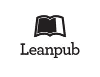

* * * * * *

这是一本来自 [Leanpub](http://leanpub.com) 的书。Leanpub 通过精益出版流程为作者和出版社赋能。[精益出版](http://leanpub.com/manifesto) 是使用轻量级工具和多次迭代来出版正在开发中的电子书，以获取读者反馈，并不断调整方向直到获得正确的书籍，并在一旦成功后建立势头。

* * * * * *

## 前言

我从高中就开始学习编程，从 20 世纪 80 年代初以来，我一直致力于人工智能、神经网络、机器学习以及通用 Web 工程项目的工作。我的大部分专业工作都反映在本书的示例中。这些示例程序也是根据其技术重要性挑选的，即：快速变化的大数据技术、机器学习在触及我们生活大部分部分的系统中的应用以及网络化设备。随后，我根据[我的博客](https://blog.markwatson.com)上发布的一项公开调查缩小了主题列表。非常感谢那些花时间参加这项调查的人。我希望书中的 Java 示例程序对你的项目有所帮助。希望你将在学习这些示例时也能获得很多乐趣！

Java 是一种灵活的语言，拥有大量的开源库和工具程序。Java 因其编程语言冗长而受到了一些批评。我有自己的编码风格，非常简洁，但可能会打破你学到的某些关于“正确”使用该语言的观念。自 20 多年前引入以来，Java 语言已经历了多次升级。本书要求并使用了 `Java 8` 的特性，因此如果你尚未更新，请升级到最新的 `JDK`。你还需要在你的系统中安装 `maven`。我还为 `IntelliJ IDE` 的免费社区版提供了项目文件。

你在书中学到的所有内容通过一些努力都可以用于替代的 JVM 语言 `Clojure`、`JRuby` 和 `Scala`。除了 Java 之外，我在工作中频繁使用 `Clojure`、`Haskell` 和 `Ruby`。

### 书籍大

本书由八章组成，我认为这些章节很好地展示了 Java 语言的力量：

* 针对物联网（IoT）的网络编程技术
* 使用 `OpenNLP` 进行自然语言处理，包括使用现有模型和创建自己的模型
* 使用 `Spark mllib` 库进行机器学习
* 异常检测机器学习
* 使用 `Deeplearning4j` 进行深度学习
* 网页爬虫
* 利用网络上丰富的语义和链式数据源来丰富你在应用程序中使用的数据模型
* 使用云数据资源的轻量级知识管理 Java 策略

关于 IoT 的第一章是关于 IoT 开发网络编程技术的教程。我也曾将这些相同的技术用于多人游戏开发、分布式虚拟现实系统，以及全球核试验监测系统的设计与实现中。这一章是独立的，与书中的任何其他材料没有联系。

第二章向你展示如何使用 `OpenNLP` 库训练你自己的分类器、标记词性并通处理英语文本。这一章以及下一章关于使用 `Spark mllib` 库进行机器学习的章节都使用了机器学习技术。

第四章提供了一个使用威斯康星大学癌症数据库进行异常检测的示例。第五章简要介绍了如何从网站上提取纯文本和半结构化数据。

最后两章面向想要开发信息设计和知识管理技能的信息架构师或开发者。这些章节涵盖了链式数据（语义网网）和知识管理技术。

示例的源代码可以在 https://github.com/mark-watson/power-java 找到，均根据 Apache 2 许可证发布。我尝试在示例中仅使用符合 Apache 2 或 MIT 风格许可的现有库。通常我更倾向于像 `GPL`、`LGPL` 和 `AGPL` 这样的自由软件许可证，但对于书中预期读者有时会复用整个示例程序或至少是小段代码的情况来说，允许在商业产品使用的许可更有意义。

该 github 仓库中每个章节都有一个子目录，每个子目录都有自己的 `maven pom.xml` 文件用于构建和运行示例。

这五章之间是相互独立的，因此在阅读和尝试示例程序时，请随时跳跃阅读。

本书可在 https://leanpub.com/powerjava 购买。

你可能对我通过 leanpub 自行出版的其他书籍感兴趣：

* [使用 Java 进行实用的人工智能编程](https://leanpub.com/javaai)
* [热爱 Common Lisp，或精明程序员的秘密武器](https://leanpub.com/lovinglisp)
* [使用 JavaScript 构建智能系统](https://leanpub.com/aijavascript)

我以前由 Springer-Verlag、McGraw-Hill、Morgan Kaufman、APress、Sybex、M&T Press 和 J. Wiley 出版的旧书籍列在[我网站的书籍页面](http://markwatson.com/books/) 上。

本书的一个主要主题是机器学习。除了我的[通用技术博客](https://blog.markwatson.com) 之外，我还有一个关于机器学习和认知技术的独立博客：[blog.cognition.tech](http://blog.cognition.tech/?view=classic) 以及一个[支持认知技术的网站](http://cognition.tech/)。

### 物联网的动机

本章将向你展示开发物联网项目和产品相关的网络编程技术，使用本地 TCP/IP 和 UDP 网络。我们不会涵盖硬件设计或物联网用户体验的设计。具体来说，我们将研究使用本地目录服务发布和查找服务的技术，以及使用 UDP、组播和广播进行高效通信的技术。

这一章是关于网络编程技术的教程，我相信它对开发物联网应用程序非常有用。关于用户 协议和组播的内容对网络游戏开发也有用。

我没有涵盖一些重要的内容：用户体验和设备的设计，以及使用本地低功电无线连接协作设备的物联网设备。尽管如此，思考驱动物联网开发的动机是值得的，我们将在下一节进行讨论。

我们已经习惯了使用计算设备的物理限制。20 世纪 60 年代中期当我读高中时，在当地的一所大学上了一门编程课，我必须前往计算机中心“朝圣”，等待使用打字孔机的机会，走过去提交打孔卡，然后站在那里等待，最后拿到打印输出并取回我的卡片。后来，交互式终端允许我能够在更舒适的物理环境中工作。时间一快，近五十年过去了，我现在可以使用智能手机 `SSH` 连接到我的服务器，看电影，甚至使用 `Java` IDE。当我写这本书时，可能有 70% 的互联网使用是在移动设备上完成的。

物联网（IoT）设备将计算设备更深入地整合到我们的生活中，减少了对我们的物理限制。我们的未来将包括服装、笔等小型个人物品、汽车、家具等，所有设备都连接在一个私有且安全的数据网中。除非你正在创作内容（例如编写软件、编辑图片和视频，或执行知识工程任务），否则你可能不会过多考虑你交互的设备，并且通常更倾向于使用移动设备。这种体验类似于开车，刹车、转向等任务是“自动”的，不需要太多的意识思考。

我们是物理生物。我们许多人在说话时会比划手势，在思考时会移动桌面上的东西，并且通常使用我们的物理环境。惊人的产品将物理对象与计算以及信息管理相结合。

在深入研究物联网设备之间的通信技术之前，我们将在下一节中简要离题介绍如何运行本章的示例程序。

### 运行示例程序

如果你想尝试运行示例程序，让我们在学习本章后面的网络编程技术和代码之前先完成准备工作。假设你已经克隆了书书中示例的 `github` 仓库，进入 `internet_of_things` 子目录，打开两个 shell 窗口，并使用以下命令按照它们出现的顺序运行示例（这些命令在 `README.md` 文件中，你可以直接复制粘贴）。这些命令被拆分为多行，以适应此本书的页宽：

#### 构建

```
1     mvn clean compile package assembly:single
```

#### 运行服务发现

```
1     java -cp target/iot-1.0-SNAPSHOT-jar-with-dependencies.jar \
2 	     com.markwatson.iot.CreateTestService
3     java -cp target/iot-1.0-SNAPSHOT-jar-with-dependencies.jar /
4 	     com.markwatson.iot.LookForTestService
```

#### 运行 UDP 实验：

```
 1     java -cp target/iot-1.0-SNAPSHOT-jar-with-dependencies.jar \
 2 	     com.markwatson.iot.UDPServer
 3     java -cp target/iot-1.0-SNAPSHOT-jar-with-dependencies.jar \
 4 	     com.markwatson.iot.UDPClient
 5 
 6     # 多组播实验：
 7     java -cp target/iot-1.0-SNAPSHOT-jar-with-dependencies.jar \
 8 	     com.markwatson.iot.MulticastServer
 9     java -cp target/iot-1.0-SNAPSHOT-jar-with-dependencies.jar \
10 	     com.markwatson.iot.MulticastClient
```

第 2 行编译并构建示例。对于每个示例程序，你将在命令行运行两个程序。例如，第 5 行和第 6 行的服务发现示例（在终端窗口中应在同一行输入），我们启动了一个测试服务，第 7 行和第 8 行运行服务测试客户端。同样，第 10 行到 20 行显示了如何运行 UDP 实验和多组播实验的服务及测试客户端。在我们查看代码时，我会对每个示例重复这些指令，但我认为你可能喜欢在在本章稍后查看示例的实现之前，先运行这三个示例。

在每个示例中，请在不同的 shell 窗口中运行两个示例程序。为了增加趣味，可以使用不同的笔记本电脑或任何可以运行 `Java` 代码的设备运行示例。

下图显示了 `IntelliJ` 社区版中本章的项目：

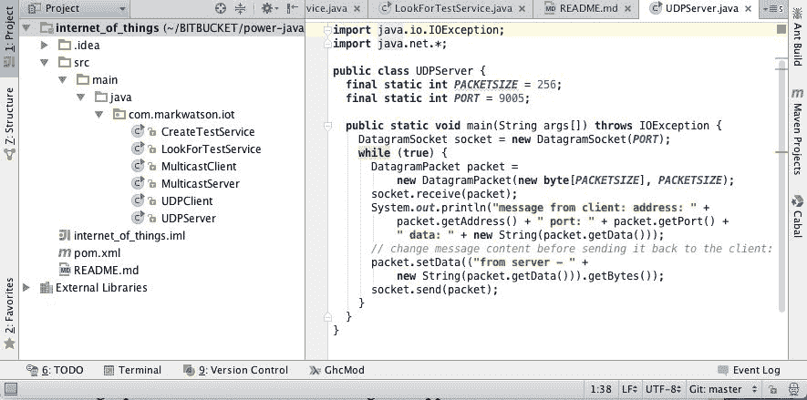

本章示例的 IntelliJ 项目视图

本章从一个你可能用于编写物联网应用程序的设计模式开始。然后，接下来的三个主要部分将向你展示如何使用目录查找、如何使用用户数据协议 (`UDP`) 代替 `TCP/IP`，以及多组播/广播。

本章的内容相当基础，但似乎许多开发者没有低级网络编程技术的经验。我的希望是，你能理解何时可能需要使用 `UDP` 而不是 `TCP` 的低级协议，以及何时你会在应用程序中发现目录查找是有用的。

### 设计模式

后续章节示例所支持的模式简单（从原理而言）：小型设备注册它们提供的服务，并寻找其他设备提供的服务。设备将使用用户数据协议 (`UDP`) 和多组播来通信以使用和提供服务。一旦消费者发现了服务提供者（主机、IP 地址、端口和以及类型），消费者也可以向提供者建立直接的 `TCP/IP` 套接连接以使用新发现的服务。

下图显示了几个物联网用例：

*   消费者使用 `JmDNS` 库在本地网络上广播对服务的请求。
*   提供端的 `JmDNS` 库听到服务描述请求并广播可用服务。
*   消费端的 `JmDNS` 库监听来自提供者的广播。
*   使用服务描述，消费者向提供者建立直接套接连接。
*   提供者定期广播更新的数据。
*   消费者监听更新数据的广播，并在数据可用时使用它。

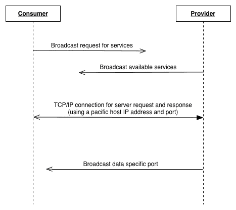

消费者和提供者用例

此显示了几个用例。你可以使用编写的特定应用程序来实现物联网设备之间的交互模式。

### 目录查找

在接两个子节中，我们将使用 JavaJmDNS 库，它支持本地多组播域名服务 (`DNS`) 并支持服务发现。`JmDNS` 与 Apple 的 BonjourDiscovery 服务兼容，该服务也可以安装在 Microsoft `Windows` 上。

如果你更改手机设置以接受多组播，`JmDNS` 已成功用于 Android 应用程序（自 Android 4.1 版本 [网络服务发现 (NDS)](https://developer.android.com/training/connect-devices-wirelessly/nsd) 起）。Android 开发不是本章的范围，如果你感兴趣，我建议参考 `NDS` 文档和示例程序。我在 Galaxy S III (Android 4.4.2) 和 Note 4 (Android 5.0.1) 上尝试了示例 Android `NsdChat` 应用，如果你对使用 Android 应用实验物联网开发感兴趣，这个示例应用将是一个很好的起点。

#### 创建并注册服务

本节中的示例程序使用 `JmsDNS` Java 库注册了一个监听端口 `1234` 的的服务。在下一节中，我们将查看另一个连接到该服务的示例程序。

```
 1 package com.markwatson.iot;
 2 
 3 import javax.jmdns.*;
 4 import java.io.IOException;
 5 
 6 public class CreateTestService {
 7   static public void main(String[] args) throws IOException {
 8     JmDNS jmdns = JmDNS.create();
 9     jmdns.registerService(
10         ServiceInfo.create("_http._tcp.local.", "FOO123.", 1234,
11             0, 0, "any data for FOO123")
12     );
13     // listener for service FOO123:
14     jmdns.addServiceListener("_http._tcp.local.", new Foo123Listener());
15   }
16 
17   static class Foo123Listener implements ServiceListener {
18 
19     public void serviceAdded(ServiceEvent serviceEvent) {
20       System.out.println("FOO123 SERVICE ADDED in class CreateTestService");
21     }
22 
23     public void serviceRemoved(ServiceEvent serviceEvent) {
24       System.out.println("FOO123 SERVICE REMOVED in class CreateTestService");
25     }
26 
27     public void serviceResolved(ServiceEvent serviceEvent) {
28       System.out.println("FOO123 SERVICE RESOLVED in class CreateTestService");
29     }
30   }
31 }
```

该服务在第 `10` 行和 `11` 行被创建，定义了服务名称（注意在服务名称 `FOO123` 末尾添加了一个点）、服务器监听的端口（在本例中为 `1234`），最后一个参数是任何你也想传递给查找服务 `FOO123` 信息的客户端的字符串数据。当你运行下一节中的客户端时，你将看到客户端为本地 DNS 查找收到了了这些信息。

运行此示例将产生以下输出（已为了适应页面宽度进行编辑）：

```
> java -cp target/iot-1.0-SNAPSHOT-jar-with-dependencies.jar \
       com.markwatson.iot.CreateTestService
FOO123 SERVICE ADDED in class CreateTestService
```

### 通过名称查找服务

如果你正在运行上一节中示例程序创建的服务，那么接的示例程序将查找该服务。


# 使用 JmDNS 查找服务

```java
 1 package com.markwatson.iot;
 2 
 3 import javax.jmdns.*;
 4 import java.io.IOException;
 5 
 6 // reference: https://github.com/openhab/jmdns
 7 
 8 public class LookForTestService {
 9 
10   static public void main(String[] args) throws IOException {
11     System.out.println("APPLICATION entered registerService");
12     JmDNS jmdns = JmDNS.create();
13     // 尝试查找名为 "FOO123" 的服务:
14     ServiceInfo si = jmdns.getServiceInfo("_http._tcp.local.", "FOO123");
15     System.out.println("APPLICATION si: " + si);
16     System.out.println("APPLICATION APP: " + si.getApplication());
17     System.out.println("APPLICATION DOMAIN: " + si.getDomain());
18     System.out.println("APPLICATION NAME: " + si.getName());
19     System.out.println("APPLICATION PORT: " + si.getPort());
20     System.out.println("APPLICATION getQualifiedName: " + si.getQualifiedName());
21     System.out.println("APPLICATION getNiceTextString: " + si.getNiceTextString(\
22 ));
23   }
24 }
```

我们在第 `12` 行和 `14` 行使用 `JmsDNS` 库通过名称查找服务。在第 `14` 行中，第一个参数 `_http._tcp.local.` 表示我们正在搜索本地网络（例如由你的本地 ISP 路由器创建的家庭网络）。

运行此示例将产生以下输出（已为了适应页面宽度进行编辑）：

```
> java -cp target/iot-1.0-SNAPSHOT-jar-with-dependencies.jar \
       com.markwatson.iot.LookForTestService
APPLICATION entered registerService
APPLICATION si: [ServiceInfoImpl@1595428806
                  name: 'FOO123._http._tcp.local.' address: '/192.168.0.14:1234'
                  status: 'DNS: Marks-MacBook-Air-local.local.
                  state: probing 1 task: null', has data empty]
APPLICATION APP: http
APPLICATION DOMAIN: local
APPLICATION NAME: FOO123
APPLICATION PORT: 1234
APPLICATION getQualifiedName: FOO123._http._tcp.local.
APPLICATION getNiceTextString: any data for FOO123
```

你想找到所有的本地服务吗？那么你也可以创建一个监听器，它会通知你所有的本地 HTTP 服务。在 `JmsDNS` 分发版中有一个路径为 `src/sample/java/samples/DiscoverServices.java` 的示例程序，由 Werner Randelshofer 编写。我将包名更改为 `com.markwatson.iot`。你可以通过以下命令尝试它：

```
mvn clean package assembly:single
java -cp target/iot-1.0-SNAPSHOT-jar-with-dependencies.jar \
         com.markwatson.iot.CreateTestService
java -cp target/iot-1.0-SNAPSHOT-jar-with-dependencies.jar \
         com.markwatson.iot.DiscoverServices
```

虽然查找所有本地服务很有用，但我预计你自己的项目将编写在本地网络上的服务和服务客户端应用程序。在这种情况下，你知道服务名称并可以像本节那样查找它们。

你可能熟悉使用 `TCP/IP` 进行网络编程。`TCP/IP` 在数据递送失败时提供某些保证。用户数据报协议（`UDP`）不提供此类保证，但在局域网中，它比 `TCP/IP` 高效得多。

## UDP 服务示例

本节中的示例程序实现了一个在 `9005` 端口监听 UDP 数据包的简单服务。示例代码打印客户端数据，更改客户端的内容并返回给客户端。

```java
 1 package com.markwatson.iot;
 2 
 3 import java.io.IOException;
 4 import java.net.*;
 5 
 6 public class UDPServer {
 7   final static int PACKETSIZE = 256;
 8   final static int PORT = 9005;
 9 
10   public static void main(String args[]) throws IOException {
11     DatagramSocket socket = new DatagramSocket(PORT);
12     while (true) {
13       DatagramPacket packet =
14          new DatagramPacket(new byte[PACKETSIZE], PACKETSIZE);
15       socket.receive(packet);
16       System.out.println("message from client: " + packet.getAddress() +
17           " port: " + packet.getPort() + " data: " +
18           new String(packet.getData()));
19       // 在发给客户端之前更改消息内容:
20       packet.setData(("from server - " + new String(packet.getData())).getBytes(\
21 ));
22       socket.send(packet);
23     }
24   }
25 }
```

运行此示例将产生以下输出（已为了适应页面宽度进行编辑）：

```
> java -cp target/iot-1.0-SNAPSHOT-jar-with-dependencies.jar \
         com.markwatson.iot.UDPServer
message from client: address: /127.0.0.1 port: 63300
                      data: Hello Server1431540275433
```

注意，你还必须运行下一节中的示例程序才能获得第 `4` 行和 `5` 行的输出。这就是为什么我在章节开头列出了运行所有示例的命令：我认为如果你按照这些早期的指令运行所有示例，这些示例程序将更易理解。

## UDP 客户端示例

本节中的示例程序为上一节中的 UDP 服务器实现了一个简单的客户端。它会将一个示例字符串发送到服务器并打印响应。

```java
package com.markwatson.iot;

import java.io.IOException;
import java.net.*;

public class UDPClient {

  static String INET_ADDR = "localhost";
  static int PORT = 9005;
  static int PACKETSIZE = 256;

  public static void main(String args[]) throws IOException {
    InetAddress host = InetAddress.getByName(INET_ADDR);
    DatagramSocket socket = new DatagramSocket();
    byte[] data = ("Hello Server" + System.currentTimeMillis()).getBytes();
    DatagramPacket packet = new DatagramPacket(data, data.length, host, PORT);
    socket.send(packet);
    socket.setSoTimeout(1000); // 1000 milliseconds
    packet.setData(new byte[PACKETSIZE]);
    socket.receive(packet);
    System.out.println(new String(packet.getData()));
    socket.close();
  }
}
```

运行此示例将产生以下输出（已根据页面宽度进行编辑）：

```
> java -cp target/iot-1.0-SNAPSHOT-jar-with-dependencies.jar \
         com.markwatson.iot.UDPClient
from server - HelloServer1431540275433
```

我在许多项目中使用过 `UDP` 网络编程，这里提到其中两个。在 20 世纪 80 年代，我是 NMRD 项目的架构师和开发者，该项目利用全球 38 个地震研究站收集数据，我们通过这些数据来判断是否有国家正在进行核爆炸试验。我们对元控制数据使用了保证送达的消息系统，但大部分原始数据传输使用了低层的 `UDP`。另一个应用程序是用于运行在局域网上的网络赛车和气垫游戏的通信库。`UDP` 非常适合局域网游戏开发，因为它的效率很高，丢失数据包的概率很低，即使丢失了包，通常影响影响游戏。请记住，使用 `UDP` 时，你无法保证数据的送达，也无法保证失败通知！

## 组播/广播网络编程

接下来两个节中的示例与最后两个节的示例相似，主要区别在于：服务器使用 `UDP` 定期广播数据。服务器并不关心是否有客户端在监听，它只是简单广播数据。如果有任何客户端在监听，它们可能会接收到数据。我之所以说“可能”接收，是因为 `UDP` 不提供任何送达保证。

特定的 `INET` 地址可以用于本地组播，其地址范围在 `224.0.0.0` 到 `224.0.0.255` 之间。我们将在两个示例程序中使用 `224.0.0.5`。这些是对于互联网是不可见的本地地址。

### 组播广播服务器

接例的示例与两个节前看到的示例（Java 类 `UDPServer`）非常相似，但我们不再等待客户端请求。

```java
package com.markwatson.iot;

import java.io.IOException;
import java.net.*;

public class MulticastServer {

  final static String INET_ADDR = "224.0.0.5";
  final static int PORT = 9002;

  public static void main(String[] args)
      throws IOException, InterruptedException {
    InetAddress addr = InetAddress.getByName(INET_ADDR);
    DatagramSocket serverSocket = new DatagramSocket();
    for (int i = 0; i < 10; i++) {
      String message = "message " + i;

      DatagramPacket messagePacket =
          new DatagramPacket(message.getBytes(),
              message.getBytes().length, addr, PORT);
      serverSocket.send(messagePacket);

      System.out.println("broadcast message sent: " + message);
      Thread.sleep(500);
    }
  }
}
```

在第 13 行我们为 `224.0.0.5` 创建了一个 `INET` 地址，在第 14 行创建了一个 `DatagramSocket`，它被重复用于广播 10 条消息，消息之间有 1/2 秒的延迟。广播消息在第 16 行中定义，第 18 到 21 行的代码创建了一个带有消息文本数据的新 `DatagramPacket`，并在第 21 行将其广播到局域网。

运行此示例将产生以下输出（输出已为了简洁编辑）：

```
> java -cp target/iot-1.0-SNAPSHOT-jar-with-dependencies.jar com.markwatson.iot.\
MulticastServer
broadcast message sent: message 0
broadcast message sent: message 1
 ...
broadcast message sent: message 8
broadcast message sent: message 9
```

与两个节前的 `UDPServer` 示例不同，无论你是否在下一节运行列表客户端，都会得到此输出。

### 组播广播监听器

本节的示例监听上一节中服务器示例的广播。广播服务器和客户端需要对 `INET` 地址和端口号一致。

```java
package com.markwatson.iot;

import java.io.IOException;
import java.net.DatagramPacket;
import java.net.InetAddress;
import java.net.MulticastSocket;
import java.net.UnknownHostException;

public class MulticastClient {

  final static String INET_ADDR = "224.0.0.5";
  final static int PORT = 9002;

  public static void main(String[] args) throws IOException {
    InetAddress address = InetAddress.getByName(INET_ADDR);
    byte[] buf = new byte[512];
    MulticastSocket clientSocket = new MulticastSocket(PORT);
    clientSocket.joinGroup(address);

    while (true) {
      DatagramPacket messagePacket = new DatagramPacket(buf, buf.length);
      clientSocket.receive(messagePacket);
      String message = new String(buf, 0, buf.length);
      System.out.println("received broadcast message: " + message);
    }
  }
}
```

在第 15 行我们创建了一个 `InetAddress`，在第 16 行为接收到的文本消息分配存储空间。我们在第 17 行在端口 `9002` 上创建一个 `MulticastSocket`，并在第 19 行加入服务器组。在第 21 到 27 行，我们无限循环监听广播消息并打印它们。

运行此示例将产生以下输出（输出已为了简洁编辑）：

```
> java -cp target/iot-1.0-SNAPSHOT-jar-with-dependencies.jar \
         com.markwatson.iot.MulticastClient
received broadcast message: message 0
received broadcast message: message 1
 ...
received broadcast message: message 8
received broadcast message: message 9
```

## IoT 总结

尽管我个人对 IoT 应用和产品的安全与隐私有些顾虑，但我对通过小型网络设备让我们的生活更简单、更高效的可能性充满热情。当我们工作和娱乐时，我们希望尽可能不要去考虑我们的计算设备，这样我们就能专注于自己的活动。


在本章中，我对于实用的 IoT 技术介绍仅仅是触及皮毛，但我希望我向你展示了可以在项目（包括 IoT 以及网络游戏编程）中使用的网络编程技术。当我写这本书时，有许多公司在提供 IoT 硬件开发包，选择一个套件和软件框架并创建你自己的项目是一个很好的进展方法。

## 使用 OpenNLP 进行自然语言处理

从 20 世纪 80 年代初，我就一直在自然语言处理（NLP）领域工作。很多人对 NLP 领域感兴趣，而且技术已经发生了巨大的变化。NLP 通常被认为是人工智能（AI）领域的一部分，在 20 世纪 80 年代和 90 年代，人们对符号 AI 有更大的兴趣，即对高层符号的操作，这些符号因为我们对现实世界的知识而对人类产生意义。例如，符号 `car` 对我们是有意义的，但对于 AI 软件来说，这个符号本身除了与 `driver` 和 `road` 等符号可能存在的语义关系没有任何意义。

自然语言处理（NLP）领域仍有许多工作是将单词视为符号的：句法解析器和语义解析器就是两个例子。发生变化的是对统计和机器学习技术的强烈依赖。在本章中，我们将使用开源的（Apache 2 许可）`OpenNLP` 项目，该项目使用机器学习来创建语言模型。目前，`OpenNLP` 支持丹麦语、德语、英语、西班牙语、葡萄牙语和瑞典语。我在 github 仓库中包含了一些用于本章示例的英语训练模型。你可以在 [OpenNLP 1.5 模型页面](http://opennlp.sourceforge.net/models-1.5/) 下载其他语言的模型（本书使用的是 `OpenNLP` 的 1..6.0 版本，该版本使用了 1.5 版本的模型）。

在为我的咨询客户执行的一些 NLP 项目中，我都会使用 `OpenNLP`。我还编写了自己的 NLP 工具包 [KBSPortal.com](http://kbsportal.com)，这是一款商业产品。对于可以使用 GPL 许可的客户，我有时会使用 [Stanford NLP 库](http://nlp.stanford.edu/)，它和 `OpenNLP` 一样是用 Java 编写的。

下图显示了 IntelliJ 社区版中本章的项目：

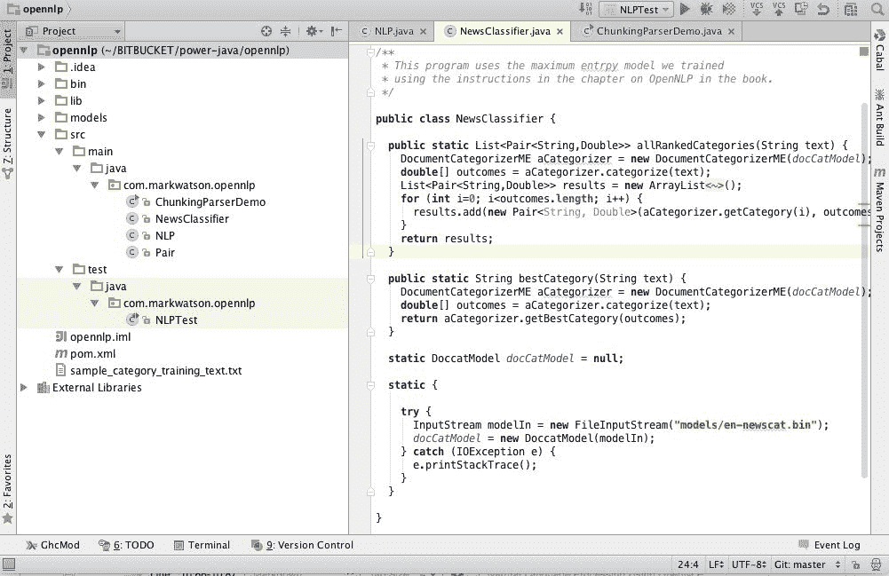

本章示例的 IntelliJ 项目视图

我们将使用预训练模型来对文本进行分词（tokenizing），并识别输入文本中的机构名称、人名、地名以及单词的词性。我们还将训练一个新模型（github 仓库中的 `opennlp/models/en-newscat.bin` 文件），用于识别输入文本的类别。关于使用你自己的训练数据训练新的最大熵分类模型的章节，可能是本章中你自己的项目中最常用的内容。我们将训练一个模型来识别 `COMPUTERS`（计算机）、`ECONOMY`（经济）、`HEALTH`（健康）和 `POLITICS`（政治）类别。之后，你应该具备使用自己的训练文本为应用程序所需的类别训练自己的模型的知识。我们还将使用包含 `OpenNLP` 分发版中的某些预训练模型，以及我们在下一章即将创建的分类模式——下一章我们将学习如何使用 Apache Spark 平台执行可扩展的机器学习算法，届时我们将研究处理大规模文本集的技术以发现信息。

在构建完分类模型后，我们将用一个有趣的话题结束本章：通过统计解析句子来发现输入文本中每个句子最可能的语言结构。在本书的其余部分我们将不再使用解析，因此如果你目前对将句子解析为名词短语和动词短语、专有名词、名词、形容词等语言组件感兴趣，可以跳过本章的最后一节。

### 使用 OpenNLP 预训练模型

假设你已经克隆了本书的 github 仓库，可以使用以下命令获取 maven 依赖、编译代码并运行单元测试：

```
mvn clean build test
```

模型文件（包括你将在章晚些时候学习构建的分类模型）位于 `models` 子目录下。`src/test/java/com/markwatson/opennlp/NLPTest.java` 中的单元测试为我们在本章中开发的代码提供了示例。用于分词（将文本拆分为单个单词）、分句以及识别文本中的机构、地点和人物的 Java 示例代码都在 `NLP` 类中。你可以查看本书仓库中的源代码。在这里我将仅展示几段代码片段，以明确如何加载和使用预训练模型。

我使用静态类初始化来加载模型文件：

```
 1   static public Tokenizer tokenizer = null;
 2   static public SentenceDetectorME sentenceSplitter = null;
 3   static POSTaggerME tagger = null;
 4   static NameFinderME organizationFinder = null;
 5   static NameFinderME locationFinder = null;
 6   static NameFinderME personNameFinder = null;
 7 
 8   static {
 9 
10     try {
11       InputStream organizationInputStream =
12 	    new FileInputStream("models/en-ner-organization.bin");
13       TokenNameFinderModel model =
14 	    new TokenNameFinderModel(organizationInputStream);
15       organizationFinder = new NameFinderME(model);
16       organizationInputStream.close();
17 
18       InputStream locationInputStream =
19 	    new FileInputStream("models/en-ner-location.bin");
20       model = new TokenNameFinderModel(locationInputStream);
21       locationFinder = new NameFinderME(model);
22       locationInputStream.close();
23 
24       InputStream personNameInputStream =
25 	    new FileInputStream("models/en-ner-person.bin");
26       model = new TokenNameFinderModel(personNameInputStream);
27       personNameFinder = new NameFinderME(model);
28       personNameInputStream.close();
29 
30       InputStream tokienizerInputStream =
31 	    new FileInputStream("models/en-token.bin");
32       TokenizerModel modelTokenizer = new TokenizerModel(tokienizerInputStream);
33       tokenizer = new TokenizerME(modelTokenizer);
34       tokienizerInputStream.close();
35 
36       InputStream sentenceInputStream =
37 	    new FileInputStream("models/en-sent.bin");
38       SentenceModel sentenceTokenizer = new SentenceModel(sentenceInputStream);
39       sentenceSplitter = new SentenceModel(sentenceTokenizer);
40       tokienizerInputStream.close();
41 
42       organizationInputStream = new FileInputStream("models/pos-maxent.bin");
43       POSModel posModel = new POSModel(organizationInputStream);
44       tagger = new POSTaggerME(posModel);
45 
46     } catch (IOException e) {
47       e.printStackTrace();
48     }
49   }
```

你处理自然语言时的首要操作是将文本拆分为单个单词。这里是使用分词代码将存储为 Java String 的文本拆分为单个单词的示例：

```
1   public static String[] tokenize(String s) {
2     return tokenizer.tokenize(s);
3   }
```

这里是将文本拆分为句子的类似代码：

```
1   public static String[] sentenceSplitter(String s) {
2     return sentenceSplitter.sentDetect(s);
3   }
```

这里是使用 `sentenceSplitter` 的一些示例代码：

```
1     String sentence =
2       "Apple Computer, Microsoft, and Google are in the " +
3       " tech sector. Each is very profitable.";
4     String [] sentences = NLP.sentenceSplitter(sentence);
5     System.out.println("Sentences found:\n" + Arrays.toString(sentences));
```

在第 4 行，静态方法 `NLP.sentenceSplitter` 返回一个字符串数组。在第 5 行，我使用了一种常用的 Java 技巧，通过使用静态方法 `Arrays.toString` 将字符串数组转换为 `List<String>` 对象来打印数组。技巧在于 `List` 类有一个 `toString` 方法，可以很好地格式化列表以便打印。

这是此代码片段的输出（为了页面宽度和清晰度进行了编辑）：

```
1 Sentences found:
2   ["Apple Computer, Microsoft, and Google are in the tech sector.",
3    "Each is very profitable."]
```

寻找机构、地点和人物的代码几乎相同，因此我只将在下一个识别地点的列表里显示代码。请查看 `com.markwatson.opennlp.NLP` 类中的 `companyNames` 和 `personNames` 方法以查看查找公司和人物名称的实现。

```java
  public static Set<String> locationNames(String text) {
    return locationNames(tokenizer.tokenize(text));
  }

  public static Set<String> locationNames(String tokens[]) {
    Set<String> ret = new HashSet<String>();
    Span[] nameSpans = locationFinder.find(tokens);
    if (nameSpans.length == 0) return ret;
    for (int i = 0; i < nameSpans.length; i++) {
      Span span = nameSpans[i];
      StringBuilder sb = new StringBuilder();
      for (int j = span.getStart(); j < span.getEnd(); j++)
        sb.append(tokens[j] + " ");
      ret.add(sb.toString().trim().replaceAll(" ,", ","));
    }
    return ret;
  }
```

`com.markwatson.opennlp.NLP` 类中的公共方法被重写，以接受单个字符串值（该值在方法内部进行分词）以及另一个接受输入已分词为 `String tokens[]` 对象的文本输入的方法。在最后一个示例中，第 1 行开始的方法接受一个输入字符串，而第 5 行开始的重写方法接受字符串数组。你通常会将存储在单个输入字符串中的文本分词为标记，并重用这些标记来调用 `com.markwatson.opennlp.NLP` 中的多个公共方法，这些方法可以接受已分词的输入。在第 2 行，我们只需对输入文本进行分词并调用接受已分词文本的方法。

在第 6 行，我们创建了一个 `HashSet<String>` 对象，用于存储一组地名的返回值。`NameFinderME` 对象 `locationFinder` 返回 `Span` 对象的数组。`Span` 类用于表示相邻单词序列。`Span` 类具有一个公共静态属性 `length` 以及实例方法 `getstart` 和 `getEnd`，它们返回原始输入文本中一个跨度的起始索引和结束（索引加 1）索引。

以下是使用 `locationNames` 的示例代码以及输出（已针对页面宽度和清晰度进行编辑）：

```
String sentence =
  "Apple Computer is located in Cupertino, California and Microsoft " +
  "is located in Seattle, Washington. He went to Oregon";
Set<String> names = NLP.locationNames(sentence);
System.out.println("Location names found: " + names);

Location names found: [Oregon, Cupertino, Seattle, California, Washington]
```

注意，预训练模型无法识别城市和州名何时是关联的。

### 为 OpenNLP 训练新的分类模型

OpenNLP 类 `DoccatTrainer` 可以处理特殊格式的输入文本文件，并使用最大熵产生分类模型，最大熵是一种处理具有许多特征数据的技术。从文本中自动提取并用于模型的特征（如文档中的单词和单词间的邻接关系。最大熵模型可以识别多个类别。在新的文本数据上测试模型时，所有可能类别的概率之和为 1（这通常被称为“softmax”）。例如，我们将针对四个类别训练一个分类器，对于某些测试输入文本，这些类别的概率之和为 1：

```
[[COMPUTERS, 0.1578880260493374], [ECONOMY, 0.2163099374638936],
 [HEALTH, 0.35546925520388845], [POLITICS, 0.27033278128288035]]
```

训练最大熵分类器的输入文件格式简单但必须正确：每行以一个类别名称开头，随后是每个类别的样本文本，这些文本必须全部在同一行上。请注意，我已经训练了模型并生成了 `models/en-newscat.bin` 模型文件，除非你想重新生成此模型文件，否则不需要运行本部分的示例。

`sample_category_training_text.txt` 文件包含四行，定义了四个类别。以下是该文件中的两行（我为了打印页面好看对其进行了编辑，但它们只是文件中的两行）：

```
COMPUTERS Computers are often used to access the Internet and meet basic busines\
s functions.
ECONOMY The Austrian School (also known as the Vienna School or the Psychologica\
l School ) is a Schools of economic thought|school of economic thought that emph\
asizes the spontaneous organizing power of the price mechanism.
```

这里是针对 `COMPUTERS` 和 `ECONOMY` 类各一个训练示例。

你必须完美地格式化训练文件。例如，如果你在输入训练文件中空行（或空白行），你将得到如下错误：

```
Computing event counts...  java.io.IOException: Empty lines, or lines with
                           only a category string are not allowed!
```

OpenNLP 文档提供了编写自定义 Java 代码构建模型的示例，但我通常只使用命令行工具；例如：

```
bin/opennlp DoccatTrainer -model models/en-newscat.bin
```


OpenNLP 文档提供了编写自定义 Java 代码构建模型的示例，但我通常只使用命令行工具；例如：

```
bin/opennlp DoccatTrainer -model models/en-newscat.bin
```

OpenNLP 文档提供了编写自定义 Java 代码构建模型的示例，但我通常只使用命令行工具；例如：

```
bin/opennlp DoccatTrainer -model models/en-newscat.bin
```

OpenNLP 文档提供了编写自定义 Java 代码构建模型的示例，但我通常只使用命令行工具；例如：

```
bin/opennlp DoccatTrainer -model models/en-newscat.bin
```

OpenNLP 文档提供了编写自定义 Java 代码构建模型的示例，但我通常只使用命令行工具；例如：

```
bin/opennlp DoccatTrainer -model models/en-newscat.bin
```

OpenNLP 文档提供了编写自定义 Java 代码构建模型的示例，但我通常只使用命令行工具；例如：

```
bin/opennlp DoccatTrainer -model models/en-newscat.bin
```

OpenNLP 文档提供了编写自定义 Java 代码构建模型的示例，但我通常只使用命令行工具；例如：

```
bin/opennlp DoccatTrainer -model models/en-newscat.bin
```

OpenNLP 文档提供了编写自定义 Java 代码构建模型的示例，但我通常只使用命令行工具；例如：

```
bin/opennlp DoccatTrainer -model models/en-newscat.bin
```

OpenNLP 文档提供了编写自定义 Java 代码构建模型的示例，但我通常只使用命令行工具；例如：

```
bin/opennlp DoccatTrainer -model models/en-newscat.bin
```

OpenNLP 文档提供了编写自定义 Java 代码构建模型的示例，但我通常只使用命令行工具；例如：

```
bin/opennlp DoccatTrainer -model models/en-newscat.bin
```

OpenNLP 文档提供了编写自定义 Java 代码构建模型的示例，但我通常只使用命令行工具；例如：

```
bin/opennlp DoccatTrainer -model models/en-newscat.bin
```

OpenNLP 文档提供了编写自定义 Java 代码构建模型的示例，但我通常只使用命令行工具；例如：

```
bin/opennlp DoccatTrainer -model models/en-newscat.bin
```

OpenNLP 文档提供了编写自定义 Java 代码构建模型的示例，但我通常只使用命令行工具；例如：

```
bin/opennlp DoccatTrainer -model models/en-newscat.bin
```

OpenNLP 文档提供了编写自定义 Java 代码构建模型的示例，但我通常只使用命令行工具；例如：

```
bin/opennlp DoccatTrainer -model models/en-newscat.bin
```

等等，让我重新处理文本。

```
public static void train(String languageCode,
                                ObjectStream<DocumentSample> samples,
                                int cutoff,
                                FeatureGenerators)
```

正如我在下一节提到的，最后一个参数看起来如下：

```
public DocumentCategorizerME(DoccatModel model,
           new FeatureGenerator[]{});
```

对于大多数用途，默认的频率（词袋）生成器可能足够，因此命令行工具是一个很好的起点。以下是运行`DoccatTrainer`的输出：

```
> bin/opennlp DoccatTrainer -model models/en-newscat.bin -lang en
                            -data sample_category_training_text.txt \
                            -encoding UTF-8
Indexing events using cutoff of 5
... (省略中间输出以保持简洁) ...
Wrote document categorizer model to
path: /Users/mark/power-java/opennlp/models/en-newscat.bin
```

我们将在下一节中使用新训练的模型文件`en-newscat.bin`。

**请注意，在这个简单示例中我使用了很少的数据，每个训练类别仅有几百个单词。我在各种项目中使用过 OpenNLP 最大熵库，效果大多良好，但我每个类别都使用了数千个单词。数据越多越好。**

使用我们在上一节中训练的模型的代码短到完全可以完整列出：

```java
 1 package com.markwatson.opennlp;
 2 
 3 import opennlp.tools.doccat.DoccatModel;
 4 import opennlp.tools.doccat.DocumentCategorizerME;
 5 
 6 import java.io.*;
 7 import java.util.*;
 8 
 9 /**
10  * 此程序使用了我们根据书中 OpenNLP 章节中的说明
11  * 训练的极大熵模型。
12  */
13 
14 public class NewsClassifier {
15 
16   public static List<Pair<String,Double>> allRankedCategories(String text) {
17     DocumentCategorizerME aCategorizer = new DocumentCategorizerME(docCatModel);
18     double[] outcomes = aCategorizer.categorize(text);
19     List<Pair<String,Double>> results = new ArrayList<Pair<String, Double>>();
20     for (int i=0; i<outcomes.length; i++) {
21       results.add(new Pair<String, Double>(aCategorizer.getCategory(i), outcomes\
22 [i]));
23     }
24     return results;
25   }
26 
27   public static String bestCategory(String text) {
28     DocumentCategorizerME aCategorizer = new DocumentCategorizerME(docCatModel);
29     double[] outcomes = aCategorizer.categorize(text);
30     return aCategorizer.getBestCategory(outcomes);
31   }
32 
33   public static Pair<String,Float> classifyWithScore(String text) {
34     DocumentCategorizerME classifier = new DocumentCategorizerME(docCatModel);
35     double [] scores = classifier.categorize(text);
36     int num_categories = classifier.getNumberOfCategories();
37     if (num_categories > 0) {
38       String bestString =  classifier.getBestCategory(scores);
39       for (int i=0; i<num_categories; i++) {
40         if (classifier.getCategory(i).equals(bestString)) {
41           return new Pair<String,Float>(bestString, (float)scores[i]);
42         }
43       }
44     }
45     return new Pair<String,Float>("<no category>", 0f);
46   }
47   
48   static DoccatModel docCatModel = null;
49 
50   static {
51 
52     try {
53       InputStream modelIn = new FileInputStream("models/en-newscat.bin");
54       docCatModel = new DoccatModel(modelIn);
55     } catch (IOException e) {
56       e.printStackTrace();
57     }
58   }
59 }
```

在第 33 到 42 行中，我们为`DoccatModel`类的实例初始化静态数据，加载上一节创建的模型文件。

每想要分类输入文本时，都会在第 28 行创建一个`DocumentCategorizerME`类的新实例。我调用了该类的使用默认特征检测器的单参数构造函数。另一种构造函数是：

```java
1 public DocumentCategorizerME(DoccatModel model,
2                              FeatureGenerator... featureGenerators)
```

默认的特征生成器是`BagOfWordsFeatureGenerator`，它仅使用词频进行分类。对于我们在上一节中使用的较小训练集来说这是合理的，但当我有大量的训练数据时，我倾向于将`BagOfWordsFeatureGenerator`与`NGramFeatureGenerator`结合。你可以这样调用构造函数：

```java
1 public DocumentCategorizerME(DoccatModel model,
2            new FeatureGenerator[]{new BagOfWordsFeatureGenerator(),
3                                   new NGramFeatureGenerator()});
```

以下列表穿插了使用`NewsClassifier`类的示例代码片段，随后是每个代码片段打印的输出：

```java
 String sentence = "Apple Computer, Microsoft, and Google are in the tech sector. Each is very profitable.";
    System.out.println("\nNew test sentence:\n\n" + sentence + "\n");
    String [] sentences = NLP.sentenceSplitter(sentence);
    System.out.println("Sentences found: " + Arrays.toString(sentences));

New test sentence:

Apple Computer, Microsoft, and Google are in the tech sector.
Each is very profitable.

Sentences found: [Apple Computer, Microsoft, and Google are in the tech sector.,
                  Each is very profitable.]
```

```java
 sentence = "Apple Computer, Microsoft, and Google are in the tech sector.";
    Set<String> names = NLP.companyNames(sentence);
    System.out.println("Company names found: " + names);

Company names found: [Apple Computer, Microsoft]

    sentence = "Apple Computer is located in Cupertino, California and Microsoft is located in Seattle, Washington. He went to Oregon";
    System.out.println("\nNew test sentence:\n\n" + sentence + "\n");
    Set<String> names1 = NLP.locationNames(sentence);
    System.out.println("Location names found: " + names1);

New test sentence:

Apple Computer is located in Cupertino, California and Microsoft
 is located in Seattle, Washington. He went to Oregon

Location names found: [Cupertino, California, Seattle, Washington, Oregon]
```

我们将使用 OpenNLP 分发版中包含的解析模型来解析英文输入文本。在你的工作中可能不太会用到统计解析模型，但我认为你会喜欢这一节的材料。如果你对实战技术更感兴趣，请跳到下一章，该章节将介绍更多的机器学习技术。

接下来的示例代码列表很长（68 行），但我将在列表之后解释其中有趣的部分：


```java
package com.markwatson.opennlp;

import opennlp.tools.cmdline.parser.ParserTool;
import opennlp.tools.parser.Parse;
import opennlp.tools.parser.ParserModel;
import opennlp.tools.parser.chunking.Parser;

import java.io.FileInputStream;
import java.io.IOException;
import java.io.InputStream;

/**
 * 使用分块解析器模型进行实验
 */
public class ChunkingParserDemo {
  public Parse[] parse(String text) {
    Parser parser = new Parser(parserModel);
    return ParserTool.parseLine(text, parser, 5);
  }

  public void prettyPrint(Parse p) {
    StringBuffer sb = new StringBuffer();
    p.show(sb);
    String s = sb.toString() + " ";
    int depth = 0;
    for (int i = 0, size = s.length() - 1; i < size; i++) {
      if (s.charAt(i) == ' ' && s.charAt(i + 1) == '(') {
        System.out.print("\n");
        for (int j = 0; j < depth; j++) System.out.print("  ");
      } else if (s.charAt(i) == '(') System.out.print(s.charAt(i));
      else if (s.charAt(i) != ')' || s.charAt(i + 1) == ')')
        System.out.print(s.charAt(i));
      else {
        System.out.print(s.charAt(i));
        for (int j = 0; j < depth; j++) System.out.print("  ");
      }
      if (s.charAt(i) == '(') depth++;
      if (s.charAt(i) == ')') depth--;
    }
    System.out.println();
  }

  static ParserModel parserModel = null;

  static {

    try {
      InputStream modelIn = new FileInputStream("models/en-parser-chunking.bin");
      parserModel = new ParserModel(modelIn);
    } catch (IOException e) {
      e.printStackTrace();
    }
  }

  public static void main(String[] args) {
    ChunkingParserDemo cpd = new ChunkingParserDemo();
    Parse[] possibleParses =
      cpd.parse("John Smith went to the store on his way home from work ");
    for (Parse p : possibleParses) {
      System.out.println("parse:\n");
      p.show();
      //p.showCodeTree();
      System.out.println("\npretty printed parse:\n");
      cpd.prettyPrint(p);
      System.out.println("\n");
    }
  }
}
```

OpenNLP 解析模型是从第 45 行到 53 行从文件中读取的。静态变量 `parserModel`（`ParserModel` 类的实例）在第 49 行创建，并在第 17 行和 18 行中用于解析输入文本。查看中间计算结果是有帮助的。第 17 行定义的变量 `parser` 的值为：

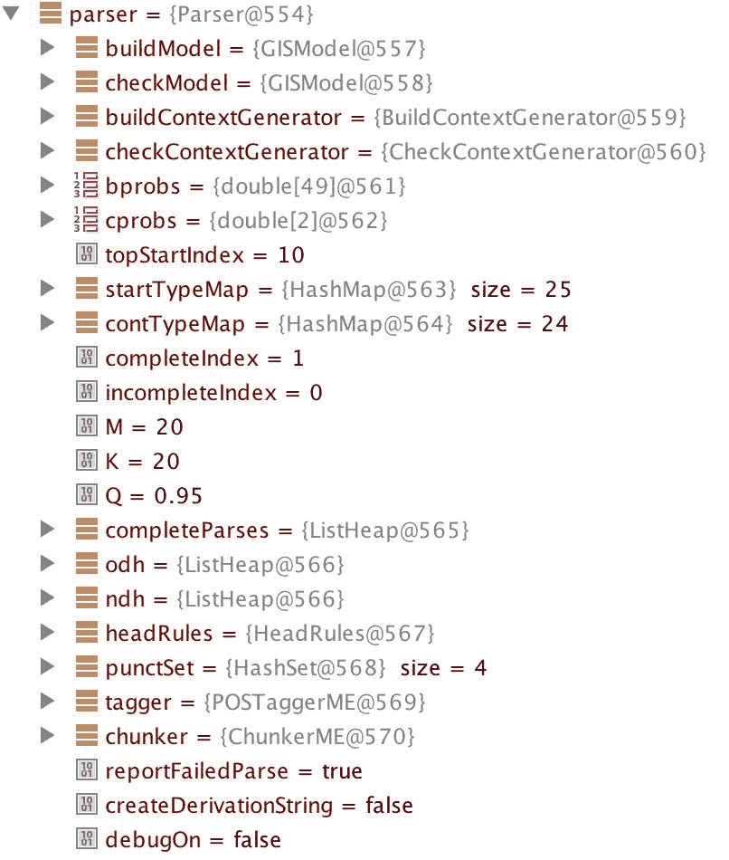

IntelliJ 中看到的解析模型中的数据

注意，解析器返回了 5 个结果，因为我们在第 18 行指定了此数字。对于长句子，解析器会为句子生成大量可能的解析结果，并按照正确概率的顺序返回我们请求的结果数量。

OpenNLP 分块解析器代码以平铺列表的形式输出结果，每行一个结果。这很难阅读，这就是为什么我写了 `prettyPrint` 方法（第 21 行到 41 行）来缩进式打印解析结果。这里是上一个代码示例的输出（第一个显示的解析在同一行内，但后续列表中进行了换行）：

```
 1 parse:
 2 
 3 (TOP (S (NP (NNP John) (NNP Smith)) (VP (VBD went) (PP (TO to) (NP (DT the) (NN \
 4 store))) (PP (IN on) (NP (NP (NP (PRP$ his) (NN way)) (ADVP (NN home))) (PP (IN \
 5 from) (NP))))
 6 
 7 pretty printed parse:
 8 
 9 (TOP (S (NP (NNP John) (NNP Smith)) (VP (VBD went) (PP (TO to) (NP (DT the) (NN \
10 store))) (PP (IN on) (NP (NP (NP (PRP$ his) (NN way)) (ADVP (NN home))) (PP (IN \
11 from) (NP))))
```

*   解释和使用模型结果。通常，模型会被用于处理其他数据集以自动标记数据（正如我们在本章中对维基百科文本数据所的那样），或从新的时间序列数值数据源进行预测。

*   将训练好的模型作为大型系统的嵌入部分部署。这是一个可选步骤——有时，仅使用模型来充分理解一个问题并知道如何解决它就足够了。然而，通常模型会作为正常数据处理和决策工作流的一部分反复使用（通常是自动化的）。在本章，我会特意说明如何重用嵌入到 Java 应用程序中的模型。

在本书的示例中，我已为示例程序提供了测试数据。请记住，尽管我将数据挖掘和机器学习模型构建的步骤列为一系列顺序步骤，但在实践中，这是一个非常迭代的过程。在看到使用不同算法构建模型的初步结果后，可能需要重新进行数据收集和清洗。我们可能会迭代地调整模型参数，并通过添加或删除用于构建模型的数据特征来改进模型。

我所说的数据的“特征”是指什么？对于文本数据，特征可以是：文本中的单词、文本中相邻单词的集合（n-gram）、文本结构（例如利用 HTML 或其他标记）、标点符号等。对于数值数据，特征可能是序列中数据点的最小值和最大值、频率空间中的特征（通过快速傅里叶变换 FFT 计算，有时也作为功率谱密度 PSD，这是一种丢弃了数据相位信息的 FFT）等。对于不同类型的数据，清洗数据的含义也也不同。在清洗文本数据时，我们可能会将文本分段句子，进行词干提取（即，将“banking”或“banks”映射到它们的词根“bank”），有时我们可能希望将所有文本转换为小写，等。对于数值数据，我们可能需要将数据属性缩放到特定的数值范围内——我们将在本章稍后使用威斯康星大学癌症数据集时完成此操作。

我概述的前七个步骤是我对发现信息源、处理数据以及从数据中产生可操作知识过程的看法。你可能会遇到的其他缩写包括数据中的知识发现（KDD）和 CCC 大数据流水线，它们都使用了与我刚刚概述的类似的步骤。

广而言，机器学习模型有四类：

*   回归 - 预测一个数值。输入是数值值。

*   分类 - 预测“是”或“否”。输入是数值值。

*   聚类 - 将一组数据项划分为不相交的集合。数据项可以是文本文档、传感器读取的数值数据集、包含文本和数字的结构化数据集。输入必须转换为数值值。

*   推荐 - 根据用户的之前的行为和/或通过将用户与其他相似用户匹配以使用其他用户的行为，做出推荐对象的决策。

你稍后在处理文本时会看到我们需要将单词转换为数字（每个单词都被分配一个唯一的数字 ID）。文档由一个稀疏向量表示，对于每个唯一的单词索引都有非空元素。此外，我们可以将机器学习问题分为两个大类：

*   监督学习 - 用于训练的输入特征带有所需预测的标签。我们将看到的的监督学习示例是使用癌症症状数据构建回归模型，以根据新的输入特征集预测恶性 vs. 良性。

*   无监督学习 - 输入特征没有标签。我们将看到的无监督学习示例包括：K-Means 类似的维基百科文档聚类，以及使用 word2vec 寻找文档中的相关单词。

在本章的目标是向你介绍使用 Spark 和机器学习算法的实用技术。在你学习完材料后，我建议阅读 Spark 文档，以查看更多可用的模型。还要考虑参加 Andrew Ng 出出的[机器学习课程](https://www.coursera.org/learn/machine-learning)。

# 机器学习的扩展

虽然对于极大数据集扩展数据挖掘和机器学习操作的能力有时很重要，但对于开发以及完成本章中的示例，你不需要搭建服务器集群来运行 Spark。我们将以开发模式使用 Spark，你可以在笔记本电脑上运行示例。如果你的笔记本电脑至少有 2 GB 内存来运行机器学习示例将是最好的。重要的是记住，你在本章中学会的技术可以根据需要在不修改应用程序源码的情况下扩展到非常大的数据集。

Apache Spark 项目源于加利福尼亚大学伯伯克利分校。Spark 有对 Java、Scala 和 Python 的客户端支持。本章中的示例都将使用 Java 编写。如果你是 Scala 开发者，在学习完示例后，你可能想看看 Scala Spark 文档，因为 Spark 是 Scala 编写的，且 Scala 拥有最好的客户端支持。Python Spark 和 MLlib API 也非常好用，所以如果你是 Python 开发者，应该检查这个 Python 支持。

Spark 是使用 Hadoop 或 Google Map Reduce 等 map reduce 系统的演进步骤。通过学习本章的示例，你可能会认为可以用更少的代码和更小的运行时开销来实现相同的效果。对于处理少量数据这确实如此，但就像使用 Hadoop 一样，代码中多一点冗余让你具有将应用程序扩展到大型数据集的能力。我们为了可扩展性忍受了额外的复杂度。Spark 提供了用于读取和转换数据的实用类，使得示例程序比自己编写代码导入数据更简单。

我建议你从 [Apache Spark 下载页面](https://spark.apache.org/downloads.html) 下载 Spark 1.5.0 版本的源码，因为有很多示例程序可以供你获取思路和参考。Spark 机器学习库 MLlib 中的 Java 客户端示例可以在目录下找到：

```
spark-1.5.0/examples/src/main/java/org/apache/spark/examples/MLlib/
```

其中 `spark-1.5.0` 目录是在下载 Spark 1.5 版本时创建的。

这些使用了提供的数值数据文件，每行指定一个本地 Vector 数据类型。本章中的第一个 K-Means 聚类示例源自 Spark 分带的 MLlib 示例。第二个聚类维基百科文章的 K-Means 示例不同得多，因为我们需要编写新代码将文本转换为数值特征向量。我提供了手动从维基百科文章中选择的样本文本。

我们将从本章开始向你展示如何在笔记本电脑上设置 Spark 和 MLlib，然后看一个从输入文本生成词数的简单“Hello World”介绍性程序。随后我们将实现逻辑回归，并简要查看 Spark MLlib 示例中的 JavaKMeans 程序，利用它来理解将数据还原为一组数值特征向量的要求。

### 在笔记本电脑上设置 Spark

假设你已经克隆了这本书的 github 项目，Spark 示例位于子目录 `machine_learning_spark`。maven pom.xml 文件包含了 Spark 依赖。你可以使用以下命令安装这些依赖：

```
mvn clean install
```

本章包含四个示例。如果你想跳过前面的并在阅读本章其余内容之前运行代码，请分别运行每个 maven 测试：

```
mvn test -Dtest=HelloTest
mvn test -Dtest=KMeansTest
mvn test -Dtest=WikipediaKMeansTest
mvn test -Dtest=LogisticRegressionTest
mvn test -Dtest=SvmClassifierTest
```

Spark 包含了整个 Hadoop 作为依赖项，因为 Spark 能够与 Hadoop 和 Hadoop 文件系统交互。下载所有这些依赖项需要一些时间，但只需要执行一次。为了补充本章的内容，你可以参考 [Spark 编程指南](https://spark.apache.org/docs/latest/programming-guide.html)。我们还将使用 [Spark 机器学习库 (MLlib) 指南](https://spark.apache.org/docs/1.5.0/mllib-guide.html) 中的材料。

下图显示了 IntelliJ 社区版中本章的项目：

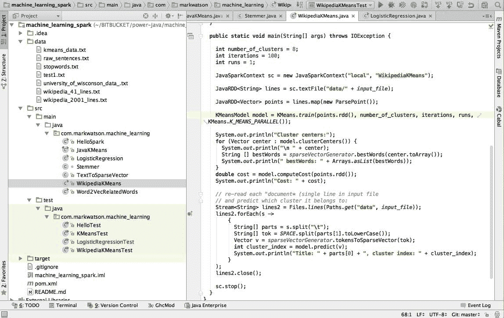

本章示例的 IntelliJ 项目视图

### Hello Spark - 词频计数示例

词频计数示例常用于引入 map reduce，我在这里也会用它作为一个类似于“hello 世界”的简单 Spark 示例。在接下来的列表中，第 3 到第 6 行导入了所需的类。在第 3 和第 4 行中，`RDD` 代表弹性数据集（Resilient Distributed Datasets）。Spark 是用 Scala 写的，因此我们有时会看到带有“Java”前缀的 Java 包装类。每个 `RDD` 是某种类型对象的集合，可以分布在 Spark 集群的多个服务器上。`RDDs` 是容错的，Spark 集群中有足够的信息来重建任何因服务器或软件故障而丢失的数据。


```
package com.markwatson.machine_learning;

import org.apache.spark.api.java.JavaPairRDD;
import org.apache.spark.api.java.JavaRDD;
import org.apache.spark.api.java.JavaSparkContext;
import scala.Tuple2;

import java.util.Arrays;
import java.util.List;
import java.util.Map;

public class HelloSpark {

  static private List<String> tokenize(String s) {
    return Arrays.asList(s.replaceAll("\\.", " \\. ").replaceAll(",", " , ")
        .replaceAll(";", " ; ").split(" "));
  }

  static public void main(String[] args) {
    JavaSparkContext sc = new JavaSparkContext("local", "Hello Spark");

    JavaRDD<String> lines = sc.textFile("data/test1.txt");
    JavaRDD<String> tokens = lines.flatMap(line -> tokenize(line));
    JavaPairRDD<String, Integer> counts =
        tokens.mapToPair(token ->
			 new Tuple2<String, Integer>(token.toLowerCase(), 1))
              .reduceByKey((count1, count2) -> count1 + count2);
    Map countMap = counts.collectAsMap();
    System.out.println(countMap);
    List<Tuple2<String, Integer>> collection = counts.collect();
    System.out.println(collection);
  }
}
```

第 14 到第 17 行定义了简单的 `tokenizer` 方法，该方法接收英文文本并映射到字符串列表。我将其提取出来作为一个独立的方法，是为了提醒需要处理标点符号，而且将其分成独立方法可以方便你对特定文本输入文件可能所需的自定义分词进行实验。一种可能性是使用我们在上一章中使用的 OpenNLP 分词器模型。例如，我们希望字符串“tree.”被分词为 `["tree", "."]` 而不是 `["tree."]`。该方法在第 23 行中使用，并为输入文本文件的每一行调用一次。

在示例的第 22 行中，我们正在读取本地文本文件 `data/test1.txt`，但通常情况下，`JavaSparkContext.textFile()` 的参数可以是指定本地 Hadoop 文件系统 (HDFS)、Amazon S3 对象或 Cassandra 文件系统的 URI。请注意在第 22 行定义的变量 `lines` 的类型：类型 `JavaRDD<string>` 指定了一个 RDD 集合，其中的分布式对象是字符串。

第 29 到第 32 行的代码如果逐行解析，其实并不复杂。`counts` 的类型是一个 RDD 分布式集合，集合中的每个对象都是一个字符串和一个整数值的对。第 25 到第 27 行的代码获取原始文本文件中的每个 token，并产生一个由 token 字符串和整数 1 组成的二值对（或 `Tuple2` 值）。例如，一个包含三个 token 的数组如：

```
["the", "dog", "ran"]
```

将被转换为一个包含三个对的数组：

```
[["the", 1], ["dog", 1], ["ran", 1]]
```

第 28 行的语句使用了 `reduceByKey` 方法，它根据唯一键对数组进行分区。这里是程序的输出内容：

```
{dog=2, most=1, of=1, down=1, rabbit=1, slept=1, the=5, street=1,
 chased=1, day=1}
```

### 介绍 Spark MLlib 库

当我在 2015 年秋季编写本章时，Spark MLlib 库处于 1.5 版本并持续开发中。当你尝试示例时，请尝试 1.5 版本。我会更新这本书的 git 仓库，并尽量保持代码示例与稳定版本兼容。

接下来的章节将展示如何将 MLlib 库应用于逻辑回归问题、使用 K-Means 算法聚类，以及使用 word2vec 算法发现词之间的强关联。

### 使用威斯康星大学数据库的 MLlib 逻辑回归示例

在本节中，我们将使用监督学习建立一个回归模型，将症状的数值特征向量映射到一个数值，数值越大表示恶性，数值越接近 0 表示良性。

MLlib 支持三种线性模型：支持向量机 (SVM)、逻辑回归（针对一个或多个类别的模型）以及线性回归（将类别输出为 `[0..1]` 范围内的浮点数的模型）。Spark MLlib 文档（http://spark.apache.org/docs/latest/mllib-linear-methods.html）对这三种线性模型的描述非常出色，它们的示例程序也很相似，因此切换你使用的线性模型类型很容易。

我们将在本节的示例中使用逻辑回归。吴恩达在他优秀的[机器学习课程](https://www.coursera.org/learn/machine-learning) 中提到，开始一个新问题时第一个尝试的模型是线性模型。我们将在下一节使用 SVM 代替逻辑回归重复此示例。

如果你读过我的书籍 [Build Intelligent Systems with Javascript](https://leanpub.com/aijavascript)，本节使用的训练和测试数据集你会感到熟悉：[威斯康星大学乳癌数据集](https://archive.ics.uci.edu/ml/datasets/Breast+Cancer+Wisconsin+%28Diagnostic%29)。

根据威斯康星大学网页，以下是该数据集中的属性及其允许范围：

```
- 0 Sample code number            integer
- 1 Clump Thickness               1 - 10
- 2 Uniformity of Cell Size       1 - 10
- 3 Uniformity of Cell Shape      1 - 10
- 4 Marginal Adhesion             1 - 10
- 5 Single Epithelial Cell Size   1 - 10
- 6 Bare Nuclei                   1 - 10
- 7 Bland Chromatin               1 - 10
- 8 Normal Nucleoli               1 - 10
- 9 Mitoses                       1 - 10
- 10 Class (2 for benign, 4 for malignant)
```

文件 `data/university_of_wisconson_data_.txt` 包含原始数据。我们将使用此示例数据集，但进行两处更改：我们通过移除样本代码列来对其进行清洗，并将接下来的 9 个值缩缩到 `[0..1]` 范围内，并将类别映射为 `0`（良性）或 `1`（恶性）。因此，我们的输入特征是缩放过的（介于 `[0 and 1]` 之间的数值，表示肿块厚度、细胞大小均匀性等）。指定预期预测内容的标签是类别（2 为良性，4 为恶性，我们将其缩放为 `0` 或 `1`）。在接下来的列表中，数据从训练文件中读取并在第 27 行到 44 行之间进行缩放。在这里我使用了 MLlib 提供的一些实用方法。在第 28 行，我使用 `JavaSparkContext.textFile` 方法将文本文件读取到实质上是一个字符串列表中（每个输入行一个字符串）。第 29 行到 44 行创建了 `LabeledPoint` 类的实例列表，该类包含带有关联数值特征数据的训练标签。容器类 `JavaRDD` 充当元素列表，可以在 Spark 服务器集群上进行自动管理。当在带有本地 `JavaSparkContext` 的开发模式下，一切都运行在单个 JVM 中，因此 `JavaRDD` 类的实例的行为非常像简单的内存中的列表。

```
package com.markwatson.machine_learning;

import org.apache.spark.api.java.JavaDoubleRDD;
import org.apache.spark.api.java.JavaRDD;
import org.apache.spark.api.java.JavaSparkContext;
import org.apache.spark.api.java.function.Function;
import org.apache.spark.mllib.linalg.Vectors;
import org.apache.spark.mllib.regression.LabeledPoint;
import org.apache.spark.mllib.regression.LinearRegressionModel;
import org.apache.spark.mllib.regression.LinearRegressionWithSGD;
import scala.Tuple2;

public class LogisticRegression {

  public static double testModel(LinearRegressionModel model,
                                 double [] features) {
    org.apache.spark.mllib.linalg.Vector inputs = Vectors.dense(features);
    return model.predict(inputs);
  }

  public static void main(String[] args) {
    JavaSparkContext sc =
	  new JavaSparkContext("local",
	                       "University of Wisconson Cancer Data");

    // Load and parse the data
    String path = "data/university_of_wisconson_data_.txt";
    JavaRDD<String> data = sc.textFile(path);
    JavaRDD<LabeledPoint> parsedData = data.map(
        new Function<String, LabeledPoint>() {
            public LabeledPoint call(String line) {
            String[] features = line.split(",");
            double label = 0;
            double[] v = new double[features.length - 2];
            for (int i = 0; i < features.length - 2; i++)
              v[i] = Double.parseDouble(features[i + 1]) * 0.09;
            if (features[10].equals("2"))
              label = 0; // benign
            else
              label = 1; // malignant
            return new LabeledPoint(label, Vectors.dense(v));
          }
        }
    );
    // Split initial RDD into two data sets with 70% training data
    // and 30% testing data (13L is a random seed):
    JavaRDD<LabeledPoint>[] splits =
	  parsedData.randomSplit(new double[]{0.7, 0.3}, 13L);
    JavaRDD<LabeledPoint> training = splits[0].cache();
    JavaRDD<LabeledPoint> testing = splits[1];
    training.cache();

    // Building the model
    int numIterations = 100;
    final LinearRegressionModel model =
        LinearRegressionWithSGD.train(JavaRDD.toRDD(training),
		                              numIterations);

    // Evaluate model on training examples and compute training error
    JavaRDD<Tuple2<Double, Double>> valuesAndPreds = testing.map( // ... wait, the logic continues in the block
```

（注：提示中提供的代码块在中间被截断/中断了，但我根据提供的文本流保持了其结构）

一旦数据被读取并转换为数值特征，我们接下来的工作是将输入数据随机划分为两个单独的集合：一个用于训练，另一个用于测试我们的模型。这种数据划分在第 47 行和第 48 行完成。第 49 行复制了训练数据，并请求当前上下文尝试将这些数据缓存。在第 50 行，我们复制了测试数据，但没有指定测试数据需要缓存。

还有两部分代码需要讨论。在第 53 行到 75 行中，我正在训练模型、将模型保存到磁盘，并在模型仍在内存中对其进行测试。在第 77 行到 89 行中，我正在从磁盘重新加载保存的模型，并展示如何使用两个测试向量使用它。这最后部分代码旨在演示如何在 Java 中嵌入并使用模型。

以下三行代码是此示例程序的输出。第一行输出表示训练模型的误差较低。最后两行显示了从磁盘重新加载模型并使用它评估两个新特征向量的输出：

```
Test Data Mean Squared Error = 0.050140726106582885
Should be malignant (close to 1.0): 1.1093117757012294
Should be benign (close to 0.0): 0.29575663511929096
```

此示例展示了一种常见的模式：从磁盘读取训练数据、对其缩放并构建保存到磁盘的模型以供以后使用。该程序几乎可以原样用于新类型的训练数据。你只需要修改第 27 行到 44 行。

### 使用 Wisconsin Database 的 SVM 分类示例

本节的示例与上一节非常相似。唯一的区别是用 MLlib 类 `SvmClassifier` 代替我们在上一节使用的 `LogisticRegression` 类，并将训练迭代次数设置为 500。我们在本节中使用了相同的威斯康星大学癌症数据集——有关该数据集的讨论请参考前节。

由于本节的代码与上一个示例非常相似，我将不再重复列出。请参考本书 GitHub 仓库中的源文件 `SvmClassifier.java` 和测试文件 `SvmClassifier.java`。在仓库的子目录 `machine_learning_spark` 中，在运行本节示例之前，您需要删除运行上一节示例时生成的模型文件：

```
rm -r -f generated_models/*
mvn test -Dtest=SvmClassifierTest
```

该示例的输出结果如下：

```
Test Data Mean Squared Error = 0.22950819672131167
Should be malignant (close to 1.0): 1.0
Should be benign (close to 0.0): 0.0
```

注意，测试数据的均方误差大于我们在上一节中使用逻辑回归时得到的 `0.050140726106582885` 值。

## MLlib K-Means 示例程序


在本节中，我们将使用无监督学习，特别是 K-Means 聚类算法。该聚类过程将输入划分成共享共同特征的组。在本章稍后的部分，我们将查看一个示例，其输入将是一些随机选择的维基百科文章。

K-Means 分析适用于许多类型的数据，你可能希望将某个集合的成员聚合成不同的子组。例如，你可能是一位研究鱼类的生物学家。对于每种鱼类，你可能拥有长度、重量、位置、淡水/咸水等属性。你可以使用 K-Means 将鱼类划分为相似的子组。

如果你的工作涉及社交媒体的人群营销，你可能希望根据你对社交媒体用户拥有的属性，将人们聚合成不同的子组。如果你拥有某些用户的稀疏数据，你可能推断出其他用户的缺失数据。

本节的简单示例使用了数值特征向量。然而，请记住我们的目标是在稍后的章节中处理维基百科的文本。在下一节中，我们将看到如何将文本转换为特征向量，最后，在之后的章节中，我们将对维基百科文章进行聚类。

实现 K-Means 非常简单，但使用 MLlib 的实现具有处理极大数据集的优势。计算 K-Means 的第一步是选择所需的簇数量 `NC`。随机计算 `NC` 个簇中心。然后我们执行内部循环，直到簇中心停止变化或完成指定的迭代次数：

* 对于每个数据点，将其分配给离它最近的簇中心。

* 对于每个簇中心，将该中心移动到该簇中数据点的平均位置。

在实践中，你将重复此聚类过程多次，并使用失真度（distortion）最小的簇中心。失真度是簇内每个数据点到最终簇中心距离的平方和。

因此，在本章稍后部分查看维基百科示例（聚类维基百科文章）之前，我想先回顾一下 Spark MLlib 示例目录中的 `JavaKMeans.java` 示例，看看如何在样本数据上执行 K-Means 聚类：

```
spark-1.5.0/examples/src/main/java/org/apache/spark/examples/mllib/
```

这是一个已经使用了数值数据的非常简单的示例。我将 `JavaKMeans.java` 文件（更改了包名）复制到了本书的 github 仓库中。

在本节中，你需要学习的最重要的一点是输入数据的类型：双精度浮点数向量。每个数据样本都需要转换为数值特征向量。对于某些应用来说，这是很容易的。作为一个假设的示例，你可能有一组测量你城市天气的特征：低温、高温、平均温度、白天的光照百分比和风速。所有这些特征都是数值的，可以直接作为特征向量使用。你可能某一年有 365 个样本，并希望对数据进行聚类以查看哪些天是相似的。

如果在该假设示例中，其中一个特征是代表月份的字符串怎么办？转换数据的显然方法是将“一月”映射到 1，“二月”映射到 2，以此此类推。我们将在下一节聚类维基百科文章时会发现，将数据转换为数值特征向量并不总是那么简单。

我们将使用 MLlib KMeans 示例附带微型样本数据集：

```
0.0 0.0 0.0
0.1 0.1 0.1
0.2 0.2 0.2
9.0 9.0 9.0
9.1 9.1 9.1
9.2 9.2 9.2
```

这里我们有 6 个样本，每个样本有 3 个特征。通过观察，看起来有两类数据：前三行在一个簇中，后三行在第二个簇中。特征向量被处理的顺序并不重要；文件中的样本组织方式让你很容易地看到这两个簇。当我们运行这个要求两个簇的样本程序时，我们得到：

```
Cluster centers:
 [9.1,9.1,9.1]
 [0.1,0.1,0.1]
```

我们将讲解样本程序中的代码，因为这是我们在本章其余部分使用的相同的通用模式。以下是 `JavaKMeans.java` 的稍微修改的版本，与 MLLib 示例目录中的版本相比有几个微小的变化：

```
 1 public final class JavaKMeans {
 2 
3   static ParsePoint implements Function<String, Vector> {
4     @Override
5     public Vector call(String line) {
6       String[] tok = line.split(" ");
7       double[] point = new double[tok.length];
8       for (int i = 0; i < tok.length; ++i) {
9         point[i] = Double.parseDouble(tok[i]);
10      }
11      return Vectors.dense(point);
12    }
13   }
14 
15   public static void main(String[] args) {
16 
17     String inputFile = "data/kmeans_data.txt";
18     int k = 2; // two clusters
19     int iterations = 10;
20     int runs = 1;
21 
22     JavaSparkContext sc = new JavaSparkContext("local", "JavaKMeans");
23     JavaRDD<String> lines = sc.textFile(inputFile);
24 
25     JavaRDD<Vector> points = lines.map(new ParsePoint());
26 
27     KMeansModel model = KMeans.train(points.rdd(), k, iterations, runs,                                 KMeans.KMEANS_PARALLEL());
28 
29     System.out.println("Cluster centers:");
30     for (Vector center : model.clusterCenters()) {
31       System.out.println(" " + center);
32     }
33     double cost = model.computeCost(points.rdd());
34     System.out.println("Cost: " + cost);
35 
36     sc.stop();
37   }
38 }
```

*(注：由于原文提供的文本中代码块部分存在行号错乱和格式错误（如第 3-12 行的混乱），在翻译时遵循了“代码块不需要翻译”的原则，并修正了逻辑上的显示问题以确保可读性。)*

这个简单的示例结合上一节中的“Hello Spark”示例，已经向你展示了如何在笔记本电脑上以开发者模式运行 Spark。在下一节中，我们将看到如何将输入文本转换为数值特征向量。

### 将文本转换为数值特征向量

在本节中，我开发了一个实用工具类 `TextToSparseVector`，它可以将一组文本文档转换为稀疏数值特征向量。Spark 提供了稠密向量类（类似于数组）和包含索引与值对的稀疏向量类。对于文本特征向量，在本示例中，我们将为所有合并输入文档中的每个唯一词干（或词根）分配一个唯一的特征 ID。

我们首先读取所有输入文本，并形成一个 `Map`，其中键是词干，值是唯一的 ID。任何给定的索引文档将用稀疏向量表示。对于每个词，该词的词干由一个唯一的 ID 表示。在整数 ID 值处的向量元素将被设置。一个包含 100 个唯一单词的短文档将在稀疏向量集合中拥有 100 个元素。

类 `TextToSparseVector` 的代码列表如下：

```
 1 package com.markwatson.machine_learning;
  2 
  3 import java.nio.file.Files;
  4 import java.nio.file.Paths;
  5 import java.util.*;
  6 import java.util.stream.Stream;
  7 import org.apache.spark.mllib.linalg.Vector;
  8 import org.apache.spark.mllib.linalg.Vectors;
  9 
 10 /**
 11  * Copyright Mark Watson 2015\. Apache 2 license.
 12  */
 13 public class TextToSparseVector {
 14 
 15   // The following value might have to be increased
 16   // for large input texts:
 17   static private int MAX_WORDS = 60000;
 18 
 19   static private Set<String> noiseWords = new HashSet<>();
 20   static {
 21     try {
 22       Stream<String> lines =
 23 	    Files.lines(Paths.get("data", "stopwords.txt"));
 24       lines.forEach(s ->
 25           noiseWords.add(s)
 26       );
 27       lines.close();
 28     } catch (Exception e) { System.err.println(e); }
 29   }
 30 
 31   private Map<String,Integer> wordMap = new HashMap<>();
 32   private int startingWordIndex = 0;
 33   private Map<Integer,String> reverseMap = null;
 34 
 35   public Vector tokensToSparseVector(String[] tokens) {
 36     List<Integer> indices = new ArrayList();
 37     for (String token : tokens) {
 38       String stem = Stemmer.stemWord(token);
 39       if(! noiseWords.contains(stem) && validWord((stem))) {
 40         if (! wordMap.containsKey(stem)) {
 41           wordMap.put(stem, startingWordIndex++);
 42         }
 43         indices.add(wordMap.get(stem));
 44       }
 45     }
 46     int[] ind = new int[MAX_WORDS];
 48 
 49     double [] vals = new double[MAX_WORDS];
 50     for (int i=0, len=indices.size(); i<len; i++) {
 51       int index = indices.get(i);
 52       ind[i] = index;
 53       vals[i] = 1d;
 54     }
 55     Vector ret = Vectors.sparse(MAX_WORDS, ind, vals);
 56     return ret;
 57   }
 58 
 59   public boolean validWord(String token) {
 60     if (token.length() < 3)  return false;
 61     char[] chars = token.toCharArray();
 62     for (char c : chars) {
 63       if(!Character.isLetter(c)) return false;
 64     }
 65     return true;
 66   }
 67
  67   private static int NUM_BEST_WORDS = 20;
 69 
 70   public String [] bestWords(double [] cluster) {
 71     int [] best = maxKIndex(cluster, NUM_BEST_WORDS);
 72     String [] ret = new String[NUM_BEST_WORDS];
 73     if (null == reverseMap) {
 74       reverseMap = new HashMap<>();
 75       for(Map.Entry<String,Integer> entry : wordMap.entrySet()){
 76       reverseMap.put(entry.getValue(), entry.getKey());
 77       }
 78     }
 79     for (int i=0; i<NUM_BEST_WORDS; i++)
 80 	  ret[i] = reverseMap.get(best[i]);
 81     return ret;
 82   }
 83   // following method found on Stack Overflow
 84   // and was written by user387933\. Thanks!
 85   private int[] maxKIndex(double[] array, int top_k) {
 86     double[] max = new double[top_k];
 87     int[] maxIndex = new int[top_k];
 88     Arrays.fill(max, Double.NEGATIVE_INFINITY);
 89     Arrays.fill(maxIndex, -1);
 90 
 91     top: for(int i = 0; i < array.length; i++) {
 92       for(int j = 0; j < top_k; j++) {
 93         if(array[i] > max[j]) {
 94           for(int x = top_k - 1; x > j; x--) {
 95             maxIndex[x] = maxIndex[x-1]; max[x] = max[x-1];
 96           }
 97           maxIndex[j] = i; max[j] = array[i];
 98           continue top;
 99         }
 100      }
 101     }
 102     return maxIndex;
 103   }
 104 }
```

### 使用 K-Means 对维基百科文章进行聚类

维基百科训练文件每行一篇文章，文章标题出现在行首。我已经完成了一些数据清洗：捕获 HTML、剥离 HTML 标签、提取文章的纯文本，然后将数据组织为输入文本文件中每行一篇文章的形式。我提供了两个输入文件：一个包含 41 篇文章，另一个包含 2001 篇文章。

除了将输入数据转换为数值特征向量外，我们面临的另一个挑战是决定 K-Means 算法将我们的数据划分为多少类。

利用上一节开发的 `TextToSparseVector` 类，聚类维基百科文章的代码非常直观。在接下来的 `WikipediaKMeans` 类列表中：


```java
 // This example is derived from the Spark MLlib examples

package com.markwatson.machine_learning;

import java.io.IOException;
import java.nio.file.Files;
import java.nio.file.Paths;
import java.util.Arrays;
import java.util.regex.Pattern;
import java.util.stream.Stream;

import org.apache.spark.SparkConf;
import org.apache.spark.api.java.JavaRDD;
import org.apache.spark.api.java.JavaSparkContext;
import org.apache.spark.api.java.function.Function;

import org.apache.spark.mllib.clustering.KMeans;
import org.apache.spark.mllib.clustering.KMeansModel;
import org.apache.spark.mllib.linalg.Vector;
import org.apache.spark.mllib.linalg.Vectors;

public class WikipediaKMeans {

  // there are two example files in ./data/: one with
  // 41 articles and one with 2001
  //private final static String input_file = "wikipedia_41_lines.txt";
  private final static String input_file = "wikipedia_2001_lines.txt";

  private static TextToSparseVector sparseVectorGenerator =
   new TextToSparseVector();
  private static final Pattern SPACE = Pattern.compile(" ");

  private static class ParsePoint implements Function<String, Vector> {

    @Override
    public Vector call(String line) {
      String[] tok = SPACE.split(line.toLowerCase());
      return sparseVectorGenerator.tokensToSparseVector(tok);
    }
  }

  public static void main(String[] args) throws IOException {

    int number_of_clusters = 8;
    int iterations = 100;
    int runs = 1;

    JavaSparkContext sc = new JavaSparkContext("local", "WikipediaKMeans");
    JavaRDD<String> lines = sc.textFile("data/" + input_file);
    JavaRDD<Vector> points = lines.map(new ParsePoint());
    KMeansModel model = KMeans.train(points.rdd(), number_of_clusters,
                                     iterations, runs,
                                      KMeans.K_MEANS_PARALLEL());

    System.out.println("Cluster centers:");
    for (Vector center : model.clusterCenters()) {
      System.out.println("\n " + center);
      String [] bestWords = sparseVectorGenerator.bestWords(center.toArray());
      System.out.println(" bestWords: " + Arrays.asList(bestWords));
    }
    double cost = model.computeCost(points.rdd());
    System.out.println("Cost: " + cost);

    // re-read each "document* (single line in input file
    // and predict which cluster it belongs to:
    Stream<String> lines2 = Files.lines(Paths.get("data", input_file));
    lines2.forEach(s ->
        {
          String[] parts = s.split("\t");
          String[] tok = SPACE.split(parts[1].toLowerCase());
          Vector v = sparseVectorGenerator.tokensToSparseVector(tok);
          int cluster_index = model.predict(v);
          System.out.println("Title: " + parts[0] + ", cluster index: " +
                            cluster_index);
        }
    );
    lines2.close();

    sc.stop();
  }
}
```

`WikipediaKMeans` 类相当简单，因为大部分工作都是通过我们在上一节中看到的 `TextToSparseVector` 类将文本转换为特征向量完成的。Spark 的配置代码也与我们在微型 `HelloSpark` 示例中看到的相似。

第 33 行到第 40 行定义的 `parsepoint` 方法使用了 `tokensToSparseVector` 方法（定义在 `TextToSparseVector` 类中），将输入文件中单行文本（记住每行都包含一整篇维基百科文章的文本）转换为稀疏特征向量。有两个重要的参数你可能想要尝试。这些参数定义在第 44 行和第 45 行，设置了所需的聚类数量以及形成聚类时运行的迭代次数。我建议最初将 `iterations` 设置为 100（如代码中所示），然后更改 `number_of_clusters`。如果你在自己的项目中使用此代码并配有不同的数据集，那么你可能也想尝试运行更多的迭代。如果你聚类的是大量的文本文档，你可能需要增加 `TextToSparseVector` 类第 9 行设置的常量值 `MAX_WORDS`。

在第 48 行，我们创建了一个本地 Spark 上，它将运行在与应用程序代码相同的 JVM 中。第 49 行和第 50 行从维基百科读取文本数据，并创建一个向量 `JavaRDD`，传递给第 51 行到第 53 行调用的 `KMeans` 聚类代码。

以下是按簇索引打印出的 2001 维基百科文章的簇索引。当你运行示例程序时，这些分配到八个不同簇的文档列表输出非常多。在下文中，我只列出了前四个簇的一部分输出。如果你仔细观察生成的簇，你会发现某些簇似乎并不好用，因为该簇中实际上代表了两个或三个主题。这可能表明可以使用更大的请求聚类数量重新运行聚类（即增加 `number_of_clusters` 的值）。另一方面，簇 1 看起来非常棒，几乎所有文章都与体育有关。

```
集群索引 0 中的文档

- 文章标题：最佳艺术指导奥斯卡金奖
- 文章标题：农业科学
- 文章标题：外星人
- 文章标题：天文学家
- 文章标题：阿波罗
- 文章标题：解剖学
- 文章标题：安哥拉的人口统计
- 文章标题：安哥拉的交通
- 文章标题：安哥拉武装军
- 文章标题：北极圈
- 文章标题：人类学家列表
- 文章标题：校友协会 (Asociación Alumni)
- 文章标题：阿拉米亚字母
- 文章标题：应用伦理学
- 文章标题：八月
- 文章标题：安提瓜和巴布达的政治
- 文章标题：安提瓜和巴布达皇家国防军
- 文章标题：亚美尼亚的人口统计
- 文章标题：美属萨摩亚的地理
- 文章标题：美国的国家运动
- 文章标题：奥古斯丁·菲菲涅尔
- 文章标题：阿什莫尔和卡蒂尔岛
- 文章标题：极端贫困
- 文章标题：南极洲地理
- 文章标题：南极洲交通
- 文章标题：奥尔格农·斯温文伯恩
- 文章标题：阿尔弗雷德·罗森
```

## 集群索引 1 中的文档

- 文章标题：阿尔伯特·斯波尔丁
- 文章标题：亚利桑那红雀队
- 文章标题：亚特兰大猎鹰
- 文章标题：亚利桑那响鱼队
- 文章标题：亚特兰大勇士队
- 文章标题：阿森纳足球俱乐部
- 文章标题：AZ（足球俱乐部）
- 文章标题：美国式橄球联盟
- 文章标题：桌游
- 文章标题：棒球统计
- 文章标题：保球
- 文章标题：投球受伤
- 文章标题：盗垒
- 文章标题：棒球
- 文章标题：美国棒球历史
- 文章标题：大大联盟最有价值球员奖
- 文章标题：大大联盟年度新秀奖
- 文章标题：国家联盟冠军总赛
- 文章标题：美国联盟冠军总赛
- 文章标题：国家联盟分区赛
- 文章标题：2001 年世界大赛
- 文章标题：1903 年世界大赛
- 文章标题：篮球
- 文章标题：国家棒球名人堂和博物馆
- 文章标题：比尔·沃尔什（美国式橄球教练）
- 文章标题：贝比·鲁斯
- 文章标题：巴尔提摩乌鸦
- 文章标题：布法罗比尔队
- 文章标题：西洋棋
- 文章标题：波士顿红袜队
- 文章标题：巴尔提摩金金员队
- 文章标题：巴里·邦德
- 文章标题：鲍勃·科斯塔

## 集群索引 2 中的文档

- 文章标题：国际原子时
- 文章标题：利他主义
- 文章标题：ASCII
- 文章标题：算术平均值
- 文章标题：藻
- 文章标题：方差分析
- 文章标题：辅助技术
- 文章标题：酸
- 文章标题：美国国家标准协会
- 文章标题：原子序
- 文章标题：算法
- 文章标题：选择公理
- 文章标题：计算方差的算法
- 文章标题：分析
- 文章标题：幅度调制
- 文章标题：自同构
- 文章标题：人工智能
- 文章标题：天体测量
- 文章标题：合金
- 文章标题：角度
- 文章标题：声学
- 文章标题：原子物理
- 文章标题：原子轨道
- 文章标题：氨基酸
- 文章标题：面积
- 文章标题：天文单位
- 文章标题：柯尔莫哥洛复杂度
- 文章标题：人类理解的探究
- 文章标题：腺苷三酸
- 文章标题：抗菌

## 集群索引 3 中的文档

- 文章标题：奥斯卡奖
- 文章标题：动画
- 文章标题：安德烈·塔尔科夫斯基
- 文章标题：阿尔弗雷德·希区柯克
- 文章标题：美国电影学会
- 文章标题：黑泽明明
- 文章标题：ABBA
- 文章标题：Afro Celt Sound System
- 文章标题：The Alan Parsons Project
- 文章标题：荷兰嘻哈普
- 文章标题：任何人都可以吹哨子
- 文章标题：通往论坛之路上的趣事
- 文章标题：阿尔伯特·布鲁克斯
- 文章标题：阿洛·古斯里
- 文章标题：国家诞生
- 文章标题：银翼杀手
- 文章标题：狂野大镖
- 文章标题：布丽吉特·芭芭多
- 文章标题：蓝蓝丝绒（电影）
- 文章标题：宾格·克罗斯比

此示例程序经过少许修改即可在你的应用程序中使用。你可能希望手动为每个集群索引分配有意义的标签，并将标签与每个文档一起。例如，索引为 1 的集群可能会被标记为“体育”。

### 使用 word2vec 查找文档中的相似词

Google 以 Apache 2 许可证发布了他们的开源 `word2vec` 库。[Deeplearning4j](http://deeplearning4j.org) 项目和 Spark 的 MLlib 都包含了其实现。在我撰写这一章时，Deeplearning4j 版本具有更高的灵活性，但我们在这里将使用 MLlib 版本。我们将在后面的章节中介绍 Deeplearning4j。在本节中，我们将使用 Deeplearning4j 项目的示例数据文件。

`word2vec` 库可以识别文本中哪些词与文本中的其他词密切相关。如果你在大型英语文本样本上运行 `word2vec`，你会发现单词 `woman` 与 `man` 密相关，`child` 与 `mother` 密相关，`road` 与 `car` 密相关等等。

接下来的列表显示了 `Word2VecRelatedWords` 类，它非常简单，因为我们只需要对文本进行分词，丢弃噪声词（或停用词），并将输入文本转换为正确的 Spark 数据类型，以便 MLlib 类 `Word2VecModel` 进行处理。


```java
package com.markwatson.machine_learning;

import org.apache.spark.api.java.JavaRDD;
import org.apache.spark.api.java.JavaSparkContext;
import org.apache.spark.mllib.feature.Word2Vec;
import org.apache.spark.mllib.feature.Word2VecModel;
import java.io.IOException;
import java.nio.file.Files;
import java.nio.file.Paths;
import java.util.*;
import java.util.stream.Collectors;
import java.util.stream.Stream;

import scala.Tuple2;

public class Word2VecRelatedWords {
  // 使用来自 deeplearning4j.org word2vec 示例的数据文件：
  private final static String input_file = "data/raw_sentences.txt";

  static private List<String> tokenizeAndRemoveNoiseWords(String s) {
    return Arrays.asList(s.toLowerCase().replaceAll("\\.", " \\. ")
        .replaceAll(",", " , ").replaceAll("\\?", " ? ")
        .replaceAll("\n", " ").replaceAll(";", " ; ").split(" "))
        .stream().filter((w) ->
            ! noiseWords.contains(w)).collect(Collectors.toList());
  }

  public static void main(String[] args) throws IOException {
    JavaSparkContext sc = new JavaSparkContext("local", "WikipediaKMeans");

    String sentence = new String(Files.readAllBytes(Paths.get(input_file)));
    List<String> words = tokenizeAndRemoveNoiseWords(sentence);
    List<List<String>> localWords = Arrays.asList(words, words);
    Word2Vec word2vec = new Word2Vec().setVectorSize(10).setSeed(113L);
    JavaRDD<List<String>> rdd_word_list = sc.parallelize(localWords);
    Word2VecModel model = word2vec.fit(rdd_word_list);
    
    Tuple2<String, Object>[] synonyms = model.findSynonyms("day", 15);
    for (Object obj : synonyms)
      System.err.println("-- words associated with day: " + obj);

    synonyms = model.findSynonyms("children", 15);
    for (Object obj : synonyms)
      System.err.println("-- words associated with children: " + obj);

    synonyms = model.findSynonyms("people", 15);
    for (Object obj : synonyms)
      System.err.println("-- words associated with people: " + obj);

    synonyms = model.findSynonyms("three", 15);
    for (Object obj : synonyms)
      System.err.println("-- words associated with three: " + obj);

    synonyms = model.findSynonyms("man", 15);
    for (Object obj : synonyms)
      System.err.println("-- words associated with man: " + obj);

    synonyms = model.findSynonyms("women", 15);
    for (Object obj : synonyms)
      System.err.println("-- words associated with women: " + obj);

    sc.stop();
  }

  static private Set<String> noiseWords = new HashSet<>();
  static {
    try {
      Stream<String> lines = Files.lines(Paths.get("data", "stopwords.txt"));
      lines.forEach(s -> noiseWords.add(s));
      lines.close();
    } catch (Exception e) { System.err.println(e); }
  }
}
```

该示例程序的输出是：

```
words associated with 'day': (season,0.952233990962071)
words associated with 'day': (night,0.9511060013892698)
words associated with 'day': (big,0.8728547447056546)
words associated with 'day': (good,0.8576788222594224)
words associated with 'day': (today,0.8396659969645013)
words associated with 'day': (end,0.8293329248658234)
words associated with 'day': (life,0.8249991404480943)
words associated with 'day': (game,0.80432033480323)
words associated with 'day': (program,0.792725056069907)
words associated with 'day': (business,0.7913084744641095)
words associated with 'day': (political,0.7818051986127171)
words associated with 'day': (market,0.7764758770314986)
words associated with 'day': (second,0.7737555854409787)
words associated with 'day': (year,0.7429513803623038)
words associated with 'day': (set,0.7294508559210614)
words associated with 'children': (million,1.0903815875201748)
words associated with 'children': (women,1.059845154178747)
words associated with 'children': (days,0.9776504379129254)
words associated with 'children': (two,0.9646151248422365)
words associated with 'children': (years,0.936748689685324)
words associated with 'children': (members,0.9017954013921553)
words associated with 'children': (house,0.8657203835921035)
words associated with 'children': (old,0.8631901736913122)
words associated with 'children': (left,0.86281306293074)
words associated with 'children': (four,0.8613461580704683)
words associated with 'children': (three,0.858547609404486)
words associated with 'children': (week,0.8522042667181716)
words associated with 'children': (five,0.8179405841924944)
words associated with 'children': (home,0.8095612388770681)
words associated with 'children': (case,0.7461659839438249)
words associated with 'people': (know,0.7792464691200726)
words associated with 'people': (want,0.734389563281012)
words associated with 'people': (work,0.6829544862339761)
words associated with 'people': (make,0.6645301218487332)
words associated with 'people': (say,0.6153710744965498)
words associated with 'people': (public,0.6054330328462636)
words associated with 'people': (ms,0.5842404516570064)
words associated with 'people': (just,0.5791629468565187)
words associated with 'people': (white,0.5636639753271303)
words associated with 'people': (home,0.5586558330551199)
words associated with 'people': (little,0.5401336635483608)
words associated with 'people': (think,0.5176197541759774)
words associated with 'people': (american,0.5098579866944077)
words associated with 'people': (women,0.504662397016028)
words associated with 'people': (?,0.472385917015355)
words associated with 'three': (two,2.017278380036246)
words associated with 'three': (five,1.996342780005573)
words associated with 'three': (four,1.98908707494947)
words associated with 'three': (years,1.836102840486217)
words associated with 'three': (million,1.796603109548779)
words associated with 'three': (days,1.745630809986056)
words associated with 'three': (ago,1.74381481675763)
words associated with 'three': (old,1.670412668594362)
words associated with 'three': (week,1.639331497378758)
words associated with 'three': (times,1.623670998396834)
words associated with 'three': (children,1.46052850963369)
words associated with 'three': (left,1.392786619811573)
words associated with 'three': (members,1.275716748932448)
words associated with 'three': (companies,1.106585238117151)
words associated with 'three': (year,1.080608105555456)
words associated with 'man': (john,0.684131069519348)
words associated with 'man': (case,0.679504557548352)
words associated with 'man': (program,0.665234013842214)
words associated with 'man': (dr,0.659963781737535)
words associated with 'man': (market,0.655222988484899)
words associated with 'man': (ms,0.648817262746075)
words associated with 'man': (yesterday,0.640285291527994)
words associated with 'man': (director,0.640044458181407)
words associated with 'man': (street,0.639573796716884)
words associated with 'man': (mr,0.618182294420978)
words associated with 'man': (court,0.611370893796636)
words associated with 'man': (political,0.599483829202708)
words associated with 'man': (life,0.587345282947082)
words associated with 'man': (office,0.571432303279573)
words associated with 'women': (children,0.733602655843785)
words associated with 'women': (home,0.695046830312636)
words associated with 'women': (war,0.65634414969338)
words associated with 'women': (money,0.654850566500113)
words associated with 'women': (say,0.649070141614741)
words associated with 'women': (like,0.632200618391397)
words associated with 'women': (public,0.605807491709484)
words associated with 'women': (court,0.605730504065870)
words associated with 'women': (want,0.597722394759232)
words associated with 'women': (music,0.593936245023590)
words associated with 'women': (street,0.587690224769396)
words associated with 'women': (house,0.586684805931642)
words associated with 'women': (country,0.572403801942221)
words associated with 'women': (case,0.571499057524990)
words associated with 'women': (family,0.56098615245850)
```


虽然`word2vec`的结果只是统计处理的结果，代码本身并不理解英语的语义，但这些结果仍然令人印象深刻。

### 章节总结

在上一章中，我们使用机器学习进行自然语言处理，并使用了 OpenNLP 项目。在本章的示例中，我们使用了 Spark MLlib 进行逻辑回归、文档聚类，以及确定哪些单词彼此紧密关联。

在你的项目中使用 OpenNLP 和 Spark MLlib 可以走得很远。然而，有几件事需要牢记。机器学习最困难的方面之一是寻找和准备训练数据。

最强大的机器学习技术之一是人工神经网络。我使用神经网络有着悠久的历史（我曾是 DARPA 神经网络顾问小组成员，并在 1980 年代末编写了商业 ANSim 神经网络产品的第一个版本）。我决定不在本书中介绍简单的神经网络模型，因为我已经在《[Practical Artificial Intelligence Programming in Java](https://leanpub.com/javaai)》的一章中写过神经网络。“深度学习”神经网络对于某些类型的机器学习问题（例如，图像识别和语音识别）也非常有效（尽管难以使用），我们将在后面的章节中使用 [Deeplearning4j](http://deeplearning4j.org) 项目。

在下一章中，我们将介绍另一种类型的机器学习：异常检测。

## 异常检测机器学习示例

异常检测模型用于一类非常特定的用例：当你有很多负（非异常）样本和相对较少的正（异常）样本时。对于训练，我们将忽略正样本，创建一个“事物应该如何”的模型，并希望能够检测出与原始负样本不同的异常。

如果你有一个包含大量负样本和正样本的大型训练集，那么不要使用异常检测模型。

### 异常检测的动机

本书中还有两个示例使用了威斯康星大学癌症数据。这些其他示例是监督学习。我们在本章中进行的异常检测，或多或少是无监督学习。

我们什么时候应该使用异常检测？当训练数据中可用的负样本和正样本数量大致相等时，你应该使用监督学习算法，如神经网络和逻辑分类。威斯康星大学癌症数据集在负样本和正样本之间分布相当均匀。

当你有大量的负样本（“正常”）和相对较少的正样本（“异常”）时，应该使用异常检测。对于本章中的示例，我们将通过以下方式使用威斯康星癌症数据准备数据，以模拟正样本（“异常”）结果的稀缺性：

- 我们将数据分为训练集 (60%)、交叉验证集 (20%) 和测试集 (20%)。

- 对于训练数据，我们将除两个正样本（“异常”）以外的所有样本。这样做是为了模拟真实世界的测试用例：尽管我们希望训练数据只包含负样本（“正常”），但现实情况下某些正样本可能会出现在训练数据中。

- 我们将使用交叉验证数据来为 `epsilon` 元参数找到一个合适的值。

- 在找到合适的 `epsilon` 值后，我们将计算模型的 F1 测量。

## 异常检测数学基础

我们正尝试对“正常”行为进行建模，通过提取每个特征并为每个特征拟合一个高斯分布（钟形曲线）来实现。高斯分布的学习参数是数据的均值（钟形曲线的中心点）和方差。你可能对标准差这个术语更熟悉，。方差定义为 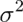。

我们需要计算 ，其中  是均值， 是方差平方：

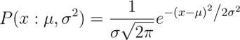

其中 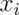 是样本，我们可以这样计算方差：

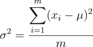

我们为每个特征计算 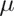 和 。二维空间中的钟形分布很容易可视化，三维空间中的倒碗形状也是如此。如果我们有很多特征呢？嗯，数学上是行得通，不用担心无法在脑海中想象出它。

## AnomalyDetection 工具类

在本节开发的 `AnomalyDetection` 类具有相当的通用性。它处理一组训练样本，并为每个特征计算  和 。我们还在训练第三个参数：`epsilon` “阈值”值：如果对于给定的输入向量，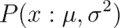 的求值值大于 `epsilon`，则该输入向量为“正常”，小于 `epsilon` 则意味着输入向量是“异常”。从训练数据计算这三个特征的数学原理相当简单，但代码实现并不容易：我们需要组织训练数据，并寻找一个使交叉验证数据集误差最小最小的 `epsilon` 值。

为了清楚起见：我们将输入样本分为训练、交叉验证和测试数据三个独立集合。我们使用训练数据来设置模型参数，使用交叉验证数据来学习 `epsilon` 值，最后使用测试数据获取精确率（`precision`）、召回率（`recall`）和 F1 分数，以指示模型检测未用于训练和交叉验证的数据中异常的能力。

我将示例程序作为一个长列表列出，并在列表之后提供更详细的代码解释。请注意从第 28 行到第 74 行遍历每个输入训练样本的长循环。第 25 行到 44 行的代码将输入训练数据处理为三个不相交的训练、交叉验证和测试数据集。然后，第 45 行到 63 行的代码将这三组数据拷贝到 Java 数组中。

第 65 行到 73 行的代码计算训练样本的  值（代码中的变量 `mu`）。

请注意代码示例，即使在不需要时，我也会在方法中使用“`this.`” 前缀加上类变量。这样做是为了可读性，也是我的个人风格。


```java
package com.markwatson.anomaly_detection;

import java.util.ArrayList;
import java.util.List;

/**
 * 由 markw 创建于 15/10/7。
 */
public class AnomalyDetection {

  public AnomalyDetection() { }

  /**
   * AnomalyDetection 是一个用于构建异常检测模型的通用类。
   * 当你拥有大部分负样本（正常样本）而正样本相对较少，
   * 且你需要一个能检测正样本（异常）输入的模型时，应该使用这种类型的模型。
   *
   * @param num_features 特征数量
   * @param num_training_examples 训练示例数量
   * @param training_examples 训练示例 [num_training_examples][num_features]
   */
  public AnomalyDetection(int num_features, int num_training_examples,
                          double [][] training_examples) {
    List<double[]> training = new ArrayList<>();
    List<double[]> cross_validation = new ArrayList<>();
    List<double[]> testing = new ArrayList<>();
    int outcome_index = num_features - 1; // 目标结果索引
    for (int i=0; i<num_training_examples; i++) {
      if (Math.random() < 0.6) { // 60% 训练
        // 在训练集中只保留正常（负）示例，但
        // 请记住使用此算法的原因是它可以处理负样本远多于正样本，
        // 并且即使训练集中混合了一些正样本，算法也能正常工作。
        // 随机测试是为了允许大约 10% 的正样本进入训练集：
        if (training_examples[i][outcome_index] < 0.5 || Math.random() < 0.1)
          training.add(training_examples[i]);
      } else if (Math.random() < 0.7) {
          cross_validation.add(training_examples[i]);
      } else {
        testing.add(training_examples[i]);
      }
    }
    this.num_training_examples = training.size();
    this.num_cross_validation_examples = cross_validation.size();
    this.num_testing_examples = testing.size();

    this.training_examples = new double[this.num_training_examples][];
    for (int k=0; k<this.num_training_examples; k++) {
      this.training_examples[k] = training.get(k);
    }

    this.cross_validation_examples = new double[num_cross_validation_examples][];
    for (int k=0; k<num_cross_validation_examples; k++) {
      this.cross_validation_examples[k] = cross_validation.get(k);
    }

    this.testing_examples = new double[num_testing_examples][];
    for (int k=0; k<this.num_testing_examples; k++) {
      // 维度为 [num_training_examples][num_features]:
      this.testing_examples[k] = testing.get(k);
    }

    this.mu = new double[num_features];
    this.sigma_squared = new double[num_features];
    this.num_features = num_features;
    for (int nf = 0; nf < this.num_features; nf++) { //
      double sum = 0;
      for (int nt = 0; nt < this.num_training_examples; nt++)
        sum += training_examples[nt][nf];
        this.mu[nf] = sum / this.num_training_examples;
    }
  }

  public double [] muValues() { return mu; }
  public double [] sigmaSquared() { return sigma_squared; }
  public double bestEpsilon() { return best_epsilon; }

  /**
   * 使用一系列 epsilon 值来训练模型。Epsilon 是一个超参数，
   * 我们希望找到一个能使错误计数最小化的值。
   */
  public void train() {
    double best_error_count = 1e10;
    for (int epsilon_loop=0; epsilon_loop<40; epsilon_loop++) {
      double epsilon = 0.05 + 0.01 * epsilon_loop;
      double error_count = train(epsilon);
      if (error_count < best_error_count) {
        best_error_count = error_count;
        best_epsilon = epsilon;
      }
    }
    System.out.println("\n Best epsilon = " + best_epsilon );

    // 使用最佳 epsilon 重新训练最大似然性参数，
    // 这些参数现在存储在 mu[] 和 sigma_squared[] 中：
    train_helper(best_epsilon);

    // 最后，我们准备好查看模型在测试数据上的表现了：
    test(best_epsilon);
  }

  /**
   * 计算 probability(x; mu, sigma_squared)
   * @param x - 示例向量
   * @return
   */
  private double p(double [] x) {
    double sum = 0;
    // 使用 (num_features - 1) 跳过输出位：
    for (int nf=0; nf<num_features - 1; nf++) {
      sum += (1.0 / (SQRT_2_PI * sigma_squared[nf])) *
             Math.exp(-(x[nf] - mu[nf]) * (x[nf] - mu[nf]));
    }
    return sum / num_features;
  }

  /**
   * 如果输入向量是异常，则返回 1
   * @param x - 示例向量
   * @return
   */
  public boolean isAnoly(double [] x) {
    double sum = 0;
    // 使用 (num_features - 1) 跳过输出位：
    for (int nf=0; nf<num_features - 1; nf++) {
      sum += (1.0 / (SQRT_2_PI * sigma_squared[nf])) *
             Math.exp(-(x[nf] - mu[nf]) * (x[nf] - mu[nf]));
    }
    return (sum / num_features) < best_epsilon;
  }

  private double train_helper_(double epsilon) {
    // 使用 (num_features - 1) 跳过输出位：
    for (int nf = 0; nf < this.num_features - 1; nf++) {
      double sum = 0;
      for (int nt = 0; nt < this.num_training_examples; nt++) {
        sum += training_examples[nt][nf];
      }
      sigma_squared[nf] = sum / this.num_training_examples;
    }
    double cross_validation_error_count = 0;
    for (int i = 0; i < this.num_cross_validation_examples; i++) {
      if (isAnoly(cross_validation_examples[i])) {
        cross_validation_error_count++;
      }
    }
    return cross_validation_error_count;
  }

  private double test(double epsilon) {
    double false_positives = 0, false_negatives = 0;
    double true_positives = 0, true_negatives = 0;
    for (int i = 0; i < this.num_testing_examples; i++) {
      if (isAnoly(testing_examples[i])) {
        true_positives++;
      } else {
        false_negatives++;
      }
    }
    double precision = true_positives / (true_positives + false_positives);
    double recall = true_positives / (true_positives + false_negatives);
    double f1 = 2 * precision * recall / (precision + recall);

    System.out.println("number of test examples = " + this.num_testing_examples);
    System.out.println("number of false positives = " + false_positives);
    System.out.println("number of true positives = " + true_positives);
    System.out.println("number of false negatives = " + false_negatives);
    System.out.println("number of true negatives = " + true_negatives);
    System.out.println("precision = " + precision);
    System.out.println("recall = " + recall);
    System.out.println("F1 = " + f1);
    return f1;
  }
}
```

一旦为每个特征定义了训练数据以及 `mu`（代码中的变量 `mu`）的值，我们就可以在第 86 到 104 行定义 `train` 方法，该方法使用第 138 到 165 行定义的 `train_helper` 方法为训练数据集计算最佳的 `epsilon` “截断”值。我们通过对独立的交叉验证数据集进行测试来使用“最佳” `epsilon` 值；我们通过调用在第 167 到 198 行定义的 `test` 方法来实现这一点。

### 使用威斯康星大学癌症数据的示例

本节中的示例加载了威斯康星大学的数据，并使用上一节中开发的 `AnomalyDetection` 类来发现异常。在本示例中，异常是指代表原始数据中恶性的的输入向量。


## 使用 Deeplearning4j 进行深度学习

[Deeplearning4j.org](http://deeplearning4j.org/) Java 库支持多种神经网络算法，包括深度学习（DL）支持。我们将通过一个深度学习示例来了解深度置信网络的实现，该示例使用与 Spark 机器学习章节和异常检测章节相同的威斯康星大学数据集。

我假设你已经具备一些简单的反向传播神经网络知识。如果你对神经网络不熟悉，不妨暂停一下，在网上搜索“神经网络反向传播教程”，或者阅读我的书《Practical Artificial Intelligence Programming With Java, 4th edition》中的神经网络章节。

使用反向传播算法训练许多层网络的困难之处在于，靠近输入层（远离输出层）的层中的 delta 误差会变得非常小，即使在现代处理器和 GPU 上，训练也可能需要很长时间。Geoffrey Hinton 和他的同事创建了一种用于预训练权重的新技术。2012 年，我参加了由 Hinton 及其同事教授的一门名为[面向机器学习的神经网络](https://www.coursera.org/course/neuralnets)的 Coursera 课程，当你阅读这本书时，这些材料可能在网上可用。

对于 Java 开发者来说，`Deeplearning4j` 是实验深度学习的绝佳起点。如果你也使用 Python，那么在 [deeplearning.net](http://deeplearning.net/) 上还有很好的教程和其他学习资源。

## 深度置信网络 (Deep Belief Networks)

深度置信网络（DBN）是一种深度神经网络，包含多个隐藏神经元层，其中任何一个特定隐藏层内部的神经元之间都没有连接。每个隐藏层根据训练数据以及前一个隐藏层的权重值来学习特征。我所说的“前一层”是指靠近输入层的连接层。DBN 可以学习到更抽象的特征，且距离输入层越“远”的隐藏层，其抽象程度越高。

DBN 是逐层进行训练的。最初，使用一组训练输入来训练输入层与第一隐藏神经元层之间的权重。从技术上讲，当我们预训练后续每一对层时，我们正在训练受限玻尔兹曼机（RBM）来学习一组新特征。你只需要知道 RBM 是两层（输入层和输出层），它们全连接（第一层中的所有神经元与下一层的每个神经元都有权重连接），并且没有层内连接。

当我们逐步训练 DBN 时，一个 RBM 的输出层将成为下一对神经元层预训练的输入层。

一旦所有隐藏层都完成了预训练，就会使用反向传播学习来重新训练整个网络，但现在通过比较前向传播输出与训练输出来计算 delta 误差，并将误差反向传播以更新向第一个隐藏层的层权重。

需要理解的一点是，反向传播对于具有许多隐藏层的网络往往效果不好，因为当我们向输入神经元反向处理时，传播的误差会变得越来越小——这会导致网络训练非常缓慢。通过使用 RBM 对预计算权重，我们更接近一组能够最小化训练集（以及测试集）误差的权重。

## 深度置信网络示例

接下来的屏幕截图展示了本章示例的 IntelliJ 项目（你可以使用免费的社区版或专业版来完成书中的示例）：

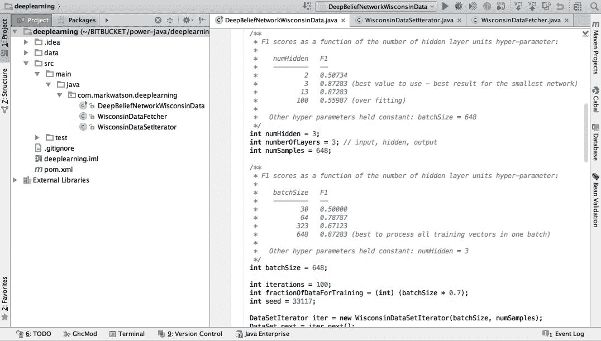

本章示例的 IntelliJ 项目视图

`Deeplearning4j` 库使用用户编写的 Java 类将训练和测试数据导入 `Deeplearning4j` 库可以使用的形式中。下面的列表显示了 `WisconsinDataSetIterator` 类的实现，该类遍历威斯康星大学癌症数据集：

```
 1 package com.markwatson.deeplearning;
 2 
 3 import org.deeplearning4j.datasets.iterator.BaseDatasetIterator;
 4 
 5 import java.io.FileNotFoundException;
 6 
 7 
 8 public class WisconsinDataSetIterator extends BaseDatasetIterator {
 9   private static final long serialVersionUID = -2023454995728682368L;
10 
11   public WisconsinDataSetIterator(int batch, int numExamples)
12          throws FileNotFoundException {
13     super(batch, numExamples, new WisconsinDataFetcher());
14   }
15 }
```

`WisconsinDataSetIterator` 构造函数通过 `WisconsinDataFetcher` 类（定义在下一个列表中）的实例调用其父类，以从文件 `data/cleaned_wisconsin_cancer_data.csv` 读取逗号分隔值（CSV）表格数据：

```
 1 package com.markwatson.deeplearning;
 2 
 3 import org.deeplearning4j.datasets.fetchers.CSVDataFetcher;
 4 
 5 import java.io.FileInputStream;
 6 import java.io.FileNotFoundException;
 7 
 8 /**
 9  * Created by markw on 10/5/15.
10  */
11 public class WisconsinDataFetcher extends CSVDataFetcher {
12 
13   public WisconsinDataFetcher() throws FileNotFoundException {
14     super(new FileInputStream("data/cleaned_wisconsin_cancer_data.csv"), 9);
15   }
16   @Override
17   public void fetch(int i) {
18     super.fetch(i);
19   }
20 
21 }
```

在第 14 行中，最后一个参数 `9` 定义了输入 CSV 文件中哪列包含标签数据。该值从零开始索引，所以如果你查看输入文件 `data/cleaned_wisconsin_cancer_date.csv`，这将是最后一列。最后一列中值为 `4` 表示恶性，值为 `2` 表示非恶性。

下面的列表显示了 `DeepBeliefNetworkWisconsinData` 类的定义，该类使用最后两个列表代码读取威斯康星大学癌症数据集，随机选择部分数据用于训练和测试，创建一个 DBN 并对其进行测试。第 51 行设置的变量 `numHidden` 指每个隐藏层中的神经元数量。在第 52 行将 `numberOfLayers` 设置为 `3` 表示我们将只使用一个隐藏层，因为这个值（3）也包含了输入层和输出层。

网络在第 83 行到 104 行进行配置和构建。如果我们增加了隐藏单元的数量（在解决更复杂的问题时可能会这样做），那么你需要重复第 88 行到 97 行来添加一个新的隐藏层，并在链式方法 `.layer()` 的调用中适当更改层索引（第一个参数）。


```java
package com.markwatson.deeplearning;

import org.deeplearning4j.datasets.iterator.DataSetIterator;
import org.deeplearning4j.eval.Evaluation;
import org.deeplearning4j.nn.conf.MultiLayerConfiguration;
import org.deeplearning4j.nn.conf.NeuralNetConfiguration;
import org.deeplearning4j.nn.conf.layers.OutputLayer;
import org.deeplearning4j.nn.conf.layers.RBM;
import org.deeplearning4j.nn.multilayer.MultiLayerNetwork;
import org.deeplearning4j.nn.weights.WeightInit;
import org.nd4j.linalg.api.ndarray.INDArray;
import org.nd4j.linalg.dataset.DataSet;
import org.nd4j.linalg.dataset.SplitTestAndTrain;
import org.nd4j.linalg.factory.Nd4j;
import org.nd4j.linalg.lossfunctions.LossFunctions;
import org.slf4j.Logger;
import org.slf4j.LoggerFactory;

import java.io.*;
import java.nio.file.Files;
import java.nio.file.Paths;
import java.util.Random;

import org.apache.commons.io.FileUtils;

/**
 * 在威斯康星大学癌症数据集上训练深层信念网络。
 */
public class DeepBeliefNetworkWisconsinData {

  private static Logger log =
    LoggerFactory.getLogger(DeepBeliefNetworkWisconsinData.class);

  public static void main(String[] args) throws Exception {

    final int numInput = 9;
    int outputNum = 2;
     /**
     * F1 分数随隐藏层单元数量超参数的变化：
     *
     *
     *    numHidden   F1
     *    ---------   --
     *            2   0.50734
     *            3   0.87283 (建议使用的值 - 最佳结果 / 最小的网络)
     *           13   0.87283
     *          100   0.55987 (过拟合)
     *
     *   其他超参数保持不变：batchSize = 648
     */
    int numHidden = 3;
    int numberOfLayers = 3; // 输入、隐藏、输出
    int numSamples = 648;

    /**
     * F1 分数随批次大小的变化：
     *
     *    batchSize   F1
     *    ---------   --
     *           30   0.50000
     *           64   0.78787
     *          323   0.67123
     *          648   0.87283 (在一个批次中处理所有训练向量最佳)
     *
     *   其他超参数保持不变：numHidden = 3
     */
    int batchSize = 648; // 等于样本数量

    int iterations = 100;
    int fractionOfDataForTraining = (int) (batchSize * 0.7);
    int seed = 33117;

    DataSetIterator iter = new WisconsinDataSetIterator(batchSize, numSamples);
    DataSet next = iter.next();
    next.normalizeZeroMeanUnitUnitVariance();

    SplitTestAndTrain splitDataSets =
	  next.splitTestAndTrain(fractionOfDataForTraining, new Random(seed));
    DataSet train = splitDataSets.getTrain();
    DataSet test = splitDataSets.getTest();

    MultiLayerConfiguration conf = new NeuralNetConfiguration.Builder()
        .seed(seed) // 使用相同的随机种子
        .iterations(iterations)
        .l1(1e-1).regularization(true).l2(2e-4)
        .list(numberOfLayers - 1) // 不计算输入层
        .layer(0,
            new RBM.Builder(RBM.HiddenUnit.RECTIFIED, RBM.VisibleUnit.GAUSSIAN)
                .nIn(numInput)
                .nOut(numHidden)
                // 根据以下设置随机初始化权重方差
                .weightInit(WeightInit.XIER)
                .dropOut(0.25)
                .build()
        )
        .layer(1,
            new OutputLayer.Builder(LossFunctions.MCENT)
                .nIn(numHidden)
                .nOut(outputNum)
            .activation("softmax")
            .build()
        .build();
    MultiLayerNetwork model = new MultiLayerNetwork(conf);
    model.init();
    model.fit(train);

    log.info("\n 评估模型:\n");
    Evaluation eval = new Evaluation();
    INDArray output = model.output(test);

    for (int i = 0; i < output.rows(); i++) {
      String target = test.getLabels().getRow(i).toString();
      String predicted = output.getRow(i).toString();
      log.info("target: " + target + " predicted: " + predicted);
    }

    eval.eval(output);
    log.info(eval.stats());

    /**
     * 保存模型以便复用：
     */
    FileUtils.writeString(new File("conf.json"), model.getLayerConfigurations().toJson());
    FileUtils.writeBytes(new File("saved-model.bin"), model.params());

    /**
     * 加载模型并再次测试：
     */
    log.info("\n 加载模型:\n");
    MultiLayerConfiguration conffromJson = MultiLayerConfiguration.fromJson(FileUtils.readString(new File("conf.json")));
    INDArray newParams = Nd4j.read(new File("saved-model.bin"));
    MultiLayerNetwork savedModel = new MultiLayerNetwork(conffromJson);
    savedModel.init();
    savedModel.setParameters(newParams);

    log.info("\n 从磁盘评估模型:\n");
    Evaluation eval2 = new Evaluation();
    INDArray output2 = savedModel.output(test);

    for (int i = 0; i < output2.rows(); i++) {
      String target = test.getLabels().getRow(i).toString();
      String predicted = output2.getRow(i).toString();
      log.info("target: " + target + " predicted: " + predicted);
    }

    eval2.eval(output2);
    log.info(eval2.stats());
}
```

在威斯康星大学癌症数据集上训练深层信念网络。

在第 71 行，我们将`fractionOfDataForTraining`设置为`0.7`，这意味着我们将使用 70% 的数据进行训练，剩下的 30% 用于测试。在第 78 至 81 行，我们将数据划分为互不交的训练集和测试集。只要网络内存足够，识别训练数据的性能应该总是是好的。

在第 86 行，我们设置了三个元学习参数：输入层和隐藏层之间第一组权重的学习率为`1e-1`、启用正则化，以及隐藏层到输出层的权重学习率为`2e-4`。

在第 95 行，我们设置了丢弃（dropout）因子，这里表示对于任何训练示例随机不使用 25% 的神经元。与正则化一起，dropout 有助于防止过拟合。过拟合发生在神经网络无法泛化并学习了训练数据中的噪声时。目标是学习影响训练模型处理新数据有用性的特征。我们不希望将数据中的随机噪声学习为重要特征。防止过拟合的另一种方法是使用尽可能少的隐藏层神经元，同时在独立测试数据上保持良好性能。

当我运行模型时，程序的输出如下：

```
Evaluating model:

14:59:46.872 [main] INFO  c.m.d.DeepBeliefNetworkWisconsinData -
                                  target: [ 1.00, 0.00] predicted: [ 0.76, 0.24]
14:59:46.873 [main] INFO  c.m.d.DeepBeliefNetworkWisconsinData -
                                  target: [ 1.00, 0.00] predicted: [ 0.65, 0.35]

Actual Class 0 was predicted with Predicted 0 with count 151 times

Actual Class 1 was predicted with Predicted 0 with count 44 times

==========================Scores========================================
 Accuracy:  0.7744
 Precision: 0.7744
 Recall:    1
 F1 Score:  0.8728323699421966
===========================================================================
```

`F1`分数的计算方法为精确率乘以召回率的两倍，并除以`精确率 + 召回率`。我们希望`F1`越接近 1.0 越好，通常会花长时间对元学习参数进行实验以提高`F1`。

尝试学习元学习参数的良好值也是非常常见的。我们在这里不会这样做，但过程涉及将数据分为三个互不相交的集合：训练集、验证集和测试集。改变元参数进行训练，并使用验证数据选择最佳元参数集。最后，我们使用根据元参数定义的网络以及学习到的权重对独立的测试数据进行测试，以查看有效的`F1`分数是多少。

## 深度学习总结

我最早在 20 世纪 80 年代后期将复杂的神经网络拓扑结构用于音素（语音）识别，特别是使用了时间延迟神经网络，并在[1987 年 IEEE 第一届国际神经网络年度会议（加利福尼亚州圣地亚哥，1987 年 6 月 21-24 日）](http://ieeexplore.ieee.org/xpl/articleDetails.jsp?reload=true&arnumber=4307059）上发表了相关演讲。当时，神经网络并没有被认为是用于此类应用的伟大技术，但现在，谷歌、微软等公司正在使用深层（多层）神经网络进行语音和图像识别。自然语言处理领域也进行着令人兴奋的工作。我在本章中刚刚提供了一个小示例，你们可以轻松地对它进行实验。我想向你们介绍 [Deeplearning4j](http://deeplearning4j.org/)，因为我认为这可能是 Java 开发者开始使用多层神经网络最简单的方法，我建议你们参阅[项目文档](http://deeplearning4j.org/documentation.html)。

## 网页爬虫示例

除了第一章关于网络编程技术的章节、本章，以及关于我所称的“轻量级知识管理”的最后一章外，本书主要是关于各种形式的机器学习。从实际操作的角度来看，许多人用于机器学习的很大一部分数据要么来自网络，要么来自内部数据源。这个简短的章节为从网络获取文本数据提供了一些指导和示例。

在我的工作中，我通常使用 Ruby 脚本语言进行网页爬虫和信息收集（正如我在 Apress 出版的书[脚本智能：Web 3.0 信息收集与处理](http://www.apress.com/9781430223511)中提到的那样），但 Java 用于网页爬虫也有良好的支持，由于这是一本关于现代 Java 开发的书，我们将在本章中使用 Java。

在开始讨论关于“网页爬虫”的技术问题之前，我想向你们指出，网络上的大部分信息都受版权保护，你应该做的第一件事是阅读网站的服务条款，以确保你对“爬取”或“蜘蛛化”数据的使用符合内容所有以及付费运行爬取网站的个人或组织的意愿。

### 网页爬虫的动机

正如我们在下一章关于链接数据的章节中所看到的，通过网络服务、语义网/链接数据标记和 API，网络上提供了海量的结构化数据。尽管如此，你经常会发现一些从网站上抓取原始文本是有用的数据，但这些文本通常是非结构化的，并且处于杂乱（且经常变化）的格式中，因为网页是为人类消费设计的，而不是为了让软件代理摄取。在本章中，我们将涵盖实用的“网页爬虫”技术。你会发现，处理不同的网页设计风格和布局通常需要大量工作。为了让情况更加不方便，你可能会发现你的软件信息收集代理经常因为网站的更改而崩溃。

我倾向于使用三种通用技术之一来爬取网站。本章将仅涵盖前两种：


使用 HTML 解析库，它可以剥离页面上所有的 HTML 标记和 JavaScript，并返回一个“纯文本”块。在这里，导航菜单、页眉等等中的文本将与我们通常认为的网站“内容”交织在一起。

利用网站上的 HTML DOM（文档对象模型）格式信息来提取页眉、页面标题、导航菜单和大型内容文本块。

使用诸如 [Selenium](http://docs.seleniumhq.org/) 之类的工具通过程序化控制网络浏览器，以便你的软件代理可以登录网站并执行其他导航。换句话说，你的软件代理可以模拟使用网络浏览器的人类。

我很少需要使用 `Selenium` 这样的工具，但俗言道：“当你需要它们时，你就需要它们。”对于简单的网站，我倾向于提取所有文本作为一个单一块，并在需要时使用 DOM 处理。

```
 1 package com.markwatson.web_scraping;
 2 
 3 import org.jsoup.*;
 4 import org.jsoup.nodes.Document;
 5 import org.jsoup.nodes.Element;
 6 import org.jsoup.select.Elements;
 7 
 8 /**
 9  * Examples of using jsoup
10  */
11 public class MySitesExamples {
12 
13   public static void main(String[] args) throws Exception {
14     Document doc = Jsoup.connect("http://www.markwatson.com").get();
15     Elements newsHeadlines = doc.select("div p");
16     for (Element element : newsHeadlines) {
17       System.out.println(" next element text: " + element.text());
18     }
19   }
20 }
```

在第 `15` 行，我选择的模式返回所有作为任何 `DIV` 元素直接子元素的 `P` 元素，并在第 `16` 到 `18` 行打印这些 `P` 元素内部的文本。

对于机器学习的训练数据，只需获取网页上的所有文本是有用的，并且可以假设处理网页导航等常见短语会从学习模型中被丢弃，因为它们出现在不同分类的许多训练示例中。以下代码段展示了如何从整个网页获取纯文本：

```
 Document doc = Jsoup.connect("http://www.markwatson.com").get();
    String all_page_text = doc.text();
    System.out.println("All text on web page:\n" + all_page_text);
```

```
All text on web page:
Mark Watson: Consultant specializing in machine learning and artificial intelligence Toggle navigation Mark Watson Home page Consulting Free mentoring Blog Books Open Source Fun Consultant specializing in machine learning, artificial intelligence, cognitive computing, and web engineering...
```

最后一个列表中 2-gram（即序列连续的两个单词）“Toggle navigation”与我网站的实际内容无关，它是使用 Bootstrap CSS 和 Javascript 工具的产物。如果像这样的“噪声”出现在许多不同的网站上，机器学习模型通常会直接忽略它，但请注意，这可能是一个问题，你可能需要从特定的 DOM 元素中精确获取文本。同样，注意这最后一个列表抓取了导航菜单中的纯文本。

以下代码段查找 HTML 锚点元素并打印与这些元素关联的数据：

```
 Document doc = Jsoup.connect("http://www.markwatson.com").get();
    Elements anchors = doc.select("a[href]");
    for (Element anchor : anchors) {
      String uri = anchor.attr("href");
      System.out.println(" next anchor uri: " + uri);
      System.out.println(" next anchor text: " + anchor.text());
    }
```

```
 1  next anchor uri: #
 2  next anchor text: Mark Watson
 3  next anchor uri: /
 4  next anchor text: Home page
 5  next anchor uri: /consulting/
 6  next anchor text: Consulting
 7  next anchor uri: /mentoring/
 8  next anchor text: Free mentoring
 9  next anchor uri: http://blog.markwatson.com
10  next anchor text: Blog
11  next anchor uri: /books/
12  next anchor text: Books
13  next anchor uri: /opensource/
14  next anchor text: Open Source
15  next anchor uri: /fun/
16  next anchor text: Fun
17  next anchor uri: http://www.cognition.tech
18  next anchor text: www.cognition.tech
19  next anchor uri: https://github.com/mark-watson
20  next anchor text: GitHub
21  next anchor uri: https://plus.google.com/117612439870300277560
22  next anchor text: Google+
23  next anchor uri: https://twitter.com/mark_l_watson
24  next anchor text: Twitter
25  next anchor uri: http://www.freebase.com/m/0b6_g82
26  next anchor text: Freebase
27  next anchor uri: https://www.wikidata.org/wiki/Q18670263
28  next anchor text: WikiData
29  next anchor uri: https://leanpub.com/aijavascript
30  next anchor text: Build Intelligent Systems with JavaScript
31  next anchor uri: https://leanpub.com/lovinglisp
32  next anchor text: Loving Common Lisp, or the Savvy Programmer's Secret Weapon
33  next anchor uri: https://leanpub.com/javaai
34  next anchor text: Practical Artificial Intelligence Programming With Java
35  next anchor uri: http://markwatson.com/index.rdf
36  next anchor text: XML RDF
37  next anchor uri: http://markwatson.com/index.ttl
38  next anchor text: Turtle RDF
39  next anchor uri: https://www.wikidata.org/wiki/Q18670263
40  next anchor text: WikiData
```

注意有不同类型的 URI，如 `#`、相对路径和绝对路径。注意 `#` 之后的字符不会影响显示哪个页面的路由（或调用哪个 API），但相对 API 诸如 `/consulting/`（如第 `5` 行所示）被理解为相对于基础 URI。我经常需要绝对 URI：

```
1     Elements absolute_anchors = doc.select("a[href]");
2     for (Element anchor : absolute_anchors) {
3       String uri = anchor.attr("href");
4       System.out.println(" next anchor uri: " + uri);
5       System.out.println(" next anchor text: " + anchor.text());
6     }
```

```
 next anchor text: Mark Watson
 next anchor uri: http://www.markwatson.com/
 next anchor text: Home page
 next anchor uri: http://www.markwatson.com/consulting/
 next anchor text: Consulting
 next anchor uri: http://www.markwatson.com/mentoring/
 next anchor text: Free mentoring
 ...
```

## 总结

我刚刚向你展示了关于工作中最常见用例的快速参考。我没有向你展示的是一个组织抓取信息以供复用的示例。

注意：我出版了《Practical Semantic Web and Linked Data Applications: Java, JRuby, Scala, and Clojure Edition》，你可以在[这里获取该书的免费 PDF](http://www.markwatson.com/opencontent_data/book_java.pdf)。虽然书中的技术细节仍然具有参考价值，但我现在对哪些链接数据和语义网技术最有用有了明确的观点，因此本章将更有重点。通过一些改进，我使用了之前书中用于 DBPedia 搜索的 Java 客户端代码和 `SPARQL` 查询。我还包含了以 JSON 返回查询结果的新版本。我假设你已经获取了我的书籍《Practical Semantic Web and Linked Data Applications》的免费副本，并使用第 6 和第 7 章作为资源描述语言（`RDF` 和 `RDFS`）的介绍，使用第 8 章作为 `SPARQL` 查询语言的教程。如果你想直接进入本章的示例，稍后阅读这些背景材料也是可以的。我在下一节中对 `SPARQL` 和 `RDF` 进行简要介绍，但请务必也获取一份我的语义网书籍以获得更深入的探讨。我们使用标准查询语言 `SPARQL` 从 `RDF` 数据源中检索信息，就像我们使用 `SQL` 从关系型数据库中检索信息一样。

在本章中，我们将学习如何对公共 `RDF` 数据存储执行 `SPARQL` 查询来消费链接数据，并搜索 DBPedia。使用上一章“Natural Language Processing Using OpenNLP”中的代码，我们还将开发一个示例应用程序，通过为实体标记唯一的 DBPedia `URIs` 来对文本进行注释（我们将在下一章知识管理的代码示例中使用这个例子）。

## 为什么要使用链接数据？

在进入技术细节之前，我想为你提供一些动力，说明你可能使用链接数据和语义网技术来组织和访问信息。假设你的公司向客户销售产品，你的任务是使用新系统增强用于订单、运输和客户数据的关系数据库，该系统需要捕捉产品、客户与网络信息源之间的关系，这些关系可能帮助你的客户和支持人员提高产品对客户的效用。

客户、产品和信息源是实体，有时会与其他实体的属性或关系相关联。这些新数据是非结构化的，你无法预知所有的关系，以及新系统将使用哪些新类型的实体。如果你来自关系数据库背景，起初使用图数据库可能会感到不习惯。作为参考，可以考虑 Google 使用其知识图谱（Knowledge Graph，我在 Google 工作期间曾自定义过知识图谱）用于内部应用、为搜索结果增加价值，并驱动 Google Now。Facebook 使用其开放图（Open Graph）来存储关于用户、用户帖子以及用户与发布材料之间关系的信息。这些图数据存储是 Google 和 Facebook 的核心资产。仅仅因为你不处理海量数据，并不意味着图数据的灵活性对你的项目没有用！我们将在本章中使用 DBPedia 图数据库进行示例程序。DBPedia（Google 在开发其知识图谱时将其作为核心知识）是关于产品、人员、公司、地点等类型数据的丰富信息源。将你组织中的内部数据连接到 DBPedia 等外部数据源可以增加你的私有数据的效用。你可以通过选择性地将某些内部数据作为链接数据发布出去，造及客户和业务合作伙伴，从而使这种数据共享关系对称化。

核心思想是设计信息的形状（你处理哪些实体，不同类型实体之间存在什么类型的属性或关系），将数据摄入图数据库并制定保持所有内容更新的计划，然后提供 API 或查询语言，以便应用程序开发人员在开发新应用程序时访问这些链接数据。在本章中，我们将使用带有 `SPARQL` 查询语言的语义网标准来访问数据，但这些思想也适用于其他图数据库如 `Neo4J` 或非关系数据存储如 `MongoDB` 或 `CouchDB`。

## 示例代码

本章示例设置为从命令行或使用 IntelliJ 运行。

本章三个示例。如果你想在阅读本章其余部分之前尝试运行代码，请运行每个 `maven` 测试：

```
1     mvn test -Dtest=AnnotationTest
2     mvn test -Dtest=DBPediaTest
3     mvn test -Dtest=SparqlTest
```

下图显示了 IntelliJ 社区版中本章的项目：

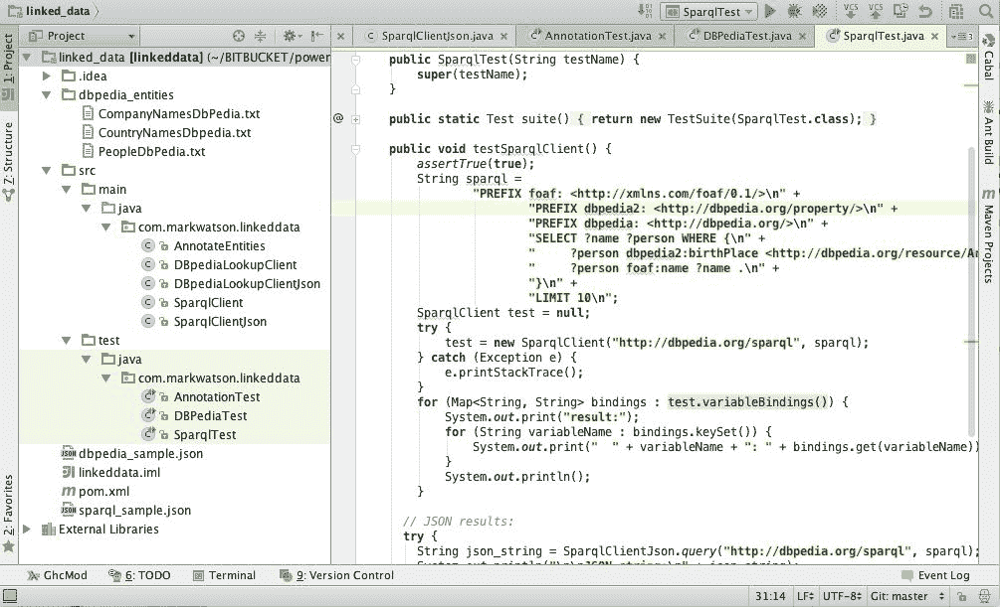

本章示例的 IntelliJ 项目视图

## RDF 和 SPARQL 概述

资源描述框架（`RDF`）用于以主语/谓语/宾三元组值的形式存储信息。`RDF` 数据最初被编码为 `XML` 并旨在用于自动化处理。在本章中我们将使用两种易读的格式，称为“N-Triples”和“N3”。`RDF` 数据由一组三元组值组成：

* subject（主语）

* predicate（谓语）

* object（宾语）

例如，假设我们的应用程序涉及新闻故事，我们希望有一种存储和查询元数据的方法。我们可以通过从文本中提取语义信息并将其存储在 `RDF` 中。我将在本章的示例中使用该领域。我们可能会使用如下三元组：

* subject：新闻文章的 URL（或 `URI`）

* predicate：如“containsPerson”（包含人物）之类的关系

* object：如“Bill Clinton”这样的值

如前所述，我们将使用 `URIs` 或字符串字面量作为主语和宾语的值。我们始终将使用 `URIs` 作为谓语的值。在任何情况下，`URIs` 通常比字符串字面量更受青睐，因为它们是唯一的。我们将看到这种优先用法的示例，但首先我们需要学习 N-Triples 和 N3 格式。

三元组的任何部分（主语、谓语或宾语）都是 `URI` 或字符串字面量。`URIs` 编码命名空间。例如，上一个示例中的 containsPerson 谓语可以正确写为：

```
http://knowledgebooks.com/ontology/#containsPerson own
```

此 `URI` 的第一部分被认为是“containsPerson”（我们将用作谓语）的命名空间。当不同的 `RDF` 三元组使用相同的谓语时，这确保了所有该谓语的用户都遵循相同的含义。此外，我们将在 RDFS 章节中看到，可以使用 `RDFS` 来声明此谓语（在 `http://knowledgebooks.com/ontology/` 命名空间下）与其他数据源使用的不同 `URIs` 表示的谓语之间的等效性。N-Triple 格式的语句由三个 `URIs`（或字符串字面量——任何组合）组成，后面跟着一个句号。虽然语句在源文件中通常每行一个，但也可以跨行编写；结尾的句号标记了语句的结束。N-Triple 格式的标准文件扩展名为 `*.nt`，N3 格式的标准格式扩展名为 `*.n3`。

我倾向于将我编写的程序输出 N-Triple 格式的文件，以 RDF 形式保存数据。如果我需要读取甚至手动编辑这些文件，我通常会使用 `Sesame` 将 N-Triple 文件转换为 `N3`。当我们看一个示例时，你就会明白为什么我更偏于 `N3` 格式了：

```
1 @prefix kb:  <http://knowledgebooks.com/ontology#> .

2 <http://news.com/201234 /> kb:containsCountry "China"  .
```


在这里，我们看到为我的公司 `KnowledgeBooks.com` 的本体使用了命名空间缩写前 `kb:`。`RDF` 语句中的第一个项（主语）是一篇新闻文章的 `URI`。第二个项（谓语）是 `kb:` 命名空间下的 `containsCountry`。语句中的最后一项（宾语）是一个字符串字面量 `China`。我会用英文这样描述这条 `RDF` 语句：“`URI` 为 `http://news.com/201234` 的新闻文章提到了中国国家。”

这是一个非常简单的 `N3` 示例，我们将扩展它来展示 `N3` 标记的其他功能。另一个例子是，假设这篇新闻也提到了美国。我们不需要像下面这样添加整个新语句：

```
1     @prefix kb:  <http://knowledgebooks.com/ontology#> .

2     <http://news.com/201234 /> kb:containsCountry "China"  .

3     <http://news.com/201234 /> kb:containsCountry "USA"  .
```

我们可以使用 `N3` 语法将它们合并。`N3` 允许我们合并多个具有相同主语且可选地具有相同谓语的 `RDF` 语句：

```
1     @prefix kb:  <http://knowledgebooks.com/ontology#> .

2     <http://news.com/201234 /> kb:containsCountry "China" ,

3                                                   "USA" .
```

我们还可以添加使用相同主语的额外谓语：

```
 1     @prefix kb:  <http://knowledgebooks.com/ontology#> .

 2 

3     <http://news.com/201234 /> kb:containsCountry "China" ,

 4                                                   "USA" .

 5         kb:containsOrganization "United Nations" ;

 6         kb:containsPerson "Ban Ki-moon" , "Gordon Brown" ,

 7                           "Hu Jintao" , "George W. Bush" ,, 8                           "Pervez Musharraf" ,

 9                           "Vladimir Putin" , 

10                           "Mahmoud Ahmadinejad" .
```

这一单一 `N3` 语句代表了十个独立的 `RDF` 三元组。定义相同主语和谓语的三元组部分，对象用逗号分隔并以句号结束。请注意，无论我们使用哪种 `RDF` 存储系统（我们将使用 `Sesame`），以 `XML`、`N-Triple` 或 `N3` 格式文件加载 `RDF` 并没有区别：内部主语、谓语和宾语三元组的存储和使用方式是相同的。

我向你们承诺过 `RDF` 数据存储的数据很容易扩展。作为一个例子，假设我们编写了能够读取在线新闻文章并创建捕捉文章某些语义的 `RDF` 数据的软件。如果我们扩展程序以识别文章的发布日期，我们只需重新处理文章，并为每篇文章使用如下形式向我们的 `RDF` 数据存储中添加三元组：

```
1     <http://news.com/201234 /> kb:datePublished

2                                "2008-05-11" .
```

此外，取决于应用程序，并不是所有的新闻文章都有日期，这通常是可以接受的。

`SPARQL` 是一种用于查询 `RDF` 数据存储的查询语言。虽然 `SPARQL` 看起来像 `SQL`，但它们存在一些重要的区别，例如对 `RDFS` 和 `OWL` 推理的支持。本节将介绍 `SPARQL` 的基础知识。

在本节的讨论中我们将使用以下示例 `RDF` 数据：

```
 1     @prefix kb:  <http://knowledgebooks.com/ontology#> .

 2     @prefix rdfs:  <http://www.w3.org/2000/01/rdf-schema#> .

 3 

 4     kb:containsCity rdfs:subPropertyOf kb:containsPlace .

 5 

 6     kb:containsCountry rdfs:subPropertyOf kb:containsPlace .

 7 

 8     kb:containsState rdfs:subPropertyOf kb:containsPlace .

 9 

10     <http://yahoo.com/20080616/usa_flooding_dc_16 />

11         kb:containsCity "Burlington" , "Denver" ,

12                         "St. Paul" ," " Chicago" ,

13                         "Quincy" , "CHICAGO" ,

14                         "Iowa City" ;

15         kb:containsRegion "U.S. Midwest" , "Midwest" ;

16         kb:containsCountry "United States" , "Japan" ;

17         kb:containsState "Minnesota" , "Illinois" , 

18                          "Mississippi" , "Iowa" ;

19         kb:containsOrganization "National Guard" ,

20                          "U.S. Department of Agriculture" ,

21                          "White House" ,

22                          "Chicago Board of Trade" ,

23                          "Department of Transportation" ;

24         kb:containsPerson "Dena Gray-Fisher" ,

25                           "Donald Miller" ,

26                           "Glenn Hollander" ,

27                           "Rich Feltes" ,

28                           "George W. Bush" ;

29         kb:containsIndustryTerm "food inflation" , "food" ,

30                                 "finance ministers" ,

31                                 "oil" .

32 

33     <http://yahoo.com/78325/ts_nm/usa_politics_dc_2 />

34         kb:containsCity "Washington" , "Baghdad" ,

35                         "Arlington" , "Flint" ;

36         kb:containsCountry "United States" ,

37                            "Afghanistan" ,

38                            "Iraq" ;

39         kb:containsState "Illinois" , "Virginia" ,

40                          "Arizona" , "Michigan" ;

41         kb:containsOrganization "White House" ,

42                                 "Obama administration" ,

43                                 "Iraqi government" ;

44         kb:containsPerson "David Petraeus" ,

45                           "John McCain" ,

46                           "Hoshiyar Zebari" ,

47                           "Barack Obama" ,

48                           "George W. Bush" ,

49                           "Carly Fiorina" ;

50         kb:containsIndustryTerm "oil prices" .

51 

52     <http://yahoo.com/10944/ts_nm/worldleaders_dc_1 />

53         kb:containsCity "WASHINGTON" ;

54         kb:containsCountry "United States" , "Pakistan" ,

55                            "Islamic Republic of Iran" ;

56         kb:containsState "Maryland" ;

57         kb:containsOrganization "University of Maryland" ,

58                                 "United Nations" ;

59         kb:containsPerson "Ban Ki-moon" , "Gordon Brown" ,

60                           "Hu Jintao" , "George W. Bush" ,

61                           "Pervez Musharraf" ,

62                           "Vladimir Putin" ,

63                           "Steven Kull" ,

64                           "Mahmoud Ahmadinejad" .

65 

66     <http://yahoo.com/10622/global_economy_dc_4 />

67         kb:containsCity "Sao Paulo" , "Kuala Lumpur" ;

68         kb:containsRegion "Midwest" ;

69         kb:containsCountry "United States" , "Britain" ,

70                            "Saudi Arabia" , "Spain" ,

71                            "Italy" , India" , 

72                            ""France" , "Canada" ,

73                            "Russia" , "Germany" , "China" ,

74                            "Japan" , "South Korea" ;

75         kb:containsOrganization "Federal Reserve Bank" ,

76                                 "European Union" ,

77                                 "European Central Bank" ,

78                                 "European Commission" ;

79         kb:containsPerson "Lee Myung-bak" , "Rajat Nag" ,

80                           "Luiz Inacio Lula da Silva" ,

81                           "Jeffrey Lacker" ;

82         kb:containsCompany "Development Bank Managing" ,

83                            "Reuters" ,

84                            "Richmond Federal Reserve Bank" ;

85         kb:containsIndustryTerm "central bank" , "food" ,

86                                 "energy costs" ,

87                                 "finance ministers" ,

88                                 "crude oil prices" ,

89                                 "oil prices" ,

90                                 "oil shock" ,

91                                 "food prices" ,

92                                 "Finance ministers" ,

93                                 "Oil prices" , "oil" .
```


在接下来的示例中，我们将查看查询而不查看结果。我们将从一个针对主体的（subjects）的简单 SPARQL 查询开始。

在接下来的示例中，我们将查看查询而不查看结果。我们将从一个针对主体的（subjects）的简单 SPARQL 查询开始。

在接下来的示例中，我们将查看查询而不查看结果。我们将从一个针对主体的（subjects）的简单 SPARQL 查询开始。

在接下来的示例中，我们将查看查询而不查看结果。我们将从一个针对主体的（subjects）的简单 SPARQL 查询开始。

在接下来的示例中，我们将查看查询而不查看结果。我们将从一个针对主体的（subjects）的简单 SPARQL 查询开始。

在接下来的示例中，我们将查看查询而不查看结果。我们将从一个针对主体的（subjects）的简单 SPARQL 查询开始。

在接下来的示例中，我们将查看查询而不查看结果。我们将从一个针对主体的（subjects）的简单 SPARQL 查询开始。

在接下来的示例中，我们将查看查询而不查看结果。我们将从一个针对主体的（subjects）的简单 SPARQL 查询开始。

在接下来的示例中，我们将查看查询而不查看结果。我们将从一个针对主体的（subjects）的简单 SPARQL 查询开始。

在接下来的示例中，我们将查看查询而不查看结果。我们将从一个针对主体的（subjects）的简单 SPARQL 查询开始。

在接下来的示例中，我们将查看查询而不查看结果。我们将从一个针对主体的（subjects）的简单 SPARQL 查询开始。

在接下来的示例中，我们将查看查询而不查看结果。我们将从一个针对主体的（subjects）的简单 SPARQL 查询开始。

在接下来的示例中，我们将查看查询而不查看结果。我们将从一个针对主体的（subjects）的简单 SPARQL 查询开始。

在接下来的示例中，我们将查看查询而不查看结果。我们将从一个针对主体的（subjects）的简单 SPARQL 查询开始。

在接下来的示例中，我们将查看查询而不查看结果。我们将从一个针对主体的（subjects）的简单 SPARQL 查询开始。

在接下来的示例中，我们将查看查询而不查看结果。我们将从一个针对主体的（subjects）的简单 SPARQL 查询开始。

在接下来的示例中，我们将查看查询而不查看结果。我们将从一个针对主体的（subjects）的简单 SPARQL 查询开始。

在接下来的示例中，我们将查看查询而不查看结果。我们将从一个针对主体的（subjects）的简单 SPARQL 查询开始。

在接下来的示例中，我们将查看查询而不查看结果。我们将从一个针对主体的（subjects）的简单 SPARQL 查询开始。

在接下来的示例中，我们将查看查询而不查看结果。我们将从一个针对主体的（subjects）的简单 SPARQL 查询开始。

在接下来的示例中，我们将查看查询而不查看结果。我们将从一个针对主体的（subjects）的简单 SPARQL 查询开始。

在接下来的示例中，我们将查看查询而不查看结果。我们将从一个针对主体的（subjects）的简单 SPARQL 查询开始。

在接下来的示例中，我们将查看查询而不查看结果。我们将从一个针对主体的（subjects）的简单 SPARQL 查询开始。

在接下来的示例中，我们将查看查询而不查看结果。我们将从一个针对主体的（subjects）的简单 SPARQL 查询开始。

在接下来的示例中，我们将查看查询而不查看结果。我们将从一个针对主体的（subjects）的简单 SPARQL 查询开始。

在接下来的示例中，我们将查看查询而不查看结果。我们将从一个针对主体的（subjects）的简单 SPARQL 查询开始。

在接下来的示例中，我们将查看查询而不查看结果。

---

```sparql
<http://yahoo.com/78325/ts_nm/usa_politics_dc_2 />
    kb:containsCity "Washington" , "Baghdad" ,
                    "Arlington" , "Flint" ;
    kb:containsCountry "United States" ,
                        "Afghanistan" ,
                        "Iraq" ;
    kb:containsState "Illinois" , "Virginia" ,
                      "Arizona" , "Michigan" ;
    kb:containsOrganization "White House" ,
                             "Obama administration" ,
                             "Iraqi government" ;
    kb:containsPerson "David Petraeus" ,
                        "John McCain" ,
                        "Hoshiyar Zebari" ,
                        "Barack Obama" ,
                        "George W. Bush" ,
                        "Carly Fiorina" ;
    kb:containsIndustryTerm "oil prices" .
```

---

在接下来的示例中，我们将查看查询而不查看结果。我们将从一个针对主体的（subjects）的简单 SPARQL 查询开始。

在接下来的示例中，我们将查看查询而不查看结果。我们将从一个针对主体的（subjects）的简单 SPARQL 查询开始。

在接下来的示例中，我们将查看查询而不查看结果。我们将从一个针对主体的（subjects）的简单 SPARQL 查询开始。

在接下来的示例中，我们将查看查询而不查看结果。

---

...主体（新闻文章 URL）和对象（匹配的三元组）：

```sparql
SELECT ?subject
WHERE {
    ?subject <knowledgebooks.com/ontology#>containsCountry
}
```

---

当 `WHERE` 子句包含多个三元组模式时，这等同于“与”操作。`DISTINCT` 子句会去除重复结果。`ORDER BY` 子句会对输出进行字母排序：在此情况下首先按属性（`containsCity`, `containsCountry` 等），然后按对象。`LIMIT` 修饰符限制返回的结果，`OFFSET` 修饰符设置跳过的匹配结果数量。

```sparql
PREFIX kb:<http://knowledgebooks.com/ontology#>
SELECT ?subject ?a_predicate ?an_object
WHERE {
    ?subject:containsCountry
}
DISTINCT
ORDER BY ?a_predicate ?an_object
LIMIT 10
OFFSET 5
```

---

我们也可以对任何其他谓进行过滤，例如查找精确为“Maryland”的文章。接下来的查询是从 Java 文件复制的，因此你不需要转义标记。

```sparql
PREFIX kb:<http://knowledgebooks.com/ontology#>
SELECT ?subject
WHERE { ?subject:containsState "Maryland" }
```

---

我们还可以使用正则表达式匹配部分字符串字面量：

```sparql
PREFIX kb:<http://knowledgebooks.com/ontology#>
SELECT ?subject ?object
WHERE {
    ?subject:containsOrganization
    ?object FILTER(?object, "University")
}
```

---

在最后一个示例查询之前，我们只请求查询匹配三元组的主体和属性的值。然而，我们可能希望返回主体（在本例中为新闻文章 URI）的所有匹配三元组。注意这里有两个匹配的三元组，每个都以句号结尾：

```sparql
PREFIX kb:<http://knowledgebooks.com/ontology#>
SELECT ?subject ?a_predicate ?an_object
WHERE {
    ?subject:containsOrganization
    ?object FILTER(?object, "University") .
    ?subject ?a_predicate ?an_object .
}
```

---

我们结束了关于 `SELECT` 查询形式的快速教程。还有三种查询形式我没有在本章中介绍：

*   `CONSTRUCT` – 返回查询结果的新型 RDF 图
*   `ASK` – 返回布尔值真或假，表示查询是否匹配任何三元组
*   `DESCRIBE` – 返回包含匹配资源的新型 RDF 图

### SPARQL 查询客户端

有很多可用的公共 RDF 数据。一些公开可用的 SPARQL 端点（endpoints）如下：

*   [DBPedia](http://dbpedia.org/sparql) 它将 Wikipedia 信息框中的结构化信息编码为 RDF 数据。DBPedia 数据也可以免费下载，并托管在你自己的 `SPARQL` 端点上。
*   [LinkDb](http://www.genome.jp/linkdb/linkdb_rdf.html) 包含人类基因组数据。
*   [美国国会图书馆](http://id.loc.gov/techcenter/searching.html) 目前没有提供 SPARQL 端点，但可以下载主题相关的 Sparql 数据以用于你自己的 SPARQL 端点，并且提供了一个可以返回 RDF 数据结果的搜索功能。
*   [BBC 节目与音乐](http://lod.openlinksw.com/sparql/)
*   [FactForge](http://factforge.net/sparql) 结合了来自多个源的 RDF 数据，包括 DBPedia、Geonames、Wordnet 和 Freebase。SPARQL 查询页面有许多很棒的示例可以帮助入门。例如，查看查询“显示距离伦敦最多 50 英里以内的机场距离”的 SPARQL 语句和结果。

网络上有许多公共的 SPARQL 端点，但我需要提醒你，它们并不总是可用的。大多数公共端点的原始 RDF 数据通常是可用的，因此如果你正在构建一个依赖公共数据集的系统，应该考虑在你自己的服务器之一上托管一份数据副本。我通常使用以下 RDF 存储库和 SPARQL 查询接口之一：：[Star Dog](http://stardog.com/)、[Virtuoso](http://virtuoso.openlinksw.com/) 和 [Sesame](http://rdf4j.org/)。尽管如此，还有许多其他优秀的 RDF 存储库服务器选项，包括商业的和源的。在读完这一章后，你可能想读我写的一篇较新的[博客文章](http://blog.markwatson.com/2014/07/using-opencyc-rdfowl-data-in-stardog.html)，介绍了如何将 OpenCYC 世界知识库导入并并在本地仓库中使用。

在接下来的两个节中，你将学习如何对网络上的 RDF 数据存储进行 SPARQL 查询，并以 JSON 格式以及解析为 Java 数据值获取结果。下一章的一个大主题是将“云端”数据与本地数据结合。

### JSON 客户端

```java
package com.markwatson.linkeddata;

import org.apache.http.HttpResponse;
import org.apache.http.client.methods.HttpGet;
import org.apache.http.impl.client.DefaultHttpClient;

import java.io.BufferedReader;
import java.io.InputStreamReader;
import java.net.URLEncoder;

public class SparqlClientJson {
  public static String query(String endpoint_URL, String sparql)
                       throws Exception {
    StringBuffer sb = new StringBuffer();
    try {
      org.apache.http.client.HttpClient httpClient =
	    new DefaultHttpClient();
      String req = URLEncoder.encode(sparql, "utf-8");
      HttpGet getRequest =
          new HttpGet(endpoint_URL + "?query=" + req);
      getRequest.addHeader("accept", "application/json");
      HttpResponse response = httpClient.execute(getRequest);
      if (response.getStatusLine().getStatusCode() != 200)
	     return "Server error";

      BufferedReader br =
          new BufferedReader(
              new InputStreamReader(
				   (response.getEntity().getContent())));
      String line;
      while ((line = br.readLine()) != null) {
        sb.append(line);
      }
      httpClient.getConnectionManager().shutdown();
    } catch (Exception e) {
      e.printStackTrace();
    }
    return sb.toString();
  }
}
```

我们将使用以下 SPARQL 查询来寻找在亚利桑那州的人：

```sparql
PREFIX foaf: <http://xmlns.com/foaf/0.1/>
        PREFIX dbpedia2: <http://dbpedia.org/property/>
        PREFIX dbpedia: <http://dbpedia.org/>
        SELECT ?name ?person WHERE {
             ?person dbpedia2:birthPlace <http://dbpedia.org/resource/Arizona> .
             ?person foaf:name ?name .
        }
        LIMIT 10
```

你可以使用以下命令运行 DBPedia 查找和 SPARQL 查询的单元测试：

```bash
mvn test -Dtest=DBPediaTest
```

以下是使用此示例 SPARQL 查询运行该类单元测试时产生的部分输出：

```json
{
  "head": {
    "link": [],
    "vars": [
      "name",
      "person"
    ]
  },
  "results": {
    "distinct": false,
    "ordered": true,
    "bindings": [
      {
        "name": {
          "type": "literal",
          "xml:lang": "en",
          "value": "Ryan David Jahn"
        },
        "person": {
          "type": "uri",
          "value": "http://dbpedia.org/resource/Ryan_David_Jahn"
        }
      }
    ]
  }
}
```


### DBPedia Lookup

`DBpedia Lookup` 服务默认返回 XML 响应。`DBpediaLookupClient` 类非常简单。它编码查询字符串，调用 Web 服务并解析返回的 XML 负载。

### Java 数据

```java
public class DBpediaLookupClient extends DefaultHandler {

  public DBpediaLookupClient(String query) throws Exception {
    this.query = query;
    HttpClient client = new HttpClient();

    String query2 = query.replaceAll(" ", "+");
    HttpMethod method =
        new GetMethod(
          "http://lookup.dbpedia.org/api/search?QueryString="
  +query2);
    try {
      client.executeMethod(method);
      InputStream ins = method.getResponseBody();
      SAXParserFactory factory = SAXParserFactory.newInstance();
      SAXParser sax = factory.newSAXParser();
      sax.parse(ins, this);
    } catch (HttpException he) {
      System.err.println("Http error connecting to lookup.dbpedia.org");
    } catch (IOException ioe) {
      System.err.println("Unable to connect to lookup.dbpedia.org");
    }
    method.releaseConnection();
  }

  public void printResults(List<Map<String, String>> results) {
    for (Map<String, String> result : results) {
      System.out.println("\nNext result:\n");
      for (String key : result.keySet()) {
        System.out.println("  " + key + "\t:\t" + result.get(key));
      }
    }
  }

  // ... XML 解析代码省略 ...

  public List<Map<String, String>> variableBindings() {
    return variableBindings;
  }
}
```

如果你运行此示例程序，你会发现描述文本全部打印在同一行上；而在 `about` 示例中，它会自动换行。

此示例返回一个 map 列表作为结果，其中每个列表项都是一个 map，每个 key 是变量名，每个 map value 是该键对应的值。在下一节中，我们将查看类似的代码，将其改为返回 JSON 数据。

### JSON 客户端

本节中的示例比上一节的示例更简单，因为我们只需要原样返回从查询 Web 服务 get 负载（即作为编码在字符串中的 JSON 数据）。

```java
package com.markwatson.linkeddata;

import org.apache.http.HttpResponse;
import org.apache.http.client.HttpClient;
import org.apache.http.client.methods.HttpGet;
import org.apache.http.impl.client.DefaultHttpClient;

import java.io.BufferedReader;
import java.io.InputStreamReader;

/**
 * Copyright 2015 Mark Watson.  Apache 2 license.
 */
public class DBpediaLookupClientJson {
  public static String lookup(String query) {
    StringBuffer sb = new StringBuffer();
    try {
      HttpClient httpClient = new DefaultHttpClient();
      String query2 = query.replaceAll(" ", "+");
      HttpGet getRequest =
          new HttpGet(
		    "http://lookup.dbpedia.org/api/search.asmx/KeywordSearch?QueryString="
              + query2);
      getRequest.addHeader("accept", "application/json");
      HttpResponse response = httpClient.execute(getRequest);
	  
      if (response.getStatusLine().getStatusCode() != 200) return "Server error";

      BufferedReader br =
          new BufferedReader(
              new InputStreamReader((response.getEntity().getContent())));
      String line;
      while ((line = br.readLine()) != null) {
        sb.append(line);
      }
      httpClient.getConnectionManager().shutdown();
    } catch (Exception e) {
      e.printStackTrace();
    }
    return sb.toString();
  }
}
```

你可以使用以下命令运行 DBPedia 查询和 SPARQL 查询的单元测试：

```
mvn test -Dtest=DBPediaTest
```

以下关于“Bill Clinton”查询的示例展示了样例 JSON（字符串）内容，为了可读性，我使用 IntelliJ 进行了“格式化打印”：

```json
{
  "results": [
    {
      "uri": "http://dbpedia.org/resource/Bill_Clinton",
      "label": "Bill Clinton",
      "description": "William Jefferson \"Bill\" Clinton (born William Jefferson\
Blythe III; August 19, 1946) is an American politician who served as the 42nd P\
resident of the United States from 1993 to 2001\. Inaugurated at age 46, he was t\
he third-youngest president. He took office at the end of the Cold War, and was \
the first president of the baby boomer generation. Clinton has been described as\
 a New Democrat. Many of his policies have been attributed to a centrist Third W\
Way philosophy of governance.",
      "refCount": 7034,
      "classes": [
        {
          "uri": "http://dbpedia.org/ontology/OfficeHolder",
          "label": "office holder"
        },
        {
          "uri": "http://dbpedia.org/ontology/Person",
          "label": "person"
        },
        ...
      ],
      "categories": [
        {
          "uri": "http://dbpedia.org/resource/Category:Governors_of_Arkansas",
          "label": "Governors of Arkansas"
        },
        {
          "uri": "http://dbpedia.org/resource/Category:American_memoirists",
          "label": "American memoirists"
        },
        {
          "uri": "http://dbpedia.org/resource/Category:Spouses_of_United_States_\
Cabinet_members",
          "label": "Spouses of United States Cabinet members"
        },
		...
      ],
      "templates": [],
      "redirects": []
    },
```

## 使用 DBPedia 实体 URI 标注文本

我在多个项目中使用过 DBPdedia（它是 Wikipedia 的语义网/链接数据版本）。一个实用的用例是使用 `DBPedia URIs` 作为唯一真实世界实体的唯一标识符。例如，有许多名叫 Bill Clinton 的人，但这个名字通常指的是一位美国总统。在文本中人名、公司名等使用该实体的 `DBPedia URI` 进行标注非常有用。我们将在本节中用一种快速且粗略的方法（但希望仍然有用！）来实现这一目标，然后在下一节中用不同的方法解决相同的问题。

在本节中，我们简单地在文本中寻找与 `DBPedia URIs` 描述的精确匹配。在下一节中，我们将对描述进行分词，并对文本进行分词，以匹配实体名称与 `URIs` 匹配。我还会向你展示一些示例。

在本节中，我们仅仅在文本中寻找 `DBPedia URIs` 描述的精确匹配。在下一节中，我们将对描述进行分词，并对文本进行分词，以匹配实体名称与 `URIs` 匹配。我还会向你展示一些示例。

在本节中，我们仅仅在文本中寻找 `DBPedia URIs` 描述的精确匹配。在下一节中，我们将对描述进行分词，并对文本进行分词，以匹配实体名称与 `URIs` 匹配。我还会向你展示一些示例。

在本节中，我们仅仅在文本中寻找 `DBPedia URIs` 描述的精确匹配。在下一节中，我们将对描述进行分词，并对文本进行分词，以匹配实体名称与 `URIs` 匹配。我还会向你展示一些示例。

在本节中，我们仅仅在文本中寻找 `DBPedia URIs` 描述的精确匹配。在下一节中，我们将对描述进行分词，并对文本进行分词，以匹配实体名称与 `URIs` 匹配。我还会向你展示一些示例。

在本节中，我们仅仅在文本中寻找 `DBPedia URIs` 描述的精确匹配。

在本节中为实体类创建映射：人、国家和公司。这些实体类的数据存储在 `dbpedia_entities` 目录下。在下一节中，我将向你展示 `dbpedia dump` 数据的样子。

在本节中识别的实体映射到 `DBPIs` 

在节节中中中。

在本节中使用的标注代码非常简单，但效率并不。

在节中的。

```java
while ((line = br.readLine()) != null) {
  int index = line.indexOf('\t');
  if (index > -1) {
    String name = line.substring(0, index);
    String uri = line.substring((index + 1));
    map.put(name, uri);
  }
}
```

```java
static void loadMap(Map<String, String> map, String entityFilePath) {
  try {
    InputStream fis = new FileInputStream(entityFilePath);
    InputStreamReader isr =
      new InputStreamReader(fis, Charset.forName("UTF-8"));
    BufferedReader br = new BufferedReader(isr);
    String line = null;
    while ((line = br.readLine()) != null) {
      int index = line.indexOf('\t');
      if (index > -1) {
        String name = line.substring(0, index);
        String uri = line.substring((index + 1));
        map.put(name, uri);
      }
    }
  } catch (Exception ex) {
    ex.printStackTrace();
  }
}
static {
  loadMap(companyMap, "dbpedia_entities/CompanyNamesDbPedia.txt");
  loadMap(countryMap, "dbpedia_entities/CountryNamesDbPedia.txt");
  loadMap(peopleMap, "dbpedia_entities/PeopleDbPedia.txt");
}
```

如果你运行这段代码的单元测试，输出看起来像：

```
> mvn test -Dtest=AnnotationTest
[INFO] Compiling 5 source files to /Users/markw/BITBUCKET/power-java/linked_data/target/classes

-------------------------------------------------------
 T E S T S
-------------------------------------------------------
Running com.markwatson.linkeddata.AnnotationTest

Annotated string: Bill Clinton (<http://dbpedia.org/resource/Bill_Clinton>) went to a charity event in Thailand (<http://dbpedia.org/resource/Thailand>). 

Tests run: 1, Failures: 0, Errors: 0, Skipped: 0, Time elapsed: 0.251 sec

Results :

Tests run: 1, Failures: 0, Errors: 0, Skipped: 0
```

### 将文本中的命名实体解析为 Wikipedia URI

在本节中，我们将解决与上一节相同的问题：使用 DBPedia（Wikipedia）URI 解析命名实体，但我们将使用一种替代方法。


在我的某些工作中，我发现将文本中的命名实体（例如人、组织、产品、地点等）解析为唯一的 DBPedia URI 是很有用的。DBPedia 的语义网数据（我们将在下一章中讨论）源自 Wikipedia 文章条目中的“信息框”（info boxes）。我发现 DBPedia 是一个极其有用的知识源。我在 Google 工作知识图谱时，我们使用了来自 Wikipedia/DBPedia 和 Freebase 的核心知识，并结合了许多其他信息源。DBPedia 已经是（相当）干净的数据，可以直接在你的应用程序中使用。

本章示例背后的原理非常简单：DBPedia 的 RDF 数据转储可以经过处理，以获取实体名称和对应的 DBPedia 实体 URI。

原始的 DBPedia 文件可以从 解析命名实体（我编写本章时的最新版本）下载。作为一个示例，SKOS 分类数据集看起来如下（为了便于易读进行了重新格式化处理）：

```
 1 <http://dbpedia.org/resource/Category:World_War_II>
 2     <http://www.w3.org/2004/02/skos/core#broader>
 3     <http://dbpedia.org/resource/Category:Conflicts_in_1945> .
 4 
 5 <http://dbpedia.org/resource/Category:World_War_II>
 6     <http://www.w3.org/2004/02/skos/core#broader>
 7 	<http://dbpedia.org/resource/Category:Global_conflicts> .
 8 	
 9 <http://dbpedia.org/resource/Category:World_War_II>
10     <http://www.w3.org/2004/02/skos/core#broader>
11 	<http://dbpedia.org/resource/Category:Modern_Europe> .
12 	
13 <http://dbpedia.org/resource/Category:World_War_II>
14     <http://www.w3.org/2004/02/skos/core#broader>
15 	<http://dbpedia.org/resource/Category:The_World_Wars> .
```

[SKOS (简单知识组织系统)](http://www.w3.org/2004/02/skos/) 定义了分类层级结构，这些分类对于现实世界实体、动作等非常有用。随后，分类被用于 RDF 版本的 文章标题、摘要、地理数据等。以下是一个将主体 URI 映射到文本标签的 RDF 示例：

```
 1 <http://dbpedia.org/resource/Abraham_Lincoln>
 2     <http://www.w3.org/2000/01/rdf-schema#label>
 3 	"Abraham Lincoln"@en .
 4 
 5 <http://dbpedia.org/resource/Alexander_the_Great>
 6     <http://www.w3.org/2000/01/rdf-schema#label>
 7 	"Alexander the Great"@en .
 8 
 9 <http://dbpedia.org/resource/Ballroom_dancing>
10     <http://www.w3.org/2000/01/rdf-schema#label>
11 	"Ballroom dancing"@en .
```

作为原始 DBPedia RDF 转储数据样貌的最后一个示例，这里是一些定义文章摘要的 RDF 语句（在接下来的列表中，文本描述已缩短以适应单行显示）：

```
1 <http://dbpedia.org/resource/An_American_in_Paris>
2    <http://www.w3.org/2000/01/rdf-schema#comment>
3    "An American in Paris is a jazz-influenced symphonic poem by ...."@en .
4 
5 <http://dbpedia.org/resource/Alberta>
6     <http://www.w3.org/2000/01/rdf-schema#comment>
```

#### 命名实体识别

下面的代码展示了如何使用命名实体识别（NER）将文本映射到 DBPedia URI：

```java
1 package com.markwatson.ner_dbpedia;
2 
3 import java.io.IOException;
4 import java.nio.file.Files;
5 import java.nio.file.Paths;
6 import java.util.HashMap;
7 import java.util.Map;
8 import java.util.stream.Stream;
9 
10 /**
11  * Created by markw on 10/12/15.
12  */
13 public class NerMaps {
14   private static Map<String, String> textFileToMap(String nerFileName) {
15     Map<String, String> ret = new HashMap<String, String>();
16     try {
17       Stream<String> lines =
18           Files.lines(Paths.get(nerFileName));
19       lines.forEach(line -> {
20         String[] tokens = line.split("\t");
21         if (tokens.length > 1) {
22           ret.put(tokens[0], tokens[1]);
23         }
24       });
25       lines.close();
26     } catch (Exception ex) {
27       ex.printStackTrace();
28     }
29     return ret;
30   }
31 
32   static public final Map<String, String> broadcastNetworks =
33     textFileToMap("BroadcastNetworkNamesDbPedia.txt");
34   static public final Map<String, String> cityNames =
35     textFileToMap("CityNamesDbpedia.txt");
36   static public final Map<String, String> companyNames =
37     textFileToMap("CompanyNamesDbPedia.txt");
38   static public final Map<String, String> countryNames =
39     textFileToMap("CountryNamesDbpedia.txt");
40   static public final Map<String, String> musicGroupNames =
41     textFileToMap("MusicGroupNamesDbPedia.txt");
42   static public final Map<String, String> personNames =
43     textFileToMap("PeopleDbPedia.txt");
44   static public final Map<String, String> politicalPartyNames =
45     textFileToMap("PoliticalPartyNamesDbPedia.txt");
46   static public final Map<String, String> tradeUnionNames =
47     textFileToMap("TradeUnionNamesDbPedia.txt");
48   static public final Map<String, String> universityNames =
49     textFileToMap("UniversityNamesDbPedia.txt");
50 
51   public static void main(String[] args) throws IOException {
52     new NerMaps().textFileToMap("CityNamesDbpedia.txt");
53   }
54 }
```

`TextToDbpediaUris` 类使用了在 `NerMaps` 类中定义的九种 NER 类型。在接下来的列表中，为了简练起见，未显示所有关于广播新闻网络 NER 类的全部代码：

```java
package com.markwatson.ner_dbpedia;

public class TextToDbpediaUris {
  private TextToDbpediaUris() {
  }

  public TextToDbpediaUris(String text) {
    String[] tokens = tokenize(text + " . . .");
    String s = "";
    for (int i = 0, size = tokens.length - 2; i < size; i++) {
      String n2gram = tokens[i] + " " + tokens[i + 1];
      String n3gram = n2gram + " " + tokens[i + 2];
      // check for 3grams:
      if ((s = NerMaps.broadcastNetworks.get(n3gram)) != null) {
        log("broadcastNetwork", i, i + 2, n3gram, s);
        i += 2;
        continue;
      }

      // check for 2grams:
      if ((s = NerMaps.broadcastNetworks.get(n2gram)) != null) {
        log("broadCastNetwork", i, i + 1, n2gram, s);
        i += 1;
        continue;
      }

      // check for 1grams:
      if ((s = NerMaps.broadcastNetworks.get(tokens[i])) != null) {
        log("broadCastNetwork", i, i + 1, tokens[i], s);
        continue;
      }
    }
  }

  /** In your applications you will want to subclass TextToDbpediaUris
   * and override `log` to do something with the
   * DBPedia entities that you have identified.
   * @param nerType
   * @param index1
   * @param index2
   * @param ngram
   * @param uri
   */
  void log(String nerType, int index1, int index2, String ngram, String uri) {
    System.out.println(nerType + "\t" + index1 + "\t" + index2 + "\t" + ngram +
    "\t" + uri);
  }

  private String[] tokenize(String s) {
    return s.replaceAll("\\.", " \\. ").replaceAll(",", " , ")
        .replaceAll("\\?", " ? ").replaceAll("\n", " ").replaceAll(";", " ; ").split(" ");
  }
}
```

这里是一个展示如何使用此代码及其输出的示例：

```
String s = "PTL Satellite Network covered President Bill Clinton going to Guatemala and visiting the Cocoa Cola Company.";
TextToDbpediaUris test = new TextToDbpediaUris(s);
```

```
broadcastNetwork 0 2 PTL Satellite Network	<http://dbpedia.org/resource/PTL_Satelite_Network>
person   5  6 Bill Clinton <http://dbpedia.org/resource/Bill_Clinton>
country  9 10 Guatemala    <http://dbpedia.org/resource/Guatemala>
company 13 14 Coca Cola    <http://dbpedia.org/resource/Coca-Cola>
```

第二个和第三个值是词索引（输入分词文本中序列中的第一个词和最后一个词）。

许多类型的应用程序都可以受益于使用来自 DBPedia 等来源的“真实世界”信息。

### 合并来自公共和私有源的数据

一个强大的想法是结合公共和私有的链接数据；例如，将 DBPedia 中存储的海量真实世界知识与包含公司特定私有数据的 RDF 数据存储器相结合。实现此点有两种方法：

* 使用 SPARQL 查询从多个 SPARQL 端点连接数据

* 假设你有一个存储私有数据的 RDF 仓库，则将 DBPedia 等外部源导入到你的本地数据存储中

这超出了我对 SPARQL 讲解的范围，但可以使用 SPARQL `WHERE` 子句中的 `SERVICE` 关键字从多个端点连接数据。同样，像 DBPedia 这样的公共源也可以导入到你的本地 RDF 仓库中：这不仅能使查询更高效，还能让你的系统在第三方服务故障时更加健壮。

另一个可以集成到你的应用程序中非常有用的数据源是搜索。我决定不在本书书中介绍调用公共网络搜索 API 的 Java 示例，但我向你推荐我在 GitHub 上的项目，该项目[封装了微软 Bing  API](https://github.com/mark-watson/bing_search_java)。我提到这一点是为了作为本地数据（笔记和存储的 PDF 文档）与公共数据 API 结合的一个示例模式。

我们将在下一章中更多地讨论结合不同的数据源。

### 链接数据总结

语义网和链接数据是大型课题，我在本章的目标是提供一个易于理解的介绍，希望能引起你对该主题的兴趣并激励你进一步学习。如果你以前没见过图数据数据，那么 RDF 对你来说可能看起来有点奇怪。还有更通用的图数据库。

## 处理云数据的 Java 策略：轻量级知识管理

知识管理（KM）是知识的收集、组织和维护。上一章向你介绍了技术，并与本章配套，因此请按顺序阅读这些章节。

知识管理是一个庞大的学科，但我对本章中的一个特定想法感兴趣：即将本地数据源（关系型和 NoSQL）与云数据源（例如 Google Drive、Microsoft OneDrive）相结合，以产生可操作的知识。我关注知识管理领域多年了，但在过去的几年里，我更喜欢将公共源与私有数据融合的想法。有时云数据仅仅是为了备份本地笔记本电脑，但通常我将云数据用于：

* 非常大的数据集

* 需要在广泛设备上可用的数据

* 有价值且需要复制的数据

思考你的工作流：你使用 Google 文档和日历吗？Microsoft Office 365？我在工作中使用这两种云服务。系统中的数据融合

#### 系统中的数据融合

在本章中，我们使用云端文档源和本地关系数据库。

当我最初计划编写本章时，我想编写的示例程序是从 Google 或 Microsoft 的云服务实时访问用户数据。我决定实现 OAuth2 以访问 Google 和 Microsoft 服务的复杂度对于书籍示例来说太高，因为需要一个自定义 Web 应用来支持示例程序对这些服务进行身份验证。

我决定使用 Google Takeout 从我的 Google 账户导出日历、Google Drive 和 Gmail 的小部分测试数据，并将这些数据的清洗版本用于示例程序。Google Drive 文档导出为 Microsoft 格式（Word docx 文件、Excel xlsx 表格文件）以及标准的日历 `ics` 格式文件和标准 `mbox` 格式的邮件。也就是说，此示例也适用于存储在 Microsoft Office 365 中的数据。

一个使用我们将涵盖的技术的真实系统，可以实现为运行在 Google Cloud Services 或 Microsoft Azure 上的 Web 应用，该应用可以通过用户的 Google 或 Microsoft 账户进行身份验证，并拥有对用户云数据的实时访问权限。


我们将使用开源 Java 库来访问 Microsoft Excel 和 Office 格式的数据（注意，Google 会以这些格式导出 Google 文档，Microsoft 的 Office 365 也是如此）。

知识管理（KM）系统中有一个我不涵盖的优秀工具是`web search`。自动访问全网搜索索引以为系统用户提供更多信息以做出决策，是设计 KM 和决策支持系统时需要考虑的。我决定不在本书中介绍调用公共网络搜索 API 的 Java 示例，但你可以使用我在 GitHub 上的项目，该项目[封装了 Microsoft Bing Search API](https://github.com/mark-watson/bing_search_java)。我曾编写过一个使用搜索 API 来注释笔记和存储文档的服务。使用`DBPedia`（正如我们在上一节中所做的）和`Bing search`非常简单，让我能够实时地对文本进行注释（带有指向网络信息源的超链接）。

# 知识管理的动力

知识工作者与以前种的工作者不同，后者接受培训是为了重复性地执行特定工作。知识工作者倾向于结合来自不同来源的信息来做出决策。

当员工离开时，如果他们的知识没有被编码，那么组织就会失去价值。随着婴儿潮一代人越来越多地退休，这种情况在未来会变得更糟糕。因此，KM 的广泛目标是获取员工知识、促进公司范围内员工之间知识和信息的共享，并提供工具来提高员工基于可靠信息和先前的组织知识做出良好决策的效率。

为了本节的考虑，我们将从最大化利用所有可用数据源（包括共享的云端信息源）的角度来讨论 KM。我们将通过实现访问常用文档格式的 Java 代码示例来实现这一点。

由于 KM 是一个非常宽泛的话题，我将集中在几个相对简单的示例上，这些示例将为你提供获取和使用知识的灵感，并在某些情况下还可以提供书中示例中你可以使用的有用代码：

* 将你的电子邮件捕获到关系型数据库中，并使用我们在 NLP 和机器学习章节中学到的某些技术来分配类别。
* 存储网页 URI 和内容片段以备后之用。
* 使用 Java 客户端处理 Google Drive 中的数据，特别是读取 Google 用于导出 Google 文档的 Microsoft 文件格式。
* 通过将实体名称解析为唯一的`DBPedia` URIs 来对文档存储器中的文本进行注释。
* 使用`Postgres`作为本地数据库，存储由本节示例软件发现的数据。

我使用的 Microsoft Office 365 也有 API，可以将你自己的程序集成到 Office 365 工作流中。我决定在本节中使用 Google Drive，是因为它是免费的，但我也鼓励你尝试 Office 365 的 API。你可以参加在线 [edX.org](http://edx.org) 提供的免费 Office 365 API 课程。我们将使用 Google Drive 作为本节开发的示例代码的数据源。

正如我在本节开头提到的，为了构建基于本节中思想和示例代码的真实系统，你需要编写一个 Web 应用程序，该程序可以验证你的系统用户，以访问 Google Drive 和/或 Microsoft OneDrive 中的数据。除了对云端共享数据的实时访问外，组织 KM 系统的另一个我们在本节中未讨论的重要部分是提供用户和访问角色。在本节的示例中，我们将忽略这些组织需求，并集中在自动发现有助于组织共享数据的有用元数据的过程上。

有许多针对组织或个人的 KM 产品。根据你的需求，你可能想将自定义软件与现成软件工具结合。KM 的另一个重要方面是`master data`的概念，即为各种（通常是遗留的）数据库创建一个统一的数据模型和存储策略。这部分也是我在 Google 工作的内容。即使对于我们在本节中开发的三个简单示例，也存在涉及主数据的有趣问题，我稍后会提到。

大多数 KM 系统处理存储在本地服务器上的内部数据。虽然我在本节稍后的部分提供了一些使用`Postgres`关系型数据库的非常简单的示例，但我想让你思考使用多个数据源并专注于存储在商业云服务中的数据是有意义的。

# 使用 Google Drive Cloud Takeout 服务

正如我在本节引言中提到的，虽然编写一个使用 Office 365 API 的 Microsoft Azure Web 应用以及一个使用 Google Drive 数据访问 API 的 AppEngine（或 Google Cloud）Web 应用是相当容易的，但构建一个具有使用这些 API 所需的 auth2 支持的 Web 应用超出了示例程序的范围。所以，我稍微耍了小聪明。Google 有一个“Google Takeout”服务，每个使用 Google 服务的人都应该定期使用它来保存来自 Google 服务的所有数据。

在本节及包含子节中，我们将使用“Google Takeout”转储作为示例程序使用的数据。以下子节包含读取和解析的实用：

* Microsoft Excel，这是 Google Takeout 导出 Google Drive 表格的格式。
* Microsoft Word `docx` 文件，这是 Google Takeout 用于导出 Google Drive 文字处理文档的格式。
* `iCal` 日历文件，这是 Google Calendar 数据导出的标准格式。
* 电子邮件 `mbox` 文件，这是 GMail 导出的格式。

这些都是广泛使用的文件格式，所以我希望接下来四个子节中开发的工具对你通常很有用。下面的图显示了 IntelliJ Community Edition 项目浏览器的截图，仅显示了我使用 Google Takeout 导出的数据文件。我“清理”了这些文件，通过更改名称、电子邮件地址等以用于本节的示例程序。

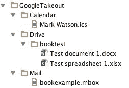

本节的 Google Takeout 文件

## 处理 Microsoft Excel 表格 xlsx 和 Microsoft Word docx 文件

我们将使用 Apache Tika 和`iCal4j`库来实现接下来三个子节中的代码。下面的图显示了本节使用的 IntelliJ 源码和测试文件：

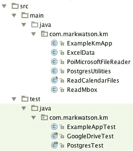

Java 源码和测试文件

我们将使用 Tika 库来解析 Excel 表格文件中的所有工作表（即单独页面）。输出是一个格式良好的文本文件，由换行符和制表符分隔。以下实用类通过将纯文本表示解析为 Java 数据来解析此文本输出，以便更方便使用：

```java
package com.markwatson.km;

import java.util.*;
import java.util.regex.Pattern;

public class ExcelData {
  public List<List<List<String>>> sheetsAndRows = new ArrayList<>();
  private List<List<String>> currentSheet = null;

  public ExcelData(String contents) {
    Pattern.compile("\n")
        .splitAsStream(contents)
        .forEach((String line) -> handleContentsStream(line));
    if (currentSheet != null) sheetsAndRows.add(currentSheet); 
  }

  private void handleContentsStream(String nextLine) {
    if (nextLine.startsWith("Sheet")) {
      if (currentSheet != null) sheetsAndRows.add(currentSheet);
      currentSheet = new ArrayList<>();
    } else {
      String[] columns = nextLine.substring(1).split("\t");
      currentSheet.add(Arrays.asList(columns));
    }
  }

  public String toString() {
    StringBuilder sb = new StringBuilder("<ExcelData # sheets: " +
              sheetsAndRows.size() + "\n");
    for (List<List<String>> sheet : sheetsAndRows) {
      sb.append("  <Sheet\n");
      for (List<String> row : sheet) {
        sb.append("    <row " + row + ">\n");
      }
      sb.append("  >\n>\n");
    }
    return sb.toString();
  }
}
```

当创建`ExcelData`类的新实例时，你可以通过`sheetsAndRows`中的公共数据访问各个工作表（sheets）以及每个工作表中的行（rows）。

`sheetsAndRows`的第一个索引访问单个工作表，第二个索引访问所选工作表中的行，第三个（内部）索引则访问所选行中的单个列（columns）。公共工具方法`toString`提供了访问这些数据的示例。在下一个列表的示例代码使用了`ExcelData`类。

以下工具类`PoiMicrosoftFileReader`具有处理 Excel 和 Word 文件的方法：

```java
package com.markwatson.km;

import java.io.*;
import org.apache.poi.openxml4j.exceptions.InvalidFormatException;
import org.apache.tika.Tika;
import org.apache.tika.exception.TikaException;
import org.apache.tika.metadata.Metadata;
import org.apache.tika.parser.ParseContext;
import org.apache.tika.parser.microsoft.ooxml.OOXMLParser;
import org.apache.tika.sax.BodyContentHandler;
import org.apache.xmlbeans.XmlException;
import org.xml.sax.SAXException;

public class PoiMicrosoftFileReader {

  static private boolean DEBUG_PRINT_META_DATA = false;

  public static String DocxToText(String docxFilePath)
      throws IOException, InvalidFormatException, XmlException,
             TikaException {
    String ret = "";
    FileInputStream fis = new FileInputStream(docxFilePath);
    Tika tika = new Tika();
    ret = tika.parseToString(fis);
    fis.close();
    return ret;
  }

  public static ExcelData readXlsx(String xlsxFilePath)
      throws IOException, InvalidFormatException, XmlException,
             TikaException, SAXException {
    BodyContentHandler bcHandler = new BodyContentHandler();
    Metadata metadata = new Metadata();
    FileInputStream inputStream = new FileInputStream(new File(xlsxFilePath));
    ParseContext pcontext = new ParseContext();
    OOXMLParser parser = new OOXMLParser();
    parser.parse(inputStream, bcHandler, metadata, pcontext);
    if (DEBUG_PRINT_META_DATA) {
      System.err.println("Metadata:");
      for (String name : metadata.names())
        System.out.println(name + "\t:\t" + metadata.get(name));
    }
    ExcelData spreedsheet = new ExcelData(bcHandler.toString());
    return spreedsheet;
  }
}
```

静态公共方法`DocxToText`将指定 Microsoft Word docx 文件的路径转换为该文件中的纯文本。公共静态方法`readXlsx`将 Excel xlsx 文件的路径转换为我们之前看过的`ExcelData`类的实例。

运行测试程序`GoogleDriveTest.testDocxToText`和`GoogleDriveTest.testExcelReader`生成了以下输出。我使用 jUnit 测试作为一种方便的方式，在示例代码中提供调用 API 的示例。这里是测试代码及其输出：

```
String contents = PoiMicrosoftFileReader.DocxToText("Googleout/Drive/Test document.docx");
System.err.println("Contents of docx file:\n\n" + contents);

ExcelData spreadsheet = PoiMicrosoftFileReader.readXlsx("Googleout/Drive/Test spreadsheet.xlsx");
System.err.println("Contents of spreadsheet:\n\n" + spreadsheet);
```

docx 文件内容：

```
<ExcelData # sheets: 1
  <Sheet
    <row []>
  >
>
```

#### 处理 iCal 文件

iCal 格式是 Google、Apple 以及其他供应商导出日历数据的标准。以下代码使用了`net.fortuna.icalj`库，该库提供了一个处理 iCal 文件的丰富 API。在以下示例中，我们使用了其中的一小部分：


```java
package com.markwatson.km;

// reference: https://github.com/ical4j/ical
import net.fortuna.icalj.data.CalendarBuilder;
import net.fortuna.icalj.data.ParserException;
import net.fortuna.ical4j.model.Component;
import net.fortuna.ical4j.model.Property;
import java.io.FileInputStream;
import java.io.IOException;
import java.util.*;

public class ReadCalendarFiles {

  public ReadCalendarFiles(String filePath)
      throws IOException, ParserException {
    Map<String, String> calendarEntry = null;
    FileInputStream fin = new FileInputStream(filePath);
    CalendarBuilder builder = new CalendarBuilder();
    net.fortuna.ical4j.model.Calendar calendar = builder.build(fin);
    for (Iterator i = calendar.getComponents().iterator();
         i.hasNext(); ) {
      Component component = (Component) i.next();
      if (component.getName().equalsIgnoreCase("VEVENT")) {
        calendarEntry = new HashMap<>();
        for (Iterator j = component.getProperties().iterator();
              j.hasNext(); ) {
           net.fortuna.ical4j.model.Property property =
              (Property) j.next();
           calendarEntry.put(property.getName(),
                             property.getValue());
        }
        calendarEntries.add(calendarEntry);
      }
    }
  }

  public int size() { return calendarEntries.size(); }
  public Map<String, String> getCalendarEntry(int index) {
    return calendarEntries.get(index);
  }

  /**
   * 日历条目列表，每个条目
   *  是一个 Map<String, String>
   *
   */
  private List<Map<String, String>> calendarEntries =
       new ArrayList<>();
}
```

运行测试程序 `GoogleDriveTest.testCalendarFileReader` 生成了以下输出。这里是测试代码及其输出：

```java
 1   ReadCalendarFiles calendar =
 2     new ReadCalendarFiles("GoogleTakeout/Calendar/Mark Watson.ics");
 3   System.err.println("\n\nTest iCal calendar file has " +
 4                      calendar.size() + " calendar entries.");
 5   for (int i=0, size=calendar.size(); i<size; i++) {
 6     Map<String,String> entry = calendar.getCalendarEntry(i);
 7     System.err.println("\n\tNext calendar entry:");
 8     System.err.println("\n\t\tDTSAMP:\t" + entry.getOrDefault("DTSTAMP", ""));
 9     System.err.println("\n\t\tSUMMARY:\t" + entry.getOrDefault("SUMMARY", ""));
10     System.err.println("\n\t\tDESCRIPTION:\t" +
11                        entry.getOrDefault("DESCRIPTION", ""));
12   }
```

```text
 1 Test iCal calendar file has 11 calendar entries.
 2 
 3 	Next calendar entry:
 4 
 5 		DTSAMP: 20150917T234033Z
 6 
 7 		SUMMARY: Free Foobar Test  Meeting
 8 
 9 		DESCRIPTION: Bob Smith has invited you to join a meeting
10 
11  ... ...
```

`ReadCalendarFiles` 类的工具方法 `toString` 为每个条目打印三个属性：时间戳、摘要和描述。

### 处理邮件 mbox 文件

在这一节中，我们使用 Apache Tika 库来解析 `mbox` 格式的电子邮件文件。第 36 行有一处被注释的输出，你可能想要取消注释并查看完整的消息文本，以查看每封邮件在处理时的所有可用元数据。你在应用程序中使用的元数据可能比我在示例代码中使用的更多。

```java
 1 package com.markwatson.km;
  2 
  3 // reference: https://tika.apache.org/
  4 
  5 import org.apache.poi.openxml4j.exceptions.InvalidFormatException;
  6 import org.apache.tika.exception.TikaException;
  7 import org.apache.tika.metadata.Metadata;
  8 import org.apache.tika.parser.ParseContext;
  9 import org.apache.tika.parser.Parser;
 10 import org.apache.tika.parser.mbox.MboxParser;
 11 import org.apache.tika.parser.microsoft.ooxml.OOXMLParser;
 12 import org.apache.tika.sax.BodyContentHandler;
 13 import org.apache.xmlbeans.XmlException;
 14 import org.xml.sax.SAXException;
 15 
 16 import java.io.*;
 17 import java.nio.charset.StandardCharsets;
 18 import java.util.ArrayList;
 19 import java.util.List;
 20 
 21 /**
 22  * Created by markw on 9/17/15.
 23  */
 24 public class ReadMbox {
 25 
 26   static private boolean DEBUG_PRINT_META_DATA = true;
 27 
 28   private String getTextContents(InputStream stream) {
 29     BufferedReader br = new BufferedReader(new InputStreamReader(stream));
 30     StringBuffer sb = new StringBuffer();
 31     String subject = "";
 32     String from = "";
 33     String to = "";
 34     try {
 35       String line = null;
 36       boolean inText = false;
 37       while ((line = br.readLine()) != null) {
 38         //System.err.println("-- line: " + line);
 39         if (!inText) {
 40           if (line.startsWith("Subject:")) subject = line.substring(9);
 41           if (line.startsWith("To:"))      to = line.substring(4);
 42           if (line.startsWith("From:"))    from = line.substring(6);
 43         }
 44           if (line.startsWith("Content-Type: text/plain; { {
 45             inText = true;
 46             br.readLine();
 47         } else if (inText) {
 48           if (line.startsWith("-----")) break;
 49           if (line.startsWith("--_---")) break;
 50           if (line.startsWith("Content-Type: text/html;")) break;
 51           sb.append(line + "\n");
 52         }
 53       }
 54     } catch (Exception ex) {
 55       System.err.println("ERROR: " + ex);
 56     }
 57     return "To: " + to + "\nFrom: " + from + "\nSubject: " +
 58            subject + "\n" + sb.toString();
 59   }
 60 
 61   public ReadMbox(String filePath)
 62       throws IOException, InvalidFormatException, XmlException {
 63     FileInputStream inputStream = new FileInputStream(filePath);
 64     BufferedReader br = new BufferedReader(new InputStreamReader(inputStream));
 65     StringBuffer sb = new StringBuffer();
 66     String line = null;
 67     boolean inText = false;
 68     try {
 69       while ((line = br.readLine()) != null) {
 70         if (!inText) {
 71           if (line.startsWith("Subject:")) subject = line.substring(9);
 72           if (line.startsWith("To:"))      to = line.substring(4);
 73           if (line.startsWith("From:"))    from = line.substring(6);
 74         }
 75         if (line.startsWith("Content-Type: text/plain;")) {
 76             inText = true;
 77             br.readLine();
 78         } else if (inText) {
 79           if (line.startsWith("-----")) break;
 80           if (line.startsWith("--_---")) break;
 81           if (line.startsWith("Content-Type: text/html;")) break;
 82           sb.append(line + "\n");
 83         }
 84       }
 85     } catch (Exception ex) {
 86       System.err.println("ERROR: " + ex);
 87     }
 88     return "To: " + to + "\nFrom: " + from + "\nSubject: " +
 89            subject + "\n" + sb.toString();
 90   }
 91 
 92   public int size() {
 93     return emails.size();
 94   }
 95 
 96   public String getEmail(int index) {
 97     return emails.get(index);
 98   }
 99 
 100  public List<String> emails = new ArrayList<>();
101 }
```

```text
 1   ReadCalendarFiles calendar = new ReadCalendarFiles("GoogleTakeout/Calendar/Mark Watson.ics");
 2   System.err.println("\n\nTest iCal calendar file has " + calendar.size() + " calendar entries.");
 3   for (int i=0, size=calendar.size(); i<size; i++) {
 4     Map<String,String> entry = calendar.getCalendarEntry(i);
 5     System.err.println("\n\tNext calendar entry:");
 6     System.err.println("\n\t\tDTSAMP:\t" + entry.getOrDefault("DTSTAMP", ""));
 7     System.err.println("\n\t\tSUMMARY:\t" + entry.getOrDefault("SUMMARY", ""));
 8     System.err.println("\n\t\tDESCRIPTION:\t" + entry.getOrDefault("DESCRIPTION", ""));
 9   }
```

```text
 1 Test iCal calendar file has 11 calendar entries.
 2 
 3 	Next calendar entry:
 4 
 5 		DTSAMP: 20150917T234033Z
 6 
 7 		SUMMARY: Free Foobar Test  Meeting
 8 
 9 		DESCRIPTION: Bob Smith has invited you to join a meeting
10 
11  ... ...
```

`ReadCalendarFiles` 类的工具方法 `toString` 为每个条目打印三个属性：时间戳、摘要和描述。

### 处理邮件 mbox 文件

在这一节中，我们使用 Apache Tika 库来解析 `mbox` 格式的电子邮件文件。第 36 行有一处被注释的输出，你可能想要取消注释并查看完整的消息文本，以查看每封邮件在处理时的所有可用元数据。你在应用程序中使用的元数据可能比我在示例代码中使用的更多。


```java
package com.markwatson.km;

// reference: https://tika.apache.org/

import org.apache.poi.openxml4j.exceptions.InvalidFormatException;
import org.apache.tika.exception.TikaException;
import org.apache.tika.metadata.Metadata;
import org.apache.tika.parser.ParseContext;
import org.apache.tika.parser.Parser;
import org.apache.tika.parser.mbox.MboxParser;
import org.apache.tika.parser.microsoft.ooxml.OOXMLParser;
import org.apache.tika.sax.BodyContentHandler;
import org.apache.xmlbeans.XmlException;
import org.xml.sax.SAXException;

import java.io.*;
import java.nio.charset.StandardCharsets;
import java.util.ArrayList;
import java.util.List;

/**
 * Created by markw on 9/17/15.
 */
public class ReadMbox {

  static private boolean DEBUG_PRINT_META_DATA = true;

  private String getTextContents(InputStream stream) {
    BufferedReader br = new BufferedReader(new InputStreamReader(stream));
    StringBuffer sb = new StringBuffer();
    String subject = "";
    String from = "";
    String to = "";
    try {
      String line = null;
      boolean inText = false;
      while ((line = br.readLine()) != null) {
        //System.err.println("-- line: " + line);
        if (!inText) {
          if (line.startsWith("Subject:")) subject = line.substring(9);
          if (line.startsWith("To:"))      to = line.substring(4);
          if (line.startsWith("From:"))    from = line.substring(6);
        }
        if (line.startsWith("Content-Type: text/plain;")) {
            inText = true;
            br.readLine();
        } else if (inText) {
          if (line.startsWith("-----")) break;
          if (line.startsWith("--_---")) break;
          if (line.startsWith("Content-Type: text/html;")) break;
          sb.append(line + "\n");
        }
      }
    } catch (Exception ex) {
      System.err.println("ERROR: " + ex);
    }
    return "To: " + to + "\nFrom: " + from + "\nSubject: " +
           subject + "\n" + sb.toString();
  }

  public ReadMbox(String filePath)
      throws IOException, InvalidFormatException, XmlException {
    FileInputStream inputStream = new FileInputStream(filePath);
    BufferedReader br = new BufferedReader(new InputStreamReader(inputStream));
    StringBuffer sb = new StringBuffer();
    String line = null;
    boolean inText = false;
    try {
      while ((line = br.readLine()) != null) {
        if (!inText) {
          if (line.startsWith("Subject:")) subject = line.substring(9);
          if (line.startsWith("To:"))      to = line.substring(4);
          if (line.startsWith("From:"))    from = line.substring(6);
        }
        if (line.startsWith("Content-Type: text/plain;")) {
            inText = true;
            br.readLine();
        } else if (inText) {
          if (line.startsWith("-----")) break;
          if (line.startsWith("--_---")) break;
          if (line.startsWith("Content-Type: text/html;")) break;
          sb.append(line + "\n");
        }
      }
    } catch (Exception ex) {
      System.err.println("ERROR: " + ex);
    }
    return "To: " + to + "\nFrom: " + from + "\nSubject: " +
           subject + "\n" + sb.toString();
  }

  public int size() {
    return emails.size();
  }

  public String getEmail(int index) {
    return emails.get(index);
  }

  public List<String> emails = new ArrayList<>();
}
```

```text
ReadCalendarFiles calendar = new ReadCalendarFiles("GoogleTakeout/Calendar/Mark Watson.ics");
System.err.println("\n\nTest iCal calendar file has " + calendar.size() + " calendar entries.");
for (int i=0, size=calendar.size(); i<size; i++) {
  Map<String,String> entry = calendar.getCalendarEntry(i);
  System.err.println("\n\tNext calendar entry:");
  System.err.println("\n\t\tDTSAMP:\t" + entry.getOrDefault("DTSTAMP", ""));
  System.err.println("\n\t\tSUMMARY:\t" + entry.getOrDefault("SUMMARY", ""));
  System.err.println("\n\t\tDESCRIPTION:\t" + entry.getOrDefault("DESCRIPTION", ""));
}
```

```text
Test iCal calendar file has 11 calendar entries.

	Next calendar entry:

		DTSAMP: 20150917T234033Z

		SUMMARY: Free Foobar Test  Meeting

		DESCRIPTION: Bob Smith has invited you to join a meeting

 ... ...
```

## 使用 Postgres 作为带有文本搜索的本地文档存储库

现在我们将开发一组简单的工具类，用于方便地将 Postgres 数据库中的结构化数据和“较非结构化”的 JSON 数据转换为字符串。我们还将为包含文本数据的列提供文本搜索支持。

我在工作中使用许多不同的数据存储：Amazon S3 和 DynamoDB、Google Big Table、Hadoop 文件系统、MongoDB、CouchDB、Cassandra 等。对于不同的项目有很多很好的选择！

尽管如此，Postgres 是我的“瑞士军刀”式数据存储库，它提供了稳固的关系型数据库、全文索引以及对无模式原生 JSON 文档的原支持。在这一短节中，我将介绍 Postgres 的 JDBC 访问，并涵盖如果你也想将 Postgres 作为你的“瑞士军刀”式数据存储库时可能需要的常见用例。


```java
package com.markwatson.km;

import java.sql.*;
import java.util.ArrayList;
import java.util.HashMap;
import java.util.List;
import java.util.Properties;

/**
 * 由 Mark 创建于 6/5/2015.
 */
public class PostgresUtilities {
  private static String defaultConnectionURL =
       "jdbc:postgresql://localhost:5432/kmdexample?user=markw&password=";
  private Connection conn = null;

  public PostgresUtilities() throws ClassNotFoundException, SQLException {
    this(defaultConnectionURL);
  }

  public PostgresUtilities(String connectionURL)
       throws ClassNotFoundException, SQLException {
    Class.forName("org.postgresql.Driver");
    Properties props = new Properties();
    //props.setProperty("user","a username could go here");
    //props.setProperty("password","a passwordc could go here");
    conn = DriverManager.getConnection(connectionURL, props);
  }

  /**
   * doUpdate - 执行一次 SQL 更新
   * @param sql 更新字符串
   * @return List<HashMap<String,Object>> 每一行都是一个 map，列通过
   *         （小写）列名获取
   * @throws SQLException
   */
  public int doUpdate(String sql) throws SQLException {
    Statement st = conn.createStatement();
    int rows_affected = st.executeUpdate(sql);
    return rows_affected;
  }

  /**
   * doQuery - 执行一次 SQL 查询
   * @param sql 查询字符串
   * @return List<HashMap<String,Object>> 每一行都是一个 map，列通过
   *          （小写）列名获取
   * @throws SQLException
   */
  public List<HashMap<String,Object>> doQuery(String sql) throws SQLException {
    Statement st = conn.createStatement();
    ResultSet rs = st.executeQuery(sql);
    List<HashMap<String,Object>> ret = convertResultSetToList(rs);
    rs.close();
    st.close();
    return ret;
  }

  /**
   * textSearch - 在特定表的特定列中搜索由空格分隔的查询字符串。
   *
   * 请注意，此工具方法处理的是非常通用的情况。我通常
   * 从像 `textSearch` 这样的通用方法开始，
   * 然后根据需要添加针对特定应用程序的方法（例如，在不同的列上进行选择等）。
   *
   * @param tableName 表名
   * @param coloumnToSearch 要搜索的列
   * @param query 查询
   * @return List<HashMap<String,Object>> 每一行都是一个 map，列通过
   *                                     （小写）列名获取
   * @throws SQLException
   */
  public List<HashMap<String,Object>> textSearch(String tableName,
                                                 String coloumnToSearch,
                                                 String query)
       throws SQLException {
    // 我们需要用 & 字符分隔查询词：
    String modifiedQuery = query.replaceAll(" ", " & ");
    String qString = "select * from " + tableName + " where to_tsvector(" +
                     coloumnToSearch + ") @@ to_tsquery('" +
                     modifiedQuery +  "')";
    Statement st = conn.createStatement();
    ResultSet rs = st.executeQuery(qString);
    List<HashMap<String,Object>> ret = convertResultSetToList(rs);
    rs.close();
    st.close();
    return ret;
  }

  /**
   * convertResultSetToList
   *
   * 下方法源自 stack overflow 一个示例。
   * 感谢 stack overflow 用户 RHT 和 Brad M！
   *
   * 请注意，我将列名转换为了小写，这样每一行的列数据
   * 就可以通过查询中的小写列名进行统一访问。
   *
   * @param rs 是一个 JDBC ResultSet
   * @return List<HashMap<String,Object>> 每一行都是一个 map，列通过
   *         （小写）列名获取
   * @throws SQLException
   */
  private List<HashMap<String,Object>> convertResultSetToList(ResultSet rs)
       throws SQLException {
    ResultSetMetaData md = rs.getMetaData();
    int columns = md.getColumnCount();
    List<HashMap<String,Object>> list = new ArrayList<HashMap<String,Object>>();
    while (rs.next()) {
      HashMap<String,Object> row = new HashMap<String, Object>(columns);
      for(int i=1; i<=columns; ++i) {
        row.put(md.getColumnName(i).toLowerCase(),rs.getObject(i));
      }
      list.add(row);
    }
    return list;
  }
}
```

```java
results = pcon.doQuery(
        "select * from test where to_tsvector(description) @@ to_tsquery('" +
        search_string + "')");
    System.out.println("results = " + results);
```

输出结果为：

```
results = [{name=Anita, description=sister inlaw who lives in San Diego, id=1}]
```

```java
num_rows = pcon.doUpdate("drop table test");
    System.out.println("num_rows = " + num_rows);
```

输出结果为：

```
num_rows = 0
```

关于 NoSQL 数据存储存在大量的炒作，其中一些炒作是名之其实的：当你有海量数据需要处理时，通过 Hadoop 文件系统或 `Cassandra` 等系统将数据分布到许多服务器上，可以允许你使用许多低成本的服务器来处理大型数据集。尽管如此，对于许多应用程序来说，你的数据集并不大，因此使用像 `Postgres` 这样的通用数据库系统更有意义。理想情况下，你会将数据访问封装在自己的代码中，以尽量减少在未来切换数据存储系统时的代码更改。

## 总结

我的职业生涯大部分时间都致力于构建存储和提供信息访问系统，以支持自动化和人工参与的系统。知识管理是计算机科学的一个分支，它帮助将数据转化为信息，再将信息转化为知识。我将这一章命名为“轻量级知识管理”，因为我只是为你自己的 `KM` 项目提供一些想法，并希望能够改善你对数据存储和使用的看法。

## 结语

这本书向你提供了关于如何使用机器学习、自然语言处理和各种数据存储技术来处理信息的个人观点。我的希望是我关于构建软件系统的一些想法至少能对你有所帮助，并为你在设计和构建应用程序时提供可以利用的思路。

我关于构建解决世界现实问题的系统的一通用哲学包括以下几点：

- 将学习新技术作为一种背景练习，以“保持工具箱完整”。这在如今技术快速变化的当下尤为重要，而且新技术往往能让实现新功能变得更加容易。我写这本书的一个主要原因是向你介绍我发现的最实用的技术。

- 确保你解决的是正确的问题。构建对你的公司、组织以及整个世界产生影响的系统，通过构建你认为将产生最大积极影响的事物。

顺颂商祺，
Mark Watson  2015 年 11 月 10 日
