# Java 开发人员实用设计模式指南


序言：Bruno Souza，首席顾问，Java 冠军，JCP 执行委员会成员


- **产品经理：** Gebin George
- **出版经理：** Kunal Sawant
- **高级编辑：** Rohit Singh
- **技术编辑：** Maran Fernandes
- **文字编辑：** Safis Editing
- **项目协调员：** Prajakta Naik
- **校对员：** Safis Editing
- **索引员：** Subalakshmi Govindhan
- **制作设计师：** Prashant Ghare
- **市场协调员：** Sonia Chauhan

我记得最初在 Sun Microsystems 开始探索 Java 平台的日子。它不仅成了我的日常工作，更成为我终身的爱好和激情。这本书献给我不起的妻子 Tanja，我可爱的孩子们 Maxi 和 Elli 以及我的家人，感谢他们给我能量、灵感和动力，让我保持完成这本书所需的力量。

– Miroslav Wengner

# 序言

那是 2021 年 11 月。在一次关于开发者职业的对话中，一位高级 Java 开发者告诉我：“我做高级工程师快 20 年了。我不知道该做什么才能突破那个水平。”

这是一个典型的陈述。时间长短不一，但有太多的开发者和工程师感觉自己卡在了高级职位上。

别误会，成为高级工程师并不是坏事！

你可能正在从事伟大的项目并使用酷炫的技术。你可能参与了解决复杂的问题并面临着深层次的技术挑战。

但总有一天，你像上述那位开发者一样，觉得在职业生涯中可以做得更多，在项目方向上拥有更大的影响力，在工作中拥有独立自主权，或者你可能觉得通过启发和指导其他开发者能获得更多成就感。

虽然我以前听过很多次，但那个特定的实例让我开始思考。你看，就在当天早些时候，我正在查看 Java 社区进程（JCP）选举的结果。Miroslav Wengner（我的朋友 Miro）刚刚当选为 Java 技术顶尖标准机构的执行委员会。

我不禁思考其中的相似之处……

我在我们在 Sun Microsystems 的 NetBeans 团队工作时结识 Miro，那家公司是创建 Java 的。和上述开发者一样，Miro 也从事 Java 很多年。当我与他就开发者职业进行长时间交谈时，Miro 也已经当了多年高级工程师。但他并未止步于此。现在，仅仅几年后，Miro 已经超越了高级：自由职业者、演讲师、开源开发者、OpenJDK 中 Java Mission Control 项目的提交者、Java 冠军以及 JCP 成员，而且还是一本书作者！

这说明你不必受困于高级水平。你可以建立自己的技术声誉，成长到高级职位之上的高度，并对你的项目、公司甚至整个世界产生更大的影响。

这一切向我们引出的一个点是，Miro 的书说明了设计模式在实现这一目标中的重要性——即：超越高级水平。无论你是想成为经理、继续作为资深工程师从事技术工作，还是更倾向于作为自由职业者或企业家保持独立，你都需要承担更多的责任并超越代码。

尽管设计模式与代码直接相关，但它们也是分离且独立的。它们封装了解决设计高质量软件常见挑战的经过验证的解决方案。设计模式悬浮于特定的代码甚至特定的项目之上，并为解释问题和解决方案创建了通用的词汇。任何从事软件构建业务的人都应该掌握这套词汇，以便理解、沟通并参与讨论。毕竟，超越高级意味着对你的职业生涯负责。你从项目中的高级人员身份开始，然后通过参与更具影响力的技术来扩大你的影响力。

当你掌握了设计模式的词汇时，你更有能力超越眼前的项目，参与到跨公司和跨行业的其他项目中。你甚至可能通过开源项目或标准组织帮助定义技术方向，就像 Miro 在 JCP 所做的那样。

这本书将帮助你实现这一点。通过对 Java 生态系统中模式的广泛视角，你不仅将看到概念和词汇，还能看到设计模式在日常软件中的真实实现和影响。

令我一直印象深刻的一点是 Miro 将软件与真实事物结合的能力。他的开源项目 Robo4J 甚至获得了 Duke's Choice Award，帮助你将 Java 代码转化为能够在现实世界导航的机器人和无人机。我很高兴 Miro 在设计模式上采用这种方法。书中的示例使用了多种车辆及其部件，并使用最新的 Java 17+ 特性编写，赋予了设计生命并将其与具体问题联系起来。

所以，开启你建立声誉、职业成长并超越高级水平的旅程吧。了解设计模式将帮助你融入、使用这种语言并参与决策。让出色的 Miro 担任你的指南，如果你想（像 Miro 那样）谈谈你职业的下一步，请随时与我联系。

Bruno Souza

首席顾问，Java 冠军，JCP 执行委员会成员

@brjavaman

https://java.mn

# 关于作者

Miroslav Wengner 是一位对弹性分布式系统和产品质量充满热情的工程师。他是 Robo4J 项目（一个用于机器人/物联网的响应软实时框架）的共同作者和贡献者。Miro 贡献 OpenJDK 并参与其他开源技术。他利用自己构建弹性且可扩展解决方案的热情。

Miro 被选入 Java Champions 计划，被评为 JavaOne Rockstar，并当选 Java 社区进程（JCP）执行成员。

除了在 OpenValue 首席工程师的日常职责外，他还在会议（JavaOne、Devoxx 等）和博客中分享他的知识。Miro 相信 Java 生态系统并帮助其向前发展！

# 关于评审员

Werner Keil 活跃于敏捷、BDD、云原生 DevOps、Java、Java EE/Jakarta EE、物联网、安全和微服务等领域，帮助各个全球 500 强客户和 IT 供应商。Werner 在不同领域担任过项目经理、教练、软件架构师和顾问，拥有超过 30 年经验。他是 Eclipse 和 Apache 委员会成员，也是 JSRs 中的 JCP 成员。Werner 曾获得多项 JCP 奖项，包括“年度成员”和“优秀规范负责人”，并被东欧大型 Java 大会 Java2Days 评为“史上最佳演讲者”。他是 Eclipse Babel 语言冠军、Eclipse UOMo 项目负责人，也是 Jakarta EE 规范委员会的委员会成员。

# 前言

Java 语言是一种与非常丰富的平台通信的工具，该平台提供了许多可直接用于应用程序开发的特性。本书通过最实用设计模式的示例，探索了改进语言语法的最新进展。本书通过示例实现揭示了特性、模式与平台效率之间的关系。本书探索了理论基础如何帮助提高源代码的可维护性、效率和可测试性。书中的内容帮助读者解决不同的任务，并就如何使用各种可持续且透明的方法来应对挑战提供指导。

# 本书适合读者

本书献给所有“渴求知识”的工程师，他们希望通过新的语言增强和对 Java 平台更深入的观察来提高自己的软件设计技能。

# 本书涵盖的内容

- 第 1 章 **进入软件设计模式**，向我们介绍了源代码结构的初始基础，并概述了为了实现可维护性和可读性应该遵循的原则。
- 第 2 章 **发现用于设计模式的 Java 平台**，讨论了 Java 平台，这是一个非常广泛且强大的工具。本章详细介绍了 Java 平台的特性、功能和设计，以继续构建理解使用设计模式的目的和价值所需的基础。
- 第 3 章 **使用创建型设计模式**，探索了对象实例化，这是任何应用程序的关键。本章描述了如何在满足需求的同时处理这一挑战。
- 第 4 章 **应用结构型设计模式**，展示了如何创建源代码使所需对象之间的关系变得清晰。
- 第 5 章 **行为设计模式**，探索了如何创建源代码允许对象在保持透明形式的同时通信并交换信息。
- 第 6 章 **并发设计模式**，讨论了 Java 平台以及它本质上是如何并发环境。它展示了如何利用其力量来实现应用程序的设计。
- 第 7 章 **理解常见的反模式**，处理在任何应用开发周期中都可以发现的反模式。它将帮助你处理根源及其识别，并提出可能的反模式补救措施。

# 如何充分利用本书

要执行本书中的指令，你需要以下内容：

| 软件/硬件 | 操作系统 |
| :--- | :--- |
| 开发工具包 (JDK) | Windows, macOS, Linux |
| 推荐 IDE | Windows, macOS, Linux |

要验证是否安装了 JDK，请执行以下命令：

`java -version`

预期输出：

```
openjdk version "17.0.x" ...
```

如果你没有安装 JDK，请搜索：https://www.oracle.com/java/technologies/downloads/

或使用 OpenJDK：https://openjdk.org/

# 使用的约定

书中使用了许多约定。

文本中的**代码**：表示数据库名、文件夹名、文件名、扩展名、路径名、URL、用户输入。

代码块设置如下：

```java
public class Vehicle {
    private boolean moving;
    public void move() {
        this.moving = true;
        System.out.println("moving...");
    }
}
```

当我们希望你关注代码块的特定部分时，相关的行或项目将加粗：

```java
sealed interface Engine permits ElectricEngine, PetrolEngine {
    void run();
    void tank();
}
```

命令行输入或输出写作：

```
$ mkdir main
$ cd main
```

**粗体**：表示新术语、重要单词或屏幕上的文字。例如，菜单或对话框中的文字将显示为粗体。

# 联系我们

我们欢迎读者的反馈。

**一般反馈**：如果你对本书的任何方面有疑问，请发送电子邮件至 `customercare@packpub.com` 并在主题中注明书名。

**错误更正**：尽管我们尽力确保内容的准确性，但错误仍然会发生。如果你在书中发现了错误，我们将不胜感激你的告知。请访问 `www.packpub.com/support/errata` 并填写表单。

**侵权**：如果你在互联网上发现我们作品的任何形式的非法副本，我们将不胜感激你能提供地址或网站名称。请通过 `copyright@packt.com` 联系我们并提供链接。

**如果你有兴趣成为作者**：如果你对某个领域有专业知识，并有兴趣编写或贡献书籍，请访问 `authors.packpub.com`。

# 下载本书的免费 PDF 副本

感谢购买本书！

你是否喜欢在旅途中阅读，但又无法随身携带纸质书？你购买的电子书是否与你选择的设备不兼容？

别担心，现在购买每本 Packt 图书，你都可以免费获得该书的无 DRM PDF 版本。

在任何时间、任何地点、任何设备上阅读。直接搜索、复制并粘贴你喜欢的技术书籍到你的应用程序中。

优惠远不止于此，你每天可以在收件箱中收到专属折扣、新闻资讯和精彩的免费内容。

遵循以下简单步骤获取福利：

1. 扫描二维码或访问下方链接


https://packt.link/free-ebook/97818804614679

2. 提交你的购买证明

3. 完成了！我们将直接将免费 PDF 和其他福利发送到你的电子邮箱

## 第一部分：设计模式与 Java 平台功能

此部分涵盖了软件设计模式的目的。它概述了面向对象编程 APIE 的基本思想和 SOLID 设计原则，并介绍了 Java 平台，这对于理解如何有效利用设计模式至关重要。

此部分包含以下章节：

- 第 1 章，进入软件设计模式
- 第 2 章，发现用于设计模式的 Java 平台

### 第 1 章 进入软件设计模式

每个软件架构师或开发者经常面临代码结构化的挑战——如何开发出一种可持续的代码结构，就像艺术家画画一样。本章将带我们进入编写程序代码的旅程。你将探索代码结构及其组织背后的挑战。我们将从面向对象编程支柱（即 APIE）描述的早期阶段开始探讨这一主题。我们还将回顾 SOLID 原则，以便更清晰地理解设计模式。

在本章中，我们将涵盖以下主题：

- 代码——通往程序的符号
- 检查 OOP 和 APIE
- 理解 SOLID 设计原则
- 审视设计模式解决了哪些挑战

在本章结束时，你将回顾基础编程概念，这些概念将构成本书后续内容的基础。

#### 技术要求

你可以在 GitHub 上找到本章的代码文件，地址为：`https://github.com/PacktPublishing/Practical-Design-Patterns-for-Java-Developers/tree/main/Chapter01`。

## 代码——通往程序的符号

人类语言是充实、丰富、多彩且远超单词本身所能表达的内容。可以使用精确表达某个时刻或动作的名词、动词和形容词。相比之下，机器无法理解人类能够创造的构造结构或表达。

机器语言是有限的、良好的、极其具体的且简化的。它的目标是为其设计的意图提供精确表达。这与人类语言形成对比，后者的目的仅仅是为了交流而不一定是为了细节。

机器的意图可以表示为一条定义的指令或一组指令。这意味着机器理解这些指令。这些指令必须在执行时以某种形式提供给机器。每个机器通常有一组指令集。基于这种指令集，机器可以执行所需的指令，如下：

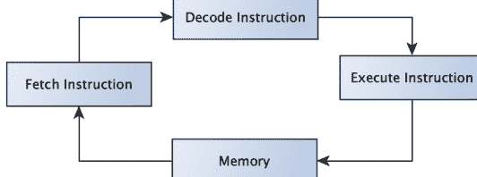

图 1.1 – CPU 内部简化的指令周期（从内存中提取指令并存储结果）

让我们探索单条指令。指令可以被理解为给处理器的命令。处理器是机器的心脏，或者是排序和执行进程的中心。机器可能包含一个或多个处理器。这取决于它的设计，但无论如何，总有一个处于主导地位。为了进一步简化，我们只考虑一个——即拥有一个专门用于执行程序的中央处理单元（CPU）的系统。

CPU 是一个使用计算机程序执行指令的设备。CPU 必须包含如之前所示的指令来处理请求的操作。

由于指令可以根据 CPU 不同采取不同的形式，因此没有定义的标准。这促进了不同的 CPU 平台，这并不一定是坏事，而且有助于演进。然而，事实仍然是指令对人类来说并不容易阅读。

我们已经知道机器可以执行指令集，理想情况下是连续的流。指令流可以简化为内存中的队列，一条指令进入，另一条离开。CPU 扮演着解释器的角色，循环地与该内存工作（正如我们在图 1.1 中所示）。好了，CPU 负责解释，但当指令被添加到内存时，它们来自哪里，这种流是如何创建的呢？

## 代码——从符号到程序

让我们汇总一些想法。机器指令在大多数情况下源自编译器。

什么是编译器？编译器可以被视为 CPU 或特定于平台的程序，它将文本翻译为目标操作。我们用于调用程序的文本和结果可以命名为机器码。下面的图说明了这一点：


图 1.2 – 编译器将源代码转换为机器码

我们可以将封装应用于车辆的示例中。我们想象一辆真实的车辆——仅一辆。在这样一个虚拟的车辆中，所有的内部元素和内部功能对驾驶员都是隐藏的。它只暴露它所提供的功能，例如驾驶员可以控制的方向盘。这就是封装的通用原则。实例的状态可以通过暴露的方法或字段来创建或更新；其他所有内容对外部世界都是隐藏的。使用方法来修改实例的内部数组或多个数组是一个良好的做法，但我们将在本书的后部分重复这一点。到目前为止，这只是一个好的实践。

## 不可避免的演进 – 继承

在上一节中，我们创建了一个虚拟车辆类的一个实例。我们封装了所有不应该暴露给驾驶员的功能。这意味着驾驶员可能不知道引擎是如何工作的，也不知道如何使用它。

本节专门介绍继承这一属性，我们将在接下来的示例中进行演示。假设车辆的引擎坏了。我们该如何替换它呢？目标是将当前的引擎替换为功能正常的引擎。以这种方式工作的引擎并不一定是同一个，特别是当车辆型号拥有市场上无法买到的旧零件时。

我们从创建新引擎所需的所有属性和功能中推导出什么？关于类来说，新的替换模块将是类层次结构中的子类。

虽然引擎不是完美的复制，且没有相同的对象标识符，但它将匹配所有的父类属性。

至此，我们描述了 OOP 中继承的第二个支柱——在现有类之上创建新类的能力。然而，软件设计者应该警惕封装，以及由于子类依赖父类的实现细节而导致的任何违反行为。

## 按需行为 – 多态

第三个概念是多态。通过一点想象，可以将其理解为“多种形式”。那么，这意味着什么呢？

考虑到之前描述的车辆，它可以被定义为以许多方式执行特定动作的能力。这意味着在车辆的语境下，另一个方法 `move()` 的移动可以根据输入或实例的状态而发生变化。

Java 允许两种类型的多态，两者的运行时行为均不同。我们将详细讨论这两种类型。

### 方法重载

这种类型被称为静态多态。这意味着正确的方法是在程序编译期间——即编译时解析的。Java 提供了两种类型的方法重载：

- 更改输入类型：

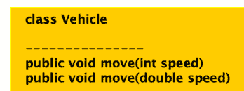


# 图 1.4 – 通过更改输入类型来重载 Vehicle 类的方法

- 更改方法参数的数量：

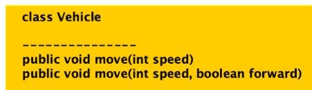

图 1.5 – 通过更改参数数量来重载 Vehicle 类的方法

## 方法重写

这有时被称为动态多态。这意味着执行的方法在运行时是已知的。重写的方法通过所属对象实例的引用调用。让我们来看一个简单的示例来来说这一点。考虑 `Vehicle` 类为父类（见图 1.6 和示例 1.2），它有一个名为 `move` 的方法：

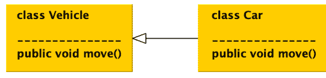

图 1.6 – 父类和子类之间重写的 move 方法之间的关系

我们打算创建一个名为 `Car` 的子类，并有一个名为 `move` 的类似方法。子类提供了稍微不同的功能，因为 `Car` 实例的移动速度比父类实例 `Vehicle` 快：

```java
public class Vehicle {
    public void move() {
        System.out.println("moving...");
    }
}
public class Car extends Vehicle {
    @Override
    public void move() {
        System.out.println("moving faster.");
    }
}
```

```java
Vehicle vehicle = new Car();
vehicle.move();
// output: moving faster...
```

**示例 1.2 – Vehicle 变量持有对 Car 实例的引用，并在运行时执行适当的方法（见图 1.6）**

我们将在第 3 章“使用创建设计模式”中更详细地讨论这个主题。

## 标准特性 – 抽象

APIE 缩写中涵盖的最后一个字母引到了此为止未指定的支柱：抽象。这一概念的关键在于不断揭示细节或个体细节，以实现对象目的的泛化。

为了获得最佳体验，让我们进入车辆示例的语境中。我们并不打算描述一个属于某组车辆的特定类模型。我们的目标是在我们的努力范围内，找到所有考虑的车辆类型都可以包含的通用功能。有了这种知识，我们创建了一个合适的抽象——即抽象类，可以在以后构建特定模型类时进行继承（见示例 1.3）。

这种方法允许我们把精力集中在车辆特征的泛化上。这对比减少代码和提高重用具有积极影响。

Java 中的抽象可以通过两种实现：

- 带有抽象方法的抽象类（见示例 1.3 和图 1.7）：


图 1.7 – 带有 CommonCar 和 SportCar 实现的 AbstractVehicle 类

```java
public abstract class AbstractVehicle {
    public abstract void move();
    public void stop() {
        System.out.println("stopped..");
    }
}
public class CommonCar extends AbstractVehicle {
    @Override
    public void move() {
        System.out.println("move slow...");
    }
}
public class SportCar extends AbstractVehicle {
    @Override
    public void move() {
        System.out.println("move fast...");
    }
}
```

**示例 1.3 – 使用抽象类概念在提供特定实现的情况下提取通用功能**

- 使用接口（见示例 1.4 和图 1.8）并带有通用抽象方法：

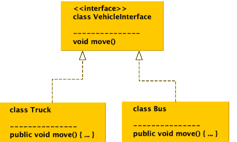

图 1.8 – 通过接口实现的抽象概念

```java
public interface VehicleInterface {
    void move();
}
public class Truck implements VehicleInterface {
    @Override
    public void move() {
        System.out.println("truck moves...");
    }
}
public class Bus implements VehicleInterface {
    @Override
    public void move() {
        System.out.println("bus moves...");
    }
}
```

**示例 1.4 – 使用接口实现的相似功能提取**

两种抽象概念可以结合（见图 1.9）：

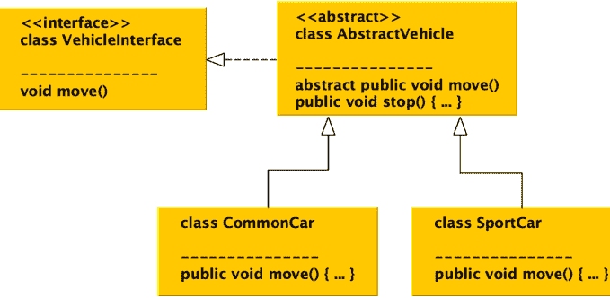

图 1.9 – 两种抽象概念的结合

之前节中提到的每个支柱的动机都是通过一组给定的概念为代码引入结构。这些支柱是定义明确且互补的。让我们只检查一个单元，`Vehicle` 类及其实例。逻辑和数据被封装并通过方法暴露给外部世界。车辆特征可以被继承，以便指定新的车辆（如新模型）。暴露的方法可以提供基于模型的行为和传入的请求。

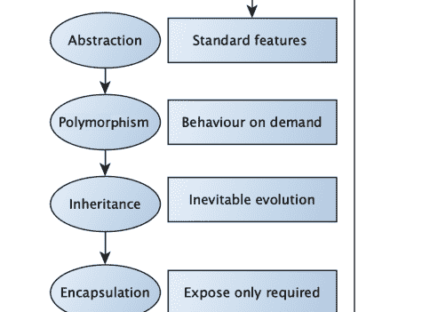

虽然这四个支柱看似微不足道，但要遵循它们极其困难，我们将在接下来的章节和内容中继续展示它们。

在本节中，我们学习了面向对象编程（OOP）的四个基本支柱，并研究了这些原则如何影响代码设计。接下来，我们将学习更多可持续代码设计的概念。让我们进入下一节。

# 理解 SOLID 设计原则

在上一节中，介绍了结构化工作概念。通过示例详细阐述了 APIE 的开发支柱。你已经从面向对象的原则对类实例的概念以及我们如何创建不同类型的特定对象有了基础理解：

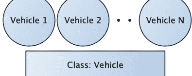

图 1.11 - Vehicle N，其中 N 为正整数，代表 Vehicle类的实例

# 深入软件设计模式

类可以被实例化，使实例成为一个对象。该对象必须放入空内存。我们称该对象分配了内存空间。在 Java 中，分配的内存是物理系统内存内部虚拟空间。

顺便说明一下——我们之前讨论过 JVM 的存在，它是针对目标平台编译字节码的解释器（见图 1.3）。我们提到了其他 JVM 特性，其中之一是管理。换句话说，JVM 承担分配虚拟内存空间的责任。此虚拟内存空间可以用于分配类的实例。这种虚拟内存及其碎片由 JVM 处理，并且未使用的对象会触发选定的垃圾回收算法，但这超出了本书的范围，将是进一步研究的主题（参见参考 1）。

每个程序员，尽管一眼看可能并不明显，都扮演着软件设计师的角色。程序员通过编写代码来创建代码。代码承载了一个思想，根据输入的文本在语义上转换为行动。

随着时间的推移，软件开发经历了许多阶段，许多关于软件维护和可重用的文章被编写和发表。软件开发的里程碑之一可以认为是 2000 年，当时 Robert C. Martin 发表了关于设计原则和设计模式的论文（参见参考 2）。该论文回顾并检查了软件开发设计和实现中的技术。这些技术后来在 2004 年简化为助记词缩写 SOLID。

SOLID 原则的目标是帮助软件设计师使软件及其结构更具可持续性、可重用和扩展性。在接下来的章节中，我们将检查 SOLID 缩写首字母后面隐藏的每一个术语。

## 单责任原则 (SRP) —— 引擎仅仅是引擎

第一个原则是定义良好的类目标。我们可以说每个类应该只有一个存在的理由。事实上，它只是功能中某部分的意图和责任。该类应该封装程序的这部分。让我们结合示例来考虑。想象之前关于车辆及其抽象的示例。我们现在通过 Engine 和 VehicleComputer 类扩展此类，如下：

```text
class Vehicle
-----------------
public void move() { }
public void stop() { }

<uses> ---- <uses>
class Engine
-----------------
public void start() { }
public void stop() { }
class VehicleComputer
----------------------
public void lightsOn() { }
public void lightOff() { }
```

图 12 - 使用 Engine 和 VehicleComputer 实现的 Vehicle 类，但引擎功能不会干扰灯光

引擎可以启动和停止，但 `Engine` 类无法控制车辆灯光，例如。灯光控制是车辆类实例的责任。

### 开闭原则 (OCP)

该原则规定，考虑的类或实体应该对扩展开放，但对修改关闭。这一原则与我们提到的概念相辅相成。如果不遵循这一原则，代码在演进时可能会遇到意外困难（见示例 1.5）：

```java
interface Vehicle {}
public class Car implements Vehicle {
    public void move() {}
}
class Truck implements Vehicle {
    public void move() {}
}
// 使用 --
List<Vehicle> vehicles = Arrays.asList(new Truck(), new Car());
vehicles.get(0).move();
```

**示例 1.5 - 如果不遵循 OCP，Vehicle 接口方法会导致问题。**

这种情况的修复是非常轻易的（见示例 1.6）：

```java
interface Vehicle {
    void move(); // 修复！
}

// 使用 --
List<Vehicle> vehicles = Arrays.asList(new Truck(), new Car());
vehicles.get(0).move(); // 恭喜，一切正常！
```

**示例 1.6 – 提供了 move 方法的 Vehicle 接口**

## 里氏替换原则 (LSP) —— 类的可替换性

之前的章节讨论了继承和抽象，这是 OOP 的两个支柱。对于仔细阅读过的人来说，这并不意外，相似类型的类可以相互替换，反之亦然（见示例 1.7）。让我们看看 CarWash 的示例，它可以处理任何车辆：

```java
public interface Vehicle {
    void move();
}
public class CarWash {
    public void wash(Vehicle vehicle) {}
}
public class Car implements Vehicle {
    public void move() {}
}
public class SportCar extends Car {
}
// 使用 --
CarWash carWash = new CarWash();
carWash.wash(new Car());
carWash.wash(new SportCar());
```

**示例 1.7 – 这种陈述在 Barbara Liskov 在 1988 年的主题演讲中首次提到（参见参考 3）。会议关注数据抽象和层次结构。该陈述基于类的可替换性和接口隔离。让我们接下来来看接口隔离。**

## 接口隔离原则 (ISP)

该原则规定，任何类的实例都不应被强制依赖于未使用或抽象中不存在的方法。它还提供了如何构建接口或抽象类的说明。换句话说，如何将预期方法划分为更小、更具体的实体。客户端可以透明地使用这些。为了指出恶意实现，考虑 Vehicle 接口的 Car 和 Bike，它们共享了所有的抽象方法（见示例 1.8）：

```java
public interface Vehicle {
    void setMove(boolean moving);
    boolean engineOn();
    boolean pedalsMove();
}

public class Bike implements Vehicle {
    ...
    public boolean engineOn() {
        throw new IllegalStateException("not supported");
    }
    ...
}
public class Car implements Vehicle {
    ...
    public boolean pedalsMove() {
        throw new IllegalStateException("not supported");
    }
}
// -- 使用 --
private static void printIsMoving(Vehicle v) {
    if (v instanceof Car) {
        System.out.println(v.engineOn());
    }
    if (v instanceof Bike) {
        System.out.println(v.pedalsMove());
    }
}
```

**示例 1.8 – 继承方法的各种实现**

### 深入软件设计模式

一些敏锐的人可能已经注意到，这种软件设计方向通过不必要的且需要考虑的操作（例如异常），负面影响了软件的灵活性。补救措施是以极其透明的方式遵守 ISP（接口隔离原则）。考虑两个额外的接口：`HasEngine` 和 `HasPedals`，它们各自具有相应的功能（参见示例 1.9）。这一步强制 `printMoving` 方法进行重载。整个代码对客户端来说是透明的，不需要任何特殊处理来确保代码的稳定性，以异常为例（参见示例 1.8）：

```java
public interface Vehicle {
    void move(boolean moving);
}
public interface HasEngine {
    boolean engineOn();
}
public interface HasPedals {
    boolean pedalsMove();
}
public class Bike implements HasPedals, Vehicle {...}
public class Car implements HasEngine, Vehicle {...}
// -- usage
private static void printIsMoving(Vehicle v) {
    // no access to internal state
}
private static void printMoving(Car c) {
    System.out.println(c.engineOn());
}
private static void printMoving(Bike b) {
    System.out.println(b.pedalsMove());
}
```

**示例 1.9 – 根据目的将功能拆分为更小的单元（接口）**

引入两个接口 `HasEngine` 和 `HasPedals`，强制实现了方法代码重载和透明性。

### 依赖倒置原则 (DIP)

每个程序员，或者准确说是每个软件设计师，在职业生涯中都会面临层次类组合的挑战。以下 DIP 是一个关于如何处理这一问题的非常简单的指南。

该原则建议，低层类不应该知道高层类。相反，这意味着高层类（即上层类）不应该包含低层基础类的信息（参见示例 1.10，使用 `SportCar` 类）：

```java
public interface Vehicle {}
public class Car implements Vehicle {}
public class SportCar extends Car {}
public class Truck implements Vehicle {}
public class Bus implements Vehicle {}
public class Garage {
    private List<Vehicle> parkingSpots = new ArrayList<>();
    public void park(Vehicle vehicle) {
        parkingSpots.add(vehicle);
    }
}
```

**示例 1.10 - 车库的实现依赖于车辆抽象，而不是层次结构中的具体类**

这也意味着特定功能的实现不应该依赖于具体的类，而应该依赖于它们的抽象（参见示例 1.10，使用 `Garage` 类）。

## 设计模式的意义

之前的章节介绍了两种互补的软件设计方法——APIE 和 SOLID 概念。明确让代码以透明的形式存在对许多原因都是有益的，因为每个程序员经常（如果不是总是）都会面临设计一段可以扩展或修改现有代码的挑战。

> 曾有人说过：“通往地狱之路是持续无视技术债之路……” 任何减慢或阻止应用程序开发的因素都可以被视为技术债。翻译成编程语言，这意味着即使是很小的一部分也是重要的，如果现在不重要，以后也重要。同样，代码的可读性和目的对应用程序逻辑至关重要，因为可以验证各种假设（例如，应用程序的操作）。

无法进行以业务为导向的应用测试可以被认为是开发趋势错误的第一个迹象。这在验证期间可能需要使用不同的模拟（mock）技术。这种方法很容易变成提供假阳性结果。这通常是由代码结构的混乱导致的，迫使程序员使用 mock。

# 深入软件设计模式

虽然 SOLID 和 APIE 概念提出了通用原则，但它们不能保证项目代码库不会开始腐烂。遵循这些原则很困难，但仍有空间，因为并不是所有概念都提供了处理腐烂所需的框架。


关于软件如何随时间推移而腐烂有很多故事，但事实是有一种避免或听其自然的方法。这种方法由`设计模式`这一思想所涵盖。设计模式的思想不仅涵盖了代码库的可读性和目的，还提升了验证所需业务假设的能力。

定义它的、更清晰的思路是什么？设计模式可以描述为一组解决应用程序开发过程中遇到的最常见问题的重用方法。这些方法与之前提到的 `APIE` 或 `SOLID` 概念一致，并对开发路径的透明性、可读性和可测试性产生极其积极的影响。简单来说，设计模式的思想提供了一个访问软件设计常见挑战的框架。

# 回顾设计模式解决的挑战

深吸气，思考编写程序的动机。程序是用编程语言（在本例中是 `Java`）以人类可读的形式编写的，旨在解决特定的挑战。让我们从不同的角度来看。

我们认为写程序被视为一个目标。在大多数情况下，目标的原因由已知的需求或需要定义。预期和局限性也被定义。当目标已知时，每个动作的选择都是为了实现该目标。目标被评估，并置于目的地的语境中，目的地意味着解决所需挑战的工作程序。想象一下前面章节提到的所有困难。

日复一日，提出的只是一个解决方案，而不是一个透明的解决方案。每天，另一个成功让项目维持运转，尽管表面上看起来一切良好。

目前，大多数团队遵循 `SCR` 框架。想象一种团队遵循 `SCR` 框架（*Reference 4*）且应用程序开发开始偏离目标的情况。每日会议运行顺畅：提到发现了一个基础性错误。（注：此处原文存在重复语句，已按逻辑处理）。

除了学习曲线退化外，还可以识别出其他迹象。这可以描述为无法对业务功能进行测试。项目代码变得粘稠，依赖关系不受控，这也会损害代码的可读性、可测试性，当然，还有程序员的纪律。软件设计师的每天目标可能变成了关闭工单。

为了避免这种状态，本书将在后续章节通过引入和质疑不同类型的模式，为解决最常见的问题提供一些指南。

更重要的是，设计模式可以突出任何误解的方向，并强制执行`不要重复 (DRY)` 原则。结果是，代码重复大大减少，可测试性提高，项目也变得更有趣。

这标志着我们本章的结束。

## 总结

在我们开始研究设计模式的之旅之前，让我们快速总结一下。本章扩展或改进了我们对各个领域的理解。这些领域都从不同的角度影响程序代码：

- 代码的透明度和可读性
- 解决复杂挑战的能力
- 遵循 `SOLID` 和 `OOP` 原则
- 代码测试性（可以验证代码的作用）
- 易于扩展和修改
- 支持持续重构
- 代码自解释

程序代码已经编写完成——干得好。下一章将带我们调研实现平台——在我们的案例中，即 `Java` 平台。我们将更详细地学习运行程序的含义以及方法。

## 问题

1. 是什么将 `Java` 代码解释到平台，以及如何解释？
2. 缩写 `APIE` 代表什么？
3. `Java` 语言允许哪些类型的多态？
4. 哪个原则帮助软件设计人员产生可维护的代码？
5. `OCP` 是什么意思？
6. 关于设计模式应该考虑什么？

## 进一步阅读

- 《The Garbage Collection Handbook: The Art of Automatic Memory Management》，Anthony Hosking, J. Eliot B. Moss, and Richard Jones, CRC Press, ISBN-13: 978-1420082791, ISBN-10: 9781420082791, 1996.
- 《Design Principles and Design Patterns》，Robert C. Martin, Object Mentor, 2000.
- 《Keynote address - data abstraction and hierarchy》，Barbara Liskov, https://dl.acm.org/doi/10.1145/62139.62141, 1988.
- 《The SCRUM framework》，https://www.scrum.org/, 2022.

# 2 为设计模式发现 Java 平台

许多年前，由于缺乏合适的应用程序编程接口 (`API`) 设计，一些非凡的事情开始发生。在万维网 (`WWW`) 使用的早期，应用程序开发方向还笼罩在迷雾中。一方面，行业迫切需要处理大量的数据库事务或开发特定的专有硬件软件；另一方面，尚不清楚需要什么样的应用程序来推动需求的发展，以及如何维护此类应用程序。

在本章中，我们将为从内存利用的角度理解设计模式的价值做准备工作。我们将通过涵盖以下主题来实现：

- `Java` 的兴起和简要历史事实
- `Java` 平台底层如何工作
- 探索 `Java` 内存区域的分配与管理
- 如何通过垃圾回收维护已分配的堆
- 在平台上运行第一个程序
- `Java` 平台的线程特性
- 检查核心 `Java API` 及其对软件设计的价值
- 探索 `Java` 平台模块系统 (`JPMS`) 的重要性
- 发现新的有用平台增强
- 引入 `Java` 并发

## 为设计模式发现 Java 平台

在本章结束时，你将对 `Java` 平台上的内存分配、平台保证、核心 `API` 等有良好的理解。结合上一章的内容，这些主题将形成一个准备充分的基础，使你能够在充分意识到其益处的情况下开始设计模式。

### 技术要求

本章的代码文件可以在 `GitHub` 上获得，地址为：`https://github.com/PacktPublishing/Practical-Design-Patterns-for-Java-Developers/main/Chapter02`。

## 敲 Java 的门

在 20 世纪 90 年代初，`Microsystems` 成立的小小组旨在探索新的领域。该团队从考虑扩展当时有的 `C++` 特性开始。目标之一是为小型设备引入新一代软件。引入软件重用是其中一部分。像机顶盒的小型智能设备内存有限，必须明智地使用资源。内存，以及其他因素（如其复杂性、易错的程序，以及可能的 `James Gosling` 语言扩展尝试），后来导致了 `C++` 想法被否回。与其与 `C++` 斗争，不如创建一种名为 `Oak` 的新语言。由于商标问题，新创建的语言被重命名为 `Java`。

第一个公开的 `Java 1.0.2` 版本连同 `HotJava` 浏览器，由 `Microsystems` 科学总监 `John Gage` 在 1995 年的 `SunWorld` 大会上发布。他参与了将 `Java` 语言从一种用于小型硬件设备的语言转变为 `WWW` 应用程序的平台。在这些早期，`Java` 被用作使用名为 `applet` 的技术的网站的一部分。`Java applets` 是小型的沙盒，由具有限制访问的框架定义，并在本地 `Java` 虚拟机 (`JVM`) 上执行 `Java` 字节码。`Applets` 存在于网络浏览器或作为独立应用程序运行；它们是非常强大的工具，支持 `Java` 的基本原则之一：编写一次，随处运行 (`WORA`)。然而，由于许多问题（如安全性和稳定性），`applet` 技术被标记为移除（`Java SE 17`）。

## Java 平台模型和功能

历史告诉我们，预想的方向可以演变或改变：`Java` 是一个例外。从初衷来看，它从一个用于智能设备的平台变成了整个网络解决方案的平台，但其开发并未停止。多年来，`Java` 已成为应用程序开发中最广泛使用的语言之一。这可以被视为硬件无关性的副作用。它开发了一套可选工具，并收到了活跃社区的积极响应。

让我们单独查看图 2.1 中的平台每个部分，这将有助于理解编写代码。

### JDK

`JDK` 是一个软件开发环境，提供了开发和分析 `Java` 应用程序所需的工具和库。`JDK` 提供了编译字节码所需的基础库、函数和程序。`JDK` 包含了运行所需的 `JRE`。`JDK` 还提供了非常有用的工具，如下：

- `jlink`：帮助生成自定义 `JRE`
- `jshell`：一个方便的读取-评估-打印循环 (`REPL`)，用于尝试 `Java` 语言
- `jcmd`：用于向活动 `JVM` 发送诊断命令的实用工具
- `javac`：编译器，读取 `.java` 后缀的输入文件并产生 `.class` 后缀的 `Java` 类文件
- `java`：执行 `JRE`
- 其他：位于 `JDK` 二进制目录中

代码已编写（示例 2.1）并存储在 `.java` 文件中，使用 `javac` 命令编译：

```java
public class Program {
    public static void main(String... args) {
        System.out.println("Hello Program!");
    }
}
```

> 示例 2.1 - 简单的 `Java` 程序作为可执行类，自 `Java SE 11` 起也可以直接运行而无需编译步骤（参考引用 26）

接下来，可以创建并编译包含字节码的类（示例 2.2）。使用 `java` 命令运行文件以运行 `JRE`：

```
public static void main(java.lang.String...);
descriptor: ([Ljava/lang/String;])V
flags: (0x0089) ACC_PUBLIC, ACC_STATIC, ACC_VARARGS
Code:
stack=2, locals=1, args_size=1
0: getstatic #7 // Field java/lang/System.out:Ljava/io/PrintStream;
3: ldc #13 // String Hello Program!
```

> 示例 2.2 - `Java` 程序显示的编译后程序字节码示例

### JRE

`JRE` 是 `JDK` 的一部分，也可以作为目标操作系统的独立程序进行发布。要运行带有 `.class` 扩展的文件或 `Java` 归档 (`JAR`) 文件，目标系统需要包含适当版本的 `JRE`。与 `JDK` 不同，`JRE` 仅包含运行程序所需的最小组件集合，如下：

- 核心库和属性文件：例如 `rt.jar` 和 `charset.jar`
- `Java` 扩展文件：可能存在于 `lib` 文件夹中的额外库
- 安全相关文件：证书、策略等
- 字体文件
- 针对特定操作系统的工具

`JRE` 包含一个 `JVM` 和精确的两个类型的编译器：

- 客户端编译器（`Client Compiler`）：快速加载且不进行优化。它的设计是为了极速执行指令以获取结果。通常用于独立程序。
- 服务端编译器（`Server Compiler`）：加载的代码会通过额外的检查以确保代码的稳定性。它还会尝试生成高度优化的机器码以提供更好的性能。它支持更好的统计信息，以便执行由即时编译器 (`JIT`) 执行的机器码优化（图 2.2）。

### JVM

`JDK` 和 `JRE` 都包含 `JVM`（参考 6）。`JVM` 是依赖于平台的。这意味着每个系统平台都需要使用专门的版本。很好，但 `JVM` 到底在做什么，以及如何做呢？

尽管有来自多个供应商的多个版本的 `JVM`，但 `JVM` 本身是根据一个必须遵循的规范定义的。参考实现由 `OpenJDK` 表示。事实上，`OpenJDK` 是若干个较小的开源项目的集合，这些项目可能具有不同的开发动态，但 `OpenJDK` 的发布版包含了每个项目的计划版本。

#### Java 虚拟机 (JVM)

`OpenJDK` 的 `JVM` 实现（图 2.2）包含一个名为 `HotSpot` 的 `JIT` 编译器（参考 7）。`HotSpot` 是 `JVM` 的一部分，它的职责是运行时编译。换句话说，`JIT` 编译器在运行时将提供的字节码翻译或编译为本地指令。这一过程有时被称为**动态翻译**。**由于这些动态能力，`Java` 应用有时被认为是与系统无关的，使用该缩写词是因为 `JVM` 实现需要将字节码翻译成本地指令。

#### 探索 Java 平台的模型和功能

除了 `JVM JIT` 编译器外，它还包含一个具有各种算法的垃圾回收器、类加载器、`Java` 内存模型以及带有库的 `Java Native Interface` (`JNI`）（如图 2.2 所示）。每个 `JVM` 提供商都必须遵循这些规范。这保证了字节码不仅会被创建，而且会被转换为机器指令。这意味着不同的供应商可能会提供不同的指标或优化，例如垃圾回收器的动态机制。这些供应商包括 `IBM`、`Oracle` 等。供应商的多样性可以认为是 `Java` 平台演进的主要因素之一。新功能通过 `JDK` 提议 (`JEP`) 进行增强，每个供应商都可以在此贡献。总结来说，`JVM` 的职责如下：

- 加载
- 链接
- 初始化类和接口
- 执行

`JVM` 定义了每个程序使用的几个不同区域（示例 2.2）。这可以增强我们对设计模式和方法（例如单例）的理解。

| 任务 | 文件 |
| :--- | :--- |
| 创建 (`CREATE`) | `PROGRAM.java` |
| 编译 (`COMPILE`) | `PROGRAM.class` |
| 执行 (`EXECUTE`) | `JRE: java` |

> 图 2.3 – 程序编译和执行的简化方案

它始于文本，代表存储在 `.java` 文件中的程序。该文件将被编译（图 2.3）并运行（图 2.4），线程在系统进程中启动，而 `JRE` 是该进程的一部分。

## 发现 Java 平台设计

| 线程 | 线程组 | 线程 ID |
| :--- | :--- | :--- |
| C2 编译器 | system | 9 |
| C1 编译器 | system | 10 |
| 信号分发器 | system | 4 |
| 服务线程 | system | 5 |
| 扫描器线程 | system | 11 |
| JFR 记录器线程 | system | 13 |
| C2 编译器 | system | 7 |
| 监控压缩线程 | system | 6 |
| C2 编译器 | system | 8 |
| 通知线程 | system | 16 |
| 引用处理器 | system | 2 |
| 终结器 | system | 3 |
| JFR 周期任务 | main | 14 |
| main | main | 1 |
| JFR 关闭钩子 | main | 15 |
| 通用清理器 | ThreadGroup | 12 |

> 图 2.4 – 程序执行事件前启动的线程（`Java` 飞行记录器）

对流程有了大致了解后，让我们开始将类加载到内存中。

### 类加载器区域

类加载子系统位于随机访问内存（`RAM`）中，负责将类加载到内存中。加载步骤包括子步骤以及类在运行时首次运行。链接是为运行时环境准备类或接口的过程，其中可能包括内部依赖等。平台提供了内部函数或自定义函数；为了管理所有功能，平台提供了专门的类加载器：

- **引导程序加载器（`Bootstrap loader`）**：负责加载默认平台类。它由 `JVM` 提供，并从 `BOOTCLASSPATH` 加载类。
- **扩展类加载器（`Extension class loader`）**：从 `lib/ext` 目录加载额外的库，它是 `JRE` 安装的一部分。
- **系统类加载器（`System class loader`）**：默认的应用类加载器，引用主方法并从 `classpath` 或模块路径运行类。
- **用户自定义类加载器（`User-defined class loaders`）**：这些是 `ClassLoader` 的实例，可能用于定义自定义类，动态地将过程加载到 `JVM`。可以使用用户定义的目的地。类可以存在于网络上、文件内部，或者跨网络下载并即时生成。

#### 探索 Java 平台的模型和功能

类加载器按顺序工作。该顺序由层次结构表示。这意味着每个子类必须引用其父类。这自动定义了二进制类的搜索顺序。

当类存在于 `RAM` 中时，`Java` 平台会采取行动使类对运行时环境可用。`Java` 平台在场景之前运行多个进程，将相关的类数据移动到其他区域，例如栈、堆等。让我们看看栈区域。

### 栈区域

栈区域（图 2.2）为每个运行时保留。这是一个用于存储方法引用的小区域。当线程执行方法时，会为该方法创建一个条目并移动到栈顶。这种项目被称为栈帧，它具有局部变量字段引用、操作数栈以及用于识别方法的常量池。当方法正常执行时（即没有产生任何异常时），栈帧会被移除。这意味着 `boolean`、`byte`、`short`、`char`、`int`、`float` 等原始变量也存储在那里，因此对第二个线程不可见。每个线程可以传递副本但不共享原始。

### 堆区域

堆是存储类实例和数组的分配内存。堆在启动时分配，并在所有 `JVM` 初始化线程之间共享。分配的内存由自动管理系统进程（称为垃圾回收 `GC`）自动回收。局部变量可以包含对象的引用。引用的对象位于堆中。

### 方法区域

方法区域由所有 `JVM` 初始化线程共享。该区域在 `JVM` 启动时分配。它包含每个类的运行时数据，例如常量池、字段和方法数据、构造函数和方法的代码。提到的最不熟悉的术语可能是常量池。常量池在类加载到方法区域的过程中创建。它包含字符串和原始常量的初始值、正确执行已加载类所需的引用类和其他数据、编译时常量以及需要在运行时解析的字段引用。

### 程序计数器

程序计数器（`PC`）寄存器是内存中另一个重要的保留区域。它包含已创建的程序计数器列表。每个线程启动时创建一个 `PC` 记录，并包含特定线程当前执行的指令地址。该地址指向方法区域。唯一的异常是原生方法，它会让地址未定义。

## 探索用于模式的 Java 平台

## 原生方法栈

每个单独的线程都会初始化一个原生方法记录（`native method record`）。它的功能是通过 `JNI` 访问原生方法。`JNI` 与底层系统资源一起操作。不当的使用可能会导致两种异常状态：

- 第一个异常出现在线程需要更多栈空间时。在这种情况下，会抛出 `StackOverflowError` 并导致程序崩溃，其状态高于 1。
- 第二种情况代表尝试向栈中添加更多条目。程序会导致 `OutOfMemoryError`。这是由于尝试动态扩展已经完全分配的内存所引起的。内存不足，无法为新预期的线程分配新的栈。


我们已经检查了加载和执行程序所需的所有区域，并将熟悉数据所在的区域以及它们是如何相互连接的。现在逐渐变得清晰，为了实现程序运行时的稳定性和可维护性，有必要以反映潜在局限性的方式设计软件，因为这些区域对应于各个独立的区域。

## 回顾 GC 和 Java 内存模型

我们之前提到了 JVM 的 JIT 编译器（图 2.2）。为了复习 JIT 编译器，它负责将字节码翻译成特定于系统的原生指令。这些指令处理程序可用的基本内存和 I/O 资源。为了正确组织这些指令，Java 平台需要一套规则，以保证被称为字节码的程序在运行时必须由 JIT 编译器翻译成相同的最终结果。由于 Java 平台不直接使用物理内存，而是使用虚拟和缓存视图，因此内存管理的透明性至关重要。该模型必须提供必要的保证，并被称为 Java 内存模型（JMM）。

## JMM

JMM 描述了线程如何通过访问分配的内存——堆（图 2.2）来相互作用。单线程程序的执行可能看起来是显而易见的，因为指令是按照特定顺序处理的，且没有外部影响，线程处于隔离状态。在单线程的情况下（示例 2.2 中的 `main` 方法和图 2.4 中的主线程），运行区域在每次执行指令时都会被修改，这并没有意外。变化在程序启动多个线程时发生。JMM 强制执行其对可靠 Java 执行的保证。JMM 定义了一组规则，用于处理由于不同线程共享内存对象而导致的指令顺序变化和执行限制。JMM 严格遵循这些规则的事实允许 JIT 优化而无需担心代码的不稳定性（保持一致状态）。

这些规则可以很容易地重新制定，只要线程的执行不违反程序顺序，每个操作都可以被更改。基本上，这意味着程序保持在一致的状态。

对象的锁定或释放受程序顺序的控制，每个线程共享被修改数据的相应内存视图。内存视图代表了堆所代表的分配物理内存部分，因为每个创建的对象都位于堆内部。

JMM 的重要保证之一是 `happens-before`（发生于）。它规定，为了维护程序的顺序，一个动作总是发生在另一个动作之前。要理解这一规则，有必要描述系统内存的工作原理，并简要介绍内存的通用类型以及 CPU 是如何融入读取值和执行指令过程的。

让我们从 CPU 开始。每个 CPU 包含它自己的指令寄存器。由 JIT 编译器编译的机器码引用了一组可用指令。CPU 包含一个内部缓存来存储来自主 RAM 的数据。CPU 与预留的 RAM 通信。一个 CPU 可以同时运行多个平台线程（取决于 CPU 的类型）。这种体现的结果模拟了线程栈或堆中 RAM 的状态。用于运行中的 Java 程序的专用 RAM 被复制到 CPU 缓存并被 CPU 寄存器使用（图 2.5）。

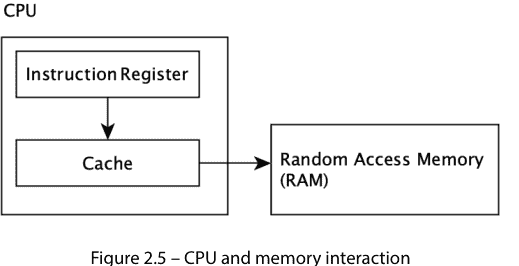

图 2.5 – CPU 与内存的交互

仔细的人可能已经注意到，由于内存的差异，通过查看程序的内存，可能会面临不可预测的困难。当多个线程尝试更新或读取变量特定值而不进行仔细处理时，可能会导致以下问题之一：

- 竞态条件（racing condition）：当两个线程尝试以非同步的方式访问相同的值时就会发生。
- 值更新可见性：多个线程之间共享的变量没有传播到主内存，导致其他线程获取旧值。

## 探索用于模式的 Java 平台

为了应对这些挑战，让我们分析对变量的实际访问。已知的是每个变量都位于分配的 RAM 堆中。显而易见的是更新每个变量的状态可能会导致一些代价，因为每条指令都必须经历整个路程（图 2.5）。在大多数情况下，这并不是必要的。一个很好的例子是隔离方法的实现（示例 2.2）。然而，在某些情况下需要从内存获取变量的实际值，为此 Java 实现了 `volatile` 关键字。在变量前使用 `volatile` 关键字为该变量提供了保证：当另一个线程请求值时，它会检查内存中的当前值。这意味着使用 `volatile` 关键字提供了 `happens-before` 保证，并且每个线程都能看到它的值。值得注意的是，由于使用 `volatile` 提供了某种程度的内存同步，应该明智地使用。它的使用与主内存访问引起的性能限制有关。

跨多个线程共享变量值的另一种方法是使用 `synchronized` 关键字。它为方法或变量提供了保证，每个参与者（线程）都会通知操作情况。显然，使用同步的主要缺点是所有线程都会被通知访问方法或变量，这反过来会导致内存同步引起的性能下降。配合 `volatile`，`synchronized` 保证了 `happens-before`。

JMM 是清晰且新的；我们说每个新对象都位于堆中（图 2.2）。我们熟悉 JRE 架构的宏观，并且知道大多数 Java 程序似乎都是多线程的——有一套 Java 平台遵循的规则，以便进程强制程序的正确顺序以实现一致性。

## GC 和自动内存管理

尽管 Java 平台可能给人底层内存无限的印象，但事实并非如此，我们对此进行了检查。到目前，我们已经查看了跨线程的可见性如何工作以及变量在物理内存中是如何被引用的。JMM 只是整个故事的一部分——让我们继续调查。

我们已经知道 Java 平台使用自动内存管理过程来维护堆的分配内存。过程的一部分是一个在守护线程后台运行的程序。它被称为垃圾回收器（引用 5），并在后台静静运行，回收并压缩未使用的内存。这是堆中动态分配对象的优势之一。另一个可能不那么大的优势是处理递归数据结构（如列表或映射）的能力。

虽然开发者不需要操心内存回收，但理解底层过程非常有用，这可以避免意外的应用程序失败，因为系统内存以某种方式是有限的。原因仍然在于，即使有了垃圾回收（GC），也可能创建出永远不加载对象的代码，这意味着应用程序可能会因 `OutOfMemory` 错误而崩溃。

GC 过程的目标是保持堆的整洁和高效，随时准备分配新对象。堆区域被划分为更小的段，如图 2.6 所示：

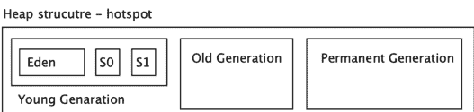

图 2.6 – 分为晋代段的简化堆结构

众所周知的事是，大多数对象将被分配并放在 Eden 内存中，并且不会在第二轮清理中存活。在执行 Minor GC 后，所有存活的对象会被移动到存活空间（用 S0 和 S1 表示）。GC 还会检查 S0 和 S1 字段，当某个存活区域可能为空时，将它们分散到其他区域中。存活下来的对象经过多次 GC 后被移动到了老年代（Old generation）。堆还包含一个永久区域。永久区域包含 JVM 描述类、静态方法和私有变量所需的元数据，并在运行时进行填充。该区域以前被称为永久代（Permgen）。它与主堆内存分离，不加载，且必须进行配置。这种缺点导致由于内存需求不足而引起的应用程序不稳定。Java SE 8 引入了 MetSpace，取代了 Permgen 概念。MetSpace 解决了空间配置问题，因为它可以自动增长，而且可以进行垃圾收集。

GC 工作分为两个步骤，描述为 Minor GC 和 Major GC。这些步骤是基于持久性——即长期引用的构建的建议：

- **Minor GC**: 当对象没有被引用时发生这种情况，对象被标记为不可达，年轻代被回收，内存可以被保留。
- **Major/Full GC**: 存活过 Minor GC 和 Major GC 的对象会被移动到老年代堆中。经过一段时间，它不再引用任何其他对象，也没有其他对象引用它，就可以准备好被删除。Full GC 比 Minor GC 更少见，并且会有长时间的停顿（stop-the-world）。

GC 过程可以简化为三个步骤：

1. 在第一步中，GC 标记不可达对象（图 2.7）：

标记前的分配对象

| Obj 1 | Obj 2 | Obj 3 | Obj 4 | Object 5 |
| :--- | :--- | :--- | :--- | :--- |
| Obj 1 | Obj 2 | Obj 3 | Obj 4 | Object 5 |

图 2.7 – 第一个收集标记步骤识别堆中的未使用的对象

2. 在第二步中，移除链接并将空间恢复原状（图 2.8）：

标准删除步骤

| Obj 1 | Obj 3 |
| :--- | :--- |

图 2.8 – 通过删除已标记的对象释放内存

3. 第三个步骤被称为压缩（图 2.9）。它将内存重新组织成更大的部分，这样当程序尝试分配更大的对象时，空间已准备就绪。这使得所有对象的内存分配要快得多，不仅是因为空闲空间，还消除了扫描空闲内存的需求：

压缩步骤

| Obj 1 | Obj 3 |
| :--- | :--- |

图 2.9 – 压缩空闲内存以便在帧中分配更大的对象

在对 JMM 和 GC 任务有了全新的认识后，还有另一个与两者都相关的重要概念。引用类型概念是告诉平台如何处理分配的堆空间的一种——更具体地说，是帮助平台内部的分析过程。引用类型已添加到 GC 中，以评估变量的用途。这意味着可以快速决定是否收集该变量。引用类型的概念是一个工具，具有一种设计模式，并且之前被移除的主题使得更有意义。每个程序的目标都是尽可能快地运行。这意味着即使是垃圾收集过程也是如此，因此它必须尽可能快。因此，无论使用何种 GC 算法，当数据集较小时，该过程将快得多。引用类型也有助于帮助保持内存的新鲜和整洁。平台提供了以下类型，按它们对 GC 的抗受性排序：

- **强引用 (Strong references)**：最常见的引用类型——不需要指定。
- **弱引用 (Weak references)**：引用引用需要手动指定——`var obj = new WeakReference<Object>();`；它是 GC 算法的一个信号，用于在下一次 GC 期间回收内存。这主要用于程序启动或缓存期间。
- **软引用 (Soft references)**：只有在应用程序内存不足时才会被回收。只要对空间没有关键需求，对象就会留下来。Java 平台保证在 `OutOfMemoryError` 发生之前清除所有引用。
- **虚引用 (Phantom reference)**：代表了最弱的引用类型。这种引用在没有进一步分析或晋升到另一个层级时会尽快被收集。这种类型的变量在 GC 运行时立即被回收。

在开启 Java API 旅程之前，让我们快速总结一下我们新学到的知识。

引用在 GC 过程中起着重要作用。引用引导垃圾收集器处理特定的变量。Java 内存模型提供了关于变量值如何被读取、更新或删除的必要保证。

# 核心 Java API 探析

| 大小 | 字面量名称 | 范围 |
|---|---|---|
| 8 字节 | long | -2^63 to 2^63-1 |
| 8 字节 | double | -1.7e308 to 1.7e308 |

表 2.2 – 基本类型及其大小；(*) boolean 没有精确的定义

基本类型存储在栈区域中（参见图 2.2），每个字面量都包含一个包装对象（图 2.10）。

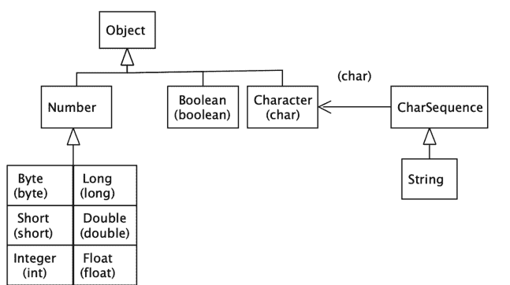

图 2.10 – 字面量与 String 类型关联的数据类型继承关系

外壳是在字面量值周围初始化的。这意味着字面量存储在栈区域中，而包装对象位于堆中。外壳提供了额外的功能。以 `Integer` 类为例，它提供了以下方法：`byteValue()`、`doubleValue()` 和 `toString()`。这些方法可以在特定的设计模式中调用，以实现目标并避免不必要的内存竞争。这与仅提供值之原生实现的字面量相比。

Java 平台自动将字面量装箱为适当的包装类。这一事实不仅有有利面，也有负面，被称为自动装箱（autoboxing）问题（示例 2.3）。这发生在基本类型被强制转换为包装类型时。这可能导致频繁的垃圾回收，可能意味着大量的“停顿世界”（stop-the-world）事件：

```
int valueIntLiteral = 42;
Integer valueIntWrapper = valueIntLiteral;
```

示例 2.3 – 自动转换示例，在底层创建了新的 Integer

在处理数字字面量时，记住字节大小较小（表 2.2）的字面量会自动分配给更大的尺寸（示例 2.4）是有用的。反之，由于内存栈区域中分配的字节大小是精确的，会导致编译错误：

```
byte byteNumber = 1;
short shortNumber = byteNumber;
int intNumber = shortNumber;
```

示例 2.4 – 字面量自动转换

我们检查了数字标记以及 Java 平台上自动提交的工作机制。布尔字面量是 `true` 或 `false`，在内存中表示为 1 位。

最后一个尚未提到的特定字面量是 `char` 及其覆盖值。让我们仔细观察，因为它也与核心的 `String` 对象有关。

# 使用 String API

`String` 实例不是字面量。在 Java 中，字符串以对象的形式表示。它由字符序列定义。在编写任何程序时，避免使用字符串几乎是不可能的。除了 Java 执行程序需要 `main` 方法的 `String` 字段作为输入外，变量名也表示为字符串。字符串在 Java 中是不可变的。这意味着对其进行的任何操作（如拼接）都会创建一个新字符串。更准确地说，无法更改其当前值。`String` 是 Java 平台的基类。

存储字符串值的常用方法是使用字符串常量池（String Pool）。字符串池只存储内部值（图 2.11）。这意味着只能存在一个不同的常量值。这种方法使得池在内存方面更高效，包括了耗时的字符串操作。

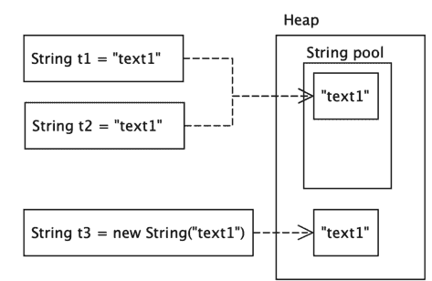

图 2.11 – 字符串池是堆内存的一部分，String 对象与其他对象一样存在于堆中

你也可以使用 `String` 构造函数直接在堆中存储字符串——例如 `new String`。在这种情况下，链接并不指向字符串池中已存在的等效值（由示例 2.5 中的 `t3` 表示），因为它位于不同的堆内存空间。如果你强制在池中进行搜索，可以使用 `intern` 方法（示例 2.5 中的 `t4`）：

```
String t1="text"
String t2="text"
String t3 = new String("text")
String t4 = t3.intern();
```

输出：

```
t1 == t2 => true
t1 == t3 => false
t3 == t4 => false
t1 == t4 => true
```

## 示例 2.5 – 比较为 String 赋值值的不同方法

在 `String` 类上使用 `+` 运算符可能会变成非常低效的拼接方式或影响程序的可维护性。为了防止字符串污染，Java 平台阻止了临时值的存储，仅存储执行其内部 `toString` 方法产生的结果，这会在堆空间中创建一个新的 `String` 对象（示例 2.6）。`StringBuilder` 在 Java SDK 中引入了创建设计模式的实现：

```
String t5 = new StringBuilder()
.append("value")
.append(42)
.toString();
String t6 = "value42";
```

输出：

```
t5 == t6 => false
```

## 示例 2.6 – StringBuilder 默认在堆空间中创建一个新的 String 对象

# 发现设计模式的 Java 平台

我们发现了 `String` 对象是如何创建的以及它们存储在哪个堆内存中。这些新获得的信息可以帮助我们通过选择合适的设计模式或组合来做出决策，以避免内存滥用。因为字符串底层是字符数组，基本类型 `[]` 并不是基本类型——事实上，它是一个对象。让我们更仔细地检查这个概念。

## 介绍数组

为了更好地理解集合框架，首先来看数组。在 Java 中，数组由序列表示。数组是基于索引的。这意味着在空间不足的情况下，会抛出 `ArrayIndexOutOfBoundsException`。数组作为对象分配并存储。这意味着在空间不足时会导致 `OutOfMemoryError`。简单的分配是内存高效的：

```
int[] array1;
byte[][] array2;

Object[] array3;
Collection[] array4;
```

示例 2.8 – 多种数组分配方式


```java
int[] al = {1,2,3,4};
al[0] = al.length;
int el = al[0];

al.length == 4
```

示例 2.9 – 数组的初始化、赋值和验证

由于其潜在的需求和有限的方法，字段的使用经常被忽视。然而，它可以有助于遵循开闭原则。

# 核心 Java API 探析

字段通常被集合或映射结构取代，这些提供了额外的方法。让我们更深入地探讨这个主题。

## 发现集合框架

与字段不同，高级集合提供了自动调整大小的功能。这意味着所需的基将被复制，旧版本将允许 GC。Java 集合框架包括 `List`（表 2.3）、`Set`（表 2.4）、`Queue`（表 2.5）以及具有多种实现的 `Map` 接口（图 2.12）。实现可能因厂商而异，但它们必须符合基本规范。空间复杂度并不非常重要，对于具有自动调整大小功能的框架。在选择设计模式时，时间复杂度可以起到更重要的作用，因为这会显著惩罚建议程序的响应。为了评估 O 表示法的时间复杂度，使用 O 表示法来突出上限，必须使用最坏的程序来获取。

为了评估时间复杂度的影响，我们可以通过一些很好的例子，例如选择正确数据结构的重要性。我们从列表结构开始，允许通过索引访问每个元素。

| 名称 | 包含 | 添加 | 获取 | 删除 | 数据结构 |
|---|---|---|---|---|---|
| ArrayList | O(n) | O(1) | O(1) | O(n) | 数组 |
| LinkedList | O(n) | O(1) | O(n) | O(1) | 链表 |

表 2.3 - 按操作排序的精选列表实现的时间复杂度

## 探索用于设计模式的 Java 平台

算法有时需要你验证数据结构中元素的性能并移除一个新元素。对于这些情况，让我们来看 `Set` 接口的实现（表 2.4）。

| 名称 | 包含 Contains | 添加 Add | 删除 Remove | 数据结构 |
|---|---|---|---|---|
| HashSet | O(1) | O(1) | O(1) | 哈希表 |
| TreeSet | O(log n) | O(log n) | O(log n) | 红黑树 |

表 2.4 – 按操作时间和复杂度排序的 Set 接口实现

集合组提供的最后一个接口是 `Queue`（图 2.12）。当你只需要处理第一个或最后一个元素时，这种数据结构非常有用（表 2.5）。

| 名称 | Offer | 取出 Poll | 大小 Size | 数据结构 |
|---|---|---|---|---|
| PriorityQueue | O(1) | O(log n) | O(1) | 优先级堆 |
| ArrayDeque | O(1) | O(1) | O(1) | 数组 |

表 2.5 – 选定的 Queue 接口实现及其操作时间复杂度

在实现 `Map` 接口时，记住选择哪种类型的 Map 实现类型非常重要。Map 代表键值对的结构。键（key）和值（values）都是 `Object` 类的子类。除了定义或初始化 map 时不能使用字面量外，正确实现 `hashCode` 和 `equals` 对象方法。这一要求是由于需要识别正确的桶以解决潜在的 Map 冲突。这种冲突可能导致偏离预期的非预期时间复杂度（表 2.6）：

| 名称 | 包含键 Contains Key | 获取键 Get Key | 删除键 Remove Key | 数据结构 |
|---|---|---|---|---|
| HashMap | O(1) | O(1) | O(1) | 哈希表 |
| LinkedHashMap | O(1) | O(1) | O(1) | 哈希表，链表 |

表 2.6 – 按提供的操作时间复杂度排序的选定 Map 接口实现

集合框架使用高度行为化的迭代器设计模式来遍历所考虑的元素。那些敏锐的人一定已经注意到，如果没有正确的数学基础，集合框架的这些功能将是不可能的。使用设计模式的主要原因之一是通过业务逻辑映射或创建正确的结构。让我们简要查看一些数学特性。

### 数学 API

Java 通过提供 `final Math.class` 的静态实现来展示基本的数学函数。`final` 意味着该类不能被扩展，这包括对基本函数的深愿更改或替换。`Math` 类（示例 2.10）位于 `java.lang` 包中，这意味着它可以直接使用而无需导入：

```java
double sin = Math.sin(90);
double abs = Math.abs(-10);
double sqrt = Math.sqrt(2);
```

示例 2.10 – 使用 Math 类提供的常用数学函数

尽管 `Math` 类使用了随机方法，但它只给出一个 double 结果。位于 `java.util` 包中的 `Random` 类提供了更多可定制的能力，不是针对类型，而是针对所需的范围（示例 2.11）：

```java
Random randomNumberWithRange = new Random();
int upperBound = 10;
int randomIntInRange = randomNumberWithRange.nextInt(upperBound);
double randomDoubleInRange = randomNumberWithRange.nextDouble(upperBound);
```

示例 2.11 – 在范围（0 – 上界）内生成随机数

这里也使用了 `Math` 类，类似于几乎任何需要标准数学操作能力的所需的计算。当遵循函数式编程方法时，使用 `Math` 类的方法会很有帮助。

### 函数式编程与 Java

在上一章中，我们学习并演示了面向对象编程（OOP）的关键原则（APIE）。在过去的几十年里，Java 平台随着业务和开发社区的需求而演进。该平台通过实现一种使用树函数组合来提供所需结果的 API 来应对这一挑战。这与传统的命令式命令集合方法形成对比。这种方法使得更大的代码库能够所需的目标。

从 SE 8 开始，平台提供了一个用于流的 API（引用 15）。它位于 `java.util.stream` 包中，与由输入和错误表示的 Java 数据流（`System.out`、`System.in` 和 `System.err`）无关。Stream API 引入了对元素序列应用操作的能力。有两个匿名中间操作可以编辑或检查数据，以及一个终端操作。终端操作可以提供单个结果或 `void`。中间操作可以串联，但终端操作会终止流。元素序列是惰性求值的，并且可以并行执行。默认，执行并行流使用 Fork/Join Framework 执行器。Fork-join 模型可以被视为 20 世纪 60 年代早期的一种并行设计模式（引用 17）。

尽管平台允许你编写函数类型，但 OOP 概念仍然存在，并伴有强大的类型要求。这为 Stream API 提供了安全性，确保原始元素保持不变或被中间或终端操作正确强制——否则，平台将导致编译错误。提醒一下，如果没有在 Java SE 5 中引入泛型，这些功能中的任何一个都是可能的。泛型（引用 4）允许我们通过类型标记对类或接口进行参数化，以保持编译安全（引用 17）。

## 在 lambda 表达式中使用函数式接口

我们发现每个 lambda 表达式都是惰性求值的，这意味着代码是按需求值的，并且由终端操作关闭（示例 2.12）：

```java
List<String> list = Arrays.asList("one", "two", "forty_two");
list.forEach(System.out::println);
```

示例 2.12 - 将 List 元素转换为流并对每个类型应用终端操作

我们可以将不同的中间函数连接起来（示例 2.13）并将流传递给另一个方法对象：

```java
Predicate<Integer> numberTest = new Predicate<Integer>() {
  @Override
  public boolean test(Integer e) {
    return e > 2;
  }
};

String result = Stream.of(1, 2, 3, 42)
      .filter(numberTest)
      .map(e -> "element" + e)
      .collect(Collectors.joining(","));

System.out.println("result: " + result);
```

示例 2.13 - 命名和匿名函数接口的高级组合

lambda 表达式流 API 在代码组合中起着重要作用。它可以被想象成一条处理线，输入进入其中并通过一组调整返回预期结果或结束操作。由于 lambdas 是惰性的，这意味着处理线有一个开关。换句话说，Stream API 可以被认为是语法上最重要的突破之一。

## 引入 lambda 和函数式接口

lambda 概念的引入是为了启用匿名类。带有 `@FunctionalInterface` 注解的类（从 Java 8 开始提供的标记）告诉平台接口仅包含一个方法，如表 2.7 所示。

| 名称 | 输入参数 | 返回类型 | 抽象方法 | 描述 |
|---|---|---|---|---|
| Supplier<T> | | T | get | 返回类型 <T> 的值 |
| Consumer<T> | T | | accept | 消费类型 <T> 的值 |
| Function<T, R> | T | R | apply | 消费类型 <T> 的值并应用返回类型 <R> 的转换 |
| Predicate<T> | T | Boolean | test | 消费类型 <T> 的输入并返回布值 |

表 2.7 – 自 Java 8 以来 JDK 中的基本函数式接口

## 掌握 Java 模块系统

使用 Java 这种高阶编程语言的主要目的之一是代码重用。该语言的一个基本构建是根据原则的类概念 API。Java 可以将这些类按特定包名定义的组进行本地化。包的概念封装了类。类可以对其内部字段和方法提供不同层级的可见性。Java 规定了以下可见性级别：公共（public）、默认（default）、私有（private）和保护（protected）。使用关键字可以减少不同包之间的可见性以管理它们之间的相互作用。在应用程序域中共享包的方法是保持其为公共的——即对所有人可见。

Java 使用类路径（class paths）概念已经很多年。类路径是一个特殊的区域，类加载器（Class Loader）在此处识别它的类。加载的类随后在运行时使用（如图 2.2 所示的类加载器子系统）。

然而，这个概念并没有对存储的包或类提供任何保证。多年来，这个概念一直是糟糕、脆弱且容易出错的。一个很好的例子是尝试打包一个可执行的 JAR 文件，其中包含具有相似包结构和类名的不同版本的库。类路径没有区别，导致类可能会被不同的版本覆盖。

Java SE 9 的发布带来了突破。JSR-376（曾是锯齿项目的核心，参考 3）成为平台的共同组成部分。JSR-376 实现了 Java 平台模块系统（JPMS）（示例 2.14）：

```bash
$ java -list-modules
java.base@17
java.compiler@17
java.datatransfer@17
<>
```

示例 2.14 – 列出特定版本的可用 JDK 模块

此外，平台已根据模块进行了迁移（示例 2.15）：

示例 2.15 – 描述一个 java.logging 模块。java.base 模块自动存在，因为它包含了核心平台和语言功能。

### 掌握 Java 模块系统

JPMS 提供了一种强封装概念，在包级别定义了应用程序的交互（示例 2.16）。应用程序可以被划分为多个模块，这些模块只能检测 API 或服务。JPMS 支持包级别的依赖构建，并提高了所开发的应用程序的可维护性、可靠性和安全性：

```java
module java.logging {
    exports java.util.logging;
    provides jdk.internal.logger.DefaultLoggerFinder with
        sun.logging.internal.LoggingProviderImpl;
}
```

示例 2.16 – module-info.class 暴露一个包供外部使用的示例

使用 JPMS 并不是强制性的。平台使用了 JPMS，但如果应用程序尚未准备好，可以使用未命名模块（unnamed modules）。在这种情况下，所有包或类都属于这种未命名模块。从原则上说，未命名模块从类路径读取可读的模块或类，而不受 JPMS 强制的任何包级别限制。通过这种方式，实现了与以前开发的应用程序的兼容性，软件设计师对代码库的维护没有疑虑——即 JPMS 被禁用了。

尽管 JPMS 在应用程序的可持续性、安全性和重用方面具有巨大的潜力，但它通常不被使用，因为它为正确配置底层 JPMS 以及使用强制 SOLID 原则的设计模式创建了间接压力。

当使用 JPMS 时，平台确保所开发的应用程序不包含任何循环依赖。在后台，JPMS 会创建一个无环的模块图（而不是类路径）。

通过创建一个模块描述符文件（module descriptor），平台提供了一系列指令，这些指令可以将模块的某些部分暴露给外部世界。

让我们创建一个简单的模块示例，以消除对使用 JPMS 的疑虑（示例 2.17）。我们到为止的讨论可以克服初始困难：

```
module-example
├── example
|   └── ExampleMain.java
└── module-info.java
```

示例 2.17 – 使用 OpenJDK 17 开发的模块示例文件夹结构

我们创建一个适当的可执行类 `ExampleMain.java` 和模块描述符 `module-info.java`（示例 2.17）：

```java
// module-info.java
module module-example {
    exports example;
}

// ExampleMain.java
package example;

public class ExampleMain {
    public static void main(String[] args) {
        System.out.println("Hello, Java Modules!");
    }
}
```


```java
// module-info.java
module module-example {
    exports example;
}

// ExampleMain.java
package example;

public class ExampleMain {
    public static void main(String[] args) {
        System.out.println("Hello, Java Modules!");
    }
}
```


## 发现设计模式的 Java 平台

API。Java 可以将这些类按特定包名定义的组进行本地化。包的概念封装了一组类。类可以对其内部字段和方法提供不同层级的可见性。Java 规定了以下可见性级别：公共（`public`）、默认（`default`）、私有（`private`）和保护（`protected`）。使用关键字可以减少不同包之间的可见性以管理它们之间的相互作用。在应用程序域中共享包的方法是保持其为公共的——即对所有人可见。

Java 使用类路径（`class paths`）概念已经很多年。类路径是一个特殊的区域，类加载器（`Class Loader`）在此处识别它的类。加载的类随后在运行时使用（如图 2.2 所示的类加载器子系统）。

然而，这个概念并没有对存储的包或类提供任何保证。多年来，这个概念一直是糟糕、脆弱且容易出错的。一个很好的例子是尝试打包一个可执行的 JAR 文件，其中包含具有相似包结构和类名的不同版本的库。类路径没有区别，导致类可能会被不同的版本覆盖。

Java SE 9 的发布带来了突破。JSR-376（曾是锯齿项目的核心，参考 3）成为平台的共同组成部分。JSR-376 实现 Java 平台模块系统（JPMS）（示例 2.14）：

```
$ java -list-modules
java.base@17
java.compiler@17
java.datatransfer@17
<>
```

#### 示例 2.14 – 列出特定版本的可用 JDK 模块

此外，平台已根据模块进行了迁移（示例 2.15）：

### 示例 2.15 – 描述一个 `java.logging` 模块。`java.base` 模块自动存在，因为它包含了核心平台和语言功能。

#### 掌握 Java 模块系统

JPMS 提供了一种强封装概念，在包级别定义了应用程序的交互（示例 2.16）。应用程序可以被划分为多个模块，这些模块只能检测 API 或服务。JPMS 支持包级别的依赖构建，并提高了所开发的应用程序的可维护性、可靠性和安全性：

```
Module java.logging {
    exports java.util.logging;
    provides jdk.internal.logger.DefaultLoggerFinder with
        sun.logging.internal.LoggingProviderImpl;
}
```

示例 2.16 – `module-info.class` 暴露一个包供外部使用的示例

使用 JPMS 并不是强制性的。平台使用了 JPMS，但如果应用程序尚未准备好，可以使用未命名模块（`unnamed modules`）。在这种情况下，所有包或类都属于这种未命名模块。从原则上说，未命名模块从类路径读取可读的模块或类，而不受 JPMS 强制的任何包级别限制。通过这种方式，实现了与以前开发的应用程序的兼容性，软件设计师对代码库的维护没有疑虑——即 JPMS 被禁用了。

尽管 JPMS 在应用程序的可持续性、安全性和重用方面具有巨大的潜力，但它通常不被使用，因为它为正确配置底层 JPMS 以及使用强制 SOLID 原则的设计模式创建了间接压力。

当使用 JPMS 时，平台确保所开发的应用程序不包含任何循环依赖。在后台，JPMS 会创建一个无环的模块图（而不是类路径）。

通过创建一个模块描述符文件（`module descriptor`），平台提供了一系列指令，这些指令可以将模块的某些部分暴露给外部世界。

让我们创建一个简单的模块示例，以消除对使用 JPMS 的疑虑（示例 2.17）。我们到为止的讨论可以克服初始困难：

```
module-example
├── example
|   └── ExampleMain.java
└── module-info.java
```

示例 2.17 – 使用 OpenJDK 17 开发的模块示例文件夹结构

我们创建一个适当的可执行类 `ExampleMain.java` 和模块描述符 `module-info.java`（示例 2.17）：

```java
// module-info.java
module module-example {
    exports example;
}

// ExampleMain.java
package example;

public class ExampleMain {
    public static void main(String[] args) {
        System.out.println("Hello, Java Modules!");
    }
}
```


# Java 11 到 17 特性快速回顾

## 示例 2.22 – 在直接类型方法上使用 instanceof

### Records (Java SE 16, JEP-395)

`record` 类类型非常有用，因为它的声明非常简单，并且携带程序业务逻辑所需的所有数据。Records 携带的是不可变数据。它们提供了已经实现的 `hashCode()` 和 `equals()` 方法。这意味着设计的软件不需要提供额外的代码（示例 2.23，引用 11）：

```java
private record Example(int number, String text) {
    private String getTogether() {
        return number + text;
    }
}
```

示例 2.23 – 新的 record 类类型可能对减少代码量产生非常积极的影响，因为它提供了生成的方法

### 密封类 (Java SE 17, JEP-409)

这些是优雅的增强，用于控制类和接口，或者类的扩展和接口的实现（引用 12）。关闭类允许设计者广泛访问超类，而无需扩展它。它们克服了广泛使用的包修饰符的局限性，该修饰符之前要求实现方法的实现。示例展示了如何为扩展定义一个开放类，使用 `non-sealed` 关键字（示例 2.24）：

```java
public sealed interface Vehicle permits Car, Bus {
    void start();
    void stop();
}

public non-sealed class Car extends NormalEngine implements Vehicle {
    public String toString() {
        return "Car(running=" + super.running + "');";
    }
}
```

示例 2.24 – 接口方法的实现由抽象类 `NormalEngine` 提供（注：原文为 NormalEngine，此处保持原样）

密封类强制了对可能的扩展进行控制（示例 2.25），因为它们为软件提供了防止意外软件设计变更的潜在安全保障：

```java
public class Motorbike implements Vehicle {
    public void start() {}
    public void stop() {}
}
```

以下是编译输出：

```
Motorbike.java:2: error: class is not allowed to extend sealed class: Vehicle (as it is not listed in its permits clause)
```

示例 2.25 – 密封类强制对增强进行控制

密封类也带来了一些潜在问题，因为软件设计者必须决定新创建的类将如何被使用，指示是允许类扩展（使用 `unsealed` 关键字，示例 2.25），还是锁定 `final` 关键字（示例 2.26）：

示例 2.26 – 必须决定类的行为，并且 Bus 类被锁定不允许任何扩展

尽管这看起来像是一个可能的缺点，但在软件开发中，从可维护性和设计模式的角度来看，它提供了更大的清晰度。这减少了潜在的意外接口或类错误。

### 默认 UTF-8 编码 (Java SE 18, JEP-400)

多年来，编码一直引起问题。编码问题不容易检测到，并且在不同的系统平台上不可预测地出现。这一增强统一了一切，并强制将 UTF-8 为默认编码（引用 13）。

### instanceof 的模式匹配 (Java SE 18, 第二次预览), JEP-420

对 `instanceof` 字段（JEP-394）和 `switch` 表达式（JEP-361）的改进使得压缩代码库变得更好，可以使用非常紧凑的、命令驱动的控制 `switch` 语句上的 `instanceof` 来移除以前不再必要的 `if-else` 结构：类型服务（示例 2.27，引用 14）：

```java
Object variable = 42;
String text = switch (variable) {
    case Integer i -> "number" + i;
    default -> "text";
};
```

示例 2.27 – 隐式类型匹配的紧凑 switch 语句

在回顾最重要的语法改进后，我们可以安全地开始深入平台的主要优势之一。是的，那就是并发框架。

## 理解 Java 并发

在本章开头，已经展示即使运行一个简单的程序（示例 2.2 和图 2.3）也会导致线程的多次实例化（图 2.4）。这意味着执行 main 方法创建的线程不会创建任何其他属于该程序的线程。Java 平台因其执行并发或并行任务的能力而闻名且具有价值。

我们知道了启动的线程何时以及在哪里存储它们的变量，以及在堆中同步对象何时会导致意外或非预期的程序行为。在本节中，我们将查看主线程使用所有 CPU 的可能性。

软件设计者考虑使用任何并发设计模式的动机可能是对更好的应用程序响应速度或吞吐量日益增长的需求。

尽管平台已经包含了 `Thread` 类，但 Java 语言的并发特性（如执行器 `executors`）自 Java SE 5 发布以来已对开发者可用，可以在 `java.util.concurrent` 包中找到，它是 `java.base` 模块的一部分。

让我们仔细观察。

### 从基础线程到执行器

平台的构建构建元素是线程。线程由 `Thread` 类的实例表示。由 `new` 关键字创建的对象仍然不会创建平台线程。对象提供了一个名为 `start()` 的方法，需要显式使用（示例 2.28）：

```java
public class MultithreadedProgram {
    public static void main(String[] args) {
        var t = new Thread(() -> {
            while (true) {
                System.out.println("Welcome Thread!");
            }
        });
        t.setDaemon(true);
        t.start();
    }
}
```

示例 2.28 – 一个立即结束的守护线程简单程序

平台允许你管理不受控的线程创建，并让软件设计者控制程序的资源和行为。Java SE 5 引入了 `ExecutorService` 和 `ThreadFactory` 接口，多个实现展示了使用类似的命名工厂。`ThreadFactory` 接口仅包含一个 `newThread()` 方法，返回一个 `Thread` 实例。该方法的逻辑可以适应创建新线程并设置组、优先级和守护标记。它还消除了新线程的数量。`ThreadFactory` 可以由 `ExecutorService` 提供（示例 2.30）。

常用的执行器静态方法如下：

- `newSingleThreadExecutor()`
- `newSingleThreadExecutor(ThreadFactory threadFactory)`
- `newCachedThreadPool()`
- `newCachedThreadPool(ThreadFactory threadFactory)`

Java SE 5 为线程引入了一个概念，即带有泛型 `<T>` 的 `Future` 接口。`Future` 接口可以被视为提供结果的异步计算。

Java 平台提供了两种不同的接口来携带线程逻辑。

### 执行任务

Java 平台从开始就通过 `Runnable` 接口和 `Thread` 类提供了线程概念（示例 2.29）：

```java
ExecutorService executorService = Executors.newSingleThreadExecutor();
var runnable = new Runnable() {
    @Override
    public void run() {
        System.out.println("Welcome Runnable");
    }
};
executorService.execute(runnable);
executorService.execute(() -> System.out.println("Welcome Runnable"));
```

示例 2.29 – 向执行器服务提供 `Runnable` 接口实现的多种方法、实现和匿名类

# 发现设计模式的 Java 平台

业务需求以及社区预期共同创建了一个响应式编程平台，并提供了执行多个异步回调任务的能力。从 Java SE 5 开始，该平台提供了一个 `Callable` 接口。`Callable` 接口被认为是一个函数式接口。它包含一个抽象方法，其要求的返回类型为 `<T>`。由于计算是不确定的，它可能会抛出可以正确处理的异常。`Callable` 的实现可以发送到执行器，并且开始的计算会被封装进一个 `Future` 中。

`Future` 实例是基准系统在后台执行的计算工作。该接口提供了一个 `get()` 方法（示例 2.30），可用于检索结果。使用该方法会暂停当前线程并等待直到结果可用。由于当前线程会被挂起，应该明智地使用此方法，因为它可能会导致性能损失：

示例 2.30 – 向执行器提供 `Callable` 实例的不同方法，分别作为实现类或匿名类

这与 `Runnable` 接口形成对比，因为 `Callable` 接口提供了一个 `Future` 实例作为临时结果。`Callable` 的异常处理请求也相关，因为它可能导致逻辑执行或工作线程被中断。在这种情况下，有必要将此异常传递给 `Future` 接口返回的中间结果。

## 总结

在本章中，我们为理解 Java 内部平台构建了良好的知识基础。我们学习了静态分配的数组或方法与对象实例之间的区别。我们学习了适当数据同步的必要性，以及 Java 内存管理的工作原理以及平台提供的哪些保证。我们现在理解了堆内存、分段和维护的重要性。我们已经发现了一些常用的设计模式，这意味着当我们开始实现任何设计模式或集合时，我们将意识到以下内容：

- 平台如何处理字段或变量
- 内存管理的重要性
- 具体的程序错误退出状态及其原因
- Java 平台提供的核心 API
- 如何利用函数式编程特性
- Java 平台提供了哪些新特性来使使用设计模式变得更容易
- 如何应对 Java 并发挑战

在前两个章中，我们已经建立了坚固的知识基础。现在我们将开始一个模式一个进行介绍。下一章将带我们进入创建型设计模式之旅。结构性设计模式将加强我们对代码结构以及如何创建可持续解决方案的认知。让我们开始吧。

## 问题

1. 哪些元素构成了 Java 平台？
2. 静态类型语言意味着什么？
3. Java 语言字面量有哪些？
4. 在 Java 内存管理概念中，谁负责内存回收？
5. Java 集合框架中的集合有哪些？
6. 什么元素存储 `Map`？
7. 从 `Set` 中检索元素的时间复杂度是多少？
8. 在 `ArrayList` 中验证元素存在的时间复杂度是多少？
9. Stream API 的 `filter()` 方法使用了哪种函数式接口？
10. Stream API 中是如何评估元素的？

## 延伸阅读

- Garbage Collection Handbook: The Art of Automatic Memory Management, Anthony Hosking, Eliot B. Moss, and Richard Jones, CRC Press, ISBN-13: 978-1420082791, ISBN-10: 9781420082791
- Java Generics: https://docs.oracle.com/javase/tutorial/java/generics/index.html
- The JPMS (JSR 376): https://openjdk.java.net/projects/lighthouse/spec/
- The Java tutorials: https://docs.oracle.com/javase/tutorial/java
- Java GC basics: https://www.oracle.com/webfolder/technwork/tutorials/obe/java/gc01/index.html
- The JVM specification, Java SE 17 Edition: https://docs.oracle.com/javase/specs/jvms/se17/index.html
- OpenJDK, HotSpot runtime environment: https://openjdk.java.net/groups/hotspot/docs/RuntimeOverview.html
- JEP 361: Switch Expression: https://openjdk.java.net/jeps/361
- JEP 378: Text Blocks: https://openjdk.java.net/jeps/378
- JEP 394: Pattern matching for instanceof: https://openjdk.java.net/jeps/394
- JEP 395: Records: https://openjdk.java.net/jeps/395
- JEP 409: Scaled Classes: https://openjdk.java.net/jeps/409
- JEP 400: UTF-8 by Default: https://openjdk.java.net/jeps/400
- JEP 420: Pattern Matching for switch (Second Preview): https://openjdk.java.net/jeps/420
- The java.util.stream package: https://docs.oracle.com/javase/8/api/util/stream/package-summary.html
- JEP 330: Single-File Source-Code: https://openjdk.java.net/jeps/330
- A multiprocessor system design. Fall Join Computer Conference, Melvin E. Conway (1963). pp.16

# 第二部分：使用 Java 实现设计模式

设计模式通常分为三大大类：创建型、结构型和行为型。本部分将通过实例来演示这些类别的模式。本部分包含以下章节：

- 第三章：创建型模式
- 第四章：结构型设计模式
- 第五章：行为型设计模式

## 3 创建型模式

在过去的几十年里，IT 社区经历了孤立系统到分布式解决方案的巨大转变。此类系统能够满足各种条件。在本章中，我们将探索创建型模式。这些模式在软件组合中起着至关重要的作用。创建型模式尝试遵循**不要重复 (DRY)** 原则。让我们深入研究：

- 方法工厂模式
- 使用抽象工厂实例化额外的工厂
- 使用工厂模式创建不同的配置
- 使用原型模式避免重复配置
- 使用单例模式检查实例的存在
- 使用对象池加速运行时
- 使用延迟初始化控制实例
- 使用依赖注入减少对象实例

在本章结束时，你对如何编写可维护的代码来创建位于堆或栈上的对象有良好的理解。

### 技术要求

你可以在 GitHub 上找到本章的代码：https://github.com/PacktPublishing/Practical-Design-Patterns-for-Java-Developers/tree/main/Chapter03

### 一切从类开始


# 在 Java 中，每个对象都首先由类描述

让我们简要介绍一个常见的理论场景。


**图 3.1 – 宏观视角下的应用数据处理**

输入的数据流（即信息流）已被应用程序接收。应用程序处理输入并创建结果。结果以多种方式存储，例如数据库或文件，或者可能嵌入到目标输出流中（例如网页），向用户显示信息。

系统作为输入信息流的储备，对其进行处理并存储在数据库中，然后提供结果。

耦合发生在不同的层级，而软件设计师并未察觉。类、对象甚至包之间的紧密结合。

## 使用工厂方法模式根据输入创建对象

摩尔定律指出，集成电路中的元件数量每年都会增加一倍。该定律在 1975 年被修订为元件数量每隔两年增加一倍。尽管对该定律有效性的辩论可能存在争议，但当前的趋势（升级所需的速度）显示，下一次审查的时间已经到临。硬件升级可能没有必要加速（目前已经非常快了），因为这可能对信息处理速度产生任何影响。这一观察针对的是软件应用程序的功能需求，侧重于实现算法的质量和复杂性。

由于物理限制（例如信息物理地存储在内存中），对象的实例化速率可能无法不断提高。这意味着在未来的几十年里，我们可以预见到提高软件和设计效率的压力将会增大。为了使应用逻辑更加清晰，需要明确应用程序是如何运行的，此外，它是如何向 JVM 的关键区域（方法栈和堆）提供数据的，以及如何通过栈进行线程利用（如图 2.2 所示）。

由于当前侧重于映射、转换、管理大量数据的应用趋势，创建类设计模式值得研究、理解并学习如何处理常见场景。虽然《四人帮》（GoF）的时代已经过去，但演变不可避免的，挑战依然存在。在许多情况下，通过适当的抽象，初始的创建设计模式仍然适用。创建对象和类实例并填充 JVM 的预期部分，会极大地影响计算和性能成本，并强制业务逻辑。

在下一节中，我们将讨论对象创建的各种可能性。我们还将考虑最近添加的 Java 语法特性和可能性，这些特性将减少源代码的冗余。让我们从最常见的模式之一开始。

### 核心动机

工厂方法模式实现了代码及其创建类新实例职责的分离，也就是说，此类方法提供了预期的结果。工厂基于泛型抽象隐藏了应用程序类层次结构，并引入了一个通用接口。它透明地将实例化逻辑与代码的其他部分分离开。通过引入通用接口，客户端获得了在运行时决定特定类实例的自由。

该模式通常用于应用程序的早期阶段，因为它易于重构并提供了高水平的清晰度。

尽管这可能会引入一点复杂性，但该模式易于遵循。

### 在 JDK 中查找

工厂方法模式经常用于 Java 集合框架以构建所需的类型。框架的实现位于 `java.util.base` 模块中。该包包含 `Set`、`List` 和 `Map` 的不同实现。`Map` 类型的每个实现都是 Java 集合框架的有效成员，由于它实现了 `Map`，因此不继承 `Collection` 接口。`Entry` 用于存储元素元组、键和值。`Set`、`List` 和 `Map` 的每种实现都提供了重载的工厂方法来创建实例。

`Collections` 类是一个工具类。它包含了几个用于创建特定集合的工厂方法，例如单个项目的列表、映射或集合。工厂方法用法的另一个有用示例是 `Executors` 类，它可以在 `java.base` 模块的 `java.util.concurrent` 包中找到。`Executors` 类定义了如 `newFixedThreadPool()` 等静态方法。

### 示例代码

让我们想象一个简单直接的示例，可以使用合适的抽象易于应用于现实世界。目标是设计一个跟踪车辆生产的应用程序。公司可能提供不同类型的车辆。每辆车辆都可以由其自己的对象表示。为了表达意图，我们创建了一个统一建模语言（UML）类图以保持清晰（图 3.2）：

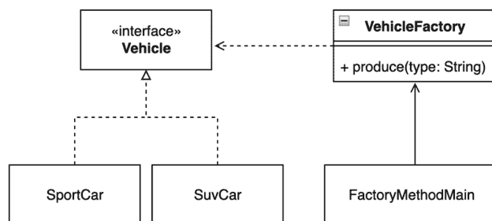

**图 3.2 – 车辆生产跟踪示例**

预期的工厂打算产生不同类型的车辆，应用程序动态满足愿望（示例 3.1）：

```java
public static void main(String[] args) {
    System.out.println("Pattern Factory Method: Vehicle Factory 2");
    var sportCar = VehicleFactory.produce("sport");
    System.out.println("sport-car:" + sportCar);
    sportCar.move();
}
```

以下是输出：

```
Pattern Factory Method: Vehicle Factory 2
sport-car:SportCar[type=porsche 911]
SportCar, type:'porsche 911', move
```

**示例 3.1 – VehicleFactory 根据输入参数产生同一“家族”的车辆**

与其在多个地方分散此类车辆的创建，我们创建一个工厂。工厂抽象集中了整个车辆组合过程，并只暴露一个入口，允许客户端创建所需的车辆类型（如示例 3.2 所示）。工厂只实现一个静态方法，因此将其构造函数保持为私有是有意义的，因为工厂实例是不需要的：

**示例 3.2 – VehicleFactory 根据输入参数产生同一“家族”的车辆**

```java
interface Vehicle {
    void move();
}

record SportCar(String type) implements Vehicle {
    @Override
    public void move() {
        System.out.println("SportCar is moving fast.");
    }

    @Override
    public String toString() {
        return "SportCar, type:'" + type + "', move";
    }
}

record Suv(String type) implements Vehicle {
    @Override
    public void move() {
        System.out.println("Suv is moving off-road.");
    }

    @Override
    public String toString() {
        return "Suv, type:'" + type + "', move";
    }
}

class VehicleFactory {
    private VehicleFactory() {}
    static Vehicle produce(String type) {
        return switch (type) {
            case "sport" -> new SportCar("porsche 911");
            case "suv" -> new Suv("porsche 911");
            default -> throw new IllegalArgumentException("Unknown type: " + type);
        };
    }
}
```

## 在 JDK 中查找它

在 JDK 的 `java.xml` 模块的 `javax.xml.parsers` 包中可以找到抽象工厂模式。抽象工厂模式体现在 `DocumentBuilderFactory` 抽象类的表示和实现及其静态 `getInstance()` 方法中。该工厂使用一个查找服务来提供所需的构建器实现。

### 示例代码

考虑到尽管车辆具有一些共同特征，但它们的生产需要不同类型的流程（图 3.3）：

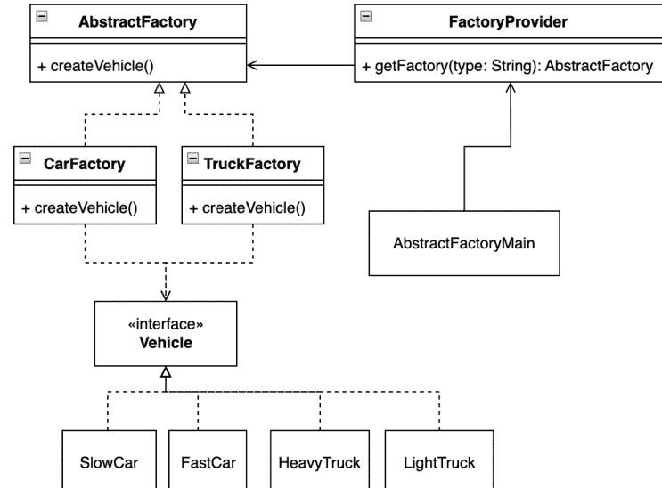

**图 3.3 – 使用抽象工厂模式制造不同类型的车辆**

在某些情况下，我们创建多个负责特定对象的工厂。虽然这些类属于不同的家族，但它们确实拥有共同属性。一个重要的特性是，每个工厂可以实现自己的初始化序列，同时共享通用逻辑。该示例需要正确的 `CarFactory` 实例来创建 `SlowCar` 对象（示例 3.6）：

```java
public static void main(String[] args) {
    AbstractFactory carFactory = Provider.getFactory("car");
    Vehicle slowCar = carFactory.createVehicle("slow");
    slowCar.move();
}
```

以下是输出：

```
Pattern Abstract Factory: create factory to produce vehicle...
slow car, move
```

**示例 3.6 – 客户端决定需要哪种 Vehicle 类型**

游戏的关键元素是工厂提供者；它根据传入的参数区分创建哪个工厂（示例 3.7）。该提供者被实现为一个工具类，因此它的类是 `final` 的，且构造函数是私有的，因为不需要实例化。当然，实现可能会根据需求而异：

**示例 3.7 – FactoryProvider 类定义了如何配置和实例化对象家族的特定工厂**

```java
final class FactoryProvider {
    private FactoryProvider() {}
    static AbstractFactory getFactory(String type) {
        return switch (type) {
            case "car" -> new CarFactory();
            case "truck" -> new TruckFactory();
            default -> throw new IllegalArgumentException(
                "this is %s".formatted(type));
        };
    }
}
```

组中的每个工厂都共享通用逻辑或特征，以保持代码库中的 DRY（不要重复）原则：

**示例 3.8 - AbstractFactory 类提供了可能需要特定工厂实现的通用逻辑或方法**

```java
abstract class AbstractFactory {
    abstract Vehicle createVehicle(String type);
}
```

这些具体的工厂可以实现额外的逻辑来区分应该交付哪个产品，类似于后续示例中的 `TruckFactory` 和 `CarFactory` 的实现（示例 3.9）：

**示例 3.9 - TruckFactory 类代表具体的 AbstractFactory 实现**

```java
class TruckFactory extends AbstractFactory {
    @Override
    Vehicle createVehicle(String type) {
        return switch(type) {
            case "heavy" -> new HeavyTruck();
            case "light" -> new LightTruck();
            default -> throw new IllegalArgumentException("not implemented");
        };
    }
}
```

### 结论

抽象工厂模式提供了跨产品的一致性。使用超级工厂可能会导致客户端运行时不稳定，因为请求的产品可能由于错误的实现而抛出异常或错误，因为信息无法实时获取。相反，抽象工厂模式提升了可测试性。抽象工厂可以自由表示其实现的许多其他接口。该模式提供了一种处理产品的通用方式，而不依赖于它们的实现，这可以提高应用程序代码关注点分离。它可以使用接口或抽象类。客户端变得独立于对象的组合和创建。

## 使用构建器模式实例化复杂对象

封装工厂和代码分离的优势可以被视为一种局限性。抽象工厂必须由一个或多个参数控制以正确定义依赖关系。为了提高所需工厂的可维护性，考虑之前章节中讨论过的密封类（sealed classes）增强（密封类 (Java SE 17, JEP-409)）可能会有用。密封类对代码库的稳定性有积极影响。

让我们在下一节中检查如何自定义对象创建过程。

### 动机

构建器模式有助于将复杂对象的构建与其代码分离。构建器模式允许分步构建并实现不同的表示。对于构建过程涉及许多步骤的复杂对象，构建器模式特别有用。

### 在 JDK 中查找它

构建器模式用于 JDK 的 `java.lang` 包中。例如，`StringBuilder` 类被用于构建字符串。`StringBuffer` 类也被使用，但它是线程安全的。构建器模式也用于 `java.util.stream` 包以创建流。

### 与创建型设计模式一起

构建器模式用于将复杂对象的构建与其表示分离。构建器模式允许分步构建并实现不同的表示。对于构建过程涉及许多步骤的复杂对象，构建器模式特别有用。

（注：原文中关于 builder pattern 的描述存在大量重复，已按要求去重）

```java
public void parts() {...}
```

**示例 3.12 - FastVehicle.Builder 被表示为一个静态类并需要被实例化，它提供了最终结果定制的可能。**

这两种示例方法都是根据 SOLID 原则实现的。建造器模式是抽象、多态、继承和封装（APIE）原则的良好示例，并且非常易于重构、扩展或验证属性。

### 结论

建造器模式通过将复杂的创建过程与业务逻辑分离，帮助强制执行单责任原则。它还改进了代码的可读性和 DRY 原则，因为实例化是可扩展且易于用户理解的。建造器模式是一种常用的设计模式，因为它减少了“代码异味”和构造函数污染。它提高了可测试性。代码库有助于避免多个具有不同表示的方法，其中某些可能从未被使用。

在实现模式时，另一个值得考虑的点是使用 JVM 的堆或栈——更具体地说，创建一个该模式的静态或动态分配的表示。这个决定通常由软件设计师自己回答。

并不总是需要暴露构建过程。下一节介绍了对象克隆的简单性。

## 使用原型模式克隆对象

原型模式解决了创建具有复杂实例化过程的对象新实例的困难，这种过程是过于繁琐且不受欢迎的，因为可能导致不必要的子类化。原型是一个非常常见的设计模式，已经在 GoF 的书中被描述过。

### 动机

当需要创建重量对象且工厂不是一种理想方法时，原型设计变得非常有用。新创建的实例是从父类克隆的，因为父类充当了原型。实例之间是独立的，并且可以自定义。实例逻辑不会暴露给客户端，客户端无法对其做出贡献。

### 在 JDK 中查找

JDK 包中有很多使用原型模式的示例。Collection 框架成员实现了继承自 `Cloneable` 接口所需的 `clone()` 方法。例如，`ArrayList.clone()` 方法的执行会按字段创建实体的浅 List 拷贝。


另一个原型实现可以是 `java.base` 模块中 `java.util` 包中的 `Calendar` 类。重写方法的克隆也被用于 `Calendar` 实现，因为它有助于避免对任何已配置的对象进行意外修改。可以在 `getActualMinimum` 和 `getActualMaximum` 方法中找到用法。

#### 示例代码

当生产环境中只有几个模型时，不需要不断通过工厂或建造器建立新对象，这实际上可能导致内部属性变化而产生难以维护的代码。想象车辆生产的早期阶段，每次迭代都需要通过相等性来跟踪进度（图 3.5）：

| Vehicle | PrototypeMain |
| --- | --- |
| # type: String<br>- abstract move(): void<br>- clone(): Object | + main(): void<br>void |

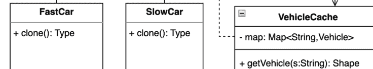

在某些情况下，创建一个已设计车辆的精确拷贝作为其原型更为简单：

```java
public static void main(String[] args) {
    Vehicle fastCar1 = VehicleCache.getVehicle("fast-car");
    Vehicle fastCar2 = VehicleCache.getVehicle("fast-car");
    fastCar1.move();
    fastCar2.move();
    System.out.println(": " + (fastCar1.equals(fastCar2)));
}
```

输出如下：

```
Pattern Prototype: vehicle prototype 1
fast car, move
fast car, move
equals : false
fastCar:FastCar@659e0bfd
fastCar:FastCar@2a139a55
```

示例 3.13 - 可以从可用实例克隆新车辆

实例可以根据需要重建（分别克隆）。`Vehicle` 抽象类为每个新的原型实现提供了基础，并提供了克隆细节：

```java
abstract class Vehicle implements Cloneable{
    protected final String type;

    Vehicle(String t) {
        this.type = t;
    }

    abstract void move();

    @Override
    protected Object clone() {
        Object clone = null;
        try{
            clone = super.clone();
        } catch (CloneNotSupportedException e){}
        return clone;
    }
}
```

示例 3.14 - 抽象类必须实现 `Cloneable` 接口并引入 `clone` 方法实现：

```java
class SlowCar extends Vehicle {
  SlowCar() {
    super("slow car");
  }

  @Override
  void move() {
  }
}
```

示例 3.15 - 抽象类引入了 `clone` 方法实现：

```java
final class VehicleCache {
  private static final Map<String, Vehicle> map = Map.of("fast-car", new FastCar(), "slow-car", new SlowCar());

  private VehicleCache() {}

  static Vehicle getVehicle(String type) {
    Vehicle vehicle = map.get(type);
    if (vehicle == null) throw new IllegalArgumentException("not allowed:" + type);
    return (Vehicle) vehicle.clone();
  }
}
```

示例 3.16 - VehicleCache 持有引用

#### 使用创建型设计模式

有几种不同的方法可以确保对象的实例是唯一的。`OnlyEngine` 类引入了可能的单例实现方式，其实现是按需延迟创建的（示例 3.18）。`OnlyEngine` 类实现了通用的 `Engine` 接口。它的实现提供了一个静态 `getInstance` 方法作为透明的入口点：

```java
interface Engine {}
class OnlyEngine implements Engine {
    private static OnlyEngine INSTANCE;
    static OnlyEngine getInstance() {
        if (INSTANCE == null) {
            INSTANCE = new OnlyEngine();
        }
        return INSTANCE;
    }
    private OnlyEngine() {}
}
```

#### 示例 3.18 - OnlyEngine 类检查实例是否存在——懒性初始化

实现单例的另一种方法是创建一个属于类本身的静态字段，并向潜在客户端暴露 `getInstance` 入口点（示例 3.19）。值得注意的是，在这种情况下，构造函数变成了私有：

```java
class OnlyVehicle {
    private static OnlyVehicle INSTANCE = new
        OnlyVehicle();
    static OnlyVehicle getInstance() {
        return INSTANCE;
    }

    private OnlyVehicle() {
        this.engine = OnlyEngine.getInstance();
    }
    private final Engine engine;
    void move() {
        System.out.println("OnlyVehicle, move");
    }
    Engine getEngine() {
        return engine;
    }
}
```

#### 示例 3.19 – OnlyVehicle 类提供一个属于类的静态字段作为其实例

懒性初始化的单例模式实现在多线程环境中可能会面临挑战，因为必须对 `getInstance` 方法进行同步处理以获取唯一实例。一种可能性是将单例创建为枚举类（示例 3.20）：

```java
enum OnlyEngineEnum implements Engine {
  INSTANCE;
}
// private OnlyVehicle() {
  this.engine = OnlyEngineEnum.INSTANCE;
}
```

## 示例 3.20 – OnlyEngineEnum 单例枚举类方法

#### 结论

单例模式是一个相对简单的设计模式，尽管由于它保证了所需对象只有一个实例，在多线程环境中使用它时可能会变得复杂。在强制执行单一职责原则时，该模式可能会受到挑战，因为类实际上负责实例化自己。另一方面，单例模式确保了客户端可以全局访问资源，防止意外的对象初始化或销毁。该模式应该谨慎使用，因为它以所需类实例的方式创建了紧耦合的代码，这往往会导致可测试性问题。该模式还抑制了子类，使得任何扩展几乎都不可能。

创建实例并不总是一种好方法。让我们来看看如何按需。

## 使用对象池模式提高性能

对象池模式实例化准备就绪的对象并限制了它们的初始化时间。所需的实例可以按需重建。对象池可以代表创建新实例的基础条件，或者限制它们的创建。

#### 动机

与其在整个代码库中不断创建新的对象实例，不如对象池通过提供已初始化并准备就用的对象，为管理应用程序或客户端性能提供了一个封装的解决方案。该模式将构建逻辑与业务代码分离，有助于管理应用程序的资源和性能。它可能不仅有助于对象的生命周期管理，还有助于创建或销毁时进行验证。

#### 在 JDK 中查找

对象池模式的一个很好的例子是 `java.util.concurrent` 包中的 `ExecutorService` 接口，以及由工具工厂 `Executors` 类提供的实现，它处理适当的执行器实例，例如 `newScheduledThreadPool` 方法。

#### 示例代码

当前示例引入了一个场景，该车库包含驾驶员可以驾驶特定数量的汽车（图 3.7）：

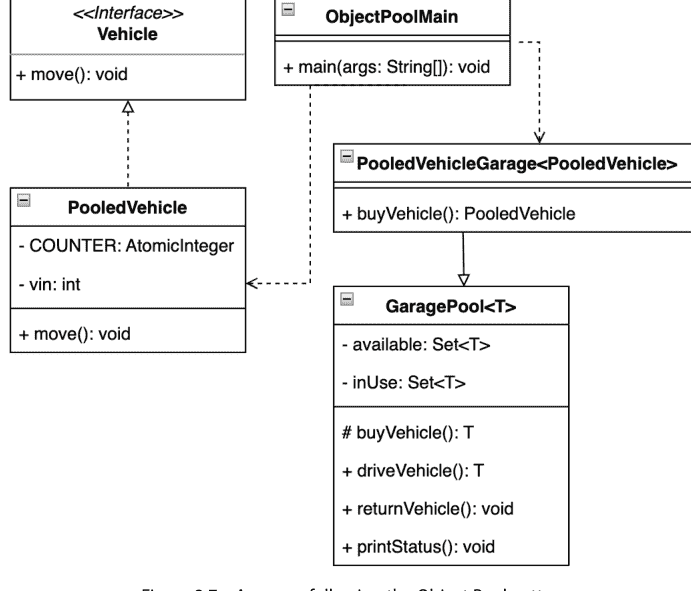

图 3.7 - 符合对象池模式的车库

当汽车不可用时，车库实现了一种购买新汽车的逻辑，以保持所有驾驶员忙碌：

```java
public static void main(String[] args) {
    var garage = new PooledVehicleGarage();
    var vehicle1 = garage.driveVehicle();
    var vehicle2 = garage.driveVehicle();
    var vehicle3 = garage.driveVehicle();
    var vehicle4 = garage.driveVehicle();
    var vehicle5 = garage.driveVehicle();
    vehicle1.move();
    vehicle2.move();
    vehicle3.move();
    vehicle4.move();
    vehicle5.move();
    garage.returnVehicle(vehicle1);
    garage.returnVehicle(vehicle2);
    garage.returnVehicle(vehicle3);
    garage.returnVehicle(vehicle4);
    garage.returnVehicle(vehicle5);
    garage.printStatus();
}
```

输出如下：

```
Object Pool: available: 0, inUse: 5
Object Pool: available: 1, inUse: 4
Object Pool: available: 2, inUse: 3
Object Pool: available: 3, inUse: 2
Object Pool: available: 4, inUse: 1
Object Pool: available: 5, inUse: 0
```

示例 3.21 – 对象池有助于降低成本

#### 使用创建型设计模式

该模式的核心元素是池抽象，因为它包含了所有所需的逻辑。一种选择是创建一个抽象的车库类（示例 3.22），它包含了所有的机制。这些机制对于避免不稳定性是必要的：

```java
abstract class AbstractPool<T extends Vehicle> {
    private final Set<T> available = new HashSet<>();
    private final Set<T> inUse = new HashSet<>();

    protected synchronized T buyVehicle() {
        if (available.isEmpty()) {
            // logic to create new instance
}
        T instance = available.iterator().next();
        available.remove(instance);
        inUse.add(instance);
        return instance;
    }

    synchronized void returnVehicle(T instance);
    void printStatus();
}
```

示例 3.22 – 抽象车库池提供了所有的逻辑

车库由 Vehicle 抽象绑定（示例 3.23）。接口提供了客户端使用的常用函数：

```java
interface Vehicle {
    int getVin();
    void move();
}
```

示例 3.23 – Vehicle 接口需要由 PooledVehicle 实现

除了实现函数，`PooledVehicle` 类提供了一个私有计数器（示例 3.24）。计数器属于类，因此被标记为静态和 final。计数器统计车库池购买的实例数量：

```java
class PooledVehicle implements Vehicle {
    private static final AtomicInteger COUNTER = new
        AtomicInteger();

    private final int vin;
    PooledVehicle() {
        this.vin = COUNTER.incrementAndGet();
    }

    @Override
    public int getVin() {
        return vin;
    }

    @Override
    public void move() {
        // move logic
    }
}
```

示例 3.24 - PooledVehicle 类实现也持有实例数量

# 使用懒初始化模式按需初始化对象

该模式的目的是延迟目标类实例的创建，直到客户端实际请求它。

#### 动机

尽管运行内存多年来已经急剧增长，但我们在上一节中了解到，JVM 为堆（heap）分配了固定的、特定大小的内存。当堆耗尽且 JVM 无法分配任何新对象时，会对这种堆污染产生负面影响。由于实例是延迟的，它有时被称为异步加载。该模式在 Web 应用程序中具有非常好的用处，在这些应用中，网页是按需生成的，而不是在应用程序初始化过程中生成的。在操作相关对象的成本较高的应用程序中，它也有其用武之地。

# 在 JDK 中寻找

懒初始化可以使用 ClassLoader 动态加载在应用启动时未链接的类的示例来演示。类可以根据类策略被尽早加载（eagerly）或延迟加载。某些类（例如 `ClassNotFoundException`）是通过 `java.base` 模块隐式加载的。它们支持位于 `java.lang` 包中的类实现及其 `forName` 方法。该方法的实现由内部 API 提供。懒初始化类可能是应用程序需要预热时间的原因。例如，枚举类（Enum classes）是一种特殊的 `static final` 类，它们作为常量运行并被尽早加载。

> 指将加载步骤到类加载器中并填充适当的方法区域，正如在上一节中所学到的。

#### 示例代码

懒初始化示例的基本思想是，创建的车辆按按初始化的，一旦创建，就会向客户端提供引用（图 3.8）：

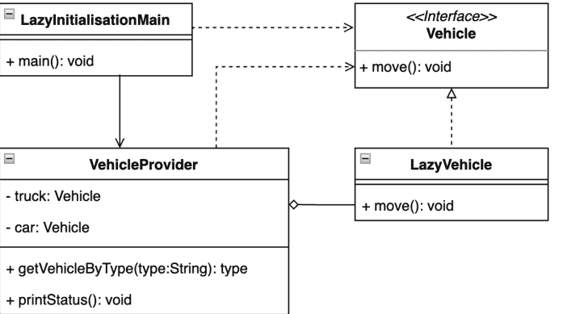

图 3.8 - 如何使用懒初始化模式创建车辆

此类车辆仅在客户端很少需要时存在。在某些情况下会创建特定的车辆实例。当车辆已经存在于提供者上下文中，该实例会被复用：

```java
public static void main(String[] args) {
    System.out.println("Pattern Lazy Initialization: lazy vehicles");
    var vehicleProvider = new VehicleProvider();
    var truck1 = vehicleProvider.getVehicleByType("truck");
    vehicleProvider.printStatus();
    truck1.move();
    var car1 = vehicleProvider.getVehicleByType("car");
    var car2 = vehicleProvider.getVehicleByType("car");
    vehicleProvider.printStatus();
    car1.move();
    car2.move();
    System.out.println("car1=car2: " + (car1.equals(car2)));
}
```

#### 使用创建型设计模式

以下是输出：

```
Pattern Lazy Initialization: lazy vehicles
lazy truck created
status, truck:LazyVehicle[type=truck]
status, car:null
LazyVehicle, move, type:truck
lazy car created
status, truck:LazyVehicle[type=truck]
car:LazyVehicle[type=car]
LazyVehicle, move, type:car
car1=car2: true
```

# 示例 3.25 – 轮化车辆的实现


# 懒初始化设计模式

`VehicleProvider` 类的实现考虑了字段。这些字段在需要时持有指向所需车辆的引用。提供者封装了决策和实例化逻辑。可能的实现之一可能使用 `switch-label-match` 结构（示例 3.26）、`switch` 表达式等。值得指出的是，在这个示例中，`VehicleProvider` 类在包作用域内创建实例，因此它的构造函数是私有包级别的，不暴露给其他包：

```java
final class VehicleProvider {
    private Vehicle truck;
    private Vehicle car;
    VehicleProvider() {}
    Vehicle getVehicleByType(String type) {
        switch (type) {
            case "car":
                ...
                return car;
            case "truck":
                if (truck == null) {
                    System.out.println("lazy truck created");
                    truck = new LazyVehicle(type);
                }
                return truck;
            default:
                ...
        }
    }
    void printStatus(){...}
}
```

示例 3.26 - VehicleProvider 向客户端隐藏了可能的实体实例化逻辑

为了强制对可能的懒初始化对象具有扩展性，每个实体都实现了 `Vehicle` 抽象类：

```java
interface Vehicle {
  void move();
}
record LazyVehicle(String type) implements Vehicle{
  @Override
  public void move() {
    System.out.println("LazyVehicle, move, type:" + type);
  }
}
```

示例 3.27 - 使用 `record` 强制不可变的 Vehicle 抽象和可能的 LazyVehicle 实现

这种方法确保了在不对提供者逻辑进行复杂更改的情况下，实现持续演进。

## 结论

懒初始化设计模式可以帮助保持应用程序内存较小。另一方面，使用不当可能会导致意外的延迟，因为对象的创建可能过于复杂且运行需要大量时间。

下一节将展示如何将依赖注入到新创建的车辆实例中。

# 通过依赖注入模式减少类依赖

该模式将特定类的实现（作为服务）与客户端（使用服务的地方）分离开。

## 动机

依赖注入模式广泛应用于需要将类的实现（服务）与客户端分离的场景。该模式允许消除硬编码依赖。这些服务在外部实例化。有三种方式实现依赖注入：

- **构造函数注入**：通过构造函数向客户端提供的服务。
- **方法注入**：通过接口向客户端暴露方法。
- **字段注入**：这种类型的注入通过相应的字段进行。

## 在 JDK 中寻找

使用依赖注入模式的一个例子是 `ServiceLoader` 工具类。它位于 `java.base` 模块及其 `java.util` 包中。`ServiceLoader` 实例在应用启动期间查找服务。该服务由一个定义良好的接口表示。值得注意的是，`ServiceLoader` 可以与类路径配置，也可以与 Java 模块系统（在第 2 节讨论）无缝集成。

过去，依赖注入属于 Java EE，而不是经典的 JDK。这意味着该功能在 Java 平台上可用。由于 JDK 的演进，依赖注入功能已移动到 **Jakarta Dependency Injection** 项目。该项目有自己的发布和开发周期，不依赖于 JDK。尽管如此，依赖注入对于使用 `@Inject`、`@Named`、`@Scope` 或 `@Qualifier` 注解是众所周知的。

以下是输出：

```
Pattern Dependency Injection: vehicle and engine
FastEngine, started
FastEngine, run
SportCar, move
```

## 示例 3.28 - 分别从车辆中创建 FastEngine 实例，然后将其添加到构建的 SportVehicle 中

`FastEngine` 在完全准备就绪（初始化、验证等）时使用。可以独立构建所需的车辆类型，而不依赖于引擎。通过 `EngineServiceProvider` 为 `SportVehicle` 提供引擎实例（示例 3.29）：

```java
final class EngineServiceProvider {
    private static final Map<String, Engine> ENGINES = new
        HashMap<>();
    static Engine getByType(String t) {
        return ENGINES.values().stream()
            .filter(e -> e.type().equals(t))
            .findFirst().orElseThrow(IllegalArgumentException::new);
    }
}
```

示例 3.29 – EngineServiceProvider 注册实例化的可重用服务

`SportVehicle` 类实现了 `Vehicle` 接口（示例 3.30），以体现 SOLID 设计原则中提到的开闭原则：

```java
interface Vehicle {
    void move();
}
class SportVehicle implements Vehicle {
    private final Engine engine;
    SportVehicle(Engine e) {...}
    @Override
    public void move() {
        if (!engine.isStarted()) {
            engine.start();
        }
        engine.run();
        System.out.println("SportCar, move");
    }
}
```

示例 3.30 - SportVehicle 实现 Vehicle 接口，并为提供的 Engine 实例带有额外的内部逻辑

需要注意的是，虽然特定的 `Engine` 类型（示例 3.31）实例（`FastEngine`）是在其他地方创建的（示例 3.28，第 3 行），但在实例化 `SportVehicle` 对象时，需要它的存在：

```java
interface Engine {
  void start();
  boolean isStarted();
  void run();
  String type();
}

class FastEngine implements Engine{
  private final String type;
  private boolean started;
  FastEngine(String type) {
    this.type = type;
  }
  ...
}
```

示例 3.31 - FastEngine 类实现的 Engine 接口并由 EngineServiceProvider 提供

在上述示例中，关键角色对象是 `EngineServiceProvider`。它提供了已创建的所需 `Engine` 实例的引用，并将分发到业务代码中。这意味着任何需要处理 `Engine` 的客户端（类似于 `SportVehicle` 实例）都将通过 `EngineServiceProvider` 暴露的链接访问正确的实例。

## 使用创建型设计模式

所展示的简单示例可以利用 `ServiceProvider` 工具类实例轻松转换为另一种形式。变化非常微小（示例 3.32）：

```java
public static void main(String[] args) {
    System.out.println("Pattern Dependency Injection\n    Service Loader: vehicle and engine");
    ServiceLoader<Engine> engineService =
        ServiceLoader.load(Engine.class);
    Engine engine = engineService.findFirst()
        .orElseThrow();
    Vehicle vehicle = new SportVehicle(engine);
    vehicle.move();
}
```

示例 3.32 – ServiceLoader 提供了 Engine 接口的可用实现，用于实例化 SportVehicle 类型

在标准类路径利用中，Java 平台要求将服务提供者注册在 `META-INF` 文件夹和 `service` 文件夹中。文件名由包名和服务接口名称组成，文件包含可用的服务提供者。

Java 平台模块系统简化了配置步骤。相关模块向目标模块提供（并使服务实现变得可用），正如我们在第 2 章“为设计模式发现 Java 平台”中提到的那样。

## 结论

依赖注入模式确保客户端无需了解所用服务的实例化。客户端通过通用接口访问服务。这使得代码库变得更好。它还简化了代码的可测试性。依赖注入是各种框架（如 Spring 和 Quarkus）广泛使用的模式。Quarkus 使用 Jakarta 依赖注入规范。依赖注入模式符合 SOLID 面向对象编程原则，因为它提供了接口抽象。代码不依赖于实现，而是通过接口与服务通信。依赖注入模式强制执行 DRY（不要重复自己）原则，因为不需要不断初始化服务。

## 总结

创建型设计模式在软件应用设计中起着非常重要的作用。它们有助于在基本面向对象原则的基础上，透明地处理对象实例化逻辑。示例表明，每个模式可能有多种实现。这是因为实现决策可能取决于其他的软件架构因素。这些因素考虑了 JVM 堆栈使用、应用程序运行时和业务逻辑封装。

隐式地使用设计模式来促进 DRY 方法，这对开发有积极影响并减少了代码库污染。应用程序变得可测试，软件架构师有了一个框架来确认 JVM 内部存在预期对象。当识别出代码问题（可能是异常或意外结果）时，这变得尤为重要。良好的代码库有助于快速找到根源，甚至可能不需要调试。

在本章中，我们学习了如何使用透明工厂模式方法创建特定家族的对象。抽象工厂模式展示了创建不同工厂的封装方式。并不是所有所需信息在某一时刻都存在，构建器模式引入了处理组合复杂对象挑战的方法。原型模式展示了不向客户端暴露逻辑的方法，单例模式确保了单实例的存在。对象池设计揭示了如何改进内存使用，而延迟实例化模式展示了如何延迟对象直到需要。依赖注入模式演示了创建新对象时的重用性。

创建型设计模式不仅为新对象的创建带来了清晰性，在许多情况下还可以为代码的正确结构做出贡献。示例展示了如何实现这些模式，并学习了它们的区别和目的。

下一章将讨论结构设计模式。这种模式将帮助我们根据最常见的场景来组织代码。让我们继续。

## 问题

1. 创建型模式解决了哪些问题？
2. 哪些模式有助于减少对象成本？
3. 利用单例模式的关键原因是什么？
4. 哪些模式有助于减少构造函数污染？
5. 如何向客户端隐藏复杂的实例化逻辑？
6. 是否可以减少实例化内存占用？
7. 哪种设计适用于创建特定家族的对象？

## 延伸阅读

- Design Patterns: Elements of Reusable Object-Oriented Software by Erich Gamma, Richard Helm, Ralph Johnson, and John Vlissides, Addison-Wesley, 1995
- Design Principles and Design Patterns by Robert C. Martin, Object Mentor, 2000
- Cramming more components onto integrated circuits by Gordon E. Moore, Electronics Magazine, 1965-04-19
- Oracle Tutorials: Generics: https://docs.oracle.com/javase/tutorial/java/generics/index.html
- Quarkus Framework: https://quarkus.io/
- Spring Framework: https://spring.io/
- Jakarta Dependency Injection: https://jakarta.ee/specifications/dependency-injection/
- Clean Code by Robert C. Martin, Pearson Education, Inc, 2009
- Effective Java – Third Edition by Joshua Bloch, Addison-Wesley, 2018

# 应用结构型设计模式

每个软件都有其目的，换句话说，就是它应该满足的预期行为。虽然上一章详细介绍了创建性设计模式，但本章将侧重于为创建的对象设计可维护且灵活的源代码。结构型模式试图使所创建实例之间的关系清晰化，不仅是为了维护应用程序，也是为了理解它的目的。让我们深入探讨并开始研究以下主题：

- 使用适配器模式处理不兼容的对象协作
- 使用桥接模式实现对象的解耦并独立开发
- 使用组合模式以相同的方式处理对象
- 使用装饰器模式扩展对象功能
- 使用外观模式简化通信
- 使用过滤器模式通过条件选择所需的对象
- 使用享元模式在应用中共享对象
- 使用控制器模式处理请求
- 使用标记模式识别实例
- 使用模块模式探索模块概念
- 使用代理模式为对象提供占位符
- 使用孪生模式在 Java 中探索多继承

在本章结束时，你将牢固理解如何围绕创建的实例构建代码库。

## 技术要求

你可以在 GitHub 上找到本章的代码文件，地址为 https://github.com/PacktPublishing/Practical-Design-Patterns-for-Java-Developers/tree/main/Chapter04。

## 使用适配器模式处理不兼容的对象协作

适配器模式的主要目标是将源接口连接到客户端期望的另一个接口。适配器模式允许原本因抽象或实现不兼容而无法共同工作的类协同工作。它被认为是最常见的模式之一，也是四人帮（GoF）设计模式之一。

### 动机

适配器模式也称为包装器。适配器封装了被适配者（连接类）的行为，并允许在不修改被适配者的情况下使用已有的接口进行访问。通常，适配器使用不兼容的接口，适配器整合此类行为并透明地提供所需功能的访问。

### 在 JDK 中查找

`java.base` 模块提供了适配器模式的多种实现。`java.util` 包中的 `Collections` 工具类提供了一个 `list` 方法，该方法接受 `Enumeration` 接口并将结果存入 `ArrayList`。

### 示例代码

适配器模式可以通过多种方式实现。其中一种考虑是一个可以拥有不同类型引擎的车辆（示例 4.1）：

```java
public static void main(String[] args) {
    System.out.println("Adapter Pattern: " + engines);
    var electricEngine = new ElectricEngine();
    var enginePetrol = new PetrolEngine();
    var vehicleElectric = new Vehicle(electricEngine);
    var vehiclePetrol = new Vehicle(enginePetrol);

    vehicleElectric.drive();
    vehicleElectric.refuel();
    vehiclePetrol.drive();
    vehiclePetrol.refuel();
}
```

这里是输出：

```
Adapter Pattern: engines
...
Vehicle, stop
Vehicle needs recharge
ElectricEngine, check plug
ElectricEngine, recharging
...
Vehicle needs petrol
PetrolEngine, tank
```

示例 4.1 - 尽管每种类型的车辆共享相似逻辑，但 refuel 方法的行为随引擎类型而异

这些引擎共享相似的功能和特性，但并非所有都是。它们彼此非常不同（图 4.1）：

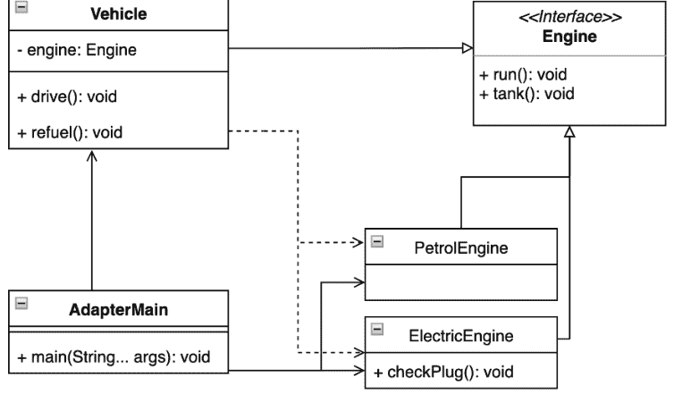

图 4.1 - 突出引擎类型的 UML 类图


在这个示例中，`Vehicle` 类及其实例充当适配器的角色。在 `drive` 方法的情况下，两个电的行为的行为相似。`tank` 方法的执行是一个不同的场景，因为车辆适配器需要确切的引擎类型才能正确执行 `refuel` 方法（示例 4.2）：

```java
class Vehicle {
    private final Engine engine;

    ...

    void refund() {
        System.out.println("Vehicle, stop");
        switch (engine) {
            case ElectricEngine de -> {
                System.out.println("Vehicle needs diesel");
                de.checkPlug();
                de.tank();
            }
            case PetrolEngine pe -> {
                System.out.println("Vehicle needs petrol");
                pe.tank();
            }
            default -> throw new IllegalStateException(
                ("Vehicle has engine")
            )
        }
        engine.tank();
    }
}
```

示例 4.2 - 新语言特性（如 `switch` 语句非常有用，因为不需要识别确切类型。密封类（sealed classes）支持该模式

```java
sealed interface Engine permits ElectricEngine,
PetrolEngine {
    void run();
    void tank();
}
```

示例 4.3 - `Engine` 接口仅允许某些类实现

`Vehicle` 适配器提供了所需的逻辑。`ElectricEngine` 实现提供了额外的额外方法（示例 4.4）：

```java
final class ElectricEngine implements Engine{
    @Override
    public void run() {
        System.out.println("ElectricEngine, run");
    }

    @Override
    public void tank() {
        System.out.println("ElectricEngine, recharging");
    }

    public void checkPlug() {
        System.out.println("ElectricEngine, check plug");
    }
}
```

示例 4.4 - `ElectricEngine` 实现了无法与共享的额外逻辑

### 结论

适配器结构型设计模式在开发中具有合理的地位，因为它代表了通过相似接口连接不同功能的自维护方式。适配器被妥善封装，甚至可以更抽象。密封类支持可维护性的概念。使用适配器模式的可能是适配器需要提交特定的接口。当实现额外的第三方库或 API 时，适配器可能会扩展。解决方案也可以容易地重构。

对适配器模式的观察展示了使用不兼容 API 方法。接下来，让我们研究如何使用不同的实现。

## 使用桥接模式实现对象的解耦并独立开发

此模式的目标是将抽象与其实现分离离开，以便两者都能独立变化。桥接模式由 GoF 描述。

### 动机

桥接模式关于优先考虑组合而非继承。实现细节从层次结构中移动到另一个独立层次结构的对象。桥接模式使用封装和聚合，并可以使用继承将职责分离到不同的类中。

### 在 JDK 中查找

桥接模式的使用可以在 `java.util.logging` 包以及 `Logger` 类的实现中找到。该类位于 `java.logging` 模块。它实现了 `Filter` 接口。该接口用于在标准日志级别之外对日志内容进行额外的控制。

### 示例代码

让我们看到两种类型车辆的示例：跑车和皮卡。这些车辆的引擎类型不同：汽油和柴油。意图是强制分离 `Vehicle` 和 `Engine` 抽象的源码。示例案例创建并执行了 `drive` 和 `stop` 方法（示例 4.5）：

```java
public static void main(String[] args) {
    System.out.println("Pattern Bridge, vehicle engines...");
    Vehicle sportVehicle = new SportVehicle(
        new PetrolEngine(), 911);
    Vehicle pickupVehicle = new PickupVehicle(
        new DieselEngine(), 300);

    sportVehicle.drive();
    sportVehicle.stop();

    pickupVehicle.drive();
    pickupVehicle.stop();
}
```

这是输出结果：

```
Pattern Bridge, vehicle engines...
SportVehicle, starting engine
PetrolEngine, on
SportVehicle, engine started, hp:911
SportVehicle, stopping engine
PetrolEngine, self check
PetrolEngine, off
SportVehicle, engine stopped
PickupVehicle, starting engine
DieselEngine, on
PickupVehicle, engine started, hp:300
PickupVehicle, stopping engine
DieselEngine, off
PickupVehicle, engine stopped
```

示例 4.5 – 车辆使用不同的引擎；它们可以独立开发，以实现桥接模式的隔离

每辆车辆都扩展了 `Vehicle` 抽象类，该类运行引擎并封装了基本功能。车辆抽象类使用的 `Engine` 接口充当了桥接的角色，如图所示（图 4.2）：

## 应用结构型设计模式

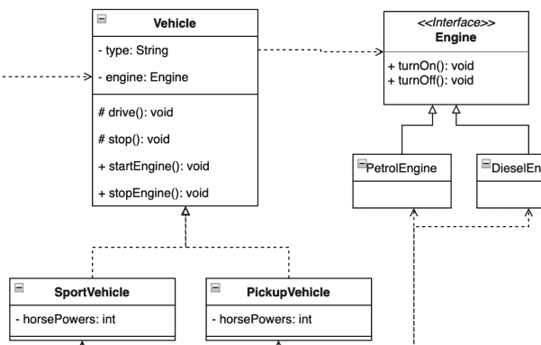

图 4.2 - UML 类图展示了 `Engine` 如何桥接对特定实现的访问

引擎的行为已经有所不同，并且由于桥接模式的存在，它们可以继续演进（示例 4.6）：

```java
class DieselEngine implements Engine {
    ...

    @Override
    public void turnOff() {...}
}

class PetrolEngine implements Engine {
    ...

    @Override
    public void turnOff() {
        selfCheck();
    }

    private void selfCheck() { ... }
}
```

示例 4.6 - 引擎在实现上存在差异

车辆抽象不包含任何引擎实现细节，这些细节即使在类层次结构也可能有所不同。车辆只需要依赖提供的接口即可。

### 结论

当应用程序源代码需要减少对特定实现的绑定时，桥接模式是一个很好的考虑方案，关于特定实现的决策可以推迟到运行时。桥接模式有助于通过职责分离和封装来鼓励 SOLID 原则。实现部分可以根据需要通过应用程序源代码进行自由测试和共享。需要记住，在出现这种情况时，不要向桥接实现添加不必要的职责，并从设计模式的角度考虑替代方案。

桥接模式可以为实现细节更好的组合打开大门，正如我们在下一个模式中探索的那样。

## 使用组合模式以相同的方式处理对象

组合模式是在将对象排列为树结构时统一处理对象的卓越解决方案，它简化了对实例的访问。对这种模式的需求自然源于工业，该模式也由 GoF（设计模式小组）识别并描述。

### 动机

围绕底层业务逻辑对对象进行分组是一种强大的方法。组合设计概述了实现这种状态的方法。由于组中的每个成员都被统一对待，因此可以创建层次级树结构和部分整体层次结构。它有助于建立应用程序的逻辑关系以及所需对象的组合。

### 在 JDK 中查找

在 JDK 中，组合模式可以在 `java.base` 模块、`java.util` 包以及 `Properties` 类中找到。`Properties` 类通过其 `Hashtable` 实现实现了 `Map` 接口，并且包含一个 `ConcurrentHashMap` 实例来在内部存储属性值。尽管由于 `Hashtable` 实现，`Properties` 类的 `put` 操作仍然保持同步，但 `get` 操作则不然，因为读取到并发映射非常简单。

### 示例代码

为了探索组合模式的力量，请考虑实现 `Vehicle` 接口的 `Vehicle` 类。众所周知，每辆车辆都是部件的集合，而每个部件都是更小部分的分组（图 4.3）：

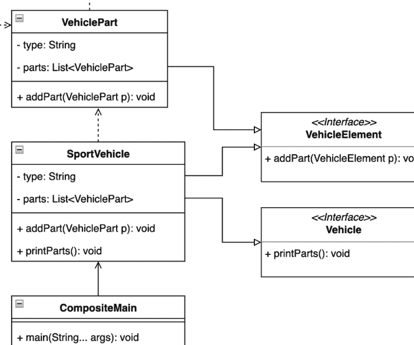

图 4.3 - UML 类图展示了 `SportVehicle` 是如何由 `VehiclePart` 类型组合的

当制造过程开始时，组合模式提供了最终结果中存在的每个部分的完整集合（示例 4.7）：

```java
public static void main(String[] args) {
    System.out.println("Pattern Composite, vehicle parts...");
    var fastVehicle = new SportVehicle("sport");
    var engine = new VehiclePart("fast-engine");
    engine.addPart(new VehiclePart("cylinder-head"));

    var brakes = new VehiclePart("super-brakes");
    var transmission = new VehiclePart("automatic-transmission");
    fastVehicle.addPart(engine);
    fastVehicle.addPart(brakes);
    fastVehicle.addPart(transmission);
    fastVehicle.printParts();
}
```

这是输出结果：

```
Pattern Composite, vehicle parts...

SportCar, type='sport', parts='

[{type='fast-engine', parts=[{type='cylinder-head', parts=[]}]},

{type='super-brakes', parts={}},

{type='automatic-transmission', parts={}}]

```

示例 4.7 – 查看 `SportVehicle` 实例的组合

### 结论

组合模式允许以细粒度的细节表示类的组合。它通过创建部分-整体层次结构考虑了组合中较小的部分。虽然这带来了每个部分都被统一对待的优势，但可能会导致忽略部分之间的差异。另一方面，组合模式以透明的形式将所有相关部分结合在一起。

让我们查看如何在不更改 API 的情况下为单个对象扩展附加功能。

### 使用装饰器模式扩展功能

装饰模式提供了在不改变 API 的情况下为对象添加额外功能的方法。装饰模式在 Python 和 Kotlin 等语言中相对简单且动态。另一方面，Java 可以通过装饰器提供更好的稳定性和维护性。装饰器模式由 GoF 识别并描述。

#### 动机

通过装饰器模式，你可以动态地为对象附加职责。装饰器为类类扩展功能提供了一种灵活的方案。装饰器可以静态或动态添加，而无需更改当前的行为。

#### 在 JDK 中查找

装饰器模式的使用可以在 Java 集合框架、`java.util` 包中找到。`Collections` 类包含了使用装饰器模式的方法。例如，`unmodifiable` 方法将请求的集合封装为不可变集合。

#### 示例代码

当你考虑之前的车辆示例时，装饰器模式可以被视为调优车辆。`StandardVehicle` 类如下。它实现了 `Vehicle` 接口以满足标准功能。应用程序设计人员后来决定改进当前状态并创建一个 `TunedDecorator` 类来封装标准车辆，而无需更改功能（图 4.4）：

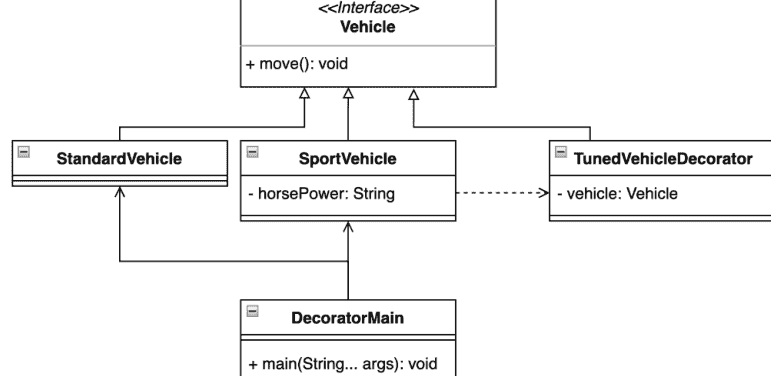

图 4.4 – UML 类图强调了 `SportVehicle` 和 `TunedDecorator` 之间的关系

所有被考虑的车辆都暴露了执行其实现的 API（示例 4.8）：

```java
public static void main(String[] args) {

    System.out.println("Pattern Decorator, tuned vehicle");

    Vehicle standardVehicle = new StandardVehicle();

    Vehicle vehicleToBeTuned = new StandardVehicle();

    Vehicle tunedVehicle = new SportVehicle(
        vehicleToBeTuned, 200);

    System.out.println("Drive a standard vehicle");

    standardVehicle.move();

    System.out.println("Drive a tuned vehicle");

    tunedVehicle.move();

}
```

这是输出结果：

```
Pattern Decorator, tuned vehicle

Drive a standard vehicle

Vehicle, move

Drive a tuned vehicle

SportVehicle, activate horse power:200

TunedVehicleDecorator, turbo on

Vehicle, move

```

示例 4.8 – 调优车辆抽象通过增加更多马力（200）扩展了 `SportVehicle` 类型的功能

装饰器模式可以通过多种方式引入。在演示的示例中，`TunedDecorator` 是一个持有车辆引的抽象类。`SportVehicle` 实例扩展了新实现的功能（示例 4.9）：

```java
sealed abstract class TunedVehicleDecorator implements
    Vehicle permits SportVehicle {

    private final Vehicle vehicle;

    TunedVehicleDecorator(Vehicle vehicle) {
        this.vehicle = vehicle;
    }
}
```

```java
@Override
public void move() {
    System.out.println("TunedVehicleDecorator");
}
```

```java
final class SportVehicle extends TunedVehicleDecorator {

    private final int horsePower;

    public SportVehicle(Vehicle vehicle, int horsePower) {
        super(vehicle);
        this.horsePower = horsePower;
    }
}
```

```java
@Override
public void move() {
    System.out.println("SportVehicle, activate power: " + horsePower);
    super.move();
}
```


示例 4.9 – 装饰器包装了 `Vehicle` 实例并扩展了它的功能

#### 结论

类装饰在应用开发过程中许多情况下都非常有用。装饰器模式可以用于迁移应用逻辑，在这些情况下，以前的功能应该保持隐藏，或者应该避免出现不必要的子类。示例展示了密封类（sealed classes）如何有助于代码的可维护性和可理解性。装饰不仅有助于添加新功能，还能移除过时功能。装饰器模式是一种透明的方法，可以在不破坏当前接口的情况下修改对象。

有时，为了将装饰器模式与我们将检查的另一种设计模式——外观模式（façade pattern）结合使用是有意义的。

#### 使用外观模式简化通信

外观模式为一组底层子系统提供了一个统一的接口。换句话说，外观模式定义了一个便于其操作的高层级接口。外观模式由 GoF 定义：

#### 动机

随着子系统的演进，它们通常会变得更加复杂。大多数模式在较小的类中使用时，使得子系统更具可重用性且更容易自定义，但也让所有客户端与其工作变得困难。外观模式为子系统提供了一个简单的默认视图，对大多数客户端都有益。只有需要更多定制的客户端才需要查看外观模式之外的内容。

#### 在 JDK 中查找

Java 集合框架位于 `java.base` 模块，`java.util` 已经多次提到。它是 JDK 中被广泛使用的部分，特别是用于内部逻辑实现。`List`、`Set`、`Queue`、`Map` 和 `Enumeration` 等接口可以被视为特定实现的外壳。我们将详细地列出 `List` 接口。它由常用的 `ArrayList` 或 `LinkedList` 类等进行实现。具体的实现细节各不相同，其中一些在第 2 章《面向设计模式发现 Java 平台》（表 2.3、2.4 和 2.5）中提到过。

#### 示例代码

外观模式是软件工程中经常使用的设计模式，很容易展示。考虑一种司机为车辆获得驾驶照的情况。驾驶照使他们有权驾驶汽油车和柴油车，当然，还可以为它们加油。司机获得了这两种类型作为奖励（示例 4.10）：

```java
public static void main(String[] args) {
    System.out.println("Pattern Facade, vehicle types");
    List<Vehicle> vehicles = Arrays.asList(
        new DieselVehicle(), new PetrolVehicle());
    for (var vehicle : vehicles) {
        vehicle.start();
        vehicle.refuel();
    }
}
```

## 116 应用结构型设计模式

输出如下：

```
Pattern Facade, vehicle types
DieselVehicle, engine warm up
DieselVehicle, engine start
DieselVehicle, refuel diesel
PetrolVehicle, engine start
PetrolVehicle, refuel petrol
```

示例 4.10 – 外观模式促进了标准的控制接口

整合车辆类型对代码结构产生了积极影响，且易于实现（图 4.5）：

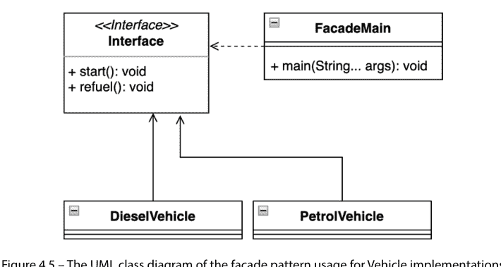

#### 结论

大量使用外观模式使其成为应用开发任何阶段都值得考虑的候选方案。它不仅促进了接口隔离原则，还促进了整个 SOLID 概念。它有助于实现内部依赖，同时保持可定制和可维护性。外观有助于引入松耦合并分离客户端，强制执行解耦。

```java
record RuleAnd(Rule rule, Rule additionalRule) implements Rule {
    @Override
    public Collection<Sensor> validateSensors(Collection<Sensor> sensors) {
        Collection<Sensor> initRule = rule.validateSensors(sensors);
        return additionalRule.validateSensors(initRule);
    }
}
```


## 示例 4.12 – 规则可以包含简单的逻辑（如 `RuleAnalog`），也可以包含相对于决策过程中与其他规则相比的高级逻辑（如 `RuleAnd`）

该示例应用程序可以通过透明定义的接口，轻松地扩展任何额外的、更复杂的规则。

### 结论

在 Java 堆中连接不同的请求类型或数据库结果等位置操作时，可能需要对正确的实例进行过滤或更佳的选择。过滤器模式展示了其灵活性，并且每个规则都可以独立开发，也就是说，可以在不涉及其他规则的情况下进行优化，这使得它成为当客户端需要与容器结构一起工作时非常理想的候选者。

下一个模式代表了通过共享实例来减少内存占用的可能方法。

## 使用享元模式在整个应用程序中共享对象

享元模式用于通过与相似对象尽可能地共享，最大限度地减少内存消耗或计算成本。享元模式由 GoF 作者小组描述过。

### 动机

当新开发的应用程序使用了许多客户端不需要的对象时，内存维护成本可能会很高，不仅是因为实例数量巨大，还因为创建了新对象。在许多情况下，一组对象可以成功地替换为较少的实例。这些实例可以在所需的客户端之间透明地共享。这将减少垃圾回收算法的压力。此外，当实例使用此类通信类型时，应用程序可以减少打开的套接字。

### 在 JDK 中查找

享元模式可以在 JDK 中很容易找到。它对许多人来说可能并不明显。例如，在原始包装类型的实现中，`java.base` 模块和 `java.lang` 包使用了这种模式来减少内存开销。当应用程序需要处理许多重复值时，该模式特别有用。如 `Integer`、`Byte` 和 `Character` 类提供了 `valueOf()` 方法，其实现使用内部缓存来存储重复元素。

### 示例代码

让我们来看一个车库持续租赁特定车辆类型的案例。车库包含一些可以租赁的车辆。每辆车辆默认都已准备好了车辆文件。当需要另一辆车辆时，新文件被放入订单系统（示例 4.13）：

```java
public static void main(String[] args) {

    System.out.println("Pattern Flyweight, sharing templates");

    Vehicle car1 = VehicleGarage.borrow("sport");

    car1.move();

    Vehicle car2 = VehicleGarage.borrow("sport");

    System.out.println("Similar template:" + (car1.equals(car2)));

}
```

这是输出结果：

```
Pattern Flyweight, sharing vehicles

VehicleGarage, borrowed type:sport

Vehicle, type:'sport-car', confirmed

VehicleGarage, borrowed type:sport

Similar template: true
```

**示例 4.13 – 使用享元模式共享模板是透明的，且不会污染内存**

我们下一个示例（示例 4.14）的故事是 `VehicleGarage` 的实现，它包含用于存储注册模板的缓存：

```java
class VehicleGarage {

    private static final Map<String, Vehicle> vehicleByType = new HashMap<>();

    static {
        vehicleByType.put("common", new VehicleType("common-car"));
        vehicleByType.put("sport", new VehicleType("sport-car"));
    }

    private VehicleGarage() {
    }

    static Vehicle borrow(String type) {
        Vehicle v = vehicleByType.get(type);
        if (v == null) {
            v = new VehicleType(type);
            vehicleByType.put(type, v);
        }
        System.out.println("VehicleGarage, borrowed type:" + type);
        return v;
    }
}
```

**示例 4.14 – `VehicleGarage` 的实现允许你按需添加缺失的类型以便控制模板大小**

接下来的示例图显示客户端并不感知 `VehicleType` 类，因为不需要它（图 4.7）：

## 使用前端控制器模式处理请求

| <<Interface>> | Vehicle |
| :--- | :--- |
| + confirm(): void | |
| - vehicleByType: Map<String, Vehicle> | |
| + borrow(String type): Vehicle | |

| VehicleType |
| :--- |
| - type: String |

| FlyweightMain |
| :--- |
| + main(String... args): void |

图 4.7 – UML 类图显示了 `VehicleGarage` 需要哪些类

### 结论

享元模式的主要优势是能够管理对所需对象的大量请求。它按需实例化并允许你控制当前存在的实例。应用程序不需要依赖于对象的标识性（`hashCode` 相等）。享元模式提供了一种获取对象的透明方式，且其实现强制了 SOLID 设计理念和 DRY 原则。

下一节描述了如何以受控的方式合并传入的请求。

## 使用前端控制器模式处理请求

该模式的目标是为大多数客户端需求创建一个通用服务。该模式定义了一个过程，允许将身份验证、安全、自定义操作和日志等常用功能封装在单一位置。

### 动机

这种模式在 Web 应用程序中常见。它实现并定义了一个允许将请求的有效性封装在程序中。评估所有请求的有效性是分发器的职责，尽管分发器本身在运行时有许多实现形式。代码被封装在一个地方并被客户端引用。

### 在 JDK 中查找

前端控制器模式的使用可以在 `jdk.httpserver` 模块、`sun.httpserver` 包和 `HttpServer` 类中找到。该类实现了 `HttpHandler` 接口。JDK 18 发布了 `Simple Web Server`。

### 示例代码

让我们使用一个不关注解析 Web 的简单示例（示例 4.15）：

```java
public static void main(String[] args) {

    System.out.println("Pattern Flyweight, sharing templates");

    var vehicleController = new VehicleController();

    vehicleController.processRequest("engine");

    vehicleController.authorize();

    vehicleController.processRequest("brakes");
}
```

这是输出：

```
Pattern Flyweight, sharing templates

VehicleController, log:'engine'

VehicleController, is authorized

VehicleController, not authorized request:'engine'

VehicleController, authorization

VehicleController, log:'engine'

VehicleController, is authorized

EngineUnit, start

VehicleController, log:'brakes'

VehicleController, activated
```

**示例 4.15 – 车辆系统使用前端控制器模式处理命令**

假设车辆包含一个负责控制制动和单元的控制器。所有传入的命令都在该控制器中处理（图 4.8）：

| EngineUnit | BreaksUnit | RequestDispatcher |
| :--- | :--- | :--- |
| + start(): boolean | + activate(): boolean | - breaksUnit: BreaksUnit<br>- engineUnit: EngineUnit<br>+ dispatch(String command): boolean |

| FrontControllerMain | VehicleController |
| :--- | :--- |
| + main(String... args): void | + authorize(): void<br>- processRequest(String request): void<br>- activate(): void |

图 4.8 – 前端控制器模式强制了控制器与分发器之间的松耦合

`VehicleController` 对象需要特定处理器的实例。处理器由 `RequestDispatcher` 类的实例定义（示例 4.16）：

```java
record RequestDispatcher(BrakesUnit brakesUnit, EngineUnit engineUnit) {

    void dispatch(String command) {
        switch (command.toLowerCase()) {
            case "engine" -> engineUnit.start();
            case "brakes" -> brakesUnit.activate();
            default -> throw new IllegalArgumentException("not implemented: " + command);
        }
    }
}

class VehicleController {

    private final RequestDispatcher dispatcher;
    ...
}
```

## 126 应用结构设计模式

```java
    logRequest(request);

    if (isAuthorized()) {
        dispatcher.dispatch(request);
    } else {
        System.out.printf("VehicleController, not authorized request: %s!n", request);
    }
```

**示例 4.16 – 请求处理器表示：需要将 `RequestDispatcher` 实例注入到 `VehicleUnit` 中**

`BrakesUnit` 和 `EngineUnit` 类从处理或控制逻辑中分离，可以进行独立开发。

### 结论

前端控制器模式的主要用途是 Web 框架，除了封装请求以处理请求以及增加不同类型处理器的移植性外，这些工具只需要在运行时正确注册并运行。根据实现方式，该模式支持动态行为，而不需要在运行时替换类。前端控制器模式为一组类引入了一种集中机制，用于处理特定信息。

软件设计有时需要为一组类分发特定信息。出于此类目的，标记非常值得考虑。让我们在下一节中深入探讨它。

## 使用标记模式识别实例

该模式在运行时识别实例以进行特定处理时非常有用，例如当实例可用时触发所需的操作。

### 动机

标记接口模式代表一个空接口。此类接口用于识别一组特殊的类。由于这一事实，标记模式有时被称为标记法，因为其目的是区分一种特殊类型的接口。应用程序提供了在运行时对此类情况使用特殊处理的可能性。逻辑可以被分离并妥善封装。由于注解代表了接口的特殊形式，Java 通过两种方式实现标记接口——类可以继承接口，也可以被注解。

### 在 JDK 中查找

在 JDK 中，更清晰的标记接口示例可以在 `java.base` 模块中找到。`java.io` 包定义了 `Serializable` 接口，`java.lang` 包提供了 `Cloneable` 接口。它们都没有实现任何方法，且都用于通知运行时以进行特殊处理。`Serializable` 接口在序列化和反序列化过程（`writeObject` 和 `readObject` 方法）中至关重要，在此过程中，每个嵌套字段都需要一个实现，以便在遍历对象图时克隆实例的状态。简单来说，`Cloneable` 接口告诉 JVM 正在使用 `Object.clone()` 方法，它可以创建对象的字段到字段的拷贝。注意字段差异是有的。基本类型提供的是值，而对象仅提供引用。这意味着对象需要实现 `Cloneable` 接口来提供拷贝。

### 示例代码

让我们画一个简单的现实世界示例，车辆包含多个传感器（图 4.9）：

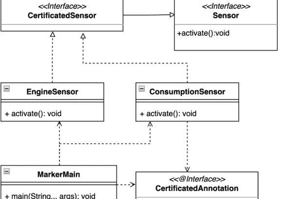

图 4.9 – 使用标记接口模式的认证传感器标记（`CertifiedSensor` 和 `CertifiedAnnotation`）的 UML 类图

车辆控制器需要识别认证的传递特定信息的特殊传感器组（示例 4.17）：

```java
public static void main(String[] args) {

    System.out.println("Pattern Marker, sensor identification");

    var sensors = Arrays.asList(new BrakesSensor(), new EngineSensor(), new ConsumptionSensor());

    sensors.forEach(sensor -> {
        if (sensor.getClass().isAnnotationPresent(CertifiedAnnotation.class)) {
            System.out.println("Sensor with Marker annotation:" + sensor);
        } else {
            switch (sensor) {
                case CertifiedSensor cs -> System.out.println("Sensor with Marker interface:\n" + cs);
                case Sensor s -> System.out.println("Sensor without identification:" + s);
            }
        }
    });
}
```

这里是输出：

```
Pattern Marker, sensor identification
Sensor without identification:BrakesSensor[]
Sensor with Marker interface:chapter04.marker.EngineSensor@77ec8df
Sensor with Marker annotation:chapter04.marker.ConsumptionSensor@30dae1
```

**示例 4.17 – 使用 switch 模式匹配构造进行传感器识别的标记接口模式**

此示例引入了两种模式用法。它定义了 `CertifiedAnnotation` 和 `CertifiedSensor` 接口。

在实现过程中对传感器种类进行分组，使用了 `Sensor` 接口（示例 4.18）：

```java
@Retention(RetentionPolicy.RUNTIME)
@interface CertifiedAnnotation {}

public interface CertifiedSensor extends Sensor { }

public interface Sensor {
    void activate();
}
```

**示例 4.18 – 标记接口 `CertifiedAnnotation` 和 `CertifiedSensor` 的实现，以及带有方法的 `Sensor` 抽象**

使用标记非常简单。类可以被注解，也可以继承标记接口（示例 4.19）。

```java
@CertifiedAnnotation
class ConsumptionSensor implements Sensor {
    @Override
    public void activate() {...}
}

final class EngineSensor implements CertifiedSensor {
    @Override
    public void activate() {...}
}
```

#### 使用模块模式探索模块概念


**示例 4.19 – 用于传感器识别的标记用法**

#### 结论

标记接口模式在运行时可以是一个强大的工具，但必须谨慎使用，因为它可能存在缺点。之一是使用标记模式的目的可能会被遗忘，或者随着应用程序的演进而过时。第二是特殊处理逻辑的实现，分发此类逻辑会对应用程序行为产生不利影响。另一方面，标记接口可以简化应用程序逻辑，在许多情况下，接口优于注解，因为它更具可追溯性。

让我们在下一个模式中引入单元的模块化。

#### 使用模块模式探索模块概念

该模式实现了由模块化编程定义的软件模块。该模式用于编程语言没有直接支持此类概念或应用程序需要它的情况。

#### 动机

根据应用程序需求，该模式可以通过多种方式实现。模块模式将应用程序的功能集中或封装到精确识别的模块中。Java 平台已经通过 Jigsaw 项目实现了模块概念的基本支持（自 JDK 9 发布起可用），但可以以类似的方式编程创建它，尽管并非完全隔离，因为源代码会影响其模块化方法。

#### 在 JDK 中查找

JDK 中关于模块模式的最佳示例是 Java 平台模块。这一概念在第 2 章“发现 Java 设计模式”以及“掌握 Java 模块系统”部分进行了详细讨论。

#### 示例代码

让我们想象一辆需要隔离制动和引擎系统的车辆。这非常符合现实场景。每个模块将独立运行，且运行时只有一个提供者。在车辆可以使用之前，两个模块都需要激活（示例 4.20）：

```java
class ModuleMain {

  ...

  private static void initModules() {

    brakesModule = BrakesModule.getInstance();

    engineModule = EngineModule.getInstance();

    engineModule.init();

  }

  ...

  public static void main(String[] args) {

    initModules();

    printStatus();

  }

}
```

这里是输出：

```
BrakesModule, unit:BrakesModule@5ca881b5
EngineModule, unit:EngineModule@4517d9a3
```

```
EngineModule, init
BrakesModule, ready:false
EngineModule, ready:true
```

**示例 4.20** – 客户端函数 `initModules()` 在封装中正确地激活了模块。

下面的图强调了模块的分离，尽管程序化方法允许共享或实现共享抽象（图 4.10）：

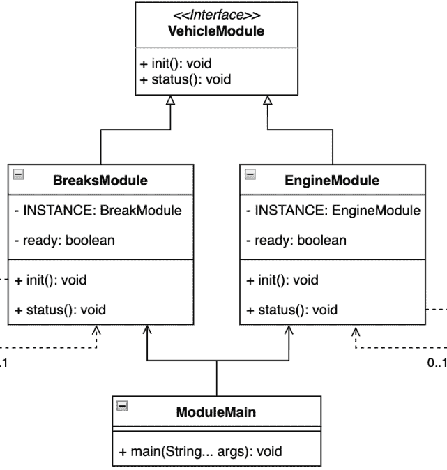

图 4.10 – UML 类图，显示了通过提供的 `VehicleModule` 接口实现的模式。

# 应用结构型设计模式

每个模块都表示为一个单例实例，以确保只有一个实例提供访问模块的透明网关：

```java
class EngineModule implements VehicleModule {

    private static volatile EngineModule INSTANCE;

    static EngineModule getInstance() {

        ...

        return INSTANCE;

    }

    private boolean ready;

    ...

    @Override

    public void init() {...}

    @Override

    public void status() {...}

}
```

**示例 4.21** – `EngineModule` 和 `BrakesModule` 的示例实现由单例表示，并具有相似的结构

#### 结论

模块模式以一种非常透明的方式为源代码引入了结构。每个模块都可以独立开发而不受影响。由于程序化解决方案可能无法完全强制源代码隔离，因此必须明智地扩展模块。另一个缺点可能是模块初始化，因为单例可能不是一个理想的解决方案。另一方面，模块模式提供了一种在考虑所有 SOLID 概念的情况下开发源码的工作流。

如果使用代理而不是模块和实现会怎样？让我们在下一节中深入探讨。

# 使用代理模式为对象提供占位符

代理模式被认为是一种占位符，它通过管理对另一个对象的访问来获得其控制权。该模式也被称为替体。代理模式由 GoF（设计模式之父）描述过。

#### 动机

在最通用的形式中，代理是一个充当客户端接口的类。代理被认为是客户端使用的包装器或代理对象。客户端通过相同的接口访问实际对象，而实际实现在后台对客户端隐藏。得益于代理模式，客户端与实现之间的通信保持透明。

通过使用代理，客户端可以访问实际对象，或者提供额外的逻辑。

#### 在 JDK 中查找

代理设计模式在 JDK 中也有一席之地。最为人知的是公共 `Proxy` 类，你可以在 `java.base` 模块的 `java.reflect` 包中找到它。`Proxy` 类提供了几个静态方法，通过方法调用创建对象。

#### 示例代码

给定的示例可以被视为车辆的遥控器。由代理设计模式表示的控制器提供了与真实车辆完全的功能，同时也管理了真实实例之间的连接（示例 4.22）：

```java
public static void main(String[] args) {

    System.out.println("Pattern Proxy, remote vehicle controller");

    Vehicle vehicle = new VehicleProxy();

    vehicle.move();

    vehicle.move();

}
```

这是输出：

```
Pattern Proxy, remote vehicle controller
VehicleProxy, real vehicle connected
VehicleReal, move
VehicleReal, move
```

**示例 4.22** – `VehicleProxy` 实例的工作方式就像真实车辆一样

真实车辆实现由 `Vehicle` 接口提供的通用抽象定义（图 4.11）：

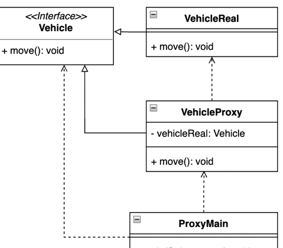

图 4.11 – 车辆代理的示例可以用 UML 类图描述

这允许无缝扩展受控车辆的类型，如代理模式实现所示（示例 4.23）：

```java
class VehicleProxy implements Vehicle {

    private Vehicle vehicleReal;

    @Override

    public void move() {

        if (vehicleReal == null) {

            System.out.println("VehicleProxy, real vehicle connected");

            vehicleReal = new VehicleReal();

        }

        vehicleReal.move();

    }

}
```

**示例 4.23** – `VehicleProxy` 类包含对实际 `Vehicle` 实例的引用

#### 结论

代理设计模式为源代码带来了许多优势，例如，可以在运行时替换实现。除了用于完全控制对实际实例的访问外，还可以用于懒初始化，正如我们在示例 4.23 中看到的那样。代理在驱动实现或网络连接中有其合理的地位，因为它自然地强制了仅记录日志的可能性，还通过接口隔离和其他 SOLID 原则实现了代码分离。当应用程序需要 I/O 操作时，考虑这一点是非常有用的。

Java 作为一种语言不支持多重继承，但仍然可以实现。让我们在下一节中检查如何实现。

# 使用孪生模式在 Java 中发现多重继承

这种模式允许你结合倾向于一起使用的对象的功能，这是不支持多重继承的语言中常用的共同范式。

#### 动机

孪生模式提供了在 Java 中实现多重继承的可能性。多重继承并不是一个支持的概念，因为它可能导致编译器不一致，即所谓的“菱问题”。菱问题定义通过类抽象定义了一种状态，在该状态下编译器可能会变得不一致。

#### 示例代码

该平台不支持此处描述的模式。然而，让我们检查一个可能的示例以更好地理解该模式。想象车辆继承。初始化期间，引擎和刹车需要初始化。换句话说，当引擎初始化时，刹车也必须初始化（示例 4.24）：

```java
public static void main(String[] args) {

    System.out.println("Pattern Proxy, remote vehicle controller");

    var vehicleBrakes1 = new VehicleBrakes();

    var vehicleEngine1 = new VehicleEngine();

    vehicleBrakes1.setEngine(vehicleEngine1);

    vehicleEngine1.init();

}
```

这是输出：

```
Pattern Proxy, remote vehicle controller
AbstractVehiclePart, constructor
AbstractVehiclePart, constructor
VehicleBrakes, initiated
VehicleEngine, initiated
```

下面的图显示了单元之间的紧密耦合：

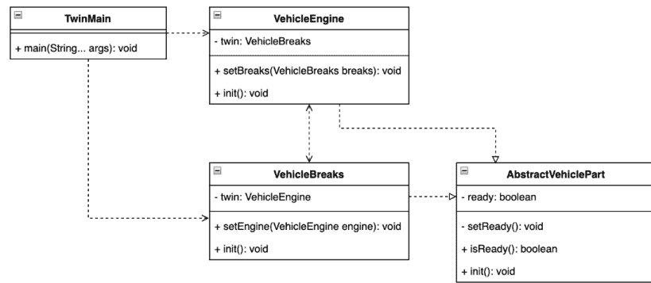

图 4.12 – 所考虑的单元 `VehicleEngine` 和 `VehicleBrakes` 紧耦合

耦合也转化为对未来开发可能是脆弱的代码库（示例 4.25）：

```java
public class VehicleBrakes extends AbstractVehiclePart {

    private VehicleEngine twin;

    VehicleBrakes() {

    }

    void setEngine(VehicleEngine engine) {

        this.twin = engine;

    }

    @Override

    void init() {

        if (twin.isReady()) {

            setReady();

        } else {

            setReady();

            twin.init();

        }

        System.out.println("VehicleBrakes, initiated");

    }

}
```

**示例 4.25** – `VehicleBrakes` 类实现显示了与其孪生对象 `VehicleEngine` 的紧密耦合

#### 结论

孪生模式可用于在 Java 中实现多重继承。必须明智地使用，因为逻辑上不需要的要求是保证所考虑对象的完全分离。换句话说，孪生设计允许孪生作为具有扩展功能和特性的单个实例运行。

#### 总结

结构模式的知识加上新添加的 Java 语法增强不仅改进了可维护性，还强制了之前学过的所有 OOP 概念，并提高了对代码行为偏差（如异常、意外崩溃或逻辑问题）的响应能力。

我们通过本章的示例建立了坚实的基础，并学习了如何使用适配器模式在不兼容的对象之间创建协作，以及如何使用桥接模式透明地分离对象的实现与抽象。组合模式提供了一种围绕底层业务逻辑组织和包装对象的树结构。我们研究了使用装饰器扩展对象功能的可能性。

外观模式用于简化对象之间的通信，随后是过滤器模式，它允许我们只选择需要的实例。我们学习了享元模式如何允许我们重用已创建的运行时实例，前端控制器模式提供了处理信息的方法，使得客户端只能响应有效请求。我们发现标记模式允许客户端以独特的方式处理一组特定的对象。我们探索了通过模块模式实现代码库模块化的可能性。我们看到了如何使用代理模式让客户端间接获得对对象的控制，而无需感知其实现细节，并看到了如何使用孪生模式在 Java 不支持的情况下实现多重继承。

通过从创建和结构设计模式中获得的知识，底层源代码结构组织得良好，并且适用于持续的应用开发。下一章将探讨行为设计模式，这些模式有助于组织目标实例之间的通信和职责。

#### 问题

- 1. 结构设计模式解决了哪些挑战？
- 2. 四人帮描述了哪些结构设计模式？
- 3. 哪种设计模式适用于创建相关对象的树形结构？
- 4. 哪种结构设计模式可以在运行时识别对象？
- 5. 哪种设计模式可以用于间接访问对象，且具有与对象相同的功能？
- 6. 哪种设计模式促进了逻辑与其抽象的分离？

#### 进阶阅读

- *Design Patterns: Elements of Reusable Object-Oriented Software* by Erich Gamma, Richard Helm, Ralph Johnson, and John Vlissides, Addison-Wesley, 1995
- *Design Principles and Design Patterns* by Robert C. Martin, Object Mentor, 2000
- JSR-376: Java Platform Module System, https://openjdk.java.net/projects/jigsaw/spec/
- JSR-408: Simple Web Server, https://openjdk.org/jeps/408
- *Clean Code* by Robert C. Martin, Pearson Education, Inc, 2009
- *Effective Java - Third edition* by Joshua Bloch, Addison-Wesley, 2018
- *Twin - A Design Pattern for Modelling Multiple Inheritance*, Hanspeter Mössenböck, University of Linz, Institute for System Software, 1999, https://ssw.jku.at/Research/Papers/Moe99/Paper.pdf

# 5 行为设计模式

代码的可维护性在整个行业的应用中都起着关键作用，但仅仅停留在此是不够的。这意味着跳过了运行时的代码行为，而这会影响物理内存和虚拟内存的使用。使用行为模式的主要动机是对象之间的透明通信，换句话说是为了这种通信高效使用内存分配。利用行为模式可以提高通信的灵活性，并有助于通过单个对象或多个对象交换信息来完成任务。结构设计模式有时看起来与行为模式相似，但正如我们在每个案例中看到的，其目的略有不同。让我们深入学习以下：

- 使用缓存模式限制昂贵的初始化
- 使用责任链模式处理事件
- 使用命令模式将信息转化为行动
- 使用解释器模式为上下文赋予意义
- 使用迭代器模式检查所有元素
- 利用中介者模式进行信息交换
- 使用备忘录模式恢复所需状态
- 使用空对象模式避免空指针异常状态
- 使用观察者模式让所有相关方知晓信息
- 使用流水线模式处理实例阶段
- 使用状态模式改变对象行为
- 使用策略模式改变对象行为
- 使用模板模式标准化流程
- 使用访问者模式根据对象类型执行代码

在本章结束时，你将为理解程序行为的重要性打下良好基础，这不仅是为了资源利用，还从 SOLID 设计原则的角度来看。

#### 技术需求

你可以在 https://github.com/Practical-Design-Patterns-for-Java 找到本章的代码

#### 使用缓存模式限制昂贵的初始化

缓存模式在行业中是常见的，正如四人帮描述的那样。该模式用于限制昂贵的初始化。

#### 动机

缓存模式支持在需要时不再创建对象，而是从缓存中获取所需数据，这提高了性能。

#### 示例

让我们通过以下示例来理解缓存模式（图 5.1）：

```java
public static void main(String[] args) {

    System.out.println("Caching, initiated vehicle");

    var vehicle = new Vehicle();

    var suspension = new SuspensionSystem();

    vehicle.addSystem(suspension);
```


System.out.printf("Systems types: %s%n", vehicle.types());

var suspensionCache = vehicle.getSystem("suspension");

System.out.printf("Is suspension equal? %s%n", suspension.equals(suspensionCache));

vehicle.addSystem(new EngineSystem("engine"));

```

输出如下：

- **Caching, initiated vehicle**
- **Vehicle, cache:** 'BreakSystem@adb0cf7','EngineSystem@a067594'
- **Systems types:** [BreakSystem@adb0cf7, EngineSystem@a067594, Suspension-System@369ef45]
- **Is suspension equal?** true:SuspensionSystem@369ef45
- **SystemCache, not stored:**EngineSystem@6c2866

换句话说，不需要创建另一个 `EngineSystem` 实例来访问其功能。其他对象访问或程序行为很容易导致不理想的情况。

车辆的 `SystemCache` 只考虑特定类型的实例，并且受到限制（示例 5.2）：

```java
class SystemCache {

    private final VehicleSystem[] systems;

    private int end;

    boolean addSystem(VehicleSystem system) {

        var availableSystem = getSystem(system.type());

        if (availableSystem == null && end < systems.length) {

            systems[end++] = system;

            return true;

        }

        return false;

    }

}
```

#### 使用责任链模式处理事件

```java
VehicleSystem getSystem(String type) {...}
```

示例 5.2 – SystemCache 实例提供了确保程序稳定性的功能，并可能提供额外的保障

#### 结论

示例（来自图 5.1）展示了实现缓存是简单的。当客户端需要重复访问同一组元素时，考虑这一点可能是一个好主意。这会对性能产生积极影响。

这些元素中的某些可能负责程序的运行行为。让我们在下一节中深入探讨这一点。

#### 使用责任链模式处理事件

责任链模式有助于避免在触发事件的传感器中编写繁琐的处理器逻辑。该模式在 GoF 的书中被提出。

#### 动机

程序接收到一个初始的触发事件。每个链式处理器都会决定是处理该请求，还是在不作响应的情况下将其传递给下一个处理器。该模式可以由由一系列处理器对象产生的命令对象组成。某些处理器可以作为分发器，能够向不同的方向发送命令，从而形成一个责任树。

责任链模式允许你构建一个实现链，在调用链中的下一个处理器之前或之后执行特定操作。

### 在 JDK 中找到它

`java.logging` 模块包含了 `java.util.logging` 包，该包包含一个 `Logger` 类，用于记录应用程序消息。`Logger` 可以链式，且被记录的消息仅由 `Logger` 实例进行处理。

JDK 中提供的另一个示例是 `DirectoryStream` 类，它与 `java.base` 模块一起工作并位于 `java.nio` 包。该类负责遍历整个目录，并包含一个嵌套的过滤器接口。该接口提供了一个 `accept` 方法。链式过滤器的实际表示取决于目录是要处理还是被排除。

#### 示例代码

让我们来看一个如何使用责任链设计模式来响应来自驱动系统的触发事件的示例（示例 5.3）：

```java
System.out.println("Pattern Chain of Responsibility, vehicle system initialisation");

var engineSystem = new EngineSystem();

var driverSystem = new DriverSystem();

var transmissionSystem = new TransmissionSystem();

driverSystem.setNext(transmissionSystem);

transmissionSystem.setNext(engineSystem);

driverSystem.powerOn();
```

输出如下：

```
Pattern Chain of Responsibility, vehicle system initialisation
DriverSystem: activated
TransmissionSystem: activated
EngineSystem: activated
```

示例 5.3 - DriverSystem 实例启动了 powerOn 事件，该事件通过链式实例进行传播

创建的系统链的行为是透明的，逻辑由每个系统妥善封装。通用的抽象 `VehicleSystem` 实例定义了功能、每个元素必须实现的功能，以及后续元素应该如何链式连接（示例 5.4）：

```java
sealed abstract class VehicleSystem permits DriverSystem,
    EngineSystem, TransmissionSystem {

    ...

    protected VehicleSystem nextSystem;

    protected boolean active;

    ...

    void setNext(VehicleSystem system) {
        this.nextSystem = system;
    }

    void powerOn() {
        if (!this.active) {
            activate();
        }
        if (nextSystem != null) {
            nextSystem.powerOn();
        }
    }
}
```

### 示例 5.4 – 密封类的用法提供了额外的性和控制

客户端接收了一个框架，用于在构建链时考虑如何以及考虑哪些类（图 5.2）：

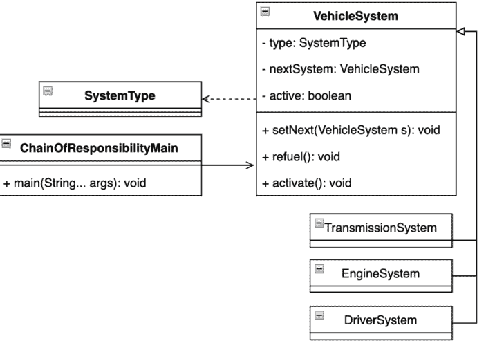

图 5.2 – 显示哪些元素参与了 powerOn 的 UML 类图

#### 结论

责任链模式表明，影响程序运行行为的输入事件可能会导致多个对象的创建。操纵者被封装，并根据 SOLID 原则被妥善隔离。使用此模式，客户端有机会动态地决定哪些处理器应该参与事件处理。因此，它是安全框架或类似框架的热门候选方案。

链式处理器可以在运行时向客户端发布多个命令。让我们更详细地探索命令响应。

#### 使用命令模式将信息转化为行动

命令模式有时被称为动作（action）。命令模式将触发事件封装为一个对象，允许客户端采取行动。该模式很早就在 GoF 的书中被识别并描述。

#### 动机

命令模式规定了命令接口的实例在接收者客户端上执行哪些操作。命令对象可以被参数化以定义更详细的操作。命令可以包含一个回调函数，以通知其他事件的发生。有时，命令可以被视为回调函数的面向对象的替代品。新创建的命令对象可以根据启动它的事件具有不同的动态。客户端可以使用已经调调的场景对其做出反应。

### 在 JDK 中找到它

JDK 通过 `java.base` 模块和 `java.util.concurrent` 包中的 `Callable` 和 `Runnable` 接口提供了很好的示例。每个接口的实现都是根据已知场景调度执行的。

命令模式的其他用法可以在 `java.desktop` 模块的 `javax.swing` 包以及实现 `Action` 接口的类中找到。

#### 示例代码

下面的示例了 Driver 对象如何使用定义良好的命令控制车辆（示例 5.5）：

```java
public static void main(String[] args) {
    System.out.println("Pattern Command, turn onoff vehicle");
}

var vehicle = new Vehicle("sport-car");

var driver = new Driver();

driver.addCommand(new StartCommand(vehicle));

driver.addCommand(new StopCommand(vehicle));

driver.executeCommand("start_stop");
```

输出如下：

```
Pattern Command, turn onoff vehicle
START:Vehicle{sport-car}, running=true
Vehicle{sport-car}, running=false
START:Vehicle{sport-car}, running=true
```

示例 5.5 - 触发的 start_stop 事件被 Driver 翻译并转换为动作

命令被妥善封装，并可能包含执行所需的额外逻辑（示例 5.6）：

```java
sealed interface VehicleCommand permits StartCommand,
  StopCommand {
    void process(String command);
  }

  record StartCommand(Vehicle vehicle) implements
    VehicleCommand {
      @Override
      public void process(String command) {
        if (command.contains("start")) { ... }
      }
    }
```

示例 5.6 - 为了保持设计的命令设计，密封类的概念可能是合适的

命令可以随着驱动功能的演进进行透明的扩展（图 5.3）：

| Driver | <<interface>> |
| :--- | :--- |
| - commands: List<VehicleCommand> | process(): void |
| + addCommand(VehicleCommand c): void | |
| + executeCommand(String s): void | |
| CommandMain | StartCommand |
| + main(String... args): void | |
| | StopCommand |

图 5.3 – 显示哪些命令可以被视为

#### 在 JDK 中查找

`java.base` 模块包含了 `java.util.regex` 包，其中有 `Pattern` 类。该类表示正则表达式的编译。它将特定的语义应用于字符序列，以验证所匹配的文本。

另一个示例来自类似的模块和 `java.text` 包。抽象类 `Format` 的实现提供了对语言区域敏感的信息，如日期、数字格式等。

#### 示例代码

让我们创建一个简单的字符串公式。公式包含了来自不同传感器的值及其对结果的贡献。结果展示了公式的最终值（示例 5.7）：

```java
public static void main(String[] args) {
    System.out.println("Pattern Interpreter, sensors\nvalue");

    var stack = new Stack<Expression>();

    var formula = "1 - 3 + 100 + 1";

    var parsedFormula = formula.split(" ");

    var index = 0;

    while (index < parsedFormula.length) {
        var text = parsedFormula[index++];

        if (isOperator(text)) {
            var leftExp = stack.pop();
            var rightText = parsedFormula[index++];
            var rightExp = new IntegerExpression(rightText);
            var operatorExp = getEvaluationExpression(text, leftExp, rightExp);
            stack.push(operatorExp);
        } else {
            var exp = new IntegerExpression(text);
            stack.push(exp);
        }
    }

    System.out.println("Formula result: " + stack.pop().interpret());
}
```

## 行为设计模式

这是输出结果：

```
Pattern Interpreter, math formula evaluation
Formula result: 99
```

示例 5.7 - 解析器将数学字符串转换为相应的 Expression 类型

基本元素是接口及其 `interpret` 方法。公式 `1 - 3 + 100 + 1` 被顺序求值，最后一个元素包含结果。每个表达式都被封装起来，解释器可以方便地扩展（图 5.4）。

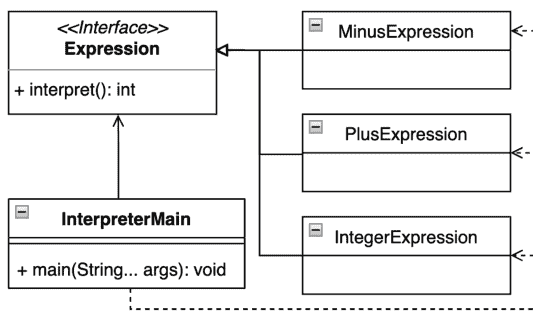

图 5.4 - 显示求值所需的参与者的 UML 类图

#### 结论

#### 使用迭代器模式遍历所有元素

这种迭代器模式可以接近于指向所需位置的游标抽象。由于数组构造是一种常用的结构类型，这种模式很快被识别出来。它被认为是 GoF 书中包含的核心模式之一。

#### 动机

迭代器模式定义了一种透明的方式来遍历对象集合，而无需暴露或感知对象的任何内部细节。为了在元素之间步进，迭代器使用了一个迭代函数。

### 在 JDK 中查找

`java.base` 模块包含了迭代器模式的多种实现。第一个实现可以被认为是由 `java.util` 包中的集合框架提供的。`Iterator` 接口的实现遍历集合，而无需知道元素的成员关系。

另一个示例可以被认为是由 `BaseStream` 接口及其 `iterator` 方法提供的迭代器。该类来自类似的模块和 `java.util.stream` 包，即 Stream API。它代表了终结操作。

#### 示例代码

每辆车辆都有几个共同部分。以下示例展示了如何使用迭代器模式循环遍历这些部分（示例 5.8）：

```java
public static void main(String[] args) {
    System.out.println("Iterator Pattern, vehicle parts");

    var standardVehicle = new StandardVehicle();

    for(PartsIterator part = standardVehicle.getParts(); part.hasNext(); ) {
        var vehiclePart = part.next();
        System.out.println("VehiclePart name: " + vehiclePart.name());
    }
}
```

这是输出结果：

```
Iterator Pattern, vehicle parts
VehiclePart name:engine
VehiclePart name:breaks
VehiclePart name:navigation
```

示例 5.8 – 为了保持预期的命令设计，密封类（sealed classes）的概念可能是合适的。

车辆可以提供一个公共抽象车辆来处理迭代器（示例 5.9）：

```java
interface PartsIterator {
    boolean hasNext();
    VehiclePart next();
}
```

### 示例 5.9 – 程序可以实现不同动态的迭代器

客户端可以单独遍历所有元素。这种类型的迭代器实现可以被视为具体实现的一个内部类（示例 5.10）：


```java
sealed interface Vehicle permits StandardVehicle {
    PartsIterator getParts();
}

final class StandardVehicle implements Vehicle {
    private final String[] vehiclePartsNames = {"engine", "breaks", "navigation"};

    private class VehiclePartsIterator implements PartsIterator {
        ...
        @Override
        public PartsIterator getParts() {
            return new VehiclePartsIterator();
        }
    }
}
```

示例 5.10 – 程序可以实现不同动态的迭代器

示例程序的行为对客户端是透明的，它为用新部分扩展车辆的预定实现以及遍历它们的方法提供了框架（图 5.5）：

#### 利用中介模式进行信息交换 153

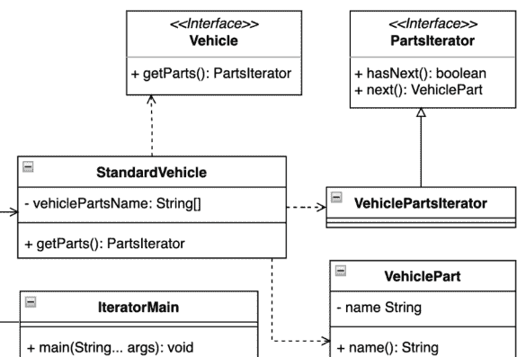

图 5.5 - 表示部分集合的 UML 类图

#### 结论

迭代器模式的优势在于它可以以非常通用的方式实现——不需要理解所考虑的元素类型。配合另一种模式，它可以动态改变策略。下一节将探索特定对象类型之间的运行时通信。

## 利用中介模式进行信息交换

不同类型应用程序中的常见情况是，需要管理需要信息交换的客户端之间的通信。这种模式很早被识别出来，是 GoF 书中的核心模式之一。

#### 动机

中介模式代表一个对象，一个“中间人”，它定义了一组对象在内部交互的方式。中介为客户端通信建立了自由的连接。客户端可以通过中介显式地相互引用。通过这种方式，通信可以被协调。

#### 在 JDK 中查找

虽然一眼看去并不明显，但在 `java.base` 模块和 `java.util.concurrent` 包中可以很容易找到中介模式。`ExecutorService` 类定义了 `submit` 方法。它的父类 `Executor` 暴露了 `execute` 方法。这些方法可以用于传递 `Callable` 或 `Runnable` 接口的实现，这些实现之前被称为命令模式的实现。

#### 示例代码

与其他示例相比，以下示例非常简单，但它展示了处理器如何维护传感器通信（示例 5.11）：

```java
record Sensor(String name) {
    void emitMessage(String message) {
        VehicleProcessor.acceptMessage(name, message);
    }
}
public static void main(String[] args) {
    System.out.println("Mediator Pattern, vehicle parts");
    var engineSensor = new Sensor("engine");
    var breakSensor = new Sensor("break");

    engineSensor.emitMessage("turn on");
    breakSensor.emitMessage("init");
}
```

这是输出结果：

> **Mediator Pattern, vehicle parts
>
> **Sensor:** 'engine', delivered message:'turn on'
>
> **Sensor:** 'break', delivered message:'init**

示例 5.11 – 通信由 `VehicleProcessor` 实例处理

| VehicleProcessor |
| :--- |
| + acceptMessage(String sensorType, String message): void |
| A |
| Sensor |
| + emitMessage(String message): void |
| ^ |
| MediatorMain |
| + main(String... args): void |

图 5.6 – 强调通过处理器进行通信的 UML 类图

#### 结论

中介模式引入了隔离不同对象之间复杂通信的能力。参与的对象可能在运行时发生变化。该模式提供了一种封装良好且解耦的方法，允许所有客户端相互进行通信。

通信会带来各种状态的变化。在下一节中，我们将探索如何记录和恢复这些状态。

## 使用备忘模式恢复所需状态

有时，考虑保留关于对象状态的极少信息，以便继续或恢复它，可能是很有用的。备忘模式提供了这种功能，并在 GoF（设计模式之父）的书书中进行过描述。

#### 动机

在不破坏封装的前提下，对象的内部状态（即备忘录）需要被捕获并外部化，以便对象稍后恢复到该状态。备忘模式提供了一个客户端函数，可以根据需要恢复对象（备忘录）所需的状态。

#### 在 JDK 中查找

`Date` 类位于 `java.base` 模块，其所属的 `java.util` 包是备忘模式的一个良好实现。类的实例代表时间线上的特定点，日期可以根据使用的日历或时区恢复到该时间线。

#### 示例代码

让我们看看车辆空调的示例。控制器为我们提供了几个设置驾驶舱温度的选项，这意味着驱动可以恢复已选择的状态（示例 5.12）：

```java
public static void main(String[] args) {
    System.out.println("Memento Pattern, air-condition system");
    var originator = new AirConditionSystemOriginator();
    var careTaker = new AirConditionSystemCareTaker();

    originator.setState("low");
    var stateLow = originator.saveState(careTaker);
    originator.setState("medium");
    var stateMedium = originator.saveState(careTaker);
    originator.setState("high");
    var stateHigh = originator.saveState(careTaker);

    System.out.printf("Current Air-Condition System state:'%s'%n",
            originator.getState());

    originator.restoreState(careTaker.getMemento(stateLow));
    System.out.printf("Restored position:%d, Air-Condition System state:'%s'%n",
            stateLow,
            originator.getState());

}
```

以下是输出：

Memento Pattern, air-condition system

Current Air-Condition System state:'high'

Restored position:0, Air-Condition System state:'low'

示例 5.12 – 每个状态都已记录，驱动可以根据需要恢复它

`AirConditionSystemCareTaker` 实例充当备忘录提供者的角色，包含了指向已使用状态的链接（示例 5.13）：

```java
final class AirConditionSystemCareTaker {
    private final List<SystemMemento> memory = new ArrayList<>();

    ...
    int add(SystemMemento m) { ... }

    SystemMemento getMemento(int i) { ... }
}
```

示例 5.13 – 每个状态都带有一个用于恢复的标识符

`AirConditionSystemOriginator` 实例考虑创建备忘录并从备忘录对象恢复上一个状态。客户端需要记住提供的状态标识符，以便向照顾者索取备忘录状态（示例 5.14）：

```java
final class AirConditionSystemOriginator {
    private String state;

    ...
    int saveState(AirConditionSystemCareTaker caretaker) {
        return caretaker.add(new SystemMemento(state));
    }

    void restoreState(SystemMemento m) {
        state = m.state();
    }
}
```

示例 5.14 – 源生成者持有可变状态并更新照顾者

程序允许客户端仅在几个考虑过的状态上工作，而无需创建其他实例（图 5.7）：

# 行为设计模式

| AirConditionSystemOriginator |
| :--- |
| - state: String |
| + setState(String s): int |
| + getState(): String |
| + saveState(AirConditionSystemCareTaker take): int |
| + restoreState(SystemMemento m): void |
| AirConditionSystemCareTaker | SystemMemento |
| :--- | :--- |
| - memory: List<SystemMemento> | - state: String |
| + add(SystemMemento m): int | + state(): String |
| + getMemento(int): SystemMemento |
| MementoMain |
| :--- |
| + main(String... args): void |

图 5.7 – 显示仅涉及少数类的 UML 类图

#### 结论

当程序需要执行任何撤销操作或回溯时间线时，备忘模式非常有用。它提供了透明的实现和逻辑分离，以确保代码库的可维护性。

让我们在下一节中看看程序如何按预期运行并进行检查。

## 使用空对象模式避免空指针异常状态

空对象模式提供了一种优雅地处理未识别对象的方法，而不会导致意外或未定义的程序行为。

#### 动机

与其使用 Java 的构造结构来表示对象的缺失，不如引入空对象模式。空对象被认为属于对象族。

这种方法相比使用 `null` 引用的优势是，空对象是非常可预测的，且没有副作用。

#### 在 JDK 中查找

传统提到的 `java.base` 模块和 `java.util` 包定义了空 `InputStream`。另一个示例可以在 `java.io` 模块和包中找到。该类包含无元素的迭代器。

#### 示例代码

让我们更仔细地检查空对象模式的用法。今天，为了不仅仅利用 `Sensor` API，定义一个程序可以透明响应的空对象是非常有用的（示例 5.15）：

```java
public static void main(String[] args) {
    System.out.println("Null Object Pattern, vehicle sensor");
    var engineSensor = VehicleSensorProvider.getByType("engine");
    var transmissionSensor = VehicleSensorProvider.getByType("transmission");
    System.out.println("Engine Sensor: " + engineSensor);
    System.out.println("Transmission Sensor: " + transmissionSensor);
}
```

以下是输出：

Null Object Pattern, vehicle sensor

Engine Sensor: Sensor{type='engine'}

Transmission Sensor: Sensor{type='not_available'}

示例 5.15 – 客户端通过一个空实例告知请求的传感器不可用

`VehicleSensorProvider` 实例始终返回预期类型的结果，实现该模式非常简单（图 5.8）：

| NullSensor | AbstractSensor |
| :--- | :--- |
| + isAvailable(): boolean | - type: String |
| | + isAvailable(): boolean |
| | + getType(): String |
| VehicleSensor | VehicleSensorProvider |
| + isAvailable(): boolean | - sensor: List<AbstractSensor> |
| | + getByType(String type): AbstractSensor |

图 5.8 – 显示使用的关系的 UML 类

#### 结论

示例表明，该模式不仅可以提高代码库的可维护性，还可以减少意外的运行时状态，例如空指针异常。

## 使用观察者模式保持所有相关方的通知

观察者模式表示对象之间的直接关系。一个对象充当生产者角色。生产者可能有许多需要交付信息的客户。这些对象有时被称为接收者。当观察者改变状态时，所有注册的客户端都会收到此变化。换句话之，对象发生的任何变化都会导致观察者被通知。

#### 在 JDK 中查找

观察者模式是 JDK 模块中另一种非常常用的模式。例如来自 `java.base` 模块和 `java.util` 包的 `Observer` 接口。尽管这些接口已经被弃用，但在编译器的实现中，它们仍然通过 `Observable` 类被使用。

#### 示例代码

让我们检查车辆不同位置的温度控制。`VehicleSystem` 实例应该始终通知所有相关方每个系统可以调整的温度目标（示例 5.16）：

```java
public static void main(String[] args) {
    System.out.println("Observer Pattern, vehicle
    temperature sensors");
    var temperatureControlSystem = new VehicleSystem();
    new CockpitObserver(temperatureControlSystem);
    new EngineObserver(temperatureControlSystem);

    temperatureControlSystem.setState("low");
}
```

输出如下：

+ **Observer Pattern, vehicle temperature sensors**
CockpitObserver, temperature:'11'
EngineObserver, temperature:'4'**

#### 示例 5.16 – 每个子系统根据全局状态调整自己的温度

`SystemObserver` 类不仅通过密封类（sealed classes）的构建定义了所考虑的子系统，还为构建目标子系统提供了模板（示例 5.17）：

```java
sealed abstract class SystemObserver permits
    CockpitObserver, EngineObserver {
    protected final VehicleSystem system;
    public SystemObserver(VehicleSystem system) {
        this.system = system;
    }
    abstract void update();
}
```

### 示例 5.17 – *新添加的子系统遵循通用模板以强制维护性***

每个实例包含一个指向控制温度目标的主系统的引用（图 5.9）：

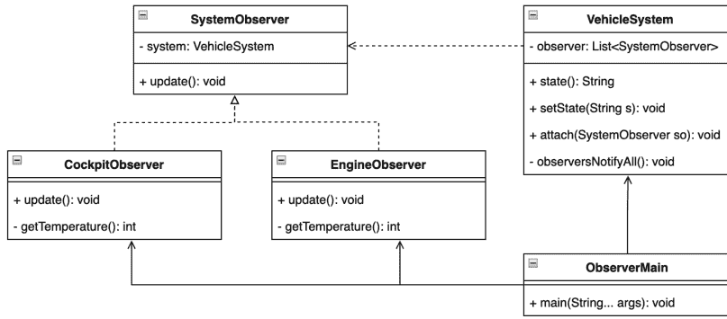

图 5.9 – UML 类图强调了系统之间的关系

#### 结论

观察者模式另一种非常强大的[模式]：它允许客户端保持所有利益相关者的信息更新，而无需更改或理解实现。该模式正确地封装并解耦了链接，并允许在运行时使用可配置的过程。

下一节将展示如何单独解决链接过程。

## 使用流水线模式处理实例阶段

流水线模式对改进多个下游操作的组织可以做出重大贡献。

#### 动机

该模式通过提供初始输入并将处理后的输出传递给后续阶段，改进了系列阶段中的数据处理。处理元素被排列在连续的流水线中，以便上一个的输出是另一个的输入，类似于水管的方式。

流水线模式可以在连续的成员（由对象实例表示）之间提供某种缓冲。流过这些管道的信息通常是记录流。

#### 在 JDK 中查找


使用流水线模式最显而易见的例子是 `Stream` 接口及其实现。该接口是 [Stream API](https://example.org) 的一部分，并与 `java.base` 模块和 `java.util.stream` 包一起发布。

#### 示例代码

让我们想象一组需要在车辆中执行的一系列过程，定义它们，并按顺序排列。然后，我们初始化一个 `SystemElement` 容器，用于收集有关每个过程结果的信息（示例 5.18）：

```java
public static void main(String[] args) {
    System.out.println("Pipeline Pattern, vehicle turn on\nstates");
    var systemState = pipeline.process(new EngineProcessor())
        .addProcessor(new BreakProcessor())
        .addProcessor(new TransmissionProcessor());

    var systemState = pipeline.process(new
        SystemElement());
    System.out.println(systemState.logSummary());
}
```

输出如下：

```
Pipeline Pattern, vehicle turn on states
engine-system, break-system, transmission-system
```

示例 5.18 - 每个过程的结果都在最终摘要中考虑

基础结构是 `PipeElement`，它不仅定义了输入类型，还定义了输出。此外，它定义了信息处理的顺序（示例 5.19）：

```java
class PipeElement<E extends Element, R extends Element> {
    private final Processor<E, R> processor;
    ...<O extends Element> PipeElement<E, O> addProcessor
    (Processor<R, O> p) {
    return new PipeElement<>(input -> p.process(
        (processor.process(input)));
    }

    R process(E inputElement) {
        return processor.process(inputElement);
    }
}
```

### 示例 5.19 - `addProcessor` 方法定义了处理器处理执行的顺序

每个处理器的实现都可以被视为函数接口构造，并且可以在不破坏流水线基础代码的情况下更改 `Element` 的实现（图 5.10）：

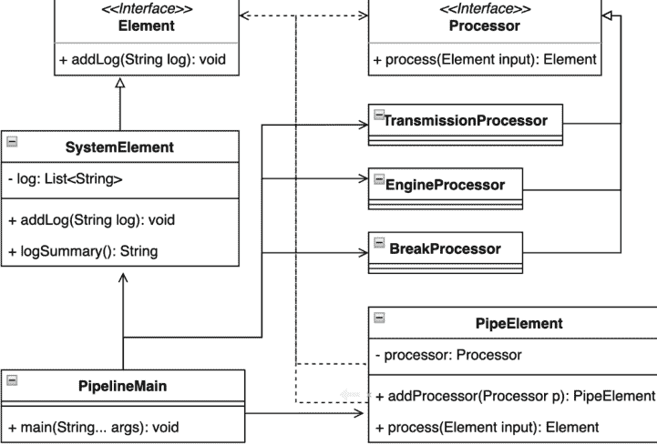

图 5.10 - UML 类图展示了如何维护流水类型类型

#### 结论

提供的示例展示了清晰分离过程对最终结果贡献的优势。流水线模式具有创建复杂操作序列的潜力，这些序列可以被测试并动态更改。

让我们在下一节探索目标元素如何改变其状态。

#### 使用状态模式改变对象行为

状态模式允许对象在其内部状态变化时改变其行为。该模式是 GoF 书的一部分。

#### 动机

状态模式将状态表示为专用的实例。状态模式允许对象根据其内部状态改变其行为。该模式是 GoF 书的一部分。

#### 在 JDK 中查找

使用状态模式最显而易见的例子是 `State` 接口及其实现。该接口是 [State API](https://example.org) 的一部分，并与 `java.base` 模块和 `java.util` 包一起发布。

#### 示例代码

下一个示例考虑每辆车辆都有不同的状态。每个状态需要略有不同的驾驶策略（示例 5.20）：

```java
public static void main(String[] args) {
    System.out.println("State Pattern, vehicle turn on
    states");
    var initState = newState();
    var startState = new StartState();
    var stopState = new StopState();
    vehicle.setState(initState);
    System.out.println("Vehicle state2:" +
    vehicle.getState());
    vehicle.setState(startState);
    System.out.println("Vehicle state3:" +
    vehicle.getState());
    vehicle.setState(stopState);
    System.out.println("Vehicle state4:" +
    vehicle.getState());
}
```

输出如下：

**State Pattern, vehicle turn on states**

Vehicle state2:InitState{truck}

Vehicle state3:StartState{truck}

Vehicle state4:StopState{truck}

### 示例 5.20 - 车辆状态被封装并与客户端逻辑分离

#### 结论

提供的示例展示了清晰分离过程对最终结果贡献的优势。状态模式具有创建复杂操作序列的潜力，这些序列可以被测试并动态更改。

```java
var driver = new VehicleDriver(new CarStrategy());
driver.transport();
driver.changeStrategy(new BusStrategy());
driver.transport();
driver.changeStrategy(new TruckStrategy());
driver.transport();
}
```

输出结果如下：

```
Strategy Pattern, changing transport options
Car, four persons transport
Bus, whole crew transport
Truck, transporting heavy load
```

#### 示例 5.21 – VehicleDriver 实例可以在运行时更改传输策略

`VehicleDriver` 实例仅持有对当前使用的 `TransportStrategy` 实例的引用（示例 5.22）：

```java
class VehicleDriver {
    private TransportStrategy strategy;
    VehicleDriver(TransportStrategy strategy) {
        this.strategy = strategy;
    }
    void changeStrategy(TransportStrategy strategy) {
        this.strategy = strategy;
    }
    void transport() {
        strategy.transport();
    }
}
```

# 示例 5.22 – VehicleDriver 实例通过可见方法与策略通信

客户端可以在运行时决定使用哪种策略。每种策略都进行了良好的封装（图 5.12）：

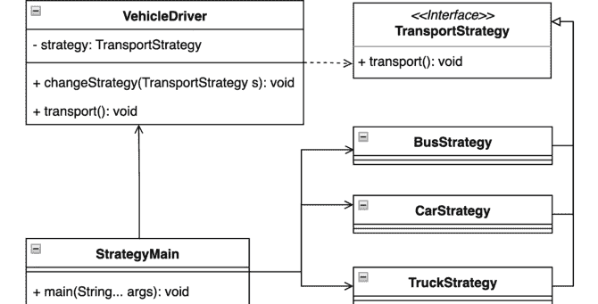

图 5.12 – 显示如何简单地定义新策略的 UML 类

#### 结论

这个简单易懂的示例展示了运行良好的良好隔离策略模式。驱动程序可以根据提供的车辆类型更改其能力。该模式将其逻辑与代码库的其他部分分离的能力，使其非常适合实现不应暴露给客户端的复杂算法或操作。

许多运行事件都有通用的依据。让我们在下一节中探索如何处理这种情况。

# 使用模板方法标准化流程

模板方法模式将密集操作的泛化与模板化方法统一起来。模板模式很早就得到了认可，并被认为是 GoF（设计模式之）的一部分。

#### 动机

模板方法模式基于识别使用方式相似的步骤。这些步骤定义了算法的骨架。每个操作都可以将其步骤延迟给特定的子类。模板方法通过引入子类来重新定义算法的某些部分，而不改变其结构。模板可用于按照所需的顺序执行内部方法。

#### 在 JDK 中查找

Java 使用位于 `java.base` 模块和 `java.io` 包中的输入或输出流。`InputStream` 类包含一个重载的 `read` 方法，代表一个字节处理模板。这与 `OutputStream` 类定义重载的 `write` 方法的方法。

模板模式的另一个用法可以在 Collection 框架中找到，它位于同一个模块和 `java.util` 包。抽象类 `AbstractList`、`AbstractSet` 和 `AbstractMap` 使用不同的模板实现了 `indexOf` 和 `lastIndexOf` 方法 —— 例如，与常见的 `Iterator` 实现相比，`AbstractList` 使用 `ListListIterator`。

#### 示例代码

让我们查看模板方法如何简化创建新传感器（示例 5.23）：

```java
public static void main(String[] args) {
    System.out.println("Template method Pattern, changing transport options");
    Arrays.asList(new BreaksSensor(), new EngineSensor())
        .forEach(VehicleSensor::activate());
}
```

输出结果如下：

```
Template method Pattern, changing transport options
BreaksSensor, initiated
BreaksSensor, measurement started
BreaksSensor, data stored
BreaksSensor, measurement stopped
EngineSensor, initiated
EngineSensor, measurement started
EngineSensor, data stored
EngineSensor, measurement stopped
```

示例 5.23 – 模板提供的通用激活步骤对每个传感器都有效

`VehicleSensor` 抽象类通过定义一个最终的 `activate` 方法代表了示例的核心元素（示例 5.24）：

```java
abstract sealed class VehicleSensor permits BreakSensor,
EngineSensor {
    abstract void init();
    abstract void startMeasure();
    abstract void storeData();
    abstract void stopMeasure();

    final void activate() {
        init();
        startMeasure();
        storeData();
        stopMeasure();
    }
}
```

示例 5.24 – `activate()` 模板方法定义了每个实现的步骤

换句话说，模板方法模式还描述了一种扩展车辆传感器基础的方法（图 5.13）：

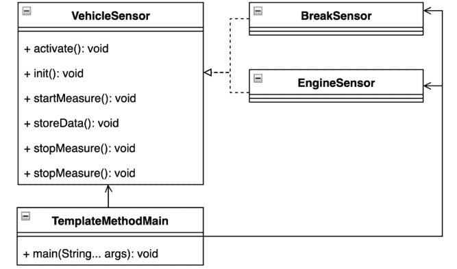

图 5.13 – 显示如何简单地定义新策略的 UML 类

#### 总结

在本章中，我们学习了运行时环境的重要性以及程序执行的动态性。行为设计模式可以改进程序与 Java 平台内部组件的交互。JIT 编译器可以更好地在运行时处理字节码转换，或者通过垃圾回收器可以更高效地进行内存回收。

这些设计模式中的大多数模式都符合 SOLID 原则——只有访问者模式还有些权衡的空间。然而，Java 平台最近添加的改进可以帮助克服这个问题。无论是密封类（sealed classes）、switch 语句、模式匹配增强还是记录（records），该平台都为增强程序的不可变性和代码稳定性，以及简化设计模式的使用提供了坚实的基础。其中某些模式可能是“开箱即用”的，例如工厂方法（factory method）和 switch-case 语句的增强。

在本章中，我们学习了如何解决运行时示例中的挑战。我们探索了如何处理链式任务并命令执行者。公式解释器将文本转换为对象，我们查看了如何对这些对象进行迭代。中者模式将对象之间复杂的通信集中化。我们学习了如何使用空模式（null pattern）来避免空指针异常和未定义的对象类型。

流水线公式（pipeline formula）按顺序处理一组客户端。我们探索了如何更改特定执行者的状态，并回顾了如何使用观察者模式监控这些变化。我们学习的最后一个模式是访问者模式，它向我们展示了如何根据对象类型执行特定操作。

通过行为模式获得的知识，我们为单线程程序的完整生命周期添加了缺失的一环。这包括对象的创建、处理这些对象的编程结构，以及这些对象在运行时的动态行为和相互通信。

尽管预期的程序从主线程启动并可能根据需要是单线程的，但 Java 平台和大多数业务需求都不是单线程的。任务的共享性质使其适用于多线程通信。这可以使用各种框架来实现。正如我们在下一章中看到的，我们可以探索一些常见的并发模式来解决这方面最常见的挑战。让我们大变身吧！

#### 问题

- 标准访问者模式违反了哪种原则？

- 哪种模式帮助我们在不知道元素类型的情况下遍历集合中的元素？

- 是否有某种模式允许我们在运行时更改实例的行为？

- 哪种模式帮助运行时透明地识别未定义状态？

- Java Stream API 最常使用的模式有哪些？

- 6. 是否有方法在运行时通知所有集群客户端？

- 7. 哪种模式可以实现回调？

#### 进阶阅读

- Design Patterns: Elements of Reusable Object-Oriented Software by Erich Gamma, Richard Helm, Ralph Johnson, and John Vlissides, Addison-Wesley, 1995

- Design Principles and Design Patterns by Robert C. Martin, Mentor, 2000

- JEP-358: Helpful NullPointerExceptions (https://openjdk.org/jeps/358)

- JEP-361: Switch Expression (https://openjdk.org/jeps/361)

- JEP-394: Pattern Matching for instanceof (https://openjdk.org/jeps/394)

- JEP-395: Records (https://openjdk.org/jeps/395)

- JEP-405: Sealed Classes (https://openjdk.org/jeps/405)

- JEP-409: Sealed Classes (https://openjdk.org/jeps/409)

# 第 3 部分：其他核心模式与反模式

这一部分涵盖了构建高并发应用程序的设计原则和模式。它还讨论了几种反模式，即针对给定挑战的不恰当软件设计解决方案。

本部分包含以下章节：

- 第 6 章，并发设计模式

- 第 7 章，理解常见反模式

# 6 并发设计模式

之前关于创建、结构和行为模式的章节提出的设计涉及基础代码。它们的重点是运行中的可维护基础代码。

在本章中，我们将探讨并发设计模式。并发模式是关于多线程执行的设计。它们主要关注在多线程环境中的可维护代码。

在 Java 平台上，并发是多个线程同时执行的。这可以使用各种框架来实现。在本章中，我们将学习一些常见的并发模式。

这些并发模式包括：

- 线程者模式

- 异步模式

- 阻塞模式

- 双重检查锁模式

- 读写锁模式

- 线程安全的模式

- 生产者-消费者模式

- 调度器模式

- 线程池模式

在本章结束时，我们将为 Java 的并发功能建立坚实的基础。

#### 技术要求

你可以在 GitHub 上找到本章的代码：https://github.com/PacktPublishing/Practical-Design-Patterns-for-Java

# 解耦方法执行与活动者模式

活动者模式通过运行自己的线程将方法调用解耦。

#### 动机

活动者模式引入了应用程序的透明并发模型。它创建一个执行关键区域的线程。活动者实例提供了一个客户端可以使用的接口来执行任务。

#### 示例代码

让我们引入一个带广播系统的车辆示例（示例 6.1）：


```java
public static void main(String[] args) throws Exception {
    System.out.println("Active Object Pattern, moving vehicle");
    var sportVehicle = new SportVehicle("super_sport");
    sportVehicle.move();
    sportVehicle.turnOnRadio();
    sportVehicle.turnOffRadio();
    sportVehicle.turnOnRadio();
    sportVehicle.stopVehicle();
    sportVehicle.turnOffRadio();
    TimeUnit.MILLISECONDS.sleep(400);
    System.out.println("ActiveObjectMain, sportVehicle moving:" + sportVehicle.isMoving());
}
```

# 解耦方法执行与活动者模式

这是输出结果：

```
Active Object Pattern, moving vehicle
MovingVehicle:'super_sport', moving
MovingVehicle:'super_sport', radio on
MovingVehicle:'super_sport', moving
MovingVehicle:'super_sport', stopping, commands_active:'3'
MovingVehicle:'super_sport', stopped
ActiveObjectMain, sportVehicle moving:false
```

## 示例 6.1 – SportVehicle 实例允许客户端通过其公共方法创建事件

新创建抽象类 `MovingVehicle` 定义了公共方法 - `move`、`turnOnRadio`、`turnOffRadio` 和 `stopVehicle`。除了控制线程外，该类定义了队列事件的条件（示例 6.2）：

```java
abstract class MovingVehicle {
    private static final AtomicInteger COUNTER = new AtomicInteger();
    private final BlockingDeque<Runnable> commands;
    private final String type;
    private final Thread thread;
    private boolean active;

    MovingVehicle(String type) {
        this.commands = new LinkedBlockingDeque<>();
        this.type = type;
        this.thread = createMovementThread();
    }

    private Thread createMovementThread() {
        var thread = new Thread(() -> {
            while (active) {
                try {
                    var command = commands.take();
                    command.run();
                }
            }
        });
        thread.setDaemon(true);
        thread.setName("moving-vehicle-" + COUNTER.getAndIncrement());
        return thread;
    }
}
```

### 示例 6.2 – MovingVehicle 包含一个用于调度事件的活动标记

队列中的事件根据内部周期进行接收和触发。`LinkedBlockingDeque` 提供了额外的功能，用于从顶部或底部插入元素，这在车辆需要停止时非常有用。`StopVehicle` 事件的优先级高于电台（示例 6.3）：

```java
abstract class MovingVehicle {
    // ...
    void turnOffRadio() throws InterruptedException {
        commands.putLast(() -> {...});
    }
    void stopVehicle() throws InterruptedException {
        commands.putFirst(() -> {...});
    }
    // ...
}
```

### 示例 6.3 – 接收到的事件根据条件添加到队列中

`SportVehicle` 实例的生命周期不会干扰主应用程序线程。它是可预测的且不会阻塞应用程序（图 6.1）：

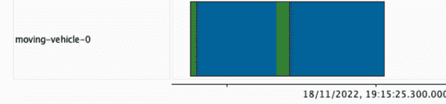

图 6.1 – 移动线程显示了命令的序列

使用异步方法调用模式的非阻塞任务 183

示例中引入的组件无缝地协作（图 6.2）：

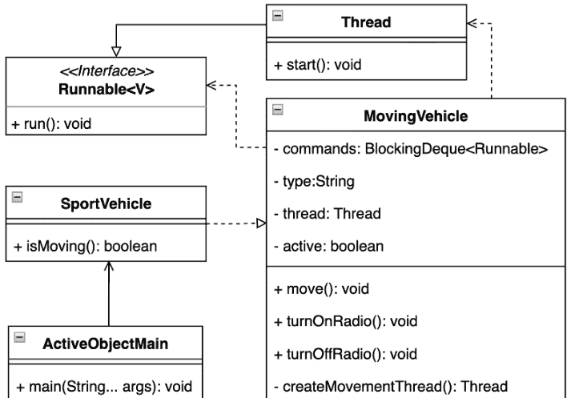

图 6.2 – UML 类图显示了 `SportVehicle` 类与 Java 并发特性的关系

#### 结论

一个良好的活动对象模式反映了 SOLID 设计方法，因为它封装了关键部分并只暴露了所需的控制接口。实例不会干扰应用程序，且整个方法可以泛化到所需的水平。活动对象可以是向应用程序中引入并发模型的良好候选，但有几个挑战需要注意。其中一个挑战是可能出现的应用程序线程数量，高数量的线程可能会因为依赖于可用资源而导致应用程序变得脆弱或产生不稳定性。

让我们在下一节中探索事件的异步本质性。

## 使用异步方法调用模式的非阻塞任务

异步方法调用模式是解决不让可能耗时的任务惩罚主进程线程的方法。

#### 动机

异步方法调用模式引入了通过回调从异步运行的任务接收结果的能力，而不会阻塞主进程线程。该模式展示了处理所需任务类型的线程模型和并行级别。任务结果由专门的回调处理程序处理，并无论任务的执行时间如何都会提供给主进程。这些处理程序可能已经属于主进程。

#### 示例代码

让我们来看一个简单的场景，即需要几个车辆温度传感器来向驾驶员提供结果，情况如下（示例 6.4）：

```java
public static void main(String[] args) throws Exception {
    System.out.println("Async method invocation Pattern,\n    moving vehicle");
    var sensorTaskExecutor = new TempSensorExecutor<Integer>();
    var tempSensorCallback = new TempSensorCallback();

    var tasksNumber = 5;
    var measurements = new ArrayList<SensorResult<Integer>>();
    System.out.printf("AsyncMethodMain, tasksNumber:'%d' %n", tasksNumber);
    for (int i = 0; i < tasksNumber; i++) {
        var sensorResult = sensorTaskExecutor.measure(new TempSensorTask(), tempSensorCallback);
        measurements.add(sensorResult);
    }
    sensorTaskExecutor.start();
    AsyncMethodUtils.delayMillis(10);
    for (int i = 0; i < tasksNumber; i++) {
        var temp = sensorTaskExecutor.stopMeasurement(measurements.get(i));
        System.out.printf("AsyncMethodMain, sensor:'%d' temp:'%d%n", i, temp);
    }
}
```

这是输出结果：

```
Async method invocation Pattern, moving vehicle
AsyncMethodMain, tasksNumber:'5'
SensorTaskExecutor, started:5
...
TempSensorTask,n:'4' temp:'5', thread:'thread-3'
TempSensorTask,n:'3' temp:'26', thread:'thread-0'
TemperatureSensorCallback, recorded value:'26', thread:'main'
AsyncMethodMain, sensor:'0' temp:'26'
...
```

### 示例 6.4 - 示例任务 temp:26 在 thread-0 中异步执行

监控所有结果的 `TempSensorCallback` 实例位于主进程线程中（图 6.3）：

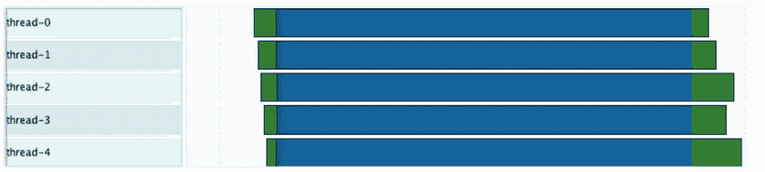

> 图 6.3 - `TemperatureSensorCallback` 实例被异步调用，因此线程完成时间不同

`TempSensorTask` 实例由自定义的 `TempSensorExecutor` 实例处理，这不仅提供了对启动线程的控制，还可以通过提供任务引用终止特定传感器的长时间测量。`TempSensorExecutor` 实例暴露了一个 `measure` 公共方法，提供一个长时间的 `TempResult` 实例（示例 6.5）：

```java
class TempSensorExecutor<T> implements SensorExecutor<T> {
    @Override
    public SensorResult<T> measure(Callable<T> sensor, Callback<T> callback) {
        var result = new SensorResult<T>();
        var thread = new Thread(() -> {
            try {
                T value = sensor.call();
                callback.onSuccess(value);
            } catch (Exception e) {
                callback.onError(e);
            }
        }, "moving-vehicle-" + COUNTER.getAndIncrement());
        thread.setDaemon(true);
        thread.start();
        return result;
    }
}
```

处理传感器的性质非常清晰（图 6.4）：


图 6.4 – UML 类图显示了 `TempSensorExecutor` 与 Java 并发特性的关系

#### 结论

异步方法调用模式允许主线程继续执行，而耗时任务在后台运行。回调机制确保结果能够被正确处理，而不阻塞主流程。

## 使用 Balking 模式延迟执行直到上一个任务完成

尽管实例可变不是一个理想状态，特别是在并发领域，依赖对象状态的能力可能会很有用。多个线程尝试获取对象以执行其临界区域的情况可以由对象状态来限制。状态可以决定是否使用处理时间，以协调可用资源。例如，车辆在没有运动的情况下无法停止。

车辆状态：'STOPPED'已停止，频率：'75'，线程='Thread[pool-1-thread-2,5,main]'
车辆状态：'MOVING'移动中，频率：'98'，线程='Thread[pool-1-thread-1,5,main]'
...

### 示例 6.6 - 驱动程序组由 `ExecutorService` 创建的线程表示

Balking 模式提供了一种解决方案，任务的关键部分根据 `VehicleState` 枚举表示的 `Vehicle` 实例状态执行（示例 6.7）：

```java
class Vehicle {
    synchronized void driveWithMills(int mills) throws InterruptedException {
        var internalState = getState();
        switch (internalState) {
            case MOVING -> System.out.printf("""
                Vehicle state:'%s', vehicle in move,
                mills:'%d', thread='%s%n""", state, mills, Thread.currentThread());
            case STOPPED -> startEngineAndMove(mills);
            case null -> init();
        }
    }
}
```

### 示例 6.7 - 使用 `synchronized` 关键字使得驱动程序组能够感知 `Vehicle` 实例是否已就绪可以使用

驱动程序组线程被阻塞，一次只有一个线程处于激活状态（图 6.5）：

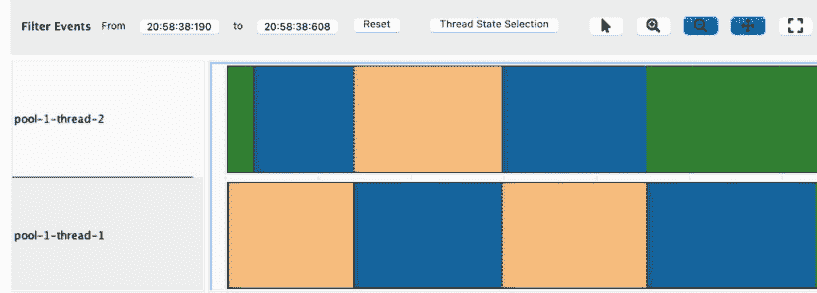

图 6.5 – 蓝色和绿色代表组活动，而其他被阻塞

所展示的示例需要极少数创建的类，这些类被清晰地封装了（图 6.6）：

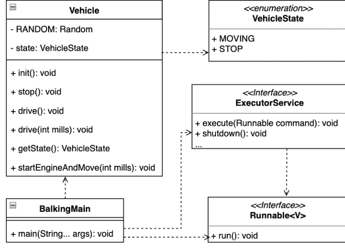

图 6.6 – UML 类图显示了两个最需要的自定义类：`Vehicle` 和 `VehicleState`

#### 结论

这种模式在 Java 平台上易于实现。记住 Java 内存模型以正确处理对象状态的波动性非常重要。考虑使用原子类型（例如 `AtomicInteger` 和 `AtomicBoolean`）可能特别有用，它们自动带有“先发生”（happens-before）保证。该保证是 Java 内存模型的一部分，用于在交互线程之间维护内存一致性，正如我们在第 2 章《面向设计模式发现 Java 平台》中所学的。另一个可以考虑的选项是 `volatile` 关键字，它带有跨线程等可见性的保证。

下一节将检查实例的唯一性——让我们开始吧。

## 使用双重检查锁定模式提供唯一的对象实例

双重检查锁定模式解决了应用程序在运行时只需要特定类的一个实例的问题。

#### 动机

Java 平台默认是多线程的，正如我们在第 2 章《面向设计模式发现 Java 平台》中所学的那样。不仅仅是垃圾回收线程在负责主程序的生命周期。不同的框架引入了额外的线程模型，这可能会对类的实例化过程产生意外影响。双重检查锁定模式确保运行时只有一个类的实例。这种状态在多线程环境中可能是具有挑战性的，因为它取决于它的实现。

#### 示例代码

让我们使用一个简单的 `Vehicle` 实例来演示多线程环境中双重检查锁定模式的重要性。示例展示了单例模式的两种不同实现。`VehicleSingleton` 预计将对多个访问 `GetInstance` 方法的线程履行承诺（示例 6.8）：

```java
public static void main(String[] args) {
    System.out.println("Double checked locking pattern, only one vehicle");

    var amount = 5;
    ExecutorService executor = Executors.newFixedThreadPool(amount);
    System.out.println("Number of executors:" + amount);
}
```


# 并发设计模式

## 使用双重检查锁定模式提供唯一的对象实例

双重检查锁定模式解决了应用程序在运行时只需要特定类的一个实例的问题。

### 动机

Java 平台默认是多线程的，正如我们在第 2 章《面向设计模式发现 Java 平台》中所学的那样。不仅仅是垃圾回收线程在负责主程序的生命周期。不同的框架引入了额外的线程模型，这可能会对类的实例化过程产生意外影响。双重检查锁定模式确保运行时只有一个类的实例。这种状态在多线程环境中可能是具有挑战性的，因为它取决于它的实现。

### 示例代码

让我们使用一个简单的 `Vehicle` 实例来演示多线程环境中双重检查锁定模式的重要性。示例展示了单例模式的两种不同实现。`VehicleSingleton` 预计将对多个访问 `getInstance()` 方法的线程履行承诺（示例 6.8）：

```java
public static void main(String[] args) {
    System.out.println("Double checked locking pattern, only one vehicle");

    var amount = 5;
    ExecutorService executor = Executors.newFixedThreadPool(amount);
    System.out.println("Number of executors: " + amount);
}
```

```java
for (int i = 0; i < amount; i++) {
    executor.submit(VehicleSingleton::getInstance());
    executor.submit(VehicleSingletonChecked::getInstance());
}
executor.shutdown();
```

以下是输出：

```
Double checked locking pattern, only one vehicle
Number of executors: 5
VehicleSingleton, constructor thread: 'pool-1-thread-1'
hashCode: '1460252997'
VehicleSingleton, constructor thread: 'pool-1-thread-5'
hashCode: '1421065097'
VehicleSingleton, constructor thread: 'pool-1-thread-3'
hashCode: '1636104814'
VehicleSingletonChecked, constructor thread: 'pool-1-thread-2'
hashCode: '523532675'
```

**示例 6.8** – `VehicleSingleton` 构造函数被调用了多次，通过多次实例化违反了给定的承诺（参见 `hashCode` 值）

`Executors.newFixedThreadPool()` 提供的 `ExecutorService` 实例接收了多个 `Runnable` 接口实例。在两种情况下，`Runnable` 方法实现代表了 `getInstance()` 方法调用的关键区域（图 6.5）：

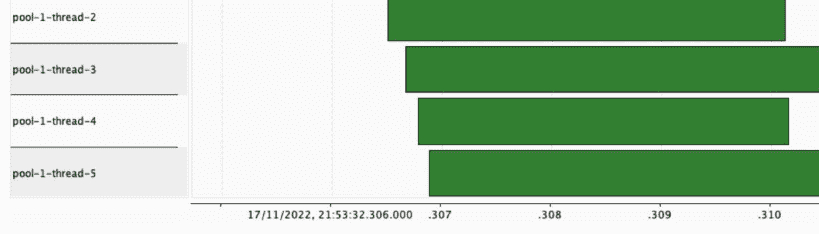

图 6.5 – 蓝色和绿色代表组活动，而其他被阻塞

所展示的示例需要极少数创建的类，这些类被清晰地封装了（图 6.6）：


图 6.6 – UML 类图显示了两个最需要的自定义类：`Vehicle` 和 `VehicleState`

### 结论

这种模式在 Java 平台上易于实现。记住 Java 内存模型以正确处理对象状态的波动性非常重要。考虑使用原子类型（例如 `AtomicInteger` 和 `AtomicBoolean`）可能特别有用，它们自动带有“先发生”保证。该保证是 Java 内存模型的一部分，用于在交互线程之间维护内存一致性，正如我们在第 2 章《面向设计模式发现 Java 平台》中所学的。另一个可以考虑的选项是 `volatile` 关键字，它带有跨线程可见性的保证。

下一节将检查实例唯一性——让我们开始吧。

## 两种实现的细节对比

两种实现在细节上有所不同（示例 6.9）：

```java
synchronized static VehicleSingleton getInstance() {
    if (INSTANCE == null) {
        INSTANCE = new VehicleSingleton();
    }
    return INSTANCE;
}
```

```java
static VehicleSingletonChecked getInstance() {
    if (INSTANCE == null) {
        synchronized (VehicleSingletonChecked.class) {
            if (INSTANCE == null) {
                INSTANCE = new VehicleSingletonChecked();
            }
        }
    }
    return INSTANCE;
}
```

> **示例 6.9** – `getInstance()` 方法使用 `synchronized` 关键字确保线程状态

在两种情况下，UML 图保持相同（图 6.8）：

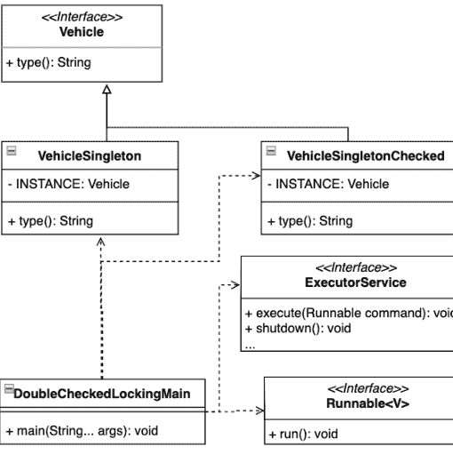

图 6.8 - UML 类图没有突出双重检查锁定模式的细节

## 使用读写锁模式有目的地进行线程阻塞

并发应用程序可能考虑对关键区域授予排他访问权限以更新信息。这一特定挑战可以通过锁模式来解决。

假设车辆内部多个传感器需要准确的温度值信息，但只有一个温度设备可以更新温度值（示例 6.10）：

```java
public static void main(String[] args) throws Exception {
    System.out.println("Read-Write Lock pattern, writing and reading sensor values");
    ReentrantReadWriteLock readWriteLock = new ReentrantReadWriteLock();
    var sensor = new Sensor(readWriteLock.readLock(), readWriteLock.writeLock());
    var sensorWriter = new SensorWriter("writer-1", sensor);
    var writerThread = getWriterThread(sensorWriter);

    ExecutorService executor = Executors.newFixedThreadPool(NUMBER_READERS);
    var readers = IntStream.range(0, NUMBER_READERS)
        .mapToObj(i -> new SensorReader("reader-" + i, sensor, CYCLES_READERS))
        .toList();
    readers.forEach(executor::submit);
    writerThread.start();
    executor.shutdown();
}
```

### 运行输出示例

```
SensorReader read, type:'reader-0', value:'50', thread:'pool-1-thread-1'
SensorReader read, type:'reader-1', value:'50', thread:'pool-1-thread-2'
SensorWriter write, type:'writer-1', value:'26', thread:'pool-2-writer-1'
SensorReader read, type:'reader-2', value:'26', thread:'pool-1-thread-3'
..
```


# 示例 6.10 - 运行自身线程的 SensorWriter 实例获得了 Sensor 实例的排他访问

读取器持续读取传感器值而不被阻塞。当写入者进入大门时，情况发生了变化——此时，读取器被阻塞并必须等待 `SensorWriter` 实例完成操作（图 6.9）：

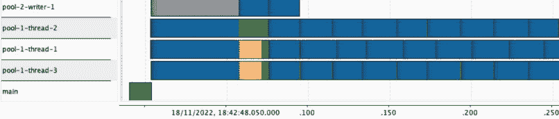

图 6.9 - 显示器线程被阻塞时写入锁排他性的活动

临界区域由 `writeValue` 和 `readValue` 方法提供。两者都属于 `Sensor` 类（示例 6.11）：

```java
class Sensor {
  ..
  int getValue() {
    readLock.lock();
    int result;
    try { result = value; ... } finally { readLock.unlock(); }
    return result;
  }
}
```

```java
void writeValue(int v) {
    writeLock.lock();
    try { this.value = v; } finally {
        writeLock.unlock();
    }
}
```

# 示例 6.11 – 获取 writeLock 时 readLock 暂停

需要注意的是，锁实例存在于执行主线程中，并由 `ExecutorService` 实例提供的线程获取（图 6.10）：

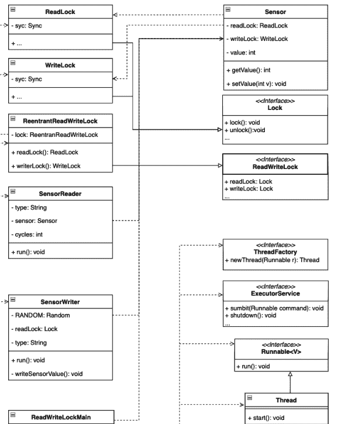

图 6.10 - 读写锁模式的 UML 图

#### 结论

读写锁非常强大，对应用程序的稳定性有积极贡献。它清晰地将参与者与驱动逻辑的临界区域代码分离。根据需要，每个示例类都可以根据 SOLID 设计原则进行泛化或适配。

JDK 定义了另一种值得考虑的交换传感器值的方法。Java 模块包 `java.util.concurrent` 包含了 `Exchanger` 类，它提供了所需的同步保证。

让我们查看另一种常见的模式，即实例被广播到目标。

# 使用生产者-消费者模式解耦执行逻辑

常见的工业场景是在不阻塞主应用程序线程的情况下进行值的生产和消费。生产者-消费者模式通过解耦逻辑和分离线路来帮助解决这一挑战。

#### 动机

一种常见的工业场景涉及在不阻塞主执行线程的情况下生产和消费值。生产者-消费者模式的设计正是通过解耦逻辑和分离目标接收者来应对挑战。

#### 示例代码

另一个场景是车辆从多个源产生多个事件，这些事件需要广播给消费者（示例 6.12）：

```java
public static void main(String[] args) throws Exception{
    System.out.println("Producer-Consumer pattern,
    decoupling receivers and emitters");
    var producersNumber = 12;
    var consumersNumber = 10;
    var container = new EventsContainer(3);
```

```java
ExecutorService producerExecutor =
    Executors.newFixedThreadPool(4, new
    ProdConThreadFactory("prod"));
ExecutorService consumersExecutor = Executors.
    newFixedThreadPool(2);
```

以下是输出：

```
Producer-Consumer pattern, decoupling mess

VehicleSecurityConsumer, event:'Event[number=0, source=pool-prod-0]', number:'0', thread:'pool-con-0'

VehicleSecurityConsumer, event: 'Event[number=1, source=pool-prod-3], number:'1', thread:'pool-con-1'

VehicleSecurityConsumer, event: 'Event[number=2, source=pool-prod-1], number:'2', thread:'pool-con-0'

VehicleSecurityConsumer, event: 'Event[number=3, source=pool-prod-2], number:'3', thread:'pool-con-1'
```

# 示例 6.12 - 广播给消费者的 SensorTask 实例

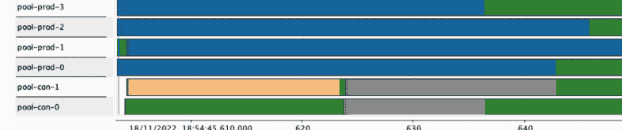

图 6.11 - 生产者-消费者模式的 UML 图

#### 结论

生产者-消费者模式是处理异步数据流的一种稳健方法。通过将数据的生产与消费解耦，我们可以创建出在不同负载下具有响应能力且可扩展性的系统。

## 并发设计模式

在调度器模式的情况下，有必要提到第二个示例。第二个示例使用了 JDK 内置函数及其自定义扩展。规划过程完全由平台管理。应用程序示例再次与第一个示例相似，温度测量（示例 6.15）：

```java
public static void main(String[] args) throws Exception {
    System.out.println("Pooled scheduler pattern
```

以下是输出：

```
Pooled scheduler pattern, providing sensor values
POOL: scheduled task:'468121027', every MILLS:'50'
POOL,, before execution, thread:'custom-scheduler-pool-0',
task:'852255136'
...
POOL: scheduled task:'1044036744', every MILLS:'50'
SensorTask, type:'temperature-1',
activeTime:'61',thread:'custom-scheduler-pool-0'
SensorTask, type:'temperature-0',
activeTime:'50',thread:'custom-scheduler-pool-0'
POOL, after execution, task:'852255136', diff:'56'
POOL, before execution, thread:'custom-scheduler-pool-0',
task:'1342170835'
SensorTask, type:'temperature-2'
activeTime:'71',thread:'custom-scheduler-pool-0'
...
POOL is is going down
```

### 示例 6.15 – 周期设置为 100 ms，且 SensorTask 实例在每次迭代中被重用

扩展的 `CustomScheduledThreadPool` 实例可以通过重写可用方法（如 `beforeExecute` 或 `afterExecute`）根据任务执行提供额外信息。使用 JDK 内部机制可以轻松跨线程扩展 `SensorTask` 实例（图 6.15）：

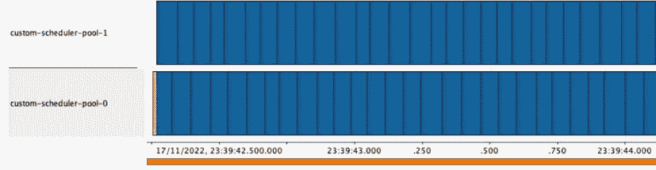

图 6.15 – CustomScheduledThreadPool 实例有助于更简单的线程管理以及其他 JDK 内部管理的简化

利用 JDK 内部机制进行调度不需要你创建自定义解决方案，同时可以对调度周期获得更好的可见性（图 6.16）：

## 并发设计模式

| SensorTask | | <<Interface>> Runnable |
|---|---|---|
| - random: Random | | + run(): void |
| - type: String | | |
| + type(): String | | Thread |
| - start(): void | | CustomThreadPoolExecutor |
| COUNTER: AtomicInteger | | |
| startTimestamps: Map<integer, LocalDateTime> | | |

图 6.6 - UML 类图显示了创建一个具有所有内部机制的自定义调度器所需的最小工作量

#### 结论

所有预设示例都展示了调度器模式的可能用途。使用 JDK 内部机制有许多考虑的优势。它让平台能够更高效地使用和优化可用资源，例如我们在第 2 章《为设计模式发现 Java 平台》中学习到的动态 JIT 翻译。

# 使用线程池模式实现有效的线程利用

并不总是需要为每个任务创建一个新线程，因为这可能导致资源使用不当。线程池模式可能是解决这一挑战的良好方案。

#### 动机

短生命任务不需要在每次运行时都创建一个新线程，因为线程的每次实例化都与底层资源的分配有关。浪费资源可能会导致应用程序吞吐量或性能下降。线程池模式描述了一种更好的选择，它定义了执行临界区域所需的复用线程数量。特定的工作线程可以透明地在需要执行的临界区域代码之上运行。

## 代码

让我们再次想象具有不同测量动态的传感器的温度测量（示例 6.16）：

```java
public static void main(String[] args) throws Exception{
    System.out.println("Thread-Pool pattern, providing\n    sensor values");

    var executor = Executors.newFixedThreadPool(5);

    for (int i=0; i < 15; i++) {
        var task = new TemperatureTask("temp" + i);
        var worker = new SensorWorker(task);
        executor.submit(worker);
    }

    executor.shutdown();
```

以下是输出：

```
Thread-Pool pattern, providing sensor values
TemperatureTask, type:'temp3', temp:'0', thread:'pool-1-
thread-4'
TemperatureTask, type:'temp4', temp:'7', thread:'pool-1-
thread-5'
TemperatureTask, type:'temp2', temp:'15', thread:'pool-1-
thread-3
TemperatureTask, type:'temp1', temp:'20', thread:'pool-1-
thread-2'
..
```

# 示例 6.16 – 线程池根据需要运行工作线程温度测量任务

线程池有助于使用和管理创建的线程，以便始终有任务需要处理。这对应用程序行为产生积极影响，并有助于根据可用资源进行规划（图 6.17）：


图 6.17 – 线程池的行为显示了创建线程的使用

核心示例元素是 `SensorWorker`。该工作线程实现了 `Runnable` 接口，并负责评估 `TemperatureTask`（示例 6.17）：

```java
class SensorWorker implements Runnable {
  ...
  @Override
  public void run () {
    try {task.measure();} catch (InterruptedException e) {
      {...}
    }
  }
}
```

# 示例 6.17 – SensorTask 实例可以为封装在其周围的任务评估提供额外的逻辑

该示例实现不需要任何额外的自定义类类型来引入并发（图 6.16）：

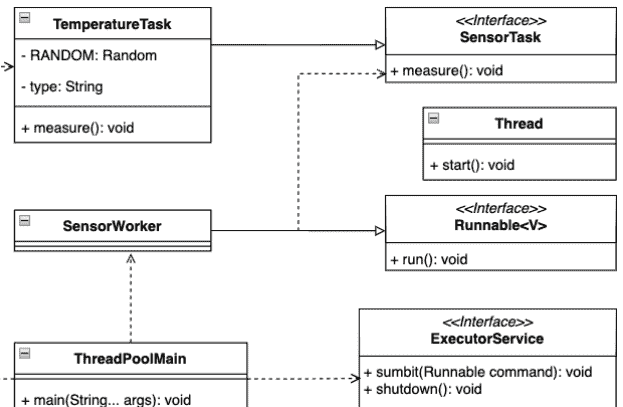

图 6.18 – UML 图强调了所有所需的线程池元素都由 Java 平台提供

#### 结论

线程池模式可以为向应用程序中引入并发提供另一种可接受的方法。它不仅支持继承自 `Runnable` 接口的类类型的执行，还支持 `Callable` 接口。使用 `Callable` 接口允许你通过 `Future` 接口创建一个结果。将 `Callable` 实例执行为 `Future` 类型实例的结果是：异步执行临界区域。也就是说，产生结果所需的时间是不可知的。

线程池模式也是一种正确组织代码以确保可维护性和资源利用的 SOLID 方法。

让我们简要总结本章的教训。

#### 总结

本章演示了解决并发问题的一些常用方法。它还展示了先前知识的重要性，并发应用程序开发需要更多的精确性和纪律来实现预期结果，类似于第 2 章《为设计模式发现 Java 平台》中讨论的内容。

每个显式采用的模式都强制创建一个可持续的、整洁应用程序代码。许多模式遵循并使用了 APIE 或 SOLID 等开发方法。

#### 问题

1. 双检查单例模式解决了哪些问题？

2. 使用 JDK 创建所需线程池的最佳方法是什么？

3. 哪种并发设计模式反映了处理后续步骤的可变性？

4. 处理重复任务的最佳模式是什么？

5. 哪种模式有助于分发逻辑和事件处理？

#### 延伸阅读

- 《设计模式：可重用面向对象软件的基础》，Erich Gamma, Richard Helm, Ralph Johnson, John Vlissides, Addison-Wesley, 1995
- 《设计原则与设计模式》，Robert C. Martin, Object Mentor, 2000
- [JEP-425: 虚拟线程](https://openjdk.org/jeps/425)
- [JSR-428: 结构化并发（孵化器）](https://openjdk.org/jeps/428)
- 《企业级应用模式》，Martin Fowler, Pearson Education, Inc, 2003
- 《Effective Java：第三版》，Joshua Bloch, Addison-Wesley, 2018
- [JDK 17: Exchanger 类](https://docs.oracle.com/en/java/javase/17/docs/api/base/java/util/concurrency/Exchanger.html)
- [JDK 17: CompletableFuture 类](https://docs.oracle.com/en/java/javase/17/docs/api/base/java/util/concurrency/CompletableFuture.html)
- [JDK 17: Executors 类](https://docs.oracle.com/en/java/javase/17/docs/api/base/java/util/concurrency/Executors.html)
- [Java Mission Control](https://wiki.openjdk.org/display/jmc)

## 答案

1. 双重检查单例模式解决的挑战是确保 JVM 中只存在一个类实例，以避免可能的内存泄漏。

2. `java.base` 模块和 `java.util.concurrent` 包中 `Executors` 工具类的使用。

3. 拒绝模式取决于实例状态。

4. 调度器模式。

5. 生产者-消费者模式是最并发的设计模式之一，其逻辑被清晰地分离并专门处理。

# 7 理解常见的反模式

在之前的章节中，我们探索了虚拟相关应用程序的良好路径。在本章中，车辆的抽象将继续作为一个支持性元素，因为人们可能比其他抽象更容易想象一个受车辆启发的应用程序。车辆及其所有部分是一个易于理解的概念。

让我们快速回顾设计模式的影响以及它们如何有助于组织的成功。

Melvin E. Conway 说过，应用程序的设计和实现强烈反映了组织的内部通信。这一陈述在今天仍然具有相关性，特别是现在许多项目使用敏捷方法。自动化构建、持续集成或测试以及随后的自动化部署在将应用程序交付到生产环境方面起着关键作用。任何被忽视或意外之外的局限性都会限制或损害应用程序的主要目标。

在本章中，我们将回顾某些识别偏离主要目标迹象的重要领域，以便你拥有具有功能性、可维护性且透明的应用程序。缺乏这些特性可能会从多个层面对应用程序功能产生不利影响。运行时可能会受到破坏，导致不可预测的成本。故障可能隐藏在应用程序架构中，阻碍扩展性和可维护性。此类问题可能会反复出现，并且每种情况下都需要专门的关注。

我们将集中在以下领域：

- 什么是反模式以及如何识别它们
- 检查典型的软件反模式
- 理解软件架构反模式

在本章结束时，你将能够识别并理解一些应该警惕的反模式迹象。

#### 技术要求

你可以在 GitHub 上找到本章的代码文件：https://github.com/PacktPublishing/Practical-Design-Patterns-for-Java-Developers/tree/main/Chapter07。

## 什么是反模式以及如何识别它们


人们可以将反模式定义为良好设计模式或良好实践的对立面。虽然这看起来是底线，但它忽略了导致某种软件实践被称为“反模式”的上下文和动作顺序。换句话说，它并没有解释为什么反模式是一系列高风险、低效且适得其反的步骤的集合。理解这些步骤非常重要，因为它们允许创建一个可重复的过程来获得类似的结果，仅仅是为了验证其歧义。底线是，这些步骤可能会限制主动解决问题的能力。让我们深入探讨一下理论。

## 理论原理挑战

由于多种原因，反模式在软件开发过程中自然而然出现。它们可能是由于业务逻辑的转变、技术迁移或信息的缺失。事实是，反模式确实会发生，并且由于团队规模、通信问题等原因，成为开发过程的一部分。

关键在于如何识别它们。在第 1 章“进入软件设计模式”中，我们触及了违反 `API` 和 `SOLID` 设计原则的负面影响；这可能是一个症状，可以作为考虑源码重构响应的信号。另一种现象是不尊重 `CAP` 定理（一致性、可用性和分区容错）。开发时间可能被投入到尝试同时实现所有属性上，而这是不可能的。此类尝试可能是重新思考开发策略的强有力信号。

尽管 `API` 和 `SOLID` 原则往往被认为是常识，但事实并非如此，特别是在创建敏捷实践和完成任务的领域。开发往往会产生持续的技术债。“持续的”这个词很重要，因为这种债务的累积可能会导致非常不愉快的后果。

## 作为瓶颈的积累技术债

技术债是一个有趣的概念，因为它需要软件应用程序及其目标的上下文才能理解它。技术债包含一些一眼看去可能并不显眼的属性，但可能会导致严重的瓶颈。让我们想象一个汽车生产线是一个在不同动态下并行运行的多个过程的集合。生产线应该以车辆的形式交付预期结果。如果瓶颈堆积，结果将无法实现。这种车辆的抽象非常简单，但将其放入运行软件的范围内可能更加困难，因为软件依赖于底层技术、平台和硬件。`Java` 平台带有必须考虑的注意事项。基本上，规则是开发者尊重平台，而平台尽力为运行的软件提供服务。

## 不恰当压榨 Java 平台能力

在第 2 章“发现设计模式的 Java 平台”中，我们接触了类型和内存模型等重要主题；不考虑这些可能被认为是一种反模式。作为对 `Java` 平台多线程性质的提醒，我们可以提到内存模型，它保证了在主执行线程旁边运行的多线程环境中值对应用程序可见性。由于 `Java` 应用程序在最终分配的内存空间（堆）中工作，垃圾回收器尝试确保有足够的堆内存可用。

所积累的知识有助于我们避免与任何反模式相关的最常见误解之一：意外的拆箱（`unwanted unboxing`），即编译器在原始类型和包装类之间进行的自动转换。

自动装箱（`autoboxing`）的影响一眼不可见，直到你的应用程序面临关键负载才可能被注意到。让我们查看聚合值，其中每个值都需要经过验证以识别警报。警报显然是由关键值的触发。警报系统启动多个线程并行验证交付的值（示例 7.1）：

### 示例 7.1 – SensorAlarmWorker 实例通过读取 Sensor 实例的值尝试识别警告信号

```java
// 代码片段缺失
```

车辆报警系统显然必须分析由各种传感器传递的海量数据以识别关键信号。自动装箱（`autoboxing`）问题往往更容易被忽视，因为它会导致频繁且非确定性的垃圾回收（图 7.1）：

| GC ID | 原因 | 收集器名称 | 事件类型 | 名称 |
|---|---|---|---|---|
| 2 | GC Evacuation | G1 New | 2.22 | GC Pause Level 1 | Notify SoftReference |
| 3 | GC Evacuation | G1 New | 1.63 | GC Pause Level 1 | Reconsider SoftReference |
| 4 | GC Evacuation | G1 New | 1.71 | GC Pause Level 1 | Notify and keep alive final |
| 5 | GC Evacuation | G1 New | 1.77 | GC Pause Level 1 | Notify Soft/WeakReference |
| 6 | GC Evacuation | G1 New | 1.87 | GC Pause Level 1 | Notify Soft/WeakReference |
| 7 | GC Evacuation | G1 New | 1.59 | GC Pause Level 1 | Notify and keep alive final |
| 8 | GC Evacuation | G1 New | 1.49 | GC Pause Level 1 | Notify Soft/WeakReference |

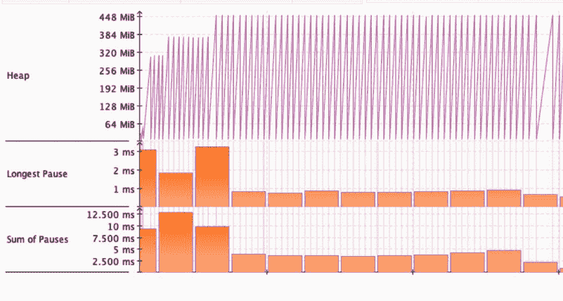

尽管垃圾回收的根源似乎已经解决，但它可能会意外出现。示例 7.1 引入了 `Sensor` 记录类，它以基本类型持有整数值。当基本类型的值在传递给 `evaluateAlarm` 方法时被自动装箱（由于该方法需要使用 `Integer` 包装类），问题变得显而易见。让我们对 `Sensor` 类型进行修正（示例 7.2）：

```java
...
static void evaluateAlarm(Map<Integer, Sensor> storage,
```

### 示例 7.2 – Sensor 字段更改为 Integer 类型，并与方法的输入类型匹配

这一变化对整个应用程序产生了相当的影响，导致垃圾回收的发生频率降低。换句话说，正如我们在《设计模式 Java 平台发现》第 2 章中学到的，消除停顿世界（`stop-the-world`）事件的延迟（图 7.2），可以加速整个应用程序：

| GC ID - 原因 | 收集器名称 | Lc | 暂停阶段 | Metaspace |
|---|---|---|---|---|
| 0 G1 Evacuation Pause | G1New | | 事件类型 | 名称 |
| | | | GC Phase Pause 1 | Notify PhantomRef |
| | | | GC Phase Pause 1 | Notify RecSoft/Weak |
| | | | GC Phase Pause 1 | Notify Soft/WeakAll |
| | | | GC Phase Pause 2 | Notify Soft/WeakRef |
| | | | GC Phase Pause 2 | Notify PhantomRef |
| Heap | | 24 MiB | | | |
| | | 16 MiB | | | |
| | | 8 MiB | | | |
| Longest Pause | | 2 ms | | | |
| Sum of Pauses | | 2 ms | | | |

> 图 7.2 – 垃圾回收压力消失了，因为应用程序没有创建不必要的短命对象

自动装箱有时可以通过代码审查识别，代码审查在消除代码气味反模式方面起着至关重要的作用。

`Java` 平台包含许多有用的工具，如果使用不当会导致意外的状态。让我们在下一节看看这些工具。

## 选择正确的工具

接下来的例子乍看之下远离代码气味。`Java` 平台包含了许多非常有用的工具，如果选择和使用得当，它们就能很好地服务应用程序。集合框架展示了仔细选择重要性的良好示例。《设计模式 Java 平台发现》第 2 章回顾了常用集合类型的不同方面。这引导我们看到错误选择如何由于底层资源的消耗而导致瓶颈。这种问题在小数据下可能并不明显。

| 关注 | 方面 | 包含 |
|---|---|---|
| `java.util.indexOf(Object, int)` | 985 | |
| `java.util.Arrays.copyOf(Object[], int)` | 181 | |
| `java.lang.Integer.valueOf(int)` | 100 | |

这种问题在小数据下可能并不明显。

图 7.3 – 集合

图 7.4 – 集合

## 检查典型的反模式

多个因素可能导致应用程序出现问题。

### 意大利面代码

```java
class VehicleSpaghetti {
    void drive() {
        /*
        大约 100 行代码
        大量使用 if-else 结构
        */
    }
}
```

### 示例 7.3 – 一个不合理的 drive() 方法，包含了从引擎控制到刹车检查的所有逻辑

### 典型的软件反模式

```go
void checkWaterPump() {
}
```

### 示例 7.4 - VehicleBlob 实例试图控制每个可能的部分

关于代码库假设的可维护性的反驳可能是无效的，因为此类代码可能难以测试，甚至无法测试。当单例设计模式被不当误用时，也会发生类似的问题。一旦识别出大肿（`blob`）反模式，现在是开始考虑通过重构源代码来创建简单图表的绝佳机会了，以免为时已晚。

### 熔岩流（Lava flow）

“整洁代码”有时被用作深层术语。如今，在不进行进一步思考的情况下将概念验证应用直接推向生产已成为一种常见做法。当兼容性或扩展性问题出现时，就会产生这种反模式。概念验证证实了某种可能的解决方案，并不意味着它已经根据开发原则和技术为生产做好了准备。这种反模式可以通过长实现类的出现来识别，这些类的目的随着时间的推移而丧失，但每个人都害怕删除它们，因为这可能会影响系统。这种反模式以熔岩命名，熔岩是一种从火山向下流直到着火的热液体。在微服务、分布式系统和云解决方案时代，可以考虑共享功能（如库或解决方案）的范例。当这种模式在开发过程中出现时，可能是重新评估代码库的设计时了，也许可以绘制图表并应用结论来降低火灾的可能性。

### 功能分解（Functional decomposition）

由于使用了现代框架，以及该反模式在过程化语言领域更为人知，功能分解反模式可能看起来已经过时。现实可能略有不同，许多旧系统在没有充分理解代码库和业务逻辑的情况下就被迁移了。识别这种反模式是轻而易举的，因为你不可能察觉一个包含许多具有单一职责、缺乏抽象且高内聚类的代码库。这种反模式的根源可能是对面向对象编程基本原理的理解不足，或者对应用目标的误解。解决方案是根据要求的抽象级别重构代码库，同时牢记编程原则。

### 船锚（Boat anchor）

有时，应用程序或新开发的软件可能会继承一个过时的抽象，导致该抽象变得不再必要。这种抽象不仅因为需要维护而可能变成瓶颈，还因为可以很容易地在整个代码库中复制。最糟糕的情况是这种抽象在共享库或应用程序模块内部被大量使用。这种反模式会加速应用程序代码库各个层面的退化。

缓解这种问题的一种方法是记住 `SOLID` 设计和 `API` 原则，以允许持续重构。这使得可以使用以前学习的设计模式。

#### 结论

能够识别并描述一些对已知原则和方法的常见偏差可以为任何项目带来价值。在本小节中，我们检查了反模式并提出了解决方案，以保持您的代码库的可维护性和可读性。我们在本部分的最后一点是关于方法、字段和类的正确命名，这可以显著提高可读性和维护性，并限制对 `API` 使用的误解。正确的命名也很重要，因为它有助于理解 `UML` 图。下一节将带我们深入研究源码架构。

## 理解软件架构反模式

对类、包和模块组合的清晰理解，不仅对于应用本身至关重要，正如我们在第 2 章《设计模式发现 Java 平台》中所学的。得益于 `JIT` 编译器对字节码的动态翻译过程，`Java` 平台收集了关于其优化的基本信息。糟糕的代码质量和软件架构会导致延迟、内存使用不当或崩溃。让我们考虑可能的障碍。

### 金锤（Golden hammer）

一种在一段时间内获得认可但没有探索替代方案的方法很容易变成遗留代码。难以接受其他建议或迁移可能是由于一组特定的方法，即所谓的“金锤”反模式，在这种模式下，开发者认为，如果某事已经良好运行了多年，就没有必要调查它是否有益处。一个很好的例子是特定厂商的数据库或工具，当应用程序需要迁移到微服务或更分布式的设计时，问题就出现了。

扩展性不仅受到如前所述 `CAP` 定理的惩罚，还可能因为在设计的模块或应用程序部分中以几乎无法使用的方式而遭受影响。

在架构中使用特定厂商的产品并不一定是一个问题。挑战在于应用程序的开发完全依赖于厂商提供的能力和功能，而没有对其能力进行评估。

一种可能的解决方案可能是重新评估当前的开发方法，并通过对解决方案的有效研究允许改进。

### 持续过时（Continuous obsolescence）

改进是不可避免的。今天，产品可以利用自动化部署或持续集成支持，并具有各种不同的测试场景。改进速度正在迅速加快。一个很好的例子是 `Java` 平台，它最近将其发布周期缩短到了 6 个月。这一事实可能成为反模式的引擎：一方面需要重构，另一方面对消除缺点具有巨大影响。

持续过时反模式可以通过无法通过持续集成和交付移动项目到下一个阶段轻松识别（示例 7.5）：

```java
interface VehicleCO {
    void checkEngine();
    void initSystem();
    void initRadio(); /* 未使用 */
    void initCassettePlayer(); /* 未使用 */
    void initMediaSystem(); /* 实际逻辑 */
}
```

**示例 7.5 - VehicleCO 抽象包含了仍需要测试的过时方法**

当然，这些概念包含了仍需要测试的过时方法。

持续过时反模式可以通过无法通过持续集成和交付移动项目到下一个阶段轻松识别（示例 7.5）。

#### 结论

并不是列出的所有反模式都是完全坏的（例如“金锤”或“死胡同”），但通常情况下，任何反模式在被接受和记录之前都应该经过重新评估。

`Java` 是一种非常强大的语言和平台，不仅是因为它允许实例变量变化，还因为它允许实体持有其状态并保持不可变性。在出现反模式的情况下，应该特别关注代码库的成本，正如我们在第 2 章《发现设计模式的 Java 平台》中所学的，此类应用程序不仅对软件工程师是透明的，对 `Java` 平台也是透明的。并发环境一方面带来了许多可能性和性能改进，另一方面，由于对平台（而非使用它的框架）的理解不足，可能会导致某些设计模式的误用，例如双重检查锁定模式。

测试覆盖率、代码规范、信息或能力的缺乏也会导致反模式的大量出现。从代码库架构的角度来看，验证一个实现正确的函数可能变成一项无法完成的任务，或者为 `Mock` 或调试带来额外的复杂性。通常情况下，透明的代码架构是成功应用的关键之一。让我们回顾一下所学内容。

#### 总结

了解反模式及其识别方法对应用程序的可生存性具有巨大影响，特别是在分布式系统方面。本章已经表明，由于不熟悉 `Java` 平台及其工具会导致意外的结果，例如对在侧线程上运行的垃圾回收算法造成压力，以及错过优化机会。意识到 `Java` 平台的多线程本质可以带来更好的代码组合，并且正确使用不可变性来实现持续的应用程序开发，即重构。

由于大多数反模式的根源是缺乏测试，因此测试环境可能是确定反模式出现或是否需要重构的最佳起点。编译后的测试代码不存在于部署的代码中，这使得测试代码成为未来探索和理解应用程序行为的最佳起点。

`Java` 平台和其他库变化非常快，维护应用程序代码库的关键之一是使用开闭原则。它实现了持续的重构，这对于健康代码库的演进至关重要。

反模式是应用程序生命周期的一部分。为了进度，它们会存在并以各种形式留存。完全移除它们可能并不值得投入精力；也许更好的方法是理解它们，并在持续解决已知局限性的基础上使代码库达到理想状态。改进将在应用程序的整个开发周期内进行，编写代码将成为一种愉快的体验，许多挑战将得到解决。

## 理解常见反模式

虽然 `Java` 平台仍然面临挑战，但它仍然是一个完美结合数学、统计学和概率科学的漂亮软件！

恭喜你成功读完这本书。因为每一个结尾都意味着一个新的开始，我鼓励你保持灵感和饥饿欲，在编码或设计软件时尽情享受！保持开放的心态，让它成为价值信息的来源。

诚挚地，Miro Wengner！

#### 延伸阅读

- Design Patterns: Elements of Reusable Object-Oriented Software by Erich Gamma, Richard Helm, Ralph Johnson, and John Vlissides, Addison-Wesley, 1995
- Design Principles and Design Patterns by Robert C. Martin, Object Mentor, 2000
- AntiPatterns: Refactoring Software, Architectures, and Project in Crisis by William J. Brown, Raphael C. Malveau, Hays W. McCormick III, and Thomas J. Mowbray, John Wiley & Sons, Inc, 1998
- CAP Twelve Years Later: How the “Rules” Have Changed, https://www.infoq.com/articles/cap-twelve-years-later-how-the-rules-have-changed/2012
- Phoenix Project: A Novel About IT, DevOps, and Helping Your Business Win by Gene Kim, Kevin Behr, and George Stafford, IT Revolution Press, 2016
- How do Committees Invent? by Melvin Edward Conway, Datatamation 14, site 5, pages 28-31, 1968
- Mission Control Project, https://github.com/openjdk/jmc

## 评估

## 第 1 章 – 进入软件设计模式

1. 编译器将 `Java` 代码编译成字节码，字节码分别由 `JVM` 和 `JRE` 执行（参见图 1.3）。
2. 它指的是抽象、多态、继承和封装。
3. 方法重写和方法重载。


# 4. SOLID 原则：单一职责原则、开闭原则、里氏替换原则、接口隔离原则和依赖倒置原则。

# 5. 程序应对扩展开放，对修改关闭。

# 6. 设计模式代表了常用问题的解决方案集合，以产生可维护的软件。

# 第 2 章 – 发现设计模式的 Java 平台

1. Java 虚拟机 (`JVM`)、Java 运行环境 (`JRE`) 和 Java 开发包 (`JDK`)。

2. Java 是一种静态类型语言，这意味着任何值在赋值之前都需要先进行声明。

3. 原生类型：`boolean`、`short`、`char`、`int`、`float`、`long` 和 `double`。

4. 垃圾回收器。

5. 队列 (`Queue`)、集合 (`Set`) 和列表 (`List`)。

6. 键值对。

7. 在 O 表示法中为 `O(1)`。

8. 在 O 表示法中为 `O(n)`。

9. `Predicate<T>` 返回类型是原生类型 `boolean`。

10. Java Stream 中的元素流。

# 第 3 章 – 使用创建型设计模式

1. 创建模式通过将实例化过程委托给其他部分来抽象该过程。

2. 为了减少对象创建成本，可以使用依赖注入、延迟初始化和对象池模式。

3. 只需要一个实例。

4. 建造器模式有助于创建复杂对象，同时减少构造函数的数量。

5. 两者都可以组合对象而不破坏逻辑。

6. 对象池模式引入了已创建的可复用对象缓存，而不是分配新实例。

7. 创建特定族对象的最有效模式是工厂方法。

# 第 4 章 – 应用结构型设计模式

1. 结构型模式定义了对象之间的通信。这些模式支持实现的灵活性和透明性。

2. GoF 作者描述的结构型模式包括适配器、桥、组合、代理、适配器、外观和装饰器模式。

3. 组合结构模式，保证了统一的对象处理。

4. 标记模式，要充分考虑到其缺点。

5. 需要考虑代理模式，因为适配器和外观模式的目的略有不同。

6. 桥模式。

# 第 5 章 – 行为型设计模式

1. 第 1 章进入软件设计模式中探讨的里氏替换原则。

2. 迭代器模式。

3. 是——策略模式。

4. 是空对象模式，它提供了这种状态类型并限制了异常的产生。

5. 这可以是流水线模式、`map()` 和 `filter()` 方法的策略模式，或者是空对象模式。

6. 通过观察者模式通知所有客户端，它也可以透明地控制条件。

7. 可以使用命令模式。命令由唯一对象表示。对象允许客户端传递参数并轻松调用回调函数。

# 第 6 章 – 并发设计模式

1. 双重检查单例模式解决的问题是确保运行的 `JVM` 中只有一个类实例，以避免可能的泄漏。

2. 使用位于 `java.base` 模块和 `java.util.concurrent` 包的 `Executors` 工具类。

3. 拒绝执行模式取决于实例状态。

4. 调度模式。

5. 生产者-消费者模式是最常见的并发设计模式之一，逻辑分离且得到妥善处理。

# 索引

## A

- 工厂工厂模式，用于创建对象
  - 结论 74
  - 发现，在 JDK 72
  - 动机 71
  - 示例代码 72-74

- 抽象 9
  - 实现 10-12

- 抽象、多态、继承与封装 (`APIE`) 6
  - 视图，作为持续改进过程 12, 13

- 动作 146

- 激活对象模式，用于解耦方法执行 180
  - 结论 183
  - 动机 180
  - 示例代码 180-183

- 适配器模式，用于不兼容对象的协作 102
  - 结论 106
  - 发现，在 JDK 102
  - 动机 102
  - 示例代码 102-105

- 反模式 214
  - 代码气味反模式 219
  - 识别 214

- Java 平台能力，不当挤压 215-217

- 技术债，作为瓶颈收集 214

- 理论性原理挑战 214

- 工具，选择 218, 219

- 应用数据处理 66
  - 数组 44

- 异步加载 90

- 异步方法调用模式，用于非阻塞任务 183
  - 结论 187
  - 动机 184
  - 示例代码 184-186

- 自动装箱 215-217

- 自动内存管理 36-93

## B

- 拒绝执行模式 188
  - 结论 191
  - 动机 188
  - 示例代码 188-190

- 大胖对象（Blob）反模式 220

- 船锚反模式 221, 222

- 引导加载器 32

- 桥接模式，用于解耦并独立开发对象 106
  - 结论 109
  - 发现，在 JDK 106
  - 动机 106
  - 示例代码 106-109

- 建造器模式，用于实例化复杂对象 75
  - 结论 78
  - 发现，在 JDK 75
  - 动机 75
  - 示例代码 75-78

- 总线方法 218

- 类加载器区域 32

- 类加载器子系统 50

- 洁代码 219

- 客户端编译器 29

- 基于对象类型的代码
  - 执行，使用访问者模式 172

- 代码气味反模式 219

- 集合框架
  - 发现 45, 46

- 命令模式，用于将信息转换为动作 146
  - 结论 148
  - 发现，在 JDK 146
  - 动机 146
  - 示例代码 146-148

## C

- 缓存模式，用于限制昂贵的初始化 140
  - 结论 143
  - 发现，在 JDK 140
  - 动机 140
  - 示例代码 140-142

- 中央处理器 (`CPU`) 4
  - 指令周期 4

- 责任链模式，用于处理事件 136
  - 结论 146
  - 发现，在 JDK 143
  - 动机 143
  - 示例代码 144, 145

- 使用策略模式改变对象行为，使用场景 167

- 类 66

- 类依赖关系
  - 减少，使用依赖注入模式 94

- 通信
  - 简化，使用外观模式 115

- 编译器 5

- 复杂对象
  - 实例化，使用建造器模式 75

- 组合模式，用于处理对象 109
  - 结论 111
  - 发现，在 JDK 109
  - 动机 109
  - 示例代码 110, 111

- 条件
  - 使用，使用过滤器模式选择所需的对象 117

- 一致性、可用性和分区容错 (`CAP`) 理论 214

- 构造函数依赖注入 94

- 持续过反模式 223

- 控制器 220

- 准则模式 117

- 剪切编程 220

## D

- 死胡同反模式 224

- 装饰器模式，用于扩展对象功能 111
  - 结论 114
  - 发现，在 JDK 112
  - 动机 112
  - 示例代码 112, 113

- 依赖注入模式，用于减少类依赖 94
  - 结论 98
  - 发现，在 JDK 94
  - 动机 115
  - 示例代码 95-98

- 依赖倒置模式 (`DIP`) 18

- 设计模式
  - 挑战，解决 20, 21

- 菱形模式 135

- 不要重复自己 (`DRY`) 22

- 双重检查锁定模式，用于提供唯一实例 191
  - 结论 194
  - 动机 191
  - 示例代码 191-194

- 动态多态 8, 9

- 动态翻译 30

- 元素
  - 封装 6, 7

- 事件

- 执行逻辑

- 执行器 57

- 扩展类加载器 32

- 外观模式，用于简化通信 115
  - 结论 116
  - 发现，在 JDK 115
  - 动机 115
  - 示例代码 115, 116

- 工厂方法，基于输入创建对象 67
  - 结论 71
  - 发现，在 JDK 68
  - 动机 67
  - 示例代码 68-70

- 过滤器模式，使用条件选择对象 117

- 享元模式，跨应用程序共享 120
  - 结论 123
  - 发现，在 JDK 121
  - 动机 120
  - 示例代码 121, 122

- Fork/Join 框架 48

- 前控制器模式，用于处理请求 123

- 注入方法 94

- 函数式分解反模式 221

- 函数式接口 48
  - 使用 49

- 接口隔离原则 (`ISP`) 17, 18

- 解释器模式，为上下文含义 148
  - 结论 150
  - 发现，在 JDK 149
  - 动机 148
  - 示例代码 149, 150

- 函数式编程 47, 48

## G

- 四人组 (`GoF`) 67

- 垃圾回收 (`GC`) 33, 36-39
  - 审查 34
  - 隔离任务
  - 使用调度器执行 201

- 迭代器模式，用于检查元素 150
  - 结论 153
  - 发现，在 JDK 151
  - 动机 151
  - 示例代码 151, 152

- 垃圾回收 (`GC`)，引用类型
  - 虚引用 39
  - 软引用 39
  - 强引用 39
  - 弱引用 39

- 黄金锤反模式 222

## J

- Jakarta 依赖注入 94

- Java 26, 27, 47, 48
  - 使用模式发现多继承 135

- Java API
  - 数组 44
  - 集合框架，发现 45, 46
  - 检查 39, 40
  - 基本数据类型 40-42
  - 使用 `String` API 工作 42-44
  - 包装类 40-42

- Java 并发 57

- Java 虚拟机 (`JVM`) 5, 26, 29-31
  - 基础线程，执行器 58, 59
  - 执行 59, 60

- 类加载器区域 32
  - 堆区域 33
  - 方法区域 33

- Java 特性，版本更新
  - 原生方法栈 34
  - 程序计数器 (`PC`) 33
  - 职责 31

- 局部变量语法，lambda 参数 54

- 栈区域 33

- 局部变量语法，lambda 参数 (Java SE 11, `JEP-323`) 53

- JDK 增强提案 (`JEP`) 31

- 即时编译 (`JIT`) 编译器 5, 29

- 模式，匹配 `instanceof` (Java SE 16, `JEP-394`) 54

## L

- 模式，匹配 `switch` (Java SE 18, 第二预览, `JEP-420`) 57

- Lambda 表达式

- 记录 (Java SE 16, `JEP-395`) 55

- 函数式接口，使用 49

- `switch` 表达式 (Java SE 14, `JEP-361`) 54

- 文本块 (Java SE 15, `JEP-378`) 54

- Lambda 接口 48

- Java 流反模式 221

- 懒性初始化模式，按需启动对象 90
  - 结论 93
  - 发现，在 JDK 90
  - 动机 90
  - 示例代码 90

- Java 飞行记录器 (`JFR`) 218

- Java 内存模型 (`JMM`) 34-36

- 里氏替换原则 (`LSP`) 16, 17

- 长期支持 (`LTS`) 53

## M

- Java 原生接口 (`JNI`) 31

- 机器语言对比人类语言 4

- 标记模式，用于识别实例 126

- 中介者模式，用于信息交换 153

- 备忘录模式，用于恢复所需状态 155
  - 结论 158
  - 发现，在 JDK 159
  - 动机 155
  - 示例代码 155, 160

- 使用状态模式修改 165

- 面向对象编程 (`OOP`) 6, 47

- 对象池模式，用于提高性能 78
  - 结论 89
  - 发现，在 JDK 86
  - 动机 86
  - 示例代码 86-89

- 方法区域 33

- 使用激活模式解耦方法执行 180

- 对象 66
  - 使用原型模式克隆 78
  - 从不同家族的抽象工厂模式中创建 71
  - 使用装饰器模式扩展功能 111
  - 使用代理模式提供占位符 132
  - 使用享元模式跨应用程序共享 120

- 方法重写 8, 9

- 模块模式 129
  - 结论 132
  - 发现，在 JDK 130
  - 动机 130
  - 示例代码 130-132

- 摩尔定律 67

## N

- 基于输入创建对象，使用工厂模式 67

- 按需启动对象，使用懒性初始化模式 90

- 观察者模式，用于让相关方获取信息 160
  - 结论 162
  - 发现，在 JDK 161
  - 动机 160
  - 示例代码 161

- 原生方法栈 34

- 使用异步方法调用模式处理非阻塞任务 183

- 空对象模式，用于避免空指针异常状态 158
  - 结论 160
  - 发现，在 JDK 159
  - 动机 158
  - 示例代码 159, 160

- 开闭原则 (`OCP`) 15, 16

## P

- 性能优化，使用对象池模式 85

- 永久代 (`Permgen`) 37

- 流水线模式，用于处理实例阶段 162
  - 结论 165
  - 发现，在 JDK 中 163
  - 动机 162
  - 示例代码 163, 164

- poly 模式反模式 224

- 多态 7
  - 动态多态 8
  - 静态多态 8

- 生产者-消费者模式，用于解耦执行逻辑 198
  - 结论 201
  - 动机 198
  - 示例代码 198, 199

- 生产者-消费者模式 160

- 程序计数器 (`PC`) 33

- 原型模式，用于克隆对象 78
  - 结论 82
  - 发现，在 JDK 中 78, 79
  - 动机 78
  - 示例代码 79-81

- 代理模式，用于为对象提供占位符 132
  - 结论 135
  - 发现，在 JDK 中 133
  - 动机 133
  - 示例代码 133, 134

- 读-评估-打印循环 (`REPL`) 工具 28

- 读写锁模式，通过线程阻塞使用 194
  - 结论 198
  - 动机 195
  - 示例代码 195-197

- 接收者 160

- 请求处理，使用前端控制器模式 123

## S

- 调度器模式，用于执行隔离任务 201
  - 结论 206
  - 动机 201
  - 示例代码 201-205

- 编译器 219

- 单一职责原则 (`SRP`) 14

- 单例模式，用于确保单例实例 82
  - 结论 85
  - 发现，在 JDK 中 82
  - 动机 82
  - 示例代码 82-85

- 软件反模式
  - 大肿类 (`blob`) 220, 221
  - 复制粘贴编程 220
  - 检查 219
  - 功能分解 221
  - 熔岩流 (`lava flow`) 221
  - 意大利面代码 (`spaghetti code`) 219

- 软件架构反模式 226
  - 模糊视角 224
  - 持续过时 223
  - 死胡同反模式 224
  - 万金锤 222

- 使用，通过读写锁模式 194

- 线程池模式，用于线程利用 206
  - 结论 209
  - 动机 206
  - 示例代码 207, 208

- 意大利面代码 219

- 栈区域 33

- 状态模式，用于在 Java 中发现实例 135

- 状态模式，用于修改对象行为 165
  - 结论 167
  - 结论 137
  - 动机 135
  - 示例代码 135, 136

- 发现，在 JDK 中 165
  - 动机 165
  - 示例代码 165, 166

## U

- 静态多态 8

- 策略模式，用于改变对象行为 167
  - 结论 169
  - 发现，在 JDK 中 167
  - 动机 167
  - 示例代码 167-169

- 统一建模语言 (`UML`) 类图 68

- 用户自定义类加载器 32

- 访问者模式，用于根据对象类型执行代码 172
  - 结论 174
  - 发现，在 JDK 中 172
  - 动机 172
  - 示例代码 172-174

## V

- `String` API 操作 42-44

- 子类化 82

- 系统类加载器 32

## T

- 标记 126

- 模板模式，用于流程标准化
  - 结论 172
  - 发现，在 JDK 中 170

- 技术债务积累，作为瓶颈 214

## W


www.packpub.com

订阅我们的在线数字图书馆，即可访问超过 7,000 本书籍和视频，以及帮助您规划的行业领先工具。

# 为什么要订阅？

- 通过来自 4,000 多位行业专业人士的电子书和视频，减少学习时间并增加编码时间
- 通过专为您量身定制的学习计划提升您的技能
- 每月获得一本免费电子书或视频
- 全文检索方便访问信息
- 复制、粘贴和书签内容

您知道吗？Packt 的本书都有电子版本，提供 PDF 和 ePub 文件。您可以在 packpub.com 升级为电子版，作为纸质客户享受折扣。详情请联系 customercare@packpub.com。


在 www.packpub.com，您还可以阅读免费的技术文章，订阅各种新闻邮件并获取独家折扣和优惠。

# 您喜欢的其他书籍

如果您喜欢这本书，可能对 Packt 的其他书籍感兴趣：


## Java 领域驱动设计 - 实践指南

**Premanand Chandrasek, Karthik Krishnan**

ISBN: 9781800560734

- 探索如何建立问题领域的共识
- 在核心和周边系统之间建立清晰声明
- 识别如何将复杂系统分解为良好的组件
- 应用领域故事讲述和事件风暴等演化技术
- 实现 EDA、CQRS、事件溯源等技术
- 设计内聚、松耦合的分布式微服务生态系统
- 使用 Java 测试事件驱动系统的实现
- 理解非功能性需求如何影响边界上下文的分解

您喜欢的其他书籍 241

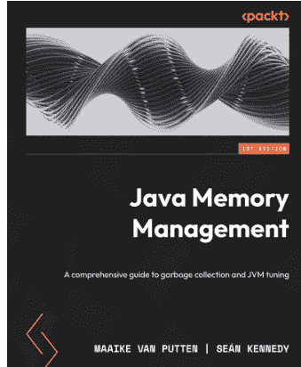

## Java 内存管理

**Maaike van Putten, Seán Kennedy**

ISBN: 9781801812856

- 理解调试原理以及如何设计应用程序以获得良好性能
- 探索垃圾收集的工作原理
- 区分不同的垃圾回收器实现
- 识别分析应用程序性能所需的指标
- 配置和监控 JVM 内存管理
- 识别并解决内存泄漏
