# Oracle SQL、T-SQL 和 MySQL 实用指南


# 前言

数据库无处不在。它们对我们的日常生活产生了广泛影响。在线业务公司使用数据库存储关键数据；诊所使用数据库保存患者、药房和保险信息；银行使用数据库跟踪数百万金融交易。

关系型数据库管理系统（RDBMS）自 20 世纪 80 年代以来已成为标准的数据库类型。世界上最流行的数据库管理系统是 Oracle、SQL Server 和 MySQL。开发者和数据库管理员使用结构化查询语言（SQL）在 Oracle 和 MySQL 开发 Web 应用。为了显示重要数据，使用 SQL 语句访问数据库或更新数据库结构。SQL 如此强大，可以在几秒内处理数百万记录。作为一名数据库管理员，我在 Oracle、SQL Server 和 MySQL 上工作了几十年。尽管 Oracle、SQL Server 和 T-SQL 的基础 SQL 语句相似，但某些功能和风格不同。市场上有很多 SQL 书，但很难找到一本比较这三个系统差异的实战书籍。这就是我想要写这本关于 Oracle、SQL Server 和 MySQL 参考书的原因。

# 为什么要学习 SQL？

- SQL 是最需要的技能之一
- SQL 被所有职业领域使用
- 你可以使用 SQL 从数据库获取有用的报告
- 你可以使用 SQL 向数据库导入数据
- 你可以使用 SQL 从数据库导出数据
- 你可以将 SQL 嵌入其他编程语言

# 本书对象

本书适用于初级和高级 SQL 开发者、数据库管理员、数据库程序员和学生。

# 如何使用本书

要运行书中的示例，你需要安装以下数据库系统和开发工具：

- Oracle 11g 或 12c
- Oracle SQL Developer
- SQL Server 2012 或以上
- SQL Server Management Studio 2012 或以上
- MySQL Server 5.7
- MySQL Workbench 6.3

以上软件均可在 Oracle.com 和 Microsoft.com 下载

# 致谢

感谢 Science Publisher 的编辑支持本书使其成为现实。向我母亲深表感谢，她在退休后已学习了 30 年。

# 第 1 章 SQL 与关系型数据库简介

关系型数据库管理系统（RDBMS）自 20 世纪 80 年代以来已成为各行业的标准数据库类型。这些系统允许用户在图形用户界面中存储和访问数据。它还允许用户设置安全规则。

结构查询语言（SQL）是关系型数据库管理系统的标准计算机语言。SQL 有不同的方言。例如，Oracle SQL 被称为 `PL/SQL`，MS SQL Server 被称为 `T-SQL`（事务 SQL）。

SQL 是数据库开发者和数据库管理员极有帮助的工具。数据库开发者使用 SQL 来选择、插入和更新数据。数据库管理员（DBA）运用其 SQL 技能来支持 Oracle、SQL Server、MySQL 和其他数据库系统。

本章的重点包括：

- SQL 和数据库系统的发展简史
- SQL 标准
- Oracle、SQL Server 和 MySQL 版本
- RDBMS 简介
- 关系型数据库基本概念
- 本书使用的实体关系图

## SQL 和数据库系统的发展简史

表 1.1 SQL 和数据库发展的发展历史

| 年份 | SQL 和数据库发展 |
|---|---|
| 1970 年至 1972 年 | E.F. Codd 博士提出了关系模型论文。 |
| 1970 年代 | IBM 提出了 R 系统。 |
| 1976 年 | Peter Chen 开发了实体关系模型。 |
| 1980 年代 | 结构化查询语言成为标准。 |
| 1990 年代 | 关系数据库系统迅速发展。 |
| 2000 年代 | 关系数据库取得了商业成功。 |

## SQL 标准

表 1.2 SQL 标准

| 年份 | SQL |
|---|---|
| 1974 年 | 原始 SQL (SEQUEL) |
| 1986 年 | ANSI（美国国家标准）发布的 SQL |
| 1999 年 | ISO（国际标准组织）发布的 |
| 2003 年 | 增加了 XML 特性 |
| 2006 年 | 定义了导入数据的方法 |
| 2008 年 | 增加了对象特性 |

## Oracle、SQL Server 和 MySQL 版本

表 1.3 版本

| | Oracle | SQL Server | MySQL |
|---|---|---|---|
| 1979 年 | 2 | | |
| 1983 年 | 3 | | |
| 1984 年 | 4 | | |
| 1988 年 | 5 | | |
| 1992 年 | 6 | | |
| 1997 年 | 7 | | |
| 2001 年 | 9 | | |
| 2003 年 | 10i | 2000 | |
| 2005 年 | 10g | 2004 | |
| 2007 年 | 11g | | 2005 |
| 2010 年 | | 2008 | 5.5 |
| 2012 年 | 12g | | 5.6 |
| 2013 年 | 12c | | 5.7 |
| 2016 年 | | | 8.0 |

## RDBMS 简介

### 数据库

关系型数据库系统由一个或多个数据库组成。例如，SQL Server 有 HR 和 Sample 数据库。

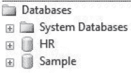

图 1.1 数据库示例

## 关系型数据库基本概念

### 实体

实体是数据库设计中可以存储数据的任何人、地点或事物。例如，员工和部门是实体。实体在物理阶段转换为表。

### 数据类型

SQL 开发者在创建表时需要为每列选择数据类型。常见的数据类型有布尔、整数、浮点、货币、字符串、日期和时间。

### DDL

`DDL` 是数据定义语言。`DDL` 命令用于创建、修改数据库结构。常用的 `DDL` 命令有 `CREATE`、`ALTER` 和 `DROP`。

### DML

`DML` 是数据操作语言。`DML` 命令用于向表插入数据、检索或修改数据、删除数据库中的数据。常用的 `DML` 命令有 `INSERT`、`DELETE` 和 `UPDATE`。

### DCL

`DCL` 是数据控制语言。`DCL` 命令用于创建权限和许可。常用的 `DCL` 命令有 `GRANT` 和 `REVOKE`。

### 查询

SQL 开发者可以使用 SQL 从一个或多个数据库表中获取数据或信息。

### 属性

实体有自己的属性。例如，一个员工实体可能有名称、电话和薪水等属性。

### 属性类型

- **简单属性**——不可划分为部分的属性。例如，员工的年龄是一个简单属性。
- **复合属性**——可以划分为简单属性的属性。例如，员工的名字有姓和名。
- **衍生属性**——其值可以从其他属性得出的属性。例如，员工的平均年龄可以计算得出。
- **单值属性**——一个包含单个值的属性。例如，市（City）或州（State）。
- **多值属性**——一个包含多个值的属性。例如，一名员工可以拥有多项技能。

### 表

每个数据库都包含一组表。

例如，HR 数据库包含国家（country）、客户（customer）、部门（departments）、员工（employees）、职位（job）和位置（locations）表。

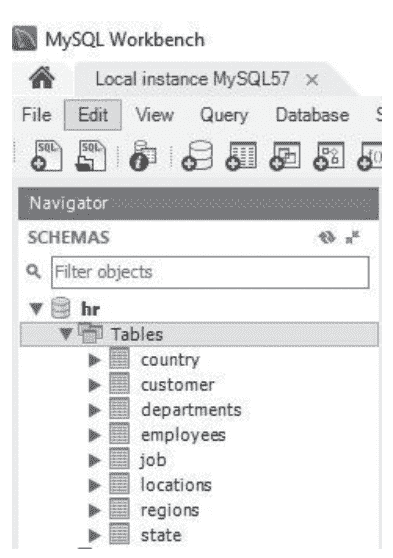

图 1.2 表的示例

#### 字段（列）

每个表由称为字段或列的小型实体组成。

例如，Country 表有三个字段（列）：`Country_ID`、`Country_Name` 和 `Region_ID`。

#### 记录（行）

每个表由一个或多个记录（行）组成。

例如，`COUNTRY` 表包含以下行：

| COUNTRY_ID | COUNTRY_NAME | REGION_ID |
| --- | --- | --- |
| AR | Argentina | 2 |
| AU | Australia | 3 |
| BE | Belgium | 1 |
| BR | Brazil | 2 |
| CA | Canada | 2 |
| CH | Switzerland | 3 |
| CN | China | 3 |
| DE | Germany | 1 |

图 1.3 记录的示例

#### 主键

每个表只能有一个主键。

例如，`COUNTRY` 表的主键是 `COUNTRY_ID`。

#### 外键

数据库表可能通过（外键）共同列相关联。

例如，`Location_ID` 是 `Departments` 表和 `Locations` 表的共同列。

| department_id | int | PK | location_id | int | PK |
| --- | --- | --- | --- | --- | --- |
| department_name | text | | street_address | text | |
| manager_id_per_unit | decimal(6,0) | | postal_code | text N |
| location_id | decimal(4,0) | | city | text |
| Locations_location_id | int | FK | state_province | text |
| | | | country_id | text |

图 1.4 外键示例

#### NULL

空值是一个没有值的字段。它与零值不同，并且在创建记录时被留空。

#### 约束

约束定义了限制列中可以存储值的规则。这确保了数据库中数据的正确性。例如，我们可以为表设置主键，以便表中没有重复的行。

常见约束：

- `NOT NULL`——列不接受 `NULL` 值。
- `DEFAULT`——当未为列指定值时，为该列设置的默认值。
- `UNIQUE`——列中没有重复值。
- `PRIMARY KEY`——唯一定义一行的列或列组合。主键列不能包含 `NULL` 值。
- `FOREIGN KEY`——一个表中的外键指向另一个表中的候选键。
- `CHECK`——检查值是否有效。

#### 数据完整性

- **实体完整性**——表中没有重复记录。
- **引用完整性**——当删除被另一个表的外键引用的行时，就会违反引用完整性。

例如，用户无法从 `Departments` 表中删除营销部门（Marketing），因为有两名员工在营销部门工作（#20）。删除营销部门违反了引用完整性。见下方的记录：

| DEPT_ID | DEPT_NAME | MANAGER_ID | LOCATION_ID |
|---|---|---|---|
| 10 | Administration | 200 | 1700 |
| 20 | Marketing | 201 | 1800 |

图 1.5 表中的示例数据

| EMPLOYEE_ID | FIRST_NAME | LAST_NAME | EMAIL | PHONE | HIRE_DATE | JOB | CLERK | SALARY | MANAGER_ID |
|---|---|---|---|---|---|---|---|---|---|
| 100 | Adam | King | adking@example.com | 515.123.4567 | 2003-06-17 | Programmer | No | 90000 | 204 |
| 101 | Neena | Koch | nkoch@example.com | 515.123.4568 | 2005-01-21 | Programmer | Yes | 17000 | 204 |
| 102 | Lex | Hart | lhartstein@example.com | 515.123.4569 | 2003-08-06 | Programmer | No | 17000 | 204 |
| 103 | John | Hunt | jhunt@example.com | 515.123.4560 | 2006-02-17 | Accountant | No | 17000 | 103 |
| 104 | Patricia | Austin | paustin@example.com | 515.123.4561 | 2005-08-30 | Sales VP | Yes | 14000 | 100 |
| 105 | Steven | Green | sgreen@example.com | 515.123.4562 | 2006-10-24 | Sales | No | 12000 | 103 |
| 106 | Kimber | Weiss | kweiss@example.com | 515.123.4563 | 2006-02-09 | Sales | No | 12000 | 103 |
| 107 | Dana | Horne | dhorne@example.com | 515.123.4564 | 2007-02-11 | Sales | No | 12000 | 103 |
| 108 | V | Cox | vcoxcox@example.com | 515.123.4565 | 2005-09-12 | President | Yes | 17000 | 100 |
| 109 | Nancy | Wilde | nwilde@example.com | 515.123.4566 | 2007-10-24 | Clerk | Yes | 3000 | 100 |
| 110 | Leah | Dehar | ldehar@example.com | 515.123.4567 | 2007-01-24 | Clerk | No | 3000 | 100 |
| 111 | James | Flynn | jflynn@example.com | 515.123.4568 | 2006-09/12 | Clerk | No | 3000 | 100 |
| 112 | Melanie | Russell | arauss@example.com | 515.123.4569 | 2007-10-01 | Clerk | No | 3000 | 100 |
| 113 | Wyatt | Olson | wololson@example.com | 515.123.4560 | 2006-07-25 | Auditor | No | 6000 | 103 |
| 114 | Keith | Chen | kchen@example.com | 515.123.4561 | 2007-09-14 | Auditor | No | 6000 | 103 |
| 115 | Mabel | Burns | mhorns@example.com | 515.123.4562 | 2007-03-11 | Auditor | No | 6000 | 103 |
| 116 | Lucas | Sommer | lommer@example.com | 515.123.4563 | 2006-12-01 | Programmer | No | 12000 | 204 |
| 117 | Julia | Gould | jould@example.com | 515.123.4564 | 2007-02-16 | Programmer | No | 12000 | 204 |
| 118 | Bradley | Horne | bhorne@example.com | 515.123.4565 | 2007-06-07 | Programmer | No | 12000 | 204 |


| 119 | David | Tobias | dtobiason@example.com | 515.123.4566 | 2006-03-24 | Manager | No | 30000 | 100 |
| 120 | T | Raphael | trafael@example.com | 515.123.4567 | 2007-12-24 | Manager | No | 30000 | 100 |

图 1.6 员工表中的记录

# 第1章 SQL与关系型数据库

## 实体关系图 (ERD) 本书中使用

### Departments

| department_id | int | location_id |
| department_name | text | street_address |
| manager_id_per_unit | decimal(6,0) | postal_code |
| location_id | decimal(4,0) | city |
| Locations_location_id | int | FK | state_province |
| | | | country_id |

### Locations

| location_id | int | PK (from Departments) |
| street_address | text | |
| postal_code | text | |
| city | text | |
| state_province | text | |
| country_id | text | |

### Employees

| employee_id | int | PK (implicit) |
| first_name | text | |
| last_name | text | |
| email | text | |
| phone | text | |
| hire_date | text | |
| job | text | |
| clerk | text | |
| salary | int | |
| manager_id | int | |
| dept_id | int | |

### Country

| country_id | int | FK (from Locations) |
| country_name | text | |
| region_id | int | |

### Jobs

| job_id | int | PK |
| job_name | text | |
| min_salary | int | |
| max_salary | int | |

图 1.7 简化的 Oracle Schema

## 关系类型

- 一对多
- 多对多
- 一对一
- 自引用

### 一对多关系

一对多关系定义了表1 中的某行对应表2 中的多个关联行的情况。

### 多对多关系

表1 中的一条记录对应表2 中的多条匹配记录，而表2 中的一条记录也对应表1 中的多个匹配记录。

### 一对一关系

### 自引用关系

与自身具有关系的数据库模型。

# 第10章 SQL 与关系型数据库简介

| EMPLOYEE_ID | FIRST_NAME | LAST_NAME | GRANT | AFRIPP | PHONE | HIRE_DATE | JOB_ID | SALARY | MANAGER_ID |
|---|---|---|---|---|---|---|---|---|---|
| 100 | Douglas | Grant | | 650.507.9844 | 23-JAN-08 | SH_CLERK | 2600 | | 101 |
| 101 | Adam | Fripp | | 650.123.2234 | 10-APR-15 | | 8200 | | 109 |
| 102 | Jennifer | Whalen | JHWALEN | 515.123.4444 | 17-SEP-13 | AD_AST | 4400 | | 108 |
| 103 | Michael | Hartstein | MHARTIE | 515.123.5555 | 17-FEB-14 | MK_MGR | 13000 | | 109 |
| 104 | Pat | Fay | PAYFA | 603.123.6666 | 17-AUG-15 | MK_REF | 6000 | | 103 |
| 105 | Susan | Mavris | SMAVRIS | 515.123.7777 | 07-JUN-12 | HR_MGR | 6500 | | 109 |
| 106 | Shelley | Higgins | SHIGGINS | 515.123.8080 | 07-JUN-12 | SA_MGR | 12008 | | 109 |
| 107 | William | Giet | WGIETZ | 515.123.8181 | 07-JUN-12 | SA_REF | 8300 | | 106 |
| 108 | Steven | King | SKING | 515.123.4567 | 17-JUN-13 | AD_PRES | 24000 | | 108 |
| 109 | Lex | De Haan | LDHAAN | 515.123.4569 | 13-JAN-11 | AD_VP | 17000 | | 108 |
| 110 | Bruce | Ernst | BERNST | 590.423.4568 | 21-FEB-17 | IT_MGR | 6000 | | 109 |

图 1.8 自引用示例

## 总结

第一章涵盖了以下内容：

- SQL 和关系型数据库简史介绍。
- SQL 标准简介。
- 关系型数据库管理系统的基本术语。
- Oracle、SQL Server 和 MySQL 版本的介绍。
- 显示书中使用的示例实体关系图。
- 定义一对一关系。
- 定义一对多关系。
- 定义多对多关系。

# 第 2 章 数据类型

你在第一章中已经学习了表格由许多列组成。在设计或修改数据库时，理解不同的数据类型非常重要。主要有三种数据类型：字符、数字和日期/时间。

## 字符数据类型

表 2.1 三种数据库系统的字符数据类型

| 数据类型 | Oracle SQL | SQL SERVER | MySQL |
|---|---|---|---|
| 固定长度字符 | `CHAR(n)` 最多 2000 个字符 | `CHAR(n)` 最多 8000 个字符 | `CHAR(n)` 最多 255 个字符 |
| 适用于任何语言的 NCHAR | `NCHAR(n)` 最多 2000 个字符 | `NCHAR` 最多 4000 个字符 | `NCHAR(n)` 最多 65,535 个字符 |
| 可变长度字符串 | `VARCHAR2(n)` 最多 4000 个字符 | `VARCHAR(n)` 最多 8000 个字符, `VARCHAR(max)` 最多 2097 亿 | `VARCHAR(n)` 最多 255 个字符 |
| 适用于任何语言的 NCHAR2 | `NCHAR2(n)` 最多 4000 个字符 | `NCHAR2(n)` 最多 4000 个字符, `VARCHAR2(max)` 最多 536 亿 | `NCHAR2(n)` 最多 65,535 个字符 |
| 适用于任何语言的 TEXT | `TEXT` 最多 4GB | `TEXT` 最多 4000 个字符 | `TEXT` 最多 65,535 个字符 |
| | `RAW(n)` 二进制数据，最多 2000 字节 | `BINARY(n)` 固定二进制数据，最多 8000 字节 | `MEDIUM(n)` 最多 1600 万 |
| 字符大对象 | `NCLOB` 最多 4GB | `CLOB` 变宽，最多 8000 字节 | `LONGTEXT` 最多 4GB |
| 二进制大对象 | `BLOB` 最多 4GB | `VARIARY(max)` 变宽，最多 2GB | `LONBLOB` 最多 4294 万 |
| | | `IMAGE` 变宽，最多 2GB | `ENUM(a, b, c, ...)` 最多 65535 个值 |
| | | | `SET` 最多 64 个值 |

固定长度字符和可变长度字符有什么区别？

固定长度字符——当你创建固定大小的内容（如电话号码、社会安全码 `SSN`）时，`CHAR` 是很好的选择。

可变长度字符——许多字段是可变长度。当你为名字创建 `VARCHAR(30)` 或 `VARCHAR(32)` 时，由于每个人的长度不同，你需要使用 `VARCHAR` 或 `VARCHAR2`。如果一个名字是 "Peter"，在表中只存储了 5 个字符（5 字节），而不是 30 个。如果我们对名字使用 `CHAR(30)`，则所有名字都将存储在 30 个字符中。显然，这将浪费大量的存储空间。

## 数字数据类型

表 2.2 三种数据库系统的数字数据类型

| 数据类型 | Oracle SQL | SQL SERVER | MySQL |
|---|---|---|---|
| 小整数 | `NUMBER(3)` | `TINYINT` `TINYINT(n)` 0 到 255 | 0 到 255 | 0 到 255 UNSIGNED |
| 中等整数 | `NUMBER(5)` -32,768 到 32,767 | `SMALLINT` `SMALLINT(n)` -32,768 到 32,767 | 0 到 65,535 | 0 到 65,535 UNSIGNED |
| | | | `MEDIUM(n)` -8,388,608 到 8,388,608 | 0 到 16,772,215 UNSIGNED |
| 32 位整数 | `NUMBER(10)` -2,147,483,648 到 2,147,483,647 | `INT(n)` -2,147,483,648 到 2,147,483,647 | | |
| | `NUMBER(38)` -9,223,372,036,854,775,808 到 9,223,372,036,854,775,808 | `BIGINT` `BIGINT(n)` -9,223,372,036,854,775,808 到 9,223,372,036,854,775,808 | | |
| | | | `REAL(n, d)` | |
| | | 浮点数 -3.40E+3 到 3.40E+8 | 小浮点数 n——最多 d 位小数 | |
| | | `SMALLMONEY` -2,174,368 到 2,174,368 | `DOUBLE(n, d)` 大浮点数 n——最多 d 位小数 | |
| | | `MONEY` -922,333,203,685,477,580 到 922,333,203,685,477,580 | `DECIMAL(n, d)` | |
| | | | `DECIMAL(p, s)` `NUMERIC(p, s)` 存储为字符串 | -10^p + 1 到 10^p n——最多 d 位 | |
| | | | | p 从 1 到 38 | |
| | | | | s 从 -8 到 12 | |

### `NUMBER (p, s)` (Oracle)

### `NUMERIC (p, s)` (Oracle)

p—精度

s—小数

例如，`NUMERIC (5, 2)` 包括小数点前的 3 位和小数点后的 2 位。

### `DECIMAL (p, s)` (T-SQL)

### `NUMERIC (p, s)` (T-SQL)

p—精度

s—小数

p——可以存储的位数（包括小数点左和右的所有位数）。

s——小数点右侧位数。

## Oracle 数据类型

## 日期和时间类型

表 2.3 三种系统的日期和时间类型

| Oracle | SQL SERVER | MySQL |
|---|---|---|
| `DATE` 示例：25-JAN-17 | `DATE` 示例：2017-01-25 | `DATE` 示例：2017-01-25 |
| 如果我们不指定时间，默认为 6 位。 | 如果我们不指定时间，默认为 0 位。 | 如果我们不指定时间，默认为 0 位。 |
| `TIMESTAMP` 示例：25-JAN-17 15:34:55 | `DATETIME` 示例：2017-01-25 15:34:55 | `DATETIME` 示例：2017-01-25 15:34:55 |
| 如果我们指定精度，默认为 6 位。 | 如果我们指定精度，默认为 0 位。 | 如果我们指定精度，默认为 0 位。 |
| `TIMESTAMP (3)` 25-JAN-17 15:34:55.123 | `DATETIME(3)` 2017-01-25 15:34:55.123 | | |
| `TIME` 示例：15:34:55 | `SMALLDATETIME` () 15:34:55 | `TIME (p)` 15:34:55 | |
| `TIME (3)` 15:34:55.123 | | | |
| | `TIME (p)` 15:34:55 | | |
| | `YEAR` () 2017 | | |
| | `YEAR (p)` 2017 | | |

## 布尔数据类型

表 2.4 三种系统的布尔数据类型

| 数据类型 | Oracle SQL | SQL SERVER | MySQL |
|---|---|---|---|
| 布尔 | `CHAR(1)` (0 或 1) | `BIT` 0 或 1；非空 | `BOOLEAN`, `BOOL` 0 或 1 |

## 总结

第二章涵盖了三个系统的多种数据类型。

- 字符数据类型
- 数字数据类型
- 三种系统的日期和时间类型
- 布尔数据类型

虽然这一章很短，但熟悉所有这些类型需要时间。当你学习第五章“创建数据库和表”时，你将在列中使用数据类型。

在下一章中，我们将安装 Oracle 12c、SQL Server 2016 和 MySQL 5.7 数据库系统。

# 第 3 章 安装 Oracle、SQL Server 和 MySQL

在运行 SQL 命令之前，我们需要安装关系型数据库系统。本章涵盖了如何安装 Oracle 12c、SQL Server 2016 和 MySQL 5.7。

## 系统要求

表 3.1 系统要求

| Oracle 12C | SQL Server 2016 | MySQL 5.7 |
|---|---|---|
| 硬盘：10 GB | 硬盘：6 GB | 硬盘：8 GB |
| 内存：2 GB | 从光盘安装需要 DVD 驱动器。 | 内存：2 GB |
| `tmp` 目录中需要 1 GB 空间。 | `.NET Framework 4.6` | |
| 操作系统 | 推荐内存 | 操作系统 |
| 32 位 | Express 版本：1 GB，所有其他版本：至少 4 GB | 32 位和 64 位 |
| Windows 8（专业版和企业版） | 处理器：x64 处理器 | Linux |
| Windows 7（专业版、企业版、终极版） | 操作系统 | Mac OS X |
| Windows 2008 | SQL Server 企业版 | |
| 64 位 | Windows Server 2016 | |
| Windows 8（专业版和企业版） | Windows Server 2012 | |
| Windows 7（专业版、企业版、终极版） | SQL Server 标准版 | |
| Windows Server 2012 | Windows Server 2016 | |
| Windows Server 2008 R2 | Windows 10 | |
| Windows Server 2008 | Windows 8.1 | |
| Linux | SQL Server Web 和 Express 版： | |
| | Windows Server 2016 | |
| | Windows Server 2012 | |
| | SQL Server 开发版： | |
| | Windows Server 2016 | |
| | Windows Server 2012 | |
| | Windows 10 | |
| | Windows 8.1 | |

## Oracle 12c 的安装

- 从 Oracle 官网下载 Oracle Database 12c Release 2：
  `http://www.oracle.com/technetwork/database/enterprise-edition/downloads/database12c-win64-download-2297732.html`

  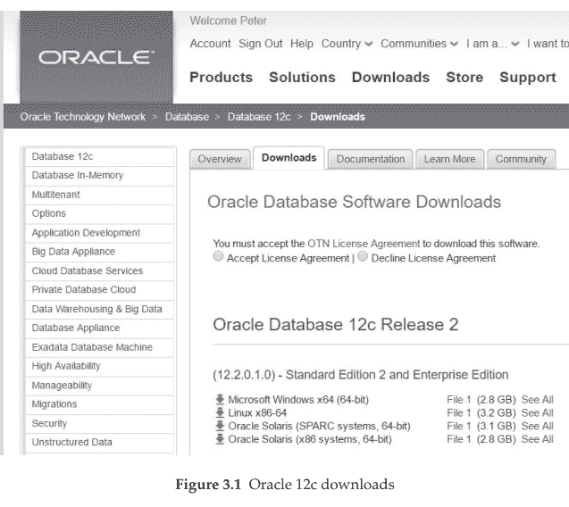

- 安装并解压 x64 文件后，确保两个文件位于相同位置：

  

- 对于 Windows 7 PC 有额外的步骤：

  1. 打开 `winx64_12c_database_2of2` 目录
  2. 复制 `winx64_12c_database_2of2\database\stage\Components` 目录下的所有文件
  3. 将所有文件粘贴到 `winx64_12c_database_1of2\database\stage\Components`

- 进入 `winx64_12102_database_1of2` 并运行 `setup.exe` 文件：

  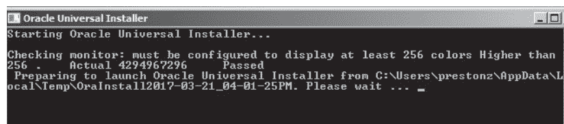

  图 3.3 运行设置文件

- 选择语言：

  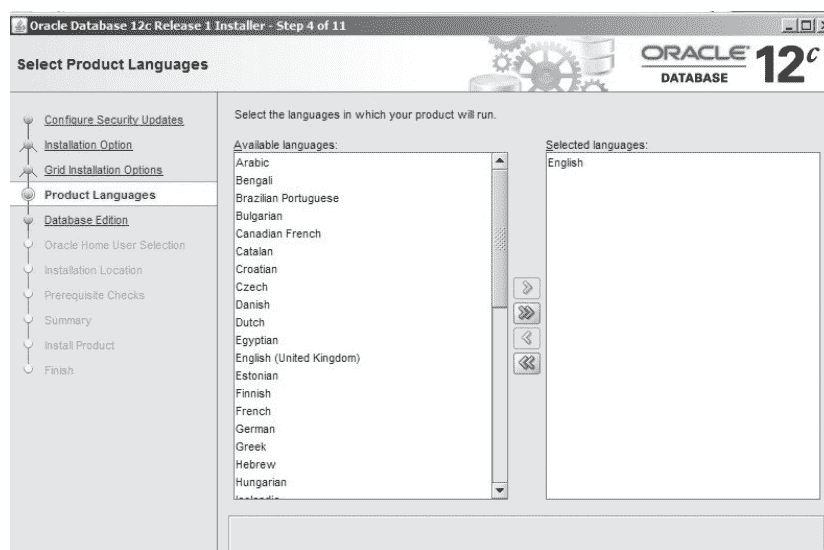

  图 3.4 选择语言


# 第3章 Oracle、SQL Server 和 MySQL 的安装

## 选择数据库版本

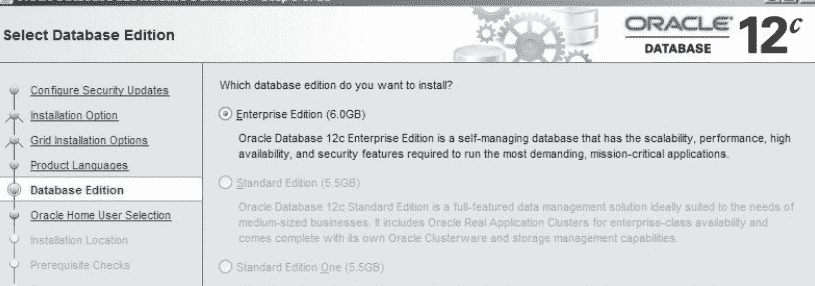

图 3.5 选择数据库版本

## 选择“使用 Windows 内置账户（Use Windows Built-in Account）”

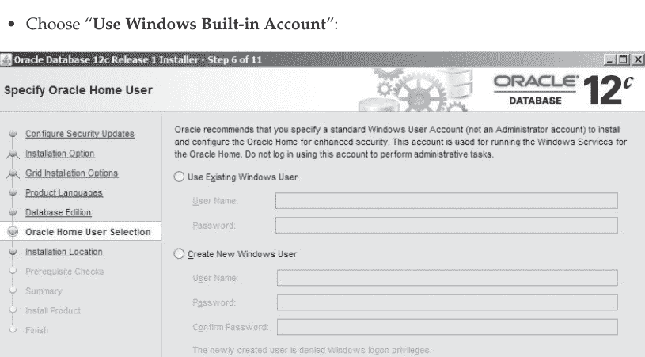

图 3.6 Windows 内置账户

针对以下警告消息点击“是（Yes）”：

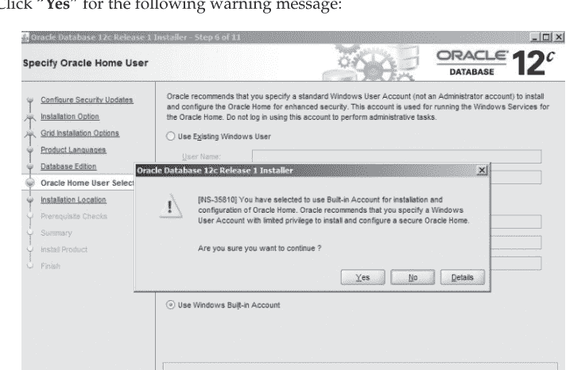

图 3.7 警告消息

## 选择安装位置

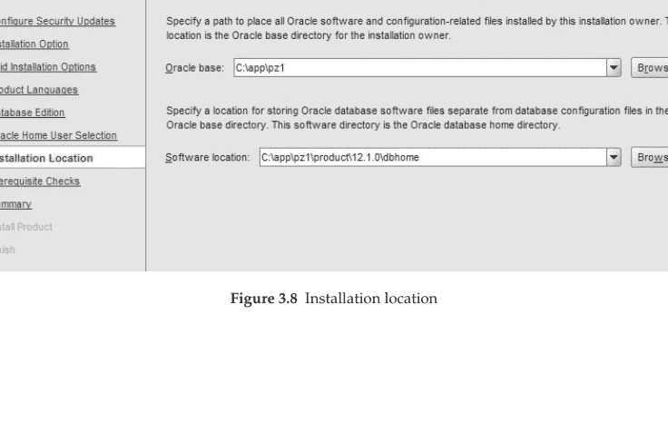

图 3.8 安装位置

## 摘要

- 在摘要页点击“下一步（Next）”安装 Oracle 12c：

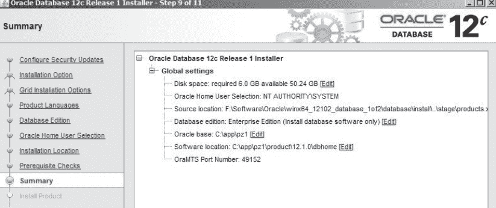

图 3.9 摘要

- 安装完成后，你可以安装 Oracle SQL Developer。详细步骤在下一章。

## SQL Server 2016 的安装

SQL Server 2016 的安装非常直观。每次安装都会在你的计算机上创建一个 SQL 实例。

- 进入 SQL Server 2016 开发者版下载页：`https://www.microsoft.com/en-us/sql-server/application-development`
- 下载 SQL Server 2016 开发者版 (x64)。

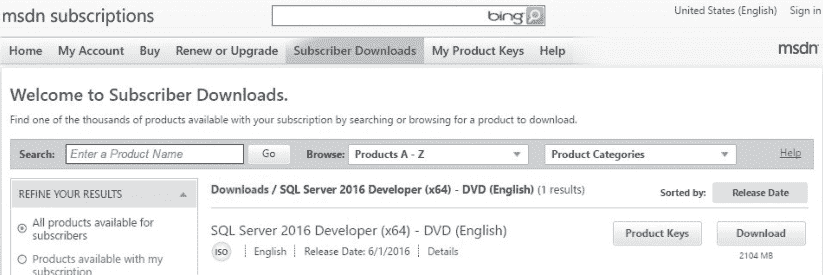

图 3.10 SQL Server 2016 下载

- 点击 `setup.exe` 运行安装文件。

| SQL Server 安装中心 | 硬件和软件要求 |
|---|---|
| 计划 (Planning) | 查看硬件和软件要求 |
| 安装 (Installation) | 安全性 |
| 维护 (Maintenance) | 查看安全性 |
| 工具 (Tools) | 在线发行说明 |
| 资源 (Resources) | 查看有关发布的最新信息 |
| 高级 (Advanced) | 系统配置检查器 |
| 选项 (Options) | 启动工具检查阻止 SQL 成功安装的条件 |

图 3.11 运行设置文件

- 选择开发者版（Developer edition）。

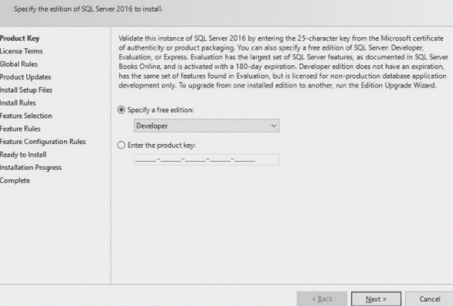

图 3.12 选择开发者版

- 接受许可条款。

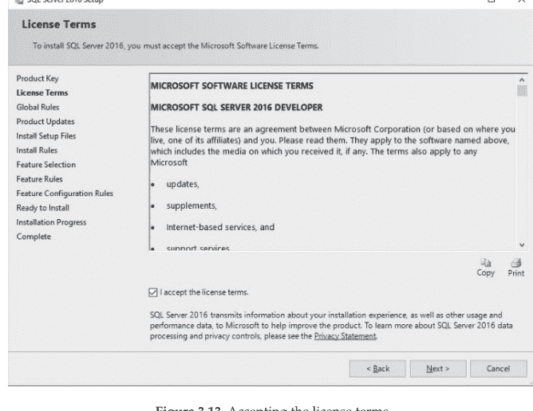

图 3.13 接受许可条款

- 选择功能（Features）：

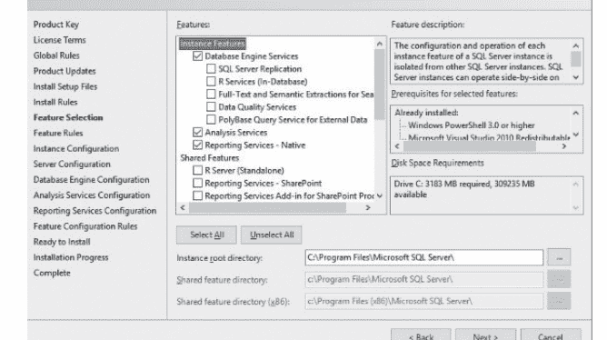

图 3.14 选择功能

- SQL Server 默认实例名：`SQL2016`。任何已安装的实例将在此显示。

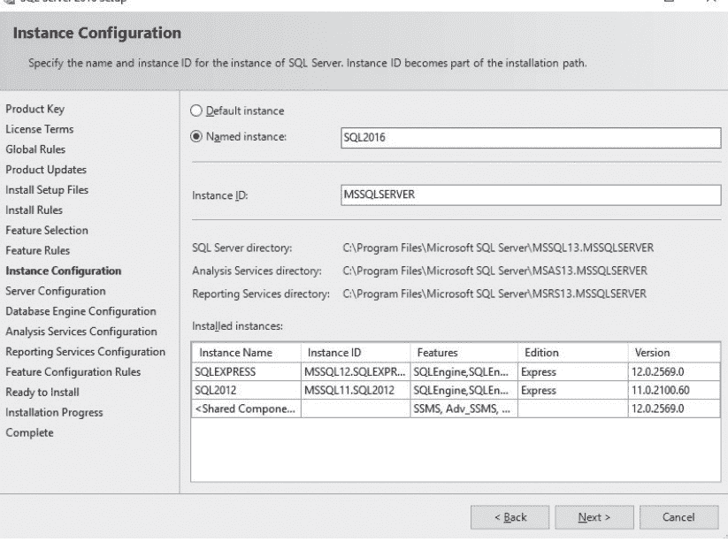

图 3.15 默认实例名

- 点击“添加当前用户（Add Current User）”设置管理员：

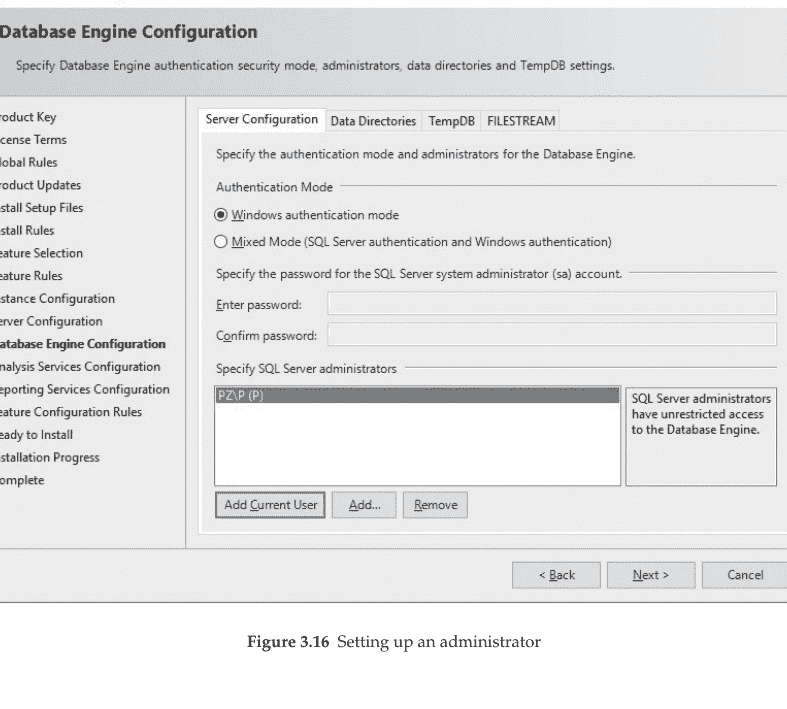

图 3.16 设置管理员

- 点击“下一步（Next）”按钮然后点击“安装（Install）”。验证要安装的 SQL Server 2016 功能。

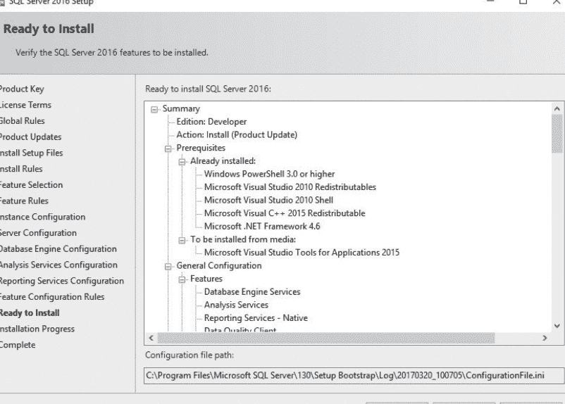

- 安装完成。

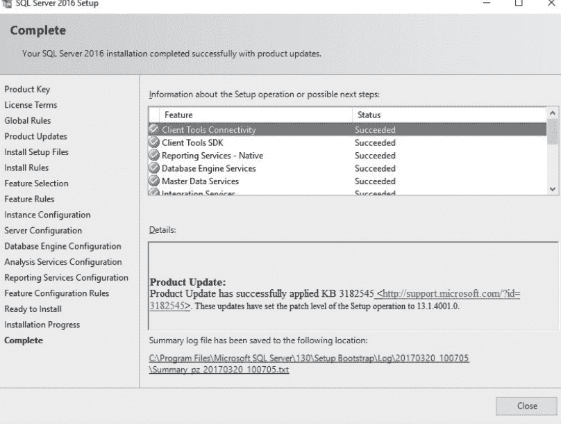

- 安装后你可以安装 SQL Server Studio。详细步骤在下一章。

## MySQL 的安装

- 进入 MySQL 安装页面：`https://dev.mysql.com/downloads/`
  > 注意：MySQL 安装程序是 32 位，但会安装 32 位和 64 位的二进制文件。

### 在线文档

- MySQL 文档和变更历史。请向我们报告观察到的任何 Bug 或不一致。感谢您的支持！

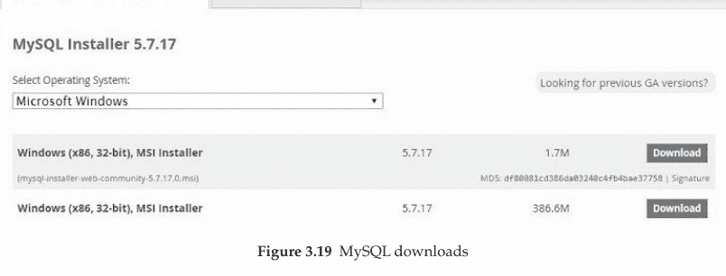

图 3.19 下载

- 选择 MySQL 企业版（Enterprise Edition）或标准版（Standard Edition）。

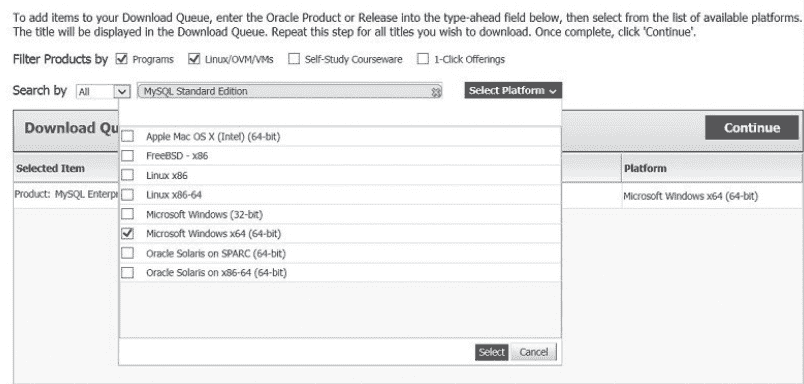

图 3.20 选择版本

- 选择适用于 Windows x64 标准版 (64位)。

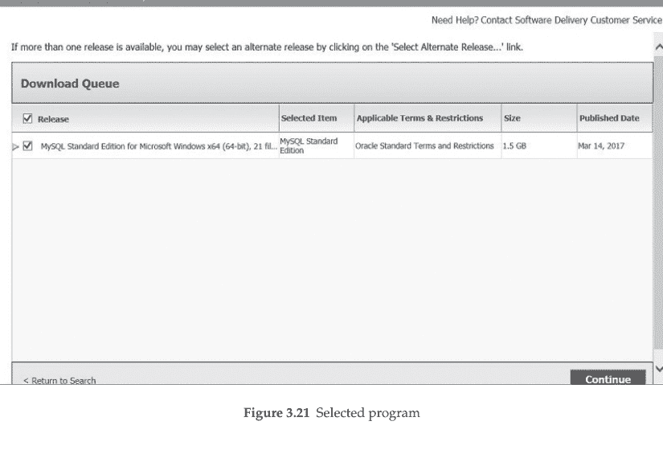

- 接受许可条款。


如果使用 Oracle 支持，选择“否（No）”。

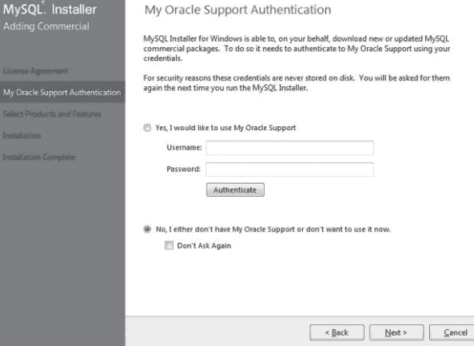

图 3.23 选择支持选项

你可以选择 MySQL 文档和示例：

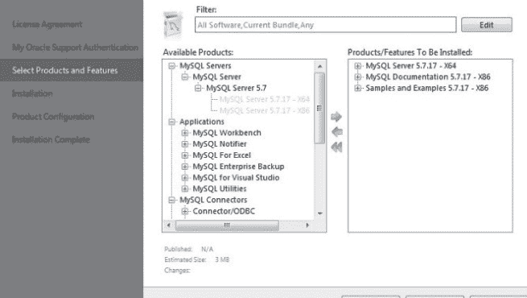

图 3.24 选择文档或示例

- 安装准备就绪。

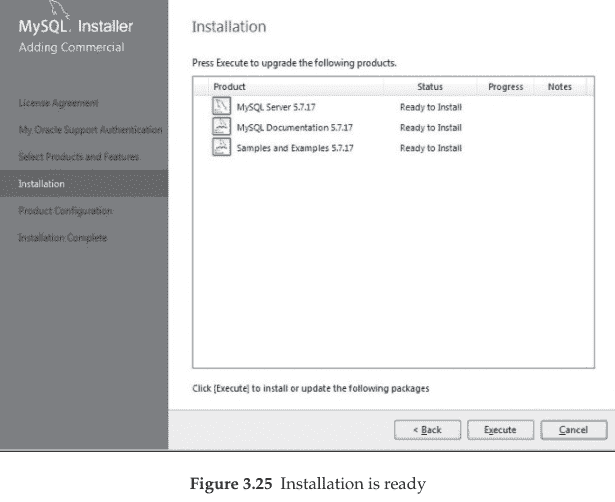

图 3.25 安装准备就绪。

- 保持默认服务器配置：

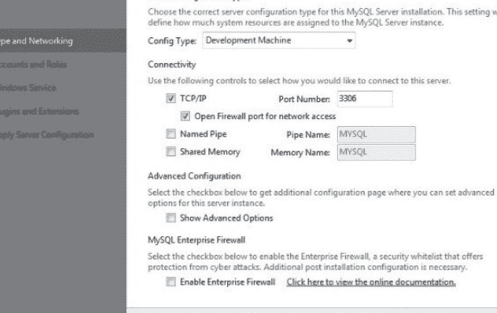

图 3.26 默认配置

- 输入 root 账户密码。记住此密码，你将用它登录 MySQL 服务器。如果你想添加用户，可以点击“添加用户（Add User）”。

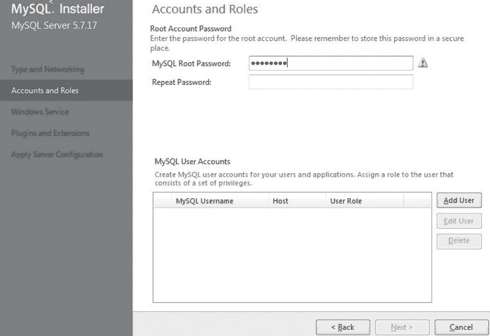

图 3.27 输入密码

- 输入密码查看是否正常工作。

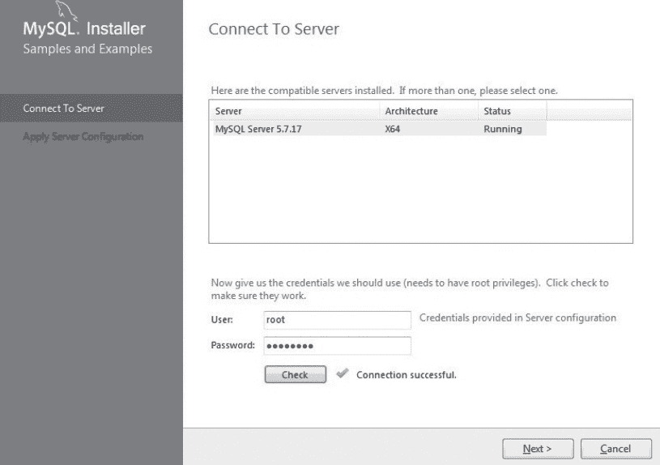

- 安装后你可以安装 MySQL Workbench。详细步骤在下一章。

## 总结

- 最低要求
- 如何安装 Oracle 12c
- 如何安装 SQL Server 2016
- 如何安装 MySQL 5.7

在下一章中你将为这三个系统安装开发工具。

## 练习

### 3.1

按照本章说明在计算机上安装 Oracle 12c 或 SQL Server 2016 或 MySQL 5.7。

# 第4章 开发工具

有很多开发工具可用：命令行工具和图形工具。命令行工具包括 SQL Plus 和 MySQL Client。图形工具包括 Oracle SQL Developer、SQL Server Management Studio 和 MySQL Workbench。

## 命令行工具

### Oracle SQL Plus

- 进入开始 -> OracleDB12Home1 -> SQL Plus

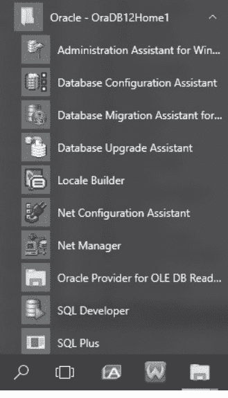

图 4.1 启动 SQL Plus

访问内置数据库 HR，输入 HR 模式的用户名和密码。

```text
Enter user-name: hr
Enter password: xx（如果你忘记了密码可以重置）
```

```
*Plus: Release 12.1.0.2 Production on Mon Apr 10 2017
Copyright (c) 1982, 2014, Oracle. All rights reserved.
Enter user-name: hr
Enter password:
Last Successful login time: Mon Apr 10 2017 10:32:50 -0400
Connected to:
Oracle Database 12c Enterprise Edition Release 12.1.0.2 - 64bit Production
With the Partitioning, OLAP, Advanced Analytics and Real Application Testing options
SQL>
```

图 4.2 SQL 提示符

要查看 Employees 表结构，输入：

```sql
DESCRIBE Employees;
```

| Name | Null? | Type |
| --- | --- | --- |
| EMPLOYEE_ID | NOT NULL | NUMBER(6) |
| FIRST_NAME | | VARCHAR(20) |
| LAST_NAME | NOT NULL | VARCHAR(25) |
| EMAIL | NOT NULL | VARCHAR(25) |
| PHONE_NUMBER | | VARCHAR(20) |
| HIRE_DATE | NOT NULL | DATE |
| JOB_ID | NOT NULL | VARCHAR2(10) |
| SALARY | | NUMBER(8,2) |
| COMMISSION_PCT | | NUMBER(2,2) |
| MANAGER_ID | | NUMBER(6) |
| DEPARTMENT_ID | | NUMBER(4) |

```
SQL> DESCRIBE Employees;
```

图 4.3 测试 SQL 语句

输入 “EXIT” 退出 SQL 提示符。

### MySQL 命令行客户端

- 点击“开始” -> MySQL -> MySQL 5.7 命令行客户端（第二个 MySQL 5.7 命令行客户端用于 Unicode）

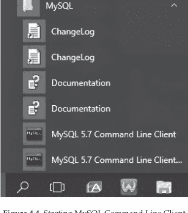

图 4.4 启动 MySQL 命令行客户端

- 输入 MySQL root 密码（在安装 MySQL 5.7 时设置的密码）

```
MySQL 5.7 Command Line Client
Enter password: ********
Welcome to the MySQL monitor. Commands end with ; or \
Your MySQL connection id is 10
Server version: 5.7.17-enterprise-commercial-advanced-log MySQL Enterprise Server
Copyright (c) 2000, 2016, Oracle or its affiliates. All rights reserved.
Oracle is a registered trademark of Oracle Corporation/or its affiliates. Other names may be trademarks of their respective owners.
Type 'help;' or '\h' for help. Type '\c' to clear the current input statement.
mysql>
```

图 4.5 MySQL 提示符

另一种启动 MySQL 提示符的方法：

输入 `C:\Program Files\MySQL\MySQL Server 5.7\bin\mysql -u root -p`

```
C:\Program Files\MySQL\MySQL Server 5.7\bin>mysql -u root -p
Enter password: ********
Welcome to the MySQL monitor. Commands end with ; \
Your MySQL connection id is 9
Server version: 5.7.17-enterprise-commercial-advanced-log MySQL Enterprise Server

Copyright (c) 2000, 2010, Oracle and/or its affiliates. All rights reserved.
Oracle is a registered trademark of Oracle Corporation and/or its
affiliates. Other names may be trademarks of their respective
owners.
Type 'help'; or '\h' for help. Type '\c' to clear the current input statement.
mysql>
```

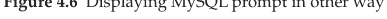

- 在 MySQL 提示符下输入 "SHOW databases"。

```
mysql> SHOW databases;
+------------------------------------+
| Database                           |
+------------------------------------+
| information_schema                 |
| hr                                 |
| mysql                              |
| performance_schema                 |
| sakila                             |
| sample                             |
| sys                                |
| world                              |
+------------------------------------+
 8 rows in set (0.03 sec)

mysql>
```

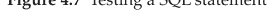

## 图形用户界面工具

### Oracle SQL Developer 安装

- 通过以下链接下载 Oracle SQL Developer：`http://www.oracle.com/technetwork/developer-tools/sql-developer/downloads/index.html`
- 启动 Oracle SQL Developer：

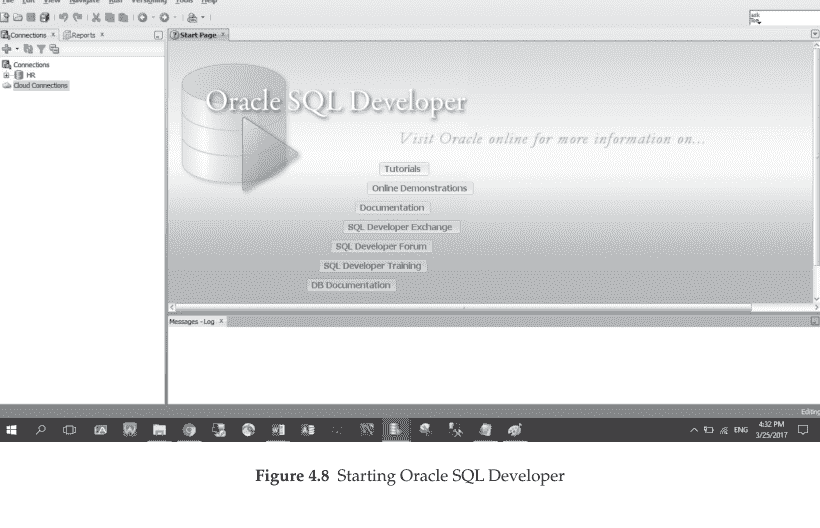

图 4.8 启动 Oracle SQL Developer

Oracle 有许多内置模式（schemas）。在这里我们使用 Oracle 内置的 HR 模式来建立连接：

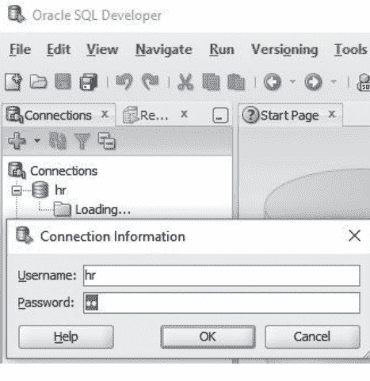

图 4.9 输入用户名和密码

- 输入密码后点击 OK 按钮。
- SQL Developer 在左侧打开“连接”（Connections）面板，在右侧打开“SQL 工作表”（SQL worksheet）。

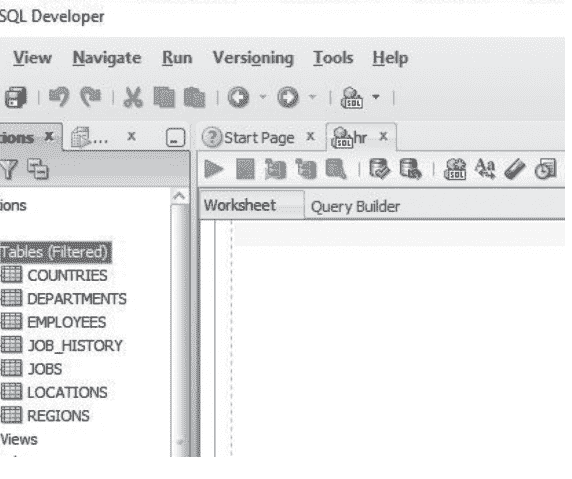

图 4.10 连接面板

- 在工作表上输入 `DESCRIBE Employees;` 然后点击运行语句按钮（绿色三角形）。你可以看到我们得到了与 SQL Plus 命令行相同的的结果。

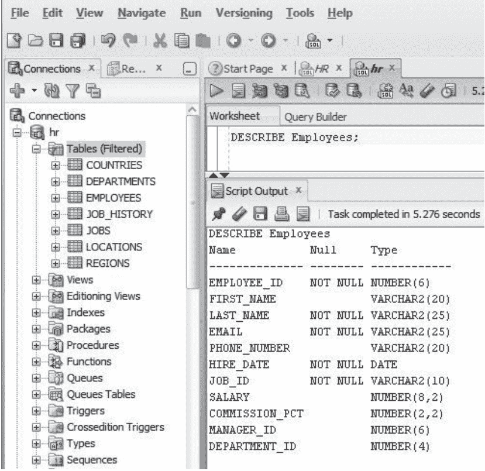

图 4.11 Oracle SQL Developer : hr

### SQL Server Management Studio 安装

- 从 SQL Server 2016 开始，服务器和管理工具是分离的。
- 进入 SQL Server 2016 Management Studio 下载页面：
  `https://docs.microsoft.com/en-us/sql/ssms/download-sql-server-management-studio-ssms`

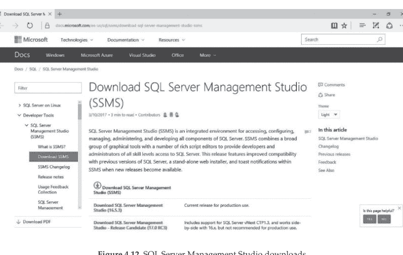

图 4.12 SQL Server Management Studio 下载

- 下载完成后启动 `setup.exe` 文件。

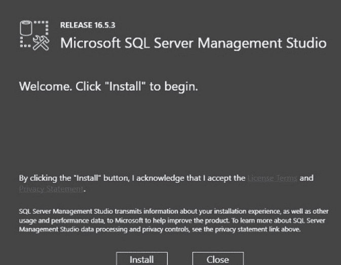

图 4.13 启动安装文件

- 安装完成后，启动 SQL Server Management Studio：

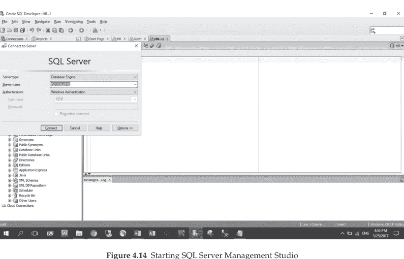

- 检查服务器名称然后点击连接（Connect）。SQL Server Management Studio 左侧有“对象资源管理器”（Object Explorer）面板。你可以浏览数据库、表、列和其他类型的对象。点击“新建查询”（New Query）按钮进入查询。
- 在工作表上输入 `DESCRIBE Employees;` 然后点击运行语句按钮（绿色三角形）。你可以看到我们得到了与 SQL Plus 命令行相同的的结果。


图 4.14 Oracle SQL Developer : hr


# SQL Server Management Studio 安装

从 SQL Server 2016 开始，服务器和管理工具是分离的。

## 下载与安装

1. 进入 SQL Server 2016 Management Studio 下载页面：
   https://docs.microsoft.com/en-us/sql/ssms/download-sql-server-management-studio-ssms

   

2. 下载完成后启动 `setup.exe` 文件。

   

3. 安装完成后，启动 SQL Server Management Studio。

   

## 连接与使用

- 检查服务器名称然后点击“连接”（Connect）。SQL Server Management Studio 左侧有“对象资源管理器”（Object Explorer）面板，可用于浏览数据库、表、列和其他类型的对象。
- 点击“新建查询”（New Query）按钮进入查询编辑器。
- 在工作表上输入 `DESCRIBE Employees;` 然后点击运行语句按钮（绿色三角形）。你可以看到我们得到了与 SQL Plus 命令行相同的结果。

## Oracle SQL Developer 对比

Oracle SQL Developer : hr


- 在工作表上输入 `DESCRIBE Employees;` 然后点击运行语句按钮（绿色三角形）。你可以看到我们得到了与 SQL Plus 命令行相同的结果。
- 输入密码后点击 `OK` 按钮。
- SQL Developer 在左侧打开“连接”面板，在右侧打开“SQL 工作表”。

> **注意**：原文中包含大量重复的操作步骤描述，已在整理时去除冗余，保留核心流程。


# 第 4 章 数据库开发工具

## MySQL 命令行客户端

- 点击“开始” -> MySQL -> MySQL 5.7 命令行客户端（第二个 MySQL 5.7 命令行客户端用于 Unicode）


图 4.4 启动 MySQL 命令行客户端

- 输入 MySQL root 密码（在安装 MySQL 5.7 时设置的密码）

```
MySQL 5.7 Command Line Client
Enter password: *************
Welcome to the MySQL monitor. Commands end with ; or \
Your MySQL connection id is 10
Server version: 5.7.17-enterprise-commercial-advanced-log MySQL Enterprise Server
Copyright (c) 2000, 2016, Oracle or its affiliates. All rights reserved.
Oracle is a registered trademark of Oracle Corporation/or its affiliates. Other names may be trademarks of their respective owners.
Type 'help;' or '\h' for help. Type '\c' to clear the current input statement.
mysql>
```

图 4.5 MySQL 提示符

另一种启动 MySQL 提示符的方法：

输入 `C:\Program Files\MySQL\MySQL Server 5.7\bin\mysql -u root -p`

```
C:\Program Files\MySQL\MySQL Server 5.7\bin>mysql -u root -p
Enter password: ********
Welcome to the MySQL monitor. Commands end with ; \
Your MySQL connection id is 9
Server version: 5.7.17-enterprise-commercial-advanced-log MySQL Enterprise Server

Copyright (c) 2000, 2010, Oracle and/or its affiliates. All rights reserved.
Oracle is a registered trademark of Oracle Corporation and/or its
affiliates. Other names may be trademarks of their respective
owners.
Type 'help'; or '\h' for help. Type '\c' to clear the current input statement.
mysql>
```


- 在 MySQL 提示符下输入 `SHOW databases`。

```
mysql> SHOW databases;
+------------------------------------+
| Database                           |
+------------------------------------+
| information_schema                 |
| hr                                 |
| mysql                              |
| performance_schema                 |
| sakila                             |
| sample                             |
| sys                                |
| world                              |
+------------------------------------+
 8 rows in set (0.03 sec)

mysql>
```


## 图形用户界面工具

### Oracle SQL Developer 安装

- 通过以下链接下载 Oracle SQL Developer：`http://www.oracle.com/technetwork/developer-tools/sql-developer/downloads/index.html`

- 启动 Oracle SQL Developer：


图 4.8 启动 Oracle SQL Developer

Oracle 许多内置模式（schemas）。在这里我们使用 Oracle 内置的 HR 模式来建立连接：


图 4.9 输入用户名和密码

- 输入密码后点击 OK 按钮。

- SQL Developer 在左侧打开“连接”（Connections）面板，在右侧打开“SQL 工作表”（SQL worksheet）。


图 4.10 连接面板

- 在工作表上输入 `DESCRIBE Employees;` 然后点击运行语句按钮（绿色三角形）。你可以看到我们得到了与 SQL Plus 命令行相同的的结果。

Oracle SQL Developer : hr


### SQL Server Management Studio 安装

- 从 SQL Server 2016 开始，服务器和管理工具是分离的。

- 进入 SQL Server 2016 Management Studio 下载页面：

`https://docs.microsoft.com/en-us/sql/ssms/download-sql-server-management-studio-ssms`


图 4.12 SQL Server Management Studio 下载

- 下载完成后启动 `setup.exe` 文件。


图 4.13 启动安装文件

- 安装完成后，启动 SQL Server Management Studio：


- 检查服务器名称然后点击连接（Connect）。SQL Server Management Studio 左侧有“对象资源管理器”（Object Explorer）面板。你可以浏览数据库、表、列和其他类型的对象。点击“新建查询”（New Query）按钮进入查询。

---

# 第 5 章 数据定义语言 (DDL)

## 使用 GUI 工具创建数据库

### 在 GUI 中创建数据库 (MySQL)

2. 执行查询并刷新 SCHEMAS。

3. 在导航器面板中创建了 test_db 数据库。

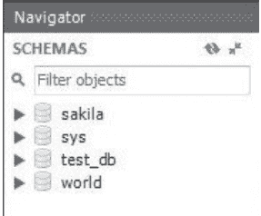

图 5.2 在 MySQL 中创建数据库

### 在 GUI 中创建数据库 (Oracle)

- 安装后，使用数据库配置助手（Database Configuration Assistant）创建数据库。

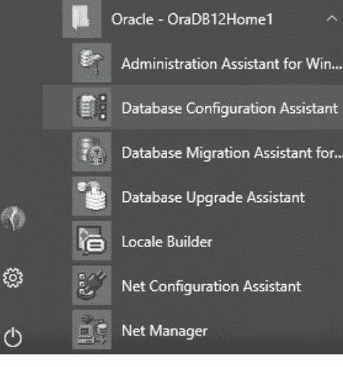

图 5.3 数据库配置助手

### 在 GUI 中创建数据库 (SQL Server)

- 右键点击 Database 并输入数据库：Car

- 点击 OK

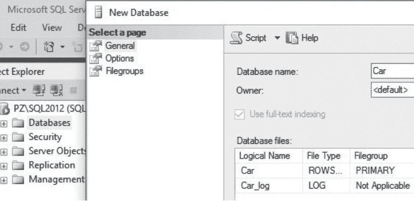

图 5.4 在 GUI 中创建数据库 (SQL Server)

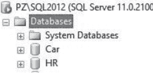

图 5.5 数据库“CAR”已创建

### 在 GUI 中创建数据库 (MySQL)

- 右键点击任意 schema 并选择 Create Schema

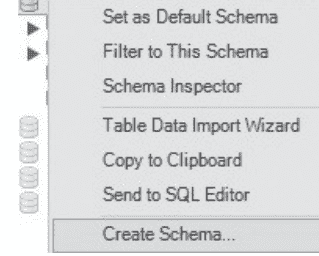

图 5.6 在 GUI 中创建数据库 (MySQL)

输入 schema 名称‘hr’并点击 Apply

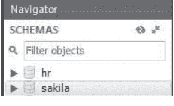

图 5.7 输入数据库 (schema) 名称

## 删除数据库 (Dropping a Database)

**描述：** 删除数据库。小心删除数据库或表。如果你没有备份数据库，可能会丢失重要数据！

语法 (Oracle)

```
DROP USER User_Name;
```

语法 (T-SQL & MySQL)

```
DROP DATABASE Database_Name;
```

表 5.2 删除数据库

| Oracle | T-SQL | MySQL |
| --- | --- | --- |
| DROP USER TEST_DB; | DROP DATABASE HR; Command(s) completed successfully. | DROP DATABASE hr; 0 row(s) affected. |

## 创建表 (Creating a Table)

我们也可以通过两种方式创建表：

1. 使用 SQL 命令
2. 使用图形用户界面工具

注意：

- 本书中所有的 Oracle 表都在一个用户账户中创建。
- 所有的 T-SQL 表都在 HR 数据库中创建。
- 所有的 MySQL 表都在 hr schema（数据库）中创建。

### 1. 使用 SQL 命令创建表

语法

```
CREATE TABLE Table_Name;
```

### 创建 Regions 表

表 5.3 创建 Regions 表的命令

| Oracle SQL | T-SQL & MySQL |
|--- |--- |
| CREATE TABLE Regions | CREATE TABLE regions |
| ( | ( |
| Region_id NUMBER NOT NULL, | region_id NUMBER NOT NULL, |
| Region_name VARCHAR2(25), | region_name VARCHAR(25), |
| PRIMARY KEY (Regions_ID) | PRIMARY KEY (Regions_ID) |
| ); | ) |

### 创建 Country 表

表 5.4 创建 Country 表的命令

| Oracle SQL | T-SQL & MySQL |
|--- |--- |
| CREATE TABLE Country | CREATE TABLE Country |
| ( | ( |
| Country_id CHAR (2) NOT NULL, | country_id CHAR (2) NOT NULL, |
| Country_name VARCHAR2(40), | country_name VARCHAR(40), |
| Region_id NUMBER, | region_id small |
| PRIMARY KEY (country_id), | PRIMARY KEY (country_id), |
| CONSTRAINT FK_RegCountry | CONSTRAINT FK_RegCountry |
| FOREIGN KEY (region_id) | FOREIGN KEY (region_id) |
| REFERENCES Regions (Regions_ID) | REFERENCES Regions (Regions_id) |
| ); | ) |

### 创建 Departments 表

表 5.5 创建 Departments 表的命令

| Oracle SQL | T-SQL & MySQL |
|--- |--- |
| CREATE TABLE Departments | CREATE TABLE Departments |
| ( | ( |
| Dept_id NUMBER (4) NOT NULL, | dept_id NUMBER (4) NOT NULL, |
| Dept_name VARCHAR2(30), | dept_name VARCHAR(30), |
| Manager_id NUMBER (6), | manager_id NUMBER (6), |
| Location_id NUMBER (4), | location_id NUMBER (4), |
| PRIMARY KEY (dept_ID), | PRIMARY KEY (dept_ID), |
| CONSTRAINT FK_LocDept | CONSTRAINT FK_LocDept |
| FOREIGN KEY (location_id) | FOREIGN KEY (location_id) |
| REFERENCES Locations (location_ID) | REFERENCES Locations (location_id) |
| ); | ) |

### 创建 Employees 表

表 5.6 创建 Employees 表的命令

| Oracle SQL | T-SQL & MySQL |
|--- | --- |
| CREATE TABLE Employees | CREATE TABLE employees |
| ( | ( |
| Employee_ID NUMBER(6) NOT NULL, | Employee_ID int NOT NULL, |
| First_Name VARCHAR(20), | First_NAME varchar(20), |
| Last_Name VARCHAR(25), | Last_Name varchar(25), |
| Email VARCHAR(25), | Email varchar(25), |
| Phone VARCHAR(20), | Phone varchar(20), |
| Hire_Date DATE, | Hire_Date date, |
| Job_ID VARCHAR(10), | Job_ID varchar(10), |
| Salary NUMBER(6), | Salary decimal(6,2), |
| Manager_ID NUMBER(6), | Manager_ID decimal(6), |
| Dept_ID NUMBER(4), | Dept_ID small, |
| PRIMARY KEY (Employee_ID), | PRIMARY KEY (Employee_ID), |
| CONSTRAINT FK_DepEmp | CONSTRAINT FK_DepEmp |
| FOREIGN KEY (Dept_ID) | FOREIGN KEY (Dept_ID) |
| REFERENCES Dept (Dept_ID) | REFERENCES Dept (Dept_ID) |
| ); | ) |

### 创建 Locations 表

表 5.7 创建 Locations 表的命令

| Oracle SQL | T-SQL & MySQL |
|--- | --- |
| CREATE TABLE Locations | CREATE TABLE Locations |
| ( | ( |
| Location_id NUMBER(4) NOT NULL, | location_id NUMBER(4) NOT NULL, |
| Street_address VARCHAR2(40), | street_address VARCHAR(40), |
| Postal_code VARCHAR(12), | postal_code VARCHAR(12), |
| City VARCHAR(30), | city VARCHAR(30), |


## 创建 Locations 表

表 5.7 创建 Locations 表的命令

| Oracle SQL | T-SQL & MySQL |
|---|---|
| CREATE TABLE Locations | CREATE TABLE Locations |
| ( | ( |
| Location_id NUMBER(4) NOT NULL, | location_id NUMBER(4) NOT NULL, |
| Street_address VARCHAR2(40), | street_address VARCHAR(40), |
| Postal_code VARCHAR(12), | postal_code VARCHAR(12), |
| City VARCHAR(30), | city VARCHAR(30), |
| State_province VARCHAR(25), | state_province VARCHAR(25), |
| Country_id CHAR(2), | country_id CHAR(2), |
| PRIMARY KEY (location_id), | PRIMARY KEY (location_id), |
| CONSTRAINT FK_Country | CONSTRAINT FK_Country |
| FOREIGN KEY (country_id) | FOREIGN KEY (country_id) |
| REFERENCES Countries (Country_id) | REFERENCES Countries (country_id) |
| ); | ) |

## 创建 Job 表

表 5.8 创建 Job 表的命令

| Oracle SQL | T-SQL & MySQL |
|---|---|
| CREATE TABLE Job | CREATE TABLE Job |
| ( | ( |
| Job_id VARCHAR(10) NOT NULL, | job_id varchar(10) NOT NULL, |
| Job_title VARCHAR(35), | job_title varchar(35), |
| Min_salary NUMBER(6), | min_salary decimal(6), |
| Max_salary NUMBER(6), | max_salary decimal(6), |
| PRIMARY KEY (Job_id) | PRIMARY KEY (job_id) |
| ); | ) |

## 使用 GUI 工具创建表

### 在 GUI 中创建表 (Oracle)

- 右键点击任意 schema 并选择 Create Schema


图 5.6 在 GUI 中创建数据库 (MySQL) - *注：此处原文描述与图片编号不符，已按原文文字翻译*

输入 schema 名称 ‘hr’并点击 Apply


图 5.7 输入数据库 (schema) 名称

### 在 GUI 中创建表 (SQL Server)

- 右键点击 Database 并输入数据库 Name: Car
- 点击 OK


图 5.4 在 GUI 中创建数据库 (SQL Server)


图 5.5 数据库“CAR”已创建

### 在 GUI 中创建表 (MySQL)

- 右键点击任意 schema 并选择 Create Schema


图 5.6 在 GUI 中创建数据库 (MySQL)

输入 schema 名称 ‘hr’并点击 Apply


图 5.7 输入数据库 (schema) 名称

## 删除数据库 (Dropping a Database)

**描述：** 删除数据库。小心删除数据库或表。如果你没有备份数据库，可能会丢失重要数据！

语法 (Oracle)

```
DROP USER User_Name;
```

语法 (T-SQL & MySQL)

```
DROP DATABASE Database_Name;
```

表 5.2 删除数据库

| Oracle | T-SQL | MySQL |
|---|---|---|
| DROP USER TEST_DB; | DROP DATABASE HR; Command(s) completed successfully. | DROP DATABASE hr; 0 row(s) affected. |

## 创建表 (Creating a Table)

我们也可以通过两种方式创建表：

1. 使用 SQL 命令
2. 使用图形用户界面工具

注意：

- 本书中所有的 Oracle 表都在一个用户账户中创建。
- 所有的 T-SQL 表都在 HR 数据库中创建。
- 所有的 MySQL 表都在 hr schema（数据库）中创建。

### 1. 使用 SQL 命令来创建表

语法

```
CREATE TABLE Table_Name;
```

### 创建 Regions 表

表 5.3 创建 Regions 表的命令

| Oracle SQL | T-SQL & MySQL |
|---|---|
| CREATE TABLE Regions | CREATE TABLE regions |
| ( | ( |
| Region_id NUMBER NOT NULL, | region_id NUMBER NOT NULL, |
| Region_name VARCHAR2(25), | region_name VARCHAR(25), |
| PRIMARY KEY (Regions_ID) | PRIMARY KEY (Regions_ID) |
| ); | ) |

### 创建 Country 表

表 5.4 创建 Country 表的命令

| Oracle SQL | T-SQL & MySQL |
|---|---|
| CREATE TABLE Country | CREATE TABLE Country |
| ( | ( |
| Country_id CHAR (2) NOT NULL, | country_id CHAR (2) NOT NULL, |
| Country_name VARCHAR2(40), | country_name VARCHAR(40), |
| Region_id NUMBER, | region_id small |
| PRIMARY KEY (country_id), | PRIMARY KEY (country_id), |
| CONSTRAINT FK_RegCountry | CONSTRAINT FK_RegCountry |
| FOREIGN KEY (region_id) | FOREIGN KEY (region_id) |
| REFERENCES Regions (Regions_ID) | REFERENCES Regions (Regions_id) |
| ); | ) |

### 创建 Departments 表

表 5.5 创建 Departments 表的命令

| Oracle SQL | T-SQL & MySQL |
|---|---|
| CREATE TABLE Departments | CREATE TABLE Departments |
| ( | ( |
| Dept_id NUMBER (4) NOT NULL, | dept_id NUMBER (4) NOT NULL, |
| Dept_name VARCHAR2(30), | dept_name VARCHAR(30), |
| Manager_id NUMBER (6), | manager_id NUMBER (6), |
| Location_id NUMBER (4), | location_id NUMBER (4), |
| PRIMARY KEY (dept_ID), | PRIMARY KEY (dept_ID), |
| CONSTRAINT FK_LocDept | CONSTRAINT FK_LocDept |
| FOREIGN KEY (location_id) | FOREIGN KEY (location_id) |
| REFERENCES Locations (location_ID) | REFERENCES Locations (location_id) |
| ); | ) |

### 创建 Employees 表

表 5.6 创建 Employees 表的命令

| Oracle SQL | T-SQL & MySQL |
|---|---|
| CREATE TABLE Employees | CREATE TABLE employees |
| ( | ( |
| Employee_ID NUMBER(6) NOT NULL, | Employee_ID int NOT NULL, |
| First_Name VARCHAR(20), | First_NAME varchar(20), |
| Last_Name VARCHAR(25), | Last_Name varchar(25), |
| Email VARCHAR(25), | Email varchar(25), |
| Phone VARCHAR(20), | Phone varchar(20), |
| Hire_Date DATE, | Hire_Date date, |
| Job_ID VARCHAR(10), | Job_ID varchar(10), |
| Salary NUMBER(6), | Salary decimal(6,2), |
| Manager_ID NUMBER(6), | Manager_ID decimal(6), |
| Dept_ID NUMBER(4), | Dept_ID small, |
| PRIMARY KEY (Employee_ID), | PRIMARY KEY (Employee_ID), |
| CONSTRAINT FK_DepEmp | CONSTRAINT FK_DepEmp |
| FOREIGN KEY (Dept_ID) | FOREIGN KEY (Dept_ID) |
| REFERENCES Dept (Dept_ID) | REFERENCES Dept (Dept_ID) |
| ); | ) |

### 创建 Locations 表

表 5.7 创建 Locations 表的命令

| Oracle SQL | T-SQL & MySQL |
|---|---|
| CREATE TABLE Locations | CREATE TABLE Locations |
| ( | ( |
| Location_id NUMBER(4) NOT NULL, | location_id NUMBER(4) NOT NULL, |
| Street_address VARCHAR2(40), | street_address VARCHAR(40), |
| Postal_code VARCHAR(12), | postal_code VARCHAR(12), |
| City VARCHAR(30), | city VARCHAR(30), |
| State_province VARCHAR(25), | state_province VARCHAR(25), |
| Country_id CHAR(2), | country_id CHAR(2), |
| PRIMARY KEY (location_id), | PRIMARY KEY (location_id), |
| CONSTRAINT FK_Country | CONSTRAINT FK_Country |
| FOREIGN KEY (country_id) | FOREIGN KEY (country_id) |
| REFERENCES Countries (Country_id) | REFERENCES Countries (country_id) |
| ); | ) |

### 创建 Job 表

表 5.8 创建 Job 表的命令

| Oracle SQL | T-SQL & MySQL |
|---|---|
| CREATE TABLE Job | CREATE TABLE Job |
| ( | ( |
| Job_id VARCHAR(10) NOT NULL, | job_id varchar(10) NOT NULL, |
| Job_title VARCHAR(35), | job_title varchar(35), |
| Min_salary NUMBER(6), | min_salary decimal(6), |
| Max_salary NUMBER(6), | max_salary decimal(6), |
| PRIMARY KEY (Job_id) | PRIMARY KEY (job_id) |
| ); | ) |

### 使用 GUI 工具创建表

### 在 GUI 中创建表 (Oracle)

- 右键点击任意 schema 并选择 Create Schema


图 5.6 在 GUI 中创建数据库 (MySQL) - *注：此处原文描述与图片编号不符，已按原文文字翻译*

输入 schema 名称 ‘hr’并点击 Apply


图 5.7 输入数据库 (schema) 名称

### 在 GUI 中创建表 (SQL Server)

- 右键点击 Database 并输入数据库 Name: Car
- 点击 OK


图 5.4 在 GUI 中创建数据库 (SQL Server)


图 5.5 数据库“CAR”已创建

### 在 GUI 中创建表 (MySQL)

- 右键点击任意 schema 并选择 Create Schema


图 5.6 在 GUI 中创建数据库 (MySQL)

输入 schema 名称 ‘hr’并点击 Apply


图 5.7 输入数据库 (schema) 名称


# 第 5 章 数据定义语言 (DDL)

## 创建 Country 表

表 5.4 创建 Country 表的命令

| Oracle SQL | T-SQL & MySQL |
|---|---|
| `CREATE TABLE Country` | `CREATE TABLE Country` |
| `(` | `(` |
| `Country_id CHAR (2) NOT NULL,` | `country_id CHAR (2) NOT NULL,` |
| `Country_name VARCHAR2(40),` | `country_name VARCHAR(40),` |
| `Region_id NUMBER,` | `region_id small` |
| `PRIMARY KEY (country_id),` | `PRIMARY KEY (country_id),` |
| `CONSTRAINT FK_RegCountry` | `CONSTRAINT FK_RegCountry` |
| `FOREIGN KEY (region_id)` | `FOREIGN KEY (region_id)` |
| `REFERENCES Regions (Regions_ID)` | `REFERENCES Regions (Regions_id)` |
| `);` | `)` |

## 创建 Departments 表

表 5.5 创建 Departments 表的命令

| Oracle SQL | T-SQL & MySQL |
|---|---|
| `CREATE TABLE Departments` | `CREATE TABLE Departments` |
| `(` | `(` |
| `Dept_id NUMBER (4) NOT NULL,` | `dept_id NUMBER (4) NOT NULL,` |
| `Dept_name VARCHAR2(30),` | `dept_name VARCHAR(30),` |
| `Manager_id NUMBER (6),` | `manager_id NUMBER (6),` |
| `Location_id NUMBER (4),` | `location_id NUMBER (4),` |
| `PRIMARY KEY (dept_ID),` | `PRIMARY KEY (dept_ID),` |
| `CONSTRAINT FK_LocDept` | `CONSTRAINT FK_LocDept` |
| `FOREIGN KEY (location_id)` | `FOREIGN KEY (location_id)` |
| `REFERENCES Locations (location_ID)` | `REFERENCES Locations (location_id)` |
| `);` | `)` |

## 创建 Employees 表

表 5.6 创建 Employees 表的命令

| Oracle SQL | T-SQL & MySQL |
|---|---|
| `CREATE TABLE Employees` | `CREATE TABLE employees` |
| `(` | `(` |
| `Employee_ID NUMBER(6) NOT NULL,` | `Employee_ID int NOT NULL,` |
| `First_Name VARCHAR(20),` | `First_NAME varchar(20),` |
| `Last_Name VARCHAR(25),` | `Last_Name varchar(25),` |
| `Email VARCHAR(25),` | `Email varchar(25),` |
| `Phone VARCHAR(20),` | `Phone varchar(20),` |
| `Hire_Date DATE,` | `Hire_Date date,` |
| `Job_ID VARCHAR(10),` | `Job_ID varchar(10),` |
| `Salary NUMBER(6),` | `Salary decimal(6,2),` |
| `Manager_ID NUMBER(6),` | `Manager_ID decimal(6),` |
| `Dept_ID NUMBER(4),` | `Dept_ID small,` |
| `PRIMARY KEY (Employee_ID),` | `PRIMARY KEY (Employee_ID),` |
| `CONSTRAINT FK_DepEmp` | `CONSTRAINT FK_DepEmp` |
| `FOREIGN KEY (Dept_ID)` | `FOREIGN KEY (Dept_ID)` |
| `REFERENCES Dept (Dept_ID)` | `REFERENCES Dept (Dept_ID)` |
| `);` | `)` |

## 创建 Locations 表

表 5.7 创建 Locations 表的命令

| Oracle SQL | T-SQL & MySQL |
|---|---|
| `CREATE TABLE Locations` | `CREATE TABLE Locations` |
| `(` | `(` |
| `Location_id NUMBER(4) NOT NULL,` | `location_id NUMBER(4) NOT NULL,` |
| `Street_address VARCHAR2(40),` | `street_address VARCHAR(40),` |
| `Postal_code VARCHAR(12),` | `postal_code VARCHAR(12),` |
| `City VARCHAR(30),` | `city VARCHAR(30),` |
| `State_province VARCHAR(25),` | `state_province VARCHAR(25),` |
| `Country_id CHAR(2),` | `country_id CHAR(2),` |
| `PRIMARY KEY (location_id),` | `PRIMARY KEY (location_id),` |
| `CONSTRAINT FK_Country` | `CONSTRAINT FK_Country` |
| `FOREIGN KEY (country_id)` | `FOREIGN KEY (country_id)` |
| `REFERENCES Countries (Country_id)` | `REFERENCES Countries (country_id)` |
| `);` | `)` |

## 创建 Job 表

表 5.8 创建 Job 表的命令

| Oracle SQL | T-SQL & MySQL |
|---|---|
| `CREATE TABLE Job` | `CREATE TABLE Job` |
| `(` | `(` |
| `Job_id VARCHAR(10) NOT NULL,` | `job_id varchar(10) NOT NULL,` |
| `Job_title VARCHAR(35),` | `job_title varchar(35),` |
| `Min_salary NUMBER(6),` | `min_salary decimal(6),` |
| `Max_salary NUMBER(6),` | `max_salary decimal(6),` |
| `PRIMARY KEY (Job_id)` | `PRIMARY KEY (job_id)` |
| `);` | `)` |

## 在 GUI 工具中重命名表

### 1) Oracle

- 右键点击 `Departments` 表并选择 **表->重命名 (Rename)**

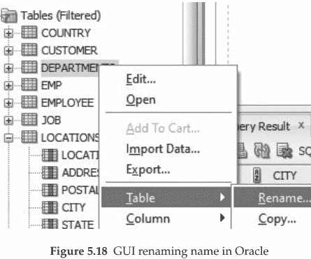

### 2) SQL Server

- 右键点击 `dbo.Departments` 并选择 **重命名 (Rename)**

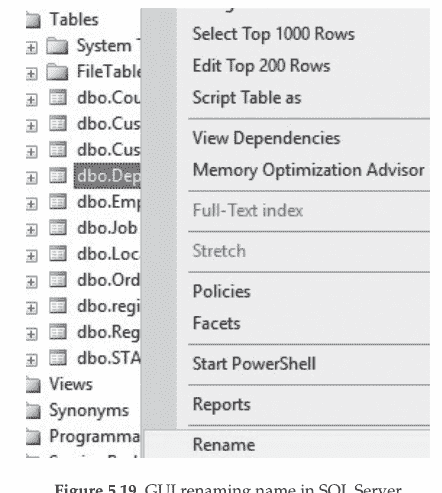

### 3) MySQL

- 右键点击 `departments` 表并选择 **修改表 (Alter Table...)**

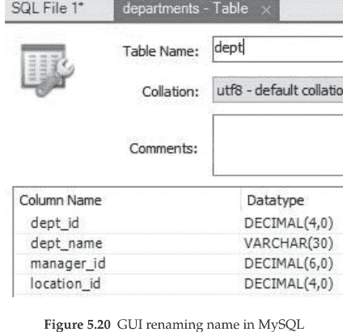

## 删除表

**描述：** 从数据库中删除表。

**语法**

```
DROP TABLE Table_Name;
```

**问题：** 编写删除 `Emp` 表的查询。

**答案：** `DROP TABLE Emp;`

表 5.9 删除命令的查询输出

| Oracle SQL | T-SQL | MySQL |
|---|---|---|
| table EMP dropped. | Command(s) completed successfully. | 0 row(s) affected. |

## 清空表

**描述：** 移除表中的所有记录。该操作无法回滚。

**语法**

```
TRUNCATE TABLE Table_Name;
```

**问题：** 编写移除 `Customers` 表中所有记录的查询。

**答案：** `TRUNCATE TABLE Customers;`

表 5.10 清空表后的查询输出

| Oracle SQL | T-SQL | MySQL |
|---|---|---|
| table CUSTOMERS truncated. | Command(s) completed successfully. | 0 row(s) affected. |

## 修改表结构（修改列）

**语法**

```
ALTER TABLE MODIFY Column Type (Oracle & MySQL)
ALTER TABLE ALTER COLUMN Column Type (T-SQL)
```

**问题：** 编写查询，将 `Salary` 列的类型从 `Number (6, 2)` 修改为 `Number (7, 2)`。

**答案 (Oracle):**

| COLUMN_NAME | DATA_TYPE |
|---|---|
| 1 ID | NUMBER(6,0) |
| 2 FIRSTNAME | VARCHAR2(15 BYTE) |
| 3 LASTNAME | VARCHAR2(15 BYTE) |
| 4 TITLE | VARCHAR2(20 BYTE) |
| 5 HIREDATE | DATE |
| 6 SALARY | NUMBER(7,2) |
| 7 DEPTNO | NUMBER(3,0) |
| 8 COMMISSION | NUMBER(6,2) |

图 5.21 在 Oracle 中修改表

**答案 (T-SQL):**

`ALTER TABLE EMPLOYEES ALTER COLUMN SALARY decimal (7, 2);`

| dbo.employee |
|---|
| Columns |
| ID (PK, int, not null) |
| FirstName (varchar(15), null) |
| LastName (varchar(15), null) |
| Title (varchar(20), null) |
| HireDate (date, null) |
| Salary (decimal(7,2), null) |
| DeptNo (smallint, null) |
| COMMISSION (decimal(6,2), null) |

图 5.22 在 T-SQL 中修改表

**答案 (MySQL):**

`ALTER TABLE EMPLOYEES MODIFY SALARY decimal (7, 2);`

| Information |
|---|
| Table: employee |
| Columns: |
| ID int(11) PK |
| FirstName varchar(15) |
| LastName varchar(15) |
| Title varchar(20) |
| HireDate date |
| SALARY decimal(7,2) |
| DeptNo smallint(6) |

图 5.23 在 MySQL 中修改表

## 修改表结构（添加列）

**语法**

```
ALTER TABLE table_name ADD Column Type
```

**问题：** 编写查询向 `Employee` 表添加 `Commission` 列。

**答案 (Oracle):**

`ALTER TABLE EMPLOYEES ADD COMMISSION NUMBER (6, 2);`

| COLUMN_NAME | DATA_TYPE |
|---|---|
| EMPLOYEE_ID | NUMBER (6,0) |
| FIRST_NAME | VARCHAR2 (20 BYTE) |
| LAST_NAME | VARCHAR2 (25 BYTE) |
| EMAIL | VARCHAR2 (25 BYTE) |
| PHONE | VARCHAR2 (20 BYTE) |
| HIRE_DATE | DATE |
| JOB_ID | VARCHAR2 (10 BYTE) |
| SALARY | NUMBER (8,2) |
| MANAGER_ID | NUMBER (6,0) |
| DEPT_ID | NUMBER (4,0) |
| COMMISSION | NUMBER (6,2) |

图 5.24 在 Oracle 中添加列

**答案 (T-SQL):**

`ALTER TABLE Employees ADD COMMISSION decimal (6, 2);`

```
dbo.Employees
Columns
- EMPLOYEE_ID (numeric(6,0), not null)
- FIRST_NAME (varchar(20), null)
- LAST_NAME (varchar(25), null)
- EMAIL (varchar(25), null)
- PHONE (varchar(20), null)
- HIRE_DATE (date, null)
- JOB_ID (varchar(10), null)
- SALARY (decimal(8,2), null)
- MANAGER_ID (numeric(6,0), null)
- DEPT_ID (numeric(4,0), null)
- COMMISSION (decimal(6,2), null)
```

图 5.25 在 T-SQL 中添加列

**答案 (MySQL):**

`ALTER TABLE EMPLOYEES ADD COMMISSION numeric (6, 2);`

| Columns |
|---|
| employee_id |
| first_name |
| last_name |
| email |
| phone |
| hire_date |
| job_id |
| salary |
| manager_id |
| dept_id |
| commission |

图 5.26 在 MySQL 中添加列

## 总结

第 5 章涵盖了：

- 如何在 SQL 中创建数据库
- 如何在 GUI 工具中创建数据库
- 如何在 SQL 中创建表
- 如何重命名表
- 如何删除数据库
- 如何修改列

## 练习

5.1 编写 SQL 命令创建一个数据库。
5.2 编写 SQL 命令创建三个表。
5.3 编写查询在 `Departments` 表中添加列。
5.4 编写 SQL 命令重命名表。

# 第 6 章 数据操作语言 (DML)

上一节我们学习了数据定义语言 (DDL)。创建数据库和表后，下一个任务是插入数据、更新记录或删除记录。数据操作语言 (DML) 用于检索和操作数据。DML 的主要语句是：

## 向表中插入一条或多条记录

**语法 1**

```
INSERT INTO table (col1, col2, ...) VALUES (val1, val2);
```

**语法 2**

```
INSERT INTO table VALUES (val1, val2);
```

> **注意：** 插入数据的格式如示例所示，Oracle 的格式为 `DD-MM-YY`，T-SQL 和 MySQL 的格式为 `YYYY-MM-DD`。

## 向 Employees 表插入数据 (Oracle 格式)

我们将使用 Oracle Developer 向 `Employees` 表插入数据。在工作表中输入以下内容并运行语句。

```
INSERT INTO Employees
VALUES (100,'Douglas','Grant','DABROS.507.984','23-JAN-08','SH_CLERK',2600,114);
```

双击 `Employees` 表查看数据。

| EMPLOYEE_ID | FIRST_NAME | LAST_NAME | EMAIL | PHONE | HIRE_DATE | JOB_ID | SALARY | MANAGER_ID |
|---|---|---|---|---|---|---|---|---|
| 100 | Douglas | Grant | DABROS.507.984 | 23-JAN-08 | SH_CLERK | 2600 | 114 |
| 101 | Adam | Fripp | AFRIPP | 650.123.234 | 10-Apr-05 | SH_MGR | 8200 | 109 |
| 102 | Jennifer | Whalen | JWHALEN | 515.123.444 | 17-Sep-03 | AD_ASST | 4400 | 108 |
| 103 | Michael | Hartstein | MHARTSTE | 515.123.555 | 17-Feb-04 | MK_MGR | 13000 | 109 |
| 104 | Pat | Fay | PFAY | 603.223.666 | 17-Aug-05 | MK_REP | 6000 | 103 |


# 第 6 章 数据操作语言 (DML)

## 向 Employees 表插入数据

| EMPLOYEE_ID | FIRST_NAME | LAST_NAME | EMAIL | PHONE_NUMBER | HIRE_DATE | JOB_ID | SALARY | MANAGER_ID |
|---|---|---|---|---|---|---|---|---|
| 105 | Susan | Mavris | SMAVRIS | 515.123.777 | 7-Jun-02 | HR_MGR | 6500 | 109 |
| 106 | Shelley | Higgins | SHIGGIN | 515.123.808 | 7-Jun-02 | SA_MGR | 12008 | 109 |
| 107 | William | Gietz | WGIETZ | 515.123.518 | 7-Jun-02 | SA_DEV | 8300 | 106 |
| 108 | Scott | King | SKINGT | 515.123.496 | 18-Nov-82 | AD_PRES | 24000 | 100 |
| 109 | Leon | De Haan | LDEHAN | 515.123.459 | 13-Sep-19 | AD_VP | 17008 | 108 |
| 110 | Bruce | Ernst | BERNST | 590.423.556 | 21-Feb-87 | IT_MRGR | 6000 | 109 |
| 111 | Diana | Lorentz | DLORENTZ | 590.423.556 | 07-Feb-07 | IT_PROG | 4200 | 110 |
| 112 | Nancy | Greenberg | NGREENBE | 515.124.456 | 17-Aug-02 | FI_MRGR | 12008 | 109 |
| 113 | Daniel | Faviet | DFAVIET | 515.124.416 | 16-Aug-02 | FI_CLERK | 3000 | 112 |

*图 2 Employees 表中的数据*

## 向 Departments 表插入数据

```
INSERT INTO DEPARTMENTS VALUES (10,'Administration',200,1700);
INSERT INTO DEPARTMENTS VALUES (20,'Marketing',201,1800);
INSERT INTO DEPARTMENTS VALUES (30,'Purchasing',114,1700);
INSERT INTO DEPARTMENTS VALUES (40,'Human Resources',203,2400);
INSERT INTO DEPARTMENTS VALUES (50,'Shipping',121,1500);
INSERT INTO DEPARTMENTS VALUES (60,'IT',103,1400);
INSERT INTO DEPARTMENTS VALUES (70,'Public Relations',204,2700);
INSERT INTO DEPARTMENTS VALUES (80,'Sales',145,2500);
INSERT INTO DEPARTMENTS VALUES (90,'Accounting',205,1700);
INSERT INTO DEPARTMENTS VALUES (100,'Customer Service',203,2400);
```

| DEPT_ID | DEPT_NAME | MANAGER_ID | LOCATION_ID |
|---|---|---|---|
| 10 | Administration | 200 | 1700 |
| 20 | Marketing | 201 | 1800 |
| 30 | Purchasing | 114 | 1700 |
| 40 | Human Resources | 203 | 2400 |
| 50 | Shipping | 121 | 1500 |
| 60 | IT | 103 | 1400 |
| 70 | Public Relations | 204 | 2700 |
| 80 | Sales | 145 | 2500 |
| 90 | Accounting | 205 | 1700 |
| 100 | Customer Service | 203 | 2400 |
| 11 | Warehousing | 114 | 2400 |

*图 6.3 Departments 表*

## 向 COUNTRY 表插入数据

```
INSERT INTO COUNTRY VALUES ('AR','Argentina',2);
INSERT INTO COUNTRY VALUES ('AU','Australia',3);
INSERT INTO COUNTRY VALUES ('BE','Belgium',1);
INSERT INTO COUNTRY VALUES ('BR','Brazil',2);
INSERT INTO COUNTRY VALUES ('CA','Canada',2);
INSERT INTO COUNTRY VALUES ('CH','Switzerland',1);
INSERT INTO COUNTRY VALUES ('CN','China',3);
INSERT INTO COUNTRY VALUES ('DE','Germany',1);
INSERT INTO COUNTRY VALUES ('DK','Denmark',1);
INSERT INTO COUNTRY VALUES ('EG','Egypt',4);
INSERT INTO COUNTRY VALUES ('FR','France',1);
INSERT INTO COUNTRY VALUES ('IL','Israel',4);
INSERT INTO COUNTRY VALUES ('IN','India',3);
INSERT INTO COUNTRY VALUES ('IT','Italy',1);
INSERT INTO COUNTRY VALUES ('JP','Japan',3);
INSERT INTO COUNTRY VALUES ('KW','Kuwait',4);
INSERT INTO COUNTRY VALUES ('ML','Malaysia',3);
INSERT INTO COUNTRY VALUES ('MX','Mexico',2);
INSERT INTO COUNTRY VALUES ('NG','Nigeria',4);
INSERT INTO COUNTRY VALUES ('NL','Netherlands',1);
INSERT INTO COUNTRY VALUES ('SG','Singapore',3);
INSERT INTO COUNTRY VALUES ('UK','United Kingdom',1);
INSERT INTO COUNTRY VALUES ('US','United States of America',2);
INSERT INTO COUNTRY VALUES ('ZM','Zambia',4);
INSERT INTO COUNTRY VALUES ('ZW','Zimbabwe',4);
```

| COUNTRY_ID | COUNTRY_NAME | REGION_ID |
|---|---|---|
| AR | Argentina | 2 |
| AU | Australia | 3 |
| BE | Belgium | 1 |
| BR | Brazil | 2 |
| CA | Canada | 2 |
| CH | Switzerland | 1 |
| CN | China | 3 |
| DE | Germany | 1 |
| DK | Denmark | 1 |
| EG | Egypt | 4 |
| FR | France | 1 |
| IL | Israel | 4 |
| IN | India | 3 |
| IT | Italy | 1 |
| JP | Japan | 3 |
| KW | Kuwait | 4 |
| ML | Malaysia | 3 |
| MX | Mexico | 2 |
| NG | Nigeria | 4 |
| NL | Netherlands | 1 |
| SG | Singapore | 3 |
| UK | United Kingdom | 1 |
| US | United States of ... | 2 |
| ZM | Zambia | 4 |
| ZW | Zimbabwe | 4 |

*图 6.4 Country 表*

## 向 Job 表插入数据

```
INSERT INTO JOB VALUES ('AD_PRES','CEO',9000,20000);
INSERT INTO JOB VALUES ('AD_VP','VICE President',8000,18000);
INSERT INTO JOB VALUES ('AD_ASST','Admin Assistant',5000,6000);
INSERT INTO JOB VALUES ('FI_CLERK','Finance Clerk',3000,4000);
INSERT INTO JOB VALUES ('FI_MGR','Finance Manager',4000,5000);
INSERT INTO JOB VALUES ('SA_REP','Sales Representative',3000,4000);
INSERT INTO JOB VALUES ('SA_MGR','Sales Manager',4000,5000);
INSERT INTO JOB VALUES ('SH_CLERK','Shipping Clerk',2500,4000);
INSERT INTO JOB VALUES ('SH_MGR','Shipping Manager',4000,5000);
INSERT INTO JOB VALUES ('IT_PROG','Programmer',4000,5500);
INSERT INTO JOB VALUES ('IT_MGR','IT Manager',5000,6000);
INSERT INTO JOB VALUES ('MK_CLERK','Marketing Clerk',3000,4000);
INSERT INTO JOB VALUES ('MK_MGR','Marketing Manager',4000,5000);
INSERT INTO JOB VALUES ('HR_MGR','Human Resource Manager',4000,5000);
```

# Job 表

| JOB_ID | JOB_TITLE | MIN_SALARY | MAX_SALARY |
|---|---|---|---|
| AD_PRES | CEO | 9000 | 25000 |
| AD_VP | VICE President | 8000 | 18000 |
| AD_ASST | Admin Assistant | 5000 | 6000 |
| FI_CLERK | Finance Clerk | 3000 | 4000 |
| FI_MGR | Finance Manager | 4000 | 5000 |
| SA_REP | Sales Representative | 3000 | 4000 |
| SA_MGR | Sales Manager | 4000 | 5000 |
| SH_CLERK | Shipping Clerk | 2500 | 4000 |
| SH_MGR | Shipping Manager | 4000 | 5000 |
| IT_PROG | Programmer | 4000 | 5500 |
| IT_MGR | IT Manager | 5000 | 6000 |
| MK_CLERK | Marketing Clerk | 3000 | 4000 |
| MK_MGR | Marketing Manager | 4000 | 5000 |
| HR_MGR | Human Resource Manager | 4000 | 5000 |

*图 6.5 Job 表*

## 向 Location 表插入数据

```
INSERT INTO Locations VALUES (1300,'9450 Tokyo',6823,'JP');
INSERT INTO Locations VALUES (1400,'2014 Jabbery Rd',26192,'Texas');
INSERT INTO Locations VALUES (1500,'2011 Investors Blvd',99236,'California');
INSERT INTO Locations VALUES (1600,'2007 Zagora St',50090,'New Jersey');
INSERT INTO Locations VALUES (1700,'2004 Charade Rd',98199,'Washington');
INSERT INTO Locations VALUES (1800,'147 Spadina Ave',M5V 2L7,'Ontario');
INSERT INTO Locations VALUES (1900,'6092 Boxwood St',YSW 9T2,'Yukon');
INSERT INTO Locations VALUES (2000,'405-12 Langley',190518,'Beijing');
INSERT INTO Locations VALUES (2200,'12-98 Victoria Street',2901,'New South Wales');
INSERT INTO Locations VALUES (2400,'8204 Arthur St',London,'UK');
INSERT INTO Locations VALUES (2500,'32 Peachtree Rd',30303,'Atlanta');
INSERT INTO Locations VALUES (2700,'560 Main St',37024,'Nashville','US');
```


## 向 Regions 表插入数据

```
INSERT INTO REGIONS VALUES (1,'Europe');
INSERT INTO REGIONS VALUES (2,'America');
INSERT INTO REGIONS VALUES (3,'Asia');
INSERT INTO REGIONS VALUES (4,'Middle East and Africa');
```

# Regions 表

| REGION_ID | REGION_NAME |
|---|---|
| 1 | Europe |
| 2 | Americas |
| 3 | Asia |
| 4 | Middle East and Africa |

*图 6.7 Regions 表*

## SELECT 语句

描述——从一个或多个表中检索记录。

语法

```
SELECT column(s)
FROM tables
[WHERE conditions] — 可选
ORDER BY column(s) [ASC | DESC]; — 可选
```

### SELECT 所有列

```
SELECT *
FROM tables
[WHERE conditions] — 可选
ORDER BY column(s) [ASC | DESC]; — 可选
```

注意：

- `ASC` — 升序
- `DESC` — 降序

### 问题 1：编写一个查询选择 Departments 表中的所有数据。

答案：

```
SELECT *
FROM Departments;
```


| DEPT_ID | DEPT_NAME | MANAGER_ID | LOCATION_ID | DEPT_ID | DEPT_NAME | MANAGER_ID | LOCATION_ID | dept_id | dept_name | manager_id | location_id |
|---|---|---|---|---|---|---|---|---|---|---|---|
| 10 | Administration | 200 | 1750 | 10 | Administration | 200 | 1750 | 10 | administration | 200 | 1750 |
| 20 | Marketing | 205 | 1800 | 20 | Marketing | 205 | 1800 | 20 | marketing | 205 | 1800 |
| 30 | Purchasing | 114 | 1700 | 30 | Purchasing | 114 | 1700 | 30 | purchasing | 114 | 1700 |
| 50 | Human Resources | 121 | 1450 | 50 | Human Resources | 121 | 1450 | 50 | human resources | 121 | 1450 |
| 60 | Shipping | 103 | 1400 | 60 | Shipping | 103 | 1400 | 60 | shipping | 103 | 1400 |
| 70 | Public Relations | 204 | 2700 | 70 | Public Relations | 204 | 2700 | 70 | public relations | 204 | 2700 |
| 80 | Sales | 145 | 2500 | 80 | Sales | 145 | 2500 | 80 | sales | 145 | 2500 |
| 90 | Accounting | 205 | 1700 | 90 | Accounting | 205 | 1700 | 90 | accounting | 205 | 1700 |
| 100 | Customer Service | 203 | 2400 | 100 | Customer Service | 203 | 2400 | 100 | customer service | 203 | 2400 |

图 6.8 问题 1 的查询输出

### 选择特定列

问题 2：编写一个查询来显示部门名称。

答案：`SELECT dept_name FROM Departments;`

| Oracle SQL | T-SQL | MySQL |
| --- | --- | --- |
| DEPT_NAME | DEPT_NAME | dept_name |
| Administration | Administration | Administration |
| Marketing | Marketing | Marketing |
| Purchasing | Purchasing | Purchasing |
| Human Resources | Human Resources | Human Resources |
| Shipping | Shipping | Shipping |
| IT | IT | IT |
| Public Relations | Public Relations | Public Relations |
| Sales | Sales | Sales |
| Accounting | Accounting | Accounting |
| Customer Service | Customer Service | Customer Service |

图 6.9 问题 2 的查询输出

### DISTINCT 子句

描述：从 `SELECT` 语句的结果中消除重复项。

语法

```sql
SELECT DISTINCT column_name
FROM table_name;
```

问题 3：编写一个查询来选择不重复的最低薪水。

答案：

```sql
SELECT DISTINCT Min_Salary
FROM Job;
```

74 第 6 章 数据操纵语言 (DML)

| Oracle SQL | T-SQL | MySQL |
| MIN_SALARY | Min_Salary | Min_Salary |
| 2500 | 2500 | 2500 |
| 3000 | 3000 | 3000 |
| 4000 | 4000 | 4000 |
| 5000 | 5000 | 5000 |
| 8000 | 8000 | 8000 |
| 9000 | 9000 | 9000 |

图 6.10 问题 3 的查询输出

### WHERE 子句

描述：当条件为真时，`WHERE` 子句从结果中过滤掉不需要的行。

语法

```sql
SELECT column(s)
FROM table
WHERE conditions;
```

问题 4：编写一个查询获取 `country_id` 为 “IT” 的国家名称。

答案：

```sql
SELECT country_name
FROM COUNTRY
WHERE country_id = 'IT';
```

| Oracle SQL | T-SQL | MySQL |
| COUNTRY_NAME | country_name | country_name |
| Italy | Italy | Italy |

图 6.11 问题 4 的查询输出

### 算术运算符

你可以使用算术运算符使用数字和字段值创建表达式：加法 (`+`)、减法 (`-`)、乘法 (`*`)、除法 (`/`)。

问题 5：编写一个查询显示职位名称、最低薪水以及增加10% 后的最低薪水。

答案 (Oracle)：

```sql
SELECT Job_Title, Min_Salary, Min_Salary * 1.1
FROM JOB;
```

| JOB_TITLE | MIN_SALARY | MIN_SALARY*1.1 |
|---|---|---|
| CEO | 9000 | 9900 |
| VICE President | 8000 | 8800 |
| Admin Assistant | 5000 | 5500 |
| Finance Clerk | 3000 | 3300 |
| Finance Manager | 4000 | 4400 |
| Sales Representative | 3000 | 3300 |
| Sales Manager | 4000 | 4400 |
| Shipping Clerk | 2500 | 2750 |
| Shipping Manager | 4000 | 4400 |
| Programmer | 4000 | 4400 |
| IT Manager | 5000 | 5500 |
| Marketing Clerk | 3000 | 3300 |
| Marketing Manager | 4000 | 4400 |
| Human Resource Manager | 4000 | 4400 |

图 6.12 问题 5 的输出

答案 (T-SQL & MySQL)：

```sql
SELECT Job_Title, Min_Salary, Min_Salary * 1.1 AS 'Min_Salary * 1.1'
FROM JOBS;
```

| Job_Title | Min_Salary | Min_Salary * 1.1 | Job_Title | Min_Salary | Min_Salary * 1.1 |
|---|---|---|---|---|---|
| CEO | 9000 | 9900 | CEO | 9000 | 9900 |
| VICE President | 8000 | 8800 | VICE President | 8000 | 8800 |
| Admin Assistant | 5000 | 5500 | Admin Assistant | 5000 | 5500 |
| Finance Clerk | 3000 | 3300 | Finance Clerk | 3000 | 3300 |
| Finance Manager | 4000 | 4400 | Finance Manager | 4000 | 4400 |
| Sales Representative | 3000 | 3300 | Sales Representative | 3000 | 3300 |
| Sales Manager | 4000 | 4400 | Sales Manager | 4000 | 4400 |
| Shipping Clerk | 2500 | 2750 | Shipping Clerk | 2500 | 2750 |
| Shipping Manager | 4000 | 4400 | Shipping Manager | 4000 | 4400 |
| Programmer | 4000 | 4400 | Programmer | 4000 | 4400 |
| IT Manager | 5000 | 5500 | IT Manager | 5000 | 5500 |
| Marketing Clerk | 3000 | 3300 | Marketing Clerk | 3000 | 3300 |
| Marketing Manager | 4000 | 4400 | Marketing Manager | 4000 | 4400 |
| Human Resource Manager | 4000 | 4400 | Human Resource Manager | 4000 | 4400 |

图 6.13 问题 5 的输出（左: T-SQL, 右: MySQL）

### 算术运算符顺序

优先级 1：`%` 取模 / `*` 乘
优先级 2：`+` 加 `-` 减

### 一般规则

取模运算符、乘法运算符和除法运算符先计算，然后处理加和减运算符。可以使用括号来改变优先级。

### 比较运算符

`=` 等于
`>` 大于
`<` 小于
`>=` 大于等于
`<=` 小于等于
`<>` 不等于

问题 6：编写一个查询获取入职日期在 2017 年 1 月 1 日之后的员工。

答案 (Oracle)：

```sql
SELECT First_Name, Last_Name, hire_date
FROM Employees
WHERE hire_date > '01-JAN-17';
```

答案 (T-SQL & MySQL)：

```sql
SELECT First_Name, Last_Name, hire_date
FROM Employees
WHERE hire_date > '2017-01-01';
```

| FIRST_NAME | LAST_NAME | HIRE_DATE | First_Name | Last_Name | hire_date | First_Name | Last_Name | hire_date |
|---|---|---|---|---|---|---|---|---|
| Bruce | Ernst | 21-MAY-17 | Bruce | Ernst | 2017-02-21 | Bruce | Ernst | 2017-02-21 |
| Diana | Lorentz | 07-FEB-17 | Diana | Lorentz | 2017-01-18 | Diana | Lorentz | 2017-01-18 |

图 6.14 问题 6 的查询输出

### AND 条件

描述：在 `SELECT`、`INSERT`、`UPDATE` 或 `DELETE` 语句中测试两个或多个条件。所有条件必须为真才能选择记录。

语法

```sql
SELECT column(s)
FROM table
WHERE condition [AND condition];
```

问题 7：编写一个查询获取入职日期在 2017 年 1 月 1 日之后且薪水低于 $5,000 的员工。

答案 (Oracle)：

```sql
SELECT First_Name, Last_Name, hire_date
FROM Employees
WHERE hire_date > '01-JAN-17'
AND salary < 5000;
```

答案 (T-SQL & MySQL)：

```sql
SELECT First_Name, Last_Name, hire_date
FROM Employees
WHERE hire_date > '2017-01-01'
AND salary < 5000;
```

| Oracle SQL | T-SQL | MySQL |
| :--- | :--- | :--- |
| FIRST_NAME LAST_NAME HIRE_DATE | First_Name Last_Name hire_date | First_Name Last_Name hire_date |
| Diana Lorenz 07-FEB-17 | Diana Lorenz 2017-01-18 | Diana Lorenz 2017-01-18 |

图 6.15 问题 7 的输出

### OR 条件

描述：在 `SELECT`、`INSERT`、`UPDATE` 或 `DELETE` 语句中测试多个条件。只要满足其中任一条件即可选择记录。

语法

```sql
SELECT column(s)
FROM table_name
WHERE condition [OR condition];
```

78 第 6 章 数据操纵语言 (DML)

问题 8：编写一个查询获取薪水为 5000 的职位名称。

答案：

```sql
SELECT Job_Title
FROM JOB
WHERE Min_Salary = 5000;
```

| Oracle SQL | T-SQL | T-SQL | MySQL |
|---|---|---|---|
| Admin Assistant | 5000 | IT Manager | 5000 |
| IT Manager | 5000 | Human Resource Manager | 5000 |

图 6.16 问题 8 的输出

### IN 条件

描述：测试表达式是否匹配列表中的任何值。它可以减少 `SELECT`、`INSERT`、`UPDATE` 语句中多个 `OR` 条件的使用。

语法

```sql
SELECT column(s)
FROM table
WHERE column_name IN (value1,value2);

WHERE column_name NOT IN (value1,value2);
```

问题 9：编写一个查询获取 Seattle 或 Toronto 的州/国家 ID。

答案：

```sql
SELECT City, State_Province, Country_ID
FROM Locations
WHERE city IN ('Seattle', 'Toronto');
```

| Oracle SQL | | T-SQL | | MySQL |
|---|---|---|---|---|
| Seattle | US | Seattle Washington | US |
| Toronto | CA | Toronto Ontario | CA |

图 6.17 问题 9 的输出

79 第 6 章 数据操纵语言 (DML)

### BETWEEN 条件

描述：检查表达式是否在一个值范围内。

语法

```sql
SELECT column(s)
FROM table_name
WHERE column_name BETWEEN value1 AND value2;
```

问题 10：编写一个查询获取入职日期在 2014 年 1 月 1 日到 2015 年 12 月 31 日之间的员工名称。

答案 (Oracle)：

```sql
SELECT First_Name, Last_Name, hire_date
FROM Employees
WHERE hire_date BETWEEN '01-JAN-14' AND '31-DEC-15';
```

答案 (T-SQL & MySQL)：

```sql
SELECT First_Name, Last_Name, hire_date
FROM Employees
WHERE hire_date BETWEEN '2014-01-01' AND '2015-12-31';
```

| Oracle SQL | | | | |
|---|---|---|---|---|
| FIRST_NAME | LAST_NAME | HIRE_DATE | First_Name | Last_Name | hire_date |
| Adam | Fripp | 10-APR-15 | Adam | Fripp | 2015-04-10 |
| Michael | Hartstein | 17-FEB-14 | Michael | Hartstein | 2014-02-17 |
| Pat | Fay | 17-AUG-15 | | | |

图 6.18 问题 10 的查询输出

### IS NULL

描述：使用 `IS NULL` 测试 `NULL` 值。

语法 (Oracle) `expression IS NULL`

语法 (T-SQL & MySQL) `expression = ''`

问题 11：编写一个查询查找没有州或省的城市。

答案 (Oracle)：

```sql
SELECT CITY, STATE_PROVINCE, COUNTRY_ID
FROM Locations
WHERE STATE_PROVINCE IS NULL;
```

答案 (T-SQL & MySQL):

```sql
SELECT CITY, STATE_PROVINCE, COUNTRY_ID
```


# 第 6 章 数据操纵语言 (DML)

## IS NOT NULL

描述：使用 `NULL` 来测试非空值。

语法 (Oracle) `表达式 IS NOT NULL`

语法 (T-SQL & MySQL) `表达式 <> ''`

答案 12：编写一个查询来查找州或省份的城市。

答案 (Oracle):

```sql
SELECT CITY, STATE_PROVINCE, COUNTRY_ID
FROM Locations
WHERE STATE_PROVINCE IS NOT NULL;
```

答案 (T-SQL & MySQL):

```sql
SELECT CITY, STATE_PROVINCE, COUNTRY_ID
FROM Locations
WHERE STATE_PROVINCE <> '';
```

| CITY | STATE_PROVINCE | COUNTRY_ID |
| --- | --- | --- |
| Southlake | Texas | US |
| South San Francisco | California | US |
| South Brunswick | New Jersey | US |
| Seattle | Washington | US |
| Toronto | Ontario | CA |
| Whitehorse | Yukon | CA |
| Sydney | New South Wales | AU |
| Nashville | TN | US |
| Atlanta | GA | US |

图 6.20 问题 12 的查询输出 (Oracle)

| CITY | STATE_PROVINCE | COUNTRY_ID | city | state_province | country_id |
|---|---|---|---|---|---|
| Southlake | Texas | US | Southlake | Texas | US |
| South San Francisco | California | US | South San Francisco | California | US |
| South Brunswick | New Jersey | US | South Brunswick | New Jersey | US |
| Seattle | Washington | US | Seattle | Washington | US |
| Toronto | Ontario | CA | Toronto | Ontario | CA |
| Whitehouse | Yukon | CA | Whitehouse | Yukon | CA |
| Sydney | New South Wales | AU | Sydney | New South Wales | AU |
| Atlanta | GA | US | Atlanta | GA | US |
| Nashville | TN | US | Nashville | TN | US |

图 6.21 问题 12 的查询输出 (左: T-SQL, 右: MySQL)

## LIKE 条件

描述：在查询中使用通配符进行模式匹配。`%`（百分号）——表示零、一个或多个字符。`_`（下划线）——表示恰好一个字符。

语法

```sql
SELECT column(s)
FROM table_name
WHERE expression LIKE pattern
```

问题 13：编写一个查询来获取以“U”开头的国家 ID 和国家名称。

答案：

```sql
SELECT country_id, country_name
FROM COUNTRY
WHERE country_name LIKE 'U%'
```

| Oracle SQL | T-SQL | MySQL |
|---|---|---|
| COUNTRY_ID | COUNTRY_NAME | country_id | country_name | country_id | country_name |
| UK | United Kingdom | UK | United Kingdom | UK | United Kingdom |
| US | United States of America | US | United States of America | US | United States of America |

图 6.22 问题 13 的查询输出

问题 14：编写一个查询来获取“以色列 (Israel)”的国家 ID 和完整国家名称

答案：

```sql
SELECT country_id, country_name
FROM COUNTRY
WHERE country_name LIKE 'isr_el';
```

| Oracle SQL | T-SQL | MySQL |
|---|---|---|
| COUNTRY_ID | COUNTRY_NAME | country_id | country_name | country_id | country_name |
| IL | Israel | IL | Israel | IL | Israel |

图 6.23 问题 14 的查询输出

## ORDER BY 子句

描述：对 `SELECT` 语句结果中的记录进行排序。

语法

```sql
SELECT Column(s)
FROM tables
WHERE conditions
ORDER BY expression [ DESC ];
```

注意：`ORDER BY expression` 默认按升序排序。`DESC`——降序。

问题 15：编写一个查询按升序顺序显示部门名称。

答案：

```sql
SELECT Dept_Name
FROM Departments
ORDER BY Dept_Name;
```

| Oracle SQL | T-SQL | MySQL |
|---|---|---|
| DEPT_NAME | Dept_Name | Dept_Name |
| Accounting | Accounting | Accounting |
| Administration | Administration | Administration |
| Customer Service | Customer Service | Customer Service |
| Human Resources | Human Resources | Human Resources |
| IT | IT | IT |
| Marketing | Marketing | Marketing |
| Public Relations | Public Relations | Public Relations |
| Purchasing | Purchasing | Purchasing |
| Sales | Sales | Sales |
| Shipping | Shipping | Shipping |

图 6.24 问题 15 的查询输出

问题 16：编写一个查询按降序顺序显示部门名称。

答案：

```sql
SELECT Dept_Name
FROM Departments
ORDER BY Dept_Name DESC;
```

| Oracle SQL | T-SQL | MySQL |
|---|---|---|
| DEPT_NAME | Dept_Name | Dept_Name |
| Shipping | Shipping | Shipping |
| Sales | Sales | Sales |
| Purchasing | Purchasing | Purchasing |
| Public Relations | Public Relations | Public Relations |
| Marketing | Marketing | Marketing |
| IT | IT | IT |
| Human Resources | Human Resources | Human Resources |
| Customer Service | Customer Service | Customer Service |
| Administration | Administration | Administration |
| Accounting | Accounting | Accounting |

图 6.25 问题 16 的查询输出

问题 17：编写一个查询按部门和薪水的升序顺序显示员工姓名、薪水部门 ID。

答案 (Oracle):

```sql
SELECT first_name || ' ' || last_name AS Full_Name, Salary, Dept_ID
FROM employees
ORDER BY Dept_ID, Salary;
```

答案 (T-SQL):

```sql
SELECT first_name + ' ' + last_name AS Full_Name, Salary, Dept_ID
FROM employees
ORDER BY Dept_ID, Salary;
```

答案 (MySQL):

```sql
SELECT CONCAT(first_name, ' ', last_name) AS Full_Name, Salary, Dept_ID
FROM employees
ORDER BY Dept_ID, Salary;
```

| NAME | SALARY | DEPT_ID | Full Name | Dept_ID | Full Name |
|---|---|---|---|---|---|
| --- | --- | --- | --- | --- | --- |
| Jennifer Whalen | 4400 | 10 | Jennifer Whalen | 10 | Jennifer Whalen |
| Lex Haan | 17000 | 10 | Lex Haan | 10 | Lex Haan |
| Steven King | 24000 | 10 | Steven King | 10 | Steven King |
| Pat Fay | 6000 | 20 | Pat Fay | 20 | Pat Fay |
| Michael Harriet | 13000 | 20 | Michael Harriet | 20 | Michael Harriet |
| Susan Mav | 6500 | 40 | Susan Mav | 40 | Susan Mav |
| Douglas Grant | 2600 | 50 | Douglas Grant | 50 | Douglas Grant |
| Adam Fripp | 8200 | 50 | Adam Fripp | 50 | Adam Fripp |
| Diana Lorenz | 4200 | 60 | Diana Lorenz | 60 | Diana Lorenz |
| Bruce Ernst | 6000 | 60 | Bruce Ernst | 60 | Bruce Ernst |
| William G | 8300 | 80 | William G | 80 | William G |
| Shelby Higgins | 12008 | 80 | Shelby Higgins | 80 | Shelby Higgins |
| Daniel F | 3000 | 90 | Daniel F | 90 | Daniel F |
| Nancy Greenberg | 12008 | 90 | Nancy Greenberg | 90 | Nancy Greenberg |

图 6.26 问题 17 的查询输出

## 使用别名

描述：为列或表创建临时名称。

语法（列别名）

```sql
SELECT column_name AS alias_name
FROM Tables
```

语法（表别名）

```sql
SELECT column_name
FROM Tables AS alias_name
```

问题 18：编写一个查询使用别名获取最低薪水和最高薪水。

答案：

```sql
SELECT min(salary) AS Minimum_Salary,
max(salary) AS Maximum_Salary
FROM Employees;
```

| Oracle SQL | T-SQL | MySQL |
| --- | --- | --- | --- | --- | --- |
| MINIMUM_SALARY | MAXIMUM_SALARY | Minimum_Salary | Maximum_Salary | Minimum_Salary | Maximum_Salary |
| 2600 | 24000 | 2600.00 | 24000.00 | 2600.00 | 24000.00 |

图 6.27 问题 18 的查询输出

注意：`min()` 和 `max()` 函数见第 7 章。表别名见第 10 章。

## 从现有表插入多条记录

```sql
INSERT INTO Employees (Employee_ID, First_Name, Last_Name, phone)
SELECT ID, FirstName, LastName, phone
FROM CUSTOMERS;
```

问题 19：编写一个查询将 `Customers` 表中的所有记录插入到 `Employees` 表中。

Oracle 示例：假设 `Customers` 表中有以下记录：

| ID | FIRSTNAME | LASTNAME | CITY | PHONE |
|---|---|---|---|---|
| 1 Howard | Bell | Atlanta | (678) 555-7629 |
| 2 Alice | Carter | Boston | (617) 213-6874 |
| 3 Carine | Schmitt | Nantes | 40.32.21 |
| 4 Paolo | Accorti | Italy | 011-498260 |
| 5 Helen | Bennett | Spain | (93) 203 4560 |

图 6.28 Customers 表

| EMPLOYE_ID | FIRST_NAME | LAST_NAME | EMAIL | PHONE |
|---|---|---|---|---|
| 1 Howard | Bell | (null) | (678) 555-7629 |
| 2 Alice | Carter | (null) | (617) 213-6874 |
| 3 Carine | Schmitt | (null) | 40.32.21 |
| 4 Paolo | Accorti | (null) | 011-498260 |
| 5 Helen | Bennett | (null) | (93) 203 4560 |
| 100 Douglas | Grant | DGRANT | 650.507.98444 |
| 101 Adam | Fripp | AFRIPP | 650.123.2234 |
| 102 Jennifer | Whalen | JWHALEN | 515.123.4444 |
| 103 Michael | Hartstein | MWHARTSTEIN | 515.123.5555 |
| 104 Pat | Fay | PFAY | 603.123.6666 |
| 105 Susan | Mavris | SMAVIS | 515.123.7777 |

图 6.29 问题 19 的查询输出

## UPDATE 语句

描述：更新表中的现有记录。

语法

```sql
UPDATE table
SET col1 = value1, col2 = value2, ...
[WHERE conditions];
```

问题 20：编写一个查询，将第一个名字“Adam”更新为“James”（员工 ID 101）。

答案：

```sql
UPDATE Employees
SET First_Name = 'James'
WHERE Employee_Id = 101;
```

检查更新后的记录：

```sql
SELECT First_Name, Last_Name
FROM Employees
WHERE Employee_id = 101;
```


| Oracle SQL | T-SQL | MySQL |
|---|---|---|
| FIRST_NAME | LAST_NAME | first_name | last_name | first_name | last_name |
| James | Fripp | James | Fripp | James | Fripp |

图 6.30 问题 20 的查询输出

## DELETE 语句

描述：从表中删除一条或多条记录。

### 语法

```sql
DELETE FROM table
[WHERE conditions];
```

问题 21：编写一个查询，删除部门 Warehouse。

答案：

```sql
DELETE FROM Departments
WHERE Dept_Id = 11;
```

# 数据控制语言 (DCL)

我们在第 5 章中提到过，数据控制语言中有两条主要的语句：`GRANT` 和 `REVOKE`。实际上，在 Oracle 中创建数据库时，我们已经在第 48 页使用过 `GRANT` 语句了。

## GRANT

向用户分配数据库对象的权限。系统权限可以包括 `CONNECT`、`CREATE`。表权限可以是 `INSERT`、`UPDATE`、`DELETE` 或 `ALTER`。

### 语法

```sql
GRANT system privileges TO user;
GRANT table privileges ON objects TO user;
```

在接下来的示例中，我们向用户 `TEST_DB` 授予了 `CONNECT` 和 `DBA` 权限。

```sql
GRANT CONNECT, DBA TO TEST_DB;
```

在接下来的示例中，我们向用户 `TEST_DB` 授予了 `INSERT` 权限。

```sql
GRANT INSERT ON Departments TO TEST_DB;
```

如果您想向用户授予所有权限，可以使用 `ALL` 关键字：

```sql
GRANT ALL ON Departments TO TEST_DB;
```

## REVOKE

从用户处移除权限。

### 语法

```sql
REVOKE privileges ON objects FROM user;
```

示例：

```sql
REVOKE DBA FROM TEST_DB;
REVOKE INSERT ON Departments FROM TEST_DB;
```

## 总结

第 6 章涵盖了以下内容：

- 数据操纵语言 (DML)
- 使用 `INSERT` 语句向书中使用的六张表插入数据
- Oracle SQL、T-SQL 和 MySQL 中的 `SELECT` 语句
- 使用算术运算符
- 使用比较运算符
- `UPDATE` 和 `DELETE` 语句

## 练习

### 6.1
编写一个查询显示所有国家。

### 6.2
编写一个查询显示所有员工的特定列，如电子邮件和电话号码。

### 6.3
编写一个查询显示姓为“Fay”的员工数据。

### 6.4
编写一个查询查找姓为“Grant”或“Whalen”的员工的入职日期。

### 6.5
编写一个查询显示出运经理的名字。

### 6.6
编写一个查询获取所有在部门 20 工作的员工。

### 6.7
编写一个查询按降序显示部门。

### 6.8
编写一个查询显示所有姓以“M”开头的员工。

### 6.9
显示入职日期在 2015 到 2017 年之间的员工姓名。

### 6.10
编写一个查询显示最高工资小于 5000 的职位。

### 6.11
编写一个查询显示小写的电子邮箱地址。

### 6.12
编写一个查询显示 2015 年入职的员工姓名。

### 6.13
编写一个查询在部门 20 插入员工“Paul Newton”。

### 6.14
编写一个查询删除出运部门。

# 第 7 章

## 聚合函数和 GROUP BY 子句

数据库开发人员经常需要回答每个部门有多少员工的问题。为了为这类总结性问题编写查询，我们将在本章中使用 `Employees` 表作为示例数据。

| EMPLOYEE_ID | FIRST_NAME | LAST_NAME | EMAIL | HIRE_DATE | JOB_ID | SALARY | MANAGER_ID | DEPT_ID |
|---|---|---|---|---|---|---|---|---|
| 100 | Douglas | Grant | DGRANT | 23-JAN-08 | SR_CLERK | 2600 | 101 | 50 |
| 101 | Adam | Fripp | AFIPP | 10-APR-15 | SR_MARK | 8200 | 109 | 50 |
| 102 | Jennifer | Whalen | JWHAL | 17-SEP-13 | AD_ADST | 4400 | 108 | 10 |
| 103 | Michael | Hartstein | MHARTSTEIN | 18-FEB-14 | MK_MGR | 13000 | 103 | 20 |
| 104 | Pat | Fay | PAFAY | 26-JAN-11 | SR_PROPT | 6000 | 109 | 20 |
| 105 | Marcus | Weiss | SMARWIS | 07-JUL-06 | HR_MGR | 6500 | 105 | 40 |
| 106 | Shelley | Higgins | SHIGGIN | 07-JUN-12 | SA_MGR | 12000 | 109 | 80 |
| 107 | William | Gietz | WIEZT | 21-FEB-17 | SA_REP | 8300 | 106 | 80 |
| 108 | Steven | King | SKING | 17-JUN-13 | AD_PRES | 24000 | 108 | 10 |
| 109 | Lex | De Haan | LDHAAN | 13-NOV-14 | AD_VP | 17000 | 108 | 10 |
| 110 | Bruce | Ernst | BERNST | 21-FEB-17 | IT_MGR | 6000 | 109 | 60 |
| 111 | Diana | Lorentz | DLORENT | 07-FEB-17 | IT_PROG | 4200 | 110 | 60 |
| 112 | Nancy | Greenberg | NGREENBERG | 17-AUG-12 | FI_MGR | 12000 | 109 | 90 |
| 113 | Daniel | Fraviet | SFVIET | 16-AUG-12 | FI_CLERK | 3000 | 112 | 90 |

图 7.1 Employees 表

## 聚合函数

语法：`SELECT Aggregate Function (column_name) FROM Table`

以下是主要的聚合函数：

- `AVG()`：选择某列的平均值。
- `COUNT(*)`：选择数据库表中的行数。
- `MAX()`：选择某列的最大值。返回数值列的最大值；返回日期列的最新日期；返回字符列的最后一条记录。
- `MIN()`：选择某列的最小值。返回数值列的最小值；返回日期列的最早日期；返回字符列的第一条记录。
- `SUM()`：选择数值列的总和。
- `ROUND()`：将数字四舍五入到指定的位数。

### AVG() 函数

问题：编写一个查询查找 `Employees` 表中的平均工资。

答案（Oracle & MySQL）：

```sql
SELECT AVG(salary)
FROM Employees;
```

答案（T-SQL）：

```sql
SELECT AVG (Salary) AS 'Average Salary'
FROM Employees;
```

| Oracle SQL | T-SQL | MySQL |
|---|---|---|
| AVG(SALARY) | Average Salary | avg(salary) |
| 9086.571428571 | 9086.57142 | 9086.57143 |

图 7.2 AVG() 函数的输出

### COUNT() 函数

问题：编写一个查询统计人数。

答案（Oracle & MySQL）：

```sql
SELECT COUNT(*)
FROM Employees;
```

答案（T-SQL）：

```sql
SELECT COUNT(*) AS Count_of_Employees
FROM Employees;
```

| Oracle SQL | T-SQL | MySQL |
|---|---|---|
| COUNT(*) | Count_of_Employees | count(*) |
| 14 | 14 | 14 |

图 7.3 COUNT() 函数的输出

### MIN() 函数

问题：编写一个查询获取 `Employees` 表中的最低工资。

答案（Oracle & MySQL）：

```sql
SELECT MIN(Salary)
FROM Employees;
```

答案（T-SQL）：

```sql
SELECT MIN (Salary) AS Min_Salary
FROM Employees;
```

| Oracle SQL | T-SQL | MySQL |
|---|---|---|
| MIN(SALARY) | Min_Salary | MIN(Salary) |
| 2600 | 2600.00 | 2600.00 |

图 7.4 MIN() 函数的输出（数值类型）

问题：编写一个查询显示姓列中的第一条记录。

答案（Oracle & MySQL）：

```sql
SELECT MIN(Last_Name)
FROM Employees;
```

答案（T-SQL）：

```sql
SELECT MIN(Last_Name) AS Last_Name
FROM Employees;
```

| Oracle SQL | T-SQL | MySQL |
|---|---|---|
| MIN(LAST_NAME) De Haan | Last_Name De Haan | MIN(Last_Name) De Haan |

图 7.5 MIN() 函数的输出（字符类型）

### MAX() 函数

问题：编写一个查询获取 `Employees` 表中的最高工资。

答案（Oracle & MySQL）：

```sql
SELECT MAX(Salary)
FROM Employees;
```

答案（T-SQL）：

```sql
SELECT MAX (Salary) AS Max_Salary
FROM Employees;
```

| Oracle SQL | T-SQL | MySQL |
|---|---|---|
| MAX(SALARY) 24000 | Max_Salary 24000.00 | MAX(Salary) 24000.00 |

图 7.6 MAX() 函数的输出（数值类型）

问题：编写一个查询显示姓列中的最后一条记录。

答案（Oracle & MySQL）：

```sql
SELECT MAX(Last_Name)
FROM Employees;
```

答案 (T-SQL):

```sql
SELECT MAX (Last_Name) AS Last_Name
FROM Employees;
```

| Oracle SQL | T-SQL | MySQL |
|---|---|---|
| MAX(LAST_NAME) Whalen | Last_Name Whalen | MAX(Last_Name) Whalen |

图 7.7 MAX() 函数的查询输出（字符类型）

问题：编写一个查询显示 `Employees` 表中最新的入职日期。

答案 (Oracle & MySQL):

```sql
SELECT MAX(Hire_Date)
FROM Employees;
```

答案 (T-SQL):

```sql
SELECT MAX (Hire_Date) AS Hire_Date
FROM Employees;
```

| Oracle SQL | T-SQL | MySQL |
|---|---|---|
| MAX(HIRE_DATE) 21-FEB-17 | Hire_Date 2017-02-21 | MAX(Hire_Date) 2017-02-21 |

图 7.8 MAX() 函数的查询输出（日期类型）

### SUM() 函数

问题：编写一个查询计算 `Employee` 表中所有员工薪资的总额。

答案 (Oracle & MySQL):

```sql
SELECT SUM(Salary)
FROM Employees;
```

答案 (T-SQL):

```sql
SELECT SUM (Salary) AS Total_Salary
FROM Employees;
```

| Oracle SQL | T-SQL | MySQL |
|---|---|---|
| SUM(SALARY) | Total_Salary | SUM(Salary) |
| 127216 | 127216.00 | 127216.00 |

图 7.9 SUM() 函数的查询输出

## GROUP BY 和 HAVING 子句

`HAVING` 语句与聚合函数一起用于对列数据进行分组。`HAVING` 子句用于 `GROUP BY` 语句中。它对组设置条件。`HAVING` 子句用于 `SELECT` 语句。

### 语法

```sql
SELECT Aggregate Function (column_name)
FROM tables
[WHERE conditions]
GROUP BY column_name
[HAVING conditions]
[ORDER BY column(s) [ASC | DESC]];
```

### 使用 AVG() 函数 GROUP BY

问题：编写一个查询查找每个部门的平均薪资。

答案 (Oracle & MySQL):

```sql
SELECT AVG (salary), Dept_ID
FROM Employees
GROUP BY Dept_ID
ORDER BY Dept_ID;
```

答案 (T-SQL):

```sql
SELECT AVG (Salary) AS 'Average Salary', Dept_ID
FROM Employees
GROUP BY Dept_ID
ORDER BY Dept_ID;
```

| Oracle SQL | | T-SQL | | MySQL | |
|---|---|---|---|---|---|
| AVG(SALARY) | DEPT_ID | Average Salary | Dept_ID | avg(salary) | Dept_ID |
| 15133.3333... | 10 | 15133.33 | 10 | 15133.333333 | 10 |
| 9500 | 20 | 9500.00 | 20 | 9500.000000 | 20 |
| 6500 | 40 | 6500.00 | 40 | 6500.000000 | 40 |
| 5400 | 50 | 5400.00 | 50 | 5400.000000 | 50 |
| 5100 | 60 | 5100.00 | 60 | 5100.000000 | 60 |
| 10154 | 80 | 10154.00 | 80 | 10154.000000 | 80 |
| 7504 | 90 | 7504.00 | 90 | 7504.000000 | 90 |


> **注意**：
> 如果你不在 `SELECT` 子句中列出 `Dept_ID`，结果将只有一个列 `Average Salary`。这无法知道是哪个组（部门）。请始终在 `SELECT` 子句中列出 `Group By` 列。

### 使用 COUNT() 函数 GROUP BY

问题：编写一个查询统计每个部门的员工人数。

答案 (Oracle & MySQL):

```sql
SELECT COUNT(Employee_ID), Dept_ID
FROM Employees
GROUP BY Dept_ID
ORDER BY Dept_ID;
```

答案 (T-SQL):

```sql
SELECT COUNT(Employee_ID) AS 'Number of Employees', Dept_ID
FROM Employees
GROUP BY Dept_ID
ORDER BY Dept_ID;
```

| Oracle SQL | | T-SQL | MySQL | |
|---|---|---|---|---||
| COUNT(EMPLOYEE_ID) | DEPT_ID | Number of Employees | Dept_ID | count(Employee_ID) | Dept_ID |
| 3 | 10 | 3 | 10 | 3 | 10 |
| 2 | 20 | 2 | 20 | 2 | 20 |
| 1 | 40 | 1 | 40 | 2 | 40 |
| 2 | 50 | 2 | 60 | 2 | 50 |
| 2 | 60 | 2 | 80 | 2 | 90 |
| 2 | 80 | 2 | 90 | 2 | 90 |

图 7.11 使用 COUNT() 函数的 GROUP BY 输出

### 带 HAVING GROUP BY

问题：编写一个查询统计拥有三个员工的部门。

答案 (Oracle & MySQL):

```sql
SELECT COUNT (Employee_ID), Dept_ID
FROM Employees
GROUP BY Dept_ID
HAVING COUNT(Employee_ID) = 3;
```


# 答案 (T-SQL)

```sql
SELECT COUNT(Employee_ID) AS 'Number of Employees', Dept_ID
FROM Employees
GROUP BY Dept_ID
HAVING COUNT(Employee_ID) = 3;
```

| Oracle SQL | | T-SQL | | MySQL | |
|---|---|---|---|---|---|
| COUNT(EMPLOYEE_ID) | DEPT_ID | Number of Employees | Dept_ID | COUNT(EMPLOYEE_ID) | Dept_ID |
| 3 | 10 | 3 | 10 | 3 | 10 |

图 7.12 带 HAVING 的 GROUP BY 输出

## 总结

第 7 章涵盖了：
- 使用聚合函数 `AVG()`、`COUNT()`、`MAX()`、`SUM()` 和 `ROUND()`。
- 使用 `GROUP BY` 和 `HAVING` 子句。
- 使用 `AVG()` 函数 `GROUP BY`。
- 使用 `COUNT()` 函数 `GROUP BY`。

## 练习

7.1 编写一个查询显示国家的数量。
7.2 编写一个查询每个部门的最低薪资。
7.3 编写一个查询每个部门的最高薪资。
7.4 编写一个查询每个部门的薪资和。
7.5 编写一个查询显示人数。
7.6 显示平均薪资大于1500的部门ID。
7.7 编写一个查询显示经理管理的员工人数。
7.8 编写一个查询管理超过3名员工的经理。
7.9 编写一个查询将员工薪资增加到5000。

# 第8章 函数

## 常用函数

数值函数接受数值作为输入并返回数值。大多数数值函数的返回类型是 NUMBER。

对于聚合函数 `AVG()`、`COUNT()`、`MAX()`、`MIN()` 和 `SUM()` 的示例，下面列出了常用函数。

| Oracle SQL | T-SQL | MySQL |
|---|---|---|
| `CEIL()` | `CEILING()` | `CEIL()` |
| `FLOOR()` | `FLOOR()` | `FLOOR()` |
| `GREATEST()` | | `GREATEST()` |
| `LEAST()` | | `LEAST()` |
| `MOD()` | `%` | `MOD()` |
| `POWER(m, n)` | `POWER(m, n)` | `POW(m, n)`, `POWER(m, n)` |
| `ROUND()` | `ROUND()` | `ROUND()` |
| `SQRT()` | `SQRT()` | `SQRT()` |
| `TRUNC()` | | `TRUNC()` |

表 8.1：常用函数

### `CEIL()` – Oracle 和 MySQL
### `CEILING()` – T-SQL

**描述**：返回大于或等于指定数字的最小整数。

**语法**
`CEIL(number)`
`CEILING(number)`

问题 1：编写一个查询找到大于或等于12.5的整数。

答案：

| Oracle SQL | T-SQL | MySQL |
|---|---|---|
| `SELECT CEIL(12.5) FROM dual;` | `SELECT CEILING(12.5)` | `SELECT CEIL(12.5);` |
| `CEIL(12.5)` | Ceiling | `CEIL(12.5)` |
| 13 | 13 | 13 |

图 8.1 问题 1 的查询和输出

### `FLOOR()`

**描述**：返回小于或等于指定数字的最大整数。

**语法** `FLOOR(number)`

问题 2：编写一个查询获取小于或等于12.5的整数。

答案：

| Oracle SQL | T-SQL | MySQL |
|---|---|---|
| `SELECT FLOOR(12.5) FROM dual;` | `SELECT FLOOR(12.5)` | `SELECT FLOOR(12.5);` |
| `FLOOR(12.5)` | Floor | `Floor(12.5)` |
| 12 | 12 | 12 |

图 8.2 问题 2 的查询和输出

### `GREATEST()` – Oracle 和 MySQL

**描述**：返回列表中最大的数字或最大的字符值。

**语法** `GREATEST(a list of numbers or characters)`

问题 3：编写一个查询显示 4、8 和2 列表中最大的数字。

答案：

| Oracle SQL | MySQL |
|---|---|
| `SELECT GREATEST(4, 8, 2) FROM dual;` | `SELECT GREATEST(4, 8, 2);` |
| `GREATEST(4,8,2)` | `GREATEST(4,8,2)` |
| 8 | 8 |

图 8.3 问题 3 的查询和输出

问题 4：编写一个查询显示 'F'、'U' 和 'B' 列表中最大的字符值。

答案：

| Oracle SQL | MySQL |
|---|---|
| `SELECT GREATEST('F', 'U', 'B') FROM dual;` | `SELECT GREATEST('F', 'U', 'B')` |
| `GREATEST('F','U','B')` | `GREATEST('F','U','B')` |
| U | U |

图 8.4 问题 4 的查询和输出

### `LEAST()` – Oracle 和 MySQL

**描述**：返回列表中最小的数字。

**语法** `LEAST(a list of numbers)`

问题 5：编写一个查询显示 4、8 和2 列表中最小的数字。

答案：

| Oracle SQL | MySQL |
|---|---|
| `SELECT LEAST(4,8,2) FROM dual;` | `SELECT LEAST(4,8,2);` |
| `LEAST(4,8,2)` | `LEAST(4,8,2)` |
| 2 | 2 |

图 8.5 问题 5 的查询和输出

### `MOD()` – Oracle 和 MySQL

`%` 运算符 – T-SQL

**描述**：返回 `Num1` 除以 `Num2` 的余数。

**语法** `MOD(Num1, Num2)`

`Num1 % Num2` (T-SQL)

问题 6：编写一个查询获取 10 模 4 的余数。

答案：

| Oracle SQL | T-SQL | MySQL |
|---|---|---|
| `SELECT MOD(10, 4) FROM dual;` | `SELECT 10%4 as Mod;` | `SELECT MOD(10, 4); SELECT 10 MOD 4;` |
| `MOD(10,4)` | Mod | `MOD(10, 4)` |
| 2 | 2 | 2 |

图 8.6 问题 6 的查询和输出

### `POWER()`

**描述**：返回 `Num1` 的 `Num2` 次方。

**语法**：`POWER(Num1, Num2)`

问题 7：编写一个查询显示 2 的 3 次方。

答案：

| Oracle SQL | T-SQL | MySQL |
|---|---|---|
| `SELECT POWER(2, 3) from dual;` | `SELECT POWER(2, 3) AS Power;` | `SELECT POWER(2, 3); SELECT POW(2, 3);` |
| `POWER(2,3)` | Power | `Power(2,3)` |
| 8 | 8 | 8 |

图 8.7 问题 7 的查询和输出

### `ROUND()` 函数

**描述**：返回保留小数点后特定位数的数字。

**语法**：`ROUND(Number, d)`
- `Number` – 列数或单体数字
- `d` – 小数位数

问题 8：编写一个查询将 267.389 保留2位小数。

答案：

| Oracle SQL | T-SQL | MySQL |
|---|---|---|
| `SELECT ROUND(267.389, 2) FROM dual;` | `SELECT ROUND(267.389, 2) AS Round;` | `SELECT ROUND(267.389, 2)` |
| `ROUND(267.389, 2)` 267.39 | `ROUND` 267.390 | `ROUND(267.389, 2)` 267.39 |

图 8.8 问题 8 的查询和输出

### `SQRT()`

**描述**：返回数字的平方根。

**语法**：`SQRT(Number)`

问题 9：编写一个查询显示 100 的平方根。

答案：

| Oracle SQL | T-SQL | MySQL |
|---|---|---|
| `SELECT SQRT(100) FROM dual;` | `SELECT SQRT(100) AS Sqrt;` | `SELECT SQRT(100)` |
| `SQRT(100)` 10 | Sqrt 10 | `SQRT(100)` 10 |

图 8.9 问题 9 的查询和输出

### `TRUNC()` – Oracle & MySQL

**描述**：返回截断到 `d` 位小数的数字。结果不进行四舍五入。

**语法**：`TRUNC(Number, d)`
- `d` – 小数位数

问题 10：编写一个查询将 528.915 截断为两位小数。

答案：

| Oracle SQL | MySQL |
|---|---|
| `SELECT TRUNC(528.915, 2) FROM DUAL;` | `SELECT TRUNCATE(528.915, 2);` |
| `TRUNC(528.915,2)` | `TRUNCATE(528.915,2)` |
| 528.91 | 528.91 |

图 8.10 问题 10 的查询和输出

## 常用字符串函数

让我们列出常用的字符串函数。

表 8.2：常用字符串函数

| Oracle SQL | T-SQL | MySQL |
|---|---|---|
| `CONCAT()` | `CONCAT()` | `CONCAT()` |
| `CONCAT()` using `||` | `CONCAT()` using `+` | |
| | | `FORMAT()` |
| | `LEFT()` | `LEFT()` |
| `INITCAP()` | | |
| `LENGTH()` | `LEN()` | `LENGTH()` |
| `LOWER()` | `LOWER()` | `LOWER()` |
| `LPAD()` | | `LPAD()` |
| `LTRIM()` | `LTRIM()` | `LTRIM()` |
| `REPLACE()` | `REPLACE()` | `REPLACE()` |
| | `RIGHT()` | `RIGHT()` |
| `RPAD()` | | `RPAD()` |
| `RTRIM()` | `RTRIM()` | `RTRIM()` |
| `SUBSTR()` | `SUBSTRING()` | `SUBSTR()`, `SUBSTRING()` |
| `TRIM()` | | `TRIM()` |
| `UPPER()` | `UPPER()` | `UPPER()` |

本节的示例数据使用了 `Employees` 表和 `Job` 表。

| EMPLOYEE_ID | FIRST_NAME | LAST_NAME | EMAIL | PHONE_NUMBER | HIRE_DATE | JOB_ID | SALARY | MANAGER_ID | DEPARTMENT_ID |
|---|---|---|---|---|---|---|---|---|---|
| 100 | Douglas | Grant | DGRANT | 650.579864 | 2008-01-23 | SH_CLERK | 2600.00 | 114 | 50 |
| 101 | Adam | Frepp | AFRIPR | 515.123.4444 | 2015-04-10 | SH_MGR | 8200.00 | 109 | 50 |
| 102 | Jennifer | Whalen | WHALJEN | 515.123.4444 | 2013-09-06 | AD_ASST | 4400.00 | 108 | 50 |
| 103 | Michael | Hart | MHART | 515.123.777 | 2014-11-17 | IT_MGR | 12000.00 | 109 | 20 |
| 104 | Pat | Su | FFAY | 603.123.666 | 2006-08-01 | MK_REP | 6000.00 | 103 | 20 |
| 105 | Susan | Maist | SMAVIS | 515.123.8777 | 2012-05-26 | HR_REGR | 5622.00 | 109 | 40 |
| 106 | Shelley | Higgins | SHIGGIN | 515.123.8111 | 2012-05-25 | SA_MGR | 12008.00 | 109 | 80 |
| 107 | William | Scott | WCOTT | 515.123.9527 | 2013-07-14 | SA_REP | 8300.00 | 105 | 80 |
| 108 | Steven | King | SKONZ | 515.123.4567 | 2014-03-16 | AD_PRES | 24000.00 | 108 | 10 |
| 109 | Lee | DeHaan | LDEHAN | 515.123.4568 | 2011-01-23 | AD_VP | 17000.00 | 110 | 10 |
| 110 | Bruce | Ewald | BERNST | 590.423.4568 | 2017-02-21 | IT_MGR | 6000.00 | 109 | 60 |
| 111 | Duranci | Nancy | DURANCI | 515.123.4196 | 2014-01-17 | FI_PRNG | 4200.00 | 119 | 60 |
| 112 | Jennifer | Greenberg | GREENBERG | 515.123.4569 | 2013-03-23 | FL_MGR | 12008.00 | 109 | 90 |
| 113 | Daniel | Fawiet | DFAWIET | 515.123.4169 | 2018-02-25 | FI_CLERK | 3000.00 | 112 | 90 |

图 8.11 Employees 表

| JOB_ID | JOB_TITLE | MIN_SALARY | MAX_SALARY |
|---|---|---|---|
| AD_PRES | CEO | 9000 | 25000 |
| AD_VP | | | 18000 |
| AD_ASST | Admin Assistant | 5000 | 6000 |
| FI_CLERK | Finance Clerk | 3000 | 4000 |
| FI_MGR | Finance Manager | 4000 | 5000 |
| SA_REP | Sales Representative | 3000 | 4000 |
| SA_MGR | Sales Manager | 4000 | 5000 |
| SH_CLERK | Shipping Clerk | 2500 | 4000 |
| SH_MGR | Shipping Manager | 4000 | 5000 |
| IT_PROG | Programmer | 5000 | 6000 |
| MK_CLERK | Marketing Clerk | 3000 | 4000 |
| MK_MGR | Marketing Manager | 4000 | 5000 |
| HR_MGR | Human Resource | 4000 | 5000 |

图 8.12 Job 表

### `CONCAT()`

**描述**：将两个字符串连接在一起。

**语法**：`CONCAT(string1, string2)`

问题 11：编写一个查询来连接姓和姓。

答案（Oracle）：

```sql
SELECT CONCAT(First_Name, CONCAT(',', Last_Name)) AS FullName
FROM Employees;
```

答案（T-SQL & MySQL）：

```sql
SELECT CONCAT(First_Name, ',', Last_Name) AS FullName
FROM Employees;
```


| Oracle SQL | T-SQL | MySQL |
|---|---|---|
| FULLNAME | FullName | FullName |
| Douglas Grant | Douglas Grant | Douglas Grant |
| Adam Fripp | Adam Fripp | Adam Fripp |
| Jennifer Whalen | Jennifer Whalen | Jennifer Whalen |

### `FORMAT()` – MySQL

**描述**：将数值四舍五入到指定的小数位数。结果为字符串。

**语法**：`FORMAT(Number, d)`
`d` – 小数位数

**MySQL 函数示例**：

```sql
SELECT FORMAT(623.7085, 2);
```

### `LEFT()` – T-SQL & MySQL

**描述**：从左侧获取指定数量的字符。

**语法**：`LEFT(string, length)`
`length` – 指定的数量

**问题 13**：从字符串“Database”左侧获取四个字符。

**答案（T-SQL）**：

```sql
SELECT LEFT('Database', 4) AS Left_Function;
```

**答案（MySQL）**：

```sql
SELECT LEFT('Database', 4);
```

## `INITCAP()` – Oracle

**描述**：将每个单词的首字母改为大写。

**语法**：`INITCAP(string)`

**INITCAP 函数示例**：

```sql
SELECT INITCAP('oracle sql server mysql')
FROM dual;
```

```sql
SELECT INITCAP('ORACLE SQL SERVER MYSQL')
FROM dual;
```

| Oracle SQL |
|---|
| `INITCAP('ORACLESQLSERVERMYSQL')` |
| Oracle Sql Mysql |

## `LENGTH()` – Oracle & MySQL / `LEN()` – T-SQL

**描述**：返回指定字符串的长度。

**语法**：`LEN(string)` (T-SQL) / `LENGTH(string)` (Oracle & MySQL)

**问题 13**：编写一个查询显示长度大于 10 的国家名称。

**答案（Oracle & MySQL）**：

```sql
SELECT COUNTRY_NAME
FROM Country
WHERE LENGTH(country_name) >= 10;
```

**答案（T-SQL）**：

```sql
SELECT COUNTRY_NAME
FROM Country
WHERE LEN(country_name) >= 10;
```

| Oracle | T-SQL | MySQL |
|---|---|---|
| COUNTRY_NAME | COUNTRY_NAME | COUNTRY_NAME |
| Switzerland | Switzerland | Switzerland |
| Netherlands | Netherlands | Netherlands |
| United Kingdom | United Kingdom | United Kingdom |
| United States of America | United States of America | United States of America |

图 8.18 `LEN`/`LENGTH` 函数的查询输出

### `LOWER()`

**描述**：将指定字符串中的所有字母转换为小写。

**语法**：`LOWER(string)`

**问题 14**：编写一个查询来显示所有小写的国家名称。

**答案 (Oracle & MySQL)**：

```sql
SELECT LOWER(country_name)
FROM country;
```

**答案 (T-SQL)**：

```sql
SELECT LOWER(country_name) AS country_name
FROM country;
```

| Oracle SQL | T-SQL | MySQL |
|---|---|---|
| `LOWER(COUNTRY_NAME)` | country_name | `LOWER(country_name)` |
| argentina | argentina | argentina |
| australia | australia | australia |
| belgium | belgium | belgium |

**图 8.19** `LOWER` 函数的查询输出（前 3 行）

### `LPAD()` – Oracle 和 MySQL

**描述**：在字符串的左侧添加一组字符。

**语法**：`LPAD(string_l, padded_length, pad_characters)`

**问题 14**：为 `'352-7100'` 添加区号 `'706'`。

**答案 (Oracle)**：

```sql
SELECT LPAD('352-7100', 12, '706-')
FROM dual;
```

**答案 (MySQL)**：

```sql
SELECT LPAD('352-7100', 12, '706-');
```

| Oracle SQL | MySQL |
|---|---|
| `LPAD('352-7100', 12, '706-')` | `LPAD('352-7100', 12, '706-')` |
| 706-352-7100 | 706-352-7100 |

图 8.20 `LPAD` 函数的查询输出

### `LTRIM()`

**描述**：从字符串的左侧移除一组字符。

**语法**：
- Oracle: `LTRIM(string_1, trim_characters)`
- T-SQL & MySQL: `LTRIM(string_1)` – 从字符串左侧移除空格字符。

**示例 (Oracle)**：从 `'352-7100'` 中移除区号 `706`。

```sql
SELECT LTRIM('352-7100', '706-')
FROM dual;
```

**示例 (T-SQL)**：从 `'352-7100'` 中移除左侧空格。

```sql
SELECT LTRIM('352-7100') AS LTRIM_Function;
```

**示例 (MySQL)**：从 `'352-7100'` 中移除左侧空格。

```sql
SELECT LTRIM('352-7100');
```

| Oracle SQL | T-SQL | MySQL |
|---|---|---|
| `LTRIM('352-7100', '706-')` | `LTRIM_Function` | `LTRIM('352-7100')` |
| 352-7100 | 352-7100 | 352-7100 |

图 8.21 `LTRIM` 函数的查询输出

### `REPLACE()`

**描述**：用指定的字符替换字符串的部分内容。

**语法**：`REPLACE('string', 'str_to_replace', 'str_replaced')`

**问题 15**：编写一个查询，将电话号码中的 `.` 替换为 `-`。

**答案**：

```sql
SELECT first_name, last_name, REPLACE(phone, '.', '-') as Phone
FROM employees;
```

| FIRST_NAME | LAST_NAME | PHONE | first_name | last_name | Phone | first_name | last_name | Phone |
|---|---|---|---|---|---|---|---|---|
| Douglas | Grant | 650.507.9844 | Douglas | Grant | 650.507.9844 | Douglas | Grant | 650.507.9844 |
| Adam | Fripp | 650.123.2234 | Adam | Fripp | 650.123.2234 | Adam | Fripp | 650.123.2234 |
| Jennifer | Whalen | 515.123.4444 | Jennifer | Whalen | 515.123.4444 | Jennifer | Whalen | 515.123.4444 |

图 8.2 `REPLACE` 函数的查询输出（前 3 行）

### `RIGHT()` – T-SQL & MySQL

**描述**：从右侧获取指定数量的字符。

**语法**：`RIGHT(string, length)`
`length` – 指定数字的长度

**问题 16**：从字符串 “Database” 的右侧获取四个字符。

**答案 (T-SQL)**：

```sql
SELECT RIGHT('Database', 4) AS Right_Function;
```

**答案 (MySQL)**：

```sql
SELECT RIGHT('Database', 4);
```

| T-SQL | MySQL |
|---|---|
| Right_Function | `RIGHT('Database', 4)` |
| base | base |

图 8.23 `RIGHT` 函数的查询输出

### `RPAD()` – Oracle 和 MySQL

**描述**：在字符串的右侧添加一组字符。

**语法**：`RPAD(string_1, padded_length, pad_characters)`

**问题 17**：在字符串 `'Tele'` 的右侧添加 `'vision'`。

**答案 (Oracle)**：

```sql
SELECT RPAD('Tele', 10, 'vision') FROM dual;
```

**答案 (MySQL)**：

```sql
SELECT RPAD('Tele', 10, 'vision');
```

| Oracle SQL | MySQL |
|---|---|
| `RPAD('TELE',10,'VISION')` | `RPAD('Tele', 10, 'vision')` |
| Television | Television |

图 8.24 `RPAD` 函数的查询输出

### `RTRIM()`

**描述**：从字符串的右侧移除一组字符。

**语法 (Oracle)**：`RTRIM(string_1, trim_characters)`

**语法 (T-SQL & MySQL)**：`RTRIM(string_1)` – 从字符串右侧移除空格字符。

**示例 (Oracle)**：从 `'57800'` 中移除 `0`。

```sql
SELECT RTRIM('57800', '0')
FROM dual;
```

**示例 (T-SQL & MySQL)**：从 `'Television'` 中移除右侧空格。

```sql
SELECT RTRIM('Television') AS 'RTRIM';
```

| Oracle SQL | T-SQL | MySQL |
|---|---|---|
| `RTRIM('57800','0')` | `RTRIM` | `RTRIM` |
| 578 | Television | Television |

图 8.25 `RTRIM` 函数的查询输出

### `SUBSTR()` / `SUBSTRING()`

**描述**：从字符串的起始位置按长度提取子字符串。

**语法 (Oracle, MySQL)**：

```text
SUBSTR(string, position, length) (Oracle, MySQL)
SUBSTRING(string, position, length) (T-SQL, MySQL)
position – 整数
length – 整数
```

**问题 18**：编写一个查询显示最后一个字段的前三个字符。

**答案 (Oracle & MySQL)**：

```sql
SELECT Last_Name, SUBSTR(Last_Name, 1, 3)
FROM employees;
```

**答案 (T-SQL & MySQL)**：

```sql
SELECT Last_Name, SUBSTRING(Last_Name, 1, 3)
FROM employees;
```

| Oracle SQL | T-SQL | MySQL |
|---|---|---|
| `SUBSTR(Last_Name, 1, 3)` | Last_Name (No name) | `SUBSTRING(Last_Name, 1, 3)` |
| Grant | Grant | Grant |
| Fripp | Fripp | Fripp |
| Whalen | Whalen | Whalen |

图 8.26 `SUBSTR`/`SUBSTRING` 的查询输出（前 3 行）

### `UPPER()`

**描述**：将指定字符串中的所有字母转换为大写。

**语法**：`UPPER(string)`

**问题 17**：编写一个查询显示所有大写的国家名称。

**答案 (Oracle & MySQL)**：

```sql
SELECT UPPER(country_name)
FROM country;
```

**答案 (T-SQL)**：

```sql
SELECT UPPER(country_name) AS country_name
FROM country;
```

| Oracle SQL | T-SQL | MySQL |
|---|---|---|
| `UPPER(COUNTRY_NAME)` | country_name | `UPPER(country_name)` |
| ARGENTINA | ARGENTINA | ARGENTINA |
| AUSTRALIA | AUSTRALIA | AUSTRALIA |
| BELGIUM | BELGIUM | BELGIUM |

图 8.27 `UPPER` 的查询输出（前 3 行）

## Common Date and Time Functions

列出常用日期时间函数。

| Oracle SQL | T-SQL | MySQL |
|---|---|---|
| `CURRENT_TIMESTAMP` | `CURRENT_TIMESTAMP` | `CURRENT_TIMESTAMP` |
| `Add_Months()` | `DATEADD()` | `DATE_ADD()` |
| `EXTRACT()` | `DATEPART()` | `EXTRACT()` |
| `CURRENT_DATE` | `GETDATE()` | `CURRENT_DATE` |
| `MONTHS_BETWEEN()` | `DATEDIFF()` | `PERIOD_DIFF()` |
| `SYSDATE` | `SYSDATETIME()` |  |

**示例 (Oracle)**：

```sql
SELECT CURRENT_TIMESTAMP FROM dual;
```

**示例 (T-SQL)**：

```sql
SELECT GETDATE();
```

**示例 (MySQL)**：

```sql
SELECT CURRENT_TIMESTAMP;
```

| Oracle SQL | T-SQL | MySQL |
|---|---|---|
| `CURRENT_TIMESTAMP` 04-MAY-17 09:25:10.400 | Current_Time 2017-05-04 21:20:14.643 | 2017-05-04 21:16:13 |

图 8.28 Oracle `CURRENT_TIMESTAMP` 的查询输出
图 8.29 T-SQL 和 MySQL `CURRENT_TIMESTAMP` 的查询输出

### `Add_Months()` – Oracle

**描述**：返回指定日期 n 个月后的日期。

**语法**：`Add_Months(date, n)`

### `DATEADD()` – T-SQL

**语法**：`DATEADD(month, n, date)`

### `DATE_ADD()` – MySQL

**语法**：`DATE_ADD(date, INTERVAL n MONTH)`

**问题 18**：编写一个查询为 2017年4月3日增加一个月。

**答案 (Oracle)**：

```sql
SELECT ADD_MONTHS('03-Apr-17', 1)
FROM DUAL;
```

**答案 (T-SQL)**：

```sql
SELECT DATEADD(month, 1, '2017/04/03') AS Date;
```

**答案 (MySQL)**：

```sql
SELECT DATE_ADD("2017-04-03", INTERVAL 1 MONTH);
-- 2017-05-03
```

| Oracle SQL | T-SQL | MySQL |
|---|---|---|
| `ADD_MONTHS('03-APR-17', 1)` | `Date` 2017-05-03 00:00:00.000 | `DATE_ADD("2017-04-03", INTERVAL 1 MONTH)` 2017-05-03 |

图 8.30 Add month 函数的查询输出

### `EXTRACT()` – Oracle 和 MySQL

**描述**：从日期时间字段提取指定日期时间字段的值。

**语法**：`EXTRACT(YEAR/MONTH/WEEK/DAY/HOUR/MINUTE FROM DATE)`

### `DATEPART()` – T-SQL

**问题 19**：从 2017年4月4日提取年份。

**答案 (Oracle)**：

```sql
SELECT EXTRACT(YEAR FROM DATE '2017-04-03') 'Year'
FROM DUAL;
```

**答案 (T-SQL)**：

```sql
SELECT DATEPART(year, '2017-04-03') AS Year;
```


# 第 8 章 函数

## 日期函数

### EXTRACT / DATEPART / YEAR

**问题 19**：编写一个查询显示日期 `2017/04/03` 的年份。

答案 (Oracle):

```sql
SELECT EXTRACT(YEAR FROM DATE '2017-04-03') AS Year
FROM dual;
```

答案 (T-SQL):

```sql
SELECT DATEPART(year, '2017/04/03') AS Year;
```

答案 (MySQL):

```sql
SELECT EXTRACT(YEAR FROM DATE '2017-04-03') AS Year;
```

| Oracle SQL | T-SQL | MySQL |
|---|---|---|
| Year | Year | Year |
| 2017 | 2017 | 2017 |

图 8.31 EXTRACT 函数的查询输出

### CURRENT_DATE / GETDATE

**问题 20**：编写一个查询显示当前日期。

答案 (Oracle):

```sql
SELECT CURRENT_DATE
FROM dual;
```

答案 (T-SQL):

```sql
SELECT GETDATE() AS Date;
```

答案 (MySQL):

```sql
SELECT CURRENT_DATE();
```

| Oracle SQL | T-SQL | MySQL |
|---|---|---|
| CURRENT_DATE | Date | CURRENT_DATE() |
| 28-OCT-16 | 2017-05-04 21:31:31.713 | 2017-05-04 |

图 8.32 Oracle CURRENT_DATE 函数的查询输出

### MONTHS_BETWEEN / DATEDIFF / PERIOD_DIFF

**问题 21**：编写一个查询来显示 `2015/12/31` 到 `2016/12/02` 之间的月份数。

答案 (Oracle):

```sql
SELECT MONTHS_BETWEEN(
    TO_DATE('12-02-2016','MM-DD-YYYY'),
    TO_DATE('12-31-2015','MM-DD-YYYY')
) AS Month
FROM dual;
```

答案 (T-SQL):

```sql
SELECT DATEDIFF(month, '12-31-2015', '12-02-2016') AS Month;
```

答案 (MySQL):

```sql
SELECT PERIOD_DIFF('201612', '201512') AS Months;
```

| Oracle SQL | T-SQL | MySQL |
|---|---|---|
| MONTH | Month | Months |
| 11.06451 | 12 | 12 |

图 8.33 MONTHS_BETWEEN 函数的查询输出

### SYSDATE / SYSDATETIME

**问题 22**：编写一个查询来显示系统日期。

答案 (Oracle):

```sql
SELECT sysdate
FROM dual;
```

答案 (T-SQL):

```sql
SELECT sysdatetime();
```

答案 (MySQL):

```sql
SELECT sysdate();
```

| Oracle SQL | T-SQL | MySQL |
|---|---|---|
| SYSDATE | sysdatetime | sysdate() |
| 04-MAY-17 | 2017-05-04 21:42:40.3616068 | 2017-05-04 21:44:25 |

图 8.34 SYSDATE 函数的查询输出

## 转换函数

表 8.4 转换函数

| Oracle SQL | T-SQL | MySQL |
|---|---|---|
| `CAST()` | `CAST()` | `CAST()` |
| `TO_DATE()` | `CONVERT()` | `STR_TO_DATE()` |

### CAST()

**描述**：将表达式从一种数据类型转换为另一种数据类型。

**语法**：
```sql
CAST(expression AS data_type)
```

**问题 23**：编写一个查询将 `356.78` 转换为整数。

答案 (Oracle):

```sql
SELECT CAST(356.78 AS int)
FROM dual;
```

答案 (T-SQL):

```sql
SELECT CAST(356.78 AS int) AS CAST;
```

答案 (MySQL):

```sql
SELECT CAST(356.78 AS SIGNED INTEGER);
```

| Oracle SQL | T-SQL | MySQL |
|---|---|---|
| CAST(356.78ASINT) | CAST | CAST(356.78 AS SIGNED INT) |
| 357 | 356 | 357 |

图 8.35 CAST 函数的查询输出

### TO_DATE() – Oracle

**语法**：`TO_DATE(string, format)`

Oracle `TO_DATE` 函数的格式列如下表所示。

表 8.5 Oracle To-Date 格式

| 格式 | 描述 |
|---|---|
| `YYYY` | 4 位年份 |
| `YY` | 2 位年份 |
| `MON` | 一月–十二月 |
| `MM` | 01–12 |
| `DY` | 周日–周六 |
| `DD` | 01–31 |
| `HH24` | 00–23 |
| `HH` or `HH12` | 01–12 |
| `MI` | 00–59 |
| `SS` | 00–59 |

**示例 1**：
```sql
SELECT TO_DATE('2016/10/25', 'YYYY/MM/DD') FROM dual;
```
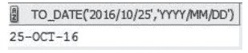
图 8.36 Oracle To_Date 函数的查询输出

**示例 2**：
```sql
SELECT TO_DATE('20161026', 'YYYYMMDD') FROM dual;
```
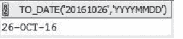
图 8.37 Oracle To_Date 函数示例 2 输出

### CONVERT() – T-SQL

**语法**：`CONVERT(data_type, expression, style)`

T-SQL 日期转换样式和示例下表所示：

表 8.6 T-SQL CONVERT() 函数样式

| 样式编号 | 示例 |
|---|---|
| 101 | 12/16/2016 |
| 102 | 2016.12.16 |
| 103 | 16/12/2016 |
| 104 | 16.12.2016 |
| 105 | 16-12-2016 |
| 106 | 16 Dec 2016 |
| DATE | YYYY-MM-DD |
| DATETIME | YYYY-MM-DD HH:MI:SS |

**T-SQL 日期转换示例**：

**示例 1**：
```sql
SELECT CONVERT(varchar, getdate()) AS Date;
```

图 8.38 CONVERT 示例 1 输出

**示例 2**：
```sql
SELECT CONVERT(varchar, getdate(), 101) AS Date;
```

图 8.39 CONVERT 示例 2 输出

**示例 3**：
```sql
SELECT CONVERT(varchar, getdate(), 106) AS Date;
```

图 8.40 CONVERT 示例 3 输出

### STR_TO_DATE() – MySQL

**语法**：`STR_TO_DATE(String, Format)`

MySQL 日期格式如下：

| 格式 | 描述 |
|---|---|
| `%Y` | 4 位年份 |
| `%y` | 2 位年份 |
| `%b` | 缩月份（Jan–Dec） |
| `%M` | 月份全称（January–December） |
| `%m` | 月份（01–12） |
| `%a` | 缩写星期（Sun–Sat） |
| `%d` | 日（01–31） |
| `%H` | 小时（00–23） |
| `%h` | 小时（01–12） |
| `%i` | 分钟（00–59） |
| `%s` | 秒（00–59） |

**示例 1**：
```sql
SELECT STR_TO_DATE('May 01 2017', '%M %d %Y') AS date;
```

图 8.41 STR_TO_DATE 函数输出

**示例 2**：
```sql
SELECT STR_TO_DATE('2016,5,20 04,35', '%Y, %m, %d %h, %i, %s') AS date;
```

图 8.42 示例 2 输出

## 第 8 章 小结

第 8 章涵盖了：

- 理解常用数字函数
- 使用常用字符函数
- 如何使用日期和时间函数
- 使用转换函数

## 练习

### 8.1
编写一个查询显示系统日期的年份。

### 8.2
编写一个查询将 `682.3547` 保留两位小数。

### 8.3
编写一个查询显示字符串“Oracle SQL Developer”的第 8 到第 10 个字符。

# 第 9 章 高级 SQL

在本章中，你将学习如何使用 SQL 命令：

1. `UNION`, `UNION ALL`
2. `INTERSECT` (Oracle 和 T-SQL), `IN` (MySQL)
3. `EXCEPT` (T-SQL), `MINUS` (Oracle), `NOT IN` (MySQL)
4. `ROWNUM` (Oracle), `TOP` (T-SQL) 和 `LIMIT` (MySQL)
5. 子查询
6. `CASE`
7. `SEQUENCE` (Oracle), `IDENTITY` (T-SQL), `AUTO_INCREMENT` (MySQL)

我们将使用 `Customers` 和 `Locations` 表作为示例数据。

图 9.1 Customers 表

| ID | 名字 | 姓 | 城市 | 国家 | 电话 |
|---|---|---|---|---|---|
| 1 | Howard | Bell | Seattle | USA | (678)-555-7269 |
| 2 | Alice | Carter | Southlake | USA | (617)-213-6874 |
| 3 | Carine | Schmitt | Nantes | France | 40.32.21.21 |
| 4 | Paolo | Accort | Torino | Italy | 011-4988260 |
| 5 | Helen | Bennett | Barcelona | Spain | (93)-203-4560 |

图 9.2 Locations 表

| LOCATION_ID | 街道 | 邮政编码 | 城市 | 州/省 | 国家_ID |
|---|---|---|---|---|---|
| 1300 | 9450 Kimiyo-cha | 6823 | 広島 | | JP |
| 1400 | 2014 Jenner Becky Rd | 26192 | Southlake | Texas | US |
| 1500 | 2011 Investors Blvd | 99236 | South San Francisco | California | US |
| 1600-9900 | (空数据行) | | | | |

## 总结

### 1. UNION, UNION ALL

- **UNION**：返回两个表的去重行列表。
- **UNION ALL**：返回两个表的所有行，包括重复行。

### 2. INTERSECT (Oracle 和 T-SQL), IN (MySQL)

- **INTERSECT**：仅返回两个表的公共行。
- **IN**：用于检查值是否存在于集合中。

### 3. EXCEPT (T-SQL), MINUS (Oracle), NOT IN (MySQL)

- **EXCEPT**：返回第一个查询中不在第二个查询中的行。
- **MINUS**：Oracle 中等同于 `EXCEPT`。
- **NOT IN**：用于检查值是否不在集合中。

### 4. ROWNUM (Oracle), TOP (T-SQL) 和 LIMIT (MySQL)

- **ROWNUM**：用于限制 Oracle 查询中行数的伪列。
- **TOP**：用于指定结果集的前 N 行。
- **LIMIT**：用于限制查询返回的行数。

### 5. 子查询

### 6. CASE

### 7. SEQUENCE (Oracle), IDENTITY (T-SQL), AUTO_INCREMENT (MySQL)

## INTERSECT 与 IN 对比

想要查找两个查询之间的共同结果。**INTERSECT** 在 MySQL 中有等效的语句 **IN**，它也可以用于 Oracle 和 T-SQL。

答案 (Oracle & T-SQL):

```sql
SELECT City
FROM Customer
INTERSECT
SELECT City
FROM Locations;
```

答案 (MySQL):

```sql
SELECT DISTINCT City
FROM customer
WHERE City IN (SELECT City FROM Locations);
```


| Oracle SQL | T-SQL | MySQL |
| --- | --- | --- |
| CITY | City | City |
| Seattle | Seattle | Seattle |
| Southlake | Southlake | Southlake |

图 9.5 问题 3 的查询输出

## 3. MINUS (Oracle), EXCEPT (T-SQL), NOT IN (MySQL)

**描述：** 返回第一个 `SELECT` 语句中的所有行，但排除掉第二个 `SELECT` 语句中的行。

### 语法

```sql
SELECT col1, col2, ...
FROM table1
MINUS or EXCEPT
SELECT col1, col2, ...
FROM table2
```

与 `INTERSECTION`（交集）一样，`EXCEPT` (`MINUS`) 有等效的 MySQL 语句 `NOT IN`，它也可以用于 Oracle 和 T-SQL。

**问题 4：** 编写一个查询查找存在于 `Locations` 表但不在 `Customer` 表中的城市。

**答案：** 见表 9.1。

### 表 9.1 问题的答案

| Oracle SQL | T-SQL | MySQL |
|---|---|---|
| SELECT City | SELECT City | SELECT distinct City |
| FROM Locations | FROM Locations | FROM Locations |
| MINUS | EXCEPT | WHERE (city) |
| SELECT City | SELECT City | NOT IN (SELECT City |
| FROM Customer; | FROM Customer; | FROM Customer) |

| CITY | City | City |
|---|---|---|
| Beijing | Beijing | Beijing |
| Hiroshima | Hiroshima | Hiroshima |
| London | London | London |
| South Brunswick | South Brunswick | South Brunswick |
| South San Francisco | South San Francisco | South San Francisco |
| Sydney | Sydney | Sydney |
| Toronto | Toronto | Toronto |
| Whitehorse | Whitehorse | Whitehorse |

图 9.6 问题 4 的查询输出

## 4. ROWNUM (Oracle), TOP (T-SQL) 和 LIMIT (MySQL)

**描述：** 指定要返回的记录数

**Oracle 风格**
```sql
SELECT column_name(s)
FROM table_name
WHERE ROWNUM <= number;
```

**T-SQL 风格**
```sql
SELECT TOP number | percent column_name(s)
FROM table_name;
```

**MySQL 风格**
```sql
SELECT column_name(s)
FROM table_name
LIMIT number;
```

`ROWNUM` 是 Oracle 数据库中一个特殊的虚拟列，让很多人遇到困扰。当你了解它是什么以及它是如何工作的时，它会非常有用。`ROWNUM` 可以在查询中使用，但它不是表的一部分。`ROWNUM` 会被赋值为 1, 2, 3, 4, ... N，其中 N 是结果集的行数。`ROWNUM` 可以作为查询中 `where` 子句的一部分来返回特定的行。`ROWNUM` 的值并不是永久地分配给某行的（这是一个常见的误区）。对 `ROWNUM` 使用 `<`（小于）或 `>`（大于）操作并不总是起作用；你必须使用 `<=`（小于或等于）或 `>=`（大于或等于）。

例如，

```sql
SELECT ROWNUM, firstname
FROM customer;
```

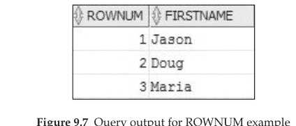

**问题 5：** 显示 `Country` 表的前十行数据。

**答案 (Oracle):**

```sql
SELECT *
FROM Country
WHERE ROWNUM <= 10;
```

| COUNTRY_ID | COUNTRY_NAME | REGION_ID |
|---|---|---|
| AR | Argentina | 2 |
| AU | Australia | 3 |
| BE | Belgium | 1 |
| BR | Brazil | 2 |
| CA | Canada | 2 |
| CH | Switzerland | 1 |
| CN | China | 3 |
| DE | Germany | 1 |
| DK | Denmark | 1 |
| EG | Egypt | 4 |

图 9.8 问题 5 的查询输出 (Oracle)

**答案 (T-SQL):**

```sql
SELECT TOP 10 *
FROM Country;
```

| COUNTRY_ID | COUNTRY_NAME | REGION_ID |
|---|---|---|
| AR | Argentina | 2 |
| AU | Australia | 3 |
| BE | Belgium | 1 |
| BR | Brazil | 2 |
| CA | Canada | 2 |
| CH | Switzerland | 1 |
| CN | China | 3 |
| DE | Germany | 1 |
| DK | Denmark | 1 |
| EG | Egypt | 4 |

图 9.9 问题 5 的查询输出 (T-SQL)

**答案 (MySQL):**

```sql
SELECT *
FROM Country LIMIT 10;
```

| COUNTRY_ID | COUNTRY_NAME | REGION_ID |
|---|---|---|
| AR | Argentina | 2 |
| AU | Australia | 3 |
| BE | Belgium | 1 |
| BR | Brazil | 2 |
| CA | Canada | 2 |
| CH | Switzerland | 1 |
| CN | China | 3 |
| DE | Germany | 1 |
| DK | Denmark | 1 |
| EG | Egypt | 4 |

图 9.10 问题 5 的查询输出 (MySQL)

## 5. 子查询

**描述：** 子查询是嵌套在较大查询内部的 SQL 语句。子查询应该放在括号内。子查询可以出现在主查询的 `SELECT`、`FROM` 或 `WHERE` 子句中。

### 语法

```sql
SELECT column(s)
FROM table1
WHERE value IN
(SELECT column
FROM table2
```

**问题 6：** 编写一个查询查找工资大于平均工资的员工。

**答案：**

```sql
SELECT first_name, last_name, dept_ID, salary
FROM employees
WHERE salary >
(SELECT AVG(salary)
FROM employees);
```

**Oracle 输出**

| first_name | last_name | dept_ID | salary |
|---|---|---|---|
| Michael | Hartstein | 20 | 13000.00 |
| Shelley | Higgins | 80 | 9008.00 |
| Steven | King | 10 | 24000.00 |
| Lex | De Haan | 10 | 17000.00 |
| Nancy | Greenberg | 90 | 8008.00 |

**T-SQL 输出**

| FIRST_NAME | LAST_NAME | DEPT_ID | SALARY |
|---|---|---|---|
| MICHAEL | HARTSTEIN | 20 | 13000 |
| SHELLEY | HIGGINS | 80 | 9008 |
| STEVEN | KING | 10 | 24000 |
| LEX | DE HAAN | 10 | 17000 |
| NANCY | GREENBERG | 90 | 8008 |

**MySQL 输出**

| first_name | last_name | dept_ID | salary |
|---|---|---|---|
| Michael | Hartstein | 20 | 13000.00 |
| Shelley | Higgins | 80 | 9008.00 |
| Steven | King | 10 | 24000.00 |
| Lex | De Haan | 10 | 17000.00 |
| Nancy | Greenberg | 90 | 8008.00 |

图 9.11 问题查询输出

**问题 7：** 编写一个查询查找在 Sales（销售）部门工作的员工。

**答案：**

**Oracle 输出**

| EMPLOYEE_ID | FIRST_NAME | LAST_NAME | DEPT_ID |
|---|---|---|---|
| 107 | William | Gietz | 80 |
| 106 | Shelley | Higgins | 80 |

**T-SQL 输出**

| Employee_ID | First_Name | Last_Name | Dept_ID |
|---|---|---|---|
| 106 | Shelley | Higgins | 80 |
| 107 | William | Gietz | 80 |

**MySQL 输出**

| Employee_ID | First_Name | Last_Name | Dept_ID |
|---|---|---|---|
| 106 | Shelley | Higgins | 80 |
| 107 | William | Gietz | 80 |

图 9.12 问题 7 的查询输出

## 6. CASE

**描述：** `CASE` 语句具有 `IF-THEN-ELSE` 语句的功能。

### 语法 1

```sql
CASE
WHEN condition_1 THEN result_1
WHEN condition_2 THEN result_2 ...
WHEN condition_n THEN result_n
ELSE result
END
```

### 语法 2

```sql
CASE expression
WHEN value_1 THEN result_1
WHEN value_2 THEN result_2 ...
WHEN value_n THEN result_n
ELSE result
END
```

`CASE` 语句始终位于 `SELECT` 子句中。`CASE` 必须包含以下组件：`WHEN`、`THEN` 和 `END`。`ELSE` 是可选组件。

你可以使用 `CASE` 语句来处理多个条件。你可以通过多个 `WHEN` 语句来连接。

**CASE 语法 1 示例：**

```sql
SELECT dept_name,
CASE
WHEN location_id = 1400 THEN 'USA'
WHEN location_id = 1500 THEN 'USA'
WHEN location_id = 1700 THEN 'USA'
WHEN location_id = 2500 THEN 'USA'
WHEN location_id = 2700 THEN 'USA'
ELSE 'Canada'
END AS location
FROM Departments;
```

**CASE 语法 2 示例：**

```sql
SELECT dept_name,
CASE location_id
WHEN 1400 THEN 'USA'
WHEN 1500 THEN 'USA'
WHEN 1700 THEN 'USA'
WHEN 2500 THEN 'USA'
WHEN 2700 THEN 'USA'
ELSE 'Canada'
END AS location
FROM Departments;
```

| Oracle SQL | | T-SQL | | MySQL | |
|---|---|---|---|---|---|
| DEPT_NAME | LOCATION | dept_name | LOCATION | dept_name | location |
| Administration | USA | Administration | USA | Administration | USA |
| Marketing | Canada | Marketing | Canada | Marketing | Canada |
| Purchasing | USA | Purchasing | USA | Purchasing | USA |
| Human Resources | UK | Human Resources | UK | Human Resources | UK |
| Shipping | USA | Shipping | USA | Shipping | USA |
| IT | USA | IT | USA | IT | USA |
| Public Relations | USA | Public Relations | USA | Public Relations | USA |
| Sales | USA | Sales | USA | Sales | USA |
| Accounting | USA | Accounting | USA | Accounting | USA |
| Customer Service | UK | Customer Service | UK | Customer Service | UK |

图 9.13 CASE 示例的查询输出

第 9 章 高级 SQL 133

- 表格（过滤后的）
- 视图
- 版本化视图 (Editioning Views)
- 索引
- 包
- 存储过程
- 函数
- 队列
- 队列表
- 触发器
- 跨版本触发器
- 类型
- 序列
- `SEQ_CUSTOMER`

图 9.14 Oracle 中创建序列 (CREATE SEQUENCE)

**第 2 步——**向客户表插入名为“Jason Brown”的客户。`seq_customer.NEXTVAL` 生成从 100 开始的新值：

```sql
INSERT INTO customer (id, FirstName, LastName)
VALUES (seq_customer.NEXTVAL, 'jason', 'Brown');
```

| ID | FIRSTNAME | LASTNAME |
|---|---|---|
| 1 Howard | Bell | |
| 2 Alice | Carter | |
| 3 Carine | Schmitt | |
| 4 Paolo | Accorti | |
| 5 Helen | Bennett | |
| 100 Jason | Brown | |

图 9.15 已插入一条客户记录

# T-SQL IDENTITY 示例

**第 1 步——**创建一个名为 `STATE` 的表，设置初始数字为 1，间隔值为 1。

```sql
Create Table STATE
  ID int NOT NULL IDENTITY(1, 1),
  StateName varchar(30)
```


**第 2 步——**向表中插入州。不需要插入 ID，因为 `IDENTITY` 会自动逐个创建 ID。

```sql
INSERT INTO STATE (StateName) VALUES ('Utah');
INSERT INTO STATE (StateName) VALUES ('Maryland');
```

**第 3 步——**检查结果。

```sql
SELECT * FROM STATE
```


# MySQL AUTO_INCREMENT 示例

**第 1 步——**创建一个名为 `STATE` 的表，并设置主键 `AUTO_INCREMENT`。初始数字和间隔值默认为 1。

```sql
Create TABLE STATE (
  ID int NOT NULL Primary Key AUTO_INCREMENT,
  StateName varchar(30)
)
```


要使用另一个起始值设置 `AUTO_INCREMENT`，请使用以下 SQL 语句：

```sql
ALTER TABLE STATE AUTO_INCREMENT=50;
```

**第 2 步——**向表中插入两个州。不需要插入 ID，因为 `AUTO_INCREMENT` 会创建 ID。

```sql
INSERT INTO STATE (StateName) VALUES ('Utah');
INSERT INTO STATE (StateName) VALUES ('Maryland');
```

**第 3 步——**检查结果。

```sql
SELECT * FROM STATE;
```


| ID | StateName |
|---|---|
| 1 | Utah |
| 2 | Maryland |


## 总结

第 9 章涵盖了以下内容：

- 操作 `UNION`、`UNION ALL` 命令
- 使用 `INTERSECT` (Oracle 和 T-SQL) 和 `IN` (MySQL) 命令
- 如何使用 `EXCEPT` (T-SQL)、`MINUS` (Oracle) 和 `NOT IN` (MySQL) 命令
- 理解 `ROWNUM` (Oracle)、`TOP` (T-SQL) 和 `LIMIT` (MySQL) 命令
- 定义子查询
- 使用 `SEQUENCE` (Oracle)、`IDENTITY` (T-SQL) 和 `AUTO_INCREMENT` (MySQL) 生成序列号。

## 练习

### 9.1

编写一个查询，将 `customers` 表中的名称与 `employees` 表中的名称合并。

### 9.2

修改 9-1 中的查询，按姓对结果进行排序。

# 第 10 章：连接 (Joins)

在关系型数据库设计中，`Employee`（员工）和 `Department`（部门）是两个实体。员工相关数据保存在 `Employees` 表中，而部门相关数据保存在 `Departments` 表中。为了方便链接，在两个表之间创建了 `Department_ID`。

如果我们想显示员工名称和部门名称，仅使用 `Employees` 表或 `Departments` 表是不可能的。为了在员工名称之后列出部门名称，我们需要使用 SQL `JOIN`。

有四种基本的 SQL 连接：内连接、左连接、右连接和全连接。最有用的连接是内连接 (`Inner Join`)。

表 10.1 常见连接类型

| 连接类型 | 说明 |
|---|---|
| `(INNER) JOIN` | 获取两个表中具有匹配值的记录。 |
| `LEFT JOIN` | 获取 `table1` (LEFT table1) 的所有记录以及 `table2` (RIGHT table2) 的匹配记录。如果没有匹配项，`table2` 的结果为 `NULL`。 |
| `RIGHT JOIN` | 获取 `table2` (RIGHT table1) 的所有记录以及 `table1` (LEFT table2) 的匹配记录。如果没有匹配项，`table1` 的结果为 `NULL`。 |
| `FULL JOIN` | 获取 `table1` 和 `table2` 中的所有行。 |

## 语法

```sql
SELECT table1.col_name, table2.col_name
FROM table1
(INNER) JOIN table2 ON table1.col_name = table2.col_name;

SELECT table1.col_name, table2.col_name
FROM table1
LEFT JOIN table2 ON table1.col_name = table2.col_name;

SELECT table1.col_name, table2.col_name
FROM table1
RIGHT JOIN table2 ON table1.col_name = table2.col_name;

SELECT table1.col_name, table2.col_name
FROM table1
FULL JOIN table2 ON table1.col_name = table2.col_name;
```

## 旧式 JOIN

```sql
SELECT table1.col_name, table2.col_name
FROM table1, table2
WHERE table1.col_name = table2.col_name;
```

## JOIN USING 子句 (Oracle)

语法

```sql
SELECT table1.col_name, table2.col_name
FROM table1
JOIN table2 USING (col_name);
```

让我们使用 `Employees` 和 `Locations` 表作为示例。

### 图 10. Employees 表

| EMPLOYEE_ID | FIRST_NAME | LAST_NAME | EMAIL | PHONE_NUMBER | HIRE_DATE | JOB_ID | SALARY_ID | MANAGER_ID | DEPARTMENT_ID |
|---|---|---|---|---|---|---|---|---|---|
| 100 | Douglas | Grant | | 515-607.8844 | 2008-01-21 | ST_CL | | 104 | 80 |
| 101 | Adam | Flynn | | 515-234.2342 | 2003-09-06 | SH_CL | | 200 | 50 |
| 102 | Jennifer | Whalen | | 515-444.4444 | 2014-02-17 | ST_AS | | 201 | 10 |
| 103 | Michael | Hartfield | | 515-555.5555 | 2009-08-21 | ST_CL | | 200 | 50 |
| 104 | Pat | Fay | | 515-666.6666 | 2012-05-12 | ST_PROG | | 103 | 20 |
| 105 | Susan | Myers | | 515-777.7777 | 2013-04-25 | AD_AS | | 102 | 20 |
| 106 | William | Giet | | 515-888.8888 | 2017-06-05 | ST_REP | | 205 | 20 |
| 107 | Steven | King | | 515-999.9999 | 2002-10-15 | AD_MGR | | 100 | 80 |
| 108 | Kevin | De Leon | | 515-111.1111 | 2007-12-24 | ST_CL | | 104 | 10 |
| 109 | Bruce | Ernst | | 515-222.2222 | 2005-11-17 | IT_PROG | | 201 | 60 |
| 110 | Diana | Lorentz | | 515-333.3333 | 2006-03-31 | ST_CL | | 202 | 50 |
| 111 | Nancy | Greenberg | | 515-444.4444 | 2001-12-06 | AD_CL | | 203 | 50 |
| 112 | Daniel | Davet | | 515-555.5555 | 2004-07-24 | AD_MGR | | 105 | 90 |
| 113 | Rachel | Jenkins | | 515-666.6666 | 2003-10-15 | ST_CL | | 200 | 80 |

### 图 10. Departments 部门表

| DEPT_ID | DEPT_NAME | MANAGER_ID | LOCATION_ID |
|---|---|---|---|
| 10 | Administration | 200 | 1700 |
| 20 | Marketing | 201 | 1800 |
| 30 | Purchasing | 114 | 1700 |
| 40 | Human Resources | 203 | 2400 |
| 50 | Shipping | 121 | 1500 |
| 60 | IT | 203 | 1400 |
| 70 | Public Relations | 204 | 2700 |
| 80 | Sales | 145 | 2500 |
| 90 | Customer Service | 205 | 1700 |
| 100 | Accounting | 203 | 2400 |
| 110 | Warehouse | | 1700 |

### 图 10. Locations 表

| LOCATION_ID | STREET_ADDRESS | POSTAL_CODE | CITY | STATE_PROVINCE | COUNTRY_ID |
|---|---|---|---|---|---|
| 1300 | 9450 Kamiya Street | 6823 | Hiroshima | | JP |
| 1400 | 2014 Jabberry Road | 26192 | Southlake | Texas | US |
| 1500 | 9923 Inliers Blvd | 9236 | South San Francisco | California | US |
| 1600 | 2007 Charade Rd | 5090 | South Brunswick | New Jersey | US |
| 1700 | 98199 Seattle | 981 | Seattle | Washington | US |
| 1800 | 147 Spadia Avenue | M5V 2L7 | Toronto | Ontario | CA |
| 1900 | 6092 Boxwood Street | YSW 972 | Whitehouse | Yukon | CA |
| 2000 | 40-5-12 Laagengen | 19518 | Beijing | | CN |
| 2100 | 1298 Victoria Street | 2901 | Sydney | New South Wales | AU |
| 2200 | 8204 Arthur Street | | London | | UK |

---

**140 第 10 章 链接 (Joins)**

### 问题 2：编写一个 SQL 查询，显示员工的全名和部门名称。

**答案 (Oracle):**

```sql
SELECT first_name || ' ' || last_name AS Full_Name, Dept_Name
FROM employees E
JOIN departments D
ON (E.Dept_ID = D.Dept_id);

SELECT first_name || ' ' || last_name AS Full_Name, Dept_Name
FROM employees E
JOIN departments D
USING (Dept_ID);
```

**答案 (T-SQL):**

```sql
SELECT first_name + ' ' + last_name AS Full_Name, Dept_Name
FROM employees E
JOIN departments D
ON (E.Dept_ID = D.Dept_id);
```

**答案 (MySQL):**

```sql
SELECT CONCAT(first_name, ', ', last_name) AS Full_Name, Dept_Name
FROM employees E
JOIN departments D
ON (E.Dept_ID = D.Dept_id);
```

| FULL_NAME | DEPT_NAME | Full_Name | Dept_name | Full_Name | Dept_Name |
|---|---|---|---|---|---|
| Douglas Grant | Shipping | Douglas Grant | Sales | Douglas Grant | Shipping |
| Adam Fipp | Shipping | Adam Fipp | Marketing | Adam Fipp | Shipping |
| Jennifer Whalen | Administration | Jennifer Whalen | Administration | Jennifer Whalen | Administration |
| Michael Hartstein | Marketing | Michael Hartstein | Marketing | Michael Hartstein | Marketing |
| Pat Fay | Marketing | Pat Fay | Sales | Pat Fay | Marketing |
| Susan Marvis | Human Resources | Susan Marvis | Human Resources | Susan Marvis | Human Resources |
| Shelby Higgins | Sales | Shelby Higgins | Sales | Shelby Higgins | Sales |
| William Giet | Sales | William Giet | Sales | William Giet | Sales |
| Steven King | Administration | Steven King | Administration | Steven King | Administration |
| Lex De Haan | Administration | Lex De Haan | Administration | Lex De Haan | Administration |
| Bruce Ernst | IT | Bruce Ernst | IT | Bruce Ernst | IT |
| Diana Lorentz | IT | Diana Lorentz | IT | Diana Lorentz | IT |
| Nancy Greenberg | Accounting | Nancy Greenberg | Accounting | Nancy Greenberg | Accounting |
| Daniel Faviet | Accounting | Daniel Faviet | Accounting | Daniel Faviet | Accounting |

**图 10.6 问题 2 的查询输出**

## 链接两个及以上的表

### 问题 3：编写一个 SQL 查询，显示所有位于西雅图（Seattle）任何部门的员工全名。

**答案 (Oracle):**

```sql
SELECT first_name || ' ' || last_name AS Full_name, Dept_Name
FROM employees E
JOIN departments D
ON E.Dept_ID = D.Dept_ID
JOIN locations L
ON (D.location_ID = L.location_id)
WHERE city = 'Seattle';
```

| FULL_NAME | DEPT_NAME |
|---|---|
| Lex De Haan | Administration |
| Steven King | Administration |
| Jennifer Whalen | Administration |
| Daniel Faviet | Accounting |
| Nancy Greenberg | Accounting |

**图 10.7 问题 3 的查询输出 (Oracle)**

**答案 (T-SQL):**

```sql
SELECT first_name + ' ' + last_name AS Full_name, Dept_Name
FROM employees E
JOIN departments D
ON E.Dept_ID = D.Dept_ID
JOIN locations L
ON (D.location_ID = L.location_id)
WHERE city = 'Seattle';
```


| Full_name | Dept_Name |
|---|---|
| Jennifer Whalen | Administration |
| Steven King | Administration |
| Lex De Haan | Administration |
| Nancy Greenberg | Accounting |
| Daniel Faviet | Accounting |

图 10.8 问题 3 的查询输出 (T-SQL)

答案 (MySQL):

| Full_Name | Dept_Name |
|---|---|
| Jennifer Whalen | Administration |
| Steven King | Administration |
| Lex De Haan | Administration |
| Nancy Greenberg | Accounting |
| Daniel Faviet | Accounting |

图 10.9 问题 3 的查询输出 (MySQL)

## 左连接 (LEFT JOIN)

假设我们有以下订单表和客户表：

| ORDER_ID | ORDER_DATE | AMOUNT | CUSTOMER_ID |
|---|---|---|---|
| 501 | 02-MAY-16 | 1000 | 2 |
| 502 | 06-DEC-15 | 300 | 3 |
| 503 | 20-JAN-16 | 500 | 2 |
| 504 | 05-FEB-17 | 2000 | 5 |
| 505 | 10-SEP-16 | 600 | 1 |

图 10.10 订单表

| ID | FirstName | LastName | City | Country | Phone |
|---|---|---|---|---|---|
| 1 | Howard | Bell | Seattle | USA | (678)-555-7629 |
| 2 | Alice | Carter | Southlake | USA | (617)-213-6874 |
| 3 | Carmine | Schmitt | Nantes | France | 40.32.21.21 |
| 4 | Paolo | Accorti | Torino | Italy | 011-498820 |
| 5 | Helen | Bennett | Barcelona | Spain | (93)-203-4560 |

图 10.11 客户表

从订单表中你可以看到客户 4 没有下任何订单。

问题 4：编写一个查询显示客户名称、订单金额和订单日期。列出所有下单过或未下单的客户。

答案 (Oracle & MySQL):

```sql
SELECT C.ID, FirstName, O.Amount, Order_DATE
FROM Customer
LEFT JOIN O
ON C.ID = Customer_ID
```

| ID | FIRSTNAME | AMOUNT | ORDER_DATE |
|---|---|---|---|
| 2 | Alice | 1000 | 02-MAY-2016 |
| 2 | Alice | 500 | 01-JAN-2016 |
| 3 | Carine | 300 | 06-DEC-2015 |
| 2 | Carine | 500 | 20-JAN-2016 |
| 5 | Helen | 2000 | 05-FEB-2017 |
| 1 | Howard | 600 | 09-SEP-2016 |

*注：此处表格数据对应原文逻辑，翻译保持对齐*

图 10.12 问题 4 的查询输出

此命令将使用密码“hr”来解锁 HR 账户。

```
Command Prompt - sqlplus / as sysdba
Microsoft Windows [Version 10.0.0.14393]
(c) 2016 Microsoft Corporation. All rights reserved.
C:\Users\1>cd ..
C:\Users>cd
C:\sqlplus / as sysdba
SQL*Plus: Release 12.1.0.2 Production on Fri Apr 7 10:09:21 2017
Copyright (c) 1982, 2014, Oracle. All rights reserved.
Connected to:
Oracle Database 12c Enterprise Edition Release 12.1.0.2 - 64-bit Production
With the Partitioning, OLAP, Advanced Analytics and Real Application Testing Services
SQL> show con_name;
CON_NAME
-----------
Test
SQL> alter user hr IDENTIFIED BY hr account unlock
User altered.
SQL>
```

图 11.1 在 Oracle 中解锁 hr 账户

## 第 2 步：使用用户名和密码连接 HR 架构


图 11.2 Oracle 数据库连接

## 第 3 步：在 SQL 工作表中输入创建视图的代码

```sql
CREATE VIEW Location_US AS
Select Location_ID, City, State_Province
From Locations
Where Country_ID = 'US';
```


## 第 4 步：运行查询以创建视图，然后重新连接 HR 架构


## 第 5 步：检查视图的结果


图 11.5 执行视图

## 在 T-SQL 中创建视图

### 第 1 步：输入 Create View 命令并点击 Execute（执行）按钮运行查询


图 11.6 创建视图

### 第 2 步：刷新 HR 架构以查看视图 dbo.Location_US


### 第 3 步：右键点击视图并选择“Select Top 1000 Rows”（选择前 1000 行）


### 第 4 步：检查视图的结果


## 在 MySQL 中创建视图

### 第 1 步：输入 Create View 命令并点击 Execute query 按钮运行查询


152 第 11 章 视图

### 第 2 步：刷新 HR 架构


### 第 3 步：点击“location_us”旁边的图标


### 第 4 步：检查来自视图的结果


## 更新视图

### 语法 (Oracle)

```sql
CREATE OR REPLACE VIEW view_name AS
SELECT column(s)
FROM tables
WHERE conditions;
```

### 语法 (T-SQL & MySQL)

```sql
ALTER VIEW view_name AS
SELECT column(s)
FROM tables
[WHERE conditions];
```

### 示例 (Oracle)

```sql
CREATE OR REPLACE VIEW
Location_US AS
SELECT Location_ID, City, Country_ID
FROM Locations
WHERE Country_ID = 'US';
```

| LOCATION_ID | CITY | COUNTRY_ID |
|---|---|---|
| 1400 | Southlake | US |
| 1500 | South San Francisco | US |
| 1600 | South Brunswick | US |
| 1700 | Seattle | US |

> 图 11.14 Oracle CREATE OR REPLACE VIEW 的输出（数据来自原始 HR 架构）

### 示例 (T-SQL)

```sql
ALTER VIEW Location_US AS
SELECT Location_ID, City, Country_ID
FROM Locations
WHERE Country_ID = 'US';
```

| Location_ID | City | Country_ID |
|---|---|---|
| 1400 | Southlake | US |
| 1500 | South San Francisco | US |
| 1600 | South Brunswick | US |
| 1700 | Seattle | US |
| 2500 | Atlanta | US |
| 2700 | Nashville | US |

> 图 11.15 T-SQL ALTER VIEW 的输出

### 示例 (MySQL)

```sql
ALTER VIEW view_name AS
SELECT columns
FROM Locations
WHERE conditions = 'US';
```

| Location_ID | City | Country_ID |
|---|---|---|
| 1400 | Southlake | US |
| 1500 | South San Francisco | US |
| 1600 | South Brunswick | US |
| 1700 | Seattle | US |
| 2500 | Atlanta | US |
| 2700 | Nashville | US |

> 图 11.16 MySQL ALTER VIEW 的输出

## 删除视图

### 语法 (Oracle, T-SQL & MySQL)

```sql
DROP VIEW view_name;
```

### 示例

```sql
DROP VIEW Location_US;
```

## 总结

第 11 章涵盖了：
- 在 Oracle、T-SQL 和 MySQL 中创建视图
- 在 Oracle、T-SQL 和 MySQL 中更新视图
- 在 Oracle、T-SQL 和 MySQL 中删除视图

## 练习

11.1 创建名为 `view_employees` 的视图以显示 `Employees` 表中的名称和薪水字段。
11.2 删除视图。

# 第 12 章 数据导入和导出

数据导入和导出是开发者的常用任务。Oracle、SQL Server 和 MySQL 提供了简单的导入向导。我们将从 `regions` 表导出数据并导入 csv 文件。

## Oracle 查询结果导出

- 首先选择要导出的数据：

```sql
SELECT * FROM regions;
```

- 右键点击查询结果并选择 Export...


图 12.1 导出查询结果

- 导出向导第 1 步显示了


图 12.2 导出向导

- 在导出向导中将 Format（格式）更改为 CSV 并保存文件为 `regions.csv`


图 12.3 导出格式

- 点击 Next（下一步）查看摘要页


- 打开 `regions.csv` 查看导出的数据


## SQL Server 查询结果导出

- 在查询工作表中选择我们要导出的数据：

```sql
SELECT * FROM regions;
```

- 运行查询并查看结果。

158 第 12 章 数据导入和导出

- 右键点击查询结果并选择 Save As...（另存为...


图 12.6 运行查询

图 12.7 保存查询结果

- 在文件名字段中输入 `region.csv`


图 12.8 文件名

- 打开 `regions.csv` 查看导出的数据


图 12.9 检查导出的文件

## MySQL 查询结果数据导出

- 在查询工作表中输入以下语句：

```sql
SELECT * FROM regions;
```

- 运行查询并查看输出。

160 第 12 章 数据导入和导出


图 12.10 执行查询

- 点击导出图标


图 12.11 导出查询结果

- 在文件名中输入 `Regions.csv`


- 打开 `Regions.csv` 查看导出的数据


## Oracle 数据导入工具

你已经在第 6 章学习了 `INSERT INTO` 语句。它用于插入单条或多条记录。对于大量数据，我们可以使用导入向导来插入数据。

在插入数据之前，我们应该在数据文件中准备好对应的数据类型。为了演示目的，我们首先删除 `Regions` 表中的记录，然后从 `regions.csv` 文件导入数据。

输入以下语句：

```sql
DELETE FROM regions;
```


图 12.14 删除表中的记录

然后用以下语句检查 `Regions` 表：

```sql
SELECT * FROM regions;
```


图 12.15 删除 命令后 Regions 表中没有数据

- 右键点击 `Regions` 表并选择 Import Data...


图 12.16 开始导入数据

- 选择我们导出的 `region.csv` 文件


图 12.17 打开原始文件

164 第 12 章 数据导入和导出

- 按照数据导入向导操作


图 12.18 选择导入方法

- 点击 Next（下一步）按钮


图 12.19 文件中的列

- 按照这些步骤操作。


图 12.20 源数据列与目标数据列的比较

- 显示导入数据任务已完成的消息。在下一步点击“完成”按钮。


图 12.21 导入任务完成

## SQL Server 数据导入工具

在 SQL Server 中导入数据的可用工具有：

- 1. 使用加载脚本
- 2. 使用数据导入向导

## 使用加载脚本

- 创建文本文件并将其保存为 `hr.sql`：

```sql
/* ***********************************/
drop table Country;
drop table Departments;
drop table Employees;
drop table Job;
drop table Locations;
drop table Regions;

CREATE TABLE Country (
  country_id CHAR (2) NOT NULL,
  country_name VARCHAR(40),
  region_id smallint,
```


PRIMARY KEY (country_ID),

CONSTRAINT FK_RegCountry FOREIGN KEY (region_id)

REFERENCES Regions(Regins_ID)

);

CREATE TABLE Departments (

  /* * see codes in Chapter 5 */

);

CREATE TABLE Employees (

  ...

);

CREATE TABLE Job (

  ...

);

```

```sql
CREATE TABLE Locations
(
);
```

```sql
CREATE TABLE Regions
(
);
```

```sql
INSERT INTO COUNTRY VALUES ('AR','Argentina',2);

... /* see codes in Chapter 6 */
```

```sql
INSERT INTO Employees
VALUES (100,'Douglas','Grant','DGRANT','650.507.9844','23-Jan-08','SH_CLERK',2600,114,50);

...
```

```sql
INSERT INTO DEPARTMENTS VALUES (10,'Administration',200,1700);

...
```

```sql
INSERT INTO Job VALUES ('AD_PRES','CEO',9000,20000);

...
```

```sql
INSERT INTO Locations
VALUES (1300,9450 Kamiya-cho','6823','Hiroshima','','JP');

...
```

```sql
INSERT INTO REGIONS VALUES (1,'Europe');
```

```sql
/* ************************************* /
```

- 选择整个脚本并将其复制到查询工作表中。点击“执行”按钮运行脚本。

## 2. 使用数据导入向导

- 输入以下语句并执行：
  `DELETE FROM regions;`

- 使用以下语句检查 `Regions` 表：
  `SELECT * FROM regions;`


图 12.22 执行 `DELETE` 命令后 `Regions` 表中没有数据

- 在你想要插入数据的架构（schema）上右键点击。
- 选择“任务” -> “导入数据...”。


图 12.23 开始导入数据

在“数据源”字段中选择“平文件源”（Flat File Source），然后选择 `region.csv` 文件。


图 12.24 选择导入文件

按照 SQL Server 导入和导出向导的步骤操作。


图 12.25 选择数据源

### 第 12 章 数据导入与导出

- 选择目标为 `SQL Server Native Client 11.0`


图 12.26 选择目标

- 检查向导摘要页面并点击“完成”。


图 12.27 摘要页面

数据已成功导入到 `Regions` 表。


图 12.28 导入成功

## MySQL 数据导入

- 输入以下命令：
  `use hr;`
  `DELETE FROM regions;`
  `SELECT * FROM regions;`


图 12.29 执行 `DELETE` 命令后 `Regions` 表中没有数据

右键点击 `regions` 表并选择“表数据导入”。


图 12.30 开始数据导入

在“文件路径”中选择 `Regions.csv`。

86805baec19af0039b39fad6b4ce02e0_184_0.png

图 12.31 文件路径

- 在 `regions` 表上右键点击并选择“表数据导入”。

86805baec19af0039b39fad6b4ce02e0_185_0.png

- 总结

- 按照 SQL Server 导入和导出向导的步骤操作。

86805baec19af0039b39fad6b4ce02e0_185_1.png

- 总结

### 第 12 章

```sql
BEGIN
get_Location_Info ( 1700, Location_City, Location_Country_ID );
DBMS_OUTPUT.PUT_LINE ( Location_City || ' ' || Location_Country_ID );
END;
```


## 创建带有 IN OUT 参数的 Oracle 存储过程：

```sql
create or replace
procedure example_INOUT ( x IN OUT NUMBER)
AS
BEGIN
x := x + 6;
END example_INOUT;
```

## 执行带有 IN OUT 参数的 Oracle 存储过程：

```sql
DECLARE
 x number;
BEGIN
x:= 10;
example_INOUT ( x );
DBMS_OUTPUT.PUT_LINE ( 'x is ' || x );
END;
```

# 180 第 13 章 存储过程


图 13.5 带有 IN OUT 参数的 Oracle 过程


图 13.6 使用带有 IN OUT 参数调用 Oracle 过程

## 创建带有 IN 参数的 SQL Server 存储过程：

```sql
CREATE procedure get_Location_Info
(@L_ID FLOAT)
AS
BEGIN
SET NOCOUNT ON;
SELECT City, Country_ID FROM LOCATIONS
WHERE LOCATION_ID = @L_ID;
END;
```

## 执行带有 IN 参数的 SQL Server 过程：

`EXEC get_Location_Info 1700;`


## 创建带有 IN 和 OUT 参数的 MySQL 存储过程：

```sql
DELIMITER //
CREATE procedure get_Location_Info
@L_ID FLOAT,
@L_CITY VARCHAR OUT,
@L_Country_ID CHAR OUT,
AS
BEGIN
SELECT @L_City =City, @L_Country_ID = Country_ID
FROM LOCATIONS
WHERE LOCATION_ID = @L_ID;
END;//
```


# 第 13 章 存储过程

## 架构


图 13.8 带有 IN 和 OUT 参数的 MySQL 过程

## 执行带有 IN 和 OUT 参数的 MySQL 过程

```sql
CALL get_Lo_cation_Info (1700);
```


图 13.9 使用带有 IN 和 OUT 参数调用 MySQL 过程

## 总结

第 13 章涵盖了内容：

- 存储过程的基本结构
- 在 Oracle、SQL Server 和 MySQL 中创建存储过程的步骤
- 无参数的简单过程
- 在 Oracle、SQL Server 和 MySQL 中创建带参数存储过程的步骤
- 带有 IN 和 OUT 参数的示例存储过程
- 带有 IN OUT 参数的示例存储过程

## 练习

### 13.1

创建一个存储过程，列出在运输部门工作的员工。


# 索引

### A

- `ADD_MONTH()` 113, 114
- `addition (+)` 74
- 聚合函数 89, 94, 97, 98
- 别名 84
- `ALTER COLUMN` 61, 62, 64
- `ALTER TABLE` 60–64, 135
- `AND DIFF` 71
- ANSI 22
- 算术运算符 74, 76, 87
- `ASC` (升序) 72
- `AVG()` 89, 90, 94, 97

### B

- `BETWEEN` 8, 9, 12, 79, 88, 113, 116, 124, 125, 131, 137
- `BIGINT` 数据 12
- 二进制数据 11
- `BLOB` 数据 11

### C

- `CASE` 9, 108, 112, 122, 130–132, 136, 143, 144
- `CAST()` 117
- `CEILING()` 98
- `char` 类型 11, 12
- 字符数据类型 11, 14
- `CHECK` 约束 7
- `COLUMN` 4–7, 11, 14, 42, 54–56, 61–64, 67–72, 74–79, 77, 81, 82, 84–88, 92, 95, 101, 123, 124, 129, 146, 153, 164, 165
- 列别名 84
- 命令行 34, 36, 40, 46
- 复杂的
- 比较运算符 76, 87
- `CONCAT()` 103–105
- 约束 7, 52, 53, 166
- 转换 117, 119, 120
- `CONVERT()` 117, 119
- `COUNT()` 89, 90, 95, 97, 98
- `CREATE DATABASE` 46–48, 64
- `CREATE TABLE` 51–53, 55–57, 64, 134, 136, 167
- `CREATE USER` 48, 149, 51

### D

- 数据控制语言 (DCL) 47, 87
- 数据定义语言 (DDL) 47, 48, 65
- 数据操作语言 (DML) 47, 65, 87
- 数据类型 4, 11–14, 54–56, 77, 119, 123, 162
- 数据库管理员 (DBAs) 1
- 日期和时间类型 13, 14
- `DATE ADD()` 71, 113, 114
- `DATE DIFF()` 113, 116
- `DECIMAL` 8, 12, 13, 53, 62, 93, 102, 106
- `DELETE` 4, 47, 51, 60, 65, 67, 78, 86–88, 154, 162, 167, 168, 174
- `DESC` 72, 83, 94
- `DISTINCT` 73, 123, 125, 126
- 除 74
- `DOUBLE` 类型 12
- `DROP TABLE` 51, 60, 166
- `DROP VIEW` 154

### E

- `ENUM` 类型 11
- 实体关系图 (ER) 8, 10
- 等号 (`=`) 76
- 表达式 74, 78–82, 98, 117, 119
- `EXTRACT` 111, 113–115
- 字段 5, 72, 74, 109, 111, 132, 143, 146, 154, 159, 169, 172
- 固定长度 11, 12
- `FLOAT` 类型 4, 12
- `FLOOR()` 98, 99
- 外键 6–9, 52, 53
- `FORMAT()` 103, 106
- 函数 84, 89–98, 101, 103, 105–120

### G

- `GETDATE()` 113, 115, 119
- `GRANT` 4, 47, 48, 65, 66, 87, 88, 167
- 大于运算符 (`>`) 76
- `GROUP BY` 89, 94–97

### H

- `HAVING` 子句 94, 97
- 历史 1, 2, 10

### I

- `IMAGE` 类型 11
- `IN` 条件 78
- `INNER JOIN` 137, 144
- `INSERT INTO` 47, 65–71, 85, 87, 133–135, 161, 167
- 安装 15, 16–19, 21, 26, 30, 32, 38, 40, 42, 43, 46, 49
- `INT` 类型 12
- 完整性 7
- 实体 7
- 参照完整性 7
- `IS NULL` 79, 80, 137, 143
- `IS NOT NULL` 80

### J

- `JOIN` 137–144
- `INNER JOIN` 137, 144
- `LEFT JOIN` 137–142
- `RIGHT JOIN` 137, 143
- `FULL JOIN` 137, 143

### K

- 键 9
- 主键 9
- 外键 9

### L

- 语言 2, 4, 11, 17, 45, 67, 85
- `LEFT JOIN` 137–142
- `LEN` 103, 107
- `LENGTH` 103, 107
- 小于 (`<`) 76
- `LIKE` 条件 81
- `LIMIT` 122, 126, 128, 136, 177, 181
- `LONGBOB` 类型 11
- `LONGTEXT` 类型 11
- `LOWER` 103, 108
- `LTRIM` 103, 109

### M

- 主数据库 42, 43
- `MAX` 90, 92, 98
- `MEDIUMTEXT` 类型 11
- Microsoft SQL Server 2
- `MIN` 90, 91, 97, 98
- 分钟 114, 120
- `MONEY` 类型 12
- 月份 113, 114, 116, 120, 175
- `MONTH_BETWEEN` 116
- 乘法 (`*`) 74
- MySQL Server 31, 37, 188

### N

- `NCHAR` 类型 11
- `NOT IN` 78, 122, 125, 136
- `NOT NULL` 74, 52, 53, 80, 134, 135, 166
- `NUMBER` 类型 12
- `numeric` 类型 12
- `VARCHAR` 类型 11

### O

- `ON` 87, 139, 144, 176, 180
- `OR` 77
- `ORDER BY` 72, 82, 93, 95, 123, 124, 143

### P

- `PERIOD_DIFF` 113, 116
- `POWER` 101
- 主键 6–9, 52, 53, 132, 135, 166
- 权限 48, 87, 146
- `GRANT` 47, 88
- `REVOKE` 47, 87

### Q

- 查询 40, 48, 66, 157, 159

### R

- `RAW` 类型 11
- 记录 6, 7, 9, 47, 61, 65, 72, 77, 82, 85, 90–92, 132, 161, 162, 174
- `REAL` 类型 12
- `REFERENCES` 52, 53, 166
- 参照完整性 7
- 关系型数据库 15, 17
- 撤销 87
- `RIGHT` 103, 110
- `ROUND` 90, 97, 98, 101
- `ROWNUM` 122, 126, 127
- `RTRIM` 103, 110

### S

- 架构 8, 35, 39, 45, 49, 51, 146–148, 150, 152, 153, 168
- `SELECT` 47, 56, 57, 62–87, 89, 90–99, 103–105, 120, 121, 133, 134, 137–143, 144, 146, 153–155, 157, 159, 162, 167, 176, 178, 181
- `SET` 类型 11
- `SMALLDATETIME` 13
- `SMALLINT` 类型 12
- `SMALLLEY` 类型 12
- SQL Server Management Studio 26, 34, 40–42, 46
- `SQRT` 98, 102
- 存储过程 175–183
- 字符串 4, 11, 12, 103, 104, 106–112, 118, 120, 121
- 结构查询语言 1, 2
- 子查询 128
- `SUBSTR` 103, 111, 112
- `SUBSTRING` 103, 111, 112
- 减法 74
- `SUM` 90, 93, 97, 98
- `Truncate Table` 2, 61, 64
- `TRUNC` 98, 102

### T

- 表别名 84
- 表 2, 9, 11, 14, 17, 35, 39, 42, 45, 46, 48, 49, 51, 53, 61, 64, 65, 67, 72, 74, 77, 78, 79, 81, 82, 83, 84, 85, 86, 87, 88, 89, 90, 91, 92, 93, 94, 95, 96, 97, 98, 99, 100, 101, 102, 103, 104, 105, 106, 107, 108, 109, 110, 111, 112, 113, 114, 115, 116, 117, 118, 119, 120, 121, 122, 123, 124, 125, 126, 127, 128, 129, 130, 131, 132, 133, 134, 135, 136, 137, 138, 139, 140, 141, 142, 143, 144, 145, 146, 147, 148, 149, 150, 151, 152, 153, 154, 155, 156, 157, 158, 159, 160, 161, 162, 163, 164, 165, 166, 167, 168, 169, 170, 171, 172, 173, 174, 175, 176, 177, 178, 179, 180, 181, 182, 183, 184, 185, 186, 187, 188, 189, 190, 191, 192, 193, 194, 195, 196, 197, 198, 199, 200

### U

- Unicode 36
- `Union` 123–124, 136
- `Union ALL` 123–124, 136
- `UNIQUE` 7, 124
- `UPDATE` 1, 47, 65, 77, 78, 86, 87, 154

# 关于作者

Preston Zhang 拥有超过 20 年的数据库设计和实施经验。作为数据库管理员，他为乔治亚州的大学部门管理 Oracle、SQL Server 和 MySQL 数据库。他编写过许多 Oracle SQL、SQL Server T-SQL 和 MySQL 查询，用于处理业务报告的数百万记录。他曾为大型医疗保健公司开发使用 Oracle 数据库作为 Web 应用程序。他在私立大学教授过超过 10 年的数据库和编程课程。他拥有威斯康星大学帕金谢分校的计算机信息科学硕士学位。他与家人居住在乔治亚州，可以通过 prestonz668@gmail.com 与他联系。
