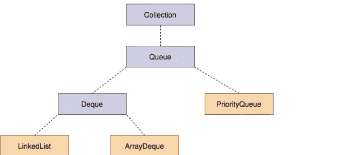
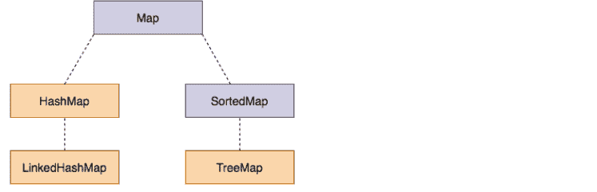

# Java 集合实用指南

如有任何问题，请邮件至：mednikov.iurii@gmail.com

- 关于作者

# 前言

当我们谈论“Java 集合”时，我们实际上指的是两个含义。从广义上说，我们讨论的是常用数据结构的实现，例如基于数组的列表、集合、队列、映射、向量等。在更窄的理解下，我们描述的是具体的抽象和实现，它们共同构成了 Java 集合框架（Java Collections Framework）。这是一组最广泛的数据结构和相应的算法（如排序、搜索或过滤），它们都继承自根接口 `java.util.Collection`。

这些类作为 Java 开发工具包（JDK）的一部分提供，在许多方面简化了我们作为开发者的工作。例如，通用的基类降低了初级程序员的学习曲线，并在我们处理数据结构和算法时避免了重复造轮子。

本书适用于所有水平的 Java 开发者。它对于刚开始学习集合的初学者来说同样有用，但也可以作为高级软件工程师的参考手册。

# 致谢

出版这本书对我来说是一个巨大的荣幸。它给了我一个很好的机会来总结和反思我的技能。我想将这本书献给父亲 Andrei：我花了更多时间学习（我的第一个专业是国际经济，之后才转到计算机科学）。如果没有我父亲的耐心，这一切是不可能的。

# 第 1 章：java.util.Collection 概述

当我们谈论 Java 集合时，我们考虑两个方面。首先，是一个更广泛的概念，意味着常用数据结构的实现。另一个较窄的理解对应于 Java 集合框架包含的具体接口及其实现，它们作为 JDK 的一部分开箱即用。从这个意义上说，我们需要记住这些集合继承自根接口 `java.util.Collection`，定义了子类应该实现的所有通用功能。

## 哪些数据结构是集合

本节提供了 Java 集合框架的概览视图。该库为开发者提供了一个统一的架构来表示和操作集合，使集合能够独立于实现细节进行操作。Java 编程语言将集合定义为一个表示一组对象的对象。换句话说，Java 集合框架（下文简称 JCF）包含了许多接口和实现，用于排序、搜索或过滤等操作。

首先，请观察下图，它总结了 JCF 的层次结构：


一个常见的面试问题似乎是“我们为什么要使用 JCF？”嗯：

- JCF 减少了处理数据结构和算法的工作，因为你不需要重复造轮子
- JCF 提供了数据结构和算法的实现，因此提高了效率
- JCF 建立了不同 API 之间的互操作性
- JCF 让学习集合变得更容易

回到图中。根类是 `java.util.Collection` 和 `java.util.Map`。需要记住，从技术角度来看，映射不是集合，虽然它们包含视图操作，可以作为集合进行操作。

正如前面提到的，Java 集合是一组对象，这些对象被称为元素。注意，集合中的元素必须唯一（例如 Set），而其他类型允许重复（例如数组的列表）。`java.util.Collection` 接口没有直接实现，Java 有其子接口的实现。该接口通常用于传递集合并操作它们。

总结，`java.util.Collection` 允许我们通过以下方式插入元素：

* `boolean add(Element e)` 添加新元素 E 并确保集合包含指定的元素。如果集合由于此调用而发生了变化，则返回 true 或 false。
* `boolean addAll(Collection c)` 将集合 C 中的所有元素插入集合中。注意，该方法也返回布尔值，如果集合由于此调用而发生了变化，则返回 true。

某些实现对可能包含的元素施加了限制，结果是禁止了某些插入。例如，如果集合不允许重复，则不能添加已存在的元素。空值也是如此。

## 从集合中移除元素

与两种插入操作相比，有更多方法可以从集合中删除元素。让我们简要观察它们：

- `void clear()` 移除集合中的所有元素
- `boolean remove(Element e)` 从集合中移除指定元素 e 的单个实例（如果元素存在）
- `boolean removeAll(Collection c)` 删除集合中所有包含在参数集合 c 中的元素
- `boolean removeIf(Predicate filter)` 删除此集合中所有满足给定谓词条件的元素

(Listing 1-2)

```java
@Test
void removeTest(){
    // 获取模拟数据 posts
    List<Post> posts = getPosts();

    Post post = posts.get(2);
    assertThat(posts).contains(post);

    // 移除对象
    posts.remove(post);
    assertThat(posts).doesNotContain(post);

    // 清空
    posts.clear();
    assertThat(posts).isEmpty();

    // 使用谓词删除
    posts = getPosts();
    // 移除 ID 为 2 和 4 的 posts
    posts.removeIf(p -> p.getId() % 2 == 0);
    assertThat(posts).hasSize(3);
}
```

注意，并不是所有这些方法都是可选的（这意味着在特定实现中可以跳过）。例如，`removeIf()` 方法不是可选操作，而 `remove()`、`removeAll()` 和 `clear()` 被标记为可选操作。

## 从集合创建流

在 Java 中，stream（流）代表支持顺序和并行聚合操作的元素序列。我们将在下一章中详细检查它们。根接口提供了两个方法来初始化流（两者都不是可选的）：

- `Stream<E> stream()` 创建一个以此集合为源的顺序流
- `Stream<E> parallelStream()` 创建一个以此集合为源的可能的并行流

让我们看看下面的代码片段：

(Listing 1-3)

```java
@Test
void streamTest(){
    List<Post> posts = getPosts();
    Stream<Post> stream = posts.stream();
    assertThat(stream).isInstanceOf(Stream.class);
}
```

## 遍历集合

从技术角度来看，迭代是一种技术，用于按顺序重复执行代码块，直到特定条件存在或不再存在。换句话说，迭代器按照可预测的顺序遍历抽象数据结构。Java 提供了几种遍历集合的方法。注意，并不是所有集合都提供基于索引访问元素的方法（例如，集合不支持此功能）。

因此，在本节中我们不会探索遍历方法。相反，我们将关注适用于任何实现的方法。由于根集合接口也扩展了 `Iterable` 接口，让我们看看它如何允许我们遍历集合元素：

- 使用迭代器
- 使用流
- 使用 `forEach()`

(Listing 1-4)

```java
@Test
void iterationTest(){
    List<Post> posts = getPosts();

    // 创建迭代器
    Iterator<Post> iterator = posts.iterator();

    // 选项 1：使用 hasNext
    System.out.println("使用 iterator hasNext 进行迭代");
    while(iterator.hasNext()) {
        Post post = iterator.next();
        System.out.println(post);
    }
    Iterator<Post> iterator2 = posts.iterator();

    // 选项 2：使用 forRemaining
    System.out.println("使用 iterator forRemaining 进行迭代");
    iterator2.forEachRemaining(p -> System.out.println(p));

    // 使用 forEach
    System.out.println("使用 forEach 进行迭代");
    posts.forEach(p -> System.out.println(p));

    // 使用 stream
    System.out.println("使用 stream 进行迭代");
    posts.stream().forEach(p -> System.out.println(p));
}
```

基本上，迭代器模式允许顺序访问集合中的所有元素，并在每个元素上执行某些操作。你可以注意到迭代器有两个核心方法：

- `hasNext()` 如果迭代还有更多元素，且我们在 while 循环中使用它，则返回真值（其工作方式类似于结果集的 `next()`）
- `next()` 返回一个元素，我们并使用它来访问迭代的当前元素

你也可以使用 `forEachRemaining()` 方法。它接受一个消费者函数，该函数将在每个剩余元素上执行，直到所有元素处理完毕或操作抛出异常。注意，`iterator()` 方法不是可选的。

我们将在第 8 章深入讨论迭代器。

## 访问的单个元素

我必须提到，`java.util.Collection` 并没有指定访问单个元素的方法。这意味着每个特定的实现都必须提供自己的方法。例如，基于数组的列表元素可以通过索引访问；但集合（sets）不支持这种功能。换句话说，没有统一的方法来访问集合元素，因为它完全取决于底层实现。

## 其他非可选方法

除了提到的操作外，`Collection` 接口中还定义了其他被标记为非可选的方法。它们的重要性不足以为每个方法都单独分一个章节，但对开发者来说仍然非常重要。这就是为什么在这个小节中列出它们。查看这些方法：

- `contains(Element e)` 如果集合包含指定的元素 e，则返回真
- `containsAll(Collection c)` 如果集合包含集合 c 中的所有元素，则返回真
- `isEmpty()` 如果集合为空，则返回真
- `size()` 返回元素的数量整数
- `toArray()` 从集合创建数组

作为本章的总结，这些方法提供了统一接口，可以从集合创建。

# 第 2 章 如何使用流

流在 Java 8 中首次引入，并在随后的版本中进行了更新。这个概念定义了支持顺序和并行操作元素序列。请不要混淆“流”：在第 8 版本之前，Java 有 `InputStream` 和 `OutputStream`。流基于延迟求值原则。让我们来看简单的例子。假设我们创建一个输出所有出现情况到控制台的程序。首先，用传统的命令式范式编写它：

(Listing 2-1)

```java
List<String> names = Arrays.asList("Anna", "Bob", "Carolina", "Denis", "Anna", "Jack", "Marketa", "Simon", "Anna");

for (String name: names){
    if (name.equalsIgnoreCase("Anna")){
        System.out.println(name);
    }
}
```

我们在这里做的是在列表中找到所有的“Anna”并打印它们。这是一个简单的操作，需要编写大量代码！通过流，我们可以使用声明式范式重写之前的示例。

(Listing 2-2)

```java
names.stream().filter(name->name.equalsIgnoreCase("Anna")).forEach(System.out::println);
```

这是一个完全不同的情况！这行代码（开发者有时称为 one-liner）做了相同的事情，但方式相反。与其循环和 if-else 条件，声明式方法将函数组合成管道。在我们的示例中，我们有两个操作——`filter()` 用于查找实体，`forEach()` 在每个元素上执行某些操作。

## 初始化流

从技术角度来看，流是一种编程抽象，它和集合不是一个东西，尽管它可以从集合创建。这些概念经常被在 Java 中开始函数式编程的开发者混淆，我们需要区分它们。在本节中，我们观察用于初始化流的不同方法。

### 从集合

由于本书致力于 Java 集合框架，从集合开始似乎是合理的。我已经提到过，流不是集合，但它使用集合中的元素作为数据源。在上章中，我们注意到一个内置方法 `stream()`，它是由根接口提供的，并从集合创建顺序流。

(Listing 2-3)

```java
List<String> names = Arrays.asList("Alejandra", "Beatriz", "Carmen", "Dolores", "Juanita")
Stream<String> namesStream = names.stream();
assertThat(namesStream).isInstanceOf(Stream.class);
```

### 从生成的数据

如果你没有定义数据的集合，可以创建一个带有生成记录的流。这对于实验流的方法可能有用。在这种情况下，你需要定义一个提供者函数，该函数将用于生成随机序列。静态工厂方法 `generate()` 初始化一个无限的顺序无序流。

(Listing 2-4)

```java
IntStream rangeStream = IntStream.range(1, 10);
assertThat(rangeStream.toArray()).hasSize(9).contains(9).doesNotContain(10);
```

另一个生成流的方法是 `rangeClosed()`。上述方法之间的区别在于序列是否包含上限数字。另一方面，`rangeClosed()` 函数返回一个包含两个界限的范围，而 `range()` 则会从结果中排除第二个值。

### 来自可空值

该方法最初在 JDK 9 中引入。它从单个元素（该元素是可空的：其值可能为 null）创建一个新流，该流包含该元素，或者为空（当值为 null 时）。

(Listing 2-5)

```java
Record record = null;
Stream<Record> nullableStream = Stream.ofNullable(record);
assertThat(record).isNull();
assertThat(nullableStream).isInstanceOf(Stream.class);
```

### 来自一个或多个元素

`of()` 静态工厂方法从一个或多个元素创建一个流（在后的情况下，它使用变长参数）。有两个重载版本：

- `of(T element)`
- `of(T... elements)`

在第一个版本中，`of()` 方法返回一个顺序流，其中包含一个单一元素 T。在第二种变体中，它创建一个顺序有序的流，其元素以变长参数的形式提供。

(Listing 2-6)

```java
Stream<Integer> pointsStream = Stream.of(2, 5, 12, 6, 19);
assertThat(pointsStream).isInstanceOf(Stream.class);
```

### 迭代

静态方法 `iterate()` 在 Java 9 中引入。它接受两个参数：初始值（也称为种子）和一个一元运算符函数，该函数用于生成序列。该方法从种子值开始，应用给定的函数以获取下一个元素。

(Listing 2-7)

```java
Stream<Integer> iterateStream = Stream.iterate(0, i -> i + 2);
assertThat(iterateStream).isInstanceOf(Stream.class);
```

### 创建空流

我们已经提到了 `ofNullable()` 方法，在值为 null 时它可能返回空流。尽管如此，是否还有其他方法可以获取空流？静态方法 `empty()` 顾名思义返回一个空流。

(Listing 2-8)

```java
Stream<Integer> emptyStream = Stream.empty();
assertThat(emptyStream.toArray()).isEmpty();
```

### 使用构建器

到目前，我们观察了用于初始化新流实例的静态工厂方法。一些程序员倾向于依赖构建器模式来创建对象。`Stream` 类有自己的构建器，可以作为工厂方法的替代方案。静态方法 `Stream.builder()` 允许通过单独生成元素并将其添加到构建器中来创建流，而不需要临时集合或缓冲区。

(Listing 2-9)

```java
// 1. 创建构建器
Stream.Builder<String> builder = Stream.builder();

// 2. 创建流
Stream<String> nameStreamBuilder =
builder.add("Alejandra").add("Beatriz").add("Carmen").add("Dolores").add("Juanita").build();

// 包含与第一个示例相同的元素
assertThat(namesStream.collect(Collectors.toList())).containsElementsOf(nameStreamBuilder.collect(Collectors.toList()));
```

在这个代码示例中，我们从创建构建器实例开始。接下来，通过 `add()` 方法填充值。最后，通过 `build()` 方法将构建器转换为流。

### 流水线概念

我们对流的创建进行了广泛介绍并观察了实现方法。现在，当我们获得流实例后，就可以组装流水线以便对流进行一些有用操作。从技术角度来看，流水线由一个源（集合、元素、生成的序列等）组成，随后是零个或多个中间操作和一个终端操作。


### 中间操作 (Intermediate operations)

中间操作返回新流并且是惰性的。它们的惰性意味着只有在调用终端操作后，才会对源数据执行实际计算，并且只在需要时消耗源元素。我们可以链式调用多个中间操作，因为每个操作都会返回一个新的流实例。

## 过滤 (Filter)

在本章开头，我们做了一个关于名称的示例。在那里，我们过滤了名称列表以找到匹配的名称。这是通过 `filter()` 完成的。基本上，它返回一个新流，由匹配给定谓词（指定逻辑条件的函数）的元素组成。

(Listing 2-10)

```java
@Test
void filterTest(){
    Stream<String> stream = names.stream();
    long result = stream.filter(n -> n.startsWith("A")).count();
    assertThat(result).isEqualTo(4);
}
```

### 映射 (Map)

流 API 提供许多映射操作。将它们分组在一个章节下是一个好主意。让我们从通用的 `map()` 函数开始。它返回一个新流，该流由将映射函数应用到流元素的结果组成。

(Listing 2-11)

```java
@Test
void mapTest(){
    Stream<String> stream = names.stream();
    int result = stream.map(n -> n.length()).sum(); // 注意：此处原文逻辑似乎有误，按原文翻译
    assertThat(result).isEqualTo(4);
}
```

有一些特定的映射方法，将结果转换为数值：

- `mapToInt()` 产生 `IntStream` 实例
- `mapToDouble()` 产生 `DoubleStream` 实例
- `mapToLong()` 产生 `LongStream` 实例

### 去重 (Distinct)

另一个常用的中间操作是 `distinct()`。它从源中产生一个唯一元素的流，以规避重复。对于有序流，`distinct()` 方法是稳定的；对于无序流，Java 不提供稳定性保证。

(Listing 2-12)

```java
@Test
void distinctTest() {
    List<Integer> numbers = Arrays.asList(1,2,3,4,5);
    Stream<Integer> stream = numbers.stream();
    long result = stream.distinct().count();
    assertThat(result).isEqualTo(5);
}
```

### 排序 (Sorting)

在许多情况下，我们需要对集合中的元素进行排序，例如自然顺序。`sorted()` 方法返回一个元素已排序的流。

(Listing 2-13)

```java
@Test
void sortTest() {
    List<Integer> numbers = Arrays.asList(-9, -18, 0, 25, 4);
    Stream<Integer> stream = numbers.stream();
    List<Integer> result = stream.sorted().collect(Collectors.toList());
    assertThat(result).containsExactly(-18, -9, 0, 4, 25);
}
```

在 Listing 2-13 中我使用了流。`Integer` 类实现了 `Comparable`，因此提供了比较逻辑。如果你在自定义类上使用 `sorted()`，你需要实现它。否则，在执行终端操作时将抛出 `ClassCastException`。

### 当 (While)

这两个方法也是在 Java 9 中添加的：`dropWhile()` 和 `takeWhile()`。它们都接受一个指定条件的谓词函数。

- `dropWhile()` 产生在丢弃匹配给定条件的最长前缀后剩余元素的流。
- `takeWhile()` 产生从该流中提取匹配给定条件的最长前缀元素的流。

注意，这两个方法都适用于有序元素的流。这意味着你需要对元素进行排序，例如使用在上节中描述的 `sorted()` 方法。在 Listing 2-14 中我使用了集合。

(Listing 2-14)

```java
@Test
void whileTest(){
    Set<Integer> numbers = Set.of(1,2,3,4,5,6,7,8);
    Stream<Integer> stream = numbers.stream();
    Set<Integer> result = stream.takeWhile(x -> x < 5).collect(Collectors.toSet());
    assertThat(result).hasSize(4);
}
```

### 限制 (Limit)

`limit()` 方法产生一个流，限制长度不超过指定的长度。该方法接受一个参数，代表所需的长度。

(Listing 2-15)

```java
@Test
void limitTest(){
    Stream<Integer> stream = getNumbers().stream();
    Set<Integer> result = stream.sorted().limit(5).collect(Collectors.toSet());
    System.out.println(result);
    assertThat(result).contains(-75, -18, -9, -5, 0);
}
```

## Peek

这个方法在开发者中经常被误解。原因在于它的作用方式与 `map()` 方法相似，但仅作用于一小部分。同样地，`peek()` 方法对流中的每个元素应用修改，但这些修改仅存在于方法的执行内部。与 `map()` 不同，`peek()` 不会向流返回修改后的元素。这就是为什么 `peek()` 常用于调试的原因。你可以将其视为 `forEach()` 的中间操作对应项。

让我们通过示例来区分 `peek()` 和 `map()`。考虑一个数字列表。我们对这两种情况应用了相同的修改——将每个数字乘以 2。然而，当你运行这段代码段时，你会发现第一种情况下的结果包含与初始序列相同的值：

（Listing 2-16）

```java
@Test
void peekTest() {
    List<Integer> numbers = Arrays.asList(5, 2, 12, 20, 9, 8);
    System.out.println("Peek:");
    List<Integer> peekResults = numbers.stream().peek(number -> {
        number = number * 2;
        System.out.println(number);
    }).collect(Collectors.toList());
    System.out.println("Final result:");
    peekResults.stream().forEach(System::println);
    Assertions.assertThat(peekResults).hasSameElementsAs(numbers);
    System.out.println("Map");
    List<Integer> mapResults = numbers.stream().map(number -> {
        number = number * 2;
        System.out.println(number);
        return number;
    }).collect(Collectors.toList());
    System.out.println("Final result:");
    mapResults.stream().forEach(System::println);
    Assertions.assertThat(mapResults).contains(10, 4, 24, 40, 18, 16);
}
```

运行此测试用例的最终输出如下所示：

```
Peek:
10
4
24
40
18
16
Final result:
5
2
12
20
9
8
Map:
10
4
24
40
18
16
Final result:
10
4
24
40
18
16
```

注意，第一种情况下的结果序列（在应用 `peek()` 操作后）包含与原始列表相同的数字。这是由于 `peek()` 方法不返回修改后的值。该方法的目的是在流水线的某个特定点上验证元素。另一方面，流水线 2 的结果（应用了 `map()` 方法）与初始序列不同。

## 终端操作

流水线操作的另一组对应于终端操作。与中间操作不同，流上可能只执行一个终端操作，因为一旦它完成，流流水线就会被消耗，且无法再次使用。终端操作产生某些结果（可以是 Java 对象或 `void`），而不是返回一个流。

### ForEach

我们已经在上一节说明中间操作的许多示例中遇到过 `forEach()` 方法。从技术角度来看，`forEach()` 函数接受一个消费者函数（consumer function），该函数定义了在流的每个元素上执行的操作。

（Listing 2-17）

```java
@Test
void forEach(){
    Stream<String> stream = names.stream();
    stream.filter(n -> !n.equalsIgnoreCase("Anna")).map(n -> n.toUpperCase()).forEach(n -> System.out.println(n));
}
```

注意，对于并行流流水线，此操作不保证遵守流的遭遇顺序（encounter order），因为这样做会牺牲并行带来的优势。对于任何元素，操作都可能在库选择的任何时间和任何线程中执行。如果操作访问了共享状态，则需要负责提供所需的同步机制。

### Collectors

`forEach()` 方法没有返回值：它消耗数据，但不提供返回结果（其返回类型为 `void`）。然而，我们经常需要对集合上的流执行某些操作，然后获取一个新的集合。在这些情况下，我们使用 `collect()` 方法。它使用收集器（collectors）对流的元素执行可变归约操作。

(Listing 2-18)

```java
@Test
void collectTest() {
    Stream<String> stream = names.stream();
    List<Integer> result = stream.filter(n -> n.length() <= 4).map(n -> n.length()).collect(Collectors.toList());
    Assertions.assertThat(result).hasSize(5);
}
```

在 Listing 2-18 的示例代码中，我使用了一个内置收集器，它将元素收集到列表中。Java 还提供了其他收集器方法：

- `Collectors.toMap()`
- `Collectors.toSet()`

### Find

在本节下，列出了查找元素并返回 `Optional` 容器的操作，因为请求的元素可能不存在（例如空值）：

- `findAny()`
- `findFirst()`

这两个方法都没有参数，所以你可能会问一个合理的问题：它们实际上是如何找到元素的？答案是显而易见的。条件在 `filter()` 中指定，而终端操作返回满足谓词的单个元素。

(Listing 2-19)

```java
@Test
void findTest() {
    Stream<String> stream = names.stream();
    Optional<String> result = stream.filter(n -> n.startsWith("A")).findFirst();
    Assertions.assertThat(result).isPresent();
    Assertions.assertThat(result.get()).isEqualTo("Anna");
}
```

### Match

另一组流水线操作对应于匹配操作。与中间操作不同，这些操作会返回布尔值。这些操作用于检查流中的元素是否满足某些条件。常见的操作有：

- `allMatch()`
- `anyMatch()`
- `noneMatch()`

`anyMatch()` 检查流中是否至少有一个元素满足谓词，如果是则返回 `true`。考虑一个数字列表：（Listing 2-20）

```java
@Test
void anyMatchTest() {
    List<Integer> numbers = Arrays.asList(10, 20, 30, 40, 50);
    boolean hasEven = numbers.stream().anyMatch(n -> n % 2 == 0);
    Assertions.assertThat(hasEven).isTrue();
}
```

另一种情况是验证所有元素都满足条件，这可以通过 `allMatch()` 操作完成。考虑以下数字列表：（Listing 2-21）

```java
@Test
void allMatchTest() {
    List<Integer> numbers = Arrays.asList(10, 53, 23, 95, 30);
    boolean allEven = numbers.stream().allMatch(n -> n % 2 == 0);
    Assertions.assertThat(allEven).isFalse();
}
```

最后，我们可以检查流中没有元素匹配谓词。这是通过 `noneMatch()` 方法实现的。考虑以下示例：我们需要断言列表中的整数均为负数（小于0）：（Listing 2-22）

```java
@Test
void noneMatchTest() {
    List<Integer> numbers = Arrays.asList(-4, -54, -25, -8, -1);
    boolean hasPositives = numbers.stream().noneMatch(n -> n > 0);
    Assertions.assertThat(hasPositives).isTrue();
}
```

### Reduction

从技术角度来看，归约是一种从元素序列产生单个结果的操作。求和是一个很好的例子：我们累加每个元素并返回最终结果。换句话说，归约是对序列的所有成员反复应用某些函数（例如加法）。

Java 通过 `reduce()` 终端操作提供了归约实现。该方法接受两个参数：恒等值（identity）和一个二元运算符，后者指定了合并函数。恒等值是初始值（例如 0 或空字符串），或者在空流情况下的默认值。二元运算符接受两个参数：部分结果（例如总和的小计）和流的下一个元素。

让我们看看如何在两个示例上使用 `reduce()` 函数：一个数字列表（我们期望一个和）和一个字符串列表（我们期望一个单词）：（Listing 2-23）

```java
@Test
void reduceTest() {
    // numbers
    List<Integer> numbers = Arrays.asList(10, 20, 30, 40, 50);
    int total = numbers.stream().reduce(0, (subtotal, number) -> subtotal + number);
    Assertions.assertThat(total).isEqualTo(150);
}
```

总结来说，归约操作的使用有助于从序列中创建一个单个结果。

# 第 3 章 列表 (Lists)

在我们开始概述 Java Collections Framework 中列表的实现之前，让我们先定义什么是列表。在计算机编程中，列表（list）是元素的有限序列，每个元素都有自己的位置。在计算机科学中，列表分为两类：基于数组的列表（array-based lists）和链表（linked lists）。

基于数组的列表之所以因此，是因为在底层使用数组来存储值。数组的一个重要特性是尺寸是固定的，但基于数组的列表可以根据需要添加任意元素并扩展底层数组的大小。这里我们需要引入“大小”（size）和“容量”（capacity）的概念。看下面的图，它展示了一个数组列表，它有 5 个单元格，其中 3 个具有实际值：

根据这个示例，我们可以定义这些概念：

- **容量（Capacity）**：存储数据的单元格总数
- **大小（Size）**：实际包含数据的单元格数量

从技术上讲，当大小等于容量时，为了添加新元素，Java 必须增加容量。这是通过一种称为动态内存分配的机制实现的，它根据需要为未来的元素预留内存单元格。

Java 中的所有列表都实现了 `java.util.List` 接口，并具有核心集合方法。基于数组的列表实现定义在 `java.util.ArrayList` 类中。列表数组的容量会自动增长，并且始终至少大于其大小（元素数量）。


# Java 集合操作指南

## 初始化列表

这里需要注意的是，虽然 Java 集合是可变的（mutable），但有两种初始化新数组列表的方法：第一种方法产生可变集合，另一种方法产生不可变（immutable）列表：

- 使用构造函数，例如 `List<Integer> numbers = new ArrayList<>();`，此版本创建可变列表
- 使用 `Arrays.asList()` 静态方法，它会创建不可变列表

另一个选项是使用 `List.of()` 静态方法，它接受变长参数（var args）作为参数。该操作自 Java 10 起可用。它也会产生一个不可变列表。

## 添加新元素

我们将观察的第一个操作是插入新元素。基于数组的列表从根接口继承了两个插入方法：`add(E)` 和 `addAll(Collection c)`，还提供了两个列表特有的方法用于向指定位置添加元素。观察所有这些方法：

- `add(E e)` 是基本方法，将新元素插入到列表末尾
- `addAll(Collection c)` 是来自根接口 `java.util.Collection` 接口的另一个方法，它将集合 `C` 的所有元素追加到列表末尾
- `add(int position, E e)` 此方法将新元素 `E` 插入到指定的位置。它会将该位置上的当前元素以及任何后续元素向右移动。如果位置值大于列表的大小，此方法可能会抛出 `IndexOutOfBoundsException`
- `addAll(int position, Collection c)` 该操作与上一个相似，但它从位置 `position` 开始添加集合 `c` 中的元素。在与 `add()` 函数相同的条件下可能会抛出 `IndexOutOfBoundsException`

### Listing 3-1

```java
@Test
void addElementsToTest() {
  // 方案 1. 创建新列表并使用 add() 可变的！
  List<Integer> numbers = new ArrayList<>();
  numbers.add(10);
  numbers.add(15);
  numbers.add(20);
  numbers.add(25);
  numbers.add(30);
  assertThat(numbers.add(66)).isTrue();
}
```

```java
// 方法 2. 使用 Arrays.asList. 不变的！
List<String> names = Arrays.asList("Alejandra", "Beatriz", "Carmen", "Dolores", "Juanita");
assertExceptionThrownBy(() -> 
names.add("Maria")).isInstanceOf(UnsupportedOperationException.class);
```

## 移除元素

删除元素是我们日常工作中需要做的另一个重要事情。有两个重载的 `remove` 方法可以从数组列表中移除元素：

- `remove(E e)` 从列表中移除指定元素 `e` 的单个实例（如果该元素存在）
- `remove(int position)` 移除索引位置上的元素。

区分这些方法非常重要，因为这是面试和认证中非常常见的问题。例如，你有一个数字列表：

### Listing 3-2

```java
@Test
void removeElementsTest() {
  List<Integer> numbers = new ArrayList<>(Arrays.asList(10, 20, 30));
  numbers.remove(10);
  assertThat(numbers).containsExactly(20, 30);
  numbers.remove(0);
  assertThat(numbers).containsExactly(30);
}
```

## 访问单个元素

像数组一样，列表允许通过索引访问单个元素，这意味着下限为零。为此，我们使用 `get()` 方法，它接受一个整数值：

### Listing 3-3

```java
@Test
void accessElementTest() {
  List<Integer> numbers = Arrays.asList(10, 20, 30, 40, 50);
  int beginning = numbers.get(0);
  int value = numbers.get(2);
  int end = numbers.get(numbers.size()-1);
  assertThat(beginning).isEqualTo(10);
  assertThat(value).isEqualTo(30);
  assertThat(end).isEqualTo(50);
}
```

## 创建子列表

另一个常见的实际操作是创建子列表。在某些语言中，子列表被称为切片（slicing）。为了获取子列表，我们使用 `sublist(start, end)` 方法，它返回原始列表的一部分（包含起始索引，但不包含结束索引）：

### Listing 3-4

```java
@Test
void subListTest() {
  List<String> original = Arrays.asList("Alejandra", "Beatriz", "Carmen", "Dolores", "Juanita");
  List<String> sublist = original.sublist(0, 5);
  assertThat(sublist).doesNotContain("Maria");
}
```

## 查找元素

通过查找，Java 获取元素的索引。基于数组的列表有两种方式执行此操作：

- `indexOf(E e)` 返回元素第一次出现的索引，如果未找到则返回 -1
- `lastIndexOf(E e)` 返回元素最后一次出现的索引，如果未找到则返回 -1

### Listing 3-5

```java
@Test
void searchElementTest() {
  List<Integer> numbers = Arrays.asList(1, 52, 12, 39, 45, 98, 100, 565, 6, 13);
  assertThat(numbers.indexOf(45)).isEqualTo(4);
// 使用 lastIndexOf
  List<Integer> numbers2 = Arrays.asList(1, 52, 12, 39, 45, 98, 100, 565, 45, 13);
  assertThat(numbers2.lastIndexOf(45)).isEqualTo(8);
}
```

JCF 操作的另一种选择是来自 Apache Collections 库的 `ListUtils.indexOf()` 方法。该静态操作接受两个参数：

- 列表
- 谓词（Predicate）

它返回第一个匹配谓词元素的索引。如果元素不存在或列表为空则返回 -1。这不仅可以通过值查找元素，还可以查找满足条件的元素。看下面的示例代码：

### Listing 3-6

```java
@Test
void searchCommonsTest(){
  List<Integer> numbers = Arrays.asList(1, 52, 12, 39, 45, 98, 100, 565, 6, 13);
  int index = ListUtils.indexOf(numbers, n -> n == 39);
  Assertions.assertThat(index).isEqualTo(3);
}
```

## 过滤 (Filter)

当我们过滤列表时，基本上是创建一个新列表，其中包含原始列表中所有满足逻辑条件（谓词）的元素。List 接口没有标准的 `filter()` 方法（像其他编程语言那样）。我们可以通过创建流、应用 `filter()` 中间操作并将结果收集为列表来手动实现。

### Listing 3-7

```java
@Test
void filterTest() {
  List<Integer> numbers = Arrays.asList(1, 2, 3, 4, 5, 6, 7, 8, 9, 10);
  List<Integer> filtered = numbers.stream()
      .filter(n -> n % 2 == 0)
      .collect(Collectors.toList());
  assertThat(filtered).containsExactly(2, 4, 6, 8, 10);
}
```

```java
@Test
void filterStreamTest() {
    List<Integer> numbers = Arrays.asList(45, 12, 80, 77, 95, 4);
    List<Integer> results = numbers.stream().filter(n -> n%2 == 0).collect(Collectors.toList());
    Assertions.assertThat(results).hasSize(3);
}
```

我们也可以使用 Apache Commons Collections 来完成此任务。它在 `ListUtils` 提供了一个静态方法 `select`。该操作的想法与过滤类似：它对原始列表的每个元素应用谓词，并返回一个新的列表，该列表仅包含满足此条件的元素。

### Listing 3-9

```java
@Test
void filterCommonsTest() {
    List<Integer> numbers = Arrays.asList(45, 12, 80, 77, 95, 4);
    List<Integer> results = ListUtils.select(numbers, n -> n%2 == 0);
    Assertions.assertThat(results).hasSize(3);
}
```

## 替换元素

在本节中，我们将观察如何替换（更改）特定元素。回想一下，列表在数组中存储项，通过替换，我们理解为更改具有具体索引的单元的值。要实现这一点，我们可以使用两种方法：

- `set(int position, E e)` 将此列表中指定位置的元素替换为值 `e`
- 使用静态方法 `Collections.replaceAll(collection, old, new)`，它接受三个参数：列表本身、旧值和新元素。

请看 Listing 3-10 所示的代码片段，它演示了这两种方法：

### Listing 3-10

```java
@Test
void replaceElementTest() {
    List<String> names = new ArrayList<>();
    names.add("Alejandra");
    names.add("Beatriz");
    names.add("Carmen");
    names.add("Dolores");
    names.add("Juanita");
}
```

```java
// 方法 1 通过索引
names.set(1, "Maria");
assertThat(names.get(1)).isEqualToIgnoringCase("Maria");
```

```java
// 方法 2 使用 Collections.replaceAll
Collections.replaceAll(names, "Carmen", "Sofia");
assertThat(names).containsExactly("Alejandra", "Maria", "Sofia", "Dolores", "Juanita");
```

## 比较两个列表

从技术上讲，作为任何 Java 对象，列表都通过自己的实现重写了 `equals()` 方法。列表的合约如下：

- 两个对象都是列表
- 两个列表具有相同的大小
- 两个列表以相同的顺序包含相同的元素（相等）

还有其他方法。第一种方法是使用流（streams）。在某些情况下，我们想要检查列表是否包含相同的元素，但元素的顺序不同。从技术上讲，这超出了等等的定义，这些列表并不是严格相等的。在这种情况下，我们可以利用流来检查元素是否匹配。

第二方法是使用 Apache Commons Collections。它提供了一个静态方法 `isEqual()`，它接受两个列表作为参数并返回它们相等的布尔值。它是对 `equals()` 实现的封装方法。

### Listing 3-11

```java
@Test
void compareListsTest() {
    List<Integer> list1 = Arrays.asList(1, 52, 12, 39, 45, 98, 100, 565, 6, 13);
    List<Integer> list2 = Arrays.asList(1, 52, 12, 39, 45, 98, 100, 565, 6, 13);

    // 方法 1. 使用 equals
    assertThat(list1).isEqualTo(list2);

    // 方法 2. 使用 streams
    List<Integer> list3 = Arrays.asList(1, 52, 12, 39, 45, 98, 100, 565, 6, 13);
    assertThat(list1).isEqualTo(list3);

    // boolean allMatch = list3.stream().allMatch(number -> list1.contains(number));
    assertThat(list3.stream().allMatch(number -> list1.contains(number))).isTrue();

    // 方法 3. 使用 Commons
    assertThat(Utils.isEqual(list1,list2)).isTrue();
}
```

## 复制列表

有三种方法可以将元素从一个列表复制到另一个：

- 使用流（streams）
- 使用 `Collections` 类的静态方法
- 使用 `List.copyOf()` 静态方法（Java 10 起可用）

这种方法基于流的使用。它是这些方法中最灵活的，因为它允许运行额外的断言，如空检查或重复检查。在简单的形式下，所有元素使用 `toList()` 收集器收集。

### Listing 3-12

```java
List<Integer> numbers = List.of(43, 12, 5, 89, 3);
List<Integer> result = numbers.stream().collect(Collectors.toList());
Assertions.assertThat(result).contains(numbers);
```

第二个选项是使用工具类。它提供了静态方法 `copy()`，接受两个参数。该方法将源列表中的所有元素复制到目标列表中，其索引与源列表相同。目标列表的大小必须大于等于源列表的大小。如果是，目标列表中的剩余元素将不受影响。

### Listing 3-13

```java
List<Integer> source = List.of(43, 12, 5, 89, 3);
List<Integer> destination = new ArrayList<>();
Collections.copy(source, destination);
Assertions.assertThat(destination).contains(source);
```

最后，可以使用静态方法 `List.copyOf()` 复制两个列表，该方法从 Java 10 起可用。该方法返回一个不可变列表，它包含给定集合（例如可以使用其他集合作为源）的元素的迭代顺序。给定集合不能为空，且不能包含任何空元素。如果随后修改了给定集合，返回的列表将不会反映此类修改。

### Listing 3-14

```java
List<String> cities = new ArrayList<>();
cities.add("Madrid");
cities.add("London");
cities.add("Moscow");
cities.add("Lima");
List<String> result = List.copyOf(cities);
Assertions.assertThat(result).contains(cities);
```

```java
@Test
void unionJavaTest() {
    HashSet<Integer> numbers1 = SetUtils.hashSet(20, 12, 35, 40, 19);
    HashSet<Integer> numbers2 = SetUtils.hashSet(67, 9, 11, 5, 17);
    boolean result = numbers1.addAll(numbers2);
    Assertions.assertThat(numbers1).containsAll(numbers2);
    Assertions.assertThat(result).isTrue();
}
```

核心 Java 方法的缺点是它会修改其中一个集合。为了避免这一点，Apache Commons Collections 提供了 `SetUtils.union()` 静态方法。它接受两个集合并返回一个 `SetView` 实例（可以通过 `toSet()` 操作转换为集合），这保护了原始集合不受修改。

### Listing 4-4


```java
@Test
void unionCommonsTest() {
    HashSet<Integer> numbers1 = SetUtils.hashSet(20, 12, 35, 40, 19);
    HashSet<Integer> numbers2 = SetUtils.hashSet(67, 9, 11, 5, 17);
    Set<Integer> results = SetUtils.union(numbers1, numbers2).toSet();
    Assertions.assertThat(results).containsAll(numbers1).containsAll(numbers2);
}
```

## 删除元素

要从集合中删除元素，我们可以使用 `remove(Object E)` 方法。与前面提到的插入案例一样，删除操作使用 `equals()` 实现来确定元素是否存在于集合中。该方法返回一个布尔值，如果元素被删除，则返回 `true`。换句话说，一旦调用返回，集合中将不再包含该元素。

(Listing 4-5)

```java
@Test
void removeFromTest(){
    Set<Integer> numbers = new HashSet<>();
    numbers.add(1);
    numbers.add(2);
    numbers.add(3);
    assertThat(numbers.remove(3)).isTrue();
}
```

请注意方法的签名：它接受一个通用的 `Object`，而不是具体的类型。因此，如果参数的类型与集合的类型不匹配，将抛出 `ClassCastException`。

## 交集操作

在集合中，交集的定义如下：包含集合 A 中所有同时也是集合 B 元素的集合（set）。换句话说，我们将交集理解为同时出现在两个集合中的元素。在 Java 中，我们可以通过两种主要方法找到交集（类似于并集）：

- 使用 `retainAll()` 
- 使用 Apache Commons Collections

原生方法指定为 `retainAll()` 方法。与 `addAll()` 方法一样，它也会修改原始集合，移除所有不在另一个集合中呈现的元素。

(Listing 4-6)

```java
@Test
void intersectionJavaTest(){
    HashSet<Integer> numbers1 = SetUtils.hashSet(20, 12, 35, 40, 19);
    HashSet<Integer> numbers2 = SetUtils.hashSet(35, 17, 12, 95, 3, 19);
    numbers1.retainAll(numbers2);
    Assertions.assertThat(numbers1).containsInAnyOrder(35, 19, 12);
}
```

正如已经指出的，Java 集合的可变性会影响原始 `numbers1` 集合的元素。这可以通过创建一个中间集合（使用拷贝构造函数从 `numbers1` 集合获取所有元素）或使用 Apache Commons Collections 工具类来避免。

Apache Commons Collections 包含一个静态方法 `SetUtils.intersection()`，它接受两个集合作为参数。该方法返回 `SetView` 实例，可以通过调用 `setTo()` 转换为集合。

(Listing 4-7)

```java
@Test
void intersectionCommonsTest() {
    HashSet<Integer> numbers1 = SetUtils.hashSet(20, 12, 35, 40, 19);
    HashSet<Integer> numbers2 = SetUtils.hashSet(35, 17, 12, 95, 3, 19);
    Set<Integer> results = SetUtils.intersection(numbers1, numbers2);
    Assertions.assertThat(results).containsExactlyInAnyOrder(35, 19, 12);
}
```

## 替换元素

列表（lists）允许替换任意元素，而集合（sets）不支持。默认情况下，如果集合已经持有某个元素，新添加的内容将不会添加，也不会替换现有的元素。我们可以手动实现此功能。为此，我们需要断言元素确实存在集合中，然后删除它，如列表 4-8 所示：

(Listing 4-8)

```java
if (set.add(e) == false) {
    set.remove(e);
    set.add(e);
}
```

在此代码段中，如果 `set.add(e)` 返回 `false`，则删除 `e` 并重新添加 `e`。在这个代码片段中，如果 `add()` 返回 `false`，说明集合已经存在该元素。我们可以通过这种方式来替换它。

## 获取集合中的任意元素

从集合中获取任意元素，由于集合不支持此功能（默认情况下，如果集合已经持有某个元素，新添加的内容将不会添加）。集合集合允许基于索引来访问任意元素。我们可以通过以下方式实现此功能：

- 使用迭代器
- 使用流

(Listing 4-9)

```java
TreeSet<Integer> numbers = new TreeSet<>();
numbers.add(5);
numbers.add(10);
```

在列表 4-9 中，我们创建了一个 `TreeSet` 实例。集合不提供基于索引的访问方法。我们可以通过使用迭代器来实现：

(Listing 4-10)

```java
Set<Integer> numbers = new HashSet<>();
numbers.add(5);
numbers.add(10);
Iterator<Integer> iterator = numbers.iterator();
Integer first = iterator.next();
```

正如前面讨论的，集合可以使用迭代器来获取任意元素。我们可以使用 Apache Commons 工具类来完成任务：

(Listing 4-11)

```java
Set<Integer> numbers = new HashSet<>();
numbers.add(5);
numbers.add(10);
Iterator<Integer> iterator = numbers.iterator();
Integer first = iterator.next();
```

在列表 4-11 中，通过 `size()` 方法获取集合的大小。

## 获取集合的大小

要获取集合的元素数量，我们使用 `size()` 方法，它是从 `Collection` 接口继承的。

(Listing 4-12)

```java
Set<Integer> numbers = new HashSet<>();
numbers.add(5);
numbers.add(10);
int size = numbers.size();
assertThat(size).isEqualTo(2);
```

## 创建子集

从数学角度来看，子集（subset）是一个所有元素都是另一个集合成员的集合。Java 没有提供内置的创建子集的方法，但可以通过以下方法来实现：

- 使用流
- 使用迭代器

查看列表 4-15 中提供的可能实现：

(Listing 4-15)

```java
@Test
void createSubsetTest(){
    Set<Integer> numbers = Set.of(1, 2, 3, 4, 5, 6, 7, 8, 9, 10);

    // 方法 1：使用流
    Set<Integer> streamSubset = numbers.stream().limit(5).collect(Collectors.toSet());
    assertThat(streamSubset).hasSize(5).contains(1, 2, 3, 4, 5);

    // 方法 2：使用迭代器
    Iterator<Integer> iterator = numbers.iterator();
    Set<Integer> iteratorSubset = new HashSet<>();
    int limit = 5;
    for (int i = 0; i < limit && iterator.hasNext(); i++) {
      iteratorSubset.add(iterator.next());
    }
    assertThat(iteratorSubset).hasSize(5).hasSameElementsAs(streamSubset);
}
```

## 差集

在集合中，两个集合之间的差集是集合 A 中所有不属于集合 B 的元素的集合。Java 没有为此操作提供内置解决方案，但可以使用提到的 Commons Collections 库来实现。`SetUtils` 类提供了静态的 `difference()` 方法。它返回一个 `SetView`（可以转换为 Java 集合），包含集合 A 中所有不是集合 B 成员的元素。

(Listing 4-16)

```java
@Test
void differenceTest() {
    HashSet<Integer> numbers1 = SetUtils.hashSet(20, 12, 35, 40, 19);
    HashSet<Integer> numbers2 = SetUtils.hashSet(35, 17, 12, 95, 3, 19);
    Set<Integer> results = SetUtils.difference(numbers1, numbers2).toSet();
    Assertions.assertThat(results).containsExactlyInAnyOrder(20, 40);
}
```

## 复制集合

从一个集合拷贝元素到另一个集合有两种通用方法：

- 使用流
- 使用静态方法 `Set.copyOf()`（自 JDK 10 起可用）

使用流来复制元素集合与列表的操作类似。正如我们在上一章中观察到的，最简单的形式是在流元素上使用 `toSet()` 收集器。

(Listing 4-17)

```java
Set<Integer> numbers = Set.of(1, 2, 3, 4, 5);
Set<Integer> result = numbers.stream().collect(Collectors.toSet());
assertThat(result).contains(numbers);
```

在 Java 10 中引入了另一种复制元素的方法。静态方法 `Set.copyOf()` 返回一个不可变集合，它包含了给定集合的元素（例如此方法可以用于任何集合类型）。给定的集合不能为空，且不能包含空元素。如果给定的集合包含重复元素，则保留重复元素中的任意一个。如果随后对给定的集合进行修改，返回的 Set 将反映这些修改。

(Listing 4-18)

```java
HashSet<Integer> numbers = SetUtils.hashSet(1, 2, 3, 4, 5);
Set<Integer> result = Set.copyOf(numbers);
assertThat(result).contains(numbers);
```

与 `List.copyOf()` 方法一样，此 `Set.copyOf()` 不允许将不可变集合作为源。

# 第 5 章 队列

在计算机编程中，队列是元素的线性集合，根据 FIFO 原则进行插入和移除。FIFO 是“先进先出”（First-in-First-out）的缩写。换句话说，先插入的元素会被先取出，而栈不同是第一个元素最后一个移除。为了区分这两个原则，让我们来看渡轮的例子。第一种情况是汽车上船。这是一个 LIFO 顺序：第一个进入渡轮的汽车最后离开。另一个例子是票站购买渡轮票的排队。这里遵循 FIFO 原则：先到达票口的人先买票并离开队列。

在基础结构中，队列仅支持两种操作：入队（enqueue）和出队（dequeue）：

- Enqueue 表示将元素插入到队列末尾
- Dequeue 表示从队列头部移除元素

第一个头部元素也称为头（head），位于其后的元素称为尾（tail）。在 Java 中，队列定义在 `java.util.Queue` 接口中。有两种主要的实现：`ArrayDeque` 和 `PriorityQueue`：



这些实现之间的重要区别是元素的顺序。`ArrayDeque` 基于 FIFO 基础存储元素，因此头部元素是第一个插入的。相比之下，`PriorityQueue` 根据自然排序（如果它们实现了 `Comparable` 接口）或指定的比较器函数存储元素。因此，在这种情况下，头部元素将是最小元素。

## 队列声明

为了使用队列，你应该声明它。队列可以使用公共构造函数定义，这些构造函数有助于指定容量。无参数构造函数创建容量足够容纳 16 个元素的队列：

(Listing 5-1)

```java
// initial capacity = 16
Queue<Person> people = new ArrayDeque<>();
// 用于可以运输 50 辆汽车的渡轮
Queue<Car> cars = new ArrayDeque<>(50);
```

## 处理入队操作

处理入队操作有两种主要方法。由于 Java 队列是根接口的子类，它们继承了用于插入和移除元素的通用集合方法。对于队列，它们还提供了自己的 `offer()` 和 `poll()` 方法，其中第一个表示添加元素。这两种插入方法都会元素插入到尾部。

(Listing 5-2)

```java
@Test
void enqueueTest(){
    Queue<Person> people = new ArrayDeque<>();

    // people 被插入到尾部，所以头部是相同的
    people.offer(new Person("Alejandra", "Morales"));
    people.offer(new Person("Beatriz", "Sanchez"));
    people.offer(new Person("Carmen", "Hidalgo"));

    // 队列头部是 Alejandra Morales
    assertThat(people.peek()).isEqualTo(new Person("Alejandra", "Morales"));
}
```

区别是什么以及何时使用其中一个？Java 建议坚持原生队列方法，这意味着添加时使用 `offer(i)` 方法。区别体现在无法插入新元素时：

- `offer()` 返回布尔值 `false`
- `add()` 抛出 `IllegalStateException`

在 `ArrayDeque` 的情况下必须特别说明。该类还继承了 `Deque` 接口。与经典队列相比，该接口定义了一种允许在两端添加和移除元素的数据结构。该类增加了一些仅针对此类的方法：

- `offerFirst()` 和 `addFirst()` 将元素插入头部。它们之间的区别与 `offer(i)` 和 `add(i)` 方法之间的区别相同
- `offerLast()` 和 `addLast()` 将元素插入到尾部
- `push()` 等同于 `addFirst()` 方法。在插入空元素的情况下，此方法将抛出 `NullPointerException`

## 处理出队操作

在队列中移除元素被称为出队（dequeue）。与插入情况一样，Java 队列有两个方法来处理元素的删除：一个继承自根合约的 `remove()` 方法，另一个是队列原生的 `poll()` 方法。两者都会移除头部元素（基于 FIFO 原则）。

(Listing 5-3)

```java
@Test
void dequeueTest(){
    Queue<Car> cars = new ArrayDeque<>();
    Car skoda = new Car(4567, "Skoda");
    cars.offer(skoda);
    assertThat(cars.peek()).isEqualTo(skoda);

    cars.offer(new Car(1234, "Mazda"));

    // previous head -> mazda
    cars.poll();
    assertThat(cars.size()).isEqualTo(1);
}
```

这两种方法之间的区别与使用入队方法相同。我们还需要提到 `ArrayDeque` 继承的方法：

- `pollFirst()` 和 `removeFirst()` 处理头部
- `pollLast()` 和 `removeLast()` 处理尾元素

## 返回头部元素

队列不允许你访问任意元素。你只能获取头部元素（`ArrayDeque` 例外允许获取第一个和最后一个元素）。

(Listing 5-4)

```java
@Test
void getHeadTest(){
    Queue<Person> people = new ArrayDeque<>();
    people.offer(new Person("Alejandra", "Morales"));
    people.offer(new Person("Beatriz", "Sanchez"));
    people.offer(new Person("Carmen", "Hidalgo"));

    Person element = people.element();
    Person peek = people.peek();
    assertThat(element).isEqualTo(peek);
}
```


要返回头部（第一个）元素，你可以使用 `element()` 方法或 `peek()` 方法。它们之间的区别在对空队列使用它们时所示：

- `element()` 方法在空队列上将抛出 `NoSuchElementException`
- `peek()` 方法在队列为空时将返回 `null` 值

正如已经提到的，`ArrayDeque` 允许获取第一个和最后一个元素。因此它提供了两个获取头部的自定义方法：`getFirst()` 和 `peekFirst()`。

## 返回尾元素

尾元素是头部之后的所有元素。从技术角度来看，这是一个序列，而不是单个元素。然而，Java 没有提供获取队列尾部的方法，但如果你需要，可以编写自己的，如下所示：

(Listing 5-5)

```java
@Test
void getTailTest() {
    Queue<Person> people = new ArrayDeque<>();
    people.offer(new Person("Alejandra", "Morales"));
    people.offer(new Person("Beatriz", "Sanchez"));
    people.offer(new Person("Carmen", "Hidalgo"));

    Queue<Person> tail = new ArrayDeque<>(people);
    tail.poll();

    assertThat(tail).hasSize(2);
}
```

在列表 5-5 的实现中，我们执行了三个步骤：

1. 从目标队列创建新队列
2. 删除头部
3. 返回尾部

# 第 6 章 Map（映射）

本章专门介绍 Java 中的 map 实现。我们之前提到过，由于 map 没有继承根集合接口，因此它们（在狭义上）不属于集合。然而，一本关于 Java 数据结构的书中如果没有 map，将是不完整的。

从技术角度来看，map 是一种以键值对（key-value）格式存储元素的数据结构。在其他编程语言中，此类组件被称为哈希（hashes）、关联数组或字典。map 具有许多优势，例如，它们可以同时维护任意数量的不同对象，且与数组结构相比，不需要预先知道大小上限。在 Java map 中，这种标识符被称为键（key）。map 不允许重复的键，但允许唯一键对应多个相同的值。某些 Java 实现允许单个 `null` 键（树 map 除外）。请查看 Java map 层级结构的图表：



与 `HashMap` 和 `TreeMap` 类相比，`HashMap` 类不保证元素的排序顺序。要实现这种排序，键应该是可比较的（实现 `Comparable` 接口），或者开发者应该在初始化 map 时提供一个比较器函数（comparator）。关于 Java map 的一个重要说明是，它们不是同步的。

## 插入新元素

map 的元素本质上是一个键值对（记录）。由于 map 不允许重复键，键的唯一性在插入时会进行验证。当键已经与某个值关联时，它会被更新为新值。要添加新元素，我们可以使用两个方法：

- `V put(K key, V value)`
- `V putIfAbsent(K key, V value)`

这两个方法之间的区别如下：第一种方法（`put()`）是一个可选操作，在使用时，如果 map 之前包含该键的映射，则旧值将被指定值替换。第二种方法（`putIfAbsent()`）仅在键不存在时才插入新值。

(Listing 6-1)

```java
@Test
void addToMapTest() {
    HashMap<Integer, Person> people = new HashMap<>();
    people.put(1, new Person("Alejandra", "Gutierrez"));
    people.put(2, new Person("Beatriz", "Gomez"));
    people.put(3, new Person("Carmen", "Hidalgo"));
    people.put(4, new Person("Dolores", "Sanchez"));
    assertThat(people.get(3)).isEqualTo(new Person("Carmen", "Hidalgo"));
}
```

为了安全插入，使用了 Apache Commons Collections 的 `MapUtils` 类。它包含一个特殊的辅助方法 `safeAddToMap()`，可以防止向 map 中添加 `null` 值。它检查元素是否为 `null`，并将其替换为空字符串值。

## 通过键访问值

要从 map 中检索条目的值，我们需要传递与其关联的键。通常使用 `get(K key)` 方法实现。尽管如此，在记录不在 map 中的情况下，该方法会返回 `null` 值。另一个选项是使用 `getOrDefault(K key, V default)` 方法，在请求的值不存在时显式指定返回指定的值。

(Listing 6-2)

```java
@Test
void getFromMapTest() {
    TreeMap<String, String> words = new TreeMap<>();
    words.put("apple", "manzana");
    words.put("orange", "naranja");
    words.put("pineapple", "pina");
    words.put("lemon", "limon");
}
```

## 从 map 中删除值

要删除一个值，需要传递一个关联的键。`remove()` 方法允许使用其标识符删除值。有两个版本（其中一个是可选的）：

- `remove(K key)`
- `boolean remove(K key, V value)`

第一个操作是可选的。它返回一个值，如果不存在具有该键的对象，则返回 `null`。然而，如果具体的 map 实现允许 `null` 值，那么返回 `null` 并不意味着 map 不包含该键的映射；也可能是 map 显式地将键映射到了 `null`。

第二个方法仅当该键当前映射到指定值时，才删除该键对应的 V。返回的布尔值表示结果是否成功。

(Listing 6-3)

```java
@Test
void removeFromMapTest() {
    HashMap<Integer, Person> people = new HashMap<>();
    people.put(1, new Person("Alejandra", "Gutierrez"));
    people.put(2, new Person("Beatriz", "Gomez"));
    people.put(3, new Person("Carmen", "Hidalgo"));
    assertThat(people).hasSize(3);
    people.remove(3);
    assertThat(people).doesNotContainKey(3);
}
```

## 替换键的值

有两种方法可以替换键的值：

- `V replace(K key, V value)`
- `boolean replace(K key, V oldValue, V newValue)`

这两个方法之间的区别在于，第一种方法替换并返回旧值，或者在不存在时返回 `null`。第二种方法仅当值等于指定的旧值时才进行替换，并返回替换操作的布尔结果。

(Listing 6-4)

```java
@Test
void replaceTest() {
    TreeMap<String, String> words = new TreeMap<>();
    words.put("apple", "manzana");
    words.put("orange", "naranja");
    words.put("pineapple", "pina");
    words.put("lemon", "limon");

    assertThat(words.get("apple")).isEqualTo("manzana");

    words.replace("apple", "manzana", "pera");
    assertThat(words.get("apple")).isEqualTo("pera");

    boolean result = words.replace("orange", "naranja", "uva");
    assertThat(result).isTrue();

    result = words.replace("orange", "wrong", "uva");
    assertThat(result).isFalse();
}
```

# 第 7 章 使用 AssertJ 进行流式断言

本章介绍了用于测试 Java 集合的常用断言类型。在计算机编程中，断言是开发者对程序状态的假设。我们在之前的章节代码片段中已经使用过 AssertJ 库。在这里我们将总结常用的断言。在本章的代码列表中我使用数组列表。

## 断言集合包含元素

基本任务是检查集合是否包含或不包含特定元素。AssertJ 使用 `contains()` 方法验证此点，该方法有两个重载版本：

- `contains(E e, int index)` 检查元素位于特定位置
- `contains(E... elements)` 接受变长参数，例如一个或多个元素，并检查它们是否以任意顺序存在

(Listing 7-1)

```java
@Test
void containsElementTest() {
    List<Integer> numbers = Lists.newArrayList(1, 52, 12, 39, 45, 98, 100, 565, 6, 13);
    assertThat(numbers).contains(12);
    assertThat(numbers).doesNotContain(50);
}
```

除了 `contains()` 方法外，AssertJ 还提供了 `doesNotContain()` 方法，用于断言实体的缺失。

## 断言集合以任意顺序包含元素

为了验证集合确实包含一组元素，可以使用两种方法：

- 使用 `contains(E... elements)` 方法并将元素作为变长参数传递
- 使用 `contains(Iterable i)` 方法，该方法接受另一个集合，并验证所有元素是否都在原始集合中，且不限顺序

(Listing 7-2)

```java
@Test
void containsAllElementsNoOrderTest() {
    List<Integer> numbers = Lists.asList(1, 52, 12, 39, 45, 98, 100, 565, 6, 13);
    List<Integer> values = Lists.asList(52, 39, 12, 1, 100);
    assertThat(numbers).containsAll(values);
}
```

## 断言集合包含特定顺序的元素

另一个任务是验证集合不仅包含所有指定的元素，还保持了特定的顺序。为了实现这一点，可以使用 `containsExactlyElementsOf()` 方法。它接受一个可迭代类，并验证实际集合恰好包含该可迭代类中的所有元素，且不包含其他元素，顺序相同。

(Listing 7-3)

```java
@Test
void containsAllElementsInOrderTest() {
    List<Integer> numbers = Lists.asList(1, 52, 12, 39, 45, 98, 100, 565, 6, 13);
    List<Integer> values = Lists.asList(numbers);
    assertThat(numbers).containsExactlyElementsOf(values);
}
```

## 断言集合不包含重复元素

并不是所有的 Java 集合都允许重复元素：例如，集合（sets）会对插入的元素进行检查，因此不允许重复值。其他集合（如列表 lists）不提供此功能。在这种情况下，当需要断言集合不包含重复元素时，建议使用 `doesNotHaveDuplicates()` 方法：

(Listing 7-4)

```java
@Test
void noDuplicatesTest() {
    List<Integer> numbers = Lists.newArrayList(1, 52, 12, 39, 45, 98, 100, 565, 6, 13);
    assertThat(numbers).doesNotHaveDuplicates();
}
```

## 断言集合仅包含一次元素

上一种情况的扩展情况是检查元素是否仅出现一次。从技术角度来看，`contains()` 方法允许重复实体。因此，为了验证元素不重复，在这种情况下更适合使用 `containsOnlyOnce()` 函数。

(Listing 7-5)

```java
@Test
void containsOnlyOnceTest() {
    List<Integer> numbers = Lists.newArrayList(1, 1, 52, 12, 12, 45, 45);
    assertThat(numbers).containsOnlyOnce(52);
}
```

# 第 8 章 迭代器 (Iterators)

迭代器模式是访问集合元素的方法之一，流（streams）也是如此。从技术角度来看，迭代器按照顺序且可预测的顺序遍历元素。在 Java 中，迭代器的行为在 `java.util.Iterator` 接口中定义，它是 Java 集合框架的成员。

迭代器与枚举器（enumerators）相似，但这些概念之间也存在差异。枚举器为数据结构中的每个元素提供直接且仅一次迭代访问。另一方面，迭代器执行相同的任务，但遍历顺序是可预测的。通过这种抽象，调用者可以对集合元素进行操作，而无需直接访问它们。此外，迭代器允许在迭代期间从集合中删除值。

## 访问集合的元素

如之前提到的，元素的访问顺序是可预测的，这意味着迭代器按顺序遍历元素。因此，通用的 Java 约定不允许访问特定元素（但使用 Commons Collections 是可以行的，尽管这违背了该设计理念）。要访问下一个元素，请使用 `next()` 方法。它返回一个元素，或者当迭代器不再包含更多元素时抛出 `NoSuchElementException`。

为了防止这种未检查的异常，您应该在访问元素之前调用 `hasNext()` 方法。

(Listing 8-1)

```java
List<Integer> numbers = List.of(1, 2, 3, 4, 5, 6);
Iterator<Integer> iterator = numbers.iterator();
while (iterator.hasNext()) {
    int x = iterator.next() * 2;
    System.out.println(x);
}
```

这段代码段演示了如何使用迭代器顺序检索元素并打印每个元素的双倍值。

输出 - Test (IteratorTest)

```
2
4
6
8
10
12
```

这里需要注意的重要点是，一旦元素被消费，迭代器就无法再次使用。这意味着在遍历后调用迭代器会导致异常：

(Listing 8-2)

```java
List<Integer> numbers = List.of(1, 2, 3, 4, 5, 6);
Iterator<Integer> iterator = numbers.iterator();
while (iterator.hasNext()) {
    int x = iterator.next() * 2;
    System.out.println(x);
}
int value = iterator.next();
```

执行该代码段将导致以下结果：

```
Output - Test (IteratorTest)
IteratorTest(tech.mednov.jbook.iterators.IteratorTest)    Time elapsed: 0.015 sec <<< FAILURE!
  java.util.NoSuchElementException
    at java.base/java.util.ImmutableCollections$ListI
```


# 第 8 章 迭代器 (Iterators)

迭代器模式是访问集合元素的方法之一，流（streams）也是如此。从技术角度来看，迭代器按照顺序且可预测的顺序遍历元素。在 Java 中，迭代器的行为在 `java.util.Iterator` 约定中定义，它是 Java 集合框架的成员。

迭代器与枚举器（enumerators）相似，但这些概念之间也存在差异。枚举器为数据结构中的每个元素提供直接且仅一次迭代访问。另一方面，迭代器执行相同的任务，但遍历顺序是可预测的。通过这种抽象，调用者可以对集合元素进行操作，而无需直接访问它们。此外，迭代器允许在迭代期间从集合中删除值。

## 访问集合的元素

如之前提到的元素的访问顺序是可预测的，这意味着迭代器按顺序遍历元素。因此，通用的 Java 约定不允许访问特定元素（但使用 Commons Collections 是可以行的，尽管这违背了该设计理念）。要访问下一个元素，请使用 `next()` 方法。它返回一个元素，或者当迭代器不再包含更多元素时抛出 `NoSuchElementException`。

为了防止这种未检查的异常，您应该在访问元素之前调用 `hasNext()` 方法。

(Listing 8-1)

```java
List<Integer> numbers = List.of(1, 2, 3, 4, 5, 6);
Iterator<Integer> iterator = numbers.iterator();
while (iterator.hasNext()) {
  int x = iterator.next() * 2;
  System.out.println(x);
}
```

这段代码段演示了如何使用迭代器顺序检索元素并打印每个元素的双倍值。

输出 - Test (IteratorTest)

```
2
4
6
8
10
12
```

这里需要注意的重要点是，一旦元素被消费，迭代器就无法再次使用。这意味着在遍历后调用迭代器会导致异常：

(Listing 8-2)

```java
List<Integer> numbers = List.of(1, 2, 3, 4, 5, 6);
Iterator<Integer> iterator = numbers.iterator();
while (iterator.hasNext()) {
  int x = iterator.next() * 2;
  System.out.println(x);
}
int value = iterator.next();
```

执行该代码段将导致以下结果：

```
Output - Test (IteratorTest)
IteratorTest(tech.mednov.jbook.iterators.IteratorTest)    Time elapsed: 0.015 sec <<< FAILURE! 
  java.util.NoSuchElementException
    at java.base/java.util.ImmutableCollections$ListI
```

迭代器的行为在 `java.util.Iterator` 约定中定义，它是 Java 集合框架的成员。

迭代器与枚举器（enumerators）相似，但这些概念之间也存在差异。枚举器为数据结构中的每个元素提供直接且仅一次迭代访问。另一方面，迭代器执行相同的任务，但遍历顺序是可预测的。通过这种抽象，调用者可以对集合元素进行操作，而无需直接访问它们。此外，迭代器允许在迭代期间从集合中删除值。


# 第 7 章 集合断言

## 断言集合包含元素（不限顺序）

使用 `contains(Iterable i)` 方法，该方法接受另一个集合，并验证所有元素是否都在原始集合中，且不限顺序。

(Listing 7-2)

```java
@Test
void containsAllElementsNoOrderTest() {
    List<Integer> numbers = Lists.asList(1, 52, 12, 39, 45, 98, 100, 565, 6, 13);
    List<Integer> values = Lists.asList(52, 39, 12, 1, 100);
    assertThat(numbers).containsAll(values);
}
```

## 断言集合包含特定顺序的元素

另一个任务是验证集合不仅包含所有指定的元素，还保持了特定的顺序。为了实现这一点，可以使用 `containsExactlyElementsOf()` 方法。它接受一个可迭代类，并验证实际集合恰好包含该可迭代类中的所有元素，且不包含其他元素，顺序相同。

(Listing 7-3)

```java
@Test
void containsAllElementsInOrderTest() {
    List<Integer> numbers = Lists.asList(1, 52, 12, 39, 45, 98, 100, 565, 6, 13);
    List<Integer> values = Lists.asList(numbers);
    assertThat(numbers).containsExactlyElementsOf(values);
}
```

## 断言集合不包含重复元素

并不是所有的 Java 集合都允许重复元素：例如，集合（sets）会对插入的元素进行检查，因此不允许重复值。其他集合（如列表）不提供此功能。在这种情况下，当需要断言集合不包含重复元素时，建议使用 `doesNotHaveDuplicates()` 方法：

(Listing 7-4)

```java
@Test
void noDuplicatesTest() {
    List<Integer> numbers = Lists.newArrayList(1, 52, 12, 39, 45, 98, 100, 565, 6, 13);
    assertThat(numbers).doesNotHaveDuplicates();
}
```

## 断言集合仅包含一次元素

上一种情况的扩展情况是检查元素是否仅出现一次。从技术角度来看，`contains()` 方法允许重复实体。因此，为了验证元素不重复，在这种情况下更适合使用 `containsOnlyOnce()` 函数。

(Listing 7-5)

```java
@Test
void containsOnlyOnceTest() {
    List<Integer> numbers = Lists.newArrayList(1, 1, 52, 12, 12, 45, 45);
    assertThat(numbers).containsOnlyOnce(52);
}
```

# 第 8 章 迭代器 (Iterators)

迭代器模式是访问集合元素的方法之一，流（streams）也是如此。从技术角度来看，迭代器按照顺序且可预测的顺序遍历元素。在 Java 中，迭代器的行为在 `java.util.Iterator` 约定中定义，它是 Java 集合框架的成员。

迭代器与枚举器（enumerators）相似，但这些概念之间也存在差异。枚举器为数据结构中的每个元素提供直接且仅一次迭代访问。另一方面，迭代器执行相同的任务，但遍历顺序是可预测的。通过这种抽象，调用者可以对集合元素进行操作，而无需直接访问它们。此外，迭代器允许在迭代期间从集合中删除值。

## 访问集合的元素

如之前提到的，元素的访问顺序是可预测的，这意味着迭代器按顺序遍历元素。因此，通用的 Java 约定不允许访问特定元素（但使用 Commons Collections 是可以行的，尽管这违背了该设计理念）。要访问下一个元素，请使用 `next()` 方法。它返回一个元素，或者当迭代器不再包含更多元素时抛出 `NoSuchElementException`。

为了防止这种未检查的异常，您应该在访问元素之前调用 `hasNext()` 方法。

(Listing 8-1)

```java
List<Integer> numbers = List.of(1, 2, 3, 4, 5, 6);
Iterator<Integer> iterator = numbers.iterator();
while (iterator.hasNext()) {
    int x = iterator.next() * 2;
    System.out.println(x);
}
```

这段代码段演示了如何使用迭代器顺序检索元素并打印每个元素的双倍值。

输出 - Test (IteratorTest)

```
2
4
6
8
10
12
```

这里需要注意的重要点是，一旦元素被消费，迭代器就无法再次使用。这意味着在遍历后调用迭代器会导致异常：

(Listing 8-2)

```java
List<Integer> numbers = List.of(1, 2, 3, 4, 5, 6);
Iterator<Integer> iterator = numbers.iterator();
while (iterator.hasNext()) {
    int x = iterator.next() * 2;
    System.out.println(x);
}
int value = iterator.next();
```

执行该代码段将导致以下结果：

```
Output - Test (IteratorTest)
IteratorTest(tech.mednov.jbook.iterators.IteratorTest)    Time elapsed: 0.015 sec <<< FAILURE! 
  java.util.NoSuchElementException
    at java.base/java.util.ImmutableCollections$ListI
```

## 删除元素

最后，我们需要观察如何使用迭代器删除元素。`java.util.Iterator` 接口包含了 `remove()` 方法。它从底层集合中删除迭代器返回的最后一个元素。该方法每次调用 `next()` 后只能调用一次。注意，此操作是可选的。

(Listing 8-6)

```java
List<Integer> numbers = new ArrayList<>();
numbers.add(1);
numbers.add(2);
numbers.add(3);
numbers.add(4);
numbers.add(5);
```

```java
System.out.println("Initial list: ");
numbers.stream().forEach(System.out::println);
Iterator<Integer> iterator = numbers.iterator();
while (iterator.hasNext()) {
    iterator.next();
    iterator.remove();
}
System.out.println("Modified list: ");
numbers.stream().forEach(System.out::println);
```

这段代码段执行并打印删除元素前后的列表元素，如下方的截图所示。

# 关于作者


Iurii Mednikov 是一位认证 Java 程序员和认证 Linux 专家。他在布拉格学院（捷克共和国）就读并获得了计算机科学学士学位，目前在布拉格经营着自己的软件咨询业务。Iurii Mednikov 定期为自己的个人博客、同行评审的学术期刊以及 Medium、Dzone 和 Dev.to 等平台撰写文章。他是美国计算机学会（ACM）的成员。在空闲时间，Iurii 喜欢跑步、练习空手道（诚手击道）以及学习[人类]语言。

## Iurii Mednikov 的其他著作

- 《Principles Of Vertx》(2020)

## 与 Iurii Mednikov 联系

- Twitter
- Linkedin
- 个人博客
