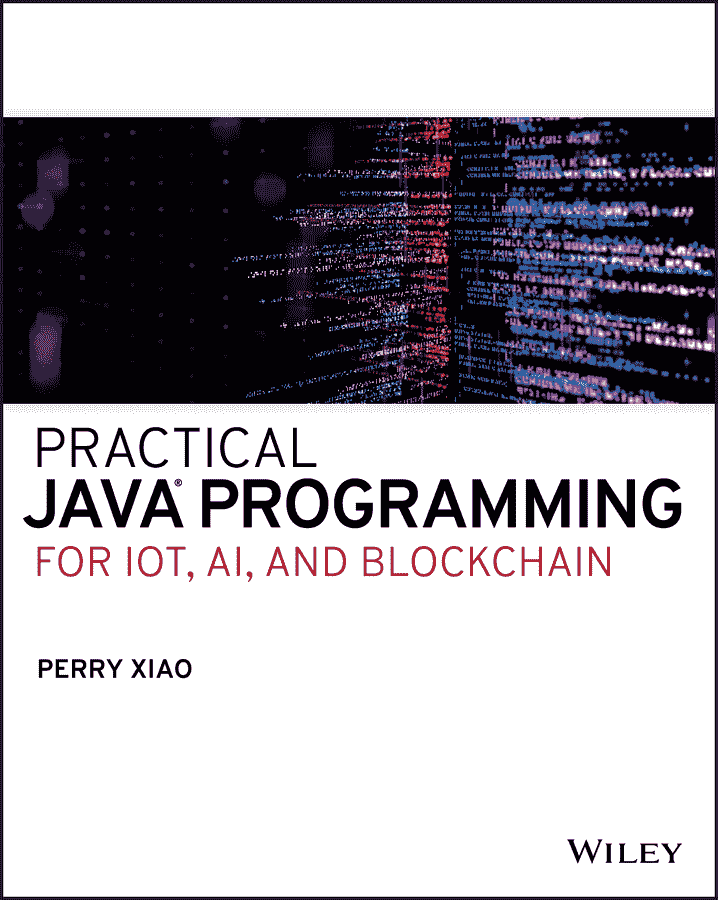
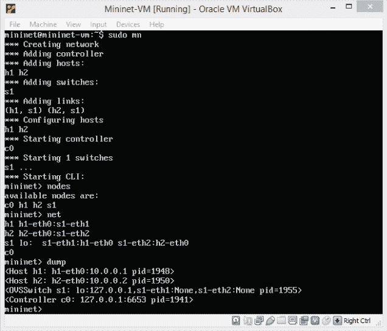
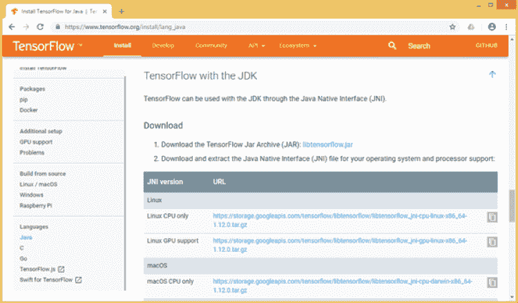

# IoT、AI 与区块链实用 Java® 编程指南




# 第 7 章

1. 图 7.1：物联网
2. 图 7.2：IoT 系统的构建模块
3. 图 7.3：第四次工业革命，或工业 4.0（上）和 ...
4. 图 7.4：MQTT 协议的操作
5. 图 7.5：树莓派 3 Model B 板
6. 图 7.6：树莓派 3 Model B 40 GPIO 引脚图
7. 图 7.7：树莓派软件指南
8. 图 7.8：Advanced IP Scanner（上），Windows 桌面连接...
9. 图 7.9：Pi4J 软件网站
10. 图 7.10：`ControlGpio.java` 的编译与执行
11. 图 7.11：用于编译执行 `Con` 的 Linux Shell 脚本
12. 图 7.12：树莓派 LED
13. 图 7.13：树莓派和按键的电路图
14. 图 7.14：树莓派和基于 Java 的智能电路图
21. 图 8.21: 在 IntelliJ IDEA 中打开项目，并选择 `dl4j-examples` s...
22. 图 8.22: IntelliJ IDEA 中的 `dl4j-examples` 项目
23. 图 8.23: `XorExample.java` 程序及其运行输出
24. 图 8.24: `MLPClassifierLinear.java` 程序（顶部）及其运行输出...
25. 图 8.25: `ImageDrawer.java` 程序（顶部）及其运行输出...
26. 图 8.26: TensorFlow for Java 网站
27. 图 8.27: `HelloTensorFlow.java` 程序的编译和执行
28. 图 8.28: Google TensorFlow API 网站
2. 图 9.2: `AES` 的操作。加密和解密是相同的...
3. 图 9.3: 公钥加密。发送者 A 使用 B 的公钥加密...
4. 图 9.4: 公钥加密用于身份验证。发送者 A 使用 A 的私...
5. 图 9.5: 发送者 A 使用公钥共享临时...
6. 图 9.6: 在线 RSA 密钥生成器
7. 图 9.7: 长消息转换为短固定长度摘要...
8. 图 9.8: 在线 SHA256 哈希生成器
9. 图 9.9: 当发送者 A 想发送长文本消息时，A 使用哈...
10. 图 9.10: 当接收者 B 收到组合消息时，首先...
11. 图 9.11: ITU X509 数字证书的操作
12. 图 9.12: ITU X509 数字证书的内容
13. 图 9.13: PGP 的工作原理
14. 图 9.14: `PrivateKeyDemo1.java` 的编译和执行
15. 图 9.15: `PublicKeyDemo1.java` 的编译和执行...c09.xhtml_c09-fig-0015)

# 附录 C

1. 图 C.1：Git GUI 程序和 Git Bash 程序
2. 图 C.2：配置您的姓名和邮箱的 `git config -- global` 命令
3. 图 C.3：`git add .` 命令及其输出（顶部）以及 `git commit` 命令...
4. 图 C.4：用于注册 (A)、启动项目 (B)、创建...的 GitHub 网站
5. 图 C.5：生成 RSA 公钥/私钥对的 Git 命令（顶部）...
6. 图 C.6：在 GitHub 项目站点添加新密钥
7. 图 C.7：添加 GitHub 站点 (A)、GitHub 登录窗口 (B) 和...的 Git 命令
8. 图 C.8：更新更改的 Git 命令
9. 图 C.9：提交更改并推送本地仓库...的 Git 命令
10. 图 C.10：通过在线显示提交历史的 Git 命令

366. 363
367. 364
368. 365
369. 366
370. 367
371. 368
372. 369
373. 370
374. 371
375. 372
376. 373
377. 374
378. 375
379. 376
380. 377

# 引言

我们现在生活在一个数字革命时代。在视平线上，许多新兴的数字技术，如 `IoT`（物联网）、`AI`（人工智能）、网络安全、区块链等正以惊人的速度发展着。无论我们是否乐意，无论我们是否已经准备好，这些数字技术都将更深地渗透到我们生活的方方面面。这将从根本上改变我们的生活、工作方式和社交方式。`Java` 作为一种现代高级编程语言，是帮助我们学习这些数字技术以及开发数字应用的极佳工具。

本书的目的是使用 `Java` 作为工具，帮助读者学习这些新的数字技术，揭开这些数字技术的神秘面纱，并为未来做好更好的准备。

# 第 3 章

## 基础 Java 编程

```java
break;

case 2:

…
```

### 3.15.1 软件开发周期

为了开发高质量的软件，你必须遵循标准的开发周期，所示如下：

| :--- | :--- |
| Q3.1. | 什么是标准输入和输出？哪些 Java 类处理标准输入，哪些类处理标准输出？ |
| Q3.2. | Java 支持哪八种基本类型变量类型？ |

```java
fileMenu.getItems().add(openItem);
fileMenu.getItems().add(saveItem);
fileMenu.getItems().add(separator);
```

示例 5.9 展示了一系列 Java HTTP 客户端——Web 客户端。首先，示例 5.9A](#c05.xhtml_c05-fea-0009A) 是使用 `URL` 和 `URLConnection` 类的简单客户端。在该示例中，它打开统一资源定位符（URL）指定的网页，在本例中为 [`www.google.com/`](http://www.google.com/)。图 5.12 显示了程序的编译和执行。

图 5.21 显示了 Mininet 虚拟机中上述命令的输出。



* Java JDK (5 或更高版本)
* Android Studio

`onCreate()` 回调在 activity 首次创建时被调用。`onStart()` 回调在 activity 可时被调用。`onResume()` 回调在 activity 与用户交互时被调用。`onPause()` 回调在 activity 暂停时被调用。`onStop()` 回调在 activity 不再可见时被调用。`onRestart()` 回调在 activity 重启时被调用。`onDestroy()` 回调在 activity 销毁之前被调用。

## 6.8 MIT App Inventor

| Q6.4. | 写出下载和安装 `Android Studio` 的步骤。 |
| Q6.5. | 写出使用 `Android Studio` 创建 Android 项目的步骤。 |
| Q6.6. | 什么是 Android 包 (`APK`) 文件？ |

[`http://rest.elkstein.org/`](http://rest.elkstein.org/)

示例 7.5 是一个演示程序，它通过系统调用在 Java 程序中运行 `led.py`。由于 `led.py` 在无限循环中运行，你需要在键盘上按下 `Ctrl+C` 来停止程序。

```java
// 设置足够高的阈值非常重要，以免由于微小变化的频繁事件而淹没你的程序
gpioProvider.setEventThreshold(500);
```

| Q7.1. | 什么是物联网 (IoT)？ |
| Q7.2. | IoT 是如何工作的？ |

* 否则
    * 继续。
* 迭代结束

### 自然语言处理

* `Apache OpenNLP`，用于处理自然语言文本的机器学习库（[`opennlp.apache.org`](https://opennlp.apache.org/)）
* `Stanford CoreNLP`，一组用 Java 编写的人语言技术工具（[`stanfordnlp.github.io/CoreNLP/`](https://stanfordnlp.github.io/CoreNLP/)）



例如，如果你在字母表中将每个字母向左移动三个位置，以下明文：

1. 发送者 A 生成一对密钥（私钥和公钥）。
2. 发送者 A 将其身份信息（姓名、组织、地址等）和公钥发送给 CA。A 也使用其私钥对该消息签名。

**图 9.27](#c09.xhtml_R_c09-fig-0027):**

* **Ethereum**（以太坊）以太坊是一个开源、公共、基于区块链的分布式计算平台，提供了一种名为 Ether 的加密货币（[`https://www.ethereum.org/`](https://www.ethereum.org/)）。
* **Ripple** Ripple 是一个基于共享公共 XRP 账本的实时支付系统。它已被 UniCredit、UBS 和 Santander 等银行使用（[`https://ripple.com/`](https://ripple.com/)）。
* **Bitcoin Cash**（比特币现金）比特币现金是比特币的硬分叉，于 2017 年启动。比特币现金声称使用更快、更便宜，最大区块大小为 8MB（[`https://www.bitcoincash.org/`](https://www.bitcoincash.org/)）。

```
web3j.bat wallet create --name myWallet
```

```
E:\solidity-windows\solc Greeter.sol --bin --abi -o ../build
```

## 11.4 大数据的益处

```
$cat ~/.ssh/id_rsa.pub > ~/.ssh/authorized_keys
$exit
```

```
$hdfs dfs -ls /
```

```java
//This is a single line comment
public class HelloWorld {
    public static void main(String[] args) {
        System.out.println("Hello World!"); 
    }
}
```

这是 `AppTest.java` 文件的代码：

```
或者
```

* Apache Maven
    * 编译和构建项目，428
    * 下载，423–424
* 连接块, IoT (物联网), 225
* 常量, 44。另参见 变量
* 受限应用协议 (CoAP), 229
* 哈希函数, 322–323
    * 在线演示, 335
* HDFS (Hadoop 分布式文件系统), 393–394
* 即时编译器 (JIT), 7
* JVM (Java 虚拟机), 4–5
    * MI, 168–169
    * 方法重写, 63
    * 概述, 62
* Open IoT Stack for Java (Eclipse), 271
* 选择, 51–54
* 分号 语句, 21
* 半监督学习 (AI), 287
* 无监督学习 (AI)，287
* URLs，解析，157–158
* 用户数据报协议 (UDP)，143–146
