# Java 单元测试实战（JUnit），第 3 版


Dave Thomas 序言

Kelly Talbot 编

# 对《Java 语言 JUnit 实用主义单元测试（第三版）》的早期评价

Jeff 对单元测试的基础知识进行了非常有趣且易于阅读的介绍。这不仅仅是机械性的操作——你还能从他在创建全面且有意义的测试方面的指导中受益。

- Bill Wake
  XP123 LLC 顾问

发现《Java 语言 JUnit 实用主义单元测试（第三版）》是一本极好的读物；即使作为一名丰富的 Java 开发者，我也学到了很多新技巧。如果你想了解 TDD（测试驱动开发）以及单元测试如何积极鼓励整洁的代码，请继续阅读。我认为这会帮助开发者提升水平并增加价值。

- James Bowen
  澳大利亚联邦银行高级软件工程师

《Java 语言 JUnit 实用主义单元测试（第三版）》是初学者和经验丰富的开发者不可或缺的指南。Jeff Lang 提供了清晰、实用的见解，让掌握单元测试和提高代码质量变得简单可行且有趣。对于任何认真对待软件工艺的人来说，这都是必读。

- Ahmed Misbah
  Orange Innovation Egypt 首席软件架构师

本版的新内容使其非常值得读，特别是那些关注测试如何支持重构和 TDD 的部分。Jeff 超越了测试的机械性，在形式和风格元素方面提供了许多极好的建议。这本书将帮助你将自己的测试实践提升几个档次。

- **Junilu Lacar**
  Dojo Coach 执行董事

我很抱歉过去没有读过 Jeff 的书。他在这里收集的内容是一条实用的路径，带你穿过我认为单元测试中重要的部分，而没有用教条来强迫你。这在关于生成式 AI 的新章节中尤为令我触动——Jeff 直截了当地告诉了它的局限性，并通过详细的示例展示了你现在可以使用它来增强自身能力的实用方法。我会向我所有接触 Java 开发的教练全心全意推荐这本书！

- **Stacey Vetzal**
  加拿大皇家银行首席敏捷卓越教练

作为一名年轻的入门程序员，《Java 语言 JUnit 实用主义单元测试（第三版）》提供了一种理解单元测试和测试驱动开发的简单方法，同时让我在阅读过程中一直忍俊不禁。

- **Clarice Levison**
  计算机技术学生

这本书作为一份全面的指南脱颖而出，深度而广地探讨了使用 JUnit 及其他工具进行单元测试的含义、为什么以及怎么做。对于个人开发者、团队、初学者和老手来说，都是无价的资源——对于任何使用 Java 平台的人来说都是必读。

- Weny Shi
  哥伦比亚大学高级应用系统开发人员

我经常提供整洁代码方面的建议，并有一系列参考资源——这本书是对任何想要改进单元测试的人的建议。

- Sebastian Larsson
  Knowit 技能团队主管

我在 JUnit 还没有版本号之前就在使用它了。但我仍然学到了东西。可读性，我在代码中看到的首要问题，Jeff 直面了它。

- Mark Levison
  20年经验的认证 Scrum 培训师和敏捷教练


我们尝试过直接不留，但后来人们写信来询问缺失的页码。

总之，仓鼠 Eddy 想说声“你好”。


制作本书的团队包括：

- 出版：Dave Thomas
- 运营：Janet Furlow
- 执行编辑：Kelly Talbot
- 编辑：Karen Galle
- 索引：Gilson Graphics

# 第一部分 单元测试基础

- 1. 构建你的第一个单元测试 ................................................................ 3
  - 编写单元测试的原因 .......................................................................... 3
  - 学习 JUnit 基础：你的测试挑战 ................................................ 4
  - 编写第一个真实的测试 ...................................................................... 8
  - 处理失败 ........................................................................................ 11
  - 转向基于 1 的测试：发生了什么！...................................................... 14
  - 增加你的 ROI：清理测试 ................................................................ 17
  - ZOM：从 0 到 1，现在测试许多 ................................ 22
  - 覆盖其他情况：创建测试列表 ................................................ 24
  - 恭喜！但别停下 ................................................................ 24

- 2. 测试构建块 ....................................................... 25
  - 单元 .......................................................................................... 25
  - 比单元大一点点？....................................................................... 27
  - 作为构建块的概念 ............................................................ 31
  - 测试更简单的事物 ................................................................ 31
  - 验证副作用 ................................................................................ 34
  - 测试常见的代码情况 ................................................................ 41
  - 测试异常处理 ................................................................ 65
  - 使用代码覆盖率提升单元技能 ................................................ 71
  - 测试多线程代码 ................................................................ 79
  - 编写集成测试 ................................................................ 84
  - 探索性单元测试 ................................................................ 90

# 第二部分 通过 JUnit 精通单元测试

- 3. 使用核心断言形式 .......................................................... 100
- 4. 断言消息：断言的冗余消息 ................................................ 103
- 5. 其他常见的 JUnit 断言形式 ................................................ 104
- 6. 预期异常 ................................................................................ 112
- 7. 断言没有发生：`assertDoesNotThrow` ................................................ 115
- 8. 替代断言方法 ................................................................ 116
- 9. 第三方断言库 ................................................ 118
- 10. 消除非测试 ................................................................ 121
- 11. 在 JUnit 测试中建立组织 .................................................. 123
- 12. 执行 JUnit 测试 .............................................................. 135

# 第三部分 提高投资回报：单元测试与设计

- 13. 重构为更整洁的代码 ...................................................... 147
  - 一点点重构 .............................................................................. 148
  - 为你的方法寻找更好的“家园” ...................................................... 154
  - 移除价值较小的临时变量 ...................................................... 157
  - 放大代码的核心意图 .............................................................. 158
  - 你是想杀我吗？解决性能顾虑 ................................................ 162
  - 最终清理 .............................................................................. 166

- 14. 重构你的代码结构 ...................................................... 169
  - 测试气味：遗留代码构造
  - 测试气味：不必要的测试代码
  - 测试气味：泛化与逐步的断言
  - 测试气味：缺失抽象
  - 测试气味：膨胀的构造
  - 测试气味：多个断言
  - 测试气味：测试中无关细节
  - 测试气味：误导性的组织
  - 测试气味：隐含含义
  - 从你的测试列表中添加测试
  - 总结

# 第四部分 单元测试的更广泛话题

- 15. 测试驱动开发 (TDD) 进阶 .............................................. 211
  - TDD 的主要收益 ...................................................................... 212
  - 总结 ...................................................................................... 234

- 16. 采用实践 .............................................................. 235
  - 进入快速状态 ...................................................................... 235
  - 与团队达成共识 .................................................................. 236
  - 持续集成 .............................................................................. 241
  - 总结 ...................................................................................... 243

- 17. 保留单元测试 .............................................................. 245
  - AI 不会消失 ...................................................................... 245
  - 使用 ChatGPT 探索更多功能 ...................................................... 246
  - 建立标准 .............................................................................. 247
  - 使用 ChatGPT 提供示例 ...................................................... 248
  - 重构代码 .............................................................................. 251
  - 添加新功能 ...................................................................... 255
  - 最终清理 .............................................................................. 260
  - 使用 AI 的成功概率 .......................................................... 262
  - 测试是好事的 ...................................................................... 263
  - 总结 ...................................................................................... 264

# 前言

如果二十年前告诉我我将为这本书的第三版写前言，我会大笑的。Java 变得更加复杂，测试工具更加先进，最重要的是，我们对测试的理念更加见明和完善。

Jeff 在捕捉所有这一切方面做得非常出色，产出了一本既权威又务实的书籍。

我们遵循的每一项实践都是结合特定语境的，没有开发者必须遵守的通用规则。测试是好事，除非在它不是好事的时候。测试覆盖率是一个荒谬的指标，但未被覆盖的部分是难以重构的代码，因此，务实的开发者（如你）必须对测试做出明智的决策，就像你处理所有工作一样。这本书为你提供了做出这些选择的知识和信心。

# 致谢

热心感谢 Jeff Bay、John Borys、James Bowen、Yves Dorfsman、Lars Eckart、Danny Faught、Michael Feathers、Nick Goede、Junilu Lacar、Tim Langr、Sebastian Larsson、Clarice Levision、Mark Levison、Ahmed Misbah、Cameron Presley、Wenyu Shi、Alexander Tarlinder、Dave Thomas、Merlin Tishauer、Bill Wake、Stacey Vetzal 以及所有提供反馈的人。

感谢我的编辑 Kelly Talbot，她在第三版的修订过程中提供了温柔且卓越反馈和指导，并帮助我解决了一些棘手的问题。

如果你通过反馈影响了之前版本的编写，再次表示感谢。如果你写了之前的版本但不是我——你好，Dave Thomas 和 Andy Hunt——感谢你们创造了这本经久不衰的作品。

# 变化是唯一不变的

这本书与第一版相比几乎认不出来了。Java 变得更加复杂，测试工具更加先进，最重要的是，我们对测试的理念更加见明和完善。

阅读它，然后做出明智的选择。

Dave Thomas

程序员

Dallas, TX

# 前言

Andy Hunt 和 Dave Thomas 在 2003 年编写并出版了这本书的第一版，当时大约是 JUnit 引入后五五年。然而，如果你告诉一个 2003 年的 Java 开发者编写测试来验证他们自己的代码，他们可能会说：“没门儿。我是一个程序员，不是一个测试员。”

从那以后，许多开发者都发现了单元测试的价值。与其花费大量时间手动测试解决方案，并在每次更改后再次进行手动测试，这些程序员编写了小小的测试（用 Java 编写）来验证系统中的微小行为。他们通过工具（通常是 JUnit）运行这些测试，并立即发现逻辑是否存在缺陷。

十年后，单元测试已成为开发者的一项预期技能，也是面试的常见话题。在 Andy 和 Dave 的要求下，我重写了 *Pragmatic Unit Testing in Java with JUnit*，增加了额外的主题并保持了内容的时效性。我于 2015 年交付了第二版。

到 2015 年，单元测试已成为许多追求系统质量经理和团队负责人的强制要求。遗憾的是，这些要求往往伴随着虽然良好但误导的指标目标，特别是在代码覆盖率方面。今天，许多团队被要求达到代码覆盖率目标（例如参见第 71 页的“使用代码覆盖率提高单元测试技能”的 80%）。

然而，强制覆盖率目标的团队通常发现单元测试的投资回报很低。许多开发者会玩弄指标，因为他们不知道如何利用单元测试。他们只编写足够的“测试”来达到指标目标。这些测试提供的价值很小；它们只能最小化网关处的缺陷，不能帮助记录系统行为，也无法为通过重构改进设计提供安全性。

对于许多开发者来说，对单元测试的热情因此变淡了。

又过了十年，单元测试在某些公司生存了下来甚至蓬勃发展，受到了那些学会正确实践它的人的欢迎。它最投入的实践者不断编写测试来指导代码开发，这种实践被称为测试驱动开发（TDD）。他们通过快速单元测试的形式实现了近乎全的代码覆盖。这些测试拦截了大多数逻辑缺陷，记录了所有单元行为，并为持续清理代码提供了最大的信心。

任何形式的测试都无法帮助你有效地管理和记录系统中包含的成千上万个单元行为。编写良好的测试会在你每次更改后几秒钟内提供反馈。

这第三版 *Pragmatic Unit Testing in Java with JUnit* 代表了一项技术在首次正式使用几十年后仍然具有生命力。这本书经过了修订——通过简化、重写和重新组织，使学习更易于理解。几乎所有的代码示例都已重新处理以使用 Java 21。许多代码示例经过重新处理以简化或扩展关键概念，并添加了许多示例。它扩展了对 JUnit 本身的覆盖，并包含了关于测试由 LLM 生成的代码的新讨论。

在 AI 时代，单元测试仍然具有意义。在 AI 能够验证它编写的代码之前（直到 2024 年），你必须用单元测试来审查代码。有趣的是，AI 可以帮助你编写单元测试。在最后一章第 13 章第 245 页的《用单元测试保持 AI 诚实》中学习如何做。

# 什么是单元测试

当你（一名程序员）编写代码来验证代码单元时，你正在进行单元测试。单元是你的系统中表现出某些有用行为的一小段代码。单元通常不代表完整的端到端行为；它通常支持功能的某个微小方面。

你编写的单元测试将直接操作你的单元——小段代码。因此，你将用 Java 编写它们。你通过 JUnit 运行这些测试，这是一个将你的测试标记为通过或失败的工具。

以下是编写/运行单元测试的时机和原因：

- 你完成了一个功能的编码，并希望确保它按预期工作。
- 你想记录更改，以便你和其他人理解你编码到系统中的选择。
- 你更改了代码，并想知道是否破坏了某些功能。
- 最重要的是，良好的测试能增加你交付系统的信心。


没有任何测试形式能帮助你有效地管理和记录系统中成千上万个单元行为。编写良好的测试会在你每次更改后几秒钟内提供反馈。

读完这本书后，你将能够编写测试，这对系统非常有帮助。

# 本书的读者

这本书是面向熟悉 Java 编程的开发者的入门读物，他们深入了解单元测试。

# 你需要什么

为了遵循并运行书中的示例，你需要以下三项软件：

- `Java`：书中的示例使用了 Java 21。

- `一个 IDE`：书中的示例使用 IntelliJ IDEA 构建，你也可以使用 Eclipse、NetBeans。

- `JUnit`：JUnit 通常由你的构建工具（Gradle 或 Maven）获取。

如果你的团队使用其他单元测试工具，本书的大部分部分内容也适用于你的世界。

# 本书的结构

本书分为四个部分：

- **单元测试基础**：通过为示例以及许多代码情况编写测试来学习 JUnit 基础。使用测试双测试具有挑战性的依赖项。深入研究覆盖、多线程代码测试以及集成测试。

- **精通 JUnit**：使用 JUnit 的许多断言形式检查结果，使用生命周期方法、嵌套类和参数化测试组织测试，并使用标签和其他机制执行测试子集。

- **增加投资回报——单元测试与设计**：关注设计测试与反之的相关性。学习在微观、宏观以及测试中进行重构。

- **单元测试的其他主题**：通过学习 TDD 纪律提升你的单元测试实践。发现在项目中采用测试的有用考虑因素。通过理解单元测试在 AI 时代的持续意义来结束你的旅程。

成功的最佳途径：边读边编写示例！

# 代码和在线资源

你会在书中发现大量的代码，其中大部分包含在源码发行包中，并从官方页面下载¹

代码片段以发行包的形式出现，紧随代码块之后的路径和文件名，如下：

```
ut3-units/02/src/test/java/units/StringUtils.java
@Test
void uppercasesSingleLetter() {
    assertEquals("A", capitalize("a"));
}
```

该片段代码出现在发行包的 `StringUtils.java` 文件，位于 `ut3-units/02/src/test/java/units` 目录下。如果你是以电子书形式阅读，点击文件名即可跳转到代码。

你也可以在 GitHub 上找到代码。仓库名称显示为列表文件名的第一部分。上面的代码片段位于 `u3-units` 仓库中。GitHub 中的分支命名为 v1、v2、v3 等，该代码片段可能来自 v2 分支。

大多数章节只引用一个仓库。有少数章节引用了多个仓库，而某些仓库被多个章节共同使用。

每个仓库都包含一个 `build.gradle` 文件以及一个 Gradle 包装器（wrapper）。从每个仓库的根目录，你可以执行命令 `./gradle build` 来编译项目并执行其测试。

许多代码列表都标有箭头，指向一行或多行，以强调你应该关注的内容——新增/更改的行或其他有趣的代码片段。如果箭头指向一个方法签名，意味着要关注该签名本身或整个方法（你可以根据上下文判断该关注哪一个）。

“强调”的反面是“弱化”。我通过省略号（`...`）来实现这一点。在下面的代码片段中，代码中的其他内容可能很有趣或相关，但 `someMethod` 的主体显然是不相关的：

```
void someMethod() {
  // ...
}
```

你看到的代码片段是从源代码中自动提取的，这意味着仓库代码应该与书中的内容一致。然而，你的 IDE 设置可能会产生格式或其他差异（例如，import 语句的表示方式）。

为了减少一些杂乱，大多数代码列表都省略了包声明（package statements）。

请访问该书的 Pragmatic Bookshelf 官方页面获取更多资源。

# 测试驱动开发 (TDD)

我实践 TDD，但这不是一本关于它的书。第 11 章“使用测试驱动开发 (TDD) 进阶”将展示它是如何工作的以及它可以如何提供帮助。通过 TDD，你编写单元测试——换句话说，在你编写每一段生产代码之前编写测试。在书中，你将为已有的代码编写测试。

在几十年的 TDD 实践中，我积累了许多让我的单元测试工作变得更容易、更有价值的见解。你将在《JUnit Java 实用单元测试》（Pragmatic Unit Testing in Java with JUnit）中学习这些见解。无论你在编写代码之前还是之后编写测试，这些见解都适用。

# 编码风格

本书的代码展示了我喜欢的 Java 编程风格和格式，同时也为了保持代码列表简洁而进行了调整。你们中的许多人可能会对我删除单行条件块周围的“安全大括号”感到不悦：

```
if (condition) doSomething();
```

- 它减少了代码列表中的行数。

- 在大多数情况下，如所示，`if` 体可以放进单行内。

- 我发现作为一个单一概念，它的读性更好。

- 如果你以后需要在条件体中使用第二个语句，你可能会记得要加上安全大括号。

- 如果你忘了……这就是你写单元测试的原因。

如果你仍然不以为为，请尽管添加大括号。不过，尝试一下不加的吧——你可能会喜欢的。

# 第一部分

# 单元测试基础

你对单元测试的介绍从几个简单的示例开始，进入依赖性挑战，最后以与单元测试相关的更高级概念概述结束。

## 构建你的第一个 JUnit 测试

在本章中，我们将通过处理一个小型示例来编写一个单元测试。你将设置项目、添加一个测试类，并查看测试方法是什么样子的。最重要的是，你将让 JUnit 运行你新的、通过的测试。

## 编写单元测试的原因

Joe 刚刚完成了一个小功能更改的工作，为系统添加了数十行代码。他对自己的更改相当自信，但他已经有一段时间没有在部署的系统中尝试过了。Joe 运行了构建脚本，该脚本将更改打包并部署到本地 Web 服务器。他在浏览器中打开应用程序，导航到相应的屏幕，输入一些数据，点击提交，然后……堆栈跟踪信息（stack trace）！

Joe 盯着屏幕了一会儿，然后盯着代码。啊！Joe 注意到他忘记初始化一个字段。他进行了修复，再次运行构建脚本，启动程序，输入数据，点击提交，然后……嗯，数量不对。哎呀，这次花了更长的时间来破解问题。Joe 启动了调试器，在几分钟后发现在数组索引上存在一个“差一错误”（off-by-one error）。他再次重复了修复、部署、导航 GUI、输入数据和验证结果的循环。

幸运的是，Joe 的第三次修复起到了作用。但他处理这三个“代码/手动/测试”的循环花费了十五分钟。

Lucia 的工作方式不同。每当她写一小段代码时，都会添加一个单元测试来验证她添加到系统中的微小更改。然后她运行所有的单元测试，包括新编写的那个。它们运行只需几秒钟，所以她不需要等很久就能知道是否可以继续。

因为 Lucia 在每次微小更改后运行测试，只有在所有测试都通过时她才会继续。如果测试失败，她就知道自己创建了一个问题，并立即停止修复。她产生的问题容易修复得多，因为自她上次看到所有测试通过以来，她只增加了几行代码。她避免了在发现问题之前在错误上堆积大量新代码。

此项目的生产源码文件存储在 `src/main/java` 目录下，位于 `credit` 包中。（IntelliJ IDEA 将 `src/main/java` 目录称为源代码根目录。）

你现在准备好编写一个描述 `CreditHistory` 行为的测试了。你将把测试放在与生产源码相同的包——`credit` 中，但位于测试源目录 `src/test/java` 下。

你的 IDE 可能提供了许多创建新测试类的方法。在 IDEA 中，你将通过在项目资源管理器中遵循以下步骤来创建：

1. 从 Project 或 Packages 资源管理器中选择 `src/test/java` 包。

2. 右键点击出 Class 上文菜单。

3. 选择 New ► Java Class。你将看到 New Java Class 弹出窗口，它默认选择创建一个新类。

4. 输入类名 `ACreditHistory`（意为“一个信用历史”）并按回车键。IDEA 的检查功能可能对你的命名规范不满意。你可以重新配置检查项，或者使用传统的名称 `CreditHistoryTest`。

## 运行测试：什么都不测试

当你从 New ► Java Class 项目按下回车键时，IDEA 会为你提供一个 `ACreditHistory` 的空类声明。你的首要任务是在其中挤入一个测试方法：

```
utj-credit-history/01/src/test/java/credit/ACreditHistory.java
class ACreditHistory {
    @org.junit.jupiter.api.Test
    void whatever() {
}
```

具体来说：在 `ACreditHistory` 的体内部，输入以 `@org.junit.jupiter.api.Test` 注解开头的三行。

> 代码列表中用箭头标记的行表示添加的行、修改的行或其他插入的代码片段。

输入？是的。在学习过程中，最好自己输入代码和测试，而不是复制/粘贴，除非输入完全不是你的擅长。这感觉更像——

## 学习 JUnit 基础：你的第一个测试挑战

你的测试是一个带有 `@org.junit.jupiter.api.Test` 注解的空方法。当你告诉 JUnit 运行一个或多个测试时，它会找到所有带有 `@Test` 注解的方法并运行它们。它将忽略所有其他方法。

你可以运行你的空测试，对于，你给它起了一个占位符名称 `whatever`。和往常一样，你有许多执行测试的选择。你将从鼠标开始。点击类声明左侧出现的小绿色箭头，如下所示。（可能你的 IDE 有类似的图标）。

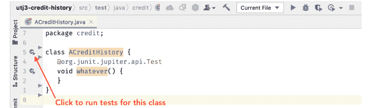

点击绿色箭头会弹出一个上文菜单，你可以在其中选择运行 `ACreditHistory` 中所有测试的选项，如图所示：

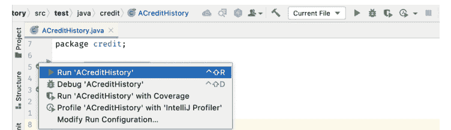

运行 'ACreditHistory' 会运行 `whatever` 测试。它是通过的，正如图中第 8 页所所示。

如果你的测试没有被执行，请确保它遵循以下三条准则：

- 它标记了 `@org.junit.jupiter.api.Test`

- 它有 `void` 返回值

- 它没有参数

## 第 1 章.构建你的第一个 JUnit 测试

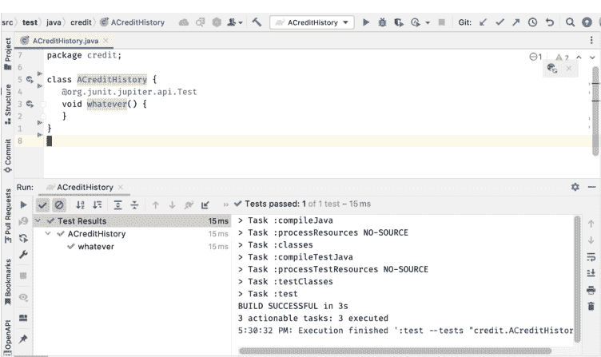

内置的 JUnit 测试运行器出现在 IDE 底部。左侧面板显示所有已执行测试的摘要。你的摘要显示你运行了 `ACreditHistory` 的 `whatever` 测试，它成功了（因为它有一个绿色勾选标记），执行耗时 12 毫秒。

测试运行器的右侧面板根据左侧面板中选中的内容显示不同的信息。默认情况下，它告诉你在执行的测试数量中有多少个通过了（你的是："1 of 1"）。它提供了作为 JUnit 过程中捕获的信息。在张截图中，IDE 配置为使用 Gradle 通过构建任务执行测试，该任务也会执行测试。

你现在了解关于 JUnit 行为的一些基础性知识：空测试会通过。更具体且更有用的是，任何完成的方法——只要没有遇到任何失败点或抛出异常——都是一个通过的测试。

## 编写第一个真实的测试

空测试没有多大用。让我们设计一个良好的第一个测试。

你可以从一个内容充实的测试开始，添加几个信用评分来计算平均值，然后确定你是否得到了正确答案。它的正向路径（happy path）测试用例——与负面或基于错误的测试相比——并不是你想要编写的唯一测试，尽管在验证 `arithmeticMean` 时还有其他需要考虑的情况：

- 如果只添加一个信用评分会发生什么？

- 如果不添加任何信用评分会发生什么？

- 是否有异常情况——可能出现问题的条件？代码在这些情况下表现如何？

从正向路径测试开始是一个选择；你还有其他选择。一种是从最简单的测试开始，移动到日益复杂的测试，最后是异常情况。另一种选择也是从最简单的测试开始，移动到日益复杂的测试，最后是异常情况。对于你写的每一个测试，都力求使用一个总结其描述行为的测试名称。这是一个疯狂的想法：让测试名称完成一个关于它所描述行为的句子。

## 最简单的情况

最简单的测试通常涉及零。你期望在该背景下信用历史的某些属性是正确的：它平均值。它应该返回零。使用以下代码更新 `ACreditHistory`：

```
utj-credit-history/01/src/test/java/credit/ACreditHistory.java
import org.junit.jupiter.api.Test;
import static org.junit.jupiter.api.Assertions.assertEquals;

class ACreditHistory {
    @Test
    void noCreditRatingsHasMean() {
        var creditHistory = new ACreditHistory();
        var result = creditHistory.arithmeticMean();
        assertEquals(0, result);
    }
}
```

让我们逐步检查 `ACreditHistory` 中更新后的行。你的每个测试将调用一个或多个断言方法来验证你的假设。由于这些断言是静态方法，静态导入使得你就不需要不断为你的断言调用进行限定限定。

由你正在测试的系统返回。`assertEquals` 的签名让顺序一目了然。如果你以后忘记了，可以使用你的 IDE 向你显示：

```
public static void assertEquals(int expected, int actual)
```

当你运行测试时，你将看到 `expected`（预期值）和 `actual`（实际值）参数的顺序有多重要。你将在第14页的“让它失败”章节中操作。请留好！

## 处理失败

你之前学会了点击类声明旁边的 JUnit 运行图标来执行所有测试。但你将经常运行测试——每天可能要运行数百次，而手动操作是一个缓慢得多且耗费精力的过程。你应当提高效率。重复性劳性损伤是真实且令人痛苦的。

任何良好的 IDE 会在你悬停在按钮上时显示相应的键盘快捷键。悬停在 JUnit 的“运行（run）”按钮上，你会发现你的 IDE 中 `Ctrl-Shift-R` 是合适的快捷键。也悬停在你的按钮上，看看它提供的快捷键。按下它并运行测试。再次按下。再按一次。记住它。从现在起，在你不可避免要运行数千次测试时，请使用键盘。你会变得更快，你的手腕也会感谢你的。

你的测试失败了。你的 JUnit 执行情况应该类似于下图。

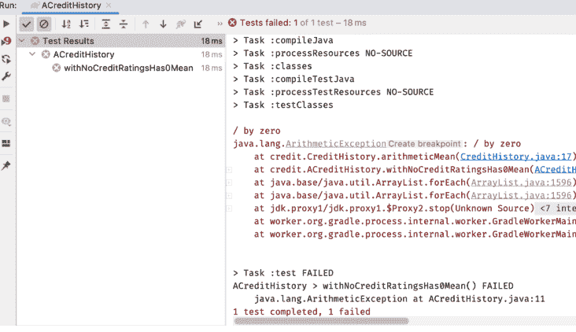

这个信息丰富的视图包含了关于你测试失败执行的几条信息：

- 左侧的 JUnit 面板提供了已执行测试的层级列表，它在测试类 `CreditHistory` 和测试方法名 `noCreditRatingsHasMean` 上都标记了黄色的 x。你可以点击该测试方法以集中查看其执行详情。

- 右侧的 JUnit 面板直接切入主题给出了统计摘要：测试失败：1 个 / 1 个测试。这意味着 JUnit 执行了一个测试，而这唯一的那个测试失败了。

- 在那个重复表述的总结下方，JUnit 显示了该测试糟糕的执行细节。失败留下了异常堆栈跟踪，它告诉你测试在到达断言语句之前就失败了。

- 堆栈跟踪用红色向你“尖叫”——红色是用于警示物品的设计偏好，如错误、停止牌和有毒口红。你有一个除以零的问题。堆栈跟踪与源代码中的相应行相关，这允许你快速导航到问题代码：

```
public int arithmeticMean() {
    var total = ratings.stream().mapToInt(CreditRating::rating).sum();
    return total / ratings.size(); // 哎呀！
}
```

你的测试没有向 `CreditHistory` 添加任何评分。结果是，`ratings.size()` 返回了 0，Java 抛出了 `ArithmeticException`，以此告诉你它不想要那样的除法。哎呀！

你抛出异常的测试揭示了另一个 JUnit 窍门：如果测试运行中执行的代码抛出了未被捕获的异常，这将被视为测试失败。

## 修复问题

单元测试完成了它的工作：它通知了你一个问题。早些，你决定可能有人在添加任何评分之前就调用 `arithmeticMean`。你还决定你不希望代码在这种情况下抛出异常；你希望它返回 0。单元测试捕捉并记录了你的选择。

你的单元测试将继续保护你免受未来的回归影响，每当 `arithmeticMean` 的行为发生变化时都会你。

要让失败的测试通过——即修复你的问题——在 `CreditHistory` 的 `arithmeticMean` 方法中添加一个守护语句（guard clause）。

## 处理失败 13

```
test-credit-history/03/src/main/java/credit/CreditHistory.java
public int arithmeticMean() {
    if (ratings.isEmpty()) return 0;

    var total = ratings.stream().mapToInt(CreditRating::rating).sum();
    return total / ratings.size();
}
```

如果你更改了代码，请再次运行测试。这个技巧是使用项目视图（Project view，通常是 IDEA 和其他 IDE 中左上角的工具）启动它们。从项目顶层向下钻，直到你可以选择 `test/java` 目录，如图所示：

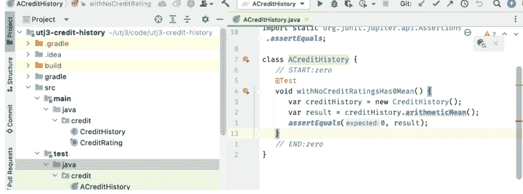

右键点击会弹出一个几乎无摩擦的菜单：


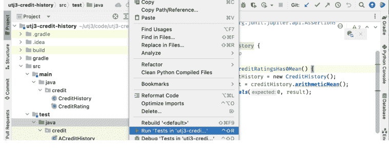

选择“运行测试 (Run Tests)”选项。JUnit 将执行 `src/test/java` 下的所有测试。成功！这里是通过的测试（如第14页的图所示），它要么是完美的，要么没有任何堆栈跟踪。

看起来不错，对吧？感觉很好，对吧？按下 `Ctrl-Shift-R`（或你机器上的相应快捷键）再次运行测试。沉浸在光辉中。

## 进入从1开始的测试：发生事情了！

你从0开始的测试救了你。也许从1开始的测试也能这样做？写一个只添加一个分数的测试：

```java
test-credit-history/04/src/test/java/CreditHistory.java
@Test
void withOneRatingEquivalentMean() {
    var creditHistory = new CreditHistory();
    creditHistory.add(new CreditRating(780));
    var result = creditHistory.arithmeticMean();
    assertEquals(780, result);
}
```

选择“运行测试 (Run Tests)”选项。JUnit 将执行 `src/test/java` 下的所有测试。成功！这里是通过的测试（如第14页的图所示），它要么是完美的，要么没有任何堆栈跟踪。

看起来不错，对吧？感觉很好，对吧？按下 `Ctrl-Shift-R`（或你机器上的相应快捷键）再次运行测试。沉浸在光辉中。

## 处理失败

你之前学会了点击类声明旁边的 JUnit 运行图标来执行所有测试。但你将经常运行测试——每天可能要运行数百次，而手动操作是一个缓慢得多且耗费精力的过程。你应当提高效率。重复性劳损是真实且令人痛苦的。

任何良好的 IDE 会在你悬停在按钮上时显示相应的快捷键。悬停在 JUnit 的“运行（run）”按钮上，你会发现你的 IDE 中 `Ctrl-Shift-R` 是合适的快捷键。也悬停在你的按钮上，看看它提供的快捷键。按下它并运行测试。再次按下。再按一次。记住它。从现在起，在你不可避免要运行数千次测试时，请使用键盘。你会变得更快，你的手腕也会感谢你的。

你的测试失败了。你的 JUnit 执行情况应该类似于下图。


这个信息丰富的视图包含了关于你测试失败执行的几条信息：

- 左侧的 JUnit 面板提供了已执行测试的层级列表，它在测试类 `CreditHistory` 和测试方法名 `noCreditRatingsHasMean` 上都标记了黄色的 x。你可以点击该测试方法以集中查看其执行详情。
- 右侧的 JUnit 面板直接切入主题给出了统计摘要：测试失败：1 个 / 1 个测试。这意味着 JUnit 执行了一个测试，而这唯一的那个测试失败了。
- 在那个重复表述的总结下方，JUnit 显示了该测试糟糕的执行细节。失败留下了异常堆栈跟踪，它告诉你测试在到达断言语句之前就失败了。
- 堆栈跟踪用红色向你“尖叫”——红色是用于警示物品的设计偏好，如错误、停止牌和有毒口红。你有一个除以零的问题。堆栈跟踪与源代码中的相应行相关，这允许你快速导航到问题代码：

```java
public int arithmeticMean() {
    var total = ratings.stream().mapToInt(CreditRating::rating).sum();
    return total / ratings.size(); // 哎呀！
}
```

你的测试没有向 `CreditHistory` 添加任何评分。结果是，`ratings.size()` 返回了 0，Java 抛出了 `ArithmeticException`，以此告诉你它不想要那样的除法。哎呀！

你抛出异常的测试揭示了另一个 JUnit 窍门：如果测试运行中执行的代码抛出了未被捕获的异常，这将被视为测试失败。

## 修复问题

单元测试完成了它的工作：它通知了你一个问题。早些，你决定可能有人在添加任何评分之前就调用 `arithmeticMean`。你还决定你不希望代码在这种情况下抛出异常；你希望它返回 0。单元测试捕捉并记录了你的选择。

你的单元测试将继续保护你免受未来的回归影响，每当 `arithmeticMean` 的行为发生变化时都会你。

要让失败的测试通过——即修复你的问题——在 `CreditHistory` 的 `arithmeticMean` 方法中添加一个守护语句。

```java
test-credit-history/03/src/main/java/credit/CreditHistory.java
public int arithmeticMean() {
    if (ratings.isEmpty()) return 0;

    var total = ratings.stream().mapToInt(CreditRating::rating).sum();
    return total / ratings.size();
}
```

如果你更改了代码，请再次运行测试。这个技巧是使用项目视图（Project view，通常是 IDEA 和其他 IDE 中左上角的工具）启动它们。从项目顶层向下钻，直到你可以选择 `test/java` 目录，如图所示：


右键点击会弹出一个几乎无摩擦的菜单：


选择“运行测试 (Run Tests)”选项。JUnit 将执行 `src/test/java` 下的所有测试。成功！这里是通过的测试（如第14页的图所示），它要么是完美的，要么没有任何堆栈跟踪。

看起来不错，对吧？感觉很好，对吧？按下 `Ctrl-Shift-R`（或你机器上的相应快捷键）再次运行测试。沉浸在光辉中。

## 进入从1开始的测试：发生事情了！

你从0开始的测试救了你。也许从1开始的测试也能这样做？写一个只添加一个分数的测试：

```java
test-credit-history/04/src/test/java/CreditHistory.java
@Test
void withOneRatingEquivalentMean() {
    var creditHistory = new CreditHistory();
    creditHistory.add(new CreditRating(780));
    var result = creditHistory.arithmeticMean();
    assertEquals(780, result);
}
```

选择“运行测试 (Run Tests)”选项。JUnit 将执行 `src/test/java` 下的所有测试。成功！这里是通过的测试（如第14页的图所示），它要么是完美的，要么没有任何堆栈跟踪。

看起来不错，对吧？感觉很好，对吧？按下 `Ctrl-Shift-R`（或你机器上的相应快捷键）再次运行测试。沉浸在光辉中。

## 让它失败

由你正在测试的系统返回。`assertEquals` 的签名让顺序一目然。如果你以后忘记了，可以使用你的 IDE 向你显示：

```java
public static void assertEquals(int expected, int actual)
```

当你运行测试时，你将看到 `expected`（预期值）和 `actual`（实际值）参数的顺序有多重要。你将在第14页的“让它失败”章节中操作。请留好！

（如果你想通过 JUnit 源码查看相关的执行路径，也可以点击 JUnit 显示的 `<6 internal lines>` 处。）

所有失败的断言都会抛出一个 `AssertionError` 异常。JUnit 会捕获在测试执行期间抛出的此异常或任何其他异常，并在你的失败测试计数中加 1。

JUnit 选择抛出异常意味着测试方法中的后续代码将不再执行。在第一个失败的断言之后的任何断言都不会执行，这是其设计者一个刻意（且明良好）的选择：一旦你的断言失败，系统的状态就变得不可信了。执行后续的断言可能是徒劳的。

你通常希望你的测试集中在单一（单元）行为上，这意味着你通常只需要一个断言。你稍将在第 200 页的“测试气味：多个断言”中深入探讨这一观点。

你之前为了观察测试失败，尝试了注释掉某行代码。现在你可以取消注释，并观察你的测试再次通过，这应该让你有足够的信心相信你的测试正确地演示了正确的行为部分。

## 再见截图

到此为止，你已经毕业了……告别截图了！现在你已经知道了在 IDE 中可以期待到什么，你可以继续通过原生 Java 代码来学习单元测试，这些代码是自然呈现的，而不是伪装在截图之中。这要简洁得多，漂亮得多。

你会想要继续加深对 IDE 中 JUnit 实现的理解。尝试点击它的各种按钮和菜单，了解更多关于它的快捷键和功能。

在书中接下来的内容中，你只会看到与当前讨论相关的代码（而不是代码列表）。减少翻阅书籍寻找代码列表的需求，将帮助你专注于手头相关的代码和讨论上。

## 提高你的投资回报率 (ROI)：清理测试

始终检查你的测试，寻找改进其可读性的机会。几分钟的清理可以节省无数开发者在未来花费更多令人头疼的时间。

检查你的 `CreditHistory` 测试，看看是否能发现改进之处。

## 可扫描性：安排—执行—断言 (Arrange—Act—Assert)

只需四行代码，你的测试就已经成了一堆需要密切关注的代码：

```java
ut3-credithistory/06/src/test/java/ACreditHistory.java
@Test
void withOneRatingHasEquivalentMean() {
    var creditHistory = new CreditHistory();
    creditHistory.add(new CreditRating(780));
    var result = creditHistory.arithmeticMean();
    assertEquals(780, result);
}
```

这个测试几乎没有“可扫描性”（正如 Mike Hill 所说）——即在不需要显式阅读代码的情况下快速定位并理解代码的能力。想要快速理解的人必须从上到下仔细审视这四行代码中的每一行。这与可扫描性相反，我称之为“步进式”（stepwise）。

步进式代码与声明式代码相反。它们与早期的步骤强相关，单读某一步往往无法提供任何有用信息。实现细节的交织进一步迫使你慢下来，以免遗漏某些内容。

这四行步进式代码看起来并不糟糕，但问题确实会积累——想象一下成千上万个类似的无聊测试。

你写的每个测试都可以分解为三个步骤：

- **安排 (Arrange)**：使系统处于有用的状态。这种设置通常涉及创建对象、调用方法或在它们上设置数据。你的测试断言创建了一个 `CreditHistory` 对象并向其添加了信用评分。测试名称的第一部分 `withOneRating` 呼应了这种状态安排。某些测试可能不需要（例如，当你进行带字面量或无参数的静态方法调用时）。
- **执行 (Act)**：对系统进行操作，以创建你想要测试的行为。你的测试通过调用 `arithmeticMean` 方法对信用历史对象进行操作。
- **断言 (Assert)**：验证系统行为是否符合你的预期。你的测试断言 `arithmeticMean` 计算是正确的。

你的部分测试是功能性导向的，即你调用一个返回值的方法。对于这些测试，你通常可以将 AAA（安排-执行-断言）这三个步骤提炼为单行代码：

```
assertEquals(42, new Everything().ultimateAnswer());
```

为了让你的测试符合可扫描性的至少一个方面，使用空行将它们拆分为 AAA 块：

```java
ut3-credit-history-07/src/test/java/credit/CreditHistory.java
@Test
void withOneRatingAsEquivalentMean() {
    var creditHistory = new CreditHistory();
    creditHistory.add(new CreditRating(780));

    var result = creditHistory.arithmeticMean();
    assertEquals(780, result);
}
```

你的测试代码有了一些呼吸空间。AAA 的效果与使用段落来分割整页连续文本相同。

如果你所有的测试在组织和视觉上都这样具有一致性，开发者的眼睛就能定位到他们最感兴趣的测试部分。单这种一致性本身就能做到。

## 抽象：消除无聊细节

通过 AAA 模式，测试变得更加清晰。

```java
ut3-credit-history-08/src/test/java/ACreditHistory.java
import org.junit.jupiter.api.BeforeEach;
import org.junit.jupiter.api.Test;
import static org.junit.jupiter.api.Assertions.assertEquals;
class ACreditHistory {
    CreditHistory creditHistory;
}
```

```java
@BeforeEach
void createInstance() {
    creditHistory = new CreditHistory();
}
```

```java
@Test
void withNoRatingsHas0Mean() {
    var result = creditHistory.arithmeticMean();
    assertEquals(0, result);
}
```

```java
@Test
void withRatingHasEquivalentMean() {
    creditHistory.add(new CreditRating(780));
    var result = creditHistory.arithmeticMean();
    assertEquals(780, result);
}
```

我刚刚听到你说：“大不了不了。”没错，你只是删除了几个测试中微不足道的一行代码，但你实际上在源文件中增加了更多的总行数。

剩余的测试现在尽可能做到直观且易于扫描。每个 AAA 块只占一行。你可以视觉上扫描并跳过无聊的初始化代码，转而关注为了实现所需的结果恰切需要哪些安排（arrangement）。你可以更快速地关联安排（arrange）和执行（act）步骤，并回答问题：“为什么这个断言通过了？”

你的测试具有高度的抽象性：它们强调并记录了每个测试中相关的点，并弱化了必要但无聊的细节。

你的大部分测试都可以是简洁的，典型范围从一个到五个语句不等。它们首先写起来更容易，理解起来更容易（别忘了，“写一次，读多次”），而且改变需求也更容易。关于如何保持测试简短且有意义，你将在[第5章 使用断言检查结果，第99页]中看到额外的技巧。

## 消除杂质与 JUnit 5


你的测试代码可能违反了长期 Java 惯例。类或测试方法都没有声明式修饰符。旧版本的 JUnit 要求 `public` 修饰符。在 JUnit 5 中，类和方法应该具有包级访问权限。

省略多余的关键字又向前迈了一步，通过消除多一点杂质来更加强调测试的抽象性。你的测试正向着*文档化*的方向移动，并远离实现细节。它们描述的是行为。

同理，你可以省略字段的 `private` 访问修饰符。如果你在担心，大不必担心。你的任何代码都不会调用测试方法，也没有人违反你“暴露”的字段。

## ZOM：零和一已完成，现在测试多个

到目前为止，你已经写了一个基于 0 的测试（针对“零”情况的测试）和一个基于 1 的测试。现在是时候规划一个基于多个数量的测试了：

```
ut3-credit-history/09/src/test/java/CreditHistory.java
@Test
void MultipleRatingsTotalCount() {
    creditHistory.add(new CreditRating(780));
    creditHistory.add(new CreditRating(800));
    creditHistory.add(new CreditRating(820));
}
```

```
var result = creditHistory.arithmeticMean();
assertEquals(800, result);
}
```

你可以通过复制那个基于 1 的测试，复制几行以添加总共三个信用评分，并更改断言的预期值来创建这个测试。它应该能通过。把它弄坏；它应该会失败。再次修复它，并证明它通过了。在总共两分钟内完成所有这些是可能的。

你可能会怀疑是否需要所有三个测试。基于 1 的测试与基于多个的测试真的没有太大区别，它们在代码路径方面的执行方式并无不同。这是一个值得讨论的点，最终取决于你。

倾向于删除那些在“文档化各种变体行为”方面没有增加任何价值的测试。对你来说，使用零-一-多（ZOM）演进来构建测试仍然是有用的，而且编写所有三个测试实际上并没有花费任何大量时间。如果你认同这一点，那么删除基于 1 的测试就应该毫无顾虑。

删掉它吧！这样做可以让你简化测试名称：`withMultipleRatingsDividesTotalByCount`。这是你最终的类：

```
ut3-credit-history/10/src/test/java/ACreditHistory.java
import org.junit.api.BeforeEach;
import org.junit.api.Test;
import java.time.LocalDate;
import static org.junit.api.Assertions.assertEquals;

class ACreditHistory {
  CreditHistory creditHistory;
  @BeforeEach
  void createInstance() {
    creditHistory = new CreditHistory();
  }

  @Test
  void withNoCreditRatingsHasMean() {
    var result = creditHistory.arithmeticMean();
    assertEquals(0, result);
  }

  @Test
  void withRatingsDividesTotalCount() {
    creditHistory.add(new CreditRating(780));
    creditHistory.add(new CreditRating(800));
    creditHistory.add(new CreditRating(820));
  }
```

```
var result = creditHistory.arithmeticMean();
assertEquals(800, result);
}
```


## 其他情况：创建测试列表

除了你涵盖的 ZOM 情况之外，你还可以头脑风暴边界情况和基于异常的测试。你将在后面的章节中探索这些内容。

当你编写测试并继续重新访问/重读你正在测试的代码时，你会考虑到应该编写的额外测试。事实上，在你自己编写代码之初——在尝试为它编写测试之前——就思考并记录你可能需要的用例。

将你想到的情况添加到测试列表中以提醒要编写。在你实现或消除它们时，将它们划掉。你可以在纸上、在记事本文件中，甚至在测试本身中作为一系列注释来这样做。（也许在 0000 用例术中，IntelliJ IDEA 和 Eclipse 等 IDE 会在视图中收集它们作为提醒。）情况在变化，所以现在还不要结束选择这些测试的努力。你可以在 Kent Beck 的开创性著作中阅读更多关于这个非常有用的工具的内容。

## 消除杂与 JUnit 5

你的测试代码可能违反了长期 Java 惯例。类或测试方法都没有声明式修饰符。旧版本的 JUnit 要求 `public` 修饰符。在 JUnit 5 中，类和方法应该具有包级访问权限。

省略多余的关键字又向前迈了一步，通过消除多一点杂质来更加强调测试的抽象性。你的测试正向着*文档化*的方向移动，并远离实现细节。它们描述的是行为。

同理，你可以省略字段的 `private` 访问修饰符。如果你在担心，大不必担心。你的任何代码都不会调用测试方法，也没有人违反你“暴露”的字段。

## ZOM：零和一已完成，现在测试多个

到目前为止，你已经写了一个基于 0 的测试（针对“零”情况的测试）和一个基于 1 的测试。现在是时候规划一个基于多个数量的测试了：

```
ut3-credit-history/09/src/test/java/CreditHistory.java
@Test
void MultipleRatingsTotalCount() {
    creditHistory.add(new CreditRating(780));
    creditHistory.add(new CreditRating(800));
    creditHistory.add(new CreditRating(820));
}
```

```
var result = creditHistory.arithmeticMean();
assertEquals(800, result);
}
```

你可以通过复制那个基于 1 的测试，复制几行以添加总共三个信用评分，并更改断言的预期值来创建这个测试。它应该能通过。把它弄坏；它应该会失败。再次修复它，并证明它通过了。在总共两分钟内完成所有这些是可能的。

你可能会怀疑是否需要所有三个测试。基于 1 的测试与基于多个的测试真的没有太大区别，它们在代码路径方面的执行方式并无不同。这是一个值得讨论的点，最终取决于你。

倾向于删除那些在“文档化各种变体行为”方面没有增加任何价值的测试。对你来说，使用零-一-多（ZOM）演进来构建测试仍然是有用的，而且编写所有三个测试实际上并没有花费任何大量时间。如果你认同这一点，那么删除基于 1 的测试就应该毫无顾虑。

删掉它吧！这样做可以让你简化测试名称：`withMultipleRatingsDividesTotalByCount`。这是你最终的类：

```
ut3-credit-history/10/src/test/java/ACreditHistory.java
import org.junit.api.BeforeEach;
import org.junit.api.Test;
import java.time.LocalDate;
import static org.junit.api.Assertions.assertEquals;

class ACreditHistory {
  CreditHistory creditHistory;
  @BeforeEach
  void createInstance() {
    creditHistory = new CreditHistory();
  }

  @Test
  void withNoCreditRatingsHasMean() {
    var result = creditHistory.arithmeticMean();
    assertEquals(0, result);
  }

  @Test
  void withRatingsDividesTotalCount() {
    creditHistory.add(new CreditRating(780));
    creditHistory.add(new CreditRating(800));
    creditHistory.add(new CreditRating(820));
  }
```

```
var result = creditHistory.arithmeticMean();
assertEquals(800, result);
}
```


## 其他情况：创建测试列表

除了你涵盖的 ZOM 情况之外，你还可以头脑风暴边界情况和基于异常的测试。你将在后面的章节中探索这些内容。

当你编写测试并继续重新访问/重读你正在测试的代码时，你会考虑到应该编写的额外测试。事实上，在你自己编写代码之初——在尝试为它编写测试之前——就思考并记录你可能需要的用例。

将你想到的情况添加到测试列表中以提醒要编写。在你实现或消除它们时，将它们划掉。你可以在纸上、在记事本文件中，甚至在测试本身中作为一系列注释来这样做。（也许在 0000 用例术中，IntelliJ IDEA 和 Eclipse 等 IDE 会在视图中收集它们作为提醒。）情况在变化，所以现在还不要结束选择这些测试的努力。你可以在 Kent Beck 的开创性著作中阅读更多关于这个非常有用的工具的内容。

## 测试构建块

在前一个章节中，你获取了一小段代码并编写了几个测试。在这个过程中，你学习了如何构造测试、执行它们、如何解释结果，以及什么是单元。

你仅仅触及了皮毛。在本章中，我们将检查一些常见的结构并学习测试它们：

- 测试纯函数
- 测试带有副作用的代码
- 不同的设计如何影响测试
- 测试涉及列表的代码

首先，让我们谈谈单元。

### 单元

软件系统是许多单元的组织集合。单元是完成特定目标的最小代码片段——一个概念。这里是一些概念示例：

- 大写首字母
- 将乘客从候机列表移动到登机列表
- 将乘客标记为升级
- 计算个人的平均评分
- 当小于 18 岁时抛出异常

概念也可以代表通用想法：

- 向列表添加项
- 从列表中删除所有匹配项
- 字符串不是数字

上述每个概念都需要一个到三个“原子概念”。将原子代码概念（我们称之为 ACC）想象成类似于表达式——即一眼就能理解的最大代码块。每个额外的语句代表一个额外的 ACC，正如流水线的每个新 lambda 或函数调用一样。

如果一个带有单行体的语句会被视为两个 ACC：评估为真时执行的语句。关键在于 if 的两个部分必须分开阅读和理解。

> 概念的简洁实现不使用额外的 ACC。

当然，你不可避免地需要实现需要几个 ACC 的概念。但现在，让我们建立一个相当敏感且任意的阈值。如果你的方法需要五个或更多 ACC，请考虑它可能比单元大——即将其分解为更小的行为单元（可能是其他方法或类）。

简洁是好的，但代码必须清晰地传达所有上下文意图。成功需要你擅长编写清晰、简洁的代码。你将在书中看到许多示例。

你可以将任何单元实现为单个方法——一个命名的代码块，它可以返回值并/或更改对象的状态。（让我们希望它只是其中之一——请在“命令查询分离”位于第 180 页中了解）。

你也可以选择将一系列概念串联在一个较大的方法中，而不是将每个概念隔离在单独的方法中。这是你作为系统设计师所做的无数选择之一。每个设计选择都有权衡和影响，特别是在编写单元测试时。

> 系统设计是开发者所做的所有选择的集合。

让我们来讨论一下这些设计权衡，从是否将单元表示为单一方法的问题开始。

## 比单元稍微大一点点？

根据前面对单元的定义，以下概念是否符合？

- *为每个通过验证检查的字段返回一个错误消息列表*

涉及该概念的一个实际场景是验证（简易版）航班订位中的数据。订位数据包括乘客姓名、出发日期、年龄以及一个代表行程的机场列表。乘客姓名是必填的，日期必须晚于现在，年龄必须至少 18 岁（航空公司不允许单人订位包含无随同未成年人），其行程必须包含至少两个机场代码（例如 DEN 和 PRG），且每个机场代码都必须是有效的。

为了收集这五项要求的错误信息，代码必须处理五个验证表达式。对于每个失败的验证，代码必须向列表中添加相应的错误消息。

每个验证似乎需要两个原子代码概念——一个 `if` 条件判断和一个错误表达式——总共至少十个 ACC。基于 ACC 计数阈值这一可疑的想法，该验证概念超过了一个单元。以下是一个可能的实现：

```
ut3-bookings/01/src/main/java/units/Booking.java
import java.time.LocalDateTime;
import java.util.ArrayList;
import java.util.List;
import java.util.Set;

public record Booking(
    String name,
    int age,
    LocalDateTime departureDate,
    List<String> itinerary
) {
    private static final Set<String> AIRPORT_CODES = Set.of(
        "COS", "DEN", "DUB", "PRG"
    );

    public List<String> validate() {
        var errorMessages = new ArrayList<String>();
        if (name == null || name.trim().isEmpty())
            errorMessages.add("Name is empty");
        if (age < 18)
            errorMessages.add("Minor cannot fly unaccompanied");
        if (!departureDate.isAfter(LocalDateTime.now()))
            errorMessages.add("Too late!");
```

```
if (itinerary.size() < 2)
    errorMessages.add("Itinerary needs 2+ airport codes");
if (!itinerary.stream().allMatch(
    airportCode -> ITINERARY_CODES.contains(airportCode)))
    errorMessages.add("Itinerary contains invalid airport code");
return errorMessages;
}
```

撇开规则的简化不谈，`validate` 看起来就像你在许多真实系统中看到的验证代码。代码本身并不一定糟糕，但高数量的 ACC 确实需要一种更简洁的方法。可能会有更多的验证出现，而 `validate` 只会变得越来越糟。

你可以用无限种其他方式编写验证代码。其中某些方式将是更好的选择——至少对于某些上下文而言是如此。如果需求代表了你在项目中将进行的所有验证，那么这里的代码是可以的。但很可能的是，你会有几十个需要验证的字段和几十个即将到来的验证。如果这是你的上下文，那么你有许多更好的实现方式。其中一些可能涉及到 Javanax 框架。

限制是任意的，但它提供了一个良好的阈值，应该提醒你停下来思考一下。通过练习，你将识别出何时可以将方法拆分为更小的块（一种更好的解决方案）。你确实可以写一个足够短的单元，它为每个通过验证的字段收集一个错误消息列表：

```
ut3-bookings/02/src/main/java/units/Booking.java
public List<String> validate() {
    return asList(
        new NameRequired(),
        new AgeMinimum(),
        new FutureDate(),
        new Itineraryairports().stream()
            .filter(Validation::isInvalid)
            .map(Validation::errorMessage)
            .toList()
    );
}
```

`validate` 的主体包含了三个较小的概念：

- *创建一个引用验证对象列表的流*
- *将流过滤为无效验证对象的列表*
- *从每个（无效的）验证对象中收集错误消息*


遗憾的是，它读起来大约有八个 ACC 左右，因为它的概念没有被干净地分离。理解它需要步进式的阅读。

验证对象是从五个验证类中实例化的，每个类都隔离了条件判断和错误消息。这里是一个：

```
ut3-bookings/02/src/main/java/units/Booking.java
class AgeMinimum implements Validation {
    @Override
    public boolean isInvalid() {
        return age < 18;
    }

    @Override
    public String errorMessage() {
        return "Minor cannot fly unaccompanied";
    }
}
```

每个验证类都符合 `Validation` 接口。

```
ut3-bookings/02/src/main/java/units/Validation.java
interface Validation {
    boolean isInvalid();
    String errorMessage();
}
```

更新后的验证方法并不会比以前更容易测试……目前还没有这样。但你可以将其进一步分解为两个独立的概念：

- 将验证对象列表传递给验证器（`Validator`）
- 验证验证对象列表（使用之前描述的过滤和收集步骤）

你可以将验证概念移动到一个新类中，在那里它可以被其他验证关注者复用：

```
ut3-bookings/03/src/main/java/units/Validator.java
import java.util.List;
public class Validator {
    public List<String> validate(List<Validation> validations) {
        return validations.stream()
            .filter(Validation::isInvalid)
            .map(Validation::errorMessage)
            .toList();
    }
}
```

## Validator 类的测试

```java
ut3-bookings/03/src/test/java/units/Validator.java
import org.junit.jupiter.api.Test;
import java.util.Collections;
import java.util.List;

import static org.junit.jupiter.api.Assertions.assertEquals;
public class ValidatorTest {
    Validation passingValidation = new Validation() {
        @Override public boolean isInvalid() { return false; }
        @Override public String errorMessage() { return ""; }
    };
    Validation failingValidation = new Validation() {
        @Override public boolean isInvalid() { return true; }
        @Override public String errorMessage() { return "fail"; }
    };

    @Test
    void returnsEmptyListWhenAllPass() {
        assertEquals(Collections.emptyList(), new Validator().validate(List.of(passingValidation)));
    }

    @Test
    void returnsListOfMessages() {
        assertEquals(List.of("fail"), new Validator().validate(List.of(failingValidation)));
    }
}
```

`Booking` 类的逻辑简化：

```
ut3-bookings/03/src/main/java/units/Booking.java
public List<String> validate(Validator validator) {
    return validator.validate(validations());
}

List<Validation> validations() {
    return asList(
        new NameRequired(this),
        new AgeMinimum(this),
        new FutureDate(this),
        new ItinerarySize(this),
        new ItineraryAirports(this)
    );
}
```

## 作为构建块的概念

一个概念可能是另一个概念的基础。如果你已经为“单词大写”提供了独立的实现，你就可以将其纳入稍大的概念——大写句子中的所有单词中：

```java
public capitalizeAllWords(String sentence) {
    return Arrays.stream(sentence.split(" "))
        .map(::capitalize)
        .collect(joining(" "));
}
```

将较小的概念实现为方法有许多好处：

- 易于推导出总结该概念的方法。
- 你可以在更大的上下文中复用它们，而不会降低清晰度。
- 你可以一眼看出它们的实现。
- 你可以更容易将它们移动到其他地方。
- 你可以编写更简单、更集中的测试。继续阅读！

> 1. [https://langsoft.com/2024/07/03/unit-testing-approaches/](https://langsoft.com/2024/07/03/unit-testing-approaches/) -

## 第 2 章. 测试构建模块 • 32

围绕（主要是）纯函数设计的代码是……听好了……函数式代码。接下来你将看到测试纯函数。

## 测试纯函数：重新审视 ZOM

在第 1 章《构建你的第一个 JUnit 测试》中，当你第一次尝试测试时，你从一个基于 0（Zero-based）的测试开始，移动到基于 1（One-based）的测试，然后在进行其他测试之前转向了基于多个（Many-based）的测试。Tim Ottinger 创建了助口溜 ZOM² 来捕捉这一有用的进展过程。

遵循 ZOM 有时是你唯一需要做的。不过，它并不是万灵药。一旦你完成了这个进展过程，你将想要探索边界（Boundary）和异常（Exceptional）行为。（如果你在这个方法中添加“迭代接口定义”和“关注创建 Simple”并移动一些字母，你就会得到 James Grenning 更加诡异的 ZOMBIES 缩写……³）

`capitalize` 方法应该将传递给它的单词的首字母大写。你决定它必须将单词中的所有其他字母转换为小写。

```
ut3-units/01/src/java/units/StringUtils.java
public class StringUtils {
    static String capitalize(String word) {
        var head = word.substring(0, 1);
        var tail = word.substring(1);
        return head.toUpperCase() + tail.toLowerCase();
    }
}
```

要进行大写处理，从一个基于 0 的测试开始。这并不意味着你的测试必须显式包含数字 0。基于 0 的测试可以包含其他形式的“无”：例如空数组或空值。针对 `capitalize` 的基于 0 的测试涉及传递一个空字符串：

```
ut3-units/01/src/test/java/units/SomeStringUtils.java
import org.junit.jupiter.api.Test;
import static org.junit.jupiter.api.Assertions.assertEquals;
import static units.StringUtils.capitalize;
public class SomeUtils {
    @Test
    void returnsEmptyStringWhenEmpty() {
        assertEquals("", capitalize(""));
    }
}
```

- 2. https://agileinaflash.blogspot.com/2012/06/simplify-design-with-zero-one-many.html
- 3. http://blog.wingman-sw.com/tdd-guided-by-zombies

输入空字符串，输出空字符串——简单的内容。它由于 `StringIndexOutOfBoundsException` 而失败，这是一个可以通过守护语句（guard clause）来修复的小问题。

```
ut3-units/02/src/main/java/units/StringUtils.java
static String capitalize(String word) {
    if (word.isEmpty()) return "";

    var head = word.substring(0, 1);
    var tail = word.substring(1);
    return head.toUpperCase() + tail.toLowerCase();
}
```

为空值编写测试有时可以被视为一种基于 0 的测试。在这里，代码完全忽略了 null 输入——假设其他代码或机制已确保字符串参数不为空。如果用 null 运行 `capitalize`，则其行为是未定义的。

在 `capitalize` 中避免 null 检查在某些系统中可能可行，但在另一些系统中则不然。对于对输入有良好控制系统，这通常是一个有效的选择。你最终会少掉很多针对 null 的偏执检查。

如果你希望 `capitalize` 显式处理 null 输入，你会为该情况编写一个测试。这将记录你的选择。

> 测试会插入字母。缺少测试意味着行为是未定义的（意外的）。为所有意图编写测试。

转向针对“一个”的测试——即一个字母。当传递一个小写字母时，`capitalize` 应该返回一个大写字母：

```
ut3-units/02/src/test/java/units/SomeStringUtils.java
@Test
void uppcasesSingleLetter() {
    assertEquals("A", capitalize("a"));
}
```

然后是基于多个的测试，你向 `capitalize` 传递一组字母：

```
ut3-units/02/src/test/java/units/SomeStringUtils.java
@Test
void uppcasesFirstLetterOfLowerCase() {
    assertEquals("Alpha", capitalize("alpha"));
}
```

测试最后一个细节——即剩余字母是小写的——你为该输入变体编写一个测试：

## 第 2 章. 测试构建模块 • 34

```
ut3-units/02/src/test/java/units/SomeStringUtils.java
@Test
void lowercasesRemainderOfLetters() {
    assertEquals("Omega", capitalize("OMEGA"));
}
```

> 测试纯函数在概念上是简单的：调用一个方法，然后对其结果进行断言。

## 验证副作用

不纯函数产生影响。典型的副作用：你调用一个改变包含对象的一个或多个字段的方法。`Location` 类在它的 `move` 方法中这样做：

```
ut3-units/02/src/main/java/units/Location.java
import java.util.*;

public class Location {
    enum Heading { North, East, South, West }

    private int x, y;
    private Heading heading;

    public Location(int x, int y, Heading heading) {
        this.x = x;
        this.y = y;
        this.heading = heading;
    }

    public void move(int distance) {
        switch (heading) {
            case North -> y = y + distance;
            case East -> x = x + distance;
            case South -> y = y - distance;
            case West -> x = x - distance;
        }
    }

    public int getX() { return x; }
    public int getY() { return y; }
    public Heading getHeading() { return heading; }

    @Override
    public boolean equals(Object o) {
        if (this == o) return true;
        if (o == null || getClass() != o.getClass()) return false;
        Location location = (Location) o;
        return x == location.x && y == location.y && heading == location.heading;
    }
}
```

噢，那是一堆代码。虽然 `Location` 看起来有很多内容，但大部分是样板代码。`Location` 类应该是 Java record 的类型，但由于不幸的情况：它创建了可变对象。当客户端代码执行 `move` 方法时，`Location` 对象的 `x` 和 `y` 字段会发生变异（改变）。这需要大量的测试。虽然比 `Credit` 类要长，但远未达到系统的规模。让我们看看测试工作涉及什么。

> 你获得了交付的信心。

`equals` 和 `hashCode` 方法是由 IDE 自动生成的，所以你不需要测试它们。如果其他代码依赖于它们，请测试它们。

`Location` 中剩余需要考虑的唯一行为是它的移动能力。

第一个测试创建了一个位置并告诉它移动。它最后断言 `y` 坐标已正确改变（因为你正在向北移动），但 `x` 或方向都没有改变。

```
ut3-units/02/src/test/java/units/ALocation.java
import org.junit.jupiter.api.Test;
import static org.junit.jupiter.api.Assertions.assertEquals;
import static units.Heading.North;

public class ALocation {
    @Test
    void increasesCoordinateWhenMovingNorth() {
        var location = new Location(0, 0, North);
        location.move(42);
        assertEquals(42, location.getX());
        assertEquals(42, location.getY());
        assertEquals(North, location.getHeading());
    }
}
```

然后，专注于测试可能出错的地方：`move`。

```
ut3-units/03/src/test/java/units/ALocation.java
@Test
void increasesCoordinateWhenMovingNorth() {
    var location = new Location(0, 0, North);
    location.move(42);
    assertEquals(new Location(0, 42, North), location);
}
```


少一个测试语句意味着过度的认知负载。`move` 方法是一个 `void` 方法；换句话说，它没有返回值。它还是一个命令（或动作方法）——它的目的是告诉对象去做某事。命令方法不能返回任何东西，因此它必须通过产生某种副作用来具有意义。它可以改变任何传递给它的对象。

参数，它可以更改对象的字段，也可以与影响行为的外部实体交互。或者，它可以与另一个执行三种操作之一的方法交互。

`move` 方法中的代码根据 `switch` 语句执行的情况为 `x` 和 `y` 分配新值。这些 `switch` 分支代表了潜在的副作用。你的测试任务是通过追踪 `x` 和 `y` 的状态来验证每一个可能的情况。

四种情况，四个测试。这里是剩下的三个：

```java
// ut3-units/03/src/test/java/units/Alocation.java
@Test
void increasesXCoordinateWhenMovingEast() {
    var location = new Location(-2, 0, East);
    location.move(5);
    assertEquals(new Location(3, 0, East), location);
}

@Test
void decreasesCoordinateWhenMovingSouth() {
    var location = new Location(-2, 5, South);
    location.move(9);
    assertEquals(new Location(-2, -4, South), location);
}

@Test
void decreasesCoordinateWhenMovingWest() {
    var location = new Location(-2, 5, West);
    location.move(12);
    assertEquals(new Location(-14, 5, West), location);
}
```

你可以从零开始创建每个测试。或者你可以复制一个运行良好的测试，粘贴并更改测试数据——只要你回去并消除测试之间的冗余即可。

> 所有四个测试都包含相同的三个语句：创建一个位置，对其调用 `move`，然后将其与新的预期位置进行比较。当测试与测试之间仅有数据不同时，你可以使用参数化测试（参见第 131 页的“使用参数化测试执行多个数据用例”）来多次运行同一个测试，每次使用一组不同的输入和预期结果。

那么，让我们考虑测试 `Location` 类的另外两种可能性：

- 1. `switch` 语句暗示 `heading` 可能包含一个在 `case` 语句未表示的值。但在这种情况下，`heading` 是一个具有四个值的枚举，而你已经对这四个值都编写了测试。（否则，编译器也会给你发出警告。）
- 2. `heading` 参数可能为 `null`。你可以写一个测试，显示如果带有 `null` 头部调用 `move`，则什么都不会发生。然而，在更大的应用程序中，没有头部的概念可能是没有意义的。

更好的解决方案：

- 将 `heading` 默认设置为（例如）北。
- 如果为 `null`，则在构造函数中抛出异常。
- 假设负责任的客户端会调用 `move` 永远不会传递 `null` 头部。

目前，先做最后一个假设，不要担心 `null` 测试。

## 反思设计

代码产生的副作用越多，验证就越具有挑战性。如果一个方法更改了字段，它的新值可能会意外地破坏与该字段交互的其他方法的行为。这些对象状态的交织是你编写测试的原因之一。

你如何设计代码直接影响修改的难易程度。更简单的设计——更直接、更简洁且交织更少——更好，因为它让更改成本更低。

简单的设计通常也让测试更容易编写。对象状态的交织越少，意味着你必须关注的代码路径就越少。

> 更简单的设计使得测试更简单。

这个重要提示的推论结论是：

> 难以编写的测试通常意味着设计并不理想。修复设计。

你对 `Location` 的测试并不难写，那是因为它的代码内部没有多少纠缠。尽管如此，你还会想要看看函数版本。在 Java 中，`records` 提供了最好的起点——根据定义，它们创建了不可变对象——即在实例化后状态不会改变的对象。当你不需要考虑状态变化的复杂方式时，推理起来要容易得多。

```java
// ut3-units/src/main/java/units/FixedLocation.java
public record FixedLocation(int x, int y, Heading heading) {
    public FixedLocation(int distance) {
        switch (heading) {
            case North -> new FixedLocation(x, y + distance, heading);
            case East -> new FixedLocation(x + distance, y, heading);
            case South -> new FixedLocation(x, y - distance, heading);
            case West -> new FixedLocation(x - distance, y, heading);
        }
    }
}
```

天圣手榴！使用 Java `records`，所有其他的模板代码都被扫清了。你自动获得了 `equals`、`hashCode`、实用的 `toString`、构造函数和访问器。代码缩小到其有状态尺寸的一小部分。看看可比较的测试是什么样的。

```java
// ut3-units/src/test/java/units/AFixedLocation.java
public class AFixedLocation {
    @Test
    void increasesYCoordinateWhenMovingNorth() {
        var location = new FixedLocation(0, 0, North);
        var mLocation = location.move(42);
        assertEquals(new FixedLocation(0, 42, North), mLocation);
    }

    @Test
    void increasesXCoordinateWhenMovingEast() {
        var location = new FixedLocation(-2, 0, East);
        var mLocation = location.move(5);
        assertEquals(new FixedLocation(3, 0, East), mLocation);
    }

    @Test
    void decreasesYCoordinateWhenMovingSouth() {
        var location = new FixedLocation(-2, 5, South);
        var mLocation = location.move(9);
        assertEquals(new FixedLocation(-2, -4, South), mLocation);
    }
}
```

## 第 2 章. 测试构建块 • 40

```java
@Test
void decreasesCoordinateMovingWest() {
    var location = new FixedLocation(-2, 5, West);
    var mLocation = location.move(12);
    assertEquals(new FixedLocation(-14, 5, West), location);
}
```

嗯。并没有变得更好。但由于 `FixedLocation` 的函数式性质，你可以内联所有局部变量以创建单语句断言：

```java
// ut3-units/src/test/java/units/AFixedLocation.java
public class AFixedLocation {
    @Test
    void increasesCoordinateMovingNorth() {
        assertEquals(new FixedLocation(0, 42, North),
            new FixedLocation(0, 0, North).move(42));
    }

    @Test
    void increasesCoordinateMovingEast() {
        assertEquals(new FixedLocation(3, 0, East),
            new FixedLocation(-2, 0, East).move(5));
    }

    @Test
    void decreasesCoordinateMovingSouth() {
        assertEquals(new FixedLocation(-2, -4, South),
            new FixedLocation(-2, 5, South).move(9));
    }

    @Test
    void decreasesCoordinateMovingWest() {
        assertEquals(new FixedLocation(-14, 5, West),
            new FixedLocation(-2, 5, West).move(12));
    }
}
```

现在就开始测试吧，不要让“显而易见”的代码沉没在“我不确定到底发生了什么！”的海洋中。

ZOOM 中的 Z 提供了一个很好的起点，并产生了一个守卫性测试，它将永远地保护你：

```java
// ut3-units/06/src/test/java/units/ADestinationList.java
import org.junit.jupiter.api.BeforeEach;
import org.junit.jupiter.api.Test;
import java.util.List;
import static org.junit.jupiter.api.Assertions.assertEquals;
import static org.junit.jupiter.api.Assertions.assertTrue;
import static units.FixedLocation.Heading.Heading;
import static units.FixedLocation.Heading.North;

class ADestinationList {
    private DestinationList list;

    @BeforeEach
    void create() {
        list = new DestinationList();
    }

    @Test
    void isEmptyWhenCreated() {
        assertTrue(list.getLocations().isEmpty());
    }
}
```

你真的需要一个测试和多个测试吗？你代码中唯一有趣的行为就是对 `ArrayList` 的 `add` 方法的调用：

```java
// ut3-units/06/src/main/java/units/ADestinationList.java
locations.add(location);
```

你信任 `ArrayList` 及其支持一个位置或大量位置的能力。你的代码中（目前）在只涉及一个位置时没有做任何操作。直接跳转到添加多个位置的测试：

```java
// ut3-units/06/src/test/java/units/ADestinationList.java
@Test
void allowsAddingLocations() {
    list.add(new FixedLocation(1, 2, North));
    list.add(new FixedLocation(1, 3, East));
    assertEquals(
        List.of(
            new FixedLocation(1, 2, North),
            new FixedLocation(1, 3, East)
        ),
        list.getLocations()
    );
}
```

## 测试常见的代码情况

虽然看起来很显而易见，但 `allowsAddingLocations` 涉及到一些值得讨论的选择。测试仅包含两个视觉块。当然，第二个块代表断言（assert）步骤。它的断言将调用 `getLocations` 的结果与包含两个 `FixedLocation` 对象的 List 进行比较。比较列表中的两个对象是内联实例化的，与你在安排（arrange）步骤中构造的值完全相同。

在断言中，你调用了 `getLocations`。通过这样做，你暗示 `getLocations` 并不是你真正想要验证的（它只是一个访问器），但你使用它来支持你检查位置列表的需求。

第一个块是安排（arrange）步骤还是执行（act）步骤？测试名称说明了你的测试试图验证的行为——添加位置的动作。第一个块中的两个语句触发了列表上的 `add` 行为，这意味着它们代表了你的执行步骤。这是一个细微的区别。某些开发者可能认为第一个块是安排步骤，也许那样没关系，但这样做的话就没有执行步骤了。

冗余的 `FixedLocation` 实例化可能会迫使你引入几个局部变量来帮助理清测试。创建此类对象可以更容易地将你的输入与预期结果联系起来：

```java
// ut3-units/07/src/test/java/units/ADestinationList.java
@Test
void allowsAddingLocations() {
    var locationOne = new FixedLocation(1, 2, North);
    var locationTwo = new FixedLocation(1, 3, East);

    list.add(locationOne);
    list.add(locationTwo);

    assertEquals(List.of(locationOne, locationTwo), list.getLocations());
}
```

当大多数如果不是全部测试都使用它们时，测试对象特别有用。你可以将它们声明为测试类常量，并使用更具记忆点、符合领域的名称：

```java
// ut3-units/06/src/test/java/units/ADestinationList.java
static final FixedLocation ORIGIN = new FixedLocation(0, East);
static final FixedLocation NORTHE = new FixedLocation(3, 3, North);

@Test
void allowsAddingLocations() {
    list.add(ORIGIN);
    list.add(NORTHE);
    assertEquals(List.of(ORIGIN, NORTHE), list.getLocations());
}
```

## 第 2 章.测试构建模块

此类测试对象也有助于淡化无关的细节。在你的 `allowsAddingLocations` 测试中，东北部位置位于 (3, 3) 且面向北是无关的。重要的是 `NORTHEAST` 引用的是一个与 `ORIGIN` 不同的对象。

虽然有用，但创建示例对象可能是多余的。通常通过在安排和断言语句之间来回查看来进行肉眼比较更为简单。只要测试意图保持清晰，触发式测试可以加快编写和理解的效率。

```java
// ut3-units/09/src/test/units/ADestList.java
@Test
void doesNotAddLocationAlreadyContained() {
    list.add(new FixedLocation(0, 0, East));
    list.add(new FixedLocation(3, 3, North));
    list.add(new FixedLocation(0, 0, East));
    assertEquals(
        List.of(new FixedLocation(0, 0, East),
            new FixedLocation(3, 3, North)),
        list.getLocations());
}
```

三种形式（原始内联声明、局部声明的测试对象）中的任何一种都是可以的。在这里，行内联声明让测试过于杂乱。现在使用常量。

## 当条件满足时

如果你测试的代码涉及一个条件（`if` 语句），你至少需要两个测试：一个包含条件通过的情况（即返回 `true`），另一个包含不通过的情况（返回 `false`）。

常见的行为是确保集合不接受重复元素。这里是 `DestinationList` 引入此类更改：

```java
// ut3-units/09/src/main/units/DestinationList.java
public void add(FixedLocation location) {
    if (locations.contains(location)) return;
    locations.add(location);
}
```

你已经有一个允许添加对象的测试了。这里是再次：


## 更新列表中匹配谓词的项目

`locationsWithHeading` 方法的任务是遍历所有位置，并更新那些头部与传入的标题匹配的位置。映射坐标（因为 `FixedLocation` 是不可变的）。

```java
ut3-units/09/src/main/units/DestinationList.java
public void locationsWithHeading(Heading heading, int x, int y) {
    this.locations = locations.stream()
        .map(location -> location.heading().equals(heading)
            ? new FixedLocation(x, y, heading)
            : location)
        .toList();
}
```

## 测试常见的代码场景 • 47

你的测试与 `moveLocationsWithHeading` 的测试相似。它创建了三个位置，其中两个位置到 (0, 0) 的距离大于在 `act` 步骤中传递的数值 9。断言验证了只有距离较短的位置被保留。

```java
ut3-units/src/test/java/units/ADestinationList.java
@Test
void retainsLocationsLessThanDistance() {
    list.add(new FixedLocation(0, 5, North));
    list.add(new FixedLocation(0, 10, North));
    list.add(new FixedLocation(0, 15, North));
    list.removeLocationsFurtherThan(0, 0, 9);
    assertEquals(list.of(
        new FixedLocation(0, 5, North),
        list.getLocations()));
}
```

此测试特意使用了简单化的数据。作为测试准备（arranging）部分添加的三个高亮位置都位于垂直 (y) 轴上。因此，每个位置到 (0,0)（传入的点）的距离与其 y 坐标相同。

`removeLocationsFurtherThan` 的这种简单数据方法保持了测试易于理解，但意味着你忽略了距离的复杂性。这意味着你需要证明 `distanceFrom` 中的逻辑在 `x` 非零值时是正确的。

对于验证距离计算，你有几种可选方案：

- 你可以编写与 `removeLocationsFurtherThan` 交互的测试。这些测试代表了一种稍微间接验证距离计算的方法，并且几行代码。
- 你可以将 `distanceFrom` 暴露为包级方法，这将允许 `ADestinationList` 直接测试它。但 `distanceFrom` 作为一个概念出现在 `DestinationList` 中并不合适。`DestinationList` 的职责是管理目的地列表，而不是计算 `FixedLocation` 与点之间的距离。
- 你可以将 `distanceFrom` 与 `FixedLocation` 关联得更好，并将方法移动到该类。移动方法后，你可以在 `FixedLocation` 中直接测试它。

以下是移动后的相关代码：

```java
utj3-units/src/main/java/units/DestinationList.java
public void removeLocationsFurtherThan(int x, int y, int distance) {
    this.locations = locations.stream()
      .filter(location -> location.distanceFrom(x, y) < distance)
      .toList();
}
```

```java
utj3-units/src/main/java/units/FixedLocation.java
double distanceFrom(int x, int y) {
    return Math.sqrt(Math.pow(x - x, 2) + Math.pow(y - y, 2));
}
```

在 `FixedLocation` 的语境中，`distanceBetween` 方法可以稍微改进。它已被重命名为 `distanceFrom`（导出名称的小技巧：根据语境说出方法的用法，例如，“我们将其用作 *点到固定位置的距离*。”）

现在，你可以快速编写许多针对性强的测试，穷尽你关于如何测试距离计算的想法：

```java
utj3-units/src/test/java/units/FixedLocation.java
import org.junit.jupiter.api.Test;
import static org.junit.jupiter.api.Assertions.assertEquals;
import static units.FixedLocation.Heading.*;

public class FixedLocation {
    final static h = North;

    @Test
    void isCoordinatesAreTheSame() {
        assertEquals(0, new FixedLocation(1, 2, h).distanceFrom(1, 2));
    }

    @Test
    void isInClassHypotenuseCase() {
        assertEquals(5.0, new FixedLocation(0, 0, h).distanceFrom(3, 4));
    }

    @Test
    void isNearSomeDoubleValue() {
        assertEquals(5.6568, new FixedLocation(10, 13, h).distanceFrom(14, 9, 0.0001));
    }

    @Test
    void worksWithNegativeNumbers() {
        assertEquals(23.7697,
        FixedLocation(-7, 13, h).distanceFrom(2, -9, 0.0001));
    }
}
```

## 测试常见的代码场景 • 49

前两个测试验证了零情况和一个简单示例。最后两个涉及返回有趣的浮点数值的距离计算。（风格说明：由于方向（heading）与这些测试无关，命名它可以帮助降低其存在感。）

针对涉及复杂计算的代码断言往往无法对代码在做什么提供足够的洞察。预期值在数学上是正确的，但仅通过阅读代码并断言并没有简单的方法将其与输入值联系起来。

为了得出此类计算的预期值，你可以手动计算。你也可以通过独立来源（如在线应用）进行交叉检查验证。

由于浮点值捕获方式的限制，比较两个浮点值可能会导致意外的差异。因此，JUnit 提供了接受 `delta` 值作为第三个参数的 `assertEquals` 形式。这个 `delta` 代表容差。在 JUnit 失败断言之前，数字可以差多少？

在测试中，将方向任意定义为北。虽然每次构造 `fixedLocation` 时都需要方向，但它与测试完全无关。将此常量命名为 `h`，以降低构造函数参数的重要性，并尽量减少测试中的杂乱。

## 当满足条件时抛出异常

在第1章“构建你的第一个 JUnit 测试”第3页，你为 `CreditHistory` 中的 `arithmeticMean` 编写了测试。你的第一个测试写了一个零情况：

```java
ut3-credit-history/10/src/test/java/credit/ACreditHistory.java
@Test
void noCreditRatingsHasMean() {
  var result = creditHistory.arithmeticMean();
  assertEquals(0, result);
}
```

该测试描述并验证了 `arithmeticMean` 中高亮的行为：

```java
ut3-credit-history/10/src/main/java/credit/CreditHistory.java
public int arithmeticMean() {
  if (ratings.isEmpty()) return 0;

  var total = ratings.stream().mapToInt(CreditRating::rating).sum();
  return total / ratings.size();
}
```

你要求修改代码——糟糕！产品所有者被数学家教了，希望在没有信用评分时 `arithmeticMean` 抛出异常。

假装恐慌一下（但我必须重置一切！”），然后进行微小的更改。

```java
ut3-credit-history/11/src/main/java/credit/CreditHistory.java
public int arithmeticMean() {
    if (ratings.isEmpty()) throw new StateException();

    var total = ratings.stream().mapToInt(CreditRating::rating).sum();
    return total / ratings.size();
}
```

JUnit 5 提供了使用 `assertThrows` 验证是否抛出异常：

```java
ut3-credit-history/12/src/test/java/credit/ACreditHistory.java
@Test
void noCreditRatingsThrows() {
    assertThrows(StateException.class, () -> creditHistory.arithmeticMean());
}
```

- **合规性（Conformance）**——值是否符合预期的格式，例如电子邮件地址或文件名？当传入无效格式时，方法会执行什么？字符串参数是否支持大写或混合大小写？
- **排序（Ordering）**——值集是否根据需要是有序或无序的？如果发生不符合时间顺序的情况会怎样？例如，HTTP 服务器在 POST 之后返回 OPTIONS 响应，而不是之前？
- **范围（Range）**——值是否在合理的最小值和最大值之间？任何计算会导致数值溢出吗？
- **引用（Reference）**——对象是否处于某种特定状态？如果处于意外状态会发生什么？如果代码引用了不受其直接控制的内容会怎样？
- **基数（Cardinality）**——值是否存在精确的？你是否已经通过 ZOM 涵盖了所有情况？它能处理海量数据吗？是否存在“过多”的概念？如果一个不允许重复的列表中出现了重复项（例如教级学生名单）会怎样？
- **时间（绝对时间和相对时间）**——一切是否都按顺序发生？是否在正确的时间点发生？是否及时？

你在职业生涯中编写的许多缺陷将涉及类似的边界情况，因此你将通过测试充分覆盖它们。

## 总结

你已经完成了对许多常见单元场景的测试编写工作。当然，你自己的“真实”代码测试将会不同，甚至更加复杂。但是，你为代码编写测试的方法将与你所学的方法相似。

你尝试测试的代码很大程度上将依赖于其他不稳定、缓慢甚至不完全的类。在下一章中，你将学习如何使用测试双体（test doubles，俗称 mock 对象或 mocks）来打破这些依赖关系，以便你进行测试。

## 第 3 章

## 使用测试双体（Using Test Doubles）

你可以利用前两个章节中学到的信息来测试系统的很多部分。但并不是所有的单元都同样容易测试。

可以肯定的是，你可能会发现你的系统很难测试。也许你认为前两个章节让它看起来太简单了。“拥有一个开箱支持编写单元测试的系统一定很棒，但这并不符合我的现实，”Joe 这样说。

在本章中，你将学习如何利用测试双体来打破对令人痛苦的协作者的依赖。测试双体是使你的代码难以测试的依赖项的替身（“替身演员”）。你已经熟悉其中一种测试双体的名称——mock 对象。

通过测试双体，你获得了一个工具，可以帮助你跨越无处不在的麻烦依赖这一单元障碍。

## 一个测试挑战

你正在测试一个 `AddressRetriever`。给定纬度和经度，它的方法返回一个填充适当的对象。

```java
unit3-mock-objects/01/src/main/java/com/langsoft/domain/AddressRetriever.java
import com.fasterxml.jackson.core.JsonProcessingException;
import com.fasterxml.jackson.databind.DeserializationFeature;
import com.fasterxml.jackson.databind.ObjectMapper;
import com.langsoft.util.HttpUtil;

public class AddressRetriever {
    private static final String SERVER =
        "https://nominatim.openstreetmap.org";

    public Address retrieve(double latitude, double longitude) {
        var locationParams =
            "lat=%f&lon=%f".formatted(latitude, longitude);
        var url =
            "%s/reverse?%s&format=json".formatted(SERVER, locationParams);
```

乍看之下，测试 `retrieve` 似乎非常简单——代码只有十行左右，当你注意到代码似乎在执行实时的 HTTP GET 请求（在 `AddressRetriever` 中高亮）时。嗯。

果然，`HttpImpl` 类与 Apache 的 HttpComponents 交互以执行 REST 调用：

```java
ut3-mock-objects/01/src/main/java/com/langsoft/util/HttpImpl.java
import java.io.IOException;
import java.net.URI;
import java.net.http.HttpClient;
import java.net.http.HttpRequest;
import java.net.http.HttpResponse.BodyHandlers;
public class HttpImpl implements Http {
  @Override
  public String get(String url) {
    try (var client = HttpClient.newHttpClient()) {
      var request = HttpRequest.newBuilder().uri(URI.create(url)).build();
      var httpResponse = client.send(request, BodyHandlers.ofString());
      return httpResponse.body();
    } catch (IOException | InterruptedException e) {
      throw new RuntimeException(e);
    }
  }
}
```

## 使用存桩（Stubs）替换麻烦行为

`HttpImpl` 实现了 HTTP 接口：

```java
ut3-mock-objects/01/src/main/java/com/langsoft/util/Http.java
public interface Http {
    String get(String url);
}
```

你会信任 `HttpImpl`，因为你需要在 `/src/test/java/com/langsoft/util` 中为它编写集成测试。你也知道 `HttpImpl` 通过 HTTP 与外部服务交互——这是单元测试的顾忌。你为 `AddressRetriever` 编写的任何 `retrieve` 测试最终都会触发实时调用。这带来了至少两个影响：

- 实时调用，你无法保证 Nominatim HTTP API 是否可用或是否返回一致的结果。这超出了你的控制。
- 一个 API 的版本将让你能够控制可用性。

## 使用存桩替换麻烦行为

挑战在于 `HttpImpl` 中调用真实端点的代码。为了解决这个问题，你的测试可以使用简化的版本来替换真实代码。存桩（stub）是一个双体，它用返回硬编码值的方法替换真实行为。函数式接口：


```java
ut3-mock-objects/02/src/test/java/com/langsoft/domain/AddressRetriever.java
Http http = url -> {
"house_number":"324",
"road":"Main St",
"city":"Colorado",
"postcode":"81234",
"country_code":"us"
}};
```

存桩返回一个硬编码的 JSON 字符串是从 `retrieve` 中的解析代码反向工程化出来的。它是 HTTP 接口的另一种实现，适用于测试。

## 向生产代码中注入依赖

你这样做是在*依赖注入*（dependency injection），这是一个将存桩注入实例的专业术语。你可以通过几种方式*注入*存桩；在这里，你通过构造函数注入：

```java
ut3-mock-objects/02/src/main/java/com/langsoft/domain/AddressRetriever.java
public class AddressRetriever {
    private static final String SERVER = "https://openstreetmap.org";
    private final Http http;
    public AddressRetriever(Http http) {
        this.http = http;
    }
    public Address retrieve(double latitude, double longitude) {
        var locationParams =
            "lon=%f&lat=%f".formatted(latitude, longitude);
        var url =
            "%s/reverse?%s&format=json".formatted(SERVER, locationParams);
        var jsonResponse = http.get(url);
        var response = parseResponse(jsonResponse);
        // ...
    }
}
```

`retrieve` 中的 `http.get(url)` 调用（高亮显示处）不再创建 HTTP 的私有实例。如果它引用了 `http` 字段，该字段指向在测试上下文中执行的存桩，这样你就可以编写测试了。

## 用桩替换棘手行为 • 57

```java
class AnAddressRetriever {
  @Test
  void answersAppropriateAddressForValidCoordinates() {
    Http http = url ->
      {
        "address":{
          "house_number":"324",
          "road":"Main St",
          "city":"Anywhere",
          "state":"Colorado",
          "postcode":"81234",
          "country_code":"us"
        }
      };
    var retriever = new AddressRetriever(http);
    var address = retriever.retrieve(324, 38, -104);
    assertEquals("324", address.house_number());
    assertEquals("Main St", address.road());
    assertEquals("Anywhere", address.city());
    assertEquals("Colorado", address.state());
    assertEquals("81234", address.postcode());
  }
}
```

当测试运行运行时：

- 它创建了一个 `AddressRetriever`，并传入了 HTTP stub 实例。
- 执行时，`retrieve` 方法使用传递给方法的参数格式化 URL。然后，它调用了 `http` 上的方法。
- 该 stub 返回了你在测试中硬编码的 JSON 字符串。
- `retrieve` 方法的其余部分解析硬编码的 JSON 字符串并据此填充一个 `Address` 对象。
- 测试验证了返回的 `Address` 对象的元素。

`retrieve` 方法并不关心 `http` 指向的是 stub 还是真实实现。在这个示例中，stub 为了为了一次测试代表了一个“单个测试用例”。添加另一个测试，创建一个完全不同的 stub：

```java
utj3-mock-objects/02/src/test/java/com/langsoft/domain/AnAddressRetriever.java
@Test
void throwsWhenNotCountryCode() {
  Http http = url -> "{\"address\":\"country_code\":\"not us\"}";
  var retriever = new AddressRetriever(http);
```

## 第 3 章 使用测试双胞 • 58

```java
  assertThrows(UnsupportedOperationException.class,
  () -> retriever.retrieve(1.0, -1.0));
}
```

## 修改你的设计以支持测试

你修改了 `AddressRetriever` 的设计。之前，它在 `retrieve` 方法中创建一个 `HttpImpl` 实例作为一个私有细节。现在，使用 `AddressRetriever` 的客户端必须向其构造函数传递一个派生的 `HTTP` 对象（或使用依赖注入技术）：

```java
var retriever = new AddressRetriever(new HttpImpl());
```

修改设计来简化测试似乎很奇怪，但这样做可以让你写出能够增加你发布信心的测试。

你不局限于构造函数注入；你可以通过许多其他方式注入 stub。某些方法不需要更改你类的接口。你可以使用构造函数的 setter，可以重写工厂方法，可以引入抽象工厂，还可以使用 Google Guice 或 Spring 这种带有某种魔法色彩来执行注入的工具。

## 为你的 Stub 添加智能性：验证参数

无论传递给 `get` 的纬度/经度是什么，你的 HTTP stub 总是返回硬编码的 JSON 字符串。这是测试中的一个小小漏洞。如果 `AddressRetriever` 未能正确传递参数，你就拥有了一个缺陷。

你并没有在执行 `HttpImpl` 的真实行为（它已经有测试了）。你是在根据 `HttpImpl` 可能会抛出的返回值来执行 `retrieve` 代码的其余部分。唯一需要验证的是 `retrieve` 是否正确与 `HttpImpl` 交互。

作为一个解决方案的快速尝试，在 stub 中添加一个守护语句来验证传递的 URL。如果它不包含预期的参数字符串，则在该处失败测试：

```java
ut3-mock-objects/03/src/test/java/com/langsoft/domain/AnAddressRetriever.java
@Test
void answersAppropriateAddressForValidCoordinates() {
  if (!url.contains("lat=38") ||
      url.contains("lon=-104"))
    fail("url " + url + " does not contain correct params");
}
```

这个 stub 有了一点智能……意味着它不再是一个 stub 了。它更像是一个 mock（模拟）。mock 和 stub 一样，提供测试特定的行为。它还可以像这个示例一样进行自验证，即通过确保与协作者（在这里是 HTTP 实现）发生了预期的交互。

智能 stub 付出了代价——现在由你的测试买单。你之前描述的那个失败了吗？

```java
utj3-mock-objects/04/src/main/java/com/langsof/domain/AddressRetriever.java
public Address retrieve(double latitude, double longitude) {
  var locationParams="lon=%6f&lat=%6f".formatted(latitude, longitude);
  var url="%/reverse?&format=json".formatted(SERVER, locationParams);
  var jsonResponse = http.get(url);
} //
```

修复问题涉及使用两个查询参数：

```java
utj3-mock-objects/04/src/main/java/com/langsof/domain/AddressRetriever.java
var locationParams="lat=%6f&lon=%6f".formatted(latitude, longitude);
```

> 使用 mock，你可以验证某个方法是否用正确的参数被调用。

## 使用 Mock 工具简化测试

手画的智能 stub 是一类坏主意。stub 是一个返回硬编码值的简单测试结构。在它中间添加逻辑会在写错逻辑时是浪费时间的配方（你最终会写错的）——这会变成一个聪明的……算了。

## 第 3 章 使用双胞胎 • 60

你打算使用 Mockito（Java 事实上的标准“mock”库）来表示你的 stub。使用该工具会让你的测试更安全、更简单。这里是更新为使用 Mockito 的测试：

```java
utj3-mock-objects/05/src/test/java/langsoft/domain/AddressRetriever.java
// ...
import static org.mockito.ArgumentMatchers.contains;
import static org.mockito.Mockito.mock;
import static org.mockito.Mockito.when;

class AddressRetriever {
    Http http = mock(Http.class);

    @Test
    void answersAppropriateAddressForValidCoordinates() {
        when(http.get(contains("lat=38.000000") & contains("lon=-104.000000")))
        .thenReturn(
            "address":{
              "house_number":"324",
              "road":"Main St",
              "city":"Anywhere",
              "state":"Colorado",
              "postcode":"81234",
              "country_code":"us"
            }}"
        );
        var retriever = new AddressRetriever(http);
        var address = retriever.retrieve(324, 38, -104);
    }
}
// ...
```

`http` 字段通过静态 `mock` 方法初始化，该方法跟踪方法何时被调用以及用什么参数。测试中的第一个语句（在设置阶段）为 mock 设置了期望。它告诉 mock 对象预期在执行期间任何时候被调用包含 "lat=38.000000&lon=-104.000000" 的参数，mock 对象将返回预期的 JSON 字符串。

如果没有被调用，或者调用了但不包含预期，mock 对象将返回 null。`contains` 方法是 Mockito 所说的匹配器。通常情况下你不会使用像 `contains` 这样的匹配器，而是指定预期。

如果 Mockito mock 的期望满足，测试将通过——如果生产代码按预期调用了 `http.get(url)`，mock 返回硬编码的 JSON 字符串。

`when(...).thenReturn(...)` 模式是使用 Mockito 设置 mock 的多种方法之一，但它可能是最容易理解和编写的。它将设置 mock 的工作简化为了本质上的一行代码，让阅读代码的人能立即理解其意图。

## 使用 Mockito 注入 Mock

构造函数注入可能要求你更改类的接口。依赖注入（DI）工具（如 Spring DI、Google Guice、PicoContainer）可以消除这种更改的需求。你也可以使用 Mockito，它提供了名义上的内置 DI 能力。它没有另外两个工具那么复杂，但可能它就是你所需要的。要使用 Mockito 的 DI：

- 在测试类上标注 `@ExtendWith(MockitoExtension.class)`。
- 为字段标注 `@Mock`，Mockito 会将其初始化为 mock 对象。
- 为检索器字段（retriever）标注 `@InjectMocks`，Mockito 会创建 retriever 的实例并将 `@Mock` 字段注入其中。

```java
ut3-mock-objects/src/test/java/com/langsoft/domain/AddressRetriever.java
//
import org.junit.jupiter.api.extension.ExtendWith;
import org.mockito.Mock;
import org.mockito.InjectMocks;
import org.mockito.junit.jupiter.MockitoExtension;

@ExtendWith(MockitoExtension.class)
class AddressRetriever {
    @InjectMocks
    AddressRetriever retriever;

    @Mock
    Http http;

    @Test
    void answersAppropriateAddressForValidCoordinates() {
        when(http.get(contains("lat=38.000000"), contains("lon=-104.000000")))
        // ...
    }
}
```

设置 mock 对象时，Mockito 首先寻找合适的构造函数——在这种情况下是接收 `HTTP` 实例。如果没有找到，它会寻找合适的 setter 方法，最后寻找匹配类型的字段。要使用此功能，删除 `AddressRetriever` 的构造函数并初始化 `http` 字段：

```java
ut3-mock-objects/07/main/java/langsoft/domain/AddressRetriever.java
public class AddressRetriever {
    private static final String SERVER =
        "https://nominatim.openstreetmap.org";
    private Http http = new HttpImpl(); // this cannot be final
    // no constructor!
    public AddressRetriever(double latitude, double longitude) {
        // ...
    }
}
```

来自测试。Mockito 会神奇地找到你的 `http` 字段并将 mock 实例注入其中（覆盖掉已有的内容）。生产客户端不再需要为 `AddressRetriever` 传递 `http` 值，因为它已初始化为相应的对象。

缺点：这种 mock 方法违反了设计感。此外，Mockito 注入很慢，在我的机器上运行增加了近一秒的时间。确保其包含不会影响你测试套件的整体执行时间。

## 验证方法是否被调用……或没有

你可能想验证某个方法是否以正确的参数被调用。这种需求的典型场景是你调用一个有副作用但没有返回值的方法。Mockito 帮助你验证该方法是否被调用。更新 `AddressRetriever`，当返回的国家代码不是美国时向 `Auditor` 实例添加审计信息：


```java
ut3-mock-objects/08/main/java/langsoft/domain/AddressRetriever.java
public class AddressRetriever {
    private Auditor auditor = new ApplicationAuditor();
    // ...
    public Address retrieve(double latitude, double longitude) {
        // ...
        var country = address.country_code();
        if (!country.equals("us")) {
            auditor.audit("request for country code: %s".formatted(country));
            throw new UnsupportedOperationException(
                "intl addresses unsupported");
        }
    }
}
return address;
// ...
```

目前 `ApplicationAuditor` 中的 `audit` 方法什么都没做：其他团队成员正在编写。你只需要接口声明即可编写测试：

```java
ut3-mock-objects/08/main/java/langsoft/domain/Auditor.java
public interface Auditor {
    void audit(String message);
}
```

添加一个测试来证明非美国国家代码调用了 `audit`。使用 Mockito 的 `verify` 方法作为断言。如果 `audit` 方法以完全相同的字符串参数被调用，则测试通过：

```java
ut3-mock-objects/08/test/java/langsoft/domain/AddressRetriever.java
import static org.mockito.Mockito.verify;
// ...
@Test
void auditsWhenNonUSAddressRetrieved() {
    when(get(anyString())).thenReturn("{\"address\":{\"country_code\":\"not us\"}");
    assertThrows(UnsupportedOperationException.class,
        () -> retriever.retrieve(1.0, -1.0));
    verify(auditor).audit("request for country code: not us");
}
// ...
```

注意 `verify` 和 `when` 放置的区别：

```
verify(someObject).method();
when(someObject.method()).thenReturn(...);
```

添加第二个测试来验证当国家代码为 "us" 时调用了 `audit`。你可以为 `verify` 添加第二个参数，表示你期望它被调用的次数。在这种情况下，你可以指定期望它从未被调用。为 `audit` 方法的参数提供 `any()` 匹配器，表示该方法永远不会带任何参数调用。

```java
ut3-mock-objects/08/main/java/langsoft/domain/AddressRetriever.java
import static org.mockito.Mockito.never;
import static org.mockito.ArgumentMatchers.any;
// ...
@Test
void doesNotOccurWhenAddressRetrieved() {
```

## 测试异常处理

```
when(http.get(anyString())).thenReturn("{\"address\":{\"country_code\":\"us\"}");
retriever.retrieve(1.0, -1.0);
verify(auditor, never()).audit(any());
```

`verify` 和 `when` 都包含许多细微差别和选项。确保仔细阅读 Mockito 文档以获取更多功能。

## 异常处理

异常处理往往是事后考虑的。快乐路径是大多数开发者脑海中的第一件事；目前 `AddressRetriever` 处理可能出现的错误。你将在第112页学习预期异常，使用 Mockito 来抛出异常：

```
when(http.get(anyString())).thenThrow(RuntimeException.class);
```

## 重要测试双桩技巧汇总 • 67

对于一个耗时八分钟的测试套件，你可能会妥协并在修改后运行一个较小的子集。但你会开始在无意中破坏其他地方的代码，直到很以后才发现。

保持测试运行快速。尽量减少对执行缓慢代码的依赖。如果你所有的测试直接或间接地与执行一次或多次数据库调的代码交互，那么你所有的测试都将很慢。

快速的测试支持增量构建软件的最有效方法。边写边测试可以验证每个新行为是否正常且没有破坏其他代码让你让你频繁且自信地整合代码更改。


# 重要测试双桩技巧汇总

- 一个良好的基于 mock 的测试包含三行：一行带有高度可读存根声明的安排（arrange）步骤，随后是一行的执行（act）和断言（assert）步骤。这样任何人都可以快速阅读、理解并信任该测试。

- 在回答 `answersAppropriateAddressForValidCoordinates` 时，预期参数字符串 "lat=38.000000&lon=104.000000" 与 act 参数 38.0 和 -104.0 明确对应。有时在安排和断言之间建立关联并不容易，但它能让开发者无需翻找就能理解代码。如果没有这种关联，使用 mock 的测试可能难以追踪。

- Mock 替代了真实行为。问问自己是否在安全地使用它们。你的 mock 模拟了生产代码的工作方式吗？生产代码是否会返回你没有考虑到的其他格式？它会抛出异常吗？它会返回 null 吗？你需要为这些情况编写不同的测试。

- 你的测试是触发了 mock 使用，还是运行了生产代码？通过关闭 mock 并让你的代码与生产类交互来看看会发生什么（这可能只是测试运行稍微慢了一点）。

- 尝试从生产代码中临时抛出一个运行时异常。如果你的测试因此抛出“炸弹”，你就知道你击中了生产代码。（别忘了不小心将其推送到生产环境！）

- 使用你已知**不是生产调用会返回的内容**的测试数据。你的测试为经纬度传递了整洁的整数。你也知道 Anywhere 并不是科罗拉多州的一个真实城市。如果你使用真实的 `httpclient` 类，你的测试预期将会失败。

- 你正在 mock 的代码被测试双桩取代了，没有被测试。mock 代表了测试覆盖率的缺口。确保你有一个适当的高层级测试（可能是集成测试）来演示真实类的端到端使用。

- 使用 DI 框架会显著减慢你的测试运行。考虑手动注入你的依赖项——事实证明这相当容易。

- 当使用 DI 框架时，优先通过真实的、暴露的接口点（通常是构造函数）进行注入。过度聪明会产生复杂性和轻视。

> mock 在单元测试覆盖率中留下了一个漏洞。编写集成测试来覆盖这些漏洞。

在涉及测试双桩时，可能是最重要的点是：避免使用它们，或者至少减少它们的泛滥性。如果大量测试需要测试双桩，说明你允许那些麻烦的依赖过度扩散了。重新考虑设计。

一些避免策略：

- 与其让类依赖于持久层，不如将责任推出去。让客户端获取相关数据，然后将其注入。

- 协作类没有麻烦的依赖，让你的测试与它们的真实代码交互而不是 mock 它们。

Mock 是极好的工具，但它们也会带来巨大的头疼问题。小心。

## 总结

在本章中，你学习了引入存根（stubs）和 mock 来模拟依赖对象行为的重要技术。你的测试不需要与实时服务、文件、数据库和其他麻烦的依赖交互！你还学习了如何使用 Mockito 来简化创建和注入 mock 的工作。

你还学习了 Mockito 的核心功能，但它还能做更多：

- 验证方法是否按顺序被调用

- 捕获并对传递给 mock 方法的参数进行言

- 对方法进行监视（Spy），结果会导致真实方法被调用

现在你已经掌握了足够的单元测试基础知识以维持生存，现在是时候探索一些更宏观的单元测试主题了：代码覆盖率、集成测试以及针对多线程代码的测试。

## 第 4 章

## 扩展你的测试视野

到目前，你已经学习了单元测试的核心主题，包括 JUnit 和单元测试基础知识，如何测试各种场景以及如何使用单元测试处理依赖关系。

在本章中，你将回顾几个开始跳出“做单元测试”范围的主题：

- 代码覆盖率以及它如何提供帮助（或损害）

- 为多线程代码编写测试的挑战

- 编写集成测试

## 使用代码覆盖率提高单元测试技能

代码覆盖率指标衡量了你的单元测试执行（练习）的代码百分比。表面上，被覆盖的代码是在运行的，而未被覆盖的代码代表了崩溃的风险。

从高层次来说，耗尽所有相关代码部分的测试提供了 100% 的覆盖率。完全没有测试的代码覆盖率为 0%。大多数代码介于两者之间的某处。

许多工具可以为 Java 代码计算覆盖率指标，包括 JaCoCo、OpenCover、SonarQube 和 Cobertura。IntelliJ IDEA 自带了覆盖率工具。

存在许多种覆盖率指标来衡量代码的不同方面。例如，函数覆盖率衡量了测试执行的函数（方法）的百分比。其他指标还包括行、语句、分支和路径覆盖率。

行覆盖和语句覆盖率指标是相似的。行覆盖衡量的是执行的源行。由于一行可能包含多个语句，工具会衡量语句覆盖率。

分支、条件和路径覆盖率指标也有类似的联系。分支覆盖率衡量的是条件语句的所有分支（例如 if 语句的真、假分支）是否都被执行。条件覆盖率衡量的是所有条件（包括复杂条件中的条件）是否都已评估为真和假。路径覆盖率衡量的是代码中可能的路径是否已执行。

大多数流行的 Java 代码工具都支持计算行和分支覆盖率。你将在本节学习这些内容。

## 理解语句覆盖率

考虑一个追踪棒球击球者好球数的 `Batter` 类。击球者在三次好球后出局。挥空未中——好球（strike）——会增加好球数。界外球（击到场外）也会增加好球数，除非击球者已经有了两次好球。

```java
ut3-coverage/01/main/util/Batter.java
public class Batter {
    private int strikeCount = 0;

    public void foul() {
        if (strikeCount < 2)
            strikeCount++;
    }

    public void strike() {
        strikeCount++;
    }

    public int strikeCount() {
        return strikeCount;
    }
}
```

`strike` 方法增加好球数，除非击球者已经有了两次好球。`foul` 方法包含一个条件。只有当好球少于两次时才增加 `strikeCount`。如果你的没有任何测试中都没有触发它，它的覆盖率为 0%。如果你的测试触发了它，记录的覆盖率就是 100%。

```java
ut3-coverage/01/test/util/ABatter.java
@Test
void doesNotIncrementStrikesWhenTwo() {
    batter.strike();
    batter.strike();

    batter.foul();

    assertEquals(2, batter.strikeCount());
}
```

如果你用“coverage”（这是 IDEA 菜单项上的实际文字）运行此测试，if 评估为假，因为 `strikeCount` 不小于 2。结果是 if 语句体没有执行，`strikeCount` 不会增加。

这里有一个显示覆盖率摘要的窗口：

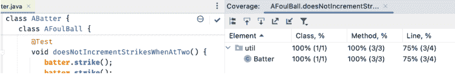

方法覆盖率显示了 `Batter` 类中定义的三个可能方法都已执行。这并不特别有趣或有用。

行覆盖率显示在那三个方法中执行了四行中的三行——其中一行在测试运行时没有被覆盖。在这种情况下，是因为你只运行了一个 Batter 测试。运行所有测试以获得 100% 的行覆盖率。

覆盖率工具的真正价值在于它能准确显示哪些行被执行了，哪些没有。IDEA 的覆盖率窗口在代码行右侧的行槽（gutter）中显示彩色标记。它将执行的行标记为绿色，未执行的行标记为红色，部分覆盖（已读）的行如第 74 页所示。

增加操作（`strikeCount++`）被标记为红色因为它从未被执行过。未覆盖的代码有两种情况：死代码或有风险的代码。

要确定代码是否一直需要或使用几乎是不可能的。“全死”代码（与大部分死代码相比，后者可能被使用）

## 第 4 章 扩展你的测试视野 • 74

```java
ut3-coverage/01/main/util/Batter.java
package util;

public class Batter {
    private int strikeCount = 0;

    public void foul() {
        if (strikeCount < 2)
            strikeCount++;
    }

    public void strike() {
        strikeCount++;
    }

    public int getStrikeCount() {
        return strikeCount;
    }
}
```

（未来的复活目的）会以许多方式浪费时间。就像吸血鬼一样，死代码会吸收时间：当你阅读它时，当它出现在搜索结果中，以及当你错误地开始对它进行修改（这里是真实故事）时。

当你遇到未覆盖的、大部分已死的代码时，将其带到整个团队的视野下。如果它在他们的审查下没有消失，就用测试覆盖它。否则，将其删除。

> 单元测试声明意图。如果你测试了每个意图，就可以安全地删除未测试的代码。

添加第二个仅涉及单个击球的测试，以在 `foul` 中获得 100% 的覆盖率：

```java
ut3-coverage/01/src/test/java/util/ABatter.java
@Test
void incrementsStrikesWhenLessThanThan2() {
    batter.strike();
    batter.foul();
    assertEquals(2, batter.getStrikeCount());
}
```

## 条件语句与代码覆盖率

行覆盖率是一种简单的指标，它告诉你某行代码是否被执行过。它并没有告诉你是否探索了不同的数据情况。例如，如果一个方法接受一个 `int`，你是否用 `0` 测试过它？用负数和很大的数字测试过？覆盖工具不会告诉你测试中是否包含任何断言。（是的，一些聪明的开发者这样做是为了让他们的覆盖率看起来更好。）

**复杂条件语句**通常代表了代码中覆盖不足的路径。当你产生涉及逻辑运算符 OR (|) 和 AND (&&) 的布尔表达式时，你就创建了条件语句。

假设你写了一个测试，仅使用 OR 运算符执行复杂条件。只要该复杂条件的任何一个布尔表达式解析为真，行覆盖率指标就会认为你的测试包含了包含复杂条件的整行代码。但你并没有确保所有其他布尔表达式的行为都符合预期。

条件覆盖率工具可以帮助你准确定条件语句覆盖中的缺陷。

看看 `Batter` 代码的下一个预期增量，它支持追踪球数和保垒。它引入了击球者在家区的回合是否“结束”的概念，意味着他们要么三振，要么保垒（击球和防守稍后会加入）。这就是 `isDone()` 条件语句。

```java
ut3-coverage/02/src/main/java/util/Batter.java
public class Batter {
    private int strikeCount = 0;
    private int ballCount = 0;

    public void foul() {
        if (strikeCount < 2) {
            strikeCount++;
        }
    }

    public void ball() {
        ballCount++;
    }

    public void strike() {
        strikeCount++;
    }

    public int strikeCount() {
        return strikeCount;
    }

    public boolean isDone() {
        return struckOut() || walked();
    }

    private boolean walked() {
        return ballCount == 4;
    }

    private boolean struckOut() {
        return strikeCount == 3;
    }
}
```

在测试类中添加了一个新测试来覆盖三振情况：

```java
ut3-coverage/02/src/test/java/util/ABatter.java
@Test
void whenStruckOut() {
  batter.strike();
  batter.strike();
  batter.strike();
  assertTrue(batter.isDone());
}
```


# IDEA 支持分支覆盖率指标

IDEA 支持分支覆盖率指标，但默认是关闭的。开启并运行 `ABatter` 中的所有测试。你的覆盖率摘要现在包含一列“分支覆盖率”：

| 元素 | 类 | 方法 | 行 | 分支 |
|---|---|---|---|---|
| Batter | 100% (1/7) | 71% (5/7) | 75% (6/8) | 50% (4/8) |

```java
1 public void foul() {
2   if (strikeCount < 2)
3   strikeCount++;
4 }
5 public void ball() {
6   ballCount++;
7 }
8 public void strike() {
9   strikeCount++;
10 }
11 public int strikeCount() {
12   return strikeCount;
13 }
14 public boolean isDone() {
15   return struckOut() || walked();
16 }
17 private boolean walked() {
18   return ballCount == 4;
19 }
20 private boolean struckOut() {
21   return strikeCount == 3;
22 }
```

## 多少覆盖率才足够？

## 代码覆盖率的价值

如果你在编写相应代码之后编写测试，你会错过许多测试用例，直到你改进。

尝试 TDD（测试驱动开发）并为所有单元行为先编写测试，随着时间的推移，你仍然会发现自己一直在偷偷溜入未经测试的逻辑。

在学习过程中，请依靠工具生成的视觉红、黄、绿色注释。

> 使用代码覆盖率工具帮助你理解代码在哪些地方缺乏覆盖，或者你团队的趋势是否正在下降。

尽力避免关于代码覆盖率指标的争论，并说服你的领导该指标并不适用于他们。如果将其用于教育目的以外的任何地方，最终都会产生问题。

## 测试多线程代码

编写按预期运行的代码已经不容易了，这是编写单元测试的原因之一。编写能够正常运行的并发代码困难得多，而验证它是否足够安全可以发布更是困难。

从某种意义上说，测试使用并发处理的应用代码在技术上超出了单元测试的范畴。它更应该被归类为集成测试。你正在验证是否可以将特定的逻辑概念与执行该部分的能力相结合。

线程代码的测试通常较慢，因为你必须扩大执行时间范围，以确保没有并发问题。线程缺陷有时会悄悄潜伏，在你认为已经把它们消灭干净很久后才显现。

在 Java 中处理多线程的方法有很多，同样，你的实现可能出错的方法也很多：死锁、竞态条件、活锁、饥饿和线程干扰，这仅是其中几个。可以写一本书（或至少几章）来涵盖如何测试和纠正所有这些策略。我不允许写这么多纸，所以你只会看到一个突出几个关键想法的简短示例。

## 测试多线程代码的技巧

这里是设计和分析多线程代码的技巧列表，以尽可能地减少并发问题：

- 最小化线程控制与应用代码之间的重叠。重构你的设计，以便你可以在没有线程的情况下对大部分应用代码进行单元测试。针对剩余的少部分代码编写专注于线程的测试。
- 信任他人的工作。Java 在 `java.util.concurrent` 中包含了 Doug Lea 的系列并发工具类。例如，不要自己手动编写生产者/消费者模型，因为太容易出错了。务必利用 Lea 的 `BlockingQueue` 实现，并利用他们为了正确实现它所付出的努力。
- 避免并隔离并发更新，这可能导致大多数问题。
- 使用静态并发分析工具对代码库进行分析，这些工具可以根据代码中线程交互识别潜在问题（包括死锁）。
- 使用 VisualVM 或 YourKit 等动态分析工具对系统的运行时行为进行分析。这些工具可以监控线程状态、分析线程转储、检测死锁等。
- 写一个演示潜在并发问题的测试，然后将其加剧到测试始终失败的程度。你可以减少线程数量，增加正在测试的请求数，或临时引入睡眠以暴露时序问题。`Thread Weaver` 之类的工具也可以帮助你测试不同的线程交织。
- 只添加能让测试通过的并发控制。同步块和锁可能是必要的，但如果不恰当使用它们可能会降低性能（尽管仍解决了真实的并发问题）。
- 当你的测试持续通过时，移除任何人为的痕迹（如 `sleep`）。
- 在实际演示出并发问题（最好通过一个失败的测试）之前，不要引入锁、同步块或原子变量等并发控制。

让我们快速看一看修复并发问题的示例。

## 加剧线程问题

你将处理一段来自 `iloveyboubous` 的代码，这是一个旨在与 Indeed 和 Monster 等网站竞争的职位搜索网站。它的方法与典型的职位发布网站不同：它尝试像约会网站一样将潜在员工与潜在雇主进行匹配，反之亦然。雇主和员工通过回答一系列多选题或是非选择题来创建配置文件。网站根据另一部分的标准对配置文件进行评分，并从员工和雇主的角度显示最佳的匹配项。（作者保留对网站进行变现、发大财、退休以及除了支持这本书的这类读者之外什么都不干的权利。）

`ProfileMatcher` 类是 `iloveyboubous` 的核心部分，它收集所有相关的个人配置文件。通过一组标准（本质上是相关查询的优选答案），`ProfileMatcher.scoreProfiles` 方法会遍历所有添加的配置文件。对于每个匹配标准的个人文件，`ProfileMatcher` 会收集该个人文件及其分数——如果个人文件不匹配标准，则分数为 0，否则为正值。

```java
// ut3-iloveyoubous/02/src/main/java/iloveyoubous/domain/ProfileMatcher.java
import java.util.*;
import java.util.concurrent.*;

public class ProfileMatcher {
    private List<Profile> profiles = new ArrayList<>();

    public void addProfile(Profile profile) {
        profiles.add(profile);
    }

    ExecutorService executorService = Executors.newFixedThreadPool(8);

    public Map<Profile, Integer> scoreProfiles(Criteria criteria)
            throws ExecutionException, InterruptedException {
        var profiles = new HashMap<Profile, Integer>();
        var futures = new ArrayList<Future<Void>>();

        for (var profile : profiles) {
            futures.add(executorService.submit(() -> {
                profiles.put(profile, profile.matches(criteria) ? profile.score(criteria) : 0);
                return null;
            }));
        }

        for (var future : futures) {
            future.get();
        }

        executorService.shutdown();
        return profiles;
    }
}
```

为了保持响应能力，`scoreProfiles` 在独立线程环境中计算匹配，并使用 `futures` 实现。每个遍历的个人文件由单个 `future` 获取。该 `future` 负责将个人文件和分数添加到初始化为空 `HashMap` 的 `profiles` 变量中。这种并发更新就是你的测试将发现的问题根源。

```java
// utj3-iloveyboubous02/src/test/iloveyboubous/domain/ProfileMatcherTest.java
import org.junit.jupiter.api.Test;
import org.junit.jupiter.api.ExtendWith;
import org.mockito.junit.jupiter.MockitoExtension;

import java.util.List;
import java.util.function.Function;

import static iloveyboubous.domain.Weight.REQUIRED;
import static iloveyboubous.domain.Weight.WOULD_PREFER;
import static java.util.stream.IntStream.range;
import static org.junit.jupiter.api.Assertions.assertEquals;

@ExtendWith(MockitoExtension.class)
class ProfileMatcherTest {
    ProfileMatcher matcher = new ProfileMatcher();

    @Test
    void testReturnScoreForAllProfiles() throws Exception {
        var questions = createQuestions(50);
        int profileCount = 500;
        var half = profileCount / 2;

        range(0, half).forEach(id ->
            matcher.addProfile(createProfile(
                questions, i -> nonMatchingAnswer(questions.get(i))));
        range(half, profileCount).forEach(id ->
            matcher.addProfile(createProfile(
                questions, i -> matchingAnswer(questions.get(i))));

        var criteria = createCriteria(questions);

        var results = matcher.scoreProfiles(criteria);

        assertEquals(half,
            results.values().stream().filter(score -> score == 0).count());
        assertEquals(half,
            results.values().stream().filter(score -> score > 0).count());
    }

    private Profile createProfile(
            List<BooleanQuestion> questions,
            int id,
            Function<Integer, Answer> answerFunction) {
        var profile = new Profile(String.valueOf(id));
        range(0, profile.size()).forEach(i ->
            profile.add(answerFunction.apply(i)));
        return profile;
    }

    private Criteria createCriteria(List<BooleanQuestion> questions) {
        var questionCount = questions.size();
        var criteria = new Criteria();

        range(0, 5).forEach(i ->
            criteria.add(new Criterion(
                matchingAnswer(questions.get(i)), REQUIRED)));

        range(5, questionCount).forEach(i ->
            criteria.add(new Criterion(
                matchingAnswer(questions.get(i)), WOULD_PREFER)));

        return criteria;
    }

    private List<BooleanQuestion> createQuestions(int questionCount) {
        return range(0, questionCount)
            .mapToObj(i -> new BooleanQuestion("question " + i))
            .toList();
    }

    Answer matchingAnswer(Question question) {
        return new Answer(question, Bool.TRUE);
    }

    Answer nonMatchingAnswer(Question question) {
        return new Answer(question, Bool.FALSE);
    }
}
```

`testReturnScoreForAllProfiles` 在大多数情况下应该失败，并且偶尔通过。如果你很难让它失败，可以尝试调整线程池的大小、问题的数量（目前为 50）和/或配置文件的数量（500）。尝试让它至少在 10 次中失败 9 次。我在使用 200 个问题和 2000 个配置时能够稳定地失败。

一个简单的解决方案是将 `HashMap` 包装在一个同步映射（synchronized map）中，这使其成为一个线程安全的 Java 结构：

```java
// ut3-loveyououboss02/src/main/java/loveyououboss/domain/ProfileMatcher.java
public class ProfileMatcher {
    private List<Profile> profiles = new ArrayList<>();

    public void addProfile(Profile profile) {
        profiles.add(profile);
    }

    ExecutorService executorService = Executors.newFixedThreadPool(8);

    public Map<Profile, Integer> scoreProfiles(Criteria criteria)
            throws ExecutionException, InterruptedException {
        var profiles = Collections.synchronizedMap(new HashMap<Profile, Integer>());
        var futures = new ArrayList<Future<Void>>();

        for (var profile : this.profiles) {
            futures.add(executorService.submit(() -> {
                profiles.put(profile,
                        profile.matches(criteria) ? profile.score(criteria) : 0);
                return null;
            }));
        }

        for (var future : futures) {
            future.get();
        }

        executorService.shutdown();
        return profiles;
    }
}
```

在做出这个小改动后，确保你的测试能够稳定通过——使用与之前失败时相同的数值。

然而，更好的方法可能是让每个 future 返回一个包含 profile 对应的 score 单个键值对的 map。这避免了对共享数据存储的修改。这些单个键的 map 可以全部聚合到一个的 HashMap 中，形成一个列表的 map，并阻塞所有 futures 的完成。


```java
utj-loveyouboss/02/src/main/java/loveyouboss/domain/ProfileMatcher.java
public Map<Profile, Integer> scoreProfiles(Criteria criteria)
throws InterruptedException {
var futures = new ArrayList<Map<Profile, Integer>>();
for (var profile : profiles)
futures.add(executorService.submit(() ->
Map.of(profile,
profile.matches(criteria) ? profile.score(criteria) : 0)));

var finalScores = new HashMap<Profile, Integer>();
for (var future : futures)
finalScores.putAll(future.get());
executorService.shutdown();
return finalScores;
}
```

抛开夸张不谈，由于此类测试需要大量的迭代和巨大的数据量，性能测试将会缓慢。在我的机器上需要几百毫秒，对于单个测试来说太长了。将其标记为“慢”，并从你的单元测试套件中单独运行。参考第 137 页的“使用标签创建任意测试组”。

## 编写集成测试

`Repository` 类使用 Java 持久 API (JPA) 与 H2 数据库通信。你可能正确地猜到，这个数据类被应用程序中的许多地方使用，而测试这些每一个地方都需要使用测试双胞（test double）。

以下是该类的代码：

ut3-iloveyousb2/01/src/main/java/iloveyousb/persistence/QuestionRepository.java

```java
import iloveyousb.domain.BooleanQuestion;
import iloveyousb.domain.PercentileQuestion;
import iloveyousb.domain.Persistable;
import iloveyousb.domain.Question;
import jakarta.persistence.EntityManager;
import jakarta.persistence.EntityManagerFactory;
import jakarta.persistence.Persistence;
import java.time.Clock;
import java.util.List;
import java.util.function.Consumer;

public class QuestionRepository {
    private static Clock clock;

    public static EntityManagerFactory getEntityManagerFactory() {
        return Persistence.createEntityManagerFactory("h2");
    }

    public void setClock(Clock clock) {
        this.clock = clock;
    }

    private EntityManager em() {
        return getEntityManagerFactory().createEntityManager();
    }

    public Question find(Long id) {
        try (var em = em()) {
            return em.find(Question.class, id);
        }
    }

    public List<Question> getAll() {
        try (var em = em()) {
            return em.createQuery("select q from Question", Question.class).getResultList();
        }
    }

    public List<Question> findWithText(String text) {
        try (var em = em()) {
            var queryString = "select q from Question where q like :searchText";
            var query = em.createQuery(queryString, Question.class);
            query.setParameter("searchText", "%" + text + "%");
            return query.getResultList();
        }
    }

    public long addPercentileQuestion(String text, String... answerChoices) {
        try (var em = em()) {
            persist(new PercentileQuestion(text, answerChoices));
        }
    }

    public long addBooleanQuestion(String text) {
        try (var em = em()) {
            persist(new BooleanQuestion(text));
        }
    }

    private void executeTransaction(Consumer<EntityManager> func) {
        try (var em = em()) {
            var transaction = em.getTransaction();
            try {
                transaction.begin();
                func.accept(em);
                transaction.commit();
            } catch (Exception t) {
                if (transaction.isActive()) transaction.rollback();
            }
        }
    }

    private long persist(Persistable object) {
        executeTransaction(em -> em.persist(object));
        return object.getId();
    }

    public void deleteAll() {
        executeTransaction(em -> em.createNativeQuery("delete from Question").executeUpdate());
    }
}
```

## 数据问题

你希望绝大多数 JUnit 测试都是快速的。不用担心——如果你将所有的交互都隔离在一个地方，你将只有少量的代码需要进行集成测试。

当你为与真实数据库交互的代码编写集成测试时，数据库中的数据以及如何进入那里是重要的考虑因素。例如，为了验证数据库操作返回预期结果，你必须插入适当的数据或假设它们已经存在。

假设数据已在数据库中会产生问题。随着时间的推移，数据会在你不知情的情况下改变，导致测试失败。此外，将数据与测试代码分离会更难以理解为什么特定的测试通过或失败。相对于测试的数据意义通过注入数据库而丢失了。

> 尽可能地让集成测试创建并管理自己的数据。

如果你的测试是在自己的机器上针对数据库运行，简单的方法可能是让每个测试从一个干净的数据库（或填充了引用数据的数据库）开始。然后每个测试都负责添加和处理自己的数据。这减少了数据依赖问题，即一个测试因为另一个测试留下的数据而崩溃。如果你只能与共享数据库进行交互，你需要一个非侵入性的解决方案。方案：如果你的数据库支持，你可以在测试上下文中启动事务并在回滚。（事务处理通常被分配给 `@BeforeEach` 和 `@AfterEach` 方法。）

归结底，集成测试的编写、执行和维护都更困难。它们往往更易崩溃，而且当它们崩溃时，调试过程可能会花费长得多。但一个可靠的测试策略要求你包含其中一些。

如果你发现自己自己在与实时交互（在本例中为数据库）交互之前或之后添加了有趣的逻辑，请找一种方法将逻辑提取到另一个类中。针对该类编写单元测试。

| 集成测试对于设计和维护至关重要。通过最大化你在单元测试中验证的逻辑，尽量减少它们的数量和复杂性。 |

## 洁室数据库测试

你对仓库的测试在每个测试方法的执行之前和之后：

utj3-iloveybous/201/src/test/java/iloveybous/persistence/AQuestionRepository.java

```java
import iloveybous.domain.Question;
import org.junit.jupiter.api.AfterEach;
import org.junit.jupiter.api.BeforeEach;
import org.junit.jupiter.api.Test;
import java.time.ZoneId;
import java.util.Date;
import java.util.List;
import static java.time.Clock.fixed;
import static java.util.Arrays.asList;
import static org.junit.jupiter.api.Assertions.assertEquals;

class QuestionRepository {
    QuestionRepository repository = new QuestionRepository();

    @BeforeEach
    void setUp() {
        repository.deleteAll();
    }

    @AfterEach
    void tearDown() {
        repository.deleteAll();
    }

    @Test
    void findsPersQuestionById() {
        var id = repository.addBooleanQuestion("question text");
        var question = repository.find(id);
        assertEquals("question text", question.getText());
    }
}
```

```java
@Test
void storesDateAddedForPersistedQuestion() {
  var now = new Date().toInstant();
  repository.setClock(fixed(now, ZoneId.systemDefault()));
  var id = repository.addBooleanQuestion("text");
  var question = repository.find(id);
  assertEquals(now, question.getTimestamp());
}
```

```java
@Test
void answersPersistedQuestions() {
  repository.addBooleanQuestion("q1");
  repository.addBooleanQuestion("q2");
  repository.addPercentileQuestion("q3", "a1", "a2");
  var questions = repository.getAll();
  assertEquals(asList("q1", "q2", "q3"), extractText(questions));
}
```

```java
@Test
void findMatchingEntities() {
  repository.addBooleanQuestion("alpha 1");
  repository.addBooleanQuestion("alpha 2");
  repository.addBooleanQuestion("beta 1");
  var questions = repository.findWithMatchingText("alpha");
  assertEquals(asList("alpha 1", "alpha 2"), extractText(questions));
}
```

```java
private List<String> extractText(List<Question> questions) {
  return questions.stream().map(Question::getText).toList();
}
```

清理数据让你的测试具有从洁白开始运行的优势。

在每次测试运行后清理数据只是为了礼貌，而不是为了让数据留在混乱的数据库中。

当你想要解决一个问题时，你可能想在测试完成后查看数据。要这样做，请注释掉 `@After` 方法中对 `clearData` 的调用。

你的测试并不是针对单个方法的；相反，你正在验证密不可分的行为。为了验证你可以检索或找到元素，你必须首先插入它们。为了验证你已经插入了元素，你又检索了它们。

确保你运行覆盖率工具以验证所有代码都已测试。`QuestionRepository` 的测试显示它被测试完全覆盖了。此外，如果你使用集成测试来覆盖某些代码而不是单元测试，你的全系统单元测试覆盖率将略有下降。如果你担心这一点，你可能可以正确地合并这些数字（`jacoco:merge` 工具适用于 JaCoCo）。

## 探索性单元测试

你学习构建的单元测试捕获了你对代码意图的最好的理解。它们涵盖了已知的边缘情况和典型情况。

某些代码可能需要进一步的探索。例如，复杂代码、在你发现输入数据的更多细微差别时似乎不断崩溃的代码，或者如果失败会产生高昂成本的代码。需要高可靠性或安全性的系统可能会因为单元级失败产生巨大的成本。

存在许多种面向开发者的测试来帮助你进行探索性测试。其中许多在集成级别进行验证——负载测试、故障转移测试、性能测试和契约测试等等你可以可以在 Alexander Tarler 的书籍《Developer Testing》² 中学习所有这些。

以下是两种单元级测试策略的概述：模糊测试（fuzz testing）和属性测试（property testing），它们可以被认为是所谓的生成式测试的形式。这类测试需要 JUnit 之外的额外工具，因此你在本书书中只对它们进行了介绍。（这只是几个理由之一，我会坚持这一点。）

完全没有涵盖的是：变异测试（mutation testing），它涉及对你的生产代码进行小更改的工具，以查看此类更改是否破坏你的测试。如果你的测试没有破坏，变异测试表明你可能测试覆盖率不足。

## 模糊测试

通过模糊测试，你使用工具为你的代码提供广泛的随机、意料之外或无效的输入。它可以帮助你识别代码中你不可能想到的边缘情况。

此 URL 将服务器字符串和文档字符串合并为一个有效字符串：

utj3-iloveybous/201/src/main/java/util/URLCreator.java

```java
import java.net.MalformedURLException;
import java.net.URL;
import static java.lang.String.format;

class URLCreator {
    public String create(String server, String document) throws MalformedURLException {
        if (isEmpty(document))
            return new URL(format("https://%s", server)).toString();
        return new URL(format("https://%s/%s", server, document)).toString();
    }

    private boolean isEmpty(String document) {
        return document == null || document.equals("");
    }

    private String clean(String document) {
        return document.charAt(0) == '/' ? document.substring(1) : document;
    }
}
```

以下是测试：


# 探索性单元测试

你学习构建的单元测试捕获了你对代码意图的最好的理解。它们涵盖了已知的边缘情况和典型情况。

某些代码可能需要进一步的探索。例如，复杂代码、在你发现输入数据的更多细微差别时似乎不断崩溃的代码，或者如果失败会产生高昂成本的代码。需要高可靠性或安全性的系统可能会因为单元级失败产生巨大的成本。

存在许多种面向开发者的测试来帮助你进行探索性测试。其中许多在集成级别进行验证——负载测试、故障转移测试、性能测试和契约测试等等可以在 Alexander Tarler 的书籍《Developer Testing》² 中学习所有这些。

以下是两种单元级测试策略的概述：模糊测试（fuzz testing）和属性测试（property testing），它们可以被认为是所谓的生成式测试的形式。这类测试需要 JUnit 之外的额外工具，因此你在本书书中只对它们进行了介绍。（这只是几个理由之一，我会坚持这一点。）

完全没有涵盖的是：变异测试（mutation testing），它涉及对你的生产代码进行小更改的工具，以查看此类更改是否破坏你的测试。如果你的测试没有破坏，变异测试表明你可能测试覆盖率不足。

## 模糊测试

通过模糊测试，你使用工具为你的代码提供广泛的随机、意料之外或无效的输入。它可以帮助你识别代码中你不可能想到的边缘情况。

此 URL 将服务器字符串和文档字符串合并为一个有效字符串：

```java
// utj3-iloveybous/201/src/main/java/util/URLCreator.java
import java.net.MalformedURLException;
import java.net.URL;
import static java.lang.String.format;

class URLCreator {
    public String create(String server, String document) throws MalformedURLException {
        if (isEmpty(document))
            return new URL(format("https://%s", server)).toString();
        return new URL(format("https://%s/%s", server, document)).toString();
    }

    private boolean isEmpty(String document) {
        return document == null || document.equals("");
    }

    private String clean(String document) {
        return document.charAt(0) == '/' ? document.substring(1) : document;
    }
}
```

```java
@ParameterizedTest
@NullSource
@ValueSource(strings = {"", " "})
void buildsURLGivenServerOnly(String document) {
  assertEquals("https://example.com",
  urlCreator.create("example.com", document));
}

@Test
void eliminatesRedundantSlash() {
  assertEquals("https://example.com/customer?id=123",
  urlCreator.create("example.com", "/customer?id=123"));
}
```

通过模糊测试，你可能会添加更多的保护和相应的测试。

使用 Jazzer 工具编写模糊测试：⁵

```java
// utj3-iloveybous/201/src/test/java/util/AURLCreatorFuzzer.java
import com.intelligence.jazzer.api.FuzzedDataProvider;
import com.intelligence.jazzer.junit.FuzzedTest;
import java.net.MalformedURLException;

public class AURLCreatorFuzzer {
    @FuzzTest
    public void fuzzTestIsValidURL(FuzzedDataProvider data)
    throws MalformedURLException {
        var server = data.consumeString(32);
        var document = data.consumeRemainingString();
        new URLCreator().create(server, document);
    }
}
```

+ https://github.com/CodeIntelligenceTesting/jazzer

要使用 Jazzer 运行模糊测试（fuzzing），首先在项目的测试资源中创建一个目录。根据你的 fuzzer 类包名和 fuzzer 类名来命名该目录，作为你的模糊输入：

```
utj3-iloveyouboss2/src/test/resources/util/AURLCreatorFuzzerInputs
```

然后，设置环境变量 `JAZZER_FUZZ=1` 并运行你的测试。模糊测试工具将显示失败案例，并将导致失败的输入添加到你创建的资源目录下的文件中。

fuzzer 应该报告包含 LF（换行符；ASCII 值为 10）的输入对于 URL 来说是一个无效字符。作为开发者，你决定如何使用代码来处理这种情况，或者是否处理。

你还可以在测试资源目录中收集若干输入。关闭 `JAZZER_FUZZ` 环境变量后，Jazzer 将使用这些输入来运行实际上的回归测试。

## 属性测试

单元测试的另一种形式是属性测试，其中你的测试描述了代码预期行为的不变性和后置条件（或属性）。像 jqwik 这样的属性测试工具将使用广泛的自动生成输入来测试这些不变性。

你使用属性测试的主要目的是通过探索更广泛的输入来发现边界情况和意外行为。

这里是插入排序算法的实现，它的性能非常糟糕，但如果你的输入数组是排序过的（或者如果你的输入通常几乎是排序的），它是一个合理的选择：

```java
// utj3-iloveyouboss2/03/src/main/java/util/ArraySorter.java
public class ArraySorter {
    public void inPlaceInsertionSort(int[] arr) {
        for (var i = 1; i < arr.length - 1; i++) {
            var key = arr[i];
            var j = i - 1;
            while (j >= 0 && arr[j] > key) {
                arr[j + 1] = arr[j];
                j = j - 1;
            }
            arr[j + 1] = key;
        }
    }
}
```

- 4. https://jqwik.net

## 第 4 章 扩展你的测试视野 • 94

使用 jqwik，你定义了由 JUnit 测试运行器执行的 `@Property` 方法。以下针对 `ArraySorter` 的属性集描述了三个属性：已排序的数组保持排序状态、所有元素都相同的数组保持不变，以及随机数组应该按升序排序：

```java
// util3-loveyouuboss203/src/test/java/util/ArraySorterProperties.java
import static java.util.Arrays.fill;
import static java.util.Arrays.sort;
import net.jqwik.api.*;
import java.util.Arrays;

public class ArraySorterProperties {
    ArraySorter arraySorter = new ArraySorter();

    @Property
    boolean returnsSameArrayWhenAlreadySorted(@ForAll int[] array) {
        sort(array);
        var expected = array.clone();
        arraySorter.inPlaceInsertionSort(array);
        return Arrays.equals(expected, array);
    }

    @Property
    boolean returnsSameArrayWhenAllSameElements(@ForAll int element) {
        var array = new int[12];
        fill(array, element);
        var expected = array.clone();
        arraySorter.inPlaceInsertionSort(array);
        return Arrays.equals(expected, array);
    }

    @Property
    boolean sortsAscendingWhenRandomUnsortedArray(@ForAll int[] array) {
        var expected = array.clone();
        sort(expected);
        arraySorter.inPlaceInsertionSort(array);
        return Arrays.equals(expected, array);
    }
}
```

以最后一个方法为例：`sortsAscendingWhenRandomUnsortedArray` 代表一个对于所有 (`@ForAll`) 输入数组 (`array`) 都应该成立的后置条件。属性实现克隆了传入的数组并使用 Java 内置排序对其进行排序，捕获预期的结果。它返回该排序结果与预期值的对比。

Jqwik 是一个复杂且高度灵活的工具，默认调用该属性一千次。美妙的是！最后一个属性失败了，而且给定那一千个输入，这种失败是一致的。

数组排序代码非常适合属性测试。你可能会想写几个测试用例（当然，是 ZOM 的）。但有些情况是很难想到的。属性测试可以帮助发现这些情况。

是的，插入排序中存在一个缺陷。jqwik 工具应该能识别出问题。看看你是否能发现并修复这段缺陷代码。

## 总结

在本章中，你通过几个（大多互不相关）主题完善了对核心单元测试概念的认知，这些主题关注了单元测试周围更深层次的问题：

- 代码覆盖率：一个可以帮助你了解单元测试在何方面不足的概念
- 测试多线程代码：一个棘手且复杂的挑战
- 集成测试：用于验证代码及其与可能不受你控制的外部依赖项交互的测试

现在你已经学习了有关单元测试的基础概念，你将深入研究 Java 单元测试的首选工具 JUnit。接下来的三章将深入探索 JUnit，提供关于如何充分利用其丰富功能的有用见解和窍门。

# 第二部分：通过三个“E”精通 JUnit

你只需要使用 JUnit 健壮功能中的一小部分就能完成大部分的单元测试需求。在这一部分中，你将学习 JUnit 的三个“E”：检查结果（Examining outcomes）、在测试中建立环境（Establishing in tests）以及执行测试（Executing tests）。

## 使用断言检查结果

JUnit 中的断言（或 `asserts`）是你可以丢进测试中的静态方法调用。每个断言都是验证某些条件是否成立的机会。如果断言的条件不成立，测试将立即停止，JUnit 将报告失败。要终止测试，JUnit 会抛出一个类型为 `AssertionFailedError` 的异常。事实上，JUnit 会将任何测试标记为失败。

为了根据你的验证需求使用最合适的断言，你将希望学习 JUnit 的众多变体。到目前为止，你已经使用了最常见的断言形式：`assertTrue` 和 `assertEquals`。由于你将把它们用于大部分测试，你首先将深入深入检查这些内容。在某些情况下，断言内容的最简单方法不是与实际结果比较，而是通过反转操作来验证该操作。你将看到一个简短的示例。


# 使用断言检查结果

你还将获得 AssertJ 的概述，这是一个第三方断言库，允许你编写“流式”（fluent）断言。此类断言可以使你的测试变得易读得多。它们还可以提供关于测试失败原因的更精确解释。

## 使用核心断言形式

你的大部分断言将使用 `assertTrue` 或 `assertEquals`。让我们回顾并完善对这两个中坚力量的知识。我们还将看看如何通过消除无价值的内容来保持测试的精简。

## 最基础的断言形式：assertTrue

最基础的断言形式接受布尔表达式或引用作为参数，如果该参数求值为 false，则测试失败。

```java
org.junit.jupiter.api.Assertions.assertTrue(someBooleanExpression);
```

这是一个使用 `assertTrue` 的示例：

```java
ut3-junit01/src/test/java/scratch/AnAccount.java
@Test
void hasPositiveBalanceAfterInitialDeposit() {
    var account = new Account("an account name");
    account.deposit(50);
    Assertions.assertTrue(account.hasPositiveBalance());
}
```

技术上，你可以对写的每个断言使用 `assertTrue`。但断言失败只会告诉你断言失败了，没有更多。寻找更精确的断言，例如 `assertEquals`，它会在失败时报告预期值以及实际接收到的值。结果是你更容易理解和解决测试失败。

## 消除杂质

作为你会花费时间阅读和反复阅读的文档，你将希望精简你的测试。你在第一章中（见第 3 页构建你的第一个 JUnit 测试）已经学过，在声明 JUnit 测试类和方法时不需要 `public` 关键字。此类关键字和其他不必要的元素代表了杂质。

> 通过消除不必要的杂质来精简测试。

你正在扫描大量的测试，以快速了解系统的功能以及你的更改必须去哪里。消除杂质可以让你一目了然地理解测试。

断言（Assert）贯穿于 JUnit 测试中。与其通过类名（Assertion）显式地限定每个断言调用的范围，不如使用静态导入：

```java
import static org.junit.jupiter.Assertions.assertTrue;
```

结果是去除了冗余、更简洁的断言语句：

```java
utj-junit/01/src/test/java/scratch/AnAccount.java
@Test
void hasPositiveBalanceAfterInitialDeposit() {
    var account = new Account("an account name");
    account.deposit(50);
    assertTrue(account.hasPositiveBalance());
}
```

## 通用断言 (Generalized Assertions)

这是 `assertTrue` 的另一个示例，它解释了结果与预期值之间的关系：

```java
utj-junit/01/src/test/java/scratch/AnAccount.java
@Test
void depositIncreasesBalance() {
    var account = new Account("an account name");
    var initialBalance = account.getBalance();
    account.deposit(100);
    assertTrue(account.getBalance() > initialBalance);
}
```

名为 `depositBalance` 的测试是对你想要展示的行为的通用性陈述。它的断言——`assertTrue(balance > initialBalance)`——与测试名称对应，确保了在存款操作后余额确实增加了。该测试并没有显式地验证余额增加了多少。因此，你可能会将该陈述描述为通用断言。

## 消除更多冗余 (Eliminating More Clutter)

前面的示例依赖于已初始化的 `Account` 实例。你可以在 `@BeforeEach` 和 `@BeforeAll` 中创建 `Account`（更多信息请参阅第 124 页），并将其引用作为字段存储在测试类中：

```java
utj-junit/02/src/test/java/scratch/AnAccount.java
class AnAccount {
    Account account;

    @BeforeEach
    void createAccount() {
        account = new Account("an account name");
    }

    @Test
    void hasPositiveBalanceAfterInitialDeposit() {
        account.deposit(50);
        assertTrue(account.hasPositiveBalance());
    }
    // / ...
}
```

JUnit 会为每个测试创建一个测试类的新实例（进一步解释请参见第 127 页的“观察生命周期”）。这意味着你也可以在字段声明处初始化字段：

```java
ut3-junit/01/src/test/java/scratch/AnAccount.java
class AnAccount {
    Account account = new Account("an account name");

    @Test
    void hasPositiveBalanceAfterInitialDeposit() {
        // ...
    }
    // ...
}
```

## 使用 assertEquals 进行显式比较

你的测试名称是行为的泛化描述，但每个测试都应该呈现一个带有特定结果的特定示例。如果测试执行了存款，你就知道新余额应该是多少。在大多数情况下，你应该对断言是**显式**的，并验证实际的新余额。

断言 `assertEquals` 比较预期答案和实际答案，允许你显式地验证账户的值。它是重载的，因此你可以恰当地比较基本类型、包装类型和对象引用。（要比较两个数组，请使用 `assertEquals`。）你的大部分断言可能应该都是 `assertEquals`。

这里再次给出存款示例，通过余额增加的金额进行断言：

```java
ut3-junit/01/src/test/java/scratch/AnAccount.java
@Test
void depositIncreasesBalanceByAmountDeposited() {
    account.deposit(50);
    account.deposit(100);
    assertEquals(150, account.getBalance());
}
```

你为每个测试设计了示例，并且知道预期结果。使用 `assertEquals` 将其编码在测试中。

## 断言消息：断言的冗余消息

绝大多数验证都是自言自足的，至少从它们试图验证的代码片段来看是。有时，拥有关于“为什么”或额外的上下文来解释断言是有帮助的。“为什么这个测试就预期总和是 42？”

大多数 JUnit 形式都支持一个可选的最后参数消息。消息参数允许你提供一个关于断言背后逻辑的良好且详细的解释：

```java
ut3-junit/01/src/test/java/scratch/AnAccount.java
@Test
void balanceTotalOfDeposits() {
    account.deposit(50);
    account.deposit(51);

    var balance = account.getBalance();
    assertEquals(101, balance, "account balance must be total of deposits");
}
```

断言消息在测试失败时显示：

`account balance must be total of deposits => expected: <101> but was: <102>`

如果你更喜欢解释性注释，你可能会从断言消息中获得收益。然而，更好的路线是：

- 一次只测试一种行为
- 让你的命名更具描述性

事实上，如果你每个测试只演示一种行为，你通常只需要一个断言。测试的名称将自然地描述该断言的原因。不需要断言失败消息。


解释性常量、辅助方法和揭示意图的变量名等元素对于使测试易读且直击非常有帮助。

测试中存在断言消息通常预示着气味（smell）。在编写良好的测试中，断言消息通常是冗余且必要的。

## 其他 JUnit 形式

虽然 `assertEquals` 和 `assertTrue` 涵盖了你需要的，但你将学习 JUnit 支持的其他形式。在本节中，你将接触大多数断言形式，包括 `assertFalse`、`assertSame`、`assertNotSame`、`assertNull` 和 `assertNotNull`。

## assertFalse

没有人喜欢双重否定。这里是 `assertFalse`——`assertTrue` 的反面应用：

```java
ut3-junit/01/src/test/java/scratch/AnAccount.java
@Test
void doesNotHaveBalanceAfterInitialDeposit() {
    assertFalse(account.hasPositiveBalance());
}
```

如果你心情相反，可以使用 `assertTrue` 实现等效代码：

```java
ut3-junit/01/src/test/java/scratch/AnAccount.java
@Test
void doesNotHaveBalanceAfterInitialDeposit() {
    assertTrue(!account.hasPositiveBalance());
}
```

读起来很别扭：“断言真没有余额”，并且代表了让我们很多人感到困惑的逻辑。在测试中避免双重否定。当这样做更容易读时，使用 `assertFalse`。

## assertNotEquals

`assertNotEquals` 的适当使用要少得多。如果你知道答案应该是什么，请使用 `assertEquals`。否则，使用 `assertNotEquals` 可能代表一种弱断言——无法充分验证结果的断言。

使用 `assertNotEquals` 的合理情况：

- 你不知道答案应该是什么。
- 你可能在另一个测试中已经解释了可能的实际答案，而在这个测试中，你想强调它不可能是某个值。
- 显式断言结果需要太多的细节。

让我们尝试一个示例。对于任何牌类游戏（例如扑克），在发牌之前必须洗牌。这里是 `Deck` 类的初始实现，显示了洗牌发生在构造函数中：

```java
ut3-junit01/src/main/java/cards/Deck.java
public class Deck {
    private LinkedList<Card> cards;

    public Deck() {
        cards = newDeck();
        Collections.shuffle(cards);
    }

    static LinkedList<Card> newDeck() {
        var cards = new LinkedList<Card>();
        for (var i = 1; i <= 13; i++) {
            cards.add(new Card(i, "C"));
            cards.add(new Card(i, "D"));
            cards.add(new Card(i, "H"));
            cards.add(new Card(i, "S"));
        }
        return cards;
    }

    public Card deal() {
        return cards.removeFirst();
    }

    List<Card> remaining() {
        return cards;
    }
}
```

你可能想要验证洗牌操作是否确实发生了：

```java
ut3-junit/01/src/test/java/cards/ADDeck.java
public class ADeck {
    Deck deck = new Deck();
    // ... 其他其他的 Deck 测试 ...
    @Test
    void hasBeenShuffled() {
        var cards = deck.remaining();
        assertNotEquals(Deck.newDeck(), cards);
    }
}
```

你可能在想：“嘿，这看起来像是一个弱效的断言！”在某种意义上确实如此——你并不知道牌组是否被正确地洗牌了。但这不是 `Deck` 类的职责。这里的 `Deck` 类在实现洗牌功能后调用了它，并使用了 Java API 中的一个方法。你可以信任 `Collections.shuffle()` 会适当地随机化集合的顺序，尽管如果你经营的是赌场，你可能需要一个更好的随机数生成器。

由于你可以信任 Java API，你就不需要证明它的洗牌质量。但你的单元测试确实需要验证牌确实被洗过牌。你可以通过多种相当复杂的方法来实现，例如使用第 3 章中的测试双胞（test doubles），或者在第 53 页注入一个带种子的随机数生成器来进行洗牌。

确保实例化的 `Deck` 中的牌顺序不等于 `Deck.newDeck()` 返回的牌是足够且简单的。它证明了发生了某些操作改变了顺序。在洗牌恰好洗回牌组初始顺序的情况下，这也有极小的失败可能。在你的有生之年不可能发生。如果你碰巧遇到了那个奇妙的时刻，请重新运行测试。

是的，有人可以将对 `Collections.shuffle()` 的调用替换为糟糕的洗牌代码——例如，将一张牌从牌组的前部移动到后部。但别担心——没人会那样。

单元测试的存在并不是为了保护你免受蓄意的破坏。一个坚定的破坏者可以在不破坏任何测试的情况下破坏你的系统。


## assertSame

同样是不常使用的，`assertSame` 用于验证两个引用是否指向内存中的同一个对象。

你的挑战是：在一个调度应用程序中最小化内存的使用，该程序可能需要成千上万个 `Time` 对象。（此示例基于《设计模式实战：享元模式》。这些 `Time` 对象大部分将落在季度刻度上（11:15, 14:30, 10:15），因为我们通常喜欢这样安排时间。一小部分会在奇特的时间，比如 3:10 或 4:20，因为有些人会在奇特的时间做事，哥们。）

享元模式的想法是拥有一个单一的对象池，允许多个相关方共享具有相同的值。（这对于不可变对象有效，否则效果就不佳。）结果是你的应用程序可以显著减少其内存占用。

这里是涉及的生产类：

```java
ut3-junit/01/src/main/java/time/Time.java
import static java.lang.String.format;

public record Time(byte hour, byte minute) {
    static String key(byte hour, byte minute) {
        return format("%d:%d", hour, minute);
    }

    @Override
    public String toString() {
        return key(hour, minute);
    }
}
```

```java
ut3-junit/01/src/main/java/time/TimePool.java
import java.util.HashMap;
import java.util.Map;

public class TimePool {
    private static Map<String, Time> times = new HashMap<>();

    static void reset() {
        times.clear();
    }

    public static Time get(byte hour, byte minute) {
        return times.computeIfAbsent(Time.key(hour, minute),
            k -> new Time(hour, minute));
    }
}
```

这里是几个测试：


# 单元测试断言详解

## assertSame 与 assertNotSame

### assertSame

第二个测试中的高亮行演示了 `assertSame` 的用法。安排（arrange）步骤调用了 `TimePool` 上的方法来获取第一个对象，然后在执行（act）步骤中再次调用了一次。断言（assert）步骤验证了这两个 `Time` 对象是同一个。

### assertNotSame

`assertNotSame` 用于验证两个引用是否指向内存中不同的对象。你可能使用 `assertNotSame` 来验证一个新实例与旧实例不相同。在生产代码中，高亮行显示了 `assertNotSame` 的用法，以确保一个新实例被添加到 `HashMap` 中。这里有一些演示代码：

```java
// ut3-unit/01/src/test/java/persistence/InMemoryDatabase.java
package persistence;
import org.junit.jupiter.api.Test;
import static org.junit.jupiter.api.Assertions.*;

class InMemoryDatabase {
  @Test
  void objectCopiedWhenAdded() {
    var db = new InMemoryDatabase();
    var customer = new Customer("I", "Smelt.");
    db.add(customer);

    var retrieved = db.get("I");
    assertNotSame(retrieved, customer);
  }
}
```

```java
// ut3-unit/01/src/main/java/persistence/InMemoryDatabase.java
import java.util.HashMap;
import java.util.Map;

public class InMemoryDatabase {
    Map<String, Customer> data = new HashMap<>();
    // ...
    public Customer get(String id) {
        return data.getOrDefault(id, null);
    }

    public void add(Customer customer) {
        data.put(customer.id(), customer);
    }
}
```

思考单元测试的一种方式是它们为那些重要但不显而易见的提供了保护——解释，例如本例中的创建副本。单元测试不仅保护，还描述了系统中成千上万的选择。

## assertNull 与 assertNotNull

### assertNull

`assertNull` 等同于执行 `assertEquals(null, someValue)`。

`InMemoryDatabase` 类需要一个公共方法通过 id 获取客户。这里是某种实现代码：

```java
// ut3-junit/01/src/main/java/persistence/InMemoryDatabase.java
import java.util.HashMap;
import java.util.Map;

public class InMemoryDatabase {
    Map<String, Customer> data = new HashMap<>();
    // ...
    public Customer get(String id) {
        return data.getOrDefault(id, null);
    }
}
```

你需要多少测试来覆盖该方法？`getOrDefault` 中的“或（Or）”是一个强力提示，说明你至少需要两个。在列表中，第一个测试是成功检索到客户的“快乐路径”情况：

```java
// ut3-junit-01/src/test/java/persistence/InInMemoryDatabase.java
InMemoryDatabase db = new InMemoryDatabase();

@Test
void returnsCustomerCorrespondingTo() {
    var customer = new Customer("42", "Mr Creosote");
    db.add(customer);

    var retrieved = db.get("42");
    assertEquals(customer, retrieved);
}

@Test
void returnsNullForNonexistentKey() {
    assertNull(db.get("42"));
}
```

第二个测试演示了 `assertNull` 的用法：如果你尝试从新创建的 `db`（其中没有任何插入内容）中检索任何内容（在本例中），它应该返回 null。

### assertNotNull

`assertNotNull` 自然是 `assertNull` 的反面。它被用于断言引用指向了某些内容，而不是空。

和 `assertNotNull` 一样，许多 `assertNotNull` 的用法是令人怀疑的。

一些 JUnit 人士为新实例化的对象引用引入了 `assertNotNull` 检查：

```java
// utj-junit/01/src/test/java/persistence/InMemoryDatabase.java
@Test
void retrievedCustomerCorrespondingTo() {
    var customer = new Customer("42", "Mr Creosote");
    assertNotNull(customer); // 错误的！这绝不会失败
    db.customer(customer);

    var retrieved = db.get("42");
    assertEquals(customer, retrieved);
}
```

然而，那个 `assertNotNull` 永远不会失败。在测试的第一行中初始化的 `customer` 变量结果变为 `null` 的唯一方法是 `Customer` 构造函数抛出了异常。如果抛出异常，下一行代码——`assertNotNull` 语句——将永远不会执行。如果没有抛出异常，`customer` 引用将指向一个（非空）对象，因此如果 `assertNotNull` 执行，它也永远不会失败。记住这一点。

`assertNotNull` 仅在你需要证明一个引用指向某个值，且你完全不在乎具体是什么值时才有用。否则——如果你可以确定预期的值——`assertNotNull` 是一个弱弱的断言。你最好使用 `assertEquals` 来比较引用与其实际值。

在极少数情况下，你会知道什么时候应该使用 `assertNotNull`。否则……别那样做。

## 额外的断言集

但等一下——还有更多内容！

`org.junit.jupiter.api.Assertions` 提供了几个这里没有描述的更多断言。如果不仔细查阅用户指南或该类的冗量 Javadoc，你将不知道这些断言的存在。这里是这些断言及其作用的简要描述。

| 方法 | 描述 |
| :--- | :--- |
| `assertLinesMatch` | 断言两个字符串或字符串列表是否匹配；可能涉及正则表达式和“快速跳进” |
| `assertAll` | 断言所有提供的可执行体均未抛出异常 |
| `assertInstanceOf` | 断言实际值是预期类型的实例 |
| `assertIterableEquals` | 断言提供的 `Iterables` 是深度相等的 |
| `assertTimeout` | 断言可执行体在特定持续时间内完成执行 |
| `assertTimeoutPreemptively` | 类似于 `assertTimeout`，但在单独线程中运行可执行体 |

## 预期异常

除了确保代码的“正向路径”（happy path）正常工作外，你还需要验证“非正向情况”。例如，你需要编写测试来演示代码何时会抛出异常。这些测试对于向必须处理代码的开发者提供对行为的完整理解是必要的。

不断演变的 Java 语言也驱动了 JUnit 的持续发展——在 JUnit 中至少有四种编写基于异常测试的方法。你将查看其中几种。

让我们来看一个简单的例子：确保当客户端尝试提取金额超过可用余额时，账户代码抛出 `InsufficientFundsException`。

### 新流派：assertThrows

`assertThrows` 断言从 JUnit 4.13 版本开始可用，应该涵盖你编写基于异常测试时的所有需求。相比其他机制，优先使用它。

最有用的 `assertThrows` 形式接受两个参数：预期抛出的异常类型，以及一个可执行体（通常是 lambda 表达式或方法引用）。该可执行体执行预期抛出异常的代码。

当 JUnit 执行该断言时，lambda 中的代码会被运行的。如果该代码没有抛出异常，且异常对象的类型匹配或是预期类型的子类，则断言通过。

这里是 `assertThrows` 的实际应用。传递给 `assertThrows` 的 lambda 参数尝试从一个新创建的账户中提取 100（即一个没有钱的账户）：

```java
// utj-junit-001/src/test/java/scratch/AnAccount.java
import static org.junit.jupiter.api.assertThrows;
// ...

@Test
void throwsWhenWithdrawingTooMuch() {
    var thrown = assertThrows(InsufficientFundsException.class,
        () -> account.withdraw(100));
    assertEquals("balance only 0", thrown.getMessage());
}
```

调用 `assertThrows` 返回异常对象。此测试将其赋值给 `thrown` 变量，以便对其消息字符串进行断言。

不要在 lambda 中添加多余的代码。你不想出现假阳性，即因为错误的代码行抛出了预期的异常导致测试通过。

`withdraw` 中的代码通过在提取金额超过余额时抛出 `InsufficientException` 来通过 `assertThrows` 语句：

```java
// utj-junit-01/src/main/java/scratch/Account.java
void withdraw(int dollars) {
    if (balance < dollars) {
        throw new InsufficientException("balance only " + balance);
    }
    balance -= dollars;
}
```

### 旧流派

在 `assertThrows` 可用之前，在 JUnit 中预期异常至少有三种选择：使用 `try/catch`、注解（annotations）和规则（rules）。如果你维护旧系统，可能会看到这些解决方案中的一些。JUnit 5 不支持注解和规则，因此我在这里不会介绍它们。不过，我会向你展示它们的样子，以便你理解你看到了什么。

这是一个基于注解的机制示例：

```java
@Test(expected=InsufficientFundsException.class)
public void throwsWhenWithdrawingTooMuch() {
    account.withdraw(100);
}
```

如果你在 `@Test` 注解中看到 `expected=` 参数，请访问 JUnit 4 关于 `@Test` 的文档以获取进一步说明。

以下是基于规则的机制（在 JUnit 4.7 中添加）的可能写法：

```java
public class SimpleExpectedExceptionTest {
    @Rule
    public ExpectedException thrown = ExpectedException.new();

    @Test
    public void throwsException() {
        thrown.expect(InsufficientFundsException.class);
        thrown.expectMessage("happened");
        account.withdraw(100);
    }
}
```

## 第 5 章 使用断言检查结果

你可能在旧代码中看到 `try/catch` 机制。如果是这样，你可以保持原样（现在你知道它是如何工作的），或者通过替换为 `assertThrows` 来简化你的测试。

### try/catch 的使用

如果你看到 `ExpectedException` 标记为 `@Rule`，请访问 JUnit 4 文档以获取进一步说明。如果你想使用 `try/catch`，这里有一个例子：

```java
@Test
void throwsWhendrawingTooMuch() {
    try {
        account.withdraw(100);
    } catch (InsufficientException expected) {
        assertEquals("balance only 0", expected.getMessage());
    }
}
```

如果调用没有抛出异常，测试应该失败。你可能需要在 try 块末尾添加 `fail()`：

```java
@Test
void throwsWhendrawingTooMuch() {
    try {
        account.withdraw(100);
    } catch (InsufficientException expected) {
        assertEquals("balance only 0", expected.getMessage());
        return;
    }
    fail();
}
```

如果调用抛出异常，控制权转移到 catch 块。如果没有抛出，则调用 `fail()`，测试失败。

### 断言什么都没发生：assertNotThrow

有了许多其他断言形式，JUnit 提供了 `assertThrows` 的反例——特定的 `assertNotThrow` 方法。在最简单的形式中，它接受一个可执行体（lambda 表达式或方法引用）。如果调用没有抛出任何异常，则断言通过；否则失败。

偶尔，你会想要使用 `assertNotThrow`……唯一的问题是，它并没有对执行的代码做了任何断言。尝试去测试“某些”。

你可能会发现 `assertNotThrow` 在系列测试中很有用。假设你有一个验证器在某些情况下抛出异常，其他情况下执行：

```java
// utj-junit/01/src/test/java/scratch/AnameValidator.java
class NameValidationException extends RuntimeException {}
class NameValidator {
  long commaCount(String s) {
    return s.chars().filter(ch -> ch == ',').count();
  }
  void validate(String name) {
    if (name.isEmpty() || commaCount(name) > 1)
      throw new NameValidationException();
  }
}
```

你需要两个测试来证明 `validate` 在两个负面用例中的每一个都会抛出异常：


```java
utj-junit-01/src/test/java/scratch/ANameValidator.java
import org.junit.jupiter.api.*;
import static org.junit.jupiter.api.Assertions.assertNotThrow;
import static org.junit.jupiter.api.Assertions.assertThrows;

class ANameValidator {
    NameValidator validator = new NameValidator();

    @Test
    void throwsWhenNameIsEmpty() {
        assertThrows(NameValidationException.class, () ->
            validator.validate(""));
    }

    @Test
    void throwsWhenTooManyCommas() {
        assertThrows(NameValidationException.class, () ->
            validator.validate("a,b,c"));
    }

    @Test
    void doesNotThrowWhenNameIsValid() {
        assertNotThrow(() -> validator.validate("a,b"));
    }
}
```

```java
@Test
void throwsWhenNameContainsMultipleCommas() {
    assertThrows(ValidationException.class, () ->
        validator.validate("Langr, Jeffrey J."));
}
}
```

...还有一个使用 `assertDoesNotThrow` 的测试，展示在其他情况下什么都不会发生：

```java
jt3-01/src/test/java/scratch/ANameValidator.java
@Test
void doesNotThrowWhenNoErrors() {
    assertDoesNotThrow(() ->
        validator.validate("Langr, Jeffrey J."));
}
```

如果你必须使用 `assertDoesNotThrow`，也许可以先尝试不同的设计。对于这里的示例，将验证器改为暴露一个 `Boolean` 方法就能解决问题。

## 异常，谁需要它们？

你编写的大多数测试将是更加随意的快乐路径（happy paths），在这些情况下极不太可能抛出异常。Java 一直像个扫冷的人，坚持要求你确认任何检查异常（checked exception）类型。

不要用 `try/catch` 块充斥测试来处理检查异常。相反，让这些异常释放出来吧！测试可以直接抛出它们：

```java
jt3-01/src/test/java/scratch/SomeAssertExamples.java
@Test
void readsFromTest() throws IOException {
    var writer = new BufferedWriter(new FileWriter("test.txt"));
    writer.write("test data");
    writer.close();
    // ...
}
```

你设计这些正向测试是为了确保只有在真正异常的情况下，否则它们不会抛出异常。即使真的意外抛出了异常，JUnit 也会为你捕获它并将测试报告为错误（error），而不是失败（failure）。

## 替代断言方法

你测试中的大多数断言都是对预期结果与实际结果的直接比较：平均信用分是 780 吗？然而，有时直接比较并不 true描述预期结果的最有效方法。

例如，假设你编写了 `fastHalf` 方法，它使用位移来执行除以二的操作。代码非常简单，其中的一些核心测试也是如此：

```java
ut3-unit/01/src/main/java/util/MathUtils.java
public class MathUtils {
    static long fastHalf(long number) {
        return number >> 1;
    }
}
```

```java
ut3-unit/01/src/test/java/util/MathUtilsTest.java
import org.junit.jupiter.api.Assertions.assertEquals;
import static util.MathUtils.fastHalf;

public class MathUtils {
    @Nested
    class FastHalf {
        @Test
        void isZeroWhenZero() {
            assertEquals(0, fastHalf(0));
        }

        @Test
        void roundsDownZeroWhenOne() {
            assertEquals(0, fastHalf(1));
        }

        @Test
        void dividesEvenlyWhenEven() {
            assertEquals(11, fastHalf(22));
        }

        @Test
        void roundsDownWhenOdd() {
            assertEquals(10, fastHalf(21));
        }

        @Test
        void handlesNegativeNumbers() {
            assertEquals(-2, fastHalf(-4));
        }
    }
}
```

你可能想要另一个测试来验证该工具类处理非常大数字时有效：

```java
ut3-unit/01/src/test/java/util/MathUtilsTest.java
@Test
void handlesLargeNumbers() {
    var number = 483_935_889_934_890L;
    assertEquals(244_967_944_967_945L, fastHalf(number));
}
```

但是，噢，这太丑了，测试阅读者很难快速验证。

你已经证明了 `fastHalf` 在 0、1、许多数字和负数情况下都是有效的。对于非常大的数字，与其展示许多数字，不如展示这样的断言：

```java
ut3-unit/01/src/test/java/util/MathUtilsTest.java
@Test
void handlesLargeNumbers() {
    var number = 483_935_889_934_890L;
    assertEquals(244_967_944_967_945L, fastHalf(number));
}
```

（注：由于提供的原文文本似乎存在断层或重复逻辑问题，译文已根据提供的上下文尽可能翻译了可读部分。）

*注：由于提供的原文文本在后半部分出现了明显的逻辑混乱和代码重复（例如 `fastHalf` 示例多次出现），上述译文严格遵循了“不要重复输出原文”的原则，并对可理解的语义进行了翻译。*

```java
this(new Segment(origin, destination, distance, dateTime);
}

boolean includes(String airport) {
    return segment.includes(airport);
}
```

以下 AssertJ 断言与存储在变量中的 `Flight` 对象列表进行比较：

对 `filteredOn` 的调用返回了包含航班代码 "DEN" 的航班子集。

对 `extracting` 的调用对每个 "DEN" 航班应用了 AssertJ 属性引用 `"segment.distance"`。该引用告诉 AssertJ 先从航班中检索路段对象，然后从该路段中获取作为整数的距离值。

是的，你可以手动编写出与 AssertJ 解决方案等效的代码，但结果代码将失去 AssertJ 提供的声明式特性。你的测试在编写和阅读上需要花费更多精力。相比之下，AssertJ 对方法链式的支持创建了一个流畅的句子，你可以像阅读简单概念一样理解它。

无论你选择采用 AssertJ 还是其他第三方断言库，都要精简你的测试，使其成为简洁的文档。设计良好的断言步骤可以最大限度地减少分步阅读。

## 消除非测试

断言是使测试成为自动化测试的关键。在测试中省略断言将使它们变得毫无意义。然而，某些开发者恰恰为了这样做，以便轻松地满足代码覆盖率的要求。另一个常见原因是编写执行大量代码的测试，然后对简单内容进行断言——例如，断言方法的返回值不为空。

这种非测试在时间和精力的付出了巨大成本的情况下，几乎没有提供价值。更糟糕的是，它们的投资回报率日益负面：当这些非测试失败或出错时，你必须在它们上花费时间；它们出现在搜索结果中（“这是我们需要更新的真实测试吗，还是我们根本不需要担心？”），而且为了保持它们运行而更新它们时（例如当方法签名发生变化时）。

> 消除不验证任何内容的测试。

## 总结

在这一章中你学习了许多断言形式。你还学习了 AssertJ，另一个断言库。

最初，如果你主要使用 `assertEquals` 进行大部分断言，并偶尔配合使用 `assertTrue` 或 `assertFalse`，你可以生存下去。然而，你可能希望很快进入下一个水平，并学习针对当前情况使用最简洁、最有表现力的断言。

有了对如何编写断言的深刻理解，你接下来将研究测试类的组织，以便你能够最有效地运行和维护相关的测试组。

## 在 JUnit 测试中建立组织

你目前为止学习的 JUnit 知识包括：

- 如何运行 JUnit 并理解其结果
- 如何在一个测试类中对相关的测试方法分组
- 如何将常见的测试初始化分组到 `@BeforeEach` 中
- 对 JUnit 断言的深度解析（上一章）

通常，对于你开发的每个生产类，至少对应一个测试类。你将研究测试类内部的测试组织主题。你将学习：

- 测试的组成部分
- 使用生命周期方法进行初始化和清理
- 使用嵌套类对相关测试
- JUnit 测试执行生命周期
- 通过永不规定测试顺序来避免依赖挑战
- 使用参数化的 `@Test` 为单个测试执行多个测试用例

## 单个测试的组成部分

几个章节之前，你看到（《可读性：准备—执行—断言》，第 18 页），并学习了 AAA 如何提供一个极佳的视觉记忆辅助，帮助读者快速理解测试的核心部分。

一些开发者提到“四阶段测试”¹，其中每个测试都可以拆分为（等一下）四个部分或阶段：

- 在被称为“固件（fixture）”的地方设置状态/数据。将固件想象为测试运行的上下文——可以说是它的世界。固件是由 JUnit 为你管理的；你将在本章中作为 JUnit 测试执行生命周期的一部分学习更多相关内容。
- 与系统交互以执行你想要验证的内容。
- 执行验证（断言 assert）。
- 卸载固件——如有必要，清理任何副作用。这通常涉及清理测试可能使用并可能影响其他测试执行的资源。在本章中，你将读到如何使用 `@AfterEach` 和 `@AfterAll` JUnit 钩子进行清理。

> 1. http://xunitpatterns.com/Four%20Phase%20Test.html

从任何意义和目的上，AAA 都是四阶段测试的前三个部分。准备、Act、Assert ≈ 设置、执行、验证。

事实证明第四阶段“卸载（tear down）”在单元测试中应该是罕见的，而你寻求（通过设计）避免与你所清理的测试产生交互。如果你觉得 AAA 偷过了这第四部分，你可以添加一个“A”……代表 ANNIHILATION（毁灭）！（如果这种暴力感让你感到不安，就在心里把它改为“After”（之后）。保持冷静并继续。）

## 使用生命周期方法进行设置和卸载

你在第一个 JUnit 示例中学习了 `@BeforeEach`（参见第 1 章《构建第一个 JUnit 测试》，第 3 页）。让我们仔细观察这个初始化钩子，以及 JUnit 提供的其他钩子。

## 使用 @BeforeEach 和 @BeforeAll 初始化

在《抽象：消除无聊的细节》第 20 页，你学习了使用 `@BeforeEach` 将公共初始化放在一处。带有 `@BeforeEach` 注解的方法会在每个测试范围之前执行。

JUnit 还提供了另一种名为 `@BeforeAll` 的初始化钩子，它必须声明为静态方法。每个带有 `@BeforeAll` 注解的方法每个类执行一次，并且在类内任何内容的执行之前执行。它的主要用途是确保执行缓慢的初始化（针对任何涉及数据库的内容）只需要执行一次。否则，优于使用 `@BeforeEach`。

如果你发现自己极罕地多次使用 `@BeforeAll`，你可能正在测试比单元更大的内容。这可能没关系，但它可能意味着减少依赖的机会。参见第 3 章《测试双胞》，第 53 页了解如何这样做。

## 使用 @AfterEach 和 @AfterAll 进行清理

JUnit 将初始化钩子 `@BeforeEach` 和 `@BeforeAll` 与相应的“清理”生命周期方法 `@AfterEach` 和 `@AfterAll` 绑定。这些方法允许你在测试完成后清理资源。如果任何测试抛出异常，只要 JUnit 本身没有崩溃，`@AfterEach` 和 `@AfterAll` 都保证执行。

例如，在 `@AfterEach` 中，你可能会关闭数据库连接或删除文件。如果你在 JUnit 中编写集成（非单元）测试，这些卸载钩是至关重要的。

然而，大多数单元测试不应与需要清理的代码交互。典型的、令人庆幸的情况是多个测试更改了静态字段的状态。

如果你有清理需求，尝试重新设计你的代码以消除它。根据情况使用依赖注入（参见《将依赖注入生产代码》，第 56 页）和/或模拟对象（参见第 3 章《测试双胞》，第 53 页）。

> 你的每个测试都负责确保它在干净、预期的状态执行。

你通常可以设计代码，使得几乎没有单元测试需要清理工作，但你可能在极少数地方仍然需要 `@AfterEach`。

## 将相关测试组织到嵌套类中

随着你的类因承担了更多行为而增大，你需要越来越多的测试来描述这些新行为。可以将测试类的大小作为一个提示：如果你在一个测试源文件中声明了十几个测试，那么很有可能意味着被测试的类也太大了。考虑将生产代码类拆分为两个或多个类，这也意味着你可能希望将测试方法分散到至少两个或多个类中。

你最终可能仍然在一个类中get几个测试方法。一个较大的测试类不仅在导航角度上令人望而生畏，还可能让你更难找到所有相互相关的测试。

为了帮助对相关分组，你可能考虑让每个相关测试以相同的名称开头。以下是三个描述 `Account` 类中取款如何工作的测试：

```java
@Test void withdrawalReducesAccountBalance() { /* ... */ }
@Test void withdrawalThrowsWhenAmountExceedsBalance() { /* ... */ }
@Test void withdrawalNotifiesIRSWhenAmountExceedsThreshold() { /* ... */ }
```

更好的解决方案是将相关测试分组在 JUnit 的 `@Nested` 类中：

```java
@Nested
class WithWithdrawal {
    @Test void reducesAccountBalance() { /* ... */ }
    @Test void throwsWhenAmountExceedsBalance() { /* ... */ }
    @Test void notifiesIRSWhenAmountExceedsThreshold() { /* ... */ }
}
```

你可以在测试类中创建多个 `@Nested` 类，将类内部的所有方法分组。描述共同行为的嵌套类可以从每个测试名称中移除。

你还可以使用 `@Nested` 类根据上下文（由测试中 `arrange` 部分建立的状态）来对测试进行分组。例如：

```java
class AnAccount {
    @Nested
    class ZeroBalance {
        @Test void doesNotAccrueInterest() { /* ... */ }
        @Test void throwsOnWithdrawal() { /* ... */ }
    }

    @Nested
    class WithPositiveBalance {
        @BeforeEach void fundAccount() { account.deposit(1000); }
        @Test void accruesInterest() { /* ... */ }
        @Test void reducesBalanceOnWithdrawal() { /* ... */ }
    }
}
```

测试被分分为需要零余额账户（WithZeroBalance）和需要正账户余额（WithPositiveBalance）的测试。

## 观察 JUnit 生命周期


你已经学习了如何使用 `beforeEach` 钩子以及如何将相关测试分组到嵌套类中。通过一个骨架测试类，让我们来看看在运行测试时这些 JUnit 元素是如何参与其中的。

`AFundedAccount` 包含六个测试。根据它的名称，所有测试都可以假设账户存在且具有正余额。账户对象在字段级别创建，随后在 `@BeforeEach` 方法中找到。这里是整个 `AFundedAccount` 测试类，去除了每个测试的所有复杂细节。

```
ut3-junit5/src/test/java/scratch/AFundedAccount.java
import org.junit.jupiter.api.*;
class AFundedAccount {
    Account account = new Account("Jeff");
    AFundedAccount() {
        // ...
    }

    @BeforeEach
    void fundAccount() {
        account.deposit(1000);
    }

    @BeforeAll
    static void clearAccountRegistry() {
        // ...
    }

    @Nested
    class AccruingInterest {
        @BeforeEach
        void setInterestRate() {
            account.setInterestRate(0.027d);
        }

        @Test
        void occursWhenMinimumMet() {
            // ...
        }
    
    }
}
```

```
@Test
void doesNotOccurWhenMinimumMet() {
    // ...
}
```

```
@Test
void isReconciledWithMasterAccount() {
    // ...
}
```

```
@Nested
class Withdrawal {
  @Test
  void reducesAccountBalance() {
    // ...
  }
  @Test
  void throwsAmountExceedsBalance() {
    // ...
  }
  @Test
  void notifiesIRSAmountExceedsThreshold() {
    // ...
  }
}
```

虽然你可以在 `@BeforeEach` 方法中实例化账户字段，但在字段级别进行初始化也没有什么问题，特别是当操作并不不多时。`AFundedAccount` 中的字段声明初始化了一个具有任意名称的账户，因此它并不有趣到足以需要一个 `@BeforeEach` 方法。如果你的通用初始化具有任何趣味或需要一系列语句，你绝对会希望它在 `@BeforeEach` 方法中发生。

使用 `@Nested` 可以让你在运行测试时获得组织良好的测试结果：

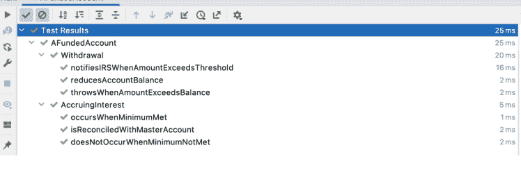

你可以清晰地看到相关测试的分组，这更容易找到你正在寻找的内容。视觉分组也更容易发现必要的测试的明显缺失，或者对其进行一致性审查——与其他测试一致，或与你团队的测试命名标准一致。

我在每个 `@Before` 方法、`@Test` 方法和 `@Nested` 方法中都添加了 `System.out` 语句。以下是测试运行时的输出：

```
@BeforeAll::clearAccountRegistry
AFundedAccount
WithWithdrawal
@BeforeEach::fundAccount
notifiesIRSAmountExceedsThreshold
AFundedAccount
WithWithdrawal
@BeforeEach::fundAccount
reducesAccountBalance
AFundedAccount
WithWithdrawal
@BeforeEach::fundAccount
throwsAmountExceedsBalance
AFundedAccount
WithZeroBalance
@BeforeEach::fundAccount
doesNotAccrueInterest
AFundedAccount
WithZeroBalance
@BeforeEach::fundAccount
throwsOnWithdrawal
AFundedAccount
WithPositiveBalance
@BeforeEach::fundAccount
accruesInterest
AFundedAccount
WithPositiveBalance
@BeforeEach::fundAccount
reducesBalanceOnWithdrawal
AFundedAccount
AccruingInterest
@BeforeEach::fundAccount
@BeforeEach::setInterestRate
occursWhenMinimumMet
AFundedAccount
AccruingInterest
@BeforeEach::setInterestRate
doesNotOccurWhenMinimumMet
```

静态的 `@BeforeAll` 方法首先执行。

输出显示每个测试都会创建一个新的 `AFundedAccount` 实例。它还显示账户如预期地初始化为零余额。

为每个测试创建新实例是 JUnit 设计的一部分。它确保每个测试都与其他测试可能创建的副作用隔离开。

> JUnit 为每个测试方法创建测试类的新实例。

位于 `AFundedAccount` 顶层作用域的 `@BeforeEach` 方法 `fundAccount` 在每个测试之前执行。

在 `AccruingInterest` 作用域内的 `@BeforeEach` 方法 `setInterestRate` 在每个三个测试之前执行。

## 避免依赖绝望：不要为测试排序！

JUnit 测试并不是按照声明（从上到下）顺序运行的。事实上，它们并不是按照任何你容易确定或依赖的顺序运行，例如字母顺序（它们可能按 `getClass()` 返回的顺序返回）。

你可能认为测试是按特定顺序运行的：“我正在编写一个关于新创建账户的测试，它们的余额为零。第二个测试可以向账户添加 100，我可以验证该金额。然后我可以添加第三个运行的测试，在其中将存入 50 并确保新余额为 150。”

虽然 JUnit 5 提供了一种强制执行顺序的方法，但用于单元测试是一个坏主意。依赖测试顺序可能帮助你避免在多个测试用例中重复测试通用设置。但它通常会引导你走向浪费时间的道路。例如，你正在运行测试，第四个测试失败了。是因为生产代码中的真实问题吗？还是因为之前的三个测试之一（哪一个？）将系统留在了新的意想不到的状态？

有了顺序的测试，你也将更难理解任何依赖于其他测试的测试。增加依赖在测试中的代价与在生产代码中一样高。

> 单元测试应该验证隔离的代码单元，并且不依赖于任何执行顺序。

与其通过强制测试顺序来头疼，不如使用 `@BeforeEach` 来减少通用初始化的重复。你还可以提取辅助方法以减少冗余并提高你测试的抽象层次。

## 使用参数化测试执行多个数据用例

你系统的许多行为都需要多个不同的测试用例。例如，在处理从“零到一到多”的演进过程中，你通常会得到至少三个测试。

定义独立的测试方法允许你在测试中显式地总结它们各自不同的存储逻辑：

```
storesEmptyStringWhenEmpty
storesInputWhenContainingOneElement
storesCommaSeparatedStringWhenContainingManyElements
```

通常情况下，这三个测试用例的结构完全相同——其中所有的语句都是相同的，但输入和预期的输出数据不同。如果这让你感到困扰，可以通过类似的辅助方法和 `@BeforeEach` 来简化这些测试中的冗余内容。

有时，当测试之间存在冗余时，你可能并不兴趣如何将它们区分开。例如，假设你有一个为将阿拉伯数字转换为罗马数字的代码编写的测试：

```
ut3-junit-01/src/main/java/util/RomanNumberConverter.java
public class RomanNumberConverter {
    record Digit(int arabic
```

```
return new Digit(
acc.arabic - digitsRequired * conversion.arabic,
acc.roman + conversion.roman.repeat(digitsRequired));
}
```

算法和行为都没有根据输入的变化而改变。无论你将其编码为独立的 JUnit 测试，测试名称之间会有有用的区分：

```
ut3-junit-01/src/test/java/util/ARomanNumberConverter.Test;
import org.junit.jupiter.api.Test;
import static org.junit.jupiter.api.Assertions.assertEquals;
class ARomanNumberConverter {
RomanNumberConverter converter = new RomanNumberConverter();
@Test
void convertsOne() {
assertEquals("I", converter.toRoman(1));
}
@Test
void convertsTwo() {
assertEquals("II", converter.toRoman(2));
}
@Test
void convertsThree() {
assertEquals("III", converter.toRoman(3));
}
// ... 如此如此！
}
```

为每个情况创建单独测试是非常麻烦的，而且它们的名称并没有什么太大价值。你可以将它们全部合并到一个测试方法中，但这样各个用例就无法相互隔离。

幸运的是，JUnit 支持一种名为参数化测试的特殊测试形式。你可以通过 `@ParameterizedTest` 代替 `@Test` 标记你的测试方法来创建参数化测试。你必须提供一个数据源，它本质上是一个数据行列表。对于每一行数据，JUnit 会将该行数据作为参数调用测试方法。

`RomanNumberConverter` 的参数化测试方法需要两个信息：传递给 `toRoman` 方法的阿拉伯数字，以及在 `assertEquals` 语句中使用的预期罗马数字。你可以使用 `@CsvSource` 为测试提供数据行；每行都是一个 CSV（逗号分隔值）字符串。

## 使用参数化测试执行多个数据用例 · 133

这里是 `RomanNumberConverter` 的一个参数化测试：

```
ut3-junit/01/src/test/java/util/ARomanNumberConverter.java
@ParameterizedTest
@CsvSource({
  "1", "I",
  "2", "II",
  "3", "III",
  "10", "X",
  "20", "XX",
  "11", "XI",
  "200", "CC",
  "732", "DCCXXX",
  "2275", "MMCCLV",
  "999", "CMCIX",
  "444", "CDXLIV"
});
void convertAll(int arabic, String roman) {
  assertEquals(roman, converter.toRoman(arabic));
}
```

`@CsvSource` 中的第一行数据（高亮处）包含 CSV 字符串 `"1", "I"`。JUnit 根据逗号分割此字符串并修剪生成的值。它将这些值——数字 1 和字符串 "I"—传递给另一个测试方法（高亮处）。

JUnit 获取 CSV 值并从左到右将它们作为测试方法的参数。当执行测试方法时，`arabic` 参数（由 JUnit 将其转换为 `int`）和 `"I"` 被分配给 `String roman` 参数。

由于示例显示的是 CSV 数据行，JUnit 将运行 `convertAll` 十一次。IntelliJ 显示了这十一个用例中每个例的参数：

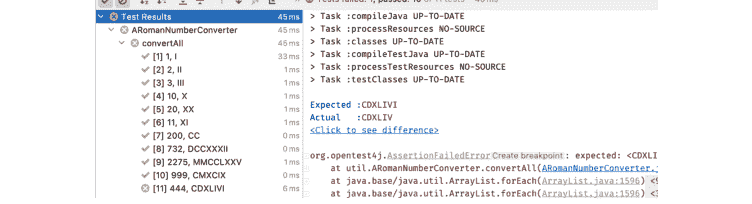

注意 JUnit 文档²（特别指定）的情况：

JUnit 文档更详细地说明了各种数据源机制。

- 2. https://junit.org/junit/5/docs/current/user-guide/#writing-tests-parameterized-tests-sources

## 第 6 章.在 JUnit 测试中建立组织结构 • 134

## 以下是快速总结：

- `@ValueSource` 单个值数组。仅当你的测试接收一个参数时才有用（这意味着对于每个源值，预期结果都是相同的）。

- `@EnumSource` 迭代所有可能的枚举值，并提供某些包含/排除选项和正则表达式匹配。

- `@MethodSource` 期望方法名，该方法必须在流中返回所有数据。

- `@CsvSource` 与 `@CsvFileSource` 基本相同，不同之处在于你可以指定一个包含 CSV 行的文件。

- `@ArgumentsSource` 允许你在扩展了 `ArgumentsProvider` 接口的类中创建自定义且可重用的数据源。

虽然 JUnit 中的参数化测试是复杂且灵活的工具，但 `@CsvSource` 将满足你的大部分需求。我从未需要其他数据源变体。

在大多数系统中，你会拥有成百上千的单元测试。你希望通过利用一些 JUnit 特性（包括生命周期方法、嵌套类和参数化测试）来降低维护成本。这些功能允许你减少冗余代码并运行。

现在你已经学习了如何更好地组织测试，在下一章中，你将深入研究执行测试的主题。你将学习运行测试子集以及如何临时禁用测试。

## 第 7 章

## 执行 JUnit 测试

你之前在书的范围内学习了断言、测试组织和 JUnit 执行生命周期。

拥有所有的测试，如果不运行它们也是毫无用处的。你希望像目前在自己的机器上构建软件一样频繁运行测试。但你还希望在部署软件之前运行测试，例如作为持续过程的一部分。

在本章中，你将学习运行测试的“何时”、“什么”以及更多关于“如何”：

- 执行 JUnit 时想要运行的单元测试

- 使用 JUnit `@Tag` 注解对测试分组，以便执行任意组

- 使用 `@Disabled` 注解临时不运行测试

## 测试习惯：运行哪些测试

全功能 Java IDE（例如 IntelliJ 或 Eclipse）内置 JUnit。开箱即用，你可以加载项目、点击其测试目录并执行测试，无需配置。在接下来的章节中，你将看到测试数量如何影响结果。

## 运行所有测试

如果你的测试很快（快速测试，见第 66 页），你可以在几秒内运行数千个单元测试。当你破坏了其他地方的代码时，你会立即知道。快速测试提供了鼓舞人心的。

## 运行尽可能多的测试

- 一次。假设你正在为 `AFundedAccount` 类添加测试 `nameMSAlertOnWithdrawal`。在 `AFundedAccount` 中仅运行此数量测试的问题是，它没有验证 `Account` 类中潜在相关的行为。当你开始更改 `Account` 以支持新的短信行为时，可能会破坏这些其他行为。

类的更改可能会破坏其他类的测试。`Account` 的行为由 `AnAccount` 和 `AFundedAccount` 中的测试验证。如果所有可能受影响的测试类都在同一个包中，请进一步。

运行该包中的所有测试。如果运行该包中的所有测试太慢，我有一个同样的直率建议：修复问题。

> 尽可能多地运行你能忍受的测试，尽可能频繁地运行你能忍受的。

如果你习惯于一次只运行一个测试，你最终会在比预期更晚的时候发现其他缺陷。唯一你应该运行单个测试的时候，是你正费力让它通过，并发现自己正处于调试模式或正在使用 `System.out.println` 语句来追踪发生的情况。此时，多个运行时测试将使你难以集中在有问题的测试上。

## 使用标签创建任意测试组

JUnit 5 允许你使用 `@Tag` 注解对测试或测试方法进行标记。

你可以将这些标签作为使用 JUnit 运行任意测试集的依据。这被称为对你的测试进行过滤。

让我们来看一个例子。在对 `Account` 类进行更改时，你应该运行 `Account` 和 `AnFundedAccount` 中的所有测试。你可以运行包含这些类的包中的所有测试，但你也可以使用标签来精确指定要运行的测试子集。

在这两个类上都标记 `@Tag` 注解：


ut3-junit/01/src/test/java/tags/AnAccount.java
```java
import org.junit.jupiter.api.Tag;
import org.junit.jupiter.api.Test;
// ...

@Tag("account")
class AnAccount {
  // ...

  @Test
  void withdrawalReducesAccountBalance() {
    // ...
  }
}
```

ut3-junit/01/src/test/java/tags/AnFundedAccount.java
```java
import org.junit.jupiter.api.Tag;
import org.junit.jupiter.api.Test;
// ...
```

```java
@Tag("account")
class AnUnfundedAccount {
  // ...

  @Test
  void hasPositiveBalanceAfterInitialDeposit() {
    // ...
  }
  // ...
}
```

要运行这两个已标记的类中的测试，你必须为 JUnit 提供一个过滤器。你的 IDE 可能允许你在运行测试时直接执行此操作。如果你正在使用 Maven 或 Gradle，这两个工具都提供了对指定过滤器的直接支持。在最坏的情况下，你可以作为独立命令运行 JUnit 并在那时提供过滤器。

访问 JUnit 的运行测试文档，以获取有关在 Maven、Gradle 或命令行 JUnit 中使用标签的更多信息。

## 在 IntelliJ IDEA 中使用标签

在 IntelliJ IDEA 中，你可以在 `Run/Debug Configurations` 对话框中配置测试如何运行。

从 IDEA 的主菜单，通过选择 `Run` > `Edit Configurations` 进入 `Run/Debug Configurations` 对话框。在 `Run/Configurations` 对话框中，点击 `+` 按钮添加新配置。IDEA 提供了一个名为 `New Configuration` 的下拉列表：从其长选项列表中选择 `JUnit`。

对话框默认运行单个类中的测试；你需要更改它以告诉 JUnit 运行一个标签。在对话框的 `Build` and `run` 部分中，你应该能看到一个当前选中为 `Class` 的下拉列表。改为从该下拉列表中选择 `Tags`。在下拉列表右侧的输入框中，输入文本 `account` 作为要执行的标签。此文本必须与你在 `@Tag` 声明中指定的“account”字符串匹配。

你的对话框看起来应该与第 139 页的图相似。

> 指定 `ut3-junit` 为类路径 (`-cp`) 可能会产生错误。确保你已选择 `ut3-junit.test`。

- 1. https://junit.org/junit5/docs/current/user-guide/#running-tests

## 使用标签创建任意测试组 · 139

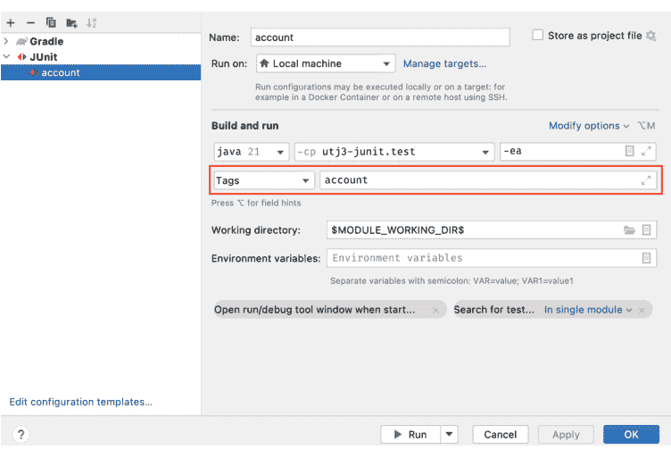

你现在可以点击 `Apply` 然后点击 `Run` 来仅执行标记为“account”标签的测试。

## 标签表达式

IDEA 支持*标签表达式*（tag expressions），这是允许更复杂过滤的布尔表达式。

除了标记两个账户相关的测试类外，假设你还想运行与发现的缺陷的热修复相关的测试集。你可能标记了单个测试方法：

ut3-junit/01/src/test/java/tags/AnInMemoryDatabase.java
```java
import org.junit.jupiter.api.Tag;
import org.junit.jupiter.api.Test;

class AnInMemoryDatabase {
  // ...
  @Tag("v1.1_defects")
  @Test
  void objectCopiedWhenAddedToDatabaseFailing() {
    // ...
  }
  // ...
}
```

报告错误 • 讨论

在你的运行配置中指定标签时，你可以输入以下标签表达式：

`account | v1.1_defects`

`|` (或) 运算符表示 JUnit 应该运行标记为“account”的测试与标记为“v1.1_defects”的测试并集。具体来说，JUnit 将运行 `AnAccount` 和 `AnFundedAccount` 中的测试，以及名为 `objectCopiedAddedToDatabaseF` 的测试。

标签表达式支持 `!` (非) 运算符反转过滤器，并使用 `&` (与) 运算符运行两个标签的交集。它们还允许使用括号来澄清或强制运算符的优先级。

## 过度使用标签

与其他任何事情一样，过度使用标签功能可能是某些其他问题的迹象。

如果你发现你使用了或多是永久的名称标签（如 `account`）

# 使用 @Disabled 临时禁用测试

有时，你需要阻止特定的测试执行，通常是因为它失败了。也许你现在没有时间修复它，并想优先关注让其他测试通过——在此期间，其他测试失败将成为干扰。

你可能还有其他正当避免运行某些测试。也许你正在等待业务部门对特定单元行为的回答。

当然你可以临时注释掉测试，但更好的答案是使用 `@Disabled` 注解标记问题所在测试。JUnit 将跳过任何标记的测试方法。你同样可以将一个测试类标记为 `@Disabled`，在这种情况下 JUnit 将不会运行其任何测试方法。

使用 `@Disabled` 是跳过测试的更好方法，因为 JUnit 可以提醒你某些测试正在等待你重访。如果你注释掉测试，JUnit 就无法提醒你，在这种情况下你的测试可能永远处于悬空状态。（这是破坏测试的一种方法）。

# ut3-junit/01/src/test/java/scratch/AnUnFundedAccount.java

```java
import org.junit.jupiter.api.Disabled;
import org.junit.jupiter.api.Test;

class AnUnFundedAccount {
    @Disabled
    @Test
    void disallowsals() {
        // ...
    }

    @Test
    void doesNotAccrue() {
        // ...
    }
}
```

`@Disabled` 提供的信息字符串是可选的。在某些情况下，你应该使用它来描述为什么禁用了测试：

`@Disabled("修复后明天")`

在代码库中集成禁用测试通常是坏习惯。你使用的 JUnit 运行器，无论是内置在 IDE 中还是你的构建工具（如 Gradle 或 Maven），都应该明确表示某些测试被禁用了。在以下情况下，测试 `disallowsals` 标记了“符号”：

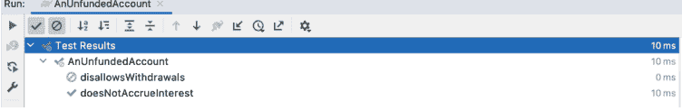

我很感激它提醒你留下了测试。

Gradle 是在持续构建环境中构建和运行测试的极佳方法。但在交互式 中运行测试时，除非你自定义输出，否则不要显示禁用测试。

禁用测试不应该出现在任何其他地方。避免集成禁用测试——它们通常代表了关于系统健康的大问题：这个测试还需要吗？我们可以直接删除它吗？在 20 多年前，这是一个相当大且复杂的工具。你在本章中学习的功能可能足够满足你几年的需求。然而，可能 JUnit 的其他功能对你的特殊情况也有用。这里有一个快速总结：

- 假设 (assumptions) 如果假设不满足，则中止测试执行（但不计为失败）
- 条件测试 (conditional test) 根据条件启用或禁用测试。条件可以引用操作系统、架构、Java 版本、系统属性/环境变量的值或自定义代码谓词。
- 显示名称 (display names) 在测试运行期间与其显示（通常是）驼峰的测试名称，不如显示字符串的内容。名称生成器 (display name generators) 通过转换测试方法名称生成更具可读性的测试名称。例如，将测试名称中的下划线转换为空格。
- 动态测试 (dynamic tests) 在运行时生成测试。
- 并发执行 (parallel execution) 同时运行测试以加快执行。
- 重复测试 (repeated tests) 按指定的次数运行测试。
- 套 (suites) 程序化地声明要执行的过滤测试集。
- 临时目录 (temp dir) 在临时目录下执行文件依赖测试。
- 超时 (timeouts) 如果测试（或生命周期方法）执行时间超过特定持续则失败。

遗憾的是，默认情况下使用 Gradle 在命令行运行测试时，只有当至少有一个测试失败时，它才会 true你存在禁用测试。而且只有当你向上滚动 Gradle 输出时才能看到。让它在存在禁用测试时导致测试运行失败，或者作为最后一行显示它们的数量。

## 总结

在本章以及之前的两章（深入探讨了 JUnit 的章节）中，你已经学习了编写断言、组织测试和运行测试所需的大部分知识。

有了 JUnit 的这一坚实基础，你可以转向更重要的问题了。在书的后续部分，你将关注测试以及它们与系统设计之间的关系。你将在“局部”上重构代码，因为你有测试提供了进行此类构操作的信心。你还将触及更宏大的设计概念，并学习如何设计测试以提高你的投资回报率（ROI）。

# 第三部分

# 提高回报率：单元测试与设计

将你的单元测试提升到不仅仅是逻辑验证的高度。在这一部分，学习如何使用测试来维护整洁的代码——无论是“局部”还是“宏观”——并记录你系统的单元能力。

## 第 8 章

## 重构为更整洁的代码

在第一、第二部分中，你深入研究了如何编写单元测试以及如何利用 JUnit。在这一部分，你将学习如何利用单元测试来帮助构建系统设计，并记录你所做的许多单元级行为选择。你保持系统更简单、测试更清晰的能力可以显著降低开发成本。

你将从关注“局部”设计开始，解决大多数系统中常见的缺乏清晰度和过度复杂性的问题。你将通过学习重构来实现这一点——即对你编写的代码进行小而频繁的编辑。你的设计改进将有助于降低变更成本。

在一个清晰、设计良好的系统中，定位一个变更点并理解周围的代码可能只需要几秒钟。在一个更典型的复杂的系统中，导航和理解任务通常需要几分钟。一旦你对代码有了足够的理解并进行更改，一个设计良好的系统可能会从容地接纳你的更改。而在复杂的系统中，编入你的更改可能需要几个小时。

复杂的系统可能会让你的维护成本增加一个数量级甚至更多。

你可以相对轻松地创建体现整洁代码的系统。简而言之，这就是整洁代码的描述：

- 简洁：它传达解决方案而不包含多余的代码。
- 清晰：它可以被直接理解。
- 高内聚：它将相关概念组合在一起，并将不相关的概念隔离开。
- 可验证：它可以被测试轻松验证。

你的单元测试为你提供了整洁代码的这最后一个维度。

# 一点重构

重构是一个华丽的说法，表示你正在转换代码的底层结构——其实现细节——同时保留其现有的功能行为。由于重构涉及重塑和移动代码，你必须确保系统在这些操作后仍然运行。单元测试是做到这一点最便宜、最快的方法。

重构之于编码正如编辑之于写作。即使是最好的（说明性）作家会对他们写的大部分句子进行编辑，以便读者一目了然。编码也不一样。一旦你在编辑器中捕获了一个解决方案，你的代码本身就会比必要的更难理解。

作者遵循“为自己也为他人写作”的心态。作为程序员做到这一点，首先要以符合你逻辑的方式编写解决方案。然后，考虑在未来某时刻必须回顾你代码的同事。在你现在对代码还有思路时，重构你的代码，现在提供一个更清晰的解决方案。

> 代码分两步走：首先，在正确的解决方案中记录你的想法；其次，为他人明确你的解决方案。


信心是重构时的关键考虑因素。如果没有单元测试提供的信心，你会在“修复”已经运行良好的代码时非常谨慎。事实上，如果没有单元测试，你可能会想：“它没坏，别修它。”你的代码在生命之初将是未经编辑的——带有缺陷的——并随着每次更改而变得越来越糟。

然而，如果你遵循了书中的建议，你就可以随心所欲地更改。如果你为一个方法想了一个新名字，一个更有意义的名字？重命名它（在良好的 IDE 中需要十秒钟；否则可能需要几分钟），运行测试，并在几秒钟后确认没有东西损坏。方法太长且难以理解？将其一个部分提取到新方法中，然后运行测试。方法位置不对？移动它，运行测试。你可以整天对代码库进行微小改进，使其更易于处理（成本更低）。

# 重构的机会

你将清理的是一个来自 iloveybous 的代码（尽管是不同的版本）。请参阅第 80 页的“加剧线程问题”以概述该应用程序。查看 iloveybous 中的 `Profile` 类：

ut3-refactor/01/src/main/java/iloveybous/Profile.java
```java
import java.util.*;
import static iloveybous.Weight.*;
public class Profile {
    private final Map<String, Answer> answers = new HashMap<>();
    private final String name;
    private int score;
    public Profile(String name) { this.name = name; }
    public void addAnswer(Answer... newAnswers) {
        for (var answer : newAnswers) {
            answers.put(answer.questionText(), answer);
        }
    }
    public boolean matches(Criteria criteria) {
        var score = 0;
        var kill = false;
        var anyMatches = false;
        for (var criterion : criteria) {
            var answer = answers.get(criterion.answer()).questionText();
            var match = criterion.weight(answer).criterion.weight() == IRRELEVANT ||
                answer.match(criterion.answer());
            if (!match && criterion.weight() == REQUIRED) {
                kill = true;
            }
            if (match) {
                score += criterion.weight().value();
            }
            anyMatches |= match;
        }
        if (kill) {
            return false;
        }
        return anyMatches;
    }
    public int score() { return score; }
    @Override
    public String toString() { return name; }
}
```

该类提供了核心功能的开端。`Profile` 由潜在员工对公司提出的问题的答案组成：提供奖金吗？招工人吗？会帮我洗狗吗？它通过 `matches` 方法暴露了匹配功能。`matches` 方法接收一个包含潜在员工可能拥有的的答案的 `Criteria` 对象。

`matches` 方法并不长，大约十二行表达式和逻辑语句。它相当密集，需要仔细的逐步阅读。花一点时间查看 `matches`，弄清楚它是做什么的。

充分测试该类的行为需要七个测试：


# 提取方法：你的第二优重构拍档

在本节标题让你想要去翻阅索引之前，你最好的重构伙伴是“重命名”，无论是类、方法还是变量。清晰度在很大程度上取决于意图的声明，而良好的命名是赋予代码清晰度的关键。

你的目标是：降低 `matches` 方法的复杂度，以便你能轻松地理解它的职责。该方法目前是一个臃肿的代码块，掩盖了所需的整体步骤——其算法或策略。你将通过从逻辑中提取详细片段并到独立的方法中，将代码从“实现细节”转变为“清晰的声明”。

条件表达式的可读性通常不好，特别是当它们很复杂时。例如，`matches` 方法中 `for` 循环上方的匹配赋值语句如下：

```
utj3-refactor/01/src/main/java/iloveybouss/Profile.java
public boolean matches(Criteria criteria) {
    // ...
    for (var criterion: criteria) {
        var answer = answers.get(criterion.answer().questionText());
        var match = criterion.weight() == IRRELEVANT ||
            answer.match(criterion.answer());
        // ...
    }
}
```

赋值语句的右侧似乎定义了何时存在匹配。具体来说，它表示当标准是无关的（`IRRELEVANT`），或者该标准的答案与配置中对应的答案匹配时，就存在匹配。通过将其提取到命名为 `isMatch` 的独立方法中隔离这种复杂度。在 IntelliJ IDEA 中，通过以下方法密集型步骤提取方法：

1. 高亮显示适当的代码。
2. 打开上下文菜单（通过右键点击）。
3. 从菜单中选择 Refactor Extract Method（提取方法）。
4. 为新方法输入名称（或接受建议的名称）。
5. 按回车键。

IntelliJ 会创建一个包含高亮代码的方法，并用对新方法的调用替换高亮代码。

在提取 `isMatch` 后，你在 `matches` 中留下了一个简单的声明，并在 `Profile` 类中留下了一个简短的辅助方法：

```
utj3-refactor/02/src/main/java/iloveybouss/Profile.java
for (var criterion: criteria) {
    var answer = answers.get(criterion.answer().questionText());
    // ...
}
```

```
utj3-refactor/02/src/main/java/iloveybouss/Profile.java
private boolean isMatch(Criterion criterion, Answer answer) {
    return criterion.weight() == IRRELEVANT ||
    answer.match(criterion.answer());
}
```

提取 `isMatch` 后，你现在 `matches` 中留下了一个简单的声明，并在 `Profile` 类中有一个简短的辅助方法：

> 在每次小改动后，运行测试以确保它们通过。安全移动代码的能力是单元测试最重要的益处之一。在缺乏足够测试的情况下，你会倾向于进行风险更改。

# 为你的方法寻找更好的家

你的循环变得更容易读了！但新提取的 `isMatch` 方法与 `Profile` 对象本身无关——它与 `Answer` 和 `Criterion` 对象交互。这两个类中的一个可能是更好的位置。

目标的第一步是将表达式 `criterion.answer().questionText()` 提取到一个名为 `questionText` 的新方法：

```
utj3-refactor/04/src/main/java/iloveybouss/Profile.java
public boolean matches(Criteria criteria) {
    // ...
```

```java
for (var criterion: criteria) {
  var answer = answers.get(questionText(criterion));
  // ...
}
// ...
```

```java
private String questionText(Criterion criterion) {
  return criterion.answer().questionText();
}
```

现在将 `questionText` 移动到 `Criterion` 类。如果你通过 IDEA 的自动化重构支持进行移动，请选择 `Criterion criterion` 作为实例表达式。

该方法从 `Profile` 中消失。赋值给 `answer` 变量的表达式不再需要方法链调用：

```java
utj3-refactor/05/src/main/java/iloveybouss/Profile.java
// public boolean matches(Criteria criteria) {
  for (var criterion: criteria) {
    var answer = answers.get(criterion.questionText());
    // ...
}
```

`Criterion` 现在负责检索并返回问题文本：

```java
utj3-refactor/05/src/main/java/iloveybouss/Criterion.java
import static iloveybouss.Weight.IRRELEVANT
public record Criterion(Answer answer, Weight weight) {
  // ...
  String questionText() {
    return answer().questionText();
  }
}
```

接下来，将 `answer` 赋值的右侧提取到一个方法中，以解释该答案代表什么：

```java
utj3-refactor/06/src/main/java/iloveybouss/Profile.java
public boolean matches(Criteria criteria) {
  // ...
  for (var criterion: criteria) {
    var answer = profileAnswerMatching(criterion);
    var match = criterion.isMatch(answer);
    // ...
  }
}
```

```java
private Answer profileAnswerMatching(Criterion criterion) {
  return answers.get(criterion.questionText());
}
```

每一个提取出的方法都在一点点增加 `matches` 的简洁性。为新方法使用意图清晰的命名可以增加 `matches` 的清晰度。新方法还代表了将责任移动到它们所属位置的机会。`Profile` 变得更加简单，而之前空空的 `Criterion` 则变得更有用了。

# 价值较小的临时变量

临时变量（'temps'）有许多用途。它们可以缓存昂贵计算的结果或在方法体中发生变化的集合。方法还可以明确代码的意图——如果它只使用一次，那么这是一个有效的选择。

在 `matches` 中，`answer` 变量没有提供上述三个优点之一。你可以通过将它的出现处替换为 `answerMatching(criterion)` 表达式来内联这种意义的操作。在 IntelliJ IDEA 中，按照以下步骤内联变量：

1. 点击它的名称。
2. 打开上下文菜单（通过右键）。
3. 从赋值处选择 重构 ► 内联变量 (Inline Variable)。

对该变量的所有引用都被替换为赋值的右侧部分。赋值语句消失了：

```java
utj3-refactor/07/src/main/java/iloveyouboss/Profile.java
public boolean matches(Criteria criteria) {
  for (var criterion: criteria) {
    var match = criterion.isMatch(profileAnswerMatching(criterion));
    // ...
  }
  // ...
}
```

可以直接理解 `match` 的真实意图。换句话之：当 `criterion` 匹配对应的个人答案时，即存在一个 `match`。

# 通过自动化重构加速

当然，你可以手动执行此操作或任何其他重构，通过剪切粘贴小段代码直到达到相同结果。但一旦你学会了优秀的 IDE 执行工作速度至少比手动操作快十倍，那么不充分利用这种力量就没什么意义了。

更重要的是，你可以相信（至少在 Java 中）自动化重构通常不会破坏代码。相比于手动重构，你出错的可能性大得多。Java 自动化重构是在各种意义上都已证明过的代码转换。

你可以通过使用每个自动化重构的快捷键来进一步加速，而不是点击菜单和对话框。在整个开发过程中，你会发现少数几个核心自动化重构很有用：引入变量/常量/字段/参数、提取方法、内联方法、内联变量、移动方法和更改签名。你很快就能记住相应的快捷键。你可以将重构操作时间从 10 秒或更久（点击 UI）或几分钟（手动）缩短到大约三到四秒。

你很幸运：20 年前，大多数 Java 程序员以极不安全的方式手动移动代码。30 年前，自动化重构工具还不存在。今天，它们赋予的力量和速度是无法估量的。你可以看着电脑做脏活，并知道你的代码仍然运行。

# 放大代码的核心意图

让我们重新审视稍微改进过的 `matches.java`：


```java
ut3-refactor/07/src/main/java/iloveybouss/Profile.java
public boolean matches(Criteria criteria) {
    int score = 0;
    var kill = false;
    var anyMatches = false;
    for (var criterion: criteria) {
        var match = criterion.isMatch(profileAnswerMatching(criterion));
        if (match && criterion.weight() == REQUIRED) {
            kill = true;
        }
        if (match) {
            score += criterion.weight().value();
        }
        anyMatches |= match;
    }
    if (kill) {
        return false;
    }
    return anyMatches;
}
```

仔细阅读揭示了以下结果：

- 如果任何 `criterion` 匹配则返回 true，如果无匹配则返回 false。
- 通过累加匹配 `criterion` 的权重来计算分数。
- 当必需的 `criterion` 不匹配个人答案时返回 false。

### 提取概念：是否存在匹配？

对是否存在匹配的判断散落在整个方法中。它涉及到局部变量 `anyMatches`：

```java
ut3-refactor/08/src/main/java/iloveybouss/Profile.java
public boolean matches(Criteria criteria) {
    score = 0;
    var kill = false;
    var anyMatches = false;
    for (var criterion: criteria) {
      var match = criterion.isMatch(profileAnswerMatching(criterion));
      if (match && criterion.weight() == REQUIRED) {
        kill = true;
      }
      if (match) {
        score += criterion.weight().value();
      }
      anyMatches |= match;
    }
    if (kill) {
      return false;
    }
    return anyMatches;
}
```

你的目标是：将所有与该判断相关的逻辑移动到它自己的方法中。步骤如下：

1. 将返回语句更改为调用新方法 `anyMatches()` 的结果。
2. 创建一个返回布尔值的新方法 `anyMatches`。
3. 复制（而不是剪切）相关逻辑到新方法中。

结果：

```java
ut3-refactor/09/src/main/java/iloveybouss/Profile.java
public boolean matches(Criteria criteria) {
    score = 0;
    var kill = false;
    var anyMatches = false;
    for (var criterion: criteria) {
      var match = criterion.isMatch(profileAnswerMatching(criterion));
      if (match && criterion.weight() == REQUIRED) {
        kill = true;
      }
      if (match) {
        score += criterion.weight().value();
      }
      anyMatches |= match;
    }
    if (kill) {
      return false;
    }
    return anyMatches(criteria);
}
```

```java
private boolean anyMatches(Criteria criteria) {
  var anyMatches = false;
  for (var criterion: criteria) {
    var match = criterion.isMatch(profileAnswerMatching(criterion));
    anyMatches |= match;
  }
  return anyMatches;
}
```

这种更改没有自动化重构可用。你正在进行风险更大的手动更改，所以请运行你的测试！一旦通过，删除 `matches` 中引用 `anyMatches` 变量的代码行：

```java
ut3-refactor/10/src/main/java/iloveyouboss/Profile.java
public boolean matches(Criteria criteria) {
  score = 0;
  var kill = false;
  for (var criterion: criteria) {
    var match = criterion.isMatch(profileAnswerMatching(criterion));
    if (match && criterion.weight() == REQUIRED) {
      kill = true;
    }
    if (match) {
      score += criterion.weight().value();
    }
  }
  if (kill) {
    return false;
  }
  return anyMatches(criteria);
}
```

循环当然必须保留，给 `match` 变量赋值的行代码也必须保留。

你可能在担心方法提取及其对性能的影响。我们会讨论这一点。

## 提取概念：为匹配项计算分数

现在你已经通过将 `anyMatches` 逻辑提取到新方法中，你也可以对计算分数的代码进行同样的操作。然而，如果你将 `calculateScore` 的调用移动到 `if (kill) return false` 之后，测试将会失败。（在任何未满足的条件导致方法中断之前，必须计算分数）。

```java
ut3-refactor/11/src/main/java/iloveyouboss/Profile.java
public boolean matches(Criteria criteria) {
    calculateScore(criteria);
    var kill = false;
    for (var criterion : criteria) {
        var match = criterion.isMatch(profileAnswerMatching(criterion));
        if (!match && criterion.weight() == REQUIRED) {
            kill = true;
        }
    }
    if (kill) {
        return false;
    }
    return anyMatches(criteria);
}

private void calculateScore(Criteria criteria) {
    score = 0;
    for (var criterion : criteria) {
        var match = criterion.isMatch(profileAnswerMatching(criterion));
        if (match) {
            score += criterion.weight().value();
        }
    }
}
```

嗯。你可能在怀疑自己正在制造性能问题。

## 提取概念：未满足必要条件时返回 false

保留在循环中的代码在配置不符合必要条件时会中断执行并返回 `false`。同样，将此逻辑提取到新方法 `anyRequiredCriteriaNotMet`：

```java
ut3-refactor/12/src/main/java/iloveyouboss/Profile.java
public boolean matches(Criteria criteria) {
    calculateScore(criteria);
    var kill = anyRequiredCriteriaNotMet(criteria);
    if (kill) {
        return false;
    }
    return anyMatches(criteria);
}

private boolean anyRequiredCriteriaNotMet(Criteria criteria) {
    var kill = false;
    for (var criterion: criteria) {
        var match = criterion.isMatch(profileAnswerMatching(criterion));
        if (!match && criterion.weight() == REQUIRED) {
            kill = true;
        }
    }
    return kill;
}
```

`matches` 现在只有五行代码，而且非常易理解！但仍然存在一些清理工作，特别是在三个新提取的方法中。其中，这些循环都是传统的 `for-each` 循环。在我们处理了房间里的“性能大象”之后，你会清理这些问题。

`matches` 的实现现在涉及分布在三个方法中的三个循环，而不是遍历 `criteria` 的单个循环。这对比你来说可能看起来很可怕。我们会回过头讨论性能的影响；现在，让我们谈谈新设计带来的益处。

早些时候，你投入了一些时间仔细阅读原始代码以理解它的三个意图。贯穿始终的布尔逻辑在过程中产生了产生困惑的机会。现在，`matches`（几乎）直接陈述了方法的层级目标。

算法三个步骤中每个步骤的实现细节都隐藏在相应的辅助方法 `calculateScore`、`anyRequiredCriteriaNotMet` 和 `anyMatches` 中。每个辅助方法允许以简洁、隔离的方式表达必要的行为，而不会被其他关注点混杂。

## 你在开玩笑吗？解决对性能的担忧

到此时，你可能会感到有些困扰。在重构方法后，`anyMatches`、`calculateScore` 和 `anyRequiredCriteriaNotMet` 的每一个都遍历了 `criterion` 集合。你的代码现在循环了三次而不是一次。你可能将 `matches` 的执行时间增加了三倍。

你是真的遇到了一个与实际需求相关的性能问题，还是仅仅怀疑存在问题？许多程序员会推测性能问题可能在哪里，以及最佳解决方案是什么。遗憾的是，这种推测可能是完全错误的。


解决任何潜在性能问题的第一个答案是测量。如果理解性能特性是一个普遍且关键的关注点，你希望从端到端功能的角度（更整体地）进行分析，而不是在单个单元或方法的性能层面。（你最终仍会缩小到少数几个需要修复的方法。）对于这种需求，你可能需要一个像 JMeter 这样的工具。你也可以引入 JUnitPerf²，它允许你使用 JUnit 编写测试。

如果你对单个单元的性能偶尔表示担忧，可以创建几个“自力更生”的性能探针。只要你的结论足够谨慎，它们就能满足你的需求。

在 JUnit 测试上下文中以下代码（尽管它没有断言且目前还不是测试）显示了经过的毫秒数。探针创建了一个包含 20 个问题的 `Criteria` 对象。它循环了一百万次。每次循环创建一个新的 `Profile`，为这 20 个问题添加随机答案，然后确定该 `profile` 是否符合标准。

```java
ut3-refactor/sc12/test/java/iloveyouboss/AProfilePerformance.java
import org.junit.Test;
import java.util.List;
import java.util.Random;
import java.util.concurrent.atomic.AtomicInteger;
import java.util.function.Consumer;
import static iloveyouboss.YesNo.*;
import static java.util.stream.IntStream.range;

class AProfilePerformance {
  int setCount = 20;
  Random random = new Random();

  @Test
  void executionTime() {
    var questions = createQuestions();
    var criteria = createCriteria(questions);
    var iterations = 100000;
    var matchCount = new AtomicInteger(0);
    var elapsedMs = time(iterations, i -> {
        var profile = new Profile("");
        profile.add(createAnswers(questions));
        if (profile.matches(criteria)) {
            matchCount.incrementAndGet();
        }
    });
    System.out.println("elapsed: " + elapsedMs);
    System.out.println("matches: " + matchCount.get());
  }

  long time(int iterations, Consumer<Integer> func) {
    var start = System.nanoTime();
    range(0, iterations).forEach(i -> func.accept(i));
    return (System.nanoTime() - start) / 1000000;
  }

  int numberOfWeights = Weight.values().length;
  Weight randomWeight() {
    if (isEqualToTimesly()) return REQUIRED;
    var nonRequiredIndex = random.nextInt(numberOfWeights - 1) + 1;
    return Weight.values()[nonRequiredIndex];
  }

  private boolean isEqualToTimesly() {
    return random.nextInt(10) == 0;
  }

  Answer randomAnswer() {
    return random.nextInt(2) == 0 ? NO : YES;
  }

  Answer[] createAnswers(List<Question> questions) {
    return range(0, questionCount)
        .mapToObj(i -> new Answer(questions.get(i), randomAnswer()))
        .toArray(Answer::new);
  }

  List<Question> createQuestions() {
    String[] noYes = {NO.toString(), YES.toString()};
    return range(0, questionCount)
        .mapToObj(i -> new Question("" + i, noYes))
        .toList();
  }

  List<Criterion> createCriteria(List<Question> questions) {
    return range(0, questionCount)
        .mapToObj(i -> new Criterion(new Answer(questions.get(i), randomAnswer())))
        .toList();
  }
}
```


# 整洁的设计是你优化的最佳起点

注意：这个探测代码（probe）旨在作为一次性代码使用。然而，你可能需要将其提升到集成测试套件中，如果有人推送了违反执行时间阈值的解决方案，该测试将失败。要做到这一点，你需要添加一个断言，确保探测代码在几毫秒内完成。挑战在于如何根据不同的执行上下文（例如不同的机器和负载）确定 x 应该是多少。一种方法是在测试执行过程中动态计算阈值，使用简单、稳定操作的基准测量值。

接下来，你会将 `for-each` 循环改为使用 Java 流接口。在测试的支持下，这种重构允许你通过并行执行流的方式来提高性能。

# 最终清理

让我们回到有趣的部分，看看如何编写代码。

首先，将旧式的循环替换为 Java 流。从 `anyMatches` 开始：

```
ut3-refactor/13/src/main/java/iloveyouboss/Profile.java

private boolean anyMatches(Criteria criteria) {
    return criteria.stream()
        .anyMatch(criterion ->
            criterion.isMatch(profileAnswerMatching(criterion)));
}
```

为了编译并通过，你需要在 `Criteria` 记录类中添加一个流方法：

```
ut3-refactor/13/src/main/java/iloveyouboss/Criteria.java

public Stream<Criterion> stream() {
    return criteria.stream();
}
```

接下来，重构 `calculateScore` 方法：

```
ut3-refactor/13/src/main/java/iloveyouboss/Profile.java

private void calculateScore(Criteria criteria) {
    score = criteria.stream()
        .filter(criterion ->
            criterion.isMatch(profileAnswerMatching(criterion)))
        .mapToInt(criterion -> criterion.weight().value())
        .sum();
}
```

以类似的方式清理 `anyRequiredCriteriaNotMet` 后，如果没有那个（命名糟糕的）`kill` 临时变量，代码将变得简单得多：

```
ut3-refactor/13/src/main/java/iloveyouboss/Profile.java

private boolean anyRequiredCriteriaNotMet(Criteria criteria) {
    return criteria.stream()
        .filter(criterion ->
            criterion.isMatch(profileAnswerMatching(criterion)))
        .anyMatch(criterion -> criterion.weight() == REQUIRED);
}
```

你已经替换了所有的循环。删除 `Criteria` 记录类中的迭代器方法。

最后，在核心 `matches` 方法中内联 `kill` 方法：

```
ut3-refactor/13/src/main/java/iloveyouboss/Profile.java

public boolean matches(Criteria criteria) {
    calculateScore(criteria);
    if (anyRequiredCriteriaNotMet(criteria)) return false;
    return anyMatches(criteria);
}
```

你可以通过几种方式捕获那四行策略，但这种方法读起来很自然。

## 总结

快速编写大量代码很容易。让代码变得肮脏以至于难以理解和导航也同样容易。单元测试提供了你所需的保护措施，让你可以在不破坏功能的情况下清理杂乱的代码。

在这一章中，你学习了持续保持系统整洁的技巧，帮助你防止系统退化为令人沮丧的混乱。你重命名了变量和方法，提取了更小的方法，内联了变量并替换了旧方法。你可能将这种增量的方法级清理称为“微”重构——这是程序员版的作家正在执行的持续编辑。

不要让你的代码达到复杂的 `matches` 方法那种地步。要意识到困难的代码在所有系统中无处不在，开发者创建它们并不会花费长时间。

当你开始扫除系统中的微小灰尘时，你将开始看到更大的设计问题——即与系统整体结构以及职责如何组织相关的问题。接下来，你将学习如何再次依靠单元测试，通过“宏”重构来解决这些更大的设计问题。

现在，你重构的 `matches` 代码清楚地说明了发生了什么。但它也对更大的设计蓝图引起了一些关注。例如，`Profile` 类可能承担了太多。

在下一章中，你将探索你的设计在何处失效。你将利用测试来支持事物回归正轨。

# 重构你的代码结构

在上一章中，你专注于将 `matches` 方法重构为若干更具组合性的方法。你还关注了每个方法的清晰和简洁性。这种对小代码的持续编辑是设计的根本部分——你正在对如何实现解决方案做出选择，以保持低的代码理解和维护成本。

这些是“微”设计问题的示例：

- 你如何在字段中捕获状态
- 你如何将代码组织成方法
- 这些方法如何相互作用

对于许多开发者来说，软件系统的设计主要是一个“宏”问题：

- 你如何将类组织成包
- 你如何将方法组织成类
- 这些类之间如何相互作用

这两组问题都与系统的长期维护性有关。每当你对如何组织和实现代码做出决定时，一个或两者都可能受到影响。

软件系统的设计是在宏观和微观层面所做选择的集合。

你可能在想：“这是一本单元测试书。为什么是这样？”

## Profile 类与 SRP

看看 `Profile` 类：

```
ut3-refactor/13/src/main/java/iloveyouboss/Profile.java

import java.util.HashMap;
import java.util.Map;
import static iloveyouboss.Weight.REQUIRED;

public class Profile {
    private final Map<String, Answer> answers = new HashMap<>();
    private final String name;
    private int score;

    public Profile(String name) { this.name = name; }

    public void add(Answer... newAnswers) {
        for (var answer : newAnswers)
            answers.put(answer.questionText(), answer);
    }
}
```

```
public boolean matches(Criteria criteria) {
    calculateScore(criteria);
    if (anyRequiredCriteriaMet(criteria)) return false;
    return anyMatches(criteria);
}
```

```
private boolean anyRequiredCriteriaNotMet(Criteria criteria) {
    return criteria.stream()
        .filter(criterion ->
            !criterion.isMatch(profileAnswerMatching(criterion)))
        .anyMatch(criterion -> criterion.weight() == REQUIRED);
}
```

```
private void calculateScore(Criteria criteria) {
    score = criteria.stream()
        .filter(criterion ->
            criterion.isMatch(profileAnswerMatching(criterion)))
        .mapToInt(criterion -> criterion.weight().value())
        .sum();
}
```

```
private boolean anyMatches(Criteria criteria) {
    return criteria.stream()
        .anyMatch(criterion ->
            criterion.isMatch(profileAnswerMatching(criterion)));
}
```

```
private Answer profileAnswerMatching(Criterion criterion) {
    return answers.get(criterion.questionText());
}
```

```
public int score() {
    return score;
}
```

```
@Override
public String toString() {
    return name;
}
```

因此，由于第二个原因，这些也是可能的：你可能会随着时间的推移改变匹配算法的复杂程度。

`Profile` 类违反了面向对象类设计中的**单一责任原则 (SRP)**，该原则规定类应该只有一个改变的原因。（SRP 是一组类设计原则之一——请参见下文侧边栏。）关注 SRP 意味着一个类承担的职责越多，在修改类内部代码时就越容易破坏其他行为。

## SOLID 类设计原则

在 20 世纪 90 年代中期，Robert C. Martin 总结了五项面向对象类设计的原则，并将它们作为构建可维护的面向对象系统的最佳指南。Michael Feathers 在 21 世纪 20 年代初将缩写词 SOLID 用于这些原则。

- **单一责任原则 (SRP)**。类应该有一个改变的原因。保持类的短小且用途单一。
- **开闭原则 (OCP)**。设计类时使其对扩展开放，对修改关闭。尽量减少对现有类进行修改的需求。
- **替换原则 (LSP)**。子类型应该能够替换它们的基类型。方法重写不应破坏客户端对行为的预期。
- **接口隔离原则 (ISP)**。客户端不应该依赖于它们不使用的方法。将一个较大的接口拆分为若干较小的接口。
- **依赖倒转原则 (DIP)**。高层模块不应该依赖低层模块；两者都应该依赖抽象。抽象不应该依赖于细节；细节应该依赖于抽象。

a. http://en.wikipedia.org/wiki/SOLID_(object-oriented_design)

更小、更专注的类在另一种语境下确实提供了价值——重用！相比之下，一个具有许多职责的大类无法在其他语境中使用。

SOLID 原则的基础是内聚和耦合的概念。系统中的类应该表现出高内聚和低耦合。这样的系统让改变变得更容易，也让单元测试变得更容易。

SOLID、低耦合和高内聚的概念并不新，但它们并不“过时”。尽管存在关于软件设计的一些后现代思想，这些原则仍然有效。它们不是绝对的：软件系统中的所有选择都代表了权衡。你必须在原则之间、与其他考虑因素（如性能）以及现实中的其他情况或限制之间取得平衡。

## 提取新类

`Profile` 类定义了两个职责：

- 跟踪配置的相关信息。
- 确定一组标准是否以及在多大程度上匹配配置。

为了改进系统的设计，你把职责拆分为两个类，每个类都很小且遵循 SRP。为此，你会将与配置匹配行为相关的代码提取到另一个类 `Matcher` 中。与重构一样，你采取的是渐进路径——进行一个微小的更改并运行测试以确保它们仍然通过。

对于第一次更改，将 `calculateScore` 逻辑移动到 `Matcher`。从更改 `matches` 中的代码开始以声明你的意图：不要直接从 `matches` 计算 `calculateScore`，而是使用它所需的信息（答案的哈希映射和标准）构造一个新的 `Matcher` 对象，并将其赋值用于评分。

```
ut3-refactor/14/src/main/java/iloveyouboss/Profile.java

public boolean matches(Criteria criteria) {
    score = new Matcher(criteria, answers).score();
    if (anyRequiredCriteriaNotMet(criteria)) return false;
    return anyMatches(criteria);
}
```

从 `Profile` 复制（而不只是剪切）`calculateScore` 方法到 `Matcher`。在 `Matcher` 的构造函数中，首先将答案存储在字段中。然后，调用 `calculateScore` 方法，并将传递给构造函数的 `Criteria` 对象传递给它。

添加一个评分字段和一个返回它的 `score()` 访问方法。

此时的编译显示 `calculateScore()` 需要调用 `profileAnswerMatching()`。将该方法复制过来。

你的 `Matcher` 类现在看起来如下：

```
ut3-refactor/14/src/main/java/iloveyouboss/Matcher.java

import java.util.Map;

public class Matcher {
    private final Map<String, Answer> answers;
    private int score;

    public Matcher(Criteria criteria, Map<String, Answer> answers) {
        this.answers = answers;
        calculateScore(criteria);
    }

    private void calculateScore(Criteria criteria) {
        score = criteria.stream()
            .filter(criterion -> criterion.isMatch(profileAnswerMatching(criterion)))
            .mapToInt(criterion -> criterion.weight().value())
            .sum();
    }

    private Answer profileAnswerMatching(Criterion criterion) {
        return answers.get(criterion.questionText());
    }

    public int score() {
        return score;
    }
}
```

`Profile` 和 `Matcher` 现在都可以通过编译。你的测试应该成功运行。

`Profile` 中的代码不再使用 `calculateScore` 私有方法。删掉它。`profileAnswerMatching` 方法仍被 `Profile` 中的代码使用。用注释指示它在其他处有重复。如果你在完成代码移动后，两个类仍然需要 `profileAnswerMatching`，你将需要把该代码提取到单一位置。

## 将 Matches 功能移动到 Matcher

你已经将评分职责委托给了 `Matcher` 并在 `matches` 中调用了它。其他代码代表了方法的第二个目标——根据标准是否匹配答案集来返回真或假。

`Matcher` 是该匹配逻辑更合适的归属地。让我们简单地将匹配职责委托给 `Matcher` 类。

你可以通过许多方式处理这次重构。让我们一次迈一小步。

```
ut3-refactor/15/src/main/java/iloveyouboss/Profile.java

public boolean matches(Criteria criteria) {
    score = new Matcher(criteria, answers).score();
    if (anyRequiredCriteriaNotMet(criteria)) return false;
    return anyMatches(criteria);
}
```

将这两行高亮代码提取到除 `matches`（已使用）以外的方法中。`isMatchFor` 怎么样？

```
ut3-refactor/16/src/main/java/iloveyouboss/Profile.java

public boolean matches(Criteria criteria) {
    score = new Matcher(criteria, answers).score();
    return isMatchFor(criteria);
}

private boolean isMatchFor(Criteria criteria) {
```


```java
if (anyRequiredCriteriaNotMet(criteria)) return false;

return anyMatches(criteria);

}
```

将 `isMatchFor` 移动到 `Matcher`。你的 IDE 会告诉你 `isMatchFor` 用的两个方法——`anyRequiredCriteriaMet` 和 `anyMatches`——必须随重构一起移动。也将它们移动过去。

```java
// ut3-refactor/17/src/main/java/iloveyouboss/Matcher.java

public boolean isMatchFor(Criteria criteria) {

    if (anyRequiredCriteriaNotMet(criteria)) return false;

    return anyMatches(criteria);

}

private boolean anyMatches(Criteria criteria) {

    return criteria.stream()

        .anyMatch(criterion -> criterion.isMatch(profileAnswerMatching(criterion)));

}

private boolean anyRequiredCriteriaMet(Criteria criteria) {

    return criteria.stream()

        .anyMatch(criterion -> !criterion.isMatch(profileAnswerMatching(criterion)));

}

}
```

### 提取新类

`Profile` 类现在似乎遵循了单一职责原则（SRP）。它的方法都很小且直观——你一眼就能大致掌握每个方法中发生的所有事情。

`Profile` 同样具有很高的内聚性：匹配或评分逻辑的更改将在 `Matcher` 中进行。`Profile` 类本身的更改（例如，它需要存储额外的属性）不会由匹配/评分逻辑的更改而触发，而且可能不需要修改 `Matcher`。

### 移动后的清理工作

将注意力转回 `Matcher`，你之前向这里移动了一堆方法。每当你移动一个方法时，你都会希望确定在其新的家园中是否存在改进代码的机会。

移动后的 `anyCriteriaNotMet` 和 `anyMatches` 都需要访问 `criteria` 实例。在 `Matcher` 的构造函数中将 `criteria` 存储为一个新实例之后，一旦 `criteria` 可以作为字段的形式存在，就没有理由再处处将 `criteria` 传递给 `calculateScore`、`anyCriteriaNotMet` 和 `anyMatches` 方法了。

从 `matches` 方法中移除 `criteria` 参数需要你修改 `Profile` 中的调用代码。在完成该更改后，在不带 `criteria` 参数的情况下，返回 `matcher.isMatch(for)`。将 `isMatch` 方法重命名为 `matches`：

```java
// utj3-refactor/1/src/main/java/iloveyouboss/Profile.java

public boolean matches(Criteria criteria) {

    var matcher = new Matcher(criteria, answers);

    score = matcher.score();

    return matcher.matches();

}
```

这里是清理后的 `Matcher` 类：

```java
// utj3-refactor/1/src/main/java/iloveyouboss/Matcher.java

public class Matcher {

    private final Criteria criteria;

    private final Map<String, Answer> answers;

    private int score;

    public Matcher(Criteria criteria, Map<String, Answer> answers) {

        this.criteria = criteria;

        this.answers = answers;

        calculateScore();

    }

    private void calculateScore() {

        score = criteria.stream()

            .filter(criterion ->

                criterion.isMatch(profileAnswerMatching(criterion)))

            .mapToInt(criterion -> criterion.weight().value())

            .sum();

    }

    public boolean anyMatches() {

        if (anyRequiredCriteriaNotMet()) return false;

        return anyMatches();

    }

    private boolean anyMatches() {

        return criteria.stream()

            .anyMatch(criterion ->

                criterion.isMatch(profileAnswerMatching(criterion)));

    }

    private boolean anyRequiredCriteriaNotMet() {

        return criteria.stream()

            .filter(criterion ->

                !criterion.isMatch(profileAnswerMatching(criterion)))

            .anyMatch(criterion -> criterion.weight() == REQUIRED);

    }

    private Answer profileAnswerMatching(Criterion criterion) {

        return answers.get(criterion.questionText);

    }

    public int score() {

        return score;

    }

}
```

再完成几个任务，你就可以认为该类清理得足够干净了……目前而言如此。你可以改进 `Matcher` 中的 `matches` 方法，并收紧评分逻辑。

首先，`Matcher` 中的 `matches` 方法需要三行代码来表达一个本可以描述为简单条件判断的内容：

```java
// ut3-refactor/19/src/main/java/iloveouboss/Matcher.java

public boolean anyMatches() {

    if (anyRequiredCriteriaNotMet()) return false;

    return anyMatches();

}
```

尽管这个方法很短，但它仍然是步进式的而非声明式的。它要求读者去思考如何将这三个元素组合在一起。

将这些独立的条件判断合并到一个表达式中。反转 `anyRequiredCriteriaNotMet` 的结果，并使用与 `(&&)` 运算符将其与 `anyMatches` 的结果组合：

```java
// ut3j-refactor/20/src/main/java/iloveyoubouss/Matcher.java

public boolean matches() {

    return anyRequiredCriteriaNotMet() && anyMatches;

}
```

但双重否定读起来很别扭（通常情况下，布尔逻辑对我们许多人来说都很困难；你想要避免让情况变得更糟）。通过以下步骤消除双重否定：

1. 反转 `anyRequiredCriteriaNotMet` 中的逻辑，如果所有必须性条件都满足，则返回 `true`。
2. 将 `anyRequiredCriteriaNotMet` 的名称反转为 `allRequiredCriteriaMet`。
3. 移除 `not` 运算符。

```java
// ut3j-refactor/21/src/main/java/iloveyouboss/Matcher.java

public boolean matches() {

    return allRequiredCriteriaMet() && anyMatches();

}

private boolean allRequiredCriteriaMet() {

    return criteria.stream()

        .filter(criterion -> criterion.weight() == REQUIRED)

        .allMatch(criterion ->

            criterion.isMatch(profileAnswerMatching(criterion)));

}
```

这应该让所有读者都能立即理解其含义。你可能还可以更改表达式的顺序。这对于所有读者来说应该会变得更加直观。

对于 `Profile` 的最后清理工作，你可能还需要收紧评分逻辑。在没有 `criteria` 属性的情况下返回 `matcher.isMatch(for)`。将评分逻辑提取出来：

```java
// ut3-refactor/21/src/main/java/iloveyouboss/Matcher.java

public int score() {

    return criteria.stream()

        .filter(criterion ->

            criterion.isMatch(profileAnswerMatching(criterion)))

        .mapToInt(criterion -> criterion.weight().value())

        .sum();

}
```

当你开始学习面向对象设计时，可能会发现这种副作用是不可必要的。为了修复这个问题，将 `calculateScore` 提取出来：

```java
// ut3j-refactor/21/src/main/java/iloveyouboss/Matcher.java

private Answer profileAnswerMatching(Criterion criterion) {

    return answers.get(criterion.questionText);

}
```

由于 `matches` 方法的副作用，`Profile` 存储了评分。这在调用者看来是难以理解的。在 `Matcher` 中，评分逻辑被分散了。为了让逻辑清晰，在调用 `matches` 之后删除 `score` 字段。

在 `Profile` 的后续清理中，你关注了评分逻辑。

在 `Matcher` 中 `matches` 方法的副作用是，如果客户端想要获取评分，它必须先调用 `matches()` 方法。这种时间上的耦合会产生一个糟糕的真实世界实现。

```java
// ut3j-refactor/21/src/main/java/iloveyouboss/Matcher.java

public boolean matches() {

    return allRequiredCriteriaMet() && anyMatches();

}
```

这种设计在初看之下是可接受的，但它会使类变得难以维护。在 `Matcher` 中 `matches` 方法的副作用是，如果客户端想要获取评分，它必须先调用 `matches()` 方法。这种设计在初看之下是可接受的，但它会使类变得难以维护。

在 `Matcher` 中 `matches` 方法的副作用是，如果客户端想要获取评分，它必须先调用 `matches()` 方法。这种设计在初看之下是可接受的，但它会使类变得难以维护。

## 第 9 章 重构你的代码结构

由于 `Profile` 的更改，`AProfile` 中的三个测试现在无法通过编译。对 `Profile` 实例的 `score` 方法的调用现在需要一个 `criteria` 对象作为参数。这里是一个修复后的测试用例，显示了更改后的断言语句：

```java
// utj3-refactor/22/src/test/java/iloveyoubs/AProfile.java

@Test

void isZeroWhenThereAreNoMatches() {

    profile.add(bonusNo);

    criteria = new Criteria(

        new Criterion(bonusYes, IMPORTANT));

    var score = profile.score(criteria);

    assertEquals(0, score);

}
```

### 维护单元测试的成本

重构——在不改变行为的情况下更改解决方案的实现——通常不应该破坏测试。然而，由于 `Profile` 接口的缺陷，你确实发生了行为上的改变。你更新后的设计现在以与以前不同的方式暴露了 `score` 方法的行为，这导致了测试的破坏。你可能认为你的重构“向接口推出了一个更改”。

确实，你必须花时间来修复测试。在这种情况下，最初拥有测试让你能够识别并修复一个有缺陷的设计。

在整本书中，你学习了单元测试的潜在收益：

- 发布更少的缺陷
- 以极高的信心的随心所欲地更改代码
- 准确且快速地知道系统包含了哪些行为

这本书可以帮助你获得这些收益并增加你的投资回报率（ROI）。

> 良好设计的测试带来的投资回报大于其成本。

今后，当你在重构时测试破坏了，请将其视为一种设计气味。同时破坏的测试越多，你错失改进设计（无论是测试还是生产环境代码）机会的概率就越大。

### 重新聚焦测试

将行为从 `Profile` 移动到 `Matcher` 后，`AProfile` 中的测试现在与 `Profile` 没关系了。你可能希望将测试移动到一个新类——`AMatcher`，并调整它们使其与 `Matcher` 交互，而不是 `Profile`。

目前，`Matcher` 的构造函数需要一个 `Map<String, Answer>`（其中 `String` 键表示问题文本）作为其第二个参数。然而，`AProfile` 中的测试涉及向 profile 添加一个 `Answer` 对象列表：

```java
// utj3-refactor/21/src/test/java/iloveyouboss/AProfile.java

@Test

void whenNoneOfMultipleCriteria() {

    profile.add(bonus, freeLunchNo);

    criteria = new Criteria(

        new Criterion(bonusYes, IMPORTANT),

        new Criterion(freeLunchYes, IMPORTANT));

    var matches = profile.matches(criteria);

    assertFalse(matches);

}
```

如果能最少地更改测试就太好了。但目前，它们在构造 `Matcher` 之前需要将每个答案列表转换为 `Map<String, Answer>`。

相反，考虑表达测试的最简洁方式。以下是让你希望 `Matcher` 的测试看起来像的样子——与 `AProfile` 中的测试非常相似：

```java
// utj3-refactor/22/src/test/java/iloveyouboss/AMatcher.java

@Test

void whenNoneOfMultipleCriteria() {

    criteria = new Criteria(

        new Criterion(bonusYes, IMPORTANT),

        new Criterion(freeLunchYes, IMPORTANT));

    matcher = new Matcher(criteria, bonusNo, freeLunchNo);

    var matches = matcher.matches();

    assertFalse(matches);

}
```

注意，测试在创建 `criteria` 之后必然创建了一个 `matcher` 对象。此外，对 `matcher` 的调用不再需要任何参数。

测试假设它可以使用与 `AProfile` 中的测试添加到 profile 的相同答案列表来创建 `Matcher` 对象。通过向 `Matcher` 添加构造函数和辅助方法来实现这一点，让它来完成这些脏活：

```java
// utj3-refactor/22/src/main/java/iloveyouboss/Matcher.java

public Matcher(Criteria criteria, Answer... matcherAnswers) {

    this.criteria = criteria;

    this.answer = toMap(matcherAnswers);

}

private Map<String, Answer> toMap(Answer[] answers) {

    return Stream.of(answers).collect(

        Collectors.toMap(Answer::questionText, answer -> answer));

}
```


将所有测试都调整为那种形状可能需要 15-20 分钟的工作。你需要：

- 声明一个名为 `matcher` 的 `Matcher` 字段。
- 移除 `profile` 字段。
- 针对每个测试：
  - 将一个新的 `Matcher` 实例分配给 `matcher`。使用测试的 criteria 加上之前提供给 `profile` `add` 方法的答案列表来创建它。确保此赋值语句出现在创建 `Criteria` 的行之后。
  - 移除向 `profile` 添加答案的语句（例如，`profile.add(freeLunch, bonusYes)`）。

如果你卡住了——或者只是想放弃——尽管从本书的发行版中复制代码。

你现在可以重新查看并清理 `Profile` 中的测试了。

## 回顾 Profile 类：委托测试

有人为 `Profile` 类创建了优秀且详尽的测试。（嘿……那是我写的。不客气。）但你将它们复制到了 `AMatcher`，而没有真正改变它们所验证的逻辑本质。你还从 `Profile` 中移除了所有那些有趣的逻辑。

`Profile` 类仍然包含三个带有逻辑的方法。其中 `matches` 和 `score` 仅仅是委托给 `Matcher`。尽管如此，你仍然觉得迫切需要为这些方法提供测试。

```java
private boolean anyMatches() {
  return criterion.stream()
    .anyMatch(criterion ->
      criterion.isMatch(profileAnswerMatching(criterion)));
}

private Answer profileAnswerMatching(Criterion criterion) {
  return answers.get(criterion.questionText());
}

public int score() {
  return criterion.stream()
    .filter(criterion ->
      criterion.isMatch(profileAnswerMatching(criterion)))
    .mapToInt(criterion -> criterion.weight().value())
    .sum();
}
```

亲爱的读者，现在交给你：在 `Matcher` 中同时结合匹配逻辑和评分逻辑会降低内聚性。你的任务是：将评分逻辑拆分到一个新类 `Scorer` 中。这最多只需要花费 15 分钟。别忘了把测试用例也拆分开！

## 总结

在本章中，你改进了 `iloveyoubass` 的设计，主要依靠两个简单的设计概念作为指导：SRP（单职责原则）和命令查询分离（CQS）。你有责任对自己尽可能多地了解这些概念和其他设计概念。（例如，可以看看《整洁代码》[Mar08]，但请继续阅读。）第 8 章《重构为更整洁的代码》，第 147 页：微小的、持续的编辑产生巨大的差异。凭借了大量的设计智慧，你的单元测试将允许你重塑系统，使其能够轻松支持未来不可避免的变化。

你系统的设计质量还与你的痛苦和挫败感程度成反比。设计越糟糕，理解代码和进行更改所需的时间就越长。保持设计的渐进性，可以将成本控制在如果不这样做将会变成代价的一小部分。

保持灵活。愿意创建新的、更小的类和方法。自动化重构工具让这一切变得简单。即使没有工具，也只需要几分钟。这种微小的努力是值得的。设计的灵活性始于更小、组合性更好的构建块。

现在你已经学会了持续地处理系统的微观和宏观层面设计，因为你的单元测试让你能够非常有信心地这样做，现在是时候看看这些测试本身了。接下来，你将看到精简测试如何让它们产生更大的价值，成为你构建到系统中的所有单元能力的简洁、清晰且准确的文档。

# 第 10 章

## 精简你的测试

你已经读了几章，教你如何使用测试来保持代码整洁。现在，是关注测试本身了。

你的测试代表了重大的投资。它们将通过减少缺陷和允许你通过重构保持生产系统的整洁来获得回报。但是，它们也代表了持续的成本。随着系统的变化，你需要不断重新审视测试。有时，你想要进行彻底的更改，结果可能不得不修复许多损坏的测试。

在本章中，你将学习重构你的测试，就像重构你的生产系统一样，以最大化理解程度并最小化维护成本。你将通过学习识别测试中的一系列“气味”来实现这一点，这些气味让测试更难被快速理解。你将通过一两个示例，学习如何将每种气味转化为去气味的代码。

去气味的过程非常快。在阅读本章时，你可能会认为创建一个与书中示例类似的测试需要很长时间。但实际上，一旦你学会了如何发现问题，实际工作时间通常远在十五分钟以内。

### 测试即文档

你的单元测试应该为你构建的类的能力提供持久且可靠的文档。测试提供了机会，让你解释你构建到系统中的所有单元能力，而这些内容是简洁、清晰且准确的文档。

### 使用一致的命名记录测试

你将测试用例组合在一起，测试名称就更有意义。当你转向更细粒度的测试时，针对特定的行为，你有机会传达更多含义。你可能会决定使用 Given/When/Then 这种模式，它源于行为驱动开发。

这里有一些例子：
- **糟糕的命名** -> **有描述性的命名**
- **单次取款** -> **金额减少余额**
- **资金不足** -> **产生错误**
- **多次存款** -> **余额增加**

这种命名方式看起来像是一个句子。当你处于不熟悉的领域时，测试名称是极其有用的。良好的测试可以替代你可能需要编写的注释。

JUnit 5 的嵌套类允许你将测试结构化为：...

```java
Match match = matches.get(0);
assertEquals("practical joke", match.searchString());
assertEquals("or vast practical joke, though t", match.surroundingContext());
stream.close());
// negative case
URL connection = new URL("http://bit.ly/15sYPA7").openConnection();
InputStream inputStream = connection.getInputStream();
search = new Search(
    inputStream, "smelt", "http://bit.ly/15sYPA7");
search.execute();
assertEquals(0, search.getMatches().size());
stream.close());
} catch (Exception e) {
    e.printStackTrace();
    fail("exception thrown in test" + e.getMessage());
}
```

（来自赫曼·梅尔维《白鲸记》中的文本。）

`Match` 只是一个包含三个 `String` 字段的 Java record：`searchTitle`、`searchString` 和 `surroundingContext`。

测试用例名称 `test` 并不能给你提供任何有用的信息。几行注释也没有增加太大价值。要完全理解发生了什么，你必须逐行阅读测试，并尝试理出它的逻辑。

（你不会在本章中看到 `Search` 类本身，因为你的重点完全在于清理测试以提高理解。如果你对 `Search` 类感兴趣，请访问源码发行版。）

在理解该测试的过程中，你决定重构 `testSearch`，目标是将其塑造为一个或多个清晰、富有表现力的测试。你正在寻找各种“测试气味”（test smells）——即散发着异味的代码片段。气味并不一定难闻，但它们会极大地降低测试的可读性。

## 测试气味：遗留代码结构

你将对测试进行多次迭代，每次都有不同的意图。
快速扫描测试可以发现它是旧式的 Java 和 JUnit，证据是缺乏局部变量类型推断，以及在类和测试方法中不必要地使用了 `public`。新版 Java 和 JUnit 的最大优点之一就是它们能够简化你的代码。

首先，进行几次清理：

1. 移除测试类和测试方法中的 `public`。它们是冗余的。
2. 将局部变量的类型替换为 `var` 类型。

这是一个代码片段：

```java
utj3-refactor-tests/02/src/test/java/util/SearchTest.java
class SearchTest {
    @Test
    void testSearch() {
        try {
            var pageContent = "There are certain queer times and occasions"
            // ...
            var bytes = pageContent.getBytes();
            var stream = new ByteArrayInputStream(bytes);
            // ...
        // ...
}
```

消除少量不必要的标记开始帮助你更多地关注相关内容。

## 测试气味：不必要的测试代码

`testSearch()` 包含了几个断言，没有没有是预期抛出异常的。如果测试代码抛出异常，`try/catch` 块会捕获它，将堆栈轨迹打印到 System.out 并显式地让测试失败。

除非你预期会抛出异常——因为你显式地设计它是为了抛出异常做铺垫——你可以让其他异常通过。不用担心，JUnit 会捕获任何从测试中抛出的异常。当 JUnit 捕获到意外异常时，它会将测试标记为错误（error），并在输出中显示堆栈轨迹。

包裹测试代码的 `try/catch` 没有价值。将其移除。修改 `testSearch()` 的签名，指示它抛出了 `IOException`：

```java
utj3-refactor-tests/03/src/test/java/util/SearchTest.java
@Test
void testSearch() throws IOException {
    var pageContent = "There are certain queer times and occasions"
    // ...
    var bytes = pageContent.getBytes();
    var stream = new ByteArrayInputStream(bytes);
    // ...
    stream.close();
}
```

仔细编辑你的测试可以清晰地讲述系统行为的故事。只要你的测试通过，你就可以信任这个故事。

## 测试气味：泛化与步进式断言 195

注释代表了让代码讲述故事。现在，删除 `testSearch` 中的两个注释。

> 测试提供了系统交互的示例。

在测试方法的第八行左右，你注意到一个非空断言（non-null assert）——这是一个值的验证：

```java
utj3-refactor-tests/02/src/test/java/util/SearchTest.java
var matches = search.getMatches();
assertNotNull(matches);
assertTrue(matches.size() >= 1);
```

第一行将 `search.getMatches()` 的结果赋值给变量 `matches`。第二条语句断言 `matches` 不为空。最后一行验证其大小至少为 1。

在解引用之前检查变量是否为空是好事吗？
在生产代码中也许是。但在这里，调用 `assertNull` 增加了混乱。
如果 `matches` 实际上为空，`matches.size()` 会产生 `NullPointerException`。JUnit 会捕获此异常并使测试报错。你会更容易发现问题所在。

就像 `try/catch` 块一样，调用 `assertNull` 没有价值。将其移除：

```java
utj3-refactor-tests/03/src/test/java/util/SearchTest.java
var matches = search.getMatches();
assertTrue(matches.size() >= 1);
```


# 测试气味：泛化与步进式断言

良好的测试将系统的交互限制在三个步骤：准备数据、执行操作以及对结果进行断言（见第 18 页的“准备——断言”）。虽然测试需要详细的代码来完成这些步骤，但你可以通过将这些细节组织成抽象来提高理解——这些代码元素最大化了核心概念并隐藏了必要的细节。

> 测试提供了客户端如何与系统的示例。

测试的后续部分从一个看似执行步骤的语句开始——调用 `search.getMatches()`：

```java
ut3-refactor-tests/03/src/test/java/util/SearchTest.java

var matches = search.getMatches();

assertTrue(matches.size() >= 1);

var match = matches.get(0);

assertEquals("practical joke", match.searchString());

assertEquals("or a vast joke, though t", match.surroundingContext());
```

`search.getMatches()` 代表执行步骤的提示后面跟着四行断言。这里是对内容的快速尝试：

- 确保至少有一个匹配项
- 获取第一个匹配项
- 确保其搜索字符串为 "practical joke"
- 确保其周围上下文

在任何你发现两个或多个断言单一概念的断言代码的地方，都将其提炼为单个语句。

```java
utj3-refactor-tests/04/src/test/java/util/SearchTest.java

var matches = search.getMatches();

assertEquals(List.of(
    new Match("1",
    "practical joke",
    "or a vast joke, though t")),
matches);
```

```java
utj3-refactor-tests/05/src/test/java/util/SearchTest.java

// ... (其余代码)

var search = new Search(stream, "practical joke", "I");
```

以及：

```java
utj3-refactor-tests/05/src/test/java/util/SearchTest.java

assertEquals(List.of(
    new Match("1", "practical joke",
        "or a vast joke, though t"),
matches));
```

也许这些内容是由一位巫师魔法般变出来的，他选择让它们的含义保持深奥莫测。

你不确定字符串 "1" 代表什么，于是你导航进入了 `Search` 和 `Match` 的构造函数。你发现 "1" 是一个搜索标题，它的值现在似乎无关。

包含 "1" 这个字面量会引发不必要的疑问。它代表什么？如果真的有的话，它与测试的搜索有什么关系？

至少还存在另一个字面量。对 `Search` 构造函数的第二次调用包含一个 URL 作为标题参数传递的：

```java
utj3-refactor-tests/05/src/test/java/util/SearchTest.java

var connection =
new URL("http://bit.ly/15sYPA7").openConnection();

var inputStream = connection.getInputStream();

search = new Search(
inputStream, "smelt", "http://bit.ly/15sYPA7");
```

乍一看，这个 URL 与两个语句前传递给 `URL` 构造函数的 URL 有某种关联。但深入挖掘发现，并不存在真实的关联。

当开发者必须到处寻找答案时，他们就会浪费时间。你通过引入一个揭示意图的常量来帮助他们。将 "1" 魔法字面量替换为 `A_TITLE` 常量，它暗示了一个没有值的标题。

这里是测试的最新版本，高亮了带有新抽象的行：

```java
utj3-refactor-tests/06/src/test/java/util/SearchTest.java

class SearchTest {

    static final String A_TITLE = "1";

    @Test
    void testSearch() throws IOException {

        var pageContent = "There are queer times and occasions "
        + "in this strange mixed affair we call life when a man makes "
        + "this whole universe for a vast practical joke, though "
        + "the wit hereof he did merely discerns, and more than "
        + "suspects that the joke is at nobody's expense but his own.";

        var bytes = pageContent.getBytes();
        var stream = new ByteArrayInputStream(bytes);
        var search = new Search(stream, "practical joke", A_TITLE);

        Search.LOGGER.setLevel(Level.OFF);
        search.setSurroundingCharacterCount(10);
        search.execute();

        assertFalse(search.matches());

        var matches = search.getMatches();

        assertEquals(List.of(
            new Match(A_TITLE,
            "practical joke",
            "or a vast practical joke, though t"),
        matches),

        stream.close());

        var connection =
        new URL("http://bit.ly/1j5sYPA7").openConnection();

        var inputStream = connection.getInputStream();

        var search = new Search(
        inputStream, "smelt", A_TITLE);

        search.execute();

        assertTrue(search.getMatches().isEmpty());

        stream.close());

    }

}
```

你可以将该常量命名为 `ANY_TITLE` 或 `ARBITRARY_TITLE`。或者，你可能使用空字符串，这暗示了你不在乎的数据（尽管有时空字符串和非空字符串之间的区别是有相关的）。

# 测试气味：臃肿构造

搜索要求你通过构造函数在 `Search` 对象上传递一个 `InputStream`。你的测试在两个地方构建了 `InputStream`。第一次构造需要三个元素：

```java
util3refactor-tests/06/src/test/util/SearchTest.java

var pageContent = "There are queer times and occasions "
+ " this string mixed affair we call life when a man takes "
+ " this universe for a vast practical joke, though "
+ "the we hereof he dimly discerns, and more than "
+ "suspects that the joke is at nobody's expense but own.";

var bytes = pageContent.getBytes();
var stream = new ByteArrayInputStream(bytes);
```

测试包含了从字符串提取 `InputStream` 并创建 `ByteArrayInputStream` 的细节。这并不需要通过辅助方法来创建：

# 10. 简化测试

为了理解测试，通过一个创建 `InputStream` 的辅助方法来消除这些抽象：

```java
utj3-refactor-tests/07/src/test/java/util/SearchTest.java

class SearchTest {

    // ...

    @Test
    void testSearch() throws IOException {

        var pageContent = "There are queer times and occasions "
        + "in this strange mixed affair we call life when a man makes "
        + "this universe for a vast practical joke, though "
        + "the wit hereof he did merely discerns, and more than "
        + "suspects that the joke is at nobody's expense but his own.";

        // ...

        private ByteArrayInputStream streamOn(String text) {
            return new ByteArrayInputStream(text.getBytes());
        }

    }

}
```

测试显示了在拆分时发生的两个编译错误。首先，由于

```java
utj3-refactor-tests/07/src/test/java/util/SearchTest.java

class SearchTest {

    // ...

    @Test
    void testSearch() throws IOException {

        var stream = streamOn("There are queer times and occasions");

        // ...

        var search = new Search(stream, "practical joke", A_TITLE);

        // ...
```

此外，由于 `stream` 变量在原始测试中被重用，它在第二个测试中的用法需要一个声明。`var` 就足够了。

# 测试气味：多重断言

你的测试包含了两种情况。第一个断言显示了搜索结果，第二个断言显示没有匹配。空行提供了一个分割点：

```java
utj3-refactor-tests/07/src/test/java/util/SearchTest.java

class SearchTest {

    // ...

    @Test
    void testSearch() throws IOException {

        var stream = streamOn("There are queer times and occasions");

        // ...

        var search = new Search(stream, "practical joke", A_TITLE);

        // ...

        assertFalse(search.matches());

        var matches = search.getMatches();

        assertEquals(List.of(
            new Match(A_TITLE,
            "practical joke",
            "or a vast practical joke, though t")),
        matches);

        stream.close());

        var connection =
            new URL("http://bit.ly/15sYPA7").openConnection();

        var inputStream = connection.getInputStream();

        var search = new Search(
            inputStream, "smelt", A_TITLE);

        search.execute();

        assertTrue(search.getMatches().isEmpty());

        stream.close());

    }

}
```

此外，第二个测试的最后一行（关闭流）没有通过编译。有趣的是，由于合并的测试对 `stream` 调用了两次，而不是对 `inputStream`。将最后一行改为 `inputStream.close()` 解决了问题。

你可以删除第一个测试中关闭流的操作。不需要关闭 `ByteArrayInputStream`（尤其在测试中）。（其他的关闭需要发生以避免连接和资源问题。）

接下来，使用 Java 的 `try-with-resources` 特性来确保 `inputStream` 被关闭。然后你可以彻底删除 `inputStream.close()` 语句：

```java
ut03-refactor-tests/09/src/test/java/util/ASearch.java

@Test
void returnsNoMatchesWhenSearchNotFound() throws IOException {

    var connection =
        new URL("http://bit.ly/15xYPA7").openConnection();

    try (var inputStream = connection.getInputStream()) {
        var search = new Search(inputStream, "smelt", A_TITLE);
        search.execute();
        assert(search.getMatches().isEmpty());
    }

}
```

# 测试气味：测试中的无关细节

你的测试应该执行得很干净，只显示通过和失败测试的摘要。不要让你的测试运行充斥着几十甚至上百行的日志消息、预期的异常堆栈跟踪、`System.out.println` 干扰。

> 确保测试执行不污染控制输出。

当你的测试总结很干净时，任何新的异常都会像堆栈海洋中的拇指一样脱颖而出。你也能容易发现临时添加的任何控制输出。

在前面的章节中，你将一个较大的测试拆分为两个。现在，当你运行测试时，你会注意到一些日志输出：

```text
Mar 29, 2024 1:35:50 PM util.Search
INFO: searching matches for pattern:smelt
```

第一个测试包含以下行代码，但第二个测试没有：

```java
Search.LOGGER.setLevel(Level.OFF);
```

在运行第二个测试时抑制日志器，就像在第二个测试中添加 `setLevel` 一样简单。那并不是它该在的位置。

虽然只有一行代码，但用于抑制日志的代码是一个干扰项，对任何测试都没有任何帮助。通过在 `@BeforeEach` 方法中调用它，来降低 `setColor` 的重要性。

```java
ut3-refactor-tests/09/src/test/java/util/Search.java

@BeforeEach
void suppressLogging() {
  Search.LOGGER.setLevel(Level.OFF);
}
```

在寻找更多无关细节时，你思考了第一个测试中的断言，该断言确保搜索没有出错：

```java
ut3-refactor-tests/09/src/test/java/util/Search.java

var search = new Search(Stream, "practical joke", A_TITLE);
search.setSurroundingCharacterCount(10);
search.execute();
assertFalse(search.errored());
var matches = search.getMatches();
assertEquals(List.of(
//


该断言看起来是有效的——运行搜索的第二个预置条件。但它暗示了一个缺失的情况：这里有一个 `assertFalse`，应该存在一个 `assertTrue`。现在，删除该断言并将其添加到你的“待办事项”列表中（《覆盖其他情况：创建测试列表》，见第 24 页）。在你简化了所有测试代码后，你将回来添加几个新测试。

在将细节移动到 `@BeforeEach` 或辅助方法时要小心。不要从测试中移除对理解该测试至关重要的信息。

> 良好的测试包含了理解它们所需的所有信息。糟糕的测试需要你像搜寻猎者一样工作。

## 测试气味：误导性的组织

通过使测试的安排、执行和断言部分显式化（参见《可扫描性：安排—执行—断言》，见第 18 页），加速认知。以下列表中的箭头显示了在执行步骤后应插入的空行：

`ut3-refactor-tests/10/src/test/util/java/ASearch.java`

```
@Test
void returnsMatchesWithSurroundingContext() {
    var stream = streamOn("There are certain queer times and occasions"
    // ...
    var search = new Search(stream, "practical joke", A_TITLE);
    search.setSurroundingCharacterCount(10);
    search.execute();
    var matches = search.getMatches();
    assertEquals(A_TITLE,
        new Match(
            "practical joke",
            "or a vast practical joke, though t"),
        matches));
}
```

```
@Test
void returnsNoMatchesWhenSearchTextNotFound() throws IOException {
    var connection =
    var new URL("http://bit.ly/15sYPA7").openConnection();
    try (var inputStream = connection.getInputStream()) {
        var search = new Search(inputStream, "smelt", A_TITLE);
        search.execute();
        assertTrue(search.getMatches().isEmpty());
    }
}
```

你已经接近目标了。是时候对这两个测试进行最后一次检查了！

## 测试气味：隐含含义

每个测试都必须清晰回答的大问题是：它为什么期望那个结果？开发者必须能够将任何断言与安排部分联系起来。模糊的关联迫使开发者在毫无意义的情况下扫过代码。

`returnsMatchesWithSurroundingContext` 在长字符串中搜索 "practical joke"，期望有一个匹配项。耐心的读者可以确定 "practical joke" 出现在哪里，然后找出它前面的十个字符和后面的十个字符代表了该字符串：

"or a vast practical joke, though t"

但让开发者去理解是很粗礼的。通过选择更好的测试数据让事情显式化。将输入流改为包含少量文本。然后更改内容，使得周围上下文信息不需要显式计数：

`ut3-refactor-tests/11/src/test/java/util/ASearch.java`

```
@Test
void returnsMatchesWithSurroundingContext() {
    var stream = streamOn("
        rest of text here
        1234567890search term1234567890
        more rest of text");
    var search = new Search(stream, "search term", "A TITLE");
    search.setSurroundingCharacter(10);
    search.execute();
    var matches = search.getMatches();
    List.of(
        new Match(A TITLE,
            "search term",
            "1234567890search term1234567890"
    ));
}
```

现在，很容易看出为什么周围字符计数 10 会在 `Match` 对象中产生相应的结果。

你有无数的方法来改进测试的关联性。有意义的常量、更好的变量名、更好的数据，有时甚至在测试中进行微小的计算都有帮助。在这里发挥你的创意吧！

## 偏离：加速你的测试

当你逐步塑造测试设计时，你会会被改进它们的其他机会所分散注意力。你可以转而处理这些机会，或者为它们添加提醒。

让我们使用 `returnsMatchesWhenSearchTextNotFound` 来绕绕个路并加速第二个测试。它针对一个实时 URL 的输入流运行，这导致速度很慢。由于你的第一个测试是验证快乐路径的单元测试，你可能想保留实时 URL。初始化流以包含一小段文本。为了配合测试环境，搜索 "text that't gonna match"：

`ut3-refactor-tests/11/src/test/java/util/ASearch.java`

```
@Test
void returnsMatchesWhenSearchTextNotFound() {
    var stream = streamOn("text that't gonna match");
    var search = new Search(stream, "search term", A_TITLE);
    search.execute();
    assertTrue(search.getMatches().isEmpty());
}
```

# 第四部分 单元测试的扩展主题

编写测试只是更广泛体验的一部分。请在各种现代且相关的语境下探索单元测试：测试驱动开发 (TDD)、项目团队以及 AI 驱动的开发。

## 进阶测试驱动开发 (TDD)

现在你已经掌握了在 Java 中进行纯单元测试所需的全部知识。在这一部分，你将学习三个重要的话题：

- 使用 TDD 将单元测试的概念从“事后测试”转变为“测试驱动”
- 在项目团队内部进行单元测试的考虑因素
- 使用 AI 工具在单元测试辅助下驱动开发

你将从一个关于如何实践 TDD 的详实示例开始。

为某些代码编写单元测试是困难的。这种“困难”代码的产生部分源于对单元测试缺乏兴趣。相反，你越考虑如何测试你所写的代码，最终写出的代码就越容易测试。
“噢，这还不是吗！”你不不情愿的测试者 Joe 回答道。

在 TDD 中，你首先考虑对即将编写的代码所预期的结果。而不是随手写一些代码然后再考虑如何测试它（甚至考虑它应该做什么），你是在测试中捕获预期的结果。然后，你测试满足该结果所需的代码。这种反转的方法可能看起来很奇怪，甚至认为是不可能的，但它是 TDD 的核心元素。

通过 TDD，你将单元测试作为一种帮助你塑造和控制系统的工具。与其杂乱无章地在有时写完代码后写测试，有时又不写，通过单元测试描述结果并验证代码成为了你的核心关注。

你可能会发现 TDD 的实践与你在软件开发中经历过的任何事情都截然不同。构建代码的方式以及代码呈现的形式将发生巨大变化。奇怪的是，你可能会发现 TDD 让你非常有成就感，并最终获得了解放。

在本章中，你将使用 TDD 以单元的形式测试一个小型解决方案，并讨论 TDD 带来的方法上的细微变化。

## TDD 的主要收益

对于普通的事后单元测试，你获得的显而易见且显著的收益是增加了对所编写代码运行符合预期的信心——至少在你的单元测试所提供的更改范围内如此。通过 TDD，你获得了同样的收益以及更多收益。

系统的退化主要是因为我们不够频繁、不够努力地保持代码整洁。我们擅长快速向系统中添加代码，但在第一次通过时，我们做的代码往往没有想象中那么好。出于许多原因，我们花费大量精力来清理最初高昂的代码。Joe 插话道：

- 我们需要处理下一个任务。我们没有时间对代码进行精雕细琢。
- 我觉得代码现在这样读就可以。是我写的，我理解它。如果你觉得不清楚，我可以给代码添加注释。
- 当我们需要对该领域进行进一步更改时，我们可以再重构代码。
- 它能运行。为什么要动好东西呢？如果没坏，就不要修它。重构代码时很容易弄坏其他东西。

感谢 Joe 列出了这一堆让代码退化的合理化理由。

通过 TDD，你对更改代码的恐惧可能会消失。事实上，重构是一项风险活动，而且我们在做出看似无害的更改时已经犯过许多错误。但如果你很好地遵循 TDD，你就会为系统中实现的几乎所有用例编写单元测试。这些单元测试赋予了你不断改进代码的自由。

## 从简单

TDD 是一个三部分的循环：

1. 编写一个失败的测试。
2. 让测试通过。
3. 清理在前两个步骤中添加或更改任何代码。

## 增量 1：推迟复杂性

循环的第一步要求你编写一个描述你想构建到系统中的行为的测试。尝试编写一个代表对现有代码进行最小但有用的增量的测试。

对于你的练习，你将测试驱动一个小型投资组合管理器。你的需求也将由你的产品负责人 Madhu 分批地向你展示。想象每一组需求之前都没有被考虑过。你的任务是为生产环境所需的每个增量交付解决方案。

你想要确保自己能够无限地接纳新的需求包。为了满足持续的需求，在让每个新测试通过后（作为 TDD 清理步骤的一部分），你的重点将是提炼解决方案以采用最简单的设计。你将追求简洁、清晰且聚合的代码。

每个新的 TDD 循环都从选择下一个要实现的行为开始。为了构建解决方案的过程尽可能顺畅，你将寻找一个从当前解决方案产生最小增量的行为。

换句话说，你试图确保每个 TDD 循环都代表一小步，只需要极少的新代码或更改代码。

你将经历四个代码增量。你能够将每个增量交付到生产环境。

对于第一批需求，你的任务是交付投资组合非常基础的要素。

你将能够为投资组合进行购买。目前，购买涉及一个股票代码（例如 SONO (Sonos) 或 AAPL (Apple)）以及一个价格。

如果你需要保留一个布尔状态，布尔字段将出乎意料地解决问题。在购买时，更新 `Portfolio` 以反映该投资组合不再为空。

`utj-tdd/04/src/main/java/app/Portfolio.java`

```
public class Portfolio {
    private boolean isEmpty = true;
    public boolean isEmpty() {
        return isEmpty;
    }
    public void purchase(String symbol, int shares) {
        isEmpty = false;
    }
}
```

你的测试也需要关爱。它们不再那么简洁；到目前为止编写的代码只是初始化了一个 `Portfolio` 对象——这是必要的操作，但从意义上来说，它对任何一个测试都没有增加任何额外价值。你可以在 `@BeforeEach` 方法中进行公共初始化。

`utj-tdd/05/src/test/java/app/Portfolio.java`

```
public class APortfolio {
    Portfolio portfolio;
    @BeforeEach
    void create() {
        portfolio = new Portfolio();
    }
    @Test
    void isEmptyWhenCreated() {
        assertTrue(portfolio.isEmpty());
    }
    @Test
    void isNotEmptyAfterPurchase() {
        portfolio.purchase("AAPL", 1);
        assertFalse(portfolio.isEmpty());
    }
}
```

到此，你已经用尽了布尔值。两个状态/两个行为/两个测试。布尔值无法支持“多个”。

现在请提交你的代码。从今以后，你将不会再收到任何提醒。每当你通过一个测试，并花一点精力清理结果时，就提交一次。你会很感激能够回溯到上一个代码增量的。

## 增量 1：延迟复杂性

本批次要处理的两个功能之一是投资组合大小的概念，以及……是的，你说得对，一个从 0 开始的测试。

`ut-tdd/06/src/test/java/app/Portfolio.java`

```
@Test
void hasSizeWhenCreated() {
    assertEquals(0, portfolio.size());
}
```

为了让这段代码通过编译但不通过测试，请让 `size` 返回 -1。在观察失败后，硬编码一个 0 以使其通过：

`ut-tdd/07/src/main/java/app/Portfolio.java`

```
public int size() {
    return 0;
}
```

硬编码看起来很愚蠢，但它符合 TDD 循环中“测试-代码-重构”的节奏。你的目标是为最新的测试产生尽可能简单的实现。具体来说，你只想解决当前这一组问题。通过这样做，你避免了过度工程和过早推测。从长远来看，这两者都会让你付出代价。

你正在学习针对当前需求进行设计，以便能够更容易地承担新的、从未考虑过的、你永远无法预测（或为其设计）的需求。

下一个测试——进行一次购买并让投资组合的大小为 1：

`ut-tdd/08/src/test/java/app/Portfolio.java`

```
@Test
void hasSizeOnPurchase() {
    portfolio.purchase("AAPL", 1);
    assertEquals(1, portfolio.size());
}
```

思考一下。你能用当前的数据结构（一个布尔值）解决这个问题吗？或者你可以：

`ut-tdd/09/src/main/java/app/Portfolio.java`

```
public int size() {
    return isEmpty() ? 0 : 1;
}
```

也许布尔值的两个状态支持的比你想的要多。

你现在可能在想，TDD 可能太死板了而没用。坚持住。你正在开始用大脑以不同的方式思考如何解决软件问题。具体来说，你正在弄清楚寻找下一个最小增量意味着什么，这可能是你以前从未做过的事情。

你可能已经或可能还没有注意到一个关键好处：这些增量中的每一个你都几分钟内完成，而且在很多情况下只需不到 100 秒（除非你的打字速度非常糟糕，那也没关系）。

准备好进行真正的计算了吗？下一个测试的需求超过了双状态解决方案的支持：

`ut3-tdd/11/src/test/java/app/APort.java`

```
@Test
void incrementsSizeWithEachPurchaseDifferentSymbol() {
    portfolio.purchase("AAPL", 1);
    portfolio.purchase("SONO", 1);
    assertEquals(2, portfolio.size());
}
```

你的投资组合需要跟踪 0 和 1 之外的值；它必须回答 2、3 直到无穷……以及更多。双状态布尔解决方案有其预见的终点，必须让位于（短暂的）未来。

引入一个名为 `size` 的 `int` 字段，初始化为 0 并在购买时递增：

`ut3-tdd/11/src/main/java/app/Portfolio.java`

```
public class Portfolio {
    private boolean isEmpty = true;
    private int size = 0;
    public boolean isEmpty() {
        return isEmpty;
    }
    public void purchase(String symbol, int shares) {
        isEmpty = false;
        size++;
    }
    public int size() {
        return size;
    }
}
```

注意你还没有移除布尔相关的代码。你可以观察并继续支持当前需求，而支持新行为的略微泛化的代码形式正在隔壁构建。

一旦你证明了向 `int` 的泛化是有效的，你可以利用重构步骤来清除旧的、有限的行为：

`utj3-tdd/122/src/main/java/app/Portfolio.java`

```
public class Portfolio {
    private int size = 0;
    public boolean isEmpty() {
        return size == 0;
    }
    public void purchase(String symbol, int shares) {
        size++;
    }
    public int size() {
```


# 增量 2：实现的泛化

那么……发布吧！你已经构建了对投资组合大小和空状态的支持。它没有多余的、推测性的变动部分，而且你所请求的解决方案一样简单。它通过了六个简单单元测试的完全测试。

## 增量 2：实现的泛化

Madhu 给你的第一批需求只有一项：跟踪给定符号所拥有的股票数量。一个用例路径（happy path）测试用例：

```java
ut3-tdd/src/test/java/app/Portfolio.java

@Test
void returnsSharesGivenSymbol() {
    portfolio.purchase("AAPL", 42);
    assertEquals(42, portfolio.sharesOf("AAPL"));
}
```

针对特定时间点的测试代表了你所做的假设集合。目前，你假设只会发生一次购买。因此，你可以使用单个离散字段来跟踪股数：

```java
ut3-tdd/src/main/java/app/Portfolio.java

public class Portfolio {
    private Set<String> symbols = new HashSet<String>();
    private int shares;
    // ...
    public void purchase(String symbol, int shares) {
        symbols.add(symbol);
        this.shares = shares;
    }
    public int sharesOf(String symbol) {
        return shares;
    }
}
```

你知道使用单个字段无法处理不同符号的多次购买。这让你知道你编写的下一个测试——涉及多次购买——肯定会失败，从而让你保持在 TDD 循环中：

```java
ut3-tdd/src/test/java/app/Portfolio.java

@Test
void separatesSharesBySymbol() {
    portfolio.purchase("SONO", 42);
    portfolio.purchase("AAPL", 1);
    assertEquals(42, portfolio.sharesOf("SONO"));
}
```

“是时候了，对吧？”你问道。是的，你终于可以引入 `HashMap` 了……如果你觉得有必要的话。解决这个问题还有其他方法，但目前 `HashMap` 是最直接的。

```java
ut3-tdd/20/19/src/main/java/app/Portfolio.java

import java.util.HashMap;
import java.util.HashSet;
import java.util.Map;
import java.util.Set;

public class Portfolio {
    private Map<String, Integer> purchases = new HashMap<>();
    private Set<String> symbols = new HashSet<String>();
    private int shares;
    public boolean isEmpty() {
        return purchases.isEmpty();
    }
    public void purchase(String symbol, int shares) {
        symbols.add(symbol);
        this.purchases.put(symbol, shares);
    }
    public int size() {
        return purchases.size();
    }
    public int sharesOf(String symbol) {
        return purchases.get(symbol);
    }
}
```

一旦你所需的键值数据结构和支持代码就绪，你可以创建一个类来简化符号字段和股数字段的使用：

```java
ut3-tdd/20/19/src/main/java/app/Portfolio.java

import java.util.HashMap;
import java.util.Map;

public class Portfolio {
    private Map<String, Integer> purchases = new HashMap<>();
    public boolean isEmpty() {
        return purchases.isEmpty();
    }
    public void purchase(String symbol, int shares) {
        purchases.put(symbol, shares);
    }
    public int size() {
        return purchases.size();
    }
    public int sharesOf(String symbol) {
        return purchases.get(symbol);
    }
}
```

哎呀！你忘了从 0 开始索引的测试。良好的习惯需要时间来养成，即使是已形成的习惯也可能暂时忘记。

```java
ut3-tdd/21/src/test/java/app/Portfolio.java

@Test
void returns0SharesForSymbolNotPurchased() {
    assertEquals(0, portfolio.sharesOf("SONO"));
}
```

失败的测试需要一行生产代码代码，即 `sharesOf` 方法中的一个守卫语句：

```java
ut3-tdd/22/src/main/java/app/Portfolio.java

public int sharesOf(String symbol) {
    if (!purchases.containsKey(symbol)) return 0;
    return purchases.get(symbol);
}
```

通过快速的重构和一点 Java 知识，你可以将这两行简化为一行：

```java
ut3-tdd/23/src/main/java/app/Portfolio.java

public int sharesOf(String symbol) {
    return purchases.getOrDefault(symbol, 0);
}
```

接下来——确保投资组合返回所有对同一符号购买的总股数：

```java
ut3-tdd/24/src/test/java/app/Portfolio.java

@Test
void accumulatesSharesOfSymbolPurchase() {
    portfolio.purchase("SONO", 42);
    portfolio.purchase("SONO", 100);
    assertEquals(142, portfolio.sharesOf("SONO"));
}
```

你只需要对现有的代码行进行微小的修改：

```java
ut3-tdd/24/src/main/java/app/Portfolio.java

public void purchase(String symbol, int shares) {
    purchases.put(symbol, shares);
}
```


# 第 11 章 采用测试驱动开发 (TDD) 推进

```java
void accumulatesSharesOfSymbolPurchase() {
    portfolio.purchase("SONO", 42);
    portfolio.purchase("SONO", 100);
    assertEquals(142, portfolio.sharesOf("SONO"));
}
```

你只需要对现有的代码行进行微小的修改：

```java
// ut3-tdd/24/src/main/java/app/Portfolio.java
public void purchase(String symbol, int shares) {
    purchases.put(symbol, shares);
}
```

```java
// utj3-tdd/30/src/main/java/app/Portfolio.java
public void sell(String symbol, int shares) {
    abortOnOversell(symbol, shares);
    updateShares(symbol, -shares);
}

private void abortOnOversell(String symbol, int shares) {
    if (sharesOf(symbol) < shares) {
        throw new InvalidTransactionException();
    }
}
```

现在该处理特殊情况了：当某个股票都被卖出时，确保组合的大小会缩小：

```java
// utj3-tdd/30/src/test/java/app/Portfolio.java
@Test
void reducesSizeWhenLiquidatingSymbol() {
    portfolio.purchase("AAPL", 50);
    portfolio.sell("AAPL", 50);
    assertEquals(0, portfolio.size());
}
```

测试如预期般失败了。你的解决方案是：

```java
// utj3-tdd/30/src/main/java/app/Portfolio.java
public void sell(String symbol, int shares) {
    abortOnOversell(symbol, shares);
    updateShares(symbol, -shares);
    removeSymbolIfSoldOut(symbol);
}
```

## 增量 4：引入测试双形

对于最后一个增量，Madhu 告诉你需要为每次购买或卖出捕获并保存时间戳。他指出后续需求将需要这些信息。目前的需求如下：

- 提供最后一次交易（购买或卖出）的详细信息，包括时间戳。
- 生成所有交易的列表，并按时间倒序排列。

你选择从最后一次交易开始。在忘记之前，你先放置一个零索引测试：

```java
// utj-tdd/td31/src/test/java/app/APortfolio.java
@Test
void returnsNullWhenNoPreviousTransactionMade() {
    assertNull(portfolio.lastTransaction());
}
```

下一个测试是针对最后一次交易的索引测试，它将要求你能够验证交易创建时的时间戳。时间是一个不断变化的量。如果生产代码缓存了交易发生的瞬间，我们如何知道预期什么样的时间戳呢？

你的解决方案使用了一个测试双形（参见第 3 章“使用测试双形”，见第 53 页），`java.time.Clock` 类正为此目的。你使用了 `Clock` 类上的静态方法 `fixed`，或者一个 `java.time.Instant` 对象。该对象就像现实世界中的坏钟，固定在一个点。随后的每次时间查询都会返回你提供给它的测试瞬间。

在创建一个带有固定瞬间的 `Clock` 对象后，测试通过 setter 方法将其注入组合中：

```java
// utj-tdd/td31/src/test/java/app/APortfolio.java
@Nested
class LastTransaction {
    Instant now = Instant.now();

    @BeforeEach
    void injectFixedClock() {
        Clock clock = Clock.fixed(now, ZoneId.systemDefault());
        portfolio.setClock(clock);
    }

    @Test
    void returnsLastTransactionAfterPurchase() {
        portfolio.purchase("SONO", 20);
        assertEquals(portfolio.lastTransaction(),
            new Transaction("SONO", 20, BUY, now));
    }
}
```

`Portfolio` 类将其时钟字段初始化为工作中的（生产）时钟。在生产环境中运行时，时钟返回实际的时间瞬间。在单元测试上下文中运行时，生产时钟会被注入的“坏钟”覆盖。`Portfolio` 代码不知道也不在乎它在什么上下文中执行。

下面的代码列表引入了时钟以及跟踪“最后一次交易”对象的能力：

```java
// utj3-tdd/31/src/java/app/Portfolio.java
import java.time.Clock;
import static app.TransactionType.BUY;
import static java.lang.Math.abs;

public class Portfolio {
    private Transaction lastTransaction;
    private Clock clock = Clock.systemUTC();

    public void purchase(String symbol, int shares) {
        updateShares(symbol, shares);
    }

    private void updateShares(String symbol, int shares) {
        lastTransaction = new Transaction(symbol, abs(shares), BUY, clock.instant());
        purchases.put(symbol, sharesOf(symbol) + shares);
    }

    public void setClock(Clock clock) {
        this.clock = clock;
    }

    public Transaction lastTransaction() {
        return lastTransaction;
    }
}
```

这里是 `TransactionType` 和 `Transaction` 类型的声明：

```java
// utj3-tdd/31/src/java/app/TransactionType.java
public enum TransactionType {
    BUY, SELL;
}
```

```java
// utj3-tdd/31/src/main/app/Transaction.java
import java.time.Instant;

public record Transaction(
    String symbol, int shares, TransactionType type, Instant now
) {}
```

在上一个示例中，你提取了 `sell` 和 `purchase` 方法之间的冗余部分，创建了一个新方法 `updateShares`。这是更好的设计选择，至少出于以下几个原因：

- 它提高了抽象层次，从而提高了代码的可理解性。
- 它增加了解决方案的简洁性，减少了未来理解 `sell` 和 `update` 的成本。

在此处，共享方法允许你将 `Transaction` 的创建隔离在单个方法中。

你添加了第二个测试，以便在卖出交易中能够正确设置交易类型：

```java
// ut3-tdd-32/src/test/java/APortfolio.java
@Test
void returnsLastTransactionAfterSale() {
    portfolio.purchase("SONO", 200);
    portfolio.sell("SONO", 40);
    assertEquals(portfolio.lastTransaction(),
        new Transaction("SONO", 40, SELL, now));
}
```

```java
// ut3-tdd-32/src/main/app/APortfolio.java
public void purchase(String symbol, int shares) {
    updateShares(symbol, shares, BUY);
}

public void sell(String symbol, int shares) {
    abortOnOversell(symbol, shares);
    updateShares(symbol, -shares);
    removeSymbolIfSoldOut(symbol);
}

private void updateShares(String symbol, int shares, TransactionType type) {
    lastTransaction = new Transaction(symbol, abs(shares), type, clock.instant());
    purchases.put(symbol, sharesOf(symbol) + shares);
}
```

接下来处理历史记录：

```java
// ut3-tdd/32/src/test/java/APortfolio.java
@Nested
class TransactionHistory {
    Instant now = Instant.now();

    @BeforeEach
    void injectedClock() {
        Clock clock = Clock.fixed(now, ZoneId.systemDefault());
        portfolio.setClock(clock);
    }

    @Test
    void returnsEmptyListNoTransactions() {
        assertTrue(portfolio.transactions().isEmpty());
    }

    @Test
    void returnsListOfChronologically() {
        portfolio.purchase("A", 1);
        portfolio.purchase("B", 2);
        portfolio.purchase("C", 3);
        assertEquals(portfolio.transactions(), List.of(
            new Transaction("C", 3, BUY, now),
            new Transaction("B", 2, BUY, now),
            new Transaction("A", 1, BUY, now)
        ));
    }
}
```

为了简化书中演示，这里只展示了两个测试。请你逐个编写并开发每一个解决方案。一次编写多个测试是不符合 TDD 实践的。

实现代码：

```java
// utj3-tdd/33/src/main/java/app/Portfolio.java
import java.time.Clock;
import java.util.LinkedList;
import java.util.List;

public class Portfolio {
    private Transaction lastTransaction;
    private List<Transaction> transactions = new LinkedList<>();

    private void updateShares(String symbol, int shares, TransactionType type) {
        lastTransaction = new Transaction(symbol, abs(shares), type, clock.instant());
        transactions.addFirst(lastTransaction);
        purchases.put(symbol, sharesOf(symbol) + shares);
    }

    public Transaction lastTransaction() {
        return lastTransaction;
    }

    public List<Transaction> transactions() {
        return transactions;
    }
}
```

你不再需要 `lastTransaction` 字段，因为你可以从交易列表中提取最近的交易。你需要修改 `updateShares` 和 `lastTransaction` 方法。完成后移除该字段。

## 测试驱动开发 vs. 测试后开发

```java
// utj3-tdd/34/src/main/java/app/Portfolio.java
private void updateShares(String symbol, int shares, TransactionType type) {
    var transaction = new Transaction(symbol, abs(shares), type, clock.instant());
    transactions.addFirst(transaction);
    purchases.put(symbol, sharesOf(symbol) + shares);
}

public Transaction lastTransaction() {
    return transactions.peekFirst();
}
```


此时，你可能会认为这种方案设计是有缺陷的。它使用了不同的数据结构来管理信息，而这些信息可以用一个结构来表示。如果你认为关于投资组合的所有查询都可以从它计算出来，那么在 `purchases` HashMap 中捕获的信息本质上是一种优化的计算。

双重数据结构的实现是日后灾难的根源，特别是随着解决方案复杂性的增加时。如果增加了新行为，可能会因为疏忽导致每个数据结构中的数据表示不一致。

更好的解决方案是消除哈希表，改用对历史流的操作来替换它所有的查询。如果你好奇这看起来是什么样的，请访问源码发行版的第 35 和 36 版本。

## 测试驱动开发 vs. 测试后开发

TDD 围绕着“测试-代码-重构”的简单循环。“显著减少缺陷”似乎是实践 TDD 的核心收益，但它还能带来一些更具价值的益处。其中大多数益处源于在将结果编码进系统之前，先描述预期的增量产出。

根据定义，TDD 为你提供了近乎完整的单元测试覆盖，这反过来又带给你以下显著益处：

- 对单元行为正确性的高度信心
- 能够持续保持高质量的设计
- 能够安全且无恐惧地引入新更改的能力
- 对所有意图行为提供清晰、可信赖的文档

结果是你的更改成本可能会大幅降低。

## 第 11 章. 使用测试驱动开发 (TDD) 进阶 • 232

你完全可以通过 TAD（测试后开发）实现全覆盖。从机械角度来说，没有理由你不编写覆盖系统中每个行为的 TAD 测试。然而，现实是几乎没有人会这样做。

TAD 可能比 TDD 更难。确定之前编写的代码所有的行为意图可能是困难的，即使这些代码是在过去一小时内编写的。相比之下，首先用测试捕获预期的结果似乎更简单。

为具有私有依赖项和无数纠缠的代码编写测试也是困难的。塑造代码以适应测试的需求，而不是反过来让测试适应代码似乎更简单。

以下是我们在进行 TAD 时没有编写足够测试的简短列表：

- 我们没时间了，被要求处理下一项任务。“我们只需要发发布。”
- 因为这通常很困难，有时我们会放弃，特别是当我们被要求继续做其他事情时。
- 我们认为我们的代码并不烂。“我刚写了这些，它们看起来很棒。”
- 我们避免它，因为单元测试没有写生产代码那么有趣。
- 有人告诉我们必须这样做，这对于我们中的一些人来说可能是另一个打击。

如果 75% 和 100% 的覆盖率之间区别不大，请重读第 77 页的《多少覆盖才足够？》。至少，请记住 75% 的覆盖意味着系统中有四分之一的代码仍处于风险之中。

## TDD 的节奏

TDD 周期很短。如果没有本章示例中伴随的所有闲话，每个测试-代码-重构循环可能只需要几分钟。在周期的每一步中编写的代码增量同样很小。

一旦你建立了 TDD 的短周期节奏，当你走向误途（rattle）时，就会变得显而易见。设定一个大约十分分钟的常规限制。如果你在过去的十分分钟内没有收到任何正反馈（测试通过），请放弃当前工作并重新尝试，采用更小的步骤。如果你在引入（并清理）新增量，返回到之前的增量将是一个微不足道的操作。是的，你听没错——丢掉昂贵的代码。将每个 TDD 循环视为一个计时实验，测试就是假设。如果实验出错，重启实验并缩小范围（采取更小的步骤）可以帮助你发现问题。这种新方法通常能比在你制造的烂摊子上浪费时间获得更好的解决方案。

## 总结

在本章中，你浏览了 TDD 实践，它将你关于单元测试的所有概念整合到一个简单的循环中：编写测试、使其通过、确保代码整洁、重复。采用 TDD 可能会改变你设计的方式。

接下来，你将学习与开发团队相关的某些主题。

## 第 12 章

## 采用团队实践

你上次学习了 TDD，这是一个你可以独立使用的概念。当你在团队环境中工作时，转向 TDD 代表了将你的单元测试实践提升到下一个更有纪律的水平。在本章中，你将学习在团队环境中进行单元测试的其他考虑因素。主题包括标准、代码审查、持续集成。

## 跟上速度

引入像单元测试这样的新实践需要警惕。即使你喜欢编写代码，你也可能面临一个为了满足关键截止日期而坚持放弃所有保护措施的团队。

单元测试不是免费的，”Joe 说，“我们要在两周内交付。”Lucia 回答 Joe，“我们落后了，只需要发布。”没有测试地写出代码只能让我们加速一段时间——可能只是几天。不可避免地，我们会遇到糟糕的调试会议。最糟糕的是它创建了将永远付出代价的遗留代码。抱歉，丢弃单元测试是不值得的。

### 与团队达成共识 · 237

这里有一份短且不完整的单元测试实践列表，用于进行标准化：

- 开发者在提交代码（`check-in`）之前应该运行哪些测试
- 如何命名类和测试方法
- 使用 JUnit 的断言还是像 AssertJ 这样的断言库
- 是否使用 AAA 模式（安排、执行、断言）
- 优先使用哪种 Mock 工具（模拟工具）
- 是否在测试运行期间禁止控制台输出（`console output`）（请务必这样做）
- 如何在单元测试集中识别并抑制慢速测试

你的团队应该快速采纳并遵守这些大多数标准。某些标准需要持续的警惕，例如从测试运行中消除控制台输出。你可能可以通过自动化解决方案来确保人们遵守；否则，你可能会发现自己在不断地催促同事。你可能还会发现，某些标准并不值得投入精力。

## 通过事后审查（Post Fact Reviews）提高质量

为了确保每个人都遵守标准，你的团队必须通过某种形式的代码审查施加集体压力。团队在代码和单元测试上的投入非常昂贵，不允许个人对代码库随心所欲。

许多团队需要拉取请求（PR）——这是与 GitHub 关联最紧密的功能。开发者针对一个被认为准备好集成到主分支的工作提交拉取请求。GitHub 会通知团队，由他们对所做的更改进行审查和评论。审查人员通过将其拉取（合并）到主分支来批准。

PR 流程已成为许多组织的首选标准。虽然它看起来很高效，但 PR 流程是所有审查机制中效率最低的。这是因为它是灵活性最低的——它试图通过尽量减少面对面的真人互动来简化审查。

你可以启动审查会议，让单元测试的编写者向团队中的其他成员征求反馈。事后审查的范围很大，从非正式的代码走读（`code walkthroughs`）到 Fagan 检查（`Fagan inspections`），后者旨在简化和标准化审查过程。

在使用 Fagan 检查时，创建文档（通常是代码）的人负责邀请审查人员，这与做 PR 时非常相似。典型的会议通常在几天后举行，这为审查人员留出了查看更改的时间。在会议之前，审查人员会记录缺陷并根据严重程度进行分类。

1. https://medium.com/pragmatic-programmers/pr-shift-left-please-part-one-b0f8bb79ef2b
2. http://en.wikipedia.org/wiki/Fagan_inspection

### 第 12 章 采用团队实践

检查会议的设计初衷是快速进行。只描述最严重的问题，且讨论仅限于澄清。在会议期间，严禁对任何问题进行“提供解决方案（`solutioning`）”。

文档编写者带走所有问题列表（包括不严重的问题），并根据情况进行修复。如果需要，可以举行后续会议来讨论解决方案。

Fagan 检查看起来与 PR 相似，相同点在于它们都是为了精简流程而设计的。它们还涉及面对面的交流，这可以消除误解。互动的机会有助于团队在进行审查时精炼真正需要关注的重点。

PR 流程、Fagan 检查以及代码走读等都是事后行为——它们在代码产生之后发生。正由于这个原因，它们都面临着一些挑战。

首先，审查人员通常不熟悉被审查代码产品的内部细节。最好的审查是来自那些对代码有深度理解的人的审查。但大多数公司的现实限制了审查人员进行这种投入——他们忙于处理自己的事情。

结果是事后审查发现的缺陷比我们预期的要少。审查人员可以发现更深层次的缺陷，这些缺陷通常只有在你深度沉浸于当前挑战时才会考虑到。此类问题在事后往往往往更难修复，因为它们可能与现有解决方案深度交织。

其次，如果存在严重问题，事后审查就太晚了。一旦代码构建完成并看起来准备就绪，团队通常面临着巨大的交付压力——来自同伴、经理甚至他们自己的压力。他们不会退后一步去大幅重构一个目的已经实现且看起来可以工作的代码。结果，团队承担了有问题的软件，这将导致它们在维护这些代码时付出更高的成本。

简而言之，事后审查太晚了，而且可能不值其投入所需的时间。换句话说，做工作、审查它、重构它、再次审查它是一个低效的过程。

## 通过结对编程（Pair Programming）进行主动审查

良好的审查流程应该让团队在任何人尝试实现某个设计之前，审查并拒绝糟糕的设计。在 20 世纪 90 年代，软件开发很大程度上是由前期设计流程驱动的。团队通常会将项目的 30% 或更多投入到推测性设计中。在这些设计完成之前，开发工作不会开始。设计基于极其详尽的需求，被捕获为包含大量设计和模型的厚重文档。这在少数情况下是有效的。

重型前期设计（`Heavy-front design`）对我们大多数人来说并不适用，因为它无法适应那无处不在的“变化”。此外，无论前期的投入有多少，推测性设计往往是不够的或完全不起作用。

结对编程（或 `pairing`）的意图是通过面对面交流来提高质量。通过结对，程序员们并肩工作（或者远程面对面），在整个开发会话中都处于活跃状态。这种方式结对是一种主动形式的审查——参与者在开发过程中相互帮助遵守标准和单元测试实践。

结对编程在软件开发领域引起了许多争议，然而，这种做法让许多人想出脑门。即使执行得当，结对也会产生一些成本。有些人发现它具有高度互动性。结对交换是有价值的。在任务完成之前，新成员替换其中一人。在短一段时间（可能只是几分钟）后，驱动者将控制权让给另一个结对成员。一个拥有绝妙想法的驱动者必须放弃座位，以引导下一个驱动者理解其思路。

这两个简单的规则最大化了参与度，并减少了主导权的产生。如果没有这些规则，结对通常会演变成混乱。资深团队成员冲向他们想要的解决方案，而团队其他成员在后座困惑且无助地看着。但通过短时间轮换和必须遵循指令的驱动者，任何人想要主导都会变得困难。

消失或被极大简化。由于所有人都在房间里，你能更早地发现问题，推导出一个所有人都能接受的更好设计，达成团队编码标准，你现在就可以可以使用所有可用的专业知识，并且编写你需要编写的所有测试。

最重要的一点（对我来说最不），结集编程会议（`mob sessions`）通常非常有趣，我经常觉得我们完成的工作要多得多。

如果你选择练习结集编程或结对编程，你最终仍会产生一些个人工作产出。请确保对这些工作使用事后评审流程。

## 实践持续集成

“在我的机器上运行得好的！”乔（Joe）喊道。“你的机器一定有问题，”他对露西亚（Lucia）说道。

听听这些野外开发者的召唤吧，这在那些不实践持续集成（CI）的老旧公司里屡见不鲜。通过 CI，所有开发者都将他们的更改集成到中央仓库（通常在 GitHub 上）。一种称为 CI 服务器的工具会监控仓库。当仓库更新时，CI 服务器会触发新的构建，并在完成之前运行一组或多组测试。执行的首个测试套件通常是你们团队的单元测试。

> CI 要求一套稳健且快速的单元测试。

CI 服务器可以托管在内部，也可以在云端提供。最常用的工具是 Jenkins、GitHub Actions 和 GitLab CI。一些替代方案包括 Azure DevOps、CircleCI 和 TeamCity。⁵某些测试是免费的，某些是授权的，有些是软件即服务（SaaS）。

CI 构建的测试验证了集成的代码库是否按预期工作。如果开发者推送了代码且任何 CI 失败，构建就会失败，团队会收到问题通知。在 CI 中运行的单元测试建立了一个集中的、权威的标准。

> 损坏的 CI 测试表明系统无法部署。在做任何其他事情之前先解决它们。

+ 5. https://blog.jetbrainsbrains.com/teamcity/2023/07/best-ci-tools/

> 像 Git 这样的工具可以配置为本地单元测试失败时中止提交/推送尝试。

CI 是实践持续部署（CD）的基础，在其中，每次成功的构建都会触发到生产环境的部署。Amazon® 和 Netflix® 都是每天使用 CD 向生产环境部署数千次的公司。

## 冲突与合并

如果两个或多个开发者分别对同一个代码库进行更改，他们的合并更改可能会破坏系统（尽管单个贡献在集成之前是工作运行的）。为了让 CI 正常工作，每个想要推送代码的开发者必须先从中央仓库拉取最新代码。运行他们出色的单元测试套件以确保没有地方被破坏，并推送成为系统最新版本的内容。如果你没有一套出色的单元测试套件，你必须先仔细审查合并后的代码。（推论：没有出色的单元测试套件或其他综合测试套件的人通常在实践 CI）。

一个建立了可信赖测试套件的健康团队会频繁集成。一些实践 TDD（测试驱动开发）的团队会在每个 TDD 周期后推送代码，换句话说，通常每几分钟推送一次。一旦他们获得了新行为并清理了代码，他们就会集成该增量。CI 的“持续”方面使其运作并取得成功。反馈得更早且增量更小。在小增量中修复问题更容易也更快。

相比之下，来自不先进团队的开发者会将他们的更改推迟到功能完成。他们通常会在一天、几天、有时是几周的时间内在代码分支上进行更改。随后必须集成的新代码量可能是巨大的，极有可能与现有代码发生冲突。

开发者可能会花费数小时甚至几天的时间管理精细的合并过程以集成一个长寿分支。这种噩梦的正确技术术语是“合并地狱”（`merge hell`）。噩梦的持续时间往往随着分支的增长而增加。

更好的沟通和分工有助于减少冲突和合并地狱。但也请考虑结集编程（参见第 240 页关于结集编程的活动评审）。

+ 6. https://www.zdnet.com/article/how-amazon-handles-a-software-deployment-every-second/
7. https://www.theserverside.com/feature/How-Netflix-built-tooling-for-multi-cloud-deployment

## 集成流程清单

以下是开发者实践持续集的步骤总结：

1. 从仓库拉取代码以使你的本地代码库保持最新。
2. 修改代码，在此过程中运行单元测试。
3. 从仓库拉取代码以集成同事的任何新更改。
4. 根据情况手动审查传入的更改。
5. 运行你的测试以确保集成的代码工作正常。
6. 如果你的任何测试失败，则将你的更改推向下一步。

如果你的任何测试失败，请不要进行到下一步。

CI 过程培养了针对昂贵代码的健康同伴压力。开发者会很快习惯在提交之前运行单元测试，以免因导致 CI 构建过程失败而浪费“同事们”的时间。


## 总结

在单元测试方面，你和你的团队必须保持一致。如果这对你的团队来说是新事物，需要时间来采纳并内化为一种有益的习惯。如果这是一项现有实践，你的团队做法可能需要改进。

在本章中，你学习了从实现和过程两个角度建立团队层面的单元测试标准。你还学习了有助于确保质量的活动评审机制——特别是结集编程和结对编程。最后，你发现了 CI 在单元测试中扮演的关键角色。

上上次：时代变化万变。AI 已经显著进入了软件开发领域。与之前的尝试（有人还记得 Prolog 和 4GL 吗？）不同，AI 不仅对软件开发，还对我们许多人的日常生活产生了巨大影响。AI 的改进正在加速，它不太消失。

是的，在 AI 时代，单元测试仍然非常重要。继续阅读了解。

## 第 13 章：通过单元测试让 AI 诚实

你已经学习了编写单元测试可以获得的许多益处：当然还有更少的缺陷，但可靠的文档、通过重构保持代码清洁的能力，以及信心的极大增加。

AI 可以生成代码，这对软件开发行业产生了日益巨大的影响。然而，单元测试可以在你的软件开发工作中提供巨大的价值。在本章中，你将采用一种涉及 AI 生成生产代码和单元测试的方法。你会发现单元测试仍然至关重要，并学习如何将其整合到带给你信心的工作流中。

当你阅读本章时，人工智能（AI）的能力与我编写它时（2024年1月）已经有了进步。在未来的某个时间点，可能就在你的职业生涯范围内，大部分（并非所有）软件都将由 AI 生成。

你仍然需要告诉你的 AI 助手做什么。

今天，AI 生成的代码具有局限性。首先是其质量存疑——非常步骤化且高度具体。也许当 AI 进化到代码总是按预期运行时，它的质量就不再重要了，因为那时你可能再也不需要阅读或编写另一个字代码。但今天，AI 生成的代码可能包含许多缺陷。例如 ChatGPT，它一直承认这一事实：

ChatGPT 可能会犯错。请检查重要信息。

我经常看到当 LLM（大语言模型）向现有代码库添加新功能时发生失败，例如。你将探索如何帮助你的 LLM 更好地完成本章中的挑战。但如果任其自生自灭，随着 LLM 添加新的增量功能，它就越有可能破坏现有的功能。

> 不要信任任何 AI 生成的代码是正确的。

不过，我感到意外的惊喜，尽管在大多数情况下，LLM（包括 ChatGPT、Meta.ai 和 Claude）为我生成的代码是正确的。但也见过它们生成过足够错误的代码，让我知道我永远无法完全依赖它。

正由于这些局限性，产生了一个迫切的需求：如果你打算使用 AI 工具生成代码，你就需要创建并运行测试。

幸运的是，你已经读完了这本书的其余部分（对吧？）并知道如何做到这一点。更好的是，AI 会通过编写测试来提高你的速度。

对你的结对编程伙伴——无论是人工智能还是人类——保持怀疑态度——假设你会犯错。доверяй, но проверяй。（信任，但要验证。）

注意：在我写这些内容时，你也可以使用如 GitHub Copilot、JetBrains Assistant 和 Duet 等工具来帮助你开发。这些工具运行在一个或多个 LLM 之上，提供了可以被描述为 AI 辅助代码补全的功能。我强烈建议将它们整合到你的代码开发过程中。然而，在本章中，你将专注于使用测试驱动的过程在类级别生成代码——意在最大化 AI 能为你生成的（已验证的）代码量。

# 使用 ChatGPT 探索简单示例

通过提示词与 LLM 的交互是一场对话。当我下次与它对话时，这种对话可能会变得很大不同。因此，本章最好被读作一个关于我与 ChatGPT 就某个小示例进行个人交互的故事。因此，与书中其他部分不同，本章以第一人称过去时编写。

我当时与 OpenAI 的聊天机器人 ChatGPT 的对话是基于 GPT-4 LLM 的。我后后提到的 ChatGPT 指的是此配置。虽然可能存在其他经过训练以优化编程任务的模型（例如 Code Llama），但我在本章中转述的经验展示了一种适用于几乎任何当前 LLM 的方法——而且随着时间的推移只会变得更好。

我负责制作一个活动签到列表。给定一个参与者列表，我需要编写代码对他们进行排序。参与者的姓名以名字开头，后面跟着零个或多个“中间名”，最后是姓和姓氏。示例例如：

- Jeffrey John Langr
- John Jacob Jingleheimer-Schmidt
- John Yossarian
- Arthur Ignatius Conan Doyle

签到列表需要根据姓氏按字母顺序显示姓名，而不是名字。我必须对每个名字进行“规范化”，然后转换为“姓, 名 中间缩写.”的形式：

- Langr, Jeffrey J.
- Jingleheimer-Schmidt, John J.
- Yossarian, John
- Doyle, Arthur I. C.

噢，确实是 I. C.：中间名变成了首字母。这些示例中隐含的其他规则还包括显而易见的事实：名字用空格分隔，且每个名字后面应该有一个逗号。

我专注于规范化单个名字的任务，推迟了排序名字列表琐琐的任务。首先，我想教我的 LLM 如何编写代码，帮助我和 ChatGPT 协作工作。

# 建立 Java 标准

默认情况下，ChatGPT 生成的步进代码需要太多时间才能完全理解。我希望它表现得更好，所以我提供了一个描述我想要代码类型的提示词：

> 你：我将要求你编写 Java 代码。请以 Jeff Langr 的身份编写所有代码。Jeff Langr (Jeff) 有一套特定的编码标准。以下是你标准 Java 语言编程的规则，我将其称为 Jeff-Java 标准。

- 1. 在声明局部变量且编译器允许时使用 `var`。
- 2. 可能，优先使用流功能，并使用流函数实现迭代操作，例如 `map` 和 `filter`。
- 3. 对于任何及所有复杂表达式——数学、复杂的条件、谓词等——将代码提取到单独的函数。这对于链式流表达式中的 lambda 表达式也适用。
- 4. 通常情况下，为任何复杂性创建非常短的、揭示意图的函数。
- 5. 在大多数情况下避免使用临时变量，除非有充分理由使用它们（例如，在单个表达式中使用多次）。相反，将临时变量的初始化提取到与该临时变量同名的单独函数中，然后内联该临时变量以将其移除。

ChatGPT 确认了该请求：

**CHAT-GPT:** 明白了！啦吧啦吧……

你可能会想，我为什么还要费劲告诉 LLM 去改进代码。如果 LLM 能生成我需要的代码，我就不必自己做了。

然而，回想前面提到的像 ChatGPT 这样的 LLM 的局限性。它们有时会出错……就像你和我一样。你必须检查。

```java
```


private static String extractInitial(String name) {
  return name.charAt(0) + ".";
}

# 让你的 LLM 整理它的表现

LLM 的解决方案通过了测试，其实并不坏，但还有一些需要解决的细节。首先，它没有包含包名，这迫使我只能采用它的部分解决方案，而不是对生成的代码进行完整的复制并替换，后者速度更快。（我想象在不久的将来，与 IDE 的集成会好得多，事实上，我自己就在编写这样一个插件。）

以下是我告诉 LLM 添加包名并平滑上述细节的提示词：

> 你：代码应该存放在名为 `util` 的 Java 包中。
>
> Jeff-Java 标准规定，你应该避免在方法中使用临时变量，但 `normalizeName` 有三个测试是应该消除的。
>
> 不要在测试名称中包含该单词；它是冗余的。
>
> 不要在实现类中使用静态方法。对于生成的代码，优先考虑使用实例方法。
>
> 在适当的地方更新 Jeff-Java 标准，以解决后续代码的这些问题。

ChatGPT 交付得很好：

```java
utj3-ai/02/src/test/java/util/NameNormalizerTest.java

import org.junit.jupiter.api.Test;
import static org.junit.jupiter.api.Assertions.assertEquals;

public class NameNormalizerTest {
  private final NameNormalizer normalizer = new NameNormalizer();

  @Test
  public void singleName() {
    assertEquals("Plato", normalizer.normalizeName("Plato"));
  }

  @Test
  public void firstNameLastName() {
    assertEquals("Cohen, Leonard", normalizer.normalizeName("Leonard Cohen"));
  }
}
```

# 第 13 章. 用单元测试保持代码诚实 • 252

```java
@Test
public void multipleMiddleNames() {
    assertEquals("Jackson, Samuel L.", normalizer.normalizeName("Samuel Leroy Jackson"));
    assertEquals("Martin, George R. R.", normalizer.normalizeName("George Raymond Richard Martin"));
}
```

```java
@Test
public void longName() {
    assertEquals("Hackley, Emma A. S.", normalizer.normalizeName("Emma Azalia Smith Hackley"));
}
```

```java
utj3-ai2/src/main/java/util/NameNormalizer.java

import java.util.Arrays;
import java.util.stream.Collectors;

public class NameNormalizer {
    public String normalizeName(String name) {
        var nameParts = name.split(" ");
        if (nameParts.length == 1) {
            return name;
        }
        return formatLastName(nameParts[0], nameParts[nameParts.length - 1], Arrays.copyOfRange(nameParts, 1, nameParts.length - 1));
    }

    private String formatLastName(String lastName, String firstName, String[] middleInitials) {
        var middleInitialsStr = Arrays.stream(middleInitials)
            .map(this::extractInitial)
            .collect(Collectors.joining(" "));
        if (middleInitialsStr.isEmpty()) {
            return String.format("%s, %s", lastName, firstName);
        } else {
            return String.format("%s, %s %s", lastName, firstName, middleInitialsStr);
        }
    }

    private String extractInitial(String name) {
        return name.charAt(0) + ".";
    }
}
```

再次，所有测试都通过了。

我不喜欢它的几个选择，但发现代码相当易读，而且几乎已经足够了。我立即提出了意见：

# 让你的 LLM 整理它的表现 • 253

> 你：`formatLastName` 的参数应该先提取到新函数中，可能分别命名为 `firstName`、`middleNames` 和 `lastNames`。
>
> 更新 Jeff-Java 标准，规定如果赋值的右侧涉及任何“特定于实现的细节”（即任何可能需要解释的内容），在内联之前应该先提取到特定的函数中。

现在我们对上号了！ChatGPT 听取得不错。

```java
utj3-ai-03/src/main/java/util/NameNormalizer.java

import java.util.Arrays;
import java.util.stream.Collectors;

public class NameNormalizer {
    public String normalizeName(String name) {
        var nameParts = name.split(" ");
```

# 第 13 章. 用单元测试保持代码诚实 • 254

代码已经到了我可以轻松推断出具体内容的程度。只需要花一点时间就能理解任何方法，并相信它如其所言。

我提示 ChatGPT 修复几处：

- 你：将方法 `namedInitial` 简化为 `initial`。
- 将对 "Samuel Leroy Jackson" 的断言移动到新的测试 `initializesMiddleName`。
- 将对 "Emma Azalia Smith Hackley" 的断言移动到 `multipleMiddleNames`。
- 消除 `formatLastName` 的参数。相反，让它的代码直接访问 `firstName`、`lastName` 和 `middleNames`。

ChatGPT 表现得很好：

*(注：由于原始文本存在大量重复和 OCR 错误，此处译文根据核心逻辑进行了合并处理。)*

# 添加新功能：后缀 • 257

`testNameWithSuffix` 和 `nullInput`，由于我决定 `normalizeName` 的输入永远不会为 null，因此忽略了 `nullInput`。

另一个失败的测试 `testNameWithSuffix` 涉及一个双部分的名称，而我只给 ChatGPT 提了一个三部分的名称作为示例。当我将 `testNameWithSuffix` 的测试代码复制到 `NameNormalizerTest` 中，它仍然失败了。

ChatGPT 确实看到了我遗漏的测试用例的需求！失败的测试并没有指出代码存在问题——它建议输出 "John Doe, Jr." 是错误的（应该是 "Doe, John, Jr."，在第一个名字后面应该有一个逗号）。

我考虑了我对迭代 ZOM 的了解（参见第 22 页的《ZOM: Zero and One Done, Now Testing Many》），并给 ChatGPT 给出了一组一二三的示例。

> 你：*尝试按照以下更改重试。*
>
> 修改代码和测试以支持后缀。后缀出现在名字末尾逗号之后。
>
> 示例
>
> ```
> input: Madonna, Esq.
> output: Madonna, Esq.
> ```
>
> ```
> input: John Doe, Sr.
> output: Doe, John, Sr.
> ```
>
> ```
> input: Martin Luther King, Jr.
> output: King, Martin L., Jr.
> ```
>
> 确保你使用 Jeff-Java 标准。最重要的是，找到一种让后缀代码与 `NameNormalizer` 中尽可能多的现有代码隔离的方法。
>
> 不要包含空名字任何内容。

初看之下，结果看起来很不错：

```java
utj3-ai/06/src/test/java/util/NameNormalizerTest.java

@Test
public void testNameWithSuffix() {
    assertEquals("King, Martin L., Jr.", normalizer.normalizeName("Martin Luther King, Jr."));
    assertEquals("Doe, John, Sr.", normalizer.normalizeName("John Doe, Sr."));
}

@Test
public void singleNameWithSuffix() {
    assertEquals("Madonna, Esq.", normalizer.normalizeName("Madonna, Esq."));
}
```

```java
utj3-ai/06/src/main/java/util/NameNormalizer.java

public class NameNormalizer {
    private String[] nameParts;
    private String suffix = "";

    public String normalizeName(String name) {
        extractSuffix(name);
        if (nameParts.length == 1 && suffix.isEmpty()) {
            return name;
        }
        return lastName + firstName() + suffix;
    }

    private void extractSuffix(String name) {
        if (name.contains(",")) {
            var parts = name.split(", ", 2);
            this.nameParts = parts[0].split(" ");
            this.suffix = " " + parts[1];
        } else {
            this.nameParts = name.split(" ");
        }
    }
    // ...
}
```

AI 的解决方案很笨拙。`extractSuffix` 方法提取了后缀，但它也向 `nameParts` 中设置了值，使得逻辑变得难以理解。更好的解决方案是包含一个名为 `extractSuffix` 的纯函数，它只做一件事——给定一个名字，返回后缀或空字符串。

我忽略了这个缺陷。ChatGPT 正在教我不要过度纠结于小细节——这与编写自己的代码不同，后者处理所有小细节会随着时间的推移提高我的速度。

事实证明，挑剔 LLM 输出的每一个细微差别似乎需要花费几个小时。我决定如果我需要重新审视 `extractSuffix` 方法，我会提示 ChatGPT 修复问题。

> 来自 AI，“足够可以进行轻松的对话”就足够了。

# ChatGPT 破坏了代码

从表面上看，ChatGPT 生成的代码是合理的，除了它设计 `extractSuffix` 的方式。现在，我有了一个涉及可怜的 Madonna 的测试失败。

预期：Madonna, Esq.
实际：Madonna, Madonna, Esq.

“Madonna, Madonna, Esquire?” 听起来像是一首潜在的歌曲，也许是对《Vogue》的公然抄袭。也许我应该让 ChatGPT 写些歌词。（我这么做了。）¹

我顺着懒惰的流程走（如果它坏了，我为什么要修复它？）ChatGPT 的效果让我变得懒惰，但也许这是一种“好的懒惰”。

> 你：预期：Madonna, Esq.
> 实际：Madonna, Madonna, Esq.
>
> 看看你是否能修复这个问题。

LLM 清楚正在发生什么以及如何修复：

> CHAT-GPT：基于 Madonna 的测试用例失败的原因是，即使在后缀之前只有一个名字部分，归一化逻辑也是这样应用的，导致了名字的重复。要修复这个问题，我们需要调整逻辑，以正确处理只有一个名字部分的情况（即没有名和姓，但可能有一个后缀）。

修复方案提供了以下测试：

```java
utj-ai/07/src/main/java/util/NameNormalizer.java

public String normalizeName(String name) {
    extractSuffix(name);
    // 处理只有一个名字且没有中间名但提供后缀的情况
    if (nameParts.length == 1) {
        return nameParts[0] + suffix;
    }
    return formatLastNameFirst() + suffix;
}
```

代码中的缺陷往往擅长隐藏东西。


# 让 LLM 进行设计

此时我有点不开心。我发给 ChatGPT 的信息并不清晰。

> 你：撤销上一次更改。它内联了像这样的辅助函数。显示之前的版本。

幸运的是，ChatGPT 只撤销了内联。它保留了将 `extractSuffix` 转换为函数式的方法。


等待，让我重新检查文本。

（注：此处原文包含大量重复的 OCR 错误和乱码，已根据指令要求进行清理并翻译核心逻辑）

# ChatGPT 完成了任务：

```java
utj3-ai/10/src/main/java/util/NameNormalizer.java

private record ExtractedNameParts(String[] nameParts, String suffix) {
    public String normalizeName(String name) {
        var extractedNameParts = extractSuffix(name);
        this.nameParts = extractedNameParts.nameParts();
        this.suffix = extractedNameParts.suffix();
        if (nameParts.length == 1) {
            return nameParts[0] + suffix;
        }
        return formatLastNameFirst() + suffix;
    }

    private ExtractedNameParts extractSuffix(String name) {
        if (name.contains(",")) {
            var parts = name.split(", ", 2);
            return new ExtractedNameParts(parts[0].split(" "), " " + parts[1]);
        } else {
            return new ExtractedNameParts(name.split(" "), "");
        }
    }
}
```

我推测代码仍然有很多小问题，特别是某些代码没有很好地说明正在发生什么。例如，`nameParts[0]` 是什么？`parts[0]` 是什么？

但也许没关系。我提醒自己，*我并没有试图创建“完美”的代码。*（如果存在这种东西的话）。

*AI 解决方案由聚焦的单元组成是非常重要的。* 小的、单一用途的方法和变量名。在这些内容中，准确命名的概念允许 LLM 和你（或我）在添加更多增量和修复问题时，继续进行无缝对话。

# 加分题

与你选择的 LLM 开启类似的对话来构建名称归一化器。然后，通过提示更多的几个功能，看看它能产生多有效的解决方案。

- 1. 哈里·杜鲁门有一个单字母的中间名，可以说，这意味着它不应该用句号缩写。


### 2. 如果一个人有称呼，它在结果中应该排在名字之前。常见的称呼包括 `Dr.` `Mrs.` `Ms` `Sir` `Miss` `Lord` 和 `Sq.`。每个称呼可以可选地以句号结尾。如果句号存在，请保留它。

```
input: Dr. Martin Luther King, Jr.
output: King, Jr., Dr. Martin L.
```

```
input: Sir Patrick Stewart
output: Stewart, Sir Patrick
```


如果你真的想玩大，一个支持非西方名称的版本无疑涉及许多额外的规则。

# 提高 AI 生成代码的成功率

使用 LLM 开发软件时最重要的一点是，你不能信任它生成的代码。然而，你在《Pragmatic Unit Testing in Java with JUnit》中获得的技能为你提供了验证代码的基础。考虑始终遵循本章所示的 CAX 循环来生成代码：

- 在提示 LLM 时创建生产代码和测试，使用（包含 ZDD 的）示例作为测试的基础。
- 根据你提供的示例评估生成测试的保真度。
- 执行测试。如果通过，则重复循环（并进行更改）。

此外，给你的 LLM 提供一组小小的编程风格指南，以改进解决方案的设计，并可能增加获得正确解决方案的概率。Jeff-Java 风格是一个很好的起点。

# 我会变得更快吗？

AI 工具才刚刚离开幼年期，但它们展现了巨大的潜力。就像人类学步阶段的孩子一样，当你为提供一些方向和保护措施时，它们会蓬勃发展，但也可能因其聪明让你感到惊讶，特别是当你让他们探索时。

良好的设计让许多事情变得更简单：围绕代码编写测试、理解代码、扩展代码等。当你引导 LLM 遵循一组小小的设计指南以促进小型、聚焦的方法和表达意图的命名时，通过 LLM 生成代码也会变得更容易。

使用 LLM 会提高你的速度吗？我相信答案将越来越倾向于肯定的。目前，它提高你速度的速度至少和任何自动补全机制提高的速度一样快。首先，你输入的字数少多了。

就个人而言，在生成解决方案的片段上，我可以比 LLM 快得多，特别是在对我想要表达的方式进行微调时。但有很多操作是 LLM 执行得比我快的。例如，将基于数组的元组改为 `record` 比手动操作要快。让 LLM 从示例中生成测试也要快得多。

也许我最大的速度提升是我可以在 TDD 中配合 LLM 迈出更大的步，即一次只做一件小事。当然，AI 会因为步子变大而导致一些错误，但当错误发生时，回滚并尝试其他方法要快得多。

## 总结

在《Pragmatic Unit Testing in Java with JUnit》中，你学习了丰富的方法、技能、实践和设计技巧。你可以将这些技能立即应用到你的工作中，并开始获得单元测试的多重收益。

无论你是否使用 AI 生成代码，单元测试仍然是你开发工具箱中重要的工具。没有良好的单元测试，你将一直处于巨大的风险之中。如果处理得当，单元测试将让你运行更快并以高信心地发布。

# 参考文献

- [Bec02] Kent Beck. *Test-Driven Development: By Example*. Addison-Wesley, Boston, MA, 2002.
- [HT03] Andy Hunt and Dave Thomas. *Pragmatic Unit Testing in Java with JUnit (out of print).* The Pragmatic Bookshelf, Dallas, TX, 2003.
- [LN17] Diana Larsen and Ainsley Nies. *L Test, Second Edition (audio book).* The Pragmatic Bookshelf, Dallas, TX, 2017.
- [Mar08] Robert C. Martin. *Clean Code: A Handbook of Agile Craftsmanship*. Prentice Hall, Englewood Cliffs, NJ, 2008.

# 索引

## 简洁
AssertJ 和, 120
整洁代码, 147
设计, 26-31
提取方法, 157
可读性, 22

并发分析工具, 80
并发代码, JUnit 功能, 143, 测试, 79-80

## 条件
代码覆盖率, 71-77
常见测试场景, 44
提取, 153
JUnit 功能, 143

## 信度
单元测试的优势, 35
在他人代码中的, 35
设计和, 170
快速测试和, 67
重构和, 154
在示例更改后运行测试, 154
测试开发 (TDD) 和, 212, 219, 2231

集成中的冲突, 242
一致性, 边界条件和, 52
控制台输出状态, 237

常量, 192, 198
构造函数, 依赖注入, 56-58
消费者方法, 验证方法是否被调用, 63
包含 AssertJ, 119
包含 Mockito, 61

## 上下文
隐含含义, 204
测试命名, 190
持续部署, 242
持续集成, 241-243
持续集成服务器, 241
成本, 维护, 182

## 耦合
SOLID 设计原则, 172
时间耦合的, 181
CQS (命令-查询分离), 170, 180-182
在 CAXL 中创建测试和代码, 263
@CsvSource, 132-134

## D
模糊测试, 204
集成测试, 87-90
参数化测试, 131-134
执行后查看, 89
数据提供者, 模糊测试, 92

## 数据库
清理, 87
集成测试, 87-90
执行后查看数据, 89

## 死代码, 73
死锁, 80
委托测试, 184–187
依赖注入框架, 55, 52, 68
使用 mock, 61-63
选项, 58
存根, 56

依赖倒置原则 (DIP), 172

## AI (人工智能)
断言和, 246-264
臃肿的构造, 199
可变性和, 38
清理, 125
整洁和, 260-262
代码覆盖率和, 78
命令-查询分离, 170, 180-182
概念和, 25-31
灵活性, 87
函数和, 32-38
不纯函数和, 34–38
意图和, 33
多线程代码和, 80
纯函数和, 32-33
重构和, 169-188
单一职责原则, 170-180
小方法和, 31
SOLID 设计原则, 172
推测性设计, 239
测试和, 51
测试驱动开发 (TDD) 和, 51
单元和, 25-27

## 开发者测试, 90
依赖注入原则, 172

## 指令
临时 JUnit 功能, 143
用于测试, 5
@Before, 140
禁用测试, 140-142
距离计算, 验证, 47

## 文档
作为测试名称, 19, 40, 103, 190-192
测试驱动开发 (TDD) 和, 231
作为测试, 22, 189-192, 195
驱动程序, 结对编程, 240
动态分析工具, 80
动态测试, JUnit 功能, 143

## E
Eclipse, 176

## 边缘情况
模糊测试, 90-93
属性测试, 93-95
空测试, 6-8
结对编程, 针对结对编程, 32, 51

## 异常情况, 关于 12
检查的, 116
使用 try/catch 处理, 113-115

## 函数
设计和, 32–38
纯函数, 32–33
副作用, 34–48
未来, 多线程代码测试, 81–84
模糊测试, 90–93
@FizzBuzz, 92
选项, 19
运行单个测试, 136
lovebox 示例, 模糊测试, 89–93
集成测试, 84–90
多线程代码, 80–81 (标记测试, 140)
在 TDD 循环中执行测试, 263
边界条件和, 52
期望值作为, 5
提取类, 173–180
概念, 159–162
方法, 153–157
重构示例, 149–167, 170–188
不可变性, 和记录, 39
隐含含义和, 204
不纯函数, 31, 264, 见函数

## G
通用断言, 101
生成式测试, 90–95
Git, 初始化, 使用钩子和注解, 20-22
GitHub Actions, 241
GitHub 和拉请求, 237
集成测试 关于, 19
代码覆盖率和, 89
测试多线程代码作为, 79
编写测试, 84–90
GitLab CI, 241
命名模式
Google Cloud, 58, 62
禁用测试, 141
过滤测试, 138
IDE 配置, 8

## F
工厂, 依赖注入, 58
工厂方法, 依赖注入, 58
失败测试, 见驱动程序, 6
代码覆盖率工具, 71, 73, 76
禁用测试, 141
提取方法, 153
内联变量, 157
移动方法, 155
项目视图, 13
运行单个测试, 136
截图, 4
标记描述, 139
标记测试, 138–140
测试类, 66
测试摘要, 8
使用断言, 50
AssertionJ, 99, 104
信息关于, 11
制作测试, 14–16
测试驱动开发 (TDD) 和, 16
反馈持续集成和, 242
运行的测试数量, 136

## H
Hamcrest, 118
快乐路径, 8
HashMap 开发, 220
多线程代码, 81–84
测试驱动开发 (TDD), 220, 222
过滤测试, 分组, 137–140
功能, 和拆卸, 123–130
浮点, 49
使用 AssertJ 的流式断言, 99, 104, 118–121
四阶段测试, 123
函数覆盖率, 71
标题, 49
构建的辅助方法, 199
移动, 相关细节到, 203
钩子, 使用 JUnit 抽象, 20–22

## IDEs
作为, 见 IntelliJ IDEA 关于, 4
自动重构, 158
配置和 Gradle, 8
快捷键, 11

## 意图
反转断言, 99, 116
assertEquals(AssertionJ), 99
instanceOf(AssertionJ), 119
assertEquals(AssertionJ), 119
为了清晰而提取方法, 153
集成测试和, 87-90
测试类, 10
遗留代码, 精简, 193
生命方法, 124–126
换行, 19
行覆盖率, 71–74

## 里可夫替换原则 (Liskov Substitution Principle)
提取类示例, 173–180
重构示例, 149-162
数学计算和反转反转, 列表索引, 271
JaCo, 89
编码风格和 AI, 247-251, 255
Java 持久化 API (JPA), 84
向其中添加项, 41–44
条件和, 44
满足条件时测试, 45–51
更新/删除匹配谓词的项, 45–49
Jenkins, 241
JUnit, 93
Unit, 见设置;拆卸;输出, xviii
列表的额外项, 42
断言形式, 核心, 10
禁用测试, 临时, 140–142
空测试, 6–8
分组测试, 130–190
忽略异常, 194
运行的测试数量, 135–137
对测试排序, 123–134
参数化测试, 131–134
在重构中实现单元, 174–180
字符串概念顺序, 29
团队, 26
理解, 153
使用 mock 验证方法是否被调用, 63-65
Mockito, 69
依赖注入, 61-63
语法
抛出异常, 65
使用, 60
速度和, 63, 66, 68
语法, 59-68
使用 mock 验证, 63-65

## O
OCP (开闭原则), 172
基于索引的测试驱动开发 (TDD), 216, 219, 221, 227
私有修饰符, 省, 22
@Property, 94
属性测试, 90, 93-95
公共修饰符, 省, 22, 100
执行后移动清理, 177-180
方法, 154-157, 180
拉请求 (PRs), 237
纯函数, 32-33
多线程, 79-84
可变性, 和设计, 35, 39

## Q
或运算符 (|), 标记测试, 140
查询分离, 见命令-查询序列

# 目录

- 键盘快捷键, 158
- 遗留代码, 193
- 微观层面, 147–168
- 使用方法, 154–174–180
- 多个断言,
- 流式, 200–202
- 性能，以及 162–166
- 性能探针, 163–166

## 侧效应
- 命令分离, 180
- 验证, 34–38
- 可读性与, 207
- 不必要的测试代码, 194
- 字符串, assertMatches, 111
- 存根, 55–59

- 单一责任原则 (SRP), 170–180
- 单语句断言, 40, 196
- 智能断言, 58
- 测试套件 (suites), JUnit 特性, 143
- 同步块, 在并发代码中的测试, 80
- 同步映射, 83

- SOLID-设计原则, 172

- 源码控制，测试驱动开发 (TDD), 215
- 源根目录 (IntelliJ IDEA), 6
- 推测性交易, 239

# T

- 移除临时变量, 157
- 使用剩余, 153
- 单一责任原则, 170
- 使用拆分列表, 192
- 流式, 189–207
- 测试驱动开发 (TDD), 以及 224
- 不必要的测试代码, 194
- 标签扩展, 139
- 标记测试, 140
- Tarlander, Alexander, 90
- TDD, 测试驱动开发 (TDD) 引用，边界条件，以及 52
- 回归测试输入与, 93
- 正则表达式, AssertJS, 119
- 重命名，重重构, 153
- 仓库, 持续集成, 241
- SOLID-设计原则, 172
- 评审，见 code @java, 114
- 规则，异常除外, 113
- 运行时，在此生成测试, 143

- 团队魅力, 236
- TeamCity, 241
- 团队, 235–242
- 活跃评审, 239–241
- 持续部署, 242
- 持续集成, 241–242
- 结对编程 (mob programming), 240, 242
- 结对编程, 239
- 交换伙伴, 239
- 事后评审, 237, 241
- 评审, 217–244
- 标准，工作协议与团队魅力, 236
- 卸载钩子, 123–130
- 临时变量, @test, 157
- 使用 Mockito 进行依赖注入, 63
- 测试导入, 66
- 集成测试, 86, 163–166
- 测量, 63, 63, 68
- 多路广播代码, 70, 80, 84
- 运行测试的次数, 135
- 性能工具, 163
- 重构以及, 162, 205
- 运行测试计数器, 143

# S

## 可扫描性
- 换行与, 18–20
- 使用步进方法,
- 服务，委托测试, 185
- 设置 方法 (setters), 依赖注入, 58
- Spring DI, 58
- SRP (单一责任原则), 170–180
- 标准，以及, 236
- startWith(@JUnit), 119
- 语句覆盖, 71–74
- 步进式可扫描性，以及 18–20
- 流式测试, 195–197
- 流式测试, 189–207
- 抽象, 195–199
- 阻碍构造，隐含含义，相关细节, 202
- 遗留代码, 193
- 多个断言, 200–202
- 组织, 203

## 测试类
- 创建, 6
- 隔离, 10
- 命名, 126, 191, 126–130, 191
- 拆分, 126

## 测试双
- 评审示例, 53–68
- 定义, 53
- 最小化使用, 68
- Mock (mocks), 55–59
- 测试驱动开发 (TDD), 226
- 提示, 67

## 设置
- 钩子 (hooks), 20–22, 123–130
- 将无关细节移动, 203
- 测试列表, 24, 26
- 测试对象, 43
- 测试源 (IntelliJ IDEA), 6
- 测试摘要, 8, 202
- 开发后测试, 231
- 测试驱动开发 (TDD), 211–238
- 优势, 212
- 代码覆盖率, 78, 231
- 信心与, 212, 219, 231
- 持续集成，周期, 212, 231–232
- 定义, xii
- 首次演示设计以及, 51, example_234
- 重构, 224
- 节奏, 232
- 测试双, 226
- 开发后测试, 231
- 优先编写测试, 211
- test() 方法重构示例, 192–206
- 测试，见设计：驱动开发 (TDD)：单元测试
- 验收, xix
- 集成, xvii, 79–84, 80
- then(Mockito), 66
- Thomas, Dave, 51
- ThreadWeaver, 时间，以及, 52
- 超时断言, 111
- JUnit 特性, 143
- 事务，数据库, 87
- 转换，自动化重构, 158
- Truth, 118
- try/catch 移除不必要的测试代码, 194
- 抛出异常, 113–115
- 类型检查, Assert, 119
- 类型与通过, 5–6

# U
- 单元，见设计；
- 命名，测试；重构：
- 测试驱动开发 (TDD)：某些方法
- 常见情况, 51–41
- 定义, xviii
- 临时禁用, 142
- 边界情况, 90
- 空测试用, 88
- 快乐路径方法, 6
- 历史与开发, 135–137
- 运行测试, 130
- 次数, 222, 189–195
- 何时使用, xviii
- A 方法, 248, 262
- 设计以及, 25–27
- 实现并发代码变量
- 命名, 192
- 移除临时, 157
- verify (Mockito), 64
- VisualVM, 80

# W
- Wake, 20
- 弱断言, 105–107
- when (Mockito), 62, 65
- 工作协议, 236
- YourKit, 80

# Z
- 零基测试
- 向列表添加元素, 42
- 向...添加, 24, 17
- 使用 AI 生成测试, 32
- 多基测试, 24, 218
- 一基测试, 33, 214, 216, 221
- 测试驱动开发 (TDD), 214, 219, 227
- 零基测试, 32, 42, 214, 219, 223
- 零基测试, 32

# 感谢！

我们希望你喜欢这本书，并且已经在思考接下来想学习什么了。为了让这个决策变得更容易，我们向你提供这份礼物。现在访问 `https://pragprog.com`，并使用优惠码 `BUYOTHER2024` 在购买下一本电子书时享受 7 折优惠。该优惠在法律禁止或限制的地方有效，但不适用于《程序员之道》(The Pragmatic Programmer) 的任何版本。如果你想向世界分享你的专业知识，为什么不向我们提个想法呢？毕竟，我们许多优秀的作者都是从读者开始的，尝试一下并无损失。我们希望很快能再次与你联系！

Pragmatic Bookshelf

# 函数式编程，第二版

想象编写出读起来具有高度表现力、简洁、易于阅读和修改且复杂度更低的 Java 代码。通过 Java 的函数式编程能力，本书将引导你利用 Java 的熟悉风格通过函数式编程的实用方面，将复杂的代码转换为优雅且易懂的代码。本书更新至最新的 Java 版本，增加了关于错误处理、重构数据以及函数式编程习惯的四个章节。

Venkat Subramani, 274 页
9781860509793.853.95
`https://pragprog.com/book/vsjava`

# Java 比较

通过将你的代码与专家代码进行比较来提高编程技能，编写出他人读起来愉悦、简洁且切要的代码。通过实手的建议从 Java 新手转变为大师。发现 Java 程序员需要的实用技巧。

Simon Harrer, Jörg Lenhard, Linus Dietz, 206 页
9781860502879.840.95
`https://pragprog.com/book/javac`

# 使用 Go 自动化家居

利用 Go 编程语言的力量控制你的家庭和数据。构建比昂贵的闭源商业替代品更强大稳健的家居自动化解决方案，使用企业计算环境中常见的工具。畅销书作者 Ricardo Gerardi 和 Mike Riley 展示了如何使用廉价的树莓派硬件和 Prometheus、Grafana 等开源工具创建自己的数据中心。通过书中的逐步示例，构建可以作为自定义项目蓝图的实用家居自动化项目。

Ricardo Gerardi and Mike Riley, 160 页
9788888650509.40.95
`https://pragprog.com/gome`

# 精巧命令行工具

命令行界面正在回归。这是因为开发者知道操作系统的所有功能都隐藏在旨在帮助普通人使用计算机界面之后。但你并不是普通用户，CLI 是完成工作最高的方式。将繁琐的任务变为快速完成：读写文件、管理目录层次结构、进行网络诊断、下载文件、处理 API 以及组合单个程序以创建你自己的工作流。放下鼠标，打开 CLI，控制你的软件开发环境。

Brian P. Hogan, 326 页
9781680502961.38.95
`https://pragprog.com/book/bhcdev`

## 七周探索七种冷门语言

探索早期的计算机语言，发现能够改变你编程思维方式的新颖构想。这些语言在我们定型目前的 C 风格语法和面向对象（OO）理念之前就已经发明了，因此语言设计者可以自由地想象各种可能性。你会发现它们的见解非常发人深省，其理念将启发你采用不同（且可能更高效）的编程方式。从每一行都是潜在状态机事件的文本处理语言，到一切都使用 Actor 模型（actors）完成的并发语言，你确信将从这七种语言中获得灵感并兴奋。

Dmitry Zimoviev
(270 页) ISBN: 9798888650639. 855.95
`https://pragprog.com/book/dseven`

## 测试驱动的 React，第二版

将你的 React 项目需求转化为测试，并比以往任何时候都更快地获取所需的反馈。将测试、代码检查（linting）和类型检查的力量直接整合到你的编码环境中，快速且无畏地迭代 React 组件！

Trevor Burnham
(172 页) ISBN: 9798888650653. 845.95
`https://pragprog.com/book/treactact`

## 成为卓越的工程领导者

当你步入高级工程领导岗位时，你需要产生影响，而且要迅速产生影响。这本书将揭示成为成功的工程总监、工程副总裁或 CTO 的奥秘。通过实操且实用的方法，它将帮助你理解并培养所需的技能，涵盖从如何管理其他经理、如何定义和执行战略、如何管理有限的时间，以及如何引导你的职业之旅到达目的地。

James Stanier
(400 页) ISBN: 9798888650660. 864.95
`https://prag.com/book/jsenglib`

## Elixir 中的机器学习

Stable Diffusion、ChatGPT、Whisper——这些只是由机器学习进展驱动的惊人应用的少数示例。尽管机器学习应用在生产环境中无处不在，但对于数据科学和机器学习任务，只有少数可选的语言。Elixir 的 Nx 项目正寻求改变这一现状。通过 Nx，你可以在 Elixir 这种实用的语言中，利用经过事实检验的 Erlang 虚拟机，在你的应用程序中发挥机器学习的力量。在这书中，你将学习如何利用 Elixir 和 Nx 生态系统解决计算机视觉、自然语言处理等领域的现实问题。

Sean Moriarty
(372 页) ISBN: 9798888650349. 861.95
`https://prag.com/book/smelixir`

## 实用书架 (The Pragmatic Bookshelf)

实用书架以由专业开发者为专业开发者编写的书籍风格为特色。这些书籍延续了著名的《实用程序员》（The Pragmatic Programmer）风格，并赢得了多项奖项和好评。随着开发变得越来越困难，实用派程序员团队将提供更多书籍和产品，帮助你保持顶尖水平。

## 在线访问我们

- 本书首页
`https://pragprog.com/book/ut3`
本书的源代码、错误列表及其他资源。也向我们提供反馈！

- 保持最新动态
`https://pragprog.com`
加入我们的公告邮件列表（低频率），或在 Twitter 上关注 `@pragfor`，获取新书、促销、优惠券、热点提示等信息。

- 新动态与亮点
`https://pragprog.com/news`
查看实用派的最新进展、新书和其他产品。

## 购买书籍

如果你喜欢这本电子书，可能想拥有这本书的纸质版。你可以在当地独立书店或任何销售书籍的地方购买平装。

## 联系我们

- 在线订单：`https://pragprog.com/catalog`
- 客户服务：`support@pragprog.com`
- 国际版权：`translations@pragprog.com`
- 学术用途：`academic@pragprog.com`
- 为我们投稿：`http://write-for-us.pragprog.com`
