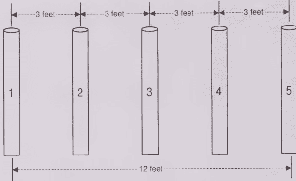
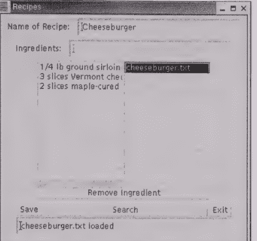
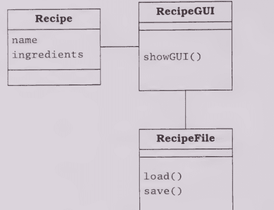

# Java 单元测试实战指南

“这本书开头有一个非常好的介绍，讨论了什么是单元测试以及我们为什么应该做它。我喜欢书中穿插的那些轶事，它们说明了为什么人们应该费力去关注这一点……我也非常喜欢你们使用的比喻。它们将代码置于真实的语境中。”

- Sharee J. Johnson
- 应用开发项目负责人

“我真希望在我开始作为极限编程（Extreme Programming）的一部分进行测试驱动开发时，手里有一本书就好了。”

- Al Koscielny，软件开发人员

“我并不是完全不了解测试，但我一直在测试的许多方面挣扎。我认为这本书很好地引导了那些对单元测试完全陌生的新人，同时也包含了足够的高级材料，来帮助我们这些涉猎过测试但在遇到障碍时就处处碰壁的人。”

- Andrew Thompson,
- Greenbier & Russel 顾问

“当我身处一个需要更好地进行单元测试的项目时（这通常是常态），我希望这本书能作为一份简单的参考，推荐给团队。”

- Bobby Woolf,
- 咨询级 IT 专家，
- IBM Websphere 软件服务部

“我是单元测试的坚定信者，我希望我合作的所有团队成员都能像宗教虔诚一样实践书中推荐的技术。我认为书中有很多优良且实用的信息，任何专业的软件工程师都应该将其整合到他们的日常工作中。”

- James J. O'Connor III,
- 首席系统设计工程师

```
http://www.pragmaticprogrammer.com
```

- 版本：2004-12-13

```
1006764392 X
```

## 关于入门工具包

本书《实用单元测试》（Pragmatic Unit Testing）是该系列的第二卷。单元测试是一项至关重要的技术，因为它在我们编写代码时能为开发者提供真实、实时的反馈。许多开发者误解了单元测试，没有意识到它让开发者的工作变得更加轻松。本书有两个语言版本：基于 Java 和 JUnit 的版本，以及基于 C# 和 NUnit 的版本。

第三卷《实用自动化》（Pragmatic Automation）¹ 涵盖了自动化代码构建、测试和发布程序所需的关键实践和技术。很少有项目会闲得无事事，因此《实用自动化》将教你如何让计算机自动完成更多枯燥的任务，让你能够抽出精力专注于更有趣——也更有挑战性的任务。

这些书籍的创作风格与我们的第一本书一样平易近人，并针对你每天在一线面临的具体需求和问题。但这些并非只给你提供部分图景的“小白级”书籍；它们将带给你足够的理解，让你能够针对我们未专门讨论过的新颖问题，发明自己的解决方案。

有关这些书籍及其他书籍的最新信息，以及针对开发者和管理者的相关实用资源，请访问我们的网站：

```
http://www.pragmaticprogrammer.com
```

感谢，并记住让过程变得有趣！

¹ 预计于 2004 年出版。

## 前言

欢迎来到以开发者为中心的单元测试的世界！我们希望这本书能为你和你的项目团队提供宝贵的资源。你可以通过访问我们网站上的“实用单元测试”页面并点击“反馈”，告诉我们它对你有何帮助——或者告诉我们如何改进。

这样的反馈让书籍变得伟大。也让人们和项目变得伟大。实用编程的核心在于利用真实世界的反馈来微调和调整你的方法。

这就引出了单元测试。正如我们将看到的，单元测试对程序员来说非常重要，因为它提供了你所需的反馈。如果没有单元测试，你就像是在黄色法律纸上写程序，并在运行时听天由命。

这并不实用。

但虽然示例使用的是 Java 和 JUnit 框架，但无论你是使用 C++、Fortran、Ruby、Smalltalk 还是 VisualBasic，其概念都是通用的。与 JUnit 类似的测试框架存在于 60 多种语言中；这些各种框架都可以免费下载。

```
http://www.pragmaticprogrammer.com/sk/ut/
http://www.xprogramming.com/software.htm
```

对于以前做过单元测试的高级程序员，我们希望在这里能带给你一些小惊喜。快速浏览使用 JUnit 的基础知识，将精力放在如何思考测试、测试如何影响设计，以及如何处理你可能遇到的某些团队问题上。

请记住，这本书只是一个开始。它可能是你关于单元测试的第一本书，但我们希望它不会是最后一本。

## 在哪里找到代码

在整本书中，你会发现 Java 代码示例；其中一些是完整的程序，另一些是程序片段。如果你想运行任何示例代码或查看完整源代码（而不是仅仅打印的片段），请查看页边：书中每个代码片段的文件名打印在代码片段旁边的页边。

某些代码片段会随着讨论而演变，因此你可能会在主目录以及包含后续版本（rev1、rev2 等）的子目录中找到相同的源代码文件（同名）。

书中所有的代码都可以通过我们网站上的实用单元测试测试页面获取。

## 字体规范

- *斜体字体*表示正在定义的术语或借自其他语言的术语。
- *计算机字体*表示方法名、文件名、类名以及各种其他字面量。
- *xxx xxx;* 表示故意省略的源代码中不重要的部分。

“前方有弯道”标志警告这些材料较为高级，在第一次阅读时可以安全跳过。

我们的卡通朋友“开发者 Joe”提出了一个你可能觉得有用的相关问题。

文中的断点表示你应该停下来思考一下提出的问题，或者在继续之前在计算机上现场尝试一次实验。

## 特定语言版本

截至本次出版时，《实用单元测试》有两个特定编程语言的版本：

- 基于 Java 和 JUnit 的版本
- 基于 C# 和 NUnit 的版本

## 致谢

我们特别感谢以下从业者提供的宝贵意见、建议和故事：Mitch Amiano, Nascif Abousalh-Neto, Andrew C. Oliver, Jared Richardson 和 Bobby Woolf。

感谢我们的审稿人员，他们花时间和精力指出我们的错误、遗漏以及偶尔生硬的文字：Will Gualtney, Sharee L. Johnson, Eric Kalendra, Al Koscielny, James J. O'Connor III, Mike Stok, Drew Thompson 和 Eric Vought。

感谢大家的支持。

Andy Hunt 和 Dave Thomas

2003年10月

prprog@pragmatic.com

# 第1章 引言

有很多不同类型的测试可以进行。其中一些需要最终用户的广泛参与；另一些形式需要专门的资源。但并不是我们要讨论的。相反，我们要讨论的是单元测试：一个关键的、经常被误解的、成功的要素。

单元测试是一种相对廉价、快速产生更好代码的方法。许多程序员认为测试是一种麻烦：一种干扰实际业务的额外困扰。大家都认为测试是必要的，就像大家应该吃蔬菜、戒烟、充足休息和经常运动一样。然而，这并不意味着我们真的都做到了这些。

虽然示例使用的是 Java 和 JUnit 框架，但无论你是使用 C++、Fortran、Ruby、Smalltalk 还是 VisualBasic，其概念都是通用的。与 JUnit 类似的测试框架存在于 60 多种语言中；这些各种框架都可以免费下载。

简单来说，单元测试本身可能意味着成功与失败的区别。请考虑以下故事。

## 1.1 充满信心地编码

从前——也许上周二——有两个开发者，Pat 和 Dale。他们都面临同一个即将到来的截止日期。Pat 正在快速产出代码；一个接一个类，方法一个方法，偶尔停下来确保代码可以编译。

Pat 一直这样做，直到截止日期前的晚上，那时是演示所有代码的时候。Pat 运行了顶层程序，但没有得到任何输出。该用调试器进行单步执行了。“嗯，”Pat 想，“那个变量现在不可能是 0。”于是 Pat 回到代码，试图追踪这个捉摸不定的问题的历史。

现在已经晚了。那个 bug 被发现并修复了，但 Pat 在过程中又发现了几个。仍然没有任何输出。Pat 不理解为什么。

与此同时，Dale 写代码的速度并没有那么快。Dale 会写一个新例程并附带一个短测试。没什么复杂的，只是一个简单的测试，看看刚刚编写的例程是否执行了它应该做的功能。思考和编写测试需要花一点时间，但 Dale 拒绝在新的例程证明自己之前继续。只有这样，Dale 才会移动并编写调用它的下一个例程，以此类推。

Dale 很少使用调试器（如果用过的话），他看着 Pat 的样子感到有些困惑：Pat 抱着头，眼睛布满血丝地盯着那些调试器窗口，对着电脑低咒着各种恶毒的咒语。

截止日期到了又过去了，Pat 没能完成。Dale 的代码被集成在一起，运行得几乎完美。虽然出现了一个小故障，但很容易看出问题所在。Dale 仅用了几分钟就修复了它。

现在是重点了：Dale 和 Pat 同龄，编程技能和智力也大体相同。唯一的区别是 Dale 深信单元测试，在依赖或在其他代码中使用任何新编写的方法之前，他都会对其进行测试。

Pat 则没有。Pat “知道”代码应该像写的那样运行，在大部分代码写完之前他根本不打算尝试。但那时已经太晚了，想要定位 Bug 的来源，甚至确定哪些运行正常、哪些不正常都变得非常困难。

## 1.2 什么是单元测试？

单元测试是开发者编写的一段代码，用于测试被测代码中非常小且特定的功能区域。通常，单元测试会在特定的上下文中执行某个特定的方法。例如，你可能会向一个排序列表添加一个大值，然后确认该值是否出现在列表末尾。或者，你可能会从字符串中删除一种字符模式，然后确认它们已经消失了。

执行单元测试是为了证明一段代码确实如开发者所认为的那样工作。

对于客户和最终用户来说，这是否是正确的做法仍然悬而未决：那是验收测试要解决的问题。我们目前并不真正关心正式的验证与确认，或正确性。在这个阶段，我们甚至对性能测试都不感兴趣。我们想要做的就是证明代码实现了我们的意图，而且我们想要测试非常小、非常隔离的功能片段。通过建立各个部分按预期运行的信心，我们就可以着手组装并测试工作系统。

毕竟，如果我们不确定代码是否如我们所想，那么任何其他形式的测试可能都是浪费时间。你仍然需要其他形式的测试，取决于你的环境，可能还需要更多正式测试。但测试就像慈善一样，要从自己做起。

## 1.3 我为什么要麻烦单元测试？

单元测试会让你的生活变得更轻松。它会让你的设计更好，并大幅减少你花费在调试上的时间。

在上面的故事中，Pat 因为假设底层代码工作正常，就陷入了麻烦，然后将其用于高层代码，而这些高层代码又被更多代码使用，以此类推。由于对任何代码都没有合理的信心，Pat 在构建一个由假设构成的“纸牌屋”——底部轻轻一推，整个结构就会崩塌。

当基础的底层代码不可靠时，必要的修复并不会停留在底层。你修复了底层问题，但它会影响高层代码，导致高层代码也需要修复，以此类推。修复开始在整个代码中波动，并变得越来越大、越来越复杂。纸牌屋塌了，把整个项目也拖垮。

Pat 一直说“这不可能”或“我不明白怎么会发生这种情况”。如果你发现自己产生了这类想法，那么这通常说明你对自己的代码没有足够的信心——你无法确定哪些运行正常，哪些不正常。

为了获得 Dale 那种对代码的信心，你需要询问代码本身它在做什么，并检查结果是否符合你的预期。

这个简单的想法描述了单元测试的核心：这是改进编程的最有效的单一技术。

## 1.4 我想要实现什么

人们很容易沉迷于单元测试，因为它很有趣，但归根结底，我们仍然需要为客户和最终用户生产环境代码，所以让我们明确单元测试的目标。首先，你想这样做是为了让你的生活——以及你队友的生活变得更轻松。

### Joe 提问...

**什么是附带损害（Collateral damage）？**

附带损害是指系统某部分的新功能或 Bug 修复导致了另一个可能不相关的系统部分出现 Bug（损害）。这是一种隐蔽的问题，如果任其持续下去，可能会迅速导致整个系统崩溃到任何人都无法修复的程度。

我们有时把这种现象称为“打地鼠”（Whac-a-Mole）效应。在嘉年华会的打地鼠游戏中，玩家必须击中在球场上弹出的机械老鼠。但它们停留不了多久；当你移动去击中其中一只老鼠时，它会缩回去，另一只老鼠会在场地的另一侧弹出。老鼠弹出的速度非常快，尝试击中一个来得分会非常令人沮丧。结果，玩家通常在场地上无力地挥舞，而老鼠却不断在他们最意想不到的地方弹出。

代码库中广泛的附带损害也会产生类似的效果。

### 写测试花费了太多时间

这是大多数单元测试新手提出的首要抱怨。当然，这并非事实，但为了让你明白为什么我们需要仔细审视你在开发代码时时间花在了哪里。

许多人将任何形式的测试都视为项目后期才发生的事情。是的，如果你等到那时才开始单元测试，那将花费太长的时间。事实上，你可能要等到宇宙热寂才能完成这项工作。

至少在感觉上是这样的：这就像是尝试用割草机清理几英亩的土地。如果你在早期开始，此时那里只有一片草地，工作就很简单。如果你等到后期，当地上长满了粗壮、扭曲的树木和密密缠绕的灌木丛时，这项工作就会变得极其困难。

#### 按需付费模式 vs 单一测试阶段


与其等到最后，从长远来看，采用“按需付费”模型要便宜得多。通过在编写代码的同时编写单独的测试，最后阶段就不会有冲刺压力，而且由于你通常始终在经过测试的代码上工作，你经历的整体 Bug 也会更少。通过一直多花一点时间，你最大限度地减少了最后需要大量时间的风险。

你要明白，权衡并不是“现在测试”与“以后测试”之间的选择。而是现在进行线性工作，与后期试图修复和重做的指数级工作及复杂性之间的对比：工作不仅更大、更复杂，而且你现在必须重新学习几周或几个月前写的代码。所有这些额外工作都会扼杀你的生产力，如图 1.1 所示。

注意，测试并不是免费的。在按需付费模型中，投入并不是零：它会消耗你一些精力（以及时间和金钱）。但看看右侧曲线随时间推移而产生的惊人趋势——你的生产力甚至可能变成负。这些生产力的损失很容易导致……

如果你认为在编写现有代码之外没有时间编写测试，请考虑以下问题：

1. 你花费多少时间来调试你或他人编写的代码？
2. 你花费多少时间来重构那些你认为可以工作、但结果发现有严重、致命 Bug 的代码？
3. 你花费多少时间将一个报告的 Bug 定位到源头？

对于大多数不使用单元测试的人来说，这些数字会迅速累积，并在项目整个生命周期内累积得更快。适当的单元测试可以极大地减少这些时间，释放出足够的时间让你有机会编写你想要的所有单元测试——甚至可能空出一些闲暇。

### 运行测试太久了

这不应该是。大多数单元测试的执行速度非常快，所以你应该能够在几秒钟内运行成百、上千个测试。但有时这并不可能，你可能会发现某些测试运行时间太长，无法方便地频繁运行。

在这种情况下，你会希望将运行时间长的测试与短测试分开。每天只运行一次长测试（或者根据情况每几天运行一次），并持续运行短测试。

### 测试我的代码不是我的工作

现在这里有一个有趣的借口。请问，你的工作究竟是什么？推测你的工作至少部分内容是创建可以正常运行的代码。如果你把代码扔过墙交给某个测试小组，而没有任何保证它能正常工作，那么你没有尽到职责。要求别人为我们留下的烂摊子收拾是不礼貌的，在极端情况下，提交大量的 Bug 代码可能会变成一种“限制职业”的举动。

另一方面，如果测试人员或 QA 组发现很难找到你的代码中的错误，你的声誉会迅速增长——你的工作安全感也是如此！

### 不测试的借口

#### 我真的不知道代码应该如何行为

我无法测试它。

如果你真的不知道代码应该如何行为，那么现在可能不是编写它的时机。也许使用原型作为第一步会更合适，有助于澄清需求。

如果你不知道代码应该做什么，你又如何知道它确实做到了呢？

#### 但它通过编译了！

好吧，没有人真的会拿这个作为借口，至少不会当面说出来。但人们很容易被诱导，认为编译成功是某种认可的标志，意味着你已经通过了某种优良门槛。

编译器的认可是一个相当浅薄的赞美。它可以验证你的语法是否正确，但它无法判断你的代码应该做什么。例如，Java 编译器可以很容易判断出这一行是错误的：

```java
public statuc void main(String args[]) {
```

这只是一个简单的类型错误，并且应该是 `static` 而不是 `statuc`。这是容易的部分。但现在假设你写了以下内容：

```java
public void add(Object anObject){
  ArrayList myList = new ArrayList();
  myList.add(anObject);
  myList.add(anObject);
  // code...
}
```

你真的想把同一个对象两次添加到同一个列表中吗？也许是，也许不是。编译器无法区分这种区别，只有你清楚你意图让代码做什么。

#### 我拿钱是写代码的，不是写测试的

同样的逻辑，你拿钱也不是为了一整天待在调试器里。推测你拿钱是为了编写可以正常运行的代码，而单元测试仅仅是实现这一目的的工具，就像编辑器、IDE 或编译器一样。

> ² 根据你现有代码自动生成测试的自动化测试工具就掉进了这个陷阱——它们只能使用你写的内容，而无法使用你意图的内容。

#### 我对测试人员和 QA 员工失业感到内疚

不用担心，不会的。记住我们在这里讨论的只是单元测试。这是为我们程序员设计的最基础、最低层次的测试。在功能测试、验收测试、性能和环境测试、验证与确认、形式化分析等方面，还有大量工作要做。

#### 我的公司不让我在现场系统上运行单元测试


# 第 2 章

## 你的第一个单元测试

正如我们在引言中所说的，单元测试仅仅是一段代码。它是你编写的一段用来运行另一段代码的代码，并确定另一段代码的行为是否符合预期。

具体来说，这是怎么做的呢？

要检查代码的行为是否符合你的预期，你需要使用“断言”（assertion），这是一种验证某事是否为真的简单方法。例如，`assertTrue` 方法检查给定的布尔条件是否为真，如果不是，则导致当前测试失败。它的实现可能如下：

```java
public void assertTrue(boolean condition) {
    if (!condition) {
        abort();
    }
}
```

你可以使用这个断言来检查各种情况，包括数字是否相等：

```java
int a = 2;
assertTrue(a == 2);
```

如果由于某种原因，在调用 `assertTrue` 方法时 `a` 不等于 2，那么程序将终止。

由于我们经常检查相等性，专门为数字准备一个断言可能会更方便一些。例如，为了检查两个整数是否相等，我们可以写一个接受两个整数参数的方法：

```java
public void assertEquals(int a, int b) {
    assertTrue(a == b);
}
```

仅凭这两个断言，我们就可以开始编写一些测试了。在下一章，我们将查看更多的断言，并描述在单元测试代码中使用断言的细节。但首先，让我们考虑一下在编写任何代码之前可能需要哪些测试。

### 2.1 测试规划

我们将从一个简单的示例开始，一个简单的静态方法，用于找到数字列表中的最大数：

```java
static int largest(int[] list);
```

换句话说，给定一个如 `[7, 8, 9]` 这样的数字数组，该方法应该返回 9。这是一个合理的第一个测试。你凭直觉还能想到哪些其他测试？在继续阅读之前，请花一分钟时间为这个简单的方法写下尽可能多的测试用例。

> 在继续阅读之前，先思考一下……

你想出了多少个测试？

给定列表的顺序似乎并不重要，所以你立刻就能想到以下测试思路（我们将其写为“你传入的内容” → “你预期的结果”）：

- `[7, 8, 9]` -> 9
- `[8, 9, 7]` -> 9
- `[9, 7, 8]` -> 9

如果有重复的极大值会怎样？

- `[7, 9, 8, 9]` -> 9

由于这些是 `int` 类型而不是对象，你可能不在乎返回的是哪一个 9，只要是其中一个即可。

如果只有一个数字怎么办？

- `[1]` -> 1

负数又是情况呢：

- `[-9, -8, -7]` -> -7

这看起来可能很奇怪，但 -7 确实比 -9 大。很高兴我们现在就澄清了这个问题，而不是在调试器或生产代码中（那里可能没那么显而易见）。

为了让这一切变得更具体，让我们实际编写一个 "largest" 方法并对其进行测试。这里是我们第一次实现的代码：

```java
public class Largest {
    /**
     * @return 列表中的最大元素。
     * @param list 整数列表
     * @return 给定列表中的最大数字
     */
    public static int largest(int[] list) {
        int index, max = Integer.MAX_VALUE;
        for (int index = 0; index < list.length - 1; index++) {
            if (list[index] > max) {
                max = list[index];
            }
        }
        return max;
    }
}
```


现在我们已经有了一些测试的想法，我们将使用 JUnit 框架在 Java 中编写这些测试。

### 2.2 测试一个简单方法

通常，你希望编写的第一个测试极其简单，因为第一次测试时除了代码本身之外，还有很多需要测试的内容：所有关于类名、库位置以及确保其通过编译的繁杂事务。你希望通过第一个、最简单的测试扫除这些烦恼；之后你就再也不需要担心这些，而且你不需要在调试复杂测试的同时去调试复杂的集成问题！

首先，让我们只考虑简单的情况：传入一个包含几个唯一数字的小型数组。这里是测试类的完整源代码。我们将在下一章详细介绍测试类；现在，只需关注断言语句即可：

```java
import junit.framework.*;
public class TestLargest extends TestCase {
    public TestLargest(String name) {
        super(name);
    }
    public void testOrder() {
        assertEquals(9, Largest.largest(new int[] {8, 9, 7}));
    }
}
```

Java 注意：创建匿名数组的奇怪语法是为了方便作者，因为我们很懒。如果你愿意，测试也可以这样写（尽管之前的更符合习惯）：

```java
public void testOrder() {
    int[] arr = new int[3];
    arr[0] = 8;
    arr[1] = 9;
    arr[2] = 7;
    assertEquals(9, Largest.largest(arr));
}
```

这就是运行测试所需的所有工作。运行它并确保它通过（参见下一页侧栏）。

在继续阅读之前，尝试运行这个示例……

运行该代码后，你可能会看到类似的错误：

- 有 1 个失败：
  1) `testOrder(TestLargest)` `junit.framework.AssertionFailedError`: expected:<9> but was:<2147483647>
     at `TestLargest.testOrder(TestLargest.java:7)`

哎！结果不符合预期。为什么它返回的是一个巨大的数字而不是 9 呢？那个非常

### 如何运行测试

JUnit 很容易在你的 IDE 中使用，然后运行测试。要手动运行，使用：

```bash
java junit.framework.Test TestLargest
```

我们也可以在 GUI 中查看测试。GUI 的优势之一是可以看到哪些测试通过了，哪些测试失败了。运行 GUI 请使用：

```bash
java junit.framework.JUnitRunner TestLargest
```

我们还可以从 IDE 运行测试。要这样做，只需右键点击测试类并选择“运行”。这通常是开发过程中运行测试最简单的方法。

现在让我们看看当极大值位于不同位置会发生什么。我们可以向测试方法中添加更多断言：

```java
public void testOrder() {
    assertEquals(9, Largest.largest(new int[] {8, 9, 7}));
    assertEquals(9, Largest.largest(new int[] {9, 8, 7}));
    assertEquals(9, Largest.largest(new int[] {7, 8, 9}));
}
```

等等，我们已经注意到了一个问题。如果极大值在列表末尾，测试就会失败。让我们修复代码并再次运行测试。

第二种表达式在源自 C 的语言（包括 Java 和 C#）中是惯用的，而且更容易读，所以我们就用那一个吧。进行更改并再次运行测试。

让我们检查是否有重复的最大值；输入以下并运行（从这里开始我们只显示新添加的方法）：

```java
public void testDups() {
    assertEquals(9, Largest.largest(new int[] {7, 9, 8}));
}
```

到目前为止一切良好。现在是单个整数的测试：

```java
public void testOne() {
    assertEquals(1, Largest.largest(new int[] {1}));
}
```

嘿，成功了！你现在势如破竹，我们在例子中埋的所有 Bug 肯定都已经测试到了。最后对负值进行一次检查：

```java
public void testNegative() {
    int[] negList = new int[] {-9, -8, -7};
    assertEquals(-7, Largest.largest(negList));
}
```

在继续阅读之前，尝试运行这个示例...

有 1 处失败：

1) `testNegative(TestLargest)` `junit.framework.AssertionFailedError`:
   expected:<-7> but was:<0>

哎呀！0 是从哪里来的？

看来选择 0 来初始化 max 是个坏主意：我们真正想要的是 `MIN_VALUE`，这样它就会小于所有的负数，如下：

```java
max = Integer.MIN_VALUE
```

做出该更改并重试——所有现有测试都应该继续通过，现在这一个也会通过。

遗憾的是，“largest” 方法的初始规范是不完整的，因为它没有说明如果数组为空会发生什么。让我们假设这是一个错误，并在方法顶部添加一些代码，如果列表长度为零则抛出运行时异常：

```java
public static int largest(int[] list) {
    int index, max = Integer.MIN_VALUE;
    if (list.length == 0) {
        throw new RuntimeException("largest: Empty list");
    }
    // ...
```

注意，仅仅通过思考测试，我们已经意识到需要更改设计。这完全不寻常，事实上这正是我们希望利用的。因此，对于最后一个测试，我们需要检查在传入空数组时是否抛出了异常。我们将在第 33 页深入讨论测试异常，但现在请相信我们：

```java
public void testEmpty() {
    try {
        Largest.largest(new int[] {});
        fail("Should have thrown an exception");
    } catch (RuntimeException e) {
        assertTrue(true);
    }
}
```

最后，提醒：即使是代码——无论是测试代码还是生产代码——也应该是清晰简单的。测试代码必须易于理解，即使要牺牲性能或简洁。

## 2.3 更多测试

我们从一个非常简单的方法开始，想了一些有趣的测试，这些测试实际上发现了一些 Bug。注意，我们没有做得过并盲目尝试每种可能的组合：我们选择了可能暴露问题的有趣案例。但这些就是你能为该方法想到的所有测试吗？

还有哪些测试可能是合适的？

由于我们需要不断构建测试，也许我们需要一种思考代码的方式，以帮助我们定期且可靠地提出良好的测试。我们将在下一章之后讨论这一点，但首先，让我们深入观察使用 JUnit。

# 第 3 章

## 在 JUnit 中编写测试

在上一章中我们非正式地查看了编写测试，但现在是时候深入研究测试代码与生产代码之间的区别、JUnit assert 的各种形式、JUnit 测试的结构和组成等了。

## 3.1 单元测试的结构

编写测试代码时，你需要遵循一些命名约定。如果你有一个名为 `createAccount` 的方法想要测试，那么你的第一个测试方法可能命名为 `testCreateAccount`。`testCreateAccount` 方法将使用必要的参数调用 `createAccount` 并验证 `createAccount` 是否按预期工作。当然，你可以有许多测试方法来执行 `createAccount`。

这两部分代码之间的关系见下一页的图 3.1。

测试代码仅供我们内部使用。客户或终端用户永远看不到或使用它。因此，生产代码——即最终交付给客户并投入生产的代码——不能知道关于测试代码的任何信息。生产代码将孤独地推向冷的世界，没有测试代码。

### TestAccount.java

| | |
| :--- | :--- |
| `testCreateAccount()` | |
| `testCreateAcctDef()` | |
| `testCreateAcctDup()` | |
| (仅内部使用) | |

### Account.java

| | |
| :--- | :--- |
| `createAccount()` | |
| (已交付) | |

图 3.1：测试代码与生产代码

测试代码的编写必须完成几件事：

- 设置测试所需的所有条件（创建任何所需的对象，分配任何需要的资源等）
- 调用被测试的方法
- 验证被测试的方法是否符合预期
- 清理后续工作

你按照正常方式编写测试代码并以这种方式编译它，就像你处理项目中的任何其他源代码一样。它可能会使用一些额外的库，但除此之外并没有魔法——它只是普通的代码。

对于逻辑来说，这可能是一个坏主意。特别是，你最不希望看到的是一整页的“测试”代码，却在最后处只有一个 `assertTrue(true)`（即：“代码运行到了最末端没有崩溃，所以它一定能工作”）。

那不是测试，是你的一厢情愿。

除了测试真（true）之外，你也可以测试假（false）：

```java
assertFalse([String message], boolean condition)
```

断言给定的布尔条件是否为假，否则测试将失败。消息是可选的。

### fail

```java
fail([String message])
```

立即使测试失败，并带上可选的消息。通常用于标记不应该被执行的代码段（例如，在预期会发生异常之后）。

## 使用断言

你通常在一个给定的测试方法中会有多个断言，你借此证明被测试方法的各个方面和关系。当某个断言失败时，该测试方法将终止——该方法中剩余的断言此时将不再被执行。但这不应该引起任何担心；无论如何，你都必须先修复失败的测试。然后修复下一个失败的测试，并以此类推。

你通常应该期望所有测试始终通过。在实践中，这意味着当引入一个 bug 时，只有一个或两个测试会失败。在这种环境下，隔离问题通常非常容易。

在有测试失败的情况下，你不应该继续添加新功能！一旦测试失败，立即修复任何测试，并保持所有测试始终通过。

为了保持纪律，你需要一种简单的方法运行测试——或者运行测试组、特定的子系统等。

## 3.3 JUnit 框架

到为止，我们只看了断言方法本身。但你不能仅仅把断言方法写进源文件并期望它工作；你需要比这多一点的框架。幸运的是，这并不复杂。

这是一段非常简单的测试代码，说明了你启动所需的最小框架。

```java
import junit.framework.*;
public class TestSimple extends TestCase {
    public TestSimple(String name) {
        super(name);
    }
    public void testAdd() {
        assertEquals(2, 1+1);
    }
}
```

这段代码非常直观，但让我们逐一查看每个部分。

首先，第 1 行的 `import` 语句引入了必要的 JUnit 类。

接下来，我们看第 3 行的类定义：每个包含测试的类必须如所示继承 `TestCase`。基类 `TestCase` 提供了我们所需的大单元测试功能，包括我们在上面描述的所有断言方法。

基类要求一个接收 `String` 的构造函数，因此我们必须提供对 `super` 的调用并传入一个名称。我们目前还不知道应该是什么名称，所以我们只需让自己的构造函数接收一个 `String` 并在第 5 行将其传递下去。

最后，测试类包含以 `test...` 命名的独立方法。在示例中，我们在第 9 行有一个名为 `testAdd` 的测试方法。所有以 `test` 开头的方法都会由 JUnit 自动运行。你也可以通过定义一个 `suite` 方法来指定运行特定的方法；这一点稍后会详细介绍。

在上一个示例中，我们在单个测试方法中使用单个断言展示了单个测试。当然，在测试方法内部，你可以放置任意数量的：

```java
public void testAdds() {
    assertEquals(2, 1+1);
    assertEquals(4, 2+2);
    assertEquals(-8, -12+4);
}
```

在这里，我们在测试方法中有三个 `assertEquals`。

## 3.4 JUnit 测试组合

正如我们目前看到的，一个测试类包含测试方法；每个方法包含一个或多个断言语句。但测试类也可以调用其他测试类：单个类、包，甚至整个系统。

这种魔法通过创建“测试套件”（test suites）来实现。任何测试类都可以包含一个名为 `suite` 的静态测试方法：

```java
public static Test suite();
```

你可以提供一个 `suite()` 方法来返回你想要的测试集合（如果没有 `suite()` 方法，JUnit 会自动运行所有的 `test...` 方法）。但你可能想手动添加特定的测试，包括来自其他套件的结果。

例如，假设你有一组普通的测试，正如我们已经看到的，在一个名为 `TestClassOne` 的类中所示。


```
import junit.framework.*;
public class TestClassOne extends TestCase {
    public TestClassOne(String method) {
        super(method);
    }
    public void testAddition() {
        assertEquals(4, 2+2);
    }
    public void testSubtraction() {
        assertEquals(0, 2-2);
    }
}
```

使用 Java 反射处理此类的默认操作将是运行 `testAddition()` 和 `testSubtraction()` 测试方法。

现在假设你有第二个类 `TestClassTwo`。它使用暴力破解算法来寻找你的推销员 Bob 在其历史中访问前 $n$ 个城市的最短路径。推销员算法的有趣之处在于，对于数量较少的城市它运行良好，但它是一个指数级算法——例如，几百个城市可能需要 20,000 年才能运行。即使是 50 个城市也需要几个小时，所以你可能不想默认包含那个测试。

```
import junit.framework.*;
public class TestClassTwo extends TestCase {
    public TestClassTwo(String method) {
    }

    // 这一个需要几个小时...
    public void testRunner() {
        TSP tsp = new TSP(); // Load with cities
        assertEquals(2300, tsp.shortestPath(50)); // top 50
    }

    public void testShortTest() {
        TSP tsp = new TSP(); // Load with cities
        assertEquals(140, tsp.shortestPath(50)); // top 50
    }

    public void testAnotherTest() {
        TSP tsp = new TSP(); // Load with cities
        assertEquals(586, tsp.shortestPath(10)); // top 10
    }

    public static Test suite() {
        TestSuite suite = new TestSuite();
        // Only include short tests
        suite.addTest(new TestClassTwo("testShortTest"));
        suite.addTest(new TestClassTwo("testAnotherTest"));
        return suite;
    }
}
```

此外，现在我们可以看到构造函数的 `String` 参数是做什么的：它允许 `TestCase` 返回一个命名方法的引用。我们正使用它获取两个快速测试来填充我们的测试套件。

## JUnit 测试组合

你可能希望有一个由这两个测试类组合的高级测试：

```
import junit.framework.*;
public class TestClassComposite extends TestCase {
    public TestClassComposite(String method) {
        super(method);
    }
    static public Test suite() {
        TestSuite suite = new TestSuite();
        // Grab everything;
        suite.addTestSuite(TestClassOne.class);
        // Use the test method:
        suite.addTest(TestClassTwo.suite());
        return suite;
    }
}
```

现在如果你运行 `TestClassComposite`，将测试方法是：

- 来自 `TestClassOne` 的 `testAddition()`
- 来自 `TestClassOne` 的 `testSubtraction()`
- 来自 `TestClassTwo` 的 `testShortTest()`
- 来自 `TestClassTwo` 的 `testAnotherTest()`

你可以继续这种方案；另一个类可能包含 `TestClassComposite`，它包含上述方法以及其他测试组合，以此类推。

## 测试前设置与清理

每个测试都应该与其他任何测试独立运行；这允许你在任何时间、任何顺序运行任何单独测试。

为了实现这一目标，你可能需要在测试之间重置测试环境的某些，或者在测试运行时进行清理。JUnit 的 `TestCase` 基类提供了两个可以重写的方法，用于设置和清理测试环境：

```
protected void setUp();
protected void tearDown();
```

`setUp()` 方法将在执行每个测试方法之前调用，而 `tearDown()` 方法将在每个测试执行后调用。

# 第 3 章 在 JUNIT 中编写测试

| 步骤 | 方法 | 说明 |
|---|---|---|
| 1 | `oneTimeSetUp()` | 在套件开始时执行一次性设置，并运行清理工作 |
| 2 | `setup()` | 执行 setup |
| 3 | `testMethod()` | 在每个测试方法之前 |
| 4 | `tearDown()` | 以及执行 teardown |
| 5 | `setup()` | 在...之后运行 |
| 6 | `testMethod2()` | 每个方法。 |
| 7 | `tearDown()` | |
| 8 | `oneTimeTearDown()` | （在套件结束时执行一次性清理） |


例如，假设你每个测试都需要某种数据库连接对象。与其在每个测试方法中都包含连接和断开数据库的代码，你可以使用 `setup` 和 `tearDown` 方法来处理。

```java
public class TestDB extends TestCase {
    private Connection dbConn;
    protected void setUp() {
        dbConn = new Connection("oracle", 1521, "fred", "foobar");
        dbConn.connect();
    }
    protected void tearDown() {
        dbConn.disconnect();
        dbConn = null;
    }
    public void testAccountAccess() {
        // 使用 dbConn
    }
    public void testEmployeeAccess() {
        // 使用 dbConn
    }
}
```

在这个示例中，`setUp()` 会在 `testAccountAccess()` 之前被调用，然后调用 `tearDown()`。`setUp()` 会再次被调用，接着是 `testEmployeeAccess()`，然后再次调用 `tearDown()`。

# 套件级设置和清理

通常，每个测试设置（per-test-setup）就是你需要的，但在某些情况下，你可能需要在整个测试套件运行后进行某些设置或清理：为此，需要套件级的设置和清理（每个测试级与每个套件级执行顺序的差异见前一页的图 3.2）。

套件级设置要稍微复杂一些。你需要提供一组所需的测试（通过任何手段），并将其封装在 `TestSetup` 对象中。使用我们之前的示例，它看起来像这样：

```java
import junit.framework.*;
import junit.extensions.*;
public class TestClassTwo extends TestCase {
    private static TestClassTwo tsp;
    public TestClassTwo(String method) {
        super(method);
    }
    // 这一个需要几个小时...
    public void testLongRunner() {
        assertEquals(2300, tsp.shortestPath(50));
    }
    public void testShortTest() {
        assertEquals(140, tsp.shortestPath(5));
    }
    public void testAnotherTest() {
        assertEquals(586, tsp.shortestPath(10));
    }
    public static TestSuite suite() {
        TestSuite suite = new TestSuite();
        // 只包含短时间测试
        suite.addTest(new TestClassTwo("testShortTest"));
        suite.addTest(new TestClassTwo("testAnotherTest"));
        return suite;
    }
    TestSetup wrapper = new TestSetup(suite);
    protected void setUp() {
        oneTimeSetUp();
    }
    protected void tearDown() {
        oneTimeTearDown();
    }
    return wrapper;
}
public static void oneTimeSetup() {
    // 一次性初始化代码放在这里...
    tsp = new TSP();
    tsp.loadCities("EasternSeaboard");
}
public static void oneTimeTearDown() {
    // 一次性清理代码在这里...
    tsp.releaseCities();
}
```

注意，你可以在同一个类中同时使用套件级和每个测试级的 `setUp` 方法。

## 3.5 JUnit 自定义断言

JUnit 提供的标准断言通常足够大多数测试。然而，你可能会遇到这样的情况，即拥有你自己的、自定义断言会非常方便。也许你有一个特殊的数据类型，或者一个在多个测试中执行的通用操作序列。

不要在测试中复制和粘贴通用代码；测试的编写标准应与普通代码相同，这意味着要遵循良好的编码实践，如 DRY 原则、正交性等。将测试执行框架的通用部分提取为实际方法，并在你的测试用例中使用这些方法。

如果你有需要在项目中共享的自定义断言或通用代码，你可能想要考虑继承 `TestCase` 并使用该子类进行所有测试。例如，假设你正在测试一个财务应用程序，几乎所有的测试都使用名为 `Money` 的数据类型。与其让测试直接子类，不如创建一个项目特定的基类：

```java
import junit.framework.*;
/**
 * 项目范围内的测试基类
 */
public class ProjectTest extends TestCase {
    /**
     * 断言金额为偶数美元（没有角分）
     * @param message 如果断言失败时显示的文本
     * @param amount 待测试的 Money 对象
     */
    public void assertEquals(String message, Money amount) {
        assertEquals(message, amount.asDouble(), 0.0, 0.001);
    }
    /**
     * 断言金额为偶数美元（没有角分）
     * @param amount 待测试的 Money 对象
     */
    public void assertEquals(Money amount) {
        assertEquals("", amount);
    }
}
```

> DRY 代表“不要重复自己”（Don't Repeat Yourself）。这是一项基础技术，它要求系统中的每一部分知识都有一个唯一的、无歧的表示。

注意，我们提供了两种形式的断言：一个接收 `String`，另一个不接收。同样注意，你这样做并没有复制任何代码；你只是倾向于调用。现在，项目中的所有其他测试类都将继承这个基类，而不是直接继承 `TestCase`：

```java
public class TestSomething extends ProjectTest {
```


事实上，在启动新项目时，始终继承你的自定义基类而不是直接继承 JUnit，通常是一个好主意——即使它最初没有添加任何功能。这样，当你需要添加每个测试类都需要的方法或功能时，你只需要将其添加到基类中即可，而无需编辑项目中的每个测试用例。

## 3.6 JUnit 与异常

我们可能感兴趣的异常有两种：

1. 测试产生的预期异常
2. 产生某些严重错误时的非预期异常

与你可能想的相反，异常实际上是好事——它们告诉我们出问题了。有时在测试中，我们希望方法抛出异常。考虑一个名为 `sortList()` 的方法。如果传递了 `null`，它应该抛出异常。我们必须显式地测试这一点。

```java
public void testForException() {
  try {
    sortList(null);
    fail("应该抛出异常");
  } catch (RuntimeException e) {
    assertTrue(true);
  }
}
```

被测试的方法位于第 3 行的 `try/catch` 块中。该方法预计会抛出异常，所以如果它没有抛出——如果我们继续执行第 3 行——我们需要立即让测试失败。如果触发了异常，代码将继续到第 6 行并为了统计目的记录断言。

现在你可能会问，为什么要费劲用 `assertTrue`？它什么也不做，它不会失败，所以为什么要费劲把它放进去呢？任何 `assertTrue(true)` 都表示“我预计控制流应该通过这里”。这是一种强文档形式，有助于以后消除任何误解。然而，不要忘记未调用的 `assertTrue(true)` 不会产生失败。

通常情况下，你应该对每个声明的异常进行测试，并确保它在应该抛出的。这涵盖了预期异常，但非预期异常呢？

虽然你可以自己捕获可能的异常并调用 JUnit 的 `fail()`，但让 JUnit 完成这些工作。例如，假设你正在读取一个文件。

```java
public void testData1() throws FileNotFoundException {
  FileInputStream inputStream = new FileInputStream("data.txt");
}
```

JUnit 框架会捕获任何抛出的异常并报告为错误，无需你额外付出。更好，JUnit 会报告整个堆栈跟踪，一直到错误本身，而不仅仅是失败的断言，这在弄清楚为什么测试失败时非常有用。

许多 IDE 都会为你提供这些功能。像这样编写的类可以使用 JUnit 测试运行器运行，并会自动执行类中所有的 `test` 方法。

但有时，直接运行测试类会比通过 JUnit 运行器运行它更方便。而且，那些在每个测试之前和之后运行的方法*到底*是叫什么名字呢？

我们可以轻松地创建一个提供所有这些功能以及更多功能的骨架。如果这对你的项目有帮助，请参阅第 131 页的附录 C。

现在你已经对*如何*编写测试有了很好的了解，是时候仔细考虑如何确定*测试什么*了。

## 第 4 章 测试什么：RIGHT-BICEP 原则

要观察一个方法或类并尝试想出它可能失败的所有方式，预判所有可能潜藏其中的 bug，往往是很困难的。有了足够的经验，你会开始对那些“可能出错”的地方产生直觉，并能够有效地首先集中在这些领域进行测试。但如果没有大量的经验，尝试发现可能的失败模式会变得非常困难且令人沮丧。终端用户非常擅长发现我们的 bug，但这对我们的职业来说既尴尬又有害！我们需要一些指南，一些对可能需要测试的领域的提醒。

让我们来看看六个测试领域，通过你的 RIGHT-BICEP 原则增强你的测试技能：

- **Right** — 结果是**正确的(right)** 吗？
- **B** — 所有的**边界(boundary)** 条件都是正确的吗？
- **I** — 你能检查反向关系吗？
- **C** — 你能通过其他手段**交叉检查(cross-check)**结果吗？
- **E** — 你能强制**错误情况(error conditions)** 发生吗？
- **P** — **性能(performance)** 特性在范围内吗？

### 4.1 结果正确吗？

第一个也是最明显的测试领域就是简单查看预期结果是否正确——即验证结果。

我们已经见过简单的数据验证了：第 2 章验证一个方法是否返回列表中最大的数字。


这些通常是“简单”的测试，许多此类验证甚至可能被规定在需求中。如果没规定，你可能需要询问某人。你需要能够回答这个关键问题：

> 如果代码运行正常，我该如何知道？

如果你不能满意地回答这个问题，那么编写代码（或测试）可能完全是浪费时间。“等一下，”你可能会说，“这听起来不很敏捷！如果需求是模糊或不完整的怎么办？这是否意味着在所有需求确定之前，我们不能写代码了？”

不，完全不是。如果需求确实尚未知或不完整，你总是可以发明一些作为立桩。从用户的角度来看，它们可能是不正确的，但你现在已经知道你认为代码应该做什么，因此你就可以回答这个问题了。

当然，你必须安排与用户进行反馈，以微调你的假设。“正确”的定义在相关代码的整个生命周期内可能会变化，但在任何时候，你都应该证明它正在执行你认为它应该做的事情。

### 使用数据文件

对于包含大量测试数据的测试集，你可能希望将测试值和/或结果放在单独的数据文件中，由单元测试读取该文件。这不需要是一个非常复杂的练习——你甚至不需要使用 XML。下一页的图 4-1 是 `TestLargest` 的版本，它可以从数据文件中读取所有测试。

> 这显然是个玩笑。在当今所有的项目中，XML 都是强制性的，不是吗？

### 结果正确吗？

```java
import junit.framework.*;
import java.io.*;
import java.util.ArrayList;
import java.util.StringTokenizer;
public class LargestDataFile extends TestCase {
    public TestLargestDataFile(String name) {
        super(name);
    }
    /* 在 testdata.txt 中运行所有测试（不测试
     * 如果发生任何异常
     * 我们将得到错误。
     * 文件 I/O 出错。
     */
    public void testFromFile() throws Exception {
        String line;
        BufferedReader rdr = new BufferedReader(new FileReader("testdata.txt"));
        while ((line = rdr.readLine()) != null) {
            if (line.startsWith("#")) { // 忽略注释
                continue;
            }
            StringTokenizer st = new StringTokenizer(line);
            if (!st.hasMoreTokens()) {
                continue; // 空行
            }
            // 获取期望值
            String val = st.nextToken();
            int expected = Integer.valueOf(val).intValue();
            // 以及传递给 Largest 的参数
            ArrayList argument_list = new ArrayList<>();
            while (st.hasMoreTokens()) {
                argument_list.add(Integer.valueOf(st.nextToken()));
            }
            // 将列表转换为原生数组
            int[] arguments = new int[argument_list.size()];
            for (int i=0; i < argument_list.size(); i++) {
                arguments[i] = ((Integer)argument_list.get(i)).intValue();
            }
            // 并运行断言
            assertEquals(expected, Largest.largest(arguments));
        }
    }
}
```

图 4-1：`LargestDataFile`：从文件读取。

测试什么：RIGHT-BICEP

要观察一个方法或类并尝试想出它可能失败的所有方式，预判所有可能潜藏其中的 bug，往往是很困难的。有了足够的经验，你会开始对那些“可能出错”的地方产生直觉，并能够有效地首先在这些领域进行测试。但如果没有大量的经验，尝试发现可能的失败模式会变得非常困难且令人沮丧。终端用户非常擅长发现我们的 bug，但这对我们的职业来说既尴尬又有害！我们需要一些指南，一些对可能需要测试的领域的提醒。

让我们来看看六个测试领域，通过你的 RIGHT-BICEP 原则增强你的测试技能：

- **Right** — 结果是**正确的(right)** 吗？

- **B** — 所有的**边界(boundary)** 条件都是正确的吗？

- **I** — 你能检查反向关系吗？

- **C** — 你能通过其他手段**交叉检查(cross-check)**结果吗？

- **E** — 你能强制**错误情况(error conditions)** 发生吗？

- **P** — **性能(performance)** 特性在范围内吗？

### 4.2 边界条件

在之前的“最大数字”示例中，我们发现了几个边界条件：当最大值位于数组末尾，当数组包含负数、空数组等。

识别边界条件是单元测试最有价值的部分之一，因为大多数 bug 都存在在这里——在边缘。你可能想要考虑的一些条件：

- 完全错误的或不一致的输入值，例如文件名

- 格式错误的数据，例如没有顶级域名的电子邮件地址

- 空值或缺失值（例如 `0`、`0.0`、`""` 或 `null`）

- 远超预期的值，例如人的年龄为 `10000` 岁

- 不应该有重复项的列表中的重复项

- 无序列表，反之亦然。尝试将预排序的列表传递给排序算法，例如——甚至是反向排序的列表

- 乱序到达或在预期之外发生，例如在登录之前尝试打印文档，例如。

思考可能的边界条件的一种简单方法是记住 CORRECT 缩写。对于这些项目，考虑你的方法中是否存在你想要测试的类似条件，以及如果这些条件被违反会发生什么：

- 符合性 — 值是否符合预期的格式？

- 顺序 — 值集合的有序或无序是否合适？

- 范围 — 值是否在合理的最小值和最大值范围内？

- 引用 — 代码是否访问了任何不受代码本身控制的外部内容

- 存在性 — 该值是否存在（例如：非空、非零、存在于集合中等）？

- 基数 — 值是否恰好？

- 时间（绝对和相对） — 一切是否都按顺序发生？是否在正确的时间发生？是否准时？

我们将在下一章检查所有这些边界条件。

## 4.3 检查逆向关系

某些方法可以通过应用其逻辑逆过程来检查。例如，你可能会通过对计算平方根的结果进行平方，并测试其是否接近原始数字来检查该方法：

```java
public void testSquareRootUsingInverse() {
  double x = mySquareRoot(4.0);
  assertEquals(4.0, x * x, 0.0001);
}
```

你可能还可以通过搜索数据来检查某些数据是否成功插入到数据库，以此类推。

当你同时编写了原始程序及其逆向程序时，要小心，因为某些错误可能会被两个程序中的共同错误所掩盖。在可能的情况下，为逆向测试使用不同的来源。在平方根示例中，我们只是使用普通的乘法来测试我们的方法。对于数据库搜索，我们可能会使用供应商提供的搜索程序来测试我们的插入操作。

## 4.4 使用其他手段交叉检查

你可能还可以通过不同的手段交叉检查你的方法的结果。

通常，计算数量的方法不止一种；我们可能会选择其中一种算法而不是其他的，是因为它的性能更好，或者具有其他理想的特性。这是我们在生产环境中使用的版本，但我们可以在测试系统中使用其他版本之一来交叉检查我们的结果。当存在一种已证明、已知的任务方法，但该方法由于速度太慢或太灵活而无法在生产代码中使用时，这种技术就特别有帮助。

我们可以利用一个性能较差的版本作为优势，来检查我们新的超酷炫版本是否产生了相同的结果²。

```java
public void testSquareRootUsingStd() {
  double number = 3880090.0;
  double root1 = mySquareRoot(number);
  double root2 = Math.sqrt(number);
  assertEquals(root2, root1, 0.0001);
}
```

这种问题的另一种方法是使用不同的数据来确保它们都“对得上”。例如，假设你正在为一个图书馆的数据库系统工作（即，一家借阅真实书籍的实体图书馆）。在这个系统中，特定书籍的副本数量应该始终平衡。也就是说，借出的副本数加上在书架上的副本数应该始终等于收藏中的总副本数。这些是独立的数据片段，甚至可能由不同类的对象报告，但它们仍然需要一致，并可以相互交叉检查。

## 4.5 强制错误条件

在现实世界中，错误是会发生的。磁盘满了、网络线路断了、电子邮件掉进了黑洞、程序崩溃。你应该能够通过强制错误发生来测试你的代码如何处理所有这些现实世界的问题。

使用无效参数等很容易做到。要模拟特定的网络错误——而不拔掉任何电缆——需要特殊的技巧。我们将在第 6 章第 65 页讨论使用 Mock 对象实现这一点的方法。

> ²某些电子表格引擎（如 Microsoft Excel™ 等）采用类似的技术来检查用于解决特定问题的模型和方法是否合适，以及来自不同适用方法的答案是否一致。

## 第 4 章：测试什么：正确的二头

但在到达那里之前，考虑一下你可能会为测试方法引入哪些类型的错误或其他环境限制？在继续阅读之前，列一个短表。

在继续阅读之前先思考一下……

以下是我们想到的一些环境因素：

- 内存耗尽

- 磁盘空间耗尽

- 挂钟时间问题

- 网络可用性和错误

- 系统负载

- 有限的调色板

- 极高或极低的视频分辨率

## 4.6 性能特性

检查性能特性可能证明是有益的领域——不是性能本身，而是随着输入规模增大、问题变得越来越复杂等趋势。

我们想要实现的是对性能特性进行快速的回归测试。很多时候，我们可能会发布一个运行良好的系统版本，但不知为何，到下次发布时它已经变得慢得像死狗。我们不知道为什么，或者做了什么更改，什么时候做的，是谁做的，或者任何其他事情。而终端用户在痛苦尖叫。

为了避免那种尴尬的情况，你可能考虑进行一些粗略的测试以确保性能保持稳定。例如，假设我们写了一个过滤器来识别我们想要阻止的网站（毕竟，使用我们的新产品看色情可能会让我们陷入各种法律麻烦）。


代码对于几十个示例网站运行良好，但对于 `10,000` 个还能良好工作吗？`100,000` 个呢？让我们写一个单元测试来找出。

```java
public void testFilter() {
    Timer timer = new Timer();
    String naughty_url = "http://example.com/";

    // 首先，在小列表中检查坏 URL
    Filter filter = new URLFilter(small_list);
    timer.start();
    filter.check(naughty_url);
    timer.end();
    assertTrue(timer.elapsedTime() < 1.0);

    // 接下来，在大列表中检查坏 URL
    filter = new URLFilter(big_list);
    timer.start();
    filter.check(naughty_url);
    timer.end();
    assertTrue(timer.elapsedTime() < 2.0);

    // 最后，在巨大列表中检查坏 URL
    filter = new URLFilter(huge_list);
    timer.start();
    filter.check(naughty_url);
    timer.end();
    assertTrue(timer.elapsedTime() < 3.0);
}
```

这给了我们一些保证，确保我们仍然达到目标。但由于这个测试需要几秒钟时间，我们可能不想运行它。

如果没有 `@` 符号怎么办？它能工作吗？会抛出运行时异常吗？这是你需要考虑的边界条件吗？¹

验证格式化字符串数据（如电子邮件地址、电话号码、账户或或文件名）通常是直接的。但更复杂的结构化数据呢？假设你正在读取某种报告数据，其中包含一个与若干条数据记录相关联的头部记录（header record），最后是一个尾部记录（trailer record）。我们可能需要测试多少种条件？

- 如果没有头部记录，只有数据和尾部怎么办？

- 如果没有数据，只有头部记录和尾部怎么办？

- 如果没有尾部记录，只有头部记录和数据怎么办？

- 如果只有尾部记录怎么办？

- 如果只有头部记录怎么办？

- 如果只有数据怎么办？

就像那个简单的电子邮件地址例子一样，你必须考虑如果数据不符合你认为它应该具有的结构会发生什么。

当然，如果你正在创建一个类似电子邮件地址（可能从不同的来源构建它）或上述的结构化数据，你希望测试你的结果以确保它符合要求。

## 5.2 排序

另一个需要考虑的领域是数据的顺序，或者一个数据单元在较大集合中的位置。例如，在上一章的 `largest()` 示例中，一个 bug 的出现取决于你搜索的最大数字是在列表的开头还是末尾。

这是排序的一个方面。任何种类的搜索程序都应该对搜索目标位于开头或结尾的情况进行测试，因为通过这种方法可以许多常见的 bug。

> ¹ 电子邮件地址实际上非常复杂。仔细阅读 RFC822 可能会让你惊讶。

# 第 5 章 正确的边界条件

对于排序的另一个方面，假设你正在编写一个方法，传递一个包含餐厅订单的集合。你可能希望前菜首先出现在订单中，然后是沙拉（以及至关重要的酱料选择），然后是主菜，最后是含有大量巧克力的奢华甜点。

如果甜点在第一个，主菜在最后，你的代码会发生什么？

如果可能发生这种情况，并且如果处理这种情况是你的方法的职责，那么你就需要测试这种条件并解决该问题。现在，这可能不是你的方法需要担心的事情。也许这需要在用户输入层面来解决（参见后文的“测试无效参数”）。

如果你正在编写一个排序程序，如果数据集已经是排序过的，会发生什么？或者更糟，是按完全反序排序的？问问自己这是否会导致麻烦——如果这些也是可能出现的最坏情况。

如果你应该保持某些东西的顺序，例如，如果你的方法是向厨房发回晚餐订单的 GUI 的一部分，你应该有一个测试来验证项目是否处于正确的上菜顺序：

```java
public void testKitchenOrder() {
    Order order = new Order();
    FoodItem dessert = new Dessert("Chocolate Souffle");
    FoodItem entree = new Entree("Beef Oscar");
    FoodItem salad = new Salad("Tossed", "Parmesan Peppercorn");
    // 乱序添加
    order.addFoodItem(dessert);
    order.addFoodItem(entree);
    order.addFoodItem(salad);
    // 但应该按照上菜顺序输出
    Iterator itr = order.iterator();
    assertEquals(salad, itr.next());
    assertEquals(entree, itr.next());
    assertEquals(dessert, itr.next());
    // 没有剩余了
    assertFalse(itr.hasNext());
}
```

当然，从人的角度来看，你需要修改代码，使其具有灵活性，允许人们根据意愿先吃冰淇淋。在这种情况下，你需要添加一个测试来证明你四岁侄子的冰淇淋和所有人的沙拉一起出现，但奶奶的冰淇淋则在最后和你的卡布咖啡一起出现。

## 5.3 范围

“范围”（Range）是一个方便的统称，指变量的类型允许其取比你需要的（或想要的）更广泛的值范围。例如，一个人的年龄通常用整数表示，没有人没有人活过 `200,000` 岁，尽管这是一个完全有效的整数值。同样，一个圆里只有 `360` 度，尽管度通常以整数形式存储。

在良好的面向对象设计中，你不要使用原始原生类型（例如 `int` 或 `Integer`）来存储边界整数值，如年龄或罗盘方位角。


```java
/**
 * 罗盘方位
 */
public class Bearing {
    protected int bearing; // 0..359
    /**
     * 初始化方位为 0..359 之间的一个值
     */
    public Bearing(int num_degrees) {
        if (num_degrees < 0 || num_degrees > 359) {
            throw new RuntimeException("Bad bearing");
        }
        bearing = num_degrees;
    }
    /**
     * 返回方位与另一个方位之间的角。
     * 可能是负数。
     */
    public int angleBetween(Bearing another) {
        return bearing - another.bearing;
    }
}
```

注意，返回的角度仅仅是一个 `int`，因为我们没有对结果设置任何范围限制（它可能是负数，等）。

通过将方角的概念封装在类中，你现在在系统中有了一个可以过滤掉错误数据的地方。你无法创建一个具有超出范围值的 `Bearing` 对象。因此，系统的其他部分可以使用 `Bearing` 对象，并确保它们只包含合理的值。

其他范围可能没有那么简单。例如，假设你有一个类来维护 x, y 坐标集。这些只是整数，具有任意值，但对范围的限制是两个点必须描述一个边长都不大于 100 单位的矩形。那么，x, y 对的允许值范围是相互依赖的。你可能对任何可能影响坐标的方法进行范围测试，以确保 x, y 对的最终范围保持合法。关于此主题的更多信息，请参见第 101 页“设计问题”章节中的“不变性”（invariants）。

由于你可能会从多个不同的测试调用此，因此创建一个新的 `assert` 方法可能是有意义的：

```java
public static final int MAX_DIST = 100;
public void assertFairRange(String message, Point one, Point two) {
    assertTrue(Math.abs(one.x - two.x) <= MAX_DIST);
    assertTrue(Math.abs(one.y - two.y) <= MAX_DIST);
}
```

但你想要测试的最常见范围取决于数据结构。来看一个使用数组的简单示例：

```java
class MyStack {
    public MyStack() {
        stack = new String[100];
        next_index = 0;
    }
    public String pop() {
        return stack[--next_index];
    }
    // 从栈删除 n 个元素
    public void delete(int n) {
        next_index -= n;
    }
    public void push(String aString) {
        stack[next_index++] = aString;
    }
    public String top() {
        return stack[next_index-1];
    }

    private int next_index;
    private String[] stack;

    public void checkInvariant() throws InvariantException {
        // JDK 1.4 可以使用 assert() 代替
        if (!next_index >= 0 && next_index < stack.length) {
            throw new InvariantException(next_index + " out of range: " + stack.length());
        }
    }
}
```

这里潜伏着一些潜在的 bug，因为完全没有对空栈或栈溢出的检查。然而，操作索引变量 `next_index`。有一件事应该始终为：`(next_index >= 0 && next_index < stack.length)`。我们希望检查这个表达式是否为真。

现在 `next_index` 和 `stack` 都是私有变量；你不想为了测试而暴露它们。解决这个问题有几种方法；目前我们只需在 `MyStack` 中创建一个名为 `checkInvariant()` 的特殊方法：

现在测试方法可以调用 `checkInvariant()` 来确保栈类的内部没有出现任何错误，而无需直接访问这些内部。

```java
import junit.framework.*;
public class TestMyStack extends TestCase {
    public void testEmpty() throws InvariantException {
        MyStack stack = new MyStack();
        stack.checkInvariant();
        stack.push("sample");
        stack.checkInvariant();
        // 弹出最后一个元素正常
        assertEquals("sample", stack.pop());
        stack.checkInvariant();
        // 从空栈删除
        stack.delete(1);
        stack.checkInvariant();
    }
}
```

当你运行此测试时，你会很快发现我们需要添加一些范围检查：

```
There was 1 error:
1 testEmpty(TestMyStack)InvariantException:
next_index out of range: -1 for stack requires 100
at MyStack.checkInvariant(MyStack.java:31)
at TestStack.test(TestMyStack.java:16)
```

在简单的环境中找到并修复这个错误比将其深埋在真实的应用程序中要容易得多。

几乎任何索引概念（无论是真正的整数索引还是否）都应该经过广泛测试。这里是一些可以帮助你的思路：

- 起始索引和结束索引值相同
- 起始索引大于结束索引
- 索引为负数
- 索引大于允许范围
- 计数与实际项目数量不符
- ...

## 5.4 引用

你的方法引用了哪些方法自身范围之外的内容？是否有任何外部依赖？该类具有什么状态？为了使方法运行必须满足哪些其他条件？

例如，Web应用程序中显示客户账户历史的方法可能要求客户首先登录。栈的 `pop()` 方法要求栈不能为空。将汽车变速箱从 Drive（行驶）切换到 Park（驻档）需要汽车处于停止状态。

如果你必须对类的状态与其他对象或全局应用程序的状态做出假设，那么你就需要测试代码，以确保在这些条件不满足时代码表现良好。例如，微处理器控制的变速箱代码可能包含单元测试，用于检查该特定条件：变速箱的状态（是否可以切换到 Park）取决于汽车的状态（是在运动中还是停止状态）。

```java
public void testJamItIntoPark() {
    transmission.shift(DRIVE);
    car.accelerateTo(35);
    assertEquals(DRIVE, transmission.getGear());
    // 应该静默忽略
    transmission.shift(PARK);
    assertEquals(DRIVE, transmission.getGear());
    car.accelerateTo(0); // 即停止
    car.brakeToStop();
    // 现在应该可以了
    transmission.shift(PARK);
    assertEquals(PARK, transmission.getGear());
}
```

给定方法的先决条件规定了方法运行时世界必须处于何种状态。在这种情况下，将变速箱入驻档的前决条件是汽车引擎（应用程序世界其他地方的独立组件）处于停止状态。这是该方法的记录需求，因此我们希望确保在先决条件不满足时，方法能够优雅地处理（在特定情况下，只需静默地忽略请求）。

在方法结束时，后置条件是你保证方法将会发生的某些事情。方法返回的直接结果是一个显而易见的检查项，但如果方法有任何副作用，你也需要检查这些。在这种情况下，执行刹车有停止汽车的副作用。

某些语言甚至对先决条件和后置条件有内置支持；感兴趣的读者可能想阅读《面向对象的软件构建》[Mey97] 一书中关于 Eiffel 语言的介绍。

## 5.5 存在性

通过提问“某物是否存在？”这个关键问题，可以发现大量的潜在 Bug。

对于你接收或维护的任何值，问问自己：如果该值不存在，方法会发生什么情况——如果它是 `null`、空白或零的话。

许多 Java 库方法在面对不存在的数据时会抛出某种异常。问题是，要调试深埋在某些库中的通用运行时异常是非常困难的。但一个报告“年龄未设置”的异常会让追踪问题变得容易得多。

大多数方法在预期数据不可用时会崩溃，这可能不是你希望它们所做的。因此，你要测试这种条件——看看由于某些搜索失败而得到一个 `null` 而不是 `CustomerRecord` 会发生什么。看看如果文件不存在或网络不可用时会发生什么。

啊，是的：环境中的事物也可能消失——网络、文件、URL、许可证密钥、用户、打印机——任何你想到的都有。所有这些事物在你预期它们存在时可能并不存在，所以确保使用大量的 `null`、零、空字符串和其他虚无主义陷阱进行测试。

确保你的方法能够经受住“无”。

## 5.6 基数

基数与高层的宗教人物或小红鸟无关，而是与计数有关。

计算机程序员（包括我们这些谦虚的作者）非常不擅长计数，尤其是超过 10 之后，手指无法再帮助我们。例如，在不借助手指、纸张或 UML 的情况下，快速回答以下问题：

> 如果你有 12 英尺长的草坪，每段栅栏宽 3 英尺，你需要多少根栅栏柱？

这是导致你“差一错误”（off by one）的许多方法之一；这是一种偶尔会困扰所有程序员的周期致命条件。


所以，你需要思考一些测试你的方法计数效果如何的方法，并检查你到底有多少个。这与“存在性”有关，但现在你想检查的是：

- 零
- 一个
- 多于一个

大多数情况下，这对代码没有区别。但每隔一段时间，时间点将会变得重要，也许以微妙的方式。这里有一个快速判断题，对或错：一年的每一天都是 24 小时？

答案是“取决于情况”。在 UTC（协调世界时，格林尼治标准时间的现代版本，即 GMT）中，答案是“夏令时”。在不实行夏令时（DST）的世界地区，答案是“是”。在美国的大部分地区（实行 DST），答案是“否的”。在四月，你将有一天 23 小时（夏令时开始），而在十月，你将有一天 25 小时（冬令时结束）。这意味着算术并不总是按照你预期的方式工作；例如，凌晨 1:45 加上 30 分钟可能等于 1:15。

## 5.7 时间

最后一个边界条件是时间。你需要记住时间的几个方面：

- 相对时间（排序）
- 绝对时间（流逝时间和墙时钟时间）
- 并发问题

某些接口本质上是有状态的；你期望 `login()` 在 `logout()` 之前调用，`prepareState()` 在 `executeStatement()` 之前调用，`connect()` 在 `read()` 之前调用，以此此类推。

如果这些方法的调用顺序不对会发生什么？也许你应该尝试跳序调用方法。跳过序列的开头、结尾和中间。

相对时间可能也包括代码超时问题：你的方法愿意等待某些资源可用多久。正如我们很快将讨论的，你要测试代码中可能的错误条件，包括超时。也许你有一些没有受超时保护的情况——你能想出代码可能会永远等待可能不会发生的事情的情况吗？

这导致了流逝时间的问题。如果你正在等待的东西对调用者来说花费了“太长时间”怎么办？

然后还有考虑实际的墙钟时间。大多数情况下，这对代码没有区别。



```java
public int getMaxEntries() {
    return 20;
}
```

你已经在那些边界日期测试过任何对时间敏感的代码了，对吧？针对遵循夏令时（DST）的地区，以及那些不遵循的地区？

哦，而且不要假设任何底层库都会为你处理好这些问题。遗憾的是，涉及到时间时，现实中有很多编写错误的代码。

最后，时间带来的最隐蔽的问题之一出现在并发和同步访问问题的背景下。要设计、实现和调试多线程并发程序需要用一整本书的内容，所以我们现在不会花时间详细介绍，只需指出这一点：你今天在如今的编程语言中编写的大部分代码将运行在多线程环境中。

所以问问你自己，如果多个线程同时使用这同一个对象，会发生什么？是否存在需要同步的全局或实例级数据或方法？对文件或硬件的外部访问又是怎样的？务必对任何需要的数据元素或方法添加 `synchronized` 关键字，并尝试在测试中作为启动多个线程。

## 5.8 动手试试

现在我们已经涵盖了制定测试方案的 Right-BICEP 和 CORRECT 方法，现在轮到你尝试了。

针对以下每个示例和场景，尽可能写下你能想到的所有单元测试。

# 练习

- 1. **一个简单的栈类。** 向栈中推入（Push）字符串对象，并按照标准的栈语义弹出（pop）它们。该类提供以下方法：

```java
public interface StackExercise {
  /**
   * 返回并移除栈顶的
   * 最近添加的项。
   */
```

随附的 JUnit 在处理多线程测试用例方面存在一些问题，但网上有各种修复方法。

这里是一些帮助入门的提示：哪些地方可能会出错？

栈在首次初始化时表现应该是怎样的？在使用一段时间后表现又会如何？它真的实现了它所声称的功能吗？

- 2. **一个购物车。** 该类允许你添加、删除和统计购物车中的物品。答案见第 145 页。

可能会出现什么样的边界条件？对于你可以删除的内容是否有任何隐式限制？如果购物车为空，会有什么有趣的问题吗？

```java
public interface ShoppingCart {
/**
 * 向购物车中添加
 * 多个此物品。
 */
public void addItems(Item anItem, int quantity)
throws NegativeCountException;
/**
 * 从购物车中删除
 * 多个此物品。
 */
public void deleteItems(Item anItem, int quantity)
throws NegativeCountException,
NoSuchItemException;
/**
 * 购物车中所有物品的数量
 * (即，所有物品 x 数量的总和)
 */
public int itemCount();
/**
 * 返回所有物品的迭代器
 * (参见 Java Collection 文档)
 */
public Iterator iterator();
}
```

答案在第 146 页。

- 3. **一个传真机调度器。** 这段代码将指定的文件通过传真发送到美国号码。它有一个验证要求：带有区号的美国号码必须符合 xnn-nnn-nnnn 格式，其中 x 必须是 [2..9] 范围内的数字，而 n 可以是 [0..9]。以下区块被保留，且目前不是有效的区号：x11, x9n, 37n, 96n。

该方法的签名如下：

```java
/**
 * 将命名的文件作为传真发送
 * 给指定的电话号码。
 */
public boolean sendFax(String phone,
String filename,
throws MissingOrBadFileException,
PhoneFormatExceptionException,
PhoneAreaCodeException);
```

给定这些要求，你能想到哪些针对边界条件的测试？

答案在第 147 页。

- 4. **一台自动缝纫机进行刺绣。** 控制它的类接受几个基本命令。坐标 (0.0) 代表机器的左下角。当你向右上角移动时，x 和 y 会增加，而右上角的坐标为 x = getTableSize().width - 1 且 y = getTableSize().height - 1。

坐标以厘米为单位。

```java
public void moveTo(float x, float y);
public void setTo(float x, float y);
public void setWorkpieceSize(float width, float height);
public Size getWorkpieceSize();
public Size getTableSize();
```

有一些可能很有趣的现实限制：当然，你不能在空气中缝纫，而且你不能缝制比机器还大的工件。

给定这些要求，你能想到哪些边界条件？

- 5. **音频/视频编辑传输。** 一个提供控制 VCR 或录带机方法的类。存在“当前位置”的概念，位于磁带开头 (BOT) 和磁带结束 (EOT) 之间。答案见第 148 页。

你可以获取当前位置并从那里移动到另一个位置。快进是从当前位置向 EOT 移动一段距离。倒退是从当前位置向 BOT 移动一段距离。

当磁带首次加载时，它们会自动定位在 BOT 位置。


public interface AVTransport {

    /**
     * 将当前位置向前移动这些秒。快进越过磁带结束
     * 将将位置留在磁带结束处
     */
    public void fastForward(float seconds);

    /**
     * 将当前位置向后移动这些秒。倒退越过零将将位置留在零点
     */
    public void rewind(float seconds);

    /**
     * 返回当前位置。
     */
    public float getCurrentPosition();

    /**
     * 标记当前位置。
     */
    public void markTime(String name);
}

你可以获取当前位置并从那里移动到另一个位置。快进是从当前位置向 EOT 移动一段距离。倒退是从当前位置向 BOT 移动一段距离。

当磁带首次加载时，它们会自动定位在 BOT 位置。答案在第 149 页。

# 6 使用 Mock 对象

## 6.1 简单的 Stub

这是模拟真实功能的一种方法，但很混乱。首先，只有当代码一致地调用你自己的 `getTime()` 而不是调用 Java 方法 `System.currentTimeMillis()` 时，它才有效。我们需要一种稍微整洁——且更面向对象的方式来实现相同的事情。

## 6.2 模拟对象 (Mock Objects)

幸运的是，有一种测试模式可以帮助我们：模拟对象（mock objects）。模拟对象仅仅是真实世界对象的调试替代品。在很多情况下，模拟对象都能帮我们解决问题。Tim Mackinnon [MFC01] 提供了以下列表：

- 真实对象具有非确定性行为（它会产生不可预测的结果，例如股票报价行情馈）。
- 真实对象难以设置。
- 真实对象具有难以触发的行为（例如，网络错误）。
- 真实对象很慢。
- 真实对象有（或本身就是）用户界面。
- 测试需要询问真实对象它是如何被使用的（例如，测试可能需要确认回调函数是否真的被调用了）。
- 真实对象尚不存在（在与其他团队或新硬件系统接口时的常见问题）。

通过使用模拟对象，我们可以解决所有这些问题。使用模拟对象进行测试的三个关键步骤：

1. 使用接口来描述对象
2. 为生产代码实现该接口
3. 在模拟对象中实现该接口用于测试

被测代码始终通过其接口引用对象，因此它可以完全无知地不知道它使用的是真实对象还是模拟对象。让我们来看另一个例子。我们首先为一些真实世界的环境事物创建一个接口，其中之一是当前时间：

```java
public interface Environmental {
    public long getTime();
    // 其他方法省略
}
```

接下来，我们创建实现：

```java
public class SystemEnvironment implements Environmental {
    public long getTime() {
        return System.currentTimeMillis();
    }
    // 其他方法
}
```

最后，是模拟实现：

```java
public class MockSystemEnvironment implements Environmental {
    public long getTime() {
        return current_time;
    }
    public void setTime(long aTime) {
        current_time = aTime;
    }
    private long current_time;
    // ...
}
```

注意，在模拟实现中，我们添加了额外的方法 `setTime()` 以及相应的私有变量，这允许你控制模拟对象。

现在假设我们写了一个依赖于 `time()` 方法的新方法。省略了一些细节，但我们感兴趣的部分看起来如下：

```java
import java.util.Calendar;

public class Checker(Environmental anEnv) {
    Environmental env = anEnv;

    /**
     * 5点后，通过吹哨子
     * 提醒人们回家
     */
    public void reminder() {
        Calendar cal = Calendar.getInstance();
        cal.setTimeInMillis(env.getTime());
        int hour = cal.get(Calendar.HOUR_OF_DAY);
        if (hour >= 17) { // 下午 5:00
            env.playWavFile("quit_whistle.wav");
        }
    }
    // ...
    private Environmental env;
}
```

在生产环境中——交付给客户的真实世界中——该类的对象将通过传入一个真实的 `SystemEnvironment` 来初始化。而测试代码则使用 `MockSystemEnvironment`。

被测代码使用 `env.getTime()`，它不知道测试环境和真实环境之间的区别，因为它们都实现了相同的接口。你现在可以通过将时间设置为已知值并检查预期行为来编写利用模拟对象的测试。

除了我们展示的 `getTime()` 调用外，环境接口还支持 `playWavFile()` 方法（在上面 Checker.java 的第19行中使用）。通过我们的模拟对象中添加额外的支持代码，我们还可以添加测试来查看 `playWavFile()` 方法是否被调用，而无需听电脑的扬声器。

```java
public void playWavFile(String filename) {
    playedWav = true;
}
public boolean wavPlayed() {
    return playedWav;
}
public void resetWav() {
    playedWav = false;
}
private boolean playedWav = false;
```

将这一切整合在一起，使用这种设置的测试将如下：

```java
import junit.framework.*;
import java.util.Calendar;

public class TestChecker extends TestCase {
    public void testQuittingTime() {
        MockSystemEnvironment env = new MockSystemEnvironment();
        // 设置目标测试时间
        Calendar cal = Calendar.getInstance();
        cal.set(Calendar.YEAR, 2004);
        cal.set(Calendar.MONTH, 10);
        cal.set(Calendar.DAY_OF_MONTH, 1);
        cal.set(Calendar.HOUR_OF_DAY, 16);
        cal.set(Calendar.MINUTE, 55);
        long t1 = cal.getTimeInMillis();
        env.setTime(t1);
        Checker checker = new Checker(env);
        // 运行 checker
        checker.reminder();
        // 此时不应该已经播放
        assertFalse(env.wavPlayed());
        // 将时间向前推进5分钟
        t1 += (5 * 60 * 1000);
        env.setTime(t1);
        // 运行 checker
        checker.reminder();
        // 现在它应该播放了
        assertTrue(env.wavPlayed());
    }
}
```

在生产环境中——交付给客户的真实世界中——该类的对象将通过传入一个真实的 `SystemEnvironment` 来初始化。而测试代码则使用 `MockSystemEnvironment`。

被测代码使用 `env.getTime()`，它不知道测试环境和真实环境之间的区别，因为它们都实现了相同的接口。你现在可以通过将时间设置为已知值并检查预期行为来编写利用模拟对象的测试。

除了我们展示的 `getTime()` 调用外，环境接口还支持 `playWavFile()` 方法（在上面 Checker.java 的第19行中使用）。通过我们的模拟对象中添加额外的支持代码，我们还可以添加测试来查看 `playWavFile()` 方法是否被调用，而无需听电脑的扬声器。

（注：提供的 OCR 文本在后面页面包含大量片段和重复。我已根据描述的 Java 测试模式重构了逻辑流。）

# 测试 SERVLET 73

用于测试 servlet 环境的类。特别地，它提供了 `HttpServletRequest` 和 `HttpServletResponse` 的模拟版本，非常巧的是，这些类型正是我们想要测试的方法的参数类型。

我们可以使用它们所在的包来编写测试，就像我们在上一个示例中伪造测试设置一样：

```java
import junit.framework.*;
import com.mockobjects.servlet.*;

public class TestServlet extends TestCase {
  public void test_bad_parameter() throws Exception {
    HttpServlet s = new HttpServlet();
    MockHttpServletRequest request = new MockHttpServletRequest();
    MockHttpServletResponse response = new MockHttpServletResponse();
    request.setupAddParameter("Fahrenheit", "boo!");
    response.setContentType("text/html");
    s.doGet(request,response);
    response.verify();
    assertEquals("Invalid parameter: boo!\n",
        response.getStreamContents());
  }
  public void test_boil() throws Exception {
    HttpServlet s = new HttpServlet();
    MockHttpServletRequest request = new MockHttpServletRequest();
    MockHttpServletResponse response = new MockHttpServletResponse();
    request.setupAddParameter("Fahrenheit", "212");
    response.setContentType("text/html");
    s.doGet(request,response);
    response.verify();
    assertEquals("Fahrenheit: 212, Celsius: 100.0\n",
        response.getStreamContents());
  }
}
```

我们使用一个 `MockHttpServletRequest` 对象来设置运行测试的上下文。在代码的第 13 行，我们在请求对象并将参数 `Fahrenheit` 设置为 "boo!"。这等同于用户在浏览器相应的表单字段中输入了 "boo!"；我们的模拟对象消除了测试运行时对人工输入的需求。

在第 14 行，我们告诉响应对象，我们期望被测试的方法将响应的类型类型设置为 `text/html`。然后，在第 16 行和第 31 行，在被测试的方法运行后，我们告诉响应对象验证该操作是否已经发生。在这里，模拟对象消除了人工肉眼检查结果的需求。这个示例展示了一个非常简单的验证；在现实，模拟对象可以验证是否执行了相当复杂的动作序列，并且可以检查方法被调用的次数是否正确。

模拟对象还可以记录传递给它们的数据。在我们的案例中，响应对象接收了 servlet 想要在浏览器上显示的文本。我们可以查询此值（第 18 行和第 33 行），以检查返回的是否我们预期的文本。


## 6.4 Easy Mock 对象

如果编写所有这些模拟对象类让你感到望畏，你可能想看一眼 Easy-Mock，这是一个用于动态创建模拟对象的便捷 Java API。

Easy-Mock 使用了一种非常有趣的方法来指定哪些方法调用是允许的以及它们的返回值应该是：你通过调用这些方法来指定应该存在的方法调用！模拟控制对象（mock control object）允许你为相应的模拟对象指定记录模式（record mode）和重放模式（replay mode）。当对象处于记录模式时，你可以直接调用所有你感兴趣的方法并设置期望的返回值。一旦完成，你就切换到重放模式。现在，当你调用这些方法时，你将获得你指定的返回值。

任何剩余的方法如果被调用，将会抛出运行时异常——但很棒的一点是你完全不需要定义其中任何一个。

例如，假设我们有一个点播放机硬件控制器的接口，它有十多个方法，但在这个演示中我们只对一个感兴趣。（注意，我们在这里并没有真正测试任何东西，只是展示如何设置它。）

```java
mp3.prev();
assertEquals(list.get(0), mp3.currentSong());
assertTrue(mp3.isPlaying());
mp3.next();
assertEquals(list.get(1), mp3.currentSong());
mp3.next();
mp3.prev();
assertEquals(list.get(1), mp3.currentSong());
mp3.next();
assertEquals(list.get(2), mp3.currentSong());
mp3.next();
assertEquals(list.get(2), mp3.currentSong());
mp3.next();
assertEquals(list.get(3), mp3.currentSong());
mp3.next();
assertEquals(list.get(3), mp3.currentSong());
assertTrue(mp3.isPlaying());
```


# 第 7 章 好测试的属性

单元测试是非常强大的魔法，但如果使用不当，可能会因浪费时间而给项目造成巨大的损害。如果单元测试没有被正确地编写和实现，你很容易花费大量时间在维护和调试测试本身上，导致生产代码——以及整个项目——遭受损失。

我们不能让这种情况发生；记住，你最初进行单元测试的完全是为了让你的生活变得更轻松！幸运的是，你只需要遵循几个简单的指南就可以防止问题在你的项目中滋生。

良好的测试具有以下属性，它们构成了 **A-TRIP**：

- 自动的 (Automatic)
- 彻底的 (Thorough)
- 可重复的 (Repeatable)
- 独立的 (Independent)
- 专业的 (Professional)

让我们来看看这些词对我们来说意味着什么。

## 7.1 自动的

单元测试需要自动运行。我们所说的“自动”至少包含两个方面：调用测试和检查结果。

对你来说，调用一个或多个单元测试必须非常简单，因为你每天都会日复一日地在做这件事。所以，它的复杂性绝不能比在提示符中按一个按钮或在 IDE 中输入一个命令来运行你想运行的测试更复杂。某些 IDE 甚至可以设置为在后台持续运行测试。

维护这种环境至关重要：不要引入需要手动操作步骤而破坏自动模型的测试。无论测试需要什么（数据库、网络连接等），都要让这些成为测试本身的自动部分。第 6 章中描述的 `Mock` 对象（模拟对象）可以帮助你免受真实环境变化的影响。

但你并不是唯一在运行测试的人。在某个地方，机器应该持续运行所有提交代码的单元测试。这种自动的、无人值守的检查充当了“后盾”：一种安全机制，确保任何提交的内容都没有在任何地方破坏任何测试。在理想世界中，这是没必要的，因为你可以指望每位开发者自己运行所有必要的测试。

但现实世界并非理想。也许某个人在项目的远程中心没有运行某些必要的测试。他们在自己的机器上有一些代码让一切运行正常——但他们没有提交这些代码，所以尽管测试在他们自己的机器上通过了，这些相同的测试在其他地方都会失败。

你可能想要研究诸如 `CruiseControl`¹、`AntHill`² 和 `Tinder`³。这些是免费提供的开源产品，用于管理持续构建和测试。我们在《入门教程》第三卷 [Cla04] 中描述了如何建立持续构建和测试环境。

¹ http://cruisecontrol.sourceforge.net
² http://www.cs.unibo.it/projects/anthill
³ http://www.mozilla.org/tinderbox.html

最后，我们所说的“自动”是指测试必须自己判断通过还是失败。让一个人（你）或另一个可怜的受害者阅读测试输出并判断代码是否正常工作是项目失败的根源。持续回归的一项重要特性是让测试自我检查。我们人类并不擅长那些重复性任务，而且我们还有更重要的事情要忙——记住那个项目吗？

这种让测试自动运行的想法至关重要，因为这意味着你不需要考虑它——它只是作为项目的一部分自然发生。这样测试就可以履行其作为项目安全网主要组成部分的角色。（版本控制和自动化是“安全网”的另外两个主要部分）。测试是为了在你跌倒时抓住你，但它们不会阻挡你的路。当你跨越今天的钢丝时，你需要全部的注意力。

## 7.2 彻底的

良好的单元测试是彻底的；它们测试了所有可能出错的地方。但到底有多彻底？在一个极端，你的目标可以是测试每一行代码、代码可能采取的每一个分支、它抛出的每一个异常等。在另一个极端，你测试的是最可能出错的候选者——边界条件、缺失和格式错误的数据等。这是一个基于项目需求的判断问题。

如果你的目标是实现更全面的覆盖，那么你可能想要投入代码覆盖率工具来帮助。（例如，免费的 `nounit`⁴ 和 `quilt`⁵ 以及像 `Clover` 这样的商业工具都是很好的。）

这些工具可以帮助你确定被测试代码中有多少实际上被执行了。

要意识到，Bug 并不是均匀分布在源代码中的。相反，它们倾向于聚集在问题区域（关于这些代码的有趣故事，请看下一页的侧边栏）。

⁴ http://nounit.sourceforge.net
⁵ http://quilt.sourceforge.net

## 7.3 可重复的

正如每个测试都应该是独立的，它们也必须与环境独立。目标是每个测试都应该能够以任何顺序反复运行，并产生相同的结果。这意味着测试不能依赖环境中任何无法直接控制的因素。

必要时使用 `Mock` 对象来隔离被测试的项目并保持其与环境独立。如果你被迫使用真实世界的某些元素（例如数据库），请确保不会受到其他开发者的干扰。如果没有可重复性，你可能会遇到一些糟糕的惊喜。更糟糕的是，这些惊喜通常是虚假的——并不是真正的 Bug，而是测试本身的问题。你负担不起浪费时间寻找幻象。

每个测试每次都应该产生相同的结果。如果不是，那么它应该告诉你代码中存在真正的 Bug。

## 7.4 独立的

测试需要保持整洁有序，这意味着要保持高度聚焦，并与环境以及彼此独立（记住，其他开发者可能在同时运行这些相同的测试）。

编写测试时，确保你一次只测试一件事。

这并不意味着你在测试中只使用一个断言，而是一个测试方法应该集中在单一生产方法，或者一组共同提供某些功能的少量生产方法上。

有时，整个测试方法可能只测试了复杂生产方法的一个微小方面——你可能需要多个测试方法来充分地执行这一个生产方法。

理想情况下，你希望能够在潜在 Bug 和测试代码之间建立一种可追溯的对应关系。换句话说，当测试失败时，应该显而易见底层 Bug 存在代码的哪里。

独立性也意味着没有任何测试依赖于任何其他测试；你应该能够在任何时间、以任何顺序运行任何单独的测试。你不希望依赖于任何其他测试必须先运行。

我们已经展示了可以帮助你实现此点的机制：每个测试的 `setup()` 和 `teardown()` 方法，以及每个类的设置和拆卸方法。使用这些方法来确保每个测试都有一个全新的开始——并且不会影响后续可能运行的任何测试。

记住，你无法保证单元测试会以特定的顺序运行，而且随着你开始的测试和测试套件数量不断增加，你真的无法负担起带着顺序依赖的代价。

> 约翰·多纳（John Donne）对人的看法可能是正确的，但对单元测试可能不是：每个测试都应该是一座孤岛。

## 7.5 专业的


你为单元测试编写的代码是真实的；有些人可能会认为甚至比你交付给客户的代码更真实。这意味着它必须按照与生产代码相同的专业标准进行编写和维护。良好设计的所有常规规则——维护封装、遵循 `DRY`（不要重复自己）原则、降低耦合等——在测试代码中必须像在生产代码中一样被遵守。

很容易陷入编写非常线性测试代码的陷阱；即代码只是在平调地重复地做相同的事情，反复地使用相同的行代码，而视野内没有任何函数或对象。这是一件坏事。测试代码必须以与真实代码相同的方式编写。这意味着你需要提取出常见的、重复的代码片段，并将该功能放入方法中，这样它就可以从几个不同的地方调用了。

你可能会发现自己积累了几个相关的测试方法，它们应该被封装在一个类中。不要抗拒！尽管创建一个新类吧，即使它仅用于测试。这不仅是可以的，而且是被鼓励的：测试代码就是真实代码。在某些情况下，你可能甚至需要创建一个更大的框架，或者创建一个数据驱动的测试设施（记得第 39 页用于 `TestLargest` 的简单文件读取器吗？）。

不要浪费时间测试那些对你没有帮助的方面。记住，你不想为了创建测试而创建测试。测试代码必须是彻底的，即测试可能包含 Bug 的方法的所有有趣之处。如果它不可能包含 Bug，就不要麻烦测试。这意味着通常你不应该浪费时间测试像简单的访问器（accessors）这样的东西：

```java
public Money getBalance() {
    return balance;
}
```

坦率地说，这里没有什么是编译器无法捕获会出错的。测试这样的方法仅仅是浪费时间。然而，如果访问器在过程中执行了一些工作，那么它突然就变得有趣了——我们也将想要测试它：

```java
public Money getBalance() {
    return posted.getBalance() +
           unposted.getDebits() +
           unposted.getCredits();
}
```


# 第 7 章 良好测试的属性

## 7.5 专业


你为单元测试编写的代码是真实的；有些人可能会认为甚至比你交付给客户的代码更真实。这意味着它必须按照与生产代码相同的专业标准进行编写和维护。良好设计的所有常规规则——维护封装、遵循 DRY（不要重复自己）原则、降低耦合等——在测试代码中必须像在生产代码中一样被遵守。

很容易陷入编写非常线性测试代码的陷阱；即代码只是在平调地重复地做相同的事情，反复地使用相同的行代码，而视野内没有任何函数或对象。这是一件坏事。测试代码必须以与真实代码相同的方式编写。这意味着你需要提取出常见的、重复的代码片段，并将该功能放入方法中，这样它就可以从几个不同的地方调用了。

你可能会发现自己积累了几个相关的测试方法，它们应该被封装在一个类中。不要抗拒！尽管创建一个新类吧，即使它仅用于测试。这不仅是可以的，而且是被鼓励的：测试代码就是真实代码。在某些情况下，你甚至可能需要创建一个更大的框架，或者创建一个数据驱动的测试设施（记得第 39 页用于 `TestLargest` 的简单文件读取器吗？）。

不要浪费时间测试那些对你没有帮助的方面。记住，你不想为了创建测试而创建测试。测试代码必须是彻底的，即测试可能包含 Bug 的方法的所有有趣之处。如果它可能包含 Bug，就不要麻烦测试。这意味着通常你不应该浪费时间测试像简单的访问器（`accessors`）这样的东西：

```java
public Money getBalance() {
    return balance;
}
```

坦率地说，这里没有什么是编译器无法捕获会出错的。测试这样的方法仅仅是浪费时间。然而，如果访问器在过程中执行了一些工作，那么它突然就变得有趣了——我们也将想要测试它：

```java
public Money getBalance() {
    return posted.getBalance() +
           unposted.getDebits() +
           unposted.getCredits();
}
```

这可能值得测试。

最后，要预计编写的测试代码至少与生产代码一样多。是的，你读得没错。如果你的产品中有 20,000 行代码，那么合理地预期会有 20,000 行或更多的单元测试代码来执行它。这完全是与生产代码一致的。

## 7.6 测试测试

有时，整个测试方法可能只测试了复杂生产方法的一个微小方面——你可能需要多个测试方法来充分地执行这一个生产方法。

理想情况下，你希望能够在潜在 Bug 和测试代码之间建立一种可追溯的对应关系。换句话说，当测试失败时，应该显而易见底层 Bug 存在代码的哪里。

独立性也意味着没有任何测试依赖于任何其他测试；你应该能够在任何时间、以任何顺序运行任何单独的测试。你不希望依赖于任何其他测试必须先运行。

我们已经展示了可以帮助你实现此点的机制：每个测试的设置和拆卸场方法，以及每个类的设置和拆卸场方法。使用这些方法来确保每个测试都有一个全新的开始——并且不会影响后续可能运行的任何测试。

记住，你无法保证单元测试会以特定的顺序运行，随着你开始的测试和测试套件数量不断增加，你真的无法负担起带着顺序依赖的代价。

> 约翰·多纳（John Donne）对人的看法可能是正确的，但对单元测试可能不是：每个测试都应该是一座孤岛。

# 第 8 章 对项目进行测试

到为止，我们讨论的都是作为一项个人的、孤立的练习。但当然，在现实世界中，你可能会有队友一起工作。你们将共同进行单元测试，这引出了几个问题。

## 8.1 测试代码放在哪里

在一个小型的、单人的项目中，测试代码的位置和生产环境代码的封装可能并不非常重要，但在较大的项目中，这可能会变成一个关键问题。有几种不同的结构化生产代码和测试代码的方法，我们将介绍这些方法。

总的来说，你不希望为了测试而破坏任何封装（或者用我妈妈常说的话，“不要暴露你的私密部位！”）。在大多数情况下，你应该能够通过执行它的公共方法来测试一个类。如果有重要的功能被隐藏在 `private` 或 `protected` 访问修饰符之后，这可能是一个警告信号，表明里面另一个类正在挣扎着想要出来。然而，在迫在眉睫时，通过运行良好且经过测试的代码来破坏封装，可能比对未经过测试的、无法运行的代码进行良好的封装要好。

在 Java 中，同一个包中的类可以访问彼此的 `protected` 成员变量和方法；你可以利用这一特性，通过接下来的方案允许某些非公共访问。

### 同一目录

假设你正在编写一个名为类：

```
com.pragprog.wibble.Account
```

其对应的测试类位于：

```
com.pragprog.wibble.TestAccount
```

结构化测试代码的第一种最简单的方法是将其直接包含在与生产代码相同的目录中。

```
com/
  └── pragprog/
      └── wibble/
          ├── Account.java
          └── TestAccount.java
```

这种方法的好处是 `TestAccount` 可以访问 `Account` 的 `protected` 成员变量和方法。但缺点是测试代码到处都是，弄乱了生产代码目录。这可能是一个或不是问题，取决于你的 IDE/编译器以及你创建交付给客户的发布版本的方法。

在大多数情况下，这个问题已经大到让我们更倾向于使用其他解决方案了。但对于小型项目，这可能足够了。

### 子目录

下一个选项是在每个生产目录下创建测试子目录。

```
com/
  └── pragprog/
      └── wibble/
          ├── Account.java
          └── test/
              └── TestAccount.java
```


这种方法的好处是将测试代码稍微移开位置——不是太远，但至少不在与生产代码相同的目录中。现在的缺点是测试代码位于不同的包中：`TestAccount` 现在位于 `com.pragprog.wibble.test.TestAccount`。除非你的测试代码使用了生产代码的子类来暴露必要的成员，否则你无法访问 `protected` 成员。例如，假设你想测试的类看起来如下：

```java
package com.acme;

public class Pool {

    protected Date lastCleaned;

    public void clear() {

    }

}
```

你需要获取一个非公共数据位，告诉你池上一次清理的时间以进行测试，但它没有相应的访问器（如果有的话，池关联类肯定会使用我们；他们不喜欢让该信息公开）。因此，你在测试子包中创建一个子类，以便为了测试而暴露它。

```java
package com.acme.test;

import com.acme.Pool;

public class PoolForTesting extends Pool {

    public Date getLastCleaned() {

        return lastCleaned;

    }

}
```

然后你在测试代码中使用 `PoolForTesting` 而不是直接使用 `Pool`（见下一页的图 8.1）。事实上，你可以让这个特殊类对测试代码私有（以确保我们不会被起诉）。

### 并行树

另一个选项是将你的 `Test` 类放在与生产代码相同的包中，但在不同的代码树中。技巧是确保两棵树的根都在编译器的 `CLASSPATH` 中。在这种情况下，生产和测试代码都应该在 `CLASSPATH` 中。

| com.acme.Pool |
| --- |
| #getLastCleaned() |
生产代码中的受保护方法 |

| 生产代码 | 测试代码 |
| com.acme.test.PoolForTesting |
| --- |
| +getLastCleaned() |
测试代码中的公共方法 |

图 8.1：子类暴露方法以进行测试

- prod/
  - com/
    - pragprog/
      - wobble/
        - Account.java
- test/
  - com/
    - pragprog/
      - wobble/
        - TestAccount.java

现在，测试代码*真的*被移开了——取决于你的设置，可能移得太远了以至于不方便。但它确实不再躺在生产代码附近，而且由于测试代码在同一个包中，它再次享受到优先访问权限。

无论团队决定采用何种约定，都要确保其具有一致性。你不能让系统中的某些测试以一种方式设置，而其他地方的地方以另一种方式设置。选择一种看起来可以在你的环境中行的风格，并对系统中所有的单元测试坚持这种风格。

## 8.2 测试礼仪

自己测试与他人共同测试最大的区别在于同步运行良好的测试和代码。

当与团队的其他成员在一起工作时，你将使用某种版本控制系统，例如 CVS。（如果你不熟悉版本控制，请参阅 [TH03]）。在团队环境中（即使在个人环境中），你应该确保当你提交代码（或使其对其他人可用）时，它有完整的测试，并且通过了所有测试。

大多数情况下，这个问题已经大到让我们更倾向于使用其他解决方案了。许多团队会制定政策来帮助提醒开发者破坏构建的后果。这些政策可能从列出以下违规行为开始：

- 代码不完整（例如，忘记提交它可能依赖的其他文件）。
- 无法编译的代码。
- 可以编译但破坏了现有代码，导致现有代码无法编译。
- 没有单元测试的代码。
- 单元测试失败的代码。
- 通过了自身测试但导致其他地方测试失败的代码。

如果犯了任何这些罪行，你可能会被判处为团队提供甜圈，或者啤酒或汽水，或者玛格丽，也许你必须照看构建机器或其他任务。

但如果你必须对代码进行不兼容的更改，或者你的更改确实导致了其他测试失败该怎么办？

具体的答案取决于你正在使用的方法论和流程，但你需要与负责其他代码的人协调更改——这可能就是你自己！想法是一次性进行所有必要的更改，让团队的其他人看到一个连贯的画面，而不是碎片、不可功能的“进行中”（有关如何使用版本控制设置实验性分支的更多信息，请参阅 [TH03]）。

有时现实世界并不那么理想，可能需要几小时甚至几天时间来解决所有不兼容的部分，在此期间构建处于损坏。如果无法避免，请确保进行良好的沟通。确保每个人都知道构建将在需要的时间内损坏，以便他们可以根据需要进行安排。如果你没有参与，也许现在是你给汽车换机油或去海滩玩两天的好机会。如果你参与了，请尽快完成，让其他人可以从海滩回来工作！

## 8.3 测试频率

你应该多久运行一次单元测试？这取决于你在做什么以及你的个人习惯，但这里有一些我们非常有用的通用指南。你希望进行足够的测试以确保捕捉到需要捕捉的所有内容，但不要多到会干扰到生产代码的生成。

### 编写新方法

编译并运行本地单元测试。

### 修复 bug

运行测试以演示 bug：修复并重新运行单元测试。

### 任何成功的编译

运行本地单元测试。

### 每次提交到版本控制

运行所有模块或系统测试。

### 持续地

应该有一台专用机器，在整天时间内自动地从开始运行完整的构建和测试（无论是定期运行，还是在提交到版本控制时运行）。

请注意，对于较大的项目，你可能无法在几小时内编译并测试整个系统。你可能只能在夜间运行完整的构建和测试。对于更大的项目，可能必须每隔几天运行一次——这很遗憾，因为自动构建之间的时间间隔越长，产生问题到发现问题之间的“反馈间隙”就越长。

实施某种持续构建的原因是它可以快速识别任何问题。如果可能的话，你不想等待另一位开发者偶然发现构建问题。让构建机器充当常驻开发者，可以增加它发现问题的概率，而不是让真正的开发者去发现。

当构建机器确实发现问题时，整个团队都会收到通知，知道现在获取任何新代码是不安全的，可以继续使用现有的代码工作。这比陷入新代码无法运行的困境要好。

有关设置自动构建和测试系统、夜间构建和持续构建以及通用自动化更多信息，请参阅 [Cl04]。

## 8.4 测试与遗留代码

到目前为止，我们讨论了在新代码背景下执行单元测试。但我们还没有说，如果你的项目已经有很多代码——即那些没有单元测试的代码——该怎么办。

这取决于这些代码处于什么状态。如果它的重构相当良好且模块化，以至于你可以获取所有需要的各个部分，那么你就可以很轻松地添加单元测试。相反，如果它只是一个纠缠在一起的“大泥球”，那么在在不进行大量重写的情况下可能几乎无法进行测试。大多数旧项目并没有经过完美的重构，但通常具有足够的模块化，允许你添加单元测试。

对于你编写的新代码，你显然也会编写单元测试。这可能意味着你必须暴露或分离现有系统的某些部分，或者创建 mock 对象（模拟对象）来测试你的新功能。

对于现有代码，你可能会选择有计划地为所有可测试的内容添加单元测试。但这并不很务实。先为最混乱的部分添加测试，以实现更高的精力回报率。

在这种环境下，单元测试最重要的方面是防止倒退：避免由于维护修复和增强导致现有功能出现 bug 的“死亡螺旋”。在正常代码开发期间，我们使用 JUnit 单元测试作为回归测试（以确保新代码不会破坏已经运行正常的功能），但在处理遗留代码时，回归测试更为重要。

而且它不需要覆盖整个遗留代码库，只需要覆盖那些痛苦的部分。考虑以下这个来自一个务实开发者的真实故事：

### 回归测试解了燃

“Tibbert Enterprises¹ 交付了多个应用程序，所有程序都基于一个公共底层库（Lower Level Library），该库用于访问对象数据库。

有一天，我无意中听到一些应用程序开发者讨论他们面临的一个持续性问题。在产品的底层接口中，你可以使用对象名称查找对象，名称包含了指向对象的路径。由于应用程序与底层代码之间有几层结构，而底层代码到达对象数据库也有几层结构，因此当应用程序崩溃时，隔离问题需要一段时间。

¹不是他们的真实名称。

在让半个应用程序团队花费了整天时间追踪该 bug 之后，他们在访问数据库的底层代码中发现了这个 bug。如果你在名称中有空格，应用程序就会以剧烈且混乱的方式死亡。在隔离出与数据库访问相关的底层代码后，他们向代码所有者展示了该 bug 并提供了一个修复方案。他感谢他们，采纳了修复，并将修复提交到了仓库。

但第二天，应用程序又崩溃了。这一次，应用程序开发者团队再次追踪到了它。这次只用了半天（因为他们现在认出了代码路径），而且 bug 仍在同一个地方。这次是对象路径中的空格导致了失败，而不是名称本身中的空格。显然，在集成修复时，该开发者引入了一个新 bug。他们再次追踪到它并向他提供了一个修复方案。已经是第三天了，应用程序又失败了！相关的开发者重新引入了原始的 bug。

应用程序经理和我坐下来发现，光是他的团队在这一周内就这个问题上花费了等同于近两个月的工作量（并且很可能影响了整个公司的其他团队）。然后，我们开发了 API 调用来测试应用程序产品正在使用的底层调用，并针对对象名称和路径中的数据库访问空格添加了测试。我们将产品置于我们的持续构建和测试程序（使用 Cruise-Control）的控制下，这样每当代码提交回仓库时，就会自动运行单元测试。

不出所然，在接下来的周里，测试在原始开发者的手中连续两天失败了。当他收到测试失败的自动通知时，他真的来到我的办公室，握了我的手并向我表示感谢。

你看，如果没有测试，他直到很之后才会知道。但有了测试，他立即发现了。事实上，这就是为什么我们使用持续集成的原因。

## 8.5 测试与审查

成功的团队通常会进行代码审查。这可以是非正式的形式，由一个资深人员快速查看代码。或者可能是两个人一起编写代码，使用极端编程的“结对编程”实践。又或者是一个带有检查列表的正式活动。

无论你如何执行代码审查（我们建议你这样做），都要让测试代码成为审查过程中不可或缺的一部分。由于测试代码遵循与生产代码相同的标准，它也应该被审查。

事实上，将“测试驱动设计”的想法扩展到编写和审查测试代码有时会有帮助。也就是说，按以下顺序进行：

1. 编写测试用例和测试代码。
2. 审查测试用例和测试代码。
3. 根据审查修改测试用例和测试代码。
4. 编写通过测试的生产代码。
5. 审查生产代码和测试代码。
6. 根据审查修改生产代码和测试代码。

审查测试代码非常有用。不仅审查在发现问题方面比测试更有效，而且通过让每个人参与可以改善团队沟通。团队成员可以看到他人如何进行测试，了解团队的规范，并保持诚实。

你可以使用本书第 141 页的检查列表来帮助识别审查中可能的测试用例。但不要过度测试不太可能崩溃的东西，或者为了测试而反复进行本质上相似的测试。

最后，你可能想要跟踪反复出现的常见问题。这些可能是需要更多培训的领域，或者可能是应该添加到你的标准审查检查列表中的其他内容。

例如，几年前在一个客户现场，我们发现许多开发者都误解了异常处理。代码库中充满了类似下面的片段：

```java
try {

    DatabaseConnection dbc = new DatabaseConnection();

    insertNewRecord(dbc, record);

    dbc.close();

} catch (Exception e) {

}
```

也就是说，他们只是忽略了任何可能发生的异常。这不仅导致了随机的记录丢失，还导致了系统泄漏数据库连接——任何错误都会导致 `close` 操作被跳过。

我们将此项加入到了评审期间需要检查的已知典型问题列表中。在代码审查时，一旦发现这些臭名昭彰的 `catch` 语句，首先对其进行标识，然后建立适当的单元测试来强制触发各种错误条件（RIGHT-BICEP 中的“E”），并修复代码以传播或处理该异常。得益于这一简单的流程，系统的稳定性得到了极大的提升。

# 第 9 章

# 设计问题

到目前为止，我们讨论了单元测试，因为它可以帮助你理解并验证代码的功能性、操作性。但单元测试也为改进代码的设计和架构提供了若干机会。

在本章中，我们将关注以下设计层面的问题：

- 通过为可测试性进行设计来更好地实现关注点分离
- 通过定义类不变性（`class invariants`）来明确设计
- 通过测试驱动设计改进接口
- 建立并局部化验证职责

## 9.1 为可测试性进行设计

“关注点分离”可能是软件设计和实现中最重要的概念。它是一个涵盖性术语，融合了封装、正交性、耦合以及所有可以归结为“编写害性代码”的计算机科学术语 [HT00]。

通过显式地设计可测试的代码，你可以保持代码良好的良好构（即“害性”的）并使其更容易维护。例如，假设你正在编写一个方法，它将一直睡眠到下一个小时开始。你进行了一系列计算，然后调用了 `sleep()`：

```java
public void sleepUntilNextHour()

throws InterruptedException {

    int howlong;

    // 计算需要等待多久...

    Thread.sleep(howlong);

    return;

}
```

你将如何测试它？等上一个小时？设置一个计时器，调用该方法，等待方法返回，检查计时器，处理方法在应该被调用时未被调用的这——开始变得非常混乱。

也许你可能会重构这个方法，仅仅为了让测试变得简单。与其将睡眠多少毫秒的计算与 `sleep()` 方法本身结合，不如将它们分开：

```java
public void sleepUntilNextHour()

throws InterruptedException {

    int howlong = millisecondsToNextHour(new Date());

    Thread.sleep(howlong);

    return;

}
```

什么可能会出问题？系统的 `sleep` 调用吗？可以很有说 Java 的 `Thread.sleep()` 工作正如其描述的那样（即使它没有如此，我们的规则也是总是首先怀疑自己的代码）。

```java
assertEquals(10000, milliToNextHour(TEST_DATE_10));
```

如果我们确信 `millisecondsToNextHour()` 的运行符合我们的预期，那么 `sleepUntilNextHour()` 的顺序也将是可靠——如果不是，我们至少知道问题一定与 `sleep` 本身有关，而不是数值计算有关。你甚至可以在某些其他语文中重用 `millisecondsToNextHour()` 方法。

这就是我们所说的，通过提高代码的可测试性来改进代码设计。通过修改代码以便能够进入其中并进行测试，你最终将获得一个更简洁的设计，不仅更容易扩展和维护，也更便于测试。

但我们不想用枯燥的示例和技术来让你厌烦，编写代码时你真正只需要记住这个基本问题：

**我将如何测试这个东西？**

如果答案并不显而易见，或者看起来测试写起来很丑陋或很难，那么请将其视为警告信号。你的设计可能需要修改：不断调整直到代码易于测试，这样你的设计将比付出的努力价值得多。

## 9.2 为了测试而重构

让我们来看一个真实的例子。这里是一个初学者尝试编写食谱管理系统的片段。图 9.1 所示的 GUI 非常简单。只有一个类，其中 GUI 行为和文件 I/O 混合在一起。



图 9.1：食谱 GUI 界面

| Recipes |
| :--- |
| name ingredients |
| load() |
| save() |
| showGUI() |

图 9.2：原始食谱静态类图

它使用行导向格式向文件读取和写入单个食谱，类似于 INI 或属性文件（`properties file`）：

```
NAME=Cheeseburger
INGREDIENTS=3
1/4 lb ground sirloin
3 slices Vermont cheddar cheese
2 slices maple-cured bacon
```

这里是完整的代码。按目前这样，这很难测试。你必须运行整个程序并操作 GUI 才能访问它的任何部分。所有的文件 I/O 和搜索例程直接访问小部件，而且它们与 GUI 代码紧密耦合（例如参见第 35、44、49 和 60 行）。事实上，图 9.2 显示的该类的 UML 图相当难脸——它只是一个大类！

```java
import java.awt.*;

import java.awt.event.ActionListener;

import java.awt.event.ActionEvent;

import java.io.*;

import java.util.ArrayList;

class Recipes extends Frame {

    private JTextField titleText;

    private JTextField ingredientsText;

    private JList ingredientsList;

    private Button loadButton;

    private Button saveButton;

    private Button showButton;

    private Button removeButton;

    private Button addButton;

    private Button exitButton;

    public Recipes() {

        // ... 省略实现

    }

    public void showGUI() {

        // ... 省略实现

    }

    public void load() {

        // ... 省略实现

    }

    public void save() {

        // ... 省略实现

    }

    public void search() {

        // ... 省略实现

    }

}
```

### 为了测试进行重构

```java
dir_list = path.list();
```


```java
for (int i = 0; i < dir_list.length; i++) {
    String file_name = dir_list[i];
    // 截断 ".txt" 后缀
    if (file_name.endsWith(".txt")) {
        // ...
    }
}
```

```java
addIngredient();
}

ingredientsRemoveSel.addActionListener(new ActionListener() {
    public void actionPerformed(ActionEvent e) {
        removeSel();
    }
});

saveButton.addActionListener(new ActionListener() {
    public void actionPerformed(ActionEvent e) {
        save();
    }
});

searchButton.addActionListener(new ActionListener() {
    public void actionPerformed(ActionEvent e) {
        search();
    }
});

searchList.addActionListener(new ActionListener() {
    public void actionPerformed(ActionEvent e) {
        loadFile();
    }
});

add(mainp);
setSize(400, 400);
show();
}
```

```java
public static void main(String args[]) {
    Recipes obj = new Recipes();
    obj.showGUI();
}
```

我们显然需要改进这段代码。让我们先创建一个单独的对象来存储菜谱，这样我们就可以方便地构建测试数据，并可以在屏幕、网络或任何地方来传输。这只是一个简单的数据容器，带有数据成员的访问器。

```java
import java.util.ArrayList;
import java.util.Iterator;

public class Recipe {
    protected String name;
    protected ArrayList ingredients;

    public Recipe() {
        name = "";
        ingredients = new ArrayList();
    }

    public Recipe(Recipe another) {
        name = another.name;
        ingredients = new ArrayList(another.ingredients);
    }

    public void setName(String aName) {
        name = aName;
    }

    public String getName() {
        return name;
    }

    public void addIngredient(String aThing) {
        ingredients.add(aThing);
    }

    public Iterator getIngredients() {
        return ingredients.iterator();
    }

    public int getNumIngredients() {
        return ingredients.size();
    }
}
```

接下来，我们需要从原始的 `Recipes` 类中提取出保存和加载文件到磁盘的代码。

为了帮助将文件 I/O 与其他类型的 I/O 分离，将在使用 `Recipe` 的辅助类中执行文件 I/O。我们希望从原始源代码中移除所有的 GUI 组件引用，并改用实例成员变量。

```java
import java.io.IOException;
import java.io.BufferedReader;
import java.io.FileReader;
import java.io.PrintWriter;
import java.io.FileWriter;
import java.util.Iterator;

public class RecipeFile {
    public Recipe load(String fileName) throws IOException {
        BufferedReader reader = new BufferedReader(new FileReader(fileName));
        Recipe result = new Recipe();
        String line;
        while ((line = reader.readLine()) != null) {
            int pos = line.indexOf(':');
            String token = line.substring(0, pos);
            String value = line.substring(pos + 1);
            if (token.equals("TITLE")) {
                result.setName(value);
            } else if (token.equals("INGREDIENTS")) {
                int numIngredients = Integer.parseInt(value);
                for (int i = 0; i < num_lines; i++) {
                    line = in.readLine();
                    result.addIngredient(line);
                }
            }
        }
        in.close();
        return result;
    }
}
```

```java
public void save(String fileName, Recipe recipe) throws IOException {
    PrintWriter out = new PrintWriter(new FileWriter(fileName));
    out.println("NAME=" + recipe.getName());
    out.println("INGREDIENTS=" + recipe.getNumIngredients());
    Iterator itr = recipe.getIngredients();
    while (itr.hasNext()) {
        out.println(itr.next());
    }
    out.close();
}
```

现在我们可以编写一个真正的测试用例来测试磁盘的读写操作，而不需要使用任何 GUI 代码。

```java
import junit.framework.*;
import java.io.File;
import java.io.IOException;
import java.util.Iterator;

public class TestRecipe extends TestCase {
    public void testSaveAndRestore() throws IOException {
        final String test_name = "Cheeseburger";
        final String test_ing1 = "1/4 lb ground sirloin";
        final String test_ing2 = "3 slices Vermont cheddar cheese";
        final String test_ing3 = "2 slices maple-cured bacon";
        // 保存一个
        Recipe rec = new Recipe();
        rec.setName(test_name);
        rec.addIngredient(test_ing1);
        rec.addIngredient(test_ing2);
        rec.addIngredient(test_ing3);
        RecipeFile filer = new RecipeFile();
        filer.save("test.recipe", rec);
        try {
            // 现在取回
            Recipe rec2 = new Recipe();
            filer = new RecipeFile();
            rec2 = filer.load("test.recipe");
            assertEquals(test_name, rec2.getName());
            Iterator itr = rec2.getIngredients();
            assertEquals(test_ing1, itr.next());
            assertEquals(test_ing2, itr.next());
            assertEquals(test_ing3, itr.next());
            assertFalse(itr.hasNext());
        } finally {
            new File("test.recipe").delete();
        }
    }
}
```

# 为了测试进行重构 ▲ 111

```
junit.framework.ComparisonFailure:
   expected:<Cheeseburger> but was:<>
   at TestRecipe.testAndRestore(TestRecipe.java:33)
```

# 112 第9章 设计问题

哎！看来并没有我们想象的那么好——我们没有取回菜谱的名字。当我们在 `RecipeFile.java` 中保存文件时，代码使用 `"NAME"` 来标识字段，但当我们读回它时（`load` 方法第 23 行），它尝试使用 `"TITLE"`。这行不通。

使用字符串作为键是一个好主意，但它会由于拼写错误或命名不一致导致错误，正如我们在这里看到的。所以也许这个失败的测试是在尝试更多事情——也许你应该重构代码，并将这些字面量提取为常量。类看起来如下：

```java
import java.io.IOException;
import java.io.BufferedReader;
import java.io.FileReader;
import java.io.PrintWriter;
import java.io.FileWriter;
import java.util.Iterator;

public class RecipeFile {
    // 没有人应该读取或写入
    // 这个文件，所以这些字符串
    // 是私有的
    private final String NAME_TOK = "NAME";
    private final String INGREDIENTS_TOK = "INGREDIENTS";

    public Recipe load(String filename) throws Exception {
        BufferedReader reader = new BufferedReader(new FileReader(filename));
        Recipe result = new Recipe();
        String line;
        while ((line = reader.readLine()) != null) {
            int pos = line.indexOf('=');
            String token = line.substring(0, pos);
            String value = line.substring(pos + 1);
            if (token.equals(NAME_TOK)) {
                result.setName(value);
            } else if (token.equals(INGREDIENTS_TOK)) {
                int num_lines = Integer.parseInt(value);
                for (int i = 0; i < num_lines; i++) {
                    line = reader.readLine();
                    result.addIngredient(line);
                }
            }
        }
        return result;
    }
}
```

```java
public void save(String fileName, Recipe recipe) throws IOException {
    PrintWriter out = new PrintWriter(new FileWriter(fileName));
    out.println(NAME_TOK + "=" + recipe.getName());
    out.println(INGREDIENTS_TOK + "=" + recipe.getNumIngredients());
    Iterator itr = recipe.getIngredients();
    while (itr.hasNext()) {
        out.println(itr.next());
    }
    out.close();
}
```

通过这些简单的更改，我们大大改进了原始程序。为了测试文件 I/O，我们：

- 将 `Recipe` 提升为一等对象
- 将文件 I/O 例程移出 GUI 并进入 `RecipeFile` 中
- 将字面量提取为常量，以避免因拼写错误导致的 bug

最后，既然我们已经有了提供 `Recipe` 基础功能的单元测试，现在需要将新的 `Recipe` 类重新集成到 GUI 本身中，并处理文件 I/O。我们希望最终的结果类似于图 9.3。

现在，`RecipeGUI` 持有一个类型为 `Recipe` 的对象，并使用辅助类 `RecipeFile` 在磁盘上读写菜谱。当用户点击保存按钮时，GUI 将把小部件中的值设置到 `Recipe` 对象中并调用 `RecipeFile.save()`。当加载新菜谱时，GUI 将从 `RecipeFile.load()` 返回的 `Recipe` 对象中获取正确的值。

测试 GUI 是困难的，并不总是值得投入巨大的精力。通过将纯 GUI 与应用程序的核心逻辑分离，你可以轻松地添加和测试业务功能，而不涉及 GUI。


# 第 9 章 设计问题



图 9.3：重构后的菜谱静态类图

主 GUI 类 `RecipeGUI`（以前被称为 `Recipes`）现在应该只包含面向 GUI 的代码：小部件、回调函数等。因此，所有的“业务逻辑”和文件 I/O 都可以放在非 GUI 的、完全测试的类中。

作为额外奖励，我们获得了一个清晰的设计。

## 9.3 测试类不变性

改进类设计的另一种方法是定义并验证“类不变性（class invariant）”。¹¹

类不变性是关于类对象的某个断言（或一组断言）。要使一个对象有效，所有这些断言必须为真。它们不能改变。

例如，一个实现排序列表的类可能具有如下不变性：其内容是按顺序排列的。这意味着

> ¹关于先置条件、后置条件和不变性的更多信息，请参见 [Mey97]。

无论发生其他什么，无论调用了什么方法，列表必须始终保持排序状态——至少从对象的外部来看是这样的。当然，在方法内部，当类执行任何必要的清理工作时，不变性可能会暂时被违反。但在方法返回或对象以其他方式可用时（例如在多线程环境中），不变性必须保持有效，否则将表明存在 bug。

这意味着你可以作为该类每个单元测试的一部分来检查这一点。

不变性通常是实现过程的产物：计数器之间的关系、某些成员变量已被填充等。不变性不是检查用户输入验证或类似内容的地方。在编写测试时，你只想测试一件事，但同时想确保类的整体状态是一致的——你想确保自己没有造成任何附带损害。

以下是类不变性可能应用的一些领域。

### 结构性

最常见的不变性是结构性的。也就是说，它们指的是数据的结构属性。例如，在一个订单输入系统中，你可能会有如下不变性：

- 每一行项目必须属于一个订单
- 每个订单必须有一行或多个行项目

在处理数据数组时，你通常会维护一个作为数组索引的成员变量。该索引的不变性包括：

- `index` 必须 `>= 0`
- `index` 必须 `< array length`

如果这些条件任何一个可能被破坏，你就检查不变性。假设你正在对数组索引进行某种计算；你希望在整个单元测试中检查不变性，以确保类永远处于不一致的状态。我们在第 52 页的栈类示例中展示了这一点。


结构性错误通常会导致程序抛出异常和/或突然终止。同样，失败不变性检查也是如此。区别在于，当不变性被违反时，你会立即发现它——就在案发现场。你可能确切知道违反了哪种条件。如果没有不变性，失败可能源于原始 bug，而回溯原因可能花费你几分钟到几天不等的时间。

更重要的是，检查不变性可以确保你没有在传递

### 数学性

其他约束更多是数学性质的。例如，在一个订单输入系统中，你可能会有如下不变性：

- 借方和贷方匹配
- 以……衡量的金额

### 一致性

事实证明，使用的常用纸张尺寸只有少数，但你仍然需要允许奇形尺寸，作为

所以要做的第一件事（当然是为了让测试更容易）是将尺寸规格提取到单独对象中。

```java
PaperSpec standardPaper1 = new PaperSpec(8.5, 11.0, 6.0, 8.5);
PaperSpec standardPaper2 = new PaperSpec(5.0, 7.0, 4.0, 5.5);
```

```java
addCropMarks(str, standardPaper1);
addCropMarks(str, standardPaper1);
```

```
addCropMarks(str, standardPaper2);
```

## 9.4 测试驱动设计

测试驱动开发是一项宝贵技术，你在编写代码之前先编写测试。例如，假设你正在编写一个对字符串进行特殊格式处理的例程。你编写的代码如下：

```java
public process() {

    addCropMarks(str, 8.5, 11.0, 6.0, 8.5);

    addCropMarks(str, 8.5, 11.0, 6.0, 8.5);

    addCropMarks(str, 8.5, 11.0, 6.0, 8.5);

    addCropMarks(str, 5.0, 7.0, 4.0, 5.5);

    addCropMarks(str, 5.0, 7.0, 4.0, 5.5);

}
```

现在测试变得清晰且更容易遵循了，使用此的应用程序代码也会变得同样。

由于这些标准纸张尺寸不会变化，我们可以创建一个工厂类来封装所有标准纸张尺寸的创建。

```java
public class StandardPaperFactory {
    public static PaperSpec getLetterInstance();
    public static PaperSpec getA4Instance();
    public static PaperSpec getLegalInstance();
}
```

通过让测试更清晰、更容易编写，你也会让实际代码变得更清晰、更容易编写。

# 尝试一下

# 练习

- 8. 设计一个利息计算器，根据日期之间的工作天数计算利息金额。使用测试优先设计，一步步为营。

## 9.5 测试无效参数

当人们刚开始测试时，经常会产生问题是：“我需要测试我的类是否验证了参数吗？”按照典型的顾问式回答，答案是“这取决于情况而定”。

你的类是否应该验证它的参数？如果是，那么你确实需要测试该功能是正确的。但这里有一个更大的问题：谁负责验证输入数据？

在许多系统中，这个答案是参差不齐的，或者充其量是杂乱无章的。你无法真正信任系统的其他部分已经检查了输入数据，所以你必须自己检查它——或者至少检查你特别关心的那部分输入数据。实际上，数据最后每个人都检查过，但也没有人真正负责。除了违反了 DRY 原则 [HT00] 的严重问题外，这还浪费了大量的时间和精力——而我们通常没有多余的精力可以浪费。

在一个设计良好的系统中，你会预先建立系统中需要执行验证的各个，并将它们局部化到系统中一个较小且为人知的部分。

所以你对一个系统应该问的第一个问题是：“谁应该检查输入数据的有效性？”

通常情况下，我们发现最容易采用的规则是“御敌于城门外”的方法。在系统的边界处检查输入，你就不需要在系统内部重复这些测试。内部组件可以相信，如果数据已经进入了系统深处，那么它一定是没问题的。

这有点像医院手术室或工业“无尘室”方法。在你（或任何工具或材料）进入房间之前，你必须经过精细的清洁仪式，但一旦进入，你就可以确保处于无菌区域。如果该区域被污染，将是一场重大的灾难；你必须重新消毒整个环境。

软件系统中任何面向外部的set（UI 或与另一个系统的接口）都需要是健壮的，并且不允许任何错误或未验证的数据通过。定义什么是“正确”或有效数据的标准应该是你所依据测试的规范的一部分。

这一切与单元测试之间有什么关系呢？

这涉及到你需要针对什么来通过测试。正如我们之前提到的，如果检查输入数据问题不是你代码的责任，就不要浪费时间去检查它。如果是你的责任，那么你需要格外警惕——因为现在系统的其他部分可能正依赖你，而且仅依赖你一人。

不过没关系。你有单元测试。

# 附录 A

## 陷阱 (Gotchas)

这里是一些常见的“陷阱”，即那些反复出现并陷害不留神心的人的问题、困难或误解。

### A.1 只要代码运行就好

某些人似乎认为只要代码本身能运行，忍受损坏的单元测试是可以接受的。没有测试（或带有损坏测试）的代码是坏的。你只是不知道是在哪里，或何时坏的。在这种情况下，你真正陷入了进退两难的境地：最初编写测试的所有白费了，而且你仍然没有代码代码正在按预期运行。

如果测试坏了，就像代码坏了一样对待它。

### A.2 “冒烟”测试

有些开发者认为“冒烟测试”对于单元测试已经足够了。也就是说，如果一个方法一直运行到最后而没有崩溃，它就通过了。

你可以很容易识别出这种测试：测试内部没有断言（`assert`），结尾只有一个 `assertTrue(true)`。也许稍微激进一点会在整个过程中穿插多个 `assertTrue(true)`，但也仅限于此。他们测试的只是：“它运行到这里了吗？”

这远远是不够的。在验证任何数据或其他行为的情况下，你所做的只是让自己陷入一种虚假的安全感中——你可能认为代码经过了测试，但实际上并没有。

注意这种测试风格，并尽快纠正它。**真正的测试检查结果。** 其他任何事情都是在浪费大家的时间。

### A.3 “在我的机器上可以运行”

在某些项目中出现的另一个病态问题是那个老借口：“它没坏，在我的机器上可以运行。”这指向一个与某些因素相关的 bug。当这种情况发生时，你应该问自己：

- 是否在某些机器上显示了差异
- 机器环境是否一致？
- 某些机器是否持续性失败
- 某些机器是否间歇性失败
- 机器配置是否相同

这通常在某些机器上显示，测试它们在你的机器上通过了。

但如果机器配置完全相同，你仍然得到了不同的结果呢？

可能是其中一台机器运行得比另一台快一点，这种时间差异揭示了竞态条件或其他并发问题。同样的问题也出现在单处理器与多处理器机器之间。

### A.4 浮点数问题

在某些机器上出现的另一个常见问题是，在处理浮点数时，答案是够精确的。在某些机器上，它们看起来是对等的，但实际上并不是。

当使用浮点数时，你可能会发现它们在某些机器上显示相等。这意味着你需要对浮点数（参见第 23 页）使用容差。

但如果机器配置完全相同，你仍然得到不同的结果？它们可能是不相等。

### A.5 测试运行时间过长

单元测试需要运行得足够快。你可能会注意到测试运行得太长了。这在你编写代码时会拖你的后腿。

找出运行时间长于平均水平的测试，并将它们分组。

你可以每天在构建时或提交代码时运行这些可选的测试，但不需要每次修改代码都运行。

不要把它们移得太远而不再运行。

### A.6 测试反复损坏

有些团队注意到测试反复损坏。代码库的微小更改就会导致到处测试崩溃，花费大量的精力才能让一切恢复正常。

这通常是过度耦合的信号。测试代码可能与外部数据、系统的其他部分紧密耦合，等等。

一旦你识别出这是一个问题，你就修复它。通过隔离系统的必要部分来使测试更健壮，使用与你在生产代码中减少耦合相同的技术。参考 [HT00] 获取有关正交性和耦合的更多细节，或参考 [FBB+99] 获取重构和设计味道的信息，不要忘记使用 Mock 对象（第 6 章）与真实世界解耦。

### A.7 测试在某些机器上失败

这是一个常见的噩梦场景：所有测试在大多数机器上运行良好。但在某些机器上，它们持续失败。也许在某些机器上它们是间歇性失败。

到底发生了什么？这些不同机器之间有什么不同？

显而易见的答案是操作系统、库、Java 运行时引擎、数据库驱动程序等版本的差异。不同版本的软件有不同的 bug、解决方法和功能，因此配置不同的机器表现不同是完全可能的。

但如果机器的配置完全相同，你仍然得到了不同的结果呢？

可能是其中一台机器运行得快一点，这种时间差异揭示了竞态条件。

这是一个真实的 bug，只是之前没有出现。使用通常的方法在受影响的机器上追踪它。尽力在该机器上证明该 bug 的存在，并在你完成后，验证所有测试在所有机器上都通过了。

## A.8 我的 main 方法没有被运行

如果你在测试代码中编写了自定义的 `main` 方法，那么当你在运行该类时（例如，从命令行运行），它会被执行。然而，如果通过 JUnit 运行器运行，你的 `main` 方法将不会被执行。

特别是，如果你使用 Ant^1 通过 JUnit 任务（JUnit Task）运行测试，`main` 将不会被调用。

这就是为什么你不应该在 `main` 中放置任何类型的设置代码。请改用 JUnit 提供的 `setUp` 和 `tearDown` 方法（在第 29 页讨论）。

^1http://ant.apache.org

## 附 B

## 安装 JUnit

某些 IDE 已经将 JUnit 集成在产品中开箱即用。如果你的也是其中之一，那么你只需要查看随系统的文档即可开始使用 JUnit。

如果你需要自己安装或集成 JUnit，请继续向下看。

可以从网上免费下载 Java 版 JUnit.¹

在里面，你还会找到将 JUnit 集成到流行的 Java 环境中的安装说明，包括：

- JDeveloper
- Eclipse
- Forte/NetBeans
- IntelliJ
- JBuilder
- TogetherJ
- VisualAge

这些产品中提供不同的版本，从免费的入门级版本到功能齐全的企业级版本。将 JUnit 集成到你的 IDE 的说明可能根据产品版本和特定的发行而异，因此我们在这里不再重复它们。

>¹http://junit.org

### B.1 命令行安装

JUnit 以 JAR 文件的形式提供，包含了所有必要的类。要安装 JUnit，你只需要将 JAR 文件放置在编译器可以找到它的地方即可。

如果你没有使用 IDE，而是直接从命令行使用 JDK，那么你必须设置你的 `CLASSPATH` 以包含包含 JUnit 的 jar 包。

在 Linux 和其他 Unix 类系统上，你只需要在 `CLASSPATH` 环境变量中包含 JAR 文件的路径即可。例如，假设 JAR 文件位于 `/usr/java/packages/junit3.8.1/junit.jar`。你需要运行类似下方的命令：

```
CLASSPATH=$usr/java/packages/junit3.8.1/junit.jar
```

类路径中的每个条目都用冒号（`:`）分隔。

通常情况下，你会将此命令放在 shell 的启动脚本中（`.bashrc` 或 `/etc/profile` 等），这样你就能始终拥有修改后的 `CLASSPATH`。

在 Microsoft Windows™ 操作系统下，按照以下菜单路径：

- 开始
- 设置
- 控制面板
- 系统
- 高级选项卡
- 环境变量...

如果存在现有的 `CLASSPATH`，请修改它，或者添加名为 `new CLASSPATH` 的新环境变量。假设 JUnit jar位于 `C:\java\junit3.8.1\junit.jar`。你将在对话框中输入该值：

变量：`CLASSPATH`
变量值：`C:\java\junit3.8.1\junit.jar`


如果你在类路径中已有条目，可能需要重启任何 shell 窗口或应用程序才能使更改生效。

### B.2 它有效吗？

要判断 JUnit 是否安装正确，尝试编译包含 `import` 语句的源文件：

```
import junit.framework.*;
```

如果成功，则说明你的编译器可以找到 JUnit。你已经就绪了！

不要忘记你的测试代码需要继承 JUnit 的 `TestCase` 基类。更多信息请参见第 26 页的解释。

## 附 C

## JUnit 测试骨架

有时，为单元测试添加更多功能是方便的。特别是，在单元测试中添加一些功能是非常很好的。


## 附 B

## 安装 JUnit

某些 IDE 已经将 JUnit 集成在产品中，开箱即用。如果你的也是其中之一，那么你只需要查看随系统的文档即可开始使用 JUnit。

如果你需要自己安装或集成 JUnit，请继续向下看。

Java 版 JUnit 可以从网上免费下载.¹

在里面，你还会找到将 JUnit 集成到流行的 Java 环境中的安装说明，包括：

- JDeveloper
- Eclipse
- Forte/NetBeans
- IntelliJ
- JBuilder
- TogetherJ
- VisualAge

这些产品中提供不同的版本，从免费的入门级版本到功能齐全的企业级版本。将 JUnit 集成到你的 IDE 的说明可能根据产品版本和特定的发行而异，因此我们在这里不再重复它们。

> ¹ http://junit.org

## B.1 命令行安装

JUnit 以 JAR 文件的形式提供，包含了所有必要的类。要安装 JUnit，你只需要将 JAR 文件放置在编译器可以找到它的地方即可。

如果你没有使用 IDE，而是直接从命令行使用 JDK，那么你必须设置你的 `CLASSPATH` 以包含 JUnit 的 jar 包。

在 Linux 和其他 Unix 类系统上，你只需要在 `CLASSPATH` 环境变量中包含 JAR 文件的路径即可。例如，假设 JAR 文件位于 `/usr/java/packages/junit3.8.1/junit.jar`。你需要运行类似下方的命令：

```
CLASSPATH=$usr/java/packages/junit3.8.1/junit.jar
```

类路径中的每个条目都用冒号（`:`）分隔。

通常情况下，你会将此命令放在 shell 的启动脚本中（`.bashrc` 或 `/etc/profile` 等），这样你就能始终拥有修改后的 `CLASSPATH`。

在 Microsoft Windows™ 操作系统下，按照以下菜单路径：

- 开始
- 设置
- 控制面板
- 系统
- 高级选项卡
- 环境变量...

如果存在现有的 `CLASSPATH`，请修改它，或者添加名为 `new CLASSPATH` 的新环境变量。假设 JUnit jar 位于 `C:\java\junit3.8.1\junit.jar`。你将在对话框中输入该值：

变量：`CLASSPATH`

变量值：`C:\java\junit3.8.1\junit.jar`


如果你在类路径中已有条目，可能需要重启任何 shell 窗口或应用程序才能使更改生效。

## B.2 它有效吗？

要判断 JUnit 是否安装正确，尝试编译包含 `import` 语句的源文件：

```
import junit.framework.*;
```

如果成功，则说明你的编译器可以找到 JUnit。你已经就绪了！

不要忘记你的测试代码需要继承 JUnit 的 `TestCase` 基类。更多信息请参见第 26 页的解释。

## 附 C

## JUnit 测试骨架

有时，为单元测试添加更多功能是方便的。特别是，在单元测试中添加一些功能是非常好的。

## 附录 C. JUNIT 测试骨架

```java
import junit.framework.*;
import java.lang.reflect.Method;

public class TestFinder {
    /* 注意 -- "main" 只有在从命令行单独调用时
     * 才会运行（而不是通过 Ant 等工具调用）。
     * 此代码根据命令行参数或
     * 通过对指定类进行反射，来动态地构建
     * 构建一个测试套件。
     */
    public static void run(Class which, String[] args) {
        TestSuite suite = null;
        if (args.length != 0) {
            // 根据命令行指示运行特定的测试
            try {
                java.lang.reflect.Constructor ctor =
                which.getConstructor(new Class[
                    String.class]);
                suite = new TestSuite();
                for (int i = 0; i < args.length; i++) {
                    suite.addTest((TestCase)ctor.newInstance(
                        new Object[] {args[i]}));
                }
            } catch (Exception e) {
                System.err.println("无法实例化 " +
                    which.getName() + ": " + e.getMessage());
                System.exit(1);
            }
        } else {
            // 调用给定类的 suite() 方法，
            // 如果存在
            try {
                Method suite_method = which.getMethod("suite");
                suite = (TestSuite)suite_method.invoke(
                    null,
                    new Class[0]);
            } catch (Exception e) {
                // 哎！该类中没有公共的 suite() 方法。
                // 使用反射创建一个默认列表：
                suite = new TestSuite(which);
            }
        }
        junit.textui.TestRunner.run(suite);
    }
}
```

图 C.2: TESTFINDER.JAVA—测试辅助类

```java
import junit.framework.*;

public class TestSample extends TestCase {
    public TestSample(String name) { super(name); }

    /**
     * 每个测试前的设置
     */
    public void setUp() {
    }

    /**
     * 每个测试后的清理
     */
    public void tearDown() {
    }

    /**
     * 测试写在这里...
     */
    public void testMe() {
        assertTrue(true);
    }

    /**
     * 默认 suite 方法发现所有测试...
     */
    public static void suite() {
        return new TestSuite(TestSample.class);
    }

    public static void main(String[] args) {
        TestFinder.run(TestSample.class, args);
    }
}
```


如果环境允许，你可以安排在每次为新类启动单元测试时都使用这个骨架，只需将名称“Sample”更改为类的实际名称。

# 附录 D

## 资源

### D.1 网络资源

### Ant

⇒ http://ant.apache.org

基于 Java 的跨平台构建工具，类似于 make。

### Cactus

⇒ http://jakarta.apache.org/cactus


# Cactus

Cactus 是一个用于服务器端 Java 代码（`Servlets`、`EJBs`、`Tag Libs`、`Filters` 等）单元测试的简单测试框架。

# CruiseControl

⇒ http://cruisecontrol.sourceforge.net

CruiseControl 是一个持续构建过程的框架。它包含了邮件通知、`Ant` 集成以及各种版本控制工具的插件。提供 Web 界面查看当前和之前构建的详情。

# Easy-Mock

⇒ http://www.easymock.org

在 `JUnit` 中使用 Mock 对象（模拟对象）的简单方法。

# JUnit

⇒ http://junit.org

Java 单元测试框架。

# JUnitPerf

⇒ http://www.clarkware.com

JUnitPerf 是一个 `JUnit` 测试装饰器集合，可以帮助你测量系统中那些带有 `JUnit` 测试部分的性能和可扩展性。

# MockObjects

⇒ http://www.mockobjects.com

为 Java 程序员提供的核心 Mock 对象框架，以及标准 Java 平台 API 的一组 mock 实现。

# Nounit

⇒ http://nounit.sourceforge.net

Nounit 根据你的代码生成报告，以图形方式向你展示项目中有多少方法被测试以及效果如何。它还可以对代码库的其他方面绘制图表。

# Pragmatic Programming

⇒ http://www.pragmaticprogrammer.com

《实战编程》（Pragmatic Programming）及其作者的主页。在这里你将找到书中所有的源码示例、额外的 URL 和勘误表，以及该系列其他卷册和其他资源的动态。

# Quilt

⇒ http://quilt.sourceforge.net

Quilt 提供基于 `JUnit` 单元测试的覆盖率统计。它目前包含了语句覆盖和分支覆盖。

# Tinderbox

⇒ http://www.mozilla.org/tinderbox.html

Tinderbox 允许你查看源码树中发生了什么；它向你展示谁提交了代码（通过 `Bonsai`）；哪些平台构建成功；哪些平台损坏以及具体是如何损坏的（构建日志）；以及组成构建的文件状态（`cvsblame`），这样你就能弄清楚是谁破坏了构建以及如何修复。

# Tomcat

⇒ http://jakarta.apache.org/tomcat

Tomcat 是这里使用的 servlet 容器。

# xUnit

⇒ http://www.xprogramming.com

各种语言的单元测试框架。

# D.2 参考文献

- Beck, Kent. *极限编程*. Addison-Wesley, 2000.
- Fowler, Martin. *重构：改进代码的设计*. Addison-Wesley, 1999.
- Beck, Kent. *拥抱变化*. Addison-Wesley, 2004.
- Meyer, Bertrand. *面向对象的软件构造*. Prentice Hall, 1997.
- Freeman, Steve, and Philip Craig. *使用模拟对象*. Addison-Wesley, 2001.
- Succi, Giancarlo and Michele Marchesi, editors. *极限编程*, 287–302. Longman, MA, 2001.
- Thomas, Dave and Andy Hunt. *实战版本控制*. Addison-Wesley, 2003.

# 实战单元测试：总结

## 一般原则

- 测试任何可能出错的地方
- 在被证明之前一切有罪
- 编写足够的测试

## 要问的问题

- 如果结果正确，我如何知道？
- 还会发生什么问题？
- 这个问题还会发生吗？

## 测试什么：正确的

- 自动的
- 可重复的
- 独立的
- 专业的

### 边界条件

- **符合性**：值是否符合格式？
- **顺序**：集合是有序的还是无序的？
- **范围**：值是否在最小和最大值之间？
- **引用**：是否引用了外部内容？
- **存在性**：值是否存在？（例如非空、非零、存在于集合中）
- **数量**：数量足够吗？
- **时间（绝对和相对）**：发生的顺序是否正确？时间是否正确？

http://www.pragmaticprogrammer.com/ut

# 附录 F

## 练习答案

### 练习 1：第 60 页

一个简单的栈类。将 `String` 对象推入栈中，并按照标准的栈语义将其弹出。该类提供以下方法：

```java
public interface StackExercise {
    /**
     * 返回并移除栈顶最近的项。
     * 如果栈为空，则抛出 StackEmptyException。
     */
    public String pop() throws StackEmptyException;

    /**
     * 将项推入栈顶。
     */
    public void push(String item);

    /**
     * 返回但不移除栈顶最近的项。
     * 如果栈为空，则抛出 StackEmptyException。
     */
    public String top() throws StackEmptyException;

    /**
     * 如果栈为空，则返回 true。
     */
    public boolean isEmpty();
}
```


这里是一些入门开始的提示：什么可能会出错？栈在初始化时应该表现如何？在使用一段时间后表现如何？它真的如它所声称的那样吗？

#### 答案 1

- 对于全新的栈，`isEmpty()` 应该为 `true`，`top()` 和 `pop()` 应该抛出异常。
- 从空栈开始，使用 `push()` 将一个测试字符串推入栈。验证连续调用 `top()` 返回的结果，且 `isEmpty()` 返回 `false`。
- 调用 `pop()` 移除该测试字符串，并验证它是同一个字符串。此时 `isEmpty()` 应该为 `true`。再次调用 `pop()` 验证是否抛出了异常。
- 现在再次执行相同的测试，这次向栈中添加多个项目。确保你按照正确的顺序取回这些项目（最近添加的项目应该是返回的某一个）。
- 向栈中推入一个 `null` 并将其 `pop` 出来；确认你得到的是 `null`。
- 确保在栈抛出异常后你仍然可以使用它。

### 练习 2：来自第 61 页

一个购物车。这个类允许你添加、删除和统计购物车中的物品。

可能会出现哪些边界条件？对可以删除的内容是否有任何隐式限制？如果购物车为空，处理会有什么有趣的问题吗？

```java
public interface ShoppingCart {
    /**
     * 将此数量的此物品添加到
     * 购物车中
     */
    public void addItem(Item anItem, int quantity)
        throws NegativeCountException;

    /**
     * 从购物车中删除此数量的
     * 此物品
     */
    public void deleteItems(Item anItem,
        int quantity)
        throws NegativeCountException,
        NoSuchItemException;

    /**
     * 购物车中所有物品的计数
     * (即，所有物品 x 数量的总和)
     */
    public int itemCount();

    /** 返回所有物品的迭代器
     * (参见 Java 集合的文档)
     */
    public Iterator iterator();
}
```

在这种情况下，`assertEquals()` 是不够的；你需要使用 `assertSame()` 来确保它们是同一个对象。

#### 答案 2

- 调用 `quantity` 为 0 的 `addItems`，此时 `itemCount` 应该保持不变。
- 调用 `quantity` 为 0 的 `deleteItem`，此时 `itemCount` 应该保持不变。
- 调用 `quantity` 为负数的 `addItems`，它应该抛出异常。
- 调用 `quantity` 为负数的 `deleteItem`，它应该抛出异常。
- 调用 `addItems`，无论物品是否已存在，物品计数都应该增加。
- 调用针对不存在物品的 `deleteItem`，它应该抛出异常。
- 当购物车为空时调用 `deleteItem`，`itemCount` 应该保持为 0。
- 调用 `quantity` 大于购物车中该物品数量的 `deleteItem`，它应该抛出异常。
- 当购物车中没有物品时调用 `iterator`，它应该返回一个空迭代器（即它是一个真实的迭代器对象（而不是 `null`），但其中不包含任何项目）。
- 对几个项目多次调用 `addItems`，并验证购物车的内容与添加的内容相符（通过 `iterator()` 和 `itemCount()` 报告）。

> 提示：你可以将这些断言合并到一个测试中。例如，你可以从一个空购物车开始，添加 3 个某个物品，然后一个一个地删除其中一个。

### 练习 3：来自第 62 页

一个传真调度器。此代码将从指定的文件名传真到一个美国电话号码。有一个验证要求：带有区号的美国电话号码必须符合 `xnn-nnn-nnnn` 格式，其中 `x` 必须是 `[2..9]` 范围内的数字，`n` 可以是 `[0..9]`。以下区块被预留，目前不是有效的区号：`x11`、`x9n`、`37n`、`96n`。

该方法的签名如下：

```java
public boolean sendFax(String filename)
    throws MissingOrBadFileException,
         FormatException,
         PhoneAreaCodeException;
```

给定这些要求，你能想到哪些关于边界条件的测试？

#### 答案 3

- 区号为 `111`、`211`、直到 `911`、`290`、`291`、`999`、`370-379` 或 `960-969` 的电话号码应该抛出 `PhoneAreaCodeException`。
- 位数过多的电话号码（在数字、区号、前缀、号码的任意一组中）应该抛出 `PhoneFormatException`。
- 位数不足的电话号码（在每组中的任意）应该抛出 `FormatException`。
- 带有非法字符（空格、字母等）的电话号码应该抛出 `FormatException`。
- 缺少连字符的电话号码应该抛出 `PhoneFormatException`。
- 带有多个连字符的电话号码应该抛出 `PhoneFormatException`。
- `null` 电话号码应该抛出 `MissingOrBadFileException`。
- 不存在的文件应该抛出 `MissingOrBadFileException`。
- `null` 文件名也应该抛出该异常。
- 空文件应该抛出 `MissingOrBadFileException`。
- 格式不正确的文件应该抛出 `MissingOrBadFileException`。

### 练习 4：来自第 62 页

一台带有刺绣功能的自动缝纫机。控制它的类接受了几个基本命令。坐标 `(0,0)` 代表机器的左下角。`x` 和 `y` 增加表示你向右上角移动，右上角的坐标为 `x = getTableSize().width - 1` 和 `y = getTableSize().height - 1`。

坐标以厘米为单位。

```java
public void moveTo(float x, float y);
public void setTo(float x, float y);
public void setWorkpieceSize(float width, float height);
public Size getWorkpieceSize();
```

有一些现实世界的限制：你不能缝空气，也不能缝超出机器尺寸的作品。

给定这些要求，你能想到哪些边界条件？

#### 答案 4

- 坐标的极大值
- 作品尺寸的极大值
- 坐标的零或负值
- 作品尺寸的零或负值
- 超出的坐标

### 练习 5：来自第 63 页

音频视频传输。一个提供控制 VCR 或磁带方法的类。有一个“当前位置”的概念位于磁带开头 (`BOT`) 和结尾 (`EOT`) 之间。

你可以获取当前位置并移动到另一个位置。快进从当前位置向 `EOT` 移动。回退从当前位置向 `BOT` 移动。

磁带首次加载时，位于 `BOT`。

```java
public interface AVTransport {

  /**
   * 向后移动当前位置若干秒
   * 快进过磁带结尾会使位置留在磁带末尾
   */
  void fastForward(float seconds);

  /**
   * 向回移动当前位置若干秒
   * 回退过零会使位置留在零
   */
  void rewind(float seconds);

  /**
   * 返回当前位置（秒）
   */
  float currentTimePosition();

  /**
   * 用此标签标记当前位置
   */
  void markTimePosition(String name);

  /**
   * 将当前位置更改为标记名称关联的位置
   */
  void gotoMark(String name);
}
```


#### 答案 5

- 验证初始位置是 `BOT`。
- 在允许范围内快进（不超过磁带结尾），然后回退相同距离。应该在初始位置。
- 在允许范围内回退（不超过磁带开头），然后快进相同距离。应该在初始位置。
- 快进过磁带结尾，然后回退相同距离。应该在初始位置之前，且偏移量反映了无法将位置超过磁带结尾的事实。
- 在相反方向尝试相同的操作（回退过磁带开头）。
- 标记不同的位置并在移动当前位置后返回这些位置。
- 标记一个位置并在中间不移动的情况下返回它。

### 练习 6：来自第 63 页

音频视频传输 2.0 版本。如上所示，但现在你可以在秒、分钟或帧（在本示例中每秒恰好有 30 帧）进行定位，并且可以相对于开头或结尾进行移动。

#### 答案 6

使用不同的单位交叉检查结果：使用一个单位移动并使用另一个单位验证你的位置；使用一个单位向前移动并使用另一个单位向后，以此类推。

### 练习 7：来自第 76 页

为具有以下方法的 MP3 播放器控制面板通过手动编写一个简单的模拟对象（mock object）：

```java
import java.util.ArrayList;

public interface Mp3Player {

    /**
     * 开始播放播放列表顶端的文件，
     * 如果播放列表为空，则不做任何操作。
     */
    public void play();

    /**
     * 暂停播放。播放将在此处继续。
     */
    public void pause();

    /**
     * 停止播放。当前歌曲留在播放列表
     * 顶端，但会退到歌曲开头。
     */
    public void stop();

    /**
     * 返回当前歌曲的
     * 秒数。
     */
    public double currentPosition();

    /**
     * 返回当前正在播放的文件名。
     */
    public String currentSong();

    /**
     * 进到播放列表中的下一首歌
     * 并开始播放。
     */
    public void next();

    /**
     * 回到播放列表中的上一首歌
     * 并开始播放。
     */
    public void prev();

    /**
     * 如果当前正在播放歌曲，
     * 则返回 true。
     */
    public boolean isPlaying();

    /**
     * 将文件名加载到播放列表。
     */
    public void loadSongs(ArrayList names);
}
```


它应该通过以下单元测试：

```java
import junit.framework.*;
import java.util.ArrayList;

public class TestMp3Player extends TestCase {

    protected Mp3Player mp3;
    protected ArrayList list = new ArrayList();

    public void setUp() {
        mp3 = new MockMp3Player();
        list = new ArrayList();
    }
}
```


```java
list.add("Bill Chase -- Open Up Wide");

list.add("Jethro Tull -- Locomotive Breath");

list.add("The Boogown Rats -- Monday");

list.add("Carl Orff -- O Fortuna");
```

```java
public void testPlay() {
    mp3.loadSongs(list);
    assertFalse(mp3.isPlaying());
    mp3.play();
    assertTrue(mp3.isPlaying());
    assertTrue(mp3.currentPosition() != 0.0);
    mp3.pause();
    assertTrue(mp3.currentPosition() == 0.0);
    mp3.stop();
}
```

```java
public void testPlayNoList() {
    // 不要设置列表
    assertFalse(mp3.isPlaying());
    mp3.play();
    assertFalse(mp3.isPlaying());
    assertEquals(0.0, mp3.currentPosition(), 0.1);
    mp3.pause();
    assertEquals(0.0, mp3.currentPosition(), 0.1);
    assertFalse(mp3.isPlaying());
    mp3.stop();
    assertEquals(0.0, mp3.currentPosition(), 0.1);
    assertFalse(mp3.isPlaying());
}
```

```java
public void testAdvance(list) {
    mp3.loadSongs(list);
    mp3.play();
    assertTrue(mp3.isPlaying());
    mp3.prev();
    assertEquals(list.get(0), mp3.currentSong());
    assertTrue(mp3.isPlaying());
    mp3.next();
    assertEquals(list.get(1), mp3.currentSong());
    assertEquals(list.get(2), mp3.currentSong());
    mp3.prev();
    assertEquals(list.get(1), mp3.currentSong());
    mp3.next();
    assertEquals(list.get(2), mp3.currentSong());
    mp3.next();
    assertEquals(list.get(3), mp3.currentSong());
    mp3.next();
    assertEquals(list.get(3), mp3.currentSong());
    assertTrue(mp3.isPlaying());
}
```

# 答案 7:

这是一个处理歌曲及其在歌曲中位置语义的简单模拟对象。

```java
import java.util.ArrayList;

public class MockMp3Player implements Mp3Player {
    // 播放器状态
    private boolean isPlaying = false;
    // 当前歌曲中的位置
    private double currentPos = 0.0;
    // 歌曲名称列表
    private ArrayList songList = new ArrayList();
    // 当前歌曲的索引
    private int currentIndex;

    public void play() {
        if (songList.size() > 0) {
            isPlaying = true;
            // 播放时，我们始终处于歌曲
            // 的第 1 秒。为了一个更真实的模拟，
            // 你可以在线程中实现一个定时器，
            // 在需要时推进位置并切换
            // 到下一首歌。
            currentPos = 1.0;
        } else {
            isPlaying = false;
            currentPos = 0.0;
        }
    }

    public void pause() {
        isPlaying = false;
    }

    public void stop() {
        isPlaying = false;
        // 回到歌曲开头
        currentPos = 0.0;
    }

    public double currentPosition() {
        return currentPos;
    }

    public String currentSong() {
        if (songList.size() == 0) {
            return null;
        }
        return (String) songList.get(currentIndex);
    }

    public void next() {
        if (currentIndex < songList.size() - 1) {
            currentIndex++;
        }
        currentPos = 0.0;
    }

    public void prev() {
        if (currentIndex > 0) {
            currentIndex--;
        }
        currentPos = 0.0;
    }

    public boolean isPlaying() {
        return isPlaying;
    }

    public void loadSongs(ArrayList names) {
        songList = names;
    }
}
```


## 练习 8：来自第 118 页

设计一个利计算器，根据两个日期之间的工作日来计算利息。

### 答案 8

这是一个可能的答案：测试驱动设计，一步步进行。

1. 首先计算任何两个日期之间的天数。测试可能包括：
   - 日期相同。
   - 开始日期 < 结束日期的正常情况。
   - 开始日期 > 结束日期的情况。
   - 尝试跨越年的日期（从 2003 年 10 月 1 日到 2004 年 3 月 1 日）。
2. 接下来，在计算中排除周末。
3. 现在排除节假日。这引发了一个有趣的问题：如何指定？
4. 最后，执行利息计算本身。测试例如：
   - 利息金额永远不应为负数（一个不变性）。
   - 当开始日期等于结束日期时，利息应为 0.0。

---

# 持续构建/集成

- 80.95, 97, 137, 138
- 复制与粘贴, 32. 85, 133
- 正确. 47
- 成本. 10
- 耦合, 62, 124
- 交叉检查: 42
- `CruiseControl`, 80, 97, 137
- `SYS`, 83

# D

- 数据结构, 52
- 夏令时, 59
- 调试, 2. 10
- 依赖, 54, 124
- 开发者沙盒, 83. 88
- 穹. John. 84
- `DRY` 原则, 84, 119
- 定义, 32n

# E

- 电子邮件格式, 48
- `Easy-Mock`, 74, 137
- 大象如何吃东西: 98
- 封装, 51, 66, 89
- 工程, 5
- 环境. 见 测试代码。
- 环境
- 环境的. Java, 68
- 环境限制, 44
- 等值, 13
- 欺骗性的, 123
- 原生数组, 23
- 错误条件, 123
- 示例. 见 代码示例
- 异常. 20, 23, 25, 33, 34, 56, 38
- 借口, 7
- 练习
- A/V 传输, 63, 147
- 传真机, 62, 145
- 兴趣计算器, 118
- MP3 播放器, 76, 149
- 缝纫机, 62, 146
- 购物车, 61, 144
- 栈, 60, 143
- 存在, 55
- 预期, 23
- 外部依赖, 54, 124
- 极端编程, 88, 98

# F

- 工厂类, 118
- `fail()`, 25
- 失败的测试, 见 测试代码, 的
- 传真机练习, 见 练习, 传真机
- 反馈, xii. 86, 95, 117
- 栅栏错误, 56
- `Finally`. 111
- 浮点数, 23, 122
- 正式测试, 4

# G

- `getTime()`, 66–71
- `GMT`, 59
- 好的邻居, 111

# H

- 纸牌屋, 4

# I

- `IDE`. 11, 17, 80, 90, 127
- 导入, 26
- 改进测试, 86
- 独立的, 29, 83
- 索引概念, 54
- 输入数据验证, 119
- 兴趣计算器练习, 见 练习, 兴趣计算器
- 不变性, 52, 53, 114
- 在索引上, 115

# J

- `Java`
- 库版本, 124
- `Java` 异常, 见 异常
- `Java` 包, 91
- `JUnit`, 137
- 命令行实现, 128
- 组合测试, 27
- 自定义切面, 32
- 目录结构, 见 测试代码, 定位
- 下载, 127
- 以及异常, 333
- 导入语句, 129
- 最小框架, 26, 35
- 命名规范, 21, 见 命名规范
- 测试顺序, 84
- 运行, 17
- `JUnitPerf`. 45, 137
- 前提条件定义, 55
- 实用主义自动化, xii
- 实用主义程序员电子邮件, xv, 网站, xilin
- 实用主义编程, 138
- 实用主义项目自动化, 80
- 实用主义入门工具包, xi
- 实用主义版本控制. xl, 93
- 私有访问, 89
- 生产代码, 5, 84, 91
- 定义, 21
- 生产系统, 12
- 专业的. 44, 98
- 项目特定基类, 32
- `ProjectTest.java`, 32
- 属性文件, 104
- 保护访问, 89
- 公有访问, 89
- `Largest.java`, 15
- `largest(o)`, 14-20
- 遗留代码, 95, 96
- 灯光替身, 65
- `Linux`, 128
- 长运行测试, 123
- `main(o)`, 125
- 消息, 23
- `Microsoft Windows`, 128
- `Mock` 对象, 12, 80, 124, 137, 138
- 定义, 67
- 使用步骤, 69
- `MockHttpClientServletRequest`, 73
- `MockMp3Player.java`, 151
- `MockSystemEnvironment.java`, 68
- `MockSystemEnvironment`, 69
- MP3 播放器练习, 见 练习, MP3 播放器
- `Mp3Player.java`, 76, 149
- `MyStack.java`, 52-54
- `Quilt`. 81, 138
- 范围, 51
- `Recipe.java`, 108
- `RecipeFile.java`, 109
- `Recipes.java`, 104
- 重构, 103, 124, 133
- 引用, 54
- 回归, 44
- 可重复的, 83
- 要求, 6, 19, 38, 58, 23
- 餐厅订单, 49
- 分析, 7, 80, 122
- 回顾, 98
- 投资回报, 96
- 评审, 98
- 命名规范, 21, 26, 35
- `Nounit`, 81, 138
- `Null`, 24, 55
- 对象标识, 24
- 差一错误, 18, 56
- 排序, 49
- `Right`, 38
- `Right-BICE`, 37
- 结对编程, 98
- Pay-as-you 模型, 9
- 性能, 44, 137
- 幽灵虫, 83
- 沙盒, 83, 88
- 科学应用, 24
- `sendFax()`, 62, 145
- 关注点分离, 101
- `Servlets`, 71
- `setTime()`, 68
- `setUp()`, 29, 75, 125, 131
- 需要的操作, 22
- 结果, 7
- 从命令行运行, 30
- 测试, 86
- 测试工具, 81
- 购物车练习, 见 82
- 测试数据, 40
- `Shy` 代码, 101
- 旁效应, 55
- 每套件, 31
- 每测试, 29
- 骨架模板, 131
- `Sleep`, 102
- 定义, 27
- `sleepUntilHour()`, 101
- 测试驱动设计, 98, 117
- 烟雾测试, 121
- `testAdd()`, 87
- `TestCase`. 26, 29
- 根程序, 50
- 子类化, 32
- `TestClassComposite.java`, 29
- `TestClassOne.java`, 27
- `TestClassTwo.java`, 28, 31
- `StandardPaperFactory`, 118
- `String` 常量, 112
- `TestFinder.java`, 134
- 存根, 66
- `suite()`, 27
- 同步, 60
- 语法与语义, 11
- `SystemEnvironment.java`, 68
- 礼貌, 93
- 团队沟通, 99
- 团队环境, 122
- 借口, 7
- `teardown()`, 29, 125, 131
- 正式的, 4
- `Teardown` 代码, 频率, 94
- 执行顺序, 功能性, 12
- 测试代码, `GUI`, 访问器, 85, 82, 性能, 32
- 清理, 111
- 回归, 44, 96
- 编译, 22
- 责任, 120
- 组合, 27
- `testJamITPark()`, 55
- 关联 Bug, 84
- `testKitchenOrder()`. 50
- 覆盖率分析, 138
- `TestLargest, java`, 16
- 以及数据文件, 38
- `TestLargestDatafile`, 39
- 环境, 122
- `testMp3Player.java`, 77, 150
- 第一次测试, 15
- `TestMyStack()`, 53
- 调用, 80
- `TestRecipe.java`, 110
- 线性的, 84
- `TestRunner`, 17, 36
- 定位, 89
- `TestSample.java`, 135
- 长运行, 123
- `TestSetup()`, 31
- `TestSimple.java`, 26-27
- `TestSkeletal.java`, 132
- `TestTempServlet.java`, 73
- `testURLFilter()`, 45
- 彻底的, 81
- 时间, 8, 10, 58, 123
- 超时, 59
- `Tinderbox`, 80, 138
- 容错, 122
- `Tomcat`, 71, 138
- 旅行旅行推员算法, 28
- 验证, 38
- 以及校验, 3. 12
- 格式化数据, 49
- 输入数据, 119
- 用户输入, 119
- 版本控制, xi, 93

# W

- 墙钟时间, 59
- 打打子游戏, 8

# U

- 单元测试定义, 3
- 故意破坏, 87
- 潜在危险, 79
- `UTC`, 59

# X

- `XML`, 38
- 单元, 138

# Z

- 零, 55

---

### 书目列表 1

| ISBN | 标题 | 作者 | 年份 | 价格 |
| :--- | :--- | :--- | :--- | :--- |
| 978818406262 | 高级食谱 | Clark | 2008 | 500 |
| 978935023427 | 敏捷教练 | Davies | 2009 | 375 |
| 978935023403 | 敏捷开发第4版 | Sam | 2011 | 650 |
| 978818404681 | 敏捷 Web | Thomas | 2006 | 575 |
| 978818404621 | 实用主义指南 | Cawood | 2008 | 400 |
| 978818404193 | 实用主义程序员的秘密 | Rothman | 2005 | 250 |
| 978818404190 | 最好的一卷 | Gray | 2006 | 450 |
| 978935023497 | 代码数据粉碎 | Chu | 2006 | 500 |
| 978818404258 | 解决日常问题 | Zygmunt | 2005 | 250 |
| 978818404625 | 部署 Rails | Schmidt | 2006 | 375 |
| 978818404184 | 从 Java 到 Ruby | Tate | 2006 | 400 |
| 978818404182 | 编写整洁的代码 | Johnson | 2006 | 250 |
| 978818404630 | Groovy 食谱 | Hunt | 2008 | 325 |
| 978935023426 | 语言实现模式 | Parr | 2010 | 600 |
| 978818402334 | 学习编程 | Pine | 2009 | 375 |
| 9788184046398 | 现代实用主义项目管理 | Rothman | 2008 | 425 |
| 978818405304 | 精通 JavaScript 和 Ajax 工具 | Gill | 2008 | 550 |
| 9788184041897 | 敏捷开发者的实践 | Subramanian | 2006 | 250 |
| 9788184041880 | 实用主义 Ajax | Gehtland | 2006 | 350 |
| 9788184047039 | 实用主义项目自动化 | Hunt | 2004 | 225 |

---

### 书目列表 2

| ISBN | 标题 | 作者 | 年份 | 价格 |
|---|---|---|---|---|
| 9781840407466 | 使用 CVS 的实用版本控制：实用入门工具包 - 第一卷，182 页 | Thomas | 2003 | 200.00 |
| 9781840407083 | 使用 Subversion 的实用版本控制：实用入门工具包 - 第一卷，222 页 | Mason | 2005 | 250.00 |
| 9781840463119 | 面向并发世界的编程 Erlang 软件，535 页 | Armstrong | 2008 | 550.00 |
| 9781840463666 | 为 Java 开发者提供的 Groovy 动态生产力，309 页 | Subramanium | 2008 | 375.00 |
| 9781840463285 | 面向 PHP 开发者的 Rails，432 页 | DeVries | 2008 | 500.00 |
| 9781840463734 | 面向 Java 开发者的 Rails，322 页 | Halloway | 2008 | 400.00 |
| 9781840463352 | Rails 食谱，352 页 | Fowler | 2008 | 400.00 |
| 9789350234327 | 七周七语言：学习编程语言的实用指南，342 页 | Tate | 2010 | 525.00 |
| 9781840418350 | 交付！成功软件项目的实用指南（实用程序员），218 页 | Richardson | 2005 | 250.00 |
| 9789350234310 | 热情的程序员：在软件开发中开辟卓越职业，232 页 | Fowler | 2009 | 350.00 |
| 9781840463429 | ThoughtWorks 精选，240 页 | Singham | 2008 | 300.00 |

- 价格变动恕不另行通知。
- 2010 年 1 月后出版的标题已**加粗**标记。

---

# 批发垂询请联系：

## SHROFF PUBLISHERS & DISTRIBUTORS PVT. LTD. SPD

C-103, TTC Industrial Area, MIDC, Pawane, Navi Mumbai - 400 705.
电话：(92) 4158 4158 传真：(92) 4158 4141 • 电子邮件：`spdorders@shroffpublishers.com`

## 分机构:-

### 班加罗尔 (Bangalore)
7, Sharada Colony, Basaveshwarnagar,
8th Main, Bangalore 560 079
电话：(91) 80 4128 7393 • 传真：428 7392
电子邮件：`spdblir@shroffpublishers.com`

### 德里 (Delhi)
Basement, 2/11 Ansari Road,
Daryaganj, New Delhi - 110 002
电话：(91 11) 2324 3337 / 8 • 传真：2234 3339
电子邮件：`spddel@shroffpublishers.com`

### 加尔答答 (Kolkata)
78 Haati Baganan Road,
CIT Paddapuruk, Kolkata - 700 014
电话：(93) 2284 9329 / 7954 • 传真：2835 0795
电子邮件：`spdkol@shroffpublishers.com`

### 孟买 (Mumbai)
36, M. A. Sarang Marg,
(Tandel Street South) Dongri, Mumbai-400 009
电话：(92 11) 6610 7595 • 传真：6610 7596
电子邮件：`spddongri@shroffpublishers.com`

## 驻地代表

钦奈手机：9710936664 / 9884193326 电子邮件：`hari_latha08@yahoo.com`
海得拉巴德手机：088669190090 电子邮件：`jayshanker@shroffpublishers.com`
浦买手机：96571 40750 电子邮件：`atul@shroffpublishers.com`

## 零售垂询请联系:-


`Computer Bookshop (I) Pvt. Ltd.`
Kitab Mahal Bldg., Ground Floor, Next to Central Bank of India.
1190, Dr. N. Road, Fort, Mumbai 400 001
电话：(92 11) 6631 / 2

`Sterling House`
190, Dr. N. Road, Fort, Mumbai -400 001
电话：(92 11) 6631 / 2
电子邮件：`sbh@sterlinghouse.com` 电子邮件：`spddongri@shroffpublishers.com`

`Computer Bookshop (I) Pvt. Ltd.`
Kitab Mahal Bldg., Ground Floor, Next to Central Bank of India.
190, Dr. N. Road, Fort, Mumbai 400 001
电话：(92 11) 6631 / 2
电子邮件：`cbs@shroffpublishers.com`

`Bookzone.in`
`bookzone.in`
电子邮件：`mail@bookzone.in`

---

## 实用入门系列 (The Pragmatic Starter Series)

实用入门系列包含了程序员或团队成功所需的必备工具。

- 第一卷：实用版本控制
- 第二卷：实用单元测试
- 第三卷：实用项目自动化

> 你在这里

实用程序员利用反馈来驱动他们的开发和个人流程。编码时能获得最有价值的反馈来自“单元测试”。

手这本书，你将：

- 编写出更少 Bug 的优质代码
- 发现 Bug 滋生的最佳区域以及修复方法
- 在不使用整个代码的情况下测试代码片段
- 查看如何使用 `JUnit` 简化测试代码
- 与团队进行有效的测试

与团队进行有效的测试
本书描述了使用 `Java` 的免费 `JUnit` 库进行单元测试，但这些技术也适用于其他语言和框架。（这本书也有 C# 版本）。

你不会在一个晴朗平静的日子开一辆车从桥中间通过来测试桥。然而，许多程序员以这种方式测试——从中间过一遍就说是“测试过了”。实用程序员可以做得更好！

真正的单元测试会让你的生活更轻松。它会让你的设计更好，并大幅减少调试时间。

`Andy Hunt` 和 `Dave Thomas` 是 `Pragmatic Programmers LLC` 的合伙人，他们为客户开发复杂的软件系统，并为开发者和经理提供实用资源。他们的第一本书《实用程序员》是关于让编程高效且有趣的技巧和实践的流行概述。可以通过 `www.pragmaticprogrammer.com` 联系作者。


在南亚次大陆（印度、巴基斯坦、尼泊尔、孟加拉国、斯里兰卡、不丹和马尔代夫）销售。在这些国家之外非法销售。

书目分类：`Java`
ISBN 13: 978-81-8404-071-5


