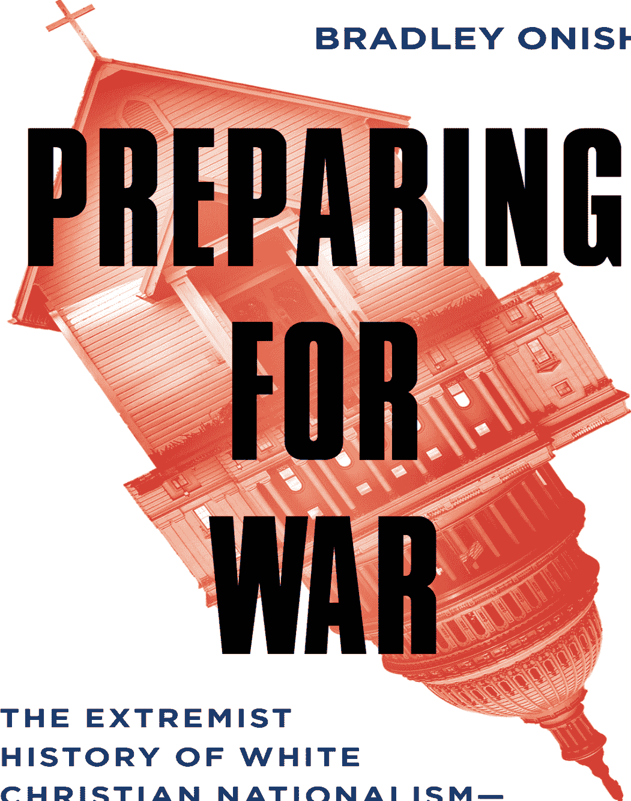

# 战争准备：白人基督教民族主义的极端历史及其未来走向

> “引人入胜且必读之作。”
>
> —凯瑟琳·斯图尔特（Katherine Stewart），《权力崇拜》作者

## 赞誉《准备战争：白人基督教民族主义的极端历史——以及未来走向》

“在这部兼具回忆录与文化政治历史的引人入胜学术著作中，奥尼利用他作为前基督教民族主义运动内部人士的经历，揭露了1月6日骚乱背后的激进主义。对于任何想要理解这一运动对美国民主构成的威胁的人来说，这都是引人入胜且必要的读物。”——凯瑟琳·斯图尔特，《权力崇拜：宗教民族主义的危险崛起》作者

“在《准备战争》中，布拉德利·奥尼追踪了白人基督教民族主义从白杨树协会到谎言以及1月6日恐怖袭击的历史——这段叙述因他本人与这一运动的交集而变得丰富。这是一本优秀且重要的书，既令人胆寒，又具有预言性。”——兰达尔·巴尔默（Randall Balmer），历史学家，《恶意信仰：种族与宗教右翼的兴起》作者

“《准备战争》以2021年1月6日的国会山骚乱为核心，从其激进政治野心的角度呈现了新宗教右翼。布拉德利·奥尼正在敲响警报。他认为我们并非处于终点，而是某种经宗教许可的极端主义的开始，这威胁着我们美国的民主未来。遵循宗教右翼本质的最佳学术研究，奥尼将其对自己生活经历变化的历史叙述根植于南加利福尼亚。对我们所有人来说，挑战在于审查这些重大转变如何影响了我们的生活和国家，并试图纠正我们社区中正在锻造的破坏性路径。这是一本需要结合社会学阅读的书。”——杰拉尔德·马蒂尼博士（Dr. Gerardo Martini），戴维森学院威廉·R·肯南社会学教授，《美国盲点：阶级、宗教与特朗普总统时期》作者

“布拉德利·奥尼带我们经历了一场穿越现代美国宗教和政治历史的宏大之旅，以理解导致1月6日骚乱的白人基督教美国的暴力极端倾向。通过无数次采访、深厚的学术研究以及他自己从白人基督教民族主义中逃离，奥尼的《准备战争》对发生的事情进行了清晰描述，并对即将到来的严正警告。引人入胜且及时。”——安德鲁·赛德尔（Andrew Seidel），律师，《开基神话：为什么基督教民族主义是不美国人的》作者

“这本书写给任何想要理解白人基督教民族主义者目标和动机的人。在《准备战争》中，奥尼向我们展示了神话与历史如何交织——从个人层面到国家层面——以及为什么我们必须正面这种严峻的威胁。”——布莱克·查斯汀（Blake Chastain），#Evangelical播客主持人，Irreverent Media Group 创始人

> “《准备战争》是布拉德利·奥尼对白人基督教民族主义的阐述，从其在战前南部的根源，到20世纪80年代控制共和党的‘家庭价值观’话语，一直到仍然让唐纳德·特朗普领导文化战争的反动运动。这场运动想要将时间拨回到一个点，在那个点，除了白人基督教男性以外的所有人都知道自己的位置，而白人基督教男性拥有一种社会秩序，通过公开和私下的武力展示将其他人都保持在他们的位置上。在这一刻，当这些反动力量似乎重新获得了对美国白人的控制，并将神政愿景强加于我们其他人时，奥尼详尽而细致的历史至关重要。如果你曾发现自己困惑并质疑，一个据说是为了‘宗教自由’而建立的国家是如何演变成一个邻近神政的‘基督教国家’的，那么《准备战争》是必要的读物。”——托里·威廉姆斯·道格拉斯（Tori Williams Douglass），作家、演讲者、教育工作者及 White Homework 创作者

## 序言

### 之前与之后

**之前与之后：国会山骚乱**

“在这部兼具回忆录与文化政治历史的引人入胜学术著作中，奥尼利用他作为前基督教民族主义运动内部人士的经历，揭露了 1 月 6 日骚乱背后的激进主义。对于任何想要理解这一运动对美国民主构成的威胁的人来说，这都是引人入胜且必要的读物。”——凯瑟琳·斯图尔特，《权力崇拜：宗教民族主义的危险崛起》作者

“在《准备战争》中，布拉德利·奥尼追踪了白人基督教民族主义从白杨树协会到谎言以及 1 月 6 日恐怖袭击的历史——这段叙述因他本人与这一运动的交集而变得丰富。这是一本优秀且重要的书，既令人胆寒，又具有预言性。”——兰达尔·巴尔梅，历史学家，《恶意信仰：种族与宗教右翼的兴起》作者

“《准备战争》以 2021 年 1 月 6 日的国会山骚乱为核心，从其激进政治野心的角度呈现了新宗教右翼。布拉德利·奥尼正在敲响警报。他认为我们并非处于终点，而是某种经宗教许可的极端主义的开始，这威胁着我们美国的民主未来。遵循宗教右翼本质的最佳学术研究，奥尼将其对自己生活经历变化的历史叙述根植于南加利福尼亚。对我们所有人来说，挑战在于审查这些重大转变如何影响了我们的生活和国家，并试图纠正我们社区中正在锻造的破坏性路径。这是一本需要结合社会学阅读的书。”——杰拉尔德·马蒂尼博士，戴维森学院威廉·R·肯南社会学教授，《美国盲点：阶级、宗教与特朗普总统时期》作者

“布拉德利·奥尼带我们经历了一场穿越现代美国宗教和政治历史的宏大之旅，以理解导致 1 月 6 日骚乱的白人基督教美国的暴力极端倾向。通过无数次采访、深厚的学术研究以及他自己从白人基督教民族主义中逃离，奥尼的《准备战争》对发生的事情进行了清晰描述，并对即将到来的严正警告。引人入胜且及时。”——安德鲁·赛德尔，律师，《开基神话：为什么基督教民族主义是不美国人的》作者

“这本书写给任何想要理解白人基督教民族主义者目标和动机的人。在《准备战争》中，奥尼向我们展示了神话与历史如何交织——从个人层面到国家层面——以及为什么我们必须正面这种严峻的威胁。”——布莱克·查斯汀，#Evangelical 播客主持人，Irreverent Media Group 创始人

> “《准备战争》是布拉德利·奥尼对白人基督教民族主义的阐述，从其在战前南部的根源，到 20 世纪 80 年代控制共和党的‘家庭价值观’话语，一直到仍然让唐纳德·特朗普领导文化战争的反动运动。这场运动想要将时间拨回到一个点，在那个点，除了白人基督教男性以外的所有人都知道自己的位置，而白人基督教男性拥有一种社会秩序，通过公开和私下的武力展示将其他人都保持在他们的位置上。在这一刻，当这些反动力量似乎重新获得了对美国白人的控制，并将神政愿景强加于我们其他人时，奥尼详尽而细致的历史至关重要。如果你曾发现自己困惑并质疑，一个据说是为了‘宗教自由’而建立的国家是如何演变成一个邻近神政的‘基督教国家’的，那么《准备战争》是必要的读物。”——托里·威廉姆斯·道格拉斯，作家、演讲者、教育工作者及 White Homework 创作者

No definitive answers as to how we arrived at this political moment exist. There are many ways to tell this story and to investigate the 导致叛乱的历史事件。其中涉及的人物和历史标记也多到无法详尽介绍。有些学者关注于比利·格拉姆（Billy Graham）和理查德·尼克松（Richard Nixon）等人物；另一些人则目光长远，回溯到 19 世纪以解释现状；还有人则专注于性别、性以及移民，以理解美国白人基督教的历史。我感谢遵循这些路线的学者和记者，本书在许多处借鉴了他们的见解。

我也非常感激许多黑人作家，他们阐述了像我在书中所做的那样，将“White”（白色）大写的原因。虽然“Black”（黑人）长期以来一直被大写，但“White”（白色）并没有。许多风格指南建议对前者大写，而对后者不。在我看来，将“White”大写很重要，为了引起人们关注它作为一个需要观察和调查的种族类别。长期以来，“白人身份”（whiteness）一直是隐形的，尤其是对白人自己而言。正如内尔·欧文·潘特（Nell Irwin Painter）所说：“我们应该大写‘White’，将‘白人身份’置于美国的种族意识形态之中；在这种意识形态中，‘Black’作为一种群体身份是过度可见的，而‘White’却不是。”通过大写“White”，我们关注到了这一在美国及其他地区具有特殊历史的特定种族类别。

为了聚焦这部作品，我决定讲述自 20 世纪 60 年代以来白人基督教民族主义的兴起故事。当时，各种文化和政治运动改变了美国，并导致各种民权和文化表述形式延伸到宗教、种族、性别和族裔群体。这引发了一场反革命，其结果包括在内的有：宗教对特朗普总统职的支持，以及基督教民族主义在 1 月 6 日叛乱中的核心作用。追溯这条路径，让我们能够看到“白人基督教国家”的神话如何为我们极极化的公共广场提供了基础——这等同于一场美国式的冷内战——以及两个世纪以来美国国会大厦发生的最恶劣的事件。

# 第一章

## 我本会在场吗？

2021 年 1 月 6 日第一个阳光明媚的时刻，我正漂浮在太平洋上。在晨分醒来并去冲浪后，我很惊讶那天早晨没有其他冲浪者出现；这是一种罕见的欢迎现象。有了如此的思考空间，我的思绪延伸到了周围无尽的蓝海中。前一天，佐治亚州参议院决选选举中民主党的两场意外胜利令我欣喜若狂。当太阳在加利福尼亚北部升起时，我想起了拉法尔·沃诺克（Raphael Warnock），一位黑人牧师，以及三十多岁的犹太人乔恩·奥索夫（Jon Ossoff），他们代表这个“桃子州”进入了参议院。民主党现在将以极其微小的优势控制了白宫和国会两院。

我的脸因为 40 华氏度和 50 多华氏度的水温而变得麻木，但我的身体充满了期待。也许我们正在走向更好的日子，我坐在冲板上，凝望着地平线，勾勒出从圣克鲁斯角到海赛德的蒙特利湾长长的连续弧线。在萎缩且阴险的美国愿景下生活了四年，我准备好让这个国家从前任政府的短视中解脱出来，再次前进。

作为一名教授美国历史中种族主义、厌女症、排外症和恐同症课程的学者，我本应该更清楚。我确实清楚。我告诉过学生百万次：即使宇宙的弧线向正义弯曲，它也不是一条直线。它是一条折线，或者是一条折返回自身的曲线，充满了环路和急转弯。

尽管如此，很难不感到宽慰，甚至是兴奋。在回家之前，我以大海为背景拍了张自拍。画面中，阳光柔软而金黄；我的头发还是湿的，我正平静地微笑。现在当我看那张照片时，我对我眼中闪烁的光芒感到惊讶，对我微笑中的期待感感到惊讶。

当我那天早上晚些时候回到办公室时，一切都变了。当我坐在电脑前时，暴徒突破美国国会大厦的图像开始在我的屏幕上流动。在几分钟内，当我看着暴民占领国会大厦试图推翻 2020 年总统选举时，我的喜悦变成了恐惧。最初的视频片段显示，成群的挥着特朗普旗、戴着 MAGA 帽子的人群成群涌入国会大厦。他们冲破障碍，击溃了国会警察，夺占了大楼。看起来完全就像一支入侵军队推翻敌对政府的视频。

我发布在社交媒体上的第一张照片是从国会大厦底部向上仰望圆顶拍摄的一张静止照片。一面巨大的蓝色特朗普旗占据了画面的上三分之一。两个穿黑衣服的男人在两侧举着它，其中一人胜利地挥动着空着的手。烟雾弥漫在整个画面中。与画面上方三分明亮的圆顶形成对比，灰色雾气营造出一种诡异的气氛。国会大厦看起来像一座闹鬼屋。这是对美国民主最重要、最具标志性的建筑极其令人震惊的描写。

我曾住在华盛顿特区的国会山山区，距离国会大厦不到一英里。虽然我走路去健身房或去超市时几乎每天经过那里，但每当这座建筑出现在视野中，它的庄严感都会震撼我。现在它那荒凉的景象令我不安。像其他百万美国人一样，我觉得民主正从我的眼前崩塌。

当看到暴民的视频在我的屏幕上流动时，我开始注意到其他东西。宗教符号开始出现在视野中。在一个画面中，我看到一个愤怒的男人挥舞着一面“耶稣是我的救主——特朗普是我的总统”的旗，背景是被围困的国会大厦。愤怒和怨恨渗透了这张照片。在另一个画面中，我看到了带有圣经经文的横幅；在又一个画面中，一座耶稣像被全景拍摄，特朗普旗、基督教旗、加兹登旗（“别踩我”）和邦联旗并排飘扬。旗帜彼此如此近，甚至互相接触。那排旗帜连同点缀在国会台阶上的暴徒群——嗯，这看起来就像一个被入侵者占据的国家视频。如果你不知道真相，你会认为暴徒们取代了“老星条”，换上了一套代表他们新国家及其政治-宗教领袖的新旗帜。

看着屏幕上上演的叛乱，我想起前一天晚上，第二次“约利科游行”在国会大厦不远处举行。组织者称其为一次祈祷集会，那场游行是 MAGA 国家最狂热的宗教和阴谋论领袖的聚集——从迈克尔·弗莱林（Michael Flynn）到亚历克斯·琼斯（Alex Jones），再到作家兼电台节目主持人转变为特朗普派明星的埃里克·梅塔克斯斯（Eric Metaxas）。我想起了大约一个月前，即 2020 年 12 月 12 日举行的第一次约利科游行。来自南加家乡的朋友告诉我，我以前所属的那个福音派大型教会的人参加了那次活动。

我眯眼盯着屏幕，看得更仔细了。那是 1 月 5 日第二次约利科游行中我认识的人吗？那些在教堂里坐在我旁边的人，现在是否正在冲进国会大厦，而全世界都在注视等待他们是否会成功？

大联盟的安纳海姆天使队。这片距离洛杉矶只有 30 英里的约巴林达（Yorba Linda），感觉与好莱坞的繁华以及 1992 年虐待罗德尼·金的警察被判无罪后爆发暴乱的城市街道隔着两个世界。

那个周三之后，凯莉就抛弃了我，青少年小组很快成了我的第二个家。当我第一次去那里时，我本以为会遇到一个像《辛普森一家》里尼德·弗兰德斯（Ned Flanders）那样的人。相反，我遇到了一些带着纹身、玩基督教朋克乐队的酷青少年领袖。他们教我耶稣如何宽恕我的罪孽并赐我永恒的救赎。他们告诉我，我生存危机的答案在于上帝对我生命计划的意义和目的。他们解释说，圣经并不是一本枯燥的古书，而是一封“创造者给我的私人情书”。

我的皈依非常极端。直到 1995 年 4 月，我还是一个生活在垃圾摇时代的八年级生，用他的便携式 CD 播放器大声播放着涅槃乐队（Nirvana）、珍珠乐队（Pearl Jam）和酷南瓜乐队（The Smashing Pumpkins）——我是一个正在尝试药物、性与破坏公物的人；一个被停过学的学生；一个因染各种颜色的头发而让父母担心不已的人。但在访问罗斯大道（Rose Drive）不久后，我成了一个真正的“耶稣狂热分子”。加入罗斯大道的青少年小组，我觉得自己发现了一个隐藏的世界，这个世界一直就在我面前，但我曾错过了或刻意忽略了它。

很快，我的身份扭曲在了纯洁誓言、将生命献给救主的投入和重新奉献，以及对迷失者的传教中。我用童年朋友换取了教会里新的羊群。我不再偷偷躲在电影院后面抽烟，而是和我的新战友们一起站在剧院前，希望能与每个路过的路人谈谈他们的永恒命运和上帝对他们生命的计划。在南加州那种沉溺于反叛、淫乱、通奸和猥琐的文化中，我们把自己塑造成一个“被选的少数群体”。我们哀叹邻居和国家放弃了祖先的信仰，转向世俗人文主义和达尔文的进化论。在学校，我们谴责堕胎的暴行。我们屏息以待主之降临，知道耶稣随时会回来接我们回家。

十四岁时，我从一个口嘴伶俐的小孩变成了一个狂热的信教追随者。我是那个在学校午餐时间带领圣经学习的人，是在海边散步道上向陌生人传教的人，是那个手里不拿圣经绝不出门的人。2001 年，我与我的高中恋人结婚，并在罗斯大道友谊教会（Rose Drive Friends Church）成为一名全职青少年牧师。在那个岗位上，我作为精神领袖监管着两百名孩子的羊群。当时我才二十岁。

## 什么是福音主义？

# 美国福音派不同派系的历史和信仰体系

美国福音派不同派系的历史和信仰体系是非常复杂的；取决于你观察的时间段以及阶级、政治和地理维度，它们看起来大不相同。在划分美国福音教徒时，种族尤为决定性。然而，基本教义相当简单：圣经是不费吹力的神的话，应该尽可能字面上地阅读和遵循。与天主教不同，等级制度和传统不是权威的来源。相反，充满活力的讲师邀请崇拜者参加更像现代帐篷的聚会而非庄严的仪式。福音教徒不在意庆祝圣人，或（除极少数人外）维护教会的礼拜传统。他们将权威置于圣经以及那些在他们脑中忠实传授圣经的人身上。传播福音是福音教徒的首要任务，因为他们相信，所有不接受基督作为自己个人救主的人都将在地狱中度过永恒。

许多福音教徒预计耶稣很快就会回来，而来到空屋的福音派孩子有时会想，他们的家人是否已经被升上天堂，而他们因为某些未被承认的罪而被留下了。其他宗教被视为虚假教义，几乎没有价值。对于大多数福音教徒来说，宗教对话在某种程度上是自相矛盾的，因为他们认为其他宗教是不合法的。此外，福音教徒认为自己“不属于这个世界”，因为他们真正的家园是与耶稣和父神同在永恒天堂。“世界”是一个邪恶的敌人，沉溺于罪恶和淫乱。信仰与文化之间没有融合。相反，存在着一场追溯到《创世记》第3章蛇诱惑亚当和夏目的战斗。这就是为什么福音教徒对社会正义的讨论过敏。他们认为对不平等、种族主义和其他不公问题的社会或政治解决方案是解决世俗问题的软弱方法，他们更倾向于他们认为的圣经方法——即他们认为的个人救赎来解决社会问题。真正的基督徒不关注喂养饥饿的人。他们喂养饥饿的灵魂。

## 失去我的宗教

2005年，在这一运动中度过了十一年、事工中度过了七年后，我离开了福音主义。我教会的长老们一直告诉我，如果我读的书太多，我的大脑就会劫持我的心，并带我离开教会。事实证明他们是对的。

当我在大学期间及之后开始广泛阅读神学、哲学和教会历史时，我的视角开始扩大和改变。对我来说变得清晰的是，我们在教会中归于圣经的永恒性是现代发明的产物。我们得知，坚定支持反对任何形式的堕胎而投票给共和党，是由共和党特工推动的，他们剥削未出生儿来获取数百万选票。从那里开始，我消化了福音派关于性、性别、种族和移民的神学历史。当我阅读、学习并反思自己的经历时，画面变得更加复杂但也更加生动：白人福音派是一场深陷于美国民族主义、白人至上主义、父权制和排外心理的运动。

在我仍在从事事工期间得出这些启示并不容易。有些周日，我会在两百名青少年面前带领祈祷，心想着……

（注：原文在此处中断，译文随原文提供的文本结束）

学术训练旨在帮助更广泛的公众理解 `MAGA` 国家的宗教元素——这是一个由美国人（主要是白人）组成的联盟体，他们支持特朗普及其“美国优先”的雄心。我们最终决定办一个播客节目。

几个月后，当丹和我开始制作《直率白人美国耶稣》（Straight White American Jesus）播客时，我们想要探索与种族、性别、性以及政治相关的问题，以解开一个在旁观者看来毫无逻辑的谜团。那些随处宣扬圣经的人，怎么会支持一个显然从未读过圣经的人呢？那些在比尔·克林顿性丑闻后要求他辞职的牧师，又怎么会支持一名性工作者，并欢喜地描述性侵女性？当一个男人既不谈论耶稣也不去教堂，却在追求边境墙、禁止穆斯林和为富人减税时，他们为什么不放弃他？我们的赌注是，通过解决这些及更多问题，我们可以为那个时代的宗教政治色彩提供一个有用的视角。

我们的目标很谦卑。我们认为播客可以帮助我们的一些同事和朋友掌握重要问题。至少，将对特朗普政府的宗教支持与我们福音派的过去联系起来，会是一种宣泄。我们完全不知道我们的研究和对话会变得多么重要。当我们启动节目并邀请嘉宾与我们谈论大家所看到的一切时，我们知道我们的对话很重要。我们知道，对于我们的国家来说，弄清楚是怎样的民族主义、种族主义和宗教的混合让特朗普当选的至关重要。

而我们不知道的是，在两年之内，一群武装暴徒在深信选举——以及“他们的”国家被窃夺后，冲进了国会大厦，意图刺杀众议长。

## 我会在场吗？

当我看到 1 月 6 日的暴徒进入国会大厦时，他们中许多人拿着“耶稣 2020”旗帜，身穿“信仰、家庭、自由”的 T恤，我开始担心和好奇。在接下来的几天和几周里，事实变得很清楚：一车白人福音徒确实在暴徒之中，他们与教会的邻居和朋友一起从华盛顿特区。如果我没有离开那个运动，我会在那里吗？或者如果我没有亲自去，我是否会默许地看着那些画面，或许为那些即使在困难时期也愿意履行上帝旨意的“爱国者”们祈祷？

在 J6 动乱几天后，我旧教会的朋友告诉我，来自我们家乡地区教会的几十人去了那里，甚至有更多在家的人认同暴徒的行为。这个看起来像边缘运动的群体，竟然充斥着我旧教会周围富裕郊区的小企业主、会计师和律师。我感到一阵恶心，我向自己承认，如果历史以不同的模式展开，我本可能是他们中的一员。

一方面，我对自己说，你会从一个青年的狂热分子转变为一个满脑狂热的教授。你的大脑永远不会让你的身体飞往华盛顿。你会看到这种行为是愚蠢的，对吧？对吧？

另一方面，我的这种满脑狂热恰恰让我变得如此极端。在研究了福音派教义的逻辑组成部分——例如耶稣可能随时回来的想法——之后，在青少年时期，我就致力于以最严格的方式践行这些教义——即使这意味着社交上的尴尬和家庭的不认可。我显然曾是一个狂热分子，而现在我无法得知那种狂热会带我走向何方。

我觉得自己正从两个视角审视这场奇剧。作为前内部人士，我的身体里带着义愤的记忆，这种义愤引发了我对堕胎问题以及美国政府对基督教“攻击”的愤怒。我记得曾信任那些拥有信仰的牧师和长老，这种信仰激励我放弃批判性思考，转而进行激进的服从。如果那是通过“停止窃取”来拯救我的国家免于毁灭，我想，像 1776 年的爱国者一样祈祷并投身战斗是合理的。在某些令我惊讶的时刻，要让自己代入暴徒的处境并不难。

然而，作为一名分析了多年白人基督教民族主义的学者，我意识到国会大厦政变是半世纪以来爱国主义基督徒准备战斗的逻辑结果。它是由“新右翼”（New Right）发起的——这是一场于 20 世纪 60 年代的保守政治运动，准备好使用任何手段阻止文化革命，并将国家交还给白人土地主。20 世纪 70 年代，“宗教右翼”（Religious Right）——一个由福音派徒和天主教徒组成、致力于恢复旧宗教和家庭价值观的明确政治联盟——与新右翼结盟。他们共同形成了“新宗教右翼”。在结盟后的半世纪里，他们的基督教民族主义使命一直是为上帝夺回美国，并交给他们认为值得以上帝之名掌握掌权的人。

在许多方面，正是新宗教右翼的白人基督教民族主义让我在八年级时重新“皈依”了。因此，对我而言，1 月 6 日是我参与了十一年的文化战的物理体现——这场战争将上帝的爱国者置于一方，将无神论爱国者置于另一方。十多年来，我学习了这场战争的地形。从中心开始，是一场为上帝夺回国家的战斗。基督徒需要站起来，进入领导和影响力职位，确保国家不会落入无神论者和激进左翼分子手中——即使攀爬政治阶层和维持权力需要民主策略。

在其中一方，是一场针对“政府学校”的独立但相关的战斗，通过不受监管的家庭教育课程和私立学院进行。在另一方，是维护“传统家庭”对抗“同恋议程”和女性权利运动的斗争。这种冲突与激进的反堕胎运动合并，反对堕胎这一场“大屠杀”。这场战争中的士兵在一种特定的男子气模式下接受训练。在青少年时期，我生活中的男性长老教我，基督教男子气的最好典范来自《勇敢玲的心》和《爱国者》等吉布斯电影，一位勇敢的英雄拒绝政府夺走人民的生活方式，并成功地引发了革命。

我在 1 月 6 日直觉感觉到，基督教民族主义对我们民主的战争并非始于 2020 年 11 月选举之后。它甚至不是从特朗普开始的。它已经持续了半个世纪。特朗普的“大谎言”仅仅提供了将其从政治和文化层面推向政变的动力。

## 基督教民族主义的三个维度

民族主义存在于光谱上。某些基督教民族主义者是极端分子，并倾向于暴力。另一些则没那么激进，但愿意认同关于美国所谓的基督教奠基或上帝对国家计划的基督教民族主义教条。基督教民族主义是一个光谱，是因为根据佩里（Perry）和怀特海（Whitehead）的观点，与其说是基督教信仰和教义，不如说是关于“历史认同、文化优势和政治影响力”。它不是一种稳定的意识形态，而是一种文化认同。它关乎一个人如何看待自己以及他所处的故事，而不是一个连贯的神学信仰体系。

对于佩里和怀特海来说，基督教民族主义有三个基础组成部分：基督教国家神话、对过去的怀旧以及对国家未来的末世观。理解基督教民族主义的这三个维度，对于弄清 1 月 6 日发生了什么以及未来可能发生什么至关重要。

### 第一维度：基督教国家神话

构想基督教民族主义第一个方面简单的方法是将其视为十字架与国旗的结合。在意识形态上，基督教民族主义者认为这个国家是为基督徒并由基督徒建立的。他们遵循清教徒牧师温斯罗普（Winthrop）的特定愿景，即美国作为一个国家被建立，是为了成为一座“山上的城”，是世界之光。他们认为自己是美国叙事的核心，不仅是因为他们是一个在上帝统治下的国家，而且是因为他们被上帝选定，在世界历史中扮演特殊角色。基督教元素——对上帝统治和选民的信仰——与白人民族主义意识形态融合在一起：即美国优于所有其他国家，我们在政策和贸易上应该采取“美国优先”的方法，白人理应留在社会、政治和经济阶级的顶端。基督教民族主义者认为美国是一个“基督教国家”，尽管——（这可能令人惊讶）——他们中的一些人并不经常去教堂、不读圣经或不祈祷。如果你认为这个国家是被上帝选中的，基于宗教原则建立的，并且偏离了其神圣奠基进入了罪恶的状态，那么你可能是一个基督教民族主义者——即使你只是（或完全不是）一名实行的基督徒。

通过使用基督教神话，基督教民族主义的宣传并不局限于白人福音派的特定子集。你的教派划分并不重要；你可以与基督教民族主义运动中的其他信徒团结在一起，运动的核心是将国家从“无神的毁灭”中“拯救”出来。虽然数据显示，超过 80% 的白人福音派人士在某种程度上认同为基督教民族主义者，但这个神话足够广泛，可以包含非新教徒。佩里和怀特海显示，近一半的美国主教徒也在某种程度上记录为基督教民族主义者。还有圣徒（摩门教）成员甚至一些犹太人也符合这一类别。

这解释了基督教民族主义令人困惑的一个方面：它通常与教派认同或个人宗教实践并不相关。许多基督教民族主义者几十年没有去过教堂，像水手一样地咒骂，而且在圣经中找不到《哥林多后书》（正如特朗普曾那样称呼它）。“耶稣 2020”和“特朗普是我的总统——耶稣是我的救主”是一个群体认同的旗帜——是他们属于哪个群体以及他们正在经历什么故事的指标——而不是他们个人宗教实践的指标。

### 第二维度：对过去的怀旧与衰落叙事

除了相信美国是作为一个基督教国家建立之外，基督教民族主义者还坚信这个国家随着时间的推移，由于外部入侵者和不虔神的力量日益显赫，已经发生了衰落。正如佩里和怀特海所认为的，基督教民族主义者认为美国类似于希伯来圣经中的以色列（基督徒称为旧约）：如果一个国家不遵守上帝的命令，它应该预料神性的惩罚和毁灭。基督教民族主义者在自己心中掌握着上帝想要什么、他命令什么，以及当国家受到“惩罚”时谁该负责。

例如，在 911 事件几天后，杰里·法尔韦（Jerry Falwell）——现代白人福音派的领袖之一，宗教右翼的关键人物——表示恐怖袭击是上帝对我们罪孽的惩罚：

> “通过联邦法院系统成功地将上帝赶，将上帝赶出公共广场，赶出学校……堕胎者必须承担某些责任，因为上帝不会被嘲笑的。当我们毁灭了 400 万个无辜的小婴儿时，我们激怒了上帝。异教徒、堕胎者、女性主义者、同性恋和女同恋以及积极试图尝试替代生活方式的美国公民自由会、美国道路之友——所有这些试图让美国世俗化的人。我指着他们的脸说‘你们帮助了这一切的发生’。”

对于法尔韦来说，女性主义者、LGBTQ 社区成员和美国公民自由会类似于以色列国家的入侵者。惩罚不仅是他所视为不服的直接结果，而且反映了国家如何允许那些没有领导权和权威的人——女性、种族少数、性身份认同少数群体以及其他人——塑造国家的伦理。

这种观点在法尔韦的福音派同伴中是共有的。在卡特里娜飓风之后，著名的巨型教会牧师约翰·哈吉（John Hagee）说：“我相信新奥尔良的罪恶程度冒犯了上帝，他们是上帝这一审判的接受者。”比尔·格拉姆（Billy Graham）之子富兰克林·格拉姆（Franklin Graham）不得不说：“这是一个邪恶的城市，对吗？它以狂欢节、崇拜撒旦闻名。它以各种药物、酒精、交欢以及在新奥尔良发生的这一切事情闻名。新奥尔良多年笼罩着一片黑色的灵性云。”法尔韦、哈吉和格拉姆等基督教民族主义者的普遍观点是：一个基督教国家，美国与上帝有一个盟约，用顺服和忠诚换取保护和祝福。在他们看来，国家感知到的衰落是由于违背了上帝的盟约。

因此，国家面临的任何困难都可以被归结为对上帝忠诚的缺失。

### 第三维度：对国家未来的末世观

（注：原文在第三维度的详细阐述部分出现大量重复内容，此处已去重。核心观点为：基督教民族主义者持有末世论视角，认为国家偏离神圣奠基将面临审判，这种神学框架为政治行动提供了紧迫性与合法性，将政治斗争转化为属灵争战，最终导向 1 月 6 日国会山骚乱等极端行动。）

# 白人基督教民族主义的兴起与反革命

## 核心信念：盟约、衰落与神圣惩罚

除了相信美国是作为一个基督教国家建立之外，基督教民族主义者还坚信这个国家随着时间的推移，由于外部入侵者和不虔神的力量日益显赫，已经发生了衰落。正如佩里和怀特海所认为的，基督教民族主义者认为美国类似于希伯来圣经中的以色列（基督徒称为旧约）：如果一个国家不遵守上帝的命令，它应该预料神性的惩罚和毁灭。基督教民族主义者在自己心中掌握着上帝想要什么、他命令什么，以及当国家受到“惩罚”时谁该负责。

例如，在“9·11”事件几天后，杰里·法尔韦——现代白人福音派的领袖之一，宗教右翼的关键人物——表示恐怖袭击是上帝对我们罪孽的惩罚：

> “通过联邦法院系统成功地将上帝赶出公共广场，赶出学校……堕胎者必须承担某些责任，因为上帝不会被嘲笑的。当我们毁灭了4000万个无辜的小婴儿时，我们激怒了上帝。异教徒、堕胎者、女性主义者、同性恋和女同性恋以及积极试图尝试替代生活方式的美国公民自由会、美国道路之友——所有这些试图让美国世俗化的人。我指着他们的脸说‘你们帮助了这一切的发生’。”

对于法尔韦来说，女性主义者、LGBTQ社区成员和美国公民自由会（ACLU）类似于以色列国家的入侵者。惩罚不仅是他所视为不服的直接结果，而且反映了国家如何允许那些没有领导权和权威的人——女性、种族少数、性身份认同少数群体以及其他人——塑造国家的伦理。

这种观点在法尔韦的福音派同伴中是共有的。在卡特里娜飓风之后，著名的巨型教会牧师约翰·哈吉（John Hagee）说：“我相信新奥尔良的罪程度冒犯了上帝，他们是上帝这一审判的接受者。”比尔·格拉姆之子富兰克林·格拉姆（Franklin Graham）不得不说：“这是一个邪恶的城市，对吗？它以狂欢节、崇拜撒旦闻名。它以各种药物、酒精、交欢以及在新奥尔良发生的这一切事情闻名。新奥尔良多年笼罩着一片黑色的灵性云。”法尔韦、哈吉和格拉姆等基督教民族主义者的普遍观点是：一个基督教国家，美国与上帝有一个盟约，用顺服和忠诚换取保护和祝福。国家感知到的衰落，在他们看来，是由于违背了上帝的盟约。

因此，国家面临的任何困难都可以被归结为对上帝忠诚的缺失。构想基督教民族主义第一个方面简单的方法将其视为十字架与国旗的结合。在意识形态上，基督教民族主义者认为这个国家是为基督徒并由基督徒建立的。他们遵循清教徒牧师温斯罗普的特定愿景，即美国作为一个国家被建立，是为了成为“山上的城”，是世界之光。他们认为自己是美国叙事的核心，不仅是因为他们是一个在上帝统治下的国家，而且是因为他们被上帝选定，在世界历史中扮演特殊角色。基督教元素——对上帝统治和选民的信仰——与白人民族主义意识形态融合在一起：即美国优于所有其他国家，我们在政策和贸易上应该采取“美国优先”的方法，白人理应留在社会、政治和经济阶级的顶端。基督教民族主义者认为美国是一个“基督教国家”，尽管——（这可能令人惊讶）——他们中的一些人并不经常去教堂、不读圣经或不祈祷。如果你认为这个国家是被上帝选中的，基于宗教原则建立的，并且偏离了其神圣奠基进入了罪恶的状态，那么你可能是一个基督教民族主义者——即使你只是（或完全不是）一名实行的基督徒。

## 个人经历：末世论逻辑的内化

作为青少年，我亲身体会了叙事是多么具有激励性。在皈信后，我的青年领袖向我介绍了电影《午夜窃贼》（Thief in the Night），该片声称耶稣可能随时回来带所有基督徒去天堂，留下不信者遭受大灾难和永恒的惩罚。作为一个倾向于用极端逻辑支配生活的皈依者，我决定最好的时间利用是在世界末日之前尽可能转化更多人。我站在电影院外发福音传单，在高中午餐时拿着圣经走向陌生人，在家庭聚会上与堂表兄弟在愉快的对话中注入耶稣。尽管我毕业那年我是篮球队长，但我是我团队中唯一没有校队夹克的人。我怎么能把钱花在这样奢侈的物品上，而我们可以把这些资金投向需要耶稣基督好消息的人呢？

基督教民族主义在国家政治尺度上应用这种危机逻辑。政治人物和牧师警告说，除非爱国者和好人采取信仰的行动，这个国家将被“无神论、共产主义”运动所摧毁，这些运动现在包括女权主义、黑人命关重要（Black Lives Matter）和世俗主义。“事实是，在乔·拜登的美国，你们是不安全的，”副总统迈克·彭斯在2020年大选前说道。唐纳德·特朗普通过这样给了他支持，声称选举是“社会主义噩梦与美国梦之间的选择”。这种情绪得到了布莱恩·吉布森等基督教民族主义者牧师的共鸣，他们说如果拜登获选，那就是“美国的死亡”，因为选出乔·拜登是“马克思主义的胜利”。对于基督教民族主义者来说，选择不在两个可行的候选人之间，而是在拯救国家与目睹其灭亡之间。

从对选举的末日思考到对政治对手的魔鬼化只有一步之遥。在这个系统中，相信他们有能力——甚至可能正在实施想象中最邪恶的暴行是有逻辑的。我们将看到，像 QAnon 这样的阴谋论是如何如此容易地适用于基督教民族主义的世界观的。如果你相信国家处于一场善与恶的宇宙大战中，那么很难跳跃到认为存在一个巨大的阴谋，其中一个全球精英集团正试图为了服务撒旦而推翻美国。这种世界观也让你能够魔化你的政治敌人——字面意义上的那种。“她是一个卑鄙的、病态的、来自地狱的魔鬼，”流行的阴谋论者亚历克斯·琼斯在2016年评价希拉里·克林顿时说道。“我告诉你，她是一个魔鬼。”

基督教民族主义通过将我青少年时期采用的末日宇宙观扩大到国家政治语境中，使人们陷入阴谋论极端主义。剧本是这样写的：我们没有多少时间拯救国家了；如果我们不此视为红警状态，并将所有的精力和精力投入这场运动，这个国家将被马克思主义者和社会主义永远摧毁。

政治对手变成了魔鬼。选举变成了末日审判。国家的历史被视为一场宇宙大战，一方是共和国的敌人，另一方是敬畏上帝的爱国者——以及天地的主宰。

## “白人”与白人基督教民族主义有什么关系？

种族与基督教民族主义的构建和践行息息相关。在一项关于种族不平等观念的研究中，佩里和怀特海明确指出，也有黑人民族主义者，但他们看待国家及其历史的方式与白人同类截然不同。与白人基督教民族主义者不同（他们很大程度上将种族不平等归因于黑人的懒惰和缺乏动力），佩里和怀特海发现“承认自己是真正的美国人的黑美国人更有可能将黑白不平等归因于种族歧视和教育机会。”这意味着，佩里和怀特海认为，“将基督教身份与美国身份结合并不一定加强白人至上，但对于黑美国人来说，它实际上可能唤起种族正义和结构性变革的理想。”

总体而言，黑人民族主义者将基督教视为根除不平等和不公正政治和社会制度的手段。拉斐尔·沃诺克在马丁·路德·金曾就过的讲坛上讲道，他是自重建时期以来第一位从深南部当选参议员的黑人民主党人。沃诺克这样描述：“我一直试图引导我们走向人性中最高的理想，以及我们作为美国人彼此之间的契约——即我们所有人都有机会为自己和家庭创造繁荣的生活。”对于大多数将美国视为与上帝立契约的国家的黑美国人来说，目标不是维持现状或让国家回到一个神话般的田园式过去。相反，这个版本的基督教民族主义推动国家向前发展以实现其潜力，并充分体现了所有人生而平等、拥有追求生命、自由和幸福的权利这一观点。

对于白人基督教民族主义者来说，情况则是另一回事。总的来说，他们的目标不是让美国第一次符合其理想，而是让国家回到一个所谓的繁荣的田园式时期。虽然基督教民族主义并不局限于福音派，但正如我们所见，后者占了该群体的很大比例，并且在白人基督教民族主义修辞的发展中起到了塑造性作用（将在第3和第4章中详细介绍）。詹内尔·王格博士在她2018年关于福音派和移民的著作中显示，白人福音派人士在反对“黑人命关重要”运动、对奴隶制国家道歉、向富人征税以及移民方面是极端的离群值。白人福音派人士反对这些问题的概率是他们的拉丁裔、亚裔和黑人同类的两倍多——有时甚至是三倍。本质上，数据显示了“白人福音派”中的“白人”如何使群体在一系列政治和社会问题上成为独特的极端分子子集。

这让王格得出结论，福音派对特朗普的支持源于社会政治地位的丧失。她指出，白人福音派人士认为自己是歧视的受害者。正如我在书中讨论的那样，我是一个混血族，曾亲身体验过“白人基督教民族主义者”中“白人”的决定性。“白人基督教民族主义者”列车中的“白人”是、也一直是引擎。事实上，白人身份不仅于此——它是基督教例外主义火车机车的引擎也是燃料，既是轮子也是轨道。虽然车厢侧面的标志可能写着“基督教”，但白人身份以及对失去种族地位的恐惧，才是推动列车沿着轨道迈向美国文化和政治霸权的动力。

## 为什么我们没有预料到它？

在离开福音派近二十年后，我无法知道自己是否会参与这些事件。但对于我对自己是否可能在场的这种个人思考，有一个更相关、我认为更紧迫的问题要问。考虑到白人基督教民族主义的现代历史，它帮助特朗普当选总统，并为他所发起的起义提供了整合力量，我们必须问：为什么我们没有预料到这个？我们还错过了什么？MAGA运动在未来几年还将会有哪些发展？在接下来的内容中，我尝试回答这些问题。

虽然牧师和政治操作员是这个故事的核心人物，但这一现代运动的创始人之一是一个来自美国西部的牛仔汉——一个充满动物魔力和粗犷男子气的人，一个出生于特权阶层却如何把自己塑造成一个避开书本知识和东海岸精英主义的普通人，在经历了成功的政治生涯后，却成为了美国历史上最大的失败者。

> “举起我们的军队，他们保护我们的自由免受邪恶力量侵害。”
>
> “为我们的军队祈祷，他们保护着地球上最伟大的国家。”
>
> “请请求上帝消除我们的敌人，让我们的孩子平安。”

在我参加祈祷会的七年里，我不记得曾有任何一个人要求我们为和平祈祷。我们每周都会为武装部队和执法部门祈祷几十次。我们向上帝“举起”关于身体痊愈、家庭问题和工作晋升的诉求。我们甚至为选举结果祈祷：“主啊，请让你的旨意在这场选举中实现，让堕胎在这片土地最终非法。我们祈祷你的子民能够起来，夺回他们的国家！”但从未为和平祈祷。从未为与种族主义、暴力或贫困相关的系统性变革祈祷。从未为我们在伊拉克或阿富汗的“敌人”祈祷。

请求祈祷的会众——那些周二早起祈祷的忠实余民——都是富裕的白人。他们拥有带泳池和三车库的漂亮房子，还有船只和木屋。有些人是小企业主。另一些人是国防工业的工程师。有法官、律师、承包商和首席执行官。在讲道台上，从未有过关于财富危险的布道。相反，牧师团队遵循着一种围绕金钱的沉默准则：“不要挥霍它，因为我们需要它来维持这所巨型教会的运转。”

如果你听听周二的祈祷和周日的布道，你会认为基督教是关于个人和家庭的，关于军事力量和胜利的。你会认为它是保守政治和候选人的推动力量，是富人和权势者的朋友。在我十九岁的脑海里，这就是基督教。这些方面似乎是脱离历史的。事实上，它们根本没有出现过。它们是我呼吸的文化和宗教空气——是标准的、无处不在的，因此是显而易见的。这套宗教文化原则是如此常态化，以至于我或任何其他人很难注意到它们。

但在随后的几年里，当我把转向教会历史、神学和哲学时，我开始意识到它们是现代政治和文化的产物。我们的神学和实践并非上帝对人类启示的结果。它们是十年政治和文化反弹的结果。这种信仰与其说是基于圣经或格奎教教义，不如说是由文化战争定义的。在本章中，我将叙述我的教会，以及整个美国白人基督教，是如何成为一场基督教民族主义冲突部分的。这场冲突旨在阻止民权运动的扩张，并防止宗教、种族、性别、族裔和其他少数群体在美国的主流化。这既是一部政治历史，也是部宗教历史。

正如加利福尼亚州橙县以及美国各地的巨型教会一样，罗斯·德夫教会（Rose Drive Church）成立于 20 世纪 60 年代中期。它从未被认为是一个过度政治化的会众，但它诞生于文化战争之中，而这些文化战争为特别是白人基督教民族主义者——以及整个“MAGA 国”（MAGA Nation）目前对国家其他地区发起的战争奠定了基础。我的教会社区优先考虑个人成功、繁荣、保守政治和美国军事力量并非历史的偶然。我们将那些反对这些事情的人视为上帝的敌人，一心摧毁祂的子民和他被选定的国家，这并非一种异常。这是一场保守政治-文化-宗教运动的结果，旨在让白人基督教土地主处于美国政治和经济阶层的顶端。

这意味着，我们在罗斯·德夫周二早晨收到的祈祷是政治和法律斗争、最高法院案件、总统选举和身份政治的果实。宗教社区绝不会在真空中发展。它们包含了政治参与者和文化代理。要理解我们为什么在那些周二早晨祈祷以及祈祷什么，就有必要考虑形成教会土壤的政治和文化背景。

我的基督教深受20 世纪 60 年代政治的影响，当时白人，特别是白人基督徒觉得他们正在将国家输给那些没有权利拥有它的少数群体。作为回应，他们制定了一项激进的政治议程来阻止历史的洪流。他们坚定的自由意志主义是防止政府通过扩大被边缘化和排除之人的民权来使事情更加公平的手段。军事主义和狂热的反共主义是构想上帝治下的美国之善的方式，并与共产主义中国和苏联的无神论形成对比。个人主义和亲资本主义的神学是在系统层面上规避对弱势群体的关注的方式。核心家庭变成了捍卫美国、培养优秀公民和促进个人繁荣的首要原则。

基督教认同并非这系列文化战争的后期添加，而非政治运动中笨拙的补丁。它是整合的力量。基督教是将将成为 20 世纪 60 年代反革命的所有组件整合成一个整体的机制。

## 白人基督教民族主义反革命

现代白人基督教民族主义者将 20 世纪 60 年代视为国家真正迷失方向的时代。虽然有些人可能将废除奴隶视为美国第一次堕落（更多内容见第 3 章），但对许多人来说，60 年代是无数毒蛇诱导美国人离开信仰、家庭和自由的基石价值观，转向新的社会秩序、性革命和对核心家庭的放弃时期。

> “我们必须记住，这个国家的建立不仅基于犹太-基督教传统，还基于 20 世纪 60 年代和 70 年代的社会和道德革命，”著名福音派组织“聚焦家庭”（Focus on the Family）的执行官提提莫西·格布里奇金（Timothy Goodrichin）在 2020 年初说道。在他看来，60 年代是“对八福、对十诫的直接正面进攻”。

重要的是要理解他所指的 60 年代文化变革对基督教的冲击。60 年代见证了美国社会组织方式的剧变。民权运动始于该年代的早期，爆发了伯明翰公交车抵制等事件，并传播到亚特兰大、孟菲斯。1964 年，马丁·路德·金（Martin Luther King Jr.）与约翰逊握手，当时《民权法案》签署。这是政府试图确保黑美国人在教育、公共服务和法律权利方面与白人同平等的尝试。1967 年，最高法院在“洛宁诉弗吉尼亚州案”（Loving v. Virginia）中的裁决使跨族婚姻合法化，为像我这样拥有白人母亲和日本父亲的人的存在铺平了道路。尽管这看起来像是一个历史插曲，但最高法院的裁决向白人保守主义者传递了一个信号：维持纯洁血统和与有色种族隔离将不再受规则保护。许多人担心出现一个“杂种”国家。

在整个十年中，女性为《平等权利修正案》而战，尽管它从未通过，但理由是希望在家庭和工作场所获得平等保护。贝蒂·弗里德（Betty Friedan）于 1963 年出版了《女性的奥秘》，同年肯尼迪总统签署了《平等薪酬法》。1965 年，约翰逊总统签署了第 11246 号行政令，反对职场性骚扰。随着新家庭形式的常态化和女性大量进入劳动力市场，离婚率飙升。女性焚烧胸罩，为同工同酬喊，并游说国会获得无过离婚的权利。大约同时，美国性信息与教育委员会（SIECUS）开始与公立学区合作，为青少年提供全面的性教育。反战抗议者对他们眼中无意义的冲突和美国帝国主义的暴行表示愤怒。1969 年，石墙事件起义永远地标志着 LGBTQ 群体寻求承认和保护的转折点。

还有其他变化，那些如果你不属于某个特定的亚文化或宗教社区，可能会被你忽略的类型。1962年，最高法院审理了“恩格尔诉维泰尔案”（Engel v. Vitale）。该案涉及公立学校环境中校园祷告的宪法性，在那里学生被要求参与。此案由斯蒂芬·恩格尔（Steven Engel）以及来自纽约州海德公园的其他家长提起。这些父母对每天早上通过广播朗读的学校祷告有异议：“全能的神，我们承认对您的依赖，并恳您赐福于我们、我们的父母、我们的老师和我们的国家。”

法院以6比1的裁决支持恩格尔。这意味着在公立学校环境中禁止官方祷告，特别是在强制参与的背景下。

波特·斯图特（Potter Stewart）表示：“带着所有的尊重……”

一年后的1963年，法院在另一个类似的案件中做出了相同的裁决。在“阿宾根登诉谢姆普案”（Abington v. Schempp）中，法院考虑了学校里强制阅读圣经的问题。该案起源于费城。谢姆普一家（The Schempp family）声称，要求学校每天以背诵十段圣经开始的法律是违宪的。下级法院支持了他们。当时的州法院也裁定，此类阅读违反了禁止政府推广宗教或特定宗教的宪法规定。最终，最高法院以8比1的裁决支持谢姆普，创造了一种允许教授宗教知识但不允许出于宗教目的教授此类课程的局面。

需要注意的是，恩格尔判决和谢姆普判决都没有阻止公立学校的学生自愿进行祷告或实践他们的信仰。作为20世纪90年代的一名高中生，我经常在学前和其他学生一起祈祷，在午餐时间举行圣经学习，手里拿着圣经走动。我可以自由地实践我的宗教。穆斯林、犹太教学生以及其他信仰的学生也是如此。但法院裁定，公立学校不能自由向学生强加任何类型的宗教，或泛泛地推广宗教。这保护了非基督教学生，因为它防止了学校管理者通过通过广播祷告或以宗教的方式教授圣经来执行或推广基督教。换句话说，它修正了基督教的至上地位，以换取公立学校所有学生宗教（或无宗教）的自由。

1962年的恩格尔裁决并没有受到美国民众的欢迎。出现了抗议活动、写信运动以及弹劾法官的呼声。尽管这对于禁止宗教实践没有产生任何作用，但禁止强加宗教触动了美国政治政体的神经。对法院（以及提起诉讼的家庭）的攻击是恶意且持续的。虽然主流新教派——总体上对信仰、政治和道德采取更自由方式的非福音派新教徒——以及犹太领袖赞扬了这一裁决，但许多天主教徒和福音派将其视为国家日益软弱和衰落的标志。

最终，反弹平息了。但福音派，尤其是南方的人，从未忘记“上帝被从公立学校赶出去”。判决后不久，来自阿拉巴马州的议员乔治·安德鲁斯（George Andrews）说：“他们把黑人进了学校，现在他们又把上帝赶走了。”那些“把上帝从公立学校赶出去”的法院裁决将成为白人福音派的口号，并标志着这个国家背弃了其赖以建立的“精神遗产”。

## 极端主义的土壤

虽然扩大所有美国人民权利的工作尚未完成，但毫无疑问，这些运动和政策重塑了公共领域，并预示了一个未来：在那里，种族和宗教少数群体，以及女性和LGBTQ社区成员将在美国民主的发展中拥有更大的话语权。它们还预示着一个时代，“基督教”将不再是一个特权性的宗教类别。我们中的许多人认为这些变化是实现人人平等和自由的美国理想的受欢迎步骤。但正如我的《直白人美国耶稣》（Straight White American Jesus）联合主持人丹·米勒（Dan Miller）所说，并不是每个人通过平等获胜。那些从不平等中获益的人失去了他们的特权地位。他们并不将公平竞争视为积极的，他们认为这是在剥夺他们的权力和影响。

在两届民主党总统执政期间担任过。遵循艾森豪威尔的中心主义，他承诺紧缩财政支出，并辅以温和的社会计划，这些计划在文化战争上将接受讨论和妥协。与他并肩的还有密歇根州州长`George Romney`和《国家评论》编辑`William F. Buckley`等人物，许多人认为他是现代保守主义的思想大脑。

相比之下，戈德水被视为来自国家边缘的意识形态霸凌，是共和党右翼边缘的一部分。该党东北部的精英们并不看重他，也不看重他在南方和西南部的支持者。这是一个严重的错误。

尽管有着一贯不羁的形象，但戈德水于1909年出生于特权阶层，是凤凰市成功商人的儿子。他展现出一种自力更生的边疆人气质。戈德水长相帅气，下脸方正，拥有洪亮的男低音，他提供了一种牛仔式的神秘感，与那些自认为是老派美国人的人产生了共鸣——这些人认为通过努力和决心就能爬上社会阶梯。根据他妹妹的话，戈德水从未从头到尾读过一本书。他在亚利桑那大学读了一年后辍学入伍，随后接管了家族企业。他对选民的吸引力是本能的。散发出一种原始的磁力，吸引男女进入他的轨道。他的竞选活动发布了带有照片的广告，以及简单的标题：“那个男人（THE MAN）”。他的一位工作人员解释说，竞选活动通过一种“个人性的、动物性的、性的、魔幻般的”的气质来吸引男女。在这位亚利桑那州参议员身上，大众看到了与那些穿着燕尾服或坐在办公桌后而非在牧场上的东北精英完全相反的形象。他们看到的是一个会战斗每一场战斗并击败所有敌人的**男人**。

在许多方面，戈德水的策略成为了20世纪后期及以后共和党成功的蓝图：淡化个人的经济特权，突出个人主义的成功和自力更生的男子气概，并加入大量的反知识分子主义和反精英主义。对于一个能够吸引“真正的美国人”及其个人主义资本主义、反共主义和事实上的种族隔离等“老派价值观”的共和党热门人物来说，这是完美的组合——即便，戈德水，你出生于富裕，或者像唐纳德·特朗普那样，在顶层公寓里有一个金马桶。

正是这些价值观让戈德水击败了典型的贵族代表洛克菲勒，赢得了共和党候选人提名。尽管许多美国人将新政和艾森豪威尔的“动态保守主义”视为20世纪中期美国繁荣的关键，但一个激进的少数派认为，庞大广泛的政府计划是对财富的不公正再分配，有利于那些不配拥有财富的人——即少数族裔和女性——并抛弃了土地所有者。这加上冷战和对共产主义的感知威胁，引发了限制政府职能并建立自由意志主义社会愿景的新努力。

“纵观历史，政府已被证明是阻碍人类自由的主要工具，”戈德水在《保守派的良知》中写道。“政府代表了某些某些某些手中的权力，用以控制和监管他人的生活。正如阿克勋爵所说，权力腐蚀人心。”他补充道，“‘绝对权力’导致绝对腐败。”

根据戈德水和他的自由意志主义追者的观点，政府的作用是通过抵御威胁、维护公正和允许商品与服务的交换来实现自由的最大化。在此之外，涉及个人道德问题时，政府应该允许公民行使他们的良知。社会安全网是给社会主义者准备的。政府计划是自相矛盾的。最好的政府是最少的政府——特别是如果政府要从事制定重新分配财富和改变公共领域规则的法律工作。

自由意志主义理想也被证明是制定反对1964年《民权法案》和学校取消种族隔离的便利方式。尽管戈德水坚持种族整合是重要的，但他拒绝政府有权实施确保在社区和州实现这种整合的法律。他坚持对整合这一理念的支持，同时对取消种族隔离的行为激烈反对。

我的生活是白色的。我的日裔美国家庭和习俗变成了另一种，一种外来的点缀，与我在罗斯大道社区（Rose Drive community）的新生活格格不入。我身份中的日裔元素并不是我值得庆祝的一部分，而是要被压制在背景中的。它传达的信息是：成为一个有色人种是可以的，只要不要通过关注种族身份或对种族正义的需求来干扰教会的任务。

富足在我们的教会里通过沉默被推崇。没有人谈论它。没有人敢谴责它。夏天当我带青少年小组去参加游泳派对时，他们去的是那些有蹦床、带瀑布和华丽滑道的泳池，以及后院有全标准篮球场的家里。周日，美国国旗自豪地展示在礼拜堂内，就在合唱团唱歌和牧师讲道的舞台侧边。在七月四日，我们既看到爱国歌曲又赞美诗，仿佛它们合二为一。

此外，我们认为“其他类型的基督徒”既不是真正上帝国的一部分，也不是真正的美国人。任何优先考虑社会正义的福音观点都被视为通往共产主义的滑坡，并将耶稣从一个受崇拜的神圣救世主降格为一个受钦佩的社会改革者。一位青少年小组的妈妈曾告诉我，她把孩子送到一所私立基督教学校，是因为她想要一个在面对其他宗教时采取“零容忍”的环境。即使是中立地了解其他宗教，也不是她希望孩子学到的东西。在她看来，宽容不是一种基督徒的美德。

但她并不是自己想出这个主意的。她对其他宗教的零容忍政策——或者至少是不让她的孩子了解它们——属于一整个白人基督教民族主义思想宇宙，这些思想关乎如何教育以及如何培养新一代真正的美国人。

## 温和是一种罪罪

戈尔沃特（Goldwater）带着冲突的承诺赢得了共和党的总统提名。在就职演说中，他发誓将以凶猛且毫不妥协的态度，与围绕民权、外交政策和联邦政府角色的文化作战。“我要提醒你们，在捍卫自由时的极端主义不是声音，”戈尔沃特在旧金山嘈闹的人群中大吼，“让我再次提醒你们，在追求正义时保持温和并不是一种美德。”

戈尔沃特1964年就职演讲中的这些臭名昭著的话在他说出这句精辟之言时依然保留，他的追随者知道他们为这项工作选择了正确的人。他对比极端主义的辩护和对温和的指责，与艾森豪的“中间道路”形成了鲜明对比，并向民主党发出了警告：一场大战迫在眉睫。

当时，旧金山嘈闹的大会观众和戈尔沃特本人都不知道的是，这种对极端主义的渴望——以及对温和的过敏——将成为未来六十年共和党精神以及助长这种发展的白人基督教民族主义的特征。而恰巧的是，这场反革命的中心就在我的家后院。

# 第三章 新南部的崛起

1958年，我爷爷告诉家人他们要搬到加利福尼亚州。大家都叫他“布拉德”，他是一个棉花农民。他的作物曾被洪水冲毁，以至于他愿意放弃并西进尝试新事物。不久后，他们离开了密苏里州靴形地带的农业小镇，留下了几十件物品和他们所经历过的唯一地方。在经历了艰辛的旅程后，他们定居在洛杉矶东部的圣盖布列尔山谷，距离橙县约40英里。

最终，妈妈搬到了橙县，在那里遇见了爸爸。当爷爷在1978年去世时（在我出生之前），她无缝地融入了橙县的版图之中。当我于80年代初出生时，南加州已经成为她和许多人的家。妈妈和家人并不是通往西方的道路上的唯一旅行者。在1930年至1960年间，有600万南方人迁往全国各地的主要城市，包括洛杉矶和橙县。其中一些是“大迁徙”的一部分，这场迁徙看到黑人南方人以巨大的规模离开了南方方地区（Dixie）。但并不是故事的全部。许多南方人在历史学家所谓的“阳光带迁徙”（Sunbelt Migration）中离开。到1970年，住在加利福尼亚州的南方人比多于南部任何一个州。这种运动在整个20世纪持续进行，因为许多阳光带城市的经济增长模拟了从东北部和铁锈带的迁徙。洛杉矶、圣地亚哥和凤凰是美国十大最大的城市之一。橙县是阳光带迁徙最大的获益者之一。在1950年至1970年间，橙县增加了120万人。在1950年至1960年间，85%的人口增长归因于来自其他地区的迁徙。他们像妈妈和家人一样，为了高薪工作、负担得起的住房和南加州良好的天气而涌入。

这种迁徙的经济动力是冷战，它刺激了联邦政府的国防支出，并在过程中刺激了经济。由此产生的意外收益比例地惠了南加州。到20世纪50年代初，加利福尼亚州处于军事合同名单的前列。在1960年代，加州获得的合同是其他任何州的两倍。在冷战之前，橙县是一个农业地区，但它很快转变为国防生产的中心。1950年，很少有橙县人进入国防行业。到1960年代，有超过万受雇于休斯航空（Hughes Aircraft）和福特航空（Ford Aeronautics）等国防承包商。

国防工业的建立为其他部门奠定了基础。随着移民进入南方地区，他们需要居住的地方，这导致了建筑热潮。航空和电子工厂的高薪工作提供了收入。随后，迪士尼在1955年落成，使橙县成为一个全年的旅游胜地。

虽然迁徙模式和南加州的重塑似乎与白人基督教民族主义的历史无关，但“阳光带迁徙”是理解1960年代反革命、1964年的戈尔沃特热潮，以及最终催生MAGA的白人基督教民族主义的关键。对于南方和新南部（即南方人迁入的南加州）的许多白人来说，世纪60年代各种民权和自由运动带来的美国生活的快速变化是不受欢迎的。从亚特兰大到洛杉矶，大多数白人（包括1958年搬往西方的爷爷）认为新兴的民权运动是一种威胁。他们将整合学校的政策和直接行动视为联邦政府的越权。最重要的是，他们看到一个未来：他们的孩子被迫与黑人、亚洲裔和拉丁裔在同一所学校上学，在同一个操场玩耍——这在他们脑海中是绝对不可接受的。橙县极其单一——1960年代非白人人口占比不到10%——这些观点与国家其他地区并不完全脱节。1963年的一项盖民调查显示，78%的白人表示，如果黑人家庭搬入他们的社区，他们就会搬家。对于马丁·路德·金等人组织的著名的华盛顿大游，60%的白人持负面态度。

正如我们在上一章看到的，当他们转向教会时，一些白人基督徒面临着进步行动运动和有关社会正义的信息。美国历史中一个经常被遗忘的部分是，从19世纪末到20世纪60年代，主流派或“自由派”基督教是美国宗教的主导形式。自19世纪末以来，美国的福音派和主流派基督徒之间一直存在分歧。后者拒绝进化论，并认为圣经是

……是毫无错的上帝之言，应当被字面地解读，并强调个人救赎而非社会变革。这是我在皈依后在罗斯德莱夫友谊会（Rose Drive Friends）所继承的传统。相比之下，主流教会看到了将进化论理论与圣经关于创世的教相结合的可能性，为对圣经的批判性方法留出了空间，并将福音视为一项使命，旨在帮助弱势群体、救济穷人，并尽一切可能为正义和包容而战。

现在可能很难想象，但正是这种后来的传统统治了整个二十世纪上半叶的美国基督教。许多浸信教、卫斯会和长老会教派（特别是在中西部和东北部）致力于消除贫困、争取劳动权利，甚至为种族正义努力。他们的神学与新政的意识形态一致：政府可以成为一个伟大的均衡器，让更多美国人体验到自由繁荣国家的益处。对于这些主流宗派的人来说，个人财富被视为值得庆祝或炫耀的东西。个人主义被视为一种恶德——背离了集体责任。而对于主流基督教徒来说，特别是在两次世界大战和朝鲜战争带来的伤痕累累之后，军事主义并不是福音的一部分。

作为回应，太阳地带沿线的白人向民族神话中注入了自由意志经济学和对个体的神圣化。这为一个新的基层政治运动奠定了基础，旨在通过美国基督教的不同分支来推翻共和党建制。历史学家约翰·康普顿（John Compton）、达伦·杜丘克（Darren Dochuk）和丽莎·麦吉尔（Lisa McGirr）在开创性的著作表明，南加州是新兴保守主义的中心。这是一个完美的培养皿，催生了一个混合了旧时代的基督教复兴主义、自由意志经济学、牛仔个人主义以及——必须说——一种激进的白人认同的运动。

## 未开发土地

当南方和中部的移民最初迁往橙县郡时（追溯到20世纪初），他们发现那里是主流教会庞大教会网络无法触及的地方。他们的影响尚未延伸到远南方和西部。从宗教角度来看，这在很大程度上是一片未开发的领土。

福音派传道者迅速填补了南加州宗教市场的真空。从第一批太阳地带移民时期开始，福音派传道者在南方地区找到了亲近的观众。`R.A. 托瑞`（`R. A. Torrey`），洛杉矶圣经学院（现为比奥拉大学）院长，于1915年编辑了《基本》（*The Fundamentals*），这本书成为二十世纪基督教基金主义的基础文本。`查尔斯·富勒`（`Charles Fuller`）在橙县北部的小镇普拉森蒂亚（Placentia）广播。20世纪50年代，`鲍勃·韦尔斯`（`Bob Wells`）在短短几年内，将安海姆的浸信教会从一顶复兴帐篷变成了一座原始巨型教会。这些白人福音派牧师将自己想象为接触迷失灵魂的传教士。他们将自己的使命愿景与企业家精神结合在一起。

`罗伯特·舒勒`（`Robert Schuller`）的水晶大教堂（Crystal Cathedral）始于20世纪50年代中期的加登格罗夫社区教会。当舒勒在1955年从伊利诺伊州搬到橙县时，他找到并最终为新教会购买的唯一房产是一个露天电影院停车场。当他签署合同时，所有主并不知道舒勒将站在一个临时搭建的台上，面对开着车参加礼拜的会众。远离了其中西部教派总部的传统和官僚机构，舒勒能够充分发挥他的企业家本能，从一片空地的碎石堆中建立起一个会众。

很快，大群的人每周日都在舒勒的临时教堂参加“自驾式”礼拜。舒勒很好地适应了人们的需求。这里没有严格的着装要求，这对于正习惯在任何场合都穿T恤和牛仔裤的新南加州人来说，是一个备受欢迎的特征。他保持讲道简短且家庭友好。如果你不想参加超过50分钟的礼拜，也没有压力加入委员会、活动或任何其他事情。而且无论教派甚至是信仰，所有人都受到欢迎。目标是让会场坐满，至于教义细节以后再说。

当聚会人数激增时，舒勒似乎证明了一个令人惊叹的观点：橙县是一片未规划的土地。它的露天电影院可以变成教堂。卫斯会、浸信教和长老会的人可以在一个根据他们的需求改造的教会中成为一家人。

创新不仅体现在场所上。像南方地区的其他传道者一样，舒勒迎合他新迁入的观众——这群充满了国防工业员工，他们是狂热的反共产主义者，并将资本主义视为这个伟大国家注定体制的一部分。橙县，以及整个南加州，已成为共产主义基层活动的国家中心。国防工业工作岗的飞速增长，对应着比该国任何地区都公开支持共产主义且亲美国的人口。像牧师一样，舒勒和他的白人神职同僚向会众反映出他们的希望、梦想、恐惧和幻象。

1961年，`弗雷·施瓦茨`（`Fred Schwarz`）将他的反共产学校（School of Anti-Communism）总部设在橙县。一万五千名中产阶级的白人美国人在该临时机构报名。课程的核心思想是：美国民主和“圣经式基督教”是人类对抗共产主义威胁的唯一手段。

像舒勒这样的橙县牧师将反共融入他们的讲道和教学中，正如`赫拉尔多·马尔蒂`（`Gerardo Martí`）和`马克·穆尔德`（`Mark Mulder`）概述他们在水晶大教堂的工作时描述的那样。舒勒甚至开发了一系列关于当地社区共产主义威胁以及美国基督徒可以如何“击败全球共产主义”的讲道。在南方各地的教会中，美国民族主义和反共主义被提升到了教义的高度。在舒勒的教会和许多其他太阳带崇拜场所，成为一个好的基督徒意味着激烈捍卫这个“伟大国家”。

与这一哲学保持一致，舒勒传达了一种基督教作为私人化、个人主义努力的愿景——与耶稣的关系（这种愿景并不关注社会正义、贫困或圣洁问题，正如`马克·穆尔德`和`马蒂`在《玻璃教会》（*The Glass Church*）中所述，舒勒传达了一种基于可能性思维和自尊神学的愿景）。对于这些主流宗派的人来说，个人财富被视为值得庆祝或炫耀的东西。个人主义被视为一种恶德——背离了集体责任。而对于主流基督教徒来说，特别是在两次世界大战和朝鲜战争带来的伤痕累累之后，军事主义并不是福音的一部分。

作为回应，太阳地带沿线的白人向民族神话中注入了自由意志经济学和对个体的神圣化。这为一个新的基层政治运动奠定了基础，旨在通过美国基督教的不同分支来推翻共和党建制。历史学家`约翰·康普顿`、`达伦·杜丘克`和`丽莎·麦吉尔`在开创性的著作表明，南加州是新兴保守主义的中心。这是一个完美的培养皿，催生了一个混合了旧时代的基督教复兴主义、自由意志经济学、牛仔个人主义以及——必须说——一种激进的白人认同的运动。

## 未开发土地

当南方和中部的移民最初迁往橙县郡时（追溯到20世纪初），他们发现那里是主流教会庞大教会网络无法触及的地方。他们的影响尚未延伸到远南方和西部。从宗教角度来看，这在很大程度上是一片未开发的领土。

福音派传道者迅速填补了南加州宗教市场的真空。从第一批太阳地带移民时期开始，福音派传道者在南方地区找到了亲近的观众。`R.A. 托瑞`（`R. A. Torrey`），洛杉矶圣经学院（现为比奥拉大学）院长，于1915年编辑了《基本》（*The Fundamentals*），这本书成为二十世纪基督教基金主义的基础文本。`查尔斯·富勒`（`Charles Fuller`）在橙县北部的小镇普拉森蒂亚（Placentia）广播。20世纪50年代，`鲍勃·韦尔斯`（`Bob Wells`）在短短几年内，将安海姆的浸信教会从一顶复兴帐篷变成了一座原始巨型教会。这些白人福音派牧师将自己想象为接触迷失灵魂的传教士。他们将自己的使命愿景与企业家精神结合在一起。

`罗伯特·舒勒`（`Robert Schuller`）的水晶大教堂（Crystal Cathedral）始于20世纪50年代中期的加登格罗夫社区教会。当舒勒在1955年从伊利诺伊州搬到橙县时，他找到并最终为新教会购买的唯一房产是一个露天电影院停车场。当他签署合同时，所有主并不知道舒勒将站在一个临时搭建的台上，面对开着车参加礼拜的会众。远离了其中西部教派总部的传统和官僚机构，舒勒能够充分发挥他的企业家本能，从一片空地的碎石堆中建立起一个会众。

很快，大群的人每周日都在舒勒的临时教堂参加“自驾式”礼拜。舒勒很好地适应了人们的需求。这里没有严格的着装要求，这对于正习惯在任何场合都穿T恤和牛仔裤的新南加州人来说，是一个备受欢迎的特征。他保持讲道简短且家庭友好。如果你不想参加超过50分钟的礼拜，也没有压力加入委员会、活动或任何其他事情。而且无论教派甚至是信仰，所有人都受到欢迎。目标是让会场坐满，至于教义细节以后再说。

当聚会人数激增时，舒勒似乎证明了一个令人惊叹的观点：橙县是一片未规划的土地。它的露天电影院可以变成教堂。卫斯会、浸信教和长老会的人可以在一个根据他们的需求改造的教会中成为一家人。

创新不仅体现在场所上。像南方地区的其他传道者一样，舒勒迎合他新迁入的观众——这群充满了国防工业员工，他们是狂热的反共产主义者，并将资本主义视为这个伟大国家注定体制的一部分。橙县，以及整个南加州，已成为共产主义基层活动的国家中心。国防工业工作岗的飞速增长，对应着比该国任何地区都公开支持共产主义且亲美国的人口。像牧师一样，舒勒和他的白人神职同僚向会众反映出他们的希望、梦想、恐惧和幻象。

1961年，`弗雷·施瓦茨`（`Fred Schwarz`）将他的反共产学校（School of Anti-Communism）总部设在橙县。一万五千名中产阶级的白人美国人在该临时机构报名。课程的核心思想是：美国民主和“圣经式基督教”是人类对抗共产主义威胁的唯一手段。

像舒勒这样的橙县牧师将反共融入他们的讲道和教学中，正如`赫拉尔多·马尔蒂`（`Gerardo Martí`）和`马克·穆尔德`（`Mark Mulder`）概述他们在水晶大教堂的工作时描述的那样。舒勒甚至开发了一系列关于当地社区共产主义威胁以及美国基督徒可以如何“击败全球共产主义”的讲道。在南方各地的教会中，美国民族主义和反共主义被提升到了教义的高度。在舒勒的教会和许多其他太阳带崇拜场所，成为一个好的基督徒意味着激烈捍卫这个“伟大国家”。

与这一哲学保持一致，舒勒传达了一种基督教作为私人化、个人主义努力的愿景——与耶稣的关系（这种愿景并不关注社会正义、贫困或圣洁问题，正如马克·穆尔德和马蒂在《玻璃教会》中所述，舒勒传达了一种基于可能性思维和自尊神学的愿景）。对于这些主流宗派的人来说，个人财富被视为值得庆祝或炫耀的东西。个人主义被视为一种恶德——背离了集体责任。而对于主流基督教徒来说，特别是在两次世界大战和朝鲜战争带来的伤痕累累之后，军事主义并不是福音的一部分。

最后，随着个人主义、美国民族主义和核心家庭——我在第5章中详细讨论过这一点——成为他们教会神学和政治的基石，舒勒和其他福音派传道者向福音传达了资本主义信息。“你拥有上帝注定的财富权，”舒勒在《上帝的成功之路》中写道，“你是上帝允许进入你手中的货物、金子、恩赐的管家。富有不是罪，财富不是犯罪。基督没有赞美过贫穷。利润动机并不一定是基督教的。”

舒勒正在教导“丰盛福音”，这是一种向顺从上帝的人承诺物质和世俗祝福的基督教分支。根据这种思维方式，灾难、疾病甚至贫困都是不听从上帝和努力不够的结果。获得物质恩赐的人被视为灵性的后裔。没有得到的人被视为灵性的失败者。

这类信息对于坐在席上或看电视的人来说，是一个备受欢迎的许可。他们可以享受由于国防工业政府资助的高薪工作和房地产繁荣所带来的新富生活。他们没有理由对自己的物质财富感到内疚。财务成功日益被视为信仰承诺的标志，因为自由市场成为了南加州及其他地区白人基督徒的图腾。在1964年大选中……

转变为对戈德沃反对反税、反监管的自由主义以及反对新政遗产的激烈支持。通过这种方式，宗教社会学家杰拉多·马尔蒂在2020年的一次采访中告诉我，“大企业开始与保守派基督徒结盟”，以创造一种赞扬努力工作、创业精神和财务风险的基督教品牌。

出乎意料的是，这些元素也与激进的白人身份不谋而合。在20世纪60年代，橙县的人口只有约10%是非白人。橙县颜色的匮乏是政策决策的结果，旨在维持白人中产阶级与被迫在隔离学校上学的墨西哥裔美国人，以及当地非洲裔美国人之间的隔离。橙县绝大多数人拥有单户住宅。这一事实，加上该县惊人的白人多数比例，导致了许多人所说的“不要在我后院政治”（NIMBY）的发展，这种政治根深化了种族隔离，并阻止了廉价住房的建设。历史学家莉莎·麦吉尔在《郊区战士》中讲述了白人为了保持其社区的白人化所付出的努力。萨米·李博士是一位世界著名的韩裔美国运动员，两次奥运会金牌获得者。1954年，他试图在加登格罗夫（安纳海姆边界的一个橙县北部城镇）购买一套住房，但被禁止了。

从文化角度看，橙县是一个被禁止的开放空地：这片土地没有了经常引导人们精力并影响其政治的传统权威。在独立于传统和教派监督的这一点上，它与舒勒的汽车影院教堂并无二致。这种宗教和文化权威的真空创造了一大批白人基督徒，他们已经准备好参与一场草根保守派政治运动，这场运动以基督教修辞为支撑，通过社区、小小组、教会、社交活动，以及孩子上学时全职妈妈们的咖啡茶歇时间建立起来的。

橙县是孵化这种运动的理想场所，因为那里缺乏公民和社会团体。那里很少有工会，很少组织社会正义倡议或运动的主流教会，也很少引导人们政治的族裔社区。奇华会和狮子会在这些郊区社区没有数世代的立足点。没有少数宗教团体——无论是犹太社区还是佛教社区——在该地区扎根数代。在加利福尼亚州的安纳海姆，而不是宾夕法尼亚州的匹兹堡，没有意大利、波兰或爱尔兰裔社区，也没有提供社区和文化影响的根源性公民组织。橙县的中西部和南部移民失去了他们旧家乡的主街联系，被安置在一个扩张的郊区枢纽中。任何社区的建立都将通过社区小小组和参加教会来实现。结构的缺失留下了一个空白，被极端政治和阴谋论所填补。

## 阴谋论与社区

罗伯特·韦奇于1958年创立了约翰·伯奇学会作为一个反共产组织，而橙县成为了中心（更多内容请见第8章）。从开始，它就以激烈的自由主义和反对税收、政府福利计划及民权改革的坚定立场为特征。它还基于基督教与美国民主紧密相分的理念。该学会利用本土细胞组织来培养和传播这一运动。成员在家里举办小小组，并被鼓励邀请朋友家人了解学会的基督教自由主义原则。

在某些与近期QAnon兴起平行的方面，约翰·伯奇学会其实远超了自由主义经济学，进入了阴谋论的危险领域。它通过一些主张诱惑成员，声称德怀特·艾森豪威尔和首席大法官沃伦实际上是试图推翻政府的共产主义特工。韦奇将共产主义视为光辉会的一种战术，他说这个团体正在暗影中控制世界政府。

约翰·伯奇学会发表了大量报告，指控民权组织者有共产主义倾向，同时声称有色人种和移民策划分裂国家并控制世界。以美国南部地区流行的方式，韦奇和其他领导人利用共产主义这一“稻草”作为剥夺马丁·路德·金和其他黑人领袖合法性的手段，声称他们是试图推翻政府的苏联人。根据伯奇学会者的说法，民权立法和公平住房的新提议代表了政府对美国生活的接管，而这极可能是由政府最高层的苏联特工所指导的。

当自由主义和种族主义在约翰·伯奇学会的阴谋论宇宙中碰撞时，保守派政治运动获得了动力。保守派白人基督徒现在将自己视为一场高风险政治斗争的一部分，已经稳固地进入了善恶之间这场宇宙战争的轨道。

阳光带移民并不是准备好适应新地方文化价值观的离乡者。他们是“植入者”，而非“移植者”。他们并不是形成一群准备适应环境的新外来浪潮，而是准备好重塑该地区政治、文化和宗教格局的关键力量。在橙县整个南加州，他们进入了一个著名的待开发空停车场。这是一个创造他们一直渴望的社区——以及国家的机会。正如历史学家凯里·麦威廉斯在20世纪40年代观察到的，南加州的新移民试图重建他们在南方和中西部留下的文化感和价值观。怀旧是一种扭曲过去从而创造替代现实的方式，尽管如此，他们对过去美国的渴望在许多方面是对一个从未存在过的美国的渴望。他们让美国再次伟大的愿望建立在一个对过去原样的幻象之上。

## 戈德沃热潮

1964年共和党大会在加利福尼亚举行是恰当的，因为是一群戈德沃支持者的草根军队帮助这位亚利桑那州参议员赢得了该州，并最终获得了共和党的总统提名。以橙县为中心，“戈德沃热潮”席卷了南加州，从圣地亚哥到文图拉。在约翰·伯奇学会影响下以细胞形式组织的白人自由主义基督徒，敲门、分发传单，并站在街角，以完成一项看似不可能的任务：让戈德沃成为总统候选人。

1964年戈德沃草根运动与2015年特朗普的意外崛起之间的历史相似性是如此惊人，令人无法忽视。戈德沃本人被视为一个局外者和极端主义者，在战争、种族和民权问题上，他把该说的大大说出来。像特朗普一样，他对制定详细的政策计划或听取顾问没有兴趣。最重要的是，民主党和他所属党的大多数人都认为这位亚利桑那州参议员是一个没有机会在全国引起影响的候选人。毕竟，他的支持者在家庭“细胞”中组织阅读约翰·伯奇学会的阴谋论传单。他们公开反对民权立法，支持原子战争，从马丁·路德·金到德怀特·艾森豪威尔，他们坚信每个人都是领导一场针对美国的全球阴谋的共产主义特工。他们的战术是全方位战争，而非精心规划的计划或原则。戈德沃的志愿者们感觉自己就像是一场美国反革命的一部分——或者正如一位支持者所说，是为了拯救历史上第一个基督教共和国而向美国价值观的“转回归”。

尽管如此，戈德沃赢得了提名。当他在旧金山的共和党大会上登台时，他直视党内的温和派，并发出了警告。“这是一个政党，这个共和党，一个自由人的党，而不是盲目追随者的党，也不是守从者的党，”戈德沃宣布，“任何真诚加入我们的人，我们欢迎。对于那些关心我们事业的人，我们不指望进入我们的行列。而且，我们的共和主义如此聚焦且解构，不应让那些不加思考的标签变得模糊和徒劳。”

如果你不加入，你最好被视为一个伪保守派，最坏被视为一个共产主义集体主义的民主党同情者。信息很明确：要么是这个，要么是那个。选边吧，因为战争中没有中和派。

在她关于20世纪60年代南加州保守主义如何改变美国政治格局的开创性著作中，哈佛历史学家莉莎·麦吉尔得出结论：南加州是现代保守主义的诞生地，而橙县即是其核心。对于麦吉尔来说，橙县的形成

20世纪中叶几十年是理解历史学家如今所谓的“新右派”兴起，以及本世纪剩余时间里美国政治“重构”的棱镜。对戈德沃和新保守主义的支持不仅限于南加利福尼亚州，该地区是引导他们的宗教、经济、政治和文化理想最清晰的结晶。它是一场新运动的可能性模型，是不加掩饰的怀旧以及政治与文化冲突的范式。这种保守主义——基于自由市场自由意志主义、个人主义和坚定的美国民族主义，并由一种关于国家的基督教神话紧密结合在一起——在美国南部走廊迅速站稳脚跟。

# 从失败的灰烬中

巴里·戈德沃在1964年大选中以一种惨辱的方式败给了林登·约翰逊。在那场历史性的失败中，这位亚利桑那州参议员仅赢得了六个州：他的家乡亚利桑那州和深南五个州。北加州人确保他没有赢得金州（加州）。湾区或萨克拉门托附近的没有任何一个县曾为他赢得选票。但如果交给南加利福尼亚州，戈德沃本可以当总统。他在橙县和圣地亚哥县获得了多数票，在其他几个县也表现良好。1964年，南部地区的投票方式与南方一致。

报纸和评论家宣布了戈德沃事业以及整个保守主义的终结。他们哀悼了激化了新选民并恐吓了全国大多数人的基层极端主义。尽管面临失败的耻辱和专家阶层自信的宣告，戈德沃已经激发了一场运动。他的竞选是一扇通往共和党未来的窗口。民主党阵营发出的欢呼和吼声只会加剧了戈德沃支持者对主流政客（无论是共和党还是民主党）的怨恨。在他们看来，两个政党的政治精英都以民权、平等和进步的名义抛弃了他们和大多数国家。比任何事情都重要的是，戈德沃的竞选活动标志着美国保守主义潮向的转变。戈德沃运动中年轻的竞选志愿者和工作人员在政治上是由战争、激进和夺取的语言所塑造的。他们的训练不是对话或辩论；而是冲突和权力意志。他们的使命不是改革国家，也不是在民主党对国家政治的垄断中赢得一场有胜算的比赛。而是摧毁对手，以便从那些不配拥有它手中夺回国家。

## 幕后主与广告人

保罗·韦里奇是1964年戈德沃的一名士兵。尽管他在加入竞选活动时还勉强够买啤酒的年纪，但这位威斯康星州人在戈德沃身上发现了他认为国家自救所需要的那种战斗性保守主义。韦里奇的政治反映了他的宗教观点。在梵蒂冈二世（天主教会历史上的一个里程碑事件，在许多方面使其现代化和自由化了其教义和实践）之后，韦里奇离开了罗马教会，加入了极保守的梅尔基特东方教会，在那里他找到了一个足够传统的等级和传统堡垒。

> “我哲学的基础是，上帝的真理应当在政治上体现，”他在1973年宣称。随后他增加了这段对基督教民族主义的清晰表述：“我们之间是一场真理与谎言之间的战争……这个国家建立的基础，比任何其他国家都更密切遵循基督教原则。”

戈德沃的失败并没有劝阻韦里奇履行他的使命。选举后不久，他成为了一名国会工作人员。1969年一个幸运的时刻，他偶然走进了国会大厦内的一次民主党规划会议。韦里奇看到了他认为保守派所缺乏的：一个在多个层面、从不同角度运作的基层组织机器，用以塑造政策信息，并培养有利于他们的公众舆论。这对于韦里奇来说是一个灵光一现的时刻。在那时，他意识到如何将戈德沃运动的魅力和集体狂热转化为一台政治机器，让保守的信息和理念覆盖整个国家。韦里奇并不依赖于一个人的磁力，也不与共和党内的温和派阶层作斗，而是构想了一个作为共和党神经系统的政治网络。

与戈德沃相反，戈德沃在竞选活动中是不可阻挡的存在，但在幕后对政策或组织没有真正的兴趣；而韦里奇是一个与生俱来的机构建设者。1973年，他创立了现在定义国家和州级共和党政策的机构。韦里奇创立了传统基金会，作为布鲁金斯学会的对应机构；他创立了美国立法交流委员会，这是一部保守的州级政策机器，为州立法机关制定提议和批准的法案和政策。也许最重要的是，韦里奇与另外两个戈德沃竞选士兵理查德·维格里和莫顿·布莱克威尔合作创立了国家政策委员会，这是一个秘密网络，充当连接美国保守政治主动脉的结缔组织：步枪协会、苏珊·波·安东尼名单、家庭研究委员会、南方联盟以及自由法律顾问（曾试图将同性恋犯罪化）等许多组织。

“韦里奇是伟大的战略家和知识建筑师，”记者、《影子网络：媒体、金钱与激进右派的秘密枢纽》作者安·尼尔森在2020年的一次采访中告诉我。“他拥有这种狂野的愿景。我在阅读他的著作时感到非常受压迫，因为他的理论文件基本上写着：我们必须创造一场运动，推翻联邦政府并彻底颠覆美国文化。”

如果说保罗·韦里奇是幕后主脑，那么与他共同创立国家政策委员会的理查德·维格里就是信使和广告人。他获得了戈德沃竞选的邮件名单，然后对各州的共和党捐赠者采取了同样的行动。结果是一种创新的直邮策略，触达选民，并通常针对他们感兴趣的话题。“维格里的大想法是将群发邮寄技术应用于政治，”安·尼尔森告诉我，“从戈德沃时代开始，他以人们在政治领域从未尝试过的方式收集邮件名单。记住，70年代没有福克斯新闻。没有广泛的电缆电视。”

直邮竞选是右翼媒体的前身，利用了收件者的怨恨和恐惧。尽管维格里是天主教徒，这位德克萨斯州石油大亨之子却通过为隔离主义传教士比利·詹姆斯·哈吉斯工作积累经验。他帮助哈吉斯接触数百万听众，并制定了关于无神论共产主义和种族混血导致美国衰落的信息。他知道，怨恨、受害者心态和种族敌意的配方将诱使这一宗教群体加入正在成为新右派的夺权运动。到20世纪70年代初，韦里奇、维格里和他们的新右派同僚在为上帝和白人基督徒夺回国家的道路取得了进展。但尽管有了组织努力和政治机器，他们只需要更多选票。所有的计算、信息传递和研究都不会改变这一事实：他们需要数百万美国公民为他们想要实现的激进意识投票。问题仍然是：哪种美国人口会加入并将共和党推向极端右翼？

维格里是完全正确的。戈德沃革命在南加利福尼亚州和南部开始，十年后，正准备席卷全国。

# 第四章

## 隔离是一种宗教权利

我们通常每年去一次。有些年份我们没去，但在那些年份，他们会来找我们。这种安排对我们的教会来说是一件大事，标志着我们不是种族主义者。友谊浸信会就在我们这里路不远的一座黑人教会。它的规模和我们那两千人的大型教会一样，甚至更大，所以当这两个教会实体聚在一起举行联合崇拜活动时——春季的一个周日下午——感觉就像两个规模相当的实体在进行一年一度的拥抱。友谊浸信会有98%的人是黑人。罗斯大道的人中，也有类似的比例是白人。

我不知道一个黑人教会是如何在橙县的这个小镇建立的。该地区不仅没有任何主要的黑人人口；而且有着严重的种族偏见和排斥历史。在加州南部这个地区，友谊浸信会的存在简直是一个奇迹。

如果在我们这里举行，由合唱团和牧师主持仪式；如果我们在友谊浸信会举行，则由他们主持。我第一次参加友谊浸信会的年度崇拜时只有十五岁。尽管我们宣称同样的信仰和同一个救主，但感觉就像我被传送到了一个完全不同的领域。合唱团咆哮着摇晃，牧师在他们面前移动并叫喊，在呼唤时即兴发表信息，会众则随之回应。他们的长袍非常庄严——有流苏、波纹和鲜艳色彩。长椅上的妇女会从包里掏出铃鼓来加入音乐创作。跺脚声。拍掌声。四面八方传来“是的，主啊”和“感谢耶稣！”

罗斯大道的白人试图跟上节奏，让自己看起来很自在。当我费力尝试随着福音音乐拍掌和跺脚却无果时，我会注意到罗斯大道的信徒们脸上和身体上那种尴尬的微笑和过度积极的赞同表现。尽管我们完全格格不入——而且无疑，那是我们一年来第一次在同一栋建筑里见到黑人的场面——但我们想向每个人展示我们认为这有多么棒。只要我们能度过这一关，又要等一年才需要再做一次。

在其中一次崇拜几周后，我得知在几条街路外有一家隶属于友谊浸信会的基督教书店。我乐极了。离我家骑自行车就能到的地方有基督教书店？对于一个未来的书呆教授来说，这简直是梦想。在我第一次去的时候，店员给了我白眼。我意识到并没有多少高级学者来翻阅护教学部分。她可能也在想，一个长得像白人的男孩在一个为她的黑人会众设计的廉价店里在做什么。

至于我的书，当我走向出口时，我注意到门上方挂着一张画：一张黑人耶稣的照片，俯瞰着整个商店。那周晚些时候，我和一个朋友聚会学习圣经，并告诉他这件事。“为什么他们会有黑人耶稣的照片？”我问他，“大家都知道耶稣不是黑人。”

“我不知道，”他耸着肩说。我们打开圣经开始学习。在我们版本的内封上是另一幅基督像。但在这一幅里，他既不是黑人，也不是犹太人，而是北欧人。一个金发蓝眼的男人，看起来像是来自瑞典，而不是巴勒斯坦。

我们什么都没想。毕竟，那是耶稣。

在我青少年时期的同一时期，我养成了把印有流产胎儿和部分发育身体残忍图片的传单带去学校的习惯。我把它们发，分享给任何愿意听的人。堕胎是文化战争的前沿，作为20世纪90年代福音运动的一名青少年，我热血沸腾。这是周日讲道、青少年小组课程以及我们与圣经一起阅读的青少年灵修读物的常见话题。我被告知，基督徒必须参与政治的原因之一，是为了抵制对未出生婴儿的大屠杀。虽然战争、外交政策和税法等问题也很重要，但反对堕胎是每个人——包括像我这样的青少年狂热——都能支持的事业。

这是一个没有灰色地带的二元对立问题。据说法，这就是上帝的子民参与政治的原因。这是白人福音派中一种常见的叙事。正如学者兰德尔·巴尔默所说的，“堕胎神话”已成为福音派参与公共事务的流行起源故事。神话暗示，福音基督徒在20世纪中期因为堕胎问题而活跃起来。但现实是，种族主义而非堕胎，才是驱动20世纪白人福音基督徒参与美国政治的核心因素。无论这个“堕胎神话”是如何讲述的，历史记录显示，20世纪60年代和70年代初的白人福音派政治的核心是反对种族融合的斗争——而不是为未出生者而战。激励他们的是种族——以及与有色种隔离的权利——而不是防止堕胎。事实上，种族主义是白人基督教民族主义的基，是支撑整个项目结构和重量的承重部分。

## 除了死亡和种族主义别无确定

# 第一章：布朗案裁决与新右派的崛起

在第一章中，我们看了1954年“布朗诉教育委员会案”的最高法院裁决如何导致了公立学校的去隔离化，并作为十年后南方和阳光地带反对《民权法案》的前奏。那是吉姆·克劳法受到日益审查的时期，南方公共场所的事实隔离即将结束。高尔德沃特赢得深南方的原因之一，是因为他坚持政府不应在整合中发挥积极作用。

他当时不知道，这种对将民权扩大到美国黑人的消极抵抗，将把由保罗·韦里奇和理查德·维格里领导的新右派，与数百万白人基督徒团结起来，韦里奇和维格里需要这些人的选票来彻底改革共和党。通过将孩子和教育纳入其中，韦里奇、维格里和新右派触及了白人福音派体系的核心神经：种族。换句话说，新右派背后的智囊团利用了隔离问题来招募白人福音派（以及许多天主教徒）。这导致了新右派的形成。

## 福音家庭价值观的种族主义起源

在1954年“布朗诉教育委员会案”裁决后，南方白人将孩子从公立学校系统中撤出，以避免进入有黑人学生的机构。他们创建了私人基督教学校并涌入其中，导致了白人逃离公立学校系统。在1970年至1980年间，南方新教私立学校的入学人数增加了四倍。弗吉尼亚州普林斯爱德华县的公立学校系统为了抵抗隔离实际上关闭了。20世纪80年代初的一份报告显示，南方大约25%的学校只招收白人儿童，另外50%的学校有色种族学生不足3%。

本质上，福音日学校是南方白人绕过整合教育系统的一种方式。为了不让他们的孩子与有色种族接触，南方白人基督徒愿意做任何必要的事情。由于要远离有色种族，对他们来说，社会秩序——特别是涉及到易受影响的青少年时——取决于种族隔离。

它们之间仅相隔短短几十年。在许多情况下，那些捍卫奴隶制的白人基督徒的孙辈，变成了为了维持当地学校种族隔离而战的公民战士。

## 1860年至1970年间的家庭价值观

福音派对教育和家庭价值观的痴迷并非始于20世纪60年代。它可以追溯到1860年以前，当时南方的白人福音派声称，奴隶是家庭的一部分，家庭是由上帝注定的，因此，夺取这种结构就是违背上帝对人类的计划。他们不费周章，在《圣经》中寻找似乎纵容奴隶制的经文——无论是在摩西律法中、在使徒保罗的著作中，还是在对圣经先祖拥有奴隶的引用中。白南方人构想了一个将奴隶置于等级制度底部的父制家庭。这就是人类学家索菲·比约克-詹姆斯所说的虔诚家庭的“神圣机构”这一模型。

但正如历史学家伊莉莎白·杰米森所指出的，不仅仅是南方白人基督徒通过圣经手段纵容了奴隶制；他们更进了一步。通过奴役非洲裔，他们认为自己比北方的同胞更是基督徒。父制主人是上帝为其生物学后代在世上的代理人，而黑人——他们认为黑人永远无法成为成年孩子——则由他们“仁慈地”提供供养和引导。在1857年的一份广传的小册中，长老会牧师弗雷德里克·罗斯宣称奴隶制是“上帝所注定的”，并将父制和按种族秩序组织的家庭的权威结构一直追溯到《创世记》。正如罗斯的小册所概述的那样，妇女和儿童顺从作为明智且神圣家庭人物的男性男主是好的，奴隶顺从他们的主人也是好的。在这种模型中，自由是通过顺服上帝所注定的权威机构而获得的。对于黑人来说，这意味着接受白人主人的首领地位是上帝设计的一部分。天父上帝化在他们的白人父亲形象中。

对于美国内战前南方的许多白人基督徒来说，奴隶制是上帝的使命。根据历史学家卢克·哈洛的说法，质疑它意味着质疑社会秩序本身。废除奴隶制可能会导致文明的衰落。白南方人担心是否存在通往其他非等级制家庭结构和社会组织的“滑坡”。因此，当1861年内战爆发时，跨越教派的南方白人基督徒——从卫理公会到浸信教、长老会和圣公会——想象他们自己不仅是为了经济、爱国和文化原因而战斗，更是为了捍卫上帝授权的社会秩序。换句话说，他们认为自己正在通过奴役他人来捍卫基督教价值观。

这种趋势持续到内战后被称为“重建时期”的时代。南方卫理公会关于奴隶制声称：“南方卫理公会对该问题上的立场是合经的。我们的观点没有改变。”南方浸信教将他们的神学包裹在“迷失的事业”的语言中——这种认为南方战斗只是为了捍卫文明免受贪婪和权欲北方侵害的神话。南方浸信教学院于1846年在支持奴隶制的神学赞助下成立。战后，它利用“迷失的事业”继续捍卫在南方投降后被废除的“仁慈”奴隶形式。

反黑人种族主义——以及反亚洲、反原住民和反拉丁裔种族主义，以及证明这些观点合理的宗教基础——在国家进入20世纪时几乎没有被抛弃。最好的例子是1915年到大萧条期间三K党的盛行。三K党起源于内战后的几年，但最终在19世纪末熄灭。然而，1915年，第二代三K党形成并开始传播他们的仇恨信息。到1924年，它至少有四百万成员——这个数字可能还没有涵盖那些隶属于三K党但不是正式成员的人，包括支持丈夫入党但自己不是成员的妻子。在20世纪20年代，市长、议员和牧师都是三K党的一部分。对于南方的白人家庭来说，加入三K党是正常的——就像今天加入童子军或扶轮俱乐部一样正常。它被视为爱国主义的标志，并且像既往一样，是对美国家庭的承诺。它也是成为一个充满了把上帝和美国第一的优秀美国男孩的基督教组织的一部分。

三K党是该国历史上最著名的白人至上主义仇恨组织。较为人知的是，它是建立在并自我推销为一个纯正的基督教组织，其目标是为上帝夺回美国。三K党的身份建立在三类敌人名单之上：宗教少数群体（主要是犹太人和天主教徒）、黑人和移民。他们不仅以爱国主义的名义，而且为了基督对抗这些敌人。三K党成员展示十字架，以提醒他们组织所效仿的品格，正如1923年三K党报上解释的那样：“在近一千九百年前通过被钉在十字架上的基督的苦难和血‘圣化’并变得神圣，浸泡在五十位在最神圣的信仰中牺牲殉道者的血中，它矗立在三K骑士团的每一个分会中，不断提醒着基督是我们品格的标准。”

凯利·J·贝克尔是三K党白人基督教民族主义的卓越学者，他认为三K党的目标是“重新征服”这个新教的、白人的、100%美国的国家。像他们之前的否认奴隶制的基督徒一样，三K党成员对国家的愿景与他们的基督教和白人至上主义密不可分。在支持奴隶制的神学和基督教民族主义议程的背景下看，白人基督徒对1954年教育委员会案裁决的反应并不意外。在1954年裁决后的几年里，白南方人从新整合的学校中撤走了他们的孩子，以维护内战前在南方以及整个国家大部分地区盛行的“家庭价值观”。20世纪中叶的美国故事通常被构筑为黑美国人和其他有色人获得不断增加的平等和自由。20世纪中间的几十年见证了吉姆·克劳法时代、民权法案的通过和投票权法案的实施。但对这一进步的反击故事，对于理解当前政治文化版图中白人基督教民族主义的主导地位至关重要。虽然“教育委员会案”是这些平行美国故事的一个里程碑时刻，但另一个法律案件才激活了南方和阳光带白人福音派的政治行动。1969年，在“教育委员会案”十五年后，在经历了许多法律斗争和封锁后，密西西比州的学校终于取消种族隔离。在密西西比州霍尔姆斯县等地方，唯一的问题是，当黑人进入以前仅限白人的学校时，几乎没有白人留下来。该县大约八百名学生中只剩下十二个人。他们的父母看到了学校整合的未来，并将他们送进了私立基督教学院。到次年，1970年，霍尔姆斯学区已经没有白人学生了。然而，那里有一个活跃的教会附属、仅限白人的私立学校网络，这些学校正在接收所有来自公立系统的流亡者。

## 白人受害者心态

三K党在所有48个州都有成员。在波士顿这样的大城市、从堪萨斯州到爱达荷州的小镇，以及不断发展的郊区——包括加利福尼亚州的安纳海姆（它是橙县迪士尼的最终所在地）。三K党的基督教民族主义建立在种族主义、排外主义和对宗教少数体的仇恨之上，反映了从海洋到海洋的白美国人的家庭价值观。

两场相关的诉讼接踵而来。在第一场案件“格林诉肯尼迪”中，法院裁定隔离学院应失去其免税地位，因为《民权法案》禁止种族歧视。虽然第一场诉讼仅获得了初步禁令，但次年华盛顿特区巡回法院在“格林诉康纳利”中的判决巩固了这一裁定。根据法律，像隔离学院这样积极隔离的机构不再符合免税资格。

1970年，位于南卡罗来纳州格林维尔的福音派大学——鲍布·琼斯大学收到了美国税务局的一封信，询问其是否有隔离政策。根据《民权法案》的隔离条款，如果有，该大学将面临失去免税地位的危险。在鲍布·琼斯三世的领导下，该大学直言回答，承认他们不招黑人，因为圣经规定了隔离。这场战斗持续了几年，但到1976年，IRS撤销了该大学的免税地位。

这为韦里奇和维格里动员白人福音派人士采取政治行动所需的反弹。他们利用IRS对基督教大学征税的威胁，动员了来自弗吉尼亚州林奇堡的杰里·法尔韦、加利福尼亚州圣地亚哥的提姆·拉耶等福音派牧师，建立了一个新的联盟，致力于保护他们所谓的价值观和宗教自由。虽然法尔韦和他的福音派牧师曾告诉信徒在民权运动期间不要干预政治，但他们改变了口调。他们辩称，优秀的基督徒需要组织、投票和抗议，以确保他们的权利不被践踏，上帝的美利坚合众国不会陷入无神的混乱。这场运动被称为“宗教右翼”。

## 宗教右翼的形成

随着鲍布·琼斯与IRS的对峙在20世纪70年代持续，杰里·法尔韦、提姆和贝弗利·拉耶，以及其他几位杰出的福音派牧师开始讨论如何夺回美国文化和政治。20世纪60年代，法尔韦是一个隔离主义者，他不允许黑人进入他的教会。顺应潮流，他与教会一起开办了自己的隔离主义学院学校。在整个60年代，法尔韦一直抨击民权运动和马丁·路德·金；他向信徒传道，认为牧师应该拯救灵魂，而不是在街上游行或参与社会或政治事业。但到70年代初，隔离问题加上越南战争和拟议中的《平等权利修正案》，就足以让他离开讲坛转向政治组织。法尔韦已经有一档电视节目《老派福音时光》，每期都有数百万听众。曾几何时，法尔韦声称他的观众比乔尼·卡森还要多。他并不孤单。福音派牧师几十年来一直在利用广播和电视直接接触听众。他们有一套现成的用于政治信息传递和选民动员机制。

法尔韦随后成为宗教右翼的领袖之一，还有拉耶夫妇、帕特·罗伯逊、詹姆斯·多布森、拉尔夫·里德等少数人。值得注意的是，拉耶夫妇与法尔韦之间的联盟是南方与南加利福尼亚之间的联盟。法尔韦的自由教会和隔离学院位于弗吉尼亚州的林奇堡，而拉耶夫妇总部位于圣地亚哥，在那里领导着一家大型教会和基督教学校。他们的联盟巩固了南加州与美国南方之间的联系。

在免税斗争的混乱中，法尔韦和他的同伴说服了他们的福音派信徒，是时候反击了；他们知道最好的战斗方式是扮演受害者。他们没有用种族术语来定性——因为他们知道一旦离开离岸就会导致他们的事业失败——相反，他们将IRS对《民权法案》隔离条款的执行视为对家庭价值观和宗教信仰的攻击。白人福音派领袖向他们的支持者声称，IRS撤销鲍布·琼斯大学的免税地位是恶劣越权的典型，他们最好都要留心接下来可能发生的事情。

在家庭方面，法尔韦和宗教右翼的新兴领袖们表示，他们有权按照自己的意愿教育孩子——特别是在根据其信仰轮廓的宗教环境中。他们抱怨学校里新的性教育课程，以及课堂内不再允许进行企业祷告的事实。在基督教民族主义固有的方式上，他们利用家庭的掩护来隐藏核心的种族问题。

法尔韦鼓励任何愿意听的人把孩子带出那个“该死的”公立学校系统。法尔韦在他1979年的著作《美国可以被拯救！》写道：“我希望看到一天，就像在我们国家早期一样，我们将没有任何公立学校。基督徒接管了它们，并且不会经营它们。”这是一个灵活变化的策略。如果他和他的同僚可以将隔离问题变成对家庭的攻击，他们就可以向全国的信徒和白人基督徒推销。

除了家庭价值观，法尔韦和其他领袖还声称税收问题让他们变成了暴政政府的受害者。橙县的一个人这样描述：“人民有一种与生俱来权利，即我们社会和国会决定免税。他们并不是在授予任何东西，这也不是IRS授予任何东西的问题。”一位来自佐治亚州的年轻国会议员纽特·金里奇也加入进来，询问为什么IRS在试图执行法律时表现得像国会。他认为，国会的工作是收税，而不是处理社会问题。

这个问题在1978年达到顶峰，当时吉米·卡特总统政府建议IRS开始执行法律。

## 政治接产士与隔离的价值

在继续讲述这个故事之前，我们需要注意到新右翼形成的两个方面。首先，存在一条贯穿的线：从奴隶神学到白人民族主义，再到对布朗案判决的福音派反击，最后到70年代的IRS税收争议。基督教民族主义是一种认为美国是一个为基督徒并由基督徒建立的国家意识形态。白人基督教民族主义在其中加入了种族层面，声称白人基督徒应该处于种族、经济和政治阶级的顶端。自60年代以来贯穿民族主义空间的家庭价值观议程，是亲奴隶制、白人恐怖主义、隔离主义血统的直接后裔。70年代宗教右翼作为新右翼一部分的诞生，是以家庭价值观的形式对种族主义意识进行重新包装的结果。

他们在20世纪70年代及以后竭尽全力拉拢、引导并动员这些人。

通过这种方式，他们将高水在20世纪60年代培养的极端主义制度化，变成了70年代一场可行的全国运动。“我们与之前的几代保守派不同，”韦里奇在1978年说道，“我们是激进分子，正致力于推翻之前的权力结构。”

白人基督徒是这一信息的完美受众。他们被告知正在失去国家和行使信仰的自由，被失控的联邦政府和周围云旋的文化革命所恐吓，因此宗教右翼接受了——这种极端主义信息。半世纪后的今天，这已成为现代共和党的名片。

## 觉醒于长期阴谋的白人耶稣

当我那天朋友聚在一起学习圣经时，我们圣经中的白人耶稣是“基督之首”，这是由画家华纳·萨尔曼于1940年创作的形象，但最初草绘于1924年。你很有可能见过它，因为它是美国历史上最广泛的艺术形象。它被复制和传播了超过十亿次——家庭圣经、放在酒店抽屉里的基德编写圣经，以及全国各地的壁炉、冰箱和客房浴室上。

萨尔曼的基督是一个具有北欧面孔的人物，看起来更像是一个瑞典人，而不是来自拿撒利的巴勒斯坦犹太。他白皙皮肤、蓝色的眼睛和波浪状的浅金色头发反映了一个欧洲救世主。这部作品不是对基督的历史性表现，也不是。它是萨尔曼和他的白人同辈所想象的、能够代表该国家信仰的投射。它也是一把解码环，让我理解了：为什么我在青少年时期就认为白人耶稣是真正的耶稣，以及新右派如何与白人福音派在20世纪70年代合并形成新基督教右派。

对于许多白人美国人来说，特别是南方（以及南加州）的人来说，耶稣是且一直是一个白人救世主。这并非偶然。将基督描绘成白人的形象，表明了一个由宗教手段证明的、更广泛的白人至上主义神学、社会和种族矩阵。白人耶稣是白人欲望的投射——一个美国应当如何组织的模型：一个白人父权制救世主掌舵，牧养他的羊群并引导他们走向他们的显而天命。

在离开福音派运动之前，我有了两个醒的认识：我圣经中描绘的耶稣是白人至上主义的产物，而我基于信仰的政治活动是由政治雇佣兵而非福音所塑造的。白人耶稣是政治家用来在20世纪中期激活信徒的工具。我们对堕胎的痴迷是种族主义和父权制的幌子。当我得知一个政治青少年和青年人是如何被利用的时，一种不祥的感觉困扰着我。如果我们的道德、我们的政治和文化都是由外部力量形成的，我曾想，福音派政治行动的真实动机是什么？这些改革国家的努力意义何在？

正如我很快意识到的，这归结为一点：权力。

# 第五章：十字架与旗帜

1912年，一小部分农民和企业主在距离洛杉矶30英里、当时还是农业区的橙县创立了约尔巴林达朋友教会。“朋友”指的是友谊协会，更广为人知的贵格教徒。南加州对于贵格教徒定居似乎是个奇怪的地方。但在1912年，橙县看起来更像宾夕法尼亚州中部（阿米士人、门诺派和贵格教徒社区点缀在景观中），而不是现在的这种郊区蔓延状态。那里是农场，橙子树和其他水果作物的数量远超人口。弗兰克·尼松和汉娜·尼松是约尔巴林达朋友教会的创始成员。他们在这里首次向他们的儿子理查德（后来成为了美国第37任总统）介绍了基督教信仰（尽管贵格教义中的和平主义元素或诚实伦理似乎都没有留下来）。

1918年，汉娜·尼松的朋友西西尔·皮克里想在集会堂上挂一面美国国旗，以向从第一次世界大战归来的士兵致敬。她在没有咨询社区其他成员的情况下采取了行动，将星条旗挂在经常张贴告示和公告的墙上。周日崇拜开始后不久，小镇的第一位医生也是最显赫的居民威廉·马什伯恩转过椅子，面对那面旗帜。

“是谁胆敢把那东西挂在这儿的？”他在一把扯掉它之前问道。马什伯恩是一个终身贵格教徒，他坚持基督教崇拜应与民族主义忠诚分开的原则。在他看来，将旗帜与十字架联系在一起是将国家偶像化胜于上帝之国的道路。这位好医生的情感在约尔巴林达没有流行——在整个国家也没有。

几代之后的20世纪60年代初，马什伯恩家族帮助在约尔巴林达建立了第二所朋友教会，距离原先的仅几英里。牧师C. W. 佩里的妻子是玛丽·马什伯恩。玛丽和马什伯恩家族的其他成员（包括她的哥哥）帮助了新教会：罗斯德街教会是我1995年转变为福音派的地方，并从1998年到2005年在那里事奉。到那时，它已发展成为拥有约两千人的巨型教会。橙县农业时代一去不返。到21世纪初，像《橙郡恋》这样的节目让该地区全球化，成为洛杉矶粗犷的郊区替代方案。约尔巴林达萌芽时期的朋友社区的时代也结束了。当我到达时，罗斯德街是一个带有棒球场的巨大建筑群。

## 总统的周日学校老师

吉米·卡特于1924年10月1日出生于乔治亚州的普莱斯。普莱斯是该州西南部的一个极小地方。它离佛罗里达半岛比亚特兰大更近。吉米的家是种花生的家庭。他在乡村地区和黑人和白人农民一起嬉戏长大，这在那个时代和地方是罕见的。尽管他的家人是虔诚的南方浸信会，但吉米直到青少年时期才标记了他的得信经历，那时他感受到了上帝对他生命的呼召。从那刻起，他决定致力于服事主和他的人民。按照福音派的方式，吉米在1946年娶了他的青梅竹马和恋人——罗珊·史密斯。离开学校后，吉米加入了军队，并迅速成为海军军官。他和罗珊带着年幼的家庭在各地移动。

然而，当吉米的父亲埃尔（Earl）生病时，吉米回到了普莱斯的卡特花生场，守在父亲床边。这次探望彻底改变了吉米的人生。这里是兰德·巴尔默（Randall Balmer），他写过一本广受好评的卡特传，他在2020年的一次采访中向我解释道：

> 卡特回到普莱斯（Plains），在他父亲临终前守在身边。这给他留下了深刻的印象，因为他就在床边，社区的各种人士都会来向埃尔先生（他们这样称呼他）表达敬意——感谢他在社区里非常安静地对他们付出的种种善举。例如，当他在卡特商店为面临财务困难的人提供信贷时；当他为一个家庭提供新衣服，让他们能参加女儿的毕业典礼感到自豪时——因为他做了这些事情。随着这些故事开始积聚，吉米·卡特深受触动。

在带着年幼的家人搬回普莱斯的家后，吉米接管了家族的花生场，并决定像他父亲以前那样帮助他的社区。当吉米在普莱斯重新规划人生时，他竞选并赢得了学校委员会的一个席位。这一职位让他发现了该地区白人学校和黑人学校之间巨大的差异。尽管吉米的父亲按21世纪的标准来看并不是进步主义者，但吉米是和黑人孩子一起长大的。他在母亲和富有影响力的老师教导下，认为所有人都是的。当他接管家族农场时，吉米拒绝加入“白人公民联盟”（White Citizens League）——三K党（KKK）的现代分支——尽管邻居警告说，他和他的家人将成为社区的边缘人，而且卡特的花生可能会遭到抵制。他是普莱斯少数没有加入该“联盟”的白人男性之一。因此，当吉米注意到标记学校制度的明显种族不平等现象时，他知道，作为一个奉献一生服务于上帝和人民的人，他必须采取行动。尽管周围是种族隔离主义的主流，他仍然主张学校整合。

由于想做更多努力来变革学校系统和其他问题，他决定竞选州级公职。在我们2020年的采访中，兰德·巴尔默向我讲述了那个故事：“在他三十八岁生日那天——1962年10月1日——他起床穿上教堂服而不是工作服。他告诉罗莎林（Rosalynn），他要去库克县法院提交竞选佐治亚州参议员。”

吉米的政治斗争从那里爆发了。在佐治亚州参议会任职几期后，他在1970年当选为该州长。作为他神速政治生涯的巅峰之作，他在1976年赢得了总统选举——似乎凭空出现，取得了世界上最有权的政治职位。

卡特进入白宫恰逢了宗教右翼的兴起，以及它与韦里奇（Weyrich）和维格（Viguer）右翼的合并——我称之为“新宗教右翼”。在总统选举期间，许多国家媒体对福音基督教并不熟悉，以至于他们报道卡特及其家人就像他们是来自另一个星球的外星人一样。时间将1976年宣布为“福音年”，以纪念全国保守基督徒可见度的提高，并参考卡特意外的总统胜利。

人们可能会认为，杰里·法尔韦（Jerry Falwell）、保罗·韦里奇（Paul Weyrich）以及新宗教右翼的同事们，会看到一个白人、拿着圣经、教主日日学校的南方浸信教农民走向白宫，口中念着经文，心中充满主而欣喜若狂。然而，尽管在纸面上这似乎是一天天之合，但在地球上这并不是一个成功的伙伴关系。关于其为何不成功的故事值得讲述。

## 神圣的家庭

尽管杰里·法尔韦和保罗·韦里奇直到1979年才正式发起“道德多数派”（Moral Majority）——这是一个正式的政治组织，其目的是为了阻止卡特的连任并确保罗纳德·里根成为下一任总统——但他们与卡特政府的恩怨可以追溯到卡特执政之初。

1976年，卡特获得了54%的天主教选票和47%的新教选票。后者比普通民主党总统候选人通常获得的新教徒选民人数高出7%。在水门事件和越南战争之后，这个国家倾向于一位其淳朴的老价值观和宗教信仰传递出信任、正直和诚实感的候选人——这些因素在过去的五年中美国政治中极度匮乏。卡特意外胜利的因素之一是，尽管他有着明显的福音派身份，但他能够留住大部分天主教徒选民，同时增加了新教选票。从某种意义上说，卡特是一个桥梁候选人，他的基督教价值观似乎为新教与天主教的政治联盟提供了一条出路。在美国历史上，新教徒曾从文化和政治上迫害过天主教徒。三K党是一个明确的反天主教组织，在他们之前的19世纪50年代，无知党（Know-Nothing party）也是如此。1960年约翰·F·肯尼迪当选总统，考虑到当时美国社会中盛行的强大反天主教情绪，这实际上是一个小奇迹。

并不难看出卡特在国家历史的此时是如何吸引白人基督教美国人（无论是天主教徒还是新教徒）的。人们从尼克松背叛的震惊、60年代的文化和性革命以及70年代初越南战争的残暴中仍处于震惊和恢复中，在卡特身上看到了一个拥抱旧家庭价值观的人：一个与青梅竹马结婚的小镇男孩，一个引用经文频率与引用宪法相当的军官，而且一个没有带着腐败包袱进入办公室的人。卡特通过承诺如果当选进入白宫将召开一次关于家庭问题的会议，奠定了胜局。

然而，选举结束后，卡特作为重生基督徒的身份，并不是法尔韦和韦里奇新宗教右翼的核心——以及后来“MAGA国家”的白人基督教民族主义英雄。到20世纪70年代中期，韦里奇和维格已经接触法尔韦和他的福音派伙伴，建议建立一个政治组织，让保守白人基督徒为上帝和他们自己夺回国家。虽然法尔韦直到1979年才同意成立“道德多数派”，但韦里奇已经锁定了重新征服美国的总体战略：家庭。

在上一章中，我们追溯了从19世纪支持奴隶制的学说到20年代的KK党，再到对1954年“布朗诉教育委员会案”（Brown v. Board）裁决的反应，最后到60年代后期废除学校种族隔离的呼声。到了20世纪70年代，法尔韦、韦里奇和他们的同事都将学校种族隔离问题界定为对传统家庭以及上帝赋予的父母按其意愿教育子女权利的攻击。意识到将“家庭”作为重新征服美国战争中符号的潜力，法尔韦和宗教右翼的同事开始将“家庭价值观”的话语扩展到其他领域，包括堕胎、女权主义和《平等权利修正案》，以及LGBTQ权利运动。这是一种高明但又阴险的策略：利用家庭将白人基督徒塑造成文化迫害的受害者，而不是偏见的制造者。将他们对民事自由以及对有色种族和LGBTQ社区保护的反对，重新界定为对上帝传统家庭结构的攻击，而不是赤裸的种族主义。

吉米·卡特是这场文化战争中的附带损害。正如我们所看到的，在“格林诉康纳利案”中，撤销种族隔离学校和教会免税地位的决定来自最高法院。美国税务局（IRS）在尼克松时期开始执行这项规定。到20世纪70年代后期，教会开始担心自己将是下一个税务局攻击的目标。因此，对许多白人福音派来说，吉米·卡特的政府成了政府“攻击”宗教社区的脸面。这不仅是一个关于防止政府干预父母如何教育孩子的问题；根据新宗教右翼的说法，这关乎对宗教自由的侵犯。

> “教育系统已被世俗人文主义者占据，”圣地亚哥巨型教会牧师提姆·莱（Tim LaHaye）辩解道。在他看来，卡特正在“建立一种宗教，并为大祭提供内阁职位”。撤销种族隔离学校的免税地位也试图加强福音派与天主教的联盟，尽管在这一案例中是卡特正如法尔韦本人解释过的，税收问题“让天主教徒和我们一样担心”，

作为回应，许多福音派开始在家教育他们的孩子。自20世纪80年代以来，美国的在家教育呈指数级增长，保守新教徒资助并推动了这一趋势。虽然福音派家庭声称公立学校系统用女权主义、共产主义和环保主义等意识形态污染他们孩子的思想，但许多人现在将基督教在家视为文化战争的前线。基督教在家学圈最流行的课程毫不掩饰地推广基督教民族主义，作为培养下一代的方式。

为了赢得上帝的战争。在某些课程中，学生被教非洲美国人在奴隶制下过得更好，而尼尔逊·曼德拉是一个“共产主义煽动者”。

当这一新奇且意料之外的宗教政治联盟对抗美国税务局（IRS）时，他们也对《平等权利修正案》（ERA）发起了冲突。正如历史学家J·布鲁克斯·弗里彭（J. Brooks Flippen）所示，福音派（以及许多天主教徒）认为ERA是对核心家庭的威胁。他们认为圣经规定了男女特定的角色，这项旨在确保女性免受性别歧视将篡将上帝对家庭和社会结构的愿景。

到目前为止，对ERA最大的反对者是天主教活动家菲莉丝·斯拉弗莱（Phyllis Schlafly），她是一位来自俄亥俄的反女性主义组织者，她以家庭价值观的名义反对ERA，并主张维护父权制的性别角色。斯拉弗莱认为，ERA是通向危险社会的一步，在那种社会，“传统”将被抛弃，混乱将横行。作为一名高明的组织者，斯拉弗莱编制了大量的邮寄名单以建立一场草根运动，阻止修正案的通过。她声称，如果ERA通过，女性将在离婚诉讼中失去孩子，同性婚姻将合法化，而她的恐吓策略，加上她通过组织良好的邮寄活动和公共活动直接触达观众的非凡能力，帮助阻止了ERA的批准。

在许多方面，斯拉弗莱和其他传统家庭的支持者采用了与支持奴隶制的神学中相同的论点，只是将其为了20世纪60年代（而非18世纪60年代）进行了循环利用。尽管问题从奴隶制转向了女性权利，但论点保持不变：上帝设想的家庭是一个异性父权制单位。法律的改变将扰乱上帝的计划。

天主教徒和福音派人士也动员反对LGBT权利和保护方面的任何进展。1977年，法尔韦（Falwell）亲自参与了阻止佛罗里达州迈阿密·达德县立法的活动，该立法旨在保护LGBTQ个人免受职场歧视。法尔韦与从选美皇后变为活动家的阿妮塔·布莱特（Anita Bryant）并肩而立，再次谴责了对“传统”家庭价值观的攻击以及“同性恋”社区的恶意。

然后是堕胎问题。几十年来，堕胎一直是美国天主教徒的首要问题。正如我们在上一章中看到的，在1973年《罗诉韦德案》判决做出时，这并不是一个新新教的问题。但到20世纪70年代后期，许多福音派领袖开始将堕胎问题作为将家庭用于政治目的的另一种手段。堕胎被推销对家庭和“生命神圣性”的另一种攻击。鉴于60年代引发的惊人变化，法尔韦和神学家弗朗西斯·谢弗（Francis Schaeffer）等福音派名流乐于利用堕胎作为一种策略，将世俗人文主义者是非基督徒描绘成迫害和边缘化保守信徒的大阴谋的一部分。

卡特公开解释说，他个人反对堕胎，但他认为政府不应该立法规定女性控制自己身体的权利。他利用浸信教背景来论证，政教分离意味着：基督徒应该努力创造他们设想的与上帝国共鸣的社会，但他们不能指望政府政策为他们带来改变。他认为基督徒应该努力在地球上体现上帝的正义与和平，但这意味着要保护所有宗教人士——以及没有任何信仰的人的自由，而不仅仅是他们自己的。从本质上说，卡特对于浸信教非从者传统来说太“新新教”了，这些人认为不受宗教限制是宗教自由的基础。

在另一边，韦里奇（Weyrich）、法尔韦和他们的福音派及天主教观众将美国民族主义置于政教分离之上。因此，即使卡特坚持严格的基督教个人道德准则，即使他个人反对堕胎，他们仍对他拒绝在政策立法上采取反堕胎立场而愤慨不已。

这一切在卡特在竞选期间承诺、期待已久的家庭会议上达到了顶点，该会议最终于6月召开。

关于里根与新宗教右翼的标准观点是：后者放弃了作为福音派代表的卡特，转而支持作为演员的里根，以求他们的政治议程能在白宫得到推进。这种叙述的真实性不容置疑。随着1980年选举的临近，构成新宗教右翼核心的新基督教民族主义福音派和天主教徒选民群体离开了卡特，支持了这位前加利福尼亚州长。“毫无疑问，道德多数派和其他宗教组织动员了数百万选民，”布莱克威尔在里根获胜后宣布道。

在许多方面，这种向好莱坞演员的转变是令人惊讶的。福音派和天主教徒对卡特在堕胎、《平等权利修正案》（ERA）、同性恋权利和冷战方面的做法感到不满。他们比浸信教更想要民族主义，比比宗教团结更想要政治权力。尽管在许多保守基督徒看来，里根是一个靠罪恶为生的离婚男人——而且他在担任加利福尼亚州长期间曾支持过他，并与其大儿子关系紧张——但新宗教右翼认为他比坐在椭圆形办公室里的那位福音派人士更具“基督教精神”。“我们必须在一个可能不完美但支持我们所信仰价值观的人之间做出选择，”保罗·韦里奇说，“在这种情况下，我们站在罗纳德·里根这一边。”

但这个故事可以追溯到卡特政府更早的时期，追溯到1964年的高水竞选。在代表高水参加竞选的选举日临近时，尽管高水最终输掉了选举，但那篇名为《选择的时刻》（A Time for Choosing）的演讲将里根推向了国家焦点，成为美国保守主义下一个伟大希望的焦点。“这次选举的问题在于，我们是相信我们自我治理的能力，还是放弃美国革命，并承认遥远华盛顿的一小撮精英对我们生活的规划比我们自己规划的要好，”里根说，“你和我不断被告知我们必须在左和右之间做出选择。我想建议的是，并没有所谓的左或右之分。只有上或下之分。”

正如兰德·巴尔默（Randall Balmer）在2021年与我的采访中提到的，里根首次涉足政治是支持废除一项加利福尼亚州的住房法案，该法案旨在消除房地产交易中的种族歧视。与高水一样，他反对《民权法案》和《选举权法案》。

在高水竞选失败仅两年后，里根当选为加利福尼亚州长。他的竞选基于包括在内的恢复“法律与秩序”。他在1970年连任第二届。到那时，关于他竞选总统的私语已在全国范围内变成了呼声。

在他与吉米·卡特竞选的二十年前，罗纳德·里根通过一种始于南加利福尼亚州基层运动的极端自由意志主义和基督教民族主义，一直在建立和培养支持。当里根竞选总统时，没有任何改变。他仍然是那个在20世纪60年代被种族仇恨和自由意志主义理想塑造的候选人。

展现里根真面目的巅峰时刻，是他在1980年8月3日在密西西比州内舍巴县博览会（Neshoba County Fair）发表演讲开启了他的大选竞选——就在那个地方，费城基城，”兰德·巴尔默在我们2021年的采访中告诉我，“密西西比州的费城：就在十六个夏天之前，三K党党（KKK）曾绑架、折磨并杀害了三名民工。而且少了一个人的意思是……里根在那个场合引用了永恒的关于州权的隔离主义口号。”

当罗纳德·里根赢得总统时，它代表的不仅仅基督徒支持一个承诺给予他们政权的候选人。它代表了共和党中一个曾经极端的“阳光地带”派的主流化和国家化。它注入了约翰·伯奇协会罗伯特·韦尔奇的激进观点，以及高水、韦里奇、维格尔和法尔韦尔等人的观点。如果说高水在1964年输掉了战斗，那么十五年后，他赢得了战争。

从这个长远的视角来看，新宗教右翼的基督教民族主义者的选择——选择里根而非卡特——是令人惊讶的。里根在1980年的当选是新右翼和宗教右翼二十年来基督教民族主义组织、联盟建设和竞选的结果，他们为了上帝和为了自己夺回这个国家的使命从未动摇。它发展于南加利福尼亚州和南方。然后它席卷了全国。

## 权力胜过虔诚

回首过来，福音派与吉米·卡特的决裂是众多复杂问题的结果。但所有细节都指向一个核心主题：尽管卡特是其中一员，但他的政策并不符合他的议程。他的信仰是不容置疑的。他出生并成长于南方浸信教徒，担任过传教士，在每一个时刻都支持他的教会，并娶了他唯一的真爱。另一方面，卡特的政策与韦里奇、法尔韦尔等人对美国的愿景并不一致。他们认为他没有代表国家的实力。本质上，卡特作为基督徒已经足够了，但对于他们的口味来说，还不够民族主义、不够够父长制，也不够好战。这位体现了家庭价值观的男人被描绘为仇恨传统家庭。这位曾任海军军的男人在外交政策上被指责不爱国。我们可以说他把十字带进了白宫，但根据他的批评者的话，他把国旗留在了圣殿之外。

因此，在1980年总统选举中，新右翼的基督教民族主义者支持了一个离过的好莱坞演员——他在“家庭价值观”问题上的记录参差不齐，并有支持堕胎的历史——而不是支持那个与高中恋人结婚、在军队中立功卓著、且出门时经常随身携带圣经的南方浸信教日学老师。这场选举明确了，十字是不够的。对于基督教民族主义者来说，十字必须始终伴随着国旗。

这引出了从卡特-里根选举中可以得到的最后一个教训。当涉及到投票给唐纳德·特朗普时，基督教民族主义者已经有了将政治优先于道德、政策优先于身份的先例。在特朗普2016年选举之后（他获得了81%白人福音派和60%白人天主教徒的支持），人们声称保守基督徒必须忍着鼻子投票给一个离过三次的电视星，尽管这位星人在合适的场合谈论上帝，但据所有记载，他与上帝并没有关系。然而，通过高水-里根遗产的视角来看（正如由韦里奇、法尔韦尔等人培养的），投票给特朗普对许多基督教民族主义者来说，可能是一个令人欣慰的难得的机会。如果说里根的两个任期是高水极端主义的顶点，那么特朗普的当选则是一场意料之外的胜利。一个将高水的疯狂言论与韦里奇的内战心态以及里根的镜头形象混合在一起的人，特朗普是一个并不完美的候选人，却成功地获得了白人基督徒的选票。他是白人基督徒自20世纪60年代初以来寻找的原型。

## 回归

当马伯恩博士在1918年那一天在约巴林达从圣殿中扔出国旗时，他试图传达一个信息：美国和上帝之国并非同一；它们的使命和价值观是截然不同的；对上帝的荣耀不应与对荣耀的崇拜同时进行。这在本质上就是吉米·卡特的方法。在我皈依的白人美国基督教中，并没有这种旗帜与十字架本为一体。它们是我们信仰的双重支柱。

到这一点，很清楚为什么我们将其视为理所当然：当我成为一名福音派人士时，新宗教右翼已经巩固了他们在共和党和美国白人基督教界的据地。像吉米·卡特这样的基督美国人被降到了次要地位。基督教民族主义者掌握了权力。但政治上的胜利还远远不够。他们还需要夺回美国文化。

# 第6章

## 纯洁的美国躯体

那个吻承载了巨大的意义。对于高中恋恋的第一次亲密接触来说，这比比常重得多。我们也清楚这一点。我们的关系取决于它。我们家人的未来取决于它。比任何事情都重要的是，国家的命运取决于它。

成为一个狂热的青少年福音派信徒，好处之一是，当你女朋友来家里时，你的父母就不再担心你关上卧室门后发生了什么。在经历了几十次的圣经学习、祈祷小组、基督教音乐会后，他们会关掉对青少年的正常雷达，让你随心所欲。所以，当艾莉克斯丝和我在周五晚上十一点回到我的房间时——我是一个高三学生，她是一个大学大一新生——我家里的人甚至没有眨眼。那时我们已经交往了近三年，除了牵手和告别，几乎没做过别的。像我一样，她也是一个将信仰推向极端的信徒。在对上帝的虔诚、对传教以及培养一种标有耐心、诚实，最重要的是纯洁等虔诚美德的生活方面，我们是天造的一对。

尽管我们计划在我的高中毕业后很快结婚，但我们决定，最好是有意地、以有计划和纪律的方式完成我们的第一个吻，而不是一个可能导致我们堕入色欲之路的突发冲动。

根据历史学家莎拉·莫斯林（Sara Mosliner）的说法，1993年4月，在德克萨斯州当地教堂的一场南方浸信教会议上，举行了第一次“真爱等待”（True Love Waits）誓。这是南方浸信教公会对该项目的试点。它很快传到了该教派内的其他当地教会。第一次集会是1994年在华盛顿特特区举行的。在集会上，福音派的领袖们向参加的青少年传达了一条又又一条信息，告诉他们个人与上帝交往中最重要的部分是在婚前保持性方面的“纯洁”。集会结束时，有一场祭坛呼召——这是福音派会议的标准特征，可以追溯到第二次大复醒。但这次不同。呼召是要求通过签名卡片做出宣誓，这些卡片后来被送到了华盛顿特特区的国家广场。

# 从性纯洁到国家纯洁

我的《直视白人耶稣》播客合伙人之一丹·米勒在科罗拉多州他的教堂为“真爱等待”宣誓了他的纯洁。对他来说，这是一个承诺，要让他的思想和身体免受性犯罪的侵害，并成为扭转美国文化的一代人。他的卡片在1994年被送到了国家广场。在向国家首都发送数十万张卡片之前，传达了一个明确的信息：培养和维持纯洁青少年躯体的誓言，不仅是承诺服从上帝的命令，也是为了建立国家的实力和诚信。以某种方式，国家建设与密尔沃基、图森和巴顿鲁治青少年的性禁欲之间存在着联系。到1994年7月卡片送达时，已有超过20万像丹那样的青少年承诺成为新一代年轻人的一员，他们愿意为上帝而战，对文化潮流发怒，并对性淫乱说不。

在我不久后皈信时，以“真爱等待”运动为体现的纯洁文化浪潮正席卷福音派教会。从表面上看，这个信息直截了当：从20世纪60年代以来，我们生活在一个以破坏性方式庆祝性自由的文化中。通过顺从上帝并在婚前承诺禁欲，你就是一个反文化的叛逆者，一旦进入婚姻的纽带，将拥有一个充满爱、亲密且健康的生活。

正如福音派工作中如常的那样，重点在于个人的虔诚。我们被警告说，上帝计划之外的性行为将从精神和身体上摧毁我们。这种影响是迅速而猛烈的——抑郁、焦虑、自尊心低，更不用说艾滋病和梅毒了。与上帝在我们承认后立即就会洗净的其他罪孽不同，性罪会对我们和我们的婚姻造成永久性的损害。

“看到这块胶带吗？”我们圣经学习的一位青少年领袖在观众面前说，“如果我把它贴在杰西手臂上会发生什么？”他把胶带贴在杰西身上然后撕掉，导致那个可怜的志愿者发出一声尖叫，观众爆发出一阵阵大笑。“现在，当我把同一条胶带贴在本身上时，它已经失去了粘性。”这一系列在舞台上的一排志愿者中持续下去，直到胶带被弄坏并扔进垃圾桶。“这就是你们性生活的现状。如果你不断把自己附着在别人身上，最终你会被用完并被丢弃。”

这些教训让我感到恐惧。与那些会被基督宽恕并洗净的罪孽不同，性罪似乎在你悔改后仍有持久的影响。在皈信之前，我已经尝试过性了。为了与上帝在一起并为婚姻做好准备，我决定禁欲是唯一可行的道路。亚历克西斯和我们在交往的早期就决定，在结婚前不接吻。在我们看来，接吻会导致更多我们不想要的诱惑。

## “蝇群之王”式的恐惧

“宏大的《蝇群之王》，其中‘未社会化的男性青少年的价值观’是‘身体暴力、即时满足和掠夺性性。这就是目前正在接管黑人内市的文化。’”在默里脑海中，婚外生育与社会混乱之间存在着直接联系。更让默里感到恐惧的是，统计数据显示美国白人女性婚外生育的比例正在不断上升。在默里的分析中，黑人生活的贫困化与婚外子女的比例之间存在一对一的相关性。他暗示，如果“非婚”白人儿童的数量达到同样的水平，将创造出一个类似于美国黑人的白人底层阶级。他对婚姻、性伦理和核心家庭的担忧，根源于对黑人和黑人家庭的种族主义刻板印象。

奎尔遵循了类似的路径。虽然不像默里那样充满争议，但他的思维遵循了国家复兴的路线：核心家庭。美国人必须回归家庭价值观，对于基督教民族主义者来说，这些价值观是保持国家与上帝联系的中心。“我认为，是时候重新履行我们对犹太-基督教价值观的公开承诺了——在我们的教会、犹太堂、公民组织和学校。正如我们的孩子每天早晨背诵的那样，我们是‘上帝下的一个国家’……如果我们能更彻底地遵循这些价值观，我们将生活在一个更好的社会中。”

《墨菲·布朗》的剧作家们并没有对批评视而不见。在下一季的剧集中，主角（一名新闻主播）对着虚构的摄像头说道：“对我们的国家来说，这是一个艰难的时期，在寻找社会问题的根源时，我们可以选择指责媒体、国会，或者一个执政十二年的政府。或者我们可以指责我。”

《墨菲·布朗》之所以被针对，是因为这个角色代表了对家庭结构和性伦理的多个方面的偏离，而基督教民族主义者认为这些是美国繁荣的基础。她是一个优先考虑事业的专业人士。她是一个对性生活拥有自主权的单身女性。她是一个刻意在没有男性伴侣的情况下抚养孩子的单身母亲。而且，在剧中，墨菲·布朗还是他人的榜样——一个生活和工作都在国家电视上展示的新闻主播。

该剧剧作家敏锐地识别出了奎尔及其同类对这个角色和剧集的问题。在基督教民族主义者看来，“不纯洁的性行为和‘破碎’的家庭结构与国家命运之间存在直接联系。”他们谴责墨菲·布朗之流，是因为他们在角色身上看到了他们归咎于从内部摧毁国家的性荒漠和家庭荒漠。国家的命运取决于基督教的性纯洁和恰当的家庭结构。按照他们的说法，如果没有了这些，我们将成为一个由缺乏适当男性美德的无父男孩组成的国家，以及一个被暴力、侵略和混乱充斥的社会。

## 关注家庭

1980年罗纳德·里根当选总统标志着新宗教右翼政治力的崛起。尽管法尔威尔、韦里奇等人最终对里根感到失望，但地方、州和国家层面的选举政治现在都在迎合——有些人甚至屈服——这一选民群体，以赢得选举并获得权力。政治学家们争论数百万保守派基督徒选票是否影响了1980年的选举。但新宗教右翼的领袖和美国公众得出了一个明确的结论：保守白人基督徒是共和党新的基石。任何不重视他们的候选人都会像那个双腿夹着《圣经》离开白宫的乔治亚农民一样下场。

然而，正如这些故事的发展一样，成功并不总是如预期的那样令人满足。即使新宗教右翼能够席卷国家选举政治，在整个80年代，他们感到战争远未结束。即使美国政治似乎已重回正轨，他们得出的结论是美国文化继续受到性革命的影响以及家庭和育儿动态变化的毒害。单身母亲、离婚的常态化。主流社会对同性恋和女同性恋者的接受。艾滋病危机（他们将其视为上帝对同性恋群体的惩罚）。教授青少年避孕的新性教育计划。更不用说在罗诉韦德案之后堕产的盛行。

如果说70年代见证了白人民族主义者在民权运动、性革命、女性权利运动和酷儿群体权利运动之后利用家庭来维持权力，那么80年代和90年代则见证了“家庭价值观”作为国家复兴路径的传播。在这种新策略下，家庭不再仅仅是白人新教徒和天主教徒用来防御种族主义和厌视女性指控的象征。家庭，并延伸出的纯洁运动，变成了一种武器，被部署在各种情况下以巩固国家价值观，并保护其免受来自苏联和中国的无神共产主义的攻击和影响。

家庭价值观的概念并非起源于南加州，但长期以来一直以那里为中心。无疑，詹姆斯·杜布森是整个80年代和90年代家庭价值观话语影响最大的先驱。杜布森在南加州大学接受过儿童心理学训练，他于1977年在加利福尼亚州阿卡迪亚创立了“关注家庭”，那里离我长大的约尔巴林达大约三分钟车程。自成立以来，“关注家庭”一直是一个教会外组织，为父母和夫妻提供培训材料和其他资源，以培养虔诚的家庭和家庭结构。与默里和奎尔对缺乏父亲的家庭和私生子的担忧一致，杜布森最初的注意力集中在培养男孩。最终，这扩展为一个涵盖整个家庭的综合计划。到千禧之交，“关注家庭”的广播节目在全世界五千多个电台播出，拥有约2亿听众。当我还是个青少年时，它的存在感在福音派文化中几乎是无处不在。每当我们开车调收音机时，“关注家庭”似乎出现在当地电台上。

但“关注家庭”的影响超越了广播，延伸到会议、书籍、小册子、面向父母和青少年的主日学校课程以及视频。牧师们每周可能只有两天吸引信徒注意，而“关注家庭”每天贯穿于他们的生活中，有时每隔几小时。“关注家庭”构建了宗教学者苏珊·里德格利所谓的“凝聚的保守愿景”，这种愿景将福音派神学与家庭生活的心理方法以及大量的美国民族主义主题混合在一起。这意味着尽管詹姆斯·杜布森不是牧师，但在整个80年代和90年代，他本质上成为了美国最有影响力的牧师之一。

对于杜布森来说，一个虔诚家庭的第一个基石是婚姻关系，他将其视为神人关系的中心。换句话说，对于杜布森来说，婚姻反映了上帝与人类之间的联系，因此必须按照相应的方式进行构建和执行。对于杜布森来说，这意味着一种互补模式，丈夫是家庭的权威首领，妻子是他顺从的补充。以下是莎拉·莫勒对他方法的描述：

> “关注家庭”因倡导家庭意识形态而闻名，这种意识形态反映了回到家庭生活和性别角色的愿望，这些角色类似于19世纪美国中产阶级的理想。对于杜布森来说，这些理想不仅是历史遗产，更是对上帝在《创世记》中建立的创造秩序的服从。杜布森将他的圣经课程转化为易于理解的公式，清晰地划分性别行为和关系。他声称，男性和女性被创造具有不同但互补的特质，这些特质共同完成了上帝对人类关系的设计。

根据杜布森的观点，互补论是抵御女性主义和许多白人福音派所说的“同性恋生活方式”等腐蚀影响的屏障。这种意识形态断言地排除了任何偏离异性恋夫妇标准的偏差——一种以繁衍为目的的终身关系。没有任何办法让女性主义或酷儿神学与杜布森认为的圣经教学基石——异性恋核心家庭相兼容。婚姻有明确的规则：男性是领导者，是家庭的首席执行官；女性是顺从的伙伴。互补论现在是许多福音教会和教派的准入标准。即使这些规则并不总是被明确规定，但也存在无法逾越的界限，如果你是女性，还有你无法进入的大门。作为典型白人福音教会的女性，你不能成为牧师或长老。而如果你是一个不认同这种意识形态的男性，你在某些社区中成为领导的机会寥乎其微。

在杜布森特定的家庭价值观于20世纪80年代开始产生影响的时候，一群福音徒家庭开始了通常被称为“箭矢满”运动。“箭矢满”一词出自《诗篇》127篇，其中孩子被描绘成上帝赐予的快乐遗产。箭矢满家庭认为任何形式的避孕都违背上帝对生殖的主权。在没有任何避孕措施的情况下，女性被期望牺牲自己和身体，迎接上帝赐的任何怀孕。箭矢满运动通过TLC节目《孩子与计数》闻名。尽管节目关注的达加家族并未声称自己是箭矢满，但他们的生活方式和家庭结构体现了箭矢满的方法：一对异性恋夫妇、父权权威结构、局限于妻子和母亲角色的女性，以及一个十几个孩子的家庭。

与杜布森的意识形态一致，箭矢满运动将分娩视为反对文化战争的形式；在最粗浅的形式下，它是战场一方创造更多士兵的方法。薇基·加里森成长于箭矢满运动。在离开后，她一直在描写自己的经历。她写道：“你必须记住伴随着基督教父权制和箭矢满运动的使命感。‘我们被教导要对抗敌人，无论是撒旦还是环保主义者、社会主义者和女性主义者，要在属灵战争和投票站反对他们……简单来说，他们的目标是接管国家，根据基督的指示建立虔诚的统治’”根据加里森的说法，箭矢满之类的运动之所以对福音徒家庭有吸引力的原因之一是，人们不需要成为神学家或牧师就能在为上帝夺回国家的战争中担任军官。只要你能生育，并不断生育，就能以重要的方式对这一事业做出贡献。

## 仅限优秀基因的家庭

“关注家庭”和箭矢满的支持者声称，他们对家庭和婚姻的方法是直接取自圣经的。然而，至少在杜布森案例中，即使他吹嘘其婚姻神学的圣经基础，这种神学实际上也被一个阴险的遗产所削弱，这是一份继承自优生学运动的遗产。优生学是对人类遗传学的研究，目的是学习如何增加“正面”遗传特征的发生率，并减少“负面”基因的发生率。在整个现代历史上，优生学被用作一种伪科学依据，将某些种族定义为具有正面特质，而将另一些人标记为负面特征的载体。它还被用于证明种族主义观点，即黑人和原住民比其他种族迟钝。

正如学者兼作家克莱尔·法利所证明的那样，在杜布森创立“关注家庭”之前，他曾向优生学家保罗·波彭学习，波彭的作品与其他优生学家的工作启发了希特勒以及他在纳粹德国实施的绝育计划。波彭担心，他认为优于所有人的白人会被那些繁殖速度快于他们的其他种族所取代。1930年，他在洛杉矶创立了美国家庭关系协会，旨在制定鼓励白人夫妇保持婚姻并生下更多孩子的策略。到1960年，它已成为美国最大的婚姻咨询中心之一。

波彭和他的同伙阻止女性追求高等教育或职业生活，并对跨种族婚姻给出了严厉的建议。本质上，波彭在阐述一种种族纯社会的愿景，以确保白人异性恋家庭在反对黑人、原住民和其他有色人种家庭，以及酷儿个体和家庭的主导地位。他将优生学的伪科学与白人至上主义以及对性别和性的退化理解混合，以此教导白人——尤其是白人女性——婚姻和生殖对于“拯救”美国文明至关重要。

杜布森在70年代后期为波彭工作过，波彭为杜布森的第一本书写了序言。以下是克莱尔·法利在2021年评论中向我描述他们的关系的：“作为他的助手，他[杜布森]撰写了各种出版物，这些基本上是波彭面向公众所表达的思想——关于男女差异和严格的性别规范、邪恶女性主义的危险，以及它将如何导致社会衰败。因此，在杜布森成为白人福音圈家喻户晓之前的几年里，他是20世纪最有影响力的优生学家之一的研究助理和公众发声人。”

而且就像波彭一样，克莱尔·法利告诉我，杜布森“将同性恋和婚姻视为对家庭的威胁。他会忽视家庭虐待……他有时指责女性假装，只是为了获得关注之类的事情。即使在他认为虐待是真的情况下，他也从未认为那是离婚的正理由。每个人都必须留在自己的婚姻中。”

杜布森阻止他的听众进行跨种族婚姻，并警告要防止“福利皇后”的流行——这是对生活在贫困中的黑人女性的含晦引用，在他看来，这些人是没有父亲的单妈妈。与20世纪中后期的福音领袖一样，杜布森通过声称此类关系在“兼容性理由”上失败，微妙地反对跨种族婚姻。

与波彭虔诚的无神论者不同，杜布森利用宗教的权威和圣经的力量赋予这些思想神圣的认可。杜布森的教义渗透了民族主义的关注这并不意外。关乎的不仅是虔诚家庭的发展，还有一个对被交给各种“不纯”的国家的救赎：从女性主义到同性恋和混血家庭。通过优生遗产的视角来看，显而易见，种族在杜布森的“价值观”愿景中发挥了作用。对他而言，家庭是神人关系的中心，而正确的家庭应该是父权的，并建立在白人文化规范之上。

杜布森对性别与其文明联系的理解继承自另一个20世纪的白人保守派乔治·吉尔德。对于吉尔德来说，婚姻是一种交易关系，社会依赖这种关系来避免内部斗争和不稳定。杜布森将这种伪科学理论塑造成神学框架，从吉尔德那里获得灵感，并认为男性和女性被上帝设计成互补的异性恋关系。和吉尔德一样，他认为婚姻的性不仅是为了个人实现（男性）和安全（女性），还因为通过婚姻约束男性的能量是培养功能健全社会的唯一途径。任何偏离这一模式的行为，无论是由于酷儿性倾向、多角恋关系还是大量的未婚者，在杜布森看来，都意味着美国——或者说，任何一个——社会的终结。

> “圣经的准则曾是我们国家的基石和支柱。而那种模式现在已成为例外，而非规律。”

在杜布森看来，保持性纯洁和建立异性家庭是忠于上帝设计的体现。这对我们有好处。他更进了一步：我们的身体不属于自己。当你犯下性罪时，你是在滥用属于上帝的东西，因为你的身体属于上帝。这不仅触怒了造物主，更威胁要毁灭我们的国家。

正是这些教义说服了亚历克西斯和我：性不洁不仅会在我们的关系中留下永久的印记，还会影响我们家族的传承和国家。杜布森将20世纪80和90年代的美国描述为陷入了一场“价值观内战”。在他看来，即使在罗纳德·里根当选时政治浪潮已经扭转，但来自有色人种社区和LGBT群体崛起的威胁，正威胁要从内部摧毁国家。将种族化的、父权制的婚姻视为文明基石，转变为将孩子视为文化战争中的士兵，这只有一步之遥。“孩子是第二场伟大内战的获胜者，”杜布森写道，“他们将决定国家的未来。”

## 基督教民族主义：原始的纯洁文化

纯洁文化的唯一痴迷点无疑是身体。在青少年时期，我被教导纪律我的思想和肉体对于保持纯洁至关重要。任何性思想都被视为“心里的奸淫”，这意味着一个好色的眼神、一种性冲动或长时间的拥抱都可能等同于对未来的配偶不轨。作为一个始终的狂热分子，我字面上删除了家里任何性露骨的图像，包括冲浪杂志上的比基尼广告和《体育画报》每年的泳装特刊。我们青少年小组的女孩被教导穿端庄的衣服，以防止引导男孩陷入性诱惑。我们都被指示避免单独待在一起，要经常锻炼以消耗能量并消除冲动，并尽一切可能避免以任何性方式触碰自己或他人。

当我从杜布森的神学和政治背景下思考我自己的纯洁文化经历时，这让我得出一个简单却令人震惊的结论：**基督教民族主义是美国原始的纯洁文化。**从本质上说，纯洁文化是白人基督教民族主义者内心所有关于性别、种族和社会恐惧在青少年肉体画布上的投影。这种赌注是：如果我们能纪律充满活力的青少年身体，使其服从父权制的、异性恋常态的且往往种族化的模式，那么身体将成为一个正确国家身体的基础。通过将杜布森家族价值观的根源追溯到波彭的优生计划以及吉尔德对性、婚姻和文明的父权制观点，我们可以看到纯洁文化是在白人基督教男性针对有色人种、女性和酷儿群体发起的持续数十年的文化中培养出来的。

这是我的播客主持人米勒在《民主：欲望、性别变形障碍与政治身体》中提出的观点。在整书中，米勒展示了数千年来，身体一直是人们群体和国家构想其集体文化和美德的隐喻。换句话说，大多数社区想象自己的集体自我呈现出某种样子——拥有某种类型的身体。“国家即身体”的比喻已经有几个世纪的历史了。基督教民族主义者设想美国社会身体是直异的、白人的、基督教的、土生（因此讲英语）的以及父权制的。当白人基督教徒想象“真正的美国人”时，他们想到的是约翰·韦恩、唐纳德·特朗普或南西·里根（一个遵循父权制规范的女性）。他们没有想象巴拉克·奥巴马、卡马拉·哈里斯或亚历山大·奥卡西奥-科特兹，更不用说有色人青少年或酷儿移民了。他们的模型有特定的样子，拥有特定的身体。他们的表型、性倾向、性别和宗教实践被整合进一个单一的美国视觉愿景中。

> “基督教民族主义表达了对回归神化的社会政治秩序的渴望，”米勒写道。换句话说，白人基督教民族主义者想重新建立一种等级制度，在这种制度中，“真正的美国人占据社会和政治权威，而所有其他仅仅名义上的美国人则应当处于其中的从属地位。”并不是不允许有色人种和移民留在这里。他们只是需要知道自己在*美国躯体*中的位置。延伸这里的身体比喻：他们是附属成员，从中枢神经系统、前额皮层和其他执行器官和部分接受命令。如果他们试图推翻这种秩序并成为美国体魄的核心部分——或者更糟，像奥巴马当选总统那样成为其武装力量的总司令——白人基督教民族主义者将认为美国身体失调了。它会“感觉”出哪里不对劲——仿佛有一种疾病侵扰着这个国家。

# 米勒的论述：白人基督教民族主义的身体政治

米勒写道，在白人基督教民族主义者的想象中，多元主义、多元文化主义，以及向少数群体扩大代表权和民权，“（代表）了美国社会身体的怪化和丑陋的蜕变。”对于白人基督教民族主义者来说，历史上被排斥的群体所获得的进展并不代表自由的扩张，而是对美国身体的破坏。他们的目标变成了将社会重造成他们认为正确的模式。“基督教民族主义代表了一种社会性别变形障碍式的努力，旨在维护或恢复美国人在美国国家等级制度中顶端的地位，”米勒论证道。

由于将自己视为“真正的美国人”，白人基督教民族主义者认为有权占据整个国家和社会政治等级制度的顶端。他们认为白人基督教徒维持权力并主导政治系统是“自然”的。这与杜布森及其先辈们设想的“自然”家庭——一个由上帝设计的异性恋父权制单位相吻合。纯洁文化直接映射到美国社会身体的自然秩序上，即一个直性恋的、白人的男性统治着国家的所有方面。米勒写道，“历史上对被认可为自然现象者的特权，赋予了美国身体‘自然’的形状。”从这个意义上说，他说对规范的偏离是“不自然的”，是病态的。

当少数族社区、LGBT个人和女性主义者等历史上被排斥的群体试图改变美国身体的形状时会发生什么？基督教民族主义者将其视为对美国身体的污染——引入了会导致毁灭的国家基因杂质。这就是为什么米勒称基督教民族主义是“对美国身体酷儿化的社会性别变形反应”。任何偏离直性恋、白人、男性构成模式都会被感知为社会性别变形。换句话说，感觉国家的灵魂与其身体不匹配。这也解释了为什么白人基督教民族主义者在表达这种不安之前，总觉得哪里有问题。

通过这个视角来看，塑造我青少年时代的纯洁文化运动可以被理解为通过调节白人青少年身体来调节国家解剖结构的尝试。我们的性纯洁是通往纯洁美国、正确美国的道路。杜布森不断将国家的命运与青少年的性调节联系起来，因为在他看来，下一代必须被塑造成正确的社会形式，他和基督教民族主义者才能赢得“价值观内战”。

## 只是一个吻

到为止，我们遵循了一条贯穿新宗教右发展的线索。这条线索揭示了从1860年代到1960年代及以后，白人基督教徒如何利用“价值观”来维护种族隔离和恐同政策、教义和实践。这遵循着清晰的模式。

像韦奇（Weyrich）、维格里（Viguerie）、法尔威尔（Falwell）等认为社会应该按照种族化和性别化结构运行的白人男性担心他们正在失去国家。他们想要一个由白人基督教男性控制社会政治等级，且所有其他人（女性、移民和有色人种）都知自己位置的美国。问题从学校种族隔离、女性权利、堕胎权到酷恋权利，都可以被归入对“家庭价值观”威胁的伞下。

当面对对其排他性世界观的质疑时，白人基督教民族主义者通过质疑“过时的基督教家庭”是否正遭受当代美国的攻击来引发愤慨。他们将种族主义或轻视女性的指控转化为一种受害者框架，认为他们的信仰、家庭和自由受到了激进思想和革命政治的侵犯。

传统家庭是这种转化的完美载体，因为在修辞上，如果不绕过、回避或跨越家庭这道障碍，就很难拆解白人基督教民族主义的排斥性政治。有时，他们的批评者在不知情的情况下完全落入了白人基督教民族主义者的圈套，让自己暴露于“反家庭”和“反基督教”的眼中。

再次，吉米·卡特的例子说明了这种运作方式。吉米·卡特是一个错误类型的基督徒，而且美国民族主义色彩也不够。讽刺的是，这位从军官转变为美国总统的人，并没有发出新宗教右翼支持他所需的民族主义精神。通过任命有色人种和女性进入联邦司法体系，为承认酷恋家庭敞门，并支持《平等权利修正案》，卡特在白人民族主义者看来，允许不当元素渗透进美国家庭和国家的神圣结构。

在本章中，我们为这个拼图增添了另一块。对“家庭价值观”的追求是对纯洁国家的追求。我在90年代投身的这种纯洁文化（承诺在结婚前保持空白）是家庭价值观话语的产物，而家庭价值观话语又是白人基督教民族主义的产物。根据我们追溯的历史，白人基督教民族主义者理想中的家庭不应与其他种族混合，而是由一个养家的男性和一个深知自己在家庭中处于从属地位的女性组成。孩子受父母的控制。父亲是家庭中上帝的声音。最后，美国与上帝国并肩尊崇，值得奉献和忠诚。白人基督教民族主义者既是基督徒也是美国人。这两个身份不可分割。它们相互依赖。它们互相扶持。他们利用彼此来构想并创造出“正确类型”的国家主体。

2016年，詹姆斯·多布森推翻了此前的言论（此前他曾对特朗普的品格表示担忧），并公开支持唐纳德·特朗普。“我支持唐纳德·J·特朗普作为我的候选人，不仅是因为我担心希拉里·克林顿以及她对这个伟大国家造成的损害，”多布森说，“我也支持特朗普先生，因为我相信他是在这个复杂的时刻领导美坚联邦共和国最有能力的候选人。”对于某些人来说，多布森对这位结过三婚电视明星的支持令人惊讶。毕竟，特朗普以与模特和性工作者的往来而闻名；他曾出现在《花花公子》杂志的媒体中；等到多布森宣布时，那段臭名昭著的《进入好莱坞》录带——特朗普在录带中解释他如何“抓住阴部”——已经传到了公众耳中。

然而，如果我们把特朗普视为白人基督教民族主义者构想的国家主体的典范，而非神圣伦理的个人范范，那么多布森的支持就更有意义。他想要一个纯洁的国家——一个以白人、拥有土地、土生男性为模范的国家社会主体，这种人准备好并愿意驱逐、虐待并对入侵者、局外人和任何威胁国家正秩序的人发动战争。对多布森来说，遗憾的是特朗普符合这一愿景。

这一切并没有改变我第一次亲吻艾莉克西的经历。那个夏天晚上，当艾莉克西和我嘴唇相依时，那一刻的兴奋被沉重感所取代。当我俯身去吻她的唇时，感觉就像有一波波压力拍打在我的背上。我的身体承受着克制欲望的负担——在欲望冲向前并脱离我的控制之前停顿。除了遏制青春期荷尔蒙之外，我感到我们的未来——我们家庭的未来，我们国家的未来——正悬在我们头顶，侵扰着那个第一个亲密时刻。没有青少年的轻浮。

# 第7章：为了拯救民主，我们亲吻

在那个夏天晚上，当艾莉克西和我嘴唇在一起时，那一刻的兴奋被沉重感所取代。当我俯身去吻她的唇时，感觉就像有一波波压力拍打在我的背上。我的身体承受着克制欲望的负担——在欲望冲向前并脱离我的控制之前停顿。除了遏制青春期荷尔蒙之外，我感到我们的未来——我们家庭的未来，我们国家的未来——正悬在我们头顶，侵扰着那个第一个亲密时刻。没有青少年的轻浮。

政治家和基督教徒牧师，这两个群体致力于将美国共和国塑造成一个在道德、公民和宗教方面作为世间之光的形象。

然而，在我20世纪90年代后期的高中时期，许多白人福音派人士感到国家正日益远离其作为“上帝所选之地”的非凡角色。尽管詹姆斯·多布森（James Dobson）发起了基于异性恋父权制核心家庭的价值观运动，并向国家首都发起了“纯洁清算”，但到处都是崇尚无神的迹象。克林顿总统卷入了一场涉及实习生的通奸丑闻。那是一个关于同性民事结合以及最终同性婚姻合法化的激烈辩论时代。美国家庭正在发生变化。混族夫妇在国家许多地区日益变得常态化。离婚率趋于稳定，而围绕离婚的禁忌正在消失。单身母亲、单身父亲、重组家庭、有两个妈妈的孩子已成为美国生活的标准构图。而民主的杠杆——选举、政策和立法——似乎无力阻止这些。但无论如何，尽管白人基督教民族主义者试图阻止这种进步，美国文化仍在继续向前。似乎在70年代和80年代彻底选举政治和遏制文化革命潮流的努力是不够的。

“我相信每个基督徒都有责任为这土地的忏悔和复兴祈祷。”比利·格莱姆（Billy Graham）在1993年写道。“如果我不是基督徒，在这个历史时刻可能会陷入彻底的悲观。”当比利·格莱姆敦促美国人向天祈求更新时，一些基督徒开始向俄罗斯和东欧寻找新的政治和文化蓝图。为了实现“纯洁”美国的愿景并重新调整美国社会体，一些白人基督教民族主义者迷上了威权政体作为道德和结构。他们开始关注那些没有真正的民主治理或人权记录的国家——那些由没有自由媒体、民主程序甚至宗教自由的独裁强人统治的国家。在白人基督教民族主义向威权主义转向的过程中，信徒开始相信，维护家庭、上帝和国家的神圣三一体可能值得牺牲民主本身。

## 从淘金热到普京的傀儡

1964年的一个晚上，达纳·罗拉巴赫（Dana Rohrabacher）躲在树上，等待暴徒出现在下方的办公室。他的计划是阻止他们的攻击，保护那个点燃了他青少年政治热情的竞选活动和候选人。作为洛杉矶附近帕洛斯弗德斯高中（Palos Verdes High School）的一名学生，罗拉巴赫在读了亚利桑那州参议员巴里·戈德沃特（Barry Goldwater）的《保守者的良知》后，便对他深深着迷。那天晚上并没有什么破坏分子出现在戈德沃特的竞选现场，罗拉巴赫从那棵高树上“保护”着他们，但这个故事成为了他对保守派政治戈德沃特革命承诺的标志性故事。与这位亚利桑那参议员竞选失败的其他人一样，罗拉巴赫将失败视为自己的政治天职。

在接下来的十年里，罗拉巴赫从南加州一路来到了华盛顿特区。在国会山工作了一段时间后，他成为了总统罗纳德·里根（Ronald Reagan）的助理新闻秘书，概述了里根的外交政策（即后来被称为“里根学说”），并完善了这位“大个子”的反共政策和信息。里根离任后，罗拉巴赫回到橙县北部沿海地区的一个选区。罗拉巴赫在接下来的三十年里（1988–2019）代表了这一保守的橙县飞地地区。作为戈德沃特竞选的老成员和里根政府的官员，他拥有该地区最典型的背景，在坚定的自由放任主义政策和激烈的反共辞令中练就了他的政治。在他冲浪汉形象和基督教术语背后，是一个像斗牛犬一样的斗士，即使在他人认为他是极端分子时，他也不怕代表该县极保守的选民。

但随后发生了一些奇怪的事情。这个通过层层晋升、希望世界摆脱苏联共产主义威胁的男人，竟然变成了国会两院中最亲俄罗斯的成员。

这始于三十年前，当时他在华盛顿特区接待了当时的彼得堡市市长弗拉基米尔·普京（Vladimir Putin）。他们打了触碰式橄榄球，然后在醉酒后斗臂，决定谁赢得冷战。从千禧年起，罗拉巴赫转变为某些人称为“普京最宠爱的议员”的人。多年来，他将普京与戈尔巴乔夫相比，并说里根希望美国与俄罗斯建立良好的工作关系。他试图阻挠《马格尼茨基法案》，该法案禁止了某些俄罗斯寡头进入美国并限制其在美银行业务。他还将俄罗斯对克里米亚的军事入侵与革命战争相比。

那么，这个如此热衷于自由主义以至于躲在树上保护戈德沃特竞选免受破坏分子侵害的男人，是如何成为普京最直言的国会拥护者的？普京是一个以最不自由主义的方式行使独裁权力的领导人。普京以限制移民、限制言论和媒体、通过寡头网络控制俄罗斯经济，并与国家教会结手对LGBTQ社区成员发动暴力。罗拉巴赫的亲俄立场在2016年变得如此显著，几年后成为众议院少数党领袖的共和党议员凯文·麦卡锡（Kevin McCarthy）在与保罗·莱恩（Paul Ryan）等人的私下会议上表示，他认为普京给了两个人钱：唐纳德·特朗普和达纳·罗拉巴赫。

虽然无法断定地判断罗拉巴赫是如何以及为何从一个反苏联十字战士变成亲普京的应援者，但一个线索可能是他在2013年告诉KPCC电台关于他与普京那场臭名昭著的斗臂比赛。“他是个小家伙，但老兄，我告诉你，他一秒钟就把我放倒了。他很强。他的肌肉简直不可思议。他本应该是个硬汉。作为一个‘硬汉’，普京不遵守民主制度。他的统治基于武力和权力，而不是民意。而且可能令人惊讶的是，这正是为什么新右翼的宗教领袖现在将他视为模范。”正如之前的章节所探讨的，新右翼的基础之一是美国民族主义，由“我爱美国”集会以及十字架与国旗的不断并置所推动。共产主义——特别是苏联模式——一直是白人基督教民族主义者的眼中钉。然而，该运动扭转其对俄罗斯的立场，只需要苏联转变为一个由一个强人领导的威权政体即可。“家庭与美国中心（Family and America Center）前主任、世界家庭大会（World Congress of Families）创始人兼长期国际秘书艾伦·卡尔森（Allan Carlson）——致力于捍卫传统家庭的组织——在2018年这样说：“后自由主义政治和经济生活的实验正在一些真实的场所发生，在波兰的法律与正义党，在奥尔班总理的匈牙利，以及在普京领导的伟大俄罗斯土地上。”

卡尔森对这些政党和领导人的赞誉并非偶然。新右翼的教父保罗·韦里奇（Paul Weyrich）从20世纪90年代开始经常前往俄罗斯。他在那里训练活动分子并看到复兴基督教世界。“显然，让俄罗斯站在我们一边不仅是为了在反对激进基本主义者的斗争中，从更长远来看符合美国的国家利益，”韦里奇与爱德华·洛赞斯基（Edward Lozansky）共同于2001年合写。

对于韦里奇来说，将美国重塑为“山上的城”需要俄罗斯的外国帮助。正如当我在2020年采访他时，莎拉·波斯纳（Sarah Posner）所说：“在普京执政早期，某种程度上钦佩他，并认为一个强有力领导者为了推进那种基督教国家的理想而放弃一些民主程序和规程是可以接受的。这在特朗普时代之前，许多基层基督教权利活动家并没有真正关注过这一点。”韦里奇始终是一个远见卓识的人，他在千禧之初就看到了新右翼同伴们在十年后才看到的景象：俄罗斯是白人基督教民族主义者想要的那种‘纯洁’的模范。俄罗斯不仅是世界上最白色的地方之一；在普京政权下，它对对外变得公开敌视，特别是来自穆斯林多数国家的国家。

像普京这样的威权主义者已成为美国一部分人口的模范领袖，这些人虽然失去了多数地位，但希望维持美国躯体的“纯洁性”。对他们来说，如果民主不能产生他们所渴望的政治和文化等级制度，民主就不是理想的治理形式。如果安装一个代表他们利益并违背人民意愿的威权主义者是他们维持控制权的最好希望，那么至少对于他们某些人来说，何妨如此。

《不圣：白人基督徒为何在唐纳德·特朗普面前崇拜》（*Unholy: Why White Christians Worship at the Altar of Donald Trump*）作者莎拉·波斯纳在2019年总结道：

> “事实上，美国基督教右翼的许多人认为美国作为世界其他地区的榜样已经失败了——不受制的自由主义、大西洋彼岸那些‘不自由’的独裁者让一个曾经伟大的国家屈了膝盖。对他们来说，这些人正迅速成为全球传统价值观战斗中的新标兵，是他们眼中西方日益增长的颓废主义和道德相对主义的解药。”

这在执行层面，意味着所谓的“另类右翼”（Alt Right，简称为“alternative right”）与“新宗教右翼”继承者之间存在着伙伴关系。另类右翼由公开的排外和种族主义人物组成，他们希望美国成为一个白人民族国家；而新宗教右翼的继承者是宗教社区，他们希望美国成为一个以父权和基督教霸权为特征的基督教国家。这两个群体都在为一个神话中的美国哀悼，他们认为这个美国迷失在了多元主义、移民、有色人种和LGBTQ+群体民权利的扩张以及该国种族人口统计数据的变化之中。

值得注意的是，基督教民族主义正是这样为一个多元化的团体和运动联盟提供保护伞的。虽然另类右翼的许多人在参加教会活动或日常阅读圣经方面可能看起来并不宗教，但他们在杜布森（Dobson）、卡尔森（Carlson）等人提供的基督教中找到了一种产生共鸣的世界观。如果白人基督教民族主义建立在种族主义、排外主义和恐同症的基础之上，那么它为另类右翼的偏执狂他们的运动提供了一个宗教保护伞，可以容纳他们的核心意识形态，而无需要求他们遵守特定的教义立场或参加教会。

这当然也与我们在之前的几个章节中追溯的历史相吻合。新宗教右翼的形成建立在保护种族隔离学校、父权制核心家庭和激烈的民族主义基础上。从这个意义上说，很容易理解，韦里奇（Weyrich）和布莱克威尔（Blackwell）美国愿景的继承者不仅在海外与另类右翼找到了盟友，而且可以将俄罗斯和其他中东欧国家视为社会应如何进行种族排序的一部分；让白人处于顶端，让其他人在下方处于其适当的位置。白人基督教政治向威权主义转向最令人惊讶的是，新宗教右翼在俄罗斯问题上的立场转变得有多快。

韦里奇去世于2008年，那是巴拉克·奥巴马（Barack Obama）赢得白宫的一年。首位黑人总统的当选加速了白人基督教民族主义者对普京等威权人物的痴迷，将他们视为解决美国自由主义问题的答案。在韦里奇去世后，其他组织和领导人填补了真空，与海外的极右领袖和组织建立联系。其中最重要的是世界家庭大会（World Congress of Families），这是一个致力于推广杜布森的“关注家庭协会”（Focus on the Family）在20世纪80年代首次培养的“家庭价值观”的国际联盟。

## 世界家庭大会

一个常见的论调是美国不再“制造”任何东西了。我们不再出口很多商品；我们从中国、印度等地方进口商品。但思考世界家庭大会（WCF）和类似组织的一种方式，是将其视为美国家庭价值观运动的出口商。尽管它于1997年独立成立，但WCF现在是国际家庭组织（International Organization of the Family）的一部分，根据其使命宣言，该组织“团结并装备全球领导者以促进自然家庭”。除了WCF之外，国际家庭组织还出版一份期刊，运营一个领导力学院，并制定政策倡议。国际家庭组织利用WCF促进互补论（complementarianism）和将核心家庭视为任何健康国家的基石。

该组织将所有非异性恋关系和家庭结构都视为对儿童具有破坏性和危害的，并将其标记为一种腐败个人和国家的“性别意识形态”。他们是彻头彻尾的父权主义——地上的父亲被视为神圣父亲的延伸，因此他的权威是不可置疑且近乎绝对的。“男女在肉体和心理上的互补性质在人类历史进程和每个社会中都是显而易见的，”WCF创始人艾伦·卡尔森（Allan Carlson）和副主席保罗·梅罗（Paul Mero）在《自然家庭：宣言》（*The Natural Family: A Manifesto*）中写道，“对自然性行为的偏离无法真正满足人类精神。”

看到国内形势严峻，WCF近二十年来一直与外国领袖和组织走在一起，他们认为这些力量可以帮助加强自己的运动，并为争取“传统家庭”创造国际协同效应。它出口了关于家庭价值观的基督教语言，反过来，也从具有相似父权和异性恋常态社会愿景的威权领袖那里学到了东西。“他们在各地举办了这些会议，”莎拉·波斯纳（Sarah Posner）在我们2020年的采访中说道，“但近年来，他们与意大利、匈牙利、摩尔多瓦、俄罗斯等地的极右领袖进行了协调。因此，近年来，他们开始与威权领袖合作，后者实际上可以正式担任会议的主持者。所以不仅仅是他们在布达佩斯举办了会议，而是欧尔班协助赞助了会议。或者在意大利他们在维罗纳举办了会议，是由马特奥·萨尔维尼（Matteo Salvini）赞助的。我报道的是摩尔多瓦的，是由当时的摩尔多瓦总统多东（Igor Dodon）共同主持的。”

然而，家庭修辞并未止于此。“我们认为欧洲的问题可以追溯到对基督教根的否定。宽容并不意味着放弃自己的身份，”匈牙利家庭、青年和国际事务部长卡塔琳·诺瓦克（Katalin Novák）在2019年说道。她随后在华盛顿匈牙利大使馆举行的“让家庭再次伟大”会议上发表了主旨演讲。

# 在前章节中，我们看到基督教民族主义是最初的纯洁文化

对于白人基督教民族主义者来说，目标是培养一个基于父权、异性恋常态核心家庭的“纯洁”社会。根据杜布森、卡尔森和他们的同者的说法，这是通往国家力量和活力的途径。

## 反民主、反LGBTQ以及反多元主义的治理模式

“他们已经完成了从反共产到支持这些独裁者的无缝过渡，”莎拉·波斯纳（Sarah Posner）在2020年告诉我，“看来可以得出的合理结论是，他们并不喜欢极权主义，除非那是左翼极权主义，但他们可以接受这种源自右翼的极权。”

即使普京和奥尔班依赖非民主程序、身体暴力和各种形式的腐败来实现他们认为的社会秩序，白人基督教民族主义者也青睐他们的战术，而非民主共和国缓慢的进程。当你的世界观基石是权力意志时，结果才是一切。目标是统治，而不是对话或辩论——更不用说民主了。

# 特朗普、纯洁、家庭价值观与权威主义

鉴于宗教右翼对普京、奥尔班和其他独裁强人的崇拜，他们对特朗普的坚定支持是完全合情理的。在总统竞选的开场中，特朗普对墨西哥人发表了现在臭名昭著的话。“他们送来了一群有很多问题的人。把这些问题带到我们这里来。他们带来了毒品；他们带来了犯罪。他们是强奸犯。”

2017年1月27日，在就职短短几周后，特朗普签署了一行政命令，禁止来自七个主要是穆斯林国家的外国公民入境美国停留90天，无限暂停所有叙利亚难民入境，并禁止任何其他难民在90天内入境。“我认为伊斯兰教仇恨我们，”他说，“那里有些东西，那里有一种巨大的仇恨。我们必须彻根问底。”

随后，在2017年夏洛维尔的一次集会上，包括新纳粹分子在内的白人至上主义者与反游威者爆发了暴力冲突，他的回应震惊了全国。“我认为双方都有责任，”他说，“对此毫无怀疑。”

在2020年因乔治·弗洛伊德遇害引发的起义期间，特朗普曾著名地命令用催泪瓦驱散和平抗议者，以便他穿过玫瑰花园去拿《圣经》。这些只是特朗普权威主义倾向的少数例子。正如意料之中，这些行为并没能吓跑在2016年帮助他进入白宫的白人基督徒。事实上，在白人福音派中，特朗普的支持率在2020年反而上升。总体而言，在2020年选举中，84%的白人福音徒、57%的白人新教徒和57%的白人天主教徒投给了他。

2020年5月，特朗普的前国家安全顾问约翰·博尔顿出版了回忆录。在其中一个，他记录了特朗普对为何中国领导人需要为维吾尔穆斯林建立集中营的回应。根据博尔顿的，特朗普说“完全正确”。

## 净化国家需要一个男人

如果我们想从更广泛的视角理解为什么基督教民族主义者将特朗普变成了美国的救世主，我们必须将对纯洁文化和家庭价值观的分析与他们对强人的迷结合起来。要回答第一个问题是，独裁统治者对国家做了什么：限制言论、控制媒体、执行抑制个人自由的严酷法律，并边缘化LGBTQ群体。对于我们大多数人来说，这预意味着不幸。独裁不仅违背了有利于某个人（或少数人）的民意，而且违背了民主社会的基本权利：新闻自由、集会自由；追求生命、自由和幸福的权利；以及在领导人的政策不再代表大多数人时通过投票将他们下台的能力。

我们看到这种家庭愿景是如何从“关注家庭”（Focus on the Family）的民族主义模型发展来的。通过这个视角，我们可以得出结论：在许多方面，“关注家庭”所开发的纯洁文化和家庭价值观话语，以及独裁政权家庭价值观意识的共同基础，是渴望根据一种注入了神之超越权威的父权权威结构，来对社会的每一个层面——个人、家庭和国家进行排序。

## 特朗普的家庭价值观？

当我周五早晨站在学校的旗杆前，为我的同学和国家能回归上帝而祈祷时，我从未想过我的福音派弟胞有一天会将对国家忏悔的希望寄托于一个结过三次婚姻、被指控性侵犯、腐败和洗钱的电视明星身上。当我高三毕业时亲吻特朗普，用每一根神经和全部意志力来避免色欲和诱惑，我从未想过一个在第三任妻子产后几周就与性工作者发生性关系的男人，竟然会成为“家庭价值观”选民的首选候选人。

白人基督徒与特朗普这段恋情的奇特之处之一，是他们的伦理与他的性侵行为之间明显的不协调。当保守派宗教选民声称特朗普是一个将国家带回初衷——带回到上帝的美国弥世主时，这可能是最显而易见的虚伪。然而，特朗普的性野蛮行为实际上加强了而非背叛了在本章和前章中研究的家庭价值观话语和纯洁文化特质。这与白人基督教民族主义者对强人的崇拜直接相关。

正如我们所观察到的，这些运动的基础本质上是白人至上主义和恐恋症的。他们对纯洁社会的愿景基于美国社会躯作为一个直性的、白人的、本土的、在父权权威下生活并以英语为母语的。特朗普不仅庆祝了这种模式，而且作为总统，作为美国家庭的领导者做了这一点。在特朗普及其家庭身上，白人基督教民族主义者看到了民族、种族、性别和性取向“纯洁”的化身。

但这远比在白宫里拥有北欧基因的家庭要深得多。在《妥协立场》（*Compromising Positions*）中，宗教学者莱斯利·多鲁·史密（Leslie Dorrough Smith）认为，白人异性恋男性经常因通奸、骚扰甚至侵犯等性过错被原谅，因为他们侵略性的性行为被视为保护国家免受入侵和扩张美国帝国的领导者的美德。在某种意义上，他们超越了对性纯洁的要求，因为他们的“超男性攻击性被公众解读为美国实力和力量的象征，”多鲁·史密写道，“换句话说，我们领导人性关系的道德细节与他是否拥有权力无关，实际上可能表明他拥有他拥有的权力，”多鲁·史密继续写，“正因为他的性行为证明了他的男子气，从而证明了他对权威的主张。”

民族主义者认为有必要保护国家免受外部侵略者和内部威胁。换句话说，卡特太太基督了，无法成为许多基督徒所想要的那种总统。相反，他们更倾向于一个自封的野蛮人，不受履行效基督职责的束缚。

“他们看到他在重重困难下执行自己的议程。如果沼泽集团挡了他的路，特朗普就会将其推平，” 米兰达·德维因（Miranda Devine）在2019年为福克斯新闻撰写道。“最高法院，搞定。减税，搞定。削减监管，搞定。就业增长，搞定。重建军队，搞定。阻止ISIS，搞定。挑战全球化，搞定。废弃巴黎气候协议，搞定。加强边界，搞定。筑墙，完成了一半。”

对于他的支持者来说，特朗普的野蛮行为是系统的特征，而非缺陷。德维因写道：“美国人选择了一个野蛮人当总统，因为他们知道只有野蛮人才能排干华盛顿的沼泽。”正如我们在下一章将看到的，基督教民族主义者认为世界处于不断的宇宙战争状态，所有反对他们的人都是上帝的敌人，并将被击。他们认为自己是真正的信徒——也是美国人——受上帝之命在地球上执行他的使命。特朗普被视为一位野蛮王，愿意不顾体面或礼节去赢得这场战争。像一个强人，他被视为美国家庭的首领和保护者——为了让一个纯洁的国家能够存在，他不惜超越纯洁的边界。他的越界不仅是可以原谅的，更是他胜任这一工作的标志。

这就是为什么白人基督教民族主义者在集会、教会活动和游行中将特朗普旗与美国国旗并列。这就是为什么现在能看到写着“耶稣是我的救主，特朗普是我的总统”的服装。特朗普经常被比作上帝选中的圣经人物，带领他的人民离开流亡回到应许之地。这也是为什么，如果共和国和维护它的民主机构为了维持他们眼中对美国躯体和美国家庭的愿景而殉道，某些白人基督教民族主义者将选择无政府而非民意。他们会在国会大厦外竖起绞架，暴力攻击警察，破坏国会大厅，而不是让某人成为国家机构的首脑。

在许多方面，这个相信——且仍然相信——对国家拥有固有权力的群体这样做并不意外，他们将民主视为他们文化战争中不幸的附带损害。如果为了将美国重塑为“山上的城”而必须放弃民意，那么那就如此吧。目标是为上帝夺回这个国家，即使共和国在过程中必须殉道。

# 第8章

## 荒谬的幻想

在我高三毕业那年，罗斯德大道（Rose Drive）的青少年小组在周五晚上开始了一项新的圣经学习。学习活动在约翰逊一家中举行，晚上七点开始，通常一直到晚上十点左右才结束。托尼（Tony）二十出头，刚从靠近美墨边界的小镇卡莱克西科（Calexico）搬到橙县，他领导着小组。他是罗斯德大道的高中助理牧师，在读加尔瓦会堂圣经学院（Calvary Chapel Bible College）期间在当地兼职。加尔瓦会堂作为一个教派，起源于20世纪60年代南加州的“耶稣人”运动。在一个必须是1960年代反主流文化演变为彻头彻尾的80年代保守主义的最极端例子中，加尔瓦会堂运动最初主要是一群弹吉的嬉皮士和宗教流浪者，后来变成了一个拥有教条主义色彩、保守神学的教派。加尔瓦会堂对“结局”有特殊的关注——比罗斯大道得多。因此，在周五晚上，托尼——一个身材矮小、结实、拥有摔跤运动员且留着黑马尾的人——会带领我们学习《启示录》，那是新约圣末臭名昭著的启示性文本。虽然圣经学者认为这是对罗马占领巴勒斯坦的一种神秘主义政治评论，但许多福音派信徒将其视为理解世界以及末日将如何发生的关键。

周五晚上的圣经学习在整个学年期间从少数几个孩子增加到了几十人。我们挤满了约翰逊家简朴的客厅，紧紧地挤在一起确保每个人都有地方坐，我确信花了大大部分周末的时间才让房子里没有披萨和体香喷雾的味道。在经过半小时的歌唱和祷告后，托尼会用他关于末日的教导让我们如痴如醉地听上几个小时。他会解释世界各地发生的地震、饥荒和全球悲剧实际上是末日的征兆。主接——基督徒相信会导致所有“被救者”在眨眼间被带入天堂的事件——无疑临近。他提取《启示录》中晦涩的经文，并将它们塑成未来几年世界走向何方的清晰蓝图，解释反基督将掌权，最可能是通过像欧盟这样的统一政府结构。

很快，托尼警告我们，野兽的印记将以某种植入我们体内的技术形式被引入。那个植入物将充当反基督及其新世界的追踪设备。他将圣经书中关于蛇、野兽和巴比伦淫妇的引用，比对了对比尔·克林顿的弹劾审判、名为“欧元”的新统一货币的开发，以及通过新技术研究干细胞的推动（这在当时西海岸引起了巨大争议）。所有这些都是末日即将来临的迹象。

托尼并不是我生命中唯一做出此类宣告的人。我和几位朋友传阅过诸如哈尔·林德赛（Hal Lindsey）的《末日地球》（Late Planet Earth）以及提姆·莱耶（Tim Laaye）和杰里·詹金斯（Jerry Jenkins）编写的《末后》（Left Behind）系列书籍。在去冲浪之旅的路上以及之后的聚会中，我们在收机上听查克·史密斯（Chuck Smith）和格雷格·劳里（Greg Laurie）等加尔瓦会堂传道师的演讲。我的女朋友艾莉克斯（Alexis）和我经常讨论《启示录》中的经文。

学习末日的知识总是让我和其他其他人感觉像获得了某种宇宙秘密——这是一种“知情者”的结社。我们感到是与选的，即使在教会群体中也是与选民中的与选民。当我们中的许多人为了高尔夫赛、精致晚餐和401k计划而忘记上帝的即时性时，我们在周五晚上聚在一起，以面对非凡的事。在福音派特有的关于释经学的争论中，我们利用注释书和书籍来支持自己的观点。

而非证据、逻辑或数据，而是幻想。所有的宗教信仰都属于这一类。许多宗教社区对理性的界限做出假设，但致力于尽可能将理性运用到极致。

然而，涉及到基本主义宗教社区中的真诚信徒和阴谋论者时，无论是在宗教运动内部还是外部，双方都承认这种信仰体系的独特性。每个人都知道，阴谋论者或真诚信徒的行为不属于被接受的常态。但根据克罗克福德（Crockford）的说法，内部人士“相信在某些情况下，现实存在隐秘的维度，只有启蒙者才能知晓。理解力是通过启蒙赋予的；信徒认为自己拥有了不信者无法接触的知识。”

这种世界观对阴谋论者和真诚信徒（就像我们这些周五晚上在约翰逊家的人的人一样）具有相同的效果。它教会他们永远不要相信眼前的所见。它指导他们去看那些看不见的力量和隐藏行动者，这些力量正努力控制权力杠杆和事件叙事，同时忽略任何基于逻辑或证据的解释。

> “整体效果是暗示所呈现的并非真实，”克罗克福德写道，“有隐藏的力量在运作。现实，尤其是主流媒体描述的现实，是幻象，因为它正被那些为了自身利益掌握权力的人有意识地操纵。”

虽然许多宗教传统遵循不可见的事物，但他们并没有指示信徒忽视显而易见的事物，或假定他们的现实正被权势者有意识地操纵。宗教基本主义和阴谋论者确实提出了此类指令，这正是他们与众不同的之处。阴谋论学者乔瓦纳·帕里米加尼（Giovanna Parimigani）将其称为“异议”（dissensus），或不同的视角。尽管他们属于“私人归属网络”，但这些“知情者团体”、阴谋社区的成员试图打破他们的边缘世界观与公共领域被视为接受的知识和权威之间的“隔阂”。换句话说，他们想将自己的边缘信仰带入主流，将幻想变为现实，将魔法变为科学。

如果你认为自己知道世界运行背后的真相，那么你就想向尽可能多愿意听的人传福音。这种冲动具有某种连贯性，它既活跃了美国目前白人基督教民族主义的形式，也活跃了我青少年时期参与的白人福音派运动。虽然参加周五晚上圣经学习的乐趣之一在于我加入了一个精选的启蒙者群体，但主流情绪是需要揭开面纱，让尽可能多的人了解“到底发生了什么”。这意味着不仅要传播关于末日将至的消息，还要努力在公共领域使你的世界观合法化。你变得精力充沛去改变被接受为理性、真实真实的现实。不幸的是，阴谋论现在已美国政治的支柱。

驱动“MAGA国家”对美国战争的阴谋论是多维度的，它们已经渗透进数百万人的日常话语中。目标是重塑真实、理性和真相，即便这没有事实依据。

## 白人基督教徒与 QAnon

这一切始于2017年10月28日的一个帖子。在线论坛 4Chan 的一个用户使用“Q特权爱国者”（Q Clearance Patriot）的网名，称自己是接触机密的高级官员，发帖称这是“风暴前的宁静”。该 4Chan 用户说，希拉里·克林顿将在“美国东部时间2017年10月30日周一早上7:45到8:30之间”被捕。从那里开始，理论之网失控了。在几个月内，“Q”的追随者相信总统唐纳德·特朗普正在与一个所谓的“1%阶层”集团斗争，这个集团据称崇拜撒旦，是一个全球性的性恋儿童网络，并致力于在特朗普政府暴露他们之前推翻政府。QAnon 学者马克·安德烈·阿尔基诺（Marc-André Arduino）在2020年告诉我，很快出现了许多派生理论：关于外星星人、伪装成人类的爬行类类生物（亚历克斯·琼斯在他的节目《信息战》中曾著名地表示，希拉里·克林顿闻起来像硫磺，因为她是一个恶魔）、地下军事基地和星际平面。Q 的核心框架是预期特朗普终有一天将领导“风暴”，届时，包括他的政治对手希拉里·克林顿和巴拉克·奥巴马在内的全球精英网络将被捕，影子中的阴谋者集团将无形于天。

特朗普没有做任何事情来阻止这些阴谋或淡化其幻想的本质。2020年8月，当被问及 QAnon 阴谋论者时，前总统说：“这些人是热爱我们国家的人。”当被问及他正在从一个精英集团手中拯救世界的想法时，特朗普回答道：“但这应该是一件坏事还是好事？如果我能帮助世界从问题中拯救出来，我乐意这样做。我愿意身挑。”

他并没有停止。2020年10月，特朗普出现在 NBC 的座谈会议上。当他声称对此一无所知后，补充道：“我听到的是他们非常反对反蚁癖（antophilia），我同意这一点。我的意思是我同意，我非常同意。”

据 Media Matters 报告，在 Twitter 账号被封禁之前，特朗普转发了315次 QAnon。这种阴谋论传遍了整个共和党。2020年，有44位竞人在州级或国家职位上支持 QAnon 阴谋论，其中包括美国国会的两个席位——马乔丽·泰勒·格林恩（Marjorie Taylor Greene）和劳伦·博伯特（Lauren Boebert）。

QAnon 阴谋与我们调查核心的白人基督教民族主义极端主义之间存在如此多的重叠？正如我们在之前的章节中看到的，白人基督教民族主义者和共和党在当代美国政治中纠缠在一起。因此，许多白人基督教徒成为 QAnon 的狂热支持者并不意外，他们将对基督的信仰补充了对特朗普的信仰，以从一个深远的撒旦阴谋中拯救世界。在社会学家 杜普（Djupe）和雅各布·丹宁（Jacob Dennen）的一项研究中，数据显示，2020年，50.6% 的非宗派基督徒相信 Q 阴谋的某些方面。

> “对于大多数福音派人士来说，这产生了共鸣，”QAnon 学者马克·安德烈·阿尔基诺在2020年的采访中告诉我。“这可能会引导他们进入这条道路，因为 QAnon 的这些理论——关于撒旦教、为了撒旦折磨和杀死儿童的必要性、反疫苗和反堕胎叙事、大型撒旦世界领导层网络的人体工厂、灵性战争——其中许多内容呼应了他们所经历的”

在奥兰治县的公路上，他紧张了。毕竟，那是奥兰治县——如果你是一个有色人种，你不希望被警察拦下的地方。为了保持冷静和专注，他在内心不断进行旁白：按限速行驶。一刻也不要偏离。直视前方。

我的父亲听过“约翰·伯尔协会”（JBS）以及他们对局外人的态度。在他看来，奥兰治县是约翰·伯尔协会的震中。他记得自己曾想过，如果他下车，是否会从灌丛中跳出来伏击他。尽管他对南方地区还陌生，但对于延伸到奥兰治县的毛宜来说，那里是一个极其保守的地方，对于那些与大多数居民长得略有不同的人并不友好。他在夏威夷一个以美国亚裔为主的社区长大，这是他第一次进入白人占多数的空间，他感到恐惧。我的父亲在那个晚上开车时，并不了解约翰·伯尔协会的完整历史。即使他听过他们的极端政治观点，但也并不知道这背后阴谋论的程度。但他直觉上认为他们的世界观几乎给像他这样的人留不下余地。

约翰·伯尔是一位曾赴中国的基督教传教士，于1945年被中国共产士兵杀死。对于许多人来说，伯尔成为了共产主义为了摧毁美国和基督教而杀的殉道者面孔。几年后，罗伯特·韦尔奇创立了约翰·伯尔协会，作为一个反共组织。从一开始，该组织就标志着强烈的自由意志主义色彩，以及对税收、政府福利计划和民权改革的激烈反对立场。它还基于一种观点：基督教与美国民主是密不可分的。

“约翰·伯尔协会是一群自愿聚集在一起的美国人，”韦尔奇在20世纪60年代初一段画面模糊的黑白宣传视频中说道。他坐着对着镜头，用奇特的节奏说话。他继续说道：“用更光亮的光泽和更深的信念，去恢复信仰启发的道德、价值观的精神灵感，以及我们西方文明所建立的崇高愿景。”

约翰·伯尔协会的成员在家里举办小组活动，并被鼓励邀请亲友了解该协会的自由意志主义原则。从这个意义上说，该协会利用本土细胞培养并传播这场运动，模仿了韦尔奇极其渴望的共产主义者的增长策略。

然而，约翰·伯尔协会的影响远超自由意志主义经济，走向了危险的阴谋论。韦尔奇相信，一个名为“光明会”的秘密社团成立于1776年，是一个全球傀儡术师，在各国政府的表象背后操纵。这让他得出结论：共产主义和社会主义是光明会努力通过一个统一政府控制地球上每个个人生活的表现。该协会发表了大量报告，指控民权组织者具有共产主义倾向。正如学者克里斯托弗·塔所指出的，JBS还指控民权领袖进行共产主义渗透，同时声称有色人种正策划分裂国家并控制世界。韦尔奇甚至暗示德怀特·艾森豪威尔和首席法官埃尔·沃伦是试图推翻政府的共产主义特工。

## 极端分子是新常态

# 当我们考虑特朗普时期（特别是在新冠肺炎期间）共和党政治和白人基督教教义的特征时

某些主题浮入脑海：否科学、不信任权威、为了国家问题而边缘化宗教和种族社区，以及谴责公立学校课程中的“自由主义”。这些政治和文化紧张局势似乎是凭空出现的，但在半世纪前就被约翰·伯尔协会的极端分子及其盟友种在了现代保守政治中。

在某些假装将“黑人的命也是命”魔化的方面，韦尔奇告诉JBS的支持者，民权运动是一场共产主义阴谋。协会成员为了支持执法部门而反对和平抗议。JBS试图发起一场弹劾法官埃尔·沃伦的运动，在某种程度上是QAnon阴谋论者信念的预兆，即高层政府官员正在反对美国。最后，与当代美国保守空间中的许多阴谋论和宣传潮流产生共鸣，约翰·伯尔协会抨击联合国，称其为全球主义机构，准备通过一世界政府推翻美国的生活方式。

尽管这些教条和信仰具有许多虚幻色彩，但JBS对美国选举政治产生了巨大影响，就像QAnon在2020年选举及之后的影响一样。许多历史学家认为，伯尔协会推助了巴里·戈德沃获得加利福尼亚州的共和党人提名。尽管戈德沃察觉到了韦尔奇的存在，但他赢得提名需要基层的伯尔协会成员的支持——正如当今共和党所知QAnon信徒和其他阴谋论者那样。在过去和现在，该党都愿意对极端主义中一些怪异的视而不见。“他们相信宪法，他们相信上帝，相信自由，”戈德沃在1964年初说。在当年的4月，他补充道：“我不认为约翰·伯尔协会是一个极端主义团体。”

JBS利用其本土细胞网络、基层动员策略和广泛的恐慌信息网，推助了这位亚利桑那州参议员在加利福尼亚州获得胜利。如果没有这个“黄金之州”，戈德沃永远无法登上共和党总统候选人名单的首位。

正如我们在第5章看到的，罗纳德·里根的崛起并不是对戈德沃竞选极端主义的否定。它是共和党内部边缘势力主流化的结果。罗纳德·里根现在被保守派圈子视为共和党政治的现代标准：这一阶层的遗产回响于布什家族及之后，以及这里提到的那些总统竞选人中。人们经常忘记的是，里根也深受约翰·伯尔协会阴谋论的影响。一份事实性报告显示，里根曾在白宫告诉学生们，列宁有一个核计划——尽管列宁从未说过这话；那是罗伯特·韦尔奇说的。里根不是一个保守派。他是一个极端分子，利用他的魅力说服共和党内的温和派，时机到了他会像个独行侠一样。他的总统时期标志着新宗教右翼在政治崛起的巅峰。

## 魔鬼恐慌

约翰·伯尔协会的阴谋论网络并不是里根时代唯一的流行现象。在《滥用宗教》（*Abusing Religion*）中，梅根·古德温提醒我们，1983年，里根发表了臭名昭著的“邪恶帝国”演讲，他在其中声称苏联正魔鬼地试图让美国处于道德和军事的劣势地位。里根·古德温继续阐述了美国面临的这种二元对立的危机：“美国的军事实力很重要，”这位前总统说，“让我在此补充一点，我一直认为现在正在进行的世界斗争永远不会通过炸弹或火箭、军队或军事力量来决定。我们今天面临的真正危机是精神上的；从根源上说，它是道德意志和信仰的考验。”

演讲是在全美福音徒协会发表的，这解释了为何文中大量使用了宗教意象和引用。当苏联被设定为威胁国家的女神敌人时，里根的言论处于许多人认为的全范围内小镇和郊区的内部精神斗争的背景之下。这是白人福音徒和其他美国人对任何与超自然、灵性战争或新时代灵性相关的事物的高度敏感。这种情绪为后来被称为“魔鬼恐慌”的奠定了背景。

1980年，即里根对阵吉米·卡特的那年，《梅歇尔回忆》（*Michelle Remembers*）成为即时畅销书。这是一本由梅歇尔写的“回忆录”。

史密斯据称与她的治疗师（后来的丈夫）合作，试图找回她被撒旦教徒囚禁和虐待的记忆。

正如我在前面的章节中所述的，新宗教右翼人士认为20世纪60年代点燃了美国政治和文化的一系列革命，这些革命必须被制止。文化战的核心是性与性别问题——《平等权利修正案》、女性进入劳动力市场、堕胎、LGBTQ+权利以及性革命。法尔韦（Falwell）、韦里奇（Weyrich）和他们的伙伴拥有战斗的追随者。他们从共产中国和苏联身上看到了外部威胁；他们将对其议程的反对者视为试图破坏他们生活方式的内部威胁。因此，当《米歇回忆》（Michelle Remembers）出现时，它概括了一个国家正面临的“灵性战争”，新宗教右翼认为这个国家正在背离上帝及其宗教奠基。对于许多人来说，从认为这些人是“反美国”到想象他们是旨在为撒旦捕捕年轻女性的“性虐待者”，这一步并不大。

我记得教会的员工会议，当时儿童牧师展示了一些发现，称《哈利·波特》系列书籍随着情节的发展变得越来越黑暗，最终接近了推广超自然的界限。我记得父母们禁止孩子玩《地下城与龙》，并争论是否应该允许他们听基督教摇滚，因为那可能被视为撒旦攻击的武器。

但根据古文德（Goodwin）的报道，这种歇斯里不仅限于福音派教会的员工会议。恐慌蔓到了福音派教会的围墙之外。“晚间新闻节目警告父母硬摇滚和重金属音乐的危险，”古文德写道，“这些音乐被认为含有倒放信息，当反向播放时，会鼓励听众崇拜撒旦。”在整个20世纪80年代和90年代初，FBI、电视节目主持人以及国会会员都都调查了这样一种说法：一个撒旦教信徒集团正试图腐败美国儿童，并在极端情况下将他们囚禁为性奴隶。

“这项刑事调查持续了近十年，并在鼎盛时期成为美国历史上持续时间最长、最昂贵的刑事审判，”古文德在2021年的一次采访中告诉我，“FBI花费了一百万美元试图证明某种全球性的撒旦阴谋正在攻击主要是白人的女性和儿童。数百万美元被捐赠给了像‘相信儿童’（Believe the Children）这样的组织。”

问题在于？全美并没有发现广泛的撒旦虐待现象。这些调查几乎是徒劳无功。尽管有数百起案件、数十次巡回演讲和广泛的参议院辩论，结果证明撒旦恐慌是建立在幻觉之上的。恐慌背后并没有撒旦。

## 从出生证明到披萨店

安迪·马丁（Andy Martin）曾上过法学院，但从未成为过律师。根据《纽约时报》报道，他未能获得律师执照是因为一份心理报告的阻拦，该报告描述他有“中度严重的性格缺陷，表现为有据可查的带有偏执色彩的幻想以及一种狂妄自大的性格”。到2004年，马丁参与了政治。在奥巴马于民主党大会上发表著名演讲后——那场演讲让他跃升了国家舞台，并作为潜在的总统候选人引发了广泛讨论——马丁在“自由共和国”（Free Republic）网上写了一份新闻稿。在文中，马丁声称“奥巴马是一个隐藏了宗教的穆斯林”。马丁还虚假声称，奥巴马就职时使用的是《古兰经》，而不是圣经。在自己的书籍《面具后的男人》中，马丁推测了这位总统的出生证明。马丁想要奥巴马在伊利诺伊州的参议员席位，并试图在竞选中获得关注——这是马丁成年后参加的多次失败的参议员和总统选举之一。

马丁对伊利诺伊州参议员席位的竞选无果而终，合法媒体也忽略了他的主张。但右翼博客和媒体却拾了这些说法。很快，“奥巴马是穆斯林”这一谎言变成了一种在家庭成员、同事和朋友之间流传的地下链邮件——这种邮件没有提供真实的证据，但在某些人看来似乎是合法的且基于真实研究的。有人在FreeRepublic.com上了它并评论道：“不知道原作者是谁，但这封邮件应该发给家人和朋友。”

等到2008年奥巴马竞选总统时，马丁关于奥巴马宗教、出生证明以及推翻美国政府意愿的暗示已成为这位伊利诺伊州参议员反对者的常见话题。在911之后的几年，伊斯兰恐惧症主导了右翼媒体。但当奥巴马竞选国家最高职位时，保守派阴谋论者盯准了一个新的内部敌人。奥巴马是一个堪萨斯州白女性和肯尼亚出生移民的儿子，他是白人基督教民族主义核心排外和种族主义的完美目标。

2008年9月，福克斯新闻播出了《奥巴马与朋友们：激进主义历史》，该节目“调查”了“出生论者”（birthers）的主张，这些人虚假地声称奥巴马并非出生在美国，因此奥巴马总统将是违宪的。这些人将马丁对奥巴马出生证明的质疑推向新的高度，质疑他是否出生在美国。在肖·汉尼蒂（Sean Hannity）的主持下，节目安排了与安迪·马丁的对话，马丁在其中重复了他在2004年首次传播的谎言。他补充说，奥巴马在芝加哥南区的社区组织工作——在奥巴马游说开发一个就业中心、要求住房设施并努力为低收入居民扩大医疗保健服务期间——是“为激进推翻政府的演习”。汉尼蒂或节目中的其他任何人都没有挑战马丁的主张。该节目有近三百万人观看。

奥巴马上任后，出生论阴谋愈发愈烈。2009年，像莉兹·陈尼（Liz Cheney）、拉什·林姆鲍（Rush Limbaugh）和路斯·道布斯（Lou Dobbs）这样的人物严肃且公开地讨论了出生论者的主张是否真的可信。曾有一名士兵挑战他的海外部署，因为他声称自己不能从一个出生在美国境外、自称总司令的人那里接受命令。

为了不输政治家、士兵和评论员的风头，富兰克林·格拉姆（Franklin Graham）——比利奇·格拉姆之子，也是白人福音派文化中的知名人物——在2009年8月对奥巴马说这样的话：“他出生时是个穆斯林。他的父亲是个穆斯林；犹太教的种子通过父亲遗传，就像通过母亲遗传一样。他出生是个穆斯林；他的父亲给了他一个伊斯兰名字。”

没多久，出生论阴谋和奥巴马是穆斯林的说法就远远超过了其在马丁大脑中的源头。根据CBS/《纽约时报》报道，到2010年，只有58%的美国人相信奥巴马出生在这个国家。五分之一的人认为他出生在其他地方。

很快，房地产大亨真人秀明星唐纳德·特朗普（Donald Trump）加入了出生论的斗争。2011年，特朗普通过尽可能在任何时间任何地点谈论此事，重启了出生论阴谋。他接受了福克斯新闻和其他电视节目的采访，致电广播节目讨论此事，并向平面记者提供引言。特朗普声称他的人正在调查总统的出生证明，并以典型的特朗普风格暗示（但从未证明）有令人震惊的秘密要揭露。当奥巴马在2011年发布长格式出生证明时，特朗普声称获得了胜利。“我完成了一件没有人能做到的事情，”他说，“他很久就该做过了。”随后，特朗普迅速否定该表格可能是伪造的，并需要进一步调查。

## 没有答案

对于特朗普，或者对于支持他的相信阴谋论的公众来说，根本不会有一个让他们满意的答案。出生论者的目标并非发现事实。正如记者迈克尔·谢瑞尔（Michael Scherer）所说，他们的任务始终是为白人提供一个“情感上满足”的解释，解释为什么一个拥有黑人妻子、名为“巴拉克·胡赛因·奥巴马”的黑人竟然能成为自由世界的领导人。正如我的播客主持人丹·米勒（Dan Miller）所说，特朗普成为了那些白人、主要是基督教的美国民众的意识，他们需要有人来表达他们对国家“衰落”的挫败情绪。

在信仰方面，许多白人美国人怀疑奥巴马的基督教信仰，理由是他的父亲是一个穆斯林移民，而且他是一个混血人、一个所谓的社会主义者，因此是美国的叛徒。他对基督教信仰的宣称、参加教会活动以及唱赞圣诗，并没能阻止他的反对者将奥巴马称为煽动分子和被派来摧毁美国的内奸。

归结底，“出生地阴谋论”从来不是关于美国第四十四任总统是否出生在这个国家。正如记者亚姆·瑟瑟（Adam Serwer）所说，它是“价值观的宣言”，是对比某种美国愿景的“忠诚”表达。它代表了白人美国人回到一个他们的权力和权威未受质疑的时代的渴望——在60年代的革命通过扩大对宗教、性少数和性别少数群体民权和法律保护的范围来改变美国文化之前的时代。

从这段漫长的阴谋论幻想历史来看，特朗普并非凭空出现。他是许多白人美国人——尤其是基督教民族主义者——自1964年戈德沃（Goldwater）失败以来一直在寻找的人。特朗普通往总统的传奇之路现在已广为人知。他的崛起由许多活动环节组成：从对希拉里·克林顿的攻击，到俄罗斯的虚假宣传，再到共和党领导层未能像60年代的乔治·华莱（George Wallace）那样放弃他等等。但有一个关键因素不应忽视：他的整个运动是建立在一个阴谋之上，旨在让白人美国人，特别是白人民族主义者，重新获得在美国政治和文化系统中决定真实、真实和事实的特权。出生地主义变成了基于怨恨和恶意的运动的基础。出生地主义以及建立在其基础上的总统竞选，是一个与不像恐怖电影的复仇故事，一个受委的男人向路上的任何人发泄怒火——尤其是那些敢于挑战他的女性和有色人种。

## 竞选“替代事实”

没有什么能阻止自20世纪60年代以来运转的保守派阴谋引擎，而特朗普将其推向了加速状态。怨恨和愤怒被引导到了其他阴谋中。当2016年俄罗斯黑客入侵约翰·波德斯塔（John Podesta）的邮箱时，没有人预到这将成为“比萨门门”（Pizzagate）事件的基础。波德斯塔当时是希拉里·克林顿总统竞选的负责人，当他的邮箱公开时，阴谋论者注意到他与华盛顿特区一家名为“彗星乒乓”（Comet Ping Pong）的披萨店主的交流。在一封邮件中，波德斯塔提议在餐厅为克林顿筹款。现在一些特朗普支持者接受了这种想法，即披萨店的老板与波德斯塔、克林顿等人合作将儿童贩卖为性奴。据称几十名儿童被锁在彗星乒乓的地下室里。

这家披萨店没有地下室，即使老板詹姆斯·阿尔法凡蒂斯（James Alfantis）邀请一些抗议者进入内部查看，他们仍然不相信他。在一年内，一个男人带着枪出现在彗星乒乓，准备好端掉这个性贩卖网络。仅仅因为一封邮件创造的幻想，一个家庭的生意遭受了几个月愤怒的抗议者和武装入侵者的袭击。

情况在2020年选举期间变得更加糟糕。正如戈德沃在处理“比尔彻人”（Birchers）时所做的那样，特朗普没有采取任何阻止QAnon阴谋的行动，并欢迎追随者的崇拜。这鼓励了QAnon信徒通过竞选地方、州和国家级职位来发出自己的声音。到2020年12月，一项民意调查显示近三分之一的美国人相信Q阴谋的某些方面。在加州2021年州长回回选举中，三位候选人中的某些派系中表达了对Q的支持。

这意味着美国人生活在不同的现实中。许多人相信存在一个统治世界的性贩卖、崇拜撒鬼的全球精英阶层秘密集团。仍有人相信奥巴马出生在另一个国家。仍有人坚持光之会会在华盛顿特区一个富人社区的披萨店里运作。

但最具有破坏性的谎言是特朗普的“大谎言”（Big Lie）：他声称自己赢得了2020年选举，而乔·拜登和民主党通过选民欺诈和其他手段从他那里夺走了。在某些方面，大谎言是之前所有阴谋理论的后裔，这些理论设想了某些恶性网络秘密操控政府。在其他方面，它为QAnon阴谋和其他阴谋提供了合法性，因为大谎言为“一群精英在国家背地里通过欺诈运行政府”的说法提供了支撑。

## 阴谋论的实用功能

阴谋论是边缘群体（或认为自己处于边缘的群体）通过改变政治领域围绕时代和现实的叙事，来获得权力和权威的方式。对于末日阴谋社区中的某些人来说，关于世界末日“真实发生了什么”的理论是对他们在一个不接受或不理解他们的世界中感到的痛苦和无助的解释。其他人则更进了一步：如果他们能让他们对全球精英和新世界秩序宏大计划的指控合法化，他们就可以推翻棋盘，颠覆系统并获得权力。

合来看，阴谋论的这些组成解释了为什么在过去的半世纪里，许多白人基督教民族主义者往往参与其中。对于那些相信媒体“太自由”、政府在对付他们以及反基督已经走在我们中间宗教团体来说，倾向于关于选举欺诈、出生证明和披萨店的阴谋论是合理的。

但白人基督教民族主义者对阴谋论的倾向性有一种特殊的成分。这个群体相信美国是作为一个“基督教国家”建立的，并相信他们有权维持这种地位。

# 第九章

## 动乱

这场耶里哥之战。按照上帝的指示，以色列人绕着城墙行了七圈，在重复绕圈时，他们喊着他们第七位神的名字并吹响号角。第七次之后，城墙奇迹般地倒塌了，以色列人得以进入并围攻耶里哥，那些称这里为家园的人几乎没有留下痕迹。

当我教这个故事时，最简单的教学策略是将其灵性化。这些教训关乎在当世界认为这样做是疯狂时，要服从上帝；或者，比世俗逻辑更要信赖上帝的命令。我鼓励学生去思考我们生活中上帝想要允许他推倒的“墙壁”——骄傲、嫉妒、淫欲或愤怒。罪恶是什么时候在阻碍我们？我们是否拥有那种激进的信仰，即使在不信者看来即使是愚蠢的也去服从他？

我们很少花时间去以色列以色列进入耶里哥后发生的血腥细节：“号角一响，军队就大喊；在号角声中，众人发出大声吼，城墙就塌了；于是众人都冲进去，占领了那城。他们把那城归给耶华，用刀杀灭了城里一切存活的——男女、老幼、牛羊和驴”（约书亚记 6:20–21）。即使当我叹息着不再讨论某些人所企图进行种族灭绝的行为时，总有一两个孩子想知道，为什么上帝会允许这种对生命的残忍毁灭。

“孩子们需要被杀掉吗？”他们问。我第一次看着那个孩子时面脸无表情。我同时被这个问题所震撼，又完全不知道如何回答，我结结巴巴脚，可能试图回避这个问题背后的含义。最终，我转向了圣经评论家来帮助我理解它。

这是安迪·帕顿（Andy Patton）在“圣经计划”（Bible Project）中的框架，这是一个拥有超过两百万订阅者、视频频道播放量超过一亿的事工资源：“征服是为了结束迦南人的宗教和文化行为，而不是结束他们的生命。问题不在于人，而是偶像崇拜……这可以比作盟军在第二次世界大战期间打算做的事。他们的使命是结束纳粹政权，但这并不意味着他们必须杀死每一个德国人……他们是上帝计划的一部分，旨在清除土地上的邪恶习俗，并击退奴役迦南人的黑暗属灵力量。”

我熟悉这种释经学的“体操”。作为一名牧师，我曾多次学习并运用过这类策略。对我来说，正如对大多数福音派领袖来说一样，首要目标是让圣经与日常生活产生相关性。然而，我现在清楚的是，在面对耶里哥故事中的暴力行为时，这种解释是多地轻率。

如果以色列人（上帝的以色列人）不想杀死所有的迦南人，为什么他们要杀呢？如果不是为了结束生命来消除偶像，为什么生命会终结呢？如果希伯来人想要击退奴役这些人的属灵力量，他们在这个过程中非得杀死所有人吗？

最终，我怀疑我青少年小组里所有好奇的孩子，没有一个觉得我对他们那些有效问题的任何尝试是满意的。对圣经的字面解读比一个连贯的解读没那么费脑力。在我领导了那些圣经学习小组的几十年后，耶里哥城墙倒塌的故事成为了基督教民族主义表达诉求的基础，这种方式使得对文本的直白解读——作为一个反对上帝指定的针对异教徒的圣战故事——爆发到了国家层面。

## 从约书亚记第6章到1月6日

2020年12月12日，在1月6日骚乱发生近一个月，第一次“耶里哥行军”在全国范围内举行。尽管许多州首府都举行了活动，但主要的行军发生在华盛顿特区。通过盛典、圣经和祷告，基督教民族主义者重演了约书亚和他的军队绕着异教城市行军的故事。

“耶里哥行军”的创始人代表了过去半世纪中白人福音派人士与白人天主教徒之间形成的强大基督教民族主义联盟。联合创始人罗伯特·We弗伯（Robert Weaver）是一位认同五旬节的福音派人士。这位来自俄克拉马州的保险销售员曾在2018年被特朗普提名领导印度健康服务局，但因其伪造自己美国原住民血统的揭露而撤回了申请。他在上帝的异象中得到了耶里哥行军的主意，全能者在其中告诉他选举“还没有结束”，他想要“让山丘咆哮起来！”

## 从约书亚记第6章到1月6日

2020年12月12日，在1月6日骚乱发生近一个月前，第一次“耶利哥行军”在全国范围内举行。尽管许多州首府都举行了活动，但主要的行军发生在华盛顿特区。通过盛典、圣经和祷告，基督教民族主义者重演了约书亚和他的军队绕着一个异教城市行军的故事。

“耶利哥行军”的创始人代表了过去半世纪中白人福音派人士与白人天主教徒之间形成的强大基督教民族主义联盟。联合创始人罗伯特·韦弗（Robert Weaver）是一位认同五旬节的福音派人士。这位来自俄克拉荷马州的保险销售员曾在2018年被特朗普提名领导印第安健康服务局，但因其伪造自己美国原住民血统的揭露而撤回了申请。他在上帝的异象中得到了耶利哥行军的主意，全能者在其中告诉他选举“还没有结束”，他想要“让山丘咆哮起来！”

他的联合创始人阿里娜·格鲁苏（Arina Grossu）是一位保守派天主教徒，她也有类似的异象。格鲁苏曾是美国健康与人类服务部的合同通讯顾问，她曾看到“人们在街上祷告”的异象，恳求上帝维护选举的诚信、真理以及美国价值观的恢复。作为罗马尼亚移民父母的女儿，格鲁苏说，她组织行军的部分动力之一是为了避免她的家庭在移民美国之前所遭受的共产主义迫害。

在12月12日活动的新闻稿中，韦弗和格鲁苏引用了经典的基督教修辞，鼓励“爱国者和有信仰的人”“绕着美国国会大厦、最高法院和司法部行进七圈，祈求腐败和选举欺诈的墙壁倒塌，正如约书亚和以色列人绕着腐败的耶利哥城墙一样”。根据韦弗和格鲁苏的话，“美国是造物主托付给我们的礼物，是由我们的国父和那些为了让我们保持自由而牺牲的人所保障的共和国。”在他们的异象中，“MAGA国家”在重演耶利哥故事时扮演了以色列的角色。华盛顿特区及其机构所在地是一个由必须被清除的异教徒居住的腐败城市。

成千上万的人聚集在华盛顿参加活动。正如组织者所希望的那样，他们绕着圣地行进。基督教民族主义者通过盛典、圣经和祷告，重演了约书亚和他的军队绕着一个异教城市行军的故事。埃里克·梅塔克斯斯（Eric Metaxas），这位电台主持人、MAGA明星担任主持。其中最著名的演讲者之一是迈克尔·弗莱恩将军（Michael Flynn），他曾因犯谎罪并获得前总统特赦。弗莱恩阴森地宣告：“上帝在我们这一边。国家对我们任何人都没有管辖权。”

几分钟后，阿里·亚历山大（Ali Alexander，“停止窃取”运动的组织者——这一帮助特朗普赢得选举的运动）向所有不让彭斯推翻选举的国会共和党员发送了信息：“我没有演讲，只有对精英阶层的警告。我们将动摇这个国家。”引用行军的约书亚-耶利哥主题，亚历山大预言“我们将占领D.C.”，因为“我那加给我力量的，凡事都能做”，这直接引用了腓立比书 4:13——这是保守派基督徒非常受欢迎的圣经经文。

## 耶利哥的暴力与诠释的挣扎

我们很少花时间去关注以色列进入耶利哥后发生的血腥细节：即使当我叹息着不再讨论某些人所企图进行种族灭绝的行为时，总有一两个孩子想知道，为什么上帝会允许这种对生命的残忍毁灭。

“孩子们需要被杀掉吗？”他们问。我第一次看着那个孩子时面无表情。我同时被这个问题所震撼，又完全不知道如何回答，我结结巴巴，可能试图回避这个问题背后的含义。最终，我转向了圣经评论家来帮助我理解它。

这是安迪·帕顿（Andy Patton）在“圣经计划”（Bible Project）中的框架，这是一个拥有超过两百万订阅者、视频频道播放量超过一亿的事工资源：“征服是为了结束迦南人的宗教和文化行为，而不是结束他们的生命。问题不在于人，而是偶像崇拜……这可以比作盟军在第二次世界大战期间打算做的事。他们的使命是结束纳粹政权，但这并不意味着他们必须杀死每一个德国人……他们是上帝计划的一部分，旨在清除土地上的邪恶习俗，并击退奴役迦南人的黑暗属灵力量。”

我熟悉这种释经学的“体操”。作为一名牧师，我曾多次学习并运用过这类策略。对我来说，正如对大多数福音派领袖来说一样，首要目标是让圣经与日常生活产生相关性。然而，我现在清楚的是，在面对耶利哥故事中的暴力行为时，这种解释是多么轻率。

如果以色列人（上帝的以色列人）不想杀死所有的迦南人，为什么他们要杀呢？如果不是为了结束生命来消除偶像，为什么生命会终结呢？如果希伯来人想要击退奴役这些人的属灵力量，他们在这个过程中非得杀死所有人吗？

最终，我怀疑我青少年小组里所有好奇的孩子，没有一个觉得我对他们那些有效问题的任何尝试是满意的。对圣经的字面解读比一个连贯的解读没那么费脑力。在我领导了那些圣经学习小组的几十年后，耶利哥城墙倒塌的故事成为了基督教民族主义表达诉求的基础，这种方式使得对文本的直白解读——作为一个反对上帝指定的针对异教徒的圣战故事——爆发到了国家层面。

我们很少花时间去探究以色列人进入耶利哥后发生的血腥细节：**“百姓就呼喊，祭司也吹角。百姓听见角声，便大声呼喊，城墙就塌陷平了。百姓便上去进城，各人往前直上，将城夺取。他们将城中所有的，连人带牲畜，用刀杀尽，作为献给耶和华的当毁之物”（约书亚记 6:20–21）。** 即使我对某些人所谓的“企图种族灭绝”这一说法避而不谈，总会有一两个孩子想知道上帝为何允许如此残酷的毁灭生命。

“孩子们也需要被杀吗？”他们会问。第一次，我茫然地看着那个孩子。既对这个问题印象深刻，又完全不知道如何回答，我支支吾吾，大概试图回避这个问题的含义。最终，我求助于圣经注释书来帮我理清头绪。

以下是 Andy Patton 在 Bible Project（一个拥有超过两百万订阅者、各视频频道观看量超一亿次的事工资源）中的阐述：“征服迦南是为了终结迦南人的宗教和文化习俗，而非终结他们的生命。问题不在于人，而在于偶像崇拜……这可以比作二战期间盟国的目标。他们致力于终结纳粹政权，但这并不意味着他们必须杀死每一个德国人……他们是上帝计划的一部分，旨在洁净这片土地上的恶行，并推回奴役迦南人民的黑暗属灵势力。”

我熟悉这种诠释学上的体操动作。作为一名牧师，我学过——也用过——许多次这样的策略。对我来说，就像大多数福音派领袖一样，首要目标是让经文与日常生活相关联。但现在对我来说清楚的是，当面对耶利哥故事中的暴力时，这种解释是多么轻率。

如果上帝和以色列人不想杀死所有迦南人，为什么他们却这么做了？如果目的不是终结生命而是废除偶像，为什么生命却终结了？如果希伯来人想要推回奴役人民的属灵势力，他们必须在过程中杀死所有人民吗？

最终，我怀疑我青年团契中所有好问的孩子，都没有发现我对他们合理问题的任何回答令人满意。字面阅读圣经比连贯阅读更省脑力。几十年后，耶利哥城墙倒塌的故事会成为基督教民族主义表演不满的基础，以一种让文本的平实阅读——即作为一场上帝授意的针对异教徒的圣战故事——在全国范围内爆发的方式。

# 从约书亚记第 6 章到 1 月 6 日

2020 年 12 月 12 日，在 1 月 6 日暴乱前近一个月，首次“耶利哥游行”在全国各地举行。虽然许多州首府都有活动，但主游行在华盛顿特区举行。基督教民族主义者以盛大的仪式、经文和祷告，重演了约书亚和他的军队绕行异教城市的故事。

# The Jericho March: Christian Nationalism in Action

## Founders and Their Visions

The founders of the Jericho March represent the powerful Christian nationalist alliance between White evangelicals and White Catholics that has formed over the last half century. Cofunder **Robert Weaver** is an evangelical who identifies as a Pentecostal. The Oklahoma insurance salesman was nominated by Trump to lead the Indian Health Service in 2018 but withdrew his candidacy due to revelations about his misrepresentation of his Native American heritage. He got the idea for the Jericho March in a vision from God, in which the Almighty told him that the election "is not over" and that he wants to "let the chuck roar!"

His cofounder, **Arina Grossu**, is a conservative Catholic who had a similar vision. A former contract communications adviser at the Department of Health and Human Services, Grossu had a vision of "people praying in the streets," beseeching God for election integrity, truth, and a restoration of American values. The daughter of Romanian immigrants, Grossu says part of her motivation for organizing the march was to avoid the communist oppression her family endured before emigrating to the United States.

## The December 12 Event

In their press release for the December 12 event, Weaver and Grossu drew on classic Christian tropes to encourage "patriots and people of faith" to "march around the U.S. Capitol, Supreme Court, and Department of Justice seven times praying for the walls of corruption and election fraud to fall down, just as Joshua and the Israelites walked around the walls of corrupt Jericho." According to Weaver and Grossu, "America is a gift entrusted to us by our creator and a republic secured by our Founding Fathers and those who sacrificed to keep us free." In their vision, MAGA Nation plays the role of Israel in the reenactment of the Jericho story. Washington, DC, and the institutions housed there appear as a corrupt city inhabited by infidels who must be removed.

## The Rally

Thousands of people gathered in DC for the main event. Just as the organizers hoped, they marched around the holy places. **Eric Metaxas**, a radio host and MAGA star, served as emcee of the rally. One of the most popular speakers was **General Michael Flynn**, who had pleaded guilty to lying and received a presidential pardon. Flynn ominously declared: "God is on our side. The nation has no jurisdiction over any of us."

Minutes later, **Ali Alexander**, organizer of the "Stop the Steal" movement—the effort to help Trump win the election—delivered a message to all congressional Republicans who would not let Pence overturn the election: "I don't have a speech, just a warning for the elites. We will shake this country." Invoking the Joshua-Jericho marching theme, Alexander prophesied "we will take D.C.," because "I can do all things through Christ who strengthens me," a direct citation of Philippians 4:13—a Bible verse immensely popular with conservative Christians.

## The Battle for Jericho

The biblical narrative recounts the battle for Jericho. As instructed by God, the Israelites marched around the city walls seven times, shouting and blowing horns as they repeated the circle. After the seventh time, the walls miraculously fell down, allowing the Israelites to enter and besiege Jericho, leaving little trace of the people who called it home.

When I taught this story, the easiest pedagogical strategy was to spiritualize it. The lessons were about obeying God when the world thought doing so was crazy or trusting in God's commands more than secular logic. I encouraged the students to think about "walls" in our lives God wanted us to allow him to knock down—pride, envy, lust, or anger. What sins were holding us back? Did we have the radical faith to obey him even when it appeared foolish to unbelievers?

# 耶里哥之战

按照上帝的指示，以色列人绕着城墙行了七圈，在重复绕圈时，他们喊着他们第七位神的名字并吹响号角。第七次之后，城墙奇迹般地倒塌了，以色列人得以进入并围攻耶里哥，那些称这里为家园的人几乎没有留下痕迹。

当我教这个故事时，最简单的教学策略是将其灵性化。这些教训关乎在世界认为这样做是疯狂时，要服从上帝；或者，比世俗逻辑更要信赖上帝的命令。我鼓励学生去思考我们生活中上帝想要允许他推倒的“墙壁”——骄傲、嫉妒、淫欲或愤怒。罪恶是什么时候在阻碍我们？我们是否拥有那种激进的信仰，即使在不信者看来即使是愚蠢的也服从他？

我们很少花时间去关注以色列进入耶里哥后发生的血腥细节：“号角一响，军队就大喊；在号角声中，众人发出大声吼，城墙就塌了；于是众人冲进去，占领了那城。他们把那城归给耶华，用刀杀灭了城里一切存活的——男女、老幼、牛羊和驴”（约书亚记 6:20–21）。即使当我叹息着不再讨论某些人所企图进行种族灭绝的行为时，总有一两个孩子想知道，为什么上帝会允许这种对生命的残忍毁灭。

“孩子们需要被杀掉吗？”他们问。我第一次看着那个孩子时面脸无表情。我同时被这个问题所震撼，又完全不知道如何回答，我结结巴巴脚，可能试图回避这个问题背后的含义。最终，我转向了圣经评论家来帮助我理解它。

这是安迪·帕顿在“圣经计划”中的框架，这是一个拥有超过两百万订阅者、视频频道播放量超过一亿的事工资源：“征服是为了结束迦南人的宗教和文化行为，而不是结束他们的生命。问题不在于人，而是偶像崇拜……这可以比作盟军在第二次世界大战期间打算做的事。他们的使命是结束纳粹政权，但这并不意味着他们必须杀死每一个德国人……他们是上帝计划的一部分，旨在清除土地上的邪恶习俗，并击退奴役迦南人的黑暗属灵力量。”

我熟悉这种释经学的“体操”。作为一名牧师，我曾多次学习并运用过这类策略。对我来说，正如对大多数福音派领袖来说一样，首要目标是让圣经与日常生活产生相关性。然而，我现在清楚的是，在面对耶里哥故事中的暴力行为时，这种解释是多地轻率。

如果以色列人（上帝的以色列人）不想杀死所有的迦南人，为什么他们要杀呢？如果不是为了结束生命来消除偶像，为什么生命会终结呢？如果希伯来人想要击退奴役这些人的属灵力量，他们在这个过程中非得杀死所有人吗？

最终，我怀疑我青少年小组里所有好奇的孩子，没有一个觉得我对他们那些有效问题的任何尝试是满意的。对圣经的字面解读比一个连贯的解读没那么费脑力。在我领导了那些圣经学习小组的几十年后，耶里哥城墙倒塌的故事成为了基督教民族主义表达诉求的基础，这种方式使得对文本的直白解读——作为一个反对上帝指定的针对异教徒的圣战故事——爆发到了国家层面。

## 从约书亚记第6章到1月6日

2020年12月12日，在1月6日骚乱发生近一个月，第一次“耶里哥行军”在全国范围内举行。尽管许多州首府都举行了活动，但主要的行军发生在华盛顿特区。通过盛典、圣经和祷告，基督教民族主义者重演了约书亚和他的军队绕着一个异教城市行军的故事。

“耶里哥行军”的创始人代表了过去半世纪中白人福音派人士与白人天主教徒之间形成的强大基督教民族主义联盟。联合创始人罗伯特·韦弗是一位认同五旬节的福音派人士。这位来自俄克拉荷马州的保险销售员曾在2018年被特朗普提名领导印度健康服务局，但因其伪造自己美国原住民血统的揭露而撤回了申请。他在上帝的异象中得到了耶里哥行军的主意，全能者在其中告诉他选举“还没有结束”，他想要“让山丘咆哮起来！”

他的联合创始人阿里娜·格鲁苏是一位保守派天主教徒，她也有类似的异象。格鲁苏曾是美国健康与人类服务部的合同通讯顾问，她曾看到“人们在街上祷告”的异象，恳求上帝维护选举的诚信、真理以及美国价值观的恢复。作为罗马尼亚移民父母的女儿，格鲁苏说，她组织行军的部分动力之一是为了避免她的家庭在移民美国之前所遭受的共产主义迫害。

在12月12日活动的新闻稿中，韦弗和格鲁苏引用了经典的基督教修辞，鼓励“爱国者和有信仰的人”“绕着美国国会大厦、最高法院和司法部行进七圈，祈求腐败和选举欺诈的墙壁倒塌，正如约书亚和以色列人绕着腐败的耶里哥城墙一样”。根据韦弗和格鲁苏的话，“美国是造物主托付给我们的礼物，是由我们的国父和那些为了让我们保持自由而牺牲的人所保障的共和国。”在他们的异象中，“MAGA国家”在重演耶里哥故事时扮演了以色列的角色。华盛顿特区及其机构所在地是一个由必须被清除的异教徒居住的腐败城市。

成千上万的人聚集在华盛顿参加活动。正如组织者所希望的那样，他们绕着圣地行进。基督教民族主义者通过盛典、圣经和祷告，重演了约书亚和他的军队绕着一个异教城市行军的故事。埃里克·梅塔克斯斯，这位电台主持人、MAGA明星担任主讲人。其中最著名的演讲者之一是将军迈克尔·弗莱恩，他曾因犯谎罪并获得前总统特赦。弗莱恩阴森地宣告：“上帝在我们这一边。国家对我们任何人都没有管辖权。”

几分钟后，阿里·亚历山（“停止窃取”运动的组织者——这一帮助特朗普赢得选举的运动）向所有不让彭斯推翻选举的国会共和党员发送了信息：“我没有演讲，只有对精英阶层的警告。我们将动摇这个国家。”引用行军的约书亚在耶里哥主题，亚历山预言“我们将占领D.C.，”因为“我那加给我力量的，凡事都能做，”这直接引用了腓比书 4:13——这是保守派基督徒非常受欢迎的圣经经文。

影响选举结果或改变其结果的。在活动开始之前，“耶利哥行军”的组织者发布了一份声明，概述了他们希望在1月6日发生的情况：“彭斯总统有能力自己选举总统，耶利哥行军号召他在面对显而易见的选举欺诈和腐败时行使他的合法权力。”

这一号召引人注目之处——即便你支持其背后的理论——在于它并没有说彭斯总统有能力排除那些误导其所在州民意的欺诈性选举人。它说他拥有“自己选举总统”的权力——仿佛目标不是民主的结果，而是无论过程或代价如何都要安插他们想要的那个人。

在1月5日（周二），成千上万的“约书亚”再次聚集在一起，祈求上帝能“停止窃取”并让特朗普重返总统位置。这次对“墙倒塌”的祷告是实际入侵美国“耶利哥”的直接前奏。

## 2021年1月6日

# 莉安拉·布莱德：1月6日的平庸之恶

莉安拉·布莱德（Leandra Blades）是一位四十多岁的金发女性，声音高亢，举止直率。她说话平实但坚定。莉安拉参加位于约尔巴林达的朋友教会（Friends Church），那是我曾担任事职的罗斯大道（Rose Drive）教会的姊妹教会——也是马什伯恩博士在一世纪年前将美国国旗从圣殿扔出去的教堂。莉安拉曾是一名青少年足球教练和教室助手，于2020年当选普拉森蒂亚-约尔巴林达联合学区（Placentia-Yorba Linda Unified School District）委员会成员。这是我从幼儿园到高中一直读的学区。我的一些朋友现在有孩子就读该学区的某所小学、中学或高中。这对我来说是一个亲切的机构，一直是我亲爱的人生活中不可或缺的一部分。

莉安拉在2021年1月4日与两个朋友飞往华盛顿特区，她后来将其描述为一次“女孩之旅”。作为唐纳德·特朗普的支持者，她计划在此时访问华盛顿，以便她和朋友能参加1月6日的集会。尽管她在几个夏天前去过那里，但她的两个朋友都从未去过华盛顿。她们周一抵达，周二度过了一整天的观光。她将这次旅行描述为像和朋友的青少年睡聚，但加了葡萄酒。莉安拉惊讶地在酒店遇到了许多其他橙县人（Orange County），并在如此短的假期内结识了这么多新朋友感到惊奇。

南加州人不习惯50华氏度以下的任何天气，和煦的华盛顿早晨对他们的身体可能是一个冲击。尽管1月6日（周三）没有下雪或雨雹，但空气非常刺骨。而且风极大。这三个女性在“特区”（当地人对华盛顿特区的称呼）的舒适酒店房间里醒来。由于不习惯应对寒冷，她们裹得严实离开酒店，以实现参加“拯救美国”集会（Save America rally）加入“MAGA国家”的梦想。

随着集会结束，成千上万聚集参加活动的人根据特朗普的号召向国会大厦进发。莉安拉和她的朋友被卷入人潮，与他们一起走向国会大厦。很快，他们感觉到空气中弥漫着泪气，人群传来了骚动声。无论她后来如何声称，莉安拉都不再是在参加“女孩之旅”了。她是冲向自己国家国会大厦的人群的一部分，旨在阻止2020年总统选举结果的认证。

2021年1月6日是一个臭名昭著的日子，标志着美国历史上的一个“之前”和一个“之后”，类似于珍珠港袭击或9/11事件。与J6的区别在于，攻击是由一群受现任总统煽动的美国暴徒造成的，而非外国敌人。

在听了几个月特朗普及其政治盟友反复重复选举被窃取的谎言后，成千上万像莉安拉和她的朋友这样的特朗普支持者聚集在华盛顿，在国会副总统认证选举结果时表达他们的愤怒。此时，特朗普在宾夕法尼亚州、亚利桑那州和其他州撤销选票数十次法律尝试已在法院失败。他对乔治亚州检察长和其他州官员的非法施压也失败了。由于无法通过法院或州立法者推翻选举，他将暴徒视为其武器库中最后的武器之一。

1月6日早晨，莉安拉和其他数千人聚集在一起，听特朗普和其他MAGA巨星在国家广场附近的开放空间椭圆广场（Ellipse）举行的“拯救美国”集会上的演讲。在前任总统上台之前，他的精神导师保拉·怀特（Paula White）进行了开场祷告。“我宣布你们在这一时刻将赋予我们神圣的胆量，”她呼喊道，“今天让正义伸张。”鲁迪·朱利尼（Rudy Giuliani）利用他的时间煽动暴力。“让我们进行决斗审判吧，”这位名誉扫地的前纽约市长说道。

在众议员莫·布鲁克斯（Mo Brooks）和唐纳德·特朗普二世（Donald Trump Jr.）等MAGA名人尽力推波人群陷入疯狂后，前总统特朗普鼓励所有在场人员步行这段短距离到达国会大厦。“你们可以带上任何人，但我想就在这里，我们将走向国会大厦，为我们勇敢的参议员和女议员加油，我们可能不会对他们中的某些人那样加油，”特朗普说，“因为你们永远无法用虚弱夺回我们的国家。你们必须展现力量，必须强大。我们必须要求国会做正确的事，只计算那些合法声明、合法列选的选举票。”

到达国会大厦后，暴徒迅速变得暴力。他们挥舞着MAGA旗帜，身穿MAGA服装，暴徒迅速变得暴力。

在某些方面，她让我想起了处于那个年纪的妈妈：一个外表看起来平平无奇，但在自己的信念面前却坚定且果敢的人——尤其是在捍卫家人时更是如此。莉安拉（Leandra）曾是一名警察，她决定通过竞选校董会来服务她的社区。她的孩子们在我和我兄弟就读过的那个学区的公立学校读书。周日，她坐在约尔巴林达友谊教会（Yorba Linda Friends Church）的座椅上。在很多方面，她的故事与我是重合的。当我反思自己是否会出现在1月6日的集会现场时，我想起了莉安拉：她是我成长的郊区社区的一位活跃且奉献的成员——她认为、现在也认为，她所投票支持的那位总统所做的一切没有错；为此，她参加了一场试图推翻美国政府和自由公平选举结果的集会。当被问及为何出现在那里时，莉安拉声称，她和朋友在历史的这一时刻、这一天选择这次活动是一个不幸的巧合，恰好演变成了一场未遂的政变。在她的描述中，参加一场被框定为阻止总统选举认证的集会，仅仅是普通旅游活动的一部分。

折磨我的并不是莉安拉·布莱德（Leandra Blades）的恶意或狡诈，而是她行为和逻辑的平庸。是她思维模式的这种寻常。她并不非凡。她不是那种每天早上醒来都梦想着把国家撕得粉碎的超级反派。她只是一个四十多岁的郊区家长，做了她认为正确的事，却完全没有考虑这可能如何伤害他人，或可能如何导致我们共和国的毁灭。从我成长的那个地区来说，她非常普通。而这让我感到极度的恐惧。

# 国会山围攻宗教

当骚乱的视频和图片一出现，宗教学者就开始归档动乱现场出现的宗教文物。作家、史密森尼学会博物馆馆员彼得·曼森（Peter Manseau）发起了 `#capitolsiegereligion` 话题，以便在标签下对它们进行存档。

在检查这些文物时，你禁不住注意到动乱中基督教图像、符号和仪式的泛滥。

视频和照片显示，各种类型的特朗普旗帜在人群中飘扬，但人群中也夹杂着各种宗教旗帜。最受欢迎的之一是“耶稣是我的救主，特朗普是我的总统”。其他图像显示人们在人群中挥舞着“耶稣拯救”和“上帝、子弹、枪支”旗帜。在一张显示暴乱者占领国会外面的全景照片中，基督教旗帜在密西西比州联盟旗、加德森旗帜（黄色背景上的响尾蛇和“不要践踏我”字样）以及特朗普旗帜的海洋中飘扬。至少有一名暴乱者携带了德斯（Deus）旗——一个白色背景上的中世纪十字。正如宗教学者马修·加布里埃尔（Matthew Gabriele）所观察到的，“白底红十字堪称中世纪十字军的完美制服，也许在圣殿骑士这一军事宗教团体中体现得最充分——这个团体成立于12世纪初，作为一种永久性的战士阶级，旨在保护基督教世界的边疆免受其假想敌的侵害。”在动乱中，这强调了在场的白人基督徒如何将自己视为保护国家的战士。

旗帜并不是动乱中唯一明显的文物。一些最残暴的实施者在背心上贴了诗篇第144篇的一部分，上面写着“愿颂上帝，我的磐石，训练我的手去打仗”。一个男人穿着一件机车风格的皮夹克，上面写着“上帝、枪支和特朗普”。一些暴乱者甚至更进一步，在国会大楼及周围游行时，推着玛利亚和耶稣的塑像。至少有一个人临时发挥，将一个巨大的十字架系在特朗普旗帜上。其他人提着画。其中一张是一个白人北欧面孔的基督，上面写着“耶稣，我信你”。一名暴乱者更是彻底摊牌，提着一张巨大的戴着MAGA帽的欧洲面孔耶稣的海报。

还有那些绞架呢？特写照片显示了暴乱者在框架上留下的文字：“上帝保佑美国”和“我们信神”。在这些文字旁边，有人写下了“阿门”，认同了在这个旨在刺杀美国总统的工具上所写的情绪。

“通过建造绞架，他们发出了信号，他们已经结束了民主，”福音派学者安西娅·巴特勒（Anthea Butler）写道，“杀人是他们让特朗普复位的唯一途径。”

与其祈祷，与其在下一次选举中参与民主进程，杀戮是他们做的选择。

与空气弥漫的杀气相反，动乱以即发的赞美和祈祷活动为特色。暴乱者并不是在两者之间做选择，而是动乱分子利用祈祷和其他仪式来为杀意正当化。每当人群越过一个新的边界——越过另一个路障或通过一段阶梯——某些暴乱者就会停下来祈祷并感谢上帝。一段片段显示十多个人聚集在国会草坪上，靠近警察隔离栏，唱着卡里·湖（Kari Lake）的《启示之歌》（Revelation Song），这是一首在白人福音派教会中广受欢迎的赞美和敬拜歌曲。画面中，一名女性披着特朗普旗当斗篷一边唱歌，双手举过头顶。一旦暴乱者越过安保到达大楼边界，他们再次停下来祈祷。来自新墨西哥州奥特罗县（Otero County）的副县长、“特朗普牛仔队”创始人库伊·格里芬（Couy Griffin）带领一大群暴乱者祈祷，以爱国者和他们上帝的名义宣布美国民主的神圣空间。在他突破国会安保屏障后，他用扩音器祈祷并宣布1月6日是“美国的伟大时刻”。

在参议院议室内，臭名昭著的“Q萨满”雅各·安杰利（Jacob Angeli）——光着上身，头上戴着角，画着蓝色脸彩，手里举着美国旗——带领暴乱者祈祷：“让我们在这个神圣的空间里一起祈祷，”他在参议院讲台及周围聚集他们时说道，“感谢天父，让我们有机会为我们上帝赋予的不可剥夺的权利祈祷，”他祈道，“对于所有的暴君、共产主义者、全球主义者：这是我们的国家，不是他们的。我们不会让美国道路灭亡。感谢你让这个房间充满了爱你的爱国者。”祈祷后，安杰利给当时的副总统彭斯（Pence）留了一张条子，写道：“时间问题，正义即将到来。”

动乱期间最明显的宗教符号之一是羊角（shofar），它来自羊等动物的角，用于犹太教宗教仪式。近几十年来，像罗伯特·韦弗（Robert Weaver）、“我的枕头”CEO迈克·林德尔（Mike Lindell）以及特朗普的灵魂顾问保拉·怀特（Paula White）这样的五旬派基督徒在崇拜中采用了羊角，从犹太仪式中挪用它作为灵性战争的武器来驱逐上帝的敌人。宗教学者莉亚·佩恩（Leah Payne）指出1月6日展示的众多羊角的意义：“披着美国旗的吹羊角者在2021年1月6日伴随着当代基督教歌曲《上帝未死》跳舞，这幅画面让许多观察者感到困惑，”佩恩写道，“但那些将美国与以色列及末日联系在一起的五旬派灵恩社区的人认同这种仪式的逻辑：吹响羊角是一种古老的犹太式战争行为。”这种仪式行为并非偶然。即使在动乱的混乱中，人群中的许多进入议会厅深处时也感到有必要留下来。他们将进入国会大厦视为一种越界——对协议的违反，一种占领。正如宗教理论家托马斯·特维德（Thomas Tweed）所说，宗教“划分了社会空间。它在我们和他们之间划定边界；它构建了集体认同，同时想象了社会距离的程度。”那么，当Q萨满感谢上帝让维护美国道路的爱国者充满参议院，并将全球主义者、共产主义者和暴君视为上帝的敌人时，他为真正的公民划定了边界。他提供了一个故事，将暴乱者置于上帝指定的公民的角色中，让他们都变成了像“约书亚”那样守护国家不受侵略者和敌人侵害。参议院成了他们的，因为他们站在全能者的一边。学者拉塞尔·麦库琴（Russell McCutcheon）将这种祈祷描述为为一件平凡的事物提供非凡理由的行为。在对1月6日动乱的写作中，彼得·曼森认为存在一种“许可结构”，为杀害警察和为副总统架设绞架提供了所需的心理机制。“即使对于那些没有强烈基督教信仰的人，泛滥的宗教图像也提供了一种许可结构和心理安全网，让自封的爱国者能够在他们认为神圣的空间里肆虐，”曼森写道，“如果有人在冲上国会台阶时产生了动疑，他们或许只需要看到人群上方举起一本《圣经》就能感到心安理得。正义的暴徒怎么可能是错的呢？”

基督教旗帜、符号、仪式和圣经经文为暴乱者的行为赋予了神圣的许可感，让他们相信对国会大厦的亵渎实际上是对美国生活方式的圣化。通过他们白人基督教民族主义信仰的仪式，许多叛乱者将亵渎国会大厦的世俗行为转化为了代表真正的美国人进行收复领域的神圣行为。

# “我们是约书亚”

约书亚带领以色列人围攻耶利哥的故事是一个关于征服与荒芜的故事。它也关乎消除他者：那个夺了你位置的外来入侵者，那个没有权利拥有你土地的群体。

这对我来说如此熟悉——我怀疑许多参加了“耶利哥游行”和叛乱本身的人也是如此——以至于很容易下意识地忽略其中的残酷和排外主义。在文中，约书亚带领一群进入了已经由迦南人占领的土地。他和他的追随者相信上帝已经赋予了他们对该土地的权利。在一个幻象中，约书亚被要求绕着腐败的耶利哥城行走，以便它的城墙能够倒塌。

这是大多数基督徒停止阅读文本并开始将其灵化的地方。他们看到了一种大胆的信仰行为。他们被那种为了放弃常规逻辑而见证非凡事件的意愿所启发。一些牧师和圣经老师通过这种说法来回避对这段经文的对抗，称上帝想要根除腐败和偶像崇拜，而不是暴力和对生命的毁灭。

然而，当以色列人攻占耶利哥时，他们摧毁了一切。男人、妇女、孩子、动物。每一个生命都被消灭了。他们愿意掠夺这座城市，并疯狂地终结至高者赐给他们的一切。在《约书亚记》第6章中没有怜悯，没有耐心、善良或宽恕。文本的核心教训是：如果上帝命令你夺取他给你的、而非他人的东西，那么正确的反应就是消除任何阻碍你的人或任何物。一旦大门倒塌，你的任务就是搜荡这座城市——不仅是为了让它归你，更是为了确保没有人敢挑战你作为上帝赋予的领土统治者的合法地位：“他们把那城完全归耶和华，用刀杀灭了里面所有的活物，男人、妇女，少年和老年，牲畜、羊和驴”（约书亚记 6:21）。一些基督徒为了解放的目的重新夺回了这个故事，将其作为克服奴役或压迫的灵感。有些人将迦南人的灭绝归因于以色列人的排外主义，而非上帝的命令。尽管有这些解读，当《约书亚记》第6章被一个试图对他人的暴力狂欢正当化的主导群体使用时，很难逃避它的毒性。

对1月6日叛乱的任何诚实记录——即一种认真对待暴乱者宗教符号和语言的记录——必须面对一个非常现实的情况，即许多暴乱者（可能包括布莱德斯 Blades）在何种程度上重演了耶利哥叙事的关键部分。通过将自己置于约书亚和以色列人的位置，MAGA的忠信徒们重写了这个故事。在这个版本中，被占领的城市耶利哥被变成了美利坚合众国。叛乱者并不是攻击一个装满外国货物的城市，而是进入了美国共和国腐败的神圣空间，为了根除那些阻碍另一个特朗普再次当选总统的偶像。

即使是那些不认为自己是现代约书亚的人，在叛乱期间也使用了宗教仪式和符号，来划定“我们”与“他们”之间的界限并制造分裂。故事、祈祷、口号和圣经经文让他们能够扮演正义十字军的角色，夺回一个被他们的敌人征服的国家：“共产主义者”、“社会主义者”、“全球主义者”、“安提法”、“黑人的命也是命”、“杀婴者”、“女性主义者”、“暴君”以及支持他们的政客。在这个叙事中，他们并不是像门外的野蛮人那样荒废一座城市；他们是在收复承诺给他们的东西。他们的暴力行为不是随机的残暴行为；而是针对上帝和美国（默认情况下是特朗普的）敌人的圣战。

1月6日弥漫的血腥让人联想起《约书亚记》第6章。当我回想起那一天时，我提出的与主日学校里那个讨厌的孩子在结束完关于耶利哥城墙倒塌的课后提出的问题相同。如果那些试图拯救国家的爱国者并不想根除腐败，他们为什么表现得如此暴力？如果冲撞国会是上帝的旨意（选举）的结果，他们为什么要为迈克·彭斯架起绞架，并试图猎捕南希·佩洛西、亚历山大·奥卡西奥-科特兹和米特·罗姆尼？如果他们想推回灵性力量，他们为什么认为自己必须亵渎美国民主的圣殿？

因为目标是统治，而不仅仅是根除腐败。除了为了报仇，没有人会因为任何其他原因而架起绞架并表达杀死议院议长的愿望。在《约书亚记》第6章和1月6日，城墙的倒塌只是故事的表象。灵性的教训是对叙事真实含义的掩盖：当上帝赋予你一项使命时，你有权——不，你有指令——去消灭你的敌人。

1月6日的视频片段在规模和恐怖程度上令人触目惊心。这并不是一群耐心试图进入国会山的爱国者。这不是一次静坐，也不是一种沉默、和平的抗争行为，或是对集会自由和言论自由的非暴力表达。这是一个从抑制和恐惧中释放出来的暴徒，准备好夺取任何阻碍他们夺回国家的人或物。

从本质上说，1月6日的叛乱是一场由那些相信自己拥有上帝赋予的统治国家权利的美国人执行的宗教仪式。

# 第10章

## MAGA 神话

“我们都生活在神话之中。区别在于是哪种神话。”我在每学期的宗教导论课程上都会这样说。

感恩节晚餐。即使他们知道这个神话在历史上并不准确，但要完全放弃它也太难了。

与阴谋论不同，神话通常基于历史，植根于事实，但带有详述和想象的色彩，使其演变成了其他东西。神话，最重要的是，是一个组织我们生活的故事——“我们都在讲述关于我们是谁、从哪里来以及我们应该如何生活的故事，”我对班级说，“人类通过通常由事实以及更多内容构成的叙事来生活。”

神话通过教授教训帮助个人和社区形成身份认同、培养美德，并对自己的身份做出说明，这种说明跨越了他们的先辈和他们预期的将要来的后代，从而影响了现在。本质上，神话是过去某些事件的叙事性版本——例如以色列人绕耶利哥城行进——它们影响了现在，并帮助为未来创造愿景。从亚当和夏娃，到第一个美国感恩节的故事，到保罗·里维尔半夜骑马警告说“英国人来了！”，神话是强大的，因为它们为我们开放了空间，去参与比自己更大的事物，并将我们的情感和激情定位在集体记忆中。神话给了我们空间去表现我们自己——或者我们想成为的样子——并创造出我们认为应该是那个世界。从这个意义上说，神话是我们遭遇的世界与我们认为应该存在的世界之间的桥梁。

正由于所有这些原因，神话可以是奇妙且肯定生命的。神话可以赋予我们的身份以质感和丰富性。从进化的角度来看，神话使人类能够合作完成超越个人的任务——合作完成比我们更伟大的任务。当马丁·路德·金博士说“宇宙的弧线向着正义弯曲”时，他阐述了一个激励不同背景的美国人在故事中占一席之地的神话——成为普遍正义叙事中的角色。这个故事不仅提供了一个努力的社区理想——金所说的“挚爱的社区”——人们可以参与其中。

但神话也可能是危险的。人类经常想要创造的世界是残暴且暴力的，而我们赖以生存的故事有时让我们变成最糟糕的自己。从1月6日骚乱中产生的殉道者、遗迹和故事，比许多局外人对白人基督教民族主义的认识要强大得多，它们正在塑造一个危险的未来。

## 我们本可以拥有的J6之后的世界

让我们想象一个1月6日骚乱被认真对待的世界。如果广泛领导人之间对该事件达成共识会怎样？如果我们的领导人将1月6日视为由于一个心怀不满、不愿交权的前任总统的政变企图会怎样？如果他们那样做了，我们将看到第二次弹劾导致定罪。特朗普和他的爪牙可能会因为阴谋或叛国罪被起诉，多达十名国会议员可能会被开除并可能被起诉。参议院和众议院的所有成员都会谴责特朗普实际上赢得选举的谎言，我们将看到共和党领导人——从国会到州议会，再到各地的市议会学委会——否认特朗普及其运动。

想象一下，如果我们听到富兰克林·格拉汉姆、罗伯特·杰弗里斯和保拉·怀特加入了宗教领袖的多信仰联盟，例如威廉·巴伯主教、奥马尔·苏莱曼伊玛目和丹雅·鲁滕贝格拉比，他们谴责了骚乱和“大谎言”。如果我们目睹他们要求追随者接受选举结果为合法正当，为新总统祈祷，并请求上帝让美国从国会暴乱和其他暴力中恢复时得到治愈，会怎样？

# 最后，人们本可以全心全意地谴责

如果所有背景的美国人聚聚在一起哀悼警察的死亡，会怎样？如果曾举行非暴力集会，号召公民表达对美国民主和和平权力交接的支持，会怎样？我们本可以拥有一个国家团结的时刻——这在特朗普时代和过去的二十年里是如此罕见。就像数百万不同背景的美国人在9/11事件后所做的那样，在1月6日之后，面对对我们生活方式的威胁，本可以选择作为一个国家整体团结在一起。但事实并非如此。

# “大谎言”的扩散

“大谎言”自2021年1月6日以来变得更加庞大和强大，因为地方和国家政治家、宗教领袖和媒体人物利用它来煽动“MAGA国”（MAGA Nation）的怨恨和愤怒。他们很早就意识到，还没有准备好放弃他们的怨恨和仇恨，因此他们通过讲述选举被窃以及国家从“真正的美国人”手中夺走的故事，继续给这些情绪留出增长空间。但最初谴责特朗普和骚乱的少数共和党国会议员改变了立场。他们又回支持这位前任总统并希望他回归；有些人正在提供对J6的修正主义历史，称其为“正常的游客访问”，或将暴力归咎于反法分子和其他团体。福克斯新闻主持人塔克·卡尔森制作了一部关于1月6日的纪录片，将这次政变企图构筑为一次假旗行动——一种看起来像是由对手计划、为了把责任推到他们身上的行为。大型教会牧师和精神领袖继续在讲道和集会中煽动“大谎言”的火。对于许多美国人来说，即使是那些没有在1月6日暴乱并认为这种暴力是错误的他们，选举被窃的神话也已成为他们建立国家的桥梁。

# 重建时期的成就与“失败的事业”神话

联盟及其他组织动员黑人选民，为地方和州选举培养了黑人候选人。1868年，南卡罗来纳州拥有一个黑人多数的州议会；1870年，密西西比州的希拉姆·雷维斯（Hiram Revels）成为第一位进入美国政府的黑人。曾几何一段时间，自由与正义似乎是一个可以实现的法律目标。

然而，在20世纪60年代后期和70年代初，南方白人发展出了“联盟失败的事业”（The Lost Cause）的概念，以对抗在南方地区扎根的“激进”变革。根据“失败的事业”支持者的说法，正如弗吉尼亚州白人历史学家卡罗琳·詹尼（Caroline Janney）所说，南方是“扬基人破坏者”入侵的受害者。作为回应，他们自己描绘为冲突中的道德制高点——一群在面对不当北方侵略时捍卫自己的南方和生活方式的荣誉且忠诚的家族。为了证明自己的论点，他们辩称奴隶制并非战争真正的焦点，而是北方夺取政治和经济权力的借口。

就像“被盗的选举”神话一样，这些说法在历史上是站不住脚的。但历史事实对于其追随者心中神话的力量来说并不重要——重要的是那些与“失败的事业”共同发展的传说、仪式和符号。正如南方历史学家查尔斯·威尔逊（Charles Wilson）所展示的那样，“失败的事业”神话通过联盟公民宗教的仪式得以付诸实施：联盟士兵的葬礼、联盟纪念日的庆祝，以及在第一次世界大战爆发前夕已竖立的数百座联盟纪念碑的朝圣。这些仪式和符号在年轻一代中灌输了对联盟高贵的感以及对其敌人道德真空的。它们共同支持了一个具有深层宗教属性的神话，对于许多南方人来说，这种神话取代了历史记录。在战斗中牺牲的人成为了他们的公民守护圣人。

“失败的事业”的世俗成分与基督教神话相结合。南方在基督教剧中扮演基督的角色——被钉在十字架上，却并未死去。联盟的英雄——最著名的罗伯特·E·李（Robert E. Lee）和石墙·杰克逊（Stonewall Jackson）——是这种“失败的事业”神学中的圣徒。南方宗教学者保罗·哈维（Paul Harvey）是这样描述的：“这种神话的关键是将南方战争英雄推崇为基督教福音派的绅士。新南方时代的福音传播者永化了联盟领袖和士兵的基督教英雄主义，并将其与该时代的复兴运动完美契合。”无论教派信仰如何，“失败的事业”都为每个南方白人提供了一个故事和一套他们可以庆祝的高圣节日。

“失败的事业”在诞生后的一个世纪里，对美国法律、外交政策和文化产生了巨大影响。在《南方是如何赢得内战的》（*How the South Won the Civil War*）中，历史学家考克斯·里查德森（Cox Richardson）提出了极具说服力的论点：尽管联邦政府在战场上击败了联盟，但南方实际上赢得了战争。通过利用“失败的事业”神话，南方白人能够促成三K党（Ku Klan Klan）的复兴，这种神话随后蔓延，为仇恨情绪提供了燃料，导致了《排华法案》（Chinese Exclusion Act）的实施以及针对美国原住民的暴力行为——这一切都是基于怨恨、仪式和符号，而非事实或历史真相。“失败的事业”并未在历史批判面前枯萎消亡。它持续存在并不断壮大。一代又一代的白人利用它来证明一个充满偏见和不公的世界是合理的——在这个世界上，白人基督徒从大海到闪光海岸，一直处于美国政治和文化层级的顶端。

# 神话如何运作

“失败的事业”是神话如何运作的例子。即使神话的首要目的不是历史准确性，神话也痴迷于过去，基于动员当下愿景和创造未来前景的愿望。神话通过仪式来塑造现实，仪式将其故事戏剧化，并让追随者参与集体活动。

当特朗普的支持者占领国会大厦、临时停止选举团票数计数时，他们通过暂时的暴民统治将虚构带入了政府枢纽。但“大谎言”（Big Lie）神话的实施并没有随着1月6日的日落而停止。事实上，1月6日以及它被记忆的方式，为“被盗的殉道者”神话、圣物以及一个良好神话生存所需的仪式提供了空间。1月6日为“MAGA国家”创造新的美国现实腾出了空间。

# MAGA殉道者

阿什莉·巴比特（Ashli Babbitt）在围攻国会大厦期间被杀。作为一名美国退军人，巴比特几个月来一直在她的社交媒体动态中说，2020年选举被特朗普偷走了。她于1月5日抵达国会大厦，参加次日的“停止窃取”（Stop The Steal）集会。1月6日，巴比特是第一个爬过通往议长大厅的破碎窗户的人，那里就在国会成员们躲藏的地方，随后她被一名国会大厦警察员击中。如果将1月6日的骚乱视为一场由前总统启发的政变尝试，那么将巴比特视为在对美国民主的背叛攻击中失去生命的人也就自然。当约翰·希尼利二（John Hinitley Jr.）试图刺杀罗纳德·里根时，包括里根对手在内的没有人试图把他描写为一个误解的英雄或同情人物。他被视为国家安全的威胁。

在MAGA的循环中，巴比特已成为追回被盗国家征程中的殉道者。“是谁射杀了一个无辜、伟大、不可思议的女性？”福克斯评论员玛利亚·巴特罗莫（Maria Bartromo）问道。“我告诉你，他们知道是谁杀了阿什莉[sic]巴比特。他们在保护那个人。我听说她是某位高级官员——一个民主党人的安全主管。”

这是实时的神话化。特朗普将巴比特变成了一个无辜的女性受害者，尽管她当时正试图进入议长和其他国会成员躲避暴民骚扰的房间。接着，故事变成了射击她的人是MAGA国家的敌人——一个民主党人。这没有提供证据，但并不重要。每个听的人在一段话内就明白了这个观点：阿什莉·巴比特是一个无辜的女性，死于一个邪恶政治对手之手，这个人反对特朗普并试图恢复他的地位。

“我们都看到了那只手，我们看到了枪，”特朗普说，“你们知道，如果那是另一边，开枪的人会被吊起来处死。好吗？现在他们不想给名字……这是一件可怕的事情，对吧？被击中。砰。这是一件可怕的事情。”

福克斯新闻主播塔克格·卡尔森（Tucker Carlson）扩展了特朗普的殉道者神话。“是谁射了阿什莉·巴比特，我们为什么不知道？”他在节目中问道，该节目平均有四百万观众。“匿名联邦特工现在被允许杀死抗议政权的无武装女性了吗？现在这样可以吗？不，这不可以。”再次，卡尔森构建了叙事。

“特朗普和卡尔森并不是唯一纪念一位被国会警察枪杀的女性的人，”拉里·布洛克（Larry Brock）写道，他自称为“百分之三主义者”（3 Percenter）和“宣誓者”（Oathkeeper），这两种都是暴力的极右翼民兵组织。他在1月6日当晚在Facebook上写道：“她是没有武装的，是美国革命中的第一位爱国殉道者。”

巴比特不是MAGA国家唯一的1月6日殉道者。自骚乱以来，已有七多名涉嫌骚乱者被捕。截至2022年，仍有人因共谋罪被监禁。在许多特朗普支持者眼中，这些被押的骚乱者成了政治犯。

“我们的心和思想与受到如此不公正对待的人在一起，”前总统特朗普在2021年9月的声明中说。根据特朗普的说法，他们因参加了关于“操纵总统选举”的抗议而受到不公正对待。2021年夏天，议员保罗·戈萨尔、玛乔丽·泰勒·格林恩、路易斯·戈姆特和马特·盖茨因试图探视这些被押的骚乱者以检查他们的监禁状况并确保他们的安全而登上新闻。“我们对这些监狱状况的报告表示担忧，这些”

“被拘者正被关押，而且事实上，是否曾出现其他囚犯或守卫对其实施虐待的情况，”盖茨、格林、戈萨尔和戈默特在一份联合声明中表示。来自北卡罗来纳州的25岁新任国会众员麦迪森·考肖恩（Madison Cawthorn）表示，他想“尝试把他们从监狱救出来”。2021年11月5日，QAnon支持者乔治亚州众员马乔丽·格林（Marjorie Greene）探访了监狱中的暴乱者——她称之为“爱国者之翼”。根据格林的说法，这些囚犯“几乎没有得到任何医疗照顾，食物质量极差，并正在接受再教育，而他们大多数人都在拒绝这种教育。”在一份可能是最令人震惊的声明中，共和党将1月6日暴乱者的行为定性为“合法的政治话语”。

各地（包括纽约和华盛顿特区）举行了为被押暴乱者行的集会。组织者将他们的处境与关塔纳奥湾囚犯的处境相比。在封封监狱的一封信中，一名叛乱分子解释说他和他的同伴“只是热爱自由的美国人，倾向于幽默的作剧”。

将被押的暴乱者塑造成殉道者具有策略意义。殉道者是那些体现了社区为了创造理想世界而必须效法的美德的人物。右翼运动学者丹尼尔·科尔勒（Daniel Koehler）表示，为事业牺牲“通常与对意识形态敌人进行英雄式的殊死斗争有关，而这些敌人最终对殉道者的死亡或其意识形态的坚定负责”。阿什莉·巴比特特（Ashli Babbitt）现在被神化为“MAGA失落的事业”的首位“爱国者殉道者”。她体现了夺回国家所需的牺牲。这些被押的暴乱者是政治英雄，他们因遭受欺诈政府的苦难而备受推崇。

# MAGA 遗迹

2021年10月13日，弗吉尼亚州州长候选人格伦·杨金金（Glenn Youngkin）的支持者在弗吉尼亚州里士满德举行了集会。虽然杨金金没有出席，但多位MAGA重量人物领导了集会。前总统特朗普通过录音向群众发表了讲话，他的前顾问史蒂夫·班农（Steve Bannon）是主旨演讲人。

但他们的出现并不是让这次集会值得记忆的原因。当集会开始时，一面据现场宣称曾由一名“爱国者”在1月6日叛乱中携带的美国国旗被带到了前面并在舞台上升起。集会者随后参加了对这面在本质上已成为1月6日美国国旗的效忠誓。

这是一场即兴仪式，由传统的美国效忠誓的织物创造出来，被赋予了新的、起始性的意义。由于集会参与者已经对美国国旗宣过效忠，他们也向那个特朗普、特朗普团队以及暴乱者在失败的政变期间试图创造的国家宣了效忠。

他们那天宣效忠的那面美国国旗不仅仅是一件仪式物品；它变成了一件圣物。正如宗教学者米尔恰亚·埃利亚亚德（Mircea Eliade）所解释的那样，圣物超越了它们的边界。它们不仅仅是布料、木头或石头。“圣树、圣石并不被作为石头或树来崇拜；它们之所以被崇拜，正是是因为它们是神显（hierophanie），因为它们展示了某种不再是石头或树而是神圣的事物。”神显是一个揭示神圣的事件。它揭示了物体、土地、人和话语是隔绝且特殊的。通过对1月6日旗帜宣效忠，这面美国国旗——已经是一件圣物——变得不仅仅是美国爱国主义的对象。1月6日将其变成了一个神圣战斗的符号和MAGA国家神圣使命的象征。这面旗扩展成一个体现特朗普追随者正在经历的故事的对象——在这个故事中，选举是

派系和政党制定了他们认为能让德国重回辉光的平台和运动。其中之一就是德国国家社会主义党，也称为纳粹党。纳粹党于战后1919年成立，最初诉诸经济地位和民族自豪感被剥夺的德国工人阶级。1921年，该党以个人独裁的形式移交给了极具人格魅力、狡猾且自恋的年轻领袖阿道尔夫·希特勒。

希特勒将纳粹党塑造成了一个极端的民族主义、反移民和反犹太的政党。他利用“背后捅一刀”的神话为其对犹太人的仇恨辩护，并号召用一个政府以及一位领导人来报复德国在经济、军事和政治上的耻辱。克劳斯·施瓦贝（Klaus Schwabe）指出：“‘背后捅一刀’（‘Dolchstoß’）这个字面术并没有出现在他的自传《我的奋斗》中，但他许多演讲和出版物中提到过它，有时甚至是口头提到。不言说，其他纳粹出版物中充斥着对‘背后捅一刀’的引用。”

1923年，希特勒带领数千名追随者在慕尼黑游行，试图推翻巴伐利亚州的德国政府——最终是推翻整个魏玛共和国。这次行动被称为“啤酒厅政变”，叛乱者从一家啤酒厅出发，并以失败告终。政变未遂有16名纳粹分子和4名警察死亡，尽管希特勒只服了九个月。根据德国法律，他和其中一名同谋本应逐出国，因为他们是奥地利而非德国公民。希特勒于1925年放弃了奥地利国籍并入籍。尽管他们对魏玛共和国充满敌意——他们用“犹太人政府”来描述它——但审案法官判处希特勒及其同伙最低刑，并允许他们留在该国。

在监狱期间，希特勒变成了一位受推崇的政治犯，接受访客，并赢得了更多对现状不满的德国右翼的崇仰。纳粹德国历史学家理查德·斯格曼-加尔（Richard Steigmann-Gall）在2020年的一次采访中这样解释：“他被判定有罪。他的刑期是五年，因表现良好减至不到一年。他利用在监狱里的机会写了《我的奋斗》。从我们拥有的那个时期照片可以看出，他在监狱里过得相当不错。他有访客，你知道的，这完全不像你认为在美国监狱系统中被判处叛国罪的人所会有的命运。”

尽管在法庭被判叛国罪，希特勒在公众舆论场上赢得了一场关键战。1923年失败的政变仅仅加剧了希特勒传播的“背后捅一刀”神话，并让纳粹的影响力扩张到德国政治和社会更深远的角落。

除了“背后捅一刀”的神话外，希特勒声称民主并不是德国人的最佳政府形式，而是战后他们的敌人强加给他们的。随着20世纪20年代的进行，他的怨恨政治在了一个寻找领袖来带领他们重回辉光的德国民众心中。“背后捅一刀”神话成为了“纳粹宣传的核心”，因此成为对任何反对他的人实施暴力的依据。希特勒以民族自豪和德国伟大的名义利用这一神话。换句话之，他利用神话号召他的追随者让德国再次伟大。

当1928年大萧条席卷德国，希特勒已经在公共广场赢得了真理与现实的战争。对于一个寻找可以宣泄愤怒、不满和复仇欲望的故事的国民来说，历史准确性毫无意义。希特勒给了他们那个故事。于是，希特勒走上了台。他在政变失败十年后的1933年被任命为总理。面对一位威权领导人，德国的民主实验失败了，他的讲述和魅力已经说服德国人接受了反犹、民族主义、排外的纳粹意识形态。当时的德国传统保守派认为他们可以为了自己的目的塑造他。他们允许希特勒和他的边缘联盟执政，天真地以为可以“像骑马一样骑着他”。然而，在政变失败十年后，希特勒和纳粹党征服了德国初生的民主制度。剩下的就是悲剧性的。

# 美国的神话未来

神话就像常春藤。它们向各个方向生长，一段时间后，不仅很难看出它们源自哪里，几乎不可能将其根除。当你剪掉一个分枝或修剪整个区域时，常春藤往往会生长并扩张得更远。当一个故事变成大多数人拒绝调查的公认时，神话就植根于公众的想象。当一个故事上升到“所有人都知道”的高度时，它就是存在于公共意识中的神话。它是一种共享的现实，是人们生活和应对世界的基石。

2021年1月6日可能是MAGA国家在美国政治故事中所扮演角色的终点。如果政家、媒体声音、宗教领袖和名人形成统一战线，将这次叛乱描绘为一次取消参赛资格的事件，禁止特朗普和任何主张企图政变的人担任公职，我们的政治未来可能会有所不同。但从目前来看，J6事件似乎将成为一场长期的、或许是缓慢的阻止美国民主尝试的基石事件。就像1923年德国的啤酒厅政变一样，2021年的国会骚乱可能只是在一段时间内是“失败的”，而且仅仅如此。当当局停止一次政变企图，而当这场叛乱在其追随者中产生殉道者故事、仪式和符号时，任何修剪导致政变神话的努力只会变成刺激它们的生长。

一些历史学家正在将国会骚乱与啤酒厅政变进行类比。第一次世界大战历史学家罗伯特·格瓦斯（Robert Gerwarth）问：“如果1月6日的事件像啤酒厅政变一样，仅仅标志着极右势力起的起点呢？毕竟，激进的右翼民族主义作为美国生活中的一种政治力量不会消失。问题在于共和党将如何处理特朗普的遗产以及他狂热的支持者。”

我们已经知道共和党是如何处理特朗普的遗产的。他仍然是该党的领袖。“大谎言（The Big Lie）”是MAGA运动的基础。而1月6日被视为这场国家之战的第一场战斗。问题不是是否还会发生针对我们民主的攻击，而是何时。

# 第11章

## 右翼飞行（RIGHT FLIGHT）

**将2021年1月6日预测为美国新冲突的开始听起来很危人听听**。每当我大声说出来时，听起来都很夸张，仿佛我变成了电视或广播节目上的那些言论家之一，为了关注、点击或收视而试图煽动恐慌。

但在叛乱后的背景下，当“大谎言”已成为共和党的定义，且该党大多数选民认为选举是从特朗普那里被窃取的，学术上的克制不足以应对我们面前的任务。这本书关于历史：白人基督教民族主义的历史，以及我自己在运动中的历史。特性的时代告诉我们，任何预测都是不稳定的。时代要求我们遵循证据，并尽力预测未来可能发生什么。

虽然无法详细预测未来，有一点是肯定的：即使在特朗普离开公众视野，他在白人基督教民族主义基础上所激发的MAGA运动也将继续存在。一旦你打开了潘多拉魔盒，就无法将一切恢复如原样那样整整齐齐。特朗普释放的敌意并不取决于特朗普本人。因此，已经预示了在他离开后特征我们未来的冲突类型：对选举工作人员的恐吓、对学委员会成员的威胁、企绑架密歇根州州长，以及拒绝遵守新冠肺炎规定。这些是我们周围的小火，预示着未来几年更大的火灾——或一场大山火。

然而，除了从弗吉尼亚到加利福尼亚再到密歇根不断涌发的局部冲突外，还有另一种值得关注的趋势：地理整合和事实上的脱离运动——人们可能会称之为“让美国再次伟大大迁徙”。我指的不是某些州正式离开联邦，而是 MAGA 之国（MAGA Nation）的成员聚集在半自治地区，在这些地区他们接管了当地政府，培养基督教民族主义教会，并尽一切努力创造一个由白人基督徒掌握所有权的神权社会。这种迁徙已经发生，从加利福尼亚、华盛顿州沿岸以及东海岸部分地区，到现在被称为“美国避难所”（American Redoubt）的地方——涵盖爱荷州、蒙大拿州、怀俄明州、华盛顿东部和俄勒冈州东部的地区。Redoubt 的意思是堡垒或防御工事。从词源上讲，它类似于避难所。美国避难所本质上是一个白人基督徒为了躲避该国其他地区而逃往的避风港。

因此，当我思考 MAGA 之国的未来时，我不得不回到家乡橙县（Orange County），这里是这一切的起点。正是在橙县，或者说通过我以前的教会朋友和同学们为了迁往美国避难所而离开这里的方式，我看到了特朗普时代之后白人基督教民族主义和 MAGA 之国的未来。

## 揭开橙色的帷幕

在我成长的过程中，尔巴林达大碗（Yorba Linda Bowl）是我们社区的保龄球馆。它并不华丽。没有霓虹灯，或激光灯。没有高科技音响系统。只是一个充满霉味的保龄球馆，配上有一间同样油腻的餐馆，位于自行车商店和加油站旁的一个带状购物中心里。外面的招牌是一个模拟时代的遗迹，是 20 世纪 70 年代的产物，租的鞋显然也来自那个时代。

几年前，尔巴林达大碗倒闭了。取而代之的是“东京中心”（Tokyo Central），这是一个现代化的日本市场，拥有寿司柜台、拉面吧，以及我兄弟们和我在祖母家里长大时吃过的所有日本甜点。每当我走在东京中心的过道上，从市场琳琅丰富的选择中挑选米米饼和绿茶瓶时，我都会感到惊讶。当我橙县北部长大时，认为有一天会有足够的东亚人来支撑一个庞大的市场，这几乎是不可思议的。父亲以前周六会开车一小时去洛杉矶的日本街（Japantown），带回我们离家附近买不到的各种食物、零食和日本物品。寿司吧、面条摊和奶茶店现在我家乡随处可见，旁边还有墨西哥塔可饼店和卷饼车。并不是说它们取代了餐馆或披萨店。而是它们并肩存在的方式，这种方式在我青少年时期是无法想象的。

橙县的变化是整个国家人口结构变化的见证。顺应全国趋势，该县的多样性比以往任何时候都高。几十年来，有色人种社区在橙县生活、斗争和反抗。圣塔安纳（Santa Ana）是一个墨西哥裔人口占多数的城市。威斯敏斯特市（Westminster）和花园格罗夫市（Garden Grove）拥有加利福尼亚州外最大的越南裔群体之一。然而，从总体而言，橙县在 20 世纪中期经历了一场白人阳光带迁移。这种情况正在发生变化。

根据 2020 年的人口普查，白人人口在过去十年中减少了四分之一，而亚裔美国人和混血人口增长了三分之一。拉丁裔和黑人也比十年前更多。橙县现在比我一生中的任何时候都更不保守了。这个曾拥护戈德沃（Goldwater）、培养了尼克松并为里根铺平道路的地区，在 2020 年选举中投了 53.5% 的民主党票。当希拉里在 2016 年以 5% 的优势赢得橙县选票时，这是该县自大萧条以来民主党首次赢得总统选举胜利。也许最令人震惊的是，2018 年有三个国会席位由红转蓝。“蓝色浪潮”在文化、人口和政治变化的洪流中，冲破了守卫橙县的保守派堡垒。橙县作为共和党极端主义接管的中心之一，以及约翰·伯奇学会（John Birch Society）阴谋论宇宙的一部分，正面临着文化、人口和政治变化的剧变。

## 白人基督教民族主义和 MAGA 之国的未来

### 特朗普之后

因此，当我思考 MAGA 之国的未来时，我不得不回到家乡橙县，这里是这一切的起点。正是在橙县，或者说通过我以前的教会朋友和同学为了迁往美国避难所而离开这里的方式，我看到了特朗普时代之后白人基督教民族主义和 MAGA 之国的未来。

## 橙色大迁徙与避难所

然而，除了从弗吉尼亚到加利福尼亚再到密歇根不断涌发的局部冲突外，还有另一种值得关注的趋势：地理整合和事实上的脱离运动——人们可能会称之为“让美国再次伟大大迁徙”。我指的不是某些州正式离开联邦，而是 MAGA 之国的成员聚集在半自治地区，在这些地区他们接管了当地政府，培养基督教民族主义教会，并尽一切努力创造一个由白人基督徒掌握所有权的神权社会。这种迁徙已经发生，从加利福尼亚、华盛顿州沿岸以及东海岸部分地区，到现在被称为“美国避难所”（American Redoubt）——涵盖爱达荷州、蒙大拿州、怀俄明州、华盛顿东部和俄勒冈州东部的地区。Redoubt 的意思是堡垒或防御工事。从词源上讲，它类似于避难所。美国避难所本质上是一个白人基督徒为了躲避该国其他地区而逃往的避风港。

爱达荷州没有像田纳西州、德克萨斯州或宾夕法尼亚州那样，在红色州中出现蓝色圈城市。这里没有根深蒂固并进入州政治的移民社区，就像亚利桑那州、路易斯安那州和明尼苏达州那样。爱达荷的部分地区就像曾经的橙县：一片未规划的土地，白人占多数，政治文化同质，而且与洛杉矶、旧金山或西雅图相比，宗教多元化极少。这对于少数隔离的白人基督教社会来说，是一个完美的场所，没有宗教、种族或民族少数群体的困扰。

当我向朋友家人提起这些因素时，他们往往会嗤之以鼻。“别试图把它变成一件大事了，”他们说。“如果人们想搬到一个负担得起的地方，和拥有相同宗教和价值观的志同道合的人在一起，有什么大不了？这不是美国的危机。”他们搬到那里不是为了加入某种极端主义运动，或者只是想买块地，住上更大的房子，在没有烦人规定的情况下拥有枪支，并处在一个学区和小镇文化都完全符合你对美国理念的地方。然后我提醒他们是谁在搬往爱达荷——以及为什么要搬。

## 美国神权政

几十年来，加州人和其他人一直在搬往“美国避难所”（American Redoubt）地区，以逃避他们认为的左翼政治对美国社会的破坏、核心家庭的破碎以及宗教自由的萎缩。现在我高中和以前教会的人搬到那里时，他们加入了一支持续数十年的移民大队，他们将“宝石州”（爱达荷州）视为美国剩下的最后的自由边疆。

2011 年，出生并成长于加州北部的前美国军情报官韦斯利·罗尔斯（Wesley Rawles）将包括爱达荷、蒙大拿、怀俄明以及华盛顿州东部和俄勒冈州东部的地区命名为“美国避难所”。在一篇臭名昭著的博客文章中，罗尔斯将这个国家地区视为传统美国人的最后堡垒，以防御他预测将发生的经济和政治危机。罗尔斯写道：“我认为热爱自由的基督徒是在大范围内搬到类似于‘高特谷’（Galt’s Gulch）的地方了。”

罗尔斯遵循查克·鲍尔温（Chuck Baldwin）的脚步，鲍尔温曾是佛罗里达杰里·法尔威尔道德多数派的副手，他曾呼吁向避难所地区大规模迁移。鲍尔温写道：“美国正面临几乎必然的灾难。作为基督徒，我们怀疑这场灾难可能包括上帝的审判。作为历史学习者，我们相信这场灾难绝对会包括大政府全球主义者与热爱自由、独立思考的爱国者之间的战斗。我甚至认为这场战斗已经开始。”鲍尔温在 2010 年将他的全家搬到了蒙大拿，并重新启动了他的事工。

对于罗尔斯和鲍尔温来说，目标是建立一个独立的美国基督徒社会，在下一次内战来临时捍卫他们的家庭和社区。“我是一个分离主义者，但基于宗教界限而非种族界限，”罗尔斯在那篇现在已成为“避难所迁移”基础的博客中写道，“我正在邀请相同观点的人进入避难所州，以实现人口统计上的固化。我们在这里已经是多数了。我只想看到一个更强大的多数派。”

对于罗尔斯来说，分离主义和人口隔离是反对联邦政府和美国社会对宪法之外税收、枪支所有权限制以及宗教自由限制暴政的解药。这并不是前所未有的现实，罗尔斯说：“与有相同信仰的人聚在一起已经持续了几个世纪。这通常被称为隐修（cloistering）。虽然不完美，隐修让爱尔兰的一些天主教度过了黑暗时代，既保留了性，也保留了一些珍贵的手稿……将某些州指定为避难所，不过是对即将临近威胁的逻辑防御反应。”

根据罗尔斯的说法，聚在一起并建立一个事实上的独立社会，是为“第二次内战做准备，这场内战发生在美国本土，是由左右派之间——或虔诚者与无神者之间——或自由主义者与国家主义者之间——或个人与集体主义者之间的鸿沟造成的。”对他来说，这意味着脱离美国自治，一个让渡的州将成为保守、传统价值观的堡垒，而我们看着美国其他地方沉入遗忘。

虽然将罗尔斯斥为边缘的极端主义者可能很有诱惑力，但他的受欢迎程度说明了他的世界观与数百万美国人的共鸣——以及它对避难所地区的影响。罗尔斯声称他的网站 `survivalblog.com` 每周有 32 万独立访问者。他是《纽约时报》畅销书作者。他在主要出版社——西蒙与舒斯特出版社和企鹅兰登书屋出版了五部小说和两本非虚构书籍。

其他人也在帮助实现他创建美国避难所的愿景。他的儿子经营着生存地产（Survival Realty），专门经营该地区的离网房产。还有其他的“避难所中介”专门帮助来自加州和其他地方的“难民”寻找土地。他们为习惯避难所生活的移民提供搬迁服务和咨询。托德·萨维奇（Todd Savage）经营着 American Redoubt。每年他帮助近三千美国人寻找物业并为搬往避难所地区做好准备。他在 2003 年认识罗尔斯，并将全家从加州搬到了爱达荷州桑德波因特（Sandpoint）附近的一个农场。

### “我们无法适应加州不断变化的格局”

美国避难所运动不仅由像罗尔斯这样的作家和生存主义者以及他在房地产界的盟友发起。民选官员也在领头。马特·谢（Matt Shea）曾是华盛顿东部一个地区的州代表，该地区包括爱达荷州的郊区。2016 年，他支持阿蒙·邦迪（Ammon Bundy）占领联邦土地的努力。2019 年的一份报告揭露了谢等人如何编写从逃避手铐到军事武器的一切手册。根据斯波坎县前任警长克内科维奇（Knezovich）的说法，他认识谢几十年了，他很清楚，谢并不想“维护美国”，而是“想建立他们自己的国家”。

当谢关于圣经战争的宣言在 2018 年被泄露时，这一理想变得更加清晰。在这份四页纸的文件中，谢概述了他的义战理论。首先，他阐述了对政府的愿景：“暴政绝不是上帝任命的政府手段。独裁者是不受上帝统治的人。无神者的统治者不过是一群劫匪。当法治随着罪恶在土地蔓延而衰败时，暴政就不远了。”这份宣言读起来像是一份为避难所准备的神权手册。

在描绘了他的神权政愿景后，谢为任何反抗者设定了谈判条件：“必须根据正义和公正的条款放弃：1. 停止所有堕胎；2. 禁止同性婚姻；3. 禁止偶像崇拜或神秘主义；4. 禁止共产主义；5. 必须遵守圣经法。如果他们屈服——交工作或税款。如果他们不屈服——杀死所有人。”

在与支持者的会议上，谢澄清道他并不将这视为未来。“但坏人已经在这里了。你们中有几人在我们进入战斗之前扣过他们的 AR-15 扳机？一个都没有。但战斗确实存在。就在现在。战争在这里。坏人在这里。”

当这些文件公开后，谢的政治生涯结束了。某种程度上，他在这个最保守的地区变得太极端了。但他找到了安全的着陆点：教会。

谢现在是华盛顿州斯波坎之火基督事工（On Fire Christian Ministries）和王国基督教学院（Kingdom Christian Academy）的牧师，在那里经常传讲避难所的福音。2021 年初，在选举前几天，他去了科达伦（Coeur d'Alene）议员吉·里斯（Jim Ries）的办公室。“我们正在战斗，并将继续战斗。我们正走向战争，”谢大喊道，“这不是选举！这是对我们国家的攻击！这就是它的本质！”然后清楚地表达了对民主的观点：“我们并不生活在一个民主国家！民主正是导致我们走到这一步的原因，人们认为他们可以抢劫我们、掠夺、关闭我们的企业、掏空我们的选举，试图破坏我们的制度、生计和我们的农场！我不想住在民主国家！我热爱法治。

## MAGA 移民的牧养

# 第一章

近期数据显示：Samuel Perry 和 Whitehead（怀特德），《Taking Back for God: Christian Nationalism in the United States》（Oxford: Oxford University Press, 2020），30。历史身份：Perry and Whitehead，《Taking Back for God》，x。

正如 Perry 和 Whitehead 所认为的：《Taking Back for God》，God 11。抛弃上帝：参见 Michael E. Naparstek, "Religion after 9-11: Farewell and Robertson Stumble," *Religion in the News*, no. 4, 3 (2001年秋季），访问2021年12月，https://www.tricoll.edu/cspr/RINVol4No3/Fall-value.html。

这是我们提到的一个：Matthew Ylesias, "Hedge on Katrina," *Atlantic*, 2008年3月5日，访问2021年12月，https://www.theatlantic.com/politics/archive/2008/03/hedge-on-katrina/45516。

# 序言

一些学者曾：凯文·克鲁斯（Kevin Kruse）关注格拉汉姆、尼克松以及大企业与新教派美国之间的联系。参见 Kevin Kruse, *One Nation Under God: How Corporate America Invented Christian America* (New York: Basic Books, 2015)。安西娅·巴特勒（Anthea Butler）在《白人福音主义：美国道德政治》（White Evangelism: The Politics of Morality in America）中关注白人福音主义的过去（Chapel Hill: University of North Carolina Press, 2021）。凯瑟琳·斯图尔特（Katherine Stewart）的《The Power Worshipers: Inside the Dangerous Rise of Christian Nationalism》（New York: Bloomsbury, 2020）通过一个里程碑式的调查之旅提供了基督教保守主义的内部观察。莎拉·波斯纳（Sarah Posner）的《Unholy: Why White Evangelicals Worship at the Altar of Death》（New York: Basic House）提供了一个最全面的视角，审视保守派基督徒几十年来如何崇敬权威领导人和政权。历史学家科贝斯·德·梅兹（Kobes de Mez）在关于福音主义男性气气的突破性著作中，分析了从20世纪初到特朗普总统福音主义文化中运作的毒性男性特质模型。参见 Kristin Kobes de Mez, *Jesus and John Wayne: How White Evangelicals Corrupted a Faith and Fractured a Faith* (New York: W. W. Norton, 2020)。

正如欧文·潘特（Irving Painter）所说：参见 Irving Painter, "Why White Should Be Capitalized," Washington Post, 2020年6月2日，访问2022年4月，https://www.washingtonpost.com/opinions/2020/07/22/why-white-should-be-capitalized。

# 那些人看起来一模一样

当我向我以前教会的朋友们提起这些问题时，他们重申对他们来说，搬到爱达荷州是一个生活在住房负担得、风景优美的保守州的机会。他们解释说，他们搬到那里并不是为了与白人至上主义者或分离主义基督教社区往来。如果他们是“避难所”运动的一部分，他们要么不知道，要么没有明确承认。

但让我们从另一个角度来看。如果国家某有一个地区被称为暴力穆斯林社区的中心，那里居住着阿拉伯裔人士（明确地说，这在美国并不存在）呢？如果有一群庞大的激进穆斯林分离主义者网络搬到新墨西哥，为了给下一次内战以及他们所看到的美国社会即将到临的毁灭做准备（再次，这在美国并没有以任何实质形式存在）呢？如果大量阿拉伯裔的非激进穆斯林也搬到同一个地区——在很多情况下是与这些激进暴力社区所在的同一个城市——声称他们只是想找一个更负担得起、更宜居的地方抚养家庭并享受户外活动？他们会得到疑而置之优待吗？这会被否视为一个不值得分析或关注的幸运巧合吗？

这就是白人基督徒迁移到爱达荷州和“美国避难所”时正在发生的情况。那些来自阿纳海姆、萨克拉门或西雅图的普通白人基督教可能会说他们无意与极端分子往来——而且他们真的相信这一点——但他们似乎完全不介意搬到极端主义是日常生活文化和政治一部分的地方。一旦到达那里，他们或他们的可能会因为在校董会议、市议会选举以及关于枪支、土地、民权等州和国家政策的辩论中接触和接近这些激进思想和人物而被激进化。

“很多好人会被卷入那个漩涡中，”内科维奇（Knezovich）警长说，“他们会醒过来并说：‘我不认同那套。我不认同脱离美国建立我们自己的国家，因为这终究是‘避难所’所代表的。’”对于内科维奇来说，通过威权宗教和治理来实现自由的承诺是一个幻想。“他们再次利用宗教来吸引人们进入一个每个人都相信和你一样信仰的地方…… 你可能认为你正在进入一个可以拥有自由和自主的地方。不。你进入的是暴政。而当你越线时，他们会把你打回正轨。”

在20世纪中期，“阳光带迁移”（Sunbelt Migration）改变了美国的政治、宗教和文化。白人基督徒从该国一个区域向一个很大程度上“未规划”的区域迁移，为新宗教右翼及其对共和党的接管奠定了基础。似乎在21 世纪，“红衣堡垒迁移”（Redoubt Migration）可能具有类似的效果。只有时间能给出答案，其目标并不是控制一个政党。目标是为美国的崩溃做准备，并抓住重建一个神权制国家的机会。即使在特朗普不再是美国公共生活的一部分后，“让美国再次伟大”的运动将继续存在。而且它可能比他所想象的还要极端。

“没有人愿意相信自己的民主政正在衰落，或正走向毁灭，”国际关系学者芭芭拉·瓦尔特（Barbara Walter）在《内战开始》（*Civil Wars Start*）中写道。然而，“如果你是另一个国家的分析师，正在观察美国的事件——就像你观察乌克兰、科特迪沃或委内瑞拉的事件一样——你会对照一份清单，评估可能导致内战发生的各种条件。你会发现，美国这个一个两个多世纪前建立的民主国家，已经进入了非常危险的领域。

我那昂贵的伙伴丹·米勒（Dan Miller）和我经常在《正直的美国人耶稣》（*Straight White American Jesus*）一书中发表类似的观点。在我们看来，如果从外部观察美国民主的现状，发现这个国家的两个主要政党之一正屈服于威权主义、排外主义、宣传和阴谋论的冲动，以利用权力。如果这意味着维持他们的文化至上地位和少数人统治，他们愿意将所有希望寄托在像特朗普这样一个想当独裁者身上。

世界各地的研究人员正得出相同的结论。“美国作为全球民主的堡垒，自身沦为威权倾向的受害者，在民主尺度上倒退了许多步，”国际民主联盟中心（International IDEA）的《2021年全球民主状况报告》写道。报告的作者进一步将美国、印度和巴西归为正在经历“民主倒退”的国家，这为全球民主的健康制造了“毒药汤”。

在这一刻，对我来说问题与其说我们现在哪里，不如说我们要向何方发展。前面章节叙述的历史应该清楚地，白人基督教民族主义者自巴里·戈德华（Barry Goldwater）输掉1964年选举以来就开始准备战争，如果不是更早的话。现在是我们这些重视多种族民主、自由公正选举和多数人统治的人时候承认，对话和理解的轻率处方是行不通的。一方已经为了冲突准备了六十年。我们其他人时候该承认，美国政治正常的起伏已被“MAGA国”（MAGA Nation）的进军所劫夺了。前方面对的不是选举多数席或政策倡议的竞争。它是民主在面对末日威胁时韧性的考验。

“我个人认为，美国已经处于上帝的审判之中，”查克·鲍尔温（Chuck Baldwin）说，他是红衣堡垒运动的先驱牧师，也是法韦（Falwell）宗教右翼的关键人物。“不是审判即将到来。审判已经在这里了。”

# 后记

## 有眼者必见

我会在现场吗？这是我那天在电视上看着叛乱时问自己的问题。这个质问引发了这本书的写作，每当我观看1月6日的视频和图像时，这个旋律有时仍在我脑海中回荡。我听到人们用我们在我的福音派圈子里常用的熟悉的节奏和词汇祈祷。一些暴乱者在唱诗和崇拜时向天空举起手的手，唤起了在教会和夏令营做同样动作的本能记忆。事实上，我以前所在教会的几位朋友确实参加了12月12日的“约利哥进军”（Jericho March）。还有人出现在1月6日。那些我曾与之一起祈祷、分饼、崇拜和服事的人都在那里。

我想，即使我实际上没有在场，我会在家里吗，是安静地还是兴奋地为他们欢呼？如果历史有不同发展，我是否会感到某种宽慰或喜悦？由于几个世纪以来，我们一直认为白人是国家的默认人口，在1月6日我们是否能预见到这一点？在离开教会近多年后，我意识到，为了夺回美国，威权主义是多么有效。在事实上，许多白人基督徒为了上帝的名字而夺取权力，这意味着他们放弃了福音派信徒的信诚，为了实现多物族民主。詹姆斯·迪逊（James Dobson）曾称，福音派信徒在1960年代到2010年代的几十年里，为了权力选择了权力而非虔诚。

历史学家克里斯蒂汀·科贝斯（Kristin Kobes）在《耶稣与约翰·卫》（*Jesus and John Wayne*）中精辟总结。尽管她提到的是福音派信徒，但我将其扩大到整个白人基督教民族主义者。“在特朗普自称为他们的救主出现之前，福音派信徒已经放弃了那种认为谦卑和温顺被视为弱者特质的信仰，”她写道，“与其转动另一只脸，他们决定捍卫自己的信仰和国家，坚信目的正当手段。”

如果一个人接受数据所说的，基督教民族主义不仅是大量1月6日暴乱者乃至整个白人美国人的标准世界观，那么很清楚，发生的事情是半个世纪以来内战的必然结果。当你把围绕种族、性别、性倾向、家庭、移民和政策等线的政治和文化战争结合在一起时，就会发现1月6日的叛乱只是逻辑上的下一步。

但导致1月6日叛乱的本土恐怖威胁几年来一直没有被发现。为什么如此多的调查人员、历史学家和记者漏掉了它，这是一个复杂的问题。显然，很少有人预见到1月6日的到来，是因为几个世纪以来，一直假设白人——就像我那些搬到红衣堡垒地区的同学和教会朋友——是国家的默认人口。这就是前福音派作家和学者米西·斯特普（Missy Stroop）所说的基督教特权：“基督教至上主义和特权就像白人和男性特权一样真实，是实现我们社会需要消除的不公正社会阶层的一部分。”在（白人）基督教特权的掩下，像莱安德·布莱德（Leandro Blades）这样的人通常被想象为美国的核心——一个基于宗教原则的国家的讨厌但无害的道德家。他们被认为更像《辛普森一家》里的内德·弗兰德（Ned Flanders）——那个烦人的虔诚的邻居，而不是伯恩先生（Mr. Burns）——一个不关心民主、公平或包容，更不用说爱邻居的权力欲望的企业独裁者。

历史。2021年，米歇尔·吴（Michelle Wu）凭借彻底的进步政纲，成为首位亚裔美国人和首位波士顿市长。在同一个选举周期，埃莱恩·奥尼尔（Elaine O'Neal）成为北卡罗来纳州达勒姆首位黑人女性市长，这座城市有着旨在防止非洲人投票的选民压制历史。这些并非孤立的故事。全美国的美国人正在为劳动保护、投票权、移民改革、新枪支法以及可持续未来的气候政策而战。光芒照耀着通向正义的弧线轨迹，从乔治亚州到特拉华州，再到俄勒冈州及其间的每一个地方。

但在2021年1月6日之后，我们需要承认这并不是我们未来的唯一选择。对于任何关注此的人来说，一个全新的画面应该浮现。许多基督教民族主义者是美坚合共和国明确且迫睫的威胁。他们是本土的激进分子，将白人基督教至上主义置于多族民主之上。他们的目标不是一种基于对话和辩论的治理模式，而是通过任何可能的手段夺回美国。

从非常真实的意义上说，1月6日并不是一场运动的结束——一个虚弱且不满的集团最后的挣扎，他们支持一位不愿承认自己输掉的政客。如果我们密切关注当天冲入国大会之人的极端主义背景，我们会发现，叛乱是某些日益萎缩的白人基督教人口的逻辑下一步，他们正拼命地试图夺回他们认为属于自己的东西。对于白人基督教民族主义者来说，适应或调整自己以应对宗教、种族和其他形式的必然多样性浪潮根本不是一个选项。这不是一个正在消亡的派系的最后斗争，而是他们预见的即将到来的内战中的第一场暴力战斗。

# 致谢

共同主持《直视白人美国耶稣》（Straight White American Jesus）最棒的一点在于每周都能与聪明的人讨论我们时代最根本的问题。如果没有我的共同主持人丹·米勒（Dan Miller）的天才，或者没有所有那些回复我的邮件、参加节目并在许多许多方面教导我这么多知识的客人们们，这本书是不可能实现的——凯瑟琳·斯图尔特（Katherine Stewart）、菲尔·戈尔斯基（Phil Gorski）、莎拉·波斯纳（Sarah Posner）、安·尼尔森（Anne Nelson）、兰德尔·巴尔默（Randall Balmer）、克里西·斯特鲁普（Chrissy Stroop）、布莱克·查斯汀（Blake Chastain）、瑞安·斯托拉（Ryan Stollar）以及几十几十人。特别感谢萨拉·莫斯勒纳（Sara Moslerner）、苏珊娜·克拉克福德（Susannah Crockford）和丹·米勒，他们对各种草稿提供了具有启发性和鼓励性的反馈。我要感谢我的编辑瓦莱莉·维弗-泽彻（Valerie Weaver-Zercher），她不仅让这段文字更易读、更连贯，还提供了知识、神学和历史方面的见解，显著扩展了我的视野。我的经纪人大卫·莫里斯（David Morris）始终将作者的利益置于一切之上，同时推动他们做到。没有我的伴侣肯德（Kendra）的爱和支持，我无法写作，她是我最诚实的读者，我最好的朋友，也是第一个鼓励我通过我故事的棱镜来讲述这个故事的人。最重要的是凯娅（Kaia），她的微笑是我唯一需要的神性。

# 注释

# 第一章

它是种族性的：Perry and Whitehead, *Taking Back for God*。

残酷的真相：参见 "RNC 2020: Americans ‘Won’t Be Safe if Biden Wins,” BBC, 2020年8月27日。

一个选择：Jim Tank, “Why Trump’s Efforts to Paint Biden as a Socialist Are Not Working,” *New York Times*, 2020年10月14日。

为了马克思主义的胜利：参见 Cheryl K. Thompson, “A Win for Biden Is a Win for Marxism,” *Washington Post*, 2020年10月12日。

黑人美国人：Perry and Whitehead, “America in White: Racial Identity, Religious Group Boundaries, and Explanations for Inequality,” *Sociology of Race and Ethnicity* 5, no. 1 (2019): 13。

一直在：参见 Curtis Bunn, “‘My Ideals Are Driven by Faith’: Raphael Warwick on His Senate Race,” NBC News, 2020年11月7日。

-1--123/my-ideals-are-driven-my-faith-n12479。

白人福音徒：Janice Wang, *Immigrants, Evangelicals, and Politics in an Era of Demographic Change* (New York: Russell Sage Foundation, 2018), 23。

# 第二章

正面进攻：*On the Family Broadcast*, 2020年1月16日，访问2021年12月。

政府代表权力：Barry Goldwater, *The Conscience of a Conservative* (Shepherdville, KY: 1960), 16–17。

我还没有准备：Goldwater, *Conscience of a Conservative*, 37。

Goldwater曾唱歌：David Faber, *The Rise and Fall of Modern Conservatism* (Princeton, NJ: Princeton University, 2010)。

或者是这些公民：Goldwater, *Conscience of a Conservative*。

我推荐：Barry Goldwater, “Address Accepting the Presidential Nomination in the Republican National Convention in San Francisco,” 1964年7月16日，访问2021年12月，https://www.presidency.ucsb.edu/documents/address-accepting-the-presidential-nomination-the-republican-national-convention-san。

# 第三章

其中一些：关于大迁徙的深度研究和引入胜的描述，参见 Isabel Wilkerson 的 *Warmth of Other Suns: The Epic Story of Great Migration* (New York: Penguin Random House, 2010)。对于非洲人如何培养颠覆性身份并根于美国社会的种族主义机制的精辟分析——参见 Judith Wiesenfeld, *New World A-Coming: Black Religion and Racial Identity During the Great Migration* (New York: NYU Press, 2017)。

著名的华盛顿大游行：这份来自1964年的民意调查：来自罗珀公共民意研究中心，《民权问题上的民意：对1964年民权法的反思》，康奈尔大学，2021年12月访问，https://ropercenter.cornell.edu/public-opinion-civil-rights-reflections-civil-rights-act-1964。

这是一个完美的培养皿：John Compton，《同理心的终结：白人基督徒为何爱邻》(Oxford: Oxford University Press, 2020)；Darren Dochuk，《从圣经带到腰带：平民宗教、草根政治与福音派的兴起-and the Rise of Evangelicalism》(New York: W. M. Norton, 2010)；Lisa McGibb，《郊区战士：新美国右翼的起源》(Princeton, NJ: Princeton University Press, 2001)。

为了击败人类：Michael Mulder and Gerardo Martí, 《The草根阶级：Robert H. Schuller, the Crystal Cathedral, and the Strain of Megachurch Ministry》(New Brunswick, NJ: Rutgers University Press 2020), 100。

Schuller发现了一个迁移的现实：Mulder and Martí, Grass Church, 3。

利润动机：Robert Schuler, 《God’s Way to the Good Life》(Grand Rapids, MI: Publishing, 1971), 84。

那些反对者：关于繁荣福音，Kate Bowler的《Blessed: A History of the Prosperity Gospel》(Oxford: Oxford University Press, 2013)。大企业：通过该作品可以获取的采访，以及可获取的 Straight White American Jesus 播客 (https://cms.megaphone.com/PPY9950636314)。

1954年他曾尝试传道：McGirr, Suburban Warriors, 4。约翰·伯奇学会：Christopher Taylor，“The John Birch Society Is Influencing American Politics, 60 Years after Its Founding.,,”《The Conversation》, 2018年12月6日，2021年12月访问，https://theconversation.com/the-john-birch-society-is-influencing-american-politics-60-years-after-its-founding-107925。

戈德水的志愿者：McGirr, Suburban Warriors, 4。任何加入我们的人：Goldwater，“Accepting the Presidential Nomination.” 理解理解的棱镜：McGirr, Suburban Warriors, 132 和 273。戈德水的战败：Anne Neelson，《Shadow Network: Media, Money, and the Secret Hub of the Radical Right》(New York: Bloomsbury Publishing, 2019), 10。

下一个主要领域：Daniel Scholzman, 《When Movements Anchor Politics: Electoral Alignments in American History》(Princeton, NJ: Princeton University Press, 2016), 85。

# 第四章

堕胎神话：Randall Balmer, 《Bad Faith: Race and the Rise of the Religious Right》(Grand Rapids, MI: Eerdermans, 2021)。

20世纪80年代初的一份报告：Scholzman, When Movements Anchor Politics, 91。

这就是模型：Sophie Boxer-James，《The Divine Institution: White Evangelicals’ Politics of the Family》(New Brunswick, NJ: Rutgers University Press, 2021)。

历史学家 Elizabeth Jemison 指出：Elizabeth L. Jemison，“Prosslary Theology after the Emancipation,”《Tennessee Quarterly》72, no. 4 (2013年冬季): 255–68。

废除奴隶：Luke Harlow，“The Long Life of Prosperity Religion,”in *The World the Civil War Made*, Gregory P. Downs and Kate Masur (Chapel Hill: University of North Carolina, 2015)。

南方卫公会的立场：Jemison, "Proslavery Theology after the Emancipation,” 266。

战后：Alison Collis-Greene，“Reckoning with Southern Baptist Histories,”《Southern Cultures》25, no. 3, https://www.southerncultures.org/article/reckoning-with-southern-baptist-histories/

展示的党党成员：“Seven Symbols of the Klan, Imperial Night-Hawk, 1923年12月26日, 8。

被崇敬的十字架：Kelly J. Baker，“The Artifacts of White Supremacy,”《Religion and Culture Forum*, 2017年6月14日，2021年8月访问，https://voices.uicago.edu/religionculture/2017/06/14813/。

有一种内在的权利：Scholzman, Movements When Anchor Parties, 98。

# 第五章

谁敢于：Harry Ingle，《Nixon’s First Cover Up: The Religious Life of a Quaker Prophet》(Columbia: University of Missouri, 2015), 25。

后者标记为：J. Brooks Flippen，“Carter, Catholics, and the Politics of the Family,”《American Historical Society》123, no. 3 (2012年秋季): 35。

教育系统：Flippen，“Carter, Catholics, and the Politics of the Family,” 43。

忧虑的的天主教徒：Flippen，“Carter, Catholics, and the Politics of the Family,” 29。

在某些教区：Rebecca Klein，“These Textbooks in Thousands of K-12 Schools Echo Trump’s Talking Points,”*HuffPost*, 2021年1月15日，https://www.huffpost.com/christian-textbooks-trump-capitolriot-n/6000b3c5b6e2057f。

她声称：Leigh Ann Wheeler，“Could the ERA in #Metoo?”*The Conversation*, 2017年3月8日，2022年访问，https://theconversation.com/could-the-era-in-metoo-。

福音派的形成：Susan Downland, “The Moral Majority,”*Church History*78, no. 3 (2009)。

作为基督徒的：Jerry Ferrell，“God, the Administration,” (PhD diss.), 120。

我们：Ronald Reagan，“A Time,”1964年10月27日，https://www.reaganlibrary.org/speeches。

# 第六章

他描述了：Charles Murray，“The Coming White,”*American Enterprise Institute*, 1993。

我认为应该是：Murray, “The Coming Underclass,”https://www.aei.org/articles/coming-white/。

我支持唐纳德·J·特朗普：Sarah Eahhoff Zylstra，“Dobson Endorses Trump, While Evangelical Leaders Advice Voting for Lesser Evil,”*Christian Today*, 2016年7月21日，2021年12月访问，https://www.christiantoday.com/news/2016/july/dobson-endorses-trump-while-evangelical-leaders-advice-voting-for-lesser-evil..

由于：James Dobson，“Why Marriage Matters Than Ever,”CBN News, 2020年10月11日，https://www.cbn.com/cnews/2020/october/marriage-matters-ever。

家庭诞生于：James Dobson, 2015年3月newsletter，2021年8月访问，https://www.jamesdobson.org/newsletters/dr-james-dobson-march-2015-newsletter。

孩子们是得奖者：在Mosliner，《Virgin Nation*, 102。

基督教民族主义：Daniel Miller，《Queer Democracy: Desire, Dysphoria, and the Body Politics》(New York: Routledge, 2021)。

白人基督的想象代表了：Miller, *Queer Democracy*, chap. 5。

历史上的特权：*Miller, Queer democracy*, chap. 5。

价值观的内战：见Dobson的演讲，“A Civil War of Values,”发表于Prestonston Baptist Church,2021年12月，访问https://www.donlibrary.org/resource/audio/7d9962a1-f4ec-49f5-99b0f8f2bc640。

我支持唐纳德·J·特朗普：Sarah Eahhoff Zylstra

由于：Itabani Neri，“Faith, Hope, and Racial Disparity: Multicultural Marriages Increase, Churches Face a Call for Sensitivity.,*Los Angeles Times*, 1989年8月20日，https://www.latimes.com/xpm-1989-08-20-ls888-story.

家庭诞生于：*Divine Institution*。

基石：James Dobson，“Why Marriage Matters Than Ever,”CBN News, 2020年10月11日，2021年8月访问，https://www.cbn.com/cnews/2020/october/dr-james-dobson-why-marriage-matters-ever..

我们的文化：James Dobson, 2015年3月newsletter，2021年8月访问，https://www.jamesdobson.org/newsletters/dr-james-dobson-march-2015-newsletter。

孩子们是得奖者：在Mosliner，《Virgin Nation*, 102。

- 美国国家利益：爱德华·洛桑斯基（Edward Lozansky）和保罗·韦里奇（Paul Weyrich），《勇敢的新俄罗斯》，华盛顿时代报，2001年10月26日，访问于2021年12月，https://www.washingtontimes.com/news/2001/oct/26/20011026-030444-2642r/

- 非自由主义独裁者：莎拉·波斯纳（Sarah Posner），《山丘之城的终结：与欧洲右翼结盟正从根本上改变基督教徒对美国民主的观点》，类型调查（Type Investigations），2019年3月11日，访问于2021年12月，https://www.typeinvestigations.com/investigation/2019/03/11/european-american-christian-conservative-alliance/

- 世界家庭大会：波斯纳（Posner）在《Inholy》中记录了这些发展。性行为偏离：卡尔·阿哈森（Carl Ahanson）和保罗·内罗（Paul Nero），《自然家庭：宣言》（达拉斯：Spruce出版公司，2007年）。

# 第8章

- 什么构成了理论：苏珊纳·克拉克福德（Susannah Crockford），《宇宙的涟漪：塞多纳的灵性》（芝加哥：芝加哥大学出版社，2021年），177页。

- 当涉及到真正的信徒时：跨越时空的宗教基本主义可以理解为要求社区参与者放弃有意义的联系，但不限于家庭、朋友和其他形式的社区。他们经常将世界简化为宇宙级的二元对立，将社区与其之外的世界邪恶对立起来。他们的道德存在于“非即彼”的框架中，一个人要么与我们在一起，要么与他们在一起，无论好坏。

- 理解是被赋予的：克拉克福，《宇宙的涟漪》，第155页。

- 整体影响：克拉克福，《宇宙的涟漪》，第164页。

- 归属感的私密网络：乔瓦尼·帕纳米尼（Giovanni Pannamini），“魔法与政治：灵性神秘主义”，《宗教学院杂志》，第89卷第2期，https://academic.oup.com/aar/89/2/506191

- 特朗普的推特：参见阿克塞尔·卡普兰（Axel Kaplan），“特朗普反复煽动Qanon账号。FBI已将该阴谋论与国内恐怖主义联系起来”，媒体事务（Media Matters），2021年8月1日，https://www.mediamatters.org/twitter/fbi-calls-qanon-domestic-terror-has-amplified

- 在25%中：保罗·道格（Paul Dauge）和雅各布·丹宁（Jacob Dennen），“基督教民族主义者和Qanon追随者倾向于反……”，《华盛顿邮报》，2021年1月26日，https://www.washingtonpost.com/2021/01/26/christian-nationalists-qanon-followers-tend-to-be-anti

- 恢复：参见约翰·伯奇学会（John Birch Society），《伯尔奇学会简介》，YouTube，3月15日，https://www.youtube.com/watch?v=rCL1_hD654&t=102s

- 启蒙效应：参见达尔·凯利（Dar Kelly），“伯尔奇主义”，“The Baffler”，第13期（1999年12月），https://thebaffler.com/salvos/birchismo.

- 共产革命：约翰·伯奇学会。

- 他们相信宪法：参见埃里克·特基基（Erick Trickey），“在Qanon出现很久以前，罗纳德·里根就已……”，《华盛顿邮报》，2021年1月15日。

- 在里根曾以一种方式之前：参见约翰·米勒（John Miller），“欧尔班以一种变体的方式利用基督教……”，《共和国》，2021年3月8日，https://www.newpublic.com/article/1663

- 欧尔班号召欧洲围绕基督教根基团结的：里根，普京表示俄罗斯的力量在道德上和军事上同样强大。参见《民主之声》（Voices of Democracy），关于里根的演讲，1983年，https://voicesofdemocracy.org/media/8-empire

- 道德缺陷：参见玛格丽特·戈登（Margaret Gordon），“关于马的……”，《纽约时报》，2008年10月12日，https://www.nytimes.com/2008/10/13/politics/

- 所谓的孩子：参见尼克·莫西（Nick Moss），“关于马丁·路德的……”，《华盛顿邮报》，2008年6月27日，https://www.washingtonpost.com/wp-dyn/content/uploads/20080627039/

- 煽动言论：参见迈克尔·谢尔（Michael Scher），“欧尔班已死，但出生产业的……”

- 令人满意的：参见《立场》（立场大学出版社，2020年），32。

- 学者的言论：参见马修·特雷斯（Matthew Trace），“追溯在线的……”，《西雅图时代报》，2008年6月29日，https://www.seattimes.com/nation-world/scholar-online-obama/

- 一名士兵欢呼：参见约翰·蒙托波利（John Montopoli），“谁是兄弟？”CBS新闻，2023年，https://www.cbsnews.com/news/who-are-thethers/

- 出生穆斯林：参见安德烈·巴尔（Andy Barr），在CNN与约翰·金的采访中。

- 在茶党群体中：参见斯蒂芬·康登（Stephanie Condon），“民意：‘出生’神话在茶党群体中持续”，CBS新闻，2010年4月14日，https://www.cbsnews.com/news/poll-birth-myth-persists-among-tea-partners/

- 所谓的阴谋：参见盖普调查（Ipsos），2020年12月30日，超过三分之一的美国人相信“深层政府”正在破坏特朗普。https://www.ipsos.com/en-news-polls/npr-misinformation-123020.

- https://www.nbcnews.com/news/asian-america/behind-viral-photo-repy-andy-kim-cleaning-midnight-after-riots-1253519

- 白地上的十字架：Matthew Gabriele，“The Deus Volt Cross”，见《不文明宗教》2021年1月，第1部分，1月6日的基督教民族主义 (4/6)，访问2021年1月，https://uncivilreligion.com/home/the-deus-volt-cross。《不文明宗教》是史密森美国历史博物馆与阿拉巴马大学合作的一项数字展览。

- 通过建造绞架：Antenna Butler，“绞架上的被吊民主党徒”，见《不文明宗教》2021年1月6日，第3部分，事件背后的宗教 (3/6)，访问2021年1月，https://uncivilreligion.com/home/index。

- 在他突破后：美国司法部，针对 Couy Griffin 的宣誓书，2022年3月，https://www.justice.gov/opa/page/file/1355981。但熟悉的 Leah Paine，“特朗普将大喊：国会骚乱中的政治、播客电台与属号角”，“政治神学”，2021年9月2日，https://politicaltheology.com/trump-shall-shout-politics-potencasts-and-the-shofar-at-the-capital-riots/?id=wAK40Y2zdW4lX2tLR6RM5s2e4VK_OKxs

- 地图空间：Thomas A. Tweed，《Crossing and Dwayne》（马萨诸塞州剑桥市：哈佛大学出版社，2008年），第110页。

- 参议院大厅：Russell McCutcheon，“神圣即世俗”，“政治神学”，2023年5月1日，访问2021年12月，https://politicaltheology.com/the-sacred-is-profane-2-russell-mccutcheon/

- 即使对于那些没有的：Peter Mansauau，“一些国会骚乱者认为是上帝可以，而不只是特朗普”，《华盛顿邮报》，2021年2月11日，访问2021年1月，https://www.washington.com/outlook/2021/01/christian-religion-insurrection-capitol-trump/

- 这不是末日，且 Andrea Morris，“让教会咆哮！”国家集会从华盛顿特区到杰里哥行军旨在“夺取国会”，2022年12月，访问2020年12月。https://www.cbn.com/cnews/us/2020/december/let-the-church-roar-prayer-rally-comes-to-dc-jericho-march-to-the-steal。

# 第10章

- 在不断增加的：Hannah Arendt，《总体主义的起源》（圣地亚哥：哈考特出版社，1973年），第367页。

- 根据分析：点击此处查看《华盛顿邮报》的报告，访问2022年3月，https://www.washington.com/graphics/politics/trump-claims-database/

- 失败主义神话：C. R. Wilson，《在血中洗礼：失败主义的宗教，1865–1920》，第2版（亚特兰斯：乔治亚大学出版社，2009年）。

- 理解这种神学的关键：Paul Harvey，《摩西、耶稣与南方南部的福音派教徒》（亚特兰斯：乔治亚大学出版社，2012年），第109页。

- 我会告诉你们：May Burn，“特朗普将在国会骚乱中丧生的 Ashli Babbitt 塑造成了一位殉道者。这为什么如此危险”，NBC 新闻，2021年7月12日，访问2021年12月，https://www.nbcnews.com/think/opinion/trump-makes-ashli-babbitt-killed-capitol-riot-martyr-why-s-nca1273750

- 我们都看到了：Jonathan Chait，“特朗普拥抱 Ashli Babbitt 殉道主义所传出的寒意信息”，“纽约杂志”，2021年7月7日，https://nymag.com/intelligencer/2021/07/trump-who-shot-ashli-babbitt-6-insurrection-riot.html。

- 谁杀了 Ashli Babbitt：Sinead Baker，“Tucker Carlson 说普京就其在国会骚乱中 Ashli Babbitt 的死因提问了‘公平的问题’”，“商业内幕”，2021年7月16日，访问2021年12月，https://www.businessinsider.com/tucker-carson-sid-putin-fair-question-ashli-babbitt-babbitt-2021-6

- 她没有具名：Jordan Fischer, Eric Flack 和 Stephanie Wilson，“谁杀了 Ashli Babbitt？试图制造1月6日殉道者的努力”，WUSA，2021年7月21日，https://www.wusa.com/article/news/national-capitol-riots/who-shot-ashli-babbitt-the-effort-to-make-a-january-6-marty-right-wing-paul-goscar-donald-trump-white-supremacist-anti-semitic-qcom

- 第一位爱国者殉道者：“对就职日当天更多暴动的疯狂估计”，反犹太组织联盟（ADL），2021年1月13日，访问2021年12月，https://www.adl.org/blog/furious-estimates-for-more-violence-around-auguration-day.

- 反诽谤联盟：“右翼纪念殉道者 Ashli Babbitt”，ADL，2021年1月15日，访问2021年12月，https://www.adl.org/blog/far-right-extremists-memorialize-ashabbitt.

- 我们担心：Will Sommer，“1月6日的骚乱分子是政治囚犯”，“每日野兽”，2021年7月27日，访问2021年12月，https://www.thedailybeat.com/republicans-jan-6-rioters-as-prisoners.

- 麦迪逊：Bryan Metzer，“他想让他们出狱”，“商业内幕”，2021年8月30日，访问2021年12月，https://www.businessinsider.com/rep-cawdhon-jan-6-riots-out-jail.

- 囚犯还活着：Aisha Shoal，“Marjorie Taylor-Greene 在监狱期间唱了国歌”，“商业内幕”，2021年11月6日，https://www.businessinsider.com/marjorie-taylor-greene-visited-jan-6

- 合法政治对话：Jonathan Weissman 和 Reid Epstein，“共和党宣布1月6日攻击事件””，“纽约时报”，2022年2月5日，https://www.nytimes.com/2022/02/04/us/politics/republicans-jan-6-attack.

- 一起起：Sommer，“1月6日的共和党”。

- 为了事业而死：Daniel Koenig，“为了事业而死？殉道的逻辑与功能，当代的自我牺牲”，“行为科学”，2020年9月17日，https://www.tandfon.com/doi/10.1080/19344724.2020.18226

- Zachary Petriz，“MAGA 信徒对所谓的1月6日旗帜：Glenn Young 被迫”，“Salon”，2021年10月14日，https://www.salon.com/2021/10/14/maga-faithful-pledge-to-supposed-jan-6-flag-glenn-young-forced-to-back/

- 圣树：Mircea Eliade，《圣与世俗》，Willard Trask 译（纽约：哈考特出版社，1987年），第12页。

- 参议员 Lindsey Graham：John Dawsey，“Lindsey Graham 在国会骚乱后说‘别算我’，但他完全支持特朗普’”，2021年2月20日，访问2021年12月，https://www.washingtonpost.com/politics/lindsey-graham-donald-trump/2021/02/178af0a-72ca-11eb-a4b4-612cf9story.

- C-SPAN，“正常访问”，YouTube，2021年5月13日，访问2021年12月，https://www.youtube.com/watch?v=WL0OH1ZWWc.

公众意见：David Leonardhardt 和 Ian Phabrick，“美化1月6日”，《纽约时报》，2021年9月17日，访问2021年12月，https://www.nytimes.com/2021/09/17/politics/january-6-capitol-riot.html.

研究人员发现：“共和党减少认为推广1月6日很重要”，路透研究中心，2021年9月28日，访问2021年12月，https://www.pewresearch.org/politics/2021/09/28/declining-share-of-republicans-says-it-important-to-promote-jan-6/.

特别难以理解：Gretchen Bitter，“1918年的德国是对美国的警示”，《纽约时报》，2020年11月30日，访问2021年12月，https://www.nytimes.com/2021/11/30/opinion/trump-conspiracy-germany-1918.html.

玩娃娃屋形象：Klaus Schwab，“第一次世界大战与希特勒的崛起”，《外交历史》第38卷，第4期（2014年）：第486页。

需要处理：Schwabe，“第一次世界大战与希特勒的崛起”，“1918年的德国是对美国的警示”。

他又失败了：6月6日：Robert Gerwach，“魏玛对拜登时代的教示”，《外交政策》，2021年2月6日，访问2021年12月，https://foreignpolicy.com/2021/02/06/weimars-lessons-for-biden-america/

# 第11章

根据2020年人口普查：Brandon Poe 和 Hosam Ellatar，“新普查数据显示阿拉巴巴马县人口增加”，《阿拉巴巴马县登记局》，2021年8月21日，访问2021年12月，https://voiceofoc.com/2021/08/new-census-data-shows-more-populous-diverse-orange-county-how-will-affect-the-services/

扩张持续：Katie Warren，“我采访了3百万在加州长大并搬到波伊西的人，这里他们如何适应小镇生活”，《商业内幕》，2020年8月25日，访问2021年12月，https://www.businessinsider.com/why-millions-are-moving-from-california-to-boise-idaho-2019.

作为基督徒：Chuck Baldwin，“我们为何搬往蒙大拿州”，《观点新闻（News with Views）》，2010年9月15日，访问于2021年12月，https://newsviews.com/baldwin/baldwin615.htm。

我正在邀请人们：Rawls，“美国避难所（The American Redoubt）”。

第二次内战：南方贫困法律中心，“极右生存主义者和‘爱国者’运动偶像预言宗教内战”，2019年1月3日，访问于2022年3月，https://www.splcenter.org/haterwatch/2019/01/03/far-right-survivalist-and-icon-patriot-movement-predicts-religious-civil-war。

保守主义的堡垒：在2013年的《上帝与枪支的日食》中，Rawls 描绘了他的末日世界观，在这个世界中，美国注定将解体为混沌。

我们是自由意志派基督徒：Justin Franz，“出售：美国避难所中的上帝与分离”，《蒙大拿自由新闻（Montana Free Press）》，2021年11月24日，访问于2021年12月，https://montanafress.org/2021/11/24/selling-the-american-redoubt-in-montana/

雪花、自由主义者、社会主义、马克思主义者：Franz，“共和党议员曾对基督教替代政府产生幻象”，《纽约时报》，2019年12月23日，访问于2021年12月，https://www.nytimes.com/2019/12/23/us/matt-hea-washington-extremism.html

提出和平提议：Matt Shea 的宣言标题为《战争的圣经基础》。它于2018年10月泄露，并在《发言人评论（Spokesman Review）》的这篇文章中提及：“众员 Matt Shea 为题为《战争的圣经基础》的文件揽功并引发批评，2018年10月31日。该宣言可在2021年12月访问，https://media.spokesman.com/2018/10/Biblical_Basis_For_War.pdf。

但坏人是：“共和党议员，‘被偷了！抗议、改革者，众员 Matt Shea 在安妮塔会会，表示我们正走向战争。”《内陆者（Inlander）》，2021年1月6日，访问于2022年1月，https://www.inlander.org/spokean/at-the-steal-protests-rep-matt-shea-capitol-on-anita-says-we-heading-into-a-war?oid=2098768。

信徒们相信：Crawford Geiger，“在爱达荷州莫斯科，基督教重建正在成为繁荣的福音派转型’”，《会话（The Conversation）》，8月9日，访问于2021年12月，https://theconversation.com/in-moscow-idah-christian-reconstructions-are-thriving-evangelical-turning-162652。

美国的伟大：南方贫困法律中心，“美国应许事部”，访问于2021年12月，https://www.splcenter.org/hate-fighting/extremist-groups/america-promise-ministries。

每个人都很友善：Tim Wilson，“仇恨的遗产：爱达荷州北部过去幽灵困扰的地区”，《博伊州立公共广播》，2017年10月2日，访问于2022年12月，https://www.boisestatepublic.org/law-justice/2017-10-02/legacy-of-hate-the-specter-of-north-idah-past-haunted-region。

我称之为：Kirk Seeger，“准军事极端主义者正在被规范化吗？寻找答案’”，《美国公共广播（NPR）》，2020年10月17日，访问于2021年12月，https://www.npr.org/2020/10/17/92446164/are-paramilitary-extremists-being-normalized-look-to-idah-for-answers。

很多好人：《美国避难所内部（Inside the American Redoubt）》，泰晤报与星期日报电影（伦敦：英国，2021年），YouTube，2021年11月1日，38:21，访问于2022年1月，https://www.youtube.com/watch?v=Qy6RQJQ6Jw。

没有人愿意相信：Barbara F. Walter，《内战是如何开始的以及如何停止它们》（纽约：企鹅随机兰登出版社，2022年）。

**全球研究人员：** 民主与选举援助协会，“2021年全球民主状况报告”，访问于2022年1月，https://www.idea.int/gsod/global-report#chapter-2-democracy-health-check-:-an-overview-of-global-tre。

**我个人相信：** Chuck Baldwin，“美国避难所”，在 Lordship 教会的演讲，YouTube，2015年10月8日，访问于2021年12月，https://www.youtube.com/watch?v=92UgnbX8Tb4。

## 结语

**当特朗普……时：** Kobes to Mez，耶稣与约翰·韦恩，3。

**基督教至上主义：** Chrissy Stroop，“1/6之后一年，媒体仍拒绝承认威权基督教”，《宗教派遣动态（Religion Dispatches）》，2022年1月4日，访问于2022年1月，https://religiondispatches.org/one-year-after-1-6-media-still-refuse-to-recognize-authoritarian-christianity/.
