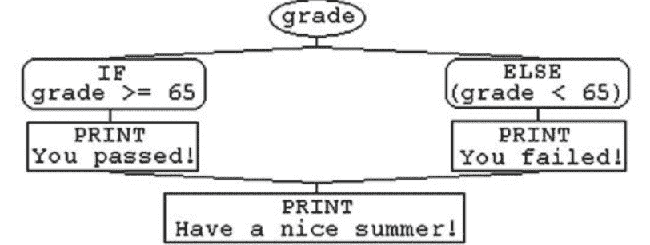

# 编程原理：Java 1级

“为你的软件开发准备计算机”

## 0-1：安装必要的软件

现代计算机系统通常不带有软件开发（即创建新程序）所需的软件（程序）。为了开发软件，你需要在你的计算机上安装一些东西。

你需要安装的第一件事是 Java 运行环境 (`JRE`)，它允许你运行 Java 程序。你将学习使用 Java 编程语言。编程语言是一种特殊的语言，它允许人类（程序员）通过告诉计算机**精确地**如何做，来让计算机执行某任务。程序员编写程序的源代码，并运行一种名为编译器的特殊程序，它将源代码转换为计算机可以理解的内容。

要安装 `JRE`，请遵循以下指令：

- 访问 `http://www.java.com`。
- 点击“免费下载”（Free Download）按钮。
- 在下一个屏幕，点击“同意并开始下载”（Agree and Start Download）按钮。
- 你的计算机将下载一个程序。下载完成后，按照屏幕提示操作：
  - 点击“安装”（Install）按钮。
  - 如果有安装无关软件的提示（例如“Search by”），**取消勾选**“Search by”旁边的框，然后点击“下一步”（Next）按钮。
  - 等待。
  - 如果 `JRE` 安装程序检测到过旧版本，点击“稍后提醒”（Remind Me Later）按钮。
  - 点击“关闭”（Close）按钮。
  - 你的浏览器将打开。

`JRE` 只允许你运行程序。你需要安装的下一件事是 Java 开发工具包 (`JDK`)，它是一个工具集合。为了简化在计算机上安装必要软件的过程，你可以将 `JDK` 的安装与名为 NetBeans 的集成开发环境 (`IDE`) 结合起来。`IDE` 允许你在一个地方编写代码、编译代码、运行程序并调试错误。

要安装 `JDK` 和 NetBeans `IDE`，请遵循以下指令：

- 访问 `http://www.netbeans.org`。
- 点击“JDK with NetBeans IDE SE bundle”链接。它位于页面底部附近的段落中。你可能需要向下滚动。
- 点击“同意条款”（Agree to Terms）。
- 点击“下一步”（Next）。
- 下载完成后，按照屏幕提示操作：
  - 点击“安装”（Install）。
  - 如果有安装无关软件的提示（例如“Search by”），**取消勾选**“Search by”旁边的框，然后点击“下一步”（Next）按钮。
  - 等待。
  - 如果 `JRE` 安装程序检测到过旧版本，点击“稍后提醒”（Remind Me Later）按钮。
  - 点击“关闭”（Close）按钮。
  - 你的浏览器将打开。

---

# 课程 1：“第一个程序：‘Hello World’”

## 1-1：在屏幕上显示内容

---

# 课程 2：“第一个程序的解剖”

## 2-1：整个程序

现在，你的 Hello World 程序包含了大约 20 行代码。由于你刚刚开始，可以安全地忽略大部分内容。

## 2-2：Print 方法

看下面这一行：

```java
System.out.println("Hello World!");
```

这是 Hello World 程序中唯一执行任何操作的部分！它被称为*打印语句*（print statement），因为它告诉计算机在屏幕上打印内容。这个打印语句告诉计算机打印 Hello World！*语句*（statement）是让计算机执行动作的代码。

打印语句结尾的分号（`;`）是必须的。**尝试删除那个分号。** 如果你删除分号，NetBeans 会在该行下方显示红色波浪线，就像 Microsoft Word 中的拼写错误一样。如果 NetBeans 给你如下有用提示：`';' expected`。如果你在代码中有错误的情况下运行程序，将收到错误消息。**把那个分号放回去。编程要求你必须精确！**

## 2-3：main 方法

看以下代码：

```java
public static void main(String[] args)
```

这*声明*了程序的 *main 方法*。声明（declare）是指向 Java 宣布它的存在、它属于什么类型（在这里，是一个方法）以及它的名字是什么。方法就像一个“子程序”，每当它被*调用*（运行）时，就会执行程序的一个任务。

这个方法的名字是 `main`。`main` 方法是一个特殊的方法，因为它是你的*入口*（entry point）。每当你的程序运行时，计算机都从这里开始运行代码。

在 Hello World 中，`main` 方法在其*大括号*（curly braces）内包含一个语句。方法可以包含任意数量的语句，甚至一个都没有。左大括号 `{` 标记 `main` 方法主体的开始，而右大括号 `}` 标记其主体的结束。**确保你代码中的每一个大括号都有对应的右大括号！**

## 2-4：HelloWorld 类

查看以下代码：

```java
public class HelloWorld
```

这声明了你程序中的 `HelloWorld` 类。**类的概念解释起来很复杂！** 类通常定义了一个对象类型的概念。对象是一个“事物”，例如一只具体的狗或一辆具体的卡车，它具有状态和行为。

状态描述一个对象。例如，狗的状态的一个部分是它的年龄：Spot 有多大了？行为是一个对象可以做的事情。例如，狗可以吠叫，卡车可以按响喇叭。

类型是对象所属的“类别”。例如，Spot 属于被称为“狗”的对象的类别。类型就像类。**不要把对象和类搞混了！** 这只具体的狗 Spot 与“狗”的**概念**（即“狗性”的定义）不是一回事。

Java 是一种面向对象的编程语言。这意味着在 Java 中，你的大部分代码将围绕对象的使用及其类来组织。然而，某些类（如 `HelloWorld`）并不用于定义特定对象的类型。相反，它们被用于承载数据（信息）和方法，因为在 Java 中，基本上每一段代码都必须包含在作用域内。

`HelloWorld` 类的主体在大括号内，就像方法的主体一样。它包含了你程序的 `main` 方法。`main` 方法主体被认为嵌套在 `HelloWorld` 类的主体之内。这意味着 `main` 方法的整个主体位于 `HelloWorld` 类的主体之内。

## 2-5：包 (Packages)

查看以下行：

```java
package hello.world;
```

这条语句告诉 Java `HelloWorld.java` 文件中的所有类都属于 `hello.world` 包。包就像一个文件夹，其中包含一个或多个类。

## 2-6：注释 (Comments)

你的程序中还有其他文本，它们看起来是用英语编写的，而不是 Java。这些文本片段不是代码，而是注释。注释是源代码中的一段文本，当你的程序运行时，它不会执行。

注释的一些用途：

- 注释可以用来描述代码的功能。
- 几个月后，你可能会忘记某段代码的作用。
- 注释可以帮助需要使用你代码的其他人更好地理解它。
- 编写良好的注释可以使程序员的工作更轻松。
- 它们也可以用于标记代码：谁写的、其用途是什么等。
- 最后，通过将代码放在一个或多个注释中，可以将其“注释掉”，防止其运行。
- 这是一项重要的调试技术。

你应该养成编写良好注释的习惯，来解释你的代码。编写注释的一种方法是在 `/*` 和 `*/` 之间放置文本。这种注释被称为多行注释，因为它可以跨越多行。示例：

```java
/* 此方法用于重置游戏。

玩家开始时有 3 条命。

*/
```

编写注释的另一种方法是在 `//` 之后放置文本。这种注释被称为单行注释，因为它只持续到该行的结束。示例：

```java
System.out.println(name); // 打印你的名字。
```

尝试注释掉 Hello World 程序的打印语句。让这行代码 ...

```java
System.out.println("Hello World!");
```

... 看起来像这样：

```java
//System.out.println("Hello World!");
```

运行程序。程序应该不输出任何内容。**为什么程序没有输出任何内容？**

由于该打印语句被注释掉了，它没有执行。因此，程序没有输出任何内容。**删除该行的 `//`。**

在下一节课中，你将更详细地学习打印语句和输出是如何工作的。

---

# 课程 3：“输出：在屏幕上打印内容”

## 3-1：程序：“关于我”

在 NetBeans 中创建一个名为 About Me 的新项目。以下是重复的指令：

- 从 File 菜单中选择“New Project”。
- 在提示符处：
  - 在“Categories”部分，选择“Java”。
  - 在“Projects”部分，选择“Java Application”。


- 点击“Next”按钮。
- 在提示符处：
  - 将“Project Name”字段（文本框）的内容替换为 About Me。
  - 点击“Next”按钮。

（注：由于提供的 OCR 文本在后半部分存在大量的重复循环，已根据教程的逻辑流进行了清理。）

# 第 4 章 “信息存储”

## 4-1: 程序：“知晓与展示”

创建一个新项目，名为 Know and Show。在程序的 `main` 方法中，编写以下代码：

```
int score = 1400;
System.out.print("Score: ");
System.out.println(score);
double temp = 75.2;
System.out.print("Temperature: ");
System.out.println(temp);
String name = "Jonathan";
System.out.print("Name: ");
System.out.println(name);
```

在你的程序中，将 `Jonathan` 替换为你自己的名字。运行你的程序。程序的输出应该类似于下所示：

```
Score: 1400
Temperature: 75.2
Name: Jonathan
```

## 4-2: 赋值语句的解剖

观察以下行代码：

```
int score = 1400;
```

这被称为赋值语句，因为它给变量（`score`）分配了一个值（`1400`）。计算机在内存中存储信息。变量是内存中一个带有名称的空间。当你的代码访问（使用）该空间时，Java 会使用该名称来引用内存中的该空间。给你的变量命名，简要描述它们所包含的数据。例如，`num_monkeys` 将是一个存储动物园猴子数量的变量的好名字，而 `nm` 一眼看去很难理解。

在 Java 中，每个变量都有一个数据类型（`int`, `short`）。该变量的类型是 `int`。`int` 是一个整数（可以是正数、负数或零的整数）。任何此类信息（整数）都可以存储在类型为 `int` 的变量中。类型 `int` 不是一个类，而是一个 Java 内置的原始（简单）数据类型。

变量被用于存储一个值。然而，**变量不等同于值！** 变量在这里，而它的值是 `1400`。在百科全书程序的上下文中，值 `1400` 是意义的；在游戏中，`1400` 可能是玩家的分数，对应于变量 `score`；在百科全书程序中，`1400` 可能是历史上的一个年份。

`=`（赋值）运算符告诉 Java 分配值 `1400`，在赋值语句中，变量**始终**位于 `=` 的左侧，而值**始终**位于 `=` 的右侧。将 `=` 运算符想象成指向左侧的箭头（`←`）：

```
int score ← 1400;
```

想一想，并口头上说：“int score 得到 1400。”

总结一下，赋值语句 `int score = 1400;` 创建了一个类型为 `int` 的具名变量 `score`，并为其分配了值 `1400`。

Java 中的另外两个数据类型是 `double` 和 `String`。类型为 `double` 的变量可以存储实数，例如 `75.2`。类型 `double` 像 `int` 一样，是一个原始类型。类型为 `String` 的变量可以存储一段文本字符串，例如 `"Jonathan"`。`String` 类是一个内置类。

## 4-3: 更多打印语句

观察以下行代码：

```
String name = "Jonathan";
System.out.print("Name: ");
System.out.println(name);
```

在第二行中，一个字面量被传递给 `print` 方法。字符串字面量 `"Name: "` 就像一个类型为 `String` 的变量，其值为 `"Name: "`。然而，与变量不同，`"Name: "` 在你的代码中没有名称。在第三行中，变量被传递给 `println` 方法。`println` 方法访问 `name` 的值，以便在屏幕上打印 `Jonathan`。给定类型的变量名可以用于任何可以使用该类型字面量的地方。`int` 和 `double` 类型的参数也可以传递给 `print` 和 `println` 方法。

## 4-4: 修改变量的值

在以下行代码之后：

```
System.out.println(name);
```

在你的代码中添加以下行：

```
score = 1500;
System.out.print("New Score: ");
System.out.println(score);
```

运行你的程序。程序的最后一行输出应该是：

```
New Score: 1500
```

变量的值是可以变化的！语句 `int score = 1400;` 创建了一个类型为 `int` 的具名变量 `score`，并为其分配了值 `1400`。第一次给变量赋值是初始化变量。你赋予了它初始值。

随后，另一个赋值语句 `score = 1500;` 给 `score` 赋值了一个新值 `1500`。当打印语句 `System.out.println(score);` 执行时，打印出数字 `1500`，因为 `score` 的值现在是 `1500`，而不是 `1400`。`score` 的数据类型不需要指定，因为 Java 已经通过第一个赋值语句 `int score = 1400;` 知道了。再次，将 `=` 运算符想象成指向左侧的箭头：`score ← 1500;`。赋值语句总是写成：`score = 1500`。总结一下，赋值语句 `score = 1500;` 将值 `1500` 分配给名为 `score` 的变量，该变量已经存在。

在该行第二次出现之后：

```
System.out.println(score);
```

在你的代码中添加以下行：

```
double boiling_point = 21.0;
temp = boiling_point;
System.out.print("New Temperature: ");
System.out.println(temp);
```

运行你的程序。程序的最后一行输出应该是：

```
New Temperature: 21.0
```

第一个赋值语句 `double boiling_point = 21.0;` 创建了一个类型为 `double` 的变量 `boiling_point`，并为其分配了值 `21.0`。第二个赋值语句 `temp = boiling_point;` 给变量 `temp` 分配了 `boiling_point` 的值（`21.0`）。在“箭头形式”中：

```
temp ← boiling_point;
temp ← 21.0;
```

# 第 5 章 “计算”

## 5-1: Java 中的运算

创建一个新项目，名为 Arithmetic。在程序的 `main` 方法中，编写以下代码：

```
int x = 2 + 3;
int y = x - 2;
int z = x + 2;
System.out.print("x = ");
System.out.println(x);
System.out.print("y = ");
System.out.println(y);
System.out.print("z = ");
System.out.println(z);
System.out.print("x + y = ");
System.out.println(x + y);
System.out.print("x - y = ");
System.out.println(x - y);
System.out.print("x * y = ");
System.out.println(x * y);
System.out.print("x / y = ");
System.out.println(x / y);
System.out.print("x % y = ");
System.out.println(x % y);
```

运行你的程序。程序应该输出以下文本：

```
x = 5
y = 3
z = 7
x + y = 8
x - y = 2
x * y = 15
x / y = 1
x % y = 2
```

观察以下行代码：

```
int x = 2 + 3;
```

这是一个赋值语句。声明了一个类型为 `int` 的变量 `x`。变量 `x` 被赋值为表达式 `2 + 3` 的结果，结果为 `5`。表达式是一个或多个操作数（数据片段）和零或多个运算符（`+`）的组合，在求值时产生结果。求值就是计算它的结果。在“箭头形式”中，逐步执行：

```
x ← 2 + 3;
x ← 5;
```

观察下一行代码：

```
int y = x - 2;
```

`x` 的值是 `5`，所以：

```
y ← x - 2;
y ← 3;
```

观察下一行代码：

```
int z = x + 2;
```

`x` 的值是 `5`，所以：

```
z ← x + 2;
z ← 7;
```

观察下一行代码：

```
int z = x;
```

`x` 的值是 `5`，所以：

```
z ← x;
z ← 5;
```

单个操作数（如 `x` 或 `5`）也可以是一个表达式！

观察下一行代码：

```
x = z + 2;
```

`z` 的值是 `5`，所以：

```
x ← z + 2;
x ← 7;
```

该语句给 `x` 分配了一个新值 `7`。尽管 `x` 之前通过语句 `int z = x;` 被赋值给 `z`，但 `z` 的值仍然是 `5`。将 `x` 的值赋值给 `z` 就是这么简单。变量 `x` 和 `z` **并没有**通过 `=` 运算符“连接”在一起！当赋值语句执行时，**只有**该赋值 `=` 左侧变量的值可以改变！

产生给定类型结果的表达式可以用于任何可以使用字面量值或该类型变量值的地方。观察以下打印语句：

```
System.out.println(x + y);
```

在此语句执行之前，表达式 `x + y` 被求值（结果为 `10`，因为 `x` 的值是 `7`，`y` 的值是 `3`）。

### 计数器示例

```
int counter = 0;
counter = counter + 1;
```

第一条赋值语句声明了一个 `int` 类型的变量，名为 `counter`，并将其初始化为 `0`。第二条赋值语句在 `=` 运算符的两侧都有 `counter`！然而，在赋值语句中，变量名可以有不同的含义，取决于它位于 `=` 的哪一侧！在 `=` 的左侧，它是存储 `=` 右侧表达式计算结果的地方。在 `=` 的右侧，将其读作“**counter 的值**”。

在“箭头形式”中，逐步为之：

```
int counter ← 0;
counter ← counter + 1;
counter ← 0 + 1;
```

因此，在执行完第二条赋值语句后，`counter` 的值为 `1`。赋值语句像第二条语句一样非常常见！例如，在一个游戏中，如果玩家得了 `100` 分，游戏代码的某处就会执行一条类似 `score = score + 100;` 的赋值语句，以此更新玩家分数。

## 5-3: 公式翻译

计算机经常被用于计算。创建一个新项目，命名为华氏度转摄氏（Fahrenheit to Celsius）。在程序的 `main` 方法中，编写以下代码：

```
double temp_fahr = 68.0;
double temp_cels = 5.0 / 9.0 * (temp_fahr - 32.0);
System.out.print(temp_fahr);
System.out.print(temp_cels);
```

运行你的程序。程序应该输出以下文本：

```
68.0 Fahrenheit is 20.0 degrees Celsius.
```

此程序将华氏度（°F）温度转换为等效摄氏度（°C）温度。变量 `temp_fahr` 用于存储华氏度温度。变量 `temp_cels` 用于存储摄氏度温度。

将华氏度转换为摄氏度的公式为 $C=\frac{5}{9}(F-32)$。在这个公式中，$C$ 代表摄氏度，$F$ 代表华氏度。这个公式可以翻译成 Java。在数学中，字母是变量。$F$ 变为 `temp_fahr`，$C$ 变为 `temp_cels`。一个赋值可以被可视化为 `←`。

完成这些步骤后，公式看起来如下：$temp\_cels=\frac{5}{9}(temp\_fahr-32)$。数学中的分数线是除法符号，所以它变成了 `5 / 9`。然而，温度的小数点可能有数字，因此通过在它们后面加上 `.0` 将这些整数转换为 `double` 类型，例如 `5.0/9.0`。在数学中，两个操作数相邻意味着相乘，因此公式在 Java 中最终看起来像这样：`temp_cels = 5.0/9.0*(temp_fahr-32)`。Java 中可以使用括号，就像数学中一样，强制表达式的某些部分在其他部分之前求值。

与数学一样，Java 也有运算符顺序。括号中的表达式首先求值，从最内层括号向外。然后从左到右执行乘法（`*`）、除法（`/`）和取模（`%`）。最后，从左到右执行加法（`+`）和减法（`-`）。

上述表达式的“箭头形式”逐步求值过程：

注意：`temp_fahr` 的值为 `68.0`。

```
double temp_cels ← 5.0 / 9.0 * (temp_fahr – 32.0);
double temp_cels ← 5.0 / 9.0 * (68.0 – 32.0);
double temp_cels ← 5.0 / 9.0 * (36.0);
double temp_cels ← 0.5555555555555556 * 36.0;
double temp_cels ← 20.0;
```

`temp_cels` 初始化为 `20.0`。


注意：`temp_fahr` 的值为 68.0。

```
double temp_cels ← 5.0 / 9.0 * (temp_fahr – 32.0);
double temp_cels ← 5.0 / 9.0 * (68.0 – 32.0);
double temp_cels ← 5.0 / 9.0 * (36.0);
double temp_cels ← 0.5555555555555556 * 36.0;
double temp_cels ← 20.0;
```

`temp_cels` 初始化为 20.0，因为是 68.0。

## 6 字符串拼接

### 6-1: 傻的句子

创建一个新项目，命名为傻的句子（Silly Sentence）。在程序的 `main` 方法中，编写以下代码：

```
String noun1 = "dog";
String noun2 = "table";
String sentence = "The " + noun1 + " " + noun2 + ".";
System.out.println(sentence);
```

程序应该输出：

The dog table.

在 Java 中，`+` 运算符用于将字符串放在一起。拼接。

转换公式为 $C=\frac{(F-32)}{5}$。在这个公式中，$C$ 代表摄氏度，$F$ 代表华氏度。这个公式可以翻译成 Java。在数学中，字母是变量。$F$ 变为 `temp_fahr`，$C$ 变为 `temp_cels`。一个赋值可以被可视化为 `←`。

完成这些步骤后，公式看起来如下：$temp\_cels=\frac{(temp\_fahr-32)}{5}$。数学中的分数线是除法符号，所以它变成了 $5 / 9$。然而，温度的小数点可能有数字，因此通过在它们后面加上 $.0$ 将这些整数转换为 `double` 类型，例如 $5.0/9.0$。在数学中，两个操作数相邻意味着相乘，因此公式在 Java 中最终看起来像这样：$temp\_cels=5.0/9.0*(temp\_fahr-30)$。Java 中可以使用括号，就像数学中一样，强制表达式的某些部分在其他部分之前求值。

### 6-2: 合并打印语句

多个打印语句很烦人。你可以将几个打印语句合并为一个单一语句。回到你的项目 5，华氏度转摄氏。在 `FahrenheitToCelsius.java` 中，替换这些行：

```
System.out.print("The ");
System.out.print(noun1);
System.out.print(" ");
System.out.print(noun2);
System.out.println(".");
```

替换为：

```
System.out.println("The " + noun1 + " " + noun2 + ".");
```

程序应该输出与之前相同的文本。

## 7 用户输入

### 7-1: 允许用户输入温度

每次程序需要不同数据时修改代码并重新编译是不现实的。坦然，程序可以从其用户（使用计算机的人）那里接收数据。可以使用 Java 内置的 `Scanner` 类来实现。

回到你的项目 5 和 6，华氏度转摄氏。在 `FahrenheitToCelsius.java` 中，紧接在行：

```java
package fahrenheit.to.celsius;
```

下方添加该行：

```java
import java.util.Scanner;
```

替换这行代码：

```
double temp_fahr = 68.0;
```

... 替换为：

```
Scanner sc = new Scanner(System.in);

System.out.print("Enter a temperature, in degrees Fahrenheit: ");

double temp_fahr = sc.nextDouble();
```

运行你的程序。程序应该要求你输入温度，然后等待。

点击 NetBeans 中标记为“Output - Fahrenheit to Celsius (run)”的面板。输入数字，然后按 Enter/Return 键。程序的输出应该类似于：

Enter a temperature, in degrees Fahrenheit: 81

81.0 degrees Fahrenheit is 27.22222222222222 degrees Celsius.

屏幕上只看到一个闪烁的光标，你会觉得这正在发生什么？

然而，那个提示符只是一个普通的打印语句。下一条赋值语句 `double temp_fahr = sc.nextDouble();` 实际上导致程序等待用户输入温度。调用 `sc` 的 `nextDouble()` 方法会导致程序等待用户输入一个数字并按回车（Enter/Return）。当用户完成该操作后，`nextDouble()` 方法将返回（结果给出）一个 `double` 类型的值给调用了 `nextDouble()` 的 `main` 方法。该值将被放置 `=` 的右侧。然后它将被赋值给位于 `=` 左侧的 `temp_fahr`。用“箭头形式”表示为：

`double temp_fahr ← [用户值];`

总结来说，每当你运行这个程序时，都可以输入不同的温度，而无需更改**任何**代码！

尝试修改第 5 课摄氏度转华氏度的程序，让它询问用户一个要转换的温度。

### 7-2: 程序：“我的签名”

创建一个名为 `My Signature` 的新项目。在 `MySignature.java` 中，紧接在行 ... 之下：

```java
package my.signature;
```

... 添加该行：

```java
import java.util.Scanner;
```

在程序的 `main` 方法中，编写以下代码：

```java
Scanner sc = new Scanner(System.in);
System.out.print("Enter your first name: ");
String first_name = sc.next();
System.out.print("Enter your age: ");
int age = sc.nextInt();
System.out.println("Your signature: " + first_name + ", " + age);
```

运行你的程序。程序应该要求你输入名字并等待。点击标记为“Output - My Signature (run)”的 NetBeans 面板内部。输入**一个单词**，然后按回车。程序应该要求你输入年龄，然后等待。输入**一个整数**，然后按回车。程序的输出应该类似于所示所示：

Enter your first name: Jonathan

Enter your age: 24

Your signature: Jonathan, age 24

你制作的**每一个**需要用户输入的程序都需要上述 `import` 语句以及创建 `Scanner` 对象的赋值语句。

`sc` 的 `next()` 方法等待用户输入单个单词（至少一个字符且没有空格），并返回一个 `String`。`sc` 的 `nextInt()` 方法等待用户输入一个整数并返回一个 `int`。如果我使用 `nextInt()` 输入字母而不是数字，或者使用 `nextDouble()` 会发生什么呢？试一试吧！不用担心弄坏你的电脑；最坏的情况只是程序（而不是 NetBeans）崩溃并显示错误信息。

# 第 8 课

## 布尔逻辑

### 8-1: 计算机的“大脑”内部

你可能认为你的电脑是“智能”的。你可能甚至有一部“智能手机”。然而，计算机实际上完全没有智能可言！计算机只能执行它被程序化过的事情。它表面上的“智能”来自于其程序员的聪明。

计算机其实非常笨！它们必须被**确切地**告诉如何做每件事，它们没有动物和人类所拥有的本能或直觉。它们并不思考，尽管在某种意义上它们在做决定——计算机的“思考过程”是非常简单的：一切都是开启或关闭，是或否，是黑或白，或者是零、真或假。

计算机依靠电力运行。它的电路包含许多微小的灯泡，根据开关的翻转情况，灯泡可以开启或关闭。

## 8-2: 问题、答案与布尔数据类型

尽管缺乏智能，计算机也可以回答问题。然而，这些问题可能是是或否的问题。例如，“鸡准备好了吗？”对于计算机来说，鸡准备好了，或者没准备好。

通过测试，用户的得分至少要达到 65 分。否则，成绩被视为不及格。只有两种选择：通过或不通过；没有中间地带。

尝试输入不同的分数，包括通过的和不及格的。如果你输入的分数小于 0 或大于 100，会发生什么？是否存在**任何**一个分数可以**同时**让“你通过了！”和“你失败了！”出现在屏幕上？65 分呢？

看下方的图：



在接收到用户输入的 `grade` 值后，程序将使用条件语句决定打印哪条消息。如你所见，如果 `grade` 的值至少为 65，那么将打印“You passed!”。否则（意味着 `grade` 的值小于 65），将打印“You failed!”。**没有任何**一个 `grade` 值会导致这两条消息同时出现在屏幕上！

这种类型的条件语句被称为 `if` 语句。如果一个语句以 `if` 开头。括号中放入一个布尔表达式。如果该表达式的值为 `true`，那么**只有** `if` 块大括号内部的语句会被执行。`else` 意味着“如果不是”。如果布尔表达式的值为 `false`，那么**只有** `else` 块大括号内部的语句会被执行。在执行完选中块中的所有语句后，程序将紧接着从 `if` 语句结束处（最后一个块结束之后）继续运行。因此，无论用户输入的是通过还是不及格的分数，都会打印“Have nice summer!”

如果一个语句不需要 `else` 块。如果此时**什么都不需要**做，如果括号中的布尔表达式的值为 `false`，则省略 `else` 块。

为了让你的代码更清晰，对块中的语句进行缩进，通过在它们左侧放置制表符或空格。NetBeans 会为你完成这一点。这让你一眼看出哪些语句在块内部，哪些不在。

## 9-2: 在两个以上的选择之间决定：If, Else If 和 Else

计算机可以在两个以上的选择之间进行决策！创建一个名为 `Letter Grades` 的新项目。在 `LetterGrades.java` 中，紧接在行 `...` 之后...

```java
package letter.grades;
```

... 添加下该行：

```java
import java.util.Scanner;
```

在程序的 `main` 方法中，编写以下代码：

```java
Scanner sc = new Scanner(System.in);
System.out.print("What was your grade on the test (0-100)?");
int grade = sc.nextInt();
if (grade >= 90)
    System.out.println("You got an A.");
else if (grade >= 80)
    System.out.println("You got a B.");
else if (grade >= 70)
    System.out.println("You got a C.");
else if (grade >= 65)
    System.out.println("You got a D.");
else
    System.out.println("You got an F.");
```

运行你的程序。程序应该要求你输入分数，然后等待。点击标记为“Output - Letter Grades (run)”的 NetBeans 面内部。输入一个整数，然后按 Enter/Return。程序的输出应该类似于：

What was your grade on the test (0-100)? 72

You got a C.

程序使用用户分数的值来确定其对应的字母等级（A, B, C, D 或 F）。在这里，有**五** 种选择！计算机如何通过使用布尔表达式（只能求值为 `true` 或 `false`）在两个选择之间做出决策呢？

顺便说一下，如果一个 `if` 语句的块只包含**一个**语句，那么该块就不需要大括号。但是，如果你决定使用这个快捷方式，请确保

看下方的图：


在接收到用户输入的 `grade` 值后，程序使用条件语句决定打印哪条消息。如你所见，如果 `grade` 的值至少为 65，那么将打印“You passed!”。否则（意味着 `grade` 的值小于 65），将打印“You failed!”。**没有任何**一个 `grade` 值会导致这两条消息同时出现在屏幕上！

这种类型的条件语句被称为 `if` 语句。如果一个语句以 `if` 开头。括号中放入一个布尔表达式。如果该表达式的值为 `true`，那么**只有** `if` 块大括号内部的语句会被执行。`else` 意味着“如果不是”。如果布尔表达式的值为 `false`，那么**只有** `else` 块大括号内部的语句会被执行。在执行完选中块中的所有语句后，程序将紧接着从 `if` 语句结束处（最后一个块结束之后）继续运行。因此，无论用户输入的是通过还是不及格的分数，都会打印“Have nice summer!”

如果一个语句不需要 `else` 块。如果此时**什么都不需要**做，如果括号中的布尔表达式的值为 `false`，则省略 `else` 块。

为了让你的代码更清晰，对块中的语句进行缩进，通过在它们左侧放置制表符或空格。NetBeans 会为你完成这一点。这让你一眼看出哪些语句在块内部，哪些不在。

## 10: 高级布尔逻辑

### 10-1: NOT 运算符

更复杂的表达式可以使用逻辑运算符构建：NOT、AND 和 OR。创建一个名为 `SarcasticFail` 的新项目。在 `SarcasticFail.java` 中，紧接在行 `...` 之后...

```java
package sarcastic.fail;

import java.util.Scanner;
```


在程序的 `main` 方法中，编写以下代码：

```java
Scanner sc = new Scanner(System.in);
System.out.print("What was your grade on the test (0-100)?");
int grade = sc.nextInt();
if (!(grade >= 65)) {
    System.out.println("You passed, NOT!");
} else {
    System.out.println("You failed!");
}
```

运行你的程序。程序应该要求你输入分数，然后等待。点击标记为“Output - SarcasticFail (run)”的 NetBeans 面板内部。输入一个整数，然后按 Enter/Return。程序的输出应该类似于：

What was your grade on the test (0-100)? 50

You passed, NOT!

`!`（逻辑 NOT）运算符用于反转一个尔值。因此，反转布尔值就像翻转开关！由于布尔表达式产生布尔值，NOT 运算符也可以反转它们的结果。以下是 NOT 运算符的真值表，其中 A 是一个布尔表达式：

| A | NOT A |
|---|---|
| false | true |
| true | false |

真值表显示了布尔表达式在所有可能的输入组合下的输出值。例如，如果 A 为 `false`，则 NOT A 为 `true`。NOT 运算符只有一个输入值：A 的值。让我们用 50 分来尝试。用 50 替换 `grade`，在布尔表达式 `(grade >= 65)` 中。50 不大于等于65，所以 `50 >= 65` 产生 `false`。用 `false` 替换 `50 >= 65` 使其变为 `!(false)`。如果不是 `false`，它就是 `true`，所以 `!(false)`。因此，如果用户输入 50，将打印“You passed, NOT!”

如果分数不是至少 65 分，那么用户没有通过测试，所以用户实际上失败了。否则，如果分数不是至少 65 分……两个负号（一个来自 `!`）可以相互抵消，所以这可以读作“如果分数至少 65 分”。如果分数确实至少 65 分，用户就通过了。

## 10-2: 逻辑 AND 运算符

创建一个名为 `Weather Report` 的项目。在 `WeatherReport.java` 中，紧接在行 `...` 之后...

```java
else {
    System.out.println("Better stay inside.");
}
```

运行你的程序。程序应该要求你输入外部温度，然后等待。点击标记为“Output - Weather Report (run)”的 NetBeans 面板内部。输入一个数字，然后按 Enter/Return 键。程序的输出应如下：

室外温度是多少（华氏度）？75

外面天气很不错。

`&&`（逻辑与）运算符用于检查多个布尔值是否**全部**为真。以下是逻辑与运算符的真值表，其中 **A** 和 **B** 是布尔表达式：

| A | B | A AND B |
|---|---|---|
| false | false | false |
| false | true | false |
| true | false | false |
| true | true | true |

布尔表达式 **A AND B** 有两个输入值：布尔表达式 **A** 和 **B** 的值。只有当 **A 且 B** 都为真时，A AND B 才会产生真。否则，它产生假。

检查一个数字是否在特定范围内是逻辑与运算符的一个常见用途。程序使用室外温度的值来决定天气是否“不错”，或者用户应该待室内。程序会评估布尔表达式 `40.0 <= temp && temp <= 90.0`。

让我们用 75°F 的温度试一下。在布尔表达式中用 75 替换 temp，得到 `40.0 <= 75.0 && 75.0 <= 90.0`。数字 40 小于或等于 75.0，`40.0 <= 75.0` 产生真。数字 75 小于或等于 90.0，`75.0 <= 90.0` 也产生真。将 `40.0 <= 75` 替换为真并将 `75.0 <= 90.0` 替换为真，得到真。因此，如果用户输入数字 75，就会打印“外面天气很不错”。

让我们用 30°C 的温度试一下。在布尔表达式中用 30 替换 temp，得到 `40.0 <= 30.0 && 30.0 <= 90.0`。数字 40 **不**大于或等于 30.0，`40.0 <= 30.0` 产生假。为了让 `A && B` 产生真，其所有值都必须为真。如果其中**任何一个**为假，表达式就会产生假。因此，没有必要评估 `30.0 <= 90.0`。这种快捷方法被称为*惰性求值*。如果用户输入数字 30，将打印“最好待室内”。

让我们用 100°F 的温度试一下。在布尔表达式中用 100 替换 temp，得到 `40.0 <= 100.0 && 100.0 <= 90.0`。数字 40 小于或等于 100.0，`40.0 <= 100.0` 产生真。但是，数字 100.0 **不**小于或等于 90.0，所以 `100.0 <= 90.0` 产生假。将 `40.0 <= 100.0` 替换为真并将 `100.0 <= 90.0` 替换为假，得到 `true && false`，产生假。由于第一个布尔表达式 `40.0 <= 100.0` 产生了真，第二个表达式 `100.0 <= 90.0` 进行了评估。这是因为为了让 `A && B && ...` 表达式产生真，目前还没有遇到假值（当只评估了 `40.0 <= 100.0` 时）。如果用户输入数字 100，将打印消息“最好待室内”。

## 10-3: 逻辑或运算符

创建一个名为 Divisibility 的新项目。在 Divisibility.java 中，紧接在 ... 下方：

```java
package divisibility;

... 添加该行：

import java.util.Scanner;
```

在程序的 `main` 方法中编写以下代码：

```java
Scanner sc = new Scanner(System.in);

System.out.print("Enter an integer: ");

int i = sc.nextInt();

if (i % 2 == 0 || i % 3 == 0)
    System.out.println(i + " is divisible by 2 or 3.");
else
    System.out.println(i + " is not divisible by 2 or 3.");
```

运行你的程序。程序应该要求你输入一个整数，然后等待。点击标记为 "Output - Divisibility (run)" 的 NetBeans 面板内部。输入一个整数，然后按 Enter/Return 键。程序的输出应如下：

Enter an integer: 8

8 is divisible by 2 or 3.

`||`（逻辑或）运算符用于检查多个布尔值中是否**至少有一个**为真。以下是逻辑或运算符的真值表，其中 A 和 B 是布尔表达式：

| A | B | A OR B |
|---|---|---|
| false | false | false |
| false | true | true |
| true | false | true |

布尔表达式 **A OR B** 有两个输入值：布尔表达式 **A** 和 **B** 的值。只有当 **A 且 B** 都为假时，A OR B 才会产生假。否则，它产生真。

检查一个数字是否匹配多个选项中的至少一个是逻辑或运算符的一个常见用途。程序检查用户的整数是否能被二或三整除，或者两个都不能被整除。如果 X 能被 Y 整除，那么 X 除以 Y 的余数为零。正如第 5 节所记得的，表达式 `i % 2 == 0 || i % 3 == 0` 被评估。为了让 `A || B ...` 表达式产生真，目前还没有遇到假值（当只评估了 `i % 2 == 0` 时）。如果用户输入数字 8，就会打印“8 能被 2 或 3 整除”。或运算符也使用惰性求值，与与一样。如果用户输入数字 5，将打印“5 不能被 2 或 3 整除”。

# 第 11 节：循环

### 11-1: 使用循环重复操作

有时，计算机需要执行多一次的操作。有时，它还需要在代码中向前移动而不是仅仅向前。循环允许计算机执行这两件事！

创建一个名为 Counting 的新项目。在程序的 `main` 方法中编写以下代码：

```java
int i = 1;
while (i <= 5)
{
    System.out.println("The value of i is " + i + ".");
    i = i + 1;
}
System.out.println("Done!");
```

运行你的程序。程序应该输出：

The value of i is 1.

The value of i is 2.

The value of i is 3.

The value of i is 4.

The value of i is 5.

Done!

程序从 1 计数到 5。它使用变量 `i` 来存储当前所在的数字。当程序计数完成，它告诉用户已完成。程序使用循环来重复加1五次。以下代码行成了该程序的循环：

```java
while (i <= 5)
{
    System.out.println("The value of i is " + i + ".");
    i = i + 1;
}
```

这被称为 while 循环。while 循环以 `while` 开始。括号内是“循环条件”。如果条件评估为真，循环大括号内的语句（构成循环体）就会执行。在执行了这些语句后，程序**返回**到循环顶部，检查条件是否再次为真。如果是真，循环体将**再次**执行。

然而，如果条件为假，程序将立即在循环结束后（`}` 之后）继续。如果程序在第一次测试（评估条件）时条件为假，那么循环体将**永远不会**执行。总结来说，**只要**条件为真，循环体中的语句就会执行。

查看下图：


在程序开始时，`i` 的值为 1。在 while 循环开始时，测试条件 `i <= 5`。由于 1 小于或等于 5，条件评估为真。因此，执行循环体。这包括在屏幕上打印 `i` 的当前值（1），然后将 `i` 的值加 1。`i` 的值现在变为 2。到达循环结束时，程序返回循环开头（看图中的箭头）。

再次测试条件。条件**只**在循环开头获取一次！由于 2 小于或等于 5，循环体再次执行。这包括在屏幕上打印 `i` 的当前值（2），然后将 `i` 的值加 1。`i` 的值现在变为 3。到达循环结束时，程序返回循环开头。

再次测试条件。由于 3 小于或等于 5，循环体再次执行。这包括在屏幕上打印 `i` 的当前值（3），然后将 `i` 的值加 1。`i` 的值现在变为 4。到达循环结束时，程序返回循环开头。

再次测试条件。由于 4 小于或等于 5，循环体再次执行。这包括在屏幕上打印 `i` 的当前值（4），然后将 `i` 的值加 1。`i` 的值现在变为 5。到达循环结束时，程序返回循环开头。

再次测试条件。由于 5 小于或等于 5，循环体再次执行。这涉及到在屏幕上打印 `i` 的当前值（为 5），并将 `i` 的值增加到 6。当到达循环结束时，程序将返回循环开头。

再次测试条件。由于 6 **并不** 小于等于 5，循环体**不会**再次执行（请查看图中的 ELSE 部分）。程序在循环结束后立即继续运行，并在屏幕上打印 Done!。

为了让你的代码更清晰，请对循环体内的语句进行缩进，在它们的左侧放置制表符或空格。NetBeans 会自动为你完成这一点。这让你能够一目了然哪些语句位于循环体内部，哪些不在。

尝试修改程序，让它从 1 计数到 100。也请尝试修改程序，让它从 5 倒数到 1。最后，尝试修改程序，让它从 1 计数到用户指定的数字。

如果你的程序没有停止运行，而你想让它停止，点击红色的正方形（“Stop”）按钮。它位于标记为“Output - Counting Program”的 NetBeans 面板左侧。

## 11-2: 游戏：“猜猜数字”

现在，你将用 Java 编写一个简单的游戏！在这个游戏中，计算机会在 1 到 100 之间随机一个数字，玩家尝试猜中那个数字。

创建一个名为 Guess My Number 的新项目。在 GuessMyNumber.java 中，紧接行 ... 之后

```
package guess.my.number;
```

... 添加以下行：

```
import java.util.Scanner;
```

在程序的 main 方法中，编写以下代码：

```java
Scanner sc = new Scanner(System.in);
int my_number = 1 + (int)Math.floor(Math.random()) * (100 - 1 + 1));
System.out.println("I am thinking of a number between 1 and 100.");
System.out.println("Can you guess it?");
int guess = 0;

while (guess != my_number)
{
    System.out.print("Enter your guess: ");
    guess = sc.nextInt();

    if (guess != my_number)
        System.out.println("Too low!");
    else if (guess > my_number)
        System.out.println("Too high!");
}

System.out.println("Yes! My number was " + my_number + ".");
```

**每行代码左侧的数字是行号。不要在代码中输入它们！** 运行你的程序。点击标记为“Output - Guess My Number (run)”的 NetBeans 面板内部并开始游戏。

程序的输出应该如下：

I am thinking of a number between 1 and 100.

Can you guess it?

Enter your guess: 33

Too high!

Enter your guess: 16

Too low!

Enter your guess: 24

Too low!

Enter your guess: 28

Too high!

Enter your guess: 26

Yes! My number was 26.

如果你玩腻了游戏，在在猜中计算机数字之前，点击 NetBeans 中的“Stop”按钮。

在第 2 行，程序在 1 到 100 之间（包含边界）选取一个随机整数。Math 类的 random 方法返回一个 double 类型的随机数（我们称之为 a，尽管它没有名字），该数大于或等于 0 且小于 1.0。

将 a 乘以表达式 (100 - 1 + 1)。该表达式产生 100。得到的数字（我们称之为 b）大于或等于 0 且小于 100.0。

接下来，Math 类的 floor 方法返回小于或等于 b（floor 方法的参数）的最大 double 类型整数值。得到的数字（我们称之为 c）是一个 double 类型的整数（因此它以 .0 结尾）。它大于或等于 0.0 且小于等于 99.0。**等一下！你是怎么得到 99.0 的？** **我们得到的并不是 100.0！** 因为 b 只能小于 100.0，它最高只能是 99.999 .... 小于或等于 99.999 .... 的最大整数并不是 100。

然后，double 的 c 通过运算符 (int) 强制转换（转换）为 int 类型。表达式 (int)c 产生与 c “相等”的 int 类型值。要将 double 类型的值转换为 int 类型，请删除小数点以及小数点右侧的任何数字。例如，57.39 变成 int 57。得到的数字（我们称之为 d）是一个整数，大于或等于 0 且小于等于 99。

之后，将 d 加上 1。得到的数字（我们称之为 e）是一个整数，大于或等于 0 且小于等于 100。

Oracle 提供的 Java™ 教程：

http://docs.oracle.com/javase/tutorial/tutorialLearningPaths.html (你可能想看“Java入门”部分)

Java 教程：http://www.wideskills.com/technology/java-tutorial [以前为 http://www.javabner.com/) (一个很好的通用参考资料，包含许多示例代码)

Stack Overflow:https://stackoverflow.com/ (论坛和留言板，用于在搜索结果中查找)

我需要买教科书吗？你可能不需要买教科书，除非你正在上一门课程，或者对计算机科学的特定领域感兴趣（如人工智能或游戏编程）。教科书的价格不一，有些超过 100 美元。它们的质量也不相同，而且市面上非常多；我无法为你推荐特定的某一本。

如果你正在上课，你的老师或教授可能会为你选定一本。它可能不是一本好书，但**无论如何都要买**（并且是指定的版本！）。你的老师可能会从书中布置作业题，并围绕它设计考试。如果你讨厌它，可以通过转卖来收回部分花费的费用。如果你花 100 美元买了一本书，然后以 40 美元卖掉，那就像你在这本书上花了 60 美元！

## A-2: Java 中的命名


# 标识符与命名约定

变量、符号常量、方法和类都有名称，这些名称被称为**标识符**（identifiers）。符号常量类似于变量，区别在于你只能给它赋值一次。它的值永远无法通过你的代码更改。你可以几乎随心地为这些东西命名，只要你遵守以下规则：

- 标识符中只使用大写字母、小写字母、数字和下划线（`_`）字符。
- 标识符不能以数字开头。
- 避免标识符长度超过 32 个字符。
- 不要使用保留字作为标识符。
- 保留字在蓝色中显示，具有特殊含义。保留字的一些示例是 `int`、`public` 和 `class`。

合法的（Java允许的）标识符示例是什么？不合法的（Java不允许的）标识符是什么？标识符 `7_ways_from_sunday` 合法吗？`John` 呢？

这些规则给了你很大的自由，但优秀的程序员会遵循各种**命名约定**（命名事物的方法），以便让自己和其他程序员更容易阅读和理解代码：

- 让重要事物的名称易于记忆。例如，`num_dogs` 比 `nd` 更容易一眼看懂。“哦，那是狗的数量。”相比之下，“天哪，`nd` 到底是什么？”现在多打几个字可以避免以后**大量的**挫败感！
- 不要使用过长或过短的名字。例如，`the_little_kangaroo_who_lives_in_the_zoo` 可能太长了，而 `tlkwitz` 几乎无法理解。想象一下必须反复输入第一个名字！像 `lil_roo_in` 可能会更好。
- 不要使用以下划线开头的名字。同样，不要连续使用下划线，因为很难区分 `__`（两个）和 `___`（三个）。
- 对于短标识符，避免使用容易混淆的字母和数字。很容易混淆 `I`、`l`（小写 L 或大写 I）与 `1`（数字）。同样，也很容易将 `o` 或 `O`（小写 o 或大写 O）与 `0`（数字）混淆。
- 变量通常使用全小写的标识符，并用下划线分隔单词。示例：`link`、`all_points`。
- 符号常量通常使用全大写的标识符，并用下划线分隔单词。示例：`FEET_PER_MILE`、`PI`。
- 方法通常使用**驼峰命名法**（camel case），首字母小写。驼峰命名法的示例：`UnderTheSea`。没有下划线；单词连在一起，但可以相互区分，因为每个单词的首字母大写。示例：`main`、`toString`。
- 类通常使用驼峰命名法，首字母大写。示例：`String`、`PrintStream`。

在一个项目中，该项目的每个成员（member）都应该遵循命名约定！

# A-3: String 类的方法

`String` 类包含许多实用的方法。以下是几个常用的：

## `boolean equals(String s)`

使用 `equals` 方法检查两个字符串是否包含相同的序列。该检查是区分大小写的，这意味着大写和小写字母被视为不同的字符。如果两个字符串包含相同的序列，该方法返回 `true`；否则返回 `false`。使用 `a.equals(b)`，其中 `a` 和 `b` 都是字符串，而不是 `a == b`。关于运算符 `!` 的更多信息，请参见第 10-1 节。示例代码：

```java
String a = "frog";
boolean sample1 = a.equals("frog"); // sample1 = true
boolean sample2 = a.equals("Frog"); // sample2 = false
```

## `boolean equalsIgnoreCase(String s)`

使用 `equalsIgnoreCase` 方法检查两个字符串是否包含相同的序列，但忽略字母的大小。如果两个字符串包含相同的序列（无论大小写如何），该方法返回 `true`；否则返回 `false`。示例代码：

```java
String a = "Alex";
```

## `boolean isEmpty()`

如果字符串长度为 0，则返回 `true`；否则返回 `false`。

## `int length()`

返回字符串的长度（字符数）。

## `String toLowerCase()`

返回一个新字符串，将原字符串中的所有字符转换为小写。

## `String toUpperCase()`

返回一个新字符串，将原字符串中的所有字符转换为大写。

# A-4: Math 类的方法

`Math` 类包含许多实用的方法。以下是几个常用的：

## `static int abs(int n)` / `static double abs(double n)`

该方法返回 `n` 的绝对值。一个数字的绝对值是该数字到零的距离。例如，-3.5 距离零 3.5 个，因此 -3.5 的绝对值是 3.5。3.5 的绝对值也是 3.5。`abs` 方法可以带 `int` 或 `double` 类型的参数调用。如果传递一个 `int`，方法将返回 `int`。如果传递一个 `double`，方法将返回 `double`。

示例代码：

```java
int abs1 = Math.abs(-7); // abs1 = 7
double abs2 = Math.abs(1.25); // abs2 = 1.25
```

## `static double ceil(double n)`

该方法返回 `n` 的向上取整（ceil），即大于或等于 `n` 的最小 `double` 类型整数值。

示例代码：

```java
double ceil1 = Math.ceil(-4.8); // ceil1 = -4.0
double ceil2 = Math.ceil(1.0); // ceil2 = 1.0
```

## `static int max(int a, int b)` / `static double max(double a, double b)`

该方法返回两个数中的较大值。如果 `a` 大于 `b`，则方法返回 `a`；否则返回 `b`。

## `static int min(int a, int b)` / `static double min(double a, double b)`

如果 `a` 小于 `b`，此方法返回 `a`。否则，它返回 `b`。`min` 方法可以带有两个 `int` 或 `double` 类型的参数调用。如果传递的是 `int`，方法将返回一个 `int`。如果传递的是 `double`，方法返回 `double`。

示例代码：

```java
int smaller1 = Math.min(10, 4); // smaller1 = 4
double smaller2 = Math.min(1.5, 2.5); // smaller2 = 1.5
```

## `static double pow(double a, double b)`

此方法返回 `a` 的 `b` 次幂。如果你正在对某个数进行平方，使用 `a * a`，这比调用 `pow` 更快。对于立方，`a * a * a` 也比调用 `pow` 快。

示例代码：

```java
double result = Math.pow(3.0, 5.0); // result = 243.0
```

## `static double random()`

此方法返回一个 `double` 类型的随机数，大于或等于 0.0 且小于 1.0。如果你想获取一个 MIN 到 MAX 之间的随机整数（包含边界），请使用以下代码：

```java
int n = MIN + (int)Math.floor(Math.random() * (MAX - MIN + 1));
```

关于此代码的运行示例，请参见第 11-2 节。

示例代码：

```java
double r1 = Math.random(); // r1 = 0.9381625193125773，或者其他大于等于 0.0 且小于 1.0 的数字

int r2 = 5 + (int)Math.floor(Math.random() * (10 - 5 + 1)); // r2 = 8，或者其他在 5 到 10 之间的整数
```

## `static double sqrt(double n)`

此方法返回 `n` 的平方根。

示例代码：

```java
double sqrt1 = Math.sqrt(9.0); // sqrt1 = 3.0
double sqrt2 = Math.sqrt(15.0); // sqrt2 = 3.872983334620717
```

`Math` 类还包含了一些有用的符号常量。以下是其中之一。

## `static double PI`

该常量是 π (pi)。圆周长是直径的 π 倍。`PI` 的值约为 3.14159。

示例代码：

```java
double radius = 5.0;
double area = Math.PI * radius * radius; // area = 78.53981633974483
```

# A-5: 如何使用 Scanner 类获取多单词输入

在第 7 课中，你学习了如何使用 `Scanner` 类获取用户输入。要从用户处获取单个单词，调用 `Scanner` 对象的 `next` 方法。

我如何从用户处获取多个单词？像下面的示例代码所示，调用 `Scanner` 对象的 `nextLine` 方法：

```java
Scanner sc = new Scanner(System.in);
System.out.print("Enter a sentence: ");
String sentence = sc.nextLine();
System.out.println("You entered: " + sentence);
```

`sc` 的 `nextLine` 方法等待用户输入单行文本（至少零个字符，包括可能的空格），并返回一个 `String`。一行文本以换行符结束。换行符是一个特殊的字符或字符序列，意味着对计算机“将之后的所有内容都放在下一行”。简单来说，换行符就像按了 Enter/Return 键。

然而，`Scanner` 类的设计初衷是为了读取文件，而不是从用户的键盘读取。因此，如果你在调用了 `Scanner` 的其他方法（如 `nextInt` 或 `next`）**之后**再调用 `nextLine`，可能会发生意想不到且讨厌的情况。创建一个新项目，并在 `main` 方法中编写以下代码：

1. `Scanner sc = new Scanner(System.in);`
2. `System.out.print("Enter an integer: ");`
3. `int a = sc.nextInt();`
4. `System.out.println("You entered: " + a + ".");`
5. `System.out.print("Enter a sentence: ");`
6. `String sentence = sc.nextLine();`
7. `System.out.println("You entered: " + sentence + " ");`

代码行左侧的数字是行号。尝试运行你的程序。这个糟糕的程序没让我输入句子！整数部分运行正常，但当我该输入句子时，我收到了以下输出：

> Enter a sentence: You entered

`System.in` 是一个 `InputStream`。`Scanner sc` 在创建时“连接到”该 `InputStream`。`Scanner` 类的所有方法都以单词 `next` 开头。这一切意味着什么？

流（stream）是数据元素的序列。当你的程序开始时，`System.in`（输入流）不包含数据，因为用户还没有输入任何内容。`nextInt` 方法返回流中的**下一个**标记（整个数据块），它必须是正确的类型：由于用户尚未输入任何内容，输入流中没有标记……直到用户通过输入整数提供了一个标记。

# 第 0-11 及附录核心词汇表

- **absolute value (绝对值)** – 数字的**绝对值**是该数字到零的距离。例如，2 的绝对值是 2。
- **access (访问)** – 访问某物是指在你的代码中以某种方式使用它。
- **AND** – 查看 **LOGICAL AND（逻辑与）**。
- **argument (参数)** – 参数是在调用方法时传递给该方法的数据片段。例如，在下面的打印语句中：

```java
System.out.println("Have a nice day!");
```

`"Have a nice day!"` 是传递给 `println` 方法的参数。参见 **call（调用）**、**data（数据）**、**method（方法）**、**pass（传递）**。

- **arithmetic operator (算术运算符)** – 在 Java 中，最重要的算术运算符是 `+`（加法）、`-`（减法）、`*`（乘法）、`/`（除法）和 `%`（模）。它们用于执行基础计算。查看 **modulus（模）**。
- **assign (赋值)** – 给变量赋值是将该值存储在变量中。
- **assignment statement, value, variable. (赋值语句、值、变量)** – 赋值语句是告诉计算机给变量赋值的语句。参见 **assign（赋值）**、**statement（语句）**、**value（值）**、**variable（变量）**。赋值语句的示例：

```java
height = 5.875;
```

- **behavior (行为)** – 行为是对象可以做的。例如，汽车可以左转。查看 **object（对象）**。
- **block (块)** – 代码块由零或多个语句组成。
- **body (体)** – 方法或循环的类型连接其最外层大括号之间的代码。参见 **curly braces（大括号）**、**loop（循环）**、**method（方法）**。
- **Boolean (布尔类型)** – 布尔值是真或假的值。在 Java 中，布尔值可以存储在原始数据类型 `boolean` 的变量中。查看 **Boolean expression（布尔表达式）**、**data type（数据类型）**、**primitive data type（原始数据类型）**、**type（类型）**、**value（值）**、**variable（变量）**。
- **Boolean expression (布尔表达式)** – 布尔表达式是一个产生布尔值的表达式。布尔表达式的一些示例包括 `false`、`temp > 100.0` 以及 `i % 2 == 1 && i % 3 == 0`。查看 **Boolean（布尔）**、**expression（表达式）**、**logical operator（逻辑运算符）**、**relational operator（关系运算符）**、**value（值）**。
- **call (调用)** – 调用方法是告诉它运行。查看 **method（方法）**。
- **camel case (驼峰命名法)** – 驼峰是一种多个单词的写法，一个单词的结尾紧跟着下一个单词的开头。下一个单词前面没有空格，且字母大写。例如，“YouTube”就是驼峰命名法。查看 **identifier（标识符）**。
- **case (大小)** – 字母的大小是指它是大写还是小写的状态。参见 **case-sensitive（大小敏感）**。
- **case-sensitive (大小敏感)** – 在大小敏感的过程中，大写字母和小写字母可能被区别对待。也就是说，在大小敏感的过程中，“a”的处理方式可能与“A”不同。参见 **case（大小）**。
- **cast (强制转换)** – 将一种数据类型转换为另一种数据类型是找到该值在另一种数据类型中的等效值。例如，表达式 `(double)57` 将值 57 转换为等效的 `double` 值 57.0。参见 **data type（数据类型）**、**expression（表达式）**、**type（类型）**、**value（值）**。
- **ceiling (向上取整)** – 数字的向上取整是大于或等于该数的最小整数。例如，1.4 的向上取整是 2。参见 **float**、**integer（整数）**。
- **character (字符)** – 字符是任何字母或符号。空格和换行也是字符。字符的示例有 `A`、`3` 和 `&`。参见 **newline（换行）**、**whitespace（空白字符）**。
- **class (类)** – 类通常是定义对象概念的代码片段。类声明所有属于此“类别”的对象都具有某些特性。这些特性定义在该类的代码中。例如，`Car` 类将定义所有汽车（`Car` 类的对象）共有的特性。然而，某些类并不定义对象的类型，而是用于存放数据/方法。这些其他类的存在是因为在 Java 中，基本上每段代码必须包含在某个类中。参见 **data（数据）**、**method（方法）**、**object（对象）**、**type（类型）**。
- **closing brace (右大括号)** – 右大括号是 `}`。参见 **curly braces（大括号）**、**opening brace（左大括号）**。
- **code (代码)** – 查看 **source code（源代码）**。
- **comment (注释)** – 注释是程序源代码中不执行任何操作文本。参见 **multi-line comment（多行注释）**、**single-line comment（单行注释）**。
- **compiler (编译器)** – 编译器是一种特殊的程序，将源代码转换为计算机可以理解的内容。


## 术语表

### concatenate (连接)
连接字符串是将它们放在一起。例如，`"a" + "b"`产生`"ab"`。

### condition (条件)
条件是一个布尔表达式，特别是用于循环的表达式。参见 conditional statement（条件语句）。

### conditional statement (条件语句)
条件语句是允许计算机根据布尔表达式的结果执行某些代码的语句。参见 if statement（if 语句）。if 语句的示例：

```java
if (temp < 32) {
    System.out.println("It’s freezing!");
} else {
    System.out.println("It’s not cold!");
}
```

### curly braces (大括号)
`{ }`。closing brace（右大括号）、opening brace（左大括号）。

### cursor (光标)
在程序的输出中，光标标记了下一个字符出现的位置。

### data (数据)
数据是信息。一个数据称为 datum（数据集）。

### data type (数据类型)
数据类型是说明数据类型的标签。大多数数据类型（如 `int`、`double` 和 `boolean`）都由类定义。查看 class（类）。

### debug (调试)
调试代码是修复错误。

### declare (声明)
声明变量是宣布它的存在。声明变量的语句示例：

```java
int score = 0;
```

### empty string (空字符串)
不包含字符的字符串。用 `""` 表示。参见 literal（字面量）、string（字符串）。

### entry point (入口)
当程序运行时，其代码中开始的地方被称为入口。Java 程序的入口是它的 `main` 方法。参见 method（方法）、run（运行）。

### evaluate (求值)
求值表达式是计算其结果。查看 expression（表达式）。

### execute (执行)
执行程序或代码是运行它。

### expression (表达式)
表达式是一个或多个操作数和零或多个运算符的组合，在求值时产生结果。一些示例是 `5`、`x+1` 以及 `(a+b)/7.0`。

### false (假)
“False”是对应于“否”或灯关闭的布尔值。求值为 false 的布尔表达式示例包括“45 小于 40”、“乔治·华盛顿活着”以及“美国有 57 个州”。

### floor (向下取整)
数字的向下取整是小于或等于该数的最大整数。例如，`1.6` 的向下取整是 `1`。参见 ceiling（向上取整）、integer（整数）。

### IDE (集成开发环境)
查看 integrated development environment（集成开发环境）。

### identifier (标识符)
标识符是变量、符号常量、方法或类的名称。参见 class（类）、symbolic constant（符号常量）、variable（变量）。

### statement (语句)
if 语句（if 语句）是 Java 中的一种条件语句。它由一个块、后面跟零或多个 else 块、零或一个 else 块组成。参见 block（块）、conditional statement（条件语句）、statement（语句）。

```java
else if (grade >= 65)
    System.out.println("You got a D.");
else
    System.out.println("You got an F.");
```

### illegal（非法）
如果字符序列是非合法的，Java **不允许** 在你的代码中使用它作为标识符。非法标识符的示例包括 `2for1`、`#John` 和 `-`。参见 character, identifier, legal（合法）。

### import statement（导入语句）
导入语句是一种允许 Java 程序使用“外部”类的语句。在这里，“外部”类是指既不属于程序自身的包也不属于 `java.lang` 包的类。参见 class（类）、package（包）、statement（语句）。导入语句的示例：

```java
import java.util.Scanner;
```

### indent（缩进）
缩进文本是在左侧放置空格或制表符。

### initialize（初始化）
第一次给变量赋值即为初始化一个变量：一个声明并初始化变量的语句示例：`int score = 0;` 该语句通过为变量 `score` 赋值 `0` 来初始化该变量。参见 assign（赋值）、declare（声明）、value（值）、variable（变量）。

### integer（整数）
整数是一个可以是正、负或零的数字。

### integer division（整数除法）
整数除法是将一个整数除以另一个整数的操作。在表达式 `x / y` 中，如果 x 和 y **都是**整数类型，则 `/` 运算符执行除法。如果 x 或 y **任意一个**是 double 类型，则 `/` 运算符将执行普通除法。要执行整数除法，获取 x ÷ y 的结果作为小数，并删除小数点后的部分。例如，`11` 除以 `5` 的整数除法得到 `2`，因为 `11 ÷ 5 = 2.2 = 2`。参见 expression（表达式）、integer（整数）、result（结果）。

### integrated environment（集成环境）
集成开发环境是一种允许你一次性编写代码、编译、运行程序和调试的软件。集成环境的示例包括 NetBeans、Eclipse 和 Xcode。参见 compiler（编译器）、debug（调试）、run（运行）、software（软件）、source code（源代码）。

### Java Development Kit（Java 开发工具包）
Java 开发工具包是一组允许你开发 Java 程序的工具。参见 software development（软件开发）。

### Java Runtime Environment（Java 运行时）
Java 运行时是一种允许你的计算机运行 Java 程序的软件。参见 run（运行）。

### JDK
参见 Java Runtime Environment。

### lazy evaluation（懒求值）
懒求值是 Java 在评估某些表达式时采取的一种快捷方法。例如，对于布尔表达式 `A && B && ...`，为了产生 true，**所有**输入值必须为 true。如果其中任何一个为 false，表达式将产生 false，**无论**其他值如何。因此，一旦遇到 false，Java 就不会再评估任何其他的输入值，因为 Java 知道表达式的结果为 false。同样，为了让布尔表达式 `A || B ...` 产生 false，**所有**输入值必须为 false。**如果其中任意一个**为 true，表达式将产生 true，**无论**其他值如何。因此，一旦遇到 true，Java 就不会再评估任何的输入值，因为 Java 知道表达式的结果为 true。参见 Boolean expression（布尔表达式）、evaluate（评估）、false（假）、logical AND（逻辑与）、logical OR（逻辑或）、result（结果）、true（真）、value（值）。

### legal（合法）
如果字符序列是合法的，Java 允许你在代码中使用它作为标识符。合法标识符的示例包括 `x`、`ABC123` 和 `high_quality`。

### length（长度）
A 的长度是它包含的字符数。例如，“hot dog”的长度是 `7`。参见 character（字符）、string（字符串）。

### literal（字面量）
某种类型的字面量就像该类型的变量，具有该值，但在你的代码中没有名称。字面量的示例包括 `42`（整数字面量）、`98.6`（double 字面量）和 `"Laura"`（字符串字面量）。参见 data type（数据类型）、identifier（标识符）、string（字符串）、type（类型）、variable（变量）。

### logical AND（逻辑与）
逻辑与运算符 (`&&`) 用于检查多个布尔值是否**全部**为 true。参见 Boolean（布尔）、Boolean expression（布尔表达式）、false（假）、true（真）、truth table（真值表）、value（值）。逻辑与运算符的真值表，其中 A 和 B 为布尔表达式：

| A | B | A AND B |
|---|---|---|
| false | false | false |
| false | true | false |
| true | false | false |
| true | true | true |

### logical NOT（逻辑非）
逻辑非运算符 (`!`) 用于取反布尔值。参见 Boolean（布尔）、Boolean expression（布尔表达式）、false（假）、true（真）、truth table（真值表）、value（值）。逻辑非运算符的真值表，其中 A 为布尔表达式：

| A | NOT A |
|---|---|
| false | true |
| true | false |

### logical operator（逻辑运算符）
在 Java 中，最逻辑逻辑运算符是 `!`（逻辑非）、`&&`（逻辑与）和 `||`（逻辑或）。它们用于构建复杂的布尔表达式。参见 Boolean expression（布尔表达式）、logical AND（逻辑与）、logical NOT（逻辑非）、logical OR（逻辑或）。

### logical OR（逻辑或）
逻辑运算符 (`||`) 用于检查多个布尔值中**至少有一个**为 true。参见 Boolean（布尔）、Boolean expression（布尔表达式）、false（假）、true（真）、truth table（真值表）、value（值）。逻辑或运算符的真值表，其中 A 和 B 为布尔表达式：

| A | B | A OR B |
|--- |--- |--- |
| false | false | false |
| false | true | true |
| true | false | true |
| true | true | true |

### loop（循环）
循环是一种允许计算机多次执行一段代码的编程结构。通过循环，你可以告诉计算机多次执行某项操作。循环的示例是 while：

```java
while (i <= 25)
{
    System.out.println("The value is " + i);
    i = i + 1;
}
```

### member（成员）
类的成员是属于该类的变量或方法。参见 class（类）、method（方法）。

### method（方法）
方法是一个执行任务的“子程序”。参见 call（调用）。

### mod（取模）
Modulus 是除法运算中余数的专业说法。例如，`35 % 4` 得到 `3`。参见 expression（表达式）。

### multi-line comment（多行注释）
多行注释可以跨多行。它写在 `/*` 和 `*/` 之间。参见 single-line comment（单行注释）。多行注释的示例：

```java
/* Program Sorter
按字母顺序对名称列表排序。 
```

```java
/* Program Sorter:

```java

int i = 0;

while (i <= 25)

{

    System.out.println("The value is " + i);

    i = i + 1;

}

*/

```

### naming convention（命名规范）
命名规范是命名事物的方式。例如，camelCase。参见 identifier（标识符）。

### negate（取反）
取反布尔值是将其变为相反。参见 Boolean（布尔）、value（值）。

### nest（嵌套）
代码嵌套在较大的代码之中。参见 body（主体）。

### newline（换行）
换行是一种特殊的字符或序列，告诉计算机“将后续文本置于下一行”。换行是按下 Enter/Return 键。参见 character（字符）。

### NOT（非）
参见 logical NOT。

### object（对象）
对象是一个定义类型的“事物”。参见 class（类）。

### object-oriented programming language（面向对象的编程语言）
面向对象的编程语言是围绕对象及其类使用来组织程序代码的编程语言。面向对象的语言示例包括 Java、C# 和 Objective-C。参见 class（类）、programming language。

### opening curly brace（左大括号）
左大括号是 `{}`。参见 closing brace（右大括号）、curly braces（括号）。

### operand（操作数）
操作数是作用的数据片段。例如，在表达式 `5 * h` 中，`*` 运算符的操作数是 `5` 和 `h`。参见 data（数据）、expression（表达式）。

### OR（或）
参见 logical OR。

### output（输出）
输出是将其写入屏幕。程序的输出是屏幕上的文本。参见 print（打印）。

### package（包）
包类似于包含一个或多个类的文件夹。参见 class（类）。

### pass（传递）
向方法传递参数是带参数调用该方法。例如，在以下打印语句中：

```java
System.out.println("Have a nice day!");
```

`"Have a nice day!"`是传递给 print 方法的参数。参见 argument（参数）、call（调用）、data（数据）、method（方法）。

### primitive data type（原始数据类型）
原始数据类型是内置的简单数据类型。原始数据类型不是通过类定义的。原始类型的单个值和变量通常称为 primitive。原始类型的示例包括 `int`、`double` 和 `boolean`。参见 class（类）、data type（数据类型）、object（对象）、type（类型）、variable（变量）。

### print（打印）
打印是将其写入屏幕。参见 print、statement（语句）。

### print statement（打印语句）
语句是告诉计算机在屏幕上打印某些内容的语句。打印语句的示例：

```java
System.out.println("Hello!");
```

### programming language
编程语言：语言是一种特殊的语言，允许人（程序员）告诉计算机执行某事，并**精确地**告诉它该如何做。编程语言的示例有 Java、C++ 和 Python。

### project
项目：项目是程序在编写期间的“家”。

### prompt
提示：提示是某些东西（如屏幕上的消息），指示程序正在等待用户提供信息。提示用户是指以某种方式告诉用户输入某些信息。参见 user（用户）。

### relate
关联：将一个数量与另一个数量关联是以某种方式对两者进行比较。参见 relational operator（关系运算符）。

### relational operator
关系运算符：在 Java 中，六关系运算符是 `==`（等于）、`!=`（不等于）、`<`（小于）、`<=`（小于等于）、`>`（大于）和 `>=`（大于等于）。它们被用于关联（比较）各个数量。参见 Boolean expression（布尔表达式）。

### reserved word
保留字：保留字是 Java 中具有特殊含义的“词”。在 NetBeans 中，你代码中的保留字显示为蓝色。保留字的一些示例有 `int`、`public` 和 `class`。

### result
结果：当表达式被求值时，表达式产生其结果。例如，表达式 `7 + 2` 的结果是 `9`。参见 evaluate（求值）、expression（表达式）、value（值）。

### return
返回：当方法将该值交给它的调用者时，该方法返回一个值。如果对 类的 main 方法执行以下赋值语句返回一个 double：

```java
double result = Math.pow(3.0, 5.0);
```

`pow` 方法会将值 `243.0` (3.0⁵) 返回给 main 方法。上面的语句的作用相当于 `double result = 243.0;`。返回的值 `243.0` 将被赋值给变量。参见 assign（赋值）、assignment statement（赋值语句）、call（调用）、class（类）、method（方法）、value（值）、variable（变量）。

### run
运行程序：运行程序是指启动并使用它。当程序运行一段代码时，计算机会执行该代码指定的动作。

### semicolon
分号：分号是一个 `;`。在 Java 中，许多（但**不是**）语句都以分号结尾。参见 statement（语句）。

### single-line comment
单行注释：单行注释是存在于代码行中的注释。其文本写在 `//` 和该行的结束之间。参见 comment（注释）、multi-line comment（多行注释）。单行注释的示例：

```java
sum = n * (n + 1) / 2; // 数字 1-n 的和
```

```java
// 确实是一个实用的公式
```


# 术语表

## software – 软件
计算机程序就是软件。软件开发——创建、测试和改进软件的过程。

## source code – 源代码
源代码（有时简称为 source 或 code）是用编程语言编写的文本。源代码可以由编译器转换为程序。参见 `compiler`（编译器）、`programming language`（编程语言）。

## source file – 源文件
源文件是包含源代码的文本文件。在 Java 中，源文件名以 `.java` 结尾。参见 `source code`（源代码）。

## state – 状态
状态描述了一个对象。例如，汽车状态的一部分是它的颜色：停在杂货店前面的汽车是什么颜色的？参见 `object`（对象）。

## statement – 语句
语句是一段告诉计算机执行动作的代码，例如在屏幕上打印内容或为变量赋值。包括赋值语句、条件语句、`if` 语句、`import` 语句、打印语句。

## stream – 流
流是数据元素的序列。这些元素可以顺序逐个处理。参见 `data`（数据）。

## string – 字符串
字符串是字符序列。将字符想象成连接在一起，形成像单词和句子等内容。字符串的一些示例有 `"tool"`、`"blue blob"` 以及 `"Spot"`。参见 `character`（字符）。

## symbolic constant – 符号常量
符号常量类似于变量，但你只能给它赋值一次。此后，该值永远无法通过你的代码更改。

## test – 测试
测试条件是求值布尔表达式。参见 `Boolean expression`（布尔表达式）、`condition`（条件）、`evaluate`（求值）。

## token – 令牌
令牌是一个可以被视为数据“完整部分”的字符串，而不是单个字符的序列。例如，在普通的言语和写作中，单词就是令牌。像 `"box"` 与字母 `"b"`、`"o"` 和 `"x"` 本身非常不同。参见 `data`（数据）、`string`（字符串）。

## true – 真
`"True"` 是一个布尔值，对应于“是”或灯开启状态。一些求值为 `true` 的布尔表达式示例有“45 小于 50.”、“弗朗西斯科·弗朗哥去世。”以及“美国有 50 个州。”。参见 `Boolean`（布尔）、`Boolean expression`（布尔表达式）、`evaluate`（求值）、`false`（假）。

## truth table – 真值表
真值表显示了布尔表达式在其输入值所有可能的组合下的输出值。参见 `Boolean`（布尔）、`Boolean expression`（布尔表达式）、`false`（假）、`logical AND`（逻辑与）、`logical NOT`（逻辑非）、`logical OR`（逻辑或）、`true`（真）。

复杂布尔表达式 `(NOT A) OR (B AND C)` 的真值表，其中 A、B、和 C 是布尔表达式（上述复杂布尔表达式的输入值）：

| A | B | C | NOT A | B AND C | (NOT A) OR (B AND C) |
|---|---|---|---|---|---|
| F | F | F | T | F | T |
| F | F | T | T | F | T |
| F | T | F | T | F | T |
| F | T | T | T | T | T |
| T | F | F | F | F | F |
| T | F | T | F | F | T |
| T | T | F | F | F | F |
| T | T | T | F | T | T |

注：在上面的真值表中，`F` 代表 `false`（假），`T` 代表 `true`（真）。

## type – 类型
类型是对象所属的“类别”。例如，我的汽车属于“汽车”对象类别。类型类似于类。然而，Java 中并不是所有类型都是类！参见 `class`（类）、`data type`（数据类型）、`object`（对象）、`primitive data type`（基本数据类型）。

## underscore – 下划线
下划线是一个 `_`。它们通常用于分隔标识符中的单词，因为标识符不能包含空格。参见 `identifier`（标识符）。

## user – 用户
使用计算机或程序的人。

## value – 值
可以存储在变量中的东西。每个变量都有值。值的示例有 `false`、`42` 和 `"Fred"`。参见 `literal`（字面量）、`variable`（变量）。

## variable – 变量
变量是内存中命名的空间。变量用于存储值。参见 `identifier`（标识符）、`literal`（字面量）、`value`（值）。

## while loop – while 循环
`while` 循环是 Java 中的一种循环。它由保留字 `while`、循环条件（一个布尔表达式）和循环体组成。循环的意思是：“当循环条件为真时，执行循环体中的语句。”参见 `body`（体）、`Boolean expression`（布尔表达式）、`condition`（条件）、`evaluate`（求值）、`execute`（执行）、`loop`（循环）、`statement`（语句）。

## whitespace – 空格字符
最重要的空白字符是空格和换行符。参见 `character`（字符）、`newline`（换行符）。
