# Java 数据结构与算法问题解决：编程终极指南

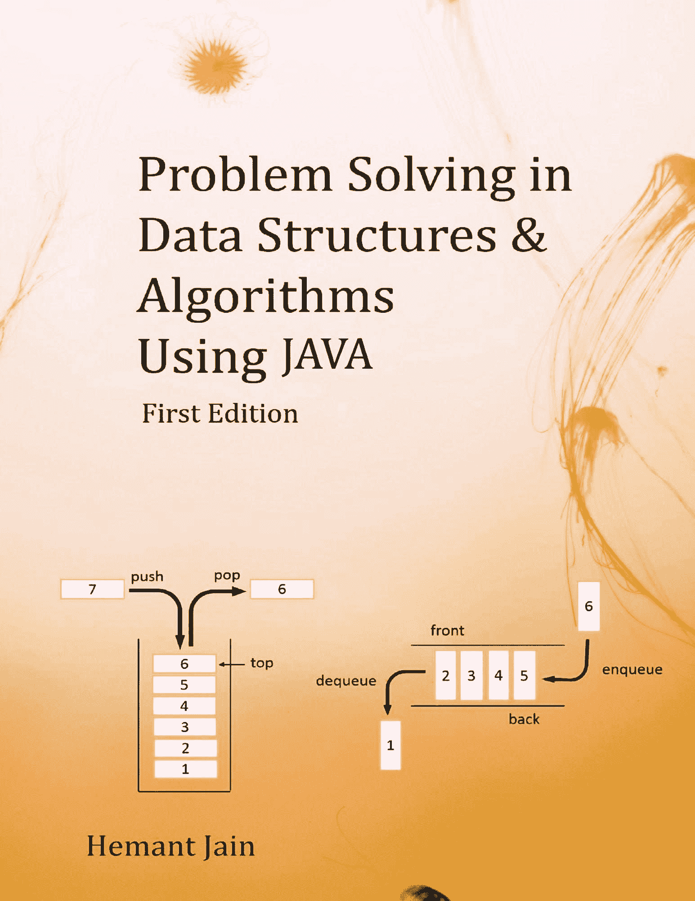

## 致谢

作者非常感谢全能之神的恩典与祝福。

深心感谢我的兄弟 `Sumant Jain` 博士提供的帮助和支持。没有他提供的支持和鼓励，这本书是不可能实现的。

我想向我的导师/朋友 `Naveen Kaushik` 表示深切的感谢，感谢他在整个本书写作过程中提供的宝贵鼓励、监督和实用建议。他的支持和持续指导使我成功地完成了工作。

最后，我要感谢 `Anil Berry` 以及其他直接或间接帮助我完成这本书的人。

`Hemant Jain`

## 主主定理

主定理用于解决如下形式的递归关系：

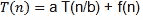

其中 `a ≥ 1` 且 `b > 1`。

- `"n"` 是问题的大小。

- `"a"` 是递归中子问题的数量。

- `"n/b"` 是每个子问题的大小。

- `"f(n)"` 是将问题划分为子问题或合并子问题结果的代价。

在以下三种情况下可以确定渐近紧界：

- **情况 1**：当 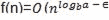) 且常数 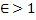 时，最终的时间复杂度将是

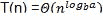

- **情况 2**：当 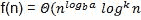) 且常数 `k ≥ 0` 时，最终的时间复杂度将是

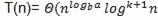)

- **情况 3**：当 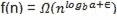 且常数 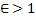 时，最终的时间复杂度将是

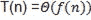

### 示例 14

以 `Merge-Sort`（归并排序）为例 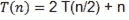 解:- 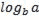= 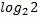= 1. 适用情况 2 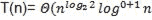) 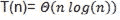。

### 示例 15

二分查找 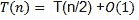 解:- = 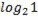= 0. 适用情况 2 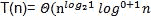) 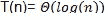。

### 示例 16

二叉树遍历 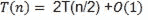 解:- 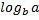= 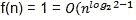= 1. 适用情况 1 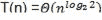。

### 示例 17

举一个例子 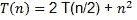 解:- = 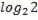= 1. 适用情况 3 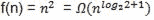。

### 示例 18

举一个例子 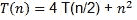 解:- 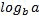= 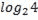= 2. 适用情况 2 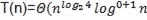。

## 修改的主定理

这是一种简单、快速解决相同问题的捷径方法。如果递归关系的形式为 `T(n) `

### 示例 19

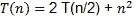 解:- 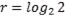 `s = 2`. 情况 3: 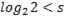 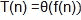。

### 示例 20

`T (n) = T (n/2) + 2n` 解:- 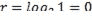 `s = 1`. 情况 3 `T(n)=`

### 示例 21

`T(n) = 2T(n/2) + n` 解:- 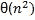 `s = 1`. 情况 2 `T(n)=`

### 示例 22

`T(n) = T(n/2) + n²` 解:- 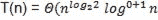 `s = 2`. 情况 3 `T(n)=`

### 示例 23

`T(n) = 4T(n/2) + n` 解:- 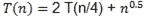 `s = 0.5`. 情况 1: 1

### 示例 24

`T(n) = 3T(n/3) + n` 解:- 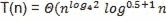 `s = 1`. 情况 2 `T(n)=`

### 示例 25

`T(n) = 2T(n/4) + n` 解:- 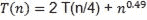 `s = 0.5`. 情况 1 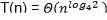.

### 示例 26

`T(n) = 8T(n/2) + n` 解:- 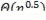 `s = 3`. 情况 3 `T(n)=`

### 示例 27

`T(n) = 2T(n/2) + n` 解:- 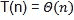 `s = 1`. 情况 2 `T(n)=`

## 灵感产生 (Idea Generation)

我们在书中已经涵盖了大量的理论知识。由于每天都会产生新问题，涵盖所有是不可能的。因此，我们应该知道如何处理新问题。即使你知道面试官提出的问题的解决方案，你也需要与面试官进行讨论并达成解决方案。你还需要分析问题，因为面试官可能会对问题进行微调，而解决问题的方法也会随之改变。

那么，如何解决新问题呢？这个问题的答案是你需要进行大量的练习，练习得越多，你就越能解决出现在眼前的任何新问题。当你解决了足够多的问题后，你就能看出题目中的模式，并轻松地解决新问题。

以下是你在解决未知问题时需要遵循的策略：

1. 尝试简化手头任务。

2. 尝试几个例子。

3. 思考合适的数据结构。

4. 回想你已经解决过的相似问题。

### 尝试简化手头任务

让我们来看以下问题：丈夫和妻子随机站在一队队伍中。丈夫们被编号为 `H1`、`H2`、`H3` 等，相应的妻子被编号为 `W1`、`W2`、`W3` 等。你需要对他们进行排序，使得 `H1` 排在第一，后面是 `W1`，然后是 `H2` 后面跟着 `W2`，依此类推。

乍一看这似乎很难，但它是一个简单的问题。尝试找到最终位置的关系。

`P(Hi) = i*2 – 1, P(Wi) = i*2`

算法的其余部分留给你完成类似 `Insertion-Sort`（插入排序）的操作，你就完成了。

### 尝试几个例子

在上述相同的问题中，如果你针对 3 对丈夫妻子尝试了某些例子，你可能得出了我们在上一节展示的相同公式。有时，通过多想几个例子来尝试解决手头的问题。

### 思考合适的数据结构

对于某些问题，哪种数据结构最合适是一而易见的。例如，如果我们有一个找到给定值之最小/最大值的问题，那么 `heap`（堆）可能是我们正在寻找的数据结构。我们在整书中看到了许多数据结构。我们必须弄清楚哪种数据结构适合我们的需求。

来看这个问题：我们给你一个数据流，任何时候我们都可以被要求告诉数据的中位数，可能还会被要求弹出中位数数据。

我们可以思考某种树，可能是平衡树，其中根节点是中位数。等等，要确保树根节点是中位数并不容易。

`heap` 可以给我们提供最小值或最大值，因此我们无法从中获得预期的结果。然而，如果我们使用两个堆，一个最大顶堆和一个最小顶堆呢？较小的值进入最小顶堆，较大的值进入最大顶堆。此外，我们可以记录每个堆中元素的数量。算法的其余部分你可以自己思考。

对于每个新问题，思考你所知道的数据结构，可能其中一个或它们的组合将解决你的问题。

### 回想你已经解决过的相似问题

假设你被给了两个链表的头引用，它们在某处相交，需要找到交点。然而，两个链表末尾的的不是 `null` 引用，而是一个环（`loop`）。

你知道如何找到两个相交链表的交点，也知道如何判断一个链表是否有环（三引用解决方案）。因此，你可以同时应用这两个解决方案来找到手头问题的答案。

## 复杂度 (Complexities)

解决问题不仅仅是找到一个正确的答案。解决方案应该是快速的，并且具有合理的内存需求。你已经在之前的章节中读过关于大 O 表示法。你应该能够进行大 O 分析。如果你认为你提供的解决方案并非最优，并且存在更高效的解决方案，请重新思考并尝试找出这些信息。

大多数面试官期望你能够找到算法的时间复杂度和 `Space Complexity`（空间复杂度）。你应该能够立即计算时间及 `Space Complexity`。每当你解决某个问题时，都应该找到与之相关的复杂度，这样你就能选择最佳解决方案。在某些问题中，空间和 `Time Complexity`（时间复杂度）之间存在权衡，所以你应该了解这些权衡。有时多花一点空间可以节省大量时间并让你的算法快得多。

## 编码 (Coding)

到此时，你已经掌握了问题的所有约束条件，提出了几个解决方案，评估了各种方案的复杂度，并选择了一个方案进行最终编码。千万不要在与面试官讨论约束条件、灵感产生和复杂度之前直接跳入编码。

我们习惯在像 `visual studio` 这样的 IDE 中编码。当被要求在白板或空白纸上写代码时，许多人感到很困难。因此，我们应该稍微练习在纸上写代码。在编码之前你应该思考，因为纸上没有后退键。始终尝试编写模块化的代码。需要创建小函数以保持代码整洁易于管理。如果有一个 `swap` 函数，直接使用这个函数并告诉面试官你稍后会写它。大家都知道你可以写 `swap` 代码。

## 测试 (Testing)

代码写完后，你的工作并没有结束。最重要的是用几个小测试用例测试你的代码。这显示了你理解测试的重要性，也能让面试官相信你不会写出 bug 代码。完成编码后，一个良好的习惯是逐行过一遍测试用例。这只是为了确保你的代码按预期工作。

你应该测试一些用例。

常规测试用例（Normal test cases）：这些是包含常见场景的测试用例，重点是代码的基础逻辑。例如，如果我们为链表编写某些算法，那么这可能包含给定 3 或 4 个节点的情况。在认为完成之前，你应该在脑中运行这些测试用例。

边界用例（Edge cases）：这些是测试代码边界的用例。对于同样的链表算法，边界用例可能是当传入空列表或仅一个节点时代码的行为如何。在认为完成之前，你应该在脑中运行这些测试用例。边界用例可能有助于让你的代码更健壮。只需要在代码中添加一些检查来考虑这些情况。

压力测试（Load testing）：在这种测试中，你的代码将使用大量数据进行测试。这将允许我们测试代码是否缓慢或内存密集型。

始终遵循这五个步骤，不要在进入编码之前进行约束分析、灵感产生和复杂度分析：至少不要错过测试阶段。

## 示例 (Example)

假设面试官要求你给出一个排序算法。

有些面试者会直接跳到 `Quick-Sort` O(nlogn)`。糟糕，在开始解决这个问题之前，你需要问很多问题。

问题 1：我们讨论的是什么类型的数据？它们是 `integer` 吗？

答案：是的，它们是 `integer`。

问题 2：我们要排序多少数据？

答案：几千个。

问题 3：这些数据具体关于什么？

答案：它们存储人的年龄。

问题 4：使用什么的数据结构来存储这些数据？

答案：数据以数组的形式给出。

问题 5：我们可以修改给定的数据结构吗？此外，还有很多、很多……？

回答：不，你不能修改提供的数据结构。

根据第一个回答，我们可以推导出数据类型是 `integer`（整数）。数据并不大，只包含几千条记录。第三个回答很有意思，我们从此推推出数据范围是 1-150。数据以数组的形式提供。从第五个回答中推推出我们必须创建自己的数据结构，而不能修改提供的数组。因此最后我们得出结论：可以使用桶排序来对数据进行排序。范围仅为 1-150，所以我们需要一个容量为 151 的整数数组。数据量在数千以内，因此我们不需要担心数据溢出，并且可以在线性时间 `O(N)` 内获得解决方案。

注意：我们将在下来的章节中学习排序。

## 总结

到此为止，你已经非常熟悉处理新问题的流程了。在接下来的章节中，我们将介绍许多不同的数据结构以及它们解决的问题。这本书中解决了大量问题。然而，建议先尝试自己解决它们，然后再寻找答案。始终考虑问题的复杂度。在面试中，关键在于完整地描述问题，并与面试官讨论你的方法。

# 第 4 章：抽象数据类型与 JAVA 集合

## 抽象数据类型 (ADT)

抽象数据类型（ADT）是对我们如何看待数据以及允许对数据进行的操作的逻辑描述。ADT 定义为从用户的角度来看数据类型。ADT 关注数据的可能值以及它暴露的接口。

ADT 不涉及数据结构的实际实现。

例如，一个用户想要存储一些 `integers`（整数）并找到它们的平均值。这并没有涉及到具体将如何实现。

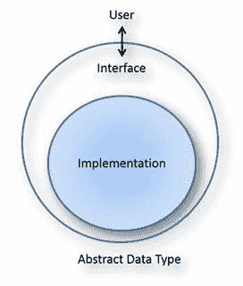

## 数据结构

数据结构是数据的具体表示，是从程序员的角度定义的。数据结构代表了数据将如何存储在内存中。所有数据结构都有其优缺点。根据当前的问题，我们选择最适合的数据结构。

例如，我们可以将数据存储在数组、链表、栈、队列、树等结构中。

## JAVA 集合框架 (JAVA Collection Framework)

JAVA 编程语言提供了 JAVA 集合框架（Collection Framework），它是一组高质量、高性能且可复用的数据结构和算法。

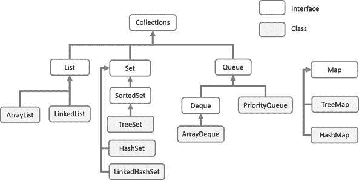

使用 JAVA 集合框架的优点如下：

1. 程序员不需要反复实现基础的数据结构和算法，从而避免了重复造轮子。因此程序员可以投入更多精力在业务逻辑上。

2. JAVA 集合框架的代码经过良好测试，是高质量、高性能的代码，从而提高了程序的质量。

3. 由于基础数据结构和算法已经在集合框架中实现，降低了开发成本。

4. 易于审查和理解其他程序，因为其他开发者也使用集合框架。此外，集合框架有完善的文档。

## 数组

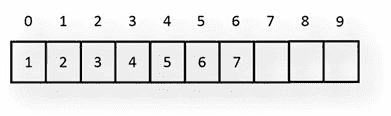

数组代表相同数据类型的多个元素的集合。数组是固定大小的数据结构，其大小在创建时就已经确定了。数组是用于存储数据最常用的数据结构。

由于我们无法更改数组的大小，通常会声明一个大尺寸数组来处理未来的任何数据扩展。这会导致创建一个大尺寸数组，其中大部分空间是未使用的。

注意：数组可以存储固定数量的元素，而集合（collection）动态存储对象，因此没有大小限制，它会自动增长和收缩。

### 数组 ADT 操作

以下是数组的 API：

1. 在 `kth` 个位置添加元素

值可以在 `O(1)` 常数时间内存储在数组的第 `K` 个位置。我们只需要将值存储在 `arr[k]`。

2. 读取存储在 `kth` 个位置的值

访问数组中某位置存储的值也是 `O(1)` 常数时间。我们只需要读取存储在 `arr[k]` 的值。

**示例 4.1**

```java
public class ArrayDemo {
    public static void main(String[] args) {
        int[] arr = new int[10];
        for (int i = 0; i < 10; i++) {
            arr[i] = i;
        }
    }
}
```

JAVA 标准数组是固定长度的。有时我们不知道需要多少内存，所以创建一个更大的数组。为了避免这种浪费空间的情况，JAVA 集合实现了 `ArrayList` 来解决这个问题。

### JAVA 中的 ArrayList 实现

Collections 中的 `ArrayList<E>` 是一个实现了 `List<E>` 接口的数据结构，这意味着它可以包含重复元素。`ArrayList` 是作为一种动态数组的实现，可以根据需要增长或收缩。（内部使用数组，当数组满额时，会分配一个更大的数组并将旧数组复制过去。）

**示例 4.2**

```java
import java.util.ArrayList;
public class ArrayListDemo {
    public void main(String[] args) {
        ArrayList<Integer> al = new ArrayList<Integer>();
        al.add(1); // 向列表末尾添加 1
        al.add(2); // 向列表末尾添加 2
        al.add(3); // 向列表末尾添加 3
        al.add(4); // 向列表末尾添加 4
        System.out.println("Contents of Array: " + al); // 转换为字符串并打印到屏幕
        al.add(2,9); // 在索引 2 处添加 9
        al.add(5,9); // 在索引 5 处添加 9
        System.out.println("Contents of Array: " + al);
        System.out.println("Array Size: " + al.size());
        System.out.println("Array IsEmpty: " + al.isEmpty());
        al.remove(al.size() -1); // 数组最后一个元素
        System.out.println("Array Size: " + al.size());
        al.removeAll(al); // 移除所有元素
        System.out.println("Array IsEmpty: " + al.isEmpty());
    }
}
```

**输出**


```
Contents of Array: [1, 2, 3, 4]
Contents of Array: [1, 2, 9, 3, 4, 9]
Array Size: 6
Array IsEmpty: false
Array Size: 5
Array IsEmpty: true
```

## 链表

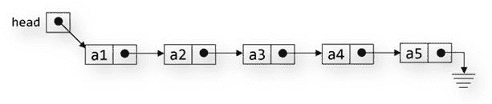

链表是动态数据结构，在运行时内存。链表的概念不是连续存储数据，而是指向下一个元素的链接。

从性能来说，链表比数组慢，因为无法直接访问链表元素。

当我们提前不知道要存储的元素数量时，链表是有用的数据结构。

你会看到许多类型的链表：线性、循环、双向和双向循环链。

### 链表 ADT 操作

以下是链表的 API。

`Insert(k)`：在列表开头插入 k

在列表开头插入元素。只需创建一个新元素并移动引用，使得该新元素成为列表的新元素。该操作将在 `O(1)` 常数时间内完成。

`Delete()`：删除列表开头的元素

删除列表开头的元素。我们只需要移动一个引用。该操作也是 `O(1)` 常数时间。

`PrintList()`：显示列表的所有元素。

从第一个元素开始，然后跟随引用。该操作将需要 `O(N)` 时间。

`Find(k)`：查找值为 k 的元素的位置

从第一个元素开始并沿着引用，直到找到我们寻找的值或到达列表末尾。此操作将需要 `O(N)` 时间。

*注意：* 二分查找不适用于链表。

`FindKth(k)`：找到位置在 k 处的元素。

从第一个元素开始并沿着链接移动，直到你到达第 k 个元素。此操作将需要 `O(N)` 时间。

`IsEmpty()`：检查列表中的元素数量是否为零。

只需检查链表的头引用，它应该为 `Null`。这意味着列表为空。此操作将需要 `O(1)` 时间。

### JAVA Collections 中的 LinkedList 实现

JAVA Collections 中的 `LinkedList<E>` 是一种数据结构，它也实现了 `List<E>` 接口。

### 示例 4.3

```java
import java.util.LinkedList;

public class LinkedListDemo {
    public LinkedListDemo() {
    }

    public static void main(String[] args) {
        LinkedList<Integer> ll = new LinkedList<Integer>();
        ll.addFirst(8); // 8 被添加到列表中
        ll.addLast(9); // 9 被添加到列表末尾
        ll.addFirst(7); // 7 被添加到列表头部
        ll.addLast(20); // 20 被添加到列表末尾
        ll.addFirst(2); // 2 被添加到列表头部
        ll.addLast(22); // 22 被添加到列表末尾
        System.out.println("Contents of Linked List: " + ll);
        ll.removeFirst();
        ll.removeLast();
        System.out.println("Contents of Linked List: " + ll);
    }
}
```

**输出：**

Contents of Linked List: [2, 7, 8, 9, 20, 22]

Contents of Linked List: [7, 8, 9, 20]

## 栈 (Stack)

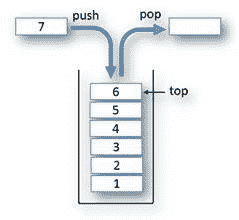

栈是一种特殊的数据结构，遵循后进先出（LIFO）策略。这意味着最后添加到栈的元素将第一个被移除。

栈的各种应用包括：

1. 递归：使用系统栈执行递归调用。

2. 表达式的后缀表达式求值。

3. 回溯。

4. 树和图的深度优先搜索。

5. 将十进制数转换为二进制数等。

### 栈 ADT 操作

`Push(k)`：栈顶添加一个新项。

`Pop()`：从栈顶移除一个元素并返回其值。

`Top()`：返回栈顶元素的值。

`Size()`：返回栈中元素的数量。

`IsEmpty()`：确定栈是否为空。如果栈为空则返回 1，否则返回 0。

*注意：* 以上所有栈操作均在 `O(1)` 时间复杂度内实现。

### JAVA Collection 中的栈实现

栈是通过调用 `ArrayDeque<T>` 类的 `push` 和 `pop` 方法来实现的。

JDK 同时也提供了 `Stack<T>`，但我们不应该使用这个类，而是优先使用实现集合接口的 `Deque`。

1. 第一个原因是 `Stack<T>` 没有继承自 Collection 接口。

2. 第二，`Stack<T>` 继承自 `Vector<T>`，因此可以随机访问，这破坏了抽象。

3. 第三，与 `Stack<T>` 相比，`ArrayDeque` 效率更高。

**示例 4.4**

```java
import java.util.ArrayDeque;

public class DequeStack<T> {
    private ArrayDeque<T> deque = new ArrayDeque<T>();

    public void push(T obj) {
        deque.push(obj);
    }

    public T pop() {
        return deque.pop();
    }

    public T top() {
        return deque.peekLast();
    }

    public int size() {
        return deque.size();
    }

    public boolean isEmpty() {
        return deque.isEmpty();
    }
}
```

**注意：** 在接下来的章节中，我们将直接使用 `ArrayDeque` 对象。我们不会再创建 `DequeStack` 包装类。当我们使用 `push()` 和 `pop()` 方法从 `ArrayDeque` 中插入和移除元素时，我们就是在执行栈操作。

## 队列 (Queue)

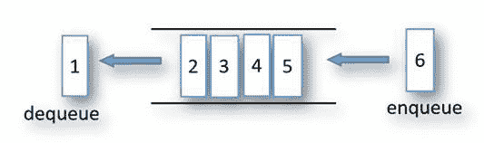

队列是一种先入先（FIFO）的数据结构。首先添加到队列的元素将第一个从队列中移除，依此类推。

队列有以下应用：

1. 共享资源的访问（例如打印机）。

2. 多程序设计。

3. 消息队列。

### 队列 ADT 操作

`Add()`：在队列尾部添加新元素。

`Remove()`：从队列头部移除一个元素并返回其值。

`Front()`：返回队列头部元素的值。

`Size()`：返回队列内部元素的数量。

`IsEmpty()`：如果队列为空返回 1，否则返回 0

*注意：* 以上所有队列操作均在 `O(1)` 时间复杂度内实现。

### JAVA Collection 中的队列实现

`ArrayDeque<T>` 是双端队列的类实现。如果我们使用 `add()`、`remove()` 和 `peekFirst()`，它将表现为一个队列。（如果我们使用 `push()`、`pop()` 和 `peekLast()`，它则表现为一个栈。）

**示例 4.5**

```java
import java.util.ArrayDeque;

public class DequeQueue<T> {
    private ArrayDeque<T> deque = new ArrayDeque<T>();

    public void add(T obj) {
        deque.add(obj);
    }

    public T remove() {
        return deque.remove();
    }

    public T peek() {
        return deque.peekFirst();
    }

    public int size() {
        return deque.size();
    }

    public boolean isEmpty() {
        return deque.isEmpty();
    }
}
```

## 树 (Trees)


树是一种层次化数据结构。树的顶部元素被称为树的根。除了根元素外，树中的每个元素都有父节点以及零或多个子元素。当你有层次化信息需要存储时，树是最用的的数据结构。

树有很多类型，例如二叉树、红黑树、AVL 树等。

## 二叉树

二叉树是树的一种，每个节点最多有两个孩子，称为左孩子和右孩子。

## 二叉搜索树 (BST)

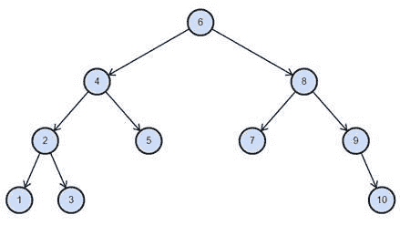

二叉搜索树（BST）是一种按照以下方式排序的二叉树：

1. 左子树的键小于其父节点的键。

2. 右子树的键大于或等于其父节点的键。

### 二叉搜索树 ADT 操作

`Insert(k)`：向树中插入元素 k。

`Delete(k)`：从树中删除元素 k。

`Search(k)`：在树中搜索特定的值 k，判断其是否存在。

`FindMax()`：找到树中存储的最大值。

`FindMin()`：找到树中存储的最小值。

在二叉搜索树上执行上述所有操作的平均时间复杂度为 `O(log n)`，即树平衡的情况。

当树倾斜时，最坏的时间复杂度将为 `O(n)`。当树不平衡时，二叉树就是倾斜的。

### 平衡二叉搜索树

有一些二叉搜索树可以始终保持平衡。其中最重要的是红黑树（RB-Tree）和 AVL 树。

标准模板库 (`STL`) 是使用这种 `红黑树 (RB-Tree)` 实现的。

### JAVA Collections 中的 TreeSet 实现

`TreeSet<>` 是实现 `Set<>` 接口的类，这意味着它只存储唯一元素。在 JAVA Collections 中，`TreeSet<>` 是使用红黑平衡二搜索树实现的。由于 `TreeSet<>` 是使用二搜索树实现的，因此它的元素是顺序顺序存储。

**示例 4.6**

```java
import java.util.TreeSet;

public class TreeSetDemo {
    public static void main(String[] args) {
        // 创建一个树集合。
        TreeSet<String> ts = new TreeSet<String>();
        // 向树集合中添加元素。
        ts.add("India");
        ts.add("USA");
        ts.add("Brazil");
        ts.add("Canada");
        ts.add("UK");
        ts.add("China");
        ts.add("France");
        ts.add("Spain");
        ts.add("Italy");
        System.out.println(ts);
    }
}
```

**输出**

`[Brazil, Canada, China, France, India, Italy, Spain, UK, USA]`

**注意**:- `TreeSet` 是使用二搜索树实现的，因此 `add`、`remove` 和 `contains` 方法的时间复杂度为 `O(log (n))`，其中 `n` 是集合中元素的数量。

### JAVA Collection 中的 TreeMap 实现 实现

`Map<>` 是一个将键映射到值的接口。也称为字典。`TreeMap<>` 是 `Map<>` 的一种实现，并使用红黑平衡二搜索树实现，因此键值对按排序顺序存储。

**示例 4.7**

```java
import java.util.TreeMap;

public class TreeMapDemo {
    public static void main(String[] args) {
        // 创建一个树形映射。
        TreeMap<String, Integer> tm = new TreeMap<String, Integer>();
        // 将元素放入映射中
        tm.put("Mason", new Integer(55));
        tm.put("Jacob", new Integer(77));
        tm.put("William", new Integer(99));
        tm.put("Alexander", new Integer(80));
        tm.put("Michael", new Integer(50));
        tm.put("Emma", new Integer(65));
        tm.put("Olivia", new Integer(77));
        tm.put("Sophia", new Integer(88));
        tm.put("Emily", new Integer(99));
        tm.put("Isabella", new Integer(100));
        System.out.println("Total number of students in class :: " + tm.size());
        for (String key : tm.keySet()) {
            System.out.println(key + " score marks :" + tm.get(key));
        }
        System.out.println("Emma score present::" + tm.containsKey("Emma"));
        System.out.println("John score present:: " + tm.containsKey("John"));
        tm.remove("Emma");
        System.out.println("Emma score present::" + tm.containsKey("Emma"));
    }
}
```

**输出**

Total number of students in class :: 10

Alexander score marks :80

Emily score marks :99

Emma score marks :65

Isabella score marks :100

Jacob score marks :77

Mason score marks :55

Michael score marks :50

Olivia score marks :77

Sophia score marks :88

William score marks :99

Emma present in class :: true

John present in class :: false

## 优先级队列 (堆)


优先级队列是使用二堆数据结构实现的。在堆中，记录存储在数组中，使得每个键都大于其两个子节点。堆中的每个节点遵循相同的规则，即父节点的值大于它的两个子节点。

堆数据结构有两种：

1. 最大堆 (Max heap)：每个节点应该大于或等于它的每个子节点。

2. 最小堆 (Min heap)：每个节点应该小于或等于它的每个子节点。

当你想要从数据集中获取最大/最小值时，堆是一种非常有用的数据结构。堆排序使用最大堆按升序/降序排序数据。

### 堆 ADT 操作

`Insert()` - 向堆中添加新元素。该操作的`Time Complexity` 为 `O(log(n))`。

`remove()` - 在最大堆情况下提取最大值（在最小堆情况下提取最小值）。该操作的`Time Complexity` 为 `O(log(n))`。

`Heapify()` – 将数组中的一组数字列表转换为堆。该操作的`Time Complexity` 为 `O(n)`。

### JAVA Collection 中的 PriorityQueue 实现

优先级队列的最小堆实现。

**示例 4.8**

```java
import java.util.PriorityQueue;

public class PriorityQueueDemo {
    public static void main(String[] args) {
        PriorityQueue<Integer> pq = new PriorityQueue<>();
        int[] arr = {1,2,10,7,3,4,6,8,9,5};
        for (int i: arr) {
            pq.add(i);
        }
        System.out.println("Priority Queue Heap :: " + pq.remove());
        while (!pq.isEmpty()) {
            System.out.println("Priority Queue elements :: " + pq.remove());
        }
    }
}
```

*(注: 原文中的示例 4.8 代码存在语法错误且括号未闭合，已修正为符合 Java 逻辑的结构。)*


```java
public static void main(String[] args) {
    // Create a hash set.
    HashSet<String> hs = new HashSet<String>();
    // Add elements to the hash set.
    hs.add("India");
    hs.add("USA");
    hs.add("Brazil");
    hs.add("Canada");
    hs.add("UK");
    hs.add("China");
    hs.add("France");
    hs.add("Spain");
    hs.add("Italy");
    System.out.println(hs);
    System.out.println("Hash Table contains USA : " + hs.contains("USA"));
    System.out.println("Hash Table contains Russia : " +
    hs.contains("Russia"));
    hs.remove("USA");
    System.out.println(hs);
    System.out.println("Hash Table contains USA : " + hs.contains("USA"));
}
```

**输出**

```
[Canada, USA, UK, China, Italy, Brazil, France, India, Spain]
Hash Table contains USA : true
Hash Table contains Russia : false
[Canada, UK, China, Italy, Brazil, France, India, Spain]
Hash Table contains USA : false
```

### JAVA Collections 中的 LinkedHashSet 实现

`LinkedHashSet<>` 是一个实现了 `Set<>` 接口的类，这意味着它只存储唯一元素。`LinkedHashSet<>` 是使用哈希表和链表实现的。`Linked list` 用于根据插入顺序保留元素的顺序。遍历哈希表的元素是按照插入顺序完成。

**示例 4.11**

```java
import java.util.HashSet;
import java.util.LinkedHashSet;

public class LinkedHashSetDemo {
    public static void main(String[] args) {
        // Create a hash set.
        HashSet<String> hs = new HashSet<String>();
        // Add elements to the set.
        hs.add("India");
        hs.add("USA");
        hs.add("Brazil");
        hs.add("Canada");
        hs.add("UK");
        hs.add("China");
        hs.add("France");
        hs.add("Spain");
        hs.add("Italy");
        System.out.println("HashSet value:: " + hs);
        // Create a linked hash set.
        LinkedHashSet<String> lhs = new LinkedHashSet<String>();
        // Add elements to the linked hash set.
        lhs.add("India");
        lhs.add("USA");
        lhs.add("Brazil");
        lhs.add("Canada");
        lhs.add("UK");
        lhs.add("China");
        lhs.add("France");
        lhs.add("Spain");
        lhs.add("Italy");
        System.out.println("LinkedHashSet value:: " + lhs);
    }
}
```

**输出**

```
HashSet value:: [Canada, USA, UK, China, Italy, Brazil, France, India, Spain]
LinkedHashSet value:: [India, USA, Brazil, Canada, UK, China, France, Spain, Italy]
```

各种 Set 类的比较。

| | TreeSet | HashSet | LinkedHashSet |
| :--- | :--- | :--- | :--- |
| 存储 | 红黑树 | 哈希表 | 带有链表的哈希表 |
| 性能 | 比 HashSet 慢，O(log(N)) | 最快，常数时间 | 比 HashSet 贵，需要维护链表 |
| 迭代顺序 | 升序排序 | 不保证顺序 | 插入顺序 |

### JAVA Collection 中的 HashMap 实现

`Map<>` 是一个将键（key）映射到值（value）的数据结构。也称为字典。`HashMap<>` 是 `Map<>` 的实现，使用哈希表实现，因此键值对不是按排序存储的。`Map<>` 不允许重复键，但值可以重复。

**示例 4.12**

```java
import java.util.HashMap;
public class HashMap {
    public static void main(String[] args) {
        // Create hash map.
        HashMap<String, Integer> hm = new HashMap<String, Integer>();
        // Put elements into the map
        hm.put("Mason", 5);
        hm.put("Jacob", 77);
        hm.put("William", 99);
        hm.put("Alexander", 80);
        hm.put("Michael", 50);
        hm.put("Emma", 65);
        hm.put("Olivia", 77);
        hm.put("Sophia", 88);
        hm.put("Emily", 99);
        hm.put("Isabella", 100);
        System.out.println("Total number of students in class :: " + hm.size());
        for (String key : hm.keySet()) {
            System.out.println(key + " score marks :" + hm.get(key));
        }
        System.out.println("Emma score present::" + hm.containsKey("Emma"));
        System.out.println("John score present:: " + hm.containsKey("John"));
    }
}
```

**输出**

```
班级总人数 :: 10
Olivia score marks : 77
Emily score marks : 99
Alexander score marks : 80
Mason score marks : 55
Michael score marks : 50
Isabella score marks : 100
William score marks : 99
Emma score marks : 65
Sophia score marks : 88
Jacob score marks : 77
Emma present in class : true
John present in class : false
```

## 字典 / 符号表

符号表（Symbol Table）是 `string(key)` 与 `value` 之间的映射，`value` 可以是任意数据类型。`value` 可以是整数，例如出现次数、单词的字典释义等。

### 用于字符串的二叉搜索树 (BST)

二叉搜索树 (BST) 是实现符号表最简单的方法。可以使用简单的字符串比较函数来比较两个字符串。如果所有的键都是随机的，并且树是平衡的。那么平均情况下键查找可以在对数时间内完成。

Trie 是一种高效的数据结构。使用 `Trie`，我们可以在 `O(M)` 时间内搜索键，其中 `M` 是字符串的最大长度。`Trie` 也适用于解决部分匹配和范围查询问题。


### 三元搜索树 (Ternary Search Trie/ Ternary Search Tree)

Trie 具有非常良好的 `O(M)` 搜索性能，其中 `M` 是搜索字符串的最大长度。然而，Trie 的空间要求非常高。每个 `Trie` 节点包含指向多个节点的引用，每个引用对应键的可能字符。为了避免这种高空间需求，使用了三元搜索树 (`TST`)。

TST 避免了传统 `Trie` 对空间的高昂需求，同时保留了其许多优势。在 `TST` 中，每个节点包含一个字符、一个结束指示以及三个引用。三个引用分别对应等于、小于和大于字符。三元搜索树的操作的时间复杂度与搜索树的高度成正比。在最坏的情况下，我们需要遍历 3 次链接。然而，这种情况很少见。因此，`TST` 是实现符号表、部分匹配和范围查询的非常好的解决方案。


## 图 (Graphs)


图是一种表示网络的数据结构，它连接了一组节点，这些连接被称为边。边可以是有向的或无向的。如果是有向，则只能向一个方向移动；如果是无向，则可以在两个方向移动。

## 图算法 (Graph Algorithms)


### 深度优先搜索 (DFS)

在 `DFS` 算法中，我们从起点开始进入深度，直到到达尽头再搜索下一个顶点。或者，我们可以使用递归来实现同样的。


### 广度优先搜索 (BFS)

在 `BFS` 算法中，图按层层遍历，靠近起点的地方。使用队列来实现 `BFS`。


## 排序算法 (Sorting Algorithms)


排序是将集合中的元素按升序或降序排列的过程。排序将数据排序，使得搜索变得更容易。有很多可用的排序函数，在 `O(nlogn)` 时间内完成排序，当我们需要排序时将使用 `sort()` 函数，假设排序是在 `O(nlogn)` 时间内完成的。

[计数排序 (Counting Sort)](http://www.bogotogo.com/Algorithms/countingsort.php)

计数排序是最简单高效的排序类型。计数排序对数据的预定义范围有严格要求，例如年龄组。


如果我们知道输入的范围，可以使用 `O(n+k)` 完成计数。

## 结语 (End note)

本章提供了各种数据结构、算法及其复杂性的要介绍。在接下来的章节中，我们将详细研究这些数据结构。如果你了解各种数据结构的接口，就可以在不知道其实现细节的情况下解决其他问题。

# 第 5 章：搜索 (Chapter 5: Searching)

## 引言 (Introduction)

在计算机科学中，搜索是在项目列表中查找特定项目的算法过程。该项目可以是文件中的关键字、数据库中的记录、树中的节点或数组中的值等。

## 为什么要搜索？ (Why Searching?)

想象你在一个拥有百万本书的图书馆里。你想找一本特定标题的书。你会如何找到？你将从书名的首字母开始搜索。然后继续匹配整个书名，直到找到所需的书籍（通过这种简单的启发式方法，你将搜索空间缩小了 26 倍，假设我们有相同特定字符开头的书）。

同样，计算机存储了大量信息，为了有效地检索这些信息，我们需要高效的搜索算法。为了提高搜索效率，我们将数据保持某种良好的顺序。组织数据的方法有很多。如果你保持数据的良好顺序，搜索所需的元素很容易。例如，排序就是组织数据的方法。

## 不同的搜索算法 (Different Searching Algorithms)

* 线性搜索 – 无序输入（Linear Search – Unsorted Input）
* 线性搜索 – 有序输入（Linear Search – Sorted Input）
* 二分查找（有序输入）（Binary Search (Sorted Input)）
* 字符串搜索：Trie、后缀树、三元搜索（String Search: Tries, Suffix Trees, Ternary Search.）
* 哈希与符号表（Hashing and Symbol Tables）

## 线性搜索 – 无序输入 (Linear Search – Unsorted Input)

当数组元素没有顺序或排序时，且我们要搜索某个特定值，我们必须扫描整个数组，除非找到所需值。这种算法被称为无序线性搜索。该算法的主要问题是性能较低或最坏情况下时间复杂度较高。

**示例 5.1**

```cpp
boolean linearSearchUnsorted(int[] arr, int size, int value) {
    int i = 0;
    for (i = 0 ; i < size ; i++) {
        if (value == arr[i]) {
            return true;
        }
    }
}
```

时间复杂度：`O(n)`。因为我们需要遍历整个数组。最坏的情况是所需的元素位于数组的最后一个位置。空间复杂度：`O(1)`。没有使用额外内存。

## 线性搜索 – 有序 (Linear Search – Sorted)

如果数组元素按升序或降序排序，搜索一个元素将比无序搜索高效得多。在很多情况下，我们不需要遍历整个数组。以下示例解释了当遇到较大的元素时停止。这节省了时间。

**示例 5.2**

```cpp
boolean linearSorted(int[] arr, int size, int value) {
    int i = 0;
    for (i = 0 ; i < size ; i++) {
        if (value == arr[i]) {
            return true;
        } else if ( value < arr[i] ) {
            return false;
        }
    }
}
```

时间复杂度：`O(n)`。因为我们需要遍历整个数组。最坏的情况是所需的元素位于排序数组的最后一个位置。然而，尽管增长率与无序相同，但在平均情况下这种算法更高效。空间复杂度：`O(1)`。没有使用额外内存分配数组。

## 二分查找 (Binary Search)

我们如何在字典中查找单词？通常，我们去某个近似页面（通常是中间）并从那里开始搜索。如果我们搜索的单词相同，则搜索完成。否则，如果我们发现页面在选定页面之前，则对前半应用相同的相同的，否则对后半部分。二分查找也同样的方式工作。我们从排序数组获取中间点并与目标值进行比较。

注意：二分查找要求数组是有序的，否则无法应用二分查找。

**示例 5.3**

```cpp
// 二分查找算法 – 迭代方式
boolean Binarysearch(int[] arr, int size, int value)
    int low = 0;
    int high = size-1;
    int mid;
    while (low <= high) {
```

```java
mid = low + (high-low)/2; // 防止溢出
if (arr[mid] == value)
    return true;
else if (arr[mid] < value)
    low = mid + 1;
else
    high = mid - 1;
}
return false;
}
```

时间复杂度：`O(logn)`。我们总是取输入的一半并丢弃另一部分。因此，二分查找的递归关系为 `T(n) = T(n/2) + c`。使用主定理（分治法），我们得到 `T(n) = O(logn)`。

空间复杂度：`O(1)`

## 示例 5.4

### 二分查找算法 – 递归方式


```java
boolean BinarySearchRecursive(int[] arr, int low, int high, int value)  
{
    if(low > high)
        return false;
    int mid = low + (high-low)/2; // 防止溢出
    if (arr[mid] == value)
        return true;
    else if (arr[mid] < value)
        return BinarySearchRecursive (arr, mid + 1, high, value);
    else
        return BinarySearchRecursive (arr, low, mid - 1 , value);
}
```

时间复杂度：`O(logn)`。空间复杂度：递归时的系统栈为 `O(logn)`。

## 字符串搜索算法

请参字符串章节。

## 哈希与符号表

请参阅哈希表章节。

## 排序在选择算法中有什么用？

选择问题可以转换为排序问题。一旦数组经过排序，就可以很容易地从排序数组中找到最小/最大值（或所需的元素）。`先排序后选择`的方法对于选择单个元素来说效率很低，但当需要从数组中进行多次选择时，它是非常高效的。这是因为只需要进行一次昂贵的初始排序，随后是多次廉价的选择操作。

例如，如果我们想从数组中获取最大元素。对数组排序后，我们可以直接返回数组的最后一个元素。如果我们想获取第二大元素呢？现在我们不需要再次排序数组，只需返回排序数组中的倒数第二个元素。同样，我们可以通过对排序后的列表进行一次扫描来返回第 `kth` 个最大元素。

因此，通过上述讨论，排序被用于提高性能。通常，这种方法需要 `O(nlogn)` 时间（用于排序）。通过初始排序，我们可以在一次扫描 `O(n)` 内内回答任何查询。

## 搜索中的问题

### 打印数组中的重复元素

给定一个包含 `n` 个数字的数组，打印数组中的重复元素。

*方法一*：穷举搜索或暴力法，对于数组中的每个元素，查找是否存在另一个具有相同元素。这通过两个 `for` 循环完成，第一个循环选择元素，第二个循环查找它的重复项。

#### 示例 5.5

```java
void printRepeating(int[] arr, int size)
{
    int i, j;
    System.out.println(" Repeating elements are ");
    for(i = 0; i < size; i++)
        for(j = i+1; j < size; j++)
            if(arr[i] == arr[j])
                System.out.println(" " + arr[i]);
}
```

时间复杂度为 ，空间复杂度为 。

*方法二*：对数组中的所有元素进行排序，之后通过单次扫描即可找到重复元素。

#### 示例 5.6

```java
void printRepeating2(int[] arr, int size) {
    int i;
    Arrays.sort(arr); // 排序(arr,size);
    System.out.println(" Repeating elements are ");
    for(i = 1; i < size; i++)
    {
        if(arr[i] == arr[i-1])
            System.out.println(" " + arr[i]);
    }
}
```

排序算法需要 时间，单次扫描需要 。算法的时间复杂度为 ，空间复杂度为 。

*方法三*：哈希表，使用哈希表我们可以跟踪已经过的元素，并只需一次扫描即可找到重复元素。

#### 示例 5.7

```java
void printRepeating3(int[] arr, int size)
{
    HashSet<Integer> hs = new HashSet<Integer>();
    int i;
    System.out.println(" Repeating elements are ");
    for(i = 0; i < size; i++)
    {
        if(hs.contains(arr[i]))
            System.out.println(" " + arr[i]);
        else
            hs.add(arr[i]);
    }
}
```

哈希表的插入和查找需要常数时间 ，因此总时间复杂度为 。空间复杂度为 。

*方法四*：计数，这种方法只有在知道输入范围时可行。如果我们知道数组中的元素范围在 0 到 `n-1` 之间，我们可以留出一个长度为 `n` 的数组，当我们看到一个元素时，增加它的计数。只需一次扫描即可知道重复元素。如果我们知道元素的范围，这就是查找重复元素最快的方法。

#### 示例 5.8

```java
void printRepeating4(int[] arr, int size)
{
    int[] count = new int[size];
    int i;
    for(i = 0; i < size; i++)
        count[i]=0;
    System.out.println(" Repeating elements are ");
    for(i = 0; i < size; i++)
    {
        if(count[arr[i]] == 1)
            System.out.println(" " + arr[i]);
        else
            count[arr[i]]++;
    }
}
```

计数方法仅使用一个数组，插入和查找需要常数时间 ，因此总时间复杂度为 。创建计数数组的空间复杂度为 。

### 数组中出现最多的元素

给定一个包含 `n` 个数字的数组，找到次数最多的元素。

*方法一*：穷举搜索或暴力法，对于数组中的每个元素，查找该特定值出现的次数。跟踪 `maxCount`，当某个元素的计数大于它时更新 `maxCount`。这通过两个 `for` 循环完成，第一个循环选择元素，第二个循环统计该元素的出现次数。时间复杂度为 ，空间复杂度为 。

#### 示例 5.9

```java
int getMax(int[] arr, int size)
{
    int i, j;
    int max = arr[0], count = 1, maxCount = 1;
    for (i = 0; i < size; i++)
    {
        count = 1;
        for (j = i + 1; j < size; j++)
            if (arr[i] == arr[j])
                count++;
        if (count > maxCount)
        {
            max = arr[i];
            maxCount = count;
        }
    }
    return max;
}
```

*方法二*：排序，对数组中的元素进行排序，之后通过单次扫描即可找到计数。

#### 示例 5.10

```java
int getMax2(int[] arr, int size)
{
    int max = arr[0], maxCount = 1;
    int curr = arr[0], currCount = 1;
    int i;
}
```

```java
Arrays.sort(arr); // Sort(arr,size);

for (i = 1; i < size; i++)
{
    if (arr[i] == arr[i - 1])
        currCount++;
    else
    {
        currCount = 1;
        curr = arr[i];
    }
    if (currCount > maxCount)
    {
        maxCount = currCount;
        max = curr;
    }
}
return max;
```

### 第三种方法：计数法

这种方法仅在知道输入范围时才可行。如果知道这一点，那么数组中的元素范围在 `0` 到 `n-1` 之间。我们可以预留一个长度为 `n` 的数组，当我们看到一个元素时，就可以增加它的计数。只需通过一次扫描，我们就能知道重复元素。如果我们知道元素的范围，那么这是找到最大次数最快的方法。

计数法仅使用数组，因此增加计数需要常数时间，所以算法的总体*时间复杂度*为 时间。创建计数数组的空间复杂度也为 
{
    int max = arr[0], maxCount = 1;
    int[] count = new int[range];
    int i;
    for (i = 0; i < size; i++)
    {
        count[arr[i]]++;
        if (count[arr[i]] > maxCount)
        {
            maxCount = count[arr[i]];
            max = arr[i];
        }
    }
    return max;
}
```

### 数组中的多数元素

给定一个包含 `n` 个元素的数组。找到多数元素，即出现次数超过 `n/2` 次的元素。如果没有多数元素，返回 0。

**第一种方法**：穷举搜索或暴力破解，对于数组中的每个元素，查找该特定值出现的次数。跟踪 `maxCount`，当某个元素的计数大于它时，则更新 `maxCount`。这是通过两个循环实现的：第一个循环用于选择元素，第二个循环用于统计该元素的出现次数。一旦我们得到了最终的 `maxCount`，就可以检查它是否大于 `n/2`，如果是，则有多数元素；如果不是，则。时间复杂度为 ，空间复杂度为 

#### 示例 5.12

```java
int getMajority(int[] arr, int size)
{
    int i, j;
    int max=0, count=0, maxCount=0;
    for(i = 0; i < size; i++)
    {
        for(j = i+1; j < size; j++)
        {
            if(arr[i] == arr[j])
                count++;
            if(count > maxCount)
            {
                max = arr[i];
                maxCount = count;
            }
        }
    }
    if (maxCount > size/2)
        return max;
    else
        return Integer.MIN_VALUE;
}
```

**第二种方法**：排序，对数组中的所有元素进行排序。如果有多数元素，那么索引 `n/2` 处的中间元素必须是多数数字。因此，只需一次扫描即可找到它的计数并判断是否存在多数元素。

排序算法需要 时间，单次扫描需要 时间。

算法的*时间复杂度*为 ，*空间复杂度*为 

#### 示例 5.13

```java
int getMajority2(int[] arr, int size)
{
    int majIndex = size/2, count = 1;
    int i;
    int candidate;
    Arrays.sort(arr);
    candidate = arr[majIndex];
    count = 0;
    for (i = 0; i < size; i++)
        if(arr[i] == candidate)
            count++;
    if (count > size/2)
        return arr[majIndex];
    else
        return Integer.MIN_VALUE;
}
```

**第三种方法**：这是抵消法（摩尔投票算法），如果所有元素都反对多数元素，且每个元素与多数元素中的一个元素抵消，则存在多数元素。

- 将数组的第一个元素设置为候选元素，并将计数初始化为 1。
- 开始扫描数组。
- 如果我们得到的某个元素值与多数元素相同，则增加计数。
- 如果我们得到的元素值与多数元素不同，则减少计数。
- 如果计数为 0，意味着我们有了一个新的多数元素。将当前候选元素设置为多数元素并将计数重置为 1。
- 最后，我们将得到一个唯一的可能候选元素。
- 现在再次扫描数组，检查上面找到的候选元素出现次数是否超过了 `n/2` 次。

计数法只需两次扫描。算法的*时间复杂度*为 时间。创建计数数组的空间复杂度也为 
{
    int majIndex = 0, count = 1;
    int i;
    int candidate;
    for (i = 1; i < size; i++)
    {
        if(arr[majIndex] == arr[i])
            count++;
        else
            count--;
        if(count == 0)
        {
            majIndex = i;
            count = 1;
        }
    }
    candidate = arr[majIndex];
    count = 0;
    for (i = 0; i < size; i++)
        if(arr[i] == candidate)
            count++;
    if (count > size/2)
        return majIndex; // 注意：原始逻辑返回 majIndex，通常返回 candidate
}
```

#### 示例 5.15

```java
int findMissing(int[] arr, int size)
{
    int i, j, found = 0;
    for (i = 1; i <= size; i++)
    {
        found = 0;
        for (j = 0; j < size; j++)
        {
            if (arr[j] == i)
            {
                found = 1;
                break;
            }
        }
        if (found == 0)
            return i;
    }
}
```

### 第三种方法：哈希表 (Hash-Table)

使用哈希表，我们可以跟踪已经过的元素，只需一次扫描即可找到缺失的元素。

`Hash-Table` 的插入和查找需要常数时间，因此算法的总*时间复杂度*为 。*空间复杂度*也是 

### 第四种方法：计数法

我们知道输入的范围，因此使用计数法是可行的。众所周知，数组中的元素在 0 到 `n-1` 范围内。我们可以预留一个长度为 `n` 的数组，当我们看到一个元素时，增加它的计数。只需一次扫描，我们就能知道缺失的元素。

计数法仅使用一个数组，因此插入和查找需要常数时间，因此算法的总*时间复杂度*为 。创建计数数组的*空间复杂度*也是 

### 第五种方法：修改法

允许修改给定的输入数组。修改给定的输入数组，以便在下次扫描时可以找到缺失的元素。


当你遍历数组时，当索引为`index`时，数组中存储的值为`arr[index]`，将数字`n + 1`加到`arr[arr[index]]`。始终使用取模运算符`%%`从数组中读取值。当你第一次扫描数组并修改所有值后，只需再次扫描，就可以查看数组中是否存在某个小于`n+1`的值，该索引就是缺失的数字。

在这种方法中，数组被扫描两次，该算法的*时间复杂度*为 。*空间复杂度*为 

### 第六种方法：求和公式

使用求和公式找到从 1 到`n`的`n`个数字的和。减去数组中存储的值，你就得到了缺失的数字。

该算法的*时间复杂度*为 。*空间复杂度*为 

### 第七种方法：异或法 (XOR)

使用异或法找到从 1 到`n`的`n`个数字的和。异或数组中存储的值，你就得到了缺失的数字。

该算法的*时间复杂度*为 。*空间复杂度*为 

### 示例 5.16

```java
int findMissingNumber(int[] arr, int size, int range)
{
    int i;
    int xorSum = 0;
    //获取从 1 到 range 所有数字的异或结果
    for (i = 1; i <= range; i++)
        xorSum ^= i;
    // 遍历数组并获取元素的异或结果
    for (i = 0; i<size; i++)
        xorSum ^= arr[i];
    return xorSum;
}
```

注意：相同的问题可能以多种形式出现（有时你必须对范围进行异或，有时不需要）：

1. 在 1-n 范围内的数字中，其中所有数字都出现一次，但有一个数字出现了两次。

2. 1-n 范围内的所有元素都出现了 16 次，一个元素出现了 17 次。找到出现 17 次的元素。

### 在数组中寻找配对

给定一个包含`n`个数字的数组，找到两个元素，使得它们的和等于`value`。

### 第一种方法：穷举搜索

暴力法，对于数组中的每个元素，查找是否存在另一个元素，其和等于目标值。这是通过两个`for`循环实现的，第一个循环选择元素，第二个循环寻找另一个元素。

时间复杂度为 ，空间复杂度为 

### 示例 5.17

```java
int FindPair(int[] arr, int size, int value)
{
    int i, j;
    for (i = 0; i < size; i++)
        for (j = i + 1; j < size; j++)
            if ((arr[i] + arr[j]) == value)
            {
                System.out.println("The pair is :arr[i]+","+arr[j]);
                return 1;
            }
    return 0;
}
```

### 第二种方法：排序

步骤如下：

1. 对数组中的所有元素排序。

2. 取两个变量`first`和`second`。变量`first=0`且`second = size -1`。

3. 计算`sum=arr[first]+arr[second]`。

4. 如果和等于目标值，则找到了解决方案。

5. 如果和小于目标值，则增加`first`。

6. 如果和大于目标值，则减小`second`。

7. 重复上述过程，直到我们期望的配对或得到`first >= second`（没有配对）。

排序算法需要 时间，单次扫描需要 时间。排序后的时间复杂度为 

### 示例 5.18

```java
int FindPair2(int[] arr, int size, int value) {
    int first = 0, second = size - 1;
    int curr;
    Arrays.sort(arr);
    while (first < second) {
        curr = arr[first] + arr[second];
        if (curr == value) {
            System.out.println("The pair is " + arr[first] + "," + arr[second]);
            return 1;
        } else if (curr < value)
            first++;
        else
            second--;
    }
}
```

### 示例 5.19

```java
int FindPair3(int[] arr, int size, int value) {
    HashSet<Integer> hs = new HashSet<Integer>();
    int i;
    for (i = 0; i < size; i++) {
        if (hs.contains(value - arr[i])) {
            System.out.println("The pair is " + arr[i] + "," + (value - arr[i]));
            return 1;
        }
        hs.add(arr[i]);
    }
    return 0;
}
```

### 第四种方法：计数法

这种方法只有在知道输入范围时才是可能的。如果知道，数组中的元素在 0 到`n-1`范围内。我们可以预留一个长度为`n`的数组，当我们看到一个元素时，增加它的计数。在上述方法的哈希表位置，我们将使用这个数组并找到配对。

计数法仅使用一个数组，因此插入和查找需要常数时间，因此算法的总*时间复杂度*为 。*空间复杂度*也是 

### 在两个数组中寻找配对

给定两个数组`X`和`Y`。找到一对元素`(xi, yi)`，使得`xi∈X`且`yi∈Y`，且`xi+yi=value`。

### 第一种方法：穷举搜索

暴力法，遍历`X`中的元素`xi`，查看是否能在`Y`中找到`(value - xi)`。使用两个`for`循环。

时间复杂度为 ，空间复杂度为 

### 第二种方法：排序

对第二个数组`Y`中的所有元素排序。对于`X`中的每个元素，通过二分查找查看该元素是否在`Y`中。

排序算法需要 ，而搜索需要时间。

算法的时间复杂度是 ，空间复杂度是 

### 第三种方法：排序

步骤如下：

1. 将`X`和`Y`中的元素按升序排序。

2. 取`X`中最小的元素与`Y`中最大元素的和。

3. 如果和等于目标值，则我们得到了目标数对。

4. 如果和小于目标值，取`X`的下一个元素。

5. 如果和大于目标值，取`Y`的上一个元素。

排序算法需要 进行排序，搜索需要时间。

算法的时间复杂度是 ，空间复杂度是 

### 第四种方法：哈希表

步骤如下：

1. 遍历数组`Y`中的所有元素并将它们插入到`Hashtable`中。

2. 现在遍历数组`X`的所有元素，假设当前元素为`xi`，查看是否在`Hashtable`中可以找到`(value - xi)`。

3. 如果找到了该值，则你得到了目标数对。

4. 如果没有，则处理数组`X`中的下一个值。

`Hash-Table`的插入和查找需要常数时间，因此算法的总时间复杂度是 。空间复杂度同样是 

### 第五种方法：计数法

这种方法只有在知道输入范围时才可行。与`Hashtable`的实现类似，只需使用一个简单的数组代替`Hashtable`即可。

计数法仅使用数组，因此插入和查找需要常数时间，因此算法的总时间复杂度是。创建计数数组的空间复杂度也是 

### 和最接近零的两个元素

给定一个`integer`数组，包含正数和负数。你需要找到两个元素，它们的和最接近零。

### 第一种方法：穷举搜索或暴力破解

对于数组中的每个元素，找到另一个元素，使其相加后的绝对值最小。这是通过两个`for`循环完成的，第一个循环用于选择元素，第二个循环用于寻找加在它上面的元素，使得和的绝对值最小或接近零。

时间复杂度为 ，空间复杂度为 

### 示例 5.20

```java
void minabsSumPair(int[] arr, int size) {
    int l, r, minSum, sum, minFirst, minSecond;
    // 数组至少有两个元素
    if (size < 2) {
        System.out.println("Invalid Input");
        return;
    }
    // 初始化值
    minFirst = 0;
    minSecond = 1;
    minSum = Math.abs(arr[0] + arr[1]);
    for (l = 0; l < size - 1; l++) {
        for (r = l+1; r < size; r++) {
            sum = Math.abs(arr[l] + arr[r]);
            if (sum < minSum) {
                minSum = sum;
                minFirst = l;
                minSecond = r;
            }
        }
    }
    System.out.println(" The two elements with minimum sum are " + arr[minFirst] + " , arr[minSecond]);
}
```

### 第二种方法：排序

步骤如下：

1. 排序数组中的所有元素。

2. 取两个变量`firstIndex = 0`和`secondIndex = size -1`。

3. 计算`sum = arr[firstIndex]+arr[secondIndex]`。

4. 如果和等于 0，则我们得到了解决方案。

5. 如果和小于 0，我们将增加第一个索引。

6. 如果和大于 0，我们将减小第二个索引。

7. 重复上述步骤 3 到 6，直到我们得到所需的数对或`first >= second`。

### 示例 5.21

```java
void minabsSumPair(int[] arr, int size) {
    int l, r, minSum, sum, minFirst, minSecond;
    // 数组至少有两个元素
    if (size < 2) {
        System.out.println("Invalid Input");
        return;
    }
    Arrays.sort(arr); //Sort(arr, size);
    // 初始化值
    minFirst = 0;
    minSecond = size - 1;
    minSum = Math.abs(arr[minFirst] + arr[minSecond]);
    for (l = 0, r = size - 1; l < r;) {
        sum = (arr[l] + arr[r]);
        if (Math.abs(sum) < minSum) {
            minSum = Math.abs(sum);
            minFirst = l;
            minSecond = r;
        }
        if (sum < 0) {
            l++;
        } else if (sum > 0) {
            r--;
        } else {
            break;
        }
    }
    System.out.println(" The two elements with minimum sum are " + arr[minFirst] + " , arr[minSecond]);
}
```

### 在峰值数组中寻找最大值

峰值数组由一个递增的整数序列和紧随其后的一个递减的整数序列组成。由于元素按某种顺序排序，我们应该使用类似于二分查找的算法。步骤如下：

1. 取两个变量存储起始和结束索引。`start=0`和`end=size-1`。

2. 找到数组的中间元素。

3. 查看中间元素是否为最大。如果是，返回中间元素。

4. 或者，如果中间元素在增加部分，我们需要查找`mid+1`到`end`。

5. 或者，如果中间元素在减少部分，我们需要查找`start`到`mid-1`。

6. 重复步骤 2 到 5，直到我们得到最大值。

### 示例 5.22

```java
int SearchBotinicMax(int[] arr, int size) {
    int start = 0, end = size - 1;
    int mid = (start + end) / 2;
    int maximaFound = 0;
    if (size < 3) {
        System.out.println("error");
        return 0;
    }
    while (start <= end) {
        mid = (start + end) / 2;
        if (arr[mid - 1] < arr[mid] && arr[mid + 1] < arr[mid]) //最大值
            maximaFound = 1;
            break;
        } else if (arr[mid - 1] < arr[mid] && arr[mid] < arr[mid + 1]) //递增
            start = mid + 1;
        } else if (arr[mid - 1] > arr[mid] && arr[mid] > arr[mid + 1]) //递减
            end = mid - 1;
        }
    }
    return arr[mid];
}
```

3. 如果在递增部分未找到该值，则在数组的递减部分使用二分查找搜索该值。

### 示例 5.23


```java
int SearchBitonicArray(int[] arr, int size, int key) {
    int max = FindMaxBitonicArray(arr, size);
    int k = BinarySearch(arr, 0, max, true);
    if (k != -1) 
        return k;
    else 
        return BinarySearch(arr, max + 1, size - 1, false);
}
int FindMaxBitonicArray(int[] arr, int size) {
    int start = 0, end = size - 1, mid;
    if (size < 3) {
        System.out.println("error");
        return 0;
    }
    while (start <= end) {
        mid = (start + end) / 2;
        if (arr[mid - 1] < arr[mid] && arr[mid + 1] < arr[mid])//max
        {
            return mid;
        }
        else if (arr[mid - 1] < arr[mid] && arr[mid] < arr[mid + 1])//increasing
        {
            start = mid + 1;
        }
        else if (arr[mid - 1] > arr[mid] && arr[mid] > arr[mid + 1])//increasing
        {
            end = mid - 1;
        }
        else
        {
            break;
        }
    }
    System.out.println("error");
    return 0;
}
int BinarySearch(int[] arr, int start, int end, boolean isInc) {
    int mid;
    if (end < start)
        return -1;
    mid = (start + end) / 2;
    if (key == arr[mid])
        return mid;
    if (isInc != false && key < arr[mid] || isInc == false && key > arr[mid])
    {
        return BinarySearch(arr, start, mid - 1, isInc);
    }
    else
    {
        return BinarySearch(arr, mid + 1, end, isInc);
    }
}
```

## 排序数组中的出现次数

给定一个排序数组`arr[]`，找到某个数字出现的次数。

**第一种方法**：暴力法，遍历数组并在线性时间内得到该数字的出现次数。这通过一个循环完成。

时间复杂度为`image0907.jpeg`，空间复杂度为`image0891.jpeg`。

### 示例 5.24

```java
int findKeyCount(int[] arr, int size, int key) {
    int i, count = 0;
    for (i = 0; i < size ; i++)
    {
        if (arr[i] == key)
            count++;
    }
    return count;
}
```

**第二种方法**：由于我们有一个排序数组，我们应该考虑使用二分查找。

1. 首先，我们应该找到`key`的第一次出现位置。
2. 然后，我们应该找到`key`的最后一次出现位置。
3. 取这两个值之差即可得到解决方案。

### 示例 5.25

```java
int findKeyCount2(int[] arr, int size, int key) {
    int firstIndex, lastIndex;
    firstIndex = findFirstIndex(arr, 0, size -1, key);
    lastIndex = findLastIndex(arr, 0, size - 1, key);
    return (lastIndex - firstIndex + 1);
}
int findFirstIndex(int[] arr, int start, int end, int key) {
    int mid;
    if (end < start)
        return -1;
    mid = (start + end) / 2;
    if (key == arr[mid] && (mid == start || arr[mid - 1] != key))
        return mid;
    if (key <= arr[mid])// 该数字在排序数组中。
    {
        return findFirstIndex(arr, start, mid - 1, key);
    }
    else
    {
        return findFirstIndex(arr, mid + 1, end, key);
    }
}
int findLastIndex(int[] arr, int start, int end, int key) {
    int mid;
    if (end < start)
        return -1;
    mid = (start + end) / 2;
    if (key == arr[mid] && (mid == end || arr[mid + 1] != key))
        return mid;
    if (key < arr[mid])//
    {
        return findLastIndex(arr, start, mid - 1, key);
    }
    else
    {
        return findLastIndex(arr, mid + 1, end, key);
    }
}
```

## 分离数组中的偶数和奇数

给定一个包含偶数和奇数的数组，编写一个程序将偶数与奇数分离。

**第一种方法**：分配一个单独数组，然后扫描给定的数组，从开始填充偶数，从结束填充奇数。

**第二种方法**：算法如下：

1. 初始化两个变量`left`和`right`。变量`left=0`且`right=size-1`。
2. 增加`left`索引，直到该索引为偶数。
3. 减少`right`索引，直到该索引为奇数。
4. 交换`left`和`right`索引的值。
5. 重复步骤 2 到 4，直到`left`小于`right`。

### 示例 5.26

```java
void swap (int[] arr, int first, int second) {
    int temp = arr[first];
    arr[first] = arr[second];
    arr[second] = temp;
}
void seperateEvenOdd(int[] arr, int size) {
    int left = 0, right = size - 1;
    while (left < right)
    {
        if (arr[left] % 2 == 0 )
        {
            left++;
        }
        else if (arr[right] % 2 == 1)
        {
            right--;
        }
        else
        {
            swap(arr, left, right);
            left++;
            right--;
        }
    }
}
```

## 股票买卖问题

给定一个数组，第`n`个元素是第`n`天股票的价格。要求买入一次卖出一次，在哪一天买入哪一天卖出以获得最大利润。或者给定一个数字数组，你需要最大两个数字之间的差，即减去出现在数字之前的数字。

**第一种方法**：暴力法，对于数组中的每个元素，寻找另一个差异最大的元素。这通过两个`for`循环完成，第一个循环选择买入日期，第二个循环查找卖出日期。

时间复杂度为`image0906.jpeg`，空间复杂度为`image0882.jpeg`。

**第二种方法**：另一种巧妙的解决方案是从开始为止记录最小值。在每一点，我们可以计算差值并跟踪最大利润。这是一个线性解决方案。

算法的时间复杂度为`image0887.jpeg`。创建计数数组的空间复杂度同样为`image0893.jpeg`。

### 示例 5.27

```java
void maxProfit(int stocks[], int size) {
    int buy = 0, sell = 0;
    int curMin = 0;
    int currProfit=0;
    int maxProfit = 0;
    int i;
    for (i = 0; i < size; i++) {
        if (stocks[i] < stocks[curMin])
            curMin = i;
        currProfit = stocks[i] - stocks[curMin];
        if (currProfit > maxProfit) {
            buy = curMin;
            sell = i;
        }
    }
}
```

```java
maxProfit = currProfit;
}
}
System.out.println("Purchase day is- "+ buy +" at price " + stocks[buy]);
System.out.println("Sell day is- "+sell+" at price " + stocks[sell]);
}
```

## 寻找数组的中位数

给定一个大小为`n`的数字数组，如果数组中的所有元素都是有序的，请找到位于索引`n/2`处的元素。

**第一种方法**：排序数组并返回中间的元素。

排序算法需要时间。

算法的*时间复杂度*是 而*空间复杂度*是 

### 示例 5.28

```java
int getMedian(int[] arr, int size)
{
    Arrays.sort(arr); //Sort(arr, size);
    return arr[size / 2];
}
```

**第二种方法**：使用 QuickSelect 算法。我们将在下一节介绍这种算法。在 QuickSort 算法中只需跳过我们不需要的递归调用。

该算法的平均*时间复杂度*将 

## 寻找两个有序数组的中位数

**第一种方法**：跟踪两个数组的索引，假设索引为`i`和`j`。不断增加值较小数组的索引。使用计数器来跟踪我们已经遍历过的元素。

算法的*时间复杂度*是 而*空间复杂度*是 

### 示例 5.29

```java
int findMedian(int[] arrFirst, int sizeFirst, int[] arrSecond, int sizeSecond)
{
    int medianIndex = ((sizeFirst + sizeSecond) + (sizeFirst + sizeSecond) % 2) / 2;  //向上取整函数
    int i = 0, j = 0;
    int count = 0;
    while (count < medianIndex - 1)
    {
        if (i < sizeFirst - 1 && arrFirst[i] < arrSecond[j])
            i++;
        else
            j++;
        count++;
    }
    if (arrFirst[i] < arrSecond[j])
        return arrFirst[i];
    else
        return arrSecond[j];
}
```

## 搜索 01 数组

给定一个由 0 和 1 组成的数组。所有的 0 都在 1 之前。编写一个算法找到第一个 1 的索引。或者你给一个包含 0 或 1 的数组，且它们是有序的，例如`[] = {1,1,1,0,0}`。你将如何统计 1 和 0 的数量？

**第一种方法**：二分查找，因为数组是排序的，使用二分查找来寻找所需的索引。

算法的时间复杂度是 空间复杂度是 

### 示例 5.30

```java
int BinarySearch01Wrapper(int[] arr, int size)
{
    if (size == 1 && arr[0] == 1)
        return 0;
    return BinarySearch01(arr, 0, size - 1);
}

int BinarySearch01(int[] arr, int start, int end)
{
    int mid;
    if (end < start)
        return -1;
    mid = (start + end) / 2;
    if (1 == arr[mid] && 0 == arr[mid - 1])
        return mid;
    if (0 == arr[mid])
    {
        return BinarySearch01(arr, mid + 1, end);
    }
    else
    {
        return BinarySearch01(arr, start, mid - 1);
    }
}
```

## 在有序数组中搜索

给定一个包含`n`个整数的有序数组`s`。该数组`s`被旋转了任意次数。在数组中找到一个元素。

**第一种方法**：由于数组是有序的，我们可以使用改进后的二分查找来找到该元素。

算法的时间复杂度是 空间复杂度是 

### 示例 5.31

```java
int BinarySearchRotateArray(int[] arr, int start, int end, int key)
{
    int mid;
    if (end < start)
        return -1;
    mid = (start + end) / 2;
    if (key == arr[mid])
        return mid;
    if (arr[mid] > arr[start])
    {
        if (arr[start] <= key && key < arr[mid])
        {
            return BinarySearchRotateArray(arr, start, mid - 1, key);
        }
        else
        {
            return BinarySearchRotateArray(arr, mid + 1, end, key);
        }
    }
    else
    {
        if (arr[mid] < key && key <= arr[end])
        {
            return BinarySearchRotateArray(arr, mid + 1, end, key);
        }
        else
        {
            return BinarySearchRotateArray(arr, start, mid - 1, key);
        }
    }
}

int BinarySearchRotateArrayWrapper(int[] arr, int size, int key)
{
    return BinarySearchRotateArray(arr, 0, size - 1, key);
}
```

## 数组中的首次元素

给定一个包含`n`个元素的无序数组，找到重复的元素。

**第一种方法**：穷举搜索（Brute force），对于数组中的每个元素查找是否存在另一个相同的值。这是通过两个循环完成的，第一个循环选择元素，第二个循环查找其重复。

时间复杂度为 空间复杂度为 

### 示例 5.32


```java
int FirstRepeated(int[] arr, int size)
{
    int i, j;
    for (i = 0; i < size; i++)
        for (j = i + 1; j < size; j++)
            if (arr[i] == arr[j])
                return arr[i];
    return 0;
}
```

**第二种方法**：哈希表（`Hash-Table`），使用哈希表我们可以跟踪元素在数组中出现的次数。第一次扫描只需填充哈希表。第二次扫描只需查看元素的出现次数。如果元素出现超过一次，时间复杂度为 ，空间复杂度为 用于维护哈希。

### 数组转换

你将如何交换类似 `[a1 a2 a3 a4 b1 b2 b4]` 的数组元素，将其转换为 `[a1 b1 a2 b2 a3 b3 a4]`？

方法：

- 首先交换中间对
- 接下来交换中间的两对
- 接下来交换中间的三对
- 迭代 `n-1` 步。例如当 `n = 4` 时。

### 示例 5.33

```java
void transformArrayAB(int[] arr, int size)
{
    int N = size/2, i, j;
    for (i = 1; i < N; i++) {
        for (j = 0; j < i; j++) {
            swap(arr, N-i+2*j, N-i+2*j+1);
        }
    }
}

void swap(int[] arr, int i, int j) {
    int temp = arr[i];
    arr[i] = arr[j];
    arr[j] = temp;
}
```

### 用最少比较找到数组中的第二大数

假设你给出一个包含 `n` 个不同元素的无序数组。你将如何以最少的比较次数识别第二大元素？

**第一种方法**：找到数组中的最大元素。然后用最大元素替换最后一个元素。然后在剩余的 `n-1` 个元素中搜索第二大元素。

总比较次数为：`(n-1) + (n-2)`

**第二种方法**：对数组排序，然后给出 `(n-1)` 元素。这种方法仍然更低效。

**第三种方法**：使用优先级队列 / 堆。我们将在堆章节中介绍这种方法。使用 `buildHeap()` 函数从数组构建堆。这通过 `n` 次比较完成。`Arr[0]` 是最大的数，而 `arr[1]` 和 `arr[2]` 中较大的那个是次大数。

总比较次数为：`(n-1) + 1 = n`

### 检查两个数组是否为互排列

给定两个整数数组。你需要检查它们是否为互排列。

**第一种方法**：排序。对两个数组的所有元素进行排序，并从头到尾比较两个数组的每个元素。如果没有差异，返回 `true`。否则返回 `false`。

排序算法消耗 时间，比较消耗  时间。

算法的**时间复杂度**为 ，**空间复杂度**为 。

### 示例 5.34

```java
boolean checkPermutation(int[] array1, int size1, int[] array2, int size2){
    if (size1 != size2)
        return false;
    Arrays.sort(array1); // Sort(array1, size1);
    Arrays.sort(array2); // Sort(array2, size2);
    for (int i = 0; i < size1; i++) {
        if (array1[i] != array2[i])
            return false;
    }
    return true;
}
```

**第二种方法**：哈希表（假设：没有重复元素）。

1. 为第一个数组的所有元素创建一个哈希表。
2. 从头到尾遍历另一个数组，并在哈希表中查找每个元素。
3. 如果所有元素都在哈希表中被找到，则返回 `true`，否则返回 `false`。

哈希表的插入和查找需要常数时间 ，因此算法的总**时间复杂度**为  时间。**空间复杂度**为 。

**时间复杂度** = `O(n)`（用于创建哈希表和查找），**空间复杂度** = `O(n)`（用于创建哈希表）。

### 示例 5.35

```java
boolean checkPermutation2(int[] array1, int size1, int[] array2, int size2) {
    int i;
    if (size1 != size2)
        return false;
    ArrayList<Integer> al = new ArrayList<Integer>();
    for (i = 0; i < size1; i++)
        al.add(array1[i]);
    for (i = 0; i < size2; i++) {
        if (al.contains(array2[i]) == false)
            return false;
        al.remove(array2[i]);
    }
    return true;
}
```

### 移除整数数组中的重复元素

第一种方法：排序，步骤如下：

1. 排序数组。
2. 使用两个引用。创建一个从 `0` 到第一个引用的包含唯一元素的子数组（第一个引用指向子数组的最后一个索引）。第二个引用从 `1` 直到结尾遍历数组。唯一的数字将从第二个引用复制到第一个引用。

**时间复杂度**计算：排序数组的时间 = `O(nlogn)`。移除的时间 = `O(n)`。整体**时间复杂度** = `O(nlogn)`。不需要额外空间，因此**空间复杂度**为 `O(1)`。

### 示例 5.36

```java
int removeDuplicates(int[] array, int size) {
    int j = 0;
    int i;
    if (size == 0)
        return 0;
    Arrays.sort(array); // Sort(array,size);
    for (i = 1; i < size; i++) {
        if (array[i] != array[j]) {
            j++;
            array[j] = array[i];
        }
    }
    return j + 1;
}
```

### 在二维排序数组中搜索元素

给定一个二维数组。每行和每列都按升序排列。你如何在其中找到一个元素？

算法原理如下：

1. 从最后列和第一行的元素开始。
2. 如果该元素是我们要找的值，返回 `true`。
3. 如果该元素大于我们要找的值，移动到前一列但同一行的元素。
4. 如果该元素小于我们要找的值，移动到下一行但同一列的元素。
5. 如果到达第一列最后一行的元素后仍未找到元素，则返回 `false`。条件 `(row < r && column >= 0)` 为假。

运行时间 = `O(N)`。

### 示例 5.37

```java
int FindElementIn2DArray(int[] arr[], int r, int c, int value) {
    int row = 0;
    int column = c - 1;
    while (row < r && column >= 0){
        if (arr[row][column] == value)
            return 1;
        else if (arr[row][column] > value)
            column--;
    }
}
```

## 练习

1. 给定数组，找到重复元素。以下方法哪些有效？哪些不有效？
   - 暴力穷举搜索。
   - 使用哈希表记录元素的索引。
   - 排序。
   - 如果我们知道输入范围，可以使用计数。

2. 给定包含 `n` 个元素的数组，找到三个和等于给定值的元素。尝试使用暴力法完成。然后尝试应用排序法。

3. 给定一个包含负数和正数的数组，编写一个程序将负数与正数分开。

4. 给定一个包含 `1` 和 `0` 的数组，编写一个程序将 `0` 和 `1` 分开。

5. 给定一个包含 `0`、`1` 和 `2` 的数组，编写一个程序将 `0`、`1` 和 `2` 分开。

6. 给定一个单调递增且包含正负数的数组。编写一个算法找到列表变为正数的点。

7. 给定一个排序数组，查找给定的数字。如果找到，返回索引；如果未找到，找到该数字插入数组后的索引。

8. 找到旋转数组中的最大值。

9. 找到旋转数组中的最小值。

10. 找到两个排序数组并集中的第 `k` 小元素。

还有其他算法可以处理无法完全存储在内存中的海大数据集，为此开发了外部排序技术。

在我们开始逐一讨论各种算法之前，首先我们应该查看用于比较两个值的比较函数。

`Less function` 如果 `value1` 小于 `value2`，则返回 `1`，否则它返回 `0`。

```java
private boolean less(int value1, int value2)
{
    return value1 < value2;
}
```

`More function` 如果 `value1` 大于 `value2`，则返回 `1`，否则它返回 `0`。

```java
private boolean more(int value1, int value2)
{
    return value1 > value2;
}
```

在各种排序算法中的值通过使用上述函数之一进行比较，并根据这些函数的返回值进行交换。如果使用 `more()` 比较函数，则排序后的输出将是升序的；如果使用 `less()`，则结果的输出将是降序排列。

## 排序类型

### 内部排序

所有元素都可以同时读入内存，并在内存中进行排序。

1. `Selection-Sort`（选择排序）
2. `Insertion-Sort`（插入排序）
3. `Bubble-Sort`（泡沫排序）
4. `Quick-Sort`（快速排序）

### 外部排序

在这种情况下，数据集非常大，无法将整个数据集加载到内存中，因此分块进行排序。

1. `Merge-Sort`（合并排序）

在选择应用排序算法时需要考虑的三个因素：

1. 列表中元素的数量
2. 所需的列表不同顺序数量
3. 移动数据或不移动数据所需的时间

### 泡沫排序

`Bubble-Sort` 是排序中最慢的算法，但因为它容易实现而被广泛使用。

在 `Bubble-Sort` 中，我们比较每一对相邻的值。我们希望按升序排列值，因此如果第二个值小于第一个值，我们就交换这两个值。否则，我们将移动到下一对。

因此，较小的值会“浮”到数组的开头。

我们需要 `N` 轮传递来完全排序数组。

第一轮传递之后，最大值将位于最右侧的位置。


### 示例 6.1

```java
public class BubbleSort {
    private int[] arr;
    public BubbleSort(int[] array)
    {
        arr = array;
    }
    private boolean less(int value1, int value2)
    {
        return value1 < value2;
    }
    private boolean more(int value1, int value2)
    {
        return value1 > value2;
    }
    public void sort()
    {
        int size = arr.length;
        int i, j, temp;
        for (i = 0 ; i < ( size - 1 ); i++)
        {
            for (j = 0 ; j < size - i - 1; j++)
            {
                if (more(arr[j], arr[j+1]))
                {
                    /* Swapping */
                    temp = arr[j];
                    arr[j] = arr[j+1];
                    arr[j+1] = temp;
                }
            }
        }
    }
}
```

**分析：**

- 外层 `for` 循环表示为了比较数据而进行的交换次数。
- 内层循环实际上用于对数据进行比较。在每次内层循环结束时，最大值会被移动到数组的末尾。第一次迭代中是最大值，第二次迭代中是第二大值，依此类推。
- 使用 `more()` 函数进行比较，这意味着当第一个参数的值大于第二个参数的值时，执行交换。通过这种方式，我们是在按升序排序；如果我们用 `less()` 函数代替 `more()`，则会得到降序排序。

如果你忘记了，请查看 `more()` 函数

```java
private boolean more(int value1, int value2)
{
    return value1 > value2;
}
```

**复杂度分析：**

每次内层循环执行次数 `(n-1)`, `(n-2)`, `(n-3)`…

`(n-1) + (n-2) + (n-3) + ..... + 3 + 2 + 1 = n(n-1)/2`

| 最坏情况性能 | O) |
| :--- | :--- |
| 平均情况性能 | O) |
| 空间复杂度 | O(1) 因为我们只需要一个临时变量 |
| 稳定排序 | 是 |

## 修改（改进）的泡沫排序

当外层循环的某一次传递不再有交换时，这表明所有元素已经就绪，因此我们应该停止排序。这种 `Bubble-Sort` 的排序改进在我们知道数组除了少数元素外其余部分已经排好序时非常有用。

### 示例 6.2

```java
public void sort()
{
    int size = arr.length;
    int i, j, swapped=1;
    for (i = 0; i < (size - 1) && swapped == 1; i++)
    {
        swapped = 0;
        for (j = 0; j < size - i - 1; j++)
        {
            if (more(arr[j], arr[j + 1]))
            {
                /* Swapping */
                temp = arr[j];
                arr[j] = arr[j+1];
                arr[j+1] = temp;
            }
        }
    }
}
```

通过应用此改进，当数组接近有序时，该算法的最佳情况得到了改进。

最佳情况为 `O(n)`。

**复杂度分析：**

| 最坏情况性能 | O) |
| :--- | :--- |
| 平均情况性能 | O) |
| 空间复杂度 | O(1) |
| 自适应：当数组接近有序时 | O(n) |
| 稳定排序 | 是 |

## 插入排序

`Insertion-Sort` 的**时间复杂度**为 `O(Images/image0015.jpeg)`，与 `Bubble-Sort` 相同但性能更好。这是我们整理扑牌的方式。我们保持一个有序子数组。每个值都被插入到其左侧有序子数组的正确位置。


### 示例 6.3


```java
public class InsertionSort {
    private int[] arr;
    public InsertionSort(int[] array) {
        arr = array;
    }
    private boolean more(int value1, int value2)
    {
        return value1 > value2;
    }
    public void sort()
    {
        int size = arr.length;
        int temp,j;
        for(int i=1; i<size; i++)
        {
            temp=arr[i];
            for(j=i; j>0 && more(arr[j-1], temp); j--)
            {
                arr[j]=arr[j-1];
            }
            arr[j]=temp;
        }
    }
}
public class InsertionSortDemo
{
    public static void main(String[] args)
    {
        int[] array = {9,1,8,2,7,3,6,5};
        InsertionSort bs = new InsertionSort(array);
        bs.sort();
        for(int i=0;i<array.length ;i++)
        {
            System.out.print(array[i] + " ");
        }
    }
}
```

**分析：**

- 外层循环用于选取我们想要插入到左有序数组中的值。
- 我们想要插入的值已经选取并保存在了一个临时变量中。
- 内层循环使用`more()`函数进行比较。值不断向右移动，直到找到当前迭代中`temp`值的正确位置。
- 最后，将该值放置在正确的位置。在外层循环的每次迭代中，排序数组的长度增加一。当我们退出外层循环时，整个数组就完成了排序。

### 复杂度分析

| 最坏情况时间复杂度 | O(n²) |
| :--- | :--- |
| 最优情况时间复杂度 | O(n) |
| 平均时间复杂度 | O(n²) |
| 空间复杂度 | O(1) |
| 稳定排序 | 是 |

### 选择排序 (Selection-Sort)

选择排序遍历整个未排序数组，并将最大值放在数组的末尾。该算法的时间复杂度相同，但由于所需的比较次数较少，性能优于冒泡排序和插入排序。在选择排序中，数组是从后往前创建的。


#### 示例 6.4:

```java
public class SelectionSort {
    private int[] arr;
    public SelectionSort(int[] array) {
        arr = array;
    }
    //后向数组
    public void sort() {
        int size = arr.length;
        int i, j, max, temp;
        for (i = 0; i < size - 1; i++) {
            max = 0;
            for (j = 1; j < size - 1 - i ; j++) {
                if (arr[j] > arr[max]) {
                    max = j;
                }
            }
            temp = arr[size - 1 - i];
            arr[size - 1 - i] = arr[max];
            arr[max] = temp;
        }
    }
}
```

**分析：**

- 外层循环决定内层循环迭代的次数。对于 N 个元素的输入，内层循环将迭代 N 次。
- 在内层循环的每次迭代中，计算最大值并将其放在数组末尾。
- 这是将最大值替换到正确的位置。排序数组随之创建。

**复杂度分析：**

| 最坏情况时间复杂度 | O(n²) |
| :--- | :--- |
| 最优情况时间复杂度 | O(n²) |
| 平均时间复杂度 | O(n²) |
| 空间复杂度 | O(1) |
| 稳定 | 否 |

可以通过在数组前端创建排序数组来实现相同的算法。

#### 示例 6.5 前向变体：

```java
void sort2() {
    int size = arr.length;
    int i, j, temp;
    for (i = 0; i < size - 1; i++) {
        min = i;
        for (j = i + 1; j < size; j++) {
            if (arr[j] < arr[min]) {
                min = j;
            }
        }
        temp = arr[i];
        arr[i] = arr[min];
        arr[min] = temp;
    }
}
```

## 合并排序 (Merge-Sort)


合并排序在每一步中递归地将输入分为两半。它递归地排序两个部分，最后将结果合并成最终的排序输出。

### 示例 6.6

```java
public class MergeSort {
    private int[] arr;
    private void merge(int[] arr, int[] tempArray, int lowerIndex, int middleIndex, int upperIndex) {
        int lowerStart = lowerIndex;
        int lowerStop = middleIndex;
        int upperStart = middleIndex + 1;
        int upperStop = upperIndex;
        int count = lowerIndex;
        while (lowerStart <= lowerStop && upperStart <= upperStop) {
            if (arr[lowerStart] < arr[upperStart]) {
                tempArray[count++] = arr[lowerStart++];
            } else {
                tempArray[count++] = arr[upperStart++];
            }
        }
        while (lowerStart <= lowerStop) {
            tempArray[count++] = arr[lowerStart++];
        }
        while (upperStart <= upperStop) {
            tempArray[count++] = arr[upperStart++];
        }
        for (int i = lowerIndex; i <= upperIndex; i++) {
            arr[i] = tempArray[i];
        }
    }
    private void mergeSrt(int[] arr, int[] tempArray, int lowerIndex, int upperIndex) {
        if (lowerIndex >= upperIndex)
            return;
        int middleIndex = (lowerIndex + upperIndex) / 2;
        mergeSrt(arr, tempArray, lowerIndex, middleIndex);
        mergeSrt(arr, tempArray, middleIndex + 1, upperIndex);
        merge(arr, tempArray, lowerIndex, upperIndex);
    }
    public void sort() {
        int size = arr.length;
        int[] tempArray = new int[size];
        mergeSrt(arr, tempArray, 0, size - 1);
    }
    public MergeSort(int[] array) {
        arr = array;
    }
}

public class MergeSortDemo {
    public static void main(String[] args) {
        int[] array = {3, 4, 2, 6, 5, 7, 8, 1};
        MergeSort m = new MergeSort(array);
        m.sort();
        for (int i = 0; i < array.length; i++) {
            System.out.print(array[i] + " ");
        }
    }
}
```

- 合并排序在所有情况下（最优、平均和最坏）的时间复杂度均为`O(n log n)`，因为它总是将数组分为两半，并花费线性时间合并这两个部分。
- 它需要与未排序列表等量的额外空间。因此，不建议用于大型未排序列表。
- 它是链表的最佳排序技术。

**复杂度分析：**

| 最坏情况时间复杂度 | O(n log n) |
| :--- | :--- |
| 最优情况时间复杂度 | O(n log n) |
| 平均时间复杂度 | O(n log n) |
| 空间复杂度 | O(n) |
| 稳定 | 是 |

## 快速排序 (Quick-Sort)


快速排序也是递归算法。

- 在每一步中，我们选择一个基值（假设是数组的第一个元素）。
- 然后我们遍历数组剩余部分，并将所有小于基值的元素复制到数组的左侧。
- 我们将所有大于基值的元素复制到数组的右侧。显然，基值处于其正确的排序位置。
- 然后我们分别对左右子数组进行排序。
- 当算法返回时，整个数组就完成了排序。

### 示例 6.7

```java
public class QuickSort {
    private int[] arr;
    public QuickSort(int[] array) {
        arr = array;
    }
    private void swap(int[] arr[], int first, int second) {
        int temp = arr[first];
        arr[first] = arr[second];
        arr[second] = temp;
    }
    private void quickSortUtil(int[] arr[], int lower, int upper) {
        if (upper <= lower)
            return;
        int pivot = arr[lower];
        int start = lower;
        int stop = upper;
        while (lower < upper) {
        }
    }
}
```

```java
while (arr[lower] <= pivot && lower < upper)
{
    lower++;
}
while (arr[upper] > pivot && lower <= upper)
{
    upper--;
}
if (lower < upper)
{
    swap(arr,upper,lower);
}
```

`swap(arr, upper, start);` // upper is the pivot position

`quickSortUtil(arr, start, upper - 1);` // pivot -1 is the upper for left sub array.

`quickSortUtil(arr, upper + 1, stop);` // pivot + 1 is the lower for right sub array.

```java
public void sort(){
    int size = arr.length;
    quickSortUtil(arr, 0, size - 1);
}

public class QuickSortDemo {
    public static void main(String[] args) {
        int[] array={3,4,2,1,6,5,7,8,1,1};
        QuickSort m = new QuickSort(array);
        m.sort();
        for(int i=0;i<array.length ;i++) {
            System.out.print(array[i] + " ");
        }
    }
}
```

- 快速排序所需的空间非常少，只需要`O(logn)`的额外空间。
- 快速排序不是一种稳定算法，因此它在排序过程中可能会改变两个元素的出现顺序。

**复杂度分析：**

| 最坏情况复杂度 | `O(n²)` |
| :--- | :--- |
| 最优时间复杂度 | `O(logn)` |
| 平均时间复杂度 | `O(logn)` |
| 空间复杂度 | `O(logn)` |
| 稳定 | 否 |

## 快速选择 (Quick Select)

快速选择与快速排序非常相似，不同在于它不是排序整个数组，而在快速排序的每一步中忽略数组的一半，只关注我们感兴趣的数组区域。

### 示例 6：

```java
class QuickSelect {
    public static void swap(int arr[], int first, int second){
        int temp = arr[first];
        arr[first] = arr[second];
        arr[second] = temp;
    }
    public static void quickSelect(int arr[], int lower, int upper, int k)
    {
        if (upper <= lower)
            return;
        int pivot = arr[lower];
        int start = lower;
        int stop = upper;
        while (lower < upper)
        {
            while (arr[lower] <= pivot && lower < upper)
                lower++;
            while (arr[upper] > pivot && lower <= upper)
                upper--;
            if (lower < upper)
                swap(arr, upper, lower);
        }
        swap(arr, upper, start); //upper is the pivot position
        if (k<upper)
            quickSelect(arr, start, upper - 1, k); //pivot -1 is the upper for left sub array.
        if (k>upper)
            quickSelect(arr, upper + 1, stop, k); // pivot + 1 is the lower for right array.
    }
    public static void quickSelect(int arr[], int k){
        quickSelect(arr, 0, arr.length - 1, k);
    }
}

class QuickSelectDemo {
    public static void main(String[] args) {
        int[] array={3,4,2,1,6,5,7,8,0,9};
        quickSelect(array, 5);
        System.out.print("value at index 5 is : "+ array[4]);
    }
}
```


复杂度分析：

| 最坏情况复杂度 | `O(n²)` |
| 最优时间复杂度 | `O(logn)` |
| 平均时间复杂度 | `O(logn)` |
| 空间复杂度 | `O(logn)` |

## 桶排序 (Bucket Sort)

桶排序是最简单且高效的排序类型。排序对数据的预定义范围有严格要求，例如年龄组。我们知道人的年龄可以在 1 到 30 之间之间（Images/image0922.jpeg）。

示例 9：

```java
class BucketSort {

    int[] array ;

    int range;

    int lowerRange;

    public BucketSort (int[] arr, int lowerRange, int upperRange){

        array = arr;

        range = upperRange - lowerRange;

        this.lowerRange = lowerRange;

    }

    public void sort()

    {

        int i, j;

        int size = array.length;

        int[] count = new int[range];

        for (i = 0; i < range; i++)

        {

            count[i] = 0;

        }

        for (i = 0; i < size; i++)

        {

            count[array[i] - lowerRange]++;

        }

        j = 0;

        for (i = 0; i < range; i++)

        {

            for (; count[i]>0; count[i]--)

            {

                array[j++] = i + lowerRange;

            }

        }

    }

}

class BucketSortDemo {

    public static void main(String[] args) {

        int[] array={3,4,2,1,6,5,7,8,1,1};

        BucketSort m = new BucketSort(array, 20, 30);

        m.sort();

    }

}
```

当需要排序的数据量巨大时。此外，对于此类数据集，无法将其完全加载到内存（`RAM`）中，因此我们使用外部排序。特定的数据使用外部 `Merge-Sort` 算法进行排序。首先选取数据分块并在内存中进行排序。然后将这些排序后的数据写回磁盘。使用 `Merge-Sort` 对整个数据分块进行排序。现在，我们需要将这些排序后的块合并成最终的排序数据。

然后我们为数据创建队列，从这些排序后的块中读取数据。每个块都有它自己的队列。我们将从这些队列中弹出元素，这些队列负责从排序后的块中读取数据。假设我们有 `K` 个长度为 `M` 的不同排序数据块。

第三步是使用 `Min-Heap`，它将从每个队列中获取输入数据。它从每个队列中取一个元素。从 `Heap` 中取出最小值并添加到最终的排序元素输出中。然后，插入该最小元素的队列将再次弹出，并从该队列中取另一个元素添加到 `Heap` 中。最后，当某个队列的数据耗尽时，该队列将从输入列表中移除。最后，我们将得到从堆中输出的排序数据。

我们可以通过添加输出缓冲区来进一步优化此过程，它将存储从 `Heap` 输出的数据，并在最终的 `Disk` 空间执行有限次数的写操作。


**注意**：面试中没有人会要求实现外部排序，但了解它是有好处的。

## 各种排序算法的比较

| 排序 | 平均时间 | 最佳时间 | 最坏时间 | 空间复杂度 | 稳定性 |
| :--- | :--- | :--- | :--- | :--- | :--- |
| [泡排序](http://www.cprogramming.com/tutorial/computersciencetheory/sorting1.html) | `O(n²)` | `O(n²)` | `O(n²)` | `O(1)` | 稳定 |
| 修改后的[泡排序](http://www.cprogramming.com/tutorial/computersciencetheory/sorting1.html) | `O(n²)` | `O(n)` | `O(n²)` | `O(1)` | 稳定 |
| [选择排序](http://www.cprogramming.com/tutorial/computersciencetheory/sorting2.html) | `O(n²)` | `O(n²)` | `O(n²)` | `O(1)` | 不稳定 |
| [插入排序](http://www.cprogramming.com/tutorial/computersciencetheory/sorting2.html) | `O(n²)` | `O(n)` | `O(n²)` | `O(1)` | 稳定 |
| [堆排序](http://www.cprogramming.com/tutorial/computersciencetheory/heapsort.html) | `O(n*log(n))` | `O(n*log(n))` | `O(n*log(n))` | `O(1)` | 不稳定 |
| [合并排序](http://www.cprogramming.com/tutorial/computersciencetheory/mergesort.html) | `O(n*log(n))` | `O(n*log(n))` | `O(n*log(n))` | `O(n)` | 稳定 |
| [快速排序](http://www.cprogramming.com/tutorial/computersciencetheory/quicksort.html) | `O(n*log(n))` | `O(n*log(n))` | `O(n²)` | `O(n)` 最坏情况 `O(log(n))` 平均情况 | 不稳定 |
| 桶排序 | `O(n k)` | `O(n k)` | `O(n k)` | `O(n k)` | 稳定 |

## 最佳排序算法的选择

当数据已经是排序时。

- **快速排序**：当平均性能优于最坏情况时。它是随机完美的。
- **堆排序**：不需要稳定性。
- **合并排序**：当不需要稳定性且更关心最坏情况时。其时间复杂度为 `O(logn)`，使用递归的栈空间。

## 练习题

1. **给定一个文本文件，打印单词及其频率。**
   - **第一方法**：可以使用优先队列。
   - **第二方法**：可以使用快速选择。
   - **第三方法**：使用哈希表获取频率。

2. **给定 K 个有序流。你需要合并成一个输出流。输入流支持 `ReadNumber()` 操作，输出流支持 `WriteNumber()` 操作。**
   - **a.** 从所有输入流读取第一个数字并将其加入 PQ。
   - **b.** 从 PQ 中弹出一个元素，将该值放入输出流，从输入流读取另一个元素加入 PQ。
   - **c.** 如果流为空，则继续。
   - **d.** 重复直到 PQ 为空。

3. **给定 K 个长度为 M 的数组。同时也给定一个长度为 M*K 的最终输出数组。给出一个高效算法合并所有数组，不使用任何额外空间。**
   - 使用最终数组来创建 PQ。

4. **如何排序 1 PB 数字？1 PB = 1000 TB。**

5. **上述解决方案的复杂度是多少？**

6. **如果核心数为 8，对第 3 题有什么改进？**

7. **给定一个支持三个函数 findMin, findMax, findMedian 的整数数组。对该数组排序。**

8. **给定一组高、中、低优先级的患者文件。对这些文件进行排序，使得高优先级在前面，然后是中优先级，最后是低优先级。**
   - **提示**：桶排序。

# 15. 编写一个方法对字符串数组进行排序，使得所有的字母异位词都相邻。

### 提示：
a. 遍历数组。
b. 对于每个单词，对字符进行排序并将其添加到哈希表中，键（key）为排序后的单词，值（value）为原始单词。循环结束后，你将获得所有的字母异位词作为一个键的值（该键根据其组成字符排序）。
c. 遍历哈希表，一起打印一个键的所有值，然后移动到下一个键。

*空间复杂度*: `O(n)`, *时间复杂度*: `O(n)`

# 第 7 章：链表 (Linked List)

## 引言

假设我们有一个包含以下五个元素 1, 2, 4, 5, 6 的数组。我们想在“2”和“4”之间插入一个值为“3”的新元素。在数组中，我们无法轻松这样做。我们需要创建另一个足够长的数组来存储当前值，并为“3” 留出一个额外的空间。然后我们需要将这些元素复制到新空间中。这种复制操作是低效的。为了消除这种固定长度限制限制使用了链表。

## 链表

链表是一个由节点（nodes）组成的列表。节点包含两个部分：值部分和链接部分。值部分用于存储数据。节点的值部分可以是基本数据类型（如整数），也可以是其他数据类型（如某个类的对象）。

链接部分是一个引用，用于存储链列表中下一个元素的地址。


## 链表的类型

有不同类型的链表。它们之间的主要区别在于节点是如何相互引用的。

### 单链表 (Singly Linked List)

每个节点（最后一个节点除外）都有一个指向链表中下一个节点的引用。节点的链接部分包含下一个节点的地址。最后一个节点的链接部分的值为 `null`。


### 双向链表 (Doubly Linked list)

这种类型的链表中的节点具有指向列表中前驱节点和后继节点的引用。


### 环形链表 (Circular Linked List)

这种类型与单链表相似，不同在于最后一个元素指向列表中第一个节点的引用。最后一个节点的链接部分包含第一个节点的地址。


## 链表的各个部分

1. 头节点 (Head)：头节点是一个持有链表中第一个节点地址的引用。
2. 节点 (Nodes)：链表中的称为节点。
3. 值 (Value)：存储在链表每个节点中的数据。
4. 链接 (Link)：节点的链接部分用于存储其他节点的引用。

a. 我们将使用 `next` 和 `prev` 来存储下一个或上一个节点的地址。

## 单链表


让我们来看一个 `Node` 的示例，在这个示例中，值为 `int` 类型，但它可以是其他数据类型。在类定义中链接命名为 `next`。

```java
private static class Node {

    private int value;

    private Node next;

    public Node(int v, Node n) {

        value = v;

        next = n;

    }

    public Node(int v) {

        value = v;

        next = null;

    }

}
```


注意：对于单链表，在说代码没问题之前，我们应该始终测试这三个测试用例。这种单节点和零节点的情况用于捕获边界情况。在将代码提交给审查人员之前，务必考虑这些情况。

* 零元素 / 空链表。
* 单元素 / 仅节点情况。
* 通用情况。

我们可以在链表上执行的各种基本操作：
* 在列表中插入元素，此操作用于用于创建链表。
* 打印列表的各种元素。
* 在列表中搜索一个元素。
* 从列表中删除一个元素。
* 反转链表。

你不能使用 `Head` 来遍历链表，因为如果我们使用头节点，就会丢失链表中的节点。我们必须使用另一个相同数据类型的引用。

```java
public class LinkedList {

    private static class Node {

        private int value;

        private Node next;

        public Node(int v, Node n) {

            value = v;

            next = n;

        }

    }

    private Node head;

    private int size = 0;

    //其他方法。

}
```

### 列表大小 (Size of List)

```java
public int size() {

    return size;

}
```

### 是否空函数 (IsEmpty function)

```java
public boolean isEmpty() {

    return size == 0;

}
```

### 在链表中插入元素

元素可以按各种顺序插入链表中。以下是一些示例用例：
1. 在链表的头部插入元素。
2. 在链表的末尾插入元素。
3. 在链表的第 `N` 位置插入元素。
4. 按排序顺序在链表中插入元素。


### 在头部插入元素

```java
public void addHead(int value) {

    head = new Node(value, head);

    size++;

}
```

分析：
* 我们使用参数传递值创建一个节点。
* 新节点指向原来的 `head`。
* 新节点将成为链表的头。
* 列表的大小增加一个。

### 在末尾插入元素

**示例 7.5**: 在链表末尾插入元素

```java
public void addTail(int value) {

    Node newNode = new Node(value, null);

    Node curr = head;

    if (head == null)

        head = newNode;

    while (curr.next != null) {

        curr = curr.next;

    }

    curr.next = newNode;

}
```

分析：
* 创建一个节点并将值存储其中。如果列表为空。新节点的下一个是 `null`。
* 如果列表为空，`head` 将存储新创建的节点。
* 如果不为空我们将遍历到末尾。
* 最后，新节点添加到末尾。

注意：这种操作是低效的，因为每次你想插入元素时都要遍历列表末尾。因此，创建链表的复杂度为 `n²`。为了提高效率，我们需要通过保持一个 `tail` 引用来跟踪最后一个元素。因此，如果需要在链表末尾插入，我们需要跟踪 `tail` 引用。

### 遍历链表

示例 7.2：打印链表的各种元素

```java
public void print() {

    Node temp = head;

    while (temp != null) {

        System.out.print(temp.value + " ");

        temp = temp.next;

    }

}
```

分析：
* 我们将 `head` 的引用存储在临时变量 `temp` 中。
* 我们通过打印列表内容并始终指向其下一个节点来遍历链表。

### 创建并打印链表的完整代码

示例 7.3：

```java
public class LinkedListDemo {

    public static void main(String[] args) {

        LinkedList ll = new LinkedList();

        ll.addHead(1);

        ll.addHead(2);

        ll.addHead(3);

        ll.addHead(1);

        ll.addHead(2);

        ll.addHead(3);

    }

}
```

```java
ll.print();

}
```

## Analysis

创建了链表的新实例。

通过调用 `addHead()` 方法向列表中添加各种元素。

最后，通过调用 `print()` 方法将列表的所有内容打印到屏幕上。

### 排序插入

在给定 `Head` 引用的情况下，在链表中按顺序插入元素。


#### 示例 7.4:

```java
public void sortedInsert(int value){

    Node newNode = new Node(value, null);

    Node curr = head;

    if(curr == null || curr.value > value){

        newNode.next = head;

        head = newNode;

        return;

    }
```


## 链表操作

### 在链表中插入元素

```java
while(curr.next != null && curr.next.value < value){
    curr = curr.next;
}

newNode.next = curr.next;
curr.next = newNode;
```

#### 分析

- 链表的 `Head` 存储在 `curr` 中。
- 创建一个链表的新空节点。通过将参数值存储到其 `value` 中进行初始化。该节点的 `Next` 将指向 `null`。
- 检查列表是否为空，或者第一个节点中存储的值是否大于当前值。如果是，则此新创建的节点将添加到列表头部。并且需要修改 `head`。
- 我们遍历链表以找到插入节点的合适位置。
- 最后，该节点将添加到列表中。

### 在链表中查找元素

在链表中查找元素。给定一个 `head` 引用和一个 `value`。如果在列表中找到 `value`，则返回 `true`，否则返回 `false`。

**注意**：单链表中的搜索只能向一个方向进行。因为列表中的所有元素都有指向列表中下一个项的引用。因此，链表的遍历在性质上是线性的。

#### 示例 7.5

```java
public boolean isPresent(int data){
    Node temp = head;
    while(temp != null){
        if(temp.value == data)
            return true;
        temp = temp.next;
    }
    return false;
}
```

#### 分析

- 我们创建一个 `temp` 变量，它将指向链表的 `head`。
- 使用 `while` 循环遍历链表。
- 将列表中每个元素的 `Value` 与给定的 `value` 进行比较。如果找到了 `value`，则函数将返回 `true`。
- 如果没有找到 `value`，则函数最后将返回 `false`。

### 从链表中删除元素


### 删除链表中的第一个元素

#### 示例 7.6

```java
public int removeHead() throws IllegalStateException {
    if(isEmpty())
        throw new IllegalStateException("EmptyList");
    int value = head.value;
    head = head.next;
    size--;
    return value;
}
```

#### 分析

- 首先，我们需要检查列表是否为空。如果列表已经为空，则抛出 `IllegalStateException`。
- 如果列表不为空，则将 `head` 的 `value` 存储在临时变量 `value` 中。
- 我们需要找到列表的第二个元素并将其赋值为链表的 `head`。
- 由于第一个节点不再被引用，它将被删除。
- 减少列表的 `size`。并返回存储在临时变量中的 `value`。

### 给定值从链表中删除节点


#### 示例 7.7

```java
public boolean deleteNode(int delValue){
    Node temp = head;
    if(isEmpty())
        return false;
    if(delValue == head.value){
        head=head.next;
        size--;
        return true;
    }
    while(temp.next != null){
        if(temp.next.value == delValue){
            temp.next = temp.next.next;
            size--;
            return true;
        }
        temp = temp.next;
    }
    return false;
}
```

#### 分析

- 如果列表为空，我们从从函数返回 `false`，表示 `deleteNode()` 方法执行错误。
- 如果需要删除的节点是 `head` 节点，则需要修改 `head` 引用并指向下一个节点。
- 在 `while` 循环中，我们将遍历链表并尝试找到需要删除的节点。如果找到了节点，我们将它的引用指向它的下一个节点。并返回 `true`。
- 如果没有找到节点，我们将返回 `false`。

### 删除链表中特定值的所有出现情况

#### 示例 7.8

```java
public void deleteNodes(int delValue)
{
    Node currNode = head;
    Node nextNode;
    while(currNode != null && currNode.value == delValue)/*first node */
    {
        head = currNode.next;
        currNode = head;
    }
    while(currNode != null)
    {
        nextNode = currNode.next;
        if(nextNode != null && nextNode.value == delValue)
        {
            currNode.next = nextNode.next;
            size--;
        }
        else
        {
            currNode = nextNode;
        }
    }
}
```

#### 分析

- 在第一个 `while` 循环中，我们将删除列表开头所有等于 `delValue` 的节点。在此，我们需要更新 `head`。
- 在第二个 `while` 循环中，我们将删除所有等于 `delValue` 的节点。请记住我们没有返回正在查找的节点。

### 删除单链表

在给定链表 `head` 引用的情况下，删除链表的所有元素。

#### 示例 7.9

```java
public void freeList(){
    head = null;
    size = 0;
}
```

#### 分析

- 我们只需要将 `head` 指向 `null`。链表的引用丢失，因此会被自动删除。

### 反转链表

使用三个指针迭代反转单链表。

#### 示例 7.10

```java
public void reverse(){
    Node curr=head;
    Node prev=null;
    Node next=null;
    while(curr!=null)
    {
        next = curr.next;
        curr.next = prev;
        prev=curr;
        curr=next;
    }
    head = prev;
}
```

#### 分析

- 链表被迭代。使 `next` 等于 `curr` 节点的下一个节点。使 `curr` 节点的 `next` 指向 `prev`。然后通过让 `prev` 指向 `curr`，`curr` 指向 `next` 来遍历列表。

### 递归反转单链表

#### 示例 7.11

递归反转单链表。参数为当前节点和它的下一个值。

```java
public Node reverseRecurseUtil (Node currentNode, Node nextNode){
    Node ret;
    if(currentNode == null)
        return null;
    if(currentNode.next == null)
    {
        currentNode.next = nextNode;
        return currentNode;
    }
    ret= reverseRecurseUtil(currentNode.next, currentNode);
    currentNode.next = nextNode;
    return ret;
}

public void reverseRecurse() {
    head=reverseRecurseUtil(head,null);
}
```

#### 分析

- `reverseRecurse` 函数将调用 `reverseRecurseUtil` 函数来反转列表，`reverseRecurseUtil` 返回的引用将是反转后链表的头部。
- `current node` 将指向 `nextNode`，即旧链表的前一个节点。

**注意**：链表可以通过两种方法反转：一种方法是使用三个引用；第二种方法是使用递归。两者都是线性解法，但三引用的解决方案效率更高。

### 移除链表中的重复项

从链表中删除重复的数值。该链表是有序的，并且包含一些重复值，你需要删除这些重复值。（你可以使用 `SortedInsert()` 函数来创建所需的链表）

#### 示例 7.12

```java
public void removeDuplicate() {
    curr = head;
    while(curr!= null)   {
        if(curr.next!=null && curr.value == curr.next.value)
            curr.next = curr.next.next;
        else
            curr = curr.next;
    }
}
```

**分析**：使用 `while` 循环遍历链表。每当某个节点的值与下一个节点的值相等时，当前节点的 `next` 将指向下一个节点的下一个节点。这将从列表中删除下一个节点。

### 反转复制链表

以反向顺序将链表的内容复制到另一个链表中。如果原始链表中的元素顺序为 1,2,3,4，则新链表的元素顺序应为 4,3,2,1。

#### 示例 7.13

```java
public LinkedList CopyListReversed() {
    Node tempNode = null;
    Node tempNode2 = null;
    Node curr = head;
    while (curr != null) {
        tempNode2 = new Node(curr.value, tempNode);
        curr = curr.next;
        tempNode = tempNode2;
    }
    LinkedList ll2 = new LinkedList();
    ll2.head = tempNode;
    return ll2;
}
```

**分析**：遍历链表并将节点的值添加到新列表中。由于链表是正向遍历的，且每个节点的值都被添加到另一个列表头部，因此形成的列表是给定链表的反转。

### 将给定链表的内容复制到另一个链表中

将给定链表的内容复制到另一个链表中。如果原始链表中的元素顺序为 1,2,3,4，则新链表的元素顺序应为 1,2,3,4。

#### 示例 7.14

```java
public LinkedList copyList() {
    Node headNode = null;
    Node tailNode = null;
    Node tempNode = null;
    Node curr = head;
    if (curr == null)
        return null;
    headNode = new Node(curr.value, null);
    tailNode = headNode;
    curr = curr.next;
    while (curr != null) {
        tempNode = new Node(curr.value, null);
        tailNode.next = tempNode;
        tailNode = tempNode;
        curr = curr.next;
    }
    LinkedList ll2 = new LinkedList();
    ll2.head = headNode;
    return ll2;
}
```

**分析**：遍历链表并将节点的值添加到新列表，但这次始终添加到列表末尾。由于链表是正向遍历的，且每个节点的值都被添加到另一个列表中，因此形成的列表与给定列表相同。

### 比较列表

#### 示例 7.15

比较两个列表。

```java
public boolean compareList(LinkedList ll) {
    return compareList(head, ll.head);
}

public boolean compareList(Node head1, Node head2) {
    if (head1==null && head2==null )
        return true;
    else if (head1==null) || (head2==null) || (head1.value!=head2.value))
        return false;
    else
        return compareList(head1.next,head2.next);
}
```

**分析**：

- 递归地比较列表。此外，如果我们到达列表末尾且两个列表都为空，则两个列表相等，返回 `true`。
- 递归地比较列表。如果其中一个列表为空，或者对应节点的值不相等，则该函数将返回 `false`。
- 递归地为当前节点的节点调用 `compareList` 函数。

### 查找长度

#### 示例 7.16

查找给定链表的长度。

```java
public int findLength() {
    Node curr=head;
    int count = 0;
    while (curr!=null)   {
        count++;
        curr = curr.next;
    }
    return count;
}
```

**分析**：通过遍历链表直到到达列表末尾来查找链表的长度。

### 从开始的第 N 个节点

#### 示例 7.17

查找从开始的第 N 个节点。

```java
public int nthNodeFromBegining(int index) {
    if (index > size() || index < 1)
        return Integer.MAX_VALUE;
    int count = 0;
    Node curr = head;
    while (curr != null && count < index - 1) {
        count++;
        curr = curr.next;
    }
    return curr.value;
}
```

**分析**：通过遍历链表 N-1 次找到第 N 个节点并返回该节点。如果列表不包含 N 个元素，则返回 `null`。

### 从尾的第 N 个节点

#### 示例 7.18

查找从尾的第 N 个节点。

```java
public int nthNodeFromEnd(int index) {
    int size = findLength();
    int startIndex;
    if (size != 0 && size < index) {
        return Integer.MAX_VALUE;
    }
    startIndex = size - index + 1;
    return nthNodeBegining(startIndex);
}
```

**分析**：首先找到链表长度，然后从尾的第 N 个节点就是从开始的第 `startIndex` 个。

#### 示例 7.19

```java
public int nthNodeEnd(int index) {
    int count = 1;
    Node forward = head;
    Node curr = head;
    while (forward != null && count <= index ) {
        count++;
        forward = forward.next;
    }
    if (forward == null)
        return Integer.MAX_VALUE;
    while (forward != null) {
        forward = forward.next;
        curr = curr.next;
    }
    return curr.value;
}
```


**分析**：第二种方法是使用两个引用，一个领先另一个 N 个节点，当正向引用到达列表末尾时，后一个引用将指向目标节点。

```java
System.out.println("loop found" );
return true;
}
}
System.out.println("loop not found" );
return false;
```

### 分析

- 使用两个引用遍历列表，一个是慢指针，另一个是快指针。慢指针每次移动一步。快指针每次移动两步。如果没有循环，控制流将跳出 `while` 循环。因此返回 `false`。
- 如果存在循环，那么在循环中会有某一点，快指针会到达并尝试追过慢指针，它们会在某一点相遇。当到达这个点时，我们就知道列表中存在循环。因此返回 `true`。

### 反转列表环检测

**示例 7.21**：查找链表中是否存在循环。使用反转列表的方法。

```java
public boolean reverseListLoopDetect()
{
    Node tempHead=head;
    reverse();
    if(tempHead==head)
    {
        reverse();
        System.out.println("loop found" );
        return true;
    }
    else
    {
        reverse();
        System.out.println("loop not found" );
        return false;
    }
}
```

### 分析

- 将列表头部的引用存储在一个临时变量中。
- 反转列表。
- 比较反转后的列表头部引用与当前列表的头部引用。
- 如果反转后的列表头部与原始列表头部相同，则将列表反转回去并返回 `true`。
- 如果反转后的列表头部与原始列表头部不同，则将列表反转回去并返回 `false`。这意味着没有循环。

### 循环类型检测

查找链表中是否存在循环。如果没有循环，返回 0；如果存在循环，返回 1；如果是环形列表，则返回 2。使用慢指针快指针的方法。

**示例 7.22**：

```java
public int loopTypeDetect()
{
    Node slowPtr;
    Node fastPtr;
    slowPtr = fastPtr = head;
    while(fastPtr.next != null && fastPtr.next.next != null)
    {
        if(head == fastPtr.next || head==fastPtr.next.next)
        {
            System.out.println("circular list found" );
            return 2;
        }
        slowPtr = slowPtr.next;
        fastPtr = fastPtr.next.next;
        if(slowPtr == fastPtr)
        {
            System.out.println("loop found" );
            return 1;
        }
    }
    System.out.println("loop not found" );
    return 0;
}
```

**分析**：此程序与环检测相同，区别在于如果是环形列表，快指针会在列表头部到达慢指针，这说明列表开头处有一个循环。

### 移除循环

**示例 7.23**：给定链表中存在循环，请移除该循环。

```java
public Node loopPointDetect()
{
    Node slowPtr;
    Node fastPtr;
    slowPtr = fastPtr = head;
    while(fastPtr.next != null && fastPtr.next.next != null)
    {
        slowPtr=slowPtr.next;
        fastPtr=fastPtr.next.next;
        if(slowPtr==fastPtr)
        {
            return slowPtr;
        }
    }
    return null;
}

public void removeLoop()
{
    Node loopPoint = loopPointDetect();
    if(loopPoint == null)
        return;
    Node firstPtr = head;
    if(loopPoint == head) // 环形列表情况
    {
        while(firstPtr.next != head)
        {
            firstPtr = firstPtr.next;
        }
        firstPtr.next = null;
        return;
    }
    Node secondPtr = loopPoint;
    while(firstPtr.next != secondPtr.next) // 普通循环情况
    {
        firstPtr = firstPtr.next;
        secondPtr = secondPtr.next;
    }
    secondPtr.next = null;
}
```

### 分析

- 使用两个引用遍历列表，一个快指针和一个慢指针。快指针每次跳过两个节点，慢指针每次移动一个节点。这两个引用相交的点就是循环中的一点。
- 如果该相交点是列表头部，则属于环形列表情况，你需要再次遍历列表并将头部的前一个节点置为 `null`。
- 在其他情况下，你需要使用两个引用，一个从头部开始，另一个从循环点开始。它们会在循环的入口点相遇。（你可以从数学上证明这一点 ;)）

### 查找交点

Images/image0941.jpeg

**示例 7.24**：

```java
public Node findIntersection(Node head, Node head2)
{
    int l1 = 0;
    int l2 = 0;
    Node tempHead = head;
    Node tempHead2 = head2;
    while(tempHead != null)
    {
        l1++;
        tempHead = tempHead.next;
    }
    while(tempHead2 != null)
    {
        l2++;
        tempHead2 = tempHead2.next;
    }
    int diff;
    if(l1<12)
    {
        Node temp = head;
        head = head2;
        head2 = temp;
        diff = l2-l1;
    }
    else
    {
        diff = l1-l2;
    }
    for(;diff>0;diff--)
    {
        head = head.next;
    }
    while(head!=head2)
    {
        head = head.next;
        head2 = head2.next;
    }
    return head;
}
```

**分析**：查找两个列表的长度。计算两个列表长度的差。让较长列表移动 `diff` 次，然后同时移动两个列表获取交点。

## 双向列表

在双向列表中，每个节点有两个引用。这些引用被称为 `prev` 和 `next`。节点的 `prev` 引用指向它的前一个节点，`next` 引用指向它的下一个节点。

Images/image0942.jpeg

让我们看一个 `Node` 的示例，在这个示例中值的类型是 `int`，但它也可以是其他类型。

**示例 7.25**：

```java
private static class Node {
    private int value;
    private Node next;
    private Node prev;
    public Node(int v, Node nxt, Node prv)
    {
        value = v;
        next = nxt;
        prev = prv;
    }
    public Node(int v)
    {
        value = v;
        next = null;
        prev = null;
    }
}
```

*注*：任何可能改变头部引用或尾部引用的程序都应该作为双引用传递，该引用指向头部或尾部引用。

## 链表的基本操作

链表的基本操作需要遍历链表。我们可以在链表上执行各种操作，其中许多操作都需要遍历链表：

- 在列表中插入元素，此操作用于创建链表。
- 打印列表的各种元素。
- 在列表中查找元素。
- 从列表中删除元素。
- 反转链表。

对于任何链表，都只有三种情况：零元素、一个元素，以及通常的通用情况。

对于双向链表，我们还有多出的几种情况：

1. 空值（`head` 和 `tail` 均可以修改）
2. 单元元素（`head` 和 `tail` 均可以修改）
3. 第一个元素（`head` 可以修改）
4. 一般情况
5. 最后一个元素（`tail` 可以修改）

### 示例 7.26

```java
public class DoublyLinkedList {
    private static class Node {
        ………………
    }
    private Node head;
    private Node tail;
    private int size = 0;
}
```

### 示例 7.27

```java
public int size() {
    return size;
}
```

### 示例 7.28

```java
public boolean isEmpty() {
    return size == 0;
}
```

### 示例 7.29

```java
public int peek() {
    if (isEmpty())
        throw new IllegalStateException("EmptyListException");
    return head.value;
}
```

### 在头部插入


### 示例 7.30

```java
public void addHead(int value) {
    Node newNode = new Node(value, null, null);
    if (size == 0)
        tail = head = newNode;
    } else {
        head.prev = newNode;
        newNode.next = head;
        head = newNode;
    }
    size++;
}
```

**分析**：在双向链表中的插入与在单向链表中的插入相同。

- 创建一个节点，并将该节点的 `prev` 引用赋值 `null`。
- 如果列表为空，则 `tail` 和 `head` 将指向新节点。
- 如果列表不为空，`head` 的 `prev` 将指向 `newNode`，`newNode` 的 `next` 将指向 `head`。然后将 `head` 修改为指向 `newNode`。

### 在尾部插入

**示例 7.31**：在列表末尾插入元素。

```java
public void addTail(int value) {
    Node newNode = new Node(value, null, null);
    if (size == 0)
        head = tail = newNode;
    } else {
        newNode.prev = tail;
        tail.next = newNode;
        tail = newNode;
    }
    size++;
}
```

**分析**：找到节点合适的位置并将其添加到列表中。管理节点的 `next` 和 `prev` 引用，以列表始终是双向链表。

### 删除双向链表的头部

### 示例 7.32

```java
public int removeHead() {
    if (isEmpty())
        throw new IllegalStateException("EmptyList");
    int value = head.value;
    head = head.next;
    if (head == null)
        tail = null;
    else
        head.prev = null;
    size--;
    return value;
}
```

**分析**：

- 如果列表为空，将抛出 `EmptyListException`。
- 现在 `head` 将指向它的 `next`。
- 如果 `head` 为 `null`，则这个单节点列表的 `tail` 也需要设为 `null`。
- 在所有一般情况下，`prev` 将被设置为 `null`。
- 列表的 `Size` 将减一，并返回节点的 `value`。

### 给定值删除节点


### 示例 7.33：在链表删除删除节点

```java
public boolean removeNode(int key) {
    Node curr = head;
    if (curr == null) // 空列表
        return false;
    if (curr.value == key) // head 是值为 key 的节点
    {
        head = head.next;
        size--;
        if (head == null)
            head.prev = null;
        else
            tail = null; // 列表中只有一个元素。
        return true;
    }
    while (curr.next != null) {
        if (curr.next.value == key)
        {
            curr.next = curr.next.next;
            if (curr.next == null) // 最后一个元素
                tail = curr;
            else
                curr.next = curr;
            size--;
            return true;
        }
        curr = curr.next;
    }
    return false;
}
```

**分析**：遍历列表找到需要删除的节点。然后移除它，并调整前一个节点的 `next` 引用和后一个节点的 `prev` 引用。

### 查找列表

### 示例 7.34

```java
public boolean isPresent(int key) {
    Node temp = head;
    while (temp != null) {
        if (temp.value == key)
            return true;
        temp = temp.next;
    }
    return false;
}
```

**分析**：遍历列表查找某个值是否存在。

### 释放列表

### 示例 7.35

```java
public void freeList() {
    head = null;
    tail = null;
    size = 0;
}
```

**分析**：只需将 `head` 和 `tail` 引用指向 `null`。列表其余部分将被垃圾回收自动删除。

### 打印列表

### 示例 7.36

```java
public void print() {
    Node temp = head;
    while (temp != null) {
        System.out.print(temp.value + " ");
        temp = temp.next;
    }
}
```

**分析**：遍历列表并打印节点的值。

### 反转双向链表

### 示例 7.37

```java
public void reverseList() {
```


`Node curr = head;`

`Node temp;`

`while (curr != null) {`

`temp = curr.next;`

`curr.next = curr.prev;`

`curr.prev = temp;`

`if (curr.next == null)`

`tail = curr;`

`curr = temp;`

`}`

`}`

分析：遍历列表。交换 `next` 和 `prev`，然后移动到交换前的 `next`（即 `curr.prev`）。如果到达列表末尾，则设置 `tail`。

### 反向拷贝列表

示例 7.38：将列表的内容反序拷贝到另一个列表中。

```java
public DoublyLinkedList copyListReversed() {
    DoublyLinkedList dll = new DoublyLinkedList();
    Node curr = head;
    while (curr != null) {
        dll.addHead(curr.value);
        curr = curr.next;
    }
    return dll;
}
```

分析：

- 创建 `DoublyLinkedList` 类对象 `dll`。
- 遍历列表并通过调用 `addHead()` 方法将节点值复制到另一个列表中。
- 由于新节点被添加到列表头部，新形成的列表节点顺序是反转的，从而实现了反转列表。

```java
DoublyLinkedList dll = new DoublyLinkedList();
Node curr = head;
while(curr != null)
{
    dll.addTail(curr.value);
    curr=curr.next;
}
return dll;
```

分析：

- 创建一个 `DoublyLinkedList` 类对象 `dll`。
- 遍历列表并通过调用 `addTail()` 方法将节点的值复制到另一个列表中。
- 由于新节点被添加到列表的尾部，形成的新列表节点顺序与原始列表相同。

### 排序插入


示例 7.40：

```java
//SORTED INSERT DECREASING
public void sortedInsert(int value)
{
    Node temp=new Node(value);
    Node curr=head;
    if(curr == null)  //只有一个元素
    {
        head=temp;
        tail=temp;
    }
    if(head.value <= value)  //在开头
    {
        temp.next=head;
        head.prev=temp;
        head=temp;  
    }
    while(curr.next != null && curr.next.value > value)  //遍历
    {
        curr=curr.next;
    }
    if(curr.next == null)  //在末尾
    {
        tail=temp;
        temp.prev=curr;
        curr.next=temp;
    }
    else //其他情况
    {
        temp.next=curr.next;
        temp.prev=curr;
        curr.next=temp;
        temp.next.prev=temp;
    }
}
```

分析：

- 我们首先需要考虑只有一个元素。在这种情况下，`head` 和 `tail` 都会被修改。
- 我们需要考虑新节点添加到列表开头的情况。
- 我们需要考虑一般情况。
- 最后，我们需要考虑 `tail` 会被修改的情况。

### 去重

示例 7.41：假设列表是有序的，移除列表中重复的节点。

```java
public void removeDuplicate() {
    Node curr = head;
    Node deleteMe;
    while(curr!=null)    {
        if((curr.next != null) && curr.value==curr.next.value)
        {
            deleteMe=curr.next;
            curr.next=deleteMe.next;
            curr.next.prev=curr;
            if(deleteMe == tail)
                tail = curr;
        }
        else
            curr=curr.next;
    }
}
```

分析：

- 去重与单链表的情况相同。
- `head` 永远不会被修改，只有当移除最后一个节点时 `tail` 会被修改。

## 循环链表

这种类型与单链表相似，但最后一个元素指向列表的第一个节点。最后一个节点的链接部分包含第一个节点的地址。


示例 7.42：

```java
private static class Node {
    private int value;
    private Node next;
    public Node(int v, Node n) {
        value = v;
        next = n;
    }
    public Node(int v) {
        value = v;
        next = null;
    }
}
```

示例 7.43：

```java
public class CircularLinkedList {
    private static class Node {
        // Node 方法和字段
    }
    private Node tail;
    private int size = 0;
    public int size() {
        return size;
    }
    public boolean isEmpty() {
        return size == 0;
    }
    public int peek() {
        if(isEmpty())
            throw new IllegalStateException("EmptyList");
        return tail.next.value;
    }
    // 其他方法
}
```

分析：在循环链表中，我们只需要指向 `tail` 节点的指针。从 `tail` 节点可以轻松到达 `head` 节点。`size()` 和 `peek()` 函数保持。

### 在头部插入元素


示例 7.44：

```java
public void addHead(int value){
    Node temp = new Node(value, null);
    if(isEmpty())
    {
        tail=temp;
        temp.next = temp;
    }
    else
    {
        temp.next = tail.next;
        tail.next = temp;
    }
    size++;
}

public class CircularLinkedListDemo {
    public static void main(String[] args) {
        CircularLinkedList ll = new CircularLinkedList();
        ll.addHead(1);
        ll.addHead(2);
        ll.addHead(3);
        ll.addHead(1);
        ll.addHead(2);
        ll.addHead(3);
        ll.print();
    }
}
```

分析：

- 首先，我们创建一个带有给定值的节点，其 `next` 指向 `null`。
- 如果列表为空，则列表的 `tail` 将指向它。节点的 `next` 将指向自己。
- 如果列表不为空，则新节点的 `next` 将是 `tail` 的 `next`。因此，新节点被添加到列表的头部。
- 演示创建了一个 `CircularLinkedList` 类的实例。然后向它添加一些值，最后打印内容。

### 在尾部插入元素

示例 7.45：

```java
public void addTail(int value){
    Node temp = new Node(value, null);
    if(isEmpty())
    {
        tail=temp;
        temp.next = temp;
    }
    else
    {
        temp.next = tail.next;
        tail.next = temp;
        tail=temp;
    }
    size++;
}
```

分析：在尾部添加节点与在开头添加相同。只需要修改 `tail` 引用代替 `head` 引用。

### 移除头部元素

示例 7.46：

```java
public int removeHead() throws IllegalStateException {
    if(isEmpty()) {
        throw new IllegalStateException("EmptyList");
    }
    int value = tail.next.value;
    if(tail == tail.next)  //单节点
        tail=null;
    else
        tail.next = tail.next.next;
    size--;
    return value;
}
```

分析：

- 如果列表为空，则将抛出异常。然后 `head` 中的值被存储在局部变量 `value` 中。
- 如果 `tail` 等于它的下一个节点，意味着列表中只有一个节点，因此 `tail` 将变为 `null`。
- 在所有其他情况下，`tail` 的 `next` 将指向头部（head）的下一个元素。
- 最后，返回该值。

### 在列表中查找元素

示例 7.47：

```java
public boolean isPresent(int data){
    Node temp = tail;
    for(int i=0; i<size;i++){
        if(temp.value == data)
            return true;
        temp = temp.next;
    }
    return false;
}
```

分析：遍历列表以查找特定值是否存在。

### 打印列表内容

示例 7.48：

```java
public void print(){
    if(isEmpty()){
        return;
    }
    Node temp = tail.next;
    while(temp != tail){
        System.out.print(temp.value+" ");
        temp = temp.next;
    }
}
```

```java
System.out.print(temp.value);
}
```

分析：在循环列表中，没有列表末尾，因此我们无法通过 `null` 来检查。相反，使用 `tail` 来检查列表的末尾。

### 删除列表

示例 7.49：

```java
public void freeList() {
    tail = null;
    size = 0;
}
```

分析：列表的引用是 `tail`。通过将 `tail` 设为 `null`，整个列表都会被删除。

### 根据值删除节点


示例 7.50：

```java
public boolean removeNode(int key) {
    if (isEmpty()) {
        return false;
    }
    Node prev = tail;
    Node curr = tail.next;
    Node head = tail.next;
    if (curr.value == key)//头部和单节点情况。
    {
        if (curr == curr.next)//单节点情况
            tail = null;
        else // 头部情况
            tail.next = tail.next.next;
        return true;
    }
    prev = curr;
    curr = curr.next;
    while (curr != head)
    {
        if (curr.value == key)
        {
            if (curr == tail)
                tail = prev;
            prev.next = curr.next;
            return true;
        }
        prev = curr;
        curr = curr.next;
    }
    return false;
}
```

分析：找到需要释放的节点。唯一的区别在于，遍历列表末尾时，使用 `head` 引用代替 `null` 进行追踪。

### 复制列表

示例 7.1：

```java
public CircularLinkedList copyListReversed() {
    CircularLinkedList cl = new CircularLinkedList();
    Node curr = tail.next;
    Node head = curr;
    if (curr != null)
    {
        cl.addHead(curr.value);
        curr = curr.next;
    }
    while (curr != head)
    {
        cl.addHead(curr.value);
        curr = curr.next;
    }
    return cl;
}
```

分析：遍历列表并将节点添加到新列表的头部。从而使新列表成为给定列表的反转列表。

示例 7.2：

```java
public CircularLinkedList copyList() {
    CircularLinkedList cl = new CircularLinkedList();
    Node curr = tail.next;
    Node head = curr;
    if (curr != null)
    {
        cl.addTail(curr.value);
        curr = curr.next;
    }
    while (curr != head)
    {
        cl.addTail(curr.value);
        curr = curr.next;
    }
    return cl;
}
```

分析：遍历列表并将节点添加到新列表的末尾。从而产生一个值与输入列表相同的列表。

### 双向循环列表

1. 对于任何一个链表，只有三种情况：零元素、一个元素、一般情况。
2. 对于双向链表，我们还有几点注意：
   a) `null` 值
   b) 单元素（它通常会引入一个带有 `null` 的 `if` 语句）
   c) 在 `while` 之前总有一个 `if`，从该头部开始检查。
   d) 一般情况（使用保留的头部头部检查）
   e) 避免使用递归解，这会让情况变得复杂


示例 7.3：

```java
static class Node {
    int value;
    Node next;
    Node prev;
```


### 双向链表节点类

```java
public Node(int v, Node nxt, Node prv) {
    value = v;
    next = nxt;
    prev = prv;
}

public Node(int v) {
    value = v;
    next = this;
    prev = this;
}
```

```java
public class DoublyLinkedList {
    static class Node {
        // ...
    }

    Node head = null;
    Node tail = null;
    int size = 0;

    public int size() {
        return size;
    }

    public boolean isEmpty() {
        return size == 0;
    }

    public int peekHead() {
        if (isEmpty())
            throw new IllegalStateException("EmptyListException");
        return head.value;
    }
}
```

### 查找值

**示例 7.4：**

```java
public boolean isPresent(int key) {
    Node temp = head;
    if (head == null)
        return false;
    do {
        if (temp.value == key)
            return true;
        temp = temp.next;
    } while (temp != head);
    return false;
}
```

**分析：** 遍历列表并查看`key`是否存在。我们使用`do..while`循环是因为初始状态就是我们的状态。

### 删除列表

**示例 7.5：**

```java
public void freeList() {
    head = null;
    tail = null;
    size = 0;
}
```

**分析：** 移除引用，列表将被释放。

### 打印列表

**示例 7.6：**

```java
public void print() {
    if (isEmpty()) {
        return;
    }
    Node temp = head;
    while (temp != tail) {
        System.out.print(temp.value + " ");
        temp = temp.next;
    }
    System.out.print(temp.value);
}
```

**分析：** 遍历列表并打印内容。使用`do..while`是因为我们希望在`temp`为头部时终止，并且处理一次头部。

### 在头部插入节点

**示例 7.7：** 在列表头部插入值。

```java
public void addHead(int value) {
    Node newNode = new Node(value, null, null);
    if (size == 0) {
        tail = head = newNode;
        newNode.next = newNode;
        newNode.prev = newNode;
    } else {
        newNode.next = head;
        newNode.prev = head.prev;
        head.prev = newNode;
        newNode.prev.next = newNode;
        head = newNode;
    }
    size++;
}
```

**分析：**
* 创建新节点，如果列表为空，则`head`和`tail`将指向它。新创建的`newNode`的`next`和`prev`也指向`newNode`。
* 如果列表不为空，则调整指针并将新节点添加到列表头部。在这种情况下，只需要更改`head`。
* 列表的大小增加一。

### 在尾部插入节点

**示例 7.8：**

```java
public void addTail(int value) {
    Node newNode = new Node(value, null, null);
    if (size == 0) {
        tail = head = newNode;
        newNode.next = newNode;
        newNode.prev = newNode;
    } else {
        newNode.next = tail.next;
        newNode.prev = tail;
        tail.next = newNode;
        newNode.next.prev = newNode;
        tail = newNode;
    }
}
```

列表的大小增加了一。

### 删除节点

**示例 7.59：**

```java
public int removeHead() {
    if (size == 0)
        throw new IllegalStateException("EmptyListException");
    int value = head.value;
    size--;
    if (size == 0) {
        head = null;
        tail = null;
        return value;
    }
    Node next = head.next;
    next.prev = tail;
    tail.next = next;
    head = next;
    return value;
}
```

**分析：** 在双向环链表中删除节点与在环形链表中删除节点相同。只需要调整几个额外的`next`引用。

### 删除尾节点

**示例 7.60：**

```java
public int removeTail() {
    if (size == 0)
        throw new IllegalStateException("EmptyListException");
    int value = tail.value;
    size--;
    if (size == 0) {
        head = null;
        tail = null;
        return value;
    }
    Node prev = tail.prev;
    prev.next = head;
    head.prev = prev;
    tail = prev;
    return value;
}
```

**分析：** 在双向环链表中删除节点与在环形链表中删除节点相同。只需要调整几个额外的`prev`引用。

## 练习

1) 从链表开始第`k^(th)`位置插入一个元素。如果成功返回 1，如果列表长度不足则返回 -1。
*提示：* 获取一个引用并将其向前移动`K`步，然后插入节点。

2) 从链表尾部数第`k^(th)`位置插入一个元素。如果成功返回 1，如果列表长度不足则返回 -1。
*提示：* 获取一个引用并向前移动`K`步，然后获取另一个引用并同时移动它们，这样当第一个引用到达链表末尾时，那里就是你需要插入节点的地方。

3) 假设链表中存在环，请编写一个程序，如果链表中存在环，则将其移除。

4) 在上面的`SearchList`程序中，返回找到相同值的实例计数，如果未找到该值则返回 0。例如，如果传递的值是“4”。列表中的元素为 1, 2, 4, 3 和 4。程序应该返回 2。
*提示：* 在上述程序中返回 1 的地方增加计数器，然后在最后返回计数器。

5) 给定一个带有环的链表。计算链表中节点的数量。

6) 我们本应该编写使用链表进行多项式加法的完整代码。这需要时间，而你还没有背下来，所以请复习一下。

7) 给定两个链表。我们需要找到其中一个链表的数据是另一个链表的反转。不应使用额外空间，且只能遍历一次链表。

8) 找到单链表中的中间元素。说明你的解决方案的复杂度。
*提示：*
* 方法 1：找到链表的长度。然后找到中间元素并返回它。
* 方法 2：使用两个引用，一个移动得快，一个移动得慢，确保处理好边界情况（偶数长度和奇数长度的链表）。

9) 反序打印列表。
*提示：* 使用递归。

# 第 8 章：栈

## 引言

栈是一种按照后进先出（LIFO）方式组织元素的节点数据结构。最后插入栈的元素将第一个从栈中移除。栈在现实中的类比是“堆盘子”。

想象用餐区有一叠盘子，每个人从栈的顶部取一个盘子，从而为下一个人露出下一个盘子。栈允许访问栈顶元素。栈底的元素留在栈中的时间最长。

计算机科学中也有常见的例子。函数调用栈是栈很好的例子。当我们从一个网页导航到另一个网页时，网页的 URL 保存在栈中，当前页面位于顶部。如果我们点击返回按钮，每个 URL 条目就会被逐一弹出。

## 栈抽象类型

栈抽象数据类型定义为一个类，对于添加的元素遵循 LIFO 或后进先出的原则。栈应该支持以下操作：

1. `Push()`：在栈顶添加单个元素。
2. `Pop()`：从栈顶移除单个元素。
3. `Top()`：读取栈顶元素的值（不移除它）。
4. `isEmpty()`：如果栈为空则返回 1。
5. `Size()`：返回栈中元素的数量。

在栈顶添加`n`：`void push(int value);`
移除栈顶元素并将其返回给调用函数：`int pop();`

栈可以使用数组或链表来实现。在数组情况下，有两种实现方式：
* 一种是数组大小固定的，即栈的容量。
* 另一种方法是变长大小数组，使用`malloc`分配数组内存，并在数组填满时使用`realloc`将大小翻倍（当栈的大小减到容量的一半以下时，再次减小）。

在链表情况下，它能包含的元素数量没有这种限制。当使用数组实现栈时，栈顶通过名为`top`的索引管理。当使用链表实现栈时，`push()`和`pop()`分别在头部插入和从头部移除。

## 数组栈

使用固定长度数组实现栈。

**示例 8.1：**

```java
public class Stack {
    private final int CAPACITY = 1000;
    private int[] data;
    private int top = -1;

    public Stack() {
        this(CAPACITY);
    }

    public Stack(int capacity) {
        data = new int[capacity];
    }
}
```

如果用户未提供数组的最大容量，则创建一个包含 1000 个元素的数组。`top`是栈顶的索引。栈中元素的数量由`top`索引控制，在栈初始化时`top`初始化为 -1。顶索引值为 -1 表示初始时栈是空的。

```java
public boolean isEmpty(){
    return (top == -1);
}
```

`isEmpty()`函数在栈为空时返回 1，在所有其他情况下返回 0。比较顶索引值是否为 -1。

```java
public int size() {
    return (top + 1);
}
```

`size()`函数返回栈中元素的数量。它只需返回`top+1`。因为`top`指向变量的数组索引，所以我们需要对其加 1。

```java
public void print(){
    for(int i=top;i>-1;i--)
        System.out.print(" " + data[i]);
}
```

`print()`函数将打印数组的元素。

```java
public void push(int value) throws IllegalStateException {
    if (size() == data.length)
        throw new IllegalStateException("StackOvarflowException");
    }
    top++;
    data[top] = value;
}
```

`push()`函数检查栈是否有足够的空间存储另一个元素，然后将`top`增加 1。最后对栈`data`数组中的数据进行排序。情况下，如果栈满了，会打印“栈溢出”消息，该值将不会被添加到栈中并被忽略。

```java
public int pop() {
    if (isEmpty()) {
        throw new IllegalStateException("StackEmptyException");
    }
    int topVal = data[top];
    top--;
    return topVal;
}
```

`pop()`函数已实现，它首先通过检查栈顶索引来确认栈中是否有元素。如果栈中存在元素，它将最顶端元素的值存储在变量"value"中。栈顶索引减一。最后返回该值。

```java
public int top() throws IllegalStateException {
    if (isEmpty()) {
        throw new IllegalStateException("StackEmptyException");
    }
    return data[top];
}
```

`top()`函数返回栈顶端元素中存储的值（不移除它）。

```java
public static void main(String[] args) {
    Stack s = new Stack(1000);
    for(int i=1;i<=100;i++) {
        s.push(i);
    }
    for(int i=1;i<=50;i++) {
        s.pop();
    }
    s.print();
}
```

### 分析：
- 栈的用户将创建一个栈的局部变量。
- 使用`push()`和`pop()`函数向栈中添加/移除变量。
- 使用`top()`函数调用读取栈顶元素。
- 使用`size()`函数调用查询栈的大小。
- 使用`isEmpty()`函数调用查询栈是否为空。

## 使用数组实现的栈（容量增长与缩减实现）

在上述栈的动态数组实现中。设置栈变量的容量，使得当它几乎满时，将栈的容量翻倍。

### 示例 8.2：

```java
public class Stack {
    private static final int MIN_CAPACITY = 1000;
    private int[] data;
    private int top = -1;
    private int minCapacity;
    private int maxCapacity;

    public Stack() {
        this(MIN_CAPACITY);
        maxCapacity = minCapacity = MIN_CAPACITY;
    }

    public Stack(int capacity) {
        data = new int[capacity];
        maxCapacity = minCapacity = capacity;
    }
}

public void push(int value) throws IllegalStateException {
    if (size() == maxCapacity) {
        System.out.println("size doubled");
        int[] newData = new int[maxCapacity*2];
        System.arraycopy(data,0,newData,maxCapacity);
        data=newData;
        maxCapacity=maxCapacity*2;
    }
    top++;
    data[top] = value;
}

public int pop() {
    if (isEmpty()) {
        throw new IllegalStateException("StackEmptyException");
    }
    int topVal = data[top];
    top--;
    if (size() == maxCapacity/2 && maxCapacity > minCapacity) {
        System.out.println("size half");
        maxCapacity = maxCapacity/2;
        int[] newData = new int[maxCapacity];
```


`System.arraycopy(data,0,newData,maxCapacity);`

`data=newData;`

`}`

`return topVal;`

`}`

### 分析：
- 在`push()`函数中，当栈满时我们将栈的大小翻倍。首先，创建一个容量加倍的数组。将旧数组的所有数据拷贝到新数组中。最后，将栈数组的引用改为新数组。
- 在`pop()`函数中，当栈的大小为栈最大容量的一半且大于最小阈值时，创建一个容量减半的数组，并将旧大数组的值拷贝到新创建的数组。
- 除了`push()`和`pop()`之外，所有其他函数与之前的固定大小栈实现相同。

## 使用链表实现的栈

### 示例 8.3: 使用链表实现栈

```java
public class Stack {

    private static class Node {

        private int value;

        private Node next;

        public Node(int v, Node n) {

            value = v;

            next = n;

        }

    }

    private Node head = null;

    private int size = 0;

    //其他方法

    public int size() {

        return size;

    }

    public boolean isEmpty() {

        return size == 0;

    }

    public int peek() throws IllegalStateException {

        if (isEmpty()) {

            throw new IllegalStateException("StackEmptyException");

        }

        return head.value;

    }

    public void push(int value) {

        head = new Node(value, head);

        size++;

    }

    public int pop() throws IllegalStateException {

        if (isEmpty()) {

            throw new IllegalStateException("StackEmptyException");

        }

        int value = head.value;

        head = head.next;

        size--;

        return value;

    }

    public void insertAtBottom(int value) {

        if (isEmpty()) {

            push(value);

        } else {

            int temp = pop();

            insertAtBottom(value);

            push(temp);

        }

    }

    public void print() {

        Node temp = head;

        while(temp != null) {

            System.out.print(temp.value + " ");

            temp = temp.next;

        }

    }

    public static void main(String[] args) {

        Stack s = new Stack();

        for(int i=1;i<=100;i++) {

            s.push(i);

        }

        for(int i=1;i<=50;i++) {

            s.pop();

        }

        s.print();

    }

}
```

### 分析：
- 使用链表实现的栈本质是在单链表的头部进行插入和删除。
- 在`push()`函数中，为节点创建内存。然后将值存储到节点中。最后，将节点插入头部。
- 在`pop()`函数中，通过链表头部指向第二个节点来释放分配给第一个节点的内存（垃圾回收）。

## 栈的问题

### 括号示例 8.4: 栈可以用于检查程序的符号是否平衡（例如`{}`、`[]`）。闭合符号应与最近的开启符号匹配。例如：`{}`是合法的，`()`是合法的，但`{}`和`()}`是不合法的。

```java
public static boolean isParenthesis(String expn) {

    ArrayDeque<Character> stk = new ArrayDeque<Character>();

    for (char ch : expn.toCharArray()) {

        switch (ch) {

            case '{':

            case '[':

            case '(':

                stk.push(ch);

                break;

            case '}':

                if (stk.pop() != '{') {

                    return false;

                }

                break;

            case ']':

                if (stk.pop() != '[') {

                    return false;

                }

                break;

            case ')':

                if (stk.pop() != '(') {

                    return false;

                }

                break;

        }

    }

    return stk.isEmpty();

}
```

```java
boolean value = isBalancedParenthesis(expn);

System.out.println("Given Expn:"+expn);

System.out.println("Result after isParenthesisMatched:"+value);
```

## 分析

- 遍历输入字符串，当我们遇到左括号时，将其推入栈中。当我们遇到右括号时，从栈中弹出一个括号，并比较它是否与右括号相对应。
- 如果括号不匹配，我们返回`false`。
- 如果在整个起始遍历结束时，我们到达了字符串末尾且栈为空，则括号是平衡的。

## 中缀表达式、前缀表达式和后缀表达式

当我们有一个形如`A + B`这样的代数表达式时，我们知道变量被加到了变量`B`上。这种表达式被称为**中缀**表达式，因为运算符`+`位于操作数`A`和操作数`B`之间。

现在考虑另一个中缀表达式`A + B * C`。在该表达式中存在一个问题，即`+`和`*`的执行顺序是什么。是先将`A`和`B`相加，然后将结果相乘？还是先将`B`和`C`相乘，然后将结果加到`A`？这使得表达式产生了歧义。为了处理这种歧义，我们定义了优先级规则或使用括号来消除歧义。

所以，如果我们想先乘`B`和`C`然后将结果加到`A`，那么同一个表达式可以使用括号无歧义地写为`A + (B * C)`。另一方面，如果我们想先加`A`和`B`，然后将和乘以`C`，我们将其写为`(A + B) * C`。因此，在中缀表达式中为了使表达式无歧义，我们需要括号。

**中缀表达式**：在这种表示法中，我们将运算符放在操作数的中间。

`< 操作数 > < 运算符 > < 操作数 >`

**前缀表达式**：在这种表示法中，我们将运算符放在操作数的前面。

`< 运算符 > < 操作数 > < 操作数 >`

**后缀表达式**：在这种表示法中，我们将运算符放在操作数的末尾。

`< 操作数 > < 操作数 > < 运算符 >`

| 中缀表达式 | 前缀表达式 | 后缀表达式 |
| --- | --- | --- |
| `A + B` | `+ A B` | `A B +` |
| `A + (B * C)` | `+ A * B C` | `A B C * +` |
| `(A + B) * C` | `* + ABC` | `A B + C *` |

现在有了一个最明显的问题：当我们已经有了运行良好的中缀表达式时，为什么还需要这些不自然的前缀或后缀表达式呢？

答案是，中缀表达式是有歧义的，它们需要括号来消除歧义。而后缀和前缀表示法不需要任何括号。

## 中缀转后缀转换

**示例 8.5**：

```java
public static char[] infixToPostfix(char[] expn)

{

    ArrayDeque<Character> stk = new ArrayDeque<Character>();

    String output="";

    char out;

    for (char ch : expn) {

        if (ch <= '9' && ch >= '0') {

            output = output + ch;

        }

        else {

            switch (ch) {

                case '+':

                case '-':

                case '*':

                case '/':

                case '%':

                case '^':

                    while (!stk.isEmpty() && precedence(ch) <= precedence(stk.peek())) {

                        out = stk.pop();

                        output = output + " " + out;

                    }

                    stk.push(ch);

                    output = output + " ";

                    break;

                case '(':

                    stk.push(ch);

                    break;

                case ')':

                    while (!stk.isEmpty() && (out = stk.pop()) != '(') {

                        output = output + " " + out + " ";

                    }

                    break;

            }

        }

    }

    while (!stk.isEmpty()) {

        out = stk.pop();

        output = output + out + " ";

    }

    return output.toCharArray();

}

public static String infixToPostfix(String expn) {

    String output="";

    char[] out = infixToPostfix(expn.toCharArray());

    for (char ch : out) {

        output = output + ch;

    }

    return output;

}

public static void main(String[] args) {

    String expn = "0+((3))*5/(16-4)";

    String value = infixToPostfix(expn);

    System.out.println("Infix Expn: "+expn);

    System.out.println("Postfix Expn: "+value);

}
```

**分析：**

- 按照操作数到达的顺序打印它们。
- 如果栈为空或栈顶包含`(`，我们应该将进入的运算符推入栈中。
- 如果进入的符号是`(`，将括号推入栈中。
- 如果进入的符号是`)`，从栈中弹出，直到看到`(`为止。丢弃这对括号。
- 如果进入的符号的优先级高于栈上的运算符，则将其推入栈中。
- 如果进入的符号的优先级与栈顶相等，则使用结合性。如果结合性是从左到右，则弹出并打印栈中的符号，然后推入进入的运算符。如果结合性是从右到左，则推入进入的运算符。
- 如果进入的符号的优先级低于栈上的运算符，则弹出并打印栈顶运算符。然后将进入的运算符与栈中的新运算符进行比较。
- 在表达式结束时，弹出并打印栈上所有的运算符。

## 中缀转前缀

**示例 8.6**：

```java
public static String infixToPrefix(String expn)

{

    char[] arr = expn.toCharArray();

    reverseString(arr);

    replaceanthesis(arr);

    arr=infixToPostfix(arr);

    reverseString(arr);

    expn = new String(arr);

    return expn;

}

public static void replaceanthesis(char[] a)

{

    int lower=0;

    int upper=a.length-1;

    while(lower<=upper) {

        if(a[lower] == '(')

            a[lower] = ')';

        else if(a[lower] == ')')

            a[lower] = '(';

        lower++;

    }

}

public static void reverseString(char[] expn)

{

    int lower=0;

    int upper=expn.length - 1;

    char tempChar;

    while(lower<upper) {

        tempChar=expn[lower];

        expn[lower]=expn[upper];

        expn[upper]=tempChar;

        lower++;

        upper--;

    }

}
```

2. 在反转表达式后将`(`替换为`)`，并将`)`替换为`(`。
3. 现在应用已经讨论过的中缀表达式转后缀表达式子程序。
4. 反转生成的后缀表达式，这将得到所需的前缀表达式。

### 后缀表达式求值

编写一个`postfixEvaluate()`函数来求后缀表达式的值。例如：`1 2 + 3 4 + *`。

**示例 8.7**:

```java
public static int postfixEvaluate(String expn) {

    ArrayDeque<Integer> stk = new ArrayDeque<Integer>();

    Scanner tokens = new Scanner(expn);

    while (tokens.hasNext()) {

        if (tokens.hasNextInt()) {

            stk.push(tokens.nextInt());

        }

        else {

            int num1 = stk.pop();

            int num2 = stk.pop();

            char op = tokens.next().charAt(0);

            switch (op) {

                case '+':

                    stk.push(num1 + num2);

                    break;

                case '-':

                    stk.push(num1 - num2);

                    break;

                case '*':

                    stk.push(num1 * num2);
```


### 后缀表达式求值

```java
break;

case '/':
    stk.push(num1 / num2);
    break;
}

}

tokens.close();

return stk.pop();

}

public static void main(String[] args) {

String expn = "6 5 2 3 + 8 * + 3 +";

int value = postfixEvaluate(expn);

System.out.println("Given Postfix Expn: " + expn);

System.out.println("Result after Evaluation: " + value);

}
```

**分析：**

1. 创建一个栈来存储值或操作数。
2. 遍历给定的表达式并对每个元素执行以下操作：
   - 如果元素是数字，则将其压入栈。
   - 如果元素是运算符，则从栈中弹出值。对这些值执行运算符操作，并将结果压入栈。
3. 当表达式完全扫描完毕时，栈中的数字即结果。

### 最小栈

设计一个栈，其中获取栈内最小值的操作应在 `O(1)` 时间内完成。

*提示：* 保留两个栈，一个是普通栈，用于存储元素；另一个存储最小值。

1. 入栈（`Push`）：将一个元素压入`stack1`顶部。将新值与`stack2`顶部的值进行比较。如果新值较小，则将新值压入`stack2`；或者将`stack2`顶部的值再次压入。
2. 出栈（`Pop`）：从`stack1`顶部弹出一个元素并返回。同时也从`stack2`顶部弹出一个元素。
3. 最小（`Min`）：从`stack2`顶部读取，该值即最小值。

### 回文字符串

使用栈判断给定字符串是否为回文。

回文的定义：回文是一个正读和反向读都相同的字符序列。

例如：“AAABBBCCCBBAA”、“ABA” 和 “ABBA”。

*提示：* 将字符压入栈直到达到字符串的一半长度。然后弹出这些字符进行比较。确保处理好奇数长度和偶数长度的情况。

### 反转栈

给定一个栈，如何在不使用任何其他数据结构的情况下反转栈中的元素。你不能使用另一个栈。

*时间复杂度*和*空间复杂度*是错误的，两种情况均为 `O(n)`。

*提示：* 使用递归（系统栈）。当你进入栈内部时，在随后的每次调用中从栈中弹出元素，直到栈为空。当从递归返回时逐个压入这些元素。元素将变为反转。

**示例 8.8：**

```java
public static <T> void reverseStack (ArrayDeque<T> stk) {

    if (stk.isEmpty()) {

        return;

    }

    else {

        T value = stk.pop();

        reverseStack(stk);

        insertAtBottom(stk, value);

    }

}
```

### 插入底部

**示例 8.9：**

```java
public static <T> void insertBottom (ArrayDeque<T> stk, T value) {

    if (stk.isEmpty()) {

        stk.push(value);

    }

    else {

        T out = stk.pop();

        insertBottom(stk, value);

        stk.push(out);

    }

}
```

### 使用栈实现的深度优先搜索

在深度优先搜索中，我们沿一条路径向下遍历直到遇到死胡同；然后通过弹出栈来回溯以获取另一种路径。

- 创建一个栈
- 创建起点
- 将起点压入栈
- 当（未找到值且栈不为空）时
  - 弹出栈元素
  - 找到刚刚尝试过的点之后的所有可能点
  - 将这些点压入栈

### 使用队列实现的栈

如何使用队列实现栈。分析栈操作的运行时间。关于此请参阅队列章节。

### 股票跨度问题 (Stock Span Problem)

给定数组`A[i]`中的每日价格列表。找到每天股票的跨度。股票跨度是指价格低于该当天价格的天数。

**示例 8.10：方法 1**

```java
public static int[] StockSpanRange(int[] arr) {

    int[] SR = new int[arr.length];

    SR[0] = 1;

    for (int i = 1; i < arr.length; i++) {

        SR[i] = 1;

        for (int j = i - 1; (j >= 0) && (arr[i] >= arr[j]); j--) {

            SR[i]++;

        }

    }

    return SR;

}
```

**示例 8.11：方法 2**

```java
int[] StockSpan2 (int[] arr) {

    ArrayDeque<Integer> stk = new ArrayDeque<Integer>();

    int[] SR = new int[arr.length];

    stk.push(0);

    SR[0] = 1;

    for (int i = 1; i < arr.length; i++) {

        while (!stk.isEmpty() && arr[stk.peek()] <= arr[i]) {

            stk.pop();

        }

        SR[i] = stk.isEmpty() ? (i + 1) : (i - stk.peek());

        stk.push(i);

    }

    return SR;

}
```

### 直方图中的矩形面积

给定一个宽度均为 1 的直方图。找到直方图的最大面积。

**示例 8.12：方法 1**

```java
public static int GetArea(int[] arr) {

    int size = arr.length;

    int maxArea = -1;

    int currArea;

    int minHeight = 0;

    for (int i = 0; i < size; i++) {

        minHeight = arr[i];

        for (int j = i; j >= 0; j--) {

            if (minHeight > arr[j]) {

                minHeight = arr[j];

            }

            currArea = minHeight * (i - j + 1);

            if (maxArea < currArea) {

                maxArea = currArea;

            }

        }

    }

    return maxArea;

}
```

**方法 2：分治法**

**示例 8.13：方法 3**

```java
public static int GetMaxArea2(int[] arr) {

    int size = arr.length;

    ArrayDeque<Integer> stk = new ArrayDeque<Integer>();

    int maxArea = 0;

    int top;

    int topArea;

    int i = 0;

    while (i < size) {

        while ((i < size) && (stk.isEmpty() || arr[stk.peek()] <= arr[i])) {

            stk.push(i);

            i++;

        }

        while (!stk.isEmpty() && (i == size || arr[stk.peek()] > arr[i])) {

            top = stk.peek();

            stk.pop();

            topArea = arr[top] * (stk.isEmpty() ? i : i - stk.peek() - 1);

            if (maxArea < topArea)

                maxArea = topArea;

        }

    }

    return maxArea;

}
```

### 使用单数组实现两个栈

**示例 8.14：如何使用单个数组实现两个栈。**

```java
public class TwoStack {

    private final int MAX_SIZE = 50;

    int top1;

    int top2;

    int[] data;

    public TwoStack() {

        top1 = -1;

        top2 = MAX_SIZE;

        data = new int[MAX_SIZE];

    }

    //其他方法。

}

public void StackPush1(int value) {

    if (top1 < top2 - 1) {

        data[++top1] = value;

    } else {

        System.out.print("栈已满!");

    }

}

public void StackPush2(int value) {

    if (top1 < top2 - 1) {

        data[--top2] = value;

    } else {

        System.out.print("栈已满!");

    }

}

public int Stack1() {

    if (top1 >= 0) {

        int value = data[top1--];

        return value;

    } else {

        System.out.print("栈空!");

        return -999;

    }

}

public int StackPop2() {

    if (top2 < MAX_SIZE) {

        int value = data[top2++];

        return value;

    } else {

        System.out.print("栈空!");

        return -999;

    }

}

public static void main(String[] args) {

    TwoStack st = new TwoStack();

    for (int i = 0; i < 10; i++) st.StackPush1(i);

    for (int j = 0; j < 10; j++) st.StackPush2(j + 10);

    for (int i = 0; i < 10; i++) {

        System.out.println("栈一弹出的值是： " + st.Stack1());

        System.out.println("栈二弹出的值是： " + st.StackPop2());

    }

}
```

**分析：** 使用同一个数组来实现两个栈。第一个栈从开头开始填充，第二个栈从结尾开始填充。需要考虑溢出和下溢的情况。

#### 数组和链表的优缺点

- **链表**：列表实现在每个项目都使用额外的内存。没有大小限制。
- **数组**：分配固定数量的空间；当数组几乎为空时，空间会被浪费。最大大小在创建时确定。

#### 栈的用途

- 递归可以使用栈来实现。
- 函数调用是使用栈实现的。
- 当我们想要反转一个序列时，我们将所有内容推入栈并从中弹出。
- 语法检查、括号平衡、中缀表达式转后缀表达式等。

## 练习题

- **Ex 1**：使用栈将十进制转换为二进制。*提示：*将余数存入栈中然后打印。
- **Ex 2**：将中间表达式转换为前缀表达式。*提示：*反转给定表达式，应用中缀转后缀算法，然后再次反转表达式。
  1. 反转中间表达式：`5^D*(C+A)`
  2. 将每个 `(` 变为 `)` 并将每个 `)` 变为 `(`：`5^D*(C+A)`
  3. 转换为后缀表达式：`BCD^E`
- **Ex 3**：编写 HTML 标签闭合匹配程序。*提示：*括号匹配。
- **Ex 4**：编写一个执行`后缀表达式转中缀表达式`的函数。
- **Ex 5**：编写一个执行`前缀表达式转中缀表达式`的函数。
- **Ex 6**：编写一个回文函数，忽略字母和数字以外的字符。字符串 "Madam, I'm Adam." 应该返回 true。
- **Ex 7**：使用数组实现伸缩栈（Growing-Reducing Stack）。尝试找到一种类似于 `Vector` 或 `ArrayDeque` 的更好算法。

# 第 9 章：队列

## 引言

队列是一种基本数据结构，以先进先出（FIFO）的方式组织元素。第一个插入队列的元素将第一个被移除。它也被称为“先来付费”。

队列在现实生活中的类比是我们都参与过的典型队伍：

- 我们在火票台排队。
- 我们在食堂排队（为了从“盘子堆”中取盘子）。
- 我们拨打客服时排队。

队列头部的元素是在队列中停留最长的元素。

计算机科学也有队列的常见例子。我们从办公室向单个打印机发送打印命令；任务会在打印队列中排队。先发出的打印命令将在后续命令之前打印。除了打印队列外，操作系统还使用不同的队列来控制调度。进程被添加到调度队列中，用于各种调度算法。很快我们将学习图，并了解广度优先搜索，它是使用队列的。

## 队列抽象数据类型

队列抽象数据类型定义为一种类，其对象的行为遵循 FIFO（先进先出）。队列应支持以下操作：

1. `add()`：在队列尾添加单个元素。
2. `remove()`：从队列头移除单个元素。
3. `isEmpty()`：如果队列为空则返回 true。
4. `size()`：返回队列中元素的数量。

## 实现的队列

```java
public class Queue {

    private int size;

    private int Capacity = 100;

    private int[] data;

    int front = 0;

    int back = 0;

    public Queue() {

        size = 0;

        data = new int[100];

    }

    boolean isEmpty() {

        return size == 0;

    }

    int size() {

        return size;

    }

    public boolean add(int value) {

        if (size >= Capacity) {

            System.out.println("队列已满.");

            return false;

        } else {

            size++;

            data[back] = value;

            back = (++back) % (Capacity - 1);

            return true;

        }

    }

    public int remove() {

        int value;

        if (size <= 0) {

            System.out.println("队列为空.");

            return -999;

        } else {

            size--;

            value = data[front];

            front = (++front) % (Capacity - 1);

            return value;

        }

    }

}
```

```java
Queue que = new Queue();

for (int i = 0; i < 20; i++)

{

    que.add(i);

}

for (int i = 0; i < 22; i++)

{

    System.out.println(que.remove());

}
```

**分析：**

1. 队列从一个大小为 100 的数组创建。
2. 通过将队列的`front`、`back`和`size`赋值为零，将队列中的元素数量置零。
3. `add()`在队列尾插入一个元素。
4. `Remove()`从队列头删除一个元素。

## 使用链表的队列

**示例 9.2：**

```java
public class Queue {

    private static class Node {

        private int value;

        private Node next;

        public Node(int v, Node n) {

            value = v;
```


`next = n;`

`}`

`}`

`private Node head = null;`

`private Node tail = null;`

`private int size = 0;`

`//其他方法。`

`}`

`public int size() {`

`return size;`

`}`

`public boolean isEmpty() {`

`return size == 0;`

`}`

`public void print() {`

`Node temp = head;`

`while(temp != null){`

`System.out.print(temp.value +" ");`

`temp = temp.next;`

`}`

`}`

`public int peek() throws IllegalStateException {`

`if(isEmpty())`

`throw new IllegalStateException("QueueEmptyException");`

`return head.value`

`}`

### 添加 (Add)

使用链表将元素入队。节点被添加到链表的末尾。下面的图显示了如何将新节点添加到列表中。每当向队列添加一个新值时，`tail` 都会被修改。然而，当队列为空且添加第一个元素时，`head` 也会被更新，此时 `head` 和 `tail` 都将指向该元素。

 
 

**示例 9.3**：

```java
public void add(int value) {
    Node temp = new Node(value, null);
    if(head == null)
        head = temp;
    else {
        tail.next = temp;
        tail = temp;
    }
    size++;
}
```

**分析：** `add` 操作在 `Queue`（链表）末尾添加一个元素。

### 删除 (Remove)


在这里我们需要 `tail` 引用，因为可能存在列表中只有一个元素的情况，在执行 `remove` 时 `tail` 引用也会被修改。

**示例 9.4**：

```java
public int remove() throws IllegalStateException {
    if(isEmpty())
        throw new IllegalStateException("QueueEmptyException");
    int value = head.value;
    head = head.next;
    size--;
    return value;
}

public static void main(String[] args) {
    Queue q = new Queue();
    for(int i=1; i<=100; i++)
    {
        q.add(i);
    }
    for(int i=1; i<=50; i++)
    {
        q.remove();
    }
    q.print();
}
```

**分析：** `Remove` 操作从队列（链表）头部删除第一个节点。

## 队列中的问题

### 使用栈实现队列

如何使用栈来实现队列。你可以使用多个栈。

**解决方案：我们可以使用两个栈来实现队列。我们需要使用栈来模拟“先进先出”原则。**

a) 入队操作（Enqueue Operation）：新元素被添加到第一个栈的顶部。
b) 出队操作（Dequeue Operation）：元素从第二个栈中弹出，当第二个栈为空时，将第一个栈的所有元素逐个弹出并推入第二个栈。

**示例 9.5**：

```java
import java.util.ArrayDeque;

public class QueueUsingStack {
    public QueueUsingStack() {
        stk1 = new ArrayDeque<Integer>();
        stk2 = new ArrayDeque<Integer>();
    }

    private ArrayDeque<Integer> stk1;
    private ArrayDeque<Integer> stk2;
}

void add(int value)
{
    stk1.push(value);
}

int remove()
{
    int value;
    if(stk2.isEmpty() == false){
        return stk2.pop();
    }
    while(stk1.isEmpty() == false){
        value = stk1.pop();
        stk2.push(value);
    }
    return stk2.pop();
}

public static void main(String[] args) {
    QueueUsingStack que = new QueueUsingStack();
    que.add(1);
    que.add(11);
    que.add(111);
    System.out.println(que.remove());
    que.add(2);
    que.add(21);
    que.add(211);
    System.out.println(que.remove());
    System.out.println(que.remove());
    System.out.println(que.remove());
    System.out.println(que.remove());
}
```

**分析：** 所有的 `add()` 操作发生在栈 1 上。调用 `remove()` 时，从栈 2 中操作。当栈 2 为空时，将栈 1 的元素移动到栈 2，以实现先进先出。

### 使用队列实现栈

使用队列来实现栈。

**解决方案 1**：使用两个队列。
入栈（Push）：将新元素添加到 `queue1`。
弹出（Pop）：当 `queue1` 的大小大于 1 时，将 `queue1` 中除最后一个元素以外的所有移动到 `queue2`。交换 `queue1` 和 `queue2` 的名称。返回最后一个元素。

**解决方案 2**：可以使用单个队列完成。
入栈（Push）：将元素添加到队列。
弹出（Pop）：找到队列的大小。如果大小为 0 则返回错误。否则，如果大小大于 0，则从队列中移除 `size-1` 个元素并重新添加。最后，移除下一个元素并返回。

**解决方案 3**：在上述解决方案中，入栈是高效的而弹出低效的，我们可以让弹出高效 `O(1)` 而入栈低效 `O(n)` 呢？
入栈（Push）：将新元素添加到 `queue2`。然后将 `queue1` 的所有元素添加到 `queue2`。然后交换 `queue1` 和 `queue2` 的名称。
弹出（Pop）：从 `queue1` 移除。

### 反转栈

使用队列反转栈

解决方案：
a) 将栈中的所有元素弹出并添加到队列。
b) 然后将队列中的所有元素放入栈中。
c) 我们得到了反转后的栈。

### 反转队列

使用栈反转队列

解决方案：
a) 将队列中的所有元素放入栈中。
b) 然后将栈中的所有元素弹出并添加到队列。
c) 我们得到了反转后的队列。

### 使用队列的广度搜索

在广度搜索中，我们通过找到所有可能的后继节点并将其队列来首先探索最近的节点。

a) 创建一个队列
b) 创建起点
c) 将起点入队列
d) 当（未找到值且队列不为空时）

o 从队列出队
o 找到最后一个尝试点之后所有可能的点
o 将这些点入队列。

a. 在队列中插入 1 到 k 的整数。（对应于 k 个人）

b. 定义一个 `Kpop()` 函数，该函数将移除并添加队列 k-1 次，然后再删除一次。（这个人就完蛋了。）

c. 重复第二步，直到队列的大小为 1。

d. 打印最后一个元素的值。这就是解决方案。

## 练习题

1) 使用动态内存分配实现队列。该实现应遵循以下限制。

a. 用户应该使用 `new` 运算符从堆（heap）中进行内存分配。在此过程中，你需要考虑队列中的最大值。

b. 一旦你完成了上述练习并能够测试你的队列，你就可以为代码增加一些复杂性。在 `add()` 函数中，当队列满时，不要打印“Queue is full”，而应该使用 `new` 运算符分配更多空间。

c. 一旦你完成了上述练习。现在在 `remove` 函数中，一旦队列的大小低于其容量的一半，你需要将队列的大小减半。你应该为队列再额外添加一个变量 `"min"`，以便跟踪在 `init()` 函数中传递的原始容量值。

（如果你无法解决上述练习，请查看栈（stack）章节，我们在那里对栈做过类似的操作）

2) 为队列实现以下函数：

a. `IsEmpty`: 留给用户练习。取一个变量，如果该变量的值为零，则表示队列为空，`isEmpty` 应该返回 1（true）。如果队列不为空，则应返回 0（false）。

b. `Size`: 使用 `size` 变量在 `size` 函数调用下使用。`Size()` 函数应该返回队列中的元素个数。

3) 使用队列实现栈。为此问题编写一个程序。你可以只使用一个队列。

4) 编写一个程序使用队列反转栈。

5) 编写一个程序使用栈反转队列。

6) 编写一个程序解决约瑟夫问题（算法已经讨论过）。有 n 个人站在队列中等待被处决。计数从队列队头开始。在每一步中，移除 k 个人并再次逐个从队列中重新添加。然后执行下一个人。消除过程沿着圆圈一直进行，直到只剩下最后一个人，此人获得自由。找到你想要站的位置并获得自由。

7) 编写一个 `CompStack()` 函数，接受两个栈的引用作为参数，并根据栈中所有元素是否相等返回 true 或 false。你被赋予 `isEqual(int, int )`，如果两个值相等则比较并返回 1，不同则返回 0。

# 第 10 章：树

## 引言

我们已经读过关于各种线性数据结构，如数组、链表、栈、队列等。

数组和链表都有在查找元素时需要线性时间。缺点。

树是一种非线性数据结构，用于表示层级关系（父子关系）。每个节点通过有向边与另一个节点连接。

示例 1：组织中的树


示例 2：文件系统中的树


## 树的术语


**根 (Root)**：树的根是树中唯一没有入边的节点。它是树的顶端节点。

**节点 (Node)**：它是树的基本元素。每个节点都有数据和两个引用，引用可能指向空或其子节点。

**边 (Edge)**：它也是树的基本部分，用于连接两个节点。

**路径 (Path)**：路径是由由边连接的节点组成的有序列表。

**叶子节点 (Leaf)**：叶子节点是没有子节点的节点。

**树的高度 (Height of the tree)**：树的高度是从根节点到叶子节点之间最长路径上的边数。

**节点的深度 (The level of node)**：节点的深度是从根节点到该节点路径上的边数。


**子节点 (Children)**：从同一个节点有入边的节点被称为该节点的子节点。

**父节点 (Parent)**：节点是通过出边连接的所有子节点的父节点。

**兄弟节点 (Sibling)**：树中具有相同父节点的节点被称为兄弟节点。

**祖先 (Ancestor)**：通过从子节点反复移动到父节点可以到达的节点。

## 二叉树

二叉树是一种特殊的二叉树，其中每个节点最多有两个孩子（0、1 或 2 个），称为左孩子和右孩子。

下面是二叉树的一个节点，存储了 "a" 作为数据，其左孩子 (`lChild`）和右孩子 (`rchild`）均指向空。


下面是用于定义节点的类定义。

```java
public class Tree {
    private static class Node {
        private int value;
        private Node lChild;
        private Node rChild;

        public Node(int v, Node l, Node r) {
            value = v;
            lChild = l;
            rChild = r;
        }

        public Node(int v ) {
            value = v;
            lChild = null;
            rChild = null;
        }
    }

    private Node root;

    public Tree() {
        root = null;
    }
}
```

下面是一个存储 1 到 10 的二叉树


剩下的二叉树表示如下：


二叉树的性质：

1. 二叉树第 `i` 层的最大节点数为 ，其中 `i >= 1`
2. 深度为 `k` 的二叉树的最大节点数为 ，其中 `k >= 1`
3. 从根到树中任何节点都有唯一的路径。
4. 具有 N 个节点的树有 N-1 条边。
5. N 个节点的完全二叉树的高度为 。

## 二叉树的类型

### 完全二叉树 (Complete binary tree)

在完全二叉树中，除了最后层外的所有层都是满的。先填充左侧，然后是右侧。

二堆是完全二叉树的一个示例。


### 满二叉树 (Full/ Strictly binary tree)

满二叉树是每个节点只有零或两个孩子的二叉树。


### 完美二叉树 (Perfect binary tree)

完美二叉树是满二叉树的一种类型，其中非叶子节点恰有两个子节点。

所有叶子节点的路径长度相同，且所有可能的节点槽都被占据。


### 右斜二叉树 (Right skewed binary tree)

每个节点只有右孩子或没有孩子（叶子）的二叉树称为右斜二叉树。


### 左斜二叉树 (Left skewed binary tree)

每个节点只有左孩子或没有孩子（叶子）的二叉树称为左斜二叉树。


### 平衡二叉树 (Height-balanced Binary Tree)

平衡二叉树是指对于任何给定节点，左右子树的高度差最大为一二叉树。

*注意*：每个完全二叉树都是平衡二叉树。


AVL 树和 RB 树是平衡树的示例，我们将在高级树主题中讨论这些树。

## 二叉树问题

### 创建完全二叉树

给定数组中的一组值，创建一个完全二叉树。

## 解决方案
由于二叉树中没有定义顺序，因此节点可以任何顺序插入，这可能导致倾斜二叉树。但在倾斜二叉树中进行操作效率很低，因此我们将创建一个完全二叉树。在每个节点处，将数组中存储的中间值赋予节点，并将数组的左侧传递给节点的左孩子以创建左子树。数组的右部分传递给节点的右孩子以创建右子树。

### 示例 10.1
```java
public void levelOrderBinaryTree(int[] arr){
    root = levelOrderBinaryTree(arr, 0);
}

public Node levelOrderBinaryTree(int[] arr, int start)
{
    int size = arr.length;
    Node curr = new Node(arr[start]);
    int left = 2 * start + 1;
    int right = 2 * start + 2;
    if (left < size)
        curr.lChild = levelOrderBinaryTree(arr, left);
    if (right < size)
        curr.rChild = levelOrderBinaryTree(arr, right);
    return curr;
}

public static void main(String[] args){
    Tree t = new Tree();
    int[] arr = {1,2,3,4,5,6,7,8,9,10};
    t.levelOrderBinaryTree(arr);
    t.Print();
}
```


## 复杂度分析

这是一个创建完全二叉树的高效算法。时间复杂度：``，空间复杂度：``。

## 前序遍历

遍历是访问树中每个节点的过程。在前序遍历中，首先访问/遍历父节点，然后是左孩子和右孩子。前序遍历是深度优先遍历的一种。

``

### 解决方案

前序遍历通过递归完成。在每个节点处，首先打印其中存储的值，然后是左孩子和右孩子的值。在每个节点处打印其值，然后对其左、右孩子调用`printTree()`函数来打印左子树和右子树。

### 示例 10.2

```java
public void PrintPreOrder(){
    PrintPreOrder(root);
}

private void PrintPreOrder(Node node)
{
    if(node != null)
    {
        System.out.print(" "+ node.value);
        PrintPreOrder(node.lChild);
        PrintPreOrder(node.rChild);
    }
}
```

### 输出

`6 4 2 1 3 5 8 7 9 10`

## 复杂度分析

时间复杂度：``，空间复杂度：``。

**注意**：当存在遍历所有节点的算法时，复杂度不能低于`Images/image00982.jpeg`。当树的大部分未被遍历时，复杂度会降低。

## 后序遍历

在后序遍历中，首先访问/遍历左孩子，然后是右孩子，最后是父节点。后序遍历是深度优先的一种。

``

### 解决方案

在后序遍历中，首先遍历左孩子，然后遍历右孩子，最后打印当前节点。

### 示例 10.3

```java
public void PrintPostOrder(){
    PrintPostOrder(root);
}

private void PrintPostOrder(Node node)/* post order */
{
    if(node != null)
    {
        PrintPostOrder(node.lChild);
        PrintPostOrder(node.rChild);
        System.out.print(" "+ node.value);
    }
}
```

### 输出

`1 3 2 5 4 7 10 9 8 6`

## 复杂度分析

时间复杂度：``，空间复杂度：``。

## 中序遍历

在中序遍历中，首先访问/遍历左孩子，然后是父节点和最后的右孩子。中序遍历是深度优先遍历的一种。二叉搜索树（BST）的中序遍历输出是一个排序列表。

### 解决方案

在中序遍历中，遍历左孩子的值，然后将节点的值打印到屏幕上，最后遍历右孩子的值。

``

### 示例 10.4

```java
public void PrintInOrder(){
    PrintPostOrder(root);
}

private void PrintInOrder(Node node)/* In order */
{
    if(node != null)
    {
        PrintPostOrder(node.lChild);
        System.out.print(" "+ node.value);
        PrintPostOrder(node.rChild);
    }
}
```

### 输出

`1 2 3 4 5 6 7 8 9 10`

## 复杂度分析

时间复杂度：``，空间复杂度：``。

**注意**：前序、后序和中序遍历适用于所有二叉树。它们可以用于遍历任何类型的二叉树。

## 层序遍历 / 广度优先遍历

编写代码实现树的层序遍历。使得深度为`k`的节点在深度为`k+1`的节点之前被打印。

``

### 解决方案

层序遍历或广度优先遍历通过队列完成。开始时，将根节点加入队列。遍历持续直到队列为空。在遍历树时，我们首先从队列中取出一个元素，打印其值，然后将其左、右孩子加入队列。

### 示例 10.5

```java
public void PrintredthFirst(){
    ArrayDeque<Node> que = new ArrayDeque<Node>();
    Node temp;
    if(root != null)
        que.add(root);
    while(que.isEmpty() == false)
    {
        temp= que.remove();
        System.out.println(temp.value);
        if(temp.lChild != null)
            que.add(temp.lChild);
        if(temp.rChild != null)
            que.add(temp.rChild);
    }
}
```

## 复杂度分析

时间复杂度：``，空间复杂度：``。

## 无递归栈深度优先打印

解决方案：树的深度优先遍历通过系统栈完成。同样可以使用栈来实现。开始时，将根引用加入栈。遍历整个树直到栈为空。在每次迭代中，从栈中弹出元素并将其值打印到屏幕。然后将右孩子、左孩子加入栈。

### 示例 10.6

```java
public void PrintDepthFirst(){
    ArrayDeque<Node> stk = new ArrayDeque<Node>();
    Node temp;
    if(root != null)
        stk.push(root);
    while(stk.isEmpty() == false)
    {
        temp= stk.pop();
        System.out.println(temp.value);
        if(temp.lChild != null)
            stk.push(temp.lChild);
        if(temp.rChild != null)
            stk.push(temp.rChild);
    }
}
```

## 复杂度分析

时间复杂度：``，空间复杂度：``。

## 树深度

解决方案：树的深度通过递归遍历根节点的左右孩子来计算。在遍历的每一层，计算左孩子的深度和右孩子的深度。取左右孩子中较大的深度加`1`（即当前节点的深度），并返回该值。

### 示例 10.7

```java
private int TreeDepth(Node root) {
    if(root == null)
        return 0;
    else
    {
        int lDepth=TreeDepth(root.lChild);
        int rDepth=TreeDepth(root.rChild);
        if(lDepth>rDepth)
            return lDepth+1;
        else
            return rDepth+1;
    }
}

public int TreeDepth() {
    return TreeDepth(root);
}
```

**复杂度分析：** 时间复杂度：``，空间复杂度：``。

### 第 n 个前序遍历

**解决方案：** 我们希望在以前序序遍历树时，打印出位于第`n`个索引的节点。因此，我们维护了一个计数器来跟踪索引。当计数器等于索引时，打印该值并返回第`n`个前序索引节点。

**示例 10.8：**

```java
public void NthPreOrder(int index) {
    NthPreOrder(root, index, 0);
}

private void NthPreOrder(Node node, int index, int counter)   /* pre order */
{
    if (node != null)
    {
        counter++;
        if (counter == index)
        {
            System.out.print(" "+ node.value);
        }
        NthPreOrder(node.lChild, index, counter);
        NthPreOrder(node.rChild, index, counter);
    }
}
```

**复杂度分析：** 时间复杂度：``，空间复杂度：``。

### 第 n 个后序遍历

**解决方案：** 我们希望在以后后序遍历树时，打印出位于第`n`个索引的节点。因此，我们维护了一个计数器来跟踪索引，但此时我们在遍历左子树和右子树之后增加计数器。当计数器等于索引时，打印该值并返回第`n`个后序索引节点。

**示例 10.9**

```java
public void NthPostOrder(int index)
{
    NthPostOrder(root, index, 0);
}

private void NthPostOrder(Node node, int index, int counter)
{
    if (node != null)
    {
        NthPostOrder(node.lChild,index, counter);
        NthPostOrder(node.rChild,index, counter);
        counter++;
        if (counter == index)
        {
            System.out.print(" "+ node.value);
        }
    }
}
```

**复杂度分析：** 时间复杂度：``，空间复杂度：``。

### 第 n 个中序遍历

**解决方案：** 我们希望在中序遍历树时，打印出位于第`n`个索引的节点。因此，我们维护了一个计数器来跟踪索引，但此时我们在遍历左子树之后、右子树之前增加计数器。当计数器等于索引时，打印该值并返回第`n`个中序索引节点。

**示例 0.10：**

```java
public void NthInOrder(int index) {
    NthInOrder(root, index, 0);
}

private void NthInOrder(Node node, int index, int counter)
{
    if (node != null)
    {
        NthInOrder(node.lChild, index, counter);
        counter++;
        if (counter == index)
        {
            System.out.print(" "+ node.value);
        }
        NthInOrder(node.rChild, index, counter);
    }
}
```

**复杂度分析：** 时间复杂度：``，空间复杂度：``。

### 复制树

**解决方案：** 复制树是通过遍历输入树的每一层完成的。在遍历的每一层，创建一个新节点并将输入树节点的值复制到其中。递归地复制左子树赋值给新节点的左孩子，右子树也是如此。最后完成树的复制。

**示例 10.11：**

```java
public Tree CopyTree() {
    Tree tree2 = new Tree();
    tree2.root = CopyTree(root);
    return tree2;
}

private Node CopyTree(Node curr)
{
    Node temp;
    if (curr != null)
    {
        temp = new Node(curr.value);
        temp.setLeftChild(CopyTree(curr.lChild));
        temp.setRightChild(CopyTree(curr.rChild));
        return temp;
    }
    else
        return null;
}
```

**复杂度分析：** 时间复杂度：``，空间复杂度：``。

### 镜像树

**解决方案：** 镜像树的操作与复制树相同，但左孩子指向由输入树右孩子遍历形成的树。同样，右孩子指向输入树左孩子遍历形成的树。

**示例 10.12：**

```java
public Tree CopyMirrorTree() {
    Tree tree2 = new Tree();
    tree2.root = CopyMirrorTree(root);
    return tree2;
}

private Node CopyMirrorTree(Node curr)
{
    Node temp;
    if (curr != null)
    {
        temp = new Node(curr.value);
        temp.setRightChild(CopyMirrorTree(curr.lChild));
        temp.setLeftChild(CopyMirrorTree(curr.rChild));
        return temp;
    }
    else
        return null;
}
```

**复杂度分析：** 时间复杂度：``，空间复杂度：``。

### 元素数量

**解决方案：** 右子树节点数与左子树节点数加`1`，即可得到任意树或子树的节点总数。

**示例 10.13：**

```java
public int numNodes() {
    return numNodes(root);
}

public int numNodes(Node curr)
{
    if (curr == null)
        return 0;
    else
        return (1 + numNodes(curr.rChild) + numNodes(curr.lChild));
}
```

**复杂度分析：** 时间复杂度：``，空间复杂度：``。

### 叶子节点数量

**解决方案：** 将右孩子的叶子节点数与左孩子的叶子节点数相加，即可得到任意树或子树的叶子节点总数。

**示例 10.14：**

```java
public int numLeafNodes() {
    return numLeafNodes(root);
}

private int numLeafNodes(Node curr)
{
    if (curr == null)
        return 0;
    if (curr.lChild == null && curr.rChild == null)
        return 1;
    else
        return numLeafNodes(curr.rChild) + numLeafNodes(curr.lChild);
}
```

### 相同性

**解决方案：** 如果两棵树在每一层的值相等，则认为这两棵树是相同的。

**示例 10.15：**

```java
public boolean isEqual(Tree T2) {
    return Identical(root, T2.root);
}

private boolean Identical(Node node1, Node node2)
{
    if (node1 == null && node2 == null)
        return true;
    else if (node1 == null || node2 == null)
        return false;
    else
```


# 解决方案：T

对树进行遍历并释放树节点，释放方式为所有子节点在节点之前被释放。

## 示例 10.16

```java
public void Free() {
    root = null;
}
```

### 复杂度分析

时间复杂度：`O(n)`
空间复杂度：`O(n)`

系统将进行垃圾回收，因此对于用户操作的时间复杂度为 `O(1)`。

## 树转列表递归

**解决方案：** 树转列表是通过递归方式完成的。在每个节点上，我们假设树转列表函数会完成左子节点和右节点的工作。然后我们将合并左树和右树遍历的结果。我们需要左列表和右列表的头（`head`）和尾（`tail`）引用，将它们与当前节点合并。在整合过程中，当前节点将被添加到左列表的尾部，并添加到右列表的头部。左列表的头部将成为新形成列表的头部，右列表的尾部将成为新创建列表的尾部。

### 示例 10.17

```java
private Node treeToListRec(Node curr) {
    Node Head = null, Tail = null;
    if (curr == null)
        return null;
    if (curr.lChild == null && curr.rChild == null) {
        curr.lChild = curr;
        curr.rChild = curr;
        return curr;
    }
    if (curr.lChild != null) {
        Head = treeToListRec(curr.lChild);
        Tail = Head.lChild;
        curr.lChild = Tail;
        Tail.rChild = curr;
    } else
        Head = curr;
    if (curr.rChild != null) {
        Node tempHead = treeToListRec(curr.rChild);
        Tail = tempHead.lChild;
        curr.rChild = tempHead;
        tempHead.lChild = curr;
    } else
        Tail = curr;
    Head.lChild = Tail;
    Tail.rChild = Head;
    return Head;
}

public Node treeToList() {
    Node head = treeToListRec(root);
    Node temp = head;
    return temp;
}
```

### 复杂度分析

时间复杂度：`O(n)`
空间复杂度：`O(n)`

## 打印所有路径

**解决方案：** 打印从根节点到叶子节点的所有路径。当我们遍历一个节点时，将该节点添加到列表中。当我们到达叶节点时，打印整个列表。当我们从函数返回时，移除进入该函数时添加的元素。

### 示例 10.18

```java
public void printAll() {
    ArrayDeque<Integer> stk = new ArrayDeque<Integer>();
    printAll(root);
}

private void printAll(Node curr, ArrayDeque<Integer> stk) {
    if (curr == null)
        return;
    stk.push(curr.value);
    if (curr.lChild == null && curr.rChild == null) {
        System.out.println(stk);
        stk.pop();
        return;
    }
    printAll(curr.rChild, stk);
    printAll(curr.lChild, stk);
    stk.pop();
}
```

### 复杂度分析

时间复杂度：`O(n)`，空间复杂度：`O(n)`

## 最近公共祖先

**解决方案：** 我们递归地遍历二叉树的节点。当我们找到正在搜索的节点中的任何一个时，就返回该节点。当左侧和右侧均为非空的有效位置时，我们将返回该节点作为公共祖先。

### 示例 10.19

```java
public int LCA(int first, int second) {
    Node ans = LCA(root, first, second);
    if (ans != null)
        return ans.value;
    else
        return Integer.MIN_VALUE;
}

private Node LCA(Node curr, int first, int second) {
    Node left, right;
    if (curr == null)
        return null;
    if (curr.value == first || curr.value == second)
        return curr;
    left = LCA(curr.lChild, first, second);
    right = LCA(curr.rChild, first, second);
    if (left != null && right != null)
        return curr;
    else if (left != null)
        return left;
    else
        return right;
}
```

### 复杂度分析

时间复杂度：`O(n)`，空间复杂度：`O(n)`

## 求二叉树中的最大值

**解决方案：** 我们递归地遍历二叉树的节点。我们将找到任何节点左、右子树中的最大值，然后与当前节点的值进行比较，最后返回三者中最大的。

### 示例 10.20

```java
public int findMax() {
    int ans = findMax(root);
    return ans;
}

private int findMax(Node curr) {
    int left, right;
    if (curr == null)
        return Integer.MIN_VALUE;
    int max = curr.value;
    left = findMax(curr.lChild);
    right = findMax(curr.rChild);
    if (left > max)
        max = left;
    if (right > max)
        max = right;
    return max;
}
```

## 在二叉树中查找值

**解决方案：** 二叉树中是否存在某个值是通过对二叉树进行穷尽搜索完成的。首先将当前节点的值与要查找的值进行比较。然后在左子节点和右节点中进行比较。

### 示例 10.21

```java
public boolean searchBT(Node root, int value) {
    boolean left, right;
    if (root == null)
        return false;
    if (root.value == value)
        return true;
    left = searchBT(root.lChild, value);
    if (left)
        return true;
    right = searchBT(root.rChild, value);
    if (right)
        return true;
    return false;
}
```

## 二叉树的最大深度

**解决方案：** 为了找到二叉树的最大深度，我们需要找到左树和右树的深度，然后将其存储并加 `1`，从而得到给定节点的深度。

### 示例 10.22

```java
public int TreeDepth() {
    return TreeDepth(root);
}

private int TreeDepth(Node root) {
    if (root == null)
        return 0;
    else {
        int lDepth = TreeDepth(root.lChild);
        int rDepth = TreeDepth(root.rChild);
        if (lDepth > rDepth)
            return lDepth + 1;
        else
            return rDepth + 1;
    }
}
```

## 二叉树中满节点的数量

**解决方案：** 满节点是指同时具有左右子节点的节点。我们将递归地遍历整棵树，并在发现满节点时增加计数。

### 示例 10.23

```java
public int numFullNodesBT() {
    return numFullNodesBT(root);
}

public int numFullNodesBT(Node curr) {
    int count;
    if (curr == null)
        return 0;
    count = numFullNodesBT(curr.rChild) + numFullNodesBT(curr.lChild);
    if (curr.rChild != null && curr.lChild != null)
        count++;
    return count;
}
```

# 二叉树中的最大长度路径 / 二叉树直径

**解决方案：** 为了找到二叉树的直径，我们需要找到左孩子和右孩子的深度，然后将这两个值相加并加 `1`，这样就能得到包含当前节点的最大长度路径（直径候选）。然后，我们在左子树中寻找最大长度路径，同时在右子树中寻找最大长度路径。最后，我们比较这三个值并返回其中的最大值，这将是二叉树的直径。

### 示例 10.24

```java
public int maxLengthPathBT() {
    return maxLengthPathBT(root);
}

private int maxLengthPathBT(Node curr) { // diameter
    int max;
    int leftPath, rightPath;
    int leftMax, rightMax;
    if (curr == null)
        return 0;
    leftPath = TreeDepth(curr.lChild);
    rightPath = TreeDepth(curr.rChild);
    max = leftPath + rightPath + 1;
    leftMax = maxLengthPathBT(curr.lChild);
    rightMax = maxLengthPathBT(curr.rChild);
    if (leftMax > max)
        max = leftMax;
    if (rightMax > max)
        max = rightMax;
    return max;
}
```

# 二叉树中所有节点之和

**解决方案：** 我们将递归地找到所有节点的和。`sumAllBT()` 将返回左子树和右子树所有节点的和，加上当前节点的值并返回最终的总和。

### 示例 10.25

```java
public int sumAllBT() {
    return sumAllBT(root);
}

private int sumAllBT(Node curr) {
    int sum, leftSum, rightSum;
    if (curr == null)
        return 0;
    rightSum = sumAllBT(curr.rChild);
    leftSum = sumAllBT(curr.lChild);
    sum = rightSum + leftSum + curr.value;
    return sum;
}
```

# 迭代前序

**解决方案：** 代替在递归中使用系统栈，我们可以使用栈（`stack`）数据结构来遍历树。

### 示例 10.26

```java
public void iterativePreOrder() {
    ArrayDeque<Node> stk = new ArrayDeque<Node>();
    Node curr;
    if (root != null)
        stk.add(root);
    while (stk.isEmpty() == false) {
        curr = stk.pop();
        System.out.print(curr.value + " ");
        if (curr.rChild != null)
            stk.push(curr.rChild);
        if (curr.lChild != null)
            stk.push(curr.lChild);
    }
}
```

**复杂度：** 时间复杂度：`O(n)`，空间复杂度：`O(n)`

# 迭代后序

**解决方案：** 代替在递归中使用系统栈，我们可以使用栈数据来遍历树。

### 示例 10.27

```java
public void iterativePost() {
    ArrayDeque<Node> stk = new ArrayDeque<Node>();
    ArrayDeque<Integer> visited = new ArrayDeque<Integer>();
    Node curr;
    int vtd;
    if (root != null) {
        stk.add(root);
        visited.add(0);
    }
    while (stk.isEmpty() == false) {
        curr = stk.pop();
        vtd = visited.pop();
        if (vtd == 1) {
            System.out.print(curr.value + " ");
        } else {
            stk.push(curr);
            visited.push(1);
            if (curr.rChild != null) {
                stk.push(curr.rChild);
                visited.push(0);
            }
            if (curr.lChild != null) {
                stk.push(curr.lChild);
                visited.push(0);
            }
        }
    }
}
```

**复杂度：** 时间复杂度：`O(n)`，空间复杂度：`O(n)`

# 迭代中序

**解决方案：** 代替在递归中使用系统栈，我们可以使用栈数据来遍历树。

### 示例 10.28

```java
public void iterativeIn() {
    ArrayDeque<Node> stk = new ArrayDeque<Node>();
    ArrayDeque<Integer> visited = new ArrayDeque<Integer>();
    Node curr;
    int vtd;
    if (root != null) {
        stk.add(root);
        visited.add(0);
    }
    while (stk.isEmpty() == false) {
        curr = stk.pop();
        vtd = visited.pop();
        if (vtd == 1) {
            System.out.print(curr.value + " ");
        } else {
            stk.push(curr);
            visited.push(1);
            if (curr.rChild != null) {
                stk.push(curr.rChild);
                visited.push(0);
            }
            if (curr.lChild != null) {
                stk.push(curr.lChild);
                visited.push(0);
            }
        }
    }
}
```


`System.out.print(curr.value + " ");`

否则：

- 如果`curr.rChild`不为空，则将`curr.rChild`压入`stk`，并将`0`压入`visited`。
- 将`curr`压入`stk`，并将`1`压入`visited`。
- 如果`curr.lChild`不为空，则将`curr.lChild`压入`stk`，并将`0`压入`visited`。

**复杂度：** 时间复杂度：`O(n)`，空间复杂度：`O(n)`。

## 二叉搜索树（BST）

二叉搜索树（BST）是一种二叉树，其节点按照以下顺序排列：

- 左子树的键小于父节点。
- 右子树的键大于父节点。
- 不允许重复的键。

**注意：** 树节点可以有独立的键（`key`）和值（`value`）字段。但为了简单起见，我们认为值就是键。注意：上述的二叉树算法适用于二叉搜索树。

## 二叉搜索树（BST）问题

所有的二叉树算法适用于二叉搜索树。

### 从排序数组创建二叉搜索树

给定一个有序数组中的值列表创建一个二叉树，数组中的元素是有序的，我们想要创建一个二叉搜索树，其中左子树节点小于当前节点，右子树节点大于当前节点的值。

**解决方案：** 我们必须找到中间节点来创建当前节点，并将数组剩余部分发送去构造左子树和右子树。

**示例 10.29：**

```java
public void CreateBinaryTree (int[] arr) {
    root = CreateBinaryTree (arr, 0, arr.length - 1);
}

private Node CreateBinaryTree (int[] arr, int start, int end) {
    Node curr=null;
    if (start > end)
        return null;
    int mid = ( start + end ) / 2;
    curr = new Node(arr[mid]);
    curr.lChild = CreateBinaryTree (arr, start, mid-1);
    curr.rChild = CreateBinaryTree (arr, mid+1, end);
    return curr;
}

public static void main(String[] args){
    Tree t = new Tree();
    int[] arr = {1,2,3,4,5,6,7,8,9,10};
    t.CreateBinaryTree(arr);
    t.PrintInOrder();
}
```

### 插入

将键 `6,4,2,5,1,3,8,7,9,10` 的节点插入树中。以下是按顺序插入节点后的逐步树。

**解决方案：** 较小的值将添加到节点的左子树中，较大的值将添加到当前节点的右子树中。

**示例 10.30：**

```java
public void InsertNode(int value) {
    root = InsertNode(value, root);
}

private Node InsertNode(int value, Node node) {
    if (node==null) {
        node=new Node(value,null,null);
    } else {
        if (node.value > value) {
            node.lChild = InsertNode(value,node.lChild);
        } else {
            node.rChild = InsertNode(value, node.rChild);
        }
    }
    return node;
}
```

**复杂度分析：** 时间复杂度：`O(n)`，空间复杂度：`O(n)`。

### 查找节点

**解决方案：** 大于当前节点的值在右子树中，小于当前节点的值在左子树中。我们可以通过迭代遍历左子树或右子树来查找某个值。

**示例 10.31：** 查找给定值的节点。

```java
public boolean Find(int value) {
    Node curr=root;
    while (curr != null) {
        if (curr.value == value)
            return true;
        else if (curr.value > value)
            curr = curr.lChild;
        else
            curr = curr.rChild;
    }
    return false;
}
```

**复杂度分析：** 时间复杂度：`O(n)`，空间复杂度：`O(1)`。

**示例 10.32：** 运算符通常从左到右读取。

```java
public boolean Find(int value) {
    Node curr = root;
    while (curr != null && curr.value != value)
        curr = (curr.value > value)? curr.lChild : curr.rChild;
    return curr != null;
}
```

**复杂度分析：** 时间复杂度：`O(n)`，空间复杂度：`O(1)`。

### 查找最小值

查找最小值的节点。**解决方案：** 树中最左侧的节点将是最小值的节点。

**示例 10.33：**

```java
public int FindMin() {
    Node node=root;
    if (node == null) {
        return Integer.MAX_VALUE;
    }
    while (node.lChild != null) {
        node = node.lChild;
    }
    return node.value;
}
```

**复杂度分析：** 时间复杂度：`O(n)`，空间复杂度：`O(1)`。

### 查找最大值

查找树中最大值的节点。**解决方案：** 树中最右侧节点将是最大值的节点。

**示例 10.34：**

```java
public int FindMax() {
    Node node=root;
    if (node == null) {
        return Integer.MIN_VALUE;
    }
    while (node.rChild != null) {
        node = node.rChild;
    }
    return node.value;
}
```

**复杂度分析：** 时间复杂度：`O(n)`，空间复杂度：`O(1)`。

### 树是否为 BST

**解决方案：** 在检查的每个节点上，左子树的最大值小于当前节点的值，右子树的最小值大于当前节点。

**示例 10.35：**

```java
public boolean isBST(Node root) {
    if (root == null)
        return true;
    if (root.lChild != null && FindMax(root.lChild).value > root.value )
        return false;
    if (root.rChild != null && FindMin(root.rChild).value <= root.value )
        return false;
    return (isBST(root.lChild) && isBST(root.rChild));
}
```

**复杂度分析：** 时间复杂度：`O(n)`，空间复杂度：`O(n)`。上述方案是正确的，但并不高效，因为相同的节点被遍历了多次。

**解决方案：** 更好的解决方案是只查看每个节点一次。这是通过缩小范围实现的。我们将使用一个`isBSTUtil()`函数，它将接受节点的最大和最小值范围。初始的范围将是`Integer.MIN_VALUE`和`Integer.MAX_VALUE`。

**示例 10.36：**

```java
public boolean isBST() {
    return isBST(root, Integer.MIN_VALUE, Integer.MAX_VALUE);
}

public boolean isBST(Node curr, int min, int max) {
    if (curr == null)
        return true;
    if (curr.value < min || curr.value > max)
        return false;
    return isBST(curr.lChild, min, curr.value) && isBST(curr.rChild, curr.value, max);
}
```

**复杂度分析：** 时间复杂度：`O(n)`，空间复杂度：`O(n)`。

对于栈。**解决方案：** 上述方法是正确的且高效的，但有一种更简单的方法。我们可以对节点进行中序遍历，看是否得到一个递增序列。

**示例 10.37：**

```java
private boolean isBST2(Node root, counter count)/* 遍历 */ {
    boolean ret;
    if (root!=null) {
        ret = isBST2(root.lChild,count);
        if (!ret)
            return false;
        if (count.value > root.value)
            return false;
        count.value = root.value;
        ret = isBST2(root.rChild,count);
        if (!ret)
            return false;
    }
    return true;
}

class counter {
    int value;
}

public boolean isBST2() {
    counter c = new counter();
    return isBST2(root,c);
}
```

**复杂度分析：** 时间复杂度：`O(n)`，空间复杂度：`O(n)`。

### 删除节点

描述：从二叉搜索树中删除节点`x`，并在必要时重新组织二叉搜索树节点以维护其属性。

删除节点有三种情况，我们需要删除的节点称为`x`。

- 情况 1：节点`x`没有孩子。直接删除它（即更改父节点使其不再指向`x`）。
- 情况 2：节点`x`有一个孩子。通过将`x`的父节点连接到`x`的孩子来移除`x`。
- 情况 3：节点`x`有两个孩子。移除`x`的后继节点并用`x`的后继节点替换`x`。

#### 当被删除节点没有孩子时

这是一个平凡的情况，在这种情况下我们直接删除节点并返回`null`。

#### 当被删除节点只有一个孩子时

在这种情况下，我们将孩子保存在临时变量中，然后删除当前节点，最后返回孩子。

#### 当被删除节点有两个孩子时

| 图示 | 描述 |
|------|------|
| 图1 | 我们想要删除值为 6 的节点，该节点有两个子节点。 |
| 图2 | 我们已经找到了值为 6 的节点右子树中的最小值节点。 |
| 图3 | 将最小值节点的值复制到值为 6 的节点中。 |
| 图4 | 删除最小值为 7 的节点，在节点的右子树上进行。最后创建了具有两个子节点的树。 |

### 示例 10.38：

```java
public void DeleteNode(int value)
{
    root = DeleteNode( root, value);
}

private Node DeleteNode(Node node, int value)
{
    Node temp=null;
    if (node != null)
    {
        if (node.value==value)
        {
            if (node.lChild==null && node.rChild==null)
            {
                return null;
            }
            else
            {
                if (node.lChild==null)
                {
                    temp=node.rChild;
                    return temp;
                }
                if (node.rChild==null)
                {
                    temp=node.lChild;
                    return temp;
                }
                Node maxNode = FindMax(node.lChild);
                int maxValue=maxNode.value;
                node.value = maxValue;
                node.lChild=DeleteNode(node.lChild,maxValue);
            }
        }
        else
        {
            if (node.value > value)
            {
                node.lChild = DeleteNode(node.lChild, value);
            }
            else
            {
                node.rChild = DeleteNode(node.rChild, value);
            }
        }
    }
    return node;
}
```

**分析：** 时间复杂度：`O(n)`，空间复杂度：`O(n)`。

### 最小公共祖先（Least Common Ancestor）

在树`T`中。两个节点`n1`和`n2`之间的最小公共祖先定义为`T`中同时拥有`n1`和`n2`为后代的最低节点。

**示例 10.39：**

```java
public int lcaBST(int first, int second)
{
    return lcaBST(root, first, second);
}

private int lcaBST(Node curr, int first, int second)
{
    if (curr == null)
    {
        return Integer.MAX_VALUE;
    }
```


```
if (curr.value > first && curr.value > second)
{
    return lcaBST(curr.lChild, first, second);
}
if (curr.value < first && curr.value < second)
{
    return lcaBST(curr.rChild, first, second);
}
return curr.value;
```

### 剪除范围外的树节点

给定一个范围`min`、`max`。我们需要删除树中所有超出此范围的节点。

解决方案：遍历树，每个值在范围之外的节点将删除自己。所有删除操作将从内向外，所以我们不需要担心节点的子节点，因为如果它们在范围之外，它们已经删除了自己。

示例 10.40：

```java
public void trimOutsideRange(int min, int max)
{
    trimOutsideRange(root, min, max);
}

private Node trimOutsideRange(Node curr, int min, int max)
{
    if (curr == null)
        return null;
    curr.lChild = trimOutsideRange(curr.lChild, min, max);
    curr.rChild = trimOutsideRange(curr.rChild, min, max);
    if (curr.value < min)
        return curr.rChild;
    if (curr.value > max)
        return curr.lChild;
    return curr;
}
```

### 打印范围内的树节点

仅打印树中值在给定范围内的节点。

解决方案：只需进行常规的中序遍历，并在打印时检查该值是否在提供的范围内。

```java
public void printInRange(int min, int max)
{
    printInRange(root, min, max);
}

private void printInRange(Node root, int min, int max)
{
    if (root == null)
        return;
    printInRange(root.lChild, min, max);
    if (root.value >= min && root.value <= max)
        System.out.print(root.value + " ");
    printInRange(root.rChild, min, max);
}
```

### 在 BST Key 中查找向上取（Ceil）和向下取（Floor）

给定一棵树和一个值，我们需要找到树中小于给定值的节点上取值，并找到树中大于给定值的节点下取值。我们的目标是找到尽可能接近给定值的上取和下取值。

示例 10.42：

```java
public int Floor(int val)
{
    Node curr = root;
    int floor = Integer.MAX_VALUE;
    while (curr != null)
    {
        if (curr.value == val)
        {
            floor = curr.value;
            break;
        }
        else if (curr.value > val)
        {
            curr = curr.lChild;
        }
        else
        {
            floor = curr.value;
            curr = curr.rChild;
        }
    }
    return floor;
}

public int Ceil(int val)
{
    Node curr = root;
    int ceil = Integer.MIN_VALUE;
    while (curr != null)
    {
        if (curr.value == val)
        {
            ceil = curr.value;
            break;
        }
        else if (curr.value > val)
        {
            ceil = curr.value;
            curr = curr.lChild;
        }
        else
        {
            curr = curr.rChild;
        }
    }
    return ceil;
}
```

## 练习

1. 给定中序和前序遍历字符串构造树。
   - 中序：1 2 3 4 5 6 7 8 9 10
   - 前序：6 4 2 1 3 5 8 7 9 10

2. 给定中序和后序遍历字符串构造树。
   - 中序：1 2 3 4 5 6 7 8 9 10
   - 后序：1 3 2 5 4 7 10 9 8 6

3. 在二叉树中写一个删除节点的函数。

4. 在不使用系统栈的情况下（使用 STL 队列或栈等）实现二叉树深度优先打印。
   提示：你可能需要在节点中保留另一个元素，如访问标记。

5. 检查给定的二叉树是否为完全二叉树。
   - 在完全二叉树中，除了最后层的所有层都是满的。左侧先填充，然后是右侧。
   

6. 检查给定的二叉树是否为满二叉树（Full/Strictly binary tree）。
   - 满二叉树是指节点要么没有子节点，要么有两个子节点的二叉树。
   

### 7. 检查给定的二叉树是否为完全二叉树
- 完全二叉树是满二叉树的一种，其中每个非叶节点恰好有两个子节点。

### 8. 检查给定的二叉树是否为平衡二叉树
- 平衡二叉树是一种二叉树，其任意给定节点的左、右子树的高度差不超过一。


### 9. 同构：如果两棵树具有相同的形状，则它们是同构的，无论值是什么。写一个程序来判断给定的两棵树是否同构。

### 10. 构建具有 n 个节点的二叉搜索树（BST）的最坏情况运行复杂度
- `O(n²)`
- `O(n * log n)`
- `O(n)`
- `O(logn)`

### 11. 在具有 n 个节点的 BST 中插入元素的最坏情况运行复杂度为
- `O(n²)`
- `O(n * log n)`
- `O(n)`
- `O(logn)`

### 12. 在具有 n 个节点的 BST 中查找某个值的最坏情况运行复杂度
- `O(n²)`
- `O(n * log n)`
- `O(n)`
- `O(logn)`

### 13. 下列哪种遍历方式总是给出 BST 中元素的有序序列？
- 前序遍历
- 忽略
- 后序遍历
- 未定义

### 14. 具有 n 个节点的二叉搜索树在最坏情况下的高度是？
- `O(n * log n)`
- `O(n)`
- `O(logn)`
- `O(1)`

### 15. 尝试优化上述解决方案，使用栈或队列在不使用递归的情况下进行 DFS 遍历。

### 16. 这是一个给读者的开放练习。任何使用递归（系统栈）解决的算法都可以使用用户定义或库定义的（STL）栈来解决。因此，请找出所有使用递归的算法，并思考你将如何使用用户层栈解决相同的问题。

### 17. 在二叉树中，按之字形顺序打印节点。在第一层，节点按从左到右顺序打印；在第二层，节点按从右到左顺序打印；在第三层再次按从左到右顺序打印。
*提示：* 使用两个栈。从第一个栈中弹出并推入另一个栈。交替交换这两个栈。

### 18. 找到二叉搜索树中第 n 小的元素。
*提示：* 二叉树中的第 n 次中序。

### 19. 找到 BST 内部键的下取值（floor value）。

### 20. 找到 BST 内部键的上取值（Ceil value）。

### 21. 下述代码的时间复杂度是多少：

```cpp
void DFS(Node head) {
    Node curr = head, prev;
    int count = 0;
    while (curr && !curr.visited) {
        count++;
        if (curr.lChild && !curr.lChild.visited) {
            curr = curr.lChild;
        }
        else if (curr.rChild && !curr.rChild.visited) {
            curr = curr.rChild;
        }
        else {
            System.out.print((" " + curr.value);
            curr.visited = 1;
            curr = head;
        }
    }
    System.out.print(("count is : " + count);
}
```

# 第 11 章：优先队列

## 引言

优先队列也称为`Binary-Heap`（二叉堆），是队列的一种变体。元素从队列头部移除。但在`Priority-Queue`中，对象的逻辑顺序由它们的优先级决定。优先级最高的元素在最前面。当你向优先队列添加一个元素时，新元素可以位于队列头部。优先队列是一种非常重要的数据结构，用于各种图算法，如 [Prim 算法](http://en.wikipedia.org/wiki/Prim's_algorithm) 和 [Dijkstra 算法](http://en.wikipedia.org/wiki/Dijkstra's_algorithm)。优先队列使用`Heap`实现。`Heap`结构是一个元素数组，可以看作是一棵完全二叉树。该树除可能的底层外，所有层都是完全填充的。`Heap`满足堆属性。具有`N`个节点的树的高度始终是`O(logn)`。


`heap`不是一个有序结构，可以被看作是部分有序。从图中所示，任何给定层上的节点之间没有关系。`Heap`使用数组实现。因为`heap`是完全二叉树，所以父节点（位于位置`x`）的左子节点位于位置`2x`。同样，父节点的右子节点位于位置`2x+1`。要找到`heap`中任何节点的父节点，我们可以简单地除法。给定节点索引`y`，父节点索引将为`y/2`。


## 堆的类型

有两种`heap`，类型取决于元素的排序。排序可以通过两种方式完成：`Min-Heap`（最小堆）和`Max-Heap`（最大堆）。

### 最大堆

最大堆：每个节点的值都小于其父节点的值。最大值位于根节点。


| 最大堆操作 | 复杂度 |
| :--- | :--- |
| 插入 | `O(logn)` |
| 删除 | `O(logn)` |
| 合并 | `O(logn)` |
| 查找最大值 | `O(1)` |

### 最小堆

最小堆：每个节点的值都大于或等于其父节点的值。最小值位于根节点。


| 最小堆操作 | 复杂度 |
| :--- | :--- |
| 插入 | `O(logn)` |
| 删除 | `O(logn)` |
| 合并 | `O(logn)` |
| 查找最小值 | `O(1)` |

## 堆 ADT

在本文中，“堆”将始终指的是最大堆。二叉堆的基本操作如下：

| 二叉堆操作 | 复杂度 |
| :--- | :--- |
| 创建 | `O(1)` |
| 插入 | `O(logn)` |
| 删除最大值 | `O(logn)` |
| 查找最大值 | `O(1)` |
| 是否为空 | `O(1)` |
| 大小 | `O(1)` |
| 建堆 | `O(logn)` |

## 堆上的操作

### 从数组创建堆

1. 从将元素放入数组中。
2. 从数组的中间开始向下移动。在每一步中，比较父节点与其子节点。通过将父节点值与其最大的子节点交换来恢复堆属性，使得父节点值始终大于或等于左子节点和右子节点。
3. 对于从中间开始的所有元素，我们进行比较直到到达堆的叶子节点。建堆的时间复杂度为`O(N)`。

| 步骤 | 说明 |
| :--- | :--- |
|  | 给数组作为输入给创建堆函数。索引`i`的值与其子节点进行比较，子节点位于索引`(i*2 + 1)`和`(i*2 + 2)`。数组中间`N/2`处的索引 3 与索引 7 进行比较。如果子节点的值大于父节点，则交换值。 |
|  | 同样，索引 2 的值与索引 5 和 6 进行比较。最大值是 7，将将其与索引 2 的值交换。 |
|  | 同样，索引 1 的值与索引 3 和 4 进行比较。最大值是 8，将将其与索引 1 的值交换。 |
|  | 下滤函数被用于随后调整上一步中被替换的值，通过与其子节点进行比较来实现。 |
|  | 现在索引 0 处的值与索引 1 和 2 进行比较。8 是最大值，所以它与索引 0 的值交换。 |
|  | `Percolate down`函数用于进一步比较索引 1 处的值与其索引为 3 和 4 的子节点的值。 |
|  | 最终创建了大顶堆。 |

### 示例 11.1

```java
public class Heap {
    private static final int CAPACITY = 16;
    private int size;    // 堆中的元素数量
    private int[] arr;     // 堆数组

    public Heap() {
        arr = new int[CAPACITY];
        size = 0;
    }

    public Heap(int[] array) {
        size = array.length;
        arr = new int[array.length + 1];
        // 我们不使用索引 0
        System.arraycopy(array, 0, arr, 1, array.length);
        // 对数组进行堆化操作
        for (int i = (size / 2); i > 0; i--) {
            percolateDown(i);
        }
    }

    // 其他方法。
}

private void percolateDown(int position) {
    int lChild = 2 * position;
    int rChild = lChild + 1;
    int small = -1;
    int temp;
    if (lChild <= size)
        small = lChild;
    if (rChild <= size && (arr[rChild] - arr[lChild]) < 0)
        small = rChild;
    if (small != -1 && (arr[small] - arr[position]) < 0) {
        temp = arr[position];
        arr[position] = arr[small];
        arr[small] = temp;
        percolateDown(small);
    }
}
```

### 初始化空堆

#### 示例 1.2

```java
private void percolateUp(int position) {
    int parent = position / 2;
    int temp;
    if (parent == 0)
        return;
    if ((arr[parent] - arr[position]) < 0) {
        temp = arr[position];
        arr[position] = arr[parent];
        arr[parent] = temp;
        percolateUp(parent);
    }
}
```


### 入队 / 插入

1. 将新元素添加到数组末尾。这保持了结构为完全二叉树，但它可能不再是一个堆，因为新元素的值可能大于其父节点。
2. 将新元素与其父节点交换，直到它的值大于父节点。
3. 当新元素到达根节点，或者新元素的父节点的值大于或等于新元素的值时，步骤 2 将终止。

让我们来看上面创建的大顶堆的例子。


让我们以向堆中插入一个值为 9 的元素作为例。该元素被添加到堆数组的末尾。现在，该值将通过与父节点比较进行上浮操作。该值被添加到索引 8，其父节点将是 `(N-1)/2` = 索引 3。

|  | 由于值 9 大于 4，它将与之交换。 |
|  | 使用上浮操作，该值向上移动直到满足堆属性。 |
|  | 现在，将索引 1 处的值与索引 0 进行比较，为了满足堆属性，它将进一步交换。 |
|  | 现在最终通过插入新节点创建了大顶堆。 |

#### 示例 11.3

```java
public void add(int value) {

    if(size == arr.length - 1)

        doubleSize();

    arr[++size]=value;

    percolateUp(size);

}

private void doubleSize() {

    int[] old = arr;

    arr = new int[arr.length * 2];

    System.arraycopy(old, 1, arr, 1, size);

}
```

### 出队 / 删除

1. 将堆根部的值复制到用于返回值的变量中。
2. 将堆的最后一个元素复制到根节点，然后将堆的大小减 1。这个元素被称为“离位”元素。
3. 通过将离位元素与其值最大的子节点交换来恢复堆属性。重复此过程，直到离位元素到达叶子节点或其值大于或等于其所有子节点。
4. 返回存储在步骤 1 中的答案。

要从堆中删除一个元素，将其顶部的值交换到堆数组的末尾，并缩小堆的大小。

|  | 将堆的末尾复制到头部。 |
|  | 堆属性丢失了。 |
|  | 需要与其节点比较。 |
|  | 下沉 |

#### 示例 11.4

```java
public int remove() {

    if(isEmpty())

        throw new IllegalStateException();

    int value=arr[1];

    arr[1]=arr[size];

    size--;

    percolateDown(1);

    return value;

}
```

### 堆排序

1. 使用给定数组创建堆。此操作将需要 `O(N)` 时间。
2. 从堆中取出最大值。最大值位于数组末尾。然后缩小堆的大小。这就是堆的排序。
3. 重复此操作，直到堆中只剩一个元素。

|  | 我们有一个大顶堆。 |
|  | 由于 1 在堆的顶部，我们将减小大小和位置。 |
|  | 堆属性被破坏。 |
|  | 下沉。 |
|  | 下沉。 |
|  | 再次交换。 |
|  | 堆的大小缩小并下沉。 |
|  | 再次交换。 |
|  | 堆的大小缩小并下沉。 |
|  | 再次交换。 |
|  | 堆的大小缩小并下沉。 |
|  | 再次交换。 |
|  | 再次交换。 |
|  | 结束。 |
|  | 升序排列的最终数组。 |
|  | 最终数组。 |

#### 示例 11.5

```java
public void print() {

    for(int i=1 ; i<=size ; i++)

        System.out.println("value is :: " + arr[i]);

}

public boolean isEmpty() {

    return (size==0);

}

public int peek() {

    if (isEmpty()) {

        throw new IllegalStateException();

    }

    return arr[1];

}

public static void heapSort(int[] array){

    Heap hp = new Heap(array);

    for(int i=0; i < array.length; i++)

        array[i] = hp.remove();

}

public static void main(String[] args) {

    int[] a = {1,9,6,7,8,0,2,4,5,3};

    Heap hp = new Heap(a);

    hp.print();

    for(int i=0;i<a.length;i++)

        System.out.println("pop value :: " + hp.remove() );

    Heap.heapSort(a);

    for(int i=0 ; i<a.length ; i++ )

        System.out.println("value is :: " + a[i] ); 

}
```

| 数据结构 | 数组 |
| :--- | :--- |
| 最坏情况时间复杂度 | O(nlogn) |
| 最优情况时间复杂度 | O(nlogn) |
| 平均时间复杂度 | O(nlogn) |
| 空间复杂度 | O(1) |

*注：* 堆排序不是稳定排序，并且在排序列表时不需要任何额外空间。

## 堆的用途

1. **堆排序**：最好的排序方法之一，它是就地排序，且在所有场景下的时间复杂度均为 log(N)。
2. **选择算法**：使用堆寻找最小值、最大值、同时寻找最小最大值、中位数，甚至第 k 大的元素都可以在线性时间（通常是常数时间）内完成。
3. **优先级队列**：用堆实现的优先级队列用于图算法，如 [Prim 算法](http://en.wikipedia.org/wiki/Prim%27s_algorithm) 和 [Dijkstra 算法](http://en.wikipedia.org/wiki/Dijkstra%27s_algorithm)。当你需要移除具有最高（或最低）优先的对象时，堆是一个非常有用的数据结构。调度器、定时器
4. **图算法**：通过使用堆作为内部遍历数据结构，可以将运行时间降低一个项阶。此类问题的示例包括 Prim 最小树
5. 由于缺少引用，其操作比二叉树更快。此外，一些更复杂的堆（如二项堆）可以高效合并，这对二叉树很难。

## 堆的问题

### 最小堆中的第 K 小
只需调用 `DeleteMin()` 操作 K-1 次，然后再次调用 `DeleteMin()`，最后这次操作将得到第 K 小的值。*时间复杂度* `O(KlogN)`

### 最大堆中的第 K 大
只需调用 `DeleteMax()` 操作 K-1 次，然后再次调用 `DeleteMax()`，最后这次操作将得到第 K 大的值。*时间复杂度* `O(KlogN)`

### 流中的前 100 大值
流中不断产生数十亿个 `integers`，某些 `getInt()` 函数逐个提供这些 `integers`。你如何确定最大的 100 个数字？

*解决方案：* 大百数（或最小百数等）这类问题可以使用堆非常容易地解决。在我们的情况下，我们将创建一个最小堆。

1. 首先用前 100 个整数构建一个最小堆。
2. 然后对于每个进入的整数，比较它是否大于最小堆的顶端。
3. 如果不是，则寻找下一个整数。如果是，则从最小堆中移除堆顶值，将新值插入到堆顶，使用 `procolateDown` 并将其移动到堆中适当的位置。
4. 每次你都在头脑中都存储了最大的 100 个值。

### 合并两个堆
如何合并两个堆？

解决方案：这没有单一的解决方案。我们假设较大堆的大小为 N，较小堆的大小为 M。

1. 如果两个堆的大小相当，则将两个堆数组放在同一个更大的数组中。或者如果数组足够大，放在其中一个数组中。然后应用 `CreateHeap()` 函数，该函数将消耗 `theta(N+M)` 时间。
2. 如果 M 远小于 N，则将 M 数组的每个元素逐个添加到 N 堆中。这在最坏情况下需要 `O(MlogN)`，在最好情况下需要 `O(M)`。

### 获取中位数函数
**示例 11.6：** 给出一个可以在数时间内提供给定值中位数的数据结构。

**解决方案：** 我们将使用两个堆，一个最小堆和一个最大堆。首先，有一个最大堆包含数据的前半部分，最小堆包含数据的后半部分。最大堆包含数据的较小部分，其最大值（位于堆顶）将是中位数候选者。同样，最小堆包含数据的较大部分，其最小值（位于堆顶）将包含中位数候选者。我们将跟踪堆的大小。每当我们向堆中插入一个值时，我们会确保堆的大小差异最大为 1，否则我们将弹出一个元素并插入到另一个堆中以保持平衡。

```java
import java.util.Collections;

import java.util.PriorityQueue;

class MedianHeap {

    PriorityQueue<Integer> minHeap;

    PriorityQueue<Integer> maxHeap;

    public MedianHeap() {

        minHeap = new PriorityQueue<>();

        maxHeap = new PriorityQueue<>(Collections.reverseOrder());

    }

    //其他方法

    //此处省略具体实现细节以保持翻译逻辑一致
```

### 是否为最小堆
**示例 11.7：** 给出一个数组，判断它是否为二叉最小堆

```java
boolean IsMinHeap(int[] arr, int size) {

    for (int i = 0; i <= (size - 2) / 2; i++) {

        if (2 * i + 1 < size) {

            if (arr[i] > arr[2 * i + 1]) {

                return false;

            }

        }

        if (2 * i + 2 < size) {

            if (arr[i] > arr[2 * i + 2]) {

                return false;

            }

        }

    }

    return true;

}
```

### 是否为最大堆
**示例 11.8：** 给出一个数组，判断它是否为二叉最大堆

```java
boolean IsMaxHeap(int[] arr, int size) {

    for (int i = 0; i <= (size - 2) / 2; i++) {

        if (2 * i + 1 < size && arr[i] < arr[2 * i + 1]) {

            return false;

        }

        if (2 * i + 2 < size && arr[i] < arr[2 * i + 2]) {

            return false;

        }

    }

    return true;

}
```

**分析：** 如果每个父节点都大于其子节点，则堆属性成立。我们将从数组的一半开始并逐个减小尺寸，从而比较索引的值与其左子节点和右子节点的值。

堆的设计并不是为了遍历来查找某个元素，而是为了快速获取最小或最大元素。尽管如此，如果你仍然想遍历堆，只需按顺序遍历数组即可。这种遍历将是层序遍历。这种遍历将具有线性的 `Time Complexity`。

### 从最小堆堆中删除任意元素

同样，堆的设计并不是为了删除任意元素，但如果你仍然想这样做：请在堆数组中通过线性查找找到该元素。用存储在 `Heap` 末尾的值替换它。将堆的大小减一。将新插入的值与父节点进行比较。如果它的值小于父节点的值，则向上调整（percolate up）。否则，如果它的值大于左右节点的值，则向下调整（percolate down）。`Time Complexity` 为 `O(logn)`。

### 从最小堆堆中删除第 K 个元素

同样，堆的设计并不是为了删除任意元素，但如果你仍然想这样做：用存储在 `Heap` 末尾的值替换第 K 个位置的值。将堆的大小减一。将新插入的值与其父节点进行比较。如果它的值小于父节点的值，则向上调整（percolate up）。否则，如果它的值大于左右节点的值，则向下调整（percolate down）。`Time Complexity` 为 `O(logn)`。

### 在最小堆中打印范围内的值

线性遍历堆并打印在给定范围内的值。

## 练习

1. 在最小堆中查找最小元素的最坏情况运行复杂度是多少？

2. 在最小堆中寻找最大值。

提示：在完全数组中进行普通搜索。还有一种优化方法，你可以从数组索引为 `N/2` 的中间位置开始搜索。

3. 在最小堆中查找最大元素的最坏情况时间复杂度是多少？

4. 在最小堆中执行 `deleteMin` 的最坏情况时间复杂度是多少？

5. 通过插入构建堆的最坏情况时间复杂度是多少？

6. 堆是满二叉树还是完全二叉树？

7. 使用堆排序对 `N` 个元素的数组进行排序的最坏情况运行复杂度是多少？

8. 给定一个数字序列：1, 2, 3, 4, 5, 6, 7, 8, 9

a. 通过逐个插入上述数字，画出一个二叉最小堆。

b. 同时画出对该堆调用 `Dequeue()` 后形成的树。

9. 给定一个数字序列：1, 2, 3, 4, 5, 6, 7, 8, 9

a. 通过逐个插入上述数字，画出一个二叉最大堆。

b. 同时画出对该堆调用 `Dequeue()` 后形成的树。

10. 给定一个数字序列：3, 9, 5, 4, 8, 1, 5, 2, 7, 6。调用 `CreateHeap` 函数构建一个最小堆。

11. 显示在对该堆调用 `deleteMin()` 之后得到的结果数组。

12. 给定一个数组：[3, 9, 5, 4, 8, 1, 5, 2, 7, 6]。对该数组应用 `heapify` 以使其成为一个最小堆。

13. 在堆排序中，一旦根节点被放在其最终位置，调整剩余元素需要多少时间？使用堆排序对 `N` 个元素数组进行排序的整体 `Time Complexity` 是多少？

解决冲突的一种方法是哈希表（Hash-Table）并找到另一个空槽来存放引起冲突的对象。一种简单的方法是某种顺序从一个槽移动到另一个槽，直到找到空位。这种冲突解决过程被称为开放地址法（Open Addressing）。

### 线性探测

在线性探测中，我们尝试通过顺序搜索哈希表的空闲位置来解决索引的冲突。假设 `k` 是从哈希函数获取的索引。如果第 `k` 个索引已填充，我们将查找 `(k+1) %M`，然后是 `(k+2) %M`，以此此类推。当我们找到一个空槽时，我们将该对象插入到该空槽中。

**示例 12.2**：线性探测的解析函数

```java
int resolverFun(int i) {

    return i;

}
```

### 二次探测

在二次探测中，我们尝试通过二次方式增加搜索索引的空闲位置来解决索引的索引冲突。假设 `k` 是从哈希函数获取的索引。如果第 `k` 个索引已填充，我们将查找 `(k+1²) %M`，然后是 `(k+2²) %M`，以此此类推。当我们找到一个空槽时，我们将该对象插入到该空槽中。

**示例 12.3**：二次探测的解析函数

```java
int resolverFun(int i) {

    return i * i;

}
```

表的大小应该是一个质数，以防止过早循环，且不应太接近 2powN。

### 线性探测实现

**示例 12.4：以下是线性探测解决冲突解决的哈希表实现。**

```java
public class HashTable {

    private static int EMPTY_NODE = -1;

    private static int LAZY_DELETED = -2;

    private static int FILLED_NODE = 0;

    private int tableSize;

    int[] Arr;

    int[] Flag;

    public HashTable(int tSize) {

        tableSize = tSize;
```


`Arr = new int[tSize + 1];`

`Flag = new int[tSize + 1];`

```
for (int i = 0; i <= tSize; i++) {
    Flag[i] = EMPTY_NODE;
}
```

表数组的大小为 50，我们定义了两个常量值 `EMPTY_NODE` 和 `LAZY_DELETED`。

```
int ComputeHash(int key) {
    return key % tableSize;
}
```

这是最简单的哈希生成函数，它仅仅是对键进行取模。

```
int resolverFun(int index) {
    return index;
}
```

当哈希索引被某些元素占用时，值将放置在其他位置，为了找到该新位置，会使用解析函数。哈希表有两个组件：一个是表的大小，另一个是对数组的引用。

**示例 12.5：**

```
boolean InsertNode(int value) {
    int hashValue = ComputeHash(value);
    for (int i = 0; i < tableSize; i++) {
        if (Flag[hashValue] == EMPTY_NODE || Flag[hashValue] == LAZY_DELETED) {
            Arr[hashValue] = value;
            Flag[hashValue] = FILLED_NODE;
            return true;
        }
        hashValue += resolverFun(i);
        hashValue %= tableSize;
    }
    return false;
}
```

插入节点函数用于向数组添加值。首先计算哈希。然后我们尝试将该值放入哈希表中。我们寻找空节点或已删除的节点来插入值。如果插入失败，我们使用解析器尝试新位置。

**示例 12.6：**

```
boolean FindNode(int value) {
    int hashValue = ComputeHash(value);
    for (int i = 0; i < tableSize; i++) {
        if (Flag[hashValue] == EMPTY_NODE) {
            return false;
        }
        if (Flag[hashValue] == FILLED_NODE && Arr[hashValue] == value) {
            return true;
        }
        hashValue += resolverFun(i);
        hashValue %= tableSize;
    }
    return false;
}
```

查找节点函数用于在数组中搜索值。首先计算哈希。然后我们尝试在哈希表中查找该值。我们寻找所需的值或空节点。如果找到了正在找的值，我们返回该值；否则，我们返回 -1。我们使用解析函数来找到下一个可能的搜索索引。

**示例 12.7：**

```
boolean DeleteNode(int value) {
    int hashValue = ComputeHash(value);
    for (int i = 0; i < tableSize; i++) {
        if (Flag[hashValue] == EMPTY_NODE) {
            return false;
        }
        if (Flag[hashValue] == FILLED_NODE && Arr[hashValue] == value) {
            Flag[hashValue] = LAZY_DELETED;
            return true;
        }
        hashValue += resolverFun(i);
        hashValue %= tableSize;
    }
    return false;
}
```

删除节点函数用于从哈希表中删除值。我们并不真正删除值，只是将该值标记为 `LAZY_DELETED`。与插入和搜索一样，我们使用 `resolverFun` 找到键下一个可能的位置。

**示例 12.8：**

```
void Print() {
    for (int i = 0; i < tableSize; i++) {
        if (Flag[i] == FILLED_NODE) {
            System.out.println("Node at index [" + i + "] :: " + Arr[i]);
        }
    }
}
```

`Print` 方法打印哈希表的内容。

```
public static void main(String[] args) {
    HashTable ht = new HashTable(1000);
    ht.InsertNode(89);
    ht.InsertNode(18);
    ht.InsertNode(49);
    ht.InsertNode(58);
    ht.InsertNode(69);
    ht.InsertNode(89);
    ht.InsertNode(18);
    ht.InsertNode(49);
    ht.InsertNode(58);
    ht.InsertNode(69);
    ht.Print();
    System.out.println("");
    ht.DeleteNode(89);
    ht.DeleteNode(18);
    ht.DeleteNode(49);
    ht.DeleteNode(58);
    ht.DeleteNode(69);
    ht.Print();
}
```

### 二次探测实现

一切与探测实现相同，只有解析函数会改变。

```
int resolverFun(int index) {
    return index;
}
```

### 链法哈希

另一种解决冲突的方法基于将冲突的键放在链表中。这种方法被称为拉链法。为了加速搜索，我们使用插入排序或保持链表有序。

### 链法实现

**示例 12.9：以下是哈希表的链法实现。**

```
public class HashTableSC {
    class Node {
        private int value;
        private Node next;
        Node(int v, Node n) {
            value = v;
            next = n;
        }
    }
    private int tableSize;
    Node[] listArray; //双指针
    HashTableSC() {
        tableSize = 512;
        listArray = new Node[tableSize];
        for (int i = 0; i < tableSize; i++) {
            listArray[i] = null;
        }
    }
}
```

```
private int ComputeHash(int key) {
    int hashValue = 0; // 除除法
}
```

```
hashValue = key;
return hashValue % tableSize;
}
public void insert(int value) {
    int index = ComputeHash(value);
    listArray[index] = new Node(value, listArray[index]);
}
public boolean find(int value) {
    int index = ComputeHash(value);
    Node head = listArray[index];
    while (head != null) {
        if (head.value == value)
            return true;
        head = head.next;
    }
    return false;
}
public boolean delete(int value) {
    int index = ComputeHash(value);
    Node nextNode, head = listArray[index];
    if (head != null && head.value == value) {
        listArray[index] = head.next;
        return true;
    }
    while (head != null) {
        nextNode = head.next;
        if (nextNode != null && nextNode.value == value) {
            head.next = nextNode.next;
            return true;
        } else {
            head = nextNode;
        }
    }
    return false;
}
public void print() {
    for (int i = 0; i < tableSize; i++) {
        System.out.println("Printing for index value :: " + i + "List of value printing :: ");
        Node head = listArray[i];
        while (head != null) {
            System.out.println(head.value);
            head = head.next;
        }
    }
}
public static void main(String[] args) {
    HashTable ht = new HashTable();
    for (int i = 0; i < 10; i++)
        ht.insert(i);
    System.out.println("search 0 :: " + ht.find(0));
    System.out.println("remove 0 :: " + ht.delete(0));
    System.out.println("search 0 :: " + ht.find(0));
    System.out.println("remove 0 :: " + ht.delete(0));
}
```

注意：重要的一点是跳的大小必须使得表中的所有槽位最终都被占用。否则，表的部分将不会被使用。为了确保这一点，通常建议表的大小为质数。这就是我们在示例中使用质数的原因。

### 计数 (Count)

以下是基于 `HashMap<T>` 的 `CountMap<T>` 实现，如果你有重复的值并想要计数，这非常重要。`CountMap<T>` 是我们用于解决许多问题的实现。

### 示例 2.1

```
import java.util.HashMap;
class CountMap<T> {
    HashMap<T, Integer> hm = new HashMap<T, Integer>();
    public void add(T key) {
        if (hm.containsKey(key)) {
            int count = hm.get(key);
            hm.put(key, count + 1);
        } else {
            hm.put(key, 1);
        }
    }
    public void remove(T key) {
        if (hm.containsKey(key)) {
            if (hm.get(key) == 1)
                hm.remove(key);
            else {
                int count = hm.get(key);
                hm.put(key, count - 1);
            }
        }
    }
    public int get(T key) {
        if (hm.containsKey(key))
            return hm.get(key);
        return 0;
    }
    public boolean containsKey(T key) {
        return hm.containsKey(key);
    }
    public int size() {
        return hm.size();
    }
    public static void main(String[] args) {
        CountMap<Integer> cm = new CountMap<Integer>();
        cm.add(2);
        cm.add(2);
        cm.remove(2);
        System.out.println("count is : " + cm.get(2));
        System.out.println("count is : " + cm.get(3));
    }
}
```

输出：
```
count is : 1
count is : 0
```

## 哈希问题 (Problems in Hashing)

### 字母异位词 (Anagram)

异位词是通过重新排列另一个单词或短语的字母形成的单词或短语。

### 示例 2.1

如果两个单词的长度相同且字符相同，则它们是异位词。

```
public static boolean isAnagram(char[] str1, char[] str2) {
    int size1 = str1.length;
    int size2 = str2.length;
    if (size1 != size2)
        return false;
    CountMap<Character> cm = new CountMap<Character>();
    for (char ch : str1)
        cm.add(ch);
    for (char ch : str2)
        cm.remove(ch);
    return (cm.size() == 0);
}
```

### 去除重复 (Remove Duplicate)

删除数字数组中的重复项。解决方案：我们可以使用第二个数组或同一个数组作为输出数组。在下面使用了哈希表来解决这个问题。

### 示例 2.12

```
public static void removeDuplicate(char[] str) {
    int index = 0;
    HashSet<Character> hs = new HashSet<Character>();
    for (char ch : str) {
        if (hs.contains(ch) == false) {
            str[index++] = ch;
            hs.add(ch);
        }
    }
    str[index] = '\0';
}
```

### 查找缺失 (Find Missing)

### 示例 2.13：有一个整数列表，我们需要找到列表中缺失的数字。

```
public static int findMissing(int[] arr, int start, int end) {
    HashSet<Integer> hs = new HashSet<Integer>();
    for (int i : arr)
        hs.add(i);
    for (int curr = start; curr <= end; curr++) {
        if (hs.contains(curr) == false)
            return curr;
    }
    return Integer.MAX_VALUE;
}
```


将列表元素添加到哈希表，然后通过查找哈希表找到元素。

## 打印重复 (Print Repeating)

### 示例 2.14：打印整数列表中的重复整数。

```java
public static void printRepeating(int[] arr) {
    HashSet<Integer> hs = new HashSet<Integer>();
    System.out("Repeating elements are:");
    for (int val : arr) {
        if (hs.contains(val))
            System.out(" " + val);
        else
            hs.add(val);
    }
}
```

将所有值添加到哈希表，当某个值已经在哈希表中时，则它就是重复值。

## 打印首次重复 (Print First Repeating)

### 示例 2.15：与上面的问题相同，但我们需要打印第一个重复的数字。需要小心找到第一个重复的数字。它应该是第一个重复的数字。例如，`1, 2, 3, 2, 1`。答案应该是 `1`，因为它是第一个重复的数字。

```java
public static void printFirstRepeating(int[] arr) {
    int i;
    int size = arr.length;
    CountMap<Integer> hs = new CountMap<Integer>();
    for (i = 0; i < size; i++)
        hs.add(arr[i]);
    for (i = 0; i < size; i++)
        hs.remove(arr[i]);
}
```

```java
if (hs.containsKey(arr[i])) {
    System.out.println("First Repeating number is : " + arr[i]);
    return;
}
```

将值添加到计数映射中，重复的数字将拥有多个计数。现在再次遍历数组并检查计数是否大于 `1`。那么它就是第一个重复的数字。

## 练习题

1. 设计一个数字（ID）生成系统，用于生成 `0-99999999`（8 位数）之间的数字。

该系统应支持两个函数：

a. `int getNumber();`

b. `int requestNumber();`

`getNumber()` 函数应该找到一个未被分配的数字，将其标记为已分配并返回该数字。

`requestNumber()` 函数检查该数字是否已分配。如果已分配，则返回 `0`；否则将其标记为已分配并返回 `1`。

*提示：*你可以维护一个计数器来分配数字。每当调用 `getNumber()` 时，你将检查该数字是否在 `Hash-Table` 中已标记分配。如果已分配，则增加计数器并再次检查。如果你发现一个数字不在 `Hash-Table` 中，则将其添加到 `Hashtable` 并增加计数器。

`requestNumber()` 将在 `Hash-Table` 中查找数字是否已被占用，如果是，则返回 `0`；否则返回 `1` 并在 `Hash-Table` 中将该数字标记为已占用。

2. 给定长字符串，找到字符串中出现频率最高的单词。上述解决方案的 `Time Complexity`（时间复杂度）是什么？

提示:-

a. 创建一个 `Hashtable` 来记录 `<word, frequency>`。

b. 遍历字符串并通过插入 `Hash-Table` 来跟踪单词频率。

c. 当我们遇到一个新单词时，我们将以频率 `1` 将其插入 `Hashtable`。对于该单词的所有重复，我们将增加其频率。

d. 每当我们增加频率时，我们都可以跟踪出现频率最高的单词，检查这是否是出现频率最高的单词。

e. `Time Complexity` 为 `O(n)`，其中 `n` 是字符串中的单词数，`Space Complexity`（空间复杂度）为 `O(m)`，其中 `m` 是字符串中的唯一单词数。

3. 在上述问题中，如果给你的是 OSCAR WILDE 的全部作品（19 世纪 90 年代初期最受欢迎的剧作家之一），会如何？

提示:-

a. 谁知道有多少本书呢，假设有很多且我们无法将所有内容放入内存。首先，我们需要一个 `Streaming Library`，以便能够逐节读取每个文档。然后我们需要一个 `tokenizer` 为我们的程序提供单词。我们还需要某种字典，假设我们使用 `HashTable`。

b. 你需要的是 1. 一个流式库分词器 2. 一个分词器 3. 一个 `hashmap`

方法：

1. 使用流处理器找到给定单词的流
2. 对输入文本进行分词
3. 如果词干后的单词在 hash map 中，则增加其频率计数，否则以频率 `1` 将单词添加到 hash map 中

c. 我们可以通过研究并行计算来提高性能。我们可以使用 `map-reduce` 来解决这个问题。多个节点将读取并处理多个文档。一旦它们完成处理，我们就可以使用 `reduce` 将它们合并。

4. 在上述问题中，如果我们想找到他作品中最常见的 PHRASE（短语）会如何？

提示:- 我们可以维护一个 `<phrase, frequency>` `Hash-Table` 并执行第 2 和第 3 题相同的过程。

5. 为字符串编写一个哈希算法。

*提示：* 使用霍纳迭代法（Horner's method）

```java
int hornerHash (char[] key, int tableSize) {
    int size = key.length;
    int h = 0;
    int i;
    for (i=0; i < size; i++) {
        h = (32 * h + key[i]) % tableSize;
    }
    return h;
}
```

计算完成后，`h` 是字符串 `key` 的哈希值。

表示图的方法之一是使用二维矩阵。每一行和每一列的组合代表图中的一个顶点。存储在行 `v` 和列 `w` 处的值是从顶点 `v` 到顶点 `w` 的边。由边连接的节点被称为相邻节点。该矩阵用于存储相邻关系，因此被称为**邻接矩阵**。在下面的图中，我们有一个图及其对应的邻接矩阵。


在上面的图中，每个节点的权重为 `1`，因此邻接矩阵只包含 `1` 或 `0`。如果边的权重不同，则会将该权重值填充在矩阵中。

- **优点**：邻接矩阵的实现简单。在两个顶点之间添加/删除边只需要 `O(1)`。查询两个顶点之间是否存在边也只需要 `O(1)`。
- **缺点**：它总是消耗 `O(V²)` 的空间，当图是稀疏图时，这是一种低效的存储方式。

**稀疏矩阵**：在一个巨大的图中，每个节点连接的节点较少。因此，邻接矩阵中的大部分位置都是空的。这种矩阵被称为稀疏矩阵。在大多数现实问题中，邻接矩阵不是存储稀疏数据的良好选择。

## 邻接列表

一种更节省空间的存储图的方法是邻接列表。在邻接列表中，存储的是指向链表节点的引用。每个引用对应图中的一个顶点。每个引用将指向与它连接的顶点，并将其存储为列表。

在下方的图中，节点 `2` 连接到 `1`、`3` 和 `4`。因此，位置 `2` 处的引用指向一个包含 `1`、`3` 和 `4` 的列表。


邻接列表有助于我们紧凑地表示稀疏图。邻接列表的表示法还允许我们仅通过一次链表扫描，就能找到与任何顶点直接连接的所有顶点。在我们的所有程序中，都将使用邻接列表来存储图。

以下是无向图邻接列表表示的代码：

### 示例 13.1:

```java
public class Graph {
    private static class AdjNode {
        private int source;
        private int destination;
        private int cost;
        private AdjNode next;

        public AdjNode(int src, int dst, int cst) {
            source = src;
            destination = dst;
            cost = cst;
            next = null;
        }

        public AdjNode(int src, int dst) {
            this(src, dst, 1);
        }
    }

    private static class AdjList {
        private AdjNode head;
    }

    int count;
    AdjList[] array;

    public Graph(int cnt) {
        count = cnt;
        array = new AdjList[cnt];
        for (int i = 0; i < cnt; i++) {
            array[i] = new AdjList();
            array[i].head = null;
        }
    }

    public void AddEdge(int source, int destination, int cost) {
        AdjNode node = new AdjNode(source, destination, cost);
        node.next = array[source].head;
        array[source].head = node;
    }

    public void AddEdge(int source, int destination) {
        AddEdge(source, destination, 1);
    }

    public void AddBiEdge(int source, int destination, int cost) {
        AddEdge(source, destination, cost);
        AddEdge(destination, source, cost);
    }

    public void AddBiEdge(int source, int destination) {
        AddBiEdge(source, destination, 1);
    }

    public void Print() {
        AdjNode ad;
        for (int i = 0; i < count; i++) {
            ad = array[i].head;
            if (ad != null) {
                System.out.print("Vertex " + i + " is connected to:");
                while (ad != null) {
                    System.out.print(ad.destination + " ");
                    ad = ad.next;
                }
                System.out.println("");
            }
        }
    }
}
```

## 图的遍历

深度优先搜索（`DFS`）和广度优先搜索（`BFS`）是用于遍历图的两种算法。这些算法也可以用于查找图中的节点、判断节点是否可达等。遍历是通过检查所有的边和顶点来探索图的过程。使用遍历解决的一些问题列表如下：

1. 确定从顶点 `u` 到顶点 `v` 的路径，如果没有这样的路径则报告错误。
2. 给定一个起始顶点 `s`，找到从顶点 `s` 到图中所有其他顶点的最小边数。
3. 测试图 `G` 是否连通。
4. 寻找图的生成树。
5. 查找图中是否存在环。

### 深度优先遍历

`DFS` 算法从起点开始进入图的深度，直到遇到死路，然后移动回父节点（回溯）。在 `DFS` 中，我们使用栈来获取下一个开始的顶点。或者我们使用递归（系统栈）来实现相同的操作。


DFS 的算法步骤：
1. 将起始节点推入栈中。
2. 循环直到栈为空。
3. 在循环内部从栈中弹出节点并作为当前节点。
4. 处理当前节点。
5. 遍历当前节点的所有子节点并将它们推入栈。
6. 重复步骤 3 到 5 直到栈为空。

#### 栈实现 DFS

#### 示例 13.2:

```java
public void DFSStack(Graph gph, int start) {
    int count = gph.count;
    int[] visited = new int[count];
    int curr;
    Stack<Integer> stk = new Stack<Integer>();

    for (int i = 0; i < count; i++) {
        visited[i] = 0;
    }

    visited[start] = 1;
    stk.push(start);

    while (stk.isEmpty() == false) {
        curr = stk.pop();
        AdjNode head = gph.array[curr].head;
        while (head != null) {
            if (visited[head.destination] == 0) {
                visited[head.destination] = 1;
                stk.push(head.destination);
            }
            head = head.next;
        }
    }
}
```

### 递归实现的 DFS

#### 示例 13.3:

```java
public static void DFSRec(Graph gph, int start, int[] visited) {
    AdjNode head = gph.array[start].head;
    while (head != null) {
        if (visited[head.destination] == 0) {
            visited[head.destination] = 1;
            DFSRec(gph, head.destination, visited);
        }
        head = head.next;
    }
}
```

### 广度优先遍历

在 BFS 算法中，图按层级进行遍历。遍历的方式更靠近起点。使用队列来实现 BFS。


## BFS 算法步骤

1. 将起始节点推入 `Queue` 中。
2. 循环直到 `Queue` 为空。
3. 在循环内部从 `Queue` 中移除一个节点，将该节点命名为 `current`。
4. 处理 `current` 节点。（打印等）
5. 遍历 `current` 节点的所有子节点，并将它们推入 `Queue`。
6. 重复步骤 3 到 5，直到 `Queue` 为空。

### 示例 13.4:

```java
public void BFSQueue(Graph gph, int start, int[] visited) {
    int curr;
    LinkedList<Integer> que = new LinkedList<Integer>();
    visited[start] = 1;
    que.add(start);

    while (que.isEmpty() == false) {
        curr = que.remove();
        AdjNode head = gph.array[curr].head;
        while (head != null) {
            if (visited[head.destination] == 0) {
                visited[head.destination] = 1;
                que.add(head.destination);
            }
            head = head.next;
        }
    }
}
```


DFS 和 BFS 遍历的运行时分析为 `O(n+m)`，其中 `n` 是从源节点可达的边数，`m` 是连接到 `s` 的边数。

以下问题具有 `O(m+n)` 的时间性能：

1. 确定从顶点 `u` 到顶点 `v` 的路径，如果不存在此类路径则报告错误。
2. 给定一个起始顶点 `s`，找到从顶点 `s` 到图中所有其他顶点的最小边数。
3. 测试图 `G` 是否连通。
4. 寻找图 `Graph` 的生成树。
5. 寻找图中是否存在环。

## 图中的问题

### 确定从顶点 `u` 到顶点 `v` 的路径

如果从 `u` 到 `v` 存在路径且我们正在从 `u` 执行 DFS，那么 `v` 一定会被访问。如果没有路径，则报告错误。

#### 示例 13.5:

```java
public static int PathExist(Graph gph, int source, int destination)
{
    int count = gph.count;
    int[] visited = new int[count];
    for (int i = 0; i < count; i++)
        visited[i] = 0;
    visited[source] = 1;
    DFSR(gph, source, visited);
    return visited[destination];
}
```

### 给定一个起始顶点 `s`，找到从顶点 `s` 到图中所有其他顶点的最小边数

寻找每条边作为单位的单最短路径算法。

### 测试图 `G` 是否连通

我们只需从任何顶点开始执行 DFS 搜索，查看是否有某些顶点未被访问。如果所有顶点都被访问了，那么它是一个连通图。

#### 示例 13.6:

```java
public booleanConnected(Graph gph)
{
    int count = gph.count;
    int[] visited = new int[count];
    for (int i = 0; i < count; i++)
        visited[i] = 0;
    visited[0] = 1;
    DFSR(gph,0, visited);
    for (int i = 0; i < count; i++)
        if(visited[i] == 0)
            return false;
    return true;
}
```

### 寻找图中是否存在环

修改 DFS 问题即可完成任务。

## 有向无环图

有向无环图（DAG）是一种没有环的有向图。DAG 表示了比树更通用的关系。下面是一个 DAG 的示例，展示了某人如何准备好工作。现实生活中还有其他 DAG 的例子，例如课程选择到大学毕业。

`Images/image01061.jpeg`

## 拓扑排序

拓扑排序是一种对有向图节点排序的方法，节点代表活动，边表示这些任务之间的依赖关系。要使拓扑排序生效，图必须是 DAG，这意味着它不包含任何环。只需使用 DFS 获取拓扑排序即可。

### 示例 13.7:

```java
public static void TopologicalSort(Graph gph)
{
    Stack<Integer> stk = new Stack<Integer>();
    int count = gph.count;
    int[] visited = new int[count];
    for (int i = 0; i < count; i++)
        visited[i] = 0;
    for (int i = 0; i < count; i++)
    {
        if (visited[i] == 0)
        {
            visited[i] = 1;
            TopologicalSortDFS(gph, i, visited, stk);
        }
    }
    while (stk.isEmpty() != true)
        System.out.print(" " + stk.pop());
}

private void TopologicalSortDFS(Graph gph, int index, int[] visited, Stack<Integer> stk)
{
    AdjNode head = gph.array[index].head;
    while(head != null)
    {
        if(visited[head.destination] == 0)
        {
            visited[head.destination] = 1;
            TopologicalSortDFS(gph, head.destination, visited, stk);
        }
    }
    stk.push(index);
}
```

拓扑排序是有向图的 DFS 遍历。节点被入栈进行拓扑排序。读者请求运行一些示例以理解此算法。

## 最小生成树 (MST)

图 `G` 的生成树是包含图中所有边的树。最小生成树是边权之和最小的树。例如，如果你想要一组城市之间的通信，可能希望使用最少的布线。

`Images/image102.jpeg`

### 用于 MST 的 Prim 算法

Prim 算法增长树 `T`，每次增加一条边，直到它成为生成树。我们初始化 `T` 为空边，`U` 为单个节点。`T` 是生成树的边，`U` 是生成的顶点集。在每一步中，Prim 算法添加一个端点在 `U` 中另一个端点不在 `U` 中的最小权重边。在 `n-1` 次添加后，`U` 包含树的所有顶点。

#### 示例 13.8:

```
// 使用 Prim 算法返回 MST
// 输入：加权连通图 G = (V, E)
// 输出：构成 MST 的边

Algorithm Prim(G)
    T = {}
    令 r 为 G 中的任意顶点
    U = {r}
    for i = 1 to |V| - 1 do
        e = 最小权重边 (u, v)
        u ∈ U 且 v ∈ V-U
        U = U + {v}
        T = T + {e}
    return T
```

使用优先级队列（最小堆）获取最近顶点的 Prim 算法时间复杂度为 `O(m log n)`，其中 `n` 是顶点，`m` 是边。

#### 示例 13.9:

```java
public static void Prims(Graph gph) {
    int[] previous = new int[gph.count];
    int[] dist = new int[gph.count];
    int source = 1;
    for (int i = 0; i < gph.count; i++) {
        previous[i] = -1;
        dist[i] = Integer.MAX_VALUE;
    }
    dist[source] = 0;
    previous[source] = -1;
    AdjNodeComparator comp = new AdjNodeComparator();
    PriorityQueue<AdjNode> queue= new PriorityQueue<AdjNode>(100,comp);
    AdjNode node = new AdjNode(source, source, 0);
    queue.add(node);
    while (queue.isEmpty() != true) {
        node = queue.peek();
        queue.remove();
    }
}
```

```java
if (dist[node.destination] < node.cost) {
    continue;
}
dist[node.destination] = node.cost;
previous[node.destination] = node.source;
AdjList adl = gph.array[node.destination];
AdjNode adn = adl.head;
while (adn != null) {
    if (previous[adn.destination] == -1) {
        node = new AdjNode(adn.source, adn.destination, adn.cost);
        queue.add(node);
    }
    adn = adn.next;
}
AdjNodeComparator comp = new AdjNodeComparator();
PriorityQueue<AdjNode> queue = new PriorityQueue<AdjNode>(100,comp);
AdjNode node = new AdjNode(source, source, 0);
queue.add(node);
while (queue.isEmpty() != true) {
    node = queue.peek();
    queue.remove();
    AdjList adl = gph.array[node.destination];
    AdjNode adn = adl.head;
    while(adn != null) {
        int alt = adn.cost;
        if (alt < dist[adn.destination]) {
            dist[adn.destination] = alt;
            previous[adn.destination] = adn.source;
            node = new AdjNode(adn.source, adn.destination, alt);
            queue.add(node);
        }
        adn = adn.next;
    }
}
// 打印结果
int count = gph.count;
for (int i = 0; i < count; i++) {
    if (dist[i] == Integer.MAX_VALUE) {
        System.out.println(" node id " + i + " prev " + previous[i] + " distance : Unreachable");
    } else {
        System.out.println(" node id " + i + " prev " + previous[i] + " distance : " + dist[i]);
    }
}
public static void main(String[] args) {
    Graph gph = new Graph(9);
    gph.AddBiEdge( 0, 2, 1);
    gph.AddBiEdge( 1, 2, 5);
    gph.AddBiEdge( 1, 3, 7);
    gph.AddBiEdge( 1, 4, 9);
    gph.AddBiEdge( 3, 2, 2);
    gph.AddBiEdge( 3, 5, 4);
    gph.AddBiEdge( 4, 5, 6);
    gph.AddBiEdge( 4, 6, 3);
    gph.AddBiEdge( 5, 7, 5);
    gph.AddBiEdge( 6, 7, 7);
    gph.AddBiEdge( 7, 8, 17);
    // Dijkstra(gph,1);
    Prims(gph);
}
```

### Kruskal 算法

Kruskal 算法反复选择不形成环的最小权重边。按照代价非递减顺序对边进行排序 `c(e1) ≤ c(e2) ≤ · · ≤ c(em)`。将 `T` 设置为空树。如果边不产生环，则逐个添加到树中。

#### 示例 13.10:

```
// 使用 Kruskal 算法返回最小生成树 (MST)
// 输入：连通图 G = (V, E)
// 输出：构成 MST 的边集

Algorithm Kruskal(G)
  按权重对边 E 进行排序
  T = {}
  while |T | + 1 < |V | do
    e = E 中的下一条边
    if T + {e} 不产生环则
      T = T + {e}
  return T
```

使用高效的环检测算法时，Kruskal 算法的时间复杂度为 `O(E log V)`。

## 图中的最短路径算法

### 单源最短路径

对于图 `G= (V, E)`，单源最短路径问题是找到从给定的源顶点 `s` 到所有顶点 `V` 的最短路径。

### 无权图的单源最短路径

为无权图或所有顶点权重相同的图找到单源最短路径。

#### 示例 13.11:

```java
public void ShortestPath(Graph gph, int source)// 无权图
{
    int curr;
    int count = gph.count;
    int[] distance= new int[count];
    int[] path= new int[count];
    Queue<Integer> que= new LinkedList<Integer>();
    for (int i = 0; i < count; i++)
        distance[i] = -1;
    que.add(source);
    distance[source]=0;
    while(que.isEmpty() == false) {
        curr=que.remove();
        AdjNode head = gph.array[curr].head;
        while(head != null) {
            if(distance[head.destination] == -1) {
                distance[head.destination] = distance[curr] + 1;
                path[head.destination]=curr;
                que.add(head.destination);
            }
            head = head.next;
        }
    }
    for(int i=0;i<count;i++)
        System.out.println(path[i] + " to " + i +" weight " + distance[i]);
}
```

### Dijkstra 算法

Dijkstra 算法用于无负权边的加权图单源最短路径问题。给定一个加权连通图 `G`，找到从源顶点 `s` 到其他每个顶点的短路径。Dijkstra 算法与 Prim 算法相似。它维护一个已知最短路径的节点集合。

``

该算法通过跟踪每个节点的距离及其父节点开始。最初，所有距离都被设置为无穷，因为我们不知道到顶点的实际路径，且所有顶点的父节点都为空。所有顶点都被添加到优先队列（最小堆实现）。在每一步中，算法从优先队列中取出一个顶点（最初为源顶点）。然后更新所有相邻顶点对应的距离数组。当队列为空时，我们就得到了完全填充的距离和父节点数组。

#### 示例 13.12:

```
// 使用 Dijkstra 算法解决单源最短路径 (SSSP)
// 输入：无负权的加权连通图 G = (V, E)
// 以及源顶点 v
// 输出：从 s 到每个 v 的长度和路径

Algorithm Dijkstra(G, s)
  对于 V 中的每个 v
    D[v] = infinite // 未知的距离
    P[v] = null    // 未知的父节点
    将 v 加入 PQ // 将所有节点加入优先队列
  D[source] = 0 // 源到源距离
  while (PQ 不空)
    u = PQ 中 D[u] 最小的顶点
    从 PQ 移除 u
    对于 u 的每个 v
      alt = D[u] + length ( u , v)
      if alt < D[v] 则
        D[v] = alt
        P[v] = u
  return D[], P[]
```

时间复杂度将为 `O(|E|log|V|)`。Dijkstra 算法不带有负边的图。适用于无向图和有向图。

#### 示例 13.13:

```java
public static void Dijkstra(Graph gph, int source) {
    class AdjNodeComparator implements Comparator<AdjNode> {
        public int compare(AdjNode x, AdjNode y) {
            if (x.cost < y.cost) {
```


返回`-1`。

如果`x.cost > y.cost`，则返回`1`。

否则返回`0`。

`int[] previous = new int[gph.count];`

```java
int[] dist = new int[gph.count];
for (int i = 0; i < gph.count; i++) {
    previous[i] = -1;
    dist[i] = Integer.MAX_VALUE; // infinite
}
dist[source] = 0;
previous[source] = -1;

AdjNodeComparator comp = new AdjNodeComparator();
PriorityQueue<AdjNode> queue = new PriorityQueue<AdjNode>(100, comp);
AdjNode node = new AdjNode(source, source, 0);
queue.add(node);

while (queue.isEmpty() != true) {
    node = queue.peek();
    queue.remove();
    AdjList adl = gph.array[node.destination];
    AdjNode adn = adl.head;
    while (adn != null) {
        int alt = adn.cost + dist[adn.source];
        if (alt < dist[adn.destination]) {
            dist[adn.destination] = alt;
            previous[adn.destination] = adn.source;
            node = new AdjNode(adn.source, adn.destination, alt);
            queue.add(node);
        }
        adn = adn.next;
    }
}

int count = gph.count;
for (int i = 0; i < count; i++) {
    if (dist[i] == Integer.MAX_VALUE) {
        System.out.println(" node " + i + " prev " + previous[i] + " distance :Unreachable");
    } else {
        System.out.println(" node " + i + " prev " + previous[i] + " distance : " + dist[i]);
    }
}
```

### 最短路径

Bellman 算法即使在图中存在负权边时也有效。如果图中存在总权重为负的环路，它将无法工作。

#### 示例 13.14:

```java
public void BellmanShortestPath(Graph gph, int source) {
    int count = gph.count;
    int[] distance = new int[count];
    int[] path = new int[count];
    for (int i = 0; i < count; i++)
        distance[i] = Integer.MAX_VALUE;
    distance[source] = 0;
    for (int i = 0; i < count - 1; i++) {
        for (int j = 0; j < count; j++) {
            AdjNode head = gph.array[j].head;
            while (head != null) {
                int newDistance = distance[j] + head.cost;
                if (distance[head.destination] > newDistance) {
                    distance[head.destination] = newDistance;
                    path[head.destination] = j;
                }
                head = head.next;
            }
        }
    }
    for (int i = 0; i < count; i++)
        System.out.println(path[i] + " to " + i + " weight " + distance[i]);
}
```

### 所有最短路径

给定一个加权图 `G(V, E)`，所有对最短路径问题是找到所有顶点对 `u, v ∈ V` 之间的最短路径。

对图中的每个顶点执行 `n` 次单源路径算法。该算法的复杂度为 `O(n * (V + E) log V)`。

## 练习

1. 在我们创建的所有路径查找算法中，我们创建了一个路径数组，仅存储节点的直接父节点，请打印出它的完整路径。
2. 所有的函数都是基于图由邻接表表示来实现的。请为以邻接矩阵表示的图编写所有这些函数。
3. 给定一个起始字符串、结束字符串和一个字符串集合，查找是否存在一条通过该集合从起始字符串到结束字符串的路径。如果我们可以通过一次只改变一个字符（不添加/删除）从起始字符串到达结束字符串，则路径存在。限制条件是更改一个字符后生成的新字符串必须在集合中。
   - start: `"cog"`
   - end: `"bad"`
   - set: `["bag", "cag", "cat", "fag", "con", "rat", "sat", "fog"]`
   - 路径之一: `"cog" -> "fog" -> "fag" -> "bag" -> "bad"`

# 第 14 章：字符串算法

## 引言

在 JAVA 编程中，字符串是字符的序列。`String` 在 JAVA 中被极广泛使用，以至于它们有自己的类，该类包含了许多创建和操作字符串的方法。`String` 是一个对象，如果没有被初始化，它将指向 `null`。我们可以使用字符串字面量（两个双引号内的文本）来初始化字符串。也可以使用 `String` 类提供的许多构造函数之一来初始化字符串。

在本章中，我们将查看 `String` 类中经常使用且在本章中使用的构造函数和方法的实现。

如果字符串只是被声明而没有初始化，它将指向 `null`。就像 JAVA 中的任何其他对象变量一样。

```java
String text;
```

创建 `String` 最简单的方法是使用双引号下的字符串字面量。

```java
String text = "Hello, World!";
```

另一种创建 `String` 的重要方法是使用字符数组作为参数的 `String` 构造函数。

```java
char[] arr = {'H', 'e', 'l', 'l', 'o', 'W', 'o', 'r', 'd', '!'};
String hello = new String(arr);
```

`length()` 用于查找字符串的长度。

```java
hello.length();
```

字符串的拼接是通过 `String` 提供的 `concat()` 函数或使用 `+` 运算符完成的。

```java
String first = "Hello, ";
String second = "World!";
String helloworld = first + second;
```

下面的代码片段也这样做：

```java
String helloworld = first.concat(second);
```

字符串中特定索引的字符可以通过调用 `charAt()` 方法提取。下面的代码将输出 `'W'`。

```java
String text = "Hello, World!";
System.out.println(text.charAt(7));
```

很多时候我们需要逐字符处理整个字符串并想要修改/交换等。因此字符串可以转换为字符数组。`toCharArray()` 方法返回对象的字符数组。

```java
String text = "Hello, World!";
char[] array = text.toCharArray();
```

记住字符串是一个对象，如果我们调用 `==` 来比较两个字符串，它将比较字符串的内存位置，如果两个字符串对象指向相同的内存位置，则会失败。但许多我们需要比较内容是否相同，因此字符串类提供了 `equals()` 方法，它将比较给定字符串的内容与调用 `equals()` 方法的字符串的内容是否相同。

`equals()` 方法是大小敏感的，它会区分大写和小写字母。下面的代码在比较 `str1` 和 `str2` 时给出 `true`。但同时在比较 `str1` 和 `str3` 时会返回 `false`。

```java
String str1 = "hello";
String str2 = "hello";
String str3 = "Hello";
System.out.println("str1 equals str2 :" + str1.equals(str2));
System.out.println("str1 equals str3 :" + str1.equals(str3));
```

**输出**:

```
str1 equals str2 :true
str1 equals str3 :false
```

另一个方法 `equalsIgnoreCase()` 忽略大小写。

```java
String str1 = "hello";
String str2 = "Hello";
System.out.println("str1 equals str2 :" + str1.equalsIgnoreCase(str2));
```

**输出**:

```
str1 equals str2 :true
```

## 字符串匹配

每个文字处理程序都带有搜索功能，你可以在长文本文件中搜索特定单词的所有出现处。为了实现这一点，我们需要字符串匹配算法。

### 暴力搜索 (Brute Force Search)

我们有一个要在文中搜索的模式。模式的长度为 `m`，文本的长度为 `n`。其中 `m < n`。

暴力搜索算法将检查文本中所有可能的 `i` 值，`i` 的值范围从 `0` 到 `n-m`。模式从左到右逐字符与文本进行比较。当检测到不匹配时，将比较窗口向移动一个字符并再次比较。

#### 示例 14.1:

```java
int BruteForceSearch(String text, String pattern) {
    return BruteForceSearch(text.toCharArray(), pattern.toCharArray());
}

int BruteForceSearch(char[] text, char[] pattern) {
    int i = 0, j = 0;
    final int n = text.length;
    final int m = pattern.length;
    while (i <= n - m) {
        j = 0;
        while (j < m && pattern[j] == text[i + j])
            j++;
        if (j == m)
            return (i);
        i++;
    }
    return -1;
}
```

该算法的最坏情况时间复杂度为 `O(m*n)`，即我们在文本末尾找到了模式，或者根本没有找到模式。

该算法的最优情况时间复杂度为 `O(m)`。

该算法的平均时间复杂度为 `O(n)`。

### Robin-Karp 算法

Robin-Karp 算法与暴力算法有些相似。因为它也对每个文本块进行比较。它不是在每个位置比较模式，而是比较哈希值（hash code），仅进行此类比较。模式的哈希值与文本的哈希值进行比较。我们尝试保持哈希值尽可能唯一。

一个良好的哈希值的特征是：
- 尽可能排除冲突。
- 文本的哈希值必须在常数时间内计算。
- 当哈希值匹配但模式不匹配时发生冲突。
- 在常数时间内进入窗口。
- 乘以 `m-1` 次是为了存储它。
- 使用质数进行取模运算。

#### 示例 14.2:

```java
int Karp(String text, String pattern) {
    return Karp(text.toCharArray(), pattern.toCharArray());
}

int Karp(char[] text, char[] pattern) {
    int n = text.length;
    int m = pattern.length;
    int i, j;
    int prime = 0;
    int powm = 1;
    int TextHash = 0, PatternHash = 0;
    if (m == 0 || m > n)
        return -1;
    for (i = 0; i < m - 1; i++)
        powm = (powm << 1) % prime;
    for (i = 0; i < m; i++) {
        PatternHash = ((PatternHash << 1) + pattern[i]) % prime;
        TextHash = ((TextHash << 1) + text[i]) % prime;
    }
    for (i = 0; i <= (n - m); i++) {
        if (TextHash == PatternHash) {
            for (j = 0; j < m; j++) {
                if (text[i + j] != pattern[j])
                    break;
            }
            if (j == m)
                return i;
        }
        TextHash = (((TextHash - text[i] * powm) << 1) + text[i + m]) % prime;
        if (TextHash < 0)
            TextHash + prime;
    }
    return -1;
}
```

### Knuth-Morris-Pratt 算法

暴力搜索在移动后丢失了所有之前匹配符号的信息。其最坏情况时间复杂度为 `O(mn)`。Knuth-Morris-Pratt 算法利用了之前比较中计算的信息。它不需要比较整个文本。它对模式进行预处理。预处理需要 `O(m)` 时间，整个算法为 `O(n)`。

预处理步骤：我们在模式的不同前缀寻找模式的边界（border）。
- 前缀（prefix）是字符串开头的字符串。
- 真前缀（proper prefix）不是完整的字符串本身，其长度小于字符串长度。
- 后缀（suffix）是字符串结尾的字符串。
- 真后缀（proper suffix）不是完整的字符串本身，其长度小于字符串长度。
- 边界（border）既是真前缀也是真后缀的字符串。

#### 示例 14.3:

```java
void KMPprocess(char[] pattern, int[] ShiftArr) {
    final int m = pattern.length;
    int i = 0, j = -1;
    ShiftArr[i] = -1;
    while (i < m) {
        while (j >= 0 && pattern[i] != pattern[j])
            j = ShiftArr[j];
        i++;
        j++;
        ShiftArr[i] = j;
    }
}
```

我们需要对文本使用外层循环，对模式使用内层循环。当我们匹配文本遇到不匹配时，我们移动文本以考虑最宽边界，然后在继续继续模式。如果再次发生不匹配，则处理下一个不匹配。

#### 示例 14.4:

```java
int KMP(String text, String pattern) {
    return KMP(text.toCharArray(), pattern.toCharArray());
}

int KMP(char[] text, char[] pattern) {
    int i = 0, j = 0;
    final int n = text.length;
    final int m = pattern.length;
    int[] ShiftArr = new int[m + 1];
    KMPprocess(pattern, ShiftArr);
    while (i < n) {
        while (j >= 0 && text[i] != pattern[j])
```


`j = ShiftArr[j];`

`i++;`

`j++;`

`if (j == m)`

`{`

`return (i - m);`

`}`

`}`

`return -1;`

`}`

#### 示例 14.5：使用相同的 KMP 算法查找模式在文本中的出现次数。

```
int KMPCount(char[] text, char[] pattern) {
    int i=0, j=0, count = 0;
    final int n = text.length;
    final int m = pattern.length;
    int[] ShiftArr = new int[m+1];
    KMPprocess(pattern,ShiftArr);
    while (i<n)
    {
        while (j>=0 && text[i]!=pattern[j])
            j=ShiftArr[j];
        i++;
        j++;
        if (j==m)
        {
            count++;
            j=ShiftArr[j];
        }
    }
    return count;
}
```

## 字典 / 符号表 (Dictionary / Symbol Table)

符号表是字符串与值之间的映射。值可以是整数，例如出现次数、单词的字典含义等。

### 用于字符串的二叉搜索树 (BST)

二叉搜索树 (BST) 是实现符号表最简单的方法。可以使用简单的`strcmp()`函数来比较两个字符串。如果所有的键都是随机的，并且树是平衡的，那么平均键查找可以在`O(logn)`时间内完成。


以下是一个使用字符串作为键的二叉搜索树的实现。这将用于统计文本中单词出现的次数。

### 示例 14.6

```java
public class StringTree {
    class Node{
        String value;
        int count;
        Node lChild;
        Node rChild;
    };
    Node root = null;
    //其他方法.
}

public void print() {
    print(root);
}

public void print(Node curr)/* 前序遍历 */
{
    if (curr != null) {
        System.out.print(" value is ::" + curr.value);
        System.out.println(" count is :: " + curr.count);
        print(curr.lChild);
        print(curr.rChild);
    }
}

boolean find(String value) {
    boolean ret = find(root, value);
    System.out.println("Find " + value + " Return " + ret);
    return ret;
}

boolean find(Node curr, String value)
{
    int compare;
    if (curr == null)
        return false;
    compare=curr.value.compareTo(value);
    if (compare==0)
        return true;
    else {
        if (compare==1)
            return find(curr.lChild,value);
        else
            return find(curr.rChild,value);
    }
}

public void insert(String value) {
    root = insert(value, root);
}

Node insert(String value, Node curr) {
    int compare;
    if(curr==null) {
        curr=new Node();
        curr.value=value;
        curr.lChild=curr.rChild=null;
        curr.count=1;
    }
    else {
        compare = curr.value.compareTo(value);
        if(compare==0)
            curr.count++;
        else if(compare==1)
            curr.lChild=insert(value,curr.lChild);
        else
            curr.rChild=insert(value,curr.rChild);
    }
    return curr;
}

int frequency(String value) {
    return frequency(root, value);
}

int frequency(Node curr, String value) {
    int compare;
    if (curr == null)
        return 0;
    compare=curr.value.compareTo(value);
    if(compare==0)
        return curr.count;
    else {
        if (compare>0)
            return frequency(curr.lChild,value);
        else
            return frequency(curr.rChild,value);
    }
}

void freeTree() {
    root =null;
}

public static void main(String[] args) {
    StringTree tt = new StringTree();
    tt.insert("banana");
    tt.insert("apple");
    tt.insert("mango");
    tt.insert("banana");
    tt.insert("apple");
    tt.insert("mango");
    System.out.println("Search results for apple, banana and mango :");
    tt.find("apple");
    tt.find("banana");
    tt.find("an");
    tt.find("grapes");
    tt.find("mango");
    tt.print();
    System.out.println("frequency returned :: " + tt.frequency("apple"));
    System.out.println("frequency returned :: " + tt.frequency("banana"));
    System.out.println("frequency returned :: " + tt.frequency("mango"));
    System.out.println("frequency returned :: " + tt.frequency("hemant"));
}
```

### 哈希表 (Hash-Table)

`Hash-Table`是另一种可用于符号实现的数据结构。从下方的`Hash-Table`图中我们可以看到姓名被作为键，其含义是搜索的值。第一个键通过传递给适当哈希函数转换为哈希码。在哈希函数内部还会传递`Hash-Table`的大小，用于找到存储值的实际索引。最后，将名称的含义的值存储在`Hash-Table`中，或者你也可以将存储含义的字符串引用存储在`Hash-Table`中。


`Hash-Table`具有极佳的查找效率`O(1)`。

假设我们想要实现 Google 搜索的自动完成框。当你在 Google 搜索中输入字符串进行搜索时，它在你完成输入之前就会建议一些完整的字符串。`BST`无法解决这个问题，因为相关的字符串可能同时出现在右侧和子树中。`Hash-Table`也不适合这项工作。你无法在`Hash-Table`上执行部分匹配或范围查询。哈希函数将字符串转换为数字，而一个良好的哈希函数即使对于部分字符串也会给出一个分布均匀的哈希码，`Hash-Table`中无法建立两个字符串之间的关联。`Trie`（字典树）和三元搜索树（Ternary Search tree）是能够很好解决部分匹配和范围查询问题的特殊树。

### Trie (字典树)

`Trie`是一种树，每个节点只存储一个字符。最终的键值对存储在叶节点中。每个节点有`R`个孩子，对应每个可能的字符。为了简单起见，我们假设字符集为 26，对应英文字字母表中不同的字符。

`Trie`是一种高效的数据结构。使用`Trie`可以在`O(M)`时间内搜索键，其中`M`是字符串长度。`Trie`也适用于解决部分匹配和范围查询问题。


### 示例 14.7

```java
public class Trie {
    private static int CharCount = 26;
    Node root=null;
    private class Node{
        boolean isLastChar;
        char ch;
        Node[] child;
        public Node(char c){
            child = new Node[CharCount];
            for(int i=0;i<CharCount;i++)
                child[i]=null;
            isLastChar=false;
            ch = c;
        }
    };
    public Trie() {
        root=new Node(' '); // 哑根节点
    }
    void insert(String str) {
        if(str==null)
            return;
        insert(root, str, 0);
    }
    Node insert(Node curr, String str, int index) {
        if(curr==null) {
            curr=new Node(str.charAt(index));
        }
        if(index == str.length()) {
            curr.isLastChar=true;
        } else {
            curr.child[str.charAt(index)- 'a']=insert(curr.child[str.charAt(index)- 'a'], str, index+1);
        }
        return curr;
    }
    boolean Find(String str) {
        if(str==null)
            return false;
        return Find(root, str, 0);
    }
    boolean Find(Node curr, String str, int index) {
        if (curr == null)
            return false;
        if(str.length() == index)
            return curr.isLastChar;
        return Find(curr.child[str.charAt(index)- 'a'], str, index+1);
    }
}
```

```java
return;
if (str.length() == index ) {
    if (curr.isLastChar) {
        curr.isLastChar = false;
    }
    return;
}
Remove(curr.child[str.charAt(index)- 'a'], str, index+1);
}

public static void main(String[] args) {
    Trie t = new Trie();
    String a="hemant";         
    String b="heman";
    String c="hemantjain";
    t.Insert(a);
    t.Insert(c);
    System.out.println(t.Find(a));
    System.out.println(t.Find(b));
    System.out.println(t.Find(c));
}
```

## 三元搜索字典/ 三元树 (Ternary Search Trie/ Ternary Search Tree)

`Trie`的搜索性能非常好，为`O(M)`，其中`M`是搜索字符串的最大长度。但`Trie`的空间要求非常高。每个`Trie`节点都包含指向多个节点的引用，每个引用对应于键中可能的字符。为了避免这种高空间需求，使用了三元搜索字典 (TST)。

`TST`在避免传统`Trie`高昂空间需求的同时，仍然保留了它的许多优点。在`TST`中，每个节点包含一个字符、一个键结束指示器三个引用。这三个引用分别对应节点持有的当前字符（相等）、小于该字符以及大于该字符的字符。

三元搜索树操作的`Time Complexity`与三元搜索树的高度成正比。在最坏的情况下，我们需要遍历多达 3 倍的链接。然而，这种情况非常罕见。

因此，`TST`是实现符号表、部分匹配和范围查询的非常好解决方案。


## 示例 14.8:

```java
public class TST {
    Node root;
    private class Node {
        char data;
        boolean isLastChar;
        Node left, equal, right;
        private Node(char d) {
            data = d;
            isLastChar = false;
            left = right = null;
        }
    };
    public void insert(String word)
    {
        root = insert(root, 0);
    }
    private Node insert(Node curr, String word, int wordIndex)
    {
        if (curr == null)
            curr = new Node(word.charAt(wordIndex));
        if (word.charAt(wordIndex) < curr.data)
            curr.left = insert(curr.left, word, wordIndex);
        else if (word.charAt(wordIndex) > curr.data)
            curr.right = insert(curr.right, word, wordIndex);
        else
        {
            if (wordIndex < word.length() -1)
                curr.equal = insert(curr.equal, word, wordIndex + 1);
            else
                curr.isLastChar = true;
        }
        return curr;
    }
    private boolean find(Node curr, String word, int wordIndex)
    {
        if (curr==null)
            return false;
        if (word.charAt(wordIndex) < curr.data)
```


`return find(curr.left, word, wordIndex);`

`else if (word.charAt(wordIndex) > curr.data)`

`return find(curr.right, word, wordIndex);`

`else`

`{`

`if ( wordIndex == word.length()-1)`

`return curr.isLastChar;`

`return find(curr.equal, word, wordIndex + 1);`

`}`

`}`

`public boolean find(String word)`

`{`

`boolean ret = find(root,0);`

`System.out.print(word + " :: ");`

`if(ret)`

`System.out.println(" Found ");`

`else`

`System.out.println("Not Found ");`

`return ret;`

`}`

`public static void main(String[] args) {`

`TST tt = new TST();`

`tt.insert("banana");`

`tt.insert("apple");`

`tt.insert("mango");`

`tt.find("apple");`

`tt.find("banana");`

`tt.find("mango");`

`tt.find("grapes");`

`}`

`}`

## 字符串问题

### 正则表达式

实现支持 `?` 和 `*` 特殊字符的正则表达式匹配。`?` 匹配任意单个字符。`*` 匹配前一个元素的零个或多个。

#### 示例 14.9:

```java
boolean matchExp(char[] exp, char[] str)
{
    return matchUtil(exp, str, 0, 0);
}

boolean matchUtil(char[] exp, char[] str, int i, int j)
{
    if (i == exp.length && j == str.length)
        return true;
    if ((i == exp.length && j != str.length) || (i != exp.length && j == str.length))
        return false;
    if (exp[i] == '?' || exp[i] == str[j])
        return matchUtil(exp, str, i + 1, j + 1);
    if (exp[i] == '*')
        return matchUtil(exp, str, i + 1, j) ||
               matchUtil(exp, str, i, j + 1)||
               matchUtil(exp, str, i, j + 1);
    return false;
}
```

### 顺序匹配

给定一个文本字符串和一个模式字符串。判断模式字符串的字符是否以相同的顺序出现在文本字符串中。例如文本字符串：`ABCDEFGHIJKLMNOPQRSTUVWXYZ`，模式字符串：`ABC`。

#### 示例 14.10:

```java
boolean match(char[] source, char[] pattern) {
    int iSource = 0;
    int iPattern = 0;
    int sourceLen = source.length;
    int patternLen = pattern.length;
    for (iSource = 0; iSource < sourceLen; iSource++) {
        if (source[iSource] == pattern[iPattern]) {
            iPattern++;
        }
        if (iPattern == patternLen) {
            return true;
        }
    }
    return false;
}
```

### ASCII 转整数

写一个函数，取字符数组并将其转换为 `int`。

#### 示例 14.1:

```java
int myAtoi(String str)
{
    int value=0;
    int size= str.length();
    for (int i = 0; i < size; i++)
    {
        char ch = str.charAt(i);
        value=(value<<3)+(value<<1)+(ch - '0');
    }
    return value;
}
```

### 转大写

写一个函数将字符串中的小写字母转换为大写。

示例 14.12: `ToUpper`

```java
char ToUpper(char s)
{
    if(s >= 97 && s<=(97+25))
        s=(char) (s-32);
    return s;
}
```

### 转小写

写一个函数将字符串中的大写字母转换为小写。

示例 14.13: `ToLower`

```java
char ToLower(char s)
{
    if(s>=65 && s<=(65+25))
        s=(char) (s+32);
    return s;
}
```

### 唯一字符

写一个函数接收一个字符串输入，如果它包含所有唯一字符则返回 1，否则返回 0。

#### 示例 14.14:

```java
boolean isUniqueChar(String str)
{
    int[] bitarr = new int[26];
    for (int i = 0; i < 26; i++)
    {
        bitarr[i]=0;
    }
    int size= str.length();
    for (int i = 0; i < size; i++)
    {
        char c = str.charAt(i);
        if ('A' <= c && 'Z' >= c)
        {
            c=(char) (c - 'A');
        }
        else if ('a' <= c && 'z' >= c)
        {
            c=(char) (c - 'a');
        }
        else {
            System.out.println("Unknown Char!\n");
            return false;
        }
        if (bitarr[c] != 0) {
            System.out.println("Duplicate detected!\n");
            return false;
        }
    }
    System.out.println("No duplicate detected!\n");
    return true;
}
```

### 排序检查

编写一个函数检查两个字符串是否为互为排列的。

#### 示例 14.15:

```java
boolean isPermutation(String s1, String s2)
{
    int[] count = new int[256];
    int length = s1.length();
    if (s2.length() != length) {
        System.out.println("is permutation return false\n");
        return false;
    }
    for (int i = 0; i < 256; i++) {
        count[i] = 0;
    }
    for (int i = 0; i < length; i++) {
        char ch = s1.charAt(i);
        count[ch]++;
        ch = s2.charAt(i);
        count[ch]--;
    }
    for (int i = 0; i < length; i++) {
        if (count[i] != 0) {
            System.out.println("is permutation false\n");
            return false;
        }
    }
    System.out.println("is permutation true\n");
    return true;
}
```

### 回文检查

给定一个以字符数组形式的字符串，判断该字符串是否为回文？

#### 示例 14.16:

```java
boolean isPalindrome(String str) {
    int i=0,j=str.length()-1;
    while(i<j && str.charAt(i) == str.charAt(j)) {
        i++;
        j--;
    }
    if(i<j) {
        System.out.println("String is not a Palindrome");
        return false;
    }
    else {
        System.out.println("String is a Palindrome");
        return true;
    }
}
```

时间复杂度为 `O(n)`，空间复杂度为 `O(1)`。

### 大小写转换函数

编写一个函数将字符串中的小写字母转换为大写，将大写字母转换为小写。

示例 14.17:

```java
char LowerUpper(char s) {
    if(s>=97 && s<=(97+25))
        s=(char)(s-32);
    else if(s>=65 && s<=(65+25))
        s=(char)(s+32);
    return s;
}
```

### 次幂函数

编写一个函数，以 `x` 和 `n` 为参数计算结果。

#### 示例 14.18: 次幂函数

```java
int pow(int x, int n)
{
    int value;
    if(n==0)
        return(1);
    else if(n%2==0) {
        value=pow(x,n/2);
        return value*value;
    }
    else {
        value=pow(x,n/2);
        return x*value*value;
    }
}
```

### 字符串比较函数

编写 `strcmp()` 来比较两个字符串。函数的返回值应为：

- 返回值为 `0` 表示第一个和第二个字符串相等。
- 返回值为负数表示第一个字符串小于第二个字符串。
- 返回值为正表示第一个字符串大于第二个字符串。

示例 14.19:

```java
int myStmp(String a, String b) {
    int index =0;
    int len1 = a.length();
    int len2 = b.length();
    int minlen = len1;
    if(len1 > len2)
        minlen=len2;
    while(index < minlen && a.charAt(index) == b.charAt(index)) {
        index++;
    }
    if (index == len1 && index == len2)
        return 0;
    else if(len1 == index)
        return -1;
    else if(len2 == index)
        return 1;
    else
        return a.charAt(index) - b.charAt(index);
}
```

### 字符串复制函数

编写一个函数返回一个新字符串的引用，该字符串是输入字符串的副本。新字符串的内存通过 `malloc` 获取并通过 `free` 释放。

示例 14.20:

```java
char[] myStrdup(char[] src) {
    int index = 0;
    char[] dst = new char[src.length];
    for(char ch : src) {
        dst[index] = ch;
    }
    return dst;
}
```

### 反转字符串

示例 14.21: 反转字符串所有的字符。

```java
void reverseString(char[] a) {
    int lower=0;
    int upper= a.length -1;
    char tempChar;
    while(lower<upper) {
        tempChar=a[lower];
        a[lower]=a[upper];
        a[upper]=tempChar;
        lower++;
        upper--;
    }
}

void reverseString(char[] a, int lower, int upper) {
    char tempChar;
    while(lower<upper) {
        tempChar=a[lower];
        a[lower]=a[upper];
        a[upper]=tempChar;
        lower++;
        upper--;
    }
}
```

### 反转单词

示例 14.22: 反转字符串句子中单词的顺序。

```java
void reverseWords(char[] a) {
    int length= a.length;
    int lower,upper=-1;
    lower=0;
    for(int i=0;i<=length; i++) {
        if(a[i]==' '||a[i]=='\0') {
            reverseString(a,lower,upper);
            lower=i+1;
            upper=i;
        }
        else {
            upper++;
        }
    }
    reverseString(a,0,length-1); // 因为我们不想反转 '\0'
}
```

### 打印字母组合

示例 14.23: 给定一个字符数组形式的字符串，打印该字符串的所有排列。

```java
void printAnagram(char[] a) {
    int n = a.length;
    printAnagram(a,n);
}

void printAnagram(char[] a, int max, int n) {
    if(max==1)
        System.out.println(a.toString());
    for(int i=-1;i<max-1; i++) {
        if(i!=-1)
            a[i]^=a[max-1]^=a[i]^=a[max-1];
        printAnagram(a,max-1,n);
        if(i!=-1)
            a[i]^=a[max-1]^=a[i]^=a[max-1];
    }
}
```

### 洗牌字符串

示例 14.24: 编写程序将数组 `ABCDE12345` 转换为 `A1B2C3D4E5`。

```java
void shuffle(char[] ar, int n) {
    int count=0;
    int k=1;
    char temp='\0';
    for(int i=1;i<n;i=i+2) {
        temp=ar[i];
        k=i;
        do {
            k=(2*k)%(2*n-1);
            temp^=ar[k]^=temp^=ar[k];
            count++;
        } while(i!=k);
        if(count == (2*n-2)) {
            break;
        }
    }
}
```

### 二进制加法

**示例 14.25:** 给定两个二进制字符串，找到这两个二进制字符串的和。


```java
char[] addBinary(char[] first, char[] second)
{
    int size1 = first.length;
    int size2 = second.length;
    int totalIndex;
    char[] total;
    if(size1>size2)
    {
        total = new char[size1+2];
        totalIndex = size1;
    }
    else
    {
        total = new char[size2+2];
        totalIndex = size2;
    }
    total[totalIndex + 1] = '\0';
    int carry =0 ;
    size1--;
    size2--;
    while(size1 >=0 || size2 >=0)
    {
        int firstValue = (size1 < 0) ? 0 : first[size1]-'0';
        int secondValue = (size2 < 0)? 0: second[size2]-'0';
        int sum = firstValue + secondValue + carry;
        carry = sum >> 1;
        sum = sum & 1;
        total[totalIndex] = (sum==0) ? '0' : '1';
        totalIndex--;
        size1--;
        size2--;
    }
    total[totalIndex] = (carry==0) ? '0' : '1';
    return total;
}
```

## 练习题

1. 给定字符串，找到无重复字符的最长子串。

2. 函数 `memset()` 将 `ch` 拷贝到字符串的前 `'n'` 个字符中。

3. 将一个字符串集合序列化为单个字符串，并将该字符串反序列化为该字符串集合。

4. 编写一个智能输入函数，从用户处获取 20 个字符，且不切断单词。

    - 用户输入：“Harry Potter must not go”

    - 前 20 个字符：“Harry Potter must no”

    - 智能输入：“Harry Potter must”

5. 编写一个代码来判断一个字符串是否为回文，并且它对于以下输入也应该返回 `true`：

    - Harry Potter must not go

    - Stella won no.

    - No, it is open on position.

    - Rise to vote, Sir.

    - Won't revolt now.

6. 编写一个 ASCII 转 `integer` 的函数，它忽略非整数字符并给出 `integer`。例如，如果输入是“12AS5”，它应该返回 `125`。

7. 编写一个代码来解析扩展。例如：`(a, b, c) d, e` 并输出所有可能的字符串：`ad, bd, cd, e`。

8. 给定一个字符串，编写一个函数返回具有唯一字符的最长子串的长度。

9. 将所有的 `"a"` 替换为 `"the"` (careercup.com/question?id=675384)。

10. 将所有的 `%` 替换为 `' '`。例如：输入 `www.Hello%World.com`，输出。

11. 编写一个扩展函数，它接受如 `5..8,11..14,18,20,26..30` 的输入字符串，并打印 `1,2,3,4,5,8,11,12,13,14,18,20,26,27,28,29,30`。

12. 假设你有一个类似 `Thisisasentence` 的字符串。编写一个函数分离这些单词并打印带空格的整个句子。

13. 给定三个字符串 `str1`、`str2` 和 `str3`。编写一个补函数来找到 `str1` 中的最小子序列，它包含 `str2` 中的所有字符，但不包含 `str3` 中的字符。

14. 给定两个字符串 `A` 和 `B`，找到字符串 `A` 的任何排列是否是 `B` 的子串。例如 `A = xyz` 和 `B = afdgzyxldfm`，程序应该返回 `true`。

15. 给定一个字符串，找到它是否包含另一个字符串的任意排列。例如，给定 `abcdefgh` 和 `ba`，函数应该返回 `true`，因为 `abcdefgh` 包含子串 `ab`，它是给定字符串 `ba` 的排列。

16. 给出一个算法，将字符串中出现的 `"a"` 替换为 `"bc"`？该算法必须是就位操作。

17. 给定一个 `base2` 字符串 `101010101`，将其转换为 `base4` 字符串。不要使用额外空间。

18. 在存储字符串的二叉搜索树中，没有实现 `delete()` 函数，请实现它。

19. 如果你实现了 `delete()` 函数，那么你需要对 `find()` 函数进行修改。请进行需要。

# 第 15 章：算法设计技术

## 引言

在现实生活中，当我们被要求完成某些工作时，我们会尝试将其与经验联系起来并尝试解决。同样，当我们遇到一个新问题要解决时，首先尝试寻找当前问题与我们已经知道解决方案的问题相似之处。然后解决当前问题并得到所需的结果。这种方法提供了以下优点：

1. 它为解决广泛的问题提供了模板。

2. 它为我们提供了解决问题的合适数据结构的想法。

3. 它帮助我们分析算法的空间复杂度和 `Time Complexity`。

在之前的章节中，我们使用了各种算法来解决不同的问题。在本章中，我们将学习解决算法问题的各种技术。各种算法设计技术包括：

1. 暴力破解 (Brute Force)

2. 贪心算法 (Greedy Algorithms)

3. 分治法 (Divide-and-Conquer) 与递减法 (Decrease-Conquer)

4. 动态规划 (Dynamic Programming)

5. 转换法 (Transform-and-Conquer)

6. 回溯 (Backtracking) 与分支限界 (Branch-and-Bound)

## 暴力破解

暴力破解是一种基于问题的直接解决方法。它是解决问题最简单的方法之一。适用于小规模数据集问题。暴力算法的一些示例：

- 泡排序

- 选择排序

- 数组中的顺序查找

- 通过乘 `n` 次计算 `pow(a)`

- 凸包问题

- 字符串匹配

- 旅行推员、分配问题

## 贪心算法

在贪心算法中，解通过一系列步骤构建。在每一步中的选择都是局部最优的。贪心算法通常用于解决优化问题。我们根据已处理的数据来选择下一个要处理的数据。贪心算法并不总是给出最优解。暴力算法的一些示例：

- 最小生成树：Prim 算法、Kruskal 算法

- 用于单源最短路径问题的 Dijkstra 算法

- 用于背包问题的贪心算法

- 硬币找零问题

- 霍夫树编码

## 分治法与递减法

分治算法涉及三个基本步骤：首先将问题分成若干较小的子问题，然后解决每个子问题，最后合并子结果以产生最终结果。在分治法中，问题规模按因子（一半、三分之一等）缩小，而在递减法中，问题规模按常数缩小。

分治法的示例：

- 合并排序算法（递归）

- 快速排序算法（递归）

- 计算二叉树的最长路径（递归）

- 计算斐波那契数（递归）

- 快速凸算法

递减法的示例：

- 通过递归计算 `pow(a, n/2)` 计算 `pow(a, n)`。

- 排序数组中的二分查找（递归）

- BST 中的查找

- 插入排序

- 图遍历算法（DFS 和 BFS）

- 拓扑排序

- Warshall 算法（递归）

- 排列（最小变化方法、Johnson-Trotter 算法）

- 计算位数、拓扑排序、假硬币问题（三分查找）

考虑幂运算问题 

| 暴力破解 | n-1 次乘法 |

| 分治法 | `T(n) = 2*T(n/2) + 1 = n-1` |

| 递减一 | `T (n) = T (n-1) + 1 = n-1` |

| 常数因子递减 | `T (n) = T (n/a) + a-1 = (a-1) n = n` 当 `a = 2` 时 |

## 动态规划

在使用分治法解决问题时，可能会出现一种递归子问题导致相同的计算被执行多次的情况。当递归中反复出现相同的子问题时，就会产生这个问题。

动态规划被用于避免对相同子问题进行重复计算的需求。在这种方法中，我们通常将子问题的结果存储在表中，并引用该表以便在再次计算子问题之前，查找我们之前是否已经计算过该子问题的解。

动态规划是一种自底向上的技术，首先解决较小的子问题，并利用这些结果来寻找较大子问题的解。

### 示例：

- 通过迭代计算的斐波那契数列。

- 通过迭代实现的用于传递闭的 Warshall 算法。

- 用于所有对最短路径的 Floyd 算法。

```cpp
int fibonacci(int n)
{
    if (n <= 1)
        return n;
    return fibonacci(n - 1) + fibonacci(n - 2);
}
```


使用分治法会导致同一个子问题被反复解决，这降低了算法的性能。该算法具有指数级的 `Time Complexity`。以及线性的 `Space Complexity`。

```cpp
int fibonacci (int n)
{
    int first = 0, second = 1;
    int temp, i;
    if (n == 0)
        return first;
    else if (n == 1)
        return second;
    for (i = 2; i <= n; i++)
    {
        temp = first + second;
        first = second;
        second = temp;
    }
    return temp;
}
```

使用这种算法，我们将获得线性 `Time Complexity` 和常数级 `Space Complexity` 的斐波那契数列。

## 归约 / 转换治

这些方法作为两个阶段的过程工作。首先，将问题转换为我们知道最优解的已知问题。在第二阶段，解决该问题。

最常见的转换类型是数组排序。

例如：给定一个数字数组，找到两个最近的数字。

该问题的暴力破解解将计算数组中每个元素之间的距离，并尝试保留最小距离对；这种方法的 `Time Complexity` 为 

转换治的解决方案将首先在 `O(nlogn)` 时间内对数组进行排序，然后通过另一个 `O(n)` 扫描数组来找到最近的数字。这将提供 `O(nlogn)` 的总 `Time Complexity`。

### 示例：

- 高斯消元法

- 堆和堆排序

## 回溯

在现实生活中，假设有人给了你一把带数字的锁（三位数锁，数字范围从 1 到 9）。你没有该锁的精确密码密钥。你需要测试每一种组合，直到找到正确的为止。显然，你需要从像“111”之类的开始测试，然后是“112”等。你会在到达“999”之前得到你的密钥。所以你正在做的是回溯。

假设当在任何层级选择了正确的数字时，锁会发出“咔哒”声。如果我们能听到这种声音，这种智能性/启发式方法将帮助你更快地达到目标。这些函数被称为剪枝函数或边界函数。

回溯是一种通过穷尽搜索大量但有限的状态来寻找解的方法，并带有一些剪枝或边界函数来缩小我们的搜索。对于所有像（NP 困难问题）这样不存在其他方法的问题，我们使用回溯。

回溯问题包含以下组件：

1. 初始状态

2. 目标 / 目的状态

3. 中间状态

4. 从初始状态到目标/目的状态的路径

5. 从一个状态到另一个状态的操作

## 分支限界

分支限界方法用于当我们能够评估访问每个节点的成本时。在每一步我们选择成本最低的节点继续。分支限界算法使用优先队列实现。分支限界中我们以广度的方式遍历节点。

## A* 算法

A* 是分支限界的一种阐述。在分支限界中，每次迭代我们扩展已发现的最短路径。在 A* 中，我们不只是选择最短路径，而是选择估计总长度最短的路径，其中总长度估计为已长度加上对剩余部分的启发式估计。


分支限界总是找到最优解（最短路径）。A* 如果启发式是，也将总是找到最优解。选择良好的启发式是 A* 最重要的部分。

## 结论

通常一个给定的问题可以使用多种方法解决，然而，对于第一个想到的方法并不是明智的。某些方法比其他方法产生了更有效的解决方案。

例如，斐波那契数列通过递归计算（分治法），以及通过迭代计算（动态规划）。在第一种情况下复杂度为 `O(Images/image01077.jpeg)`，而在另一种情况下复杂度为 `O(n)`。

所以最重要的问题是，如何选择最佳方法？

首先，你应该理解问题声明。

其次通过了解各种问题及其解决方案。

# 第 16 章：暴力破解算法

## 引言

暴力破解是一种基于问题声明解决问题的直接方法。它是解决特定问题简单的方法之一。它适用于解决小数据集问题。

很多时候，有其他的算法技术可以获取相同问题的更好解决方案。

暴力破解算法的一些示例：

- 冒泡排序
- 选择排序
- 数组中的顺序查找
- 通过乘以 `a` `n` 次来计算 `pow(a, n)`。
- 凸包问题
- 字符串匹配
- 穷举搜索
- 旅行旅行商人问题
- 背包问题
- 分配问题

## 暴力破解算法中的问题

### 冒泡排序 (Bubble-Sort)

在`Bubble-Sort`中，对列表相邻元素进行比较，如果它们的顺序不对，则进行交换。

```text
// 使用冒泡排序对给定数组进行排序
// 输入: 一个可排序元素的数组 `A`
// 输出: 升序排列的数组 `A[0..n - 1]`

Algorithm BubbleSort(A[0..n - 1])
sorted = false
while !sorted do
    sorted = true
    for j = 0 to n - 2 do
        if A[j] > A[j + 1] then
            swap A[j] and A[j + 1]
            sorted = false
```

该算法的`Time Complexity`为 `img(image01078.jpeg)`。

### 选择排序 (Selection-Sort)

遍历整个包含 `N` 个元素的给定列表，找到最小元素并将其与第一个元素交换。然后，再次遍历列表找到第二个元素并将其与第二个元素交换。经过 `N-1` 次遍历后，列表将完全排序。

```text
// 使用选择排序对给定数组进行排序
// 输入: 一个可排序元素的数组 `A[0..n-1]`
// 输出: 升序排列的数组 `A[0..n-1]`

Algorithm SelectionSort (A[0..n-1])
for i = 0 to n - 2 do
    min = i
    for j = i + 1 to n - 1 do
        if A[j] < A[min]
            min = j
    swap A[i] and A[min]
```

该算法的`Time Complexity`为 `img(image01078.jpeg)`。

### 顺序查找 (Sequential Search)

该算法将给定列表的连续元素与指定的搜索关键字比较，直到找到匹配项或耗尽列表。

```text
Algorithm SequentialSearch (A[0..n], K)
i = 0
While A [i] ≠ K do
    i = i + 1
if i < n
    return i
else
    return -1
```

最坏情况`Time Complexity`为 `Θ(n)`。

### 计算 (a, n)

根据幂的定义计算 `img(image01079.jpeg)`（`a > 0`，`n` 为非负整数）。暴力法需要 `N-1` 次乘法。

```text
// 输入: 一个实数 `a` 和一个整数 `n = 0`
// 输出: `a n`

Algorithm Power(a, n)
result = 1
for i = 1 to n do
    result = result * a
```

该算法需要`Θ(n)`。

## 字符串匹配

暴力匹配算法接受两个输入：包含 `n` 个字符的文本和包含 `m` 个字符的模式（`m<=n`）。该算法从将模式与文本开头进行比较开始。模式的每个字符都与文本对应的字符进行比较。比较从左到右开始，直到所有字符都匹配或发现不匹配。重复此过程直到找到匹配项。每次比较开始时向右移动一位。

```text
// 输入: 一个包含 `n` 个字符的数组 `T[0..n - 1]`
// 一个包含 `m` 个字符的数组 `P[0..m - 1]`
// 输出: 如果搜索成功，返回文本中起始匹配子串的首字符的位置，否则返回 -1。

Algorithm BruteForceStringMatch (T[0..n - 1], P[0..m - 1])
for i = 0 to n - m do
    j = 0
    while j < m and P[j] = T[i + j] do
        j = j + 1
    if j = m
        return i
return -1
```

在最坏情况下，算法为 `O(mn)`。

### 最近点对暴力算法

最近点对问题是在二维空间中在 `n` 个点的集中找到距离最近的两个点。该问题的暴力实现通过计算每对不同点之间的距离，并找到距离最小的点对。

```text
// 通过暴力法找到两个最近的点
// 输入: 一个包含 `n >= 2` 个点的列表 `P`
// 输出: 最近的点对

Algorithm BruteClosestPair(P)
dmin = infinite
for i = 1 to n - 1 do
    for j = i + 1 to n do
        d = img(image01080.jpeg) + img(image01081.jpeg)
        if d < dmin then
            dmin = d
            imin = i
            jmin = j
return imin, jmin
```

该算法的`Time Complexity`为 `img(image01078.jpeg)`。

### 凸壳问题 (Convex-Hull Problem)

点的凸壳是包含所有点的最小凸多边形。集合中的所有点将位于凸壳上或凸壳内部。用橡皮筋解释凸壳。点集的凸壳是给定集中点的一个子集。

如何找到这个子集？

答案：集合中的其余点都在同一侧。

`img(image01082.jpeg)`

两个点 `(x1, y1)`, `(x2, y2)` 构成直线 `ax + by = c`，其中 `a = y2-y1`，`b = x1-x2`，且`c = x1y2 - y1x2`。它通过 `ax + by - c < 0` 和 `ax + by - c > 0` 划分平面。因此，我们需要检查其余点的 `ax + by - c`。如果我们发现集合中的所有点都在直线的同一侧（所有 `ax + by - c < 0`）或者所有点都满足 `ax + by - c > 0`，我们就把这些点添加到所需的凸壳中。对于每对 `(n-1)/2` 个不同的点，需要在其他 `n-2` 个点中的每一个中找到 `ax + by - c` 的符号。算法的最坏情况代价是多少？`O(n3)`。

```text
Algorithm ConvexHull
for i=0 to n-1
    for j=0 to n-1
        if (xi, yi) != (xj, yj)
            draw a line from (xi, yi) to (xj, yj) to (xi, yi)
                    if (xi, yi) to (j)
                        add (xi, yi) to the desired convex hull
```

### 穷举搜索 (Exhaustive Search)

穷举搜索适用于组合问题。在穷举搜索中，我们生成所有组合并检查是否满足问题。穷举的示例：

- 旅行商人问题
- 背包问题
- 分配问题

### 旅行商人问题 (TSP)

在旅行商人问题中，我们需要找到通过给定 `N` 个城市并返回起始城市的最短回路。或者：在加权图中通过所有顶点的环路。`img(image01083.jpeg)`

以 `A` 为起始城市的路线：

| 路线 | 成本 |
| :--- | :--- |
| A→B→C→D→A | `1+3+6+5 = 15` |
| A→B→D→C→A | `1+4+6+8 = 19` |
| A→C→B→D→A | `8+3+4+5 = 20` |
| A→C→D→B→A | `8+6+4+1 = 19` |
| A→D→B→C→A | `5+4+3+8 = 20` |
| A→D→C→B→A | `5+6+3+1 = 15` |

```text
Algorithm TSP
Select a city
MinTourCost = infinite
For ( All permutations of cities ) do
    If( LengthOfPathSinglePermutation < MinTourCost )
        MinTourCost = LengthOfPath
```

所有可能的组合数为 `(n-1)!`

计算路径的代价是多少？`Θ(n)`

寻找最短路径的总代价是多少？`Θ(n!)`

### 背包问题 (Knapsack Problem)

给定具有代价 `C1, C2,...,Cn` 的物品，体积 `V1, V2,..., Vn` 以及容量为 `Vmax` 的背包，找到放入背包（`∑Vj ≤ Vmax`）价值价值的（`max ∑Cj`）。

解决方案是对象集中每次提取 `1` 到 `n` 个对象产生的所有子集之一，因此其`Time Complexity`将为 `O(img(image01084.jpeg))`。

```text
Algorithm KnapsackBruteForce
MaxProfit = 0
For ( All permutations of objects ) do
    CurrProfit = sum of objects selected
    If( MaxProfit < CurrProfit )
        MaxProfit = CurrProfit
        Store the current set of objects selected
```

暴力破解（Brute force）是我们在遇到某些问题时首先想到的算法。它们是最简单的算法，非常容易理解。但这些算法很少提供最优解。在很多情况下，我们会找到比暴力破解法更高效的有效算法。

这是最易于理解的一类问题解决技术。

# 第 17 章：贪心算法

## 引言

贪心算法通常用于解决优化问题，寻找最小化或最大化某些值（成本/利润/计数等）的解决方案。

在贪心算法中，解决方案是通过一系列步骤构建的。在每一步中，都会做出一个局部最优的选择。我们总是根据已经处理的数据集选择下一个要处理的数据，然后选择下一个要处理的最优数据。

贪心算法并不总是给出最优解。对于某些问题，贪心算法可以给出最优解；对于大多数问题，它们不能，但可以用于快速近似。

贪心策略对于具有以下特征的优化问题效果非常良好：

1. 贪心选择：通过选择局部最优可以达到全局最优。
2. 最优结构：问题的最优解由子问题的最优解组成。

暴力破解算法的一些示例是：

## 最优解：

- 最小生成树：
  - `Prim’s algorithm`
  - `Kruskal’s algorithm`
- 用于单源最短路径的 `Dijkstra’s algorithm`
- 用于最优编码的 `Huffman trees`
- 调度问题

### 近似解：

- 解决背包问题的贪心算法
- 硬币找兑问题

## 贪心算法问题

### 硬币找兑问题

如何用给定的面额 `D={d1… dn}` 的最少数量硬币凑出给定的金额 `N`？

印度硬币系统 `{5, 10, 20, 25, 50, 100}`。

假设我们需要找零 40 分（paisa）的金额。

我们可以通过反复选择小于等于当前金额的硬币来得到解决方案，产生新的金额。贪心策略是始终选择不不超过总金额的最大硬币值。

对于 40 分：`{25, 10, 和 5}`

最优解将是 `{20, 20}`。

贪心算法没有给我们提供最优解，但它提供了一个相当的近似。

算法 `MAKE-CHANGE (N)`

```text
C = {5, 20, 25, 50, 100}     // 常量。
S = {}                         // 用于存储解集的集合。
Value = N
WHILE Value != 0
    x = set C 中满足 x < Value 的最大项
    IF 无此类项 THEN
        RETURN "No Solution"
    S = S + x
    Value = Value - x
RETURN S
```

### 最小生成树

连通图生成树是包含所有顶点的树。

权图的最小生成树是边权重之和最小的生成树。

`img(image01085.jpeg)`

### Prim 算法

Prim 算法每次增长一条边形成单树 `T`，直到它成为生成树。

我们初始化 `T` 为空边，`U` 为单个节点。其中 `T` 是生成树的边集，`U` 是生成树的顶点集。

在每一步中，Prim 算法添加一条一个端点在 `U` 中、另一个端点不在 `U` 中的权重最小的边。

由于每条边向 `U` 添加一个新顶点，在添加 `n - 1` 次后，`U` 包含生成树的所有顶点，`T` 成为生成树。

```text
// 使用 Prim 算法返回 MST
// 输入：加权连通图 G = (V, E)
// 输出：构成 MST 的边集
Algorithm Prim(G)
T = {}
设 r 为 G 中的任意顶点
U = {r}
for i = 1 to |V| - 1 do
    e = 最小权重边 (u, v)
        其中 u 在 U 中且 v 在 V-U
    U = U + {v}
    T = T + {e}
return T
```

Prim 算法使用优先级队列（最小堆）来获取最近的边缘顶点。*时间复杂度*为 `O(m log n)`，其中 `n` 是 MST 的顶点数 `m` 是边数。

### Kruskal 算法

Kruskal 算法用于创建最小生成树。生成树通过选择不形成环的最小权重边来创建，并重复此过程直到原始图中的边用完。将边按非递减排序 `c (e1) ≤ c (e2) · · ≤ c (em)`。

```text
// 使用 Kruskal 算法返回 MST
// 输入：加权连通图 G = (V, E)
// 输出：构成 MST 的边集
Algorithm Kruskal(G)
按权重排序边
T = {}
while |T| < |V| do
    e = E 中的下一条边
    if T + {e} 不形成环
        T = T + {e}
return T
```

Kruskal 算法的复杂度是 `O(E)`。

### Dijkstra 算法

带负权重的单源最短路径 Dijkstra 算法。(`Images/image1086.jpeg`)

算法通过跟踪距离和父节点开始。所有距离被设置为无穷。我们将顶点添加到优先级队列（最小堆）。

```text
// 使用 Dijkstra 算法求解 SSSP
// 输入：无负权重的加权连通图 G = (V, E)
// 以及源顶点
// 输出：长度和路径
Algorithm Dijkstra(G, s)
for 每个 v 在 V 中
    D[v] = infinite // 未知距离
    P[v] = null // 未知节点
D[s] = 0 // 到源的距离
while (Q 不空)
    u = PQ 中 D[u] 最小的顶点
    从 PQ 中移除 u
    for 每个相邻 u 的 v
        alt = D[u] + 长度 (u , v)
        if alt < D[v] then
            D[v] = alt
            P[v] = u // 父节点
```

返回 `D[]` , `P[]`。

用于最优编码的哈曼树

编码基本上是对字母字符分配位字符串。

编码有两种：

- 固定长度编码（例如 ASCII）
- 可变长度编码（例如 哈曼编码）

可变长度编码只能适用于前缀编码。这意味着没有代码字是另一个代码字的前缀。

哈曼编码是最好的前缀编码。任何标记为 0 和 1 的边的二叉树都会为其叶子节点分配字符产生前缀编码。

哈曼算法用于构建一个二叉树，其叶子节点被分配一个代码，该代码对于需要处理的整个文本的压缩是最优的。例如，最常见的单词将获得最小的代码，从而使最终的编码文本被压缩。

初始化 `n` 个带有单词的单节点树，并根据其频率初始化树权重。将权重最小的两个二叉树合并为一棵，新形成的树的权重为这两棵小树权重的之和。重复上述过程 `N-1` 次，当只剩下一棵大树时即完成。

分别用 `0` 和 `1` 标记通往左、右子树的边。

| 单词 | 频率 |
| :--- | :--- |
| Apple | 30 |
| Banana | 25 |
| Mango | 21 |
| Orange | 14 |
| Pineapple | 10 |

`img(image01087.jpeg)`

| 单词 | 数值 | 代码 |
| :--- | :--- | :--- |
| Apple | 30 | 11 |
| Banana | 25 | 10 |
| Mango | 21 | 01 |
| Orange | 14 | 001 |
| Pineapple | 10 | 000 |


显然，频率越高单词获得的霍夫曼编码越短。

```cpp
// 计算最优前缀码。
// 输入：字符概率数组 W。
// 输出：霍夫曼树。

Algorithm Huffman(C[0..n - 1], W[0..n - 1])

PQ = {} // 优先级队列

for i = 0 to n - 1 do
    T.char = C[i]
    T.weight = W[i]
    add T to priority queue PQ
for i = 0 to n - 2 do
    L = remove min from PQ
    R = remove min from PQ
    T = node with children L and R
    T.weight = L.weight + R.weight
    add T to priority queue PQ
return T
```

时间复杂度为 `O(nlogn)`。

## 活动选择问题

假设活动需要独占使用公共资源，你希望安排尽可能多的活动。

令 `S = {a1,..., an}` 为包含 `n` 个活动的集合。

每个活动 `ai` 在从 `si` 开始到 `fi` 之前结束的时间段需要资源，即在 `[si, fi)` 期间。

优化问题是在从 `S` 中选择一个不重叠的最大活动集。

我们假设活动 `S = {a1,..., an}` 已按照完成时间 `f1 ≤ f2 ≤ ... fn-1 ≤ fn` 排序（这可以在 `Θ(n lg n)` 内完成）。

### 示例

考虑以下活动：

| i | 1 | 2 | 3 | 4 | 5 | 6 | 7 | 8 | 9 | 10 | 11 |
| :--- | :--- | :--- | :--- | :--- | :--- | :--- | :--- | :--- | :--- | :--- | :--- |
| S[i] | 1 | 3 | 0 | 5 | 3 | 5 | 6 | 8 | 8 | 2 | 11 |
| F[i] | 4 | 5 | 6 | 7 | 8 | 9 | 10 | 11 | 12 | 13 | 14 |

这里是图示表示：


我们选择最早开始的活动，然后寻找在它结束后才开始的下一个活动。这可能导致 `{a4, a7, a8}`，但这个解不是最优的。

最优解是 `{a1, a3, a6, a8}`。（它最大化了安排的活动数量的目标函数。）

另一个解是 `{a2, a5, a7, a9}`。（最优解不一定是唯一的。）

我们如何找到（其中一个）最优解呢？让我们将其视为一个动态规划问题……

我们正尝试优化活动的数量。让我们使用贪心算法吧！

- 运行一个活动后剩余的时间越多，我们能容下的后续活动就越多。
- 如果我们选择最早完成的活动，留下的时间就会越多。
- 既然活动已按完成时间排序，我们总是从 `a[1]` 开始。
- 然后我们可以在剩余时间内解决活动安排的单子子问题。

```cpp
Algorithm ActivitySelection(S[], F[], N)
```


案例 2 适用且 


示例 3：二叉树遍历 

 =  = 1


案例 1 适用且 


## 分治算法问题

### 合并排序算法


```text
// 使用归并排序对给定数组排序
// 输入：一个可排序元素的数组 A
// 输出：升序的数组 A[0..n − 1]
Algorithm Mergesort(A[0..n − 1])
if n ≤ 1 then
    return;
copy A[0..⌊n/2⌋ − 1] to B[0..⌊n/2⌋ − 1]
copy A[⌊n/2⌋..n − 1] to C[0..⌈n/2⌉ − 1]
Mergesort(B)
Mergesort(C)
Merge(B, C, A)

// 将两个排序数组合并成一个数组
// 输入：排序后的数组 B 和 C
// 输出：排序后的数组 A
Algorithm Merge(B[0..p − 1], C[0..q − 1], A[0..p + q − 1])
i = 0
j = 0
for k = 0 to p + q − 1 do
    if i < p and (j = q or B[i] ≤ C[j]) then
        A[k] = B[i]
        i = i + 1
    else
        A[k] = C[j]
        j = j + 1
```

时间复杂度：`O(nlogn)`

空间复杂度：`O(n)`

合并排序在所有 3 种情况（最坏、平均和最好）下的时间复杂度均为 `O(nlogn)`，因为合并排序始终将数组分为两半，并花费线性时间合并这两个部分。

它所需的额外空间与未排序列表的等。因此，完全不建议用于在大型未排序列表中搜索。

### 快速排序


```text
// 使用快速排序对子数组排序
// 输入：A 的子数组
// 输出：升序的数组 A[l..r]
Algorithm Quicksort(A[l..r])
if l < r then
    p ← Partition(A[l..r]) // p 是基值的索引
    Quicksort(A[l..p − 1])
    Quicksort(A[p + 1..r])

// 使用 A[..] 作为基准划分子数组
// 输入：A 的子数组
// 输出：基值的最终位置
Algorithm Partition(A[], left, right)
pivot = A[left]
lower = left
upper = right
while lower < upper
    while A[lower] <= pivot
        lower = lower + 1
    while A[upper] > pivot
        upper = upper – 1
    if lower < upper then
        swap A[lower] and A[upper]
swap A[lower] and A[upper] //upper 是基值的位置
return upper
```

最坏情况时间复杂度：`O(n²)`

最好情况时间复杂度：`O(nlogn)`

平均时间复杂度：`O(nlogn)`

空间复杂度：`O(nlogn)`

快速排序所需的空间非常少，只需要 `O(nlogn)` 的额外空间。

快速排序不是一种稳定的排序技术，因此在排序过程中可能会改变列表中两个相似元素的顺序。

### 外部排序

外部排序也是使用分治完成的

### 二分查找

我们从数组获取中间点并开始与目标值进行比较。

注意：二分查找要求数组是排序的，否则无法应用二分查找。

```text
// 使用二分查找在排序数组中搜索值
// 输入：一个排序的数组 A 和一个键 K
// 输出：K 的索引或 −1
Algorithm BinarySearch(A[0..N − 1], N, K) // 迭代解
low = 0
high = N-1
while low <= high do
    mid = ⌊ (low + high)/2⌋
    if K = A[mid] then
        return mid
    else if A[mid] < K
        low = mid + 1
    else
        high = mid - 1
return −1

// 使用二分查找在排序数组中搜索值
// 输入：一个排序的数组 A 和一个键 K
// 输出：K 的索引或 −1
Algorithm BinarySearch(A[], low, high, K) // 递归解
if low > high
    return -1
mid = ⌊ (low + high)/2⌋
if K = A[mid] then
    return mid
else if A[mid] < K
    return BinarySearch(A[], mid + 1, high, K)
else
    return BinarySearch(A[], low, mid - 1, K)
```

时间复杂度：`O(logn)`。如果你注意到上面的程序，你会发现我们总是取另一半。因此二分查找的递推关系为 `T (n) = T(n/2) + c`。使用分治主定理得到 `T (n) = O(logn)`。

空间复杂度：`O(1)`

### 幂函数

```text
// 使用递归分治计算 X 的 N 次方
// 输入：值 X 和幂 N
// 输出：Power( X, N)
Algorithm Power( X, N)
if N = 0
    return 1
else if N % 2 == 0
    Value = Power(X, N/2)
    return Value * Value
else
    Value = Power(X, N/2)
    return Value * Value * X
```

### 凸包

按 X 坐标排序

将点分为相等的两半 A 和 B

递归计算 HA 和 HB

合并 HA 和 HB  CH 

```text
LowerTangent(HA, HB)
A = HA 的右侧点
B = HB 的左点
While ab 不是 HA 和 HB 的下切线 do
    While ab 不是 HA 的下切线 do
        a = a − 1 (顺时针移动 a)
    While ab 不是 HB 的下切线 do
        b = b + 1 (逆时针移动 b)
return ab
```

同样地寻找上切线并合并两个凸包

初始排序花费 `O(nlogn)` 时间

递推关系 `T (N) = 2T (N/2) + O(N)`

其中，合并过程中计算切线花费了 `O(N)` 时间

最终时间复杂度将是 `T (N) = O(nlogn)`。

由于我们已经传递了一个函数 Y 坐标列表，因此只需要通过一次遍历，在时间复杂度为 `O(N)` 的情况下，就能在 Y 坐标中找到按 Y 坐标排序的 `δ` 区域点。

`T(N) = 2T(N/2) + N + N + 6N = O(nlogn)`

```cpp
// Finds closest pair of points
// Input: A set of n points sorted by coordinates
// Output: Distance between closest pair

Algorithm ClosestPair(P)
if n < 2 then
    return ∞
else if n = 2 then
    return distance between pair
else
    m = median value for x coordinate
    δ 1 = ClosestPair(points with x < m)
    δ 2 = ClosestPair(points with x > m)
    δ  = min(δ 1, δ 2)
    δ 3 = process points with m −δ < x < m + δ
    return min(δ, δ 3)
```

首先通过按 X 和 Y 坐标对点进行排序来预处理。使用两个独立的列表来保存这些排序后的点。

在递归求解子问题之前，传递该子问题的排序后列表。

# 第 19 章：动态规划

## 引言

在使用分治法解决问题时，可能会出现递归求解子问题导致某些计算被重复执行的情况。当递归中反复出现相同的子问题时，就会产生这个问题。

动态规划用于避免重复计算相同子问题的需求。在这种方法中，我们通常将子问题的结果存储在某些数据结构（如表）中，并在再次计算之前引用它来查找我们之前是否已经计算过该子问题的解。

动态规划适用于具有以下属性的问题：

1. **最优子结构**：由子问题的最优解构造出的最优解。
2. **重叠子问题**：在计算子问题的最优解时，相同的计算被反复重复。

示例：

* 通过迭代计算的斐波那契数。
* 流水线调度
* 矩阵链乘法
* 0/1 背包问题
* 最长公共子序列
* 最优二叉树
* 通过迭代实现的用于计算传递闭包的 Warshall 算法
* 用于所有顶点对最短路径的 Floyd 算法
* 最优多边形三角剖
* Floyd-Warshall 算法

求解/识别是否适用 DP 的步骤：

1) 优性子结构：尝试寻找问题与子问题之间是否存在递归关系。

2) 写出问题的递归关系。（在此步骤中观察重叠子问题。）

3) 以自底上的方式计算子问题的值，并将该值存储在某些表中。

4) 根据步骤 3 中存储的值构造出最优解。

5) 重复步骤 3 和 4，直到得到你的解。

## 动态规划算法问题

### 斐波那契数

```cpp
int fibonacci(int n) {
    if (n <= 1)
        return n;
    return fibonacci(n - 1) + fibonacci(n - 2);
}
```


使用分治法会导致相同的子问题被反复求解，这降低了算法的性能。该算法具有指数级的时间复杂度。

如果对子问题的结果进行排序，则可以在线性时间内解决相同的斐波那契问题。

```cpp
int fibonacci(int n) {
    int first = 0, second = 1;
    int temp, i;
    if (n == 0)
        return first;
    else if (n == 1)
        return second;
    for (i = 2; i <= n; i++) {
        temp = first + second;
        first = second;
        second = temp;
    }
    return temp;
}
```

使用该算法，我们获得了线性时间复杂度和常数空间复杂的斐波那契数。

### 流水线调度


我们考虑使用两条装配线的制造链构建汽车所需的最少时间，如图所示。问题变量：

* `e[i]`：进入装配线 `i` 的时间
* `x[i]`：离开装配线 `i` 的时间
* `a[i,j]`：在站点 `S[i,j]`（装配线 `i`，阶段 `j`）所需的时间
* `t[i,j]`：从站点 `S[i,j]` 转移到另一条装配线所需的时间

你的程序必须计算：

* 构建汽车的最少时间
* 为了尽快组装汽车需要遍历的站点列表。

制造链将不超过 50 个站点。如果我们想用暴力破解法解决这个问题，将会有总共组合 ，因此时间复杂度将为 `O `。

步骤 1：描述最优解的结构。为了计算最快装配时间，我们只需要知道到达 `S1n` 的快速时间和到达 `S2n` 的快速时间，包括第 n 个部分的装配时间。然后通过考虑所需的额外时间 `x1` 和 `x2` 在出口点之间进行选择。计算到达 `S1n` 的最快时间只需要到达 `S1n1` 和 `S2n1` 的快速时间。只有两个选择……

步骤 2：待计算值的递归定义  

步骤 3：计算最快时间，计算 `f*`

步骤 4：计算最快路径，计算 `li[j]` 作为 `fi[j]` 的选择（第一项或第二项给出最小值）。同时计算 `f*` 的选择。

```text
FASTEST-WAY(a, t, e, x, n)
f1[1] ← e1 + a1,1
f2[1] ← e2 + a2,1
for j ← 2 to n
    do if f1[j-1] + a1,j] ≤ f2[j-1] + t2,j-1] + a1,j
        then f1[j] ← f1[j-1] + a1, j
             l1[j] ← 1
        else 
            f1[j] ← f2[j-1] + t2,j-1] + a1,j
             l1[j] ← 2
    
    if f2[j-1] + a2,j] ≤ f1[j-1] + t1,j-1] + a2,j
        then f2[j] ← f2[j-1] + a2,j
             l2[j] ← 1
        else 
            f2[j] ← f1[j-1] + t1,j-1] + a2,j
             l2[j] ← 2

if f1[n] + x1 ≤ f2[n] + x2
    then f* = f1[n] + x1
    else f* = f2[n] + x2
```

### 矩阵链乘法

相同的问题也称为矩阵排序问题或最优括号化。

给定一系列矩阵 `M1, M2,...,Mn`。该问题的目标是找到这些矩阵的最有效方法。目标不是执行实际乘法，而是决定乘法的顺序，使得运算最少。


为了计算维度为`pq`和`qr`的两个矩阵，需要`pqr`次操作。矩阵乘法具有结合律。因此矩阵乘法有许多方式进行。

例如，`M1, M2, M3`和`M4`可以完全括号化为：

* `(M1·(M2·(M3·M4)))`
* `(M1·((M2·M3)·M4))`
* `((M1·M2)·(M3·M4))`
* `(((M1·M2)·M3)·M4)`
* `((M1·(M2·M3))·M4)`

例如，假设`M1`的维度为`10 × 100`，`M2`的维度为`100 × 10`，而`M3`的维度为`10 × 50`。

`((M1·M2)·M3) = (10*100*10) + (10*10*50) = 15000`

`(M1·(M2·M3)) = (100*10*50) + (10*100*50) = 100000`

暴力法方法存在局限性。以`M1, M2, ..., Mn`为例。当你计算出`((M1·M2)·M3)`优于`(M1·(M2·M3))`时，没有必要再去计算`(M1·(M2·M3))`与`(M4, M5, ..., Mn)`的组合。

### 最优子结构

假设`M(1, N)`是产生`M1, ..., Mn`的最优成本。

使用数组`p[]`记录矩阵的维度。

- `p[0]` = `M1`的行数
- `p[i]` = `Mi`的列数，`1 ≤ i ≤ N`

对于某个`k`：

`M(1,N) = M(1,K) + M(K+1,N) + p0·pk·pn`

如果`M(1, N)`是最小的，那么`M(1, K)`和`M(K+1, N)`也都是最小的。

否则，如果存在某个`M'(1, K)`，其成本小于`M(1..K)`，那么`M(1..N)`就不可能是最小的，且存在更优解。

对于任意的`i`和`j`：

`M(i,j) = M(i,K) + M(K+1,j) + pi-1·pk·pj`

#### 递归关系

`M(i,j) = Images/image01134.jpeg`

### 重叠子问题

`img/image01135.jpeg`

直接调用递归会导致多次计算同一个子问题。这将导致指数级解。

#### 算法 MatrixChainMultiplication(p[])

```text
Algorithm MatrixChainMultiplication(p[])
    for i := 1 to n
        M[i, i] := 0;
        for l = 2 to n // l 是移动线
            for i = 1 to n − l +1
                j = i + l − 1;
                M[i, j] = img/image01136.jpeg
```

`img/image01137.jpeg`

时间复杂度将为`O(Images/image01138.jpeg)`

### 构建最优括号表达式解

使用另一个表`s[1..n, 1..n]`。每个条目`s[i, j]`记录`k`的值，使得`Mi Mi+1...Mj`的最优括号化在`Mk`和`Mk+1`之间划分乘法积。

#### 算法 MatrixChainMultiplication(p[])

```text
Algorithm MatrixChainMultiplication(p[])
for i := 1 to n
    M[i, i] := 0;
    for l = 2 to n // l 是移动线
        for i = 1 to n − l +1
            j = i + l − 1;
                M[i, j] = img/image01139.jpeg
                img/image01137.jpeg
                S[i, j] = img/image01140.jpeg
                img/image01141.jpeg
```

#### 算法 MatrixChainMultiplication(p[])

```text
Algorithm MatrixChainMultiplication(p[])
    for i := 1 to n
        M[i, i] := 0;
    for l = 2 to n // l 是移动线
        for i = 1 to n − l +1
            j = i + l − 1;
            for k = i to j
                if(img/image01142.jpeg)
                    M[i, j] = img/image01143.jpeg
                    S[i, j] = k
Algorithm PrintParenthesis(s[], i, j)
    If i = j
        Print Ai
    Else
        Print "("
        PrintParenthesis(s[], i, s[i, j])
        PrintParenthesis(s[], s[i, j], j)
        Print ")"
```

### 最长公共序列

设`X = {x1, x2, ..., xm}`是一个字符序列。`Y = {y1, y2, ..., yn}`是另一个序列。`Z`是`X`的子序列，如果它可以通过删除`X`中的某些元素得到。`Z`是`Y`的子序列，如果它可以通过删除`Y`中的某些元素得到。`Z`是`X`和`Y`的LCS（最长公共序列），且没有子序列的长度大于`Z`。

#### 最优子结构

设`X = x1, x2, ..., xm`和`Y = y1, y2, ..., yn`为两个序列，设`Z = z1, z2, ..., zk`为`X`和`Y`的LCS。

- 如果`xm = yn`，则`zk = yn`，且`Zk-1`是`Xm-1`和`Yn-1`的LCS
- 如果`xm ≠ yn`，则：
    - `zk ≠ xm`，则`Z`是`Xm-1`和`Y`的LCS
    - `zk ≠ yn`，则`Z`是`X`和`Yn-1`的LCS

#### 递归关系

设`c[i, j]`为`X = {x1, x2, ..., xi}`和`Y = {y1, y2, ..., yj}`之间最长公共序列的长度。`c[n, m]`包含`X`和`Y`的LCS长度。

`img/image01144.jpeg`

#### 算法 LCS(X[], m, n)

```text
Algorithm LCS(X[], m, n)
for i = 1 to m
    c[i,0] = 0
for j = 1 to n
    c[0,j] = 0;
for i = 1 to m
    for j = 1 to n
            if X[i] == Y[j]
                c[i,j] = c[i-1,j-1] + 1
                b[i,j] = ↖
            else
                if c[i-1,j] ≥ c[i,j-1]
                    c[i,j] = c[i-1,j]
                    b[i,j] = ↑
                else
                    c[i,j] = c[i,j-1]
                    b[i,j] = ←
```

#### 算法 PrintLCS(b[], i, j)

```text
Algorithm PrintLCS(b[], i, j)
    if i = 0
        return
    if j = 0
        return
    if b[i, j] = ↖
        PrintLCS(b[], i-1, j-1)
        print X[i]
    else if b[i, j] = ↑
        PrintLCS(b[], i-1, j)
    else
        PrintLCS(b[], i, j-1)
```

### 找零问题

如何用最少的硬币`D = {d1 ... dn}`组成金额`N`？例如印度货币系统`{5, 10, 20, 25, 50, 100}`。假设我们要找40 paisa的零。我们可以通过重复选择`≤`当前金额的硬币得到解。贪心解是总是选择尽可能大的硬币。对于40 paisa：`{25, 10, 5}`。这是全球数十亿每天找零的方式。但这不是最优解，上述问题的最优解是`{20, 20}`。

#### 步骤 (I): 刻画找零解的结构

定义`C[j]`为找`j`分所需的最小硬币数量。

如果我们知道找`j`分的最优解使用了面值为`di`的硬币，则有：`C[j] = 1 + C[j - di]`

#### 步骤 (II): 递归定义最优解的值。

`img/image01145.jpeg`

#### 步骤 (III): 以自底向上的方式计算。

```text
Algorithm CoinExchange(n, d[], k)
C[0] = 0
for j = 1 to n
    C[j] = infinite
for i = 1 to k
        if j < di and 1+C[j-di] < C[j]
            C[j] = 1+C[j-di]
return C
```

复杂度：`O(nk)`

#### 步骤 (IV): 构建最优解

我们使用一个额外的数组`Deno[1..n]`，其中`Deno[j]`是最优解中硬币面值。

```text
Algorithm CoinExchange(n, d[], k)
C[0] = 0
for j = 1 to n
    C[j] = infinite
for i = 1 to k
        if j < di and 1+C[j-di] < C[j]
            C[j] = 1+C[j-di]
            Deno[j] = di
return C
```

#### 算法 PrintCoins(Deno[], j)

```text
Algorithm PrintCoins(Deno[], j)
if j > 0
    PrintCoins(Deno, j-Deno[j])
    print Deno[j]
```

# 第 20 章：回溯与分支限界

## 引言

假设锁在选择任何一级正确数字时都会发出“咔哒”声。你只需要找到第一个数字，然后第二个，然后第三个即可完成。这是一个贪心算法，你会很快找到解。

但让我们假设锁是旧式的，它不仅在正确数字处发出声音，在某些数字处也会发出声音。所以当你尝试寻找第一个数字时，它可能会在多个地方产生声音。此时，你并不是直接走向解决方案，而是需要测试各种状态，如果这些状态不是你寻找的解，你就需要回溯一步并找到下一个解。但确实，这种咔哒声的智能/启发式将帮助你更快到达目标。这些函数被称为剪枝函数或边界函数。

## 回溯问题

#### N皇后问题

给出`N`个皇后，你需要将它们排列在`N × N`的棋盘上，使得每个皇后之间互不攻击。

```java
public static void NQueens(int[] Q, int k, int n) {
    if (k == n) {
        print(Q, n);
        return;
    }
    for (int i = 0; i < n; i++) {
        Q[k] = i;
        if (Feasible(Q, k))
            NQueens(Q, k+1, n);
    }
}

public static boolean Feasible(int[] Q, int k) {
    for (int i = 0; i < k; i++) {
        if(Q[k] == Q[i] || Math.abs(Q[i] - Q[k]) == Math.abs(i-k)) {
            return false;
        }
    }
    return true;
}

public static void print(int[] Q, int n) {
    for (int i = 0; i < n; i++)
        System.out.print(" " + Q[i]);
    System.out.println(" ");
}

public static void main(String[] args) {
    int[] Q = new int[8];
    NQueens(Q, 0, 8);
}
```

## 汉诺塔

汉诺塔游戏，本质上需要将圆盘从一个柱子移动到另一个柱子，使得任何大盘都不能放在任何小盘之上。

这是编程界一个著名的谜，它的起源可以追溯到印度。

“关于卡西维斯瓦纳的一座印度寺庙，有一个传说：那里有一个大房间，里面有三根古旧的柱子，周围环绕着64个金色圆盘。婆罗门祭司遵循古代印度教预言的指令，自混沌之初按照宇宙创造者梵不可违越的规则在移动这些圆盘。因此，这个游戏也被称为布拉玛塔。根据预言，当这个游戏的最后一次移动完成后，世界将会终结。” ;) ;) ;)

`img/image01146.jpeg`

```java
public static void TOHUtil(int num, char from, char to, char temp) {
    if (num < 1)
        return;
    TOHUtil(num - 1, from, temp, to);
    System.out.println("Move disk "+num+" from peg "+from+" to peg "+to);
    TOHUtil(num - 1, temp, to, from);
}

public static void TowersOfHanoi(int num) {
    System.out.println("The moves involved in the Tower of Hanoi are :");
    TOHUtil(num, 'A', 'C', 'B');
}
```

# 第 21 章：复杂度理论与 NP 完全性

## 引言

计算复杂度是衡量解决某个问题需要多少资源的度量。

资源有两种类型：

1. **时间**：解决一个问题需要多少步骤。
2. **空间**：解决一个问题需要多少内存。

## 决策问题

复杂度理论大部分涉及决策问题。决策问题总会有一个“是”或“否”的答案。

许多问题可以转换为具有“是”或“否”作为回答的决策问题。例如：

1. **搜索**：如果我们询问列表中是否存在某个特定的数字，搜索元素的问题就可以作为一个决策问题。
2. **列表排序**：为了判断列表是否已排序，你可以构造一个决策问题：列表是否按升序排列的？
3. **图着色算法**：这也可以转换为决策问题。我们是否可以使用`X`种颜色完成图着色？
4. **哈密顿圈**：是否存在一条穿过所有节点的路径，每个节点恰好被访问一次，并且在不中断的情况下返回起始节点？

## 复杂度类

问题被分为许多类，取决于解决它们的困难程度，或者验证给定的解是否正确的困难程度。

## P 类问题

P 类由一组可以在多项式时间内解决的问题组成。P 问题的复杂度为`O(img/image01147.jpeg)`，其中`n`是输入规模，`k`是某个常数（它不能依赖于`n`）。

**P 类定义**：P 类包含所有存在图灵机算法的决策问题能够在多项式函数限制的确定步数内得出“是/否”答案。

例如：

给定序列`a1, a2, a3... an`。找到数字`X`是否在该数组中。

我们可以在线性时间（多项式时间）在数组中搜索数字`X`。

另一个例子：

给定序列`a1, a2, a3... an`。如果我们被要求排序，可以使用冒泡排序在多项式时间内对数组，这也是线性时间。*注：* `O(logn)`也是多项式的。P 类的一些问题是：

1. 最短路径
2. 最小生成树
3. 最大流
4. 凸壳

## NP 类问题

一组存在多项式时间检查算法的问题。给定一个解，我们可以在多项式时间内检查该解是否正确，那么该问题就是 NP。

**NP 类定义**：NP 类包含所有决策问题，给定一个解，存在一个多项式时间的“证明”或“证书”，可以验证该解是否是正确的“是/否”答案`img/image01148.jpeg`。

*注：这并不保证你能够在多项式时间内解决这个问题。但如果一个问题是 NP，那么你可以在多项式时间内验证答案。NP 并不意味着多项式。实际上，它是非确定性类型的问题。它们是那些可以通过非确定性图灵机在多项式时间内解决的问题。在每一点，所有可能性都并行执行。如果有`n`个选择，所有情况将并行执行。我们没有确定性的计算机。不要将其与并行计算混淆，因为并行计算中的 CPU 数量是有限的。简单来说，NP 问题是指给定一个解，可以在多项式时间内验证其正确性的问题。

### 布尔可满足性问题


一个布尔公式如果存在对其变量进行 0 和 1 的赋值以使其成立，它是满足的。总共有 `N` 种变量 `A1, A2… AN`。存在 `M` 个括号。每个括号有 `K` 个变量。因此验证方程是否真的成立总需要 步，给定该问题的解。

### 哈密顿圈

哈密顿圈是穿过所有节点的路径，每个节点恰好被访问一次并且在不中断的情况下返回起始节点。这是一个 NP 问题，如果你有一个解，你只需要检查所有节点是否都在路径中并且返回了起点即可。检查在线性时间内完成。判断有向图是否存在哈密顿圈没有多项式时间算法 `O(n!)`。然而，如果有人给你顶点序列，判断该序列是否形成哈密顿圈可以在多项式时间内完成。哈密顿圈属于 NP。

### 团问题

在图中是否存在大小为 `K` 或更大的团。团是全连接的节点子集。这个问题是 NP。给定一个节点集合，你可以很容易地判断它是否是一个团。例如：

# 图论拥有一系列精彩的问题

- 最短路径算法？
- 最长路径是 NP 完全的。
- 欧拉图遍历是一个多项式时间问题。
- 哈密顿回路是 NP 完全的。

## co-NP 类

对于存在多项式时间检查算法的问题集合。给定一个解，如果我们可以在多项式时间内检查出该解是错误的，那么该问题就是 co-NP 问题。

**`co-NP` 类定义：** `co-NP` 类包含所有决策问题，使得存在一个多项式时间的证明，可以验证该问题是否没有正确的“是/否”答案。


## P 类是 NP 类的子集

所有 `P` 类的问题也是 `NP` 类 () 问题集 `P` 是问题集 `NP` 的子集。

### 搜索

如果我们有一个数字序列 `a1, a2, a3…. an`。我们已经知道在该数组中搜索数字 `X` 属于 `P` 类型。

如果给定数字 `X` 在这个序列中，那么我们可以通过重新查看每一个条目，并在多项式时间内（线性时间）找到答案是否正确。

### 排序

数字序列排序的另一个例子，如果给定数组 `b1, b2, b3.. bn` 是有序的，那么我们可以遍历这个给定的数组，并在多项式时间内找到该列表是否真的是有序的（再次是线性时间）。

## NP-Hard

如果 `NP` 中的所有问题都可以在多项式时间内归约一个问题，那么该问题就是 `NP-Hard`。


## NP-完全问题

如果一个问题集合既是 `NP` 问题又是 `NP-Hard` 问题，那么该问题集合就是 `NP-Complete`。

它必须同时符合两个属性：

1. 它的解可以在多项式时间内被验证。
2. 所有 `NP` 问题都可以在多项式时间内归约为 `NP 完全` 问题。

你始终可以在多项式时间内将任何 `NP` 问题归约为 `NP-Complete` 问题。当你得到问题的答案时，你可以在多项式时间内验证这个解。


任何 `NP` 问题都可以多项式归约为 `NP-Complete` 问题，如果我们能在多项式时间内找到单个 `NP-Complete` 问题的解，那么我们就可以在多项式时间内解决所有的 `NP` 问题。但目前还没有人能够在多项式时间内找到任何 `NP-Complete` 问题的解。

`P ≠ NP`

## 归约

将一个问题转换为另一个问题的。转换时间应该是多项式的。如果问题 `A` 转换为 `B` 且我们在多项式时间内知道 `B` 的解，那么 `A` 也可以在多项式时间内解决。

例如，

**二次方程求解器：** 我们有一个`二次方程求解器`，用于求解形式为 `abx+c = 0` 的方程。它接受输入 `a, b, c` 并生成输出 `r1, r2`。

现在尝试求解线性方程 `2x+4=0`。通过归约，第二个方程可以转换为第一个方程。

`2x+4 = 02x+4 = 0`

**地图集：** 我们有一张地图，我们需要为地图上色，使得任意两个国家没有相同的颜色。假设下面是不同的国家。不同的图案代表不同的颜色。


我们可以看到，地图着色的相同问题可以归约为图着色，如果我们知道图着色的解，那么同样的解也适用于地图着色。其中图的每个节点代表一个国家，相邻国家的关系由节点之间的边表示。


排序问题归约 (`≤`) 到 `凸壳` 问题。

`SAT` 归约 (`≤`) 到 `3SAT`

### 旅行商问题 (TSP)

旅行商问题试图在一个给定的 `n` 个城市集合中找到最短回路，在返回起点城市之前，每个城市恰好被访问一次。

或者：在加权连通图中寻找最短的哈密顿回路。一个恰好通过图所有顶点的环路。

**TSP 算法**

```
选择一个城市
MinTourCost = infinite
For ( 所有城市的排列 ) do
    If( LengthOfPathSinglePermutation < MinTourCost )
        MinTourCost = LengthOfPath
所有可能的组合总数 = (n-1)!
计算路径的成本? Θ(n)
所以寻找最短路径的总成本? Θ(n!)
```

它是一个 `NP-Hard` 问题，没有高效的算法来找到它的解。即使给出了某个解，验证这个解是否正确也同样困难。但确实有一些近似算法可以用来找到一个相当好的解。我们不会总是得到最优解，但会得到一个相当完的解。

我们的近似算法基于最小生成树问题。在那个问题中，我们必须从图中构建一棵树，使得每个节点都通过图中的边连接，并且所有边的成本总和为最小。


在上面的图中，我们有一组城市（每个城市用一个圆圈表示），它们位于网格中，城市之间的距离与实际情况相同。


在上面的图中，我们有一组城市（每个城市用一个圆圈表示），它们位于网格中，城市之间的距离与实际情况相同。


在上面的图中，我们有一组城市（每个城市用一个圆圈表示），它们位于网格中，城市之间的距离与实际情况相同。


在上面的图中，我们有一组城市（每个城市用一个圆圈表示），它们位于网格中，城市之间的距离与实际情况相同。

**结语**

还没有人提出过这样的解决 NP 完全问题的多项式时间算法。许多重要的算法都依赖于此。但同时，也没有人证明无时间算法是不可能的。对于任何能在多项式时间内解决任何 NP 完全问题的人，有百万美元奖励。世界经济将会崩溃，因为大多数银行依赖的公钥加密如果发现了 `P=NP` 的解将很容易破解。

# 第 22 章：面试策略

## 引言

技术面试的成功取决于许多因素，你的非技术技能、技术技能等。但最重要的是，面试官应该确信与你一起工作会愉快。

## 简历

最好的简历是那些清晰有效地展示你技能和成就的简历。

良好的简历格式具有以下属性：

1. **多栏：** 多栏使得人们能够快速浏览你的公司名称、职位、大学和其他关键事实。
2. **简洁明了：** 面试官只会花费 30 秒阅读你的简历。你只需要关注重点。一页就足够了，但如果你有 10 年以上的经验，那么两页也是合理的。
3. **无垃圾内容：** 不需要目标，不需要誓言，总结部分/关键技能部分可以接受，但如果你的简历已经简洁，就不需要总结部分。
4. **使用表格：** 你可以使用表格，但它不应该浪费空间。
5. **整洁：** 保持你的简历整洁、干净。使用合适的字体和格式。使用**粗体**表示重点，在某些地方可以使用*斜体*。

## 非技术问题

为各种非技术性问题做好准备。要做的第一件事是为与简历相关的任何问题准备答案。面试官会深入研究并问几个问题以了解你的情况。因此，请回顾所有过去和现在的工作以及项目，确保你了解它们的内容以及你的角色。

这些问题可能如下：

1. 在 ABC 项目中你过的过的挑战性的活动是什么？
2. 你从 ABC 项目中学习到了什么？
3. 你在当前工作中职责是什么？
4. 你在目前工作中做过最有趣的事情是什么？
5. 你大学期间最喜欢哪门课程？为什么？

## 技术问题

解决技术问题不仅关乎了解算法和设计一个良好的软件系统。面试官想知道你处理任何给定问题的方法。

许多人会犯这样的错误，比如他们不对给定的问题提澄清性问题？他们假设了很多事情并以此开始工作。事实上，面试官实际上期望你提出关于限制条件的问题。在开始解决问题之前，你需要从面试官那里收集大量缺失的数据。

例如：假设面试官要求你给出一个排序算法。

有些面试者会直接跳到 `Quick-Sort` `O(nlogn)`。哎，错误了，在开始解决这个问题之前，你需要问很多问题。

问题：

1. 我们讨论的是什么类型的数据？它们是 `integer` 吗？
2. 我们要排序多少数据？
3. 这些数据具体是关于什么的？
4. 使用什么数据结构来存储这些数据？
5. 我们可以修改给定的数据结构吗？还有很多很多……

答案：

1. 是的，它们是 `integer`。
2. 可能是几千个。
3. 它们存储人的年龄。
4. 数据是以数组的形式提供的。
5. 不，你不能修改提供的数据结构。

好的，从第一个答案我们可以推断数据是 `integer`。数据并不大，只包含几千条记录。第三个答案很有意思，我们此推断出数据范围是 1-150。数据以数组形式提供。从第五个答案我们推断出必须创建自己的数据结构，而不能修改提供的数组。所以最后得出结论，我们可以直接使用桶排序来排序数据。范围只是 1-150，所以我们只需要一个容量为 151 的整数数组。数据在千以内，所以我们不需要担心数据溢出，我们在线性时间 `O(N)` 内得到解决方案。

# 第 23 章：系统设计

## 系统设计

我们将介绍这类面试官要求设计任何软件系统的高层架构的问题。

**注意**：这是一个高级章节，用户可能无法完全理解。我建议花些时间阅读这一章节，并尝试在线阅读。你在这个章节上花费的时间越多，理解得越深。进行多轮阅读可能也会帮助。

这里有两种类型的问题，问到哪种取决于公司的类型。第一类问题是设计某种电梯系统、代客泊系统等。在这些情况下，面试官只是想测试你设计系统的能力如何，特别是你的类之间的交互表现得如何。

第二类系统设计问题更有趣，面试官要求你设计某种网站、某种服务或某些 API 接口。例如，设计 Google 搜索引擎或设计 Facebook 的某些功能（如 Facebook 上如何进行朋友关系映射），设计一个允许 4 人玩扑克游戏的网页游戏等。这些很有趣，而且面试官可以询问关于可扩展性方面的问题。

现在脑海中出现了一个问题，你如何在 10-15 分钟内设计 Google 搜索引擎？答案是你做不到。一群聪明的工程师设计 Google 搜索引擎需要很多，甚至数年。面试官期望的是系统的更高级层架构，能够处理给定的用例和手头问题的限制条件。没有唯一的正确答案。同一个问题可以用多种方法解决。最重要的是，你应该能够为你的解决方案提供合理的理由。

## 系统设计流程

让我们来看解决系统设计问题的 5 步法：

1. 用例生成（Use Cases）
2. 限制条件与分析
3. 基础设计
4. 瓶颈
5. 可扩展性

### 用例

就像算法设计题一样，系统设计问题也可能定义得很模糊。缺失了大量信息，没有这些信息，设计是不可能的。因此，设计过程中的首要任务是你应该收集所有可能的用例。你应该向面试官提问以找到系统的用例。面试官想看到你的**需求收集能力**。和算法题一样，永远不要假设未说明的事项。

### 限制条件与分析

在这一步中，你将定义系统的各种限制条件并对其进行分析。你的系统设计将取决于你在这一步中进行的分析。在这一步中，你需要找到这类问题的答案：有多少用户将使用该系统？我们要存储什么的数据？等等。

### 基础设计

在这一步中，你将设计系统的最基础设计。画出你的主要组件并在它们之间建立连接。在这一步中，你需要设计一个假设没有限制且所有数据都能放入机器的系统。你应该为你的想法提供理由。在这一步中，你需要处理所有的用例。

### 瓶颈分析

在这一步中，你将发现你提出的基础设计中的一个或多个瓶颈。下文的可扩展理论有助于识别瓶颈。你需要了解专家随时间发展的以下理论。在这一步中，你将考虑你提出的系统可以处理多少数据、内存限制等。

### 可扩展性

在这一步中，你将移除系统的所有瓶颈，然后完成。在“瓶颈分析”和“可扩展性”之间可能会有多次迭代，直到我们达到最终解决方案。我们在本章中学习各种概念，如垂直扩展、水平扩展、负载均衡、冗余和缓存。下文的可扩展理论将帮助你理解这些概念。

### 可扩展性理论

在本节中，我们将设计一个通用的 Web 服务器，它将处理大量的请求。你可以将其想象为像 Facebook 这样的网站，大量用户正在访问它。


### 垂直扩展

垂直扩展意味着向现有机器添加更多资源（更快的 CPU、更大的内存等）来扩展扩展。

垂直扩展有其局限性，它可以帮助你处理更多负载，但在达到其限制之前，我们必须转向水平扩展。

### 水平扩展

水平扩展意味着向你的资源池中添加更多机器来扩展扩展。

通过在多个 Web 服务器之间分发请求来分配负载。这样做我们需要一个负载均衡器，它将在服务器之间分发请求。

### 负载均衡（应用层）

负载均衡器必须决定由哪个服务器处理下一个请求。因此，可以使用不同的策略来分发负载：

1. **`Round Robin`**：轮询算法是一种按顺序分发请求的方法。请求被发送到服务器 `1`，然后下一个请求发送到服务器 `2`，依此类推，直到到达服务器列表的结尾。当我们到达结尾时，它再次发送到服务器 `1`。轮询算法存在的问题是，已经繁忙的服务器可能会接收另一个请求。轮询算法在会话保持（sticky sessions）方面也存在问题。我们希望下次请求发送到同一个服务器。

2. 另一种方法是选择对应数据哈希值的服务器。找到数据的哈希值，哈希值对服务器数量取模。将任务分配给取模后得到的值的机器。哈希值方法已经解决了会话保持问题。然而，存在负载分布不均的问题，可能会有更多负载被发送到一个已经繁忙的服务器。

3. 负载均衡器可能知道每个服务器负载多少负载，或者每个服务器有多忙。此外，它会将下一个请求发送给最不忙的服务器。

4. 服务器可以是专门的，某些提供图像，某些提供视频，某些提供其他数据。


### 负载均衡的问题

考虑一个在亚马逊购物车中选择了一些物品的客户。当他选择另一个物品时，它应该被添加到同一个购物车中，因此它应该发送到同一个服务器。同样，保存到一个服务器上的用户配置，如果用户请求到达另一个服务器，他的个人配置将是空的，这也是一个不好的主意。

这个问题可以通过让负载均衡器决定特定的用户请求始终流向到同一个服务器来解决。用户配置和购物车详情应该保存在某些数据库中。

**会话保持 (Stick session)**：相同的会话应该引导到同一个服务器。如何实现这一点？第一种方法是将负载均衡返回的 IP 地址存储在 cookie 中，然后在后续请求中使用该 IP 地址。然而，这向世界暴露了服务器的 IP 地址，而我们并不希望这样做。因此，另一种解决方案是使用某些会话 ID，负载均衡器知道该 ID 属于哪个服务器。通过这种方式，我们防止了服务器暴露在外部世界，并防止受到攻击。

### 负载均衡器（数据库层）

1. 最基本的方法是 `Round Robin`。数据以循环方式分布。首先，数据进入第一个数据库，第二个将进入第二个数据库，依此类推。每个数据库服务器的负载相等。然而，它的缺点是数据查询很复杂，并且需要一个巨大的查找表。

2. 另一种方法是对数据进行划分，所有数据进入第一台机器，直到其达到最大容量。当达到最大容量时，数据进入第二台机器，依此类推。这种方法的优点是只使用了所需的机器数量。然而，它的缺点是数据查询很复杂，并且需要巨大的查找表。

3. 另一种方法是选择对应数据哈希值的数据库。找到数据的哈希值。哈希值对数据库数量取模。数据然后存储在取模后得到的数据库值中。对于哈希值方法，我们不需要任何查找表。我们可以通过寻找哈希值来找到存储数据的数据库。然而，存在数据分布不均的问题，可能会有更多数据被发送到一个已经达到最大容量的数据库。在这种情况下，我们需要找到一个更好的负载均衡键，或者将数据从数据库拆分成多个数据库。

4. 在基于哈希值的数据分布中，存储在特定数据库中的数据之间没有关系。关于数据的信息可以用于使数据库访问更快。例如，在像 Facebook 这样的社交网络中，住在印度的人更有可能有来自印度的朋友。而居住在美国的人更有可能有美国的朋友。

5. 也许位置感知（方法 4）和基于哈希值（方法 3）的数据分布方法可能是存储数据的最佳方法，这样可以利用这两种方法的优点。国家代码和用户 ID 可以用于获取数据库的位置。

### 冗余

我们的系统中有一个问题，服务器之间存在冗余，但我们的负载均衡器现在是我们的单点故障。我们添加了一个备用负载均衡器以防主负载均衡器失效，此时备用负载均衡器将成为主均衡器，然后所有请求将由它处理。


**RAID (冗余磁盘阵列)**：RAID 是一项在数据库中创建冗余的技术。使用多个硬盘来复制数据，从而提供冗余。

### 缓存

缓存是一个简单的键值存储器，它应该作为你的应用程序和数据存储之间的缓冲层存在。每当你的应用程序想要读取数据时，它首先尝试从缓存中检索数据。只有当缓存不存在数据时，它才会尝试从主数据库获取数据。

缓存通过将部分数据存储在内存中进行低延迟访问，提高了应用程序的性能。我们需要数据库而访问数据库很慢，所以我们使用多种类型的缓存使我们的系统更快。数据库服务器本身进行缓存，用户和数据库之间的其他实体也是如此。


`Memcached`：这是一个服务器软件，它的作用是将你访问的任何内容保存在内存中。它可以运行在同一台服务器上，也可以运行在单独的机器上。`Redis`：它是一个基于 `NoSQL` 的数据结构服务器，是一个键值存储器。`Redis` 用于缓存时，存储整个对象可以让我们更接近 Web 服务器。

由于内存有限，缓存会满。过期的对象将被删除，所有被访问的对象过期时间将重置，如果一段时间未使用则被删除。当我们设计的网站读多写少时，缓存更为重要。


## 完整的 Web 服务器实现

上述系统的总结。

1. 可扩展 Web 服务的服务器隐藏在负载均衡器后面。负载均衡器将负载均匀分布到所有服务器。

2. 无论哪个服务器实际服务，用户都应该获得相同的结果。因此，每个服务器应该是相同的。服务器不应包含会话信息或用户配置。

3. 会话需要存储在集中数据存储器（`DB`）中，所有服务器都可以访问。数据可以存储在某些外部数据库中。数据库冗余由 `RAID` 技术提供。

4. 数据库很慢，所以我们需要缓存。基于内存的缓存如 `Redis` 或 `Memcached`。

5. 然而，缓存存在过期问题。当表更改时，缓存就过时了。

6. 对于 `Memcached` 有两种选择：

   a. 我们可以保存查询到数据库

   b. 我们可以保存整个对象以让我们更接近 Web 服务器。

7. `CDN`（内容分发网络）可以用于提供预处理的 Web 页面。

下面的图表将为你提供整个系统的完整视图。


# 设计一个简化的 Facebook

用户可以添加其他人为好友。此外，用户可以发布消息，且这些消息会在他们朋友的页面上显示。设计应能够处理 1000 万用户。平均每人有 100 个朋友。每人平均每天发布大约 10 条消息。

## 用例

1. 用户可以创建自己的个人资料。

2. 用户可以将其他用户添加到自己的好友列表中。

3. 用户可以在自己的时间线（`timeline`）发布消息。

4. 系统应该在展示板/时间线上显示朋友的消息。

5. 人可以对消息点赞。

6. 人可以将朋友的消息分享到自己的展示板/时间线上。

## 约束条件

1. 将整个个人网络考虑为一个图。每个人是一个节点，每种好友关系是图的一条边。

2. 独立用户/节点总数：1000 万。

3. 图中独立好友关系/边总数：`100 * 1000 万`。

4. 单个用户每天发布的消息数：`10`。

5. 整个网络每天发布的消息总数：`10 * 1000 万`。

## 设计

我们的系统架构分为两个部分：

1. 首先是处理所有传入请求的 Web 服务器。

2. 第二是数据库，用于存储所有用户的个人资料、好友关系和帖子。


首先，创建个人资料、添加好友、发布消息这三个需求向数据库写入了一些信息。而最后的操作是从数据库读取数据。

系统将如下所示：

1. 每个用户将有一个个人资料。

2. 每个用户的个人资料中都有好友列表。

3. 每个用户都有自己的主页，其帖子在那里可见。

用户可以对其朋友的任何消息点赞，这些点赞将反映在其朋友分享的实际消息上。

如果用户分享了某个帖子，该帖子将被添加到用户的主页，用户的所有其他朋友会将此帖子视为一条新动态。

## 瓶颈

每天发布的请求数量为 1 亿次。大约每秒发布 1000 次请求。负载分布将不均匀，因此我们设计的系统能够处理每秒几千次请求。

## 可扩展性

由于负载很重，我们需要进行水平扩展，许多 Web 服务器将处理请求。在此过程中，我们需要一个负载均衡器，它将在服务器之间分发请求。


这种方法赋予了我们活性，当负载增加时，我们可以添加更多的 Web 服务器来处理增加的负载。

这些 Web 服务器负责处理用户添加的新帖子。它们负责生成各种用户主页和时间线页面。在我们的图中，客户端是浏览器，它为用户渲染页面。

我们需要存储用户资料、用户好友列表、用户生成的帖子、用户对帖子的赞状态的数据。

让我们计算存储所有这些数据需要多少存储。用户总数为 1000 万。假设每个用户使用 Facebook 5 到 6 年，那么一个用户在整个时间内产生的帖子总数大约为 2000 亿（或 200 十亿）。假设每条消息由 100 个单词或 500 个字符组成。假设每个字符占用 2 字节。

总所需内存 = `20 * 500 * 2000 亿 bytes`

= `20000 亿 bytes`

= `20000 GB`

= `20 TB`

1 吉字节 (`GB`) = 10 亿字节

1000 吉字节 (`GB`) = 1 太字节 (`TB`)

大部分内存被帖子和用户资料占用。

## 实现细节与优化

大部分内存被帖子和用户资料占用。

响应速度对于社交网站是关键。


用户资料更新不频繁，因此读多写少。所以单写入者-多读者架构最适用于此应用程序。

应用程序服务器可以处理数据；可以通过积累待处理的用户列表来进行优化，减少对数据库的查询。

```java
class system {
    private map<int, int> personIdToMachineId;
    private map<int, Machine> machineIdToMachineMap;

    Machine getMachine(int machineId);

    Person getPerson(int personId) {
        int machienId = personIdToMachineIdMap[personId];
        Machine m = machineIdToMachineMap[machienId];
        return m.getPersonWithId(personId);
    }
}
```


### 数据库架构

| 表 Users | User Id | First Name | Last Name | Gender | Birthday |
|---|---|---|---|---|---|
| 表 Posts | Post Id | Author Id | Date of Creation | | |
| 表 Friends | Relation Id | Friend Id | Second Friend Id | | |
| 表 Likes | Id | User Id | | | |

# 优化

通过首先查找个人位于同一台机器上的朋友列表来减少跳转次数。然后发送“查找下一度朋友”的查询，这将返回下一层朋友列表。通过这种方式，这项工作被分布在不同的机器上。最后，将各种查询的结果进行合并，然后推荐朋友列表。

更好的结果：你可以根据朋友列表计算朋友的“度”。一个我许多朋友的朋友，比一个仅仅只是我某一个朋友的人更有可能成为我的朋友。我们需要通过为朋友列表维护一个 `Hash-Table` 来跟踪朋友的引用计数，每当我们发现一个新人时，将计数设为 `1`，否则将计数加 `1`。

如果我们想利用缓存，则需要在中间添加一些数据库缓存。


可能会有多个 Web 服务器，它们将查询数据库，并且会有多个用户访问他们的 Facebook 个人页，每一个人都会收到新的朋友列表，因此最终架构与可扩展性理论中实现的完整 Web 服务器的方案相同。

# 设计一个类似 Bitly 的短链接服务

## 用例

基础用例：

1. 缩短：接收一个 `URL` 并返回一个短 `URL`。

2. 重定向：接收一个短 `URL` 并重定向到原始 `URL`。

3. 自定义 `URL`。

4. 系统的高可用性。

额外用例：

1. 分析

2. 链接自动过期。

3. 手动删除链接。

4. 特定公司的 `URL`。

5. `UI` 或仅限 `API`。

## 需求分析/数学计算

首先我们需要找到使用模式。

你可以直接向面试官询问这些数据，或者使用面试官提供的一些数据进行推导。假设面试官告诉每月会有 10 亿次请求。此外，其中 `10%` 的情况是新请求，`90%` 的情况是对已缩短 `URL` 的重定向。让我们记录下得到的数据。

1. 每 `1BN` 请求。

2. `10%` 用于新 `URL`/缩短，`90%` 用于重定向。

3. 每月新 `URL` 为 `100MLN`。

4. 每秒请求数：`1BN/ (30*24*3600) = 385`。大约可以假设为每秒 `400` 次请求。

5. 5 年内存储的 `URL` 总数：`5* 12* 100 MLN = 6BN` 个 `URL`。

6. 假设每个 `URL` 需要的空间为 `500bytes`。

7. 假设每个对应 `URL` 的 `Hash` 代码所需的空间为 `6byte` 长。

8. 五年内需要存储的总数据：所有 `URL` 为 `3TBs`，哈希为 `36gb`。

```
6,000,000,000 * 500 bytes = 3 terabytes
6,000,000,000 * 6 bytes = 36 gigabytes
```

9. 每秒新数据写入请求：`40 * (500+6): 20k`

## 基础设计

**Web 服务器**：为 Bitly 服务提供网站，用户可以在那里生成短 `URL`。

**应用服务器**：提供以下服务：

1. 缩短服务

2. 重定向服务

3. `Key = Hash Function(URL)`

**数据库服务器**：

1. 跟踪哈希到 `URL` 的映射。

2. 像一个巨大的 `Hash-Table` 一样，存储新映射并根据 `key` 获取旧映射。

## 瓶颈

1. 流量不大。

2. 数据存储可能是一个问题。

## 可扩展性

**应用服务器**：

1. 从单机开始。

2. 测试它能支撑多大程度。

3. 进行一段时间的垂直扩展？

4. 添加负载均衡器和机器集群来处理峰值流量并提高可用性。

**数据存储**：

1. 数十亿个对象。

2. 每个对象都较小。

3. 对象之间没有关系。

4. 读多写少。

5. `3TBs` 的 `URL` 和 `36GB` 的哈希。

**MySQL**：

1. 广泛使用。

2. 技术成熟。

3. 清晰的扩展范式（`master/slave`、`master/master`）。

4. 被 Facebook、google、twitter 等使用。

5. 索引查询非常快。

**映射**：`<Hash, URL>`

1. 仅使用带有两个字段的 `MySQL` 表。

2. 在我们想要在内存中保留的 `hash` 上创建唯一索引以加速查找。

3. `6,000,000,000 * 500 bytes = 3 terabytes`

4. `6,000,000,000 * 6 bytes = 36 gigabytes`

# 股票查询服务器

实现一个可以提供开盘价、收盘价、最高价、最低价的股票查询。

## 用例

会有数千个用户。

1. 添加股票的第一个接口。

2. 根据 `stock id` 读取股票的第二个接口。

## 限制

假设系统将被用户使用。每天只有一个写操作。

## 基础设计

我们可以使用像 `SQL` 的数据库来存储数据。上面的架构将展示基础。


在上述架构中，用户可以使用 Web 服务访问数据库。例如，某些月份的最高是多少。

## 可扩展性

由于我们有数千个用户，因此单个 Web 服务器和单个数据库是不可扩展的。我们需要将数据分布在 `N` 个分区中。此外，多个 Web 服务器将位于某些负载均衡器之后。每个负载均衡器都需要提供一些冗余，因为它们是单点故障。最后，解决方案将如下图所示。（详情请参见可扩展性理论）


# 设计一个基础搜索引擎数据库

你被给了数百万个 `URL`；你会如何创建你的数据库，以便给定一个单词查询字符串，如何找到包含查询字符串中所有单词的 `URL`。单词可以任何顺序出现。

## 用例

1. 我们拥有数百万个 `URL`。

2. 系统用户提供查询字符串。我们需要返回包含查询字符串中所有单词的 `URL`。

3. 它是某种搜索引擎，所以我们可以预处理数据并构建我们的数据库。

## 需求分析

在需求步骤中，你需要找出有多少用户将使用这个搜索引擎。在我们的案例中，假设没有很多用户使用我们的系统，因此我们主要关注的问题是数据库。

也许我们有 `N` 台机器可以加速我们的数据预处理。

## 基础设计

在这一步中，我们将进行基础设计，让我们用几个 `URL` 构建一个运行的系统。你如何从给定的 `URL` 中找到包含输入查询字符串所有单词的所需 `URL`？

我们可以创建一个 `Hash-Table`，其中单词是键，文档 `ID` 是值。

`Hello` -> `{url1, url2, url3}`

`World` -> `{url2, url4, url5}`

要搜索包含“hello world”的文档，我们可以找到这两个列表的交集。此外，`url2` 就是结果。

## 瓶颈

在这一步中，我们回到最初的问题，即有数百万个 `URLs` 需要我们进行预处理。可能会有很多不同的单词，因此可能无法将整个 `Hash-Table` 保留在单台机器上。因此，我们需要划分 `Hash-Table` 并将其保存在单独的机器上。

我们需要高效地检索与给定单词匹配的 `URLs`，这样我们才能找到它们的交集。

通过单台机器处理所有数百万个 `URLs` 会非常慢。我们需要找到一种并行处理预处理步骤的方法。

## 可扩展性

让我们来看看在不同数据库中维护 `Hash-Table` 的问题。一种解决方案是按字母顺序划分单词。我们可以为每个单词创建表。每个数据库包含某些范围内的单词表。例如，`DB1` 包含所有以字母“a”开头的单词，`DB2` 包含所有以字母“b”开头的单词，以此类推。数据存储在数据库中，当某个数据库达到最大容量时，数据将存储到下一台机器，并建立一种树形结构。找到与某些单词对应的 `URLs` 列表很容易，我们可以去相应的数据库找到该表并获取该表的所有数据。最后，我们可以对各种单词的结果取交集。此外，结果将作为输出给出。

用单台机器处理数百万个 `URLs` 速度很慢。因此，我们可以将大量的 `URL` 处理任务分配给 `N` 台机器，每个 `URL` 处理都是相互独立的，最终的 `URLs` `Hash-Table` 最终可以被合并。这种处理独立数据并最终合并结果的方法被用于 `MapReduce` 中。

`MapReduce`：`MapReduce` 将输入数据集划分为独立的块，并进行并行处理。然后将它们的输出合并以得到结果。


### 百万文档中的重复整数

给定数百万个具有不同数字的文档，找到出现多次的数字。

#### 基本设计

假设只有几个数字，我们想要找到重复的数字。

第一个方法是维护一个排序后的数字列表，查看下次读取的数字是否与列表中的某个数字匹配。

另一种更好的方法是找到与数字对应的哈希值，并将该数字添加到 `Hash-Table` 中。

#### 限制

数百万文档且数字没有范围，因此我们无法将所有内容保存在内存中。

#### 可扩展性

我们可以找到所有整数的哈希值，然后将该整数添加到其对应的哈希值文件或数据库中。如果有重复，它们将落在同一个文件中。在第一遍遍历中，会创建各种文件并分配整数。

在第二遍遍历中，可以将所有单个文件的数据加载到内存中并进行排序，以找到是否存在重复值。

我们可以使用上述相同的技术，通过不同的机器并行处理各种整数文档，然后合并它们的输出以更快地获得结果。

### 设计一个基础搜索引擎缓存

给定一个搜索引擎数据库实现，它支持 `QuerySearch()` 函数，该函数将根据查询单词返回最佳的 `URLs` 列表。这次你需要为该功能设计 Web 服务器实现，使得有 `N` 台 Web 服务器响应用户查询。可以随机选择任一个 Web 服务器。`QuerySearch()` 是一个耗时操作，因此你需要为该系统设计缓存，以减少对数据库的访问。

## 用例

1) 系统用户将提供查询字符串，系统将返回与其请求匹配的 `URLs` 列表。

2) 鉴于数据库操作非常耗时，我们需要通过在 Web 服务器上缓存查询来最小化这些操作。

3) 我们需要将频繁查询保留在缓存中，并从缓存中移除过期查询。

4) 我们需要为每个查询提供某种适当的刷新机制。

#### 基本设计

让我们暂时忘记 `N` 台机器，假设 `QuerySearch()` 操作发生在单台机器上。现在我们想要缓存查询。每个查询将由某些字符串组成。查询的结果是一个 `URLs` 列表。

我们需要一个快速的缓存查找，以便如果缓存中存在，我们可以从缓存中获取查询结果。此外，还需要为每个查询提供某种适当的刷新机制。

`Hash-Table` 是保留缓存最有效的方法。通过哈希，表查找非常快。但是，如果缓存满了，你如何从缓存中移除最少使用的数据呢？

可以使用链表来删除旧数据。你可以使用双向链表来管理旧数据的删除。每当数据被访问时，它可以移动到链表的前端，并在链表的末尾进行删除。

利用这两种方案的优点，可以将缓存保留在链表中，并将其引用添加到 `Hash-Table` 中。

现在最后一个问题是在数据过期时如何删除数据。例如，最频繁访问的查询结果将始终留在链表中，即使该结果已经发生变化，如果再次从数据库访问它，它将提供某些更新后的结果。对于这一点，我们需要为每个查询关联一个 `TTL`（生存时间），取决于我们从每个查询中获得的 `URLs` 结果。例如，某些天气或即时新闻相关的查询应该具有特定的 `TTL`。

#### 瓶颈

有 `N` 台不同的服务器。任何特定的查询都可以由任何服务器提供。

数据访问应该是快速的。

#### 可扩展性

我们可以考虑的各种解决方案有：

方案一：

服务器可以拥有自己的缓存。如果某个查询发送到 `Machine1`，它会被捕获；当相同的查询再次发送给它时，它将从缓存返回。然而，如果某个查询发送到 `Machine2`，它将再次执行数据库查找并将其缓存到自己的缓存中。这种实现并不是最优的，因为它执行数据库查找次数大于所需的。

方案二：


另一种方法是每台机器存储相同的缓存。每当发生数据库访问时，所有 Web 服务器都会更新相同的缓存。这种方法的缺点是所有缓存都存储相同的数据，因此浪费了宝贵的缓存空间。

## 方案三

在这种方法中，我们将划分缓存，使得每个 Web 服务器持有缓存的不同部分。当查询到达某个 Web 服务器时，它知道哪台 Web 服务器实际上持有该查询的缓存，或者至少知道哪台服务器应该保留该查询的缓存。

为了实现这一点，我们需要一种基于哈希的方法。我们通过对哈希（查询）取模 `N` 来找到服务的服务器。

当查询请求到达某个 Web 服务器时，它通过应用公式向特定的服务器请求 `QuerySearch()` 函数。该服务器根据需要查询数据库或从自己的缓存中提供结果。

此外，结合链表和 `Hash-Table` 被用于维护缓存，以便在缓存几乎满额时剔除访问频率较低的数据。

作为进一步的改进，我们可以考虑某种地理位置感知的 Web 服务器选择和缓存策略，使得与印度相关的查询更多在印度完成，而与中国相关的查询则更多地来自中国。

## Zomato

### 用例

1. 给定一个位置，需要显示该地区的酒店列表。

2. 给定一个酒店名称，需要显示该酒店的评分、评论和菜单。

3. 应该有一个选项可以查找酒店是否有外送服务。

4. 应该有一个选项可以根据素食/非素食类别选择酒店。

5. 应该有一个选项可以选择提供酒精的酒店。

6. 用户应该能够添加评论，为酒店添加个人评分。

7. 用户拥有账户或可以以访客身份访问。

8. 用户/管理员应该能够向系统添加新酒店。

### 限制条件

1. 每秒查询数，假设每秒 100 次查询。

2. 读取次数多于写入次数。

3. 90% 的时间是读取操作，只有 10% 的时间是写入操作。

4. `100 * 60 * 60 * 24 = 8,640,000`

### 基础设计


可扩展性与上述基础 Facebook 案例中的示例相同。相同的冗余、负载均衡、可扩展性等概念。

### 抽象设计

每家酒店都有与其关联的 `hotel id`。

1. 酒店的数据可以是名称、地址、评分、评论列表、素食/非素食以及酒精等。

2. 是地址中的一个字段。

3. 搜索：当用户进行基于区域的查询时，需要向用户显示该区域的所有酒店记录。

4. 搜索：用户应该能够搜索特定的酒店。

5. 添加评论/评分：当用户评估酒店时，他应该能够为酒店添加评论和评分。

6. 显然，图片存储在 CDN 中。

#### 应用服务层

1. 从较少的机器开始。

2. 随着时间的推移，使用所有负载均衡器 + 一群机器。

3. 流量峰值处理。

4. 高可用性。

#### 数据存储层

1. 数千家酒店。

2. 对象之间没有关系。

3. 读取多于写入。

4. 关系型数据库选项是 `MySQL`。

5. 广泛使用。

6. 清晰的扩展范式。（主-主复制，主-从复制）

7. 索引查找非常快。

一种优化方法是为酒店分配一个 `id`，该 `id` 可以从地区推导出，这样更容易找到该地区的酒店。

## YouTube

### 场景

1. 用户拥有根据其显示内容的配置。

2. 当用户打开 YouTube 网页时，显示内容缩略图。

3. 当用户点击某个缩略图时，视频将在 flash 播放器上播放。

### 限制条件

1. 数百万用户将使用此服务。

2. 每天提供 2 亿次视频请求。

3. 读取多于写入。

### 设计

1. YouTube 需要提供海量视频，为此它拥有视频服务集群。单个视频可以从集群中的多个服务器提供，并从多个集群提供，从而分配磁盘读取，提高系统性能。

2. 最热门的视频从 CDN 提供，CDN 更贴近用户，可以减少响应时间，并减轻视频服务集群的负载。

3. 视频的其余元数据从其他服务器提供，因为用户对元数据并不感兴趣。

4. 应用程序的其他部分将相同，将会有应用服务器、数据库服务器、负载均衡器、缓存等。

5. 读取多于写入，因此将使用主服务器拓扑。因此，可以有一个主节点用于写入和多个从机用于读取。

6. 主数据复制到从机。由于从机与主机相同，如果主机宕机，从机可以提升为主机。

7. 显示给用户的页面取决于他订阅的页面、历史等。

8. 信息缓存在数据库负载均衡器附近实现的 `Memcached` 中。


## 设计 IRCTC

### 场景

1. 用户应该能够查询两个站之间的火车。

2. 查询应该基于日期、配额、出发站和到达站。

3. 用户应该能够从上述查询获取的火车列表中查看余票情况。

4. 用户应该能够为可用座位订票。

### 限制条件

1. 将会有大量人员请求该服务。让我们假设人口的 0.01% 每天使用一次。

2. 应该提供地理冗余。

3. 读取查询/请求多于写入请求。

### 设计

1. 这里也可以使用扩展性理论主题中的基础架构。

2. 应该有大量的服务器为用户提供服务。

3. 应该在多个地理位置有多个服务器以提供地理冗余。数据库应该在这些多个地理位置复制。在特定区域内也可能有多个服务器。

4. 有大量的读取查询，用户通常查询想要订的座位。读取多于写入，所以使用主-从架构。

5. 查询可以缓存；旧数据即可。

6. 所有搜索都将由从服务器处理。

7. 只有获得锁后才能订票。

8. 每个站都有配额，并从中分配。第一个符合条件的分配该座位。

9. 使用负载均衡器来分配流量。

10. 可能有多个服务器向主服务器请求预约令牌。主服务器为该服务器分配令牌并预留一段时间。当所有用户信息填写并完成支付后，才会根据用户偏好分配真实座位。

11. 从服务器处理请求直到结束。带有用户支付和完整信息的最终请求将发送到主服务器并锁定相应的机票。

## 闹钟

如何设计一个闹钟？

### 用例

闹钟应该拥有钟的所有功能。能够显示时间。

用户可以设置闹钟时间。

用户可以重置闹钟。

用户可以设置闹钟。

### 限制条件

闹钟的粒度可以是 15 分钟。

### 测试用例

在早上 6:00 设置闹钟并设置。

闹钟应该在 6:00 工作。

停止闹钟，闹钟应该停止响铃。

### 设计

可以有一个 `clock` 类，用于管理时间和向屏幕显示时间。

它有 `getTime()` 和 `setTime()` 函数。

`Alarm Clock` 继承自 `Clock`，并有一些更多函数如 `startAlarm()`、`stopAlarm()`、`setAlarmTime()`、`ring()`。


### 实现

一个定时项将按 15 分钟的粒度运行。或者每分钟一次，取决于客户需求。

它将检查`当前时间 == 闹钟时间`，如果是则响铃。并且闹钟是开启的。

如果调用 `startAlarm()`，它将设置闹钟开启。

如果调用 `stopAlarm()`，它将关闭报警。

## 楼大电梯设计

### 场景

典型的电梯在轿厢内有按钮（`Elevator buttons`），让进入电梯的用户选择他们想要的楼层。同样，每层楼都有按钮（`Floor buttons`），用于召唤电梯前往上方楼层或下方楼层。按钮会亮起表示请求已接受。此外，当电梯到达请求楼层时，按钮会停止亮起。

用例：

**用户**

* 按楼层按钮召唤电梯

* 按电梯按钮移动到目标楼层

**楼层按钮与电梯按钮**

* 被用户按下时亮起

* 按下时提交一个电梯请求

**电梯**

* 根据指令向上/向下移动

* 打开/关闭门

### 设计

每次按下按钮都会产生一个需要处理的电梯请求。这些请求中的每一个都在一个集中的地方进行跟踪。`Elevator Requests` 是存储电梯请求的类，电梯可以使用不同的算法来调度这些请求。电梯由一个控制器类管理，我们称之为 `Elevator Controller`。`Elevator Controller` 类为电梯提供指令。`Elevator Controller` 读取下一个要处理和服务的电梯请求。


`button` 是一个抽象类，定义了通用行为如 `illuminate()`（亮起）、`doNotIlluminate()`（不亮起）。`FloorButton`、`ElevatorButton` 继承自 `Button` 类型并定义了按下按钮时调用的 `placeRequest()` 方法。按下楼层按钮或电梯按钮时，请求会被添加到公共队列中。

`ElevatorController` 读取下一个请求并指示电梯下一步操作。

#### 如何将其扩展到多部电梯？

在单电梯场景下，有一个电梯、一个电梯控制器和一个存储楼层请求和电梯按钮请求的公共服务器。这些请求根据调度算法进行处理。

要将其扩展到多电梯场景，仍然有一个电梯控制器。基于楼层的请求可以由任何电梯服务，而电梯按钮请求将仅由该按钮所属的电梯服务。

`FloorButton` 的 `placeRequest()` 将请求添加到公共队列中，电梯控制器访问该队列并将请求分配给其中一台电梯。`ElevatorButton` 的 `placeRequest()` 将请求直接添加到电梯，因为它应该由该电梯服务。`Elevator Controller` 将运行诸如最短寻（shortest seek）等算法，以决定哪部电梯应该处理哪个请求。

## 代泊停车系统

设计一个代泊停车系统。

### 用例

代泊停车系统的需求应满足：

1. 给定一个具有固定数量车位的 `Parking lot`。

2. 如果有空位，车辆可以进入该车位，然后将获得空位的方向指示。

3. 出车时，必须支付车辆在车位内停留时间的费用。

### 约束条件

1. 停车位有多种尺寸——小型、中型和大型

2. 三种车辆：小型、中型、大型

3. 小型车辆可以停在小型、中型或大型位上

4. 中型车辆可以停在中型或大型位上

5. 大型车辆只能停在大型位上

### 设计与实现

停车场将具有以下接口：

```java
public class parkingLot {
    private Map<int,Space> unreservedMap;
    private Map<int,Space> reservedMap;
    public boolean reserveSpace(Space) {
        // 它将查找未预留 map 中是否有空间
        // 如果有，我们将选取该元素并
        // 将放入预留 map 中，带有当前时间值。
    }
    public int unreserveSpace(Space) {
        // 它将查找预留 map 中的条目。如果找到值，
        // 我们选取该元素并将其放入未预留 map。
        // 并返回当前时间值的费用单位。
    }
}
```

## 麦当劳门店 OO 设计

让我们从麦当劳门店如何工作的描述开始。

1. 在麦当劳店内，`Customer` 选择汉堡并直接向收银员下单。

2. 在麦当劳店内，`Customer` 等待订单准备好的通知。`Customer` 在收到订单准备好的通知后自己去取汉堡。

我们的场景中有三个不同的参与者，以下是他们执行的操作列表。

**顾客**

1. 向收银员付款，获取令牌和收据

2. 等待订单准备好的通知

3. 收到订单准备好的通知后取汉堡并享受饮料

**收银员**

1. 接受顾客的订单和付款

2. 付款后，创建订单并将其放入队列

3. 向顾客提供令牌

**厨师**

1. 从队列中获取下一个订单

2. 准备汉堡

3. 将订单放入完成队列

4. 发送订单准备好的通知


## 餐厅面向对象设计

让我们描述餐厅是如何工作的。

1. 在餐厅里，服务员从顾客处点餐。

2. 服务员等待订单准备好，一旦准备好就为顾客上菜。

这些是模型中不同的参与者，我列出了每个参与者对应的操作：

**顾客**

1. 从菜单选择菜肴并呼叫服务员

2. 下单

3. 菜肴上到盘子中后享受用餐

4. 要账单

5. 支付服务费

**服务员**

1. 响应其负责区域的顾客呼叫

- 接收订单

- 将订单放入待处理队列

- 等待订单准备好的通知

- 收到通知后，取菜并为相应的顾客上菜

- 接收顾客的账单请求

- 请求收银员准备账单

- 将账单交给顾客并接受付款

**收银员**

1. 接受服务员针对给定订单详情提出的账单请求

2. 准备账单并交给服务员

3. 接受服务员针对订单的现金

**厨师**

1. 从待处理队列中获取下一个订单

2. 准备菜肴并将订单推入完成队列

3. 发送订单准备好的通知


餐厅类图。

## 图书系统面向对象设计

图书馆有一组书籍，用户可以在规定时间内借阅并归还。如果用户觉得需要更多时间阅读书籍，可以选择延长归还日期。

用户与在线图书馆的典型操作为

* 登录/注册

* 搜索书籍

* 借书

* 续借

* 还书

* 查看个人资料

在线图书馆必须跟踪图书馆当前可供用户借阅的不同书籍以及用户已借出的书籍。简单来说，需要管理库存。

系统的各个组件：

1. 用户 (`User`)

2. 图书管理员 (`Librarian`)

3. 图书馆 (`Library`)

4. 书籍 (`Book`)

5. 交易 (`Transaction`)

6. 事件管理器 (`Event Manager`)

下方的类图描述了这些组件是如何相互工作的。


用户与管理员（`Librarian`）交互，用户可以请求、归还或续借书籍。如果图书馆有该书籍，管理员将进行搜索并发放给用户。将创建一个 `Transaction`（事务）并将其添加到 `Event Manager`（事件管理器）中。`Event Manager` 将支持 `addTransaction()` 添加事务和 `sendReturnRequest()` 发送归还请求的接口。一旦书籍过期，事件管理器将向学生发送归还指示。当书籍续借时，图书馆的状态不会改变，但 `Event Manager` 中的 `Transaction` 详情会被更新。

## 建议最短路径

### 用例

用户通过按名称搜索获取了一些坐标。

以该坐标为中心显示整张地图。

建议两点之间的最短路径。

### 约束条件

所有路径的代价均为正数。

为了简单起见，我考虑所有路径仅限车辆，不考虑行人（行人即使在单行道上也可以双向行走）。

### 设计

整个城市地图以图的形式存储在 `google` 中。

我们需要通过查看浏览器显示范围内的对象来查找地图。

相同的路径以有向图的形式存储。需要渲染的图取决于缩放级别。该应用的优选算法是 `a*`，用于获取最短路径。

`Weight = h(x, y) + g(x, y)`

## 练习

1. 设计一个系统来实现类似于 `Facebook` 的社交网络，拥有数百万用户？你会如何找到两个人之间的联系？

2. `www.booking.com` 的自动补全。为 `www.booking.com` 设计自动补全功能。

3. `Instagram`，`Instagram` 是一个在线移动端照片、视频共享服务，允许用户拍照并将视频上传到服务器，并在 `Facebook` 或 `Twitter` 等社交网络网站上分享。

注意：`CDN` 用于存储活动图像。

4. 单体架构网站，假设你有一个单体架构网站并被要求对网站进行架构重构。

提示：在此讨论整个可扩展性理论章节。

5. `Trip Advisor`

解析 `URL`；从各种服务中收集内容，然后应用到模板中。

6. `Cinchcast`

用于企业举办会议的直播音频流。

7. `BlogTalkRadio`

音频社交网络。

8. 基于客户端的推荐功能

你如何在产品详情页上设计一个基于客户端（基于客户历史）的推荐功能？在一个在线购物门户中设计“查看过物品 `A` 的客户也查看了物品 `B` 和物品 `C`”。

9. 租车系统

设计一个租车系统，包括预订车辆、办理入住和办理。考虑所有情况：预订车辆并成功办理；预订了车辆但在办理前车辆已售罄……

测试用例：

1. 尝试为多人预订车辆。

2. 尝试预订售罄的车辆。

3. 验证办理流程。在办理某个特定车辆后，你应该能够让其他客户预订。

4. 尝试在不同日期为不同的客户预订同一辆车。

10. 在线打车系统（类似于 `Uber`）

#### 管理员模块

1. 管理员能够添加新的司机/出租详情。

2. 能够计算需要给司机的金额。按月、每周或按天。

#### 用户模块

1. 可以选择起点和目的地。

2. 可用的出租类型以及票价详情。

3. 选择出租类型。

4. 预订出租车。

5. 预订确认消息。

#### 司机模块

1. 司机能够注册成为 `Uber` 的司机。

2. 当任务显示给司机时，他能够接受任务。

3. 当司机到达客户处时，他能够开始行程。

4. 当司机将客户送到目的地后，他应该停止行程。

5. 司机应根据应用中显示的金额收取费用。

6. 司机能够给出客户反馈。

注意：假设 2 分钟等于 1 公里。

11. 在线教学系统

在在线教学系统中有 `n` 个老师，每个老师向任意数量的学生教授一个学科。学生可以加入任意数量的老师学习这些学科。每个学生可以提供一个偏好，通过获取学科或课程时间等更新。这些偏好可以通过 `SMS` 或 `Twitter`/`Facebook` 或 `Email` 等。设计上述系统并绘制上述图表。

12. 客户订单系统

#### 管理员模块

1. 能够添加/编辑/删除物品，以及数量、价格和单位。

2. 能够查看所有订单。

#### 客户模块

1. 能够输入其收货详细信息，以及姓名、`email`、联系方式等基本信息。

2. 可以选择物品、数量。

3. 应根据所选物品和数量自动生成可用价格。

4. 能够确认订单。

5. 确认后可以查看订单报告及详情。

13. 在线订票系统

#### 管理员模块

1. 能够输入所有已上映和即将上映的电影，以及地点、价格和座位。

2. 能够删除电影院不再上映的电影。

3. 可以查看已预订和剩余票数。

#### 用户模块

1. 用户能够查看电影院中正在上映的所有电影。

2. 所有正在上映的电影。


3. 订票后显示确认消息。

14. 设计一个在线拍卖系统（类似于`ebay`）

功能包括所有者上架商品、竞价者出价、中标。

# 附录

## 附录 A

| 算法 | 复杂度 |
| :--- | :--- |
| 排序数组中的二分查找 | `O(logN)` |
| 反转长度为`N`的字符串 | `O(N)` |
| 在未排序数组中的线性查找 | `O(N)` |
| 比较长度为`L1`和`L2`的字符串 | `O(min(L1, L2))` |
| 使用动态规划计算斐波那契数 | `O(N)` |
| 检查长度为`N`的字符串是否为回文 | `O(N)` |
| 使用 Aho-Corasick 算法在另一个字符串中查找字符串 | `O(N)` |
| 使用`Merge-Sort`/`Quick-Sort`/`Heap-Sort`排序`N`个元素 | `O(N * logN)` |
| 使用`Bubble-Sort`排序`N`个元素 | `O(N!)` |
| 从 1 到`N`的嵌套循环 | `O(N!)` |
| 容量为`M`的`N`元素背包问题 | `O(N * M)` |
| 在另一个字符串中查找字符串的朴素方法 | `O(L1 * L2)` |
| 从 1 到`N`的三层嵌套循环 | `O(N!)` |
| 二十八层嵌套循环……以此类推 | `O(N!)` |
| 栈 | |
| 向栈顶添加值 | `O(1)` |
| 从栈顶移除值 | `O(1)` |
| 反转栈 | `O(N)` |
| 队列 | |
| 向队列末尾添加值 | `O(1)` |
| 从队列头部移除值 | `O(1)` |
| 反转队列 | `O(N)` |
| 堆 | |
| 向堆中添加值 | `O(logN)` |
| 从堆顶移除值 | `O(logN)` |
| 哈希 | |
| 向哈希表中添加值 | `O(1)` |
| 检查值是否在哈希表中 | `O(1)` |
