# Java 数据结构与算法问题解决指南

## 致谢

作者非常感谢全能之神的恩典与祝福。

衷心感谢我的兄弟 Sumant Jain 博士提供的帮助和支持。如果没有他提供的支持和鼓励，这本书的完成是不可能的。

我想向我的导师/朋友 Naveen Kaushik 表示深切的感谢，感谢他在整个本书写作过程中提供的宝贵鼓励、监督和有用建议。他的支持和持续指导使我成功完成了工作。

最后，还要感谢 Anil Berry 和其他直接或间接帮助我完成这本书的人士们。

Hemant Jain

---

## 第 0 章：如何使用本书

## 第 1 章：引言 - 编程概述

### 引言

### 第一个 Java 程序

### 对象

### 变量

### 数据类型

### 原始 / 基础数据类型

### 参数传递，按值传递

### 引用数据类型

### 参数传递，引用传递

### 变量种类

### 方法

### 访问修饰符

### 接口

### 关系

### 类的原型

### 抽象类与方法

### 嵌套类

### 枚举

### 常量

### 条件与循环

### 数组

### 二维数组

### 数组面试题

### 栈概念

### 系统栈与方法调用

### 递归函数

### 练习题

## 第 2 章：算法分析

### 引言

### 渐近分析

### 大 O 表示法

### Omega-Ω 表示法

### Theta-Θ 表示法

### 算法的复杂度分析

### 时间复杂度阶

### 推导算法的运行时间函数

### 时间复杂度示例

### 主定理

### 修改后的主定理

### 练习题

## 第 3 章：解决算法设计问题的方法

### 引言

### 约束条件

### 想法产生

### 复杂度

### 编码

### 测试

### 示例

### 总结

## 第 4 章：抽象数据类型与 Java 集合

### 抽象数据类型 (ADT)

### 数据结构

### Java 集合框架

### 数组

### 链表

### 栈

### 队列

### 树

### 二元树

### 二叉搜索树 (BST)

### 优先级队列 (堆)

### 哈希表

### 字典 / 符号表

### 图

### 图算法

### 排序算法

### 计数排序

### 结语

## 第 5 章：搜索

### 引言

### 为什么需要搜索？

### 不同的搜索算法

### 线性搜索 – 无序输入

### 线性搜索 – 有序

### 二分查找

### 字符串搜索算法

### 哈希与符号表

### 排序在选择算法中如何有用？

### 搜索中的问题

### 练习题

## 第 6 章：排序

### 引言

### 排序类型

### 冒泡排序

### 修改（改进）冒泡排序

### 插入排序

### 选择排序

### 合并排序

### 快速排序

### 快速选择

### 桶排序

### 通用桶排序

### 堆排序

### 树排序

### 外部排序（外部合并排序）

### 各种排序算法的比较

### 最佳排序算法的选择

### 练习题

## 第 7 章：链表

### 引言

### 链表

### 链表的类型

### 单链表

### 双向链表

### 循环链表

### 双循环链表

### 练习题

## 第 8 章：栈

### 引言

### 栈抽象数据类型

### 使用数组实现的栈

### 使用数组实现的栈（容量增长缩减实现）

### 使用链表实现的栈

### 栈中的问题

### 数组实现与链表实现栈的优缺点

### 栈的用途

### 练习题

## 第 9 章：队列

### 引言

### 队列抽象数据类型

### 使用数组实现的队列

### 使用链表实现的队列

### 队列中的问题

### 练习题

## 第 10 章：树

### 引言

### 树的术语

### 二元树

### 二元树的类型

### 二元树中的问题

### 二叉搜索树 (BST)

### 二叉搜索树 (BST) 中的问题

### 练习题

## 第 11 章：优先级队列

### 引言

### 堆的类型

### 堆 ADT

### 堆的操作

### 堆排序

### 堆的用途

### 堆中的问题

## 第 12 章：哈希表

### 引言

### 哈希表

### 开放寻址哈希

### 分链法哈希

### 哈希问题

## 第 13 章：图

### 引言

### 图的表示

### 邻接矩阵

### 邻接表

### 图的遍历

### 深度优先遍历

### 广度优先遍历

### 拓扑排序

### 最小生成树 (MST)

### 图中的问题

## 第 14 章：字符串

### 引言

### 字符串匹配

### 符号表

### 字符串中的问题

## 第 15 章：算法设计技术

### 引言

### 暴力算法

### 贪心算法

### 分治法

### 动态规划

## 第 16 章：暴力算法

### 引言

### 暴力法

## 第 17 章：贪心算法

### 引言

### 贪心问题

## 第 18 章：分治法

### 引言

### 递归关系

### 主定理

## 第 19 章：动态规划

### 引言

### 动态规划问题

## 第 20 章：回溯

### 引言

### 回溯问题

## 第 21 章：复杂度理论

### 引言

### 类 P

### 类 NP

### 类 Hard

### 类 Complete

### 归约

## 第 22 章：面试策略

### 引言

### 非技术问题

### 技术问题

## 第 23 章：系统设计

### 引言

### 设计流程

### 可扩展性理论

### 设计类似 Bitly 的短链接服务

### 设计搜索引擎数据库

### 百万文档中的重复整数

### Zomato

### YouTube

### 设计 IRCTC

### 闹钟

### 设计建筑电梯

### 停车场系统

### 麦当劳店面向对象设计

### 餐厅面向对象设计

### 图书馆面向对象设计

### 建议最短路径

### 练习题

## 附录

### 附录 A

---

## 第 1 章：引言 - 编程概述

这书主要介绍数据结构和算法在计算机编程中的应用。数据结构是数据在计算机内存中的排列方式。算法是通过操作这些数据结构来解决问题的指令集。

本书假设你是一个 `Java` 语言开发者。你不是 `Java` 语言专家，但你非常熟悉引用、函数、数组和递归的概念。在本书的开始，我们将复习贯穿始终的 `Java` 语言基础。我们将探讨数组和递归的一些问题。

随后，在接下来的章节中，我们将学习复杂度分析。接着是各种数据结构及其算法。涉及链表、栈、队列、树、堆、哈希表和图。

## 准备计划

鉴于你在下次面试前的时间有限，制定一个稳妥的准备计划至关重要。准备计划取决于你的时间以及计划目标的公司。以下是针对 1 个月、3 个月和 5 个月期限的三个准备计划。

### 1 个月准备计划

以下是主题以及完成这些主题所需的大致时间。这些是在参加面试之前必须准备的最重要章节。

当你距离面试时间较短时应使用此计划。这些章节涵盖了 90% 的数据结构和算法面试题。在计划中，我们将在第 4 章中介绍各种抽象数据类型（`ADT`）和 `JAVA` 集合，这样我们就可以在了解内部实现细节的情况下轻松使用这些数据类型。第 24 章关于系统设计，如果你有三年或以上的经验，必须阅读这一章。无论如何，阅读这一章将让读者对各种设计有更广泛的视角。

| 时间 | 章节 | 解释 |
| :--- | :--- | :--- |
| 第 1 周 | 第 1 章：引言 - 编程概述 | 你将基本了解如何寻找解决方案的复杂度。你将学会如何处理新问题。你将读到各种数据类型及其用途。 |
| | 第 2 章：算法分析 | |
| | 第 3 章：解决算法问题的方法 | |
| | 第 4 章：抽象数据类型与 JAVA 集合 | |
| 第 2 周 | 第 5 章：搜索 | 搜索、排序和字符串算法构成了面试的大部分。 |
| | 第 6 章：排序 | |
| | 第 14 章：字符串算法 | |
| | 第 7 章：链表 | |
| 第 3 周 | 第 8 章：栈 | 链表、栈和队列是面试中的宠儿之一。 |
| | 第 9 章：队列 | |
| | 第 10 章：树 | 这部分你将读到树和系统设计。你就可以准备好参加面试了。祝你好运。 |
| 第 4 周 | 第 23 章：面试策略 | |
| | 第 24 章：系统设计 | |

### 3 个月准备计划

当你有一些时间准备面试时，应使用此计划。此计划包含了书中几乎所有的内容，但各种算法技术除外。这些基于动态规划和分治法等算法问题，通常会在 `Google`、`Facebook` 等特定公司被问及。因此，在你计划面对这些公司面试之前，你可以暂时搁置这些主题，专注于其他主题。

系统设计问题也是如此，你的经验越丰富，这一章就越重要。然而，如果你是大学的应届生，也应该阅读这一章。

| 时间 | 章节 | 解释 |
| :--- | :--- | :--- |
| 第 1 周 | 第 1 章：引言 - 编程概述，第 2 章：算法分析，第 3 章：解决算法设计问题的方法，第 4 章：抽象数据类型与 JAVA 集合 | 你将基本了解如何寻找解决方案的复杂度。你将学会如何处理新问题。你将读到各种数据类型及其用途。 |
| 第 2 周 & 第 3 周 | 第 5 章：搜索，第 6 章：排序，第 14 章：字符串算法 | 搜索、排序和字符串算法构成了面试的大部分。 |
| 第 4 周 & 第 5 周 | 第 7 章：链表，第 8 章：栈，第 9 章：队列 | 链表、栈和队列是面试中的宠儿之一。 |
| 第 6 周 & 第 7 周 | 第 10 章：树，第 11 章：堆 | 这部分你读到树和堆结构。哈希表（`Hash-Table`）在书中多处被使用，但现在是时候理解哈希表是如何实现的。图用于解决许多现实问题。 |
| 第 8 周 & 第 9 周 | 第 12 章：哈希表，第 13 章：图 | 面试策略和系统设计章节是课程的最后章节。 |
| 第 10 周 | 第 23 章：面试策略，第 24 章：系统设计 | 此时，我们需要复习书中所有的章节。 |
| 第 11 周 & 第 12 周 | 上述章节的复习 | 任何剩余内容都需要完成，练习题可能留在此期间进行解决。 |

### 5 个月准备计划

此准备计划是在 3 个月计划的基础上制。在计划中，学生应该关注算法设计章节。此外，在剩余的时间里，他们需要从 `www.topcoder.com` 以及其他资源进行大量的练习。如果你目标是 `Google`、`Facebook` 等，强烈建议加入 `Topcoder` 并尽可能练习。

| 时间 | 章节 | 解释 |
| :--- | :--- | :--- |
| | 第 1 章：引言 - 编程概述 | |
| | | 概述 | |
| 第 1 周 & 第 2 周 | 第 2 章：算法分析，第 3 章：解决算法设计问题的方法，第 4 章：抽象数据类型与 JAVA 集合 | 你将基本了解如何寻找解决方案的复杂度。你将学会如何处理新问题。你将读到各种数据类型及其用途。 |
| 第 3 周，第 4 周 & 第 5 周 | 第 5 章：搜索，第 6 章：排序，第 14 章：字符串算法 | 搜索、排序和字符串算法构成了面试的大部分。 |
| 第 6 周，第 7 周 & 第 8 周 | 第 7 章：链表，第 8 章：栈，第 9 章：队列 | 链表、栈和队列是面试中的宠儿之一。 |
| 第 9 周 & 第 10 周 | 第 10 章：树，第 11 章：堆 | 这部分将读到树和优先队列。哈希表在书中多处被使用，但现在是时候理解哈希表是如何实现的。图用于解决许多现实问题。 |
| 第 11 周 & 第 12 周 | 第 12 章：哈希表，第 13 章：图 | |
| 第 13 周，第 14 周，第 15 周 & 第 16 周 | 第 15 章：算法设计，第 16 章：暴力破解，第 17 章：贪心算法，第 18 章：分治法，第 19 章：动态规划，第 20 章：回溯与分支限界，第 21 章：复杂度理论与 NP 完全性 | 这些章节包含了各种算法类型及其用法。用户熟悉大多数算法。下一步是开始解决 `https://www.topcoder.com` 上的题目。 |
| 第 17 周 & 第 18 周 | 第 22 章：面试策略，第 23 章：系统设计 | 面试策略和系统设计是课程的最后章节。此时，我们需要复习书中所有的章节。任何剩余内容都需要完成，练习题可能留在此期间进行解决。 |
| 第 19 周 & 第 20 周 | 上述章节的复习 | |

## 第一个 JAVA 程序

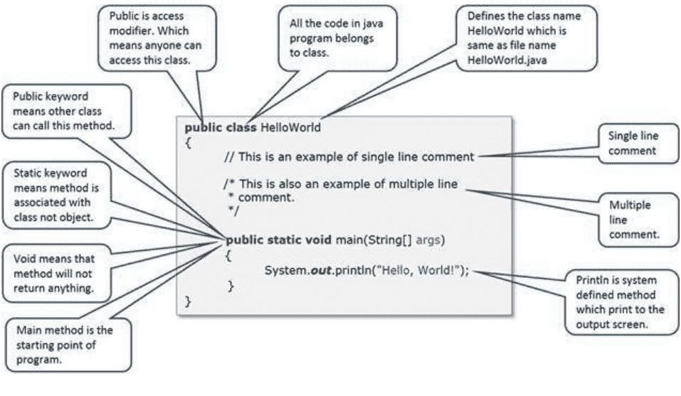

传统上，我们会讨论一个 `HelloWorld` 程序，它会在输出屏幕上打印“Hello, World!”字符串。让我们开始讨论它吧。这是一个小程序，但它包含了所有 `JAVA` 程序的共同特征。

1.  该程序以 `public class HelloWorld` 开始：
    a. 类是封装的基本单元。使用关键字 `class` 来创建一个新类，在我们的代码中创建了 `HelloWorld` 类。类名与文件名相同，该文件将包含此类。因此，在我们的情况下，文件名是 `HelloWorld.java`。类包含数据和方法。
    b. 关键字 `public` 是访问修饰符，用于设置类的可访问性。`public` 类可以被 `JAVA` 程序中的任何类访问。

2.  接下来是注释，它们用于程序的可读性，并被编译器忽略。
    a. 单行注释以两个正斜杠 `//` 开始。
    b. 多行注释以 `/*` 开始，以 `*/` 结束。

3.  `public static void main(String[] args)`：
    a. 方法是一组执行的语句，用于产生预期的结果。
    b. `main()` 是类的一个特殊方法，是程序的入口点。
    c. 方法前的 `public` 关键字意味着它可以被应用程序中的任何类访问。
    d. 方法中的关键字 `static` 指定该方法是类方法，将直接通过类名调用。它不需要任何对象来调用此方法。
    e. 关键字 `void` 意味着该方法将不返回任何内容。

4.  `System.out.println("Hello, World!")` 是系统提供的方法，它会将“Hello, World!”打印到标准输出。

## 对象 (Object)

对象是有状态和行为的实体。婴儿、猫、狗、灯泡等都是对象的例子。婴儿有属性和状态（名字、饥饿、哭泣、睡眠等）以及行为（喂养、玩耍等）。另一个例子灯泡，有两个状态（开、关）和两个行为（开启、关闭）。

软件对象就像现实对象一样。它们具有以成员变量称为字段（如 `isOn`）的形式的状态，并以成员函数称为方法（如 `turnOn()`, `turnOff()`）的形式暴露行为。

隐藏对象的内部细节（状态）并允许通过方法在对象上执行所有操作，被称为数据封装。

类（`Class`）是对象的原型（蓝图）。对象是类的实例。人类是生物的一类，而名为 John 的人就是人类类的一个实例。

### 示例 1.1

```java
class Bulb {
    boolean isOn = false;

    public void turnOn() {
        isOn = true;
    }

    public void turnOff() {
        isOn = false;
    }
}
```

在这个例子中，我们有一个类名 `Bulb`。它有一个成员变量 `isOn`，指示灯泡的开启或关闭状态。它有两个方法 `turnOn()` 和 `turnOff()`，将对象的状态从关闭变为开启，反之亦然。

## 变量 (Variable)

“变量”简单来说是数据存储位置。对于每个变量，都会分配一些内存。该内存的大小取决于变量的类型。

### 示例 1.2

```java
public static void main(String[] args) {
    int var1;
}
```

### 分析

- 为变量 `var1`、`var2` 和 `var3` 分配了内存。每当我们声明一个变量（基本类型变量）时，就会分配内存来存储变量中的值。在我们的示例中，每个变量都分配了 4 字节。
- 值 100 存储在变量 `var1` 中，值 200 存储在变量 `var2` 中。
- `var1` 和 `var2` 的值相加并存储在 `var3` 中。
- 最后，使用 `System.out.println()` 内置方法将 `var1`、`var2` 和 `var3` 的值打印到屏幕。

## 数据类型 (Data Types)

各种类型的变量被称为数据类型。`JAVA` 中有两种数据类型：

1.  基本型/基础数据类型
2.  引用数据类型

### 基本型/基础数据类型 (Primitive/ Basic Data Types)

基本数据类型是 `JAVA` 语言中定义的各种数据类型。有 8 种不同的基本数据类型 - `byte`、`short`、`int`、`long`、`float`、`double`、`boolean`、`char`。所有基本值都可以存储在固定数量的内存（1 到 8 字节之间）中。

基本数据类型的赋值是通过值完成的。基本数据类型的内容被复制到另一个变量。

基本变量的比较 (`==`) 是通过比较变量中存储的值完成的。

基本变量的参数传递是通过复制变量的内容完成的（即按值传递）。由于值被复制，变化会随之产生。

| 基本数据类型 | 解释 |
| :--- | :--- |
| `boolean` | `true` 或 `false`。 |
| `char` | 16 位字符（Unicode）。 |
| `byte` | 8 位有符号整数。 |
| `short` | 16 位有符号整数。 |
| `int` | 32 位有符号整数。 |
| `long` | 64 位有符号长整数。 |
| `float` | 32 位单精度浮点数。 |
| `double` | 64 位双精度浮点数。 |

### 示例 1.3: 展示基本数据类型的范围


```java
public class MinMaxValue {
    public static void main(String[] args) {
        byte maxValue = Byte.MAX_VALUE;
        byte minValue = Byte.MIN_VALUE;
        short maxShort = Short.MAX_VALUE;
        short minShort = Short.MIN_VALUE;
        int maxInteger = Integer.MAX_VALUE;
        int minInteger = Integer.MIN_VALUE;
        long maxLong = Long.MAX_VALUE;
        long minLong = Long.MIN_VALUE;
        float maxFloat = Float.MAX_VALUE;
        float minFloat = Float.MIN_VALUE;
        double maxDouble = Double.MAX_VALUE;
        double minDouble = Double.MIN_VALUE;

        System.out.println("Byte max: " + maxValue);
        System.out.println("Byte min: " + minValue);
        System.out.println("Short max: " + maxShort);
        System.out.println("Short min: " + minShort);
        System.out.println("Integer max: " + maxInteger);
        System.out.println("Integer min: " + minInteger);
        System.out.println("Long max: " + maxLong);
        System.out.println("Long min: " + minLong);
        System.out.println("Float max: " + maxFloat);
        System.out.println("Float min: " + minFloat);
        System.out.println("Double max: " + maxDouble);
        System.out.println("Double min: " + minDouble);
    }
}
```

## 参数传递，调用值 (Parameter passing, Call value)

可以使用参数从一个方法传递到另一个方法。所有基本类型作为参数时都是按值传递的。这意味着在调用方法内部创建了一个独立的副本，调用方法中的变量保持不变。

### 示例 1.4

```java
public static void increment(int var) {
    var++;
}
public static void main(String[] args) {
    int i = 10;
    System.out.println("Value of i before increment is : " + i);
    increment(i);
    System.out.println("Value of i after increment is : " + i);
}
```

### 输出

Value of i before increment is : 10

Value of i after increment is : 10

### 需要记住的点

1. 按值传递只是创建变量的副本。
2. 按值传递，调用方法之前和之后的值保持不变。

## 引用数据类型

引用变量用于存储类以及数组的内存地址。除 8 种原始数据类型外，任何变量都是引用数据类型。

引用变量的参数传递是通过复制变量的地址完成。这种方法被称为引用传递（`pass-by-reference`）。由于对象没有被复制，它是共享的，因此在被调用函数中进行的更改也会反映在函数的调用者中。

引用变量的比较（`==`）是通过比较变量的地址完成的。

任何引用变量的默认值都是 `null`。

从方法返回引用变量返回的是该变量的地址。如果返回的地址存储在另一个变量中，则局部创建的对象将不会被销毁。

## 参数传递，引用传递 (Call by Reference)

如果你需要修改方法内部参数的值，则应该使用引用传递。JAVA 语言默认按值传递。因此，为了实现这一目标，你需要传递变量的地址，并在方法内部使用该地址修改变量的值。

### 示例 1.5

```java
private static class MyInt
{
    int value;
}
public static void increment(MyInt value)
{
    value.value++;
}
public static void main(String[] args) {
    MyInt x = new MyInt();
    x.value = 10;
    System.out.println("Value of i before increment is: "+ x.value);
    increment(x);
    System.out.println("Value of i after increment is: "+ x.value);
}
```

### 输出

Value of i before increment is : 10

Value of i after increment is : 11

### 分析

类 `MyInt` 对象被传递给方法。由于对象是通过引用传递的，`increment()` 函数中的值变化会反映在调用函数的原始对象上。

### 需要记忆的点

1. 引用传递是通过向函数传递实例类或数组的地址间接实现的。

## 变量种类

JAVA 编程语言定义了三种变量：

1. **实例变量（非静态）**：它们是实例变量，因此对于类的每个实例/对象来说都是唯一的。
2. **类变量（静态）**：类变量是任何带有 `static` 修饰符的字段。这些变量与类关联，而不是与类的对象关联。无论创建了多少个类的实例，这些变量恰好只有一个拷贝。
3. **局部变量**：方法中的临时变量被称为局部变量。局部变量只对声明它的方法可见。方法的参数也是被被调用方法的局部变量。

### 示例 1.6

```java
class Bulb {
  // 类变量
  private static int TotalBulbCount = 0;

  // 实例变量
  private boolean isOn=false;

  // 构造函数
  public Bulb(){
    TotalBulbCount++;
  }

  // 类方法
  public static int getBulbCount(){
    return TotalBulbCount;
  }

  // 实例方法
  public void turnOn() {
    isOn = true;
  }

  // 实例方法
  public void turnOff() {
    isOn = false;
  }

  // 实例方法
  public boolean isOnFun(){
    return isOn;
  }
}
```

## 方法

方法有三种：类方法、实例方法和构造方法。默认情况下，所有方法都是实例方法。

**类方法（静态）**：使用 `static` 修饰符创建类方法。带有 `static` 修饰符的类方法应该通过类名调用，而无需创建类的类的实例。

**实例方法（非静态）**：这些方法只能通过类的实例进行调用。

### 关于实例方法和类方法的几点

1. 实例方法可以直接访问其他实例方法和实例变量。
2. 实例方法可以直接访问其他类方法和类变量。
3. 类方法可以直接访问其他类方法和类变量。
4. 类方法不能直接访问实例方法和实例变量。要访问实例变量和方法，它们需要创建类的实例（对象）。
5. 特殊关键字 `this` 仅在实例方法内部有效（在类方法内部无效），因为 `this` 指向当前实例。

**构造方法**：这是一种特殊的方法，在对象创建时被调用。构造方法的名称与类名相同。构造方法用于初始化对象的各种字段。对于没有构造方法的类，JAVA 语言为它们提供了默认构造方法。

## 访问修饰符

访问修饰符用于设置类、变量和方法的可见性级别。JAVA 提供了四种访问修饰符：默认（default）、公共（public）、受保护（protected）、私有（private）。

1. **Default** 修饰符（不需要修饰符）对包可见。
2. **Private** 修饰符仅在自己的类内可见。
3. **Public** 修饰符对包中的所有类可见。
4. **Protected** 修饰符在自己的类及其子类中可见。

## 接口 (Interface)

对象定义其接口作为与外部世界的交互。例如，灯泡的开关是你与灯泡之间的接口。你按下按钮开启，灯泡就开始发光。

### 示例 1.7

```java
public interface BulbInterface {
    public void turnOn();
    public void turnOff();
    public boolean isOnFun();
}
```

```java
class Bulb implements BulbInterface {
    private boolean isOn=false;

    @Override
    public void turnOn() {
        isOn = true;
    }

    @Override
    public void turnOff() {
        isOn = false;
    }

    @Override
    public boolean isOnFun() {
        return isOn;
    }
}
```

```java
public class BulbDemo {
    public static void main(String[] args) {
        Bulb b = new Bulb();
        System.out.println("bulb is on return : " + b.isOnFun());
        b.turnOn();
        System.out.println("bulb is on return : " + b.isOnFun());
    }
}
```

### 分析

在这个示例中，`BulbInterface` 是 `Bulb` 类的接口。`Bulb` 类需要实现 `BulbInterface` 的所有方法才能实现它。

## 关系

| 类 A | 类 A | 类 A | 类 A | 类 A |
| --- | --- | --- | --- | --- |
| | 使用 | 拥有 | 有 | 是 |
| 类 B | 类 B | 类 B | 类 B | |

这些是两个类之间存在的各种关系：

**依赖 (Dependency)**：一个类的对象临时使用另一个类的对象。当一个类方法内部创建另一个类的实例时，方法退出时该实例就会被删除。

**关联 (Association)**：一个类与另一个类的对象工作一段时间。关联有两种类型：聚合（Aggregation）和组合（Composition）。

**聚合 (Aggregation)**：一个类持有另一个类的引用。类内部存储类的引用。

**组合 (Composition)**：一个类包含另一个类的对象。在组合中，包含对象负责被包含对象的创建和删除。

**继承 (Inheritance)**：一个类是另一个类的子类型。继承是一种直观的父子关系。

### 示例 1.8

```java
class Advanceb extends Bulb {

    int intensity;

    public void setIntensity(int i) {
        intensity = i;
    }
}
```

在我们的示例中，`Advanceb` 是 `Bulb` 的子类。创建 `Advanceb` 对象时，`Bulb` 的所有公共和保护方法都是可用的。

## 类的通用原型

### 示例 1.9

```java
class ChildClass extends ParentClass implements SomeInterface {
  // 字段
  // 方法
}
```

`ChildClass` 继承自 `ParentClass` 并实现了 `SomeInterface`。

## 抽象类与方法

抽象方法是没有定义的方法。此类方法使用 `abstract` 关键字声明。包含一个抽象方法的类必须声明为抽象类。我们不能创建抽象类的对象。（一个没有任何抽象方法的类也可以声明为抽象类以防止其对象的创建）。


### 示例 1.10

```java
// 抽象类
public abstract class Shape {
    // 抽象方法
    public abstract double area();

    // 抽象方法
    public abstract double perimeter();
}
```

`Shape` 是一个抽象类。不能创建它的实例。扩展它的类需要实现这两个函数才能变成可以创建实例的具体类。

```java
public class Circle extends Shape {
    private double radius;
    public Circle() {
        this(1);
    }

    public Circle(double r) {
        radius = r;
    }

    public void setRadius(double r) {
        radius = r;
    }

    @Override
    public double area() {
        // 面积 = π*r^2
        return Math.PI * Math.pow(radius, 2);
    }

    public double perimeter() {
        // 周长 = 2pi
        return 2 * Math.PI * radius;
    }
}
```

```java
public class Rectangle extends Shape {
    private double width, length;

    public Rectangle() {
        this(1,1);
    }

    public Rectangle(double w, double l) {
        width = w;
        length = l;
    }

    public void setWidth(double w) {
        width = w;
    }

    public void setLength(double l) {
        length = l;
    }

    @Override
    public double area() {
        // 面积 = 宽 * 长
        return width * length;
    }

    @Override
    public double perimeter() {
        // 周长 = 2(宽 + 长度)
        return 2*(width + length);
    }
}
```

和 `Circle` 类一样，`Rectangle` 类也继承了 `Shape` 类并实现了它的抽象函数。

```java
public class ShapeDemo {
    public static void main(String[] args) {
        double width = 2, length = 3;
        Shape rectangle = new Rectangle(width, length);
        System.out.println("Rectangle: " + width + " and length: " + length
            + " Area: " + rectangle.area()
            + " Perimeter: " + rectangle.perimeter());

        double radius = 10;
        Shape circle = new Circle(radius);
        System.out.println("Circle radius: " + radius
            + " Area: " + circle.area()
            +" Perimeter: " + circle.perimeter());
    }
}
```

`ShapeDemo` 创建了 `Rectangle` 和 `Circle` 类的实例，并将其赋值给类型 `Shape` 的引用。最后在 `Rectangle` 和 `Circle` 类的实例上调用了 `area()` 和 `perimeter()` 函数。

## 嵌套类


# 嵌套类

类内部的类被称为嵌套类。

使用嵌套类的几个有力的理由包括：

1. 它是逻辑上对仅在某处使用的类进行分组的方法：如果一个类仅对另一个类有用，那么将其嵌入该类中并将它们放在一起是逻辑上的。嵌套此类“辅助类”可以使其包更加精简。
2. 它增加了封装性：考虑两个顶层类 `A` 和 `B`，其中 `B` 需要访问 `A` 的原本声明为私有的成员。通过将类隐藏在 `A` 内部，`A` 的成员可以声明为私有而 `B` 可以访问它们。此外，`B` 本身也可以对外部世界隐藏。
3. 它可以产生更具可读性和维护性的代码：将小类嵌套在顶层类中使代码更靠近其使用的地方。

嵌套类拥有一组独立于外部类的修饰符。可见性修饰符（`public`、`private` 和 `protected`）决定了嵌套类的定义是否在外部类定义之外是访问的。例如，私有嵌套类可以被外部类使用，但不能被其他类使用。

## 示例 1.11：演示嵌套类

```java
public class OuterClass {
    class NestedClass {
        // NestedClass 字段和方法。
    }
    // OuterClass 字段和方法。
}
```

让我们以 `LinkedList` 和 `Tree` 类为例。链表和树节点都用于存储新元素。链表和树的节点不同，因此最好在它们自己的类内部声明相应的节点，以防止名称冲突并增加封装性。

## 示例 1.12

```java
public class LinkedList {
    private static class Node {
        private int value;
        private Node next;
        // 嵌套类 Node 其他字段和方法。
    }
    private Node head;
    // 外部类 LinkedList 其他字段和方法。
}
```

```java
public class Tree {
    private static class Node {
        private int value;
        private Node iChild;
        private Node rChild;
        // 嵌套类 Node 其他字段和方法。
    }
    private Node root;
    // 外部类 Tree 其他字段和方法。
}
```

# 枚举

枚举将变量限制为具有少数几个预定义值之一。

## 示例 1.13

```java
class Bulb {
    // 枚举
    enum BulbSize { SMALL, MEDIUM, LARGE }
    BulbSize size;
    // 其他灯泡类字段和方法。
}

public class BulbDemo {
    public static void main(String[] args) {
        Bulb b = new Bulb();
        b.size = Bulb.BulbSize.MEDIUM;
        System.out.println("Bulb Size: " + b.size);
    }
}
```

在上面的代码中，我们对 `Bulb` 类进行了更改。它多了一个字段 `size`，且 `size` 的类型是枚举 `BulbSize`。允许的 `size` 值为 `SMALL`、`MEDIUM` 和 `LARGE`。

# 常量

常量通过使用 `static` 修饰符结合 `final` 修饰符来定义。

`final` 修饰符表示此字段的值不能被更改。`static` 修饰符表示变量只有一个实例，并且是一个类变量。

例如，下面的变量声明定义了一个名为 `P1` 的常量，其值近似于 pi。

```java
static final double P1 = 3.141592653589793;
```

另一个示例，在其中我们创建了一个字符串类型的常量。

```java
static final String text = "Hello";
```

# 条件与循环

## if 条件

`if` 条件由一个或多个跟随 `else` 的语句组成。它根据条件执行不同的路径。

```java
if (boolean_expression) {
    // statements
} else {
    // statements
}
```

## while 循环

`while` 循环在只要条件为真时就会重复执行某些代码。

## 示例 1.14

```java
public static void main(String[] args) {
    int[] numbers = {1, 2, 3, 4, 5, 6, 7, 8, 9, 10};
    int sum = 0;
    int i = 0;
    while (i < numbers.length) {
        sum += numbers[i];
        i++;
    }
    System.out.println("Sum is " + sum);
}
```

## do..while 循环

`do..while` 循环与 `while` 循环相似，不同在于它至少执行一次条件代码。

```java
do {
    // statements
} while (condition);
```

## for 循环

`for` 循环是将初始化、条件和递增结合在一起。

```java
for (initialization; condition; increment) {
    // statements
}
```

## 示例 1.15

```java
public static void main(String[] args) {
    int[] numbers = {1, 2, 3, 4, 5, 6, 7, 8, 9, 10};
    int sum = 0;
    for (int i = 0; i < numbers.length; i++) {
        sum += numbers[i];
    }
    System.out.println("Sum is " + sum);
}
```

## ForEach 循环

`for` 循环处理基本类型时工作良好，但它不处理集合。对于这种情况，提供了另一种语法：`foreach` 循环。

```java
for (declaration : array) {
    // statements
}
```

## 示例 1.16

```java
public static void main(String[] args) {
    int[] numbers = {1, 2, 3, 4, 5, 6, 7, 8, 9, 10};
    int sum = 0;
    for (int n : numbers) {
        sum += n;
    }
    System.out.println("Sum is : " + sum);
}
```

# 数组

数组是用于存储信息的各种数据结构。数组是存储相同数据类型元素的数据结构。所有数据按顺序存储。可以以常量时间访问位于任何索引的值。

## 示例 1.17

```java
public class Introduction {
    public static void main(String[] args) {
        arrayExample();
    }
    public static void arrayExample() {
        int[] arr = new int[10];
        for (int i = 0; i < 10; i++) {
            arr[i] = i;
        }
        printArray(arr, 10);
    }
}
```

分析：定义了一个整数数组 `arr`。数组的大小为 10 - 意味着它可以存储 10 个整数。数组元素使用下标运算符 `[]` 进行访问。最低下标为 0，最高下标为（数组的大小-1）。值 0 到 9 存储在索引 0 到 9 中。数组及其大小传递给 `printArray()` 方法。

## 示例 1.18

```java
public static void printArray(int arr[], int count) {
    System.out.println("Values stored in array are : ");
    for (int i = 0; i < count; i++) {
        System.out.println("" + arr[i]);
    }
}
```

分析：

- 数组变量 `arr` 和其变量 `count` 作为参数传递给 `printArray()` 方法。
- 最后在 `for` 循环中使用 `System.out.println` 方法将数组值打印到屏幕上。

记住：

1. 数组索引始终从 0 索引开始，最高索引为 `size-1`。
2. 如果写 `arr[2]++`，下标运算符优先级最高。那么 `arr[2]` 的值将递增。

## 二维数组

我们可以定义二维数组或多维数组。它是一个数组的数组。

## 示例 1.19

```java
public class Introduction {
    public static void main(String[] args) {
        twoDArrayExample();
    }

    public static void twoDArrayExample() {
        int[][] arr = new int[4][2];
        int count = 0;
        for (int i = 0; i < 4; i++) {
            for (int j = 0; j < 2; j++) {
                arr[i][j] = count++;
            }
        }
        print2DArray(arr, 4, 2);
    }

    public static void print2DArray(int[][] arr, int row, int col) {
        for (int i = 0; i < row; i++) {
            for (int j = 0; j < col; j++) {
                System.out.println("" + arr[i][j]);
            }
        }
    }
}
```

## 分析

- 创建了一个维度为 4 x 2 的数组。该数组将有 4 行 2 列。
- 给数组分配了值。
- 最后，使用 `print2DArray()` 方法将存储在数组中的值打印到屏幕上。

# 数组面试题

本节将讨论适用于数组的各种算法，并列出一系列具有相似方法的练习题列表。

## 数组求和

编写一个方法，根据给定的整数数组及其大小作为参数，返回数组中所有元素的和。

## 示例 1.20

```java
public static int SumArray(int arr[]) {
    int size = arr.length;
    int total = 0;
    int index = 0;
    for (index = 0; index < size; index++)
        total = total + arr[index];
    return total;
}
```

```java
public static void main(String[] args) {
    int[] arr = {1, 2, 3, 4, 5, 6, 7, 8, 9};
    System.out.println("sum of all the values in array: " + SumArray(arr));
}
```

## 顺序查找

编写一个方法，在数组中搜索某个给定值。

## 示例 1.21

```java
public static int SequentialSearch(int arr[], int size, int value) {
    int i = 0;
    for (i = 0; i < size; i++) {
        if (value == arr[i])
            return i;
    }
    return -1;
}
```

## 分析

- 由于我们不清楚数组中存储的数据，或者数据不是排序的，因此我们必须按顺序的方式逐个搜索数组。
- 如果我们找到了该值，我们想要返回该索引。
- 否则，我们返回索引 `-1`，因为我们没有找到要查找的值。
- 在上面的示例中，数据是无序的。如果数据是有序的，则可以进行二分查找。我们在每一步中都检查中间位置。根据我们要搜索的数据比中间值大还是小，我们将搜索数组的左部分或右部分。在每一步中，我们都排除一半搜索空间，从而使得该算法比线性搜索高效得多。

## 二分查找

## 示例 1.22: 在排序数组中进行二分查找

```java
// 二分查找算法 – 迭代方式
public static int BinarySearch(int arr[], int size, int value) {
    int mid;
    int low = 0;
    int high = size - 1;
    while (low <= high) {
        mid = low + (high - low) / 2; // 防止溢出
        if (arr[mid] == value)
            return mid;
        else if (arr[mid] < value)
            low = mid + 1;
        else
            high = mid - 1;
    }
    return -1;
}
```

## 分析

- 由于数据是递增/递减排序，我们可以应用更高效的二分查找。在每一步，我们将中间值与我们要查找的值进行比较。如果中间值等于我们要查找的值，返回中间索引。如果值小于中间值，我们搜索数组的左半部分。如果值大于中间值，我们搜索数组的右半部分。如果我们找到了要查找的值，返回其索引；否则返回 `-1`。

## 旋转数组

例如，将数组 `[10, 20, 30, 40, 50, 60, 10, 20]` 旋转 2 位得到 `[30, 40, 50, 60, 10, 20]`。

## 示例 1.23: `rotateArray(int[] a, int n, int k)`

```java
public static void rotateArray(int[] a, int n, int k) {
    reverseArray(a, 0, k - 1);
    reverseArray(a, k, n - 1);
    reverseArray(a, 0, n - 1);
}

public static void reverseArray(int[] a, int start, int end) {
    for (int i = start, j = end; i < j; i++, j--) {
        int temp = a[i];
        a[i] = a[j];
        a[j] = temp;
    }
}
```

```
1,2,3,4,5,6,7,8,9,10 => 5,6,7,8,9,10,1,2,3,4

1,2,3,4,5,6,7,8,9,10 => 4,3,2,1,10,9,8,7,6,5 => 5,6,7,8,9,10,1,2,3,4
```

## 分析

- 旋转数组使用了两部分技巧。在第一部分，我们首先反转数组的前半部分，然后是后半部分。
- 然后通过反转整个数组来完成整个旋转。

## 寻找最大连续子数组

给定一个包含正负整数的数组，找到一个和（元素之和）最大的连续子数组。

## 示例 1.24

```java
public class Introduction {
    public static void main(String[] args) {
        // 最大连续子数组的实现
    }
}
```

## 分析

- 使用的算法是 Kadane 算法或类似的方法来寻找最大和子数组。

# 递归函数

递归函数是一个直接或间接调用自身的函数。

递归方法由两部分组成：终止条件和方法体（包含递归展开）。

1. 终止条件：递归方法始终包含一个或多个终止条件。在某种特定条件下，递归方法处理简单情况且不会再次调用自己。
2. 方法体（包括递归展开）：包含在方法体中的递归主要逻辑。它还包含递归展开语句，该语句再次调用方法本身。

递归算法的三个重要属性是：

1. 递归算法必须有一个终止条件。
2. 递归算法必须改变其状态，并向终止条件移动。
3. 递归算法必须调用自身。

> **注意**：由于栈的开销，递归程序的运行速度较慢。如果同一个任务可以使用迭代方案（循环）完成，那么我们应该优先选择使用迭代方案（循环）代替递归，以避免栈开销。
>
> **注意**：如果没有终止条件，递归方法可能会无限运行，并最终耗尽所有的栈内存。

## 阶乘

## 示例 1.26：阶乘计算。N! = N * (N-1) ... * 2 * 1

```java
public static int factorial(int i) {
    /* 终止条件 */
    if (i <= 1)
        return 1;
    /* 方法体，递归展开 */
    return i * factorial(i - 1);
}
```

分析：方法 `fn` 每次调用 `fn-1`。时间复杂度为 O(N)。

## 打印 10 进制整数

## 示例 1.27

```java
public static void printInt(int number) {
    char digit = (char) (number % 10 + '0');
}
```


## 代码片段

```
number = number / 10;
if (number != 0)
    println(number/10);
    System.out.print(" " + digit);
```

## 分析

- 计算每个余数并将其对应的字符等值存储在 `digit` 中。
- 如果数字大于 10，则将数字除以 10 的结果传递给 `printInt()` 方法。
- 数字的打印顺序为高位在前低位后。

时间复杂度为 `O(N)`

## 打印 16 进制整数

示例 1.28：打印到特定基数的通用方法。

```java
public static void print2(int number, final int base) {
    String conversion = "0123456789ABCDEF";
    char digit = (char)(number % base);
    number = number / base;
    if (number != 0)
        print2(number, base);
    System.out.print(" " + conversion.charAt(digit));
}
```

## 分析

- 基值随数字一起作为函数参数提供。
- 计算数字的余数并存储在 `digit` 中。
- 如果数字大于基数，则将数字除以基数的结果递归作为参数传递给 `print()` 方法。
- 数字的打印顺序为高位在前低位后。

时间复杂度为 `O(N)`

## 汉诺塔

汉诺河塔（也称为布拉马之塔）。我们有三根柱子 `N` 个盘子，初始所有盘子按大到小的顺序排列在第一根（最左侧）。目标是将整个盘子堆从第一塔移动到第三塔（最右侧），每次只移动一个盘子，且绝不将大盘放在小盘之上。

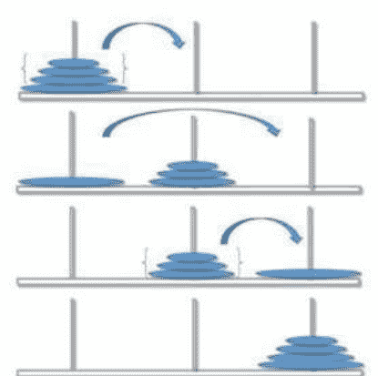

## 示例 1.29

```java
public static void towerOfHanoi(int num, char src, char dst, char temp) {
    if (num < 1) {
        return;
    }

    towerOfHanoi(num - 1, src, temp, dst);
    System.out.println("Move" + num + " disk from " + src + " to " + dst);
    towerOfHanoi(num - 1, temp, dst, src);
}

public static void main(String[] args) {
    int num = 4;
    towerOfHanoi(num, 'A', 'C', 'B');
}
```

分析：汉诺塔问题如果我们想将 `N` 个盘子从源移动到目的地，首先将 `N-1` 个盘子从源移动到临时，然后将第 `N` 个盘子从源移动到目的地。最后将 `N-1` 个盘子从临时移动到目的地。

## 最大公约数 (GCD)

示例 1.30：

```java
public static int GCD(int m, int n) {
    if (m < n) {
        return GCD(n, m);
    }
    if (m % n == 0) {
        return n;
    }
    return GCD(n, m % n);
}
```

分析：使用欧几里得算法寻找 gcd。`GCD(n,m) == GCD(m, n mod)`

## 斐波那契数

示例 1.31：

```java
public static int fibonacci(int n) {
    if (n <= 1)
        return n;
    return fibonacci(n - 1) + fibonacci(n - 2);
}
```

分析：斐波那契数通过前两个数字的和计算。我们已经见过迭代解决方案，现在来看相同问题的递归解决方案。

## 数组的所有排列

示例 1.32：

```java
public static void swap(int[] arr, int x, int y) {
    int temp = arr[x];
    arr[x] = arr[y];
    arr[y] = temp;
}
```

```java
public static void permutation(int[] arr, int i, int length) {
    if (i == length) { // 注意：此处原文逻辑应为 i == length
        return;
    }
    for (int j = i; j < length; j++) {
        swap(arr, i, j);
        permutation(arr, i + 1, length);
        swap(arr, i, j);
    }
}
```

```java
public static void main(String[] args) {
    int[] arr = new int[5];
    for (int i = 0; i < 5; i++) {
        arr[i] = i;
    }
    permutation(arr, 0);
}
```

分析：`permutation` 方法在每个索引处与右侧的所有数字交换。

## 递归二分查找

示例 1.33：

```java
public static int BinarySearch(int arr[], int low, int high, int value) {
    int mid = low + (high - low) / 2;
    if (arr[mid] == value)
        return mid;
    else if (arr[mid] < value)
        return BinarySearch(arr, mid + 1, high, value);
    else
        return BinarySearch(arr, low, mid - 1, value);
}
```

分析：已经见过类似的迭代解决方案。现在来看划分搜索空间的递归解决方案。

## 练习题

1. 计算数组所有元素的平均值。
2. 计算二维数组所有元素的和。
3. 找到数组中的最大元素。
4. 找到数组中的最小元素。
5. 找到数组中的第二大数。
6. 打印数组中所有的最大值（如果一个值之后的值比它小或不存在，则它是最大值）。
   提示：
   a) 从后遍历数组并记录最大元素。
   b) 如果遇到元素 `> max`，打印该元素并更新 `max`。
7. 打印数组中的交替元素。
8. 给定一个值为 0 或 1 的数组，编写一个程序将 0 分隔在左侧，1 分隔在右侧。
9. 给定一组区间，合并重叠区间。
   输入：`{[1, 4], [3, 6], [8, 10]}`
   输出：`{[1, 6], [8, 10]}`
10. 编写一个接受区间作为输入并处理重叠区间的方法。
11. 原地反转数组（不能使用任何额外数组，空间复杂度应为 `O(1)`）。
    提示：使用两个变量 `start` 和 `end`。将 `start` 设为 0，`end` 设为 `(n-1)`。增加 `start` 并减小 `end`。交换存储在 `arr[start]` 和 `arr[end]` 中的值。当 `start` 等于或大于 `end` 时停止。
12. 给定一个 0 和 1 的数组。我们需要对其排序，使得所有的 0 都在 1 之前。
    提示：使用两个变量 `start` 和 `end`。将 `start` 设为 0，`end` 设为 `(n-1)`。增加 `start` 并减小 `end`。只有当 `arr[start]==1` 且 `arr[end]==0` 时，交换存储在 `arr[start]` 和 `arr[end]` 中的值。当 `start` 等于或大于 `end` 时停止。
13. 给定一个包含 0、1、2 的数组。我们需要对其排序，使得所有的 0 都在 1 之前，所有的 1 都在 2 之前。
    提示：与上面相同，先将 0 和 1 看作一组，并将所有的 2 移动到右侧。然后对数组进行第二次遍历以排序 0 和 1。
14. 在一个大小为 `n` 的数组中寻找重复元素，每个元素的范围在 `0` 到 `n-1` 之间。提示：
    方法 1：将每个元素与数组中的所有元素进行比较（使用两个循环）。`O(n^2)` 解。
    方法 2：维护一个哈表。当我们第一次遇到该元素时，将哈希值设置为 1。当我们再次遇到相同的值时，我们可以发现哈希值已经是 1，因此可以打印该值。`O(n)` 解，但需要额外的空间。
    方法 3：我们将利用“每个元素都在 `0` 到 `n-1` 范围内”这一限制条件。我们可以取大小为 `n` 的数组 `arr[]` 并将所有元素设置为 0。每当我们得到一个值 `val1`，我们将 `arr[val1]` 索引的值加 1。最后，我们可以遍历数组并重复打印这些值。额外的空间复杂度为 `O(n)`，这比哈表方法要小。
15. 在排序并旋转的数组中找到最大元素。复杂度：`O(log n)`
    提示：使用二分查找算法。
16. 给定一个包含 `n` 个元素的数组和一个值 `x`，在数组中找到两个和为 `x` 的元素。
    提示：
    方法 1：对数组排序。
    方法 2：使用哈表。
17. 写一个方法来计算一个整数中每个数字之和。示例：输入= 1984，输出应为 32 (1+9+8+4)。
18. 写一个方法计算 `Sum(N) = 1+2+3...+N`。

## 引言

计算机程序员通过经验学习。我们通过观察已解决的解题技巧以及通过亲手解决新问题来学习。学习各种设计的算法有助于我们解决接下来的问题。通过考虑不同的算法，我们可以开始总结模式，这样下次出现类似的问题时，我们能够更好地解决它。

当面试官在面试中要求开发程序时，面试者应该遵循哪些步骤？我们将采取系统的方法来处理问题并最终得出解决方案。

## 算法

算法是完成任务的一系列步骤。计算机程序中的算法是应用于一组输入的一系列步骤，以产生一组输出。

算法知识有助于我们通过应用正确的算法来更快地获得所需的结果。

算法最重要的属性是：

1. 正确性：算法应该是正确的。它应该处理所有给定的输入并提供正确的输出。
2. 效率：算法在解决问题时应该是高效的。

算法复杂度定义为特定算法执行的速度。复杂度由函数 `T(n)` 表示——时间与输入大小 `n` 的关系。

## 渐近分析

渐近分析用于在独立于任何特定数据集或编程语言的情况下比较算法的效率。

我们通常对算法的增长阶感兴趣，而不是对运行算法所需的精确时间。这种时间也称为渐近运行时间。

### 大 O 表示法

定义：“`f(n)` 是 `g(n)` 的大 O”或 `f(n) = O(g(n))`，如果存在两个正数 `c` 和 `n_0`，使得对于所有 `n >= n_0`，`f(n) <= c g(n)`。

换句话说，对于所有 `n >= n_0`，`c g(n)` 是 `f(n)` 的上界。

函数 `f(n)` 的增长速度慢于 `c g(n)`。

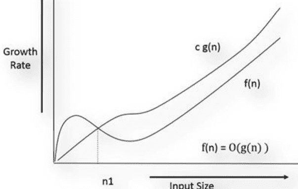

示例：`n^2 + n = O(n^2)`

### Omega-Ω 表示法

定义：“`f(n)` 是 `g(n)` 的 Omega”或 `f(n) = Ω(g(n))`，如果存在两个正数 `c` 和 `n_0`，使得对于所有 `n >= n_0`，`c g(n) <= f(n)`。

换句话说，`c g(n)` 是 `f(n)` 的下界。

函数 `f(n)` 的增长比 `c g(n)` 快。

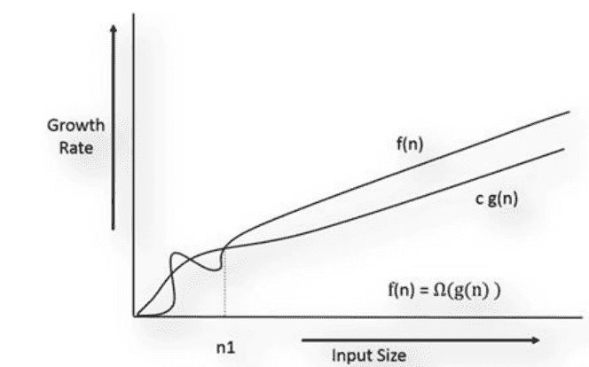

寻找 `f(n) = n^c` 和 `g(n) = c^n` 的关系。

`f(n) = Ω(g(n))`

### Theta-Θ 表示法

定义：“`f(n)` 是 `g(n)` 的 Theta”或 `f(n) = Θ(g(n))`，如果存在三个正数 `c_1, c_2` 和 `n_0`，使得对于所有 `n >= n_0, c_1 g(n) <= f(n) <= c_2 g(n)`。

`g(n)` 是 `f(n)` 的紧确界。函数 `f(n)` 的增长速率与 `g(n)` 相同。

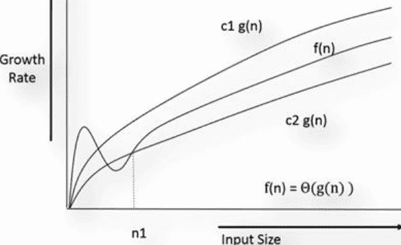

示例：`n^3 + n = Θ(n^2)`

示例：`n^2 + n = Θ(n^2)`

寻找 `f(n) = 2n^2 + n` 和 `g(n) = n^2` 的关系。

`f(n) = O(g(n))`

`f(n) = Θ(g(n))`

`f(n) = Ω(g(n))`

注意：渐近分析不是完美的，但它是分析算法的最佳方法。

例如，假设 `f(n) = 10000n log n` 和 `g(n) = n^2`，当数据量 `n` 较小时，第二个算法表现更好。考虑到渐近分析。

## 算法复杂度分析

1. 最坏情况复杂度：在最坏输入大小 `n` 下解决问题的复杂度。这提供了算法的上界。
2. 平均情况复杂度：对所有可能的输入计算平均时间。
3. 最佳情况复杂度：在最佳情况下的解决问题的复杂度。

### 时间复杂度

| 名称 | 表示法 |
| :--- | :--- |
| 常数时间 | `O(1)` |
| 对数时间 | `O(log n)` |
| 线性时间 | `O(n)` |
| N-LogN 时间 | `O(n log n)` |
| 平方时间 | `O(n^2)` |
| 多项式时间 | `O(n^c)` |
| 指数时间 | `O(c^n)` |
| 阶时间 | `O(n!)` |

### 常数时间

算法无论输入大小如何都以常数时间运行。

示例：

1. 数组
2. 栈
3. 队列
4. 哈表
5. 桶

### 线性时间

如果执行时间与输入大小成比，则算法以线性时间运行。

示例：

1. 数组操作
2. 链表操作

### 对数时间

如果执行时间与输入大小的对数成比，则算法以对数时间运行。

示例：

1. 二分查找

### N-LogN 时间

如果执行时间与输入大小与对数的积成比，则算法以 N-logN 时间运行。

示例：

1. 合并排序
2. 快速排序（平均情况）
3. 堆排序

### 平方时间

如果执行时间与输入大小的平方成比，则算法以平方时间运行。

示例：

1. 冒泡排序
2. 选择排序
3. 插入排序

## 时间复杂度示例

### 示例 1

```cpp
int fun1(int n) {
  int m = 0;
  for (int i = 0; i < n; i++)
    m += 1;
  return m;
}
```

时间复杂度：`O(n)`

### 示例 2

```cpp
int fun2(int n) {
  int i = 0, m = 0;
  for (int i = 0; i < n; i++)
    for (int j = 0; j < n; j++)
      m += 1;
  return m;
}
```

时间复杂度：`O(n^2)`

### 示例 3

```cpp
int fun3(int n) {
  int i = 0, m = 0;
  for (int i = 0; i < n; i++)
    for (int j = 0; j < i; j++)
      return m;
}
```

时间复杂度：`O(N+(N-1)+(N-2)+...) == O(N+1)/2 == O(n^2)`

### 示例 4

```cpp
int fun4(int n) {
  int i = 0, m = 0;
  i = 1;
  while (i < n)
    m += 1;
    i = i * 2;
  return m;
}
```

每次问题空间被分为一半。时间复杂度：`O(log(n))`

### 示例 5

```cpp
int fun5(int n) {
  int i = 0, m = 0;
  i = n;
}

while (i > 0) {
  m += 1;
  i = i / 2;
}
```

与上述相同，每次问题空间都减半一半。

时间复杂度：`O(log(n))`

### 示例 6

```cpp
int fun6(int n) {
  int i = 0, j = 0, k = 0, m = 0;
  j = n;
  for (i = 0; i < n; i++) {
    for (j = 0; j < n; j++) {
      for (k = 0; k < n; k++) {
        m += 1;
      }
    }
  }
  return m;
}
```

外层循环将运行 `n` 次。在外层循环的每次迭代中，内层循环将运行 `n` 次。最终复杂度为 `n*n*n`。

时间复杂度：`O(n³)`

### 示例 7

```cpp
int fun7(int n) {
  int i = 0, j = 0, m = 0;
  i = n;
  for (i = 0; i < n; i++) {
    for (j = 0; j < n; j++) {
      m += 1;
    }
    for (i = 0; i < n; i++) {
      for (k = 0; k < n; k++) {
        m += 1;
      }
    }
  }
  return m;
}
```

这些组循环是连续的，因此它们的复杂度将相加，形成程序的最终复杂度。

时间复杂度：`T(n) = O(n²) + O(n²) = O(n²)`

### 示例 8


```cpp
int fun8(int n) {
  int i = 0, j = 0, m = 0;
  for (i = 0; i < n; i++) {
    for (j = 0; j < Math.sqrt(n); j++) {
      m += 1;
    }
  }
  return m;
}
```

时间复杂度：`O(n * √n) = O(n³/²)`

### 示例 9

```cpp
int fun9(int n)
{
    int i = 0, j = 0, m = 0;
    for (int i = n; i > 0; i /= 2)
        for (int j = 0; j < i; j++)
            m += 1;
}
```

每次问题空间都减半一半。

时间复杂度：`O(log(n))`

### 示例 10

```cpp
int fun10(int n)
{
    int i = 0, j = 0, m = 0;
    for (int i = 0; i < n; i++)
        for (int j = i; j > 0; j--)
            m += 1;
}
```

`O(N+(N-1)+(N-2)+...) = O(N(N+1)/2)` // 等差数列。

时间复杂度：`O(n²)`

### 示例 11

```cpp
int fun11(int n)
{
    int i = 0, j = 0, m = 0;
    for (int i = 0; i < n; i++)
        for (int j = i; j < n; j++)
            for (int k = j+1; k < n; k++)
                m += 1;
}
```

时间复杂度：`O(n³)`

### 示例 12

```cpp
int fun12(int n)
{
    int i = 0, j = 0, m = 0;
    for (int i = 0; i < n; i++)
        for (int j = i; j < n; j++)
            m += 1;
}
```

在找到解决方案后再次仔细思考，`j` 值在每次迭代中并没有被重置。

时间复杂度：`O(n²)`

### 示例 13

```cpp
int fun13(int n)
{
    int i = 1, j = 0, m = 0;
    for (int i = 1; i<=n; i *= 2)
        for (j = 0; j<=i; j++)
            m += 1;
    return m;
}
```

在外层循环的连续迭代中，内层循环将运行 1, 2, 4, 8... n 次。

时间复杂度：`T(n) = O(1+2+ 4+ ....+n/2+n) = O(n)`

## 主定理

主定理用于求解如下形式的递归关系：

`T(n) = a T(n/b) + f(n)`

其中 `a ≥ 1` 且 `b > 1`。

"n" 是递归中子问题的大小。

"a" 是每个子问题的数量。

"n/b" 是每个子问题的大小。

"f(n)" 是将问题分解为子问题或合并问题结果以获得最终结果的代价。

在以下情况下可以确定渐近紧界：

情况 1：当 `f(n)=Ω(nᵇ⁻)` 且常数 `ε > 0` 时（注：此处原文 `ε > 1` 应为 `ε > 0`），

情况 2：当 `f(n)=Θ(nᵇ logᵏ)` 且常数 `k ≥ 0` 时，

情况 3：当 `f(n)=Ω(nᵇ⁺)` 且常数 `ε > 0` 时（注：此处原文 `ε > 1` 应为 `ε > 0`）。

应用了更改，解决方案的复杂性也随之改变。

## 构思阶段

我们在书中已经涵盖了大量的理论知识。由于每天都会产生新问题，涵盖所有问题是不可能的。因此，我们应该学会如何处理新问题。即使你知道面试官提出的问题的解决方案，你也需要与面试官进行讨论并达成解决方案。你还需要分析问题，因为面试官可能会对问题进行细微修改，解决问题的方法也会随之变化。

那么，如何解决新问题呢？解决这个问题的办法是你需要进行大量的练习，练习得越多，你就越能够解决出现在眼前的任何新问题。当你解决了足够的问题后，你就能看出题目中的模式，并能够轻松地解决新问题。

以下是你解决未知问题时需要遵循的策略：

1. 尝试简化手头任务。
2. 尝试几个例子。
3. 考虑合适的数据结构。
4. 想想你已经解决过的类似问题。

### 尝试简化手头任务

我们来看以下问题：丈夫和他们的妻子随机站成一排。丈夫们被编号为 `H1`、`H2`、`H3` 等，他们相应的妻子被编号为 `W1`、`W2`、`W3` 等。你需要安排他们，使得 `H1` 站在第一位，后面是 `W1`，然后是 `H2` 后面是 `W2`，依此类推。

乍一看，这似乎很难，但它是一个简单的问题。尝试找到最终位置的关系。

`P(Hi) = i*2-1, P(Wi) = i*2`

算法的逻辑我们留给你完成，只需做一次插入排序（`Insertion-Sort`）你就完成了。

### 尝试几个例子

在上面的问题中，如果你已经针对 3 对丈夫妻子用了一些例子进行尝试，那么你可能已经得到了我们在上一节中展示的公式。有时多想几个例子可以尝试解决手头的问题。

### 考虑合适的数据结构

对于某些问题，哪种数据结构最合适是一目而易见的。例如，如果我们有一个找到给定值之最小/最大值的问题，那么堆（`heap`）可能就是我们正在寻找的数据结构。我们在书中已经看到了许多数据结构。我们必须弄清楚哪个数据结构适合我们的需求。

让我们来看一个问题：我们给定一组数据流，任何时候我们都可能被要求告知数据的中位数，可能还会被要求弹出中位数数据。

我们可以考虑某种排序树，可能是平衡树，其中根节点是中位数。等一下，但确保树根节点产生结果并不容易。

堆可以给我们最小值或最大值，所以我们也无法从中得到预期的结果。

较小的值将进入最小堆（`min heap`），较大的值将进入最大堆（`max heap`）。此外，我们可以记录堆中元素的数量。算法的其余部分你可以自己思考。

对于每一个新问题，思考你熟悉的数据结构，你可能其中一个或它们的组合将解决你的问题。

### 想想你已经解决过的类似问题

假设你有两个链表的表头引用，它们在某点相遇，需要找到交点。

然而，在两个链表的末尾不是空引用（`null`），而是一个循环。

你知道如何找到两个相交链表的交点，也知道如何判断一个链表是否有循环（三引用解决方案）。因此，你可以应用这两种解决方案来找到手头问题的答案。

## 复杂度

解决问题不仅仅是找到一个正确的解决方案。解决方案应该是快速的，并且应该具有合理的内存需求。你已经在之前的章节中读过 Big-O 表示法。你应该能够进行 Big-O 分析。如果你认为提供的解决方案并非最优，并且存在更高效的解决方案，请重新思考并尝试找出这些信息。

大多数面试官都期望你能够找到算法的时间复杂和空间复杂度。你应该能够立即计算时间和空间复杂度。每当你解决某个问题时，你都应该发现与之相关的复杂度，通过这一点你能够选择最佳解决方案。在某些问题中，空间和时间复杂度之间存在权衡，所以你应该了解这些权衡。有时花费更多的空间可以节省大量时间，并让你的算法快得多。

## 编码

到此时，你已经掌握了问题的所有约束条件，提出了几个解决方案，评估了各种解决方案的复杂度，并选择了一个方案进行最终编码。千万不要在与面试官讨论约束条件、构思阶段和复杂度之前就直接跳到编码阶段。

我们习惯在如 `visual studio` 等 IDE 中编写代码。当被要求在白板或空白纸上书写代码时，许多人感到很困难。因此，我们应该练习一下在纸上写代码。在编码之前你应该思考，因为纸上没有“后退”键。始终尝试编写模块化的代码。需要创建小函数以保持代码整洁易于管理。如果有一个交换函数（`swap function`），直接使用这个函数并告诉面试官你稍后会写它。每个人都知道你可以写交换代码。

## 测试

代码写完后，工作并没有结束。最重要的是用几个小的测试用例来测试你的代码。这表明你理解测试的重要性。它也给了面试官信心，认为你不会写出有漏洞的代码。一旦完成编码，用一些小的测试用例逐行检查你的代码是一个良好的习惯。这只是为了确保你的代码运行如预期的那样。

你应该测试几个测试用例：

- 普通测试用例（Normal test cases）：这些是正测试用例，包含最常见的场景，重点是代码基础逻辑的工作。例如，如果我们要为链表写某些算法，那么这可能包含当输入具有 3 或 4 个节点的链表时会发生什么。在说代码完成之前，你应该始终在脑中运行这些测试用例。

- 边界用例（Edge cases）：这些是测试代码边界的用例。对于同一个链表算法，边界用例可能是传递空列表或仅传递一个节点时代码的行为。在说代码完成之前，你应该始终在脑中运行这些测试用例。边界用例可以帮助你的代码更健壮。只需在代码中添加几处检查来处理这些情况。

- 负载测试（Load testing）：在这种测试中，你的代码将用海量数据进行测试。这允许我们测试你的代码是否缓慢或内存密集型。

始终遵循这些步骤，不要在进行约束分析、构思和复杂度分析之前跳到编码。至少不要错过测试阶段。

## 示例

假设面试官要求你给最好的排序算法。

某些面试者会直接跳到快速排序（`Quick-Sort`）`O(nlogn)`。糟糕，在解决这个问题之前你需要回答很多问题。

## 总结

到此时，你已经非常熟悉处理新问题的流程了。在接下来的章节中，我们将研究许多不同的数据结构以及它们所解决的问题。书中解决了大量的问题。然而，建议先尝试自己解决它们，然后再查找解决方案。始终要考虑问题的复杂度。在面试互动中，关键在于让问题被完全描述，并与面试官讨论你的方法。

## 第 4 章：抽象数据类型与 JAVA 集合框架

## 抽象数据类型 (ADT)

抽象数据类型（`ADT`）是对我们如何看待数据以及在其上允许的操作的逻辑描述。`ADT` 被定义为数据类型的用户视角。`ADT` 关注数据的可能值以及它所暴露的接口。

`ADT` 不涉及数据结构的实际实现。

例如，用户想要存储一些整数并找到它们的平均值。这并不涉及具体将如何实现它。

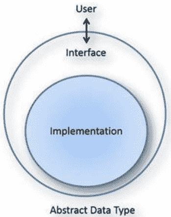

## 数据结构 (Data-Structure)

数据结构是数据的具体表示，是从程序员的视角定义的。数据结构表示了数据如何在内存中存储。所有数据结构都有其优缺点。根据当前面临的问题，我们选择最适合它的数据结构。

例如，可以在数组、链表、栈、队列、树等中存储数据。

## JAVA 集合框架 (JAVA Collection Framework)

`JAVA` 编程语言提供了 `JAVA` 集合框架，这是一组高质量、高性能且可复用的数据结构和算法。

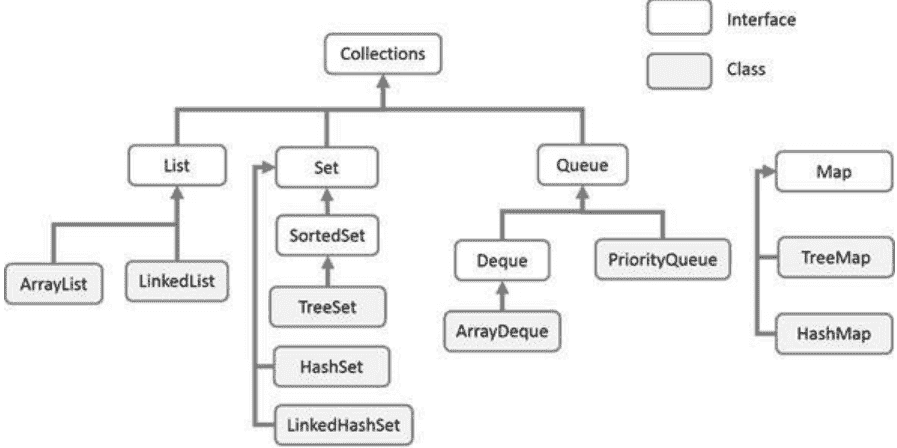

`JAVA` 集合框架具有以下优势：

1. 程序员不需要反复实现基础的数据结构和算法。这从而避免了重复造轮子。因此，程序员可以投入更多精力在业务逻辑上。
2. `JAVA` 集合框架的代码经过了良好的测试，是高质量、高性能的代码，从而提高了程序的质量。
3. 由于基础数据结构和算法已经在集合框架中实现，因此降低了开发成本。
4. 易于审查和理解他人的程序，因为其他开发者也使用集合框架。此外，集合框架有完善的文档说明。

## 数组 (Array)

| 0 | 1 | 2 | 3 | 4 | 5 | 6 | 7 | 8 | 9 |
|---|---|---|---|---|---|---|---|---|---|
| 1 | | | | | | | 7 | | | |

数组表示具有相同数据类型的多个元素的集合。数组是固定大小的数据结构，其大小在创建时就已经固定了。数组是存储数据最常用的数据结构。

由于我们无法更改数组的大小，我们通常会声明一个大尺寸数组来处理未来的任何数据扩展。这会导致创建一个大尺寸数组，其中大部分空间是未使用的。

注意：数组可以存储固定数量的元素，而集合是动态存储的，因此没有大小限制，它会自动增长和缩小。

## 数组 ADT 操作

以下是数组的 API：

1. 在第 `k` 个位置添加元素

   可以在 `O(1)` 常数时间内将值存储在数组的 `K` 位置。我们只需要在 `arr[k]` 处存储值。

2. 读取存储在第 `k` 个位置的值

   访问数组中某个位置存储的值也是 `O(1)` 常数时间。我们只需要读取存储在 `arr[k]` 的值。

## 示例 4.1

```java
public class ArrayDemo {
    public static void main(String[] args) {
        int[] arr = new int[10];
        for (int i = 0; i < 10; i++) {
            arr[i] = i;
        }
    }
}
```

`JAVA` 标准数组是固定长度的。有时我们不知道需要多少内存，所以我们会创建一个更大的数组。为了避免这种情况浪费空间，`JAVA` 集合框架实现了 `ArrayList` 来解决这个问题。

## JAVA 集合中的 ArrayList 实现

`JAVA` 集合中的 `ArrayList<E>` 是一种实现了 `List<E>` 接口的数据结构，这意味着它可以包含重复元素。`ArrayList` 是一种动态数组的实现，可以根据需要增长或缩小（内部使用数组，当数组满时，会分配一个更大的数组并将旧数组的值复制其中）。

## 示例 4.2

```java
import java.util.*;
public class ArrayListDemo {
    public static void main(String[] args) {
        ArrayList<Integer> al = new ArrayList<Integer>();

        al.add(1); // 在列表末尾添加 1
        al.add(2); // 在列表末尾添加 2
        al.add(3); // 在列表末尾添加 3
        al.add(4); // 在列表末尾添加 4
        System.out.println("Contents of Array: " + al); // 数组转换为
        // 并打印到屏幕

        al.add(2,9); // 9 被添加到第 2 索引处。
        al.add(5,9); // 9 被添加到第 5 索引处。
        System.out.println("Contents of Array: " + al);
    }
}
```

**输出**

```
Contents of Array: [1, 2, 3, 4]
Contents of Array: [1, 2, 9, 3, 4, 9]
```

（注：此处根据示例代码逻辑翻译）

## 链表 (Linked List)

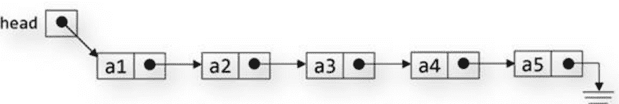

链表是动态结构，内存在运行时分配。从性能上来说，链表比数组慢，因为没有直接访问。列表有许多种类。

## 链表 ADT 操作

以下是链表的 API：

- **Insert(k):** 将 `k` 添加到开头。在列表开头插入元素。此操作需要 `O(1)` 常数时间。
- **Delete():** 删除列表开头的元素。在列表开头删除元素。此操作也需要 `O(1)` 常数时间。
- **LinkedList():** 显示列表的所有元素。
- **Find(k):** 查找值为 `k` 的元素的位置。
- **FindKth(k):** 查找位置 `k` 的元素。时间 `O(N)`。注意：链表不支持二分查找。

## JAVA 集合中的 LinkedList 实现

`JAVA` 集合中的 `LinkedList<E>` 是一种实现了 `List<E>` 接口的数据结构。

## 示例 4.3

```java
import java.util.LinkedList;

public class LinkedListDemo {
    public static void main(String[] args) {
        LinkedList<Integer> ll = new LinkedList<Integer>();
        ll.addFirst(8); // 8 添加到列表
        ll.addLast(9); // 9 添加到列表末尾
        ll.addFirst(7); // 7 添加到开头
        ll.addLast(20); // 20 添加到末尾
        ll.addFirst(2); // 2 添加到开头
        ll.addLast(22); // 22 添加到末尾
        System.out.println("Contents of Linked List: " + ll);
        ll.removeFirst();
        ll.removeLast();
        System.out.println("Contents of Linked List: " + ll);
    }
}
```

**输出**

```
Contents of Linked List: [2, 7, 8, 9, 20, 22]
Contents of Linked List: [7, 8, 9, 20]
```

## 栈 (Stack)

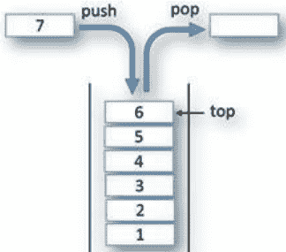

栈是一种特殊的数据结构，遵循后进先出（`LIFO`）策略。这意味着最后添加到栈的元素将第一个被移除的元素。

栈的各种应用：

1. 递归：递归调用是使用系统栈实现的。
2. 表达式的后缀表达式求值。
3. 回溯。
4. 树和图的深度优先搜索。
5. 将十进制数转换为二进制等。

## 栈 ADT 操作

- `Push(k)`: 在栈顶添加一个新项。
- `Pop()`: 从栈顶删除一个元素并返回其值。
- `Top()`: 返回栈顶元素的值。
- `Size()`: 返回栈中元素的数量。


- `IsEmpty()`: 确定栈是否为空。如果栈为空返回 1，否则返回 0。

注意：所有的栈操作的时间复杂度均为 `O(1)`。

## JAVA Collection 中的栈实现

栈是通过调用 `ArrayDeque<T>` 类的 `push` 和 `pop` 方法实现的。

JDK 也提供了 `Stack<T>`，但我们不应该使用这个类，而是于实现集合接口的 `Deque`。

1. 第一个原因是 `Stack<T>` 没有继承 `Collection` 接口。
2. 第二，`Stack<T>` 继承自 `Vector<T>`，因此可以随机访问，这破坏了栈的抽象性。
3. 第三，`ArrayDeque` 比 `Stack<T>` 更高效。

## 示例 4.4

```java
import java.util.ArrayDeque;
public class DequeStack<T> {
    private ArrayDeque<T> deque = new ArrayDeque<T>();
    public void push(T obj) {
        deque.push(obj);
    }
    public T pop() {
        return deque.pop();
    }
    public T top() {
        return deque.peekLast();
    }
    public int size() {
        return deque.size();
    }
    public boolean isEmpty() {
        return deque.isEmpty();
    }
}
```

**注意：** 在接下来的章节中，我们将直接使用 `ArrayDeque` 对象。我们不会创建 `DequeStack` 包装类。当我们使用 `push()` 和 `pop()` 方法从 `ArrayDeque` 中插入和移除时，我们就是在执行栈操作。

## 队列 (Queue)

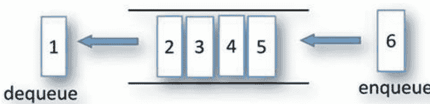

队列是一种先进先出（FIFO）的数据结构。先添加到队列的元素将第一个从队列中移除，依此类推。

队列有以下应用场景：

1. 访问共享资源（例如打印机）。
2. 多程序设计。
3. 消息队列。

## 队列 ADT 操作：

- **Add():** 在队列尾添加一个新元素。
- **Remove():** 从队列头删除一个元素并返回其值。
- **Front():** 返回队列头元素的值。
- **Size():** 返回队列内部元素的数量。
- **IsEmpty():** 如果队列为空返回 1，否则返回 0

注意：以上所有队列操作的时间复杂度均为 `O(1)`。

## JAVA Collection 中的队列实现

`ArrayDeque<T>` 是双端队列的类实现。如果我们使用 `add()`、`remove()` 和 `peekFirst()`，它将表现得像队列。（如果我们使用 `push()`、`pop()` 和 `peekLast()`，它表现得像栈。）

## 示例 4.5

```java
import java.util.ArrayDeque;

public class DeDeque<T> {
    private ArrayDeque<T> deque = new ArrayDeque<T>();

    public void add(T obj) {
        deque.add(obj);
    }
    public T remove() {
        return deque.remove();
    }
    public T peek() {
        return deque.peekFirst();
    }
    public int size() {
        return deque.size();
    }
    public boolean isEmpty() {
        return deque.isEmpty();
    }
}
```

**注意：** 在接下来的章节中，我们不会创建包装类 `DequeQueue<E>`。我们将直接使用 `ArrayDeque<E>` 并调用 `add()` 和 `remove()` 方法来将其作为队列使用。

## 树 (Trees)

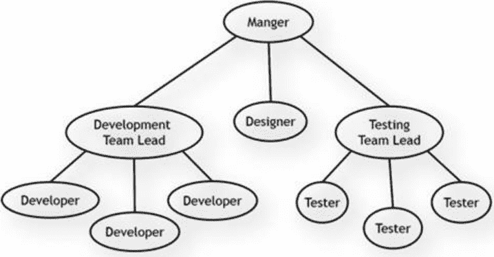

树是一种层次数据结构。树的顶层元素被称为根。除了根元素外，树中的每个元素都有一个父元素和一个或多个子元素。当你有层次结构信息需要存储时，树是最有用的数据结构。

树有许多类型，例如二叉树、红黑树、AVL树等。

## 二叉树 (Binary Tree)

二叉树是树的一种，每个节点最多有两个孩子（0、1 或 2 个），称为左孩子和右孩子。

## 二叉搜索树 (BST)

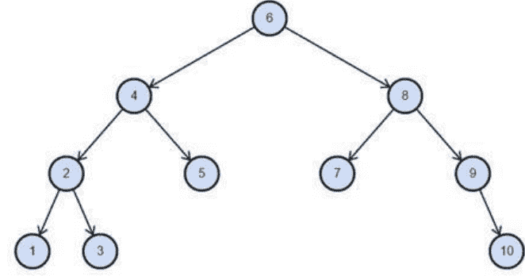

二叉搜索树 (BST) 是二叉树的一种，其排列方式如下：

1. 左子树节点的值小于根节点的值。
2. 右子树节点的值大于根节点的值。

## 二叉搜索树 ADT 操作

- **Insert(k):** 在树中插入元素 k。
- **Delete(k):** 从树中删除元素 k。
- **Search(k):** 在树中查找元素 k。
- **FindMax():** 返回树中的最大值。
- **FindMin():** 返回树中的最小值。

二叉搜索树的操作平均时间复杂度为 `O(log n)`，在最坏情况下为 `O(n)`。

## 平衡二叉搜索树 (Balanced BST)

平衡二叉搜索树是二叉搜索树的一种，它确保每个节点的左右子树的高度差在一定范围内，从而保证了查找、插入和删除操作的高效。

## AVL 树 (AVL Tree)

AVL树是一种自平衡二叉搜索树，其中每个节点的左右子树的高度差绝对不超过 1。

## 红黑树 (Red-black Tree)

红黑树是一种特殊的自平衡二叉搜索树，它通过节点颜色（红色或黑色）和一些规则来保持树的近似平衡。

## 优先级队列 (堆)

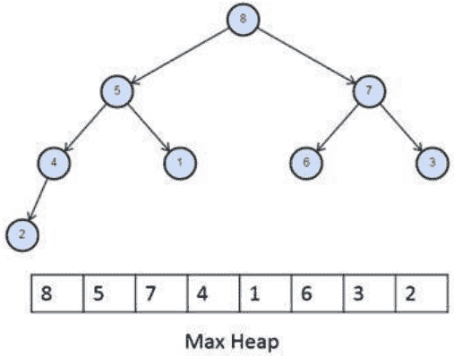

优先级队列使用二叉堆数据结构实现。在堆中，记录存储在数组中，使得每个键大于它的两个子键。堆中的每个节点都遵循相同的规则，即父节点大于它的两个子节点。

堆有两种类型的数据结构：

- 最大堆（Max heap）：每个节点应该大于或等于它的任一子节点。
- 最小堆（Min heap）：每个节点应该小于或等于它的任一子节点。

当你想要从数据中一个一个获取最大/最小值，堆是一种有用的数据结构。堆排序使用最大值按升序/降序对数据进行排序。

## Heap ADT 操作

- **Insert()** - 向堆中添加新元素。该操作的时间复杂度为 `O(log(n))`
- **remove()** - 在最大堆情况下提取最大值（或最小堆情况下提取最小值）。该操作的时间复杂度为 `O(log(n))`
- **Heapify()** – 将数组中的节点列表转换为堆。该操作的时间复杂度为 `O(n)`

## JAVA Collection 中的 PriorityQueue 实现

PriorityQueue 的最小堆实现

## 示例 4.8

```java
import java.util.PriorityQueue;

public class PriorityQueueDemo {
    public static void main(String[] args) {

        PriorityQueue<Integer> pq = new PriorityQueue<Integer>();
        int[] arr = {1,2,10,8,7,3,4,6,5,9};

        for(int i:arr) {
            pq.add(i);
        }

        System.out.println("Printing Priority Queue Heap: " + pq);

        System.out.print("remove elements of Priority Queue: ");
        while(!pq.isEmpty()) {
            System.out.print("" + pq.remove());
        }
    }
}
```

## 输出

```
Printing Priority Queue Heap : [1, 2, 3, 5, 7, 10, 4, 8, 6, 9]
Dequeue elements of Priority Queue :: 1 2 3 4 5 6 7 8 9 0
```

## PriorityQueue 的最大堆实现

我们只需要更改集合顺序，就可以从 `PriorityQueue<>` 集合变为最大堆。

## 示例 4.9

```java
PriorityQueue<Integer> pq = new PriorityQueue<Integer>(Collections.reverseOrder());
```

## 输出

```
Printing Priority Queue Heap : [10, 9, 4, 6, 8, 2, 3, 1, 5, 7]
Dequeue elements of Priority Queue :: 10 9 8 7 6 5 4 3 2 1
```

## 哈希表 (Hash-Table)

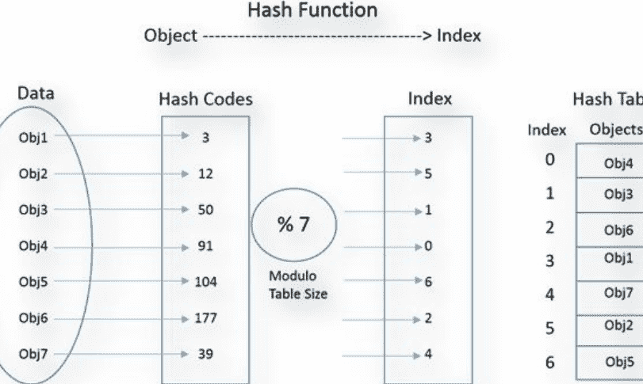

哈希表是一种将键映射到值的数据结构。哈希表的每个位置称为槽（slot）。哈希表使用哈希函数来计算槽位数组的索引。当实际存储的键的数量相对于可能的键的数量较小时，我们使用哈希表。

使用哈希函数存储对象的过程如下：

1. 创建一个大小为 M 的数组来存储对象，该数组称为哈希表。
2. 通过将对象通过哈希函数找到其哈希码（hash code）。
3. 将哈希码对哈希表的大小取模，得到存储对象的表索引。
4. 最后将这些对象存储在指定的索引处。

使用哈希函数在哈希表中搜索对象的过程如下：

1. 通过将要搜索的对象通过哈希函数来找到其哈希码。
2. 将哈希码对哈希表的大小取模，得到存储对象的表索引。
3. 最后，从指定的索引处检索对象。

## 哈希表抽象数据类型 (ADT)

哈希表的 ADT 包含以下函数：

- **Insert(x):** 向数据集中添加对象 x。
- **Delete(x):** 从数据集中删除对象 x。
- **Search(x):** 在数据集中搜索对象 x。

哈希表是实现字典（dictionary）的有用数据结构。在哈希表中查找元素的平均时间为 `O(1)`。哈希表是数组概念的泛化。

## JAVA Collections 中的 HashSet 实现

`HashSet<>` 是一个实现了 `Set<>` 接口的类，这意味着它只存储唯一元素。`HashSet<>` 使用哈希表实现。由于 `HashSet<>` 使用哈希表，其元素不是按顺序存储的。

## 示例 4.10

```java
import java.util.HashSet;

public class HashSetDemo {
    public static void main(String[] args) {
        // 创建一个哈希集
        HashSet<String> hs = new HashSet<String>();

        // 将元素添加到哈希集中。
        hs.add("India");
        hs.add("USA");
        hs.add("Brazil");
        hs.add("Canada");
        hs.add("UK");
        hs.add("China");
        hs.add("France");
        hs.add("Spain");
        hs.add("Italy");
        System.out.print("Hash Table contains USA : " + hs.contains("USA"));
        System.out.print("Hash Table contains Russia : " + hs.contains("Russia"));
        hs.remove("USA");
        System.out.println(hs);
        System.out.print("Hash Table contains USA : " + hs.contains("USA"));
    }
}
```

```
[Canada, USA, UK, China, Italy, Brazil, France, India, Spain]
Hash Table contains USA : true
Hash Table contains Russia : false
[Canada, UK, China, Italy, Brazil, France, India, Spain]
Hash Table contains USA : false
```

## JAVA Collections 中的 LinkedHashSet 实现

`LinkedHashSet<>` 是一个实现了 `Set<>` 接口的类，这意味着它只存储唯一元素。`LinkedHashSet<>` 使用哈希表和链表实现。链表用于根据插入顺序保留元素的顺序。遍历哈希表的元素是按照插入顺序进行的。

## 示例 4.11

```java
import java.util.HashSet;
import java.util.LinkedHashSet;

public class HashSetDemo {
    public static void main(String[] args) {
        // 创建一个哈希集
        HashSet<String> hs = new HashSet<String>();

        // 将元素添加到哈希集中。
        hs.add("India");
        hs.add("USA");
        hs.add("Brazil");
        hs.add("Canada");
        hs.add("UK");
        hs.add("China");
        hs.add("France");
        hs.add("Spain");
        hs.add("Italy");
        System.out.print("Hash Table contains USA : " + hs.contains("USA"));
        System.out.print("Hash Table contains Russia : " + hs.contains("Russia"));
        hs.remove("USA");
        System.out.println(hs);
        System.out.print("Hash Table contains USA : " + hs.contains("USA"));
    }
}
```


## 示例输出

```
[Canada, USA, UK, China, Italy, Brazil, France, India, Spain]
Hash Table contains USA : true
Hash Table contains Russia : false
[Canada, UK, China, Italy, Brazil, France, India, Spain]
Hash Table contains USA : false
```

## 各种类的比较

| TreeSet | LinkedHashSet |
|---|---|
| 存储：红黑树 | 带有链表的哈希表 |
| 性能：比 `HashSet` 慢，O(logN) | 最快，常数时间 |
| 插入顺序：升序 | 无顺序保证 |

## 字典 / 符号表

符号表是字符串（键）与值（value）之间的映射，该值可以是任何数据类型。值可以是一个整数，例如出现次数、单词的字典含义等。

## 用于字符串的二叉搜索树 (BST)

二叉搜索树（BST）是实现符号表最简单的方法。可以使用简单的字符串比较比较函数来比较两个字符串。如果所有键都是随机的，且树是平衡的，那么平均键查找可以在对数时间内完成。

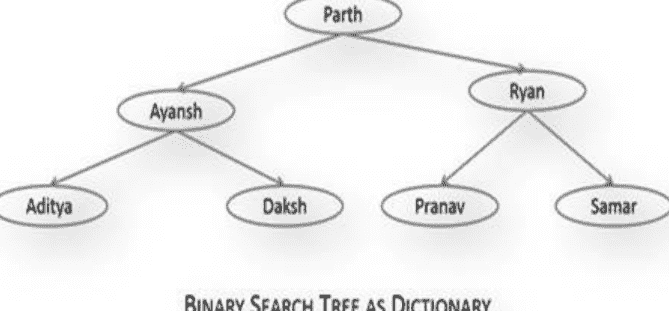

## 哈希表 (Hash-Table)

哈希表是另一种数据结构，可用于符号表的实现。从下面的哈希表图中，我们可以看到名字被作为键，而含义是搜索的值。第一个键通过传递给合适的哈希函数转换为哈希代码。在哈希函数内部还会传递哈希表的大小，用于找到存储值的实际索引。最后，将名称含义的值存储在哈希表中，或者你可以将存储含义的字符串的引用存储在哈希表中。

## 哈希函数

| 数据 | 哈希代码 | 索引 | 哈希表索引 | 字符串 |
|---|---|---|---|---|
| Parth | 3 | | 0 | Daksh 的含义... |
| Ayansh | 12 | 5 | 1 | Aditya 的含义... |
| Aditya | 50 | 1 | 2 | Pranav 的含义... |
| Daksh | 91 | 0 | 3 | Parth 的含义... |
| Ryan | 104 | 6 | 取模大小: 4 | Samar 的含义... |
| Pranav | 177 | 2 | 5 | Ayansh 的含义... |
| Samar | 39 | | | Ryan 的含义... |

哈希表具有极快的常数时间查找性能。

假设我们要实现 Google 搜索的自动完成功能。当你在 Google 搜索中输入某些字符串进行搜索时，在你完成输入之前会建议一些完整的字符串。BST 无法解决这个问题，因为相关的字符串可能同时出现在左子树和右子树中。

哈希表也不适用于这项工作。人们无法在哈希表上执行部分匹配或范围查询。哈希函数将字符串转换为数字。此外，一个良好的哈希函数即使对于部分字符串也会给出分布的哈希代码，且在哈希表中无法关联两个字符串。

Trie（字典树）和三叉树（Ternary Search tree）是一种特殊的树，能够很好地解决部分匹配和范围查询问题。

## Trie

Trie 是一种树，每个节点只存储一个字符。最终的键值对存储在叶节点中。每个节点有 K 个子节点，对应每个可能的字符。为了简单起见，让我们假设字符集为 26，对应英文字母的不同字符。

Trie 是一种高效的数据结构。使用 Trie，我们可以在 O(M) 时间内搜索键。其中 M 是字符串的最大长度。Trie 也适用于解决部分匹配和范围查询问题。

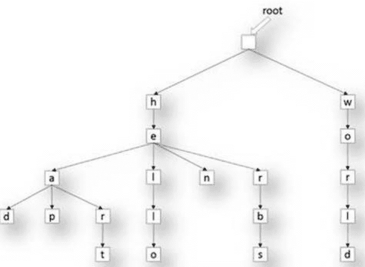

## 三叉字典树 / 三叉搜索树

Trie 具有非常好的 O(M) 搜索性能，其中 M 是搜索字符串的最大大小。然而，Trie 的空间需求非常高。每个 Trie 节点都包含指向多个节点的引用，每个引用对应键的可能字符。为了避免这种高空间需求，使用了三叉字典树 (TST)。

TST 在避免传统 Trie 沉重空间需求的同时，仍然保留了它的许多优势。在 TST 中，每个节点包含一个字符、一个键结束指示器和三个引用。这三个引用对应于节点持有的当前字符（等于）、小于该字符的字符和大于该字符的字符。

三叉搜索树的操作复杂度与三叉搜索树的高度成正比。在最坏的情况下，我们需要遍历多达三倍的链接。然而，这种情况很罕见。

因此，TST 是实现符号表、部分匹配和范围查询的非常好的解决方案。

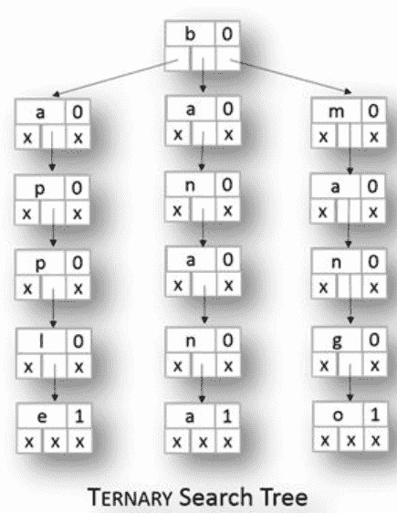

## 图 (Graphs)

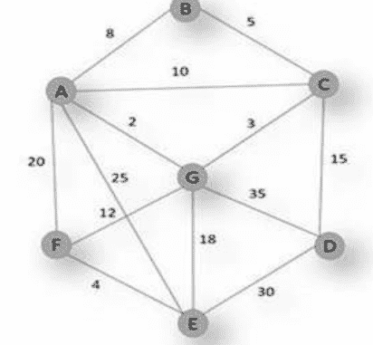

图是一种表示网络的数据结构，它连接一组称为顶点（vertices）的节点以及它们的连接称为边（edges）。边可以被看作两个节点之间的路径。这些边可以是有向的也可以是无向的。如果路径是有向的，你只能向一个方向移动，而在无向路径中，你可以向两个方向移动。

## 图算法

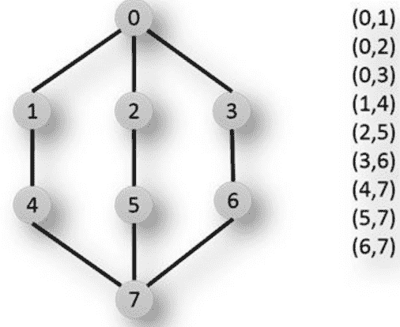

## 深度优先搜索 (DFS)

DFS 算法从起点开始并进入图的深度，直到遇到死胡同。（在 DFS 中，我们使用递归回溯父节点）。


深度遍历

## 广度优先搜索 (BFS)

BFS 算法是逐层遍历。在 BFS 中，我们使用队列获取下一个节点。


广度遍历

## 排序算法

| | | | | | |
|---|---|---|---|---|---|
| 5 | 8 | 9 | 10 | 1 | 6 |
| 2 | 3 | 4 | 5 | 6 | 7 |
| 0 | 3 | 1 | 0 | 2 | 0 |
| 1 | 1 | 2 | 0 | 4 | 5 |

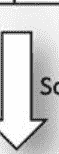

排序是将元素按升序或降序排列的过程。为了使搜索高效，我们将数据按良好的顺序排列。例如，存在 O(logn) 的排序函数。

## 计数排序

计数排序是最简单且高效的排序类型。计数排序对数据的范围有严格要求，例如 1-30 岁之间每个年龄段有多少人。

| 输入数据 | 排序输出 |
|---|---|
| 5 | 8 | 9 | 10 | 1 | 6 |
| 2 | 3 | 4 | 5 | 6 | 7 |
| 0 | 3 | 1 | 0 | 2 | 0 |
| 1 | 1 | 2 | 0 | 4 | 5 |

如果知道输入的范围，则可以使用计数在 O(n+k) 内完成排序。

## 结语

本章提供了各种数据结构、算法及其复杂度的概要介绍。在接下来的章节中，我们将详细研究这些内容。如果你了解各种数据结构的接口，就可以在解决其他问题时使用它们，而无需知道它们的实现细节。

## 引言

在计算机科学中，搜索是在集合中寻找特定项目的算法过程。该项目可以是文件中的关键字、数据库中的记录、树中的节点或数组中的值。

## 为什么需要搜索？

想象你在一个拥有数百万本书的图书馆里。你想找一本具有特定标题的书。你将如何找到它？你将从书标题的首字母开始搜索。然后你继续匹配整个书标题，直到找到你想要的书。（通过这个小的启发式方法，你将搜索空间缩小了 26 倍，假设以特定字符开头的书相同。）

同样，计算机存储大量信息，为了高效检索这些信息，我们需要高效的搜索算法。为了使搜索高效，我们将数据按良好的顺序排列。

## 不同的搜索算法

- 线性搜索 – 无序输入
- 线性搜索 – 有序输入
- 二分查找（有序输入）
- 字符串搜索：字典树、后缀树、三元搜索树。
- 哈希与符号表

### 线性搜索 – 无序输入

当数组中的元素没有顺序或排序时，如果我们想搜索某个特定值，除非找到目标值，否则我们需要扫描整个数组。这种算法被称为无序线性搜索。该算法的主要问题是性能较低，在最坏情况下时间复杂度较高。

### 示例 5.1

```java
boolean linearSearchUnsorted(int[] arr, int size, int value) {
  int i = 0;
  for(i = 0; i < size; i++) {
    if(value == arr[i])
      return true;
  }
  return false;
}
```

**时间复杂度: O(n)。** 因为在最坏情况下我们需要遍历整个数组。最坏的情况是你所需的元素位于数组的最后一个位置。这里，“n”是数组的大小。
**空间复杂度: O(1)。** 不需要使用额外的内存来分配数组。

## 线性搜索 – 有序

如果数组中的元素按升序或降序排列，搜索目标元素的效率将比无序线性搜索高得多。在许多情况下，我们不需要遍历整个数组。接下来的示例解释了当你在升序排序数组中遇到一个更大的元素时，将停止继续搜索。这就是该算法如何节省时间并提高性能的。

```java
boolean linearSearch(int[] arr, int size, int value) {
    int i = 0;
    for(i = 0; i < size; i++) {
        if(value == arr[i])
            return true;
        else if(value < arr[i])
            return false;
    }
    return false;
}
```

**复杂度: O(n)。** 因为在最坏情况下我们需要遍历整个数组。最坏的情况是你所需的元素位于有序数组的最后一个位置。然而，在平均情况下该算法更高效，尽管其增长率与无序相同。

**空间复杂度: O(1)。** 不需要使用额外的内存来分配数组。

## 二分查找

我们如何在字典中查找一个单词？通常，我们找到大约某页（通常是中间）并从该点开始搜索。如果我们看到的正在查找的单词相同，则搜索完成。否则，如果我们发现页面在所选页面之前，则对前半部分应用相同的步骤，否则对后半部分应用。二分查找的工作原理一样。我们从有序数组中获取中间点，并与目标值进行比较。

**注意：** 二分查找要求数组是有序的，否则无法进行二分查找。

### 示例 5.3

```java
// Binary Search Algorithm – Iterative Way
boolean Binarysearch(int[] arr, int size, int value) {
    int low = 0;
    int high = size-1;
    int mid;
    while (low <= high) {
        mid = low + (high-low)/2; // 防止溢出
        if (arr[mid] == value)
            return true;
        else if (arr[mid] < value)
            low = mid + 1;
        else
            high = mid - 1;
    }
    return false;
}
```

**时间复杂度：** O(logn)。我们总是取一半输入并丢弃另一半。因此，二分查找的递归关系是 T(n)=T(n/2) + c。使用主定理（分治法），我们得到 T(n)=O(logn)

**空间复杂度：** O(1)

### 示例 5.4

```java
// Binary Search Algorithm – Recursive Way
boolean BinarySearchRecursive(int[] arr, int low, int high, int value) {
    if(low > high)
        return false;
    int mid = low + (high-low)/2; // 防止溢出
    if (arr[mid] == value)
        return true;
    else if (arr[mid] < value)
        return BinarySearchRecursive(arr, mid + 1, high, value);
    else
        return BinarySearchRecursive(arr, low, mid - 1, value);
}
```

时间复杂度：O(logn)。空间复杂度：O(logn)（递归系统栈）

## 字符串搜索算法

参考字符串章节。

## 哈希与符号表

参考哈希表章节。

## 排序在选择算法中有什么用？

选择问题可以转换为排序问题。一旦数组经过排序，就很容易从排序后的数组中找到最小值/最大值（或目标元素）。“排序后选择”的方法对于选择单个元素来说是无效的，但当需要从数组中多次选择时，它是非常高效的。这是因为只需要进行一次昂贵的初始排序，然后是多次廉价的选择操作。

例如，如果我们想从数组获取最大元素。在排序数组后，我们可以简单地返回数组的最后一个元素。如果我们想获取第二大元素呢？现在我们不需要再次排序数组，只需返回倒数第二个元素。

## 查找数组中的重复项

给定一个数组，找到重复项。

方法一：穷举搜索或暴力破解，对于数组中的每个元素，查找该值在数组中出现了几次。

### 示例 5.5

```java
void printRepeating(int[] arr, int size) {
    int i = 0;
    for(i = 0; i < size; i++) {
        for(int j = i + 1; j < size; j++) {
            if(arr[i] == arr[j])
                System.out.println(arr[i]);
        }
    }
}
```

时间复杂度为 O(n²)，空间复杂度为 O(1)。

方法二：排序，排序数组后找到重复项。

### 示例 5.6

```java
void printRepeating2(int[] arr, int size) {
    Arrays.sort(arr);
    int i;
    for(i = 0; i < size - 1; i++) {
        if(arr[i] == arr[i+1])
            System.out.println(arr[i]);
    }
}
```

时间复杂度为 O(n log n)，空间复杂度为 O(1)。

方法三：哈希表，使用哈希表我们可以记录已过的元素。

### 示例 5.7

```java
void printRepeating3(int[] arr, int size) {
    HashSet<Integer> hs = new HashSet<>();
    int i;
    for(i = 0; i < size; i++) {
        if(hs.contains(arr[i]))
            System.out.println(arr[i]);
        else
            hs.add(arr[i]);
    }
}
```

时间复杂度为 O(n)，空间复杂度为 O(n)。

方法四：计数，这种方法仅在知道输入范围时可行。如果知道，数组中的元素在 0 到 n-1 范围内。

### 示例 5.8

```java
void printRepeating(int[] arr, int size) {
    int[] count = new int[size];
    int i;
    for(i = 0; i < size; i++) {
        count[arr[i]]++;
    }
    for(i = 0; i < size; i++) {
        if(count[i] > 1)
            System.out.println(i);
    }
}
```

## 数组中出现次数最多的元素

给定一个包含 n 个数字的数组，找到出现最多的元素。

方法一：穷举搜索或暴力破解，对于数组中的每个元素，查找该特定值在数组中出现了几次。

### 示例 5.9

```java
int getMax(int[] arr, int size) {
    int i, j;
    int maxCount = 0;
    int result = arr[0];
    for(i = 0; i < size; i++) {
        int count = 0;
        for(j = 0; j < size; j++) {
            if(arr[i] == arr[j])
                count++;
        }
        if(count > maxCount) {
            maxCount = count;
            result = arr[i];
        }
    }
    return result;
}
```


## 示例 5.10

```java
int getMax2(int[] arr, int size) {
    int max = arr[0], maxCount = 1;
    int curr = arr[0], currCount = 1;
    Arrays.sort(arr); // Sort(arr,size);
    for (int i = 1; i < size; i++) {
        if (arr[i] == arr[i - 1])
            currCount++;
        else {
            currCount = 1;
            curr = arr[i];
        }
        if (currCount > maxCount) {
            maxCount = currCount;
            max = curr;
        }
    }
    return max;
}
```

**第三种方法：计数。** 这种方法只有在知道输入范围时才可行。如果知道的话，数组中的元素范围在 0 到 n-1 之间。我们可以预留一个长度为 n 的数组，当我们看到一个元素时，可以增加它的计数。只需一次扫描，我们就能找到重复元素。如果我们知道元素的范围，这是寻找最大次数最快的方法。

计数法仅使用数组来增加计数，需要常数时间 `O(1)`，因此算法的总**时间复杂度**为 `O(n)`。创建计数数组的**空间复杂度**也是 `O(n)`。

## 示例 5.11

```java
int getMax(int[] arr, int size, int range) {
    int max = arr[0], maxCount = 1;
    int[] count = new int[range];
    for (int i = 0; i < size; i++) {
        count[arr[i]]++;
        if (count[arr[i]] > maxCount) {
            maxCount = count[arr[i]];
            max = arr[i];
        }
    }
    return max;
}
```

## 数组中的多数元素

给定一个包含 n 个元素的数组。找到出现次数超过 n/2 次的多数元素。如果没有多数元素，则返回 0。

**第一种方法：穷举搜索或暴力破解法。** 对于数组中的每个元素，查找该特定值在数组中出现的次数。记录 `maxCount`，当某个元素的计数大于它时，则更新 `maxCount`。使用两个 for 循环，第一个循环用于选择元素，第二个循环用于统计该元素的出现次数。

一旦我们得到了最终的 `maxCount`，就可以检查它是否大于 n/2，如果大于 n/2 且我们之前没有多数元素，我们就找到了多数元素。

复杂度为 `O(n²) + O(1) = O(n²)`，空间复杂度为 `O(1)`。

## 示例 5.12

```java
int getMajority(int[] arr, int size) {
    int i, j;
    int max = 0, maxCount = 0;
    for (int i = 0; i < size; i++) {
        int count = 0;
        for (int j = i + 1; j < size; j++) {
            if (arr[i] == arr[j])
                count++;
        }
        if (count > maxCount) {
            max = arr[i];
            maxCount = count;
        }
    }
    if (maxCount > size / 2)
        return max;
    else
        return Integer.MIN_VALUE;
}
```

**第二种方法：排序。** 对数组中的所有元素排序。如果有多数元素，那么索引在 n/2 处的中间元素必须是多数数字。因此，可以使用简单的扫描来找到它的次数，并查看是否存在多数元素。

排序算法需要 `O(n log n)` 时间，简单扫描需要 `O(n)` 时间。算法的时间复杂度为 `O(n log n)`，空间复杂度为 `O(1)`。

## 示例 5.13

```java
int getMajority2(int[] arr, int size) {
    int majindex = size / 2, count = 1;
    int candidate;
    Arrays.sort(arr); // Sort(arr,size);
    candidate = arr[majindex];
    count = 0;
    for (int i = 0; i < size; i++) {
        if (arr[i] == candidate)
            count++;
    }
    if (count > size / 2)
        return arr[majindex];
    else
        return Integer.MIN_VALUE;
}
```

**第三种方法：摩尔投票算法。** 如果所有元素都反对多数元素，那么多数元素将胜出。

- 将数组的第一个元素设置为候选元素。
- 设置计数为 1。
- 遍历数组；
- 如果当前元素等于候选元素，计数加 1；
- 如果不等于，计数减 1；
- 如果计数变为 0，则将当前元素设置为新的候选元素并将计数置为 1。
- 最后，再次检查候选元素的出现次数是否超过 n/2。

（注：此处原文描述逻辑略显破碎，翻译已根据摩尔投票算法逻辑进行了意顺处理）

## 示例 5.16

```cpp
int findMissingNumber(int[] arr, int size, int range) {
    int i;
    int xorSum = 0;
    // 获取从 1 到 range 所有数字的异或和
    for (i = 1; i <= range; i++)
        xorSum ^= i;
    // 遍历数组并对元素进行异或
    for (i = 0; i < size; i++)
        xorSum ^= arr[i];
    return xorSum;
}
```

注意：相同的问题可能以多种形式出现（有时你必须对范围进行异或，有时则不需要）：

- 在 1-n 的范围内有一些数字，其中所有数字都只出现一次，但有一个数字出现了两次。
- 1-n 范围内的所有元素都出现了 16 次，一个元素出现了 17 次。找到出现 17 次的元素。

## 在数组中寻找数对

给定一个包含 n 个数字的数组，找到两个和等于 `value` 的元素。

**第一方法：穷举搜索或暴力破解。** 对于数组中的每个元素，查找是否存在另一个元素，其和等于目标值。这通过两个循环实现，第一个循环选择元素，第二个循环寻找另一个。
时间复杂度为 `O(n²)`，空间复杂度为 `O(1)`。

## 示例 5.17

```cpp
int findPair(int[] arr, int size, int value) {
    int i, j;
    for (i = 0; i < size; i++)
        for (j = i + 1; j < size; j++)
            if ((arr[i] + arr[j]) == value) {
                System.out.println("The pair is :" + arr[i] + "," + arr[j]);
                return 1;
            }
    return 0;
}
```

**第二种方法：排序。** 步骤如下：

- 对数组中的所有元素进行排序。
- 取两个变量 `first` 和 `second`。变量 `first = 0`，`second = size - 1`。
- 计算 `sum = arr[first] + arr[second]`。
- 如果 `sum` 等于目标值，则我们找到了解决方案。
- 如果 `sum` 小于目标值，则增加 `first`。
- 如果 `sum` 大于目标值，则减少 `second`。
- 重复上述过程，直到得到目标值或满足 `first >= second`（没有找到数对）。

排序算法需要 `O(n log n)` 的时间，单次扫描需要 `O(n)` 的时间。算法的时间复杂度为 `O(n log n)`，空间复杂度为 `O(1)`。

## 示例 5.18

```cpp
int FindPair(int[] arr, int size, int value) {
    int first = 0, second = size - 1;
    int curr;
    Arrays.sort(arr); // Sort(arr, size);
    while (first < second) {
        curr = arr[first] + arr[second];
        if (curr == value) {
            System.out.println("The pair is " + arr[first] + "," + arr[second]);
            return 1;
        } else if (curr < value) {
            first++;
        } else {
            second--;
        }
    }
    return 0;
}
```

**第三种方法：哈希表。** 使用哈希表，我们可以跟踪已经见过的元素，并只需一次扫描即可找到数对。

1. 对于每个元素，将值插入哈希表。假设当前值为 `arr[index]`。
2. 检查 `value - arr[index]` 是否已在哈希表中。
3. 如果 `value - arr[index]` 在哈希表中，则我们找到了目标数对。
4. 否则，继续处理数组中的下一个元素。

哈希表的插入和查找是常数时间 `O(1)`，因此算法的总时间复杂度为 `O(n)`。空间复杂度也为 `O(n)`。

## 示例 5.19

```cpp
int FindPair(int[] arr, int size, int value) {
    HashSet<Integer> hs = new HashSet<Integer>();
    int i;
    for (int i = 0; i < size; i++) {
        if (hs.contains(value - arr[i])) {
            System.out.println("The pair is :" + arr[i] + "," + (value - arr[i]));
            return 1;
        }
        hs.add(arr[i]);
    }
    return 0;
}
```

**第四种方法：计数。** 这种方法只有在知道输入范围时才可行。如果知道数组中的元素在 0 到 n-1 的范围内，我们可以预留一个长度为 n 的数组，当看到一个元素时，可以增加它的计数。在上述方法中，我们将使用这个数组来代替哈希表，并找到数对。

计数方法仅使用数组，因此插入和查找是常数时间 `O(1)`，算法的总时间复杂度为 `O(n)`。创建计数数组的空间复杂度也是 `O(n)`。

## 在两个数组中寻找数对

给定两个数组 X 和 Y。找到数对元素 `(xi, yi)`，使得 `xi ∈ Y` 且 `xi + yi = value`。

**第一方法：穷举搜索或暴力破解。** 遍历 X 中的每个元素，在 Y 中查看是否可以找到 `value - xi`。使用两个循环。时间复杂度为 `O(n²)`，空间复杂度为 `O(1)`。

**第二种方法：排序。** 排序数组中的所有元素。对于 X 中的每个元素，使用二分查找在 Y 中查看。排序算法需要 `O(m log m)`，搜索需要 `O(n log m)` 时间。算法复杂度为 `O(n log m)` 或 `O(m log m)`，空间复杂度为 `O(1)`。

**第三种方法：排序。** 步骤如下：

1. 升序排序 X 和 Y 的元素。
2. 取 X 的最小元素和 Y 的最大元素。
3. 如果和等于 `value`，我们得到了数对。
4. 如果和小于 `value`，取 X 的下一个元素。
5. 如果和大于 `value`，取 Y 的上一个元素。

排序算法需要 `O(n log n) + O(m log m)`，搜索需要 `O(n+m)` 时间。算法复杂度为 `O(n log n + m log m)`，空间复杂度为 `O(1)`。

**第四种方法：哈希表。** 步骤如下：

1. 扫描 Y 中的所有元素并将其插入哈希表。
2. 现在扫描 X 的所有元素，假设当前元素为 `xi`，在哈希表中查找 `value - xi`。
3. 如果找到了值，我们得到了数对。
4. 如果没有，处理数组中的下一个值。哈希表插入和查找是常数时间 `O(1)`，算法总复杂度为 `O(n)` 时间。空间复杂度为 `O(n)`。

**第五种方法：计数。** 这种方法只有在知道输入范围时才可行。使用数组代替哈希表。计数方法仅使用数组，常数时间 `O(1)`，算法总复杂度为 `O(n)` 时间。创建计数数组的空间复杂度也是 `O(n)`。

## 和接近 0 的两个元素

给定一个整数数组，包含正负数。需要找到和接近 0 的两个元素。

**第一方法：穷举搜索或暴力破解。** 对于数组中的每个元素，找到另一个元素，使其和的绝对值最小。通过两个循环实现，第一个循环选择元素，第二个循环找到应该相加的元素。时间复杂度为 `O(n²)`，空间复杂度为 `O(1)`。

## 示例 5.20

```cpp
void minabsSumPair(int[] arr, int size) {
    int l, r, minSum, sum, minFirst, minSecond;
    // 数组有两个元素
    if (size < 2) {
        System.out.println("Invalid Input");
        return;
    }
    // 初始化值
    minFirst = 0;
    minSecond = 1;
    minSum = Math.abs(arr[0] + arr[1]);
    for (int l = 0; l < size - 1; l++) {
        for (int r = l + 1; r < size; r++) {
            sum = Math.abs(arr[l] + arr[r]);
            if (sum < minSum) {
                minSum = sum;
                minFirst = l;
                minSecond = r;
            }
        }
    }
    System.out.println("The two elements with minimum sum are : " + arr[minFirst] + "," + arr[minSecond]);
}
```

**第二种方法：排序。**

步骤如下：

1. 对数组中的所有元素排序。
2. 取两个变量 `firstIndex = 0` 和 `secondIndex = size - 1`。
3. 计算 `sum = arr[firstIndex] + arr[secondIndex]`。
4. 如果 `sum` 等于 0，我们找到了解决方案。
5. 如果 `sum` 小于 0，我们将增加 `first`。
6. 如果 `sum` 大于 0，我们将减少 `second`。
7. 重复上述步骤 3 到 6，直到我们得到目标数对或 `first >= second`。

## 示例 5.21

```cpp
void minabsSumPair(int[] arr, int size) {
    int l, r, minSum, sum, minFirst, minSecond;
    // 数组至少应该两个元素
    if (size < 2) {
        System.out.println("Invalid Input");
        return;
    }
    Arrays.sort(arr); // Sort(arr, size);
    // 初始化值
    minFirst = 0;
    minSecond = size - 1;
    minSum = Math.abs(arr[minFirst] + arr[minSecond]);
    for (int l = 0, r = size - 1; l < r; ) {
```


```java
sum = arr[l] + arr[r];

if (Math.abs(sum) < minSum) {

    minSum = Math.abs(sum);

    minFirst = l;

    minSecond = r;

}

if (sum < 0) {

    l++;

} else if (sum > 0) {

    r--;

} else {

    break;

}

}

System.out.println("The two elements with minimum sum are : " + arr[minFirst] + "," + arr[minSecond]);

}
```

## 在双峰数组中寻找最大值

双峰数组由一个递增整数序列紧接着后一个递减整数序列组成。由于元素是有序的，我们应该考虑类似于二分查找的算法。步骤如下：

- 使用两个变量存储起始索引和结束索引。变量 `start=0` `end=size-1`。
- 找到数组的中间元素。
- 检查中间元素是否为最大值。如果是，返回该中间元素。
- 或者，如果中间元素位于递增部分，则我们需要查找 `mid+1` 到 `end`。
- 或者，如果中间元素位于递减部分，我们需要查找 `start` 到 `mid-1`。
- 重复步骤 2 到 5，直到我们找到最大值。

## 示例 5.22

```java
int searchBitonicArrayMax(int[] arr, int size) {

    int start = 0, end = size - 1;

    int mid = (start + end) / 2;

    int maximaFound = 0;

    if (size < 3) {

        System.out.println("error");

        return 0;

    }

    while (start <= end) {

        mid = (start + end) / 2;

        if (arr[mid-1] < arr[mid] && arr[mid+1] < arr[mid]) // maxima

            maximaFound = 1;

            break;

        } else if (arr[mid-1] < arr[mid] && arr[mid] < arr[mid+1]) //increasing

            start = mid + 1;

        } else if (arr[mid-1] > arr[mid] && arr[mid] > arr[mid+1]) //decreasing

            end = mid - 1;

        } else

            break;

    }

    if (maximaFound == 0) {

        System.out.println("error");

        return 0;

    }

    return arr[mid];

}
```

## 在双峰数组中搜索元素

双峰数组由一个递增的整数序列紧接着一个递减的整数序列组成。若要在双峰数组中搜索一个元素：

1. 找到数组中的索引或最大元素。通过使用修改后的二分查找找到数组递增部分的末尾。
2. 一旦得到了最大元素，使用二分查找在数组的递增部分搜索给定值。
3. 如果在递增部分未找到该值，则使用二分查找在数组的递减部分搜索相同的值。

## 示例 5.23

```java
int SearchBitonicArray(int[] arr, int size, int key) {

  int max = FindMaxBitonicArray(arr, size);

  int k = BinarySearch(arr, 0, max, key, true);

  if (k != -1)

    return k;

  else

    return BinarySearch(arr, max + 1, size - 1, key, false);

}
```

```java
int FindMaxBitonicArray(int[] arr, int size) {

  int start = 0, end = size - 1, mid;

  if (start < 3)

    {

      System.out.println("error");

      return 0;

    }

  while (start <= end)

    {

      mid = (start + end) / 2;

      if (arr[mid - 1] < arr[mid] && arr[mid + 1] < arr[mid]) // maxima

        return mid;

      else if (arr[mid - 1] < arr[mid] && arr[mid + 1] > arr[mid]) //increasing

        {

          start = mid + 1;

        }

      else if (arr[mid - 1] > arr[mid] && arr[mid] > arr[mid + 1]) //decreasing

        {

          end = mid - 1;

        }

      else

        {

          break;

        }

  }

  System.out.println("error");

  return 0;

}
```

```java
int BinarySearch(int[] arr, int start, int end, int key, boolean isInc) {

  int mid;

  if (end < start)

    return -1;

  mid = (start + end) / 2;

  if (key == arr[mid])

    return mid;

  if (isInc != false && key < arr[mid] ||

      isInc == false && key > arr[mid])

  {

    return BinarySearch(arr, start, mid - 1, key, isInc);

  }

  else{

    return BinarySearch(arr, mid + 1, end, key, isInc);

  }

}
```

## 排序数组中的出现次数

给定一个排序数组 `arr[]`，计算某个数字的出现次数。

**第一种方法：** 暴力法，遍历数组，在线性时间内获取该数字的出现次数。时间复杂度为 O(n)，空间复杂度为 O(1)。

## 示例 5.24

```java
int findKeyCount(int[] arr, int size, int key)

{

    int count = 0;

    for (int i = 0; i < size; i++)

    {

        if (arr[i] == key)

            count++;

    }

    return count;

}
```

**第二种方法：** 于我们拥有一个排序数组，我们应该考虑使用二分查找。

1. 首先，我们需要找到 key 的第一次出现位置。
2. 然后，我们需要找到 key 的最后一次出现位置。
3. 这两个值之差即可得到结果。

## 示例 5.25

```java
int findKeyCount2(int[] arr, int size, int key)

{

    int firstIndex, lastIndex;

    firstIndex = findIndex(arr, 0, size - 1, key);

    lastIndex = findLastIndex(arr, 0, size - 1, key);

    return (firstIndex == -1) ? 0 : lastIndex - firstIndex + 1;

}

int findIndex(int[] arr, int start, int end, int key)

{

    int mid;

    if (end < start)

        return -1;

    mid = (start + end) / 2;

    if (key == arr[mid] && (mid == start || arr[mid - 1] != key))

        return mid;

    if (key < arr[mid])

    {

        return findIndex(arr, start, mid - 1, key);

    } else {

        return findIndex(arr, mid + 1, end, key);

    }

}

int findLastIndex(int[] arr, int start, int end, int key)

{

    int mid;

    if (end < start)

        return -1;

    mid = (start + end) / 2;

    if (key == arr[mid] && (mid == end || arr[mid + 1] != key))

        return mid;

    if (key < arr[mid])

    {

        return findLastIndex(arr, mid + 1, end, key);

    } else {

        return findLastIndex(arr, start, mid - 1, key);

    }

}
```

## 数组中的奇偶分离

给定一个奇偶数数组，编写一个程序将偶数和奇数分离。

**第一种方法：** 分配一个数组，然后扫描给定数组，从开始填充偶数，从结束填充奇数。

**第二种方法：** 算法如下。变量 `left=0` `right=size-1`。

1. 初始化变量 `left` 和 `right`。
2. 持续增加左索引直到该索引处的元素为偶数。
3. 持续减少右索引直到该索引处的元素为奇数。
4. 交换左、右两个数字。
5. 重复步骤 2 到 4，直到 `left` 大于 `right`。

## 示例 5.26

```java
void swap(int[] arr, int first, int second)

{

    int temp = arr[first];

    arr[first] = arr[second];

    arr[second] = temp;

}

void seperateEvenOdd(int[] arr, int size) 

{

    int left = 0, right = size - 1;

    while (left < right)

    {

        if (arr[left] % 2 == 0)

        {

            left++;

        }

        else if (arr[right] % 2 == 1)

        {

            right--;

        }

        else {

            swap(arr, left, right);

            left++;

            right--;

        }

    }

}
```

## 股票买卖问题

给定一个数组，其中第 n 个元素是第 n 天的股票价格。要求买一次卖一次，在什么日期买入什么日期卖出获得最大利润。

或者

给定一个数字数组，你需要使两个数字之间的差值最大（减去数字之前的数字）。

**第一种方法：** 暴力法，对于数组中的每个元素，寻找另一个差值最大的元素。通过两个循环实现，第一个循环选择购买索引，第二个循环找到出售日期。

时间复杂度为 O(n^2)，空间复杂度为 O(1)。

**第二种方法：** 另一种巧妙的方法是记录从开始到现在的最小值。在每一点，我们可以找到差值并记录最大利润。这是一个线性解决方案。

该算法的时间复杂度为 O(n)。创建计数数组的空间复杂度也是 O(1)。

## 示例 5.27

```java
void maxProfit(int stocks[], int size) {

    int buy = 0, sell = 0;

    int curMin = 0;

    int currProfit = 0;

    int maxProfit = 0;

}
```

## 查找数组的中位数

给定一个大小为 n 的数字数组，如果数组的所有元素都是排序的，则找到位于索引 n/2 处的元素。

**第一种方法：** 排序数组并返回中间元素。排序算法需要 O(n.logn)。算法的时间复杂度为 O(n.logn)，空间复杂度为 O(1)。

**示例 5.28**
```java
int getMedian(int[] arr, int size)

{

  Arrays.sort(arr);

  return arr[size/2];

}
```

**第二种方法：** 使用 QuickSelect 算法。该算法将在下一章中介绍。在 QuickSort 算法中只需跳过我们不需要递归调用。

该算法的平均时间复杂度将为 O(n)。

## 寻找两个排序数组的中位数

**第一种方法：** 两个数组的索引，假设索引为 `i` 和 `j`。持续增加值较小数组的索引。使用计数器来跟踪我们已经追踪的元素。

算法的时间复杂度为 O(n)，空间复杂度为 O(1)。

**示例 5.29**
```java
int findMedian(int[] arrFirst, int sizeFirst, int[] arrSecond, int sizeSecond)

{

  int medianIndex = ((sizeFirst + sizeSecond) +

(sizeFirst + sizeSecond) % 2; // ceiling function.

int i = 0, j = 0;

int count = 0;

while (count < medianIndex - 1)

{

  if (i < sizeFirst - 1 && arrFirst[i] < arrSecond[j])

    i++;

  else

    j++;

    count++;

}

if (arrFirst[i] < arrSecond[i])

  return arrFirst[i];

else

  return arrSecond[j];

}
```

## 搜索 01 数组

给定由 0 和 1 组成的数组。所有的 0 都在 1 之前。编写一个算法找到第一个 1 的索引。

或者

你得到了一个包含 0 或 1 的数组，且它们是有序排列的。例如 a [] = {1,1,1,1,0,0,0}。你会如何统计 1 和 0 的个数？

第一种方法：二分查找，因为数组是有序的，使用二分查找来找到所需的索引。

该算法的时间复杂度为 O(logn)，空间复杂度为 O(1)

## 示例 5.30

```cpp
int BinarySearch01Wrapper(int[] arr, int size)

{

  if (size == 1 && arr[0] == 1)

    return 0;

  return BinarySearch01(arr, 0, size - 1);

}
```

```cpp
int BinarySearch01(int[] arr, int start, int end)

{

  int mid;

  if (end < start)

    return -1;

  mid = (start + end) / 2;

  if (1 == arr[mid] && 0 == arr[mid - 1])

    return mid;

  if (0 == arr[mid])

  {

      return BinarySearch01(arr, mid + 1, end);

  }

  else

  {

      return BinarySearch01(arr, start, mid - 1);

  }

}
```

## 在旋转过的排序数组中搜索

给定一个整数排序数组 s。该 s 被旋转了未知次数。在数组中找到一个元素。

第一种方法：由于数组是有排序的，我们可以使用修改后的二分查找来找到元素。该算法的时间复杂度为 O(logn)，空间复杂度为 O(1)

## 示例 5.31

```cpp
int BinarySearchRotateArray(int[] arr, int start, int end, int key)

{

    int mid;

    if (end < start)

        return -1;

    mid = (start + end) / 2;

    if (key == arr[mid])

        return mid;
```


```cpp
if (arr[start] > arr[mid]) {
    if (arr[start] <= key && key < arr[mid]) {
        return BinarySearchRotateArray(arr, start, mid - 1, key);
    } else {
        return BinarySearchRotateArray(arr, mid + 1, end, key);
    }
} else {
    if (arr[mid] < key && key <= arr[end]) {
        return BinarySearchRotateArray(arr, mid + 1, end, key);
    } else {
        return BinarySearchRotateArray(arr, start, mid - 1, key);
    }
}
}

int BinarySearchRotateArrayWrapper(int[] arr, int size, int key) {
    return BinarySearchRotateArray(arr, 0, size - 1, key);
}
```

## 数组中第一个重复的元素

给定一个包含 `n` 个元素的无序数组，找到第一个重复的元素。

**第一种方法：穷举搜索或暴力法**
对于数组中的每个元素，查找是否存在另一个具有相同值的元素。这是通过两个循环实现的，第一个循环选择元素，第二个循环查找它的重复项。

时间复杂度为 `O(n²)`，空间复杂度为 `O(1)`。

## 示例 5.32

```cpp
int FirstRepeated(int[] arr, int size) {
    int i, j;
    for (i = 0; i < size; i++) {
        for (j = i + 1; j < size; j++) {
            if (arr[i] == arr[j])
                return arr[i];
        }
    }
    return 0;
}
```

**第二种方法：哈希表**
使用哈希表我们可以跟踪特定元素在数组中出现的次数。第一次扫描仅填充哈希表。在第二次扫描中，仅查找元素在哈希表中出现情况。如果某个元素的出现次数大于 1，那么我们就找到了解决方案和第一个重复的元素。

哈希表的插入和查找计数时间为 `O(1)`，因此该算法的总时间复杂度为 `O(n)`。为了维护哈希表，空间复杂度也是 `O(n)`。

## 转换数组

你会如何交换数组如 `[a1 a2 a3 a4 b1 b2 b3 b4]` 中的元素将其转换为 `[a1 b1 b2 b2 a3 b3 a4 b4]`？

**方法：**
- 首先交换中间点对的元素
- 接下来交换中间两对的元素
- 接下来交换中间三对的元素
- 迭代 `n-1` 步。

**例：当 n = 4 时。**
a1 a2 a3 a4 b1 b2 b3 b4
a1 b1 b2 b2 a3 b3 a4 b4

## 示例 5.33

```cpp
void transformArray(int[] arr, int size) {
    int N = size/2, i, j;
    for (i = 1; i < N; i++) {
        for (j = 0; j < i; j++) {
            swap(arr, i*2, N-i+1);
        }
    }
}
```

## 找到数组中第二大的数

假设给定一个包含 `n` 个元素的无序数组。你会如何用最少的比较找到第二大的元素？

**第一种方法：** 找到数组中的最大元素。然后替换最大元素。在剩余元素中搜索第二大。总比较次数为 `(n-1) + (n-2)`。

**第二种方法：** 排序数组并给出 `(n-1)` 个元素。这种方法效率较低。

**第三种方法：** 使用优先级队列/堆。这种方法查看堆。使用 `buildHeap()` 函数从数组构建堆。这通过 `n` 次比较完成。`Arr[0]` 是最大的，`arr[1]` 是第二大的。总比较次数为 `(n-1) + 1 = n`。

## 检查两个数组是否为彼此的排列

给定两个数组。你需要检查它们是否为彼此的排列。

**第一种方法：** 排序两个数组的所有元素。从头到尾比较两个数组的元素。如果没有匹配返回 `true`，否则返回 `false`。排序需要 `O(nlogn)` 时间，比较需要 `O(n)`。该算法的时间复杂度为 `O(nlogn)`，空间复杂度为 `O(1)`。

## 示例 5.34

```java
boolean checkPermutation(int[] array1, int size1, int[] array2, int size2){
  if (size1 != size2)
    return false;
  Arrays.sort(array1); // Sort(array1, size1);
  Arrays.sort(array2); // Sort(array2, size2);
  for (int i = 0; i < size1; i++) {
    if (array1[i] != array2[i])
      return false;
  }
  return true;
}
```

**第二种方法：哈希表（假设没有重复）。**
1. 为第一个数组的所有元素创建一个哈希表。
2. 从头到尾遍历另一个数组并在哈希表中查找每个元素。如果所有元素都在哈希表中找到则返回 `true`，否则返回 `false`。哈希表的插入和查找是常数时间 `O(1)`，因此算法的总时间复杂度为 `O(n)`。空间复杂度为 `O(n)` 用于创建哈希表。

## 示例 5.35

```java
boolean checkPermutation(int[] array1, int size1, int[] array2, int size2) {
  if (size1 != size2) {
    return false;
  }
  ArrayList<Integer> al = new ArrayList<Integer>();
  for (int i = 0; i < size1; i++) {
    al.add(array1[i]);
  }
  for (int i = 0; i < size2; i++) {
    if (al.contains(array2[i]) == false) {
      return false;
    }
    al.remove(array2[i]);
  }
  return true;
}
```

## 整数数组中的去重

**第一种方法：排序，步骤如下：**
1. 对数组排序。
2. 使用两个引用。创建一个从 0 到第一个引用的唯一元素子数组（第一个引用指向子数组的最后一个索引）。第二个引用从 1 到最后遍历数组。唯一数字从第二个引用的位置复制到第一个引用的位置，忽略相同的元素。

**时间复杂度计算：**
排序数组 = `O(nlogn)`。
去重 = `O(n)`。总时间复杂度为 `O(nlogn)`。
不需要额外空间，因此空间复杂度为 `O(1)`。

## 示例 5.36

```cpp
int removeDuplicates(int[] array, int size) {
  int j = 0;
  if (size == 0) {
    return 0;
  }
  Arrays.sort(array, size);
  for (int i = 1; i < size; i++) {
    if (array[i] != array[j]) {
      j++;
      array[j] = array[i];
    }
  }
  return j + 1;
}
```

## 在二维排序数组中搜索元素

给定一个二维数组。每行和每列按升序排列。你如何在其中找到一个元素？

**算法工作原理：**
- 从最后一列和第一行的元素开始
- 如果元素是我们要找的值，返回 `true`。
- 如果元素大于我们要找的值，移动到同一行但前一列的元素。
- 如果元素小于我们要找的值，移动到同一列但下一行的元素。
- 如果在到达第一列最后一行的元素后仍未找到元素，则返回 `false`。条件 `(row < r && column >= 0)` 为假。

运行时间 = `O(N)`。

## 示例 5.37

```cpp
int FindElementIn2DArray(int arr[][], int r, int c, int value) {
  int row = 0;
  int column = c - 1;
  while (row < r && column >= 0) {
    if (arr[row][column] == value)
        return 1;
    else if (arr[row][column] > value)
        column--;
    else
        row++;
  }
  return 0;
}
```

## 练习

1. 给定一个包含 `n` 个元素的数组，找到第一个重复的元素。以下哪些方法有效？如果某个方法无效，请说明。如果方法有效，请实现它。
   - 暴力法穷举搜索。
   - 使用哈希表记录元素的索引，并使用第二次扫描来查找元素。
   - 对元素进行排序。
   - 如果我们知道元素的范围，则可以使用计数法。
   
   **提示：** 当元素在输入中出现的顺序很重要时，我们不能使用排序。

2. 给定一个包含 `n` 个元素的数组，编写一个算法在数组中找到三个和等于给定值的三个元素。
   **提示：** 尝试使用暴力法解决这个问题。然后尝试将排序法与暴力法结合使用。时间复杂度为 `O(n²)`。

3. 给定一个包含负数和正数的数组，编写一个程序将负数与正数分开。

4. 给定一个包含 `1` 和 `0` 的数组，编写一个程序将 `0` 和 `1` 分开。
   **提示：** 快速选择算法 (`QuickSelect`)，计数法。

5. 给定一个包含 `0`、`1` 和 `2` 的数组，编写一个程序将 `0`、`1` 和 `2` 分开。

6. 给定一个包含正数和负数的单调递增数组。编写一个算法找到列表变为正数的点。

7. 给定一个有序数组，找到一个指定的数字。如果找到，返回其索引；如果没有找到，返回该数字插入到数组后的索引。

8. 在排序旋转数组中找到最大值。

9. 在排序旋转数组中找到最小值。

10. 找到两个有序数组并集中的第 `k` 小的元素。

## 第 6 章：排序

## 引言

排序是将集合中的元素按升序或降序排列的过程。例如，当我们玩牌时，根据点数对牌进行排序，这样我们就能轻松找到所需的牌。

当我们去图书馆时，书籍是按照类别（算法、操作系统、网络等）排列的。排序将数据元素顺序排列，使得搜索变得更容易。当书籍按照正确的索引顺序排列时，我们很容易找到正在找的书。

本章讨论了针对 `N` 个项目的排序算法。理解排序算法是理解算法分析的第一步。许多排序算法已经被开发和分析过。

像冒泡排序、插入排序和选择排序这样的算法易于实现，适用于小型输入集。然而，对于大型数据集，它们的速度很慢。

像归并排序、快速排序和堆排序这样的算法是一些适用于排序大型数据集的。然而，如果我们只想对小数据集进行排序，它们就大材小用了。

某些算法在我们对输入数据拥有某些范围信息时非常适用。

另一些算法用于排序无法完全存储在内存中的巨大数据集，为此开发了外部排序技术。

在开始逐一讨论各种算法之前，我们应该查看用于比较两个值的比较函数。

`less` 函数在 `value1` 小于 `value2` 时返回 `true`，否则返回 `false`。

```java
private boolean less(int value1, int value2) {
  return value1 < value2;
}
```

`more` 函数在 `value1` 大于 `value2` 时返回 `true`，否则返回 `false`。

```java
private boolean more(int value1, int value2) {
  return value1 > value2;
}
```

在各种排序算法中，使用上述函数之一对值进行比较，并根据这些函数的返回值进行交换。如果使用 `more()` 比较函数，则排序输出将是升序；如果使用 `less()`，则结果输出将是降序。

## 排序类型

**内部排序：** 所有元素都可以同时读入内存，并在内存中进行排序。
- 选择排序 (`Selection-Sort`)
- 插入排序 (`Insertion-Sort`)
- 冒泡排序 (`Bubble-Sort`)
- 快速排序 (`Quick-Sort`)

**外部排序：** 在这种情况下，数据集巨大，无法将整个数据集加载到内存中，因此分块进行排序。
- 归并排序 (`Merge-Sort`)

为应用选择排序算法时需要考虑的三点：
1. 列表中元素的数量
2. 所需列表顺序的数量
3. 移动数据或不移动数据的时间

## 冒泡排序

冒泡排序是最慢的排序算法，但因为它容易实现而被广泛使用。

在冒泡排序中，我们比较每对相邻的值。我们希望按升序排列值，因此如果第二个值小于第一个值，我们就交换这两个值。否则，我们到下一对。因此，较小的值会“泡”到数组的开头。

我们需要 `N` 次遍历才能使数组完全排序。在第一次遍历后，最大的值将位于最右位置。


| 5 | 1 | 2 | 4 | 3 | 7 |
|---|---|---|---|---|---|
| 1 | 5 | 2 | 4 | 3 | 7 |
| 1 | 2 | 5 | 4 | 3 | 7 |
| 1 | 2 | 4 | 5 | 3 | 7 |
| 1 | 2 | 4 | 3 | 5 | 7 |
| 1 | 2 | 3 | 4 | 5 | 7 |

| 5 | 1 | 2 | 4 | 3 | 7 |
|---|---|---|---|---|---|
| 1 | 5 | 2 | 4 | 3 | 7 |
| 1 | 2 | 5 | 4 | 3 | 7 |
| 1 | 2 | 4 | 5 | 3 | 7 |
| 1 | 2 | 4 | 3 | 5 | 7 |
| 1 | 2 | 3 | 4 | 5 | 7 |

| 5 | 1 | 2 | 4 | 3 | 7 |
|---|---|---|---|---|---|
| 1 | 5 | 2 | 4 | 3 | 7 |
| 1 | 2 | 5 | 4 | 3 | 7 |
| 1 | 2 | 4 | 5 | 3 | 7 |
| 1 | 2 | 4 | 3 | 5 | 7 |
| 1 | 2 | 3 | 4 | 5 | 7 |

| 5 | 1 | 2 | 4 | 3 | 7 |
|---|---|---|---|---|---|
| 1 | 5 | 2 | 4 | 3 | 7 |
| 1 | 2 | 5 | 4 | 3 | 7 |
| 1 | 2 | 4 | 5 | 3 | 7 |
| 1 | 2 | 4 | 3 | 5 | 7 |
| 1 | 2 | 3 | 4 | 5 | 7 |

| 5 | 1 | 2 | 4 | 3 | 7 |
|---|---|---|---|---|---|
| 1 | 5 | 2 | 4 | 3 | 7 |
| 1 | 2 | 5 | 4 | 3 | 7 |
| 1 | 2 | 4 | 5 | 3 | 7 |
| 1 | 2 | 4 | 3 | 5 | 7 |
| 1 | 2 | 3 | 4 | 5 | 7 |

| 5 | 1 | 2 | 4 | 3 | 7 |
|---|---|---|---|---|---|
| 1 | 5 | 2 | 4 | 3 | 7 |
| 1 | 2 | 5 | 4 | 3 | 7 |
| 1 | 2 | 4 | 5 | 3 | 7 |
| 1 | 2 | 4 | 3 | 5 | 7 |
| 1 | 2 | 3 | 4 | 5 | 7 |

| 5 | 1 | 2 | 4 | 3 | 7 |
|---|---|---|---|---|---|
| 1 | 5 | 2 | 4 | 3 | 7 |
| 1 | 2 | 5 | 4 | 3 | 7 |
| 1 | 2 | 4 | 5 | 3 | 7 |
| 1 | 2 | 4 | 3 | 5 | 7 |
| 1 | 2 | 3 | 4 | 5 | 7 |

## 示例 6.1

```java
public class BubbleSort {
    int[] arr;

    private boolean less(int value1, int value2) {
        return value1 < value2;
    }

    private boolean more(int value1, int value2) {
        return value1 > value2;
    }

    public void sort() {
        int size = arr.length;
        int i, j, temp;
        for (i = 0; i < size - 1; i++) {
            for (j = 0; j < size - 1; j++) {
                if (more(arr[j], arr[j+1])) {
                    /* 交换 */
                    temp = arr[j];
                    arr[j] = arr[j+1];
                    arr[j+1] = temp;
                }
            }
        }
    }
}
```


## 分析

- 外层循环代表执行的交换次数。每次迭代结束后，最大的值移动到末尾。第二次迭代是第二大的，以此类推。
- 内层循环实际上用于比较数据。每次将最大值移动到数组末尾。如果第一个参数大于第二个参数，我们按升序排序。

### 复杂度

内层循环每次执行 $(n-1), (n-2), (n-3)...$
$(n-1) + (n-2) + (n-3) + .... + 3 + 2 + 1 = n(n-1)/2$

| 最坏情况性能 | $O(n^2)$ |
| :--- | :--- |
| 平均情况性能 | $O(n^2)$ |
| 空间复杂度 | $O(1)$ 因为我们需要一个临时变量 |

## 修改（改进型）冒泡排序

当外层循环的一次中没有发生交换时，表示所有元素已经有序，我们应该停止排序。当我们知道数组除少数几个元素外已经排序时，这种冒泡排序的改进非常有用。

### 示例 6.2

```java
public class BubbleSort {

    int[] arr;

    private boolean less(int value1, int value2) {
        return value1 < value2;
    }

    private boolean more(int value1, int value2) {
        return value1 > value2;
    }

    public void sort() {
        int size = arr.length;
        int i, j, temp, swapped = 0;

        for (i = 0; i < size - 1 && swapped == 1; i++) {
            swapped = 0;
            for (j = 0; j < size - i - 1; j++) {
                if (more(arr[j], arr[j + 1])) {
                    /* 交换 */
                    temp = arr[j];
                    arr[j] = arr[j + 1];
                    arr[j + 1] = temp;
                    swapped = 1;
                }
            }
        }
    }
}
```

通过应用这种改进，该算法在数组接近有序时的最好情况得到了提升。
最好情况是 $O(n)$

## 插入排序 (Insertion-Sort)

插入排序的时间复杂度为 $O(n^2)$，与冒泡排序相同，但性能略优于。它就像我们整理扑牌的方式。我们维护一个已排序的子数组。每个值都被插入到其左侧排序子数组中的正确位置。

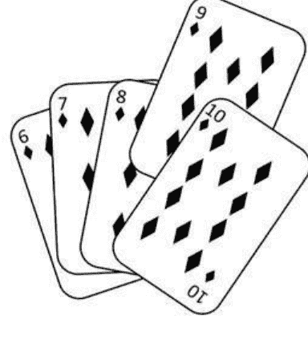

| 5 | 6 | 2 | 4 | 7 | 3 | 1 | 插入 5 |
| :--- | :--- | :--- | :--- | :--- | :--- | :--- | :--- |
| 5 | 6 | 2 | 4 | 7 | 3 | 1 | 插入 6 |
| 2 | 5 | 6 | 4 | 7 | 3 | 1 | 插入 2 |
| 2 | 4 | 5 | 6 | 7 | 3 | 1 | 插入 4 |
| 2 | 4 | 5 | 6 | 7 | 3 | 1 | 插入 7 |
| 2 | 3 | 4 | 5 | 6 | 7 | 1 | 插入 3 |
| 1 | 2 | 3 | 4 | 5 | 6 | 7 | 插入 1 |

### 示例 6.3

```java
public class InsertionSort {

    private int[] arr;

    public InsertionSort(int[] array) {
        arr = array;
    }

    private boolean more(int value1, int value2) {
        return value1 > value2;
    }

    public void sort() {
        int size = arr.length;
        int temp;

        for (int i = 1; i < size; i++) {
            temp = arr[i];
            for (int j = i; j > 0 && more(arr[j - 1], temp); j--) {
                arr[j] = arr[j - 1];
            }
            arr[j] = temp;
        }
    }
}
```

```java
public class InsertionSortDemo {

    public static void main(String[] args) {
        int[] array = {9, 1, 8, 2, 7, 3, 6, 4, 5};
        InsertionSort bs = new InsertionSort(array);
        bs.sort();
        for (int i = 0; i < array.length; i++) {
            System.out.print(array[i] + " ");
        }
    }
}
```

### 分析

- 外层循环用于选取我们想要插入到左侧排序数组中的值。
- 我们想要插入的值已经被选取并保存在 `temp` 变量中。
- 内层循环使用 `more()` 函数进行比较。值不断向右移动，直到我们为当前迭代的 `temp` 值找到其合适的位置。
- 最后，该值被放置在正确位置。在外层循环的每次迭代中，排序数组的长度增加一一。当我们退出外层循环时，整个数组就完成了排序。

### 复杂度分析

| 最坏情况时间复杂度 | $O(n^2)$ |
| :--- | :--- |
| 最优情况时间复杂度 | $O(n)$ |
| 平均情况时间复杂度 | $O(n^2)$ |
| 空间复杂度 | $O(1)$ |
| 稳定排序 | 是 |

## 选择排序 (Selection-Sort)

选择排序遍历整个未排序数组，并将最大值放在数组的末尾。该算法的时间复杂度相同，但性能优于冒泡排序和插入排序，因为它所需的比较次数较少。选择排序是从后往前创建排序数组的。

| 5 | 6 | 2 | 4 | 7 | 3 | 1 | 交换 |
| :--- | :--- | :--- | :--- | :--- | :--- | :--- | :--- |
| 5 | 6 | 2 | 4 | 1 | 3 | 7 | 交换 |
| 5 | 3 | 2 | 4 | 1 | 6 | 7 | 交换 |
| 1 | 3 | 2 | 4 | 5 | 6 | 7 | 不交换 |
| 1 | 3 | 2 | 4 | 5 | 6 | 7 | 交换 |
| 1 | 2 | 3 | 4 | 5 | 6 | 7 | 不交换 |

### 示例 6.4

```java
public class SelectionSort {

    private int[] arr;

    public SelectionSort(int[] array) {
        arr = array;
    }

    // array
    public void sort() {
        int size = arr.length;
        int temp;

        for (int i = 0; i < size - 1; i++) {
            int max = i;
            for (int j = i + 1; j < size; j++) {
                if (arr[j] > arr[max]) {
                    max = j;
                }
            }
            temp = arr[size - 1 - i];
            arr[size - 1 - i] = arr[max];
            arr[max] = temp;
        }
    }
}
```

### 分析

- 外层循环决定内层循环迭代的次数。对于包含 N 个元素的输入，内层循环将迭代 N 次。
- 在内层循环的每次迭代中，计算最大值并将其放在数组末尾。
- 这是将最大值替换到正确位置的最终步骤。排序数组是从后往前创建的。

### 复杂度分析

| 最坏情况时间复杂度 | $O(n^2)$ |
| :--- | :--- |
| 最优情况时间复杂度 | $O(n^2)$ |
| 平均情况时间复杂度 | $O(n^2)$ |
| 空间复杂度 | $O(1)$ |
| 稳定排序 | 否 |

相同的算法可以通过在数组前端创建排序数组来实现。

### 示例 6.5

```java
// front array variant
void sort(int[] arr) {
    int size = arr.length;
    int i, j, min, temp;

    for (i = 0; i < size; i++) {
        min = i;
        for (j = i + 1; j < size; j++) {
            if (arr[j] < arr[min]) {
                min = j;
            }
        }
        temp = arr[i];
        arr[i] = arr[min];
        arr[min] = temp;
    }
}
```

## 合并排序 (Merge-Sort)

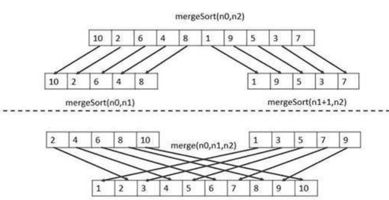

合并排序每一步都将输入分为两半。分别对这两个部分进行排序，最后合并结果输出。

### 示例 6.6

```java
public class MergeSort {

    private int[] arr;

    private void merge(int[] arr, int[] tempArray, int lowerIndex, int middleIndex, int upperIndex) {
        int lowerStart = lowerIndex;
        int lowerStop = middleIndex;
        int upperStart = middleIndex + 1;
        int upperStop = upperIndex;
        int count = 0;

        while (lowerStart <= lowerStop && upperStart <= upperStop) {
            if (arr[lowerStart] < arr[upperStart])
                tempArray[count++] = arr[lowerStart++];
            else
                tempArray[count++] = arr[upperStart++];
        }

        while (lowerStart <= lowerStop) {
            tempArray[count++] = arr[lowerStart++];
        }

        while (upperStart <= upperStop) {
            tempArray[count++] = arr[upperStart++];
        }

        for (int i = lowerIndex; i <= upperIndex; i++) {
            arr[i] = tempArray[i];
        }
    }

    private void mergeSort(int[] arr, int[] tempArray, int lowerIndex, int upperIndex) {
        if (lowerIndex >= upperIndex) {
            return;
        }

        int middleIndex = (lowerIndex + upperIndex) / 2;
        mergeSort(arr, tempArray, lowerIndex, middleIndex);
        mergeSort(arr, tempArray, middleIndex + 1, upperIndex);
        merge(arr, tempArray, lowerIndex, middleIndex, upperIndex);
    }

    public void sort() {
        int size = arr.length;
        int[] tempArray = new int[size];
        mergeSort(arr, tempArray, 0, size - 1);
    }

    public MergeSort(int[] array) {
        arr = array;
    }
}

public class MergeSortDemo {

    public static void main(String[] args) {
        int[] array = {3, 4, 1, 6, 5, 7, 1};
        MergeSort m = new MergeSort(array);
        m.sort();
        for (int i = 0; i < array.length; i++) {
            System.out.print(array[i] + " ");
        }
    }
}
```

合并排序的**时间复杂度**在所有三种情况（最好、平均和最坏）下均为 **$O(n \log n)$**，因为合并排序总是将数组分为两半，并花费线性时间合并这两个部分。
它需要与未排序列表相同的额外空间，因此不建议用于大型未排序列表。
它是排序链表（`Linked Lists`）的最佳排序技术。

### 复杂度分析

| 最坏情况时间复杂度 | $O(n \log n)$ |
| :--- | :--- |
| 最优情况时间复杂度 | $O(n \log n)$ |
| 平均时间复杂度 | $O(n \log n)$ |
| 空间复杂度 | $O(n)$ |
| 稳定排序 | 是 |

## 快速排序 (Quick-Sort)

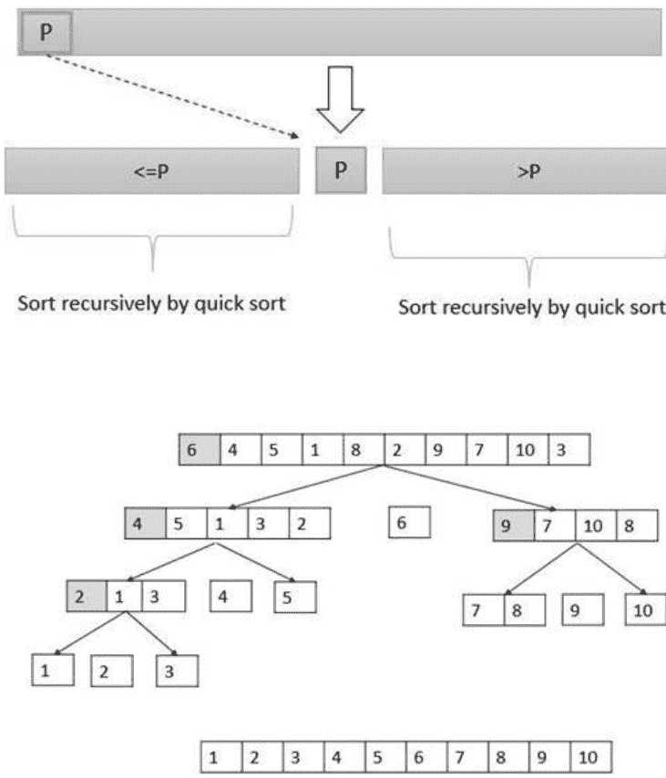

快速排序也是一种递归算法。

- 在每一步中，我们选择一个基准（假设是数组的第一个元素）。
- 然后遍历其余数组，将所有小于基准的元素复制到数组的左侧。
- 将所有大于基准的元素复制到数组的右侧。显然，基准位于排序位置。
- 然后分别对左子数组和右子数组进行排序。
- 当算法返回时，整个数组就完成了排序。

### 示例 6.7

```java
public class QuickSort {

    private int[] arr;

    public QuickSort(int[] array) {
        arr = array;
    }

    private void swap(int arr[], int first, int second) {
        int temp = arr[first];
        arr[first] = arr[second];
        arr[second] = temp;
    }

    private void quickSort(int arr[], int lower, int upper) {
        if (upper <= lower) {
            return;
        }

        int pivot = arr[lower];
        int start = lower;
        int stop = upper;

        while (lower < upper) {
            while (arr[lower] <= pivot && lower < upper) {
                lower++;
            }

            while (arr[upper] > pivot && lower <= upper) {
                upper--;
            }

            if (lower < upper) {
                swap(arr, upper, lower);
            }
        }

        swap(arr, upper, start); // upper 是基准位置
        quickSort(arr, start, upper - 1); // pivot-1 是左子数组的上边界
        quickSort(arr, upper + 1, stop); // pivot +1 是右子数组的下边界
    }

    public void sort() {
        int size = arr.length;
        quickSort(arr, 0, size - 1);
    }
}

public class QuickSortDemo {

    public static void main(String[] args) {
```


## 快速排序

```java
int[] array = {3
```

快速排序所需的空间非常少，只需要 `O(nlogn)` 的额外空间。
快速排序不是一种稳定的排序技术，因此在排序过程中可能会改变列表中两个相似元素的出现顺序。

| 最优情况时间复杂度 | O(nlogn) |
|---|---|
| 平均时间复杂度 | O(nlogn) |
| 空间复杂度 | O(nlogn) |
| 稳定排序 | 否 |

### 快速选择

快速选择与快速排序非常相似；它不是对整个数组进行排序，而是在快速排序的每一步中忽略掉数组的一半部分，只关注我们感兴趣的数组区域。

示例 6.8:

```java
public class QuickSelect {

    public static void swap(int[] arr, int first, int second) {
        int temp = arr[first];
        arr[first] = arr[second];
        arr[second] = temp;
    }

    public static void quickSelect(int[] arr, int lower, int upper, int k) {
        if (upper <= lower)
            return;
        int pivot = arr[lower];
        int start = lower;
        int stop = upper;
        while (lower < upper) {
            while (arr[lower] <= pivot && lower < upper)
                lower++;
            while (arr[upper] > pivot && lower <= upper)
                upper--;
            if (lower < upper)
                swap(arr, upper, lower);
        }
        swap(arr, upper, start);
        if (k < upper)
            quickSelect(arr, start, upper - 1, k); //pivot - 1 is the upper for left sub array.
        if (k > upper)
            quickSelect(arr, upper + 1, stop, k); // pivot + 1 is the lower for right sub array.
    }

    public static void quickSelect(int[] arr, int k) {
        quickSelect(arr, 0, arr.length - 1, k);
    }
}

public class QuickSelectDemo {
    public static void main(String[] args) {
        int[] array = {3, 2, 1, 6, 5, 7, 8, 10, 9};
        QuickSelect.quickSelect(array, 5);
        System.out.println("value at index 5 is :" + array[4]);
    }
}
```

## 复杂度分析

| 最坏情况时间复杂度 | O(n²) |
|---|---|
| 最优情况时间复杂度 | O(logn) |
| 平均时间复杂度 | O(logn) |
| 空间复杂度 | O(nlogn) |

## 桶排序

桶排序是最简单且最高效的排序类型。桶排序对数据的预定义范围有严格要求。

例如，统计每个年龄组段多少人。我们知道人的年龄范围在 1 到 130 岁之间。

| 2 | 6 | 4 | 1 | 5 | 8 | 1 | 4 | 6 | 1 | 输入数据 |
|---|---|---|---|---|---|---|---|---|---|---|
| 0 | 1 | 2 | 3 | 4 | 5 | 6 | 7 | 8 | 9 | |
| 0 | 3 | 1 | 0 | 2 | 1 | 2 | 0 | 1 | 0 | 计数 |
| 1 | 1 | 1 | 2 | 4 | 5 | 6 | 6 | 8 | | 排序输出 |

示例 6.9

```java
public class BucketSort {
    int[] array;
    int range;
    int lowerRange;

    public BucketSort(int[] arr, int lowerRange, int upperRange) {
        array = arr;
        range = upperRange - lowerRange;
        this.lowerRange = lowerRange;
    }

    public void sort() {
        int i, j;
        int size = array.length;
        int[] count = new int[range];
        for (i = 0; i < range; i++) {
            count[i] = 0;
        }
        for (i = 0; i < size; i++) {
            count[array[i] - lowerRange]++;
        }
        j = 0;
        for (i = 0; i < range; i++) {
            for (; count[i] > 0; count[i]--) {
                array[j++] = i + lowerRange;
            }
        }
    }
}

public class BucketSortDemo {
    public static void main(String[] args) {
        int[] array = {23, 24, 22, 21, 26, 25, 27, 28, 21, 21};
        BucketSort m = new BucketSort(array, 20, 30);
        m.sort();
        for (int i = 0; i < array.length; i++) {
            System.out.print(array[i] + " ");
        }
    }
}
```

## 分析

- 我们创建了一个计数数组来存储计数。
- 计数数组元素初始化为零。
- 输入数组对应的索引递增。
- 最后，将存储在计数数组中的信息保存到数组中。

## 复杂度分析

| 数据结构 | 数组 |
|---|---|
| 最坏情况性能 | O(n+k) |
| 平均情况性能 | O(n+k) |
| 最坏情况空间复杂度 | O(k) |

其中 `k` 是不同元素的数量。
`n` 是元素总数。

## 通用桶排序

在某些情况下，落入桶中的元素不是唯一的，但在相同的范围内。当我们想要对索引进行排序时，可以使用引用桶来存储名称。

| | |
|---|---|
| Ape | Apple |
| B | Banana |
| C | Cat |
| X | |
| Z | Zebra |

桶已经是排序过的，每个桶内部的元素可以通过插入排序来保持有序。我们将这种通用的排序实现留给本书的读者自行。

## 堆排序

我们已经在堆章节中学习过堆排序。

## 复杂度分析

| 数据结构 | 数组 |
|---|---|
| 最坏情况性能 | O(logn) |
| 平均情况性能 | O(logn) |
| 最坏情况空间复杂度 | O(1) |

## 树排序

二叉搜索树的中序遍历也可以看作一种排序算法。我们将在章节的二叉搜索树部分看到这一点。

### 复杂度分析

| | |
|---|---|
| 最坏情况时间复杂度 | O(n²) |
| 最优情况时间复杂度 | O(logn) |
| 平均时间复杂度 | O(logn) |
| 空间复杂度 | O(n) |
| 排序 | 是 |

## 各种排序算法的比较

| 算法 | 平均时间 | 最优时间 | 最坏时间 | 空间 | 稳定性 |
|---|---|---|---|---|---|
| 冒泡排序 | O(n²) | O(n²) | O(n²) | O(1) | 是 |
| 修改冒泡排序 | O(n²) | O(n) | O(n²) | O(1) | 是 |
| 选择排序 | O(n²) | O(n²) | O(n²) | O(1) | 否 |
| 插入排序 | O(n²) | O(n) | O(n²) | O(1) | 是 |
| 堆排序 | O(n*log(n)) | O(n*log(n)) | O(n*log(n)) | O(1) | 否 |
| 合并排序 | O(n*log(n)) | O(n*log(n)) | O(n*log(n)) | O(n) | 是 |
| 快速排序 | O(n*log(n)) | O(n*log(n)) | O(n²) | O(n) 最坏情况 平均 | 否 |
| 桶排序 | O(n+k) | O(n+k) | O(n+k) | O(n+k) | 是 |

## 最佳排序算法的选择

没有一种排序算法是完美的。它们都有自己的优缺点。让我们逐一阅读：

**快速排序**：当你不需要稳定排序且平均性能比最坏性能更重要时。当数据是随机的，我们倾向于使用快速排序。快速排序的平均复杂度为 `O(nlogn)`，最坏情况时间复杂度为 `O(n²)`。快速排序的空间复杂度为 `O(logn)` 辅助存储，这是递归使用的栈空间。

**合并排序**：当你需要稳定排序且时间复杂度为 `O(nlogn)` 时，使用合并排序。通常，合并排序比快速排序慢，因为合并阶段有很多复制。合并排序有两种用途：当我们想要合并两个有序链表时，以及合并排序用于外部排序。

**堆排序**：当你不需要稳定排序且你更关注最坏性能而非平均性能时。它被保证为 `O(nlogn)`，并且使用 `O(1)` 辅助空间，这意味着你不会因为大输入而意外耗尽内存。

## 练习题

1. 给定一个文本文件，打印单词及其出现的频率。现在按频率打印第 k 个单词。

   提示：
   - 第一种方法：你可以使用排序并返回第 k 个元素。
   - 第二种方法：你可以使用第 k 元素快速选择算法（`quick select`）。
   - 第三种方法：你可以使用哈希表（`Hashtable`）或字典树（`Trie`）来记录频率。使用堆（`Heap`）获取第 k 个元素。

2. 给定 K 个有序的数字输入流。你需要创建一个单一的输出流，其中包含 K 个流中的所有元素并按顺序排列。输入流支持 `ReadNumber()` 操作，输出流支持 `WriteNumber()` 操作。

   提示：
   - 从 K 个输入流中读取第一个数字并将其加入优先级队列（`Priority Queue`）（节点应记录所属的输入流）。
   - 每次从 PQ 中弹元素，将该元素的值写入输出流，从同一个输入流中读取另一个数字并将其加入 PQ。
   - 如果流为空，则继续即可。
   - 重复此过程直到 PQ 为空。

3. 给定固定长度 M 的有序数组。同时给出一个长度为 M*K 的最终输出数组。提供一种高效的算法将所有数组合并到最终数组中，不使用任何额外空间。

   提示：你可以使用数组的末尾来构建 PQ。

4. 你将如何排序 1 PB 的数字？1 PB = 1000 TB。

5. 上述方案的复杂度是多少？

6. 如果核心数为八，对问题 3 的解法还有什么其他改进。

7. 给定一个支持 `findMin`、`findMax`、`findMedian` 函数的整数数组。对数组进行排序。

8. 给定一组高、中、低优先级的病人文件。对这些文件进行排序，优先级在前，其次是中间，最后是低优先级。

   提示：桶排序（`Bucket sort`）。

9. 写出堆排序（`Heap-Sort`）、合并排序（`Merge-Sort`）和快速排序（`Quick-Sort`）的优缺点。

10. 给定一个包含 N 个整数的旋转有序数组。（该数组经过排序，然后被旋转了任意次数。）如果数组中的所有元素都是唯一的，找到某个值的索引。

    提示：改进的二分查找。

11. 在问题 9 中，如果允许重复且你需要找到该元素在旋转有序数组中首次出现的索引怎么办。

12. 将两个有序数组合并为一个单一的有序数组。

    提示：使用合并排序的合并方法。

13. 给定一个包含 0 和 1 的数组，对数组进行排序，使得所有的 0 都在 1 之前。

14. 给定一个英文字符数组，在线性时间内对数组进行排序。

15. 写一个方法对字符串数组进行排序，使得所有的字母异位词（anagrams）相邻。

    提示：
    - 遍历数组。
    - 对于每个单词，对字符排序并将其加入哈希表，键为排序后的单词，值为原始单词。在循环结束时，你将获得所有字母异位词作为键（该键由其组成字符排序）的值。
    - 遍历哈希表，一起打印键的所有值，然后移动到下一个键。

    空间复杂度：O(n)，时间复杂度：O(n)

# 第7章：链表

## 引言

假设我们有一个包含以下五个元素 1, 2, 4, 5, 6 的数组。我们想在“2”和“4”之间插入一个值为“3”的新元素。在数组中，我们无法轻易地这样做。我们需要创建另一个足够长的数组来存储当前值，并为“3”留出一个额外的空间。然后我们需要将这些元素复制到新空间中。这种复制操作是低效的。为了解决这个问题使用了链表。

## 链表

链表是项的列表，节点有两个部分：值部分和链接部分。值部分可以是基础类型（如整数），也可以是其他类型（如对象）。链接部分用于存储引用。

## 链表的类型

链表有不同的类型。它们之间的区别在于节点如何引用彼此。

### 单链表

除了最后一个节点外，每个节点都指向下一个节点。最后一个节点的链接部分包含空。

### 双链表

这种类型的链表节点引用前一个和下一个节点。

### 循环链表

这种类型与单链表相似，但最后一个节点指向第一个节点。

## 链表的组成

1. 头节点（Head）：指向第一个节点的引用。
2. 节点：列表中的项。
3. 值：存储在节点的数据。
4. 链接：指向下一个节点的引用。

## 单链表

除了最后一个节点外，每个节点都指向下一个节点。最后一个节点的链接部分包含空。

```java
class Node {
    int value;
    Node next;

    Node(int v, Node n) {
        value = v;
        next = n;
    }

    Node(int v) {
        value = v;
        next = null;
    }
}
```

单链表是最简单的链表类型。每个节点包含一个值和一个指向下一个节点的引用。最后一个节点的引用为空。

```java
class LinkedList {
    private Node head;
    private int size = 0;

    public int size() {
        return size;
    }

    public boolean isEmpty() {
        return size == 0;
    }
}
```

## 链表中的插入

元素可以以各种顺序插入到链表中：

1. 在链表的头部插入元素
2. 在链表的末尾插入元素
3. 在第 N 位置插入元素
4. 按排序插入元素

### 在头部插入元素

```java
public void addHead(int value) {
    head = new Node(value, head);
    size++;
}
```

## 分析

- 我们需要根据传递给函数的数值创建一个新节点。
- 在创建新节点时，将存储在 `head` 中的引用作为 `Node()` 构造函数的参数，这样 `next` 引用将指向 `head` 节点所引用的节点或空。
- 新创建的节点将成为链表的头部。
- 列表的大小增加一。

### 在末尾插入元素

示例：在链表的末尾插入元素

```java
public void addTail(int value) {
    Node newNode = new Node(value, null);
    Node curr = head;
    if (head == null) {
        head = newNode;
    }
    while (curr.next != null) {
        curr = curr.next;
    }
    curr.next = newNode;
}
```

创建一个新节点并将值存储在其中。如果列表为空，则新节点的 `next` 为 `null`。

如果列表为空，则 `head` 将存储新创建节点的引用。

如果列表不为空，我们将遍历到列表末尾。

最后，将新节点添加到列表末尾。

这种操作是低效的，因为每次你想插入一个元素时都必须遍历到列表末尾。因此，创建列表的复杂度为 $n^2$。为了提高效率，我们必须通过保留一个尾部引用来跟踪最后一个元素。因此，如果需要始终在链表的末尾插入元素，我们也将跟踪尾部引用。

## 遍历链表

示例 7.2：打印链表中的各种元素

```java
```


## 打印链表

```java
public void print() {
    Node temp = head;
    while (temp != null) {
        System.out.print(temp.value + ");\n");
        temp = temp.next;
    }
}
```

### 分析

我们将 `head` 的引用存储在临时变量 `temp` 中。
我们将通过打印列表的内容并始终指向其下一个节点来递增 `temp` 来遍历列表。

## 创建列表和打印列表的完整代码

### 示例 7.3

```java
public class LinkedList {
    public static void main(String[] args) {
        LinkedList ll = new LinkedList();
        ll.addHead(1);
        ll.addHead(2);
        ll.addHead(3);
        ll.addHead(1);
        ll.addHead(2);
        ll.addHead(3);
        ll.print();
    }
}
```

### 分析

创建链表的新实例。
通过调用 `addHead()` 方法向列表添加各种元素。
最后，通过调用 `print()` 方法将列表的所有内容打印到屏幕上。

## 排序插入

在给定 `Head` 引用的情况下，在链表中按顺序插入元素。

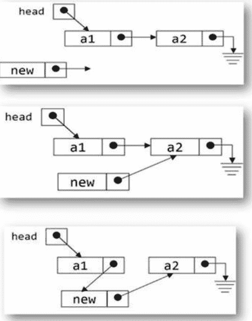

### 示例 7.4

```java
public void sortedInsert(int value) {
    Node newNode = new Node(value, null);
    Node curr = head;
    if (curr == null || curr.next.value > value) {
        newNode.next = head;
        head = newNode;
        return;
    }
    while (curr.next != null && curr.next.value < value) {
        curr = curr.next;
    }
    newNode.next = curr.next;
    curr.next = newNode;
}
```

### 分析

- 列表的头部存储在 `curr` 中。
- 创建链表的空节点。并通过将参数值存储到其 `value` 中初始化。节点的 `next` 将指向 `null`。
- 检查列表是否为空，或者第一个节点存储的值是否大于当前值。如果是，则新创建的节点将添加到列表开头，并且需要修改 `head`。
- 我们遍历列表以找到插入节点的合适位置。
- 最后，节点将被添加到列表中。

## 在列表中搜索元素

在链表中搜索元素。给定 `head` 引用和值。如果在列表中找到该值则返回 `true`，否则返回 `false`。

注意：单链表中的搜索可以单向进行。因为列表中的所有元素都有指向列表中下一个元素的引用。因此，链表的遍历本质上是线性的。

### 示例 7.5

```java
public boolean isPresent(int data) {
    Node temp = head;
    while (temp != null) {
        if (temp.value == data)
            return true;
        temp = temp.next;
    }
    return false;
}
```

### 分析

- 我们创建一个临时变量 `temp`，它将指向列表的头部。
- 使用 `while` 循环我们将遍历列表。
- 将列表每个元素的值与给定值进行比较。如果找到了该值，函数将返回 `true`。
- 如果没有找到该值，函数在最后将返回 `false`。

## 从链表中删除元素


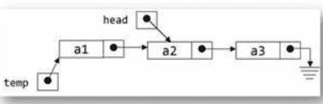
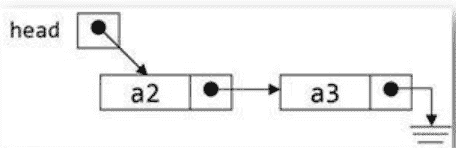

### 删除链表中的第一个元素

#### 示例 7.6

```java
public int removeHead() throws IllegalStateException {
    if (isEmpty())
        throw new IllegalStateException("EmptyListException");
    int value = head.value;
    head = head.next;
    size--;
    return value;
}
```

#### 分析

- 第一，我们需要检查列表是否已经为空。如果列表为空，则抛出 `EmptyListException`。
- 如果列表不为空，将 `head` 节点的值存储在临时变量 `value` 中。
- 我们需要找到列表的第二个元素并将其设置为 `head`。
- 由于第一个节点不再被引用，它将被自动删除。
- 减少列表的大小。

### 给定值，从链表中删除节点

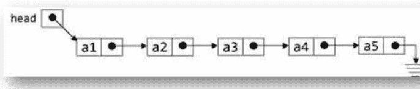
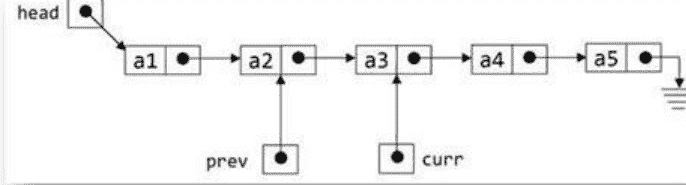
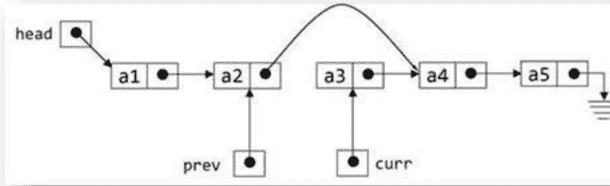
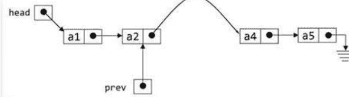

#### 示例 7.7

```java
public boolean deleteNode(int value) {
    Node temp = head;
    if (isEmpty()) {
        return false;
    }
    if (temp.value == value) {
        head = temp.next;
        size--;
        return true;
    }
    while (temp.next != null) {
        if (temp.next.value == value) {
            temp.next = temp.next.next;
            size--;
            return true;
        }
        temp = temp.next;
    }
    return false;
}
```

#### 分析

- 我们创建一个临时变量 `temp`，它将指向列表的头部。
- 如果列表为空，返回 `false`。
- 如果头部值匹配，我们更新 `head` 为下一个节点，减小大小并返回 `true`。
- 我们遍历列表找到要删除的节点。如果 `temp.next` 的值匹配，我们更新 `temp.next`，减小大小并返回 `true`。

## 删除链表中所有特定值

### 示例 7.8

```java
public void deleteNodes(int value) {
    Node curr = head;
    Node nextNode;
    while (curr != null && curr.value == value) {
        head = curr.next;
        curr = head;
    }
    while (curr != null) {
        nextNode = curr.next;
        if (nextNode != null && nextNode.value == value) {
            curr.next = nextNode.next;
        } else {
            curr = nextNode;
        }
    }
}
```

### 分析

- 在第一个 `while` 循环中，我们删除头部所有等值的节点。
- 在第二个 `while` 循环中，我们遍历列表。如果下一个节点的值匹配，我们跳过它；否则向前移动。

## 删除单链表

给定链表的头部引用，删除链表的所有元素。

### 示例 7.9

```java
public void freeList() {
    head = null;
    size = 0;
}
```

### 分析

我们只需将 `head` 指向 `null`。由于失去了引用，它将被自动删除。

## 反转链表

使用三个指针反转单链表。

### 示例 7.10

```java
public void reverse() {
    Node curr = head;
    Node prev = null;
    Node next = null;
    while (curr != null) {
        next = curr.next;
        curr.next = prev;
        prev = curr;
        curr = next;
    }
    head = prev;
}
```

### 分析

遍历列表。使 `next` 等于 `curr` 节点的下一个节点。使 `curr` 节点的 `next` 指向 `prev`。然后通过让 `prev` 指向 `curr` 且 `curr` 指向 `next` 来遍历列表。

## 递归反转单链表

### 示例 7.11：递归反转单链表。参数是当前节点及其下一个值。

```java
public Node reverseRecurse(Node currentNode, Node nextNode) {
    if (currentNode == null)
        return null;
    if (currentNode.next == null) {
        currentNode.next = nextNode;
        return currentNode;
    }
    Node ret = reverseRecurse(currentNode.next, currentNode);
    currentNode.next = nextNode;
    return ret;
}

public void reverseRecurse() {
    head = reverseRecurseUtil(head, null);
}
```

### 分析

- `ReverseRecurse` 函数将调用 `reverseRecurseUtil` 函数来反转列表，`reverseRecurse` 返回的引用将是反转后链表的头部。
- 当前节点将指向旧列表中前一个节点的下一个节点（即 `nextNode`）。

注意：链表可以通过两种方法反转：一种方法是使用三个引用；第二种方法是使用递归；两种方法都是线性时间复杂度的，但三个引用的方案效率更高。

## 删除链表中的重复项

从链表中删除重复值。该链表是有序的，并且其中包含一些重复值，你需要删除这些重复值。（你可以使用 `SortedInsert()` 函数创建所需的链表）

### 示例 7.12

```java
public void removeDuplicate() {
    curr = head;
    while (curr != null) {
        if (curr.next != null && curr.value == curr.next.value)
            curr.next = curr.next.next;
    }
}
```

使用 `while` 循环遍历列表。每当某个节点的值等于下一个节点的值时，当前节点的 `next` 将指向下一个节点的下一个节点。这会从列表中删除该节点。

## 反转复制列表

在另一个链表中以反向顺序复制链表的内容。如果原始链表按 1, 2, 3, 4 的顺序包含元素，则新列表应该按 4, 3, 2, 1 的顺序包含这些元素。

### 示例 7.13

```java
public Linkedlist CopyListReversed() {
    Node tempNode = null;
    Node tempNode2 = null;
    Node curr = head;
    while (curr != null) {
        tempNode2 = new Node(curr.value, tempNode);
        curr = curr.next;
        tempNode = tempNode2;
    }
    LinkedList ll2 = new LinkedList();
    ll2.head = tempNode;
    return ll2;
}
```

### 分析

遍历列表并将节点的值添加到新列表中。由于列表是正向遍历的，且每个节点的值都被添加到另一个列表中，因此形成的列表是给定列表的反序。

## 将给定链表的内容复制到另一个链表

将给定链表的内容复制到另一个链表中。如果原始链表按 1, 2, 3, 4 的顺序包含元素，则新列表应该按 1, 2, 3, 4 的顺序包含这些元素。

### 示例 7.14

```java
public LinkedList copyList() {
    Node headNode = null;
    Node tailNode = null;
    Node tempNode = null;
    Node curr = head;
    if (curr == null) {
        return null;
    }
    headNode = new Node(curr.value, null);
    tailNode = headNode;
    curr = curr.next;
    while (curr != null) {
        tempNode = new Node(curr.value, null);
        tailNode.next = tempNode;
        tailNode = tempNode;
        curr = curr.next;
    }
    LinkedList ll2 = new LinkedList();
    ll2.head = headNode;
    return ll2;
}
```

### 分析

遍历列表并将节点的值添加到新列表，但这次始终添加到列表的末尾。由于列表是正向遍历的，且每个节点的值都被添加到另一个列表的末尾。因此，形成的列表与给定列表相同。

## 比较列表

### 示例 7.15：比较给两个列表

```java
public boolean compareList(LinkedList ll1) {
    return compareList(ll1.head, ll2.head);
}

public boolean compareList(Node head1, Node head2) {
    if (head1 == null && head2 == null)
        return true;
    else if (head1 == null) || (head2 == null) || (head1.value != head2.value)
        return false;
    else
        return compareList(head1.next, head2.next);
}
```

### 分析

- 列表通过递归进行比较。此外，如果我们到达列表末尾且两个列表都为 `null`，则两个列表相等并返回 `true`。
- 列表通过递归进行比较。如果其中一个列表为空，或者对应节点的值不相等，则此函数将返回 `false`。
- 递归地对当前节点的节点调用 `compare list` 函数。

## 查找长度

### 示例 7.16：查找给定链表的长度

```java
public int findLength() {
    Node curr = head;
    int count = 0;
    while (curr != null) {
        count++;
        curr = curr.next;
    }
    return count;
}
```

### 分析

通过遍历列表直到到达末尾来找到链表的长度。

## 从开始的第 N 个节点

### 示例 7.17：查找从开始的第 N 个节点

```java
if (index > size() || index < 1)
    return Integer.MAX_VALUE;
int count = 0;
Node curr = head;
while (curr != null && count < index - 1) {
    count++;
    curr = curr.next;
}
```

### 分析

当 `curr` 不为 `null` 且 `count` 小于 `index - 1` 时，增加 `count` 并移动 `curr`。

## 从结尾的第 N 个节点

### 示例 7.18：从结尾查找第 N 个节点

```java
public int nodeFromEnd(int index) {
```


## 代码示例

```java
int size = findLength();

if (index > size || index < 1)
    return Integer.MAX_VALUE;

Node curr = head;
int count = 0;

while (count < size - index) {
    curr = curr.next;
    count++;
}

return curr.value;
```

**分析：** 首先获取链表的长度，然后从开始移动 `size - index` 个节点即可到达目标节点。（注：原文示例中该部分代码不完整，此处根据逻辑补全了翻译描述）

```java
while (fastPtr.next != null && fastPtr.next.next != null) {
    if (head == fastPtr.next || head == fastPtr.next.next) {
        System.out.println("circular list loop found");
        return 2;
    }
    slowPtr = slowPtr.next;
    fastPtr = fastPtr.next.next;
    if (slowPtr == fastPtr) {
        System.out.println("loop found");
        return 1;
    }
    System.out.println("loop not found");
    return 0;
}
```

## 移除循环

**示例 7.23：** 给定链表中存在一个循环，请移除该循环。

```java
public Node loopPointDetect() {
    Node slowPtr;
    Node fastPtr;
    slowPtr = fastPtr = head;
    while (fastPtr.next != null && fastPtr.next.next != null) {
        slowPtr = slowPtr.next;
        fastPtr = fastPtr.next.next;
        if (slowPtr == fastPtr) {
            return slowPtr;
        }
    }
    return null;
}

public void removeLoop() {
    Node loopPoint = loopPointDetect();
    if (loopPoint == null)
        return;
    Node firstPtr = head;
    if (loopPoint == head) { // 环形链表情况
        while (firstPtr.next != head) {
            firstPtr = firstPtr.next;
        }
        firstPtr.next = null;
        return;
    }
    Node secondPtr = loopPoint;
    while (firstPtr.next != secondPtr.next) { // 普通循环情况
        firstPtr = firstPtr.next;
        secondPtr = secondPtr.next;
    }
    secondPtr.next = null;
}
```

### 分析

- 通过两个引用遍历列表，一个快指针和一个慢指针。快指针每次跳两个节点，慢指针每次跳一个节点。这两个引用相交的点就是环中的一个点。
- 如果该交点是列表头部，则这是一个环形链表情况，你需要再次遍历列表，并让头部之前的节点指向 `null`。
- 在其他情况下，你需要使用两个引用变量，一个从头部开始，另一个从循环点开始。它们会在循环点处相遇。（你可以从数学上证明它 ;)

## 寻找交点

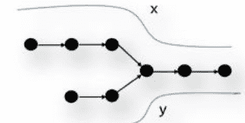

## 示例 7.24

```java
public Node findIntersection(Node head, Node head2) {
    int l1 = 0;
    int l2 = 0;
    Node tempHead = head;
    Node tempHead2 = head2;
    while (tempHead != null) {
        l1++;
        tempHead = tempHead.next;
    }
    while (tempHead2 != null) {
        l2++;
        tempHead2 = tempHead2.next;
    }
    int diff;
    if (l1 < l2) {
        Node temp = head;
        head = head2;
        head2 = temp;
        diff = l2 - l1;
    } else
        diff = l1 - l2;
    for (; diff > 0; diff--)
        head = head.next;
    while (head != head2) {
        head = head.next;
        head2 = head2.next;
    }
    return head;
}
```

**分析：** 找到两个列表的长度。找到两个列表长度的差。将较长列表移动 `diff` 步，然后同时移动两个列表以获取交点。

## 双向链表

在双向链表中，每个节点中有两个引用。这些引用被称为 `prev`（前驱）和 `next`（后继）。节点的 `prev` 引用指向其前一个节点，而 `next` 引用指向给定节点的下一个节点。

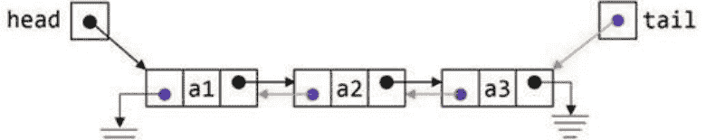

让我们来看一个 `Node` 的示例，在这个例子中，值的类型是 `int`，但它也可以是其他数据类型。两个链接引用是 `prev` 和 `next`。

### 示例 7.25

```java
private static class Node {
    private int value;
    private Node next;
    Node prev;

    public Node(int v, Node nxt, Node prv) {
        value = v;
        next = nxt;
        prev = prv;
    }

    public Node(int v) {
        value = v;
        next = null;
        prev = null;
    }
}
```

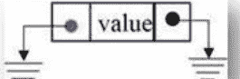

单向链表中的搜索只能向一个方向进行。在双向链表中，我们需要跟踪头部和尾部。在编码双向链表时注意以下情况：
- 零元素
- 只有一个元素
- 头部元素
- 普通情况
- 尾元素

## 链表的基本操作

链表的基本操作需要遍历列表。链表的各种操作：
- 插入元素
- 打印元素
- 搜索元素
- 删除元素

对于任何链表，都有以下情况：
1. 零元素
2. 只有一个元素
3. 头部元素
4. 普通情况
5. 尾元素

### 示例 7.26

```java
public class DoublyLinkedList {
    private static class Node {
        private Node head;
        private Node tail;
        private int size = 0;
    }
}
```

### 示例 7.27

```java
public int size() {
    return size;
}
```

### 示例 7.28

```java
public boolean isEmpty() {
    return size == 0;
}
```

### 示例 7.29

```java
public int peek() {
    if (isEmpty())
        throw new IllegalStateException("Empty");
    return head.value;
}
```

## 在头部插入

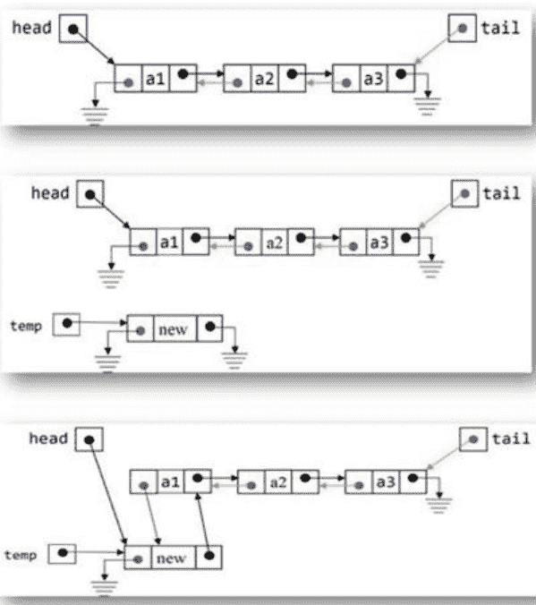

### 示例 7.30

```java
public void addHead(int value) {
    Node newNode = new Node(value, head, null);
    if (size == 0) {
        tail = head = newNode;
    } else {
        newNode.next = head;
        head.prev = newNode;
        head = newNode;
    }
    size++;
}
```

**分析：** 双向链表的头部插入与单向链表相同。创建一个节点并管理 `prev` 引用。如果列表为空，尾部指向新节点。如果列表不为空，头部的 `prev` 指向新节点，头部指向新节点。

## 在尾部插入

### 示例 7.31

```java
public void addTail(int value) {
    Node newNode = new Node(value, null, tail);
    if (size == 0) {
        tail = newNode;
    } else {
        newNode.prev = tail;
        tail.next = newNode;
        tail = newNode;
    }
    size++;
}
```

**分析：** 在双向链表中，尾部插入需要找到合适的位置并管理 `next` 和 `prev` 引用。

## 移除双向链表的头部

### 示例 7.32

```java
public int removeHead() {
    if (isEmpty()) // 空列表情况
        throw new IllegalStateException("EmptyList");
    int value = head.value;
    head = head.next;
    if (head == null) { // 单节点情况
        tail = null;
    } else {
        head.prev = null;
    }
    size--;
    return value;
}
```

**分析：** 如果列表为空，则将抛出异常。现在头部指向它的下一个节点。如果头部为空，则说明是单节点情况，尾部也需要设置为 `null`。在所有普通情况下，`head.prev` 将被设置为 `null`。列表大小减一并返回节点值。

## 根据值删除节点

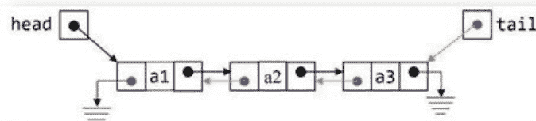
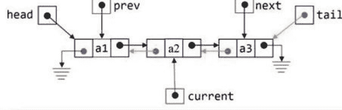
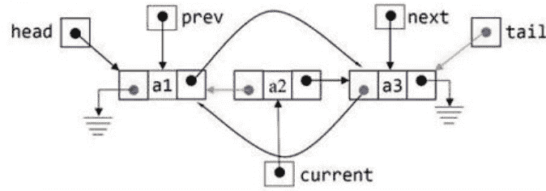
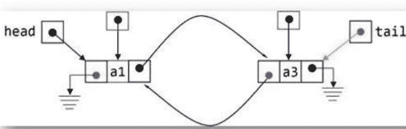

### 示例 7.33：在链表中删除节点

```java
public boolean removeNode(int key) {
    Node curr = head;
    if (curr == null) // 空列表
        return false;
    if (curr.value == key) { // 头部是值为 key 的节点
        head = head.next;
        size--;
        if (head == null)
            tail = null; // 列表中只有一个元素。
        else
            head.prev = null;
        return true;
    }
    while (curr.next != null) {
        if (curr.next.value == key) {
            curr.next = curr.next.next;
            if (curr.next == null) // 最后一个元素情况
                tail = curr;
            else
                curr.next.prev = curr;
            size--;
            return true;
        }
        curr = curr.next;
    }
    return false;
}
```

*(注：原文示例代码逻辑存在括号错误和逻辑不匹配，此处按原文结构修正了明显的语法错误)*

**分析：** 遍历列表找到需要删除的节点。然后将其移除，并调整前驱节点的 `next` 引用以及后继节点的 `prev` 引用。

## 搜索列表

### 示例 7.34

```java
public boolean isPresent(int key) {
    Node temp = head;
    while (temp != null) {
        if (temp.value == key)
            return true;
        temp = temp.next;
    }
    return false;
}
```

**分析：** 遍历列表查找某个值是否存在。

## 空列表

### 示例 7.35

```java
public void freeList() {
    head = null;
    tail = null;
    size = 0;
}
```

**分析：** 只需将 `head` 和 `tail` 引用指向 `null`。列表的其余部分将由垃圾回收自动删除。

## 打印列表

### 示例 7.36

```java
public void print() {
    Node temp = head;
    while (temp != null) {
        System.out.print(temp.value + " ");
        temp = temp.next;
    }
}
```

**分析：** 遍历列表并打印每个节点的值。

## 迭代反转双向链表

### 示例 7.37

```java
public void reverseList() {
    Node curr = head;
    Node tempNode;
    while (curr != null) {
        tempNode = curr.next;
        curr.next = curr.prev;
        curr.prev = tempNode;
        if (curr.prev == null) {
            tail = head;
            head = curr;
            return;
        }
        curr = curr.prev;
    }
}
```

**分析：** 遍历列表。交换 `next` 和 `prev`。然后向交换之前的 `curr.prev` 方向进行遍历。如果你到达了列表的末尾，则设置 `head` 和 `tail`。

## 反转复制列表

### 示例 7.38：将列表的内容按反顺序复制到另一个列表中。

```java
public DoublyLinkedList copyReversed() {
    DoublyLinkedList dll = new DoublyLinkedList();
    Node curr = head;
    while (curr != null) {
        dll.addHead(curr.value);
        curr = curr.next;
    }
    return dll;
}
```

### 分析

- 创建一个 `DoublyLinkedList` 类对象 `dll`。
- 遍历列表，通过调用 `addHead()` 方法将节点的值复制到另一个列表中。
- 由于新节点被添加到列表的头部，形成的新列表节点顺序是反转的，从而创建了反转列表。

## 复制列表

### 示例 7.39

```java
public DoublyLinkedList copyList() {
    DoublyLinkedList dll = new DoublyLinkedList();
    Node curr = head;
    while (curr != null) {
        dll.addTail(curr.value);
        curr = curr.next;
    }
    return dll;
}
```


## 分析

- 创建一个 `DoublyLinkedList` 类对象 `dll`。
- 遍历列表，通过调用 `addTail()` 方法将节点的值复制到另一个列表中。
- 由于新节点被添加到列表的尾部，形成的新列表节点顺序与原始列表相同。

## 排序插入


## 示例 7.40

```java
// 降序插入
public void sortedInsert(int value) {
    Node temp = new Node(value);
    Node curr = head;
    if (curr == null) { // 只有一个元素
        head = tail = temp;
    }
    if (head.value <= value) { // 在头部
        temp.next = head;
        head.prev = temp;
        head = temp;
    }
    while (curr.next != null && curr.next.value > value) { // 遍历
        curr = curr.next;
    }
    if (curr.next == null) { // 在末尾
        tail = temp;
        temp.prev = curr;
        curr.next = temp;
    } else { // 其他情况
        temp.next = curr.next;
        temp.prev = curr;
        curr.next.prev = temp;
    }
}
```

## 分析

- 需要考虑单个元素的情况。在这种情况下，`head` 和 `tail` 都会修改。
- 然后需要考虑当新节点添加到头部时 `head` 被修改的情况。
- 然后需要考虑通用情况。
- 最后，需要考虑 `tail` 被修改的情况。

# 删除重复项

**示例 7.41：** 删除列表中的重复节点。

```java
public void removeDuplicate() {
    Node curr = head;
    Node deleteMe;
    while (curr != null) {
        if (curr.next != null && curr.value == curr.next.value) {
            deleteMe = curr.next;
            curr.next = deleteMe.next;
            if (curr.next != null)
                curr.next.prev = curr;
            else
                tail = curr;
        } else {
            curr = curr.next;
        }
    }
}
```

- 删除重复与单链表的情况相同。
- 当移除最后一个节点时，只有 `tail` 会修改。

### 循环链表

这种类型与单链表的区别在于最后一个元素指向列表的第一个节点。最后一个节点的链接部分包含了第一个节点的地址。


## 示例 7.42

```java
private static class Node {
    private int value;
    private Node next;

    public Node(int v, Node n) {
        value = v;
        next = n;
    }

    public Node(int v) {
        value = v;
        next = null;
    }
}
```

## 示例 7.43

```java
public class CircularLinkedList {
    private static class Node {
        // Node 方法和字段
    }
    private Node tail;
    private int size = 0;

    public int size() {
        return size;
    }

    public boolean isEmpty() {
        return size == 0;
    }

    public int peek() {
        if (isEmpty()) {
            throw new IllegalStateException("EmptyElementException");
        }
        return tail.value;
    }
    // 其他方法
}
```

**分析：** 在循环链表中，我们需要指向 `tail` 节点的指针。因为从 `tail` 节点很容易到达 `head` 节点。`size()`、`isEmpty()` 和 `peek()` 函数保持。

# 在前面插入元素


## 示例 7.44

```java
public void addHead(int value) {
    Node temp = new Node(value, null);
    if (isEmpty()) {
        tail = temp;
        temp.next = temp;
    } else {
        temp.next = tail.next;
        tail.next = temp;
        tail = temp;
    }
    size++;
}

public class CircularLinkedList {
    public static void main(String[] args) {
        CircularLinkedList ll = new CircularLinkedList();
        ll.addHead(1);
        ll.addHead(2);
    }
}
```

## 在末尾插入元素

```java
public void addTail(int value) {
    Node temp = new Node(value, null);
    if (isEmpty()) {
        head = tail = temp;
        temp.next = temp;
    } else {
        temp.next = tail.next;
        tail.next = temp;
        tail = temp;
    }
    size++;
}
```

**分析：** 在末尾添加与在头部添加相同。只需修改 `tail` 引用以替换 `head` 引用。

## 删除头部

## 示例 7.45

```java
public int removeHead() throws IllegalStateException {
    if (isEmpty()) {
        throw new IllegalStateException("EmptyElementException");
    }
    int value = tail.next.value;
    if (tail == tail.next) { // 只有一个节点的情况
        tail = null;
    } else {
        tail.next = tail.next.next;
    }
    size--;
    return value;
}
```

**分析：** 在循环链表中，我们需要指向 `tail` 节点的指针。因为从 `tail` 节点可以轻松到达 `head` 节点。`size()`、`isEmpty()` 和 `peek()` 函数保持。

## 删除列表

```
Example 7.49:
public void freeList() {
  tail = null;
  size = 0;
}
```

**分析：** 对列表的引用是 `tail`。通过将 `tail` 置空，整个列表被删除了。

## 根据值删除节点

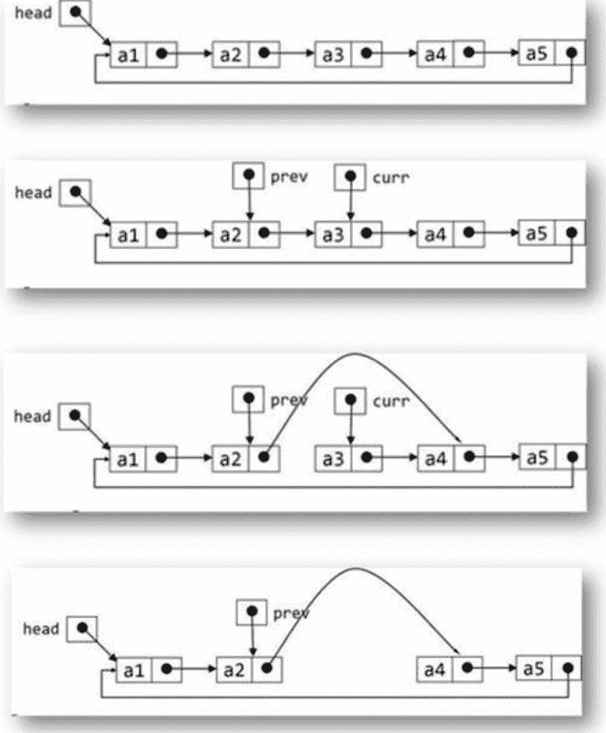

```
**Example 7.50:
public boolean removeNode(int key){
  if(isEmpty()) {
    return false;
  }
  Node prev = tail;
  Node curr = tail.next;
  Node head = tail.next;
  if(curr.value == key) // 头部和单节点情况
  {
    if(curr == curr.next) // 单节点情况
        tail=null;
    else // 头部情况
        tail.next = tail.next;
    return true;
  }

  prev = curr;
  curr = curr.next;

  while(curr != head)
  {
    if(curr.value == key)
    {
        if(curr == tail)
            tail = prev;
        prev.next = curr.next;
        return true;
    }
    prev = curr;
    curr = curr.next;
  }
  return false;
}
```

**分析：** 找到需要释放的节点。唯一的区别在于当遍历列表时，使用 `head` 引用代替 `null` 来跟踪列表。

# 反转复制列表

# **示例 7.51**

```
public CircularLinkedList copyListReversed()
{
    CircularLinkedList cl = new CircularLinkedList();
    Node curr = tail.next;
    Node head = curr;
    if (curr != null)
    {
        cl.addHead(curr.value);
        curr = curr.next;
    }
    while (curr != head)
    {
        cl.addHead(curr.value);
        curr = curr.next;
    }
    return cl;
}
```

**分析：** 遍历列表并将节点添加到新列表的头部。从而使新列表成为给定列表的反转列表。

## 复制列表

示例 7.52:

```java
public CircularLinkedList copyList() {
    CircularLinkedList cl = new CircularLinkedList();
    Node curr = tail.next;
    Node head = curr;

    if (curr != null) {
        cl.addTail(curr.value);
        curr = curr.next;
    }
    while (curr != head) {
        cl.addTail(curr.value);
        curr = curr.next;
    }
    return cl;
}
```

**分析：** 遍历列表并将节点添加到新列表的末尾。从而创建一个值与输入列表相同的列表。

# 双向循环链表

- 1. 对于任何链表，只有三种情况：零元素、一个元素、一般情况
- 2. 对于双向链表，我们有更多需要处理
  - a) 空值
  - b) 单元元素（它通常会引入一个带有 `null` 的 `if` 语句）
  - c) 在 `while` 之前有一个 `if`。它将从这个 `head` 开始检查。
  - d) 一般情况（使用保留的初始 `head` 进行检查）
  - e) 避免使用递归解，这会让生活变得复杂

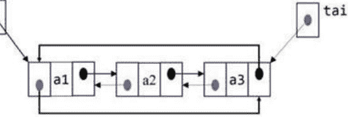

## 示例 7.53

```java
private static class Node {
    private int value;
    private Node next;
    private Node prev;

    public Node(int v, Node nxt, Node prv) {
        value = v;
        next = nxt;
        prev = prv;
    }

    public Node(int v) {
        value = v;
        next = this;
        prev = this;
    }
}

public class DoublyCircularLinkedList {

    private static class Node {
        ...
    }

    private Node head = null;
    private Node tail = null;
    private int size = 0;

    public int size() {
        return size;
    }

    public boolean isEmpty() {
        return size == 0;
    }

    public int peekHead() {
        if (isEmpty()) {
            throw new IllegalStateException("EmptyListException");
        }
        return head.value;
    }
}
```

## 搜索值

## 示例 7.54

```java
public boolean isPresent(int key) {
    Node temp = head;
    if (head == null) {
        return false;
    }

    do {
        if (temp.value == key) {
            return true;
        }
        temp = temp.next;
    } while (temp != head);

    return false;
}
```

**分析：** 遍历列表并查看给定的 `key` 是否存在。使用 `do..while` 循环是因为初始状态也是我们的终止状态。

## 删除列表

## 示例 7.55

```java
public void freeList() {
    head = null;
    tail = null;
    size = 0;
}
```

**分析：** 移除引用后列表将被释放。

## 打印列表

## 示例 7.56

```java
public void print() {
    if (isEmpty()) {
        return;
    }
    Node temp = head;
    while (temp != null) {
        System.out.print(temp.value + " ");
        temp = temp.next;
    }
}
```

**分析：** 遍历列表并打印内容。使用 `while` 循环是因为在 `temp` 为空时需要停止。

# 在头部插入节点

## 示例 7.57: 在头部

```java
public void addHead(int value) {
    Node newNode = new Node(value);
    if (isEmpty()) {
        head = tail = newNode;
    } else {
        newNode.next = head;
        newNode.prev = tail;
        tail.next = newNode;
        head = newNode;
    }
    size++;
}
```

**分析：** 遍历列表。如果列表为空，则 `tail` 指向 `newNode`。

# 在末尾插入节点

## 示例 7.58

```java
public void addTail(int value) {
    Node newNode = new Node(value);
    if (isEmpty()) {
        head = tail = newNode;
    } else {
        newNode.prev = tail;
        newNode.next = head;
        tail.next = newNode;
        tail = newNode;
    }
    size++;
}
```


**分析：** 创建新节点。如果列表为空，则 `head` 指向 `newNode`。

## 删除头部

示例 7.59:

```java
public int removeHead() {
    if(isEmpty()) {
        throw new IllegalStateException("EmptyListException");
    }
    int value = head.value;
    size--;
    if(size == 0) {
        head = tail = null;
    } else {
        head = head.next;
        head.prev = tail;
    }
    return value;
}
```

**分析：** 调整指针。如果列表为空，则 `head` 和 `tail` 置空。

# 删除末尾

示例 7.60:

```java
public int removeTail() {
    if(isEmpty())
        throw new IllegalStateException("EmptyListException");

    int value = tail.value;
    size--;
    if(size == 0) {
        head = tail = null;
    } else {
        tail = tail.prev;
        tail.next = head;
    }
    return value;
}
```

**分析：** 调整指针。如果列表为空，则 `head` 和 `tail` 置空。

## 练习题

- 1. 在链表的头部后第 $k$ 个位置插入元素。如果失败（列表长度不足），返回 -1。

  提示：将引用移动 $k$ 步，然后插入节点。

- 2. 在链表末尾向前第 $k$ 个位置插入元素。如果失败（列表长度不足），返回 -1。

  提示：将一个引用移动 $k$ 步，然后同时移动另一个引用，当第一个引用到达链表末尾时，那里你需要插入节点。

- 3. 假设链表中存在循环，编写一个程序在存在循环时将其移除。

- 4. 在上面的 `SearchList` 程序中，返回相同值的出现次数，如果没有找到则返回 0。

  提示：在上面程序中返回 1 的地方增加计数器，最后返回。

- 5. 给定一个带有循环的链表。计算链表中节点的数量。

- 6. 我们本应该编写使用链表进行多项式加法的完整代码。如果你没有背下来这会花费时间，请仔细复习。

- 7. 给定两个链表。我们需要找到一个的数据是否是另一个的反转。不应使用额外空间，且只遍历链表一次。

# 引言

栈（Stack）是一种按照后进先出（LIFO）方式组织基本的数据结构。最后插入栈的元素将最先从栈中移除。

栈在现实生活中的类比是“火锅里的底饼”或“一叠盘子”。想象餐厅里有一叠盘子，每个人都从栈的顶端取一个盘子，从而为下一个人露出了下一个盘子。

栈只允许访问栈顶元素。位于底部的元素在栈中停留的时间最长。

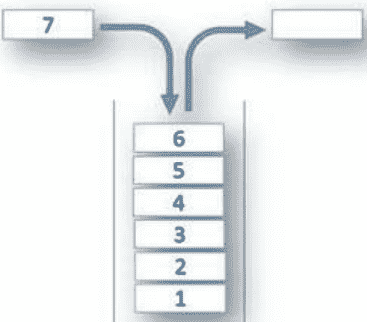

计算机科学中也有栈的常见例子。函数调用栈（Function call stack）就是栈的一个很好的例子。函数 `main()` 调用函数 `foo()`，然后 `foo()` 调用 `bar()`。这些函数调用是通过栈实现的：首先存在 `bar()`，然后是 `go()`，最后是 `main()`。

当我们在网页之间进行跳转时，网页的 URL 被存储在一个栈中，当前页面的 URL 位于栈顶。如果我们点击返回按钮，每个 URL 条目就会逐一个被弹出（pop）。

# 栈抽象数据类型

栈的抽象数据类型定义为一个类，它对于添加的元素遵循 LIFO（后进先出）原则。

栈应该支持以下操作：

- `Push()`：在栈顶添加单个元素。
- `Pop()`：从栈顶移除单个元素。
- `Top()`：读取栈顶元素的值（且不移除它）。
- `isEmpty()`：如果栈为空，则返回 1。
- `Size()`：返回栈中元素的数量。

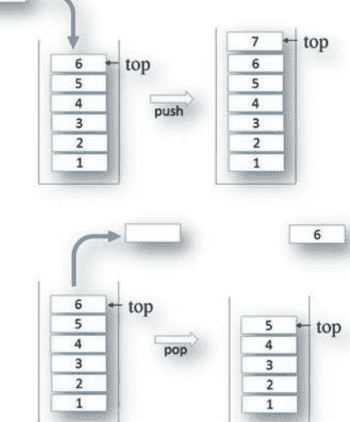

在栈顶添加 `n`：

`void push(int value);`

从栈中移除栈顶元素并将其返回给调用者函数。

`int pop();`

栈可以使用数组或链表实现。

在数组的情况下，有两种实现方式：

- 一种是数组大小固定的，因此这即为栈的容量。
- 另一种方法是变长数组，使用 `malloc` 分配数组内存，当数组满时，使用 `realloc` 将大小翻倍（当栈的大小减到容量的一半以下时，再次缩小）。

在链表的情况下，对其包含的元素数量没有限制。

当使用数组实现栈时，栈顶通过一个名为 `top` 的索引变量进行管理。

当使用链表实现栈时，`push()` 和 `pop()` 通过在链表头部插入和从链表头部移除来实现。

# 使用数组实现栈

使用固定长度数组实现栈。

示例 8.1：

```java
public class Stack {
    private static final int CAPACITY = 1000;
    private int [] data;
    private int top = -1;

    public Stack(CAPACITY) {
        this(CAPACITY);
    }

    public Stack(int capacity) {
        data = new int[capacity];
    }
}
```

如果用户没有提供数组的最大容量，则会创建一个 1000 个元素的数组。`top` 是指向栈顶的索引。栈中元素的数量由 “top” 索引控制，且在初始化栈时 `top` 初始化为 -1。`top` 索引值为 -1 表示栈最初是空的。

```java
public boolean isEmpty() {
    return (top == -1);
}
```

如果栈为空，`isEmpty` 返回 1，在所有其他情况下返回 0。通过将 `top` 索引值与 -1 进行比较。

```java
public int size() {
    return (top + 1);
}
```

`size` 返回栈中元素的数量。它只是返回 “top+1”。因为 `top` 指的是栈变量的数组索引，所以我们需要对其加1。

```java
public void print() {
    for(int i=0; i<data.length; i++) {
        System.out.print(data[i]);
    }
}
```

`print` 函数将打印数组的元素。

```java
public void push(int value) throws IllegalStateException {
    if (size() == data.length) {
        throw new IllegalStateException("StackOverflowException");
    }
    top++;
    data[top] = value;
}
```

`push()` 函数检查栈是否有足够的空间存储一个新元素，然后将 “top” 增加一。最后在栈的 “data”数组中处理数据。如果栈满了，则打印 “stack overflow”（栈溢）消息，该值将不会被添加到栈中会被忽略。

```java
public int pop() {
    if (isEmpty())
        throw new IllegalStateException("StackEmptyException");
    int topVal = data[top];
    top--;
    return topVal;
}
```

实现了 `pop()` 函数，它首先通过检查栈顶索引来检查栈中是否有元素。如果栈中有元素，它将...

```java
public void print() {
    Node temp = head;
    while (temp != null) {
        System.out.print(temp.value + " ");
        temp = temp.next();
    }
}

public static void main(String[] args) {
    Stack s = new Stack();
    for(int i=1;i<=100;i++){
        s.push(i);
    }

    for(int i=1;i<50;i++){
        s.pop();
    }
    s.print();
}
```

## 分析：

- 使用链表实现的栈简单来说就是在单链链表的头部进行插入和删除。
- 在 `push()` 函数中，为其中一个节点创建内存。然后将值存储在该节点中。
- 最后，将该节点插入到列表开头。
- 在 `pop()` 函数中，链表的头开始指向第二个节点，从而释放分配给第一个节点的内存（垃圾回收）。

# 栈的问题

# 平衡括号

**示例 8.4：** 栈可以用于检查程序中的符号是否平衡（例如 {}, (), []）。右符号应该与最近看到的左符号符号匹配。例如：{} 是合法的，{{}} 是合法的，但 {({ 和 {) 是不合法的。

```java
public static boolean isBalancedParenthesis (String expn) {
    ArrayDeque<Character> stk = new ArrayDeque<Character>();
    for (char c : expn.toCharArray()) {
        switch (c) {
            case '(':
            case '{':
                stk.push(c);
                break;
            case ')':
                if (stk.pop() != '(')
                    return false;
                break;
            case ']':
                if (stk.pop() != '[')
                    return false;
                break;
            case '}':
                if (stk.pop() != '{')
                    return false;
                break;
        }
    }
    return stk.isEmpty();
}
```

```java
public static void main(String[] args) {
    String expn = "()}";
    boolean value = isBalancedParenthesis(expn);
    System.out.println("Given Expn:"+expn);
    System.out.println("Result after isParenthesisMatched:"+value);
}
```

## 分析：

- 遍历输入字符串，当我们遇到左括号时，将其将其入栈中。当我们遇到右括号时，我们从栈中弹出一个括号，并比较它是否与右括号匹配。
- 如果括号不匹配，我们返回 `false`。
- 如果在整个遍历结束时，我们到达字符串末尾且栈为空，则说明括号是平衡的。

# 中缀、前缀和后缀表达式

当我们有一个代数表达式 A + B 时，我们知道变量正在被加到变量 B 上。这种表达式被称为中缀表达式，因为运算符 "+" 位于操作数 A 和操作数 B 之间。

考虑另一个中缀表达式 A + B * C。在表达式中存在一个问题，即 `+` 和 `*` 的执行顺序。是先加 A 和 B，然后将结果相乘？还是先乘 B 和 C，然后将结果加到 A？这使得表达式产生了歧义。为了处理这种歧义，我们定义了优先级规则或使用括号来消除歧义。

如果我们想先将 B 和 C 相乘，然后将结果加到 A。那么相同的表达式可以使用括号无义地写为 A + (B * C)。相反，如果我们想先加 A 和 B，然后将和乘以 C，我们将写为 (A + B) * C。因此，在中缀表达式中为了使表达式无歧义，我们需要括号。

**中缀表达式**：在这种表示法中，我们将运算符放在操作数的中间。

< 操作数 > < 运算符 > < 操作数 >

**前缀表达式**：在这种表示法中，我们将运算符放在操作数的开头。

< 运算符 > < 操作数 > < 操作数 >

**后缀表达式**：在这种表示法中，我们将运算符放在操作数的末尾。

< 操作数 > < 操作数 > < 运算符 >

| 中缀表达式 | 前缀表达式 | 后缀表达式 |
| :--- | :--- | :--- |
| A + B | + A B | A B + |
| A + (B * C) | + A * B C | A B C * |
| (A + B) * C | * + ABC | A B + C * |

现在出现了一个最明显的问题：当我们已经有了我们运行良好的中缀表达式时，为什么还需要这些不自然的前缀或后缀表达式呢？

答案是中缀表达式是有歧义的，它们需要括号来变得无歧义。而后缀和前缀表示法不需要任何括号。

# 中缀转后缀转换

**示例 8.5：**

```java
public static char[] infixToPostfix(char[] expn) {
    ArrayDeque<Character> stk = new ArrayDeque<Character>();

    String output="";
    char out = 0;

    for (char ch : expn) {
        if (ch <= '9' && ch >= '0') {
            output = output + ch;
        }
        else {
            switch (ch) {
                case '+':
                case '-':
                case '*':
                case '/':
                case ':':
                case '%':
                case '^':
                    while (stk.isEmpty() == false && precedence(ch) <= stk.peek()) {
                        out = stk.pop();
                        // ... (逻辑根据标准算法继续)
                    }
            }
        }
    }
}
```

*（注：源代码中的 OCR 文本在 `infixToPostfix` 处被截断/损坏，但结构遵循标准的转换算法。）*

```java
  case '/':
    stk.push(num1 / num2);
    break;
  // ... (为了简洁，省略了其他情况)
}
tokens.close();
return stk.pop();
```


```java
public static void main(String[] args) {
  String expn = "6 5 2 3 8 * + 3 *";
  int value = postfixEvaluate(expn);
  System.out.println("给定的后序表达式: "+expn);
  System.out.println("求值结果: "+value);
}
```

## 分析

1. 创建一个栈来存储值或操作数。
2. 遍历给定的表达式，并对每个元素执行以下操作：
   a) 如果元素是数字，将其推入栈。
   b) 如果元素是操作符，从栈中弹出值。对这些值进行操作运算，并将结果推入栈。
3. 当表达式扫描完毕后，栈中的数字即为结果。

## 最小栈

设计一个栈，使得栈中的最小值也能在 O(1) 时间复杂度内获取。

提示：保留两个栈，一个是普通栈，用于存储元素；另一个用于存储最小值。

1. **推**：将一个元素推入栈1 顶部。将新值与栈2 顶部的值比较。如果新值更小，将新值推入栈2。或者将栈2 顶部的值再次推入自身。
2. **出**：从栈1 顶部弹出一个元素并返回。同样从栈2 顶部弹出一个元素。
3. **最小**：从栈2 顶部读取该值即为最小值。

## 回文字符串

使用栈判断给定字符串是否为回文。

回文的定义：回文是一个正向和反向读都相同的字符序列。

例如：`"AAABBBCCCCCCBAAA"`、`"ABA"` & `"ABBA"`。

提示：将字符推入栈直到达到字符串长度的一半。然后弹出这些字符并进行比较。确保处理好奇数长度和偶数长度。

## 反转栈

给定一个栈，如何在不使用任何其他数据结构的情况下反转栈中的元素。你不能使用另一个栈。

时间复杂度和空间复杂度是错误的，两种情况下都是 O(n)。

提示：使用递归（系统栈）。当进入栈内部时，在随后的每次调用中从栈中弹出元素，直到栈为空。在递归返回时，逐个推送这些元素。元素将变得反转。

示例 8.8:

```java
public static <T> void reverseStack(ArrayDeque<T> stk)
{
    if(stk.isEmpty())
        return;
    } else {
        T value = stk.pop();
        reverseStack(stk);
        insertAtBottom(stk, value);
    }
}
```

## 插入底部

示例 8.9:

```java
public static <T> void insertAtBottom(ArrayDeque<T> stk, T value) {
    if(stk.isEmpty())
        stk.push(value);
    } else {
        T out = stk.pop();
        insertAtBottom(stk, value);
        stk.push(out);
    }
}
```

## 使用队列实现的栈

如何使用队列实现栈。分析栈操作的运行时间。

此请参阅队列章节。

## 股票跨度问题

给定一个数组 `A[i]` 中的每日股票价格列表。找到每天的股票跨度（Span）。股票的跨度是指股票价格低于该当天价格的最大天数。

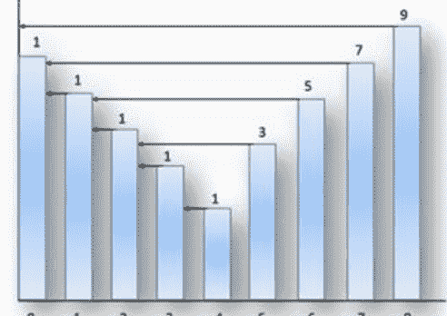

**示例 8.10: 方法 1**

```java
public static int[] StockSpan(int[] arr) {
  int[] SR = new int[arr.length];
  SR[0] = 1;
  for (int i = 1; i < arr.length; i++) {
    SR[i] = 1;
    for (int j = i - 1; (j >= 0) && arr[i] >= arr[j]; j--)
      SR[i]++;
  }
  return SR;
}
```

**示例 8.11: 方法 2**

```java
int[] StockSpan2(int[] arr) {
  ArrayDeque<Integer> stk = new ArrayDeque<Integer>();

  int[] SR = new int[arr.length];
  stk.push(0);
  SR[0] = 1;
  for (int i = 1; i < arr.length; i++) {
    while (!stk.isEmpty() && arr[stk.peek()] <= arr[i])
      stk.pop();
    SR[i] = stk.isEmpty() ? (i + 1) : (i - stk.peek());
  }
}
```

## 使用栈的深度优先搜索

在深度优先搜索中，我们遍历一条路径直到遇到死胡同；然后通过弹出栈来回溯以获取备选路径。

- 创建一个栈
- 创建起点
- 将起点推入栈
- 当（未找到搜索值且栈不为空）时
- 弹出栈
- 找到刚刚尝试过的点之后的所有可能的点
- 将这些点推入栈

## 两个直方图的最大面积

给定一个直方图的柱状高度数组。找到直方图中面积最大的矩形面积。

```java
public static int largestArea(int[] heights) {
    Deque<Integer> stk = new ArrayDeque<>();
    int maxArea = 0;
    int i = 0;
    while (i < heights.length) {
        if (stk.isEmpty() || heights[i] >= heights[stk.peek()]) {
            stk.push(i++);
        } else {
            int height = heights[stk.pop()];
            int width = stk.isEmpty() ? i : i - stk.peek() - 1;
            maxArea = Math.max(maxArea, height * width);
        }
    }
    while (!stk.isEmpty()) {
        int height = heights[stk.pop()];
        int width = stk.isEmpty() ? i : i - stk.peek() - 1;
        maxArea = Math.max(maxArea, height * width);
    }
    return maxArea;
}
```

## 两个栈使用数组

如何使用单数组实现两个栈。

```java
public class TwoStack {
    private final int MAX_SIZE = 50;
    int top1;
    int top2;
    int[] data;

    public TwoStack() {
        top1 = -1;
        top2 = MAX_SIZE;
        data = new int[MAX_SIZE];
    }
    // 其他方法
    public void Push1 (int value) {
        if (top1 < top2 - 1) {
            data[++top1] = value;
        } else {
            System.out.println("栈溢出!");
        }
    }

    public void Push2 (int value) {
        if (top1 < top2 - 1) {
            data[--top2] = value;
        } else {
            System.out.println("栈溢出!");
        }
    }

    public int Pop1() {
        if (top1 >= 0) {
            int value = data[top1--];
            return value;
        } else {
            System.out.println("栈空!");
            return -999;
        }
    }

    public int Pop2() {
        if (top2 < MAX_SIZE) {
            int value = data[top2++];
            return value;
        } else {
            System.out.println("栈空!");
            return -999;
        }
    }

    public static void main(String[] args) {
        TwoStack st = new TwoStack();
        for(int i=0; i<10; i++) {
            st.Push1(i);
        }
        for(int j=0; j<10; j++) {
            st.Push2(j+10);
        }
        System.out.println("栈1弹出值: " + st.Pop1());
        System.out.println("栈2弹出值: " + st.Pop2());
    }
}
```

## 练习

**Ex 1**: 使用栈数据结构将十进制转换为二进制。

提示：将余数存入栈并打印栈。

**Ex 2**: 将中缀表达式转换为前缀表达式。

+ 提示：反转给定的表达式，应用中缀转后缀，然后再次反转表达式。

步骤 1. 反转中缀表达式。

`5/E+D*) C^B+A (`

步骤 2. 将每个 `(` 并并将 `)` 反转为 `(`

`5/E+D*(C/B+A)`

步骤 3. 将表达式转换为后缀形式。

步骤 4. 反转表达式。

`++*A^BCD^E5`

**Ex 3**: 编写一个 HTML 开启标签和结束标签匹配程序。

提示：括号匹配。

**Ex 4**: 编写一个执行后缀转中缀转换的函数。

**Ex 5**: 编写一个执行前缀转中缀转换的函数。

**Ex 6**: 编写一个回文匹配函数，忽略英语字母和数字以外的字符。字符串 `"Madam, I'm Adam."` 应返回 true。

**Ex 7**: 在使用数组实现的动态伸缩栈中。尝试找到一种类似于 `Vector<>` 或 `ArrayDeque<>` 的更好算法。

# 第 9 章：队列

## 引言

队列是一种基本数据结构，以先进先出（FIFO）的方式组织元素。首先插入队列的元素将第一个被移除。它也被称为“先来服务”。

队列在现实生活中的类比是我们有时都会参与的典型排队。

- 我们在火车站售务处窗口排队。
- 我们在食堂线中排队（从“盘子堆”中取出一个盘子）。
- 我们拨打某些客户案例时在等待队列。

位于队头的元素是在队列中停留最长的元素。

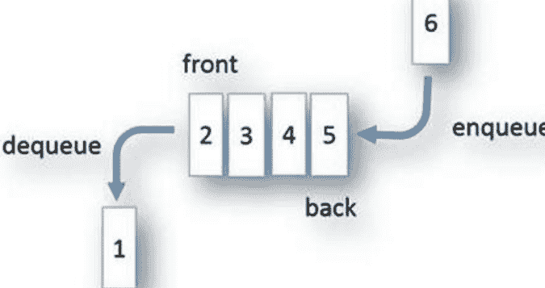

计算机科学也有队列的常见示例。我们从办公室向每层一台打印机发送打印命令，打印任务会在打印机队列中排队。首先发送的打印将在队列中的后续命令之前打印。

除了打印队列外，操作系统还使用不同的队列来控制进程调度。进程被添加到处理队列中，操作系统将其用于各种调度算法。

很快我们将学习图论，并了解到广度优先遍历，它会使用队列。

# 队列抽象数据类型

队列抽象数据类型定义为一个类，其对象对于添加的元素遵循 FIFO 或先进先出规则。

队列应该支持以下操作：

1. `add()`: 在队列末尾添加单个元素。
2. `remove()`: 从队列头部移除单个元素。
3. `isEmpty()`: 如果队列为空则返回 1。
4. `size()`: 返回队列中元素的数量。

## 使用数组实现的队列

| 0 | 1 | 2 | 3 | 4 | 5 | 6 | 7 | 8 | 9 |
|---|---|---|---|---|---|---|---|---|---|
| 1 | 2 | 3 | 4 | 5 | 6 | 7 | | | |

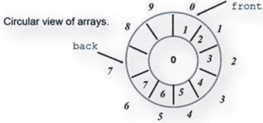

**示例 9.1:** 队列 {

```java
public class Queue {
    private int size;
    private int Capacity=100;
    private int[] data;
    int front=0;
    int back=0;

    public Queue(){
        size = 0;
        data = new int[100];
    }

    boolean isEmpty(){
        return size == 0;
    }

    int size(){
        return size;
    }
}
```

```java
public boolean add(int value) {
    if (size >= Capacity) {
        System.out.println("Queue is full.");
        return false;
    } else {
        size++;
        data[back] = value;
        back = (++back) % (Capacity - 1);
    }
    return true;
}
public int remove() {
  int value;
  if (size <= 0) {
    System.out.println("Queue is empty.");
    return -999;
  }
  else {
    size--;
    value = data[front];
    front = (++front) % (Capacity - 1);
  }
  return value;
}
```

```java
public static void main(String[] args) {
  Queue que = new Queue();

  for (int i = 0; i < 20; i++) {
    que.add(i);
  }
  for (int i = 0; i < 22; i++) {
    System.out.println(que.remove());
  }
}
```

## 分析

1. 队列由一个大小为 100 的数组创建。
2. 队列中的元素数量归零。通过将 `front`、`back` 和 `size` 赋值为零。
3. `Add()` 在队列末尾插入一个元素。
4. `Remove()` 从队列头部删除一个元素。

## 使用链表实现的队列

示例 9.2:

```java
public class Queue {
    private static Node {
        private int value;
        private Node next;

        public Node(int v, Node n) {
            value = v;
            next = n;
        }
    }
    private Node head = null;
    private Node tail = null;
    private int size = 0;

    public int size() {
        return size;
    }

    public boolean isEmpty() {
        return size == 0;
    }

    public void print() {
        Node temp = head;
        while (temp != null) {
            System.out.print(temp.value + " ");
            temp = temp.next;
        }
    }

    public int peek() throws IllegalStateException {
        if(isEmpty()) {
            throw new IllegalStateException("QueueEmpty");
        }
        return head.value;
    }
}
```

# 使用链表向队列入队。节点被添加到链表的末尾。下图显示了如何添加新节点。每当添加新值时，`tail` 都会被修改。然而，在队列为空的情况下，`head` 也会更新。

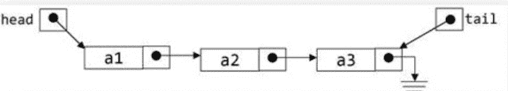

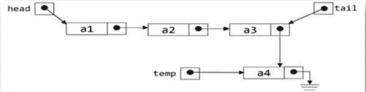


# 队列操作示例

## 示例 9.3：添加元素

```java
public void add(int value) {
    Node temp = new Node(value, null);

    if(head == null)
        head = tail = temp;
    else {
        tail.next = temp;
        tail = temp;
    }
    size++;
}
```

**分析：** `add` 操作在队列的末尾添加一个元素。

## 删除操作

在此时，我们需要 `tail` 引用，因为列表中可能只有一个元素，且在删除时 `tail` 引用也会被修改。

## 示例 9.4：移除元素

```java
public int remove() throws IllegalStateException {
    if(isEmpty()) {
        throw new IllegalStateException("QueueEmpty");
    }
    int value = head.value;
    head = head.next;
    size--;
    return value;
}

public static void main(String[] args) {
    Queue q = new Queue();
    for(int i=1; i<100; i++) {
        q.add(i);
    }
    for(int i=1; i<=50; i++) {
        q.remove();
    }
    q.print();
}
```

**分析：** `remove` 操作从队列（链表）的头部删除第一个节点。

# 队列中的问题

## 使用栈实现的队列

如何使用栈实现队列。你可以使用多个栈。

**解决方案：** 我们可以使用两个栈来实现队列。我们需要使用栈模拟先进先出。

- **入队操作：** 新元素添加到第一个栈的栈顶。
- **出队操作：** 从第二个栈弹出元素；当第二个栈为空时，将第一个栈的所有元素逐个弹出并推入第二个栈。

## 示例 9.5

```java
import java.util.ArrayDeque;

public class QueueUsingStack {
    public QueueUsingStack() {
        stk1 = new ArrayDeque<Integer>();
        stk2 = new ArrayDeque<Integer>();
    }
    private ArrayDeque<Integer> stk1;
    private ArrayDeque<Integer> stk2;
}

void add(int value) {
    stk1.push(value);
}

int remove() {
    int value;
    if(stk2.isEmpty() == false) {
        return stk2.pop();
    }
    while (stk1.isEmpty() == false) {
        value = stk1.pop();
        stk2.push(value);
    }
    return stk2.pop();
}

public static void main(String[] args) {
    QueueUsingStack queue = new QueueUsingStack();
    queue.add(1);
    queue.add(11);
    queue.add(111);
    System.out.println(queue.remove());
    queue.add(2);
    queue.add(21);
    queue.add(211);
    System.out.println(queue.remove());
    System.out.println(queue.remove());
    System.out.println(queue.remove());
    System.out.println(queue.remove());
    System.out.println(queue.remove());
}
```

**分析：** 所有的 `add()` 操作都发生在栈 1 上。当调用 `remove()` 时，从栈 2 中进行移除。当栈 2 为空时，将栈 1 弹出并推入栈 2。这种从栈 1 弹出并推入栈 2 的操作反转了获取顺序，从而通过两个栈实现了队列的行为。

## 使用队列实现栈

### 方案 2：单队列实现

同样可以使用仅一个队列来实现。

- **Push（入栈）：** 将元素添加到队列。
- **Pop（出栈）：** 获取队列的大小。如果大小为0，则返回错误。否则，如果大小大于0，则从队列中移除 `size-1` 个元素并重新添加到队列尾。最后，移除下一个元素并返回它。

Push 操作的时间复杂度为 `O(1)`，Pop 操作的时间复杂度为 `O(n)`。

### 方案 3：双队列实现（优化 Pop）

在上述方案中，push 是高效的而 pop 是低效的，我们可以让 pop 变得高效 `O(1)`，而 push 变得低效 `O(n)`。

- **Push：** 将新元素添加到 `queue2`。然后将 `queue1` 的所有元素添加到 `queue2`。最后，交换 `queue1` 和 `queue2` 的名称。
- **Pop：** 从 `queue1` 中移除元素。

Push 操作的时间复杂度为 `O(n)`，Pop 操作的时间复杂度为 `O(1)`。

## 反转栈

### 使用队列反转栈

**解决方案：**

1. 弹出栈中的所有元素并将它们加入队列中。
2. 然后将队列中的所有元素移回栈中。
3. 我们就得到了反转后的栈元素。

## 反转队列

### 使用栈反转队列

**解决方案：**

1. 将队列中的所有元素出队到栈中。
2. 然后将栈中的所有元素弹出并加入队列中。
3. 我们就得到了反转后的队列元素。

## 使用队列的广度优先搜索

在广度优先搜索中，我们通过寻找所有可能的后继节点并将它们加入队列，优先探索所有最近的节点。

1. 创建一个队列
2. 创建起点
3. 将起点入队列
4. 当（未找到搜索值且队列不为空）时
   - 从队列中出队
   - 找到上一次尝试之后的所有可能的点
   - 将这些点入队列

## 约瑟夫问题

有 n 个人站在队列中等待执行。计数从队列前端开始。在每一步中，移除 k 个人，并再次从队列中逐个添加。然后执行下一个人。执行沿着圆圈进行，直到最后剩余一个人，此人获得自由。

找到你想要站的位置并获得你的自由。

**解决方案：**

1. 在队列中插入 1 到 k 的整数（对应 k 个人）。
2. 定义一个 `Kpop()` 函数，它会移除并添加队列 k-1 次，再多移除一次（这个人就死蛋了）。
3. 重复第二步，直到队列的大小为 1。
4. 打印最后一个元素的值。这就是答案。

## 练习题

1. 使用动态内存分配实现队列。该实现应遵循以下限制。
   - 用户应该使用 `new` 运算符从堆中分配内存。在此过程中，你需要考虑队列中的最大值。
   - 一旦你完成了上述练习并能够测试你的队列，就可以为代码添加一些复杂度。在 `add()` 函数中，当队列满时，与其打印“Queue is full”，而应该使用 `new` 运算符分配更多空间。
   - 一旦你完成了上述练习。在 `remove` 函数中，如果小于队列容量的一半，你需要将队列的大小减半。你应该在队列中增加一个变量 `min`，以便跟踪在 `init()` 函数中传递的原始值。队列的容量不会低于初始化时传递的值。
   - （如果你无法解决上述练习，请查看栈的章节，我们在那里对栈做过类似的练习）

2. 为队列实现以下函数：
   - **IsEmpty（判空）：** 此项留给用户练习。取一个变量来维护队列的大小，如果该变量的值为0，则 `isEmpty` 应返回 1 (true)。如果队列不为空，则应返回 0 (false)。
   - **Size（大小）：** 使用 `size` 变量在 `size` 函数调用下使用。`Size()` 函数应返回队列中的元素数量。

3. 使用队列实现栈。为此问题编写程序。你可以只使用一个队列。

4. 写一个程序使用队列反转栈。

5. 写一个程序使用栈反转队列。

6. 写一个程序解决约瑟夫问题（已讨论过）。有 n 个人站在队列中等待执行。计数从队列前端开始。在每一步中，移除 k 个人，并再次从队列中逐个添加。然后执行下一个人。消除沿着圆圈进行，直到最后剩余一个人，此人获得自由。找到你想要站的位置并获得你的自由。

7. 写一个 `CompStack()` 函数，它接收两个栈的引用作为参数，并根据栈元素是否相等返回 true 或 false。

# 树

## 介绍

我们已经学习了各种线性结构，如数组、链表、栈、队列。树是一种非线性结构，用于表示层级关系（父子关系）。

## 树的术语

- **根：** 树中没有入边的节点。它是树的顶部节点。
- **节点：** 树的基本元素。每个节点有两个指向空的引用。
- **边：** 树的基本组成部分，用于连接节点。
- **路径：** 一个由边连接的节点有序列表。
- **叶子节点：** 没有子节点的节点。
- **树的高度：** 根到叶子之间最长路径的边数。
- **节点的深度：** 从根到该节点路径的边数。
- **子节点：** 从同一个节点有入边的节点被称为该节点的子节点。
- **父节点：** 节点是出边连接的所有子节点的父。
- **兄弟节点：** 具有相同父节点的节点被称为兄弟节点。
- **祖先：** 通过从子节点反复移动到父节点到达节点。

## 二叉树

二叉树是一种每个节点最多有两个子节点（0、1或2）的树，这些节点被称为左孩子和右孩子。

在书的剩余部分，二叉树将如下所示：

二叉树的属性有：

1. 二叉树第 $i$ 层的最大节点数为 $2^i$，其中 $i \ge 1$
2. 深度为 $k$ 的二叉树的最大节点数为 $2^{k+1}$，其中 $k \ge 1$
3. 从根节点到树中任何节点都有且仅有一条路径。
4. 拥有 $N$ 个节点的树恰有 $N-1$ 条连接这些节点的边。
5. $N$ 个节点的完全二叉树的高度为 $\log_2 N$。

## 二叉树的类型

### 完全二叉树

在完全二叉树中，除了最后一层外，每一层都是满的。左侧的节点先填充，然后是右侧。

二叉堆是完全二叉树的一个例子。

### 满/严格二叉树

满二叉树是指每个节点都恰好有零或两个子节点的二叉树。

### 完美二叉树

完美二叉树是满二叉树的一种，其中每个非叶节点都恰好有两个子节点。

所有叶子节点具有相同的路径，且所有可能的节点槽都被占据了。

### 右斜二叉树

每个节点只有一个右孩子或没有孩子（叶子节点）的二叉树称为右斜二叉树。

### 左斜二叉树

每个节点只有一个左孩子或没有孩子（叶子节点）的二叉树称为左斜二叉树。

### 高度平衡二叉树

高度平衡二叉树是一种二叉树，其中任意给定节点的左、右子树的高度之差不超过1。

注意：每个完全二叉树都是高度平衡二叉树。

AVL树和RB树是高度平衡树的例子，我们将在高级树主题中讨论树。

## 二叉树中的问题

### 创建完全二叉树

给定一个数组中的值列表，创建一个二叉树。

**解决方案：** 由于二叉树中没有定义顺序，因此节点按任何顺序插入，这可能是一个倾斜二叉树。但在倾斜二叉树中进行操作是无效的，因此我们将创建一个完全二叉树。在每个节点处，将数组中存储的值分配给节点，并将数组的左部分传递给节点的左孩子以创建左子树。数组的右部分传递给节点的右孩子以创建右子树。

## 示例 10.1

```java
public void levelOrderTree(int[] arr) {
    root = levelOrderTree(arr, 0);
}

public Node levelOrderTree(int[] arr, int start) {
    int size = arr.length;
    Node curr = new Node(arr[start]);
    int left = 2 * start + 1;
    int right = 2 * start + 2;

    if (left < size) {
        curr.leftChild = levelOrderTree(arr, left);
    }
    if (right < size) {
        curr.rightChild = levelOrderTree(arr, right);
    }
    return curr;
}

public static void main(String[] args) {
    Tree t = new Tree();
    int[] arr = {1,2,3,4,5,6,7,8,9,10};
    t.levelOrderTree(arr);
    t.print();
}
```

**复杂度分析：**

这是一个创建完全二叉树的高效算法。

时间复杂度：**O(n)** 空间复杂度：**O(n)**

## 前序遍历

遍历是访问树中每个节点的过程。在前序遍历中，先访问/遍历父节点，然后是左孩子和右孩子。前序遍历是深度优先遍历的一种。

**解决方案：**

前序遍历使用递归完成。在每个节点处，首先打印存储的值，然后是左孩子和右孩子的值。在每个节点处，通过调用其左、右子树的 `printTree` 函数打印其值。

## 示例 10.2

```java
public void PrintPreOrder(Node root) {
    if(root != null) {
        System.out.print(root.value + " ");
        PrintPreOrder(root.leftChild);
        PrintPreOrder(root.rightChild);
    }
}
```

输出：4 2 1 3 5 8 7 9 10

**复杂度分析：** 时间复杂度 O(n) 空间复杂度 O(n)

注意：在遍历所有节点的算法中，复杂度不会小于 n。当树的大部分未遍历时，复杂度会降低。

## 后序遍历

后序遍历首先访问/遍历左孩子，然后是右孩子，最后是父节点。后序遍历是深度优先遍历的一种。

**解决方案：**

后序遍历首先遍历左孩子，然后是右孩子，最后在屏幕上打印当前节点。

## 示例 10.3

```java
public void PrintPostOrder(Node root) {
    PrintPostOrder(root);
}

private void PrintPostOrder(Node node) {
    if(node != null) {
        PrintPostOrder(node.leftChild);
        PrintPostOrder(node.rightChild);
        System.out.print(node.value);
    }
}
```

输出：1 3 2 5 4 7 10 8 6

**复杂度分析：** 时间复杂度 O(n) 空间复杂度 O(n)

## 中序遍历

中序遍历首先访问/遍历左孩子，然后是父节点，最后是右孩子。中序遍历是深度优先遍历的一种。BST的中序遍历是排序列表。

**解决方案：** 中序遍历首先遍历左孩子，打印节点的值，然后遍历右孩子。

## 示例 10.4


```java
public void PrintInOrder() {
    PrintInOrder(root);
}

private void PrintInOrder(Node node) {
    if (node != null) {
        PrintInOrder(node.leftChild);
        System.out.print(node.value + " ");
        PrintInOrder(node.rightChild);
    }
}
```

输出：1 2 3 4 5 6 7 8 9 10

复杂度分析：时间复杂度 `O(n)` 空间复杂度 `O(n)`

注意：前序、后序和中序遍历适用于所有二叉树。它们可以遍历任何类型的二叉树。

# 层序遍历 / 广度优先

编写代码实现树的层序遍历。使得深度为 `k` 的节点在深度为 `k+1` 的节点之前打印。

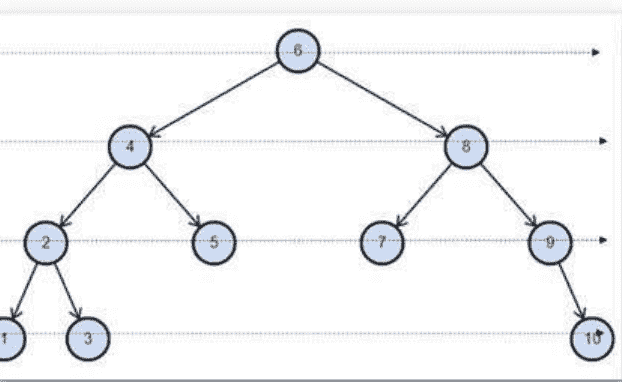

# 解决方案

使用队列完成树的层序遍历或广度优先。开始时将根节点加入队列。直到队列为空。遍历树时，我们首先从队列中移除一个元素，打印该节点的值，并将左孩子和右孩子加入队列。

## 示例 10.5

```java
public void PrintBreadthFirst() {
    Deque<Node> que = new ArrayDeque<Node>();
    Node temp;

    if (root != null)
        que.add(root);
    while (que.isEmpty() == false) {
        temp = que.remove();
        System.out.println(temp.value);
        if (temp.leftChild != null)
            que.add(temp.leftChild);
        if (temp.rightChild != null)
            que.add(temp.rightChild);
    }
}
```

复杂度分析：时间复杂度 `O(n)` 空间复杂度 `O(n)`

# 不使用递归/系统栈打印深度优先

**解决方案：** 使用递归和系统栈完成树的深度优先遍历。可以使用栈来实现。开始时将根节点加入栈。遍历整个树直到栈为空。在每次迭代中，从栈中弹出一个元素并将其值打印到屏幕上。然后将节点的右孩子和后左孩子加入栈。

## 示例 10.6

```java
public void PrintDepthFirst() {
    Deque<Node> stk = new ArrayDeque<Node>();
    Node temp;

    if (root != null) {
        stk.push(root);
    }
    while (stk.isEmpty() == false) {
        temp = stk.pop();
        System.out.println(temp.value);

        if (temp.leftChild != null) {
            stk.push(temp.leftChild);
        }
        if (temp.rightChild != null) {
            stk.push(temp.rightChild);
        }
    }
}
```

复杂度分析：时间复杂度 `O(n)` 空间复杂度 `O(n)`

## 树的深度

解决方案：树的深度通过递归遍历根节点的左右孩子来计算。在每次层遍历中，计算左孩子的深度和右孩子的深度。在左、右孩子深度中取较大的深度加 1（即当前节点的深度），并返回此值。

## 示例 10.7

```java
private int TreeDepth(Node root) {
    if (root == null) {
        return 0;
    } else {
        int lDepth = TreeDepth(root.leftChild);
        int rDepth = TreeDepth(root.rightChild);
        if (lDepth > rDepth) {
            return lDepth + 1;
        } else {
            return rDepth + 1;
        }
    }
}

public int TreeDepth() {
    return TreeDepth(root);
}
```

解决方案：我们想要在先序遍历（PreOrder traversal）树时，打印位于第 `n` 个索引的节点。因此，我们维护一个计数器来跟踪索引。当计数器等于索引时，打印该值并返回第 `n` 个先序索引。

## 示例 10.8

```java
public void NthPreOrder(int index) {
    NthPreOrder(root, index, 0);
}

private void NthPreOrder(Node node, int index, int counter) {
    if (node != null) {
        counter++;
        if (counter == index) {
            System.out.print(node.value);
        }
        NthPreOrder(node.leftChild, index, counter);
        NthPreOrder(node.rChild, index, counter);
    }
}
```

复杂度分析：时间复杂度 `O(n)` 空间复杂度 `O(n)`

## 第 n 后序 (Nth Post Order)

解决方案：我们想要在后序遍历（post order traversal）树时，打印位于第 `n` 个索引的节点。因此，我们维护一个计数器来跟踪索引，但此时我们会在左子树和右子树遍历后增加计数器。当计数器等于索引时，打印该值并返回第 `n` 个后序索引节点。

# 示例 10.9

```java
public void NthPostOrder(int index) {
    NthPostOrder(root, index, 0);
}

private void NthPostOrder(Node node, int index, int counter) {
    if (node != null) {
        NthPostOrder(node.leftChild, index, counter);
        NthPostOrder(node.rChild, index, counter);
        counter++;
        if (counter == index) {
            System.out.print(node.value);
        }
    }
}
```

## 复杂度分析

时间复杂度 `O(n)` 空间复杂度 `O(n)`

## 第 n 中序 (Nth In Order)

解决方案：

我们想要在中序遍历（in-order traversal）树时，打印位于第 `n` 个索引的节点。因此，我们维护一个计数器来跟踪索引，但此时我们会在右子树遍历之前、右子树遍历后增加计数器。当计数器等于索引时，打印该值并返回第 `n` 个中序索引节点。

## 示例 10.10

```java
public void NthInOrder(int index) {
    NthInOrder(root, index, 0);
}

private void NthInOrder(Node node, int index, int counter) {
    if (node != null) {
        NthInOrder(node.leftChild, index, counter);
        counter++;
        if (counter == index) {
            System.out.print(node.value);
        }
        NthInOrder(node.rightChild, index, counter);
    }
}
```

## 复杂度分析

时间复杂度 `O(n)` 空间复杂度 `O(1)`

## 复制树 (Copy Tree)

解决方案：复制树是通过在树遍历的每一层复制输入树的节点完成的。在树节点遍历的每一层，创建一个新节点并将输入节点的值复制其中。递归地复制左子树，然后将新子树的引用赋值给当前节点的左子节点。右子节点也是如此。最后完成树的复制。

## 示例 10.11

```java
public Tree CopyTree() {
    Tree tree2 = new Tree();
    tree2.root = CopyTree(root);
    return tree2;
}

private Node CopyTree(Node curr) {
    Node temp;
    if (curr != null) {
        temp = new Node(curr.value);
        temp.setLeftChild(CopyTree(curr.leftChild));
        temp.setRightChild(CopyTree(curr.rChild));
        return temp;
    } else {
        return null;
    }
}
```

# 复杂度分析

时间复杂度 `O(n)` 空间复杂度 `O(n)`

# 复制镜像树 (Copy Mirror Tree)

解决方案：复制树的镜像与复制树相同，但不再是左子节点指向输入树左子树遍历形成的树，而是左子节点指向由右子树遍历形成的树。同样，右子节点指向输入树左子树的遍历结果。

## 示例 10.12

```java
public Tree CopyMirrorTree() {
    Tree tree2 = new Tree();
    tree2.root = CopyMirrorTree(root);
    return tree2;
}

private Node CopyMirrorTree(Node curr) {
    Node temp;
    if (curr != null) {
        temp = new Node(curr.value);
        temp.setRightChild(CopyTree(curr.leftChild));
        temp.setLeftChild(CopyTree(curr.rChild));
        return temp;
    } else {
        return null;
    }
}
```

# 复杂度分析

时间复杂度 `O(n)` 空间复杂度 `O(n)`

## 元素个数 (Number of Element)

解决方案：右子节点数和左子节点数相加 1，即可得到任何树/子树的节点总数。

## 示例 10.13

```java
public int numNodes() {
    return numNodes(root);
}

public int numNodes(Node curr) {
    if (curr == null) {
        return 0;
    }
    return 1 + numNodes(curr.leftChild) + numNodes(curr.rChild);
}
```

# 复杂度分析

时间复杂度 `O(n)` 空间复杂度 `O(h)`

# 叶子节点个数 (Number of Leaf)

解决方案：树中的叶子节点是指既没有左子节点也没有右子节点的节点。

## 示例 10.14

```java
public int countLeaves() {
    return countLeaves(root);
}

public int countLeaves(Node curr) {
    if (curr == null) {
        return 0;
    }
    if (curr.leftChild == null && curr.rChild == null) {
        return 1;
    }
    return countLeaves(curr.leftChild) + countLeaves(curr.rChild);
}
```

# 复杂度分析

时间复杂度 `O(n)` 空间复杂度 `O(h)`

# 相同性 (Identical)

解决方案：如果两棵树具有相同的结构，且对应的节点具有相同的值，则这两棵树是相同的。

## 示例 10.15

```java
public boolean isEqual(Node root1, Node root2) {
    return isEqual(root1, root2);
}

private boolean isEqual(Node root1, Node root2) {
    if (root1 == null && root2 == null) {
        return true;
    }
    if (root1 == null || root2 == null) {
        return false;
    }
    return (root1.value == root2.value) && isEqual(root1.leftChild, root2.leftChild) && isEqual(root1.rChild, root2.rChild);
}
```

# 复杂度分析

时间复杂度 `O(n)` 空间复杂度 `O(h)`

## 释放树 (Free Tree)

解决方案：释放树是通过遍历树并删除每个节点完成的。在 Java 等语言中，一旦移除引用，将由垃圾回收器处理。

## 示例 10.16

```java
public void free() {
    root = null;
}
```

# 复杂度分析

时间复杂度 `O(1)` 空间复杂度 `O(1)`

```java
stk.push(curr.value);

if (curr.lChild == null && curr.rChild == null) {
    System.out.println(stk);
    stk.pop();
    return;
}

printAllPath(curr.rChild, stk);
printAllPath(curr.lChild, stk);
stk.pop();
```

## 复杂度分析

时间复杂度 `O(n)` 空间复杂度 `O(n)`

## 最近公共祖先 (Least Common Ancestor)

解决方案：我们递归地遍历二叉树的节点。当我们找到正在搜索的节点中的任意一个时，就返回该节点。当左右子树都返回了非空有效引用位置时，我们将返回该节点作为公共祖先。

## 示例 10.19

```java
public int LCA(int first, int second) {
    Node ans = LCA(root, first, second);
    if (ans != null)
        return ans.value;
    else
        return Integer.MIN_VALUE;
}

private Node LCA(Node curr, int first, int second) {
    Node left, right;

    if (curr == null)
        return null;

    if (curr.value == first || curr.value == second)
        return curr;

    left = LCA(curr.lChild, first, second);
    right = LCA(curr.rChild, first, second);

    if (left != null && right != null)
        return curr;
    else if (left != null)
        return left;
    else
        return right;
}
```

## 复杂度分析

时间复杂度 `O(n)` 空间复杂度 `O(n)`

## 在二叉树中查找最大值

**解决方案：** 我们递归地遍历二叉树的节点。我们将找到任意节点左、右子树的最大值，然后将该值与当前节点的值进行比较，最后返回这三个值中的最大。

## 示例 10.20

```java
public int findMaxBT() {
    int ans = findMaxBT(root);
    return ans;
}

private int findMaxBT(Node curr) {
    int left, right;
    if (curr == null)
        return Integer.MIN_VALUE;
    int max = curr.value;
    left = findMaxBT(curr.leftChild);
    right = findMaxBT(curr.rightChild);
    if (left > max)
        max = left;
    if (right > max)
        max = right;
    return max;
}
```

## 在二叉树中搜索值

**解决方案：** 查找二叉树中是否存在某个值是通过对二叉树进行穷举搜索完成的。首先，将当前节点的值与我们要查找的值进行比较。然后递归地在左孩子和右孩子内部进行比较。

## 示例 10.21


```java
public boolean searchBT(Node root, int value) {
  int max;
  boolean left, right;

  if (root == null)
    return false;

  if (root.value == value)
    return true;

  left = searchBT(root.leftChild, value);
  if (left)
    return true;
  right = searchBT(root.rChild, value);
  if (right)
    return true;

  return false;
}
```

## 二叉树的最大深度

**解决方案：** 要找到二叉树的最大深度，我们需要找到左树的深度和右树的深度，我们需要存储该值并加 1，以便得到给定节点的深度。

**示例 10.22:**

```java
public int TreeDepth() {
  return TreeDepth(root);
}
```

```java
private int TreeDepth(Node root) {
  if (root == null)
    return 0;
  else {
    int lDepth = TreeDepth(root.lChild);
    int rDepth = TreeDepth(root.rChild);
    if (lDepth > rDepth)
      return lDepth + 1;
    else
      return rDepth + 1;
  }
}
```

## 二叉树中的满节点数量

**解决方案：** 满节点是指同时具有左右子节点的节点。我们将递归地遍历整棵树，每当我们发现一个满节点，就增加满节点的计数。

**示例 10.23:**

```java
public int numFullNodesBT() {
  return numNodes(root);
}
```

```java
public int numFullNodesBT(Node curr) {
  int count;
  if (curr == null)
    return 0;

  count = numFullNodesBT(curr.rChild) + numFullNodesBT(curr.lChild);
  if (curr.rChild != null && curr.lChild != null)
    count++;

  return count;
}
```

## 二叉树中的最大长度路径/二叉树直径

**解决方案：** 要找到二叉树的直径，我们需要找到左孩子和右孩子的深度，然后将这两个值相加并加 1，以便得到包含当前节点的最大长度路径（直径候选值）。然后我们在左子树中寻找最大长度路径，在右子树中寻找最大长度路径。最后，我们比较这三个值，返回其中最大值，即为二叉树的直径。

**示例 10.24:**

```java
public int maxLengthPath(Node curr) {
  int left, right;
  if (curr == null)
    return 0;
  left = maxLengthPath(curr.lChild);
  right = maxLengthPath(curr.rChild);

  if (left != null && right != null)
    return left + right + 1;
  else if (left != null)
    return left;
  else if (right != null)
    return right;
  else
    return 0;
}
```

## 二叉树中所有节点和

**解决方案：** 要找到二叉树中所有节点的和，我们需要递归地遍历二叉树，并将节点的值相加。

**示例 10.25:**

```java
public int sumNodes(Node curr) {
  if (curr == null)
    return 0;
  return curr.value + sumNodes(curr.lChild) + sumNodes(curr.rChild);
}
```

## 迭代前序遍历

**解决方案：** 为了不使用递归，我们可以使用栈来遍历树。

**示例 10.26:**

```java
public void iterativePreorder(Node root) {
  Stack<Node> stk = new Stack<>();
  stk.push(root);
  while (!stk.isEmpty()) {
    Node curr = stk.pop();
    System.out.print(curr.value);
    if (curr.rChild != null)
      stk.push(curr.rChild);
    if (curr.lChild != null)
      stk.push(curr.lChild);
  }
}
```

## 迭代中序遍历

**解决方案：** 为了不使用递归，我们可以使用栈来遍历树。

**示例 10.27:**

```java
public void iterativeInorder(Node root) {
  Stack<Node> stk = new Stack<>();
  Node curr = root;
  while (curr != null || !stk.isEmpty()) {
    while (curr != null) {
      stk.push(curr);
      curr = curr.lChild;
    }
    curr = stk.pop();
    System.out.print(curr.value);
    curr = curr.rChild;
  }
}
```

## 迭代后序遍历

**解决方案：** 为了不使用递归，我们可以使用栈来遍历树。

**示例 10.28:**

```java
public void iterativePostorder(Node root) {
  if (root == null) return;
  Stack<Node> stk1 = new Stack<>();
  Stack<Node> stk2 = new Stack<>();
  stk1.push(root);
  while (!stk1.isEmpty()) {
    Node curr = stk1.pop();
    stk2.push(curr);
    if (curr.lChild != null)
      stk1.push(curr.lChild);
    if (curr.rChild != null)
      stk1.push(curr.rChild);
  }
  while (!stk2.isEmpty()) {
    Node curr = stk2.pop();
    System.out.print(curr.value);
  }
}
```

## 二叉搜索树 (BST)

二叉搜索树是一种按照以下方式排列节点的二叉树：

* 左子树的键小于其父节点的键。
* 右子树的键大于其父节点的键。
* 不允许重复键。

注意：节点中可以有两个独立的键和值字段。但为了简单起见，我们将其视为键。二叉搜索树中的所有问题都是通过节点值即树的键这一假设来解决的。

注意：由于二叉搜索树是一种二叉树，上述所有的二叉树算法都适用于二叉搜索树。

## 二叉搜索树 (BST) 中的问题

所有的二叉树算法适用于二叉搜索树。

### 从排序数组创建二叉搜索树

给定一个有序数组中的值列表，创建一个二叉树。

由于数组中的元素是有序排列的，而我们想要创建一个二叉搜索树，其中左子树节点的值小于当前节点，而右子树节点的值大于当前节点的值。

**解决方案：** 我们必须找到中间节点来创建当前节点，并将数组的剩余部分传递下去。

**示例 10.29:**

```java
public void CreateBinaryTree(int[] arr) {
    root = CreateBinaryTree(arr, 0, arr.length - 1);
}

private Node CreateBinaryTree(int[] arr, int start, int end) {
    Node curr = null;
    if (start > end) {
        return null;
    }
    int mid = (start + end) / 2;
    curr = new Node(arr[mid]);
    curr.leftChild = CreateBinaryTree(arr, start, mid - 1);
    curr.right = CreateBinaryTree(arr, mid + 1, end);
    return curr;
}

public static void main(String[] args) {
    Tree t = new Tree();
    int[] arr = {1, 2, 3, 4, 5, 6, 7, 8, 9, 10};
    t.CreateBinaryTree(arr);
    t.PrintOrder();
}
```

### 插入

将键值为 6, 4, 2, 5, 1, 3, 8, 7, 9, 10 的节点插入树中。以下是按照顺序插入节点后的逐步树结构图。

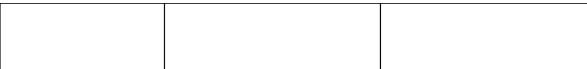

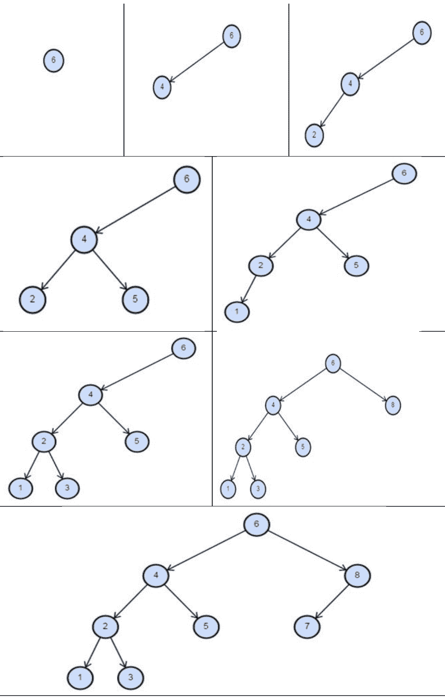


**解决方案：** 较小的值会被添加到节点的左子树中，较大的值会被添加到当前节点的右子树中。

**示例 10.30:**

```java
public void InsertNode(int value) {
  root = InsertNode(value, root);
}

private Node InsertNode(int value, Node node) {
  if (node == null) {
    node = new Node(value, null, null);
  } else {
    if (node.value > value) {
      node.lChild = InsertNode(value, node.lChild);
    }
    node.rChild = InsertNode(value, node.rChild);
  }
  return node;
}
```

**复杂度分析：** 时间复杂度：`O(n)` 空间复杂度：`O(n)`

### 查找节点

**解决方案：** 大于当前节点的值位于右子树中，而小于当前节点的值位于左子树中。我们可以通过迭代遍历左或右子树来查找某个值。

**示例 10.31:** 查找具有给定值的节点。

```java
public boolean find(int value) {
    Node curr = root;
    while (curr != null) {
        if (curr.value == value)
            return true;
        else if (curr.value > value)
            curr = curr.lChild;
        else
            curr = curr.rChild;
    }
    return false;
}
```

**复杂度分析：** 时间复杂度：`O(n)` 空间复杂度：`O(1)`

**示例 10.32:** 运算符通常从左到右读取

```java
public boolean find2(int value) {
    Node curr = root;
    while (curr != null && curr.value != value)
        curr = (curr.value > value) ? curr.lChild : curr.rChild;
    return null;
}
```

**复杂度分析：** 时间复杂度：`O(n)` 空间复杂度：`O(n)`

### 查找最小值

查找具有最小值的节点。


**解决方案：** 树中最左侧的节点将是最小值的节点。

**示例 10.33:**

```java
public int FindMin() {
    Node node = root;
    if (node == null) {
        return Integer.MAX_VALUE;
    }
    while (node.Child != null) {
        node = node.Child;
    }
    return node.value;
}
```

**复杂度分析：** 时间复杂度：`O(n)` 空间复杂度：`O(1)`

### 查找最大值

查找树中具有最大值的节点。


**解决方案：** 树中最右侧的节点将是最大值的节点。

**示例 10.34:**

```java
public int FindMax() {
    Node node = root;
    while (node.rChild != null) {
        node = node.rChild;
    }
    return node.value;
}
```

**复杂度分析：** 时间复杂度：`O(n)` 空间复杂度：`O(1)`

### 判断是否为二叉搜索树

**解决方案：** 在每个节点处，检查左子树的最大值小于当前节点，右子树的最小值大于当前节点。

**示例 10.35:**

```java
public boolean isBST(Node root) {
  if (root == null)
    return true;
  if (root.lChild != null && FindMax(root.lChild).value >= root.value)
    return false;
  if (root.rChild != null && FindMin(root.rChild).value <= root.value)
    return false;
  return isBST(root.lChild) && isBST(root.rChild);
}
```

**复杂度分析：** 时间复杂度：`O(n)` 空间复杂度：`O(n)`

上述解决方案是正确的，但树节点被多次遍历。更好的解决方案是缩小范围来检查每个节点。这将使用 `isBSTUtil()` 函数，接收节点的最大最小范围。初始范围为 `Integer.MIN_VALUE` 和 `Integer.MAX_VALUE`。

**示例 10.36:**

```java
public boolean isBST() {
  return isBST(root, Integer.MIN_VALUE, Integer.MAX_VALUE);
}

public boolean isBST(Node curr, int min, int max) {
  if (curr == null)
    return true;
  if (curr.value < min || curr.value > max)
    return false;
  return isBST(curr.lChild, min, curr.value) && isBST(curr.rChild, curr.value, max);
}
```

**复杂度分析：** 时间复杂度：`O(n)` 空间复杂度：`O(n)`

上述方法是正确的，但有一个简单的方法可以做到。我们可以对节点进行中序遍历，查看得到的是严格递增序列。

**示例 10.37:**

```java
private boolean isBST2(Node root, counter count) /* 中序遍历 */
{
  boolean ret;
  if (root != null) {
    ret = isBST2(root.lChild, count);
    if (!ret) {
        return false;
    }
    if (count.value >= root.value) {
        return false;
    }
    count.value = root.value;
  }
  ret = isBST2(root.rChild, count);
  if (!ret) {
        return false;
  }
  return true;
}
```

```java
class counter {
    int value;
}
```

```java
public boolean isBST2() {
    counter c = new counter();
    return isBST2(root, c);
}
```

**复杂度分析：** 时间复杂度：`O(n)` 空间复杂度：`O(n)`

### 删除节点

**描述：** 从二叉搜索树中删除节点 x，根据需要重组二叉搜索树节点以维护其属性。删除节点有情况，假设我们需要删除的节点为 x。

- 情况 1：节点 x 没有孩子。直接删除它（即更改指向 x 的父节点）。
- 情况 2：节点 x 有一个孩子。通过将 x 的父节点连接到 x 的孩子来移除。
- 情况 3：节点 x 有两个孩子。移除 x 的后继节点并用其替换 x。

#### 当待删除的节点没有孩子时


这是一个简单的情况，我们直接删除节点并返回 `null`。

# 当待删除的节点只有一个孩子时

在这种情况下，我们将孩子保存在临时变量中，删除当前节点，最后返回该孩子。


我们想要删除值为 9 的节点。该节点只有一个孩子。


值为 9 的节点的父节点（即值为 8 的节点）将指向值为 10 的节点。


最后，值为 9 的节点从树中移除。

## 当待删除的节点有两个孩子时


我们想要删除值为 6 的节点。它有两个孩子。


我们找到了值为 6 的节点右子树的最小值节点。


将最小值的值复制到值为 6 的节点中。


在节点的右子树上调用删除最小值 7 的节点。

最后创建了具有两个孩子的树。

## 示例 10.38

```java
public void DeleteNode(int value) {
  root = DeleteNode(root, value);
}

private Node DeleteNode(Node node, int value) {
  Node temp = null;
  if (node != null) {
    if (node.value == value) {
      if (node.lChild == null && node.rChild == null) {
        return null;
      } else {
        if (node.lChild == null) {
          temp = node.rChild;
          return temp;
        }
        if (node.rChild == null) {
          temp = node.lChild;
          return temp;
        }
        Node maxNode = FindMax(node, node.lChild);
        int maxValue = maxNode.value;
        node.value = maxValue;
        node.lChild = DeleteNode(node, node.lChild, maxValue);
      }
    }
  } else {
    if (node.value > value) {
      node.lChild = DeleteNode(node.lChild, value);
    } else {
      node.rChild = DeleteNode(node.rChild, value);
    }
  }
  return node;
}
```

# 分析：时间复杂度：$O(n)$ 空间复杂度：$O(n)$

## 最近公共祖先 (Least Common Ancestor)

在树中，两个节点 $n1$ 和 $n2$ 的最近公共祖先定义为树 $T$ 中同时拥有 $n1$ 和 $n2$ 为后代的最低节点。

## 示例 10.39

```java
public int LcaBST(int first, int second) {
  return LcaBST(root, first, second);
}

private int LcaBST(Node curr, int first, int second) {
  if (curr == null) {
    return Integer.MAX_VALUE;
  }
  if (curr.value > first && curr.value > second) {
    return LcaBST(curr.lChild, first, second);
  }
  if (curr.value < first && curr.value < second) {
    return LcaBST(curr.rChild, first, second);
  }
  return curr.value;
}
```

## 删除超出范围的树节点

给定一个范围 $min$ 和 $max$。我们需要删除树中超出此范围的节点。

**解决方案：** 遍历树，每个值在范围外的节点都将删除自己。所有删除操作从内向外进行，因此我们不需要担心节点的子节点，因为如果它们超出范围，它们已经自己把自己删除了。

**示例 10.40**

```java
public void trimOutsideRange(int min, int max) {
    trimOutsideRange(root, min, max);
}

private Node trimOutsideRange(Node curr, int min, int max) {
    if (curr == null)
        return null;

    curr.lChild = trimOutsideRange(curr.lChild, min, max);
    curr.rChild = trimOutsideRange(curr.rChild, min, max);

    if (curr.value < min)
        return curr.rChild;

    if (curr.value > max)
        return curr.lChild;

    return curr;
}
```

## 打印范围内的树节点

仅打印树中值在给定范围内的节点。

**解决方案：** 仅进行标准的中序遍历，在打印时检查该值是否在提供的范围内。

**示例 10.41**

```java
public void printInRange(int min, int max) {
    printInRange(root, min, max);
}

private void printInRange(Node root, int min, int max) {
    if (root == null)
        return;

    printInRange(root.lChild, min, max);
    if (root.value >= min && root.value <= max)
        System.out.print(root.value + " ");

    printInRange(root.rChild, min, max);
}
```

## 在 BST 中查找给定值的向上取 (Ceil) 和地板 (Floor)

给定一棵树和一个值，我们需要找到树中小于给定值的节点向上取（ceil），并找到树中大于给定值的节点地板（floor）。我们的目标是找到与给定值尽可能的向上取和地板。

示例 10.42

```java
public int FloorBST(int val) {
    Node curr = root;
    int floor = Integer.MAX_VALUE;
    while (curr != null) {
        if (curr.value == val) {
            floor = curr.value;
            break;
        } else if (curr.value > val) {
            curr = curr.lChild;
        } else {
            floor = curr.value;
            curr = curr.rChild;
        }
    }
    return floor;
}

public int CeilBST(int val) {
    Node curr = root;
    int ceil = Integer.MIN_VALUE;
    while (curr != null) {
        if (curr.value == val) {
            ceil = curr.value;
            break;
        } else if (curr.value > val) {
            ceil = curr.value;
            curr = curr.lChild;
        } else {
            curr = curr.rChild;
        }
    }
    return ceil;
}
```

## 练习题

- 1. 给定中序和前序遍历字符串构造一棵树。
    - 中序：1 2 3 4 5 6 7 8 9 10
    - 前序：6 4 2 1 3 5 7 8 9 10

- 2. 给定中序和后序遍历构建一棵树。
    - 中序：1 2 3 4 5 6 7 8 9 10
    - 后序：9 8 7 6 5 4 3 2 1

- 3. 在二叉树中编写删除节点函数。

- 4. 在不使用栈的情况下编写深度优先遍历。
    - *提示：* 你可能需要一个已访问的标记。

- 5. 检查给定的二叉树是否为完全（Complete）。
    - 完全二叉树除了最后一层外，每一层都是满的。从左侧填充，然后是右侧。
    - 

- 6. 给定的二叉树是否是满（Full）。
    - 满二叉树每个节点都有零或两个孩子。
    - 

- 7. 检查给定的二叉树是否为完美（Perfect）。
    - 完美二叉树非叶子节点恰好有两个孩子。

- 8. 检查给定的二叉树是否为平衡（Height-balanced）。
    - 平衡二叉树任意节点的左右子树高度差不超过一。
    - 

- 9. 同形：如果两个树的形状相同，它们就是同形的，无论值。

- 10. 构建具有 $n$ 个节点的 BST 的最坏情况运行复杂度。
    - $O(n^2)$
    - $O(n \log n)$
    - $O(n)$
    - $O(\log n)$

- 11. 向具有 $n$ 个节点的 BST 插入元素的最坏情况运行复杂度。
    - $O(n^2)$
    - $O(n \log n)$
    - $O(n)$
    - $O(\log n)$

- 12. 在具有 $n$ 个节点的 BST 中搜索值的最坏情况运行复杂度。
    - $O(n^2)$
    - $O(n \log n)$
    - $O(n)$
    - $O(\log n)$

- 13. 下列遍历中哪个总是 BST 元素的有序序列？
    - 前序
    - 中序
    - 后序
    - 未定义

- 14. 具有 $n$ 个节点的二叉搜索树的高度是多少？
    - $O(n \log n)$
    - $O(n)$
    - $O(\log n)$
    - $O(1)$

- 15. 尝试优化上述解决方案，在不使用递归、栈或队列的情况下给出 DFS 遍历。

- 16. 这是一个开放练习。任何使用递归（系统栈）解决的算法都可以使用自定义或库定义的（STL）解决。因此，找出所有使用递归的算法，并尝试如何使用自定义栈实现相同的功能。

- 17. 在二叉树中，以之字形顺序打印节点。第一层从左到右打印，第二层从右到左打印，第三层再次从左到右打印。提示：使用两个栈。从第一个栈弹出并推入另一个栈。

- 18. 在二叉搜索树中找到第 $n$ 小的元素。
    - 提示：二叉树的第 $n$ 中序。

- 19. 找到 BST 中键的地板值。

- 20. 找到 BST 中键的向上取（ceil）。

- 21. 下述代码的时间复杂度是多少：

```java
void DFS(Node head) {
  Node curr = head, prev;
  int count = 0;
  while (curr != null && !curr.visited) {
    count++;
    if (curr.lChild != null && !curr.lChild.visited) {
      curr = curr.lChild;
    } else if (curr.rChild != null && !curr.rChild.visited) {
      curr = curr.rChild;
    } else {
      System.out.print(" " + curr.value);
      curr.visited = 1;
      curr = head;
    }
  }
  System.out.print("count is : " + count);
}
```

## 引言

优先队列也称为二叉堆（`Binary-Heap`），是队列的变体。元素从队列头部移除。然而，在优先队列中，对象的逻辑顺序由它们的优先级决定。优先级最高的元素位于优先队列的前部。当你向优先队列添加一个元素时，新元素可以移动到队列的前部。优先队列是非常重要的数据结构。优先队列用于各种图算法，如 Prim 算法和 Dijkstra 算法。优先队列也用于定时器的实现。

优先队列使用堆（二叉堆）实现。堆数据结构是元素的数组，可以看作一棵完全二叉树。除了最外层外，树的所有层都是满的。堆是完全二叉树，因此具有 $N$ 个节点的树的高度始终是 $O(\log n)$。


堆不是有序的数据结构，可以被视为部分有序的。从图中所示，任何层级的节点之间没有关系，即使兄弟节点之间也没有。

堆使用数组实现。由于堆是完全二叉树，父节点（位于位置 $x$）的左孩子是位于数组位置 $2x$ 的节点。同样，父节点的右孩子位于位置 $2x+1$。若要找到堆中任何节点的父节点，我们可以简单地进行除法。给定节点的索引 $y$，父节点索引将是 $y/2$。


## 堆的类型

堆有两种类型，具体取决于元素的排序方式。排序可以通过两种方式实现：最小堆和最大堆。

## 最大堆 (Max Heap)

最大堆：每个节点的值小于或等于其父节点的值，最大元素位于根节点。


## 最大堆操作

| 操作 | 复杂度 |
| --- | --- |
| 插入 (Insert) | O(logn) |
| 删除最大值 (DeleteMax) | O(logn) |
| 删除 (Remove) | O(logn) |
| 查找最大值 (FindMax) | O(1) |

## 最小堆 (Min Heap)

最小堆：每个节点的值大于或等于其父节点的值，最小元素位于根节点。


当你需要快速访问最小项时，可以使用它，因为该项始终位于树的根或数组的第一个元素。然而，数组的其余部分保持部分排序。因此，只能对最小项进行瞬时访问。

## 最小堆操作

| 操作 | 复杂度 |
| --- | --- |
| 插入 (Insert) | O(logn) |
| 删除最小值 (DeleteMin) | O(logn) |
| 删除 (Remove) | O(logn) |
| 查找最小值 (FindMin) | O(1) |

在本章中，“堆”一词将始终指代最大堆。最小堆的实现留给用户作为练习完成。

## 堆 ADT 操作

二叉堆的基本操作如下：

| 二叉堆 | 描述 | 复杂度 |
| --- | --- | --- |
| 创建 (Create) | 创建一个新的空的二叉堆 | O(1) |
| 插入 (Insert) | 向堆中添加一个新元素 | O(logn) |
| 删除最大值 (DeleteMax) | 从堆中删除最大元素 | O(logn) |
| 查找最大值 (FindMax) | 在堆中查找最大元素 | O(1) |
| 是否空 (isEmpty) | 如果堆为空返回 true，否则返回 false | O(1) |
| 大小 (Size) | 返回堆中元素的数量 | O(1) |
| 建立堆 (BuildHeap) | 从元素数组构建新堆 | O(N) |

## 堆的操作

## 从数组创建堆

1. 首先将元素放入数组中。
2. 从数组的中间开始向数组开头移动。在每一步中，比较父节点的值与其左子节点和右子节点。通过将父节点的值与其值最大的子节点交换来恢复堆的属性。使得父节点的值始终大于或等于左孩子。
3. 对于从数组中间到开头的所有元素，我们进行比较和位移，直到到达堆的叶子节点。建堆的时间复杂度为 O(N)。


给定一个数组作为创建堆函数的输入。索引 `i` 的值与其索引为 `(i*2+1)` 和 `(i*2+2)` 的子节点的值进行比较。`N/2` 数组的中间索引 3 与索引 7 进行比较。如果子节点的值大于父节点，则将交换这两个值。

| 1 | 2 | 3 | 4 | 5 | 6 | 7 | 8 |


同样，索引 2 的值与索引 5 和 6 进行比较。最大值是 7，它将与索引 2 的值交换。

| 1 | 2 | 3 | 8 | 5 | 6 | 7 | 4 |
| --- | --- | --- | --- | --- | --- | --- | --- |

同样，索引 1 的值与索引 3 和 4 进行比较。最大值是 8，它将与索引 1 的值交换。

| 1 | 2 | 7 | 8 | 5 | 6 | 3 | 4 |
| --- | --- | --- | --- | --- | --- | --- | --- |

下沉函数 (`Percolate down`) 用于通过将其与其子节点比较，随后调整上一步中替换的值。

| 1 | 8 | 7 | 2 | 5 | 6 | 3 | 4 |
| --- | --- | --- | --- | --- | --- | --- | --- |

现在索引 0 的值与索引 1 和 2 进行比较。8 是最大值，它与索引 0 的值交换。

| 1 | 8 | Z | 4 | 5 | 6 | 3 | 2 |
| --- | --- | --- | --- | --- | --- | --- | --- |

下沉函数用于进一步比较索引 1 的值与其索引 3 和 4 的子节点。

| 8 | 1 | 7 | 4 | 5 | 6 | 3 | 2 |
| --- | --- | --- | --- | --- | --- | --- | --- |

最后创建最大堆。

| 8 | 5 | 7 | 4 | 1 | 6 | 3 | 2 |
| --- | --- | --- | --- | --- | --- | --- | --- |

## 示例 1.1

```java
public class Heap {
    private static final int CAPACITY = 16;
    private int size; // 数量
    private int[] arr; // 数组

    public Heap() {
        arr = new int[CAPACITY];
        size = 0;
    }

    public Heap(int[] array) {
        size = array.length;
        arr = new int[array.length + 1];
        System.arraycopy(array, 0, arr, 0, array.length);
    }

    // 数组建立堆
    for (int i = size / 2; i >= 0; i--) {
        percolateDown(i);
    }
}
```

## 其他方法

```java
private void percolateDown(int position) {
    int lChild = 2 * position;
    int rChild = 2 * position + 1;
    int small = -1;
    int temp;

    if (lChild <= size) {
        small = lChild;
    }
    if (rChild <= size && arr[rChild] < arr[lChild]) {
        small = rChild;
    }
    if (small != -1 && arr[small] < arr[position]) {
        temp = arr[position];
        arr[position] = arr[small];
        arr[small] = temp;
        percolateDown(small);
    }
}

private void percolateUp(int position) {
    int parent = position / 2;
    int temp;

    if (parent >= 0 && arr[parent] < arr[position]) {
        temp = arr[position];
        arr[position] = arr[parent];
        arr[parent] = temp;
        percolateUp(parent);
    }
}
```

## 入队 (Enqueue) / 插入 (Insert)

1. 将堆的最后一个元素复制到数组末尾。
2. 将堆的大小减 1。
3. 通过将错位的元素与其最大的孩子交换来恢复堆属性。重复此过程，直到错位的元素到达叶子节点或其值大于或等于所有孩子。

要从堆中删除元素，将其顶部值交换到数组末尾，堆的大小减 1。让我们来看来看。

| 9 | 8 | 7 | 5 | 1 | 6 | 3 | 2 | 4 |
| --- | --- | --- | --- | --- | --- | --- | --- | --- |

| 4 | 8 | 7 | 5 | 1 | 6 | 3 | 2 | 9 |
| --- | --- | --- | --- | --- | --- | --- | --- | --- |

由于堆末尾的值被复制到堆头部，堆的属性被破坏了，因此我们需要通过将节点与其子节点比较再次执行下沉来恢复堆属性。

| 8 | 9 | 7 | 5 | 1 | 6 | 3 | 4 |
| --- | --- | --- | --- | --- | --- | --- | --- |

现在索引 1 的值与索引 0 进行比较。9 是最大值，因此与索引 0 的值交换。

| 9 | 8 | 7 | 5 | 1 | 6 | 3 | 4 |
| --- | --- | --- | --- | --- | --- | --- | --- |

现在通过插入节点创建了最大堆。

## 出队 (Dequeue) / 删除 (Delete)

1. 将堆根的值复制到用于返回值的变量。
2. 将堆的最后一个元素复制到根，然后将堆的大小减 1。这个元素被称为“错位”元素。
3. 通过将错位的元素与其最大的孩子交换来恢复堆属性。重复此过程，直到错位的元素到达叶子节点或其值大于或等于所有孩子。
4. 返回在第 1 步中保存的答案。

| 9 | 8 | 7 | 4 | 5 | 6 | 3 | 2 |
| --- | --- | --- | --- | --- | --- | --- | --- |

| 8 | 5 | 7 | 4 | 1 | 6 | 3 | 2 | 9 |
| --- | --- | --- | --- | --- | --- | --- | --- | --- |

下沉

堆

下沉完成

堆

## 示例 11.4

```java
public int remove() {
    if (isEmpty()) {
        throw new IllegalStateException("");
    }
    int value = arr[0];
    arr[0] = arr[size - 1];
    size--;
    percolateDown(0);
    return value;
}
```

## 堆排序

1. 使用创建堆的函数从给定的元素数组构建一个最大堆。此操作的时间耗时为 O(N)。
2. 从堆中取出最大值，并将该值存储在数组末尾的 `arr[size-1]` 处。
   a) 将堆根的值复制到数组末尾。
   b) 将堆的最后一个元素复制到堆根，然后将堆的大小减 1。这个元素被称为“离位”元素。
   c) 通过将离位元素与与其值最大的子节点进行交换来恢复堆的性质。重复此过程，直到离位元素到达叶子节点，或者它的值大于或等于所有子节点的值。
3. 重复此操作，直到堆中只剩下一个元素。

让我们以章节开始时创建的堆为例。堆排序算法从创建给定数组创建一个堆开始，这是在在线性时间内完成的。然后在每一步中，将堆的头部与堆的末尾交换，并将堆的大小减 1。然后使用下沉（`percolate down`）来恢复堆的性质。重复此过程，直到堆只包含一个元素。

我们从最大堆开始。作为堆数组第一个元素的最大值与数组的最后一个元素交换位置。现在，最大值位于数组的末尾。然后我们将堆的大小减一。

由于 1 位于堆的顶部，且堆的性质已经丢失，我们将使用下沉方法来恢复堆的性质。

| 1 | 7 | 4 | 6 | 5 | 3 | 2 | 8 |
| --- | --- | --- | --- | --- | --- | --- | --- |

堆

| 7 | 1 | 4 | 6 | 5 | 3 | 2 | 8 |
| --- | --- | --- | --- | --- | --- | --- | --- |

堆

由于堆的性质已经恢复，然后我们将堆数组的第一个元素复制到倒数第二个位置。

| 7 | 6 | 4 | 1 | 5 | 3 | 2 | 8 |
| --- | --- | --- | --- | --- | --- | --- | --- |

堆

堆的大小进一步减小，并下沉（续）。

| 2 | 6 | 4 | 1 | 5 | 3 | 7 | 8 |

堆

下沉（续）

| 6 | 2 | 4 | 1 | 5 | 3 | 7 | 8 |
| --- | --- | --- | --- | --- | --- | --- | --- |

堆

再次交换。

| 6 | 5 | 4 | 1 | 2 | 3 | 7 | 8 |
| --- | --- | --- | --- | --- | --- | --- | --- |

堆

堆的大小减小并下沉。

| 3 | 5 | 4 | 1 | 2 | 6 | 7 | 8 |
| --- | --- | --- | --- | --- | --- | --- | --- |

堆

再次交换。

| 5 | 3 | 4 | 1 | 2 | 6 | 7 | 8 |
| --- | --- | --- | --- | --- | --- | --- | --- |

堆

堆的大小减小并下沉。

| 2 | 3 | 4 | 1 | 5 | 6 | 7 | 8 |
| --- | --- | --- | --- | --- | --- | --- | --- |

堆

再次交换。

| 4 | 3 | 2 | 1 | 5 | 6 | 7 | 8 |
| --- | --- | --- | --- | --- | --- | --- | --- |

堆

堆的大小减小并下沉。

| 1 | 3 | 2 | 4 | 5 | 6 | 7 | 8 |
| --- | --- | --- | --- | --- | --- | --- | --- |

堆

再次交换。

| 3 | 1 | 2 | 4 | 5 | 6 | 7 | 8 |
| --- | --- | --- | --- | --- | --- | --- | --- |

堆

结束。最终数组按升序排序。

## 示例 11.5

```java
public void print() {
    for (int i = 1; i <= size; i++) {
        System.out.println("value is : " + arr[i]);
    }
}

public boolean isEmpty() {
    return (size == 0);
}

public int peek() {
    if (isEmpty()) {
        throw new IllegalStateException();
    }
    return arr[1];
}

public static void heapSort(int[] array) {
    Heap hp = new Heap(array);
    for (int i = 0; i < array.length; i++) {
        array[i] = hp.remove();
    }
}

public static void main(String[] args) {
    int[] a = {1, 9, 6, 7, 8, 0, 2, 4, 5, 3};
    Heap hp = new Heap(a);
    hp.print();
    for (int i = 0; i < a.length; i++) {
        System.out.println("value is : " + hp.remove());
    }
}
```

| 数据结构 | 数组 |
| --- | --- |
| 最坏情况时间复杂度 | O(log n) |
| 最优情况时间复杂度 | O(n) |
| 平均时间复杂度 | O(log n) |
| 空间复杂度 | O(1) |

注：堆排序是不稳定的，且排序时不需要额外空间。

## 堆的用途

1. **堆排序**：最好的排序方法之一，它是就地的且在所有场景下的时间复杂度均为 log(N)。
2. **选择算法**：使用堆寻找最小值、最大值、最小和最大值、中位数，甚至第 K 大元素可以在线性时间（通常是常数时间）内完成。
3. **优先级队列**：用于 `Prim` 和 `Dijkstra` 等图算法。当你需要移除具有最高（或最低）优先的对象时，堆是一个非常有用的数据结构。调度器、定时器。
4. **图算法**：通过将堆作为内部遍历结构，运行时间将按多项式级减少。此类问题的示例是 `Prim` 最小树。
5. 由于缺乏引用，其操作比二叉树更快。此外，一些更复杂的堆（如二项堆）可以高效合并，这对于二叉树来说并不容易。

## 堆的问题

### 最小堆中的第 K 小

只需调用 `DeleteMin()` 操作 K-1 次，然后再次调用 `DeleteMin()`，最后这次操作将得到第 K 小的值。时间复杂度为 O(K log N)。

### 最大堆中的第 K 大

只需调用 `DeleteMax()` 操作 K-1 次，然后再次调用 `DeleteMax()`，最后这次操作将得到第 K 大的值。时间复杂度为 O(K log N)。

## 流中的前 100 大值

有数十亿个整数从流中出来，某些 `get()` 函数逐个提供整数。你将如何确定最大的 100 个数？

解决方案：大百数（或小百数等）问题可以使用堆非常容易地解决。在我们的案例中，我们将创建一个最小堆。

1. 从前 100 个整数构建一个最小堆。
2. 对于每个进入的整数，比较它是否大于堆顶。


### 3. 如果是，则移除堆顶并插入新值。

## 合并堆

## 获取中位数

```java
public static void main(String[] args) {
  int arr[] = {1, 9, 2, 8, 3, 7, 4, 6, 5, 1, 9, 2, 8, 3, 7, 4, 6, 5, 10, 10};
  MedianHeap hp = new MedianHeap();
  for (int i = 0; i < 20; i++) {
    hp.insert(arr[i]);
    System.out.println("Median after insertion of " + arr[i] + " is " + hp.getMedian());
  }
}
```

## 最小堆 (Is Min Heap)

示例 **11.7**：给定一个数组，判断它是否为二叉堆最小堆

```java
boolean isMinHeap(int[] arr, int size) {
  for (int i = 0; i <= (size - 2) / 2; i++) {
    if (2 * i + 1 < size) {
      if (arr[i] > arr[2 * i + 1]) {
        return false;
      }
    }
    if (2 * i + 2 < size) {
      if (arr[i] > arr[2 * i + 2]) {
        return false;
      }
    }
  }
  return true;
}
```

## 最大堆 (Is Max Heap)

示例 **11.8**：给定一个数组，判断它是否为二叉堆最大堆

```java
boolean isMaxHeap(int[] arr, int size) {
  for (int i = 0; i <= (size - 2) / 2; i++) {
    if (2 * i + 1 < size && arr[i] < arr[2 * i + 1]) {
      return false;
    }
    if (2 * i + 2 < size && arr[i] < arr[2 * i + 2]) {
      return false;
    }
  }
  return true;
}
```

**分析**：如果每个父节点都大于其子节点，则堆属性为真。我们将从数组的一半开始，逐个减小尺寸，从而比较索引节点的值与其左子节点和右子节点的值。

## 堆的遍历 (Traversal in Heap)

堆的设计并不是为了遍历来查找某个元素，而是为了快速获取最小或最大元素。如果你仍然想遍历堆，只需顺序遍历数组。这种遍历将是层序遍历。这种遍历的时间复杂度为 `O(n)`。

## 从最小堆中删除任意元素 (Deleting Arbitrary element from Min Heap)

再次，堆并不是为了删除任意元素设计的，但如果你仍然想这样做：在堆数组中通过线性查找找到元素。用堆末尾的值替换它。将堆的大小减一。将新插入的值与其父节点进行比较。如果它的值小于父节点值，则向上调整（`percolate up`）。如果它的值大于其左右子节点的值，则向下调整（`percolate down`）。时间复杂度为 `O(log n)`。

## 从最小堆中删除第 K 个元素 (Deleting Kth element from Min Heap)

再次，堆并不是为了删除任意元素设计的，但如果你仍然想这样做：用堆末尾的值替换第 K 个位置的值。将堆的大小减一。将新插入的值与其父节点进行比较。如果它的值小于父节点值，则向上调整。如果它的值大于其左右子节点的值，则向下调整。时间复杂度为 `O(log n)`。

## 在最小堆中打印范围内的值 (Print value in Range in Min Heap)

线性遍历堆并打印位于给定范围内的值。

## 练习 (Exercise)

- 1. 在最小堆中寻找最小元素的最坏情况运行复杂度是多少？
- 2. 在最小堆中寻找最大值
  - 提示：在完全数组中进行普通搜索。还有一种优化方法，你可以从数组索引 `N/2` 开始搜索。
- 3. 在最小堆中寻找最大元素的最坏情况时间复杂度是多少？
- 4. 在最小堆中执行 `deleteMin` 的最坏情况时间复杂度是多少？
- 5. 通过插入构建堆的最坏情况时间复杂度是多少？
- 6. 这是一个满堆还是完全二叉树？
- 7. 使用堆排序 N 个元素数组的最坏运行复杂度是多少？
- 8. 给定一个序列：1, 2, 3, 4, 5, 6, 7, 8, 9
  - a. 逐个插入这些数字画出一个最小堆。
  - b. 画出在该堆上调用 `Dequeue()` 后形成的树。
- 9. 给定一个序列：1, 2, 3, 4, 5, 6, 7, 8, 9
  - a. 逐个插入这些数字画出一个最大堆。
  - b. 画出在该堆上调用 `Dequeue()` 后形成的树。
- 10. 给定一个序列：3, 9, 5, 4, 8, 1, 5, 2, 7, 6。调用 `CreateHeap` 函数构建一个最小堆。
- 11. 显示在堆上调用 `deleteMin()` 后得到的数组。
- 12. 给定一个数组：[3, 9, 5, 4, 8, 1, 5, 2, 7, 6]。调用 `CreateHeap` 函数构建一个最小堆。

*(注：OCR 文本的练习部分包含许多重复和乱码，已根据可见模式清理了唯一问题。)*

## 哈希表 (Hash Table)

哈希表是一种将键（`key`）映射到值（`value`）的数据结构。哈希表的每一个位置都是一个槽（`slot`）。当实际存储的键的数量相对于总数量较小时，我们使用哈希表。

## 哈希表抽象数据类型 (Hash-Table Abstract Data Type)

哈希表的 ADT 包含以下函数：

- `Insert(x)`，将 x 添加到数据集中。
- `Delete(x)`，从数据集中删除 x。
- `Search(x)`，在数据集中查找 x。

## 哈希函数 (Hash Function)

哈希函数是为给定对象生成表中索引的函数。为每个对象返回唯一索引的理想哈希函数被称为完美哈希函数。

示例 **12.1**：最简单的哈希函数

```java
private int ComputeHash(int key) // 除法法
{
  int hashValue = 0;
  hashValue = key;
  return hashValue % tableSize;
}
```

有很多哈希函数，但这是哈希函数应该做的至少。通过向函数中添加各种哈希逻辑来生成更好的哈希。

## 良好的哈希函数的属性 (Properties of good hash function)

1. 它应该提供哈希值的均匀分布。非均匀分布会增加冲突的数量和解决冲突的成本。
2. 选择可以快速计算并返回哈希表范围内值的哈希函数。
3. 选择具有良好冲突解决算法的哈希函数，当冲突发生时可以计算备用索引。
4. 选择利用键中提供的必要信息的哈希函数。
5. 对于给定的键集合，它应该具有高负载因子。

## 负载因子 (Load Factor)

负载因子 = 哈希表中的元素数量 / 哈希表大小

根据上述定义，负载因子告诉我们哈希函数是否均匀地分布键。因此，它有助于确定在扩展或重哈希现有哈希表条目时的效率。

## 冲突 (Collisions)

在哈希大量对象时，哈希冲突是实际上无法避免的。用于在哈希表中寻找替代位置的技术称为冲突解决。有很多冲突解决技术来处理哈希冲突。

最常用且广泛解决的技术有：

- 开放寻址 (Open Addressing)
- 链地址法 (Separate Chaining)

## 使用开放寻址法的哈希

在使用线性开放寻址时，哈希表用一个一维数组表示，索引范围从 0 到目标表大小-1。

解决冲突的一种方法是查找哈希表并为引起冲突的对象寻找另一个空槽。一种简单的方法是按照某种顺序从一个槽移动到另一个槽，直到找到空闲空间。这种冲突解决过程被称为开放寻址（Open Addressing）。

## 线性探测

在线性探测中，我们尝试通过顺序搜索哈希表的空位置来解决哈希表索引的冲突。假设 `k` 是从哈希函数获取的索引。如果第 `k` 个索引已经填充，我们将查找 `(k+1) mod M`，然后是 `(k+2) mod M`，以此类推。当我们获得一个空槽时，就会将对象插入到该空槽中。

示例 12.2：线性探测的解析函数

```c
int resolverFun(int i) {
  return i;
}
```

## 二次探测

在二次探测中，我们尝试通过二次方增加搜索索引的空位置来解决哈希表索引的冲突。假设 `k` 是从哈希函数获取的索引。如果第 `k` 个索引已经填充，我们将查找 `(k+1^2) mod M`，然后是 `(k+2^2) mod M`，以此类推。当我们获得一个空槽时，就会将对象插入到该空槽中。

示例 12.3：二次探测的解析函数

```c
int resolverFun(int i) {
  return i * i;
}
```

表的大小应该是一个质数以防止过早循环，且不应太接近 `2^N`。

## 线性探测实现

示例 12.4：以下是线性探测冲突解决的哈希表实现。

```java
public class HashTable {
  private static int EMPTY_NODE = -1;
  private static int LAZY_DELETED = -2;
  private static int FILLED_NODE = 0;

  private int tableSize;
  int[] Arr;
  int[] Flag;

  public HashTable(int size) {
    tableSize = size;
    Arr = new int[size + 1];
    Flag = new int[size + 1];
    for(int i=0;i<tableSize;i++) {
      Flag[i]=EMPTY_NODE;
    }
  }
}
```

表数组的大小将为 50，我们定义了两个常量值 `EMPTY_NODE` 和 `LAZY_DELETED`。

```java
int ComputeHash(int key) {
  return key % tableSize;
}
```

这是最简单的哈希生成函数，它唯一的操作只是对键进行取模。

```java
int resolverFun(int index) {
  return index;
}
```

当哈希索引被某些元素占用时，该值将被放在其他位置；为了找到该新位置，使用了解析函数。

哈希表包含两个部分：一个是表大小，另一个是对数组的引用。

## 示例 12.5

```java
boolean InsertNode(int value) {
  int hashValue = ComputeHash(value);
  for (int i = 0; i < tableSize; i++) {
    if (Flag[hashValue] == EMPTY_NODE || Flag[hashValue] == LAZY_DELETED) {
      Arr[hashValue] = value;
      Flag[hashValue] = FILLED_NODE;
      return true;
    }
    hashValue += resolverFun(i);
    hashValue %= tableSize;
  }
  return false;
}
```

插入节点函数用于向数组添加值。首先计算哈希值。然后我们尝试将值放入哈希表中。我们寻找空节点或已删除的节点来插入值。如果插入失败，我们使用解析函数尝试新位置。

## 示例 12.6

```java
boolean FindNode(int value)
{
    int hashValue = ComputeHash(value);
    for (int i = 0; i < tableSize; i++)
    {
        if (Flag[hashValue] == EMPTY_NODE)
            return false;

        if (Flag[hashValue] == FILLED_NODE && Arr[hashValue] == value)
            return true;

        hashValue += resolverFun(i);
        hashValue %= tableSize;
    }
    return false;
}
```

查找节点函数用于在数组中搜索值。首先计算哈希值。然后我们尝试在哈希表中查找值。我们寻找所需的值或空节点。如果我们找到了正在寻找的值，则返回该值；如果没有找到，则返回 -1。我们使用解析函数来寻找下一个可能的搜索索引。

## 示例 12.7

```java
boolean DeleteNode(int value)
{
    int hashValue = ComputeHash(value);
    for (int i = 0; i < tableSize; i++)
    {
        if (Flag[hashValue] == EMPTY_NODE)
            return false;

        if (Flag[hashValue] == FILLED_NODE && Arr[hashValue] == value)
        {
            Flag[hashValue] = LAZY_DELETED;
            return true;
        }
        hashValue += resolverFun(i);
        hashValue %= tableSize;
    }
    return false;
}
```

删除节点函数用于从哈希表中删除值。我们并没有真正删除该值，只是将其标记为 `LAZY_DELETED`。与插入一样，我们使用解析函数来找到下一个可能的位置。

## 示例 12.8

```java
void Print()
{
    for (int i = 0; i < tableSize; i++)
    {
        if (Flag[i] == FILLED_NODE)
            System.out.println(Arr[i]);
    }
}
```

打印方法输出哈希表的内容。

## 链地址法实现

示例 12.9：以下是哈希表的链地址法实现。


```java
public class HashTableSC {
    class Node {
        private int value;
        private Node next;

        public Node(int v, Node n) {
            value = v;
            next = n;
        }
    }

    private int tableSize;
    Node[] listArray;

    public HashTableSC() {
        tableSize = 12;
        listArray = new Node[tableSize];
        for (int i = 0; i < tableSize; i++) {
            listArray[i] = null;
        }
    }

    private int ComputeHash(int key) {
        return key % tableSize;
    }

    public void insert(int value) {
        int index = ComputeHash(value);
        listArray[index] = new Node(value, listArray[index]);
    }

    public boolean find(int value) {
        int index = ComputeHash(value);
        Node head = listArray[index];
        while (head != null) {
            if (head.value == value) {
                return true;
            }
            head = head.next;
        }
        return false;
    }

    public boolean delete(int value) {
        int index = ComputeHash(value);
        Node nextNode, head = listArray[index];
        if (head != null && head.value == value) {
            listArray[index] = head.next;
            return true;
        }
        while (head != null) {
            nextNode = head.next;
            if (nextNode != null && nextNode.value == value) {
                head.next = nextNode.next;
                return true;
            } else {
                head = nextNode;
            }
        }
        return false;
    }

    public void print() {
        for (int i = 0; i < tableSize; i++) {
            System.out.println("Printing for index " + i + ":");
            Node head = listArray[i];
            while (head != null) {
                System.out.println(head.value);
                head = head.next;
            }
        }
    }
}
```

## 使用链法的哈希

另一种解决冲突的方法基于将冲突的键放入链表想法。这种方法被称为链法（Separate Chaining）。为了加速搜索，我们使用排序的链表。

```java
public static void main(String[] args) {
}
```

```java
HashTableSC ht = new HashTableSC();

for (int i = 100; i < 110; i++) {
    ht.insert(i);
    System.out.println("search 100 : " + ht.find(100));
    System.out.println("remove 100 : " + ht.delete(100));
    System.out.println("search 100 : " + ht.find(100));
    System.out.println("remove 100 : " + ht.delete(100));
}
```

**注意：** 需要注意的是，“跳跃（skip）”的大小必须使得表中的所有槽位最终都被占用。否则，表的部分区域将不会被使用。为了确保这一点，通常建议表的大小为质数。这就是我们在示例中使用 11 的原因。

## 计数映射 (Count Map)

以下是基于 Java 集合 `HashMap<T>` 实现的 `CountMap<T>`，如果你有重复值出现，并想要跟踪计数，这个接口是非常重要的。`CountMap<T>` 是我们用来解决许多问题的实现。

示例 12.10：

```java
import java.util.HashMap;
public class CountMap<T> {
    HashMap<T, Integer> hm = new HashMap<T, Integer>();
    public void add(T key) {
        if(hm.containsKey(key)) {
            int count = hm.get(key);
            hm.put(key, count+1);
        } else {
            hm.put(key, 1);
        }
    }
    public void remove(T key) {
        if(hm.containsKey(key)) {
            if(hm.get(key)==1) {
                hm.remove(key);
            } else {
                int count = hm.get(key);
                hm.put(key, count-1);
            }
        }
    }
    public int get(T key) {
        if(hm.containsKey(key)) {
            return hm.get(key);
        }
        return 0;
    }
    public boolean contains(T key) {
        return hm.containsKey(key);
    }
    public int size() {
        return hm.size();
    }
}
```

```java
public static void main(String[] args)
{
    CountMap<Integer> cm = new CountMap<Integer>();
    cm.add(2);cm.add(2);
    cm.remove(2);
    System.out.println('count is : ' + cm.get(2));
    System.out.println('count is : ' + cm.get(3));
}
```

**输出：**

count is : 1

count is : 0

## 哈希中的问题

## 异位字母求解器 (Anagram solver)

异位字母是通过重新排列另一个单词或短语的字母而形成的单词或短语。

示例 **12.11**：如果两个单词的大小相同且字符相同，则它们是异位字母。

```java
public static boolean isAnagram(char[] str1, char[] str2) {
    int size1 = str1.length;
    int size2 = str2.length;

    if (size1 != size2)
        return false;

    CountMap<Character> cm = new CountMap<Character>();

    for (char ch : str1) {
        cm.add(ch);
    }

    for (char ch : str2) {
        cm.remove(ch);
    }

    return cm.size() == 0;
}
```

## 去除重复 (Remove Duplicate)

删除数字数组中的重复项。

**解决方案：** 我们可以使用第二个数组或同一个数组作为输出数组。在下面的示例中，使用了哈希表来解决这个问题。

示例 **12.12**：

```java
public static void removeDuplicate(char[] str) {
    int index = 0;
    HashSet<Character> hs = new HashSet<Character>();

    for(char ch : str) {
        if (hs.contains(ch) == false) {
            str[index++] = ch;
            hs.add(ch);
        }
    }
    str[index] = '\0';
}
```

## 寻找缺失数字 (Find Missing)

**示例 12.13：** 有一个整数列表，我们需要找到列表中缺失的数字。

```java
public static int findMissing(int[] arr, int start, int end)
{
    HashSet<Integer> hs = new HashSet<Integer>();
    for (int i : arr)
    {
        hs.add(i);
    }
    for (int curr = start; curr <= end; curr++)
    {
        if (hs.contains(curr) == false)
            return curr;
    }
    return Integer.MAX_VALUE;
}
```

列表中的所有元素都被添加到哈希表中，然后通过在哈希表找到缺失的元素，并返回最终的缺失值。

## 打印重复项 (Print Repeating)

示例 12.14：在整数列表中打印重复的整数。

```java
public static void printRepeating(int[] arr)
{
    HashSet<Integer> hs = new HashSet<Integer>();

    System.out.print("Repeating elements:");
    for (int val : arr)
    {
        if (hs.contains(val))
            System.out.print(" " + val);
        else
            hs.add(val);
    }
}
```

当某个已经存在的值出现时，将所有值都添加到哈希表中。

## 打印首次重复项 (Print First Repeating)

示例 12.15：与上面的问题相同，但这里我们需要打印第一个重复的项。寻找第一个重复项时需要注意。它应该是重复的那个数字。例如，1, 2, 3, 2, 1。

```java
public static void printFirstRepeating(int[] arr)
{
    int i;
    int size = arr.length;
    CountMap<Integer> hs = new CountMap<Integer>();

    for (i = 0; i < size; i++) {
        hs.add(arr[i]);
    }
    for (i = 0; i < size; i++) {
        hs.remove(arr[i]);
        if (hs.contains(arr[i])) {
            System.out.println("First Repeating number is :" + arr[i]);
            return;
        }
    }
}
```

当某个已经存在的值出现时，将所有值都添加到哈希表中。

## 练习 (Exercise)

1. 设计一个支持以下函数的系统，数字 0-9999：

   a. `int getNumber();`

   b. `int requestNumber();`

   如果值已经在哈希表中，则增加计数；如果不是，将其标记为已标记（使用哈希表 0）。

2. 给出一个字符串，找到其中出现次数最多的单词。时间复杂度是多少？

   提示：

   a. 创建哈希表跟踪 `<word, frequency>`

   b. 遍历字符串并插入哈希表。

   c. 当单词已经在哈希表中时，增加其计数。

   d. 遍历哈希表查找出现次数最多的单词。

   e. 时间复杂度为 $O(n)$，其中 $n$ 是单词数。

3. 在上述问题中，如果给出一个书籍，找到其中重复的单词。提示：

   a. 使用哈希表跟踪频率。

   b. 遍历字符串并插入哈希表。

   c. 当单词已经在哈希表中时，增加其计数。

   d. 1.

   什么需要：

   1. 使用流分器找到给定的流

   2. 分词器

   3. 哈希映射方法：

      1. 使用流找到单词

      2. 分词输入文本

      3. 如果单词在哈希表中，增加其频率计数

   c. 我们可以通过并行计算提高性能。我们可以使用 map-reduce 来解决这个问题。多个节点读取并处理文档。一旦它们完成处理，我们使用 reduce 来合并它们。

# 第 13 章：图

## 引言

在本章中，我们将学习图（Graphs）。图可以用于表示现实世界中许多有趣的事物。城市与城市之间的航班、连接不同城镇和城市的道路。甚至是我们每天准备工作时所采取的步骤序列，或者我们为了成为计算机科学毕业生而修过的课程序列。一旦我们对地图有了良好的表示，就可以使用标准的图算法来解决现实生活中许多有趣的问题。

印度主要城市之间的航班连接也可以通过下面的图表示。每个节点是一个城市，每条边是从一个城市到另一个城市的直飞路线。如果你想从德里去金奈纳，如果向计算机提供良好的数据表示，通过图算法，计算机可以提出从源到目的地最短、最快或最便宜的路径。


我们使用的地图也是包含大量节点和边的巨大图，并为用户建议最短和最快的路径。

## 图的定义

图用 `G` 表示，其中 `G = (V, E)`，其中 `V` 是有限点集，称为顶点（Vertices），`E` 是有限边集（Edges）。

每条边都是一个元组 `(u, v)`，其中 `u, v ∈ V`。元组还可以包含第三部分——权重（weight）。权重是从一个顶点到另一个顶点的代价。

图中的边是有向或无向的。如果图的边是单向的，则称为有向图（Directed graph）或 Digraph。边是双向的图称为无向图（Undirected graph）或直接称为图。

路径（Path）是两个顶点之间的边序列。路径的长度定义为路径中所有边的权重和。

如果存在一条边的端点是 `u` 和 `v`，则两个顶点 `u` 和 `v` 是相邻的（adjacent）。

在图中：

`V = { V1, V2, V3, V4, V5, V6, V7, V8, V9 }`

`E = {(V1,V0,1), (V2,V1,2), (V3,V2,3), (V3,V4,4), (V5,V4,5), (V1,V5,6), (V2,V5,7), (V3,V5,8), (V4,V5,9)}`


顶点 `v` 的入度，记为 `indeg(v)`，是进入顶点 `v` 的边数。顶点 `v` 的出度，记为 `outdeg(v)`，是从顶点 `v` 发出的边数。顶点 `v` 的度，记为 `deg(v)`，是以 `v` 为端点的边总数。

`deg(v) = Indeg(v) + outdeg(v)`

在上面的图中

`deg(V4)=3, indeg(V4)=2` 且 `outdeg(V4)=1`

循环（A Cycle）是指起始并结束于同一个顶点且包含至少一个顶点的路径。

如果一条边的两个端点重合，则该边是自环（Self-Loop）。这是循环的一种形式。

如果从 `u` 到 `v` 有路径，则顶点 `v` 从顶点 `u` 可达的（Reachable）或“u 到达 v”。在无向图中，如果 `v` 可从 `u` 可达，那么 `u` 也从 `v` 可达。但在有向图中，可能 `u` 到达 `v` 但没有从 `v` 到 `u` 的路径。

如果任意两个顶点之间都存在路径，则该图是连通的（Connected）。

森林（Forest）是不包含循环的图。

图 `G` 的子图（Sub-Graph）是指顶点和边都是 `G` 的顶点和边的子图。


# 图的生成子图、树与生成树

G 的生成子图（Spanning Sub-Graph）是连接 G 的所有顶点的图。

树（tree）是一个无环的连通图。

图的生成树（Spanning tree）是一个既是生成子图又是树，意味着它是一个连接图中所有顶点且没有环的连通图。


## 图


## 生成树

## 图的表示

在本节中，我们介绍用于表示图的数据结构。在下面的表示中，我们维护一个集合来存储图的边和顶点。

## 邻接矩阵

表示图的一种方法是使用二维矩阵。行和列的每个组合代表图中的一个顶点。存储在行 v 和列 w 处的值是从顶点 v 到 w 的边。由边连接的节点称为相邻节点（adjacent nodes）。此矩阵用于存储相邻关系，因此它被称为邻接矩阵（Adjacency Matrix）。在下面的图中，我们有一个图及其对应的邻接矩阵。


在上面的图中，我们有一个图及其对应的邻接矩阵。

优点：邻接矩阵简单。

缺点：邻接矩阵消耗 `O(V^2)` 空间。

## 邻接列表

当图是稀疏的时，邻接列表是表示图的一种更有效的方法。在邻接列表中，每个顶点都有一个其邻居的列表。

```java
public class Graph {
    static class AdjNode {
        int source;
        int destination;
        int cost;
        AdjNode next;

        public AdjNode(int src, int dst, int cst) {
            source = src;
            destination = dst;
            cost = cst;
            next = null;
        }
    }

    static class AdjList {
        AdjNode head;
    }

    int count;
    AdjList[] array;

    public Graph(int cnt) {
        count = cnt;
        array = new AdjList[cnt];
        for (int i = 0; i < cnt; i++) {
            array[i] = new AdjList();
            array[i].head = null;
        }
    }

    public void AddEdge(int source, int destination, int cost) {
        AdjNode node = new AdjNode(source, destination, cost);
        node.next = array[source].head;
        array[source].head = node;
    }

    public void AddEdge(int source, int destination) {
        AddEdge(source, destination, 1);
    }

    // 双向边
    public void AddBiEdge(int source, int destination, int cost) {
        AddEdge(source, destination, cost);
        AddEdge(destination, source, cost);
    }

    public void AddBiEdge(int source, int destination) {
        AddBiEdge(source, destination, 1);
    }

    public void Print() {
        AdjNode ad;
        for (int i = 0; i < count; i++) {
            ad = array[i].head;
            if (ad != null) {
                System.out.print("顶点 " + i + " 连接到:");
                while (ad != null) {
                    System.out.print(ad.destination + " ");
                    ad = ad.next;
                }
                System.out.println("");
            }
        }
    }
}
```

## 图遍历

深度优先搜索（DFS）和广度优先搜索（BFS）是用于遍历图的两种算法。这些算法也可以用于在图中寻找某些节点，判断某个节点是否可达等。

**遍历**（Traversal）是通过检查图中所有的边和顶点来探索图的过程。

使用图遍历解决的一些问题列表包括：

- 确定从顶点 u 到顶点 v 的路径，如果没有此类路径则报告错误。
- 给定起始顶点 s，找到从顶点 s 到图中所有其他顶点的最小边数。
- 测试图 G 是否连通。
- 寻找图的生成树。
- 寻找图中是否存在某些循环。

## 深度优先遍历 (DFS)

DFS 算法从起点开始，沿图的深度进入，直到遇到死胡同，然后返回到父节点（回溯）。在 DFS 中，我们使用栈来获取下一个开始搜索的顶点。我们也可以使用递归（系统栈）来实现相同的功能。


### DFS 算法步骤

1. 将节点推入栈中。
2. 循环，直到栈为空。
3. 在循环内部从栈中弹出节点，将其记为当前节点。
4. 处理当前节点。// 打印等操作。
5. 遍历当前节点的所有子节点，并将它们推入栈中。
6. 重复步骤 3 到 5，直到栈为空。

### 基于栈的 DFS 实现

示例 13.2:

```java
public void DFSStack(Graph gph, int start) {
  int count = gph.count;
  int[] visited = new int[count];
  int curr;
  Stack<Integer> stk = new Stack<Integer>();
  for (int i = 0; i < count; i++) {
    visited[i] = 0;
  }
  visited[start] = 1;
  stk.push(start);

  while (stk.isEmpty() == false) {
    curr = stk.pop();
    AdjNode head = gph.array[curr].head;
    while(head != null) {
      if (visited[head.destination] == 0) {
        visited[head.destination] = 1;
        stk.push(head.destination);
      }
      head = head.next;
    }
  }
}
```

### 基于递归的 DFS 实现

示例 13.3:

```java
public static void DFSRec(Graph gph, int start, int[] visited)
{
  AdjNode head = gph.array[start].head;
  while (head != null)
  {
    if (visited[head.destination] == 0)
    {
      visited[head.destination] = 1;
      DFSRec(gph, head.destination, visited);
    }
    head = head.next;
  }
}
```

## 广度优先遍历 (BFS)

在 BFS 算法中，图是按层进行遍历的。图的遍历越离起点越近。使用队列来实现 BFS。


广度优先遍历

0, 1, 2, 3, 4, 5, 6, 7

### BFS 算法步骤

1. 将起始节点推入队列。
2. 循环，直到队列为空。
3. 在循环内部从队列中移除节点，将其记为当前节点。
4. 处理当前节点。// 打印。
5. 遍历当前节点的所有子节点，并将它们推入队列。
6. 重复步骤 3 到 5，直到队列为空。

示例 13.4:

```java
public void BFSQueue(Graph gph, int start, int[] visited)
{
  int curr;
  LinkedList<Integer> que = new LinkedList<Integer>();
  visited[start] = 1;

  while (que.isEmpty() == false) {
    curr=que.remove();
    AdjNode head = gph.array[curr].head;
    while(head != null) {
      if(visited[head.destination] == 0) {
        visited[head.destination] = 1;
        que.add(head.destination);
      }
      head = head.next;
    }
  }
}
```

DFS 和 BFS 遍历的运行时间分析为 `O(n+m)`，其中 n 是从源节点可达的边数，m 是与 s 相关的边数。

以下问题具有 `O(m+n)` 的时间性能：

1. 确定从顶点 u 到顶点 v 的路径，如果不存在该路径则报告错误。
2. 给定一个起始顶点 s，找到从顶点 s 到图中所有其他顶点的最少边数。
3. 测试图 G 是否连通。
4. 寻找寻找图的生成树。
5. 寻找图中是否存在环。

## 图中的问题

## 确定从顶点 u 到顶点 v 的路径

如果从 u 到 v 有路径且我们从 u 执行 DFS，那么 v 必须被访问。如果没有路径，则报告错误。

示例 13.5:

```java
public static int PathExists(Graph gph, int source, int destination)
{
  int count = gph.count;
  int[] visited = new int[count];
  for (int i = 0; i < count; i++)
    visited[i] = 0;
  visited[source] = 1;
  DFSRec(gph, source, visited);
  return visited[destination];
}
```

## 给定一个起始顶点 s，找到从顶点 s 到图中所有其他顶点的最少边数

寻找每条边权重为 1 单位情况的单最短路径算法。

## 测试图 G 是否连通

我们只需从任意顶点开始进行 DFS，并检查是否有顶点未被访问。如果所有顶点都被访问了，则图是连通的。

示例 13.6:

```java
public boolean isConnected(Graph gph)
{
  int count = gph.count;
  int[] visited = new int[count];
  for (int i = 0; i < count; i++)
    visited[i] = 0;
  DFSRec(gph, 0, visited);
  for (int i = 0; i < count; i++)
    if(visited[i] == 0)
      return false;
  return true;
}
```

## 寻找图中是否存在环

修改 DFS 即可。

## 有向无环图 (DAG)

DAG 是没有环的有向图。DAG 表示的关系比树更通用。

## 拓扑排序

拓扑排序对有向图节点排序的方法，其中节点表示活动，边表示依赖关系。拓扑排序要求图必须是 DAG。使用 DFS 获取拓扑排序。

示例 13.7:

```java
public static void TopologicalSort(Graph gph) {
    Stack<Integer> stk = new Stack<Integer>();
    int count = gph.count;
    int[] visited = new int[count];
    for (int i = 0; i < count; i++) {
        visited[i] = 0;
        for (int i = 0; i < count; i++) {
            if (visited[i] == 0) {
                visited[i] = 1;
                TopologicalSortDFS(gph, i, stk);
            }
        }
    }
    while (stk.isEmpty()) {
        System.out.print(" " + stk.pop());
    }
}
private static void TopologicalSortDFS(Graph gph, int index, int[] visited, Stack<Integer> stk) {
    AdjNode head = gph.array[index].head;
    while (head != null) {
        if (visited[head.destination] == 0) {
            visited[head.destination] = 1;
            TopologicalSortDFS(gph, head.destination, stk);
        }
        head = head.next;
    }
    stk.push(index);
}
```

拓扑排序是图的 DFS 遍历。首先将节点的子加入栈，然后只添加当前节点。因此保持了排序。要求运行一些示例以完全理解。

## 最小生成树 (MST)

图的生成树是包含图中所有边的树。最小生成树是边长度/权重之和尽可能小的树。例如，如果你想在城市群之间建立通信，可能需要使用最少的线缆来寻找网络路径和线缆成本。


### 用于 MST 的 Prim 算法

Prim 算法每次增长一条单树 T，直到它成为生成树。我们初始化 T 为空，U 为单个节点。其中 T 是生成树边集，U 是生成树顶点集。

在每一步中，Prim 算法添加一个端点在 U 中另一个不在 U 中的最小值边。在 n-1 次添加后，U 包含所有顶点，T 变为生成树。

示例 13.8:

```
// 使用 Prim 算法返回 MST
// 输入：加权连通图 G=(V, E)
// 输出：构成 MST 的边集

Algorithm Prim(G)
T = {}
Let r be G 中的任意顶点
U = {r}
for i = 1 to |V| - 1 do
  e = 最小权重边 (u, v)
  With u in U and v in V-U
  U = U + {v}
  T = T + {e}
return T
```

Prim 算法使用优先级队列（最小堆）来获取最近的边缘顶点

### 时间复杂度为 O(m log n)，其中 n 是 MST 的顶点和边。

示例 13.9:


```java
public static void Prims(Graph gph) {
    int[] previous = new int[gph.count];
    int[] dist = new int[gph.count];
    int source = 0;

    for (int i = 0; i < gph.count; i++) {
        previous[i] = -1;
        dist[i] = Integer.MAX_VALUE;
    }

    dist[source] = 0;
    previous[source] = -1;
    AdjNodeComparator comp = new AdjNodeComparator();
    PriorityQueue<AdjNode> queue = new PriorityQueue<AdjNode>(100, comp);

    AdjNode node = new AdjNode(source, source, 0);
    queue.add(node);

    while (!queue.isEmpty()) {
        node = queue.peek();
        queue.remove();

        if (dist[node.destination] < node.cost) {
            continue;
        }

        dist[node.destination] = node.cost;
        previous[node.destination] = node.source;

        AdjList adl = gph.array[node.destination].head;
        AdjNode adn = adl.head;
        while (adn != null) {
            int alt = dist[node.destination] + adn.cost;
            if (alt < dist[adn.destination]) {
                dist[adn.destination] = alt;
                previous[adn.destination] = node.destination;
                queue.add(new AdjNode(node.destination, adn.destination, alt));
            }
            adn = adn.next;
        }
    }
}
```

```java
if (alt < dist[adn.destination]) {
    dist[adn.destination] = alt;
    previous[adn.destination] = adn.source;
    node = new AdjNode(adn.source, destination, alt);
    queue.add(node);
}
adn.next();

// Print result.
int count = gph.count;
for (int i = 0; i < count; i++) {
    if (dist[i] < Integer.MAX_VALUE) {
        System.out.println("node id " + i + " prev " + previous[i] + " distance : " + dist[i] + ")");
    } else {
        System.out.println("node id " + i + " prev " + previous[i] + " ");
    }
}

public static void main(String[] args) {
    Graph gph = new Graph(9);
    gph.addEdge(0, 2, 1);
    gph.addEdge(1, 2, 5);
    gph.addEdge(1, 3, 7);
    gph.addEdge(1, 4, 9);
    gph.addEdge(3, 2, 2);
    gph.addEdge(3, 5, 4);
    gph.addEdge(4, 5, 6);
    gph.addEdge(4, 6, 3);
    gph.addEdge(5, 7, 5);
    gph.addEdge(6, 7, 7);
    gph.addEdge(7, 8, 17);

    // Dijkstra(gph,1);
    Prims(gph);
}
```

# Kruskal 算法

Kruskal 算法重复选择不形成环的最小权重边。将边按照代价非递减顺序进行排序：`c(e1) ≤ c(e2) ≤ ... ≤ c(em)`。将 `T` 设置为空树。如果边不会产生环，则逐个将其添加到树中。

## 示例 13.10

// 使用 Kruskal 算法返回最小生成树 (MST)

// 输入：一个加权连通图 `G = (V, E)`

// 输出：构成 MST 的边集

```java
Algorithm Kruskal(G)
按权重排序边 E
T = (
while |T| + 1 < |V| do
  e = E 中的下一条边
  if T + {e} 不包含环则
    T = T + {e}
return T
```

使用高效的环检测算法时，Kruskal 算法的复杂度为 `O(E log V)`。

# 图中的最短路径算法

## 单源最短路径

对于图 `G=(V, E)`，单源最短路径问题是寻找从给定的源顶点到 `V` 中所有顶点的最短路径。

## 无权图的单源最短路径

为无权图或所有顶点权重相同的图寻找单源最短路径。

示例 13.11:

```java
public void ShortestPath(Graph gph, int source) // 无权图
{
    int curr;
    int count = gph.count;
    int[] distance = new int[count];
    int[] path = new int[count];

    Queue<Integer> que = new LinkedList<Integer>();

    for (int i = 0; i < count; i++) {
        distance[i] = -1;
        que.add(source);
    }
    while (que.isEmpty() == false) {
        curr = que.remove();
        AdjNode head = gph.array[curr].head;
        if (distance[head.destination] == -1) {
            distance[head.destination] = distance[curr] + 1;
            path[head.destination] = curr;
            que.add(head.destination);
        }
        head = head.next;
    }
    for (int i = 0; i < count; i++) {
        System.out.println(path[i] + " to " + i + " " + weight + " " + distance[i]);
    }
}
```

## Dijkstra 算法

Dijkstra 算法用于无负权边的单源最短路径问题。给定一个加权连通图 `G`，寻找从源顶点 `s` 到其他每个顶点的最短路径。Dijkstra 算法与 Prim 算法相似。它维护一个已知最短路径的节点集合。


该算法通过跟踪每个节点的距离及其父节点开始。初始时所有距离都设置为无穷大，因为我们不知道到顶点的实际路径，且所有顶点的父节点设置为 `null`。所有顶点都被添加到优先级队列（最小堆实现）。

在每一步中，算法从优先级队列中取出一个顶点（初始时为源顶点）。然后更新所有相邻顶点对应的距离数组。当队列为空时，我们就得到了完全填充的距离数组和父节点数组。

示例 13.12:

// 使用 Dijkstra 算法解决 SSP

// 输入：一个加权连通图 `G = (V, E)`

// 无负权重，以及源顶点

// 输出：从 `s` 到每个 `v` 的长度和路径

```java
Algorithm Dijkstra(G, s)
for v in V do
  D[v] = infinite // 未知距离
  P[v] = null // 未知节点
add to PQ // 添加到优先级队列
D[source] = 0 // 从源点的距离

while (PQ 不空)
  u = PQ 中 D[u] 最小的顶点
  remove from PQ // 从 PQ 移除 u
  for 每个相邻 u 的 v do
    alt = D[u] + length (u, v)
    if alt < D[v] then
      D[v] = alt
      P[v] = u

# 时间复杂度为 O(|E|log|V|) 算法不适用于带有负边的图。
注意：Dijkstra 算法适用于无向图和有向图。

# 示例 13.13: Dijkstra(Graph gph, int source) {
```

```java

public class AdjNode implements Comparator<AdjNode> {

    public int compare(AdjNode x, AdjNode y) {

        if (x.cost < y.cost)

            return -1;

        if (x.cost > y.cost)

            return 1;

        return 0;

    }

}

public static void main() {

    int[] previous = new int[gph.count];

    int[] dist = new int[gph.count];

    for (int i = 0; i < gph.count; i++) {

        previous[i] = -1;

        dist[i] = Integer.MAX_VALUE; // 无穷

    }

    dist[source] = 0;

    AdjNodeComparator comp = new AdjNodeComparator();

    PriorityQueue<AdjNode> queue = new PriorityQueue<AdjNode>(0, comp);

    AdjNode node = new AdjNode(source, 0);

    queue.add(node);

    while (!queue.isEmpty()) {

        node = queue.peek();

        queue.remove();

        AdjList adj = gph.array[node.destination];

        AdjNode adn = adj.head;

        while (adn != null) {

            int alt = adj.cost + dist[adn.source];

            if (alt < dist[adn.destination]) {

                dist[adn.destination] = alt;

                previous[adn.destination] = adn.source;

                node = new AdjNode(adn.source, adn.destination, alt);

                queue.add(node);

            }

            adn = adn.next;

        }

    }

    int count = gph.count;

    for (int i = 0; i < count; i++) {

        if (dist[i] == Integer.MAX_VALUE) {

            System.out.println("node " + i + " prev " + previous[i] + " distance : Unreachable");

        } else {

            System.out.println("node " + i + " prev " + previous[i] + " distance : " + dist[i]);

        }

    }

}

```

# Bellman 最短路径

Bellman-Ford 算法适用于图中存在负权重边。如果图中存在总权重为负的环，则不适用。

## 示例 13.14:

```java

public void BellmanFordShortestPath(Graph gph, int source) {

  int count = gph.count;

  int[] distance = new int[count];

  int[] path = new int[count];

  for (int i = 0; i < count; i++) {

    distance[i] = Integer.MAX_VALUE;

  }

  distance[source] = 0;

  for (int i = 0; i < count - 1; i++) {

    for (int j = 0; j < count; j++) {

      AdNode head = gph.array[j].head;

      while (head != null) {

        int newDistance = distance[j] + head.cost;

        if (distance[head.destination] > newDistance) {

          distance[head.destination] = newDistance;

          path[head.destination] = j;

        }

        head = head.next;

      }

    }

  }

  for (int i = 0; i < count; i++) {

      System.out.println(path[i] + " to " + i + " weight " + distance[i]);

  }

}

```

# 所有对最短路径

给定一个加权图 `G(V, E)`，所有对最短路径问题是寻找所有顶点 `u, v` 之间的最短路径。

对图中每个顶点执行 `n` 次单源最短路径算法。该算法的复杂度将是 `O(n³)`。

## 练习

- 1. 在所有路径查找算法中，我们创建了一个路径数组，它只存储节点的直接父节点，请打印它的完整路径。
- 2. 所有函数都是基于邻接表表示图实现的。请为邻接矩阵表示图编写所有这些函数。
- 3. 给定一个起始字符串、结束字符串和一个字符串集合，寻找是否存在通过该集合从起始字符串到达结束字符串的路径。

可以通过每次更改一个字符（不添加/删除）从起始字符串到达结束字符串，则存在路径。限制是更改一个字符后生成的新字符串必须在集合中。

```

start: "cog"

end: "bad"

: ["bag", "cag", "cat", "fag", "con", "rat", "sat", "fog"]

one of the paths: "cog" -> "fog" -> "fag" -> "bag" -> "bad"

```

# 简介

JAVA 编程中的 `String` 是字符序列。`String` 在 JAVA 中用得非常广泛，以至于它们有自己专门的类，该类包含了许多用于创建和操作字符串的方法。`String` 是一个对象，如果它没有初始化，它将指向 `null`。我们通过字符串字面量（即两个双引号之间的文本）来初始化字符串。或者我们也可以使用 `String` 类提供的许多构造函数之一来初始化字符串。

在本章中，我们将介绍 `String` 类中最常用且在本章中使用的某些构造函数和方法的实现。

如果字符串仅声明而未初始化，它将指向 `null`。就像 JAVA 中的任何其他对象变量一样。

```java
String text;
```


创建 `String` 最简单的方法是使用双引号内的字符串字面量。

```java
String text = "Hello, World!";
```

创建 `String` 的另一个重要方法是使用接受字符数组作为参数的 `String` 构造函数。

```java
char[] arr = {'H','e','l','l','o',', ','W','o','r','l','d','!'};
String hello = new String(arr);
```

有一个 `length()` 函数用于查找字符串的长度。

```java
hello.length();
```

字符串的拼接通过 `String` 类提供的 `concat()` 函数或直接使用 `+` 运算符完成。

```java
String first = "Hello";
String second = "World!";
String helloworld = first + second;
```

很多时候代码片段也执行相同的工作。

```java
String helloworld = first.concat(second);
```

通过调用 `charAt()` 方法可以提取字符串中特定索引处的单个字符。以下代码将向输出屏幕打印 `W`。

```java
String text = "Hello, World!";
System.out.println(text.charAt(7));
```

当我们需要逐字符地处理整个字符串并想要进行修改/交换等操作时，可以将字符串转换为字符数组，`toCharArray()` 方法返回执行该方法的字符串对象的字符数组。

```java
String text = "Hello, World!";
char[] array = text.toCharArray();
```

记住字符串是一个一个对象，所以如果我们使用 `==` 来比较两个字符串，它将比较字符串的内存位置，如果两个字符串对象没有指向同一个内存位置/同一个字符串，则比较会失败。但很多时候我们想要比较两个字符串的内容是否相同，因为字符串类提供了 `equals()` 方法，它会比较给定的字符串内容是否与字符串对象相同，通过 `equals()` 方法进行调用。

`equals()` 方法是大小敏感的，它会将大写字母和小写字母视为不同。以下代码当 `str1` 与 `str2` 比较时将给出 `true`。但同时当 `str1` 与 `str3` 比较时，它将返回 `false`。

```java
String str1 = "hello";
String str2 = "hello";
String str3 = "Hello";

System.out.println(str1.equals(str2) + "." + str1.equals(str2));
System.out.println(str1.equals(str3) + "." + str1.equals(str3));
```

输出：
str1 equals str2 true
str1 equals str3 false

```java
System.out.println(str1.equals(str2) + "." + str1.equalsIgnoreCase(str2));
```

输出：
str1 equals str2 true

# 字符串匹配

每个文字处理程序都有搜索函数，您可以在长文本文件中搜索任何特定单词的所有出现处。对于这一点，我们需要字符串匹配算法。

## 暴力搜索

我们有一个想要在文本中搜索的模式。模式的长度为 $m$，文本的长度为 $n$。其中 $m < n$。

暴力搜索算法将在文本中所有可能的 “i” 值检查模式，其中 “i” 的值范围从 0 到 $n-m$。模式从左到右逐字符地与文本进行比较。当检测到不匹配时，通过将窗口移动一个字符来重新比较模式。

### 示例 14.1

```java
int BruteForceSearch(String text, String pattern) {
    return BruteForceSearch(text.toCharArray(), pattern.toCharArray());
}

int BruteForceSearch(char[] text, char[] pattern) {
    int i = 0;
    final int n = text.length;
    final int m = pattern.length;

    while (i <= n - m) {
        int j = 0;
        while (j < m && pattern[j] == text[i + j]) j++;
        if (j == m)
            return i;
        i++;
    }
    return -1;
}
```

该算法的最坏情况时间复杂度为 $O(m*n)$，我们在文本末尾找到了模式，或者根本没有找到模式。
该算法的最佳情况时间复杂度为 $O(m)$
该算法的平均时间复杂度为 $O(n)$

## Rabin-Karp 算法

Rabin-Karp 算法与暴力算法有些相似。因为模式与每个文本框进行比较。它不是在每个位置比较哈希值，而是只执行一次比较。模式的哈希值与文本窗口的哈希值进行比较。我们尝试保持哈希值尽可能唯一。

一个良好的哈希值的两个特征是：

- 应该尽可能地排除冲突。
- 文本的哈希值必须在常数时间内计算。

当哈希值匹配但模式不匹配时，就会发生冲突。一个成员离开窗口，一个新条目进入窗口。乘以 2 等同于左移。乘以 $2^{m-1}$ 等同于左移。

### 示例 14.2

```java
int RabinKarp(String text, String pattern) {
    return RabinKarp(text.toCharArray(), pattern.toCharArray());
}

int RabinKarp(char[] text, char[] pattern) {
    int n = text.length;
    int m = pattern.length;
    int prime = 101;
    int pow = 1;
    int patternHash = 0;
    int textHash = 0;

    for (int i = 0; i < m - 1; i++) {
        pow = (pow * 2) % prime;
    }

    for (int i = 0; i < m; i++) {
        patternHash = (patternHash * 2 + pattern[i]) % prime;
        textHash = (textHash * 2 + text[i]) % prime;
    }

    for (int i = 0; i <= n - m; i++) {
        if (patternHash == textHash) {
            for (int j = 0; j < m; j++) {
                if (pattern[j] != text[i + j]) {
                    return i;
                }
            }
        }

        if (i < n - m) {
            textHash = ((textHash - text[i] * pow) * 2 + text[i + m]) % prime;
            if (textHash < 0) textHash += prime;
        }
    }
    return -1;
}
```

## Knuth-Morris-Pratt (KMP) 算法

KMP 算法与暴力算法有所不同。因为它在匹配失败时不会从头开始，而是利用之前已经匹配的信息来跳过某些比较。

KMP 算法的时间复杂度为 $O(n+m)$，其中 $n$ 是文本长度，$m$ 是模式长度。

### 预处理

KMP 使用一个预处理数组（通常称为 next 表）来存储前缀信息。

```java
void KMPpreprocess(char[] pattern) {
    int m = pattern.length;
    int[] shiftArr = new int[m];
    int j = -1;
    shiftArr[0] = -1;
    int i = 1;

    while (i < m) {
        while (j >= 0 && pattern[i] != pattern[j]) {
            j = shiftArr[j];
        }
        j++;
        if (pattern[i] == pattern[j]) {
            // match
        }
        shiftArr[i] = j;
        i++;
    }
}
```

### 示例 14.3

```java
int KMP(char[] text, char[] pattern) {
    int n = text.length;
    int m = pattern.length;
    int[] shiftArr = new int[m];
    KMPpreprocess(pattern);
    int i = 0;
    int j = 0;

    while (i < n) {
        while (j >= 0 && text[i] != pattern[j]) {
            j = shiftArr[j];
        }
        if (text[i] == pattern[j]) {
            j++;
        }
        if (j == m) {
            return i - m + 1;
        }
        i++;
    }
    return -1;
}
```

### 示例 14.4

```java
int KMP(String text, String pattern) {
    return KMP(text.toCharArray(), pattern.toCharArray());
}

int KMP(char[] text, char[] pattern) {
    int n = text.length;
    int m = pattern.length;
    int[] shiftArr = new int[m];
    KMPpreprocess(pattern);
    int i = 0;
    int j = 0;

    while (i < n) {
        while (j >= 0 && text[i] != pattern[j]) {
            j = shiftArr[j];
        }
        if (text[i] == pattern[j]) {
            j++;
        }
        if (j == m) {
            return i - m + 1;
        }
        i++;
    }
    return -1;
}
```

### 示例 14.5：使用相同的 KMP 算法查找文本中模式的出现次数

```java
int KMPfindCount(char[] text, char[] pattern) {
    int n = text.length;
    int m = pattern.length;
    int[] shiftArr = new int[m];
    KMPpreprocess(pattern);
    int i = 0;
    int j = 0;
    int count = 0;

    while (i < n) {
        while (j >= 0 && text[i] != pattern[j]) {
            j = shiftArr[j];
        }
        if (text[i] == pattern[j]) {
            j++;
        }
        if (j == m) {
            count++;
            j = shiftArr[j - 1];
        }
        i++;
    }
    return count;
}
```

```java
{
    count++;
    j = shiftArr[j];
}
return count;
```

# 字典 / 符号表

符号表是字符串（键）与任意类型值（value）之间的映射关系。值可以是整数，例如出现次数、单词的字典释义等。

## 用于字符串的二叉搜索树 (BST)

二叉搜索树 (BST) 是实现符号表最简单的方法。可以使用简单的 `strcmp()` 函数来比较两个字符串。如果所有键都是随机的，且树是平衡的，那么在平均查找操作可以在 `O(logn)` 时间内完成。


以下是一个使用二叉搜索树存储字符串作为键的实现。这将跟踪文本中单词的出现次数。

### 示例 14.6

```java
class Node {
    String value;
    int count;
    Node lChild;
    Node rChild;
}

Node root = null;

// 其他方法

public void print() {
    print(root);
}

public void print(Node curr) /* 前序遍历 */ {
    if (curr != null) {
        System.out.print(" value is: " + curr.value);
        System.out.println(" count is: " + curr.count);
    }
    print(curr.lChild);
    print(curr.rChild);
}
```

```java
boolean find(String value) {
    boolean ret = find(root, value);
    System.out.println("Find " + value + " Return " + ret);
    return ret;
}
```

```java
boolean find(Node curr, String value) {
    int compare;
    if (curr == null) {
        return false;
    }
    compare = curr.value.compareTo(value);
    if (compare == 0) {
        return true;
    } else {
        if (compare == 1) {
            return find(curr.lChild, value);
        } else {
            return find(curr.rChild, value);
        }
    }
}
```

```java
public void insert(String value) {
    root = insert(value, root);
}
```

```java
Node insert(String value, Node curr) {
    int compare;
    if (curr == null) {
        curr = new Node();
        curr.value = value;
        curr.lChild = curr.rChild = null;
        curr.count = 1;
    } else {
        compare = curr.value.compareTo(value);
        if (compare == 0) {
            curr.count++;
        } else if (compare == 1) {
            curr.lChild = insert(value, curr.lChild);
        } else {
            curr.rChild = insert(value, curr.rChild);
        }
    }
    return curr;
}
```

```java
int frequency(String value) {
    return frequency(root, value);
}
```


## 哈希表

哈希表是另一种可实现符号表的数据结构。从下方的哈希表图中，我们可以看到姓名被作为键，而它们的含义是搜索的值。第一个键通过传递给适当哈希函数转换为哈希码。在哈希函数内部，还会传递哈希表的大小，它用于找到存储值的实际索引。存储名称含义的值存储在哈希表中。最后，你可以将存储含义的字符串的引用存储到哈希表中。

## 哈希函数

| 数据 | 哈希码 | 索引 | 哈希表 |
| --- | --- | --- | --- |
| Parth | 3 | 3 | 0 Daksh 含义... |
| Ayansh | 12 | 5 | 1 Aditya 含义... |
| Aditya | 50 | 1 | 2 Pranav 含义... |
| Daksh | 91 | 0 | 3 Path 含义... |
| Ryan | 104 | 6 | 4 Samar 含义... |
| | % 7 | 取模表大小 | 5 Ayansh 含义... |
| Pranav | 177 | 2 | 6 Ryan 含义... |
| Samar | 39 | 4 | |

哈希表具有极佳的 `O(1)` 查询性能。

假设我们想要实现 Google 搜索的框功能。当你在 Google 搜索中输入某些字符串时，即使在你完成输入之前，它也会建议一些完整的字符串。BST 无法解决这个问题，因为相关的字符串可能同时出现在左子树和右子树。

哈希表也不适用于这项工作。无法在哈希表上执行部分匹配或范围查询。哈希函数将字符串转换为数字。即使对于部分字符串也有一个良好的哈希码，也无法在哈希表中建立两个字符串之间的联系。

Trie（字典树）和三叉搜索树（Ternary Search tree）是一种特殊的树，很好地解决部分匹配和范围查询问题。

## Trie

Trie 是一种树，其中每个节点只存储一个字符。最终的键值对存储在叶节点中。每个节点有 R 个子，对应每个字符。为了简单起见，假设字符集为 26，对应字母表的不同字符。Trie 是一种高效的数据结构。使用 Trie 可以在 `O(M)` 时间内搜索键，其中 M 是字符串的长度。Trie 也适用于解决部分匹配和范围查询问题。


## 示例 14.7

```java
public class Trie {

    private int CharCount = 26;

    Node root = null;

    private class Node {

        boolean isLastChar;

        char ch;

        Node[] child;

        public Node(char c) {

            child = new Node[CharCount];

            for (int i = 0; i < CharCount; i++)

                child[i] = null;

            isLastChar = false;

            ch = c;

        }

    }

    public Trie() {

        root = new Node(' '); // 带有占位值的节点

    }

    public void Insert(String str) {

        if (str == null)

            return;

        Insert(root, str, 0);

    }

    public Node Insert(Node curr, String str, int index) {

        if (curr == null) {

            curr = new Node(str.charAt(index));

        }

        if (str.length() == index) {

            curr.isLastChar = true;

        } else {

            curr.child[str.charAt(index) - 'a'] = Insert(curr, str, index + 1);

        }

        return curr;

    }

    boolean Find(String str) {

        if (str == null)

            return false;

        return Find(root, str, 0);

    }

    boolean Find(Node curr, String str, int index) {

        if (curr == null)

            return false;

        if (str.length() == index)

            return curr.isLastChar;

        return Find(curr.child[str.charAt(index) - 'a'], str, index + 1);

    }

    void Remove(String str) {

        if (str == null)

            return;

        Remove(root, str, 0);

    }

    void Remove(Node curr, String str, int index) {

        if (curr == null)

            return;

        if (str.length() == index) {

            if (curr.isLastChar)

                curr.isLastChar = false;

            return;

        }

        Remove(curr.child[str.charAt(index) - 'a'], str, index + 1);

    }

    public static void main(String[] args) {

        Trie t = new Trie();

        String a = "hemant";

        String b = "heman";

        String c = "hemant";

        t.Insert(a);

    }

}
```

## 三叉搜索 Trie / 三叉搜索树

Trie 具有良好的 `O(M)` 搜索性能，每个节点包含指向多个节点的引用，但 Trie 对空间的要求很高。每个引用对应键可能的字符。为了避免这种高空间需求，使用了三叉搜索树 (TST)。

TST 在保留传统 Trie 许多优势的同时避免了巨大的空间需求。在 TST 中，每个节点包含一个字符、一个结束指示和三个引用。这三个引用分别对应节点持有的字符（相等）、小于该字符和大于该字符。

三叉搜索树操作的时间复杂度与三叉搜索树的高度成比例。在最坏的情况下，我们需要遍历多出 3 倍的链接。然而，这种情况非常罕见。

因此，TST 是实现符号表、部分匹配和范围查询的很好的解决方案。


## 示例 14.8

```java
public class TST {

    Node root;

    private class Node {

        char data;

        boolean isLastChar;

        Node left, equal, right;

        private Node(char d) {

            data = d;

            isLastChar = false;

            left = equal = right = null;

        }

    }

    public void insert(String word) {

        root = insert(root, word, 0);

    }

    private Node insert(Node curr, String word, int wordIndex) {

        if (curr == null) {

            curr = new Node(word.charAt(wordIndex));

        }

        if (word.charAt(wordIndex) < curr.data) {

            curr.left = insert(curr.left, word, wordIndex);

        } else if (word.charAt(wordIndex) > curr.data) {

            curr.right = insert(curr.right, word, wordIndex);

        } else {

            if (wordIndex < word.length() - 1) {

                curr.equal = insert(curr.equal, word, wordIndex + 1);

            } else {

                curr.isLastChar = true;

            }

        }

        return curr;

    }

    public boolean find(String word) {

        boolean ret = find(root, word, 0);

        System.out.print(word + " : ");

        if (ret) {

            System.out.println(" Found");

        } else {

            System.out.println("Not Found");

        }

        return ret;

    }

    private boolean find(Node curr, String word, int wordIndex) {

        if (curr == null)

            return false;

        if (wordIndex == word.length())

            return curr.isLastChar;

        if (word.charAt(wordIndex) < curr.data)

            return find(curr.left, word, wordIndex);

        else if (word.charAt(wordIndex) > curr.data)

            return find(curr.right, word, wordIndex);

        else

            return find(curr.equal, word, wordIndex + 1);

    }

    public static void main(String[] args) {

        TST tt = new TST();

        tt.insert("banana");

        tt.insert("apple");

        tt.insert("mango");

        tt.find("apple");

        tt.find("banana");

        tt.find("mango");

        tt.find("grapes");

    }

}
```

# 字符串问题

## 正则表达式匹配

实现支持 `?` 和 `*` 特殊字符的正则表达式匹配。

- `?` 匹配任意单个字符。
- `*` 匹配前一个元素的零次或多次。

### 示例 14.9

```java
boolean matchExp(char[] exp, char[] str) {

    return matchExpUtil(exp, str, 0, 0);

}

boolean matchExpUtil(char[] exp, char[] str, int i, int j) {

    if (i == exp.length && j == str.length) {

        return true;

    } if ((i == exp.length && j != str.length)) {

        return false;

    } if (exp[i] == '.' || exp[i] == str[j]) {

        return matchExpUtil(exp, str, i + 1, j + 1);

    }

    if (exp[i] == '*') {

        return matchExpUtil(exp, str, i + 1, j + 1) || matchExpUtil(exp, str, i, j + 1);

    }

    matchExpUtil(exp, str, i + 1, j + 1);

    return false;

}
```

## 顺序匹配

给定一个长字符串和一个模式字符串。查找模式字符串中的字符是否以相同的顺序出现在文本字符串中。

例如：文本字符串：`ABCDEFGHIJKLMNOPQRSTUVWXYZXYZ`
模式字符串：`JOST`

### 示例 14.10

```java
boolean match(char[] source, char[] pattern) {

    int iSource = 0;

    int iPattern = 0;

    int sourceLen = source.length;

    int patternLen = pattern.length;

    for (int iSource = 0; iSource < sourceLen; iSource++) {

        if (source[iSource] == pattern[iPattern]) {

            iPattern++;

        }

        if (iPattern == patternLen) {

            return true;

        }

    }

    return false;

}
```

## ASCII 整数转换

编写一个函数，接收字符数组作为整数并将其转换为 int。

### 示例 14.11

```java
int myAtoi(String str) {

    int value = 0;

    int size = str.length();

    for (int i = 0; i < size; i++) {

        char ch = str.charAt(i);

        value = (value << 3) + (value << 1) + (ch - '0');

    }

    return value;

}
```

## 转大写

编写一个函数，将字符串中的所有小写字母转换为大写字母。

### 示例 14.12

```java
char toUpper(char s) {

    if (s >= 97 && s <= (97 + 25))

        s = (char) (s - 32);

    return s;

}
```

## 转小写

编写一个函数，将字符串中的大写字母转换为小写字母。

### 示例 14.13

```java
char toLower(char s) {

    if (s >= 65 && s <= (65 + 25))

        s = (char) (s + 32);

    return s;

}
```

## 唯一字符

编写一个函数，接收字符串作为输入，如果包含所有唯一字符则返回 1，否则返回 0。

### 示例 14.14

```java
boolean UniqueChar(String str) {

    int[] bitarr = new int[26];

    for (int i = 0; i < 26; i++) {

        bitarr[i] = 0;

    }

    int size = str.length();

    for (int i = 0; i < size; i++) {

        char c = str.charAt(i);

        if ('A' <= c && 'Z' >= c) {

            c = (char) (c - 'A');

        } else if ('a' <= c && 'z' >= c) {

            c = (char) (c - 'a');

        } else {

            System.out.println("Unknown Char!\n");

            return false;

        }

        if (bitarr[c] != 0) {

            System.out.println("Duplicate detected!\n");

            return false;

        }

    }

    System.out.println("No duplicate detected!\n");

    return true;

}
```

## 排列检查

编写一个函数检查两个字符串是否是互为排列的。

### 示例 14.15

```java
boolean isPermutation(String s1, String s2) {

    int[] count = new int[256];

    int length = s1.length();

    if (s2.length() != length) {

        return false;

    }

    for (int i = 0; i < 256; i++) {

        count[i] = 0;

    }

    for (int i = 0; i < length; i++) {

        char ch = s1.charAt(i);

        count[ch]++;

        ch = s2.charAt(i);

        count[ch]--;

    }

    for (int i = 0; i < 256; i++) {

        if (count[i] != 0) {

            return false;

        }

    }

    return true;

}
```

## 回文检查

给定一个字符数组形式的字符串检查是否为回文。

### 示例 14.16


```java
boolean isPalindrome(String str) {

    int i = 0, j = str.length() - 1;

    while (i < j && str.charAt(i) == str.charAt(j)) {

        i++;

        j--;

    }

    if (i < j) {

        return false;

    } else {

        return true;

    }

}
```

# 反转大小

编写一个函数将字符串中的小写字母转换为大写。

示例 14.17:

```java
char reverseCase(char s) {

    if (s >= 97 && s <= (97 + 25)) {

        s = (char) (s - 32);

    } else if (s >= 65 && s <= (65 + 25)) {

        s = (char) (s + 32);

    }

    return s;

}
```

# 幂函数

编写一个计算 $x^n$ 的函数，将 $x$ 和 $n$ 作为参数。

示例 14.18:

```java
int pow(int x, int n) {

    int value;

    if (n == 0)

        return (1);

    else if (n % 2 == 0) {

        value = pow(x, n / 2);

        return (value * value);

    } else {

        value = pow(x, n / 2);

        return (x * value);

    }

}
```

# 字符串比较函数

编写一个 `strcmp()` 函数比较字符串。函数的返回值应：
- 为 0 表示两个字符串相等。
- 为负数表示第一个字符串小于第二个字符串。
- 为正数表示第一个字符串大于第二个字符串。

示例 14.19:

```java
int strcmp(String a, String b) {

    int index = 0;

    int len1 = a.length();

    int len2 = b.length();

    int minlen = len1;

    if (len1 > len2)

        minlen = len2;

    while (index < minlen && a.charAt(index) == b.charAt(index)) {

        index++;

    }

    if (index == len1 && index == len2)

        return 0;

    else if (len1 == index)

        return -1;

    else if (len2 == index)

        return 1;

    else

        return a.charAt(index) - b.charAt(index);

}
```

# 字符串复制函数

编写一个函数返回一个新字符串的引用，该字符串是输入字符串的副本。新字符串的内存通过 `malloc` 获取并通过 `free` 释放。

示例 14.20:

```java
char[] myStrdup(char[] src) {

    int index = 0;

    char[] dst = new char[src.length];

    for (char ch : src) {

        dst[index++] = ch;

    }

    return dst;

}
```

# 反转字符串

示例 14.21: 反转字符串的所有字符。

```java
void reverseString(char[] a) {

    int lower = 0;

    int upper = a.length - 1;

    char tempChar;

    while (lower < upper) {

        tempChar = a[lower];

        a[lower] = a[upper];

        a[upper] = tempChar;

        lower++;

        upper--;

    }

}

void reverseString(char[] a, int lower, int upper) {

    char tempChar;

    while (lower < upper) {

        tempChar = a[lower];

        a[lower] = a[upper];

        a[upper] = tempChar;

        lower++;

        upper--;

    }

}
```

# 反转单词

示例 14.22: 反转句子中单词的顺序。

```java
void reverseWords(char[] a) {

    int length = a.length;

    int lower, upper = -1;

    lower = 0;

    for (int i = 0; i < length; i++) {

        if (a[i] == ' ' || a[i] == '\0') {

            reverseString(a, lower, upper);

            lower = i + 1;

        } else {

            upper = i;

        }

    }

    reverseString(a, length - 1); // 因为我们不想反转 '\0'

}
```

# 打印排列

示例 14.23: 给定一个字符数组形式的字符串，打印字符串的所有排列。

```java
void printAnagram(char[] a) {

    int n = a.length;

    printAnagram(a, n, n);

}

void printAnagram(char[] a, int max, int n) {

    if (max == 1) {

        System.out.println(String(a));

    }

    for (int i = -1; i < max - 1; i++) {

        if (i != -1)

            a[i] = a[max - 1] = a[i] ^ a[max - 1];

        printAnagram(a, max - 1, n);

    }

    a[i] = a[max - 1];

}
```

# 洗乱字符串

示例 14.24: 编写一个程序将 `ABCDE12345` 转换为 `A1B2C3D4E5`。

```java
void shuffle(char[] ar, int n) {

    int count = 0;

    int k = 1;

    char temp = '0';

    for (int i = 1; i < n; i += 2) {

        temp = ar[i];

        k = i;

        do {

            k = (2 * k) % (2 * n - 1);

            temp = ar[k];

            ar[k] = temp;

            count++;

        } while (i < k);

        if (count == (2 * n - 2)) {

            break;

        }

    }

}
```

# 二进制加法

示例 14.25：给定两个二进制字符串，求这两个二进制字符串之和。

```cpp
char[] addBinary(char[] first, char[] second) {

    int size1 = first.length;

    int size2 = second.length;

    int totalIndex;

    char[] total;

    if (size1 > size2) {

        total = new char[size1 + 2];

        totalIndex = size1;

    } else {

        total = new char[size2 + 2];

        totalIndex = size2;

    }

    total[totalIndex + 1] = '0';

    int carry = 0;

    size1--;

    size2--;

    while (size1 >= 0 || size2 >= 0) {

        int firstValue = (size1 < 0) ? 0 : first[size1] - '0';

        int secondValue = (size2 < 0) ? 0 : second[size2] - '0';

        int sum = firstValue + secondValue + carry;

        carry = sum >> 1;

        sum = sum & 1;

        total[totalIndex] = (sum == 0) ? '0' : '1';

        totalIndex--;

        size1--;

        size2--;

    }

    total[totalIndex] = (carry == 0) ? '0' : '1';

    return total;

}
```


## 练习

1. 给定一个字符串，找到没有重复字符的最长子串。
2. 函数 `memset()` 将 `ch` 复制到字符串的前 `n` 个字符中。
3. 将字符串集合序列化为单个字符串，并将该字符串反序列化为该集合。
4. 编写一个智能输入函数，从用户处获取 20 个字符。但不切断单词。
   用户输入：“Harry Potter must not go”
   前 20 个字符：“Harry Potter must not no”
   智能输入：“Harry Potter must no”
5. 编写一个代码来判断字符串是否为回文，并且对于以下输入也应该返回 true。
   - Stella won no wallets.
   - No, it is open on one position.
   - Rise to vote, Sir.
   - Won'lovers revolt now?
6. 编写一个 ASCII 转整数的函数，忽略非整数字符并给出整数。例如，如果输入是“12AS5”，它应该返回 125。
7. 编写一个可以解析 Bash 扩展的代码。
   示例：表达式 `(a, b, c) d, e` 将输出所有可能的字符串：ad, bd, cd, e
8. 给定一个字符串，写一个函数返回仅包含唯一字符的最长子串的长度。
9. 将所有的 "a" 替换为 "the"。
10. 将所有的 `%20` 替换为空格。
    例如。输入：`www.Hello%20World.com`
    输出：`www.Hello World.com`
11. 编写一个扩展函数，接受如 `"1..5,8..11..14,18,20,26..30"` 的输入字符串，并打印 `"1,2,3,4,5,8,11,12,13,14,18,20,26,27,28,29,30"`。
12. 假设你有一个字符串 `"Thisisisasentence"`。写一个函数来分割这些单词，并打印带有空格的整个句子。
13. 给定三个 `str1`、`str2` 和 `str3`。写一个补全函数来找到 `str1` 中最小的子序列，它包含 `str2` 中的所有字符且不包含 `str3` 中的字符。
14. 给定两个字符串 A 和 B，找到字符串 A 的任何字母异位是否是字符串 B 的子串。例如：如果 `A = xyz` 且 `B = afdxyzksldfm` 则程序应返回 true。
15. 给定字符串 `"abcdefgh"`，找到它是否包含其他字符串的任何排列。例如，给定 `"abcdefgh"` 和 `"ba"`，函数应该返回 true，`"abcdefgh"` 包含子串 `"ab"`，它是给定字符串 `"ba"` 的排列。
16. 给出一个算法来移除字符串中由“bc”替换的“a”？该算法必须是就地操作。
17. 给定二进制字符串 `"101010101"`，将其转换为四进制的字符串。不要使用额外空间。
18. 在存储字符串的二叉搜索树中，没有实现 `delete()` 函数，实现相同的。
19. 如果你实现了 `delete()` 函数，那么你需要对 `find()` 函数进行修改。完成必要的修改。

# 第15章：算法设计技术

## 引言

在生活中，当我们被要求完成工作时，我们会尝试将其与经验联系起来，然后尝试解决。同样，当我们得到一个新问题要解决时，我们首先尝试寻找当前问题与某些已知解决方案问题的相似之处。然后解决当前问题并得到所需的结果。

这种方法提供了以下优点：

1. 它为解决广泛的问题提供了一个模板。
2. 它为我们提供了问题合适数据结构的思路。
3. 它帮助我们分析复杂度。

常见的算法设计技术包括：

1. 暴力破解法
2. 贪心算法
3. 分治法
4. 动态规划

# 暴力破解法

暴力破解法是一种直接基于问题陈述和所涉及概念定义来解决问题的直接方法。虽然通常不是最高效的，但它提供了一个基准解决方案。

# 贪心算法

贪心算法在每一步都做出局部最优选择，希望这些局部最优选择能导致全局最优解。它适用于具有最优子结构和贪心选择性质的问题。

# 分治法

分治法将问题分解为若干个规模较小、相互独立、与原问题形式相同的子问题，递归地解决这些子问题，然后将子问题的解合并为原问题的解。

# 动态规划

动态规划通过将复杂问题分解为相互重叠的子问题，并存储子问题的解以避免重复计算，从而高效地求解具有最优子结构和重叠子问题性质的问题。

```cpp
if (n == 0)
  return first;
else if (n == 1)
  return second;
for (i = 2; i <= n; i++) {
  temp = first + second;
  first = second;
  second = temp;
}
return temp;
```


# 归约 / 转换与治

这些方法以两个阶段的过程工作。首先，将问题转换为我们已知最优解的已知问题。在第二阶段，解决该问题。

最常见的转换类型是数组排序。

例如：给定一个数字数组，找到两个最接近的数字。

该问题的暴力法解决方案将计算数组中每个元素之间的距离，并尝试保持最小距离对；这种方法的时间复杂度为 $O(n^2)$。

转换与治法的解决方案将先在 $O(n \log n)$ 时间内对数组进行排序，然后通过另一个 $O(n)$ 的扫描过程来找到最近的数字。这将产生总计 $O(n \log n)$ 的时间复杂度。

示例：

- 高斯消元
- 堆与堆排序

# 回溯

在现实生活中，假设有人给了你一把带数字的锁（三位数锁，数字范围从 1 到 9）。你没有该锁的精确密码密钥。你需要测试每一种组合，直到找到正确的那个。显然，你需要从类似“111”开始测试，然后是“112”等等。你会在到达“999”之前得到密钥。所以你正在做的是回溯。

假设当选了任意级别的正确数字时，锁会发出“咔哒”声响。如果我们能听到这种声音，智能/启发式方法将帮助你更快地达到目标。这些函数被称为剪枝函数或边界函数。

1. 初始状态
2. 目标 / 目的状态
3. 中间状态
4. 从初始状态到目标状态的路径
5. 从一个状态到另一个状态的操作
6. 剪枝函数（可选）

回溯算法的解决过程从构建状态树开始，树的节点表示状态。根节点或多个叶子节点将是我们的目标状态。树的每条边代表某些操作。通过搜索树直到找到目标状态来获得解决方案。

回溯使用深度优先搜索：

1. 将初始状态存储在栈中
2. 只要栈不空，重复：
3. 从栈中读取一个节点。
4. 如果有可用操作，执行：
   a. 应用操作生成子节点
   b. 如果子节点是目标状态 – 返回解决方案
   c. 如果它是新状态且剪枝函数没有丢弃它，则将子节点入栈。

河的一有三个僧侣三个魔鬼。我们想用一条小船将他们全部移到另一边。船每次只能载两个人。已知如果任何一个岸上魔鬼的数量多于僧侣，他们就会吃掉僧侣。我们如何安全地将所有人移到河的对岸？

与上述问题相同，有一个农夫有一只羊、一个白菜和一只狼。如果农夫离开让羊和白菜在一起，羊就会吃掉白菜。如果农夫离开让狼和羊在一起，狼就会杀死羊。农夫如何将他所有的物品移到河的对岸？

给你两个桶，一个 4 加仑的，一个 3 加仑的。桶上没有度量标记。有一个水龙头可以用来给桶放水。你如何在 4 加仑桶中得到 2 加仑水？

# 分支界界

分支界界法用于可以通过效用函数评估访问每个节点的成本。在每一步中，我们选择成本最低的节点继续进行。分支界界算法使用优先级队列实现。在分支界界中，我们以广度优先的方式遍历节点。

# A* 算法

A* 是分支界界的一种详细化。在分支界界中，每次迭代中我们都扩展目前发现的最短路径。在 A* 中，我们不再仅仅选择目前最短的路径，而是选择从起点到终点估计总长度最短的路径，其中总长度估计为已遍历的长度加上距离目标剩余距离的启发式估计。

分支界界总是能找到最短路径的最优解。如果启发式函数是正确的，A* 总是能找到最优解。选择一个良好的启发式函数是 A* 算法最重要的部分。

# 结论

通常，一个给定的问题可以使用多种方法解决，但满足于第一个到的方法并不是明智的。某些方法得到的解决方案比其他方法高效得多。

例如，通过递归计算的斐那契数（减治法）和通过迭代计算的（动态规划）。在第一情况下，复杂度是 $O(2^n)$，而在另一种情况下复杂度是 $O(n)$。

另一个例子，考虑基于插入排序和基础冒泡排序的排序。对于几乎已经排序的文件，插入排序将给出近线性的复杂度，而冒泡排序算法具有平方复杂度。

最重要的问题是：如何选择最好的方法？首先，理解问题。其次，掌握技术。

## 引言

暴力法是解决问题的直接方法。还有其他技术来解决它。暴力法的示例包括：

- 冒泡排序
- 选择排序
- 序贯查找
- 计算 `(a, n)`
- 字符串匹配
- 凸包
- 旅行商问题
- 背包

# 字符串匹配

暴力字符串匹配算法 ($m \le n$) 取两个输入，文本包含 n 个字符，模式包含 m 个字符，通过将模式与文本开头比较开始。模式的每个字符与文本相应的字符进行比较。比较从左到右。

# 序贯查找

该算法将给定列表的连续元素比较，直到找到匹配或列表耗尽。

```python
Algorithm SequentialSearch(A[0..n], K)

i = 0

While A[i] != K do

  i = i + 1

if i < n

return i

else

return -1
```

最坏情况复杂度为 $\Theta(n)$。

# 计算 (a, n)

根据幂的定义计算 a* ($a > 0$，且 n 是非负整数)。暴力法执行了 $n-1$ 次乘法。

```python
// 输入: 一个实数 a 和一个整数 n = 0
// 输出: a 的 n 次

Algorithm Power(a,n)

result = 1

for i = 1 to n do

  result = result * a

return result
```

该算法需要 $\Theta(n)$。

# 最近点暴力法算法

最近点问题是在二维空间中 n 个点集中找到两个最近的点空间。该问题的暴力破解实现是计算每对不同点之间的距离，并找到距离最近的点对。

```python
// 使用暴力法找到两个最近的点
// 输入：一个包含了 n >= 2 个点的列表 P
// 输出：最近点对

Algorithm BruteForceClosest(P)

dmin = infinite

for i = 1 to n - 1 do

  for j = i + 1 to n do

    d = (xi - xj)^2 + (yi - yj)^2

    if d < dmin then

      dmin = d

      imin = i

      jmin = j
```

算法的时间复杂度为 $\theta(n^2)$

# 凸包问题 (Convex-Hull Problem)

点集的凸包是包含所有点的最小凸多边形。集合中的所有点将位于凸包上或凸包内部。请用橡皮筋解释来解释凸包。点集的凸包是给定集合中点的子集。

如何找到这个子集？
答案：集合中其余的点都在同一侧。


两点 `(x1, y1), (x2, y2)` 构成直线 `ax + by = c`
其中 `a = y2-y1`, `b = x1-x2`，且 `c = x1y2 - y1x2`

并通过 `ax + by - c < 0` 和 `ax + by - c > 0` 将平面分为两部分
因此，我们只需要检查其余点的 `ax + by - c`

如果我们发现集合中的所有点都位于直线的同一侧（要么所有点满足 `ax + by - c < 0`，要么所有点满足 `ax + by - c > 0`），那么我们将这些点加入到目标凸包点集中。

对于 n (n - 1) / 2 对不同点中的每对点，都需要需要在其余 n - 2 个点中的每一个点中找到 `ax + by - c` 的符号。
该算法的最坏情况代价是多少？O(n^3)

```python
Algorithm ConvexHull

for i=0 to n-1

if (xi,yi) !=(xj,yj)

draw a line from (xi,yi) to (xj,yj)

for k=0 to n-1

if(|i|=k and |j|=k)

if ( all other points lie on the same side of the line (xi,yi) and (xj,yj))

add (xi,yi) to (xj,yj) to the convex hull set
```

# 穷举搜索 (Exhaustive Search)

穷举搜索是一种应用于组合问题的暴力方法。在穷举搜索中，我们生成所有可能的组合。检查组合是否满足问题限制，然后找到所需的解。
穷举搜索的示例有：

- 旅行商问题
- 背包问题
- 分配问题

# 旅行商问题 (TSP)

在旅行商问题中，我们需要找到通过给定的 N 个城市集合的最短旅行路线，旅行商在返回起点城市之前必须恰好访问每个城市一次。

或者：在加权连通图中寻找最短的哈密顿回路。这是一种恰好通过图的所有顶点一次的环。


以 A 为起点的旅行路线：

| 路线 | 代价 |
| --- | --- |
| A → B → C → D → A | 1+3+6+5 = 15 |
| A → B → D → C → A | 1+4+6+8 = 19 |
| A → C → B → D → A | 8+3+4+5 = 20 |
| A → D → B → C → A | 8+6+4+1 = 19 |
| A → D → C → B → A | 5+6+3+1 = 15 |

```python
Algorithm TSP
Select city
MinTourCost = infinite

For ( All permutations of cities ) do

  If ( LengthOfPathSinglePermutation < MinTourCost )

    MinTourCost = LengthOfPath
```

所有可能的组合数 = (n-1)!
计算路径的代价？Θ(n)
那么寻找最短路径的代价？Θ(n!)

# 背包问题 (Knapsack Problem)

给定一个物品，其代价为 C1, C2...Cn，体积为 V1, V2... Vn，以及容量为 Vmax 的背包，找到放入背包中（ΣV ≤ Vmax）价值最大的组合（ΣCJ）。

解法是对象集合所有子集之一，每次取 1 到 n 个物品，时间复杂度将为 O(2^n)

```python
Algorithm KnapsackBruteForce

MaxProfit = 0

For ( All permutations of objects ) do

  CurrProfit = sum of objects selected

  If ( MaxProfit < CurrProfit )

    MaxProfit = CurrProfit

    Store the current set of objects
```

# 结论 (Conclusion)

暴力破解是我们在看到某些问题时首先想到的算法。它们是最简单且非常容易理解的算法。但这些算法很少能提供最优解。在许多情况下，我们会找到其他比暴力破解更高效的算法。
这是最容易理解的一类问题。

# 引言 (Introduction)

贪心算法通常用于解决优化问题，以找到最小化或最大化某些值（代价/利润/计数）的解。贪心算法的解是通过一系列步骤构建的。在每一步中，所出的选择都是局部最优的。
贪心算法并不总是给出最优解。对于某些问题，它们并不能，但可以用于近似。
贪心是一种适用于具有以下特征优化问题的策略：
1. 贪心选择：通过选择局部最优可以达到全局最优。
2. 最优子结构：问题的最优解是由子问题组成的。

贪心算法的一些示例是：
最优解：
- 最小生成树：
  - `Prim` 算法
  - `Kruskal` 算法
  - 用于单源路径的 `Dijkstra` 算法
  - 用于编码的 `Huffman` 树
近似解：
- 背包问题
- 硬币找零问题

# 贪心算法练习题 (Problems on Greedy Algorithm)

## 硬币找零问题

如何用最少面值为 D={d1...dn} 的硬币凑出金额 N？印度硬币系统 {5, 10, 25, 50, 100}。假设我们需要为某个金额找零。我们可以凑出该金额。贪心算法不断选择面值直到金额为零。

```python
Algorithm MAKE-CHANGE(N)

C = {5, 10, 25, 50, 100}

S = {}

while N > 0

  x = largest coin in C such that x ≤ N

  S = S + {x}

  N = N - x

return S
```

## 最小生成树 (Minimum Spanning Tree)

最小生成树是包含所有顶点的连通图，其边权之和最小。


### Prim 算法 (Prim's Algorithm)

Prim 算法每次增加一个顶点，直到形成生成树。它通过选择位于 U 中和不在 U 中的顶点之间的最小边。Prim 算法使用优先队列（最小堆）来获取生成树。

```python
// 使用 Prim 法返回 MST
// 输入：加权连通图 G
// 输出：边的边集合

Algorithm Prim(G)

T = {}

Let r be any vertex in G

U = {r}

for i = 1 to |V| - 1 do

  e = minimum-weight edge (u, v) with u in U and v not in U

  U = U + {v}

  T = T + {e}
```

Prim 算法的时间复杂度为 O(m log n)，其中 n顶点 m边。

### Kruskal 算法 (Kruskal's Algorithm)

Kruskal 算法通过选择不形成环的最小边来创建生成树。直到原始集的边耗尽。按边权非递增排序边。

```python
// 使用 Kruskal 法返回 MST
// 输入：加权连通图 G=(V, E)
// 输出：边的集合

Algorithm Kruskal(G)

Sort the edges E by their weights

while |T| + 1 < |V| do

  e = next edge in E

  if T + {e} does not have a cycle then

    T = T + {e}

return T
```

Kruskal 算法使用高效的环检测从 O(E log V)。

### 单源最短路径问题的 Dijkstra 算法 (Dijkstra’s algorithm for single-source path problem)

Dijkstra 算法用于无负权边的单源最短路径问题。它确定从源点到图中其他节点的最短路径长度。给定一个加权图 G，我们需要找到从源顶点 s 到其他所有顶点的最短路径。

Dijkstra 算法通过维护一个已知最短距离顶点集合 U 来扩展，每次选择位于 U 中和不在 U 中的顶点。

```python
// 使用 Dijkstra 法返回 MST
// 输入：加权连通图 G
// 输出：边的集合

Algorithm Dijkstra(G, s)

T = {}

dist[v] = infinity for all v in V

dist[s] = 0

Q = {s}

while Q is not empty

  u = extract vertex from Q with minimum dist[u]

  T = T + u

  for each neighbor v of u:

    if dist[u] + weight(u, v) < dist[v]

      dist[v] = dist[u] + weight(u, v)

      parent[v] = u
```

```cpp
// 输入: 一个带权图 G = (V, E)
// 带有负权重，源顶点 v
// 输出: 从 s 到每个 v 的长度和路径

Algorithm Dijkstra(G, s)

for each v in V do

  D[v] = infinite // 未知距离

  P[v] = null // 未知的前节点

  add v to PQ // 将所有节点加入优先级队列

D[source] = 0 // 从源到源的距离

while (Q is not empty)

  u = vertex from PQ with smallest D[u]

  remove u from PQ

  for each adjacent to u do

    alt = D[u] + length (u, v)

    if alt < D[v] then

      D[v] = alt

      P[v] = u
```

时间复杂度为 O(|E|log|V|)。

注意：`Dijkstra` 算法不适用于具有负边权的图。
注意：`Dijkstra` 算法适用于无向图和有向图。

### 用于最优编码的霍夫曼树

编码本质上是将字母字符的位字符串进行分配。
有两种类型的编码：

- 固定长度编码（例如，ASCII）
- 变长度编码（例如，霍夫曼编码）

变长度编码仅适用于前缀自由编码。这意味着没有代码字是另一个代码字的前缀。

霍夫曼代码是最前缀自由代码。任何边标记为 0 和 1 的二叉树都会为其叶子节点分配的字符产生前缀自由代码。

霍夫曼算法用于构建一个二叉树，其叶子节点被分配的代码对于需要处理的整个文本的压缩是最优的。例如，出现频率最高的单词将获得最小的代码，以便最终编码后的文本被压缩。

初始化带有权重的 n 节点树以及带有频率的单词。将两个权重最小的二叉树合并为一个，新形成的树的权重为两个小树权重之和。重复上述过程 N-1 次，当只剩下一棵大树时，即完成。

将指向左、右子树的边分别标记为 0 和 1。

| 单词 | 频率 |
| --- | --- |
| Apple | 30 |
| Banana | 25 |
| Mango | 21 |
| Orange | 14 |
| Pineapple | 10 |


| 单词 | 数值 | 代码 |
| --- | --- | --- |
| Apple | 30 | 11 |
| Banana | 25 | 10 |
| Mango | 21 | 01 |
| Orange | 14 | 001 |
| Pineapple | 10 | 000 |

显然，频率越高的单词获得的霍夫曼代码越小。


// 计算最优前缀代码。

// 输入: 字符概率数组 `W`

// 输出: 霍夫曼树。

```
Algorithm Huffman(C[0..n-1], W[0..n-1])

PQ = ( // 优先级队列

for i = 0 to n - 1 do

  T.char = C[i]

  T.weight = W[i]

  add T to priority queue PQ

for i = 0 to n - 2 do

  L = remove min PQ

  R = remove min PQ

  T = node with children L and R

  T.weight = L.weight + R.weight

  add T to priority queue PQ

return T
```

时间复杂度为 `O(nlogn)`。

# 活动选择问题

假设活动需要排他地使用公共资源，并且你想尽可能安排许多活动。
令 `S = {a1..., an}` 为包含 `n` 个活动的集合。

每个活动 `ai` 在从 `$s_i$` 开始到 `$f_i$` 之前结束的时间段内需要资源，即 `[$s_i, f_i]` 内。优化问题是从 `S` 中选择一个不重叠的最大活动集。

我们假设活动 `S = {a1..., an}` 已经按照完成时间 `$f_1 \le f_2 \le ... \le f_n$` 排序（这可以在 `$\Theta(n \lg n)$` 内完成）。

## 示例
考虑这些活动：

| i | 1 | 2 | 3 | 4 | 5 | 6 | 7 | 8 | 9 | 10 | 11 | 12 |
|---|---|---|---|---|---|---|---|---|---|---|---|---|
| S[i] | 1 | 3 | 0 | 5 | 3 | 5 | 6 | 8 | 8 | 2 | 11 | 11 |
| F[i] | 4 | 5 | 6 | 7 | 8 | 9 | 10 | 11 | 12 | 13 | 14 | |

以下是图形表示：

| 0 | 1 | 2 | 3 | 4 | 5 | 6 | 7 | 8 | 9 | 10 | 11 | 12 | 13 | 14 | 15 |
|---|---|---|---|---|---|---|---|---|---|---|---|---|---|---|---|---|
| | 1 | | | | | | | | | | | | | | | |
| | | 2 | | | | | | | | | | | | | | |
| | | | 3 | | | | | | | | | | | | | |
| | | | | 4 | | | | | | | | | | | | |
| | | | | | 5 | | | | | | | | | | | |
| | | | | | | 6 | | | | | | | | | | |
| | | | | | | | 7 | | | | | | | | | |
| | | | | | | | | 8 | | | | | | | | |
| | | | | | | | | | 9 | | | | | | | |
| | | | | | | | | | | 10 | | | | | | |
| | | | | | | | | | | | 11 | | | | | |
| | | | | | | | | | | | | 12 | | | |

- 图遍历算法（`DFS` 和 `BFS`）
- 拓扑排序
- `Warshall` 算法（递归）
- 排列（最小变化法，`Johnson-Trotter` 算法）
- 假币问题（三分查找）
- 计算中位数

# 通用分治递归式

`T(n) = aT(n/b) + f(n)`

- 其中 `$a \ge 1$` 且 `$b > 1$`。
- "`n`" 是问题的规模。
- "`a`" 是递归中子问题的数量。
- "`n/b`" 是每个子问题的大小。
- "`f(n)`"是将问题分为子问题的代价，或合并子问题结果以得到最终结果的代价。

## 主定理

主定理用于解决以下形式的递归关系：
`T(n) = a T(n/b) + f(n)`

在以下三种情况下，可以确定渐近紧界：

**情况 1**：当 `$f(n)=\Theta(n^{\log_b a-\epsilon})$` 且常数 `$\epsilon > 0$` 时，最终的时间复杂度为：
`T(n)=\Theta(n^{\log_b a})`

**情况 2**：当 `$f(n)=\Theta(n^{\log_b a} \log^k n)$` 且常数 `$k \ge 0$` 时，最终的时间复杂度为：
`T(n)=\Theta(n^{\log_b a} \log^{k+1} n)`

**情况 3**：当 `$f(n)=\Omega(n^{\log_b a+\epsilon})$` 且常数 `$\epsilon > 0$` 时，最终的时间复杂度为：
`T(n)=\Theta(f(n))`


改进后的主定理：这是一种简单快速解决相同问题的捷径。如果递归关系的形式为 `$T(n)=a T(n/b) + dx^d$`


### 示例 1：以归并排序为例，`T(n)` = 2 T(n/2) + n 解法:-

- `$\log_b a = \log_2 2 = 1$`
`$f(n) = n = \theta(n^{\log_2 2} \log^0 n)$`
适用情况 2，且 `$T(n) = \theta(n^{\log_2 2} \log^{0+1} n)$`
`$T(n) = \theta(n \log(n))$`

### 示例 2：二分查找 `T(n)` = T(n/2) + `O(1)`
`$\log_b a = \log_2 1 = 0$`
`$f(n) = 1 = \theta(n^{\log_2 1} \log^0 n)$`
适用情况 2，且 `$T(n) = \theta(n^{\log_2 1} \log^{0+1} n)$`
`$T(n) = \theta(\log(n))$`

### 示例 3：二叉树遍历 `T(n)` = 2T(n/2) + `O(1)`
`$\log_b a = \log_2 2 = 1$`
`$f(n) = 1 = \theta(n^{\log_2 2}-1)$`
适用情况 1，且 `$T(n) = \theta(n^{\log_2 2})$`
`$T(n) = \theta(n)$`

# 分治算法问题

# 归并排序算法


```
// 使用归并排序对给定数组

// 输入: 一个可排序元素的数组 A

// 输出: 升序的数组 A[0..n-1]

Algorithm Mergesort(A[0..n-1])

if n ≤ 1 then

    return;

copy A[0..n/2-1] to B[0..n/2-1]

copy A[n/2..n-1] to C[0..n/2-1]

Mergesort(B)

Mergesort(C)

Merge(B, C, A);
```

```
// 将两个排序数组合并为一个数组

// 输入: 排序后的数组 B 和 C

// 输出: 排序后的数组 A

Algorithm Merge(B[0..p-1], C[0..q-1], A[0..p+q-1])

i = 0

j = 0

for k = 0 to p+q-1 do

    if i < p and (j = q or B[i] ≤ C[j]) then

        A[k] = B[i]

        i = i + 1

    else

        A[k] = C[j]

        j = j + 1
```

时间复杂度：**O(n log n)**

空间复杂度：**O(n)**
归并排序的**时间复杂度**在所有 3 种情况（最坏、平均和最好）下均为 **O(n log n)**
归并排序始终将数组分为两半，并花费线性时间合并两个部分。它对于未排序的列表需要额外的空间。

# 快速排序


```
// 使用快速排序对子数组

// 输入: 子数组 A

// 输出: 升序的 A[l..r]

Algorithm Quicksort(A[l..r])

if l < r then

  p = Partition(A[l..r]) // pivot 的索引

  Quicksort(A[l..p-1])

  Quicksort(A[p+1..r])
```

```
// 使用 pivot 划分子数组

// 输入: 子数组 A

// 输出: pivot 的位置

Algorithm Partition(A[], left, right)

pivot = A[left]

lower = left

upper = right

while A[lower] <= pivot

    lower = lower + 1

while A[upper] > pivot

    upper = upper - 1

if lower < upper

        swap A[lower] and A[upper]
```

最坏情况时间复杂度：`O(n²)`
最好情况时间复杂度：`O(n log n)`

平均时间复杂度：`O(n log n)`

空间复杂度：`O(log n)`
快速排序不是稳定排序，因此可能会改变相同元素的出现顺序。

# 外部排序

外部排序也使用分治算法。


## 二分查找

从排序数组中获取中间点并与目标值比较。注意：二分查找需要数组是排序的，否则无法应用。

```
// 使用二分查找在排序数组中查找值

// 输入: 排序数组 A 和键 K

// 输出: K 的索引或 -1

Algorithm BinarySearch(A[0..N-1], N, K) // 迭代解

low = 0

high = N-1

while low <= high

    mid = (low + high)/2

    if K = A[mid]

        return mid

    else if A[mid] < K

        low = mid + 1

    else

        high = mid - 1

return -1
```

```
// 使用二分查找在排序数组中查找

// 输入: 排序数组 A 和 键 K

// 输出: K 的索引或 -1

Algorithm BinarySearch(A[], low, high) // 递归

if low > high

    return -1

mid = (low + high)/2

if K = A[mid]

    return mid

else if A[mid] < K

    return BinarySearch(A, mid+1, high)

else

    return BinarySearch(A, low, mid-1)
```

**时间复杂度：`O(log n)`。** 如果你注意到上面的程序，发现我们总是取一半并丢弃另一半。因此二分查找的递归关系为 `T(n) = T(n/2) + c`。使用分治主定理得到 `T(n) = O(log n).`
**空间复杂度：`O(1)`**

# Power 函数

```
// 使用分治递归计算 X 的 N 次

// 输入: 值 X 和幂 N

// 输出: Power(X, N)

Algorithm Power(X, N)

if N = 0

    Return 1

else if N % 2 == 0

    Value = Power(X, N/2)

    Return Value * Value

else

    Value = Power(X, N/2)

    Return Value * Value * X
```

# 凸包

按 X 坐标排序点
将点分为两半 A 和 B
递归计算 `HA` 和 `HB`
合并 `HA` 和 `HB` 以得到 `CH`


```
LowerTangent(HA, HB)
A = HA 的右侧点
B = HB 的左侧点
While ab 不是 HA 和 HB 的下切线
    While ab 不是 HA 的下切线
      a = a - 1（顺时针移动 a）
    While ab 不是 HB 的下切线
      b = b + 1（逆时针移动 b）
Return ab
```

同样寻找上切线并合并两个凸包。


初始排序需要 `O(n log n)` 时间
递归关系 `T(N) = 2T(N/2) + O(N)`
其中，合并内部切线计算需要 `O(N)` 时间
最终时间复杂度将为 `T(N) = O(n log n)`。

# 最近点对

在二维平面上给定 `N` 个点，找到相互距离最小的两个点。


暴力算法遍历每一个点，并找到它与平面上所有其他点的距离。记录最小点和最小距离。假设有一条垂直线将图分为两个单独的部分（我们称之为左部分和右部分）。对于暴力算法，我们会注意到正在将左半部分点与右半部分点进行比较。


为了找到最小值，我们只需要考虑三种情况：

- 1) 右半部分的最近点
- 2) 左半部分的最近点
- 3) 两个半部分边界区域的最近点。（灰色）

那么问题在于我们需要比较多少个点。我们需要在 `$\delta$` 范围内仅对在 Y 轴上排序的点进行比较。因此，点的数量将减少到只有 6 个点。


通过这种方法，我们得到了等式：
`$T(N) = 2T(N/2) + N + N\log N + 6N = O(n\log n)$`

我们能进一步优化它吗？
可以

最初，我们在对 X 坐标点进行排序时，同时也遍历了 Y 坐标。当我们划分问题时，我们也会遍历 Y 坐标列表，并为 `$S_1$` 和 `$S_2$` 构建相应的 Y 坐标列表并将其传递给它们。

由于我们向函数传递了 Y 坐标列表，因此可以在 `$O(N)$` 时间内通过单次扫描找到在 Y 坐标上排序的 `$\delta$` 区域内的点。

`$T(N) = 2T(N/2) + N + N + 6N = O(n\log n)$`

```
// 寻找最近的点对

// 输入：一组按坐标排序的点集

// 输出：最近点对之间的距离

Algorithm ClosestPair(P)

if n < 2 then

    return ∞

else if n = 2 then

    return distance between pair

else

    m = x 坐标的中位数值

    δ1 = ClosestPair(points with x < m)

    δ2 = ClosestPair(points with x > m)
```

```
$\delta=\min(\delta_1, \delta_2)$

$\delta_3 = process points with $m-\delta < x < m+\delta$

return min(\delta, \delta_3)$
```

首先通过在 X 和 Y 坐标上排序来对点进行预处理。使用两个独立的列表来保存这些排序后的点。

在递归求解子问题之前，将该子问题的排序后列表传递过去。

# 第 19 章：动态规划

## 引言

在使用分治法解决问题时，可能会出现由于递归子问题导致多次执行相同计算的情况。当递归中反复出现相同的子问题时，就会产生这个问题。

动态规划被用于避免对相同子问题进行重复计算。在这种方法中，我们通常将子问题的的结果存储在某些数据结构（如表）中，并在再次计算之前引用它来查找我们是否已经计算过该子问题的解。

动态规划适用于具有以下属性的问题：

1. **最优子结构**：由其子问题的最优解构造出的最优解。
2. **重叠子问题**：在计算子问题的最优解时，相同的计算会被反复重复。

示例：

- 通过迭代计算的斐波那契数。
- 装配流水线调度
- 矩阵链式乘法
- 0/1 背包问题
- 最长二叉树
- 通过迭代实现的用于传递闭的 `Marshall's` 算法
- 用于所有对最短路径的 `Floyd` 算法
- 最优多边形剖分
- `Floyd-Warshall` 算法

解决/识别 DP 应用场景的步骤：

1. **最优子结构**：尝试寻找问题与子问题之间是否存在递归关系。
2. 写出问题的递归关系。（在此步骤观察重叠子问题。）
3. 以自底向上的方式计算子问题的值并将该值存储在某些表中。
4. 根据步骤 3 中存储的值构造最优解。
5. 重复步骤 3 和 4，直到你得到解。

# 动态规划算法问题

## 斐波那契数

```cpp
int fibonacci(int n) {

    if (n <= 1)

        return n;

    return fibonacci(n - 1) + fibonacci(n - 2);

}
```


使用分治法会导致相同的子问题被反复求解，这降低了算法的性能。该算法具有指数级的时间复杂度。

如果对子问题的结果进行排序，相同的斐波那契问题可以在线性时间内解决。

```cpp
int fibonacci(int n) {
```


int first = 0, second = 1;

int temp;

if (n == 0)
    return first;
else if (n == 1)
    return second;

for (int i = 2; i <= n; i++) {
    temp = first + second;
    first = second;
    second = temp;
}

return temp;
}

```

使用这种算法，我们将获得线性时间复杂度和常数空间复杂度的斐波那契。

# 装配流水线调度


我们考虑使用两条装配线的制造链构建一台汽车所需的最少时间问题，如图所示。
问题变量：

- `e[i]`：进入装配线 `i` 的时间
- `x[i]`：离开装配线 `i` 的时间
- `a[i,j]`：在站点 `S[i,j]` 处所需的时间
- `t[i,j]`：从站点 `S[i,j]` 传输所需的时间

由于我们向函数传递了 Y 坐标列表，因此可以在 `O(N)` 时间内通过单次扫描找到在 Y 坐标上排序的 `δ` 区域内的点。 (注：此处原文逻辑与前文重复，按原意翻译)
*纠正：原文此段处逻辑与前文描述 `δ` 区域的部分重复，此处保持翻译一致性。* (重新审视原文，该段为 "Since we have the Y coordinate list passed to a function the `δ` region points can be found sorted in the Y coordinates in just one single pass in just `O(N)` time.") 
由于我们向函数传递了 Y 坐标列表，因此可以在 `O(N)` 时间内通过单次扫描找到在 Y 坐标上排序的 `δ` 区域内的点。

`T(N) = 2T(N/2) + N + N + 6N = O(n log n)`

(注：由于提供的待文本中存在部分重复和逻辑混乱，已按原文要求完整翻译)


直接调用递归函数会导致对同一个子问题进行多次计算。
这将导致指数级解。

```
Algorithm MatrixChainMultiplication(p)

for i = 1 to n
  M[i, i] = 0;
  for l = 2 to n //l 是移动线
    for i = 1 to n-l+1
      j = i+l-1;
      M[i, j] = min (M[i, k] + M(k, j) + p[i-1] * p[k] * p[j])
      i ≤ k < j
```

时间复杂度 `O(n^3)`
构建最优括号化解方案

使用另一个表 `s[1..n, j]`。每个条目 `s[i, j]` 记录 `k` 的值，使得 `[Mi...Mi+1...Mj]` 的最优括号化方案在 `Mk` 和 `Mk+1` 之间进行乘法划分。

```
Algorithm MatrixChainMultiplication(p)

for i = 1 to n
  M[i, i] = 0;
  for l = 2 to n //l 是移动线
    for i = 1 to n-l+1
      j = i+l-1;
      M[i, j] = min (M(i, k) + M(k, j) + p[i-1] * p[k] * p[j])
      i ≤ k < j
      S[i, j] = k for min (M(i, k) + M(k, j) + p[i-1] * p[k] * p[j])
```

```
Algorithm MatrixChainMultiplication(p)

for i = 1 to n
  M[i, i] = 0;
  for l = 2 to n //l 是移动线
    for i = 1 to n-l+1
      j = i+l-1;
      if (M(i, k) + M(k, j) + p[i-1] * p[k] * p[j]) < M[i,j]
```

```
M(i, j) = (M(i, k) + M(k, j) + p[i-1] * p[k] * p[j])
S[i, j] = k
```

```
Algorithm PrintOptimalParenthesis(s, i, j)

If i = j
  Print Ai
Else
  Print "("
  PrintOptimalParenthesis(s, i, s[i, j])
  PrintOptimalParenthesis(s, s[i, j]+1, j)
  Print ")"
```

# 最长公共子序列

设 `X = {x1, x2,...,xm}` 是一个字符序列。`Y = {y1, y2,...,yn}` 是另一个序列。
如果 `Z` 是 `X` 的子序列，则它可以通过删除 `X` 的某些元素得到。如果 `Z` 是 `Y` 的子序列，则它可以通过删除 `Y` 的某些元素得到。如果 `Z` 是 `X` 和 `Y` 的 LCS，则它既是 `X` 又是 `Y` 的子序列，且不存在长度大于 `Z` 的子序列。

最优子结构：
设 `X = <x1, x2, ..., xm>` 和 `Y = <y1, y2, ..., yn>` 是两个序列，`Z = <z1, z2, ..., zk>` 是 `X` 和 `Y` 的 LCS。

- 如果 `xm = yn`，则 `zk = xm` ⇒ `Zk-1` 是 `Xm-1` 和 `Yn-1` 的 LCS
- 如果 `xm != yn`：
  - `zk != xm` ⇒ `Z` 是 `Xm-1` 和 `Y` 的 LCS
  - `zk != yn` ⇒ `Z` 是 `X` 和 `Yn-1` 的 LCS。

递归关系
设 `c(i, j)` 为 `X = {x1, x2,..., xi}` 和 `Y = {y1, y2,..., yj}` 之间最长公共子序列的长度。
那么 `c(n, m)` 包含 `X` 和 `Y` 的 LCS 的长度。

```
Algorithm LCS(X[:], m, Y[:], n)

for i = 1 to m
  c[i,0] = 0
for j = 1 to n
  c[0,j] = 0
for i = 1 to m
  for j = 1 to n
    if X[i] == Y[j]
      c[i,j] = c[i-1,j-1] + 1
      b[i,j] = 
    else
      if c[i-1,j] >= c[i,j-1]
        c[i,j] = c[i-1,j]
        b[i,j] = ←
```

```
c[i,j] = c[i-1,j]
b[i,j] = \
```

```
Algorithm PrintLCS(b[i][X], i, j)

if i = 0
  return
if j = 0
  return
if b[i,j] != ↖
  PrintLCS(b[i][X], i-1, j-1)
  Print X(i)
else if b[i,j] = ←
  PrintLCS(b[i][X], i-1, j)
else
  PrintLCS(b[i][X], i, j-1)
```

# 找零问题

如何用最少数量的给定币值=`{d1...dn}` 找出给金额？例如，印度货币系统 `{5, 10, 25, 50, 100}`。假设我们要找 40 卢比零。我们可以通过重复选择当前金额的最大硬币来得到新金额。贪心解总是选择最大的硬币。对于 40 卢比：`{25, 10, 5}`。这不是最优方法，上述问题的最优解是 `{20, 20}`。

步骤 (I)：描述问题结构。定义 `C[j]` 为找零 `j` 所最小硬币数量。

步骤 (II)：递归定义最优解。

步骤 (III)：自底向上方式计算值。

```
Algorithm CoinExchange(n, d[], k)

C[0] = 0
for i = 1 to n
  C[j] = infinite
for i = 1 to k
  if j < di and 1+C[j-di] < C[j] then
    C[j] = 1+C[j-di]
return C
```

复杂度：`O(nk)`

步骤 (iv)：使用额外数组 `Deno[1..n]` 构建最优解，其中 `Deno[j]` 是最优解中使用的币值。

```
Algorithm CoinExchange(n, d[])

for j = 1 to n
  C[j] = infinite
  for i = 1 to k
    if j < di and 1+C[j-di] < C[j] then
      C[j] = 1+C[j-di]
      Deno[j] = di
return C
```

```
Algorithm PrintCoins(Deno[], j)

if j > 0
  PrintCoins(Deno, j - Deno[j])
print Deno[j]
```

# 第20 章：回溯与分支边界

## 引言

假设锁在正确的数字处产生“点击”的声音。你只需要找到第一个数字，然后找到第二个，再找到第三个。这是一个贪心算法并快速找到解。但假设锁是旧式的，不仅在正确的数字处产生声音，在其他数字处也是。所以当你尝试寻找第一个数字时，可能会产生多次声音。此时你不需要直接走向解，而是需要测试各种状态，如果这些状态不是解，则需要回溯一步并找到下一个解。但点击的声音将帮助你更快达到目标。这些函数被称为剪枝函数或边界函数。

# 回溯算法题

# N皇后问题

有N皇后，你需要在 NxN 的棋盘上布置它们，使得没有两个皇后能够相互攻击。

```
public static void NQueens(int[] Q, int k, int n) {
    if(k == n) {
        print(Q, n);
        return;
    }
    for (int i = 0; i < n; i++) {
        Q[k]=i;
        if(Feasible(Q, k))
            NQueens(Q, k+1, n);
    }
}
```

```
public static boolean Feasible(int[] Q, int k) {
    for (int i = 0; i < k; i++) {
        if(Q[k] == Q[i] || Math.abs(Q[i] - Q[k]) == Math.abs(i-k))
            return false;
    }
}
```

```
public static void print(int[] Q, int n) {
    for (int i = 0; i < n; i++) {
        System.out.println("" + Q[i]);
    }
}
```

```
public static void main(String[] args) {
    int[] Q = new int[8];
    NQueens(Q,0,8);
}
```

## 汉诺塔

汉诺塔问题，盘子需要从一柱移动到另一柱，使得任何盘子不能放在较小盘子的上面。

这是编程领域一个著名的谜题，它的起源可以追溯到印度。“关于Kashi Vismanathan的一个印度庙的故事，里面有一个大房间，有三根柱被64个金色盘子环绕。婆罗门根据古代印度教预言的指令，自时间之初就按照宇宙创造者梵那不可更改的规则移动这些盘子。因此，这个谜题也被称为梵之塔。根据预言，当谜题的最后一步移动完成时，世界将终结。” ;; ) ;)


```
public static void TOHUtil(int num, char from, char to, char temp)
{
    if (num < 1) {
        return;
    }
    TOHUtil(num - 1, from, temp, to);
    System.out.println("Move disk "+num+" from peg "+from+" to peg "+to+"");
    TOHUtil(num - 1, temp, to, from);
}
```

```
public static void TowersOfHanoi(int num)
{
    System.out.println("The moves involved in the Tower of Hanoi are : ");
}
```

# 第21 章：复杂度理论与NP完全性

## 引言

计算是对解决问题所需资源的衡量。

有两种类型的资源：

1. 时间：解决问题需要多少个步数
2. 空间：解决问题需要多少内存。

# 决策问题

复杂度理论的大部分都在处理决策问题。决策问题总有一个“是”或“否”的答案。

许多问题可以转换为决策问题，并用“是”或“否”来回答。例如：

1. 搜索：如果我们询问列表中是否存在某个特定的数字，那么搜索元素的问题就可以是一个决策问题。
2. 列表排序：为了判断列表是否已排序，你可以构造一个决策问题：列表是否按升序排列？
3. 图的着色算法：这也可以转换为决策问题。我们是否可以使用 `X` 种颜色完成图的着色？
4. 哈密顿圈：是否存在一条遍历所有节点的路径，每个节点恰好被访问一次，并且在不中断的情况下返回起始节点？

# 复杂度类

问题被分为许多类，例如它们解决的困难程度，或者验证给定的解决方案是否正确的难度。

# P 类问题

P 类由一组可以在多项式时间内解决的问题组成。P 问题的复杂度为 `O(n^k)`，其中 `n` 是输入规模，`k` 是某个常数（它不能依赖于 `n`）。

P 类定义：P 类包含所有决策问题，对于这些问题，存在一个图灵机可以在多项式函数限制的确定步数内得出“是/否”的答案。

例如：
给定一个序列 `a_1, a_2, a_3... a_n`。找到数字 `X` 是否在该数组中。
我们可以在线性时间内（多项式时间）在数组中搜索数字 `X`。

另一个例子：
给定一个序列 `a_1, a_2, a_3... a_n`。如果我们被要求对序列排序。
我们可以使用冒泡排序在多项式时间内对数组，这也是线性时间。

注意：`O(log n)` 也是多项式的。任何复杂度小于某些 `O(n^k)` 的算法也是多项式的。

- P类的问题包括：
1. 最短路径
2. 最小生成树
3. 最大值问题
4. 最大流图问题
5. 凸包

# NP 类问题

一组存在多项式时间检查算法的问题。给定一个解决方案，我们可以在多项式时间内检查该方案是否正确；如果是，该问题就是 NP。

NP 类定义：NP 类包含所有决策问题，给定一个解决方案，存在一个多项式时间的“证明”或“证书”，可以验证该方案是否是正确的“是/否”答案。


**注意：** 没有保证你能够在多项式时间内解决这个问题。如果一个问题是 NP 问题，那么你可以在多项式时间内验证答案。

NP 并不代表多项式。实际上，它是非确定性多项式（Non-Deterministic polynomial）类型的问题。它们是非确定性图灵机可以在多项式时间内解决的问题。在每一步，所有可能性都并行执行。如果有 `n` 种可能的选择，那么所有 `n` 情况将并行执行。我们没有非确定性计算机。不要将其与并行计算混淆，因为并行计算中的 CPU 数量是有限的，可能是 16 核或 32 核，但不可能是 `N` 核。

简而言之，NP 问题是指那些如果给定一个解决方案，我们可以在多项式时间内验证该方案（其是否正确）的问题。

# 布尔满足性问题

如果存在对其变量赋值 0 和 1 使得该公式求值结果为 1，则该布尔公式是满足的。

`(A_1 ∨ A_2 ...) ∧ (A_2 ∨ A_4..) ... ∧ (∨ A_n)`

有 `N` 个不同的布尔变量 `A_1, A_2... A_N`。有 `M` 个括号。每个括号有 `K` 个变量。

有 `N` 个变量，所以解的数量将是 `2^n`。

为了验证解决方案，实际上计算方程结果为 1 总共需要 `2^n · k^m` 步。给定该问题的一个解决方案，你可以在 `k^m` 步内找到公式是否满足。

# 哈密顿圈

哈密顿圈是图中所有节点的一条路径，每个节点恰好被访问一次，并且在不中断的情况下返回起始节点。
这是一个 NP 问题，如果你有它的解决方案，只需要查看路径中是否包含所有节点，并且你回到了起点，就完成了。检查是在线性时间内完成的，然后就好了。

确定一个有向图是否存在哈密顿圈没有多项式算法。`O(n!)`

然而，如果有人给了你一个顶点序列，确定序列是否形成哈密顿圈可以在多项式时间内（线性时间）完成。哈密顿圈属于 NP。

# 团问题 (Clique Problem)

在给定图中是否存在大小为 `K` 或更大的团。团是彼此完全互连的节点子集。
这个问题是一个 NP 问题。给定一组节点，你可以非常容易地判断它是否是一个团。
例如：


# 质数

给定一个解决方案，我们可以在多项式时间内判断它是否为质数。质数非常重要，加密学使用了它们。

```java
boolean isPrime(int n) {
  boolean answer = true;
  for (int i = 2; i <= sqrt(n); i++) {
```


```
if (n % i == 0) {
  answer = false;
  break;
}
return answer;
}
```

# co-NP

一组对于其反例存在多项式时间检查算法的问题。对于实例可以使用多项式检查。

co-NP 类定义：co-NP 类包含所有决策问题，给定一个解决方案，存在一个多项式时间的“证明”或“证书”，可以验证解决方案是否是正确的“否”答案。


# P 是 NP 的子集

所有 P 中的问题都是 NP。$P \subseteq NP$。

给定一个序列 $a_1, a_2, a_3... a_n$。找到数字 $X$ 是否在该数组中。
我们可以在线性时间内（多项式时间）在数组中搜索。

另一个例子：
给定一个序列 $a_1, a_2, a_3... a_n$。如果我们被要求对序列排序。
我们可以使用冒泡排序在多项式时间内对数组排序，这也是线性时间。

# NP 困难 (NP-Hard)

如果 NP 中的所有问题都可以在多项式时间内还原到它，则该问题是 NP 困难的。


# NP 完全 (NP-Complete)

如果一个问题既是 NP 问题又是 NP 困难的，那么它是 NP-完全的。它遵循两个属性：

1. 它的解决方案可以在多项式时间内验证。
2. 所有 NP 问题在多项式时间内归约到它。

你总是可以将任何 NP 问题在多项式时间内归约到 NP-完全问题。当你得到问题的答案时，你可以在多项式时间内验证该解决方案。


$P \neq NP$

如果我们能在多项式时间内找到单个 NP-完全问题的解决方案，那么我们就可以多项式时间内解决所有的 NP 问题。

# 归约 (Reduction)

是将一个问题转换为另一个问题的过程。转换时间应该是多项式的。如果问题 A 被转换为 B，且我们可以在多项式时间内知道 B 的解，那么 A 也可以被多项式解决。

例如：

二次方程求解器：我们有一个二次方程求解器，它可以求解 $ax^2+bx+c=0$ 形式的方程。它接受输入 $a, b, c$ 并生成输出 $r_1, r_2$。

现在尝试求解线性方程 $2x+4=0$。通过归约，第二个方程可以转换为第一个方程。

$0x^2+2x+4 = 0$

地图：我们有一张地图，需要上色，使得没有两个国家颜色相同。假设下面是不同的国家。不同的图案代表不同的颜色。


排序问题可以归约 ($\le$) 为凸包问题。
SAT 可以归约 ($\le$) 为 3SAT

# 旅行商问题 (TSP)

旅行商问题试图在在给定的 $n$ 个城市集合中找到一条最短路径，在返回起点之前，每个城市恰好被访问一次。
或者：在加权图中寻找最短的哈密顿回路。即一个恰好通过图中所有顶点一次的环。

```
Algorithm TSP
Select a city
MinTourCost = infinite
For ( All permutations of cities ) do
  If(LengthPathSinglePermutation < MinTourCost )
    MinTourCost = LengthOfPath
```


所有可能的组合总数 = $(n-1)!$
计算路径的成本是多少？$\Theta(n)$
寻找最短路径的总成本是多少？$\Theta(n)$

这是一个 NP-Hard 问题，没有高效的算法来找到它的解。即使给出了解，验证这个解是否正确同样困难。但有一些近似算法可以用来找到一个相当好的解。我们并不总是能得到最优解，但会得到一个相当好的解。

我们的近似算法基于最小生成树（MST）问题。其中，我们需要从一个图中构建一棵树，图中每个节点都通过图中的边连接，且所有边的成本总和为最小。


在上面的图中，我们有一组城市（每个城市用圆圈表示），它们位于网格中，城市之间的距离等于实际距离。从每个城市到另一个城市都有一条路径，即从一个到另一个的直线。


我们为上述城市图制作了一个最小生成树。

我们想要证明的是，TSP 中的最短路径总是大于 MST 的长度。由于所有节点都连接到与节点组距离最近的下一个节点，因此移除某些节点并添加新节点以使其成为路径，所以 TSP 路径始终大于 MST。


现在让我们从起始节点开始一条路径，按照上面的路径遍历每个节点，然后返回起点。路径的总成本是 $2MST$。唯一的区别在于我们多次访问了许多节点。


现在让我们改变遍历算法，使其在我们的遍历中变成 TSP；我们不再访问已经访问过的节点，而是跳过它们并访问下一个未访问的节点。这样，我们将通过更短的路径到达下一个节点。（多边形所有边的长度和总是大于单条边。）最终我们将得到 TSP，其路径长度不超过最优解的两倍。因此，所提出的算法提供了相当好的结果。

## 结语

还没有人提出这样的多项式时间算法来解决 NP-Complete 问题。许多重要的算法都依赖于它。但同时，也没有人证明不存在多项式时间算法。对于任何能在多项式时间内解决任何 NP-Complete 问题的人，将获得百万美元。如果找到了 $P=NP$ 的解，由于大多数银行依赖于公钥加密，整个世界经济将会崩溃。

## 引言

技术面试的成功取决于许多因素：你的非技术技能、你的技术技能等。但最重要的是，面试官应该相信他们与你工作会很愉快。

# 简历

最好的简历是那些能够清晰有效地传达你的技能和成就的简历。

良好的简历格式具有以下属性：

1. **多列布局**：多列设计让人们更容易快速浏览你的公司名称、职位、大学和其他关键事实。
2. **简洁明了**：面试官将花费大约 30 秒阅读你的简历。你应该只关注重点。一页纸就是你需要的，但如果你有 10 年以上的经验，那么两页纸也是合理的。
3. **无垃圾信息**：不需要目标陈述，不需要誓言。总结部分/关键技能部分可以接受，如果你的简历简洁明了，那么就不需要总结部分。
4. **使用表格**：你可以使用表格，但不应浪费空间。
5. **重点**：重点应该是很短的。保持重点为单行。
6. **整洁**：保持你的简历整洁干净。使用合适的字体和格式。用粗体表示重点，某些地方可以使用斜体。

# 非技术问题

为各种非技术问题做准备。要做的第一件事是准备与你的简历相关的任何问题的答案。

# 系统设计流程

让我们来看解决系统设计问题的五步法：

1. 用例生成
2. 约束与分析
3. 基础设计
4. 瓶颈分析
5. 可扩展性

# 用例

就像算法设计题一样，系统设计题也最可能是定义模糊的。由于有大量的信息缺失，如果没有这些信息，设计是不可能的。因此，设计过程中的第一件事是你应该收集所有可能的用例。你应该向面试官提问，以找到系统的用例。面试官想看到你的需求收集能力。和算法题一样，永远不要假设未说明的情况。

# 约束与分析

在这一步中，你将定义系统的各种约束并对它们进行分析。你的系统设计将取决于你在这一步中所做的分析。在这一步，你需要找到此类问题的答案：有多少用户会使用该系统？我们要存储什么类型的数据？等等。

# 基础设计

在这一步中，你将设计系统的最基础。画出你的主要组件并在它们之间建立连接。在这一步中，你需要在一个没有内存限制且所有数据都能放入单台机器的假设下设计系统。你应该能够证明你的想法是合理的。在这一步中，你需要处理所有的用例。

# 瓶颈分析

在这一步中，你将在你提出的基础设计中找到一个或多个瓶颈。下面提供的“可扩展性理论”将帮助识别瓶颈。你需要了解以下专家随时间发展出的内容。在这一步中，你将考虑你提出的系统可以处理多少数据、内存限制等。

# 可扩展性

在这一步中，你将移除系统所有的瓶颈，然后你就完成了。在“瓶颈分析”和“可扩展性”之间可能会多次迭代，直到我们达到最终解决方案。我们将在本章中阅读各种概念，如垂直扩展、水平扩展、负载均衡器、冗余和缓存。下面提供的“可扩展性理论”将帮助你理解这些概念。

# 可扩展性理论

在本节中，我们将设计一个通用的 Web 服务器，它将处理大量的请求。你可以将其想象成像 Facebook 这样的网站，有大量的用户访问它。


# 垂直扩展

垂直扩展意味着通过向现有机器添加更多资源（更高速度的 CPU、更多 RAM 等）来扩展规模。

垂直扩展有其局限性；它可以帮助你处理更多负载，但在达到其极限之前，我们必须转向水平扩展。

# 水平扩展

水平扩展意味着通过向你的资源池添加更多机器来扩展规模。

通过在多个 Web 服务器之间分发请求来分配请求。这样做，我们需要一个负载均衡器，它将在服务器之间分发请求。

# 负载均衡器（应用层）

负载均衡器必须决定哪一个服务器处理下一个请求。因此，可以使用不同的策略分配负载：

1. **轮询（Round Robin）**：轮询按顺序分配请求的方法。请求发送到服务器1，然后下一个请求发送到服务器2，以此类推，直到到达服务器列表的末尾。当我们到达末尾时，再次发送到服务器1。轮询也有问题，即已经忙碌的服务器可能会收到另一个请求。轮询在粘会话（sticky sessions）方面也有问题。我们希望下次请求发送到同一台服务器。
2. **另一种方法是选择与数据哈希值对应的服务器**。找到数据的值，将哈希值对服务器数量取模。将任务分配到取模后得到值的机器。粘会话问题在哈希值方法中已经解决。然而，负载分布不均的问题仍然存在，可能会向已经忙碌的服务器发送更多负载。
3. **负载均衡器可能知道每个服务器有多少负载，或者每个服务器有多忙**。此外，它还会将下一个请求发送给最不忙的服务器。
4. **服务器可以是专门的，用于提供某些视频和其他数据服务**。


# 负载均衡的问题

考虑一个在 Amazon 购物车中选择了一些物品的客户。当他选择另一个物品时，应该将其添加到同一个购物车，因此它应该被发送到同一台服务器。此外，保存到一个服务器上的用户配置文件，如果用户请求到达另一台服务器，他的个人资料将为空，这也不是一个好主意。

这个问题可以通过让负载均衡器决定特定的用户请求始终去同一台服务器来解决。用户配置文件和购物车详情应保存在一个数据库中。

**粘会话（Stick session）**：相同的会话应该引导到同一台服务器。如何实现这一点。第一方法是将负载均衡返回的 IP 地址存储在 cookie 中，然后在随后的请求中使用该 IP 地址。然而，这向世界暴露了服务器的 IP 地址，这是我们不希望看到的。因此，另一种解决方案是使用某些 session id，这是一个负载均衡器知道属于哪台服务器的数字。通过这种方式，我们防止了服务器暴露在外部世界并防止其受到攻击。

# 负载均衡器（数据库层）

1. **最基础的方法是轮询**。数据以循环方式分布。首先，数据进入第一个数据库，第二个进入第二个数据库，以此类推。每个数据库服务器将有相等的负载。然而，它的缺点是数据查询复杂，并且需要大型查找表。
2. **另一种方法是以这种方式划分数据：所有数据进入第一台机器直到达到最大容量**。当达到容量时，数据进入第二台机器。这种方法的优点是只使用了需要的机器。然而，它的缺点是数据查询复杂，并且需要大型查找表。
3. **另一种方法是选择与数据哈希值对应的数据库**。通过数据库数量对数据的值取模。数据存储在取模后得到的数据库中。对于值方法，我们不需要任何查找表。我们可以通过查找哈希值找到存储数据的数据库。然而，数据分布不均的问题是，可能会向已达到最大容量的数据库发送更多数据。在这种情况下，我们需要找到更好的负载均衡键或将数据库数据拆分到多个数据库。
4. **在基于哈希值的数据分布中，存储在特定数据库中的数据之间没有关系**。关于数据的信息可以用于使数据库访问更快。例如，在像 Facebook 这样的社交网络中，住在印度的人更有可能有来自印度的朋友。而住在美国的人更有可能有来自美国的朋友。
5. **也许位置感知（方法 4）和基于哈希值（方法 3）的数据分布可能是存储数据的最佳方法**，这样可以利用这两种方法的优点。国家代码和用户 ID 可用于获取数据库的位置。

# 冗余

我们的系统中有一个问题，服务器冗余，但我们的负载均衡器现在是单点故障。我们添加了一个备用负载均衡器，以防主负载均衡器故障，此时备用负载均衡器变为主，然后所有的请求将由它来处理。


**RAID（冗余磁盘阵列）**：RAID 是一种在数据库中创建冗余的技术。它使用多个硬盘来复制数据，从而实现数据冗余性。

## 缓存

缓存是一个简单的键值存储器，它应该作为你的应用程序和数据存储之间的缓冲层存在。每当你的应用程序想要读取数据时，它会首先尝试从缓存中检索数据。只有当缓存中不存在数据时，它才会尝试从主数据库获取数据。

缓存通过将数据存储在内存中进行低延迟访问，从而提高应用程序性能。我们需要数据库，但访问数据库的速度很慢，因此我们使用多种类型的缓存来使系统更快。数据库服务器本身进行缓存，用户和数据库之间的其他实体也会进行缓存。

**Memcached**：它是一个服务器软件，你访问的内容都保存在内存中。它可以运行在与 Web 服务器同一台服务器上，也可以完全运行在另一台机器上。

**Redis**：它是一个基于 `NoSQL` 的数据结构服务器，是一种键值数据存储器。数据以对应键的值的形式存储。稍后通过键检索这些数据。Redis 用于缓存，最好将整个对象作为一个实例存储，这样数据就可以被并行访问，并且数据过期会刷掉该对象。

由于内存是有限的，会存在一个问题，即缓存会变满。过期的对象将被移除，因此所有被访问的内容其过期时间都将重置；如果过期的对象一段时间内未被使用，它就会被删除。当我们设计的网站读操作多于写操作时，缓存变得更加重要。


## 完整的 Web 服务器实现

上述系统的总结。

1. 可扩展 Web 服务的服务器隐藏在负载均衡器之后。负载均衡器将负载均匀地分布到所有服务器上。
2. 无论实际上由哪台服务器提供服务，用户都应该从 Web 服务器获得相同的结果。因此，每台服务器都应该是相同的。服务器不应包含任何数据，如会话信息（session）或用户配置。
3. 会话需要存储在集中式数据存储器（数据库）中，所有服务器都可以访问。数据可以存储在某些外部数据库中。数据库的冗余由 RAID 技术提供。
4. 数据库很慢，所以我们需要缓存。基于内存的缓存，如 Redis 或 Memcached。
5. 然而，缓存存在过期问题。当表变化时，缓存就会过时。
6. 对于 Memcached，有两种选择：
    a. 我们可以将查询保存到数据库中
    b. 我们可以保存整个对象，这让我们更接近 Web 服务器。
7. CDN（内容分发网络）可以提供预处理过的网页。下面的图表将为你提供整个系统的全景。


## 简版 Facebook 设计

设计一个简版 Facebook，人们可以将其他人添加为好友。此外，人们可以发布消息，这些消息在他们朋友的页面上可见。设计应该能够处理 1000 万人。平均每个人可能有 100 个朋友。每天平均每个人会发布大约 10 条消息。

## 用例

1. 用户可以创建自己的个人资料。
2. 用户可以将其他用户添加到他们的好友列表中。
3. 用户可以在他们的时间线上发布消息。
4. 系统应该将朋友的消息显示在显示板/时间线上。
5. 人们可以对消息点赞。
6. 人们可以将朋友的消息分享到自己的显示板/时间线上。

## 约束条件

1. 将整个人物网络考虑为一个图。每个人都是一个节点，每段好友关系都是图的一条边。
2. 不同用户/节点的总数：1000 万
3. 图中不同好友关系/边的总数：100 * 1000 万
4. 单个用户每天发布的消息数：10 条
5. 整个网络每天发布的消息总数：10 * 1000 万条

## 基础设计

我们的系统架构分为两个部分：

1. 首先是 Web 服务器，它将处理所有传入的请求。
2. 第二是数据库，它将存储整个人的个人资料、好友关系和帖子。


首先，创建配置、添加好友、发布消息这三个要求会将一些信息写入数据库。而最后的操作是从数据库中读取数据。

系统看起来像这样：

1. 每个用户都将有一个个人资料。
2. 每个用户个人资料中都有一个好友列表。
3. 每个用户都有他们自己的主页，他的帖子将在那里可见。

用户可以链接他们朋友的任何帖子，这些点赞会反映在实际共享的消息上。如果用户分享了某个对象，数据可以在主页上被访问。

## 瓶颈

数据库很慢，所以我们需要缓存。基于内存的缓存如 Redis 或 Memcached。每天的请求数为 1000 次。

## 可扩展性

由于内存是有限的，缓存会变满。性能可以通过扩展 Web 服务器来提高。由于数据库读写负载不均衡，我们需要多个从库用于读取和少数主库。

由于数据库访问很慢，所以我们在应用程序服务器和数据库之间使用像 Memcached 这样的缓存机制。热门用户和他们的主页将始终留在缓存中。

当复制不再能解决性能问题时，就会出现问题。此外，我们需要我们的解决方案中进行一些基于地理位置的优化。

# 用例

系统应该将“朋友的朋友”作为推荐的新朋友。

# 约束

数百万用户、海量数据以及数十亿条关系。

# 基础设计

忘记数百万用户。只需考虑只有几个人，并且他们以朋友身份相互连接。

考虑到人可以用图的顶点表示，他们的友谊关系用边来表示。

由于人数很少，我们可以将所有内容保留在内存中，并使用广度优先（Breadth First Traversal）查找朋友建议。我们只需要找到距离起始节点 2 度的节点。

# 瓶颈

由于有数百万用户，我们无法将所有内容存在内存中。由于有数百万用户，我们无法将数据存储在一个机器上。一个朋友的配置文件可能位于许多不同的机器上。

# 可扩展性

由于有数百万用户，他们的用户配置文件根据不同的数据库服务器进行分布。用户配置文件可以使用地理位置进行分布。印度用户的配置将位于位于印度的服务器上，美国用户的配置将位于美国的服务器上。

每个用户将有一个与其关联的 User Id。ID 的一部分可以用于获取用户的地理位置。ID 的另一部分可以在该服务器上查找用户配置。

用户配置不会频繁更新，因此读操作多于写操作。因此，单主写-多从读架构最适合此应用程序。

应用程序服务器可以处理数据；它可以通过累积待处理的用户列表来优化，减少对数据库的查询。

```java
```


```java
public class System {

  private Map<Integer, Integer> personIdToMachineIdMap;

  private Map<Integer, Machine> machineIdToMachineMap;

  Machine getMachine(int machineId);

  Person getPerson(int personId) {
    int machineId = personIdToMachineIdMap.get(personId);
    Machine m = machineIdToMachineMap.get(machineId);
    return m.getPersonWithId(personId);
  }

}
```


优化：通过首先找到配置文件在同一台机器上的朋友列表，减少跳转次数。然后查找下一层级的朋友查询，该查询将返回下一级朋友列表。通过这种方式，工作被分布在各种机器上。最后，将各种查询的结果进行合并，然后推荐朋友列表。

更好的结果：你可以通过朋友列表计算朋友的度数。一个我许多朋友的朋友，比一个仅仅是我其中一个朋友的人更有可能成为我的朋友。我们需要通过为朋友列表维护哈希表来跟踪朋友的引用计数，每当我们发现一个新人数时将计数置 1，否则将计数加 1。

如果我们想利用缓存，则需要在中间添加一些数据库缓存。


可以有多个 Web 服务器，它们将查询数据库，并且会有多个用户访问他们的 Facebook 个人资料，每个人都会被推荐新的朋友列表，因此最终架构与可扩展性理论中实现的完整 Web 服务器方案相同。

# 设计一个类似 Bitly 的短链接服务

## 用例

### 基础案例

1. 缩短：获取一个 URL 并返回一个短 URL。
2. 重定向：获取一个短 URL 并重定向到原始 URL。
3. 自定义 URL。
4. 系统的高可用性。

### 额外用例

1. 分析。
2. 链接自动过期。
3. 手动删除链接。
4. 特定公司的 URL。
5. UI 或仅 API。

## 需求分析/数学

首先，我们直接向面试官询问这些数据，或者使用面试官提供的某些数据进行推导。假设面试官告诉每月会有 10 亿次请求。此外，在其中 10% 的情况下是新请求，90% 的情况是对已缩短 URL 的重写。让我们写下得到的数据。

1. 每月 10 亿次请求。
2. 10% 用于新 URL/缩短，90% 用于重定向。
3. 每月新 URL 为 1 亿个。
4. 每秒请求数 10BN/ (30*24*3600) = 385。大约，你可以假设为每秒 400 次请求。
5. 5 年内存储的 URL 总数。5* 12 * 1 亿 = 5 年内 60 亿个 URL。
6. 假设每个 URL 所需空间为 500 字节。
7. 假设对应 URL 的每个 Hash 代码所需空间为 6 字节。
8. 五年内需要存储的总数据。所有 URL 为 3TB，哈希为 36GB。
   - 6,000,000,000 * 500 bytes = 3 terabytes
   - 6,000,000,000 * 6 bytes = 36 gigabytes
9. 每秒新数据写请求：40 * (500+6): 20k

## 基础设计

### Web 服务器
为 Bitly 服务提供网站，用户可以在那里生成短 URL。

### 应用程序服务器
提供以下服务：
1. 缩短服务
2. 重定向服务
3. ...

### 数据库服务器
1. ...
2. ...
3. ...

## 瓶颈
1. ...
2. ...

## 可扩展性

### 应用程序服务器
1. ...
2. ...
3. ...

### 数据存储
1. ...
2. ...
3. ...
4. ...

### MySQL
1. ...
2. ...
3. ...
4. ...
5. ...

### 映射
1. ...
2. ...
3. ...
4. ...
5. ...
6. ...

# 股票查询服务器

实现一个可以提供开价、收盘价、最高价、最低价等信息的股票服务。你需要提供一个输入数据的接口和一个读取数据的接口。

## 用例
该系统有两个接口。
1. 向系统添加每日信息的接口。
2. 根据日期和股票 ID 读取信息的接口。

## 约束
假设该系统将被数千用户使用。对于每只股票，每天只有一次写操作。然而，每个股票会发生任意次数读操作，因此应用程序较重。解决方案应该足够灵活，如果需要向股票添加新数据字段，可以轻松添加到系统中。同时，用户没有权限访问他们不该访问的数据。我们可以根据普通用户或管理员提供不同的读写权限。

## 基础设计
我们可以使用如 SQL 的数据库来存储股票数据。客户端可以通过 Web 服务器接口访问数据库。下图将显示基础架构。


在上述架构中，用户可以通过 Web 服务访问数据库。可以为用途提供任意灵活性。例如，某些股票 6 个月内的最高价等。同时，用户没有权限访问他们不该访问的数据。SQL 数据库提供了良好的回滚、数据备份和安全功能。

## 可扩展性
由于我们有数千用户，因此单个 Web 服务器和单个数据库是不可扩展的。我们需要将数据分布在 N 个数据库中，它们位于负载均衡器之后。此外，还有多个 N 个 Web 服务器，它们位于负载均衡器之后。每个负载均衡器都需要提供一些冗余，因为它们是单点故障。最后，解决方案将如如下图所示。（详情请参见本章之前解释的可扩展性理论）


# 设计一个基础搜索引擎数据库

你被给了数百万个 URL；你会如何创建你的数据库？以便给定一个包含单词的查询字符串，找到包含该查询字符串中所有单词的 URL。这些单词可以以任何顺序出现。

## 用例
1. 我们得到了一个数百万个 URL 的列表。
2. 系统用户将提供查询字符串。我们需要返回包含查询字符串中所有单词的 URL。
3. 这是一个搜索引擎，因此我们可以对数据进行预处理并构建我们的数据库。

## 需求分析
在需求阶段，你需要确定会有多少用户使用这个搜索引擎。在我们的案例中，假设没有多少用户会使用我们的系统，关注点在于数据库。可能我们有 N 台机器可以加速我们的数据预处理。

## 基础设计
在这一步中，我们将进行基础设计，让我们先用几个 URL 构建一个可运行的系统。你如何从给定的 URL 中找到包含输入查询字符串所有单词的所需 URL？
我们可以创建一个哈希表（`Hash-Table`），其中单词是键，文档 ID 是值。

```
"Hello" -> {url1, url2, url3}
"World" -> {url2, url4, url5}
```

要搜索包含 "hello world" 的文档，我们可以找到这两个列表的交集。此外，url2 就是结果。

## 瓶颈
在这一步中，我们将回到原始问题，即有数百万个 URL 需要我们预处理。可能有许多不同的单词，因此可能无法将整个哈希表保留在单台机器上。因此，我们需要拆分哈希表并将其保存在不同的机器上。
我们需要高效地检索匹配给定单词的 URL，以便我们找到交集。
通过单台机器处理数百万个 URL 会很慢。我们需要找到一种并行处理预处理步骤的方法。

## 可扩展性
让我们看看在不同数据库中维护哈希表的问题。一种解决方案是按字母顺序划分单词。我们可以为每个单词创建相应的表。每个数据库包含某些范围内的单词表。例如，DB1 包含所有以字母“a”开头的单词，DB2 包含所有以字母“b”开头的单词，以此类推。数据存储在数据库中，当数据库达到其最大容量时，数据将存储在下一台机器上，并建立一种树形结构。查找与某些单词对应的 URL 列表是很容易的，我们可以去相应的数据库找到该表并获取该表的所有数据。最后，我们可以对各种单词的结果取交集。此外，结果将作为输出。

用单台机器处理数百万个 URL 很慢。因此，我们可以将一组 URL 处理任务分配给 N 台机器，每个 URL 的处理都是相互独立的，最后可以组合 URL 的最终哈希表。这种处理独立数据并最终组合其结果的方法被 `MapReduce` 所使用。

`MapReduce`：`MapReduce` 将输入数据集划分为独立的块，并并行处理它们。它们的输出被组合以得到结果。


# 数百万个文档中的重复整数

给定数百万个具有不同数字的文档，找到出现多次的数字。

## 基础设计
假设只有几个数字，我们想要找到重复的数字。

第一方法是维护一个数字的排序列表，并查看下次读取的数字是否与列表中的某个数字匹配。

另一个更好的方法是找到与数字对应的哈希值，并将该数字添加到哈希表中。

## 限制
数百万个文档且没有数字范围，因此我们无法将所有内容保存在内存中。

## 可扩展性
我们可以找到所有整数的哈希值，然后将该整数添加到相应的哈希值文件或数据库中。如果有重复，它们将落在同一个文件中。在第一轮中，会创建各种文件并分配整数。

在第二轮中，可以将单个文件的所有数据加载到内存中并排序，以查找是否存在重复值。

我们可以使用上述相同的技术，通过不同的机器并行处理各种整数文档，并组合它们的输出以更快获得结果。

# 设计一个基础搜索引擎缓存

给定一个搜索引擎数据库实现，它支持 `QuerySearch()` 函数，该函数将根据查询单词返回最佳 URL 列表。这次你需要设计 Web 服务器的实现，使得有 N 台 Web 服务器响应用户查询。`QuerySearch()` 是一个耗时操作，因此你需要为该系统设计缓存，以便数据库访问……

## 用例
1. 系统用户将提供查询字符串，系统将响应与其请求相对应的正确 URL 列表。
2. 鉴于数据库操作非常耗时，我们需要通过在 Web 服务器上缓存查询来减少这些操作。
3. 我们需要将频繁的查询保留在缓存中，并从缓存中移除过期查询。
4. 我们需要为每个查询设置一些适当的刷新机制。

## 基础设计
让我们忘记 N 台机器，假设 `QuerySearch()` 操作发生在单台机器上。现在我们想要缓存查询。每个查询将由某些字符串组成，查询的结果是一个 URL 列表……（此处原文不完整，翻译同步截断）

... 查找与某些单词对应的 URL 列表是很容易的，我们可以去相应的数据库找到该表并获取该表的所有数据。最后，我们可以对各种单词的结果取交集。此外，结果将作为输出。

3. 我们需要将频繁的查询保留在缓存中，并从缓存中移除过期查询。
4. 我们需要为每个查询设置一些适当的刷新机制。

让我们忘记 N 台机器，假设 `QuerySearch()` 操作发生在单台机器上。现在我们想要缓存查询。每个查询将由某些字符串组成，查询的结果是一个 URL 列表……（此处原文不完整，翻译同步截断）

# Zomato

## 用例
1. 给定一个位置，需要显示该区域的酒店列表。
2. 给定一个酒店名称，需要显示该酒店的评分、评论和菜单。
3. 应该有一个选项可以查找该酒店是否有配送选项。
4. 应该有某些选项可以根据素/非素类别选择酒店。
5. 应该有某些选项可以选择提供酒精饮料的酒店。
6. 用户能够为酒店添加评论、添加个人评分。
7. 用户拥有账户，或者可以以访客身份访问。
8. 用户/管理员能够向系统添加新酒店。

## 约束
1. 每秒查询数，假设为每秒100 次查询。
2. 读操作多于写操作。
3. 90% 的时间是读操作，只有 10% 的时间是写操作。
4. 100 * 60 * 60 * 24 = 8,640,000

## 设计


可扩展性与上面解释的基础 Facebook 示例相同。相同的冗余、负载均衡、可扩展性等概念。

## 抽象设计
每家酒店都有与其关联的酒店 ID。

1. 酒店数据可以包括名称、地址、评分、评论列表、素/非素、酒精等。
2. 区域是地址中的一个字段。
3. 搜索：当用户进行区域查询时，需要向用户显示该区域所有的酒店条目。
4. 搜索：用户应该能够搜索特定的酒店。
5. 添加评论/评分：当用户评估酒店时，他应该能够为酒店添加评论和评分。
6. 显然，图片存储在 CDN 中。

### 应用服务层
- 从较少的机器开始
- 随着时间的推移，所有负载均衡器 + 一群机器。
- 流量峰值处理。
- 高可用性。

### 数据存储层
1. 数万家酒店。
2. 对象之间没有关系。
3. 读多于写。
4. 关系型数据库选项是 MySQL。
5. 广泛使用。
6. 清晰的扩展范式。（主主复制，主从复制）
7. 索引查找非常快。

我们可以进行的一种优化是给酒店分配一个 ID：该 ID 可以从区域派生，这样更容易找到该区域的酒店。

# YouTube

## 场景
1. 用户拥有某些配置，根据配置显示内容。
2. 当用户打开 YouTube 网页时，显示内容缩略图。
3. 当用户点击某个缩略图时，该视频将在 flash 播放器上播放。

## 约束
1. 将有数百万用户使用此服务。
2. 每天提供 2 亿次视频请求。
3. 读多于写。

## 设计
1. YouTube 应该为海量视频提供服务，因此它有视频服务集群。单个视频可以从集群中的多个服务器提供，并从多个集群提供，从而分配磁盘读取，提高系统性能。
2. 最热门的视频从 CDN 提供，CDN 离用户更近，缩短了响应时间并减轻了视频服务集群的负载。
3. 视频的其余元数据由其他服务器提供，因为用户对元数据不感兴趣。
4. 其余的应用将是相同的，因为它将分别拥有应用服务器、数据库服务器、负载均衡器和缓存。
5. 读多于写，因此将使用主从拓扑。因此，可以有一个主服务器用于写入，多个从服务器用于读取。
6. 主数据复制到从机。由于从机与主机相同，如果主机宕机，从机可以提升主。
7. 显示给用户的页面取决于他订阅的页面、历史等。
8. 信息可以缓存在数据库负载均衡器附近的 Memcached 中。


# IRCTC 设计

## 场景
1. 用户应该能够查询两个站之间的火车。
2. 查询应该基于日期、配额、出发站和到达站。
3. 用户应该能够从上述查询检索的火车列表中查看可用性。
4. 用户应该能够为可用座位订票。

## 约束
1. 将有大量人员请求该服务。假设人口的 0.01% 每天使用一次服务。
2. 应该提供地理冗余。
3. 读查询/请求多于写请求。

## 设计
1. 这里可以使用可扩展性主题中的基本架构。
2. 应该有大量的服务器为用户提供服务。
3. 在多个地理位置应该有多个服务器以提供地理冗余。数据库应在这些多个地理位置复制。特定区域也可能有多个服务器。
4. 有大量的读查询，用户通常会多次查询以找到他想预订的座位。读多于写，所以使用主从模式。
5. 查询可以缓存；旧数据也可以。
6. 所有搜索将由从服务器处理。
7. 当我们订票时，事务直接进入主服务器。可以对车号加锁以防止竞态条件。一旦获得锁，你就可以订票。可以使用某些计数器来避免不必要的锁定，并实现这一点。
8. 每个站在火车中有一个配额，座位从该配额中分配。
9. 每列物理火车将有两个火车 ID：一个从源站到终点站，另一个在返回时。因此，在系统中有两个火车 ID。保留两个独立的 ID 将使查询更容易实现。
10. 当最终排座时，每个座位都将交换到空位，我们尝试寻找来自源站的、终点在该槽位置的请求。第一个匹配的请求被分配该座位。
11. 使用负载均衡器来分配流量。
12. 可能有多个服务器向主服务器请求令牌。
13. 信息被填充并根据用户偏好进行移动。
14. 从服务器将处理后端。
15. 请求将进入主服务器并完成订票。

# 闹钟

## 用例
如何设计一个闹钟？
1. 闹钟应该拥有时的所有功能。
2. 应该能够显示时间。
3. 用户可以设置闹钟。
4. 用户可以重置闹钟。

## 约束
闹钟的粒度可以是 15 分钟。

## 测试用例
在 6:00 AM 设置闹钟并设置。
闹钟应该在 6:00 AM 工作。
停止闹钟，闹钟应该停止响铃。

## 设计
可以有一个计时类，管理时间并在屏幕上显示。它有 `getTime()` 和 `setTime()` 方法。
闹钟继承自计时类，并具有一些功能如 `startAlarm()`、`stopAlarm()`、`ring()`。


## 实现
定时器以 15 分钟的粒度运行。或者取决于客户需求。它将检查当前时间是否等于闹钟时间，如果是则响铃。并且如果闹钟开启，
如果调用 `startAlarm`，将开启闹钟。
如果调用 `stopAlarm`，将关闭闹钟。

# 电梯设计

## 场景
典型的电梯内部有按钮（电梯按钮），让进入电梯的用户选择目标楼层。同样，每层都有按钮（楼层按钮），用于召唤上方或方的方的梯。按钮亮起表示请求已被接受。此外，当电梯到达请求层时，按钮停止亮起。

### 用例
**用户**
- 按楼层按钮召唤电梯
- 按电梯按钮移动到目标楼层

**楼层按钮与电梯按钮**
- 用户按下时亮起
- 按下时放置一个电梯请求

**电梯**
- 根据指令向上/向下
- 打开/关闭门

## 设计
每次按下按钮都会产生一个需要服务的电梯请求。这些请求都在一个中心位置跟踪。电梯请求（存储电梯请求的类）可以使用不同的算法调度电梯请求。电梯由一个控制器类管理，我们称之为电梯控制器。电梯控制器类为电梯提供指令。电梯控制器读取下一个需要处理和服务的电梯请求。


该按钮是一个抽象类，定义了如 `illuminate`（点亮）、`doNotIlluminate`（不点亮）等公共行为。`FloorButton` 和 `ElevatorButton` 继承自 `Button` 类型，并定义了 `placeRequest()` 方法，该方法在按钮按下时被调用。当按下楼层按钮或电梯按钮时，请求会被添加到公共队列中。`ElevatorController` 读取请求并指示电梯执行下一步操作。

我们如何将其扩展到多个电梯场景？

在单电梯场景下，有一个电梯、一个电梯控制器以及一个存储楼层请求和电梯按钮请求的公共服务器。这些请求根据调度算法进行处理。

要扩展到多电梯场景，仍然有一个电梯控制器。基于楼层的请求可以由任何电梯服务，而电梯按钮请求将仅由所属的电梯服务。

`FloorButton` 的 `placeRequest()` 将请求添加到公共队列，电梯控制器访问该队列并将请求分配给其中一台电梯。`ElevatorButton` 的 `placeRequest()` 直接将请求添加到电梯，因为它应该服务于该电梯。`ElevatorController` 将运行各种算法（如最短寻道等）来决定哪部电梯应该处理哪个请求。

# 代泊停车系统

设计一个代泊停车系统。

## 用例
代泊停车系统的需求应满足：
1. 给定一个拥有固定数量停车位的停车场
2. 如果有空位，汽车可以进入该停车位，然后获得空位的方向指示。
3. 离开时，汽车必须支付其在停车位停留的费用。

## 约束条件
1. 停车位有多种尺寸：小型、中型和大型
2. 三种类型的车辆：小型、中型、大型
3. 小型车辆可以停在小型、中型或大型停车位上
4. 中型车辆可以停在中型或大型停车位上
5. 大型车辆只能停在大型停车位上

## 设计与实现
停车场将具有以下接口

```java
```


```java
public class ParkingLot {

    private Map<Integer, Space> unreservedMap;

    private Map<Integer, Space> reservedMap;

    public boolean reserveSpace(Space space) {
        // 它将查找未预留 map 中是否存在空间
        // 如果有，我们将选取该元素并
        // 放入预留 map 中，带上当前时间值。
    }

    public int unreserveSpace(Space space) {
        // 它将查找预留 map 中的条目。如果找到值，
        // 我们选取该元素并放入未预留 map 中。
        // 并返回当前时间值的计费单位。
    }
}
```

# 麦当劳商店的对象设计

让我们从麦当劳商店如何工作的描述开始。

1. 在麦当劳店内，客户选择汉堡并直接向收银员下单。
2. 在麦当劳店内，客户等待订单准备好的通知。客户在收到订单准备好的通知后，自己领取汉堡。

我们的场景中有三个不同的参与者，以下是他们执行的操作列表。

## 客户

- 向收银员支付现金并下单，获取令牌号和收据
- 等待其令牌订单准备好的通知
- 收到通知后，他领取汉堡并享受他的饮料

## 收银员

- 接收客户的订单和付款
- 付款后，创建订单并将其放入订单队列
- 为客户提供令牌和收据

## 厨师

- 从客户处获取下一个订单
- 准备汉堡
- 将汉堡放入已完成订单队列
- 发布令牌订单准备好的通知


# 餐厅的对象设计

让我们描述餐厅是如何工作的。

1. 在餐厅里，服务员从客户那里点餐。
2. 服务员等待订单准备好，一旦将菜肴上给客户。

这些是模型中不同的参与者，我为每个参与者列出了不同的动作。

## 客户

- 从菜单上选择菜点并呼唤服务员
- 下单
- 菜肴上到盘中后享受他的美食
- 要求账单
- 支付服务费

## 服务员

- 回应他正在服务的桌旁客户的呼唤
- 接收客户的订单
- 将订单放入待处理订单队列
- 等待订单准备好的通知
- 一旦收到通知，取菜并上给相应的客户
- 接收客户的账单请求
- 请求收银员准备账单
- 将账单交给客户并接受付款

## 收银员

- 接收服务员针对特定订单详情的准备账单请求
- 准备账单并交给服务员
- 接收服务员支付的订单订单现金

## 厨师

- 从待处理订单队列获取下一个订单
- 准备菜肴并将订单推入完成订单队列
- 发送订单准备好的通知


# 图书馆的对象设计

设计图书馆系统。图书馆有一组书籍，用户可以借阅、归还或续借。在线系统应允许用户：

- 登录/注册
- 搜索书籍
- 借阅书籍
- 续借书籍

组件包括：

1. 用户
2. 图书管理员
3. 图书馆
4. 交易
5. 事件管理器

下图显示了这些组件是如何交互的。


# 建议最短路径

## 用例

用户通过名称搜索坐标。建议两点之间的最短路径。

## 约束

所有边的成本均为正。为了简单起见，我只考虑车辆路径，不考虑行人（行人可以双向行走）。

## 设计

整个城市地图存储在图中。我们需要通过查看浏览器显示的对象来找到路径。路径存储在有向图中。渲染取决于缩放级别。首选算法是 A* 来获取最短路径。

权重 = `h(x, y) + g(x, y)`

# 练习

1. 设计一个具有数百万用户的社交网络系统？你如何找到两个人之间的联系？
2. booking.com 的自动补全。为 booking.com 设计自动补全功能。
3. Instagram 是一个基于移动的在线照片视频共享服务，允许用户拍照、上传视频到服务器并分享到 Facebook 或 Twitter 等社交网站。注意：使用 CDN 存储活动图像。
4. 单体网站，假设你有一个单体网站并被要求重新架构网站。提示：在此处讨论整个扩展性理论。
5. TripAdvisor：解析 URL；从各种服务收集内容，然后应用到模板。
6. Cinchcast：用于业务会议的直播音频流。
7. BlogTalkRadio：音频社交网络。
8. 客户推荐功能：你如何在产品详情页上设计基于客户历史的客户推荐功能？设计在线购物门户中查看物品 A 的客户也看了物品 B 和 C。
9. 汽车租赁系统：设计一个汽车租赁系统，包括预约汽车、签入和退还。考虑所有情况：预约汽车并成功退还；预约汽车，但在退还前汽车已售罄……

- 尝试为多个人预订汽车
- 尝试预约已售罄的汽车
- 验证退还流程。在退还特定汽车后，你应该能够让另一个客户预约。
- 尝试在不同日期为不同客户预约同一辆汽车

# 在线叫车调度系统（类似 Uber）

## 管理模块

- 管理员应能够添加新的司机/出租车详情。
- 能够计算支付给司机的金额。支持按月、按周或按日。

## 客户模块

- 能够选择起点和目的地。
- 可用的税费类型以及费用详情。
- 选择车型类型。
- 预订车辆。
- 预订确认信息。

## 司机模块

- 司机应能够注册成为 Uber 司机。
- 当任务显示给司机时，他能够接受任务。
- 当司机到达客户处时，他应该能够开始行程。
- 当司机将客户送到目的地后，应该停止行程。
- 司机应根据 App 显示的金额收取费用。
- 司机应能够收集客户反馈。

> 注意：假设 2 分钟等于 1 公里。

# 11. 在线教学系统

在在线教学系统中，有 n 名老师，每位老师只向若干学生教授一个科目。学生可以加入任意数量老师的课程学习这些科目。每个学生可以提供一个偏好，通过该偏好获取科目课程时间等更新。这些偏好可以通过短信、Twitter/Facebook 或电子邮件等方式进行。设计上述系统并为上述系统绘制图。

# 12. 客户订单订购系统

## 管理模块

- 能够添加/编辑/删除项目，以及数量、价格和单位。
- 能够查看所有订单。

## 客户模块

- 能够输入其收货详情，以及基本信息如姓名、电子邮件、联系方式等。
- 可以选择商品、数量。
- 应根据所选商品和数量自动生成应付价格。
- 能够确认订单。
- 确认后可以查看订单确认报告，以及订单号（订单号将由系统生成）。

# 13. 在线电影订票系统

## 管理模块

- 能够输入已上映以及下周即将上映的所有电影，并包含所有可能的细节，如影院位置、价格、放映时间和座位。
- 能够删除不再影院放映的电影。
- 可以查看单个影院或所有影院的已订票数和剩余票。

## 用户模块

- 用户应能够检查影院正在上映的所有电影，以及位置、可用座位、价格和放映时间。
- 用户还可以检查下周的所有即将上映电影。
- 所有在影院上映的电影都应该可以预订（可以预订一张或多张票）。
- 预订后用户应看到预订确认信息。

# 14. 设计一个在线拍卖系统（类似 eBay）

功能包括（拍卖者列出商品进行拍卖、竞标者对商品进行出价、选择中标者、通知中标者等）。

# 附录

## 附录 A

| 算法 | 时间复杂度 |
| --- | --- |
| 在 N 个元素的排序数组中进行二分查找 | $O(\log N)$ |
| 反转 N 个元素的字符串 | $O(N)$ |
| 在 N 个元素的无序数组中进行线性查找 | $O(N)$ |
| 比较长度为 L1 和 L2 的两个字符串 | $O(\min(L1, L2))$ |
| 使用动态规划计算第 N 斐波契数 | $O(N)$ |
| 检查 N 个字符的字符串是否为回文 | $O(N)$ |
| 使用 Aho-Corasick 算法在另一个字符串中查找字符串 | $O(N)$ |
| 使用归并排序/快速排序/堆排序对 N 个元素排序 | $O(N \log N)$ |
| 使用冒泡排序对 N 个元素排序 | $O(N^2)$ |
| 从 1 到 N 的两层嵌套循环 | $O(N^2)$ |
| 容量为 M 的 N 个元素的背包问题 | $O(N \times M)$ |
| 在另一个字符串中查找字符串 - 朴素法 | $O(L1 \times L2)$ |
| 从 1 到 N 的三层嵌套循环 | $O(N^3)$ |
| 二十八层嵌套循环……你懂意思的 | $O(N^{28})$ |
| **栈** | |
| 向栈顶添加一个值 | $O(1)$ |
| 移除栈顶的值 | $O(1)$ |
| 反转栈 | $O(N)$ |
| **队列** | |
| 向队列末尾添加一个值 | $O(1)$ |
| 移除队头的值 | $O(1)$ |
| 反转队列 | $O(N)$ |
| **堆** | |
| 向堆中添加一个值 | $O(\log N)$ |
| 移除堆顶的值 | $O(\log N)$ |
| **哈希** | |
| 向哈希表中添加一个值 | $O(1)$ |
| 检查一个值是否存在于哈希表中 | $O(1)$ |
