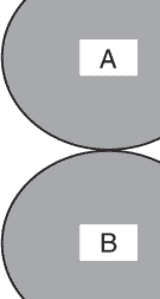
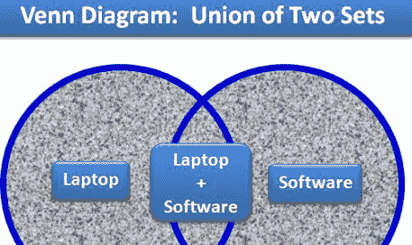

# PROC SQL：超越基础的 SAS 使用指南，第二版

# 通过 SAS 书籍更深入地了解您的 SAS® 软件

在您的知识与赋能之旅中，发现您所需的一切。

致 Darlynn 和 Ryan，

以及我的母亲、父亲和兄弟

感谢你们的爱、支持和鼓励。

- 自动排序 ................................................... 353

# 关于本书

## 目的

## 这本书适合你吗？

本书的受众包括 SAS 用户、程序员、业务分析师、统计学家、应用程序和软件开发人员、数据库分析师和管理员、支持人员、IT 支持人员以及其他希望或需要面向应用的信息来扩展 PROC SQL 知识的专业人士。本书提供了关于 PROC SQL 如何运作的内部和幕后知识，是追求信息科学、计算机科学或认知科学学位的位的学生的完美工具。

## 本版新内容

# 关于示例

## 用于开发本书内容的软件

本书的所有内容均使用 SAS®9.3 开发。

## 示例代码和数据

您可以通过链接到作者的个人页 `http://support.sas.com/larfler` 来访问本书的示例代码和数据。然后，寻找本书的封面缩略图，并选择“Example Code and Data”（示例代码和数据）以显示书中包含的 SAS 程序。

如需查看所有提供示例代码和数据的书籍字母列表，请参阅 `http://support.sas.com/bookcode`。点击标题可显示书籍的示例代码。

如果您无法通过该网站访问代码，请向 `saspress@sas.com` 发送电子邮件。

## 额外资源

SAS 为您提供了多种资源，帮助您建立自己的 SAS 技能，并探索和应用 SAS 软件的力量。无论您处于专业环境还是学术环境，我们都有学习产品可以帮助您实现 SAS 投资最大化。

| 类别 | URL |
| :--- | :--- |
| 书店 | `http://support.sas.com/bookstore/` |
| 培训 | `http://support.sas.com/training/` |
| 认证 | `http://support.sas.com/certify/` |
| SAS 全球学术计划 | `http://support.sas.com/learn/ap/` |
| SAS 按需服务 | `http://support.sas.com/learn/ondemand/` |
| 知识库 | `http://support.sas.com/resources/` |
| 技术支持 | `http://support.sas.com/techsup/` |
| 培训与书店 | `http://support.sas.com/learn/` |
| 社区 | `http://support.sas.com/community/` |

## 保持联系

我们期待收到您的反馈。我们欢迎提问、建议和疑虑。如果您想就特定书籍与我们联系，请在信函中注明书名。

## 通过 SAS Press 联系作者

电子邮件：`saspress@sas.com`

通过网页：`http://support.sas.com/author_feedback`

## SAS 书籍

如需查看 SAS 提供的完整书籍列表，请访问 `http://support.sas.com/bookstore`。

电话：1-800-727-3228

传真：1-919-677-8166

电子邮件：`sasbook@sas.com`

## SAS 书籍报告

通过订阅 SAS Book Report 月份电子报，通过电子邮件接收有关所有 SAS 新出版物的最新信息。访问 `http://support.sas.com/sbr`。

## 关于作者

Kirk Paul Lafler 是 Software Intelligence Corporation 的顾问兼创始人，自1979年来一直使用 SAS。他是 SAS 认证专业人士、IT 咨询服务提供商、全球 SAS 用户的培训师以及 sasCommunity.org 顾问委员会成员。Kirk 是 5 本书的作者，撰写了 500 多篇论文和文章，曾在 400 多场 SAS 用户组会议和活动中担任受邀演讲者和培训师，并获得了近两打项“最佳”贡献论文和实操工作坊（HOW）奖。三十多年来，他通过担任南加利尼亚 SAS 用户组（SoCalSAS）主席、创立并担任圣地亚哥 SAS 用户组（SANDS）主席，以及担任内部、本地、区域和 SAS 全球论坛会议的学术部门主席，指导用户，并为其受欢迎的 SAS Tips——“Kirk’s Corner of Quick and Simple Tips”（Kirk 的快速简单技巧角）做出贡献，该专栏定期在多个 SAS 用户组简报和网站上发表。

访问他的作者主页 `http://support.sas.com/lafler.html` 了解更多关于他的信息。在那里，您可以下载免费章节、访问示例代码和数据、阅读最新评论、获取更新等。

## 致谢

本书的出版得益于许多人的支持和鼓励。我想再次重申：“无声的感激对任何人都没有太大用处。”感谢每一位鼓励我写此书的人。正如 G. B. Stern 所说，从我向你们，感谢你们每一个人。

感谢 SAS Institute 的 Julie Platt，支持我开发更全面的第二版的愿望。她的鼓励和支持给了我完成这一项目的灵感。

感谢 SAS Institute 的 Stacey Hamilton，在我开发第二版期间提供她的编辑协助并协调了技术评审过程。

感谢 SAS Institute 的 Paul Kent，感谢多年来他富有感染力的热情、优秀的示例、清晰的解释，以及对 PROC SQL 细微之处及其能力的指导。

感谢 SAS Institute 的 David Baggett，感谢他鼓励编写关于 PROC SQL 书籍的想法，并在多年前接受了最初的第一手稿。

感谢 SAS Institute 的 Stephen Joyner，在我开发第一版期间提供支持并协调了技术评审过程。

感谢在编写过程中提供宝贵反馈、技术准确性和编辑意见的所有评审人员。

感谢 Charles Edwin、Michael Raichel、Mary Rosenblom、Richard Valley 以及 Sunil Gupta 的多年支持和鼓励。

感谢 California Consultants 的 Art Carpenter，相信一本关于“基础之外”的 PROC SQL 书籍对 SAS 用户有用。

感谢 SAS Institute 所有与我建立多年友谊的人。我想向你们以及 SAS 技术支持的同事表示感谢。感谢你们开发了这款优秀的产品，让我拥有一段充实愉快的职业生涯。

感谢全球的 SAS 用户组及其领导层和成员：你们是哪里最优秀的群体。

感谢我生命中的许多老师。特别感谢 Lawrence Dijk（六年级）、Almeida 老师（十二级）、Karl Kp教授（工业工程）、Joseph J. Moder 博士（管理科学）、Charles N. Kurucz 博士（管理科学）、John F. Stewart 博士（计算机信息）、Earl Wiener 博士（管理科学）、Howard Seth Gitlow 博士（管理科学）、Paul Sugrue（迈阿密大学商学院）、Edward K. Baker III 博士（管理科学）、Robert T. Grauer 博士（计算机信息）以及 Ulu（Rydacom）分享知识和热情。

感谢我工作过的许多人和供职过的公司：这些经历和回忆是无价的。

感谢我的母亲、父亲和兄弟为提供的所有美好经历和回忆。多年来，他们的爱和鼓励激励我学习、努力并尽情生活。

最后，感谢我的妻子 Darlynn 和儿子 Ryan，感谢你们的爱与支持让我家庭和工作之间取得了平衡。我非常爱你们。

谢谢！

## 引言

数据库设计领域在关系处理过程中非常重要。关于这个主题已经有很多著作，包括整本教科书和数千篇技术论文。本书并未对这些极其重要的主题进行详尽程度做任何掩饰。相反，它试图为不熟悉基本设计原则问题和技术的读者提供一个快速上手的的介绍。需要更多信息的读者，请参阅书末列出的参考文献。在阅读本章时，应记住以下几点。

## 数据库设计

与良好的数据库设计相关的活动需要识别最终用户需求，并涉及在物理层面定义数据值的结构。数据库设计从对所需内容的*概念性*视图开始。下一步是*逻辑设计*，它包括对数据库实体和关系建立正式描述，以满足用户需求。数据库很少由单个表组成。因此，会创建相互关联信息的表，以便对数据进行更复杂、更强大的操作。最后一步被称为*物理设计*，代表了实现逻辑数据库最佳性能和存储要求的过程。

## 概念视图

数据库的健康与否取决于其设计。数据库必须与其所有组件保持平衡（或进行优化），以避免性能和操作瓶颈。数据库设计不是凭空产生的，也不是偶然发生的过程。它涉及规划、建模、创建、监控和调整，以满足无无尽的用户需求，同时不影响资源需求。数据库设计的核心重点是规划过程。规划是一项价值巨大的组件，如果缺失，将导致数据库陷入一系列问题，包括性能低效和操作困难。数据库设计由三个不同的阶段组成，如图 1.1 所示。

### 图 1.1：数据库设计的三个不同阶段

| 概念性数据库设计 | 概念设计活动 | 逻辑数据库设计 | 逻辑设计活动 | 物理数据库设计 | 物理设计活动 |
| :--- | :--- | :--- | :--- | :--- | :--- |
| | - 识别所有实体。<br>- 定义属性的唯一性和用性。<br>- 定义属性属性（包括数据类型和大小）。<br>- 定义相互相关的实体和属性。 | | - 将概念设计标准转换为关系形式。<br>- 将实体转换为表。<br>- 将实体属性转换为列。<br>- 使用规范化规则转换表和列。 | | - 分配一个或多个索引（简单索引和复合索引）。<br>- 调整索引以获得最大性能。<br>- 必要时对表进行反规范化以提高访问速度。 |

## 表定义

PROC SQL 使用的数据模型在概念上存储为多集（multisets），而不是物理文件。物理文件由一个或多个按顺序或其他方式排列的记录组成。COBOL 和 FORTRAN 等编程语言的演变是通过一次处理一条记录来处理此类文件。这些语言的设计和使用通常是为了模拟人们处理纸质表单的方式。

PROC SQL 设计用于处理数据多集。多集没有顺序，且多集的成员具有相同类型，并使用一种被称为“表”的数据结构。为了分类起见，表是由零或多行和一或多列组成的基底，或者表是一个虚拟表（称为“视图”），其使用方法与表相同（请参见第 8 章“与视图工作”）。

## 冗余信息

良好的数据库设计规则之一是数据在同一个数据库中不应该是冗余或重复的。这一逻辑源于这样一种信念：如果数据在数据库中出现多次，就有理由相信其中一条数据很可能是错误的。此外，冗余会导致以下问题：

- 不一致性，因为当事实重复时，错误更容易发生。
- 更新异常，当数据的插入、修改或删除可能导致不一致时。

另一个需要注意的是出现过多包含 NULL 值的列。当这种情况发生时，数据库可能设计得不当。为了缓解潜在的表设计问题，会执行名为“规范化”（normalizing）的过程。如果执行得当，这可以确保表中完全没有冗余信息。

## 规范化

开发的数据库设计是数据库生命周期中的重要元素。它不仅对于在处理表和数据时实现最大的性能和灵活性至关重要，对于通过减少或消除一个多个数据库表中的冗余来组织数据也是本质的。数据库开发人员和管理员经常将表的设计称为规范化。

规范化过程通过将数据结构转换为简单来减少数据库中的冗余。执行原因如下：

- 组织数据以节省并消除任何数据的重复或循环。
- 为了能够查询和报告请求检索数据。
- 简化数据插入、更新和删除等请求。
- 减少随着新应用程序需求出现时重新组织或重构数据产生的影响。

规范化过程试图通过将较大的多列表拆分为两个或多个包含较少列的小表来简化数据库中列之间的关系。其原因在一组被称为“范式”（normal forms）的数据指南中。这些指南提供了一组规则，将包含许多列的一个或两个大型数据库转换为由多个表组成的规范化数据库，且仅包含应包含在每个表中的内容。规范化过程包含多个步骤，每个后继步骤都遵循前一步骤的规则。

规范化有助于确保数据库的某个或多个表中不包含冗余信息。在应用程序中，规范化防止了数据库中数据的破坏或错误数据的创建。这意味着事实信息在数据库中只表示一次，任何其出现多次的可能性都是不应该的，或者应该被避免的。

当数据库设计师和分析师进行规范化过程时，许多人在未达到第三范式之前是不满足的。在流行的书籍《Smarties: Advanced SQL Programming》(Morgan Kaufman, 1999) 中这样描述第三范式：“当一个列依赖于键、整个键而仅仅是键时，数据库被认为是第三范式。” 尽管规范化指南非常有用，但某些数据库纯主义者会尽力消除任何冗余，不惜性能。无论你的偏好如何，在规范化数据库时都应记住这一点。

## 规范化策略

在将实体和属性从概念设计转换为逻辑设计后，会发生被称为规范化的过程。许多，不是大多数数据库设计师在满足第三式。为了解释不同的规范化步骤，有一个示例。

## 第一式 (1NF)

第一范式（1NF）涉及消除表中的冗余。当表的所有组件（或进行优化）以避免性能和操作瓶颈时，表处于第一范式。当每个列都有单个值时，表满足 1NF。基本上，只要没有定义重复组，表就满足 1NF。下表按 CUSTOM 排序，由客户及其购买的内容组成。

| CUSTOM | CUSTOMNAME | CUSTOMITY | ITEM | UNITS | UNITCOST | MANUCITY |
| :--- | :--- | :--- | :--- | :--- | :--- | :--- |
| 1 | Smith | San Diego | Chair | 1 | 179.00 | San Diego |
| 1 | Smith | San Diego | Pens | 12 | 0.89 | Los Angeles |
| 1 | Smith | San Diego | Paper | 4 | 6.95 | Washington |
| 1 | Smithe | San Diego | Stapler | 1 | 8.95 | Los Angeles |
| 7 | Lafler | Spring Valley | Pad | 1 | 11.78 | San Diego |
| 7 | Loffler | Spring Valley | Pens | 24 | 1.59 | Los Angeles |
| 13 | Thompson | Miami | Markers | | 0.99 | |

## 第二范式 (2NF)

第二范式（2NF）解决数据集之间的关系。当表满足 1NF 的所有要求，并使用主键来链接一个表中与另一个相关的任何数据时，表处于第二范式。将表留在第一范式（1NF）的本质可能会因为表中某些信息的重复而产生问题。一个很有问题的问题是表 1.1 包含重复信息。另一个问题是客户名称中存在千禧。为了描述数据一致性问题是如何发生的，假设客户换了工作并搬到了新地方。在将客户城市更改为新位置时，很容易漏掉一个或多个客户城市的出现，导致客户错误地居住在两个不同的城市。假设我们的表格仅用于跟踪每个城市的一个客户，这无疑是一个数据一致性问题。从根本上说，第二范式（2NF）显得非常重要，因为每个非键列必须依赖于整个主键。

遵循 2NF 的表避免了在某处进行更改的需要。在规范化中，这意味着 2NF 的表没有部分依赖。因此，我们由一个满足 1NF 的单表组成的数据库需要拆分为两个表以遵循 2NF 规则。每张表都包含 `CUSTOMNAME` 列以连接这两个表。与使用 1NF 的单表相比，2NF 的表允许客户在搬到另一个城市时轻松更改其城市——`CUSTCITY` 列仅出现一次。一旦按照如下构建了 2NF 表格：

### 表 1.2：CUSTOMERS 表

| CUSTOM | CUSTOMNAME | CUSTCITY |
| --- | --- | --- |
| 1 | Smith | San Diego |
| 1 | Smithe | San Diego |
| 7 | Lafler | Spring Valley |
| 13 | Thompson | Miami |

### 表 1.3：PURCHASES 表

| CUSTOM | ITEM | UNITCOST | MANUCITY |
| --- | --- | --- | --- |
| 1 | Chair | $17.00 | San Diego |
| 12 | Pens | $0.89 | Los Angeles |
| 1 | Paper | $6.95 | Washington |
| 1 | Stapler | $8.95 | Los Angeles |
| 7 | Mouse Pad | $11.79 | San Diego |
| 24 | Pens | $1.59 | Los Angeles |
| 13 | Markers | $0.99 | Los Angeles |

## 第三范式 (3NF)

参考根据 2NF 规则构建的两个表，你可能注意到 `PURCHASES` 表包含一个名为 `MANUCITY` 的列。`MANUCITY` 列存储产品制造商总部所在的城市。在 `PURCHASES` 表中保留此列违反了第三范式（3NF），因为 `MANUCITY` 没有提供关于 `PURCHASES` 表中主键（`CUSTOM`）的事实信息。因此，当每个列都依赖于键、整个键且仅依赖于键时，表被认为处于第三范式（3NF）。3NF 表的构建方式如下，`MANUCITY` 列将位于单独表中：

### 表 1.4：CUSTOMERS 表

| CUSTNUM | CUSTNAME | CUSTCITY |
|---|---|---|


| 1 | Smith | San Diego |
| 1 | Smithe | San Diego |
| 7 | Lafler | Spring Valley |
| 13 | Thompson | Miami |

### 表 1.5：PURCHASES 表

| CUSTNUM | ITEM | UNITS | UNITCOST |
|---|---|---|---|
| 1 | Chair | 1 | $17.00 |
| 1 | Pen | 12 | $0.89 |
| 1 | Paper | 4 | $6.95 |
| 7 | Stapler | 1 | $8.95 |
| 7 | Mouse Pad | 1 | $11.79 |
| 13 | Markers | 24 | $1.59 |

### 表 1.6：MANUFACTURER 表

| MANUMUM | MANCITY |
|---|---|
| 101 | San Diego |
| 112 | San Diego |
| 210 | Los Angeles |
| 212 | Los Angeles |
| 213 | Los Angeles |
| 214 | Los Angeles |
| 401 | Washington |

## 范式之外

通常情况下，当数据库表遵循 `3NF` 规则时，数据库设计人员就很满意了。但是，其他人将数据库表规范化为第四范式（`4NF`）也并不常见，在这种情况下禁止主键与非键列之间独立的一对多关系。数据库纯主义者经常规范化到第五范式（`5NF`），将表拆分为更小的信息片段以消除任何和所有的表冗余。尽管这在大多数数据库实践者中很少是需要的。

数据库设计人员进行 `3NF` 之外的规范化没有绝对的对错之分，因为他们考虑了这样做可能产生的所有性能问题。当数据库表规范化为 `3NF` 时，经常出现的问题是产生大量的小表。在这种情况下，由于在生成查询、报告或统计之前必须先对小表进行连接，这经常会导致时间和计算机资源的增加。

## 列名与保留字

根据美国国家标准协会（`ANSI`），`SQL` 是用于关系型数据库管理系统的标准语言。`ANSI` 标准预留了一些 `SQL` 关键字作为列名。`SAS SQL` 的实现没有那么严格，但用户应该注意哪些保留字，以防止在 `SQL` 处理过程中出现意外和无期的结果。列名应符合正确的 `SAS` 命名规范（如《`SAS` 语言参考》所述），并且不应与 `SQL` 语言中的某些保留字冲突。以下列出了 `ANSI SQL` 标准中的保留字。

## ANSI SQL 保留字

| AS | INNER | OUTER | CASE | INTERSECT | RIGHT | EXCEPT | JOIN | UNION | FROM | LEFT | UPPER | FULL | LOWER | USER | GROUP | ON | WHEN | HAVING | ORDER | WHERE |

你可能不会遇到列名与 `SQL` 保留字之间的很多冲突，你只需要遵循几个简单的规则来防止处理错误的发生。如提到的，尽管 `PROC SQL` 的命名规范不像厂商的实现那么严格，但仍应小心，特别是当 `PROC SQL` 代码传输到期望无错误运行的其它数据库环境时。如果现有表中的列名是保留字，你有三个选项可用：

1.  在表中物理重命名该列，并更新对该列的任何引用。
2.  使用 `RENAME` 数据选项在当前查询中重命名所需的列。
3.  指定 `PROC SQL` 选项 `DQUOTE=ANSI`，并用双引号括住列名（保留字），所示。

## SQL 代码

```
PROC SQL DQUOTE=ANSI;
SELECT
FROM RESERVED_WORDS
WHERE "WHERE="EXAMPLE";
QUIT;
```

## 数据完整性

《韦氏新世界词典》将完整性定义为“完全或状态；可靠性；健全性”。数据完整性是每个组织追求的关键元素。

`PROC SQL: Beyond the Basics SAS®, 第二版`

## INVENTORY 表（库存）

`INVENTORY` 表包含计算机硬件和软件产品的客户库存信息。`Inventory` 表不包含历史数据。随着库存的补货，旧数量会被新数量覆盖。以下是 `Inventory` 表中每个列的描述。

### 表 1.8：Inventory 表中列的描述

| 列 | 描述 |
| :--- | :--- |
| `PRODNUM` | 识别产品的唯一编号。 |
| `MANUNUM` | 识别制造商的唯一编号。 |
| `INVENQTY` | 库存中的产品单位数量。 |
| `ORDDATE` | 产品最后订购的日期。 |
| `INVENCST` | 客户库存库中的库存成本。 |

## INVOICE 表

`INVOICE` 表包含购买产品的客户信息。每张发票通过发票号码进行唯一标识。以下是 `Invoice` 表中每个列的描述。

### 表 1.9：Invoice 表中列的描述

| 列 | 描述 |
| :--- | :--- |
| `INVNUM` | 识别发票的唯一编号。 |
| `MANUNUM` | 识别制造商的唯一编号。 |
| `CUSTNUM` | 客户编号。 |
| `PRODNUM` | 产品编号。 |
| `INVQTY` | 销售的单位数量。 |
| `INVPRICE` | 单价。 |

## MANUFACTERS 表（制造商）

`MANUFACTERS` 表包含制造硬件和软件产品的公司。两家公司不能有相同的名称。表中不保留历史数据。如果某公司被出售或停止生产计算机硬件或软件，则该制造商将从表中删除。如果制造商的地址发生变化，旧地址将被新地址覆盖。以下是 `Manufacturers` 表中每个列的描述。

### 表 1.10：Manufacturers 表中列的描述

| 列 | 描述 |
| :--- | :--- |
| `MANUNUM` | 识别制造商的唯一编号。 |
| `MANUNAME` | 制造商名称。 |
| `MANUCITY` | 制造商所在的城市。 |
| `MANSTAT` | 制造商所在的州。 |

## PRODUCTS 表（产品）

`PRODUCTS` 表包含制造商出售的计算机硬件和软件产品。每个产品通过产品编号进行唯一标识。以下是 `Products` 表中每个列的描述。

### 表 1.11：Products 表中列的描述

| 列 | 描述 |
| :--- | :--- |
| `PRODNUM` | 识别产品的唯一编号。 |
| `PRODNAME` | 产品名称。 |
| `MANUNUM` | 识别制造商的唯一编号。 |
| `PRODTYPE` | 产品类型。 |
| `PROCOST` | 产品成本。 |

## PURCHASES 表（购买）

`PURCHASES` 表包含客户购买的计算机硬件和软件产品。每个产品通过产品编号进行唯一标识。以下是 `Purchases` 表中每个列的描述。

### 表 1.12：Purchases 表中列的描述

| 列 | 描述 |
| :--- | :--- |
| `CUSTNUM` | 识别客户的唯一编号。 |
| `ITEM` | 产品名称。 |
| `UNITS` | 客户购买的项目数量。 |
| `UNITCOST` | 产品成本。 |

## 表内容

下方显示了每个表的表、变量和属性的字母顺序列表。

### 输出 1.1：Customers CONTENTS 输出

| 变量 | 类型 | 长度 | 标签 |
| --- | --- | --- | --- |
| `custcity` | Char | 20 | 客户居住城市 |
| `custname` | Char | 25 | 客户名称 |
| `custnum` | Num | 3 | 客户编号 |

### 输出 1.2：Inventory CONTENTS 输出

| 变量 | 类型 | 长度 | 格式 | 标签 |
| --- | --- | --- | --- | --- |
| `invencst` | Num | 6 | `DOLLAR10.2` | 库存成本 |
| `inventy` | Num | 3 | | 库存数量 |
| `manunum` | Num | 3 | | 制造商编号 |
| `orddate` | Num | 4 | `MMDDYY10` | 库存列表最后订购的日期 |
| `prodnum` | Num | 3 | | 产品编号 |

### 输出 1.3：Invoice CONTENTS 输出

| 变量 | 类型 | 长度 | 格式 | 标签 |
| --- | --- | --- | --- | --- |
| `custname` | Num | 3 | | 客户编号 |
| `innum` | Num | 3 | | 发票编号 |
| `inprice` | Num | 5 | `DOLLAR12.2` | 发票单价 |
| `invqty` | Num | 3 | | 发票数量 - 销售单位 |
| `manunum` | Num | 3 | | 制造商编号 |
| `prodnum` | Num | 3 | | 产品编号 |

### 输出 1.4：Manufacturers CONTENTS 输出

变量和属性的字母顺序列表

| # | 变量 | 类型 | 长度 | 标签 |
|---|---|---|---|---|
| 3 | `manacity` | Char | 20 | 制造商城市 |
| 2 | `manuname` | Char | 25 | 制造商名称 |
| 1 | `manum` | Num | 3 | 制造商编号 |
| 4 | `manustat` | Char | 2 | 制造商州 |

### 输出 1.5：Products CONTENTS 输出

变量和属性的字母顺序列表

| # | 变量 | 类型 | 长度 | 格式 | 标签 |
|---|---|---|---|---|---|
| 3 | `manum` | Num | 3 | | 制造商编号 |
| 5 | `prodcost` | Num | 5 | `DOLLAR9` | 产品成本 |
| 2 | `prodname` | Char | 25 | | 产品名称 |
| 1 | `prodnum` | Num | 3 | | 产品编号 |
| 4 | `prodtype` | Char | 15 | | 产品类型 |

### 输出 1.6：Purchases CONTENTS 输出

变量和属性的字母顺序列表

| # | 变量 | 类型 | 长度 | 格式 | 标签 |
|---|---|---|---|---|---|
| 1 | `custnum` | Num | 4 | | 客户编号 |
| 2 | `prodnum` | Num | 3 | | 产品编号 |
| 4 | `unitcost` | Num | 4 | `DOLLAR12.2` | 单位成本 |
| 3 | `units` | Num | 3 | | 数量 |

## 数据库结构

每个表之间的公共逻辑关系如下所示。

图 1.2 逻辑结构

| CUSTOMERS | INVENTORY | MANUFACTERS |
| --- | --- | --- |
| `custnum` | `prodnum` | `manunum` |
| `custname` | `inventy` | `manuname` |
| `custstat` | `orddate` | `manustat` |
| PRODUCTS | INVOICE | PURCHASES |
| `prodnum` | `manunum` | `prodnum` |
| `prodname` | `prodnum` | `units` |
| `prodtype` | `invqty` | `unicost` |
| `prodcost` | `invprice` | |
| `manunum` | | |

## 示例表

下表 `Customers`、`Inventory`、`Invoice` 和 `Purchases` 代表一个关系型数据库。这些表足够小，易于跟进，并在书中展示 `SQL` 的威力。

| Obs | `custnum` | `custcity` |
|---|---|---|
| 1 | 101 | La Mesa |
| 2 | 201 | Vista |
| 3 | 301 | Coronado |
| 4 | 401 | La Jolla |
| 5 | 501 | Alpine |
| 6 | 601 | Oceanside |
| 7 | 701 | San Diego |
| 8 | 801 | Jamul |
| 9 | 901 | Del Mar |
| 10 | 1001 | Lakeside |
| 11 | 1101 | Bonsall |
| 12 | 1201 | Rancho Santa Fe |
| 13 | 1301 | Spring Valley |
| 14 | 1401 | Poway |
| 15 | 1501 | Valley Center |
| 16 | 1601 | Fairbanks Ranch |
| 17 | 1701 | Blossom Valley |
| 18 | 1801 | Chula Vista |

### 表 1.14：INVENTORY 表

| Obs | `prodnum` | `invqty` | `orddate` | `invencst` | `manum` |
|---|---|---|---|---|---|
| 1 | 1110 | 20 | 09/01/2000 | $45000.00 | 111 |
| 2 | 1700 | 10 | 08/15/2000 | $28000.00 | 170 |
| 3 | 5001 | 5 | 08/15/2000 | $1000.00 | 500 |
| 4 | 5002 | 3 | 08/15/2000 | $900.00 | 500 |
| 5 | 5003 | 10 | 08/15/2000 | $2000.00 | 500 |
| 6 | 5004 | 20 | 09/01/2000 | $1400.00 | 500 |
| 7 | 5001 | 2 | 09/01/2000 | $1200.00 | 600 |
| N = 7 | | | | | |

### 表 1.15：INVOICE 表

| Obs | `invnum` | `manum` | `custnam` | `invqty` | `invprice` | `prodnum` |
|---|---|---|---|---|---|---|
| 1 | 1001 | 500 | | 5 | $1495.00 | 5001 |
| 2 | 1002 | 600 | 1301 | 2 | $1598.00 | 6001 |
| 3 | 1003 | 210 | 101 | 7 | $245.00 | 2101 |
| 4 | 1004 | 111 | 501 | 3 | $9600.00 | 1110 |
| 5 | 1005 | 500 | 801 | 2 | $798.00 | 5002 |
| 6 | 1006 | 500 | 901 | 4 | $396.00 | 6000 |
| 7 | 1007 | 500 | 401 | 7 | $23100.00 | 1200 |

### 表 1.16：制造商（MANUFACTERS）表

| 观测值 | `manum` | `manuname` | `manacity` | `manastat` |
|---|---|---|---|---|
| 1 | 111 | Cupid Computer | Houston | TX |
| 2 | 210 | Global Comm Corp | San Diego | CA |
| 3 | 600 | World Internet Corp | Miami | FL |
| 4 | 120 | Storage Devices Inc | San Mateo | CA |
| 5 | 500 | KPL Enterprises | San Diego | CA |
| 6 | 700 | San Diego PC Planet | San Diego | CA |

### 表 1.17：产品（PRODUCTS）表

| 观测值 | `prodnum` | `prodname` | `manum` | `prodtype` | `prodcost` |
|---|---|---|---|---|---|
| 1 | 1110 | Dream Machine | 111 | 工作站 | $3,200.00 |
| 2 | 1200 | Business Machine | 120 | 工作站 | $3,300.00 |
| 3 | 1700 | Travel Laptop | 170 | 笔记本电脑 | $3,400.00 |
| 4 | 2101 | Analog Cell Phone | 210 | 手机 | $35.00 |
| 5 | 2102 | Digital Cell Phone | 210 | 手机 | $175.00 |
| 6 | 2200 | Office Phone | 220 | 手机 | $130.00 |
| 7 | 5001 | Spreadsheet Software | 500 | 软件 | $299.00 |
| 8 | 5002 | Database Software | 500 | 软件 | $399.00 |
| 9 | 5003 | Wordprocessor Software | 500 | 软件 | $299.00 |
| 11 | 5004 | Graphics Software | 500 | 软件 | $299.00 |

### 表 1.18：购买（PURCHASES）表

| 观测值 | `custnum` | `prodnum` | `units` | `unitcost` |
|---|---|---|---|---|
| 1 | 1701 | 1110 | 1 | $3,200.00 |
| 2 | 101 | 5001 | 7 | $299.00 |
| 3 | 701 | 5001 | 11 | $299.00 |
| 4 | 701 | 5003 | 8 | $299.00 |
| 5 | 701 | 5002 | 4 | $399.00 |
| 6 | 701 | 5004 | 3 | $299.00 |


| 7 | 701 | 1700 | 2 | $3,400.00 |
| 8 | 701 | 1200 | 3 | $3,300.00 |
| 9 | 701 | 1110 | 2 | $3,200.00 |
| 10 | 1301 | 5001 | 3 | $299.00 |
| 11 | 1301 | 5003 | 5 | $299.00 |
| 12 | 1301 | 5002 | 2 | $299.00 |
| 13 | 901 | 1700 | 3 | $3,400.00 |
| 14 | 901 | 1200 | 3 | $3,300.00 |
| 15 | 901 | 1110 | 5 | $3,200.00 |
| 16 | 901 | 5001 | 9 | $299.00 |
| 17 | 901 | 5002 | 5 | $399.00 |
| 18 | 901 | 5003 | 8 | $299.00 |
| 19 | 901 | 5004 | 2 | $299.00 |
| 20 | 401 | 5001 | 11 | $299.00 |
| 21 | 401 | 5002 | 5 | $399.00 |
| 22 | 401 | 5003 | 7 | $299.00 |
| 23 | 401 | 5004 | 3 | $299.00 |
| 24 | 401 | 1700 | 3 | $3,400.00 |
| 25 | 401 | 1200 | 6 | $3,300.00 |
| 26 | 201 | 5001 | 6 | $299.00 |
| 27 | 201 | 5001 | 6 | $299.00 |
| 28 | 201 | 5003 | 9 | $299.00 |
| 29 | 201 | 5002 | 4 | $399.00 |
| 30 | 201 | 1700 | 3 | $3,400.00 |
| 31 | 901 | 5001 | 2 | $299.00 |
| 32 | 201 | 5001 | 2 | $299.00 |
| 33 | 201 | 2102 | 5 | $175.00 |
| 34 | 1101 | 2102 | 9 | $175.00 |
| 35 | 1301 | 2102 | 11 | $175.00 |
| 36 | 1401 | 2102 | 7 | $175.00 |
| 37 | 801 | 2102 | 5 | $175.00 |
| 38 | 501 | 2102 | 12 | $175.00 |
| 39 | 301 | 2102 | 8 | $175.00 |
| 40 | 1101 | 2200 | 3 | $130.00 |
| 41 | 101 | 2102 | 9 | $175.00 |
| 42 | 101 | 5003 | 3 | $299.00 |
| 43 | 101 | 5004 | 2 | $299.00 |
| 44 | 101 | 1200 | 3 | $3,400.00 |
| 45 | 101 | 1700 | 5 | $3,400.00 |
| 46 | 1301 | 1700 | 3 | $3,400.00 |
| 47 | 1601 | 1700 | 7 | $3,400.00 |
| 48 | 1801 | 1700 | 4 | $3,400.00 |
| 49 | 1001 | 1700 | 5 | $3,400.00 |
| 50 | 1101 | 1700 | 2 | $3,400.00 |
| 51 | 1201 | 1200 | 8 | $3,400.00 |
| 52 | 501 | 5001 | 3 | $299.00 |
| 53 | 501 | 5003 | 5 | $299.00 |
| 54 | 501 | 5004 | 1 | $299.00 |
| 55 | 501 | 1700 | 4 | $3,400.00 |
| 56 | 301 | 5001 | 6 | $299.00 |
| 57 | 501 | 2102 | 9 | $175.00 |

```
N = 57
```

## 总结

1. 良好的数据库设计通常可以提高在关系数据库中创建和填充表的相对易性，并可以实现到任何数据库中（参见“概念视图”章节）。
2. SQL 设计用于处理一组数据，并访问被称为表或“虚拟”表的数据结构（视图，参见“表定义”章节）。
3. 实现数据库的最优设计意味着数据库在两个或多个表中包含很少或没有冗余信息。这意味着良好的数据库设计要求数据复制很少或没有复制（参见“冗余信息”章节）。
4. 良好的数据库设计可以避免冗余、异常、昂贵或低效的处理、编码复杂性、复杂的逻辑关系、长的应用程序开发时间以及/或过度的存储需求（参见“规范化”章节）。
5. 在一阶段做出的设计决策可能涉及在另一阶段进行一或多个权衡（参见“规范化”章节）。
6. 第三范式（`3NF`）数据库被定义为依赖于键、整个键且仅依赖于键的列（参见“规范化”章节）。

# 第 2 章：在 PROC SQL 中处理数据

- 引言 ..................................................................................................... 24
- 数据类型概述............................................................................................... 24
  - 数值数据................................................................................................................... 24
  - 字符数据................................................................................................... 28
  - 缺失值和 NULL............................................................................... 28
  - 算术与缺失数据............................................................................... 29
- SQL 关键字........................................................................................... 32
- SQL 运算符和函数............................................................................... 35
  - 比较运算符.................................................................................. 36
  - 逻辑运算符.................................................................................. 36
  - 算术运算符............................................................................... 38
  - 字符字符串运算符和函数....................................................... 40
- 数据汇总.................................................................................. 58
- 谓词........................................................................................... 62
- 字典表....................................................................................... 72
  - 字典表与元数据............................................................... 72
  - 显示字典表定义........................................................... 74
  - 字典表列名..................................................................... 75
  - 访问字典表的内容.............................................................. 78
- 总结........................................................................................ 89

## 结果

| # | Variable | Type | Len |
|---|---|---|---|
| 1 | CUSTNUM | Num | 8 |
| 2 | PRONUM | Num | 8 |
| 4 | UNITCOST | Num | 8 |
| 3 | UNITS | Num | 8 |

创建一个小于 8 字节的数值列需要使用 DATA 步中的 `LENGTH` 语句。虽然没有必要为数值列分配较小的长度，因为这可能会导致精度问题，但这样做可以更有效地利用数据存储系统资源。该示例展示了一个 DATA 步，它为 PURCHASES 表中的四个变量分配了较小的长度：`CUSTNUM`、`PRONUM`、`UNITS` 和 `UNITCOST`。与之前的 PROC SQL 代码生成的 SAS 日志结果相比，CONTENTS 输出列出了一个包含四个用户定义且更短的数值变量的数据集。

## DATA Step 代码

```
DATA PURCHASES;
  LENGTH CUSTNUM 4,
         PRONUM 5,
         UNITS 3,
         UNITCOST 4;
  LABEL CUSTNUM = 'Customer Number'
       PRONUM = 'Product Purchased'
       UNITS = '# Units Purchased'
       UNITCOST = 'Unit Cost';
  FORMAT UNITCOST DOLLAR12.;
RUN;
PROC CONTENTS DATA=PURCHASES;
RUN;
```

## PROC SQL: 基础之外 SAS, 第二版

## SAS 日志结果

```
DATA PURCHASES;
  LENGTH CUSTOMNUM 4
         PRODNUM 3
         UNITS 3
         UNITCOST 4;
  LABEL CUSTOMNUM = 'Customer Number'
       PRODNUM = 'Product Purchased'
       UNITS = '# Units Purchased'
       UNITCOST = 'Unit Cost';
  FORMAT UNITCOST DOLLAR12.2;
RUN;
```

NOTE: 变量 `CUSTOMNUM` 未初始化。
NOTE: 变量 `PRODNUM` 未初始化。
NOTE: 变量 `UNITS` 未初始化。
NOTE: 变量 `UNITCOST` 未初始化。
NOTE: 数据集 PURCHASES 具有 1 个观测值和 4 个变量。
NOTE: 使用了 DATA语句：real time 2.80 seconds

```
PROC CONTENTS DATA=PURCHASES;
RUN;
```

NOTE: 使用了过程 CONTENTS：real time 1.82 seconds

## CONTENTS 结果

| Variable | Type | Len | Format | Label |
|---|---|---|---|---|
| 1 CUSTNUM | Num | 4 | | Customer Number |
| 2 PRODNUM | Num | 3 | | Product Purchased |
| 4 UNITCOST | Num | 4 | DOLLAR12.2 | Unit Cost |
| 3 UNITS | Num | 3 | | # Units Purchased |

在下一个示例中，在 PROC SQL 代码中演示了 `LENGTH=` 修饰符，用于为 PURCHASES 表中的四个数值变量（列）分配较小的长度：`CUSTNUM`、`PRODNUM`、`UNITS` 和 `UNITCOST`。

## 第2章：在 PROC SQL 中处理数据 27

## PROC SQL 代码

```
PROC SQL;
CREATE TABLE PURCHASES
(CUSTNUM NUM LENGTH=4 LABEL='Customer Number',
 PRODNUM NUM LENGTH=3 LABEL='Product Purchased',
 UNITS NUM LENGTH=3 LABEL='$ Units Purchased',
 UNITCOST NUM LENGTH=4 LABEL='Unit Cost');
QUIT;
```

如下所示的 CONTENTS 结果，使用了比默认 8 字节长度小的 `LENGTH=` 列修饰符定义了四个数值列。

## CONTENTS 结果

| | Variable | Type | Len | Format | Label |
|---|---|---|---|---|---|
| 1 CUSTNUM | Num | 4 | | Customer Number |
| 2 PRODNUM | Num | 3 | | Product Purchased |
| 4 UNITCOST | Num | 4 | DOLLAR12.2 | Unit Cost |
| 3 UNITS | Num | 3 | | # Units Purchased |

## 日期和时间列定义

数据库处理以数值数据类型的形式存储日期和信息。日期和时间值内部表示为偏移量，其中 SAS 日期值存储为从固定日期 `1960/01/01`（1960年1月1日）起的天数。`1960/01/01` 的 SAS 日期表示为 `0`。比此早的日期表示为负数，比此更晚的日期表示为正数。这使得执行计算变得容易得多。

SAS 与 PROC SQL 集成了多种日期和时间信息格式（informats）和格式（formats）。各种信息格式和格式作为输入和输出模板，描述了如何读取或渲染输出的日期和时间信息。《SAS语言参考：字典》提供了有关各种信息格式、格式及其使用的详细说明。数值日期和时间列结合信息格式和/或格式时，将根据以下规则自动验证值：

- **日期**—日期输入：格式允许 PROC SQL 和 SAS 确定日期的月份和年份值。月份值处理 `1` 到 `12` 之间的值。天值处理 `1` 到 `31` 之间的值，并根据涉及的月份对最大 `28`、`29` 或 `30` 天应用额外验证。年份处理 `1` 到 `9999` 之间的值。你可以回溯到 `1582` 年并提前到 `20,000` 年。当你输入年份 `0001` 并指定格式或世纪 `1928` 时，返回的值将是。
- **时间**—时间输入：格式允许 PROC SQL 和 SAS 确定时间的时、分、秒。小时值处理 `0` 到 `23` 之间的值。分钟值处理 `0` 到 `59` 之间的值。秒值处理 `0` 到 `59` 之间的值。
- **DATETIME**—日期和时间输入：格式允许 PROC SQL 和 SAS 确定日期时间的年、月、日、时、分、秒。年份处理 `1` 到 `9999` 之间的值。月份值处理 `1` 到 `12` 之间的值。天值处理 `1` 到 `31` 之间的值。小时值处理 `0` 到 `23` 之间的值。分钟值处理 `0` 到 `59` 之间的值。秒值处理 `0` 到 `59` 之间的值。

## 28 PROC SQL: 使用基础之外 SAS. 第二版

## 字符数据

在 SAS 中，字符数据用于存储字符字符串，如名称、地址和符号。字符数据由其长度定义，即变量可以包含的最大字符数。如果分配给字符变量的字符串短于长度，剩余空间将用空格填充。如果字符串长于长度，除非扩展长度，否则将被截断。SAS 提供了各种函数，用于处理、格式化和格式字符数据。

## 缺失值和 NULL

在 SAS 中，缺失值是一种特殊值，表示数据不可用、未知或尚未收集。对于数值变量，缺失值用点（`.`）表示。对于字符变量，缺失值用空字符串表示。区分零值和缺失值非常重要。因为空值是未知的，任何使用 null 的算术计算都将返回 null。这有时被称为空值的传播，即当 null 值用于计算或表达式时，它会传播 null 值。例如，如果将 null 加到已知值上，结果将为 null。


# 第 2 章：在 PROC SQL 中处理数据

| | | | | |
|---|---|---|---|---|
| 801 | 2102 | 5 | $175.00 | $875.00 |
| 501 | 5004 | 3 | $299.00 | $897.00 |
| 701 | 5004 | 3 | $299.00 | $897.00 |
| 401 | 5004 | 3 | $299.00 | $897.00 |
| 1301 | 5001 | 3 | $299.00 | $897.00 |
| 101 | 5003 | 3 | $299.00 | $897.00 |
| 1401 | 2102 | 7 | $175.00 | $1,225.00 |
| 301 | 2102 | 8 | $175.00 | $1,400.00 |
| 501 | 5003 | 5 | $299.00 | $1,495.00 |
| 1301 | 5003 | 5 | $299.00 | $1,495.00 |
| 501 | 2102 | 9 | $175.00 | $1,575.00 |
| 101 | 2102 | 9 | $175.00 | $1,575.00 |
| 1101 | 2102 | 9 | $175.00 | $1,575.00 |
| 201 | 5002 | 4 | $399.00 | $1,596.00 |
| 701 | 5002 | 4 | $399.00 | $1,596.00 |
| 301 | 5001 | 6 | $299.00 | $1,794.00 |
| 201 | 5001 | 6 | $299.00 | $1,794.00 |
| 201 | 5003 | 6 | $299.00 | $1,794.00 |
| 1301 | 2102 | 11 | $175.00 | $1,925.00 |
| 401 | 5002 | 5 | $399.00 | $1,995.00 |
| 901 | 5002 | 5 | $399.00 | $1,995.00 |
| 101 | 5001 | 7 | $299.00 | $2,093.00 |
| 401 | 5003 | 7 | $299.00 | $2,093.00 |
| 501 | 2102 | 12 | $175.00 | $2,100.00 |
| 901 | 5003 | 8 | $299.00 | $2,392.00 |
| 701 | 5003 | 8 | $299.00 | $2,392.00 |
| 201 | 5003 | 9 | $299.00 | $2,691.00 |
| 901 | 5001 | 9 | $299.00 | $2,691.00 |
| 1701 | 1110 | 1 | $300.00 | $3,200.00 |
| 701 | 5001 | 11 | $299.00 | $3,289.00 |
| 401 | 5001 | 11 | $299.00 | $3,289.00 |
| 701 | 1110 | 2 | $300.00 | $6,400.00 |
| 701 | 1700 | 2 | $340.00 | $6,800.00 |
| 901 | 1700 | 2 | $340.00 | $6,800.00 |
| 1101 | 1700 | 2 | $340.00 | $6,800.00 |
| 901 | 1200 | 3 | $330.00 | $9,900.00 |
| 101 | 1200 | 3 | $330.00 | $9,900.00 |
| 701 | 1200 | 3 | $330.00 | $9,900.00 |
| 201 | 1700 | 3 | $340.00 | $10,200.00 |
| 401 | 1700 | 3 | $340.00 | $10,200.00 |
| 1301 | 1700 | 3 | $340.00 | $10,200.00 |
| 501 | 1700 | 4 | $340.00 | $13,600.00 |
| 1801 | 1700 | 4 | $340.00 | $13,600.00 |
| 901 | 1110 | 5 | $320.00 | $16,000.00 |
| 1001 | 1700 | 5 | $340.00 | $17,000.00 |
| 101 | 1700 | 5 | $340.00 | $17,000.00 |
| 401 | 1200 | 6 | $330.00 | $19,800.00 |
| 1601 | 1700 | 7 | $340.00 | $23,800.00 |
| 1201 | 1200 | 8 | $330.00 | $26,400.00 |

## SQL 关键字

SQL 提供了三个关键字：`AS`、`DISTINCT` 和 `UNIQUE`，用于对结果执行特定操作。每个将按如下顺序呈现。

## 创建列别名

在使用系统函数、统计函数或算术运算计算数据时，列名或标题可能会为空。为了防止这种情况发生，用户可以使用 `AS` 关键字为列或标题本身指定以及格式说明。下一个示例说明了如何使用 `AS` 关键字防止计算列被分配临时列名 `TEMAXX`。使用 `AS` 关键字分配的名称也用于输出的列标题，如下。

### SQL 代码

```sql
PROC SQL;
SELECT PRODNAME,
       PRODTYPE,
       PROCOST * 0.80 AS Discount_Price FORMAT=DOLLAR9.2
FROM PRODUCTS
ORDER BY 3;
QUIT;
```

### 结果

| 产品名称 | 产品类型 | 折价 |
|---|---|---|
| 模拟手机 | 电话 | $280.00 |
| 办公电话 | 电话 | $104.00 |
| 数字手机 | 电话 | $140.00 |
| 电子表格软件 | 软件 | $239.20 |
| 图形软件 | 软件 | $239.20 |
| 文字处理软件 | 软件 | $239.20 |
| 数据库软件 | 软件 | $319.20 |
| 幻梦机器 | 工作站 | $560.00 |
| 商务机器 | 工作站 | $640.00 |
| 旅行笔记本 | 笔记本电脑 | $720.00 |

## 查找重复值

在某些情况下，表中的几行可能包含相同或重复的值。为了只从每个相同或重复的值选择一个，SAS 支持 `DISTINCT` 和 `UNIQUE` 关键字，且与其他数据库相比没有明显的性能差异。`DISTINCT` 关键字可以如下所示在 `SELECT` 语句中使用。

### SQL 代码

```sql
PROC SQL;
SELECT DISTINCT MANUM
FROM INVENTORY;
QUIT;
```

### 结果

| 制造商编号 |
|---|
| 111 |
| 170 |
| 500 |
| 600 |

## 查找唯一值

在某些情况下，表中的行将包含相同的列值。为了只选择这些重复值中的每一个，可以在语句中使用 `UNIQUE` 关键字。

### SQL 代码

```sql
PROC SQL;
SELECT UNIQUE MANUM
FROM INVENTORY;
QUIT;
```

### 结果

| 制造商编号 |
|---|
| 111 |
| 170 |
| 500 |
| 600 |

## SQL 运算符和函数

SQL 程序员有多种方法来实现目标。`SELECT` 语句非常强大，其语法之所以复杂，是因为列、表、运算符和谓词可以组合。例如：

- 比较运算符
- 逻辑运算符
- 算术运算符
- 字符串运算符
- 汇总函数
- 谓词

运算符和函数提供了额外的功能。每个将如下顺序呈现。

### 比较运算符

比较运算符用于比较另一个字符或数值。在 DATA 步中，比较运算符、缩写和描述如下表所示。

| SAS 运算符 | 缩写 | 描述 |
|---|---|---|
| `=` | `EQ` | 等 |
| `!=` | `NE` | 不等于 |
| `<` | `LT` | 小于 |
| `<=` | `LE` | 小于等于 |
| `>` | `GT` | 大于 |
| `>=` | `GE` | 大于等于 |

假设你想从 `PRODUCTS` 表中选择价格超过 $300.00 的产品。该示例说明了在 `WHERE` 子句中使用大于 (`>`) 来选择符合条件的产品。

#### SQL 代码

```sql
PROC SQL;
SELECT PRNAME,
       PRODTYPE,
       PROCOST
FROM PRODUCTS
WHERE PROCOST > 300;
QUIT;
```

#### 结果

| 产品名称 | 产品类型 | 价格 |
|---|---|---|
| 幻梦机器 | 工作站 | $3,200.00 |
| 商务机器 | 工作站 | $3,300.00 |
| 旅行笔记本 | 笔记本电脑 | $3,400.00 |
| 数据库软件 | 软件 | $399.00 |

SQL 还支持使用截断字符串运算符。这些运算符的工作是先将长字符串截断到与短字符串相同的长度，然后执行指定的比较。使用任何比较运算符的结果对字符串本身没有永久影响。截断字符串运算符及其含义列如下。

| 截断字符串运算符 | 描述 |
|---|---|
| `EQT` | 等 |
| `GTT` | 大于 |
| `LTT` | 小于 |
| `GET` | 大于等于 |
| `LET` | 小于等于 |
| `NET` | 不等于 |

### 逻辑运算符

逻辑运算符用于连接 `WHERE` 或 `HAVING` 子句中的两个或多个表达式。逻辑运算符由 `AND`、`OR` 和 `NOT` 组成。假设你想选择价格超过 $300.00 的软件产品。该示例说明了如何使用 `AND` 运算符确保两个条件都为真。

#### SQL 代码

```sql
PROC SQL;
SELECT PRODNAME,
       PRODTYPE,
       PROCOST
FROM PRODUCTS
WHERE PRODTYPE = 'Software' AND
      PROCOST > 300;
QUIT;
```

#### 结果

| 产品名称 | 产品类型 | 产品成本 |
|---|---|---|
| Database | 软件 | $399.00 |

下一个示例说明了如何使用 `OR` 逻辑运算符选择软件产品或成本超过 $300.00 的产品。

#### SQL 代码

```sql
PROC SQL;
SELECT PRODNAME,
       PRODTYPE,
       PRODCOST
FROM PRODUCTS
WHERE PRODTYPE = 'Software' OR
      PROCOST > 300;
QUIT;
```

#### 结果

| 产品名称 | 产品类型 | 产品成本 |
|---|---|---|
| Dream Machine | 工作站 | $3,200.00 |
| Business Machine | 工作站 | $3,300.00 |
| Travel Laptop | 笔记本 | $3,400.00 |
| Spreadsheet Software | 软件 | $299.00 |
| Database Software | 软件 | $399.00 |
| Wordprocessor Software | 软件 | $299.00 |
| Graphics Software | 软件 | $299.00 |

下一个示例说明了如何使用 `NOT` 逻辑运算符选择非软件产品且成本不超过 $300.00 的产品。如果 `PRODTYPE` 包含“Software”以外的任何值（包括空值），则输出结果将包含该行。

#### SQL 代码

```sql
PROC SQL;
SELECT PRODNAME,
       PRODTYPE,
       PROCOST
FROM PRODUCTS
WHERE NOT PRODTYPE = 'Software' AND
      NOT PROCOST > 300;
QUIT;
```

#### 结果

| 产品名称 | 产品类型 | 产品成本 |
|---|---|---|
| Analog Cell Phone | 手机 | $35.00 |
| Digital Cell Phone | 手机 | $175.00 |
| Office Phone | 手机 | $130.00 |

### 算术运算符

`PROC SQL` 中使用的算术运算符与 DATA 步中使用的相同，也与 C、Pascal、FORTRAN、COBOL 等其他语言中的运算符相同。SQL 过程中可用的算术运算符所示。

| 运算符 | 描述 |
|---|---|
| `+` | 加法 |
| `-` | 减法 |
| `*` | 乘法 |
| `/` | 除法 |
| `**` | 幂（次方） |

为了说明如何使用算术运算符，假设你想对 `PRODUCTS` 表中的产品价格 (`PROCOST`) 应用 20% 的折扣。请注意，计算出的列 (`PROCOST * 0.80`) 不会在输出时自动创建列标题。

#### SQL 代码

```sql
PROC SQL;
SELECT PRODNAME,
       PRODTYPE,
       PROCOST * 0.80
FROM PRODUCTS;
QUIT;
```

#### 结果

| 产品名称 | 产品类型 | | |
|---|---|---|---|
| Dream Machine | 工作站 | 2560 |
| Business Machine | 工作站 | 2640 |
| Travel Laptop | 笔记本 | 2720 |
| Analog Cell Phone | 手机 | 28 |
| Digital Cell Phone | 手机 | 140 |
| Office Phone | 手机 | 104 |
| Spreadsheet Software | 软件 | 239.2 |
| Database Software | 软件 | 319.2 |
| Wordprocessor Software | 软件 | 239.2 |
| Graphics Software | 软件 | 239.2 |

在下一个示例中，你想引用在 `SELECT` 语句中计算出的列。`PROC SQL` 允许使用 `CALCULATED` 关键字在同一个 `SELECT` 语句（或 `WHERE` 子句）中引用计算列。请注意，已使用 `AS` 关键字为这些列创建了别名。如果 `CALCULATED` 关键字没有放在计算列之前，则会产生错误。生成的结果按折扣价格进行排序。

#### SQL 代码

```sql
PROC SQL;
SELECT PRODNAME,
       PRODTYPE,
       PROCOST * 0.80 AS DISCOUNT_PRICE FORMAT=DOLLAR9.2,
       PROCOST - CALCULATED DISCOUNT_PRICE AS LOSS FORMAT=DOLLAR7.2
FROM PRODUCTS
ORDER BY 3;
QUIT;
```

#### 结果

| 产品名称 | 产品类型 | 折扣价 | 亏损 |
|---|---|---|---|
| Cell Phone | 手机 | $28.00 | $7.00 |
| Office Phone | 手机 | $104.00 | $26.00 |
| Digital Cell Phone | 手机 | $140.00 | $35.00 |
| Spreadsheet Software | 软件 | $239.20 | $59.80 |
| Graphics Software | 软件 | $239.20 | $59.80 |
| Wordprocessor Software | 软件 | $239.20 | $59.80 |
| Database Software | | $319.20 | $79.80 |
| Dream Machine | 工作站 | $2,560.00 | $640.00 |
| Business Machine | 工作站 | $2,640.00 | $660.00 |
| Travel Laptop | 笔记本 | $2,720.00 | $680.00 |

### 字符串运算符和函数

字符串运算符和函数通常用于字符数据。字符串运算符和函数用于处理和分析字符串。

#### 字符串拼接

下一个示例说明了使用连接运算符 `||` 组合两个字符串。下面的示例展示了使用 `CAT` 函数拼接字符串。

#### SQL 代码

```sql
PROC SQL;
SELECT PRODNAME || ',' || PRODTYPE
FROM PRODUCTS;
QUIT;
```

#### 结果

| | |
|---|---|
| Houston, TX |
| San Diego, CA |
| Miami, FL |
| San Mateo, CA |

#### 获取长度

`LENGTH` 函数返回字符串中的字符数。下一个示例说明了如何使用 `LENGTH` 函数确定字符串的长度。

#### SQL 代码

```sql
PROC SQL;
SELECT PRODNAME,
       LENGTH(PRODNAME) AS Length
FROM PRODUCTS;
QUIT();
```

#### 结果

| | 长度 |
|---|---|
| Dream Machine | 13 |
| Business Machine | 16 |
| Travel Laptop | 13 |
| Analog Cell Phone | 15 |
| Digital Cell Phone | 16 |
| Office Phone | 11 |
| Spreadsheet Software | 20 |
| Database Software | 17 |
| Wordprocessor Software | 22 |
| Graphics Software | 17 |

#### 组合函数和运算符


下面的示例展示了如何在单个 `SELECT` 语句中组合多个函数和运算符。此示例使用了 `SCAN` 函数、`TRIM` 函数和连接运算符。

## SQL 代码

```sql
PROC SQL;
SELECT SCAN(PRODNAME, 1) || " " || TRIM(PRODTYPE) AS Combined
FROM PRODUCTS;
QUIT;
```

## 修改表

`UPDATE` 语句用于修改表中现行。带有 `SET` 子句的 `UPDATE` 语句会将等号左侧的列更改为右侧常量或表达式的值。示例说明了如何使用 `WHERE` 子句来限制更新的行。

## SQL 代码

```sql
PROC SQL;
UPDATE PRODUCTS
SET PRODNAME = SCAN(PRODNAME, 1) || TRIM(PRODTYPE)
WHERE PRODTYPE = 'Phone';
QUIT;
```

使用 `LEFT` 函数将字符表达式向左对齐，并在列之间插入“，”和空格。

## SQL 代码

```sql
PROC SQL;
SELECT LEFT (MANUCITY) || " " || MANUSATAT
FROM MANUFACTURERS;
QUIT;
```

## 结果

| Houston, TX |
| San Diego, CA |
| Miami, FL |
| San Mateo, CA |
| San Diego, CA |
| San Diego, CA |

下一个示例说明了如何使用 `RIGHT` 函数将字符数据右对齐。

## SQL 代码

```sas
PROC SQL;
SELECT RIGHT (MANUCITY)
FROM MANUFACTURERS;
QUIT;
```

## 结果

| Houston |
| San Diego |
| Miami |
| San Mateo |
| San Diego |
| San Diego |

## 使用 INDEX 查找模式的出现位置

要查找模式的出现位置，可以使用 `INDEX` 函数。通常，需求允许使用特定的字符字符串对列进行搜索。`INDEX` 函数可以在 SQL 过程中用于搜索字符字符串中的模式。从左到右搜索字符字符串，寻找指定值的第一次出现位置。如果找到了所需的字符串，则返回第一个字符的列位置。否则，返回值为零 (0)。使用以下参数在列中搜索模式：字符列或表达式，以及要搜索的字符字符串。要找到产品名称 (`PRODNAME`) 中包含 "phone" 字符的所有产品，可以指定以下代码：

```sql
PROC SQL;
SELECT PRODNAME,
PRODTYPE
FROM PRODUCTS
WHERE INDEX(PRODNAME, 'phone') > 0;
QUIT;
```

## SAS 日志结果

| PROC SQL; |
| SELECT PRODNAME, PRODTYPE FROM PRODUCTS WHERE INDEX(PRODNAME, 'phone') > 0; |
| NOTE: No rows were selected. |
| QUIT; |

## 分析

与 DATA 步中一样，没有选择任何行，因为搜索是区分大小写敏感的，且 "phone" 被指定为小写字符。

## 修改字符串中的大小写

SAS 提供了两个允许您更改字符串字符大小写的函数：`LOWERCASE` 和 `UPPERCASE`。`LOWERCASE` 函数将字符串或表达式中的所有字符转换为小写字符。`UPPERCASE` 函数将字符串或表达式中的所有字符转换为大写字符。

回到之前的示例，尽管字符字符串 "phone" 在多个地方出现，但搜索结果仍为负。为了让搜索识别单词 "phone" 的所有可能的小写和大写变体，可以通过将 `UPCASE` 函数与 `INDEX` 函数结合，使 `WHERE` 子句中的搜索条件变得更“智能”，如下所示。

## SQL 代码

```sql
PROC SQL;
SELECT PRODNUM,
  PRODNAME,
  PROTYPE
FROM PRODUCTS
WHERE INDEX (UPCASE(PRODNAME), 'PHONE') > 0;
QUIT;
```

## 结果

| 产品编号 | 产品名称 | 产品类型 |
|---|---|---|
| 2101 | AnalogPhone | Phone |
| 2102 | DigitalPhone | Phone |
| 2200 | OfficePhone | Phone |

在下一个示例中，`LOWERCASE` 函数与 `INDEX` 函数结合，产生与上示例相同的输出。

## SQL 代码

```sas
PROC SQL;
SELECT PRODNUM,
  PRODNAME,
  PROTYPE
FROM PRODUCTS
WHERE INDEX (LOWCASE(PRODNAME), 'phone') > 0;
QUIT;
```

## 结果

| 产品编号 | 产品名称 | 产品类型 |
|---|---|---|
| 2101 | AnalogPhone | Phone |
| 2102 | DigitalPhone | Phone |
| 2200 | OfficePhone | Phone |

## 从字符串中提取信息

有时，处理需求要求从列中提取特定的信息。在这些情况下，可以使用 `SUBSTR` 函数配合字符列，指定起始位置和要提取的字符数。以下示例说明了如何使用 `SUBSTR` 函数从产品类型 (`PRODTYPE`) 列中获取前 4 个字节。

```sql
PROC SQL;
SELECT PRODNUM,
  PRODAME,
  PRODTYPE,
  SUBSTR(PRODTYPE, 4)
FROM PRODUCTS
WHERE PROCOST > 100.00;
QUIT;
```

## 结果

| 产品编号 | 产品名称 | 产品类型 |
|---|---|---|
| 1110 | DreamWorkstation | Work |
| 1200 | BusinessWorkstation | Work |
| 1700 | TravelLaptop | Laptop |
| 2102 | DigitalPhone | Phone |
| 2200 | OfficePhone | Phone |
| 5001 | SpreadsheetSoftware | Soft |
| 5002 | DatabaseSoftware | Soft |
| 5003 | Wordprocessor | Soft |
| 5004 | GraphicsSoftware | Soft |

## 语音匹配（相似音运算符 *）

SQL 过程中提供了一种寻找听起来相似或具有拼写变体名称的技术。这种经常使用的技术被称为语音匹配，并使用 `Soundex` 算法执行。在 Joe 的流行书籍 *SQL for Advanced Programming* (Morgan Kaufman, 1999, 第 83-87 页) 中，他将算法的起源追溯到 1918 年的 Margaret Dell 和 Robert C. Russell。在计算机出现之前，办事员使用该算法手动搜索读音相似的名字。尽管在技术上不是一个函数，但相似音运算符可以手动搜索读音相似的名字。

## 结果

| 客户编号 | 产品编号 | 数量 | 单价 | 总成本 |
|---|---|---|---|---|
| 1701 | 1110 | 1 | $3,200.00 | $3,200.00 |
| 101 | 5001 | 7 | $299.00 | $2,093.00 |
| 701 | 5001 | 11 | $299.00 | $3,289.00 |
| 701 | 5003 | 8 | $299.00 | $2,392.00 |
| 701 | 5002 | 4 | $399.00 | $1,596.00 |
| 701 | 5004 | 3 | $299.00 | $897.00 |
| 701 | 1700 | 2 | $3,400.00 | $6,800.00 |
| 701 | 1200 | 3 | $3,300.00 | $9,900.00 |
| 1301 | 1110 | 2 | $3,200.00 | $6,400.00 |
| 1301 | 5001 | 3 | $299.00 | $897.00 |
| 1301 | 5003 | 5 | $299.00 | $1,495.00 |
| 1301 | 5002 | 2 | $399.00 | $798.00 |
| 901 | 1700 | 2 | $3,400.00 | $6,800.00 |
| 901 | 1200 | 3 | $3,300.00 | $9,900.00 |
| 901 | 1110 | 5 | $3,200.00 | $16,000.00 |
| 901 | 5001 | 9 | $299.00 | $2,691.00 |
| 901 | 5002 | 5 | $399.00 | $1,995.00 |
| 901 | 5003 | 8 | $299.00 | $2,392.00 |
| 901 | 5004 | 2 | $299.00 | $598.00 |
| 401 | 5001 | 11 | $299.00 | $3,289.00 |
| 401 | 5002 | 5 | $399.00 | $1,995.00 |
| 401 | 5003 | 7 | $299.00 | $2,093.00 |
| 401 | 5004 | 3 | $299.00 | $897.00 |
| 401 | 1700 | 3 | $3,400.00 | $10,200.00 |
| 401 | 1200 | 6 | $3,300.00 | $19,800.00 |
| 201 | 5001 | 6 | $299.00 | $1,794.00 |
| 201 | 5001 | 6 | $299.00 | $1,794.00 |
| 201 | 5003 | 9 | $299.00 | $2,691.00 |
| 201 | 5002 | 4 | $399.00 | $1,596.00 |
| 201 | 1700 | 3 | $3,400.00 | $10,200.00 |
| 901 | 5001 | 2 | $299.00 | $598.00 |
| 201 | 5001 | 2 | $299.00 | $598.00 |
| 201 | 2102 | 5 | $175.00 | $875.00 |
| 1101 | 2102 | 9 | $175.00 | $1,575.00 |
| 1301 | 2102 | 7 | $175.00 | $1,225.00 |
| 1401 | 2102 | 5 | $175.00 | $875.00 |
| 801 | 2102 | 12 | $175.00 | $2,100.00 |
| 501 | 2102 | 8 | $175.00 | $1,400.00 |
| 301 | 2200 | 3 | $130.00 | $390.00 |
| 1101 | 2102 | 9 | $175.00 | $1,575.00 |

## 第2 章：在 PROC SQL 中处理数据

| 101 | 5003 | 3 | $299.00 | $897.00 |
| 101 | 5004 | 2 | $299.00 | $598.00 |
| 101 | 1200 | 3 | $3,300.00 | $9,900.00 |
| 101 | 1700 | 5 | $3,400.00 | $17,000.00 |
| 1301 | 1700 | 3 | $3,400.00 | $10,200.00 |
| 1601 | 1700 | 7 | $3,400.00 | $23,800.00 |
| 1801 | 1700 | 4 | $3,400.00 | $13,600.00 |
| 1001 | 1700 | 5 | $3,400.00 | $17,000.00 |
| 1101 | 1700 | 2 | $3,400.00 | $6,800.00 |
| 1201 | 1200 | 8 | $3,300.00 | $26,400.00 |
| 501 | 5001 | 3 | $299.00 | $897.00 |
| 501 | 5003 | 5 | $299.00 | $1,495.00 |
| 501 | 5004 | 1 | $299.00 | $299.00 |
| 501 | 1700 | 4 | $3,400.00 | $13,600.00 |
| 301 | 5001 | 6 | $299.00 | $1,794.00 |
| 501 | 2102 | 9 | $175.00 | $1,575.00 |

## 生成行号

可以使用 `MONOTONIC()` 函数获取未记录且不支持的行（观测值）计数。与 PRINT 过程（在未指定 `NOBS` 选项的情况下）生成的行号类似，`MONOTONIC()` 也会显示行号。`MONOTONIC()` 函数会自动在输出结果或新表中创建一个列（变量）。这是一个未记录的功能，且在 SQL 过程中不支持，建议用户在使用 `MONOTONIC()` 函数时小心，因为可能会获得重复值或缺失值。下面的示例说明了如何在 `SELECT` 语句中使用 `MONOTONIC()` 函数创建行号。

## SQL 代码

```sas
PROC SQL;
SELECT MONOTONIC() AS Row_Number FORMAT=COMMA6.,
PRODNUM,
UNITS;
UNITCOST
FROM PURCHASES;
QUIT;
```

## 结果

| 行号 | 产品编号 | 数量 | 单价 |
|---|---|---|---|
| 1 | 1110 | 1 | $3,200.00 |
| 2 | 5001 | 7 | $299.00 |
| 3 | 5001 | 11 | $299.00 |
| 4 | 5003 | 8 | $299.00 |
| 5 | 5002 | 4 | $399.00 |
| 6 | 5004 | 3 | $299.00 |
| 7 | 1700 | 2 | $3,400.00 |
| 8 | 1200 | 3 | $3,300.00 |
| 9 | 1110 | 2 | $3,200.00 |
| 10 | 5001 | 3 | $299.00 |
| 11 | 5003 | 5 | $299.00 |
| 12 | 5002 | 2 | $399.00 |
| 13 | 1700 | 2 | $3,400.00 |
| 14 | 1200 | 3 | $3,300.00 |
| 15 | 1110 | 5 | $3,200.00 |
| 16 | 5001 | 9 | $299.00 |
| 17 | 5002 | 5 | $399.00 |
| 18 | 5003 | 8 | $299.00 |
| 19 | 5004 | 2 | $299.00 |
| 20 | 5001 | 11 | $299.00 |
| 21 | 5002 | 5 | $399.00 |
| 22 | 5003 | 7 | $299.00 |
| 23 | 5004 | 3 | $299.00 |
| 24 | 1700 | 3 | $3,400.00 |
| 25 | 1200 | 6 | $3,300.00 |
| 26 | 5001 | 6 | $299.00 |
| 27 | 5001 | 6 | $299.00 |
| 28 | 5003 | 9 | $299.00 |
| 29 | 5002 | 4 | $399.00 |
| 30 | 1700 | 3 | $3,400.00 |
| 31 | 5001 | 2 | $299.00 |
| 32 | 5001 | 2 | $299.00 |
| 33 | 2102 | 5 | $175.00 |
| 34 | 2102 | 9 | $175.00 |
| 35 | 2102 | 11 | $175.00 |
| 36 | 2102 | 7 | $175.00 |
| 37 | 2102 | 5 | $175.00 |
| 38 | 2102 | 12 | $175.00 |
| 39 | 2102 | 8 | $175.00 |
| 40 | 2200 | 3 | $130.00 |
| 41 | 2102 | 9 | $175.00 |

## 汇总数据

SQL 过程是汇总（或聚合）数据的强大工具。它提供了许多实用的汇总（或聚合）函数，可以在 `SELECT` 语句或 `HAVING` 子句中执行计算、描述性统计和其他聚合操作。这些函数的设计用于汇总信息并显示数据的细节。

在没有 `GROUP BY` 子句的情况下使用汇总函数（参见第 3 章，“输出格式”），表中的所有行都被视为一个组。因此，结果通常是一个单行值。

可以使用许多汇总函数，包括计算非空值、确定特定列的最小值和最大值、返回范围、计算特定值的平均值、标准差和方差，以及其他聚合函数。下表列出了可用汇总函数的字母顺序列表：

## 第 2 章：在 PROC SQL 中处理数据 59

显示，并且当同一个函数有多个名称时，会先显示 ANSI 批准名称。


| 汇总函数 | 描述 |
| --- | --- |
| `AVG`, `MEAN` | 值的平均值或均值 |
| `COUNT`, `FREQ`, `N` | 非缺失值的聚合计数 |
| `CSS` | 修正后的平方和 |
| `CV` | 变异系数 |
| `MAX` | 最大值 |
| `MIN` | 最小值 |
| `NMISS` | 缺失值的个数 |
| `TNT` | 学生 t 绝对值大于概率 |
| `RANGE` | 最大值与最小值之间的差 |
| `STD` | 均值的标准误差 |
| `SUM` | 值的和 |
| `SUMWGT` | 权重为 1 的权重变量值的和 |
| `T` | 检验总体均值为零的假设 |
| `USS` | 未修正的平方和 |
| `VAR` | 方差 |

下一个示例使用 `COUNT` 函数配合 `(*)` 参数来生成总行数，无论数据是否缺失。星号 `(*)` 被指定为 `COUNT` 函数的参数，用于统计 `PURCHASES` 表中的所有行。

## SQL 代码

```
PROC SQL;
  SELECT COUNT(*) AS Row_Count
  FROM PURCHASES;
QUIT;
```

## 结果

| Row_Count |
| --- |
| 57 |

与统计行数（无论数据是否缺失）的 `COUNT(*)` 函数语法不同，下一个示例使用 `COUNT` 函数配合 `(column-name)` 参数，根据 `UNITS` 列生成非缺失行的总数。

## SQL 代码

```
PROC SQL;
SELECT COUNT (UNITS) AS Non_Missing_Row_Count
FROM PURCHASES;
QUIT;
```

## 结果

| Non_Missing_Row_Count |
| --- |
| 57 |

可以指定 `MIN` 汇总函数来确定 `PRODUCTS` 表中最便宜的产品是什么。

## SQL 代码

```
PROC SQL;
SELECT MIN(prodcost) AS Cheapest
Format=dollar.2 Label='Least Expensive'
FROM PRODUCTS;
QUIT;
```

## 结果

| Least Expensive |
| --- |
| $35.00 |

在下一个示例中，指定 `SUM` 函数来对所选列的数值数据类型求和。假设你想确定购买过工作站（`PRONUM=1110` 和 `1200`）和笔记本电脑（`PRONUM=1700`）的总成本。你可以构建以下查询，对 `PURCHASES` 表中购买工作站和笔记本电脑客户的所有非缺失值求和。

## SQL 代码

```
PROC SQL;
SELECT SUM((UNITS)) * (UNITCOST)
AS Total_Purchases FORMAT=DOLLAR12.2
FROM PURCHASES
WHERE PRODNUM = 1110 OR
PRODNUM = 1200 OR
PRODNUM = 1700;

QUIT;
```

## 结果

| Total_Purchases |
| --- |
| $237,500.00 |

数据可以按行（观测值）汇总，也可以跨列（变量）汇总。这种灵活性赋予了 SAS 强大的功能，使其能够利用 SAS 提供（或内置）的多个汇总函数。这些技术允许计算所有数量集合的平均值。如果没有在 PROC SQL 中汇总数据的能力，用户将被迫编写复杂的公式和/或例程，甚至编写并测试 DATA step 来汇总数据。将通过两个示例来展示 SQL 如何构建：

- 按行汇总数据
- 跨列汇总数据

## 按行汇总数据

可以使用 SQL 过程通过按行（或观测值）汇总数据来生成单个聚合值。在 PROC SQL 中使用汇总函数的优势在于，它计算聚合值的速度通常比构建用户定义的方程更快，并且节省了最初构建和测试包含用户定义方程的程序的精力。假设你想知道 `PRODUCTS` 表中包含各种产品的软件的平均成本。以下查询使用 `AVG` 函数计算平均成本并生成单个聚合值。

## SQL 代码

```
PROC SQL;
SELECT AVG(PROCOST) AS
AVERAGE_PRODUCT_COST FORMAT=DOLLAR10.2
FROM PRODUCTS
WHERE UPPERCASE(PROTOTYPE) IN ("SOFTWARE");

QUIT;
```

## 结果

| AVERAGE_PRODUCT_COST |
| --- |
| $324.00 |

## 跨列汇总

当需要对一行中的多个列进行计算时，可以使用 SQL 过程汇总列数据。假设你想知道库存中产品的平均成本。下一个示例在不使用汇总函数的情况下计算每个产品的库存成本，并在计算后将行的值显示为 `AVERAGE_PRICE`。

## SQL 代码

```
PROC SQL;
SELECT
  (INPRICE / INVQTY) AS
  AVERAGE_PRICE
  FORMAT=DOLLAR.2
FROM INVOICE;
QUIT;
```

## 结果

| Product Number | AVERAGE_PRICE |
| --- | --- |
| 5001 | $299.00 |
| 6001 | $799.00 |
| 2101 | $35.00 |
| 1110 | $3200.00 |
| 5002 | $399.00 |
| 6000 | $99.00 |

## 谓词

谓词用于 PROC SQL 中过滤行。

## 选择范围

`BETWEEN` 谓词是一种选择范围内值的方法。`BETWEEN` 谓词包含端点。

## SQL 代码

```
PROC SQL;
  SELECT PRODAME,
         PRODYPE,
         PROCOST
FROM PRODUCTS
WHERE PROCOST BETWEEN 200 AND 500;
```

## 结果

| PRODAME | PRODYPE | PROCOST |
| --- | --- | --- |
| Desk Chair | Furniture | 250.00 |
| Office Table | Furniture | 450.00 |
| Monitor | Electronics | 300.00 |

在下一个示例中，手机和软件产品都从 `PRODUCTS` 表中选择。

为了避免指定两个 OR 条件，这里使用了 `IN` 谓词。

## SQL 代码

```
PROC SQL;
  SELECT PRODNAME,
         PRODTYPE,
         PROCOST
  FROM PRODUCTS
  WHERE UPPERCASE(PRODTYPE) IN ('PHONE', 'SOFTWARE');

QUIT;
```

## 结果

| 产品名称 | 产品类型 | 产品成本 |
| --- | --- | --- |
| AnalogPhone | Phone | $35.00 |
| DigitalPhone | Phone | $175.00 |
| OfficePhone | Phone | $130.00 |
| SpreadsheetSoftware | Software | $299.00 |
| DatabaseSoftware | Software | $399.00 |
| WordprocessorSoftware | Software | $299.00 |
| GraphicsSoftware | Software | $299.00 |

## 测试 NULL 或缺失值

`IS NULL` 谓词是 ANSI 标准方法，通过评估列值是否缺失或为 NULL 来选择一行或多行（参见“缺失值与 Null”章节）。下一个示例从 `INVENTORY` 表中选择无库存的项。

## SQL 代码

```
PROC SQL;
  SELECT PRODNUM,
         INVENQTY,
         INVENCST
  FROM INVENTORY
  WHERE INVENQTY IS NULL;

QUIT;
```

## SAS 日志结果

```
PROC SQL;
SELECT PRODNUM,
    INVENQTY,
    INVCOST
FROM INVENTORY
WHERE INVENQTY IS NULL;
NOTE: No rows were selected.
QUIT;
NOTE: PROCEDURE SQL used:
    real time              0.05 seconds
```

下一个示例从 `INVENTORY` 表中选择当前有库存的项。注意，可以指定 `NOT NULL` 或 `IS NOT NULL` 谓词来产生相同的结果。

## SQL 代码

```
PROC SQL;
SELECT PRODNUM,
    INVENQTY,
    INVCOST
FROM INVENTORY
WHERE INVENQTY IS NOT NULL;
QUIT;
```

## 结果

| 产品编号 | 库存数量 | 库存成本 |
| --- | --- | --- |
| 1110 | 20 | $45,000.00 |
| 1700 | 10 | $28,000.00 |
| 5001 | 5 | $1,000.00 |
| 5002 | 3 | $900.00 |
| 5003 | 10 | $2,000.00 |
| 5004 | 20 | $1,400.00 |
| 5001 | 2 | $1,200.00 |

`MISSING` 谓词的功能与选择包含缺失值（null）的一或多行完全相同。区别在于指定 `IS NULL` 是表达该谓词的 ANSI 标准方式，而 `IS MISSING` 在 SAS 中常用。下一个示例使用 `IS MISSING` 配合 `NOT` 谓词从 `INVENTORY` 表中选择有库存的项。

## SQL 代码

```
PROC SQL;

SELECT PRODNUM,

INVENTORY,

INVENCST

FROM INVENTORY

WHERE INVENTORY IS NOT MISSING;

QUIT;
```

## 在字符串中查找模式（模式匹配 % 和 _）

在字符串表达式中使用 `LIKE` 谓词构建特定的搜索模式是一个简单过程。`%`（百分号）作为通配符字符，代表任意数量的字符，包括大小写字母的任意组合。将 `LIKE` 谓词与 `t%` 结合允许区分大小写的搜索，这是精练的 SQL 程序员查找数据中模式的常用技术。

使用带有 `%` 的 `LIKE` 运算符提供了通配符功能，能够选择匹配特定模式的行。`LIKE` 谓词是区分大小写的，应谨慎使用。要查找第一位为大写字母“A”且后跟任意数量字符的产品名称 (`PRONAME`)，可以通过以下 `WHERE` 子句指定。

## SQL 代码

```
PROC SQL;

SELECT PRODNAME

FROM PRODUCTS

WHERE PRODNAME LIKE '%A%';

QUIT;
```

## 结果

| 产品名称 |
| --- |
| Analog Cell Phone |

下一个示例说明了在搜索词前后使用通配符字符 `%`，以选择所有名称中包含“Soft”单词的产品。输出结果包含诸如“Software”之类的类型以及任何包含“Soft”单词的产品。

## SQL 代码

```
PROC SQL;

SELECT PRODNAME,

       PRODTYPE,

       PROCOST

FROM PRODUCTS

WHERE PRODTYPE LIKE '%Soft%';

QUIT;
```

## 结果

| 产品名称 | 产品类型 | 产品成本 |
| --- | --- | --- |
| SpreadsheetSoftware | Software | $299.00 |
| DatabaseSoftware | Software | $399.00 |
| WordprocessorSoftware | Software | $299.00 |
| GraphicsSoftware | Software | $299.00 |

在下一个示例中，使用 `LIKE` 谓词检查列是否存在尾随空格。将通配符 `%` 后跟一个空格指定为搜索参数。

## SQL 代码

```
PROC SQL;

SELECT PRODNAME

FROM PRODUCTS

WHERE PRODNAME LIKE '% %';

QUIT;
```

## 结果

| 产品名称 |
| --- |
| DreamWorkstation |
| BusinessWorkstation |
| TravelLaptop |
| AnalogPhone |
| DigitalPhone |
| OfficePhone |
| SpreadsheetSoftware |
| DatabaseSoftware |
| WordprocessorSoftware |
| GraphicsSoftware |

当需要对特定数量的字符进行模式搜索时，带有下划线 `_` 的 `LIKE` 谓词提供了一种逐字符匹配的方法。因此，特定位置上的单个下划线 `_` 作为该位置的通配符。两个连续的下划线 `__` 作为两个位置的通配符。三个连续的下划线 `___` 作为三个位置的通配符。以此类推。在下一个示例中，用于搜索产品类型的第一个位置包含字符“P”，接下来五个位置（用五个下划线表示）作为占位符。

## SQL 代码

```
PROC SQL;

SELECT PRODNAME,

       PRODTYPE,

       PROCOST

FROM PRODUCTS

WHERE UPPERCASE(PRODTYPE) LIKE 'P_____';

QUIT;
```

## 结果

| 产品名称 | 产品类型 | 产品成本 |
| --- | --- | --- |
| AnalogPhone | Phone | $35.00 |
| DigitalPhone | Phone | $175.00 |
| OfficePhone | Phone | $130.00 |

下一个示例演示了名称 (`PRODNAME`) 的模式搜索，其中前三个位置表示为通配符；第四位包含小写字母“a”，后跟任意组合的字符。

## SQL 代码

```
PROC SQL;

SELECT PRODNAME

FROM PRODUCTS

WHERE PRODNAME LIKE '___a%';

QUIT;
```


## 结果

| 产品名称 |
|---|
| Dream Machine |
| Database Software |

## 字典表

SAS 生成并维护关于 SAS 库、数据集、目录、索引、宏、系统选项、标题、视图和其他集合中内容的宝贵运行时信息（元数据），这些信息存储在一组名为“字典表”的只读表中。虽然被称为表，但字典表完全不是真正的表。字典表及其内容允许对 SAS 会话的活动进行访问和监控。信息在 SAS 会话启动时自动生成并使表变得可用。

| 字典表名称 | 内容 |
|---|---|
| DICTIONARY.CATALOGS | SAS 目录 |
| DICTIONARY.COLUMNS | 数据集的列和属性 |
| DICTIONARY.EXTFILES | 分配的符号引用 (filrefs) 和外部物理路径 |
| DICTIONARY.INDEXES | 数据集索引 |
| DICTIONARY.MACROS | 全局和自动宏变量 |
| DICTIONARY.MEMBERS | SAS 数据集和其他成员类型 |
| DICTIONARY.OPTIONS | 当前 SAS 系统选项 |
| DICTIONARY.TABLES | SAS 数据集和视图 |
| DICTIONARY.TITLES | 标题和脚注定义 |
| DICTIONARY.VIEWS | SAS 数据视图 |

## 字典表与元数据

SAS 收集并填充了关于 SAS 库、数据集（表）、目录、索引、宏、系统选项、标题、视图以及一组称为字典表的其他只读表的宝贵信息（“元数据”或关于数据的数据）。字典表通过提供有关当前 SAS 会话数据库和应用程序的系统信息来实现特殊用途。当对字典表请求查询时，SAS 会在运行时自动启动发现过程以收集与该表相关的信息。在 SAS 会话启动时随时可用。

虽然早期版本的 SAS 软件有 22 个字典表和 SASHELP 视图，但 SAS 9.2 中有 29 个“已知”字典视图和 SASHELP 视图，SAS 9.3 中有 30 个“已知”字典表和 SASHELP 视图，下方展示了每个 DICTIONARY 表和 SASHELP 视图的名称。

# 第 2 章：在 PROC SQL 中处理数据

## 表 2.2：字典表和 SASHELP 视图

| 字典表 | SASHELP 视图 | 用途 |
|---|---|---|
| CATALOGS | VCATALG | 提供关于 SAS 目录的信息 |
| CHECK_CONSTRAINTS | VCHCKON | 提供检查约束信息 |
| COLUMNS | VCOLUMN | 提供列表的信息 |
| CONSTRAINT_COLUMN_USAGE | VCNCOLU | 提供列完整性约束信息 |
| CONSTRAINT_TABLE_USAGE | VCNTABU | 提供与定义了完整性约束的表相关的信息 |
| DATAITEMS | VDATAIT | 提供已知数据项的信息 |
| DESTINATIONS | VDEST | 提供已知 ODS 目的的信息 |
| DICTIONARIES | VDCTNRY | 提供关于所有 DICTIONARY 表的信息 |
| ENGINES | VENGINE | 提供会话可用的所有 SAS 引擎的信息 |
| EXTFILES | VEXTFL | 提供与外部文件相关的信息 |
| FILTERS | VFILTER | 提供已知过滤器的信息 |
| FORMATS | VFORMAT | 提供与定义格式和信息的信息 |
| FUNCTIONS | VFUNC | 提供所有已知函数的信息 |
| GOPTIONS | VGOPT | 提供当前定义的 SAS/GRAPH 图形选项信息 |
| INDEXES | VINDEX | 提供与定义索引相关的信息 |
| INFOMAPS | VINFOMP | 提供所有已知信息映射的信息 |
| LIBNAMES | VLIBNAM | 提供与定义的 SAS 数据库相关的信息 |
| MACROS | VMACRO | 提供与任何定义的宏相关的信息 |
| MEMBERS | VMEMBER | 提供当前在 SAS 数据库中定义的对象相关的信息 |
| OPTIONS | VOPTION | 提供与 SAS 系统选项相关的信息 |
| PROMPTS | VPROMPT | 提供所有已知 SAS/GRAPH 提示的信息 |
| PROMPTSXML | VPRMXML | 提供所有已知 XML 提示的信息 |
| REFERENTIAL_CONSTRAINTS | VREFCON | 提供与具有引用约束的表相关的信息 |
| REMEMBER | VREMEMB | 提供所有已知记忆文本的信息 |
| STYLES | VSTYLE | 提供与所选 ODS 样式相关的信息 |
| TABLES | VTABLE | 提供与当前定义的表的信息 |
| TABLE_CONSTRAINTS | VTABCON | 提供与包含完整性约束的表相关的信息 |
| TITLES | VITLE | 提供与当前定义的标题和脚注相关的信息 |
| VIEWS | VVIEW | 提供与当前定义的数据视图相关的信息 |

## 显示字典表定义

你可以通过指定 `DESCRIBE TABLE` 语句来查看字典表的定义并加强对每个表内容的理解。创建每个字典表的语句产生的结果可以显示在 SAS 日志中。例如，下方展示了一个 `DESCRIBE TABLE` 语句，用于显示包含当前 SAS 系统选项设置的 OPTIONS 字典表的 `CREATE TABLE` 语句。

## SQL 代码

```
PROC SQL;
  DESCRIBE TABLE
  DICTIONARY.OPTIONS;
QUIT;
```

## SAS 日志结果

```
create table DICTIONARY.OPTIONS
(
  optname char(32) label='Option Name',
  setting char(1024) label='Option Setting',
  optdesc char(160) label='Option Description',
  level char(8) label='Option Location'
)
```

注意：`DICTIONARY.OPTIONS` 中的信息在 SASHELP 视图可用。为了熟悉字典表名称，下表显示了列及其类型。

### 表 2.3：DICTIONARY.CATALOGS 或 SASHELP

| 列 | 类型 | 长度 | 标签 |
|---|---|---|---|
| Libname | char | 8 | 库名 |
| Memname | char | 32 | 成员名 |
| Memtype | char | 8 | 类型 |
| Objdesc | char | 256 |  |
| Cdate | num | DATETIME. DATETIME. | 创建日期 |
| Modate | num | DATETIME. DATETIME. | 修改日期 |
| Alias | char | 8 | 别名 |

### 表 2.4：DICTIONARY.COLUMNS 或 SASHELP

| 列 | 类型 | 长度 | 标签 |
|---|---|---|---|
| Libname | char | 8 | 库名 |
| Memname | char | 32 | 成员名 |
| Memtype | char | 8 | 类型 |
| Name | char | 32 | 名称 |
| Type | char | 8 | 类型 |
| Length | num | | 长度 |
| Pos | num | | 位置 |
| Label | char | 256 | 标签 |

### 表 2.5：DICTIONARY.EXTFILES 或 SASHELP

| 列 | 类型 | 长度 | 标签 |
|---|---|---|---|
| Fileref | char | 8 | 符号引用 |
| Path | char | 1024 | 路径 |
| Engine | char | 8 | 引擎名 |

### 表 2.6：DICTIONARY.INDEXES 或 SASHELP

| 列 | 类型 | 长度 | 标签 |
|---|---|---|---|
| Libname | char | 8 | 库名 |
| Memname | char | 32 | 成员名 |
| Memtype | char | 8 | 类型 |
| Name | char | 32 | 名称 |
| Idxusage | char | 9 | 索引类型 |
| Indname | char | 32 | 索引名 |
| Indpos | num | | 位置 |
| Nomiss | char | 3 | 非唯一 |
| Unique | char | 3 | 唯一 |

### 表 2.7：DICTIONARY.MACROS 或 SASHELP

| 列 | 类型 | 长度 | 标签 |
|---|---|---|---|
| Scope | char | 9 | 宏作用域 |
| Name | char | 32 | 变量名 |
| Offset | num | | 宏变量偏移 |
| Value | char | 200 | 变量值 |

### 表 2.8：DICTIONARY.MEMBERS 或 SASHELP

| 列 | 类型 | 长度 | 标签 |
|---|---|---|---|
| Libname | char | 8 | 库名 |
| Memname | char | 32 | 成员名 |
| Memtype | char | 8 | 类型 |
| Engine | char | 8 | 引擎名 |
| Index | char | 32 | 索引 |
| Path | char | 1024 | 路径 |

### 表 2.9：DICTIONARY.OPTIONS 或 SASHELP

| 列 | 类型 | 长度 | 标签 |
|---|---|---|---|
| Optname | char | 32 | 选项名 |
| Setting | char | 1024 | 选项设置 |
| Optdesc | char | 160 | 选项描述 |
| Level | char | 8 | 选项位置 |

### 表 2.10：DICTIONARY.TABLES 或 SASHELP

| 列 | 类型 | 长度 | 格式 | 属性 | 标签 |
|---|---|---|---|---|---|
| Libname | char | 8 | | | 库名 |
| Memname | char | 32 | | | 成员名 |
| Memtype | char | 8 | | | 类型 |
| Name | char | 32 | | | 名称 |
| Type | char | 8 | | | 类型 |
| Length | num | | | | 长度 |
| Pos | num | | | | 位置 |
| Label | char | 256 | | | 标签 |
| Nobs | num | | | | 观测数 |
| Obslen | num | | | | 观测长度 |
| Nvar | num | | | | 变量数 |
| Protect | char | | | | 保护类型 |
| Compress | char | 8 | | | 压缩程序 |
| Encrypt | char | 8 | | | 加密 |
| Npage | num | | | | 页面数 |
| Pecompress | num | | | | 压缩率 |
| Reuse | char | 3 | | | 重用空间 |
| Bufsize | num | | | | 缓冲区大小 |
| Delobs | num | | | | 删除的观测数 |
| Indextype | char | 9 | | | 索引类型 |
| Datarep | char | 32 | $HEX. | | 数据表示方式 |
| Reqvector | char | 24 | $HEX. | $HEX. | 请求向量 |

### 表 2.11：DICTIONARY.TITLES 或 SASHELP.TITLE

| 列 | 类型 | 长度 | 标签 |
|---|---|---|---|
| Type | char | 1 | 标题位置 |
| Number | num | | 标题编号 |
| Text | char | 256 | 标题文本 |

### 表 2.12：DICTIONARY.VIEWS 或 SASHELP.VVIEW

| 列 | 类型 | 长度 | 标签 |
|---|---|---|---|
| Libname | char | 8 | 库名 |
| Memname | char | 32 | 成员名 |
| Memtype | char | 8 | 成员类型 |
| Engine | char | 8 | 引擎名称 |

## 访问字典表的内容

通过 SQL `SELECT` 语句的 `FROM` 子句访问字典表的内容。结果以行和列的形式在表格中显示，并用于处理常见的数据处理任务，包括已分配的库、目录和数据集列表，以及向软件应用程序传递 SAS 环境设置。用户应该花时间探索这些只读字典表的功能，并熟悉它们所提供的信息类型。

> Lafler, Kirk Paul. PROC SQL: Beyond the Basics using SAS®, Second Edition. Copyright 2013, SAS Institute, Inc., Cary, North Carolina, USA. 版权所有。更多 SAS 资源，请访问 support.sas.com/bookstore。

# 第 2 章：在 PROC SQL 中处理数据

## Dictionary.CATALOGS

使用 CATALOGS 字典表可以快速方便地获取关于目录及其成员的详细信息。你可以从任何 SAS 库中，根据成员名、对象类型和描述、创建和最后修改时间以及对象别名，获取一个排序的目录信息列表。例如，以下代码生成了 SASUSER 库中的目录对象列表。

注意：由于此字典表会产生大量信息，建议在使用时指定 `WHERE` 子句。

## SQL 代码

```
PROC SQL;
SELECT *
FROM DICTIONARY.CATALOGS
WHERE NAME="SASUSER";
QUIT;
```

## 结果

| 库名 | 成员名 | 成员类型 | 对象名称 | 对象描述 | 创建日期 | 修改日期 | 对象别名 | 库连接级别 |
|---|---|---|---|---|---|---|---|---|
| SASUSER | PROBAK | CATALOG | DMNRYS | KEYS | 函数键定义 | 07NOV:12 14:55:49 | | | 0 |
| SASUSER | PROBAK | CATALOG | PRVLIST | LIST | _prtest_list | 22JUL:13 03:24:25 | 22JUL:13 03:24:25 | | 0 |
| SASUSER | PROBAK | CATALOG | VIEW | | | | 22JUL:13 03:53:26 | 22JUL:13 03:53:26 | | 0 |
| SASUSER | PROBAK | CATALOG | VIRTDGL | | | | 10OCT:11 08:25:24 | 10OCT:11 08:25:24 | | 0 |
| SASUSER | PROBAK | CATALOG | VIEWSAVE | | | | 偏好信息 | 10OCT:11 08:25:24 | 10OCT:11 08:25:24 | | 0 |
| SASUSER | PROFILE | CATALOG | DMNRYS | KEYS | 函数键定义 | 07NOV:12 14:55:49 | 07NOV:12 14:55:49 | | 0 |
| SASUSER | PROFILE | CATALOG | PRVLIST | LIST | _prtest_list | 24JUL:13 04:17:12 | 24JUL:13 04:17:12 | | 0 |
| SASUSER | PROFILE | CATALOG | VIEW | | | | 22JUL:13 03:53:30 | 22JUL:13 03:53:30 | | 0 |
| SASUSER | PROFILE | CATALOG | VIRTDGL | | | | 24JUL:13 01:27:42 | 24JUL:13 01:27:42 | | 0 |
| SASUSER | PROFILE | CATALOG | VIEWSAVE | | | | 偏好信息 | 10OCT:11 08:25:24 | 10OCT:11 08:25:24 | | 0 |
| SASUSER | PROFILE | CATALOG | DMNRYS | KEYS | 函数键定义 | 07NOV:12 14:55:49 | 07NOV:12 14:55:49 | | 0 |

## Dictionary.COLUMNS

使用 COLUMNS 字典表可以轻松检索一个或多个数据集的列信息。类似于 CONTENTS 过程的结果，你可以通过列名、类型、长度、位置、格式和索引来获取列级信息。例如，以下代码请求 WORK 库中包含 CUSTOM 的列引用列表。

注意：在 `WHERE` 子句中指定多个函数时，SQL 优化器无法进行优化。这可能会导致查询运行时间比预期的长。

> Lafler, Kirk Paul. PROC SQL: Beyond the Basics using SAS®, Second Edition. Copyright 2013, SAS Institute, Inc., Cary, North Carolina, USA. 版权所有。更多 SAS 资源，请访问 support.sas.com/bookstore。

## SQL 代码

```
PROC SQL;
SELECT *
FROM DICTIONARY.COLUMNS
WHERE UPPERCASE(LIBNAME)="WORK" AND UPPERCASE(NAME)="CUSTOMERS";
QUIT;
```


## 结果

| 库名 | 成员名 | 列类型 | 列名称 | 列编号 | 列长度 | 索引类型 | 排序 | 扩展 | 非空 | 转换 |
|---|---|---|---|---|---|---|---|---|---|---|
| WORK | CUSTOMERS | DATA | COLUMNS | 3 | 0 | | | | no | yes |
| WORK | CUSTOMERS2 | DATA | COLUMNS | 3 | 0 | | | | no | yes |
| WORK | CUSTOMERS_BACKUP | DATA | COLUMNS | 8 | 0 | | | | no | yes |
| WORK | CUSTOM3 | DATA | COLUMNS | 3 | 0 | | | | no | yes |
| WORK | PURCHASES | DATA | COLUMNS | 4 | 0 | | Custom | | no | yes |
| WORK | PURCHASES2 | DATA | COLUMNS | 4 | 0 | | | | no | yes |

## DICTIONARY.DICTIONARIES

用户可以通过访问只读的 `DICTIONARIES` 字典表或 `SASHELP` 视图轻松识别所有可用的字典表。`DICTIONARIES` 字典表和 `SASHELP` 视图的内容显示了表和视图的名称。以下 `PROC SQL` 查询使用 `UNIQUE` 关键字生成字典表列表。

## PROC SQL 代码：

```
PROC SQL;
SELECT UNIQUE MEMNAME
FROM DICTIONARY.DICTIONARIES;
QUIT;
```

## 结果：

| 成员名 |
|---|
| CATALOGS |
| CHECK_CONSTRAINTS |
| COLUMNS |
| CONSTRAINT_COLUMN_USAGE |
| CONSTRAINT_TABLE_USAGE |
| DATAITEMS |
| DESTINATIONS |
| DICTIONARIES |
| ENGINES |
| EXTIFILES |
| FILTERS |
| FORMATS |
| FUNCTIONS |
| GPOPTIONS |
| INDEXES |
| INFOMAPS |
| LIBNAMES |
| MACROS |
| MEMBERS |
| OPTIONS |

## 第2 章：在 PROC SQL 中处理数据

## Dictionary.INDEXES

有时显示现有简单索引和复合索引的名称，或者引用特定列名的 SAS 表格非常有用。`INDEXES` 字典表提供了帮助识别提高查询性能索引的重要信息。例如，要显示在任何示例表中引用 `CUSTMANN` 列名的索引，可以指定以下代码。

> **注意**：请参阅第 10 章“性能与效率调优”，以了解与索引相关的性能调优技术。

## SQL Code

```
PROC SQL;
SELECT *
FROM DICTIONARY.INDEXES
WHERE UPPERCASE(NAME)="CUSTMANN" /* 列名 */
AND UPPERCASE(LIBNAME)="WORK" /* 库名 */
QUIT;
```

## Dictionary.MACROS

通过 `MACROS` 字典表可以获取宏变量名称及其值。`MACROS` 字典表提供了全局和自动宏变量的信息，但不提供局部宏变量的信息。例如，要获取全局宏 `SQLOBS`、`SQLLOOPS`、`SQLXOBS` 或 `SQLRC` 的特定列，可以指定以下代码。

## SQL Code

```
PROC SQL;
SELECT *
FROM DICTIONARY.MACROS
WHERE UPPERCASE(SCOPE)="GLOBAL";
QUIT;
```

Lafler, Kirk Paul. PROC SQL: Beyond the Basics Using SAS®; Second Edition. Copyright 2013, SAS Institute, Inc.. Cary, North Carolina, USA. ALL RIGHTS RESERVED. 更多 SAS 资源，请访问 support.sas.com/bookstore。

## Results

| 宏作用域 | 宏变量名 | 宏变量中的偏移量 | 宏变量值 |
| --- | --- | --- | --- |
| GLOBAL | SQLOBS | 0 | 0 |
| GLOBAL | SQLOPS | 0 | |
| GLOBAL | SYS_SQL_IP_ALL | 0 | -1 |
| GLOBAL | SYS_SQL_IP_STMT | 0 | |
| GLOBAL | SQLXOBS | 0 | 0 |
| GLOBAL | SQLRC | 0 | 0 |
| GLOBAL | SQLEXITCODE | 0 | 0 |

## Dictionary.MEMBERS

访问数据集、视图和目录的详细列表是 `MEMBERS` 字典表的特征。你将能够通过库、成员名和类型、索引以及物理路径名访问极其丰富的信息资源。例如，要获取 `WORK` 库中各个文件的列表，可以指定以下代码。

```
PROC SQL;
SELECT *
FROM DICTIONARY.MEMBERS
WHERE UPPERCASE(LIBNAME)="WORK";
QUIT;
```

## 结果

| 库名 | 成员名 | 成员类型 | DBMS | 成员类型 | 引擎 | 索引 | 路径 |
| --- | --- | --- | --- | --- | --- | --- | --- |
| WORK | CUSTOMERS | TABLE | DATA | BASE | V9 | no | C:\Users\Vagrant\AppData\Local\Temp\Temporary_File_T06872_APL_PC_ |
| WORK | CUSTOMERS | TABLE | DATA | BASE | V9 | no | C:\Users\Vagrant\AppData\Local\Temp\Temporary_File_T06872_APL_PC_ |
| WORK | CUSTOMERS_BACKUP | TABLE | DATA | BASE | V9 | no | C:\Users\Vagrant\AppData\Local\Temp\Temporary_File_T06872_APL_PC_ |
| WORK | INVENTORY | TABLE | DATA | BASE | V9 | no | C:\Users\Vagrant\AppData\Local\Temp\Temporary_File_T06872_APL_PC_ |
| WORK | INVENTORY_NEW | VIEW | DATA | BASE | V9 | no | C:\Users\Vagrant\AppData\Local\Temp\Temporary_File_T06872_APL_PC_ |
| WORK | INVOICE | VIEW | DATA | BASE | V9 | no | C:\Users\Vagrant\AppData\Local\Temp\Temporary_File_T06872_APL_PC_ |
| WORK | INVOICE_NEW | VIEW | DATA | BASE | V9 | no | C:\Users\Vagrant\AppData\Local\Temp\Temporary_File_T06872_APL_PC_ |
| WORK | LAPTOP_23D_VIEW | VIEW | DATA | BASE | V9 | no | C:\Users\Vagrant\AppData\Local\Temp\Temporary_File_T06872_APL_PC_ |
| WORK | LAPTOP_23D_NEW | VIEW | DATA | BASE | V9 | no | C:\Users\Vagrant\AppData\Local\Temp\Temporary_File_T06872_APL_PC_ |
| WORK | LARGEST_AMOUNT | VIEW | DATA | BASE | V9 | no | C:\Users\Vagrant\AppData\Local\Temp\Temporary_File_T06872_APL_PC_ |
| WORK | MANUFACTURES | TABLE | DATA | BASE | V9 | no | C:\Users\Vagrant\AppData\Local\Temp\Temporary_File_T06872_APL_PC_ |
| WORK | MANUFACTURES_NEW | VIEW | DATA | BASE | V9 | no | C:\Users\Vagrant\AppData\Local\Temp\Temporary_File_T06872_APL_PC_ |
| WORK | PRODUCTS | TABLE | DATA | BASE | V9 | yes | C:\Users\Vagrant\AppData\Local\Temp\Temporary_File_T06872_APL_PC_ |
| WORK | PRODUCTS_NEW | TABLE | DATA | BASE | V9 | no | C:\Users\Vagrant\AppData\Local\Temp\Temporary_File_T06872_APL_PC_ |
| WORK | PRODUCTS_NULL | TABLE | DATA | BASE | V9 | no | C:\Users\Vagrant\AppData\Local\Temp\Temporary_File_T06872_APL_PC_ |
| WORK | PURCHASES | TABLE | DATA | BASE | V9 | no | C:\Users\Vagrant\AppData\Local\Temp\Temporary_File_T06872_APL_PC_ |
| WORK | PURCHASES_NEW | TABLE | DATA | BASE | V9 | no | C:\Users\Vagrant\AppData\Local\Temp\Temporary_File_T06872_APL_PC_ |
| WORK | SOFTWARE_PRODUCTS | TABLE | DATA | BASE | V9 | no | C:\Users\Vagrant\AppData\Local\Temp\Temporary_File_T06872_APL_PC_ |
| WORK | SOFTWARE_PRODUCTS_NEW | VIEW | DATA | BASE | V9 | no | C:\Users\Vagrant\AppData\Local\Temp\Temporary_File_T06872_APL_PC_ |
| WORK | SOFTWARE_DETAILS | VIEW | DATA | BASE | V9 | no | C:\Users\Vagrant\AppData\Local\Temp\Temporary_File_T06872_APL_PC_ |
| WORK | CUSTOMER_DETAILS | TABLE | DATA | BASE | V9 | no | C:\Users\Vagrant\AppData\Local\Temp\Temporary_File_T06872_APL_PC_ |
| WORK | TRANSACTION_PRODUCTS_NEW | VIEW | DATA | BASE | V9 | no | C:\Users\Vagrant\AppData\Local\Temp\Temporary_File_T06872_APL_PC_ |

## Dictionary.OPTIONS

`OPTIONS` 字典提供了当前 SAS 会话的选项设置列表，包括选项名称、设置、描述和位置。获取选项设置就像 1-2-3 那么简单。只需执行引用 `OPTIONS` 表的 SAS 查询，即可以丰富的格式显示 `OPTIONS` 字典表的部分结果。

## SQL Code

```
PROC SQL;
SELECT *
FROM DICTIONARY.OPTIONS;
QUIT;
```

## Results

| 选项名称 | 选项类型 | 选项设置 | 选项描述 | 选项值 | 默认选项 | 选项组 |
| --- | --- | --- | --- | --- | --- | --- |
| APPLID | char | | 在选项末尾附加 | Portable | ENFILES |
| APPLETARG | char | | 链接的位置 | Portable | ENFILES |
| ARMLOC | char | ARMLOC LOG | 用于收集记录的代理 | Portable | PERFORMANCE |
| ARMLUSYS | char | ARMLUSYS LOG | 控制解码记录的写入 | Portable | PERFORMANCE |
| AUTOCORRECT | Boolean | AUTOCORRECT | 对拼写错误的单词或全局语句自动纠正 | Portable | ERRORWARNING |
| AUTODEC | | | 初始化期间使用的 AUTODEC 文件 | Portable | DISPLAY |
| AUTOSAVED | | | 程序编辑器和客户端中的自动保存功能 | Host | LANGCONTROL |
| AUTOSZIGN | Boolean | AUTOSZIGN | 如果可用则连接 SASCONNECT 服务 | Portable | COMMUNICATIONS |
| BINDING | | | 控制双工的桥接 | Host | OPRINT |
| NLCOMPATRIDE | Boolean | NLCOMPATRIDE | 在 SAS 日志中使用默认设置而非系统选项 | Host | LANGCONTROL |
| OPLIST | | OPLIST | | Host | LANGCONTROL |
| PRINT | | 0 | | Portable | DISPLAY |
| REALSIZE | num | | 内存中记录的总限制 | Host | MEMORY |
| SASHOST | | | 指定要删除的输出路径 | Host | ENFILES |
| STEBUFFPOOLS | | | 配置缓冲区大小 | Host | MEMORY |
| STMFYMT | (DLTZH2*TIME*PY*MSBUFF*FULLCNT) | | 配置 STIMER 等 | Host | |
| STIMER | | | STIMER | | CPU 和环境性能统计信息 | Host | LANGCONTROL |
| SYSIN | | | 在批或交互模式运行时指定 SAS 源代码 | Host | ENFILES |
| VERBOSE | | NOVERBOSE | 将配置选项打印到 SAS 会话 | Host | LANGCONTROL |
| XCMD | XCMD | | 该命令在所有 SAS 会话中有效 | Host | DISPLAY |

## Dictionary.TABLES

当比 `MEMBERS` 字典表提供的更多 SAS 文件信息时，可以考虑使用 `TABLES` 字典表。`TABLES` 字典表提供此类文件详情，如列表名、创建和最后修改日期、观测数、观测长度、变量数、密码保护、压缩、加密、页数、重用空间、缓冲区大小、删除观测数、索引类型以及请求向量。例如，要获取 `WORK` 库文件的详细列表，可以指定以下代码：

> **注意**：使用 `TABLES` 字典表时应指定 `WHERE` 子句，因为它提供了大量信息。

## SQL 代码

```
PROC SQL;
SELECT *
FROM DICTIONARY.TABLES
WHERE UPCASE(LIBNAME)="WORK";
QUIT;
```


## 结果

| 库名称 | 成员名称 | 视图类型 | 表类型 | 数据标签 | 创建日期 | 修改日期 | 观测值数 | 长度 | 变量数 | 列类型 | 压缩 | 解密 | 页面数 |
| :--- | :--- | :--- | :--- | :--- | :--- | :--- | :--- | :--- | :--- | :--- | :--- | :--- | :--- |
| WORK | CUSTOMERS | | | DATA | | 2023-04-12 | 2023-04-12 | 15 | | 7 | | NO | NO | 1 |
| WORK | CUSTOMERS2 | | | DATA | | 2023-04-12 | 2023-04-12 | 8 | | 4 | | NO | NO | 1 |
| WORK | CUSTOMERS_BACKUP | | | DATA | | 2023-04-12 | 2023-04-12 | 4 | | 3 | | NO | NO | 1 |
| WORK | INVENTORY | | | DATA | | 2023-04-12 | 2023-04-12 | 20 | | 5 | | NO | NO | 1 |
| WORK | ROCKS | | | DATA | | 2023-04-12 | 2023-04-12 | 7 | | 6 | | NO | NO | 1 |
| WORK | LAPTOP_DISCOUNT_VIEW | VIEW | | | | 2023-04-12 | 2023-04-12 | 56 | | 4 | | NO | NO | 0 |
| WORK | LAPTOP_PRODUCTS_VIEW | VIEW | | | | 2023-04-12 | 2023-04-12 | 55 | | 4 | | NO | NO | 0 |
| WORK | MANUFACTURING_VIEW | VIEW | | | | 2023-04-12 | 2023-04-12 | 55 | | 6 | | NO | NO | 1 |
| WORK | PRODUCTS | | | DATA | | 2023-04-12 | 2023-04-12 | 10 | | 5 | | NO | NO | 2 |
| WORK | PRODUCTS_WITH_NULLS | | | DATA | | 2023-04-12 | 2023-04-12 | 13 | | 5 | | NO | NO | 1 |
| WORK | PURCHASES | | | DATA | | 2023-04-12 | 2023-04-12 | 57 | | 4 | | NO | NO | 1 |
| WORK | PURCHASE2 | | | DATA | | 2023-04-12 | 2023-04-12 | 57 | | 4 | | NO | NO | 1 |
| WORK | SOFTWARE_PRODUCTS | | | DATA | | 2023-04-12 | 2023-04-12 | 4 | | 4 | | NO | NO | 1 |
| WORK | SOFTWARE_PRODUCTS_TAX_VIEW | VIEW | | | | 2023-04-12 | 2023-04-12 | 64 | | 5 | | NO | NO | 0 |

## Dictionary.Titles

字典表提供了当前会话中定义的标题和脚注。使用“T”或“F”来区分标题和脚注。例如，以下代码显示了一个标题和两个脚注。

## SQL 代码

```
PROC SQL;

SELECT *

FROM DICTIONARY.TITLES;

QUIT;
```

## 结果

| 标题位置 | 编号 | 标题文本 |
|---|---|---|
| T | 1 | SAS System |
| F | | Prepared by Kirk Laflier, Software Intelligence |
| F | 2 | July 2013 |

## Dictionary.VIEWS

字典表提供了所选库的视图列表。结果显示库名称、成员名称和类型以及使用的引擎。例如，以下代码显示 WORK 库中的 VIEW_CUSTOMERS 视图。

## SQL 代码

```
PROC SQL;

SELECT *

FROM DICTIONARY.VIEWS

WHERE UPPER(LIBNAME)="WORK";

QUIT;
```

## 结果

| 库名称 | 成员名称 | 成员类型 | 引擎名称 |
|---|---|---|---|
| WORK | INVENTORY_VIEW | VIEW | SASESQL |
| WORK | INVOICE_1K_VIEW | VIEW | SASESQL |
| WORK | JOINED_VIEW | VIEW | SASESQL |
| WORK | LAPTOP_DISCOUNT_VIEW | VIEW | SASESQL |
| WORK | LAPTOP_PRODUCTS_VIEW | VIEW | SASESQL |
| WORK | LARGEST_AMOUNT_VIEW | VIEW | SASESQL |
| WORK | MANUFACTURERS_VIEW | VIEW | SASESQL |
| WORK | PRODUCTS_VIEW | VIEW | SASESQL |
| WORK | SOFTWARE_PRODUCTS_TAX_VIEW | VIEW | SASESql |
| WORK | SOFTWARE_PRODUCTS_VIEW | VIEW | SASESql |
| WORK | VIEW_CUSTOMERS | VIEW | SASESql |
| WORK | WORKSTATION_PRODUCTS_VIEW | VIEW | SASESql |

## 总结

- SQL 中的可用数据类型有 1) 数值和 2) 字符（参见“数据类型概述”部分）。
- 使用 `PROC SQL` 创建表时，数值型列分配的默认长度为 8 字节（参见“数值数据”部分）。
- SAS 表以数值数据类型存储日期和时间信息（参见“日期和时间列定义”部分）。
- `CHAR` 列默认存储 8 个字符（参见“字符数据”部分）。
- 比较运算符用于在 SQL 过程中进行值比较。
- 逻辑运算符用于在 SQL 过程中组合条件。
- 算术运算符用于在 SQL 过程中执行计算。
- 字符运算符用于在 SQL 过程中处理文本。
- 谓词用于在 SQL 过程中过滤数据。
- 缺失值在 SQL 过程中进行处理。

# 第 3 章：输出格式化

## 结果

| 发票编号 | 制造商编号 | 客户编号 | 销售数量单位 | 发票单价 | 产品编号 |
| --- | --- | --- | --- | --- | --- |
| 1001 | 500 | 201 | 5 | $1,495.00 | 5001 |
| 1002 | 600 | 131 | 2 | $1,598.00 | 6001 |
| 1003 | 210 | 101 | 7 | $245.00 | 2101 |
| 1004 | 111 | 501 | 3 | $9,600.00 | 1110 |
| 1005 | 500 | 801 | 2 | $798.00 | 5002 |
| 1006 | 500 | 901 | 4 | $396.00 | 6000 |
| 1007 | 500 | 401 | 7 | $23,100.00 | 1200 |

要恢复到单倍行输出，只要没有执行 `QUIT` 语句关闭 SQL 过程，就可以指定 `RESET` 语句。当 `PROC SQL` 激活时，可以带或不带每个原始设置的选项指定 `RESET`。当不带任何选项指定 `RESET` 时，所有 SQL 选项将重置为原始设置。当指定 `RESET` 带有一个或多个选项时，仅重置这些选项。此示例说明了如何使用 `NODOUBLE` 选项关闭双倍行输出并将打印重置为默认的单倍输出。

## SQL 代码

```
PROC SQL;

  RESET NODOUBLE;

QUIT;
```

## 显示行号

你可以指定一个名为 `NUMBER` 的 SQL 过程选项，在输出的 `Row` 列标题显示行号。与 `PRINT` 过程产生的 `Obs` 类似，`NUMBER` 选项会在输出中显示行号。下一个示例显示了在 SQL 过程中指定 `NUMBER` 选项以便在输出中显示行号。

## SQL 代码

```
PROC SQL
  NUMBER;

  SELECT
    PRODNUM,
    UNITS,
    UNITCOST
  FROM PURCHASES;
```

Lafler, Kirk Paul. PROC SQL: Beyond the Basics using SAS®, Second Edition. Copyright 2013, SAS Institute, Inc. Cary, North Carolina, USA. ALL RIGHTS RESERVED. 如需更多 SAS 资源，请访问 support.sas.com/bookstore.

## 结果

### SAS 系统

| 行 | Prodnum | Units | Unitcost |
|---|---|---|---|
| 1 | 1110 | 1 | $3,200.00 |
| 2 | 5001 | 7 | $299.00 |
| 3 | 5001 | 11 | $299.00 |
| 4 | 5003 | 8 | $299.00 |
| 5 | 5002 | 4 | $399.00 |
| 6 | 5004 | 3 | $299.00 |
| 7 | 1700 | 2 | $3,400.00 |
| 8 | 1200 | 3 | $3,300.00 |
| 9 | 1110 | 2 | $3,200.00 |
| 10 | 5001 | 3 | $299.00 |
| 11 | 5003 | 5 | $299.00 |
| 12 | 5002 | 2 | $399.00 |
| 13 | 1700 | 2 | $3,400.00 |
| 14 | 1200 | 3 | $3,300.00 |
| 15 | 1110 | 5 | $3,200.00 |
| 16 | 5001 | 9 | $299.00 |
| 17 | 5002 | 5 | $399.00 |
| 18 | 5003 | 8 | $299.00 |
| 19 | 5004 | 2 | $299.00 |
| 20 | 5001 | 11 | $299.00 |
| 21 | 5002 | 5 | $399.00 |
| 22 | 5003 | 7 | $299.00 |
| 23 | 5004 | 3 | $299.00 |
| 24 | 1700 | 3 | $3,400.00 |
| 25 | 1200 | 6 | $3,300.00 |
| 26 | 5001 | 6 | $299.00 |
| 27 | 5001 | 6 | $299.00 |
| 28 | 5003 | 9 | $299.00 |
| 29 | 5002 | 4 | $399.00 |
| 30 | 1700 | 3 | $3,400.00 |
| 31 | 5001 | 2 | $299.00 |
| 32 | 5001 | 2 | $299.00 |
| 33 | 2102 | 5 | $175.00 |
| 34 | 2102 | 9 | $175.00 |
| 35 | 2102 | 11 | $175.00 |
| 36 | 2102 | 7 | $175.00 |
| 37 | 2102 | 5 | $175.00 |
| 38 | 2102 | 12 | $175.00 |
| 39 | 2102 | 8 | $175.00 |
| 40 | 2200 | 3 | $130.00 |
| 41 | 2102 | 9 | $175.00 |
| 42 | 5003 | 3 | $299.00 |
| 43 | 5004 | 2 | $299.00 |
| 44 | 1200 | 3 | $3,300.00 |
| 45 | 1700 | 5 | $3,400.00 |
| 46 | 1700 | 3 | $400.00 |
| 47 | 1700 | 7 | $400.00 |
| 48 | 1700 | 4 | $400.00 |
| 49 | 1700 | 5 | $400.00 |
| 50 | 1200 | 8 | $300.00 |
| 51 | 5001 | 3 | $299.00 |
| 52 | 5003 | 5 | $299.00 |
| 53 | 5004 | 1 | $299.00 |
| 54 | 1700 | 4 | $400.00 |
| 55 | 5001 | 6 | $299.00 |
| 56 | 2102 | 9 | $175.00 |

## 使用 FORMAT= 修饰符格式化输出

SQL过程支持指定 `FORMAT=` 修饰符，用于提供如何写入字符和数据的指令。写入格式的通用语法如下：

```
$<w,<d>
```

其中 `$` 用于引用字符格式，`d` 用于引用数值格式。`format` 是要使用的所需的 SAS 格式或用户定义格式的名称（参见《SAS Language Reference: Dictionary》获取可用字符、数值和日期格式的完整列表和说明）。`w` 引用格式宽度，通常由用于数据的输出列数表示。`d` 代表数值数据的小数位置。

参考第 2 章“使用 PROC SQL 处理数据”中显示的第一个示例，下一个示例说明了如何从 `PRODUCTS` 表中计算折扣后的值（`PROCOST` 的 80%）、使用 `AS` 关键字分配列别名“Discount Price”，以及使用 `FORMAT=` 修饰符对结果值应用 `DOLLAR.2` 格式。

## SQL 代码

```
PROC SQL;

SELECT PRENAME,
       PROYPE,
       PROCOST * 0.80 AS Discount_Price FORMAT=DOLLAR.2
FROM PRODUCTS
ORDER BY 3;
```

## 结果

| Product Name | Product Type | Discount_Price |
|---|---|---|
| Analog Phone | Phone | $28.00 |
| Office Phone | Phone | $104.00 |
| Digital Cell Phone | Phone | $140.00 |
| Spreadsheet Software | Software | $239.20 |
| Graphics Software | Software | $239.20 |
| Wordprocessor Software | Software | $239.20 |
| Database Software | Software | $319.20 |
| Business Machine | Workstation | $2,560.00 |
| Dream Machine | Workstation | $2,640.00 |
| Travel Laptop | Laptop | $2,720.00 |

## 拼接字符串

如第 2 章所示，两个或多个字符串可以拼接以产生更长的字符字符串。字符串拼接运算符用双竖线 `||`、`!!` 或 `|`（取决于操作系统）将两个或多个字符串或列组合成一个新值。

`MANFACTERS` 表中的城市和州列被拼接，状态紧跟在城市之后。虽然两个字符串拼接成功，但由于第一个列是固定的，长度会自动填充到第一个列的长度。由于使用了拼接运算符，两个列的标题都被隐藏了。读者注意，由于丢失了部分或所有的标题信息，理解输出内容可能会存在风险。

## SQL 代码

```
PROC SQL;

SELECT manucity || mandat
FROM MANUFACTERS;

QUIT;
```

## 结果

### SAS 系统

| |
|---|
| Houston TX |
| San Diego CA |
| Miami FL |
| San Mateo CA |
| San Diego CA |
| San Diego CA |

为了使上述输出更具可读性更完整，你应该考虑一些修改。首先，可以使用 `AS` 运算符为列分配别名。用户定义列标题的最大尺寸为 32 字节（遵循 SAS 命名规范）。最后，可以使用 `TRIM` 函数（在第 2 章“使用 PROC SQL 处理数据”中描述）来移除城市列末尾空格。这使得第二个列可以作为浮动字段使用。

## SQL 代码

```
PROC SQL;

SELECT TRIM(manucity) || manustat AS Headquarters
FROM MANUFACTERS;

QUIT;
```

## 结果

### SAS 系统

| 总部所在地 |
|---|
| Houston, TX |
| San Diego, CA |
| Miami, FL |
| San Mateo, CA |
| San Diego, CA |

另一种自动拼接字符字符串、删除首尾空格以及插入文本和常量的方法是使用 `CATX` 函数。下一个示例展示了在字符字符串 `MANUCITY` 和 `MANUSTAT` 之间指定 `", "` 作为分隔符（即逗号后紧跟一个空格字符）。尽管在 `MANUCITY` 和 `MANUSTAT` 列之间成功插入了逗号和空格字符，但输出会自动根据 `LINESIZE=` 系统选项中分配的值进行左对齐。

## SQL 代码

```
PROC SQL;

  SELECT CATX(', ', man, manustat)
    As Headquarters
  FROM MANUFACTURERS;

QUIT;
```


Lafler, Kirk Paul. PROC SQL: Beyond the Basics Using SAS; Second Edition. 版权所有2013, SAS Institute, Inc. Cary, North Carolina, USA. 版权所有。如需更多 SAS 资源，请访问 support.sas.com/bookstore。

## 结果

### SAS 系统

| 总部所在地 |
|---|
| Houston, TX |
| San Diego, CA |
| Miami, FL |
| San Mateo, CA |
| San Diego, CA |

## 在所选列中使用标量表达式

在计算中，标量（scalar）指的是由单个数字或值表示的数量。该值不以数组或值列表表示，而是以单个值表示。例如，值 7 是一个标量值，而 (0,7) 则不是。PROC SQL 允许在所选列中使用标量表达式和常量。这些表达式替换或增加了 SELECT 语句中的一个或多个列。为了说明如何使用标量表达式，假设为 PRODUCTS 表中的每个产品计算出一个代表销售税百分率的 7.5% 值。结果包括产品名称、产品成本以及派生出的计算销售税列。

注意：尽管计算列包含了每个产品销售税的计算结果，但它不包含列标题。

## SQL 代码

```sas
PROC SQL;
  SELECT prodname, prodcost,
    .075 * prodcost
  FROM PRODUCTS;
QUIT;
```

## 结果

### SAS 系统

| 产品名称 | 产品成本 | |
|---|---|---|
| Dream Machine | $3,200.00 | 240 |
| Business Machine | $3,300.00 | 247.5 |
| Travel Laptop | $3,400.00 | 255 |
| Analog Cell Phone | $35.00 | 2.625 |
| Digital Cell Phone | $175.00 | 13.125 |
| Office Phone | $130.00 | 9.75 |
| Spreadsheet Software | $299.00 | 22.425 |
| Database Software | $399.00 | 29.925 |
| Wordprocessor Software | $299.00 | 22.425 |
| Graphics Software | $299.00 | 22.425 |

在接下来的两个示例中，为上一个示例计算出的派生销售税列分配列标题或别名。实现这一目标有两种方法。如下一个示例所示，第一方法使用 `AS` 关键字为派生列分配一个名称，并在查询的后续部分引用该列。

## SQL 代码

```sas
PROC SQL;
SELECT prodname, prodcost,
.075 * prodcost AS Sales_Tax
FROM PRODUCTS;
QUIT;
```

## 结果 

### SAS 系统

| 产品名称 | 产品成本 | Sales_Tax |
|---|---|---|
| Dream Machine | $3,200.00 | 240 |
| Business Machine | $3,300.00 | 247.5 |
| Travel Laptop | $3,400.00 | 255 |
| Analog Cell Phone | $35.00 | 2.625 |
| Digital Cell Phone | $175.00 | 13.125 |
| Office Phone | $130.00 | 9.75 |
| Spreadsheet Software | $299.00 | 22.425 |
| Database Software | $399.00 | 29.925 |
| Wordprocessor Software | $299.00 | 22.425 |
| Graphics Software | $299.00 | 22.425 |

下一个示例演示了使用 `LABEL=` 分配列标题的第二种方法。为了增强输出的可读性，指定了数值美元格式。

> 注意：由于下一个示例是查询且未更新表，分配的属性仅在该步骤期间有效，不会永久保存在表中。

## SQL 代码

```sas
PROC SQL;
SELECT prodname, prodcost,
  .075 * prodcost FORMAT=DOLLAR.2 LABEL='Sales Tax'
FROM PRODUCTS;
QUIT;
```

## 结果

### SAS 系统

| 产品名称 | 产品成本 | 销售税 |
|---|---|---|
| Dream Machine | $3,200.00 | 240.00 |
| Business Machine | $3,300.00 | 247.50 |
| Travel Laptop | $3,400.00 | 255.00 |
| Analog Cell Phone | $35.00 | $2.63 |
| Digital Cell Phone | $175.00 | $13.13 |
| Office Phone | $130.00 | $9.75 |
| Spreadsheet Software | $299.00 | $22.43 |
| Database Software | $399.00 | $29.93 |
| Wordprocessor Software | $299.00 | $22.43 |
| Graphics Software | $299.00 | $22.43 |

## 按列排序

根据定义，表是无序的数据集。来自表的数据不会以特定顺序出现。为了解决这一点，SQL 过程提供了使用 `ORDER BY` 子句对表进行排序的能力。使用时，该子句根据一个或多个列对查询结果进行排序。每个列可以升序（默认）或降序（DESC）。为了说明如何对所选数据进行排序，请查看按产品编号（PRODNUM）升序排列的 PRODUCTS 表。

## SQL 代码

```sas
PROC SQL;
SELECT *
FROM PRODUCTS
ORDER BY prodnum;
QUIT;
```

## 结果

| 产品编号 | 产品名称 | 产品类型 | 产品成本 |
|---|---|---|---|
| 1110 | Dream Machine | Workstation | $3,200.00 |
| 1200 | Business Machine | Workstation | $3,300.00 |
| 1700 | Travel Laptop | Laptop | $3,400.00 |
| 2101 | Analog Cell Phone | Phone | $35.00 |
| 2102 | Digital Cell Phone | Phone | $175.00 |
| 2200 | Office Phone | Phone | $130.00 |
| 5001 | Spreadsheet Software | Software | $299.00 |
| 5002 | Database Software | Software | $399.00 |
| 5003 | Wordprocessor Software | Software | $299.00 |
| 5004 | Graphics Software | Software | $299.00 |

下一个示例使用 `ORDER BY` 中的第三列位置来排序并显示查询结果。

## SQL 代码

```sas
PROC SQL;
SELECT prodname, prodcost,
  .075 * prodcost AS Sales_Tax
FROM PRODUCTS
ORDER BY 3;
QUIT;
```

## 结果 

### SAS 系统

| 产品名称 | 产品成本 | Sales_Tax |
|---|---|---|
| Analog Cell Phone | $35.00 | 2.625 |
| Office Phone | $130.00 | 9.75 |
| Digital Cell Phone | $175.00 | 13.125 |
| Spreadsheet Software | $299.00 | 22.425 |
| Graphics Software | $299.00 | 22.425 |
| Wordprocessor Software | $299.00 | 22.425 |
| Database Software | $399.00 | 29.925 |
| Dream Machine | $3,200.00 | 240 |
| Business Machine | $3,300.00 | 247.5 |
| Travel Laptop | $3,400.00 | 255 |

下一个示例演示了一个从 PRODUCTS 表中选择并排序多个列数据的查询。输出首先按产品类型（PROTYPE）升序排列，然后在每个产品内按产品成本（PROCOST）降序排列。代码和输出如所示。

## SQL 代码

```sas
PROC SQL;
SELECT prodname, prodtype, prodcost, prodnum
FROM PRODUCTS
ORDER BY prodtype, prodcost DESC;
QUIT;
```

## 结果 

### SAS 系统

| 产品名称 | 产品类型 | 产品成本 | 产品编号 |
|---|---|---|---|
| Travel Laptop | Laptop | $3,400.00 | 1700 |
| Digital Cell Phone | Phone | $175.00 | 2102 |
| Office Phone | Phone | $130.00 | 2200 |
| Analog Cell Phone | Phone | $35.00 | 2101 |
| Database Software | Software | $399.00 | 5002 |
| Spreadsheet Software | Software | $299.00 | 5001 |
| Graphics Software | Software | $299.00 | 5004 |
| Wordprocessor Software | Software | $299.00 | 5003 |
| Business Machine | Workstation | $3,300.00 | 1200 |
| Dream Machine | Workstation | $3,200.00 | 1110 |

## SQL 代码

```sas
PROC SQL;
SELECT prodtype,
  prodcost
FROM PRODUCTS
GROUP BY prodtype;
QUIT;
```

## 日志结果

```log
PROC SQL;
SELECT prodtype,
  prodcost
FROM PRODUCTS
GROUP BY prodtype;
WARNING: A GROUP BY clause has been transformed into an ORDER BY clause because neither the SELECT clause nor the optional HAVING clause of the associated table-expression referenced a summary function.
QUIT;
```

## 结果

### SAS 系统

| 产品类型 | 产品成本 |
|---|---|
| Laptop | $3,400.00 |
| Phone | $130.00 |
| Phone | $175.00 |
| Phone | $35.00 |
| Software | $299.00 |
| Software | $299.00 |
| Software | $399.00 |
| Workstation | $3,200.00 |
| Workstation | $3,200.00 |

当使用 `GROUP BY` 子句配合汇总函数使用时，行会在一系列组中进行聚合。这意味着聚合函数是对一组行进行求值，而不是一次对单行进行求值。假设需要识别每个产品类型类别（PRODTYPE）中最便宜的产品。可以使用 `MIN` 函数为每个产品类别指定单独的查询，以确定最便宜的产品。这将需要执行单独运行——这并不是一个非常好的方法。更好的实现方法是在单条语句中指定 `GROUP BY` 子句，如下：

## SQL 代码

```sas
PROC SQL;
  SELECT prodtype,
         MIN(prodcost) AS Cheapest
         FORMAT=dollar9.2 LABEL='Least Expensive'
  FROM PRODUCTS
  GROUP BY prodtype;
QUIT;
```

## 结果

| 产品类型 | 最便宜 |
|---|---|
| Laptop | $3,400.00 |
| Phone | $35.00 |
| Software | $299.00 |
| Workstation | $3,200.00 |

## 数据分组与排序

在没有使用 `ORDER BY` 子句的情况下，SQL 过程会自动按照 `GROUP BY` 子句中指定的顺序对分组查询的结果进行排序。当对同一列（或列顺序）同时指定 `ORDER BY` 子句和 `GROUP BY` 子句时，不会发生额外的处理来满足该请求。由于 `ORDER BY` 子句和 `GROUP BY` 子句不是互斥的，它们可以一起使用。通常，`GROUP BY` 子句首先根据分组列对结果进行排序，然后根据这些列对查询行进行聚合。

但如果 `ORDER BY` 子句和 `GROUP BY` 子句指定的列不同，会发生什么？在这些情况下，通常需要额外的处理要求。在最坏的情况下，额外处理可能需要使用原始数据恢复统计。在其他情况下，可能需要额外的排序。假设需要关于每个产品类别中最便宜产品的信息。结果不再像以前那样自动按产品类型升序排序，而是结果将按每个产品类型最便宜的产品升序显示。

## SQL 代码

```sas
PROC SQL;
  SELECT prodtype,
         MIN(prodcost) AS Cheapest
         FORMAT=dollar.9 LABEL='Least Expensive'
  FROM PRODUCTS
  GROUP BY prodtype
  ORDER BY cheapest;
QUIT;
```


# 结果

| 产品类型 | 最便宜 |
| --- | --- |
| Phone | $35.00 |
| Software | $299.00 |
| Workstation | $3,200.00 |
| Laptop | $3,400.00 |

# 使用 HAVING 句对分组进行子集处理

处理数据组时，对数据行（或数据组）进行子集处理非常有用。这样，聚合数据就可以一次过滤一个组，形成对比。`HAVING` 句是可选的，如果关联表表达式的 `SELECT` 句或可选的 `HAVING` 句都没有引用汇总函数，则 `GROUP BY` 句将被转换为 `ORDER BY` 句（如警告）。由于 `ORDER BY` 句和 `GROUP BY` 句不是互斥的，它们可以一起使用。通常，`GROUP BY` 句首先根据分组列对结果进行排序，然后根据这些列对查询行进行聚合。但如果 `ORDER BY` 句和 `GROUP BY` 句指定的列不同，会发生什么？在这些情况下，通常需要额外的处理要求。在最坏的情况下，额外处理可能需要使用原始数据恢复统计。在其他情况下，可能需要额外的排序。假设需要关于每个产品类别中最便宜产品的信息。结果不再像以前那样自动按产品类型升序排序，而是结果将按每个产品类型最便宜的产品升序显示。

```sas
PROC SQL;
  SELECT prodtype,
         MIN(prodcost) AS Cheapest
         Format=dollar.9 Label='Least Expensive'
  FROM PRODUCTS
  GROUP BY prodtype
  ORDER BY cheapest;
QUIT;
```

## 结果

| 产品类型 | 最便宜 |
| --- | --- |
| Phone | $35.00 |
| Software | $299.00 |
| Workstation | $3,200.00 |
| Laptop | $3,400.00 |

# PROC SQL：进阶教程——使用 SAS，第二版

针对这项令人兴奋的功能，有几本非常优秀的 ODS 书籍可以参考，包括 Lauren Haworth、Cynthia L. Zender 和 Michele Burelev 写的《输出交付系统：基础与扩展》（Output Delivery System: The Basics and Beyond），以及 Sunil Kumar Gupta 的《输出交付系统的快速结果》（Quick Results with the Output Delivery System）。

## 输出到 SAS 数据集

SQL 过程产生的输出可以作为其他供应商的 SQL 或数据步骤的输入。ODS 为创建 SAS 结果表提供了一种简单且一致的替代方案。对于已经熟悉 ODS 的用户，这种方法将包含在 ODS 语句中指定 `OUTPUT` 目的地的简单过程。对于偏好传统 ANSI SQL 方法的用户，`CREATE TABLE` 语句（更多信息请参见第 5 章“创建、填充和删除表格”）将是首选方法。取决于你最常使用的方法，创建 SAS 输出结果表的优势是一项所有 SAS 用户都应该熟悉的方便功能。

尽管 `CREATE TABLE` 语句是 PROC SQL 中创建表格的标准方法，但也可以指定 `ODS OUTPUT` 语句来生成表格。使用 `ODS OUTPUT` 语句，表格是由一个或多个行和列组成的矩形结构。在示例中，SQL 过程的结果存储在 `SQL_Results` 中，然后通过 `ODS OUTPUT` 目的地发送到数据集 `SQL_DATA`。生成的数据使用 `VIEW` 显示。

### SQL 代码

```sas
ODS CLOSE;

ODS OUTPUT Results = SQL_DATA;

PROC SQL;
TITLE1 '将输出交付到数据集';
SELECT prodname, prodtype, prodcost, prodnum
FROM PRODUCTS
ORDER BY prodtype;
QUIT;

ODS OUTPUT CLOSE;
ODS LISTING;
```

## 结果

| 产品名称 | 产品类型 | 产品成本 | 产品编号 |
|---|---|---|---|
| 旅行笔记本电脑 | 笔记本 | $3,400.00 | 1700 |
| 办公电话 | 电话 | $130.00 | 2200 |
| 数字手机 | 电话 | $175.00 | 2102 |
| 模拟手机 | 电话 | $35.00 | 2101 |
| 表格软件 | 软件 | $299.00 | 5001 |
| 图形软件 | 软件 | $299.00 | 5004 |
| 文字处理软件 | 软件 | $299.00 | 5003 |
| 数据库软件 | 软件 | $399.00 | 5002 |
| 梦想机器 | 工作站 | $3,200.00 | 1110 |
| 商务机器 | 工作站 | $3,300.00 | 1200 |

## 将输出转换为富文本格式

富文本（RTF）是包含表示特殊格式属性代码的文本。尽管它最常与文字处理程序在复制粘贴操作期间读取和创建封装字体及高亮属性的能力联系在一起，但 ODS RTF 目的地允许将 SAS 生成的输出以 RTF 格式粘贴。这使你能够生成可以共享的输出。

下一个示例说明了如何使用格式引擎将 SQL 输出发送到外部 RTF 文件。首先关闭默认列表，然后打开 RTF 格式引擎并指定外部文件目的地，SQL 结果将路由到该处。SQL 过程执行后，关闭 RTF 目的地并打开默认列表目的地。

注意：打开 RTF 文件会自动调用你的系统默认处理器并显示内容。

### SQL 代码

```sas
ODS LISTING CLOSE;

ODS RTF FILE='c:\SQL_Results.rtf';

PROC SQL;
TITLE '将输出交付到富文本格式';
SELECT prodname, prodtype, prodcost, prodnum
FROM PRODUCTS
ORDER BY prodtype;
QUIT;

ODS RTF CLOSE;
ODS LISTING;
```


## 结果

### 将输出交付到富文本格式

| 产品名称 | 产品类型 | 成本 | 产品编号 |
|---|---|---|---|
| 旅行笔记本电脑 | 笔记本 | $3,400.00 | 1700 |
| 办公电话 | 电话 | $130.00 | 2200 |
| 数字手机 | 电话 | $175.00 | 2102 |
| 模拟手机 | 电话 | $35.00 | 2101 |
| 表格软件 | 软件 | $299.00 | 5001 |
| 图形软件 | 软件 | $299.00 | 5004 |
| 文字处理软件 | 软件 | $299.00 | 5003 |
| 数据库软件 | 软件 | $399.00 | 5002 |
| 梦想机器 | 工作站 | $3,200.00 | 1110 |
| 商务机器 | 工作站 | $3,300.00 | 1200 |

### 导出数据和输出到 Excel

SAS 为用户提供了多种功能和选项，可以将数据和输出导出到 Microsoft Excel。一种方法是将数据和输出传输到逗号分隔值（CSV）文件。CSV 文件是一种被广泛支持的格式，用于从数据库传输和存储表格数据到电子表格。CSV 文件将文本和数字存储为纯文本，然后可以使用编辑器查看或读取。使用输出交付系统（ODS）的 SQL 过程，可以将数据和输出发送到 CSV 文件。在下面的示例中，指定的 CSV 语句生成可以在 Excel 中打开的 CSV 文件。

#### SQL 代码

```sas
ODS CLOSE;

ODS CSV FILE='sas-excel.csv';

PROC SQL;

SELECT *

FROM PRODUCTS;

QUIT;
```

#### 结果

| ODS CSV | ODS LISTING | 结果 |
|---|---|---|
| A | B | C | D |
| 产品编号 | 产品名称 | 产品类型 | 成本 |
| 1110 | 梦想机器 | 工作站 | $3,200.00 |
| 1200 | 商务机器 | 工作站 | $3,300.00 |
| 1700 | 旅行笔记本电脑 | 笔记本 | $3,400.00 |
| 2101 | 模拟手机 | 电话 | $35.00 |
| 2102 | 数字手机 | 电话 | $175.00 |
| 2200 | 办公电话 | 电话 | $130.00 |
| 5001 | 表格软件 | 软件 | $299.00 |
| 5002 | 数据库软件 | 软件 | $399.00 |
| 5003 | 文字处理软件 | 软件 | $299.00 |
| 5004 | 图形软件 | 软件 | $299.00 |

另一种将数据和输出到 Microsoft Excel 的方法是使用 ODS HTML 语句（“交付结果到网页”章节）。超文本语言（HTML）目的地实际上是用于数据导入电子表格的标签。在下一个示例中，指定 ODS HTML 语句将输出导入 Excel 文件。生成的 XLS 文件显示如下。

#### SQL 代码

```sas
ODS LISTING;

ODS HTML FILE='sas-excel.xls';

PROC SQL;

SELECT *

FROM PRODUCTS;

QUIT;

ODS HTML CLOSE;

ODS LISTING;
```

#### 结果

| A | B | C | D | E |
|---|---|---|---|---|
| 产品编号 | 产品名称 | 产品类型 | 成本 |
| 1110 | 梦想机器 | 工作站 | $3,200.00 |
| 1200 | 商务机器 | 工作站 | $3,300.00 |
| 1700 | 旅行笔记本电脑 | 笔记本 | $3,400.00 |
| 2101 | 模拟手机 | 电话 | $35.00 |
| 2102 | 数字手机 | 电话 | $175.00 |
| 2200 | 办公电话 | 电话 | $130.00 |
| 5001 | 表格软件 | 软件 | $299.00 |
| 5002 | 数据库软件 | 软件 | $399.00 |
| 5003 | 文字处理软件 | 软件 | $299.00 |
| 5004 | 图形软件 | 软件 | $299.00 |

## 交付结果到网页

随着互联网的普及，你可能会发现将部分输出部署在你的内网或网站上很有用。ODS 可以实现向网页的部署。HTML 目的地创建符合语法的 HTML 代码，用于领先的互联网浏览器。

使用 ODS HTML 目的地可以产生四类型文件：

- body
- contents
- page
- frame

使用 ODS HTML 语句创建每个文件时必须分配一个唯一的文件。当每个文件与框架文件组合时，会自动创建一个自定义的集成框架结构。为了方便导航和访问信息，浏览器会在需要时在生成的页面上放置水平和垂直滚动条。

下一个示例说明了如何使用 HTML 格式将 SQL 输出发送到外部文件。首先关闭默认列表，然后通过 HTML 格式引擎打开 BODY、CONTENTS、PAGE 和 FRAME 外部文件，用于路由 SQL 过程的结果。在 SQL 过程执行后，创建 HTML 目的地并打开默认列表。

#### SQL 代码

```sas
ODS LISTING;

ODS HTML BODY='Products-body.html'
CONTENTS='Products-contents.html'
PAGE='Products-page.html'
FRAME='Products-frame.html';

PROC SQL;

TITLE1 'Products List';

SELECT prodname, prodtype, prodcost, prodnum
FROM PRODUCTS
ORDER BY bytype;

QUIT;

ODS HTML CLOSE;

ODS LISTING;
```

#### 结果

+ 目录
  1. SQL - 查询结果

| 产品名称 | 产品类型 | 产品成本 | 产品编号 |
|---|---|---|---|
| 旅行笔记本电脑 | 笔记本 | $3,400.00 | 1700 |
| 办公电话 | 电话 | $130.00 | 2200 |
| 数字手机 | 电话 | $175.00 | 2102 |
| 模拟手机 | 电话 | $35.00 | 2101 |
| 表格软件 | 软件 | $299.00 | 5001 |
| 图形软件 | 软件 | $299.00 | 5004 |
| 文字处理器软件 | 软件 | $299.00 | 5003 |
| 数据库软件 | 软件 | | 5002 |
| 幻梦机 | 工作站 | $3,200.00 | 1110 |
| 商务机 | 工作站 | $3,300.00 | 1200 |

+ 页码表
  1. SQL - 第1页

## 总结

1. 在每行输出之间可以显示一个空行（“在每行之间写入一个空行”章节）。
2. 列可以进行合并以形成单列数据（“连接字符字符串”章节）。
3. 可以在选定的列中插入文本和常量（“插入文本和常量列”章节）。
4. 可以用表达式生成数值或字符值（“在选定列中使用标量表达式”章节）。
5. 可以为列标题分配用户定义的值（“在选定列中使用标量表达式”章节）。
6. 可以分配格式并永久地自动显示用户定义的格式化值，而不是未格式化的值（“在选定列中使用标量表达式”章节）。

> Lafler, Karl Paul. PROC SQL: Beyond the Basics SAS®; Second Edition. Copyright 2013, SAS Institute, Inc., Cary, North Carolina, USA. ALL RIGHTS RESERVED. 更多 SAS 资源，请访问 support.sas.com/bookstore.

7. 列不一定以无序数据集的形式出现。一个或多列可以按升序或降序排列（参见“按列排序输出”章节）。
8. 选定的列可以分组并显示（参见“使用摘要函数分组数据”章节）。
9. PROC SQL 可以与 ODS 结合以扩展输出格式能力（参见“ODS 和输出格式”章节）。

> Lafler, Kirk Paul. PROC SQL: Beyond the Basics Using SAS®, Second Edition. Copyright 2013, SAS Institute, Inc. Cary, North Carolina, USA. ALL RIGHTS RESERVED. 更多 SAS 资源，请访问 support.sas.com/bookstore.

# 第4章：PROC SQL 逻辑编码

## 目录

- 引言 ........................................................................................................................ 122
- 条件逻辑 ................................................................................................................................ 122
  - SQL 代码 ................................................................................................................................. 122
  - SQL 代码 ................................................................................................................................. 122
  - SQL 代码 ................................................................................................................................ 123
  - SQL 代码 ................................................................................................................................. 123
  - CASE 表达式 ............................................................................................................... 123
    - 简单 CASE 表达式 ................................................................................ 124
    - 搜索 CASE 表达式......................................................................................... 137
    - Case 逻辑对比 COALESCE 表达式............................................................... 142
    - 分配标签和分组数据............................................................................... 143
    - 逻辑与空值........................................................................................................................... 146
- PROC SQL 与宏语言接口 ............................................................ 148
  - 探索宏变量和值............................................................................... 149
  - 创建多个宏变量........................................................................................ 153
  - 使用自动宏变量控制处理.................................................. 156
  - 构建宏工具和应用程序.................................................................. 158
    - 创建简单宏工具.................................................................................................. 158
    - 交叉引用列..................................................................................... 158
    - 确定表中的行数....................................................................... 159
    - 识别表中的重复行............................................................... 160
- 总结 ............................................................................................ 161

## 引言

SQL过程中的表达式可以是简单或复杂的，由列、符号、运算符、函数、常量和字面量的组合表示。在 SQL 语句和子句中，表达式通常用于条件逻辑结构以测试或比较两个值。在 CASE 表达式中应用表达式允许使用一个或多个表达式对数据行进行处理和分组。特别是，数据可以使用一个或多个表达式进行处理和分组。

## 条件逻辑

SQL过程中的表达式可以是简单或复杂的，由列、符号、运算符、函数、常量和字面量的组合表示。在 SQL 语句和子句中，表达式通常用于条件逻辑结构以测试或比较两个值。在 CASE 表达式中应用表达式允许使用一个或多个表达式对数据行进行处理和分组。特别是，数据可以使用一个或多个表达式进行处理和分组。

# 124 PROC SQL：进阶用法——使用 SAS，第二版

```sas
CASE <column-name>

  WHEN when-condition THEN result-expression

  <WHEN when-condition THEN result-expression> ...

  <ELSE result-expression>

END
```

CASE 语法包含了从 CASE 到 END 的所有内容。可以可选地指定一个列名（`column-name`）作为 CASE 表达式的一部分。如果存在，它将自动适用于每个 WHEN 条件。如果未指定，则必须在每个 WHEN 条件中编写该列名。让我们来看一下 CASE 表达式是如何运作的。

在 CASE 表达式中可以指定一个或多个 WHEN 条件，并按顺序求值。如果某行（或视图）满足某个 WHEN 条件，则该条件被视为“真”，并处理 WHEN 之后的结果表达式。CASE 表达式中剩余的 WHEN 条件将被跳过。WHEN 条件的评估将持续直到找到“真”条件；或者在所有 WHEN 条件都为“假”的情况下，它将执行 ELSE 表达式并将其赋值给 CASE 表达式。当未指定 ELSE 且每个 WHEN 条件都为“假”时，CASE 表达式将被分配一个缺失值。

## 简单 CASE 表达式 (Simple Case Expression)

顾名思义，简单 CASE 表达式提供了一种执行简单比较的实用方法。该语法要求指定底层表中的列名作为 CASE 表达式的一部分。这不仅消除了在每个条件中不断重复列名的需要，还减少了击键次数，使代码更容易读（和维护）。CASE 表达式具有以下特征：

- 允许相等性检查。
- 按指定的顺序评估 WHEN 条件。
- 为每个 WHEN 条件求值输入表达式（`input-expression`）。
- 返回第一个评估为“真”的输入表达式的结果表达式。
- 如果没有输入表达式评估为“真”，则处理 ELSE 条件。
- 当未指定 ELSE 条件时，将分配 NULL 值。

## SELECT 子句中的简单 CASE 表达式

为了展示简单 CASE 表达式的工作原理，这里说明了 SELECT 子句中的赋值。目标是为佛罗里达州的制造商分配“东部”（East），为德克萨斯州的制造商分配“中部”（Central），为加利福尼亚州的制造商分配“西部”（West），为居住不在佛罗里达州、德克萨斯州和加利福尼亚州的制造商分配“未知”（Unknown）。在 CASE 表达式中指定了制造商居住地列（`MANSTAT`）以及与其关联的带有赋值的 WHEN 条件。最后使用 AS 关键字为派生输出分配一个列标题 Region。

#### SQL 代码

```sas
PROC SQL;

SELECT MANNAME,
MANUSAT,
CASE MANUSAT
WHEN 'CA' THEN 'West'
WHEN 'FL' THEN 'East'
WHEN 'IX' THEN 'Central'
ELSE 'Unknown'
```


# 简单 CASE 表达式示例

## SQL 代码

```sas
PROC SQL;

SELECT MANNAME,
       MANUSSTAT,
       CASE MANUSSTAT
         WHEN 'CA' THEN 'West'
         WHEN 'TX' THEN 'Central'
         WHEN 'FL' THEN 'East'
         ELSE 'Unknown'
       END AS Region
FROM MANUFACTERS;

QUIT;
```

## 结果

### SAS 系统

| 制造商名称 | 州 | 区域 |
| :--- | :--- | :--- |
| Cupid Computer | TX | Central |
| Global Comm Corp | CA | West |
| World Internet Corp | FL | East |
| Storage Devices Inc | CA | West |
| KPL Enterprises | CA | West |
| San Diego DC Planet | CA | West |

该示例说明了在 `SELECT` 子句中使用简单 `CASE` 表达式分类产品的过程。`PRODUCTS` 表中的 `PRODTYPE` 列用于为每个产品类型（例如笔记本电脑、手机和软件）分配字符“硬件”（Hardware）、“软件”（Software）或“未知”（Unknown）。与 `FORMAT` 过程中的赋值过程类似，新的数据值被分配给：“笔记本电脑”对应“硬件”，“手机”对应“硬件”，“软件”对应“软件”，“工作站”对应“硬件”。对于不匹配任何 `WHEN-THEN` 逻辑条件的产品，分配值“未知”。最后，使用 `AS` 关键字为新列分配列标题 `Product_Classification`。

## SQL 代码

```sas
PROC SQL;

SELECT PRONAME,
       CASE PRODTYPE
         WHEN 'Laptop' THEN 'Hardware'
         WHEN 'Phone' THEN 'Hardware'
         WHEN 'Software' THEN 'Software'
         WHEN 'Workstation' THEN 'Hardware'
         ELSE 'Unknown'
       END AS Product_Classification
FROM PRODUCTS;

QUIT;
```

## 结果

### SAS 系统

| 产品名称 | 产品分类 |
| :--- | :--- |
| Dream Machine | Hardware |
| Business Machine | Hardware |
| Travel Laptop | Hardware |
| Analog Cell Phone | Hardware |
| Digital Cell Phone | Hardware |
| Office Phone | Hardware |
| Spreadsheet Software | Software |
| Database Software | Software |
| Graphics Software | Software |

下一个示例使用简单 `CASE` 表达式对 `PRODUCTS` 表中的产品（例如笔记本电脑/工作站、手机和软件）进行分类。`PUT` 函数将数值型的 `PRODNUM` 列转换为字符，然后 `SUBSTR` 函数提取 `PRODNUM` 列的第一个位置，用于 `WHEN-THEN` 逻辑条件中的分类。最后，使用 `AS` 关键字为输出列分配列标题。

## SQL 代码

```sas
PROC SQL;

SELECT PRONAME,
       PRODNUM,
       CASE SUBSTR(PUT(PRODNUM, 4.), 1, 1)
         WHEN '1' THEN 'Laptop/Workstation'
         WHEN '2' THEN 'Phone'
         WHEN '5' THEN 'Software'
         ELSE 'Unknown'
       END AS Product_Classification
FROM PRODUCTS;

QUIT;
```

## 结果

### SAS 系统

| 产品名称 | 产品分类 |
| :--- | :--- |
| Dream Machine | Hardware |
| Business Machine | Hardware |
| Travel Laptop | Laptop/Workstation |
| Analog Cell Phone | Phone |
| Digital Cell Phone | Phone |
| Office Phone | Phone |
| Spreadsheet Software | Software |
| Database Software | Software |
| Graphics Software | Software |

## 结果

### SAS 系统

| 产品名称 | 产品成本 | 笔记本请求 | 工作站请求 | 电话请求 | 软件请求 |
|---|---|---|---|---|---|
| 文字处理软件 | $299.00 | 0 | 0 | 0 | 1 |
| 图形软件 | $299.00 | 0 | 0 | 0 | 1 |
| 表格软件 | $299.00 | 0 | 0 | 0 | 1 |
| 数据库软件 | $399.00 | 0 | 0 | 0 | 1 |
| 办公电话 | $130.00 | 0 | 0 | 1 | 0 |
| 数字手机 | $175.00 | 0 | 0 | 1 | 0 |
| 模拟手机 | $3,200.00 | 0 | 0 | 1 | 0 |
| 梦幻机 | $3,200.00 | 0 | 1 | 0 | 0 |
| 商务机 | $3,300.00 | 0 | 1 | 0 | 0 |
| 旅游笔记本 | $3,400.00 | 1 | 0 | 0 | 0 |

## HAVING 子句中的简单 CASE 表达式

`HAVING` 子句用于 SQL 查询中过滤 `GROUP BY` 子句中指定的聚合结果。例如，`SELECT` 子句从 `MANUFACTERS` 表中返回制造商名称及其居住州。`HAVING` 子句中的 `CASE` 表达式限制了 `SELECT` 子句返回的内容，仅返回居住加利福尼亚州的制造商。

## SQL 代码

```sas
PROC SQL;

SELECT MANNAME,
       MANUSSTAT
FROM MANUFACTERS
HAVING CASE MANUSSTAT
         WHEN 'CA' THEN 1
         ELSE 0
       END;

QUIT;
```

## 结果

### SAS 系统

| 制造商名称 | 州 |
|---|---|
| Global Comm Corp | CA |
| Storage Devices Inc | CA |
| KPL Enterprises | CA |
| San Diego Planet | CA |

在下一个示例中，`SELECT` 子句从 `PRODUCTS` 表中返回最贵的产品，而 `HAVING` 子句中的 `CASE` 表达式将结果限制为成本超过 $300.00 的软件产品。

## SQL 代码

```sas
PROC SQL;

SELECT PRODNAME,
       PRODTYPE,
       MAX(PROCOST) AS Product_Cost FORMAT=DOLLAR10.2
FROM PRODUCTS
HAVING CASE PRODTYPE
         WHEN 'Software' THEN PROCOST
         ELSE 0
       END > 300;

QUIT;
```

## 结果

### SAS 系统

| 产品名称 | 产品类型 | 产品成本 |
|---|---|---|
| 数据库软件 | Software | $3,400.00 |

# 连接结构中的简单 CASE 表达式

可以在 `JOIN` 子句中指定 `CASE` 表达式，以过滤 `GROUP BY` 子句中指定的聚合结果。在这个示例中，`SELECT` 子句从 `MANUFACTERS` 表中返回制造商名称及其居住州。`HAVING` 子句中的 `CASE` 表达式限制了 `SELECT` 子句返回的内容，仅返回居住加利福尼亚州的制造商。

## SQL 代码

```sas
PROC SQL;

SELECT PRODNAME,
       PRODTYPE,
       MANUNAME
FROM PRODUCTS P,
     MANUFACTERS M
WHERE P.MANUNUM = M.MANUNUM
  AND CASE PRODTYPE
        WHEN 'Software' THEN 1
        ELSE 0
      END;

QUIT;
```

## 结果

### SAS 系统

| 产品名称 | 产品类型 | 制造商名称 |
|---|---|---|
| 表格软件 | Software | KPL Enterprises |
| 数据库软件 | Software | KPL Enterprises |
| 文字处理软件 | Software | KPL Enterprises |
| 图形软件 | Software | KPL Enterprises |

# 使用简单 CASE 表达式防止除零

零错误会给查询带来许多问题，包括严重的性能下降。在下一个示例中，在 `SELECT` 子句中指定了一个简单 `CASE` 表达式来防止除以零。使用 `INVENTORY` 表，`CASE` 表达式告诉 SAS 忽略任何检测 `INVENQTY` 值为 0 的计算（通过分配布尔值 false）。否则，将计算方程 `INVENCST / INVENQTY`，并通过 `WHERE` 子句选择成本超过 $1000.00 的产品。使用 `AS` 关键字为新列分配名为 `Average_Cost` 的列标题。

## SQL 代码

```sas
PROC SQL;

SELECT PRODNUM,
       INVENQTY,
       INVENCST,
       CASE INVENQTY
         WHEN 0 THEN 0
         ELSE INVENCST / INVENQTY
       END AS Average_Cost FORMAT=DOLLAR10.2
FROM INVENTORY
WHERE INVENCST / INVENQTY > 1000;

QUIT;
```

## 结果

### SAS 系统

| 产品编号 | 现有数量 | 现有成本 | Average_Cost |
|---|---|---|---|
| 1110 | 20 | $45,000.00 | $2,250.00 |
| 1700 | 10 | $28,000.00 | $2,800.00 |

在下一个示例中，在 `WHERE` 子句中实现了一个简单 `CASE` 表达式以防止除零错误。与之前一样，`CASE` 的 `WHEN` 条件告诉 SAS 忽略执行零值的计算。否则，将计算方程 `INVENCST / INVENQTY`，并通过 `WHERE` 子句选择成本超过 $1000.00 的产品。

## SQL 代码

```sas
PROC SQL;

SELECT PRODNUM,
       INVENQTY,
       INVENCST,
       CASE INVENQTY
         WHEN 0 THEN 0
         ELSE INVENCST / INVENQTY
       END AS Average_Cost FORMAT=DOLLAR10.2
FROM INVENTORY
WHERE INVENCST / INVENQTY > 1000;

QUIT;
```

```sql
SELECT *
FROM PURCHASES2;

QUIT;
```

## 结果

### 更新操作前

| Custnum | Item | Units | Unitcost |
| --- | --- | --- | --- |
| 1 | Chair | 1 | $179.00 |
| 1 | Pens | 12 | $0.89 |
| 1 | Paper | 4 | $6.95 |
| 1 | Stapler | 1 | $8.95 |
| 7 | Mouse Pad | 1 | $11.79 |
| 7 | Pens | 24 | $1.59 |
| 13 | Markers | | $0.99 |

### 更新操作后

| Custnum | Item | Units | Unitcost |
| --- | --- | --- | --- |
| 1 | Chair | 1 | $189.00 |
| 1 | Pens | 12 | $0.89 |
| 1 | Paper | 4 | $6.95 |
| 1 | Stapler | 1 | $8.95 |
| 7 | Mouse Pad | 1 | $11.79 |
| 7 | Pens | 24 | $1.59 |
| 13 | Markers | | $0.99 |

# 第 4 章：编写 PROC SQL 逻辑

## 搜索型 CASE 表达式

搜索 `CASE` 表达式为 SQL 用户提供了执行更复杂比较的能力。虽然其按键次数可能比简单的 `CASE` 表达式多，但搜索 `CASE` 表达式提供了最大的灵活性，是 SQL 程序员使用的主要形式。`CASE` 表达式中明显缺少列名，允许在 `WHEN-THEN/ELSE` 场景中从底层表中指定任意数量的列。

搜索 `CASE` 表达式评估一个或多个 `WHEN` 条件，直到遇到评估为“真”的条件。如果是，它将分配 `THEN` 关键字指定的结果表达式。如果没有 `WHEN` 条件评估为“真”，且指定了指定的 `ELSE` 结果且未指定 `ELSE` 条件，则搜索 `CASE` 表达式将返回空值。搜索 `CASE` 表达式具有以下特征：

- 允许使用算术运算符（例如 `+`、`<`、`>` 等）。
- 使用逻辑运算符（例如 `AND`、`OR` 和 `NOT`）来组合任意数量的表达式。
- 按照默认顺序评估复合表达式：`NOT`、`AND` 或 `OR`，除非指定了括号来控制评估顺序。
- 按照指定的顺序评估 `WHEN` 条件。
- 为每个 `WHEN` 条件评估输入表达式。
- 返回第一个评估为“真”的输入表达式的结果表达式。
- 如果没有输入表达式评估为“真”，则处理 `ELSE` 条件。

## SELECT 子句中的搜索型 CASE 表达式

为了说明搜索 `CASE` 表达式如何工作，请考虑一个示例，该示例使用 `UNITS` 和 `UNITCOST` 列计算出的金额，为金额小于 $1,000 的购买分配“小额购买”（Small Purchase），为金额在 $1,000 到 $7,500 之间的购买分配“中额购买”（Average Purchase），为大于 $7,500 的购买分配“大额购买”（Large Purchase），为 `PURCHASES` 表中的所有其他值分配“未知购买”（Unknown Purchase）。使用来自 `UNITS` 和 `UNITCOST` 列的计算金额 `Purchase_Amount`，构建 `CASE` 表达式来为数据中的每行分配所需的值。最后，使用 `AS` 关键字为计算列分配列标题 `Type_of_Purchase`。注意：对于 `SELECT` 子句中创建的不存在于 `FROM` 子句所引表的任何列，必须指定 `CASE` 关键字。

> Lafler, Kirk Paul. PROC SQL: Beyond the Basics Using SAS®, Second Edition. Copyright 2013, SAS Institute, Inc.
> Cary, North Carolina, USA. ALL RIGHTS RESERVED. 更多 SAS 资源请访问 support.sas.com/bookstore。

## SQL 代码

```sql
PROC SQL;

SELECT
  PRODNUM,
  UNITS,
  UNITCOST,
  UNITS * UNITCOST AS Purchase_Amount FORMAT=DOLLAR12.2,
  CASE
    WHEN CALCULATED Purchase_Amount < 1000 THEN 'Small Purchase'
    WHEN CALCULATED Purchase_Amount BETWEEN 1000 AND 7500 THEN 'Average Purchase'
    WHEN CALCULATED Purchase_Amount > 7500 THEN 'Large Purchase'
    ELSE 'Unknown Purchase'
  END AS Type_of_Purchase
FROM PURCHASES
ORDER BY CALCULATED Purchase_Amount DESC;

QUIT;
```

## 结果

### SAS 系统

| Manufacturer Name | Manufacturer State | Region |
|---|---|---|
| Cupid Computer | TX | Central |
| Global Comm Corp | CA | West |
| World internet Corp | FL | East |
| Storage Devices Inc | CA | West |
| KPL Enterprises | CA | West |
| San Diego PC Planet | CA | West |

## 使用搜索型 CASE 表达式进行复杂比较

如前所述，搜索 `CASE` 表达式为 SQL 用户提供了执行更复杂比较的能力。与逻辑运算符和比较运算符结合，`CASE` 表达式及其 `WHERE` 子句提供了构建复杂逻辑场景的能力。在下一个示例中，使用搜索 `CASE` 表达式显示制造商列表及其产品，为佛罗里达州的制造商分配“东部”（East），为德克萨斯州的制造商分配“中部”（Central），为加利福尼亚州的制造商分配“西部”（West），并为 `MANUFACTURES` 表中的所有其他制造商分配“未知”（Unknown）。使用制造商的居住州 `MANUSTAT`，使用 `AS` 关键字为计算列分配列标题 `Type_of_Purchase`。注意：对于 `SELECT` 子句中创建的不存在于 `FROM` 子句所引表的任何列，必须指定 `CASE` 关键字。

## SQL 代码

```sql
SELECT MANUFACTURER,
       CASE
         WHEN MANUSTAT = 'FL' THEN 'East'
         WHEN MANUSTAT = 'TX' THEN 'Central'
         WHEN MANUSTAT = 'CA' THEN 'West'
         ELSE 'Unknown'
       END AS Region
FROM MANUFACTURES;
```


# SAS 系统

| Manufacturer Name | ManufacturerType | Product Cost |
|---|---|---|
| Cupid Computer | Computer Hardware | $200.00 |
| Storage Devices Inc | Computer Hardware | $300.00 |
| Global Comm Corp | Digital Equipment | $75.00 |
| Global Comm Corp | Digital Equipment | $175.00 |
| KPL Enterprises | Office Equipment | $299.00 |
| KPL Enterprises | Office Equipment | $399.00 |
| KPL Enterprises | Office Software | $299.00 |
| KPL Enterprises | Office Software | $299.00 |

## 使用搜索表达式创建自定义列表

与早先说明的 `CASE` 表达式类似，可以使用搜索 `CASE` 来指定自定义列表。以下示例展示了一种独特方法，通过为 `PRODUCTS` 表中的每个产品编写单独的 `CASE` 条件来创建产品可用性列表。输出结果显示“1”表示其贡献了列表，或显示“0”表示未贡献。

```sql
OPTIONS LS=120;

PROC SQL;

SELECT PRENAME,
         PROCOST,
         CASE WHEN PRODYPE='Laptop' AND
               PROCOST < 1000 THEN 1
               ELSE 0
         END AS InexpensiveLaptop,
         CASE WHEN PRODYPE='Laptop' AND
               PROCOST BETWEEN 1000 AND 2500 THEN 1
               ELSE 0
         END AS MediumLaptop,
         CASE WHEN PRODYPE='Laptop' AND
               PROCOST > 2500 THEN 1
               ELSE 0
         END AS ExpensiveLaptop
FROM PRODUCTS
WHERE PRODYPE='Laptop'
  ORDER BY PROCOST;

QUIT;
```

## 结果

| Product Name | Product Cost | InexpensiveLaptop | MediumPricedLaptop | ExpensiveLaptop |
|---|---|---|---|---|
| Travel Laptop | $3,400.00 | 0 | 0 | 1 |

## 另一个使用搜索表达式的自定义列表

扩展上一个搜索 `CASE` 示例的功能，创建一个自定义列表。在此示例中，使用独特的方法来创建带有各自库存数量的产品列表。该查询在 `PRODUCTS` 和 `INVENTORY` 表上执行等连接，并嵌套了两层 `CASE` 逻辑以获取 `PRODUCTS` 表中每个产品的库存数量。

```sql
PROC SQL;

SELECT PRODNUM,
  P.PRODNUM,
  CASE WHEN SUBSTR(PUT(P.PRODNUM, 4.),1,1) = '1' THEN
  CASE WHEN INVENQTY > 0 THEN INVENQTY
  END
AS ComputerHardware,
  CASE WHEN SUBSTR(PUT(P.PRODNUM, 4.),1,1) = '2' THEN
  CASE WHEN INVENQTY > 0 THEN INVENQTY
  END
AS OfficeEquipment,
  CASE WHEN SUBSTR(PUT(P.PRODNUM, 4.),1,1) = '5' THEN
  CASE WHEN INVENQTY > 0 THEN INVENQTY
  END
AS ComputerSoftware
FROM PRODUCTS P,
  INVENTORY I
WHERE P.PRODNUM = I.PRODNUM
  ORDER BY PRODNUM;

QUIT;
```

## 结果

| 产品名称 | 产品编号 | 计算机 | 硬件 | 设备 | 软件 |
|---|---|---|---|---|---|
| 数据库软件 | 5002 | | | | 3 |
| 梦幻机 | 1110 | | 20 | | |
| 图形软件 | 5004 | | | | 20 |
| 表格处理软件 | 5001 | | | | 5 |
| 表格处理软件 | 5001 | | | | 2 |
| 旅游笔记本电脑 | | | 10 | | 10 |
| 文字处理软件 | 5003 | | | | |

## Case 逻辑与 COALESCE 表达式

SAS 程序员的一种常见用法是在表达式中使用 `COALESCE` 函数来执行 case 逻辑。正如第 2 节“在 PROC SQL 中处理数据”所描述的，`COALESCE` 允许用新值替换一个或多个列值。通过在表达式中指定 `COALESCE`，PROC SQL 会从左到右评估每个参数，寻找是否存在非空值。在参数列表中找到第一个非空值并返回；否则，返回缺失值或赋值值。这种方法节省了编程时间，使代码更易维护。

在一个或多个 `WHEN-THEN/ELSE` 条件中表示逻辑表达式通常易于编码、理解和维护。但随着 Case 逻辑复杂性的增加，代码量也会随之增加。在下面的示例中，展示了一个简单的 `CASE` 表达式，以说明当 `CUSTCITY` 缺失时如何分配值“Unknown”（未知）。

### SQL 代码

```sql
PROC SQL;

SELECT CUSTOMNAME,
CASE
  WHEN CUSTCITY IS NOT NULL THEN CUSTCITY
  ELSE 'Unknown'
END AS Customer_City
FROM CUSTOMER;
```

为了说明使用 `COALESCE` 函数作为 Case 逻辑的替代方案，可以修改相同的查询以获得与之前相同的结果。通过如下所示将 Case 逻辑替换为 `COALESCE` 表达式，除非 `CUSTCITY` 缺失，否则会自动显示 `CUSTCITY` 的值。对于字符数据，将显示“Unknown”。这种技术使得 `COALESCE` 函数非常有用，确实是一种简便的方法。

第 4 节：编写 PROC SQL 逻辑 143

### SQL 代码

```sql
PROC SQL;

SELECT CUSTOMER,
COALESCE(CUSTCT, 'Unknown')
AS Customer_City
FROM CUSTOMER;

QUIT;
```

在将 `COALESCE` 表达式用于数值数据的情况下，分配或显示的值必须与表达式的类型相同。下一个示例显示在处理 `PURCHASES` 表中的单位（`UNITS`）时，分配并显示值为“0”（零）。

### SQL 代码

```sql
PROC SQL;

SELECT ITEM,
COALESCE(UNITS, 0)AS Units
FROM PURCHASES;

QUIT;
```

## 结果

SAS 系统

| 项目 | 数量 |
|---|---|
| 椅子 | 1 |
| 笔 | 12 |
| 纸 | 4 |
| 订书机 | 1 |
| 鼠标垫 | 1 |
| 笔 | 24 |
| 标记笔 | 0 |

## 分配标签和数据分组

根据指定的列分配数据值并对数据进行分组是一项流行且经常使用的有用操作。假设你想要分配特定的数据值，然后根据此分配的值对输出进行分组。作为一个精通的 SAS 用户，你可能在想：“嘿，这很简单——我只需创建一个用户定义的格式，并在 `PRINT` 或 `REPORT` 过程中使用它。”

Lafler, Kirk Paul. PROC SQL: Beyond the Basics using SAS; 第二版. 版权 2013, SAS Institute, Inc.
Cary, 北卡罗来纳州, 亚洲. 保留所有权利。如需更多 SAS 资源，请访问 support.sas.com/bookstore。

### PROC SQL: Beyond the Basics SAS, 第二版

在下一个示例中，使用 `FORMAT` 过程根据 `INVENTORY` 的范围来分配临时格式化值。执行此简单的三步（非 SQL 过程）的结果显示，实际的 `INVENTQ` 值被临时替换为用户定义格式中的“匹配”值。`FORMAT` 语句执行查找过程以确定数据应如何显示。在此过程中，被查找的实际数据值不会改变（或修改），但会对其值的显示方式做出判定。`BY` 语句显示了如何构建 BY 组处理。显示的结果显示了产品编号与其相应数量状态的关系。

### 非 SQL 代码

```sql
PROC FORMAT;

  INVENTQ
  0 - 5 = 'Low on Stock - Reorder'
  6 - 10 = 'Stock Levels OK'
  11 - 99 = 'Plenty of Stock'
  100 - 999 = 'Excessive Quantities';

RUN;
```

```sql
PROC SORT DATA=INVENTORY;
  BY INVENTQ;
RUN;
```

```sql
PROC PRINT DATA=INVENTORY (KEEP=PRODNUM INVENTQ) NOBS;
  FORMAT INVENTQ INVENTQ;
  RUN;
```

Lafler, Kirk Paul. PROC SQL: Beyond the Basics Using SAS; 第二版. 版权 2013, SAS Institute, Inc.. Cary, 北卡罗来纳州, 保留所有权利。如需更多 SAS 资源，请访问 support.sas.com/bookstore。

## 结果

# SAS 系统

| prodnum | invenqty |
|---|---|
| 5001 | Low on Stock - Reorder |
| 5002 | Low on Stock - Reorder |
| 5001 | Low on Stock - Reorder |
| 1700 | Stock Levels OK |
| 5003 | Stock Levels OK |
| 1110 | Plenty of Stock |
| 5004 | Plenty of Stock |

空值的存在经常为程序员带来复杂性。与其编写诸如“真”（True）和“假”（False）的二值逻辑，逻辑条件的设计为处理三值逻辑：“真”、“假”和“未知”（Unknown）。在开发逻辑条件时，程序员需要准备好处理存在值的可能性。

让我们查看一个旨在处理缺失值可能性的 `CASE` 表达式。回到之前展示的示例，假设你想根据每个制造商的居住州为每个制造商分配“东南部”、“中部”、“西南”、“缺失”或“未知”之一的值。`FORMAT` 过程与 `CASE` 表达式之间最大的区别在于，后者替换了实际数据值。

### SQL 代码

```sql
PROC SQL;

SELECT PRODNUM,
  CASE
    WHEN INVENTORY <= 5 = 'Low on Stock - Reorder'
    WHEN INVENTORY <= 10 = 'Stock Levels OK'
    WHEN INVENTORY <= 99 = 'Plenty of Stock'
    ELSE 'Excessive Quantities'
  END AS Inventory_Status
FROM INVENTORY
ORDER BY PRODNUM;
```

# PROC SQL: Beyond the Basics Using SAS, 第二版

## 结果

| 产品编号 | 库存状态 |
|---|---|
| 5001 | Low on Stock - Reorder |
| 5002 | Low on Stock - Reorder |
| 5001 | Low on Stock - Reorder |
| 1700 | Stock Levels OK |
| 5003 | Stock Levels OK |
| 1110 | Plenty of Stock |
| 5004 | Plenty of Stock |

## 逻辑与空值

空值的存在经常为程序员带来复杂性。与其编写诸如“真”和“假”的二值逻辑，逻辑条件的设计为处理三值逻辑：“真”、“假”和“未知”。在开发逻辑条件时，程序员需要准备好处理存在值的可能性。

让我们查看一个旨在处理缺失值可能性的 `CASE` 表达式。回到之前展示的示例，假设你想根据每个制造商的居住州为每个制造商分配“东南部”、“中部”、“西南”、“缺失”或“未知”之一的值。`FORMAT` 过程与 `CASE` 表达式之间最大的区别在于，后者替换了实际数据值。

### SQL 代码

```sql
PROC SQL;

SELECT MANUMAME,
       MANUSTAT,
       CASE
         WHEN MANUSTAT = 'CA' THEN 'South West'
         WHEN MANUSTAT = 'FL' THEN 'South East'
         WHEN MANUSTAT = 'TX' THEN 'Central'
         WHEN MANUSTAT = '' THEN 'Missing'
         ELSE 'Unknown'
       END AS Region
FROM MANUFACTERS;

QUIT;
```

Lafler, Kirk Paul. PROC SQL: Beyond the Basics Using SAS®, 第二版. 版权 2013, SAS Institute, Inc.
Cary, 北卡罗来纳州, 亚洲. 保留所有权利。如需更多 SAS 资源，请访问 support.sas.com/bookstore。

## 结果

SAS 系统

| 制造商名称 | 制造商州 | 区域 |
| --- | --- | --- |
| Cupid Computer | TX | Central |
| Global Comm Corp | CA | South West |
| World Internet Corp | FL | South East |
| Storage Devices Inc | CA | South West |
| KPL Enterprises | CA | South West |
| San Diego PC Planet | CA | South West |

结果表明，我们的数据库中被测试的列存在缺失或空值。但是，假设添加了一行包含制造商城市和居住州值的新数据，我们的新行看起来如下：

制造商编号：800
制造商名称：Spring Valley Products
制造商城市：<Missing>
制造商州：<Missing>。

如果你重新运行代码，结果将如下。

### SQL 代码

```sql
PROC SQL;

SELECT MANUMAME, MANUSTAT,
CASE
WHEN MANUSTAT = 'CA' THEN 'South West'
WHEN MANUSTAT = 'FL' THEN 'South East'
WHEN MANUSTAT = 'TX' THEN 'Central'
WHEN MANUSTAT = '' THEN 'Missing'
ELSE 'Unknown'
END AS AS Region
FROM MANUFACTERS;
```


## 结果

| 制造商名称 | 州 | 区域 |
| --- | --- | --- |
| Cupid Computer | TX | 中央 |
| Global Comm Corp | CA | 西部 |
| World Internet Corp | FL | 东部 |
| Storage Devices Inc | CA | 西部 |
| KPL Enterprises | CA | 西部 |
| San Diego Planet | CA | 西部 |
| Spring Valley Products | | 缺失 |

# 将 PROC SQL 与宏语言接口

许多厂商的 SQL 实现都允许 SQL 与主机语言进行接口。SAS 的 SQL 实现也不例外。SAS 宏语言允许你自定义 SAS 软件，特别是它能够允许你扩展 `PROC SQL` 的能力。`PROC SQL` 用户可以通过将 SQL 过程与宏语言进行接口，利用宏设施的许多强大功能，从而提供丰富的编程机会。

从创建和使用用户定义的宏变量和自动宏变量（由 SAS 提供），到减少冗余代码以及执行常见且重复的任务，再到构建强大而简单的应用程序，宏语言拥有 `PROC SQL` 用户提高效率所需的工具。最棒的一点是，你不需要成为宏语言专家，就可以开始利用这两个可能的 SAS 语言环境之间的通用接口。

本节将向你介绍许多技术，经过少量修改，这些技术就可以复制到自己的编程环境中。你将学习如何将宏技术用于 SQL 过程，并探索如何将字典表（详情请参见第 2 章“在 PROC SQL 中处理数据”）和 SAS 宏设施与 `PROC SQL` 结合，以开发用于查询操作环境和其他信息的实用程序。有关 SAS 宏语言的更多信息，请参见 Art Carpenter 写的《Carpenter's Complete Guide to the SAS Macro Language, Second Edition》、Michele M. Burle 写的《SAS Macro Programming Made Easy, Second Edition》，以及 SAS Institute Inc. 出版的 *SAS Macro Language: Reference*。

# 探索宏变量和值

宏变量及其值为 `PROC SQL` 用户提供了一种在 SAS 代码中存储文本字符串的方便方法。无论是创建用户定义的宏变量还是引用 SAS 提供的自动宏变量，都可以定义宏变量并提高程序的效率和实用性。本节将介绍一些实用的技术，以说明在将 `PROC SQL` 与宏变量接口时所获得的能力。

# 使用 %LET 创建宏变量

`%LET` 语句创建一个单个宏变量并分配或更改文本字符串值。它可以在 `PROC SQL` 内部或外部指定。在下一个示例中，创建了一个名为 `PRODTYPE` 的宏变量，并用 `%LET` 语句为其分配了值 `SOFTWARE`。该宏变量在 `TITLE` 语句中被引用，并在 `PROC SQL WHERE` 子句中用引号括起来。这种在程序开始设置宏变量值的方法使得更改变得简单又方便，因为所有值都在程序的开头。

## SQL 代码

```sas
%LET PRODTYPE=SOFTWARE;

TITLE "Listing of &PRODTYPE Products";

PROC SQL;

  SELECT PRODNAME,
         PROCOST
  FROM PRODUCTS
  WHERE UPCASE(PRODTYPE) = "&PRODTYPE"
  ORDER BY PROCOST;

QUIT;
```

## 结果

| 产品名称 | 产品成本 |
|---|---|
| Wordprocessor Software | $299.00 |
| Spreadsheet Software | $299.00 |
| Graphics Software | $299.00 |
| Database Software | $399.00 |

在下一个示例中，宏 `VIEW` 创建了一个名为 `NAME` 的宏变量，并使用 `%LET` 语句为其分配了值。当执行 `VIEW` 时，`PRODUCTS`、`MANUFACTURERS` 或 `INVENTORY` 的值将替换宏变量。为宏变量提供的值决定了引用的值。如果提供给宏变量的值不是这三个值之一，则 SAS 日志中将显示程序警告信息。通过 `%VIEW(Products)` 调用宏会产生以下结果。

## SQL 代码

```sas
%MACRO VIEW(NAME);

%IF %UPCASE(&NAME) ^= %STR(PRODUCTS) AND
%UPCASE(&NAME) ^= %STR(MANUFACTURERS) AND
%UPCASE(&NAME) ^= %STR(INVENTORY) %THEN %DO;

%PUT A valid view name was not supplied and no output will be generated;

%END;
%ELSE %DO;

PROC SQL;
TITLE "Listing of &NAME View";

%IF %UPCASE(&NAME)=%STR(PRODUCTS) %THEN %DO;
SELECT PRODNAME, PROCOST
FROM &NAME._view
ORDER BY PROCOST;
%END;

%ELSE %IF %UPCASE(&NAME)=%STR(MANUFACTURERS) %THEN %DO;
SELECT MANAME, MANUCITY, MANUSTAT
FROM &NAME._view
ORDER BY MANUCITY;
%END;

%ELSE %IF %UPCASE(&NAME)=%STR(INVENTORY) %THEN %DO;
SELECT PRONUM, INVENTORY, INVENCST
FROM &NAME._view
ORDER BY INVENCST;
%END;

QUIT;
%END;
%MEND VIEW;
```

在上一个示例中，如果为宏变量 `&NAME` 提供了一个无效名称，则用户定义的程序警告信息将显示在 SAS 日志中。假设我们通过输入 `%VIEW(Customers)` 调用 `VIEW` 宏。结果显示在 SAS 日志中。

## SQL 代码

```sas
%VIEW(Customers);
```

## SAS 日志结果

```sas
%VIEW(Customers);
A valid view name was not supplied and no output will be generated!
```

# 从表行创建宏变量

可以根据 `PROC SQL` 中第一行的列值创建宏变量。通过 `INTO` 子句从第一行的列值创建宏变量。使用冒号（`:`）结合 `SELECT` 子句来定义宏变量。在下一个示例中，使用 `NOPRINT` 选项抑制输出，并使用 `INTO` 子句创建两个宏变量，以从表中填充宏变量的值。

## SQL 代码

```sas
PROC SQL NOPRINT;
SELECT PRODNAME, PROCOST
INTO :PRODNAME, :PROCOST
FROM PRODUCTS;
QUIT;
```

## SAS 日志结果

```sas
PROC SQL NOPRINT;
SELECT PRODNAME, PROCOST
INTO :PRODNAME, :PROCOST
FROM PRODUCTS;
QUIT;
NOTE: PROCEDURE SQL used:
real time                38 seconds
%PUT &PRODNAME &PROCOST;
Dream Machine            200.00
```

在下一个示例中，通过 `INTO` 子句创建两个宏变量，并使用 `WHERE` 子句控制使用哪行。这允许使用第一行以外的值。这些值显示在 SAS 日志中。

## SQL 代码

```sas
PROC SQL NOPRINT;
SELECT PRODNAME, PROCOST
INTO :PRODNAME, :PROCOST
FROM PRODUCTS
WHERE UPCASE(PRODTYPE) IN ('SOFTWARE');
QUIT;
%PUT &PRODNAME &PROCOST;
```

## SAS 日志结果

```sas
PROC SQL NOPRINT;
SELECT PRODNAME, PROCOST
INTO :PRODNAME, :PROCOST
FROM PRODUCTS
WHERE UPCASE(PRODTYPE) IN ('SOFTWARE');
QUIT;
NOTE: PROCEDURE SQL used:
real time                4 seconds
%PUT &PRODNAME &PROCOST;
Spreadsheet Software    299.00
```

# 使用聚合函数创建宏变量

使用汇总（聚合）函数可以轻松将数据转换为信息并保存为宏变量。SQL 过程提供了许多实用的函数，帮助在 `SELECT` 语句或 `HAVING` 子句中执行计算、描述性统计和其他聚合计算。这些函数并非用于显示细节。在示例中，使用 `MIN` 函数通过 `INTO` 子句确定 `PRODUCTS` 表中的最小值存储在宏变量 `MIN_PROCOST` 中。结果显示在 SAS 日志中。

## SQL 代码

```sas
PROC SQL NOPRINT;
SELECT MIN(PROCOST) FORMAT=DOLLAR10.2
INTO :MIN_PROCOST
FROM PRODUCTS;
QUIT;
%PUT &MIN_PROCOST;
```

## SAS 日志结果

```sas
PROC SQL NOPRINT;
SELECT MIN(PROCOST) FORMAT=DOLLAR10.2
INTO :MIN_PROCOST
FROM PRODUCTS;
QUIT;
NOTE: PROCEDURE SQL used:
real time                05 seconds
%PUT &MIN_PROCOST;
$35.00
```

# 创建多个宏变量

`PROC SQL` 允许你为 `SELECT` 语句返回的每一行创建一个宏变量。通过在 `INTO` 子句中使用 SQL 关键字 `THROUGH` 或连字符（`-`），可以轻松创建两个或多个宏变量范围。这是一个从表的多个行创建宏变量的方便功能。例如，假设我们想为 `PRODUCTS` 表中三个最便宜的产品创建宏变量。`INTO` 子句创建三个宏变量，并为 `PRODNAME` 和 `PROCOST` 列的前三行分配值。还指定了 `ORDER BY` 子句对产品成本 (`PROCOST`) 进行升序排序，以确保数据按照从便宜到贵的顺序排列。结果显示在 SAS 日志中。

## SQL 代码

```sas
PROC SQL NOPRINT;
SELECT PRODNAME, PROCOST
INTO :PRODUCT1 - :PRODUCT3, :COST1 - :COST3
FROM PRODUCTS
ORDER BY PROCOST;
QUIT;
%PUT &PRODUCT1 &COST1;
%PUT &PRODUCT2 &COST2;
%PUT &PRODUCT3 &COST3;
```

## SAS 日志结果

```sas
PROC SQL NOPRINT;
SELECT PRODNAME, PROCOST
INTO :PRODUCT1 - :PRODUCT3, :COST1 - :COST3
FROM PRODUCTS
ORDER BY PROCOST;
QUIT;
NOTE: PROCEDURE SQL used:
real time 0.26 seconds
%PUT &PRODUCT1 &COST1;
Analog Cell $35.00
%PUT &PRODUCT2 &COST2;
Office Phone $130.00
%PUT &PRODUCT3 &COST3;
Digital Cell $175.00
```

## 使用 WHERE 子句控制宏变量的选择与填充

与之前的示例不同（之前的示例对用于处理的行控制较少），`SELECT` 中的 `WHERE` 子句为 SQL 程序员提供了所需的控制，以选择用于填充宏变量的行。这种有效允许 `INTO` 子句、`THROUGH` 关键字或连字符（`-`）以及 `WHERE` 子句来填充两个或多个宏变量，并控制哪些行和值被选择并填充为宏变量。假设你想为 `PRODUCTS` 表中的前四个“Software”（软件）产品创建宏变量。`INTO` 子句创建四个宏变量，并从前四个匹配 `WHERE` 子句表达式的行中赋值。任何不匹配 `WHERE` 子句的行都会从结果中排除。指定的 `ORDER BY` 子句将对产品名称（`PRODNAME`）进行升序排序，宏解析结果将显示在 SAS 日志中。

## SQL 代码

```sas
PROC SQL NOPRINT;
SELECT PRODNAME, PROCOST
INTO :PRODUCT1 - :PRODUCT4, :COST1 - :COST4
FROM PRODUCTS
WHERE PRODTYPE = 'Software'
ORDER BY PRODNAME;
QUIT;
%PUT &PRODUCT1 &COST1;
%PUT &PRODUCT2 &COST2;
%PUT &PRODUCT3 &COST3;
%PUT &PRODUCT4 &COST4;
```

## SAS 日志结果

```sas
PROC SQL NOPRINT;
SELECT PRODNAME, PROCOST
INTO :PRODUCT1 - :PRODUCT4, :COST1 - :COST4
FROM PRODUCTS
WHERE PRODTYPE = 'Software'
ORDER BY PRODNAME;
QUIT;
NOTE: PROCEDURE SQL used (Total process time):
real time 0.06 seconds
cpu time 0.00 seconds
%PUT &PRODUCT4 &COST4;
Database Software $399.00
%PUT &PRODUCT3 &COST3;
Graphics Software $299.00
%PUT &PRODUCT2 &COST2;
Spreadsheet Software $299.00
%PUT &PRODUCT1 &COST1;
Wordprocessor $299.00
```

## 在宏变量中创建值列表

将单列的值连接到一个宏变量中，可以让你创建一个可以在 SAS 日志中显示或输出到 SAS 数据集的值列表。使用 `SEPARATED BY` 关键字可以创建一个值列表。例如，假设你想从 `MANUFACTURERS` 表中创建一个包含制造商名称（`MANUNAME`）的空白分隔符列表。创建一个宏变量 `&MANUNAME`，并将制造商名称分配到一个由两个空格分隔的空白分隔列表中。`WHERE` 子句将列表内容限制为位于圣地亚哥（San Diego）的制造商。

## SQL 代码

```sas
PROC SQL NOPRINT;
SELECT MANUNAME
INTO :MANUNAME SEPARATED BY '  '
FROM MANUFACTURERS
WHERE UPCASE(MANUCITY)='SAN DIEGO';
QUIT;
%PUT &MANUNAME;
```

## SAS 日志结果

```sas
PROC SQL NOPRINT;
SELECT MANUNAME
INTO :MANUNAME SEPARATED BY '  '
FROM MANUFACTURERS
WHERE UPCASE(MANUCITY)='SAN DIEGO';
QUIT;
NOTE: PROCEDURE SQL used:
time 0.00 seconds
%PUT &MANUNAME;
Global Comm Corp  Global Software  San Diego PC Planet
```

在下一个示例中，创建了一个类似的包含圣地亚哥制造商的列表。但不再像之前的示例那样用两个空格分隔每个名称，而是使用了逗号。

## SQL 代码

```sas
PROC SQL NOPRINT;
SELECT MANUNAME
INTO :MANUNAME SEPARATED BY ', '
FROM MANUFACTURERS
WHERE UPCASE(MANUCITY)='SAN DIEGO';
QUIT;
%PUT &MANUNAME;
```

## SAS 日志结果

```sas
PROC SQL NOPRINT;
SELECT MANUNAME
INTO :MANUNAME SEPARATED BY ', '
FROM MANUFACTURERS
WHERE UPCASE(MANUCITY)='SAN DIEGO';
QUIT;
NOTE: PROCEDURE SQL used:
time 0.00 seconds
%PUT &MANUNAME;
Global Comm Corp, Global Software, San Diego PC Planet
```

## 使用自动宏变量控制处理

SAS 提供的三个自动宏变量在 SQL 处理期间会被赋值，以提供控制信息。SQL 用户可以使用 `SQLOBS` 宏变量确定处理的行数，使用 `SQLRC` 宏变量评估 `PROC SQL` 语句是否成功，并使用 `SQLOOPS` 宏变量识别 SQL 查询循环处理的迭代次数。要检查你安装的所有自动宏变量的值，请在 `%PUT` 语句中使用 `_AUTOMATIC_` 选项。

## 代码

```sas
%PUT _AUTOMATIC_;
```


# SAS 自动宏变量与 SQL 字典表应用

## 查看自动宏变量

使用 `%PUT _AUTOMATIC_;` 语句可将所有自动宏变量及其当前值写入 SAS 日志。

```sas
%PUT _AUTOMATIC_;
```

### SAS 日志结果

```text
%PUT _AUTOMATIC_;

AUTOMATIC AFDSID 0
AUTOMATIC AFDSNAME
AUTOMATIC AFLIB
AUTOMATIC AFSTR
AUTOMATIC AFSTR2
AUTOMATIC FSPBDV
AUTOMATIC SYSUFFER
AUTOMATIC SYCC 0
AUTOMATIC SYWIDTH 1
AUTOMATIC SYSCMD
AUTOMATIC SYSCMD
AUTOMATIC SYSDATE 10JUN6
AUTOMATIC SYSDAY 10JUN2004
AUTOMATIC SYSDAY Thursday
AUTOMATIC SYSDEVIC
AUTOMATIC SYSID 0 INVENTORY
AUTOMATIC SYSENDIAN LITTLE
AUTOMATIC SYENV FORE
AUTOMATIC SYSERR 0
AUTOMATIC SYSFLLC 0
AUTOMATIC SYSINDEX 3
AUTOMATIC SYSINFED 0
AUTOMATIC SYSJOBID 3580
AUTOMATIC SYSLAST WORK.INVENTORY
AUTOMATIC SYSLCKRC 0
AUTOMATIC SYSLIBRC 0
AUTOMATIC SYSMACRONAME
AUTOMATIC SYSMAXLONG 2147483647
AUTOMATIC SYSMAJORV 9
AUTOMATIC SYSSYM
AUTOMATIC SYSCPUS 1
AUTOMATIC SYSPARM
AUTOMATIC SYSBUFF
AUTOMATIC PROCESSID 41D4E614
AUTOMATIC PROCESS
AUTOMATIC PROCESS
AUTOMATIC PROCESSNAME
AUTOMATIC SYSTIME
AUTOMATIC USERID
AUTOMATIC USERVER
AUTOMATIC USERARCH
AUTOMATIC USERARCH
AUTOMATIC USERID
AUTOMATIC USERVER
AUTOMATIC USERID
AUTOMATIC USERVER
AUTOMATIC USERARCH
AUTOMATIC USERARCH
AUTOMATIC USERID
AUTOMATIC USERVER
```

随后该宏将为用户库 `WORK` 中所有数据类型的列 `CUSTNUM` 产生一个交叉引用列表。

## SQL 代码：查找指定列

```sas
%MACRO COLUMNS (LIB, COLNAME);
  PROC SQL;
    SELECT LIBNAME, MEMNAME, NAME, TYPE, LENGTH
    FROM DICTIONARY.COLUMNS
    WHERE LIBNAME="&LIB" AND
          UPCASE(NAME)="&COLNAME" AND
          MEMTYPE="DATA";
  QUIT;
%MEND COLUMNS;

%COLUMNS(WORK, CUSTOM);
```

> **注意**：在包含区分大小写名称的数据库中可能会找到多个匹配项。这将允许 "employee" 和 "EMPLOYEE" 都被显示为匹配项。这在实践中可能不会经常发生，但确实是一个可能性。

### 结果

| 库名称 | 成员名称 | 列名 | 列类型 | 列长度 |
|---|---|---|---|---|
| WORK | CUSTOMERS | CUSTNUM | num | 8 |
| WORK | CUSTOMERS2 | CUSTNUM | num | 8 |
| WORK | CUSTOMERS_BACKUP | CUSTNUM | num | 8 |
| WORK | INVOICE | CUSTNUM | num | 8 |
| WORK | PURCHASES | CUSTNUM | num | 8 |
| WORK | PURCHASES2 | CUSTNUM | num | 8 |

## 确定表中的行数

有时，在没有读取所有行的情况下，知道表中的观测值（或行数）是有用的。真正的 SAS 表可以获取行数，但对于使用库名的 DBMS 表，则无法获取行数。在下一个示例中，通过一个名为 `NOBS` 的用户定义宏访问 `DICTIONARY.TABLES` 表（更多信息请参见第 2 章）。宏 `NOBS` 设计用于接受并处理两个用户提供的值：库名和表名。一旦提供了这些值，结果将显示在输出窗口中。

## SQL 代码：获取表行数

```sas
%MACRO NOBS (LIB, TABLE);
  PROC SQL;
    SELECT LIBNAME, MEMNAME, NOBS
    FROM DICTIONARY.TABLES
    WHERE UPCASE(LIBNAME)="&LIB" AND
          UPCASE(MEMNAME)="&TABLE" AND
          UPCASE(MEMTYPE)="DATA";
  QUIT;
%MEND NOBS;

%NOBS(WORK, PRODUCTS);
```

### 结果

| 库名称 | 成员名称 | 物理观测数 |
| :--- | :--- | :--- |
| WORK | PRODUCTS | 10 |

## 识别表中的重复行

有时，能够识别表中的重复行是有用的。在示例中，在用户定义宏 `DUPS` 中使用了带有 `COUNT` 函数和 `HAVING` 子句的 `SELECT` 语句。宏 `DUPS` 设计用于接受并处理三个用户提供的值：库表名以及分组列表中的列（列）。一旦通过提交宏 `DUPS` 提供了这些值，该宏将执行，并在窗口中显示结果。

## SQL 代码：查找重复行

```sas
%MACRO DUPS (LIB, TABLE, BYVARS);
  PROC SQL;
    SELECT &BYVARS, COUNT(*) AS DUP_COUNT
    FROM &LIB..&TABLE
    GROUP BY &BYVARS
    HAVING COUNT(*) > 1;
  QUIT;
%MEND DUPS;

%DUPS(WORK, PRODUCTS, PRODTYPE);
```

### 结果

| 产品类型 | 重复行 |
|---|---|
| Phone | 3 |
| Software | 4 |
| Workstation | 2 |

## 总结

1. `CASE` 表达式是 `PROC SQL` 中的一种结构，用于评估是否满足了特定条件（参见“CASE Expressions”章节）。
2. `CASE` 表达式可以用于条件处理表行（参见“CASE Expressions”章节）。
3. 从其对表中每行的评估中返回一个单一值（参见“CASE Expressions”章节）。
4. 逻辑条件可以使用 `AND` 和 `OR` 逻辑运算符组合起来（参见“Logic and Nulls”章节）。
5. 当未指定 `ELSE` 表达式且 `WHEN` 条件为“假”时，将返回缺失值或 NULL 值（参见“Logic and Nulls”章节）。
6. 缺失值不等于值 0（零）或空白字符，因为它代表一个特有值或值的缺失（参见“Logic and Nulls”章节）。
7. `PROC SQL` 可以与 SAS 宏设施一起使用，以执行常见且重复的任务（参见“Interfacing PROC SQL with the Macro Language”章节）。
8. 可以使用 SQL 过程创建简单但有效的用户定义宏，供所有用途使用（参见“Building Macro Tools and Applications”章节）。
9. 值列表宏变量使用 `INTO` 子句定义（参见“Creating a Macro Variable with Aggregate Functions”章节）。
10. 值列表宏变量可以使用 `INTO` 子句和 `SEPARATED BY` 关键字定义（参见“Controlling the Selection and Population of Macro Variables with a WHERE Clause”章节）。

# 第 5 章：创建、填充和删除表

## 章节目录

- 引言 ............................................................................................ 164
- 创建表 ..................................................................................... 164
  - 使用列定义列表创建表 ........................................................ 165
  - 使用 `LIKE` 子句创建表 ................................................ 169
  - 从现有表派生表 ................................................................ 170
- 填充表 ................................................................................ 172
  - 使用 `SET` 子句向表添加数据 ................................................ 173
  - 向表的所有列添加数据 ........................................ 176
  - 向表的某些列添加数据 ....................................... 181
  - 使用 `SELECT` 查询添加数据 ............................................................ 185
  - 从 Excel 批量加载 ................................................................. 186
- 完整性约束 ........................................................................... 192
  - 定义完整性约束 ........................................................ 192
  - 完整性约束的类型 ........................................................ 192
  - 使用 `NOT NULL` 约束防止空值 ........................................ 192
  - 使用 `UNIQUE` 约束强制执行值 ............................................ 195
  - 使用 `CHECK` 约束验证列值 ................................. 196
  - 引用完整性约束 ................................................... 197
  - 建立主键 ................................................................ 198
  - 建立外键 ................................................................. 199
  - 显示完整性约束 ....................................................... 202
- 删除表中的行 ................................................................. 203
  - 删除表中的单行 ........................................................ 203
  - 删除表中的多行 ............................................................ 204
  - 删除表中的所有行 ............................................................ 204
- 删除表 ................................................................................ 205
  - 删除单个表 ................................................................... 205
  - 删除多个表 .............................................................. 206
  - 删除包含完整性约束的表 ................................... 206
- 总结 ............................................................................................ 208

## 使用列定义列表创建表

虽然列定义列表是 SQL 标准的一部分，但列定义列表（例如 DATA 步中的 `LENGTH` 语句）是一种繁琐且不那么优雅的创建表方法。创建表格的缺点是它需要定义每个列的属性，包括其数据类型、长度和格式。当在其他表中不存在某些列时，这种方法被频繁用于创建列。使用这种方法会创建一个空表（没有行）。下面显示了用于创建 `CUSTOMERS` 表的代码。此示例说明了如何使用列定义列表创建表。

### SQL 代码

```sas
PROC SQL;
  CREATE TABLE CUSTOMERS
  (CUSTNUM NUM LABEL='Customer Number',
    CUSTOMER CHAR(25) LABEL='Customer Name',
    CUSTCITY CHAR(20) LABEL="Customer's Home City");
QUIT;
```

### SAS Log 结果

```text
PROC SQL;
  CREATE TABLE CUSTOMERS
  (CUSTNUM NUM LABEL='Customer Number',
    CUSTOMER CHAR(25) LABEL='Customer Name',
    CUSTCITY CHAR(20) LABEL="Customer's Home City");
NOTE: TABLE CUSTOMERS created, with 0 rows and 3 columns.
QUIT;
NOTE: PROCEDURE SQL used:
  real 0.81 seconds
```

您应该意识到，SQL 过程会忽略数值列的宽度指定。当定义一个数值列时，它创建的宽度为 8 字节，这是 SAS 允许的最大精度。当值小于 8 字节时，PROC SQL 会忽略数值长度指定。为了说明这一点，这里显示了 `CUSTOMERS` 表的部分 `CONTENTS` 过程输出。

> Lafler, Kirk Paul. PROC SQL: Beyond the Basics Using SAS®; Second Edition. Copyright 2013, SAS Institute, Inc.. Cary, North Carolina, USA. ALL RIGHTS RESERVED. 更多 SAS 资源，请访问 support.sas.com/bookstore。

### 结果：CONTENTS 过程

| 变量 | 类型 | 长度 | 标签 |
|---|---|---|---|
| CUSTCITY | Char | 20 | Customer's Home City |
| CUSTOMER | Char | 25 | Customer Name |
| CUSTNUM | Num | 8 | Customer Number |

为了节省存储空间（`CUSTNUM` 仅需 3 字节的最大精度），可以在 DATA 步中使用 `LENGTH` 语句将 `CUSTNUM` 定义为 3 字节列，而不是 8 字节列。

### DATA 步代码

```sas
DATA CUSTOMERS;
  LENGTH CUSTNUM 3;
  SET CUSTOMERS;
  LABEL CUSTNUM = 'Customer Number';
RUN;
```

### 结果：CONTENTS 过程

| 变量 | 类型 | 长度 | 标签 |
| --- | --- | --- | --- |
| CUSTCITY | Char | 20 | Customer's Home City |
| CUSTOMER | Char | 25 | Customer Name |
| CUSTNUM | Num | 3 | Customer Number |

让我们来看看用于创建 `PRODUCTS` 表的列定义列表。

### SQL 代码

```sas
PROC SQL;
  CREATE TABLE PRODUCTS
  (PRODNUM NUM(3) LABEL='Product Number',
   PRONAME CHAR(25) LABEL='Product Name',
   MANUNUM NUM(3) LABEL='Manufacturer Number',
   PROTYPE CHAR(15) LABEL='Product Type',
   PROCOST NUM(5,2) FORMAT=DOLLAR9.2 LABEL='Product Cost');
QUIT;
```

### SAS Log 结果

```text
PROC SQL;
  CREATE TABLE PRODUCTS
  (PRODNUM NUM(3) LABEL='Product Number',
   PRONAME CHAR(25) LABEL='Product Name',
   MANUNUM NUM(3) LABEL='Manufacturer Number',
   PROTYPE CHAR(15) LABEL='Product Type',
   PROCOST NUM(5,2) FORMAT=DOLLAR9.2 LABEL='Product Cost');
QUIT;
```


# 创建表

```
MANANUM NUM(3) LABEL='Manufacturer Number',
PROTYPE CHAR(15) LABEL='Product Type',
PROCOST NUM(5,2) FORMAT=DOLLAR92 LABEL='Product Cost');
```

NOTE: TABLE PRODUCTS created, with 0 rows and 5 columns.

QUIT;

NOTE: PROCEDURE SQL used:
  real time                0.00 seconds

`PRODUCTS` 表的 `CONTENTS` 输出再次表明，SQL 过程会忽略所有数值列的宽度指定。

## 结果

## CONTENTS 过程

| # | 变量 | 类型 | 长度 | 格式 | 标签 |
|---|---|---|---|---|---|
| 3 | MANUNUM | Num | 8 | | Manufacturer Number |
| 5 | PROCOST | | | 8 | DOLLAR9.2 | Product Cost |
| 2 | PRONAME | Char | 25 | | Product Name |
| 1 | PRODNUM | Num | 8 | | Product Number |
| 4 | PROTYPE | Char | 15 | | Product Type |

与之前一样，为了节省存储空间，您可以在 DATA 步中的 `LENGTH` 来覆盖数值默认的 8 字节列定义。

## DATA 步代码

```
DATA PRODUCTS;
LENGTH PRODNUM MANUNUM 3.
PROCOST 5;
SET PRODUCTS (DROP-PRODNUM MANUNUM PROCOST);
LABEL PRODNUM = 'Product Number'
MANANUM = 'Manufacturer Number'
PROCOST = 'Product Cost';
FORMAT PROCOST DOLLAR9.2;
RUN;
```

## 结果

## CONTENTS 过程

| 变量 | 类型 | 长度 | 标签 |
|---|---|---|---|
| 2 MANUNUM | Num | 3 | Manufacturer Number |
| 3 PROCOST | | 5 | DOLLAR9.2 | Product Cost |
| 4 CUSTOMNAME | Char | 25 | Customer Name |
| 1 PRODNUM | Num | 8 | Customer Number |
| 5 PROTYPE | Char | 15 | Product Type |

## 使用 LIKE 子句创建表

那么 `CREATE TABLE` 语句的力量在于它可以从现有表创建新表。这在定义中经常被忽略 `CREATE TABLE` 语句形成子集的能力。通常情况下，新表代表其父表的子集。由于这个原因，这种创建表的方法是最强大且广泛使用的。假设您想创建一个具有 `LIKE` 列的表。

## SQL 代码

```
PROC SQL;
CREATE TABLE HOTERS
LIKE PRODUCTS;
QUIT;
```

## SAS Log结果

```
PROC SQL;
CREATE TABLE HOTERS
LIKE PRODUCTS;
NOTE: TABLE HOTERS created, with 0 rows and 5 columns.
QUIT;
NOTE: PROCEDURE SQL used:
  real time                0.00 seconds
```

## SQL 代码

```
PROC SQL;
CREATE TABLE NOT_SO_HOT_PRODUCTS AS
SELECT *
FROM PRODUCTS
WHERE UPCASE(PRODYPE) NOT IN ("SOFTWARE", "PHONE");
QUIT;
```

## SAS Log结果

```
PROC SQL;
CREATE TABLE NOT_SO_HOT_PRODUCTS AS
SELECT *
FROM SQL.PRODUCTS
WHERE UPCASE(PRODYPE) NOT IN ("SOFTWARE", "PHONE");
NOTE: NOT_SO_HOT_PRODUCTS created, with 3 rows and 5 columns.
NOTE: PROCEDURE SQL used:
real time 1.20 seconds
```

# 填充表

创建表后，可以向其填充数据。除非新创建的表被定义为现有表的子集或者其内容保持静态，否则最终可能需要添加一行或多行数据。SQL 标准提供了 `INSERT INTO` 语句作为添加数据行的工具。事实上，`INSERT INTO` 语句并没有直接插入数据行，而是将每行添加到表的末尾。

本节中的示例展示了填充表的多种方法。当表中添加或更改数据行时，后台必须考虑许多因素，包括对表执行任何永久更改的需求。这一重要步骤会检查每个操作是否存在错误，当发生一个或多个错误时，SAS 能够完全回滚或撤销自上次提交以来的更改。例如，在指定的完整性约束允许插入行之前，该行首先被标记为未提交，然后根据指定的完整性约束进行验证，如果没有违反约束，则将该行插入提交到表中。以下插图了这些插入方法：

- 使用 SET 子句向表中添加数据
- 向行中的所有列添加数据
- 向行中的某些列添加数据
- 使用 SELECT 查询添加数据
- 使用 Microsoft Excel 批量加载数据

Lafler, Kirk Paul. 《PROC SQL: Beyond the Basics Using SAS®》, Second Edition. Copyright 2013, SAS Institute, Inc. Cary, North Carolina, USA. ALL RIGHTS RESERVED. 更多 SAS 资源，请访问 support.sas.com/bookstore。

# 使用 SET 子句向表添加数据

## 第5章：创建、填充和删除表 173

你通过 `INSERT INTO` 语句向表填充数据。`INSERT INTO` 语句指定了三个参数：表名、插入值的列名以及这些值。使用带有 `SET` 子句向表中插入一行或多行数据。假设你想向 `CUSTOMERS` 表插入（或添加）单行数据，该行包含三列（客户编号、客户名称和家庭城市）。

## SQL 代码

```
PROC SQL;
  INSERT INTO CUSTOMERS
    SET CUSTNUM=702,
    CNAME='Mission Valley Computing',
    CUSTCITY='San Diego';
QUIT;
```

SAS 日志显示以下消息，说明已向 `CUSTOMERS` 表插入了一行。

## SAS Log结果

```
PROC SQL;
  INSERT INTO CUSTOMERS
    SET CUSTNUM=702,
    CNAME='Mission Valley Computing',
    CUSTCITY='San Diego';
NOTE: 1 row was inserted into WORK.CUSTOMERS.
QUIT;
NOTE: PROCEDURE SQL used:
  real time 0.08 seconds
```

Lafler, Kirk Paul. 《PROC SQL: Beyond the Basics Using SAS®》 Second Edition. Copyright 2013, SAS Institute, Inc. Cary, North Carolina, USA. ALL RIGHTS RESERVED. 更多 SAS 资源，请访问 support.sas.com/bookstore。

来自 `INSERT INTO` 语句和 `SET` 子句插入的行数据被添加到 `CUSTOMERS` 表的末尾。

| 客户编号 | 客户名称 | 客户家庭城市 |
|---|---|---|
| 1 | 101 La Mesa Computer Land | La Mesa |
| 2 | 201 Vista Tech Center | Vista |
| 3 | 301 Coronado Internet Zone | Coronado |
| 4 | 401 La Jolla Computing | La Jolla |
| 5 | 501 Alpine Technical Center | Alpine |
| 6 | 601 Oceanide Computer Land | Oceanide |
| 7 | 701 San Diego Style Store | San Diego |
| 8 | 801 Janus Hardware & Software | Januel |
| 9 | 901 Del Mar Tech Center | Del Mar |
| 10 | 1001 Lakeside Network Store | Lakeside |
| 11 | 1101 Bonsai Santa Fe | Bonsai |
| 12 | 1201 Rancho Santa Fe Tech | Rancho Santa Fe |
| 13 | 1301 Spring Valley Style Center | Spring Valley |
| 14 | 1401 Poway Central | Poway |
| 15 | 1501 Valley Tech Center | Valley Center |
| 16 | 1601 Fairbanks Tech USA | Fairbanks |
| 17 | 1701 Blossom Valley Tech | Blossom |
| 18 | 1801 Chula Vista Networks | |
| 19 | 702 Mission Valley Computing | San Diego |

向表中输入新行将自动将该值添加到索引中；有关索引的更多信息，请参阅第 6 章“修改表”。以下示例说明了使用 `SET` 子句的行行数据。

## SQL 代码

```
PROC SQL;
INSERT INTO CUSTOMERS
SET CUSTNUM=702,
CNAME='Mission Valley Computing',
CUSTCITY='San Diego';
QUIT;
```

SAS 日志显示已向 `CUSTOMERS` 表插入了三行。

## SAS Log结果

## 第5章：创建、填充和删除表 175

```
PROC SQL;
INSERT INTO CUSTOMERS
SET CUSTNUM=702,
CNAME='Mission Valley Computing',
CUSTCITY='San Diego';
NOTE: 3 rows were inserted into WORK.CUSTOMERS.
QUIT;
NOTE: PROCEDURE SQL used:
real time 0.01 seconds
```

来自 `INSERT INTO` 语句和 `SET` 子句插入的行数据被添加到 `CUSTOMERS` 表的末尾。

| 客户编号 | 客户名称 | 客户家庭城市 |
|---|---|---|
| 1 | 101 La Mesa Computer Land | La Mesa |
| 2 | 201 Vista Tech Center | Vista |
| 3 | 301 Coronado Internet Zone | Coronado |
| 4 | 401 La Jolla Computing | La Jolla |
| 5 | 501 Alpine Technical Center | Alpine |
| 6 | 601 Oceanide Computer Land | Oceanide |
| 7 | 701 San Diego Style Store | San Diego |
| 8 | 801 Janus Hardware & Software | Januel |
| 9 | 901 Del Mar Tech Center | Del Mar |
| 10 | 1001 Lakeside Network Store | Lakeside |
| 11 | 1101 Bonsai Santa Fe | Bonsai |
| 12 | 1201 Rancho Santa Fe Tech | Rancho Santa Fe |
| 13 | 1301 Spring Valley Style Center | Spring Valley |
| 14 | 1401 Poway Central | Poway |
| 15 | 1501 Valley Tech Center | Valley Center |
| 16 | 1601 Fairbanks Tech USA | Fairbanks |
| 17 | 1701 Blossom Valley Tech | Blossom |
| 18 | 1801 Chula Vista Networks | |
| 19 | 702 Mission Valley Computing | San Diego |
| 20 | 202 La Jolla Tech Center | La Jolla |
| 21 | 202 Alpine Center | Alpine |
| 22 | 102 Rancho San Diego Tech | San Diego |

# 向行中的所有列添加数据

另一种填充表的方法是使用 `VALUES` 子句配合 `INSERT INTO` 语句。如前所述，`INSERT INTO` 语句和 `VALUES` 子句指定了三个参数：表名、插入值的列名以及值本身。使用 `VALUES` 子句向表中插入数据值。假设你想向 `CUSTOMERS` 表插入（或添加）单行数据，该行包含三列（客户编号、客户名称和家庭城市）。

## SQL 代码

```
PROC SQL;
  INSERT INTO CUSTOMERS (CUSTNUM, CNAME, CUSTCITY)
  VALUES (703, 'Sonic Boom Analytics', 'Spring Valley');
QUIT;
```

SAS 日志显示以下消息，说明已向 `CUSTOMERS` 表插入了一行。

## SAS Log结果

```
PROC SQL;
INSERT INTO CUSTOMERS
  (CUSTNUM, CNAME, CUSTCITY)
  VALUES (703, 'Sonic Boom Analytics', 'Spring Valley');
NOTE: 1 row was inserted into WORK.CUSTOMERS.
QUIT;
NOTE: PROCEDURE SQL used:
  real time 0.54 seconds
```

## 第 5 章：创建、填充和删除表格 177

上一个 `INSERT INTO` 语句插入的行已添加到 `CUSTOMERS` 表的末尾。

| 客户编号 | 客户名称 | 客户居住城市 |
|---|---|---|
| 1 | 101 La Mesa Computer Land | La Mesa |
| 2 | 201 Vista Tech Center | Vista |
| 3 | 301 Coronado Internet Zone | Coronado |
| 4 | 401 La Jolla Computing | La Jolla |
| 5 | 501 Alpine Technical Center | Alpine |
| 6 | 601 Oceanside Computer Land | Oceanside |
| 7 | 701 San Diego Store | San Diego |
| 8 | 801 Janul Hardware & Software | Janul |
| 9 | 901 Del Mar Center | Del Mar |
| 10 | 1001 Lakeside Software Center | Lakeside |
| 11 | 1101 Rancho Santa Fe Tech | Rancho Santa Fe |
| 12 | 1201 Spring Valley State Center | Spring Valley |
| 13 | 1301 Poway Central | Poway |
| 14 | 1401 Valley Center Tech Center | Valley Center |
| 15 | 1501 Fairbanks Tech USA | Fairbanks |
| 16 | 1601 Blossom Valley Tech | Blossom Valley |
| 17 | 1801 Chula Vista Networks | |
| 18 | 702 Mission Valley Computing | San Diego |
| 20 | 402 La Jolla Tech Center | La Jolla |
| 21 | 502 Alpine Byte Center | Alpine |
| 22 | 1702 Rancho San Diego | Rancho San Diego |


| 23 | 703 Sonic Boom Analytics | Spring Valley |

向带有索引的表中输入新行将值添加到索引（有关索引的更多信息，请参见第 6 章“修改和更新表格与索引”）。`INSERT INTO` 语句也可以向表中添加多行数据。以下示例说明了如何使用 `VALUES` 子句添加三行数据。

## SQL 代码

```sas
PROC SQL;
INSERT INTO CUSTOMERS
(CUSTNUM, CUSTNAME, CUSTCITY)
VALUES (402, 'La Jolla Tech Center', 'La Jolla')
VALUES (502, 'Alpine Byte Center', 'Alpine')
VALUES (1702, 'Rancho San Diego Tech', 'Rancho San Diego');

SELECT *
FROM CUSTOMERS
ORDER BY CUSTUM;

QUIT;
```

Lafler, Kirk Paul. *PROC SQL: Beyond the Basics using SAS*; Second Edition. Copyright 2013, SAS Institute, Inc. Cary, North Carolina, USA. 版权所有。 如需更多 SAS 资源，请访问 support.sas.com/bookstore。

```sas
PROC SQL;
INSERT INTO CUSTOMERS
(CUSTNUM, CUSTNAME, CUSTCITY)
VALUES (402, 'La Jolla Tech Center', 'La Jolla')
VALUES (502, 'Alpine Byte Center', 'Alpine')
VALUES (101, 'Rancho San Diego Tech', 'Rancho San Diego');
NOTE: 3 rows were inserted into WORK.CUSTOMERS.

SELECT *
FROM CUSTOMERS
ORDER BY CUSTUM;

QUIT;
NOTE: PROCEDURE SQL used:
real time 1.03 seconds
```

新行按 `CUSTNUM` 升序顺序显示。

| 客户编号 | 客户名称 | 客户居住城市 |
|---|---|---|
| 101 | La Mesa Computer Land | La Mesa |
| 201 | Vista Tech Center | Vista |
| 301 | Coronado Internet Zone | Coronado |
| 401 | La Jolla Computing | La Jolla |
| 402 | La Jolla Tech Center | La Jolla |
| 402 | La Jolla Tech Center | La Jolla |
| 501 | Alpine Technical Center | Alpine |
| 502 | Alpine Byte Center | Alpine |
| 502 | Alpine Byte Center | Alpine |
| 601 | Oceanside Computer Land | Oceanside |
| 701 | San Diego Byte Store | San Diego |
| 702 | Mission Valley Computing | San Diego |
| 703 | Sonic Boom Analytics | Spring Valley |
| 801 | Jamul Hardware & Software | Jamul |
| 901 | Del Mar Tech Center | Del Mar |
| 1001 | Lakeside Software Center | Lakeside |
| 1101 | Bonsall Network Store | Bonsall |
| 1201 | Rancho Santa Fe Tech | Rancho Santa Fe |
| 1401 | Poway Central | Poway |
| 1501 | Valley Center Tech Center | Valley Center |
| 1601 | Fairbanks Tech USA | Fairbanks Ranch |
| 1701 | Blossom Valley Tech | Blossom Valley |
| 1702 | Rancho San Diego Tech | Rancho San Diego |
| 1702 | Rancho San Diego Tech | Rancho San Diego |
| 1801 | Chula Vista Networks | |

## 180 PROC SQL: Beyond the Basics Using SAS, 第二版

只要按照列名指定的精确顺序为表中的每一个列都提供了键值，就可以使用 `INSERT INTO` 语句。以下示例说明了如何向表中添加数据行。

```sas
PROC SQL;
INSERT INTO CUSTOMERS
VALUES (402, 'La Jolla Tech Center', 'La Jolla')
VALUES (502, 'Alpine Byte Center', 'Alpine')
VALUES (1702, 'Rancho San Diego Tech', 'Rancho San Diego');

SELECT *
FROM CUSTOMERS
ORDER BY CUSTUM;

QUIT;
```

SAS 日志显示已向 WORK.CUSTOMERS 插入了三行。

```sas
PROC SQL;
INSERT INTO CUSTOMERS
VALUES (402, 'La Jolla Tech Center', 'La Jolla')
VALUES (502, 'Alpine Byte Center', 'Alpine')
VALUES (101, 'Rancho San Diego Tech', 'Rancho San Diego');

SELECT *
FROM CUSTOMERS
ORDER BY CUSTUM;

QUIT;
NOTE: PROCEDURE SQL used:
real time 0.04 seconds
```

181 页。

Lafler, Kirk Paul. *PROC SQL: Beyond the Basics Using SAS*; Second Edition. Copyright 2013, SAS Institute, Inc. Cary, North Carolina, USA. 版权所有。如需更多 SAS 资源，请访问 support.sas.com/bookstore。

第 5 章：创建、填充和删除表格 181

## 向行中的列添加数据

向表中添加行时，一个或多个列未赋值的情况并不少见。

### SAS 结果

| 客户编号 | 客户名称 | 客户居住城市 |
|---|---|---|
| 101 | La Mesa Computer Land | La Mesa |
| 201 | Vista Tech Center | Vista |
| 301 | Coronado Internet Zone | Coronado |
| 401 | La Jolla Computing | La Jolla |
| 402 | La Jolla Tech Center | La Jolla |
| 501 | Alpine Technical Center | Alpine |
| 502 | Alpine Byte Center | Alpine |
| 601 | Oceanside Computer Land | Oceanside |
| 701 | San Diego Byte Store | San Diego |
| 702 | Mission Valley Computing | San Diego |
| 703 | Sonic Boom Analytics | Spring Valley |
| 801 | Jamul Hardware & Software | Jamul |
| 901 | Del Mar Tech Center | Del Mar |
| 1001 | Lakeside Software Center | Lakeside |
| 1101 | Bonsall Network Store | Bonsall |
| 1201 | Rancho Santa Fe Tech | Rancho Santa Fe |
| 1401 | Poway Central | Poway |
| 1501 | Valley Center Tech Center | Valley Center |
| 1601 | Fairbanks Tech USA | Fairbanks Ranch |
| 1701 | Blossom Valley Tech | Blossom Valley |
| 1702 | Rancho San Diego Tech | Rancho San Diego |

## 第 5 章：创建、填充和删除表格 183

| 客户编号 | 客户名称 | 客户居住城市 |
|---|---|---|
| 101 | La Mesa Computer Land | La Mesa |
| 102 | La Mesa Byte & Floppy | |
| 201 | Vista Tech Center | Vista |
| 301 | Coronado Internet Zone | Coronado |
| 401 | La Jolla Computing | La Jolla |
| 402 | La Jolla Tech Center | La Jolla |
| 402 | La Jolla Tech Center | La Jolla |
| 501 | Alpine Technical Center | Alpine |
| 502 | Alpine Byte Center | Alpine |
| 502 | Alpine Byte Center | Alpine |
| 601 | Oceanside Computer Land | Oceanside |
| 701 | San Diego Byte Store | San Diego |
| 702 | Mission Valley Computing | San Diego |
| 703 | Sonic Boom Analytics | Spring Valley |
| 801 | Jamul Hardware & Software | Jamul |
| 901 | Del Mar Tech Center | Del Mar |
| 902 | Del Mar Technology Center | |
| 1001 | Lakeside Software Center | Lakeside |
| 1101 | Bonsai Health Store | Bonsai |
| 1201 | Rancho Santa Fe Tech | Rancho Santa Fe |
| 1301 | Spring Valley Byte Center | Spring Valley |
| 1401 | Poway Center | Poway |
| 1501 | Valley Center Tech | Valley Center |
| 1601 | Fairbanks Tech USA | Fairbanks Ranch |
| 1701 | Blossom Valley Tech | Blossom Valley |
| 1702 | Rancho San Diego Tech | Rancho San Diego |
| 1702 | Rancho San Diego Tech | Rancho San Diego |

在上一个示例中，字符列 `CUSTCITY` 被分配了缺失值。假设你想向 `PRODUCTS` 表添加两行数据，其中五个列中的指定了四个（产品编号、产品名称、产品类型和成本），每行的缺失值是数值列 `MANUNUM`。

## SQL 代码

```sas
PROC SQL;
INSERT INTO PRODUCTS
(PRODNUM, PRONAME, PRODTYPE, PROCOST)
VALUES (6002, 'Security Software', 'Software', 375.00),
VALUES (1701, 'Travel Laptop SE', 'Laptop', 4200.00);
```

Lafler, Kirk Paul. PROC SQL: Beyond the Basics Using SAS®; Second Edition. Copyright 2013, SAS Institute, Inc., Cary, North Carolina, USA. ALL RIGHTS RESERVED. 如需更多 SAS 资源，请访问 support.sas.com/bookstore.

184 PROC SQL: Beyond the Basics Using SAS, Second Edition

```sas
SELECT *
FROM PRODUCTS
ORDER BY PRODNUM;

QUIT;
```

SAS 日志显示 `PRODUCTS` 表中添加了两行数据。

## Sas 日志结果

```sas
PROC SQL;
INSERT INTO PRODUCTS (PRODNUM, PRODNAME, PRODYPE, PROCOST)
VALUES (6002,'Security Software','Software',375.00);
VALUES (1701,'Travel Laptop SE','Laptop',4200.00);
NOTE: 2 rows were inserted into WORK.PRODUCTS.

SELECT *
FROM PRODUCTS
ORDER BY PRODNUM;

QUIT;
NOTE: PROCEDURE SQL used:
real time 0.75 seconds
```

新行按 `PRODNUM` 升序显示，其中数值列 `MANUNUM` 被分配了缺失值。

Lafler, Kirk Paul. PROC SQL: Beyond the Basics Using SAS®; Second Edition. Copyright 2013, SAS Institute, Inc., Cary, North Carolina, USA. 留存所有权利。如需更多 SAS 资源，请访问 support.sas.com/bookstore.

## 第 5 章：创建、填充和删除表格 185

| 产品编号 | 产品名称 | 数量 | 产品类型 | 产品成本 |
|---|---|---|---|---|
| 1110 | Dream Machine | 111 | Workstation | $3,200.00 |
| 1200 | Business Machine | 120 | Workstation | $3,300.00 |
| 1700 | Travel Laptop | 170 | Laptop | $3,400.00 |
| 1701 | Travel Laptop SE | | Laptop | $4,200.00 |
| 2101 | Analog Cell Phone | 210 | Phone | $35.00 |
| 2102 | Digital Cell Phone | 210 | Phone | $175.00 |
| 2200 | Office Phone | 220 | Phone | $130.00 |
| 5001 | Spreadsheet Software | 500 | Software | $299.00 |
| 5002 | Database Software | 500 | Software | $399.00 |
| 5003 | Wordprocessor Software | 500 | Software | $299.00 |
| 5004 | Graphics Software | 500 | Software | $299.00 |
| 6002 | Security Software | | Software | $375.00 |

## 使用 SELECT 查询添加数据

你还可以使用 `INSERT` 语句结合 `SELECT` 查询向表格添加数据。查询本质上通过创建一个表并执行包含在内的查询，然后将查询的内容插入目标表中。在填充目标表的过程中，任何省略的列都将被分配了缺失值。在下一个示例中，使用 `SELECT` 查询将 `PRODUCTS` 表中的行数据添加到 `SOFTWARE_PRODUCTS` 表中。指定的查询使用 `WHERE` 子句控制向 `SOFTWARE_PRODUCTS` 表插入数据。

## SQL 代码

```sas
PROC SQL;
INSERT INTO SOFTWARE_PRODUCTS
(PRODNUM, PRONAME, PRODTYPE, PROCOST)
SELECT PRODNUM, PRONAME, PRODTYPE, PROCOST
FROM PRODUCTS
WHERE PRODTYPE IN ('Software') AND PROCOST > 300;
```


# 第5章：创建、填充和删除表格

SAS 日志显示 `SOFTWARE_PRODUCTS` 表中添加了一行数据。

Lafler, Kirk Paul. *PROC SQL: Beyond the Basics Using SAS®*; Second Edition. Copyright 2013, SAS Institute, Inc., Cary, North Carolina, USA. 留存所有权利。如需更多 SAS 资源，请访问 support.sas.com/bookstore.

## SAS Log

```
PROC SQL;
INSERT INTO SOFTWARE_PRODUCTS
(PRODNUM, PRONAME, PRODTYPE, PROCOST)
SELECT PRODNUM, PRONAME, PRODTYPE, PROCOST
FROM PRODUCTS
WHERE PRODTYPE IN ('Software') AND PROCOST > 300;
NOTE: 1 row was inserted into WORK.SOFTWARE_PRODUCTS.
QUIT;
NOTE: PROCEDURE SQL used:
real time 0.07 seconds
  cpu time 0.01 seconds
```

来自 `INSERT` 语句插入的数据被添加到 `SOFTWARE_PRODUCTS` 表的末尾。

| 产品编号 | 产品名称 | 产品类型 | 成本 |
|---|---|---|---|
| 5001 | Spreadsheet Software | Software | $299.00 |
| 5002 | Database Software | Software | $399.00 |
| 5003 | Wordprocessor Software | Software | $299.00 |
| 5004 | Graphics Software | Software | $299.00 |
| 5002 | Database Software | Software | $399.00 |

## 从 Microsoft Excel 批量加载数据

虽然没有用于向表格批量加载数据的 `SQL` 语句，但批量操作技术包括使用 `IMPORT` 过程、逗号分隔值 (CSV) 文件或带有 `LIBNAME` 语句的 Excel 引擎。在下一个示例中，使用 `IMPORT` 过程访问读取 Excel 文件 `PURCHASES.xls` 并创建 SAS 表。如果 `PURCHASES` 表已存在，则指定 `REPLACE` 选项来替换该表。

### 表格 5.1: PURCHASES Excel

| A | B | C | D |
|---|---|---|---|
| 1 | custnum | prodnum | unitcost |
| 2 | 1701 | 1110 | $3,200.00 |
| 3 | 101 | 5001 | $299.00 |
| 4 | 701 | 5001 | $299.00 |
| 5 | 701 | 5003 | $299.00 |
| 6 | 701 | 5004 | $299.00 |
| 7 | 701 | 5002 | $399.00 |
| 8 | 701 | 1700 | $3,400.00 |
| 9 | 701 | 1200 | $3,300.00 |
| 10 | 701 | 1110 | $2,200.00 |
| 11 | 1301 | 5001 | $299.00 |
| 12 | 1301 | 5003 | $299.00 |
| 13 | 1301 | 5002 | $399.00 |
| 14 | 901 | 1700 | $3,400.00 |
| 15 | 901 | 1200 | $3,300.00 |
| 16 | 901 | 1110 | $3,200.00 |
| 17 | 901 | 5001 | $299.00 |
| 18 | 901 | 5002 | $399.00 |
| 19 | 901 | 5003 | $299.00 |
| 20 | 901 | 5004 | $299.00 |
| 21 | 401 | 5001 | $299.00 |
| 22 | 401 | 5002 | $399.00 |
| 23 | 401 | 5003 | $299.00 |
| 24 | 401 | 5004 | $299.00 |
| 25 | 401 | 1700 | $3,400.00 |
| 26 | 401 | 1200 | $3,300.00 |
| 27 | 201 | 5001 | $299.00 |
| 28 | 201 | 5002 | $399.00 |
| 29 | 201 | 5003 | $299.00 |
| 30 | 201 | 5002 | $399.00 |
| 31 | 201 | 1700 | $3,400.00 |
| 32 | 901 | 5001 | $299.00 |
| 33 | 201 | 5001 | $299.00 |
| 34 | 201 | 2102 | $175.00 |
| 35 | 1101 | 2102 | $175.00 |
| 36 | 1301 | 2102 | $175.00 |
| 37 | 1401 | 2102 | $175.00 |
| 38 | 801 | 2102 | $175.00 |
| 39 | 501 | 2102 | $175.00 |
| 40 | 701 | 2102 | $175.00 |
| 41 | 701 | 2102 | $175.00 |
| 42 | 701 | 2102 | $175.00 |
| 43 | 501 | 2102 | $175.00 |
| 44 | 501 | 2102 | $175.00 |
| 45 | 501 | 2102 | $175.00 |
| 46 | 501 | 2102 | $175.00 |
| 47 | 501 | 2102 | $175.00 |
| 48 | 501 | 2102 | $175.00 |
| 49 | 501 | 2102 | $175.00 |
| 50 | 501 | 2102 | $175.00 |
| 51 | 501 | 2102 | $175.00 |
| 52 | 501 | 2102 | $175.00 |
| 53 | 501 | 2102 | $175.00 |
| 54 | 501 | 2102 | $175.00 |
| 55 | 501 | 2102 | $175.00 |
| 56 | 501 | 2102 | $175.00 |
| 57 | 501 | 2102 | $175.00 |
| 58 | 501 | 2102 | $175.00 |

### 表 5.2：PURCHASES SAS 表

| | 客户编号 | 产品编号 | 数量 | 单价 |
|---|---|---|---|---|
| 1 | 1701 | 1110 | 1 | $3,200.00 |
| 2 | 101 | 5001 | 7 | $299.00 |
| 3 | 701 | 5001 | 11 | $299.00 |
| 4 | 701 | 5003 | 8 | $299.00 |
| 5 | 701 | 5002 | 3 | $399.00 |
| 6 | 701 | 5004 | 2 | $299.00 |
| 7 | 701 | 1700 | 2 | $3,400.00 |
| 8 | 701 | 1200 | 3 | $3,300.00 |
| 9 | 701 | 1110 | 2 | $3,200.00 |
| 10 | 1301 | 5001 | 3 | $299.00 |
| 11 | 1301 | 5003 | 5 | $299.00 |
| 12 | 1301 | 5002 | 2 | $399.00 |
| 13 | 901 | 1700 | 2 | $3,400.00 |
| 14 | 901 | 1200 | 3 | $3,300.00 |
| 15 | 901 | 1110 | 5 | $3,200.00 |
| 16 | 901 | 5001 | 9 | $299.00 |
| 17 | 901 | 5002 | 5 | $399.00 |
| 18 | 901 | 5003 | 8 | $299.00 |
| 19 | 901 | 5004 | 2 | $299.00 |
| 20 | 401 | 5001 | 11 | $299.00 |
| 21 | 401 | 5002 | 5 | $399.00 |
| 22 | 401 | 5003 | 7 | $299.00 |
| 23 | 401 | 5004 | 3 | $299.00 |
| 24 | 401 | 1700 | 3 | $3,400.00 |
| 25 | 401 | 1200 | 6 | $3,300.00 |
| 26 | 201 | 5001 | 6 | $299.00 |
| 27 | 201 | 5001 | 6 | $299.00 |
| 28 | 201 | 5003 | 9 | $299.00 |
| 29 | 201 | 5002 | 4 | $399.00 |
| 30 | 201 | 1700 | 3 | $3,400.00 |
| 31 | 901 | 5001 | 2 | $299.00 |
| 32 | 201 | 5001 | 2 | $299.00 |
| 33 | 201 | 2102 | 5 | $175.00 |
| 34 | 1101 | 2102 | 9 | $175.00 |
| 35 | 1301 | 2102 | 11 | $175.00 |
| 36 | 1401 | 2102 | 7 | $175.00 |
| 37 | 801 | 2102 | 5 | $175.00 |
| 38 | 501 | 2102 | 12 | $175.00 |
| 39 | 301 | 2102 | 8 | $175.00 |
| 40 | 301 | 2102 | 8 | $175.00 |
| 41 | 101 | 2102 | 5 | $175.00 |
| 42 | 101 | 5002 | 3 | $399.00 |
| 43 | 101 | 5004 | 2 | $299.00 |
| 44 | 101 | 1200 | 3 | $3,300.00 |
| 45 | 101 | 1100 | 5 | $3,200.00 |
| 46 | 101 | 1102 | 7 | $3,400.00 |
| 47 | 101 | 1100 | 3 | $3,400.00 |
| 48 | 101 | 2102 | 5 | $175.00 |
| 49 | 101 | 2102 | 5 | $175.00 |
| 50 | 101 | 2102 | 5 | $175.00 |
| 51 | 101 | 5001 | 2 | $299.00 |
| 52 | 101 | 5002 | 2 | $399.00 |
| 53 | 101 | 5003 | 2 | $299.00 |
| 54 | 101 | 5004 | 2 | $299.00 |
| 55 | 101 | 2102 | 5 | $175.00 |
| 56 | 101 | 2102 | 5 | $175.00 |
| 57 | 101 | 2102 | 5 | $175.00 |

Lafler, Kirk Paul. *PROC SQL: Beyond the Basics Using SAS®*, 第二版. 版权所有 2013, SAS Institute, Inc. Cary, North Carolina, USA. 保留所有权利。欲获取更多 SAS 资源，请访问 support.sas.com/bookstore。


| 27 | 201 | 5001 | 6 | $299.00 |
| 28 | 201 | 5003 | 9 | $299.00 |
| 29 | 201 | 5002 | 4 | $399.00 |
| 30 | 201 | 1700 | 3 | $3,400.00 |
| 31 | 901 | 5001 | 2 | $299.00 |
| 32 | 201 | 5001 | 2 | $299.00 |

表 5.2：PURCHASES SAS 表

Lafler, Kirk Paul. PROC SQL: Beyond the Basics Using SAS®, 第二版. 版权 2013, SAS Institute, Inc.

Cary, North Carolina, USA. 保留所有权利。欲获取更多 SAS 资源，请访问 support.sas.com/bookstore。

## 190 PROC SQL: Beyond the Basics SAS, 第二版

| | 客户编号 | 产品编号 | 数量 | 单价 |
|---|---|---|---|---|
| 33 | 201 | 2102 | 5 | $175.00 |
| 34 | 1101 | 2102 | 9 | $175.00 |
| 35 | 1301 | 2102 | 11 | $175.00 |
| 36 | 1401 | 2102 | 7 | $175.00 |
| 37 | 801 | 2102 | 5 | $175.00 |
| 38 | 501 | 2102 | 12 | $175.00 |
| 39 | 301 | 2102 | 8 | $175.00 |
| 40 | 301 | 2102 | 8 | $175.00 |
| 41 | 101 | 2102 | 5 | $175.00 |
| 42 | 101 | 5002 | 3 | $399.00 |
| 43 | 101 | 5004 | 2 | $299.00 |
| 44 | 101 | 1200 | 3 | $3,300.00 |
| 45 | 101 | 1100 | 5 | $3,200.00 |
| 46 | 101 | 1102 | 7 | $3,400.00 |
| 47 | 101 | 1100 | 3 | $3,400.00 |
| 48 | 101 | 2102 | 5 | $175.00 |
| 49 | 101 | 2102 | 5 | $175.00 |
| 50 | 101 | 2102 | 5 | $175.00 |
| 51 | 101 | 5001 | 2 | $299.00 |
| 52 | 101 | 5002 | 2 | $399.00 |
| 53 | 101 | 5003 | 2 | $299.00 |
| 54 | 101 | 5004 | 2 | $299.00 |
| 55 | 101 | 2102 | 5 | $175.00 |
| 56 | 101 | 2102 | 5 | $175.00 |
| 57 | 101 | 2102 | 5 | $175.00 |

## 完整性约束

数据库及其内部数据的可靠性对组织至关重要。决策活动取决于关键应用程序、信息系统、数据库、决策支持和查询工具以及其他关键系统中数据的正确性和准确性。即使是数据的不可靠迹象，也会影响决策能力、报告的准确性，在最坏的情况下，会导致用户对数据库环境的信任。

由于数据应该是正确且没有问题的，数据库环境的一个组成部分是一组数据应该遵守的规则。这些规则被应用于数据库结构本身，决定了允许在列和表中出现的数据类型和内容。

通过实施数据库强制的完整性约束，你可以。

## 194 PROC SQL：SAS 进阶，第二版

当你定义了 `NOT NULL`（非空）约束并尝试向表中填充一个或多个缺失数据值时，这些行将被拒绝，表将恢复到原始状态。从本质上，插入操作失败了，因为 `NOT NULL` 约束阻止了列中的任何缺失值填充表。在下一个示例中，定义了 `NOT NULL` 约束的数据行无法填充到 `CUSTOMER_CITY` 表中，因为其中一行包含一个 `CUSTCITY` 值。

## SQL 代码

```
PROC SQL;
INSERT INTO CUSTOMER_CITY
VALUES(101,'La Mesa Computer Land')
VALUES(1301,'Spring Valley Byte Center');
QUIT;
```

SAS 日志显示 `NOT NULL` 约束阻止了这三行数据填充到 `CUSTOMER_CITY` 表。该违规产生了一个错误消息，导致添加/更新操作失败。`UNDO_POLICY = REQUIRED` 选项会回滚为止已执行的所有添加/更新操作。这防止了错误或部分数据在数据库中传播。接下来的 SAS 日志说明了导致添加/更新操作失败的错误状况。

## SAS 日志结果

```
PROC SQL;
INSERT INTO CUSTOMER_CITY
VALUES(101,'La Mesa Computer Land')
VALUES(1301,'Spring Valley Byte Center');
ERROR: Add/Update failed for data set WORK.CUSTOMER_CITY because data
value(s) does not comply with insert constraint _NM0001_.
NOTE: The insert failed while attempting to add data from VALUES
clause 3 of the data -
NOTE: Deleting the successful inserts before error noted above to
restore table to a consistent state.
QUIT;
NOTE: The System stopped processing this step because of errors.
NOTE:     real time              0.02 seconds
      cpu time             0.00 seconds
```

也可以通过 `ALTER` 语句对现有表应用 `NOT NULL` 约束。要成功应用 `NOT NULL` 约束，约束定义的列不应有缺失或空值。这意味着现有表列中存在一个或多个空值将阻止 `NOT NULL` 约束的创建。

Lafler, Kirk Paul. PROC SQL: Beyond the Basics Using SAS; Second Edition. Copyright 2013, SAS Institute, Inc.

ary, North Carolina, USA. ALL RIGHTS RESERVED. For additional SAS resources, visit support.sas.com/bookstore.

# 第 5 章：创建、填充和删除表 195

假设 `CUSTOM` 表的 `CUSTCITY` 列中包含一个或多个缺失值。如果你尝试添加 `NULL` 约束，它将被拒绝。只有当缺失值被重新分类或重新编码时，你才能成功应用 `NULL` 约束。

## SQL 代码

```
PROC SQL;
  ALTER TABLE CUSTOMERS
  ADD CONSTRAINT NOT_NULL_CUSTCITY NULL(CUSTCITY);
QUIT;
```

SAS 日志显示当列数据包含一个或多个缺失值时，无法在现有表中定义 `NULL` 约束。违规产生产生错误消息，导致约束被拒绝。

## SAS 日志结果

```
PROC SQL;
ALTER TABLE CUSTOMERS
  ADD CONSTRAINT NOT_NULL_CUSTCITY NULL(CUSTCITY);
ERROR: Integrity constraint NOT_NULL_CUSTCITY was rejected because 1 observations failed the constraint.
QUIT;
NOTE: The SAS system stopped processing this step because of errors.
NOTE: time 0.01 seconds
cpu time 0.00 seconds
```

## 使用 UNIQUE 约束强制执行

`UNIQUE`（唯一）约束阻止重复值填充表。如果你想编写 `CREATE TABLE`（创建表）语句，可以对任何不需要重复数据的列应用 `UNIQUE` 约束。假设你想避免在名为 `CUSTOM_CITY` 的新表的 `CCUSTOM`（客户编号）列中出现重复值的传。通过在 `CREATE TABLE` 语句中 `CCUSTOM` 列指定 `UNIQUE` 约束，你可以防止重复值填充表。

## SQL 代码

```
PROC SQL;
  CREATE TABLE CUSTOM_CITY
  (CUSTNUM UNIQUE,
  CUSTCITY CHAR(20));
QUIT;
```

当你定义了 `UNIQUE` 约束并尝试向表中填充重复数据值时，这些行将被拒绝，表将恢复到添加操作发生之前的状态。从本质上说，插入操作失败了，因为 `UNIQUE` 约束阻止了定义列的任何重复值填充表。在下一个示例中，几行数据

## 196 PROC SQL：SAS 进阶，第二版

由于其中一行包含重复的 `CUSTNUM` 值，定义了 `UNIQUE` 约束的数据行无法填充到 `CUSTOMER_CITY` 表。

## SQL 代码

```
PROC SQL;
INSERT INTO CUSTOMER_CITY
VALUES (101,'La Mesa Computer Land');
VALUES (1301,'Spring Valley Byte Center');
VALUES (1301,'Chula Vista Networks');
QUIT;
```

SAS 日志显示 `UNIQUE` 约束阻止了这三行数据填充到 `CUSTOMER_CITY` 表。违规产生了一个错误消息，导致添加/更新操作失败。

## SAS 日志结果

```
PROC SQL;
INSERT INTO CUSTOMER_CITY
VALUES (101,'La Mesa Computer Land');
VALUES (1301,'Spring Valley Byte Center');
VALUES (1301,'Chula Vista Networks');
ERROR: Add/Update failed for data set WORK.CUSTOMER_CITY because data
value(s) does not comply with insert constraint _NM0001_.
NOTE: The insert failed while attempting to add data from VALUES
clause 3 of the data -
NOTE: Deleting the successful inserts before error noted above to
restore table to a consistent state.
QUIT;
NOTE: The System stopped processing this step because of errors.
real time           0.02 seconds
cpu time             0.00 seconds
```

## 使用 CHECK 验证值

`CHECK` 约束根据值列表、最小值和最大值以及范围对数据进行验证。通过 CREATE 或 ALTER 语句，对任何需要验证的列应用 `CHECK` 约束。在下一个示例中，假设你想验证 `PROTOT`（产品类型）列的数据。

## SQL 代码

```
PROC SQL;
ALTER TABLE PRODUCTS
ADD CONSTRAINT CHECK_PRODUCT

Lafler, Kirk Paul. PROC SQL: Beyond the Basics Using SAS; Second Edition. Copyright 2013, SAS Institute, Inc.
ary, North Carolina, USA. ALL RIGHTS RESERVED. For additional SAS resources, visit support.sas.com/bookstore.

# 第 5 章：创建、填充和删除表 197

```

CHECK (PROTOT IN ('Laptop',

'Phone',

'Software',

'Workstation'));

QUIT;

```

定义 `CHECK` 约束后，每一行都必须符合为填充列指定的规则。如果任何行不符合基于既定规则的验证，则添加/更新操作将失败，表将恢复到操作之前的之前的状态。在下一个示例中，对三行数据进行了定义约束的验证。

## SQL 代码

```

PROC SQL;

INSERT INTO PRODUCTS

VALUES (5005,'Internet Software',500,'Software',99),

VALUES (1701,'Elite Laptop',170,'Laptop',3900.)

VALUES (2103,'Digital Cell Phone',210,'Fone',199.)

QUIT;

```

SAS 日志显示了追加到这三行数据的结果。由于其中一行的 "Fone" 值违反了约束，这些行不会被添加到 `PRODUCTS` 表中。验证产生了一个错误消息，导致添加/更新操作失败。

## SAS 日志结果

```

PROC SQL;

INSERT INTO PRODUCTS

VALUES (5005,'Internet Software',500,'Software',99)

VALUES (1701,'Elite Laptop',170,'Laptop',3900.)

VALUES (2103,'Digital Cell Phone',210,'Fone',199.)

ERROR: Update failed for data set WORK.PRODUCTS because value

does not comply with integrity constraint CHECK_PRODUCT_TYPE.

NOTE: This insert failed while attempting to add data FROM VALUES

clause 3 to the table.

NOTE: Deleting the successful inserts before error noted above to

store to a consistent state.

QUIT;

NOTE: The SAS stopped processing this step because of errors.

real time           0.09 seconds

cpu time             0.02 seconds

```

## 引用完整性约束

SQL 过程中可用的第二种约束被称为引用完整性约束。通过两个或多个表之间的主键和外键强制，引用完整性约束构建在数据库环境中，以防止数据完整性问题。


发生时。特定类型的引用完整性约束和约束动作子被用于强制更新和删除操作，由以下组成：

## 引用完整性约束

- 主键
- 外键

## 引用完整性约束动作子

- RESTRICT（默认）
- SET NULL
- CASCADE（级联）

动作子将在本章的“建立外键”节中进行讨论。

## 建立主键

主键由一个或多个列组成，其值用于标识表中的特定行。根据列的数量，单列可能就足以标识特定行。在其他情况下，可能需要两列或更多列来充分标识引用表中的行。假设您需要唯一标识 `MANUFACTURES` 表中的行。通过将制造商编号（MANUM）建立为行的唯一标识符，即建立了一个键。接接的示例指定了使用 `ALTER TABLE` 语句在 `MANUFACTURES` 表中使用 `MANUM` 创建主键。

## SQL 代码

```

PROC SQL;

ALTER TABLE MANUFACTURES

ADD CONSTRAINT PRIM_KEY PRIMARY KEY (MANUM);

QUIT;

```

SAS 日志显示，在使用 `MANUM` 列创建主键后，`MANUFACTURES` 表已成功修改。

## SAS 日志结果

```

PROC SQL;

ALTER TABLE MANUFACTURES

ADD CONSTRAINT PRIM_KEY PRIMARY KEY (MANUM);

NOTE: TABLE.MANUFACTURES has been modified, with 4 columns.

QUIT;

NOTE: PROCEDURE SQL used:

real time 0.07 seconds

cpu time 0.01 seconds

```

## 第 5 章：创建、填充和删除表 199

假设您也需要唯一标识 `PRODUCTS` 表中的行。通过指定 `PRODNUM`（产品编号）作为主键，接下来的示例指定了使用 `ALTER TABLE` 语句为表行创建唯一标识符。

## SQL 代码

```

PROC SQL;

  ALTER TABLE PRODUCTS

    ADD CONSTRAINT PRIM_PRODUCT_KEY PRIMARY KEY (PRODNUM);

QUIT;

```

SAS 日志显示，在使用 `PRODNUM` 建立主键后，`PRODUCTS` 表已成功修改。

## Sas 日志结果

```

PROC SQL;

  ALTER TABLE PRODUCTS


# 建立外键

外键由表中的一个或多个列组成，用于引用或关联另一个表中的值。用外键的列必须与被引用表中的列匹配。外键的目的是确保一个表中的数据在另一个表中存在，从而防止表之间出现数据丢失或链接缺失。引用完整性的强制对数据可靠性具有积极且直接的影响。

假设您希望确保 `INVENTORY` 表中的数据在 `PRODUCTS` 表中有对应且匹配的值。通过在 `INVENTORY` 表中将 `PRODNUM`（产品编号）建立为主键，您确保了两个表之间强有力的数据完整性。这本质上验证了 `INVENTORY` 表中的键数据存在于 `PRODUCTS` 表中。在下一个示例中，通过指定 `ALTER TABLE` 语句使用 `INVENTORY` 表中的 `PRODNUM` 列创建一个外键。

## SQL 代码

```
PROC SQL;

  ALTER TABLE INVENTORY

    ADD CONSTRAINT FOREIGN_PRODUCT_KEY FOREIGN KEY (PRODNUM)

    REFERENCES PRODUCTS

    ON DELETE RESTRICT

    ON UPDATE RESTRICT;

QUIT;
```

Lafler, Kirk Paul. PROC SQL: The Basics Using SAS®; Second Edition. Copyright 2013, SAS Institute, Inc., Cary, North Carolina, USA. ALL RIGHTS RESERVED. 更多 SAS 资源，请访问 support.sas.com/bookstore。

## 200 PROC SQL: Beyond the Basics Using SAS, 第二 Edition

SAS 日志显示在 `INVENTORY` 表中成功创建了 `PRODNUM` 列作为外键。通过指定默认值 `ON DELETE RESTRICT` 和 `ON UPDATE RESTRICT` 子句，您限制了在键中找到匹配值时更改主键值的能力。在 SQL 处理期间，将防止任何违反这些引用完整性规则的 SQL 语句执行。

## SAS 日志结果

```
PROC SQL;

ALTER TABLE INVENTORY

ADD CONSTRAINT FOREIGN_PRODUCT_KEY FOREIGN KEY (PRODNUM)

REFERENCES PRODUCTS

ON DELETE RESTRICT

ON UPDATE RESTRICT;

NOTE: TABLE.INVENTORY has been modified, with 4 columns.

QUIT;

NOTE: PROCEDURE SQL used:

real time 0.07 seconds

cpu time 0.01 seconds
```

## 第5章：创建、填充和删除表格 203

SAS 日志显示了用于创建 `MANUFACTURER` 表的 SQL 语句，以及按字母顺序定义的完整性约束列表。

## SAS 日志结果

```
PROC SQL;

DESCRIBE TABLE MANUFACTURERS;

NOTE: SQL table WORK.MANUFACTERS was created like:

create table WORK.MANUFACTERS( bufsize = 4096 )

(

manum Number label='Manufacturer Number',

manumame char(25) label='Manufacturer Name',

manuchity char(20) label='Manufacturer City',

manustat char(2) label='Manufacturer State'

);

create unique index manum on WORK.MANUFACTERS(manum);

```

| | 约束类型 | 变量 |
|---|---|---|
| 1 | PRIN_KEY | 主键 | manum |

```
QUIT;

NOTE: PROCEDURE SQL used:

real time 0.19 seconds

cpu time 0.01 seconds
```

## 删除表格中的行

在数据管理世界中，从表中删除不需要的数据行与向表中填充数据同样重要。事实上，如果无法删除数据行，数据管理活动将受到严重阻碍。`DELETE` 语句和可选的 `WHERE` 子句可以根据 `WHERE` 子句中的指定，从表中删除一个或多个不需要的行。

## 删除表格中的单行

`DELETE` 语句可以通过对唯一值构造显式 `WHERE` 子句来删除单行数据。构造满足此类删除形式的 `WHERE` 子句可能需要复杂的逻辑结构。在将表达式应用到表格之前，请务必测试该表达式，以确定其执行是否符合预期。以下示例说明了通过在 `WHERE` 子句中指定客户名称，从 `CUSTOMERS` 表中删除单个客户（`CUSTOMER`）。

Lafler, Kirk Paul. PROC SQL: Beyond the Basics Using SAS®, Second Edition. Copyright 2013, SAS Institute, Inc. Cary, North Carolina, USA. ALL RIGHTS RESERVED. 有更多 SAS 资源，请访问 support.sas.com/bookstore。

## SQL 代码

```
PROC SQL;

DELETE FROM CUSTOMERS2

WHERE UPPERCASE(CUST) = "LAUGHER";

QUIT;
```

## SAS 日志结果

```
PROC SQL;

DELETE FROM CUSTOMERS2

WHERE UPPERCASE(CUST) = "LAUGHER";

QUIT;

NOTE: 1 row was deleted from WORK.CUSTOMERS.

NOTE: PROCEDURE SQL used:

real time 0.37 seconds
```

## 删除表格中的多行

通常，删除操作会影响表格中的多于一个行。在这些情况下，`WHERE` 子句引用了一个出现多次的值。以下示例说明了通过在 `WHERE` 子句中指定产品类型（`PRODTYPE`），从 `PRODUCTS` 表中删除单个产品。

## SQL 代码

```
PROC SQL;

DELETE FROM PRODUCTS

WHERE UPPERCASE(PRODTYPE) = 'PHONE';

QUIT;
```

## SAS 日志结果

```
SAS Log Results

PROC SQL;

DELETE FROM PRODUCTS

WHERE UPPERCASE(PRODTYPE) = 'PHONE';

NOTE: 3 rows were deleted from WORK.PRODUCTS.

QUIT;

NOTE: PROCEDURE SQL used:

real time 0.05 seconds
```

## 删除表格中的所有行

SQL 提供了一种简单的方法来删除表格中的所有行。以下示例显示，当省略 `WHERE` 子句时，`CUSTOMERS` 表中的所有行都可以被删除。使用这种形式的 `DELETE` 语句时要小心，因为表格中的每一行都会被删除。

## 第5章：创建、填充和删除表格 205

## SQL 代码

```
PROC SQL;

DELETE FROM CUSTOMERS;

QUIT;
```

## SAS 日志结果

```
PROC SQL;

DELETE FROM CUSTOMERS;

NOTE: 28 rows were deleted from WORK.CUSTOMERS.

QUIT;

NOTE: PROCEDURE SQL used: 0.00 seconds
```

## 删除表格

SQL 标准允许从数据库（SAS 库）中移除（或删除）一个或多个不需要的表格。在大过程中，`WORK` 库中的临时表经常被创建。这些表格的创建和积累会对内存和存储区域产生负面影响，导致资源不足引起潜在问题。从数据库管理的角度来看，删除任何不需要的表格以避免此类资源问题是非常重要的。以下是需要注意的几点指南。

在删除表格之前，应该验证表格的完整所有权（即对表格的访问权限）。尽管某些 SQL 实现要求表格为空才能删除，但 SAS 实现允许在没有任何数据行的情况下删除表格。表格被删除后，对该表格的引用将不再被识别，并将导致语法错误。此外，视图中对已删除表格的引用也会导致错误（参见第 8 章“处理视图”）。此外，与已删除表格关联的索引会被自动删除（参见第 6 章“修改和更新索引”）。

## 删除单个表格

从数据库环境中删除表格与创建一个表格不同。虽然空表格不包含数据，但它仍然拥有结构；被删除的表格不包含数据或相关结构。本质上，被删除的表格不存在，因为包括其数据和结构的表格已物理上被永久移除。从数据库环境中删除单个表格需要在 `DROP TABLE` 语句中引用单个表格。在下一个示例中，位于 `WORK` 库的名为 `HOT_PRODUCTS` 的单个表格通过以下方式被物理移除

## SQL 代码

```
PROC SQL;

DROP TABLE HOT_PRODUCTS;

QUIT;
```

Lafler, Kirk Paul. PROC SQL: Beyond the Basics Using SAS®, Second Edition. Copyright 2013, SAS Institute, Inc. Cary, North Carolina, USA. ALL RIGHTS RESERVED. 有更多 SAS 资源，请访问 support.sas.com/bookstore.

## SAS 日志结果

| PROC SQL; |
|---|---|
| DROP TABLE HOT_PRODUCTS; |
| NOTE: Table WORK.HOT_PRODUCTS has been dropped. |
| QUIT; |
| NOTE: PROCEDURE SQL used: |
| real time 0.38 seconds |

## 删除多个表格

SQL 标准还允许在单个 `DROP TABLE` 语句中指定多个表格。接下来的示例显示从 `WORK` 库删除了两个表格（`HOT_PRODUCTS` 和 `NOT_SO_PRODUCTS`）。

## SQL 代码

```
PROC SQL;

DROP TABLE HOT_PRODUCTS, NOT_SO_PRODUCTS;

QUIT;
```

## SAS 日志结果

```
PROC SQL;

DROP TABLE HOT_PRODUCTS, NOT_SO_PRODUCTS;

NOTE: Table WORK.HOT_PRODUCTS has been dropped.

NOTE: Table WORK.NOT_SO_PRODUCTS has been dropped.

QUIT;

NOTE: PROCEDURE SQL used:

0.05 seconds
```

## 删除包含约束的表格

在本章之前讨论过，为了确保数据库的高级完整性，SQL 标准允许在表格上施加完整性约束。在不先删除约束的情况下，无法删除包含约束的表格。

在下一个示例中，SAS 日志显示当执行删除包含完整性约束的表格时会产生错误。完整性约束导致 `DROP TABLE` 语句失败，导致 `INVENTORY` 表未删除。

## 5：创建、填充和删除表格 207

## SAS 日志结果

```
PROC SQL;

DROP TABLE INVENTORY;

ERROR: A rename/delete/replace attempt is not allowed for a data set involved in a referential integrity constraint. WORK.INVENTORY.DATA

WARNING: Table WORK.INVENTORY has not been dropped.

QUIT;

NOTE: The SAS System stopped processing this step because of errors.

NOTE: PROCEDURE SQL used:

real time 0.00 seconds

cpu time 0.00 seconds
```

要允许删除包含一个或多个约束的表格，必须指定 SQL 语句，例如 `ALTER TABLE` 语句以及 `DROP COLUMN` 或 `DROP CONSTRAINT` 子句。一旦删除了表格的完整性约束，就可以删除该表格。

在以下 SAS 日志中，使用 `DROP CONSTRAINT` 子句从 `ENTRY` 表中移除 `FOREIGN_PRODUCT` 约束。移除约束后，使用 `DROP TABLE` 语句删除 `INVENTORY` 表。

## SAS 日志结果

```
PROC SQL;

ALTER TABLE INVENTORY

DROP CONSTRAINT FOREIGN_PRODUCT_KEY;

NOTE: Integrity constraint FOREIGN_PRODUCT_KEY deleted.

NOTE: Table WORK.INVENTORY has been modified, with 5 columns.

QUIT;

NOTE: PROCEDURE SQL used:

  real time 0.01 seconds

  cpu time 0.01 seconds

PROC SQL;

DROP TABLE INVENTORY;

NOTE: Table WORK.INVENTORY has been dropped.

QUIT;

NOTE: PROCEDURE SQL used:

  real time 0.34 seconds

  cpu time 0.02 seconds
```


# 第 6 章：修改和更新表与索引

## 摘要

- 1. 使用列定义列表创建表与在 DATA 步中用 `LENGTH` 语句定义表结构相似（参见“使用列定义列表创建表”章节）。
- 2. 使用 `LIKE` 子句可以将列名和属性从现有的表结构复制到新表结构中（参见“使用 `LIKE` 子句创建表”章节）。
- 3. 从现有表派生新表会将结果存储在一个新表中，而不是将其作为 SAS 输出显示（参见“从现有表派生表和数据”章节）。
- 4. 在填充表时，通过 `INSERT INTO` 语句指定三个参数：表名、要插入值的列名，以及这些值本身（参见“向某行中的所有列添加数据”章节）。
- 5. 数据库强制执行的约束可以应用于数据库表结构，以强制执行允许的数据类型和内容（参见“数据完整性约束”章节）。
- 6. `DELETE` 语句结合 `WHERE` 子句可以从表中删除一行或多行数据（参见“在表中删除单行”章节）。
- 7. SQL 标准允许从数据库（SAS 库）中删除一个或多个不需要的表（参见“删除多个表”章节）。

Lafler, Kirk Paul. PROC SQL: Beyond the Basics Using SAS®; 第二版. 版权所有2013, SAS Institute, Inc.. Cary, North Carolina, USA. 保留所有权利。如需获取更多 SAS 资源，请访问 support.sas.com/bookstore。

## 引言

在定义表并填充数据后，可能需要修改列及其结构。SQL 标准提供了数据定义语言 (DDL) 语句，允许对表结构及其数据进行更改。在本章中，你将看到有关添加和删除列、修改列属性、添加和删除索引、重命名表以及更新数据行值的示例。

## 修改表

PROC SQL 的一个重要元素是其 DDL 能力。从创建和删除表（第 5 章，“创建、填充和删除表”）到索引，再到更改表和列，DDL 提供了一种更改一个或多个表定义的方法。`ALTER TABLE` 语句允许通过 `ADD`、`MODIFY` 或 `DROP` 子句在表中添加、修改或丢弃列。当表的属性被修改时，表的结构动态也会随之变化。接下来的章节将探讨 SQL 过程中修改表的各种方式。

### 添加新列

根据要求和需要，数据库的初始设计可能需要添加一个或多个列。为了实现这一点，必须授予表的完全所有权。当你拥有排访问权限时，每个新列都会自动添加到表描述记录的末尾。这意味着 `ALTER TABLE` 语句的 `ADD` 子句在不读取或写入数据的情况下修改表。

假设你有新需求来改进跟踪库存水平状态的能力。确定你的组织可以通过向 `INVENTORY` 表添加新列来实现这一新功能。`ALTER TABLE` 语句中的 `ADD` 子句用于定义新列 `INVENTORY_STATUS` 及其属性。新列的目的是为了标识以下库存状态值：“有货”、“缺货”和“待补货”。

#### SQL 代码

```sas
PROC SQL;
ALTER TABLE INVENTORY
  ADD inventory_status char(12);
QUIT;
```

一旦添加了新列，SAS 日志将指示 `INVENTORY` 表中的列。

#### SAS 日志

```sas
PROC SQL;
ALTER TABLE INVENTORY
  ADD inventory_status char(12);
NOTE: WORK.INVENTORY 已修改，包含 6 列。
QUIT;
NOTE: PROC SQL 使用时间:
  0.44 秒
```

`PROC CONTENTS` 指定的显示新列 `INVENTORY_STATUS` 已添加到 `INVENTORY` 表的末尾。

#### 结果

| # | 变量 | 类型 | 长度 | 格式 | 标签 |
|---|---|---|---|---|---|
| 4 | invencst | Num | 6 | DOLLAR10.2 | 成本 |
| 2 | inventqty | Num | 3 | | 数量 |
| 6 | inventory_status | Char | 12 | | |
| 5 | manunum | Num | 3 | | 制造商 |
| 3 | orddate | Num | 4 | MMDDYY10. | 日期 |
| 1 | prodnum | Num | 3 | | 产品 |

### 控制表中列的顺序

在关系数据库处理中，列的位置通常并不重要。但在某些情况下需要特定的列，例如指定 `SELECT *`（选择所有）语法时。为了按指定添加一个或多个列，SQL 标准提供了两种选择：

- 你可以按顺序创建一个新表并将数据加载到新表中。
- 你可以创建一个按所需排列列的视图，然后访问该视图（详细解释请参见第 8 章，“使用视图”）。

假设你想添加 `INVENTORY_STATUS` 列，使其插入到 `ORDDATE` 和 `INVCOST` 列之间，而不仅仅是添加到表的最后一列。以下示例显示了如何实现这一点。首先，向 `INVENTORY` 表添加 `INVENTORY_STATUS` 列。然后，创建一个名为 `INVENTORY_COPY` 的新表，并按照以下列顺序从 `INVENTORY` 表加载数据：`PRODNUM`、`INVENQTY`、`ORDDATE`、`INVENTORY_STATUS`、`INVENCST` 和 `MANUNUM`。

#### SQL 代码

```sas
PROC SQL;
ALTER TABLE INVENTORY
  ADD INVENTORY_STATUS CHAR(12);
CREATE TABLE INVENTORY_COPY AS
  SELECT PRODNUM, INVENQTY, ORDDATE, INVENTORY_STATUS,
  INVENCST, MANUNUM
  FROM INVENTORY;
QUIT;
PROC CONTENTS DATA=INVENTORY_COPY POSITION;
RUN;
```

下方的 `PROC CONTENTS` 输出显示新 `INVENTORY_COPY` 表中列的位置，包括新添加的 `INVENTORY_STATUS` 列。

#### 结果

| # | 变量 | 类型 | 长度 | 格式 | 输入 | 标签 |
|---|---|---|---|---|---|---|
| 4 | INVENTORY_STATUS | Char | 12 | | | |
| 5 | invencst | Num | 6 | DOLLAR10.2 | | 库存成本 |
| 2 | invenqty | Num | 3 | | | 库存数量 |
| 6 | mananum | Num | 3 | | | 编号 |
| 3 | orddate | Num | 4 | MMDDYY10. | MMDDYY10. | 库存最后订购日期 |
| 1 | prodnum | Num | 3 | | | 产品编号 |

| # | 变量 | 类型 | 长度 | 格式 | 输入 | 标签 |
|---|---|---|---|---|---|---|
| 1 | prodnum | Num | 3 | | | 产品编号 |
| 2 | invenqty | Num | 3 | | | 库存数量 |
| 3 | orddate | Num | 4 | MMDDYY10. | MMDDYY10. | 库存最后订购日期 |
| 4 | INVENTORY_STATUS | Char | 12 | | | |
| 5 | invencst | Num | 6 | DOLLAR10.2 | | 库存成本 |
| 6 | mananum | Num | 3 | | | 编号 |

控制表顺序的另一种方法是从现有表指定所需的顺序来创建视图或虚拟表（有关视图的更多信息，请参见第 8 章“使用视图”）。使用 `CREATE VIEW` 语句和 `SELECT` 查询，可以构建一个新的视图，使列按特定顺序出现。本质上，视图仅包含用于创建它的 PROC SQL 查询指令。它不包含数据。使用视图读取在表中定义的列的最大优势是，视图不仅避免了物理表的创建，还防止了未经授权的敏感数据查看。在下一个示例中，从 `INVENTORY` 表创建了一个名为 `INVENTORY_VIEW` 的新视图，选定的列按特定顺序出现。

#### SQL 代码

```sas
PROC SQL;
CREATE VIEW INVENTORY_VIEW AS
SELECT PRODNUM, INVENQTY, INVENTORY_STATUS
FROM INVENTORY;
QUIT;
```

下方的 `PROC CONTENTS` 输出显示了新视图中列的位置，包括之前添加的新的 `INVENTORY_STATUS` 列。

#### 结果

| # | 变量 | 类型 | 长度 | 标签 |
|---|---|---|---|---|
| 1 | prodnum | Num | 3 | 产品编号 |
| 2 | invenqty | Num | 3 | 库存数量 |
| 3 | INVENTORY_STATUS | Char | 12 | |

### 修改列的长度

列定义（长度、去格式化、格式和标签）可以通过 `ALTER TABLE` 语句中的 `MODIFY` 子句进行修改。PROC SQL 允许更改字符或数值列的长度。在下一个示例中，假设您想将 `MANUFACTURERS` 表中字符 `MANUCITY` 的长度从 20 字节缩减为 15 字节以节省空间。在 `ALTER TABLE` 语句的 `MODIFY` 子句中使用 `CHAR` 列定义来精炼列的长度。

#### SQL 代码

```sas
PROC SQL;
ALTER TABLE MANUFACTURERS
MODIFY MANUCITY CHAR(15);
QUIT;
```

#### SAS 日志结果

```sas
PROC SQL;
ALTER TABLE MANUFACTURERS
MODIFY MANUCITY CHAR(15);
NOTE: Table WORK.MANUFACTURERS has been modified, with 4 columns.
QUIT;
NOTE: PROCEDURE SQL used:
real time 0.50 seconds
```

接下来的 `PROC CONTENTS` 输出说明了对 `MANUFACTURERS` 表中 `MANUCITY` 列所做的长度更改。

#### 结果

| # | 变量 | 类型 | 长度 | 标签 |
|---|---|---|---|---|
| 1 | manum | Num | 3 | 编号 |
| 2 | maname | Char | 25 | 制造商名称 |
| 3 | manucity | Char | 15 | 制造商城市 |
| 4 | manustat | Char | 2 | 制造商州 |

列长度也可以使用 `CREATE TABLE` 语句 `SELECT` 子句中的 PROC SQL `LENGTH=` 选项进行更改。使用这种结构，您不需要像上一个示例所示那样使用 `ALTER TABLE` 语句，也不需要使用 DATA step。下一个示例显示了使用 `LENGTH=` 选项将 `MANUCITY` 列的长度从 20 字节减少到 15 字节。

#### SQL 代码

```sas
PROC SQL;
CREATE TABLE MANUFACTURERS_MODIFIED AS
SELECT MANUM, MANAME, MANUCITY=15, MANSTAT
FROM MANUFACTURERS;
QUIT;
```

#### SAS 日志结果

```sas
PROC SQL;
CREATE TABLE MANUFACTURERS_MODIFIED AS
SELECT MANUM, MANAME, MANUCITY=15, MANSTAT
FROM MANUFACTURERS;
QUIT;
```


# PROC SQL: Beyond the Basics Using SAS

## 修改列长度

列长度也可以使用 `CREATE TABLE` 语句 `SELECT` 子句中的 PROC SQL `LENGTH=` 选项进行更改。使用这种结构，您不需要像上一个示例所示那样使用 `ALTER TABLE` 语句，也不需要使用 DATA step。下一个示例显示了 `LENGTH=` 选项将 `MANUCITY` 列的长度从 20 字节减少到 15 字节。

### SQL 代码

```sas
PROC SQL;
CREATE TABLE MANUFACTERS_MODIFIED AS
SELECT MANUM, MANAME, MANUCITY=15, MANSTAT
FROM MANUFACTERS;
QUIT;
```

### SAS 日志结果

```
PROC SQL;
CREATE TABLE MANUFACTERS_MODIFIED AS
SELECT MANUM, MANAME, MANUCITY=15, MANSTAT
FROM MANUFACTERS;
NOTE: WORK.MANUFACTERS_MODIFIED created, with 6 rows and 4 columns.

NOTE: PROCEDURE SQL used:
real time 0.50 seconds
```

### 结果

| # | 变量 | 类型 | 长度 | 标签 |
|---|---|---|---|---|
| 1 | manum | Num | 3 | 编号 |
| 2 | maname | Char | 25 | 制造商名称 |
| 3 | manucity | Char | 15 | 制造商城市 |
| 4 | manustat | Char | 2 | 制造商州 |

---

## 修改列格式

### SQL 代码

```sas
PROC SQL;
ALTER TABLE PRODUCTS
MODIFY PRODCOST FORMAT=DOLLAR12.2;
QUIT;
```

### SAS 日志结果

```
PROC SQL;
ALTER TABLE PRODUCTS
MODIFY PRODCOST FORMAT=DOLLAR12.2;
QUIT;

NOTE: Table WORK.PRODUCTS 已修改，包含 5 列。
NOTE: PROCEDURE SQL used:
0.33 seconds
```

---

## 修改列标签

你可以使用 `ALTER` 语句的 `MODIFY` 子句修改列的标签信息。由于标签信息是描述记录（descriptor record）的一部分，对该值的更改对数据本身没有影响。假设你想更改 `PRODUCTS` 表中对应产品成本（`PRODCOST`）列的标签，使其在打印时显示为“Retail Product Cost”。

### SQL 代码

```sas
PROC SQL;
ALTER TABLE PRODUCTS
MODIFY PRODCOST LABEL="Retail Product Cost";
QUIT;
```

### SAS 日志结果

```
PROC SQL;
ALTER TABLE PRODUCTS
MODIFY PRODCOST LABEL="Retail Product Cost";
NOTE: Table WORK.PRODUCTS 已修改，包含 5 列。
NOTE: PROCEDURE SQL used:
0.00 seconds
```

---

## 重命名列

SQL 过程提供了一种基于 ANSI 标准的方法重命名表中的列。通过在 `CREATE TABLE` 语句中指定 `SELECT` 子句，你可以重命名列，但如果表中存在大量列，这种操作可能会非常繁琐。下一个示例说明了如何在 `CREATE TABLE` 语句中通过 `SELECT` 子句来重命名 `PURCHASES` 表中的 `ITEM`。如示例所示，你应该避免在 `CREATE TABLE` 语句中使用与 `FROM` 子句中指定的相同的名称。递归引用目标表会导致数据完整性问题。

### SQL 代码

```sas
PROC SQL;
CREATE TABLE PURCHASES AS
SELECT CUSTOMN, ITEM AS ITEM_PURCHASED, UNITS, UNITCOST
FROM PURCHASES;
QUIT;
```

### SAS 日志结果

```
PROC SQL;
CREATE TABLE PURCHASES AS
SELECT CUSTOMN, ITEM AS ITEM_PURCHASED, UNITS, UNITCOST
FROM PURCHASES;
WARNING: 此 CREATE TABLE 语句递归引用了目标表。这可能导致潜在的数据完整性问题。
NOTE: Table WORK.PURCHASES 已创建，包含 7 行和 4 列。
QUIT;
PROCEDURE SQL used (Total process time):
real time 0.41 seconds
cpu time 0.02 seconds
```

在表中重命名列的另一种替代方法是在 `SELECT` 语句的 `FROM` 子句中使用 `RENAME=` SAS 数据集选项。假设你想将 `PURCHASES` 表中的 `ITEM` 重命名为 `ITEM_PURCHASED`。在下一个示例中，可以通过以下两种方式之一指定 `RENAME=` SAS 数据集选项，如下所示。这两种方法在语法上都是正确的。

### SQL 代码

```sas
PROC SQL;
SELECT *
FROM PURCHASES (RENAME=ITEM=ITEM_PURCHASED);
QUIT;
```

或

```sas
PROC SQL;
SELECT *
FROM PURCHASES (RENAME=(ITEM=ITEM_PURCHASED));
QUIT;
```

---

# 第 6 章：修改和更新表与索引

## 重命名表

SQL 过程没有提供重命名 SAS 库中表的标准 ANSI 方法。因此，使用 `DATASETS` 过程是完成这项相对简单的任务。假设你想将 `WORK` 库中的 `PRODUCTS` 表重命名为 `MANUFACTURE_PRODUCTS`。

### SAS 代码

```sas
PROC DATASETS LIBRARY=WORK DETAILS;
  CHANGE PRODUCTS = MANUFACTURE_PRODUCTS;
  QUIT;
```

通过 `SELECT` 子句和 `DROP TABLE` 语句来重命名表是另一种方法。如下所示，你可以这样重命名表。这种方法在语法上是正确的。

### SQL 代码

```sas
PROC SQL;
CREATE TABLE MANUFACTURE_PRODUCTS AS
SELECT *
FROM PRODUCTS;
QUIT;
```

---

## 索引

为了更好地理解索引是如何工作的，请记住以下几点：

- 索引可以提高不修改数据查询的性能，因为优化器有许多选择来决定以何种最快的方式访问。
- 具有许多索引的表在执行 `INSERT`、`MODIFY` 或 `DELETE` 操作时实际上可能会性能下降，因为所有索引必须根据对数据的更改进行调整。
- 指定精确匹配比较的查询可以从索引中受益。

```sql
WHERE prodnum = 5001;
WHERE prodtype = "Laptop";
```

- 指定值在一个范围内的查询可以从索引中受益。

```sql
WHERE inveqty BETWEEN 3 AND 10;
WHERE inveqty >= 3 AND inveqty <= 10;
```

- 在没有指定式排序的情况下产生输出的查询。
- 使用 `LIKE` 比较运算符的查询当搜索模式以特定字符开头时可以从索引中受益，但当搜索模式以通配符开头时则不能。
- 强制 SQL 优化器在查询中使用索引（带有 `IDXHERE=` `IDXNAME=` 数据选项）可能会使小表阻碍性能，因为 SAS 将遍历索引查找匹配项而不是允许软件使用顺序扫描处理数据。

---

## 基数

在数据库表的上下文中，基数是指表中特定列包含值的唯一性（或缺乏唯一性）。一组值集合的基数是指集合中数量元素的唯一性。例如，集合 `CUSTOM={101, 201, 301, 401}` 包含四个唯一元素，基数为四。相比之下，集合 `PROTOTYPE={Workstation, Laptop, Software}` 包含四个元素，其中三个是唯一的，导致其基数为三。

理解基数的规则以及基数如何影响数据库应用程序，有助于确定最佳查询计划。表 6.1 展示并描述了基数的类型：低、普通和高基数。列中包含的唯一元素越多，集合的基数就越高。相反，基数越低，列中包含的重复元素就越多。

### 表 6.1：基数规则

| 低基数 | 普通基数 | 高基数 |
|---|---|---|
| 数据值包含大量重复值 | 数据值包含部分唯一/部分重复值 | 数据值包含大量唯一值 |


| 低基数值（如果有的话）是唯一的。低基数列值的典型示例包括标志位和开关。这类列通常包含较多重复值，且索引效果较差。 | 普通基数包含有限数量的值。普通基数列值的典型示例包括产品类型、制造商或客户家所在城市。这类列通常包含一些唯一值，也包含一些重复值。 | 高基数包含高度唯一的值。高基数的列值被用于标识目的，包括发票号码或电子邮箱地址。这类列通常由大量唯一值组成，是最佳索引。 |

## 索引选择性 (Index Selectivity)

索引在具有高选择性时最有效。这意味着一个具有高基数的列（如上一节所示），当不同值的数量除以表中总行数的比值越接近 1 时，其选择性越高。索引的选择性可以量化为：

- 选择性 = 唯一（不重复）行数 / 总行数

注意：只有在 `NOT NULL` 列上才能达到完美选择性。

Lafler, Kirk Paul. PROC SQL: Beyond the Basics using SAS*; 第二版. 版权所有2013, SAS Institute, Inc.

北卡罗来纳州，美国。保留所有权利。欲更多 SAS 资源，请访问 support.sas.com/bookstore。

## 226 PROC SQL:超越基础使用 SAS, 第二版

要确定表中任何列的选择性程度、不同行数以及表中的总行数，可以使用以下 SQL 语句：

```
SELECT COUNT (DISTINCT (column-name)) / COUNT (*) AS SELECTIVITY,
  COUNT (DISTINCT (column-name)) AS DISTINCT_VALUES,
  COUNT (*) AS TOTAL_ROWS
FROM table-name;
```

```
SELECT COUNT (DISTINCT (column-name)) / COUNT (*) AS SELECTIVITY
FROM table-name;
```

为了说明良好（在此例下是完美）选择性的示例，以下查询选择了 `CUSTNAME` 列除以 `CUSTOMERS` 表的总行数来计算选择性：

## SQL 代码

```
PROC SQL;
  SELECT COUNT (DISTINCT CUSTNUM) / COUNT(*) AS SELECTIVITY
  FROM CUSTOMERS;
QUIT;
```

### Sas 结果

| SELECTIVITY |
| --- |
| 1 |

结果为 1（1 个不同值 / 18 个总行）表示完美选择性，是索引的理想候选者，因为它是表中行的 100% 选择性。

为了说明较差（在此例下是很差）选择性的示例，以下查询选择了 `PRODTYPE` 列除以 `PRODUCTS` 表的总行数来计算选择性比例：

## SQL 代码

```
PROC SQL;
  SELECT COUNT (DISTINCT PRODTYPE) / COUNT(*) AS SELECTIVITY
  FROM PRODUCTS;
QUIT;
```

### Sas 结果

| SELECTIVITY |
| --- |
| 0.4 |

## 第 6 章：修改和更新表与索引 227

结果为 0.4（4 个不同值 / 10 个总行）表示选择性差，不是索引的理想候选者，因为它仅占表中行的 40% 选择性。

## 定义索引

在定义索引时，首先要理解其目的。关于索引的一个重要点是，它们可以加速数据检索，但可能减慢数据修改操作（如插入、更新和删除）。因此，你应该只在需要时创建索引。

有几种类型的索引可以使用：

- 简单索引：单列的索引。
- 复合索引：多列的索引。
- 唯一索引：确保列中所有值唯一的索引。
- 非唯一索引：允许重复值的索引。

要创建索引，可以使用以下 SQL 语句：

```
CREATE INDEX index-name ON table-name (column-name);
```

要删除索引，可以使用以下 SQL 语句：

```
DROP INDEX index-name;
```

第 6 章：修改和更新表与索引 229

## SQL 代码

```
PROC SQL;
CREATE INDEX ① ② ③
  MANUM_PRODYPE ON PRODUCTS (MANUM, PRODYPE);
QUIT;
```

## SAS Log结果

```
PROC SQL;
CREATE INDEX ①
  MANUM_PRODYPE ON PRODUCTS (MANUM, PRODYPE);
QUIT;
NOTE: Composite index MANUM_PRODYPE has been defined.
NOTE: PROCEDURE SQL used:
0.00 seconds
```

- ① 复合索引被命名为 `MANUM_PRODYPE`，用于表示 `MANUM` 和 `PRODYPE` 列。
- ② 索引定义在 `PRODUCTS` 表上。
- ③ `PRODUCTS` 表中的 `MANUM` 和 `PRODYPE` 列被指定为要索引的列。

# 防止索引中的重复值

`UNIQUE` 关键字防止在索引中输入重复值。你应该谨慎使用它，因为在某些情况下，表中某个数据值出现多次是必须的。当相同的值在表 May出现多次时，`UNIQUE` 关键字会被拒绝，且不会为该特定列创建索引。

# 修改包含索引的列

修改包含关联索引（简单或复合）的列的属性并不会阻止修改后的列值使用该索引。但如果删除了包含索引的列，则该索引也会被删除。因此，当删除一个列时，该索引中的数据也会丢失。

# 删除（删除）索引

当一个或多个索引不再需要时，可以使用 `DROP INDEX` 语句删除它们。当由于处理需求的变化而不再需要复合索引 `MANUM_PRODYPE`（之前创建的）时，请使用此语句。下一个示例说明了如何从 SAS 库中删除单个索引。

## SQL 代码

```
PROC SQL;
DROP INDEX MANUM_PRODYPE
  FROM PRODUCTS;
QUIT;
```

Lafler, Kirk Paul. PROC SQL: Beyond the Basics Using SAS®; Second Edition. Copyright 2013, SAS Institute, Inc.

Cary, North Carolina, USA. ALL RIGHTS RESERVED. 更多 SAS 资源，请访问 support.sas.com/bookstore。

## SAS Log结果

```
PROC SQL;
DROP INDEX MANUM_PRODTYPE
FROM PRODUCTS;
NOTE: Index MANUM_PRODTYPE has been dropped.
QUIT;
NOTE: PROCEDURE SQL used:
real time             0.00 seconds
```

根据 ANSI SQL 标准，一个 `DROP INDEX` 语句中也可以删除两个或多个索引。下一个示例说明了如何在一个 `DROP INDEX` 语句中从 SAS 库中删除 `MANUM` 和 `PRODTYPE` 索引。

## SQL 代码

```
PROC SQL;
DROP INDEX MANUM, PRODTYPE
FROM PRODUCTS;
QUIT;
```

## SAS Log结果

```
PROC SQL;
DROP INDEX MANUM, PRODTYPE
FROM PRODUCTS;
NOTE: Index MANUM has been dropped.
NOTE: INDEX PRODTYPE has been dropped.
QUIT;
NOTE: PROCEDURE SQL used (Total process time):
real time             0.00 seconds
cpu time               0.01 seconds
```

# 更新表中的数据

一旦在表中填充了数据，你可能需要更新其一行或多行中的值。表中现有行中的列值可以使用 `UPDATE` 语句进行更新。成功更新行的关键在于创建构造良好的 `SET` 子句和 `WHERE` 表达式。如果 `WHERE` 表达式构造不当，发生错误的可能性会很大。

假设 `PRODUCTS` 表中的所有值刚刚打了 20% 的折扣，新价格将立即生效。该更新将仅计算“笔记本电脑”的折后产品成本。例如，笔记本电脑的折后将从 $3,400.00 降至 $2,720.00。

## SQL 代码

```
PROC SQL;
UPDATE PRODUCTS
  SET PROCOST = PROCOST - (PROCOST * 0.2)
  WHERE UPCASE (PRODTYPE) = 'LAPTOP';

SELECT
FROM PRODUCTS;
QUIT;
```

## SAS Log结果

```
PROC SQL;
  SET PROCOST = PROCOST - (PROCOST * 0.2)
  WHERE UPCASE (PRODTYPE) = 'LAPTOP';

SELECT
  FROM PRODUCTS;
QUIT;
```

NOTE: 1 row was updated in WORK.PRODUCTS.

NOTE: PROCEDURE SQL used:

  0.00 seconds

## 结果

| 产品编号 | 产品名称 | 数量 | 产品类型 | 产品成本 |
| --- | --- | --- | --- | --- |
| 1110 | Dream Machine | 111 | 工作站 | $3,200.00 |
| 1200 | Business Machine | 120 | 工作站 | $3,300.00 |
| 1700 | Travel Laptop | 170 | 笔记本 | $2,720.00 |
| 2101 | Analog Cell Phone | 210 | 电话 | $35.00 |
| 2102 | Digital Cell Phone | 210 | 电话 | $175.00 |
| 2200 | Office Phone | 220 | 电话 | $130.00 |
| 5001 | Software | 500 | 软件 | $299.00 |
| 5002 | Database | 500 | 软件 | $399.00 |
| 5003 | Graphics | 500 | 软件 | $299.00 |
| 5004 | Word | 500 | 软件 | $299.00 |

## 总结

- ① 复合索引被命名为 `MANUM_PRODYPE`，用于表示 `MANUM` 和 `PRODYPE` 列。
- ② 索引定义在 `PRODUCTS` 表上。
- ③ `PRODUCTS` 表中的 `MANUM` 和 `PRODYPE` 列被指定为要索引的列。
- ④ `UNIQUE` 关键字防止在索引中输入重复值。你应该谨慎使用它，因为在某些情况下，表中某个数据值出现多次是必须的。当相同的值在表中出现多次时，`UNIQUE` 关键字会被拒绝，且不会为该特定列创建索引。
- 修改包含关联索引（简单或复合）的列的属性并不会阻止修改后的列值使用该索引。但如果删除了包含索引的列，则该索引也会被删除。因此，当删除一个列时，该索引中的数据也会丢失。
- 当一个或多个索引不再需要时，可以使用 `DROP INDEX` 语句删除它们。当由于处理需求的变化而不再需要复合索引 `MANUM_PRODYPE`（之前创建的）时，请使用此语句。下一个示例说明了如何从 SAS 库中删除单个索引。
- 一旦在表中填充了数据，你可能需要更新其一行或多行中的值。表中现有行中的列值可以使用 `UPDATE` 语句进行更新。成功更新行的关键在于创建构造良好的 `SET` 子句和 `WHERE` 表达式。如果 `WHERE` 表达式构造不当，发生错误的可能性会很大。
- 假设 `PRODUCTS` 表中的所有值刚刚打了 20% 的折扣，新价格将立即生效。该更新将仅计算“笔记本电脑”的折后产品成本。例如，笔记本电脑的折后将从 $3,400.00 降至 $2,720.00。

# 第 7 章：编写复杂查询

## 引言

在之前的章节中，我们对查询的讨论局限于使用 `SELECT` 语句引用的单个表。关系方法的真正强大之处在于，它能够构建引用多个表或其他查询的查询。这类查询被称为复杂查询。`PROC SQL` 支持由多个表组成的内连接和外连接的编码结构，实现通过名为“嵌套”的过程控制其他查询的查询，并从多个查询输出单个表作为结果。

## 引入复杂查询

让我们看看利用 SQL 过程所有特性的更复杂的查询。本章将说明四种复杂查询结构。

- 内连接
  `SELECT` 语句的 `FROM` 和可选的 `WHERE` 子句最多可以引用 256 个表。
- 外连接
  `SELECT` 语句的 `FROM` 和 `ON` 子句最多引用两个表。
- 子查询
  查询嵌入（嵌套）在主查询的 `WHERE` 子句中。

第 7 章：编写复杂查询 235

- 集合运算
  结果由两个或多个独立的查询创建。

## 连接

连接两个或多个数据表是关系模型中的一项强大功能。SQL 过程允许您快速、方便地连接信息表。当每张表之间至少有一个共同列时，将某部分信息与另一部分信息连接起来就成为可能。使用传统的（内）连接技术最多可以合并 256 个表，而使用外连接技术每次最多合并两个表。

本章讨论了许多连接主题，包括为什么需要连接、各种连接技术之间的区别、`WHERE` 子句的重要性、创建和使用别名、连接三个或多个数据表、外连接（左、右和全连接）、子查询以及集合运算。重要的是，这些技术中的许多可以使用 DATA 步编程技术完成，但 SQL 过程提供的简单性和灵活性使其作为从业人员的工具变得同样不可或缺。

## 为什么连接如此重要

随着关系数据库的流行程度不断提高，访问存储在单独表中的归一化数据变得越来越重要。通过将一个表列中的匹配值与其他表（或多个表）的列相关联，您可以像数据存储在一个文件中一样检索信息。结果可以为可能的数据关系提供新颖且令人兴奋的见解。

## 基于关系的检索检索

能够定义表之间的关系并根据这些关系检索信息是关系模型的一个强大功能。两个或多个表的连接提供了一种在单个 `SELECT` 语句中收集和处理数据的方法。您通过在 `SELECT` 语句中指定表名来连接两个或多个表。每次连接至少涉及两个表，其中每张表中的列都将用于连接这两个表的目的。连接的列应该具有“相似”的值和相同的列属性，因为连接的成功取决于这些值。

Lafler, Kirk Paul. PROC SQL: Beyond the Basics Using SAS®, Second Edition. Copyright 2013, SAS Institute, Inc.. Cary, North Carolina, USA. ALL RIGHTS RESERVED. 获取额外的 SAS 资源，请访问 support.sas.com/bookstore。

## 236 SQL: Beyond the Basics Using SAS, Second Edition

注意：当您在没有 `WHERE` 子句的情况下创建连接时，您正在创建一个被称为“笛卡尔积”的内部虚拟表。此表可能非常大，因为它代表了连接表中行和列的所有可能组合。

## DATA 步合并与 PROC SQL 连接

本节的目的是解释 DATA 步合并与 `PROC SQL` 连接之间的差异（以及相似之处）。之所以讨论这个主题，是因为多年年来人们一直在提问哪种方法更优、更差、更快、更慢、更糟、更容易、更难、更高效、效率更低、更消耗程序员的时间、更易于维护、更难维护等。我通常的报告表述中会提到：“只有你和你的组织能够完全回答这个问题，原因如下。”


除了使用 DATA 步结构进行合并和使用 SAS 提供的过程进行连接等显而易见的语法和实现方法外，这两种方法本质上实现了相同的结果。事实上，这两种方法都能产生一对一、一对多、多对一和多对多的匹配组合。表 7.1 为 SAS 和 SQL 用户在决定使用哪种方法最合适之前应该考虑和回答的一些事项。

# 表 7.1：合并与连接的特性/考虑

| 特性 / 考虑 | DATA 步合并 | PROC SQL 连接 |
|---|---|---|
| 表的数量是否有限制？ | 否 | 是 (256) |
| 连接类型是用的吗？ | 否 | 是 |
| 是否需要对表进行排序？ | 是 | 否 |
| 是否需要公共列？ | 是 | 否 |
| 列名必须相同吗？ | 否 | 是 |
| 结果会自动排序吗？ | 是 | 否 |

# 复杂查询的类型

SQL 过程支持四类关系：一对一、一对多、多对一和多对多，根据行之间的相互关系进行分类。

一对一关系代表了最简单的连接。其特征是任何表中都没有重复的值（唯一列）。

一对多和多对一关系并不比一对一关系复杂，并且可以被 SQL 过程轻松表示。这些类型的关系的特征是一个表没有重复值，而另一个表有一个或多个重复值。

多对多关系可能比一对一、一对多关系复杂一点。多对多关系的特征是所有表都有一个或多个重复值。使用 SQL 过程执行此类连接具有显著优势。首先，源表的列名不需要相同。其次，不需要对表进行预排序，因为 SQL 优化器将确定是否有索引（见第 6 章“修改和更新表和索引”）或是否需要使用 `ORDER BY` 子句对数据排序。

其他主题包括查询和集合运算，如 `UNION`、`INTERSECT` 和 `EXCEPT` 运算符。表 7.2 展示了 SQL 过程中提供的各种复杂查询。

# 表 7.2：复杂查询类型

| 查询类型 | 说明 |
|---|---|
| 笛卡尔积或交叉连接 | 连接创建一个两个或多个表的所有行和列的组合。通过缺少 `WHERE` 子句表示。 |
| 内连接 | 连接两个或多个表中具有匹配值的行（最多 256 个表）。这种连接被称为传统的连接类型 |
| 等值连接 | 在两个或多个表的列之间指定等值条件（例如等号 `=`）的连接。 |
| 非等值连接 | 在两个或多个表的列之间指定不等值条件（例如 `NE`、`>`、`<`）的连接。 |
| 反射连接或自连接 | 将表自身连接的连接。 |
| 外连接 (Outer Joins) | 一种连接，在检索匹配值行的同时，保留一个或两个表的部分或全部未匹配行（最多 2 个表）。 |
| 左外连接 (Left Outer Join) | 一种保留左表未匹配行的连接。 |
| 右外连接 (Right Outer Join) | 一种保留右表未匹配行的连接。 |
| 全外连接 (Full Outer Join) | 一种保留左表和右表未匹配行的连接。 |
| 子查询 (Subqueries) | 位于另一个查询中的查询（有时被称为嵌套查询），根据另一个表中的值从一个表中检索行。 |
| 简单子查询 (Simple Subquery) | 另一个查询内部自包含且独立的查询，从内部子查询返回单个或多个值。 |
| 相关子查询 (Correlated Subquery) | 外部查询将值传递给内部查询，内部查询执行后将结果传回外部查询。 |
| 集操作 (Set Operations) | 这些操作符在垂直方向组合或连接查询结果。 |
| UNION | 组合两个查询中的所有唯一（非重复）行。 |
| INTERSECT | 将第一个查询中的所有匹配行与第二个查询中的行组合。 |
| EXCEPT | 产生第一个查询中未出现在第二个查询中的行。 |
| OUTER UNION | 拼接（追加）两个查询的结果。 |

## 揭秘连接算法

SQL 过程包含一个优化器，其目的是为查询执行选择最佳计划。连接算法会为连接属性的每个不同值，在每个关系中定位并找到一个显示该值的有序元素列表。SQL 优化器使用准则来确定使用哪种连接算法来优化查询。连接结构、数据结构、索引的定义、实际内存的可用性以及其他因素可能影响优化器选择的连接算法。下面将详细描述每种连接算法的特定细节。

## 嵌套循环 (Nested Loop)

在处理小规模数据表时，SQL 优化器可能会选择嵌套循环连接算法，此时：一个表远小于另一个表、连接条件不包含相等条件、优化了第一行匹配，或者已经消除了排序合并连接或哈希连接。该算法通过循环较小的表，在较大的表中查找匹配键来操作。嵌套循环连接对右表的内容非常敏感，因为它会为左表的每一行处理一次右表。出于这个原因，这种连接比其他选择更消耗 CPU，特别是随着表大小的增加而增加。

## 排序合并 (Sort-Merge)

当表的大小为中等规模时，SQL 优化器可能会选择排序合并连接算法。该算法通过使用一个或多个键对数据表进行排序（如有必要），然后对于左表中的每一行，算法都会读取右表中所有的匹配行。当使用索引或哈希连接的条件被排除在考虑之外，SQL 优化器会考虑使用排序合并连接算法。

## 索引 (Index)

当为参与连接关系的每个列创建的索引可以提高性能时，SQL 优化器可能会选择索引连接算法。该算法通过访问大表的索引来查看较表的每一行进行操作。当大表具有与所有连接键关联的索引、表通过相等条件关联以及/或连接条件在表达式之间使用 `AND` 操作符时，SQL 优化器会考虑使用索引连接。

## 哈希 (Hash)

当系统有足够的内存，且 `BUFFERSIZE` 选项足够将较表存储到内存中时，SQL 优化器可能会选择哈希连接算法。该算法通过顺序扫描大表并对小表进行逐行查找来操作。当索引连接算法被排除在考虑之外时，SQL 优化器会考虑使用哈希连接。

## 使用“小魔法”影响连接

SQL 过程支持各种选项来影响特定连接算法的执行。SQL 过程选项可用：

Lafler, Kirk Paul. PROC SQL: Beyond the Basics Using SAS®, Second Edition. Copyright 2013, SAS Institute, Inc.. Cary, North Carolina, USA. ALL RIGHTS RESERVED. 如需更多 SAS 资源，请访问 support.sas.com/bookstore.

# 表 7.3：SQL 过程选项

| 选项 | 说明 |
|---|---|
| `MAGIC=101` | 影响 SQL 优化器选择嵌套循环连接算法。 |
| `MAGIC=102` | 影响 SQL 优化器选择排序合并连接算法。 |
| `MAGIC=103` | 影响 SQL 优化器选择哈希连接算法。 |

在下一个示例中，指定了 `PROC SQL` 选项 `MAGIC=101`，以影响优化器为查询执行选择嵌套循环连接。

## SQL 代码

```
proc sql magic=101;
select c.custname,
  pl.prnodnum, pl.prnodname, p2.units, p2.unitcost,
  p2.units * p2.unitcost as Total_Cost format=dollar12.2
from products p1,
  purchases p2,
  customers c
where pl.prnodnum = p2.prnum AND
  p2.custname = c.custname
order by c.custname, pl.prnodname;

quit;
```

日志结果显示，当指定 `MAGIC=101` 选项时，SQL 优化器（或规划器）选择了嵌套循环（顺序循环）连接。

## SAS 日志结果

```
proc sql magic=101;
select c.custname,
  pl.prnodnum, pl.prnodname, p2.units, p2.unitcost,
  p2.units * p2.unitcost as Total_Cost format=dollar12.2
from products p1,
  purchases p2,
  customers c
where pl.prnodnum = p2.prnum AND
  p2.custname = c.custname
order by c.custname, pl.prnodname;
NOTE: PROC SQL chooses sequential loop join.
NOTE: PROC SQL chooses sequential loop join.
NOTE: PROCEDURE SQL used (Total process time):
  real time             0.08 seconds
  cpu time              0.07 seconds
```

在下一个示例中，指定了 `PROC SQL` 选项 `MAGIC=102`，以影响优化器为查询执行选择排序合并连接。

## SQL 代码

```
proc sql magic=102;
select c.custname,
  pl.prnodnum, pl.prnodname, p2.units, p2.unitcost,
  p2.units * p2.unitcost as Total_Cost format=dollar12.2
from products p1,
purchases p2,
customers c
where pl.prnodnum = p2.prnum AND
  p2.custname = c.custname
order by c.custname, pl.prnodname;
```

日志结果显示，当指定 `MAGIC=102` 选项时，SQL 优化器（或规划器）选择了排序合并连接（注：此处原文描述处不完整，已按逻辑逻辑翻译）。

在下一个示例中，指定了 `PROC SQL` 选项 `MAGIC=103`，以影响优化器为查询执行选择哈希连接。

## SQL 代码

```
proc sql magic=103;
select c.custname,
  pl.prnodnum, pl.prnodname, p2.units, p2.unitcost,
  p2.units * p2.unitcost as Total_Cost format=dollar12.2
from products p1,
  purchases p2,
  customers c
where pl.prnodnum = p2.prnum AND
  p2.custname = c.custname
order by c.custname, pl.prnodname;

quit;
```

日志结果显示，当指定 `MAGIC=103` 选项时，SQL 优化器（或规划器）最初选择了合并连接，然后转换为哈希连接。

## SAS 日志结果

```
proc sql magic=103;
select c.custname,
  pl.prnodnum, pl.prnodname, p2.units, p2.unitcost,
  p2.units * p2.unitcost as Total_Cost format=dollar12.2
from products p1,
  purchases p2,
  customers c
where pl.prnodnum = p2.prnum AND
  p2.custname = c.custname
order by c.custname, pl.prnodname;
NOTE: PROC SQL chooses merge join.
NOTE: PROC SQL chooses merge join.
NOTE: PROCEDURE SQL used (Total process time):
  real time             0.08 seconds
  cpu time              0.07 seconds
quit;
```

## 笛卡尔积连接 (Cartesian Joins)

如之前所述，笛卡尔积表示连接表中行和列的所有可能组合。确切地说，它代表输入表的列数之和加上输入表的行数。另一种方式是，它代表第一个表的每一行与第二个表的每个可能的行匹配，依此类推。例如，如果你在一个包含 100,000 行的表和一个包含 10,000 行的表上执行连接操作，你将得到包含 1000 万行的笛卡尔积。

尽管笛卡尔积在关系模型中具有非常有用的作用，但有意将其产生作为最终表基本上没有意义。除了规模巨大之外，笛卡尔积包含过多的信息，使得从业人员难以甚至无法选择出显性信息。只有当你通过 `WHERE` 子句使用笛卡尔积时，你的数据才变得可管理。有关关于笛卡尔积的更多信息以及说明连接结果的示例，请访问此书作者页面：support.sas.com/lafler

## 内连接 (Inner Joins)

如之前所述，内连接一次可以处理最多 256 个表，是最受认可和广泛使用的连接类型。它们主要用于限制满足以下条件的行：

## 第 7 章：编写复杂查询

未满足特定的搜索条件。结果，只有满足 `WHERE` 子句中指定条件的行会被保留。这与外连接（将在后的章节中讨论）形成直接对比。

## 等值连接 (Equijoins)

内连接最常见的形式通常被称为等值连接，它在 `WHERE` 子句中使用等号 `=` 来表示两个或多个表之间列的相等性。假设你想将产品与其相应的制造商进行匹配，以便列出每个制造商的所有产品。通过等值连接使 `PRODUCTS` 表和 `MANUFACTERS` 表中的制造商编号相等。

## SQL 代码

```
PROC SQL;
SELECT prodname, prodcost,
manufacturers.manunum, manuname
FROM PRODUCTS, MANUFACTERS
WHERE products.manunum = manufacturers.manunum;
QUIT;
```

- `PRODUCTS` 表是 `FROM` 子句中指定的第一个表。
- `MANUFACTERS` 表是 `FROM` 子句中指定的第二个表。
- 在表列之间的 `WHERE` 子句中指定等号 `=` 表示等值类型的连接。

Lafler, Kirk Paul. PROC SQL: Beyond the Basics Using SAS®, Second Edition. Copyright 2013, SAS Institute, Inc.. Cary, North Carolina, USA. ALL RIGHTS RESERVED. 更多 SAS 资源，请访问 support.sas.com/bookstore。

## 结果

| 产品名称 | 产品成本 | 制造商编号 | 制造商名称 |
|---|---|---|---|
| Dream Machine | $3,200.00 | 111 | Cupid Computer |
| Business Machine | $3,300.00 | 120 | Storage Devices Inc |
| Analog Cell Phone | $35.00 | 210 | Global Comm Corp |
| Digital Cell Phone | $175.00 | 210 | Global Comm Corp |
| Spreadsheet Software | $299.00 | 500 | KPL Enterprises |
| Database Software | $399.00 | 500 | KPL Enterprises |
| Wordprocessor Software | $299.00 | 500 | KPL Enterprises |
| Graphics Software | $299.00 | 500 | KPL Enterprises |

上一个示例可以通过在 `WHERE` 子句中添加另一个条件来进一步筛选。例如：

注意：此连接假设你知道 KPL Enterprises 的唯一制造商编号。

## SQL 代码

```
PROC SQL;
SELECT prodname, prodcost,
manufacturers.mananum, manumum
FROM PRODUCTS, MANUFACTERS
WHERE products.mananum =
manufacturers.mananum AND
products.mananum = 500;
QUIT;
```

- 在 `WHERE` 子句中指定 `AND` 逻辑操作符表示两个条件都为真，才能从两个表中检索行。

## 结果

| 产品名称 | 产品成本 | 制造商编号 | 制造商名称 |
|---|---|---|---|
| Spreadsheet Software | $299.00 | 500 | KPL Enterprises |
| Graphics Software | $299.00 | 500 | KPL Enterprises |
| Wordprocessor Software | $299.00 | 500 | KPL Enterprises |
| Database Software | $399.00 | 500 | KPL Enterprises |

让我们通过识别由 KPL Enterprises 制造的产品涉及的资金来扩展对等值连接的知识。要实现这一点，你需要做两件事。首先，你需要对匹配 `WHERE` 子句的所有行的产品成本（`PROCOST`）列求和。由于目标是计算 KPL Enterprises 制造的产品的总金额，你需要防止结果中出现重复行。为了防止重复行，你需要使用 `DISTINCT` 关键字。

## SQL 代码


# SQL 连接查询详解

## 基础查询示例

### SQL 代码

```sql
PROC SQL;
SELECT DISTINCT (PROCOST) As Total_Cost
FORMAT=DOLLAR10.2,
manufacturers.mananum
FROM PRODUCTS, MANUFACTERS
WHERE manufacturers.mananum = AND
manufacturers.maname = 'KPL Enterprises';
```

`DISTINCT` 关键字可以防止重复行在结果中出现。

### 结果

| 总成本 | 制造商编号 |
|---|---|
| $1,296.00 | 500 |

## 非等值连接 (Non-Equijoins)

另一种内连接被称为非等值连接。正如你从其名称中推测的那样，非等值连接在 `WHERE` 子句中没有指定等号 "="。例如，假设你想显示由 KPL Enterprises 制造且成本超过 $299.00 的产品。使用大于 ">" 操作符赋予了这种连接名称。

> **注意**：当 SQL 查询优化器无法通过减少笛卡尔积来连接查询时，SAS 日志中显示一条消息，指示连接需要执行一个或多个笛卡尔积连接且无法进行优化。

### SQL 代码

```sql
PROC SQL;
SELECT prodname, prodtype, prodcost,
  manufacturers.manum, #manufacturers.manum
FROM PRODUCTS, manufacturers
WHERE manufacturers.manum = 500 AND
  prodtype = 'Software' AND
  prodcost > 299.00;
QUIT;
```

在 `WHERE` 子句中指定大于 ">" 操作符表示非等值连接。

### SAS 日志

```sql
PROC SQL;
SELECT prodname, prodtype, prodcost,
  manufacturers.manum, #manufacturers.manum
FROM PRODUCTS, manufacturers
WHERE manufacturers.manum = 500 AND
  prodtype = 'Software' AND
  prodcost > 299.00;
QUIT;
```

### 结果

| 产品名称 | 产品成本 | 制造商编号 | 制造商名称 |
|---|---|---|---|
| Database Software | $399.00 | 500 | KPL Enterprises |

## 反射连接或自连接 (Reflexive or Self Joins)

最后一种内连接被称为反射连接，也称为自连接。正如其名称所示，自连接创建一个表的副本，然后将其副本与自身连接。本质上，这种类型的连接是表与其自身的连接。例如，假设你想与较便宜的产品并排比较价格。

### SQL 代码

```sql
PROC SQL;
SELECT prodname, prodtype, prodcost,
      products_copy.prodname, prodtype, prodcost
FROM products, PRODUCTS_COPY
WHERE products.prodtype =
      products_copy.prodtype AND
      products.prodcost < products_copy.prodcost;
```

- `PRODUCTS` 是 `FROM` 子句中指定的原始表。
- 名为 `PRODUCTS_COPY` 的 `PRODUCTS` 表副本与 `PRODUCTS` 表连接。
- `WHERE` 子句请求将相同类型的产品与较便宜的产品并列比较。

### 结果

| 客户编号 | 发单单价 | 客户编号 | 发单单价 |
|---|---|---|---|
| 201 | $1,495.00 | 1301 | $1,598.00 |
| 201 | $1,495.00 | 501 | $9,600.00 |
| 201 | $1,495.00 | 401 | $23,100.00 |
| 1301 | $1,598.00 | 501 | $9,600.00 |
| 1301 | $1,598.00 | 401 | $23,100.00 |
| 101 | $245.00 | 201 | $1,495.00 |
| 101 | $245.00 | 1301 | $1,598.00 |
| 101 | $245.00 | 501 | $9,600.00 |
| 101 | $245.00 | 801 | $798.00 |
| 101 | $245.00 | 901 | $398.00 |
| 101 | $245.00 | 401 | $23,100.00 |
| 501 | $9,600.00 | 401 | $23,100.00 |
| 801 | $798.00 | 201 | $1,495.00 |
| 801 | $798.00 | 1301 | $1,598.00 |
| 801 | $798.00 | 501 | $9,600.00 |
| 801 | $798.00 | 401 | $23,100.00 |
| 901 | $396.00 | 201 | $1,495.00 |
| 901 | $396.00 | 1301 | $1,598.00 |
| 901 | $396.00 | 501 | $9,600.00 |
| 901 | $396.00 | 801 | $798.00 |
| 901 | $396.00 | 401 | $23,100.00 |

# 在连接中使用表别名

SAS 库中的每张表都必须有一个唯一的名称以引用它。表名必须符合有效的 SAS 命名规范，这意味着表名的最大长度为 32 个字符，并以字母或下划线开头（更多详细信息请参阅《SAS 语言参考：概念》）。

为了减少引用连接查询中指定表时所需的按键次数，你可以为每个表分配一个别名或临时表名引用。分配后，任意别名提供了指向表本身的快捷方法，并在查询期间有效，此后不再有效。在示例中，`FROM` 子句将表 "P" 分配给 PRODUCTS 表，将表 "M" 分配给 MANUFACTERS 表。SELECT 语句和 WHERE 子句中的表名引用也变得更加简单了。

### SQL 代码

```sql
PROC SQL;
SELECT prodnum, prodname, prodtype, M.manunum
FROM PRODUCTS P, MANUFACTERS M
WHERE P.manum = M.manum AND M.maname = 'KPL Enterprises';
QUIT;
```

在 `FROM` 子句中分配表别名 "P" 和表别名 "M"，为引用较长的表名 PRODUCTS 和 MANUFACTERS 提供了快捷方法。

### 结果

| 产品编号 | 产品名称 | 产品类型 | 制造商编号 |
|---|---|---|---|
| 5001 | Spreadsheet | Software | 500 |
| 5002 | Database Software | Software | 500 |
| 5003 | Wordprocessor Software | Software | 500 |
| 5004 | Graphics Software | Software | 500 |

## 在连接中执行计算

连接查询（以及简单的查询）可以充分利用 SQL 过程的力量。逻辑和算术操作符、谓词和摘要函数均供你使用。连接查询是一个核心组成部分，因为存储的信息并不总是以你需要的格式可用。

PROC SQL 提供了对包含数值的列进行算术运算（如减法、乘法和除法）的能力。本质上，这使得任何查询都能执行列的加、减、乘、除。假设你想计算在加利福尼亚州销售的所有制造产品的 7.75% 销售额。在示例中，SELECT 语句显示了加利福尼亚销售税（使用产品列和固定的销售税百分比），计算为结果列分配了一个列别名，并作为格式和标签，以增强结果的可读性。

### SQL 代码

```sql
PROC SQL;
SELECT prodname, prodtype, prodcost,
prodcost * .0775 AS SalesTax
FORMAT=dollar. LABEL='California Sales Tax'
FROM PRODUCTS P, MANUFACTURER M
WHERE P.manum = M.manum AND M.state = 'CA';
QUIT;
```

在 SELECT 语句中执行基础算术运算以及为结果分配列别名是 SQL 标准的一部分。

### 结果

| 产品名称 | 产品类型 | 产品成本 | 加利福尼亚销售税 |
|---|---|---|---|
| Business Machine | Workstation | $3,300.00 | $255.75 |
| Analog Cell Phone | Phone | $35.00 | $2.71 |
| Digital Cell Phone | Phone | $175.00 | $13.56 |
| Spreadsheet Software | Software | $299.00 | $23.17 |
| Database Software | Software | $399.00 | $30.92 |
| Wordprocessor Software | Software | $299.00 | $23.17 |
| Graphics Software | Software | $299.00 | $23.17 |

## 三表连接

连接查询，到目前为止的示例限于两表连接。但如果需要比两表提供更多的信息呢？提取所需信息需要第三张表。三表连接是两表连接的简单扩展，在 `FROM` 子句中列出所有表之前，`WHERE` 子句需要包含限制条件。假设你想计算制造商为 500 的所有产品的销售额。

### SQL 代码

```sql
PROC SQL;
SELECT prodname, prodcost,
manunum, invqty
FROM PRODUCTS P, MANUFACTERS M,INVOICE I
manum=500;
```

### 结果

| 产品名称 | 产品成本 | 制造商名称 | 销量 |
|---|---|---|---|
| Spreadsheet Software | $299.00 | KPL Enterprises | 5 |
| Database Software | $399.00 | KPL Enterprises | 2 |

让我们检查此三表连接的 `WHERE` 子句构造。PRODUCTS、MANUFACTERS 和 INVOICE 表通过 `AND` 操作符连接。此外，`WHERE` 子句限制结果表为制造商（编号500）。在下一个示例中，三表连接将列出产品名称、成本以及购买每个产品的客户。

### SQL 代码

```sql
PROC SQL;
SELECT prodname, prodcost,
custname, invprice
FROM PRODUCTS P,
INVOICES I,
CUSTOMERS C
WHERE P.prodnum = I.prodnum AND
I.custnum = C.custnum;
```

## 第 7 章：编写复杂查询

### 结果

| 产品名称 | 产品成本 | 客户名称 | 发单价格 |
|---|---|---|---|
| Analog Cell Phone | $35.00 | La Mesa Computer Land | $245.00 |
| Spreadsheet Software | $299.00 | Vista Tech Center | $1,495.00 |
| Business Machine | $3,300.00 | La Jolla Computing | $23,100.00 |
| Dream Machine | $3,200.00 | Alpine Technical Center | $9,600.00 |
| Database Software | $399.00 | Jamul Hardware & Software | $798.00 |

## 三表以上的连接

有时需要从四张、五张或更多表中提取信息（最多支持 256 张表）。四表或以上的连接构建方式与访问两表或三表相同。唯一的区别在于 `FROM` 子句中表引用的数量以及 `WHERE` 子句中限制保留行的复杂程度。假设你想根据发单确定在 2000 年 9 月 1 日之前订单的产品数量。找到此信息的一种方法是执行四表连接。

### SQL 代码

```sql
PROC SQL;
SELECT sum(inventory.invqty)
AS Products_Ordered_Before_090100
FROM PRODUCTS,
INVOICE,
CUSTOMERS,
INVENTORY
WHERE order.orddate < mdy (09,01,00) AND
products.prodnum = invoice.prodnum AND
invoice.custnum = customers.custnum AND
invoice.prodnum = inventory.prodnum;
QUIT;
```

### 结果

| Products_Ordered_Before_090100 |
|---|
| 8 |

如果你在想这个结果是否可以通过其他方式得出，那么你是正确的。你也可以根据发单确定订单的产品数量。

在 2000 年 9 月 1 日之前，使用了以下双向连接代码。与此示例一样，通常有多种方法可以构建连接以提取你想要的信息。

### SQL 代码

```sql
PROC SQL;
SELECT sum(inventory.invenqty)
AS Products_Ordered_Before_09012000
FROM INVOICE
    I,
INVENTORY I2
WHERE inventory.orddate < mdy(09,01,00) AND
    invoice.prodnum;
```

### 结果

| Products_Ordered_Before_09012000 |
|---|
| 8 |

为了加深你对三个以上表连接的理解，该示例展示了一个四表连接。假设你想知道哪些产品被购买了，以及是谁在购买它们。下一个示例展示了一个四表内连接，它结合了来自 MANUFACTERS、PRODUCTS、INVOICE 和 CUSTOMERS 表的数据。

### SQL 代码

```sql
PROC SQL;
SELECT products.prodname,
    products.prodtype,
    customers.custname,
    manufacturers.mananum
FROM MANUFACTERS,
    PRODUCTS,
    INVOICE,
    CUSTOMERS
WHERE manufacturers.mananum = products.mananum AND
    manufacturers.mananum = invoice.mananum AND
    products.prodnum = invoice.prodnum AND
    invoice.custnum = customers.custnum;
QUIT;
```

### 结果

| 产品名称 | 产品类型 | 客户名称 | 制造商名称 |
|---|---|---|---|
| Analog Cell Phone | Phone | La Mesa Computer Land | Global Comm Corp |
| Spreadsheet Software | Software | Vista Tech Center | KPL Enterprises |
| Dream Machine | Workstation | Alpine Technical Center | Cupid Computer |
| Database Software | Software | Jamul Hardware & Software | KPL Enterprises |

## 外连接

如本章之前的示例所示，内连接会忽略任何不满足搜索条件的行。这与外连接分组表的方式有显著不同。与内连接相反，外连接会保留符合（搜索）的行，同时保留来自一个或两个表中的全部或部分未匹配数据。从本质上说，外连接即使在行与第二个表的行不匹配也会保留这些行。这种区别至关重要，因为它是真正区分内连接和外连接的关键。

此外，外连接一次最多能处理两个表，而（在 SAS 实现下）内连接能够处理最多 256 个表。

另一个区别在于你如何指定外连接。在内连接的 `FROM` 子句中，用于指定或从另一个表中排除一个表的命令，在外连接中被以下之一取代：`LEFT JOIN`、`RIGHT JOIN` 或 `FULL JOIN`。此外，用于限制结果表中保留哪些行的 `WHERE` 子句被 `ON` 条件所取代。

最后，外连接被认为是一种非对称连接（Loric, Raymond A., and Jean-Jacques Saunders, SAS & Ins Publications, 第 87 页）。与内连接不同，外连接不会从其部分或或表中按比例选择内容。

## 左外连接

让我们看看左连接如何应用于现实情况。假设你想查看所有制造商的列表、它们的城市位置、制造商类型以及它们的产品成本（如果可用），同时又不遗漏那些还没有产品的制造商。这意味着 MANUFACTERS 表（左表）作为主表，保留其行，而 PRODUCTS 表（右表）作为贡献表（从属表）。接下来的左外连接示例有效地保留了两个表的匹配行，同时也保留了左表中在右表中没有匹配项的行。

### SQL 代码


```sql
PROC SQL;
SELECT maname, manucity, manufacturers.manuman,
products.prodtype, products.prodcost
FROM MANUFACTERS LEFT JOIN PRODUCTS
ON manufacturers.manuman = 
products.manuman;

QUIT;
```

- `LEFT JOIN` 规范保留了左表（MANUFACTURERS）的所有行，即使右表（PRODUCTS）中没有匹配的行。
- `ON` 子句充当 `WHERE` 子句的作用，在连接结果中选择所需的行。

正如左外连接的结果所示，左表（MANUFACTURERS）中与右表（PRODUCTS）行匹配的行被包含在结果表中。结果，正如产品类型和产品成本赋值的值所示，有八行。左表中与右表中的行不匹配（根据搜索条件）的两个行也被保留了。因此，MANUFACTURERS 表中每个在 PRODUCTS 表中没有匹配值的行都将添加到生成的虚拟表中，并伴有产品类型和产品成本列中的空值。

## 结果

| 制造商名称 | 制造商城市 | 数量 | 产品类型 | 产品成本 |
|---|---|---|---|---|
| Cupid Computer | Houston | 111 | Workstation | $3,200.00 |
| Storage Devices Inc | San Mateo | 120 | Workstation | $3,300.00 |
| Global Comm Corp | San Diego | 210 | Phone | $175.00 |
| Global Comm Corp | San Diego | 210 | | $35.00 |
| KPL Enterprises | San Diego | 500 | Software | $299.00 |
| KPL Enterprises | San Diego | 500 | Software | $299.00 |
| KPL Enterprises | San Diego | 500 | Software | $299.00 |
| World Internet Corp | Miami | 600 | | |
| San Diego Planet | San Diego | 700 | | |

## 指定 WHERE 子句

为了提供更大的灵活性，除了 `ON` 子句外，还使用了 `WHERE` 子句。之前的示例显示外连接筛选了小于 300 的成本。在下一个示例中，外连接将结果限制为成本小于 300 的产品。

## SQL 代码

```sql
PROC SQL;
SELECT maname, manity, manufacturers.manuman,
      products.prodtype, products.prodcost
FROM MANUFACTERS LEFT JOIN PRODUCTS
  ON manufacturers.manuman =
      products.manuman
```

## 结果

| 制造商名称 | 制造商城市 | 数量 | 产品类型 | 产品成本 |
|---|---|---|---|---|
| Cupid Computer | Houston | 111 | Workstation | $3,200.00 |
| Storage Devices Inc | San Mateo | 120 | Workstation | $3,300.00 |
| Global Comm Corp | San Diego | 210 | Phone | $175.00 |
| Global Comm Corp | San Diego | 210 | | $35.00 |
| KPL Enterprises | San Diego | 500 | Software | $299.00 |
| KPL Enterprises | San Diego | 500 | Software | $299.00 |
| KPL Enterprises | San Diego | 500 | Software | $299.00 |
| World Internet Corp | Miami | 600 | | |
| San Diego Planet | San Diego | 700 | | |

## 指定聚合函数

假设你需要制作一份按制造商划分的总金额月报。可以在外连接中指定聚合函数以通过 `GROUP BY` 子句进行分组计算。在下一个示例中，左连接使用 `SUM` 函数计算每个制造商的总金额。

## SQL 代码

```sql
PROC SQL;
SELECT maname,
SUM(invoice.inprice) AS Total_Invoice_Amt
  FORMAT=DOLLAR10.2
FROM MANUFACTERS LEFT JOIN INVOICE
ON manufacturers.manunum =
      invoice.manunum
GROUP BY MANUNUM;
;
```

结果显示，没有活动的制造商在聚合的 Total_Invoice_Amt 列中为空或缺失值。

## 结果 

| 制造商名称 | Total_Invoice_Amt |
|---|---|
| Cupid Computer | $9,600.00 |
| Global Comm Corp | $245.00 |
| KPL Enterprises | $25,789.00 |
| San Diego Planet | - |
| Storage Devices Inc | - |
| World Internet Corp | $1,598.00 |

## 右连接

右连接与左连接相似，但右表（对称表）中的行被保留了。因此，结果包含了对称连接的行，以及右表中每个未匹配行的行。空值会自动替换左表的值。假设你想查看所有制造商及其各自的产品。在下一个示例中，将使用右外连接结构从 PRODUCTS 和 MANUFACTERS 表生成一个包含产品、产品类型、制造商编号和制造商名称的简单报告。

## SQL 代码

```sql
PROC SQL;
SELECT prodname, prodtype,
    products.manum, manuname
FROM PRODUCTS RIGHT JOIN MANUFACTERS
    ON products.manum =
    manufacturers.manum;

QUIT;
```

- `RIGHT JOIN`（右连接）规范保留了右表（MANUFACTERS）中的所有行，即使左表（PRODUCTS）中没有匹配的行。

结果显示，在 MANUFACTERS 表中出现但在 PRODUCTS 表未列出任何产品的制造商，其“产品名称”（Product Name）、“产品类型”（Product Type）和“制造商编号”（Manufacturer Number）列均为空值或缺失值。

注意：要删除结果中具有缺失值的行，可以指定 `WHERE` 子句。

| 产品名称 | 产品类型 | 编号 | 制造商名称 |
|---|---|---|---|
| Dream Machine | Workstation | 111 | Cupid Computer |
| Business Machine | Workstation | 120 | Storage Devices Inc |
| Digital Cell Phone | Phone | 210 | Global Comm Corp |
| Analog Cell Phone | Phone | 210 | Global Comm Corp |
| Spreadsheet Software | Software | 500 | KPL Enterprises |
| Graphics Software | Software | 500 | KPL Enterprises |
| Wordprocessor Software | Software | 500 | KPL Enterprises |
| Database Software | Software | 500 | KPL Enterprises |
| | | | World Internet Corp |
| | | | San Diego PC Planet |

## 全外连接 (Full Outer Joins)

全外连接通过保留左表和右表的行，结合了左连接和右连接的功能。虽然全连接的使用频率不如左连接或右连接，但在两个表中的信息都缺失时，它是非常有用的。在下一个示例中，指定了全外连接来生成一份报告，包含没有产品的制造商以及没有已知制造商的。

## SQL 代码

```sql
PROC SQL;
SELECT prodname, prodtype,
    products.manunum, manuname
FROM PRODUCTS FULL JOIN MANUFACTORS
    ON products.manunum =
    manufacturers.manunum;

QUIT;
```

全连接规范保留了左表（PRODUCTS）的所有行以及右表（MANUFACTURERS）的所有行，即使在没有匹配行的情况下。

## 结果

| 产品名称 | 产品类型 | 制造商编号 | 制造商名称 |
|---|---|---|---|
| Dream Machine | Workstation | 111 | Cupid Computer |
| Business Machine | Workstation | 120 | Storage Devices Inc |
| Travel Laptop | Laptop | 170 | |
| Digital Cell Phone | Phone | 210 | Global Comm Corp |
| Analog Cell Phone | Phone | 210 | Global Comm Corp |
| Office Phone | Phone | 220 | |
| Spreadsheet Software | Software | 500 | KPL Enterprises |
| Graphics Software | Software | 500 | KPL Enterprises |
| Wordprocessor Software | Software | 500 | KPL Enterprises |
| Database Software | Software | 500 | KPL Enterprises |
| | | | World Internet Corp |
| | | | San Diego PC Planet |

## 子查询 (Subqueries)

现在你已经了解了如何在连接查询中组合两个或多个表，请关注另一类型被称为“子查询”的复杂查询。子查询是嵌套在另一个查询表达式中的查询表达式。它的目的是让内部查询产生单个值或多个值，这些值可以传递给外部查询进行处理。你通过在外部查询的 `SELECT` 语句、`INSERT` 语句、`DELETE` 语句或 `HAVING` 子句的 `WHERE` 子句中嵌入 `SELECT` 语句来实现。

注意：由于这引入了概念和处理上的复杂性，你应该避免嵌套超过两个子查询。

典型的子查询由一个（内部）查询组合在另一个（外部或主）查询的谓词内部组成。在处理时，内部查询向外部查询传递一个布尔值：如果返回了值，则为 True；如果子查询没有返回任何行，则为 False。内部查询的结果存储在临时表中并作为主查询的输入。我们对子查询的探索将涉及使用比较运算符、`IN` 谓词以及 `AND` 和 `ALL` 关键字，并最后查看一种称为相关子查询的特殊子查询。

## 子查询的替代方法

子查询是一种非常有用的结构，特别是当需要关联多个表的数据时。遗憾的是，子查询并不总是容易构建，甚至可能难以理解。因此，在用子查询构建每个表之前，请仔细考虑你的选择。

当所有信息都可以在单个表中找到时，只需要构建一个简单的查询。假设你想生成一份包含 Global Comm Corp 内部信息的报告。让我们假设你知道 Global Comm Corp 的特定制造商编号。这意味着你不需要去 MANUFACTERS 表中查找它。在下一个示例中，构建了一个简单查询来检索 INVOICE 表中的所有信息。

## 简单查询

```sql
PROC SQL;
SELECT *
FROM INVOICE
WHERE manunum = 210;

QUIT;
```

## 结果

| 发票编号 | 制造商编号 | 客户编号 | 发票数量 - 销售单元数 | 发票单价 | 产品编号 |
|---|---|---|---|---|---|
| 1003 | 210 | 101 | 7 | $245.00 | 2101 |

但是，如果所有信息都不在单个表中呢？如果不知道制造商编号呢？子查询方法比连接方法更灵活，因为不需要唯一的制造商编号（制造商编号通常比制造商名称更记忆）。让我们看看如何构建子查询来提供与连接相同的结果。

## 简单连接

| 制造商编号 | 制造商名称 | 发票编号 | 发票数量 - 销售单元数 | 发票单价 |
|---|---|---|---|---|
| 210 | Global Corp | 1003 | 7 | $245.00 |

## 使用子查询传递单个值

由于不知道制造商编号，以下子查询在其外部查询中使用了 `=`（等号）来实现此。它在 MANUFACTERS 表中搜索任何制造商名称等于字符串 `'Global Corp'` 的行，并提取该行的 `MANUMAN` 值。当执行该条目时，SQL 会评估外部查询 `WHERE` 子句中的内部查询（或子查询）。它像执行独立查询一样执行内部查询。它将主查询（外部查询）谓词内部从内部查询得到的制造商编号 210 进行替换。由于这种替换，SQL 查询看起来与之前的查询完全相同。

## SQL 代码

```sql
PROC SQL;
SELECT innum, INVOICE.mananum, custnum, invqty, invprice
FROM INVOICE
  (SELECT manunum
    FROM MANUFACTERS
    WHERE mananum = 'Global Corp')
WHERE INVOICE.mananum = MANUFACTERS.mananum;

QUIT;
```

## 内部查询的结果

```sql
PROC SQL;
SELECT *
FROM INVOICE
WHERE manunum = 210;

QUIT;
```

## SQL 代码

```sql
PROC SQL FEEDBACK;
SELECT invnum, manum, custnum, invqty, invprice,
INVOICE.prodnum
FROM INVOICE
  (SELECT prodnum
   FROM PRODUCTS
   WHERE prodname LIKE 'Dream%');

QUIT;
```

## 内部查询结果

```sql
PROC SQL;
SELECT *
FROM INVOICE
WHERE prodnum = 1110;

QUIT;
```

- 1 SQL 评估了外部查询 `WHERE` 子句中的内部查询，以搜索 Dream Machine 产品的产品号。
- 2 替换产品号值后，生成的内部查询被评估为单个值，并作为主查询（外部查询）执行。

## 结果

| 发票号 | 制造商编号 | 客户编号 | 发票数量 - 销售单位数 | 发票单价 | 产品号 |
| :--- | :--- | :--- | :--- | :--- | :--- |
| 1004 | 111 | 501 | 3 | $9,600.00 | 1110 |

幸运的是，上例中的子查询只向主查询（外部查询）传递了一行。如果它向 PRODUCTS 表返回了多行，将导致 SQL 查询无法评估条件是否为真或假，并在外部查询中产生错误。让我们来看另一个示例，其中子查询返回了多个值。

在下一个示例中，内部查询返回了多个值，导致主查询无法评估为真或假。此时会产生错误且子查询不会执行。通常情况下，除非你确定子查询的结果是一个包含单行数据的表（尽管这可能无法提前知道），否则最好避免在子表达式中使用 `=`（等号）以及其他比较运算符（`<`、`<=`、`>=`、`<>`）。在本章的“使用子查询传递多行数据”节中，我们将看到通过使用 `IN` 谓词可以缓解这一问题。

## SQL 代码

```sql
PROC SQL;
SELECT *
FROM INVOICE
WHERE manunum =
  (SELECT manunum
 FROM MANUFACTURERS
 WHERE UPPERCASE(manucity) LIKE 'SAN DIEGO%');

QUIT;
```

## SAS Log结果

```text
PROC SQL;

SELECT *

FROM INVOICE

WHERE manunum =

  (SELECT manunum

 FROM MANUFACTURERS

  WHERE UPPERCASE(manucity) LIKE 'SAN DIEGO');

ERROR: 子查询评估结果多于一行。

NOTE: SAS 系统因错误停止处理此步骤。

NOTE: 使用了过程：SQL 

实际时间 0.00 秒
```

让我们来看另一个使用比较运算符 `<`（小于）的子查询示例。另一个查询中指定的摘要函数强制返回单行数据。在下一个示例中，子查询使用 `AVG`（聚合）函数来确定哪些产品（根据其发票数量）的购买数量低于平均产品数量。

## SQL 代码

```sql
PROC SQL;
SELECT prodnum, invnum, invqty, invprice
FROM INVOICE
WHERE invqty =
  (SELECT AVG(invqty)
 FROM INVOICE);

QUIT;
```

## 内部查询结果


```
PROC SQL;
SELECT prodnum, invnum, invqty, invprice
FROM INVOICE
WHERE invqty < 4.285714;
QUIT;
```

`PROC SQL` 评估了外部查询 `WHERE` 子句中的内部查询，以产生平均发票数量。

生成的查询将派生的平均发票数量 `4.285714` 作为单个值传递给主查询（外部查询）执行。

## 结果

| 产品号 | 发票号 | 发票数量 - 销售单位数 | 发票单价 |
| :--- | :--- | :--- | :--- |
| 6001 | 1002 | 2 | $1,598.00 |
| 1110 | 1004 | 3 | $9,600.00 |
| 5002 | 1005 | 2 | $798.00 |
| 6000 | 1006 | 4 | $396.00 |

## 使用子查询传递多行

`PROC SQL` 不允许 select 多个列。为了防止这种向主查询（外部查询）传递多个值的问题，可以在子查询中指定 `IN` 谓词。与 DATA 步骤类似，`IN` 谓词允许 SQL 过程从子查询传递多个行值，而不会产生错误。

下一个示例展示了如何使用 San Diego 制造商的 `IN` 谓词从子查询将多个行值传递到主查询。

## SQL 代码

```
PROC SQL;
SELECT *
FROM INVOICE
WHERE manunum IN
  (SELECT manunum
   FROM MANUFACTURERS
   WHERE UPPERCASE(manucity) LIKE 'SAN DIEGO%');
QUIT;
```

## 内部查询结果

```
PROC SQL;
SELECT prodnum, invnum, invqty, invprice
FROM INVOICE
WHERE manunum IN (210, 500, 700);
QUIT;
```

`PROC SQL` 在外部查询中指定 `IN` 谓词，以处理从内部查询传递的值列表。内部查询将多个行值传递给主查询（外部查询）。

## 结果

| 发票号 | 制造商编号 | 客户编号 | 发票数量 - 销售单位数 | 单价 | 产品号 |
| :--- | :--- | :--- | :--- | :--- | :--- |
| 1001 | 500 | 201 | 5 | $1,495.00 | 5001 |
| 1003 | 210 | 101 | 7 | $245.00 | 5101 |
| 1005 | 500 | 801 | 2 | $798.00 | 5002 |
| 1006 | 500 | 901 | 4 | $396.00 | 6000 |
| 1007 | 500 | 401 | 7 | $23,110.00 | 1200 |

## 比较值集合

子查询可以为外部查询返回多个值。但有一些特殊的关键字允许子查询中的比较运算符处理多个值。`ANY` 和 `ALL` 特殊关键字可比较子查询返回的值集。让我们看看这些关键字是如何工作的。

假设你想查看库存数量大于等于最小库存数量的产品。下面的示例在主查询的 `WHERE` 子句使用了带有 `ANY` 关键字的子查询。当指定 `ANY` 时，只要子查询返回至少一个值，`WHERE` 子句即为真。

## SQL 代码

```
PROC SQL;
SELECT manum, prodnum, invqty, invprice
FROM INVOICE
WHERE invprice GE ANY
(SELECT invprice
FROM INVOICE
WHERE prodnum IN (5001,5002));
QUIT;
```

## 内部查询结果

```
PROC SQL;
SELECT manum, prodnum, invqty, invprice
FROM INVOICE
WHERE invprice > ANY ($1,495,$798);
QUIT;
```

- `PROC SQL` 从外部查询中检索发票价格大于或等于从内部查询传递的行。
- 内部查询的 `WHERE` 子句检索产品号 5001 和 5002 的发票价格并将其传递给外部查询。
- 生成的内部查询将多个行值传递给主查询（外部查询）执行。

## 结果

| 制造商编号 | 产品号 | 发票销售单位数 | 发票单价 |
| :--- | :--- | :--- | :--- |
| 500 | 5001 | 5 | $1,495.00 |
| 600 | 6001 | 2 | $1,599.00 |
| 111 | 1110 | 3 | $9,600.00 |
| 500 | 5002 | 2 | $798.00 |
| 500 | 1200 | 7 | $23,100.00 |

`ALL` 关键字的工作方式与 `ANY` 关键字非常不同。当你在子查询表达式之前指定 `ALL` 时，只有当比较对于子查询返回的所有值都真时，子查询才为真。例如，假设你想查看库存数量小于平均库存数量的产品？

## SQL 代码

```
PROC SQL;
SELECT manum, prodnum, invqty, invprice
FROM INVOICE
WHERE invprice < ALL (
  SELECT invprice
  FROM INVOICE
  WHERE prodnum IN (5001,5002));
QUIT;
```

## 内部查询结果

```
PROC SQL;
SELECT manunum, prodnum, invqty, invprice
FROM INVOICE
WHERE invprice < ALL ($1,495,$798);
QUIT;
```

- `PROC SQL` 从外部查询中检索发票价格小于从内部查询传递的行。
- 内部查询的 `WHERE` 子句检索产品号 5001 和 5002 的发票价格并将其传递给外部查询。
- 生成的内部查询将多个行值传递给主查询（外部查询）执行。

## SQL Code

```
PROC SQL;
SELECT prodnum, prodname, prodtype
FROM PRODUCTS
WHERE NOT EXISTS (
  (SELECT *
  FROM INVOICE
  WHERE PRODUCTS.prodnum = INVOICE.prodnum))
QUIT;
```

1. （内部）子查询从主（外部）查询中接收其值。带有这些值，子查询运行并将结果传回给主查询，在主查询中处理 `WHERE` 子句和 `NOT EXISTS` 条件。
2. 内部查询选择匹配的产品和发票信息，并将其传递给外部查询。

## Results

| Product Number | Product Name | Product Type |
|---|---|---|
| 1700 | Travel Laptop | Laptop |
| 2102 | Digital Cell Phone | Phone |
| 2200 | Office Phone | Phone |
| 5003 | Wordprocessor Software | Software |
| 5004 | Graphics Software | Software |

相关子查询用于对带有 `HAVING` 子句的实体查询结果进行限制（或在与 `GROUP BY` 子句结合时，对整个组进行限制）。假设你想知道哪些制造商拥有多个已具发票的产品。

在下一个示例中，子查询比较了 `PRODUCTS` 表中的制造商编号与 `INVOICE` 表中的制造商编号。指定了 `HAVING` 子句和 `COUNT` 函数来选择所有拥有两张或以上发票的制造商。因为在可选的 `HAVING` 子句中使用了聚合（摘要）函数，因此不需要 `GROUP BY` 子句来选择拥有两张或以上发票的制造商。在外部查询的 `WHERE` 子句中指定了 `EXISTS` 条件，以捕捉匹配子查询的项。

## SQL Code

```
PROC SQL;
SELECT prodnum, prodname, prodtype
FROM PRODUCTS
WHERE EXISTS (
SELECT *
FROM INVOICE
WHERE PRODUCTS.manunum = INVOICE.manunum
HAVING COUNT(*) > 1);
QUIT;
```

- （内部）子查询从主（外部）查询中接收其值。带有这些值，子查询运行并将结果传回给主查询，在主查询中处理 `WHERE` 子句和 `EXISTS` 子句。
- 内部子查询指定了一个 `HAVING` 子句，以便对拥有两张以上发票的制造商进行子集划分。

## Results

| Product Number | Product Name | Product Type |
|---|---|---|
| 5001 | Spreadsheet Software | Software |
| 5002 | Database Software | Software |
| 5003 | Wordprocessor Software | Software |
| 5004 | Graphics Software | Software |

## Set Operations

现在你已经了解了如何通过连接查询和子查询合并表，让我们来看另一种类型的复杂查询。SQL 过程为用户提供了几种表操作符：`INTERSECT`、`UNION`、`OUTER UNION` 和 `EXCEPT`，这些通常被称为集合操作符。与水平组合查询结果的连接和子查询不同，集合操作符的目的是垂直合并或拼接查询。从本质上，集合操作符通过组合两个或多个查询的结果集来构建复合查询。

## Rules for Set Operators

集合操作符遵循基本的运算规则。

1. 如果一个 `SELECT` 语句包含多个集合操作符，将按照指定的顺序应用集合操作符。
2. 默认情况下，结果将消除重复行。
3. 为了允许重复，必须在集合操作符处指定 `ALL` 选项。
4. 参数从左到右求值。
5. 集合操作符可用于：
   a. 查询
   b. 子查询
   c. 派生表
   d. 视图定义
   e. `INSERT` 和/或 `EXCEPT` 子句

Lafler, Kirk Paul. PROC SQL: Beyond the Basics Using SAS®, Second Edition. Copyright 2013, SAS Institute, Inc., Cary, North Carolina, USA. ALL RIGHTS RESERVED. 更多 SAS 资源，请访问 support.sas.com/bookstore。

## Set Operators and Precedence

集合操作符遵循优先级顺序。

1. 当指定多个集合操作符时，按指定的顺序应用：
   a. 从上到下
   b. 从左到右
2. 处理集合操作符的默认优先级遵循：
   a. `INTERSECT`
   b. `UNION` 和/或 `EXCEPT`
   c. 指定括号时，可以更改默认优先级。

## Accessing Rows from the Intersection of Two Queries

`INTERSECT` 操作创建的查询由两个查询交集的所有唯一行组成。另一种说法，两个查询 (A 和 B) 的交集由 C 表示，表示产生的行同时出现在 A 和 B 中。如图 7.1 所示，两个查询的交集在阴影区域 (C)。

要查看所有小于 $300.00 且类型分类为 "phone" 的产品，可以构建一个带有 `WHERE` 子句的简单查询，或者指定两个独立查询的交集。下一个示例说明了使用 `WHERE` 子句显示小于 $300.00 的手机。

## SQL Code

```
PROC SQL;
SELECT *
FROM PRODUCTS
WHERE prodcost < 300.00 AND
prodtype = 'phone';
QUIT;
```

## Results

| Product Number | Product Name | Product Type |
|---|---|---|
| 1700 | Travel Laptop | Laptop |
| 2102 | Digital Cell Phone | Phone |
| 2200 | Office Phone | Phone |
| 5003 | Wordprocessor Software | Software |
| 5004 | Graphics Software | Software |

## SQL 代码


# 第 7 章：编写复杂查询

## SQL 代码示例

```
PROC SQL;
SELECT *
  FROM products
  WHERE prodcost < 300.00 OR
  prodtype = "Workstation"
QUIT;
```

## 结果

| 产品编号 | 产品名称 | 数量 | 产品类型 | 产品成本 |
|---|---|---|---|---|
| 1110 | 梦想机器 | 111 | 工作站 | $3,200.00 |
| 1200 | 商务机器 | 120 | 工作站 | $3,300.00 |
| 2101 | 模拟手机 | 210 | 电话 | $35.00 |
| 2102 | 数字手机 | 210 | 电话 | $175.00 |
| 2200 | 办公电话 | 220 | 电话 | $130.00 |
| 5001 | 电子表格软件 | 500 | 软件 | $299.00 |
| 5003 | 文字处理软件 | 500 | 软件 | $299.00 |
| 5004 | 图形软件 | 500 | 软件 | $299.00 |

在下一个示例中，指定使用 `UNION` 操作符来合并查询结果。

## SQL 代码

```
PROC SQL;
SELECT *
  FROM products
  WHERE prodcost < 300.00
UNION
  SELECT *
  FROM products
  WHERE prodtype = 'Workstation'
QUIT;
```

`UNION` 操作符用于合并两个查询的结果。

## 结果

| 产品编号 | 产品名称 | 制造商物号 | 产品类型 | 产品成本 |
|---|---|---|---|---|
| 1110 | 梦想机器 | 111 | 工作站 | $3,200.00 |
| 1200 | 商务机器 | 120 | 工作站 | $3,300.00 |
| 2101 | 模拟手机 | 210 | 电话 | $35.00 |
| 2102 | 数字手机 | 210 | 电话 | $175.00 |
| 2200 | 办公电话 | 220 | 电话 | $130.00 |
| 5001 | 电子表格软件 | 500 | 软件 | $299.00 |
| 5003 | 文字处理软件 | 500 | 软件 | $299.00 |
| 5004 | 图形软件 | 500 | 软件 | $299.00 |

## 合并两个查询的行

`OUTER UNION` 操作符合并两个查询的结果。与 `DATA` 步骤或 `PROC APPEND` 合并一样，结果由垂直组合的行组成。另一种方式是，两个查询（A 和 B）的外连接并表示 A 和 B 中所有不重叠的行。如图 7.3 所示，外连接并代表了整个阴影区域（A 和 B）。

图 7.3：两个查询的外连接并



下一个示例合并了两个查询的结果。如结果所示，两个查询的行被合并在一起。

## SQL 代码

```
PROC SQL;
SELECT prodnum, prodname, prodtype, prodcost
FROM PRODUCTS
OUTER UNION
SELECT prodnum, prodname, prodtype, prodcost
FROM PRODUCTS;
QUIT;
```

`OUTER UNION` 操作符合并两个查询的结果。

| 产品编号 | 产品名称 | 产品类型 | 产品成本 | 产品编号 | 产品名称 | 产品类型 | 产品成本 |
|---|---|---|---|---|---|---|---|
| 1110 | 奶油机器 | 工作站 | $2,200.00 | 1110 | 梦想机器 | 工作站 | $3,200.00 |
| 1200 | 商务机器 | 工作站 | $3,300.00 | 1200 | 商务机器 | 工作站 | $3,300.00 |
| 1700 | 旅行笔记本电脑 | 笔记本电脑 | $3,400.00 | 1700 | 旅行笔记本电脑 | 笔记本电脑 | $3,400.00 |
| 2101 | 模拟手机 | 电话 | $35.00 | 2101 | 模拟手机 | 电话 | $35.00 |
| 2102 | 数字手机 | 电话 | $175.00 | 2102 | 数字手机 | 电话 | $175.00 |
| 2200 | 办公电话 | 电话 | $130.00 | 2200 | 办公电话 | 电话 | $130.00 |
| 5001 | 电子表格软件 | 软件 | $299.00 | 5001 | 电子表格软件 | 软件 | $299.00 |
| 5002 | 数据库软件 | 软件 | $299.00 | 5002 | 数据库软件 | 软件 | $299.00 |
| 5003 | 文字处理软件 | 软件 | $299.00 | 5003 | 文字处理软件 | 软件 | $299.00 |
| 5004 | 图形软件 | 软件 | $299.00 | 5004 | 图形软件 | 软件 | $299.00 |

`OUTER UNION` 操作符会自动合并两个查询中具有重叠的行，除非在操作符中指定了 `CORRESPONDING (CORR)` 关键字。列名源自第一个查询。在下一个示例中，`CORR` 关键字允许具有相同名称和属性的列进行叠加。

## SQL 代码

```
PROC SQL;
SELECT prodnum, prodname, prodtype, prodcost
FROM PRODUCTS
OUTER UNION CORR
SELECT prodnum, prodname, prodtype
FROM PRODUCTS;
QUIT;
```

带有 `CORR` 关键字的 `OUTER UNION` 操作符合并并叠加了两个查询的结果。

## 结果

| 产品编号 | 产品名称 | 产品类型 | 产品成本 |
|---|---|---|---|
| 1110 | 梦想机器 | 工作站 | $3,200.00 |
| 1200 | 商务机器 | 工作站 | $3,300.00 |
| 1700 | 旅行笔记本电脑 | 笔记本电脑 | $3,400.00 |
| 2101 | 模拟手机 | 电话 | $35.00 |
| 2102 | 数字手机 | 电话 | $175.00 |
| 2200 | 办公电话 | 电话 | $130.00 |
| 5001 | 电子表格软件 | 软件 | $299.00 |
| 5002 | 数据库软件 | 软件 | $299.00 |
| 5003 | 文字处理软件 | 软件 | $299.00 |
| 5004 | 图形软件 | 软件 | $299.00 |

## 比较两个查询的行

`EXCEPT` 操作符返回第一个查询中存在但第二个查询中不存在的行。

## 使用 EXCEPT 比较表

假设你有一组 `CUSTOMERS` 的主表和备份表，你想比较它们以识别新增或修改的行。如示例所示，`EXCEPT` 操作符返回了 `CUSTOMERS BACKUP` 中存在但在 `CUSTOMERS` 表中不存在的三个行。

## SQL 代码

```
PROC SQL;
SELECT *
FROM CUSTOMERS BACKUP
EXCEPT
SELECT *
FROM CUSTOMERS;
QUIT;
```

`EXCEPT` 操作符比较两个查询的结果，识别第一个查询中存在但第二个查询中不存在的行。

## 结果

| 客户编号 | 客户名称 | 客户城市 |
|---|---|---|
| 1302 | Software Intelligence Cor | Spring Valley |
| 1901 | Shipp Consulting | San Pedro |
| 1902 | Gupta Programming | Simi Valley |

## 复杂查询应用程序

查询应用程序以各种形式出现，通常可分为三类：

- **生产面向型查询**：很少更改，按需要运行（例如每天、每周、每月），由 SQL 语句、参数列表和/或操作查询组成。
- **即时查询**：通常根据需要构建，往往只运行一次或以不可预测的方式解决特定问题。
- **自定义查询**：位于生产面向型和即时查询之间，查询本身在运行时保持不变，但带有条件、参数、操作处理（例如创建新表、更新表中的某些行、删除表中的某些行以及向现有表追加某些行），且存在需要处理的数据差异。

## 一对一、一对多、多对一、多对多关系

输入表通常通过表与表之间的关系来表征，这种关系包括以下四类：

- 一对一
- 一对多
- 多对一
- 多对多

为了更好地理解如何处理数据源以产生理想的结果，区分四类数据关系类别很有帮助。以下示例说明了在 SQL 过程中应用一对一、一对多、多对一和多对多数据关系的约定。

## SQL 代码

```sas
/** ROUTINE......: MANY-TO-ONE **/
/** PURPOSE......: 使用 LEFT OUTER JOIN **/
/** 产生一个多对一的数据关系 **/
********************************************************************/
create table many_to_one as
select p2.prodnum,
       pl2.prodname,
       pl2.units,
       pl2.unitcost,
       pl1.units * pl1.unitcost as Total_Cost format=$dollar1.2
from purchases pl1
left join products p2
on pl1.prodnum = p2.prodnum;
********************************************************************/
/** ROUTINE......: MANY-TO-MANY **/
/** PURPOSE......: 在 EQUIJOIN 结构中 **/
/** 使用带有唯一键的表和 **/
/** 查询表产生一个多对多的数据关系 **/
********************************************************************/
create table many_to_many as
select pl1.prodnum,
       pl2.prodname,
       pl2.units,
       pl2.unitcost,
       pl2.units * p2.unitcost as Total_Cost format=$dollar1.2
from purchases pl1,
     p2
where pl1.prodnum = p2.prodnum;
```

## 结果

一对一、一对多、多对一和多对多关系的结果生成表如图 7.5 至图 7.8 所示。

图 7.5：一对一数据关系

| 编号 | 制造商名称 | 产品类型 | 产品成本 |
|---|---|---|---|
| 1 | 111 Cupid Computer | 工作站 | $3,200.00 |
| 2 | 120 Storage Devices Inc | 工作站 | $3,300.00 |
| 3 | 210 Global Corp | 手机 | $35.00 |
| 4 | 210 Global Corp | 手机 | $175.00 |
| 5 | 500 KPL Enterprises | 软件 | $299.00 |
| 6 | 500 KPL Enterprises | 软件 | $299.00 |
| 7 | 500 KPL Enterprises | 软件 | $299.00 |
| 8 | 500 KPL Enterprises | 软件 | $299.00 |

> Lafler, Kirk Paul. PROC SQL: Beyond the Basics Using SAS®; Second Edition. Copyright 2013, SAS Institute, Inc. Cary, North Carolina, USA. 保留所有权利。如需更多 SAS 资源，请访问 support.sas.com/bookstore。

图 7.6：一对多数据关系

| 产品编号 | 产品名称 | 数量 | 单价 | 总成本 |
|---|---|---|---|---|


# 第 7 章：编写复杂查询

## 图 7.7：多对一数据关系

| 产品编号 | 产品名称 | 数量 | 单价 | 总成本 |
|---|---|---|---|---|
| 1 | 1110 Dream Machine | 2 | $3,200.00 | $6,400.00 |
| 2 | 1110 Dream Machine | 3 | $3,200.00 | $9,600.00 |
| 3 | 1110 Dream Machine | 5 | $3,200.00 | $16,000.00 |
| 4 | 1200 Business Machine | 3 | $3,300.00 | $9,900.00 |
| 5 | 1200 Business Machine | 3 | $3,300.00 | $9,900.00 |
| 6 | 1200 Business Machine | 6 | $3,300.00 | $19,800.00 |
| 7 | 1200 Business Machine | 6 | $3,300.00 | $19,800.00 |
| 8 | 1200 Business Machine | 8 | $3,300.00 | $26,400.00 |
| 9 | 1700 Travel Laptop | 2 | $3,400.00 | $6,800.00 |
| 10 | 1700 Travel Laptop | 3 | $3,400.00 | $10,200.00 |
| 11 | 1700 Travel Laptop | 7 | $3,400.00 | $23,800.00 |
| 12 | 1700 Travel Laptop | 3 | $3,400.00 | $10,200.00 |
| 13 | 1700 Travel Laptop | 4 | $3,400.00 | $13,600.00 |
| 14 | 1700 Travel Laptop | 5 | $3,400.00 | $17,000.00 |
| 15 | 1700 Travel Laptop | 4 | $3,400.00 | $13,600.00 |
| 16 | 1700 Travel Laptop | 3 | $3,400.00 | $10,200.00 |
| 17 | 1700 Travel Laptop | 4 | $3,400.00 | $13,600.00 |
| 18 | 1700 Travel Laptop | 2 | $3,400.00 | $6,800.00 |
| 19 | 1700 Travel Laptop | 5 | $3,400.00 | $17,000.00 |
| 20 | 2102 Digital Cell | 11 | $175.00 | $1,925.00 |
| 21 | 2102 Digital Cell | 9 | $175.00 | $1,575.00 |

| 产品编号 | 产品名称 | 数量 | 单价 | 总成本 |
|---|---|---|---|---|
| 47 | 5003 Wordprocessor | 9 | $299.00 | $2,691.00 |
| 48 | 5003 Wordprocessor | 5 | $299.00 | $1,495.00 |
| 49 | 5003 Wordprocessor | 5 | $299.00 | $1,495.00 |
| 50 | 5003 Wordprocessor | 7 | $299.00 | $2,093.00 |
| 51 | 5003 Wordprocessor | 3 | $299.00 | $897.00 |
| 52 | 5003 Wordprocessor | 8 | $299.00 | $2,392.00 |
| 53 | 5003 Wordprocessor | 9 | $299.00 | $2,691.00 |
| 54 | 5004 Graphics | 3 | $299.00 | $897.00 |
| 55 | 5004 Graphics | 1 | $299.00 | $299.00 |
| 56 | 5004 Graphics | 3 | $299.00 | $897.00 |
| 57 | 5004 Graphics | 2 | $299.00 | $598.00 |
| 58 | 5004 Graphics | 2 | $299.00 | $598.00 |

> Lafler, Kirk Paul. PROC SQL: Beyond the Basics Using SAS®, Second Edition. Copyright 2013, SAS Institute, Inc., Cary, North Carolina, USA. 保留所有权利。如需更多 SAS 资源，请访问 support.sas.com/bookstore。

## 图 7.8：多对多数据关系

| 产品编号 | 产品名称 | 数量 | 单价 | 总成本 |
|---|---|---|---|---|
| 1 | 1110 Dream Machine | 1 | $3,200.00 | $3,200.00 |
| 2 | 5001 Spreadsheet Software | 7 | $299.00 | $2,093.00 |
| 3 | 5001 Spreadsheet Software | 11 | $299.00 | $3,289.00 |
| 4 | 5003 Wordprocessor | 8 | $299.00 | $2,392.00 |
| 5 | 5002 Database Software | 5 | $399.00 | $1,995.00 |
| 6 | 5004 Graphics | 3 | $299.00 | $897.00 |
| 7 | 1700 Travel Laptop | 2 | $3,450.00 | $6,900.00 |
| 8 | 1200 Business Machine | 3 | $399.00 | $1,197.00 |
| 9 | 1110 Dream Machine | 2 | $3,200.00 | $6,400.00 |
| 10 | 5001 Spreadsheet Software | 3 | $299.00 | $897.00 |
| 11 | 5003 Wordprocessor | 5 | $299.00 | $1,495.00 |
| 12 | 5002 Database Software | 6 | $299.00 | $1,794.00 |
| 13 | 1700 Travel Laptop | 4 | $3,400.00 | $13,600.00 |
| 14 | 1700 Travel Laptop | 5 | $3,400.00 | $17,000.00 |
| 15 | 1700 Travel Laptop | 4 | $3,400.00 | $13,600.00 |
| 16 | 1700 Travel Laptop | 3 | $3,400.00 | $10,200.00 |
| 17 | 1700 Travel Laptop | 4 | $3,400.00 | $13,600.00 |
| 18 | 1700 Travel Laptop | 2 | $3,400.00 | $6,800.00 |
| 19 | 1700 Travel Laptop | 5 | $3,400.00 | $17,000.00 |
| 20 | 2102 Digital Cell | 11 | $175.00 | $1,925.00 |
| 21 | 2102 Digital Cell | 9 | $175.00 | $1,575.00 |

| 产品编号 | 产品名称 | 数量 | 单价 | 总成本 |
|---|---|---|---|---|
| 47 | 5003 Wordprocessor | 9 | $299.00 | $2,691.00 |
| 48 | 5003 Wordprocessor | 5 | $299.00 | $1,495.00 |
| 49 | 5003 Wordprocessor | 5 | $299.00 | $1,495.00 |
| 50 | 5003 Wordprocessor | 7 | $299.00 | $2,093.00 |
| 51 | 5003 Wordprocessor | 3 | $299.00 | $897.00 |
| 52 | 5003 Wordprocessor | 8 | $299.00 | $2,392.00 |
| 53 | 5003 Wordprocessor | 9 | $299.00 | $2,691.00 |
| 54 | 5004 Graphics | 3 | $299.00 | $897.00 |
| 55 | 5004 Graphics | 1 | $299.00 | $299.00 |
| 56 | 5004 Graphics | 3 | $299.00 | $897.00 |
| 57 | 5004 Graphics | 2 | $299.00 | $598.00 |
| 58 | 5004 Graphics | 2 | $299.00 | $598.00 |

SAS 用户有时会发现 SQL 过程在为某种 SAS 编程技术提供解决方案方面表现不足。因此，用户可能会感到沮丧并放弃对基础 SQL 解决方案的搜索，转而使用熟悉的 SAS 技术或许多过程之一（通常是 SQL 过程）。

例如，在 `DATA` 语句中识别 `FIRST`、`LAST` 和 `BETWEEN` 观测值来执行 `BY` 分组是 SAS 用户非常流行的技术。遗憾的是，使用 SQL 过程的等效过程不存在，或者很难找到。在多年研究并未成功学习一种可行的 SQL 技术后，为了模拟这种强大的 `DATA` 步骤处理功能，我决定开发一个属于自己的解决方案。以下 SQL 代码模拟了 `FIRST`、`LAST` 和 `BETWEEN` 处理的行为。

### SQL 代码

> Lafler, Kirk Paul. PROC SQL: Beyond the Basics Using SAS®, Second Edition. 版权所有 2013, SAS Institute, Inc. Cary, North Carolina, USA. 保留所有权利。欲需更多 SAS 资源，请访问 support.sas.com/bookstore。

```sas
/**
** 每个分组（by-group）内的第一行和最后（max）行 **
** 使用子查询。 **
*******************************************************************/
```

```sas
create table between_bygroup_rows as
select custnum,
prodnum,
units,
unitcost,
min(prodnum) as Min_Prodnum,
max(prodnum) as Max_Prodnum,
  'BetweenRow' as ByGroup
from purchases
group by custnum
having CALCULATED min_Prodnum NOT =
       CALCULATED max_Prodnum AND
       CALCULATED min_Prodnum NOT =
       prodnum
  AND
  CALCULATED max_Prodnum NOT = prodnum
  order by custnum, prodnum;
*****************************************************************/
```

```sas
/** 常规... CONCATENATE-FIRST-BETWEEN-LAST **
** 目的...: 使用 UNION ALL 集合运算符连接 **
** 每个分组内第一（min）行、中间行以及 **
** 最后（max）行的执行结果。 **
*****************************************************************/
```

```sas
create table between_first_last_rows as
select custnum,
prodnum,
units,
unitcost,
bygroup
from first_bygroup_rows
UNION ALL
select custnum,
prodnum,
units,
unitcost,
bygroup
from between_bygroup_rows
UNION ALL
select custnum,
prodnum,
units,
unitcost,
bygroup
from last_bygroup_rows;
*****************************************************************/
```


```sas
/** 常规... PRINT-FIRST-BETWEEN-LAST **/
** 目的...: 使用选择查询打印每个 **/
** 分组内第一（min）行、中间行以及 **/
** 最后（max）行的执行结果。 **/
*****************************************************************/
```

Lafler, Kirk Paul. PROC SQL: Beyond the Basics SAS®; Second Edition. 版所有 2013, SAS Institute, Inc.

Cary, North Carolina, USA. 保留所有权利。欲需更多 SAS 资源，请访问 support.sas.com/bookstore.

```sas
************************************************************
reset number;
select *
  from first_between_last_rows;
quit;
```

## 结果

`FIRST.`、`LAST.` 和 `BETWEEN.` 行的结果显示在图 7.9 至图 7.11 中。

### 图 7.9: FIRST. 行结果

| Custrum | Prodnum | Units | Unitcost | ByGroup |
| :--- | :--- | :--- | :--- | :--- |
| 1 | 101 | 1200 | 3 | $3,300.00 | FirstRow |
| 2 | 201 | 1700 | 3 | $3,400.00 | FirstRow |
| 3 | 301 | 2102 | 8 | $175.00 | FirstRow |
| 4 | 401 | 1200 | 6 | $3,300.00 | FirstRow |
| 5 | 501 | 1700 | 4 | $3,400.00 | FirstRow |
| 6 | 701 | 1110 | 2 | $3,200.00 | FirstRow |
| 7 | 801 | 2102 | 5 | $175.00 | FirstRow |
| 8 | 901 | 1110 | 5 | $3,200.00 | FirstRow |
| 9 | 1001 | 1700 | 5 | $3,400.00 | FirstRow |
| 10 | 1101 | 1700 | 2 | $3,400.00 | FirstRow |
| 11 | 1201 | 1200 | 8 | $3,300.00 | FirstRow |
| 12 | 1301 | 1700 | 3 | $3,400.00 | FirstRow |
| 13 | 1401 | 2102 | 7 | $175.00 | FirstRow |
| 14 | 1601 | 1700 | 7 | $3,400.00 | FirstRow |
| 15 | 1701 | 1110 | 1 | $3,200.00 | FirstRow |
| 16 | 1801 | 1700 | 4 | $3,400.00 | FirstRow |

### 图 7.10: LAST. 行结果

| Custnium | Prodnum | Units | Unitcost | ByGroup |
| :--- | :--- | :--- | :--- | :--- |
| 1 | 101 | 5004 | 2 | $299.00 | LastRow |
| 2 | 201 | 5003 | 9 | $299.00 | LastRow |
| 3 | 301 | 5001 | 6 | $299.00 | LastRow |
| 4 | 401 | 5004 | 3 | $299.00 | LastRow |
| 5 | 501 | 5004 | 1 | $299.00 | LastRow |
| 6 | 701 | 5004 | 3 | $299.00 | LastRow |
| 7 | 801 | 2102 | 5 | $175.00 | LastRow |
| 8 | 901 | 5004 | 2 | $299.00 | LastRow |
| 9 | 1001 | 1700 | 5 | $3,400.00 | LastRow |
| 10 | 1101 | 2200 | 3 | $130.00 | LastRow |
| 11 | 1201 | 1200 | 8 | $3,300.00 | LastRow |
| 12 | 1301 | 5003 | 5 | $299.00 | LastRow |
| 13 | 1401 | 2102 | 7 | $175.00 | LastRow |
| 14 | 1601 | 1700 | 7 | $3,400.00 | LastRow |
| 15 | 1701 | 1110 | 1 | $3,200.00 | LastRow |
| 16 | 1801 | 1700 | 4 | $3,400.00 | LastRow |

### 图 7.11: BETWEEN. 行

| Customum | Prodernum | Units | Unitcost | Min_Prodnum | Max_Prodnum | ByGroup |
| :--- | :--- | :--- | :--- | :--- | :--- | :--- |
| 1 | 101 | 1700 | 5 | $3,400.00 | 1200 | BetweenRow |
| 2 | 201 | 2102 | 9 | $175.00 | 1200 | BetweenRow |
| 3 | 301 | 5001 | 7 | $299.00 | 1200 | BetweenRow |
| 4 | 401 | 5003 | 4 | $3,400.00 | 1200 | BetweenRow |
| 5 | 501 | 2102 | 5 | $175.00 | 1200 | BetweenRow |
| 6 | 201 | 5001 | 6 | $299.00 | 1200 | BetweenRow |
| 7 | 201 | 5002 | 2 | $299.00 | 1200 | BetweenRow |
| 8 | 201 | 5003 | 6 | $299.00 | 1200 | BetweenRow |
| 9 | 201 | 5002 | 4 | $3,400.00 | 1700 | BetweenRow |
| 10 | 401 | 1700 | 3 | $3,400.00 | 1200 | BetweenRow |
| 11 | 401 | 5001 | 11 | $299.00 | 1200 | BetweenRow |
| 12 | 401 | 5002 | 5 | $399.00 | 1200 | BetweenRow |
| 13 | 401 | 5003 | 7 | $299.00 | 1200 | BetweenRow |
| 14 | 501 | 2102 | 9 | $175.00 | 1700 | BetweenRow |
| 15 | 501 | 2102 | 12 | $175.00 | 1700 | BetweenRow |
| 16 | 501 | 5001 | 3 | $299.00 | 1700 | BetweenRow |
| 17 | 501 | 5003 | 5 | $299.00 | 1700 | BetweenRow |
| 18 | 701 | 1200 | 7 | $3,300.00 | 1110 | BetweenRow |
| 19 | 701 | 1700 | 2 | $3,400.00 | 1110 | BetweenRow |
| 20 | 701 | 5001 | 11 | $299.00 | 1110 | BetweenRow |
| 21 | 701 | 5002 | 4 | $3,400.00 | 1110 | BetweenRow |
| 22 | 701 | 5003 | 8 | $299.00 | 1110 | BetweenRow |

*(注：原文文本中图 7.10 和 7.11 的表格数据存在错位错误，翻译时已根据逻辑进行了对齐处理)*

## 识别带有索引的表

数据库管理员和用户人员负责数据库的安装、配置、管理、监控和维护，因此对各种活动有着特别关注，这对于他们来说，意识到可能影响未来数据库扩展需求的问题至关重要。影响 I/O 和存储性能的因素之一是数据库中大量的索引。因此，了解数据库中有多少是至关重要的。

## 292 PROC SQL：超越基础——使用 SAS，第二版

...存在于哪些表定义了最多的索引。接下来的示例说明了一个 SQL 查询，该查询通过访问 `DICTIONARY` 表的内容（参见第 2 章“在 PROC SQL 中处理数据”），来识别数据库环境中具有最多索引表。

## SQL 代码

```sas
****************************************************************/
/** 程序名称: TABLES-WITH-THE-MOST-INDEXES.SAS **/
/** 目的：执行索引分析以识别 **/
/** 索引最多的表。 **/
/** 作者：Kirk Paul Lafler **/
/** 编写日期：2012年8月22日 **/
****************************************************************/

proc sql;
  create Tables_with_most_Indexes as
  select i.libname,
       i.memname,
       i.idxusage,
       i.indname,
       count(i.memname) as ctr_memname
       label='Number of Defined Indexes',
       t.nobs
  from dictionary.indexes i
       dictionary.tables t
  where upcase(i.libname) = upcase(t.libname) and
  upcase(i.memname) = upcase(t.memname) and
  upcase(i.idxusage) IN ('SIMPLE','COMPOSITE','BOTH')
  group by i.libname, i.memname
  order by ctr_memname desc, t.nobs;

quit;
```

## 结果

具有最多索引表的表的结果如图 7.12。

表 7.12：MOST_INDEXES

| 库名 | 成员名 | 列名 | 列索引类型 | 索引名称 | 定义索引数量 | 物理观测值数量 |
| :--- | :--- | :--- | :--- | :--- | :--- | :--- |
| 1 | WORK | PRODUCTS | manum | COMPOSITE | MANUM_PRODTY | 3 | 10 |
| 2 | WORK | PRODUCTS | prodtype | COMPOSITE | MANUM_PRODTY | 3 | 10 |
| 3 | WORK | PRODUCTS | prodtype | SIMPLE | prodtype | 3 | 10 |
| 4 | MYDATA | PRODUCTS | manum | COMPOSITE | MANUM_PRODTY | 3 | 12 |
| 5 | MYDATA | PRODUCTS | prodtype | COMPOSITE | MANUM_PRODTY | 3 | 12 |
| 6 | MYDATA | PRODUCTS | prodtype | SIMPLE | prodtype | 3 | 12 |
| 7 | SASUSER | MYFUNCTIONS | _Key_ | SIMPLE | _Key_ | 1 | 111 |

Lafler, Kirk Paul. PROC SQL: Beyond the Basics Using SAS®; 第二版. 版所有 2013, SAS Institute, Inc.

美国北罗来来纳州。保留所有权利。如需更多 SAS 资源，请访问 support.sas.com/bookstore。

## 总结

1. 当不同数据片段之间需要一个或多个关系或连接时，将使用 `PROC SQL join` 结构（参见“为什么连接至关重要”章节）。
2. 你使用连接（join）通过称为“列匹配”的过程多次关联另一表（参见“介绍复杂查询”章节）。
3. 你可以为表分配表别名，以尽量减少在连接查询中引用表时所需的击键次数（参见“在连接中使用表别名”章节）。
4. 当一个查询放在另一个查询的谓词中时，它被称为子查询。换句话说，子查询是嵌入另一个 `SELECT` 语句 `WHERE` 子句中的 `SELECT` 语句（参见“子查询”章节）。
5. `IN` 谓词允许 `PROC SQL` 将子查询中的多个值传递给主查询，而不产生错误（参见“使用子查询传递多行数据”章节）。
6. 子查询也可以构造为多次评估，针对主查询（外部查询）访问的每行数据进行评估（参见“比较值集”章节）。
7. `INTERSECT` 运算符创建一个输出表，该表由两个查询表达式的交集中的所有唯一行组成（参见“从两个查询的交集访问行”章节）。
8. `UNION` 运算符创建一个输出表，该表由两个查询表达式组合中的所有唯一行组成（参见“从两个查询的组合访问行”章节）。

## 第 8 章：处理视图

- 引言 ................................................................................................ 296
- 视图——数据的数据的窗口.................................................................................. 296
- 视图并不是.................................................................................................... 297
- 视图类型...................................................................................................... 297
- 创建视图....................................................................................................... 299
- 显示视图内容............................................................................... 300
- 描述视图定义..................................................................................... 301
- 在 SAS 中创建和使用视图........................................................................... 302
- 视图与 SAS 过程...................................................................................... 303
- 视图与 DATA 步........................................................................... 305
- 消除冗余........................................................................................... 307
- 限制数据访问–安全......................................................................... 307
- 隐藏逻辑复杂性....................................................................................... 308
- 嵌套视图................................................................................................ 310
- 可更新视图...................................................................................... 312
- 插入数据行........................................................................... 313
- 更新现有行........................................................................... 317
- 删除数据行........................................................................... 320


- 删除视图...................................................................................... 221
- 总结............................................................................................... 222

## 引言

在之前的章节中，我们假设每个表都有物理存在，即占用存储空间。在本章中，我们将注意力转向一种不存在的表类型。这种被称为虚拟表或视图的结构为用户和程序员提供了巨大的灵活性和控制。你将学习如何创建、访问和删除许多视图。

## 视图——数据的窗口

视图是 SQL 过程中最强大的功能之一。它们通常被称为“虚拟表”，以区别于基础表。简单的区别在于视图不是表，而是由执行指令组成。作为一个查询，视图看起来像表，但有一个不同——它不存储任何数据。视图像表一样产生最新的结果。视图如何获取数据？视图从一个或多个表（基础表）或其他视图访问数据，为你提供个人数据，并可以在 DATA 步中使用。

## 视图并不是

视图可以在数据重复或冗余、逻辑复杂性和安全性成为问题的动态环境中扩展安全能力。当设计得当时，视图可以通过允许访问与所需信息相关的列和行，来遵循行级和列级安全要求。任何被认为“超出限制”或被分类为“受限”的列或行都可以从视图中消除。

## 视图类型

视图的另一个特性是它们通过基于某些算术公式（或算法）创建计算列来一致交付数据。数据库设计表时不包含计算列，而是依赖视图创建计算列。通过使用视图执行数据聚合，而不是表本身，可以推迟处理。

作为屏蔽用户复杂逻辑结构的方法，视图的设计看起来就像是为单个用户以及具有不同需求的组专门设计的。数据引用创建一次，在完全测试并准备就绪后可以存储在公共共享库中供所有人访问。

# 第 8 章：视图操作 297

当查询或子查询在应用程序中多次重复时，视图也很有益。在这些情况下，添加视图可以实现只需进行一次更改，从而通过减少时间和资源消耗来提高您的工作效率。应该考虑创建视图库，以便整个机构的用户能够像使用宏一样，方便地访问一组生产力例程。

## 视图不是什么

视图不是表，因为它们是编译代码可以访问一个或多个底层表的结构。由于视图不物理地存储数据，因此它们被称为“虚拟”表。与表不同，视图在物理上不包含或存储数据行。然而，视图具有物理存在并占用空间。视图的存储需求极小，因为只保存了定义部分。相比之下，表在内部结构中存储了一个或多行数据及其属性。

视图使用 `CREATE VIEW` 语句创建，而表使用 `CREATE TABLE` 语句创建。由于你使用一个或多个底层表来创建虚拟（派生）表，视图为你提供了一种访问数据源的强大方法。

尽管视图具有许多独特且强大的功能，但它们也存在陷阱。首先，视图处理表的时间通常更长。每当引用视图时，都会访问并处理当前的底层表。由于视图在被访问之前不会进行物理物化，对于较大的视图，可以预计会有更高的利用成本。此外，由于视图不是文件（表）且不包含数据，因此无法为视图创建索引。然而，如果视图是从具有定义索引的表创建的，那么 SQL 优化器可能会在处理相关的 `WHERE` 子句时尝试使用该索引。最后，如果视图的结果在同一个程序中使用多次，将结果的副本保存到表中并重复使用可能更有效，从而避免多次重复执行（物化）。

## 视图的类型

视图的设计可以实现多个目标：

- 引用单张表
- 产生跨行的汇总数据
- 隐藏敏感信息
- 可创建的视图
- 基于汇总函数或 `HAVING` 子句对数据进行分组
- 使用集合运算符
- 在连接操作中合并两个或多个基表
- 在一个视图中嵌套另一个视图

Lafler, Kirk Paul. PROC SQL: Beyond the Basics Using SAS®, Second Edition. Copyright 2013, SAS Institute, Inc., Cary, North Carolina, USA. ALL RIGHTS RESERVED. 更多 SAS 资源请访问 support.sas.com/bookstore。

为了区分不同类型的视图，Joe Celko 引入了一种基于使用的 `SELECT` 语句类型的分类系统。详见《SQL for Smarties: Advanced SQL Programming》(Morgan Kaufmann, 1999)。

为了帮助你理解不同的视图类型，本章描述并插图了视图的构建及其使用方法。视图还可以具有一个或多个视图的特征，从而被归类为混合视图。例如，混合视图可以设计为引用两个或多个表、执行更新并包含复杂的计算。表 8.1 展示了不同的视图类型及其用途的简要描述。

## 表 8.1：各种视图类型的描述

| 视图类型 | 描述 |
|---|---|
| 单表视图 | 单表视图引用单个底层（基）表。这是最常见的视图类型。可以根据需要显示或隐藏选定的列和行。 |
| 计算列视图 | 计算列视图提供跨行的数据。 |
| 只读视图 | 只读视图防止数据被更新（与更新视图相反），仅用于显示数据。这也为隐藏敏感信息提供了服务。 |
| 可更新视图 | 可更新视图添加（插入）、修改或删除数据行。 |
| 分组视图 | 分组视图使用基于带有 `GROUP BY` 子句查询的查询表达式。 |
| 集合操作视图 | 集合操作视图包括两个表的并集、删除重复行、结果拼接以及查询结果的比较。 |
| 连接视图 | 连接视图基于两个或多个基表的连接。这种视图通常用于表查找操作，将代码扩展（或翻译）为文本。 |
| 嵌套视图 | 嵌套视图基于一个视图依赖于另一个视图（例如子查询）。 |
| 混合视图 | 集成了一种或多种视图类型，用于处理更复杂的任务。 |

## 创建视图

你在 SQL 过程中使用 `CREATE VIEW` 语句创建视图。当 SQL 处理器读取到 `CREATE VIEW` 词时，它期望为新创建的视图分配一个名称。`SELECT` 语句定义了分配给视图列的名称及其顺序。

视图的构建通常列顺序与基表不同。在下一个示例中，创建视图的列顺序与原始 `MANUFACTURERS` 基表不同。视图的 `SELECT` 语句在此步骤中不会执行，因为它的唯一目的是在 `CREATE VIEW` 语句中定义视图。

## SQL 代码

```sql
CREATE VIEW MANUFACTURERS_VIEW AS
SELECT maname, manum, manuc, manustat
FROM MANUFACTURERS;
```

## SAS 日志结果

```
PROC SQL;
CREATE VIEW MANUFACTURERS_VIEW AS
SELECT maname, manum, manucity,
FROM MANUFACTURERS;
NOTE: SQL view WORK.MANUFACTURERS_VIEW has been defined.
NOTE: PROCEDURE SQL used:
```

下一个示例展示了如何使用 `DESCRIBE VIEW` 语句来显示 `INVENTORY_VIEW` 视图的定义说明。请注意，结果显示在 SAS 日志中，而不是在输出窗口中。

## SQL 代码

```sql
PROC SQL;
DESCRIBE VIEW INVENTORY_VIEW;
QUIT;
```

## SAS 日志结果

```
PROC SQL;
DESCRIBE VIEW INVENTORY_VIEW;
NOTE: SQL VIEW WORK.INVENTORY_VIEW is defined as:
select prodnum, invenqty, inventsc,
ininvenqst/invenqty as CostQty_Ratio
from INVENTORY;
QUIT;
NOTE: PROCEDURE SQL used:
real time 0.05 seconds
```

## 在 SAS 中创建和使用视图

访问视图的方式与访问表的方式相同。SQL 过程允许在 `SELECT` 查询、子集、连接、其他视图、DATA 步骤和 PROC 步骤中使用视图。视图可以引用其他视图（将在本章稍后的章节中进行详细描述），但视图最终必须引用一个或多个基础表。

唯一不能做的是从不存在的表中创建视图。当尝试进行此类操作时，SAS 日志中会有一条错误信息，指示该视图正在被递归引用。发生错误是因为直接（或间接）引用的视图无法被定位或成功打开。下一个示例显示了当在 `FROM` 子句中通过同名的不存在的视图创建一个名为 `NO_CAN_DO_VIEW` 的视图时会发生的错误。

## SQL 代码

```sql
PROC SQL;
CREATE VIEW NO_CAN_DO_VIEW AS
SELECT *
FROM NO_CAN_DO_VIEW;
SELECT *
FROM NO_CAN_DO_VIEW;
QUIT;
```

## SAS 日志结果

```
PROC SQL;
CREATE VIEW NO_CAN_DO_VIEW AS
SELECT *
FROM NO_CAN_DO_VIEW;
NOTE: SQL view WORK.NO_CAN_DO_VIEW has been defined.
SELECT *
FROM NO_CAN_DO_VIEW;
ERROR: The SQL VIEW WORK.NO_CAN_DO_VIEW is referenced recursively.
QUIT;
NOTE: The SAS system stopped processing this step because of errors.
NOTE: The SQL procedure used (Total process time):
real time 0.00 seconds
cpu time 0.01 seconds
```

## 视图与 SAS 过程

在某些（并非所有）情况下，视图可以像输入数据集一样用于所有可用的 SAS 过程中。在第一个示例中，`INVENTORY_VIEW` 视图作为 `MEANS` 过程的输入，为数值变量生成简单的单变量描述性统计。访问 `INVENTORY_VIEW` 视图与访问 `INVENTORY` 表不同，因为视图的内部编译执行语句正在从底层表中提取当前数据并提供给视图本身。视图语句和来自 `MEANS` 过程的语句决定了生成什么信息。

下一个示例使用 `INVENTORY_VIEW` 视图作为 `PRINT` 过程的输入，为数值变量生成简单的单变量描述性统计。访问 `INVENTORY_VIEW` 视图与访问 `INVENTORY` 表不同，因为视图从底层表中派生并提取当前数据提供给视图本身。视图语句和来自 `PRINT` 过程的语句决定了生成什么信息。

## SAS 代码

```sas
PROC MEANS DATA=INVENTORY_VIEW;
TITLE1 'Inventory Statistical Report';
TITLE2 'Demonstration of a View used in PROC MEANS';
RUN;
```

```sas
PROC PRINT DATA=INVENTORY_VIEW N NOOBS UNIFORM;
TITLE1 'Inventory Detail Listing';
TITLE2 'Demonstration of a View used in PROC PRINT';
FORMAT AverageAmount dollar10.2;
RUN;
```

## SAS 日志结果

```
PROC PRINT DATA=INVENTORY_VIEW N NOOBS UNIFORM;
TITLE1 'Inventory Detail Listing';
TITLE2 'Demonstration of a View used in a Procedure';
FORMAT AverageAmount dollar10.2;
RUN;
NOTE: There were 7 observations read from the dataset WORK.INVENTORY.
NOTE: There were 7 observations read from the dataset
WORK.INVENTORY_VIEW:
PROCEDURE used:
real time                0.04 seconds
```

## 结果

库存详细清单

在 PROC PRINT 中使用视图演示

| prodnum | invqty | invscest | AverageAmount |
|---|---|---|---|
| 1110 | 20 | $45,000.00 | $2,250.00 |
| 1700 | 10 | $28,000.00 | $2,800.00 |
| 5001 | 5 | $1,000.00 | $200.00 |
| 5002 | 3 | $900.00 | $300.00 |
| 5003 | 10 | $2,000.00 | $200.00 |
| 5004 | 20 | $1,400.00 | $70.00 |
| 5001 | 2 | $1,200.00 | $600.00 |
| N=7 | | | |

### 视图与数据步骤

正如你已经所看到的，视图可以像数据集一样作为 SAS 过程输入。现在你看到视图是一种多功能组件，也可以在 DATA 步骤中使用。这为我们提供了一种受控的访问表的方式。

## SAS Log结果

```
PROC SQL;
CREATE VIEW SOFTWARE_PRODUCTS_VIEW AS
  SELECT prodnum, prodame, manum, prodtype
  FROM PRODUCTS
  WHERE UPPER(PRODYPE) IN ('SOFTWARE');
NOTE: SQL view WORK,SOFTWARE_PRODUCTS_VIEW has been defined.
QUIT;
NOTE: PROCEDURE SQL was used:
  real time              0.17 seconds
```

`SOFTWARE_PRODUCTS_VIEW` 视图的功能就像一个基础表一样，尽管它不包含任何数据行。所有其他列（`PROCOST` 除外）都继承自 `PRODUCTS` 表中选定的列。视图决定了从底层表中处理哪些列和行，并且可选的是，引用该视图的 `SELECT` 查询可以在处理过程中提供额外的筛选条件。在接下来的示例中，`SELECT` 查询中引用了 `SOFTWARE_PRODUCTS_VIEW` 视图，并按产品名称（`PRODNAME`）进行升序排列。

## SQL 代码

```sql
PROC SQL;
SELECT *
  FROM SOFTWARE_PRODUCTS_VIEW
  ORDER BY prodname;
QUIT;
```

## 结果

| 产品编号 | 产品名称 | 制造商编号 | 产品类型 |
|---|---|---|---|
| 5002 | 数据库软件 | 500 | Software |
| 5004 | 图形软件 | 500 | Software |
| 5001 | 电子表格软件 | 500 | Software |
| 5003 | 文字处理软件 | 500 | Software |

## 隐藏复杂逻辑

由于多路表连接、子查询或难以理解的数据关系等复杂逻辑结构可能超出您所在部门其他人员的技能范围，您可能想要构建或自定义视图，以便其他人能够轻松访问信息。接下来的示例说明了如何构建包含双向连接的复杂查询，并将其保存为视图，以简化其他用户的使用。

## SQL 代码

```sql
PROC SQL;
CREATE VIEW PROD_MANF_VIEW AS
SELECT DISTINCT SUM(prodcost) FORMAT=DOLLAR10.2,
M.manumum,
M.manuname
FROM PRODUCTS AS P, MANUFACTERS AS M
WHERE P.manumum = M.manumum AND
M.manuname = 'KPL Enterprises';
QUIT;
```

## SAS Log结果


在接下来的示例中，`PROD_MANF_VIEW` 仅在 `SELECT` 查询中被引用。由于视图的 `SELECT` 语句对产品成本（`PROCOST`）列执行了摘要函数，但没有包含 `GROUP BY` 子句，SAS 日志中会出现提示“查询需要合并摘要统计信息”。这种情况会导致总和被计算，然后与正在处理的表中的每一行进行合并。

## SQL 代码

```sql
PROC SQL;
SELECT *
FROM PROD_MANF_VIEW;
QUIT;
```

## SAS Log结果

```
PROC SQL;
SELECT *
FROM PROD_MANF_VIEW;
NOTE: The query requires merging summary statistics back with the original data.
QUIT;
NOTE: PROCEDURE SQL used:
real time             0.05 seconds
```

## 结果

| 制造商编号 | 制造商名称 |
|---|---|
| $1,296.00 | 500 | KPL Enterprises |

## 嵌套视图

视图的一个重要特性是它们可以基于其他视图。事实上，定义的视图层数没有限制。由于这些特性的存在，视图可以是程序员检索信息的非常方便且灵活的方式。虽然可以嵌套的视图数量实际上是无限的，但程序员也应该注意视图嵌套过深的问题。可能会导致性能相关和维护相关的问题，特别是当视图构建了许多层深时。

为了查看视图如何基于其他视图，将两个视图：一个视图引用 `PRODUCTS` 表，另一个视图引用 `INVOICE` 表。在第一个示例中，`WORKSTATION_PRODUCTS_VIEW` 只包含与工作站相关的产品，并排除制造商编号。视图产生的结果如下

## SQL 代码


# 第8章：使用视图

## 结果

| 产品编号 | 产品名称 | 产品类型 | 产品成本 |
|---|---|---|---|
| 1 | 1110 Dream Machine | Workstation | $200.00 |
| 2 | 1200 Business Machine | Workstation | $300.00 |

## SQL 代码

```sql
PROC SQL;
CREATE VIEW WORKSTATION_PRODUCTS_VIEW AS
SELECT PRODNUM, PRODNAME, PRODTYPE, PROCOST
FROM PRODUCTS
WHERE UPPERCASE(PRODTYPE)="WORKSTATION";
QUIT;
```

在接下来的示例中，`INVOICE_1K_VIEW` 包含发票价格大于 $1000.00 的行，并包含了制造商编号。从 SAS 窗口环境中访问时，视图显示的结果如下。

## SQL 代码

```sql
PROC SQL;
CREATE VIEW INVOICE_1K_VIEW AS
SELECT INDEX, CUSTOMNUM, PRODNUM, INVOTY
FROM INVOICE
WHERE INVOICE >= 10000;
QUIT;
```

## 结果

| 发票编号 | 客户编号 | 产品编号 | 发票数量 | 发票单价 |
|---|---|---|---|---|
| 1 | 1001 | 201 | 5001 | 5 | $495.00 |
| 2 | 1002 | 131 | 5001 | 2 | $598.00 |
| 3 | 1004 | 501 | 1110 | 3 | $600.00 |
| 4 | 1007 | 401 | 1200 | 7 | $23100.00 |

下一个示例说明了如何通过 `WORKSTATION_PRODUCTS` 和 `INVOICE_1K_VIEW` 的连接创建一个视图。生成的视图嵌套了两层。从 SAS 窗口环境中访问时，视图显示如下结果。

## SQL 代码

```sql
PROC SQL;
CREATE VIEW JOINED_INVOICE AS
SELECT V1.PRODNUM, V1.PRODAME,
V2.CUSTOMNUM, V2.INVOTY, V2.INVOICE
FROM WORKSTATION_PRODUCTS V1,
INVOICE_1K_VIEW V2
WHERE V1.PRODNUM = V2.PRODNUM;
QUIT;
```

## 结果

| 产品编号 | 产品名称 | 客户编号 | 发票数量 | 发票单价 |
|---|---|---|---|---|
| 1 | 1110 Dream Machine | 501 | 3 | $9600.00 |
| 2 | 1200 Business Machine | 401 | 7 | $23100.00 |

在下一个示例中，在之前的视图中嵌套了第三层视图以查找最大的发票金额。构建了一个视图，使用 `MAX` 函数计算 `JOINED_VIEW` 中的最大发票金额。从 SAS 窗口环境中访问时，视图产生如下结果。

## SQL 代码

```sql
PROC SQL;
CREATE VIEW LARGEST_AMOUNT AS
SELECT MAX(INVPRQTY) AS Maximum_Price
FORMAT=$DOLLAR12.2
LABEL="Largest Invoice Amount"
FROM JOINED_VIEW;
QUIT;
```

## 结果

| 最大发票金额 |
|---|
| $61,700.00 |

# 可更新视图

一旦从物理表创建了视图，就可以用它修改单个底层表的数据。本质上，当更新视图时，更改通过视图传递到底层表。这种方式设计的视图被称为可更新视图，并可以在其构建的单张表上执行 `INSERT`、`UPDATE` 和 `DELETE` 操作。

由于视图依赖于基础表的数据且没有自身的物理存在，因此在构建可更新视图时应格外小心。虽然在修改表中的行很有用，但程序员和用户应该注意可更新视图的一些局限性。

- 可更新视图只能与一个单一基础表关联。这意味着底层表不能用于连接操作或任何集合操作符。因为可更新视图的每一行都与可更新表中的单行关联，任何涉及两个或多个表的操作将产生错误并导致更新操作无法进行。
- 可更新视图不能包含子查询。由包含在另一个语句中的 `SELECT` 语句组成的子查询违反了可更新视图的规则，是不允许的。
- 可更新视图可以包含使用视图列别名的列，但不能包含 `DISTINCT` 关键字、任何聚合（摘要）函数、计算列或派生列。由于这些列是由表达式产生的，因此是不允许的。
- 可更新视图可以包含 `WHERE` 子句，但不能包含 `ORDER BY`、`GROUP BY` 或 `HAVING` 等子句。

在剩余章节中，将检查三种可更新视图：

- 插入一个或多行数据的视图
- 更新现有行的视图
- 从单个底层表删除一个或多行数据的视图

## 结果

| 产品编号 | 产品名称 | 产品类型 | 产品成本 |
|---|---|---|---|
| 1 | 5001 电子表格软件 | 软件 | $299.00 |
| 2 | 5002 数据库软件 | 软件 | $399.00 |
| 3 | 5003 文字处理软件 | 软件 | $299.00 |
| 4 | 5004 图形处理软件 | 软件 | $299.00 |

假设你想向此视图添加新行数据。可以通过在所示的 `VALUES` 子句中指定对应的值来实现。

## SQL 代码

```sql
PROC SQL;
INSERT INTO SOFTWARE_PRODUCTS_VIEW
VALUES (6002, 'Security Software', 'Software', 375);
QUIT;
```

从结果可以看出，`INSERT INTO` 语句添加了视图中 `WHERE` 子句对应的新行数据。该视图包含新行，其中产品编号为 6002，产品名称为 "Security Software"，产品类型为 "Software"，产品成本为 $375.00。

# 视图结果

| 产品编号 | 产品名称 | 产品类型 | 产品成本 |
|---|---|---|---|
| 1 | 5001 电子表格软件 | 软件 | $299.00 |
| 2 | 5002 数据库软件 | 软件 | $399.00 |
| 3 | 5003 文字处理软件 | 软件 | $299.00 |
| 4 | 5004 图形处理软件 | 软件 | $299.00 |
| 5 | 6002 Security Software | 软件 | $375.00 |

如表格结果所示，已使用名为 `PRODUCTS.VIEW` 的视图向 `PRODUCTS` 表添加了新行数据。`PRODUCTS` 表中的新行包含产品编号 6002、产品名称 "Security Software"、产品类型 "Software" 以及产品成本 $375.00。制造商编号列被分配了一个空值（缺失值）。

# 表格结果

| 产品编号 | 产品名称 | 制造商编号 | 产品类型 | 产品成本 |
|---|---|---|---|---|
| 1 | 1110 Dream Machine | 111 | 工作站 | $3,200.00 |
| 2 | 1200 Business Machine | 120 | 工作站 | $3,300.00 |
| 3 | 1700 Travel Laptop | 170 | 笔记本电脑 | $3,400.00 |
| 4 | 2101 Android Cell Phone | 210 | 手机 | $35.00 |
| 5 | 2102 Digital Cell Phone | 210 | 手机 | $75.00 |
| 6 | 2200 Office Phone | 220 | 手机 | $130.00 |
| 7 | 5001 电子表格软件 | 500 | 软件 | $229.00 |
| 8 | 5002 数据库软件 | 500 | 软件 | $399.00 |
| 9 | 5003 文字处理软件 | 500 | 软件 | $299.00 |
| 10 | 5004 图形处理软件 | 500 | 软件 | $299.00 |
| 11 | 6002 Security Software | | 软件 | $375.00 |

现在，让我们看看当通过不满足视图 `WHERE` 子句条件的视图添加行数据时会发生什么。假设你想通过 `SOFTWARE_PRODUCTS_VIEW` 视图添加行数据，其产品编号为 170，产品名称为 'Travel Laptop SE'，产品类型为 'Laptop'，成本为 $4200.00。

## SQL 代码

```sql
PROC SQL;
INSERT INTO SOFTWARE_PRODUCTS_VIEW
VALUES (171, 'Travel Laptop SE', 'Laptop', 4200.00);
QUIT;
```

由于新行的产品类型值为 "Laptop"，这在创建 `SOFTWARE_PRODUCTS_VIEW` 视图时违反了 `WHERE` 条件。结果是，该行数据被拒绝，未添加到表中。可更新视图在每当数据被添加到基础表时都会执行其设计的功能——即验证每行新数据。每当违反 `WHERE` 条件时，视图会自动拒绝该行，并在删除之前的成功插入后将表恢复到更新前的状态。在本示例中，SAS 日志输出了以下错误消息，以确认视图在更新前恢复到了原始状态。

> Lafler, Kirk. PROC SQL: Beyond the Basics Using SAS®, 第二版。2013, SAS Institute, Inc. Cary, North Carolina, USA. 版权所有。有关更多 SAS 资源，请访问 sas.com/bookstore。PROC SQL: Beyond the Basics, 第二版

## SAS 日志结果

```
PROC SQL;
INSERT INTO PRODUCTS_VIEW
VALUES (170,'Travel Laptop SE','Laptop',4200.00);
ERROR: 新值不满足视图的 where 表达式。不允许更新或添加。
NOTE: 在尝试添加数据时插入失败。
NOTE: 在错误发生前删除成功插入以恢复表到一致状态。
NOTE: SAS 系统停止了此步骤。
NOTE: PROCEDURE SQL 使用时间：
real time .04
```

当 `VALUES` 子句中的列数与视图定义的列数不匹配时，视图将不会接受添加到表的新行。在下一个示例中，由于 `VALUES` 子句未包含视图所有列的值，新行将不会添加到 `PRODUCTS` 表。SAS 日志显示 `VALUES` 子句的列数少于视图本身的列数。

## SQL 代码

```sql
PROC SQL;
INSERT INTO SOFTWARE_PRODUCTS_VIEW
VALUES (6003,'Cleanup Software');
QUIT;
```

## SAS 日志结果

```
PROC SQL;
INSERT INTO SOFTWARE_PRODUCTS_VIEW
VALUES (6003,'Cleanup Software');
ERROR: VALUES 子句尝试插入的列少于指定的。
NOTE: SAS 系统停止了此步骤。
NOTE: PROCEDURE SQL 使用时间：
real time .00
```

假设创建一个名为 `SOFTWARE_PRODUCTS_TAX` 的视图，目的是计算每个产品的销售税金额。

## SQL 代码

```sql
PROC SQL;
CREATE VIEW SOFTWARE_PRODUCTS_TAX AS
SELECT prodnum, prodname, prodtype, prodcost,
prodcost.*07 AS Tax
FORMAT=DOLLAR. LABEL='Sales Tax'
FROM PRODUCTS
WHERE UPPERCASE(PRODTYPE) IN ('SOFTWARE');
QUIT;
```

在下一个示例中，通过向 `SOFTWARE_PRODUCTS_TAX` 插入包含所有定义列的 `VALUES` 子句来添加新行。行被拒绝并产生错误，因为对一个包含计算（计算）列的视图尝试更新。尽管 `VALUES` 子句包含了视图所有列的值，但由于对计算（或派生）列 `TAX`（销售税）的引用，行并未插入 `PRODUCTS` 表，如 SAS 日志结果所示。

## SQL 代码

```sql
PROC SQL;
INSERT INTO SOFTWARE_PRODUCTS_TAX
VALUES(6003,'Cleanup Software','375.00.26);
QUIT;
```

## SAS 日志结果

```
PROC SQL;
INSERT INTO SOFTWARE_PRODUCTS_TAX
VALUES(6003,'Cleanup Software','375.00.26);
WARNING: 不能提供 Tax，因为它引用了无法插入的派生列。
NOTE: SAS 系统停止了此步骤。
NOTE: PROCEDURE SQL 使用时间：
real time .00
```

# 更新现有数据

SQL 过程允许通过视图进行更新。数据操作语言语句是 `UPDATE` 语句。假设你想创建一个视图，仅从 `PRODUCTS` 表中选择笔记本电脑。用于创建视图的 SQL 过程代码名为 `LAPTOP_PRODUCTS_VIEW`，由一个带有 `WHERE` 子句的 `SELECT` 语句组成。定义的列：产品编号、产品名称、产品类型和产品成本，按特定顺序排列。访问时，视图产生如下结果。

## SQL 代码

```sql
PROC SQL;
CREATE VIEW LAPTOP_PRODUCTS_VIEW AS
SELECT PRODNUM, PRONAME, PRODYPE, PROCOST
FROM PRODUCTS
WHERE UPPERCASE(PRODYPE) = 'LAPTOP';
QUIT;
```

## 结果

| 产品编号 | 产品名称 | 产品类型 | 产品成本 |
|---|---|---|---|
| 1 | 1700 Laptop | Laptop | $3,400.00 |

下一个示例中，所有笔记本电脑都要打八折，且新价格将立即生效。通过 `LAPTOP_VIEW` 应用的更改使用带有对应 `SET` 子句的 `UPDATE` 语句计算 `PRODUCTS` 表中 "Laptop" 电脑的折扣价格。

## SQL 代码

```sql
PROC SQL;
UPDATE LAPTOP_PRODUCTS_VIEW
SET PROCOST = PROCOST - (PROCOST * 0.2);
QUIT;
```

## SAS 日志结果

```
PROC SQL;
UPDATE LAPTOP_DISCOUNT_VIEW
SET PROCOST = PROCOST - (PROCOST * 0.2);
NOTE: WORK.LAPTOP_DISCOUNT_VIEW 中更新了 1 行。
QUIT;
NOTE: PROCEDURE SQL 使用时间：
0.04 秒
```

## 结果

| 产品编号 | 产品名称 | 产品类型 | 产品成本 |
|---|---|---|---|
| 1 | 1700 Laptop | Laptop | $2,720.00 |

通过视图应用这些更新可以更改基础表中的数据行，以便一旦执行更新，基础表中的行不再满足视图中的标准。当发生这种情况时，视图无法显示更改的数据行。本质上，匹配 `WHERE` 条件的更新后的行不再符合条件。

执行更新后视图的 `WHERE` 子句。结果是，视图根据指定的更改更新行，但它不再能够显示已更改的数据行。

假设您想从 `PRODUCTS` 表中创建一个价格低于 $2,800 的 `laptops` 视图。用于创建名为 `LAPTOP_DISCOUNT_VIEW` 视图的 SQL 程序代码包含一个带有 `WHERE` 子句的 `SELECT` 语句。定义了四个列：产品编号、产品名称、产品类型和成本，按顺序排列。当访问时，视图将产生所示的结果。

## SQL 代码

```sql
PROC SQL;
CREATE VIEW LAPTOP_DISCOUNT_VIEW AS
SELECT PRODNUM, PRODNAME, PRODTYPE, PROCOST
FROM PRODUCTS
WHERE PROCOST < 2800;
QUIT;
```

## 结果

| 产品编号 | 产品名称 | 产品类型 | 产品成本 |
|---|---|---|---|
| 1700 | Travel Laptop | Laptop | $2,720.00 |

下一个示例说明了在 Windows 环境中如何通过视图应用更新，而这些行不再满足视图的条件。通过指定 `UPDATE` 语句和 `SET` 子句，允许通过视图更新 `PRODUCTS` 表中的行。一旦执行更新并访问视图，将出现一个对话框，指示没有可显示的数据，因为 `PRODUCTS` 表中的数据不再满足视图的 `WHERE` 子句。

## SQL 代码

```sql
PROC SQL;
UPDATE LAPTOP_DISCOUNT_VIEW
SET PROCOST = PROCOST + (PROCOST * 0.15);
QUIT;
```

> Lafler, Kirk Paul. PROC SQL: Beyond the Basics Using SAS®, Second Edition. Copyright 2013, SAS Institute, Inc. Cary, North Carolina, USA. ALL RIGHTS RESERVED. 获取更多 SAS 资源，请访问 support.sas.com/bookstore.

## SAS 日志结果


```sql
PROC SQL;
UPDATE LAPTOP_DISCOUNT_VIEW
SET PROCOST = PROCOST + (PROCOST * 0.15);
NOTE: 1 row was updated in WORK.LAPTOP_DISCOUNT_VIEW.
QUIT;
NOTE: PROCEDURE SQL used:
real time 0.06 seconds |
```

## 结果


## 删除数据行

现在您已经看到可更新视图可以添加或修改一个或多行数据，您可能已经很清楚如何创建一个删除一个或多行数据的可更新视图。考虑以下可更新视图，它从底层的 `PRODUCTS` 表中删除了编号为 600 的制造商。

## SQL 代码

```sql
PROC SQL;
DELETE FROM SOFTWARE_PRODUCTS_VIEW
WHERE MANUNUM=600;
QUIT;
```

## SAS 日志结果

```sql
PROC SQL;
DELETE FROM SOFTWARE_PRODUCTS_VIEW
WHERE MANUNUM=600;
NOTE: 2 rows were deleted from WORK.SOFTWARE_PRODUCTS_VIEW.
QUIT;
NOTE: PROCEDURE SQL used:
real time 0.04 seconds |
```

## 删除视图

当视图不再需要时，知道有一种移除它的方法就很好。有了这种功能，程序维护活动将变得困难。要删除不需要的视图，请指定 `DROP VIEW` 语句和视图名称。在下一个示例中，从 `WORK` 库中删除了 `INVENTORY_VIEW` 视图。

## SQL 代码

```sql
PROC SQL;
DROP VIEW INVENTORY_VIEW;
QUIT;
```

## SAS 日志

```sql
PROC SQL;
DROP VIEW INVENTORY_VIEW;
NOTE: VIEW WORK.INVENTORY_VIEW has been dropped.
QUIT;
NOTE: PROCEDURE SQL used:
real time                0.10 seconds
```

当需要删除单个视图时，`DROP VIEW` 语句同样有效。删除两个或多个视图时，请在每个视图名称之间指定逗号。

## SQL 代码

```sql
PROC SQL;
DROP VIEW INVENTORY_VIEW, LAPTOP_PRODUCTS_VIEW;
QUIT;
```

## SAS 日志

```sql
PROC SQL;
DROP VIEW INVENTORY_VIEW, LAPTOP_PRODUCTS_VIEW;
NOTE: VIEW WORK.INVENTORY_VIEW has been dropped.
NOTE: VIEW WORK.LAPTOP_PRODUCTS_VIEW has been dropped.
QUIT;
NOTE: PROCEDURE SQL used:
real time                0.00 seconds
```

## 总结

1. 视图不是表，因此不存储数据（参见“视图——通往数据的窗口”章节）。
2. 视图访问一个或多个底层表（基础表）或其他视图（参见“视图——通往数据的窗口”章节）。
3. 当视图构建为一组“通用”程序集时，可以改进变更控制过程（参见“视图——通往数据的窗口”章节）。
4. 视图消除或减少数据冗余（参见“消除冗余”章节）。
5. 视图在显示特定列和行的同时隐藏了不需要或敏感的信息（参见“限制数据访问——安全”章节）。
6. 视图防止用户产生逻辑和/或数据错误（参见“隐藏逻辑复杂性”章节）。
7. 视图嵌套过深可能会产生不必要的混乱和维护困难（参见“嵌套视图”章节）。
8. 可更新视图可以添加、修改或删除数据行（参见“可更新视图”章节）。
9. 视图在不再需要时可以删除。

## 第 9 章：故障排除与调试

- 引言
- Bug 的世界
- 调试过程
- 问题类型
- 故障排除与调试技术
- 使用 VALIDATE 语句验证查询
- 文档记录的 PROC 选项
- 未记录的 PROC 选项
- 宏变量
- 故障排除与调试示例
- 总结

## 引言

在追踪 SQL 问题根源时，用户可以非常有资源利用。为了找到所有错误、警告和意外结果，您需要仔细检查日志和示例运行。本章介绍了许多用于故障排除和调试问题的策略和技术。本章中提出的指南将帮助您了解不同类型的 Bug、故障排除涉及的步骤，以及 SQL 中用于故障排除和调试的选项和语句。

## 调试过程

| 调试步骤 | 任务描述 |
| --- | --- |
| 问题识别 | 1. 确定代码中是否存在 bug。<br>2. 像侦探一样确定问题是什么。<br>3. 描述为什么该问题是一个 bug。<br>4. 确定代码应该执行什么。<br>5. 确定代码正在执行什么。 |
| 信息收集 | 1. 收集用户评论和反馈。<br>6. 收集个人观察和症状。<br>7. 审查 SAS 日志信息。<br>8. 收集突出问题的测试用例。<br>9. 采集环境信息（例如系统设置、运行环境、外部元素等）。 |
| 问题评估与分类 | 1. 对问题产生的原因提出假设。<br>10. 审查代码。<br>11. 将问题归类以下类别之一：<br>- 问题<br>- 语法错误<br>- CPU 问题<br>- 内存问题<br>- 存储问题<br>- I/O 问题<br>- 逻辑问题 |
| 问题解决 | 12. 提出解决方案。<br>13. 描述为什么该解决方案将解决问题。<br>14. 验证解决方案不会引起额外问题。<br>15. 通过实施解决方案修复问题。 |
| 验证解决方案 | 1. 验证问题是否仍然存在。验证问题是否可以重现或复制。<br>16. 确定是否有其他方法会导致相同问题的发生。<br>17. 验证解决方案不会导致其他问题。 |

## 问题类型

SQL 编程问题的主要原因包括缺失语言语法；引用数据（尤其是列数据）错误；忽略或错误地指定系统参数；构建了语法正确但逻辑不符合预期结果的代码。

使用错误可能导致 SAS 停止处理、产生警告或产生意外结果。表 9.2 展示了四种使用错误并简要描述了每种。

### 表 9.2：使用错误类型

| 问题 | 说明 |
| --- | --- |
| 语法 | 语法问题是由于违反一个或多个 SQL 过程语言构造引起的。这些问题会阻止程序处理，直到你进行必要的更改。例如，在 SELECT 语句中引用的变量在被引表中未找到会导致程序停止。 |
| 数据 | 数据问题是数据与规范之间不一致导致的。这些问题可能会阻止程序处理，但可能允许处理继续并导致分配不完整或不可靠的数据。例如，在列中将字符数据错误地引用为数值数据时出现缺失值。 |
| 系统相关 | 系统相关问题通常由于指定了不兼容的系统选项或选择了错误的系统选项值引起。这些问题可能会阻止程序处理，但大多数允许带有不满意的结果进行处理。例如，忘记指定标题（title）对输出的影响很小，但在添加一个或多个标题后，可能会强制程序重新运行。 |
| 逻辑 | 逻辑问题通常由于没有正确指定编码条件引起。例如，在需要 AND 条件时指定 OR 条件可能会产生错误结果，且没有任何任何警告、错误或注释。 |

程序中可能由于各种原因出现其他问题源。表 9.3 展示了这些其他问题源并简要描述了每种。

### 表 9.3：其他错误类型

| 问题 | 说明 |
| --- | --- |
| 功能蔓延 | 在设计、实现或测试阶段，额外的功能可能会渗透到程序或应用程序中。这会增加问题的概率。 |
| 解决方案复杂性 | 更复杂或深奥的解决方案也可能转化为问题，导致程序难以维护。 |
| 需求 | 需求可能表述不当、被误解或遗漏。在这种情况下，程序可能无法满足用户社区的需求并被归类为 bug。 |
| 测试环境 | 测试环境不完善、测试计划糟糕或时间不足通常会导致充满 bug 的程序。在这些情况下，bug 可能会跳过测试阶段进入生产环境。 |

## 故障排除与调试技术

PROC SQL 为从业者提供了许多可选择的故障排除和调试功能。从语句、选项到宏变量，你可以使用各种技术来快速、方便地控制查找和收集有关 SQL 过程编码问题信息的过程。

## 使用 VALIDATE 语句验证查询

SQL 过程语法在处理任何数据之前就会识别错误。在 SQL 过程中，即使不指定任何语句或选项，语法检查也是自动开启的。但为了在不执行步骤的情况下启用语法检查，你可以在 SELECT 语句的开头指定 `VALIDATE` 语句，或者在之后指定 `NOEXEC` 代码。

`VALIDATE` 语句供 SAS 用户控制要检查哪个 SELECT 语句。因为你在 SELECT 语句之前指定了 `VALIDATE` 语句，你可以更好地控制代码调试过程。当代码语法有效时，SAS 日志会自动显示指示语法正确的消息。否则，将显示识别代码违规的错误消息。在下一个示例中，在 SELECT 语句开头指定 `VALIDATE` 语句，在不执行代码的情况下启用语法检查。SAS 日志显示代码包含有效语法并自动显示相应消息。

## SQL 代码

```sql
PROC SQL;
VALIDATE;
SELECT *
FROM PRODUCTS
WHERE PRODYPE = 'Software';
QUIT;
```

### SAS 日志结果

```sql
PROC SQL;
VALIDATE;
SELECT *
FROM PRODUCTS
WHERE PRODYPE = 'Software';
NOTE: PROC SQL statement has valid syntax.
QUIT;
```

## 文档化的 PROC SQL 选项与语句

本节介绍了广泛使用的故障排除和调试 SQL 选项以及 `RESET` 语句。下面提供了每个选项的工作示例。

### FEEDBACK/NOFEEDBACK 选项

`FEEDBACK` 选项用于显示 SELECT 查询的额外文档。指定时，该选项会将 `SELECT *` 通配符语句展开为它所代表的列列表，同时显示底层表的名称以及解析后的宏值和变量。`SELECT *` 语句的列显示由表记录决定。

下面的示例说明了 `FEEDBACK` 选项。由于 SELECT 语句不会显示它代表的列，因此通过指定 `FEEDBACK` 选项显示单个列是重要的。这对于确定列是否存在于输出中特别有用。展开列表的结果显示在 SAS 日志中。

## SQL 代码

```sql
PROC SQL FEEDBACK;
SELECT *
FROM PRODUCTS;
QUIT;
```

## SAS 日志结果

```sql
PROC SQL FEEDBACK;
SELECT *
FROM PRODUCTS;
NOTE: Statement transforms to:
select PRODUCTS.prodnum, PRODUCTS.prodname, PRODUCTS.manunum,
PRODUCTS.prodtype, PRODUCTS.prodcost
from WORK.PRODUCTS;

QUIT;
```

`FEEDBACK` 选项在连接多个表时的列顺序非常有帮助。下一个示例说明了双表连接时 SELECT 语句中的列展开。`FEEDBACK` 选项显示两个表的所有列。

## SQL 代码

```sql
PROC SQL FEEDBACK;
SELECT *
FROM PRODUCTS, MANUFACTERS
WHERE PRODUCTS.MANUM = MANUFACTERS.MANUM AND
MANUFACTURERS.MANAME = 'KPL Enterprises';

QUIT;
```

## SAS 日志结果

```sql
PROC SQL FEEDBACK;
SELECT *
FROM PRODUCTS, MANUFACTERS
WHERE PRODUCTS.MANUM = MANUFACTERS.MANUM AND
MANUFACTURERS.MANAME = 'KPL Enterprises';
NOTE: Statement transforms to:
select PRODUCTS.prodnum, PRODUCTS.prodname, PRODUCTS.manunum,
PRODUCTS.prodtype, PRODUCTS.prodcost, MANUFACTERS.manunum,
MANUFACTERS.maname, MANUFACTERS.manucacity,
MANUFACTERS.manuat
from PRODUCTS, MANUFACTERS
where (PRODUCTS.manum=MANUFACTERS.manunum) and
(MANUFACTERS.maname='KPL Enterprises');

QUIT;
```

`FEEDBACK` 选项还可以用于显示宏值和变量解析。下一个示例展示了为了调试目的对宏变量 `&LIB`、`&TABLE` 和 `&GROUPBY` 的宏解析。

## SQL 代码

```sas
%MACRO DUPS (LIB, TABLE, GROUPBY);
PROC SQL FEEDBACK;
SELECT &GROUPBY, COUNT(*) AS Duplicate_Rows
FROM &LIB..&TABLE
GROUP BY &GROUPBY
HAVING COUNT(*) > 1;
QUIT;
%MEND DUPS;
%DUPS(WORK, PRODUCTS, PRODYPE);
```

## SAS 日志结果

```sas
%MACRO DUPS (LIB, TABLE, GROUPBY);
PROC SQL
SELECT &GROUPBY, COUNT(*) AS Duplicate_Rows
FROM &LIB..&TABLE
GROUP BY &GROUPBY
HAVING COUNT(*) > 1;

QUIT;
%MEND DUPS;
%DUPS(WORK, PRODUCTS, PRODYPE);
NOTE: Statement transforms to:
 select products.prodtype, COUNT(*) AS Duplicate_Rows
 from work.products
 group by products.prodtype
having count(*)>1;
```

你也可以使用 `%PUT` 语句来代替 `FEEDBACK` 选项，以便在宏解析后显示宏变量的值。下一个示例展示了在 QUIT 和 `%MEND` 语句之间使用宏语句 `%PUT LIB=&LIB TABLE=&TABLE GROUPBY =&GROUPBY`，产生如下所示的结果。

## SQL 代码

```sas
%MACRO DUPS (LIB, TABLE, GROUPBY);
PROC SQL;
SELECT &GROUPBY, COUNT(*) AS Duplicate_Rows
FROM &LIB..&TABLE
GROUP BY &GROUPBY
HAVING COUNT(*) > 1;

QUIT;
%PUT LIB = &LIB TABLE = &TABLE GROUPBY = &GROUPBY;
%MEND DUPS;
%DUPS(WORK, PRODUCTS, PRODYPE);
```

## SAS 日志结果

```sas
%%MACRO DUPS(LIB, TABLE, GROUPBY);
. . code not shown . . .
LIB = WORK TABLE = PRODUCTS GROUPBY = PRODYPE
```

## _METHOD 和 _TREE 选项（带 MSGLEVEL=I）

作为故障排除和调试工具，PROC SQL 支持 `_METHOD` 和 `_TREE` 选项。这两个选项分别对于理解 SQL 优化器选择的处理方法的层次结构，以及查询计划的内部形式非常有用。为了帮助用户理解 `_METHOD` 选项在 SAS 日志中生成并显示的特定代码，表 9.4 列出了带有简要描述的代码表。


# 当与 _METHOD 和 _TREE 选项结合使用时

当与 `_METHOD` 和 `_TREE` 选项结合使用时，`MSGLEVEL=I` 系统会在 SAS 日志中显示额外的信息，允许查看索引使用、合并处理和使用的排序工具。

## 表 9.4：_METHOD 选项在 SAS 日志中生成并显示的代码

| 代码 | 描述 |
| --- | --- |
| SQXCRTA | 使用 Select 创建表。 |
| SQXSCT | Select 语句或子集 (cluset)。 |
| SQJXSL | 步骤循环连接（笛卡尔积）。 |
| SQXJM | 合并连接操作。 |
| SQXNDX | 索引连接操作。 |
| SQXJHSH | 哈希连接操作。 |
| SQSORT | 排序操作。 |
| SQSRC | 来自表的源行。 |
| SQXFIL | 行过滤。 |
| SQXSUMG | 带有 GROUP BY 子句的摘要统计（聚合）。 |
| SQXUMN | 不带 GROUP BY 子句的摘要统计。 |

## SQL 代码

```
OPTIONS MSGLEVEL=I;
PROC SQL _METHOD _TREE;
SELECT sum(inventory.invqty)
AS Products_Ordered_Before_09012000
FROM PRODUCTS P,
INVOICE I,
CUSTOMERS C,
INVENTORY I12
WHERE I2.orddate < mdy(09,01,00) AND
P.prodnum = I.prodnum AND
I.custnum = C.custnum AND
I.prodnum = I2.prodnum;
QUIT;
```

## SAS 日志结果

```
OPTIONS MSGLEVEL=I;
PROC SQL _METHOD _TREE;
SELECT sum(inventory.invqty)
AS Products_Ordered_Before_0901200
FROM PRODUCTS P,
INVOICE I,
CUSTOMERS C,
INVENTORY I2
WHERE I2.orddate < mdy(09,01,00) AND
P.prodnum = I.prodnum AND
I.custnum = C.custnum AND
I.prodnum = I2.prodnum;
```

NOTE: 选择的 SQL 执行方法为：

sqxlect
sqxumn
sqxjhsh
sqxjjhsh
sqxarc(WORK.CUSTOMERS(alias = C ))
sqxerc(WORK.INVOICE(alias = I ))
sqxerc(WORK.PRODUCTS(alias = P ))
sqxerc(WORK.INVENTORY(alias = I2))

`_TREE_` 选项提供了优化器如何处理查询执行的图形表示。查询计划显示了优化器如何根据使用的语句、子句、选项、关键字和其他编码结构解释并执行查询。

当提交查询时，优化器会确定执行查询的最优方式，并构建执行计划。通常，基于成本的优化器所采取的执行计划决策受估计的 CPU 和 IO 处理成本以及查询预期执行速度的影响。结果是一个描述标签、节点、输入源和连接参数树结构的查询执行计划。

# 第9章：故障排除与调试 335

## SQL 代码

```
PROC SQL LOOPS=8;
SELECT *
FROM PRODUCTS;
QUIT;
```

## SAS 日志结果

```
PROC SQL LOOPS=8;
SELECT *
FROM PRODUCTS;
WARNING: PROC SQL statement interrupted by LOOPS=8 option.
QUIT;
```

| 产品编号 | 产品名称 | 制造商编号 | 产品类型 | 产品成本 |
|---|---|---|---|---|
| 1110 | Dream Machine | 111 | 工作站 | $3,200.00 |
| 1200 | Business Machine | 120 | 工作站 | $3,300.00 |
| 1700 | Travel Laptop | 170 | 笔记本电脑 | $3,400.00 |

## 结果

接下来的示例展示了在三表连接中应用 `LOOPS` 选项时的情况，通过将内部循环次数限制为 50 来防止创建大型且低效的表。要确定分配给 `LOOPS` 选项的适当值，您可以在 `%PUT` 语句中指定 `&SQLLOOPS` 宏变量。要了解更多关于此宏变量的信息，请参见本章节后面的“宏变量”部分。

## SQL 代码

```
PROC SQL LOOPS=50;
SELECT P.prodname, P.prodcost,
M.mananum,
M.inquery
FROM PRODUCTS P,
UFACTURERS M,
INVOICE I
WHERE P.mananum = M.mananum AND
P.prodnum = I.prodnum AND
M.mananum = 50;
QUIT;
```

Lafler Kirk Paul. PROC SQL Beyond the Basics Using SAS®, Second Edition. Copyright 2013, SAS Institute, Inc. Cary, North Carolina, USA. ALL RIGHTS RESERVED. 更多 SAS 资源，请访问 support.sas.com/bookstore。

## 结果

| 产品名称 | 产品成本 | 制造商名称 | 数量 - 销售单位 |
| --- | --- | --- | --- |
| 电子表格软件 | $299.00 | KPL Enterprises | 5 |
| 数据库软件 | $399.00 | KPL Enterprises | 2 |

# RESET 语句

`RESET` 语句用于添加、删除或更改一个或多个 `PROC SQL` 选项，而无需重启过程。如果指定了选项，它将一直有效，直到被更改或重置。能够使用 `RESET` 更改选项是一项实用的调试技术。下面的示例通过将 `FEEDBACK` 重置为 `NOFEEDBACK` 来关闭 `FEEDBACK` 选项。通过关闭此选项，可以防止 `SELECT *`（通配符）语句展开为其所代表的列列表。

## SQL 代码

```
PROC SQL;
SELECT *
FROM PRODUCTS;
RESET FEEDBACK;
SELECT *
FROM PRODUCTS
WHERE PRODTYPE='Software';
QUIT;
```

## SAS 日志结果

```
SELECT *
FROM PRODUCTS;
NOTE: Statement transforms to:
select PRODUCTS.prodnum, PRODUCTS.prodname, PRODUCTS.manunum,
PRODUCTS.prodtype, PRODUCTS.prodcost
from PRODUCTS;
RESET FEEDBACK;
SELECT *
FROM PRODUCTS
WHERE PRODTYPE='Software';
```

可以在单个 `RESET` 语句中重置多个选项。`PROC SQL` 和 `RESET` 语句中的选项可以按顺序指定。接下来的示例展示了如何在单个 `RESET` 语句中通过 `NODOUBLE` 选项将双倍行输出改为单倍行输出，通过 `NONNUMBER` 选项抑制行号，并通过 `OUTBARS` 选项将输出行更改为最大行数。

## SQL 代码

```
PROC SQL DOUBLE NUMBER OUTBS=1;
  SELECT *
  FROM PRODUCTS
  WHERE PRODTYPE='Software';
  RESET NODOUBLE NONNUMBER OUTBS=MAX;
  SELECT *
  FROM PRODUCTS
  WHERE PRODTYPE='Software';

QUIT;
```

## SAS 日志结果

```
PROC SQL DOUBLE NUMBER OUTBS=1;
  SELECT *
  FROM PRODUCTS
  WHERE PRODTYPE='Software';
  WARNING: Statement terminated early due to OUTBS=1 option.
  RESET NODOUBLE NONNUMBER OUTBS=MAX;
  SELECT *
  FROM PRODUCTS
  WHERE PRODTYPE='Software';

QUIT;
```

# 输出结果

| 行 | 产品编号 | 产品名称 | 制造商编号 | 产品类型 | 产品成本 |
|---|---|---|---|---|---|
| 1 | 5001 | 电子表格软件 | 500 | 软件 | $299.00 |
| 产品编号 | 产品名称 | 制造商编号 | 产品类型 | 产品成本 |
|---|---|---|---|---|
| 5001 | 电子表格软件 | 500 | 软件 | $299.00 |
| 5002 | 数据库软件 | 500 | 软件 | $399.00 |
| 5003 | 文字处理软件 | 500 | 软件 | $299.00 |
| 5004 | 图形软件 | 500 | 软件 | $299.00 |

接下来的示例展示了一个 `UPDATE` 查询，该查询使用 `UNDO_POLICY=REQUIRED`（默认值）选项检索截至错误发生时已执行的所有更新。（因为这是该选项的默认值，所以可以省略它。）在第二个更新查询之前发布了一个 `UNDO` 的 `RESET` 语句以取消 `UNDO_POLICY`。

# 338 PROC SQL: Beyond the Basics SAS, Second Edition

## SQL 代码

```
PROC SQL UNDO_POLICY=REQUIRED;
UPDATE PRODUCTS
SET prodcost = prodcost + 10
WHERE prodnum = 5001;
RESET UNDO_POLICY;
UPDATE PRODUCTS
SET prodcost = prodcost + 10
WHERE prodnum = 5002;
QUIT;
```

## SAS 日志结果

```
PROC SQL UNDO_POLICY=REQUIRED;
UPDATE PRODUCTS
SET prodcost = prodcost + 10
WHERE prodnum = 5001;
RESET UNDO_POLICY;
UPDATE PRODUCTS
SET prodcost = prodcost + 10
WHERE prodnum = 5002;
QUIT;
```

# 第 9 章：故障排除与调试 341

## SAS 日志结果

`OUTBS=` 选项通过限制 `PROC` 发送到指定输出源的行数，减少了查询执行时间。与 `INOBS=` 选项一样，`OUTBS=` 选项通常用于故障排除或调试，此时在输出表中仅需要少数行数据。使用 `OUTBS=` 控制输出的行数类似于设置 SAS 系统选项 `OBS=`（或数据集选项 `OBS`）。接下来的示例创建了一个由 `OUTBS=` 选项指定的具有五行的输出表。SAS 日志消息显示新表包含五行数据。

## SQL 代码

```
PROC SQL OUTBS=5;
CREATE TABLE PRODUCTS_SAMPLE_AS
SELECT *
FROM PRODUCTS;
QUIT;
```

## SAS 日志结果

```
PROC SQL OUTBS=5;
CREATE TABLE PRODUCTS_SAMPLE_AS
SELECT *
FROM PRODUCTS;
WARNING: 由于 OUTBS=5 选项，语句提前终止。
NOTE: 创建了表 WORK.PRODUCTS_SAMPLE，包含 5 行和 5 列。
QUIT;
```

## PROMPT 选项

`PROMPT` 选项在交互式会话期间发布，当达到 `INOBS=`、`LOOPS=` 或 `OUTBS=` 选项之一时，提示用户继续或停止处理。如果指定了其中一个或多个选项，则会出现一个对话框，指示已达到指定选项的行数，并询问是停止还是继续处理。这种提示功能是单步运行应用程序的有用过程。

接下来的示例展示了通过发布 `PROMPT` 选项启动 SQL 过程会话与用户之间的对话。`PROMPT` 选项指定 `INOBS=` 选项将输入处理限制在 `PRODUCTS` 表中的前五行。在读取五行后，会自动弹出一个对话框询问是停止还是继续。如果继续处理，将处理另外五行，如果还有额外的行可供处理，会弹出另一个提示对话框。这种对话将持续到处理完所有行或用户停止处理为止。

## SQL 代码

```
PROC SQL PROMPT INOBS=5;
SELECT *
FROM PRODUCTS;
QUIT;
```

## SAS 日志结果

```
PROC SQL PROMPT INOBS=5;
SELECT *
FROM PRODUCTS;
WARNING: 由于 INOBS= 选项，仅从 WORK.PRODUCTS 读取了 5 条记录。
QUIT;
```

## 未文档的 PROC SQL 选项

本节列出了几个未文档的 `PROC SQL` 选项。虽然可以自由探索和使用未文档选项，但在使用它们之前应仔细考虑其影响。由于未来版本中可能未解答、可能移除或不受支持，在使用这些 SQL 过程应用程序时应谨慎。然而，未文档的选项为识别和解决问题提供了丰富的机会。表 9.5 展示了其中几个用于故障排除和调试的未文档 SQL 过程选项。

| 选项 | 描述 |
|---|---|
| `_AGGR` | 在 SAS 日志中显示树结构，并带有处理前后的摘要。 |
| `_ASGN` | 在 SAS 日志中显示由解析后的处理前后名称组成的树结构。 |
| `_DFR` | 在 SAS 日志中以标记的树结构显示处理前后的数据流和子调用解析。 |
| `_PJD` | 显示各种表属性，包括观测值数（行）、逻辑记录长度 (Irecl)、受限制行数以及以字节为单位的表。 |
| `_RLV` | 在 SAS 日志中显示由处理前后的早期语义检查组成的树结构。 |
| `SUBQ_UTIL` | 在 SAS 日志中以树结构显示子查询转换。在 SAS 日志中显示过程中定义的每个步骤的详细信息，包括每行的长度、每个列的名称以及每行的列位置（偏移量）。 |

## 宏变量

为了协助程序代码的故障排除和调试，`PROC SQL` 在每个语句执行后会为三个宏变量赋值。这些宏变量的内容可以测试 SQL 过程代码的有效性，并评估处理是否继续。

## SQLOBS 宏变量

`SQLOBS` 变量显示 SQL 过程语句处理的行数。要在 SAS 日志中显示 `SQLOBS` 宏变量的内容，请指定 `%PUT` 宏语句。接下来的示例从 `PRODUCTS` 表中检索软件产品并使用 `%PUT` 语句显示 SAS 输出，显示处理并发送 SAS 输出的行数为四。

## SQL 代码

```
PROC SQL;
SELECT *
FROM PRODUCTS
WHERE PRODTYPE='Software';
%PUT SQLOBS = &SQLOBS;
QUIT;
```

## SAS 日志结果

```
PROC SQL;
SELECT *
FROM PRODUCTS
WHERE PRODTYPE='Software';
%PUT SQLOBS = &SQLOBS;
SQLOBS = 4
QUIT;
```

下一个示例显示使用 `INSERT INTO` 语句向 `PRODUCTS` 表插入两个新产品。`%PUT` 语句显示添加到 `PRODUCTS` 表的行数为二。

## SQL 代码

```
PROC SQL;
INSERT INTO PRODUCTS
VALUES (5005, 'New Software', 500, 'Software', 199.00),
       (5006, 'Another Software', 500, 'Software', 299.00);
%PUT SQLOBS = &SQLOBS;
QUIT;
```

## SAS 日志结果

```
PROC SQL;
INSERT INTO PRODUCTS
VALUES (5005, 'New Software', 500, 'Software', 199.00),
       (5006, 'Another Software', 500, 'Software', 299.00);
%PUT SQLOBS = &SQLOBS;
SQLOBS = 2
QUIT;
```

## SQLOOPS 宏变量

`SQLOOPS` 宏变量显示 SQL 过程语句处理的次数。要在 SAS 日志中显示 `SQLOOPS` 宏变量的内容，请指定 `%PUT` 语句。接下来的示例从 `PRODUCTS` 表中检索软件产品并使用 `%PUT` 语句显示 SAS 输出，显示处理次数为 15 次。

## SQL 代码

```
PROC SQL;
SELECT *
FROM PRODUCTS
WHERE PRODTYPE='Software';
%PUT SQLOOPS = &SQLOOPS;
QUIT;
```

## SAS 日志结果

```
PROC SQL;
SELECT *
FROM PRODUCTS
WHERE PRODTYPE='Software';
%PUT SQLOOPS = &SQLOOPS;
SQLOOPS = 15
QUIT;
```

## SQLRC 宏变量

`SQLRC` 变量显示指示 SQL 语句是否成功的状态值。要在 SAS 日志中显示 `SQLRC` 宏变量的内容，请指定 `%PUT` 语句。接下来的示例从 `PRODUCTS` 表中检索软件产品并使用 `%PUT` 语句显示 SAS 输出，显示返回代码为零，表示 `SELECT` 语句成功。

## SQL 代码

```
PROC SQL;
SELECT *
FROM PRODUCTS
WHERE PRODTYPE='Software';
%PUT SQLRC = &SQLRC;
QUIT;
```

## SAS 日志结果

```
PROC SQL;
SELECT *
FROM PRODUCTS
WHERE PRODTYPE='Software';
%PUT SQLRC = &SQLRC;
SQLRC = 0
QUIT;
```

## 故障排除与调试示例

本节展示我在处理 SQL 过程问题时个人遇到的一些错误。虽然不能代表可能的所有错误，但它说明了一组常见问题以及修正每个问题的技术方法。


### ERROR 78-322: Expecting a '

#### 问题描述

语法错误有时会提供关于具体问题的误导信息。在某个错误案例中，78-322: Expecting a '。在下面的示例中，起初看起来语句中的两个列名之间缺少逗号。仔细观察，实际问题在于在 `AS` 关键字指定的列别名中指定了非法字符，违反了列命名规范。

#### 代码与错误

```sas
PROC SQL;
SELECT CUSTNAM, ITEM, UNITS * AS Total-

78
```

```
ERROR 78-322: Expecting a '',
```

[PAGE 368]

346 PROC SQL: Beyond the Basics Using SAS, Second Edition

```sas
FROM PURCHASES
ORDER BY TOTAL;
```

```sas
QUIT;
```

## Corrective Action

遵循有效的 SAS 命名规范，纠正与分配的列别名相关的问题。例如，将 `Total-Cost` 中的连字符 "-" 替换为下划线，如 `Total_Cost`。

### ERROR 202-322: 选项或参数不被识别，且将被忽略

#### Problem Description

有时问题的发生是由于不熟悉 SQL 过程语言的语法。在下面的语法中，遇到了一个未识别的选项或参数，导致过程在任何处理发生之前停止。

#### Code and Error

```sas
PROC SQL;
SELECT prodtype,
MIN(prodcost) AS Cheapest
Format-dollar.9.2='Least Expensive'
FROM PRODUCTS
ORDER BY cheapest
GROUP BY prodtype;
----
```

```
22 202
ERROR 202-322: Syntax error, expecting one of the following: ;;, !!, &, (*, *, +, '\', '-', ',', '|', <, <=, '=', >= ?, AND, ASC, ASCENDING, BETWEEN, DESC, DESCENDING, EQ, EQT, GE, GET, GT, IN, IS, LE, LE, LIKE, LT, LTE, NE, NOT, NOTIN, OR, ^=, ||, -=.
```

ERROR 202-322: 选项或参数不被识别，且将被忽略

```sas
QUIT;
```

#### Corrective Action

这个问题是由于 `SELECT` 语句子句没有按照正确顺序指定的。可以通过在 `ORDER BY` 子句之前指定 `SELECT` 语句的 `GROUP BY` 子句来纠正。

Lafler, Kirk Paul. PROC SQL: Beyond the Basics Using SAS®; Second Edition. Copyright 2013, SAS Institute, Inc.

Cary, North Carolina, USA. ALL RIGHTS RESERVED. 更多 SAS 资源，请访问 support.sas.com/bookstore.

[PAGE 369]

第 9 章：故障排除与调试 347

### ERROR 歧义引用，列

#### Problem Description

在下一个示例中，语法错误指向一个问题：`SELECT` 语句中指定的列名出现在多个表中，导致列歧义。这个问题不仅让 SQL 处理器产生困惑，还会阻止查询的执行。

#### Code and Error

```sas
PROC SQL;
SELECT prodname, prodcost,
  mananum, manumane
FROM MANUFACTERS AS M
WHERE P.mananum, M.mananum;
ERROR: Ambiguous reference, column mananum is in more than one table.
QUIT;
```

#### Corrective Action

为了消除所有列歧义，你应该在 `SELECT` 语句及其子句中，对出现在两个或多个表中的每个列使用相应的表名进行引用。例如，为了引用 `MANUFACTERS` 表中的 `MANUENUM` 列并消除所有歧义，你应该在 `SELECT` 语句中将该列选择为 `MANUFACTERS.MANUENUM`。

### ERROR 200-322: 符号不被识别，且将被忽略

#### Problem Description

在下一个示例中，语法错误指向第二个 `SELECT` 语句 `WHERE` 子句末尾的左括号无效。找到实际问题的关键是从错误标记处开始逐行向后回溯。通过这种方法，你会发现第二个 `SELECT` 是子查询（或内部查询），且不符合有效的语法规则。由于其他语法错误，查询（或子查询）无法执行。

#### Code and Error

```sas
PROC SQL;
SELECT *
FROM INVOICE
WHERE mananum
  SELECT mananum
  FROM MANUFACTERS
  WHERE UPPERCASE(manucity) LIKE 'SAN DIEGO%';

22

200
```

Lafler, Kirk Paul. PROC SQL: Beyond the Basics Using SAS®, Second Edition. Copyright 2013, SAS Institute, Inc.

ary, North Carolina, USA. ALL RIGHTS RESERVED. 更多 SAS 资源，请访问 support.sas.com/bookstore.

[PAGE 370]

# 348 PROC SQL: Beyond the Basics Using SAS, Second Edition

```sas
ERROR 22-322: Syntax error, expecting one of the following: ;, !, !!
&, *, **, +, -, /,,, ESCAPE, EXCEPT, GROUP, HAVING, INTERSECT, OR
ORDER, CUTER, UNION, (, ||.
ERROR 200-322: The symbol is not recognized and will be ignored.
QUIT;
```

#### Corrective Action

子查询必须符合有效的语法规则。要纠正这个问题，必须在 `IN` 子句之后的第二个 `SELECT` 开头处添加一个右括号。

### ERROR 22-322: 期望以下内容之一：一个名称, ('', AS, ON

#### Problem Description

在下一个示例中，错误识别出一个用于左外连接的 `WHERE` 子句。虽然 SQL 过程允许在外连接语法中指定可选的 `WHERE` 子句，但必须指定 `ON` 子句。

#### Code and Error

```sas
PROC SQL;
SELECT prodname, prodtype,
products.manum, inventory
FROM PRODUCTS LEFT JOIN inventory
WHERE products.manum =
22
76
ERROR 22-322: Syntax error, expecting one of the following: a name,
', AS, ON.
ERROR 76-322: Syntax error, statement will be ignored.
inventory.manum;
QUIT;
```

#### Corrective Action

要纠正这个问题，必须指定 `ON` 子句。要纠正这个问题，必须指定 `ON` 子句。要纠正这个问题，必须指定 `ON` 子句。要纠正这个问题，必须指定 `ON` 子句。要纠正这个问题，必须指定 `ON` 子句。要纠正这个问题，必须指定 `ON` 子句。


# 第 9 章：故障排除与调试

## ERROR 22-322: 期望以下内容之一：一个名称, ('', AS, ON

### Problem Description

在下一个示例中，错误识别出一个用于左外连接的 WHERE 子句。虽然 SQL 过程允许在外连接语法中指定可选的 WHERE 子句，但必须指定 ON 子句。

### Code and Error

```sas
PROC SQL;
SELECT prodname, prodtype,
products.manum, inventory
FROM PRODUCTS LEFT JOIN inventory
WHERE products.manum =
22
76
ERROR 22-322: Syntax error, expecting one of the following: a name,
', AS, ON.
ERROR 76-322: Syntax error, statement will be ignored.
inventory.manum;
QUIT;
```

### Corrective Action

要纠正这个问题，必须指定 ON 子句。

## ERROR 202-322: 选项或参数不被识别，且将被忽略

### Problem Description

（等待，提供的 OCR 文本是重复且碎片化的。我将输出提供文本的干净版本。）

实际上，说明说：“纠正明显的 OCR 错误”。

"cleries" -> "clearly"

"manucity" -> "mananum"

### Code and Error

```sas
FROM PURCHASES
ORDER BY TOTAL;
```

```sas
QUIT;
```

### Corrective Action

遵循有效的 SAS 命名规范，纠正与分配的列别名相关的问题。例如，将 `Total-Cost` 中的连字符 "-" 替换为下划线，如 `Total_Cost`。

## ERROR 202-322: 选项或参数不被识别，且将被忽略

### Problem Description

有时问题的发生是由于不熟悉 SQL 过程语言的语法。在下面的语法中，遇到了一个未识别的选项或参数，导致过程在任何处理发生之前停止。

### Code and Error

```sas
PROC SQL;
SELECT prodtype,
MIN(prodcost) AS Cheapest
Format-dollar.9.2='Least Expensive'
FROM PRODUCTS
ORDER BY cheapest
GROUP BY prodtype;
----
```

```
22 202
ERROR 202-322: Syntax error, expecting one of the following: ;;, !!, (*, *, +, '\', '-', ',', '|', <, <=, '=', >= ?, AND, ASC, ASCENDING, BETWEEN, DESC, DESCENDING, EQ, EQT, GE, GET, GT, IN, IS, LE, LE, LIKE, LT, LTE, NE, NOT, NOTIN, OR, ^=, ||, -=.
```

ERROR 202-322: 选项或参数不被识别，且将被忽略

```sas
QUIT;
```

### Corrective Action

这个问题是由于 SELECT 语句子句没有按照正确顺序指定的。可以通过在 ORDER BY 子句之前指定 SELECT 语句的 GROUP BY 子句来纠正。

## ERROR 歧义引用，列

### Problem Description

在下一个示例中，语法错误指向一个问题：SELECT 语句中指定的列名出现在多个表中，导致列歧义。这个问题不仅让 SQL 处理器产生困惑，还会阻止查询的执行。

### Code and Error

```sas
PROC SQL;
SELECT prodname, prodcost,
  mananum, manumane
FROM MANUFACTERS AS M
WHERE P.mananum, M.mananum;
ERROR: Ambiguous reference, column mananum is in more than one table.
QUIT;
```

### Corrective Action

为了消除所有列歧义，你应该在 SELECT 语句及其子句中，对出现在两个或多个表中的每个列使用相应的表名进行引用。例如，为了引用 MANUFACTERS 表中的 MANUENUM 列并消除所有歧义，你应该在 SELECT 语句中将该列选择为 `MANUFACTERS.MANUENUM`。

## ERROR 200-322: 符号不被识别，且将被忽略

### Problem Description

在下一个示例中，语法错误指向第二个 SELECT 语句 WHERE 子句末尾的左括号无效。找到实际问题的关键是从错误标记处开始逐行向后回溯。通过这种方法，你会发现第二个 SELECT 是子查询（或内部查询），且不符合有效的语法规则。由于其他语法错误，查询（或子查询）无法执行。

### Code and Error

```sas
PROC SQL;
SELECT *
FROM INVOICE
WHERE mananum
  SELECT mananum
  FROM MANUFACTERS
  WHERE UPPERCASE(manucity) LIKE 'SAN DIEGO%';

22

200
```

```sas
ERROR 22-322: Syntax error, expecting one of the following: ;, !, !!
&, *, **, +, -, /,,, ESCAPE, EXCEPT, GROUP, HAVING, INTERSECT, OR
ORDER, CUTER, UNION, (, ||.
ERROR 200-322: The symbol is not recognized and will be ignored.
QUIT;
```

### Corrective Action

子查询必须符合有效的语法规则。要纠正这个问题，必须在 IN 子句之后的第二个 SELECT 开头处添加一个右括号。

## ERROR 22-322: 期望以下内容之一：一个名称, ('', AS, ON

### Problem Description

在下一个示例中，错误识别出一个用于左外连接的 WHERE 子句。虽然 SQL 过程允许在外连接语法中指定可选的 WHERE 子句，但必须指定 ON 子句。

### Code and Error

```sas
PROC SQL;
SELECT prodname, prodtype,
products.manum, inventory
FROM PRODUCTS LEFT JOIN inventory
WHERE products.manum =
22
76
ERROR 22-322: Syntax error, expecting one of the following: a name,
', AS, ON.
ERROR 76-322: Syntax error, statement will be ignored.
inventory.manum;
QUIT;
```

### Corrective Action

要纠正这个问题，必须指定 ON 子句。

## ERROR 202-322: 选项或参数不被识别，且将被忽略

### Problem Description

在下一个示例中，语法错误指向一个问题：SELECT 语句中指定的列名出现在多个表中，导致列歧义。这个问题不仅让 SQL 处理器产生困惑，还会阻止查询的执行。（等待，提示词中提供的 OCR 文本跨页有重复，我将输出提供文本的干净版本。）

# 第 10 章：针对性能调优

## 理解性能调优

性能调优是改进程序运行方式的过程。它涉及对程序进行分析，并研究如何以智能、可行的方式改进性能。正如你所想象的，经过调优的程序能够从现有硬件和软件环境中获得最大的收益。

性能调优涉及对程序进行测量、评估和修改，直到其使用最少的计算机资源完成执行。调优过程中最大的问题是很难确定程序所使用的计算机资源量。复杂因素进一步增加了难度，因为通常无法获得关于资源利用的充分且完整的信息。事实上，评估程序是否高效的唯一方法是评估其在不同条件下的性能，例如在交互式使用期间或特定资源（如内存和存储）短缺期间的性能。

性能问题可能难以识别。一个程序可能在没有任何明显问题的情况下运行，但其效率并没有达到应有的最高水平。事实上，一个程序在一个环境中可能表现良好，而在另一个环境中可能表现差。例如，如果一个组织缺少直接访问存储设备（DASD），那么使用过量此类资源的程序在这些情况下可能被认为性能不佳。但如果将同一个程序运行在一个 DASD 水平充足的环境中，它可能就不会被怀疑或标记为性能不佳。这种区别证明了主观性经常被用于判断程序的性能，以及它是如何与组织在任何时间点的特定需求（与资源问题相关）相结合的。

## 排序与性能

在 SQL 过程中对数据排序（与 SAS 的其他部分一样）涉及 CPU 和内存密集型操作。当表空间很大，且 CPU 和内存资源短缺或仅处于可用状态时，必须尽可能减少排序次数。你可以通过理解查询需求并记住一些简单的准则来优化性能。

如果排序是在磁盘上执行而不是在内存中执行，就会出现性能瓶颈，因为磁盘处理的速度通常比内存处理慢。执行排序最符合逻辑且最高效的地方是内存中。如果排序所需的空间超过了可用内存的容量，则必须在磁盘上进行排序。目标是在执行之前确定排序需要多少空间以及在何处执行排序。

排序的性能受查询中行数的影响最大。要减少行数，请选择表的特定部分，而不是选择整个表。另一个性能考虑因素是减少 ORDER BY 子句中指定的列数。可以使用将两个或多个列连接起来的技术，而不是逐个指定每一列。最后，排序性能可能会受到 ORDER BY 子句中指定的列数的影响。为了减少列的长度，可以使用 SUBSTR 和 TRIM 等内置函数。

## 用户指定排序 (SORTPGM 系统选项)

你可以控制 SAS 在执行排序时的使用方式。通过指定 `SORTPGM=` 系统选项，你可以引导 SAS 使用适用于特定环境的最佳排序工具。`SORTPGM=` 系统选项显示表 10.1 中。

### 表 10.1：SORTPGM= 系统选项

| 排序 | 目的 |
| --- | --- |
| BEST | BEST 选项使用最适合数据的排序工具。 |
| HOST | HOST 选项告诉 SAS 使用主机计算机可用的主机排序工具。此选项对于包含大量数据的大表可能是高效的。 |
| SAS | SAS 选项告诉 SAS 使用随 SAS 提供的排序工具。 |

下一个示例说明了如何使用 `SORTPGM=` 选项选择最适合数据的排序工具。两个选项在使用 `SORTNAME=` 选项指定的名称。

```
OPTIONS SORTPGM=BEST;
<or>
OPTIONS SORTPGM=HOST;
```

## 自动排序

使用 DISTINCT 子句会调用内部排序来删除重复行。异常是存在索引。如果存在索引，则使用索引来消除重复行。

分组查询的结果将按分组列自动排序。当 SELECT 子句仅包含 GROUP BY 子句中列出的列以及任何摘要函数时，一旦执行了任何定义的摘要函数，基于分组列的每个组中的重复项就会被删除。如果随后在 SELECT 子句中出现额外的列，行将不会折叠，因此重复项不会被删除。

## 分组与性能

与 ORDER BY 子句一样，GROUP BY 子句等过程也会影响查询速度。由于 GROUP BY 子句可能会触发排序处理，因此在 ORDER BY 子句中讨论的大部分内容同样适用。此外，建议通过将列数保持在最低来避免冗余列。

## 分表

拆分表涉及将某些行从一张表移动到另一张表。拆分数据是为了分离预定的数据范围（例如将历史数据与当前数据分离），从而提高查询性能。这减轻了仅访问当前数据的查询的负担。接下来的示例显示了将当年的数据复制，然后从包含五年数据的表中删除。

### SQL 代码

```sas
PROC SQL;
CREATE TABLE INVENTORY_CURRENT AS
SELECT *
FROM INVENTORY
WHERE YEAR (ORDDATE) = YEAR (TODAY());
DELETE FROM INVENTORY
WHERE YEAR (ORDDATE) = YEAR (TODAY());
QUIT;
```

## 索引与性能

索引可以用于快速访问表行。索引并不是物理地对排序（由 ORDER BY 子句或 PROC SORT 执行），而是设计为数据建立逻辑排列，而无需进行物理排序。这样做的优点是减少对 CPU、I/O 和内存的需求。它还减少了对 WHERE 处理的时间（参见“通过索引优化 WHERE 处理”章节）。

索引很有用，但也有缺点。当向表中插入、修改或删除数据时，必须更新索引。这种自动功能需要额外的 CPU 资源来处理。此外，索引结构本身也会消耗大量的存储空间。因此，应避免创建过多的索引。以下是创建索引的一些建议：

- 在创建索引之前，按键列顺序排序数据。
- 首先按键列排序以获得最大的性能提升。
- 在附加到表之前，按键列顺序排序数据。
- 尽可能创建适用于大多数查询的简单索引。
- 避免为所有查询创建一个索引。
- 为区分度变量分配索引（参见第 6 章，基数规则）。
- 选择经常作为摘要函数的列（COUNT, SUM, AVG, MIN, MAX 等）。
- 仅创建所需的索引。
- 通过选择不经常变化的列，避免与索引维护（插入、修改和删除期间维护索引）相关的 CPU 资源。
- 在某些操作系统上，索引存储在磁盘上的单独文件中，这将额外的内存和磁盘空间。
- 为了避免过度和必要的 I/O 操作，在创建索引之前，按区分度最高的键列顺序排序。
- 尝试使用区分度最高的变量作为第一个变量来定义复合索引。
- 选择值不多的列，因为这会导致大量行具有相同值。

> **注意**：应该在需要优化查询时间的表创建索引。不必要的索引可能会强制 SAS 无谓地访问资源——在执行插入、更新和删除操作后更新和重组。即使当 SQL 优化器可能在不需要时使用索引。

> **注意**：当创建索引不实际或可行时，根据查询需要访问表的前部分还是后半部分，考虑按升或降序存储数据。这使得满足 WHERE 子表达式后的查询更加高效。

以下输出显示了相对于索引的性能提升。SQL 处理器遵循的通用规则是：当数据表较小（通常少于三个页）时，使用索引没有实际优势。事实上，对于小表使用索引实际上会降低性能水平，因为在这些情况下，顺序处理的速度与使用索引一样快。

## 结果

### 内容过程 (Contents Procedure)

| 数据集名称 | 观测值 |  |
|---|---|---|
| WORK.INVENTORY | 7 |  |

| 成员类型 DATA | 变量 | 5 |
|---|---|---|
| 引擎 V9 | 索引 | 0 |
| 创建于 2013年9月4日 星期三 08:43:16 AM | 观测值长度 | 20 |
| 最后修改于 2013年9月4日 星期三 08:43:16 AM | 删除的观测值 | 0 |
| 保护 | 压缩 | NO |
| 数据集类型 | 已排序 | NO |
| 标签 | - | - |
| 数据表示 WINDOWS_32 | | |
| 编码 latin11 Western (Windows) | | |

#### 引擎/主机相关信息

| 数据页大小 4096 | |
|---|---|
| 数据页数 1 | |
| 第一个数据页 1 | |
| 每页最大观测值数 202 | |
| 第一个数据页中的观测值数 7 | |
| 数据集重复次数 0 | |
| 文件名 | C:\Users\KPL\AppData\Local\Temp\Files\_SAS_TD5444_KPL-PC__inventory.sas7bdat |
| 发布版本 | 0.93010M |
| 主机创建 | W32_VSPRO |

#### 变量和属性的字母列表

| 变量 | 类型 | 长度 | 格式 | 信息格式 | 标签 |
|---|---|---|---|---|---|
| inventory | Num | 6 | | DOLLAR10. | 库存成本 |
| inventory | Num | 3 | | | 库存数量 |
| manum | Num | 3 | | | 制造商编号 |
| ordrate | Num | 4 | MMDYY10. | MMDYY10 | 库存最后订购日期 |
| produs | Num | 3 | | | 产品编号 |


第二种方法使用 PROC SQL 访问字典表 `TABLES` 和 `COLUMNS`，以确定表是否足够大以便利用索引提供的性能提升。请查看下面的输出。

```
PROC SQL;
SELECT MEMNAME, NPAGE
FROM DICTIONARY.TABLES
WHERE LIBNAME='WORK' AND
MEMNAME='INVENTORY';

SELECT VARNUM, NAME, LENGTH, FORMAT,
INFORMAT, LABEL
FROM DICTIONARY.COLUMNS
WHERE LIBNAME='WORK' AND
MEMNAME='INVENTORY';

QUIT;
```

## 结果

| 表中的列号 | 成员名称 | 页数 | 列类型 | 列长度 | 列格式 | 列标签 |
|---|---|---|---|---|---|---|
| 1 | prodnum | | num | 3 | | 产品编号 |
| 2 | inventory | | num | 3 | | 库存数量 |
| 3 | ordrate | | num | 4 | MDDYY10 | MDDYY10 | 库存最后订购日期 |
| 4 | invcast | | num | 6 | DOLLAR10.2 | 库存成本 |
| 5 | manum | | num | 3 | | 制造商编号 |

表 10.2 比较了顺序表访问与索引表访问。虽然性能收益取决于数据，但当索引应用于 WHERE 子句中的数据子集时，收益最为显著。

### 表 10.2: 顺序访问与索引访问

| 条件 | 顺序访问 | 索引 |
| :--- | :--- | :--- |
| 页数 < 3 页（来自 CONTENTS 输出） | 是 | 否 |
| 小表 | 是 | 否 |
| 频繁更新表 | 是 | 否 |
| 基于 WHERE 处理的大数据子集 | 是 | 否 |
| 小表 | 是 | 否 |
| 频繁更新表 | 是 | 否 |
| 基于 WHERE 处理的大数据子集 | 是 | 否 |
| 小表 | 是 | 否 |
| 频繁更新表 | 是 | 否 |
| 基于 WHERE 处理的大数据子集 | 是 | 否 |

## SAS 日志结果

```
PROC SQL STIMER;

NOTE: SQL 语句（总处理时间）：

real time 0.00 seconds
cpu time 0.01 seconds

SELECT *
FROM PRODUCTS
WHERE UPCASE (PRODYPE) IN ('LAPTOP', 'SOFTWARE');

NOTE: SQL 语句（总处理时间）：

real time 0.08 seconds
cpu time 0.04 seconds
```

在生成相同结果的同时，处理数据的更高效的方法是如所示首先指定条件 "SOFTWARE"：

### SQL 代码（更高效）

```
PROC SQL STIMER;
SELECT *
FROM PRODUCTS
WHERE UPCASE (PRODYPE) IN ('SOFTWARE', 'LAPTOP');

QUIT;
```

## SAS 日志结果

```
PROC SQL STIMER;

SELECT *
FROM PRODUCTS
WHERE UPCASE (PRODYPE) IN ('SOFTWARE', 'LAPTOP');

NOTE: SQL 语句（总处理时间）：

real time 0.02 seconds
cpu time 0.03 seconds

QUIT;
```

# 避免使用 UNION

UNIONS 通过创建内部结果集，然后对结果进行合并排序来执行。重复行会自动从最终结果中消除。两个集合的 UNION 维恩图表示集合中的所有不同元素，如图 10.1 所示。

## 图 10.1：维恩图



例如，代表 UNION 的 SQL过程代码首先从每个查询构建两个结果集，合并并排序这两个集合，然后从最终结果中消除重复行。

### SQL 代码（效率较低）

```
OPTIONS FULLSTIMER;
PROC SQL;
SELECT *
FROM PRODUCTS
WHERE UPCASE (PRODYPE) = 'LAPTOP'

UNION
SELECT *
FROM PRODUCTS
WHERE UPCASE (PRODYPE) = 'SOFTWARE';
QUIT;
```

## SAS 日志结果

```
OPTIONS FULLSTIMER;
PROC SQL;
SELECT *
FROM PRODUCTS
WHERE UPCASE (PRODYPE) = 'LAPTOP'

UNION
SELECT *
FROM PRODUCTS
WHERE UPCASE (PRODYPE) = 'SOFTWARE';
QUIT;
NOTE: PROCEDURE SQL 使用（总处理时间）：
  real time 0.16 seconds
  user cpu time 0.00 seconds
  system cpu time 0.04 seconds
  memory 634.09k
OS Memory 6768.00k
Timestamp 06/03/2012 04:59:57 PM
```

为了提高 UNION 性能，可以将 SQL过程代码转换为使用 WHERE 子句中 OR 条件的单个查询。下一个示例说明了如何通过在 WHERE 子句中使用 OR 运算符转换为单个查询，使之前的 SQL 代码更高效。

### SQL 代码（高效）

```
OPTIONS FULLSTIMER;
PROC SQL;
SELECT DISTINCT *
FROM PRODUCTS
  WHERE UPCASE (PRODYPE) = 'SOFTWARE' OR
  UPCASE (PRODYPE) = 'LAPTOP';
QUIT;
```

## SAS 日志结果

```
OPTIONS FULLSTIMER;
PROC SQL;
SELECT DISTINCT *
FROM PRODUCTS
  WHERE UPCASE (PRODYPE) = 'SOFTWARE' OR
  UPCASE (PRODYPE) = 'LAPTOP';

QUIT;
NOTE: PROCEDURE SQL 使用（总处理时间）：
  real time 0.10 seconds
  user cpu time 0.04 seconds
  system cpu time 0.01 seconds
  memory 565.40k
OS Memory 6768.00k
Timestamp 06/03/2012 05:06:55 PM
```

下一个示例说明了如何通过在 WHERE 子句中使用 IN 谓词转换为单个查询，使之前的 SQL过程代码更高效。

### SQL 代码（高效）

```
OPTIONS FULLSTIMER;
PROC SQL;
SELECT DISTINCT *
FROM PRODUCTS
WHERE UPCASE(PRODYPE) IN ('SOFTWARE', 'LAPTOP');

QUIT;
```

Laffler, Kirk Paul. PROC SQL: Beyond the Basics using SAS®, Second Edition. Copyright 2013, SAS Institute, Inc.

Cary, North Carolina, USA. ALL RIGHTS RESERVED. 如需更多 SAS 资源，请访问 support.sas.com/bookstore.

364 PROC SQL: Beyond the Basics Using SAS, Second Edition

## SAS 日志结果

```
OPTIONS FULLSTIMER;
PROC SQL;
SELECT DISTINCT *
FROM PRODUCTS
WHERE UPCASE(PRODYPE) IN ('SOFTWARE', 'LAPTOP');

QUIT; PROCEDURE SQL 使用（总处理时间）：
NOTE: real time 0.07 seconds
user cpu time 0.01 seconds
system cpu time 0.04 seconds
memory 561.41k
OS Memory 6768.00k
Timestamp 06/03/2012 05:12:56 PM
```

另一种可以改进 SET 操作符性能的方法是指定 ALL 键，只要重复不是问题或表中的行都是唯一的。因为 ALL 键防止 SQL 重复处理数据且不移除重复行，CPU 资源可能会得到改进。示例展示了如何使用 UNION ALL 结构执行等同于追加的操作。

### SQL 代码（效率较低）

```
OPTIONS FULLSTIMER;
PROC SQL;
SELECT *
FROM PRODUCTS
WHERE UPCASE(PRODYPE) = 'LAPTOP'

UNION ALL
SELECT *
FROM PRODUCTS
WHERE UPCASE(PRODYPE) = 'SOFTWARE';
QUIT;
```

## SAS 日志结果

```
OPTIONS FULLSTIMER;
PROC SQL;
SELECT *
FROM PRODUCTS
WHERE UPCASE(PRODYPE) = 'LAPTOP'

UNION ALL
SELECT *
FROM PRODUCTS
WHERE UPCASE(PRODYPE) = 'SOFTWARE';
QUIT;
NOTE: PROCEDURE SQL 使用（总处理时间）：
  real time 0.06 seconds
  user cpu time 0.00 seconds
  system cpu time 0.04 seconds
  memory 226.4k
OS Memory 6768.00k
Timestamp 06/03/2012 05:22:14 PM
```

Lafler, Kirk Paul. PROC SQL: Beyond the Basics Using SAS[]; Second Edition. Copyright 2013, SAS Institute, Inc.

Cary, North Carolina, USA. ALL RESERVED. 如需更多 SAS 资源，请访问 support.sas.com/bookstore.

## 第 10 章：性能与效率的调优 365

## 总结

1. 性能调优涉及测量、评估和修改查询，以实现竞争资源之间的平衡（“调优”章节）。
2. 在创建表或视图时避免 ORDER BY（见“排序与性能”章节）。
3. 当需要排序时，指定 SORT 选项指示 SAS 使用相对于数据库的最佳排序工具（“指定排序”章节）。
4. 建议将 GROUP BY 子句的列数尽可能减少（“拆分表”章节）。
5. 应仅对表的区分变量分配索引，并避免创建过多索引（“索引与性能”章节）。
6. 当表较小（通常少于三页）时，创建或使用索引没有优势（“查看输出和消息”章节）。
7. 将 MSGLEVEL 设置为“I”允许 SAS 在存在一个或多个索引时显示视觉信息（“查看输出和消息”章节）。
8. 应用 WHERE 子句处理限制结果行数（“优化 WHERE 子句处理”章节）。
9. 在 WHERE 子句中构建 AND 条件链时，首先指定限制性最大的值（“构建高效逻辑”章节）。

# 索引

### A

- ADD 子句 210–211
- 加 (`+`)运算符 38–40
- 临时查询 280
- AGGR 选项 342
- 聚合函数
  - 创建宏变量 152–153
  - 指定 257–258
- ALL KEY 表语句 193–202, 207, 210–211, 214–219, 338–340
- 歧义引用，347
- AND 运算符 36–38
- ANSI（美国国家标准）7–8
- APPEND过程 276
- 算术数据 29–32
- 算术运算符 38–40
- AS 关键字 32–34
- ASGN 选项 342
- 星号 (`*`) 通配符 59
- 自动宏变量，控制
  - 处理 156–158
- 自动排序 353
- AVG 函数 59
- SAS Macro Programming Made Easy, Second Edition 148
- BY 语句 144

### B

- BEST 选项 353
- BETWEEN 63–65
- B 树 223
- Bug 324
- 从 Microsoft Excel 批量加载数据 186–191
- Burlew, Michele M.
  - Output Delivery System: The Basics and Beyond 114

### C

- 计算列视图 298
- 基数计数 299
- Carpenter, Art
  - Carpenter's Complete Guide to the SAS Macro Language, Second Edition 148
  - Carpenter's Complete Guide to SAS Macro Language, Second Edition (Carpenter) 148
- 卡尔积连接 242
- 卡尔积查询 237
- CASE 表达式
  - 关于 123–124
  - 分配标签和分组 143–146
- case logic COALESCE 表达式
  - 142–143
  - 逻辑和掩码 146–148
  - 搜索 137–142
  - 简单 124–136
- case logic 与 COALESCE 表达式的对比
  - 142–143
- CAT 函数 41
- CATALOG 发现表 73, 79
- CATS 函数 41
- CATX 函数 100
- Celko, Joe
  - SQL for Matrices: Advanced SQL Programming 4, 47, 48, 298
- 更改，保留 202
- 字符数据 28
- 字符字符串
  - 拼接 97–101
  - 运算符和函数 40–58
- 字符，对齐 43–44
- CHECK 约束 196–197
- CHECK.CONSTRAINTS 字典表 73
- COALESCE 表达式，case 逻辑对比 142–143
- COALESCE 函数 49, 142–143
- 《代码完全：软件构建实战手册》，第二版 (McConell) 134
- 编码：参见复杂查询，134
- 编码逻辑：关于 123
- CASE 表达式 128–148
- 条件逻辑 122–123
- 接口：PROC SQL，带 Macro 语言 148–161
- 列别名，创建 32–33
- 列约束 192
- 列名 7–8, 75–78
- 列定义列表，创建表 165–169
- 列：
    - 向行中添加数据 176–185
    - 向表中添加 210–211
    - 计算的 299
    - 更改格式 218–219
    - 修改标签 219
    - 更改长度 214–218
    - 控制在表的位置 212–214
    - 交叉引用 158–159
    - 派生的 290
    - 插入文本和常量 99–101
    - 修改列索引 229
    - 排序输出 104–107
    - 重命名 219–221
    - 在 selected 中使用标量表达式 73–104
- COLUMNS 字典表, 73, 79–80
- 逗号分隔值 (CSV) 文件 116
- 比较运算符 35–36
- 《SAS 索引使用完全指南》(Raithel) 224
- 复杂比较，带搜索的 CASE 表达式 139–140
- 复杂查询，编码：关于 234–235
- 卡尔卡积连接 242
- 复杂查询应用 280–292
- 内连接 237, 242–255
- 连接 235–258
- 外连接 238, 256–260
- 集合操作 238, 271–280
- 子查询 261–271
- 类型 236–239
- 复杂查询应用：
    - 确定输入表中的行数 290–291
    - 识别索引最多的表 291–292
    - 多对多关系 237, 280–285
    - 多对一关系，237, 280–285
    - 一对多关系，237, 280–285
    - 一对一关系，237, 280–285
    - 为 BY 连接处理第一行、最后一行和之间的行 285–290
- 复合索引 228–229
- 计算，执行 250–251
- 拼接：
    - 字符字符串 97–101
    - 来自两个两个的行 276–278
- 拼接字符串 40–41
- 字符串拼接运算符 () 97–101
- 概念性数据库设计 2–3
- 字典逻辑 122–123
- 常量，在列之间插入 99–101
- CONSTRAINT COLUMN_USAGE 字典表 73–104
- CONSTRAINT_TABLE_USAGE 字典表 73
- CONTENTS 生成 211–216, 218, 300–355–358
- 相关子查询 238, 261, 269–271
- COUNT 函数 59, 60, 160–161


# Laffier, Kirk Paul. PROC SQL: the Basics Using SAS®; Second Edition

Copyright 2013, SAS Institute, Inc. Cary, North Carolina, USA. ALL RIGHTS RESERVED. For additional SAS resources, visit `support.sas.com/bookstore`.

## 索引

- `CREATE TABLE` 语句 74–75, 114–115, 164, 169–172, 193–197, 215–216, 219–222, 338–340
- 逻辑运算符 36–38
- 元数据和字典表 72–74
- 缺失 29–32
- 缺失值 28–29, 66–68
- `NULL` 值 3, 28–29, 66–68
- 数值 24–27
- 谓词 62–71
- 排序 109–110
- SQL 关键字 32–34
- SQL 运算符和函数 35–71
- 汇总 58–62
- 类型 24
- `CREATE VIEW` 语句 213–214, 297, 299–303
- 交叉连接查询 237
- 列交叉引用 158–159
- `CSS` 函数 59
- `CSV` (逗号分隔值) 文件 116
- 自定义查询 280
- `CUSTOMERS` 表 9, 12, 15
- 自定义列表：更新 230–231
- 更新行 313–320
- 数据定义语言 (`DDL`) 语句：
    - 使用 `searched CASE` 表达式创建 140–142
    - 使用 `simple CASE` 表达式创建 129–130
- `CV` 函数 59
- `DATA step` 25, 42–43, 113, 216
- 数据库：关于 2
- 概念性视图 2–3
- 本书中使用的表 9–20
- 规范化 4–7
- 冗余信息 3–4
- 留留 7–8
- 表定义：14
- 数据库强制约束：查看表
- 访问字典表 77–88
- 在列中添加 176–185
- 使用 `SET` 子句向表中添加 173–175
- 使用 `SELECT` 查询添加 185–186
- 从 Excel 批量加载 186–191
- 字符 28
- 字符字符串和函数 40–58
- 日期时间列 27–28
- 列定义 26–27
- 字典表名 75–78
- 字典表 72–82
- 显示字典表函数 74–75
- 导出到 Excel 116–118
- 分组 107–110, 143–146
- 带汇总分组 107–109
- `DATASETS` 过程 221–222
- `DDL` (数据定义语言) 语句：210
- 数据完整性 8–9
- 数据问题 326
- 数据安全 307–308
- `DASD` (直接访问存储设备) 352
- 列名 7–8
- 数据库结构 14
- 数据库表：查看表
- 数据完整性 8–9
- 冗余表 3–4
- 留留 7–8
- 表定义：13
- 数据库强制约束：查看表
- 访问字典表 77–88
- 在列中添加 176–185
- 使用 `SET` 子句向表中添加 173–175
- 使用 `SELECT` 查询添加 185–186
- 从 Excel 批量加载 186–191
- 字符 28
- 字符字符串和函数 40–58
- 日期时间列 27–28
- 列定义 26–27
- 字典表名 75–78
- 字典表 72–82
- 显示字典表函数 74–75
- 导出到 Excel 116–118
- 分组 107–110, 143–146
- 带汇总分组 107–109
- `DATASETS` 过程 221–222
- `DDL` (数据定义语言) 语句：210
- 数据完整性 8–9
- 数据问题 326
- 数据安全 307–308
- `DASD` (直接访问存储设备) 352
- 列名 7–8
- 数据库结构 14
- 数据库表：查看表
- 数据完整性 8–9
- 冗余表 3–4
- 留留 7–8
- 表定义：13
- 数据库强制约束：查看表
- 访问字典表 77–88
- 在列中添加 176–185
- 使用 `SET` 子句向表中添加 173–175
- 使用 `SELECT` 查询添加 185–186
- 从 Excel 批量加载 186–191
- 字符 28
- 字符字符串和函数 40–58
- 日期时间列 27–28
- 列定义 26–27
- 字典表名 75–78
- 字典表 72–82
- 显示字典表函数 74–75
- 导出到 Excel 116–118
- 分组 107–110, 143–146
- 带汇总分组 107–109
- `DATASETS` 过程 221–222
- `DDL` (数据定义语言) 语句：210
- 数据完整性 8–9
- 数据问题 326
- 数据安全 307–308
- `DASD` (直接访问存储设备) 352
- 列名 7–8
- 数据库结构 14
- 数据库表：查看表
- 数据完整性 8–9
- 冗余表 3–4
- 留留 7–8
- 表定义：13
- 数据库强制约束：查看表
- 访问字典表 77–88
- 在列中添加 176–185
- 使用 `SET` 子句向表中添加 173–175
- 使用 `SELECT` 查询添加 185–186
- 从 Excel 批量加载 186–191
- 字符 28
- 字符字符串和函数 40–58
- 日期时间列 27–28
- 列定义 26–27
- 字典表名 75–78
- 字典表 72–82
- 显示字典表函数 74–75
- 导出到 Excel 116–118
- 分组 107–110, 143–146
- 带汇总分组 107–109
- `DATASETS` 过程 221–222
- `DDL` (数据定义语言) 语句：210
- 数据完整性 8–9
- 数据问题 326
- 数据安全 307–308
- `DASD` (直接访问存储设备) 352
- 列名 7–8
- 数据库结构 14
- 数据库表：查看表
- 数据完整性 8–9
- 冗余表 3–4
- 留留 7–8
- 表定义：13
- 数据库强制约束：查看表
- 访问字典表 77–88
- 在列中添加 176–185
- 使用 `SET` 子句向表中添加 173–175
- 使用 `SELECT` 查询添加 185–186
- 从 Excel 批量加载 186–191
- 字符 28
- 字符字符串和函数 40–58
- 日期时间列 27–28
- 列定义 26–27
- 字典表名 75–78
- 字典表 72–82
- 显示字典表函数 74–75
- 导出到 Excel 116–118
- 分组 107–110, 143–146
- 带汇总分组 107–109
- `DATASETS` 过程 221–222
- `DDL` (数据定义语言) 语句：210
- 数据完整性 8–9
- 数据问题 326
- 数据安全 307–308
- `DASD` (直接访问存储设备) 352
- 列名 7–8
- 数据库结构 14
- 数据库表：查看表
- 数据完整性 8–9
- 冗余表 3–4
- 留留 7–8
- 表定义：13
- 数据库强制约束：查看表
- 访问字典表 77–88
- 在列中添加 176–185
- 使用 `SET` 子句向表中添加 173–175
- 使用 `SELECT` 查询添加 185–186
- 从 Excel 批量加载 186–191
- 字符 28
- 字符字符串和函数 40–58
- 日期时间列 27–28
- 列定义 26–27
- 字典表名 75–78
- 字典表 72–82
- 显示字典表函数 74–75
- 导出到 Excel 116–118
- 分组 107–110, 143–146
- 带汇总分组 107–109
- `DATASETS` 过程 221–222
- `DDL` (数据定义语言) 语句：210
- 数据完整性 8–9
- 数据问题 326
- 数据安全 307–308
- `DASD` (直接访问存储设备) 352
- 列名 7–8
- 数据库结构 14
- 数据库表：查看表
- 数据完整性 8–9
- 冗余表 3–4
- 留留 7–8
- 表定义：13
- 数据库强制约束：查看表
- 访问字典表 77–88
- 在列中添加 176–185
- 使用 `SET` 子句向表中添加 173–175
- 使用 `SELECT` 查询添加 185–186
- 从 Excel 批量加载 186–191
- 字符 28
- 字符字符串和函数 40–58
- 日期时间列 27–28
- 列定义 26–27
- 字典表名 75–78
- 字典表 72–82
- 显示字典表函数 74–75
- 导出到 Excel 116–118
- 分组 107–110, 143–146
- 带汇总分组 107–109
- `DATASETS` 过程 221–222
- `DDL` (数据定义语言) 语句：210
- 数据完整性 8–9
- 数据问题 326
- 数据安全 307–308
- `DASD` (直接访问存储设备) 352
- 列名 7–8
- 数据库结构 14
- 数据库表：查看表
- 数据完整性 8–9
- 冗余表 3–4
- 留留 7–8
- 表定义：13
- 数据库强制约束：查看表
- 访问字典表 77–88
- 在列中添加 176–185
- 使用 `SET` 子句向表中添加 173–175
- 使用 `SELECT` 查询添加 185–186
- 从 Excel 批量加载 186–191
- 字符 28
- 字符字符串和函数 40–58
- 日期时间列 27–28
- 列定义 26–27
- 字典表名 75–78
- 字典表 72–82
- 显示字典表函数 74–75
- 导出到 Excel 116–118
- 分组 107–110, 143–146
- 带汇总分组 107–109
- `DATASETS` 过程 221–222
- `DDL` (数据定义语言) 语句：210
- 数据完整性 8–9
- 数据问题 326
- 数据安全 307–308
- `DASD` (直接访问存储设备) 352
- 列名 7–8
- 数据库结构 14
- 数据库表：查看表
- 数据完整性 8–9
- 冗余表 3–4
- 留留 7–8
- 表定义：13
- 数据库强制约束：查看表
- 访问字典表 77–88
- 在列中添加 176–185
- 使用 `SET` 子句向表中添加 173–175
- 使用 `SELECT` 查询添加 185–186
- 从 Excel 批量加载 186–191
- 字符 28
- 字符字符串和函数 40–58
- 日期时间列 27–28
- 列定义 26–27
- 字典表名 75–78
- 字典表 72–82
- 显示字典表函数 74–75
- 导出到 Excel 116–118
- 分组 107–110, 143–146
- 带汇总分组 107–109
- `DATASETS` 过程 221–222
- `DDL` (数据定义语言) 语句：210
- 数据完整性 8–9
- 数据问题 326
- 数据安全 307–308
- `DASD` (直接访问存储设备) 352
- 列名 7–8
- 数据库结构 14
- 数据库表：查看表
- 数据完整性 8–9
- 冗余表 3–4
- 留留 7–8
- 表定义：13
- 数据库强制约束：查看表
- 访问字典表 77–88
- 在列中添加 176–185
- 使用 `SET` 子句向表中添加 173–175
- 使用 `SELECT` 查询添加 185–186
- 从 Excel 批量加载 186–191
- 字符 28
- 字符字符串和函数 40–58
- 日期时间列 27–28
- 列定义 26–27
- 字典表名 75–78
- 字典表 72–82
- 显示字典表函数 74–75
- 导出到 Excel 116–118
- 分组 107–110, 143–146
- 带汇总分组 107–109
- `DATASETS` 过程 221–222
- `DDL` (数据定义语言) 语句：210
- 数据完整性 8–9
- 数据问题 326
- 数据安全 307–308
- `DASD` (直接访问存储设备) 352
- 列名 7–8
- 数据库结构 14

- 调试：参见故障排除
- 关于 323
- 错误：324
- 示例：345–349
- 带宏变量：343–345
- 过程 324–325
- 技术：227–342
- 定义：227–228
- `DELETE` 语句 203–205
- 删除索引 229–230
- 表中的行 203–205
- 行数据：229
- 表：205–208
- 视图：321
- 派生列：299
- `DESCRIBE TABLE` 语句 74–75, 202–203
- `DESCRIBE VIEW` 语句 301–302
- `DESTINATION` 字典表 `DFR` 342
- `DICTIONARIES` 字典表 73, 80–82
- 表 72
- 访问内容：78–88
- 列名 75–78
- 显示：74–75
- 元数据和数据：72–74
- 直接访问存储设备 (`DASD`) 352
- `DISTINCT` 关键字：32–34
- 除以零，使用 `simple CASE` 表达式 132–133
- `div` (`/`) 运算符 38–40
- `DROP INDEX` 语句 205–208, 222
- `DROP VIEW` 语句 321
- 删除索引：229–230
- 重复值，查找：33–34
- `DUPS`：160–161
- 软件测试方法 (Perry) 324
- `ENGINES` 字典表 73
- 等号 (`=`) 运算符 38–40, 243, 245, 262–266
- 等值连接 237, 243–245
- `ERRORSTOP/NOERRORSTOP` 选项 340–341
- `EXCEPT` 运算符 238, 278–280
- `EXEC/NOEXEC` 选项 338–340
- `EXISTS` 谓词：71
- 指数**) 输出数据导出到 Excel 116–118
- `EXTFILES` 字典表 73, 82
- 功能蔓变方法：323
- `FEEDBACK` 选项 238–331
- 五范式 (`SNF`) 7
- `FILENAME` 语句 82
- `FILTER` 字典表 73
- 第一范式 (`1NF`) 5
- 外键：9, 199–202
- `FORMAT=` column 修饰符 96–97
- `FORMAT` 过程 144–145
- `FORMATS` 字典表 73
- 格式化输出：关于 92
- 拼接字符串：97–99
- 将输出转换为富文本格式：115–116
- 将结果传递到 Web：118–119
- 显示行名：93–96
- 导出数据到 Excel：116–118
- `FORMAT=` column 修饰符：96–97
- 分组：107–110, 143–146
- 带汇总分组：107–109
- 插入文本和内容：99–101
- 排序输出：104–107
- 重命名：219–221
- 在 selected 中使用标量表达式 73–104
- 哈希算法：239
- `HAVING` 子句：58, 110–112, 130–131, 152–153, 160–161, 269
- `HOST` 选项：353
- 超文本标记语言 (`HTML`) 117
- `IMPORT` 过程：186, 190
- `IN` 谓词：65–66
- `INDEX` 函数：45
- 索引连接算法：239
- `INDEX` 字典表 73, 83
- `INFOMAPS` 字典表 73
- 信息收集：基于关系 235–326，如在步骤处理 325 中

372 索引

- 定义 192
- 删除包含 206–208 的表
- 显示 202–203
- 使用 `NOT NULL` 约束防止空值 192–198
- 引用的 197–198
- 类型 192
- `INTERSECT` 运算符 238, 273–274
- `INTO` 子句 151–152, 153, 154–155–155–156
- `INVENTORY` 表 10, 12, 16
- `INVOICE` 表 10, 12, 16
- `IS MISSING` 谓词 67–68
- `IS NOT NULL` 谓词 67–68
- `IS NULL` 谓词 66–68
- `LIKE` 子句，使用 169–170 创建表
- `LIKE` 谓词 68–70
- 逻辑
    - 条件 122–123
    - 空值和 146–148
    - 逻辑复杂性，隐藏 308–310
    - 逻辑谓词 326
    - 逻辑设计 2–3
    - 逻辑运算符 36–38
- `LOOPS=` option 334–336
- `LOWERCASE` 函数 45–46

# J

- `JOIN` 结构 131–132
- 连接视图 298
- 连接
    - 概述 235
    - 算法 239
    - 重要性 235–242
    - 影响 239–242
    - 与多三个表连接 253–255
    - 执行计算 250–251
    - 与三个表连接 251–253
    - 在 249–250 使用表别名

# M

- 宏应用，构建 158–161
- 宏语言，将 `PROC SQL` 与 148–161 衔接
- 宏工具，构建 158–161
- 宏变量和值
    - ab 149
    - 使用 156–158 控制处理
    - 使用 154–235 控制 `WHERE` 子句的选择和填充
    - 从行列创建 151–152
    - 在 155–156 创建值列表
    - 在 153–154 创建多个
    - 使用聚合函数创建 152–153
    - 使用 `%LET` 创建 149–151
    - 使用 343–345 进行故障排除和调试
- `MACROS` 字典 73, 83–84


# 索引

## A

- **MAGIC** 选项 239–242
- **MANUFACTURER** 表 10–11, 13, 17
- **多对多关系** 237, 280–280
- **多对一关系** 237, 280–280
- **MAX** 函数 59
- **McNoll, Steve**
  - **Code** 25–26
  - 《代码完备：软件构建的实践手册》（第二版） 134
- **MEAN** 函数 59
- **MEMBERS** 字典 73, 84–85
- **datetype** 字典表 72–74

## L

- **LABEL=** 选项 103–104
- **标签**，分配 143–144
- **LEFT** 子句 43–44
- **左外连接** 255–258
- **LENGTH** 函数 42
- **LENGTH+** 修饰 25–26
- **LENGTH** 语句 25, 166, 168, 217–218
- **%LET** 创建宏变量 149–151
- **LIBNAME** 语句 186
- **LIBNAMES** 字典表 73

## M

- **METHOD** 选项 331–333
- **Microsoft Excel**
  - 从 186–191 批量加载
  - 导出数据到 116–118
- **MIN** 函数 59, 60
  - 空数据 29–32
  - 空值 28, 29, 66–68
- **MODIFY** 子句 214–218, 218–219
- **MONOTONIC()** 函数 52–58
- **MSGLEVEL=** 331–333
- **乘法 (*)** 运算符 38–40
- **OPTIONS** 字典 73, 85–86
- **OR** 运算符 36–38, 64
- **ORDER BY** 子句 104–107, 109–110, 154–155
- **外连接**
  - 概述 235
  - 全外连接 259–260
  - 左外连接 255–258
  - 右外连接 258–259
- **OUTER UNION** 运算符 276–278
- **OUTOBS=** 选项 341
- **输出**，格式化 格式化
- **交付系统（Output Delivery System）** 112–119
- **交付系统：基础与进阶（Haworth, Zender, Burley）** 114
- **OUTPUT** 语句 114–115

## N

- **N** 函数 59
- **嵌套循环连接** 229
- **嵌套视图** 298
- **嵌套** 134–135, 310–312
- **NM** 函数 59
- **NOBS** 159–160
- **NOFEEDBACK** 选项 328–331
- **非连续值**，选择 65–66
- **非等连接** 237, 245–46
- **归一化** 4–7
- **NOT IS NULL** 谓词 67
- **NOT NULL** 约束 192–195
- **NOT** 运算符 36–38, 68
- **NULL** 值 3, 28–29, 66–68
- **空值**，逻辑 146–148
- **NUMBER** 选项 55–58
- **数值数据** 24–27

## O

- **ODS（交付系统）** 112–119
- **ODS** 语句 114–115, 180–322
- **is not null** 或正确顺序 348–349
- **一对多关系** 237, 280–285
- **一对一关系** 237, 280–285
- **运算符**，与函数结合 42–43

## P

- **模式**
  - 字符串查找 68–70
  - **INDEX** 函数出现 45
  - 百分号 (%) 68–80
- **性能** 查看调优过程
- **Perry, William E.** 《软件测试有效方法》 324
- **语音匹配** 47–49
- **物理设计** 2–3
- **填充表** 172–199
- **优先级**，集合运算符 272
- **谓词** 关于 62–63
  - 字符串查找 68–70
  - 非连续值 65–56
  - 选择值范围 63–65
  - 存在测试 71
  - **NULL** 或 **MISSING** 值 66–68
- **主键** 9, 198–199
- **PRINT** 过程 52, 92, 93, 304–305
- **问题评估与分类**，调试步骤 325
- **问题识别**，调试步骤 325
- **问题解决**，调试步骤 325
- **PROC** 步骤 113
- **宏变量** 149
- **生产导向型查询** 280
- **PRODUCTS** 表 11, 13, 17
- **PROMPT** 选项 341–342
- **PROMPTS** 字典表 74
- **传播** 99
- **PRINT** 函数 59
- **PURCHASES** 11, 13, 18–20
- **%UT** 语句 330, 343

## Q

- **查询**
  - 另见 复杂查询
  - 从两个的组合访问行 274–276
  - 从两个的交集访问行 272–272
  - 即时 280
  - 从 278–280 比较行
  - 从 276–278 级联
  - 交叉连接 237
  - 自定义 280
  - 生产导向型 280
  - 使用 **VALIDATE** 语句验证 327–328
  - 交付系统的快速结果（Gupta） 114
- **QUIT** 语句 93
- 向 176–185 添加数据
- 从 203–205 删除表
- 删除 313–320 数据
- 确定数量 159–160
- 显示 93–96
- 识别 160–161 中的重复项
- 通过 313–317 产生数量
- 更新 313–320 数据
- 在 92 之间写入空行
- **SQLV** 选项 344

## R

- **Rahel, Michael** 《SAS索引完整指南》 224
- **RANGE** 函数 59
- **只读视图** 298
- **冗余**，消除 307
- **数据库中的冗余信息** 3–4
- **引用完整性** 9, 197–198
- **REFERENTIAL_CONSTRAINTS** 字典 74
- **自连接** 237, 247–249
- **关系**，信息检索 235–236
- **REMEMBER** 字典表 74
- **重命名**
  - 列 219–221
  - 表 221–222
- **需求问题** 327
- **预留行** 7–8
- **RESET** 语句 93, 336–338
- **富文本格式**，将输出转换为 115–116
- **RIGHT** 函数 43–44
- **右外连接** 258–259

## S

- **样本表** 20
- **SAS 数据**，发送到 114–115
- **SAS 参考** 75
- **SAS 语言** 7–8
- **SAS 编程初上手** 148
- **SAS 过程** 75
- **标量表达式** 72
- **SCAN** 函数 43
- **调试科学** 324
- **被搜索 CASE** 概述 137
  - 复杂的比较 139–140
  - 创建自定义列表 140–142
  - 在 **SELECT** 语句中 137
- **第二范式（2NF）** 5–6
- **2NF（第二范式）** 5–6
- **安全**，数据 307
- **SELECT** 子句
  - **CREATE TABLE** 语句 215–216
  - 被搜索 **CASE** 语句 137–138
  - 简单 **CASE** 表达式 124–128
- **SELECT** 查询 185–186
- **FROM** 子句
  - 使用聚合函数创建宏变量 152–154
  - 创建视图 299–300
  - 使用汇总函数分组数据 107–109
  - 与 235 连接
  - 产生 58
- **SQLOOPS** 变量 344
- **SQLRC** 变量 345
- **总结数据** 58
- 更新 313–320 数据
- 在选择的列中使用标量表达式 101–104
- 验证查询 327–328
- **通配符字符** 279
- **选择性**，索引 225–227
- **自连接** 237, 247–249
- **SET** 子句 173–175, 230–231
- **集合操作视图** 298
- **集合操作概述** 238, 271
- **集合操作规则** 271–272
- **单表视图** 298
- **解决方案复杂性** 327
- **自动** 353
- **数据** 109–110
- **性能和** 352–353
- **用户指定的** 353
- **排序合并算法** 129
- **SORTPGM–** 系统选项 353
- **SOUNDEX** 函数 48–49
- **读音运算符 (*=** 47
- **拆分表** 354
- 《SQL 高手：高级 SQL 编程》（Celko） 4, 47, 298
- **SQL 关键字** 32–34
- **SQL 语言** 7–8
- **SQL 运算符和函数概述** 35
  - 聚合函数 152–153, 257–258
  - 算术运算符 38–40
  - 字符字符串 40–58
  - 与运算符结合函数 42–43
  - 比较运算符 35–36
  - 逻辑运算符 36–38
  - 谓词 62–71
  - 汇总数据 58–62
- **SQL 过程** 250–251, 328–349
- **SQL 过程**，**DATA** 步合并与 236
- **SQLOBS** 宏 156–158, 343–344
- **SQLOOPS** 宏 156–158, 345
- **SQLRLC** 宏 156–158, 345
- **STD** 函数 59
- **STDERR** 函数 59
- **策略**，归一化 5–7
- **字符串**
  - 更改大小写 45–46
  - 拼接 40–41
  - 从 46–47 提取信息
  - 查找长度 42
  - 在 68–70 中查找模式
- **结构数据库** 14
- **STYLES** 字典表 74
- **SUBQ** 选项 343
- **子查询**
  - 输出 238, 345
  - 261–262 的备选方法
  - 相关的 236, 269–271
  - 使用 266–267 传递多行
  - 使用 262–266 传递单个值
- **SUBSTR** 函数 46–47, 126
- **减法 (-)** 运算符 38–40
- **SUM** 函数 59, 60–61
- **汇总数据** 58–62
- **汇总函数**，用 107–109 分组数据
- **SUMWGT** 函数 59
- **语法问题** 326
- **系统消息**，查看 355–358
- **系统相关问题** 326

## T

- **T** 函数 59
- **表别名**，在连接中使用 249–250
- **表约束** 192
- **表行列**，从 151–152 创建宏变量
- **TABLE, CONSTRAINTS** 字典表 74
- **表**
  - 关于 164, 210
  - 向 210–211 添加列
  - 使用 **SET** 子句向 173–175 添加数据
  - 基数 225
  - 在 212–214 中控制列的位置
  - 创建 164–172
  - 从现有表创建
    - 使用列定义列表创建 165–169
    - 使用 **LIKE** 创建 169–170
  - 删除 205–208
  - 在 203–205 中删除行
  - 使用最索引 291–292 标识
  - 完整性约束 192–203
  - 超过 253–255 的连接
  - 三表表的连接 251–253
  - 修改 210–222
  - 填充 171–191
  - 运行 221–222
  - 样本 14–20
  - 拆分 354
  - 在 230–231 中更新数据
  - 本书中使用 9–20
- **TABLE** 字典表 74, 86–87
- **Letwes, A.**
  - 《调试的科学》 327
- **测试**
  - 环境问题 327
  - 用于值存在的测试 71 for
  - 用于缺失值的测试 66–68 for
  - 用于 **NULL** 值的测试 66–68
  - 在列之间插入 (3NF) 4–7
- **第三范范式**
  - 时间列定义 26–27
- **TITLE** 语句 149
- **Lafler, Kirk Paul.** PROC SAS: Beyond the Basics Using SAS®; Second Edition. Copyright 2013, SAS Institute, Inc. Cary, North Carolina, USA. ALL RIGHTS RESERVED. 获取更多 SAS 资源，请访问 support.sas.com/bookstore.
- **TITLES** 字典表 74, 87–88
- **TREE** 选项 331–333
- **TRIM** 函数 43, 98–99
- **故障排除**
  - 参见调试
  - 关于 323
  - 示例 345–349
  - 带有宏变量 343–345
  - 322–327 的技术
  - 问题类型 326–327
- **截断字符串比较运算符** 36
- **调过程**
  - 关于 351–352
  - 自动排序 353
  - 避免 **UNIONS** 361–365
  - 构建高效的逻辑条件 359–361
  - 分组和性能 354
  - 索引和性能 354–355
  - 使用索引优化 **WHERE** 子句处理 358–365
  - 查看 **CONTENTS** 输出和系统消息 355–358
  - 排序和性能 352–353
- **SRTPGM=** 系统选项 354
- **拆分表** 354
- **用户指定的排序** 353
- **UPDATE** 查询 337–338
- **UPDATE** 语句 42–43, 230–231, 317–320
- **更新**
  - 表中的数据 230–231
  - 数据行 317–320
  - 使用简单的 **CASE** 表达式条件地更新表 135–136 tables with
  - 使用错误 324
- **用户指定的排序** 353
- **USS** 函数 59
- **UTIL** 选项 343

## U

- **( )** 70
- **SQL 过程** 342–349
- **WHERE** 子句
  - 124–137 的
  - 33 的
  - 2 个 4 范式 274, 195
  - 322 范式 unique
  - 346
  - 311–365 的 **UNIONS**
  - 306 的
  - 305 的
  - 321 的
  - 308 的
  - 307 的
  - 312 的
  - 316
  - 229 的
  - 137–138 的
  - 132 的
  - 272 的
  - 257 的
  - 128 的
  - 114 的
  - 118 的
  - 231 的 **WHERE**
  - 230 的
  - 86–87 的 **TABLES**
  - 317–320 的
  - 231 的 **WHERE expression**

## V

- **验证解决方案**，如调试过程 325 中的
- **VALIDATE** 语句 327–328
- **值**
  - 参见宏变量
  - 比较集合 267–269
  - 在宏变量中创建列表 155–156 in
  - 查找重复 33–34 finding
  - 查找非 49–52 finding
  - **NULL** 3, 28–29, 66–68
  - 使用下标传递值 262–266 with subscripts
  - 防止索引中的重复 229 duplicates in indexes
  - 选择非 49–52 non
  - 63–64 的范围选择
  - 测试值的存在 71 for
  - 176–181 的值 with
- **VAR** 函数 59
- 200–322: 符号未被识别且将被忽略
- 347–348: 选项未被识别且将被忽略 with

## Y

- 63–64 的 **YEAR**

## Z

- 114 的 **Zender**
- 133 的 **zero by**
