# Java 高级指南：高级特性（核心系列）更新至 Java 8

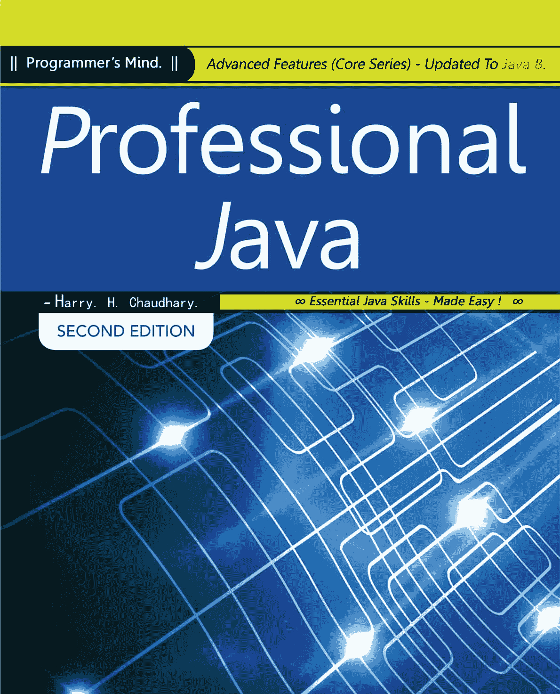


 

## 献词

“本书献给所有每天牺牲的人，特别是那些为了确保我们的自由与安全而做出牺牲的人。”

非常感谢湿婆神赐予我写作的技术和所有能力。

亲爱的爸爸，谢谢你 baauji，通过以身作则教会我什么是基于原则的生活。

亲爱的两位妈妈，谢谢你们以真实的方式向我展示如何根据最重要的原则和无条件的爱去生活。

亲爱的姐妹、兄弟+Priya，谢谢你们，你们的笑容点亮了我的每一天。你们的热情让我的心唱歌。我爱你们。

我特别想提到生活中那些帮助我度过忧伤的漂亮面孔：

谢谢 Priyanka，你是我生命的意义，我的掌中明珠，我对你的爱胜过言表。

谢谢 Hem Zizu, Navneet, Aman(Rajjo) Eminem - 你们是灵感来源，你们让我“为运动歌唱”，

感谢全球所有的 Anonymous 和黑帽黑客。

怀念我亲爱的——我的舅舅 Lt. G.C

怀念我亲爱的——我的外祖母。

你告诉我，最后一切都会好起来。

你还告诉我，如果现在还不好，那就还没有结束。

“我将在 1000 个世界和 10000 世中寻找你，直到找到你”

## 关于作者

Harry 是一位匿名黑客、GOC 著名计算机程序员、畅销的 Java 作者以及科学黑客专家，在计算机编程、黑客攻击和网络安全领域拥有独特经验。

他帮助了全球许多国家政府和跨国软件公司保护其网络和安全。他编写了多本关于计算机编程语言以及计算机安全与黑客的书。

他是一名技术毕业的软件工程师硕士。他是 `C` 和 `C++` 编程以及核心 Java、数据结构和算法的领先权威。他广受好誉的 `C`、`C++`、`C#` 和 Java 书作者拥有 5 年以上的软件方法论经验。他的教学和研究兴趣在人工智能、编程语言领域。

他过着两种生活。一种生活是一家正直软件公司的计算机程序编写员。另一种生活在计算机里，他以黑客代号“Chief Hacker – Captain Harry”活动。目前，他在世界著名的社区 Anonymous international 社区担任线下 IT 经理 - 匿名国际团队。

作者自述：你可能注意到这里缺少了什么：没有令人印象深刻的资历。我没有在知名大学当过教授。

| 24 | 使 Java 比其他语言更安全的关键特性 | 579 |

跟随畅销书《Java 编程》作者 Harry H. Chaudhary（书籍销量已超过 167,000 本！），在短时间内掌握 Java 编程的所有基础和高级特性。本 Java 指南从基础开始，通过数以千行的 Java 代码详细带你进入 Java 的高级特性，我承诺这本书将使你成为 Java 专家级冠军。任何人都可以通过这本书达到专家水平学习 Java。

工程类学生和初级开发者也可以这本书。本书涵盖了所有计算机科学专业专业的通用核心课程大纲。如果你是认真的，请通过这本终极 Java 书来开启你的一天。

这本 Java 书的主要目标不仅仅是为你提供 Java 编程知识，我遵循了一种模式，即针对每个 Java 主题，通过不同 Java 复杂度的清晰理论解释来改进数千个代码的解决方案，你将发现复杂的 Java 问题有多种解决方案。

### 特色之处

在书中，我为开发者和初学者详细涵盖并解释了最新的 Java 8 特性的几个主题，主题如：

- `Lambdas`

- `Java 8` 函数式接口

- `Java 8` 中的 `Stream` 和 `Time API`

如果你读过这本书，你就会知道可以期待什么：一种根据你大脑工作方式而设计的视觉丰富的格式。如果你没读过，那将大有收获。你会发现为什么人们说它和你读过的任何其他 Java 书都不同。

学习一种新语言并非易事，尤其是当它是像 `Java` 这样面向对象的编程语言时。你可能会认为问题出在你的大脑上。它似乎有自己的想法，并不总是想要接受你被迫学习的枯燥技术内容。事实是，你的大脑渴望新奇。它在不断地寻找、扫描，等待着异常事的发生。毕竟，它是为了帮助你生存而设计的。它将所有常规、普通、无味的内容过滤到背景中，以免干扰大脑的真正工作——记录重要的事情。你的大脑如何知道什么是重要的呢？

这本 Java 书不需要之前的编程经验。然而，如果你拥有 `C` 或 `C++` 编程背景，那么你将学得更快。

正因如此，这本 Java 书对 `Java` 的几个关键特性进行了快速详细的概述。这里描述的材料将为你提供一个脚点，让你能够编写和理解简单且典型的程序。讨论的大部分主题将在后续章节中通过数千个实时的 Java 代码示例进行更详细的检查。

正如我们过去几年所记录的事实：Web 已经不可逆转地重塑了计算的面貌，不愿掌握其环境的程序员将被淘汰。前述是一个强有力的陈述，它也是事实。

越来越多的应用程序必须与 Web 接口对接。应用程序是什么已不再重要，几乎全球通用的 Web 访问正在拉动、推动并诱导程序员为在线世界编写程序，而 `Java` 是许多人将用来实现此点的的语言。坦率地说，精通 `Java` 不再是专业程序员的备选项，而是一项硬要求。这本书将帮助你获得这种技能。

    


# 第 ∞ 1 章

## (Java 概述)

### 简介

`Java` 是由 Sun Microsystems 公司于 1991 年开发的一种强大的面向对象的编程语言。`Java` 最初为消费电子设备开发，但后来转向了互联网。现在，`Java` 已成为互联网广泛使用的编程语言。`Java` 是一种平台中立语言（与机器无关）。用 `Java` 开发的程序可以在世界上任何硬件或任何操作系统上运行。

Sun Microsystems (Oracle) 在 1995 年 5 月的一场大会议上正式宣布了 `Java`。通常，这样的事件不会引起太大关注。然而，由于商业界对万维网的极大兴趣，`Java` 引起了立即关注。

`Java` 现在用于创建具有动态和交互内容的 Web 页面，开发大型企业应用，增强万维网的功能。

### Java 的需求

开发 Java 是因为需要一种语言来创建嵌入各种消费电子设备（如微波炉和遥控器）的软件。用 `C` 和 `C++` 编写的程序针对特定的硬件进行编译，该程序不会在其他硬件上运行。因此，我们需要平台中立的语言。这种需求导致了 `Java` 的诞生。

### Java 类库

Java 程序由`类` 组成。`类`由执行任务并在完成后返回信息的的方法组成。在书中，我们讨论了许多库类。类库主要由编译器供应商提供，但许多类库由独立软件供应商 (ISV) 提供。此外，许多类库可以在互联网和万维网上作为免费或共享软件获取。你可以下载免费产品并免费使用，但受版权所有者指定的任何限制。

### 典型 Java 环境的基础

Java 系统通常由几个部分组成：环境、语言、Java 编程接口 (`API`) 和各种类库。接下来的讨论解释了一个典型的 Java 开发环境，Java 程序通过五个阶段执行。这些是：编辑、编译、加载、验证和执行。接下来的描述使用了标准的 `Java SE 7` 开发包 (`JDK 7`)，可以从 Oracle 获取。

如果你使用的是不同的 Java 开发环境，你可能需要遵循不同的程序来编译和执行 Java 程序。在这种情况下，请查阅你的编译器的文档。

注意：如果你使用的不是 UNIX/Linux、Windows 95/98/ME 或 Windows NT/2000，请参考你系统 Java 环境的手册，或询问老师如何在你的环境中完成这些任务（你的环境可能与这些类似）。阶段 1 是编辑文件。这是通过编辑器程序（通常称为编辑器）来实现的。程序员使用编辑器编写 Java 程序并在必要时进行修正。当程序员指定保存编辑器中的文件时，程序存储在次级存储设备（如磁盘）上。Java 程序文件名以 `.java` 结尾。

在 UNIX/Linux 系统上广泛使用的编辑器是 `vi` 和 `emacs`。在 Windows 95/98/ME 和 Windows NT/2000 上，简单的编辑程序如 DOS Edit 命令和 Windows 记事本就足够了。

Java 集成开发环境（IDE），例如用于 Java 社区版的 Forte、NetBeans、Borland 的 JBuilder、Symantec 的 Visual Cafe 以及 IBM 的 Visual Age，都内置了集成到编程环境中的编辑器。

我们假设读者知道如何编辑文件。`Java` 等语言是面向对象的——在这样的语言上进行编程被称为面向对象编程（OOP），它允许设计人员将面向对象的设计实现为可运行的系统。相反，`C` 等语言是过程化编程语言，因此编程倾向于面向动作型。

在 `C` 中，编程的单元是 `function`（函数）。在 `Java` 中，编程的单元是 `class`（类），对象最终从类中实例化（“创建”的专业术语）。`Java` 类包含 `methods`（方法，实现类的行为）和 `attributes`（属性，实现类的数据）。

`C` 程序员集中于编写 `functions`。执行某些共同任务的动作组被组合成函数，而函数被组合成程序。数据在 `C` 中无疑是重要的，但观点是数据主要存在是为了支持函数所执行的动作。系统规范中的动词帮助 `C` 程序员确定实现该系统所需的函数集。

`Java` 程序员集中于创建他们自己的名为 `classes`（类）和 `components`（组件）的用户定义类型。每个 `class` 包含数据以及操作这些数据的函数集。`Java` 类的数据组件被称为 `attributes`。

`Java` 类的函数组件被称为 `methods`。正如内置类型（如 `int`）的实例被称为 `variable`（变量），而用户定义类型（即 `class`）的实例被称为 `object`（对象）。程序员使用内置类型作为构建用户定义类型的“构建块”。

`Java` 的重点在于 `classes`（我们通过类创建对象）而不是 `functions`。系统规范中的名词帮助 `Java` 程序员确定 `classes` 的集合，从这些类中将创建的对象将协同工作以实现系统。

`Classes` 之于 `objects` 恰如蓝图之于房屋。我们可以从一张蓝图建造许多房屋，也可以从一个 `class` 实例化许多 `object`。`Classes` 也可以与其他 `classes` 建立关系。

例如，在银行的面向对象设计中，“银行柜员”类需要与“客户”类相关联。这些关系被称为 `associations`（关联）。我们将看到，当软件被封装为 `classes` 时，这些类可以在未来的软件系统中被重用。相关的 `classes` 组通常被封装为可重用的 `components`。

你创建的每个新 `class` 都有潜力成为一项价值巨大的软件资产，你和其他程序员可以使用它来加速并提高未来软件开发工作的质量——这是一个令人兴奋的可能性。

# Java 与 C、C++ 及 C# 的关系

`Java` 从 `C` 处继承了语法，从 `C++` 处继承了面向对象的特性。它不是 `C++` 的增强版本。`Java` 与 `C++` 既向上也不向下兼容。我想告诉你们的一个重要点是，`Java` 语言的设计并不是为了取代 `C++` 和 `C#`。由微软开发的用于支持 `.NET Framework` 的另一种语言 `C#` 与 `Java` 关系密切，因为它们共享 `C++` 和 `C` 风格的语法，支持分布式编程，并使用相同的对象模型。

# Java 的主要目标是实现 -

### 1. 安全性

当我们使用兼容 `Java` 的 浏览器时，没有病毒感染的威胁。此外，也没有恶意程序从本地机器收集隐私信息（如信用卡号、银行账户余额和密码）的威胁。

`Java` 在网络应用程序和我们的计算机之间提供了一个防火墙。

### 2. 可移植性

`Java` 程序可以从一台计算机迁移到另一台运行不同类型操作系统和不同硬件的计算机。

## Java 字节码

`Java` 程序在运行不同类型操作系统和具有不同硬件的计算机之间是可移植的。

`Java` 的编译输出是 `bytecode`（字节码，`.class` 文件）。`JVM`（Java 虚拟机）是解释器，用于执行 `bytecode`。`JVM` 在任何平台上运行 `Java` 程序。

## JIT（即时编译）

JIT（Just In Time）是 `JVM` 按需将 `bytecode` 翻译成实际机器码。

## Java 的各个版本

* **Java 1**

    * `JDK 1.0`

    * `JDK 1.1`

* **Java 2**

    * `JDK 1.2`

    * `JDK 1.3`

    * `JDK 1.4`

    * `JDK 1.5` 或 `JDK 5`

    * `JDK 1.6` 或 `JDK 6`

    * `Java 1.7` 或 `SE 7`

    * `Java 8` (2014 年)

**注 1：** `JDK`（Java 开发包）

**注 2：** 旧版 `Java` 版本的许多功能已被弃用

# Java 可以开发的应用程序类型

### 1. 独立应用程序

独立应用程序是运行在本地计算机上的程序，类似于 `C` 或 `C++` 程序。

### 2. Applet

`applet` 是一种跨越网络传输并在客户端机器上兼容 Java 的浏览器（如 `Internet Explorer` 或 `Netscape Navigator`）执行的小程序。

`applet` 实际上是一个微型 `Java` 程序，通过网络下载。`applet` 程序存储在 Web 服务器上，并在客户端请求时传输到客户端机器。

`applet` 不能像独立应用程序那样执行。它只能通过嵌入 HTML 页面（如声音文件、图像文件或视频片段）来执行。现在这种嵌入了 `applet` 的 HTML 页面在通过浏览器下载后即可运行。

### 3. Web 应用程序

这些是运行在 Web 服务器上的程序。当我们通过浏览器中指定的 `URL`（通用资源定位符）访问网站时，浏览器会向特定的 Web 服务器发送请求。接收请求后，服务器运行一个程序，该程序被称为 Web 应用程序。我们使用 `Java Servlets` 和 `JSP`（Java 页面）来编写此类程序。

这些程序运行在服务器上，并将结果/响应发送给客户端。`JSP` 页面可以被视为 HTML 和 `Java 代码` 的组合。在执行之前，Web 服务器会将 `JSP` 页面转换为 `Java Servlets`。

### 4. 分布式应用程序

`Java` 应用程序被分为在单独机器上运行的小程序。这些程序中的对象可以相互通信。这些应用程序被称为分布式应用程序。这允许不同计算机上的对象通过 `RMI`（远程方法调用）远程执行过程。

# Java 的特性:-

# Java 特性

## 1. 简单

Java 的语法与 C 和 C++ 几乎相似，因此熟悉 C/C++ 的程序员不需要从头开始学习语法。但 Java 删除了 C/C++ 中许多复杂或导致歧义的特性。

1. Java 不支持多继承，因为这个概念有点复杂并可能导致歧义。

2. Java 不支持全局变量，这也导致了 C/C++ 程序中出现许多 bug。

3. Java 不使用指针，也不允许指针算术，由于其固有的复杂性，这正是 C/C++ 程序中绝大多数 bug 的根源。

4. Java 不支持运算符重载，因为这可能会导致混淆。

5. Java 中没有垃圾值的概念。我们必须在变量之前对其进行初始化。

## 2. 安全

Java 程序运行在 `JVM`（Java 虚拟机）内部，其他部分无法访问它们。这极大地提高了安全性。由于这一特性，Java 程序很少发生挂起（hang）。这与频繁挂掉的 C/C++ 程序大不相同。Java 的安全模型包含三个主要组件：

1. 类加载器 (Class loader)。

2. 字节码验证器 (Bytecode Verifier)。

3. 安全管理器 (Security Manager)。

Java 使用不同的类加载器从本地机器和远程机器加载类文件（执行文件）。从远程机器加载的类（如 `Applet` 类）不允许读取或写入本地机器的文件。这防止了恶意程序破坏本地文件系统。字节码验证器在类加载器完成后立即对字节码进行验证。它确保字节码是有效的 Java 代码。它几乎消除了 Java 程序执行访问 `JVM` 外部内存等恶意活动的可能性。管理器控制许多关键操作，如删除文件、创建线程等。只有当 Java 程序具有足够的权限时，这些操作才被允许，否则管理器将不允许这些操作并生成 `Security Exception`。

## 3. 可移植

Java 程序是平台无关的。它们遵循“一次编写，随运行”的策略。为 Windows 平台编写的 Java 程序只需拷贝字节码（`.class` 文件），即可运行在任何其他平台（Unix、Linux、Sun Solaris 等）。不需要像 C/C++ 程序那样需要复制源代码并重新编译。这一特性使 Java 成为一种强大的语言。只要机器拥有 `JVM`，我们就可以在任何机器上运行字节码。`JVM` 本身是依赖平台的，但它让 Java 代码变得平台无关。实际上是 `JVM` 将字节码转换为机器码并执行它们。

因此我们可以说 Java 是一种可移植的语言。另一个使 Java 高度可移植的特性是原始数据类型的长度与平台无关，是固定的。例如，Java 中的 `int` 始终是 4 字节。这与 C/C++ 不同，在某些机器上 `int` 的大小可能是 2 字节，而在另一些机器上可能是 4 字节。

## 4. 面向对象


Java 几乎是一种纯面向对象的语言，但出于性能考虑，它支持`byte`、`short`、`int`、`long`、`float`、`double`、`char`、`boolean`等原始数据类型。

## 5. 健壮

大多数程序失败有两个原因：

1. 内存管理。
2. 运行时的异常情况。

设计语言的目标之一是确保 Java 程序尽可能健壮，即它们很少失败。因此，Java 特别重视上述两个因素。

在 Java 中，内存的分配和释放由语言本身处理，这消除了 C/C++ 中动态内存管理功能引起的许多问题。Java 还支持面向对象的异常处理功能来处理运行时发生的异常情况。这允许 Java 程序在发生异常情况后能够恢复并继续执行。

## 6. 多线程

Java 的设计是为了满足创建交互式网络化程序的现实需求。Java 提供了编写多线程程序的支持以实现这一点。这允许程序员编写可以并发执行许多任务的程序。

例如，基于`GUI`（图形用户界面）的应用程序可能正在监听用户事件并采取相应，另一个线程可能正在打印，第三个线程可能从网络上的某机器下载文件，而这一切都是并发完成的。这带来了更好的性能和更好的 CPU 利用率。

在其他语言中编写多线程程序也是可能的，但那仅通过使用`System`调用实现，而在 Java 中，可以通过语言本身的特性来实现。

## 7. 架构中性

程序员面临的主要问题之一是，无法保证如果我们今天写了一个程序，明天还能运行——即使在同一台机器上。操作系统的升级、处理器升级以及核心系统资源的变化都可能导致程序故障。但 Java 程序的目标是“一次编写，随处运行”。

## 8. 解释型与高性能

Java 程序是被解释执行的，但与其他解释器相比，它们的运行速度很快。

## 9. 分布式

Java 是为互联网的分布式环境设计的。为了这一目的，Java 内置了对各种基于`TCP/IP`的支持。事实上，使用`URL`访问资源类似于访问本地上的文件。Java 还具有远程方法调用（Remote Method Invocation）功能，这与远程过程调用（`RPC`）某些相似。这允许不同计算机上的对象远程执行过程。Java 为此目的提供了内置 API，称为`RMI`。

## 10. 动态

每个 Java 类都是一个独立的执行单元。类只有在需要时才在运行时加载。Java 中绑定方法的默认机制也是动态的（运行时绑定）。

# 运行独立 Java 程序

当 C 或 C++ 程序被编译时，它被转换为特定处理器的机器码。但运行 Java 程序是一个两个步骤的过程。在 Java 中，从源代码到执行代码的转换通过两个翻译器：

1. Java 编译器 - 首先将 Java 程序编译成字节码。字节码类似于机器码，但不针对特定的处理器或平台。
2. Java 解释器（`JVM`）- Java 解释器通过`JIT`将字节码翻译成特定平台的机器码。

注意 1：C 或 C++ 程序只编译一次，但 Java 字节码每次执行 Java 程序时都会被翻译。因此 Java 程序运行比 C/C++ 程序慢。注意 2：运行 Java 程序需要文本编辑器（记事本）、`JDK`（Java 开发包）以及`JVM`（已安装在许多操作系统）。可以使用`Eclipse`或`JCreater`代替记事本。

### 在 win xp 安装 Java 1.7

双击我的电脑→双击光驱→双击 JDK1.7 安装文件→点击下一步、下一步

### 设置路径

如果我们设置了 Java 文件夹的路径，就可以从任何地方运行 Java 程序，否则我们必须从 Java 的`bin`文件夹运行 java 程序。

右键点击我的电脑→属性→高级→环境变量→点击`Path`然后点击编辑→点击变量值→按`END`键将光标移动到该行末尾→现在输入`c:\program files\Java\jdk1.7.0_01\bin;`然后点击确定、确定、确定。

### 为 Java 程序创建文件夹

双击我的电脑→双击 C 盘→右键点击→新建→文件夹→输入`JAVAPRG`→按回车并关闭我的电脑。

### 在命令行提示符运行 Java 程序的步骤

步骤 1：进入命令行提示符

开始→运行→输入`cmd`并点击确定。

### 步骤 2

输入`CD \JAVAPRG`并按回车

### 步骤 3

输入`Edit Sum.Java`并按回车

### 步骤 4

输入 Java 程序并点击`File`→`Save`，然后点击`File`→`Exit`

### 步骤 5

输入`javac Sum.Java`并按回车编译。这将创建一个`Sum.class`文件。该文件被称为字节码。

### 步骤 6

输入`java Sum`并按回车运行。这将调用`JVM`。

### 步骤 7

输入`Exit`然后按回车退出命令提示符。

**注意** - 我们也可以通过上述步骤使用记事本运行 Java 程序，但不再使用`Edit`命令，而是使用`Notepad`。在输入 Java 程序后，在另存为对话框中选择“所有文件”，然后将其保存到文件夹`C:\JAVAPRG`中。编译和运行需要遵循上述步骤。

## Java 程序语法

```java
class <class name> {
    public static void main(String args[]) or (String [] args) {
        // - - - - - - -
    }
}
```

## 第一个 Java 程序 - 两个数字相加程序 (Sum.Java)

```java
class Sum {
    public static void main(String args[]) {
        int a, b, sum;
        a = 5;
        b = 6;
        sum = a + b;
        System.out.print("Sum is " + sum); //输出
    }
}
```

**输出：** Sum is 11

## 示例 2：两个数字交换程序 (Swap.Java)

```java
class Swap {
    public static void main(String args[]) {
        int a=5, b=7;
        int t = a;
        a = b;
        b = t;
        System.out.print("After Swap Values are " + a + "," + b);
    }
}
```

**输出：** Swap Values are 7,5

## 注释

有 3 类型的注释：

- **单行注释**：`//`
- **多行注释**：`/* ... */`
- **文档注释**：`/** ... */`

## Java 规则

- 每个 Java 程序必须包含一个类。在 Java 中，`main()`方法只能定义在类内部。
- 源文件可以有任意数量的类或接口定义，但最多只能有一个公共（public）类或接口。
- 源文件可能包含也不包含`main()`方法类，但独立的 Java 程序始终从`main()`方法开始执行。因此，我们想要开始执行的类必须在其中定义了`main()`方法。
- `main()`方法必须具有以下签名：`public static void main(String args[])`

**注意** - 方法原型在 Java 中被称为签名（signature）。

- `public`关键字表示该方法可以从任何地方访问。`main()`方法必须声明为`public`，因为它是由`JVM`部分的代码调用的，这些代码位于包含`main()`方法的类之外。
- `static`关键字表示`main()`是类方法，可以在不创建任何对象的情况下调用；这是必须的，因为在调用`main()`之前不存在对象，任何对象的创建都发生在`main()`方法内部。
- `main()`方法前的`void`关键字表示它不返回任何值。
- `main()`方法接收一个参数，即`String`数组。数组的每个元素代表一个命令行参数。
- `System`是一个预定义的类，提供对系统的访问，`out`是连接到控制台的输出流。可以使用`print()`方法显示任何类型的信息。

## Java 程序结构

所有 Java 源文件必须以`.Java`结尾。Java 是一种大小敏感的语言。注意在上面的程序中，类`Sum`、`String`和`System`的第一个字母都是大写的。最好将 Java 程序保存为与类名相同的文件，这不是强制的。如果类被声明为`public`，则强制将该类保存为与类名相同的文件。一个文件可以只包含一个公共类，但可以包含多个非公共类。如果一个文件包含多个类，那么编译后，每个单独的类都会被放在以类名命名并使用`.class`扩展名的单独输出文件中。

## 

- **文档部分 (Documentation Section)**：文档部分包含一组行，给出程序的名称、作者以及程序员以后想要引用的其他细节。
- **包语句 (Package Statement)**：源文件最多包含一个包语句。如果存在，它必须是第一个语句。
- **导入语句 (Import Statements)**：源文件可以有零或多个导入语句。它们出现在包之后。
- **接口语句 (Interface Statements)**：接口类似于类，但只在我们希望实现继承时使用。
- **类定义 (Class definition)**：一个 Java 程序可以包含多个类。
- **包含 main 方法的类定义**：由于独立程序需要`main`方法作为起点，因此该类是核心部分。

## 垃圾回收 (Garbage Collection)

Java 对象的内存分配完全是动态的，但 Java 没有指针算术。每当我们运行 Java 程序时，`JVM`也会后台运行另一个名为“垃圾回收器”（Garbage Collector）的线程。`垃圾回收器`会检查 Java 对象。当一个 Java 对象不再被使用时，它会被垃圾回收器回收，即为对象分配的内存会被加入池/堆并重用。这在很大程度上简化了程序员的任务。这也消除了许多由于不当使用指针算术（如显式释放内存）导致的错误。

单选题

1. 下面哪些是应用程序`main()`方法的有效定义？

   - a `public static void main()`
   - b `public static void main(String args)`
   - c `public static void main(String args[])`
   - d `public static void main(Graphics g)`
   - e `public static boolean main(String args[])`

2. 哪个组织开发了 Java 语言？

   - a Microsoft
   - b IBM
   - c Sun Microsystems Inc.
   - d AT&T

### 3. Java 属于以下哪种语言分类？

(a) 面向对象

(b) 过程

(c) (a) 和 (b) 都是

(d) 以上都不是

### 4. 下面哪项描述是不正确的？

(a) Java 的垃圾回收是自动的。

(b) Java 提供对分布式应用程序的支持。

(c) 与 C/C++ 相比，Java 效率更高。

(d) 与 C/C++ 相比，Java 更安全。

### 5. 下面哪项描述是正确的？

(a) Java 是一种平台无关语言

(b) Java 是一种面向对象的语言

(c) Java 支持多线程。

(d) 以上都是。

**答案：** 1. (c) 2. (c) 3. (a) 4. (c) 5. (d)

### 理论题

1. 解释 Java 虚拟机（`JVM`）的工作原理。
2. `C++`和`Java`之间有什么区别？
3. "APPLET（小程序）"和"APPLICATION（应用程序）"之间的区别。
4. `Java`的缺点。
5. 垃圾回收是如何工作的？
6. 什么是`BYTE Code（字节码）`？
7. `java`是完全面向对象的编程吗？如果不是，为什么？
8. Java 应用程序/程序有哪些不同的类型？
9. Java 可执行文件的扩展名是什么？
10. Java 源代码/程序文件的扩展名是什么？
11. 使用什么命令编译 Java 程序？
12. 哪个组织开发了`Java`语言？
13. 是什么让`Java`具有平台无关性？
14. 为什么`Java`相比`C/C++`更安全？
15. 为什么`Java`相比 C 更更加健壮？
16. 我们如何理解分布式应用程序？
17. 描述`Java`的任意四个特性。
18. 描述编译和运行程序所需的步骤。
19. `Java`流行的主要原因是什么？
20. 为什么`Java`删除了`C/C++`的许多特征？列出其中一些特征。
21. 列出`Java`中的三种注释类型。
22. 列出`C`和`Java`之间的 10 个主要区别。
23. 描述一个典型 Java 程序的结构。

#### 编程练习

1. 编写程序计算两个整数的平均值。
2. 编写程序在不使用第三个变量的情况下交换两个数字。
3. 编写程序将小时、分钟转换为总秒数。
4. 编写程序计算给定圆的面积和周长。

# Java 语言

### 标记

最小的独立单元被称为标记，如`keywords（关键字）`、`identifiers（标识符）`、`strings（字符串）`和`Operators（运算符）`。

A. `Keywords`是语言的保留名称，不能用作变量、函数等的名称。

B. `Identifier`指变量、数组、类、`Interfaces（接口）`等名称。

C. `Constants/Literals（常量/字面量）`指程序中无法更改的固定值。

D. `Operators（运算符）`是作用于变量和常量的特殊符号，并构成一个表达式。

E. `Separators（分隔符）`是用于分隔语句的特殊字符，如`(` `)` `{` `}` `[` `]` `;` `,` `.`

#### 关键字

`abstract`, `assert`, `boolean`, `break`, `byte`, `case`, `catch`, `char`, `class`, `continue`, `default`, `do`, `double`, `else`, `extends`, `final`, `finally`, `float`, `goto`, `if`, `implements`, `import`, `int`, `long`, `native`, `package`, `private`, `protected`, `public`, `return`, `short`, `static`, `strictfp`, `super`, `synchronized`, `this`, `throws`, `try`, `transient`, `void`, `volatile`

Java 提供了一套丰富的运算符。运算符将常量、变量和子表达式组合成表达式。Java 中的绝大多数运算符的行为与 C/C++ 相似，但存在极少数差异，本文将介绍这些差异。

运算符可以分为以下几类：

### 算术运算符 (+, -, *, /, %)

- 这些运算符与 C/C++ 中的运算符相同。
- `%`运算符也可以作用于浮点数。
- 当二元运算符应用于两个不同类型的操作数时，低类型的操作数会在评估之前转换为高类型的操作数，结果的类型将与高类型操作数的类型相同。
- 对于`int`类型，除以零或取模会导致`ArithmeticException`（运行时错误），但对于浮点数则不会。
- 当我们对`int`应用算术运算符且结果超出`int`的取值范围时，额外的高阶位将被截断，此新值将赋值给接收结果的变量；但在浮点类型中，溢出将导致`Infinity`或`–Infinity`，而下溢将导致`0`。

### 递增和递减运算符 (++, --)

这些运算符与 C/C++ 中的相同。

```java
int a=5,b;
b = ++a*++a;
System.out.print(b); //42
a = 5;
System.out.print(++a*++a); //42
```

### 关系运算符 (<, >, <=, >=, instanceof)

这些运算符与 C/C++ 相同，但`<`, `<=`, `>`, `>=`不能作用于布尔类型和引用类型。

### instanceof 运算符

`instanceof`运算符用于测试对象的类。`instanceof`运算符的通用形式为：

```
if(object instanceof type)
```

在这里，`object`是一个类的实例，`type`是类类型。如果`object`是指定类型的实例或该指定类型任何子类的实例，则`instanceof`运算符返回`true`，否则结果为`false`。

### 赋值运算符 (=, +=, -=, *=, /=, %)

这些运算符与 C/C++ 中的相同。

### 相等运算符 (==, !=)

这些运算符与 C/C++ 中的相同。

### 逻辑运算符 (&&, ||, !)

这些运算符与 C/C++ 中的相同。

### 条件运算符 (? :)

该运算符与 C/C++ 中的相同。

### 位运算运算符 (&, |, ^, ~, <<, >>, >>>)

这些运算符与 C/C++ 相同，位移运算符除外。位移运算符仅作用于整数类型。

#### 左移运算符 (<<)


### 左移运算符 (`<<`)

要获得`<<`运算符的结果，左侧操作数的位将根据右侧操作数的指定向左移动，右侧的空位用零填充。左移 1 位等同于乘以 2。结果的符号可能与左侧操作数的符号不同。这可能是因为符号取决于最高位，而最高位可能会从 0 变为 1 或从 1 变为 0，从而导致符号变化。

示例`b = a << 2;`。要获得`b`的值，将`a`中的位左移 2 位，并用零填充右侧 2 位。

### 右移运算符 (`>>`)（有符号）

要获得`>>`运算符的结果，左侧操作数的位将根据右侧操作数的指定向右移动，左侧的空位用符号位填充。右移 1 位等同于除以 2。该运算符永远不会改变结果的符号，即与左侧操作数的符号相同。

示例`b = a >> 2;`。要获得`b`的值，将`a`中的位右移 2 位，并用符号填充右侧 2 位（如果`a`为正则填充 0，如果`a`为负则填充 1）。

### 零填充右移运算符 (`>>>`)（无符号）

要获得`>>>`运算符的结果，左侧操作数的位将根据右侧操作数的指定向右移动，左侧的空位用 0 填充。右移 1 位等同于除以 2。如果发生了位移，结果将始终为正，因为最右侧位将变为零。

示例`b = a >>> 2;`。要获得`b`的值，将`a`中的位右移 2 位，并用 0 填充右侧 2 位。

### 运算符优先级

| 优先级 | 运算符 | 描述 | 结合性 |
| :--- | :--- | :--- | :--- |
| 1 | `[]` | 函数调用、下标 | 从左到右 |
| 2 | `++--~!` | 递增递减、单目取反 | 从右到左 |
| 3 | `*%/` | 乘、取模、除法 | 从左到右 |
| 4 | `+-` | 加、减法 | 从左到右 |
| 5 | `>>><<` | 位右移、位左移、无符号位右移 | 从左到右 |
| 6 | `>=instanceof` | 大于等于、小于等于 | 从左到右 |
| 7 | `=!=` | 等于、不等于 | 从左到右 |
| 8 | `&` | 位与 | 从左到右 |
| 9 | `^` | 位异或 | 从左到右 |
| 10 | `\|` | 位或 | 从左到右 |
| 11 | `&&` | 逻辑与（短路与） | 从左到右 |
| 12 | `\|\|` | 逻辑或（短路或） | 从左到右 |
| 13 | `?:` | 条件运算符（三元运算符） | 从左到右 |
| 14 | `=+-*/*%=&=^>>=<<=>>=` | 加赋值、减赋值、乘赋值、除赋值、取模赋值、位与、位或、位异赋值、右移赋值、左移赋值、无符号右移赋值 | 从右到左 |

| 符号 | 名称 | 用途 |
| :--- | :--- | :--- |
| `()` | 圆括号 | 用于在方法定义和调用中包含参数列表。也用于在表达式中定义优先级、在控制语句中包含表达式以及类型转换。 |
| `{}` | 大括号 | 用于初始化数组，也用于定义语句块、类、方法和局部作用域。 |
| `[]` | 方括号 | 用于声明数组。 |
| `;` | 分号 | 用于终止语句。 |
| `,` | 逗号 | 分隔变量声明中的连续标识符，也用于连接语句。 |
| `.` | 点 | 用于分隔包名。也用于分离变量或方法。 |

### 数据类型

Java 中的数据类型可以大致分为两类：

1. 基本数据类型/简单类型

Java 是一门面向对象的语言，但基本数据类型不是对象。出于性能考虑被保留了下来。它们是我们定义的其他类型的基础。Java 是一门强类型语言。

#### 数字类型

##### 整数类型

- `byte` (1 字节) 范围 -128 到 127
- `short` (2 字节) 范围 -32768 到 32767
- `int` (4 字节) 范围 -2147483648 到 2147483647
- `long` (8 字节) 范围 -9223372036854775808 到 9223372036854775807

包含`byte`、`short`、`int`的表达式会自动转换为`int`。

##### 浮点数类型

- `float` (4 字节) 范围 1.401298464324817E-45f 到 3.4028234663852886E38f
- `double` (8 字节) 范围 4.9E-324d 到 1.7976931348623157E308d

##### 布尔数据类型：`Boolean`

##### 字符数据类型

- `char` (2 字节) 范围 0 到 65535

注意：Unicode 集中前 128 个字符与 7 位 ASCII 字符集相同，Unicode 的前 256 个字符对应于 256 个扩展 ASCII（8 位 ISO Latin-1）字符集。

Java 字符也可以用于整数表达式。当作为整数表达式的一部分时，使用其 Unicode 值。

2. 非基本数据类型/派生数据类型或引用

### 数据类型

引用数据类型也称为派生数据类型（derived data types），因为它们派生自原始数据类型。

## 类

1. 内置/库类
2. 用户定义类

## 接口

3. 内置/库类
4. 用户定义类

# 数组

数组在 Java 中也被视为对象处理。

在以下情况下会发生 Java 的自动转换：

1. 两个类型是兼容的。
2. 目标类型大于源类型。

## 变量

变量是用于存储值的内存位置的名称。在向其中存储值之前，必须先声明变量。或者说变量是主内存中的（内存位置），我们可以在其中存储数据或值。

变量有三种：

### 局部变量

局部变量用于块或方法内部。局部变量（也称为自动变量）默认不初始化。局部变量在第一次使用之前必须显式地初始化，否则将出现编译时错误“变量可能未初始化”。

#### 示例

```java
int a,b=5;
if(b>2)
{
    a = b;
}
System.out.print(a);
```

在上述程序中，如果`if`条件为假，`a`的值未定义，因此编译器将给出错误“变量 a 可能未初始化”。

在 Java 中，我们不能在内部块中定义与外部块同名的变量。

```java
int a=5;
{
    int a=7; // Error
}
```

### 实例变量

实例变量用于定义对象的属性或状态。

### 类变量

类变量用于定义该类所有对象的公共属性/状态。

## Math 类库方法

| 方法 | 描述 |
| :--- | :--- |
| `public static double sin(double x);` | 返回弧度`x`的正弦 |
| `public static double cos(double x);` | 返回弧度`x`的余弦 |
| `public static double tan(double x);` | 返回弧度`x`的正切 |
| `public static double asin(double x);` | 返回正弦对应的角度`x` |
| `public static double acos(double x);` | 返回余弦对应的角度`x` |
| `public static double atan(double x);` | 返回正切对应的角度`x` |
| `public static double toRadians(double x);` | 将角度`x`转换为弧度 |
| `public static double toDegrees(double x);` | 将弧度`x`转换为角度 |
| `public static double exp(double x);` | 返回`e`的`x`次方 (`ex`) |
| `public static double log(double x);` | 返回`x`的自然对数 |
| `public static double log10(double x);` | 返回`x`的以 10 为底对数 |
| `public static double sqrt(double x);` | 返回`x`的平方根 |
| `public static double ceil(double x);` | 返回大于等于`x`的最小整数（向上取整） |
| `public static double floor(double x);` | 返回小于等于`x`的最大整数（向下取整） |
| `public static double rint(double x);` | 返回`x`舍入后的值 |
| `public static double atan2(double x, double y);` | 返回正值为`x/y`的角度 |
| `public static double pow(double x, double y);` | 返回`x`的`y`次方 (`xy`) |
| `public static int round(float x);` | 返回`int`类型的`x`舍入后的值 |
| `public static long round(double x);` | 返回`long`类型的`x`舍入后的值 |
| `public static double random();` | 返回 0 到 0.999999999999999999 之间的随机数 |
| `public static int abs(int x);` | 返回`x`的绝对值 |
| `public static long abs(long x);` | 返回`x`的绝对值 |
| `public static float abs(float x);` | 返回`x`的绝对值 |
| `public static double abs(double x);` | 返回`x`的绝对值 |
| `public static int max(int x, int y);` | 返回`x` & `y`中的最大值 |
| `public static long max(long x, long y);` | 返回`x` & `y`中的最大值 |
| `public static float max(float x, float y);` | 返回`x` & `y`中的最大值 |
| `public static double max(double x, double y);` | 返回`x` & `y`中的最大值 |
| `public static int min(int x, int y);` | 返回`x` & `y`中的最小值 |
| `public static long min(long x, long y);` | 返回`x` & `y`中的最小值 |
| `public static float min(float x, float y);` | 返回`x` & `y`中的最小值 |
| `public static double min(double x, double y);` | 返回`x` & `y`中的最小值 |
| `public static double sinh(double x);` | 返回`x`的双曲正弦 |
| `public static double cosh(double x);` | 返回`x`的双曲余弦 |
| `public static double tanh(double x);` | 返回`x`的双曲正切 |


### 数据类型

引用数据类型也称为派生数据类型，因为它们派生自原始数据类型。

## 类

1. 内置/库类
2. 用户定义类

## 接口

3. 内置/库类
4. 用户定义类

# 数组

数组在 Java 中也被视为对象。

在以下情况下会发生 Java 的自动转换：

1. 两个类型是兼容的。
2. 目标类型大于源类型。

## 变量

变量是用于存储值的内存位置的名称。在向其中存储值之前，必须先声明变量。或者说变量是主内存中的（内存位置），我们可以在其中存储数据或值。

变量有三种：

### 局部变量

局部变量用于块或方法内部。局部变量（也称为自动变量）默认不初始化。局部变量在第一次使用之前必须显式地初始化，否则将出现编译时错误“变量可能未初始化”。

#### 示例

```java
int a,b=5;
if(b>2)
{
    a = b;
}
System.out.print(a);
```

在上述程序中，如果 `if` 条件为假，`a` 的值未定义，因此编译器将给出错误“变量 a 可能未初始化”。

在 Java 中，我们不能在内部块中定义与外部块同名的变量。

```java
int a=5;
{
    int a=7; // Error
}
```

### 实例变量

实例变量用于定义对象的属性或状态。

### 类变量

类变量用于定义该类所有对象的公共属性/状态。

## Math 类库方法

| 方法 | 描述 |
| :--- | :--- |
| `public static double sin(double x);` | 返回弧度 `x` 的正弦 |
| `public static double cos(double x);` | 返回弧度 `x` 的余弦 |
| `public static double tan(double x);` | 返回弧度 `x` 的正切 |
| `public static double asin(double x);` | 返回正弦对应的角度 `x` |
| `public static double acos(double x);` | 返回余弦对应的角度 `x` |
| `public static double atan(double x);` | 返回正切对应的角度 `x` |
| `public static double toRadians(double x);` | 将角度 `x` 转换为弧度 |
| `public static double toDegrees(double x);` | 将弧度 `x` 转换为角度 |
| `public static double exp(double x);` | 返回 `e` 的 `x` 次方 (`ex`) |
| `public static double log(double x);` | 返回 `x` 的自然对数 |
| `public static double log10(double x);` | 返回 `x` 的以 10 为底对数 |
| `public static double sqrt(double x);` | 返回 `x` 的平方根 |
| `public static double ceil(double x);` | 返回大于等于 `x` 的最小整数（向上取整） |
| `public static double floor(double x);` | 返回小于等于 `x` 的最大整数（向下取整） |
| `public static double rint(double x);` | 返回 `x` 舍入后的值 |
| `public static double atan2(double x, double y);` | 返回正值为 `x/y` 的角度 |
| `public static double pow(double x, double y);` | 返回 `x` 的 `y` 次方 (`xy`) |
| `public static int round(float x);` | 返回 `int` 类型的 `x` 舍入后的值 |
| `public static long round(double x);` | 返回 `long` 类型的 `x` 舍入后的值 |
| `public static double random();` | 返回 0 到 0.999999999999999999 之间的随机数 |
| `public static int abs(int x);` | 返回 `x` 的绝对值 |
| `public static long abs(long x);` | 返回 `x` 的绝对值 |
| `public static float abs(float x);` | 返回 `x` 的绝对值 |
| `public static double abs(double x);` | 返回 `x` 的绝对值 |
| `public static int max(int x, int y);` | 返回 `x` & `y` 中的最大值 |
| `public static long max(long x, long y);` | 返回 `x` & `y` 中的最大值 |
| `public static float max(float x, float y);` | 返回 `x` & `y` 中的最大值 |
| `public static double max(double x, double y);` | 返回 `x` & `y` 中的最大值 |
| `public static int min(int x, int y);` | 返回 `x` & `y` 中的最小值 |
| `public static long min(long x, long y);` | 返回 `x` & `y` 中的最小值 |
| `public static float min(float x, float y);` | 返回 `x` & `y` 中的最小值 |
| `public static double min(double x, double y);` | 返回 `x` & `y` 中的最小值 |
| `public static double sinh(double x);` | 返回 `x` 的双曲正弦 |

## 多选题 (Multiple Choice Questions)

1. 以下哪些是 Java 关键字？

(a) `array`
(b) `boolean`
(c) `Integer`
(d) `protect`
(e) `super`

2. 哪个标识符是无效？

(a) `_x`
(b) `r2d`
(c) `Bb$`
(d) `set-flow`
(e) `this`

3. 整数 `x` 在以下语句后的二进制值为 `1001100`：

```java
int y = 1 << 7;
int z = x & y;
```

(a) `1000 001`
(b) `1000 000`
(c) `0000 001`
(d) `1001 101`
(e) `1001 100`

4. 以下描述准确的是：

(a) `>>` 是符号右移，`>>>` 是无符号右移。
(b) `>>>` 是符号右移，`>>` 是无符号右移。
(c) `<<` 是符号左移，`<<<` 是无符号左移。
(d) `<<<` 是符号左移，`<<` 是无符号左移。

5. 考虑以下语句：

1. `boolean passingScore = false && grade == 70;`
2. `boolean passingScore = false & grade == 70;`

表达式 `grade == 70` 被执行：

(a) 两个都执行
(b) 两个都不执行
(c) 仅在 1 中执行
(d) 仅在 2 中执行
(e) 无效，因为 false 应该是大写

6. 给定变量声明：

```java
byte myByte;
int myInt;
long myLong;
char myChar;
float myFloat;
double myDouble;
```

以下哪种赋值需要显式转换？

(a) `myInt = myByte;`
(b) `myInt = myLong;`
(c) `myByte = 3;`
(d) `myInt = myChar;`
(e) `myFloat = myDouble;`
(f) `myFloat = 3;`
(g) `myDouble = 3.0;`

7. 以下哪个 Java 保留字目前没有用途。

(a) `true`
(b) `false`
(c) `goto`
(d) `null`

8. `Java` 中数据类型 `int` 的大小是多少？

(a) 2 字节
(b) 4 字节
(c) 未定义
(d) 2 字节或 4 字节

答案：

1 (b,e)
2 (d)
3 (b)
4 (a)
5 (d)
6 (b,e)
7 (c)
8 (b)


### 理论题

1. 为什么 `Java` 不是 100% 纯面向对象的语言？
2. `Java` 中的基本类型有哪些？
3. 列出可能出现在 `Java` 源文件中的四个顶层元素。
4. `package` 语句之前还可以出现哪些语句？
5. 写出三个用作字面量使用的 `Java` 留关键字。
6. 写出两个未在语言中使用的 `Java` 保留关键字。
7. `Java` 的哪些基本数据类型在 `C` 中不存在？
8. 列出 `Java` 中的三种变量。
9. 简述标识符（`identifiers`）的规则。
10. `Java` 程序中注释的作用是什么？
11. 写出任意四个数值数据类型及其范围。
12. `Java` 数组与 `C` 数组何不同？
13. 什么是 `tokens`（标记）？简述其不同类型。
14. 什么是 `literals`（字面量）？举例说明。
15. `Java` 中不同的数据类型有哪些？请详细描述。

#### 编程练习

1. 编写程序显示所有位运算符的用法。
2. 编写程序显示所有的显式和隐式转换。
3. 编写程序解决一些不同数据类型的方程并显示结果。
4. 编写程序证明内部作用域不等于外部作用域。
5. 编写程序计算圆的面积（使用 `final` 声明常量）。
6. 编写程序将 `char` 转换为 `Unicode`。
7. 编写程序进行 `int` 到 `float` 的类型转换。
8. 编写程序计算两个浮点数的取模（%）。
9. 编写程序求解一元二次方程根。

  


# 第 3 章 控制语句

### 引言

控制语句用于改变执行流。`Java` 的控制语句可以分为三类。

### 1. 选择语句（决策控制结构）

选择语句允许程序根据表达式的结果或变量的状态，从一组执行路径中选择任意一条路径。

1. `if`
2. `if else`
3. `嵌套 if`
4. `if-else-if`
5. `switch`

#### (a) `if` 的语法

```
if(condition) {
    statements;
}
```

#### (b) `if else` 的语法

```
if(condition) {
    statements;
} else {
    statements;
}
```

#### (c) 嵌套 if else 的语法

```
if(condition) {
    if (condition) {
        statements;
    } else {
        statements;
    }
}
```

#### (d) if-else-if 阶梯结构的语法

```
if(condition) {
    statements;
} else if(condition) {
    statements;
} else {
    statements;
}
```

#### (e) `switch` 的语法

```
switch(expression) {
    case 1:
        statement 1 sequence;
        break;
    case 2:
        statement 2 sequence;
        break;
    case 3:
        statement 3 sequence;
        break;
    case n:
        break;
    default:
        default statement sequence;
}
```

### 示例 1 寻找两个数最大值的程序 (Max.Java)

```java
class Max {
    public static void main(String args[]) {
        int a,b,max;
        a = 0;
        b = 20;
        if(a>b)
            max = a;
        else
            max = b;
        System.out.println("Max of two numbers is " + max); //输出
    }
}
```

**输出：**

Max of two numbers is 20

### 2. 迭代语句（循环控制结构）

循环是一个让我们重复执行单条语句或一组语句 n 次的过程。

1. `for`
2. `while`
3. `do while`

#### (a) `for` 循环的语法

```
for(initialize; condition; increment/decrement) {
    statements;
}
```

#### (b) `while` 循环的语法

```
initialize;
while(condition) {
    statements;
    increment/decrement;
}
```

#### (c) `do while` 的语法

```
initialize;
do {
    statements;
    increment/decrement;
} while(condition);
```

条件可以是任何布尔表达式。只要条件表达式为真，循环体就会一直执行。当 `condition` 变为假时，控制将立即传递到紧随循环的下一行代码。

### 示例 3.2

```java
class Loop1 {
    public static void main(String args[]) {
        int n=5;
        for(int i=1;i<=n;i++) {
            for(int j=1;j<=i;j++) {
                System.out.print(j);
                System.out.println();
            }
        }
    }
}
```

**输出：**

```
1
12
123
1234
12345
```

### 跳出语句 - 它允许我们的程序以非线性的方式工作。

1. `break`。
2. 标签 break（labeled break）。
3. 标签继续执行（labeled continue）。
4. `return`。

* 大多数语句的语法与 C/C++ 相同。但存在一些显著差异。
* 在 `if`、`for`、`do` 语句中使用的条件表达式必须是有效的表达式，即它们的值应该是 `true` 或 `false`。我们不能像 C/C++ 中那样用 `0` 代替 `false`，或用非零值代替 `true`。
* Java 没有 `goto` 语句，尽管 `goto` 是一个保留字。Java 提供了 `labeled break` 和 `labeled continue`，它们通常被称为 `goto` 的文明形式，因为它们被认为是 `goto` 的更好替代方案。
* 在 Java 中，`switch` 表达式可以是任何整数表达式（`long` 外），即 `switch` 表达式的类型可以是 `byte`、`short` 或 `int`。但 Java 的 `int` 是 4 字节，与 C/C++ 中的 `long` 大小相同。
* `case` 标签像 C/C++ 一样是常量表达式，但 `case` 标签的值必须在 `switch` 表达式类型的范围内，否则程序将无法编译。


`labeled break` 语句用于终止由 `break` 语句指定标签的块。与简单的 `break` 语句不同，我们可以终止任何块。例如，可以从深层嵌套的 `for` 循环内部终止最外循环。`break` 语句也可以用于终止简单的块（即该块不需要是循环或 `switch` 语句）。

`labeled continue` 指定要继续执行的外层循环的标签。标签不需要对应于最近的内层循环。

## (a) break

```java
for(int i=1;i<=10;i++) {
    if(i == 5)
        break; // 如果 i 是 5 则终止循环
    System.out.print( i );
}
```

**输出：** `1 2 3 4`

## (b) labeled break

```java
boolean t=true;
first : {
    second: {
        third: {
            System.out.println("Before the break");
            if(t) break second; // 跳出 块
            System.out.println("This will not execute");
        }
        System.out.println("This will not execute");
    }
    System.out.println("This is after block");
}
```

**输出：**

```
Before the break
This is after block
```

## (c) continue

```java
for(int i=0;i<10;i++) {
    System.out.print( i + " ");
    if ( i % 2 == 0 )
        continue;
    System.out.println();
}
```

**注意：** 此代码使用 `%` 运算符检查 `i` 是否为偶数。如果是偶数，则循环将继续执行而不打印新行。

**输出：**

```
0 
1 
2 
3 
4 
5 
6 
7 
8 
9 
```

## (d) labeled continue

```java
outer : for(int i=0;i<5;i++) {
    for(int j=0;j<5;j++) {
        if ( j > i ) {
            System.out.println();
            continue outer;
        }
        System.out.print("\t"+ ( i * j ) );
    }
}
```

**输出：**

```
0	0
0	0
0	0
0	0
0	0
```

## (e) return

```java
int sum(int a, int b) {
    int c;
    c = a+b;
    return(c);
}
```

---

## 多选题

1. 给定下方定义的变量：

`int one = 1;`

`int two = 2;`

`char initial = '2';`

`boolean flag = true;`

以下哪些是合法的？

a) `if( one )`

b) `if( one = two )`

c) `if( one == two )`

d) `if( flag )`

e) `switch( one )`

f) `switch( flag )`

g) `switch( initial )`

2. 如果下方代码中的 `val = 1`：

```java
switch( val )
{
case 1: System.out.print("P" );
case 2:
case 3: System.out.print("Q" );
    break;
case 4: System.out.print("R" );
default: System.out.print("S" );
}
```

哪些值会被打印？

a) P

b) Q

c) R

d) S

3. 假设 `val` 在下方代码中定义为正整数：

```java
if( val > 4 )
    System.out.println("Test A" );
else if( val > 9 )
    System.out.println("Test B" );
else
    System.out.println("Test C" );
```

哪些 `val` 的值会导致打印 "Test C"：

a) `val < 0`

b) 0 到 4 之间的 `val`

c) 4 到 9 之间的 `val`

d) `val > 9`

e) `val = 0`

f) 没有 `val` 值满足条件

4. 对于代码：

```java
m = 0;
while( m++ < 2 )
    System.out.println( m );
```

以下哪些打印到标准输出？

a) 0

b) 1

c) 2

d) 3

e) 什么都没有打印且抛出了异常

5. 考虑下面的代码片段：

```java
outer: for( int i = 1; i <3; i++ )
inner: for( j = 1; j < 3; j++ )
{
    if( j==2 )
        continue outer;
    System.out.println( "i = " + i+", j = " + j );
}
```

以下哪个会被打印到标准输出？

(a) `i = 1, j = 1`

(b) `i = 1, j = 2`

(c) `i = 1, j = 3`

(d) `i = 2, j = 1`

(e) `i = 2, j = 2`

(f) `i = 2, j = 3`

(g) `i = 3, j = 1`

(h) `i = 3, j = 2`

**答案：** 1(c,d,e,f,g) 2(a,b) 3(b) 4(b,c) 5(a,d)

## 理论题

1. Java 有 "goto" 语句吗？

2. 什么是标签循环？

## 编程练习题

1. 编写一个程序检查指定的年份是否为闰年。

2. 编写一个程序打印指定月份的天数（使用 `switch`）。

3. 编写一个程序打印斐波那契数列。

4. 编写一个程序检查指定的数字是否为质数。

5. 编写一个菜单驱动的程序，计算两个数的加、减、乘、除。

   - 1 加

   - 2 减

   - 3 乘

   - 4 除

   - 5 退出（提示：使用 `do while` 和 `switch`）

6. 编写一个程序打印数字的反序（提示：1234 将导致 4321）。

7. 编写一个程序找到给定三个数字中的最大值。

8. 使用 `jump` 语句打印前 10 个偶数。

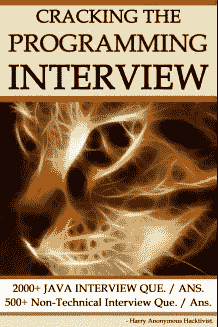 ISBN 13: 978-1500730413.


# 第 4 章：（Scanner 类与数组)

(命令行参数)

## 引言

## Scanner 类

`Scanner` 类是 Java 在 JDK 1.5-6-7 版本中引入的新类，用于从用户处获取基本数据类型的输入。使用该类获取输入非常简单，因为我们只需要创建该类的对象并调用特定方法即可。该类位于 `java.util` 包中。

```java
public java.util.Scanner(java.io.InputStream);
public java.util.Scanner(java.io.File) throws java.io.FileNotFoundException;
public java.util.Scanner(java.lang.String);
public void close();
public boolean hasNext();
public java.lang.String next(); // 输入不包含任何空格的字符串。
public java.lang.String nextLine(); // 输入可能包含空格的字符串。
public boolean hasNextBoolean();
public boolean nextBoolean();
public boolean hasNextByte();
public byte nextByte();
public boolean hasNextShort();
public short nextShort();
public boolean hasNextInt(); // 检查输入缓冲区中的下一个值是否为 int。
public int nextInt(); // 输入整数值。
public boolean hasNextLong();
public long nextLong();
public boolean hasNextFloat();
public float nextFloat();
public boolean hasNextDouble();
public double nextDouble();
```

### 示例 4.1

```java
import java.util.*;
class SumInput {
    public static void main(String args[]) {
        Scanner sc = new Scanner(System.in);
        int a, b, sum;
        System.out.print("Enter Ist number");
        a = sc.nextInt();
        System.out.print("Enter 2nd number");
        b = sc.nextInt();
        sum = a + b;
        System.out.println("Sum is " + sum);
    }
}
```

**输出：**

```
Enter Ist number 45
Enter 2nd number 55
Sum is 100
```

# 数组

Java 数组是相同类型变量或数据的有序集合。Java 允许任意维度的数组。Java 数组与 C/C++ 有不同，我们不能在声明时指定数组的大小。内存分配始终是动态的。Java 中的每个数组都被视为一个对象，并有一个特殊的属性 `length`，该属性指定数组中元素的数量。

## 一维数组

**声明：**

`type array_name[];` // 声明时不进行内存分配。

或

`type[] array_name;`

需要注意的是，声明并没有实际创建数组。它只是声明了一个可以指向数组对象的引用。

`int a1[], a2;`

`int[] a3, a4;`

这两个声明将 `a1`、`a3` 和 `a4` 声明为可以指向 `int` 数组的引用变量，但变量 `a2` 不能指向 `int` 数组。它仅仅是一个 `int` 变量。当 `[]` 符号跟随类型时，声明中的所有变量都是数组。否则，`[]` 符号必须跟随声明中的每个数组名。

**使用 `new` 操作符进行内存分配：**

`array_name = new type[SIZE];` // `SIZE` 可以是常量或变量。

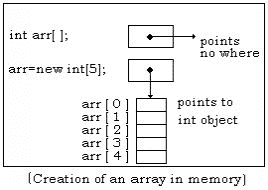

**注意 1：** 数组的所有元素将自动初始化为零，但要用不同的值初始化数组，我们可以在声明时初始化。声明、内存分配和初始化步骤可以合并为：

`int a[]={5,7};`

**注意 2：** 数组索引从 0 开始。

**注意 3：** 在 Java 中，所有数组都存储在一个名为 `length` 的变量中。我们可以使用属性 `length` 访问数组的长度：`array_name.length`。

**注意 4：** `int a[], b[];`

`a = b = new int[5];`

在上述步骤中，通过 `new` 创建了一个数组，该数组的引用首先存储在 `b` 中，然后是 `a`。因此两个都都向同一个数组。赋值引用不会创建对象的副本。

### 示例 4.2 数组所有数字的和

```java
class SumArr {
    public static void main(String args[]) {
        int a[]={10,50,20,40,3};
        int n=a.length,sum=0;
        for(int i=0; i<n; i++) {
            sum+=a[i];
        }
        System.out.println("Sum of numbers is " + sum);
    }
}
```

**输出：** `Sum of numbers is 150`

### 示例 4.3 使用选择排序技术对数组排序的程序

```java
import java.util.Scanner;
class Sort {
    public static void main(String args[]) {
        int n;
        Scanner sc = new Scanner(System.in);
        System.out.println("Enter how many elements");
        n = sc.nextInt();
        int a[] = new int[n];
        // 输入数组
        for(int i=0; i<n; i++) {
            System.out.print("Enter " + (i+1) + " ");
            a[i] = sc.nextInt();
        }
        // 排序
        for(int i=0; i<n-1; i++) {
            for(int j=i+1; j<n; j++) {
                if(a[i] > a[j]) {
                    int t=a[i];
                    a[i] = a[j];
                    a[j] = t;
                }
            }
        }
        // 输出
        for(int i=0; i<n; i++) {
            System.out.println(a[i]);
        }
    }
}
```

# 内存分配

```java
array_name = new type[ROWS][COLUMNS];
```

`ROWS` & `COLUMNS` 可以是常量或变量

到为止，我们讨论了可以存储数值列表的数组变量。在某些情况下，我们需要存储一个数值表格。考虑下面的数据表，它显示了三名销售人员三种商品的销售额。

该表总包含 12 个值，每行三个。我们可以将此表看作由四行三列组成的矩阵。每一行代表特定销售人员的销售额，每一列代表特定商品的销售额。

## 示例 4.4 打印矩阵转置的程序

```java
import java.util.*;

class Transpose {
    public static void main(String args[]) {
        Scanner sc=new Scanner(System.in);
        int r,c;
        System.out.print("Enter how many rows");
        r=sc.nextInt();
        System.out.print("Enter how many cols.");
        c=sc.nextInt();

        int m[][]=new int[r][c];
        //input
        for(int i=0;i<r;i++) {
            for(int j=0;j<c;j++) {
                System.out.print("Enter" + (i+1) + "," +(j+1));
                m[i][j]=sc.nextInt();
            }
        }
        //transpose
        for(int i=0;i<c;i++) {
            for(int j=0;j<r;j++) {
                System.out.print(m[j][i]+"\t");
            }
            System.out.println();
        }
    }
}
```

## 示例 4.5 将两个矩阵相乘得到第三个矩阵的程序


```java
import java.util.*;
class MatrixMult {
    public static void main(String args[]) {
        Scanner sc=new Scanner(System.in);
        int r1,c1;
        System.out.print("Enter how many rows");
        r1=sc.nextInt();
        System.out.print("Enter how many cols.");
        c1=sc.nextInt();
        int r2,c2;
        System.out.print("Enter how many rows");
        r2=sc.nextInt();
        System.out.print("Enter how many cols.");
        c2=sc.nextInt();
        if(c1 != r2) {
            System.out.println("Can't mult");
            System.exit(1);
        }
        int m1[][]=new int[r1][c1];
        //input m1
        for(int i=0;i<r1;i++) {
            for(int j=0;j<c1;j++) {
                System.out.print("Enter" + "element " + (i+1) + "," + (j+1));
                m1[i][j]=sc.nextInt();
            }
        }
        int m2[][]=new int[r2][c2];
        //input m2
        for(int i=0;i<r2;i++) {
            for(int j=0;j<c2;j++) {
                System.out.print("Enter" + "element " + (i+1) + "," +(j+1));
                m2[i][j]=sc.nextInt();
            }
        }
        int m3[][]=new int[r1][c2];
        //matrix mult
        for(int i=0;i<r1;i++) {
            for(int j=0;j<c2;j++) {
                for(int k=0;k<c1;k++) {
                    m3[i][j]+=m1[i][k]*m2[k][j];
                }
            }
        }
        //Output m3
        for(int i=0;i<r1;i++) {
            for(int j=0;j<c2;j++) {
                System.out.print(m3[i][j]+"\t");
            }
            System.out.println();
        }
    }
}
```

## 3. 变长数组

数组将多维数组视为“数组的数组”，可以按照如下方式声明一个二维数组：

```java
int arr[ ] [ ] = new int [4][];
arr[0] = new int [1];
arr[1] = new int [2];
arr[2] = new int [3];
arr[3] = new int [4];
```

这意味着数组总共有 4 行，其列从 1 开始每行增加一个。因此，它们在内存中的表示如下。

注意 1- 数组的所有元素将自动初始化为零，但为了用不同的值初始化数组，可以在声明时进行初始化。数组的声明、内存分配和步骤可以合并为：

`int a[][]={5,7,1}, {1,7,9}, {4,5,7}, {1,1,1} };`

注意 2- 在上述数组中，`a.length` 将显示行数，`a[0].length` 将显示第 0 行的列数

## 命令行参数

有时我们希望在运行程序时向程序传递信息。这是通过向 `main()` 传递命令行参数来实现。命令行参数是在执行时直接跟在程序名后面的信息。

要在 Java 程序内部访问命令行参数，我们必须使用传递给 `main()` 的 `String` 数组。

JVM 调用 `main()` 方法并将命令行参数作为字符串数组传递给它。上述示例中，数组的长度（即命令行参数的数量）是通过属性 `length` 获取的。

for 循环将命令行参数显示在控制台/显示器上。

## 示例 4.6 从命令行参数输入名称的程序

```java
class Hello {
    public static void main(String args[]) {
        for(int i=0;i<args.length;i++)
    }
}
```

```java
6. System.out.println("Hello " + args[i]);
7 }
8 }
```

`javac Hello.java`

`java Hello Ravi Ajay Vijay`

**输出:**

```
Hello Ravi
Hello Ajay
Hello Vijay
```

### 示例 4.7 程序打印通过命令行参数输入的数字之和。

```java
class SumCmd {
    public static void main(String args[]) {
        int sum = 0;
        for (int i = 0; i < args.length; i++)
            sum += Integer.parseInt(args[i]);
        System.out.println("Sum is " + sum);
    }
}
```

`javac SumCmd.java`

`java SumCmd 5 6`

**输出:**

```
Sum is 11
```

### 示例 4.8 程序对从命令行输入的数组进行排序。

```java
class SortCmd {
    public static void main(String args[]) {
        int n = args.length;
        int a[] = new int[n];
        //将 args 数组复制到数组 a
        for (int i = 0; i < n; i++)
            a[i] = Integer.parseInt(args[i]);
        //排序
        for (int i = 0; i < n - 1; i++)
            for (int j = i + 1; j < n; j++)
                if (a[i] > a[j]) {
                    int t = a[i];
                    a[i] = a[j];
                    a[j] = t;
                }
        //输出数组
        for (int i = 0; i < n; i++)
            System.out.print(a[i] + "\t");
    }
}
```

`javac SortCmd.java`

`java SortCmd 5 4 1 3 2`

**输出:**

```
1 2 3 4 5
```

#### 多选题

1. 如果将 `MyProg.java` 编译为应用程序并从命令行通过 `java MyProg I like` 运行，那么 `main()` 方法内部 `args[1]` 的值是多少？

   (a) `MyProg`

   (b) `"I"`

   (c) `"like"`

   (d) `3`

   (e) 直到赋值为止

2. 在声明 `char[] c = new char[100];` 后，`c[50]` 的值是多少？

   (a) `50`

   (b) `49`

   (c) `'\u000'`

   (d) `'\u002'`

3. 下列哪项是整数二维数组的合法声明？

   (a) `int[5][5]a = new int[][];`

   (b) `int a = new int[5,5];`

   (c) `int[][]a = new int[5][5];`

   (d) `int[][]a = new [5]int[5];`

4. 下列哪项是初始化包含 7 个值的数组 `"high"` 的正确方法？

   (a) `int high = { 24, 23, 24, 25, 25, 23, 21 };`

   (b) `int high[] = { 24, 23, 24, 25, 25, 23, 21 };`

   (c) `int[] high = { 24, 23, 24, 25, 25, 23, 21 };`

   (d) `int high [] = new int[24, 23, 24, 25, 25, 23, 21];`

   (e) `int high = new[24, 23, 24, 25, 25, 23, 21];`

5. 下列哪项是正确的陈述？

   (a) Java 数组是一个 `Object`。

   (b) 数组的内存分配总是动态的。

   (c) Java 数组由其元素类型的默认值初始化的。

   (d) 以上都是。

**答案:** 1(c), 2(e), 3(c), 4(b, c), 5(d)

#### 编程练习

1. 编写一个程序使用线性查找在数组中搜索元素。

2. 编写一个程序使用二分查找在数组中搜索元素。

# 第 5 章：类与对象

### 引言

#### 定义类

类代表一个 ADT（抽象数据类型）。它像一个模板，我们可以通过它创建多个对象（实例）。类的声明仅创建了一个模板，并没有创建实际的对象。类创建了一个新的数据类型，该类型可以用于创建对象。也就是说，类创建了一个定义其成员之间关系的逻辑框架。当我们声明一个类的对象时，我们正在创建该类的实例。因此，类是一个逻辑结构。而对象具有物理现实（也就是说，对象占用内存空间）。

```java
class <classname> {
    修饰符 类型 变量;
    修饰符 类型 方法名(参数列表) {
        //方法体
    }
}
```

#### 声明对象

`Student s1;`

在上面的示例中，`s1` 只是一个引用。在 C++ 中 `s1` 将是一个对象，但在 Java 中 `s1` 只是一个持有对象引用的变量。

### 分配内存

在 Java 中通过 `new` 运算符动态分配内存。

`s1 = new Student();`

在上面的示例中，`new` 运算符为 `Student` 类分配内存并返回其引用，然后赋值给引用变量 `s1`。它还会调用默认构造函数来初始化成员变量。上述语句可以合并：`s1 = new Student();`

注意：`new` 在运行时为对象分配内存。如果 `new` 无法分配内存（内存有限），将抛出运行时异常。

注意：如果我们将一个引用变量赋值给另一个引用变量，传递的是引用（地址）。不会创建对象的副本。例如，如果我们创建另一个引用变量 `s2` 然后执行 `s1 = s2`，这不会创建重复的对象；`s1` 和 `s2` 指向同一个对象。在 `s2` 中做的任何更改都会反映在 `s1` 中。赋值操作不分配内存。若干步后，如果我们给 `s1` 赋值 `null`，该对象会被销毁，因为还有 `s2` 引用它。但如果 `s1` 和 `s2` 都被赋值 `null` 值，该对象将被垃圾回收器销毁，其所占用的内存将被释放。

### 示例 5.1 包含成员变量类

```java
class A {
    int x;
    int y;
}

class ClassTest {
    public static void main(String args[]) {
        A a1, a2; //引用变量
        a1 = new A(); //对象创建
        a2 = new A();
        a1.x = 10;
        a1.y = 20;
        a2.x = 5;
        a2.y = 6;
        System.out.println(a1.x + "\t" + a1.y);
        System.out.println(a2.x + "\t" + a2.y);
    }
}
```

**输出:**

```
10	20
5	6
```

### 示例 5.2 包含成员变量和方法的类

```java
class A {
    private int x;
}
```

## 示例 5.3 定义类自身的对象。

```java
class A {
    private int x;
    private int y;
    void setdata(int x1, int y1) {
        x = x1;
        y = y1;
    }
    void display() {
        System.out.println(x + "\t" + y);
    }
}

class ClassTest2 {
    public static void main(String args[]) {
        A a1 = new A();
        A a2 = new A();
        //a1.x=10; error as x is private
        a1.setdata(10,20);
        a2.setdata(5,7);
        a1.display();
        a2.display();
    }
}
```

**输出：**

```
10	20
5	7
```

注：我们可以在类内部声明该类的对象。

### 类成员的修饰符 / 可见性标签

可见性修饰符适用于类的成员，而不适用于局部变量。

1. `private`：如果我们在变量或方法上指定修饰符 `private`，那么该成员在声明它的类外部不可见。

2. `public`：如果我们在变量或方法上指定修饰符 `public`，那么该成员对所有类可见。该成员可以在包外被访问，因为 `main()` 方法始终由 JVM 访问，而 JVM 位于定义 `main()` 方法类的外部。

3. `protected`：声明为 `protected` 的成员可以被属于同一个包的所有类访问。保护的成员也可以被其他包中的任何类访问。

4. `default / 无修饰符`：如果在声明之前没有指定可见性修饰符，则该成员可以被同包内的所有类访问。该成员在包外访问。

### 类或接口的可见性修饰符

1. `public`：如果一个类需要对所有包的类可见，则必须通过指定修饰符 `public` 声明为 `public`。

2. `default / 无修饰符`：如果类之前没有任何访问/可见性修饰符，其可见性仅限于其定义的包（类组）内。

### this 关键字

`this` 是一个引用变量，存储了当前用于调用方法的对象的引用。在运行时，`this` 的引用会被调用对象的引用所替换。有时，一个方法需要引用调用它的对象。这可以通过 `this` 来实现。`this` 可以在任何方法内部使用以引用当前对象。

注：局部变量会隐藏实例变量，因此我们必须显式地使用 `this`。

### 实例变量隐藏

正如我们所知，在 Java 中在相同或嵌套的作用域内声明两个同名的局部变量是非合法的。但我们可以让局部变量（成员方法的参数）与类的实例成员变量具有相同的名称。当局部变量与实例变量同名时，局部变量会隐藏实例变量。但 `this` 关键字允许即使在局部变量隐藏它的情况下，我们依然可以引用实例变量。

#### 示例 5.4 this 关键字的使用

```java
class A {
    private int x;
    private int y;
    void setdata(int x, int y) {
        this.x = x;  //this.x 是类成员 & x 是局部变量
        this.y = y;   
    }
    void display() {
        System.out.println(x + "\t" + y);
    }
}

class ClassTest4 {
    public static void main(String args[]) {
        A a1 = new A();
        A a2 = new A();
        a1.setdata(10,20);
        a2.setdata(5,7);
        a1.display();
        a2.display();
    }
}
```

**输出：**

```
10	20
5	7
```

#### 方法重载

只要方法在参数数量、参数类型或参数顺序上有所不同，我们就可以拥有多个同名方法。这被称为方法重载。

在调用重载方法时，传递的实际参数的类型可能与任何重载方法的形式参数不完全匹配。在这种情况下，参数将提升到下一个更高的类型，直到找到匹配项为止。如果在提升参数后仍未找到匹配，则会发生编译错误。


#### 示例 5.5

在此示例中有两个同名的`setdata()`方法，但参数不同，因此这是方法重载。

```java
class A {
    private int x,y;
    void setdata(int x1) {
        x = x1;
    }
    void setdata(int x1, int y1) {
        x = x1;
        y = y1;
    }
    void display() {
        System.out.println(x + "\t" + y);
    }
}

class ClassTest5 {
    public static void main(String args[]) {
        A a1 = new A();
        a1.setdata(5);
        a1.display();
        A a2 = new A();
        a2.setdata(10,20);
        a2.display();
    }
}
```

**输出：**

```
5	5
10	20
```

### 构造函数

在创建后立即初始化对象是一个非常常见的需求。我们可以为此目的定义实例方法，但它们必须显式地调用。

Java 为这一需求提供了解决方案。Java 允许对象在通过构造函数创建时进行初始化。它也具有这一特性。

构造函数的语法与实例方法非常相似。它们的名称与类名相同，且没有返回类型。

这是因为类构造函数的隐式返回类型是类本身。构造函数可以像方法一样进行重载。

当使用运算符`new`创建一个类的实例/对象时，`JVM`会为该对象分配内存，然后将实例变量初始化为它们的默认初始值，最后调用相应的构造函数来初始化实例变量。

### 注意

`constructor`（构造函数）这个名字有点容易误义。看起来似乎构造函数的目的是创建一个对象/实例。实际上，在调用构造函数之前，对象已经创建，且实例变量和静态变量已经初始化为它们的默认初始值。

因此，构造函数的目的是用非默认值来初始化实例变量。

## 构造函数的类型

- **默认构造函数 (Default Constructor)**：每个类都有一个默认构造函数（如果没有定义显式构造函数），该构造函数不接受任何参数，且体体不包含任何语句。编译器会自动生成默认构造函数。

一旦我们添加了自己的构造函数，编译器就会停止生成默认构造函数。当我们不在类中创建任何构造函数时，`JVM`将创建默认构造函数，并将实例变量初始化为默认值`null`或`zero`。

### 示例 5.6 默认构造函数的用法

```java
class A {
    private int x;
    private int y;
    void display() {
        System.out.println(x + "\t" + y);
    }
}
class ClassTest6 {
    public static void main(String args[]) {
        A a1 = new A();
        a1.display();
    }
}
```

**输出:**

```
0     0
```

**注意**：在这里我们没有创建任何构造函数，`JVM`在创建对象后会自动创建默认构造函数，并将实例变量初始化为`0`或`null`。

- **默认零参数构造函数 (Default Zero argument constructors)**：我们可以自己的零参数构造函数替换默认构造函数。这将允许我们将实例变量初始化为任何值。

- **参数化构造函数 (Parameterized Constructors)**：接受参数的构造函数称为参数化构造函数。

- **注意**：构造函数可以像方法一样重载。这被称为构造函数重载。

### 示例 5.7 构造函数的用法

```java
class A {
    private int x;
    private int y;
    A() // 零参数构造函数 {
        x = y = 0;
    }
    A(int x1) // 单参数参数化构造函数 {
        x = x1;
    }
    A(int x1, int y1) // 双参数参数化构造函数 {
        x = x1;
        y = y1;   
    }
    void display() {
        System.out.println(x + "\t" + y);
    }
}
class ClassTest7 {
    public static void main(String args[]) {
        A a1 = new A();
        a1.display();
        A a2 = new A(5);
        a2.display();
        A a3 = new A(4,7);
        a3.display();
    }
}
```

**输出:**

```
0     0
5     0
4     7
```

### 示例 5.8

```java
import java.util.Scanner;
class Complex {
    private int real,imag;
    Complex()// 零参数构造函数 {
        real=imag=0;
    }
    Complex(int real, int imag) {
        this.real=real;
        this.imag=imag;
    }
    void getdata() {
        Scanner sc=new Scanner(System.in);
        System.out.print("Enter real");
        real=sc.nextInt();
        System.out.print("Enter imag");
        imag=sc.nextInt();
    }
    void display() {
        if(imag>=0)
            System.out.println(real+""+imag+"i");
        else
            System.out.println(real+""+imag+"i");
    }
    Complex(Complex c) {
        Complex t=new Complex();
        t.real=real+c.real;
        t.imag=imag+c.imag;
        return t; // 或者
        return new Complex(real+c.real,imag+c.imag);
    }
    mult(Complex c) {
        Complex t=new Complex();
        t.real=real*c.real-imag*c.imag;
        t.imag=real*c.imag+imag*c.real;
        return t;
    }
    public static void main(String args[]) {
        Complex c1=new Complex();
        Complex c2=new Complex();
        Complex c3=null,c4=null;
        c1.getdata();
        c2.getdata();
        c3=c1.sum(c2);
        System.out.print("Sum is ");
        c3.display();
        c4=c1.mult(c2);
        System.out.print("Product is ");
        c4.display();
    }
}
```

## finalize() 方法

有时对象在被销毁时需要执行某些操作。例如，如果对象持有某些非 Java 资源（如文件句柄），我们可能希望在对象被销毁之前释放这些资源。

为了处理此类情况，Java 提供了一种名为最终化（finalization）的机制。通过使用最终化，我们可以定义在对象即将被垃圾回收器回收时执行的特定操作。`finalize()`仅在垃圾回收之前被调用。它不会在对象离开作用范围时被调用。在 C++ 中，使用析构函数的概念来实现最终化，但它与 Java 中的`finalize()`完全相同。

```java
protected void finalize()
{
    // 在此处编写最终化代码
}
```

**注意**：除了使用`protected`修饰符，我们也可以使用`public`。

## 变量类型

Java 有三种变量：

### 1. 实例变量

在类中声明的、位于所有成员方法之外的变量称为实例变量。该变量的数量将与对象的数量相同。

在 Java 中，不需要初始化实例变量，因为这些变量在对象创建并使用`new`运算符分配内存时就会被初始化。

变量根据其类型进行初始化。所有的数值变量都自动初始化为`0`，`Boolean`变量初始化为`false`，引用变量（对象）初始化为`null`值。

我们可以通过对象名称和点 (`.`) 运算符来访问这些变量（`对象引用变量.实例变量名`）。我们不能像 C/C++ 那样使用`->`运算符分隔对象引用变量和实例变量。

### 2. 局部变量

在方法内部声明的变量称为局部变量。它与实例变量不同。局部变量没有自动初始化。

### 3. 静态变量

静态变量像实例变量一样声明在方法/块之外。但静态变量在数据类型之前使用了`static`修饰符。静态变量对于类及其所有的实例（对象）来说都是全局的。

它们对于跟踪全局状态非常有用。例如，类中的静态变量`count`可以存储程序在任何时刻创建的该类的实例/对象数量。

对象可以使用静态变量进行通信，就像 C 函数通过全局变量通信一样。对于静态变量，无论程序中创建了多少实例/对象，变量都只有一个拷贝，并且在所有实例之间共享。

点 (`.`) 运算符也用于访问类变量，但我们也可以使用类名或对象名访问静态变量。如果我们在不同的对象上声明它，它们将指向静态变量的同一个拷贝。

静态变量在类加载/使用时会根据其默认值（零、false 或 null）自动初始化。

它们只能调用其他静态方法。它们只能访问静态数据。它们不能以任何方式引用`this`或`super`。（关键字`super`与继承有关，将在稍后描述。）

#### 示例 5.9

```java
class A {
    int x;         //实例变量
    static int y; //静态变量或类变量
}
class ClassTest8 {
    public static void main(String args[]) {
        A a1 = new A();
        A a2 = new A();
        A a3 = new A();
        a1.x = 10;
        a1.y = 20;
        a2.x = 11;
        a2.y = 21;
        a3.x = 12;
        a3.y = 22;
        System.out.println(a1.x + "\t" + a1.y);
        System.out.println(a2.x + "\t" + a2.y);
        System.out.println(a2.x + "\t" + a3.y);
    }
}
```

**输出：**

```
10  22
11  22
12  22
```

### 方法类型

1. 实例方法

2. 静态方法

### 实例方法

这些方法与 C++ 函数相同。实例方法只能通过对象调用。如果我们在同一类的静态方法内部调用实例方法，则必须使用对象名称。

### 静态方法

静态方法可以使用对象或类名调用。静态方法只能访问静态成员。静态方法可以从同一类的静态方法中直接调用（不需要对象或类名）。

#### 示例 5.10

```java
class A {
    int x;
    static int y;
    static int sum(int a, int b) {
        y = 5; // 静态方法可以访问静态变量
        // x = 0; // 错误：静态方法无法访问实例变量
        // A a1 = new A();
        // a1.x = 10; // 错误：静态方法可以通过对象访问实例变量
        // this.x = 10; // 错误：静态方法无法访问 this 或 super
        int c;
        c = a+b;
        return(c);
    }
    static float avg(int a, int b) {
        return (float)(a+b)/2;
    }
}
class ClassTest9 {
    public static void main(String args[]) {
        System.out.println(A.sum(5,6)); // 静态方法可以通过类名调用
        System.out.println(A.avg(5,6));
        A a1 = new A();
        System.out.println(a1.sum(5,6)); // 静态方法也可以通过对象调用
    }
}
```

**输出：**

```
1
5
```

### 初始化块

块用于初始化类的实例成员，静态块用于初始化类的静态成员。构造函数会在这些块之后调用。

#### 示例 5.1

```java
class A {
    int x;
    static int y;
    { // 初始化实例变量的块
        x = 10;
    }
    static { // 初始化静态变量的静态块
        y = 5;
    }
}
class ClassTest10 {
    public static void main(String args[]) {
        A a1 = new A();
        System.out.println(a1.x + "\t" + a1.y);
    }
}
```

**输出：**

```
10  5
```

### 最终变量

如果变量被声明为`final`，则不能更改它的值（`final PI=3.14;`）。最终变量按每个实例占用内存。最终变量是常量变量，其值不能改变。最终引用类型不能更改其引用。

#### 示例 5.12

```java
class A {
    void m1() {
        System.out.println("Inside m1()");
    }
}
class ClassTest11 {
}
```

```java
public static void main(String args[])
{
    final int x=10; //不可改变
    final int y;    // 变量 y 未初始化，稍后可以初始化 y
    y=20;           // 现在 y 已初始化，之后我们不能再改变它的值
    // y=30;         错误
    System.out.println(x);
    System.out.println(y);
    final A a1=new A();  // a1 是常量引用，因此我们不能
    // 将其他对象的引用赋值给 a1。
    a1.m1();
    A a2 = new A();
    // a1 = a2; error
}
```

**输出：**

```
10
20
```

在`m1()`

# 参数传递机制

1. 值传递 (Call by Value)。

2. 引用传递 (Call by reference)。

当将基本类型（`int`、`float`、`long`等）传递给方法时，使用的是值传递方法。对于对象，实际传递的是对象的引用。

对象的引用也是通过值传递方法传递的。然而，由于所传递的值指向一个对象，因此该值的拷贝仍然指向与其对应参数相同的同一个对象。

例如，如果我们我们将一个存储对象引用的变量`a1`传递给函数，而函数中`a2`是形式参数，那么`a1`和`a2`都指向同一个对象。

通过`a2`对对象值进行的任何更改都会反映在`a1`中。但如果我们为`a2`赋值一个新引用，该引用不会自动复制到`a1`中。

### 示例 5.13


```java
class Box {
    private int feet;
    private int inches;
    Box() {
        feet = 0;
    }
    Box(int feet, int inches) {
        this.feet = feet;
        this.inches = inches;
    }
    void display() {
        System.out.println("Feet is " + feet +"\n" + "Inches is " + inches);
    }
    void swap(Box obj) {
        int t;
        t = feet;
        feet = obj.feet;
        obj.feet = t;

        t = inches;
        inches = obj.inches;
        obj.inches = t;
    }
}
class ClassTest12 {
    public static void main(String args[]) {
        Box b1 = new Box(5,6);
        Box b2 = new Box(7,4);
        b1.swap(b2); // 对象是通过引用传递的
        b1.display();
        b2.display();
    }
}
```

Output:

```
Feet is 7
Inches is 4
Feet is 5
Inches is 6
```

## 嵌套类与内部类

可以在类内部定义另一个类；此类类被称为嵌套类。嵌套类的作用范围被限制在其外部类的作用范围之内。

嵌套类可以访问其所嵌套类中的成员，包括该类的私有成员。然而，外部类无法访问嵌套类的成员。

嵌套类有两种类型：静态嵌套类（`static`）和非静态嵌套类（`non static`）。静态嵌套类是指应用了 `static` 修饰符的类。由于它是静态的，它必须通过对象来访问其外部类的成员。也就是说，它不能直接引用其外部类的成员。由于这种限制，静态嵌套类很少被使用。

非静态嵌套类可以访问其外部类的所有变量和方法，并可以像外部类的其他非静态成员一样直接引用它们。

### 示例 5.14

```java
class Outer {
    class Inner {
        int member_inner=7;
        Inner() {
            member_outer = 5;
            System.out.println(member_outer);
        }
    }
    private int member_outer;
    Outer() {
        // member_inner = 9
        Inner obj = new Inner();
        System.out.println(obj.member_inner);
    }
}
class ClassTest13 {
    public static void main(String args[]) {
        Outer out_obj = new Outer();
    }
}
```

Output:

```
5
7
```

### 示例 5.15

```java
class Outer {
    static class Inner {
        int member_inner=7;
        Inner() {
            // member_outer = 5
            // System.out.println(member_outer)
            Outer obj = new Outer();
            obj.member_outer = 5;
            System.out.println(obj.member_outer);
        }
    }
    private int member_outer;
    void prn() {
        Inner obj = new Inner();
        System.out.println(obj.member_inner);
    }
}
class ClassTest14 {
    public static void main(String args[]) {
        Outer out_obj = new Outer();
        out_obj.prn();
    }
}
```

Output:

```
5
7
```

### 示例 5.16

```java
import java.util.Random;
class RandomTest {
    public static void main(String args[]) {
        Random r1 = new Random();
        for(int i=1;i<=10;i++)
            System.out.println(Math.abs(r1.nextInt()));
    }
}
```

### 理论题

1. 如果我们希望一个成员变量完全无法在类外访问，在声明它时在变量名前前面应该加上什么关键字？

2. 在 Java 中，对象/值是如何传递的？

3. 考虑以下代码：

```java
public static void main( String args[] )
{
    int a = 5;
    System.out.println( cube( a ) );
}

int cube( int theNum )
{
    return theNum * theNum * theNum;
}
```

解释 `static` 关键字的重要性

当我们尝试编译并运行这段代码时会发生什么？

a) 它无法编译，因为 `cube` 在 `java.lang.Math` 类中已经定义过了。

b) 它无法编译，因为 `cube` 不是静态的。

c) 它可以编译，但会抛出 `arithmetic exception`（算术异常）。

d) 它将完美运行并向标准输出打印 "125"。

## 4. 什么是静态内部类？它与其他任何静态成员有什么区别？

### 5. 如何在 Java 中声明常量值

## 6. "final" 关键字含义含义？

## 7. 什么是类变量？

### 答案

当我们创建一个相同类的多个对象时，每个对象将共享变量的公共副本。这意味着无论创建了多少个对象，每个类都只有一份副本。类变量或静态变量是在类中使用 `static` 关键字声明的。

这些变量存储在静态内存中。类变量主要用于常量，即永远不会改变初始值的变量。静态变量始终通过类名进行调用。

该变量在程序启动时创建（即在通过 `new` 操作符创建类的实例之前就已经创建），并在程序停止时被销毁。类变量的作用域与实例变量相同。

类变量可以在类层面的任何地方使用 `static` 关键字定义。它的初始值与实例变量相同。当类变量定义为 `int` 时，其默认初始值为零；当声明为 `boolean` 时，默认值为 `false`，对象引用为 `null`。类变量与类相关，而不是与任何对象相关。

## 8. 解释垃圾回收。

### 答案

垃圾回收是 Java 最重要的特性之一。垃圾回收称为自动内存管理，因为 `JVM` 会自动从内存中移除未使用的变量/对象（值为 `null`）。用户程序无法直接从内存中释放对象，相反，由垃圾回收器自动释放不再被程序引用的对象。

每个类都从 `java.lang.Object` 继承 `finalize()` 方法，当垃圾回收器确定不再有该对象的引用时，就会调用 `finalize()` 方法。

在 Java 中，当变量不再使用时，显式地将其赋值 `null` 是一个好习惯。在 Java 中调用 `System.gc()` 和 `Runtime.gc()` 时，`JVM` 会尝试回收使用的对象，但无法保证所有对象何时会被垃圾回收。

## 9. 如果一个类有多个构造函数，我们可以从一个构造函数调用另一个的吗？

可以。使用 `this()` 从另一个构造函数调用构造函数。

## 10. 构造函数和普通方法有什么区别？

构造函数的名称必须与类名相同，且不能返回值。它们只会被调用一次，而普通方法可以被调用多次，并且可以返回值或为 `void`。

## 11. 我们如何强制进行垃圾回收？

垃圾回收是自动过程，无法强制执行。我们可以通过调用 `System.gc()` 来请求它。`JVM` 不保证 GC 会立即启动。

## 12. 下列哪一描述是不正确的？

(a) Java 中的局部变量总是由默认值初始化的。

(b) Java 中的局部变量在使用之前必须进行初始化。

(c) 内部块中的局部变量不能与外部块中的局部变量同名。

(d) 两个同层块中的局部变量可以有相同的名称。

    


# 第 6 章 ∞

## (继承)

### 引言

当一个类的属性转移到另一个类时，这就被称为继承。通过这种方式，被继承的类被称为超类、基类或父类，继承的类被称为子类、派生类或后类。

继承允许我们通过添加额外功能来扩展现有的类（基类）。它鼓励代码的可重用，这有助于减少代码量，尽管在某些情况下可能会导致复杂性。例如，如果我们已经完成了一个简单计算器的代码。现在我们需要开发科学计算器，我们有两种替代方案：

(i) 创建一个新类。（重写类）

(ii) 扩展该类。在大多数情况下，第二种方案是更好的选择。在这种情况下，我们只需要编写一小段代码。同时我们不需要花费大量时间进行调试和测试，因为基类已经经过测试并使用了很长时间。当我们需要将一个类继承到另一个类时，我们必须使用 "extends" 关键字。

语法：`class sub_class extends base_class`


类 A（超类或基类或父类）。类 B（子类或派生类或子类）。子类将拥有基类的所有特征，加上扩展类中定义的新特征。Java 不支持多继承，但支持接口继承，因此子类只能扩展一个基类。

### 示例 6.1

```java
class A {
    int x;
    void setX(int x1) {
        x = x1;
    }
    void displayX() {
        System.out.println(x);
    }
}
class B extends A {
    int y;
    void setY(int y1) {
        y = y1;
    }
    void displayY() {
        System.out.println(y);
    }
}
class InheritTest {
    public static void main(String args[]) {
        A a1 = new A(); // 4 bytes
        a1.setX(5);
        a1.displayX();
        B b1 = new B(); // 8 bytes
        b1.setX(10);
        b1.setY(20);
        b1.displayX();
        b1.displayY();
    }
}
```

输出：

```
5
10
20
```

### 成员隐藏

如果子类成员与超类成员具有相同的名称（对于方法，签名也相同），那么它会隐藏超类成员。

虽然两个成员在子类中可能都是可用的，但使用成员名称时我们只能访问子类成员，因为它隐藏了超类中同名的成员。

### 使用 super 关键字

每当子类需要引用其直接超类时，都可以通过使用关键字 `super` 来。`super` 有两种通用用法：

1. 调用超类的构造函数

子类可以通过以下形式的 `super` 调用其超类定义的构造方法。`super (parameter-list);`

在这里，`parameter-list` 指定了超类构造所需的所需的参数。事实上，`super()` 总是子类构造函数内部执行的第一语句。

2. 访问被子类成员隐藏的超类成员。

关键字 `super` 可以如下访问被隐藏的超类成员：

`super.member;`

在这里，`member` 可以是方法，也可以数据成员。

## 方法重载与方法重写

#### 方法重载

当两个或多个方法具有相同名称但不同的参数时，被称为方法重载。当对象需要执行相似的任务但使用不同的输入参数时，就会使用方法重载。

当我们调用方法时，Java 首先匹配方法名，然后匹配参数的数量和类型。决定调用哪一个方法定义被称为多态性。

#### 方法重写

我们已经看到，父类中的方法被其子类继承，并由子类创建的对象使用。方法继承允许我们在子类中重复地定义和使用方法，而无需在子类中再次定义该方法。

在类层次结构中，当子类中的实例方法与其父类中的实例方法（非私有）签名相同时，则子类中的方法被称为重写了父类中的方法。

当从子类内部调用被重写的方法时，它将始终引用子类定义的该方法版本。父类定义的方法版本将被隐藏。


### 示例 6.2

```java
class A {
    int x;
    void set(int x1) {
        x = x1;
    }
    void display() {
        System.out.println(x);
    }
}
class B extends A {
    int y;
    void set(int x1,int y1) //类 B 的 set 方法没有重写类 A 的 set 方法
    // 因为参数不同
    {
        set(x1);  //将调用类 A 的 set()
        y = y1;
    }
    void display() //类 B 的 display 方法重写了类 A 的方法
    {
        display();  这将调用 B 的 display
        super.display(); //这将显示类 A 的 display
        System.out.println(y);
    }
}
class Inherit2 {
    public static void main(String args[]) {
        B b1 = new B();
        b1.set(10,20);
        b1.display();
    }
}
```

输出:

```
10
20
```

Java 支持以下继承形式：

[1] 单继承继承。

[2] 多级继承。

[3] 层级继承。


### 示例 6.3

```java
class A {
    private int x;
    A() {
        x = 0;
    }
    A(int x1) {
        x = x1;
    }
    void display() {
        System.out.print(x);
    }
}
class B extends A {
    private int y;
    B() {
        super();
        //x=0;  错误，因为 x 是私有的
        y=0;
    }
    B(int x1, int y1) {
        super(x1);
        // x = x1; 错误，因为 x 是私有的
        y = y1;
    }
    void display() {
        super.display();
        System.out.print(y);
    }
}
class Inherit3 {
    public static void main(String args[]) {
        B b1 = new B();
        b1.display();
        B b2 = new B(10,20);
        b2.display();
    }
}
```

输出:

```
001020
```

[2] 多级继承。


### 示例 6.4 (修正后的)


```java
class A {
    private int x;
    A() {
        x = 0;
    }
    A(int x1) {
        x = x1;
    }
    void display() {
        System.out.println(x);
    }
}
class B extends A {
    private int y;
    B() {
        super();
        y=0;
    }
    B(int x1, int y1) {
        super(x1);
        y = y1;
    }
    void display() {
        super.display();
        System.out.println(y);
    }
}
class C extends B {
    private int z;
    C() {
        super();
        z=0;
    }
    C(int x1, int y1, int z1) {
        super(x1,y1);
        z = z1;
    }
    void display() {
        super.display();
        System.out.println(z);
    }
}
class Inherit4 {
    public static void main(String args[]) {
        C b1 = new C();
        b1.display();
        C b2 = new C(10,20,30);
        b2.display();
    }
}
```

### 构造函数调用的顺序

当创建一个类层次结构时，构成该层次结构的类的构造函数按照什么顺序调用？答案是，在类层次结构中，构造函数按照派生顺序调用，从父类到子类。

此外，由于`super()`必须是子类构造函数中执行的第一条语句；无论是否使用`super()`，这种顺序都是相同的。如果不使用`super()`，则将执行每个父类的默认或无参数构造函数。

构造函数按照派生顺序执行。因为父类对任何子类一无所知，它需要执行的任何初始化都是独立的，并且可能是子类执行的任何初始化的前提条件。因此，它必须首先执行。

`super`关键字的使用需要满足以下条件：

- `super()`构造函数只能在子类的构造方法内部被调用。
- 对父类构造函数的调用必须作为子类构造函数的第一条语句出现。
- `super`调用中的参数必须与父类构造函数的参数顺序和类型匹配。

## 动态方法绑定

（动态方法分派或运行时绑定）：

方法重写形成了Java强大概念之一的基础。动态方法分派是一种在运行时而非编译时解析对重写实例方法调用的机制。动态方法分派非常重要，因为Java通过它实现了运行时多态性。

父类引用变量可以指向子类对象。Java利用这一事实在运行时解析对重写方法的调用。当通过父类引用调用重写方法时，Java会根据调用发生时所引用对象的类型来决定执行该方法的哪个版本。

因此，这种确定是在运行时进行的，当引用不同类型的对象时，将调用重写方法的不同版本。换句话说，是**所引用对象的类型**（而不是引用的类型）决定了将执行哪个版本的重写方法。

重写方法允许Java支持运行时多态性。多态对于面向对象编程（OOP）至关重要，原因在于：它允许一个通用类指定所有派生类共同拥有的方法，同时允许父类定义这些方法部分或全部的具体实现。

通过将继承与重写方法相结合，父类可以定义所有子类都将使用的方法的通用形式。现有代码库在不重新编译的情况下调用新类实例的方法并同时保持整洁的抽象接口的能力，是一项极其强大的工具。

基类引用可以接收子类引用，但子类引用不能接收基类引用。


## Example 6.5

```java
class Shape {
    void getdata() {
        System.out.println("getdata() of Shape");
    }
    void area() {
        System.out.println("area() of Shape");
    }
    void display() {
        System.out.println("display() of Shape");
    }
}

class Circle extends Shape {
    void getdata() {
        System.out.println("getdata() of Circle");
    }
    void area() {
        System.out.println("area() of Circle");
    }
    void display() {
        System.out.println("display() of Circle");
    }
}

class Rectangle extends Shape {
    void getdata() {
        System.out.println("getdata() of Rectangle");
    }
    void area() {
        System.out.println("area() of Rectangle");
    }
    void display() {
        System.out.println("display() of Rectangle");
    }
}

class InheritTest {
    public static void main(String args[]) {
        //super 引用变量可以接受子类对象
        //动态绑定
        Shape s[]={new Circle(), new Rectangle()};
        for(int i=0;i<s.length;i++) {
            s[i].getdata();
            s[i].area();
            s[i].display();
        }
    }
}
```

**输出:**

```
getdata() of Circle
area() of Circle
display() of Circle
getdata() of Rectangle
area() of Rectangle
display() of Rectangle
```

## 抽象类与抽象方法

我们已经看到，通过将方法标记为`final`，我们可以确保该方法在子类中不被重定义。Java允许我们做与其完全相反的操作。即，我们可以指示某个方法必须在子类中被重定义，从而使重写成为强制性。这是通过在方法定义中使用关键字`abstract`实现的。

在某些情况下，我们希望定义一个只声明结构而不提供完整实现的父类。也就是说，有时我们希望创建一个仅定义所有子类共享的通用形式的父类。这种类决定了子类的性质。这种情况可能发生在父类无法创建有意义的实现时。要声明一个抽象方法，请使用这种通用形式：`abstract return_type name(parameter-list)`；包含一个或多个抽象方法的类也必须是抽象类。要声明抽象类，只需在类名前使用`abstract`关键字。抽象类不能有对象。也就是说，不能使用`new`操作符直接实例化抽象类。这样的对象是无用的，因为抽象类没有被完全定义。此外，我们不能声明抽象构造函数。抽象类的任何子类必须实现所有的抽象方法，或者被声明为抽象类。

**Example 6.6**

```java
abstract class Shape {
    abstract void getdata();
    abstract void area();
    abstract void display();
}

class Circle extends Shape {
    void getdata() {
        System.out.println("getdata() of Circle");
    }
    void area() {
        System.out.println("area() of Circle");
    }
}
```

```java
    void display() {
        System.out.println("display() of Circle");
    }
}

class Rectangle extends Shape {
    void getdata() {
        System.out.println("getdata() of Rectangle");
    }
    void area() {
        System.out.println("area() of Rectangle");
    }
    void display() {
        System.out.println("display() of Rectangle");
    }
}

class InheritTest6 {
    public static void main(String args[]) {
        //父引用变量接受子类对象
        //动态绑定
        Shape s[]={new Circle(), new Rectangle()};
        for(int i=0; i<s.length; i++) {
            s[i].getdata();
            s[i].area();
            s[i].display();
        }
    }
}
```

Output:

```
getdata() of Circle
area() of Circle
display() of Circle
getdata() of Rectangle
area() of Rectangle
display() of Rectangle
```

### Final 方法 (Final method)

如果我们不希望一个方法被派生类重写，可以将基类方法定义为`final`。任何重写该方法的尝试都会导致编译错误。

```java
class A {
    final void method1() {
    }
}

class B extends A {
    void method1() // 错误
}
```

### Final 类 (Final class)

有时出于安全考虑，我们希望防止一个类被进一步子类。不能被子类的类被称为`final`类。在Java中通过使用`final`关键字来实现：

```java
final class A1 {
}
```

任何继承`A`的尝试都会导致错误，编译器将不允许这样做。

### 理论题 (Theory Questions)

1. 什么是继承？
2. Java中有多少种继承类型？
3. 默认构造函数和参数化构造函数有什么区别？
4. `final`类和`final`方法有什么区别？
5. 什么是超类？
6. 什么是抽象类？
7. 编译时绑定和运行时绑定有什么区别？
8. 方法重载和方法重写有什么区别？

### 绪言 (Introduction)

#### 面向对象编程 vs 过程化编程

所有程序由两个元素组成：过程（逻辑）和数据。取决于主要关注点是处理还是数据，可以有两种不同的方法。过程化语言（`c`、`FORTRAN`、`PASCAL`、`COBOL`等）侧重于处理部分，即它们更重视“发生了什么”（过程），而较少重视“谁受到了影响”（数据）。

随着程序变得庞大且复杂，过程化方法变得越来越不再适用。面向对象的编程语言的开发是为了克服过程化编程语言的局限性。与过程化语言中的类似程序相比，面向对象的编程语言的复杂度相对低得多。面向对象的程序围绕数据（即对象）以及一组针对该数据的定义接口组织。

Java是基于面向对象范式的。Java几乎是一门面向对象的语言。我们使用“几乎”一词是因为出于性能考虑，Java也支持基本数据数据类型。`C++`不是纯的面向对象语言。`C++`是`C`的扩展，因此它使用了一种混合了面向过程方法和面向对象方法的方法。

这两种方法的基本区别总结如下：

(i) 面向对象的程序是以数据为中心的，而过程化语言编写的程序是以过程为中心的。

(ii) 面向对象的程序围绕数据（对象）组织，因此它们能更好地模拟现实世界中的对象。

(iii) 与过程化方法相比，面向对象方法的代码重用性和扩展性非常高。因此代码量更小。

(iv) 面向对象的程序更容易维护，因为它们的相对复杂度较低，且尺寸较小。

(v) 面向对象的程序基于自底向上的设计方法，而过程化程序基于自顶向下的设计方法。

### OOP（面向对象编程）的基本概念

下面提了面向对象编程的一些基本元素：

- 抽象 (Abstraction)
- 对象和类 (Objects and classes)
- 三大 OOP 原则
    - 封装 (Encapsulation)
    - 继承 (Inheritance)
    - 多态 (Polymorphism)
- 持久化 (Persistence)
- 通用性 (Genericity)
- 组合 / 聚合 (Composition / Aggregation)

#### 1. 抽象 (Abstraction)

抽象包括过程化语言在内的任何编程语言的基本元素之一。内置数据类型的概念也是一种抽象。在`C`语言中使用`struct`定义自定义数据类型的特征进一步扩展了这种抽象。

抽象的主要目的是通过隐藏细节来降低复杂性。例如，一个建筑不被认为是建筑材料的集合，而是一个具有独特特征和属性的定义良好的对象。

抽象可以定义为识别对象的本质属性和行为，而不涉及细节。对象的属性和行为将其与其他相似的对象区分开来，并有助于对对象进行分类/分组。面向对象的编程语言使用类和对象来建模抽象。

#### 2. 对象和类 (Object and Classes)

**对象 (Object)**：对象是一个物理或抽象实体或事物，可以与其他相似的对象区分开来。对象具有三个特征：

(i) 标识性 (Identification)。

(ii) 属性 (Properties)。

(iii) 行为 (Beiors / Operations / Functions)。

对象也可以被视为类的实例，其中`class`类似于内置数据类型，而对象是变量。

**类 (Class)**：类通过抽象化对象的属性和行为来表示一类对象。类可以被视为创建对象的蓝图。对象具有由其类定义的属性和行为。类可以被视为用户定义的数据类型，而对象是该类所表示数据类型的变量/实例。

类也可以被视为一种用户定义的数据类型，而对象是该数据类型的一个变量。一旦定义了类，我们就可以创建任意数量属于该类的对象。

## 3. 三大 OOP 原则

### 封装 (Encapsulation)

封装是将代码及其所操作的数据绑定在一起的机制。`Java`类支持这种机制，因为它们允许我们将代码和数据定义在一起。封装还通过将某些类成员声明为`private`来帮助实现数据隐藏，使得不属于该类的代码无法访问这些成员。

### 继承 (Inheritance)

在面向对象编程中，继承指的是一个类的属性可以被被称为子类或派生类的类使用。子类或派生类是从现有类派生出来的类。它继承了现有类的所有特征，现有类也被称为基类或超类。因此，继承可以定义为从超类或基类派生类的过程。继承一个类不会给基类/超类引入任何变化。与基类相比，派生类/子类具有更多的属性和行为。

继承的主要优势是代码重用。如果基类已经使用了长时间，并且需要添加一些额外的属性和方法，我们可以通过派生另一个类来实现。派生类将可以使用基类的代码而无需重新调试，因为它已经使用了很长时间。

### 类层次结构 (Class Hierarchy)

所有派生自同一个基类的类都属于一个家族并形成一个类层次结构。类层次结构可以与树形结构相比，其中一个基类位于根节点且没有超类。

所有其他类要么派生自层次结构根节点的类，要么派生自另一个直接或间接派生自根类的类。随着树向下移动，的功能越来越多。叶节点表示的类没有子类。下面的示例展示了一些类层次结构。


### 多态 (Polymorphism)

多态是一种允许同一接口用于一组通用动作的功能。大多数面向对象的语言在以下情况使用多态：

* 运算符重载 (Operator Overloading)。
* 方法重载 (Method Overloading)。
* 方法重写 (Method Overriding)。

#### 运算符重载

大多数语言对内置操作使用这种形式的多态。例如，`C/C++`或`Java`中的所有算术运算符都可以用于许多类型的操作数（`int`、`long`、`float`、`double`等）。因此，相同的加法运算符可以用于加两个整数以及加两个浮点数。

`C++`允许用户重载内置运算符。例如，我们可以重载算术运算符来处理复数。虽然`Java`对内置运算符使用了运算符重载，但它不允许用户重载运算符。

#### 方法重载

此功能允许我们编写多个具有相同名称的方法。`C++`和`Java`都具有这一特征。同名的方法（`C++`中的函数）根据参数（参数列表）进行区分。重载的方法必须具有不同的参数数量，或者如果参数数量相同，参数类型必须不同。

如果对重载方法的调用可以在编译时解析，即如果编译器可以决定调用哪一个重载方法，则被称为静态绑定，这是编译时多态的示例。


如果对重载方法的调用在编译时无法解析，即如果编译器无法决定调用哪一个重载方法，则被称为动态绑定，这是运行时多态的示例。

通常，`Java` 在运行时解析对重载方法的调用，但在许多情况下，对重载方法的调用是在编译时解析的。

## 方法重写

子类可以重写具有相同名称的方法。`Java` 通常使用动态绑定来解析重写方法。

## 4. 持久化

某些面向对象的语言允许从持久化介质存储/检索对象，即像持久化介质这样的持久化介质。这被称为持久化。

`Java` 允许在运行时解析重写方法，但在许多情况下，重写方法的调用是在编译时解析的。

如果基类已经使用了很长时间，由于基类已经使用了很长时间，位于树的根部，通过仅仅派生根节点来创建整个树结构。

例如，使用此功能，通过仅仅派生根节点来创建整个树结构。在后续阶段，通过仅仅派生根节点来创建整个树结构。`C++` 不支持这一功能。

## 5. 泛型

独立于任何特定数据类型定义算法，然后将其应用于各种数据类型的概念被称为泛型。`C++` 通过模板支持这一功能。`Java` 也通过位于类层次结构顶部的 `Object` 类支持这一功能。

例如，使用此功能，我们可以实现一个泛型数据类型 `stack`，以便在栈中存储任何类型的元素。这一功能极大地提高了重用性。

## 6. 组合/聚合

对象可能由其他对象组成。这样的对象被称为组合对象或聚合对象。例如，如果 `vehicle` 类的对象被定义为由 `Engine`、`Body`、`Axle`、`Seats` 等对象组成的组合对象，将是合适的。

从现有类派生新类有两种基本机制：继承和组合。`Bus` 类可以通过继承 `vehicle` 属性来派生。在这里，`Bus` 是一种车辆，具有所有车辆共有的属性和行为。

换句话说，`Bus` 类与 `vehicle` 类之间存在 is 的关系，因为我们可以说 `Bus` 是一种车辆。

`vehicle` 类本身可能通过组合派自许多其他类。例如，`vehicle` 类的对象可能由属于 `Engine`、`Gear Box`、`Seats`、`Driver's Seat Body` 和 `Steering Wheel` 等类的对象组成。在这种情况下，派生类与代表组合对象的类之间存在整体与部分的关系。我们不能说车辆是一个 `Engine` 或车辆是一个 `Gear Box`，因为车辆是由许多部分组成的。

# 超类与子类

通常，一个类的对象也是另一个类的对象。矩形显然是四边形（正方形、平行四边形和梯形也是如此）。因此，`Rectangle` 类可以说继承自 `Quadrilateral` 类。在这种语境下，`Quadrilateral` 是超类，而 `Rectangle` 是子类。

矩形是四边形的一种类型，但声称四边形是矩形是错误的（四边形可能是平行四边形）。图展示了几个超类和潜在子类的简单继承示例。

# 继承与类层次结构

然而，还有另一种看待这些术语的方式，这非常合理。因为每个子类对象“都是”其父类的对象，而且一个父类可以有多个子类，所以一个父类所代表的对象集合通常比该父类的任何子类所代表的对象集合要大。

例如，父类 `Vehicle` 以通用的方式表示所有车辆，如汽车、卡车、船只、自行车等。然而，子类 `Car` 仅代表了世界上所有 `Vehicles` 中的一小部分。继承关系形成了树状的层级结构。

父类与其子类之间存在层级关系。一个类完全可以独立存在，但只有当类配合继承机制使用时，它才会成为为其他类提供属性和行为的父类，或者成为继承这些属性和行为的子类。通常，一个类既是子类也是父类。

| 父类 | 子类 |
| :--- | :--- |
| `Student` | 研究生、本科生 |
| `Shape` | 圆形、三角形、矩形 |
| `Loan` | 汽车贷款、住房贷款、教育贷款 |
| `Employee` | 教职人员、行政人员 |
| `Account` | 期账户、储蓄账户 |

    


# 包介绍

当我们开发一个项目时，必须将程序拆分成若干个类。为了组织这些类，我们使用 `Packages`（包）。包既是一种命名机制，也是一种可见性控制机制。包是相互相关的类和接口的集合。在包的帮助下，只要它们定义在不同的包中，就可以给多个类赋予相同的名称。

单个包不能包含两个同名的类。

`PROGRAMS` 被组织为包的集合。每个包都有自己的一子包集合，这有助于防止名称冲突。顶层包只有在声明为 `public` 时才能在包外部访问。包的命名结构是层级化的。包的成员是类、接口类型以及子包。`java` 中的包是一种封装机制，用于将相关的类、接口和子包组合在一起。

对于小型程序，包可以是不命名的或有一个简单的名称，但如果代码要广泛分发，则应该选择唯一的包名。这可以防止当两个开发小组恰好选择了相同的包名，且这些包随后被用在同一个程序中时，本会发生的冲突。如果我们没有为 `java` 类指定包，那么该类将成为 Java 默认包的一部分，称为“无命名包”。但这要求每个类都必须有唯一的名称以避免冲突。

## 无命名包的示例

```java
class A {
    // ...
}
class A_demo {
    public static void main(String args[]) {
        // ...
    }
}
```

## 如何定义包

要创建一个包，请在源文件的第一行包含 `package` 命令。在该文件中声明的任何类都属于指定的包。如果我们省略了包语句，类将被放入默认包中，该包没有名称，被称为无命名包。Java 使用文件系统目录来存储包。记住大小写敏感，且目录名必须与包名匹配。多个文件可以包含相同的包语句。

### 语法

```java
package package_name;
class A {
    // 类 A 的主体
}
```

`package` 是一个关键字。`p1` 是类 `A` 要存储的包名。

### 示例 8.1

```java
package p1;
class A {
    System.out.println("First Package.");
}
```

假设当前目录是 `c:\javrg\`。

```bash
C:\javrg>javac A.java
C:\javrg>java p1.A
```

输出：

```
First Package
```

注意：如果我们使用 `-d` 编译上述程序，会自动创建一个 `p1` 文件夹，并将 `.class` 文件保存在该文件夹中。如果不使用 `-d` 参数，我们需要手动创建 `p1` 文件夹并在 `c:\javrg` 下运行。

## 导入包

Java 的所有内置类都存储在命名的包中；由于包内的类必须使用全限定名，因此为每个使用的类输入长长的路径会非常麻烦。因此，Java 提供了 `import` 语句将某些类或整个包引入可见范围。一旦导入，就可以直接使用名称引用类。`import` 语句是为了方便程序员，不需要编写完整的路径。如果我们要引用几十个类，`import` 语句将节省大量工作。在源文件中，`import` 位于 `package` 语句之后、类定义之前。这是 `import` 语句的通用形式。

```java
import pkg1.classname;
import pkg1.*;
```

### 示例 8.2

```java
// 使用类 类打印 10 个随机数
// 使用 java.util 语句
import java.util.*;
class RandomTest1 {
    public static void main(String args[]) {
        java.util.Random r1 = new java.util.Random();
        for(int i=1;i<=10;i++) {
            System.out.println(Math.abs(r1.nextInt()));
        }
    }
}
```

输出：

```
1588659525
481996564
210875677
386971039
360473512
1922641171
393055462
889442536
1836112189
320882863
```

### 示例 8.3

```java
// 使用 java.util 语句导入 Random 类
import java.util.Random;
class RandomTest2 {
    public static void main(String args[]) {
        Random r1 = new Random();
        for(int i=1;i<=10;i++) {
            System.out.println(Math.abs(r1.nextInt()));
        }
    }
}
```

```java
System.out.println(Math.abs(r1.nextInt()));
}
}
```

输出：

```
686722541
1154462827
452959606
1235134497
1421490552
1065881855
424893046
731473166
1217844570
437181304
```

### CLASSPATH

如果在当前文件夹之外的任何文件夹运行上述程序，它将无法运行。默认情况下，Java 运行时使用当前工作目录作为起点。

因此，如果我们的包位于当前目录或当前目录的子目录中，它将被找到。但要从任何其他文件夹运行上述程序，我们必须在命令提示符中使用命令 `SET CLASSPATH=.;C:\JAVAPRG` 来设置类路径。`CLASSPATH` 是环境变量。我们每次第一次启动计算机时都必须输入此命令。但如果我们将此命令放在 `MyComputer -> properties -> advanced -> Environment variables` 中，就不再需要反复输入此命令了。

我们也可以在不设置 `CLASSPATH` 环境变量的情况下运行程序。这样做请输入：

```
java –classpath c:\javaprg p1.A
```

**Note4**: 我们可以创建包的层级结构。要实现这一点，只需使用点将每个包名与其上方的包隔开。多级包语句的通用形式为：

```java
package package_name1[.package_name2][.package_name3];
```

包层级结构必须反映在 Java 开发系统的文件系统中。例如，包 `java.awt.Image` 需要存储在 `java\awt\image` (WINDOWS) 或 `java/awt/image` (UNIX) 或 `java:swt:image` (MACINTOSH) 文件系统中。

包层级结构代表 Java 类和接口的组织。它并不代表类和接口的源代码组织方式。

每个 Java 源文件（也称为编译单元）可以包含零或多个类和接口的定义，但编译器会为其中的每一个一个生成一个包含 Java 字节码的独立类文件。类或接口可以使用包声明来指示其 Java 字节码被放在特定的包中。

*   包 `java` 有子包 `awt`、`applet`、`io`、`lang`、`net` 和 `util`，但没有类或接口。

*   包 `java.awt` 有一个名为 `image` 的子包，以及许多类和接口。

*   因为包 `java.awt` 有一个子包 `image`，它不能包含名为 `image` 的类型声明。

*   如果一个包的全限定名是 `P`，且 `Q` 是 `P` 的子包，那么 `P.Q` 就是该子包的全限定名。

*   如果存在一个名为 `mouse` 的包，且该包中有一个成员类 `Button`（这可能被称为 `mouse.Button`），那么不能存在任何全限定名为 `mouse.Button` 或 `mouse.Button.Click` 的包。

*   一个源文件中最多只能出现一个包语句，且它必须是 Java 源文件的第一个语句。

### 类成员的可见性

类和包都是封装和包含变量及方法命名空间与作用域的手段。包作为类和其他子包的容器。类作为数据和方法代码的容器。

类是 Java 最小的抽象单元。由于类和包之间的相互作用，Java 处理类成员的五类可见性。

1. 类内部的可见性。

2. 同一包内子类中的可见性。

3. 同一包内非子类的可见性。

4. 不同包间子类的可见性。

5. 既不在同一包中也不是子类的子类中的可见性。

**Note1**: 顶层类和接口只有两种可能的访问权限：默认（default）和 `public`。

**Note2**: 如果类被声明为 `public`，则可以通过其他代码进行访问。

**Note3**: 如果类具有默认访问权限，则只能由同一包内的其他代码访问。

**Note4**: 只有当类可见时，成员的可见性才有意义。如果类的可见性修饰符是默认的，那么即使是类的公共成员也只在包内可见。

### 访问修饰符

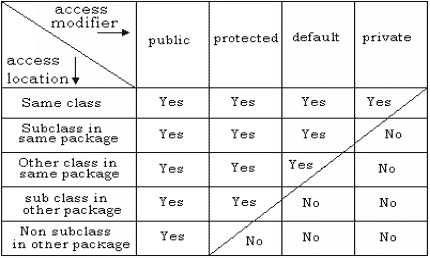

### JAR 文件（Java 归档文件）

为了压缩文件，我们使用某些如 winzip 的程序。JAR 文件有以下选项：

| 选项 | 说明 |
| :--- | :--- |
| `c` | 创建一个新的归档。 |
| `C` | 执行期间更改目录。 |
| `f` | 列表的第一个元素是待创建的归档名称。 |
| `i` | 应提供索引信息。 |
| `m` | 列表的第二个元素是外部清单文件（manifest）名称。 |
| `M` | 不创建清单文件。 |
| `t` | 应列出归档内容。 |
| `u` | 更新现有文件。 |
| `v` | 执行时详细输出。 |
| `x` | 从归档中提取的文件。 |
| `o` | 不使用压缩。 |

创建 JAR 文件：

```
jar -cf Myjar.jar pack1
```

这将创建一个包含 `pack1` 所有文件的 `Myjar.jar` 文件。

提取 JAR 文件：

此命令用于提取归档文件（如解压）

```
jar -xf Myjar.jar
```

列出 JAR 文件内容：

以下命令列出 `Myjar.jar` 的内容。

```
jar -tf Myjar.jar
```

更新现有 JAR 文件：

以下命令用于更新文件。

```
jar -uf Myjar.jar pack1
```

创建可执行 JAR 文件：

```
jar -cmf mainClass Myjar.jar pack1
```

其中 `mainClass` 是一个保存在 `javaprg` 文件夹中的文本文件，包含 `Main-Class: pack1.pack2.pack3.A`。

执行 JAR 文件：

```
java –jar Myjar.jar
```

### 题

1. 什么是包？

2. 解释所有的修饰符及其在不同包、子包、子类及其他类中的作用域。

3. JAR 文件有什么用？

4. `import` 语句的作用是什么？

# 第 9 章（接口）

### 简介

接口基本上是类的一种。和类一样，接口包含方法和变量，但有一个主要的区别。区别在于接口只定义抽象方法和 final 变量（常量）。这意味着接口不编写任何代码来这些这些方法，且字段只包含常量。

因此，类的职责是实现一个接口，以定义这些方法的实现代码。接口在语法上与类相似，但它们缺少实例变量，且其方法在声明时不包含方法体。在实践中，这意味着我们可以定义接口，而不对它们的实现方式做任何假设。接口的目的是将类的接口与它的实现分开。接口仅仅定义了类必须做什么，而没有对实现进行任何说明。接口只定义方法签名，不包含任何实例变量。

嵌套接口是指任何声明出现在另一个类或接口体内的接口。顶层接口是指不是嵌套接口的接口。定义接口的语法与定义类非常相似。接口定义的通用形式如下：

```java
interface interface_name {
    variable declarations;
    methods declarations;
}
```

在这里，`interface` 是关键字，`interface_name` 是任何有效的 Java 标识符（就像类名一样）。

**注意：** 当我们定义一个接口时，默认情况下它是 `public` 且 `abstract` 的。

### 接口修饰符

用于顶层接口的唯一修饰符是 `abstract` 和 `public`。即使我们不使用 `abstract` 修饰符，接口也会隐式地声明为 `abstract`，因此不需要使用 `abstract` 修饰符。顶层接口的可见性可以是 `package` 或 `public`，就像顶层类一样。如果没有使用可见性修饰符，则接口的可见性被假设为 `package`。

### 数据变量成员声明

接口中只能定义常量。接口中的所有变量都隐式地为 `public`、`final` 和 `static`，这意味着它们不能被实现类修改。它们还必须用常量值初始化。

```java
public static final type variable_name=value;
```

在接口中声明的变量是 `public`、`static` `final`。这意味着它是一个具有公共访问权限的静态变量。该变量也被声明为 `final`，这意味着它必须在声明时赋值，并且之后不能再修改。关键字 `final` 类似于 C/C++ 中的 `const`。

### 方法声明


方法声明将仅包含方法列表，而不包含任何方法语句。它们在参数列表后以分号结束。它们本质上是抽象方法，接口中指定的任何方法都不能有默认实现。

接口中的所有方法默认始终是`public`和`abstract`修饰符。我们不能在接口中声明静态方法。

```java
public abstract return_type method_name(parameter_list);
```

这是一个包含两个变量和一个方法的接口定义示例。

```java
interface item {
    static final int code = 1001;
    static final String name = "Matrix";
    abstract void display();
}
```

**注意：** 方法代码不包含在接口中，方法声明简单地以分号结束。

另一个接口的示例：

```java
interface area {
    float pi = 3.14f;
    float compute(float x, float y);
    void show();
}
```

## 扩展接口

像类一样，接口也可以被扩展，即一个接口可以从其他接口派生。新接口将以类似于子类的方式继承子接口的所有成员。这通过使用`extends`关键字来实现，如下所示：

```java
interface interface_1 {
    int code = 1001;
    String name = "Matrix";
}

interface interface_2 extends interface_1 {
    void display();
}
```

`interface_2`将继承其中的常量`code`和`name`。

**注意：** 变量`name`和`code`是像普通变量一样声明的。这在这里是允许的，但接口中的所有变量都被视为常量。接口中的变量默认是`public` & `static`，尽管这里没有`public`、`static`和`final`关键字。

我们可以在单个接口中组合多个接口。以下声明是有效的：

```java
interface interface_1 {
    int code = 1001;
    String name = "Matrix";
}

interface interface_2 {
    void display();
}

interface interface_3 extends interface_1, interface_2 {
}
```

**注意：** 始终记住接口不能扩展类。这将违反接口只能有抽象方法和常量的规则。

## 实现接口

接口作为“超类”，其属性被类继承。因此，必须创建一个继承给定接口的类。一旦定义了接口，一个或多个类就可以该接口。

要实现接口，需要在类定义中包含`implements`子句，然后创建接口声明的方法。实现类必须为所有接口中的所有方法提供主体，否则它必须被声明为抽象类。实现类也可以扩展类并实现多个接口。

```java
class class-name implements interface-name {
    // body
}
```

Java 不支持多继承继承，但支持多接口继承，即一个类可以实现多个接口，如下所示：

```java
class class-name implements interface-1, interface-2, .... interface-n {
    // body
}
```

**注意：** 当我们实现接口方法时，必须将其声明为`public`。实现接口方法类似于重写，因此我们不能降低可见性。

### 示例 9.1

```java
interface interface_1 {
    void show(int x);
}

class class_1 implements interface_1 {
    public void show(int x) {
    }
}
```

### 抽象类的示例 9.2

```java
interface common {
    void push(int x);
    int pop();
}

abstract class stack implements common {
    abstract void disp();
}
```

在这里，`stack`类没有实现`push()`和`pop()`方法。因此，我们必须将`stack`类声明为抽象类，这种技术被称为部分实现。

## 接口继承的不同形式

(a)

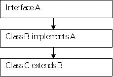

(单级接口继承)

(b)

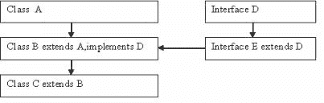

(多级接口继承)

(c)

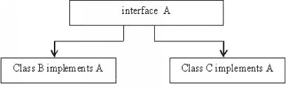

(层级接口继承)

(d)

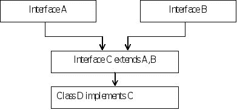

(混合接口继承)

## 通过接口引用访问实现类对象

我们可以将变量声明为使用接口而非类类型的对象引用。任何实现所声明接口的类的实例都可以通过此类变量进行引用。当我们通过这些引用之一调用方法时，将根据所引用的接口的实际实例来调用正确的版本。

这是接口的重要特性之一。要执行的方法将在运行时动态查找，这允许类在调用其方法的代码之后再创建。调用代码可以通过接口进行分发，而无需了解任何“被调用者”的细节。这一过程类似于使用父类引用来访问子类对象。

由于运行时动态查找方法与 Java 中的普通方法调用相比会产生巨大的开销，因此在性能关键的代码中，我们注意不要随意使用接口。

### 示例 9.3

```java
interface Math_function {
    void display(int x);
}

class Sqrt implements Math_function {
    public void display(int x) {
        System.out.println("sqrt of x ="+Math.sqrt(x));
    }
}

class Log implements Math_function {
    public void display(int x) {
        System.out.println("log of x "+Math.log(x));
    }
}

class Math_Demo {
    public static void main(String args[]) {
        Math_function f1 = new Sqrt();
        Math_function f2 = new Log();
        f1.display(27);
        f2.display(3);
        Math_function f3;
        f3 = f1; // 多态（赋值引用）
        f3.display(30);
        f3 = f2; // 多态（赋值引用）
        f3.display(5);
    }
}
```

输出：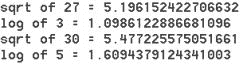

### 接口的特点

- `Interface`是一个关键字。

- 接口可以声明为抽象的，但它默认就是抽象的，因此无需添加`abstract`关键字。

- 所有变量始终是`static`且`final`的。

- 接口的所有方法必须在类中实现。

- 实现类实现的所有方法必须是`public`的。

- 接口仅包含方法的声明。

- 接口方法不能声明为`static`。它们始终被声明为实例方法。

- 类既不能收窄接口方法的访问权限，也不能在方法子句中指定新的异常；因为尝试这样做等同于更改了接口，这是非法的。重写方法的标准也适用于实现接口方法。

- 所有方法在实现类中均需要定义为`public`。

- 这里通过`abstract`关键字允许部分实现。

- 无论类直接或间接实现了多少接口，对于可能在接口中有多个声明的方法，它只提供一个单一的实现。

- 方法原型声明也可以像类一样进行重载。

- 接口常量可以通过任何客户端（类或接口）使用其完全限定名来访问，无论客户端是否扩展或实现了该接口。然而，如果客户端是实现此接口的类或扩展此接口的接口，则客户端也可以直接访问此类常量，而无需使用完全限定名。此类客户端继承了接口常量。

- 在接口常量多重继承的情况下，任何名称冲突都可以使用相关常量的完全限定名来解决。

### 接口变量

接口中的所有变量始终是`public static final`的，因为它们是实现类访问数据类型和方法的公共部分。

### 接口变量的内存管理

静态变量在程序加载时总是获取内存，它们占用独立的内存，不与任何对象的内存共享。它们也被称为常量变量。可以使用接口名和`.`运算符直接访问。

### 示例 9.4

```java
interface Static_Var {
    int sun=1;
    int mon=2;
    int tues=3;
    int wed=4;
    int thurs=5;
    int fri=6;
    int sat=7;
}

class Week_Day implements Static_Var {
    public static void main(String args[]) {
        System.out.println(sun);
        System.out.println(mon);
        System.out.println(tues);
        System.out.println(wed);
        System.out.println(thurs);
        System.out.println(fri);
        System.out.println(sat);
    }
}
```

```java
System.out.println(Static_Var.thurs);
System.out.println(Static_Var.fri);
System.out.println(Static_Var.sat);
```

输出: 1

2

3

4

5

6

7

### 示例 9.5

```java
interface Two_Methods {
    void m1();
    void m2();
}

class Three_Methods implements Two_methods {
    public void m1() {
        // body of the m1;
    }
    public void m2() {
        // body of the m2;
    }
    public void m3() {
        // body of the m3;
    }
}

class Methods_Demo {
    public static void main(String args[]) {
        Two_methods tm1 = new Three_methods();
        tm1.m1();
        tm1.m2();
        // tm1.m3(); error
        Three_Methods tm2 = new Three_Methods();
        tm3.m3(); // 注意：原文写的是 tm3，但根据上下文推断应该是 tm2
    }
}
```

注意：在这里我们无法使用接口引用调用`m3()`，因为该方法没有在接口中声明。因此，接口引用只能访问在类块中声明的方法。否则，我们可以调用相同对象或扩展对象。

### 示例 9.6

```java
interface Two_Methods {
    void m1();
    void m2();
}

interface One_Method extends Two_Methods {
    void m3();
}

class Three_Methods implements One_methods {
    public void m1() {
        // body of the m1;
    }
    public void m2() {
        // body of the m2;
    }
    public void m3() {
        // body of the m3;
    }
}

class Methods_Demo {
    public static void main(String args[]) {
        Three_methods tm1 = new Three_methods();
        tm1.m1();
        tm1.m2();
        tm1.m3();
    }
}
```

### 接口方法

当任何类实现接口，并在类中定义了接口中未声明的方法时，我们可以说这些额外方法是非接口方法。

```java
interface Two_Methods {
    void push(int x);
    int pop();
}

class Stack implements Two_Methods {
    int arr[] = new int[5];
    int top = -1;

    public void push(int item) {
        if (top == 4) {
            System.out.println("Overflow");
            return;
        }
        top++;
        arr[top] = item;
    }

    public int pop() {
        if (top == -1) {
            System.out.println("Underflow");
            return -1;
        }
        int item = arr[top];
        top--;
        return (item);
    }

    void disp() {
        for (int i = top; i >= 0; i--) {
            System.out.println(arr[i]);
        }
    }
}

class Stack_Demo {
    public static void main(String args[]) {
        Stack s1 = new Stack();
        s1.pop();
        for (int i = 0; i < 5; i++) {
            s1.push(i + 100);
        }
        s1.push(60);
        System.out.println("----Display Item----");
        s1.disp();
        System.out.println("----Removing Items----");
        for (int i = 0; i < 5; i++) {
            System.out.println(s1.pop());
        }
    }
}
```


# 第 ∞ 10 章

## String 和 StringBuffer

### 简介

在 Java 中，`String`是类对象，通过两个类来实现的，即`String`和`StringBuffer`。与 C 语言字符串相比，Java 的`String`更可靠且可预测。这基本上是因为 C 语言缺乏边界检查。Java 的`String`并不是字符数组，也不是以 NULL 结尾的。通常情况下，Java 不允许将运算符应用到`String`对象上。

该规则的唯一例外是`+`和`+=`运算符，它们会连接两个字符串并产生一个`String`对象。在 Java 中，字符数组不被视为字符串。Java 的`String`类用于执行所有的字符串操作。`String`类和`StringBuffer`类是`java.lang`包的一部分。

### String 类

```java
String s1 = new String("matrix");
String s2 = "matrix";
System.out.println(s1);
System.out.println(s1.length);
System.out.println("matrix".length);
```

`String`在 Java 中具有以下特性：

#### [i] String 在 Java 中是一个对象

`String`代表一个字符序列，但与许多将 String 实现为字符数组的语言不同，Java 将字符串实现为`string`类型的对象。

字符串操作是许多 Java 程序中常见的常见的部分。将字符串实现为内置对象允许 Java 提供全套的特性，使字符串处理变得非常方便。此外，字符串对象可以通过多种方式构造，以便在需要时轻松地获取字符串。

#### [ii] String 是不可变的

`String`是不可变的，也就是说我们不能在创建后更改字符串。但是，声明为`String`引用的变量可以随时更改指向其他字符串对象。

我们仍然可以执行所有类型的字符串操作。每当我们需要一个现有字符串的修改版本时，都会创建一个新的字符串对象，其中包含了修改内容。

原始字符串保持不变。使用这种方法是因为固定的、不可变的字符串比可更改的字符串实现得更高效。


对于那些需要修改字符串的情况，有一个名为`StringBuffer`的伴生类，其对象包含的字符串在创建后是可以被修改的。

## `String` 类是 `final` 的

`String` 和`StringBuffer`类都是`final`的。这意味着我们不能在任何类中扩展`String`类。这允许某些优化来提高常用字符串操作的性能。

## `String` 类的构造函数与方法

| # | 方法 | 说明 |
| :--- | :--- | :--- |
| 1 | `public String()` | 初始化新创建的`String`对象，使其表示空字符序列。`String s1 = new String();` |
| 2 | `public String(String str)` | 初始化新创建的`String`对象，使其与参数相同的相同的序列；换句话说，新创建的字符串是参数字符串的拷贝。`String s1 = new String("Matrix"); String s2 = new String(s1);` 字符串`s2`是字符串`s1`的拷贝。虽然内容相同，但`s1`和`s2`指向不同的字符串对象。 |
| 3 | `public String(char ch[])` | 分配一个新的`String`，表示当前字符数组参数中包含的字符序列。`char ch[] = {'a', 'b', 'c'}; String s1 = new String(ch);` // `s1`将持有 "abc" |
| 4 | `public String(char value[], int offset, int count)` | 分配一个新的`String`，包含来自字符数组参数中子数组的字符。`char ch[] = {'a', 'b', 'c', 'd', 'e', 'f'}; String s1 = new String(ch,2,3);` // `s1`将持有 "cde" |
| 5 | `public String(int value[], int offset, int count)` | 分配一个新的`String`，包含来自包含字符 Unicode 的整数数组参数子数组的字符。`int a[] = {97, 98, 99, 100, 101, 102}; String s1 = new String(a,2,3);` // `s1`将持有 "cde" |
| 6 | `public String(byte b[], int offset, int count)` | 使用平台的默认字符集解码指定的字节子数组，构造一个新的`String`。`byte b[] = {97, 98, 99, 100, 101, 102}; String s1 = new String(b,2,3);` // `s1`将持有 "cde" |
| 7 | `public String(byte[])` | 使用平台的默认字符集解码指定的字节数组，构造一个新的`String`。`byte b[] = {97, 98, 99}; String s1 = new String(b);` // `s1`将持有 "abc" |
| 8 | `public String(StringBuffer)` |  |
| 9 | `public int length()` | 显示字符串的字符数量。 |
| 10 | `public boolean isEmpty()` | 如果字符串为空则显示 true，否则显示 false。`String s1 = new String(); System.out.println(s1.isEmpty());` |
| 11 | `public char charAt(int index)` | 返回指定索引处的字符。范围从 0 到`length()`–1。如果指定的索引无效则抛出`StringOutOfBoundsException`。`String s1 = "matrix"; System.out.println(s1.charAt(0));` // 将打印 "m" |
| 12 | `public void getChars(int srcBegin, int srcEnd, char[] dst, int dstBegin)` | 将此字符串中的字符拷贝到目标数组中。第一个字符位于`srcBegin`，最后一个字符位于`srcEnd-1`。此方法可能会抛出`ArrayIndexOutOfBoundsException`和`StringIndexOutOfBoundsException`。 |
| 13 | `public void getBytes(int srcBegin, int serEnd, byte dst[], int dstBegin)` |  |
| 14 | `public byte[] getBytes()` | 使用默认集将此`String`编码为字节序列，并将结果存储在字节数组中。 |
| 15 | `public boolean equals(Object)` | 将调用字符串与指定的对象比较。如果参数不空且是表示调用字符串相同字符序列的`String`对象，则结果为真。 |
| 16 | `public boolean equalsIgnoreCase(String)` | 忽略大小写比较调用字符串与另一个字符串。 |
| 17 | `public int compareTo(String)` | 字典顺序比较调用字符串与传入的字符串。如果调用字符串小于字符串，返回`<0`；如果调用字符串大于字符串，返回`>0`；如果两个字符串相等，返回`0`。 |
| 18 | `public int compareToIgnoreCase(String)` | 忽略大小写差异字典顺序比较两个字符串。 |
| 19 | `public boolean regionMatches(int startIndex, String str2, int str2StartIndex, int len)` | 测试两个字符串区域相等。 |
| 20 | `public boolean regionMatches(Boolean ignoreCase, int startIndex, String str2, int str2StartIndex, int len)` | 测试两个字符串区域相等。如果`ignoreCase`标志为真，则忽略大小写差异 |
| 21 | `public boolean startsWith(String prefix, int startIndex)` | 测试此字符串从指定索引开始是否以指定的指定开头。此方法不返回异常，但如果`startIndex`越界则返回 false。 |
| 22 | `public boolean startsWith(String)` | 测试此字符串是否以指定的前缀开头。 |
| 23 | `public boolean endsWith(String suffix)` | 测试此字符串是否以指定的后缀结尾。 |
| 24 | `public int indexOf(char ch)` | 返回指定字符在此字符串中第一次位置的索引。 |
| 25 | `public int indexOf(char ch, int fromIndex)` | 从指定的索引开始搜索，返回指定字符在此字符串中第一次位置的索引。 |
| 26 | `public int indexOf(String str)` | 返回指定子字符串在此字符串中第一次出现的索引。 |
| 27 | `public int indexOf(String str, int fromIndex)` | 从指定的索引开始搜索，返回指定子字符串在此字符串中第一次出现的索引。 |
| 28 | `public int lastIndexOf(int ch)` | 返回指定字符在此字符串中最后一次出现的索引。 |
| 29 | `public int lastIndexOf(int ch, int fromIndex)` | 从指定的索引开始向后搜索，返回指定字符在此字符串中最后一次出现的索引。 |
| 30 | `public int lastIndexOf(String str)` | 返回指定子字符串在此字符串中最后一次出现的索引。 |
| 31 | `public int lastIndexOf(String str, int fromIndex)` | 从指定的索引开始向后搜索，返回指定子字符串在此字符串中最后一次出现的索引。 |
| 32 | `public String substring(int)` | 获取从第 n 个字符开始的子字符串 |
| 33 | `public String substring(int n, int m)` | 获取从第 n 个字符到第 m 个字符的子字符串（不包含 m 个字符） |
| 34 | `public String concat(String str)` | 将字符串`str`拼接在调用字符串对象的末尾。 |
| 35 | `public String replace(char x, char y)` | 将所有的`x`替换为`y` |
| 36 | `public String replaceFirst(String, String)` |  |
| 37 | `public String replaceAll(String, String)` |  |
| 38 | `public String toLowerCase()` | 将字符串转换为小写 |
| 39 | `public String toUpperCase()` | 将字符串转换为大写 |
| 40 | `public String trim()` | 移除开头和结尾的空格 |
| 41 | `public char[] toCharArray()` | 将调用的字符串转换为新的字符数组。提供此函数是为了方便，因为可以使用`getChars()`相同的结果。 |
| 42 | `public static String valueOf(Object)` | 为参数`p`（简单类型或对象）创建一个字符串对象 |

## 字符串数组

我们也可以创建并使用包含字符串的数组。

### 示例 10.1

```java
import java.util.Scanner;

class StringArrSort {
    public static void main(String args[]) {
        Scanner sc=new Scanner(System.in);
        System.out.print("Enter how many names ");
        int n=sc.nextInt();
        String s[]=new String[n];
        // input
        for(int i=0;i<n;i++) {
            System.out.println("Enter name " + (i+1));
            s[i]=sc.next();
        }
        // sorting
        for(int i=0;i<n-1;i++) {
            for(int j=i+1;j<n;j++) {
                if(s[i].compareTo(s[j]) > 0) {
                    String t=s[i];
                    s[i]=s[j];
                    s[j]=t;
                }
            }
        }
        //output
        for(int i=0;i<n;i++) {
            System.out.println(s[i]);
        }
    }
}
```

## 字符串转换与`toString()`

当 Java 在拼接过程中将数据转换为其字符串表示时，它是通过调用`String`类定义的重载字符串转换方法`valueOf()`来完成的。`valueOf()`是一个针对所有简单类型和`Object`类型重载的静态方法。

对于简单类型，`valueOf()`返回一个包含调用时值的人类可读等价值的字符串。对于对象，`valueOf()`调用对象上的`toString()`方法。

每个类都继承了`toString()`，因为它是由`Object`类定义的。然而，`toString()`的默认实现通常是不够的。它显示类名，后跟符号“@”，然后是对象 ID（例如`Box@ab1342`），这通常没有用。对于我们创建的大多数重要类，我们希望重写`toString()`并提供自己的字符串表示。

### 示例 10.2

```java
class A {
    private int x,y;
    A() {
        x = y = 0;
    }
    A(int x1, int y1) {
        x = x1;
        y = y1;
    }
}
class ToStringTest {
    public static void main(String args[]) {
        A a1 = new A(5,6);
        System.out.println(a1); // 调用了 Object 类的 toString()
        String s1="Object a1 is " + a1; // 与字符串拼接
        //再次调用了 Object 的 toString()
        System.out.println(s1);
    }
}
```

**输出：**

```
A@3e25a5
Object a1 is A@3e25a5
```

### 示例 10.3

```java
class A {
    private int x,y;
    A() {
        x = y = 0;
    }
    A(int x1, int y1) {
        x = x1;
        y = y1;
    }
    public String toString() {
        return (x + "," + y);
    }
}
class ToStringTest2 {
    public static void main(String args[]) {
        A a1 = new A(5,6);
        System.out.println(a1); // 调用了 A 类的 toString()
        String s1="Object a1 is " + a1; // 与字符串拼接
        //再次调用了 A 的 toString()
        System.out.println(s1);
    }
}
```

**输出：**

```
5,6
Object a1 is 5,6
```

### 示例 10.4

```java
import java.util.*;

class FindTest {
    public static void main(String args[]) {
        Scanner sc=new Scanner(System.in);
        String s1,s2;
        System.out.print("Enter a string");
    }
}
```

```java
s1=sc.next();
System.out.print("Enter string to search");
s2=sc.next();
int ans = s1.indexOf(s2);
if(ans == -1)
    System.out.println("Not Found");
else
    System.out.println("found at pos " + ans);
```

## `StringBuffer`

### 简介

`StringBuffer`是`String`的对等类，提供了`String`的大部分功能。众所周知，`String`代表固定长度且不可变的字符序列。与`String`不同，`StringBuffer`代表可增长和可写的字符序列。`StringBuffer`可以在中间插入字符或在末尾追加字符和子字符串。

`StringBuffer`会自动扩展以为这些添加留出空间，通常预分配的字符比实际需要的更多，以便留出增长空间。Java 频繁使用这两个类，但许多程序员只处理`String`，而 Java 通过使用重载的`+`运算符在后台操作`StringBuffer`。

### 与`StringBuffer`类相关的几个重要点

- `StringBuffer`像`String`一样是一个`Object`。
- `StringBuffer`类也像`String`类一样是`final`的。
- 与`String`对象不同，`StringBuffer`对象是可变的（可以修改）。

## `StringBuffer`类的构造函数和方法

| 方法 | 说明 |
| :--- | :--- |
| `public StringBuffer()` | 默认构造函数为 16 个字符留出空间，无需重新分配。 |
| `public StringBuffer(int)` | 此构造函数接受一个整数参数，显式设置缓冲区的大小。 |
| `public StringBuffer(String)` | 此构造函数接受一个`String`，设置`StringBuffer`对象的初始内容，并为额外的 16 个字符留出空间，无需重新分配。 |


| `public synchronized int length()` | 返回 `StringBuffer` 的当前长度。 |

| `public synchronized int capacity()` | 返回当前容量。容量是为新插入字符提供的可用存储空间，超过该空间将发生分配。 |

| `public synchronized void ensureCapacity(int)` | 确保容量至少等于指定的最小容量。如果我们想在 `StringBuffer` 构造后为特定数量的字符预留空间，可以使用 `ensureCapacity()` 方法设置缓冲区的大小。如果我们提前知道将向 `StringBuffer` 追加大量短字符串，这种方法非常有用。 |

| `public synchronized void trimToSize()` | 删除多余的空空间。现在 `Capacity` 将等于 `length`。 |

| `public synchronized void setLength(int newLength)` | 设置字符序列的长度。`newLength` 必须是非负数。当我们增加缓冲区大时，空字符会被添加到现有缓冲区的末尾。如果调用 `setLength()` 的值小于 `length()` 返回的当前值，则存储在新长度之外的字符将丢失。 |

| `public synchronized char charAt(int index)` | 返回此序列中指定索引处的 `char` 值。 |

| `public synchronized void getChars(int srcBegin, int srcEnd, char[] dst, int dstBegin)` | 将字符从此序列复制到目标字符数组 `dst`。要拷贝的第一个字符位于索引 `srcBegin`；最后一个字符位于索引 `srcEnd-1`。要拷贝的字符总数为 `srcEnd-srcBegin`。字符被复制到 `dst` 中从 `dstBegin` 开始的子数组。注意：确保目标或目标数组足够大，以容纳指定子字符串中的字符数。 |

| `public synchronized void setCharAt(int index, char ch)` | 将指定索引处的字符设置为 `ch`。如果索引为负或大于或等于 `length()`，则发生 `IndexOutOfBoundsException`。 |

| `public synchronized StringBuffer append(Object)` | `append` 方法将任何其他类型数据的字符串表示连接到调用 `StringBuffer` 对象的末尾。 |

| `public synchronized StringBuffer delete(int start, int end)` | 从 `start` 到 `end-1` 的字符。 |

| `public synchronized StringBuffer deleteCharAt(int index)` | 删除指定位置的 `char`。 |

| `public synchronized StringBuffer replace(int start, int end, String str)` | 将 `start` 到 `end-1` 的字符替换为指定 `String` 中的字符。 |

| `public synchronized String substring(int)` | 返回一个新的 `String`，包含当前包含在此字符序列中的字符子序列。子字符串从指定的 `index` 开始并延伸到此序列的末尾。 |

| `public synchronized String substring(int start, int end)` | 返回一个新的 `String`，包含当前包含在此字符序列中的字符子序列。子字符串从指定的 `start` 开始并延伸到字符 `end-1`。 |

| `public synchronized StringBuffer insert(int, Object)` | 将一个 `String` 插入另一个 `String` 中。它被重载以接受所有简单类型和 `Objects` 的值。 |

| `public int indexOf(String)` | |

| `public int indexOf(String, int)` | |

| `public int lastIndexOf(String)` | |

| `public int lastIndexOf(String, int)` | |

| `public synchronized StringBuffer reverse()` | 反转 `StringBuffer` 的内容。 |

### 示例 1.5

```java
import java.util.Scanner;

class SortStr {
    public static void main(String args[]) {
        Scanner sc = new Scanner(System.in);
        System.out.print("Enter a string");
        StringBuffer sb1 = new StringBuffer(sc.next());
        //Sorting
        for(int i=0; i<sb1.length()-1; i++) {
            for(int j=i+1; j<sb1.length(); j++) {
                if(sb1.charAt(i) > sb1.charAt(j)) {
                    char t=sb1.charAt(i);
                    sb1.setCharAt(i, sb1.charAt(j));
                    sb1.setCharAt(j, t);
                }
            }
        }
        System.out.println(sb1);
    }
}
```

**输出:** Enter a string SHIVAM -> AHIMSV

### 示例 10.6: 计算给定句子中单词数量的程序

```java
class WordCnt {
    public static void main(String args[]) {
        String s1 = "Mohan Das  Karam  Chand  Gandhi";
        boolean flag=false;
        int cnt=0;
        for(int i=0; i<s1.length(); i++) {
            if(s1.charAt(i) == ' ') {
                flag = false;
            } else {
                if(flag == false) {
                    cnt++;
                    flag = true;
                }
            }
        }
    }
}
```

```java
18. }
19. }
20. }
21. System.out.print("No. of Words=" + cnt);
22. }
23 }
```

输出: No. of Words=5

![Images/image01215.jpeg)

# 第 11 章：异常处理

## 引言

异常（Exception）是由程序中的运行时错误引起的条件，它会破坏程序的正常执行流。当 Java 解释器遇到如整数除以零之类的错误时，它会创建一个 `Exception` 对象并将其抛出（即通知我们发生了错误）。每当运行时发生异常时，Java 异常/错误都是 `Exception` 类的对象或其子类之一。异常对象包含了有关异常的详细信息，可以使用为此目的提供的公共方法来访问这些信息。

在某些旧语言中，我们必须使用 `if`、`goto` 和返回值来进行错误处理。异常是代码序列在运行时出现的一种异常状态。换句话说，异常就是运行时错误。在不支持异常处理的计算机语言中，必须手动检查并处理错误——通常通过使用错误代码等。这种方法既繁琐又麻烦。Java 的异常处理避免了这些问题，并在过程中将运行时错误管理引入了面向对象的世界。

## 异常处理基础

Java 异常是一个对象，描述了代码段中发生的异常（即错误）状态。当出现异常状态时，会产生一个代表该异常的对象，并在导致错误的方法中抛出它。该方法可以选择自己处理该异常，也可以将其传递下去。无论哪种方式，异常在某一点被捕获并处理。异常可以由 Java 运行时系统生成，也可以由你的代码手动生成。Java 抛出的异常与违反 Java 语言规则或 Java 执行环境限制的根本错误有关。手动生成的异常通常用于向方法的调用者报告某些错误状态。

Java 异常处理通过五个关键字管理：`try`、`catch`、`throw`、`throws` 和 `finally`。简而言，它们的工作原理如下：你想要监控异常的程序语句包含在 `try` 块中。如果在 `try` 块内发生异常，异常就会被抛出。你的代码可以捕获此异常（使用 `catch`）并以某种方式处理它。系统生成的异常由 Java 运行时自动抛出。要手动抛出异常，请使用关键字 `throw`。任何抛出方法的异常都必须由 `throws` 子句指定。任何在 `try` 完成后绝对必须执行的代码都放在 `finally` 块中。

这是异常处理块的通用形式：

```java
try {
    // 待监控错误的代码块
} catch (Exception ex) {
    // 异常处理器
} .........
finally {
    // 在 try 结束后要执行的代码块
}
```

## 异常类型

所有异常类型都是内置类 `Throwable` 的子类。因此，`Throwable` 处于异常层次结构的顶端。紧邻 `Throwable` 之下有两个子类，它们将异常分为两个不同的分支。其中一个分支由 `Exception` 引导。该类用于用户程序应该捕获的异常状态。你也将通过派生该类来创建自己的异常类型。`Exception` 有一个重要的子类，称为 `RuntimeException`。这种类型的异常会为你编写的程序自动定义，包括除以零和无效索引等情况。

另一个分支由 `Error` 引导，它定义了在正常情况下预计不会被你的程序捕获的异常。`Error` 的异常用于 Java 运行时系统来表示与运行时环境本身相关的错误。`Stack overflow` 是此类错误的一个示例。本章将不会处理 `Error` 类型的异常，因为这些通常是响应灾难性故障的，你的程序通常无法处理。顶层异常层次结构所示：

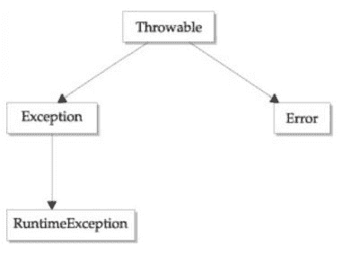

### 示例 11.1

```java
class ErrorTest1 {

    public static void main(String args[]) {

        int a=5, b=2, c=2, d;

        d=a/(b-c); // 发生了 ArithmeticException(Divide by zero)

        System.out.println(d);

        System.out.println("This not be printed");

    }

}
```

程序将终止除法且不再运行剩余语句。

### 示例 1.2

```java
class A {

    void display() {

    }

}

class ErrorTest2 {

    public static void main(String args[]) {

        A a1=null;

        a1.display(); // 发生了 NullPointerException

    }

}
```

在上面的程序中会发生 `NullPointerException`。引用变量没有用 `new` 初始化。在这种情况下程序也会终止。

### 示例 11.3

```java
class ErrorTest3 {

    public static void main(String args[]) {

        int a[] = {10,20,30};

        System.out.println(a[3]); // 发生了 ArrayIndexException

    }

}
```

在上述情况下，数组的长度为 3，索引从 0 到 2，所以如果我们打印 `a[3]`，那么这就是第 4 个元素，它不是有效的索引。这将产生一个异常错误。在 C/C++ 中这是允许的，但在 Java 中不允许。

注意

JDK 7 增加了一种 `try` 语句的新形式，支持自动资源管理。这种新的 `try` 形式称为 `try-with-resources`，在第 章结合管理文件的背景进行了描述，因为文件是最常用的资源之一。

## 异常的其他情况

1. 我们尝试打开的文件可能不存在。
2. 我们想要创建一个新对象但没有可用内存。
3. 我们想要加载的类文件可能缺失或格式错误。
4. 我们想要转换为数字的 `String` 包含无效字符，导致其无法转换为数字。

如果异常对象没有被正确地捕获和处理，解释器将显示错误消息并终止程序。如果我们想继续执行剩余代码，那么我们应该尝试捕获由错误条件抛出的异常对象。

此任务被称为异常处理。异常处理机制的目的是提供一种检测和报告“异常情况”的手段，以便采取适当的。该机制建议引入一套独立的错误处理代码，用于执行以下任务：

1. 发现问题。（发生异常）
2. 通知错误已发生。（抛出异常）
3. 接收错误信息。（捕获异常）
4. 采取修正措施。（处理异常）

Java 异常处理通过五个关键字管理：`try`、`catch`、`throw`、`throws` 和 `finally`。

我们想要监控异常的程序语句包含在 `try` 块中，每当发生错误时，它就会被抛到 `catch` 块。我们的代码可以捕获此异常（使用 `catch`）并以某种合理的方式对其处理。系统生成的异常由 Java 运行时系统自动抛出。

要手动抛出异常，请使用 `throw` 关键字。任何抛出方法的异常都必须通过 `throws` 子句进行说明。在方法返回之前必须执行的代码放在 `finally` 块中。

即使 `try` 块中只有一个语句，也必须用大括号括起来。可以有一个或多个 `catch` 语句，以及零或一个 `finally` 语句。`catch` 和 `finally` 块都是可选的，但一个 `catch` 块或一个 `finally` 块是必须的。

`try` 块中的代码执行方式与其他任何 Java 代码相同。如果 `try` 块中的代码执行成功，控制将转移到存在的 `finally` 块，然后从 `finally` 块结束后的语句继续执行（即 `try` 语句结束之后）。如果不存在 `finally` 块，执行将从上一个 `catch` 块之后的语句继续（即 `try` 语句结束之后）。

如果在执行 `try` 块中的代码时发生某些运行时错误，JVM 会抛出一个 `Exception Error`。这意味着将根据运行时错误的类型，创建一个 `Exception Error` 类型的对象或其子类之一。然后，将按照从上到下的顺序与 `catch` 块中的 `Exception`/`Error` 类型进行比较。

如果找到匹配的 `catch` 块，则处理该异常/错误，即程序不会终止。执行将从 `catch` 块中的第一个语句继续。在 `catch` 块完成后，执行将从 `try` 和 `catch` 语句结束后的语句继续。

无论有多少个 `catch` 块，最多执行一个 `catch` 块。如果异常/错误与任何 `catch` 块的异常/错误类型都不匹配，我们称其未被处理。

执行将立即从 `try` 块返回。即使异常/错误未被处理，`finally` 块中的代码也将被执行。

如果有外层的 `try` 块，异常/错误将由外层处理，否则必须在调用当前方法的方法中进行处理。

异常/错误将向上层级结构移动，直到被处理，或者如果即使在 `main()` 方法（执行开始的第一个方法）中未被处理，它将作为未处理状态传递给 JVM。

JVM 然后简单地终止程序并在监视器/控制台上显示异常/错误的详情。

在这里我们表示了程序在执行时可能发生的某些异常。

### 使用 try 和 catch

虽然 Java 运行时系统提供的默认异常处理程序对于调试很有用，但你通常可能自己自己处理异常。这样做有两个好处。首先，它允许你修复错误。

其次，它防止程序自动终止。如果你的程序每次发生错误就停止运行并打印堆栈跟踪，大多数用户会感到困惑（至少是这样说）！幸运的是，防止这一点很容易。

为了防止和处理运行时错误，只需将你想监控的代码包含在 `try` 块中。紧随 `try` 块之后，包含一个 `catch` 子句，其中指定你想要捕获的异常类型。

为了说明如何可以轻松地完成这一点，以下程序包含一个 `try` 块和一个 `catch` 子句，用于处理由除零错误产生的 `ArithmeticException`：

```java
class Exc2 {

    public static void main(String args[]) {

        int d, a;

        try {

            // monitor a block of code.

            d = 0;

            a = 42 / d;

            System.out.println("This will not be printed.");

        } catch (ArithmeticException e) {

            // catch divide-by-zero error
```


`System.out.println("Division by zero.");`

`}`

`System.out.println("After catch statement.");`

`}`

`}`

此程序产生以下输出：

```
Division by zero.
After catch statement.
```

注意 `try` 块内部的 `println()` 调用从未执行过。一旦抛出异常，控制权就会离开 `try` 块转移到 `catch` 块。因此，`try` 块内部的 `println()` 调用不会显示。`catch` 的范围限制在 `try` 指定的那些范围内。

构建良好的 `catch` 子句的目标应该是解决异常情况然后继续执行。例如，在下一个程序中，循环的每次迭代获取两个整数。这些整数相互相除，结果被用于除以 12345。如果除法操作导致除以零错误，它会被捕获，`a` 的值被设置为零，程序继续运行。

```java
import java.util.Random;

// Handle an exception and move on.
class HandleError {
    public static void main(String args[]) {
        int a=0, b=0, c=0;
        Random r = new Random();

        for(int i=0; i<3000; i++) {
            try {
                b = r.nextInt();
                c = r.nextInt();
                a = 12345 / (b/c);
            } catch (ArithmeticException e) {
                System.out.println("Division by zero.");
                a = 0; // set a to zero and continue
            }
            System.out.println("a: " + a);
        }
    }
}
```

### 显示异常的描述

`Throwable` 重写了 `toString()` 方法（由 `Object` 定义），使其返回一个包含异常描述的字符串。你可以通过简单地将异常作为参数传递 `println()` 语句来显示此描述。例如，前一个程序中的 `catch` 块可以重写为：

```java
catch (ArithmeticException e) {
    System.out.println("Exception: " + e);
    a = 0; // set a to zero and continue
}
```

当用此版本替换程序并运行程序时，每个除零错误都会显示以下消息：

```
Exception: java.lang.ArithmeticException: / by zero
```

虽然在这一语境下没有特别价值，但显示异常描述的能力在其他情况下非常有价值——特别是在你实验异常或进行调试时。

| 异常类型 | 异常产生的原因 |
| :--- | :--- |
| `ArithmeticException` | 算术错误，例如 - 除以 0 |
| `ArrayIndexOutOfBoundsException` | 数组索引越界 |
| `ArrayStoreException` | 在数组中存储了错误类型的数据 |
| `FileNotFoundException` | 访问不存在的文件 |
| `IOException` | 无法从文件中读取 |
| `NullPointerException` | 由引用空对象引起 |
| `NumberFormatException` | 与数字之间的转换失败 |
| `OutOfMemoryException` | 没有足够的内存来分配新对象 |
| `SecurityException` | Applet 尝试执行浏览器安全设置不允许的操作 |
| `StackOverflowException` | 系统耗尽了栈空间 |
| `StringIndexOutOfBoundsException` | 程序尝试访问字符串中不存在的字符位置 |

## Java 的内置异常

在标准包 `java.lang` 中，Java 定义了多个异常类。之前的示例已经使用了其中几个。这些异常中最通用的是标准类型 `RuntimeException` 的子类。

正如之前之前解释的，这些异常不需要包含在任何方法的 `throws` 列表中。在 Java 语言中，这些被称为**未检查异常**（unchecked exceptions），因为编译器不会检查方法是否处理或抛出了这些异常。`java.lang` 中定义的未检查异常列在表 -1 中。表 -2 列出了由 `java.lang` 定义的如果该方法可能产生这些异常之一且没有对其进行处理，则必须包含在方法的 `throws` 列表中。这些被称为**已检查异常**（checked exceptions）。Java 还定义了其他几种与其各种类库相关的异常类型。

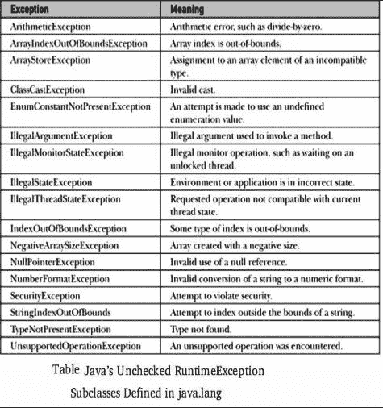

## 异常处理的一般形式

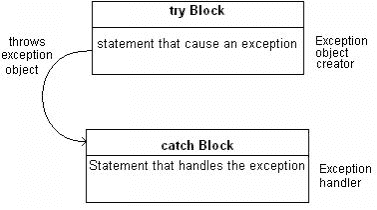
（异常处理机制）

### 语法：

```java
try
{
    statement; // 生成异常
}
catch (Exception-type e)
{
    statement; // 处理异常
}
```

## 多个 catch 子句

在某些情况下，一段代码可能会抛出多个异常。为了处理这种情况，你可以指定两个或多个 `catch` 子句，每个子句捕获不同类型的异常。

当异常被抛出时，会顺序检查每个 `catch` 语句，并执行第一个与异常类型匹配的语句。在一个 `catch` 语句执行后，其他语句将被跳过，并继续执行 `try / catch` 块之后。下面的示例捕获了两种不同的异常类型：

```java
// 多个 catch 语句。
class MultipleCatches {
    public static void main(String args[]) {
        try {
            int a = args.length;
            System.out.println("a = " + a);
            int b = 42 / a;
            int c[] = { 1 };
            c[2] = 99;
        } catch (ArithmeticException e) {
            System.out.println("Divide by 0: " + e);
        } catch (ArrayIndexOutOfBoundsException e) {
            System.out.println("Array index oob: " + e);
        }
        System.out.println("After try/catch blocks.");
    }
}
```

如果在不带命令行参数的情况下启动此程序，将会导致除以零异常，因为 `a` 将等于 0。如果你提供了命令行参数并将 `a` 设置为大于 0 的值，它将跳过除法操作。但它会导致 `ArrayIndexOutOfBoundsException`，因为数组 `c` 的长度为 1，但程序尝试给 `c[2]` 赋值。

以下是两种方式生成的输出：

```text
C:\>java MultipleCatches
a = 0
Divide by 0: java.lang.ArithmeticException
After try/catch blocks.

C:\>java MultipleCatches Arg
a = 1
Array index oob: java.lang.ArrayIndexOutOfBoundsException After try/catch blocks.
```

当你使用多个 `catch` 语句时，重要的是记住**异常子类必须在它们的任何父类之前**。这是因为使用父类的 `catch` 语句将捕获该类型的异常以及其任何子类异常。因此，如果子类出现在父类之后，它将永远无法被访问。此外，在 Java 中，不可达的代码是一个错误。例如，考虑以下程序：

```java
/* 此程序包含一个错误。
在系列 catch 语句中，子类必须在其父类之前。否则，将创建不可达代码并导致编译时错误。 */
class SuperCatch {
    public static void main(String args[]) {
        try {
            int a = 0;
            int b = 42 / a;
        } catch (Exception e) {
            System.out.println("Generic catch.");
        } /* 这个 catch 永远不会到达，因为 ArithmeticException 是 Exception 的子类。 */
        catch (ArithmeticException e) { // 错误 – 不可用
            System.out.println("This is never reached.");
        }
    }
}
```

如果你尝试编译此程序，将收到一条错误消息，说明第二个 `catch` 语句是不可达的，因为异常已经被捕获。由于 `ArithmeticException` 是 `Exception` 的子类，第一个 `catch` 语句将处理所有基于 `Exception` 的错误，包括 `ArithmeticException`。这意味着第二个 `catch` 语句将永远不会执行。要解决这个问题，请反转 `catch` 语句的顺序。

## 嵌套 try

`try` 语句可以嵌套。也就是说，`try` 语句可以位于另一个 `try` 块内部。每当进入 `try` 语句时，该异常的上下文就会推入栈。

如果内部 `try` 语句没有针对特定异常的 `catch` 处理器，栈将回退并检查下一个 `try` 语句的 `catch` 处理器。这将继续进行，直到某个 `catch` 语句执行成功，或者直到所有嵌套的 `try` 语句耗尽。如果没有 `catch` 语句匹配，则 Java 运行时系统将处理该异常。

这里是一个使用嵌套 `try` 语句的示例：

### 多个 catch 语句

当有多个 `catch` 语句时，它被称为多个 `catch` 语句。

多个 `catch` 语句示例：

```java
try
{
    statement; // 生成异常
}
catch (Exception-type-1 e)
{
    statement 1; // 处理类型 1
}
catch (Exception-type-2 e)
{
    statement 2; // 处理类型 2
}
catch (Exception-type-n e)
{
    statement n; // 处理类型 n
}
```

### 示例 1.4

```java
class ErrorTest {
    public static void main(String args[]) {
        int a=10,b=2,c=2,d;
        System.out.println("Before Exception ");
        d=a/(b-c);
        System.out.println("After Exception ");
    }
}
```

输出：


在这里我们没有捕获异常，所以程序在显示消息“Before Exception” 之后将终止。现在我们使用异常处理来解决这个问题。

### 示例 11.5

```java
class ErrorTest5 {
    public static void main(String args[]) {
    }
}
```


## 异常处理的优势

- 我们可以很容易地确定异常/错误在哪里被处理。异常/错误在运行时沿调用堆栈向上传播——首先到达外层的 `try` 块，然后返回到调用方法——直到被异常处理器 `catch` 捕获。
- 异常/错误的位置是确切的，因为用户可以获取完整的堆栈跟踪（stack trace）。这对于调试非常有帮助。
- 程序员有机会从错误/异常状态中恢复。
- 错误处理代码与正常程序流分离，以提高代码的可读性和可维护性。
- 在 `java` 中，无需测试是否发生了异常/错误情况。添加更多的错误/异常处理器只需要添加更多的 `catch` 子句，而不需要触动原始程序流。

## 异常类的层级结构

所有 `Exception` / `Error` 类的根类是 `throwable` 类，它是 `object` 类的直接子类。在 Java 中，异常/错误也是对象。`Exception` 的子类带有 `Exception` 后缀。`throwable` 类有两个直接子类：

- **Error**：`Error` 类的子类主要用于信号异常状态，例如：
    1. `OutOfMemoryError` 信号 Java 虚拟机内存耗尽，垃圾回收器无法回收任何可用内存。
    2. `StackOverflowError` 信号解释器发生堆栈溢出。这些错误通常是不可恢复的，不应该被处理。
- **Exception**：`Exception` 类的子类通常是可恢复的。例如，`EOFException` 信号打开的文件没有更多数据可读。`FileNotFoundException` 信号我们要打开的文件不存在。

层级结构示例：

异常分为两种类型：

- **检异异常 (Checked Exception)**：如果必须 `catch` 某个异常，则它被称为检异异常。编译器确保了如果一个方法可以直接或间接地 `throw` 检异异常，那么该方法必须显式地处理它。该方法要么 `catch` 异常并采取适当措施，要么将异常传递给其调用者。`Exception` 及其所有子类（运行时异常及其子类除外）都是检异。
- **未检异异常 (Unchecked Exception)**：如果不必 `catch` 某个异常，则它被称为未检异异常。即使未处理未检异异常，程序也可以编译。如果程序中发生了任何未处理的未检异异常，程序将在该点终止。但如果异常被处理了，程序就不会因为异常而终止。`Error` 及其所有子类都是未检异异常，不需要捕获。所有用户定义的 `Exception` 都是检异的。

### Exception 类可用方法

| 方法 | 描述 |
|---|---|
| `getMessage()` | 获取与异常或错误相关的消息。 |
| `printStackTrace()` | 打印堆栈跟踪，显示异常/错误发生的位置。 |
| `toString()` | 结合 `getMessage()` 显示异常/错误名称及消息。 |

#### 示例 1

```java
class ErrorTest6 {
    public static void main(String[] arr) {
        try {
            int a=10,b=2,c=2,d;
            System.out.println("Before Exception");
            d=a/(b-c);
            System.out.println("This Will Not Print");
        } catch(ArithmeticException e) {
            System.out.println("After Exception");
            System.out.println("error : Division by zero");
            System.out.println(e.getMessage());
            System.out.println(e); // 调用了 toString()。
            e.printStackTrace();
        }
    }
}
```

**输出：**

```
Before Exception
After Exception
error : Division by zero
by Zero
java.lang.ArithmeticException: / by zero
java.lang.ArithmeticException: / by zero
    at ErrorTest6.main(ErrorTest6.java:10)
```

### 示例 1. 多 catch

```java
class ErrorTest7 {
    public static void main(String args[ ]) {
        try {
            int a=args.length;
            System.out.println("Before Exception");
            int b=58/a;
            int c[] = {};
            c[4]=10;
```


# 多重捕获

```java
System.out.println("After Exception");
} catch(ArithmeticException e) {
    System.out.println("Divide by zero :"+e);
} catch(ArrayIndexOutOfBoundsException e) {
    System.out.println("Array Index oob :"+e);
}
System.out.println("After try/catch block");
```

**输出 1：** 当我们运行上述程序 `java ErrorTest7` 时

```
Before Exception
Divide by zero :java.lang.ArithmeticException: / by zero
After try/catch block
```

**输出 2：** 当我们运行上述程序 `java ErrorTest7 45` 时

```
Before Exception
Array Index oob :java.lang.ArrayIndexOutOfBoundsException: 47
After try/catch block
```

# 嵌套 try catch

如果我们在另一个 `try` 块中使用 `try` 和 `catch` 语句，则称为嵌套 try catch。

### 语法

```java
try //外层 try
{
    try //内层 try
    {
        statement ;
    }
    catch1() //内层 catch
    {
        statement ;
    }
    catch2() //内层 catch
    {
        statement ;
    }
}
catch() //外层 catch
{
    statement ;
}
```

## 示例 11.8 嵌套 try 和 catch

```java
class Nested {
    public static void main(String args[]) {
        try {
            int a=args.length;
            int b=58/a;
            System.out.println("a= "+a);
            try {
                if(a==1)
                    a=a/(a);
                if(a==2) {
                    int c[]={};
                    c[4]=100;
                }
            } catch(ArrayIndexOutOfBoundsException e) {
                System.out.println("ArrayIndex oob "+e);
            }
        } catch(ArithmeticException e) {
            System.out.println(e.getMessage());
        }
    }
}
```

输出 I: 当我们以 `java Error8` 运行上述程序时除以零
输出 II: 当我们以 `java Error8 0` 运行上述程序时
输出 III: 当我们以 `java Error8 0 2` 运行上述程序时 `a=2` `java.lang.ArrayIndexOutOfBoundsException: 4`

## finally

Java 支持另一种语句 `finally`，用于处理未被任何之前的 `catch` 语句捕获的异常。`finally` 块可以用于处理 `try` 块中生成的任何异常。无论是否发生错误，它都会执行。它可以添加到 `try` 块之后或最后一个 `catch` 块之后，如下所示：

### 语法

```java
try
{
}
catch(...)
{
}
catch(...)
{
}
finally
{
}
```

## 示例 11.9 finally 语句

```java
class ErrorTest9 {
    public static void main(String args[]) {
        int a[] = {5,0};
        int b=5;
        try {
            int x=a[2]/b-a[1];
        } catch(ArithmeticException e) {
            System.out.println("Division By Zero");
        } catch(ArrayIndexOutOfBoundsException e) {
            System.out.println("Array Index error");
        } catch(ArrayStoreException e) {
            System.out.println("Wrong Data Type");
        } finally { //始终执行
            System.out.println("Always Execute");
        }
        int y=a[1]/a[0];
        System.out.println("y = "+y);
    }
}
```

输出: `Array Index error` `Always Execute`

## throw

到目前为止，我们只捕获由运行时系统抛出的异常。然而，我们的程序可以使用 `throw` 语句显式地抛出异常，`throw` 的通用形式所示：`instance` 必须是 `Throwable` 类型的对象或 `Throwable` 的子类。简单类型（如 `int` 或 `char`）以及非 `Throwable` 类（如 `String`）不能用作异常。我们有两种方式可以获取 `Throwable` 对象：使用 `catch` 子句中的参数，或者使用 `new` 算符创建一个。执行流在 `throw` 语句之后立即停止；任何后续语句都不会被执行。将检查最近的 `try` 块，查看它是否有与异常类型匹配的 `catch` 语句。如果找到匹配，控制将转移到该语句。如果没有，则检查下一个 `try` 语句，以此此类推。如果未找到匹配的 `catch`，默认异常处理器将停止程序并打印堆栈跟踪。这里我们有一个创建并抛出异常的程序。捕获异常的处理器将其重新抛给外层处理器。

### 示例 11.10

```java
class ErrorTest10 {
    int age;
    void setAge(int a) {
        if(a>0)
            age = a;
        else
            throw new NullPointerException("Invalid");
    }
    public static void main(String args[]) {
        ErrorTest10 a1 = new ErrorTest10();
        try {
            a1.setAge(20);
            a1.setAge(-10);
        } catch(NullPointerException e) {
            System.out.println(e.getMessage());
        }
    }
}
```

## throws

如果一个方法可能会抛出一个它未处理的异常，它就必须指定这种行为，以便该方法的调用者能够针对该异常进行防护。我们通过在方法的声明中包含 `throws` 子句来实现这一点。`throws` 子句列出了方法可能抛出的异常类型。

这对于所有检查异常（checked exceptions）来说都是必要的。方法可以抛出的所有异常都必须在 `throws` 子句中声明。如果没有，将会导致编译错误。以下是包含 `throws` 子句的方法声明的通用形式：

### 语法

```java
type method-name(parameter list)throws exception-list
{
    //方法体
}
```

在这里，`exception list` 是方法可以抛出的异常的逗号分隔列表。

### 示例 11.11

```java
import java.io.*;
class ErrorTest11 {
    int age;
    void setAge(int a) throws IOException {
        if(a>0)
            age = a;
        else {
            IOException e = new IOException("Invalid Age");
            throw e;
        }
    }
    public static main(String args[]) {
        ErrorTest11 a1 = new ErrorTest11();
        try {
            a1.setAge(20);
            a1.setAge(-10);
        } catch(IOException e) {
            System.out.println(e.getMessage());
        }
    }
}
```

输出:

```
Invalid Age
```

# 创建自定义异常子类

这非常简单，只需定义 `Exception` 的子类即可。我们的子类不需要实际实现任何内容。`Exception` 类本身没有定义任何方法。当然，它继承了由 `Throwable` 提供的方法。

尽管 Java 的内置异常处理了大多数错误，但你可能想要创建自己的异常类型，以处理特定于你应用程序的情况。这非常简单：只需定义 `Exception` 的子类（它当然也是是 `Throwable` 的子类）。它们在类型系统中的存在让你能够将它们作为异常使用。

`Exception` 类本身没有定义任何方法。它当然继承了由 `Throwable` 提供的那些方法。因此，所有异常（包括你创建的异常）都可以使用 `Throwable` 定义的方法。

`Exception` 定义了四个构造函数。其中两个支持链式异常，将在下一节中描述。另外两个所示：
`Exception()`
`Exception(String msg)`

第一种形式创建一个一个没有描述的异常。第二种形式允许你指定异常的描述。

虽然在创建异常时指定描述通常很有用，但有时重写 `toString()` 更好。原因如下：由 `Throwable` 定义并由 `Exception` 继承的 `toString()` 版本显示异常名称，后面跟着一个冒号，然后是你的描述。通过重写 `toString()`，你可以防止显示异常名称和冒号。这使得输出更加整洁，在某些情况下是需要的。

### 示例 11.12

```java
class AgeException extends Exception {
    AgeException(String msg) {
        super(msg);
    }
}
class ErrorTest12 {
    int age;
    void setAge(int a) throws AgeException {
        if(a>0)
            age = a;
        else {
            AgeException e = new AgeException("Invalid Age");
            throw e;
        }
    }
    public static void main(String args[]) {
        ErrorTest12 a1 = new ErrorTest12();
        try {
            a1.setAge(20);
            a1.setAge(-10);
        } catch(AgeException e) {
            System.out.println(e.getMessage());
        }
    }
}
```

输出:

```
Invalid Age
```

下面的示例声明了一个 `Exception` 的新子类，然后使用该子类在方法中信号一个错误条件。它重写了 `toString()` 方法，允许显示精心定制的异常描述。

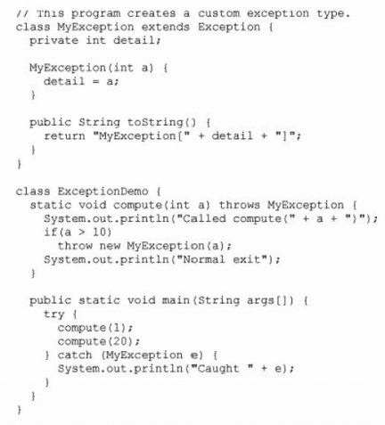

此示例定义了一个名为 `MyException` 的 `Exception` 子类。该子类非常简单：它只有一个构造函数加上重写的 `toString()` 方法，用于显示异常的值。

`ExceptionDemo` 类定义了一个名为 `compute()` 的方法，该方法会抛出一个 `MyException` 对象。当 `compute()` 的整数参数大于 10 时，会抛出该异常。`main()` 方法为 `MyException` 设置了异常处理器，然后用合法值（小于 10）和非法值调用 `compute()`，以展示代码的两种路径。

以下是结果：

```
Called compute(1)
Normal exit
Called compute(20)
Caught MyException[20]
```

## 链式异常

链式异常功能允许我们将另一个异常与异常关联。第二个异常描述了第一个异常产生。例如，想象一种情况，方法由于尝试除以零而抛出 `ArithmeticException`。然而，问题的实际原因是发生了 I/O 错误，导致除数被设置不当。

尽管方法必须抛出 `ArithmeticException`（因为这是发生的错误），但我们可能还想让调用代码知道底层原因是 I/O 错误。

为了允许链式异常，Java 2 1.4 版本为 `Throwable` 类增加了两个构造函数和两个方法。

```java
Throwable(Throwable causeExc)
Throwable(String msg, Throwable causeExc)
```

在第一种形式中，`causeExc` 是发生的异常。第二种形式允许我们在指定原因异常的同时，指定一个描述信息。这两个构造函数也被添加到了 `Error`、`Exception` 和 `RuntimeException` 类中。

添加到 `Throwable` 类的链式异常方法是 `getCause()` 和 `initCause()`。

```java
Throwable getCause()
Throwable initCause(Throwable causeExc)
```

`getCause()` 方法返回当前异常的底层异常。如果没有底层异常，则返回 `null`。`initCause()` 方法将 `causeExc` 与调用的异常关联起来，并返回该异常的引用。因此，我们可以在异常创建后为其关联一个原因。然而，原因异常只能被设置一次。

因此，我们对每个异常对象只能调用一次 `initCause()`。此外，如果原因异常是通过构造函数设置的，那么我们无法再次使用 `initCause()` 方法设置它。通常情况下，`initCause()` 用于为那些不支持前述两个额外构造函数的遗留异常类设置原因。Java 大多数内置异常都没有定义这些额外的构造函数。因此，如果我们需要为这些异常添加异常链，将使用 `initCause()`。

链式异常并不是每个程序都需要的。然而，在了解底层原因有用的情况下，它们提供了一种优雅的解决方案。

### 示例 11.13

```java
class ErrorTest13 {
    int age;
    void setAge(int a) {
        if(a > 0)
            age = a;
        else {
            NullPointerException e = new NullPointerException("Admission Failed");
            e.initCause(new ArithmeticException("Age is invalid"));
            throw e;
        }
    }
    public static void main(String args[]) {
        ErrorTest13 a1 = new ErrorTest13();
        try {
            a1.setAge(20);
            a1.setAge(-10);
        } catch(NullPointerException e) {
            System.out.println(e.getMessage());
            System.out.println(e.getCause());
        }
    }
}
```


Admission Failed

Age is Invalid

在这个示例中，顶层异常是`NullPointerException`。它被添加了一个原因异常`ArithmeticException`。当异常从`setAge()`抛出时，它被`main()`捕获。在那里，显示了顶层异常，随后是通过调用`getCause()`获取的底层异常。链式异常可以根据需要延伸到任何深度。因此，原因异常本身也可以有自己的原因。请注意，过长的异常链可能意味着设计不当。链式异常并不是每个程序都需要的。然而，在了解底层原因有用的情况下，它们提供了一种优雅的解决方案。

## 三个新的 JDK 7 异常特性（已更新）

JDK 7 为异常系统增加了三个有趣且实用的特性。第一个功能自动化了在不再需要时释放资源（如文件）的过程。它基于`try`语句的扩展形式，称为`try-with-resources`，将在后续介绍文件的章节中进行描述。

第二个新功能称为`multi-catch`，第三个功能有时被称为最终重新抛出（final rethrow）或更精确的重新抛出（more precise rethrow）。这两个特性在这里进行了描述。

`multi-catch`功能允许用同一个`catch`语句捕获两个或多个异常。两个或多个异常处理程序使用相同的代码序列并不罕见，尽管它们响应的是不同的异常。现在不再需要逐个捕获每种异常类型，而是可以使用单个`catch`语句来处理所有异常，而避免代码重复。

要使用`multi-catch`，在`catch`语句中用或运算符（`|`）分隔每个异常类型。每个`multi-catch`参数都是隐式`final`的（如果需要，可以显式指定`final`，但没有必要）。因为每个`multi-catch`参数都是隐式`final`的，所以它们不能被赋予新值。

这是一个使用`multi-catch`特性同时捕获`ArithmeticException`和`ArrayIndexOutOfBoundsException`的`catch`语句：

```java
catch(ArithmeticException | ArrayIndexOutOfBoundsException e) {
```

以下程序展示了`multi-catch`特性的用法：

```java
// 展示 JDK 7 的多-catch 特性。
class MultiCatch {
    public static void main(String args[]) {
        int a=10, b=0;
        int vals[] = { 1, 2, 3 };
        try {
            int result = a / b; // 生成一个 ArithmeticException
            // vals[10] = 19; // 生成一个 ArrayIndexOutOfBoundsException
            // 此 catch 语句捕获了这两个异常。
        } catch(ArithmeticException | ArrayIndexOutOfBoundsException e) {
            System.out.println("Exception caught: " + e);
        }
        System.out.println("After multi-catch.");
    }
}
```

当尝试除零时，程序将生成一个`ArithmeticException`。如果你注释掉除法语句并移除下一行的注释符号，就会生成`ArrayIndexOutOfBoundsException`。这两个异常都被同一个`catch`语句捕获。

更精确的重新抛出功能限制了可以重新抛出的异常类型，仅限于关联`try`块抛出的检查异常（checked exceptions），且未被之前的`catch`语句处理，并是参数的子类型或超类型。

虽然这种能力可能并不经常需要，但现在已经可以使用。为了使更精确的重新抛出生效，`catch`参数必须是有效最终的（effectively final），这意味着它在`catch`块内部不能被赋予新值，或者显式声明为`final`。

## 使用异常

异常处理为控制具有许多运行时特征的复杂程序提供了一种强大的机制。将`try`、`throw`和`catch`视为处理程序逻辑中错误和异常边界条件的清洁方法是非常重要的。与其他某些使用错误返回码指示失败的语言不同，Java 使用异常。因此，当一个方法可能会失败时，让它抛出一个异常。

这是一种处理失败模式更清洁的方法。最后一点：Java 的异常处理语句不应被视为非局部跳转的通用机制。如果你这样做，只会混乱你的代码并使其难以维护。

## 理论问题

1. 什么是异常？
2. 我们如何定义`try`块？
3. 我们如何定义`catch`块？
4. 列举 Java 中可能发生的一些常见异常类型。给出示例。
5. 捕获所有类型的异常都是必要的吗？
6. 一个`try`块可以使用多少个`catch`块。
7. 创建可能产生三种异常的`try`块，并结合必要的`catch`块来适当捕获并处理它们。
8. 什么是`finally`块？什么时候以及使用？给出一个合适的示例。
9. 解释异常处理机制如何用于程序调试。

    


# 章节：多线程编程

## 引言

线程是程序内部的控制流。线程与进程非常相似。事实上，线程也被称为轻量级进程。

## 线程对比进程

通常，不同的进程占用不同的内存空间。当 CPU 从一个进程切换到另一个进程时，当前运行进程的状态会被保存，另一个进程的状态会被恢复。在状态切换期间没有进行任何有用工作。为了最大化 CPU 利用率，状态切换的时间越短越好。

线程也像独立的进程，但它们共享相同的内存和状态。各个线程也有独立的状态，但与进程状态相比，状态非常小。状态可能只包含程序计数器和栈指针。因此，从一个线程切换到另一个线程所需的时间非常短。因此，与进程相比，线程的上下文切换时间非常小。因此在多线程的情况下，CPU 的利用率高于多进程的情况下。

## 多线程程序

多线程程序包含两个或多个可以并发运行的部分。此类程序的每个部分被称为线程，每个线程都定义了一条独立的执行路径。因此，多线程是多任务处理的一种特殊形式。

例如，一个程序可能有三个线程：
* 一个处理打印。
* 一个处理编辑。
* 一个从互联网下载文件。

所有这些线程可能并发运行，从而最大化 CPU 的利用率。

## 基于进程的多任务处理

大多数操作系统允许我们同时运行两个或多个程序。这被称为基于进程的多任务处理。例如，我们可以运行一个 Java 程序并同时编辑一个 Word 文档。基于进程的多任务处理确保在大多数时间内会有程序被执行，从而增加了 CPU 的利用率。

在基于进程的多任务处理中，程序是进程调度器可以派发的代码最小单位。

## 基于线程的多任务处理

线程是基于线程的多任务环境中的执行最小单元单位。一个进程可以被分为若干个并发执行的线程。这允许我们在单个程序中并发处理多个任务。

例如，我们可以编辑一个 Word 文档同时打印另一个文档。基于线程的多任务处理像基于进程的多任务处理一样提高了 CPU 利用率。但同时，它通过在单独线程中并发执行程序的不同部分，有效地加快了单个程序的执行速度。

因此，基于进程的多任务处理处理“大局”，而基于线程的多任务处理处理细节。

## Java 线程模型

Java 运行时系统许多方面依赖线程，所有的类库在设计时都考虑了多线程。事实上，Java 使用线程使整个环境能够异步化。这有助于通过防止 CPU 周期浪费来降低效率。

单线程系统使用一种名为“事件循环+轮询”的方法。在这种模型中，单个控制线程在无限循环中运行，轮询单个事件队列以决定下一步做什么。在单线程环境中，当线程因为等待某些资源而阻塞（即暂停执行）时，整个程序都会停止运行。

Java 多线程的优势是消除了主循环/轮询机制。当 Java 程序中的线程阻塞时，只有被阻塞的那个线程会暂停，所有其他线程继续运行。

## 线程生命周期（线程状态）

线程存在于几种状态。线程可以是运行状态。它一旦获得 CPU 时间就可以进入就绪状态。运行中的线程可以被挂起，从而暂时停止其活动。挂起的线程随后可以恢复，允许它从上次停止的地方继续。线程在等待资源时可能会被阻塞。在任何时候，线程都可以被终止，这将立即停止其执行。一旦终止，线程将无法恢复。

### 新生状态 (Newborn State)

当我们创建一个线程时，线程就出生了，被称为新生状态。该线程尚未被调度运行。在此状态下，我们只能对它执行以下操作之一：
1. 使用`start()`将其调度以运行。
2. 使用`stop()`将其杀死。

如果被调度，它将移动到可运行状态。如果我们在此状态下尝试使用任何方法，将会抛出异常。

### 可运行状态 (Runnable State)

可运行状态意味着线程已准备好执行，并等待处理器的可用性。也就是说，线程已加入等待执行的线程队列。如果所有线程的优先级相同，则它们将以轮询方式被赋予执行时间片。放弃控制权的线程将加入队列末尾并再次等待轮到。然而，如果我们想让一个线程在轮到它之前放弃控制权给另一个同等优先级的线程，可以通过调用`yield()`实现。

### 运行状态 (Running State)

运行意味着处理器已经为线程分配了执行时间。运行线程在以下情况下可能会放弃控制权：
* 时间片结束。
* 被高优先级线程抢占。
* 它让出（即自愿放弃控制权）。
* 它完成了执行。
* 被其他线程停止。
* 它被`suspend()`挂起。挂起的线程可以通过`resume()`恢复。这种方法在我们想要由于某些原因暂时停止某个线程但不想杀死它时非常有用。
* 它被告知等待某个事件发生。这是通过`wait()`完成的。线程可以使用`notify()`调度再次运行。
* 它正在执行某些 I/O 操作。

### 阻塞状态 (Blocked State)

当线程被阻止进入可运行状态以及后续运行状态时，被称为被阻塞。这发生在线程为了满足某些要求而挂起、睡眠或等待时。阻塞线程被认为“不可运行”但未死亡，因此完全有再次运行。

### 死亡状态 (Dead State)

每个线程都有生命周期。运行线程在执行完其`run()`方法后结束生命。它有自然死亡。然而，我们在任何状态下向其发送停止消息来杀死它，从而导致提前死亡。

## 线程优先级

Java 为每个线程分配一个优先级，以决定相对于其他线程如何处理该线程。线程优先级是指定一个线程相对于另一个线程的相对优先级的整数。

作为一个绝对值，优先级是没有意义的；如果只有一个线程在运行，那么高优先线程的运行速度绝不会比低优先线程快。相反，线程的优先级被用来决定何时从一个当前正在运行的线程切换到下一个线程。这被称为上下文切换。决定何时发生上下文切换的规则非常简单：

* 线程可以自愿（自主地）放弃控制权。这是通过显式让出（yield）、睡眠（sleep）、阻塞（blocking）或等待 I/O 完成的。在这种情况下，系统会检查所有其他线程，通常会将 CPU 分配给就绪状态的高优先级线程。
* 线程可以被高优先级线程抢占。在这种情况下，一个不让出处理器的低优先级线程无论无论正在做什么，都会被高优先级线程简单地抢占。基本上，只要高优先级线程想要运行，它就会运行。这被称为抢占式多任务处理。
* 某些操作系统（OS）支持非抢占式优先级调度。在在这种情况下，只有当低优先级线程完成时，高优先级线程才能获得机会。
* 当两个优先级相同的线程竞争 CPU 周期时，情况会变得复杂一些。对于像`windows98`这样的操作系统，等优先级的线程必须自愿（自主地）向同级线程让出（放弃）控制权。如果不这样做，其他线程将不会运行。

**注意**：操作系统处理等优先级线程上下文切换的方式可能会产生问题。

## 同步

由于多线程为我们的程序引入了异步行为，因此当我们需要时必须有一种方法来强制同步。例如，如果我们想让两个线程通信并共享一个复杂的数据结构（如链表），我们需要某种方法来确保它们互不冲突。

也就是说，我们必须防止一个线程在另一个线程正在读取数据时进行写入操作。Java 使用`monitor`（监视器）进行线程间同步。我们可以将`monitor`视为一个非常小的盒子，只能容一个线程。一旦线程进入监视器，它就可以被用来保护共享资源不被多个线程同时操作。

大多数多线程系统将同步暴露为对象，我们的程序必须显式地获取并锁定。Java 提供了一个更简洁的解决方案。

并没有`monitor`类，相反，每个对象都有它们自己的隐式监视器，当调用对象的某个`synchronized`方法时，监视器会自动进入。一旦线程进入`synchronized`方法，其他线程就无法调用该对象上的任何其他`synchronized`方法。这使我们能够编写非常清晰且简洁的多线程代码，因为同步支持内置在语言中。

## 消息传递

在使用大多数其他语言进行编程时，我们必须依赖操作系统来建立线程之间的通信。这无疑增加了开销。相比之下，Java 提供了一种简洁、低成本的方法，让两个或多个线程通过所有对象都具有的预定义方法调用相互通信。Java 的消息传递系统允许线程进入对象的同步方法，并在那里等待，直到其他某个线程显式通知其退出。

## Thread 类和 Runnable 接口

Java 的多线程系统构建在`Thread`类、其方法及其伴侣接口`Runnable`之上。该类属于`java.lang`包，因此不需要显式导入。

`Thread`封装了一个执行线程，由于我们无法直接引用运行中线程的内部状态，我们将通过它的代理（即产生它的`Thread`实例）来处理它。要创建一个新线程，我们的程序要么扩展`Thread`类，要么实现`Runnable`接口。`Thread`类定义了几个帮助管理线程的方法：

| 方法 | 说明 |
| :--- | :--- |
| `String getName()` | 返回此线程的名称 |
| `int getPriority()` | 返回此线程的优先级 |
| `boolean isAlive()` | 测试此线程是否仍在运行 |
| `void join()` | 等待此线程死亡（终止） |
| `void run()` | 如果此线程是使用单独`Runnable`对象构造的，则调用该`Runnable`对象的`run`方法；否则，此方法什么都不做并返回；如果扩展了线程类并在子类中重写了`run()`方法，则调用重写的`run()`方法。 |
| `void setName(String name)` | 将此线程的名称更改为参数 name |
| `static void sleep(long millis) throws InterruptedException` | 使当前执行的线程睡眠指定的毫秒数（临时停止执行）。1 sec = 1000ms |
| `static void sleep(long millis, int nanos) throws InterruptedException` | 使当前执行的线程睡眠指定的毫秒数加上指定的纳秒数。 |
| `void start()` | 使此线程开始执行，Java 虚拟机会调用此线程的`run`方法。 |
| `static void yield()` | 使当前执行的线程对象临时暂停并允许其他线程执行。 |
| `static Thread currentThread()` | 返回当前执行的线程对象的引用。 |

### 主线程

当一个 Java 程序启动时，一个线程会立即开始。这通常被称为我们程序的主线程（main thread），因为它是程序启动时执行的那个线程。主线程是创建“子”线程的线程。虽然主线程是在程序启动时创建的，但可以通过`Thread`对象对其进行控制。要这样做，我们必须调用`currentThread()`获取它的引用，它是`Thread`类的`public static`成员。该方法返回调用它的所在线程的引用。一旦我们有了主方法的引用，就可以像控制任何其他线程一样控制它。

**示例 1**：下面的示例演示了我们如何获取主线程的引用，然后使用`Thread`类的方法访问其属性。

```java
class CurrentTest {
    public static void main(String args[]) {
        Thread t = Thread.currentThread();
        System.out.println("Current thread:" + t);
        System.out.println("Name:"+ t.getName());
        System.out.println("Priority:"+ t.getPriority());
        t.setName("MyThread");
        t.setPriority(Thread.MAX_PRIORITY);
        System.out.println("After name and priority change :" + t);
        System.out.println("Name:" + t.getName());
        System.out.println("Priority:" + t.getPriority());
        for (int n=1; n<=5; n++) {
```


`System.out.println(n);`

```java
try {
    Thread.sleep(1000);
} catch (InterruptedException e) {
    System.out.println("Main interrupted");
}
```

## 线程笔记

注意 1：`Thread` 类中的 `sleep()` 方法可能会抛出 `InterruptedException`，这是一个检查异常。当其他线程想要中断这个正在睡眠的线程时，就会发生这种情况。

注意 2：注意当 `t`（线程引用）作为 `println()` 的参数时产生的输出。它将按顺序显示：线程名称、其优先级以及线程组名称。它的优先级是 5，这是默认值，而 `main` 也是该线程所属线程组的。线程组是一个控制整个线程集合状态的数据结构。

## 创建线程

从最通用的意义上，我们通过实例化 `Thread` 类型的对象来创建线程。Java 识别了两种实现目标的方法：

1. 我们可以实现 `Runnable` 接口。
2. 我们可以扩展 `Thread` 类本身。

### 实现 Runnable

创建线程最简单的方法是创建一个实现 `Runnable` 接口的类。要实现 `Runnable`，类只需要实现一个名为 `run()` 的方法。

```java
public void run()
```

在 `run()` 方法内部，我们将定义构成新线程的代码。`run()` 可以像主线程一样调用其他方法、使用其他类并声明变量。

唯一的区别是，`run()` 为程序中另一个并发执行的线程建立了入口点。该线程将在 `run()` 返回时结束。

在我们创建一个实现 `Runnable` 的类后，我们将在该类内部使用以下构造函数之一实例化 `Thread` 类型的对象：

- `Thread(Runnable threadObj)`
- `Thread(Runnable threadObj, String threadName)`

在这里，`threadObj` 是被调用 `run` 方法的对象，`threadName` 是新线程的名称。在新线程创建后，在我们调用 `start()` 方法之前，它将不会开始运行。

`start()` 方法将线程放入就绪队列（可运行状态）。每当线程被调度，其执行将从 `run()` 方法开始。

### 示例 12.2

```java
class A implements Runnable {
    public void run() {
        for(int i=1;i<=5;i++) {
            System.out.println("Child Thread:" + i);
        }
        System.out.println("Exiting child thread");
    }
}

class RunnableTest {
    public static void main(String args[]) {
        A a1=new A();
        Thread t1 = new Thread(a1,"Demo Thread");
        t1.start();
        System.out.println("Main thread exiting");
    }
}
```

**输出：**

```
Main thread exiting
Child Thread:1
Child Thread:2
Child Thread:3
Child Thread:4
Child Thread:5
Exiting child thread
```

### 示例 12.3

```java
class A implements Runnable {
    Thread t;
    A() {
        t= new Thread(this, "Demo Thread");
        System.out.println("Child thread: "+ t);
        t.start();
    }
    public void run() {
        for (int i=1; i<=5; i++) {
            System.out.println("Child Thread: "+ i );
            try {
                Thread.sleep(500);
            } catch (InterruptedException e) {
                System.out.println(e);
            }
        }
        System.out.println("Exiting thread");
    }
}

class RunnableTest2 {
    public static void main (String args ) {
        A a1=new A();
        for (int i=1; i<=5; i++) {
            System.out.println ("Main Thread:"+ i);
            try {
                Thread.sleep (100);
            } catch(InterruptedException e) {
                System.out.println("main thread interrupted");
            }
        }
        System.out.println("End of Main thread");
    }
}
```

**输出：**

```
Child thread: Thread[Demo Thread,5,main]
Main Thread:1
Child Thread: 1
Child Thread: 2
Main Thread:2
Child Thread: 3
Child Thread: 4
Main Thread:3
Child Thread: 5
Exiting Child thread
Main Thread:4
Main Thread:5
End of Main thread
```

## 扩展 Thread 类

创建线程的第二方法是创建一个扩展 `Thread` 的类，然后创建该类的实例。扩展类必须重写 `run()` 方法，这是新线程的入口点。它还必须调用 `start()` 来开始新线程的执行。

### 示例 12.4

```java
class A extends Thread {
    A( ) {
        super ("Test");
        System.out.println ("Child thread:" + this);
        start();
    }
    public void run () {
        for (int i=1; i<=5; i++) {
            System.out.println("Child Thread:"+i);
            try {
                Thread.sleep(500);
            }
        }
    }
}
```

```java
        }
    }
    System.out.println ("Exiting Child thread");
    }
}

class ThreadTest {
    public static void main(String args[]) {
        new A();
        for (int i=1; i<=5; i++) {
            System.out.println("Main Thread: "+i);
            try {
                Thread.sleep(1000);
            } catch (InterruptedException e) {
                System.out.println("Main thread interrupted");
            }
        }
        System.out.println("Main thread exiting");
    }
}
```

输出：
子线程:Thread[Testing,5,main]
Main Thread: 1
Child:1
Main Thread: 2
Child:2
Main Thread: 3
Child:3
... (其余输出模式相同)

注意：如果 `Thread` 没有被分配任何名称，它将类似于 `Thread-1`、`Thread-2`、`Thread-3` 等。

### 选择方法

`Thread` 类定义了几个可以被派生类重写的方法。在这些方法中，唯一必须重写的是 `run()`。当然，这在实现 `Runnable` 接口时也是同样的要求。许多 Java 程序员认为，只有当类被某种程度上进行增强或修改时才应该对其扩展。因此，如果我们不重写 `Thread` 的其他任何方法，最好的可能是实现 `Runnable` 接口。

### 创建多个线程：示例 1

```java
class A implements Runnable {
    String name;
    Thread t;
    A(String threadName) {
        name=threadName;
        t=new Thread(this, name);
        System.out.println("Child thread:"+t);
        t.start();
    }
    public void run() {
        for(int i=1; i<=5; i++) {
            System.out.println(t.getName()+ ": " + i);
            try {
                Thread.sleep(1000);
            } catch (InterruptedException e) {
                System.out.println(e);
            }
        }
        System.out.println(name+ "Exiting");
    }
}
```

### 使用 `isAlive()` 和 `join()` 强制排序

通常我们希望 `main` 线程最后结束。实现这一点的方法之一是在 `main` 中调用 `sleep()`。这相当粗糙（原始）。有两种方法可以判断线程是否已完成。首先，我们可以在线程上调用 `isAlive()`。该方法由 `Thread` 定义，其通用形式为：
`boolean isAlive()`
如果调用该方法的线程仍在运行，则 `isAlive()` 方法返回 `true`；否则返回 `false`。虽然 `isAlive()` 有时很有用，但我们通常用于等待线程完成的方法是 `join()`，如下所示：
`void join() throws InterruptedException`
该方法会等待，直到调用它的线程终止为止。`join()` 的其他形式允许我们指定等待指定线程终止的最大时间。下面的示例使用了 `join()` 来确保 `main` 线程是最后一个停止的。它还演示了 `isAlive()` 方法。

示例 2

```java
class A implements Runnable {
    String name;
    Thread t;
    A(String threadName) {
        name=threadName;
        t=new Thread(this, name);
        System.out.println("Child thread:"+t);
        t.start();
    }
    public void run() {
        for(int i=1; i<=5; i++) {
            System.out.println(t.getName()+ ": " + i);
            try {
                Thread.sleep(1000);
            } catch (InterruptedException e) {
                System.out.println(e);
            }
        }
        System.out.println(name+ "Exiting");
    }
}

class MultiThread {
    public static void main(String args[]) {
        A a1=new A("One");
        A a2=new A("Two");
        A a3=new A("Three");
        try {
            Thread.sleep(10000);
        } catch (InterruptedException e) {
            System.out.println("main thread interrupted");
        }
        System.out.println("Main thread exiting");
    }
}
```

```java
        }
    }
    System.out.println(name + "Exiting");
    }
}

class DemoJoin {
    public static void main(String args[] ) {
        A ob1 = new A("One");
        A ob2 = new A("Two");
        A ob3 = new A("Three");
        System.out.println("Thread One is alive?:" + ob1.t.isAlive());
        System.out.println("Thread Two is alive?:" + ob2.t.isAlive());
        System.out.println("Thread Three is alive?:" + ob3.t.isAlive());
        try {
            ob3.t.join();
            ob2.t.join();
            ob1.t.join();
        } catch (InterruptedException e) {
            System.out.println("main interrupted");
        }
        System.out.println("Thread One is alive?:" + ob1.t.isAlive());
        System.out.println("Thread Two is alive?:" + ob2.t.isAlive());
        System.out.println("Thread Three is alive?:" + ob3.t.isAlive());
        System.out.println("Main thread exiting");
    }
}
```

输出：

```text
Low  : 63660819
High : 2086505403
```

高优先级线程获取了超过 98% 的 CPU 时间。但尽管线程既没有主动释放 CPU，也没有因 I/O 而阻塞，它们仍然发生了上下文切换。当同一个程序在非抢占式系统运行时，将获得不同的结果。

注意：变量 `running` 前面带有关键字 `volatile`，用以确保在每次迭代以下循环时都会检查 `running` 的值。

```java
while (running) {
    click++;
}
```


如果不使用`volatile`，Java 可以自由地对循环进行优化，创建一个`running`的本地副本。使用`volatile`可以防止这种优化，告诉 Java `running`可能会以代码中无法直接看出的方式发生变化。

## 同步

当两个或多个线程需要访问共享资源时，它们需要某种方式来确保资源在同一时刻只有一个线程使用。实现这一目标的过程被称为同步。

同步的关键是监视器（monitor，也称为信号量）的概念。监视器是一个用作互斥锁的对象。在给定时刻，只有一个线程可以拥有监视器。

当线程获取锁时，认为它进入了监视器。所有其他尝试进入被锁监视器的线程都将被挂起，直到第一个线程退出监视器。这些其他线程被称为等待监视器。拥有监视器的线程如果需要，可以重新进入同一个监视器。我们可以通过两种方式对代码进行同步：

(i) 使用`synchronized`方法
(ii) 使用`synchronized`语句

## 使用同步方法

在 Java 中同步是非常简单的，因为所有对象都有与其关联的隐式监视器。要进入对象的监视器，只需调用用`synchronized`关键字修改的方法。当线程在同步方法内部时，所有尝试调用该方法（或同一实例上的任何其他同步方法）的线程都必须`wait()`。要退出监视器并将控制权交给下一个等待的线程，监视器的所有者只需从同步方法返回即可。

### 示例 12.8

下面的程序说明了三个线程在并发运行时，生成的输出会发生混杂。

```java
class A {

    void display(String msg) {

        System.out.print("[" + msg);

        try {

            Thread.sleep(1000);

        } catch (InterruptedException e) {

            System.out.println(e);

        }

        System.out.println("]");

    }

}

class B implements Runnable {

    A obj;

    String msg;

    Thread t;

    B(A obj1, String m) {

        msg = m;

        obj = obj1;

        t = new Thread(this);

        t.start();

    }

    public void run() {

        obj.display(msg);

    }

}

class Synch1 {

    public static void main(String args[]) {

        A a1 = new A();

        B b1 = new B(a1,"Hello");

        B b2 = new B(a1,"World");

        B b3 = new B(a1,"Matrix");

    }

}
```

输出：

```
[Hello[World[Matrix]

]

]
```

正如我们看到的，通过调用`sleep()`，`display()`方法允许执行切换到另一个线程。这导致了三个消息字符串的输出混杂。在这个程序中，没有任何机制可以阻止三个线程同时在同一个对象上调用同一个方法。

这被称为竞态条件（race condition），因为这三个线程正在竞争以完成该方法。这个示例使用`sleep()`来使效果变得可重复且明显。在大多数情况下，竞态条件更加微妙且不可预测，因为我们无法确定上下文切换何时发生。这可能导致程序在一次运行时是正确的，下一次运行时是错误的。

要实现这一点，我们只需要在方法`display()`的定义前加上`synchronized`关键字。这可以防止一个线程在另一个线程使用`display()`时进入该方法。

### 示例 12.9

混杂问题通过简单将`display()`方法声明为同步方法就得到了解决。

```java
class A {

    synchronized void display(String msg) {

        System.out.print("[" + msg);

        try {

            Thread.sleep(100);

        } catch (InterruptedException e) {

            System.out.println(e);

        }

        System.out.println("]");

    }

}

class B implements Runnable {

    A obj;

    String msg;

    Thread t;

    B(A obj1, String m) {

        msg = m;

        obj = obj1;

        t = new Thread(this);

        t.start();

    }

    public void run() {

        obj.display(msg);

    }

}

class Synch2 {

    public static void main(String args[]) {

        A a1 = new A();

        B b1 = new B(a1,"Hello");

        B b2 = new B(a1,"World");

        B b3 = new B(a1,"Matrix");

    }

}
```

虽然在我们创建的类中创建同步方法是实现同步的一种简单有效的方法，但它在所有情况下并不适用。为了理解为什么，请考虑以下情况：假设我们想要对一个并非为多线程访问设计的类对象进行同步访问。也就是说，该类没有使用同步方法。此外，该类不是由我们创建的，而是由第三方创建的；我们无法访问源代码。因此，我们无法在该类内部适当的方法上添加`synchronized`修饰符。那么如何通过`synchronized`实现对该类对象的访问呢？

解决方案是将对该类定义的方法调用放在`synchronized`块中。`synchronized`语句的一般形式如下：

```java
synchronized(object)

{

    //需要同步的语句

}
```

在这里，`object`是被同步对象的引用。`synchronized`块确保了对`object`成员方法的调用只有在当前线程成功进入`object`的监视器（monitor）才会发生。

### 示例 12.10

前一个示例的替代版本，在`run()`方法中使用`synchronized`块：

```java
class A

{

    void display(String msg)

    {

        System.out.print("[" + msg);

        try {

            Thread.sleep(1000);

        } catch(InterruptedException e) {

            System.out.println(e);

        }

        System.out.println("]");

    }

}

class B implements Runnable

{

    A obj;

    String msg;

    Thread t;

    B(A obj1, String m) {

        msg = m;

        obj = obj1;

        t = new Thread(this);

        t.start();

    }

    public void run() {

        synchronized(obj) {

            obj.display(msg);

        }

    }

}

class Synch3

{

    public static void main(String args[]) {

        A a1 = new A();

        B b1 = new B(a1, "Hello");

        B b2 = new B(a1, "World");

        B b3 = new B(a1, "Matrix");

    }

}
```

输出：

```
[Hello]

[World]

[Matrix]
```

### 多线程在不同对象上调用同一方法：示例 12.11

线程可以并发地在同一类的不同对象上调用同一个`synchronized`实例方法，因为每个对象都有不同的锁。这再次导致输出结果混乱。

```java
class A

{

    synchronized void display(String msg)

    {

        System.out.print("[" + msg);

        try {

            Thread.sleep(100);

        } catch(InterruptedException e) {

            System.out.println(e);

        }

        System.out.println("]");

    }

}

class B implements Runnable

{

    A obj;

    String msg;

    Thread t;

    B(A obj1, String m) {

        msg = m;

        obj = obj1;

        t = new Thread(this);

        t.start();

    }

    public void run() {

        obj.display(msg);

    }

}

class Synch4

{

    public static void main(String args[]) {

        A a1 = new A();

        A a2 = new A();

        A a3 = new A();

        B b1 = new B(a1, "Hello");

        B b2 = new B(a2, "World");

        B b3 = new B(a3, "Matrix");

    }

}
```

输出：

```
[Hello[World[Matrix]
```

### 静态同步方法：示例 12.2

在下面的示例中，尽管我们在不同的对象上调用了`display()`方法，但输出并没有混乱。原因是`display()`是`static`的，因此锁是针对整个类`A`获得的，而不是针对单个对象。

```java
class A

{

    static synchronized display(String msg)

    {

        System.out.print("[" + msg);

        try {

            Thread.sleep(1000);

        } catch(InterruptedException e) {

            System.out.println(e);

        }

        System.out.println("]");

    }

}

class B implements Runnable

{

    A obj;

    String msg;

    Thread t;

    B(A obj1, String m) {

        msg = m;

        obj = obj1;

        t = new Thread(this);

        t.start();

    }

    public void run() {

        obj.display(msg);

    }

}

class Synch5

{

    public static void main(String args[]) {

    }

}
```

```java
A a1 = new A();

A a2 = new A();

A a3 = new A();

B b1 = new B(a1, "Hello");

B b2 = new B(a2, "World");

B b3 = new B(a3, "Matrix");
```

输出：

```
[Hello]

[World]

[Matrix]
```

## 线程间通信

如前所述，多线程通过将我们的任务划分为离散的逻辑单元来取代事件循环编程。线程还证明了次要优势：它们消除了轮询。轮询通常通过循环实现，该循环用于反复检查某些条件。一旦条件成立，就会采取相应的行动。

这浪费了 CPU 周期。例如，考虑经典的队列问题，其中一个线程生产数据，而另一个线程消费这些数据。为了让问题更具交互性，假设生产者必须等待消费者完成后才能生成更多数据。在轮询系统中，消费者在等待生产者生产时会浪费许多 CPU 周期。一旦生产者完成工作，它就会开始轮询，浪费更多的 CPU 周期来等待消费者完成，以此类推。

为了避免轮询，Java 通过`wait()`、`notify()`和`notifyAll()`方法包含了一种优雅（智能）的进程间通信机制。这些方法在`Object`类中被实现为最终方法，因此所有类都拥有它们。这三个方法都只能在同步上下文中调用。使用这些方法有特定的规则。

- `wait()`告诉调用线程放弃监视器并睡眠，直到其他线程进入同一个监视器并调用`notify()`。
- `notify()`唤醒在同一对象上调用`wait`的一个线程（通常是第一个线程）。
- `notifyAll()`唤醒所有在同一对象上调用过`wait()`的线程。通常优先级最高的线程将首先运行。

这些方法在`Object`类中声明，如下：

```java
final void wait() throws InterruptedException

final void notify()

final void notifyAll()
```

### 示例 12.13

下面的示例程序错误地实现了一个简单的生产者/消费者问题。它包含四个类：`Q`，我们正尝试同步的队列；`Producer`，产生队列条目的线程对象；`Consumer`，消费队列条目的线程对象；以及`PC`，创建一个单一`Q`、`Producer`和`Consumer`的微型类。

```java
class Q {

    int n;

    synchronized int get() {

        System.out.println("Got:"+n);

        return n;

    }

    synchronized void put(int n) {

        this.n =n;

        System.out.println("Put:"+n);

    }

}

class Producer implements Runnable {

    Q q1;

    Producer(Q q2) {

        q1 = q2;

        new Thread("Producer").start();

    }

    public void run() {

        int i = 0;

        while (true) {

            q1.put(++i);

        }

    }

}

class Consumer implements Runnable {

    Q q1;

    Consumer(Q q2) {

        q1 = q2;

        new Thread(this, "Consumer").start();

    }

    public void run() {

        while (true) {

            q1.get();

        }

    }

}

class PC {

    public static void main(String args[]) {

        Q q1 = new Q();

        new Producer(q1);

        new Consumer(q1);

        System.out.println("Press Control-C to stop");

    }

}
```


尽管 `Q` 上的 `put()` 和 `get()` 方法是同步的，但没有什么能阻止生产者超过消费者，也没有什么阻止消费者两次消费同一个队列值。因此，我们可能会得到所示的错误输出：

```
Output:
Press Control-C to stop
Put :1
Put :2
Put:3
Put:4
Put:5
Put:6
Put:7
Got:7
Got:7
Got:7
Got:7
Got:7
Got:7
Got:7
Got:7
Put:8
Put:9
Put:10
Put:11
Put:12
Put:13
Put:14
Put:15
Got:15
Got:15
Got:15
Got:5
Got:5
Got:5
```

在 Java 中编写此程序的正确方法是使用 `wait()` 和 `notify()` 在两个方向上进行信号，如下：

```java
class Q {

    int n;

    boolean valueSet=false;

    synchronized int get () {

        if(!valueSet) {

            try {

                wait();

            } catch (InterruptedException e) {

                System.out.println(e);

            }

        }

        System.out.println("Got :" + n);

        valueSet = false;

        notify();

        return n;

    }

    synchronized void put (int n) {

        if(valueSet) {

            try {

                wait();

            } catch (InterruptedException e) {

                System.out.println(e);

            }

        }

        this.n=n;

        valueSet =true;

        System.out.println("Put :" + n);

        notify ();

    }

}
```

```java
class Producer implements Runnable {

    Q q1;

    Producer (Q q2) {

        q1 = q2;

        new Thread(this, "Producer").start ();

    }

    public void run () {

        int i = 0;

        while (true) {

            q1.put (++i);

        }

    }

}
```

```java
class Consumer implements Runnable {

    Q q1;

    Consumer (Q q2) {

        q1 =q2;

        new Thread (this, "consumer").start ();

    }

    public void run () {

        while (true) {

            q1.get ();

        }

    }

}
```

```java
class PC2 {

    public static void main (String args []) {

        System.out.println("Press-C to stop");

        Q q1 = new Q();

        new Producer(q1);

        new Consumer(q1);

    }

}
```

输出：

```
Press-C to stop
Put:1
Got:1
Put:2
Got:2
...
```

## 死锁

死锁是一种我们需要避免的特殊类型错误，特别是与多任务相关的。当两个线程对一对同步对象产生循环依赖时，就会发生死锁。例如，假设一个线程进入了对象 `X` 的监视器，另一个线程进入了对象 `Y` 的监视器。如果 `X` 中的线程尝试调用 `Y` 的任何同步方法，它将如预期地阻塞。然而，如果 `Y` 中的线程反过来尝试调用 `X` 的任何同步方法，该线程将永远等待，因为为了访问 `X`，它必须释放对 `Y` 的锁，以便第一个线程完成。死锁是一种很难调试的错误，原因如下：

(i) 通常情况下，当两个线程以恰当的方式进行时间分片时，这种情况很少发生。
(ii) 它可能涉及两个以上的线程和两个同步对象。

### 示例

```java
class A {

    synchronized void foo(B b1) {

        System.out.println("Method foo called then blocked");

        try {

            Thread.sleep(1000);

        } catch(InterruptedException e) {

            System.out.println(e.getMessage());

        }

        System.out.println("Trying to call b1.last()");

        b1.last();

    }

    synchronized void last() {

        System.out.println("This not be printed");

    }

}
```

```java
class B {

    synchronized void bar(A a1) {

        System.out.println("Method bar called then blocked");

        try {

            Thread.sleep(1000);

        } catch(InterruptedException e) {

            System.out.println(e.getMessage());

        }

        System.out.println("Trying to call a1.last()");

        a1.last();

    }

    synchronized void last() {

        System.out.println("This not be printed");

    }

}
```

```java
class DeadLock implements Runnable {

    A a1= new A();

    B b1 = new B();

    DeadLock() {

        Thread t = new Thread(this);

        t.start();

        a1.foo(b1);

    }

    public void run() {

        b1.bar(a1);

    }

    public static void main(String args[]) {

        new DeadLock();

    }

}
```

输出：

```
Method foo called then blocked
Method bar called then blocked
Trying to call b1.last()
Trying to call a1.last()
```

### 在 Java 中挂起和停止线程

在 Java 2 之前，`suspend()` 和 `resume()` 由 `Thread` 定义，用于暂停和重启线程的执行。它们的形式如下：

```java
class A implements Runnable {

    String name;

    Thread t;

    A(String threadname) {

        name = threadname;

        t = new Thread(this, name);

        System.out.println("Child Thread: " + t);

        t.start();

    }

    public void run() {

        for(int i=1; i<=30;i++) {

            System.out.println(name + ": " + i);

            try {

                Thread.sleep(100);

            } catch (InterruptedException e) {}

        }

        System.out.println(name + " exiting");

    }

}
```

```java
class SuspendResume {

    public static void main(String args[]) {

        A ob1 = new A("One");

        A ob2 = new A("Two");

        try {

            Thread.sleep(100);

            ob1.t.suspend();

            System.out.println("Suspending Thread one");

            Thread.sleep(100);

            ob1.t.resume();

            System.out.println("Resuming Thread one");

            ob2.t.suspend();

            System.out.println("Suspending Thread two");

            Thread.sleep(1000);

            ob2.t.resume();

            System.out.println("Resuming Thread two");

        } catch(InterruptedException e) {

            System.out.println(e);

        }

        try {

            System.out.println("Waiting for threads to finish");

            ob1.t.join();

            ob2.t.join();

        } catch(InterruptedException e) {

            System.out.println(e);

        }

        System.out.println("main exiting");

    }

}
```

```java
class A implements Runnable {

    String name;

    Thread t;

    boolean suspendFlag;

    A(String thread) {

        name = thread;

        t = new Thread(this, name);

        System.out.println("Child: " + t);

        suspendFlag = false;

        t.start();

    }

    void myspend() {

        suspendFlag = true;

    }

    synchronized void myresume() {

        suspendFlag = false;

        notify();

    }

    public void run() {

        for(int i=1;i<=15;i++) {

            System.out.println(name + ": " + i);

            try {

                Thread.sleep(20);

            } catch (InterruptedException e) {

                System.out.println(e);

            }

            synchronized(this) {

                if(suspendFlag) {

                    wait();

                }

            }

        }

        System.out.println(name + " exiting");

    }

}
```

输出：

```
Child Thread: Thread[One,5,main]
Child Thread: Thread[Two,5,main]
One: 1
Two: 1
Two: 2
One: 2
Two: 3
One: 3
Two: 4
One: 4
One: 5
Two: 5
Two: 6
One: 6
One: 7
Two: 7
Two: 8
One: 8
One: 9
Two: 9
Two: 10
One: 10
Suspending Thread one
Two: 11
Two: 12
Two: 13
Two: 14
Two: 15
Two: 16
Two: 17
Two: 18
Two: 19
Two: 20
Resuming Thread one
Suspending Thread two
One: 11
One: 12
One: 13
One: 14
One: 15
One: 16
One: 17
One: 18
One: 19
One: 20
Resuming Thread two
One: 21
Two: 22
One: 23
Two: 24
One: 25
Two: 26
One: 27
Two: 28
One: 29
Two: 30
One exiting
Two exiting
Waiting for threads to finish
```

```java
catch(InterruptedException e)
{
    System.out.println(e);
}
System.out.println("main exiting");
```

输出：

```
Child Thread: Thread[One,5,main]
Child Thread: Thread[Two,5,main]
One: 1
Two: 1
One: 2
Two: 2
One: 3
Two: 3
One: 4
Two: 4
One: 5
Two: 5
Suspending Thread one
Two: 6
Two: 7
Two: 8
Two: 9
Two: 10
Resuming Thread one
One: 6
Suspending Thread two
One: 7
One: 8
One: 9
One: 10
Resuming Thread two
Two: 11
Waiting for threads to finish
One: 11
Two: 12
One: 12
Two: 13
One: 13
Two: 14
One: 14
Two: 15
One: 15
Two exiting
One exiting
main exiting
```


# 章节
# ∞ 13 ∞

## (修饰符 / 可见性模式)

### 引言

修饰符是 Java 关键字，用于向编译器提供有关代码、数据、类或接口性质。例如，我们使用可见性修饰符 `public`、`private`、`protected`、`package public` 等来指定类成员可见性。除了可见性，我们还使用了修饰符 `static`、`final` 和 `abstract`。

为了便于理解，修饰符可以分为：

1. 顶层类和接口的访问权限修饰符。
2. 类的成员访问/可见性修饰符。
3. 接口的成员访问/可见性修饰符。
4. 顶层类的其他修饰符。
5. 顶层接口的其他修饰符。
6. 接口成员的其他修饰符。
7. 类成员的其他修饰符。

### 1. 顶层类和接口的访问权限修饰符

* `public`
* `default` (包级) 访问

### 2. 类的成员访问/可见性修饰符

通过指定成员访问权限修饰符，类可以控制哪些信息对客户端（即其他类）可见。这些修饰符帮助类定义合约，让客户端确切类提供了哪些服务。

成员的访问权限/可见性可以是以下之一：

* `public`
* `protected`
* `default`（也称为包级访问权限）
* `private`

注意：成员访问权限修饰符仅在类（或其任意一个子类）对客户端可见时才有意义。另请注意，一个成员只能指定一个访问权限修饰符。

此讨论同时适用于类的实例成员和静态成员。

### 3. 接口的成员访问/可见性修饰符

可以与接口数据成员和方法使用的唯一成员访问/可见性修饰符是 `public`。

`public` 也是接口成员的隐式访问权限/可见性修饰符，也就是说，即使我们不使用 `public` 修饰符，成员也被隐式地认为是 `public`。

### 4. 顶层类的其他修饰符

除了可见性修饰符，我们还可以在顶层类之前使用以下修饰符：

(a) `abstract`

可以使用 `abstract` 关键字指定类，表示其不可实例化。包含 `abstract` 方法的类必须是 `abstract` 的。

(b) `final`

可以使用 `final` 关键字指定类，表示其不能被扩展。

### 5. 顶层接口的其他修饰符

(a) `abstract`

这是除可见性修饰符外唯一可用于接口的修饰符。

### 6. 接口成员的其他修饰符

数据成员：

除了可见性修饰符 `public`，我们还可以使用修饰符 `static` 和 `final`。

方法：

除了可见性修饰符 `public`，我们还可以使用修饰符 `abstract`。

### 7. 类成员的其他修饰符

以下关键字可以在声明中指定字段和/或方法的某些特性：

1. `static`
2. `final`
3. `abstract`
4. `synchronized`
5. `native`
6. `transient`
7. `volatile`

#### A. static 修饰符

`static` 成员属于它们声明所在的类，而不是类的任何实例的一部分。根据类中静态成员的访问权限修饰符，客户端可以使用类名或类的对象引用来访问这些成员。

static 变量（也称为类变量）：

这些变量仅存在于它们定义的类中。当类加载时，如果没有显式的初始化表达式，静态变量将初始化为它们的默认值。

static 方法：

这些也被称为类方法。类中的 `static` 方法可以直接访问该类中的其他 `static` 成员。它无法访问类的实例（即非静态）成员，因为 `static` 方法没有关联对象的概念。

* 它们只能调用其他静态方法。
* 它们只能访问静态数据成员。
* 它们不能以任何方式引用 `this` 或 `super`。

## 静态初始化块

一个 Java 类可以拥有一个或多个静态初始化块。静态初始化块的语法如下：

`static { code }`

静态初始化块可以被视为一个静态方法，它在类加载时会被隐式地/自动调用。静态块在以下情况下非常有用：

* 静态变量的动态初始化。
* 在类加载时执行一次性活动。例如，加载 jdbc 驱动类。
* 在 `Hashtable`、`HashMap`、`Properties` 等中加载小型数据库/配置文件。

## final 修饰符

修饰符 `final` 用于：

* 局部变量
* 实例变量/数据成员
* 静态变量/数据成员
* 实例方法

### final 变量

`final` 变量通常在声明时初始化，一旦赋值，其值就不能修改。以下是关于 `final` 变量的一些重要点：

* `final` 变量是一个常量，尽管它被称为变量。一旦初始化，它的值就不能改变。这适用于实例、静态和局部变量，包括声明为 `final` 的参数。
* `final` 是唯一适用于局部变量或形式参数的修饰符。
* 原始数据类型的 `final` 变量一旦初始化，其值就不能改变。
* 引用类型的 `final` 变量一旦初始化，其引用值就不能改变，但它所指向的对象的状态仍然可以更改。
* 通常 `final` 变量在声明时初始化，但并非必须如此。这样的 `final` 变量也称为空白 final 变量（blank final variable），在在使用之前必须初始化一次。
* `final static` 变量通常用于定义命名常量，例如 `Integer.MAX_VALUE`，它是 int 的最大值。

#### 局部 final 变量

#### 示例 13.1

以下示例说明了局部 `final` 变量可以如上所述留空，但在首次使用之前必须初始化。变量 `x` 在在显示器上显示其值之前进行初始化。

```java
class FinalTest1 // 使用了 blank final
{
    public static void main(String args[]) {
        final int x; // 声明时不必初始化
        x = 50;
        System.out.println(x);
    }
}
```

**输出: 50**

#### 示例 13.2

由于 `final` 变量被初始化两次，以下代码无法编译。

```java
class FinalTest2 // 使用了 blank final
{
    public static void main(String args[]) {
        final int x;
        x = 0;
        System.out.println(x);
        x = 60;
    }
}
```

### 实例 final 变量

实例 `final` 变量可以留空，但在获取该类对象的引用之前必须初始化。因此，如果我们不在声明时初始化，`final` 变量可以初始化的其他地方是：

* 构造函数
* 初始化块

#### 示例 13.3

以下程序将无法编译，因为 `final` 变量没有初始化。默认初始化的概念不适用于 `final` 变量，因为它们在初始化后无法被修改。

```java
class FinalTest3 // 使用了 blank final
{
    final int x; // final 实例变量没有初始化
}

class MyClass
{
    public static void main(String args[]) {
        FinalTest3 f = new FinalTest3();
        System.out.println(f.x);
    }
}
```

**输出: (编译错误): x might not have been initialized.**

#### 示例 13.4

以下程序也将无法编译，因为 `final` 变量在获取引用后才被初始化。

```java
class FinalTest4
{
    final int x;
}

class MyClass
{
    public static void main(String args[]) {
        FinalTest4 f = new FinalTest4();
        f.x = 10;
        System.out.println(f.x);
    }
}
```

#### 示例 13.5

以下示例说明了空白 `final` 实例变量可以在构造函数中初始化。

```java
class FinalTest5
{
    final int x;

    public static void main(String args[]) {
        FinalTest5 f = new FinalTest5();
        System.out.println(f.x);
    }

    FinalTest5()
    {
        x = 10;
    }
}
```

**输出: 10**

#### 示例 13.6

以下程序说明了空白 `final` 变量可以使用动态值初始化，并通过 `this` 关键字引用。因此，同一类的不同对象可以拥有不同的 `final` 变量值。

```java
class FinalTest6
{
    final int x;

    FinalTest6(int x1) {
        x = x1;
    }

    public static void main(String args[]) {
        FinalTest6 f1 = new FinalTest6(10);
        FinalTest6 f2 = new FinalTest6(20);
        System.out.println(f1.x);
        System.out.println(f2.x);
    }
}
```

**输出: 10, 20**

初始化块可以被视为构造函数，它在对象创建时就会被隐式/自动调用。事实上，如果一个类包含初始化块，它们会在任何构造函数执行之前，按照定义的从上到下的顺序执行。

### 示例 13.7

```java
class FinalTest7
{
    final int x;

    public static void main(String args[])
    {
        FinalTest7 f=new FinalTest7();
        System.out.println(f.x);
    }

    {
        x=20;
    }
}
```

初始化块在以下情况下有用：

* 实例变量的动态初始化。
* 定义所有构造函数通用的代码。这会增加代码的可用性并减少维护工作。

### static final 变量

`static final` 变量可以留空，但必须在类对程序可用之前完成初始化。因此，如果我们不在声明时对其进行初始化，那么 `static final` 变量唯一初始化的地方是：

* `static` 初始化块

### 示例 13.8

下面的示例说明了空白的 `static final` 变量可以在 `static` 块中初始化。

```java
class FinalTest8
{
    static final int x;

    public static void main(String args[])
    {
        System.out.println(FinalTest8.x);
    }

    static
    {
        x=20;
    }
}
```

输出: `20`

### final 方法

* 类中的 `final` 方法是完整的（即有实现），并且不能在任何子类中被重写。
* 编译器能够对 `final` 方法执行某些优化，因为可以对此类成员做出某些假设。当调用非静态方法时，运行时系统会确定对象的实际类，将方法调用绑定到该类型对应的正确方法实现上，然后调用它。
* 对于 `final` 方法，我们确定子类不能重写该方法，因此绑定是在编译时完成的，与 `private` 和 `static` 方法的情况一样，这绝对提高了了性能。
* 对于 `final` 方法，编译器可能会将调用替换为方法的实际体，就像宏一样。在 C++ 中，我们可以选择将函数声明为 `inline`（尽管这一决定由编译器做出），但在 Java 中，由编译器做决定。

### abstract 修饰符

`abstract` 修饰符只能用于实例方法。`abstract` 方法没有实现，也就是说，`abstract` 方法没有定义方法体，类中仅提供方法原型。它的类也必须是 `abstract` 的（即不完整的），并且必须显式声明为 `abstract`。`abstract` 类的子类必须提供方法的实现；否则它们也是抽象的。

以下是与抽象方法相关的一些点：

* `abstract` 方法不能被声明为 `private`。这是显而易见的，因为我们无法重写 `private` 方法，而在 `abstract` 方法的情况下，方法体始终通过重写抽象方法在子类中提供。
* 只有实例方法可以声明为 `abstract`，因为 `static` 方法不能被重写，声明一个 `abstract static` 方法没有意义并将导致编译错误。
* `final` 方法不能是 `abstract` 的，反之亦然。
* 关键字 `abstract` 不能与方法的任何访问修饰符结合。
* 接口中指定的方法隐式是 `abstract` 的，因为接口中只定义了方法原型。

### synchronized 修饰符

`synchronized` 关键字可以用于方法和代码块。程序中可以多个线程同时执行。它们可能会尝试同时在同一个对象上执行多个方法。如果要求一次只有一个线程可以执行对象中的某个方法，可以将这些方法声明为 `synchronized`。它们的执行在所有线程之间是互斥的。

在任何给定时刻，最多有一个线程可以执行对象上的某个 `synchronized` 方法。此讨论也适用于类的 `static synchronized` 方法。

注意：`synchronized` 修饰符不适用于类或成员变量。

### native 修饰符

`native` 修饰符只能引用方法。与 `abstract` 关键字一样，`native` 表示方法体将在其他处找到。`native` 方法体完全位于 JVM 之外，位于库中。原生代码是用非 Java 语言（通常是 `C` 或 `C++`）编写的，并针对单一目标机器类型编译。因此，破坏了 Java 的平台无关性。将 Java 移植到新平台的人实现了大量的原生代码，以支持 GUI 组件、网络通信以及许多其他平台特定的功能。然而，应用程序和 Applet 程序员编写原生代码的情况很少见。

### transient 修饰符

对象可以使用序列化进行存储。序列化将对象转换为有利于存储对象的输出格式。稍后可以以序列化时的相同状态检索对象，这意味着包含在序列化中的所有字段将具有与序列化时相同的值。此类对象被称为持久化对象。

在类声明中，可以将某个字段指定为 `transient`，表示当类的对象被写入持久化存储时，不应保存其值。

```java
class Experiment implements Serializable
{
    transient int currentTemperature; // transient
    double mass; // 持久化值
}
```


对`static`变量指定`transient`修饰符是冗余的，因此不建议这样做。静态变量不是序列化对象持久化状态的一部分。

### volatile 修饰符

在执行期间，编译后的代码可能出于效率考虑缓存字段的值。由于多个线程可以访问同一个字段，因此确保缓存不会在读取和写入字段值时导致不一致至关重要。使用`volatile`修饰符可以告知编译器不要尝试对该字段进行优化。

---

# 包装类

### 简介

Java 中的原始数据类型不是对象。如果我们想将这些数据类型作为对象使用，我们必须使用`java.lang`包中为每个原始数据类型提供的包装类。

Java 为每个基本数据类型都提供了对应的包装类，如下表所示：

| 原始数据类型 | 包装类 |
| :--- | :--- |
| boolean | Boolean |
| char | Character |
| byte | Byte |
| short | Short |
| int | Integer |
| long | Long |
| float | Float |
| double | Double |

## Number 类

抽象类`Number`定义了一个父类，由包装数值类型`byte`、`short`、`int`、`long`、`float`和`double`的类实现。`Number`类具有抽象方法，用于返回对象在不同数字格式的值。这些方法是：

| 方法 | 说明 |
| :--- | :--- |
| `byte byteValue()` | 返回指定数字的`byte`类型值。 |
| `short shortValue()` | 返回指定数字的`short`类型值。 |
| `abstract int intValue()` | 返回指定数字的`int`类型值。 |
| `abstract long longValue()` | 返回指定数字的`long`类型值。 |
| `abstract float floatValue()` | 返回指定数字的`float`类型值。 |
| `abstract double doubleValue()` | 返回指定数字的`double`类型值。 |

**注意**：由`byteValue()`、`shortValue()`、`intValue()`、`longValue()`、`floatValue()`和`doubleValue()`方法返回可能涉及舍入或截断。

### 示例 14.1

下面的示例演示了调用`Number`类的方法时如何发生舍入和截断。

```java
class Wrapper {

    public static void main(String args[ ]) {

        Integer iObj = new Integer(128);

        System.out.println(iObj.byteValue()); // truncation

        Long lObj = new Long(123456789123456789L);

        System.out.println(lObj);

        System.out.println(lObj.doubleValue());

        Float fObj = new Float(3.99f);

        System.out.println(fObj.intValue()); // truncation

    }

}
```

**输出：**

```
-128

123456789123456789

1.23456789123456784E17

3
```

### 使用包装类的构造函数将基本类型转换为对象，并将数值对象转换回基本类型

#### 示例 14.2

下面的示例演示了如何将基本类型封装成对象，以及如何将它们转换回基本类型。

```java
class Convert {

    public static void main(String args[]) {

        System.out.println("Converting primitive numbers to objects " + "using constructors");

        byte b = 105;

        Byte bObj = new Byte(b);

        System.out.println(bObj); // toString()

        short s = 205;

        Short sObj = new Short(s);

        System.out.println(sObj);

        int i = 277;

        Integer iObj = new Integer(i);

        System.out.println(iObj);

        long l = 23454335565675L;

        Long lObj = new Long(l);

        System.out.println(lObj);

        float f = 3.1415f;

        Float fObj = new Float(f);

        System.out.println(fObj);

        double d = 3.1415;

        Double dObj = new Double(d);

        System.out.println(dObj);

        System.out.println("Converting numeric objects to primitive numbers");

        byte b1 = bObj.byteValue();

        short s1 = sObj.shortValue();

        int i1 = iObj.intValue();

        long l1 = lObj.longValue();

        float f1 = fObj.floatValue();

        double d1 = dObj.doubleValue();

        System.out.println(b1);

        System.out.println(s1);

        System.out.println(i1);

        System.out.println(l1);

        System.out.println(f1);

        System.out.println(d1);

    }

}
```

**输出：**

```
Converting primitive numbers to objects

105

205

277

23454335565675

3.1415

3.1415

Converting object to primitive numbers

105

205

277

23454335565675

3.1415

3.1415
```

### 使用对应包装类的`toString()`静态方法将基本类型转换为字符串

#### 示例 14.3：

```java
class ConvertPrimitiveToString {

    public static void main(String args[ ]) {

        System.out.println("Converting numbers to String " + "toString() static method of wrapper class:");

        byte b = 105;

        String str = Byte.toString(b);

        System.out.println(str);

        short s = 303;

        str = Short.toString(s);

        System.out.println(str);

        int i = 100;

        str = Integer.toString(i);

        System.out.println(str);

        long l = 454444444444L;

        str = Long.toString(l);

        System.out.println(str);

        float f = 3.444f;

        str = Float.toString(f);

        System.out.println(str);

        double d = 3.444;

        str = Double.toString(d);

        System.out.println(str);

    }

}
```

**输出：**

```
Converting numbers to String using toString() static method of wrapper class:

105

303

100

454444444444

3.444

3.444
```

### 使用包装类的`toString`方法将对象转换为字符串

#### ObjectDemo 示例：

```java
class ObjectDemo {

    public static void main(String args[]) {

        System.out.println("Converting objects to Strings " + "toString() method of wrapper class:");

        byte b = 103;

        Byte bObj = new Byte(b);

        String str = bObj.toString();

        System.out.println(str);

        short s = 205;

        Short sObj = new Short(s);

        str = sObj.toString();

        System.out.println(str);

        int i = 277;

        Integer iObj = new Integer(i);

        str = iObj.toString();

        System.out.println(str);

        long l = 23454335565675L;

        Long lObj = new Long(l);

        str = lObj.toString();

        System.out.println(str);

        float f = 3.1415f;

        Float fObj = new Float(f);

        str = fObj.toString();

        System.out.println(str);

        double d = 3.1415;

        Double dObj = new Double(d);

        str = dObj.toString();

        System.out.println(str);

    }

}
```

```java
System.out.println(str);

Integer iObj = new Integer(200);

str = iObj.toString();

System.out.println(str);

str = new Long(454444444444l).toString();

System.out.println(str);

str = new Float(3.1444f).toString();

System.out.println(str);

str = new Double(4.1444).toString();

System.out.println(str);
```

### 使用相应包装类的`toString()`方法将对象数字转换为字符串

输出：

```
103
203
3200
454444444444
3.1444
4.1444
```

### 使用相应包装类的静态方法`valueOf()`方法将 String 对象（数字字符串）转换为数字对象

#### 示例 14.5

```java
class StringToNumericDemo {

    public static void main(String args[]) {

        String str="30";

        String str2="30.33";

        Byte bObj=Byte.valueOf(str);

        System.out.println(bObj);

        // bObj1 = new Byte(str2); //NumberFormatException

        Short sObj = Short.valueOf(str);

        System.out.println(sObj);

        Integer iObj=Integer.valueOf(str);

        System.out.println(iObj);

        Long lObj=Long.valueOf("34432432432");

        System.out.println(lObj);

        Float fObj=Float.valueOf("3.333");

        System.out.println(fObj);

        Double dObj=Double.valueOf(str2);

        System.out.println(dObj);

    }

}
```

输出：

```
30
30
34432432432
3.3
0.33
```

注意：如果字符串不包含可解析的数字，所有`valueOf()`方法都会抛出“NumberFormatException”。

### 使用类自身的构造函数将 String 对象（数字字符串）转换为数字对象

#### 示例 14.6

```java
class StringToNumericDemo1 {

    public static void main(String args[]) {

        String str=new String("30");

        //String str="30";

        String str2=new String("30.33");

        Byte bObj = new Byte(str);

        System.out.println(bObj);

        //Byte bObj=new Byte(str2); //NumberFormatException

        Short sObj=new Short(str);

        System.out.println(sObj);

        Integer iObj=new Integer(str);

        System.out.println(iObj);

        Long lObj=new Long(str);

        System.out.println(lObj);

        Float fObj=new Float(str2);

        System.out.println(fObj);

        Double dObj=new Double(str);

        System.out.println(dObj);

    }

}
```

输出：

```
30
30
30
30
30.333
30.333
```

注意：如果字符串不包含可解析的数字，上述构造函数将抛出“NumberFormatException”。

### 使用相应包装类的解析方法将 String 对象（数字字符串）转换为原始类型数字

#### 示例 14.7

```java
class StringToPrimitiveDemo {

    public static void main(String args[]) {

        String str = new String("30");

        //String str="30";

        String str2= new String("30.33");

        byte b = Byte.parseByte(str);

        System.out.println(b);

        //byte b1=Byte.parseByte(str2); //NumberFormatException

        short s = Short.parseShort(str);

        System.out.println(s);

        int i = Integer.parseInt(str);

        System.out.println(i);

        long l = Long.parseLong(str);

        System.out.println(l);

        float f = Float.parseFloat(str2);
```


`System.out.println(f);`

`double d = Double.parseDouble(str2);`

`System.out.println(d);`

# Byte 类

| 方法 | 描述 |
| :--- | :--- |
| `static Byte decode(String nm)` | 返回一个包含字符串 `nm` 所指定值的 `Byte` 对象。接受由以下语法给出的十进制、十六进制和八进制数：`DecodableString:[-] DecimalNumerical[-] 0x HexDigits[-] 0X HexDigits[-] # HexDigits[-] 0 OctalDigits` |
| `boolean equals(Object obj)` | 将此（this）对象与指定的 `obj` 对象进行比较。 |
| `int hashCode()` | 返回此 `Byte` 的哈希码。 |

## Short 类中的其他方法

`Short` 类中的方法与 `Byte` 类的方法相同，只是在上述表格中使用 `short` 和 `Short` 单词代替了 `byte` 和 `Byte` 单词。

## Integer 类中的其他方法

某些方法与 `Byte` 或 `Short` 类的方法相同。其他方法描述如下：

| 方法 | 描述 |
| :--- | :--- |
| `static String toBinaryString(int i)` | 返回整数参数 `i` 作为无符号 2 进制整数的字符串表示。 |
| `static String toHexString(int i)` | 返回整数参数 `i` 作为无符号 16 进制整数的字符串表示。 |
| `static String toOctalString(int i)` | 返回整数参数 `i` 作为无符号 8 进制整数的字符串表示。 |

## Long 类中的其他方法

`Long` 类中的方法几乎与 `Integer` 类的方法相同。

# Character 类

字符类将原始类型 `char` 的值封装在对象中。

#### 构造函数

```
Character(char value)
```


构造一个表示指定 `char` 值的新分配 `Character` 对象。

示例：`Character chObj = new Character('A');`

## 方法

`Character` 类的一些方法描述在下表中：

| 方法 | 描述 |
| :--- | :--- |
| `char charValue()` | 返回此 `Character` 对象的值。 |
| `static boolean isDefined(char ch)` | 判断指定的字符是否在 Unicode 中定义。 |
| `static boolean isDigit(char ch)` | 判断指定的字符是否为数字。 |
| `static boolean isJavaIdentifierPart(char ch)` | 判断指定的字符可以作为 Java 标识符的一部分（首字符外）。 |
| `static boolean isJavaIdentifierStart(char ch)` | 判断指定的字符是否允许作为 Java 标识符的首字符。 |
| `static boolean isLetter(char ch)` | 判断指定的字符是否为字母。 |
| `static boolean isLetterorDigit(char ch)` | 判断指定的字符是否为字母或数字。 |
| `static boolean isLowerCase(char ch)` | 判断指定的字符是否为小写字母。 |
| `static boolean isSpaceChar(char ch)` | 判断指定的字符是否为 Unicode 空格字符。 |
| `static boolean isTitleCase(char ch)` | 判断指定的字符是否为标题大小字母。 |
| `static boolean isUpperCase(char ch)` | 判断指定的字符是否为大写字母。 |
| `static boolean isWhitespace(char ch)` | 根据 Java 判断指定的字符是否为空白字符。 |
| `static char toLowerCase(char ch)` | 将字符参数转换为小写。 |
| `static char toUpperCase(char ch)` | 将字符参数转换为大写。 |
| `static char toTitleCase(char ch)` | 将字符参数转换为标题大小。 |
| `int compareTo(Character anotherCharacter)` | 数值上比较两个 `Character` 对象。 |
| `int hashcode()` | 返回此 `Character` 的哈希码。 |
| `boolean equals(Object obj)` | 将此（this）对象与指定的 `obj` 进行比较。 |

# Boolean 类

`Boolean` 类将原始类型 `Boolean` 的值封装在对象中。

## 构造函数

| 构造函数 | 描述 |
| :--- | :--- |
| `Boolean(Boolean value)` | 分配一个表示值参数的 `Boolean` 对象。 |
| `Boolean(String s)` | 如果字符串参数 `s` 不且忽略大小写等于字符串“true”，则分配一个表示值 `true` 的 `Boolean` 对象。 |

## Boolean 类的方法

| 方法 | 描述 |
| :--- | :--- |
| `boolean booleanValue()` | 返回此 `Boolean` 对象的 `Boolean` 原始类型值。 |
| `int compareTo(Boolean b)` | 比较此 Boolean 实例与另一个。 |
| `boolean equals(Object obj)` | 当且仅当参数不空且是一个与此表示相同布尔值的 `Boolean` 对象时，返回 `true`。 |
| `static Boolean getBoolean(String name)` | 当且仅当由参数 `name` 命名的系统属性存在且等于字符串“true”时，返回 `true`。 |
| `int hashCode()` | 返回此 `Boolean` 对象的哈希码。 |
| `static boolean parseBoolean(String s)` | 将字符串参数 `s` 解析为布尔。 |
| `String toString()` | 返回表示此 `Boolean` 值的 `String` 对象。 |
| `static String toString(boolean b)` | 返回表示指定布值的 `String` 对象。 |
| `static Boolean valueOf(boolean b)` | 返回表示指定布尔值的 `Boolean` 实例。 |
| `static Boolean valueOf(String s)` | 返回表示指定布尔值的 `Boolean`。 |

我们还可以根据流读取或写入的源或目的类型对流进行跨组分类。源（或目的地）可以是内存、文件或管道。


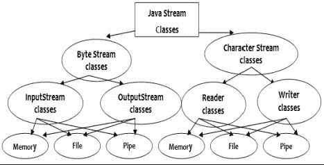

（Java 流类的分类）

## 字节流类概述

字节流类通过使用两个类层次结构定义。顶端是两个抽象类：

（1）`InputStream` 和（2）`OutputStream`

这些抽象类中的每一个都有几个具体的子类，它们用于处理不同设备之间的差异，例如磁盘文件、网络连接甚至内存缓冲区。

### InputStream 类

用于读取 8 位字节的 `InputStream` 类包括一个名为 `InputStream` 的超类（类）以及若干个支持各种输入相关函数的子类。


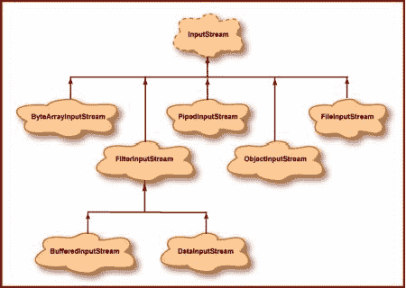

输入流类的层次结构。

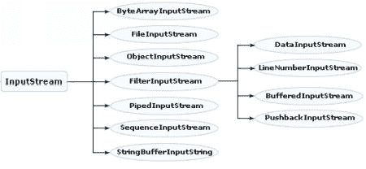

输入流类的层次结构。

### InputStream 类

超类 `InputStream` 是一个抽象类，它定义了执行输入功能的方法，例如：

- 读取字节。
- 关闭流。
- 在流中标记位置。
- 在流中向前跳过。
- 查找流中的字节数。

#### InputStream 类的方法

| 方法 | 描述 |
| :--- | :--- |
| `int available()` | 提供输入中可用的字节数（必须由子类重写）。`InputStream` 类的 `available` 方法始终返回 0。 |
| `void close()` | 关闭此输入流并释放与流相关的任何系统资源。`InputStream` 的 `close` 方法不执行任何操作。 |
| `void mark(int readlimit)` | 标记此输入流中的当前位置。`InputStream` 的 `mark` 方法不执行任何操作。 |
| `boolean markSupported()` | 测试此输入流是否支持 `mark` 和 `reset` 方法。`InputStream` 的 `markSupported` 方法返回 false。 |
| `abstract int read()` | 从输入流中读取下一个字节数据。子类必须提供此方法的实现。 |
| `int read(byte[] b)` | 从输入流中读取若干字节并将其存储在缓冲区数组 `b` 中。实际读取的字节数作为整数返回。 |
| `int read(byte[] b, int offset, int len)` | 从输入流中读取若干字节，并从参数 `off` 指定的位置开始将其存储在缓冲区数组 `b` 中。实际读取的字节数作为整数返回。 |
| `void reset()` | 将此流重新定位到上次在此输入流上调用 `mark` 方法时所在的位置。`InputStream` 的 `reset` 方法不执行任何操作并始终抛出 `IOException`。 |
| `long skip(long n)` | 跳过并丢弃此输入流中的最多 `n` 个字节的数据，并返回实际跳过的字节数。 |

### DataInput 接口

`DataInput` 是一个接口，定义了从 `InputStream` 读取原始数据类型的方法。

#### DataInput 接口的方法

| 方法 | 描述 |
| :--- | :--- |
| `boolean readBoolean()` | 读取一个输入字节，如果该字节非零则返回 true，如果字节为零则返回 false。 |
| `byte readByte()` | 读取并返回一个字节输入。 |
| `char readChar()` | 读取一个输入字符并返回其值。 |
| `double readDouble()` | 读取八个输入字节并返回一个 double 值。 |
| `float readfloat()` | 读取四个输入字节并返回一个 float 值。 |
| `void readFully(byte[] b)` | 从输入流读取若干字节并将其存储在缓冲区数组 `b` 中。如果流在读取所有字节之前到达末尾，此方法将抛出 `EOFException`。 |
| `void readFully(byte[] b, int off, int len)` | 从输入流读取 `len` 个字节，并从 `off` 指定的位置开始将其存储在缓冲区数组 `b` 中。如果流在读取所有字节之前到达末尾，此方法将抛出 `EOFException`。 |
| `int readInt()` | 读取四个输入字节并返回一个 `int` 值。 |
| `String readLine()` | 从输入流中读取下一行。 |
| `long readLong()` | 读取八个输入字节并返回一个 long 值。 |
| `short readShort()` | 读取两个输入字节并返回一个 short 值 |
| `Strig readUTF( )` | 读取一个使用修改后的 UTF-8 格式编码的字符串。 |
| `int skipBytes(int n)` | 尝试从输入流中跳过 `n` 个字节，丢弃跳过的字节。返回实际跳过的字节数。 |

### InputStream 类总结

| 类 | 描述 |
| :--- | :--- |
| `InputStream` | 此抽象类是所有表示字节输入流的类的超类。 |
| `BufferedInputStream` | `BufferedInputStream` 为另一个输入流增加了功能——即缓冲输入的能力并支持 `mark` 和 `reset` 方法。 |
| `ByteArrayInputStream` | `ByteArrayInputStream` 包含一个包含字节的内部缓冲区。 |
| `DataInputStream` | `DataInputStream` 允许应用程序从流读取原始数据类型。 |
| `FileInputStream` | `FileInputStream` 包含来自文件的输入字节。 |
| `FilterInputStream` | `FilterInputStream` 包含另一个输入流，将其作为基本数据源并可能在传递过程中对数据进行额外处理。 |
| `PipedInputStream` | `PipedInputStream` 连接到管道输出流，管道输入流提供写入管道输出流的任何数据。 |
| `PushbackInputStream` | `PushbackInputStream` 为另一个输入流增加了功能，即“回退”或未读读一个字节。 |
| `SequenceInputStream` | `SequenceInputStream` 代表流的逻辑连接。 |
| `ObjectInputStream` | `ObjectInputStream` 反序列化之前使用 `ObjectOutputStream` 写入原始数据和对象。 |

注意 `DataInputStream` 类继承自 `FilterInputStream` 并实现了 `DataInput` 接口。因此，`DataInputStream` 继承自 `FilterInputStream` 并使用了 `DataInput` 中的方法，还使用了 `InputStream` 类的方法。

### OutputStream 类

输出流类派生自抽象类 `OutputStream`，并拥有支持各种输出功能的子类。

#### OutputStream 类的方法

| 方法 | 描述 |
| :--- | :--- |
| `void close()` | 关闭此输出流并释放与流相关的任何流资源。 |
| `void flush()` | 刷新此输出流并强制将缓冲的输出字节写入。 |
| `void write(byte[] b)` | 将指定字节数组的 `b.length` 个字节写入其输出流。 |
| `void write(byte[] b, int off, int len)` | 从指定字节数组的偏移量 `off` 开始将 `len` 个字节写入其输出流。 |
| `abstract void write( int b)` | 将指定的字节写入其输出流。 |

### DataOutput 接口

`DataOutput` 是一个接口，定义了向 `OutputStream` 写入原始数据类型的方法。

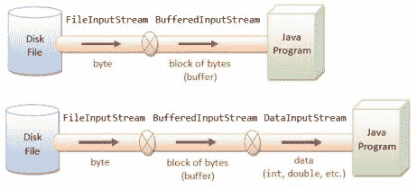


## DataOutput 接口方法

| 方法 | 描述 |
| :--- | :--- |
| `void writeBoolean(boolean v)` | 向输出流写入一个布尔值。 |
| `void writeByte(int v)` | 向输出流写入参数 `v` 的八个低位。 |
| `void writeBytes(string s)` | 将字符串写入输出流。对于字符串 `s` 中的每个字符（按顺序），都会向输出流写入一个字节。 |
| `void writeChar(int v)` | 向输出流写入一个由两个字节组成的字符值。 |
| `void writeChars(string s)` | 将字符串 `s` 中的每个字符按每两个字节的顺序写入输出流。 |
| `void writeDouble(double v)` | 向输出流写入一个由八字节组成的 double 值。 |
| `void writeFloat(float v)` | 向输出流写入一个由四个字节组成的 float 值。 |
| `void writeInt(int v)` | 向输出流写入一个由四个字节组成的 int 值。 |
| `void writeLong(long v)` | 向输出流写入一个由八字节组成的 long 值。 |
| `void writeShort(int v)` | 向输出流写入一个由两个字节组成的 short 值。 |
| `void writeUTF(String str)` | 向输出流写入两个字节的长度信息，随后是字符串 `s` 中每个字符的修改后的 UTF-8 表示。 |

### OutputStream 类总结

`DataOutputStream` 是 `DataInputStream` 的对应类。`DataOutputStream` 类除了使用 `OutputStream` 类的方法外，还实现了 `DataOutput` 接口中描述的方法。

### OutputStream 类总结

| 类 | 描述 |
| :--- | :--- |
| `OutputStream` | 这一抽象类是所有表示字节输出流的类的父类。 |
| `BufferedOutputStream` | 该类实现了一个缓冲的输出流。 |
| `ByteArrayOutputStream` | 该类实现了一个将数据写入字节数组的输出流。 |
| `DataOutputStream` | 数据输出流允许应用程序以可移植的方式向输出流写入 Java 原始数据类型。 |
| `FileOutputStream` | 文件输出流是用于向 `File` 写入数据的输出流。 |
| `PipedOutputStream` | 管道输出流可以连接到管道输入流以创建一个通信管道。 |
| `FilterOutputStream` | `FilterOutputStream` 包含一些其他输出流，并将其作为目标，可能在传输过程中转换数据或提供额外功能。 |
| `PrintStream` | `PrintStream` 为另一个输出流增加了功能，即方便地打印各种数据值表示的能力。 |

# 字符流类概览

字符流通过两个类层次结构定义。顶端是两个抽象类：`Reader` 和 `Writer`。这些抽象类处理 Unicode 字符流。

Java 拥有这些每个抽象类的几个具体子类。抽象的 `Reader` 和 `Writer` 类定义了其他流类实现的几个关键方法。其中最重要的两个方法是 `read()` 和 `write()`，它们分别读取和写入字符。这些方法被派生流类重写。

## Reader 流类

`Reader` 流类设计用于从文件中读取字符。`Reader` 类是该组中所有其他类的基类。这些类在功能上与输入流类非常相似，但输入流使用字节作为基本信息单位，而读取流使用字符。

`Reader` 类包含了与 `InputStream` 类中提供的相同的方法。因此，`Reader` 类可以执行输入流类实现的所有的所有功能。

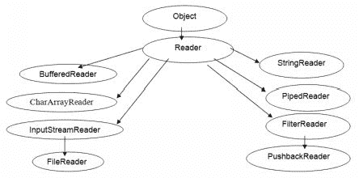

（Reader 流类的层次结构）

## Reader 类

`Reader` 是一个抽象类，定义了 Java 的字符输入流模型。该类中的所有方法都会抛出 `IOException`。

### Reader 类方法

| 方法 | 描述 |
| :--- | :--- |
| `abstract void close()` | 关闭流。一旦流被关闭，进一步的 `read()`、`ready()`、`mark()` 或 `reset()` 调用将抛出 `IOException`。然而，关闭一个之前关闭的流不会产生任何影响。 |
| `void mark()` | 标记流中的当前位置。随后的 `reset()` 调用将尝试将流重置到此点。并不是所有的字符输入流都支持 `mark()` 操作。 |
| `boolean markSupported()` | 告知此流是否支持 `mark()` 操作。 |
| `int read()` | 读取单个字符并返回来自调用输入流的下一个可用字符的整数表示。当遇到文件末尾时返回 -1。 |
| `int read(char[] buffer)` | 尝试读取最多 `buffer` 长度的内容到 `buffer` 中，并返回成功读取的字符数。当遇到文件末尾时返回 -1。 |
| `abstract int read(char[] buffer, int offset, int len)` | 尝试从 `buffer[offset]` 开始读取多达 `len` 个字符，返回成功读取的字符数。子类必须实现此方法。 |
| `boolean ready()` | 告知此流已准备好读取。如果下一次输入请求不会等待，则返回 true。 |
| `void reset()` | 重置流。并不是所有字符输入流都支持此方法。 |
| `long skip(long n)` | 跳过 `n` 个字符并返回跳过的字符数。如果 `n` 为负数则抛出 `IllegalArgumentException`。 |

## Reader 类总结

| 类 | 描述 |
| :--- | :--- |
| `Reader` | 读取字符的抽象类 |
| `BufferedReader` | 从字符流读取文本，缓冲字符以便高效读取字符和行。 |
| `CharArrayReader` | 实现一个作为字符输入流的缓冲区。 |
| `FileReader` | 读取字符文件的便利类。 |
| `FilterReader` | 读取字符流的抽象类。 |
| `InputStreamReader` | 从字节流到字符流的桥梁：使用指定的字符集解码字节为字符。 |
| `PipedReader` | 管道字符输入流。 |
| `PushbackReader` | 允许将字符推回流的字符读取器。 |
| `StringReader` | 源自字符串的字符流。 |

## Writer 类

`Writer` 流类设计用于向文件/输出设备写入字符。`Writer` 类是一个抽象类，作为写入流类的基类。

基类通过定义与 `OutputStream` 类相同的方法为所有输出操作提供支持。

`Writer` 类包含了与 `OutputStream` 类提供的相同的方法。因此，`Writer` 类可以执行输出流类实现的所有功能。

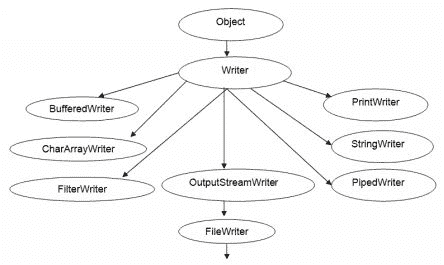

（Writer 流类的层次结构）

## Writer 类

`Writer` 是一个定义字符输出流的抽象类。该类中的所有方法返回空值，并在出错时抛出 `IOException`。

### Writer 类方法

| 方法 | 描述 |
| :--- | :--- |
| `abstract void close()` | 关闭流并先进行刷新。 |
| `abstract void flush()` | 刷新流。 |
| `void write(char[] cbuf)` | 写入字符数组。 |
| `abstract void write(char[] cbuf, int off, int len)` | 从指定的偏移量开始写入字符数组的一部分。子类必须实现此方法。 |

| 方法 | 说明 |
| :--- | :--- |
| `void write(int c)` | 向调用的输出流写入单个字符。注意该参数类型为 `int`，这允许你直接对表达式调用 `write` 而无需将它们强制转换回 `char`。 |
| `void write(String str)` | 写入字符串。 |
| `void write(String str, int off, int len)` | 写入字符串从指定偏移量开始的部分。 |


## Writer 类总结

| 类 | 说明 |
| :--- | :--- |
| `Writer` | 用于向字符流写入数据的抽象类。 |
| `BufferedWriter` | 向字符输出流写入文本，通过缓冲字符来提供高效写入单个字符、数组和字符串的功能。 |
| `CharArrayWriter` | 此类实现了一个可以作为 `Writer` 使用的字符缓冲区。 |
| `FileWriter` | 用于写入字符文件的便利类。 |
| `FilterWriter` | 用于写入过滤字符流的抽象类。 |
| `OutputStreamWriter` | `OutputStreamWriter` 是字符流到字节流的桥梁：写入它的字符将使用指定的 `charset` 编码为字节。 |
| `PipedWriter` | 管道字符输出流。 |
| `PrintWriter` | 将对象的格式化表示打印到文本输出流。 |
| `StringWriter` | 一种字符流，其输出收集在字符串缓冲区中，该缓冲区可以用于构造字符串。 |

## File 类

尽管 `java.io` 中定义的大多数类都操作流，但 `File` 类并不如此。它直接处理文件和文件系统。也就是说，`file` 类没有指定如何从文件中检索信息或将信息存储文件中。它描述的是自身的属性。

文件对象用于获取或操作与磁盘文件相关的信息（例如权限、时间、日期和目录路径），以及导航子目录层级结构。

尽管出于安全考虑，文件在 applet 中的用法受到严格限制，但文件仍然是存储持久性和共享信息的核心资源。

Java 中的目录被简单地视为一个文件，多了一个额外的属性——文件名列表，可以通过 `list()` 方法进行检查。

| 构造函数 / 方法 | 说明 |
| :--- | :--- |
| `public File(String)` | |
| `public File(String, String)` | |
| `public File(File, String)` | |
| `public File(URI)` | 此构造函数由 Java2，版本 1.4 添加。 |
| `public String getName()` | 返回文件或目录的。 |
| `public String getParent()` | 返回从对象创建期间指定的 `path` 获取的文件的父目录；如果此 `pathname` 未命名父目录，则返回 null。 |
| `public String getPath()` | 返回相对路径。 |
| `public boolean isAbsolute()` | 测试此抽象路径是否为绝对路径。 |
| `public String getAbsolutePath()` | 返回从根目录开始的绝对（完整）路径。 |
| `public boolean canRead()` | 测试应用程序是否可以读取此抽象路径所指的文件。 |
| `public boolean canWrite()` | 测试应用程序是否可以修改此抽象路径所的文件。 |
| `public boolean exists()` | 测试此抽象路径所指的文件或目录是否存在。 |
| `public boolean isDirectory()` | 测试此抽象路径所指的文件是否为目录。 |
| `public boolean isFile()` | 测试此抽象路径所的文件是否为普通文件。 |
| `public boolean isHidden()` | 测试此抽象路径命名的文件是否为隐藏文件。 |
| `public long lastModified()` | 返回此抽象路径所指的文件最后修改的时间。 |
| `public long length()` | 返回此抽象路径所指的文件长度。 |
| `public boolean createNewFile() throws java.io.IOException` | 当且仅当不存在此名称的文件时，自动创建一个由此抽象路径命名的新空文件。 |
| `public boolean delete()` | 删除此抽象路径所指的文件或目录。 |
| `public String[] list()` | 返回一个包含此抽象路径所指目录的文件和目录名的字符串数组。如果 `File` 对象对应于文件，则返回 null。 |
| `public boolean mkdir()` | 创建此抽象路径命名的目录。 |
| `public boolean mkdirs()` | 创建由此抽象路径命名的目录，包括任何必要的但不存在的父目录。 |
| `public boolean setLastModified(long)` | 设置此抽象路径命名的文件或目录的修改时间。 |
| `public boolean setReadOnly()` | 标记此抽象路径命名的文件或目录，使其只允许读操作。 |
| `public boolean setWritable(boolean)` | |
| `public boolean setReadable(boolean)` | |
| `public boolean canExecute()` | |
| `public long getTotalSpace()` | |
| `public long getFreeSpace()` | |
| `public long getUsableSpace()` | |
| `boolean renameTo(File)` | 重命名此抽象路径所指的文件。 |

## 示例

```java


`File f1 = new File("/");`

`File f2 = new File("/", "autoexec.bat");`

`File f3 = new File(f1, "autoexec.bat");`

**注意：**

Java 在处理 UNIX 和 Windows 惯例之间的路径分隔符时处理得很好。在 Windows 版本中使用正斜杠 `/` 路径也能正确解析。记住，在使用反斜杠 `\\` 字符串时，Java 惯例是使用正斜杠。

**示例 15.1：演示了类的若干方法**

```java
import java.io.*;

class FileTest {

    public static void main(String[] args[]) throws IOException {

        File f = new File("/javap/ch15/1/File.java");

        if (!f.exists()) {

            f.createNewFile();

        }

        System.out.println("Length=" + f.length() + " bytes");

        System.out.println("Name=" + f.getName());

        System.out.println("Parent=" + f.getParent());

        System.out.println("Path=" + f.getPath());

        System.out.println("Absolute Path=" + f.getAbsolutePath());

        System.out.println(f.exists() ? "Exists" : "Does not exist");

        System.out.println(f.isFile() ? "is file" : "not a file");

        System.out.println(f.canRead() ? "is readable" : "not readable");

        System.out.println(f.canWrite() ? "is writable" : "not writable");

        System.out.println(f.isDirectory() ? "is directory" : "not a directory");

        System.out.println(f.isHidden() ? "is hidden" : "not hidden");

        System.out.println(f.isAbsolute() ? "is absolute" : "is not absolute");

        System.out.println("File modified=" + f.lastModified());

        f.delete();

        File f3 = new File("C:/tally2");

        String[] nm = f3.list();

        System.out.println("List of Sub-Directories of C:/tally2");

        for (int i = 0; i < nm.length; i++) {

            System.out.print(nm[i]);

            File f4 = new File("C:/tally2/" + nm[i]);

            if (f4.isFile() == true) {

                //

            }

        }

    }

}
```

```java
System.out.println(" It is a File");

else

    System.out.println(" It is a Directory");

}

File f5=new File("zzz");

f5.mkdir();

File f6=new File("yyy/aaa");

f6.mkdirs();
```

### 输出

```text
Length=1782 bytes

Name=FileTest.java

Parent=\javaprog\ch15\15.1

Path=\javaprog\ch15\15.1\FileTest.java

Absolute Path=C:\javaprog\ch15\15.1\FileTest.java

Exists

is file

is readable

is writable

not a directory

not hidden

is not absolute

File last modified :1236824168000
```

`c:/tally72` 的文件与子目录列表

- `TALLY.REW` 它是一个文件
- `Tally.ini` 它是一个文件
- `sentinel.sys` 它是一个文件
- `sentinel.vxd` 它是一个文件
- `spnsrv9x.exe` 它是一个文件
- `spnsrvnt.exe` 它是一个文件
- `stat.slk` 它是一个文件
- `tally72.exe` 它是一个文件
- `tallylic9xserver.exe` 它是一个文件
- `tallylicserver.exe` 它是一个文件
- `tallysav.dat` 它是一个文件
- `tallywin.dat` 它是一个文件
- `tally.imp` 它是一个文件
- `Data` 它是一个目录

### FileInputStream

`FileInputStream` 是 `InputStream` 类的直接子类。要打开一个文件进行读取，你只需创建 `FileInputStream` 类的对象，并将文件名（直接或间接）作为构造函数的参数。

| `public FileInputStream(String) throws FileNotFoundException;` | 通过打开到文件系统中实际文件的连接来创建 `FileInputStream`，该文件由文件系统中的路径名 `filePath` 命名。 |
| `public FileInputStream(File) throws FileNotFoundException;` | 通过打开到文件系统中实际文件的连接来创建 `FileInputStream`，该文件由文件系统中的 `File` 对象 `file` 命名。 |
| `public native int read()` throws `IOException` | |
| `public int read(byte[])` throws `IOException` | |
| `public int read(byte[], int)` throws `IOException` | |
| `public native long skip(long)` throws `IOException` | |
| `public native int available()` throws `IOException` | |
| `public void close()` throws `IOException` | |

### FileOutputStream

`FileOutputStream` 是 `OutputStream` 类的直接子类。要打开一个文件进行写入，我们只需创建 `FileOutputStream` 类的对象，并将文件名（直接或间接）作为构造函数的参数。

| `public FileOutputStream(String) throws FileNotFoundException;` | 创建一个写入到指定名称文件的输出流。 |
| `public FileOutputStream(String, boolean) throws java.io.FileNotFoundException;` | 创建一个写入到指定名称文件的输出流。 |
| `public FileOutputStream(File) throws FileNotFoundException;` | 创建一个写入到指定的 `File` 对象所代表文件的输出流。 |
| `public FileOutputStream(File, boolean) throws FileNotFoundException;` | 创建一个写入到指定的 `File` 对象所代表文件的输出流。 |
| `public native void write(int)` throws `java.io.IOException` | |
| `public void write(byte[])` throws `java.io.IOException` | |
| `public void write(byte[], int, int)` throws `java.io.IOException` | |
| `public void close()` throws `java.io.IOException` | |

#### 5.2

```java
import java.io.*;

class FileRead {

    public static void main(String args[]) {

        FileInputStream fin=null;

        int a;

        try {

            fin=new FileInputStream(args[0]);

            System.out.println("No. of characters to read="+fin.available());

            fin.skip(3);

            a = fin.read();

            while(a != -1) {

                System.out.print((char)a);

                a = fin.read();

            }

            System.out.println("No. of characters to read="+fin.available());

            fin.close();

        } catch(ArrayIndexOutOfBoundsException e) {

            System.out.println(e);

        } catch(FileNotFoundException e) {

            System.out.println(e);

        } catch(IOException e) {

            System.out.println(e);

        }

    }

}
```

输出：

```text
java FileRead A.txt

No. of characters to read=20

Matrix Computers

No. of characters to read=0
```

#### 示例 15.3

```java
import java.io.*;

class FileCopy {

    public static void main(String args[]) throws IOException {

        FileInputStream fin=null;

        FileOutputStream fout=null;

        fin=new FileInputStream(args[0]);

        fout=new FileOutputStream(args[1]);

        int a;

        a = fin.read();

        while(a != -1) {

            fout.write(a);

            a = fin.read();

        }

        fin.close();fout.close();

    }

}
```

#### 示例 15.4

```java
import java.io.*;

class CopyFile {

    public static void main(String args[]) throws IOException {

        int n;

        FileInputStream fin = new FileInputStream("A.txt");

        FileOutputStream fout = new FileOutputStream("B.txt");

        byte b[]= new byte[10];

        n = fin.read(b);

        while(n != -1) {

            fout.write(b,0,n);

            n = fin.read(b);

        }

        fin.close();

    }

}
```

# FileReader

`FileReader` 类创建了一个 `Reader`，你可以使用它来读取文件的内容。它最常用的两个构造函数是：

- `FileReader(File file)` 创建一个 `FileReader` 流，从指定的文件读取内容。
- `FileReader(String fileName)` 创建一个 `FileReader` 流，从指定的文件读取内容。

注意：如果文件不存在、是一个目录而不是普通文件，或者由于其他原因无法打开读取，任一个构造函数都会抛出 `FileNotFoundException`。

# FileWriter

`FileWriter` 类创建了一个写入器，你可以使用它向文件写入。它最常用的构造函数是：

#### 构造函数

- `FileWriter(File file)`：构造一个 `FileWriter` 对象以写入指定的文件。
- `FileWriter(String fileName)`：构造一个 `FileWriter` 对象以写入指定的文件。
- `FileWriter(File file, boolean append)`：构造一个 `FileWriter` 对象，以追加模式写入指定的文件。
- `FileWriter(String filename, boolean append)`：构造一个 `FileWriter` 对象，以追加模式写入指定的文件。如果使用前两个构造函数，则总是创建一个新文件。如果存在同名文件，它将被销毁。如果使用后两个构造函数且 `append` 标志为 false，则它们的行为与前两个构造函数相同。

如果 `append` 标志为 true，则以追加模式打开文件，即如果文件已存在，则文件指针位于文件末尾；如果文件不存在，则创建一个新文件。

### 注意

如果文件存在但是一个目录而不是普通文件、不存在但无法创建，或由于其他原因无法打开，这些构造函数可能会抛出 `IOException`。例如，当你尝试打开一个只读文件时，将抛出 `IOException`。

### 示例 15.5

```java
import java.io.*;

class FileCopy {

    public static void main(String args[]) throws IOException {

        FileReader fin=null;

        FileWriter fout=null;

        fin=new FileReader(args[0]);

        fout=new FileWriter(args[1]);

        int a;

        a = fin.read();

        while(a != -1) {

            fout.write((char)a);

            a = fin.read();

        }

        fin.close();

        fout.close();

    }

}
```


# RandomAccessFile

`RandomAccessFile` 封装了一个随机访问文件。`RandomAccessFile` 允许我们从文件的某个位置读取和写入字节、文本和原始数据类型（在使用适当的访问权限时）。它没有派自 `InputStream`。相反，它实现了 `DataInput` 和 `DataOutput` 接口，这两个接口定义了基本的 I/O 方法。它还支持定位请求——你可以将文件指针定位到文件中的任何位置。

`mode` 参数指定打开文件的访问模式。允许的值及其含义如下：

| 值 | 含义 |
| :--- | :--- |
| `"r"` | 仅读打开。调用生成对象的任何写入方法将导致抛出 `IOException`。 |
| `"rw"` | 读写打开。如果文件不存在，则将尝试创建它。 |
| `"rws"` | 读写打开，与 `"rw"` 相同，但还要求对文件内容或元数据的每次更新都要同步写入底层存储设备。 |
| `"rwd"` | 读写打开，与 `"rw"` 相同。但还要求对文件内容（数据）的每次更新都要同步写入底层存储设备。 |

## RandomAccessFile 类的方法

除了 `DataInput` 和 `DataOutput` 接口的方法外，该类的一些常用方法还有：

- `public RandomAccessFile(String, String) throws java.io.FileNotFoundException;`：创建一个随机访问文件流，从指定的文件名读取，并可选写入。
- `public RandomAccessFile(File, String) throws FileNotFoundException;`：创建一个随机访问文件流，从 `File` 参数指定的文件读取，并可选写入。
- `public native int read() throws java.io.IOException;`
- `public int read(byte[], int);`
- `public int read(byte[]);`
- `public int skip(int);`
- `public native void write(int);`
- `public void write(byte[]);`
- `public void write(byte[], int);`
- `public native long getPointer();`
- `public native void seek(long);`
- `public native long length();`
- `public void setLength(long);`
- `public void close();`
- `public final boolean readBoolean();`
- `public final byte readByte();`
- `public final int readUnsignedByte();`
- `public final short readShort();`
- `public final int readUnsignedShort();`
- `public final char readChar();`
- `public final int readInt();`
- `public final long readLong();`
- `public final float readFloat();`
- `public final double readDouble();`
- `public final String readLine();`
- `public final String readUTF();`
- `public final void write(boolean);`
- `public final void writeByte(int);`
- `public final void writeShort(int);`
- `public final void writeChar(int);`
- `public final void writeInt(int);`
- `public final void writeLong(long);`
- `public final void writeFloat(float);`
- `public final void writeDouble(double);`
- `public final void writeBytes(java.lang.String);`
- `public final void writeChars(java.lang.String);`
- `public final void writeUTF(java.lang.String);`

## 示例 15.6

```java
import java.io.*;

class RandomIO {

}
```

```java
public static void main(String args[]) throws IOException {

    RandomAccessFile file = null;

    try {

        file = new RandomAccessFile("rand.dat", "rw");

        file.writeChar('X');

        file.writeInt(1999);

        file.writeDouble(222.44);

        System.out.println("File pointer Pos:"+file.getFilePointer());

        file.seek(0);

        System.out.println(file.readChar());

        System.out.println(file.readInt());

        System.out.println(file.readDouble());

        System.out.println("File pointer Pos:"+file.getFilePointer());

        file.seek(2);

        System.out.println("File pointer Pos:"+file.getFilePointer());

        System.out.println(file.readInt());

        file.seek(file.length());

        file.writeBoolean(false);

        file.seek(14);

        System.out.println(file.readBoolean());

        System.out.println("File pointer Pos:"+file.getFilePointer());

        System.out.println(file.readInt());//EOF Exception

    } catch(EOFException e) {

        System.out.println("Trying to after end of file");

    } finally {

        file.close();

    }

}
```

输出：
```
File pointer Pos:14
X
1999
222.44
File pointer Pos:14
File pointer Pos:2
1999
false
File pointer Pos:15
Trying to after end of file
```

注意：如果尝试在文件末尾之后进行读取，则会发生 `EOFException`。

## ByteArrayInputStream

`ByteArrayInputStream` 包含一个内部缓冲区，其中包含了可以从流中读取的字节。`ByteArrayInputStream` 是一个使用字节数组作为源的输入流实现。该类有两个构造函数，每个构造函数都需要一个字节数组来提供数据源。

`ByteArrayInputStream` 实现了 `mark()` 和 `reset()` 方法。然而，如果没有调用过 `mark()`，则 `reset()` 会将流指针置到流的开头。

| 方法 |
| :--- |
| `public ByteArrayInputStream(byte[]);` |
| `public ByteArrayInputStream(byte[], int, int);` |
| `public synchronized int read();` |
| `public synchronized int read(byte[], int, int);` |
| `public synchronized long skip(long);` |
| `public synchronized int available();` |
| `public boolean markSupported();` |
| `public void mark(int);` |
| `public synchronized void reset();` |
| `public void close() throws IOException;` |

### 示例 15.7

```java
import java.io.*;

class ByteArrayInputStreamTest {

    public static void main(String args[]) throws IOException {

        String s1="abcdefghij";

        byte b[]=s1.getBytes();

        ByteArrayInputStream b1 = new ByteArrayInputStream(b);

        int a;

        while((a=b1.read())!=-1) {

            System.out.print((char)Character.toUpperCase(a));

        }

        b1.close();

    }

}
```

输出：
```
ABCDEFGHIJ
```

## ByteArrayOutputStream

`ByteArrayOutputStream` 实现了一个输出流，其中数据被写入字节数组中。`ByteArrayOutputStream` 是一个使用字节数组作为目的的输出流实现。缓冲区存储在 `ByteArrayOutputStream` 的保护字段 `buf` 中。如果需要，缓冲区的大小会自动增加。缓冲区所持有的字节数包含在 `ByteArrayOutputStream` 的保护字段 `count` 中。

| 方法 |
| :--- |
| `public java.io.ByteArrayOutputStream();`创建一个新的字节数组输出流。缓冲区的初始容量为 32 字节，如有需要将增大其大小。 |
| `public java.io.ByteArrayOutputStream(int);`创建一个新的字节数组输出流，具有指定大小（字节）的缓冲区容量。 |
| `public synchronized void write(int);` |
| `public synchronized void write(byte[], int, int);` |
| `public synchronized void writeTo(java.io.OutputStream) throws java.io.IOException;` |
| `public synchronized void reset();` |
| `public synchronized byte[] toByteArray();` |
| `public synchronized int size();` |
| `public synchronized java.lang.String toString();` |
| `public synchronized java.lang.String toString(java.lang.String) throws java.io.UnsupportedEncodingException;` |
| `public synchronized java.lang.String toString(int);` |
| `public void close() throws java.io.IOException;` |

### 示例 15.8

```java
import java.io.*;

class ByteArrayOutputStreamTest {

    public static void main(String args[]) throws IOException {

        ByteArrayOutputStream b1 = new ByteArrayOutputStream();

        b1.write('a');

        String s1 = "abcdefghij";

        byte arr1[]= s1.getBytes();

        b1.write(arr1);

        System.out.println(b1);  //toString()

        // 使用 for 循环显示

        byte arr2[] = b1.toByteArray();

        for(int i=0;i<arr2.length;i++) {

            System.out.print((char)arr2[i]);

        }

        System.out.println();

        // 使用 for 循环显示

        for(int i:arr2) {

            System.out.print((char)i);

        }

        b1.close();

    }

}
```

输出：
```
aabcdefghij
aabcdefghij
aabcdefghij
```

从指定的字符数组创建一个 `CharArrayReader`。生成的读取器将从给定的偏移量开始读取。从此读取器可以读取的字符值总数将是 `length` 或 `buf.length`。

### 示例 15.9

```java
import java.io.*;

class CharArrayReaderTest {

    public static void main(String args[]) throws IOException {

        String tmp = "abcdefghijklmnopqrstuvwxyz";

        int length = tmp.length();

        char c[] = new char[length];

        tmp.getChars(0, length, c, 0);

        CharArrayReader input1 = new CharArrayReader(c);

        CharArrayReader input2 = new CharArrayReader(c, 0, 5);

        int i;

        while ((i = input1.read()) != -1) {

            System.out.print((char)i);

        }

        System.out.println();

        while ((i = input2.read()) != -1) {

            System.out.print((char)i);

        }

    }

}
```

**输出：**
```
abcdefghijklmnopqrstuvwxyz
abcde
```

## CharArrayWriter

`CharArrayWriter` 是一个写入流的实现，它使用字符数组缓冲区作为目标。

### 构造函数

- `CharArrayWriter()`
- `CharArrayWriter(int initialSize)`

在第一种形式中，创建一个具有默认大小的缓冲区。在第二种形式中，创建一个大小由参数 `initialSize` 指定缓冲区。

缓冲区存储在 `CharArrayWriter` 的 `buf` 字段中。如果需要，缓冲区的大小会自动增大。缓冲区持有的字符数包含在 `CharArrayWriter` 的 `count` 字段中。`buf` 和 `count` 都是受保护字段。

### 示例 15.10

```java
import java.io.*;

class CharArrayWriterTest {

    public static void main(String args[]) throws IOException {

        CharArrayWriter f = new CharArrayWriter();

        String s = "This should end up in the array";

        char buf[] = new char[s.length()];

        s.getChars(0, s.length(), buf, 0);

        f.write(buf);

        System.out.println(f.toString());

        char c[] = f.toCharArray();

        for (int i = 0; i < c.length; i++) {
```


`System.out.print(c[i]);`

```
FileWriter f2 = new FileWriter("test.txt");
f.writeTo(f2);
f2.close();
f.reset();
System.out.println();
System.out.println("After:" + f.toString());
for (int i = 0; i < 3; i++) {
    f.write('A');
    System.out.println(f.toString());
}
```

**输出：**

```
This should end up in the array
This should end up in the array
After:AAA
```

## PushbackInput Stream

`PushbackInputStream` 为另一个输入流增加了功能，即能够“回退”或“取消读取”一个字节。缓冲化的用途之一就是实现回退。`Pushback` 用于输入流，允许读取一个字节后将其返回到流中。除了 `InputStream` 类中常见的方法外，`PushbackInputStream` 还提供了 `unread()` 方法，此处所示：

| `public java.io.PushbackInputStream(java.io.InputStream, int)` | 创建一个具有指定大小回退缓冲区的 `PushbackInputStream`，并保存其参数输入流以备后用。这允许将多个字节返回到输入流。 |
| `public java.io.PushbackInputStream(java.io.InputStream)` | 创建一个 `PushbackInputStream` 并保存其参数输入流以备后用。这允许将一个字节返回到输入流。 |
| `public int read() throws java.io.IOException;` | |
| `public int read(byte[], int, int) throws java.io.IOException;` | |
| `public void unread(int) throws java.io.IOException;` | 通过将字节复制到回退缓冲区的开头来回退一个字节 |
| `public void unread(byte[], int, int) throws java.io.IOException;` | 通过将字节数组的一部分复制到回退缓冲区的开头来回退字节数组的一部分。 |
| `public void unread(byte[]) throws java.io.IOException;` | 通过将字节数组复制到回退缓冲区的开头来回退字节数组。 |
| `public int available() throws java.io.IOException;` | |
| `public long skip(long) throws java.io.IOException;` | |
| `public boolean markSupported();` | `PushbackInputStream` 的副作用是会使创建它的 `InputStream` 的 `mark()` 或 `reset()` 方法失效。使用 `markSupported()` 方法检查任何你将要使用 `mark()`/`reset()` 的流。 |
| `public synchronized void mark(int);` | |
| `public synchronized void reset() throws java.io.IOException;` | |
| `public synchronized void close() throws java.io.IOException;` | |

### 示例 15.11

```java
import java.io.*;

class PushbackInputStreamTest {
    public static void main(String args[]) throws IOException {
        FileInputStream fin = new FileInputStream("A.txt");
        PushbackInputStream p1 = new PushbackInputStream(fin);
        int ch = p1.read();
        System.out.println((char)ch);
        ch = p1.read();
        System.out.println((char)ch);
        ch = p1.read();
        System.out.println((char)ch);
        p1.unread(ch);
        ch = p1.read();
        System.out.println((char)ch);
    }
}
```

**输出：**

```
A.txt contains "Matrix Computers"
m
a
t
```

| `public int read(char[], int, int) throws java.io.IOException;` | |
| `public void unread(int) throws java.io.IOException;` | 推回单个字符。 |
| `public void unread(char[], int, int) throws java.io.IOException;` | 通过将字符数组的一部分拷贝到推回缓冲区开头来推回该部分。 |
| `public void unread(char[]) throws java.io.IOException;` | 通过将数组拷贝到推回缓冲区开头来推回该数组。 |
| `public boolean ready() throws java.io.IOException;` | |
| `public void mark(int) throws java.io.IOException;` | |
| `public void reset() throws java.io.IOException;` | |
| `public boolean markSupported();` | |
| `public void close() throws java.io.IOException;` | |
| `public long skip(long) throws java.io.IOException;` | |

**注意**：当在推回缓冲区满的情况下尝试返回字符时，将抛出 `IOException`。

#### 示例 15.12

```java
import java.io.*;

class PushbackReaderTest {
    public static void main(String args[]) throws IOException {
        FileReader fr = new FileReader("A.txt");
        PushbackReader pr = new PushbackReader(fr);
        int ch = pr.read();
        System.out.println((char)ch);
        ch = pr.read();
        System.out.println((char)ch);
        ch = pr.read();
        System.out.println((char)ch);
        pr.unread(ch);
        ch = pr.read();
        System.out.println((char)ch);
    }
}
```

**输出：**

```
m
a
t
t
```

### SequenceInputStream

`SequenceInputStream` 类是一个字节流，允许你连接多个 `InputStream`。`SequenceInputStream` 的构造与其他任何 `InputStream` 都不同。

- `SequenceInputStream(InputStream1, InputStream2)`：通过记住两个参数来初始化新创建的 `SequenceInputStream`，这两个将按顺序读取（先 `InputStream1` 然后是 `InputStream2`），以便为该 `SequenceInputStream` 提供要读取的字节。
- `SequenceInputStream(Enumeration e)`：通过记住参数来初始化新创建的 `SequenceInputStream`，该参数必须是一个运行时类型为 `InputStream` 的 `Enumeration`。在操作上，该类满足第一个 `InputStream` 的请求直到其耗尽，然后切换到第二个。在 `Enumeration` 的情况下，它将继续遍历所有的 `InputStream` 直到最后一个流的结束。

**示例 15.13 在此处将文件名作为命令行参数给出：**

```java
import java.io.*;

class SequenceInputStreamTest {
    public static void main(String args[]) throws IOException {
        FileInputStream f1 = new FileInputStream(args[0]);
        FileInputStream f2 = new FileInputStream(args[1]);
        FileOutputStream f3 = new FileOutputStream(args[2]);
        SequenceInputStream sis = new SequenceInputStream(f1, f2);
        int c;
        while ((c = sis.read()) != -1) {
            f3.write(c);
        }
        f3.close();
        f1.close();
        f2.close();
    }
}
```

**输出：**

```
java SequenceInputStreamTest A.txt B.txt C.txt
```

### PrintStream

它是一个字节流类，继承自 `FilterOutputStream`。`PrintStream` 为另一个输出流增加了功能，即方便地打印各种数据值表示的能力。

可选地，可以创建一个 `PrintStream` 以实现自动刷新；这意味着在写入字节数组、调用其中一个 `println()` 方法或写入换行符 `\n` 之后会调用 `flush()` 方法。通过 `PrintStream` 打印的所有字符都将使用平台的默认编码转换为字节，然后写入 `OutputStream`。`PrintStream` 支持针对所有类型的 `print()` 和 `println()` 方法。如果参数不是简单类型，`PrintStream` 方法将调用对象的 `toString()` 方法并打印结果。

**构造函数：**

- `PrintStream(File file)`：使用指定的文件创建一个新的打印流，不带自动刷新。
- `PrintStream(String fileName)`：使用指定的文件名创建一个新的打印流，不带自动刷新。
- `PrintStream(OutputStream out)`：向指定的 `OutputStream` 创建一个新的打印流。
- `PrintStream(OutputStream out, boolean autoFlush)`：创建一个连接到指定 `OutputStream` 的新打印流。

**示例 15.4：**

```java
import java.io.*;

class PrintStream {
    public static void main(String args[]) throws IOException {
        PrintStream ps = new PrintStream(System.out, true);
        ps.println("This is a string");
        int i = -7;
        ps.println(i);
        double d = 4.5e-7;
        ps.println(d);
    }
}
```

**输出：**

```
This is a string
-7
4.5E-7
```

### 示例 15.15

```java
import java.io.*;

class PrintStreamTest2 {
    public static void main(String argv[]) throws IOException {
        FileOutputStream fout = new FileOutputStream("test.dat");
        PrintStream ps = new PrintStream(fout, true);
        ps.println("This is a string");
        int i = -7;
        ps.println(i);
        double d = 4.5e-7;
        ps.println(d);
        fout.close();
    }
}
```

## PrintWriter 构造函数与用法

创建一个新的 `PrintWriter`，不自动刷新行，用于向指定的 `OutputStream` 写入。

`PrintWriter(OutputStream out, boolean autoFlush)`

创建一个新的 `PrintWriter` 用于向指定的 `OutputStream` 写入。

`PrintWriter(Writer out)`

创建一个新的 `PrintWriter`，不自动刷新行，用于向指定的 `Writer` 写入。

`PrintWriter(Writer out, Boolean autoFlush)`

创建一个新的 `PrintWriter` 用于向指定的 `Writer` 写入。

常用的构造函数是：

`PrintWriter(OutputStream os, boolean flushOnNewLine)`

在这里，`os` 是 `OutputStream` 类型的对象，`flushOnNewLine` 控制 Java 在每次调用 `println()` 方法时是否冲刷输出流。如果 `flushOnNewLine` 为 `true`，则会自动进行刷新。如果为 `false`，则不自动刷新。

`PrintWriter` 支持所有类型（包括对象）的 `print()` 和 `println()` 方法。如果参数不是简单类型，`PrintWriter` 方法会调用对象的 `toString()` 方法并打印结果。

要使用 `PrintWriter` 写入控制台，请为输出流指定 `System.out`，并在每个新行后刷新流。例如，此行代码创建了一个连接到控制台输出的 `PrintWriter`。

`PrintWriter pw = new PrintWriter(System.out, true)`

### 示例 15.16

```java
import java.io.*;

class PrintWriterTest {
    public static void main(String argv[]) throws IOException {
        PrintWriter pw = new PrintWriter(System.out, true);
        pw.println("This is a string");
        int i = -7;
        pw.println(i);
        double d = 4.5e-7;
        pw.println(d);
    }
}
```

**输出：**

```
This is a string
-7
4.5E-7
```

### 示例 15.17

```java
import java.io.*;

class PrintWriterTest1 {
    public static void main(String argv[]) throws IOException {
        FileWriter fout = new FileWriter("test.dat");
        PrintWriter pw = new PrintWriter(fout, true);
        pw.println("This is a string");
        int i = -7;
        pw.println(i);
        double d = 4.5e-7;
        pw.println(d);
    }
}
```

### 示例 15.18

```java
import java.io.*;

class PrintWriterTest2 {
```


```java
public static void main (String argv[]) throws IOException {

    PrintWriter pw = new PrintWriter("test.dat");

    pw.println("This is a string");

    int i = -7;

    pw.println(i);

    double d = 4.5e-7;

    pw.println(d);

    pw.close();

}
```

# PipedInputStream 和 PipedOutputStream

管道输出流可以连接到管道输入流以创建一个通信管道。管道输出流是管道的发送端。管道输入流应该连接到管道输出流；随后，管道输入流提供提供写入管道输出流的字节。通常情况下，数据由一个线程从`PipedInputStream`对象读取，并由另一个线程向对应的`PipedOutputStream`写入数据。不建议在单个线程中使用这两个对象，因为这可能会导致线程死锁。

## 构造函数

- `PipedInputStream()`: 创建一个`PipedInputStream`处于未连接状态。
- `PipedInputStream(PipedInputStream src)`: 创建一个`PipedInputStream`使其连接到输出流`src`。
- `PipedOutputStream()`: 创建一个`PipedOutputStream`，其尚未连接到管道输入流。
- `PipedOutputStream(PipedInputStream snc)`: 创建一个连接到指定管道输入流的`PipedOutputStream`。

### 示例 15.19

```java
import java.io.*;

class TextGenerator extends Thread {

    OutputStream out;

    TextGenerator(OutputStream out) {

        this.out = out;

    }

    public void run() {

        try {

            for(byte b = 65; b<=90; b++)

                out.write(b);

        } finally {

            out.close();

        }

    } catch(IOException e) {

        System.out.println(e);

    }

}

class Pipe {

    public static void main(String args[]) throws IOException {

        PipedOutputStream out = new PipedOutputStream();

        PipedInputStream in = new PipedInputStream(out);

        TextGenerator data = new TextGenerator(out);

        data.start();

        int ch;

        while((ch = in.read()) != -1)

            System.out.print((char) ch);

    }

}
```

**输出:**

```
ABCDEFGHIJKLMNOPQRSTUVWXYZ
```

# PipedReader 和 PipedWriter

它们的功能与`PipedInputStream`和`PipedOutputStream`相同，区别在于它们是字符流。

## 构造函数

- `PipedReader()`: 创建一个`PipedReader`处于未连接状态。
- `PipedReader(PipedWriter src)`: 创建一个`PipedReader`使其连接到管道写入器`src`。
- `PipedWriter()`: 创建一个`PipedWriter`，其尚未连接到管道读取器。
- `PipedWriter(PipedReader snk)`: 创建一个连接到指定管道读取器的`PipedWriter`。

### 示例 15.20

```java
import java.io.*;

class TextGenerator extends Thread {

    Writer out;

    TextGenerator(Writer out) {

        this.out = out;

    }

    public void run() {

        try {

            try {

                for(char c = 'a'; c <= 'z'; c++) {

                    out.write(c);

                }

            } finally {

                try {

                    Thread.sleep(200);

                } catch (Exception e) {}

                System.out.println("aaaaaaaaa");

                if(true)

                    return; // IOException: pipe Broken

                out.close(); //IOException: Write end dead

            } //OK if thread finishes after closing the pipe

        } catch (IOException e) {

            System.out.println(e);

        }

    }

}
```

### Pipe2 类示例

```java
class Pipe2 {

    public static void main(String argv[]) throws IOException {

        PrintStream ps = new PrintStream(System.out);

        PipedWriter out = new PipedWriter();

        PipedReader in = new PipedReader(out);

        TextGenerator data = new TextGenerator(out);

        data.start();

        int ch;

        while((ch = in.read()) != -1) {

            System.out.print((char) ch);

        }

    }

}
```

**输出：**
`abcdefghijklmnopqrstuvwxyaaaaaaaaaaaa`
`Exception in thread "main" java.io.IOException: Pipe broken`

---

## 过滤字节流

过滤流实际上是对底层输入或输出流的封装，能够透明地提供某些扩展级别的功能。典型的扩展包括缓冲、zip 压缩/解压等。过滤字节流包括`FilterInputStream`和`FilterOutputStream`。它们的构造函数如下：

`FilterInputStream(InputStream in)`
通过将参数`in`赋值给字段`this.in`来创建一个`FilterInputStream`，以便稍后备用。

`FilterOutputStream(OutputStream out)`
创建一个构建在指定的底层输出流之上的输出流过滤器。

这些类中提供的方法与`InputStream`和`OutputStream`中的方法相同。

## 缓冲字节流

对于面向字节的流，缓冲流通过为 I/O 流附加一个内存缓冲区来扩展过滤流类。该缓冲区允许 Java 一次处理多个字节的 I/O 操作，从而提高性能。

由于缓冲区的可用，流的跳过（`skip`）、标记（`mark`）和重置（`reset`）变得可能。缓冲字节流类是`BufferedInputStream`和`BufferedOutputStream`。`PushbackInputStream`也实现了缓冲流。

### BufferedInputStream

缓冲 I/O 是一种常见的性能优化。Java 的`BufferedInputStream`类允许将任何`InputStream`“包装”为缓冲流并实现这种性能提升。

`BufferedInputStream`有两个构造函数：

`BufferedInputStream(InputStream in)`
创建一个`BufferedInputStream`并保存其参数输入流`in`以供后使用。创建一个并存储在`buf`中的缓冲区数组。

`BufferedInputStream(InputStream in, int size)`
以指定的缓冲区大小创建，并保存其参数输入流`in`以供后使用。缓冲输入流为支持在可用缓冲区中向后移动提供了基础。除了任何`InputStream`都实现的`read()`和`skip()`方法外，`BufferedInputStream`还支持`mark()`和`reset()`方法。这种支持体现在`BufferedInputStream.markSupported()`返回 true。

**示例 5.2**

```java
import java.io.*;

class BufferedInputStream {

    public static void main(String args[]) throws IOException {

        FileInputStream fin = new FileInputStream("A.txt");

        BufferedInputStream b1 = new BufferedInputStream(fin);

        for(int i=1; i<=10; i++) {

            System.out.print((char)b1.read());

        }

        System.out.println();

        if(b1.markSupported()) {

            b1.mark(500);

            for(int i=1; i<=10; i++) {

                System.out.print((char)b1.read());

            }

            System.out.println();

            b1.reset();

            for(int i=1; i<=10; i++) {

                System.out.print((char)b1.read());

            }

        }

    }

}
```

## BufferedOutputStream

创建一个新的缓冲输出流，用于将数据写入指定的底层输出流。它使用一个大小为 512 字节的缓冲区。

`BufferedOutputStream(OutputStream out, int size)`

创建一个新的缓冲输出流，使用指定的缓冲区大小将数据写入指定的底层输出流。

### 示例 15.22

```java
import java.io.*;

class BufferedOutputStreamTest

{

    public static void main(String args[ ]) throws IOException

    {

        BufferedOutputStream f = new BufferedOutputStream (System.out,100);

        byte buf[ ] = "This will not be displayed without flush()\n".getBytes();

        f.write(buf);

        f.write(buf);

        System.out.println("testing...");

        f.write(buf);

        //f.flush(); or

        //f.close();

    }

}
```

**输出：**

```
testing...

This will not be displayed without flush()

This will not be displayed without flush()

This will not be displayed without flush()
```

### BufferedReader

`BufferedReader`通过缓冲输入来提高性能。它有两个构造函数：

`BufferedReader(Reader in)`
创建一个使用默认大小输入缓冲区的缓冲字符输入流。

`BufferedReader(Reader in, int sz)`
创建一个使用指定大小输入缓冲区的缓冲字符输入流。

#### 示例 15.23

```java
import java.io.*;

class BufferedReaderTest

{

    public static void main(String args[])throws IOException

    {

        FileReader fr=new FileReader("A.txt");

        BufferedReader b1 = new BufferedReader(fr);

        for(int i=1;i<=10;i++)

        {

            System.out.print((char)b1.read());

        }

        System.out.println();

        if(b1.markSupported())

        {

            b1.mark(5);

            for(int i=1;i<=10;i++)

            {

                System.out.print((char)b1.read());

            }

            System.out.println();

            b1.reset();

            for(int i=1;i<=10;i++)

        {

                System.out.print((char)b1.read());

            }

        }

        else

        {

            System.out.println("Marking option is availabel");

        }

        b1.close();

        fr.close();

    }

}
```

### BufferedWriter

使用`BufferedWriter`通过减少数据实际写入输出流的次数来提高性能。

#### 构造函数

`BufferedWriter(Writer out)`
创建一个使用默认大小输出缓冲区的缓冲字符输出流。

`BufferedWriter(Writer out, int sz)`
创建一个使用给定大小输出缓冲区的缓冲字符输出流。

#### 示例 15.24

```java
import java.io.*;

class BufferedWriterTest

{

    public static void main(String args[]) throws IOException

    {

        BufferedWriter f = new BufferedWriter(new PrintWriter(System.out));

        String s  = "This will not be displayed without flush()\n";

        char buf[ ] = new char[s.length()];

        s.getChars(0,s.length(),buf,0);

        f.write(buf);

        f.write(buf);

        System.out.println("testing...");

        f.write(buf);

        //f.flush();

        //f.close();

    }

}
```

**输出：**

```
testing...
```


# 使用字节流处理原始数据

基本的输入和输出流提供了`read/write`方法，但只能用于读取/写入字节或字符。如果我们想读取/写入整数和双精度原始类型，可以使用过滤器类作为现有输入和输出流的包装器，以过滤原始流中的数据。

用于处理原始类型的“数据流”的两个过滤器类是`DataInputStream`和`DataOutputStream`。这些类使用了如下所示的多重继承概念，并实现了父类和接口中包含的所有方法。

从文件输入的数据流可以如下创建：

```
FileInputStream fis = new FileInputStream(infile);
DataInputStream dis = new DataInputStream(fis);
```

这些语句基本上包装了`fis`并将其用作“过滤器”。同样，以下语句创建了输出数据流`dos`并将其封装在输出流之上。

```
FileOutputStream fos = new FileOutputStream(outfile);
DataOutputStream dos = new DataOutputStream(fos);
```

## 示例 15.25

以下程序演示了原始数据的读取和写入。

```java
import java.io.*;

class ReadWritePrimitive
{
    public static void main (String args[]) throws IOException
    {
        File primitive = new File("prim.dat");
        FileOutputStream fos = new FileOutputStream(primitive);
        DataOutputStream dos = new DataOutputStream(fos);

        dos.writeInt(999);
        dos.writeDouble(2.4);
        dos.writeBoolean(false);
        dos.write('X');
        dos.close();
        fos.close();

        FileInputStream fis = new FileInputStream(primitive);
        DataInputStream dis = new DataInputStream(fis);

        System.out.println(dis.readInt());
        System.out.println(dis.readDouble());
        System.out.println(dis.readBoolean());
        System.out.println(dis.readChar());
    }
}
```

输出：

```
999
2.4
false
X
```

## 预流

`System`类包含三个预定义的流变量 - `in`、`out`和`err`。这些字段在`System`类中被声明为`public`和`static`。这意味着它们可以被程序的任何部分使用，而无需引用特定的对象。

`System.out`指向标准输出流。默认情况下，它是控制台。`System.out`是一个`PrintStream`类型的对象。

`System.in`指向标准输入，默认是键盘。`System.in`是一个`InputStream`类型的对象。

`System.err`指向标准错误流，默认情况下也是控制台。`System.err`是一个`PrintStream`类型的对象。

这些都是字节流，尽管它们通常用于从向控制台读取和写入字符。如果需要，你可以将这些封装在基于字符的流中。

### InputStreamReader

`InputStreamReader`是从字节流到字符流的桥梁；它读取字节并使用指定的`charset`将其解码为字符。它使用的字符集可以显式指定，也可以接受平台的默认字符集。

#### 构造函数

`InputStreamReader(InputStream in)`：创建一个使用默认字符集的`InputStreamReader`。

`InputStreamReader(InputStream in, String charsetName)`：创建一个使用指定名称的字符集的`InputStreamReader`。

#### 示例 15.26

```java
import java.io.*;

class InputStreamReaderTest {
    public static void main (String argv[]) throws IOException {
        char c;
        InputStreamReader is = new InputStreamReader(System.in);
        System.out.println("Enter characters, 'q' to quit");
        c =(char)is.read();
        while(c!='q') {
            System.out.print(c);
            c =(char)is.read();
        }
    }
}
```

输出：

```
Enter characters, 'q' to quit
abcd
abcd
q
```

#### 示例 15.27

对上一个示例进行了修改，使用了缓冲区来提高性能。

```java
import java.io.*;

class BufferedReaderTest {
    public static void main (String args[]) throws IOException {
        char c;
        BufferedReader br = new BufferedReader(new InputStreamReader(System.in));
        System.out.println("Enter characters, 'q' to quit");
        c =(char)br.read();
        while(c!='q') {
            System.out.print(c);
            c = (char)br.read();
        }
    }
}
```

输出：

```
Enter characters, 'q' to quit
abcd
abcd
```

#### 示例 15.28

`InputStreamReader`不提供`readLine()`方法，因此`InputStreamReader`通常链接到提供了`readLine()`方法的`BufferedReader`上。

```java
import java.io.*;

class BufferedReaderTest1 {
    public static void main (String argv[]) throws IOException {
        BufferedReader br = new BufferedReader(new InputStreamReader (System.in));
        System.out.println("Enter 'stop' to quit");
        String str = br.readLine();
        while(!str.equals("stop")) {
            System.out.println("Your Name:"+str);
            str = br.readLine();
        }
    }
}
```

输出：

```
Enter 'stop' to quit
Harry Feat
Your Name:Harry Feat
```

#### 示例 15.29

这演示了我们可以直接从`System.in`读取。

```java
import java.io.*;

class ReadFromConsole {
    public static void main (String arg[]) throws IOException {
        char c;
        System.out.println("Enter characters, 'q' to quit");
        c = (char) System.in.read();
        while(c!='q') {
            System.out.print(c);
            c = (char) System.in.read();
        }
    }
}
```

输出：

```
Enter characters, 'q' to quit
abcd
abcd
```

### OutputStream

`OutputStream`是从字符流到字节流的桥梁：写入它的字符将使用指定的`charset`编码为字节。它使用的字符集可以显式指定，也可以接受平台的默认字符集。

#### 构造函数

`OutputStream(OutputStream out)`：创建一个使用默认编码的`OutputStream`。

`OutputStream(OutputStream out, String charsetName)`：创建一个使用指定名称的字符集的`OutputStream`。

## 读取输入

在 Java 中，执行控制台输入的唯一方法是使用字节流，这种方法仍然存在于旧代码中。今天使用字节流读取控制台在技术上是可能的，但可能需要使用已弃的方法，且不推荐这种方法。在 Java 中，控制台输入通过从`System.in`读取完成。为了获取到控制台的字符流，我们将`System.in`封装在`InputStreamReader`对象中，进一步封装在`BufferedReader`对象中以提高性能。

#### 示例 15.30

```java
import java.io.*;

class WriteTest {
    public static void main(String argv[]) throws IOException {
        int b;
        b = 'A';
        System.out.write(b);
        // System.out.flush();to flush
        System.out.write('\n');//to flush
    }
}
```

**输出：**

```
A
```

### 注意：

你通常不会使用`write()`来执行控制台输出，因为`print()`和`println()`使用起来方便得多。

#### 序列化

序列化是将对象的状态写入字节流的过程。当你想要将对象的状态写入字节流时，这种方法非常有用。当你想要将程序的状态保存到持久化存储区域（如文件）时，这同样有用。在之后，你可以通过反序列化过程恢复这些对象。

实现 RMI 也需要序列化。RMI 允许一台机器上的 Java 对象调用另一台机器上 Java 对象的方法。对象可以作为参数传递给远程方法。发送端将对象序列化并翻译。接收端对其进行反序列化。

如果你尝试序列化对象图顶端的对象，所有其他引用的对象都将被递归地找到并序列化。

同样，在反序列化过程中，所有这些对象及其引用都会被正确存储。声明为`transient`或`static`的变量不会被序列化机制保存。

### Externalizable 接口

Java 的序列化和反序列化机制设计使得大部分保存和恢复对象状态的工作是自动完成的。然而，在某些情况下，程序员可能需要对这些过程进行控制。例如，使用压缩或加密可能是必要的。`Externalizable`接口是为了这些情况设计的。实现`Externalizable`的对象也可以序列化和反序列化，但控制权在用户，即用户可以决定序列化和反序列化的部分。序列化代码写在`writeExternal()`方法中，反序列化代码写在`readExternal()`方法中。

#### Externalizable 中的方法

- `void readExternal(ObjectInput in)`：对象实现`readExternal`方法，通过调用`DataInput`用于基本类型、字符串和数组的方法来恢复其内容。
- `void writeExternal(ObjectOutput out)`：对象实现`writeExternal`方法，通过调用`DataOutput`用于基本值、字符串和数组的方法来保存其内容。

#### ObjectOutput

`ObjectOutput`接口扩展了`DataOutput`接口并支持序列化。除了`DataOutput`中定义的方法外，`ObjectOutput`接口只定义了一个方法：

- `void writeObject(Object object)`：用于序列化对象。`ObjectOutput`的所有方法在错误条件下都会抛出`IOException`。

#### ObjectOutputStream

`ObjectOutputStream`类扩展了`OutputStream`并实现了`ObjectOutput`接口。它负责将对象写入流。

- **构造函数**：`ObjectOutputStream(OutputStream out)`创建向指定的`OutputStream`写入的`ObjectOutputStream`。参数`out`是写入对象的输出流。

#### ObjectInput

`ObjectInput`接口扩展了`DataInput`接口。它支持序列化。除了`DataInput`中定义的方法外，`ObjectInput`接口定义的方法：

- `Object readObject()`：用于反序列化对象。

#### ObjectInputStream

`ObjectInputStream`类扩展了`InputStream`并实现了`ObjectInput`接口。它负责从流中读取对象。

- **构造函数**：`ObjectInputStream(InputStream in)`创建从指定的`InputStream`读取的`ObjectInputStream`。参数`in`是应该从中读取对象的输入流。反序列化方法是：`readObject()`。

### 示例 5.3

```java
import java.io.*;

class SerializationTest {
    public static void main(String args[]) throws IOException {
        try {
            MyClass object1 = new MyClass("Hello", 123, 1.3e3);
            MyClass object2 = new MyClass("Hello1", 1, 2);
            System.out.println(object1);
            System.out.println(object2);
            FileOutputStream fos = new FileOutputStream("serial.dat");
            ObjectOutputStream os = new ObjectOutputStream(fos);
            os.writeObject(object1);
            os.writeObject(object2);
            os.flush();
            os.close();
        } catch (Exception e) {
            System.out.println(e);
        }

        try {
            MyClass object3, object4;
            FileInputStream fis = new FileInputStream("serial.dat");
            ObjectInputStream is = new ObjectInputStream(fis);
            object3 = (MyClass) is.readObject();
            object4 = (MyClass) is.readObject();
            is.close();
            System.out.println("After deserialization");
            System.out.println(object3);
            System.out.println(object4);
        } catch (Exception e) {
            System.out.println(e);
        }
    }
}
```

```java
return "s = "+ s +"; i = "+ i + " ; d = " +d;
```

### 输出：

```
s = Hello; i = 123 ; d = 1300.0
```


`s = Hello1; i = 1 ; d = 2.0`

### 反序列化后

`s = Hello; i = 123 ; d = 1300.0`

`s = Hello1; i = 1 ; d = 2.0`

注：我们可以在文件中保存多个相同类型的对象，也可以在同一个文件中保存不同类型的对象。

#### 示例 15.32

此示例演示了 `transient` 和 `static` 变量在序列化过程中不会持久化。

```java
import java.io.*;

class SerializationTest2 {

    public static void main (String args[]) throws IOException {

        try {

            MyClass object1 = new MyClass("Hello", 123, 1.3e3);

            MyClass object3 = new MyClass("Hello1", 1, 2);

            object3.x = 200;

            A object5 = new A();

            System.out.println(object1);

            System.out.println(object3);

            System.out.println(object5);

            FileOutputStream fos = new FileOutputStream("serial.dat");

            ObjectOutputStream oos = new ObjectOutputStream(fos);

            oos.writeObject(object1);

            oos.writeObject(object3);

            oos.writeObject(object5);

            object3.x = 400;

            oos.flush();

            oos.close();

        } catch (Exception e) {

            System.out.println(e);

        }

        try {

            MyClass object2, object4;

            A object6;

            FileInputStream fis = new FileInputStream("serial.dat");

            ObjectInputStream ois = new ObjectInputStream(fis);

            object2 = (MyClass) ois.readObject();

            object4 = (MyClass) ois.readObject();

            object6 = (A) ois.readObject();

            ois.close();

            fis.close();

            System.out.println("After deserialization");

            System.out.println(object2);

            System.out.println(object4);

            System.out.println(object6);

        } catch (Exception e) {

            System.out.println(e);

        }

    }

}

class MyClass implements Serializable {

    String s;

    private int i = 100;

    public int x = 0;

    double d;

    MyClass(String s, int i, double d) {

        this.s = s;

        this.i = i;

        this.d = d;

        x = 100;

    }

    public String toString() {

        return "s = " + s + "; i = "+ i + " ;d = " + d +"; x = "+ x;

    }

}

class A implements Serializable {

    public String toString() {

        return "A";

    }

}
```

### 示例 5.3 使用 Externalizable

```java
import java.io.*;

class SerializationTest1 {

    public static void main (String args[]) throws IOException {

        try {

            MyClass object1 = new MyClass("Hello", 99, 123.45);

            System.out.println(object1);

            FileOutputStream fos = new FileOutputStream("serial.dat");

            ObjectOutputStream oos = new ObjectOutputStream(fos);

            System.out.println("before writing object");

            oos.writeObject(object1);

            System.out.println("after writing");

            oos.flush();

            oos.close();

        } catch (Exception e) {

            System.out.println(e);

        }

        try {

            MyClass object2;

            FileInputStream fis = new FileInputStream("serial.dat");

            ObjectInputStream ois = new ObjectInputStream(fis);

            System.out.println("before reading");

            object2 = (MyClass) ois.readObject();

            System.out.println("after reading");

            ois.close();

            System.out.println(object2);

        } catch (Exception e) {

            System.out.println(e);

        }

    }

}

class MyClass implements Serializable {

    String s;
```

```java
int i=100;

double d;

public MyClass() {};// 这是必须的

public MyClass(String s, int i, double d) {

    this.s = s;

    this.i = i;

    this.d = d;

}

public String toString() {

    return "s = "+ s +"; i = "+ i + " ;d = " +d;

}

public void writeExternal(ObjectOutput oos) throws IOException {

    System.out.println("Inside writeExternal");

    oos.writeObject(s);

    oos.writeInt(i);

    oos.writeDouble(d);

}

public void readExternal(ObjectInput ois) throws ClassNotFoundException, IOException {

    System.out.println("Inside readExternal");

    s = (String) ois.readObject();

    i = ois.readInt();

}
```

输出：

```text
s = Hello; i = 99 ;d = 123.45

before writing object

after writing object

before reading object

after reading object

s = Hello; i = 99 ;d = 123.45
```

**注意：** 在反序列化期间，对象将使用默认构造函数构建（与 `serializable` 接口不同），然后进行初始化。状态测试应该在 `readExternal()` 中进行。同样，在序列化期间，只保存类标识。任何状态必须在 `writeExternal()` 中显式保存。

#### Applet

### 介绍

Applet 是一种设计用于在互联网传输并由 Internet Explorer 或 Netscape Navigator 等兼容 Java 的浏览器在客户端机器执行的应用程序。Applet 也是 Java 程序，但它们存储在服务器上。

Applet 不能像独立应用程序那样执行。Applet 只能通过将其嵌入 HTML 页面（类似于图像或声音文件）来执行。运行 applet 需要访问一个嵌入了 applet 的 HTML 页面。当浏览器下载此类页面时，随后加载包含 applet 代码的可执行文件，然后在本地机器上执行。

Applet 到达客户端后，它对资源的访问有限，这样它就可以产生任意的多媒体用户界面并运行复杂的计算，而不会引入病毒风险或破坏数据完整性。

### Applet 架构

Applet 与普通的 Java 程序不同。

*   Applet 是基于 GUI（窗口）的程序
*   Applet 是事件驱动的

当一个普通的 Java 程序（非基于 GUI 的）需要输入时，它会提示用户并调用某些输入方法，例如 `readLine()`，即交互是由程序发起的。这并不是基于 GUI 的程序的行为方式。用户发起与程序的交互，而不是由程序发起动作。例如，在文字处理软件中，用户通过点击按钮发起动作，这产生一个事件并执行一些代码，并相应地发生动作。Applet 使用 `awt` 包（抽象窗口工具包）来提供 GUI 并处理事件。之所以被称为 `awt`，是因为它完全依赖于底层操作系统的功能。applet 类似于一组中断例程，等待事件发生。`awt` 通过调用 applet 提供的事件处理器来通知 applet 事件。一旦发生这种情况，applet 必须采取适当的行动，然后将控制权交还给 `AWT`。这是一个关键点。在大多数情况下，我们的 applet 不应该进入长时间保持控制的运行“模式”。相反，它必须响应事件执行特定操作，然后将控制权交还给 `AWT` 运行时系统。在 applet 需要独立执行重复性任务的情况下（例如，跨窗口显示消息），我们必须启动额外的执行线程。

### 编写一个 Applet

所有的 applet 都是 `Applet` 类的子类。`Applet` 类包含在 `java.applet` 包中。`Applet` 类的层次结构如下：

```
java.lang.Object
      |
java.awt.Component
      |
java.awt.Container
      |
java.awt.Panel
      |
java.applet.Applet
```

`Applet` 类为 applet 执行提供了所有支持，例如启动和停止。它提供了加载和显示图像的方法。它还为基于窗口的操作提供了必要的支持。我们扩展 `Applet` 的子类必须始终声明为 `public`，因为它是由网络浏览器实例化（创建对象）并执行的。浏览器在实例化 applet 时使用无参构造函数，因此必须提供具有 `public` 可见性的无参构造函数。建议我们不要在 `Applet` 类中提供构造函数，以防编译器提供默认的无参构造函数。我们可以利用 `init()` 方法进行初始化。在编写 applet 代码时，我们通常重写类的一些方法，这些方法在 applet 执行期间会被自动调用。重写 `paint()` 方法非常常见。`paint()` 方法中的代码主要在 applet 窗口中显示输出。

示例 16.1 (App1.java)

以下程序演示了一个简单的 applet，它在窗口内显示“Hello World”。在以下示例中，applet 窗口的背景颜色设置为红色，前景颜色设置为绿色，因此背景将为红色，文本“Hello”将以绿色显示。

```java
import java.awt.*;

import java.applet.Applet;

/*<applet code="App1" width=500 height=100></applet>*/

class App1 extends Applet {

    public void init() {

        setBackground(Color.red);

        setForeground(Color.green);

    }

    public void paint(Graphics g) {

        g.drawString("Hello World",20,20);

    }

}
```

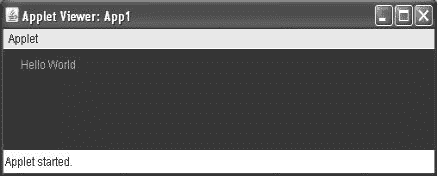

# 执行 Applet

Applet 并不是通过基于控制的 Java 运行时解释器执行的。我们可以通过两种方式运行 applet：

1. 在兼容 Java 的网络浏览器中执行 applet。
2. 使用 appletviewer，例如标准 SDK 工具 `appletviewer`。`appletviewer` 会在一个窗口中执行我们的 applet。这是测试 applet 最快且最简单的方法。

## 在网络浏览器中执行 Applet

我们需要编写一个简短的 HTML 文本文件，其中包含适当的 `APPLET` 标签。`applet` 标签必须包含至少三个属性：

- `Code`
- `Width`
- `Height`

属性 `code` 的值指定包含 applet 代码的类名。`width` 和 `height` 属性分别指定 applet 窗口的宽度和高度。

这里是嵌入了 applet "App1" 的 HTML 文件 `RunApp.Html`：

```html
<html>

<head>

<title>Simple Applet</title>

</head>

<body>

<h1>Simple “Hello World” Application </h>

<applet code= “App1” width =500 height=100>

</applet>

</body>

</html>
```

你可以通过在网络浏览器中打开文件 `RunApp.html` 来执行 applet。该文件可以位于本地文件系统上，也可以从网络服务器加载。

## 使用 appletviewer 执行 Applet

然而，存在一种更方便的方法可以用来加速测试。只需在你的 Java 源代码文件中包含一个带有 `APPLET` 标签的注释即可。通过这样做，我们的代码就包含了必要的 HTML 语句的原型文档，我们只需通过启动 `appletviewer` 并传入 Java 源代码文件即可测试编译后的输出。如果我们使用这种方法，在编译后可以按照如下方式执行 applet：

```bash
appletviewer SimpleApplet.Java
```


# Applet 周期方法

Applet 重写了一组方法，这些方法提供了浏览器或 `appletviewer` 与 applet 交互并控制其执行的基本机制。

这些方法也被称为周期方法，因为浏览器或 applet 查看器会在 applet 生命周期的不同阶段自动调用它们。总共有五种周期方法：

- `public void init()`
- `public void start()`
- `public void stop()`
- `public void destroy()`
- `public void paint(Graphics g)`

这五个方法中的：`init()`、`start()`、`stop()` 和 `destroy()` 是定义在 `applet` 类中的。

`paint()` 是由 `awt.Component` 类定义的，并提供了所有这些方法的默认实现。Applet 不需要重写它们未使用的方法。然而，非常简单的 applet 将不需要定义它们。

## Applet 的初始化与终止

当 applet 开始启动时，将按顺序调用以下方法：

1. `init()`
2. `start()`
3. `paint()`

当 applet 终止时，会发生以下顺序的方法调用序列：

4. `stop()`
5. `destroy()`

### `init()` 方法

这是第一个被调用的方法。在这里我们应该初始化变量并为其他初始化活动编写代码。该方法在 applet 生命周期内仅在调用一次，在实例化后立即调用。

### `start()` 方法

`start()` 方法在 `init()` 之后被调用。它也用于在 applet 停止后重启它。当 `init()` 在 applet 首次加载时被调用一次，而 `start()` 在每次 applet 的 HTML 文档显示在屏幕上时被调用。因此，如果用户离开网页并返回，applet 将从 `start()` 处恢复执行。

### `paint()` 方法

当 applet 开始执行时，`paint()` 在 `init()` 和 `start()` 方法之后被调用。当我们的 applet 输出需要重绘时，`paint()` 方法也会调用。这种情况可能由于多种原因发生。例如，运行 applet 的窗口可能被另一个窗口覆盖然后重新显示，或者 applet 窗口可能被最小化然后恢复。

### `stop()` 方法

当网络浏览器跳转到另一个页面，例如离开包含 applet 的 HTML 文档时，`stop()` 方法会被调用。当调用 `stop()` 时，applet 可能仍在运行。

我们应该使用 `stop()` 来挂起 applet 不可见时不需要运行的线程。如果用户返回页面，我们可以在 `start()` 被调用时重新启动它们。我们还可以释放任何昂贵的资源并在 `start()` 方法中重新获取。

### `destroy()` 方法

当环境确定我们的 applet 需要从内存中完全移除时，会调用 `destroy()` 方法。此时此时，我们应该释放 applet 可能正在使用的任何资源。`stop()` 方法总会在 `destroy()` 之前被调用。

示例 16.2 一个简单的 applet，将背景颜色设置为青色，前景颜色设置为红色，并显示一条消息，说明当 applet 启动时 `init()`、`start()` 和 `paint()` 方法调用的顺序。

```java
import java.awt.*;
import java.applet.*;

/*<applet code= "App2" width =500 height=100></applet>*/

public class App2 extends Applet {
    String msg="";
    public void init() {
        System.out.println(" init");
        setBackground(Color.cyan);
        setForeground(Color.red);
        msg = " init ";
    }
    public void start() {
        System.out.println("Inside start");
        msg += " start";
    }
    public void stop() {
        System.out.println("Inside Stop");
        msg += " stop ()";
    }
    public void paint (Graphics g) {
        System.out.println("Inside paint");
        msg += " paint";
        g.drawString(msg,0);
    }
    public void destroy() {
        System.out.println(" destroy");
    }
}
```


# 动态 Applet

Applet 窗口中的输出可以是动态的。例如，我们可以显示一个移动横幅。Applet 还可以用于应用程序，例如通过从服务器获取显示板球比赛和其他统计数据；显示股票价格等。

## 示例 16.3

以下示例显示了一个移动横幅。它在 applet 窗口中从右向左滚动消息。由于消息滚动是一个重复性任务，它是由 applet 在启动时创建的单独线程执行的。该程序还演示了可以在 `stop()` 方法中释放资源并在 `start()` 方法中重新资源。

```java
import java.awt.*;
import java.applet.*;

/*<applet code="App3" width=500 height=100></applet>*/

public class App3 extends Applet implements Runnable {
    String msg="A Simple Moving Banner." ;
    Thread t = null;
    boolean stopFlag;
    public void init () {
        setBackground(Color.cyan);
        setForeground(Color.red);
    }
    public void start() {
        t = new Thread(this);
        stopFlag = false;
        t.start();
    }
    public void stop() {
        stopFlag = true;
        t = null;
    }
    public void paint(Graphics g) {
        g.drawString(msg, 50, 30);
    }
    public void run() {
        for (;;) {
            repaint();
            try {
                Thread.sleep(50);
            } catch (InterruptedException e) {
                System.out.println(e);
            }
            msg = msg.substring(1) + msg.charAt(0);
            if (stopFlag)
                break;
        }
    }
}
```

### 使用状态窗口

除了在窗口中显示信息外，Applet 还可以向运行它的浏览器或 `appletviewer` 的状态窗口输出消息。要做到这一点，可以调用 `showStatus()` 并传入我们想要显示的字符串。状态窗口是向用户提供 Applet 正在发生的操作反馈、建议选项或报告某些类型错误的好地方。状态窗口是一个极好的调试助手，因为它为我们提供了输出 Applet 信息的简单方法。

示例 16.4：下面的示例演示了如何使用状态窗口。

```java
import java.awt.*;
import java.applet.*;

/*applet code="App4" width=500 height=100*/

class App4 extends Applet {
    public void init() {
        setBackground(Color.cyan);
    }
    public void paint(Graphics g) {
        g.drawString("This is in the applet window", 10, 20);
        showStatus("This is shown in the status window");
    }
}
```

输出：`image0265.jpeg`

### HTML 的 APPLET 标签

`APPLET` 标签用于从 HTML 文档和 `appletviewer` 启动 Applet。`appletviewer` 会在单独窗口中执行它找到的每个 `APPLET` 标签；而像 Netscape Navigator 和 Internet Explorer 这样的浏览器允许在单个页面上运行多个 Applet。

标准 `APPLET` 标签的语法如下：

```html
< APPLET
    CODE=applet class name
    CODEBASE=codebase URL
    ALT=alternate Text
    NAME=appletInstance
    WIDTH=pixels
    HEIGHT=pixels
    ALIGN=alignment
    VSPACE=vertical space in pixels
    HSPACE=horizontal space in pixels
    <PARAM NAME=attributeName-1 VALUE=Attribute Value-1>
    <PARAM NAME=attributeName-2 VALUE=Attribute Value-2>
    <PARAM NAME=attributeName-N VALUE=Attribute Value-N>
</APPLET>
```

- `CODE`：一个必需属性，提供包含 Applet 编译类文件的文件名。该文件相对于 Applet 的 `CODEBASE`，`CODEBASE` 是 html 文件所在的目录，或者如果设置了则为指定的目录。
- `CODEBASE`：一个可选属性，指定 Applet 的基础 URL，即搜索 Applet 可执行类（由 `CODE` 标签指定）的目录。如果未指定此属性，则使用 HTML 文档的目录作为 `CODEBASE`。
- `ALT`：一个可选属性，用于指定短文本消息，当浏览器理解 `APPLET` 标签但当前无法运行 Java 时应显示该消息。这与为不支持 applet 的浏览器提供的替代文本不同。
- `NAME`：一个可选属性，用于指定 Applet 实例名称。Applet 必须命名，以便同一页面上的其他 Applet 能够通过名称找到并与之通信。要通过名称获取 Applet，请使用 `Context` 接口定义的 `getApplet()`。
- `WIDTH` 和 `HEIGHT`：Applet 显示区域以像素为单位的大小。
- `ALIGN`：一个可选属性，指定 Applet 的对齐方式。该属性的处理方式与 HTML 的 `IMG` 标签相同，可能的值有 `LEFT`、`RIGHT`、`BOTTOM`、`BASELINE`、`TEXTTOP`、`ABSMIDDLE` 和 `ABSBOTTOM`。
- `VSPACE` 和 `HSPACE`：这些属性是可选的。`VSPACE` 指定 Applet 上下的空间（像素为单位）。`HSPACE` 指定 Applet 左右的空间（像素为单位）。它们的处理与 `IMG` 标签的 `VSPACE` 和 `HSPACE` 属性相同。

#### PARAM 标签

`PARAM` 标签允许我们在 HTML 页面中指定 Applet 特有的参数。Applet 通过 `getParameter()` 方法访问其属性。`PARAM` 标签有两个属性：`NAME` 和 `VALUE`。

示例 16.5 此示例演示了如何从 HTML 页面向 Applet 传递参数。

```java
import java.awt.*;
import java.applet.*;

/*applet code="App5" width=500 height=100>
    <param name="fontName" value="Arial">
    <param name="fontSize" value="30">
</applet*/

class App5 extends Applet {
    String fName;
    int fSize;
    public void init () {
        fName = getParameter("fontName");
        if (fName == null)
            fName = "Courier";
        fSize = Integer.parseInt(getParameter("fontSize"));
        f1 = new Font(fName, Font.PLAIN, fSize);
        setFont(f1);
    }
    public void paint (Graphics g) {
        g.drawString("Font Name : " + fName, 0, 25 );
    }
}
```

```java
g.drawString ("Font Size : " + fSize, 0, 50 );
g.drawString ("Hello world", 0,75);
```

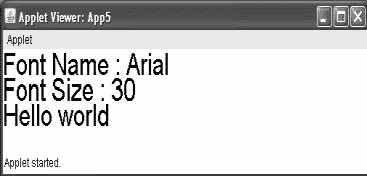

## 获取 DocumentBase 和 CodeBase

通常，我们会创建需要显式加载媒体和文本的 applet。Java 允许 applet 从启动它的 HTML 文件所在的目录（文档基，document base）以及加载 applet 类文件的目录（代码基，code base）加载数据。

这些目录以 `URL` 对象的形式返回。它们可以与命名我们要加载的文件的字符串拼接。要实际加载另一个文件，我们将使用由 `Applet` 上上下文接口定义的 `showdocument()` 方法。

### 示例 16.6 下面的示例演示了如何在 applet 代码中获取文档基和代码基。

#### App6.java
```java
import java.awt.*;
import java.applet.*;
import java.net.URL;

public class App6 extends Applet {
    public void paint (Graphics g) {
        URL u1 = getCodeBase( );
        g.drawString ("Code base:-" + u1, 10,20);
        URL u2 = getDocumentBase();
        g.drawString ("Document base:-"+u2, 10,40);
    }
}
```

#### App6.html
```html
<html>
<body>
<applet code="App6" width=500 height=200></applet>
</body>
</html>
```


## `appContext` 和 Show Document（显示文档）

Java 的应用之一是使用活动图像和动画提供一种图形化的网页导航手段，这比超文本使用的下划线文字更有趣。为了允许我们的 `applet` 将控制权转移到另一个 URL，必须使用由 `AppletContext` 接口定义的 `showDocument()` 方法。

`AppletContext` 是允许我们从 `applet` 的执行中获取信息的接口。当前执行的 `applet` 的上下文通过调用 `applet` 类定义的 `getAppletContext()` 方法获得。在 `applet` 内部，一旦我们获得了 `applet` 的上下文，就可以通过调用 `showDocument()` 方法将另一个文档引入视图。此方法没有返回值，如果失败则会抛出异常，因此请谨慎使用。有两个 `showDocument()` 方法：

- `void showDocument(URL url)`：用给定的 URL 替换当前查看的 Web 页面。
- `void showDocument(URL url, String where)`：在浏览器窗口内的指定位置显示指定的文档。`where` 的有效参数为：
    - `_self`（在当前帧中）
    - `_parent`（在父帧中）
    - `_top`（在顶层帧中）
    - `_blank`（在新浏览器窗口中）

### 示例 16.7

下面的 `applet` 演示了 `AppletContext` 和 `showDocument()` 的用法。执行时，它获取当前的 `applet` 上下文并使用该上下文将控制权转移到一个名为 `A.html` 的文件。该文件必须与 `applet` 在同一目录下。`Test.html` 可以包含你喜欢的任何有效超文本。

#### `App7.java`

```java
import java.awt.*;
import java.applet.*;
import java.net.*;

public class App7 extends Applet
{ 
    AppletContext ac;
    URL u1;

    public void init()
    {
        setBackground(Color.cyan);
    }

    public void start( )
    {
        ac = getAppletContext();
        u1 = getCodeBase();
        try
        {
            Thread.sleep(300);
            ac.showDocument(new URL(u1 + "A.html"),"_blank");
        }
        catch(MalformedURLException e)
        { 
            showStatus("Invalid URL");
            e.printStackTrace() ;
        }
        catch(InterruptedException e)
        { 
            showStatus("Invalid URL");
            e.printStackTrace () ;
        }
    }

    public void paint (Graphics g)
    {
        g.drawString(u1+"A.html",0,20);
        try
        {
            Thread.sleep(300);
        }
        catch(InterruptedException e)
        {
            System.out.println(e);
        }
    }
}
```

#### `App7.html`

```html
<html>
<head>
<Title>Applet Context Demo</Title>
</head>
<body>
<applet code="App7" width=200 height=200></applet>
</body>
</html>
```

#### `A.html`

```html
<html>
<head>
<title>New Page</title>
</head>
<body bgcolor=blue text=red>
<h1>matrix</h1>
</body>
</html>
```

#### 示例 16.8

```java
import java.applet.*;
import java.awt.*;
import java.awt.event.*;

/*<applet code="CopyApp" width=500 height=200></applet>*/
public class CopyApp extends Applet implements ActionListener
{
    TextField tf1,tf2;
    Button b1;

    public void init()
    {
        setForeground(Color.red);
        Font f1=new Font("Arial", Font.BOLD+Font.ITALIC,20);
        tf1=new TextField(8);
        tf2=new TextField(8);
        tf1.setFont(f1);
        tf2.setFont(f1);
        b1=new Button("Copy");
        b1.addActionListener(this);
        b1.setFont(f1);
        add(tf1);
        add(tf2);
        add(b1);
    }

    public void paint(Graphics g)
    {
        g.drawString("Matrix",0,150);
    }

    public void actionPerformed(ActionEvent ae)
    {
        String s1=tf1.getText();
        tf2.setText(s1);
    }
}
```

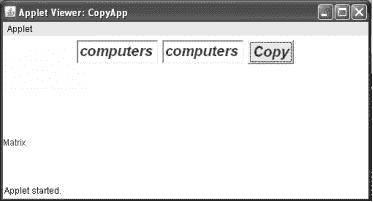

# 示例 16.9 使用 Applet 计算两个数字之和

```java
import java.applet.*;
import java.awt.*;
import java.awt.event.*;

/*<applet code = "SumApplet" width=400 height=400></applet>*/
public class SumApplet extends Applet implements ActionListener
{
    TextField tf1,tf2,tf3;
    Label l1,l2,l3;
    Button b1;

    public void init()
    {
        setLayout(new GridLayout(4,2));
        l1 = new Label("No. 1");
        l2 = new Label("No. 2");
        l3 = new Label("Result");
        tf1 = new TextField(8);
        tf2 = new TextField(8);
        tf3 = new TextField(8);
        b1 = new Button("Sum");
        b1.addActionListener(this);
        add(l1);add(tf1);
        add(l2);add(tf2);
        add(l3);add(tf3);
        add(b1);
    }

    public void actionPerformed(ActionEvent ae)
    {
        Button abc = (Button)ae.getSource();
        if(abc == b1)
        {
            int a,b,c;
            a = Integer.parseInt(tf1.getText());
            b = Integer.parseInt(tf2.getText());
            c = a + b;
            tf3.setText(String.valueOf(c));
        }
    }
}
```


# 第 17 章

## 抽象窗口工具包（AWT）

### 简介

Java 提供了大量的内置类，帮助我们设计图形用户界面（GUI）。这些类中的大部分属于 `java.awt` 包，统称为抽象窗口工具包（Abstract Windows Toolkit，AWT）。

我们熟悉 `MS-WORD`、`MS-EXCEL` 等软件。这些软件都具有 GUI，即当我们运行这些软件时，可以看到图形用户界面。

我们通过键盘或鼠标选择不同的选项来访问这些软件的各种功能。显示用户界面需要大量的编程工作。

AWT 中有助于设计图形界面的三个重要部分是：
* 组件（Components）
* 容器（Containers）
* 布局管理器（Layout Managers）

上述所有内容在设计 GUI 时都起着至关重要的作用。

### 组件

组件是 Java 创建 GUI 的构建块。组件是具有图形表示的对象，可以显示在屏幕上并与用户交互。组件的示例包括典型图形用户界面中的按钮、复选框和滚动条。`java.awt.Component` 类是非菜单相关 AWT 组件的抽象父类。`Component` 类也可以直接扩展以创建轻量级组件。轻量级组件是不与原生不透明窗口相关的组件。

某些组件类型（如按钮和滚动条）直接用于 GUI 控制。其他类型的组件（继承自 `Container` 类的）提供了特殊的组织方式。而 `TextField`、`TextArea`、`List` 等组件用于接受用户输入。`Label` 是另一种类型的组件，其目的是简单显示合适的标签以识别其他组件。

Java 的组件通过 `java.awt.Component` 和 `java.awt.Menu` 组件父类的许多子类来实现。

组织这些大量类的一种方法是将它们分为以下几类：
* 视觉组件
* 容器组件
* 菜单组件

**组件层次结构：** 下图显示了 AWT 的组件层次结构。
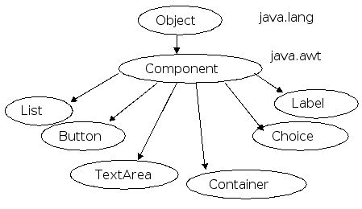

### 容器

下图描述了容器层次结构：
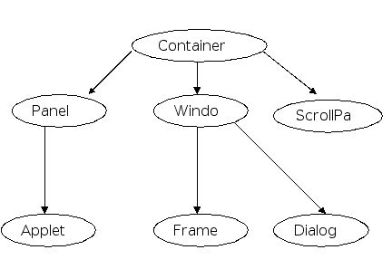

所有基于窗口的应用程序都从屏幕可见的顶级窗口开始。同样，所有基于 GUI 的 Java 应用程序也从顶级窗口开始，在 Java 术语中被称为顶层容器（top-level container）。

容器也是可以包含其他组件的 Java 组件。组件只有通过将其添加到容器或将其放入容器内部，才能变得可见。

所有的 Java GUI 都存在于 `applet` 或 `Frame` 中。`applets` 和 `frames` 是 Java 中的两个顶层容器。

在 Java 中，可以使用绝对定位，但并不建议这样做。`AWT` 设计为使用相对定位。我们可以通过相对规范来指定组件布局，例如：组件将添加到上一个组件的右侧、组件将添加到其他组件的下方、组件将出现在顶部、组件的大小将是容器宽度的 1/4 等等。即使在不知道组件尺寸的情况下，这些规范也非常有用。

Java 鼓励相对定位，因为它是平台无关的，相同的 GUI 应该可以在不经修改的情况下在各种平台上运行。

称为布局管理器（layout managers）的内置 Java 类负责将相对位置映射到实际/物理位置的任务。Java 支持许多类型的布局管理器，我们将讨论以下布局管理器：

1. `FlowLayout`（流布局）
2. `GridLayout`（网格布局）
3. `BorderLayout`（边界布局）
4. `CardLayout`（卡片布局）

### 使用布局管理器工作时的两个观察：

- 我们不需要承担指定每个组件精确位置和尺寸的负担。
- 我们不再拥有指定每个组件精确位置和尺寸的权力。

### 为什么 Java 使用布局管理器？

原因有两个：

1. 理论上在于，精确布局（即以像素指定每个组件的尺寸和位置）是一项重复且经常的任务；因此，根据面向对象编程（OOP），布局功能应该被封装在一个或多个类中以自动化该任务。显然，布局管理器消除了大量的开发繁琐工作。许多程序员起初不喜欢布局管理器，但随着繁琐选择的消除，他们变得越来越欣赏它们。

2. 使用布局管理器的实际原因源于 Java 的平台无关性。在 Java 中，`AWT` 组件的行为借自运行 `JVM` 的底层硬件的窗口系统。因此，在 Macintosh 上，`AWT` 按钮就像任何其他 Mac 按钮；在 Motif 平台上，Java 按钮看起来就像任何其他 Motif 按钮，以此类推。这里的问题是，按钮和其他组件在不同平台上实例化时，其尺寸是不同的。如果 Java 鼓励精确的像素级尺寸和定位，那么会有很多 Java GUI 在其源平台上看起来精美，但在其他平台上看起来很糟糕甚至无法使用。

如上所述，布局管理器通过使用相对定位解决了这个问题。

### 布局策略

每个 Java 组件都有一个首选尺寸（preferred size）。首选尺寸表示在不与布局管理器冲突的情况下，组件希望有多大。首选尺寸通常是为以视觉上有意义的方式渲染组件所需的最小尺寸，例如，一个按钮的首选尺寸是其标签文本的大小，加上文本周围的一小圈空白边框，再加上标记按钮边界的阴影装饰，因此按钮的首选尺寸是“恰好足够”。首选尺寸是取决于平台的，因为组件的边界装饰随系统而异。

当布局管理器对其容器的子组件进行布局时，它必须平衡两项考量：
(i) 布局策略和
(ii) 每个组件的首选尺寸

首要任务是强制执行布局策略。如果尊重组件的首选尺寸意味着违反布局策略，那么布局管理器将覆盖组件的首选尺寸。理解布局管理器意味着理解它将把组件放在哪里，以及它将如何处理组件的首选尺寸。

### 1. `FlowLayout`（流布局）

流布局管理器的功能封装在 `java.awt.FlowLayout` 类中。

流布局管理器将组件排列成水平行。它是面板（`panel`）和应用小程序（`applet`）的默认布局管理器类型。

流布局管理器尽可能将多个组件放入第一行，并将其他组件移动到第二行。如果第二行没有空间，组件将移动到第三行，以此类推。这与在文档中输入文本非常相似。

当我们到达当前行的末尾时，下一个单词将移动到下一行，以此类推。如果我们更改了文档的宽度或高度，整个文档将重新进行格式化。

组件始终从左到右，按照它们被添加到容器的顺序出现。

默认情况下，流布局管理器在组件之间的水平和垂直方向上都会留有五个像素的间隙。这种默认值可以通过调用 `FlowLayout` 构造函数的重载版本并传入所需的水平和垂直间隙来更改。

在每一行中，组件是等距分布的，组件簇是居中的。组件簇的对齐方式（有时称为“对齐”）可以通过向流布局构造函数传递参数来控制。可能的值有：

- `FlowLayout.LEFT`
- `FlowLayout.CENTER`
- `FlowLayout.RIGHT`

#### 示例 17.1

```java
import java.awt.*;

class MyFrame1 {
    public static void main(String args[]) {
        Frame f=new Frame( );
        FlowLayout flow=new FlowLayout();
        f.setLayout(flow);
        Label l1 = new Label("Name ");
        f.add(l1);
        TextField tf1=new TextField("Matrix");
        f.add(tf1);
        tf1.setBackground(Color.green);
        tf1.setForeground(Color.red);
        Button b1 = new Button("ok");
        Font f1 = new Font("Arial", Font.BOLD, 24);
        b1.setFont(f1);
        f.add(b1);
        f.setSize(500,100);
        f.setVisible(true);
    }
}
```

*注意：如果我们减小了上述窗口的大小且三个组件无法放入单行内，那么组件将从最后一个组件开始移动到下一行。*

输出：`Images/image0127.jpeg`

#### 示例 17.2

```java
import java.awt.*;

class MyFrame2 extends Frame {
    public static void main (String args [] ) {
        MyFrame2 f=new MyFrame2();
        f.setLayout(new FlowLayout(FlowLayout.CENTER));
```


`System.out.println(f.param());`

`Label l1=new Label("Name :");`

`f.add(l1);`

`TextField tf1=new TextField("Sample Program");`

`f.add(tf1);`

`tf1.setBackground(Color.GREEN);`

`tf1.setForeground(Color.RED);`

`Button b1=new Button("OK");`

`b1.setFont(new Font("Serif",Font.BOLD,24));`

`//b1.setEnabled(false);`

`Dimension d = b1.getSize( );`

`System.out.println("Button Size :" + d.width + " " + d.height);`

`f.add(b1);`

```
// f.setResizable(false);
// f.setUndecorated(true);
f.setVisible(true);
Dimension d1=b1.getSize();
System.out.println("Button Size: " + d1.width + " " + d1.height);
Dimension d2=f.getSize();
System.out.println("Frame Size: " + d2.width + " " + d2.height);
try {
    Thread.sleep(5000);
} catch(InterruptedException e) { }
f.setVisible(false);
f.setSize(500,100);
f.setVisible(true);
try {
    Thread.sleep(500);
} catch(InterruptedException e) { }
f.setVisible(false);
f.setBounds(20, 20, 100, 100);
f.setVisible(true);
Dimension d3=f.getSize();
System.out.println("Frame Size : " + d3.width + " " + d3.height);
System.out.println(f.paramString());
```

**输出：**


```text
frame0,0,0,0x0,invalid,hidden,layout=java.awt.FlowLayout,title=,resizable,normal
Button Size :0 0
Button Size: 52 35
Frame Size: 123 34
Frame Size : 123 100
frame0,20,20,123x100,layout=java.awt.FlowLayout,title=,resizable,normal
```

### 示例 17.3
如果我们将行更改，组件将左对齐：
`f.setLayout(new FlowLayout(FlowLayout.CENTER));`
改为
`f.setLayout(new FlowLayout(FlowLayout.LEFT));`

**输出：**


### 示例 17.4
如果我们将行更改，组件将右对齐：
`f.setLayout(new FlowLayout(FlowLayout.LEFT));`
改为
`f.setLayout(new FlowLayout(FlowLayout.RIGHT));`

**输出：**


### 示例 17.5
我们可以在设置布局时，使用重载构造函数来更改行之间的组件间距（水平间距）以及行之间的间距（垂直间距）：
`f.setLayout(new FlowLayout(FlowLayout.CENTER, 20, 20));`

**输出：**


### 3. GridLayout
`GridLayout` 管理器的功能封装在 `java.awt.GridLayout` 类中。`GridLayout` 以表格格式在行和列中排列组件。我们可以将容器空间视为行和列的网格。在指定布局时，我们需要指定行数和列数。`GridLayout` 会根据行的大小（布局中指定的列数）将尽可能多的组件放入第一行，并将其他组件移动到第二行，依此类推。这类似于电子表格，被分为固定数量的行和列。

流式布局管理器总是尊重组件的首选尺寸。`GridLayout` 管理器则采取相反极端：当它在给定空间内执行布局时，它会忽略组件的首选尺寸。`GridLayout` 中的每行每列都具有相同的大小，布局可用的总区域平均分配在行数和列数之间。`GridLayout` 使用“行优先”表示法，即组件按照它们添加的顺序，从左到右、一行一行地出现。当添加较少组件（即显著少于行数乘以列数）或非常多组件（多于行数乘以列数）时，`GridLayout` 的行为会很奇怪。如果要在一个更高更窄的框架中放置每个组件将按比例变得更高更窄。

**示例 17.6：**
```java
import java.awt.*;

public class MyFrame6 extends Frame {

    public static void main(String args[]) {

        Frame f = new MyFrame6();

        f.setLayout(new GridLayout(5,3));

        for(int row=0; row<5; row++) {

            f.add(new Label("Label" + row));

            f.add(new Button("Button" + row));

            f.add(new TextField("TextField" + row));

        }

        f.setSize(500,200);

        f.setVisible(true);

    }

}
```
**输出：**
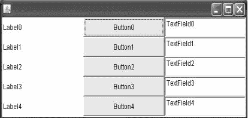

### 4. BorderLayout
`BorderLayout` 管理器的功能封装在 `java.awt.BorderLayout` 类中。`BorderLayout` 管理器是框架的默认管理器，因此应用程序程序员迟早会接触它。

它强制了一种非常有用的布局策略，但可能没有流式布局或网格布局管理器那么直观。流式布局管理器总是尊重组件的首选尺寸；而网格布局管理器从不这样做。`BorderLayout` 管理器介于两者之间。

`BorderLayout` 管理器将可用的容器空间分为五个部分：北（North）、南（South）、东（East）、西（West）和中心（Center）。我们可以在每个区域添加一个组件。这五个区域可以是空的，也可以包含一个组件（即任何区域都不强制包含组件，但区域只能包含一个组件）。

`BorderLayout` 管理器尊重北部和南部组件的首选高度，并强制它们的宽度与容器完全一致。北部和南部区域适用于工具栏、状态栏以及任何应该尽可能宽但高度尽可能不必要的控件。

东部和西部区域与部南部相反。在东部和西部，组件获得其首选宽度，但高度受到限制。在这里，组件垂直延伸到北部组件的底部（如果有的话）或容器的顶部（如果没有北部组件）。

同样，组件垂直向下延伸到南部组件的顶部（如果有的话）或容器的底部（如果没有南部组件）。

# BorderLayout 区域

- `BorderLayout.SOUTH`
- `BorderLayout.EAST`
- `BorderLayout.WEST`
- `BorderLayout.CENTER`

`BorderLayout` 管理器控制的第五个区域被称为 `Center`。`Center` 是在分配了 `North`、`South`、`East` 和 `West` 之后容器剩余的部分。

向 `center` 添加组件时，省略 `add()` 调用的第二个参数是合法的，但非常不明智。在 Java 平台上，`BorderLayout` 管理器会假设我们的意思是 `center`。

然而，在旧版本中，这种行为是预测的，通常会导致组件完全不可见。

## 示例 17.7
```java
import java.awt.*;

public class MyFrame7 {

    public static void main(String args[]) {

        Frame f=new Frame();

        Scrollbar sbRight=new Scrollbar(Scrollbar.VERTICAL);

        f.add(sbRight, BorderLayout.EAST);

        Scrollbar sbLeft=new Scrollbar(Scrollbar.VERTICAL);

        f.add(sbLeft, BorderLayout.WEST);

        Label labelTop=new Label("This is North");

        labelTop.setFont(new Font("Serif", Font.ITALIC, 36));

        labelTop.setForeground(Color.white);

        labelTop.setBackground(Color.black);

        f.add(labelTop, BorderLayout.NORTH);

        Label labelBottom=new Label("This is south");

        labelBottom.setFont(new Font("Monospaced", Font.BOLD, 18));

        labelBottom.setForeground(Color.white);

        labelBottom.setBackground(Color.black);

        f.add(labelBottom, BorderLayout.SOUTH);

        f.setSize(50,20);

        f.setVisible(true);

    }

}
```
Output: 

## 示例 17.8
```java
import java.awt.*;

public class MyFrame8 extends Frame {

    public static void main(String args[]) {

        Frame f=new MyFrame8();

        // f.setLayout(new BorderLayout());

        f.add (new Button("N"), BorderLayout.NORTH);

        f.add (new Button("S"), BorderLayout.SOUTH);

        f.add (new Button("E"), BorderLayout.EAST);

        f.add (new Button("W"), BorderLayout.WEST);

        Panel p=new Panel();

        p.setBackground(Color.green);

        f.add (p, BorderLayout.CENTER);

        // f.add (p); default center

        f.setSize(300,300);

        f.setVisible(true);

    }

}
```
Output: 

## 示例 17.9
```java
import java.awt.*;

class BorderLayout3 extends Frame {

    public static void main (String args[]) {

        Frame f=new BorderLayout3();

        // f.setLayout(new BorderLayout());

        Panel toolbar=new Panel();

        toolbar.setLayout(new FlowLayout(FlowLayout.LEFT));

        toolbar.setBackground(Color.lightGray);

        toolbar.add(new Button("This"));

        toolbar.add(new Button("Is"));

        toolbar.add(new Button("The"));

        toolbar.add(new Button("Toolbar"));

        f.add(toolbar, BorderLayout.NORTH);

        TextField status=new TextField("Status.");

        status.setFont(new Font("Monospaced",Font.BOLD,48));

        f.add (status, BorderLayout.SOUTH);

        f.setSize(300,300);

        f.setVisible(true);

    }

}
```
Output: 

# CardLayout

在 `CardLayout` 中，我们可以存储许多卡片，但一次只显示一张。一次只有一张卡片可见，但你可以在它们之间切换。

#### 构造函数
- `CardLayout()`
- `CardLayout(int hgap, int vgap)`

#### 方法
- `first(Container parent)`
- `next(Container parent)`: 跳转到下一个卡片。如果当前显示的卡片是最后一张，它将翻到第一张。
- `previous(Container parent)`: 跳转到上一个卡片。如果当前显示的卡片是第一张，它将翻到最后一张。
- `last(Container parent)`: 跳转到最后一张卡片。
- `show(Container parent, String name)`: 跳转到使用给定 `name` 添加到布局的组件。如果不存在组件，则什么都不会发生。

### 如何使用
1. 创建一个新的 `Panel` 和 `CardLayout` 对象。
2. 使用前面步骤中创建的实例为 `Panel` 设置布局。
3. 现在为每张卡片创建一个单独的 `Panel` 并添加你想要添加的任何组件（如按钮、复选框等）。
4. 将步骤 3 中创建的每个 `Panel` 添加到步骤 1 中创建的主 `Panel` 中，并为每个卡片提供一个唯一的卡片名称。
5. 最后，将主 `panel` 添加到 applet 窗口。

## 示例 17.10
```java
import java.awt.*;

import java.awt.event.*;

import java.applet.*;

/*<applet code="CardLayoutTest" width=500 height=100></applet>*/

public class CardLayoutTest extends Applet implements ActionListener, MouseListener {

    Panel mp;

}
```

```java
CardLayout c1;

public void init()

{

    Button b1=new Button("First");

    Button b2=new Button("Second");

    b1.addActionListener(this);

    b2.addActionListener(this);

    add(b1);

    add(b2);

    Panel p1=new Panel();

    Label l1=new Label("INDIA");

    p1.add(l1);

    Panel p2=new Panel();

    Label l2=new Label("USA");

    p2.add(l2);

    mp=new Panel();

    c1=new CardLayout();

    mp.setLayout(c1);

    mp.add(p1,"Country1");

    mp.add(p2,"Country2");

    add(mp);

    addMouseListener(this);

}

public void actionPerformed(ActionEvent ae)

{

    Button b=(Button)ae.getSource();

    if(b.getLabel().equals("First"))

        c1.show(mp,"Country1");

    else
```


`c1.show(mp,"Country2");`

}

`public void mousePressed(MouseEvent me)`

{

    `c1.next(mp);`

}

`public void mouseReleased(MouseEvent me){}`

`public void mouseClicked(MouseEvent me){}`

`public void mouseEntered(MouseEvent me){}`

`public void mouseExited(MouseEvent me){}`

```

Output:


### GridBagLayout

`GridBagLayout` 是标准布局管理器中最复杂且最灵活的一个。尽管它听起来应该是 `GridLayout` 的子类，但实际上它完全不同。在 `GridLayout` 中，元素排列为

### 示例 17.11

AWT 组件可以分类为：

1. 可视组件（Visual Components）。
2. 容器组件（Container Components）。
3. 菜单组件（Menu Components）。

可视化组件和容器组件都是从 `java.awt.Component` 类的组件层次结构的一部分。

### `java.awt.Component` 类的方法

由于继承自 `java.awt.component`，所有可视化和容器组件都实现了若干方法。（菜单组件继承自 `java.awt.MenuComponent`，因此它们不继承相同的父类功能）。这些方法在下文中讨论：

- `Dimension getSize()`：以 `Dimension` 对象的返回此组件的大小，该对象具有类型为 `int` 的公共数据成员 `height` 和 `width`。
- `void setBackground(Color c)`：设置组件的背景颜色。通常，背景颜色用于渲染组件的非文本区域。
- `void setForeground(Color c)`：设置组件的前颜色。通常，组件的前颜色用于渲染文本。如果我们不显式地设置组件的前颜色或背景颜色，组件将使用其直接父容器的前颜色和背景颜色。
- `void setFont(Font f)`：`setFont()` 方法决定了组件渲染其需要显示的任何文本时使用的字体。如果我们不显式地设置组件的字体，组件将使用容器的字体。
- `void setEnabled(Boolean b)`：如果参数为 `true`，则组件具有正常外观。如果参数为 `false`，则组件呈灰色且不对用户输入做出响应。
- `void setSize(Dimension d)`：设置组件的大小。
- `void setSize(int width, int height)`：设置组件的大小。
- `void setBounds(int x, int y, int width, int height)`：尝试移动并调整组件的大小。左上角的新位置由 `x` 和 `y` 指定，新尺寸由 `width` 和 `height` 指定。
- `void setVisible(Boolean b)`：此方法接受一个布尔值参数，决定组件是否在屏幕上可见。此方法通常用于帧（frames）。

**注意：** 如果我们尝试调用 `setSize()` 或 `setBounds()`，我们会知道这通常是徒劳的。我们尝试赋予组件的大小和位置会被布局管理器覆盖。事实上，这两个方法大部分情况下是为了供布局管理器使用的。该规则的主要例外是 `Frame` 类，它不受布局器的控制，并且完全愿意接受其大小或边界。

### 可视组件

可视化组件是用户可以直接看到并交互的组件。AWT 支持以下可视化组件：

- Button（按钮）
- Canvas（画布）
- Checkbox（复选框）
- Choice（选择框）
- Dialog（对话框）
- List（列表）
- Pane（面板）
- Scrollbar（滚动条）
- TextField（文本框）

要在 GUI 中使用这些组件之一，我们首先通过调用相应的构造函数来创建一个实例。然后将该组件添加到容器中。

### Button

`Button` 类实现了一个按钮。

**构造函数：**

- `Button()`
- `Button(String)`：构造函数接受一个字符串参数，用于指定按钮的标签。当按钮被按下时，它会发送一个 `ActionEvent`。

**方法：**

- `String getLabel()`：获取此按钮的标签。
- `void setLabel(String label)`：将按钮的标签设置为指定的字符串。
- `void addActionListener(ActionListener l)`：添加指定的动作监听器以接收此按钮的动作事件。

### 示例 17.2

```java
import java.awt.*;

class ButtonTest
{
    public static void main(String args[])
    {
        Frame f=new Frame("Testing Button Component");
        f.setLayout(new FlowLayout());
        Font f1=new Font("Arial",Font.BOLD,40);
        Color c1=new Color(255,0,0);
        Color c2=new Color(0,25,0);
        Button b1 = new Button();
        Button b2 = new Button("Cancel");
        b1.setForeground(c1);
        b2.setForeground(c1);
        b1.setBackground(c2);
        b2.setBackground(c2);
        b1.setFont(f1);
        b2.setFont(f1);
        b1.setLabel("Ok");
        System.out.println(b2.getLabel());
        f.add(b1);
        f.add(b2);
        f.setSize(500,200);
    }
}
```

```java
f.setVisible(true);
}
}
```

输出：


## Canvas (画布)

`Canvas` 是一种没有默认外观或行为的组件。我们可以通过子类 canvas 来创建自定义的绘制区域、工作区域、组件等。`Canvas` 接收来自鼠标和键盘的输入事件；由程序员将这些输入转换为有意义的外观和感受。

`canvas` 的默认尺寸（或更准确地说，首选尺寸）小得毫无用处。解决这个问题的一种方法是使用布局管理器来调整 `canvas` 的大小。另一种方法是手动对画布调用 `setSize()`；画布 是一个少数这种方法实际上可能生效的例子，因为我们传递给 `setSize()` 方法的值将成为画布的首选尺寸。

### 示例 17.13

```java
import java.awt.*;

class CanvasTest {
    public static void main (String args []) {
        Frame f = new Frame() ;
        f.setLayout(new FlowLayout());
        Canvas c=new MyCanvas();
        c.setSize(100, 100);
        f.add(c) ;
        f.setSize(300, 300 );
        f.setVisible(true);
    }
}

class MyCanvas extends Canvas {
    public void paint(Graphics g ) {
        setBackground(Color.green);
        g.setColor(Color.red );
        g.drawLine(0, 0, 9, 99 );
    }
}
```

输出：


## Checkbox (复选框)

复选框是一个双状态的按钮。这两个状态是 `true`（选中）和 `false`（未选中）。构造函数的三种基本形式如下：

#### 构造函数

- `Checkbox()`：创建一个标签为空空字符串的复选框。
- `Checkbox(String label)`：创建一个带有指定标签的复选框。
- `Checkbox(String label, boolean state)`：创建一个带有指定标签并设置指定状态的复选框。如果不指定初始状态，默认为 `false`。

#### 方法

- `String getLabel()`：获取此复选框的标签。
- `void setLabel(String label)`：将此复选框的标签设置为字符串参数。
- `boolean getState()`：确定此复选框处于“开启”还是“关闭”状态。
- `void setState(boolean state)`：将此复选框的状态设置为指定状态。
- `void addItemListener(ItemListener)`：添加指定的项目监听器以接收来自此复选框的项目事件。

### 示例 17.14

```java
import java.awt.*;

class CheckboxTest {
    public static void main(String args[]) {
        Frame f = new Frame("Testing Checkbox Component");
        f.setLayout(new GridLayout(3,1));
        Checkbox c1=new Checkbox();
        Checkbox c2=new Checkbox("Lunch",true);
        Checkbox c3=new Checkbox("Dinner");
        c1.setLabel("Fast");
        c3.setState(true);
        f.add(c1);f.add(c2);f.add(c3);
        if(c1.getState())
            System.out.println(c1.getLabel());
        if(c2.getState())
            System.out.println(c2.getLabel());
        if(c3.getState())
            System.out.println(c3.getLabel());
        f.setSize(100,100);
        f.setVisible(true);
    }
}
```

输出：


### 另一个示例

```java
import java.awt.*;
import java.awt.event.*;

class CheckboxTest extends Frame implements ItemListener {
    Checkbox c1;
    TextField tf1;
    CheckboxTest() {
        setLayout(new GridLayout(2,1));
        c1=new Checkbox("Red");
        c1.addItemListener(this);
        add(c1);
        tf1=new TextField();
        add(tf1);
        setSize(100,100);
        setVisible(true);
    }
    public static void main(String args[]) {
        new CheckboxTest();
    }
    public void itemStateChanged(ItemEvent ie) {
        if(c1.getState())
            tf1.setBackground(Color.red);
        else
            tf1.setBackground(Color.white);
    }
}
```

## Radio button (单选按钮)

复选框可以分组成复选框组，组具有单选行为。在单选行为下，复选框组中同时只有一个成员可以为 `true`；选择新成员会将之前选中的状态更改为 `false`。许多系统（例如 Motif）将单选组作为独立的组件来实现。

我们可以通过创建多个复选框并使用 `java.awt.CheckboxGroup` 将其分组来实现单选行为。在 Java 中，`java.awt.CheckboxGroup` 不是一个组件；它仅仅是一个组织复选框的不可见类。这意味着 Java 对组内成员之间的空间关系没有任何限制。如果如果我们愿意，可以将组中的一个成员放在左上角，另一个成员放在右下角，第三个成员放在不同的框架中。当然，结果将违背常理和大多数 GUI 指南。

`CheckboxGroup` 类有两个方法支持获取和设置当前选中的成员或组：

- `Checkbox getSelectedCheckbox()`：从此复选框组中获取当前选项。
- `void setSelectedCheckbox(Checkbox box)`：将组中当前选中的复选框设置为指定的复选框。

### 示例 17.15

```java
import java.awt.*;

class CheckboxGroup {
    public static void main(String args[]) {
        Frame f = new Frame("Testing RadioButton Component");
    }
}
```

```java
f.setLayout(new GridLayout(3,1));
CheckboxGroup cbg=new CheckboxGroup();
Checkbox c1=new Checkbox("BreakFast",false,cbg);
Checkbox c2=new Checkbox("Lunch",true,cbg);
Checkbox c3=new Checkbox("Dinner",false,cbg);
c3.setState(true);
f.add(c1);f.add(c2);f.add(c3);
if(c1.getState())
    System.out.println(c1.getLabel());
else if(c2.getState())
    System.out.println(c2.getLabel());
else if(c3.getState())
    System.out.println(c3.getLabel());
f.setSize(10,10);
f.setVisible(true);
```

输出: 

### Choice

Choice 是一个下拉列表。

#### 方法：

- `void add(String item)`: 向此 `Choice` 菜单添加一个项目。
- `void addItemListener(ItemListener i)`: 添加指定的监听器以接收来自此 `choice` 菜单的项事件。
- `String getItem(int index)`: 获取此 `Choice` 菜单中指定索引处的 `String`。
- `int getItemCount()`: 返回此 `Choice` 菜单中的项目数量。
- `int getSelectedIndex()`: 返回当前项目的索引。
- `String getSelectedItem()`: 获取当前选择项目的字符串表示形式。
- `void insert(String item, int index)`: 在此 `choice` 的指定位置插入项目。
- `void remove(int position)`: 从 `choice` 菜单中删除指定位置的项目。
- `void remove(String item)`: 从 `Choice` 菜单中删除第一个指定的字符串项目。
- `void removeAll()`: 移除此 choice 菜单中的所有项目。
- `void select(int pos)`: 将此 `choice` 菜单中的选中项目设置为指定位置上的项目。
- `void select(String Str)`: 将此 `Choice` 菜单中的选中项目设置为与指定字符串名称相等的项目。

#### 示例 17.16

```java
import java.awt.*;

class ChoiceTest
{
    public static void main(String args[]) throws InterruptedException
    {
        Frame f = new Frame("Testing Choice Component");
        f.setLayout(new FlowLayout());
        f.setSize(10,10);
        f.setVisible(true);
```


`Choice c1=new Choice();`

`c1.add("BreakFast");`

`c1.add("Lunch");`

`c1.add("Dinner");`

`f.add(c1);`

`c1.select("Dinner");` // `c1.select(2);`

`Thread.sleep(1000);`

`System.out.println(c1.getSelectedItem());`

`System.out.println(c1.getSelectedIndex());`

`System.out.println(c1.getItemCount());`

`System.out.println(c1.getItem(0));`

`c1.insert("Brunch",1);`

`c1.remove(2);` // `c1.remove("Lunch");`

```
}
```

输出：

```java
import java.awt.*;
import java.awt.event.*;

class CheckboxItem extends Frame implements ItemListener
{
    TextField tf1;
    Choice c1;

    CheckboxItem()
    {
        setLayout(new FlowLayout());
        c1=new Choice();
        c1.add("red");
        c1.add("green");
        c1.add("blue");
        tf1 = new TextField(8);
        tf1.setBackground(Color.red);
        c1.addItemListener(this);
        add(c1);
        add(tf1);
        setSize(200,200);
        setVisible(true);
    }

    public static void main(String args[])
    {
        new CheckboxItem();
    }

    public void itemStateChanged(ItemEvent ie)
    {
        String s=(String)ie.getItem();
        if(s.equals("red"))
            tf1.setBackground(Color.red);
        else if(s.equals("green"))
            tf1.setBackground(Color.green);
        else if(s.equals("blue"))
            tf1.setBackground(Color.blue);
    }
}
```

### Label

`Label` 是简单的可见 AWT 组件。`Label` 通常不用于响应用户输入或发送事件。

#### 构造函数：
- `Label()`: 构造一个空标签。
- `Label(String text)`: 构造一个带有指定文本的新标签，并左对齐。
- `Label(String text, int alignment)`: 构造一个以指定对齐方式显示指定文本的标签。

`Label` 的默认对齐方式是左对齐。要设置对齐方式，请使用构造函数的第三个参数并传入以下值：
- `Label.LEFT`
- `Label.CENTER`
- `Label.RIGHT`

#### 方法：
- `String getText()`: 获取此标签的文本。
- `void setText(String text)`: 将此标签的文本设置为指定的文本。

```java
import java.awt.*;

class LabelTest {
    public static void main(String args[]) {
        Frame f = new Frame("Testing Label Component");
        f.setLayout(new GridLayout(3,3));
        f.setFont(new Font("Arial",Font.PLAIN, 20));
        Label l1 = new Label("India",Label.LEFT);
        Label l2 = new Label("Pakistan",Label.LEFT);
        Label l3 = new Label("UK",Label.LEFT);
        Label l4 = new Label("India",Label.CENTER);
        Label l5 = new Label("Pakistan",Label.CENTER);
        Label l6 = new Label("UK",Label.CENTER);
        Label l7 = new Label("India",Label.RIGHT);
        Label l8 = new Label("Pakistan",Label.RIGHT);
        Label l9 = new Label("UK",Label.RIGHT);
        l3.setText("USA");
        System.out.println(l1.getText());
        f.add(l1);f.add(l4);f.add(l7);
        f.add(l2);f.add(l5);f.add(l8);
        f.add(l3);f.add(l6);f.add(l9);
        f.setSize(500,200);
        f.setVisible(true);
    }
}
```

输出：


### List 列表

列表是垂直排列的文本项集合。如果列表包含的项超过其显示范围，它会自动获取一个垂直滚动条。

#### 构造函数
- `List()`：创建一个新的滚动列表。此构造函数未指定行数，但会产生四行的默认优先高度。当然，在许多情况下，列表的实际高度将由管理器决定。
- `List(int rows)`：创建一个新的滚动列表，初始化指定的可见行数。
- `List(int rows, boolean multipleMode)`：创建一个新的滚动列表，初始化为显示指定的行数并允许多选。

#### 示例 17.18
```java
import java.awt.*;

class ListTest {
    public static void main(String args[]) {
        Frame f = new Frame() ;
        f.setLayout (new FlowLayout());
        List l1=new List(3,true);
        l1.add("India");
        l1.add("Nepal");
        l1.add("Shri Lanka");
        l1.add("USA");
        l1.add("UK");
        f.add(l1);
        System.out.println(l1.getRows());
        f.setSize(300, 300);
        f.setVisible(true);
    }
}
```

输出：


`List` 有五项内容，但只有 3 行可见，因此提供了一个滚动条以访问底部的行。注意：在列表中选择某项会导致列表发送 `Item` 事件；点击某项会发送 `Action` 事件。

- `void add(String item)`：将指定的项添加到滚动列表的末尾。
- `void add(String item, int index)`：在`index`指定的的位置将指定的项添加到滚动列表中。
- `void addActionListener(ActionListener i)`：添加指定的监听器以接收来自此列表的动作事件。
- `void addItemListener(ItemListener i)`：添加指定的监听器以接收来自此列表的事件。
- `String getItem(int index)`：获取与指定的`index`相关的项。
- `int getItemCount()`：获取列表中的项数。
- `String[] getItems()`：获取列表中的项。
- `int getRows()`：获取此列表中可见的行数。
- `int getSelectedIndex()`：获取列表中选中项的索引。
- `int[] getSelectedIndexes()`：获取列表中的索引。
- `String getSelectedItem()`：获取滚动列表中的选中项。
- `String[] getSelectedItems()`：获取滚动列表中的多个选中项。
- `void remove(int position)`：从滚动列表中删除指定`position`处的项。
- `void remove(String item)`：从列表中删除第一次出现的项。
- `void removeAll()`：从此列表中删除所有项。
- `void replaceItem(String newValue, int index)`：用新字符串替换滚动列表中指定`index`处的项。
- `void select(int index)`：选中滚动列表中指定`index`处的项。
- `void setMultipleMode(boolean b)`：设置决定此列表允许多选的标志。

```java
import java.awt.*;
import java.awt.event.*;

class ListTest extends Frame implements ActionListener {
    Button b1,b2,b3,b4,b5,b6;
    List l1,l2;
    TextField tf1,tf2;

    ListTest() {
        setLayout(new GridLayout(3,3));
        l1=new List(3,true);
        l2=new List(3,true);
        b1=new Button(">");
        b2=new Button(">>");
        b3=new Button("<");
        b4=new Button("<<");
        b5=new Button("Add");
        b6=new Button("Add");
        b1.addActionListener(this);
        b2.addActionListener(this);
        b3.addActionListener(this);
        b4.addActionListener(this);
        b5.addActionListener(this);
        b6.addActionListener(this);
        tf1=new TextField();
        tf2=new TextField();
    }
}
```

```java
Panel p1=new Panel();
p1.setLayout(new GridLayout(4,1));
p1.add(b1);
p1.add(b2);
p1.add(b3);
p1.add(b4);
add(l1); add(p1); add(l2);
add(tf1); add(new Label()); add(tf2);
add(b5); add(new Label()); add(b6);
setSize(300,300);
setVisible(true);
}

public static void main(String args[])
{
    new Test();
}

public void actionPerformed(ActionEvent ae)
{
    Button b=(Button)ae.getSource();
    if(b==b1) {
        String s[]=l1.getSelectedItems();
        for(int i=0;i<s.length;i++) {
            l2.add(s[i]);
            l1.remove(s[i]);
        }
    } else if(b==b2) {
        String s[]=l1.getItems();
        for(int i=0;i<s.length;i++) {
            l2.add(s[i]);
            l1.remove(s[i]);
        }
    } else if(b==b3) {
        String s[]=l2.getSelectedItems();
        for(int i=0;i<s.length;i++) {
            l1.add(s[i]);
            l2.remove(s[i]);
        }
    } else if(b==b4) {
        String s[]=l2.getItems();
        for(int i=0;i<s.length;i++) {
            l1.add(s[i]);
            l2.remove(s[i]);
        }
    } else if(b==b5) {
        l1.add(tf1.getText());
    } else if(b==b6) {
        l2.add(tf2.getText());
    }
}
```

### TextField 和 TextArea

`TextField` 和 `TextArea` 实现了用于文本输入、显示和编辑的一维和二维组件。这两个类都继承自 `TextComponent` 类：`Object` -> `Component` -> `TextComponent` -> (`TextField`, `TextArea`)。这两个类都拥有多种构造函数，可以选择指定或不指定初始字符串或首选尺寸。不指定尺寸的构造函数最适用于布局管理器将忽略组件首选尺寸的情况。

#### TextField 类的构造函数
- `TextField()`：构造一个新的文本字段。
- `TextField(int columns)`：构造一个具有指定数量列数的空文本字段。
- `TextField(String text)`：构造一个用指定文本初始化的文本字段。
- `TextField(String text, int columns)`：构造一个用指定文本初始化的文本字段，其宽度足够容纳指定数量的列。

#### TextArea 类的构造函数
- `TextArea()`：构造一个带有空字符串的新文本区域。
- `TextArea(int rows, int columns)`：构造一个具有指定行数和列以及空字符串的文本区域。
- `TextArea(String text)`：构造一个带有指定文本的文本区域。
- `TextArea(String text, int rows, int columns)`：构造一个带有指定文本以及指定行数和列数的文本区域。
- `TextArea(String text, int rows, int columns, ScrollPolicy)`：构造一个带有指定文本、行以及指定滚动条策略的文本区域。

`TextArea` 类定义了几个常量，可以作为 `scrollPolicy` 参数的值：
- `SCROLLBARS_BOTH`
- `SCROLLBARS_VERTICAL_ONLY`
- `SCROLLBARS_HORIZONTAL_ONLY`
- `SCROLLBARS_NONE`

对于这两个类，`columns` 参数都存在一些问题。首先，列数是根据特定字体渲染的文本列数对宽度的度量。一个使用极小字体的 25 列文本区域将变得非常窄，而一个使用巨大字体的 5 列文本区域将变得极其宽。其次，是等比例字体的问题。对于固定宽度字体，列宽是显而易见的。对于等比例字体，列宽取该字体所有字符宽度的平均值。这种平均值是所有字符的简单平均值；并没有考虑使用频率。因此在大多数情况下，包含小写字母的文本组件显示的字符数比要求的要。

#### TextComponent 类的方法
- `selectText()`：从此文本组件显示的文本中返回选中的文本。
- `getText()`：返回此文本组件显示的文本。
- `setEditable(Boolean b)`：设置决定此文本组件是否可编辑的标志。
- `setText(String t)`：将此文本组件显示的文本设置为指定的文本。

示例 17.19
```java
import java.awt.*;

class TextFieldTest {
```


```java
public static void main(String args[]) {
    Frame f = new Frame();
    f.setLayout(new FlowLayout());
    TextField tf1 = new TextField();
}
```

```java
TextField tf2 = new TextField(8);
TextField tf3 = new TextField("matrix");
TextField tf4 = new TextField("matrix", 20);
TextArea ta1 = new TextArea();
TextArea ta2 = new TextArea(3, 8);
TextArea ta3 = new TextArea("abc\nxyz\naaa");
TextArea ta4 = new TextArea("abc\nxyz\naaa", 2, 2);
TextArea ta5 = new TextArea("abc\nxyz\naaa", 4, 20, TextArea.SCROLLBARS_BOTH);
f.add(tf1);
f.add(tf2);
f.add(tf3);
f.add(tf4);
f.add(ta1);
f.add(ta2);
f.add(ta3);
f.add(ta4);
f.add(ta5);
tf1.setText("abc");
System.out.println(tf3.getText());
tf3.setEditable(false);
f.setSize(800, 400);
f.setVisible(true);
```

输出：


### FileDialog
该类表示一个文件打开或保存对话框。文件对话框是一个模态对话框，这意味着只要对话框可见，来自父框架的输入将专门重定向到对话框。当用户指定文件或点击取消按钮时，对话框将自动移除。最有用的`FileDialog`构造函数具有以下形式：

`FileDialog(Frame parent, String title, int mode)`

对话框的`parent`是对话框出现的帧。`title`字符串显示在对话框的标题栏中。`mode`应该是以下值之一：
- `FileDialog.LOAD`
- `FileDialog.SAVE`

在用户指定文件后，可以使用以下方法获取文件名或其目录：
- `String getDirectory()` 获取此文件对话框选定的目录。
- `String getFile()` 获取此文件对话框选择的文件。

#### 示例 17.20
```java
import java.awt.*;

public class FileDialogTest {
    public static void main(String args[]) {
        Frame f = new Frame();
        f.setLayout(new FlowLayout());
        f.setSize(200, 200);
        f.setVisible(true);
        FileDialog fd = new Dialog(f, "Load file", FileDialog.LOAD);
        fd.setVisible(true);
        System.out.println(fd.getFile());
        System.out.println(fd.getDirectory());
    }
}
```

### ScrollPane
`ScrollPane`可以包含一个单一组件，该组件可能比滚动面板本身更高或更宽。如果容器组件大于滚动面板，那么滚动面板的默认行为是根据需要获取水平和/或垂直滚动条。该类有两个构造函数：

- `ScrollPane()` 创建一个滚动条显示方式为“按需”的滚动面板容器。
- `ScrollPane(int scrollDisplayPolicy)` 创建一个具有指定滚动条行为的新滚动面板。滚动面板策略应为以下值之一：
    - `ScrollPane.SCROLLBARS_AS_NEEDED`（默认值）
    - `ScrollPane.SCROLLBARS_ALWAYS`
    - `ScrollPane.SCROLLBARS_NEVER`

下面列出的代码创建一个具有默认（As_NEEDED）滚动行为的滚动面板。该滚动面板包含一个非常大的按钮；因此肯定需要滚动条。

#### 示例 17.21
```java
import java.awt.*;

class SPane {
    public static void main(String args[]) {
        Frame f = new Frame();
        f.setLayout(new GridLayout(1, 2));
        f.setSize(250, 150);
        ScrollPane spane = new ScrollPane();
        spane.setBackground(Color.green);
        f.add(spane);
        f.add(new TextArea());
        Button b1 = new Button("Push Me !");
        b1.setFont(new Font("Serif", Font.ITALIC, 100));
        spane.add(b1);
        f.setVisible(true);
    }
}
```

输出：


### Scrollbar
调整列表和滚动面板的`Scrollbar`组件作为一个独立的组件存在。它有三个构造函数：

- `Scrollbar()` 构建一个新的垂直滚动条。
- `Scrollbar(int orientation)` 构建具有指定方向的新滚动条。
- `Scrollbar(int orientation, int initialValue, int sliderSize, int minValue, int maxValue)` 构建具有指定方向、初始值、滑块大小以及最小值和最大值的新滚动条。`sliderSize`参数控制滑块的大小，但不是以像素为单位。

对于接受`orientation`参数的构造函数，该值应该是：
- `Scrollbar.HORIZONTAL`
- `Scrollbar.VERTICAL`

#### 示例 17.2
```java
import java.applet.*;
import java.awt.*;
import java.awt.event.*;

class RGB extends Applet implements AdjustmentListener {
    TextField tf1;
    Scrollbar sb1, sb2, sb3;

    public void init() {
        setLayout(new GridLayout(4, 1));
        sb1 = new Scrollbar(Scrollbar.HORIZONTAL, 0, 10, 0, 255);
        sb2 = new Scrollbar(Scrollbar.HORIZONTAL, 0, 10, 0, 255);
        sb3 = new Scrollbar(Scrollbar.HORIZONTAL, 0, 10, 0, 255);
        sb1.addAdjustmentListener(this);
        sb2.addAdjustmentListener(this);
        sb3.addAdjustmentListener(this);
        tf1 = new TextField(8);
        add(tf1);
        add(sb1);
        add(sb2);
        add(sb3);
    }

    public void adjustmentValueChanged(AdjustmentEvent ae) {
        int a = 0, b = 0, c = 0;
        a = sb1.getValue();
        b = sb2.getValue();
        c = sb3.getValue();
        Color c1 = new Color(a, b, c);
        tf1.setBackground(c1);
    }
}
```


    


# 第 ∞ 18 章

## AWT 事件简介

### 简介

当一个普通的 Java 程序（非基于 GUI 的）需要输入时，它会提示用户并调用某些输入方法，例如`readline()`，也就是说交互是由程序发起的。这并不是基于 GUI 程序的行为方式。在 GUI 中，是由用户与程序进行交互，而不是程序发起动作。

例如，在文字处理软件中，用户通过点击不同的按钮来启动动作，这产生一个事件并执行某些代码，随后发生相应的动作。点击保存按钮将调用将内容保存到文件的方法。

| 接口 | 事件(方法) | 类 | 方法 |
| :--- | :--- | :--- | :--- |
| `ActionListener` | `actionPerformed()` | `ActionEvent ae` | `getSource` |
| `ItemListener` | `itemStateChanged()` | `ItemEvent ie` | `getItem` |
| `AdjustmentListener` | `adjustmentValueChanged()` | `AdjustmentEvent ae` | `getAdjustable()` |
| `MouseListener` `MouseAdapter` | `mouseEntered` `mouseExited` `mouseClicked` `mousePressed` `mouseReleased` | `MouseEvent me` | `getX()` `getY()` `getPoint()` `getClickCount()` `getButton()` `getModifiersEx()` `getModifiersExText()` |
| `MouseMotionListener` `MouseMotionAdapter` | `mouseMoved` `mouseDragged` | `MouseEvent me` | 同上述。 |
| `KeyListener` `KeyAdapter` | `keyTyped` `keyPressed` `keyReleased` | `KeyEvent ke` | `getKeyChar()` `getKeyCode()` |
| `FocusListener` `FocusAdapter` | `focusGained` `focusLost` | `FocusEvent fe` | `getSource()` |
| `WindowListener` `WindowAdapter` | `windowOpened` `windowClosing` `windowClosed` `windowActivated` `windowDeactivated` `windowIconified` `windowDeiconified` | `WindowEvent we` | `getWindow()` |

Java 使用事件委托模型进行事件处理。在事件委托模型中，可以告诉组件，当组件产生特定类型的事件时，应该通知哪个对象。

如果组件对某种事件类型感兴趣，那么该类型的事件将不会被传播。委托模型基于以下核心概念：

* 事件类。
* 事件监听器。
* 适配器（Adapters）。

### 事件类

点击按钮会产生一个事件。该事件包含许多相关信息，例如：时间、产生事件的组件、点击发生点的坐标等。

这些信息被放在事件类中。这个概念与异常处理类似。每当发生异常时，就会创建一个适当异常类的对象并将所有异常相关的信息放入此对象中。

我们有一个事件类的层次结构，它与异常类的层次结构有些相似。每当某个事件发生时，事件处理机制就会检测到它，创建适当事件类的对象并将所有事件相关的信息放入其中。

### 事件监听器

事件监听器负责在事件发生时采取适当的动作。事件监听器是一个组件委托处理特定类型事件任务的某个对象。

当组件接收到输入时，会构造一个适当类型的事件，然后该事件作为参数传递给监听器上的方法调用。监听器必须实现包含该事件处理方法的接口。

我们可以将事件监听器与处理异常的`catch`块进行比较。我们需要提供与要处理的异常相对应的`catch`块。同样，如果我们想处理由组件生成的事件，就需要提供适当的监听器。

监听器与组件关联。不同的事件有不同的监听器。当事件发生时，会调用适当的监听器方法并将事件对象作为参数传递。

### 适配器 (Adapters)

语言中监听器仅是接口。我们需要提供适当监听器的实现。某些监听器具有 2 个或更多方法。

要实现具有多个方法的监听器，即使我们只对其中一个方法感兴趣，我们需要提供所有方法的实现。适配器类提供了该问题的解决方案。

适配器类提供了监听器所有方法的空实现（dummy implementation）。这有助于减少编程工作。如果我们只想使用包含 5 个方法的监听器类中的一个方法，我们可以简单地扩展适配器类并重写想要的方法。

### 事件层次结构

AWT 具有定义良好的事件层次结构。通常，事件层次结构中叶子节点对应的类表示实际事件。而非叶子类则作为基类并进行封装。

AWT 事件层次结构在图中所示。

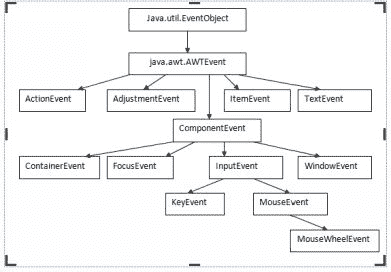

### java.util.EventObject 类

这是所有事件的顶层父类。它是一个非常通用的类，有一个感兴趣的方法，用于返回产生事件的对象。

`Object getSource()`

### java.awt.AWTEvent 类

`EventObject` 的一个子类是`java.awt.AWTEvent`，它是所有事件的父类。同样，只有一个感兴趣的方法，用于返回事件的 ID。

`int getID()`

事件的 ID 是一个`int`，用于指定事件的精确性质。例如，`MouseEvent` 类的实例可以代表七种情况之一：点击、拖拽、进入、退出、按下、释放。这些可能性都通过整数`MOUSE_CLICKED`、`MouseEvent.DRAGGED` 等表示。

`java.awt.AWTEvent` 的子类表示各种组件生成的各种事件类型，并包含与活动相关的所有信息。

非父类的事件类型（即实际由组件触发的类型）有：

1. `ActionEvent`：由组件激活产生，例如：它在按钮点击、列表项双击以及在`TextField`中按回车键时产生。
2. `AdjustmentEvent`：由可调节组件（如滚动条）的调节产生。
3. `ContainerEvent`：当组件被添加到容器或从中移除时产生。
4. `FocusEvent`：当组件获得或失去焦点时产生。
5. `ItemEvent`：当从列表、选择或复选框选中项目时产生。
6. `KeyEvent`：由键盘活动产生。
7. `MouseEvent`：由鼠标活动产生。
8. `MouseWheelEvent`：一种指示鼠标轮在组件中旋转的事件。
9. `WindowEvent`：由窗口活动产生（如最小化或还原化）。
10. `TextEvent`：当文本组件被修改时产生。

### java.awt.event 包

该包提供了处理 AWT 组件触发的不同类型事件的接口和类。事件由事件源触发。事件监听器向事件源注册以接收特定类型事件的通知。

该包定义了事件和事件监听器，以及事件监听器适配器，后者是简化编写事件监听器的便利类。

#### 事件监听器接口

每个事件类都有相应的监听器接口，并定义了一个或多个方法。常用的监听器接口将在下面的章节中描述。

##### ActionListener 接口

这是用于接收动作事件（action events）的监听接口。对处理动作事件感兴趣的类实现此接口，使用该类创建的对象注册到组件中，使用组件的`addActionListener()`方法。当动作事件发生时，会调用动作监听器的`actionPerformed()`方法，其签名如下：

| 方法 | 说明 |
| :--- | :--- |
| `void actionPerformed(ActionEvent e)` | 当动作发生时调用。 |

##### AdjustmentListener 接口

这是用于接收调整事件（adjustment events）的监听接口。

| 方法 | 说明 |
| :--- | :--- |
| `void adjustmentValueChanged(AdjustmentEvent e)` | 当滑块/滑动条的值改变时调用。 |

##### ContainerListener 接口

这是用于在组件添加到或从容器中移除时接收事件的监听接口。

| 方法 | 说明 |
| :--- | :--- |
| `void componentAdded(ContainerEvent e)` | 当组件被添加到容器时调用。 |
| `void componentRemoved(ContainerEvent e)` | 当组件从容器中移除时调用。 |

##### FocusListener 接口

这是用于在组件获得或失去焦点时接收事件的监听接口。

| 方法 | 说明 |
| :--- | :--- |
| `void focusGained(FocusEvent e)` | 当组件获得键盘焦点时调用。 |
| `void focusLost(FocusEvent e)` | 当组件失去键盘焦点时调用。 |

##### ItemListener 接口

这是用于接收项目事件（item events）的监听接口。

| 方法 | 说明 |
| :--- | :--- |
| `void itemStateChanged(ItemEvent e)` | 当项目被用户选中或取消选择时调用。 |

##### KeyListener 接口

这是用于接收键盘事件（按键触发）的监听接口。

| 方法 | 说明 |
| :--- | :--- |
| `void keyPressed(KeyEvent e)` | 当按键被按下时调用。 |
| `void keyReleased(KeyEvent e)` | 当按键被释放时调用。 |
| `void keyTyped(KeyEvent e)` | 当按键被输入（按下并释放）时调用。 |

##### MouseListener 接口

这是用于接收组件上鼠标事件（按下、释放、点击、进入和退出）的监听接口。

| 方法 | 说明 |
| :--- | :--- |
| `void mouseClicked(MouseEvent e)` | 当在`Component`上鼠标按钮被点击（按下并释放）时调用。 |
| `void mouseEntered(MouseEvent e)` | 当鼠标进入组件时调用。 |
| `void mouseExited(MouseEvent e)` | 当鼠标离开组件时调用。 |
| `void mousePressed(MouseEvent e)` | 当在组件上鼠标按钮被按下时调用。 |
| `void mouseReleased(MouseEvent e)` | 当在组件上鼠标按钮被释放时调用。 |

##### MouseMotionListener 接口

这是用于接收组件上鼠标移动事件（移动和拖拽）的监听接口。

| 方法 | 说明 |
| :--- | :--- |
| `void mouseDragged(MouseEvent e)` | 当在组件上鼠标按钮被按下并被拖动时调用。 |
| `void mouseMoved(MouseEvent e)` | 当鼠标光标在组件上移动但没有按下任何按钮时调用。 |

##### MouseWheelListener 接口

这是用于接收组件上鼠标滚轮事件的监听接口。

| 方法 | 说明 |
| :--- | :--- |
| `void mouseWheelMoved(MouseWheelEvent e)` | 当鼠标滚轮旋转时调用。 |

##### WindowListener 接口

当窗口状态由于打开、关闭、取消激活或最小化而发生变化时，会调用监听器中的相关方法，并将事件传递给它。

| 方法 | 说明 |
| :--- | :--- |
| `void windowActivated(WindowEvent e)` | 当窗口被设置为活动窗口时调用。 |
| `void windowClosed(WindowEvent e)` | 当由于调用窗口的`dispose`方法导致窗口关闭时调用。 |
| `void windowClosing(WindowEvent e)` | 当用户尝试从窗口系统菜单关闭窗口时调用。 |
| `void windowDeactivated(WindowEvent e)` | 当窗口不再是活动窗口时调用。 |
| `void windowDeiconified(WindowEvent e)` | 当窗口从最小化状态恢复为正常状态时调用。 |
| `void windowIconified(WindowEvent e)` | 当窗口从正常状态切换为最小化状态时调用。 |
| `void windowOpened(WindowEvent e)` | 当窗口第一次变为可见时调用。 |

### 处理 ActionEvent: 示例 18.1

以下示例解释了如何处理因点击按钮生成的`ActionEvent`。

```java
import java.awt.*;
import java.awt.event.*;

class A1 {
    public static void main(String args[]) {
        Frame f=new Frame();
        f.setLayout(new FlowLayout());
        f.setSize(500,100);
        Button b1=new Button("Push me");
        Button b2=new Button("Click me");
        b1.addActionListener(new B());
        b2.addActionListener(new C());
        f.add(b1);
        f.add(b2);
        f.setVisible(true);
    }
}

class B implements ActionListener {
    public void actionPerformed(ActionEvent ae) {
        System.out.println("Pushed");
    }
}

class C implements ActionListener {
    public void actionPerformed(ActionEvent ae) {
        System.out.println("Clicked");
    }
}
```

输出：Images/image01293.jpeg

### 示例 18.2

```java
import java.awt.*;
import java.awt.event.*;

class A2 implements ActionListener {
    static Button b1=null,b2=null;
    public static void main(String args[]) {
        Frame f=new Frame();
        f.setLayout(new FlowLayout());
        f.setSize(500,100);
        b1=new Button("Push me");
        b2=new Button("Click me");
        b1.addActionListener(new A2());
        b2.addActionListener(new A2());
        f.add(b1);
        f.add(b2);
        f.setVisible(true);
    }
    public void actionPerformed(ActionEvent ae) {
        if(ae.getSource() == b1) {
            System.out.println("Pushed");
        } else {
            System.out.println("Clicked");
        }
    }
}
```

输出：与之前的示例相同。

### 示例 18.3

```java
import java.awt.*;
import java.awt.event.*;

class A3 implements ActionListener {
    Button b1=null,b2=null;
    A3() {
        Frame f=new Frame();
        f.setLayout(new FlowLayout());
        f.setSize(500,100);
        b1=new Button("Push me");
        b2=new Button("Click me");
        b1.addActionListener(this);
        b2.addActionListener(this);
        f.add(b1);
        f.add(b2);
        f.setVisible(true);
    }
    public static void main(String args[]) {
        new A3();
    }
    public void actionPerformed(ActionEvent ae) {
        if(ae.getSource() == b1)
            System.out.println("Button Pushed");
        else
            System.out.println("Button Clicked");
    }
}
```


输出：与之前的示例相同。

### 示例 18.4

```java
import java.awt.*;
import java.awt.event.*;

class A4 implements ActionListener
{
    static Button b1=null,b2=null;
    static TextField tf1=null,tf2=null, tf3=null;

    public static void main(String args[])
    {
        Frame f=new Frame();
        f.setLayout(new GridLayout(4,2));
        f.setSize(500,300);

        Label l1 = new Label("No1.");
        Label l2 = new Label("No2.");
        Label l3 = new Label("Result");
        tf1 = new TextField();
        tf2 = new TextField();
        tf3 = new TextField();
        b1=new Button("Sum");
        b2=new Button("Avg");

        b1.addActionListener(new A4());
        b2.addActionListener(new A4());

        f.add(l1);f.add(tf1);
        f.add(l2);f.add(tf2);
        f.add(l3);f.add(tf3);
        f.add(b1);f.add(b2);
        f.setVisible(true);
    }

    public void actionPerformed(ActionEvent ae)
    {
        int a,b,c;
        float av;
        a=Integer.parseInt(tf1.getText());
        b=Integer.parseInt(tf2.getText());
        if(ae.getSource() == b1)
            tf3.setText("" +(a+b));
        else
            tf3.setText("" + (a+b)/2);
    }
}
```

注：一个组件可以关联多个监听器，不能保证监听器会按照添加的顺序被通知。同样不能保证所有的监听器都会在同一个线程中执行，因此，监听器必须防范数据损坏。可以通过调用`XXXListener()`方法并传入要移除的监听器，从组件的监听器列表中移除监听器。例如，代码从`btn`中移除监听器`al`：`btn.removeActionListener(al);`。

### 处理窗口

### 示例 18.5

```java
import java.awt.*;
import java.awt.event.*;

class A5
{
    public static void main(String args[])
    {
        Frame f= new Frame();
        f.setLayout(new FlowLayout());
        f.setSize(300,300);
        f.addWindowListener(new B( ));
        f.setVisible(true);
    }
}

class B implements WindowListener
{
    public void windowOpened (WindowEvent we)
    {
        System.out.println("Window Opened");
    }

    public void windowActivated(WindowEvent we)
    {
        System.out.println("Window Activated");
    }

    public void windowDeactivated(WindowEvent we)
    {
        System.out.println("window Deactivated");
    }

    public void windowClosing(WindowEvent we)
    {
        System.out.println("Window Closing");
        Frame f = (Frame) we.getWindow( );
        f.dispose();
    }

    public void windowClosed(WindowEvent we)
    {
        System.out.println("Window Closed");
    }

    public void windowIconified(WindowEvent we)
    {
        System.out.println("Window Iconified");
    }

    public void windowDeiconified(WindowEvent we)
    {
        System.out.println("Window Deiconified");
    }
}
```

### 适配器

某些事件监听器接口具有多个方法。最大的接口`WindowListener`拥有七个方法。假设我们想要捕获`windowClosing(WindowEvent)`事件，以便执行关闭窗口的代码。虽然我们在实现`WindowListener`的类中只需要`windowClosing(WindowEvent)`这一个方法，但我们必须为所有方法提供空位实现。

`java.awt.event`包提供了几个适配器类，每个类都对应一个定义了多个方法的监听器接口。

适配器（Adapter）简单来说就是一个通过提供“空实现”方法来实现接口的类。例如，`WindowAdapter`类实现了`WindowListener`接口，其中包含了七个空实现的方法。

### 适配器类及其接口

| 适配器类 | 监听器接口 |
| :--- | :--- |
| `ContainerAdapter` | `ContainerListener` |
| `FocusAdapter` | `FocusListener` |
| `KeyAdapter` | `KeyListener` |
| `MouseAdapter` | `MouseListener` |
| `MouseMotionAdapter` | `MouseMotionListener` |
| `WindowAdapter` | `WindowListener` |

### 示例 18.6 `WindowAdapter`类的用法

```java
import java.awt.*;
import java.awt.event.*;

class A6 {
    public static void main (String args[]) {
        Frame f = new Frame();
        f.setLayout(new FlowLayout());
        f.setSize(30,30);
        f.addWindowListener(new B());
        f.setVisible(true);
    }
}

class B extends WindowAdapter {
    public void windowClosing(WindowEvent we) {
        System.out.print("Closing");
        Frame f = (Frame) we.getWindow();
        f.dispose();
    }
}
```

### Input类

这是所有组件级输入事件的根事件类。输入事件在被源组件正常处理之前，会先传递给监听器。这允许监听器和子类“消耗”事件，从而使源组件不会以默认方式处理它们。例如，在`Button`组件上消耗鼠标按下事件将防止`Button`被激活。

#### 方法
- `void consume()`: 消耗此事件，使其由产生它的事件源按默认方式进行处理。
- `int getModifiers()`: 返回此事件的修饰符掩码（Modifier mask）。
- `int getModifiersEx()`: 返回此事件的扩展修饰符掩码。
- `static String getModifiersExText(int modifiers)`: 返回描述扩展修饰符的`String`，如“shift”、“Ctrl + Shift”等。
- `long getWhen()`: 返回事件发生的时间戳。
- `boolean isAltDown()`: 返回此事件中`Alt`修饰符是否被按下。
- `boolean isConsumed()`: 返回事件是否已被消耗。
- `boolean isControlDown()`: 返回此事件中`Control`修饰符是否被按下。
- `boolean isShiftDown()`: 返回此事件中`shift`修饰符是否被按下。

### MouseEvent类

这是`Input`事件类的子类。该事件表示组件中发生了鼠标操作。当且仅当光标位于组件子元素的未遮挡部分或顶层窗口上时，才认为鼠标操作发生在该特定组件中。此事件用于鼠标事件（点击、按下、释放）和移动事件（移动和拖动）。

#### 方法
- `int getButton()`: 返回哪个鼠标按钮状态发生了变化（如果有）。
- `int getClickCount()`: 返回与此事件相关的鼠标点击次数。
- `static String getModifiersText(int modifiers)`: 返回描述事件发生期间按下的修饰符的`String`，如“Shift”或“Ctrl + shift”。
- `Point getPoint()`: 返回事件相对于源组件的`x, y`位置。
- `int getX()`: 返回事件相对于源组件的水平`x`位置。
- `int getY()`: 返回事件相对于源组件的垂直`y`位置。
- `boolean isPopupTrigger()`: 返回此鼠标事件是否为该平台的弹出菜单触发事件。

**注意**：不同系统上弹出菜单的触发方式有所不同。因此，在`mousePressed`和`mouseReleased`中都应该检查`isPopupTrigger()`。

### 处理鼠标事件：示例 18.7

```java
import java.awt.*;
import java.awt.event.*;

class A7 {
    public static void main(String args[]) {
        Frame f = new Frame();
        f.setLayout(new FlowLayout());
        f.setSize(30,30);

        Button b1 = new Button("Push Me");
        b1.addMouseListener(new B());
        b1.addMouseMotionListener(new C());
        b1.addActionListener(new D());

        f.add(b1);
        f.setVisible(true);
    }
}

class B implements MouseListener {
    public void mouseEntered(MouseEvent me) {
        System.out.println("Mouse Entered...");
        System.out.println(me.getX());
        System.out.println(me.getY());
    }

    public void mouseExited(MouseEvent me) {
        System.out.println("Exited");
        Point f1 = me.getPoint();
        System.out.println(f1.x);
        System.out.println(f1.y);
    }

    public void mousePressed(MouseEvent me) {
        System.out.println("pressed...");
        int ms = me.getModifiersEx();
        String s = me.getModifiersText(ms);
        System.out.println(s);
    }

    public void mouseReleased(MouseEvent me) {
        System.out.println("Released...");
        System.out.println("ClickCount-->" + me.getClickCount());
    }
}
```

```java
public void mouseClicked(MouseEvent me) {
    System.out.println("Mouse Clicked...");
    System.out.println("Button-->"+me.getButton());
}
```

```java
class C implements MouseMotionListener {
    public void mouseMoved(MouseEvent me) {
        System.out.println("Mouse Moved...");
    }

    public void mouseDragged(MouseEvent me) {
        System.out.println("Mouse Dragged...");
    }
}

class D implements ActionListener {
    public void actionPerformed(ActionEvent ae) {
        System.out.println ("Button...");
    }
}
```

### ActionEvent类

这是一种语义事件，表示发生了组件动作。这种高层事件由组件（如`Button`）在特定动作发生（如被按下）时产生。该事件会通过组件的`addActionListener`方法传递给每个注册用于接收此类事件的`ActionListener`。当事件发生时，实现`ActionListener`接口的对象将获取此`ActionEvent`。监听器可以被免于处理单个移动和点击细节的烦恼，转而处理诸如“按钮”这样“有意义”的（语义化的）事件。

要在`Button`上触发`ActionEvent`，请使用空格键。

#### 方法：
- `getAction()`：返回与此动作关联的命令字符串。
- `getModifiers()`：返回动作事件期间按住的修饰键（Keys）。
- `getWhen()`：返回事件发生的时间戳。

### 示例 18.8

此示例说明了我们如何识别在`ActionEvent`发生时有效的修饰键。

```java
import java.awt.*;
import java.awt.event.*;

public class KeyModifierDemo extends Frame implements ActionListener {
    Button b;

    KeyModifierDemo () {
        b = new Button ("Button");
        b.addActionListener (this);
        setLayout (new FlowLayout ( ) );
        add (b);
        setBounds(0,0,200,20);
        setVisible(true);
    }

    public static void main (String args[]) {
        new KeyModifierDemo ( );
    }

    public void actionPerformed (ActionEvent ae ) {
        System.out.println ("Button Pressed");
        int ms = ae.getModifiers ( );
        if (ms & InputEvent.CTRL_DOWN_MASK)!=0) {
            System.out.println ("CTRL key was pressed");
        }
        if (ms & InputEvent.SHIFT_DOWN_MASK)!=0) {
```


### 处理动作命令（Action Commands）

动作事件是最简单的。当我们发现滚动条发送了调整事件时，显而易见的问题是：“现在滚动条的值是多少？”当我们发现鼠标被点击时，自然会想：“鼠标的 x 和 y 坐标是多少？”但当我们发现一个按钮发送了`ActionEvent`时，似乎没有任何额外的信息需要寻找；按钮已被点击，这似乎就是全部需要知道的。

然而，`ActionEvent`关联了一个额外信息。这条信息是一个字符串，被称为动作命令（Action command）。我们可以通过`getActionCommand()`方法提取`ActionEvent`的动作命令。如果`ActionEvent`是由文本字段发送的，`getActionCommand()`返回文本字段的当前内容（用户输入回车键时文本字段会发送`ActionEvent`）。如果`ActionEvent`是由按钮发送的，默认行为是`getActionCommand()`返回按钮的标签字符串。然而，我们可以通过调用`setActionCommand(String)`方法显式地设置按钮的`ActionCommand`。

```java
Button btn = new Button ("Hello");
btn.setActionCommand ("Hello");
```

当按钮的`ActionListener`需要决定如何响应`ActionEvent`时，动作命令对按钮优势是显而易见的。单个监听器作为多个组件的监听器是常见的；在我们的上下文中，单个对象可能是多个或许多按钮的`ActionListener`。在这种情况下，对象的`actionPerformed()`方法必须判断是哪个按钮被点击了。下面的示例演示了这一点：

### 示例 18.9

```java
import java.awt.*;
import java.awt.event.*;

class ButtonTest {
    Button b1,b2,b3;
    ButtonTest() {
        Frame f=new Frame();
        f.setLayout(new FlowLayout ( ) );
        f.setSize(300,300);
        b1=new Button("Push Me");
        b2=new Button("Click Me");
        b3=new Button("Hit Me");
        f.add(b1); f.add(b2); f.add(b3);
        B obj= new B(b1,b2,b3);
        b1.addActionListener(obj);
        b2.addActionListener(obj);
        b3.addActionListener(obj);
        f.setVisible(true);
    }
    public static void main (String args[]) {
        new ButtonTest ( );
    }
}

class B implements ActionListener {
    Button b4,b5,b6;
    B(Button b1, Button b2, Button b3)
    {
        b4 = b1;
        b5 = b2;
        b6 = b3;
    }
    public void actionPerformed(ActionEvent ae)
    {
        Button b = (Button)ae.getSource();
        if (b == b4)
            System.out.println("First Button was pressed");
        else if (b == b5)
            System.out.println("Second Button was pressed");
        else if (b == b6)
            System.out.println("Third Button  was pressed");
    }
}
```

#### 示例 18.10

```java
import java.awt.*;
import java.awt.event.*;

class GetLabelTest {
    Button b1, b2, b3;
    GetLabelTest() {
        Frame f = new Frame();
        f.setLayout(new FlowLayout());
        f.setSize(300, 300);
        b1 = new Button("Push Me");
        b2 = new Button("Click Me");
        b3 = new Button("Hit Me");
        f.add(b1);
        f.add(b2);
        f.add(b3);
        B obj = new B();
        b1.addActionListener(obj);
        b2.addActionListener(obj);
        b3.addActionListener(obj);
        f.setVisible(true);
    }
    public static void main(String args[]) {
        GetLabelTest();
    }
}

class B implements ActionListener {
    public void actionPerformed(ActionEvent ae) {
        Button b = (Button)ae.getSource();
        String s = b.getLabel();
        if (s.equals("Push Me"))
            System.out.println("First Push Me Button was pressed");
        else if (s.equals("Click Me"))
            System.out.println("Second Push Me Button was pressed");
        else if (s.equals("Hit Me"))
            System.out.println("Third Push Me Button  was pressed");
    }
}
```

### 示例 18.11：使用`setActionCommand()`方法设置 Action Command

```java
import java.awt.*;
import java.awt.event.*;

class ActionCommandTest {
    Button b1, b2, b3;
    ActionCommandTest() {
        Frame f = new Frame();
        f.setLayout(new FlowLayout());
        f.setSize(300, 300);
        b1 = new Button("Push Me");
        b2 = new Button("Push Me");
        b3 = new Button("Push Me");
        b1.setActionCommand("First");
        b2.setActionCommand("Second");
        b3.setActionCommand("Third");
        f.add(b1);
        f.add(b2);
        f.add(b3);
        B obj = new B();
        b1.addActionListener(obj);
        b2.addActionListener(obj);
        b3.addActionListener(obj);
        f.setVisible(true);
    }
    public static void main(String args[]) {
        ActionCommandTest();
    }
}

class B implements ActionListener {
    public void actionPerformed(ActionEvent ae) {
        Button b = (Button)ae.getSource();
        String s = b.getActionCommand();
        if (s.equals("First"))
            System.out.println("First Push Me Button was pressed");
        else if (s.equals("Second"))
            System.out.println("Second Push Me Button was pressed");
        else if (s.equals("Third"))
            System.out.println("Third Push Me Button  was pressed");
    }
}
```

### 处理按键事件

### 示例 18.12

```java
import java.awt.*;
import java.awt.event.*;

class KeyTest extends Frame implements KeyListener {
    String msg = "";
    int x = 0, y = 0;
    public static void main(String args[]) {
        Frame f = new KeyTest();
        f.setSize(300, 300);
        f.addKeyListener((KeyTest)f);
        f.setVisible(true);
    }
    public void keyReleased(KeyEvent ke) {
        System.out.println("Key Up...");
    }
    public void keyTyped(KeyEvent ke) {
        System.out.println("Key Typed...");
        msg = msg + ke.getKeyChar();
        repaint();
    }
    public void keyPressed(KeyEvent ke) {
        System.out.println("Pressed...");
        int key = ke.getKeyCode();
        switch(key) {
            case KeyEvent.VK_F1:
                msg = msg + "<F1>";
                break;
            case KeyEvent.VK_F2:
                msg = msg + "<F2>"; break;
            case KeyEvent.VK_F3:
                msg = msg + "<F3>"; break;
            case KeyEvent.VK_PAGE_DOWN:
                msg = msg + "<PgDn>"; break;
            case KeyEvent.VK_PAGE_UP :
                msg = msg + "<PgUp>"; break;
            case KeyEvent.VK_LEFT:
                msg = msg + "<Left Arrow>"; break;
            case KeyEvent.VK_RIGHT:
                msg = msg + "<Right Arrow>"; break;
            case KeyEvent.VK_CONTROL:
                msg = msg + "<Ctrl>"; break;
        }
        repaint();
    }
    public void paint(Graphics g) {
        g.setColor(Color.red);
        g.drawString(msg,x,y);
    }
}
```

### 示例 18.13：`FocusListener`演示`TextField`在失去或获得焦点时颜色改变

```java
import java.awt.*;
import java.awt.event.*;

class FocusTest implements FocusListener {
    static TextField tf1,tf2;
    public static void main(String args[]) {
        FocusTest f = new FocusTest();
        f.setLayout(new FlowLayout());
        tf1 = new TextField(8);
        tf1.setBackground(Color.blue);
        tf1.addFocusListener(f);
        tf2 = new TextField(8);
        tf2.setBackground(Color.blue);
        tf2.addFocusListener(f);
        f.add(tf1);
        f.add(tf2);
        f.setSize(20,20);
        f.setVisible(true);
    }
    public void focusGained(FocusEvent fe) {
        TextField tf = (TextField)fe.getSource();
        tf.setBackground(Color.red);
    }
    public void focusLost(FocusEvent fe) {
        TextField tf = (TextField)fe.getSource();
        tf.setBackground(Color.blue);
    }
}
```

### 示例 18.14：`requestFocus()`演示。我们不能在同一个类中使用`WindowListener`，因此我们定义了用于 frame 的类另一个用于`WindowListener`的类。

```java
import java.awt.*;
import java.awt.event.*;

class A extends Frame implements ActionListener {
    static TextField tf1,tf2;
    static Button b1;
    public static void main(String args[]) {
        A f = new A();
        f.setLayout(new FlowLayout());
        f.addWindowListener(new B());
        tf1 = new TextField(8);
        tf2 = new TextField(8);
        b1 = new Button("Set");
        b1.addActionListener(f);
        f.add(tf1);
        f.add(tf2);
        f.add(b1);
        f.setSize(200,200);
        f.setVisible(true);
    }
    public void actionPerformed(ActionEvent ae) {
        tf2.requestFocus();
    }
}

class B extends WindowAdapter {
    public void windowClosing(WindowEvent we) {
        Frame f = (Frame)we.getWindow();
        f.dispose();
    }
}
```

### 示例 18.15 显示对话框

```java
import java.awt.*;

class DialogTest {
```


### 示例 18.16 菜单栏演示

```java
import java.awt.*;
import java.awt.event.*;

class MyMenu extends Frame implements ActionListener, WindowListener, ItemListener {
    TextField tf1;
    String msg="";
    CheckboxMenuItem item4;

    MyMenu() {
        super("Matrix");
        setLayout(new FlowLayout());
        tf1 = new TextField(8);
        add(tf1);
        MenuBar mbar = new MenuBar();
        Menu file = new Menu("File");
        MenuItem item1 = new MenuItem("New...");
        item1.addActionListener(this);
        file.add(item1);
        MenuItem item2 = new MenuItem("Open...");
        item2.addActionListener(this);
        file.add(item2);
        Menu sub = new Menu("Sub Menu");
        MenuItem item3 = new MenuItem("Option1");
        sub.add(item3);
        file.add(sub);
        item4 = new CheckboxMenuItem("TextBox", true);
        item4.addItemListener(this);
        file.add(item4);
        mbar.add(file);
        addWindowListener(this);
        setMenuBar(mbar);
        setSize(400, 400);
        setVisible(true);
    }

    public void paint(Graphics g) {
        g.drawString(msg, 150, 250);
    }

    public void actionPerformed(ActionEvent ae) {
        String s1 = (String) ae.getAction();
        if (s1.equals("New")) {
            tf1.setText("New Selected");
            msg = "New Selected";
        } else if (s1.equals("Open")) {
            tf1.setText("Open Selected");
            msg = "Open Selected";
        }
        repaint();
    }

    public void windowClosing(WindowEvent we) {
        Frame f = (Frame) we.getWindow();
        f.dispose();
    }

    public void windowClosed(WindowEvent we) {}
    public void windowActivated(WindowEvent we) {}
    public void windowDeactivated(WindowEvent we) {}
    public void windowIconified(WindowEvent we) {}
    public void windowDeiconified(WindowEvent we) {}
    public void windowOpened(WindowEvent we) {}

    public void itemStateChanged(ItemEvent ie) {
        tf1.setVisible(item4.getState());
    }

    public static void main(String args[]) {
        new MyMenu();
    }
}
```

### 示例 18.17 Listbox 演示

```java
import java.awt.*;
import java.awt.event.*;

class ListTest extends Frame {
    static List l1, l2;

    public static void main(String args[]) {
        ListTest f = new ListTest();
        f.setLayout(new FlowLayout());
        l1 = new List(3, true);
        l1.add("India");
        l1.add("Pakistan");
        l1.add("USA");
        l1.add("UK");
        l1.add("China");
        l2 = new List(3, true);
        Button b1 = new Button("Transfer");
        b1.addActionListener(f);
        f.add(l1);
        f.add(l2);
        f.add(b1);
        f.setSize(20, 20);
        f.setVisible(true);
    }

    public void actionPerformed(ActionEvent ae) {
        /*
        for(int i=l1.getItemCount()-1; i>=0; i--) {
            l2.add(l1.getItem(i));
            l1.remove(i);
        }
        */
        String[] s1 = l1.getSelectedItems();
        for (int i = 0; i < s1.length; i++) {
            l2.add(s1[i]);
            l1.remove(s1[i]);
        }
    }
}
```

### 示例 18.18 使用 frame 计算数字和

```java
import java.awt.*;
import java.awt.event.*;

class Sum implements ActionListener {
    static Button b1, b2;
    static TextField tf1, tf2, tf3;
    static Frame f;

    public static void main(String args[]) {
        f = new Frame();
        Sum s1 = new Sum();
        f.setLayout(new GridLayout(4, 2));
        Label l1 = new Label("No. 1:");
        tf1 = new TextField(8);
        Label l2 = new Label("No. 2:");
        tf2 = new TextField(8);
        Label l3 = new Label("Result :");
        tf3 = new TextField(8);
        b1 = new Button("Sum");
        b2 = new Button("Close");
        b1.addActionListener(s1);
        b2.addActionListener(s1);
        f.add(l1);
        f.add(tf1);
        f.add(l2);
        f.add(tf2);
        f.add(l3);
        f.add(tf3);
        f.add(b1);
        f.add(b2);
    }
}
```

```java
Button b = (Button) ae.getSource();
if (b == b1) {
    int n1 = Integer.parseInt(tf1.getText());
    int n2 = Integer.parseInt(tf2.getText());
    tf3.setText(String.valueOf(n1 + n2));
}
if (b == b2) {
    f.dispose();
}
```

### 示例 18.19 在 Applet 上显示图像

#### 示例 18.19 代码：

```java
import java.awt.*;
import java.net.*;
import java.applet.*;

/*<Applet code="ScrollPane1" width=200 height=200></applet>*/
public class ScrollPane1 extends Applet {
    Image img1;
    URL file1;

    public void init() {
        try {
            file1 = new URL("file:///c:/java/a.jpg");
        } catch (URLException e) {
            System.out.print(e);
        }
        img1 = getImage(file1);
    }

    public void paint(Graphics g) {
        g.drawImage(img1, 0, 0, this);
    }
}
```

### 示例 18.20 移动圆的演示

#### 示例 18.20 代码：

```java
import java.awt.*;
import java.awt.event.*;

class Circle1 extends Frame implements MouseListener, Runnable {
    int x, y, w, h;
    static Circle1 f;

    public void run() {
        y = 0;
        w = 0;
        h = 0;
        for (x = 0; x < 50; x += 1) {
            try {
                Thread.sleep(500);
            } catch (InterruptedException e) {
                System.out.println(e);
            }
            repaint();
        }
    }

    public static void main(String args[]) {
        f = new Circle1();
        Thread t = new Thread(f);
        t.start();
        f.addMouseListener(f);
        f.setSize(50, 50);
        f.setVisible(true);
    }

    public void paint(Graphics g) {
        g.setColor(Color.RED);
        g.drawOval(x, y, w, h);
        g.setColor(Color.BLUE);
        g.fillOval(x + 1, y + 1, w - 1, h - 1);
    }

    public void mousePressed(MouseEvent me) {
        x = me.getX();
        y = me.getY();
        w = 50;
        h = 50;
        Graphics g = f.getGraphics();
        g.clearRect(0, 0, 200, 200);
    }
}
```

许多类型的 AWT 组件的外观由窗口系统决定。其他组件类型（特别是 applet、frame 和画布）没有内在的外观。如果我们不仅仅将这些类用作容器使用其中任何一类，并希望我们的组件看起来有用，那么我们必须提供提供实现组件外观的代码。

每个组件都关联着一个图形上下文（graphics context）。该图形上下文与组件相关的帧缓冲区相对应。

我们可以使用图形上下文支持的方法在组件上进行图。绘制在图形上下文上的任何内容都会显示在组件上。

在任何组件上绘图的正确方法是重写它的 `paint()` 方法并提供适当的代码。`paint()` 方法有一个类型为 `Graphics` 的参数，代表组件的图形上下文。也可以在不使用 `paint()` 方法的情况下在组件上进行绘图，尽管这种方法并不推荐。

# 第 19 章
## AWT 中的绘图

### 绪言

许多类型的 AWT 组件（例如按钮和滚动条）的外观由窗口系统决定。其他组件类型（特别是 applet、frame 和画布）没有内在的外观。如果我们不仅仅将这些类用作容器使用其中任何一类，并希望我们的组件看起来有用，那么我们必须提供实现组件外观的代码。

每个组件都关联着一个图形上下文。该图形上下文与组件相关的帧缓冲区相对应。

我们可以使用图形上下文支持的方法在组件上进行图。绘制在图形上下文上的任何内容都会显示在组件上。

在任何组件上绘图的正确方法是重写它的 `paint()` 方法并提供适当的代码。`paint()` 方法有一个类型为 `Graphics` 的参数，代表组件的图形上下文。也可以在不使用 `paint()` 方法的情况下在组件上进行绘图，尽管这种方法并不推荐。

这四个组件类是：

* `Applet`
* `Canvas`
* `Frame`
* `Panel`

### 示例 19.1 扩展 `Frame` 类并重写了 `paint()` 方法以改变框架的外观。

```java
import java.awt.*;

public class SimplePaint extends Frame {
    public static void main(String args[]) {
        Frame f = new SimplePaint();
        f.setSize(200, 200);
        f.setVisible(true);
    }

    public void paint(Graphics g) {
        g.setColor(Color.white);
        g.fillRect(0, 0, 300, 300);
        g.setColor(Color.grey);
        g.fillOval(30, 30, 50, 50);
    }
}
```


当我们对组件类进行子类化并赋予子类自己的 `paint()` 方法时，环境会在适当的时间调用该方法，并传入合适的 `Graphics` 实例。

### `Graphics` 类支持的操作

`Graphics`（图形上下文）提供的四大类操作是：

- 选择颜色。
- 选择字体。
- 绘制和填充。
- 裁剪（Clipping）。

#### 选择颜色

通过调用 `setColor()` 方法选择颜色。所需的参数是 `Color` 类的实例。有 13 种预定义的颜色，可以通过 `Color` 类的 `static final` 变量访问。（这些变量本身就是 `Color` 类的实例。这让某些人感到不安，但 Java 处理这些事情没有问题）。预定义的颜色有：

1. `Color.black`
2. `Color.blue`
3. `Color.cyan`
4. `Color.darkGray`
5. `Color.gray`
6. `Color.green`
7. `Color.lightGray`
8. `Color.magenta`
9. `Color.orange`
10. `Color.pink`
11. `Color.red`
12. `Color.white`
13. `Color.yellow`

如果我们需要一个不在列表中的颜色，可以自己构造。`Color` 构造函数有几个版本，最简单的是：`Color(int redLevel, int greenLevel, int blueLevel)`。这三个参数是主色在 0 到 255 范围内的强度级。颜色是加色的，这意味着它们像光一样混合，而不是像颜料。

- `new Color(0,0,0)` 黑色（无光）
- `new Color(255,0,0)` 红色（仅包含红色色调）
- `new Color(255,255,255)` 白色（所有颜色同时亮）

下方的代码片段列出了 `paint()` 方法的第一部分，它将其图形上下文的颜色设置为浅色：

```java
public void paint(Graphics g) {
    Color c = new Color(170,255,170);
    g.setColor(c);
}
```

在调用上述代码中的 `setColor()` 后，所有的图形都将绘制成浅绿色，直到下一次调用 `setColor()` 为止。调用 `setColor()` 不改变已经绘制的图形的颜色；它只影响后续操作。

#### 选择字体

设置图形上下文的字体就像设置后续绘制操作将使用的新字体，而之前绘制的图形不受影响。在设置字体之前，我们必须先创建一个。字体的构造函数看起来如下：`Font(String fontName, int style, int size)`。第一个参数是字体名称。字体的可用性取决于平台。我们可以通过像这样调用工具包上的 `getFontList()` 来获取可用字体名称列表，返回为字符串数组：`String fontNames[] = Toolkit.getDefaultToolkit().getFontList()`

有三个与平台无关且我们鼓励使用的字体名称，分别为："Serif"、"Sansserif"、"Monospaced"。`style` 参数可以传递给以下任何一个 `int` 常量：

1. `Font.PLAIN`
2. `Font.BOLD`
3. `Font.ITALIC`

下方的代码片段将图形上下文的字体设置为 24 点加粗衬线字体：

```java
Font f = new Font("Sansserif", Font.BOLD, 24);
gc.setFont(f);
```

我们可以指定样式的组合，例如加粗斜体字体，通过这样传递样式的和来实现：`Font.BOLD + Font.ITALIC`。

#### 绘制和填充

`Graphics` 类的所有渲染方法都为它们渲染的形状指定了坐标位置。每个组件都有自己的空间，原点位于组件的左上角，x 轴向右增加，y 轴向下增加。下图显示了坐标系：


图形上下文类没有广泛的绘制方法。（复杂的渲染由扩展的 API 如 `2D`、`3D` 和动画处理）。图形类中我们需要了解的方法有：

| 方法 | 描述 |
| :--- | :--- |
| `void drawLine(int x1, int y1, int x2, int y2)` | 在此图形上下文坐标系，使用当前颜色在点 `(x1,y1)` 和 `(x2, y2)` 之间绘制一条线。 |
| `void drawRect(int x, int y, int width, int height)` | 绘制指定矩形的轮廓。 |
| `void fillRect(int x, int y, int width, int height)` | 填充指定的矩形。 |
| `void drawOval(int x, int y, int width, int height)` | 绘制由指定矩形边界的椭圆轮廓。 |
| `void fillOval(int x, int y, int width, int height)` | 用当前颜色填充由指定矩形边界的椭圆。椭圆由矩形边界框指定。椭圆位于边界框内，并如下所示与框的每个边的中点相切：要绘制圆形，请使用正方形边界框。注意绘制只绘制前景像素，不绘制背景，因此边界框内但椭圆外的空间保持不变。这里 `x` 和 `y` 是边界框左上角的坐标，`width` 和 `height` 是框的宽度和高度。 |
| `void drawArc(int x, int y, int width, int height, int startAngle, int arcAngle)` | 绘制覆盖指定矩形的圆形或椭圆弧的轮廓。 |
| `void fillArc(int x, int y, int width, int height, int startAngle, int arcAngle)` | 填充指定矩形的圆形或椭圆弧。弧是椭圆的一部分。指定弧，我们首先指定椭圆的边界框，就像使用 `drawOval()` 和 `fillOval()` 那样。我们还需要指定弧的起点和终点，通过指定起始角度和弧扫过的角度来实现。填充弧是由弧本身以及从椭圆中心到弧端点的两个半径围成的区域。 |
| `void drawPolygon(int[] xPoints, int[] yPoints, int nPoints)` | 绘制由 x y 坐标数组定义的闭合多边形。 |
| `void fillPolygon(int[] xPoints, int[] yPoints, int nPoints)` | 填充由 x y 坐标数组定义的闭合多边形。多边形是具有任意数量顶点的闭合图形。顶点通过两个 `int` 数组传递给 `drawPolygon()` 和 `fillPolygon()` 方法。第一个数组包含顶点的 x 坐标，第二个数组包含 y 坐标。第三个参数指定顶点数量。注意：终点会与第一个点连接。 |
| `void drawPolyLine(int[] xPoints, int[] yPoints, int nPoints)` | 绘制由 x y 坐标数组定义的连接线序列。折线与多边形相似，但它是开放的而不是闭合的。最后一个顶点和第一个顶点之间没有线段连接。 |

### 图形方法

| `void drawString(String str, int x, int y)` | 使用当前图形上下文的字体和颜色绘制指定字符串的文本。`x`、`y` 参数指定字符串基线的左边缘。带有下伸部部的字符（在大多数字体中为 g, j, p, q 和 y）会延伸到基线以下。文本坐标是相对于基线的，这一点非常重要。例如，在一段简单的文本中，我们可能会尝试在 `(0,0)` 处绘制字符串，期望它出现在区域的左上角。然而，由于基线的存在，我们只能看到字符串的下延伸部，这可能意味着我们什么也看不见。默认情况下，图形上下文使用关联组件的字体；但我们可以通过调用图形上下文的 `setFont()` 方法设置不同的字体。 |
| `boolean drawImage(Image img, int x, int y, ImageObserver observer)` | 绘制当前可用的尽可能指定的图像。这里，`img` 是要渲染的图像，`x` 和 `y` 是目标组件内图像左上角的坐标。图像观察者必须是一个实现了 `ImageObserver` 接口的对象。图像是矩形像素值集合的离屏表示。Java 的图像支持非常复杂。现在，假设我们通过某种方式获取了图像（即 `java.awt.Image` 类的实例），并想要使用特定的图形上下文将其渲染到屏幕上。实现的方法是调用图形上下文的 `drawImage()` 方法。 |

### 示例 19.2

此示例说明了如何创建一个图像并使用其图形上下文在其上绘制。然后可以使用 `drawImage()` 方法在 applet 窗口中显示图像。

```java
import java.awt.*;
import java.applet.*;
import java.net.URL;

/*<applet code="PaintImage" width=200 height=100></applet>*/

public class PaintImage extends Applet {
    private Image im;

    public void init() {
        im = createImage(100,50);
        Graphics imgc = im.getGraphics();
        imgc.setColor(Color.gray);
        imgc.fillRect(0,0,100,50);
        imgc.setColor(Color.black);
        imgc.fillOval(0,0,5,0);
    }

    public void paint(Graphics g) {
        g.drawImage(im,10,10,this);
    }
}
```

输出：(Images/image0297.jpeg)

### 示例 19.3

此示例说明了如何从现有图像创建图像对象。然后可以使用 `drawImage()` 方法在 applet 窗口中显示图像。

```java
import java.awt.*;
import java.applet.*;
import java.net.*;

/*
<applet code="PaintImage" width=500 height=500>
</applet>
*/

public class PaintImage extends Applet {
    private Image im;

    public void init() {
        try {
            im = getImage(new URL("file:///c:/matrix/logo.gif"));
            //im = getImage(new URL("http://127.0.0.1/logo.gif"));
        } catch (MalformedURLException e) {
            System.out.println(e);
        }
    }

    public void paint(Graphics g) {
        g.drawImage(im,10,10,this);
    }
}
```

### 裁剪 (Clipping)

程序员对图形上下文进行的大多数调用涉及颜色选择或绘制和填充。一种不常见的操作是裁剪。裁剪简单就是限制图形上下文可以修改的区域。

每个图形上下文，即每个 `Graphics` 类的实例都有一个裁剪区域，该区域定义了关联组件的所有或部分。当我们调用图形类的其中一个 `drawXXX()` 或 `fillXXX()` 方法时，只有位于图形上下文裁剪区域内的像素会被修改。

图形上下文的默认裁剪区域是关联组件的整个可见区域。有方法可以获取和修改裁剪区域。考虑下面的 `paint` 方法。

### 示例 19.4

```java
import java.awt.*;

class Clip extends Frame {
    public static void main(String args[]) {
        Frame f = new Clip();
        f.setSize(300,330);
        f.setVisible(true);
    }

    public void paint(Graphics g) {
        for(int i=0; i<300; i=i+100) {
            for(int j=30; j<330; j=j+100) {
                g.fillOval(i,j,100,100);
            }
        }
    }
}
```

输出：(Images/image0299.jpeg) 上述 `paint()` 方法绘制了一个点状图案。考虑当这是一个 200*200 像素的 applet frame 的 `paint()` 方法时会发生什么。由于计数器一直到 500，该方法尝试在 applet frame 的边界之外绘制。这不是一个问题，因为图形上下文默认的裁剪区域与 applet 自身重合。

要为图形上下文设置矩形裁剪区域，我们可以调用 `setClip(x, y, width, height)` 方法，传入描述所需矩形位置和大小的四个整数。例如，上面的代码可以修改如下：

### 示例 19.5

```java
import java.awt.*;

class Clip2 extends Frame {
    public static void main(String args[]) {
        Frame f = new Clip2();
        f.setSize(300,330);
        f.setVisible(true);
    }

    public void paint(Graphics g) {
        g.setClip(50,80,200,200);
        for(int i=0; i<300; i=i+100) {
            for(int j=30; j<330; j=j+100) {
                g.fillOval(i,j,100,100);
            }
        }
        g.drawString("Hello! Kamal", 50,50);
        g.drawString("Bye! Kamal", 120,150);
    }
}
```

输出：

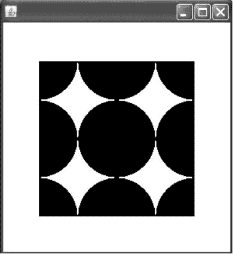

如上所示，现在绘画被裁剪到 300 * 300 Applet 框架中心的一个 200 * 200 矩形内。

裁剪（Clipping）本身是一项值得了解的知识。当环境需要修复组件的暴露部分时，裁剪也会派上用。

### 关于 `paint()` 方法和图形上下文的总结

`Graphics` 上下文专门供单个组件使用。要在组件上进行绘制，我们调用图形上下文的 `drawXXXX()` 和 `fillXXXX()` 方法。要更改图形操作的颜色或字体，分别调用图形上下文的 `setColor()` 或 `setFont()` 方法。

### GUI 线程与绘画

Java 运行时环境会创建并控制其在后台运行的各个线程，其中一个线程负责 GUI 管理。

GUI 线程是环境用于接收用户输入事件以及调用需要绘制的组件的 `paint()` 方法的工具。

对 `paint()` 的调用并非都由环境生成。当然，Java 程序可以自己进行调用，可以直接直接调用，也可以通过 `repaint()` 方法间接调用。

也可以使用其图形上下文在组件上进行绘制。在这种方法下，无需调用 `paint()` 或 `repaint()` 方法。

在组件上绘制的不同方法如下：

(i) 在获取组件的 `Graphics` 上下文后直接绘制。

(ii) 自发绘画（由 GUI 线程隐式/自动调用 `paint()` 方法）。

(iii) 显式调用 `paint()` 方法。

(iv) 显式调用 `repaint()` 方法，随后间接调用 `paint()` 方法。

### 在获取组件图形上下文后直接绘制

由于可以使用 `getGraphics()` 方法获取组件 `Graphics` 上下文的引用，人们很容易认为可以从任何方便的方法直接在组件上绘制。通常，这种方法有严重的缺陷。

假设我们有一个 Applet，想要在最近鼠标点击的位置画一个红点。Applet 的其余部分应为黄色。假设该 Applet 正在处理自己的鼠标事件。我们可能会考虑创建这样的事件处理器：

**示例 19.6：**

```java
1. import java.awt.*;
2. import java.awt.event.*;
3. class PaintApproach extends Frame implements MouseListener
4. {
5.     public static void main(String args[])
6.     {
7.         PaintApproach f = new PaintApproach();
8.         f.setSize(300,300);
9.         f.addMouseListener(f);
10.        f.setVisible(true);
11.    }
12.    public void mouseEntered(MouseEvent e) { }
13.    public void mouseExited(MouseEvent e) { }
```


14. `public void mousePressed(MouseEvent e) { }`

15. `public void mouseReleased(MouseEvent e) { }`

16. `public void mouseClicked(MouseEvent e) {`

17. 

18. `System.out.println("Clicked...");`

19. `Graphics g = getGraphics();`

20. `g.setColor(Color.yellow);`

21. `g.fillRect(0,0, getSize().width, getSize().height);`

22. `g.setColor(Color.Red);`

23. `g.fillOval(e.getX()-10, e.getY()-10,20,20);`

24. `}`

```java
public class PaintApproach1 extends Frame implements MouseListener {

    int mouseX, mouseY;

    public static void main(String arg[]) {

        PaintApproach1 f = new PaintApproach2();

        f.setSize(300, 300);

        f.addMouseListener(f);

        f.setVisible(true);

    }

    public void mouseEntered(MouseEvent e) {}

    public void mouseExited(MouseEvent e) {}

    public void mousePressed(MouseEvent e) {}

    public void mouseReleased(MouseEvent e) {}

    public void mouseClicked(MouseEvent e) {

        System.out.println("Mouse Clicked...");

        mouseX = e.getX();

        mouseY = e.getY();

        Graphics g = getGraphics();

        paint(g);

    }

    public void paint(Graphics g) {

        g.setColor(Color.yellow);

        g.fillRect(0, 0, getSize().width, getSize().height);

        g.setColor(Color.red);

        g.fillOval(mouseX - 10, mouseY - 10, 20, 20);

    }

}
```

### 示例 19.8

```java
import java.awt.*;

import java.awt.event.*;

class PaintApproach2 extends Frame implements MouseListener {

    int mouseX, mouseY;

    public static void main(String args[]) {

        PaintApproach2 f = new PaintApproach2();

        f.setSize(300, 300);

        f.addMouseListener(f);

        f.setVisible(true);

    }

    public void mouseEntered(MouseEvent e) {}

    public void mouseExited(MouseEvent e) {}

    public void mousePressed(MouseEvent e) {}

    public void mouseReleased(MouseEvent e) {}

    public void mouseClicked(MouseEvent e) {

        System.out.println("Mouse Clicked...");

        mouseX = e.getX();

        mouseY = e.getY();

        repaint();

    }

    public void paint(Graphics g) {

        g.setColor(Color.white);

        g.fillRect(0, 0, getSize().width, getSize().height);

        g.setColor(Color.gray);

        g.fillOval(mouseX - 10, mouseY - 10, 20, 20);

    }

}
```

尝试绘制的前台线程与 GUI 线程之间的线程交互是受控且可的。

虚拟机永远不会被绘图任务压垮。

当所有代码都以此方式编写时，对于其他尝试调试代码的程序员来说，就不会有意外情况。

尽管这种方法效果良好，但在某些情况下仍然需要进一步改进：动画。如果我们完全按照描述的方法来操作，可能会注意到动画在运行时会产生令人不快的闪烁。

### 平滑动画

重绘机制的默认行为有一个特性我们可能并不总是想要的，即系统在响应我们对`repaint()`调用的准备过程中，会清除我们的绘制区域。这会导致动画和其他实时绘制出现不快的闪烁。事实证明，当我们调用`repaint()`时，GUI 线程并没有调用`paint()`，而是调用`update()`方法。`update()`的默认行为是做两件事：清除背景，然后调用`paint`。如下：

```java
public void update (Graphics g) {

    g.clearRect (0,0,width, height);

    paint(g);

}
```

我们可能会合理地问为什么`repaint()`一开始就清除窗口，如果这会导致闪烁的话。嗯，在很多情况下，绘图是使用在背景上绘制的线条、矩形、圆形等完成的。

如果我们尝试制作一个旋转的棒子，我们需要在绘制新线之前移除旧线。考虑此问题的另一种方式是：如果我们尝试绘制一张新图，应该先擦除旧的。

那么，我们如何安排让新图出现而不必先清除整个显示器呢？我们只需要找到另一种移除旧图的方法。通用的方法是确保我们每次绘制帧时都绘制整个图形——包括背景和前景。如果我们能做到，就不需要清除组件，闪烁就会消失。

为了防止组件在`paint()`被调用之前被清除，我们只需要重写`update()`方法，使其直接调用`paint()`，如下：

```java
public void update (Graphics g) {

    paint (g);

}
```

这是一项标准技术且运行完美，前提是我们的`paint()`方法确实刷新了显示器的所有像素。处理此问题的特别简单的方法是使用离屏图像来存储应该在显示器上显示的绘制内容。

这种技术在速度或内存方面并不总是最高效，但它简单易于实现，且 Java 程序员通常都能很好理解。

    


# 第 ∞ 20 章 ∞

## Java.Lang.Object 类

### 简介
`java.lang`包中的`Object`类是 Java 中所有层次结构的根。所有类都直接或间接地继承自`Object`类。

即使你写了一个简单的类（即它没有继承任何基类），它也隐式地继承了内置的`Object`类。因此，该类的特征在所有类中可用。

### Object 类的方法：
`Object`类定义了以下方法，所有类都继承了它们：

1. `public int hashCode()`
2. `public boolean equals(Object obj)`
3. `public final Class getClass()`
4. `public String toString()`
5. `protected void finalize() throws Throwable`
6. `protected Object clone() throws CloneNotSupportedException`
7. `public final void wait(long timeout) throws InterrputedException`
8. `public final void wait(long timeout, int nanos) throws InterrputedException`
9. `public final void wait() throws InterrputedException`
10. `public final void notify()`
11. `public final void notifyAll()`

#### 1. `public int hashCode()`
在哈希表中存储对象时，可以使用此方法获取对象的哈希值。该值在程序执行期间保证是一致的。

#### 2. `boolean equals(Object obj)`
如果每个对象都被视为唯一的，那么没有必要重写`Object`类的`equals()`方法。该方法比较对象的引用是否相等。

#### 3. `final Class getClass()`
返回对象的运行时类，该类在运行时由`java.lang.Class`类的对象表示。

**示例 20.1：** 下例说明了该方法可以用于获取与任何 Java 对象对应的`Class`对象。然后我们可以使用`Class`类的方法通过反射/内省来获取有关对象类的信息。`getMethods()`和`getFields()`将仅显示所有公共成员，而`getDeclaredMethods()`和`getDeclaredFields()`将显示所有成员。

```java
import java.lang.reflect.Method;

import java.lang.reflect.Field;

class DispClassMembers1 {

    public static void main(String args[]) {

        String s = new String("Hello");

        Class c = s.getClass();

        Method[] m = c.getMethods();

        System.out.println("…… Methods (" + m.length + ")");

        for(int i=0; i < m.length; i++)

            System.out.println(m[i]);

        Field[] f = c.getFields();

        System.out.println("…… Fields (" + f.length + ")");

        for(int i=0; i< f.length; i++)

            System.out.println(f[i]);

        m = c.getDeclaredMethods();

        System.out.println("……Declared Methods (" + m.length + ")");

        for(int i=0; i< m.length; i++)

            System.out.println(m[i]);

        f = c.getDeclaredFields();

        System.out.println("……Declared Fields (" + f.length + ")");

        for(int i=0; i< f.length; i++)

            System.out.println(f[i]);

    }

}
```

输出:
……Public Methods (72)……

```java
public static java.lang.String java.lang.String.format(java.util.Locale,java.lang.String,java.lang.Object[])

public byte[] java.lang.String.getBytes()

public byte[] java.lang.String.getBytes(java.nio.charset.Charset)

public byte[] java.lang.String.getBytes(java.lang.String) throws java.io.UnsupportedEncodingException

public void java.lang.String.getBytes(int,int,byte[],int)

public void java.lang.String.getChars(int,int,char[],int)

public native java.lang.String java.lang.String.intern()

public boolean java.lang.String.isEmpty()

public int java.lang.String.lastIndexOf(int)

public int java.lang.String.lastIndexOf(java.lang.String)

public int java.lang.String.lastIndexOf(java.lang.String,int)

public int java.lang.String.lastIndexOf(int,int)

public int java.lang.String.length()

public boolean java.lang.String.matches(java.lang.String)

public int java.lang.String.offsetByCodePoints(int,int)

public boolean java.lang.String.regionMatches(boolean,int,java.lang.String,int,int)

public boolean java.lang.String.regionMatches(int,java.lang.String,int,int)

public public java.lang.String java.lang.String.replace(java.lang.CharSequence,java.lang.CharSequence)

public public java.lang.String java.lang.String.replace(char,char)

public public java.lang.String java.lang.String.replaceAll(java.lang.String,java.lang.String)

public public java.lang.String java.lang.String.replaceFirst(java.lang.String,java.lang.String)

public java.lang.String[] java.lang.String.split(java.lang.String,int)

public java.lang.String[] java.lang.String.split(java.lang.String)

public boolean java.lang.String.startsWith(java.lang.String,int)

public boolean java.lang.String.startsWith(java.lang.String)

public java.lang.CharSequence java.lang.String.subSequence(int,int)

public java.lang.String java.lang.String.substring(int,int)

public java.lang.String java.lang.String.substring(int)

public char[] java.lang.String.toCharArray()

public java.lang.String java.lang.String.toLowerCase()

public java.lang.String java.lang.String.toLowerCase(java.util.Locale)

public java.lang.String java.lang.String.toUpperCase()

public java.lang.String java.lang.String.toUpperCase(java.util.Locale)

public java.lang.String java.lang.String.trim()

public static java.lang.String java.lang.String.valueOf(boolean)
```


`public static java.lang.String java.lang.String.valueOf(char[],int,int)`

`public static java.lang.String java.lang.String.valueOf(int)`

`public static java.lang.String java.lang.String.valueOf(long)`

`public static java.lang.String java.lang.String.valueOf(float)`

`public static java.lang.String java.lang.String.valueOf(double)`

`public static java.lang.String java.lang.String.valueOf(char[])`

`public static java.lang.String java.lang.String.valueOf(java.lang.Object)`

`public static java.lang.String java.lang.String.valueOf(char)`

`public final native java.lang.Class java.lang.Object.getClass()`

`public final void java.lang.Object.wait(long,int) throws java.lang.InterruptedException`

`public final void java.lang.Object.wait() throws java.lang.InterruptedException`

`public final native java.lang.Object.wait(long) throws java.lang.InterruptedException`

`public final native java.lang.Object.notify()`

`public final native void java.lang.Object.notifyAll()`

### 公共字段 (1)

```java
public static final java.util.Comparator java.lang.String.CASE_INSENSITIVE_ORDER
```

### 声明的方法 (70)

```java
public int java.lang.String.hashCode()
public int java.lang.String.compareTo(java.lang.String)
public int java.lang.String.compareTo(java.lang.Object)
public int java.lang.String.indexOf(int,int)
public int java.lang.String.indexOf(int)
public int java.lang.String.indexOf(java.lang.String)
public int java.lang.String.indexOf(java.lang.String,int)
static int java.lang.String.indexOf(char[],int,int,char[],int,int)
public boolean java.lang.String.equals(java.lang.Object)
public public java.lang.String java.lang.String.toString()
public char java.lang.String.charAt(int)
private static void java.lang.String.checkBounds(byte[],int,int)
public int java.lang.String.codePointAt(int)
public int java.lang.String.codePoint(int)
public int java.lang.String.codePointCount(int,int)
public int java.lang.String.compareToIgnoreCase(java.lang.String)
public public java.lang.String java.lang.String.concat(java.lang.String)
public boolean java.lang.String.contains(java.lang.CharSequence)
public boolean java.lang.String.contentEquals(java.lang.StringBuffer)
public boolean java.lang.String.contentEquals(java.lang.CharSequence)
public static java.lang.String java.lang.String.copyValueOf(char[])
public static java.lang.String java.lang.String.copyValueOf(char[],int,int)
public boolean java.lang.String.endsWith(java.lang.String)
public boolean java.lang.String.equalsIgnoreCase(java.lang.String)
public static java.lang.String java.lang.String.format(java.lang.String,java.lang.Object[])
public static java.lang.String java.lang.String.format(java.util.Locale,java.lang.String,java.lang.Object[])
public byte[] java.lang.String.getBytes()
public byte[] java.lang.String.getBytes(java.nio.charset.Charset)
public byte[] java.lang.String.getBytes(java.lang.String) throws java.io.UnsupportedEncodingException
public void java.lang.String.getBytes(int,int,byte[],int)
public void java.lang.String.getChars(int,int,char[],int)
public native java.lang.String java.lang.String.intern()
public boolean java.lang.String.isEmpty()
public int java.lang.String.lastIndexOf(int)
public int java.lang.String.lastIndexOf(java.lang.String)
public int java.lang.String.lastIndexOf(java.lang.String,int)
public int java.lang.String.lastIndexOf(int,int)
static int java.lang.String.indexOf(char[],int,int,char[],int,int)
public int java.lang.String.length()
public boolean java.lang.String.matches(java.lang.String)
public int java.lang.String.offsetByCodePoints(int,int)
public boolean java.lang.String.regionMatches(boolean,int,java.lang.String,int,int)
public boolean java.lang.String.regionMatches(int,java.lang.String,int,int)
public public java.lang.String java.lang.String.replace(java.lang.CharSequence,java.lang.CharSequence)
public public java.lang.String java.lang.String.replace(char,char)
public public java.lang.String java.lang.String.replaceAll(java.lang.String,java.lang.String)
public public java.lang.String java.lang.String.replaceFirst(java.lang.String,java.lang.String)
public java.lang.String[] java.lang.String.split(java.lang.String,int)
public java.lang.String[] java.lang.String.split(java.lang.String)
public boolean java.lang.String.startsWith(java.lang.String,int)
public boolean java.lang.String.startsWith(java.lang.String)
public java.lang.CharSequence java.lang.String.subSequence(int,int)
public java.lang.String java.lang.String.substring(int,int)
public java.lang.String java.lang.String.substring(int)
public char[] java.lang.String.toCharArray()
public java.lang.String java.lang.String.toLowerCase()
public java.lang.String java.lang.String.toLowerCase(java.util.Locale)
public java.lang.String java.lang.String.toUpperCase()
public java.lang.String java.lang.String.toUpperCase(java.util.Locale)
public java.lang.String java.lang.String.trim()
public static java.lang.String java.lang.String.valueOf(boolean)
public static java.lang.String java.lang.String.valueOf(char[],int,int)
public static java.lang.String java.lang.String.valueOf(int)
public static java.lang.String java.lang.String.valueOf(long)
public static java.lang.String java.lang.String.valueOf(float)
public static java.lang.String java.lang.String.valueOf(double)
public static java.lang.String java.lang.String.valueOf(char[])
public static java.lang.String java.lang.String.valueOf(java.lang.Object)
public static java.lang.String java.lang.String.valueOf(char)
```

### 声明字段 (7)

```java
private final char[] java.lang.String.value
private final int java.lang.String.offset
private final int java.lang.String.count
```

`private int java.lang.String.hash`

`private static final long java.lang.String.serialVersionUID`

`private static final java.io.ObjectStreamField[] java.lang.String.serialPersistentFields`

`public static final java.util.Comparator java.lang.String.CASE_INSENSITIVE_ORDER`

### 示例 20.2:

对之前的示例进行了修改，以便从命令行参数读取全限定类名，然后使用反射/内省显示关于类的方法和字段的信息。

```java
import java.lang.reflect.Method;
import java.lang.reflect.Field;
class DispClassMembers2
{
    public static void main(String args[]) throws ClassNotFoundException {
        Class c = Class.forName(args[0]);
        Method m[] = c.getMethods();
        System.out.println("……Public Methods (" + m.length + ")……”);
        for(int i=0; i< m.length; i++)
            System.out.println(m[i]);
        Field f[] = c.getFields();
        System.out.println("……Public Fields (" + f.length + ")……”);
        for(int i=0; i< f.length; i++)
            System.out.println(f[i]);
        m = c.getDeclaredMethods();
        System.out.println("……Declared Methods (" + m.length + ”)……”);
        for(int i=0; i<m.length; i++)
            System.out.println(m[i]);
        f = c.getDeclaredFields();
        System.out.println("……Declared Fields (" + f.length + ”)……”);
        for(int i=0; i< f.length; i++)
            System.out.println(f[i]);
    }
}
```

输出与之前相同，但从命令行传递了类名 `"String"`。

`javac DispClassMembers.java`

`java DispClassMembers`

### toString():

如果子类没有重写此方法，它将返回对象的文本表示，其格式如下：`<类名>@<对象的哈希值>`。该方法通常会被重写并用于调试目的。调用 `System.out.println(obj)` 会隐式地使用 `toString()` 方法将其参数转换为文本表示。

### 示例 20.3:

这演示了如果我们尝试显示 `Box` 类对象时会显示什么。对象通过该类的 `toString` 方法转换为文本表示。

```java
class Box
{
    double w,h,d;
    Box(double w, double h, double d) {
        this.w=w;
        this.h=h;
        this.d=d;
    }
}
class ToStringDemo1
{
    public static void main(String args[]) {
        Box b= new Box(10,2,4);
        String s="Box:"+b;
        System.out.println(b);
        System.out.println(s);
    }
}
```

输出：

`Box@81`

`Box:Box@81`

### 示例 20.4:

这演示了如果我们在 `Box` 类中重写了 `toString()` 方法，则使用重写后的方法将对象转换为其文本表示。


```java
class Box
{
    double w,h,d;
    Box(double w, double h, double d) {
        this.w=w;
        this.h=h;
        this.d=d;
    }
    public String toString() {
        return “Dimensions are ”+ w + “ by ”+ h + “ by ” + d + “.”;
    }
}
class ToStringDemo2
{
    public static void main(String args[]) {
        Box b= new Box(10,2,4);
        String s="Box:"+b;
        System.out.println(b);
        System.out.println(s);
    }
}
```

输出：

```
Dimensions are 10.0 by 2.0 by 4.0.
Box:Dimensions are 10.0 by 2.0 by 4.0.
```

```java
class TestClone1 implements Cloneable
{
    int a;
    float b;
    public TestClone1 clone2() throws CloneNotSupportedException {
        return (TestClone1) clone();
    }
}

class CloneDemo1
{
    public static void main(String a[]) throws CloneNotSupportedException {
        TestClone1 tc1 = new TestClone1();
        TestClone1 tc2;
        tc1.a = 8; tc1.b = 4.5f;
        tc2 = tc1.clone2();
        System.out.println(tc2.a);
        System.out.println(tc2.b);
    }
}
```

输出：

```
8
4.5
```

在这里，`clone2()` 方法调用了 `Object` 类的 `clone()` 方法并返回结果。请注意，`clone()` 返回的对象必须强制转换为相应的类型，即 `TestClone1`。

### 示例 2.6

在下面的示例中，重写了 `clone()` 方法以便能够从类外部调用。为了实现这一点，它的访问修饰符必须是 `public`。

```java
class TestClone2 implements Cloneable
{
    int a;
    float b;
    public Object clone() throws CloneNotSupportedException {
        return super.clone();
    }
}

class CloneDemo2
{
    public static void main(String args[]) throws CloneNotSupportedException {
        TestClone2 tc1 = new TestClone2();
        TestClone2 tc2;
        tc1.a = 8; tc1.b = 4.5f;
        tc2 = (TestClone2) tc1.clone();
        System.out.println(tc2.a + " , + + tc2.b);
    }
}
```

输出：`8 , 4.5`

### 示例 2.7

在下面的示例中，重写了 `clone()` 方法，它没有使用 `Object` 类的 `clone()` 方法。我们正在编写自己的 `clone()` 方法。

```java
class TestClone3
{
    int a;
    float b;
    public Object clone() throws CloneNotSupportedException {
        TestClone3 tc = new TestClone3();
        tc.a = a;
        tc.b = b;
        return tc;
    }
}

class CloneDemo3
{
    public static void main(String args[]) throws CloneNotSupportedException {
        TestClone3 tc1 = new TestClone3();
        TestClone3 tc2;
        tc1.a = 8;
        tc1.b = 4.5f;
        tc2 = (TestClone3) tc1.clone();
        System.out.println(tc2.a + " + tc2.b);
    }
}
```

输出：`8 , 4.5`

注意：在实现 `clone()` 方法时，你不需要声明 `CloneNotSupportedException`，但需要实现 `Cloneable` 接口。

### 克隆的副作用

克隆引起的副作用起初很难察觉。人们很容易认为一个类可以安全克隆，而实际上并非如此。通常情况下，如果没有充分理由，你不应该为任何类实现 `Cloneable` 接口。

### 示例 2.8

此示例演示了克隆的副作用。

```java
class TestShallowClone implements Cloneable
{
    int a;
    float b;
    int c[];
    public Object clone() throws CloneNotSupportedException {
        return super.clone();
    }
}

class ShallowCloneDemo
{
    public static void main(String arg[]) throws CloneNotSupportedException {
        TestShallowClone tc1 = new TestShallowClone();
        TestShallowClone tc2;
        tc1.a = 8;
        tc1.b = 4.5f;
        int c[] = new int[4];
        for(int i=0; i<4; i++)
            c[i] = i;
        tc1.c = c;
        for(int i=0; i<4; i++)
            System.out.println("tc1.c[" + i + "=" + tc1.c[i]);
        tc2 = (TestShallowClone) tc1.clone();
        System.out.println("tc2.a"+tc2.a);
        System.out.println("tc2.b"+tc2.b);
        for(int i=0; i<4; i++)
            System.out.println("tc2.c[" + i + "=" + tc2.c[i]);
        for(int i=0; i<4;i++)
            tc2.c[i] = i+4;
        for(int i=0; i<4; i++)
            System.out.println("tc2.c[" + i + "=" + tc2.c[i]);
        for(int i=0; i<4; i++)
            System.out.println("tc1.c[" + i + "=" + tc1.c[i]);
    }
}
```

输出：

```
tc1.c[0]=0
tc1.c[1]=1
tc1.c[2]=2
tc1.c[3]=3
tc2.a=8
tc2.b=4.5
tc2.c[0]=0
tc2.c[1]=1
tc2.c[2]=2
tc2.c[3]=3
tc2.c[0]=4
tc2.c[1]=5
tc2.c[2]=6
tc2.c[3]=7
tc1.c[0]=4
tc1.c[1]=5
tc1.c[2]=6
tc1.c[3]=7
```

### 示例 2.9

下面的代码通过实现深克隆解决了上一个示例中面临的问题。

```java
class TestDeepClone implements Cloneable
{
    int a;
    float b;
    int c[];
    public Object clone() throws CloneNotSupportedException {
        TestDeepClone tc = (TestDeepClone)super.clone();
        int d = new int[4];
        for(int i=0; i<4; i++)
            d[i] = i;
        tc.c = d;
        return (tc);
    }
}

class DeepDemo
{
    public static void main(String arg[]) throws CloneNotSupportedException {
        TestDeepClone tc1 = new TestDeepClone();
        TestDeepClone tc2;
    }
}
```

```java
tc1.a = 8;
tc1.b = 4.5;
int c[] = new int[4];
for(int i=0; i<4; i++)
    c[i] = i;
tc1.c = c;
for(int i=0; i<4; i++)
    System.out.println(“tc1.c[”+ i +”]=” + tc1.c[i]);
tc2 = (TestDeepClone) tc1.clone();
System.out.println(“tc2.a”+tc2.a);
System.out.println(“tc2.b”+tc2.b);
for(int i=0; i<4; i++)
    System.out.println(“tc2.c[” + i + “]=” + tc2.c[i]);
for(int i=0; i<4; i++)
    tc2.c[i] = i+4;
for(int i=0; i<4; i++)
    System.out.println(“tc2.c[” + i + “]=” + tc2.c[i]);
for(int i=0; i<4; i++)
    System.out.println(“tc2.c[” + i + “]=” + tc2.c[i]);
for(int i=0; i<4; i++)
    System.out.println(“tc1.c[” + i + “]=” + tc1.c[i]);
```

输出：

```
tc1.c[0]=0
tc1.c[1]=1
tc1.c[2]=2
tc1.c[3]=3
tc2.a=8
tc2.b=4.5
tc2.c[0]=0
tc2.c[1]=1
tc2.c[2]=2
tc2.c[3]=3
tc2.c[0]=4
tc2.c[1]=5
tc2.c[2]=6
tc2.c[3]=7
tc1.c[0]=0
tc1.c[1]=1
```

### 在多线程环境下有方法

除了上述讨论的方法外，`Object` 类通过以下方法为同步代码中的线程通信提供了支持：

8. `final void wait(long timeout) throws InterruptedException`

导致当前线程等待，直到另一个线程对该对象调用 `notify()` 或 `notifyAll()` 方法。

9. `final void wait(long timeout, long nanos) throws InterruptedException`

导致当前线程等待，直到另一个线程对该对象调用 `notify()` 或 `notifyAll()` 方法，或者其他线程中断了当前线程，或者指定的时间已过。

10. `final void notify()`

唤醒在该对象监视器上等待的一个线程。

11. `final void notifyAll()`

唤醒所有等待在该对象监视器上的线程。线程通过调用其中一个 `wait` 方法在对象的监视器上等待。线程在持有锁的对象上调用这些方法。线程等待另一个线程的通知。

# 集合框架

### 介绍

Java 集合框架标准化了程序处理对象组的方式。在 Java2 之前，Java 提供了诸如 `Vector`、`Stack`、`Dictionary`、`Hashtable` 和 `Properties` 等临时类来存储和操作对象组。

尽管这些类非常有用，但它们缺乏一个中央的统一的主题。我们使用 `Vector` 的方式与使用 `Properties` 类的方式不同。而且，之前的临时方法设计并不是为了易于扩展或适应。集合（Collections）是对这些（以及其他）问题的回答。

集合框架的设计考虑了以下目标：

*   框架必须是高性能的。基础集合（动态数组、链表、树和哈希表）的实现是高效的。

*   框架必须允许不同类型的集合以类似的方式工作，并具有高度的互操作性。

*   易于扩展和/或适应集合。

为了实现上述目标，集合框架设计了以下特性：

*   整个集合框架围绕一组标准接口设计。并提供了这些接口的若干种标准实现。我们也可以实现自己的集合。

*   集合框架创建的另一个项目是 `Iterator` 接口。`Iterator` 提供了一种通用的、标准化的方式，用于逐个访问集合中的元素。

*   因此，`Iterator` 提供了一种遍历集合内容的方法。由于每个集合都实现了 `Iterator`，因此任何集合类中的元素都可以通过 `Iterator` 定义的方法来访问。这使得只需较小的更改，遍历 `Set` 的代码也可以用于遍历 `List`，例如。

*   除了集合之外，框架还定义了几个 map 接口和类。Maps 存储键值对（key/value pairs）。

*   重要的是，尽管集合的引入改变了许多原始类的架构，但并没有导致任何一个类的废弃。

### 集合接口

集合定义了几个接口。具体类仅提供不同的实现。支撑集合的接口是：

*   `Collection`：允许你处理对象组；它位于集合层次结构的顶端。

*   `List`：扩展了集合以处理序列（对象列表）。

*   `Set`：扩展了集合以处理包含唯一元素的集合。

*   `SortedSet`：扩展了集合以处理排序集合。

除了集合接口外，集合还使用了 `Comparator`、`Iterator` 和 `RandomAccess` 接口。`Comparator` 定义了如何比较两个对象；`Iterator` 和 `ListIterator` 用于列举集合中的对象。

通过实现 `RandomAccess`，列表表示它支持对其元素进行高效的随机访问。为了在使用时提供最大的灵活性，集合接口允许某些方法是可选的。

可选方法允许你修改集合的内容。支持这些方法的集合被称为可修改的（modifiable）。不允许更改其内容的集合被称为不可修改的（unmodifiable）。

如果尝试在不可修改的集合上使用这些方法之一，将抛出 `UnsupportedOperationException`。所有内置集合都是可修改的。

它是列表的迭代器，允许程序员以正向或反向遍历列表，在迭代过程中修改列表，并获取迭代器在列表中的当前位置。

### 方法总结

| 方法 | 描述 |

| :--- | :--- |

| `void add(Object obj)` | 将指定的元素插入列表中（可选操作）。 |

| `boolean hasNext()` | 如果在正向遍历列表时，此列表迭代器还有更多元素，则返回 true。 |

| `boolean hasPrevious()` | 如果在反向遍历列表时，此列表迭代器还有更多元素，则返回 true。 |

| `Object next()` | 返回列表中的下一个元素。 |

| `int nextIndex()` | 返回后续调用 `next` 将返回的元素的索引。 |

| `Object previous()` | 返回列表中的上一个元素。 |

| `int previousIndex()` | 返回后续调用 `previous` 将返回的元素的索引。 |

| `void remove()` | 从列表中移除上一次由 `next` 或 `previous` 返回的元素（可选操作）。 |

| `void set(Object obj)` | 用指定的元素替换上一次由 `next` 或 `previous` 返回的元素（可选操作）。 |

### RandomAccess 接口

这是一个标记接口，由 `List` 实现类使用，指示它们支持随机访问。`ArrayList` 和 `Vector` 实现了此接口。

### Comparator 接口

比较器用于控制某些数据结构（如 `TreeSet` 或 `TreeMap`）的顺序。

#### 方法

| 返回值 | 描述 |

| :--- | :--- |

| `Int compare(Object o1,Object o2)` | 比较两个参数的顺序。 |

| `Boolean equal(Object obj)` | 表示其他某个对象是否“等于”此 `Comparator`。 |

### Collection 接口


集合接口是构建集合框架的基础。它声明了所有集合将拥有的核心方法。因为所有集合都实现了`Collection`接口，因此熟悉它的方法对于清晰理解该框架是必要的。其中几个方法可能会抛出`UnsupportedOperationException`。当一个对象与另一个对象不兼容时（例如尝试向集合添加不兼容的对象时），会产生`ClassCastException`。

## Collection 接口中的方法

| 方法 | 描述 |
| :--- | :--- |
| `boolean add(Object obj)` | 确保此集合包含指定的元素（可选操作）。将对象添加到调用的集合中。如果元素`obj`已添加到集合中，则返回`true`。如果元素`obj`已经是集合的成员且集合不允许重复，则返回`false`。 |
| `boolean addAll(Collection c)` | 将指定集合中的所有元素添加到此集合中（可选操作）。 |
| `void clear()` | 从此集合中移除所有元素（可选操作）。 |
| `boolean contain(Object o)` | 如果此集合包含指定的元素，则返回`true`。 |
| `boolean containAll(Collection c)` | 如果此集合包含指定集合中的所有元素，则返回`true`。 |
| `boolean equal(Object o)` | 将指定的对象与此集合进行相等性比较。 |
| `int hashCode()` | 返回此集合的哈希值。 |
| `boolean isEmpty()` | 如果此集合不包含任何元素，则返回`true`。 |
| `Iterator iterator()` | 返回一个用于遍历集合中元素的迭代器。 |
| `boolean remove(Object o)` | 如果集合中存在指定的元素，则从集合中移除该元素的单个实例（可选操作）。 |
| `boolean removeAll(Collection c)` | 移除所有包含在指定集合中的元素（可选操作）。 |
| `boolean retainAll(Collection c)` | 保留此集合中包含在指定集合中的元素（可选操作）。 |
| `int size()` | 返回集合中的数量。 |
| `Object[] toArray()` | 返回一个包含此集合中所有元素的数组。 |

可以通过调用`equals()`方法来比较两个集合的相等性。“相等性”的精确含义可能随集合的不同而异。例如，你可以实现`equals()`使其比较集合中存储的元素的值。或者，`equals()`可以比较这些元素的引用。

## List 接口

列表是一种有序的集合，称为序列。`List`接口扩展了`Collection`并声明了存储元素序列的集合的行为。元素可以通过它们在列表中的位置（使用从 0 开始的索引）进行插入或访问。列表可以包含重复元素。除了`Collection`定义的方法外，`List`还定义了一些它自己的方法。

### List 接口中的方法

| 方法 | 描述 |
| :--- | :--- |
| `boolean add(Object o)` | 将指定的元素添加到列表的末尾（可选操作）。该方法在`Collection`接口中定义，但作为`List`接口的一部分，它应该实现为始终将元素添加到列表末尾。 |
| `void add(int index, Object element)` | 将指定的元素插入列表的指定位置（可选操作）。插入点处或该位置之后的任何现有元素都会后移。因此，没有元素被覆盖。 |
| `boolean addAll(Collection c)` | 将指定集合中的所有元素添加到此列表的末尾，顺序按照指定集合迭代器返回的顺序（可选操作）。该方法在`Collection`接口中定义，但作为`List`接口的一部分，它应该实现为始终将元素添加到列表末尾。 |
| `boolean addAll(int index, Collection c)` | 将指定集合中的所有元素插入此列表的指定位置（可选操作）。如果调用的列表发生变化，则返回`true`，否则返回`false`。 |
| `Object get(int index)` | 返回列表中指定位置的元素。 |
| `int indexOf(Object o)` | 返回指定元素在列表中第一次出现处的索引，如果列表不包含该元素，则返回 -1。 |
| `int lastIndexOf(Object o)` | 返回指定元素在列表中最后一次出现处的索引，如果列表不包含该元素，则返回 -1。 |
| `ListIterator iterator()` | 返回一个此列表元素的列表迭代器（按正确顺序）。 |
| `ListIterator iterator(int index)` | 返回一个此列表元素的列表迭代器（按正确顺序），从列表的指定位置开始。 |
| `Object remove(int index)` | 移除指定位置的元素（可选操作）并返回被删除的元素。结果列表会压缩。也就是说，后续元素的索引减 1。 |
| `Object set(int index, Object element)` | 用指定的元素替换列表中指定位置的元素（可选操作）。 |
| `List subList(int fromIndex, int toIndex)` | 返回一个包含调用列表从`start`到`end-1`元素的列表。返回列表中的元素也被调用对象所引用。 |

`SortedSet`接口扩展了`Set`，并声明了按升序排序的集合的行为。

| 方法 | 描述 |
| :--- | :--- |
| `Comparator comparator()` | 返回与此排序集合关联的比较器，如果使用其元素的自然排序，则返回`null`。 |
| `Object first()` | 返回此排序集合中的第一个元素。 |
| `SortedSet headSet(Object toElement)` | 返回此排序集合的一个部分视图，其元素严格小于`toElement`。 |
| `Object last()` | 返回此排序集合中的最后一个元素。 |
| `SortedSet subSet(Object fromElement, Object toElement)` | 返回此排序集合的一个部分视图，其元素范围从`fromElement`（包含）到`toElement`（不包含）。 |
| `SortedSet tailSet(Object fromElement)` | 返回此排序集合的一个部分视图，其元素大于或等于`fromElement`。 |

当被调用的集合中不包含任何项时，有几个方法会抛出`NoSuchElementException`。当对象与集合中的元素不兼容时，会抛出`ClassCastException`。如果尝试使用`null`对象且集合中不允许`null`，则会抛出`NullPointerException`。

## 集合类

某些集合类提供了完整的实现，可以直接使用。另一些类是抽象的，提供了骨架实现，作为创建具体集合的起点。没有任何一个集合类是同步版本。

标准集合类有：

| 类 | 描述 |
| :--- | :--- |
| `AbstractCollection` | 实现了`Collection`接口的大部分方法。 |
| `AbstractList` | 扩展`AbstractCollection`并实现了`List`接口的大部分方法。 |
| `AbstractSequenceList` | 扩展`AbstractList`，用于对元素使用顺序而非随机访问的集合。 |
| `AbstractSet` | 扩展`AbstractCollection`并实现了`Set`接口。 |
| `LinkedList` | 通过扩展`AbstractSequentialList`实现链表列表。 |
| `ArrayList` | 通过扩展`AbstractList`实现动态数组。它使用对元素的随机访问。 |
| `HashSet` | 扩展`AbstractSet`用于哈希表。 |
| `LinkedHashSet` | 扩展`HashSet`以允许按插入顺序进行迭代。 |
| `TreeSet` | 扩展`AbstractSet`并实现`SortedSet`接口。它使用二叉搜索树按排序存储元素。 |

**注意**：除了集合类外，某些旧类（如`Vector`、`Stack`、`Hashtable`）已重构以支持集合。

## 通过 Iterator 和 ListIterator 访问集合

通常你需要遍历集合中的元素。目前，最简单的方法是使用迭代器，即实现了`Iterator`或`ListIterator`接口的对象。`Iterator`允许你遍历集合以获取或移除元素。`ListIterator`扩展了`Iterator`，允许对列表进行双向遍历并对元素进行修改。

在通过迭代器访问集合之前，你必须先获取一个。每个集合类都提供一个`iterator()`方法，返回一个指向集合起始位置的迭代器。通过使用该迭代器对象，你可以一次访问集合中的每个元素。对于实现`List`的集合，你还可以通过调用`ListIterator`获取迭代器。列表迭代器让你能够以正向或反向方向访问集合，并且你可以修改元素。否则，`ListIterator`的用法与`Iterator`相同。

## ArrayList 类

`ArrayList`类扩展了`AbstractList`并实现了`List`接口。`ArrayList`支持可以根据需要增长的动态数组。在 Java 中，标准数组是固定长度的。数组创建后就不能增长或缩小，这意味着我们必须预先知道数组将包含多少个元素。但有时，我们在运行时之前不知道数组的大小。为了处理这种情况，集合框架定义了`ArrayList`。

`ArrayList`是一个对象引用的变长数组，也就是说`ArrayList`的大小可以动态增加或减少。数组列表带有初始大小进行创建。当超过容量时，集合会自动扩大；当移除对象时，数组可能会缩小。使用 J2SE 5 引入的泛型特性，可以限制添加到`ArrayList`中的元素类型。

**注意**：旧类`Vector`也支持动态数组。

### ArrayList 类的构造函数与方法

| 方法 | 描述 |
| :--- | :--- |
| `public ArrayList(int)` | 构建一个具有指定初始容量的空列表。当元素被添加到数组列表中时，容量会自动增长。 |
| `public ArrayList()` | 构建一个初始容量为 10 的空列表。 |
| `public ArrayList(Collection)` | 构建一个包含指定集合元素的列表。元素按照集合的`Iterator`返回的顺序排列。 |
| `public void trimToSize()` | 反之，如果我们想减少`ArrayList`对象底层数组的大小，使其恰好等于当前持有的项数，可以调用`trimToSize()`方法。 |
| `public void ensureCapacity(int)` | 虽然`ArrayList`对象的容量在存储对象时会自动增加，但我们可以通过调用`ensureCapacity()`方法手动增加`ArrayList`对象的容量。通过在开始时一次增加其容量，可以防止后续多次重新分配。因为重新分配在时间上是昂贵的，防止不必要的重新分配可以提高性能。 |
| `public int size()` | 返回列表中的元素数量。 |
| `public Boolean isEmpty()` | 如果此列表不包含任何元素，则返回`true`。 |
| `public Object clone()` | 返回此`ArrayList`实例的浅拷贝。 |
| `public Object[] toArray()` | 在与`ArrayList`工作时，我们有时需要获取一个包含列表内容的实际数组。可以通过调用`toArray()`方法来实现。某些原因导致我们需要将集合转换为数组，例如：<br>- 某些操作处理更快。<br>- 将数组传递给不支持集合的方法。<br>- 将我们的集合代码与旧代码集成。 |
| `public Object[] toArray(Object[])` | 返回一个包含此列表中所有元素的数组，返回数组的运行时类型为指定数组的类型。 |
| `public Object get(int)` | 返回列表中指定位置的元素。 |
| `public Object set(int index, Object element)` | 用指定的元素替换列表中指定位置的元素。 |
| `public boolean add(Object o)` | 将指定的元素追加到此列表的末尾。 |
| `public void add(int index, Object o)` | 将指定的元素插入此列表中的指定位置。 |
| `public Object remove(int index)` | 移除该列表中指定位置的元素。 |
| `public boolean remove(Object o)` | 从此列表中移除第一次出现的指定元素（如果存在）。 |
| `public void clear()` | 从此列表中移除所有元素。 |
| `public boolean addAll(Collection c)` | 按照指定集合的迭代器返回的顺序，将指定集合中的所有元素追加到此列表的末尾。 |
| `public boolean addAll(int index, Collection c)` | 将指定集合中的所有元素插入到此列表中的指定位置。 |
| `public boolean contains(Object o)` | 如果此列表包含指定的元素，则返回`true`。 |
| `public int indexOf(Object o)` | 返回此列表中第一次出现的指定元素的索引，如果此列表不包含该元素，则返回 -1。 |
| `public int lastIndexOf(Object o)` | 返回此列表中最后一次出现的指定元素的索引，如果此列表不包含该元素，则返回 -1。 |

#### 示例 1

```java
import java.util.*;
class ArrayListTest {
    public static void main(String args[]) {
        ArrayList a1 = new ArrayList();//存储不同类型的对象，容量为 10
        System.out.println("a1 的初始大小："+ a1.size());
        a1.add("A");
        a1.add("C");
        a1.add(new Integer(56));
        a1.add("E");
        a1.add("F");
        a1.add(1, "B");
        System.out.println("添加元素后 a1 的大小："+ a1.size());
        System.out.println("a1 的内容："+ a1);
        a1.remove("F");
        a1.remove(2);
        System.out.println("删除元素后 a1 的大小："+ a1.size());
        System.out.println("a1 的内容："+ a1);
        ArrayList<String> a2 = new ArrayList<String>(20);
        //只能添加 String 对象，容量为 20
        a2.ensureCapacity(25); //将容量从 20 增加到 25
        a2.ensureCapacity(22); //由于已经超过，容量不会改变
        a2.add("A");
        a2.add("B");
    }
}
```


```java
a2.add("C");
a2.add("D");
a2.add("E");
//a2.add(new Integer(5));//will not compile
System.out.println("Contents of a2 : "+ a2);
a2.remove("D");
System.out.println(a2);
a2.remove(0);
System.out.println(a2);
a2.clear();
System.out.println(a2);

ArrayList<Integer> a3 = new ArrayList<Integer>(); //can add only Integer objects
a3.add(new Integer(1));
a3.add(new Integer(2));
a3.add(new Integer(3));
a3.add(4); //Auto Boxing
System.out.println("Contents of a3 : "+ a3);
for(int i=0;i<a3.size();i++)
    System.out.print(a3.get(i)+ " ");
System.out.println();

Object b[]=a3.toArray();
for(int i=0;i<b.length;i++)
    System.out.print((Integer)b[i]+ " ");
System.out.println();
System.out.println("Contents of a3 using iterator: ");
Iterator itr = a3.iterator();
while(itr.hasNext())
{
    int x = ((Integer)itr.next()).intValue();
    System.out.print(x + " ");
}
System.out.println();

//Changing the list using ListIterator
ListIterator<Integer> litr = a3.listIterator();
while(litr.hasNext())
{
    Integer element = litr.next();
    litr.set(element + 10);
}

//Printing the list in reverse Order will work only after reaching the end.
while(litr.hasPrevious())
{
    Integer element = litr.previous();
    System.out.print(element + " ");
}
System.out.println();
System.out.println("Contents of a3 for each loop");
for(int i : a3) //Auto Unboxing
System.out.print(i + " ");
System.out.println();

Integer ia[] = new Integer[a3.size()];
a3.toArray(ia);
int sum= 0;
for(int i=0; i<ia.length; i++)
    sum = sum + ia[i].intValue();
System.out.println("Sum is  " + sum);
a3.trimToSize();
```

Output:

Initial size of a1 : 0

Size of a1 after additions: 6

Contents of a1 : [A, B, C, 56, E, F]

Size of a1 after deletions: 4

Content of a1  [A, B, 56, E]

Contents of a2 : [A, B, C, D, E]

[A, B, C, E]

[B, C, E]

[]

Contents of a3 : [1, 2, 3, 4]

1 2 3 4

1 2 3 4

Contents of a3 using iterator:

1 2 3 4

14 13 12 11

Contents of a3 using for each loop

11 12 13 14

Sum is 50

## LinkedList 类

`LinkedList` 类继承自 `AbstractSequentialList` 并实现了 `List` 接口。它提供了一个链表数据结构。

### 构造函数与方法

| 方法 | 说明 |
| :--- | :--- |
| `public LinkedList()` | 构建一个空列表。 |
| `public LinkedList(Collection c)` | 构建一个包含元素的列表，元素按照集合的 `Iterator` 返回的顺序排列。 |
| `public Object getFirst()` | |
| `public Object getLast()` | |
| `public Object removeFirst()` | |
| `public Object removeLast()` | |
| `public void addFirst(Object o)` | |
| `public void addLast(Object o)` | |
| `public boolean contains(Object o)` | |
| `public int size()` | |
| `public boolean remove(Object o)` | |
| `public boolean addAll(Collection c)` | |
| `public boolean addAll(int index, Collection c)` | |
| `public void clear()` | |
| `public Object get(int index)` | |
| `public Object set(int index, Object o)` | |
| `public void add(int index, Object o)` | |
| `public Object remove(int index)` | |
| `public int indexOf(Object o)` | |
| `public int lastIndexOf(Object o)` | |
| `public Object element()` | |
| `public Object remove()` | |
| `public boolean removeFirstOccurrence(Object o)` | |
| `public boolean removeLastOccurrence(Object o)` | |
| `public ListIterator listIterator(int index)` | |
| `public Iterator descendingIterator()` | |
| `public Object clone()` | |
| `public Object[] toArray()` | |
| `public Object[] toArray(java.lang.Object[] a)` | |

### 示例 1

```java
import java.util.*;
class LinkedListTest {
    public static void main(String args[]) {
        // 创建一个链表。
        LinkedList<String> l1 = new LinkedList<String>();

        // 向链表中添加元素。
        l1.add("F");

        l1.add("B");
        l1.add("D");
        l1.add("E");
        l1.add("C");
        l1.addLast("Z");
        l1.addFirst("A");
        l1.add(1, "A2");
        System.out.println("l1 的原始内容 : "+ l1);

        // 从链表中移除元素。
        l1.remove("F");
        l1.remove(2);
        System.out.println("删除后的 l1 内容:"+l1);

        // 删除第一个和最后一个元素。
        l1.removeFirst();
        l1.removeLast();
        System.out.println("删除首尾后的 l1 :"l1);

        // 获取并设置一个值。
        String val = l1.get(2);
        l1.set(2, val + "Changed");
        System.out.println("修改后的 l1 内容:"+l1);

        // 使用逆向迭代器
        Iterator itr=l1.descendingIterator();
        while(itr.hasNext())
        {
            System.out.println(itr.next());
        }
    }
}
```

Output:

l1 的原始内容 : [A, A2, F, B, D, E, C, Z]

删除后的 l1 内容:[A2, B, D, E, C, Z]

删除首尾后的 l1 :[B, D, E, C]

修改后的 l1 内容:[B, D, EChanged, C]

C

EChanged

D

## HashSet 类

`HashSet` 类继承自 `AbstractSet` 并实现了 `Set` 接口。它创建了一个使用哈希表存储的集合

哈希的优势在于使得 `add()`、`contains()`、`remove()` 和 `size()` 等基本操作的执行时间即使对于大型集合也能保持恒定。

创建一个新的空集，底层的 `HashMap` 实例具有指定的初始容量和指定的负载因子。填充率必须在 0.0 到 1.0 之间。

```java
public java.util.Iterator iterator();
public int size( );
public boolean isEmpty( );
public boolean contains(java.lang.Object);
public boolean add(java.lang.Object);
public boolean remove(java.lang.Object);
public void clear( );
public java.lang.Object clone( );
```

`HashSet` 不保证其元素的顺序，因为哈希过程通常不适用于创建排序的集合。如果你需要排序存储，那么另一个集合（如 `TreeSet`）是更好的选择。

### 示例 21.3

```java
import java.util.*;
class HashSetTest {
    public static void main(String args[]) {
        HashSet<String> hs = new HashSet<String>();
        hs.add("B");
        hs.add("A");
        hs.add("E");
        hs.add("C");
        hs.add("F");
        System.out.println(hs);
    }
}
```

输出：

`[E, F, A, B, C]`

元素不是按排序顺序存储的，精确输出可能会有所不同。

## LinkedHashSet 类

`LinkedHashSet` 类扩展了 `HashSet` 并没有添加任何自己的成员。`LinkedHashSet` 类维护了集合中条目的链表，按照它们被插入的顺序排列。

这也是在对 `LinkedHashSet` 对象调用 `toString()` 方法时返回的字符串中元素包含顺序。要查看 `LinkedHashSet` 的效果，请尝试在前面的程序中用 `LinkedHashSet` 替换 `HashSet`。输出将是：`[B, A, E, C, F]`，这是元素插入的顺序。

## TreeSet 类

`TreeSet`  `Set` 接口的实现，它使用树进行存储。对象按升序顺序进行排序存储。访问和检索速度非常快，这使得在存储必须快速查找的大量排序信息时，`TreeSet` 是极佳的选择。

### 构造函数

它具有以下构造函数：

- `TreeSet()`：创建一个新的空集，根据元素的自然顺序进行排序。
- `TreeSet(Collection c)`：创建一个包含指定集合中元素的新集，并按自然顺序排序。
- `TreeSet(Comparator c)`：创建一个新的空集，根据比较器进行排序。
- `TreeSet(SortedSet ss)`：创建一个包含指定排序集合中元素的新集，并具有相同的排序规则。

```java
public java.util.Iterator iterator();
public java.util.Iterator descendingIterator();
public int size( );
public boolean isEmpty( );
public boolean contains(java.lang.Object);
public boolean add(java.lang.Object);
public boolean remove(java.lang.Object);
public void clear( );
public boolean addAll(java.util.Collection);
public java.lang.Object clone();
```

### 示例 2.4

```java
import java.util.*;
class TreeSetTest {
    public static void main(String args[]) {
        TreeSet<String> ts = new TreeSet<String>();
        ts.add("C");
        ts.add("A");
        ts.add("D");
        ts.add("E");
        ts.add("F");
        ts.add("B");
        // 显示元素。
        Iterator i = ts.iterator();
        while(i.hasNext()) {
            Object o = i.next();
            System.out.println(o + " ");
        }
    }
}
```

输出：`[A, B, C, D, E, F]`

`TreeSet` 和 `TreeMap` 都按排序顺序存储元素。然而，正是 `comparator`（比较器）定义了“排序顺序”的具体含义。

默认情况下，这些类使用 `java` 所说的“自然排序”来存储其元素，这通常是我们预期的排序。如果我们想以不同的方式对元素排序，可以在构造集合或映射时指定一个 `comparator` 对象。这样做使我们能够精确控制元素在排序集合或映射内部的存储方式。

`comparator` 接口定义了两个方法：如前所述的 `compare()` 和 `equals()`。`compare()` 方法用于比较两个元素的顺序：`int compare(T obj1, T obj2)`。

- 1- `obj1` 和 `obj2` 是要比较的对象。
- 如果对象相等，则该方法返回零。
- 如果 `obj1` 大于 `obj2`，则返回正值。
- 如果 `obj1` 小于 `obj2`，则返回负值。
- 如果对象的类型不兼容比较，这些方法可能会抛出 `ClassCastException`。通过重写 `compare()`，你可以更改对象的排序方式。例如，要按逆序排序，你可以创建一个反转比较结果的 `comparator`。`equals()` 方法测试对象是否等于调用比较器：`boolean equals(Object obj)`。

### 示例 2.5


```java
import java.util.*;
class CompTest {
    public static void main(String args[]) {
        TreeSet ts = new TreeSet(new MyComp());
        ts.add("C");
        ts.add("A");
        ts.add("D");
        ts.add("E");
        ts.add("F");
        ts.add("B");
        // 反转比较。
        return bStr.compareTo(aStr);
    }
}
class MyComp implements Comparator {
    public int compare(Object a, Object b) {
        String aStr, bStr;
        aStr = (String) a;
        bStr = (String) b;
        return bStr.compareTo(aStr);
    }
}
```

输出：`F E D C B A`

## 使用 Map

`Map`（映射）是一个存储键与值之间或键/值对关联的对象。给定一个键，我们可以找到它的值。

键和值都是对象。键必须唯一，但值可以重复。某些 `Map` 可以接受 `null` 键和空值，而其他则不能。

## Map 接口

`Map` 类基于以下接口：

| 接口 | 描述 |
| :--- | :--- |
| `Map` | 将唯一的键映射到值。 |
| `Map.Entry` | 描述映射中的一个元素（键/值对）。 |
| `SortedMap` | 扩展 `Map`，使键按升序顺序排列。 |

`Map` 接口将唯一的键映射到值。给定一个键和一个值，你可以将值存储在 `Map` 对象中。存储值后，你可以使用其键来检索。

### 方法摘要

- `void clear()`：从此映射中删除所有映射（可选操作）。
- `boolean containsKey(Object key)`：如果此映射包含指定键的映射，则返回 `true`。
- `boolean containsValue(Object value)`：如果此映射将一个或多个键映射到指定值，则返回 `true`。

以下可用方法：

| 方法 | 描述 |
| :--- | :--- |
| `entrySet()` | 返回一个包含 map 中条目的集合。该集合包含类型为 `Map.Entry` 的对象。此方法提供调用 map 的集合视图。 |
| `equals(Object o)` | 如果 `o` 是 `Map` 且包含这些条目，则返回 `true`，否则返回 `false`。 |
| `get(Object key)` | 返回此 map 映射到指定键的值。 |
| `hashCode()` | 返回此 map 的哈希值。 |
| `isEmpty()` | 如果此 map 不包含任何键值对映射，则返回 `true`。 |
| `keySet()` | 返回包含此 map 中键的集合视图。 |
| `put(Object key, Object value)` | 在此 map 中将指定的值与指定的键关联（可选操作），覆盖与该键关联的任何先前值。如果键已存在，则返回 `null`。否则，返回与键关联的先前值。 |
| `putAll(Map m)` | 将指定 map 中的所有映射拷贝到此 map 中（可选操作）。 |
| `remove(Object key)` | 如果此 map 中存在该键，则从中移除该键的映射（可选操作）。 |
| `size()` | 返回此 map 中键值映射的数量。 |
| `values()` | 返回包含此 map 中值的集合视图。 |

当调用的 map 中不存在任何项时，某些方法会抛出 `NoSuchElementException`。当对象与 map 中的元素不兼容时，会抛出 `ClassCastException`。

如果尝试使用 `null` 对象且 `Map` 中不允许包含 `null`，则会抛出 `NullPointerException`。当尝试更改不可修改的 map 时，会抛出 `UnsupportedOperationException`。

`Map` 围绕两个基本操作 `get()` 和 `put()` 展开。

`Map` 并不是集合（collections），因为它们没有实现 `Collection` 接口，但我们可以获取 map 的集合视图。集合视图是指 map 集成到集合框架的方式。

## SortedMap 接口

`SortedMap` 接口扩展了 `Map`。它确保条目按升序顺序维护。

### 方法摘要

| 方法 | 描述 |
| :--- | :--- |
| `comparator()` | 返回与此排序 map 关联的比较器，如果使用键的自然排序，则返回 `null`。 |
| `firstKey()` | 返回此排序 map 中的第一个键。 |
| `headMap(Object toKey)` | 返回此排序 map 的部分视图，其键严格小于 `toKey`。 |
| `lastKey()` | 返回此排序 map 中的最后一个键。 |
| `subMap(Object fromKey, Object toKey)` | 返回此排序 map 中其键大于等于 `fromKey`（不包含 `toKey`）的部分的视图。 |
| `tailMap(Object fromKey)` | 返回此排序 map 中其键大于或等于 `fromKey` 的部分的视图。 |

当调用的 map 中不存在任何项时，某些方法会抛出 `NoSuchElementException`。当对象与 map 中的元素不兼容时，会抛出 `ClassCastException`。

如果尝试使用 `null` 对象且 `Map` 中不允许包含 `null`，则会抛出 `NullPointerException`。

## Map.Entry 接口

`Map.Entry` 接口允许你处理 map 条目。回想一下 `Map` 接口声明的 `entrySet()` 方法返回一个包含 map 条目的集合。该集合中的每个元素都是一个 `Map.Entry` 对象。

### 方法摘要

| 方法 | 描述 |
| :--- | :--- |
| `equals(Object o)` | 将指定对象与此条目进行相等性比较。如果 `o` 是 `Map.Entry` 对象，且其键和值与调用对象的键和值相等，则返回 `true`。 |
| `getKey()` | 返回对应于此条目的键。 |
| `getValue()` | 返回对应于此条目的值。 |
| `hashCode()` | 返回此 map 条目的哈希值。 |
| `setValue(Object value)` | 用指定的值替换此条目对应的值（可选操作）。如果 `value` 不是 map 的正确类型，则抛出 `ClassCastException`。如果 `value` 为 `null` 且 map 不允许 `null` 键，则抛出 `NullPointerException`。如果 map 无法更改，则抛出 `UnsupportedOperationException`。 |

## Map 类

若干类提供了 map 接口的实现。

- `AbstractMap`：此类提供了 map 接口的骨架实现，以减少实现此接口所需的努力。
- `HashMap`：基于哈希表的 map 接口实现。扩展 `AbstractMap` 类。
- `TreeMap`：扩展 `AbstractMap` 并实现 `SortedMap` 接口以使用树。
- `LinkedHashMap`：扩展 `HashMap` 以允许插入顺序迭代。

`AbstractMap` 是所有具体 map 实现的父类。

## HashMap 类

`HashMap` 类使用哈希表来实现 `Map` 接口。这使得基本操作（如 `get()` 和 `put()`）的执行时间即使对于大型集合也能保持不变。

### 构造函数

`HashMap` 具有以下构造函数：

- `HashMap()`：构建一个具有默认容量 (16) 和默认负载因子 (0.75) 的空 `HashMap`。
- `HashMap(int initialCapacity)`：构建一个具有指定初始容量和默认负载因子 (0.75) 的空 `HashMap`。
- `HashMap(Map m)`：构建一个具有指定 map 映射的新 `HashMap`。

此 `HashMap` 类扩展 `AbstractMap` 并实现 `Map`。它没有添加任何自己的方法。请注意哈希 map 不保证元素的顺序。

### 示例 21.6

```java
import java.util.*;
class HashMapTest
{
    public static void main (String args[])
    {
        HashMap<String,Integer> hm = new HashMap<String,Integer>();
        hm.put("C",100);
        hm.put("C++",1000);
        hm.put ("Java",1500);
        Set s = hm.entrySet();
        Iterator itr = s.iterator();
        while(itr.hasNext())
        {
            Map.Entry me = (Map.Entry) itr.next();
            System.out.print(me.getKey() + ": ");
            System.out.println(me.getValue() );
        }
        System.out.println();
        int fees = ((Integer)hm.get("Java")).intValue();
        hm.put("Java", fees + 1000);
        System.out.println("New Fees of Java:"+hm.get("Java") );
    }
}
```

**输出：**

```
C: 100
C++: 1000
Java: 1500
New Fees of Java: 2500
```

## TreeMap 类

`TreeMap` 类通过树来实现 `Map` 接口。`TreeMap` 提供了一种按排序存储键值对的有效方法，并且树 map 保证元素按键升序排序。

### 构造函数

`TreeMap` 具有以下构造函数：

- `TreeMap()`：根据键的自然顺序构建一个空 map。
- `TreeMap(Comparator c)`：根据给定的比较器构建一个新的空 map。
- `TreeMap(Map m)`：构建一个与给定 map 映射相同的 map，按照键的自然顺序排序。构建一个与给定 `SortedMap` 映射相同的新的 map，按照相同的排序。

`TreeMap` 实现 `SortedMap` 并扩展 `AbstractMap`。它没有定义任何自己的额外方法。

### 示例 21.7

以下程序重构了前面的示例，使其使用 `TreeMap`。键将按名排序。你可以在创建 map 时指定比较器来更改此行为，以便键可以按姓或任何其他所需的顺序排序。

```java
import java.util.*;
class TreeMapTest
{
    public static void main (String args[])
    {
        TreeMap <String,Integer> tm = new TreeMap<String,Integer>();
        tm.put("C",100);
        tm.put("C++",1000);
    }
}
```

```java
tm.put("Java",1500);
Set<Map.Entry<String,Integer>> s = tm.entrySet();
for(Map.Entry<String,Integer> me : s)
{
    System.out.print(me.getKey() + ": " );
    System.out.println(me.getValue() );
}
System.out.println();
int fees = tm.get("Java");
tm.put("Java", fees + 1000);
System.out.println("New fees of Java:"+tm.get("Java"));
```

输出：

```
C: 1000
C++: 1000
Java: 1500
New fees of Java:2500
```

## LinkedHashMap 类

Java 2 版本 1.4 添加了 `LinkedHashMap` 类。该类扩展了 `HashMap`。`LinkedHashMap` 维护了一个用于 map 中项的链表，按照它们被插入的顺序排列。

这允许对 map 进行插入顺序的迭代。也就是说，在遍历 `LinkedHashMap` 时，元素将按照它们被插入的顺序返回。

## 遗留类和接口

原始的 `java.util` 版本并不包含集合框架。相反，它定义了几个类和一个接口，提供了一种存储对象的即时方法。随着 Java 2 增加了 `Collection`，一些原始类被重新设计，以支持 `Collection` 接口。

因此，它们与框架完全兼容。虽然实际上没有哪些类被标记为弃用，但有一个类已经过时了。当然，当一个集合重复了遗留类的功能时，你通常希望在新的代码中使用该集合。通常情况下，支持遗留类是因为仍然有代码在使用它们。

某些集合类是同步的，但所有的遗留类都是同步的。这一操作在某些情况下可能非常重要。当然，我们也可以轻松地同步集合。

## Enumeration 接口

`Enumeration` 接口定义了通过这些方法可以枚举（一次获取一个）对象集合中的元素。该遗留接口已被 `Iterator` 取代。

尽管 `Enumeration` 没有被弃用，但对于新代码，它被认为是过时的。然而，它被遗留类（如 `Vector` 和 `Properties`）中的多个方法使用，也被其他几个 API 类使用，并且最近在应用代码中广泛使用。

`Enumeration` 规范了以下两个方法：

- `Boolean hasMoreElements()`：测试此枚举器是否包含更多元素。当还有更多元素待提取时，此方法必须返回 `true`。当所有元素都已枚举时，返回 `false`。
- `Object nextElement()`：如果此枚举器对象至少还有一个元素可以提供，则返回该枚举器的下一个元素。

## Vector 类

`Vector` 实现了一个动态数组。它与 `ArrayList` 相似，但有两个区别：

1. `Vector` 是同步的，并且 `Vector` 包含许多不是集合框架部分的遗留方法。
2. 随着集合的出现，`Vector` 被重新设计为扩展 `AbstractList` 并实现 `List` 接口。

这意味着 `Vector` 与集合完全兼容，可以使用增强型 for 循环遍历 vector 的内容。

### 构造函数

`Vector` 有几个构造函数：

- `Vector()`：创建一个空的 vector。
- `Vector(int initialCapacity)`：创建一个具有指定初始容量的 vector。
- `Vector(Collection c)`：创建一个包含指定集合元素的 vector。
- `Vector(int initialCapacity, int loadFactor)`：创建一个具有指定初始容量和负载系数的 vector。

### 方法摘要

除了 `List` 方法外，`Vector` 还定义了几个遗留方法：

- `void addElement(Object obj)`：将指定的对象添加到此 vector 的末尾。
- `int capacity()`：返回容量。
- `Object clone()`：返回此 vector 的克隆。
- `void copyInto(Object[] array)`：将组件拷贝到指定的数组中。
- `Object elementAt(int index)`：返回指定索引处的组件。
- `Enumeration elements()`：返回组件的枚举器。
- `void ensureCapacity(int minCapacity)`：增加容量以容纳至少指定数量的元素。
- `Object firstElement()`：返回第一个元素。
- `int indexOf(Object obj)`：返回指定对象在此 vector 中的索引。
- `int indexOf(Object obj, int index)`：从索引开始搜索指定的对象。
- `void insertElementAt(Object obj, int index)`：在指定的索引处将指定的对象作为组件插入此 vector 中。
- `boolean isEmpty()`：测试此 vector 是否没有组件。
- `Object lastElement()`：返回最后一个元素。
- `int lastIndexOf(Object obj)`：返回指定对象最后一次出现的索引。
- `int lastIndexOf(Object obj, int index)`：从索引开始反向搜索指定的对象。
- `void removeAllElements()`：从此 vector 中移除所有组件并将大小置零。


- `boolean removeElement(Object obj)`：从此 vector 中移除参数的第一次（索引最低的）出现。

- `void removeElementAt(int index)`：删除指定索引处的组件。

- `protected void removeRange(int fromIndex, int toIndex)`：从列表中移除所有索引在 `fromIndex`（包含）和 `toIndex`（不包含）之间的元素。

- `void setElementAt(Object obj, int index)`：将此 vector 指定索引处的组件设置为指定的对象。

- `void setSize(int newSize)`：设置此 vector 的大小。如果新大小小于旧大小，元素将丢失。如果新大小大于旧大小，则添加 null 元素。

- `int size()`：返回此 vector 中的组件数量。

- `List subList(int fromIndex, int toIndex)`：返回列表中从 `fromIndex`（包含）到 `toIndex`（不包含）的部分的视图。

- `Object[] toArray()`：返回一个包含此 vector 中所有元素的数组。

- `String toArray()`：返回此 vector 的字符串表示，包含每个元素的字符串表示。

- `void trimToSize()`：将 vector 的容量设置为其当前持有的元素数量。

由于 `Vector` 实现了 `List`，你可以像使用 `ArrayList` 实例一样使用 vector。你也可以使用遗留方法操作 vector。

#### 示例 21.8

```java
import java.util.*;
class VectorTest {
    public static void main(String args[]) {
    }
}
```

```java
{
    Vector<Integer> v1 = new Vector<Integer>();
    System.out.println("Size is " + v1.size() + " Capacity is " + v1.capacity());
    for(int i=1;i<=15;i++)
        v1.addElement(i);
    System.out.println("Size is " + v1.size() + " Capacity is " + v1.capacity());
    Iterator itr=v1.iterator();
    while(itr.hasNext())
    {
        System.out.print(itr.next() + " ");
    }
    System.out.println();
    for(int i:v1)
        System.out.print(i + " ");
    System.out.println();
    Enumeration e=v1.elements();
    while(e.hasMoreElements())
    {
        System.out.print(e.nextElement() + " ");
    }
    System.out.println();
    Integer a[]=new Integer[v1.size()];
    v1.copyInto(a);
    for(int i=0;i<a.length;i++)
        System.out.print(a[i] + " ");
    System.out.println();
    System.out.println("First Element= " + v1.firstElement());
    System.out.println("Last Element= " + v1.lastElement());
}
```

输出:

```
Size is 0 Capacity is 10
Size is 15 Capacity is 20
1 2 3 4 5 6 7 8 9 10 11 12 13 14 15
1 2 3 4 5 6 7 8 9 10 11 12 13 14 15
1 2 3 4 5 6 7 8 9 10 11 12 13 14 15
1 2 3 4 5 6 7 8 9 10 11 12 13 14 15
First Element= 1
Last Element= 15
```

### Stack 类

Stack 是 `Vector` 的子类，实现了标准的后进先出（LIFO）栈。`Stack` 只定义了默认构造函数，用于创建一个空栈。`Stack` 包含了 `Vector` 定义的所有方法，并添加了一些它自己的方法。

### 方法摘要

| 方法 | 说明 |
| :--- | :--- |
| `boolean empty()` | 检查栈是否为空。 |
| `Object peek()` | 返回栈顶部的对象，但不将其从栈中移除。 |
| `Object pop()` | 移除栈顶部的对象并将该对象作为此方法的返回值返回。如果栈为空，则抛出 `EmptyStackException`。 |
| `Object push(Object item)` | 将一个项推入栈顶端。 |
| `int search(Object o)` | 返回对象在栈中的位置（从 1 开始计数）。 |

#### 示例 21.9

以下示例创建了一个栈，向其推入几个 `Integer` 对象，然后再次将它们弹出：

```java
import java.util.*;
class StackTest
{
    public static void main(String args[])
    {
        Stack<Integer> st=new Stack<Integer>();
        st.push(0);
        st.push(20);
        st.push(30);
        System.out.println("Stack is " + st);
        System.out.println("30 is at pos " + st.search(30));
        try
        {
            Integer obj=st.pop();
            System.out.println("Popped value is " + obj.intValue());
            obj = st.peek();
            System.out.println("Peek value is " + obj.intValue());
        }
        catch(EmptyStackException e)
        {
            System.out.println(e);
        }
    }
}
```

输出:

```
Stack is [10, 20, 30]
30 is at pos 1
Popped value is 30
Peek value is 20
```

### Dictionary 类

`Dictionary` 是一个抽象类，表示一个键/值存储库，其操作方式与 `Map` 相似。给定一个键值对，你可以将值存储在字典对象中；一旦存储，你就可以检索它。

`Dictionary` 在 Java 2 中实际上已经过时，被 `Map` 取代。`Dictionary` 定义的抽象方法有：

| 方法 | 说明 |
| :--- | :--- |
| `Enumeration elements()` | 返回字典中所有值的枚举器。 |
| `Object get(Object key)` | 返回键映射到的值。 |
| `boolean isEmpty()` | 检查此字典是否为空。 |
| `Enumeration keys()` | 返回字典中所有键的枚举器。 |
| `Object put(Object key, Object value)` | 将指定的键映射到指定的值。 |
| `Object remove(Object key)` | 从字典中移除指定的键（及其对应的值）。 |
| `int size()` | 返回字典中的条目数量。 |

### Hashtable 类

`Hashtable` 是 `java.util` 的一部分，是 `Dictionary` 的具体实现。然而，Java 2 重新设计了 `Hashtable`，使其也实现了 `Map` 接口。与 `HashMap` 类似，它是同步的。`Hashtable` 在哈希表中存储键/值对。键会被哈希，生成的哈希码被用作在表中存储值的索引。

#### 构造函数

- `Hashtable()`：构建一个新的空 Hashtable，使用默认初始容量（11）和负载因子（0.75）。

- `Hashtable(int initialCapacity)`：构建一个指定初始容量的空 Hashtable。

- `Hashtable(int initialCapacity, float loadFactor)`：构建一个指定初始容量和负载因子的空 Hashtable。

- `Hashtable(Map m)`：构建一个与指定 `Map` 具有相同映射的新 Hashtable。

`Hashtable` 还定义了旧留方法：

| 方法 | 说明 |
| :--- | :--- |
| `void clear()` | 清空此哈希表，使其不包含任何键。 |
| `Object clone()` | 创建此 Hashtable 的浅拷贝。 |
| `boolean contains(Object value)` | 检查此哈希表中是否有某个键映射到指定的值。 |
| `boolean containsKey(Object key)` | 检查指定的对象是否为此哈希表中的一个键。 |
| `boolean containsValue(Object value)` | 如果此 Hashtable 将一个或多个键映射到此值，则返回 true。 |
| `Enumeration elements()` | 返回此哈希表中值的枚举器。 |
| `Set entrySet()` | 返回此 Hashtable 中包含的条目的集合视图。 |

## Hashtable 方法

| 方法 | 描述 |
| :--- | :--- |
| `boolean equals(Object o)` | 将指定的 `Object` 与此映射进行等等性比较。 |
| `Object get(Object key)` | 返回此 hashtable 中指定的 `key` 映射的值。 |
| `int hashCode()` | 根据 `Map` 接口的定义返回此 `Map` 的哈希码值。 |
| `boolean isEmpty()` | 测试此 hashtable 是否没有将任何键映射到值。 |
| `Enumeration keys()` | 返回此 hashtable 中所有键的枚举。 |
| `Set keySet()` | 返回此 hashtable 中包含的键的集合视图。 |
| `Object put(Object key, Object value)` | 在此 hashtable 中将指定的 `key` 映射到指定的 `value`。 |
| `void putAll(Map m)` | 将指定 `Map` 中的所有映射拷贝到此 Hashtable 中；这些映射将替换此 Hashtable 对指定 `Map` 中任何键的已有的映射。 |
| `protected void rehash()` | 增加哈希表的大小并重新哈希所有的键。 |
| `Object remove(Object key)` | 从此 hashtable 中移除 `key`（及其对应的值）。 |
| `int size()` | 返回此 hashtable 中条目（不同键）的数量。 |
| `String toString()` | 返回此 hashtable 对象的字符串表示，形式为条目集合，用大括号括起来，并用 ASCII 字符“,”（逗号和空格）分隔。 |
| `Collection values()` | 返回此 Hashtable 中包含的值的集合。 |

## 示例 21.10

以下示例使用 `Hashtable` 来存储存款人的姓名及其当前余额。

```java
import java.util.*;

class HashtableTest {
    public static void main(String args[]) {
        Hashtable<String,Integer> ht = new Hashtable<String,Integer>();
        ht.put("C", 1000);
        ht.put("Java", 1500);
        ht.put("Vb", 1500);

        // 使用 Enumeration 显示列表
        Enumeration<String> courses;
        courses = ht.keys();
        while(courses.hasMoreElements()) {
            String s1 = courses.nextElement();
            System.out.println("Course= " + s1 + " Fees= " + ht.get(s1));
        }

        // 使用 each 显示列表
        Set s = ht.keySet();
        for(Object ob : s) {
            System.out.println("Course= " + (String)ob + " Fees= " + ht.get((String)ob));
        }

        Integer fees = ht.get("Java");
        ht.put("Java", fees + 1000);
        System.out.println("After Update ");

        // 使用 Iterator 显示列表
        Iterator itr = s.iterator();
        while(itr.hasNext()) {
            String s1 = (String)itr.next();
            System.out.println("Course= " + s1 + " Fees= " + ht.get(s1));
        }
    }
}
```

### 输出

```text
Course= Java Fees= 1500
Course= Vb Fees= 1500
Course= C Fees= 1000
Course= Java Fees= 1500
Course= Vb Fees= 1500
Course= C Fees= 1000
After Update
Course= Java Fees= 2500
Course= Vb Fees= 1500
Course= C Fees= 1000
```

## Properties 类

`Properties` 是 `Hashtable` 的子类。它用于维护一个值列表，其中键是 `String` 且值也是字符串。许多其他 Java 类都使用 `Properties` 类。例如，当通过 `System.getProperties()` 获取环境值时，返回的对象类型就是该类。

### 实例变量

- `Properties defaults`：该变量持有一个与 `Properties` 对象关联的默认属性列表。

### 构造方法

`Properties` 具有以下构造方法：

- `Properties()`：创建一个没有默认值的空属性列表。

- `Properties(Properties defaults)`：创建一个带有指定默认值的空属性列表。

### 方法摘要

除了 properties 继承自 `Hashtable` 的方法外，`Properties` 还定义了一些更多方法。`Properties` 还包含一个已弃的方法 `save()`。它被 `store()` 取代，因为 `save()` 没有正确处理错误。

| 方法 | 描述 |
| :--- | :--- |
| `String getProperty(String key)` | 返回与 `key` 关联的值。如果 `key` 既不在列表中不在默认属性列表中，则返回 null 对象。 |
| `String getProperty(String key, String defaultValue)` | 返回与 `key` 关联的值。如果 `key` 既不在列表中不在默认属性列表中，则返回默认属性。 |
| `void list(PrintStream out)` | 将此属性列表打印到指定的输出流。 |
| `void list(PrintWriter out)` | 将此属性列表打印到指定的输出流。 |
| `void load(InputStream inStream)` | 从输入流读取属性列表（键元素对）。 |
| `Enumeration propertyNames()` | 返回所有键的枚举。这包括在默认属性中找到的键。 |
| `void save(OutputStream out, String comments)` | 已弃。该方法在保存属性列表时不会抛出 `IOException`。保存属性列表的首选方法是 `store(OutputStream out, String comments)` 方法。 |


| `Object setProperty(String key, String value)` 调用 `Hashtable` 方法 `put`。返回与 `key` 关联的值，如果没有则返回 `null`。 |

| `void store(OutputStream out, String comments)` 将此属性列表（键元素对）写入输出流，其格式适用于使用 `load` 方法加载到属性表。 |

Dot Net 课程时长为 6 个月

## 使用 `store()` 和 `load()`

`Properties` 最用的方面之一是，`Properties` 对象包含的信息可以通过 `store()` 和 `load()` 轻松地存储到磁盘或从磁盘加载。

在任何时候，你都可以将 `Properties` 对象写入流或将其重新读回。这使得属性列表在实现简单数据库时变得特别方便。

例如，以下程序使用属性列表创建一个简单的计算机电话簿，用于存储姓名和电话号码。要查找某人的号码，只需输入其姓名。

该程序使用 `store()` 和 `load()` 方法来存储和检索列表。当程序执行时，它首先尝试从名为 `phonebook.dat` 的文件中加载列表。如果该文件存在，则加载列表。然后你可以向列表中添加内容。

  

    


章节

∞ 22 ∞

## 面向开发者的 Java 8 特性

### Lambda, 函数式接口

Java 8 于 2014 年 3 月 18 日发布，现在是时候让开发者关注 Java 8 的特性了。目前关于 Java 8 的材料还不足够的。但在经过大量的努力后，我写下了 Java 8 中引入的一些我非常期待的重要特性，如下：

1. `Iterable` 接口中的 `forEach()` 方法。

2. 接口中的 `default` 和 `static` 方法。

3. `Functional Interfaces`（函数式接口）和 `Lambda Expressions`（Lambda 表达式）。

4. 用于 `Collections` 批量数据操作的 `Java Stream API`。

5. `Java Time API`。

6. `Collection API` 的改进。

7. `Concurrency API` 的改进。

8. `Java IO` 的改进。

9. `Miscellaneous Core API` 的改进。

让我们简要查看这些 Java 8 特性。为了更好地理解，我将提供一些代码片段，因此如果你想在 Java 8 中运行程序，你需要按照以下步骤设置 Java 8 环境。

下载 `JDK8` 并安装它。安装过程与其他 Java 版本一样简单。在 Java 中编写、编译和运行程序需要安装 JDK。

**注意**：当前的 Eclipse IDE 不支持 Java 8，因此你必须从 efxclipse.org 下载适用于 Java 8 的 Eclipse。针对 Mac OS、Windows 和 Linux 系统有不同版本，且具有稳定构建版本，请下载最新版本以获取大多数功能。

我今天（2014 年 7 月 28 日）刚刚检查过，`Eclipse Kepler 4.3.2 SR2` 程序包可以用于 Java 8。你需要先下载它，然后从 Eclipse Marketplace 安装“Java 8 support for Eclipse Kepler SR2”插件。我尝试过这种，它看起来运行良好。

### 1. `Iterable` 接口中的 `forEach()` 方法

每我们需要遍历一个 `Collection` 时，都需要创建一个 `Iterator`，其全部目的就是迭代，然后我们在循环中对 `Collection` 中的每个元素编写业务逻辑。如果迭代器使用不当，我们可能会得到 `ConcurrentModificationException`。

Java 8 在 `java.lang.Iterable` 接口中引入了 `forEach` 方法，这样我们在编写代码时只需关注业务逻辑即可。`forEach` 方法接受 `java.util.function.Consumer` 对象作为参数，这有助于将我们的业务逻辑保持在独立的位置，以便我们复用。让我们通过简单的示例查看 `forEach` 的用法。

`Java8ForEachExample.java`

```java
package com.journaldev.java8.foreach;
import java.util.ArrayList;
import java.util.Iterator;
import java.util.List;
import java.util.function.Consumer;
import java.lang.Integer;
public class Java8ForEachExample {
    public static void main(String[] args) {
        //creating sample Collection
        List<Integer> myList = new ArrayList<Integer>();
        for(int i=0; i<10; i++) myList.add(i);
        //traversing using Iterator
        Iterator<Integer> it = myList.iterator();
        while(it.hasNext()){
            Integer i = it.next();
            System.out.println("Iterator Value::"+i);
        }
        //traversing through forEach method of Iterable with anonymous class
        myList.forEach(new Consumer<Integer>() {
            public void accept(Integer t) {
                System.out.println("forEach class Value::"+t);
            }
        });
        //traversing with Consumer implementation
        MyConsumer action = new MyConsumer();
        myList.forEach(action);
    }
}
//Consumer implementation that can be reused
class MyConsumer implements Consumer<Integer>{
    public void accept(Integer t) {
        System.out.println("Consumer impl::"+t);
    }
}
```

行数可能会增加，但 `forEach` 方法很有帮助。

`forEach` 方法有助于将业务逻辑保持在可以复用的独立位置。

### 2. 接口中的 `default` 和 `static` 方法

每当你仔细阅读 `forEach` 方法时，你会注意到它是在 `Iterable` 接口中定义的，但 Java 8 增强了接口以拥有方法体。

在 `Iterable` 接口中可以使用 `default` 和 `static` 关键字：

```java
default void forEach(Consumer<? super T> action) {
    Objects.requireNonNull(action);
    for (T t : this) {
        action.accept(t);
    }
}
```

**记住**：我们知道 Java 不支持类的多继承，因为这会导致“菱问题”。在这种情况下，接口现在如何处理？由于接口现在是抽象的，需要在类中提供实现。

`Interface1.java`

```java
package com.journaldev.java8.defaultmethod;
@FunctionalInterface
public interface Interface1 {
    void method1(String str);
    default void log(String str) {
        System.out.println("I1 logging::"+str);
    }
    static void print(String str) {
        System.out.println("Printing "+str);
    }
    //trying to override Object method gives compile time error as "A default method cannot override a method from java.lang.Object"
    // default String toString(){
    // return "i1";
    // }
}
```

`Interface2.java`

```java
package com.journaldev.java8.defaultmethod;
@FunctionalInterface
public interface Interface2 {
    void method2();
    default void log(String str) {
        System.out.println("I2 logging::"+str);
    }
}
```

注意到两个接口都有具有实现方法的公共方法 `log()`。

`MyClass.java`

```java
package com.journaldev.java8.defaultmethod;
public class MyClass implements Interface1, Interface2 {
    @Override
    public void method2() {
    }
    @Override
    public void method1(String str) {
    }
    //MyClass won't compile without having it's log() implementation
    @Override
    public void log(String str) {
        System.out.println("MyClass logging::"+str);
        Interface1.print("abc");
    }
}
```

你可以看到 `Interface1` 有一个静态方法实现，它在 `MYCLASS.LOG()` 方法实现中使用。Java 8 在 `Collection API` 中大量使用默认和静态方法，添加默认方法是为了使我们的代码保持向后兼容。

如果层次结构中的任何类具有相同签名的方法，那么默认方法将变得毫无无关。

关于 Java 8 接口变更的完整细节，请阅读下方的 Java 8 接口变更。

Java 8 最大的设计变化之一是接口概念的引入。在 Java 7 之前，接口中只能有方法声明。但从 Java 8 开始，我们可以在接口中使用`default methods`（默认方法）和`static methods`（静态方法）。

设计接口是一项艰巨的工作，因为如果我们想在接口中添加额外方法，将需要修改所有的实现类。

随着接口久久远，实现它的类数量可能会增加到无法扩展接口的程度。这就是为什么在设计应用程序时，大多数框架都会提供一个基础实现类，然后我们扩展它，并重写适用于我们应用程序的方法。让我们来看看接口的默认方法和静态方法，以及引入它们的原因。

## 接口默认方法 (Interface Default Method)

要在接口中创建默认方法，我们需要在方法签名中使用 `default` 关键字。例如：

#### Interface1.java

```java
package com.journaldev.java8.defaultmethod;
public interface Interface1 {
    void method1(String str);
    default void log(String str){
        System.out.println("I1 logging::"+str);
        print(str);
    }
}
```

注意 `log(String str)` 是 `Interface1` 中的默认方法。现在当一个类实现 `Interface1` 时，并没有强制为默认方法提供实现。此功能将帮助我们通过添加额外方法来扩展接口，我们只需要提供默认实现即可。假设我们有另一个如下方法的接口：

#### Interface2.java

```java
package com.journaldev.java8.defaultmethod;
public interface Interface2 {
    void method2();
    default void log(String str){
        System.out.println("I2 logging::"+str);
    }
}
```

我们知道 Java 不允许继承多个类，因为这会导致“菱形问题”（Diamond Problem），即编译器无法决定使用哪一个父类方法。有了默认方法，接口也会出现菱形问题。

因为如果一个类同时实现了 `Interface1` 和 `Interface2` 且没有实现共同的默认方法，编译器将无法决定选择哪一个。

扩展多个接口是 Java 中不可或缺的一部分，你会在核心 Java 类以及大多数企业级应用和框架中都会发现它。因此，为了确保这个问题不会在接口中发生，必须为通用的默认方法提供实现。

所以如果一个类同时实现上述两个接口，它必须为 `log()` 方法提供实现，否则编译器将抛出错误。一个实现 `Interface1` 和 `Interface2` 的简单类如下：

#### MyClass.java

```java
package com.journaldev.java8.defaultmethod;
public class MyClass implements Interface1, Interface2 {
    @Override
    public void method2() {
    }
    @Override
    public void method1(String str) {
    }
    @Override
    public void log(String str){
        System.out.println("MyClass logging::"+str);
        Interface1.print("abc");
    }
}
```

关于接口默认方法的要点：

- 默认方法将帮助我们扩展接口，而不担心破坏实现类。

- 默认方法缩小了接口和抽象类之间的差异。

- 默认方法将帮助我们避免工具类，例如所有的 Collections 类方法都可以直接在接口中提供。

- 默认方法将帮助我们移除基础实现类，我们可以提供默认实现，而实现类可以选择重写哪一个。

- 引入默认方法的主要原因之一是增强 Java 8 中的 Collections API 以支持 lambda 表达式。

- 如果层次结构中的任何类都具有相同签名的方法，那么默认方法将失效。默认方法不能重写 `java.lang.Object` 中的方法。原因非常简单，是因为 `Object` 是所有 Java 类的基类。所以即使我们在接口中将 `Object` 类方法定义为默认方法也是没用的，因为 `Object` 类方法始终会被使用。为了避免混淆，我们不能拥有重写 Object 类方法的默认方法。

- 默认方法也被称为 Defender Methods（防御方法）或虚拟扩展方法（Virtual extension methods）。

## 接口静态方法 (Interface static methods)

静态方法与默认方法类似，但我们不能在实现类中重写它们。此功能有助于我们在子类实现不佳的情况下避免产生意外结果。让我们通过一个简单的示例来看。

#### MyData.java

```java
package com.journaldev.java8.staticmethod;
public interface MyData {
    default void print(String str) {
        if (!isNull(str))
    }
    static boolean isNull(String str) {
        System.out.println("Interface Null Check" + str);
        return str == null ?
;

    }
}
```

#### MyDataImpl.java


```java
package com.journaldev.java8.staticmethod;
public class MyDataImpl implements MyData {
    public boolean isNull(String str) {
        System.out.println("Impl Null Check");
        return str == null ? false;
    }
    public static void main(String args[]){
        MyDataImpl obj = new MyDataImpl();
        obj.print("");
        obj.isNull("abc");
    }
}
```

注意 `isNull(String str)` 是一个简单的类方法，它并没有重写接口方法。例如，如果我们给 `isNull()` 方法添加 `@Override` 注解，会导致编译器错误。现在当我们运行应用程序，得到如下输出：

```
Interface Null Check
Impl Null Check
```

如果我们把接口方法从 `static` 改为 `default`，我们将得到如下输出：

```
Interface Null Check
Impl Null Check
```

关于接口静态方法的要点：

- 接口静态方法是接口的一部分，我们无法通过实现类对象使用它。
- 接口静态方法适用于提供工具方法，例如空检查、集合排序等。
- 接口静态方法通过不允许实现类重写它们来帮助我们提供安全性。
- 我们不能为 `Object` 类方法定义静态方法，否则会导致编译器错误，提示“This static method cannot hide the instance method from Object”。这是因为在 Java 中是不允许的，`Object` 是所有类的基类，我们不能拥有具有相同签名的类级静态方法和实例方法。
- 我们可以使用接口静态方法移除工具类（如 `Collections`），将其所有的静态方法移动到相应的接口中，这样更容易查找和使用。

## 函数式接口 (Functional Interfaces)

在结束这个主题之前，我想对函数式接口进行简要介绍。只有一个抽象方法的接口被称为函数式接口。

引入了新的注解 `@FunctionalInterface` 来标记接口为函数式接口。`@FunctionalInterface` 注解是一种防止在函数式接口中意外添加抽象方法的机制。它是可选的，但这是一个良好的习惯。

函数接口是 Java 8 中期待已久且备受关注的特性，因为它允许我们使用 lambda 表达式来实例化它们。新增的包 `java.util.function` 包含了许多函数接口，为 lambda 表达式和方法引用提供目标类型。

## 函数接口与 Lambda 表达式

如果你注意上面的接口代码，你会发现 `@FunctionalInterface` 注解。函数接口是 Java 8 引入的一个新概念。恰好有一个抽象方法的接口就变成了函数接口。

我们不需要使用 `@FunctionalInterface` 注解来标记一个接口为函数接口。`@FunctionalInterface` 注解是为了避免在函数接口中无意间添加抽象方法的工具。

你可以把它比作 `@Override` 注解，并且使用它是最佳实践。具有单个抽象方法 `run()` 的 `java.lang.Runnable` 是函数接口的一个极佳示例。

函数接口的主要优点之一是可能使用 lambda 表达式来实例化它们。虽然我们可以使用匿名类来实例化接口，但代码看起来非常臃肿。

```java
Runnable r = new Runnable(){
    @Override
    public void run() {
        System.out.println("My Runnable");
    }
};
```

由于函数接口只有一个方法，lambda 表达式可以轻松地提供方法的实现。

我们只需要提供方法参数和业务逻辑。例如，我们可以使用 lambda 表达式如下改写上面的实现：

```java
Runnable r1 = () -> {
    System.out.println("My Runnable");
};
```

如果方法实现中只有单条语句，我们也不需要大括号。例如，上面的 `Interface1` 匿名类可以使用如下 lambda 方式进行实例化：

```java
Interface1 i1 = (s) -> System.out.println(s);
i1.method1("abc");
```

因此，lambda 表达式是方便创建函数接口匿名类的手段。使用 lambda 表达式并没有运行时的收益，因此我会谨慎地使用它，因为我不介意多写几行代码。

新增的包 `java.util.function` 包含了许多函数接口，为 lambda 表达式和方法引用提供目标类型。

Lambda 表达式是一个庞大的话题，我将在未来（本书的下一版本）专门针对此写一个单独的章节。你可以在下方的 Java 8 Lambda 表达式教程中阅读完整的教程。

## Java 8 Lambda 表达式与函数接口教程

Java 一直是一种面向对象的编程语言。这意味着 Java 编程中的一切都围绕对象展开（为了简单起见的一些基本类型除外）。Java 中不只有函数，函数是类的一部分，我们需要使用类/对象来调用任何函数。

如果我们看其他编程语言，如 `C++`、`JavaScript`；它们被称为函数式编程语言，因为我们可以编写函数并在需要时使用它们。其中一些语言也支持面向对象编程和函数式编程。

面向对象并不坏，但它给程序带来了大量的冗余。例如，假设我们需要创建一个 `Runnable` 实例。通常我们使用像下面的匿名类来完成。

```java
Runnable r = new Runnable(){
    @Override
    public void run() {
        System.out.println("My Runnable");
    }
};
```

如果你观察上面的代码，实际作用部分是 `run()` 方法内部的代码。其余所有代码都是 Java 程序结构方式的原因。

Java 8 为我们带来了函数接口和 Lambda 表达式的概念，以避免编写那些我们可以通过让 Java 编译器变得智能而轻松避免的无用代码。

### 函数接口

恰好有一个抽象方法的接口被称为函数接口。添加 `@FunctionalInterface` 注解使得我们可以将接口标记为函数接口。使用它不是强制的，但在函数接口中使用它是最佳实践，以避免意外添加额外方法。如果接口标记了 `@FunctionalInterface` 注解而我们尝试拥有多个抽象方法，它将抛出编译错误。

函数接口的主要优点是我们可以使用 lambda 表达式来实例化它们，并避免使用臃肿的匿名类实现。

Java 8 Collections API 进行了重写并提供了新的 Stream API，它使用了大量的函数接口。Java 8 在 `java.util.function` 包中定义了许多函数接口，一些常用的包括 `Consumer`、`Supplier`、`Function` 和 `Predicate`。你可以在 Java 8 Stream 示例中找到更多细节。

`java.lang.Runnable` 是具有单个抽象方法 `run()` 的函数接口极佳示例。由于函数接口只有一个方法，lambda 表达式可以轻松地提供方法的实现。我们只需要提供方法参数和业务逻辑。例如，我们可以使用 lambda 表达式如下改写上面的实现：

```java
Runnable r1 = () -> {
    System.out.println("My Runnable");
};
```

如果方法实现中只有单条语句，我们也不需要大括号。例如，上面的 `Interface1` 匿名类可以使用如下 lambda 方式进行实例化：

```java
Interface1 i1 = (s) -> System.out.println(s);
i1.method1("abc");
```

lambda 表达式是方便创建函数接口匿名类的手段。使用 lambda 表达式并没有运行时的收益，因此我会谨慎地使用它，因为我不介意多写几行代码。

### Lambda 表达式

Lambda 表达式是我们在 Java 面向对象世界中可视化函数式编程的方式。对象是 Java 编程的基础，我们永远无法脱离对象拥有函数，这就是为什么 Java 语言仅支持配合函数接口使用 lambda 表达式。

Lambda 表达式的语法为 `(argument) -> (body)`。现在让我们看看如何使用 lambda 表达式改写上面的匿名 Runnable。

```java
Runnable r1 = () -> System.out.println("My Runnable");
```

- 让我们尝试理解上面 lambda 表达式中发生了什么。
- `Runnable` 是一个函数接口，这就是为什么我们可以使用 lambda 表达式来创建它的实例。
- 由于 `run()` 方法不接受参数，我们的 lambda 表达式也没有参数。
- 就像 if-else 块一样，由于方法体中只有单条语句，我们可以避免大括号 (`{}`)。

### 为什么我们需要 Lambda 表达式

#### 减少代码量

使用 lambda 表达式的一个明显优点是代码量减少了，我们已经看到使用 lambda 表达式而不是使用匿名类可以更方便地创建函数接口的实例。

#### 顺序与并行执行支持

使用 lambda 表达式的另一个好处是我们可以受益于 Stream API 的顺序和并行操作支持。为了解释这一点，让我们来看一个简单的例子，我们需要编写一个方法来测试传递的数字是否为质数。

传统上，我们编写代码如下。这段代码没有经过完全优化，但为了示例之目的，请能包涵。

```java
//Traditional approach
private static boolean isPrime(int number) {
    if(number < 2) return false;
    for(int i=2; i<number; i++){
        if(number % i == 0) return false;
    }
    return true;
}
```

上述代码的问题在于它本质上是顺序的，如果数字非常大，将花费大量时间。代码的另一个问题是有许多退出点，且可读性差。让我们看看如何使用 lambda 表达式和 Stream API 编写相同的方法。

```java
//Declarative approach
private static boolean isPrime(int number) {
    return number > 1
            && IntStream.range(2, number - 1).noneMatch(
                index -> number % index == 0);
}
```

`IntStream` 是基本类型 int 值元素的序列，支持顺序和并行聚合操作。这是 `Stream` 的 int 原型特化。为了更具可读性，我们也可以像下面这样写方法：

```java
private static boolean isPrime(int number) {
    IntPredicate isDivisible = index -> number % index == 0;
    return number > 1
            && IntStream.range(2, number - 1).noneMatch(
                isDivisible);
}
```

如果你熟悉 `IntStream`，它的 `range()` 方法返回一个从 `startInclusive`（包含）到 `endExclusive`（不包含）且步长为 1 递增的顺序 `IntStream`。`noneMatch()` 方法返回此流中是否没有元素匹配提供的谓词。

如果对于确定结果不是必要的，它可能不会对所有元素求值谓词。

#### 将行为传递到方法中

让我们通过一个简单的例子看看如何使用 lambda 表达式来传递方法的行为。假设我们需要编写一个方法，如果列表中的数字符合给定标准，则对其求和。我们可以使用 `Predicate` 并像下面一样写方法。

```java
public static int sumWithCondition(List<Integer> numbers, Predicate<Integer> predicate) {
    return numbers.parallelStream()
                .filter(predicate)
                .mapToInt(i -> i)
                .sum();
}
```

示例用法：

```java
//所有数字之和
sumWithCondition(numbers, n -> true)
//所有偶数之和
sumWithCondition(numbers, i -> i%2==0)
//所有大于 5 的数字之和
sumWithCondition(numbers, i -> i>5)
```

#### 惰性带来的更高效率

使用 lambda 表达式的另一个优势是惰性求值（lazy evaluation），例如假设我们需要编写一个方法找到 3 到 11 范围内最大的奇数并返回它的平方。通常我们这样写这个方法的代码：

```java
private static int findSquareOfMaxOdd(List<Integer> numbers) {
    int max = 0;
    for (int i : numbers) {
        if (i % 2 != 0 && i > 3 && i < 11 && i > max) {
            max = i;
        }
    }
    return max * max;
}
```

上述程序将始终按顺序运行，但我们可以使用 Stream API 来实现这一点并获得惰性的优势。让我们看看如何使用 Stream API 和 lambda 表达式以函数的方式重写这段代码。

```java
public static int findSquareOfOdd(List<Integer> numbers) {
    return numbers.stream()
            .filter(NumberTest::isOdd) // 谓词是函数接口
            .filter(NumberTest::is3) // 我们使用 lambdas 初始化它，而不是匿名类
            .filter(NumberTest::isLessThan1)
            .max(Comparator.naturalOrder())
            .map(i -> i * i)
            .get();
}

public static boolean isOdd(int i) {
    return i % 2 != 0;
}
public static boolean is3(int i) {
    return i > 3;
}
public static boolean isLessThan1(int i) {
    return i < 1;
}
```

如果你对双冒号 `::` 运算符感到惊讶，它是 Java 8 引入的，用于方法引用。Java 编译器会处理参数映射到被调用的方法。它是 lambda 表达式 `i -> is3(i)` 或 `i -> NumberTest.is3(i)` 的简写形式。

##### 表达式示例

下面我提供了一些 lambda 表达式的代码片段，并带有解释它们的小注释。

```java
() -> {} // 无参数；void 结果
() -> 42 // 无参数，表达式体
() -> null // 无参数，表达式体
() -> { return 42; } // 无参数，带返回的块体
() -> { System.gc(); } // 无参数，void 块体
() -> { // 带多个返回的复杂块体
    if (true) return 10;
    else {
        int result = 15;
        for (int i = 1; i < 10; i++) {
            result *= i;
        }
        return result;
    }
}
(int x) -> x+1 // 单个声明类型参数
(int x) -> { return x+1; } // 与上述相同
(x) -> x+1 // 单个推断类型参数，同下
x -> x+1 // 单个推断类型情况下括号可选的
(String s) -> s.length() // 单个声明类型参数
(Thread t) -> { t.start(); } // 单个声明类型参数
t -> s.length() // 单个推断类型参数
t -> { t.start(); } // 单个推断类型参数
(int x, int y) -> x+y // 多个声明类型参数
(x,y) -> x+y // 多个推断类型参数
(x, final y) -> x+y // 非法：不能修改推断类型参数
(x, int y) -> x+y // 非法：不能混合推断和声明类型
```

### 方法和构造函数引用

方法引用用于引用方法而不调用它；构造函数引用同样用于引用构造函数而不创建命名类或数组类型的新实例。

方法和构造函数引用的示例：


```java
System::getProperty
System.out::println
"abc"::length
ArrayList::new
int[]::new
```

这就是关于函数接口和 Lambda 表达式教程的全部内容，我强烈建议研究它，因为这种语法对 Java 来说是新的，需要一些时间来掌握并更好地使用它。

### 4. 用于集合批量数据操作的 Java Stream API

Java 8 添加了新的`java.util.stream`，用于对集合执行 filter/map/reduce 等操作。Stream API 允许顺序和并行执行。

这是对我来说最好的特性之一，因为我经常处理集合，而且通常在处理大数据时，我们需要根据某些条件过滤它们。`Collection`接口扩展了`stream()`和`parallelStream()`默认方法，以获取顺序和并行执行的 Stream。让我们通过简单的示例来看它们的用法。


# Java 8 Stream API 示例教程

```java
package com.journaldev.java8.stream;
import java.util.ArrayList;
import java.util.List;
import java.util.stream.Stream;
public class StreamExample {
    public static void main(String[] args) {
        List<Integer> myList = new ArrayList<>();
        for(int i=0; i<100; i++) myList.add(i);
        //顺序流
        Stream<Integer> sequentialStream = myList.stream();
        //并行流
        Stream<Integer> parallelStream = myList.parallelStream();
        //在 Stream API 中使用 lambda，过滤示例
        Stream<Integer> highNums = parallelStream.filter(p -> p > 90);
        //在 forEach 中使用 lambda
        highNums.forEach(p -> System.out.println("High Nums parallel="+p));
        Stream<Integer> highNumsSeq = sequentialStream.filter(p -> p > 90);
        highNumsSeq.forEach(p -> System.out.println("High Nums sequential="+p));
    }}
```

如果你运行上述示例代码，你将得到如下输出：

> High Nums parallel=91
> High Nums parallel=96
> High Nums parallel=93
> High Nums parallel=98
> High Nums parallel=94
> High Nums parallel=95
> High Nums parallel=97
> High Nums parallel=92
> High Nums parallel=99
> High Nums sequential=91
> High Nums sequential=92
> High Nums sequential=93
> High Nums sequential=94
> High Nums sequential=95
> High Nums sequential=96
> High Nums sequential=97
> High Nums sequential=98
> High Nums sequential=99

注意，并行处理的值不是顺序的，因此在处理庞大集合时，并行处理将非常有帮助。在本主题中无法涵盖 Stream API 的所有内容，你可以在下一节的[Java 8 Stream API 教程]中阅读关于 Stream API 的所有内容。


**章节：∞ 23 ∞**

## Java 8 Stream 和 Time API

在前面的主题中，我们查看了`Java 8 接口更改`、`函数接口`和`Lambda 表达式`。现在我们将查看 Java 8 引入的主要 API 之一`Stream API`。

1. `Stream API 概述`。
2. `Collections`与`Streams`。
3. Stream 中常用的函数式接口。
   1. `Function`和`BiFunction`。
   2. `Predicate`和`BiPredicate`。
   3. `Consumer`和`BiConsumer`。
   4. `Supplier`。
   5. `java.util.Optional`。
   6. 中间操作和终端操作。
   7. 短路操作。
   8. Java Stream 示例。
      1. 创建流。
      2. 将流转换为数组。
      3. 中间操作。
      4. 终端操作。
9. Stream API 的局限性。

### Stream API 概述

在查看 Java 8 API 示例之前，让我们先看看为什么需要它。假设我们要遍历一个整数列表，并找出所有大于 10 的整数之和。在 Java 8 之前，实现该方法是：

```java
private static int sum(List<Integer> list) {
    Iterator<Integer> it = list.iterator();
    int sum = 0;
    while (it.hasNext()) {
        int num = it.next();
        if (num > 10) {
            sum += num;
        }
    }
    return sum;
}
```

上述方法存在三个主要问题：

1. 我们不仅想知道整数之和，还必须提供迭代如何进行，这也被称为`外部迭代`，因为客户端程序正在处理遍历列表的算法。
2. 程序在本质上是顺序的，我们无法轻松以并行的方式执行此操作。
3. 即使是执行简单的任务也需要大量的代码。

为了克服以上缺点，Java 8 引入了 Stream API。我们可以使用 Stream API 实现内部迭代，这样更好，因为迭代是在框架内部进行的。内部迭代提供了多项功能，例如顺序和并行执行、根据给定标准进行过滤、映射等。大多数 Stream API 方法的参数都是函数接口，因此 lambda 表达式与它们配合得非常非常好。让我们看看如何用一行代码编写上述逻辑。

```java
private static int sumStream(List<Integer> list) {
    return list.stream().filter(i -> i > 10).mapToInt(i -> i).sum();
}
```

注意，上述程序利用了框架迭代策略、过滤和映射方法并将提高效率。首先，我们将研究 Stream API 的核心概念，然后通过一些示例来理解常用方法。

### Collections 和 Streams

集合（Collection）是一种用于存储值的内存数据结构，在我们开始使用集合之前，所有的值都应该已经填充完毕。而 Stream 是一种按需计算的数据结构。Stream 不存储数据，它在源数据结构（集合和数组）上进行操作，并产生我们可以使用并执行特定操作的流水线数据。例如，我们可以从列表创建一个流并根据条件对其进行过滤。Stream 操作使用函数接口，这使其非常适合使用 lambda 表达式的函数式编程。正如上面的示例所示，使用 lambda 表达式使我们的代码变得简洁且简洁。

Stream 内部迭代原理有助于实现某些流操作的延迟执行。例如，过滤、映射或去重可以以延迟方式实现，从而提高性能。Stream 是消耗性的，因此无法多次复用同一个流。Stream 支持顺序以及并行处理，并行处理对于大型集合非常有帮助。所有的 Stream 接口和类都位于`java.util.stream`包中。由于可以使用`int`、`long`等原始类型（自动装箱），存在特定的类——`IntStream`、`LongStream`和`DoubleStream`。

### Stream 中常用的函数接口

Stream API 方法中常用的函数式接口有：

#### 1. Function 和 BiFunction


`Function` 表示接受一个类型参数并返回另一种类型参数的函数。`Function` 是泛型形式，`T` 是函数的输入类型，`R` 是函数的结果。对于处理原始类型，有特定的 `Function` 接口——`ToIntFunction`、`ToLongFunction`、`ToDoubleFunction`、`ToIntBiFunction`、`ToLongBiFunction`、`ToDoubleBiFunction`、`LongToIntFunction`、`LongToDoubleFunction`、`DoubleToIntFunction`、`DoubleToLongFunction` 等。

某些 `Function` 或其原始特化的 `Stream` 方法有：

- `<R> Stream<R> map(Function<? super T, ? extends R> mapper)`
- `IntStream mapToInt(ToIntFunction<? super T> mapper)` —— 类似于返回 `long` 和 `double` 的原始流。
- `IntStream flatMapToInt(Function<? super T, ? extends IntStream> mapper)` —— 类似于 `long` 和 `double`
- `<A> A[] toArray(IntFunction<A[]> generator)`
- `<U> U reduce(U identity, BiFunction<U, ? super T, U> accumulator, BinaryOperator<U> combiner)`

## Predicate 和 BiPredicate

它表示对流元素进行测试的谓词。这用于从流中过滤元素。与 `Function` 一样，对于 `int`、`long` 和 `double` 有特定的接口。

某些使用 `Predicate` 或 `BiPredicate` 特殊化的 `Stream` 方法有：

- `Stream<T> filter(Predicate<? super T> predicate)`
- `boolean anyMatch(Predicate<? super T> predicate)`
- `boolean allMatch(Predicate<? super T> predicate)`
- `boolean noneMatch(Predicate<? super T> predicate)`

## Consumer 和 BiConsumer

它代表一个接受单个输入参数且不返回结果的操作。它可以对流中的所有元素执行某些操作。使用 `Consumer`、`BiConsumer` 或其原始类型专门接口的 `Stream` 方法包括：

- `Stream<T> peek(Consumer<? super T> action)`
- `void forEach(Consumer<? super T> action)`
- `void forEachOrdered(Consumer<? super T> action)`

## Supplier

`Supplier` 代表一种操作，通过这种操作可以在流中生成新值。`Stream` 中接受 `Supplier` 参数的一些方法包括：

- `public static<T> Stream<T> generate(Supplier<T> s)`
- `<R> R collect(Supplier<R> supplier, BiConsumer<R, ? super T> accumulator, BiConsumer<R, R> combiner)`

## java.util.Optional

`Optional` 是一个容器对象，可能包含也可能不包含非空值。如果值存在，`isPresent()` 将返回 `true`，`get()` 将返回该值。`Stream` 的终端操作返回 `Optional` 对象。其中一些方法包括：

- `Optional<T> reduce(BinaryOperator<T> accumulator)`
- `Optional<T> min(Comparator<? super T> comparator)`
- `Optional<T> max(Comparator<? super T> comparator)`
- `Optional<T> findFirst()`
- `Optional<T> findAny()`

## java.util.Spliterator

为了支持 `Stream` API 的并行执行，使用了 `Spliterator` 接口。`Spliterator` 的 `trySplit` 方法返回一个新的 `Spliterator`，用于管理原始 `Spliterator` 元素的子集。

## 中间操作与终端操作

返回新 `Stream` 的 `Stream` API 操作被称为中间操作。通常，这些操作本质上是惰性的，因此它们开始产生新的流元素并将其传递到下一个操作。中间操作永远不是产生结果的操作。

常用的中间操作是 `filter` 和 `map`。返回结果或产生副作用的 `Stream` API 操作被称为终端操作。一旦在流上调用终端方法，就会消耗该流，之后我们无法再次使用该流。终端操作本质上是及时的，即它们在返回结果之前会处理流中的所有元素。

常用的终端方法有 `forEach`、`toArray`、`min`、`max`、`findFirst`、`anyMatch`、`allMatch` 等。你可以通过返回类型识别终端方法，它们永远不会返回 `Stream`。

## 短路操作

如果一个中间操作可以为无限流产生有限流，则该操作被称为短路操作。例如，`limit()` 和 `skip()` 是两个短路中间操作。

如果一个终端操作可以在有限时间内终止无限流，则该操作被称为短路操作。例如，`anyMatch`、`allMatch`、`noneMatch`、`findFirst` 和 `findAny` 是短路终端操作。

## Java Stream 示例

我已经涵盖了 Java `Stream` API 的几乎所有重要部分。使用这些新的 API 特性令人兴奋，让我们通过一些示例来看看效果。

### 创建流

有多种方法可以从数组和集合创建流。让我们通过简单的示例来看这些。

1. 我们可以使用 `Stream.of()` 从相同类型的数据创建流。例如，我们可以从一组 `int` 或 `Integer` 对象创建整数的 `Stream`。

```java
Stream<Integer> stream = Stream.of(1,2,3,4);
```

2. 我们可以使用 `Stream.of()` 配合对象数组来返回流。注意它不支持自动装箱，所以我们不能传递原始类型数组。

```java
Stream<Integer> stream = Stream.of(new Integer[]{1,2,3,4});//正常工作
Stream<Integer> stream1 = Stream.of(new int[]{1,2,3,4});//编译时错误，类型不匹配：无法从 Stream<int[]> 转换为 Stream<Integer>
```

3. 我们可以使用 `Collection` 的 `stream()` 创建顺序流，并使用 `parallelStream()` 创建并行流。

```java
List<Integer> myList = new ArrayList<>();
for(int i=0; i<100; i++) myList.add(i);
//顺序流
Stream<Integer> sequentialStream = myList.stream();
//并行流
Stream<Integer> parallelStream = myList.parallelStream();
```

4. 我们可以使用 `Stream.generate()` 和 `Stream.iterate()` 方法创建 `Stream`。

```java
Stream<String> stream1 = Stream.generate(() -> {return "abc";});
Stream<String> stream2 = Stream.iterate("abc", (i) -> i);
```

5. 使用 `Arrays.stream()` 和 `String.chars()` 方法。

```java
LongStream is = Arrays.stream(new long[]{1,2,3,4});
IntStream is2 = "abc".chars();
```

### 将流转换为集合或数组

有多种方法可以从流获取集合或数组。

1. 我们可以使用 `Stream` 的 `collect()` 方法从流获取 `List`、`Map` 或 `Set`。

```java
Stream<Integer> intStream = Stream.of(1,2,3,4);
List<Integer> intList = intStream.collect(Collectors.toList());
```

2. 我们可以使用 `toArray()` 从流创建数组。

```java
Stream<Integer> intStream = Stream.of(1,2,3,4);
Integer[] intArray = intStream.toArray(Integer[]::new);
```

### 中间操作

让我们来看常用的中间操作。

1. `filter()` 示例：我们可以使用 `filter()` 方法对流元素进行测试。

```java
List<Integer> myList = new ArrayList<>();
for(int i=0; i<100; i++) myList.add(i);
Stream<Integer> sequentialStream = myList.stream();
Stream<Integer> highNums = sequentialStream.filter(p -> p > 90);
```

2. `map()` 示例：我们可以使用 `map()` 对流应用函数。

```java
Stream<String> names = Stream.of("aBc", "d", "ef");
List<String> list = names.map(s -> s.toUpperCase()).collect(Collectors.toList());
```

3. `sorted()` 示例：我们可以通过传递 `Comparator` 参数使用 `sorted()` 对流元素进行排序。

```java
Stream<String> names2 = Stream.of("aBc", "d", "ef", "123456");
List<String> reverseSorted = names2.sorted(Comparator.reverseOrder()).collect(Collectors.toList());
```

4. `flatMap()` 示例：我们可以使用 `flatMap()` 从列表的流创建一个流。

```java
Stream<List<String>> namesOriginalList = Stream.of(Arrays.asList("Pankaj"), Arrays.asList("David", "Lisa"), Arrays.asList("Amit"));
Stream<String> flatStream = namesOriginalList.flatMap(strList -> strList.stream());
```

### 终端操作

让我们来看一些终端操作示例。

1. `reduce()` 示例：我们可以使用 `reduce()` 对流元素进行归约，使用关联累加函数并返回一个 `Optional`。

```java
Stream<Integer> numbers = Stream.of(1,2,3,4,5);
Optional<Integer> intOptional = numbers.reduce((i,j) -> {return i*j;});
```

2. `count()` 示例：我们可以使用此终端操作统计流中的元素数量。

```java
Stream<Integer> numbers1 = Stream.of(1,2,3,4,5);
System.out.println("Number of elements in stream="+numbers1.count()); //5
```

3. `Stream.forEach()` 示例：这可以用于遍历流（stream）。我们可以用它代替 `iterator`。让我们来看看如何使用它打印流中的所有元素。

```java
Stream<Integer> numbers2 = Stream.of(1,2,3,4,5);
numbers2.forEach(i -> System.out.print(i+",")); //1,2,3,4,5,
```

4. `Stream.match()` 示例：让我们来看下 `Stream` API 中匹配方法的一些示例。

```java
Stream<Integer> numbers3 = Stream.of(1,2,3,4,5);
System.out.println("Stream contains 4? "+numbers3.anyMatch(i -> i==4));//Stream contains 4? true

Stream<Integer> numbers4 = Stream.of(1,2,3,4,5);
System.out.println("Stream contains all elements less than 10? "+numbers4.allMatch(i -> i<10));//Stream contains all elements less than 10? true

Stream<Integer> numbers5 = Stream.of(1,2,3,4,5);
System.out.println("Stream doesn't contain 10? "+numbers5.noneMatch(i -> i==10));//Stream doesn't contain 10? true
```

5. `Stream.findFirst()` 示例：这是一个短路终端操作，让我们来看看如何使用它来从流中找到以 `D` 开头的第一个字符串。

```java
Stream<String> names4 = Stream.of("Pankaj","Amit","David", "Lisa");

Optional<String> firstNameWithD = names4.filter(i -> i.startsWith("D")).findFirst();

if(firstNameWithD.isPresent()){
    System.out.println("First Name starting with D="+firstNameWithD.get()); //David
}
```

## Java Stream API 局限性

Stream API 为处理列表和数组引入了许多新功能，但它也有一些局限性。

### 无状态 lambda 表达式

如果你正在使用并行流（parallel stream）且 lambda 表达式是有状态的，可能会导致随机的结果。让我们通过一个简单的程序来看来看。

`StatefulParallelStream.java`

```java
package com.journaldev.java8.stream;

import java.util.ArrayList;
import java.util.Arrays;
import java.util.List;
import java.util.stream.Stream;

public class StatefulParallelStream {

    public static void main(String[] args) {

        List<Integer> ss = Arrays.asList(1,2,3,4,5,6,7,8,9,10,11,12,13,14,15);

        List<Integer> result = new ArrayList<Integer>();

        Stream<Integer> stream = ss.parallelStream();

        stream.map(s -> {
            synchronized (result) {
                if (result.size() < 10) {
                    result.add(s);
                }
            }
            return s;
        }).forEach( e -> {});

        System.out.println(result);
    }
}
```


如果运行上述程序，你将得到不同的结果，因为它取决于流迭代的方式，而且我们没有为并行处理定义任何顺序。如果我们使用顺序流（sequential stream），那么这个问题就不会出现。

### 2. 一旦 `Stream` 被消费，它就不能再次被使用。正如你在上面的示例所示，我每次都是在创建一个流。

### 3. `Stream` API 中有很多方法，而最令人困惑的部分是...

（注：提供的文本在源码处突然中断，但我已对可用部分应用了格式化。）

Java 的安全模型旨在通过“沙箱”帮助并保护用户免受网络中不可信资源下载的恶意程序的侵害。它允许所有 Java 程序仅在沙箱内运行，并防止来自不可信资源的许多活动，包括读取或写入本地磁盘、创建任何新进程，甚至在调用原生方法时加载任何新的动态库。

## 不使用指针

C/C++ 语言使用指针，当其他程序获取指针值时，可能会导致对内存块的未经授权访问。与传统的 C/C++ 语言不同，Java 从不使用任何类型的指针。Java 有内部的内存管理机制。只有当程序获得适当的验证授权时，才允许其访问数据。

## 异常处理概念

异常处理概念使 Java 能够捕捉一系列错误，帮助开发者消除系统崩溃的风险。

## 定义的执行顺序

所有基本类型都有预定义的大小，所有操作都按照特定的执行顺序定义。因此，在不同的 Java 虚拟机中执行的代码执行顺序不会不同。

## 字节码是让 Java 更安全的另一个因素

每当用户编译 Java 程序时，Java 编译器都会创建一个包含字节码（Bytecode）的类文件，这些字节码会在程序执行时由`JVM`针对病毒和其他恶意文件测试。

## 经过测试的代码复用性

Java 对象的封装为“契约编程”的概念提供了支持。这允许开发者在开发 Java 企业级应用程序时重用已经测试过的代码。

## 访问控制功能

Java 对对象内部变量和方法的访问控制功能通过防止不可信代码访问关键对象，提供了程序的安全性。

## 防御安全攻击

它允许开发者将类或方法声明为`FINAL`。我们都知道，任何声明为`final`的类或方法都不能被重写，这有助于开发者保护代码免受安全攻击，例如创建子类并替换原始类以及重写方法。

## 垃圾收集机制

垃圾收集机制有助于 Java 的安全措施。它提供了透明的存储分配和未利用内存回收，而不是通过手动操作释放内存。这将帮助开发者确保程序在执行期间的完整性，并避免因错误释放内存导致的任何`JVM`崩溃。

## JVM 中的类型安全引用转换

当你使用对象引用时，`JVM`都会监控你。如果你尝试将引用转换为不同的类型，它将使该转换无效。

除了所有这些之外，结构化错误处理通过帮助增强程序的健壮性对 Java 的安全模型做出了巨大贡献。以上论点充分证明，与其他编程语言相比，Java 开发的项目更加安全。然而，在开发企业级 Java 应用程序时，遵循某些最佳实践是开发者的责任。
