# Java® EE 设计模式高级指南

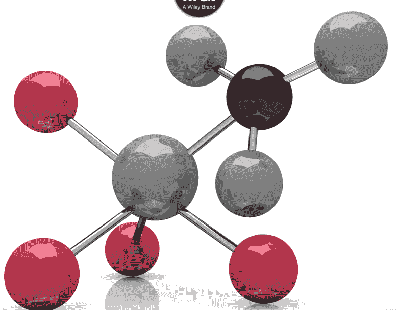


> 感谢 Nilay 和我的家人（Semra 和 Mustafa），在我写这本书期间给予我的支持和时间。
>
> —MURAT

> 感谢 Mari 的支持和鼓励。
>
> —ALEX

# 关于作者

**MURAT YENER** 是一位代码极客和开源贡献者，目前在 Intel 设备部门担任开发者。他在开发 Java、Web 框架、JavaEE 和 OSGi 应用方面拥有丰富经验，此外还从事教学和指导。Murat 是 Eclipse 贡献者，也是 Eclipse Libra 项目的初始贡献者之一，目前致力于 Android。

Murat 自 2009 年起一直是 GDG Istanbul 的小组负责人，组织、参与并在活动中演讲。他是 JavaOne、EclipseCon 和 Devox 大会的常驻演讲者。

- Linkedin——www.linkedin.com/in/muratyener
- Twitter——@yenerim
- Blog——www.devchronicles.com

**ALEX THEEDOM** 是 Indigo Code Collective（E-scape Group集团）的高级 Java 开发人员，他在一个基于微服务的、定制的彩票和即时游戏平台的架构设计和开发中发挥了关键作用。

在此之前，他为一家国际西班牙银行开发 ATM 软件，并为一家软件咨询公司提供代码质量分析。

Alex 在金融、在线教育、彩票和软件开发等多个领域拥有 Java 应用开发经验。他对开发的热情使他参与了遍欧洲及其他地区的项目。他是 alextedom.com 的博客作者，经常在在线论坛帮助其他同仁。

- Linkedin——www.linkedin.com/in/alexthedom
- Twitter——@alexthededom
- Blog——www.alexthededom.com

# 技术编辑

**MOHAMED SANAULLA** 是一位拥有五年多年软件开发专业经验的软件开发者。他目前任于印度最大的电子商务企业，同时 JavaRanch 论坛的版主。当他不在电脑前工作时，他忙于照顾他可爱的小女儿。他在 http://blog.sanaulla.info 分享他关于软件开发的实验和思考。

# 制作人员

- Kathleen Wisor
- Nancy Carrasco

# 致谢

**作为我的合著者**，Alex 总是说，我们想写一本自己也想拥有并阅读的书。首先，我想感谢 Alex 的所有耐心、努力和渊博的知识。没有他，这本书绝不会这么好。

我感谢我们的前选题编辑 Mary Jones，她联系我想写一本关于 Spring 的书，并听取了构成本书基础的我的想法。没有她的支持和指导，这本书将无法实现。任何语言都不足以感谢 Adaobi Obi Tton，她耐心地处理了所有细节，同时为我们分担了大部分的进度压力。当然，还要感谢每一位让这本书上架的人。此外，感谢 Reza Rahman 的所有鼓励。

我必须感谢那些对我的软件职业生涯产生过巨大影响的人。

首先，感谢我的父亲 Mustafa Yener，在我很小、还在要赛车模型时，他就买给了我第一台电脑 C64。那台电脑就是我写下第一行代码的地方。

其次，感谢我的论文导师 Mahir Vardar 教授，我开启职业生涯所需的全部早期指导都归功于他。

最后，感谢我的终身导师和朋友（也是我的前上司）Naci Dai，他教了我关于成为一名专业软件开发者所知晓的一切。

> MURAT

我们对这第一本书感到非常自豪，并希望你们在阅读它时的收获能像我们编写时一样多。我们创作这本书的视角是：它应该是如果我们没写它，我们会买的那种书。我们实现了这一点。

然而，如果没有许多直接和间接为本书创作贡献的人的奉献、耐心和理解，这本书将是不可能的。我们要感谢 Wiley 出版公司敬业且经验丰富的团队所做的贡献。他们与我们同雨同舟，相信万事皆有可能。我们特别感谢 Mary Jones 和 Adaobi Obi Tton，她的耐心和温柔的提醒让我们保持警觉，而她的关注使我们免于失误。我想感谢我的合著者 Murat Yener，他的灵感和幽默感让这本书独具特色；最后，同样重要的是，我想感谢我的妻子 Maria Eugenia Garcia García，她在写这本书期间给予的所有支持和理解。谢谢你。

> ALEX

# 第一部分：Java EE 设计模式简介

# 第二部分：在 Java EE 中实现设计模式

| 章节 | 页码 |
| :--- | :--- |
| 第 6 章：工厂模式 | 63 |
| 笔记 | 81 |
| 第 7 章：装饰器模式 | 83 |
| 笔记 | 96 |
| 第 8 章：面向切面编程（拦截器） | 97 |
| 笔记 | 112 |
| 第 9 章：异步 | 113 |
| 第 10 章：定时器服务 | 129 |
| 第 11 章：观察者模式 | 141 |
| 第 12 章：数据访问模式 | 157 |
| 第 13 章：RESTful Web 服务 | 173 |
| 第 14 章：模型-视图-控制器（MVC）模式 | 195 |
| 第 15 章：Java EE 中的其他模式 | 211 |
| 第三部分：总结 | 227 |
| 第 16 章：设计模式：好、坏与丑 | 229 |
| 索引 | 245 |

## 第 9 章：异步

- 什么是异步编程？
- 异步模式
- 在简单代码中实现异步模式
- Java EE 中的异步编程
- 异步 Bean
- 异步 Servlet
- 何时使用异步编程
- 总结
- 练习
- 笔记

## 第 10 章：定时器服务

- 什么是定时器服务？
- 在 Java EE 中实现定时器
- 自动定时器
- 程序化定时器
- 定时器表达式
- 事务
- 总结
- 练习
- 笔记

## 第 11 章：观察者模式

- 什么是观察者？
- 描述
- 观察者类图
- 在简单代码中实现观察者模式
- 在 Java EE 中实现观察者模式
- 何时使用观察者模式
- 总结
- 练习
- 笔记

## 第 12 章：数据访问模式

- 什么是数据访问模式？
- 数据访问类图
- 数据访问模式概述
- 数据传输对象模式
- Java 持久化 API 与对象关系映射
- 在 Java EE 中实现数据访问模式
- 类型安全的 DAO 实现
- 何时使用访问模式
- 总结
- 练习
- 笔记

## 第 13 章：RESTful Web 服务

- 什么是 REST？
- REST 的六大约束
  - 客户端-服务器
  - 统一接口
  - 无状态
  - 可缓存
  - 分层系统
  - 需求系统
- REST API 的成熟度模型
  - 等级 0：POX 沼泽（纯 XML）
  - 等级 1：HTTP 动词
  - 等级 2：HTTP 动词
  - 等级 3：超媒体控制

### 设计 RESTful API

- 资源命名
- 名词而非动词
- 自描述
- 复数而非单数
- HTTP 方法
  - Get
  - Post
  - Put
  - Delete

### REST 实战

- 用户实体
- 话题实体与帖子实体
- 在 Java EE 中实现 REST
- HATEOAS
- 何时使用 REST
- 总结
- 练习
- 笔记

# 第 14 章：模型-视图-控制器（MVC）模式

- 什么是 MVC 设计模式？
- MVC 类型
- 在纯代码中实现 MVC 模式
- 在 Java EE 中实现 MVC 模式
- `FacesServlet`
- 使用 `FacesServlet` 实现 MVC
- 何时以及何时使用 MVC 模式
- 总结
- 练习
- 笔记

# 第 15 章：Java EE 中的其他模式

- 什么是 WebSocket？
- 什么是消息传递中间件
- 什么是微服务架构？
- 单体架构
- 可扩展性
- 拆解为服务
- 微服务的优势
- 世上没有免费的午餐
- 结论
- 最后，一些反模式
  - 大管家类（Uber Class）
  - 千层饼架构（Lasagna Architecture）
  - 哥伦布斯先生（Mr. Columbus）
  - 有节之实（Friends with Benefits）
  - 尖端技术（Bleeding Edge）
  - 工具人（Utilityman）
- 笔记

# 第三部分：总结

# 第 16 章：设计模式：好、坏与丑

- 好的：成功的模式
- 坏的：模式的过度与误用
- ……以及丑的
- 总结
- 笔记

# 索引

# 前言

> 愚者提出智者在千年前就已回答过的问题
>
> —— 约翰·沃尔夫冈·冯·歌德

设计模式是连接我们通往过去与未来的纽带。它们构成了一种基础语言，代表了对常见问题的成熟解决方案，这些解决方案是由之前的才华横溢的工程师加入我们集体知识库的。设计模式或蓝图在每一个工程领域以某种方式存在。软件开发也不例外。事实上，设计模式可能是我们与工程之间最切实的联系，而不是工匠那种有机的、不那么规整的世界。设计模式的艺术与科学通过那本影响性的“四人帮”（GoF）著作引入了软件工程领域——更确切地说是引入了企业级 Java。自从我们在 J2EE、Spring 和现代轻量级 Java EE 的之旅以来，它们就一直伴随着我们。这非常有道理。服务器端 Java 开发者倾向于编写需要经受时间考验的任务关键应用程序，因此能够从设计模式所代表的严谨性中获益。

写一本关于设计模式的书确实需要一种特殊的人，更不用说写一本关于如何在 Java 应用中使用设计模式的书了。你不仅需要对 API 和模式本身的基础知识，还需要通过刻苦换来的经验获得的深锐洞察力，以及优雅解释复杂概念的天赋能力。我很高兴 Java 现在有了 Murat 和 Alex 来完成这项伟大的事业。

这本书填补了所需的空白，而且填补得很好。它也是一本非常好的书，处于 Java EE 7 的前沿水平，而不仅仅是 Java EE 6 或 Java EE 5。在许多设计模式中，如单例、工厂、模型-视图-控制器（MVC）、装饰器和观察者，现在已经整合到 Java EE 平台中。其他如外观模式、数据访问对象（DAO）和数据传输对象（DTO）则优雅地构建在其之上。Murat 和 Alex 处理了每种模式，解释了它们的务实动机，并讨论了它们如何融入 Java EE。

能为这本非常重要的书写一小部分的开头是我的荣誉和荣幸，我希望它能成为每个优秀 Java EE 开发者书架上非常有用的部分。我希望你喜欢这本书，希望它帮助你写出更好的、更满意的企业级 Java 应用。

M. REZA RAHMAN

Java EE/GlassFish 布道者

Oracle 集团

# 引言

本书讨论了最初在“四人帮”（GoF）著名的名书中提到的**经典设计模式**，并专门针对 Java EE 6 和 7 对其进行了更新。

在每一章中，我们描述了每种模式的传统实现，然后展示如何使用 Java EE 特有的语义来实现它。

我们使用完整的代码来演示传统实现和 Java EE 实现，并用真实生活的故事丰富每一章，这些故事展示了模式的使用（或误用）。

我们研究了每种模式的优缺点并检查了它们的用法。每一章都以挑战你对 Java EE 中模式理解的练习结束。

# 本书的读者

这本书适用于任何经验水平的任何人。它涵盖了关于模式几乎的所有内容，从它在其他书中如何被引用，到基础 Java 实现的代码、Java EE 实现，最后是如何以及使用特定模式的真实案例。它还包含了讨论良好和糟糕实践的真实故事。

具备设计模式和 Java EE 的一些基础知识将对你阅读本书有所帮助。

如果你已经熟悉模式和 Java 实现，你可能更倾向于直接跳到 Java EE 实现。

# 本书涵盖的内容

本书涵盖了所有追溯到 Java EE 5 且最新版本的设计模式。我们希望这本书能成为你保存在书架上的参考书。

# 本书的结构

每一章都关注一种模式。如果该模式是经典的，则会提供一个 Java EE 实现。每一章都提供了关于良好或糟糕实践的“战争故事”，随后是一个示例。最后，每一章都以如何使用该模式结束。

# 使用本书所需的条件

任何带有 Java 虚拟机（JVM）操作系统的现代计算机都足以运行示例。为了方便编码，你需要一个任选的集成开发环境（IDE）。示例可以在 Eclipse、NetBeans 或 IntelliJ 上运行。你需要 Java EE 的开发工具包（JDK）来编译示例。

你可以使用任何符合 Java EE7 的应用程序服务器来运行示例。我们在 Glassfish（参考实现）和 TomEE（Tomcat 服务器的 EE 版本）上运行了所有示例。但由于 Glassfish 是参考实现，你可能想尝试它。

要运行书中的示例，你将需要：

- 带有 EE7 的 JDK 的操作系统，如 Linux、Mac OS 或 Windows
- Java EE 7 JDK
- 任选的 IDE，如 Eclipse for Developers、NetBeans 或 IntelliJ
- 符合 Java EE7 的应用程序服务器

www.wrox.com/go/projavaeeedes

# 写作动机

2011年11月，在对一个项目的 Java EE Spring 进行辩论后，我回到桌前写了一篇标题为“Java EE 6 与尤比”的博客文章，它迅速流行起来。这个故事是基于电视剧《如何邂逅老妈》的。

Java EE 将永远不再是 J2EE 了。它现在已经开源，拥有庞大的社区，并通过吸收来自 Spring 和 Hibernate 等框架的优秀理念来重塑自己。第一次重大变革是架构和编码风格。企业级 Bean（EJB）被轻量级的**旧 Java 对象（POJO）模型所取代，几乎不可用的实体豆（entity beans）被 Java 持久化 API（JPA）取代，REST 和 Web 服务成为运行时的一部分，而注解取代了 XML 配置。有些人可能会认为，Java EE 5 还没有准备好应对这一巨大转变，因为它不像 Spring 那样成熟，而且开发环境仍然不够灵敏。在 Tomcat 上使用 Spring 而不是 EJBs，在应用服务器上使用 Java EE 大大提高了生产力，但 Java EE 5 仍然是向从零利用和构建 Java 平台迈出的大一步。

Java EE 6 和 7 的这种转变使用了与 Java EE 5 相同的原则和理念。Java EE 是开发的极佳选择，但得益于“Ewok 理论”，争论尚未结束。

在一个炎热的 8 月，我第一次接到 Wrox/Wiley 关于写一本 Spring 书的电话。我在 Spring 的实现和开发方面很有经验，但当时已经有无数本关于它的书，这让我很难看出再写一本的价值。

此外，自从第 6 版本发布以来，我使用 Java EE 比以往任何时候都频繁。考虑到 Spring 与 Java EE 的争论、我的博客文章以及 Ewoks，我喜欢写关于 Java EE 的内容。然而，就像 Spring 一样，还有许多我钦佩的优秀 Java 书籍。我一直觉得 Java EE 的某些特性被低估了。Java EE 拥有通过简单使用注解实现的优秀内置设计模式。

《GoF 书》中列出的经典模式被应用于几乎所有的语言、框架和模式。J2EE 并不例外，Java EE 也不例外。事实上，Java EE 在为这些许多模式提供默认实现方面迈出了大胆的一步，但即使是大多数经验丰富的开发者也低估了这些内置实现的价值。

我已经关于这些模式写了快一年的博客，所以我决定提出一个反向提议，写一本关于 Java EE 中“经典”设计模式的书。当你现在读这本书时，你可能会得到积极的反馈。

这本书填补了 Java EE 平台与 GoF 书中经典设计模式之间的空白，同时也讨论了新模式。我们没有写另一本 Java EE 书，而是一本 Java EE 设计模式的目录。

我开始写博客、写作并进行关于 Java EE 设计模式的演讲，以扩展我在我深信的平台上的知识和经验，因此写这本书对我来说最棒的一点是，我有机会写一些我真正热爱的内容。虽然我的博客中的示例较简单，但在需要时，我已经在使用它作为参考了，因此在遵循相同理念的同时，写一本更正式、排版更规范的书是一个极佳的机会。

我和我的合著者 Alex 编写的每一章都有一个共同目标：编写我们自己也想读的内容。结果是一本我们都想留作参考的书。

我们希望你阅读这本书的体验和我们编写它时一样愉快。

# 约定

为了帮助你从文本中获得最多并跟踪进展，我们在整本书中使用了一些约定。

> **NOTE（注意）**：NOTE 标识对当前讨论的注释、提示、暗示、技巧或补充。

如文中的样式所示：

- *我们*在引入新术语和重要词汇时会对其进行高亮。
- *我们*显示像这样的键盘按键：`Ctrl+A`。
- *我们*在文中显示文件名、URL 和代码，如下：`persistence.properties`。
- *我们*通过两种不同的方式展示代码：
  - 对于大多数代码示例，我们使用不带高亮的等宽字体。
  - 我们使用**粗体**来强调当前环境下特别重要的代码，或显示与之前代码段相比的变化。

# 源代码

在学习本书中的示例时，你可以选择手动输入所有代码，也可以使用随书附的源代码文件。书中使用的所有源代码都可以在 www.wrox.com 下载。专门针对本书，代码下载位于“Download Code”选项卡，地址为：

你也可以通过 www.wrox.com 上的 ISBN (978-1-118-84341-3) 搜索以找到代码。所有当前 Wrox 书籍的完整代码下载列表请见：www.wrox.com/dynamic/books/download.aspx。

每个章节都从该模式的基本 Java 实现开始（如果有的话）。

接下来，章节列出了该模式的 Java EE 实现，该实现只能在 Java EE JDK 和符合 Java EE 标准的服务器上编译运行。

# 勘误

我们尽一切确保文本或代码中没有错误。然而，没有人是完美的，错误在所难免。如果你在我们的某本书中发现错误（例如拼写错误或代码有误），我们将非常感谢你的反馈。通过提交勘误，你可以避免另一个读者的困扰。同时，也将帮助我们提供更高质量的信息。

要找到本书的相应页面，请访问：

然后点击 Errata（勘误）链接。在该页面，你可以查看提交给 Wrox 编辑的所有勘误。

如果你在书中发现错误，请前往 wrox.com/contact/techsupport发布消息，以便在后续版本中修复问题。

# P2P.WROX

对于作者和同行讨论，请加入 P2P 论坛。论坛是一个让你发布与 Wrox 书籍及相关技术的消息并与其他读者互动的 Web 系统。用户可以订阅功能，在有新帖子时通过邮件发送给你。

- 访问 http://p2p.wrox.com 并点击 Register 链接。
- 阅读条款并点击 Agree。


- 填写加入所需的信息以及任何你想提供的可选信息，点击 `Submit`。

- 你将收到一封邮件，说明如何验证账户并完成加入流程。

> **NOTE** 你可以在加入 P2P 的情况下阅读消息，但为了发布自己的消息，必须加入。

一旦加入，你就可以发布消息并回复其他用户的消息。你可以随时在网页上阅读消息。如果你希望将特定论坛的新消息通过邮件发送，请点击论坛列表旁的 `Subscribe to This Forum` 图标。

有关如何使用 Wrox P2P 的更多信息，务必阅读 `P2P FAQ` 以解答有关论坛原理的问题以及针对 P2P 和 Wrox 书的常见问题。要阅读 FAQ，请点击任何 P2P 页面上的 `FAQ`。

# 作者

如果你对本书的内容、代码或其他任何问题有疑问，可以通过他们的博客和 Twitter 直接联系作者。

## Murat Yener

- 博客——`devchronicles.com`
- Twitter——`@yenerm`

## Alex Dixon

- 博客——`alextheedom.com`
- Twitter——`@alextheedom`

### 注释

1. 《设计模式：可复用对象软件元素》(Addison-Wesley, 1994): Erich Gamma, Richard Helm, Ralph Johnson, John Vlissides.
2. Java EE 6 与 Ewoks：`http://www.devchronicles.com/2011/11/javaee6-and-ewoks.html`。

# 第一部分：Java EE 简介与设计模式

- 第 1 章：设计模式概述
- 第 2 章：Java EE 基础

## 第 1 章：设计模式概述

### 本章内容包含什么？

- 设计模式的概述
- 关于设计模式的简短历史及其重要性的说明
- 设计模式在现实世界中的应用
- Java 企业版（Java Enterprise Edition）环境的历史演变
- 企业模式的出现
- 这些设计模式在企业环境中是如何演变的
- 模式为何以及如何变成反模式（anti-patterns）

本书旨在弥补 Java SE 环境中设计模式的传统实现与 Java EE 环境中实现之间的鸿沟。

如果你是设计模式的新手，本书将帮助你快速进入状态，因为每一章都以通俗易懂的方式介绍设计模式，并配有大量的实际运行代码示例。

如果你已经熟悉设计模式及其实现，但不熟悉它们在 Java EE 环境中的实现方式，那么这本书非常适合你。每一章都弥补了传统实现与 Java EE 中新的（通常是更简单的）实现方式之间的鸿沟。

如果你是 Java 专家，本书将作为 Java EE 和 Java SE 中最常见设计模式实现的坚实参考。

本书关注最常见的 Java EE 设计模式，并演示了它们在 Java EE 宇宙中是如何实现的。每一章通过解释其目的并进行讨论来介绍一种不同的模式。然后，它会演示该模式在 Java SE 中如何实现，并详细描述其工作原理。在此基础上，本书演示了该模式如何在 Java EE 中实现，并讨论了其最常见的用法、优点和陷阱。所有的解释都配有详细的代码示例，所有示例都可以从随书的网站下载。在每一章的末尾，你将找到一个最后的讨论和总结，汇总本章中阅读的所有内容。书中甚至还有有趣且有时具有挑战性的练习供你完成，以测试你对本章涵盖模式的理解。

### 什么是设计模式？

设计模式是“对通信对象和类的描述，其为了解决特定语境下的设计问题而定制”。

> **—— 四人帮 (GANG OF FOUR)**

设计模式为常见的应用程序设计问题提供了解决方案。在面向对象编程中，设计模式通常针对与对象创建和交互相关的问题，而不是整个软件架构面临的大型问题。它们以模板代码（boilerplates）的形式提供通用解决方案，可以应用于现实问题。

通常设计模式使用类图来可视化，显示类与类之间的行为和关系。一个典型的类图如图 1-1 所示。

图 1-1 显示三个类之间的继承关系。子类 `CheckingAccount` 和 `SavingsAccount` 继承自它们的抽象类 `BankAccount`。

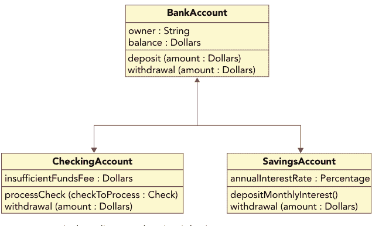

图 1-1：类图继承

此类图之后是一个 Java 实现，展示了最简单的实现。单例模式（singleton pattern）的示例将在后面的章节描述，如图 1-2 所示。

这是其最简单实现的示例。

```java
public enum MySingletonEnum {
    INSTANCE;
    public void doSomethingInteresting() {
    }
}
```

| Singleton |
| :--- |
| - instance: Singleton |
| - Singleton () \+ getInstance(): Singleton |

图 1-2：单例模式类图

### 模式是如何发现的以及为什么我们需要它们

自从四人帮（GoF，由 Erich Gamma、Richard Helm、Ralph Johnson 和 John Vlissides 组成）编写了《设计模式：可重用对象软件的要素》一书，设计模式一直是热门话题，这本书最终为全球范围内尝试和测试最常见软件工程问题的开发者提供了解决方案。这本重要的书描述了开发技术及其陷阱，并提供了 23 种面向对象编程设计模式。这些模式分为三类：创建型、结构型和行为型。

我们为什么意识到如此需要设计模式？

这个决定并不是突然做出的。面向对象编程于 20 世纪 80 年代出现，不久后又出现了几种相应的语言。Smalltalk、C++ 和 Objective C 是目前仍然流行的某些语言。然而，它们也带来了自己的问题，而且与过程化编程的发展不同，这种转变太快，以至于无法看清哪些是有效的，哪些是无效的。

尽管设计模式解决了软件工程师在使用 COBOL 等过程化编程语言时面临的许多问题（如意大利条代码），但面向对象的语言引入了自己的一套问题。C++ 迅速发展，由于其复杂性，它导致许多开发者陷入了漏洞领域，如内存泄漏、设计不良的对象、内存不安全使用以及不可维护的遗留代码。

然而，大多数开发者都遵循相同的模式，认为某人已经解决了这些问题是不理智的。在面向对象编程时代，仍然是前互联网世界，很难与大众分享经验。这就是为什么四人帮花了一段时间才形成了一个涵盖常见出现模式的集合。

### 现实世界中的模式

设计模式是无限实用的，并证明能解决你不可避免会面临的问题。它们不仅引入了多年的集体知识和经验，还为开发者之间提供了一种良好的词汇，并启发了许多问题。

然而，设计模式并不是魔杖；它们并不提供开箱即用的框架或工具。不必要的使用设计模式（仅仅为了向你的老板表现）可能会导致系统变得复杂。

关于设计模式的一个关键点是，过度使用或不必要的使用可能会带来麻烦。开发者一旦学习了新模式，他们就会表现出只要可以就使用它们的强烈欲望。然而，这样做往往会导致项目由于外观模式（facades）的视图或重叠，或不必要的复杂的装饰器（decorators）而变得臃肿。设计模式是问题的答案，除非存在问题或模式出现的机会，否则实现模式是没有意义的。

设计模式通常被分为三组：

- **创建型模式**——控制创建、初始化和类选择的模式。例如：单例模式（第 4 章）和工厂模式（第 6 章）。
- **行为型模式**——控制对象之间通信、消息传递和交互的模式。例如：观察者模式（第 11 章）。
- **结构型模式**——组织类和对象之间关系的模式，为一起使用相关对象以实现所需的行为提供了指南。例如：装饰器模式（第 7 章）。

设计模式为开发者之间提供了一本字典。开发者可以使用它们简单地进行通信，而无需为每种模式重复造轮子。想向你的哥们展示你计划如何在运行时添加动态行为吗？不再需要一步步的图画或误解。这很很简单；只需说几个词：“让我们使用装饰器模式来解决这个问题！”你的朋友会立即知道你在说什么，不需要进一步的解释。如果你已经知道什么是模式并在正确的语境下使用它，你正在开发一个持久且易于维护的应用程序。

### 建议阅读

强烈建议你阅读 Erich Gamma、Richard Helm、Ralph Johnson 和 John Vlissides 编写的《设计模式：可重用对象软件的要素》（Addison-Wesley, 1994），或 Eric Freeman、Elisabeth Robson、Bert Bates 和 Kathy Sierra 编写的《Head First Design Patterns》（O’Reilly, 2004）。这两本都是本书的绝佳伙伴，对于学习设计模式是无价的。

## 企业模式

Java 1.0 在 1996 年发布后迅速流行起来。对于引入一种新语言来说，这个时机是完美的——这种语言消除了内存管理、指针以及 C/C++ 语法的复杂性。Java 提供了一个渐进式的学习曲线，让许多开发者能够快速采用并开始使用 Java 进行编程。然而，有一种东西加速了这一转变：Applet。Applet 是一种在浏览器中运行于网站的小型应用程序，它能为网站添加仅通过 HTML 和 CSS 无法实现的功能，例如交互式图表或视频流。

随着互联网的快速发展，静态网页变得过时且无味。Web 用户希望获得更好、更快速、更美的浏览体验。Applet 应运而生，它们为当时静态的万维网注入了不可否认的交互性、特效和操作。不久之后，“跳动的 Duke”（Java 的标志）成为了现代网站的趋势。但在互联网上没有什么是能长久的。用户渴望更多，而 Applet 在适应这些需求方面失败得一惨忍睹，因此失去了流行。

尽管如此，Applet 仍然是 Java 平台快速适应和流行的背后动力。在今天（即本书编写时），Java 已成为全球最流行的两种编程语言之一。

### 从 Java 到企业级 Java

在 Java 标准版（Standard Edition）发布后，IBM 于 1997 年引入了企业级 JavaBeans（EJB），它被 Sun 公司于 1999 年采用，并成为企业 Java 平台（JEE）1.2 的组成部分。在 1998 年以及 J2EE 发布之前，直到 Sun 公司发布了名为 EJB 的 Java 专业版本，企业级 Java 才开始被采用。随着 2001 年 JEE 1.3 的发布，Java 成为企业界的关键参与者，其地位在 2003 年 JEE 1.4 发布后得以定型。

1.4 版本是 Java 历史上最伟大的里程碑之一。尽管后来发布了新版本，它仍然被广泛采用并保持了多年的人气。供应商和公司采用新版本的速度非常缓慢，尽管许多人有理由对 JEE 1.4 感到不满。使用它就像开着一辆巨兽卡车去买家用轿车的菜市场——它确实很强大，但太过于复杂，且充斥着 XML 文件，无论哪种框架都不够轻量级。

然而，JEE 最终成为了最流行的企业级开发平台。它拥有一系列特性，使其成为企业开发的绝佳选择：

- **可移植性（Portability）**——JVM 让代码运行在任何操作系统上。开发者可以在 Windows 上开发，在 Linux 上测试，但在 UNIX 系统上投入生产环境。
- **安全性（Security）**——J2EE 提供了它自己的基于角色的安全模型。
- **事务（Transactions）**——J2EE 提供了内置事务。
- **来自 J2SE 的语言特性**——J2SE 提供了简单的语法、垃圾回收和优秀的面向对象编程特性。

### 企业级 Java 模式的出现

然而，J2EE 并非完美。很快，该平台复杂的结构加上大量使用的 XML 配置，创造了一个完美的充满问题的环境。

J2EE 复杂的编程模型让许多项目陷入了深水。使用 J2EE 技术开发的应用程序包含了过量的“样板”代码，如 JNDI 查找代码、XML 配置文件以及获取 JDBC 资源的 `try/catch` 块。编写和维护此类代码被证明是对资源的极大消耗，也是许多 Bug 和性能问题的根源。EJB 组件模型承诺在实现业务逻辑时可以降低复杂性，但在这种情况下，它并没有降低复杂性，因为该模型本身太复杂了，且经常被误用。

在 2000 年 Java 大议会首次发布几年后，Deepak Alur、John Crupi 和 Dan Malks 出版了一本名为《J2EE 平台原型模式》（Prototyping Patterns for the J2EE Platform）的书，引入了几种针对 J2EE 应用程序体验中常见问题的模式。次年，他们又出版了名为《核心 J2EE 模式：最佳实践与设计策略》（Core J2EE Patterns: Best Practices and Design Strategies）的书。除了 15 种广为人知的模式外，作者还引入了其他模式来解决 J2EE 应用程序中的常见问题（由于原文后续大量重复，此处根据逻辑推断并列出核心模式点）：

- **控制器模式（Controller）**
- **服务模式（Service）**
- **领域模式（Domain）**
- **数据访问对象（DAO）**
- **集成模式（Integration）**

### 现代 Java EE 中的模式实现

变量。想创建一个单例吗？只需在类文件的顶部添加 `@Singleton` 注解即可。需要实现工厂模式吗？只需添加 `@Produces` 注解，该方法将成为所给返回类型的工厂。

Java EE 制定了标准。`@Inject` 注解作为默认实现，并可以与几乎任何其他框架（Spring 框架）混合使用，因为它们使用相同的注解。

### 当模式变成反模式时

设计模式代表了智慧，但这并不意味着你必须在任何时候都使用它们。正如著名的心理学家亚伯拉罕·马斯洛（Abraham Maslow）所说：“如果你手有的工具只有一把锤子，那么你倾向于把每个问题都看作钉子。”如果你尝试用你已知的模式来解决所有问题，它们将不再适用，更糟糕的是，你会惨遭失败并导致更多问题。即使是不必要的模式使用也往往会导致系统冗余和性能下降。仅仅因为你喜欢装饰器模式，并不意味着你需要在每个对象上实现该模式。只有当条件和问题需要你使用模式时，模式的效果才是最好的。

### 总结

Java 和设计模式经历了一段漫长的历程才到达今天的位置。它们曾经是分离的，彼此并不了解，但现在它们结合在一起，并在 Java 企业版中永远集成。为了理解这种亲密的配对，你需要了解它们的历史。你已经发现了你喜爱的这对的根源以及它们是如何相遇的。你阅读了 J2EE 艰难的起步，以及 GoF（设计模式小组）如何为 23 种设计模式带来光芒。你看到反击并获取框架根基是如何在 Java 之后并接管重构后的 Java EE 的。书中包含的知识将帮助你自信地应对开发生涯中面临的大多数设计问题。你可以放心，Java 企业版的多年斗争以设计模式的内在使用而结束，产生了一个稳健且灵活的编程语言和环境。

享受本 Java EE 设计模式指南，并在你参与的每个项目中使用此处获得的智慧。

### 笔记

1. Design Patterns: Elements of Reusable Object-Oriented Software (Addison-Wesley, 1994)：Erich Gamma, Richard Helm, Ralph Johnson, John Vlissides.
2. 根据 TIOBE 指数，Java 排名在 C 语言之后位第二：`http://www.tiobe.com/php/content/paperinfo/tpci/index.html`。
3. 在版本 3 之前，Java EE 被称为 J2EE。从现在起，J2EE 将指代 Java EE 3。
4. Core J2EE Patterns: Best Practices and Design Strategies (Prentice Hall 2003, 第2版)：Deepak Alur, Dan Malks, John Crupi.
5. Rod Johnson (@springrod) 是一位澳大利亚计算机专家，创建了 Spring 框架并共同创立了 SpringSource。`http://en.wikipedia.org/wiki/Rod_Johnson_(programmer)`。
6. Don Box (@donbox) 卓越工程师：`http://en.wikipedia.org/wiki/Don_Box`。
7. 亚伯拉罕·马斯洛 (1908–1970) 美国心理学家。

## 第 2 章：Java EE 基础

### 本章包含内容？

- Java EE 核心概念介绍
- 企业级应用的多层结构讨论
- 解释 Java EE 标准服务器和 Web 配置文件（web profile）
- 约定优于配置（Convention over configuration）概述
- 依赖注入概述
- 拦截器（Interceptor）概述

### 本章的 WROX.COM 代码下载

Java EE 编程模型自 J2EE 以来已经简化。注解取代了 XML 描述文件，约定优于配置取代了繁琐的配置，依赖注入隐藏了资源的创建。开发者需要重新考虑他们的设计和编码方法。

Java EE 应用的开发变得更容易。你只需要一个带有某些元数据的 POJO（普通 Java 对象），根据所使用的注解，POJO 会变成 Enterprise JavaBeans（EJB，有状态或无状态）、servlet、JSF 后端组件、持久实体、单例或 REST 服务。你可以在部署文件中使用 XML 声明这些服务。

列表 2-1 显示了如何将 POJO 转换为在启动时实例化并由容器管理的单例豆，只需在类上添加 `@Singleton` 和 `@Startup` 注解，并在方法上添加 `@PostConstruct`。查看第 4 章“设计模式”以获取这些注解的详细说明。

```java
// 列表 2-1：POJO 变成一个容器管理的单例豆
@Singleton
@Startup
public class MySingletonBean {
    @PostConstruct
    public void init() {
        // 初始化逻辑
    }
}
```


```java
package com.devchronicles.singleton;

import java.util.HashMap;
import java.util.Map;
import javax.annotation.PostConstruct;
import javax.ejb.Singleton;
import javax.ejb.Startup;

@Startup
@Singleton
public class CacheSingleton {

    private Map<Integer, String> myCache;

    @PostConstruct
    public void start() {
        myCache = new HashMap<Integer, String>();
    }

    public void addUser(Integer id, String name) {
        myCache.put(id, name);
    }

    public String getName(Integer id) {
        return myCache.get(id);
    }
}
```

# Java EE 编程模型

Java EE 编程模型自 J2EE 以来已经简化。注解取代了 XML 描述文件，约定优于配置取代了繁琐的配置，依赖注入隐藏了资源的创建。开发者需要重新考虑他们的设计和编码方法。

Java EE 应用的开发变得更容易。你只需要一个带有某些元数据的 POJO（普通 Java 对象），根据所使用的注解，POJO 会变成 Enterprise JavaBeans（EJB，有状态或无状态）、servlet、JSF 后端组件、持久实体、单例或 REST 服务。你可以在部署文件中使用 XML 声明这些服务。

列表 2-1 显示了如何将 POJO 转换为在启动时实例化并由容器管理的单例，只需在类上添加 `@Singleton` 和 `@Startup` 注解，并在方法上添加 `@PostConstruct`。查看第 4 章“设计模式”以获取这些注解的详细说明。

## 多层架构

Java EE 应用分为几层：客户端层、中间层和企业系统层（EIS tier）。每一层都有独特的职责。Java EE 平台旨在使应用程序变得灵活、可靠且安全。

**图 2-1：多层架构**

### 客户端层

客户端层通常是通过超文本传输协议（HTTP）连接到服务器的浏览器。它发送资源请求。请求可能包含输入的数据，如用户名、密码或注册信息。请求被处理，并在必要时，与业务层进行交互。响应发送给客户端。

### 中间层

Java EE 服务器位于中间层，提供了两个逻辑容器：Web 容器和 EJB 容器。这些容器分别对应 Web 层和业务层。每一层都有不同但有时重叠的职责。

### Web 层

Web 层管理客户端层与业务层之间的交互。Web 层从客户端层接收资源请求。处理请求后，动态准备多种格式的响应（通常是超文本标记语言 [HTML] 网页）并发送给客户端。Web 层在会话中维护用户状态并可能执行某些业务逻辑并在内存中持久化数据。

通常用于 Web 层的技术涉及客户端层与中间层之间交互的管理以及响应的构建。`Servlet` 控制 Web 流，JavaServer 表达式语言（EL）和 Java Pages 标准标签库（JSTL）准备给客户端的响应。

请求和修改使用 `JAX-RS` 和 `JAX-WS` 的 Web 服务是常见操作。（关于此主题的更多信息请参见第 13 章“REST”）。这只是你可以在 Web 层使用的技术快。完整列表请参见图 2-2。

### 完整产品需求 2

| JSR 参考 | 可选 | Web Profile | EE | Web 容器 | EJB 容器 |
|---|---|---|---|---|---|
| JSR 356 | | | | | |
| JSR 353 | | | | | |
| JSR 340 | | | | | |
| JSR 341 | | | | | |
| JSR 345 | | | | | |
| JSR 352 | | | | | |
| JSR 356 | | | | | |
| JSR 346 | | | | | |
| JSR 330 | | | | | |
| JSR 349 | | | | | |
| JSR 345 | | | | | 1 |
| JSR 316 | | | | | | |
| JSR 318 | | | | | | |
| JSR 322 | | | | | | |
| JSR 250 | | | | | | |
| JSR 343 | | | | | | |
| JSR 907 | | | | | | |
| JSR 919 | | | | | | |
| JSR 139 | | | | | | |
| JSR 109 | | | | | | |
| JSR 224 | | | | | | |
| JSR 101 | | | | | | |
| JSR 103 | | | | | | |
| JSR 196 | | | | | | |
| JSR 115 | | | | | | |
| JSR 85 | | | | | | |
| JSR 227 | | | | | | |
| JSR 45 | | | | | | |
| JSR 222 | | | | | | |

- 1. 企业级 JavaBeans (EJB) 3.1: Liferay
- 2. 来源：JAVA PLATFORM, ENTERPRISE EDITION 7 (JAVA EE 7), JSR 341, EE(0.7) 完整 JAVA EE 产品需求
- 3. 来源：JAVA PLATFORM, ENTERPRISE EDITION 7 (JAVA EE 7), WEB PROFILE 规范, JSR 342, WP.2.1 必要组件

**图 2-2：Web 层和业务层中的技术**

> **注意**：中间层通常被称为逻辑层、数据访问层和应用层。

### EIS 层

EIS 由数据存储单元组成，通常以数据库的形式存在，但可以是任何提供数据的资源。它可能是一个过时的遗留系统或文件系统。

> **注意**：EIS 通常被称为数据层、持久层和集成层。

## Java EE 服务器

正如你所见，中间层托管 Java EE 服务器，它提供了企业应用程序所需的 Java EE 功能。Java EE 基于 30 个标准，称为 Java 规范请求 (JSR) (<http://www.oracle.com/technique/java/javaee/index.html>)。这些请求在接受成为 Java EE 宇宙的一部分之前，需要通过 Java 社区进程 (JCP)。JCP 是一个开放的过程，任何人都可以参与其中，并对 JSR 给出反馈或提交他们自己的 JSR (<https://www.jcp.org/en/home/index>)。

这些规范被组合在一起，服务器应用程序必须实现这些技术才能声称符合 Java EE 标准。此外，Oracle 要求服务器应用程序通过技术兼容性测试套件 (TCK)。这是一个非凡的测试套件，用于检查应用程序是否符合规范要求。这确保了如果你按照 Java EE 规范开发应用程序，你可以在任何 Java EE 应用程序上部署并运行它。

在编写本文时，已有三个应用程序服务器完全兼容 Java EE 7。它们分别是：GlassFish 开源版 4.0 (<http://glassfish.net>)、Wildfly 8.0 (<http://wildfly.org>) 和 TMAX JEUS 8 (<http://tmaxsoft.com/product/jeus/certification/>)。Elevation 服务器兼容 Java EE 6 (<http://en.wikipedia.org/wiki/Java_Platform,_Edition_EE_6_certified>)。

## Java EE Web Profile

EE web profile 是技术的子集，构成了开发基于 Web 的企业应用程序所需的最合适技术。该配置将平台的规模和复杂度降低到仅包含开发现代 Web 应用程序所需的技术。web profile 是一套完整的堆栈技术，与工作流和核心功能相关（Servlet、表示层 (JSF 和 JSP)、业务逻辑 (EJB lite)、事务 (JTA)、持久化 (JPA)、新的 WebSocket 等）。它省略了许多与企业相关的技术，如并发工具、Java 消息服务 JMS、`JAX-RPC`、`JAX-RS` 和 `JAX-WS`。请参见图 2-2 了解 web profile 包含的技术完整清单。

## Java EE 的核心原理

Java EE 的原理包括许多设计范式和模式，这些范式对于开发企业应用程序至关重要。Java EE 的核心是“约定优于配置”的设计范式：它简化了企业应用程序的开发。这并不是一个新想法，在 Grails、Ruby on Rails 和 Spring 等框架中已经存在很长时间了。坦率地说，它进入了 Java EE 的核心，帮助他人编写优美的代码。

Java EE 充分利用了其组件模型，包括实体、JavaBeans、EJBs、Servlets、SOAP 和 RESTful Web 服务。所有这些组件都是可注入的依赖；容器以某种方式管理它们的生命周期（从实例化到销毁）无论它们是否绑定到上下文——依赖注入。松耦合的应用程序允许扩展：旧类可以被新类替换。依赖注入将组件与其依赖解耦。

### 约定优于配置

当你依赖约定时，你需要的工作将大幅减少。如果你遵循约定，就不需要任何配置。这产生了显著影响。通过 POJO 上的几个注解，你可以消除 XML 部署符和应用程序文件。如下所示。

> **注意**：约定优于配置也称为约定编码。

### 上下文与依赖注入

依赖注入是一种设计模式（参见第 5 章“依赖注入与 CDI”），它解耦了组件与其依赖之间的关系。它是通过将依赖注入对象而不是由对象使用 `new` 关键字创建依赖来实现的。通过将依赖创建的任务交给容器，你可以在运行时将其替换为另一个兼容的对象。

容器管理的 Bean 被称为上下文依赖注入 (CDI) 管理的 Bean，它们在容器启动时被实例化。所有 POJO 都有默认构造函数，且不使用 `new` 创建。CDI Bean 通过类型匹配注入对象。为了被注入，接收对象必须在字段、构造函数或方法上使用 `@Inject` 注解。声明对象的类型用于确定注入哪个依赖。

在列表 2-2 中，你有一个带有默认构造函数的 POJO，它将被视为 CDI Bean；而在列表 2-3 中，你注入了该 Bean。容器知道要注入 Message Bean。容器只管理一个 Message 类型的 Bean，因此它注入。

好奇的人可能会问：如果容器正在管理多个类型为 Message 的 Bean 呢？如果是这样，Message 必须是一个具有多个具体实现的接口。这时情况变得更有趣了。有几种策略你可以利用它们来解决这些类型的歧义。在本书中，你会遇到几个此类问题。如果你好奇心作祟了，可以直接跳到第 5 章。

上下文是 EJB 和 CDI 管理 Bean 之间的区别特征。CDI 存在于定义的上下文中；EJB 则没有。CDI Bean 在作用域的上下文中创建；在作用域生命周期内存在，并在作用域结束时被销毁。共有四种作用域，分别标记了 `@ApplicationScoped`、`@RequestScoped`、`@SessionScoped` 和 `@DependentScoped` 注解。CDI 容器根据定义的作用域管理 Bean 的生命周期。例如，标记了 `@SessionScoped` 的 Bean 只要 HTTP 会话一直就存在；在作用域结束时，该 Bean 被销毁以进行垃圾回收。这种行为与 EJB 相似，EJB 不绑定到特定的作用域。这意味着你必须通过调用带有 `@Remove` 注解的方法来显式地移除 Bean。

### 拦截器

大多数应用程序都有一些无法方便地放入核心业务逻辑、但无法从应用程序的设计或实现中干净分离的关注点。这些关注点是交叉的，会影响应用程序的不同部分。它们通常导致代码重复和相互依赖，使得系统的可扩展性降低。将这些非核心关注点实现为拦截器，可以使它们从核心关注点中解耦。你可以通过分离它们的实现，并拦截对核心方法的调用，然后调用适当的方法来实现这一点。

你通过在交叉关注点的类名上使用 `@Interceptor` 注解来实现拦截器的实现。在列表 2-4 中，`setValue` 方法通过其对 `LoggerInterceptor.class` 的调用被拦截。

**列表 2-4：被日志拦截器拦截的核心方法**

```java
@Interceptors(LoggerInterceptor.class)
public void setValues(Integer value, String name) {
    this.value = value;
    this.name = name;
}
```

日志拦截器可以访问拦截器的参数，并在完全执行被拦截的方法之前执行交叉逻辑。

在列表 2-5 中，日志拦截器访问 set 方法的参数并将其记录到系统日志中。

**列表 2-5：日志拦截器**

```java
@AroundInvoke
public Logger logger(InvocationContext ic) throws Exception {
    Object[] params = ic.getParameters();
    logger.warning("Parameters passed: " + params);
}
```

你可以在业务代码中定义拦截器，也可以在部署描述符文件中定义。拦截器的这方面以及更多内容将在第 8 章“面向切面编程（拦截器）”中讨论。

## 总结

在本章中，你看到了 Java EE 及其当前原则历史的简要总结。

你发现了 Java EE 项目中应该如何正确进行分层。我们还提供了一个长的 JSR 兼容列表，帮助你判断哪个容器最适合你的项目。最后，本章通过介绍“约定优于配置”和对 CDI 的简要总结，专注于 Java EE 的核心原则。

接下来，我们将准备进入每个模式，专注于它们的实现并提供具体的示例。

## 练习

1. 思考一个银行应用程序，你需要集成到大型机后端，并为 Web、移动端和原生桌面客户端提供服务。
2. 思考为你第一步中设计的项目实现 Web 应用程序。哪层应该托管 Web 应用程序？
3. 在长时间辩论后，你工作的银行决定离开大型机，要求你设计一个替代系统。当前项目的哪些部分会受到影响？

# 第二部分：在 Java EE 中实现设计模式

- 第 3 章：门面模式
- 第 4 章：单例模式
- 第 5 章：依赖注入和 CDI
- 第 6 章：工厂模式
- 第 7 章：装饰器模式
- 第 8 章：面向切面编程（拦截器）
- 第 9 章：异步
- 第 10 章：定时服务
- 第 11 章：观察者模式
- 第 12 章：数据访问模式
- 第 13 章：RESTful Web 服务
- 第 14 章：模型视图控制器模式
- 第 15 章：Java EE 中的其他模式

# 第 3 章：门面模式

本章内容包含：

- 门面模式的意图介绍
- 门面模式带来的好处
- 实现门面模式的三种方式：POJO、无状态和有状态 Bean
- 门面模式与有状态/无状态 Bean 的重要区别
- 何时以及何地使用该模式
- 关于使用的警告和潜在陷阱

本章的示例代码下载

门面模式是 GoF 描述的结构性模式之一。它的意图是通过高层接口来封装子系统，使其更易使用。这通常通过组合相关方法并顺序调用它们来实现。从高层视角看，每个 API 都可以被视为 `javax.servlet.http.HttpSession` 接口的一种。

## 什么是门面？

GoF 将此模式描述为“为一组接口提供统一接口”。《Head First 设计模式》给出了相同的解释，并指出在隐藏子系统复杂性的同时，门面模式通过一个易用的接口提供了子系统的全部功能。

为了给门面模式如何工作的现实示例，想象一台只有两种模式的洗衣机：重洗和轻洗。对于每种模式，都有水温、洗涤周期、脱水周期、添加洗衣剂、漂白、柔顺剂等。每种模式都需要一套洗涤指令（不同量的洗衣剂、更高或更低的温度、更短或更长的脱水时间等）。

简单的接口提供了两种洗涤模式，隐藏了选择水、脱水时间以及添加洗衣剂、漂白或柔顺剂的复杂逻辑。洗衣机用户不需要考虑如何洗衣服的复杂逻辑。用户必须做的决定只是衣服是重洗还是轻洗。这本质上是门面模式在洗衣机设计中的应用。在本章后面，你将看到该用例的实现。

## 在纯代码中实现外观模式

我们的代码并没有所谓的“面条代码”，但层级简直比肉千层 lasagna 还要多。我们原本的小世界里过得相当愉快——直到其他团队开始使用我们的核心服务。很快，系统的性能以及我们处理变更请求的能力都开始下降。

我们从一家供应商那里聘请了一位花哨且昂贵的顾问来分析我们的系统。他开了几次会议，花了一些时间浏览我们的代码库，发现需要进行重构，于是他引入了外观（Façade）和相关的接口。结果是我们的维护工作减少了，性能得到了提升，大家都很开心。这个故事的寓意是：谨慎使用模式——即使是简单的模式——并且只在需要时使用，而且千万不要炫耀你对模式的了解。

## 外观类图

如图 3-1 所示的类图所示，外观模式为底层系统提供了一个简单的接口。它封装了复杂的粒度逻辑。

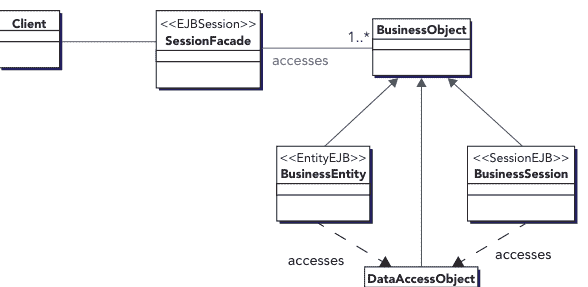

**图 3-1** 外观模式的类图


### 在纯代码中实现外观模式

实现外观模式并不复杂。它没有强制严格的结构或规则集。任何能够轻松访问复杂流程的方法都可以被视为外观模式的实现。

现在，你将按照列表 3-1 所示，实现引言中给洗衣机示例。你需要两个方法——`heavilySoiled()`（重污）和 `lightlySoiled()`（轻污），它们代表两种洗涤模式。所有复杂的工作（选择水温、脱水周期时长、决定是否添加漂白剂）都在外观内部调用的方法中完成。

### 列表 3-1：洗衣机类比实现

```java
public class WashingMachine {

    public void heavilySoiled() {
        setWaterTemperature(100);
        setWashCycleDuration(90);
        setSpinCycleDuration(10);
        addDetergent();
        addBleach();
        addFabricSoftener();
        heatWater();
        startWash();
    }

    public void lightlySoiled() {
        setWaterTemperature(40);
        setWashCycleDuration(20);
        setSpinCycleDuration(10);
        addDetergent();
        heatWater();
        startWash();
    }
}
```

// 如何使用外观

```java
new WashingMachine().lightlySoiled();
```

如果你需要此功能，只需调用外观的 `lightlySoiled()` 或 `heavilySoiled()` 方法，让它来处理复杂的洗衣服逻辑。所有复杂逻辑都由外观隐藏，并通过它的两个方法暴露。

外观的实现与客户端解耦。这种解耦允许实现发生变化，而不会影响客户端访问洗衣服务的方式。客户端对这些方法的实现一无所知，而且它并不在乎。

这个示例展示了外观模式的许多优点之一。本书没有深入探讨外观模式的优点，因此以下是最重要优点的总结：

- 减少耦合，因为客户端对子系统一无所知
- 当需要更改时增加了可维护性和可管理性
- 功能复用，因为它鼓励了控制和细粒度逻辑的复用
- 通过从一次调用到下一次一致调用相同方法确保服务执行的一致性
- 通过组合相关方法并从一个方法调用调用它们，降低了业务逻辑的复杂性
- 安全和事务控制管理的集中
- 可测试且可模拟的模式实现

> 注意：你可能会看到这种实现被称为 POJO 外观，以将其与你将在本章后面看到的有状态和无状态实现区分开来。

### 在 Java EE 中实现外观模式

与书中描述的许多其他模式不同，Java EE 没有提供此方法的内置实现。尽管如此，使用有状态或无状态 EJB 来实现它是非常容易的。使用 EJB 的优点是可以方便访问外观可能需要的其他 EJB。

### 使用无状态 Bean 的外观模式

为了演示这种实现，假设你有三个如列表 3-2 所示的 EJB，它们具有不同但相关的功能：`CustomerService`、`LoanService` 和 `AccountService`。

### 列表 3-2：构成外观系统的三个 EJB 的代码

```java
package com.devchronicles.facade;

import javax.ejb.Stateless;

@Stateless
public class CustomerService {

    public long getCustomer(int sessionID) {
        // 获取登录的客户 id
        return 100005L;
    }

    public boolean checkId(long x) {
        // 检查客户 id 是否有效
        return true;
    }
}

package com.devchronicles.facade;

import javax.ejb.Stateless;

@Stateless
public class LoanService {
    public boolean checkCreditRating(long id, double amount) {
        // 检查客户是否符合金额条件
        return true;
    }
}
```

### 列表 3-2（续）

```java
package com.devchronicles.facade;

import javax.ejb.Stateless;

@Stateless
public class AccountService {

    public boolean getAccount(long id) {
        // 账户实现
        return true;
    }

    public boolean updateBalance(long id, double amount) {
        // 余额实现
        return true;
    }
}
```

### 列表 3-3：外观的实现

```java
package com.devchronicles.facade;

import javax.ejb.Stateless;
import javax.inject.Inject;

@Stateless
public class BankService {

    @Inject
    CustomerService customerService;

    @Inject
    LoanService loanService;

    @Inject
    AccountService accountService;

    public boolean processLoan(int sessionId, double amount) {
        boolean result = false;
        long id = customerService.getCustomer(sessionId);

        if (customerService.checkId(id)) {
            if (loanService.checkCreditRating(id, amount)) {
                result = accountService.getAccount(id);
            }
        }
        accountService.updateBalance(id, amount);
        return result;
    }
}
```

在决定将外观实现为有状态 Bean 时要格外小心，确保它不会导致资源消耗问题。

良好的应用程序充分利用外观模式来封装复杂的逻辑，并将系统与客户端解耦；然而，过早和过度使用外观模式会导致系统变得更加复杂并产生多个层级。

会话外观模式类似于实体-控制-边界架构模式中的边界，并且与适配器和包装器模式有关。

### 练习

1. 列出一些外观模式的公共 API 实现，并解释它们如何隐藏子系统的复杂逻辑。
2. 开发一个外观，隐藏订单和支付系统的复杂逻辑。
3. 将对两个子系统（支付和订单）的方法调用封装在两个方法中。
4. 将外观开发为单例模式。

### 笔记

1. 《Design Patterns: Elements of Reusable Object-Oriented Software》(Addison-Wesley, 1994): Erich Gamma, Richard Helm, Ralph Johnson, John Vlissides.
2. 《Head First Design Patterns》(O'Reilly, 2004): Eric Freeman, Elizabeth Robson, Bert Bates, Kathy Sierra.

## 4 单例模式

### 本章内容

- 开发者实现单例设计模式的不同方式，除了常见用法和陷阱之外
- 在多线程环境中使用静态成员和方法引起的问题
- Java 5 SE 引入枚举类型后取得的进展，以及如何使用它创建线程安全的单例
- Java EE 中 `@Singleton` 注解的使用，以及它如何从根本上改变了会话 Bean 中单例模式的实现方式
- Bean 和容器管理并发的使用，以及 `@LockType` 注解如何控制对业务方法的访问
- 长期困扰单例模式的主要问题，以及为什么它是一个逐渐不再青睐的反模式

本章的 WROX.COM 资源下载

本章配套的 wrox.com 代码下载可以在 www.wrox.com/projavaeeesignpatterns 的 Download 标签页找到。代码位于第 04 章下载中，并根据整个章节中的名称单独命名。

单例模式是最简单、最广为人知的设计模式之一，但它已经过时了。甚至认为它是一种反模式，我们将在本章稍后部分讨论。然而，Spring 等企业框架大量使用了它，而 Java EE 也提供了一种优雅且易于实现的方案。在本章中，你将看到为什么需要单例、为什么它们不再流行、它们在 Java EE 中有什么用，以及你如何实现它们。

单例模式是 GoF¹ 书中描述的模式之一。单例类保证其类型只产生一个实例。在某些情况下，只有一个实例是有帮助的，例如全局访问和缓存昂贵的资源；但是，如果在多线程环境中使用单例，它可能会引入一些竞态条件问题。由于大多数编程语言没有提供创建单例的内置机制，开发者必须创建自己的实现。

然而，Java EE 拥有一种内置机制，允许开发者通过给类添加注解来创建单例。

### 什么是单例？

根据 GoF 的定义，单例模式用于“确保一个类只有一个实例，并为该实例提供一个全局访问点”。《Head First Design Patterns²》提供了相同的解释和观点。单例通常与其他模式结合使用（在第 6 章“工厂模式”中讨论）。

单例通常用于以下目的和场景：

- 访问整个应用程序域的数据，例如配置数据
- 仅加载和缓存昂贵的资源，允许全局共享访问并提高性能
- 创建应用程序日志器实例，因为通常只需要一个
- 在实现工厂模式的类中管理对象
- 创建外观对象，因为通常只能延迟地实例化一个

Spring 在创建 bean 时使用单例（默认情况下，Spring bean 是单例的），Java EE 在内部也使用单例，例如在服务定位器中。Java SE 在运行时类的实现也使用了单例模式。如果你在正确的上下文中使用它们，单例绝对是有帮助的。

尽管如此，使用单例模式可能会不必要地缓存资源，导致垃圾回收器无法回收对象并释放宝贵的内存。这可能无法发挥单例的优势。

```java
private MySingleton() {}
public static MySingleton getInstance() {
    return instance;
}
```

双重检查锁定是另一种非常流行的创建单例机制。它被认为比其他方法更安全，因为它在单例类加锁之前会检查单例实例，并且在创建对象之前再次检查。列表 4-5 展示了这种方法。

### 列表 4-5：实现双重检查单例

```java
package com.devchronicles.singleton;

public class MySingleton {

    private volatile MySingleton instance;

    private MySingleton() {}

    public MySingleton getInstance() {
        if (instance == null) { // 1
            synchronized (MySingleton.class) {
                if (instance == null) { // 2
                    instance = new MySingleton();
                }
            }
            return instance;
        }
    }
}
```

然而，这些方法中没有一个是 100% 安全的。例如，Java 反射 API 允许开发者将访问修饰改为 public，从而导致单例面临被重新创建的可能性。

创建单例的最佳方法是使用枚举类型，它是 Java 5 中引入的，如列表 4-6 所示。这种方法也被 Joshua Bloch 在他的《Effective Java》一书中大力推崇。枚举类型本质上就是单例，因此 JVM 处理了创建单例所需的大部分工作。因此，通过使用枚举类型，你可以自己从同步对象创建的任务中解放出来，并避免所有与初始化的问题。

### 列表 4-6：单例模式的枚举类型实现

```java
package com.devchronicles.singleton;

public enum MySingletonEnum {
    INSTANCE;
    public void doSomethingInteresting() {}
}
```

在这个示例中，通过以下方式获取单例对象实例的引用：

```java
MySingletonEnum mse = MySingletonEnum.INSTANCE;
```

一旦你拥有了单例的引用，就可以这样调用它的任何方法：

```java
mse.doSomethingInteresting();
```

### 实战故事

几年前，我的一位拥有小型软件公司的好朋友请我去面试一位候选人。因为我一直认为工作面试是工程师之间极好的交流体验，所以我毫不犹豫地抓住了这次机会。候选人只有几年的经验，但毕业于一所优秀的大学，而且非常敏锐。我们就 Java、JPA、Spring 以及其他著名的 Java 框架进行了长时间的长谈。他渴望学习和尝试新事物，并冷静地处理了所有问题。

一小时后，面试结束了，但我们继续随性聊天。我问他最近读过的书，他的回答是《Head First Design Patterns》。我询问了他感兴趣或想聊的话题。惊讶的是，是单例模式。这让我觉得它简单易于实现，所以应该是一个安全的话题。但事实并非如此。如果他选择了另一个模式作为装饰器模式，我就没有机会深入探讨这个看似简单的模式中更高级的话题了。

我问候选人将如何实现单例。他用经典的私有构造函数方法回答，这清楚地表明他没有读过《Effective Java》，对枚举类型一无所知。我问：“如果我使用反射将构造函数的访问级别改回 public 会怎样？”他很惊讶，但我能从他的眼神里清楚地看到，他更倾向于回家思考这个想法。他没有想出解决方案，但也没有编造无意义的回答。他忙于获取和思考关于反射的想法。

这位求职者可能错过了正确答案，但他表现出了热情和渴望学习。他被录用了，并成为我工作过的最优秀的开发者之一。

### 在 Java EE 中实现单例模式


到目前所有的代码示例都演示了在 Java EE 上下文中使用单例。虽然你可以在 Java EE 中使用它们，但有一种更优雅、更易用的方法：

## 单例 Bean

在第 2 章，通过 `@Singleton` 注解可以轻松地实现单例。列表 4-7 展示了这种用法。

```java
package com.devchronicles.singleton;

import java.util.HashMap;
import java.util.Map;
import javax.annotation.PostConstruct;
import javax.ejb.Singleton;
import javax.ejb.Startup;
import java.util.logging.Logger;

@Startup
@Singleton
public class SingletonBean {

    private Map<Integer, String> myCache;

    @PostConstruct
    public void start() {
        myCache = new HashMap<>();
    }

    public void addUser(Integer id, String name) {
        myCache.put(id, name);
    }

    public String getName(Integer id) {
        return myCache.get(id);
    }
}
```

单例 Bean 默认是懒加载的。如果你希望单例在应用启动时就初始化，可以使用 `@Startup` 注解。这确保了单例在启动时被创建。列表 4-7 展示了带有 `@Startup` 注解的类。

### 列表 4-7：使用 @Startup 注解的单例

```java
package com.devchronicles.singleton;

import java.util.HashMap;
import java.util.Map;
import javax.annotation.PostConstruct;
import javax.ejb.Singleton;
import javax.ejb.Startup;
import java.util.logging.Logger;

@Startup
@Singleton
public class SingletonBean {

    private Map<Integer, String> myCache;

    @PostConstruct
    public void start() {
        myCache = new HashMap<>();
    }

    public void addUser(Integer id, String name) {
        myCache.put(id, name);
    }

    public String getName(Integer id) {
        return myCache.get(id);
    }
}
```

单例 Bean 默认是懒加载的。如果你希望单例在应用启动时就初始化，可以使用 `@Startup` 注解。这确保了单例在启动时被创建。列表 4-7 展示了带有 `@Startup` 注解的类。

## 启动顺序

这可能会带来另一个问题。如果单例依赖另一个资源，如何等待该资源准备就绪？这看起来像是一个边界情况，但并非如此。考虑单例，它可能依赖于数据库。如果连接池是由另一个单例创建的？Java EE 提供了一个注解来解决这个问题。你可以使用 `@DependsOn` 注解并传递类所依赖的 Bean 名称（如列表 4-9 所示）。现在你可以轻松确定单例的启动顺序。

### 列表 4-9：使用 @DependsOn 指定启动顺序

```java
package com.devchronicles.singleton;

import java.util.HashMap;
import java.util.Map;
import javax.annotation.PostConstruct;
import javax.ejb.Singleton;
import javax.ejb.Startup;
import javax.ejb.DependsOn;
import javax.ejb.EJB;

@Startup
@DependsOn("MyLoggingBean")
@Singleton
public class CacheSingletonBean {

    private Map<Integer, String> myCache;

    @EJB
    MyLoggingBean loggingBean;

    @PostConstruct
    public void start() {
        loggingBean.info("Started");
        myCache = new HashMap<>();
    }

    public void addUser(Integer id, String name) {
        myCache.put(id, name);
    }

    public String getName(Integer id) {
        return myCache.get(id);
    }
}
```

### 列表 4-10：MyLoggingBean 实现

```java
public class MyLoggingBean {

    private Logger logger;

    @PostConstruct
    public void start() {
        logger = Logger.getLogger("GlobalLogger");
        logger.info("Well, I started first!!!");
    }

    public void logInfo(String msg) {
        logger.info(msg);
    }
}
```

在这里，你可以使用 `@PostConstruct` 注解来测试你的 bean 是否已创建以及其生命周期是否已挂起。标记了 `@PostConstruct` 注解的方法会在新构建的 bean 在依赖注入完成后、在调用第一个方法之前被调用。当然，在现实生活中，你需要在其他 bean 中使用 bean。后续的章节将更多地关注 EJB 的集成和访问，以及它们是否应该是单例。

上一个示例在服务器启动时运行。`CacheSingletonBean` 等待运行，因为它依赖于 `MyLoggingBean` 的初始化。日志输出类似于以下：

> Well, I started first!!!
>
> Started!

你的单例 bean 可能依赖于一系列其他 bean 的初始化。在这种情况下，你可以通过 `@DependsOn` 指定多个 bean。接的单例依赖于 `MyLoggingBean` 和 `InitializationBean`：

```java
@Startup
@DependsOn({"MyLoggingBean","MyInitializationBean"})
@Singleton
public class CacheSingletonSingletonBean {
    // 此处为实现代码
}
```

`MyLoggingBean` 和 `InitializationBean` 的初始化顺序由它们自己的 `@DependsOn` 注解决定。如果两者都没有显式地依赖于对方，则由容器以不指定的顺序初始化 bean。

## 管理并发

你将面临的最重要的问题是并发。在 Java EE 实现中，你不再需要担心 bean 的创建，但你可能仍然需要对方法访问保持小心，因为你的单例将处于一个并发环境中。Java EE 再次通过注解解决了此问题。

Java EE 提供了两种类型的并发管理：容器管理的并发和 bean 管理的并发。在容器管理的并发中，容器负责处理任何与读写访问相关的事务，而开发者则需要使用传统的 Java 方法（如同步）来处理并发。你可以通过 `ConcurrencyManagementType` 注解启用 bean 管理的并发。

Java EE 默认使用容器管理的并发，你可以通过 `ConcurrencyManagementType.CONTAINER` 注解显式声明它：

```java
@Startup
@DependsOn("LoggingBean")
@ConcurrencyManagement(ConcurrencyManagementType.CONTAINER)
@Singleton
public class CacheSingleton {
    // 此处为实现注解代码
}
```

现在你将看到示例并使用 `@Lock` 注解来控制访问。参见列表 4-11。

### 列表 4-11：使用 @LockType 管理并发

```java
package com.devchronicles.singleton;

import java.util.HashMap;
import java.util.Map;
import javax.annotation.PostConstruct;
import javax.ejb.ConcurrencyManagement;
import javax.ejb.ConcurrencyManagementType;
import javax.ejb.EJB;
import javax.ejb.DependsOn;
import javax.ejb.Lock;
import javax.ejb.LockType;
import javax.ejb.Singleton;
import javax.ejb.Startup;

@Startup
@DependsOn("LoggingBean")
@ConcurrencyManagement(ConcurrencyManagementType.CONTAINER)
@Singleton
public class CacheSingleton {

    private Map<Integer, String> myCache;

    @EJB
    LoggingBean loggingBean;

    @PostConstruct
    public void start() {
        loggingBean.info("Started!");
        myCache = new HashMap<Integer, String>();
    }

    @Lock(LockType.WRITE)
    public void addUser(Integer id, String name) {
        myCache.put(id, name);
    }

    @Lock(LockType.READ)
    public String getName(Integer id) {
        return myCache.get(id);
    }
}
```

通常使用两种锁类型来访问 bean 的业务方法：`@Lock(LockType.WRITE)`，它在方法调用期间锁定 bean 以防止其他客户端访问；而 `@Lock(LockType.READ)` 则允许并发访问该方法且不会对其他客户端锁定 bean。更改数据的方法通常标记为 WRITE，以防止在更新数据时访问数据。在示例中，`addUser()` 方法被标记为 WRITE 锁，因此如果任何客户端调用 `getName()` 方法，它必须等待 `addUser()` 方法返回后才能完成其调用。如果 `addUser()` 方法持续时间很长，可能会抛出 `ConcurrentAccessTimeoutException`。你可以通过注解配置超时时间，我们将在列表 4-12 中看到示例。

你可以在类级别设置 `LockType` 注解。它适用于所有没有显式配置其自己的 `LockType` 的业务方法。由于默认值是 WRITE，因此通常只需要配置那些需要并发访问的方法就足够了。

### 列表 4-12：定义单例的并发超时访问

```java
import java.util.logging.Logger;
import javax.annotation.PostConstruct;
import javax.ejb.Singleton;
import javax.ejb.Startup;
import javax.ejb.DependsOn;
import javax.ejb.ConcurrencyManagement;
import javax.ejb.ConcurrencyManagementType;
import javax.ejb.AccessTimeout;
import java.util.Map;

@Startup
@DependsOn("LoggingBean")
@ConcurrencyManagement(ConcurrencyManagementType.CONTAINER)
@Singleton
@AccessTimeout(3000)
public class CacheSingleton {

    private Map<Integer, String> myCache;

    @EJB
    LoggingBean loggingBean;

    @PostConstruct
    public void start() {
        loggingBean.info("Started!");
        myCache = new HashMap<Integer, String>();
    }

    @Lock(LockType.WRITE)
    public void addUser(Integer id, String name) {
        myCache.put(id, name);
    }

    @Lock(LockType.READ)
    public String getName(Integer id) {
        return myCache.get(id);
    }
}
```

## 何以及何时使用单例

单例模式通常在需要一个类的唯一实例来协调资源访问（例如连接池或配置管理器）时使用。你应该在适当考虑单例，但要警惕潜在的陷阱。

- 全局访问点。
- 应用程序部分的共享状态。
- 对有限或昂贵资源的控制。

然而，过度使用单例会导致紧耦合并增加测试难度。

## 总结

提到单例模式已经不受宠，以至于许多开发者现在将其视为一种反模式。单例模式的失宠源于它在多线程应用程序中的缺陷。程序员因为单例模式实现简单而对其滥用和过度使用，这对于任何维护代码的开发者来说都是场噩梦，而且当发现需要多个实例时，重构单例的人来说是一个更大的挑战。单例类的使用使得测试变得复杂，因为引入了全局状态。此外，由于这些状态可能会变化，测试变得不确定。我们在代码示例中看到了单例在多线程环境中带来的诸多困难。随着 Java EE 的许多进步，容器控制单例的创建，并确保在 `@PostConstruct` 完成之前不会调用业务方法。容器还通过 `@ConcurrencyManagement` 注解控制对 bean 的并发访问，其相关的 `@LockType` 注解允许对每个方法进行细粒度的控制。单例的所有问题绝没有完全解决。如果 bean 用于访问非线程安全的资源，在多节点环境中可能会出现问题。瓶颈和类的紧耦合可能会产生额外问题。尽管单例模式由于开发者的滥用和过度使用而最终被归类为反模式，但它自引入以来从未成熟，应该被重新视为一种价值且可行的设计模式。

## 练习

1. 设计一个网页访问计数器，具有两个方法：一个增加计数的方法，另一个获取最新计数的方法。通过定义适当的锁类型来确保它是线程安全的。
2. 设计一个简单的缓存，用于图书馆管理应用程序的书籍列表。数据应在应用程序启动时加载到缓存中。添加根据不同标准（如 ISBN、作者和流）检索书籍的方法。
3. 设计一个复杂的缓存，它在启动时从数据库读取数据。数据检索方法应该首先查询缓存，如果未找到请求的数据，则 Bean 应该查询数据库。如果从数据库中找到了请求的数据，则应将其存储在缓存中。
4. 在练习 3 的基础上添加一种机制，用于从缓存中删除不经常访问的数据并更新过时的数据。确保缓存的整个生命周期都得到妥当管理。

## 注释

1. 《设计模式：可复用面向对象软件的基础》(Addison-Wesley, 1994)：Erich Gamma, Richard Helm, Ralph Johnson, John Vlissides。
2. 《Head First 设计模式》(O'Reilly, 2004)：Eric Freeman, Elisabeth Robson, Bert Bates, Kathy Sierra。
3. 《Java 最佳实践》(Addison-Wesley, 2008)：Joshua Bloch。

## 第 5 章 依赖注入与 CDI

本章内容简介：

- 依赖注入简介
- 为什么 DI 在 Java EE 中至关重要
- 如何在纯代码中实现 DI
- DI 在 Java EE 中是如何实现的
- 内容依赖注入简介
- CDI 与 EJB 容器之间的主要区别

### 本章 WROX.COM 代码下载

本章的 wrox.com 代码下载可以在 `www.wrox.com/projaveedesignpatterns` 的 Download 标签页中找到。代码位于第 05 章下载包中，并根据全章内容进行了单独命名。


# 依赖注入（DI）

依赖注入（DI）是少数几个为人知且被认可的设计模式之一，但它并未列在“四人帮”的书中。如今，它已广泛应用于现代编程语言中，既作为内部实现，也作为促进松耦合的最佳实践。

JEE 的设计初衷是处理最复杂的系统，但由于对甚至简单系统的开发过度复杂，导致了惨痛的失败。JEE 的原始设计依赖于重量级的复杂性和紧耦合，这导致了 Spring 和 Pico 容器等框架的流行。2004 年，Martin Fowler 发表了一篇关于反转控制容器和依赖注入模式的文章。大多数供应商并没有支持并鼓励开发者使用 J2EE 容器。然而，轻量级容器很快接过了主导，它们获得了官方支持，更有甚者，Spring 成为了事实上的标准，并引领了从零开始的企业级 Java 设计。

## 什么是依赖注入？

依赖注入模式基于控制反转的思想。与其通过 `new` 关键字或查找操作来创建硬性依赖并创建新对象，不如将所需的资源注入到目标对象中。这种方法有许多优点：

- 客户端不需要感知被注入资源的不同实现，使得更改变得更加容易。
- 使用模拟对象（mock objects）进行单元测试的实现要简单得多。
- 配置可以外部化，减少更改的影响。
- 松耦合的架构允许可插拔的结构。

DI 的基本思想是改变对象创建的位置，并使用注入器（injector）在合适的时机将特定实现注入到目标对象中。这听起来可能像工厂模式的实现（参见第 6 章“工厂模式”），但整个概念远比简单的创建要复杂。控制反转（IoC）改变了对象之间的整个工作方式，让注入器完成工作（大多数时候是魔术般完成的）。注入器不是调用工厂为调用者提供实现，而是主动工作确定目标对象何时需要依赖并执行注入。

## 在纯代码中实现 DI

在引入上下文和依赖注入（CDI）之前，Java 一直没有提供 Enterprise JavaBeans（EJB）容器之外的标准 DI 实现。尽管有如 Spring 和 Guice 等各种 DI 框架，但创建一个基础实现并不困难。

最简单的实现是工厂，它通过 `getInstance()` 方法根据请求创建依赖。现在，你将实现一个示例，展示如何在纯代码中这样做。

简单的 DI 实现应该将依赖的解析与类的行为分离。

### 示例代码

#### 5-1：UserService 类（初始版本）

```java
package com.devchronicle.di;

class UserService {
    private UserDataRepository udr;

    UserService() {
        udr = new UserDataRepository();
    }

    public void persistUser(User user) {
        udr.save(user);
    }
}
```

#### 5-2：UserDataRepository 接口

```java
package com.devchronicle.di;

public interface UserDataRepository {
    public void save(User user);
}
```

#### 5-3：User 类

```java
package com.devchronicle.di;

public class User {
    // 用户代码
}
```

#### 5-4：创建 UserService 的 UserServiceFactory

```java
package com.devchronicle.di;

public class UserServiceFactory {
    public UserService getInstance() {
        return new UserService(new UserDataRepositoryImpl());
    }
}
```

#### 5-5：重构后的 UserService（构造器注入）

```java
package com.devchronicle.di;

class UserService {
    private UserDataRepository udr;

    UserService(UserDataRepository udr) {
        this.udr = udr;
    }

    public void persistUser(User user) {
        udr.save(user);
    }
}
```

## 在 Java EE 中实现 DI

在 Java EE 5 之前，J2EE 并没有提供开箱即用的 DI。相反，在 J2EE 中，使用 Java 命名和目录接口 (JNDI) 查询来访问 bean 和资源。这种方法导致了硬编码以及对重量级基于服务器容器的依赖，这使得测试几乎比编写实际代码还要困难。

随着 Java EE 5 和 EJB 3 的发布，DI 成为企业 Java 平台不可或缺的一部分。为了摆脱基于 XML 的配置，引入了几个注解来执行注入：

- `@Resource` (JSR250) 用于注入数据、Java 服务 (JMS)、URL、邮件和环境变量。
- `@EJB` (JSR220) 用于注入 EJB。
- `@WebService` 用于注入 web services。

随着 Java EE 6、CDI 和 EJB 3.1 的发布，DI 成为 Java EE 中一个更强大、因此更热门的话题。

在 EJB 3.1 中，EJB 不再强制要求接口。此外，还引入了一个新的 EJB bean 配置，它提供了一个简化的 EJB 容器。引入了一个新的改进型注解 `@Inject` (JSR229 和 JSR330)，它为 Java 领域其他 DI 框架之间的注入提供了一个通用接口。

`@Inject` 注解是安全的，因为它依赖于对象引用的类型。如果你重构列表 5-1 中的代码，你将删除构造函数并在 `UserDataRepository` 字段上添加 `@Inject` 注解。代码看起来会像列表 5-7 那样。

### 列表 5-7：使用 @Inject 重构的 UserService 类

```java
package com.devchronicle.di;

import javax.inject.Inject;

class UserService {
    @Inject
    private UserDataRepository udr;

    public void persistUser(User user) {
        udr.save(user);
    }
}
```

### @Named 注解

CDI 容器通过对受管理的 bean 进行注解来构造 `UserDataRepositoryImpl` 实例，并将其注入到发现 `@Inject` 注解 `UserDataRepository` 类型字段的地方。

你可以将容器管理的 bean 注入到构造函数、方法和字段中，无论访问修饰符是什么，但修饰符不能是 `final`，且方法不能是抽象的。

一些重要的问题随之产生。如果 `UserDataRepository` 接口有多个实现怎么办？CDI 如何识别要注入的正确实现？为了区分 `UserDataRepository` 接口的具体实现，你可以使用开发者定义的限定符（qualifier）对具体类进行注解。

想象 `UserDataRepository` 接口有两种实现：一个用于 Mongo 集合（基于文档的数据库），另一个用于 MySQL 数据库（关系型数据库）。你需要创建两个限定符（一个用于 Mongo 实现，另一个用于 MySQL 实现），在类级别使用相关的限定符对类进行注解，而在需要注入 `UserDataRepository` 的类中，对字段使用相同的限定符进行注解。

如果你引用列表 5-7 中的 `UserService` 类来使用 `UserDataRepository` 的 Mongo 实现，你将如下在 `udr` 字段上添加 `@Mongo`：

```java
@Inject
@Mongo
private UserDataRepository udr;
```

限定符的使用将在下方进行详细讨论，并在第 6 章中介绍。

#### 列表 5-8：使用 @Named 注解消除歧义

```java
package com.devchronicle.di;

import javax.inject.Inject;
import javax.inject.Named;

class UserService {
    @Inject
    @Named("UserDataMongo")
    private UserDataRepository udr;

    public void persistUser(User user) {
        udr.save(user);
    }
}
```

Mongo 实现需要一个命名恰当的对应 `@Named` 注解。在列表 5-9 中，`UserDataRepository` 接口的 Mongo 实现使用的字符串名称与列表 5-8 中用于区分注入实现的名称相同。

#### 列表 5-9：具体实现需要 @Named 注解

```java
package com.devchronicle.di;

import javax.inject.Named;

@Named("UserDataMongo")
public class UserDataRepositoryMongo implements UserDataRepository {
    @Override
    public void save(User user) {
        // 此处编写持久化代码
    }
}
```

使用字符串标识依赖是遗留做法，因为它不是类型安全的，并且在 CDI 规范 JSR-299 中不被推荐。然而，使用 `@Named` 注解避免了在注入点使用字符串标识符的需求。

```java
@Inject
@Named
private UserDataRepository userDataRepository;
```

在列表 5-9 中，实现名称是从 `UserDataRepositoryMongo` 的名称推断出来的。实际上发生的是 `@Named` 被替换为 `@Named("UserDataRepositoryMongo")`。

## 上下文与依赖注入 (CDI)

上下文与依赖注入 (CDI) 为 Java EE 平台提供了完整的依赖注入和上下文支持。

### Bean 发现模式

#### 列表 5-10：在 beans.xml 中设置 bean 发现模式

```xml
<?xml version="1.0" encoding="UTF-8"?>
<beans xmlns="http://xmlns.jcp.org/xml/ns/javaee"
       xmlns:xsi="http://www.w3.org/2001/XMLSchema-instance"
       xsi:schemaLocation="http://xmlns.jcp.org/xml/ns/javaee/beans_1_1.xsd"
       version="1.1" bean-discovery-mode="all">
</beans>
```

### 作用域

标记了范围（scope）的 Bean 在该范围持续期间内存在，并与运行在相同范围内的任何客户端共享该状态。例如，请求范围（request scope）的 Bean 在整个 HTTP 请求的生命周期内持有状态，而会话范围（session scope）的 Bean 在整个 HTTP 会话的生命周期内存在。作用域 Bean 在需要时自动创建，并在其所在的上下文结束时销毁。

范围注解通常用于为 Facelets 页面中通过表达式语言（EL）使用的 Bean 赋予范围。

### 命名与 EL

标记了 `@Named` 的 Bean 可以通过 EL 访问。默认情况下，表达式中使用的名称是类名，且首字母为小写。若要引用以 `get` 或 `is` 开头的 getter 方法，请省略方法名中的 `get` 或 `is` 部分。列表 5-11 显示了一个示例。

#### 列表 5-11：@Named 注解使 Bean 对 EL 可可见

```java
package com.devchronicle.di;

import javax.enterprise.context.RequestScoped;
import javax.inject.Named;

@Named // 定义这是一个受管理的 bean
@RequestScoped // 定义作用域
public class User {
    private String fullName;

    public String getFullName() {
        return this.fullName;
    }

    // 为了简单起见，未包含某些方法
}
```

这是一个命名 Bean 的实现，当使用 `getFullName` 方法时会返回一个 String。在 Facelets 页面中，你可以通过 `user.fullName` 引用此方法。

```xml
<form id="user">
  <p><h:outputText value="#{user.fullName}"/></p>
</form>
```

### 用于后备 JSF 的 CDI Bean

在上一个示例中，CDI Bean 作为 JSF 页面的后端 Bean（backing beans）。你可以通过首字母小写的 Bean 名称访问命名 Bean。可以使用 Java 约定在 JSF 页面中使用 Getter/Setter 字段和方法。JSF 的细节超出了本书的范围，但列表 5-11 展示了 CDI Bean 与 JSF 的基本用法。

### 限定符 (Qualifiers)

本节介绍了如何构建限定符类。

在列表 5-12 中，你创建了一个名为 `@Mongo` 的限定符，可以将其用于标记字段。如果你想在方法（METHOD）、参数（PARAMETER）或类/接口（TYPE）上使用此注解，可以将其添加到 `@Target` 注解中。

#### 列表 5-12：创建一个名为 @Mongo 的自定义限定符

```java
package com.devchronicle.di;

import static java.lang.annotation.ElementType.FIELD;
import static java.lang.annotation.ElementType.TYPE;
import static java.lang.annotation.ElementType.METHOD;
import static java.lang.annotation.ElementType.PARAMETER;
import static java.lang.annotation.RetentionPolicy.RUNTIME;
import java.lang.annotation.Retention;
import java.lang.annotation.Target;
import javax.inject.Qualifier;

@Qualifier
@Retention(RUNTIME)
@Target({FIELD, TYPE, METHOD, PARAMETER})
public @interface Mongo {
}
```

关于注解使用的讨论将在第 6 章进行更深入的探讨。

### 替代方案 (Alternatives)

在之前的示例中，你学习了如何使用限定符来区分 `UserDataRepository` 接口的两种实现。你通常在开发时通过更改源代码来做出这种实现选择。通过使用 `@Alternative` 注解和 `beans.xml` 部署描述符中的配置来实现。

调整之前的示例，你为 `UserDataRepository` 接口的两个实现标记了 `@Alternative` 并在 `beans.xml` 文件中添加了一些 XML 配置。在这里你决定注入哪种实现。

```java
@Alternative
public class UserDataRepositoryMongo implements UserDataRepository {...}

@Alternative
public class UserDataRepositoryMySQL implements UserDataRepository {...}
```

你使用的实现声明在 `beans.xml` 文件中：

```xml
<beans>
  <alternatives>
    <class>com.devchronicle.di.UserDataRepositoryMongo</class>
  </alternatives>
</beans>
```

### 作用域类型 (Stereotypes)

你可以将作用域类型（stereotypes）理解为模板，允许在运行时动态为目标对象添加新的职责。作用域类型包含以下内容：


```java
@Named
@RequestScoped
@Stereotype
@Target({ElementType.TYPE, ElementType.METHOD, ElementType.PARAMETER})
@Retention(RetentionPolicy.RUNTIME)
public @interface Model { }
```

作用域注解通常用于为通过表达式语言（EL）使用的 Bean 赋予范围。

为了创建作用域类型，你可以定义一个标记了特定 Bean 范围的 Bean。这种方法让代码更易读和易维护。只需要 `@Named` 和 `@RequestScoped` 就足够了。在列表 5-13 中定义了作用域类型：

> 列表 5-13：Stereotype

### 通过 CDI 实现其他模式

CDI 为 Java EE 开发者赋予了巨大的力量。CDI 通过以极少的代码实现所有模式，超越了简单的 DI 框架。

接下来的章节将深入这些模式的细节；然而，为了满足兴趣，这里对 CDI 驱动的模式进行简要介绍。

第 7 章“装饰器模式”介绍了装饰器模式。装饰器包装目标对象以添加新的功能。每个装饰器都可以被另一个装饰器包装，允许理论无限数量的目标对象。装饰器模式使用 `@Decorator` 和 `@Delegate` 注解。你必须在 `bean.xml` 中指定装饰顺序。

工厂模式将在第 6 章介绍。工厂减少了 `new` 关键字的使用，并封装初始化过程和不同的实现。工厂模式使用 `@Produces` 注解来标记生产者方法。目标对象可以注入的对象。

观察者模式和事件将在第 11 章“观察者模式”中讨论。观察者模式改变了消息的方向，即调用者和接收者的顺序。通过观察者模式，对象不再需要积极地检查资源，而是订阅资源的变化。Java EE 中的观察者模式使用 `@Observes` 注解和事件。目标观察者可以观察任何固定事件。

## 总结

在本章中，你了解了 Java EE 中的注入概念。依赖注入概念让松耦合系统比想象中更容易。我们还关注了 CDI，它通过利用全新的容器释放了巨大的潜力。在 CDI 的帮助下，依赖注入可以应用于任何对象，并且书中讨论的许多模式都很容易实现。

1. 设计一个向客户端返回某些字符串的服务类。
2. 实现一个文件读取器并将其注入到之前开发的服务中。
3. 这次实现一个从固定 URL 读取 HTML 内容为字符串的对象。
4. 思考需要对服务类进行哪些重构，以便通过相同的引用注入两个数据提供者。
5. 是否有方法根据不同情况动态注入每个实现？例如，你可以确保在开发期间注入文件读取器，而在生产环境中使用 HTTP 读取器？

## 工厂模式

### 本章内容概览

- 什么是工厂模式以及你为什么需要它
- 如何实现各种形式的工厂模式：工厂方法和抽象工厂
- 如何在 Java EE 中使用 `@Produces` 和 `@Inject` 注解实现工厂模式
- 如何创建自定义注解以及使用 `@Qualifier` 来区分具体的实现类

### 本章的 WROX.COM 代码下载

本章对应的 wrox.com 代码下载可以在 www.wrox.com/go/projaaveedesignpatterns 的“Download Code”（下载代码）标签页中找到。代码位于第 06 章下载包中，并根据章节中的名称分别命名。

设计模式是现代编程语言中广泛使用的设计模式之一。它不仅被 Web 和应用程序开发者使用，也被 Java 和 Spring 等运行时和框架的开发者使用。

工厂模式有两种变体：工厂方法和抽象工厂。这些模式的意图相同：为创建相关或依赖对象的族提供一个接口，而不指定它们的具体实现类。本章将向你介绍这两种变体，并展示实现它们的示例。

你将看到工厂模式在 Java SE 中是如何实现的，它在 Java EE 中是如何实现的，以及它是如何利用上下文依赖注入（context dependency injection）的。

### 什么是工厂？

作为创建模式之一，工厂的目的是创建对象。创建逻辑被封装在工厂内部，它提供一个返回新创建对象的方法（工厂方法模式），或者将对象的创建委托给子类（抽象工厂模式）。在这两种情况下，对象的创建都与其使用的地方解耦开来。

客户端无需感知接口或类的不同实现。客户端只需要知道使用哪种工厂（工厂方法或抽象工厂）来获取接口某一个实现类的实例。客户端与对象的创建实现了解耦。

这种解耦是应用依赖倒置原则的结果，并带来了许多实际优势，其中最重要的是高层类与低层类之间的解耦。这种解耦允许在不影响客户端的情况下更改具体类的实现，从而减少了类之间的耦合性并增加了灵活性。

该模式让我们有机会通过封装负责创建对象的代码，将对象创建与底层系统解耦。这种方法使得我们在进行重构时生活变得更简单，因为我们现在有了一个处理重构变更的单一点。

通常工厂本身被实现为单例或静态类，因为通常只需要一个工厂实例。这使得工厂对象的创建集中化，从而使源代码具有更好的组织性和可维护性，并在进行更改和更新时减少错误。

> **依赖倒置原则：**
>
> - 高层模块不应该依赖低层模块。两者都应该依赖于抽象。
> - 抽象不应该依赖于细节。细节应该依赖于抽象。

在 Java EE 中，在实现工厂模式时，采用依赖注入来实现高层类与低层类之间的解耦。`@Produces` 和 `@Inject` 注解的结合使得它们的实现相对简单。

### 工厂方法

GoF² 书中对工厂方法的描述如下：“定义了一个创建对象的接口，但让子类决定实例化哪个类。”《入门设计模式》（Head First Design Patterns³）补充道，“工厂方法让类将实例化延迟给子类”。

工厂最大限度地减少了 `new` 关键字的使用，并可以封装初始化过程和不同的具体实现。这种集中这些需求的能力最大限度地减少了向系统添加或删除具体类的影响，以及具体类依赖产生的影响。

工厂方法的类图如图 6-1 所示。

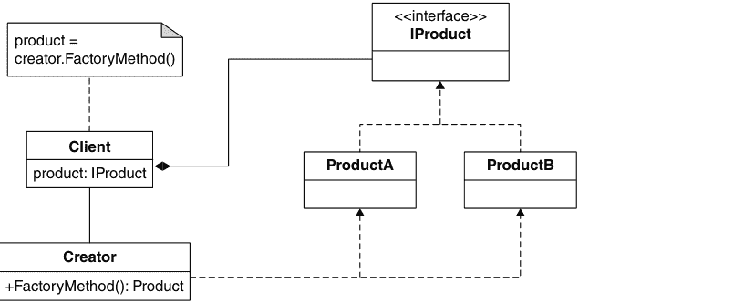

**图 6-1：** 类图显示了工厂方法模式的结构。你可以看到对象创建是如何封装在子类中的。

### 战争故事

曾经，我与一个朋友一起开发一个桌面应用程序。起初，我们不确定是否需要一个完整的数据库。那在 NoSQL 和基于文档的数据存储出现很久以前，我们唯一的选择是使用 XML。尽管如此，我们不确定 XML 文件是否足以存储数据。与此同时，我们已经启动了应用程序，并且具体的持久化实现来保存数据。因为我们想要更改系统的灵活性，我们决定通过工厂模式创建数据访问对象（DAO）。我们可以轻松地从 XML 切换到 SQL。

结果是，我实现了另一个工厂来控制打印作业，将演示版本打印到非格式化的文本文件，而不是真实的打印机。这些利用工厂模式的做法意味着我们可以让客户随心所欲地评估我们的，由于客户端无法使用格式化副本并持久化数据，该程序在生产环境中是没用的。

起初，使用工厂设计系统并不是巨大的胜利，但最终成了救命稻草。设计模式在正确的语境下使用时，可以解决未来的问题。

### 列表 6-1：由具体实现扩展的 DrinksMachine 抽象类

```java
public abstract class DrinksMachine {
    public abstract Drink dispenseDrink();

    public String displayMessage() {
        return "Thank for your custom.";
    }
}
```

### 列表 6-2：CoffeeMachine 对 DrinksMachine 抽象类的实现

```java
public class CoffeeMachine extends DrinksMachine {
    public Drink dispenseDrink() {
        return new Coffee();
    }
}
```

### 列表 6-3：SoftDrinksMachine 对 DrinksMachine 抽象类的实现

```java
public class SoftDrinksMachine extends DrinksMachine {
    public Drink dispenseDrink() {
        return new SoftDrink();
    }
}
```

### 列表 6-4：Drink 接口

```java
public interface Drink {}
```

### 列表 6-5：SoftDrink 对 Drink 接口的实现

```java
public class SoftDrink implements Drink {
    SoftDrink() {
        System.out.println("Soft drink");
    }
}
```

### 列表 6-6：Coffee 对 Drink 接口的实现

```java
public class Coffee implements Drink {
    Coffee() {
        System.out.println("Coffee");
    }
}
```

这种实现展示了 `DrinksMachine` 抽象类的子类如何决定分发的饮料。这允许 `DrinksMachine` 的任何实现分发任何 `Drink` 类型的对象。`DrinksMachine` 抽象类的每个子类都决定了分发哪些饮料。

这是一个简单的实现，其中 `dispenseDrink` 方法只分发一种饮料。更具说明性的示例将展示 `dispenseDrink` 方法接收饮料名称，然后构造并返回请求的饮料。列表 6-7 展示了如何实现这一点。

### 列表 6-7：CoffeeType 枚举

```java
public enum CoffeeType {EXPRESSO, LATTE};
```

```java
public Drink dispenseDrink(CoffeeType type) {
    Drink coffee = null;

    switch (type) {
        case ESPRESSO: coffee = new Espresso();
        case LATTE: coffee = new Latte();
    }
    return coffee;
}
```

为了简洁起见，本章仅展示了枚举类型 `CoffeeType` 的代码片段，它定义了咖啡的类型以及具体类的 `dispenseDrink` 方法。

### 抽象工厂

工厂方法模式实现起来非常直接且实用，但在更复杂的系统中，你需要对它进行组织。这引入了一种被称为抽象工厂的新模式。

抽象工厂模式在 GoF 书籍和《Head First 设计模式》中均有描述，它“提供一个接口用于创建相关或依赖对象的工厂，而无需指定它们的具体类”。

抽象工厂提供了一组工厂的封装，并对客户端如何访问这些工厂进行控制。这并没有涉及实现抽象工厂的所有细节，而是为了基础性理解提供简要的介绍。

图 6-2 展示了抽象工厂类。

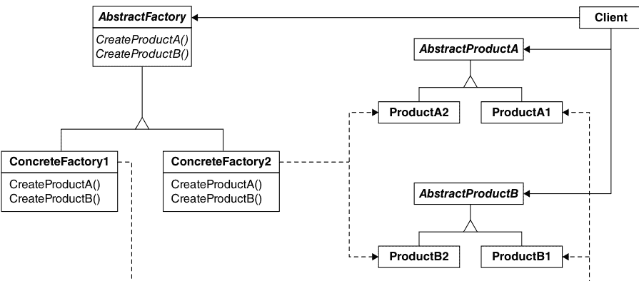

**图 6-2：** 类图所示，你可以使用抽象工厂模式对现有工厂进行分组，并封装你访问它们的方式。

### 用纯代码实现抽象工厂

为了演示抽象工厂设计模式，本章通过扩展饮料机示例，添加了一个可以生产两种不同类型饮料机的工厂：基础型和精美食型。

抽象工厂创建的“相关或依赖对象的族”是咖啡机和软饮料机。你必须为工厂创建一个实现的接口。在列表 6-8 中，我们创建了 `AbstractDrinksFactory` 接口。

### 列表 6-8：抽象工厂的接口

```java
public interface AbstractDrinksFactory {
    public DrinksMachine createCoffeeMachine();
    public DrinksMachine createSoftDrinksMachine();
}
```

该接口的具体实现是 `GourmetDrinksFactory` 和 `BasicDrinksMachineFactory`。为了简洁起见，`GourmetDrinksMachineFactory` 展示在列表 6-9 中。

### 列表 6-9：AbstractDrinksMachineFactory 的实现

```java
public class GourmetDrinksMachineFactory implements AbstractDrinksMachineFactory {
    public DrinksMachine createCoffeeMachine() {
        return new GourmetCoffeeMachine();
    }

    public DrinksMachine createSoftDrinksMachine() {
        return new GourmetDrinksMachine();
    }
}
```

*(注：此处原文代码块中类名与接口名略有不符，已按要求保留代码不翻译)*

每个工厂以不同的方式实现抽象工厂的创建方法，根据实例化的工厂不同，会创建咖啡机或软饮料机的实现。

```java
AbstractDrinksFactory factory = new GourmetDrinksFactory();
DrinksMachine coffee = factory.createCoffeeMachine();
coffee.dispenseDrink(CoffeeType.EXPRESSO);
```

这展示了 `GourmetDrinksFactory` 的实例化。咖啡机被创建，并调用了 `dispenseDrink` 方法。这展示了工厂模式的实际应用。

### 在 Java EE 中实现工厂模式

正如前面的示例所示，工厂模式实现并不困难。Java EE 通过注解提供了一种简单优雅的方式来实现工厂模式。在 Java EE 世界中，你使用 `@Produces` 来创建对象，如列表 6-10 所示。

### 列表 6-10：使用生产者实现的简单工厂

```java
package com.chronicles.producer;
import javax.enterprise.inject.Produces;

public class EventProducer {
    @Produces
    public String getMessage() {
        return "Hello World";
    }
}
```

`getMessage` 方法带有 `@Produces` 并产生 `String`。虽然产生的类型是字符串，但你可以产生任何类型，包括接口、类、基本数据类型和数组类型。要使用产生的对象，你需要对其进行注入。

### 列表 6-11：通过注入字符串

```java
package com.chronicles.Stateless;

import javax.ejb.Stateless;
import javax.ejb.TransactionAttribute;
import javax.ejb.TransactionAttributeType;
import javax.inject.Inject;

@Stateless
@TransactionAttribute(TransactionAttributeType.REQUIRED)
public class EventService {
    @Inject
    private String message;

    public void startService() {
        System.out.println("Start service " + message);
    }
}
```

当你运行并调用 `startService` 方法时，生产者方法中的字符串值会被注入到 `EventService` 的 `message` 成员中并打印到控制台。这是 Java EE 中工厂模式最简单的实现。然而，这引发了一个重要问题：依赖注入（CDI）容器如何知道必须将 `getMessage` 方法产生的字符串注入到 `EventService` 的 `message` 成员中？

答案：CDI 容器依赖类型来确定在何处注入产生的类型。在本例中，类型是字符串，因此它将产生的类型与注入类型进行匹配并注入。

你可能会认为，在真实的系统中，你希望返回不同的对象类型而不是简单的字符串，以便通过方式创建不同的对象。

### 列表 6-14：创建消息 bean 的工厂实现

```java
package com.devchronicles.factory;

import javax.enterprise.inject.Produces;

public class EventProducer {
    @Produces
    public MessageA messageAFactory() {
        return new MessageA();
    }

    @Produces
    public MessageB messageBFactory() {
        return new MessageB();
    }
}
```


在这个示例中，你创建了两个 bean：列表 6-12 中的 `MessageA` 和列表 6-13 中的 `MessageB`。你使用 `@Alternative` 注解对它们进行了标记（标注），这会禁用它们，使得容器在发现匹配的注入点时不会尝试注入它们。你对它们加了标记，以便让列表 6-14 中的工厂产生这些实例。如果你不这样做，容器在加载应用程序时会抛出异常。你将读到类似的内容：CDI 部署失败：WELD-01049 类型 [MessageA] 依赖歧义。这种歧义是由创建的两个 `MessageA` 实例引起的：一个由容器创建，另一个由 `@Produces` 方法创建。容器不知道应该将哪个实例注入到 `EventService` 的成员中。你将在本章节看到解决这种歧义的方法。

### 列表 6-15: 使用 @Inject 注入工厂创建的 bean

```java
package com.devchronicles.factory;

import javax.ejb.Stateless;
import javax.ejb.TransactionAttribute;
import javax.ejb.TransactionAttributeType;
import javax.enterprise.event.Event;
import javax.inject.Inject;

@Stateless
@TransactionAttribute(TransactionAttributeType.REQUIRED)
public class EventService {

    @Inject
    private MessageA messageA;

    @Inject
    private MessageB messageB;

    public void startService() {
        messageA.setMessage("This is message A*");
        messageB.setMessage("This is message B");

        System.out.println("Start service call " + messageA.getMessage());
        System.out.println("Start service call " + messageB.getMessage());
    }
}
```

在列表 6-15 所示的 `EventService` 类中，容器将工厂产生的两个 bean 注入到 `EventService` 类的 `messageA` 和 `messageB` 成员变量中。你可以像往常一样使用这些对象。

另一种实现是使用示例 `@Qualifier` 和 `@interface` 注解标记你想注入的类型。示例使用了自定义注解来创建两个限定器：列表 6-16 中的 `@LongMessage` 和列表 6-17 中的 `@ShortMessage`。

### 列表 6-16: ShortMessage 限定器

```java
@Qualifier
@Retention(RetentionPolicy.RUNTIME)
@Target({ElementType.METHOD, ElementType.FIELD})
public @interface ShortMessage {
}
```

### 列表 6-17: LongMessage 限定器

```java
@Qualifier
@Retention(RetentionPolicy.RUNTIME)
@Target({ElementType.METHOD, ElementType.FIELD})
public @interface LongMessage {
}
```

你使用这些限定器来标注如列表 6-18 所示的生产者方法，以及如列表 6-19 所示的匹配注入点。

### 列表 6-18: 使用限定器消除 bean 的歧义

```java
public class EventProducer {

    @Produces @ShortMessage
    private MessageA messageAFactory() {
        return new MessageA();
    }

    @Produces @LongMessage
    private MessageB messageBFactory() {
        return new MessageB();
    }
}
```

### 列表 6-19: 使用限定器注入已创建的 bean

```java
@TransactionAttribute(TransactionAttributeType.REQUIRED)
public class ClientMessage {

    @Inject @ShortMessage
    private Message messageA;

    @Inject @LongMessage
    private Message messageB;

    public void doEvent() {
        messageA.setMessage("This is a long email message.");
        messageB.setMessage("This is a short SMS message.");
        System.out.println(messageA.getMessage());
        System.out.println(messageB.getMessage());
    }
}
```

限定器上指定的 `@Target` 注解决定了你可以在哪里使用该限定器。值可以是以下一个或全部——`TYPE`、`METHOD`、`FIELD` 和 `PARAMETER`，其含义自显易见。

或者，你也可以通过 `@interface` 类中定义的枚举类型来实现相同的功能，列表 6-20 显示了这种实现。

### 列表 6-20: 自定义注解类型

```java
@Qualifier
@Retention(RetentionPolicy.RUNTIME)
@Target({ElementType.METHOD})
public @interface MyEvent {
    Type value();
    enum Type { LOGGING, MESSAGE }
}
```

借助这个自定义注解，你可以使用不同的方法来创建标记有你注解的字符串对象。在列表 6-21 中，你可以使用不同的方法创建标记有你注解的字符串对象。

### 列表 6-21: 使用自定义注解消除 bean 的歧义

```java
public class EventProducer {

    @Produces @MyEvent(LOGGING)
    private MessageA messageAFactory() {
        return new MessageA();
    }

    @Produces @MyEvent(MESSAGE)
    private MessageB messageBFactory() {
        return new MessageB();
    }
}
```

### 列表 6-23: 使用命名注解消除歧义

```java
package com.devchronicles.factory;

import javax.inject.Inject;

public class EventProducer {

    @Produces
    @Named("Logging")
    private MessageA messageAFactory() {
        return new MessageA();
    }

    @Produces
    @Named("Message")
    private MessageB messageBFactory() {
        return new MessageB();
    }
}
```

### 列表 6-24: 使用命名注解注入

```java
@Stateless
@TransactionAttribute(TransactionAttributeType.REQUIRED)
public class EventService {

    @Inject
    @Named("Logging")
    private String messageA;

    @Inject
    @Named("Message")
    private String messageB;

    public void startService() {
        System.out.println("Start service call " + messageA);
        System.out.println("Start service call " + messageB);
    }
}
```

如果你的应用程序有接口的多个实现，并且你想实现工厂模式来产生这些对象的实例，你将拥有一个带有多个 `@Produces` 注解方法的工厂类。这将变得冗长且难以维护。幸运的是，CDI 提供了一种基于 `@Any` 注解、枚举类型的巧妙使用以及 `Instance` 类的解决方案。

### 利用 CDI 的力量

原本需要几十甚至上百行代码来产生每个实例，你只需要四行代码即可完成。你可以通过收集特定接口的所有实例并使用 `@Any` 注解选择你想要的一个。

下方的代码 `private Instance<MessageType> messages` 将实现 `MessageType` 接口的所有依赖注入到成员变量中。

一旦注入了所有依赖项，你需要一种方法来将它们与你想要的那个区分开。这就是注解字面量和枚举类型的用武之地。在后续列表中，你定义了一个 `@Message` 限定器以及枚举 `SHORT` 和 `LONG`。它们区分了 `MessageType` 接口的实现。

要选择依赖项，通过创建你搜索的类型的注解字面量并与每个实现的枚举类型进行比较，将其返回给客户端。

现在你将看到这是如何实现的。你将使用一个产生 `ShortMessage` 和 `LongMessage` 对象的示例，每个对象都实现了 `Message` 接口并被注释为 `SHORT` 或 `LONG`。

### 列表 6-25: MessageType 接口

```java
public interface MessageType {
    public String getMessage();
    public void setMessage(String message);
}
```

### 列表 6-26: Message 接口的 ShortMessage 实现

```java
@Message(Message.Type.SHORT)
@Dependent
public class ShortMessage implements MessageType {

    private String message;

    @Override
    public String getMessage() {
        return message;
    }

    @Override
    public void setMessage(String message) {
        this.message = message;
    }
}
```

### 列表 6-27: LongMessage 实现 Message 接口

```java
@Message(Message.Type.LONG)
@Dependent
public class LongMessage implements MessageType {

    private String message;

    @Override
    public String getMessage() {
        return message;
    }

    @Override
    public void setMessage(String message) {
        this.message = message;
    }
}
```

如列表 6-25 所示，`MessageType` 接口的每个具体实现都带有 `@Message` 限定符，该限定符指定消息类型为 `Message.Type.SHORT` 或 `Message.Type.LONG`，如列表 6-26 和列表 6-27 所示。`@Message` 限定符的实现方式相同，如列表 6-28 所示，与在自定义注解类型示例中所使用的限定符一样。

### 列表 6-28: 自定义消息注解

```java
@Qualifier
@Retention(RetentionPolicy.RUNTIME)
@Target({ElementType.FIELD, ElementType.TYPE})
public @interface Message {
    Type value();
    enum Type { SHORT, LONG }
}
```

为了创建一个用于在你想要的类型与依赖项的类型之间进行比较的注解字面量，你需要扩展抽象类 `AnnotationLiteral` 并实现 `Message` 作为自定义限定符。列表 6-29 显示了如何操作。

### 列表 6-29: 用于获取所需消息类型的注解字面量

```java
public class MessageLiteral extends AnnotationLiteral<Message> implements Message {

    private static final long serialVersionUID = 1L;
    private Type type;

    public MessageLiteral(Type type) {
        this.type = type;
    }

    public Type value() {
        return type;
    }
}
```

现在你已经拥有了拼图的所有部分，可以在列表 6-30 所示的 `MessageFactory` 中将它们组合起来。

### 列表 6-30: 工厂实现

```java
@Dependent
public class MessageFactory {

    @Inject
    @Any
    private Instance<MessageType> messages;

    public MessageType getType(Message.Type type) {
        MessageLiteral literal = new MessageLiteral(type);
        Instance<MessageType> typeMessages = messages.select(literal);
        return typeMessages.get();
    }
}
```

在工厂中，所有实现 `MessageType` 接口的依赖都被注入到成员变量 `messages` 中。然后，在 `getType` 方法中，你使用 `Message.Type` 参数创建一个新的 `MessageLiteral`，从 `messages` 中选择你需要的 `MessageType` 实现，然后返回给客户端。

客户端注入并调用 `getType` 方法，传入它所需的 `Message.Type`，如列表 6-31 所示。

### 列表 6-31: 使用工厂实现的客户端

```java
@TransactionAttribute(TransactionAttributeType.REQUIRED)
@ApplicationScoped
public class Client {

    @Inject
    MessageFactory mf;

    public void doMessage() {
        MessageType m = mf.getType(Message.Type.SHORT);
        m.setMessage("This is a short message");
        System.out.println(m.getMessage());

        m = mf.getType(Message.Type.LONG);
        m.setMessage("This is a long message");
        System.out.println(m.getMessage());
    }
}
```

这一章在很大程度上偏离了 GoF 工厂模式的原始实现。事实上，你可以认为这并不是真正的工厂模式实现，而是一种“选择并注入”模式。尽管如此，CDI 新颖且动态的功能允许你在实现传统模式的方式上发挥创意，并在经典设计的基础上进行改进。

### 何时以及如何使用工厂模式

工厂模式的传统实现自 GoF 首次提出以来已经发生了巨大变化。抽象工厂被认为是隐藏对象创建的有效方法，特别是当创建过程复杂时。创建越复杂，使用工厂就越合理，以便以一致的方式创建对象并进行严格控制。在 CDI 的世界中，容器管理对象，因此工厂的使用是言而易举的。你可以通过 `@Produces` 注解来隐藏复杂的逻辑。或者，在 CDI 环境中，你可以利用容器的力量，从池中选择你需要的对象，这通过调用默认构造函数来实现对象的实例化。

### 总结


在这一章中，你已经看到了在非 CDI 环境中如何实现工厂模式的各种口味。在 CDI 环境中，你看到了 `@Inject` 注解如何从根本上改变了实现和使用工厂模式的方式。你发现了如何利用容器对 bean 的实例化，并在代码中使用它们。希望你不再怀疑在 Java EE 中实现工厂模式是更加优雅、更简单且更简洁的方法。

### 练习

- 使用抽象工厂模式创建一个产生不同类型汽车和面包的工厂。
- 使用抽象工厂模式创建一个产生不同类型汽车和面包的工厂。
- 使用抽象工厂模式创建一个产生不同类型汽车和面包的工厂。

### 注意

- 使用抽象工厂模式创建一个产生不同类型汽车和面包的工厂。
- 使用抽象工厂模式创建一个产生不同类型汽车和面包的工厂。
- 使用抽象工厂模式创建一个产生不同类型汽车和面包的工厂。

## 装饰器模式

### 什么是装饰器？

装饰器模式是 GoF 描述的结构模式之一。它的目的是包装目标对象以动态添加职责。每个装饰器都可以包装另一个，理论上允许无限数量。

尽管这种运行时行为比子类要灵活得多，但它引入了复杂性，因为在执行之前很难确定类型和行为。

装饰器用于几乎所有的语言和平台，从 UI 到后端。大多数框架和运行时使用装饰器模式来添加特定的行为。

在 Java EE 中，你无需模板代码即可实现装饰器模式。然而，与书中大多数模式不同，你经常为 bean 添加配置。

### 故事

多年前，我们赢得了一个合同，为一家向客户提供销售点（POS）服务的公司完成一个饮料订单和支付系统。这些客户是餐厅、咖啡馆和酒吧。我们对该领域并不了解，因此根据当时有限的知识和信息做了一些合理的假设。幸运的是，大多数假设都是正确的。

我们的设计规则之一是，如果附加选项更改了产品价格，则应将其添加为新产品。如果餐厅提供额外的部分，应在菜单上添加一个新项。然而，如果是像额外的奶酪这样的免费选项，则可以作为订单的备注添加。

这条规则适用于每个客户，直到有一天我们遇到了一位咖啡馆主，他的经营方式略有不同。这家咖啡馆主要卖甜点，但也提供披萨。披萨是菜单上的唯一品种。因为咖啡馆并不精通披萨，它不提供固定的披萨，而是让顾客从很长的配料列表中自己创建披萨，并对每种配料收费。这对于咖啡馆提供披萨来说是一种非常明智的方法，因为只有少数顾客想要吃披萨。然而，由于我们的设计规则，这对我们的系统是灾难性的：如果插件更改了产品的价格，则应该将其作为一个新产品添加。因为每种配料的价格不同，我们需要计算所有配料组合，并为每种组合在菜单中输入一个新的披萨。

如你所知，`n^t` 会迅速增长，在这种情况下，这将导致一个包含少数几种组合的长长披萨列表。由于这是不可接受的，我们建议客户输入具有固定数量配料的披萨（1个配料、2个配料、3个配料），我们可以在订单中添加一条备注来记录客户的配料。通过这种解决方案，我们可以将列表从 `n^t` 缩短为固定长度。

尽管如此，这种做法并不真的合理。由于系统已经在运行，我们需要找到一种在不破坏其他部分的情况下修复它的方法。我们需要用配料来“装饰”现有的披萨对象。显然，答案是实现装饰器模式。这正是我们所做的。客户选择的每种配料都以类似的方式包装了披萨对象，就像《Head First 设计模式》中使用的示例一样。

### 装饰器类图

正如图 7-1 中的类图所示，装饰器模式为现有的类层次结构引入了一些样板代码。该模式在目标类和装饰器之间引入了共享接口。装饰器必须有一个指向该接口实例的引用。

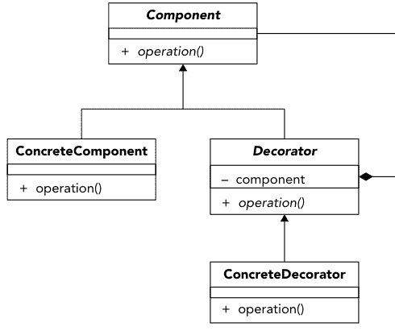

图 7-1：装饰器模式的类图

## 在纯代码中实现装饰器模式

如果类处于设计阶段，添加装饰器不应该是太大问题。然而，如果要在现有系统中实现装饰器，你可能需要重构某些类。例如，目标类应该实现与装饰器实现相同的接口。

本章将通过一个披萨店的简易 POS 系统演示装饰器模式的使用。每个披萨都可以用额外的配料进行“装饰”，例如双倍奶酪和免费的辣椒。

首先，你将选择 `Order` 接口，它由 `Pizza` 类和装饰器的 `Extra` 类实现。`Extra` 类被额外的配料类扩展：`DoubleExtra`、`NoCostExtra` 和 `RegularExtra`。

你将从在 Listing 7-1 中创建 `Order` 接口开始。

```java
// LISTING: 7-1: Order 接口
public interface Order {

    public double getPrice();

    public String getLabel();

}
```

在 Listing 7-2 中，你将创建一个代表菜单上披萨的类（四季披萨、玛格丽特、夏威夷披萨等）。这是要装饰的目标对象。

```java
// LISTING: 7-2: 被装饰的类实现了 Order 接口
public class Pizza implements Order {

    private String label;
    private double price;

    public Pizza(String label, double price){
        this.label=label;
        this.price=price;
    }

    public double getPrice(){
        return this.price;
    }

    public String getLabel(){
        return this.label;
    }
}
```

接下来的代码创建了一个四季披萨。

```java
Order fourSeasonsPizza = new Pizza("Four Seasons Pizza", 10);
```

接下来，你需要创建用额外配料装饰披萨的装饰器。使用抽象类，这样具体类就不必实现接口的所有方法。一个抽象装饰器将创建一个其他装饰器可以扩展的蓝图。

也许你有不同类型的配料（奶酪、辣椒、菠萝等）。想象一下客户想要点一份稍微辣一点的餐，而餐厅不会为那种配料收费。你需要一个不给披萨增加内容但提供正确标记（即已要求添加额外的辣椒）的装饰器。此外，客户可能会要求额外双份的奶酪，如果系统打印出“奶酪”，厨师可能会认为是一个错误并只添加一份奶酪。你需要另一个具体的装饰器来允许对双份配料进行正确标记。Listing 7-3 实现了你的目标。

### Listing 7-3: 增加额外配料的抽象装饰器

```java
public abstract class Extra implements Order {

    protected Order order;
    protected String label;
    protected double price;

    public Extra(String label, double price, Order order) {
        this.order = order;
        this.label = label;
        this.price = price;
    }

    public abstract double getPrice();

    public abstract String getLabel();
}
```

现在你有了抽象装饰器，就可以添加特定的行为并创建具体的装饰器。你将从 `RegularExtra` 装饰器开始，它为目标对象（披萨）添加费用和标签。因为标记功能是由抽象装饰器提供并由所有扩展它的子类继承的，所以你只需要实现定价功能。Listing 7-4 处理了这个问题。

### Listing 7-4: 增加额外配料的装饰器

```java
public class RegularExtra extends Extra {

    public RegularExtra(String label, double price, Order order){
        this.order = order;
        this.label = label;
        this.price = price;
    }

    @Override
    public double getPrice(){
        return order.getPrice() + price;
    }

    @Override
    public String getLabel(){
        return order.getLabel() + ", " + label;
    }
}
```

接下来，你需要创建一个 `NoCostExtra` 装饰器，它修改标签但不增加费用。

### Listing 7-5: 免费额外配料的装饰器

```java
public class NoCostExtra extends Extra {

    public NoCostExtra(String label, double price, Order order){
        this.order = order;
        this.label = label;
        this.price = price;
    }

    @Override
    public double getPrice(){
        return order.getPrice();
    }

    @Override
    public String getLabel(){
        return order.getLabel() + ", " + label;
    }
}
```

最后，在 Listing 7-6 中，你实现 `DoubleExtra` 来双倍价格。

### Listing 7-6: 双倍价格的装饰器

```java
public class DoubleExtra extends Extra {

    public DoubleExtra(String label, double price, Order order){
        this.order = order;
        this.label = label;
        this.price = price;
    }

    @Override
    public double getPrice(){
        return order.getPrice() * 2;
    }

    @Override
    public String getLabel(){
        return order.getLabel() + ", " + label;
    }
}
```

现在你已经实现了装饰器模式来增加额外配料，可以测试它。

```java
Order fourSeasonsPizza = new Pizza("Four Seasons Pizza", 10);
Order extraCheese = new RegularExtra("Extra Cheese", 2, fourSeasonsPizza);
Order doubleCheese = new DoubleExtra("Double Cheese", 4, extraCheese);
Order freeChili = new NoCostExtra("Free Chili", 0, doubleCheese);

System.out.println(freeChili.getLabel());
System.out.println(freeChili.getPrice());
```

输出将是：

```
Four Seasons Pizza, Extra Cheese, Double Cheese, Free Chili
24.0
```

### Listing 7-8 (继续)

```java
public void setPrice(double price) {
    this.price = price;
}
public String getLabel() {
    return label;
}
public double getPrice() {
    return price;
}
public String generateLabel() {
    return price + " , " + label;
}
```

你通过实现 `Product` 接口来创建 `PriceDiscountDecorator`。该类实现了 `generateLabel` 方法并添加了折扣行为。装饰器将产品价格降低 50%，并在产品的标签上添加“Discounted”（已折扣）文本。

为了将此类识别为装饰器，必须使用 `@Decorator` 对其进行注解。委托注入点（将被装饰的实例）使用 `@Delegate` 注解，并且必须是一个注入字段、初始化方法或 bean 构造方法。委托类型必须由你想要装饰的类（在本例中 `Product`）实现。CDI 容器会将任何 `Product` 接口的可用实例注入到 `product` 成员变量中，如 Listing 7-9 所示。

### Listing 7-9: PriceDiscountDecorator 装饰器

```java
@Decorator
public class PriceDiscountDecorator implements Product {

    @Any
    @Inject
    @Delegate
    private Product product;

    public String generateLabel() {
        product.setPrice(product.getPrice() * 0.5);
        product.setLabel(product.getLabel() + " (Discounted)");
        return product.generateLabel();
    }

    // 未显示所有方法
}
```

最后，你必须在 `bean.xml` 中声明装饰器。虽然大部分配置已经通过注解完成，但你仍然需要添加一些 XML 配置来使装饰器生效。

这种配置可能看起来令人失望，因为你已经对装饰器进行了注解；尽管如此，该配置是简单且必要的，以便你可以定义装饰器的顺序（如果有多个）。在 `beans.xml` 中添加以下行：

```xml
<decorators>
    <class>com.devchronicles.decorator.PriceDiscountDecorator</class>
</decorators>
```

你的工作完成了。你现在可以装饰你的 bean：

```java
@Any
@Inject
Product product;

public void createPriceList() {
    System.out.println("Label: " + product.generateLabel());
}
```

一个实例被注入到 `product` 成员变量中，并调用了 `generateLabel` 方法。控制台输出将显示：

```
Label: 12.5, Dining Table (Discounted)
```

当对任何 `Product` 实例调用 `generateLabel` 方法时，容器会拦截它。调用被委托给 `PriceDiscountDecorator` 装饰器的相应方法，在该处对价格进行折扣，并通过调用对象的 `generateLabel` 方法将调用传递给原始目标。

所有声明用于装饰实现 `Product` 接口类的装饰器形成了一个链。装饰器声明的顺序由它们在 `bean.xml` 部署符中的顺序决定。你将在 Listing 7-10 中看到这一点，那里你定义了另一个装饰器 `BlackFridayDiscountDecorator`，实现了 `Product` 接口并添加了 `@Decorator` 和 `@Delegate` 注解。

### Listing 7-10: BlackFridayDiscountDecorator

```java
@Decorator
public class BlackFridayDiscountDecorator extends AbstractDiscountDecorator {

    @Any
    @Inject
    @Delegate
    private Product product;

    public String generateLabel() {
        product.setPrice(product.getPrice() * 0.25);
        product.setLabel(product.getLabel());
        return product.generateLabel();
    }

    // 未显示所有方法
}
```

你必须按照希望调用的顺序在 `bean.xml` 中添加装饰器。在这里，你声明 `PriceDiscountDecorator` 装饰器应该在 `BlackFridayDiscountDecorator` 装饰器之前被调用。

```xml
<decorators>
  <class>com.devchronicles.decorator.PriceDiscountDecorator</class>
  <class>com.devchronicles.decorator.BlackFridayDiscountDecorator</class>
</decorators>
```

当调用 `generateLabel` 方法时，建立了一个链。`generateLabel` 的调用被拦截并委托给 `PriceDiscountDecorator` 的 `generateLabel` 方法。它调用 `getPrice`，该方法将被调用并委托给 `BlackFridayDiscountDecorator` 的 `getPrice` 方法，后者反过来调用其注入对象的 `getPrice` 方法。（这就是你注入到 `PriceDiscountDecorator` 中的同一个实例。）此调用没有被拦截，因为该接口没有更多装饰器了，它调用了 `Table` 对象的 `getPrice`。一旦此调用完成，它返回对第一个 `getPrice` 方法的调用。装饰器将价格降低 50% 并调用 `setPrice` 方法。此调用沿链向上委托，直到到达 `Table` 对象，并在那里设置新价格。然后调用沿链返回。


`generateLabel` 方法被调用，并创建了与 `getPrice` 方法类似的调用。

最后，`generateLabel` 方法被 `BlackFridayDiscountDecorator` 装饰器拦截。价格进一步降低 25%，并启动了由 `PriceDiscountDecorator` 装饰器设置的链。

控制台输出：

```
Label: 6.25, Dining Table (Discounted)
```

为了保持链不断中断，`generateLabel` 方法必须委托给注入实例的 `generateLabel` 方法；否则链将断开，只有第一个装饰器被调用。

# 在 Java EE 中实现装饰器模式

为了不装饰相同类型的类，你需要创建一个自定义限定符（Qualifier），并对委托注入点以及想要装饰的类进行注解。你将创建一个实现 `Product` 接口的平底产品。只有这个产品必须被折扣。为了实现这一需求，你使用自定义限定符对其进行注解，从而排除其他产品被装饰。

你创建一个自定义限定符并将其命名为 `@ClearanceSale`。

在列表 7-11 中，你创建了 `Product` 接口的新实现并对其使用自定义限定符注解。

# 列表 7-11: 使用自定义限定符装饰的类

```java
@ClearanceSale
public class Plate implements Product {

    private String label = "Plate";
    private double price = 50.00;

    public void setLabel(String label) {
        this.label = label;
    }

    public void setPrice(double price) {
        this.price = price;
    }

    public String getLabel() {
        return label;
    }

    public double getPrice() {
        return price;
    }

    public String generateLabel() {
        return price + " , " + label;
    }
}
```

最后，在你想要调用的装饰器中对委托注入点进行注解。在这种情况下，选择 `PriceDiscountDecorator` 装饰器。

```java
@ClearanceSale
@Any
@Inject
@Delegate
private Product product;
```

只有标记了 `@ClearanceSale` 并且实现了 `Product` 接口的类会被注入到 `PriceDiscountDecorator` 装饰器的委托注入点中；因此，只有你的 `Plate` 类会被装饰。委托注入点可以拥有任意数量的限定符（qualifiers），并且它只会绑定到相同的限定符上。

## 无需 XML 配置的装饰器

在部署时，CDI 包含应用程序中所有的 JAR 和 WAR 文件并寻找 `bean.xml` 描述符。对于找到的描述符，它会逐一处理并进行相应的配置。当它遇到 `<decorator/>` 描述符时，它会启用 `bean.xml` 文件所在归档中的装饰器。它不会启用所有实现相同接口的类，无论它们在应用程序的什么位置。这对于希望装饰器应用于所有类的开发者来说是可能的。从 CDI 1.1 开始，可以通过在装饰器类上注解 `@Priority` 和 `Interceptor.Priority` 值来启用装饰器。以下是如何为整个应用程序启用装饰器的示例。

```java
@Priority(Interceptor.Priority.APPLICATION)
@Decorator
public class PriceDiscountDecorator extends AbstractDiscountDecorator
```

```java
@Priority(Interceptor.Priority.APPLICATION - 10)
@Decorator
public class BlackFridayDiscountDecorator extends AbstractDiscountDecorator
```

注解了较低优先级值的装饰器会被先调用。在上述示例中，`PriceDiscountDecorator` 在 `BlackFridayDiscountDecorator` 之前被调用。

注解了 `@Priority` 的装饰器会在部署描述符中的装饰器之前被调用。如果一个装饰器在两者中都被启用，它会被调用两次。这可能会导致不理想的结果，因此你需要确保装饰器只通过一种方式被装饰。

## 何时以及何时使用装饰器模式

装饰器模式在运行时或无法使用子类化时（因为子类化会创建多个子类），动态地向对象添加行为。披萨餐厅的示例展示了如何根据客户做出的选择在运行时为披萨对象添加行为。

应用程序编程接口（API）的功能可以通过将其封装在装饰器中来扩展和改进。数据流通常是这样装饰的。`java.io.BufferedInputStream` 是一个很好的装饰器示例，它包装了低级 API 并为输入流添加了缓冲区功能。

在 Java EE 中，装饰器是通过上下文依赖注入（CDI）实现的。你可以使用装饰器来添加新的业务行为或任何可以包装在原始对象周围的功能。然而，这种设计应该有良好的文档说明并清晰地实现，以便更好的维护性。

### 总结

在部署描述符中声明的装饰器的可插性使得在无需重新编译和重新部署的情况下启用和禁用装饰器变得简单。在热部署环境中，服务器不需要为了 `bean.xml` 的更改而重启。这使得在生产环境中更改应用程序的行为而不中断服务变得极其容易。

限定符的使用对装饰器的执行提供了更细粒度的控制，而无需在 `bean.xml` 描述符中启用/禁用它们。你可以使用限定符来排除接口的实现被装饰，或者对同一个接口应用不同的装饰器。

装饰器只拦截对 Java 类型的调用。它感知此接口的所有语义并可以实现业务逻辑。这使得它非常适合建模特定接口类型可识别的业务关注点。

装饰器通常与拦截器（interceptors）对比。拦截器调用任何 Java 类型的调用，但它们不具备语义感知，因此不是建模业务关注点的合适工具。拦截器用于实现与业务逻辑无关的交叉关注点，如日志、安全和审计。

大量使用装饰器可能会引入运行时错误、更难理解的代码库以及丢失强静态多态的优势。它还可能引入测试用例。然而，装饰器可以提供几乎无限的扩展性，并为未来的实现提供一个极佳的接口，而不会破坏旧代码。

### 总结

在本章中，你已经看到 Java EE 中装饰器模式的实现与其在 Java EE 之前的祖先版本几乎无法区分。被装饰的对象由容器实例化并注入，而装饰器通过 `bean.xml` 声明或策略性地使用限定符来应用。

注解和依赖注入的使用减少了编写装饰器解决方案所需的代码量，并使得引入自动根据接口装饰的新类变得更加简单。

你已经看到装饰器模式如何演变为一种实际上的敏捷模式，可以在生产环境中在不影响服务的情况下启用和禁用。然而，它保持了为其所装饰的对象添加行为或职责的原始原则。

# 什么是面向切面的编程？

我们对自己的应用程序非常有信心，所以大家都拿上爆米花看着测试阶段。在经历了一系列成功的测试后，其中一次测试失败了。安全人员成功捕获了超文本传输协议（HTTP）请求并更改了某些参数以获取应用程序的响应。这个问题并不大；中间层有我们的授权系统。尽管如此，经过修改的请求仍然访问了已授权的响应。

总结来说，客户端应该调用几个服务来访问资源。假设服务 A 返回了一些 ID，而服务 B 可以使用服务 A 返回的 ID 进行调用。同样，服务 C 可以使用 B 返回的其中一个 ID 进行调用。这意味着入侵者可以捕获并插入一个随机 ID，该用户有权查询该 ID 但其实际上并未查询。在这样的情况下，客户端将绕过标准的调用流并访问资源。

由于访问的信息是用户授权的资源，因此这个问题并不严重。尽管如此，它仍被报告为一个绕过常规流程的安全漏洞；这引起了关注。

应用程序已经完成并测试完毕，我们并没想对其进行重构。相反，我们想出了一个绝妙的主意：因为客户端每次都需要使用上一个响应中的 ID，我们可以捕获所有返回的 ID。如果请求的 ID 在已查询 ID 列表中，我们可以轻松让其通过或失效会话并强制用户登录。

这个想法简单但有效，然而我们不知道如何以最小的更改来实现它。由于我们想要关联与 Web 请求相关的任何事情，拦截并验证它们似乎是一个好主意。幸运的是，Java 已经提供了内置的解决方案，我们不需要使用花哨的第三方框架。

解决方案是实现一个 Servlet 过滤器（servlet filter）。它将缓存响应中的 ID，并检查下一个请求是否带有列表中的有效 ID。我们只需要添加一个充当 Servlet 过滤器的类，以及一个 XML 定义来让 Servlet 过滤器运行。该解决方案是可插拔的，可以很好地集成。此外，它还提供了一个在开发环境中关闭它的选项。

该系统不仅通过了所有安全测试，而且超出了预期。我们可以轻松地从请求/响应对中记录并提取统计数据。最重要的是，该解决方案对系统的整体架构和复杂性没有影响。

AOP 可以封装通用非业务关注点的绝佳工具。然而，如果 AOP 为业务逻辑添加行为，它也可能会令人困惑。此类实现会导致去中心化、分布式且难以测试和调试的业务逻辑。生成的代码将难以维护。

### 在纯代码中实现 AOP

Java SE 不提供 AOP 的开箱可用支持。你可以通过使用 AspectJ 或 Spring 等第三方框架来实现 AOP。此类框架曾用于仅限 XML 的配置；但现在你可以通过使用注解来实现 AOP。这两个框架的实现和配置超出了本书的范围，但它们有经过证明的记录，并且可以很容易实现。它们提供了 Java EE 实现的有效替代方案。

然而，Java 应用程序具有使用 Servlet 拦截请求或响应的优势，这与切面（aspects）的工作类似。要实现 Servlet 过滤器，创建一个新的类文件并实现 Servlet 过滤器接口。提供 `doFilter()` 方法的实现，如列表 8-1 所示。

# 列表 8-1：Servlet 过滤器的简单实现

```java
package com.devchronicles.interceptor.filter;

import java.io.IOException;
import java.util.ArrayList;
import java.util.List;

import javax.servlet.Filter;
import javax.servlet.FilterChain;
import javax.servlet.FilterConfig;
import javax.servlet.ServletException;
import javax.servlet.ServletRequest;
import javax.servlet.ServletResponse;
import javax.servlet.http.HttpServletRequest;
import javax.servlet.http.HttpServletResponse;

public class SecurityFilter implements Filter {
    @SuppressWarnings("unused")
    private FilterConfig filterConfig = null;

    @Override
    public void doFilter(ServletRequest request, ServletResponse response,
            FilterChain chain) throws IOException, ServletException {
        Log.info(((HttpServletRequest) request).getRemoteAddr());
        // 执行一些安全检查
    }

    @Override
    public void init(FilterConfig filterConfig) throws ServletException {
        this.filterConfig = filterConfig;
    }

}
```

Web 容器需要列表 8-2 所示的配置在统一资源定位符（URL）上激活 Servlet 过滤器。这放置在 Web 应用程序的 `web.xml` 文件中。

# 列表 8-2：定义 Servlet Filter

```xml
<?xml version="1.0" encoding="UTF-8"?>
<web-app xmlns:xsi="http://www.w3.org/2001/XMLSchema-instance"
     xmlns="http://java.sun.com/xml/ns/javaee"
     xsi:noNamespaceLocation="http://java.sun.com/xml/ns/javaee/web-app_2_5.xsd"
     version="2.5">
  <filter>
    <filter-name>SecurityFilter</filter-name>
    <filter-class>com.devchronicles.interceptor.filter.SecurityFilter</filter-class>
  </filter>
  <filter-mapping>
    <filter-name>SecurityFilter</filter-name>
    <url-pattern>/*</url-pattern>
  </filter-mapping>
</web-app>
```

使用 Servlet 3.0 实现过滤器甚至更简单，因为它使用了注解且不需要 XML 配置。

# 列表 8-3：Servlet 3.0 的过滤器简单实现

```java
package com.dev.interceptor;

import java.io.IOException;
import java.util.ArrayList;
import java.util.List;

import javax.servlet.http.HttpServletRequest;
import javax.servlet.http.HttpServletResponse;
import javax.servlet.Filter;
import javax.servlet.FilterChain;
import javax.servlet.ServletRequest;
import javax.servlet.ServletResponse;
import javax.servlet.ServletException;
import javax.servlet.annotation.WebFilter;
import javax.servlet.annotation.WebInitParam;

@WebFilter(filterName = "SecurityFilter", urlPatterns = {"/*"})
public class SecurityFilter implements Filter {

  @Override
  public void doFilter(ServletRequest request, ServletResponse response,
      FilterChain chain) throws IOException, ServletException {
    Log.info(((HttpServletRequest) request).getRemoteAddr());
    // 执行一些安全检查
  }
}
```

Servlet 过滤器是易于实现的工具，但也非常强大。然而，其功能仍然限于 Web 请求。要拦截其他方法调用或调整拦截，你需要更复杂的方法。

### Java EE 中的切面、拦截器

J2EE 不提供开箱即用的 AOP 解决方案，但与第三方框架和谐工作。Java EE 5 引入了拦截器（interceptors），产生了一种易于使用的内置切面方法。在引入上下文和依赖注入（CDI）之前，拦截器的概念局限于企业 Bean（EJB）。

Java EE 中的拦截器工作方式与切面类似。每个拦截器处理关注点并托管包含要添加的功能块。被装饰的目标被称为建议（advice）。在拦截器范围内的每次建议调用都会执行。切面的精确位置在切点（pointcut）处执行。

基础的 Java EE 拦截器只能作用于 EJB。想象一个包含数百个 EJB 的应用程序。可以通过部署一个针对所有 EJB 的拦截器来配置整个应用程序以记录它们。

在 Java EE 中实现拦截器非常直观。第一步创建一个新的拦截器类并用 `@Interceptor` 注解标记它。这托管了建议代码。任何带有 `@AroundInvoke` 注解的方法都在切点执行。然而，关于方法签名有一些语法规则：

- 任何拦截器方法必须返回 `Object` 类型的对象并有一个 `InvocationContext` 类型的参数。
- 可以抛出异常。

你可以使用 `InvocationContext` 参数来访问当前上下文的信息，如列表 8-4 所示。

# 列表 8-4：拦截器的简单实现


```java
package com.devchronicles.interceptor;

import javax.interceptor.AroundInvoke;
import javax.interceptor.InvocationContext;
import java.util.logging.Logger;

@Interceptor
public class SecurityInterceptor {

    @AroundInvoke
    public Object doSecurityCheck(InvocationContext context) throws Exception {
        // 进行一些安全检查！
        Logger.getLogger("SecurityLog").info(context.getMethod().getName() + " is accessed!");
        return context.proceed();
    }
}
```

要让拦截器类生效，你必须使用列表 8-5 中的 `@Interceptors` 注解来标记目标建议。`@Interceptors` 注解仅用于 EJB 或 MDB（消息驱动 Bean）。

## 列表 8-5: 目标建议的简单实现

```java
package com.devchronicles.interceptor;

import javax.ejb.Stateless;
import javax.ejb.TransactionAttribute;
import javax.ejb.TransactionAttributeType;
import javax.enterprise.event.Event;
import javax.inject.Inject;
import javax.interceptor.Interceptors;

@Interceptors(SecurityInterceptor.class)
@Stateless
@TransactionAttribute(TransactionAttributeType.REQUIRED)
public class SomeBusinessService {

    public void startService() {
        // Complex business logic
        Logger.getLogger("AppLog").info("done...");
    }

    public void startAnotherService() {
        // Complex business logic
        Logger.getLogger("AppLog").info("done again...");
    }
}
```

`@Interceptors` 注解是非常灵活的。你可以同时在类级别和方法级别使用它。`@Interceptors` 注解还支持多个拦截器输入，可以在目标建议上启用多个拦截器。列表 8-5 使用了类级拦截器，这意味着安全拦截器将拦截任何一个服务调用。如果你不想让拦截器覆盖类中的所有方法，可以使用方法级注解，如列表 8-6 所示。

## 列表 8-6: 方法级拦截器的实现

```java
package com.devchronicles.interceptor;

import javax.ejb.Stateless;
import javax.ejb.TransactionAttribute;
import javax.ejb.TransactionAttributeType;
import javax.enterprise.event.Event;
import javax.inject.Inject;
import javax.interceptor.Interceptors;

@Stateless
@TransactionAttribute(TransactionAttributeType.REQUIRED)
public class SomeBusinessService {

    @Interceptors(SecurityInterceptor.class)
    public void startService() {
        // Complex business logic
        Logger.getLogger("AppLog").info("done...");
    }

    public void startAnotherService() {
        // Complex business logic
        Logger.getLogger("AppLog").info("done again...");
    }
}
```

这一次只有 `startService()` 方法被拦截，这与列表 8-5 不同，后者类的所有方法都被拦截了。你应该对每个方法单独进行注解。

使用 `@Interceptor` 和 `@Interceptors` 配合 `@AroundInvoke` 提供了一种强大的工具，能够以 AOP 方法解决横切关注点。然而，拦截器提供了简单的基于注解的实现，无需样板代码。

你可以使用 `InvocationContext` 接口来提取有关上下文的信息或与建议上下文交互。以下是一些最实用的方法：

| 方法 | 描述 |
| :--- | :--- |
| `public Object getTarget();` | 返回目标建议。 |
| `public Method getMethod();` | 返回建议中执行的方法。 |
| `public Object[] getParameters();` | 访问目标建议方法的参数。 |
| `public void setParameters(Object obj);` | 设置目标建议方法的参数。 |
| `public java.util.Map<String, Object> getContextData();` | 访问上下文数据。 |
| `public Object proceed() throws Exception;` | 继续执行。 |

在列表 8-7 中，你可以访问方法名。此外，你可以检查拦截器是否在之前进行了授权；如果还没有，你可以对该方法的用户授权。

### 列表 8-7: 在 InvocationContext 中访问信息

```java
package com.devchronicles.interceptor;

import javax.interceptor.AroundInvoke;
import javax.interceptor.InvocationContext;

@Interceptor
public class SecurityCheck {

    @AroundInvoke
    public Object doSecurityCheck(InvocationContext context) throws Exception {
        // some security checks;
        Logger.getLogger("SecurityLog").info(context.getMethod().getName() + " is accessed!");
        String user = context.getContextData().get("user");

        if (user == null) {
            user = context.getParameters()[0];
            context.getContextData().put("user", user);
        }

        return context.proceed();
    }
}
```

### 拦截器生命周期

借助生命周期注解可以轻松捕获拦截器的生命阶段。与扩展和重写不同，生命周期注解可以将任何函数钩到相应的阶段。可用的生命周期注解有 `@PostConstruct`、`@PrePassivate`、`@PostActivate` 和 `@PreDestroy`。列表 8-8 显示了如何使用拦截器生命周期方法进行挂钩。

## 列表 8-8: 挂钩拦截器的生命周期阶段

```java
package com.devchronicles.interceptor;

import javax.interceptor.AroundInvoke;
import javax.interceptor.InvocationContext;
import javax.annotation.PostConstruct;
import javax.annotation.PreDestroy;

@Interceptor
public class SecurityCheck {

    @AroundInvoke
    public Object doSecurityCheck(InvocationContext context) throws Exception {
        // Do some security checks;
        Logger.getLogger("SecurityLog").info(context.getMethod().getName() + " is accessed!");
        String user = context.getContextData().get("user");

        if (user == null) {
            user = context.getParameters()[0];
            context.getContextData().put("user", user);
        }

        return context.proceed();
    }

    @PostConstruct
    public void onCreate() {
        Logger.getLogger("SecurityLog").info("Activating");
    }

    @PreDestroy
    public void onDestroy() {
        Logger.getLogger("SecurityLog").info("Deactivating");
    }
}
```

最后，如果存在多个方法级拦截器，再次强调，拦截器遵循它们在 `@Interceptors` 注解中列出的顺序：

```java
@Stateless
@TransactionAttribute(TransactionAttributeType.REQUIRED)
public class SomeBusinessService {
    @Interceptors(SecurityInterceptor.class, AnotherInterceptor.class)
    public void startService() {
        // ...
    }
}
```

如果你需要更改默认顺序，可以通过 EJB-JAR 文件中的系统配置进行设置。以下内容覆盖了拦截器的顺序并提供了自定义的排序：

```xml
<ejb-jar>
  <interceptors>
    <interceptor>
      <interceptor-class>
        com.devchronicles.SecurityInterceptor
      </interceptor-class>
    </interceptor>
  </interceptors>
  <assembly-descriptor>
    <interceptor-binding>
      <ejb-name>OrderBean</ejb-name>
      <interceptor-class>
        com.devchronicles.SecurityInterceptor
      </interceptor-class>
      <interceptor-order>
        <interceptor-class>
          com.devchronicles.AnotherInterceptor
        </interceptor-class>
        <method>
          <method-name>startService</method-name>
        </method>
      </interceptor-order>
    </interceptor-binding>
  </assembly-descriptor>
</ejb-jar>
```

可能存在需要禁用拦截器的特殊情况。Java EE 提供了两种不同的注解来分别禁用默认拦截器和类拦截器，如列表 8-9 所示。

### 列表 8-9: 禁用拦截器

```java
package com.devchronicles.interceptor;

import javax.ejb.Stateless;
import javax.ejb.TransactionAttribute;
import javax.ejb.TransactionAttributeType;
import javax.enterprise.event.Event;
import javax.inject.Inject;
import javax.interceptor.Interceptors;
import javax.interceptor.ExcludeDefaultInterceptors;
import javax.interceptor.ExcludeClassInterceptors;

@ExcludeDefaultInterceptors
@ExcludeClassInterceptors
@Stateless
@TransactionAttribute(TransactionAttributeType.REQUIRED)
public class SomeService {

    public void startService() {
        // Complex business logic
        Logger.getLogger("AppLog").info("done...");
    }

    public void startAnotherService() {
        // Complex business logic
        Logger.getLogger("AppLog").info("done...");
    }
}
```

给出的示例仅在 EJB 和 MDB 中有效，可能无法涵盖所有情况。得益于 CDI，可以实现更多功能。

### CDI 拦截器

在 CDI 出现之前，拦截器仅适用于 EJB 和 MDB。CDI 释放了巨大的力量，并将拦截器转变为适用于任何对象的 AOP 能力特性。实现 CDI 拦截器是简单且非常灵活的。你需要指定一个绑定，它是一个标记了 `@InterceptorBinding` 注解的类。

`@InterceptorBinding` 用于将拦截器与目标代码绑定。然后，你可以像处理 EJB 拦截器一样的方式实现并注解拦截器，唯一的显著区别是使用了列表 8-10 中所示绑定注解。

```java
import java.lang.annotation.Retention;
import java.lang.annotation.RetentionPolicy;
import java.lang.annotation.Target;
import javax.interceptor.InterceptorBinding;

@InterceptorBinding
@Target({TYPE, METHOD})
@Retention(RUNTIME)
public @interface Secure {
}
```

### 列表 8-10: 使用 @Secure 绑定拦截器

```java
import javax.interceptor.AroundInvoke;
import javax.interceptor.InvocationContext;

@Secure
@Interceptor
public class SecurityInterceptor {

    @AroundInvoke
    public Object doSecurityCheck(InvocationContext context) throws Exception {
        // Do some security checks!
        Logger.getLogger("SecurityLog").info(context.getMethod().getName() + " is accessed!");
        Object user = context.getContextData().get("user");
        if (user == null) {
            context.getContextData().put("user", user);
        }
        return context.proceed();
    }

    @PostConstruct
    public void onInit() {
        Logger.getLogger("SecurityLog").info("Activating");
    }

    @PreDestroy
    public void onDestroy() {
        Logger.getLogger("SecurityLog").info("Deactivating");
    }
}
```

对于某些 EJB 拦截器，需要使用 `@Interceptor` 注解将类提升为拦截器。`@Secure` 注解绑定了拦截器。最后，`@AroundInvoke` 注解标记了在拦截器调用期间执行的方法。下一步是在建议上实现该注解，如列表 8-11 所示。


### 列表 8-11: 在建议上实现 @Secure

```java
package com.devchronicles.interceptor;

import javax.interceptor.Interceptors;

@Secure
public class SomeBusinessBean {

    public void startService() {
        // Complex business logic
        Logger.getLogger("AppLog").info("done...");
    }

    public void startAnotherService() {
        // Complex business logic
        Logger.getLogger("AppLog").info("done again...");
    }
}
```

CDI 拦截器还需要在 `beans.xml` 文件中声明拦截器。这是需要 XML 配置的少数情况之一；它用于确定执行顺序。

CDI 和 EJB 拦截器可以包含相互绑定的拦截器。如果缺少 `beans.xml` 文件，CDI 容器将无法启动：

```xml
<beans xmlns="http://java.sun.com/xml/ns/javaee"
       xmlns:xsi="http://www.w3.org/2001/XMLSchema-instance"
       xsi:schemaLocation="http://java.sun.com/xml/ns/javaee
       http://java.sun.com/xml/ns/javaee/beans_1_0.xsd">
  <interceptors>
    <class>com.devchronicles.interceptor.SecurityInterceptor</class>
    <class>com.devchronicles.interceptor.SomeOtherInterceptor</class>
  </interceptors>
</beans>
```

## 异步

### 本章内容概览

- 异步编程简介
- 什么是异步编程
- 使用线程的异步编程
- 在 Bean 中使用异步编程
- 在 Servlet 中使用异步编程
- 何时以及何处最佳使用异步技术

### 本章 WROX.COM 代码下载

本章 wrox.com 代码下载可以在 www.wrox.com/go/projaveedesignpatterns 的“Download Code”（下载代码）选项卡中找到。代码位于第 09 章，并根据全书中设计模式的名称进行单独命名。

尽管异步编程并不总是作为一种设计模式来使用，但在过去的十年里，它一直是一个流行且重要的编程模型。异步编程依赖于多线程并在单独线程中执行给定的功能。不仅多线程环境和编程语言具有异步编程技术的优势，单线程平台（例如流行的服务器端 JavaScript 平台 NodeJS）也很好地利用了异步编程原理。

> 注意：异步模式也被称为“非阻塞方法执行”，因为被调用的方法不会阻塞调用者。

Java 从设计之初就支持多线程。然而，它未能提供一种简单的方法来匹配异步调用。Java 5 引入了 `Future<T>` 接口，这是 Java 实现异步编程的首次尝试，但使用起来既繁琐又棘手。随后的 Java 版本引入了 `@Async` 注解。异步 Servlet 提供了一套得更好的工具来帮助异步编程。

### 什么是异步编程？

异步编程模式是多线程的一种特殊且集成良好的案例。由于线程的本质，多线程模型需要通知系统，并依赖于样板代码来启动线程。

异步调用被用于 Node.JS 等单线程环境。几乎所有的用户界面（UI）框架都使用异步执行来保持 UI 活跃和响应。Web 2.0 运动中的 AJAX，“A”代表异步（Asynchronous）。

然而，异步编程在用户界面之外的地方也有用，通常在后端。J2SE 而非 JEE 提供了异步编程的内置实现。随着 Java 5，基于 JSR166 的并发框架（Concurrency Framework）得以发布。JSR166 包含了许多让异步编程变得更容易、快速且更好的单元。`Future<>` 接口也为帮助开发者实现异步方法执行的方法。

同时，Spring 提供了通过注解启用的异步方法调用。Java EE 直到 6.0 版本才包含此类方便的解决方案。`@Async` 注解在 Java EE 6 中引入，提供了一种实现异步方法执行简单方法。

### 异步模式

异步编程既没有列在 GoF 的书中，也没有列在《入门设计模式》（*Head First Design Patterns*）中。如果列了，它的描述可能是：“一种在不阻塞调用者的情况下调用方法的方法。”

方法执行的本质是阻塞调用者，直到被调的方法完成执行。这种行为是直观且符合预期的，但在所有情况下并不是所需要的。几乎所有的 UI 框架和网络平台都执行非阻塞请求。

#### 战争故事

我被分配任务为一家电信公司开发客户服务网络门户。在开发门户期间，我们实现了一套详细的日志基础设施。我们没有将日志记录到数据库，以确保在数据库不可用的时刻日志记录是快速且安全的。我们成功开发了一个响应速度快且可靠的系统。我们对取得的成就感到满意。

然后我们被要求将每个用户的操作以及一些用户相关数据记录到数据库表中。我们被要求使用的数据库以运行缓慢和经常崩溃重启而闻名。这对于我们快速且可靠的日志系统来说是个坏消息。我们现在必须重构系统，考虑到数据库的不可靠性。想象一下，如果用户交互正在记录日志的同时数据库宕机会发生什么。对日志系统的同步调用将阻塞对用户的响应，直到重新建立连接或超时。用户必须等待，这是我们无法接受的。

我们不希望用户等待数据库响应并向前端暴露错误，特别是考虑到我们只是在记录日志。在实现并测试了所有 DAO 类后，我们添加了 `@Async` 注解并准备上线。

像往常一样，我们对经过良好测试的部署包充满信心，所以我们决定去睡觉，而不是和部署的服务器管理员一起度过部署之夜。第二天早上，我们收到一封邮件，告知应用程序已上线。

很快，我们发现服务器的日志中充满了错误，显示数据库连接不可用。我们联系了服务器管理员，很快发现他们忘记在生产数据库中创建表。表被迅速创建了，一切正常，直到数据库开始出现性能相关问题并发生服务器重启（根据它的声誉，这是意料之中的）。

我们的应用程序未能持久化非关键日志，但在性能上从未失败。每当数据库出现问题且日志记录失败时，用户已经完成了他的操作，并且没有注意到日志记录失败，这归功于使用了异步调用日志功能。

当分离不需要相互交互的任务时，异步编程是一个很棒工具。

异步模式依赖于“触发后即忘”的方法，其中操作是并行或在执行的。

JSR-133 并发框架为线程和并发编程提供了强大的工具，例如 `blockingQueues`。这些主题超出了本章范围。进一步阅读请参考书籍 *Java Concurrency in Practice*（Java 并发编程）。Java 7 引入的 Fork/Join 框架为 Java 带来了巨大的变革，利于异步和并行编程。

### Java EE 中的异步编程

由于 JEE 未能对异步编程范式（除 Timer 外）提供内置支持，因此像 Spring 和 Quartz 这样的第三方框架介入并填补了这一空白。这一缺陷在 Java EE 5 中得到了纠正；它是第一个箱箱支持异步编程模式的 Java 版本。

### 异步 Bean (Asynchronous Beans)

Java EE 通过多种方式支持异步编程。在 Java EE 中实现异步编程最简单的方法（出乎意料）是使用注解。只需在方法上标记 `@Asynchronous` 注解，即可建议 Java EE 容器在单独线程中异步执行被调用的方法。请参阅第 4 节“单例模式”中的异步单例 Bean 示例，并添加异步注解以更改其默认行为。列表 9-1 显示了一个异步 Bean 的示例。

#### 列表 9-1：一个异步 Bean 的示例

```java
package com.devchronicles.asynchronous;

import javax.annotation.PostConstruct;
import javax.ejb.Singleton;
import javax.ejb.Startup;
import java.util.logging.Logger;
import javax.ejb.Asynchronous;

@Startup
@Singleton
public class MyLoggingBean {

    private Logger logger;

    @PostConstruct
    public void start() {
        logger = Logger.getLogger("MyGlobalLogger");
        logger.info("Well, I started first!!!");
    }

    public void logInfo(String msg) {
        logger.info(msg);
    }

    @Asynchronous
    public void logAsync(String msg) {
        logger.info(msg);
    }
}
```

`logAsync()` 方法与它的 `logInfo` 方法不同，它是异步执行的。要观察异步行为，请添加 `Thread.sleep(1)` 调用：

```java
public void logInfo(String msg) {
    logger.info("Entering sync log");

    try {
        Thread.sleep(1000);
    } catch (InterruptedException e) {}
    logger.info(msg);
}

@Asynchronous
public void logAsync(String msg) {
    logger.info("Entering async log");

    try {
        Thread.sleep(13000);
    } catch (InterruptedException e) {}
    logger.info(msg);
}
```

最后，创建一个新的 Bean 来按顺序调用这两个函数，如列表 9-2 所示。

#### 列表 9-2：重构列表 9.1 以包含两个函数

```java
package com.devchronicles.asynchronous;

import javax.annotation.PostConstruct;
import javax.ejb.Singleton;
import javax.ejb.Startup;

@Startup
@Singleton
public class TestLogging {

    @EJB
    MyLoggingBean logBean;

    @PostConstruct
    public void testLoggers() {
        System.out.println("call async");
        logBean.logAsync("Log Async");
        
        System.out.println("call sync");
        logBean.logInfo("Log Sync");
        
        System.out.println("finished");
    }
}
```

典型的控制台输出如下：

- call async
- Entering async log
- call sync
- Entering sync log
- Log Sync
- finished
- Log Async

在执行 `testLoggers()` 方法后，调用 `logAsync()` 和 `logSync()` 方法。这两个方法都让它们的执行睡眠了指定的时间。从控制台输出可以看出，`async()` 方法被调用并进入了长时间睡眠，但没有锁定调用者方法；而 `sync()` 方法睡眠一段时间，但会将控制权返回给调用者方法并打印 `finished`。最后，`async()` 方法唤醒并通过向控制台打印 `Log Async` 完成日志。

此示例表明异步调用不会停止调用者线程，也不会停止 `sync()` 方法。然而，当 `sync()` 方法进入睡眠状态时，调用者方法会等待直到睡眠结束。`@Asynchronous` 注解是实现异步行为的一种简单方法，可以在开发后的任何时间将其添加到任何方法中。

### 异步 Servlet (Asynchronous Servlets)

到目前为止，你已经看到你可以将 Bean 的任何方法转换为异步方法。你需要查看如何让 Servlet 异步化。没有异步 Servlet，很难响应异步 Web 挑战。

Servlet 3.0 规范（JSR 315）对 Java 应用程序接口（API）进行了巨大的改进。通过 JSR 315，Servlet 规范（在长时间等待后）得到了更新，支持异步执行模型、易于配置、可插性和其他细微增强。

Java EE 中的异步编程

异步 Servlet 依赖于非阻塞 I/O (NIO) 这种能力。连接到 HTTP 服务器时，异步 Servlet 能够处理长时间的请求，例如复杂的计算、事务性操作以及对外部请求。为什么需要 Servlet 这种行为？Web 用户需要快速响应时间。异步 Servlet 开启了 Web 2.0 的革命。Servlet 3.0 引入了 `startAsync()` 方法，它实现了异步操作。

#### 列表 9-3：startAsync() 方法的示例

```java
package com.devchronicles.asynchronous;

import java.io.*;
import javax.servlet.*;
import javax.servlet.annotation.*;
import javax.servlet.http.*;

@WebServlet(urlPatterns="/*", async=true)
public class AsyncServlet extends HttpServlet {

    @Override
    protected void doGet(HttpServletRequest req, HttpServletResponse res) throws IOException {
        final AsyncContext asyncContext = req.startAsync();
        final String data;

        asyncContext.addListener(new AsyncListener() {
            @Override
            public void onComplete(AsyncEvent event) throws IOException {
                AsyncContext asyncContext = event.getAsyncContext();
                asyncContext.getWriter().println(data);
            }

            @Override
            public void onTimeout(AsyncEvent event) throws IOException {
                // 代码省略略
            }

            @Override
            public void onError(AsyncEvent event) throws IOException {
                // 代码省略略
            }

            @Override
            public void onStartAsync(AsyncEvent event) throws IOException {
                // 代码省略略
            }
        });

        res.getWriter().write("Results:");
        //从数据库读取数据
        data = "已查询的数据...";
        //睡眠一段时间...
        new Thread() {
            @Override
            public void run() {
                asyncContext.complete();
            }
        }.start();
    }
}
```

此 Servlet 打印 `Results:` 随后从数据库检索数据（在此场景下是一个简单的字符串）。`AsyncListener.onComplete` 方法在执行完成时执行。AsyncListener 还有其他几个生命周期方法：

- `onStartAsync` — 当异步上下文启动时执行
- `onTimeout` — 仅在发生超时时执行
- `onError` — 仅在接收错误时执行

Servlet 3.1 规范通过使用托管线程池和执行器提供了实现异步 Servlet 的简单方法。列表 9-4 中的示例使用 `ManagedThreadPoolFactory` 创建新线程。

#### 列表 9-4：使用 ManagedThreadPoolFactory 的示例


```java
package com.devchronicles.asynchronous;

import java.io.*;
import javax.servlet.*;
import javax.servlet.annotation.*;
import javax.servlet.http.*;

@WebServlet(urlPatterns="/async", asyncSupported=true)
public class AsyncServlet extends HttpServlet {

    @Resource
    private ManagedThreadPoolFactory factory;

    @Override
    protected void doGet(HttpServletRequest req, HttpServletResponse res)
        throws ServletException, IOException {

        final AsyncContext asyncContext = req.startAsync();
        final PrintWriter writer = res.getWriter();

        Thread thread = factory.newThread(new Runnable() {
            @Override
            public void run() {
                writer.println("Complete!");
                asyncContext.complete();
            }
        });
        thread.start();
    }
}
```

# Java EE 中的异步编程

此示例创建了一个新线程来托管耗时进程，并最终调用 `asyncContext` 的 `complete()` 函数。`ManagedThreadFactory` 作为池中提供的可用线程，你需要显式地使用它。

另一种方法是将异步 `Runnable` 提交给 `ManagedExecutorService`，而不是在 servlet 中创建并启动线程。委托线程提供了更整洁的代码，正如你在列表 9-5 中看到那样。

## 列表 9-5：一个委托给 ExecutorService 的示例

```java
package com.devchronicles.asynchronous;

import java.io.*;
import javax.servlet.*;
import javax.servlet.annotation.*;
import javax.servlet.http.*;

@WebServlet(urlPatterns="/async", asyncSupported=true)
public class AsyncServlet extends HttpServlet {

    @Resource
    private ManagedExecutorService executor;

    @Override
    protected void doGet(HttpServletRequest req, HttpServletResponse res)
        throws ServletException, IOException {
        final AsyncContext asyncContext = req.startAsync();
        final PrintWriter writer = res.getWriter();

        executor.submit(new Runnable() {
            @Override
            public void run() {
                writer.println("Complete!");
                asyncContext.complete();
            }
        });
    }
}
```

它比上一个列表只少了一行，列表 9-5 将线程的创建和启动委托给 `ExecutorService`，仅处理 servlet 特有的代码。

异步 servlet 更容易理解，并且对运行时行为没有即时影响，因为它直接切换到了异步执行模型。异步 servlet 提供了一个整洁的实现，无需大量的样板代码。

## 何时以及为何使用异步编程

在几乎任何需要在所有执行完成之前返回响应的地方，你都可以使用异步模式。这种方法可以异步地执行应用程序中最重要的函数，例如记录日志或向用户告知耗时操作的状态。异步编程缩短了关键执行路径，同时将子集交给其他线程。结果是更好的响应时间。

异步注解是实现异步方法或转换现有方法的一种简单方式。每个标记有异步注解的方法都在单独的线程中运行，而不会锁定当前线程的执行。这种行为与不影响主执行周期但需要在后台执行的任务完美契合。示例包括记录日志和维护资源。

你可以在几乎所有的 Web 应用中使用异步行为。异步 servlet 提供了非阻塞执行，而不需要特殊的 AJAX。在需要基于服务器的推送操作（例如更新信息或投递消息）时，异步 servlet 可以提供帮助。

由于每个异步执行都需要一个新线程，随着更多异步方法的实现，Java 虚拟机（JVM）需要执行更多的上下文切换。大量的上下文切换会导致线程饥饿，并导致性能**劣于**同步实现。

想象一下你正在读一本书。读的时候，你记得故事、人物以及你读过的最后一页。如果你同时在读两本书，你可能在不需要完成开始读的那一本之前就完成了第二本书。从一本书切换到另一本书上花费的时间是不可接受的。

并行阅读六本书将极具挑战性。它可能需要太多的上下文切换，以至于你可能无法在预期时间内完成任何一本书，并且在不断切换书籍的过程中，在任何一本书上都没有取得进展。

## 总结

异步编程从根本上改变了执行顺序，因此影响了调试。因为调试依赖于挂起执行然后逐行步进。

在多核时代，异步编程利用线程池提供了更快的响应和用户界面。线程一直是 Java 早期以来的一等公民，在 Java 中总是安全的。

Java EE 释放了注解模型，易于执行异步方法。

---

# 第 10 章 定时服务

导致了现代生活中最重要的设备之一的发明：闹钟。今天，即使是基础手机和健身追踪器也提供了提醒功能，你可以针对不同的时间、日期进行调整，甚至带有小睡选项。

长期以来，Java SE 和 Java EE 均未提供基于时间的操作的内置解决方案。这种支持的缺失一直是由社区驱动的开源项目所填补的。

传统上，基于定时器的任务通常会使用第三方工具（如 Quartz）来进行调度，但此类工具的使用可能非常棘手。第三方工具要求你下载并安装库、实现接口并配置 XML 文件。它们绝非简单易用。

对你来说幸运的是，由于开发者在使用第三方库时面临着困难，EJB 2.1 规范中引入了一种调度机制。这项定时服务满足了最简单的用例。而对于那些复杂的用例，可以使用 Quartz。Quartz 几乎成为了 Java 中基于时间操作的事实标准。

Java SE 中没有针对定时器的开发支持。你可以在 Java SE 和 Java EE 中都使用 Quartz，但 Quartz 的用法是一个需要额外考虑的独立话题。本章跳过了 Java SE 的实现，直接进入 Java EE。

EJB 3.2 规范（最新发布）对定时服务进行了改进。引入了 `@Schedule` 和 `@Schedules` 注解以及类似 cron 的日历表达式。现在，所有最特殊的用例都得到了满足。定时服务作为服务在容器中运行，并注册企业 Bean (EJB) 以进行回调。它跟踪存在的定时器及其调度计划，并在基于时间的服务关闭或崩溃时处理定时器的持久化。开发者需要做的仅仅是调度定时器。

定时服务经历了很长的开发周期。进展的概述总结在表 10-1 中。

### 表 10-1：定时服务开发史

| EJB 和 Java 版本 | 开发情况 |
| :--- | :--- |
| EJB 2.1 / Java 1.4 (2003年11月) | Timer 实现了 `TimedObject` 接口。通过 `EJBContext` 方法访问 `TimerService`。业务逻辑在 `ejbTimeout` 方法中实现。 |
| EJB 3.0 / Java 5 (2006年5月) | 通过使用 `@Resource` 注解进行直接注入 `TimerService` 对象。业务逻辑必须放在带有 `@Timeout` 注解的方法中。通过指定日期、持续时间或 `ScheduleExpression` 对象或 XML 配置文件设置调度。参考 Java EE 6 中的编程定时器。 |
| EJB 3.1 / Java 6 (2009年12月) | 容器自动设置 `TimerService` 对象；不需要注入。业务逻辑必须放在带有 `@Schedule` 或 `@Schedules` 注解的方法中。调度在注解属性和基于日历的 EJB 定时表达式中设置。 |
| EJB 3.2 / Java 7 (2013年6月) | 扩展了 EJB Lite 组，包含非持久性 EJB 定时服务。包含了对 `TimerService` API 的增强。 |

## 在 Java EE 中实现定时器

当应用程序代码调用 `setTimeout` 方法时，它创建一个单次动作定时器，在指定的 30,000 毫秒持续后调用同一 bean 中的“timeout”（超时）方法。“timeout”通过 `@Timeout` 注解来识别，并且必须符合某些要求。它不能抛出异常或返回结果。它也可以免于带有参数，但如果带有参数，其类型必须是 `javax.ejb.Timer`。系统中只能有一个“timeout”方法。

```java
@Timeout
public void performTask() {
    System.out.println("Simple Task performed");
}
```

上下文注入 (CDI) 容器会将 `TimerService` 的引用注入到带有 `@Resource` 注解的实例变量中。在这里，容器注入了实例 `timerService`。

```java
@Resource
TimerService timerService;
```

如果你将之前的三个代码段放入一个 bean 中，并且应用程序代码调用 `setTimer` 方法，你就创建一个定时器，该定时器会在 30 秒后调用“timeout”方法 `performTask`。列表 10-2 显示了 Java EE 7 中程序化定时器的最简单实现。

### 列表 10-2: 程序化定时器的最简单实现

```java
package com.devchronicles.timer;

import javax.annotation.Resource;
import javax.ejb.Timeout;
import javax.ejb.TimerService;

public class SimpleProgrammaticTimer {

    @Resource
    TimerService timerService;

    public void setTimer(){
        timerService.createTimer(30000, "New timer");
    }

    @Timeout
    public void performTask(){
        System.out.println("Simple Task performed");
    }
}
```

`TimerService` 接口中有四个定时器创建方法，共有十种签名。表 10-2 显示了每个方法的各个示例：

### 表 10-2: 四种定时器创建方法的示例

| 方法 | 示例 |
|---|---|
| `createIntervalTimer(new Date(), 10000, new TimerConfig())` | 这创建了一个在给定日期触发并在此后每十秒触发一次的定时器。 |
| `createSingleActionTimer(1000, new TimerConfig())` | 这创建了一个在一秒后触发的定时器。 |
| `createTimer(30000, "Created programmatic timer")` | 这创建了一个在 30 秒后触发的定时器。 |
| `createCalendarTimer(new ScheduleExpression("*/10").minute("*"))` | 这创建了一个每十秒触发一次的定时器。 |

除了 `createCalendarTimer` 方法外，所有方法都可以接受毫秒或日期作为第一个参数。这设置了定时器触发的时间点。这里是一个示例：

```java
SimpleDateFormat formatter = new SimpleDateFormat("dd/MM/yyyy 'at' HH:mm");
Date date = formatter.parse("26/01/2015 at 17:56");
timerService.createSingleActionTimer(date, new TimerConfig());
```

在上述代码中，“timeout”将在 2015 年 1 月 26 日 17:56 触发。

如果需要计划定时器，可以使用 `createCalendarTimer` 方法。该方法接受一个 `ScheduleExpression` 对象，其中使用后续“定时器表达式”部分描述的值来设置计划。

```java
ScheduleExpression expression = new ScheduleExpression();
expression.second("*/10").minute("*");
timerService.createCalendarTimer(expression);
```

在此段代码中，定时器被设置为每小时每分钟每十秒触发一次。

所有创建方法都返回一个代表该定时器的 `Timer` 对象。该对象拥有 `getHandle()` 方法，它返回一个定时器的序列化句柄。句柄对象可以持久化在数据库或内存中。

你可以通过调用 `getTimer()` 获取定时器句柄和定时器的引用。有了这个对象，你就可以获取有关定时器的信息。通过调用 `getSchedule()` 方法可以轻松获取有关定时器行为的信息。它返回一个 `ScheduleExpression` 对象，该对象为每个属性都提供了一个 getter 方法。例如，`getMinute()` 返回分钟属性的值。`getNextTimeout()` 方法返回定时器下一次触发的时间，即定时器过期前剩余的毫秒数。

如果定时器是通过构建 `ScheduleExpression` 对象设置的，则 `isCalendarTimer()` 方法返回 `true`。你必须在调用 `getSchedule()` 方法之前调用它，以确定定时器是否以此方式设置；否则 `isCalendarTimer()` 会抛出 `IllegalStateException` 异常。

你可以使用 `isPersistent()` 方法确定有关定时器持久化状态的信息。同样，你可以通过调用 `getInfo()` 方法获取有关定时器的信息。

定时器在过期时会自动取消。`cancel()` 包含单事件定时器，你可以通过调用 `Timer` 对象上的 `cancel()` 方法来取消计划定时器。

## 定时器表达式

程序化和自动定时器都可以使用基于日历的定时器属性。表 10-3 显示了用于设置定时器的属性范围。对于自动基于日历的定时器，你在注解中设置日历属性，而程序化基于日历的定时器使用 `ScheduleExpression` 类的方法来设置日历属性值。

### 表 10-3: 基于日历的表达式

| 属性 | 描述 | 允许值 |
| --- | --- | --- |
| second | 分钟内的一个或多个秒 | 0 到 59 |
| minute | 小时内的一个或多个分钟 | 0 到 59 |
| hour | 一天内的一个或多个小时 | 0 到 23 |
| dayOfWeek | 一周内的一个或多个天 | 0 到 7 (0 和 7 指周日) 周日至周六 |
| dayOfMonth | 一个月内的一个或多个天 | 1 到 31, -7 到 -1 (从月底倒算的天数), Last, 1st, 2nd, 3rd - nth 周日至周六 |
| month | 一年内的一个或多个月份 | 1 到 12, 1月至12月 |


| year | 特定的日历年 | 2014, 2015 等 |

值得注意的是，定时器属性的默认值为 0（零），对于非数值值，默认值为 `*`（星号）。

此表源自 Oracle 的 Java EE 7 教程。语法类似于 cron，对大多数程序员来说应该很熟悉。有几个值得指出的有趣特征。

# 在 Java EE 中实现定时器

星号字符是给定属性所有可能值的占位符。例如，要设置一个每小时触发一次的计划，对于注解配置的定时器，你将使用表达式 `hour="*"`。对于程序化定时器，你将在 `ScheduleExpression` 实例上调用 `hour("*")` 方法。

你可以用列表或范围表示每个属性的值。例如，`dayOfMonth="1, 15, last"` 将定时器设置为在每月的第一、十五和最后一天触发，而表达式 `hour="8-18"` 代表从 08:00 到 18:00 的每小时。

你可以指定间隔和起始点。表达式 `hour="8/1"` 从 08:00 开始每小时触发一次，而表达式 `hour="*/12"` 每 12 小时触发一次。然而，你只能对秒、分钟和小时属性设置间隔。

表 10-4 显示了日历计划执行的一些示例

表 10-4: 表达式执行示例

| 表达式 | 动作 |
| --- | --- |
| Second="10" | 每十秒 |
| hour = "2", minute = "15" | 每两小时每 15 分钟 |
| dayOfWeek="Mon, Fri" | 每周一和周五午夜 |
| dayOfWeek="0-7", hour="8" | 每天早上 8 点 |
| dayOfMonth="-7" | 每月底五天午夜 |
| dayOfMonth="1st Mon", hour="22" | 每月第一个周一晚上 10 点 |
| Month="Mar", dayOfMonth="15" | 次年三月的 15 号 |
| year="2015", month="May" | 2015年5月1日午夜 |

EJB 3.2 实现中新增了定时服务 API 的一项增强，允许访问 EJB 模块中的所有活动定时器。这些包括程序化创建和自动创建的定时器。

### 列表 10-3

```java
import javax.ejb.Timer;
import javax.ejb.TimerService;

@Singleton
@Startup
public class AllTimers {

    @Resource
    TimerService timerService;

    @PostConstruct
    public void manageAllTimers() {
        Collection<Timer> timers = timerService.getAllTimers();

        for (Timer t : timers) {
            System.out.println("Time Info: " + t.getInfo());
            System.out.println("Time Remaining: " + t.getRemainingTime());
            t.cancel();
        }
    }
}
```

在列表 10-3 中，Bean 在启动时被实例化，并调用了 `manageAllTimers` 方法。你获取了所有活动定时器的集合并遍历该集合，打印出定时器以及在下一次计划定时器过期之前将经过的毫秒数。最后，你取消了定时器。

### 事务

Bean 在容器管理的事务中创建定时器。如果该事务回滚，定时器也会回滚。这意味着它的创建过程会被回滚，如果它曾被取消，则取消操作会被撤销并恢复定时器。在列表 10-4 中，我们展示了一个标记了事务注解的定时器方法示例。

### 列表 10-4：com.devchronicles.timer 可以设置事务属性

```java
package com.devchronicles.timer;

import javax.annotation.Resource;
import javax.ejb.Timeout;
import javax.ejb.TimerService;

public class SimpleProgrammaticTimer {

    @Resource
    TimerService timerService;

    public void setTimer() {
        ScheduleExpression expression = new ScheduleExpression();
        expression.second("*/10").minute("*").hour("*");
        timer = timerService.createCalendarTimer(
            new ScheduleExpression().second("*/10").minute("*").hour("*")
        );
    }

    @Timeout
    @TransactionAttribute(TransactionAttributeType.REQUIRED)
    public void performTask() {
        System.out.println("Simple Task performed");
    }
}
```

使用容器托管事务的 Bean 在标记了 `@Timeout` 的方法上设置事务属性。事务被指定为 `Required`（需要）或 `RequiresNew`（新建）。事务在方法被调用之前启动。如果事务回滚，则 `@Timeout` 方法会被再次调用。

### 总结

在本章中，你了解了如何创建自动和编程的定时器，以及它们在事务中的行为。当需要类似 cron 的作业在不干扰主业务逻辑的情况下运行时，定时器会非常有用。你可以在许多项目和几乎所有的编程逻辑中看到定时器的示例。自动定时器通过在方法上使用 `@Schedule` 或 `@Timeout` 注解并将定时器描述符硬编码为注解的值（在 `ejb-jar.xml` 部署描述文件中声明）来创建。编程定时器由应用程序代码创建，并可以在运行时更改其值。

你选择用于解决问题的定时器在很大程度上取决于事件的频率，该频率是基于业务逻辑（客户端服务）还是技术需求（重新填充缓存）。后者最适合使用编程定时器，而前者则从自动定时器中获益更多。

定时器会被持久化以防止服务器关闭和崩溃，并且可以被序列化到数据库并在稍后检索。定时器参与事务，并随事务完全回滚。在 EJB 3.2 中管理定时器变得更加容易；你可以在集合中检索所有活动定时器，并在每个实例上调用定时器方法。

随着 Java EE 的新成就，定时器变得稳健且强大，使得大多数第三方框架变得过时。

### 练习

- 1. 编写一个从数据库重新填充 map 的缓存。将定时器服务设置为在凌晨 3 点触发，调用缓存的重新填充方法。

- 2. 开发一个编程定时器，当其订阅到期需要续订时向客户端发送通知。

### 注释

- 1. Quartz 任务调度器：http://www.quartz-scheduler.org/

- 2. Oracle 的 Java EE 7 教程：http://docs.oracle.com/javaee/?/tutorial/doc/ejb-basicexamples004.htm#GIQLY。

# 11 观察者模式

### 本章内容

- 如何使用纯代码实现观察者模式
- 观察者模式在现实世界中的工作原理
- 如何使用 `@Observes` 实现观察者模式
- 如何通过限定符（qualifiers）获得观察者的控制
- 如何实现事务敏感的观察者

### WROX 本章代码下载

观察者模式的下载代码可以在 wrox.com/go/javaedespatterns 找到，它位于 11 节。观察者模式是现代编程语言中广泛使用和接受的设计模式之一，应用于用户界面（UI）框架中。大多数编程语言在其内部 API 使用观察者，Java 也不例外。Java EE 进一步提供了观察者模式的默认实现，本章重点关注该模式的使用场景、如何通过注解实现以及如何使其事务敏感。

### 什么是观察者？

观察者模式的核心思想是改变状态的对象可以通知其他对象。在设计模式的语言中，改变状态的对象被称为主体（subject），而接收通知的对象被称为观察者（observer）。这种关系是一对多的，主体拥有许多观察者。想象一个允许许多人聊天的应用程序。这些客户端定期检查服务器是否有新消息。正如你想象的，这对性能是非常友好的。如果消息是“推送”给所有订阅者会不是更好？观察者模式可以解决这个问题。服务器将在每个注册的观察者上调用一个方法。

> 注意：观察者模式也被称为好莱坞原则，其格言是“不要叫我们，我们会来叫你”。这并不意外；大多数好莱坞经纪人倾向于在有角色时联系客户，而不是由客户打电话。这种系统运行良好，因为询问可用职位永远没有完美的时间。如果你打电话，可能会错过工作机会；如果你打得太频繁，则会被认为讨厌人。

在观察者模式的帮助下，经纪人在职位开启时调用合适的客户，而不会浪费时间或资源。

### 描述

《GoF 设计模式》指出观察者模式“定义了对象之间的一对多的依赖关系，当一个对象的状态改变时，它的所有依赖项都会收到通知并自动更新。”《Head First 设计模式》以一个天气监控应用程序为例，当温度变化时会发送通知。观察者模式基于继承原理，是行为设计模式之一。

为了成为观察者，具体的观察者需要共享类似的接口。主体允许每个观察者将其添加。当主体改变时，调用每个注册的观察者以进行通知。这种实现是高效的，因为在变化发生时每个观察者只会被调用一次。朴素的解决方案定期检查主体可能会产生来自观察者的无限次调用，即使被观察的对象没有变化。

UI 框架是观察者模式大量使用的另一个地方，尽管这更多涉及桌面应用程序而非企业级应用。在 UI 框架的上下文中，观察者模式被称为监听模式（listener pattern）。本质上，这些模式是相同的。按钮点击监听器、拖放处理器和值变化监听器都是观察者模式的实现。

几乎所有的 MVC 框架都是构建在模型-视图-控制器模式之上，该模式内部也使用了观察者模式。更多细节请参阅第 14 章“模型视图控制器模式”。

### 实战故事

长期以来，我的日常工作之一就是指导实习生和应届毕业生。这个实战故事追溯我曾经合作的一个优秀实习生。这位优秀的电子工程毕业生在硬件和使用面向对象的语言进行结构化编程方面更有经验；因此，她对设计模式并不了解。她刚刚完成了一个基于 Arduino 的项目。

我们开始开发一个 Android 应用，使用 Android 内置的人脸检测来检测用户是否在设备面前。在 Android 项目中，实习生的第一个方法是创建一个循环访问摄像头，查看是否检测到了新脸。这个循环运行在应用程序的主线程中，导致了程序阻塞。

在意识到自己锁定了 UI 线程后，她决定创建一个单独线程来执行人脸检测任务。她当时使用的是“如果你手头的工具只有锤子，每个问题看起来都像钉子”的方法。我们聊了一会儿 Arduino 程序的结构。对于 Arduino 来说，整个应用程序就是一个循环，我们希望它一直运行直到我们停止，所有的程序功能都在该循环中处理。然而，我们的 Android 应用具有不同的结构。当脸出现时，应用程序需要被通知，而不是通过查询摄像头来查看是否检测到了脸。这位毕业生理解观察者是如何工作的；她在实现该模式时并没有太大困难，因为 Android 系统本身就是构建在观察者模式之上。她只需要添加相应的监听器类，并在检测到脸时执行相应的函数即可。

### 观察者类图

如图 11-1 所示，观察者模式引入了一个 `Observer` 接口，所有具体的观察者必须实现该接口。它只有一个方法，由主题（subject）调用，以通知观察者状态发生了变化。每个主题持有一个已注册观察者的列表，并调用 `notifyObservers` 方法通知注册的观察者主题的任何更新或更改。它提供了注册和注销观察者的方法。

### 在纯代码中实现观察者模式

Java 提供了观察者模式的开箱实现。通过实现 `Observer` 接口并扩展 `Observable` 类，开发者可以轻松实现该模式。

你首先需要创建一个扩展 `Observable` 类的类。在列表 11-1 中，新闻机构在发布新故事时通知多种类型的订阅者。订阅者在接收更新后可以引入自己的行为。列表 11-2 提供了一个发布可观察类的接口。

### 列表 11-1：实现可观察接口的新闻机构

```java
package com.devchronicles.observer;

import java.util.ArrayList;
import java.util.List;
import java.util.Observable;
import java.util.Observer;

public class NewsAgency extends Observable {
    private List<Observer> channels = new ArrayList<>();

    public void addNews(String newItem) {
        notifyObservers(newItem);
    }

    public void notifyObservers(String newItem) {
        for (Observer outlet : this.channels) {
            outlet.update(this, newItem);
        }
    }

    public void register(Observer outlet) {
        channels.add(outlet);
    }
}
```

### 列表 11-2：发布者接口

```java
package com.devchronicles.observer;

public interface Publisher {
}
```

接下来，你需要创建一个观察 `NewsAgency` 变化的类。这个观察者必须实现列表 11-3 中的 `Observer` 接口。

### 列表 11-3：具体观察者

```java
package com.devchronicles.observer;

import java.util.Observable;
import java.util.Observer;

public class RadioChannel implements Observer {

    @Override
    public void update(Observable agency, Object newsItem) {
        if (agency instanceof Publisher) {
            System.out.println((String) newsItem);
        }
    }
}
```

最后，你将 `RadioChannel` 注册到 `NewsAgency` 可观察对象中并创建一些新闻。

```java
// 创建观察者和主题
NewsAgency newsAgency = new NewsAgency();
RadioChannel radioChannel = new RadioChannel();

// 将观察者注册到主题
newsAgency.register(radioChannel);

// 添加一些新闻标题
newsAgency.addNews("突破新闻：火星上发现了生命");
newsAgency.addNews("更新：地球入侵在即睫");
newsAgency.addNews("最新消息：向我们新的火星主宰致敬");
```

控制台的输出应如下：

```
Breaking news: Life found on Mars
Update: Earth invasion imminent
Just in: Hail to our new Martian overlords
```

### 列表 11-6：注解 Qualifier 接口

```java
package com.devchronicles.observer;

import java.lang.annotation.ElementType;
import java.lang.annotation.Retention;
import java.lang.annotation.RetentionPolicy;
import java.lang.annotation.Target;
import javax.inject.Qualifier;

@Qualifier
@Retention(RetentionPolicy.RUNTIME)
@Target({ElementType.FIELD, ElementType.PARAMETER})
public interface MessageEvent {

    Type value();
    enum Type { SERVICE, PARAMETER }
}
```

类之前的接口定义了一个 `MessageEvent` 限定符和两个类型（`SERVICE` 和 `PARAMETER`），你将使用它们作为注解，来标记需要由实例修复的字符串。


```java
import com.devchronicles.observer.MessageEvent.Type;

@Stateless
@TransactionAttribute(TransactionAttributeType.REQUIRED)
public class EventService {
    @Inject
    private String message;

    @Inject @MessageEvent(Type.SERVICE)
    Event<String> serviceEvent;

    @Inject @MessageEvent(Type.PARAMETER)
    Event<String> parameterEvent;

    public void startService() {
        serviceEvent.fire("starting service " + message);
    }
}
```

要使用限定符，只需在相关的注入实例上添加 `MyEvent` 注解，并在括号中指定所需的枚举类型。当 `startService` 方法内部触发事件时，就像你在上一个示例中之前做的那样。代码行中的加粗部分是你为上一个示例添加的所有内容。

现在你将为观察者部分添加注解。像之前一样，你只需要为相关的 `@Observes` 注解添加限定符。

```java
import com.devchronicles.observer.javaee.MessageEvent.Type;

@Stateless
public class TraceObserver {

    public void serviceTrace(
        @Observes(Type.SERVICE) String message) {
        System.out.println("Service message: " + message);
    }

    public void parameterTrace(
        @Observes(Type.PARAMETER) String message) {
        System.out.println("with parameters: " + message);
    }
}
```

触发并观察你的对象类型更加简单。对象类型是唯一的，没有必要创建你的注解限定符；你可以使用缩进。

现在你将看到它的实际运行。在列表 11-7 中，你定义了三个观察者方法，指定了一个事务阶段，在该阶段期间观察者监听 `String` 类型的事件。

### 列表 11-7：事务事件观察者

```java
package com.devchronicles.observer;

import javax.enterprise.event.Observes;
import javax.enterprise.event.TransactionPhase;

public class TransactionObserver {

    public void onInProgress(@Observes String message) {
        System.out.println("In progress message: " + message);
    }

    public void onSuccess(@Observes(during = TransactionPhase.AFTER_SUCCESS) String message) {
        System.out.println("After success message: " + message);
    }

    public void onFailure(@Observes(during = TransactionPhase.AFTER_FAILURE) String message) {
        System.out.println("After failure message: " + message);
    }

    public void onCompletion(@Observes(during = TransactionPhase.AFTER_COMPLETION) String message) {
        System.out.println("After completion message: " + message);
    }
}
```

有五个过渡阶段：`BEFORE_COMPLETION`、`AFTER_COMPLETION`、`AFTER_SUCCESS`、`AFTER_FAILURE` 和默认的 `IN_PROGRESS`。在列表 11-7 中，我们没有实现 `BEFORE_COMPLETION`。在列表 11-8 中，我们实现了一个类，展示了在成功和失败场景下的事件触发。

### 列表 11-8：触发成功和失败场景

```java
package com.devchronicles.observer;

import javax.annotation.Resource;
import javax.ejb.SessionContext;
import javax.ejb.Stateless;
import javax.ejb.TransactionAttribute;
import javax.ejb.TransactionAttributeType;
import javax.enterprise.event.Event;
import javax.inject.Inject;

@Stateless
@TransactionAttribute(TransactionAttributeType.REQUIRED)
public class Children {
    @Resource
    SessionContext sc;

    @Inject
    Event<String> message;

    int[] children = new int[3];

    public void getSixthChild() {
        try {
            int sixthChild = children[5]; // 抛出 IndexOutOfBoundsException
        } catch (Exception e) {
            message.fire("Rollback event.");
            System.out.println("Exception caught.");
            sc.rollbackOnly();
        }
    }

    public void getThirdChild() {
        int thirdChild = children[2]; // 成功
        message.fire("Successful event");
    }
}
```

`Children` 通过 `getThirdChild` 模拟了一个成功的事务，并在 `getSixthChild` 中引起 `IndexOutOfBoundsException` 模拟了一个失败的事务。你将检查每个方法以查看事件是如何被观察的。`getThirdChild` 方法触发 `String` 事件，传递消息并成功结束。调用此方法的输出如下：

## 在何处以及何时使用观察者模式

- 进行中：成功事件
- 完成后消息：成功事件
- 成功后消息：成功事件

`inProgress` 方法在事件触发且事务仍在进行中时立即被调用。其他方法——`onCompletion` 和 `onSuccess`——必须等待直到事务到达 `AFTER_SUCCESS`。

### 练习

1. 列出你在 Java 语言中能尽可能多的观察者模式的实现。
2. 创建一个示例，使用 `@Observes(value = Reception.IF_EXISTS)` 作为注解的参数。
3. 使用观察者的事务敏感性来监控事务的进度并记录事务的结果（成功或失败）。

### 注释

1. 《Design Patterns: Elements of Reusable Object-Oriented Software》(Addison-Wesley, 1994): Erich Gamma, Richard Helm, Ralph Johnson, John Vlissides.
2. 《Head First Design Patterns》(O'Reilly, 2004): Eric Freeman, Elisabeth Robson, Bert Bates, Kathy Sierra.
3. 用于创客项目的小型硬件板：http://www.arduino.cc。
4. 亚伯拉罕·马斯洛 (1908–1970)，美国心理学家。

## 第12 章

### 数据访问模式

本章内容简介：

- 关于数据访问模式起源的讨论
- 相关的数据传输对象（`DTO`）的检查
- `DAO` 和工厂模式如何协同工作
- `JPA` 和 `ORM` 简介
- `DAO` 的简单实现
- 使用泛型的改进型实现
- 关于 `DAO` 在现代 Java EE 中角色的讨论

WROX.COM 本章代码下载

本章的 wrox.com 代码下载可以在 www.wrox.com/go/projavaeedesignpatterns 的 "Download Code" 标签页中找到。代码位于第 12 章下载包中，并根据章节中的名称进行单独命名。

想象一下，一个不以此方式与数据源交互的企业级应用程序是不可想象的。数据源可以是关系型、面向对象或 `NoSQL` 数据库、轻量级目录访问协议（`LDAP`）存储库、文件系统、`Web` 服务器或外部系统。无论来自什么源，企业应用程序都必须与其交互并执行基本的创建、查询、更新和删除（`CRUD`）操作。几乎所有的服务器都使用此类数据源来无缝地持久化会话或长时间进程。

使用数据源的方式存在很大差异，其实现方式也大不相同。存在不同的 `SQL` 方言，例如 Postgres `SQL` 和 Oracle。数据访问对象（`DAO`）模式的简单目标是通过提供一个接口，让不同层能够与数据源通信，从而封装对数据源的访问。

本章讨论了 `DAO` 解决的原始问题及其在现代 Java EE 应用程序中的相关性。还检查了相关数据传输对象（`DTO`）的作用以及工厂模式如何与 `DAO` 配合。此外，本章涵盖了在 `DAO` 背景下 `JPA` 和 `ORM` 的使用。你将看到 `DAO` 的实现以及如何使用泛型对其进行改进。最后，你将读到该模式角的变化以及为什么它仍然是一个有效的设计模式。

### 什么是数据访问模式？

`DAO` 模式提出的原始解决方案在《Core J2EE Patterns: Best Practices and Design Strategies》一书中定义如下：

- 使用数据访问对象（`DAO`）来抽象和封装对数据源的所有访问。`DAO` 管理与数据源的连接，以获取和持久化数据。

通过对数据源进行抽象和封装所解决的问题，是保护依赖于数据源的应用程序业务层。这种实现可以减少或消除任何影响。人们认为，如果数据源发生变化，数据源也很少发生变化——尤其是在同类型源的供应商（如 Postgres 和 MS `SQL`）之间。很难想象会决定将 `SQL` 数据源迁移到 `XML` 平铺文件系统、`LDAP` 存储库或 `Web` 服务。这种情况根本没有发生。那么 `DAO` 模式在现代 Java EE 中有什么价值呢？你真的需要这样的模式吗？

`DAO` 模式仍然是一个有效的模式，其原始解决方案仍然有效，尽管其实现的动机在重点上发生了变化。它的价值不在于防止数据源类型发生低概率变化的影响，而在于其可模拟性（mockability）、可测试性，以及在结构化代码和保持数据访问代码整洁方面的作用。它仍然被用作封装遗留数据存储系统和简化对复杂数据源实现访问的方法。然而，这些更有可能是边缘和特殊情况。

`DAO` 模式将 `CRUD` 操作封装在一个由具体类实现的接口中。该接口可以被 mock 并容易地测试，从而避免与数据库的连接。这是一种改进，因为使用测试 mock 比与实时数据库进行集成测试要容易得多。`DAO` 的具体实现使用 `JPA` 和 `Hibernate` 等低级 API 来执行 `CRUD` 操作。

### 数据访问类图

图 12-1 显示了 `DAO` 的类图，展示了客户端与 `DAO` 以及 `DTO` 之间的交互。未显示的是产生 `DAO` 实例的可选工厂。

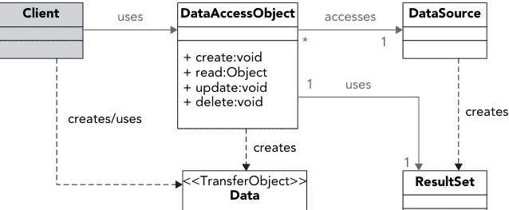

图 12-1：数据访问模式的类图

### 数据访问模式概述

`DAO` 访问模式的实现涉及几个组件：

- `DAO` 接口
- `DAO` 的具体实现
- 工厂

`DAO` 模式用于在应用程序和持久化映射层之间提供一个接口。这允许应用程序逻辑独立于底层数据库技术。

### 数据传输对象

数据传输对象（`DTO`）是用于在进程之间传递数据的对象。在 `DAO` 模式中，它被用于将数据从数据库传输到应用程序。`DTO` 通常是一个简单的对象，只包含数据而不包含业务逻辑。

`DAO` 模式提出的解决方案在《Core J2EE Patterns: Best Practices and Design Strategies》一书中定义如下：

- 使用数据访问对象（`DAO`）来抽象和封装对数据源的所有访问。`DAO` 管理与数据源的连接，以获取和持久化数据。

> 注意 `DTO` 也称为值对象（Value Object）

### 持久化 API 和对象映射

Java 持久化 API（`JPA`）是用于 Java 应用程序中管理关系数据的规范。它提供了一个将 Java 对象映射到数据库的标准接口。对象映射（`ORM`）是将面向对象的代码映射到关系型数据库的技术。

`JPA` 规范取代了 `EJB` 2.0 容器管理持久（`CMP`）实体规范，后者既笨重又复杂。在采用 `Hibernate` 等专用解决方案之前，`CMP` 受到了许多反响。`JPA` 的开发（随 `EJB` 3.0 发布）旨在整合 `CMP`、`Hibernate` 和 `TopLink`，并且看起来成功。

`JPA` 的核心是实体的概念。对于熟悉 `CMP` 的人，这就是所谓的实体。实体是一个可以持久化到数据库的短寿命对象——不是序列化对象，而是数据。它是一个简单的 Java 对象（`POJO`），其成员经过注解并映射到数据源的字段。为了更好地理解这种表示方式，你将通过一个代码片段。

在下面的片段中，我们将 `Movie` 类表示为适当注解的 `POJO`：

```java
@Entity
public class Movie {
    @Id @GeneratedValue
    private Long id;
    private String title;
    private String description;
    private Float price;
    public Movie() {}
    // 为了简洁起见，省略了 getter 和 setter
}
```

正如你所看到的，这是一个带有三个注解的简单类。`@Entity` 类注解指示该类应被视为实体类，`@Id` 和 `@GeneratedValue` 注解标记 `id` 为自动生成的标识符。这意味着当实体被数据源持久化时，`id` 会根据自动生成字段的规则自动生成。如果数据源是数据库，那么实体中的所有字段都需要持久化到名为 `Movie` 的表中。不需要其他注解来指示哪些字段被持久化。这就是约定优于配置：除非另有注解，否则所有字段都会被持久化。这种映射被称为对象映射（`ORM`）。

### 在 Java EE 中实现数据访问模式

现在，你将通过一个示例来了解如何在 Java EE 中实现 `DAO`（数据访问对象）。你将使用电影租赁领域和关系型数据库作为数据源。你将开始创建一个电影实体类，并使用适当的 `JPA` 注解对其进行标记，如列表 12-1 所示。

### 列表 12-1：电影实体类

```java
package com.devchronicles.dataaccessobject;

import java.io.Serializable;
import java.persistence.Entity;
import java.persistence.Id;
import java.persistence.NamedQuery;

@Entity
public class Movie implements Serializable {
    private static final long serialVersionUID = -6580012241620579129L;

    @GeneratedValue
    private int id;
    private String title;
    private String description;
    private int price;
    //不需要持久化的
    // 运行时值
    @Transient
    private int runtimeId;

    public Movie() {}

    public int getId() {
        return this.id;
    }

    public void setId(int id) {
        this.id = id;
    }

    public String getTitle() {
        return this.title;
    }

    public void setTitle(String title) {
        this.title = title;
    }

    public String getDescription() {
        return this.description;
    }
}
```


```java
}
public void setDescription(String description) {
    this.description = description;
}
public int getPrice() {
    return this.price;
}
public void setPrice(int price) {
    this.price = price;
}
public int getRuntimeId() {
    return this.runtimeId;
}
public void setRuntimeId(int runtimeId) {
    this.runtimeId = runtimeId;
}
```

列表 12-1 中的类是一个带有适当 JPA 注解的 POJO。正如前面简要提到的，`@Entity` 类注解表示该类应被视为一个实体类，并由持久化提供程序进行管理。实体类必须有一个公共或受保护的无参构造函数，尽管它可以有其他构造函数。它必须是一个顶层类，这意味着它不能是内部类或接口，并且它不能是 `final` 的。此外，实体的任何实例变量或 setter 方法都不能是 `final` 的。实体类必须实现 `Serializable` 接口。

你用 `@Id` 和 `@GeneratedValue` 注解标记了 `id` 成员，这会将 `id` 成员标记为自动生成的主键。所有实体都必须有一个主键，主键可以是单个成员或成员的组合。

主键可以是以下类型之一：

- Java 基本数据类型—`byte`, `char`, `short`, `int`
- 基本数据类型的包装类—`Byte`, `Character`, `Short`, `Integer`, `Long`
- 基本类型或包装类型的数组—`long[]`, `Long[]` 等等
- Java 类型—`String`, `BigInteger`, `Date`

除非标记了 `@Transient` 注解，否则类中的所有成员都会自动映射到 movie 表中同名的字段上。这意味着 `id` 成员映射到 movie 表中的 `id` 字段，`title` 成员映射到 movie 表中的 `title` 字段，依此类推。

接下来，在列表 12-2 中，你创建了 DAO 接口。这应该定义基本的 CRUD 方法以及任何可能证明是有用的其他方法。

### 列表 12-2：DAO 接口

```java
package com.devdevchronicles.dataaccessobject;

import java.util.List;

public interface MovieDAO {

    public void addMovie(Movie movie);

    public Movie getMovie(int id);

}
```

现在，对于列表 12-3 的实现。

## 列表 12-3：DAO 接口的实现

```java
package com.chronicles.dataaccessobject;

import java.util.List;

import javax.persistence.EntityManager;

public class DAOImpl implements MovieDAO {

    private EntityManager em;

    public DAOImpl(EntityManager em) {
        this.em = em;
    }

    @Override
    public void addMovie(Movie movie) {
        em.persist(movie);
    }

    @Override
    public Movie getMovie(int id) {
        return em.find(Movie.class, id);
    }

    @Override
    public void deleteMovie(int id) {
        em.remove(em.find(Movie.class, id));
    }

    @Override
    public void updateMovie(Movie movie) {
        em.merge(movie);
    }

    @Override
    public List<Movie> getAllMovies() {
        return em.createQuery("SELECT m FROM Movie m", Movie.class).getResultList();
    }
}
```

在 12-4 中，DAO 工厂。`EntityManager` 被创建并作为参数传递给构造函数。

## 列表 12-4：DAO 工厂

```java
package com.chronicles.dataaccessobject;

import javax.enterprise.context.ApplicationScoped;
import javax.enterprise.inject.Produces;
import javax.persistence.EntityManager;
import javax.persistence.PersistenceContext;

@ApplicationScoped
public class DAOFactory {

    @PersistenceContext
    private EntityManager em;

    @Produces
    public MovieDAO createDAO() {
        return new DAOImpl(em);
    }
}
```

应用程序中的实体被称为持久化单元，其持久化单元定义在 `persistence.xml` 中。该文件应该位于应用程序的 `META-INF` 目录下。`persistence.xml` 的重要元素如下：

- 持久化单元名称—你可以给持久化单元命名，以便在运行时选择它们。
- 持久化单元事务类型—在 Java SE 应用中默认事务类型为 `RESOURCE_LOCAL`，而在 Java EE 环境中事务类型为 `JTA`。这意味着实体管理器参与事务。
- 提供者—此元素标识提供创建 `EntityManager` 的类。
- 类—应用程序中使用的实体类应列在此。
- 属性—可以指定额外的属性，例如数据库连接属性和用于创建表的持久化提供程序选项。

`EntityManager` 与列表 12-5 所示的持久化上下文相关。

### 列表 12-5：persistence.xml

```xml
<?xml version="1.0" encoding="UTF-8"?>
<persistence xmlns="http://xmlns.jcp.org/xml/ns/persistence"
     xmlns:xsi="http://www.w3.org/2001/XMLSchema-instance"
     xsi:schemaLocation="http://xmlns.jcp.org/xml/ns/persistence/persistence_2_1.xsd">
  <persistence-unit name="moviePU" transaction-type="JTA">
    <provider>org.eclipse.persistence.jpa.PersistenceProvider</provider>
    <jta-data-source>jdbc:sample/jta-data-source</jta-data-source>
    <class>com.chronicles.dataaccessobject.Movie</class>
  </persistence-unit>
</persistence>
```

特定的数据源定义在此 `persistence.xml` 文件中。如果你使用 EclipseLink 提供者定义了 Derby 数据库，你将事务类型设置为 `JTA`，因为这是一个 Java EE 应用程序，并且指定了实体为 `com.chronicles.dataaccessobject.Movie`。

最后，你需要注入并使用你创建的 DAO。列表 12-6 中的客户端注入 DAO 实例并使用它检索所有电影。

### 列�表 12-6：客户端

```java
package com.chronicles.dataaccessobject;

import javax.ejb.Stateless;
import javax.inject.Inject;
import java.util.List;

@Stateless
public class Client {

  @Inject
  private MovieDAO movieDAO;

  public List<Movie> getAllMovies() {
    return movieDAO.getAllMovies();
  }
}
```

上述 DAO 的实现非常简单，可以从几个方面进行改进。

## 类型安全的 DAO 实现

改进 DAO 实现的一种方法是使 DAO 接口是类型安全的。这允许一个类型安全的 DAO，子类可以为你每个想要持久化的实体实现该 DAO。一个基类 DAO 看起来可能像列表 12-7 中的代码。

### 列表 12-7：类型安全的基 DAO

```java
package com.devchronicles.dataaccessobject;

import java.util.List;

public interface BaseDAO<E, K> {

  public void create(E entity);

  public void retrieve(K id);

  public void update(E entity);

  public void delete(K id);
}
```

第一个参数 `E` 用于表示实体，而类型参数 `K` 被用作键。子接口可以定义特定于该实体的方法并扩展 `BaseDAO` 接口。

在列表 12-8 中，我们创建了一个扩展 `BaseDAO` 的接口，并定义了一个返回所有电影列表的方法。

### 列表 12-8：基 DAO 的特定电影实现

```java
package com.devchronicles.dataaccessobject;

import java.util.List;

public interface MovieDAO extends BaseDAO<Movie, Integer> {

  public List<Movie> getAllMovies();
}
```


具体类将实现此接口并为每个方法提供代码。

## 何时以及何时使用数据访问模式

有些人认为，由于人们现在可以轻松地直接调用 `EntityManager`，DAO 不再是一个实用的模式了。这种论点是合理的，因为 `EntityManager` 提供了一个清晰的 API，抽象了底层的数据访问层。认为数据提供者出现实体的概率微乎其微也是合理的，使得 DAO 提供的抽象意义不大。这些论点有一定的道理，但人们仍然认为 DAO 在设计良好的 Java EE 应用中有其存在之地（尽管这个位置可能不是它最初预想的地方）。

如列表 12-7 所示，为每个实体类型扩展 `BaseDAO` 的价值在于其实现的可扩展性。可以在保持通用接口的同时，编写特定于实实体的方法。你为每个实体选择 DAO 实现，而不是在每次需要持久化或检索数据时选择正确的 `EntityManager`。

命名查询可以位于与其相关的实体内部。这处于逻辑位置，使得维护更加容易。DAO 允许统一且受控的数据访问策略，因为对实体数据的所有访问都通过该实体的数据进行。它维护了单责任原则，因为只有 DAO 访问并操作应用程序的数据。

不要忘记，尽管概率很低，但数据源可能会发生变化。如果发生了变化，你会很幸好在数据层上有一个抽象。

### 总结

DAO 既有支持者也有反对者。在你的应用程序中使用该模式的决定应该基于应用程序的设计需求。像所有模式一样，为了用而用具有潜在的危险，并可能因为抽象模糊了代码的目的而引起更多困惑。确保你很好理解该模式的各种实现，以及它是如何与 DTO 和工厂模式交互的。

## 练习题

- 1. 为电影订单 DAO 编写一个接口及其实现。你可以使用其中的示例作为起点。
- 2. 编写一个使用 `MovieDAO` 的服务门面（service façade）和 DTO。

### 备注

- 1. Core J2EE Patterns: Best Practices and Design Strategies (Prentice Hall/Sun Microsystems Press, 2003): Deepak Alur, John Crupi, and Dan Malks.
- 2. The Java EE 7 Tutorial: Part VIII Persistence.
http://docs.oracle.com/javaee/7/tutorial/doc/

## 13 RESTful Web 服务

本章内容：

- 什么是 REST 及其作用
- REST 的六个约束条件
- REST API 的理查森成熟度模型
- 如何设计 RESTful API
- 演示 REST 操作
- 如何在 Java EE 中实现 REST
- HATEOAS——理查森成熟度模型的最高级

本章的 WROX.COM 代码下载可以在 www.wrox.com/go/projectavaedesignpatterns 的 Download 标签页找到。代码位于第 13 章下载中，并根据整个章节中的名称单独命名。

你不怀疑自己听过 REST 这个术语。不太确定的是你是否确切理解它的含义以及它是如何实现的。许多对 REST 一无所知或了解甚少的人告诉你，你的网站必须是 REST “兼容”的，而且如果没有 REST，你的网站绝不可能生存。对于这些人来说，REST 是一个流行语，但对于那些知道 REST 是什么以及它可以提供什么好处的人来说，它远不仅仅是一个流行语。那么 REST 到底意味着什么，它源自哪里？

REST 意味着表现状态转移（REpresentational State Transfer），是一种表示和传输数据的架构风格。它由一组六个约束组成，这些约束应用于数据、组件，并关联到分布式超媒体系统（互联网）的交互中。它不是一种协议（尽管在所有情况下它都与超文本传输协议 [HTTP] 一起使用），而且它并不是世界维网联盟（W3C）标准。它是一系列随时间推移而约定、风格和方法。

REST 术语是由 Roy Fielding 在其题为《基于网络的软件架构风格与设计》（Architectural Styles and the Design of Network-Based Architectures）的博士论文中提出的。^1 自那时以后，REST 概念被开发者和架构师广泛采用，成为许多语言和框架中不可或缺的一部分。例如，Ruby 提供了使用 REST 路由的自然方式，而 Spring 框架提供了一种实现超媒体作为应用状态（HATEOAS）的简化方法，它是理查森成熟度模型的第 3 层。^2

REST 通常被称为一种架构方法。然而，REST 是为了解决企业应用中常见问题而开发的，这与设计模式背后的思想相同。

### 什么是 REST？

REST 对人们意味着许多含义，讨论可能会变得非常理论化。本章从一个想要为论坛网站实现 RESTful 编程接口（API）的开发者角度来讨论它。

> ROY FIELDING 的话
>
> REST 强调组件交互的可扩展性、接口的通用性、组件的独立部署以及用于减少延迟、强制安全和封装遗留系统的中间组件。

对 REST 最实用的思考方式是一种格式 URI 的风格，用于表示应用程序可以提供和存储的资源（数据）。资源指的是什么？在网站中，你有许多资源，例如网站资源和用户的帖子。这些资源表示为名词，并与 HTTP 方法结合形成 RESTful 统一资源标识符（URI）。例如，你可以通过 URI `/accounts` 访问账户资源并结合 HTTP GET 方法，该 URI 将返回所有账户。同样，你可以通过在 URI 后面添加帖子 ID 来识别账户资源，如：`accounts/id`。对此 URI 的 GET 请求将返回该 ID 账户的详情。不仅可以使用 RESTful URI 获取资源，还可以创建资源。要创建一个账户资源，你会向 URI `/accounts` 发送 POST，并在 HTTP 体中包含创建资源所需的数据。

正如你所收集的，URI 代表远程服务器上的资源，而请求资源的方法（HTTP 方法）暗示了某些操作（CRUD）（例如 POST 用于创建，GET 用于读取）。^1 然而，这并不符合 REST 的精神，并不是有助于理解资源表示。事实上，它更像是远程过程调用（RPC）模式的实现，这在理查德森成熟度模型中处于第 0 级。你感兴趣的是实现最高级别的 REST：第 3 级，详情请参考“REST API 的理查德森成熟度模型”章节。

RESTful API 关乎不是动作，而是名词。这些名词代表资源。因此，你将学习关于帖子资源、用户资源和地址资源，并将它们通过诸如 `getUser`、`addPost` 和 `deleteAddress` 等动词进行发布。REST 与简单对象访问协议（SOAP）和 RPC 不同，后者是你想要在应用程序数据上执行的动作。在 REST 的语境下，你将通过 HTTP 方法调用 URI。

每个资源都由 URI 标识。引用资源有多种可能的方法，因此你可能从不同的起点访问资源。例如，你可以通过直接访问 `GET /users/:id` 来获取代表用户的资源，或者通过关注该用户的用户列表进入，再通过 `GET /users/:id`。资源的表示并不是资源本身，同一个资源以不同的方式表示是完全有效的。

资源的表示在客户端和服务器之间是双向的，并且至少包含资源状态的一部分。当发生时，它只需要足够的数据在服务器上创建、修改或删除资源。

资源表示通常是 JavaScript (JSON) 或可扩展标记语言 (XML)，但也可以是任何格式，包括自定义表示。

## REST 的六大约束

根据罗伊·菲尔德（Roy Fielding）的论文，真正的 RESTful 架构符合所有列出的约束，除其中一个外。这组约束被称为 REST 风格。

### 客户端-服务器

客户端-服务器约束基于关注点分离原则，并定义了客户端与服务器之间的分离。该约束非常简单，要求客户端发送请求以接收该请求。服务器可以对客户端的请求做出响应。

### 统一接口

此约束定义了客户端与服务器之间的接口，规定它尽可能通用和简单。你已经了解到资源是数据的表示，且客户端无法直接访问数据。此约束定义了如何通过名词表示资源，以及接口由实际数据系统的创建者维护。这是为了确保接口随时间推移具有某种程度的恒定。该约束几乎总是基于 HTTP 的。正如你所看到的，如果你使用 HTTP 规范，URI 是由资源名词和 HTTP 动词构建的。

### 无状态

服务器不应维护客户端状态。换句话说，每个消息/请求都是自描述的；它包含足够的信息或上下文供服务器处理该消息。这意味着如果存在状态，它是维护在客户端的。此的好处是增加了可扩展性、可靠性和可见性。缺点是降低了性能，因为为了维持无状态消息需要更大。

## 可缓存

服务器响应必须是缓存的。RESTful 接口应该提供一种机制将消息标记为可缓存或不可缓存。这可以是隐式的、显式的或通过协商实现的，允许客户端在必要时重新发送消息。

### 分层系统

客户端不能假设可以直接访问服务器。响应可能是缓存响应，也可能直接从客户端和服务器检索资源。这提高了可扩展性，因为在客户端和服务器之间可能存在软件或硬件。

### 按需代码

此约束定义 REST 架构由层次结构组成，这些层仅限于与其直接邻居通信。这种关注点分离简化了架构，并隔离了异的遗留组件。你获得的收益是可扩展性的增加，因为可以很容易引入新组件，并淘汰或替换过时的组件。该约束的缺点是由于多层结构相关的间接性增加导致系统性能下降。

这允许客户端从服务器下载并执行代码，使服务器通过传输逻辑来临时扩展客户端。这可能是 JavaScript 代码段的形式。按需代码约束是唯一的可选约束。

违反这些任何约束（按需代码除外）都意味着该服务不是严格 REST 的。然而，违反约束并不意味着该服务不是可行且有效的实现。

# REST API 的理查德森成熟度模型

你已经读过真正的 RESTful API 如何实现理查德森成熟度模型的第 3 级。现在我们将更深入地查看模型中的每个级别。

该模型由利纳德·理查德森（Leonard Richardson）开发，试图根据 API 对 REST 约束的遵循情况进行分类。你的实现越符合规范，表现就越好。共有四个级别。底部是第 0 级，表示遵循程度最低的实现，顶部是第 3 级，遵循程度最高因此最符合 REST。

## 第 0 级：POX（纯 XML）的沼泽

该模型使用 HTTP 作为传输协议来调用远程交互。它不使用协议来指示应用程序状态；它通常用于在单个 URI 上隧道请求和响应（例如 `/getUser`），且仅使用一种 HTTP 方法。这是 RPC 模型的经典示例，更像 SOAP 和 XML-RPC 而不是 REST。

### 第 1 级：资源

从这里开始，模型能够区分不同的资源。它将与不同的点通信，因为每个端点代表不同的资源。它使用 `resources/123` 这样的 URI，但仍然只使用一种 HTTP 方法。

### 第 2 级：动词

在这个级别上，模型使用 HTTP 动词对资源执行操作。它使用 GET、POST、PUT 和 DELETE 方法与资源交互。这是 API 开始变得真正 遵循 RESTful 的地方。

### 第 3 级：超媒体控制

在这个级别上，模型使用 HATEOAS（超媒体作为应用程序状态的引擎）为客户端提供可用操作的信息。这是通过在响应中包含链接来实现，引导客户端如何导航 API。

### 复数而非单数

资源名称应该使用复数形式，因为它们代表的是数据的集合。资源名称 `users` 代表用户集合，资源名称 `posts` 代表文章集合。其核心思想是：复数名词代表服务中的一个集合，而 ID 则指代该集合中的一个实例。如果某种数据类型在整个应用程序中只有一个实例，那么使用单数可能是合理的，但这种情况非常罕见。

### HTTP 方法

超文本传输协议 1.1（Hypertext Protocol 1.1）定义了八种 HTTP 方法；但在 RESTful API 中，只有四种方法是常用的。它们是 GET、POST、PUT 和 DELETE。这些方法在 REST 语文中具有特定的含义和用法。在考虑 HTTP 方法时，**幂等性**（idempotency）的含义尤为重要。从 RESTful API 的角度来看，幂等性的含义是：对同一个 URI 发出的调用始终产生相同的结果。因此，发送一次请求在服务器上产生的结果与发送多次请求相同，无论请求被处理了多少。（这假设有一个不同且独立的操作更改了资源。）

常用的四个方法中只有 GET 一个。这意味着你通过此方法创建的资源 URI 不能对服务器产生影响。你无法通过它创建、更新或删除资源。HTTP 1.1 规范将此方法称为“安全方法”（safe），因为“它不应具有执行检索之外操作的意义”。在 REST 语文中，该方法用于从服务器获取资源的表示。绝不能用于对资源进行更改。

其他三种方法——POST、PUT 和 DELETE——不是幂等的，并且预计会在服务器上产生变化。你将学习这些方法以及如何在论坛网站语境中使用它们。你还会学习 HTTP 响应码（http://www.w3.org/Prot/rfc2616-sec10.html），它们返回给客户端的响应代表了含义。

### GET

你使用此方法从服务器获取资源表示。你不应该使用它来更新、删除或创建资源。调用一次的效果与调用 100 次相同。如果请求了资源，其资源表示将在 HTTP 响应体中返回，格式可以是 JSON 或 XML。HTTP 响应码返回 200 (OK)。如果未找到资源，应返回 404 (NOT FOUND)；如果请求格式错误，应返回 400 (BAD REQUEST)。在你的论坛应用程序中，格式良好的 URI 可能是 `users/12345/followers`，它代表用户 12345 的粉丝列表。

### POST

你使用 POST 方法在给定上下创建一个新资源。例如，创建一个新用户，你会请求 `users` 资源。服务负责创建新资源，将其关联到上下文并分配 ID。创建成功后，HTTP 响应码返回 201 (CREATED)，新创建资源的链接返回在 `Location` 头部或响应体中。返回的资源表示通常比进行额外的 API 调用更优，因为这减少了 API 的通信频率（chatter）。

除了 HTTP 响应码，如果请求体为空，POST 可以返回 204 (NO CONTENT)。在你的论坛应用程序中，格式良好的 URI 可能是 `POST users`（带有用户详情）或 `POST users/12345/`（为用户 12345 创建一个新帖子）。

### PUT

PUT 方法主要用于更新已知资源。URI 包含标识资源的信息，作为上下文和标识符。请求体包含资源的更新版本，如果更新成功，它返回 HTTP 响应 200。更新用户信息的 URI 是 `PUT users/123456`。较少的情况下，你使用 PUT 方法创建一个带有标识符的资源。然而，这种创建资源的方法有点困惑：既然 POST 请求效果一样，为什么要用 PUT 呢？更新资源的一个重要点是：资源的整个表示都被传递给服务的 HTTP 请求体，而不仅仅是更改的信息。

### DELETE

惊讶的是，你使用此方法从服务中删除资源。URI 包含资源的上下文和标识符。要删除 ID 为 12345 的用户，你使用 URI `DELETE users/12345`。响应体可能包含已删除资源的表示。成功删除会返回 200 (OK) HTTP 响应码；如果未找到资源，则返回 400。

### REST 实战

你正在根据所学知识为论坛网站设计 RESTful API。

你首先检查网站的数据结构和数据领域。两个主领域是用户（users）和文章（posts）。用户可以进一步分为粉丝（followers），而文章通常组织在主题（topics）下。因此，有了这些领域，开始思考表示这些资源的 URI。

# users 名词

要创建一个新用户，知道你必须使用 POST 和 users 上下文，因此用户的 URI 如下所示：

```
POST /users
```

（注：原文后续部分存在大量 `POST /users` 的重复描述，已根据翻译要求保留核心逻辑结构。）

### 在 Java EE 中实现 REST

本章已经详细讨论了设计良好的 RESTful API 背后的理论。现在你已经了解了如何设计 URI，可以上手看看这些内容在代码中是如何运作的。

EE 7 提供了一些非常有用的注解，使得构建 RESTful API 的工作变得简单。最有用的是 `@Path` 注解。该注解定义了上下文 URI 以及将处理针对该 URI 请求的类或方法。此外，还有针对每个 HTTP 方法的注解：`@GET`、`@POST`、`@PUT`、`@DELETE` 等。这些注解标记了使用指定 HTTP 方法处理请求的方法。

你的应用程序可以有多个 RESTful 上文。在这种情况下，`@Path` 注解接受一个参数，用于定义你的 RESTful API 所在的空间。仅需此类注解，你就可以实现一个简单的 RESTful API。

现在在列表 13-1 中，你将实现你的 API GET /users。

+ 列表 13-1：Java EE 中 RESTful API 的最简单实现

如果你将此应用程序部署在本地机器并调用了该程序，可以通过访问 http://localhost/forum/users 来测试此 URI。你应该会在浏览器窗口中看到文本消息：这里返回了所有用户的用户的表示。

注意列表 13-1，你如何使用 `@Path` 注解对类和 users 上文进行注解。你传递的字符串不需要以斜杠开头，也不需要以斜杠结尾。RESTful 接口所在的空间由应用程序的根路径 ("/") 定义。当向 users 字符串发送 GET 请求时，会调用对应的方法，真正的目标是以 JSON 或 XML 格式返回从数据库检索的数据，并附带 HTTP 状态码。这在列表 13-2 中实现。

# 列表 13-2：使用 JSON 负载响应客户端

```
package co.uk.devchronicles.forum;

import java.util.ArrayList;

import javax.json.Json;
```


import javax.json.JSONArrayBuilder;
import javax.ws.rs.ApplicationPath;
import javax.ws.rs.GET;
import javax.ws.rs.Path;
import javax.ws.rs.Produces;
import javax.ws.rs.core.Application;
import javax.ws.rs.core.MediaType;
import javax.ws.rs.core.Response;

@Path("/")

```

列表 13-2 从用户数据生成一个 JSON 对象，为了简洁起见，使用一个方法返回用户数据并带有 200 HTTP 响应码发送回客户端。你首先注意到的是 `getUsers()` 方法现在被标记了 `@Produces(MediaType.APPLICATION_JSON)`；这指定了该方法可以产生并返回给客户端的 MIME 类型。`javax.json.Json` 和 `javax.json.JsonBuilder` 类用于构建 JSON 并将其封装为 `javax.ws.rs.Response` 对象返回给客户端。如果一切顺利，你将会在输出中看到以下内容：

```json
{
  "id":123456,"firstName":"Alex","lastname":"Theedom",
  "id":456789,"firstName":"Murat","lastname":"Yener"
}
```

到目前为止，你已经学会了如何获取系统中所有用户的资源表示，但如果你只想获取一个用户并知道该用户的标识号呢？嗯，这很简单。在 URI 中，你将看到类似这样的用户 ID 号：

```
GET /users/123456
```

在 REST 控制器中，你通过引用 REST 路径并使用 URI 变量传递 ID 传递来重新捕获 ID 号。你对消耗 RESTful API 调用的方法注解 `@Path("/id")`，并在方法签名中，对该接收 ID 值的参数进行注解：

```java
@GET
@Path("/id")
@Produces(MediaType.APPLICATION_JSON)
public Response getUser(@PathParam("id") String id) {
  User user = this.findById(id);
  JsonArrayBuilder jsonArrayBuilder = Json.createArrayBuilder();
  jsonArrayBuilder.add(Json.createObject()
    .add("id", user.getId())
    .add("firstName", user.getFirstName())
    .add("lastname", user.getLastName()));
  return Response.ok(jsonArrayBuilder.build()).build();
}

public User findById(String id) {
  return new User("123456", "Alex","Theedom");
}
```

如你提供的代码段所示，ID 参数使用了 `@PathParam("id")` 注解，这样通过 `@Path("/id")` 注解从 URI 中提取的 ID 就会传递给方法。没有必要在 `@Path` 注解中包含 URI 的完整路径，因为基础 URI 是在类上的 `@Path` 注解设置的。所有路径都是相对于类上设置的路径的。

变量可以是一个正则表达式。例如，路径注解 `@Path("{id:[0-9]*}")` 将仅匹配数字类型的 ID。任何不匹配的 ID 都将导致向客户端返回 404 HTTP 响应。

### 178 | 第 13 章 RESTful WEB 服务

你已经看到了一些由一个资源名词和一个 URI 变量组成的 URI 构造。你如何处理更复杂的 URI，例如 `/users/123456/followers`？你只需用相同的方法处理，即通过用更多变量对路径进行注解。

```java
@GET
@Path("/{id}/{follower}")
@Produces(MediaType.APPLICATION_JSON)
public Response getFollower(@PathParam("id") String id, @PathParam("follower") String follower) {
  // ...
}
```

你还可以处理查询参数。例如，如果你想根据状态过滤用户，可以使用 `@QueryParam` 注解：

```java
@GET
@Path("/users")
@Produces(MediaType.APPLICATION_JSON)
public List<User> getUsersByStatus(@QueryParam("status") String status) {
  // ...
}
```

在示例中，只有两个元素代表包含两个帖子的数组。每个帖子都是遵循相同格式的 JSON 对象：

```json
{
  "id": 71892,
  "title": "Best movie of 2015",
  "content": "I think the best movie of 2015 is the Golden Egg of Siam."
}
```

从这段 JSON 代码段中可以看出，它包含一个标识帖子资源的 ID，随后是该帖的标题和内容。无论其他接口的成熟程度如何，这都是你在请求帖子资源响应时预计能看到的最少内容。让此响应变得特别的之处在于 `links` 元素。

```json
"links": {
  "rel": "self",
  "href": "http://localhost:8080/rest/posts/71892",
  "method": "GET"
}
```

这就是 HATEOAS 发挥作用的地方。`link` 数组中的每个链接包含三个部分。`rel` 是 `href` 链接与资源之间的关系。`href` 是指向更多资源的链接，而 `method` 是获取资源时必须使用的方法。`rel` 元素可以有任何值且不需要遵循某种约定，尽管按照习惯，“self”通常指向提供当前资源更多信息的链接。在这种情况下，它指向它自己。其他链接指向其他用户对帖子的响应（回复或响应）、关注关注的用户（关注者）以及发布该帖子的用户（所有者）。任何与主帖子资源相关的资源都可以通过 `link` 数组中的链接来表示。

如从示例所示，数组中的第一个帖子在它的 `links` 数组中有四个链接，而第二个只有两个。这是因为第二个帖子没有被关注，也没有任何回复。

通过这种方式提供链接可以为客户端提供导航到后续资源所需的信息，并允许你以较小的代价轻松地扩展 API。

HATEOAS 良好设计的一个范例是 Paypal.com (https://developer.paypal.com/webapps/developer/docs/integration/direct/paypal-rest-payment-hateos-links/) 实现的。他们使用 HATEOAS 允许你通过遵循数组中提供的链接来构建一个与支付系统交互的 API。

## 在何处以及何时使用 REST

REST 是一种简单且成熟的方法，不受标准的限制。有些人可能认为，与 SOAP 相比，这是一个明显的缺点，因为 SOAP 是一个具有自定义协议和实现规则的行业标准。然而，它在实现和他人使用方面的价值超过了缺乏标准所带来的任何困难。创建一个供消费的 RESTful 只需要一个 URI 那么简单，而使用 HTTP 协议进行跨语言通信也是容易的。通用语言是 HTTP，即 Web 语言，它是简单且所有人都能理解的。

带宽限制对于 REST 的轻量级方法没有问题，而且在移动设备上尤其具有吸引力。从 RESTful API 请求资源的成本很低。请记住，这只是一个 HTTP 请求，数据可以以任何适当的格式返回。格式不必是 JSON 或 XML；它可以是 Atom 辛迪格式 (ATOM) 或某些自定义格式。仅通过一个简单的 URI 来表示资源所赋予的灵活性允许客户端开发者发挥想象力。你可以使用异步 JavaScript 和 XML (AJAX) 调用一个或多个 URI，可能来自不同的 REST 提供者。你可以将这些调用的响应结合起来，为网站访问者提供丰富的内容。

如果你的 REST 实现使用了 HTTP 协议（大多数情况下都是如此），你将获得免费缓存的红利。HTTP 协议将缓存作为一项核心功能包含，你可以通过设置合适的 HTTP 头部值在应用程序中利用它。

### 总结

你应用程序的 REST API 应该是简单直观的，以便其他开发者使用，作为开发者，你有责任设计一个符合要求的 API。在本章中，我们接触了 REST 的基础，例如安全性、数据查询。你应用程序的 REST API 应该对其他开发者来说是简单直观的，作为开发者，设计一个符合要求的 API 是你的责任。幸运的是，REST 是无处不在的，关于该主题的资源非常多。

### 练习

1. 搜索 RESTful API 并编写消费它们的简单代码。
2. 搜索 RESTful API 并编写消费它们的前端。
3. 使用 HATEOAS 风格开发它们。

### 注意事项

1. Roy Fielding 在 2000 年的一篇论文《基于网络的软件架构风格与设计》中提到：ics.uci.edu/~fielding/dissertation/arch_style.htm。
2. Leonard Richardson 在 2008 年的 QCon 演讲中解释了 REST 的成熟度模型：crummy.com/speaking/2008-QCon/act3.html。
3. HTTP/1.1 标准定义了以下方法：OPTIONS、GET、PUT、DELETE、TRACE 和 CONNECT。
4. Martin Fowler 在他的网站上提供了良好的概述：martinfowler.com/article/richsonModel。

## 什么是 MVC 模式？

在 MVC 中，模型表示应用程序数据。模型可以由一个对象或复杂的对象图表示。在 Java EE 应用中，数据封装在 EJB Bean 中并通过数据访问对象 (DAO) 进行访问。

视图是模型包含数据的视觉表示。模型的子集由单个视图表示；因此视图充当模型的过滤器。用户通过视图与模型交互，并反调用业务逻辑。

控制器连接模型并引导应用程序流。它选择渲染用户的视图。控制器从视图接收消息并转发给模型。模型反过来准备响应并发送给控制器，由控制器选择并发送视图。

MVC 模式在逻辑上跨越多层架构的客户端和中间层。在 Java EE 环境中，模型位于 Web 层，通常以企业 Bean (EJB) 的形式存在。视图层可能由 Java Faces (JSF) 或 Java Pages (JSP) 配合表达式语言 (EL) 构建。控制器通常是一个接收来自客户端超文本传输协议 (HTTP) 请求的 Servlet。

> **背景**
> 这种模式的首次提到出现在现代互联网发明之前，由 Smalltalk 程序员 Trygve Reenskaug 在 1979 年于 Xerox Parc 工作发表的一篇论文。

尽管 MVC 模式的元素是在 30 多年前定义的，但它们在目前的 Web 应用程序中具有惊人的相关性。

图 14-1 显示了用户向控制器发送请求。控制器通过更新模型和渲染新视图来处理请求，并将视图发送给用户。

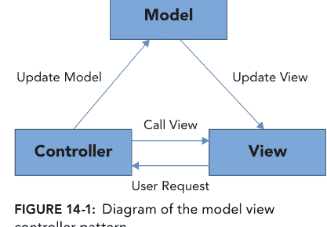

# 战实回放

在 JSP 盛靡时期，而 Y2K 漏洞并没有引发我们预言的那种全球性核毁灭时，我正在一家小型 Web 初创公司工作。我们的初创公司仅由几位 JSP/Java 开发者和一些 Flash 设计师组成。我们想要构建一个网站门户，能够根据签约客户的特定需求提供动态内容。

因此，我们带着 100% 的热情投入到项目中，并开发了一个高度动态的网站，为不同的客户显示不同的功能。我们对自己的创造感到非常自豪，购买我们精美网站的许多客户也同样感到自豪。事实上，我们变得越来越成功，而且很快，似乎每个人对我们的产品都很满意，我们也对自己的成功感到满意。但这种快乐是短暂的。随着购买我们产品的客户越来越多，网站的管理变得越来越困难。我们到底把业务逻辑和视图逻辑混在了一起，导致每有一个新客户，我们必须修改网站中所有的 JSP 文件。很快，JSP 变成了逻辑与显示逻辑的糟糕杂烩，我们最终得到了了无法管理的意大利面条代码。此时，要通过实现 MVC 模式来重写整个应用程序简直是一场噩梦。

我们重写了应用程序，它变得可以管理了，但这只是在办公室熬了许多深夜并度过了很多周末之后。这个故事的教训是：MVC 模式不仅对你应用程序的维护和扩展有用，对你的工作与生活平衡也有好处。

### MVC 类型

MVC 模式有许多不同的形式。最受认可的两种类型 I 和类型 II。

- **类型 I**——这是一种以页面为中心的方法，视图和控制器作为一个单一入口存在，被称为视图-控制器。在这种方法中，控制器逻辑实现在视图内部，例如在 JSF 中。控制器执行的所有任务（包括获取 HTTP 请求属性和参数、调用业务逻辑以及管理 HTTP 会话）都通过脚本和标签库嵌入在视图中。类型 I 将视图生成与应用程序流高度耦合，使得维护变得非常麻烦。
- **类型 II**——通过将控制器逻辑从视图移出并移动到 servlet 中，类型 II 解决了类型 I 的维护问题，让 JSF 专注于视图数据的数据渲染。

# MVC 的替代方案——结识 MVP

抱歉让你感到失望，但 MVP 并不代表“最有价值模式”（most valuable pattern）。MVP 是模型-视图-演示器的缩写，它是模型-视图-控制器的替代方案。MVP 不像 MVC 那样在控制器、视图和模型之间建立三角形关系，而是为每个参与方提供了一种通信方式——演示器负责视图和模型之间的所有通信。它在 .NET、Silverlight、Google Web Toolkit 和 Vaadin 中非常流行。

类型 I 和类型 II 之间的主要区别在于控制器逻辑所在的位置：在类型 I 中在视图中，而在类型 II 中在 servlet 中。

许多框架（如 Spring MVC、Structs、Grails 和 Wicked）都实现了它们自己版本的类型 II MVC 模式。例如，Spring MVC 包含了 `DispatcherServlet` 的概念，它与 HTTP 请求交互并将其委托给控制器、视图（以及解析器）和处理器。图 14-2 显示了 Spring 实现 MVC 模式的图。

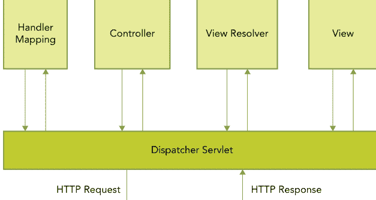

图 14-2：Spring MVC 实现图

# 在纯代码中实现 MVC 模式

你将借助 Action 模式来实现 MVC 模式。该模式负责根据用户的请求决定将用户重定向到哪里。它有助于维护控制器的单一职责。

你将从控制器类开始。在列表 14-1 中，你实现了一个简单的控制器，响应对 `/users/*` 路径的任何 HTTP GET 请求。这种关系的映射定义在 `web.xml` 文件中。

```xml
<servlet>
  <servlet-name>FrontController</servlet-name>
  <servlet-class>com.devchronicles.mvc.plain.FrontController</servlet-class>
  <servlet-mapping>
    <servlet-name>FrontController</servlet-name>
    <url-pattern>/users/*</url-pattern>
  </servlet-mapping>
</servlet>
```

在列表中，你将控制器类 `com.devchronicles.mvc.plain.FrontController` 映射到请求 URL `/users/*`。因此，对该 URL 的每个请求都会被定向到 `FrontController` 类进行处理。

## SERVLET 3.0

或者，你可以使用 `@WebServlet("/users/*")` 注解控制器类来标记请求 URL。这消除了在 `web.xml` 中定义 servlet 映射的需要。这些请求会调用 `doGet()` 方法，并从 `AbstractFactory` 中获取一个 `Action` 对象，由它决定返回给用户的视图位置。

### 列表 14-1：重构后的 UserService

```java
package com.devchronicles.mvc.plain;

import java.io.IOException;
import javax.servlet.ServletException;
import javax.servlet.annotation.WebServlet;
import javax.servlet.http.HttpServlet;
import javax.servlet.http.HttpServletRequest;
import javax.servlet.http.HttpServletResponse;

public class FrontController extends HttpServlet {
  protected void doGet(HttpServletRequest request, HttpServletResponse response)
      throws ServletException, IOException {
    Action action = AbstractFactory.getInstance(request);
```


# 第 14 章 模型视图控制器模式

## 代码列表 14-4（继续）

```java
String view = action.execute(request, response);
getServletContext().getRequestDispatcher(view).forward(view);
}
}
```

*(注：此处原文代码块似乎存在截断或逻辑混乱，已按翻译要求保留代码且不翻译其内容。)*

在列表 14-1 中，你将控制器类 `com.devchronicles.mvc.plain.FrontController` 映射到请求 URL `/users/*`。因此，对该 URL 的每个请求都会被定向到 `FrontController` 类进行处理。

### 在 Java EE 中实现 MVC 模式

MVC 模式的纯代码实现需要你编写控制器逻辑、将 URL 映射到控制器类并编写大量的管道代码。然而，在 Java EE 的最新版本中，这些管道代码已经由你完成。你只需要关注视图和模型即可。`FacesServlet` 负责控制器的实现。

## FACESSERVLET

`FacesServlet` 负责管理用户请求并向用户交付视图。它使用 JSF 构建用户界面来管理 Web 应用程序的生命周期。所有用户请求都通过 `FacesServlet`。该 Servlet 是 JSF 不可缺的一部分……得益于“约定优于配置”的概念，你会发现对于大多数 Web 应用程序，不需要更改配置。

## 配置 FACESSERVLET

如果你需要更改 `FacesServlet` 配置，必须修改 `faces-config.xml` 文件。

在 JSF 2.2 中，你可以使用注解执行最常见的配置，进一步减少了接触 `faces-config.xml` 文件的需求。

## 使用 FACESSERVLET 实现 MVC

你正在使用 `FacesServlet` 和 JSF 重写之前的示例。JSF 的视图声明语言称为 Facelets。Facelets 是 JSP 的替代品，并使用层叠样式表（CSS）的 XHTML。

JSF 包含了 backing bean（后端 Bean）的概念。这些是带有 `@Named` 和 `@RequestScoped` 注解的普通 Java 对象（POJO）。它们在 HTTP 请求期间可以被 JSF 页面访问。你可以直接在 JSF 中引用它们的方法。

代码列表 14-5 中，你重写了 `ListUsersAction.class` 以成为一个 backing bean。

## 代码列表 14-5：重写为 backing bean 的 ListUsersAction 类

```java
package com.devchronicles.mvc.java;

import java.util.ArrayList;
import java.util.List;
import javax.enterprise.context.RequestScoped;
import javax.inject.Named;

@RequestScoped
@Named
public class ListUsersAction {

    private List<String> userList = new ArrayList<>();

    public List<String> getUserList() {
        return userList;
    }

    public String execute() {
        userList.add("John Lennon");
        userList.add("Ringo Starr");
        userList.add("Paul McCartney");
        userList.add("George Harrison");
        return "/WEB-INF/pages/listusers.html";
    }
}
```

由于所有的 backing bean 都标记了 `@Named` 和 `@RequestScoped`，因此存在一种类型注解，在应用时会赋予它 backing bean 的所有行为特征。该注解是 `@Model`。

接下来，你需要创建一个 `index.html` 文件。它替换了 `home.jsp` 并直接从浏览器调用。这个 JSF 的过程是 `ListUsersAction` 上的 `execute` 方法，它为视图 `listusers.html` 准备数据。

## 代码列表 14-6：示例 MVC 页面如何被调用

```html
<!DOCTYPE html PUBLIC "//W3C//DTD HTML 1.0 Transitional//EN"
"http://www.w3.org/TR/html1/DTD/html-transitional.dtd">
<html xmlns="http://www.w3.org/1999/xhtml"
xmlns:h="http://java.sun.com/jsf/html">
<h:head><title>Welcome</title></h:head>
<h:body>
<html>Welcome to our site<a href/>
<h:form>
<h2>点击查看 <h:commandLink Value="list of users" action="#{listUsersAction.execute}"/>。</h2>
</h:form>
</h:body>
</html>
```

你使用 `h:commandLink` 标签，并在 `action` 元素中引用 backing bean 和 `execute()` 方法。`execute()` 方法直接从 JSF 调用；它生成列表，返回渲染列表的视图的位置，然后调用 `getUserList()` 方法并显示用户。代码列表 14-7 展示了这一点。

## 代码列表 14-7：渲染模型数据的视图

```html
<!DOCTYPE PUBLIC "-//W3C//DTD XHTML 1.0 Transitional//EN"
"http://www.w3.org/TR/xhtml/xhtml-transitional.dtd">
<html xmlns="http://www.w3.org/1999/xhtml"
xmlns:ui="http://java.sun.com/jsf/facets"
xmlns:h="http://java.sun.com/jsf/html">
<head>
<title>List of users</title>
</head>
<body>
<h:outputText>我们的用户是：</h:outputText>
<ui:repeat value="#{listUsersAction.userList}" var="listusers">
<h:outputText value="#{listusers}"/><br/>
</ui:repeat>
</body>
</html>
```

# 第 15 章 WebSockets

超文本传输协议（HTTP）模型在互联网流行很久以前设计好了。在传统的 HTTP 模型中，客户端与后端服务器建立连接，发送类型为 GET、POST、PUT 或 DELETE 的 HTTP 请求，由 HTTP 服务器返回相应的响应。此前已有多次尝试通过 HTTP 进行黑客攻击破解或通信，例如 AJAX，以及像 SPDY 这样的新设计。

对于几乎任何超越简单的“获取并提交内容”模型的应用程序，传统的 HTTP 模型都显得过于笨重。以聊天客户端为例，参与者可以按顺序发送消息，并且可以同时有数百人在线聊天。标准的“请求-响应模式”对于此类目的来说局限性太大。早期克服这一局限性的一些方法是 AJAX 和 Comet。更好的方法是依赖于长轮询：打开 HTTP 连接并通过不完成响应来保持其活跃（保持连接开启状态）。

通过 WebSockets，客户端可以向服务器发起原始套接字并执行全双工通信。WebSockets 通过 JSR-356 支持。`javax.websocket` 包包含了与 WebSockets 相关的所有类、接口和注解。

要在 Java EE 中实现 WebSockets，你需要创建一个带有列表 15-1 中所示的 WebSocket 生命周期方法的端点。

## 列表 15-1: 一个端点示例

```java
package com.devchronicles.websockets;

public class HelloEndpoint extends Endpoint {

    @Override
    public void onOpen(final Session session, EndpointConfig config) {
        session.addMessageHandler(new MessageHandler<String>() {
            @Override
            public void onMessage(String msg) {
                try {
                    session.getBasicRemote().sendText("Hello " + msg);
                } catch (IOException e) {
                }
            }
        });
    }
}
```

`Endpoint` 引入了三个生命周期方法：`onOpen`、`onClose` 和 `onError`。扩展的类至少需要实现 `onOpen` 方法。

你可以通过两种不同的方式部署此端点：通过配置或通过程序化方式。要通过程序化部署列表 15-1 中的代码，你的应用程序需要调用以下代码：

```java
ServerEndpointConfig.Builder.create(HelloEndpoint.class, "/hello*").build();
```

部署后的 WebSocket 可以通过 `ws://<host>:<port>/<application>/hello` 访问。然而，更好的方法是使用注解配置。因此，同一个端点变成了列表 15-2。

## 列表 15-2: 一个带有注解的端点示例

```java
package com.devchronicles.websockets;

@ServerEndpoint("/hello")
public class HelloEndpoint {

    @OnMessage
    public void onMessage(Session session, String msg) {
        try {
            session.getBasicRemote().sendText("Hello " + msg);
        } catch (IOException e) {
        }
    }
}
```

这种方法使用了注解，并保持了纯旧 Java 对象（POJO）的风格，因为我们没有继承基类。带注解的端点与列表 15-1 中的一个具有相同的生命周期方法，但它引入了额外的 `onMessage` 生命周期方法。在基于注解的方法中，无需实现 `onOpen` 并添加 `onMessage` 处理器，只需实现一个 `onMessage` 方法就足够了。你可以对多个方法使用 `@OnMessage` 注解，以接收不同类型的数据，例如用于字符串的 `String`、用于二进制的 `ByteBuffer`。

WebSockets 的客户端实现取决于我们使用的 Web 框架。然而，下面的代码片段显示了一个简单的 JavaScript 脚本。

```javascript
var websocket = new WebSocket('ws://127.0.0.1:8080/websockets/hello');
websocket.send("world");
```

更好的示例是在下面的代码片段中以 JavaScript 对象标记（JSON）格式发送一个复杂对象，该对象可以被序列化为对象。

```javascript
var msg = {
    type: "message",
    text: "World",
    date: Date.now()
};
websocket.send(JSON.stringify(msg));
websocket.onmessage = function(event) { /* 期望接收 hello world */ };
```


# WebSockets 与消息队列中间件

WebSockets 非常适合构建需要在客户端和服务器之间进行持久异步消息的 Web 应用。Java EE 提供了 WebSockets 的简单实现。我们比这里讨论的有更多的配置和实现选项。如果 WebSockets 对你引起了兴趣，我们建议访问 Oracle 的 Java EE 教程，它更详细地解释了如何使用 Java API 编写 WebSockets。

## 什么是消息队列中间件

Java EE 系统中组件之间的通信是同步的。调用链从调用的企业 Bean（`EJB`）开始，到数据访问对象（`DAO`），再到实体，以此类推到达最终目标。调用链的所有组件都必须可用以接收调用，且调用组件在继续之前必须等待响应。

消息队列中间件（`MOM`）提供了一个缓冲区，允许通信是异步的。`MOM` 由四个部分组成：消息、消费者、生产者和代理（`brokers`）。生产者生成消息并将其发送到目的地。`MOM` 有架构实现方式：点对点和发布/订阅。

在点对点实现中，生产者将消息发送到目的地，目的地被称为队列（`queue`）。在队列中，消息等待消费者来提取。图 15-1 显示了生产者将 `M1` 放入队列，然后由消费者取走。

在发布/订阅实现中，目的地被称为主题（`topic`）。生产者向主题发布消息，所有订阅该主题的消费者都会接收消息的副本。Java EE 提供了一个处理这些实现的方便应用程序编程接口（`API`），称为 Java 消息服务（`JMS`）。它是一组描述消息创建、提供者和消费者的接口。当在 `EJB` 容器中实现时，消息驱动 Bean（`MDB`）作为异步调用的 `JMS` 消息的监听器。

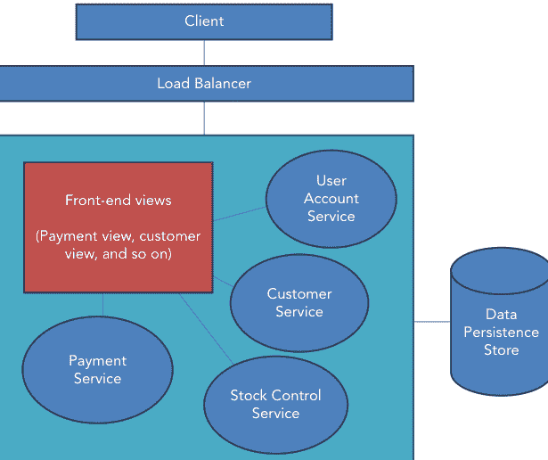

这些组件以逻辑模块化的形式被封装在一起，并作为一个单体应用部署。这是一种开发和部署应用程序的简单方法，因为只需要测试一个应用程序。集成开发环境（`IDE`）和其他开发工具都是针对单体架构设计的。尽管单体架构有这些优点，但应用程序会变得非常庞大。

小型应用程序对于开发者来说很容易上手、理解和维护；而一个大型单体应用可能很困难，特别是对于那些最近加入团队的人来说。他们可能需要几周或几个月才能彻底理解该应用程序。

频繁部署是不切实际的，因为需要许多开发者（可能还涉及其他部门）的配合。安排部署可能需要几小时或几天时间，阻碍了新功能的测试和错误的修复。单体设计的一个缺点是很难改变技术或框架。应用程序是根据项目初期做出的技术决策开发的。你被这些决策所困；如果发现了一种以更优雅或高效的方式解决问题的技术，很难开始使用它。重写整个应用程序几乎永远不是一个负担得起的选择。单体架构模式不利于扩展。

### 可扩展性

扩展性是指应用程序随着服务需求的变化而增长（或缩小）的能力，且不会显著影响用户体验。一个性能糟糕的电子商务网站会迅速流失客户，使得扩展性变得非常重要。第一个解决方案是水平扩展，将应用程序复制到许多服务器上，并以高可用（`HA`）的方式进行负载均衡，配备一个备用节点，当主节点宕机时变为活动节点。X 轴扩展提高了应用程序的容量和可用性。这种方案不会产生开发成本影响，但会导致更高的托管和维护费用。

你可以沿着 Z 轴扩展应用程序。应用程序代码被复制到几台服务器上，类似于 X 轴拆分，但在这种情况下，每台服务器只负责一部分数据。有一种机制将数据路由到适当的服务器，可能基于用户类型或主键。Z 轴扩展受益于比 X 轴扩展大得多的性能提升；然而，它可能需要新的开发来重新架构应用程序。

这些解决方案都无法解决日益增长的应用程序和开发复杂性。对于这一点，你需要垂直扩展。

应用程序可以沿着 Y 轴扩展。它被分解为功能、服务或资源。你执行此操作的方式完全取决于你自己的的情况，尽管按使用情况进行划分是常见的。其核心思想是每个分解后的部分应该封装一组相关的活动。

为了可视化 X、Y、Z 三轴的扩展，你可以绘制一个 AKF 扩展立方体，如图 15-4 所示。

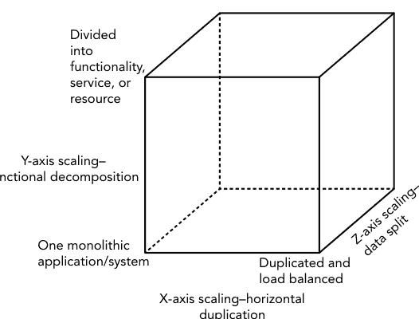

### 分解为服务

微服务方法沿着 Y 轴将单体应用分解为满足单一用例或一组相关功能的服务。这些服务随后被复制到几台服务器上，并放在负载均衡器之后。数据持久化可以通过根据主键对数据进行分片来沿着 Z 轴扩展。

如果你沿着 Y 轴分解图 15-3 中的应用程序，你将得到图 15-5 所示的架构。

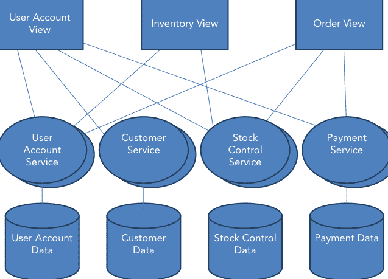

前端服务已经从后端服务的功能中拆分为单独的应用程序。服务从单体应用拆分为独立的应用程序，它们管理自己的数据。你可以通过数据分片实现 Z 轴的拆分，通过集群和负载均衡实现 X 轴的扩展。

你已经看到了如何将单体应用分解为微服务，并学习了扩展性对于应用程序连续性的重要性。

现在你将更密切地观察微服务架构的具体优点和成本。

### 微服务的优点

从开发的角度来看，微服务架构的优点源于它组成的小应用程序的规模和敏捷性。它们易于开发者理解并便于 `IDE` 管理。一个由数百个模块组成的大型应用程序可能需要大量时间加载，这会对开发者的生产力。每个微服务应用程序都可以快速部署，且通常不需要与其他团队协作。由于每个服务都是独立的，对代码的本地更改不会影响其他微服务；因此，可以进行持续开发。每个微服务都可以由专门的开发者团队开发，该团队独立于其他团队管理其服务的部署和资源需求。

用户界面（`UI`）通常与后端开发分离；你的开发团队可以独立进行。参见第 13 章“RESTful Web Services”，遵循表示状态转移（`REST`）`API`，你只需要关注表示。这允许真正的关注点分离。

从应用程序性能的角度来看，优点源于能够将每个微服务部署到自己的环境中。微服务的资源需求可能与其他服务不同，允许资源分配更加精细化。

容错性和隔离性增加了。一个微服务的故障不会影响其他服务，允许应用程序继续运行。在服务之间使用消息系统中，微服务会在等待。如果应用程序水平扩展，服务就不会中断。在所有微服务架构的优点中，被讨论最多的是技术栈切换的易性。因为每个微服务都很小，重写它并不昂贵。事实上，微服务可以使用任何语言编写，允许你选择最适合解决问题的语言。项目初期做出的技术决定并不决定整个应用周期必须使用的技术。

### 世上没有免费

微服务架构的优点并非免费。其中涉及成本。

开发微服务的容易性使得微服务的数量很容易增长且快速增长。十五个微服务很容易变成三十个或更多，特别是当同一个微服务的多个版本被计算时。这带来了许多困难。

运维责任可能会转移到开发团队。只有少数服务需要维护时，这并不是一项困难的任务，但随着微服务的数量增加，维护它们的任务随之增加。需要大量的投入来确保服务的部署和维护。流程需要自动化以减少部署和维护大量服务的负担。你可能需要填补知识空白，增加开销成本。

跨语言语义意味着所有微服务必须更新代码以保持同步。这可能非常耗时且成本巨大。接口契约和消息格式的更改可能是此类更改的原因，并要求所有团队以协调的方式工作。同样，项目早期未能更改接口或消息格式会导致随着微服务数量的增加，成本大幅增加。

重复代码是你被教导是坏的，事实也如此。在微服务环境中，代码重复的风险很高。为了避免耦合和依赖，有时必须重复代码。你可能可以通过抽象代码来共享库，但这在多语言环境中并不行得通。

分布式系统的固有不可靠性和复杂性在微服务环境中被放大。每个服务都可能以分布式方式托管，通过网络进行通信，而网络面临着延迟问题、版本不兼容、提供者不可靠、硬件问题等挑战。持续监控网络性能至关重要。

单体架构多年以来一直用于开发应用程序和小应用程序，并且对于小型开发团队非常友好。它易于开发和测试，因为 `IDE` 是为了管理这类应用程序结构而设计的。但正如你看到的，它的扩展性不佳，并且阻碍了开发。引入新技术很困难，重构成本也很高。

### 结论

微服务被分解为功能相关的逻辑服务。它们较小的规模使得开发者很容易理解。开发和部署是持续的。扩展性被构建在架构中，你不会被初期的技术决策所困住。

### 最后，一些反模式

此书的目的是填补“经典”模式与 Java EE 之间的空白。你会发现有很多书籍在讨论反模式，但在这里讨论几个也无无处。

反模式的出现通常是因为对一个或多个模式的误用。一个有经验的 Java EE 开发者可以很容易地列出比模式更多的反模式。这里是几个常见的或你可能已经遇到过的。

## 超类

可能没有哪个项目是没有拥有许多目的和职责的巨大类的。这不仅违反了 Java EE 原则，此类类还违反了面向对象编程（`OOP`）原则，必须避免。

过载了许多职责的服务属于同一类。如果你不是 `OOP` 的粉丝，那没关系，但如果你继续使用 `OOP` 语言编写代码，最好保持类尽可能小且高内聚。

尽管其他人也引入了这种反模式，但 `Reza Rahman` 可能第一个给它命名的人。

### 千层饼架构

Java EE 从早期就开始被推广，这可能导致了不必要的接口和包。这种模式看起来像是是对超类和单体应用的应对，但它通常会不必要地增加复杂性。

`OOP` 世界中的千层饼架构与结构化编程中的意大利面条代码没有区别。过度的抽象是没有必要的，且没有任何帮助。当你在正确的数量、正确的语境以及仅在需要时使用接口和松耦合时，它们是很好的工具。

这种反模式有许多不同的名称，例如巴拉瓦代码（`Baklava Code`）。然而，“千层饼”这个名字可能是由 `Adam Bien` 提出的，他强烈反对不必要地使用接口。

### 哥伦布先生

所有经验丰富的 Java EE 开发者都想发明或实现自己的完美解决方案。大多数时候，这些只是为了尝试抽象并为公共库（如日志或测试）提供更好的接口，在这些情况下甚至可能走向极端，重新发明一个由开源社区支持了多年的重要功能，例如对象关系映射（`ORM`）层。

虽然发明新事物看起来很有吸引力，但重造某东西只是浪费时间。如果你打算写一个新的日志框架或 `ORM` 框架，你应该有一个充分的理由去这样做。如果没有，你就是在重写一个支持良好的产品，而且很可能你将不得不自己维护它，并提供所有的支持、测试和未来的开发。

在从零开始编写框架之前，务必确保你已经对开源项目进行了文献检索。

### 友有好处

`J2EE` 供应商锁定的问题之一。到 `J2EE 1.4` 发布时，大多数供应商只使用自家的工具和 `IDE`。这起初看起来像是一种互利互惠的关系，因为供应商对其工具提供专业支持，而开源工具和服务器则留给社区支持。然而，从长期来看，许多 `J2EE` 开发者观察到，当供应商未能做到时，开源工具和服务器为 Java 规范提供了标准行为和兼容性。

购买专业支持和服务以及供应商的工具、服务器和 `IDE` 没有问题，因为项目并没有锁定在该供应商上。供应商锁定可能会引入在没有供应商新版本和补丁的情况下无法解决的问题，而构建应用程序可能允许切换其他供应商。

### 尖端技术

热情的开发者热爱使用尖端技术。例如，多年前引入的 `WebSockets`，但它们仍然面临着与旧版本浏览器的兼容性问题。没有人能否认学习新事物并在项目中实现尖端技术的乐趣。然而，如果你针对的是主流市场，支持此类项目可能会变得繁琐。

决定使用哪个框架或技术的好方法是看它如何适应你的目标用户群。如果你正在为可能使用 `Internet Explorer 6` 的客户构建银行应用程序，使用 `WebSockets` 是最佳选择（尽管大多数 `WebSockets` 框架提供了良好的回退方案）。

在继续之前，你始终需要确保外包库或框架得到了良好支持、成熟并且适合你的项目。

### 工具人

工具类和包在项目中很常见。没有人能否认你需要一个类来执行数学运算，例如舍入或转换不同的数字类型。如果你有这样的工具或辅助类，你可能需要用 `util` 或 `helper` 包名来组织它们，对吧？不，实际上，它们只是在帮助你收集垃圾。因为 `util` 和 `helper` 听起来太通用了，进入这些包的许多类并没有提供真实信息，即使你使用了它们并提供了适当的文档。你可以将其移动到更通用的包中。通用的名称并不能阻止类轻易地进入你的包。那些类不再被使用，没人敢删除它们。

如果你有一个所有人需要的绝佳工具，只需将其放在它所属的位置，并说明当前用法并提供适当的文档。你可以为了未来的需要将其移动到更通用的包中。

就像千层饼一样，`Adam Bien` 描述并命名了这种模式。

### 注意事项

1. HTTP 方法完整列表为：`GET`、`POST`、`DELETE`、`PUT`、`PATCH`、`OPTION`、`HEAD`、`TRACE` 和 `CONNECT`。
2. Oracle 的 WebSocket API 教程：`http://docs.oracle.com/java/7/tutorial/doc/websocket.htm`。
3. 如果系统使用了 HTTP session 数据且没有为 HTTP session 复制建立集群解决方案，这可能会引入开发成本。
4. 《可扩展性艺术：现代企业的可扩展 Web 架构、过程和组织》，`Martin L. Abbott`、`Michael T. Fisher` 著。2009年1月1日。
5. `Adam Bien`。作者及 Java Java 冠军。`www.adam-bien.com`。

## 第三部分 总结

- 第 16 章：设计模式：好的、坏的丑的

# 第 16 章 设计模式：好、坏与丑

本章包含什么内容？

- 好的——设计模式如何通向成功
- 坏的——过度使用和误用设计模式如何带来麻烦
- 以及丑的——“事实上的”标准如何导致失败

到为止，本书已经涵盖了 `GoF`（设计模式四人组）的许多经典设计模式，以及一些未来可能成为经典的额外模式。编写这本书的目的是成为一种如果作者们没有写它，他们也会想买的书。

正如生活中的一切事物一样，设计模式并不总是有用的。它们也可能通过引导你实现反模式来造成危害。本章关注设计模式中好、坏、丑的方面，并希望为你丰富的模式武器库提供一种更好的方法。

## 好的：通成功的模式

正如之前多次提到的，设计模式是许多明智开发者的集体智慧和经验。它们释放了极丰富的经验，你可以利用这些经验来解决软件开发中发生的许多常见问题。即使在编程早期、`goto` 还被认为是合法的（且可以接受的）时代，许多项目仍然失败了。软件工程和项目管理早期的重要资源之一是 `Frederick Brooks` 在管理 `IBM` 的 `OS360` 开发时编写的《神人马月》。尽管该书于 1975 年出版，但它仍然解决了现代软件项目面临着许多关注点和问题。在当时，软件领域最早的设计模式之一流行起来了：面向对象编程（`OOP`）。`OOP` 是一套设计规则和模式，它能够更高效、更轻松地对现实场景进行编码。它简单来说就是为软件的设计、编码和维护提供了一根魔术棒。`Smalltalk`、`C++` 和 `Object-C` 开创了 `OOP` 的早期阶段。尽管 `Edsger Dijkstra` 曾评论道“面向对象编程是一个极其糟糕的主意，它可能源自‘加利福尼亚’”，但它是改变程序编写方式的首次重大转变。

然而，`OOP` 也并不是万灵妙药。首先，使用面向对象的语言并不真的意味着使用了面向对象的方法。开发者过去是、现在仍然能够利用任何面向对象语言中的代码。其次，使用的对象复杂且设计不当，至少会让任何非对象系统变得复杂。

在 20 世纪 90 年代初，著名的“四人帮”（`Gang of Four`）`Erich Gamma`、`Richard Helm`、`Ralph Johnson` 和 `John Vlissides` 出版了《设计模式：可用面向对象软件的基础》，这是第一本将问题解决方案作为设计模式汇集的书。该书涵盖了 23 种设计模式，在本书中被称为“经典模式”，并且它们包含了 `C++` 和 `Smalltalk` 的代码示例。多年来，像 `Jim Coplin` 这样的许多伟大程序员引入了许多新模式，并将其添加到模式集合中。

然而，设计模式并不依赖于语言，可以在任何软件项目中实现。设计模式解决了常见问题，并在开发者之间提供了一套通用的词汇表。与其描述如何实现一个回调机制（该机制仅在资源发生变化时触发），你不如说：“哦，我们在 x 上有观察者。”

当 Java 在 20 世纪 90 年代中期开发时，许多设计模式被集成到它的运行时。Java 在其内部设计中充分利用了模式，并通过提供默认的应用程序接口（`API`）在语言本身暴露了许多模式。

随着 Java EE 的发布，引入了更多模式，这些模式发表在《核心 JEE 模式：设计模式与策略》中。

阅读模式集合并学习它们的用例可以增加你对常见问题以及如何解决这些认知，甚至在它们出现之前就可以。本书列出了许多关于特定设计模式如何影响项目的故事。这些故事源于真实经验。阅读并记忆一个模式不能保证提供神奇的解决方案，但当你遇到困难或挑战时，它可能会为你提供解决问题的线索和提示。很快，你就能通过使用适当的模式在问题发生之前解决它们。

最初，`JEE` 编程模型严重依赖于可扩展标记语言（`XML`）配置和重量级企业级豆（`EJB`）容器来扩展特定类并实现每个方法以使其正常工作。很快，这种方法被证明是低效的，并变成了一种反模式。尽管 `Spring` 的容器方法以及即将到来的 Java 容器设计消除了配置文件上的代码注解，但轻量级容器和基于纯旧 Java 对象（`POJOs`）的 `EJB` 提供了一种高效效且易于测试的编程模型。Java EE 随后的版本提供了许多所需的功能，其中大部分功能在贯穿书中都已涵盖。最后，上下文和依赖注入（`CDI`）引入了一个具有强大灵活特性的新容器。在 `CDI` 的帮助下，你可以轻松地实现许多模式，例如观察者和装饰器。

### 战例

当我被赋予负责 `Eclipse Libra` 项目的任务时，我对 `Eclipse` 插件的了解有限。在读了由 `Dan Rubel` 和 `Eric Clayberg` 编写的唯一可用书籍 *Eclipse Commercial-Quality Plug-Ins*（`Addison-Wesley`, 2008）后，我决定跳入 `Eclipse` 仓库中现有的代码库。

很快，我被 `Eclipse` 的整体架构以及插件的构建方式感到惊讶。诸如适配器、装饰器、策略、备忘录等许多设计模式随处可见，它们在正确的语文中被使用，并提供了高效且清晰的实现。

`Eclipse` 仓库是在一个拥有数百万用户的真实项目中良好实现设计模式的最佳来源之一。

## 坏：模式的过度使用和误用

我收到的关于设计模式的首次培训简直让我大开眼界。接下来的一个月里，我花了所有时间阅读《头头绪设计模式》（*Head First Design Patterns*），接着是 `GoF` 的书。我掌握了模式的知识，并准备好使用它们。随着时间的推移，我意识到我甚至不需要使用继承，可以用装饰器构建所有的模型和层次结构。我创建了一组工具类，由几个单例、一些用于观察者的消息总线以及一些我在创建新项目时包含的通用装饰器和观察者组成。

我总是自豪于展示我的代码，让别人看到我是一个多么伟大且复杂的程序员。我没有意识到我使用设计模式的方法是将代码过度复杂化，并在运行时添加了太多的层。简单地简化现有代码就能获得更好的性能。复杂精密的代码并不能让你成为更好的程序员，也不会让代码变得优化和可维护。工程是在正确的地方使用正确的工具的艺术。

### 战例

我曾被要求实现一个数据结构来处理事务操作，以用于我正在申请的一份工作。我在家里完成了代码，并通过电子邮件将其发回公司进行评审。系统在提交后能够添加新值并执行保存操作。此外，当执行回滚时，系统能够回到之前的状态。脑海中微小的声音不断尖叫：“备忘录！”尽管在今天之前我从未需要实现备忘录，但我知道它是完美的匹配。于是我开始修改我的备忘录模式知识。我创建了护理者（`Caretaker`）、备忘录（`Memento`）和源源（`Originator`）类，将它们放在内部包中，并实现了使用备忘录的数据库逻辑代码。我为交付的代码感到自豪和自信。令我惊讶的是（对我来说），公司不想继续面试流程。也许它在寻找一个使用简单栈来推拉值的人才，但我交付的代码给了我对模式知识的信心。多年后回到最初的问题时，我意识到使用最小对象存在性能限制。我的代码是可读且可维护的，但它没有解决面试官最初提出的关键点。

## 丑

设计模式和 Java EE 是老朋友。然而，这种友谊并不总是运作良好。当 `JEE` 在企业界被广泛接受并开始处理大型项目时，设计模式来救场了。`GoF` 的许多经典模式在 `J2EE` 应用中找到了自己的位置。企业模式随之出现，以解决 `J2EE` 平台的常见问题。

幸运的是，企业级 Java 有一个完美的结局。由 `Rod Johnson` 领导的 `POJO` 和轻量级容器获得了大量的追随者，并很快成为 `J2EE` 的竞争对手。`Spring` 提供了一个轻量级容器以及在简单 Java 服务器上运行的能力。`POJO` 方法对测试来说非常友好，而且大多数情况下不需要容器，但即使需要容器，也不使用它。

`Spring` 的成功导致了 Java 社区进程（`Java Community Process`）的复兴。`Java EE 5` 从头开始设计，以支持 `POJO EJB` 和轻量级容器。Java 已经进化并成熟。

其他的旧习惯和开发技术并没有在一夜之间改变。然而，许多开发者仍然遵循 `J2EE` 的模式，在使用轻量级容器和服务器时创建过度分层且复杂的应用程序。就像英语从莎士比亚时代以来发生了变化一样，平台和编程语言发生了变化。不要因为拒绝改变而固步自封。

### 战争故事

那是 `J2EE 1.4` 早期，我们要实现下一代银行系统。我们实施了所有的最佳实践、模式、指南以及在书籍和在线资源中能找到的任何东西。

我们的应用程序严重依赖于特定的供应商，不具有移植性。我们必须运行供应商的集成开发环境（`IDE`）和供应商服务器，而那是在 32 位时代，`Windows` 拒绝访问超过 3GB 的内存。当我们以调试模式启动时，服务器和 `IDE` 运行极其缓慢，以至于我们不需要断点就可以停止执行。

供应商向我们保证生产环境将会很快的；尽管如此，开发周期就像脚踝上的铁球。在服务器启动时，我们可以轻松地去喝杯咖啡休息。

当我们想要上线时，事情变得更有趣了。事实证明生产环境和开发机一样慢。很快，我们都养成了观察生产环境和测试环境状态的习惯。

最后，我们请了一位著名的顾问来告诉我们哪里做错了。他是一个老而睿智的人，我们像对待甘道夫（`Gandalf`）一样对待他。在审查了几天代码后，他要求删除所有的外观（`facades`，我们几乎为每个 bean 都定义了外观）以及所有不必要的接口（我们为接口定义了接口）。他还要求通过减少调用层级来减少我们像千层一样的层次（`EJB` 调用 `EJB`，再调用 `EJB`）……

那是使用重型供应商服务器的 `J2EE 1.4` 时代，我们仍然获得了一些性能提升，并且至少实现了代码的可读性。

假设一切都会发生变化，如今对灵活性的要求的开发并不会提供更轻松的未来，反而可能更加捉襟肘。

### 总结

设计模式是软件中最重要的、最具挑战性且最实用的主题之一。一个面向对象的程序员如果没有对常用设计模式有充分的知识将是不完整的。

良好的知识为你可能可能面对的常见问题提供了极好的工具箱。Java EE 在此基础上更进一步，在企业项目中引入了更简单、更集成的方法来使用设计模式。Java EE 中的大多数模式都是经过长时间的争论和痛苦之后引入的，这确保了它们得到了良好的实现并且已经成熟。

书中描述的所有模式都依赖于 Java EE 标准，因此它们几乎可以保证成功运行。

然而，模式既不是万灵药，也不是魔棒。如果无理由地大量使用，它们往往会使项目过度复杂。了解一种模式并不意味着你必须使用它，除非它适用并能解决潜在问题。

阅读并学习设计模式，并尝试保持对它们适用场景及所解决问题的记忆。你将节省大量的代码行并赢得尊重。

### 注释

1. 设计模式：可复用面向对象软件元素 (`Addison-Wesley`, 1994): `Erich Gamma`、`Richard Helm`、`Ralph Johnson`、`John Vlissides`。
2. 人月神话：软件工程随笔 (`Addison-Wesley`, 1975): `Frederick P. Brooks Jr.`。
3. `Edsger Dijkstra` 是一位荷兰计算机科学家，因在开发编程语言方面的基础性贡献获得 1972 年图灵奖。
4. `James O. Coplin` 《EE 模式：最佳实践与设计策略》 (`Prentice Hall`, 2003): `Deepak Alur`、`Dan Malks`、`John Crouch`。
5. 一个基于 Java 的框架，提供了依赖注入和面向切面编程在内的许多功能。
6. 《入门级设计模式》(`O'Reilly`, 2004): `Eric Freeman`、`Elisabeth Robson`、`Bert Bates`、`Kathy Sierra`。
7. `Rod Johnson` 是一位创建 `Spring` 框架的澳大利亚计算机程序员。

### 索引

#### A

- 抽象工厂设计模式。另见工厂设计模式
  - 设计模式
  - 类图, 68
  - 在纯代码中实现, 69
  - 何时使用, 80
- `AbstractFactory` 类, 188
- `AbstractDrinksMachineFactory` 接口, 69
- `@AccessTimeout` `EJB`, 29–31
- `AccountService` `EJB`, 188
- `addUser()` 方法, 44
- 建议 (`advices`), 102。另见 `AOP`
  - 上下文, 104-105
  - 默认级别拦截器, 106
  - 拦截器执行顺序, 107–109
- `AFTER_COMPLETION` 阶段, 148, 149
- `AFTER_FAILURE` 阶段, 148, 150
- `AFTER_SUCCESS` 阶段, 148, 149
- `AKF` 案例代码, 210
- `@Alternative` 注解, 59, 72
- `All`, `Derpak`, 88
- `AnnotLiteral` 类, 77–78
- 注解
  - `@AccessTimeout`, 45
  - `@Alternative`, 59, 72
  - `@Any`, 76–79
  - `@ApplicationPath`, 175
  - `@Around`, 102, 104
  - `@Clearance`, 93–94
  - `@ConcurrencyManagement`, 46
  - `@ConversationScope`, 21
  - `@ConversationScope`, 57
  - `@Decorator`, 61, 89–94
  - `@Delegate`, 61, 89–94
  - `@DELETE`, 175
  - `@DependsOn`, 40–42
  - `@EJB`, 53, 54
  - `@Entity`, 156, 188
  - `@GeneratedValue`, 156, 158
  - `@GET`, 175–178
  - `@Id`, 156, 188
  - `@Inject`, 53, 54, 56, 57, 69
  - `@InterceptorBinding`, 69–110
  - `@Interceptors`, 21
  - `@interface`, 73, 74
  - 生命周期注解, 105
  - `@Lock`, 43–45
  - `@LockType`, 43–45
  - `@LongMessage`, 73–74, 77–78
  - 方法级注解, 73–103
  - `@Model`, 60, 191
  - `@MyEvent`, 147
  - `@Named`, 54–55, 58, 60, 75–76, 190–191
  - `@Observes`, 144–150
  - `@Path`, 175–178
  - `@PathParam`, 177–178
  - `@POST`, 175, 178
  - `@PostActive`, 105–106
  - `@PostConstruct`, 14, 39, 42, 105
  - `@PreDestroy`, 105–106
  - `@PrePassivate`, 105–106
  - `@Producers`, 69–76, 80
  - `@PUT`, 175
  - `@Qualifier`, 73
  - `@QueryParam`, 178
  - `@Remove`, 21
  - `@RequestScope`, 21, 190–191
  - `@RequestScoped`, 57, 60
- 注解 – CDI beans（续）
  - `@Resource`, 53, 132
  - `@Schedule`, 128–131
  - `@Schedules`, 128–131
  - `@Secure`, 109–110
  - `@SessionScope`, 21
  - `@SessionScoped`, 57
  - `@ShortMessage`, 73, 74–77–78
  - `@Singleton`, 14, 39, 46
  - `@Startup`, 14, 40
  - `@Stateful`, 31
  - `@Target`, 59, 74
  - `@Timeout`, 128, 132, 151
  - `@Transient`, 158
  - `@WebServiceRef`, 53
- 反模式, 10, 204
  - 千层蛋糕架构, 204–205
  - over 类, 204
- `@Any` 注解, 76–79
- `AOP` (面向切面编程), 97–112
  - 在计划中实现, 100–101
  - 拦截器
    - `CDI` 拦截器, 109–111
    - 默认级别, 106
    - 实现, 102–105
    - 生命周期注解, 105–106
    - 执行顺序, 107–109
  - 何时使用, 111
- `applets`, 7
- `@ApplicationPath` 注解, 175
- 应用层, 17
- 存档, `CDI` beans, 56–57
- `@AroundInvoke`, 102, 104
- 面向切面编程。另见 `AOP`
- 切面, 61, 57, 98, 102。另见 `AOP`
- `async(i)` 方法, 120
- 异步 servlet, 118–120
- 异步编程, 113–126
- 异步 bean, 118–120
- 异步 servlet, 120–124
- 流程图, 116
- 实现
  - 在 Java EE 中, 118–124
  - 在纯代码中实现, 116–118
  - 概述, 113–113
  - 何时使用, 124–125
- 异步 servlet, 120–124
- 自动定时器, 130–131
- 基于日历的属性, 134–136
- 实现, 131

#### B

- `Baklava Code`, 205
- `BaseDAO` 接口, 162, 163
- `BasicDrinksMachineFactory` 类, 69
- `Batch`, 16
- bean存档, 56–57
- bean 管理并发, 43
- `beans.xml` 文件, 31, 69, 91, 110–111
- `BEFORE_COMPLETION` 阶段, 148–149, 151
- 行为设计模式, 6
- `Ben`, 223, 205
- `Blackbird-accountDecorator`, 91–94
- 前沿技术, 205
- `Bloch`, `Joshua`, 37
- `BlockingQueues`, 118
- `Box`, `Don`, 8
- `Brooks`, `Frederic`, 209
- 业务层 (中间层), 14, 15–16

#### C

- 可缓存 (`REST`), 168
- 基于日历的定时器属性, 134–136
- 回调方法, 130
- `CDI` (上下文和依赖注入)。另见依赖注入设计模式
  - `fr EJ`, 58
  - 可序列化对象类型, 56
  - 拦截器, 109–111
  - 多个接口实现以及, 76–79
- `CDI` beans, 20–21, 56–57
  - 存档, 56–57
  - 用于 `JSF` 页面的后端 bean, 58
  - 用于后端 `JSF`, 58
  - 命名, 58
  - 要求, 56
  - 作用域, 21, 57–58
  - 元类型, 60
- 子类, 19
- 类图, 4–5
  - 抽象工厂模式, 68
  - 数据访问对象模式, 154–155
  - 装饰器模式, 27
  - 外观模式, 27
  - 工厂模式, 64–65
  - 观察者模式, 141–142
  - 单例模式, 34
- 类
  - `UserServiceFactory`, 51
  - 工具类, 206
- `@ClearanceSale` 注解, 93–94
- 客户端层, 14–15
- 客户端-服务器约束 (`REST`), 167
- `CMP` (容器托管持久化), 156
- 按需代码约束 (`REST`), 168
- 约定优编码, 19
- `CoffeeMachine`, 66
- `Coffeetype` 枚举, 67–68
- 组件模型, Java EE, 19
- 并发
  - `AbstractActionFactory`, 188
  - `ActionFactory`, 188
  - `AnnotationLiteral`, 77–78
  - `BasicDrinksMachineFactory`, 69
  - `BlackFridayDiscountDecorator`, 91–94
  - `Children`, 149
  - `CoffeeMachine`, 66
  - `DoubleExtractor`, 86, 88
  - `DrinksMachine`, 66–68
  - `Endpoint`, 196–197
  - `EventService`, 70–76, 145
  - `FrontController`, 188
  - `FutureTask`, 117
  - `GourmetDrinksMachineFactory`, 69
  - `HelloEndpoint`, 157
  - `Helper类`, 206
  - `ListUseCase`, 189–190, 191
  - `MessageFactory`, 79
  - `Movie`, 157
  - `MySingleton`, 35–38
  - 命名, 19
  - `NoCostExtra`, 88
  - `Observable`, 142–144
  - `Pizza`, 86
  - `Plate`, 93
  - `PriceDiscountDecorator`, 90–94
  - 限定符类, 55
  - `RegularExtra`, 86, 87
  - `Runnable`, 116
  - `ScheduleExpression`, 133–137
  - `SoftDrink`, 67
  - `SoftDrinksMachine`, 67
  - `Table`, 89–90
  - `TraceObserver`, 145
  - `UserService`, 50–52, 55–187
- 并发工具, 17, 18
- 单例模式, 42–45
- `@Management` 注解, 46
- 容器托管并发, 43, 54, 36
- 容器托管持久化 (`CMP`), 156
- 约定会话, 19
- `@ConversationScoped` 注解, 21
- `@ConversationScoped` 注解, 57
- 《核心 J2EE 模式：最佳实践与设计策略》, 8
- `createTimer()` 方法, 133
- `createIntervalTimer()` 方法, 133
- `createActionTimer()` 方法, 133
- `createSingleTimer()` 方法, 133
- 设计模式, 6
- 跨切关注点, 98, 104, 111
- `n`, `John`, 8
- `CustomerService` `EJB`, 29–31

#### D

- 数据访问对象 (`DAO`) 模式, 65–66
  - 类图, 154–155
  - `DTOs` (数据传输对象), 155–156
  - 在 Java EE 中实现, 57–162
  - `JPA` (Java 持久 `API`), 156–158
  - `ORM` (对象关系映射), 156
  - 概述, 153–154
  - 类型安全实现, 162
  - 何时使用, 163
- 数据访问层, 17
- 数据层, 188
- 数据传输对象 (`DTOs`), 155–156
- `dayOfMonth` 计时器属性, 134
- `dayOfWeek` 计时器属性, 134
- 调试与异步编程, 124
- 解解单体应用, 201–202
- `@Decorator` 注解, 61, 89–94
- 装饰器设计模式, 83–96
  - 类图, 85
  - 实现
    - 在 Java EE 中, 89–94
    - 在纯代码中, 86–89
    - 概述, 83–85
    - 何时使用, 94–95
- `@Delegate` 注解, 61, 89–94
- `@DELETE` 注解, 175
- `DELETE` 方法, 171, 172, 173, 174, 178
- 依赖注入设计模式。另见 `CDI`
  - 收益, 50
  - 实现
    - 在 Java EE 中, 53–63
    - 在纯代码中, 50–53
  - `@Named` 属性, 54–55
  - 概述, 20–21, 49–50
- `@DependOn` 注解, 40–42
- 设计模式。另见特定模式
  - 类图, 4–5
  - 抽象工厂, 68
  - 数据访问对象, 154–155
  - 装饰器, 85
  - 外观, 27
  - 工厂, 64–65
  - 观察者, 141–142
  - 单例, 34
  - 12. 企业级模式, 8–9
  - 分类, 6
  - 历史, 5
  - 需求, 5
  - 概述, 4–6
  - 为了成功, 209–211
  - 不必要的使用, 5–6, 211–212
  - 何时使用
    - 异步编程, 124–125
    - 数据访问对象, 163
    - 装饰器, 94–95
    - 外观, 31
    - 工厂, 80
    - 拦截器, 111
    - 模型视图控制器, 193
    - 服务器, 150–151
    - `REST`, 180–181
    - 单例, 45
- 设计模式：可重用面向软件, 5, 6
- `DI` 依赖模式
- `Dijkstra`, `Edge`, 210
- `Dispatcher servlet`, 186
- `Filter()` 方法, 100
- `doGet()` 方法, 187
- 双重检查锁定, 37
- `DoubleExtra` 类, 86, 88
- `Drink` 接口, 67
- `DrinkMachine` 类, 66–68
- `DTOs` (数据传输对象), 155–156
- `Eclipse`, 211
- `Effective Java`, 37, 38
- `EIS` (企业级系统) 层, 14–15, 18
- `EJB` (`Enterprise JavaBeans`) vs. `CDI`, 52
  - 组件模型, 8
  - 容器, 15, 16, 17
  - 上下文, 21
  - 有状态 bean, 外观模式, 31
  - 无状态 bean, 外观模式, 29–31
  - `zu`, 53, 54
- `EL` (表达式语言), 16, 17, 58, 184
- `Endpoint` 包括, 196–197
- 企业级系统 (`EIS`) 层, 14–15, 18
- 企业级模式, 7–10
- `@Entity` 注解, 156, 158
- 实体 bean, 159–160
- `EntityManager`, 160–161, 163
- `EventService` 类, 70–76, 145
- `execute()` 方法, 188, 192
- `ExecutorService`, 117, 123–124

#### F

- 显式 bean, 56–57
- 表达式语言 (`EL`), 16, 17, 58, 184
- `getTimer` 方法, 133
- `getTimeRemaining` 方法, 133
- `getUserList()` 方法, 192
- `Users()` 方法, 176
- `GlassFish Server Open 4.0`, 18
- `GoF` (四人帮)
- `GourmetDrinksMachine` 类, 69

#### G

- 外观设计模式, 25–32
  - 收益, 28–29
  - 类设计, 27
  - 在纯类中实现, 27–29
  - 有状态 bean, 31
  - 无状态 bean, 29–31
  - 概述, 25–27
  - 何时使用, 26, 31
- `faces-config.xml` 文件, 190
- `FacesServlet`, 190–192
- 工厂设计模式, 63–81
  - 抽象类, 68
  - 类设计, 68
  - 在纯代码中实现, 69
  - 工厂方法, 64
  - 类设计, 64–65
  - 在 Java EE 中实现, 69–80
  - 在纯类中实现, 66–68
  - 概述, 63–64
  - 何时使用, 80
- `Fielding`, `Roy`, 166, 167
- `Fork/Join Framework`, 118
- `Fowler`, `Martin`, 49
- `FrontController` 类, 187
- `Future` 接口, 117
- `FutureTask` 类, 117

#### H

- `HATEOAS` (超媒体作为应用程序状态的引擎), 178–180
- 第一头部设计模式, 6, 26, 34, 38, 64, 68, 85, 140
- `heavilySorted` 方法, 27–28
- `HelloEndpoint` 类, 196–197
- `Helper类`, 206
- `Helper` 包, 206
- 好莱坞法则, 140
- `home.jsp` 文件, 191
- 小时 时间属性, 134
- `HTTP`
  - 异步 servlet, 以及 121
  - 方法, 171–172
  - `REST` 和, 166–167
- 超媒体作为应用程序状态的引擎 (`HATEOAS`), 178–180

#### I

- `@Id` 注解, 156, 158
- 在 Java EE 中实现设计模式
  - 异步编程, 118–122
  - 数据访问对象, 157–172
  - 装饰器, 89–94
  - 依赖注入, 53–61
  - 外观模式, 29–31
  - 工厂, 69–80
  - 拦截器, 102–111
  - 模型视图控制器, 190–192
  - 观察者, 144–150
  - 单例, 38–45
  - 器, 130–137
  - `WebSockets`, 196
- `@GeneratedValue` 注解, 156, 158
- `@GET` 注解, 175–180
- `GET` 方法, 166, 167, 171, 172
- `getTimer` 方法, 133
- `getTimeRemaining` 方法, 133
- `getUserList()` 方法, 192
- `Users()` 方法, 176
- `GourmetDrinksFactory` 类, 69

#### J

- `JSR166`, 114
- `JSR220`, 53
- `JSR229`, 53
- `JSR250`, 53
- `JSR299`, 55
- `JSR315`, 120
- `JSR330`, 53
- `JTA` (Java Transaction `API`), 16, 17, 161
- 微服务架构, 199–204
  - 优势, 202–203
  - 成本, 203–204
  - 可扩展性, 200–201
- 中间层, 14–15, 16–17
- `minter` 定器属性, 134
- `@Model` 注解, 60, 19
- 模型-视图设计模式, 183–193
  - 实现
    - 在 Java EE 中, 190–192
    - 在纯代码中, 186–190
  - `outbooks`, 183–185
  - 类型, 185–186
  - 何时使用, 193
- 模型-视图（模型呈现器）, 186
- `MVP` (模型呈现器), 186
- `@MyEvent` 注解, 147
- `MySingleton` 类, 35–38
- 《人人月神》, 209–210

#### L

- `lasagna` 架构, 204–205
- 分层系统约束 (`REST`), 168
- 级别, 理德森成熟度模型, 168–199
- 生命周期
  - `AsyncListener` 方法, 122
  - `CDI Bean`, 57
  - 拦截器, 105–106
  - `WebSockets` 方法,
- `lightlySoiled` 方法, 27–28
- `listuser.jsp` 文件, 189
- `ListActionListener` 类, 189–190, 191
- `LoanService` `EJ`, 29–31
- `@Lock` 注解, 43–45
- `@LockType` 注解, 43–45
- `logAsync()` 方法, 119–120
- `logger` 拦截器, 21–22
- 逻辑层, 17
- `logync()` 方法, 120
- `@LongMessage` 注解, 73–74, 77–78
- 松耦合实例, 19

#### M

- `Maks`, `Dan`, 88
- `ManagedExecutorService`, 123–124
- `ManagedThreadFactory`, 122–123
- 面向消息的中间件 (`MOM`), 198–199
- `MessageA Bean`, 71–76
- `MessageB Bean`, 71–76
- `MessageEvent` 限定符, 146
- `MessageFactory` 类, 79
- `MessageType` 接口, 77–79
- 方法级注解, 103–104

#### N

- `@Named` 注解, 54–55, 58, 60, 75–76, 190–191
- 命名类, 19
- `NoCostExtra` 类, 86, 88
- 非阻塞执行, 113
- `notifyObservers` 方法, 140, 150
- 名词, `REST`, 166–167
  - `HTTP` 动词和, 169
  - 命名, 170
  - 复数, 171
  - `posts`, 173–174
  - `topics`, 173–174
  - 统一接口, 167
  - 用户, 172–173

#### O

- 对象关系映射 (`ORM`), 156, 205
- 面向对象编程. 见 `OEP`
- 可观察 类, 142–144
- 观察者设计模式, 139–152
  - 类图, 141–142
  - 实现
    - 在 Java EE 中, 144–150
    - 在纯代码中, 142–144
    - 概述, 139–151
    - 何时使用, 150–151
- 观察者接口, 141–142, 143–144
- `onservers` 注解, 140–153
- `onClose` 方法, 196
- `onerror` 方法, 122, 196
- `onStartAsync` 方法, 196–197
- `onTimeout` 方法, 122
- `OOP` (面向对象编程)
  - 背景, 5, 210
  - 设计模式中, 4
  - `lasagna` 架构, 204
  - 用户中, 204
- `Order` 接口, 86–89
- `ORM` (对象关系映射), 156, 205

#### P

- `@Path` 注解, 175–178
- `@PathParam` 注解, 177–178
- `Paypal.com`, 180
- 持久层, 17
- 持久化单元, 160–161
- `persistence.xml` 文件, 159–161
- `Pizza` 类, 86
- `Plate` 类, 93
- 点对点 `MOM` 实现, 198–199
- `pointcut`, 102
- `@POST` 注解, 175, 178
- `@PostActivate` 注解, 105–106
- `@PostConstruct` 注解, 14, 39, 42, 105
- `POST` 方法, 166, 171, 172, 173, 178
- `posts` 名词, 173–174
- `@PreDestroy` 注解, 105–106
- `@PrePassivate` 注解, 105–106
- 表示层. 见 Client 层
- `PriceDecorator` 类, 90–94
- `@Produces` 注解, 69–76, 80
- `product` 接口, 189–94
- 程序化层, 130–131
- 基于日历的属性, 134–136
- 实现, 132
- 原型设计, `J2EE` 平台, 8
- 可观察 `MOM` 实现, 198–199
- 发布者接口, 143
- `@PUT` 注解, 175
- `PUT` 方法, 171, 172, 173, 178
- `@Qualifier` 注解, 73
- 限定符类, 59
- `Quartz`, 118, 125, 128
- `@QueryParam` 注解, 178
- 查询, 面向消息的中间件, 198
- `RadioChannel`, 143
- `Rehman`, `Trygga`, 184, 86, 87
- `Regular` 类, 86
- `@Remove` 注解, 21
- `@RequestScope` 注解, 21, 190–191
- `@RequestScoped` 注解, 57, 60
- `@Resource` 注解, 53, 132
- `REST`, 165–181
  - 约束, 167–168
  - 设计 `RESTful API`, 169–174
  - `HATEOAS`, 178–180
  - 实现 `RESTful API`
  - 名词. 见, `REST`
  - 概述, 165–167
  - 理德森成熟度模型, 168–169
  - 何时使用, 180–181
- 理德森成熟度模型, 168–169
- 回滚, 观察者模式, 150–151
- `Runnable` 类, 116

#### S

- `Sugarsync`, 174
- `sync()` 方法, 120
- 可扩展性, 200–201
- `@Schedule` 注解, 128–131
- `@ScheduleExpression` 类, 133–137
- `@Schedules` 注解, 128–131
- 范围, `CDI Bean`, 21, 27–58
- `Seam`, 55
- 秒级定器属性, 134
- `@Secure` 注解, 109–110
- 面向服务架构 (`SOA`), 8, 199, 212
- servlet 过滤器, 98–101
- servlets
  - 异步服务, 120–124
  - `FaceServer`, 190–192
  - servlet 过滤器, 99–101
- `@Session` 注解, 21
- `@SessionScoped` 注解, 57
- `@ShortMessage` 注解, 73–74, 77–78
- `@Singleton` 注解, 14, 39, 46
- 单例 Bean, 13–14, 39–42
- 单例设计模式, 33–47
  - 类图, 34
  - 实现
    - 在 Java EE 中, 38–45
    - 在纯代码中, 35–38
    - 概述, 33–34
    - 何时使用, 45
- `sleep()` 方法, 117
- `SOA` (面向服务架构), 8, 199, 212
- `Drink` 类, 67
- `Spring` 框架, 70
- `startAsync()` 方法, 121–122
- `@Startup` 注解, 14, 40
- `stateful` 注解, 31
- `stateful` `EJB`, 31
- `steless` 约束 (`REST`), 168
- `steless` `EJB`, 31
- `stereotypes`, 60
- 结构化设计模式, 6
- 观察者, 140

#### T

- `Table` 类, 89–90
- `@Target` 注解, 59, 74
- 技术兼容性测试 (`TCK`), 18
- `testLoggers()` 方法, 120
- `Timed` 接口, 128
- `@Timeout` 注解, 129, 132, 137
- `@Transient` 注解, 158
- `timeout` 方法, 132
- 定器属性, 134
- 基于日历的属性, 134–136
- 开发, 128
- 程序化层, 130–131
- 实现, 132
- 视图, 127–129
- `time`, 120
- 属性, 134
- 事务, 131–137
- `type`, 185–186
- 用户, 172–173
- 统一接口约束 (`REST`), 167
- 用户类, 204
- 工具类, 206

#### U

- `User` 类, 51
- `UserDataRepository`, 51
- `UserData` 类, 54–55
- 用户名词, 172–173
- `UserService` 类, 51
- `util-包`, 206

#### W

- `web` 容器, 15, 16
- `web` 层（中间层）, 14–15, 16–17
- `web` 配置文件, 18–19
- `webBeans`, 55
- `@WebService` 注解, 53
- `WebSockets`, 195–197
- `Wild8`

#### X

- `x轴`, 201–202
- `y轴`, 201–202
- 年属性, 134

---

# 免费试用 Safari Books

时长 15 天并在前 6 个月内享受 85 折优惠*

无限访问数千种书籍和视频。通过按月或年度订阅，您可以获得：

- 通过 Safari To Go 在 `iPad` 和 `Android` 上进行随时随地的移动访问
- 针对当前热门主题的数百个专家指导教学视频
- 帮助加速各种软件项目的示例代码
- 强大的组织功能，包括收藏夹、标签、笔记、组合等
- `Rough Cuts` 预发布手稿

立即开始您的免费试用！
访问：`safariooks.com`

*优惠仅适用于新 Safari Library 订阅者，适用于连续前 6 个月周期。`Safari Library` 并非在所有国家/地区可用。

---

# WILEY 最终用户许可协议

访问 `www.wiley.com/go/eula` 获取 `Wiley` 电子书最终用户许可协议 (`EULA`)。
