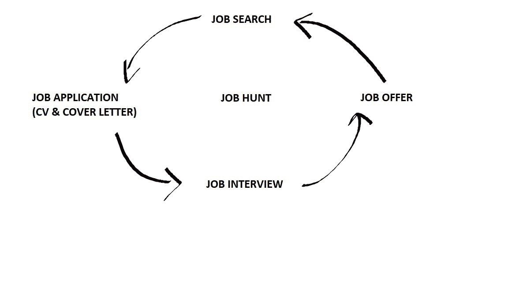
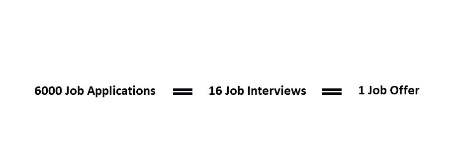
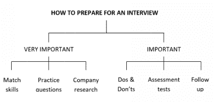
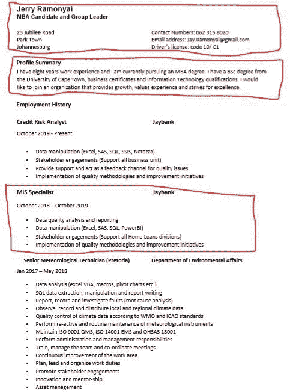
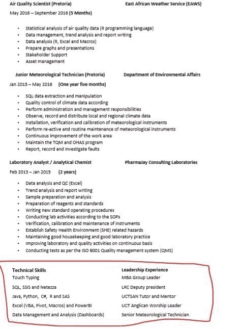
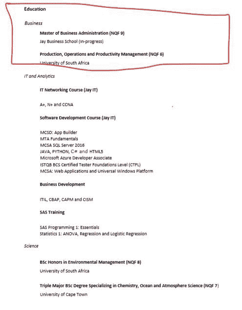
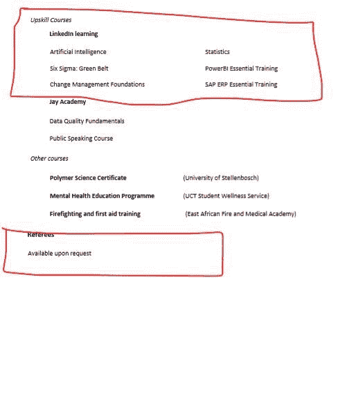

# 编程与编码：IoT 开发、Java、Java EE、Java Swing、JavaScript、jQuery、JSON、Julia 编程、Junit、内核、Kotlin、Laravel、Laravel 框架、LaTeX、LibGDX、LINQ 与 Linux

# 第一部分 智慧

业务运营、数据、计算机、人工智能、利润、增长、成功、财富……

嘿 Siri，什么是人工智能？

人工智能 (AI) 是机器对人类智能过程的模拟，例如自然语言处理机器、语音识别机器、机器视觉、专家系统等。它是计算机、机器人或机器执行通常由人类完成的任务的能力，因为这些任务需要人类的智慧和判断。AI 的目标是创建能够思考、学习并执行理性任务（如解决问题、决策、感知和理解人类交流）的计算机和机器。

## 人工智能的类型

- 反应式机器
- 有限记忆机器
- 心理理论机器
- 自意识机器

## 人工智能示例

- 制造机器人。
- 自动驾驶汽车。
- 智能助手。
- 主动健康管理。
- 疾病映射。
- 自动化财务投资（交易）。
- 虚拟旅游预代理。
- 社交媒体监控。
- 聊天机器人。
- Siri。

## 机器学习

机器学习是人工智能的一个分支，利用数据分析方法来自动化模型构建活动。机器学习算法使用历史数据作为输入来预测新的输出值。这使得软件应用程序在没有显式编程的情况下能够更准确地预测结果。机器学习被用于搜索引擎以寻找最佳搜索结果、邮件过滤器查找垃圾邮件、在线商店进行个性化推荐、检测异常交易的软件、语音识别、自动驾驶汽车等。

### 热门的机器学习技能

- `Python`。
- `R` 编程语言。
- `Java`。
- `Scala`。

## 数学

数学是数字及其运算、组合、推广、抽象、空间配置、测量和变换的科学。数学有许多分支，如代数、几何、算术、三角学、微积分等。数学让我们的生活有序，防止混乱，增加推理能力、创造力、抽象思维、批判性思维、问题解决能力，甚至是有效的沟通。

### 数学的分支

- 代数
- 几何
- 微积分
- 统计学

统计学是数学的一个分支，涉及开发收集、解释和展示数据的方法，以分析某事发生的概率。这在机器学习和人工智能中非常有用。统计学背后的数学理论高度依赖微积分、线性代数和概率论。概率在统计学中起着关键作用，帮助人们通过小样本对大群体做出智能结论。

#### 现实生活中的统计学

- 医学研究。
- 天气预报。
- 股票市场。
- 消费品。
- 决策制定。
- AI。

#### 热门的统计计算

- 平均值
- 标准差
- 回归
- 假设检验
- 样本量

#### 统计分析的类型

- 描述性分析
- 诊断分析
- 预测性分析
- 规范性分析

## 工程

工程是利用科学和技术解决现实问题的行为。工程师通过发明、设计、分析和测试机器、复杂系统、结构和材料来开发新的技术解决方案，同时考虑生产的实用性、安全性和成本。

### 工程的分支

- 机械工程
- 化学工程
- 土木工程
- 计算机工程
- 航空航天工程
- 电气与电子工程
- 材料工程

## 科学

科学是通过遵循系统方法寻找证据来追求和应用知识。科学方法论包括进行实验、测量结果和分析信息（数据分析）。科学为日常生活产生解决方案，而工程帮助通过技术实施这些解决方案。

### 科学的类型

- 数学
- 计算机与信息科学
- 物理
- 环境科学
- 生物科学

## 计算机科学工程

业务需求、计算机、生产力、增长、成功……

### 计算机科学

计算机科学是对计算机器和计算本身的研究。它涵盖了从算法到硬件软件中实现计算系统的实际问题的各种课题。计算机科学专业的学生学习如何使用计算机和计算过程来解决问题、构建网站、为机器人编程、挖掘数据等。计算机科学需要对数学和编程的理解。离散数学、线性代数、数论和图论是与计算机科学专业最相关的数学。

### 计算机工程

计算机工程是工程的一个分支，结合了电气工程和计算机科学，以创建新的计算机硬件和软件。

### 编程

编程或编码是通过编写系统性的指令与计算机通信的行为。计算机和机器可以理解不同的编程语言来执行特定操作。编程用于创建网站、应用程序和其他技术。例如，你可以使用`HTML`编程语言来告诉计算机做什么。编程和编码意味着使用各种语言，如`JavaScript`、`Python`、`C++`等。在不需要任何编程语言的情况下，通过练习你可以自己学习`SQL`。你可以下载并安装免费的`SQL`软件，并使用你的数据运行简单查询来练习。`SQL`用于视觉化呈现。

#### 编程分类

- 过程化编程
- 函数式编程
- 脚本化编程
- 逻辑编程
- 对象导编程

#### 如何学习编程

- 通过做而不是仅仅阅读来学习。使用在线资源、讨论并寻求帮助。理解基础概念、数据结构和算法。构建项目。从`SQL`开始，它是很容易的。使用在线课程。

#### 四大主要 SQL 关键字

- `SELECT`（获取数据）
- `INSERT`（插入数据）
- `UPDATE`（更新数据）
- `DELETE`（删除数据）

#### 数据库的优势

- 改进数据共享和管理
- 改进数据安全
- 更可靠的数据集成
- 减少数据不一致
- 改进数据访问

#### 数据库类型

- 集中式数据库
- 分布式数据库
- 个人数据库
- 终端用户数据库
- 商业数据库
- NoSQL 数据库
- 运营数据库
- 关系型数据库

#### 数据库职业

- 数据库管理员
- 计算机系统专家
- 数据库架构师（注：此处原文可能为网络架构师）

#### 热门编程语言

- `C++`
- `Javascript`
- `PHP`
- `Python`
- `Go`
- `Swift`
- `Scala`
- `Elm`
- `Ruby`
- `C#`
- `HTML`
- `SQL`
- `SAS`
- `R`

### 软件开发

软件开发是通过设计、编程、文档和调试代码来创建和维护计算机应用程序（APP）或其他软件的过程。

#### 软件开发类型

- 前端开发
- 后端开发
- 全栈开发
- 桌面端开发
- 网页开发
- 数据库开发
- 移动开发
- 云计算
- 应用开发
- API 开发

#### 软件类型

- 软件
- 免费软件
- 共享软件
- 开源软件
- 系统软件
- 工具软件

### 网络

网络也称为计算机网络，可以定义为连接两个或多个计算机以电子方式共享数据。网络帮助从电话通话、短信到在互联网上流媒体视频的一切。

#### 计算机网络类型

- `LAN`（局域网）
- `PAN`（个人区域网）
- `MAN`（市域网）
- `WAN`（广域网）

#### 网络职业

- 网络管理员
- 计算机系统专家
- 网络架构师

#### 网络优势

- 共享打印机等设备
- 降低软件许可成本
- 文件共享
- 沟通

## SQL

数据、存储、业务分析、业务增长、财富……`SQL`代表结构化查询语言，是一种用于处理数据库的高频编程语言。`SQL`是学习编程简单的方法。数据库是数据的系统集合，通常以表格的形式存储数据。你可以将数据库想象成电子文件柜。柜子是存储文档的物理结构，数据库通常以表格的形式存储信息。数据库可能包括产品、员工姓名和财务记录的表格。数据库可以存储大量数据（即大数据），并方便搜索数据、添加新数据、编辑或删除旧数据。`SQL 语句`用于执行任务，如向数据库插入数据、从数据库检索数据、从表中提取行、修改行和列等。

### 数据库管理系统 (DBMS)

`DBMS`是允许用户使用`SQL`语言与数据库通信的软件。它是数据和终端用户之间的层。

### 数据库建模

数据库建模是一个生成显示数据库逻辑结构的图的过程，显示了数据如何存储和访问。

### 建模

这类似于在文件柜上贴标签和名称。这有助于我们系统地思考要存储和检索的关键数据点。四种数据模型是：层次模型、网络模型、实体关系模型和关系模型。`SQL`因为其基于英语的语法非常容易掌握。它比大多数编程语言都简单。语法较小，不同概念也较少，这就是为什么它受欢迎并广泛使用。你可以在不需要了解任何编程语言的情况下通过练习自己学习`SQL`。你可以下载并安装免费的`SQL`软件，并从使用你的数据运行简单查询开始练习。`SQL`用于视觉化呈现。

# 信息技术（IT）是业务运营的核心

企业高度依赖 IT 来提供其产品和服务。虽然企业完全依赖 IT 来执行日常运营，然而，这种对 IT 的依赖也是重大风险的来源，因为如果使用不当，IT 系统可能会导致企业无法提供其产品和服务，从而影响企业的运营绩效。企业利用 IT 提供产品和力、进行创新、实现战略目标，并通过卓越的运营获得整体竞争优势。

没有信息就没有成功。你必须能够收集和分析信息才能成功。这就是为什么阅读如此重要。分析信息是思考的一种，人类对信息的需求就像公司对大数据的需求一样大。这就是为什么数学如此重要。数学是分析，分析是思考，思考需要信息，而信息则通向成功。这就是成功分析。

## 信息技术示例

- 电话和无线电。
- 互联网。
- 视频会议设备。
- 计算机。

## 信息技术领域的职业

- 技术支持。
- Web 开发人员。
- 计算机系统分析师。
- IT 安全。
- 网络工程师。
- 数据库工程师。
- 软件开发人员。

## 大数据分析师所需的 5 项技能

- 编程。
- 数据管理。
- 计算框架。
- 定量分析与统计学。
- 业务知识。

## 高薪大数据工作

- 定量分析师。
- 数据科学家。
- 统计师。
- MI 和 BI 专家。

## 大数据专业人员技能

- `Qlik View`、`Tableau`、`Power BI`和`Excel`。
- `Alteryx`、`Spotfire`、`Scala`和`Presto`。
- `SAS`、`R`、`Python`、`Java`、`XML`和`HTML`。
- `VB.NET`、`Azure`、`C`、`C++`和`C#`。
- `Cloudera`、`Cassandra`、`HDFS`和`Teradata`。
- `Oracle`、`SQL`、`NoSQL`和`Hadoop`。
- `Informatica`、`IBM`、`AbInitio`、`ERP`和`SAP`。
- `AWS`、`Talent`、`Spark`、`Reltio`和`DevOps`。

## 大数据

数据管理、决策、信息、增长、成功、财富……

数据科学、数据管理、数据架构、数据工程师、这个数据、那个数据、这些和那些数据……

### 数据管理

数据管理是将存储和维护数据作为组织的价值资源的实践，以释放其潜能。管理数据需要稳健的数据策略，以及如何访问、集成、清洗、治理、存储和为分析准备数据的计划。数据架构师必须设计如何有效、高效地使用 IT 基础设施，以支持并最大化组织对数据的利用。

### 数据架构

数据架构是 IT 基础设施如何支持数据策略的概述或计划，通过展示数据如何获取、传输、存储、查询和保护。它是一套规则、政策、标准、图表和模型，用于治理和解释数据如何在组织内部使用、存储、管理和整合，以确保高效利用。数据架构的目的是展示数据、业务目标与运营战略之间的关系。

### 数据科学

数据科学是一个多学科领域，利用科学方法、流程、算法和系统来管理数据，并从结构化和非结构化数据中提取知识和洞察。它专注于通过创建一种可持续的数据管理方法来解决大数据问题，并找到确保业务从数据中受益的方法。数据科学包含数据管理和数据分析。它是数学、统计学、业务和技术的融合。

数据科学、信息管理、数据管理、数据工程、数据仓库和数据分析在工作环境中经常互用，这是好事，因为它们几乎是同一件事，然而，有些人喜欢花时间试图区分它们。不要这样做。不要刻意浪费时间。你还有更重要的事情可以花时间去做。正如你将在本书中看到的，时间是成功的关键要素之一。只要你的职业以大数据为中心，那么你的职位名称可以是任何与数据相关的，这个数据、那个数据、这些和那些数据。你所知道的是`SQL`、`SAS`、`Excel`、`Python`和`R`。至少掌握其中两个。这就是你需要的全部。

#### 数据科学工程师的基础技能

- 数据分析（`Microsoft Excel`）。
- 数据库管理（`SQL`）。
- 数据质量知识（`DMBOK`原则）。

#### 数据科学工程师的高级技能

- 使用`Python`、`R`或`SAS`编程。
- 对概率和统计学的扎实理解。
- 数据可视化工具（`PowerBI`）。

#### 数据管理的组件

- 商业智能。
- 数据架构。
- 数据治理。
- 数据集成。
- 数据建模。
- 数据质量。
- 数据安全。
- 数据仓库。

#### 大数据工作的常用技能

- `SQL`、`R`、`Python`或`SAS`编程语言。
- `Microsoft Excel`。
- 批判性思维。
- 数据可视化（仪表板）。
- 演示技巧。
- 机器学习和人工智能。
- 数据仓库。
- ETL 工具（`SSIS`）。
- 数据 API。
- 编码和编程语言。
- 算法和数据结构的知识。

#### 数据处理的六阶段

- 数据收集。
- 数据输入。
- 数据处理。
- 数据分析。
- 数据报告。
- 数据存储。

#### 构建的数据架构

- 评估工具和系统的运作。
- 定义业务目标和目的。
- 开发数据结构的整体计划。
- 选择数据管理和可视化工具。

#### 如何成为数据科学工程师

- 学习基础数学和统计学。
- 学习编码。
- 理解数据库。
- 学习`microsoft Excel`和`SQL`。
- 获取技术或计算机科学学位。
- 申请工作。

#### 大数据工作

- 数据科学家。
- 数据分析师。
- 数据工程师或数据架构师。
- MI 或 BI 分析师。
- 机器学习或人工智能工程师。
- 定量分析师或统计师。

#### 常见数据类型

- 布尔型（`true`或`false`）
- 字符（`a, b, c`）
- 日期（`03/01/2021`）
- 双精度浮点数（`1.543453432308`）
- 浮点数（`1.23455`）
- 整数（`123`）

#### 免费数据库管理软件

- `Microsoft SQL server`。
- `SolarWinds`。
- `Dbvisualizer`。
- `Manageengine applications manager`。
- `Oracle rdbms`。
- `Ibm db2`。
- `Teradata`。

## 数据战略

数据战略、信息、决策、增长、成功、财富……

这就是组织使用数据的方式。

### 数据分析（图表与仪表板）

数据团队生产的数据帮助分析团队创建仪表板，从而驱动业务并确保商业智能是组织竞争优势的关键要素之一。分析团队从业务部门接收仪表板需求，并向数据团队请求数据。仪表板创建后，分析团队维护仪表板，数据团队维护供给仪表板的数据。数据团队的主要目标是根据可用资源（资金、材料、机器和人力）尽可能制作仪表板。

### 自动化

项目结束后，新仪表板的数据流程将进行优化和自动化，前提是为组织增加了价值。

### 可靠性与跟踪

产出应在所有团队和业务部门进行基准比较，以确保团队的可持续、一致性和可靠性。

### 敏捷（项目管理方法）

数据团队将从分析团队接收 90%的项目。收到需求后，团队将使用敏捷方法尽快完成任务。这包括将任务分解为较小的里程碑并在两周的冲刺内完成这些里程碑。失败和成功的项目都计入这 90%之内。

### 质量保证与控制

数据团队将负责项目实施阶段和自动化之后的质量监控。数据质量合规将由数据团队完成。

## 成功是一种算法

### 成长

要在生活中取得成功，你必须不断成长。成长意味着不断向你的大脑输入信息。信息可以来自许多资源，如书籍、视频、音频等。这就是为什么大多数成功人士读的书比任何人都多。要获取信息，你需要物质和人。要从物质中获取信息，你需要能够管理时间、技术和金钱。要从人那里获取信息，你需要能够激励、鼓励并与他人产生共鸣。

### 信息

没有什么知识不是力量。信息以不同的形式、形状和风格存在。你需要在特定的时刻拥有正确的信息。你的大脑每秒都有不同的视角，这是因为你的大脑实际上每秒都在通过所有感官收集信息，因此，如果你在一秒后获取同一信息，你的感知方式将会有所不同。这就是为什么你必须不断地学习和成长。这也解释了为什么没有什么知识不是力量，因为无关的信息在你的视角改变一秒钟后可能会变得相关。

### 管理技能

要能够处理时间、技术和金钱，你需要规划、组织、设计和资源控制等技术技能。这四项技能是关键的管理技能。如果你拥有卓越的管理技能，你将能够有效、高效地利用你的资源，其程度足以让你获得实现成功的相关信息。

### 领导力

要能够激励、鼓励并与他人产生共鸣，你需要沟通、倾听、诚信、团队合作等软技能。这被称为领导力。如果你能有效运用你的领导力，你将能够从人们那里获得你想要且与成功相关的所有信息。领导者必须意识到，人们需要激励，需要鼓励，并且通过健康和福祉获得能量。

### 金钱

生活中的每个人都需要收入来源。我们需要金钱来生存。我们需要金钱购买食物、住所以及生活中所有必需品。最重要的是，我们需要金钱直接或间接地来购买信息。这就是为什么生活中的大多数人会找工作或创业。找工作、赚钱和致富将在下方详细说明。

### 技术

技术是能够赋予人类巨大的信息竞争优势的重要物质之一。这就是为什么信息技术正在改变世界，这也是为什么第四次工业革命实际上就是信息技术。能够让你更接近信息的技术才是值得保留的技术。

### 人

大脑是人类一个非常复杂的器官。大脑存储了人类拥有的所有信息，为了让你访问这些信息，这个人必须处于正确的情绪状态。要让一个人处于正确的情绪状态，他们所有的需求都需要得到照顾，包括健康、能量和被激励的需求。

### 成功原则

- 自我教育。
- 明智地选择职业。
- 每五年投资一次。
- 偿还坏债。
- 避免生活方式膨胀。
- 嫁对的人。
- 不要想无用的事情。
- 行事前计划。
- 失败是学习的机会。
- 学习财务素养。
- 管理好自己的事。
- 利用税收优势。
- 永停止学习。
- 机会永远在那里。
- 思想和行动创造成功。
- 成长，而不是竞争。

引导你的思维积极思考。

为机会存钱。

低于能力生活。

每日追踪支出。

负责自己的生活。

不要指责，承担责任。

志存高远。

设置 SMART 目标。

接受改变。

精通时间管理。

与胜任者在一起。

照顾好健康。

### 领导力

情商、管理、生产力、信息、成长、成功、财富……

领导力处理人，管理处理其他资源。领导力是确保每个人都能有效、高效地实现目标的能力。生活充满了问题，会让人们偏离计划并无法实现目标。当问题出现时，就需要领导力和管理。领导力处理的是人而不是问题。管理处理的是问题而不是人。领导力在保持每个人专注、动力并赋予他们以生产力方面发挥着巨大作用。领导力的目标是确保每个人都感到平静。领导者应该更多关注人们的福祉，而经理应该关注解决技术问题。

### 权威

领导力不是关于解决技术问题，那是经理的工作。经理的工作是确保他们消除每一个给人们生活带来压力的问题。领导者的工作是确保人们感到平静，因为他们知道经理正在解决问题并分配任务。这意味着领导者必须传达问题正在被解决的信息，他们必须与人们产生共鸣，建立信任，如果问题没有解决，领导者将不得不解决可能产生的冲突。经理应该制定一个计划来解决技术问题并分配任务。这意味着你应该知道何时充当领导者，何时充当经理。如果你混淆了两者，你就完蛋了。领导力和管理都是技能，意味着它们是可以学习的。多读读书即可。

### 管理与领导力

事情通常不会按照计划进行，当发生这种情况时，你需要有人介入并确保问题得到解决（经理），并确保人们保持专注且不恐慌（领导者）。领导者必须给人们希望。这可以通过以身作则并设定一个供所有人关注的愿景来实现。设定要关注的目标有助于人们一直坚持下去，因为即使短期内出现问题，他们知道有一个明确的目标要实现，人们会一直坚持直到实现目标。

管理与领导力是相互依赖的。管理者必须具备领导能力，而领导者应该具备管理能力。领导者应当领导，意味着他们应该与人互动，在完成后，他们应该处理手头的问题。管理者应该处理问题，然后通过与人互动来引导他们。永远不要管理人。要管理问题，引导人。解决问题被称为管理；让人们感到心安被称为领导力。你需要这两项技能，并且应该知道何时作为管理者行动，何时作为领导者行动。

### 教学、指导、辅导与授权

当出现问题时，没有任何人能够解决所有问题，因此，领导者和经理需要具备教练、指导和激励每个人的能力，以便在情况恶化时准备好介入并控制局面。

## 领导力的核心价值观

这是一个长长的价值观列表，例如诚实、自信、尊重、共情等。你应该列一份你想要学习的核心价值观清单，并优先考虑学习和掌握它们。强大的核心价值观是优秀领导者的基础。

## 谈判

你必须能够用更少的资源（即时间、精力和金钱）完成所有事情。实现这一点的方法之一是为你的资源争取更好的交易。由于领导力涉及人，领导者必须学习如何谈判。这包括大批量购买资源并谈判获得更好的折扣。保持职业道德和诚实至关重要。不要滥用你的谈判权力，不要给人们提供低于公正标准的报酬。生活中的万物都通过能量连接在一起，如果你不讲道德，你就会释放负能量，这些能量将反噬到在你身上。那是另一个故事了，我会专门写一个章节关于谈判。

## 建立关系

领导者必须能够与他们接触的所有人保持联系。沟通是一切的核心。领导者必须利用所有可用工具，与每个人进行有效高效的沟通，而信息技术使这一切成为可能。

## 优秀领导者的核心价值观

- 正直
- 授权能力
- 沟通
- 自省
- 感恩
- 敏捷
- 影响力
- 共情
- 耐心

# 如何成为一名优秀的领导

## 实践

- 实践个人成长。
- 成为良好的团队合作者。
- 每天阅读。
- 提供愿景。
- 改进组织结构。
- 设置明确的沟通协议。
- 授权。
- 学习冲突管理策略。
- 教练、指导与教学。
- 诚实且开放地沟通。
- 鼓励人们阅读。
- 培养积极的态度。
- 设置明确的目标和期望。
- 关注结果而非过程。
- 建立自信。
- 回答问题。
- 准确地告诉人们你他们做什么。
- 不要让人们过度工作。
- 以身作则。
- 不要生气，只需重复你说过的话。

## 如何成为一名良好的团队合作者

- 分享信息（提问与回答）。
- 关注目标和结果，而非过程。
- 公平、积极且支持。
- 欣赏多样性的益处。
- 学习领导技能。
- 保持组织有序。
- 设置明确的目标。
- 拥有强大的核心价值观。
- 支持冒险和改变。
- 为每个团队成员设定明确、具体的角色。
- 鼓励多元化思维。
- 均匀分配工作。
- 关注正确的事。不要偏袒。

## 核心团队合作技能

- 沟通。
- 冲突解决。
- 问题解决。
- 倾听。
- 批判性思维。
- 协作。
- 领导力。
- 谈判。

## 如何教学、指导和教练

- 鼓励主动学习。
- 给出建设性反馈。
- 尊重不同的天赋和学习方式。
- 良好倾听并理解。
- 保持耐心。
- 多读书。
- 不作判断。
- 对不同意见保持开放。
- 给出示例和观点。
- 回答问题。
- 提出开放式问题。
- 学习情绪智能。

## 领导与管理风格

- 专制型领导。
- 权威型领导。
- 标榜型领导。
- 亲和型领导。
- 放任型或自由放任领导。
- 参与型领导。
- 授权型领导。
- 交易型领导。
- 变革型领导。
- 官僚型领导。
- 魅力型领导。
- 教练型领导。
- 民主型领导。
- 协作型领导。
- 命令型领导。
- 愿景型领导。

## 核心领导特质

- 自我。
- 团队发展。
- 伦理实践与良好治理。
- 创新。
- 沟通。
- 愿景。
- 同理心。
- 责任感。
- 感恩。
- 慈悲。
- 信心。
- 决策。
- 诚信。
- 谦虚。
- 韧性。
- 影响力。
- 积极。
- 灵感。
- 战略与批判性思维。
- 开放心态与创造力。
- 灵活性。
- 可靠性。
- 诚实。
- 忠诚。
- 印象管理。
- 果敢。
- 倾听。
- 给予反馈。
- 时间管理。
- 计划与实施。
- 组织与授权。
- 动力。
- 智慧。
- 相关知识。

## 管理

时间、技术、管理、生产力、增长、成功、财富……

领导力让人们感觉更好，而管理解决问题。你需要这两种技能。

成功是在生活的各个领域持续获得最佳结果的能力。成功带来财富。成功来自持续的增长，而增长由信息带来。为了获取信息，你需要五种主要资源：时间、金钱、能量、技术和人。每个人都有这五种资源，无论多少。数量并不重要，重要的是你如何使用这些资源来实现成功。要成功地使用这五种资源，你需要两种技能：管理技能和领导技能。

领导技能帮助你有效高效地处理人际关系，以便你能从人们那里获得你想要的所有信息。管理技能帮助你有效高效地利用其他四种资源（时间、金钱、能量和技术），以便你能从其他四种资源中获得你想要的所有信息。

### 管理

管理资源意味着计划、组织、设计和控制你的资源（时间、金钱、能量和技术）。计划包括设定目标并决定实现这些目标的策略。组织包括安排你的资源（时间、金钱、能量和技术）来实现目标。

建立战略意图。战略意图是你计划在未来实现的内容，以达到你的根本目的。

愿景、使命和价值观声明是用于阐述战略意图的工具。你的愿景解释了你想成为什么。你的使命声明解释了为了成为未来你想成为的样子现在应该是，它解释了你将如何为生活带来改变。价值观是你支持愿景和使命必须遵循的行为。目标是为了实现使命和愿景而采取的行动。

你必须制定战略愿景，设定目标，设计实现目标的策略，实施并执行所选策略，评估绩效并启动纠正调整。

### 管理的四个核心职责

- 计划
- 组织
- 设计
- 控制

### 管理规则

- 明确你的目标并分享你的愿景。
- 为人们制定一份路线图。
- 教学并以身作则。
- 教学并授权。
- 帮助人们解决问题。
- 花大部分时间在计划上。
- 保持一致。
- 保持透明。
- 认可所有的意见和想法。
- 对待每个人不同。

## 权力

影响力、领导力、管理、人、信息和成功……

权力意味着巨大的责任。权力是采取行动以及对人产生影响的能力，无论是通过礼貌的方式还是激进的方式。你可以通过成为优秀的领导者以礼貌的方式影响他人。优秀的领导者每天阅读并成长。糟糕的领导者通常由于管理地位而表现得强势。

影响他人是一项极具挑战的任务，因为人有情绪，如果被对待不好，他们会报复。真正的权力影响力来自于学习人们的情绪、精通沟通艺术并努力理解不同的观点。要影响他人，你必须擅长满足人们的需求。人们从你那里获得价值时通常会倾听，因此如果你帮助他们解决需求，你就为他们的生活增加了价值，从而能够影响他们。

为了影响并获得人的权力，你必须拥有他们需要的东西。能增加他们生活价值的东西。如果人们对你毫无需求，你就没有权力。人们需要的一些东西是金钱、时间和信息。如果你能为人们提供这些资源，你就可以影响他们。因为这些资源是成功的组成部分，每个人都想成功。

### 权力的原则

- 始终留出可用的资金。
- 比你认识的所有人都读得多。
- 少说多想。
- 不要暴露。
- 用钱买时间。
- 不要相信任何人。
- 提高你的时间管理技能。
- 计算一切。
- 不要试图给别人留下印象，关注正确的事。
- 每天锻炼。

# 如何影响他人

- 展现你的魅力（同理心）。
- 倾听他人的。
- 注意人们想要什么。
- 为他人的生活增值。
- 非常擅长解决冲突。

## 谈判规则

- 多听少说。
- 利用沉默的力量。
- 提问。
- 保持公平。
- 在谈判前明确你想要什么。
- 目标是实现合作共赢的谈判。
- 学习冲突解决策略。
- 做好准备。
- 制定策略。
- 保持简单。

## 批判性思维

思考、计划、优先排序……

“如果你不计划，你就是在计划注定失败” —— 苯杰明·富兰克林。

思考是一种处理信息、建立联系、做出决策和创造新想法的心理活动。思考也可以被看作是在脑中制定待办事项的过程。思考是走向成功的第一步。生活中要做的事情太多了，但只有 20% 的事情会带来成功，因此每个人在行动之前都必须思考并相应地优先排序。采取行动时，从那些能带来成功的活动开始。每一个念头都必须记录下来。这有助于显化、思维分析和规划。

### 批判性思维

批判性思维是清晰、理性地遵循逻辑来决定“做什么”或“相信什么”的能力。它是反思性思考、理解观点之间的逻辑联系，并理解事物在何地、如何、何时、以及什么以及为何是现在这样的能力。它是关于尽可能多提问，直到你获得所需的所有信息。信息引导增长，增长带来成功，成功通向财富。

批判性思维有助于做出良好的决策。你必须能够权衡问题解决方案的优缺点。你必须查看所有可用数据，并根据给定的数据权衡优缺点做出明智的决策。大数据之所以流行正是由于这个原因。经理可以通过大数据做出良好的决策。

## 制定待办列表

你应该能够确定事情发生的什么、何时、为何、何地以及如何发生。这被称为调度。不这样做会导致灾难，这非常简单直接。写下每一个细节。准备一份待办列表、一个任务日历和针对每个里程碑的检查清单。这将有助于任务显化、执行过程的可视化以及问题的分析。

## 风险管理

你必须能够计划并管理出错的情况。生活中事情通常会出错，这是注定的。这是因为与计划不同，生活是时间性的，像延迟交货这样的小事也会导致巨大的灾难。你必须预判可能发生错误，并计划在这种情况下该怎么办。这就是风险管理所包含的。

### 如何进行批判性思考

- 重构信息。
- 评估后果。
- 提问。
- 保持观察力。
- 每天阅读。
- 查看历史数据。
- 研究。
- 寻找事实、数字或科学。
- 善分析，拆解信息。

### 批判性思维流程

- 观察
- 调查
- 分析
- 诠释
- 评估
- 反思

## 决策与问题解决

问题、信息、决策、增长、成功与财富……

失败是学习的机会。解决问题是定义问题、确定问题根源并寻找解决方案的行为。你解决的问题越多，你就会变得越富有、越成功。

### 问题解决过程

- 描述问题。
- 分解问题。
- 找到根源。
- 研究和阅读，直到找到解决方案。
- 实施解决方案。
- 衡量结果。

### 问题解决技能

- 积极倾听。
- 批判性和创造性思维。
- 研究和阅读。
- 沟通。
- 决策。
- 团队合作。

## 决策

决策是收集信息、评估后果并选择负面后果较少的选项的过程。优秀的决策者会选择能为所有人带来最佳结果的行动。他们在研究、权衡后果并在保持开放心态的同时做出理性的决策。

### 决策过程

- 识别方案。
- 收集相关信息。
- 权衡后果。
- 选择。
- 采取行动。
- 审查你的决策。

## 创造性思维

创造性思维是以新方式考虑某事的能力，例如对问题采取新方法，或从数据集中获得新结果。这是一个你的大脑为问题产生新的、不寻常且高效解决方案的过程。

### 如何培养创造性思维

- 头脑风暴创意。
- 重新定义问题。
- 保持开放和灵活。
- 使用你的想象力。

## 提高记忆的方法

- 阅读书籍。
- 尝试鱼油补充剂（Omega 3）。
- 保持健康体重。
- 减少饮酒。
- 运动。
- 尝试冥想。
- 喝咖啡。
- 保证充足睡眠。
- 少吃添加糖分。

## 技能

- 编程/编码。
- 软件熟练度。
- 项目管理。
- 数据分析。
- 技术。
- 写作。
- 会计。
- 工程。
- 医学。
- 解决问题。

## 人际关系技能

- 团队合作。
- 沟通。
- 职业道德。
- 灵活性与适应能力。
- 决策。
- 时间管理。
- 冲突解决。
- 倾听。
- 谈判。
- 同理心。
- 果断。
- 教练、教学和指导。

## 公演

信息、信心、公开演讲、金钱、增长、成功、财富……

练习，练习，练习。

### 公演规则

- 研究并了解关于你主题的一切。
- 计划并准备你的演讲。
- 练习直到你满意。
- 准备演讲。
- 视觉化你的成功。
- 深度呼吸。
- 专注于你的演讲，而不是听众。
- 不要害怕时刻。
- 关注你的肢体语言。
- 在演讲前喝口水。
- 在演讲前喝杯咖啡。
- 积极思考。
- 观看你的演讲记录。
- 保持简单。
- 与听众保持眼神交流。
- 不要担心你的弱点。
- 逻辑化地组织观点。
- 练习带来信心。
- 研究你的主题直到你充满激情。
- 做你自己。
- 放慢语速。
- 永远说真话。
- 原谅你自己的错误。
- 研究你的听众。
- 明确演讲目标。
- 准备目标、开场和结尾。
- 保持对话的语气。
- 你的演讲。
- 练习并排练。

### 演讲类型

- 信息性演讲。
- 娱乐性演讲。
- 演示性演讲。
- 说服性演讲。
- 辩论演讲。
- 特殊场合演讲。

### 演讲技巧

- 流利度。
- 词汇。
- 语法。
- 发音。

## 谈判

- 挑战

### 谈判规则

- 一切都是可以谈判的。
- 在谈判前明确你想要什么。
- 目标是实现合作共赢的结果。
- 不要个人化。
- 利用沉默的力量。
- 寻求建议或第二意见。
- 将公平的报价放在桌面上。
- 如果提议不公平，请离开。
- 不要做假设，提问题。
- 不要匆忙，保持耐心。
- 不要接受糟糕的交易。
- 不要让情绪主宰你。
- 建立关系。
- 选择蜂蜜而非醋（意指：选择积极而非冲突）。
- 不要表现得幼稚。
- 关注正确的点。
- 不要走捷径。
- 谈判前做好研究。
- 完成你的作业。
- 提供公平的替代方案。
- 礼貌。
- 从不同角度思考。
- 注意独特特征。

### 谈判阶段

- 确定目的。
- 准备。
- 信息交换。
- 讨价。
- 结论。
- 执行。

### 技能的益处

- 职业发展。
- 冲突解决。
- 说服力。
- 销售。
- 团队合作。

## 沟通

信息、增长、成功、财富……

倾听……倾听……

能够高效地沟通是成功最重要的技能之一。当你沟通时，确保你的信息清晰、简洁、正确且礼貌。这些被称为沟通的七个 C。有效的沟通与其说是说，不如说是听。倾听意味着不仅理解言语，还理解演讲者试图传达的情绪。有效的沟通可能是生活中最重要的技能，因为它使我们能够向他人传递信息并理解所说的话。信息是成功的中心，因为信息导致增长，持续的增长带来成功，因此接收和沟通是关键之一。

失败是误导性的、无效的或攻击性的信息。永远不要为了伤害而沟通，要为了增长而沟通。如果你愤怒并想对人说伤害的话，请离开并记住你将在书中学习的情商技能。记住，要获得成功，你需要获取的所有信息，沟通是之一。信息的危险之处在于它会引发情绪，如果你不擅长控制情绪，就会陷入麻烦。

良好的沟通者的技能

- 倾听。
- 肢体语言。
- 压力管理。
- 情绪控制。
- 清晰与简洁。
- 信心。
- 同理心。
- 开放心态。
- 尊重。

## 如何传递坏消息

- 保持眼神交流。
- 尽量保持中立。
- 做好准备。
- 使用事实。
- 不要谈判。

## 报告的要素

- 封面。
- 目录。
- 执行摘要。
- 引言。
- 讨论。
- 结论。
- 参考文献。

### 良好报告的特征

- 简单
- 清晰
- 简洁
- 积极
- 标点符号
- 方法
- 可读性
- 准确。

## 倾听

沟通、倾听、信息、增长、成功与财富……

不要打断。倾听是准确接收和解释传达给你的信息的能力。倾听是所有有效高效沟通的关键。没有倾听的能力，信息很容易被误解，信息也会丢失。没有信息，成功就很难实现。如果你想成功，倾听是你应该掌握的沟通技能。有效的倾听有助于解决冲突、建立信任、激励他人、提高生产力并增长。在对话的大部分时间里倾听，你将吸收信息，成为一名良好的沟通者并做出良好的决策。

### 如何倾听

- 倾听是由于传达给你的信息的能力。
- 倾听是由于传达的。
- 倾听是由于……的。
- 倾听。
- 倾听是准确接收和解释传达给你的信息的能力。
- 在这种情况下你。
- 慢下来。
- 恰当地使用你的声音。
- 练习并排练。
- 你的演讲。
- 练习带来信心。
- 像疯狂一样研究你的主题。
- 演讲。
- 公众。
- 研究并了解关于你主题的一切。
- 计划并准备你的演讲。
- 练习直到你满意。
- 准备演讲。
- 视觉化你的成功。
- 深度呼吸。

# 演讲技巧

- 专注于你的演讲，而不是听众。
- 不要害怕时刻。
- 关注你的肢体语言。
- 消除分心。
- 在演讲前到达场地。
- 准时结束。
- 每一页尽可能使用少的词汇。
- 演讲应该有 10 页。
- 演讲应该是 30 点。
- 提早到达。
- 在演讲前拉伸身体。
- 研究你的听众。
- 明确演讲目标。
- 准备目标、开场和结尾。
- 保持对话的语气。
- 练习并排练。
- 恰当地使用你的声音。
- 练习带来信心。
- 倾听是由于传达给你的信息的能力。
- 慢下来。
- 像疯狂一样研究你的主题。
- 研究并了解关于你主题的一切。
- 计划并准备你的演讲。
- 练习直到你满意。
- 准备演讲。
- 视觉化你的成功。
- 深度呼吸。

# 教练、教学与指导

目标、里程碑、任务、教练、教学、指导、增长、成功……

在正确的时间提供正确的信息。

## 教练

教练是一个旨在提高性能并关注当前挑战而非远过去或未来的过程，为个人提供他们需要的相关信息以最大化。

### 关键教练技能

- 目标设定。
- 沟通。
- 专业知识。
- 愿景。
- 批判性思维。
- 责任。
- 灵活性。
- 动力。
- 创造力。

### 领导风格

- 交易型。
- 变革型。
- 服务型。
- 民主型。
- 授权型。
- 放任型。
- 魅力型。
- 愿景型。
- 亲和型。
- 指挥型。

## 教学

教学是帮助人们理解其是因为信息和经验的过程。

### 教师的特质

- 倾听。
- 反馈。
- 经验。
- 耐心。
- 批判性思维。
- 同理心。

时间是一个非常敏感的问题。非常敏感。每个人每天都有 24 小时，而你每天如何利用这 24 小时决定了你的成败。你在这 24 小时内所做的每件事都应该围绕着获取尽可能多的信息展开，因为信息确实是成功的核心。

当你睡觉时，你应该明确知道自己正在为大脑充电，以便第二天能有效地利用这个大脑来获取尽可能多的信息。当你进食时，你应该明确知道自己正在为身体补充能量，以便你有足够的能量去获取信息。当你在任何事情上浪费时间时，你应该意识到那是在浪费时间，它会让你远离成功。

## 时间管理流程

- 设定一个明确的目标。
- 将你的目标拆解为更小的里程碑。
- 编写待办事项。
- 使用`80/20 Principle`来确定优先级。
- 尽量减少干扰。
- 阅读关于你正在从事的事情的内容。
- 回顾你的一天。

## 时间管理技能

- 优先级排序。
- 授权。
- 决策。
- 目标设定。
- 解决问题。
- 战略性、批判性及分析性思维。
- 进度安排。

## 如何停止拖延

- 识别你拖延的原因。
- 将你的目标拆解为更小的里程碑。
- 设定截止日期。
- 利用积极的社交压力。
- 奖励自己。
- 每几分钟在两个任务之间切换。
- 消除干扰。
- 从小开始以获得动力。
- 拆解最困难的任务。
- 不要做完美主义者。
- 不要试图完成每一个任务。
- 设定可管理的目标。
- 练习积极的暗示。
- 制定行动计划。
- 关注你的优势。
- 寻求帮助。
- 多阅读。

# 80/20 生活方式

信息、行为、生活方式、成长与成功……

花`80%`的时间在处理`20%`的任务上，这些任务将为你带来`80%`的回报。

## 如何使用 80/20 原则

对于你生活中想要实现的每一个目标，你必须选择一种有助于你实现该目标的生活方式。如果你想成功，每年至少要读 12 本书。如果你想变得富有，你必须在 80% 的时间里工作，这意味着你所做的一切就是吃饭、睡觉、工作以及每月休息一天娱乐。这是`80/20 原则`的实际应用，它将引导你走向成功。

人们想要成功，但不想花 80% 的时间去工作。这是不会发生的。有些人想欺骗成功，他们认为自己很聪明，认为他们现在努力工作，等有钱了就停止努力。事实并非那样的。如果你富有但工作时间不到 80%，那意味着你正在走下坡路，给一点时间，你很快就会变穷。人类被创造是为了在 20% 的时间里享受，在 80% 的时间内工作。每月休息一天娱乐，其他时间留给生活中的不确定性，前提是你确实计算出了一个月中 80% 的天数。

## 富人的生活方式

每月休息一天是富人的生活方式。你发现，富人享受工作。如果你不喜欢工作，那么你就需要改变这种态度。你必须喜欢工作才能富有。你不需要喜欢你的工作，但你必须喜欢工作这件事。你必须喜欢成长。你必须喜欢高效率。如果你工作时间少于 50%，你就会变穷。如果你工作时间 50%，你将为月族。如果你工作时间 60%，你会成为中产阶级。如果你工作时间 80%，你就会富有。如果你工作时间 90%，你会非常富有。

## 生活方式、改变与成功

“生活方式”这个词定义了人们的行为、感兴趣的内容以及他们信仰的东西。它定义了你如何生活，包括爱好的选择、文化兴趣、穿衣风格、朋友，最重要的是你把时间花在了什么上面。你在空闲时间进行的活动定义了你的生活方式。如果你在空闲时间阅读，那么可以说你拥有富人的心态。你必须根据你想要实现的目标调整你的生活方式。如果你想减肥，就必须减少饮食并选择保持活跃。走楼梯而不是坐电梯，或者把车停在离目的地远的地方走路。

## 奢侈、生活方式与成功

奢华的生活方式是大多数人的动力。有足够的钱花在那些不需要的东西上，这一切都是为了“乐趣”的名义，从上门安保到泳池、桑拿和昂贵的汽车。奢华的生活方式让你享受金钱。钱是一个很好的动力，被金钱驱动并没有什么错。然而，大多数人害怕被金钱驱动，因为……嗯，其实我并不知道为什么。钱是按照惯俗对所有资源的表示。这是我们所有人达成的共识。整个世界同意使用货币作为交换媒介，这意味着你可以用它来购买其他资源。既然如此，为什么人们会害怕被金钱驱动呢？这毫无意义。对奢华生活方式的需求提供了动力，而动力引发了成功。

## 糟糕的生活方式

糟糕的生活方式与体育活动不足、饮食不健康以及滥用药物（吸烟、喝酒、服用止痛药等）有关。人们面临的大多数健康问题都直接或间接地与他们的生活方式有关。这包括疾病、残疾甚至死亡。

你可以通过改变你所控制的事物来改变生活方式，例如改变饮食或日常作息。照顾健康对塑造你的生活方式起着很大作用，这包括注意饮食、休息、运动、阅读以及避免使用酒精、药物和烟草。与糟糕生活方式相关的疾病包括动脉粥硬化、心脏病、中风、肥胖、糖尿病等。这些疾病与吸烟、酒精、吸毒以及我们吃的垃圾食品有关。良好的生活方式有助于防止这些不必要的问题。不要因为医生这么说就去做，要因为你想成功。医疗问题是昂贵的，它们会分散你的注意力并消耗你的精力，让你难以专注于成功。

## 健康、生活方式与成功

良好的生活方式为你提供能量并帮助你专注于目标。成功与高效的生活方式相关。过高效的生活方式意味着你选择参与有助于提高效率的活动，例如健康饮食、节制饮酒、阅读、每日管理财务等。选择做一个享受高效率的人。选择在 80% 的时间里工作。选择成功。

### 使用 80/20 原则优先排序

- 列出你所有的日常任务。
- 识别出三个带给你更高回报的任务。
- 完成这三个关键任务，并将其余任务委托。

# 积极思维

问题、心态、解决方案、成长、成功、财富……一切都始于思想。积极思维是在关注任何情况下好的一面的习惯，这对你的身体和心理健康有巨大影响。这简单意味着你面对生活中的好与坏时，预期事情最终会顺利发展，这种思维通常会导致成功，因为增强了你的信心并让你保持冷静，使你能够轻松解决问题。要让自己保持冷静并积极思考，你必须了解生活中的万事是如何联系的，以及如何从任何起点获得成功。

## 如何建立积极心态

- 增加你的输入，你的输出将会很棒。
- 阅读，阅读，再阅读。
- 让自己被积极的人包围。
- 实践你学到的东西。
- 寻找一个导师或将书籍作为你的导师。
- 关注好的事情。
- 练习感恩。
- 写下你的成就。
- 看喜剧电视节目。笑笑是最好的良药。
- 练习积极的自我对话。
- 写下你的目标并朝着目标努力。
- 散散步或做运动。
- 列出你生活中所有积极的事情。
- 承认并消除负面思想。
- 觉察你的思想和情绪状态。
- 不要害怕失败。
- 思考你可以参加的积极活动。
- 健康饮食并喝咖啡。
- 主控你的情绪。
- 设定新目标。
- 专注于先让自己快乐。
- 努力在一切中发现积极的一面。
- 冥想。
- 与人交流。

# 能量

动力、健康、行动、成长与成功……能量是一切……

人体由元素组成，化学元素。这包括碳、氢、氧等。我们周围的环境也由化学元素组成，与构成身体的元素相同，只是排列方式不同。化学元素来源于能量。这种能量在科学上被分解为电子和质子。如果你获取电子和质子，你就可以组成化学元素。如果你组合化学元素，你就可以组成人体或周围环境，前提是你知道如何相应地重新排列这些元素。遗憾的是没有人知道，但这并不是重点。重点是，人体来源于化学元素，化学元素来源于能量，因此生命就是能量。科学家花费了大量时间试图理解能量如何重新排列形成生命，但他们一直很失败，这就是宗教介入的地方。能量可以重新排列形成生命和周围环境的事实导致了这样观点：有一个更高的存在可以形成这种安排，这被称为宗教。宗教是社区或群体共同的一套特定有组织的信仰和实践，试图解释一切从何而来。灵性更多是个人的实践，与拥有平和和目标感有关。无论你是否相信宗教，有一点是真实的，你是活着的，你必须成功才能在生活中获得快乐。快乐源于成功，成功源于持续成长，持续成长源于智慧，而智慧源于高效资源。

## 如何成为成就者

- 每小时学习新知识。
- 保持耐心。
- 走出舒适区。
- 设定 SMART 目标。
- 不要做完美主义者。
- 在 80% 的时间里工作。
- 解决问题。

# 生命

能量、情绪、资源、动力、成长、成功……自我主控生命能量、物理能量和情绪能量。物理能量和情绪能量受到所有其他能量的影响，包括来自我们食物的化学能量、来自周围环境的物理能量、声能等。每一个拥有生命的人都有保持活跃的能量。

## 如何充实地过生活

- 停止抱怨。
- 积极主动。
- 创造自己的机会。
- 设定目标。
- 留出时间反思。
- 改变你的内心对话。
- 持续成长。

# 规则

挑战、规则、解决方案、成长、成功、财富……所罗门王提升了这些维度；让我们效仿之。

## 商业规则

- 我们出售的是时间。
- 因果关系，一切掌握在你自己手中。
- 成立公司以避免税收。
- 像国王一样，消除竞争对手。
- 对市场做出反应。
- 在他人身上实现升值。
- 你就是业务，人就是项目。
- 建立一个盈利的系统，然后授权。
- 低买高卖。
- 简化一切。
- 与所有人合作。

## 效率规则

- 将每项任务拆解到不再困惑的程度。
- 不懂的地方跳过并提问。
- 根据你的待办清单工作。
- 从有效的方法开始。
- 定义终点，并从那里反向推。
- 忘记昨天，从今天开始计划。
- 一天以规划开始，以规划结束。

## 成功规则

- 选择结婚对象是最重要的决定。
- 并不是所有人都会因为分心而不执行。
- 增加你在正确的时间出现在正确地点的概率。
- 每个人都可以启动项目，但并非每个人都能完成它。
- 你现在所做的一切将让你在未来 3 年受益。
- 进步的对面是借口。
- 个人发展吸引成功。

## 变革管理规则

- 不要告诉人们改变，却不告诉他们怎么做。
- 你想通过改变解决什么问题？
- 为了改变而改变对任何人都没有帮助。
- 为了更好的未来状态而改变。
- 不要做得太多、太快。
- 准确地告诉人们如何改变。
- 给人们资源、辅导和指导。
- 保护人们免受变革的影响。
- 变革是发生在你身上的，而不是针对你发生。
- 不要立即做决定。
- 寻求建议。
- 观察类似的历史事件。
- 拥有多个动力来源。
- 变革是有趣的。

## 管理规则

- 每天成长。
- 永远不要带个人感情，要从利益出发。
- 停止微观管理。
- 处理行政事务并委托一切事情。
- 管理就是衡量和报告。
- 给每个人法律，而不是惯例。
- 花时间做计划，你将避免所有问题。
- 所有的失败都可以通过计划和阅读来避免。
- 不要为了任何事情打破你的规则。
- 设计一份工作到无可争论的程度。
- 如果你不管理流程，流程就会管理你。
- CEO 应该是自由的，并且只负责规划。
- 管理者拥有特定信息；初级员工拥有通用信息。
- 仅关注报告。
- 修复系统，而不是人。
- 关注产出。
- 找到能解决问题的人。

## 技术贴士

- 始终查询你正在做的事情。
- 视频通话时看向摄像头。
- 在`excel`上写下你的待办清单。
- 始终开启你的待办清单。
- `CTRL+ALT+TAB`（提高生产力）。
- `CTRL+SHIFT+T`（重新打开最近关闭的网页）。

## 权力规则

- 一个人所做的所有错误都是你的杠杆。
- 专注于你应该做的事情。
- 不要和人一起工作，要和你的计划一起。
- 遵循规则。
- 注意细节。
- 最伟大的领导者是仆人。
- 每个人在自己的职能领域都是领导者。
- 永远不要偏离目标。
- 力量源于失败，增加你的失败率。
- 授权领导力。
- 智力是人类使用的礼物。
- 只要你坚持，一切都会解决。
- 修复你的问题解决者犯的错误。
- 每个问题都是设计问题。
- 只有在出现问题时才提供。
- 为正确的工作安排正确的人。
- 杠杆就是力量。

## 信息规则

- 知识消除不必要的情绪。
- 优先阅读你现在应该知道的内容。
- 利用所有资源（互联网、书籍、视频、图片……）。
- 通过实践记忆（书写、背诵、画图、教学……）。
- 阅读直到智慧变成直觉。
- 学校，是你为信息付费的地方。
- 阅读教你如何怎么做。
- 阅读是生活的 GPS。
- 如果你不阅读，世界将是一个危险的地方。
- 阅读创造愿景。
- 学习、反思、执行并分享。
- 通过实验回答自己的问题。
- 花费 80% 的时间获取信息。
- 一切都可以通过阅读得到改进。
- 有些事情你可以通过视觉看到，但无法通过数据看到。
- 愤怒意味着你对该主题读得不够。
- 为了未来的情绪和问题解决而大量阅读。

## 营销规则

- 创建博客。
- 使用社交媒体进行营销。
- 避免向人们发送垃圾信息。
- 对市场做出反应。
- 在你的落地页上收集电子邮件地址。
- 为网络广告付费。
- 听大多数，而不是个人。
- 趋势是你的朋友。
- 意识胜过包装。
- 品牌和声望胜过产品价格。
- 质量就是营销。

## 赚钱规则

- 少花钱，多挣钱并升值。
- 自动化、系统化和委托。
- 追踪你的资金并简化一切。
- 不要急于偿还好债。
- 储蓄是为了应对紧急情况和机会。
- 将薪资的 55% 用于必需品。

从待办清单开始工作。

自律是一种无论身体或情感感受如何，都能迫使自己向前并采取行动的能力。要保持自律并执行计划，需要动力、意志力、坚持和目标设定能力。

## 如何提高你的自律能力

- 明确你的目标。
- 做出承诺并言出必行。
- 避免诱惑。
- 致力于培养习惯。
- 阅读。
- 少参加派对（每月一次）。
- 用意志力胜过情绪。
- 原谅自己的不完美。
- 自我激励。
- 喝黑咖啡。
- 为一切事情做计划（列出待办清单）。
- 将你的目标放在每天都能看到的地方。
- 写下你开始的理由。
- 先设定小目标。
- 区分主次。
- 了解自己的优缺点。
- 让别人监督你。
- 明白自律是一个学习过程。
- 停止拖延，开始行动。
- 消除干扰。
- 创建一个让你兴奋的常规流程。
- 负责。
- 照顾好你的身体。
- 关注必要的事情。

# 冲突解决策略

冲突、领导力、团队合作、效率、信息、成功、财富……耐心是解决所有问题的关键。

## 避免冲突升级

当两个人发生冲突时，缓解问题的一种方法是让其中一成员避免参与眼下的问题。这可以通过关注其他没有问题的话题，以及写下面临困难的问题来实现。有时，冲突是由于信息匮乏造成的，在获得所有信息之前避免该问题可能是行之有效的，或者更好，将问题委托给拥有相关信息的人，这就是咨询发挥用场的地方。

## 协作

在所有冲突解决策略中，我最喜欢协作策略。你周围的每个人都有自己的观点，在他们看来，自己的观点是百分之百正确的。技巧在于从他们的角度来看待问题，这样你就能看到他们观点的价值，并与他们共同努力以利用他们投入的价值。没有知识就没有力量。

## 接纳不同的观点

冲突通常是由两个人产生两种不同观点引起的，他们非常相信自己的观点，以至于认为他人的观点是错误的。这是非常危险的。双方都认为自己是对的，而另一个人是错的。这里的关键在于即使你不相信，也要接纳或考虑不同的观点。仅仅承认另一个人的观点与你的观点不同，就能帮助解决关于对错的非必要冲突。你不需要认同他人的观点，但你要承认你周围的每个人都有权拥有观点，并接纳这种观点。

## 妥协

妥协可以帮助你实现目标。有些冲突并不是建设性的，它们没有为你或你周围的任何人增加价值，也不会帮助任何人实现他们的目标。这种冲突毫无价值，应该不惜一切地避免。如果你无法避免，你可以为了大局妥协你的观点，让对方拥有他们的观点。

## 竞争

在不陷入冲突的情况下进行竞争是具有挑战性的。最简单的方法是基于事实而非观点或情绪进行竞争。使用数据来证明你的观点并做出明智的决策。大数据、统计学、数学和分析在帮助人类做出决策方面起着巨大的作用。

## 冲突管理策略

- 避免
- 接纳
- 妥协
- 竞争
- 协作

# 第二部分：财富

## 财务管理

永远不要停止寻找让财富增长的方法。这是你必须精通的领域之一。我们不能富有的主要原因之一是因为我们停止了学习，停止了完善自己。这本书包含了你变得富有并完善蓝图所需的所有技能和知识，就像拼图一样。记住，无论你学习过什么，你都可以富有。富人都有共同点：他们持续成长。没有哪种职业可以在没有持续增长的情况下让你富有。按惯例，薪水较高的职业是因为它们被设计为要在学校里上多年。高薪医生在大学要花费大约 10 年。你在大学只了 2 年，然后在接下来的 8 年里一直抱怨你的职业。停止抱怨，去大学读 10 年，然后你来告诉我。如果政府能设计所有职业在时间、精力和努力上遵循相同的教育结构，那么我们拿到的报酬将是一样的；但政府没有这样做，所以这取决于你。学得比医生多，你的薪酬就会比医生高。确保你获得了等同于大学 10 年的资。现在通过在线课程可以很容易地做到。现在注册并继续成长，这仅仅是一个开始。

### 金钱的规则

- 还清债务。
- 为紧急情况和机会储蓄。
- 了解信息，阅读所有的理财书籍。
- 投资房地产或指数基金。
- 纳税并多利用公共基础设施。
- 避免生活方式通胀。
- 每日追踪开支。
- 最小化汽车产生的费用。
- 投资教育。
- 永远停止申请更高薪的工作。
- 停止购买垃圾食品然后付健身房费。
- 最小化你所有的支出。

### 财务管理

财务管理是每个成功人士都应该精通的关键技能之一。理论上看起来很复杂，但实践中却简单。目标是支出小于收入。这很简单。复杂的部分在于你必须追踪你的开支并追踪每一项。追踪每一笔钱并记录下来是一个耗时的任务。目标是支出小于收入。记录每一笔钱的去向。

### 制定计划变得富有

永远停止寻找让金钱增长的方法。当机会出现时，你有一笔预留的钱，这笔钱可以帮助你采取行动，这就是计划的妙处。当你计划好一切并执行时，你就永远不会出错。记录每一笔钱是项耗时的任务。确保你知道你的每一分钱流向了哪里。

（注：原文该部分存在大量重复和碎片化句子，已根据要求进行了精简，保留了核心建议。）

### 个人财务的七大领域

- 预算
- 储蓄
- 债务
- 保险
- 收入

### 经营业务

无论你是谁，每个人都有生意。生意就是销售。销售是一种交换行为。问题是，你是否曾给过别人什么，他们又给了你什么？如果你是一个员工，你是在出售你的技能和时间。机构向你出售产品和服务。发现你要销售的东西并经营它。

### 财富增长

为可能出现的机会留钱。还清你的债并把钱存在一个你可以调用的地方。这笔钱将帮助你抓住机会，并作为紧急基金帮助你避免坏债。你通过购买低价产品并以市场价或高于市场价卖出来实现财富翻倍。你可以炒房。买一套低于市场价值的房子，然后高价卖出。有很多东西你可以低于市场价购买，然后高价卖出。你必须保持清醒，寻找那些由于财务危机想要快速资金的卖家。这种模式很简单：低买高卖。你可以利用任何东西做到这一点；房产、汽车等。第四次工业革命为信息技术领域带来了巨大的机遇，你可以以此实现财富翻倍。另一种财富翻倍的方法是通过政府招标。你可以发挥创意并寻找其他财富翻倍的方法。如果你预留了钱，财富翻倍将变得可能且更容易。这被称为储蓄，然而大多数人不喜欢储蓄的想法，因为他们通常将其与中产阶级联系在一起——这就是为什么我称之为为项目预留资金。

职业可以定义为一个人所拥有的技能、教育和经验。规划职业将帮助你有效地利用自己的优势，帮助你朝着正确的方向发展，并建立你的自信。不要害怕想得远大，然后将你的目标分解为更小的里程碑。制定一个 10 年计划、5 年计划和年度计划。经常回顾你的计划并根据情况进行调整。记住，灵活性和适应能力是关键。

建立职业可能是一件非常棘手的事情。你需要阅读很多书，观看很多视频并寻找一位导师。让一个已经建立了成功职业的人担任你的导师，仅仅通过提供一个不同的视角，就能帮助你解决将要遇到的大多数问题。设定`SMART`目标，并对未来想成为自己有一个愿景。这应该包括你的优势、劣势、机会和威胁。警惕那些在不久将来将消失的职业。始终采取行动，以免错失机会。要负责任，设定你的标准，并建立一份出色的简历。

你的`CV`是你的品牌，确保给它一个良好的设计，维护它并对其进行良好的市场营销。当你向公司发送你的`CV`时，你实际上是在推销你的品牌。学习营销技能并持续推销你的`CV`。人脉建立是推销品牌的另一种方式。人脉还将帮助你让自己处在成功人士周围，从而改善你的观点。你是你周围的人的平均值，所以请明智选择。

### 制定良好职业目标的建议

在设定目标时，确保你梦想得远大并设定高标准。寻找一个让你具有竞争优势的职业。这意味着你已经具备了该所需的技能。即使你没有工作经验，每个人都有自己擅长的技能。这项技能就是你的竞争优势。记住，选择一个你感兴趣的职业会有帮助。这意味着在你拥有的所有技能中，哪一项让你最感兴趣，但始终要记住职位需求和职业增长情况。

确保你一直学习到老死。如果你没有在任何机构注册并进行学习，你就犯了错误。永远不要停止学习。这将帮助你在职业生涯中不断成长，帮助你快速成长，并保持你的薪水不断增长。薪水的 10%应该投入到你的学习中。我将写一本关于财务的书，解释剩下的钱应该去向何方。

### 职业

医疗领域永远需要人才。牙医、医生、正畸医生、执业护和医生的收入非常可观。信息是生活中最重要的资源之一。教育是一门销售信息的业务。因此，教育领域的职位将永远存在。

信息技术正在非常快速增长。这使得软件开发者和数据专家的职位需求量很大，且薪水很高。统计学家主要工作在数据分析领域，由于`IT`的快速发展，该领域也增长非常快。在我的下一本书，我将讨论`IT`领域和数据分析的职业。技术正在改变就业市场，导致某些职业的灭绝。这是因为在`IT`的帮助下，这些工作可以更高效、更便宜地完成。

### 如何赚钱

找工作、就业、薪水、资金管理、商业、利润、增长、成功、财富……找工作是赚钱最简单的方法。

#### 有效找工作的步骤

# 求职技巧

## 良好管理你的时间

申请工作是非常耗费时间的任务。你需要自律并监控自己，记录你在特定时间内可以申请多少份工作。保持不断改进并坚持一致性。

### 接受拒绝

你会收到来自许多公司的拒绝邮件。不要沉溺于拒绝信息中，你可以从收到的积极回复中学习更多知识。我会向你展示如何做到的。

### 跟踪你收到的回复

研究公司给你的每一个积极回复。再次查看职位描述，并将其与你的简历进行对比。寻找你的`CV`与职位描述之间共同的特点。这就是为什么他们给了你积极回复的原因。

### 全方位地寻找工作

找不到工作的人存在的问题在于，他们每天只申请一份工作，然后在该月剩余的时间里不断抱怨失业率。尽可能多地申请工作。申请、申请、再申请。每天至少申请 50 份工作。

### 持续改进你的简历

尽可能申请大量工作的要点在于，你可以研究就业市场并据此修改简历。不要害怕修改你的`CV`。每周审查并编辑你的简历。字面意义上的每周。

### 从失败的面试中学习

你申请的工作越多，获得面试的机会就越多。这就是我所说的创造自己的运气。你正在增加获得工作面试的概率。这不是魔法，而是统计学。你会面试失败，这是必然的。从你的失败中学习。获得你的理想工作通常需要 16 场面试。

## 快速找到新工作的方法

### 采取策略

获得理想工作的策略非常简单：尽可能多地申请工作，监控积极回复，据此修改简历并持续申请。申请得越多，获得的面试就越多。记住，获得你的理想工作需要 16 场面试。

### 建立人脉

不要抱着希望人脉会给你工作的心态去建立人脉。这可能发生，但不是目标。建立人脉的根本目标是获取能够改变你求职视角的信息。失败始于心态。建立人脉会解决这个问题。

### 筛选职位

如果你处于失业状态，那么你电脑上应该打开的程序只有招聘搜索引擎。搜索、搜索、搜索。关上这本书开始找工作吧。这就是它的重要性。

### 了解你的技能

写下你拥有的所有技能，并在简历上将其列成表格。很多人没有这样做。这是一个巨大的错误。现在就去做。这会让你的技能更易可见。如果你没有技术技能，就写下软技能，例如沟通、领导力、团队合作……

### 每天花超过 8 小时在找工作

如果你失业了，就把找工作变成你的全职工作。每天投入 8 小时，包括周末。当然，除非你并不认真找工作，那样你可以在周末休息。

### 准备好你的证书和简历

你的资质证书应该准备就绪以防对方要求，否则只需发送你的`CV`申请工作。如果对方没有要求，不要发送你的证书，否则你为雇主增加了不必要的工作。

### 找到你最好的求职搜索引擎

最好的搜索引擎是那种没有广告、没有杂乱且易于使用的。你希望直接从雇主网站申请工作，因此最好的求职搜索引擎应该有一个过滤招聘板的选项，让你专注于直接来自雇主的职位。

### 设置目标

你的目标很简单。你的目标是找一份工作。通常，需要 16 次面试才能获得一份工作。而需要 350 份申请才能获得一次面试。基本上，你需要 350 乘以 16 份申请才能获得一份工作。这就是他们所说的 SMART 目标。

### 在线搜索

第四次工业革命。互联网。这就是我们现在的方式。尽可能多学习计算机知识。在线申请工作。这就是我们如今处理事务的方式，我会写很多关于技术的书。拿一本来教育你自己吧。

### 使用社交媒体

社交媒体是建立人脉的绝佳工具，我上面提到过为什么人脉对求职非常重要。利用社交媒体加入有帮助的小组并关注正确的人，特别是招聘人员。

### 申请政府工作

求职搜索引擎的一个优点是它们将所有工作汇集一处。然而，有时求职搜索引擎不会显示政府工作。确保手动查找并申请。全方位地寻找。

### 寻求内推

问问你认识的任何人，让他们询问他们的经理工作场所是否有空缺，以便你可以在那里工作。尝试一下并没有坏处。

如果你急于快速找到工作，可以尝试申请那些不需要经验的工作，这些通常是助理职位和代表职位。

### 动力

动力是实现的渴望。无论是在工作、学校、体育还是商业领域，动力都能帮助你实现目标和梦想。

# 奢侈与生活方式

奢侈可以定义为我们购买的昂贵材料，但这些材料对于人类生存并非必不可少。这包括昂贵的汽车、豪宅、小设备等。奢侈的生活方式是人们追求成功并努力挣钱的动力之一。如果使用得当，对奢侈生活的渴望可以成为一种良好的动力。如果你想过上奢侈的生活，你就必须努力且聪明地工作，以便赚钱并实现目标。

人们想过上奢侈的生活，是因为人们通常认为，只要有足够的钱，你所有的问题都会消失。钱加上其他资源和良好的性格特质可以解决你的所有问题，但单靠钱不能解决所有问题。因此，必须记住，无论你拥有多少钱，无论你的生活方式多么奢侈，你仍然需要强大的核心价值观和领导力，以便将它们与金钱结合，有效高效地解决所有问题，从而带来健康、财富和成功。

## 如何保持动力

- 设定`SMART`目标。
- 从失败中学习。
- 从你的弱点中获益更多。
- 记录你的成就。
- 每天回顾你的目标和进度。
- 设定新目标。
- 喝咖啡。
- 寻找导师。
- 每天运动。
- 不要期待自己完美。
- 使用积极的自我对话。
- 创建待办清单。
- 使用你的长处并改进你的弱点。
- 认可你的成就。
- 不要放弃，休息并寻求帮助。
- 避免分心。
- 现在就开始——无论大小，并不重要。
- 将任务分解为细小的步骤。
- 建立积极的心态。
- 在每个里程碑之后奖励自己。
- 缩短你的待办清单。
- 设定让你兴奋的里程碑。
- 消除压力。
- 减轻负担。
- 过健康的生活方式。
- 保证睡眠。
- 保持良好的体重。
- 限制酒精摄入。
- 休息片刻。
- 寻求反馈。
- 简化你的日常生活。
- 迈出小步。
- 学习新事物。
- 规划你的一整天。
- 不要等正确了才行动。
- 盯紧目标。
- 散步。
- 保持专注并记住你的“为什么”。
- 在你的目标中找到你感兴趣的事。
- 告诉别人你的目标。
- 跟踪你的进度。
- 设定小而易于且可衡量的目标。
- 关注大局。
- 开发座右铭。
- 创建常规。
- 考虑从小增量的方式完成。
- 不要把任何事情都看作苦差。
- 每天阅读。
- 创建时间表。
- 建立一个专门的工作空间。
- 在小时间段内工作。
- 挑战自我。
- 练习良好的自我关爱。
- 关注不一致性。

## 什么激励着人们？

- 钱。
- 学习的欲望。
- 帮助别人的欲望。
- 对美好事物的渴望。
- 控制欲。

## 动机的类型

- `Extrinsic`（为了实现或避免某种结果）。
- `Intrinsic`（成功的内在动力）。
- `Family`（为爱的人提供生活的欲望）。

## 如何提升心情

- 微笑。
- 保持忙碌（看喜剧电视）。
- 与人聊天。
- 帮助他人。
- 活在当下。

## 如何过上奢侈的生活

- 精通技术。
- 购买奢侈品牌。
- 保持健康的生活。
- 持续学习新技能。
- 建立深厚的关系。
- 少工作，定期休息。

## 比特币、加密货币与交易

钱、交易、损失、信息、增长、成功、财富……每个人认为自己可以击败市场。

加密货币（`crypto`）是一种数字货币，可以使用在线账本记录并保护在线交易，而不是通过银行来购买商品和服务。加密货币受到了许多关注，因为它有潜力改变目前世界的交易方式，然而，大多数人将这种关注误认为是交易的机会。

交易是非常有风险的，无论你交易的是什么。如果你想从加密货币中赚钱，你所做的就是注册区块链课程，获得证书，在加密货币领域找份工作，他们很可能会付你很多钱，因为这是一个新领域。区块链是交易的数字记录，交易使用稳定的加密签名进行记录，并且为了安全目的在整个计算机系统网络中复制和分布。这意味着当你使用像`Bitcoin`这样的加密货币买房时，不再需要去银行进行交易了，你只需要在手机上买房子，你的交易将被记录并存储在区块链（数字账本/记录）上。这就是加密货币的优点。加密货币的缺点是每个人都想开始交易加密货币，因为他们感受到了热度，但他们没有意识到加密货币的热度是为了交易，而是为了改变全球经济。这种误解导致了很多人亏钱。

### Bitcoin

`Bitcoin`是存储在智能手机或电脑数字钱包应用程序中的计算机文件（电子币），你可以通过数字钱包分享`Bitcoins`，并且每一笔交易都记录在名为`blockchain`的公共列表中。你可以以极低的费用轻松地将比特币兑换为现金或黄金等资产。你可以像交易股票或外汇一样交易`Bitcoin`，就像任何其他交易工具一样，大多数人在交易`Bitcoin`时都会亏钱，我会建议你不要交易`Bitcoin`，直接远离交易即可。

### 交易

交易通常涉及股票或外汇的频繁买卖，试图把握时机获利。目标是低价买入，高价卖出。有些交易者是日内交易，这意味着他们整天都在买卖。大多数股票交易者都亏钱，我认识的没有人曾通过交易变得富有。这本书将解释如何在不交易的情况下致富。如果你仍然想尝试交易，尽管去，在亏钱后从错误中学习，然后永远不要这样做。交易应该留给那些作为交易者工作的人，他们不是为了自己，而是为了组织。经验是最好的老师。

## 如何交易股票、外汇或加密货币

- 开设`brokerage/account`。
- 设置预算。
- 使用市价单`market orders`和限价单`limit orders`。
- 尽可能观看视频。
- 衡量你的`profit/loss`。
- 开始交易。

## 最佳交易平台

- `TD Amerit`
- `Fidelity`
- `Robinhood`
- `Merrill Edge`

## 购买比特币的步骤

- 创建`account`。
- 验证你的`email`。
- 连接`phone`。
- 添加`payment method`。
- 购买`Bitcoin`。
- 检查`digital wallet`。

## 最佳加密货币

- `Bitcoin (BTC)`
- `Cosmos (ATOM)`
- `Dogecoin (DOGE)`
- `Ethereum (ETH)`
- `Compound (COMP)`
- `Polkadot (DOT)`

## 技术分析

人们认为他们可以通过交易获胜，因为他们花费了太多时间研究技术分析，却没有考虑到经济变化。这意味着技术分析是无用的且危险的。这解释了为什么你认识的技术分析大师总是亏钱。所以如果你不做技术分析，你现在需要的是治疗。

## 成为富翁的最佳方法

- 发展你的职业和专业知识。
- 为机会留出钱。
- 投资`Real Estate`或`funds`。
- 寻找机会并扩大规模。
- 创建`Financial Plan`。
- 永远不要交易（股票、外汇……）。

## 百百万

职业、增长、资金管理、策略、富翁……你学得越多，赚得越多。成为富翁从设定目标开始。将目标分解为更小的框架。将目标分为每月、每日和年度目标。每天改变和改进你的目标。这被称为规划，这也是大多数人失败的地方。人们害怕修改他们的目标。你每小时都获得新信息，因此你的目标应该每天修改。称其为增长。你可以在任何地方、以任何方式成为富翁。你只需要不断增长。增长意味着获取尽可能多的信息。成功是机会遇到准备。这包括资金管理、信息和动力。书中涵盖了这一切。这本书将为你准备。当机会来临时你知道该做什么。

## 财富规则

- 财富取决于你的投入。
- 购买别人的时间。
- 寻找初创业务并扩大规模。
- 为了钱解决问题。
- 少花、多赚并扩大规模。
- 解决可扩展性问题。
- 财务规划、投资、资产。
- 停止在无用的爱好上浪费时间。
- 采取适合你的方法。
- 根据你的计划或你的`to-do list`工作。
- 自动化并委托一切。
- 衡量并增加你的投入。
- 将你的技能卖给世界。
- 延迟满足并在 90% 的时间里工作。
- 为失业人员创造工作。
- 90% 的时间留在室内，阅读并创造工作。
- 雇佣有能力的人。
- 按小时支付薪水。

## 投资

职业、钱、投资、增长、成功……投资房产、`index funds`或`retirement funds`。现在你已经知道如何发展你的职业，你可以增加钱。如果你仍然不知道如何开始，这本书将带你从失业变得富有。

## 易于开始的业务

- `Tax Preparation`和`Bookkeeping`。
- `Catering Services`。
- `Website Design`。
- `Business Consulting`。
- `Cleaning Services`。
- `Online Tutoring`。
- `Courier Services`。

## 财富的本质

钱、投资、财务规划、现金……努力且聪明地工作。财富是由于金钱和其他物质的大量积累而产生的一种平静状态，这种程度可以给你提供保障和安心。这种舒适状态让你的思想有足够的自由去练习其他技能，结果是你天生成为领导者。要获得成功，你需要持续增长。每个人在生活中都需要成功。成功是在你做的大多数事情取得积极结果的能力。这意味着你能够在财务、社交和个人方面实现目标。在生活的所有领域不断增长的能力带来巨大的财富。这是因为钱是所有资源的代表，随着你变得成功，你将不断积累比你使用的更多的资源。这些资源将是钱的形式或物理物质。如此大量的金钱和物质导致了财富。

## 投资规则

- 投资于你理解的业务。
- 多元化你的投资。
- 尽早开始。
- 投资良好的公司。
- 投资是长期的。

## 被动收入

被动收入、增长、成功……在睡觉时赚钱。被动收入是你在没有投入大量精力的情况下赚到的钱。

## 如何在线赚钱

- 成为`virtual assistant`。
- 成为`virtual bookkeeper`。
- 兼职赚钱。
- 加入`Uber`或`Lyft`。
- 在`Snapwire`上销售。
- 在`Amazon`上销售（`Wrapify`）。

## 被动收入想法

- 投资`dividend stocks`或`savings account`。
- 投资`high-yield CDs`。
- 租赁你的家。
- 创建一个`YouTube channel`。
- 使用`Instacart`送杂货。

## 电子商务

互联网、销售、增长、成功……电子商务是为了销售的。

- 找到你的`niche`。
- 研究市场和产品想法。
- 寻找要卖的产品和供应商。
- 编写一份简短的业务计划。
- 决定使用哪个网站进行销售。
- 创建产品列表并开始销售。
- 营销你的业务并关注销售和流量。
- 自动化你的流程。
- 创建你的品牌。
- 重新定位受众。
- 不要尝试重新发明轮子。

## 电子商务的类型

- `B2B`
- `B2C`
- `C2C`
- `B2A`（业务到行政）

## 成功的电子商务技能

- `SEO`。
- 数据分析（`Microsoft Excel`）。

## 启动电子商务的网站

- `Bigcommerce`。
- `Wix`。
- `Shift4shop`。
- `Woocommerce`。
- `Prestashop`。
- `Weebly`。
- `Amazon`。
- `Ebay`。

## 如何启动电子商务

- 选择一个业务想法。
- 选择一个供应商。
- 一个电子商务网站。
- 决定业务结构。
- 整理好你的财务。
- 营销你的代发货商店。

## 代发货的缺点

- 高竞争。
- 缺乏控制。

## 代发货网站

- `Spocket`。
- `Modalyst`。
- `Productpro`。
- `Aliexpress Unitxpress Dropship`。
- `Importify`。
- `Aliexpress Dropshipping`。
- `Dropified`。
- `Spreadr App – Amazon Importer`。

## 如何在亚马逊上赚钱

- `Affiliate marketing`。
- `Amazon handmade`。
- `Amazon merch`。
- `Kindle direct publishing`。
- `Fulfillment by amazon`。
- `Amazon mechanical`。
- 零售套利。
- 销售服务。

## 代发货技巧

- 学习营销。
- 关注`Niche Merchandise`。
- 提供`Product Bundles`。
- 卖你所知道的。
- 尝试不同的`Marketplaces`。
- 提供`Superior Customer Service`。
- 不要重新发明轮子。
- 创建一个公式。
- 建立一个合法的商店。
- 寻找具有巨大`ROI`的获胜广告。
- 雇佣一个`Virtual Assistant`。
- 整理好你的客户支持。

## 数字营销

互联网、营销、增长、成功和财富……视角。

## 互联网

互联网是全球计算机的连接。这些计算机可以通过电缆、电话线、无线波、卫星或红外光束连接。通过互联网，人们可以共享信息并有效地交流。这包括共享资源，如文件、文档、图像或电子通信。这种为了共享信息的计算机连接也被称为计算机网络。网络和互联网的区别在于，网络可以同时连接数千台计算机，而互联网可以同时连接数百万台计算机。互联网是计算机的全球连接，而网络是计算机的区域连接。你可以说互联网是网络的连接。

## 信息

网站和博客是互联网上分享信息的许多方式之一。人们创建网站来分享信息、视频、图片等。这些信息存储在后端服务器中，以便供大家使用。

# 邮件营销类型

- 信息类邮件。
- 数字时报。
- 产品更新。
- 交易性邮件。

# 热门社交媒体应用

- Facebook。
- YouTube。
- WhatsApp。
- 微信。
- Instagram。
- TikTok。
- Twitter。

# 数字营销的组成部分

- 内容营销。
- 搜索引擎优化（SEO）。
- 点击付费营销（PPC）。
- 社交媒体营销。
- 联盟与网红营销。
- 邮件营销。

## 数字营销的优势

- 增加客户忠诚度。
- 在每个购买阶段提供客户支持。
- 精准目标群体。
- 衡量转化率。

# 销售

销售涉及金钱、信息、增长、成功和财富……

## 如何销售

### 营销的 4P 原则

- 产品（Product）
- 价格（Price）
- 渠道（Place）
- 促销（Promotion）

### 营销的 4A 原则

- 可接受性（Acceptability）
- 可负担性（Affordability）
- 可用性（Accessibility）
- 意识（Awareness）

### 产品

产品是你向客户提供的商品或服务。产品应该满足消费需求，或在市场中创造新需求。你应该理解产品的生命周期，并针对生命周期的每个阶段制定计划。如果产品满足了客户的需求，人们就会想要购买。

### 价格

客户支付的价格应与其产品的实际价值和感知价值相关，同时考虑到供应成本、季节性折扣和竞争对手的价格。你可以提高价格使产品看起来像奢侈品，也可以降低价格让更多消费者尝试，但低价也可能给人一种产品独特性较低的印象。

### 渠道

在决定销售产品的地点时，你应该将产品推向最有可能购买它们的消费者面前，并计划如何将产品交付市场。

### 促销

为你的产品制定促销策略。促销产品的目的是向消费者说明他们为什么需要它以及他们将从中受益。随着互联网的兴起，在线和线下推广你的产品至关重要。

### 可接受性

产品或服务必须满足或超过客户的需求和预期。可接受性分为两个维度：功能可接受性和心理可接受性。功能可接受性是指产品或服务交付客户预期的能力，产品应该是可靠的。心理可接受性通常与品牌或产品的地位有关。人们更倾向于购买他们信任的产品。

### 可负担性

目标市场在经济上应该能够支付产品价格，在心理上愿意支付。可负担性也有两个维度：经济可负担性和心理可负担性。经济可负担关注目标市场是否付得起产品价格。心理可负担是指客户支付特定价格的意愿，产品的价值应相对于产品或服务的成本。

### 可用性

可用性描述了客户是否能够获得产品以及他们是否可以使用该产品或服务。可用性有两个维度：可用性和便利性。可用性衡量库存是否足以满足客户需求。便利性关注客户获取产品或服务的难易程度。

### 意识

客户必须了解该产品的相关信息以及它将如何为他们带来益处。这将说服客户尝试产品，并提醒现有用户继续购买。意识的两个维度是产品知识和品牌意识。客户应该信任该品牌，并提供有关产品或服务的相关信息。

### 销售流程的六步

1. 寻找潜在客户。
2. 准备演示稿。
3. 接触你的潜在客户。
4. 进行销售演示。
5. 成交交易（询问潜在客户是否想购买）。
6. 后期跟踪。

### 销售技巧

- 关注客户需求。
- 了解你的客户。
- 建立关系。
- 定义销售对象。
- 增加价值。
- 提问并倾听客户。

## 成功创业者的特质

- 自律。
- 他们为人们的生活增加价值。
- 风险管理能力。
- 人脉网络。
- 资金管理能力。
- 灵活性。
- 热情。

## 如何培养创业思维

- 设定明确目标。
- 练习果断。
- 重新定义失败。
- 保持好奇心。
- 成为创意思考者。
- 采取行动。
- 倾听。
- 顾全大局。
- 从经验中学习。
- 产生影响。
- 计算风险。
- 练习良好的沟通技巧。
- 永不停阅读。
- 响应市场。
- 增长与改变。

# 增长黑客

销售涉及销售、信息、增长、成功和财富……增长是整体性的。

增长黑客是营销中一个专注于公司增长的领域。它是关于智能地利用数据来优化和改进客户旅程。增长黑客得到了新技术、营销自动化和分析软件的支持。它完全专注于增长，并制定公司可以实施以扩大业务的策略。增长黑客的目标是在花费最少的情况下获取尽可能多的客户。

增长黑客是新的营销。增长是整体性的，增长策略应该设计在业务的每一个部分。这意味着增长黑客是增长你业务的每一个部分，以成功满足客户需求的艺术。

## 数字营销与增长黑客

数字营销是在线营销。它是利用互联网和其他形式的数字通信来推广品牌并与潜在客户建立联系。这包括电子邮件、社交媒体、网页广告、短信和多媒体信息。数字营销是在互联网上进行的传统营销。

另一方面，增长黑客是利用营销研究来研究客户想要什么。增长是整体性的，增长策略应该设计在业务的每一个部分。这意味着增长黑客是增长你业务的每一个部分，以成功满足客户需求的艺术。

## 增长策略

- 市场渗透。
- 市场开发。
- 产品开发。
- 多样化。

## 在线营销计划

- 调研你的客户。
- 选择你的目标。
- 明确你的独特主张。
- 发展你的业务。
- 设定目标和预算。

## 客户服务

- 收集客户数据。
- 创建内容。
- 根据反馈行动。

# 网站创建

业务、网站、SEO、金钱、增长、财富……每家企业都需要一个网站。

网站是包含相关内容的网页集合，通过共同域名进行识别，并发布在逻辑连接的网站服务器上。网页是网站提供的超文本文档，并在网络浏览器中显示给用户。网站通常由许多网页组成。就像纸页装订成书一样，网页通过域名装成网站。网站的目的是通过将访问者转化为潜在客户来增加业务销售。你可以通过识别访问你网站的主要用户类型并向他们推销来实现。

## 如何构建网站

- 寻找一家网络托管公司并联系他们。
- 注册你的域名。
- 准备你的内容。
- 将你的内容复制并粘贴到你的网站上。

## 如何为网站增加流量

- 投放广告。
- 社交并多样化。
- 编写不可抗拒的内容。
- YouTube SEO 并实施策略。
- 使用目标关键词。
- 开启博客。
- 邀请博客上的人访问你的网站。

## 不同类型的网站

- 杂志类网站。
- 电子商务网站。
- 博客网站。
- 作品集网站。
- 落地页。
- 社交媒体网站。
- 门户网站。
- 业务网站。
- 教育网站。
- 娱乐网站。

# 名称、地址与注册

公司以`Racpro Properties Proprietary Limited`的名称注册，注册号为`2003/112233/07`。账簿、独立报告会计师、法律顾问、转让秘书、过户律师、独立估值师及公司秘书名称和业务地址见附录 A。

# 组织使命

组织使命是指存在的目的。公司的组织使命反映了此类信息，例如生产什么类型的产品或服务、客户群体是谁以及它所持有的价值。

`Racpro`将提供安全、实惠、高质量、环保且地理位置便利的一、二、三室分产权住宅单元，面积从`45m2 – 120m2`不等，每单元价格在`R599,999 – R1,699,000`之间。价格包含现代配套厨电器。

目标市场包括首次购房者、活跃成年人、年轻专业人士、年轻家庭、老年家庭、退休人员以及租售投资者。`Racpro`的总部将位于约翰内斯堡的`Bedfordview`。`Racpro properties`的生活中心配备了完善的礼宾服务和其他全方位增值服务，包括水疗、餐厅、健身房、壁球场、竞技运动场、游戏室、电影院、恒温游泳池、游乐场以及生活中心内的免费 wi-fi。

# 营销计划

## 目标市场

目标市场是一个产品或服务所针对的消费者群体。识别目标市场是任何公司在制定营销计划过程中至关重要的一步。Racpro 的目标市场将包括拥有稳定收入、生活忙碌且需要便利、现代居住环境的中产阶级专业人士。这其中包括可以买起三居室公寓的小家庭、可以购买并出租公寓的投资者，以及仅仅想要一个住处的单身专业人士或情侣。Racpro 还将针对房地产投资者，他们会在项目发售前折价购入物业，并在开发完成后以高价卖出以获利。

## 产品

产品是投入市场以供获取、关注或消费的实物物品。Racpro 的产品是新建的高质量现代公寓，提供以下功能：

* 电费和水费的预付电表。
* 24 小时安保及生物识别访问。
* 预留光纤和 DStv 接口。
* 现代生活中心。
* 免费的生态中心。
* 环保电器。
* 1、2 和 3 卧室公寓。
* 靠近购物中心、学校。
* 带有免费 wi-fi 的生活中心。
* 礼宾服务。
* 洗衣店。
* 带有教练的健身房。
* 户外健身区。
* 壁球场。

## 价格

价格定义为预期、要求或为了某物而支付的金额。产品的价格可以通过市场研究来确定。

### Racpro 的公寓价格

* 1 卧室从 R 939900 起
* 2 卧室从 R 419900 起
* 3 卧室从 R 838155 起
* 无贷款及转让费用

## 地点

公寓将位于约翰内斯堡中心，靠近以下地点：

* Farmers’ Market
* Greenstone 购物中心
* Stoneridge 购物中心
* Flamingo 购物中心（已开业）
* Mall of Africa
* Seedlings Garden 中心
* Linbro 商务园区
* Longmeadow 庄园
* Sandton City
* Melrose Arch

## 推广

推广定义为对产品或服务进行宣传，以增加销量或知名度。业务发展的一个重要因素是有效的营销和产品推广。为了有效地开展营销和推广，需要一种结构化的方法。Racpro 将利用社交媒体作为一种有效的推广手段。互联网将作为广告和推广的主要渠道。

## SWOT 分析

SWOT 分析是组织进行的一项研究，旨在识别其内部优劣势以及外部的机会与威胁。

### 优势

优势是指人或事物的良好品质或属性。

* 城市化和增长的中产阶级。
* 高成本导致竞争对手较少。
* 带有生活中心的现代公寓。

### 机会

机会是指可以为组织带来竞争优势的外部因素。

* 获取更多土地。
* 巨大的市场份额潜力。
* 扩张到另一个大都会。
* 与其他房地产建立合作伙伴关系。
* 政府土地开发。
* 黑人经济赋权增长。

### 威胁

威胁是指可能损害组织的因素。

* Covid19 导致的经济萧条。
* 腐败的政府吓跑投资者。
* Covid19 影响导致关键员工流失。
* 失业率增加降低需求。
* 房税立法变化。

### 劣势

劣势定义为缺点或缺陷。

* 高启动成本。
* 巨大的风险。
* 区域业务（仅涵盖豪登省）。

## 竞争分析

竞争分析是对现有和潜在竞争对手优劣势的评估。该分析提供了进攻和防御策略背景，以识别机会和威胁（Czinkota & Ronkainen, 2010）。Racpro 现房模式的关键区别在于通过规模效应提供优质产品，并在小区内创建生活中心。其他房地产开发商不像 Racpro 这样提供生活中心，让业主可以在小区内享受家庭时光并进行足够的活动。Racpro 将在小区内建设生活中心，配备免费 wi-fi、礼宾服务、恒温泳池、游乐场、水疗、餐厅、健身房、壁球场、运动场和跑步道。这将确保孩子无需出门即可在小区内玩耍，从而节省金钱、时间和精力。Racpro 还将与相关利益者建立合作伙伴关系，并将开发单元的价格定在市场水平或以下。

## 营销销售计划

销售营销在内部进行（不通过外部中介）。销售营销将包括以下任务：

- 展示单元室内设计。
- 创建手册、小册和报纸广告。
- `Racpro` 为客户提供内部贷款办理服务。
- 公司与南非所有主要银行签协议，并在贷款办理过程中担任经纪人。
- 公司通过这一过程赚取佣金。

## 企业社会责任

`Racpro` 全力致力于良好的企业和社会责任实践原则。这些原则体现在 `Racpro` 的方法中以及对供应商开发的关注上，特别是对其分包商及其员工的开发。`Racpro` 致力于通过公司培训计划以及现场培训开发其员工，并关注其就业中此前处于弱势的人群的发展。`Racpro` 参与其运营社区内的各项活动，包括举办年度慈善活动，以向各种基金会和非政府组织提供利益。

## 运营计划

### 长期目标

长期目标是组织在追求其基本使命过程中寻求实现的特定结果。长期目标代表了追求某些策略的预期结果。`Racpro` 旨在满足南非人对安全、高质量、新开发、性价比且便利房屋的需求，而无需让房主参与建造梦想家园繁琐日常管理。`Racpro` 将服务于南非大部分负担不起高收入生活方式但希望获得同等便利和设施的群体，通过创建分权所有（`sectional title`），在 `R 599,999 – R 1,699,999` 的价格范围内实现目标。

### 未来五年的战略目标

- 折价提供发售销售。
- 启动开发。
- 获取土地并建造展厅。
- 保留部分开发作为租赁组合。
- 与其他房地产公司合作。
- 支持和发展黑人经济赋权。

## 行业描述

行业描述有助于公司了解其相对于生产相似产品的其他公司的地位。

### 1. 他们想确认关于“你是最佳候选人”的想法

记住，公司团队中有一个他们正试图填补的空缺，而且他们已经对想要找的人才有了心理预期。好消息是，如果他们约你参加面试，意味着他们认为你的性格符合他们的需求，因此他们想通过向你提出一系列问题来确认他们的想法。

这些问题构成了面试，根据公司认为对于那个特定的“空缺”更重要的是什么，这些可能是行为类问题也可能是胜任类问题。因此，了解他们正在寻找什么样的候选人非常重要，并据此展示自己，让他们看到你就是他们正在寻找的那类人。

为了这一点，请研究公司对该职位的要求，并将其你的技能、资历和经验匹配，例如，如果公司需要一些`SQL`方面的经验，请检查你的简历中是否包含`SQL`。这将帮助你理解他们正在寻找什么样的人，以及你距离目标有多远。如果你觉得自己不具备他们寻找的大部分要求，请记住一点：他们已经知道你不具备他们所寻找的素质，但仍然认为你是担任这份工作最合适的人选，只需为面试做好充分准备，就不会出错。

### 2. 他们希望你支持并证明你在简历中所告诉他们的内容

这是面试中最重要的原因。你所有的面试回答都应该基于证据（成功案例）。请记住，简历只是你生活的简要总结，因此他们希望你对此进行详述。例如，如果他们问你为什么要聘用你，他们已经从简历中看到你在特定领域拥有经验，也知道这就是聘用你的原因，但他们只是希望你用成功故事（证据）来支持这些经验，并尽可能提供确凿证据。

如果你没有书面证明来支持简历上的某些技能和或经验，不要担心，支持你主张的最常见的方法是讲述成功故事，这就是他们需要的全部证据。你将在下述问题中看到用成功故事支持回答是多么简单，但首先，让我们来看看面试的结构。

# 面试的类型

## 电话面试

有时这作为招聘流程的一部分，如果你通过了电话面试，将受邀请参加另一次面试。请以对待任何其他面试的专业方式处理每一场电话面试。从专业地接听电话开始。不要太花哨，一句真诚的“你好”即可。就像你的电子邮件地址一样，你的语音箱留言/应答器也应该保持专业。

## 面对面试

这可能是招聘流程的一部分，如果你通过了这一关，将被邀请参加另一次面试（通常是小组面试），或者你会被要求参加评估测试。请保持专业并做好充分准备。有些公司的招聘流程并不长，这可能是你参加的唯一一次面试，此之后你就会获得录用通知。愿愿如此。

# 准备面试

## 让一切都围绕你的技能、资历和经验

### 研究公司

在研究公司时，不要只浏览他们的网站，要挖掘得更深一些。这将帮助你恰当地回答问题，并展示你对公司的兴趣，使你从那些没有投入时间研究的候选人中脱颖而出。研究公司还将帮助你为面试官准备问题。

### 将技能、资历和经验与职位描述匹配

这是面试准备中非常重要的一部分，因为问题将围绕职位要求和职责。面试官会通过提问来观察你是否具备所需的特质，以及你是否能够履行职责。将你的技能和资历与职位的要求和职责匹配，将让你清楚招聘人员在寻找什么样的特质，以及你被要求承担哪些职责。这将帮助你自己自己哪些所需的特质，哪些不具备，以便你开始研究和学习那些你不具备的特质。这里的技巧是：永远不要就你不具备的特质向面试官撒谎；要诚实并告诉他们你会竭尽全力去学习。

关于这些技能的书籍数胜完，确保你每天阅读这些书籍以自我完善和发展。如果你没有时间看书，至少在面试前读读关于这些技能中每项的一篇文章。请记住，这些只是常见技能，公司可能还需要更具体的技能，例如`高级 Excel`。

### 研究职位描述

确保你了解职位描述中写的所有工作职责。问题将围绕职责展开，有时招聘人员可能会提出非常具体且具有挑战性的问题，例如，如果其中一项要求是具备 `AWS` 知识，招聘人员可能会问 `AWS` 主板的输出电压是多少。这很深奥。不过不用担心，招聘人员在针对高级职位时会转而更具体的问题，有时他们只是想看你的思维过程。基本上，职位要求就像考试大纲，它告诉他们将测试你哪些内容，你必须去下苦苦读。

如果其中一项要求是具有操作 `plc` 机器的经验，而你对该机器零经验，那么你需要确保在去面试时已经读过关于该机器的内容，并对它有深入的了解。被问及该机器时，千万不要撒谎说你有经验，不！直接告诉他们你没有那台机器的经验，但你对它的运作原理非常了解，然后继续展示你通过阅读所获得的知识。现在你知道为什么投入大量时间准备是如此重要了。

### 准备成功故事并烂记于心

在回答面试问题时，使用 `SARS` 方法。`SARS` 代表情境（`Situation`）、行动（`Action`）、结果（`Results`）和总结（`Summary`），这意味着要突出突出你所面临的**情境**、你采取的**行动**、**结果**，然后总结你的故事，展示它如何与问题相关，以及可能学到的教训如何应用于你申请的工作中。

保持主题，宁可话不说也不要东拉西。不要只谈论你的技能；要向他们展示你的技能如何为公司造益，例如，不要只说我有气象学的 `BSc` 学位，而要说：“我有气象学的 `BSc` 学位，可以从很多方面为公司受益。”看看公司想要什么（职责），告诉他们你如何为他们完成。将你的特点与他们的需求匹配。你增加了什么价值（你还有哪些对公司有益的其他价值）。

# 常见面试问题及示例答案

## 问题：请介绍一下你自己

**备注**

面试官并不是要求你讲述人生故事，他们希望你介绍与你申请的职位相关的性格特质。这包括你的经验、资历和技能。不要谈论你喜欢或不喜欢什么。告诉他们与工作相关的经验、技能和资历。关注你的技能。记住要保持回答简洁，如果你有丰富的经验或技能，给出与工作相关的。每当你谈论技能时，也要提到招聘人员寻找的共同技能。

**回答**

我有开普敦大学的化学专业 `BSc` 学位。我还有一份管理证书，这使我具备了提高生产力的能力。我有两年的实验室分析师经验，熟悉操作如 `HPLC`、`XRF` 等现代仪器。在我的上一份公司，我负责编写标准操作程序 (`SOP`) 并管理设备，我使实验室的事故率降低了 5%。我的主要优势是沟通能力，这在推荐信中显而易见。

## 问题：为什么你的简历中会有空白期？

**备注**

尽量不要给出与疾病相关的答案。如果你被裁员了，必须诚实。记住要保持积极，面试官在邀请你面试之前已经看到了这个空白期。

**回答 1**

公司当时在缩减，他们不得不辞退部分员工。在空白期期间，我曾在普特利亚大学参加了一门课程。

**回答 2**

我决定去国外旅行了六个月。这让我获得了更广阔的视野，让我适合这个职位。

**回答 3**

我因为健康问题离开了工作。空白期期间，我在普特利亚大学参加了一门在线课程来增加知识。

## 问题：你有……的经验吗？

**备注**

面试官会问你是否具备他们寻找的某项技能。如果你没有这项技能，不要犹豫直接说“没有”。

**回答 1**

没有，但这不是问题；我有很强的学习意愿，适应能力很快。当我开始工作时并没有相关经验，但在两个月内我就已经学会了操作所有仪器。

**回答 2**

是的，我有五年的操作 `HPLC` 机器的经验。

## 问题：你有气象证书吗？

**备注**

面试官可能会问你是否具备某项资历，特别是他们知道你没有的情况下。他们希望你诚实说“没有”，但你愿意学习，所以准确回答这一点。

**回答**

没有，但我有开普敦大学化学专业三年制学位，涵盖了气象的方面，例如气压、湿度、温度等。所以尽管我没有气象证书，对气象概念并不陌生。

## 问题：你最大的优势是什么？

**回答**

我最大的优势是有效沟通的能力。在我的上一份公司，职责之一是指导没有工作经验或某些仪器知识的应届员工。为了解决这个问题，我必须教他们如何操作仪器并指导他们。我通过积极倾听他们知道和不知道的内容来确保与他们有效沟通，以便为每个人解释他们各自需要的。每当我谈论技能时，也会提到招聘人员寻找的共同技能。成功沟通的关键是用对方更容易理解的方式交流。结果是员工很快学会了如何使用仪器并轻松适应了工作环境。

**备选回答**

我最大的优势是处理多任务的能力。2012 年，我在假期期间同时参加了普特利亚大学的一门课程和斯泰伦堡大学的聚合物科学课程，并以优异的成绩完成。此外，在获得 `BSc` 学位期间，我在普特利亚大学同时主修了三个专业。

**备注**

要具体，讲述一个简短的工作案例来展示你的优势，并选择与他们具体寻找相关的例子。如果你觉得你已经在简历或求职信中提到过优势，不要担心，再次提到是好的。只需确保你提供了例子支持你的回答。回答时记住职位描述。确保你给出的优势是公司寻找的特质之一。这应该是你的真实优势，不要编造你认为会让你看起来好的假优势。给出真实优势，但要确保这个优势对公司有益。不要给出与你申请的职位无关的随机优势。例如，如果你申请的职位是大气科学，不要说你最大的优势是画画，除非你想通过面试。

## 问题：你最大的缺点或可以改进的地方是？

**备注**

每个人都有缺点，但现在不是说你脑中冒出的任何缺点的时候。面试官只是想看你是否有自我意识或是否愿意努力。选择一个你有过的缺点，告诉他们你是如何改变它的，展示你是如何将其转化为优势。

**回答**

我的缺点是组织能力稍欠。缺点是这很耗时间，因为我花了大量时间在问题上。我使用的策略是使用数字工具。

## 问题：你期望薪资是多少？

**备注**

薪资显然很重要；确保薪资对我们双方都是可以接受的。

**回答 1**

我实际上做了一些研究，我认为薪资范围在 `100,000` 到 `200,000` 之间是合理的。

**回答 2**

我目前的薪资是 `150,000`，所以我认为这个范围对我来说很好。

**回答 3**

在我的上一份工作中，薪资是 `200,000`，所以我认为这个范围对我很好。

## 问题：你如何描述你自己？

**备注**

不要谈论爱好或兴趣。这是一个专业的环境。突出你的优势，并将其与一个成功故事结合。

**回答**

我适应很快，有很强的学习能力。毕业后，我在一家公司工作，每天处理不同的问题，确保我的合同得到了延长并有一份良好的推荐信。

## 问题：你为什么想在我们公司工作？

**回答**

我很想在贵公司工作，因为我相信我的背景和技能可以为公司的成功做出贡献。

## 问题：未来 3 到 5 年你希望自己在哪里？

**备注**

面试官希望看到你是一个有方向和目标的人。他们还想看你是否愿意投入公司。设定现实的目标。

**回答 1**

我希望自己成为部门主管。我将通过增加技能和知识来实现这个目标。

**回答 2**

我希望自己能对公司产生积极影响，并成为我领域的领导者。

**回答 3**

我希望自己处于管理岗位。我将通过完成南非大学的`硕士学位`来实现这一点。

## 问题：你之前的老板或同事会如何描述你？

**备注**

这是一个性格测试。

**回答**

他们会说我很有条理，喜欢计划，能有效利用时间，并且我不介意加班。

## 工作职责

1. 操作实验室设备，如 `HPLC`、`GC`、`UV`、`AA`、`Karl Fischer`、`溶出浴`、`IR` 等。
2. 管理实验室设备。
3. 实验室设备和仪器的简单维护与清洁工作。
4. 遵守所有的健康和安全协议。
5. 精通使用现代实验室设备。
6. 指导并培训新员工工作。
7. 具备计算机基础（电子表格、图形和文字处理）。
8. 具有建立和运行分析实验室的经验。
9. 人员管理。
10. 编写标准操作程序（`SOP`）。

## 备选答案

我没有该领域的经验，但多年来我积累了许多与此工作相关的技能，例如：

1. **计算机技能** - 我是一名精通计算机的用户，具备高级的 `MS Office` 技能，包括 `Word`、`Excel`、`PowerPoint`、`Access`、`Publisher` 以及如 `webmail` 和 `Outlook` 等常用电子邮件程序；我在开普敦大学（`UCT`）完成过一个期短的计算机技能课程。

2. **多任务管理能力** - 2012 年暑假期间，我曾同时在开普敦大学（`UCT`）参加了一个文字力量课程，并在斯特兰博斯大学参加了一个聚合物科学课程，并以优异的成绩完成了课程。此外，在 `UCT` 就读 `BSc` 学位期间，同时主修了三个不同的专业。

3. **团队协作技能** - 我曾在马岛（`Marion Island`）工作，那里必须进行团队合作，我在那里学到了广泛的团队协作技能。我们是由三名气象学家组成的孤岛团队，直接负责所有的气象数据和气象仪的维护，这需要有效的团队协作。

## 问题：描述一个为你自己设定的重大目标。

**注意事项**：请确保你的回答与你所申请的工作相关。清楚地陈述你的目标以及你为什么认为它是一个重大目标。展示你是如何实现这一目标的。

**回答**：我今年设定的最大目标之一是写一个关于分析化学家所使用的技能和设备的博客。我采取的行动是花费了一个月研究和学习如何编写和发布博客，然后又花了三个月收集和学习关于分析化学家及其使用设备的文章。在经历了四个长个月的研究和学习后，我设计、编写并发布了我的博客。现在我的博客正在运行，并帮助着世界各地的人。谁不想雇佣这样的人呢？

## 问题：什么在工作中激励着你？

**注意事项**：每个人都有自己的动力来源，可能来自朋友、家人、书籍等。动力是成功的关键之一。工作环境可以建立也可以摧毁你的动力。面试官问这个问题是因为他们想知道你在他们的环境中是否会有动力。回答要得当，不要说你通过户外活动获得动力，而你申请的职位是银行柜员。回答这个问题的最佳方法是观察公司具有哪些特质，并将其陈述为你的动力；或者观察该职位提供的积极因素，并将其陈述为动力。

**回答**：完成工作激励着我。我是那种总是列出待办事项的人，每当我完成一项任务，我就会把它划掉。这让我感觉很好，很有动力，并且想做更多。我完成的任务越多，我的动力就越大。

## 问题：你对以前的同事有什么不喜欢的吗？

**回答**：没有，我觉得自己很幸运能和一群优秀的人一起工作。每个人都努力表现得体贴，这是我最欣赏他们的一点，也是我感激的原因。

## 问题：你和之前的上司有过什么矛盾吗？

**注意事项**：希望你和之前的上司没有矛盾，这样你就不需要撒谎了。如果有，你必须用一种非常积极的方式来说，使其听起来不像是一个问题。在我看来，你和之前的上司没有任何矛盾。

**回答**：我完全没有和之前的上司有过过任何问题；实际上，我们关系很好。我非常擅长与管理层建立关系。要与老板保持良好关系，你必须完全按照他们的指示办事，加倍努力并良好沟通。

当我还是 `Rampsy Consulting Company` 的新员工时，我的经理让我做溶解并在 `UV` 机器上读取结果。我完全按照要求做了，并如实报告了结果。问题是，该产品的结果太低了，它们失败了，但我还是个新人，不知道该怎么办，所以我就直接报告了结果。我的老板对我很生气，说我应该重新分析，如果产品仍然失败，我应该写一份“规格不符报告”。

为了解决这个问题，我让我的老板消消气，然后在大家离开后我留在了公司，完全按照要求重新做了一次产品。第二天，我为自己的错误道歉，并告诉他下次我将确保与他进行有效沟通，并向他确认一切。大约三个月后，我再也不需要和他确认任何事情了，我了解了需要的一切，他也信任了我。

## 问题：我们为什么应该雇佣你？

**是的**，这不是一个容易回答的问题。

**回答**：因为我的个人技能完美契合这份工作。我以前在 `Rampsy Consulting Company` 的主管告诉我，我是一个良好的沟通者，而且我总是能取得良好的成果，正如我的推荐信所示（请提供推荐信）。此外，我在 `South African weather Service` 的现任主管在我的半年评估中，对沟通、团队合作和问题解决能力给出了 100%的评分（请提供硬证据）。我可以利用这些技能与学生、员工和管理层建立联系。

如果你无法提供证据，不要这样回答这个问题，否则你听起来会很空洞。如果你没有书面证据，你需要以成功故事的形式提供证据，如下方的备选范例所示。

**备选回答**：因为我会付出一切努力来完成工作并获得良好的结果。以前在 `South African Weather Service` 工作时，即使在休息日我也会工作。我记得在 2015 年 12 月，雨量计坏了，那天正好是我的休息日。值班的人应该修理雨量计，但我知道光凭一个人几乎不可能修理，于是我去了办公室，我们花了一整天时间一起修理了雨量计。完工后，雨量计运行完美。与自动雨量计相比，差异仅为 `0.003 mm`，接近于零。

**备选回答**：因为我会付出一切努力来完成工作并获得良好的结果。在 2012 年，我给自己设定了一个发布博客的目标。在 2012 年年底，我的博客已经上线运行了。2013 年，我的目标仅仅是创造一些新东西，所以我设计了一个新品牌的洗发水并进行了生产。2014 年，我写并出版了一本书； 2015 年，我注册了一家公司。

**注意事项**：要正确回答这个问题，你必须非常具体，并用案例或硬证据来支持你的观点。向面试官展示你可以胜任这份工作并且能够交付惊人的成果。尝试谈谈你尚未提到过的技能。记住保持回答简短，在回答这类问题时很容易忘记并开始东扯。研究公司和职位，以确保你符合他们的要求。突出你与公司需求相符的特长。有时研究公司会很累且无聊，因为他们需要这样的人。不要贬低其他候选人，要说你比他们更好。

## 问题：你为什么要申请这个职位？

**回答**：我申请这个职位是因为我喜欢气象技术员的工作，因为这是我在气象学位中所学知识的实际应用，这正是我需要的。此外，我钦佩我之前的公司，是因为它的价值观：专业、卓越、负责和诚信。此外，公司的愿景是成为世界级的机构，我相信凭借我的教育和技能，我是团队的最佳人选，将帮助公司实现。

## 问题：你有团队协作精神吗？

**注意事项**：如你所知，团队协作在工作中非常重要。如果你不知道在哪里工作，但可以这样看：**是的**，我可以。**不**！公司需要员工通过团队合作来成功。这是面试中可能问的最重要的问题之一，你应该详尽地回答。给出一个成功故事来证明你有协作精神，并记住用`SAR`格式组织你的故事。如果你说自己不是团队合作者，那就糟糕了。团队协作精神意味着你可以学习并精通它。你所做的就是阅读关于团队协作的文章（不要少），或者阅读书籍（越多越好），然后付诸所学。读完第一篇文章后，你对团队协作会有新的看法。良好的团队协作精神意味着你可以与他人进行有效沟通，并理解他人的行为方式。这将帮助你与他人建立联系。过去在公司工作以及在大学学习期间，尽管有时你不得不独立工作，我个人更倾向于在中工作，因为这样成就更多。我曾在`Marion Island`工作，这是一个例子。在`Marion Island`工作，我们是一个三个气象学团队，没有主管或管理层，直接负责气象数据和仪器维护，这需要有效的团队协作。

## 问题：你为什么选择这个职业？

**回答**：因为我想参与产品开发。我着迷于整个过程如何从一个想法开始，经过广泛的研究，然后通过规划和适当的执行，最终汇成一个成品，直到完成。

## 问题：请告诉我一个你提过的被采纳的建议？

**注意事项**：面试官只想看你是否是一个有创意的人。有时他们只想看你是否是一个活跃的人以及是否为团队做过贡献。这显示了责任心。你的回答必须展示你在必要时会参与建议和推荐。举一个你在工作中通过独特方法解决问题的例子。如果你在工作中没有任何贡献，就提到你在私生活中提出的。这是一个很好的机会来向面试官展示如果他们雇佣你，公司将受益。

**回答**：我在我的上一家公司只工作了两年，由于公司已经很成熟，所以提出新想法是一项挑战，因为在那两年里我们没有遇到过任何重大问题。然而，我在大学期间提出了一个被采纳的建议。在大学的最后一年，化学课程协调员告诉我们要买分子套件，因为考试会用到它们。套件很便宜，只要`R200`。问题是对于学生来说`R200`是一大笔钱，而且这些钱还能换一瓶不错的杰士加上找零，那是一笔划算的交易。总之，大多数学生没有买套件，这对他们影响很大，令人惊讶的是这种情况每年都会发生。于是我去找课程协调员，建议大学将学费增加`R200`，然后免费提供套件。我的协调员笑了，说这是以来最好的主意，于是他在第二年实施了。真该给这个家伙鼓掌。

**备选回答**：我引入了电子记录。我以前工作的公司使用纸质记录本进行分析。我们有很多记录本，所以每个客户都有文件，不按特定顺序堆满了书架。问题是我们的工作总是非常忙，有时我们会忘记把记录本放回它们所在的位置，结果下一个人想进行分析时就不知道去哪里找记录本。所以那个人得跑一整天，浪费宝贵的时间寻找记录本。有时情况会更糟，你花了一整天找记录本，以为是别人弄丢了，结果发现公司压根就没有那个记录本。为了解决这个问题，我提出了一个我称之为`电子记录`的系统。我的系统非常简单，我创建了一个`excel`记录模板，这样当你每次使用记录本时，写下你的名字、日期和记录本标题。下一个使用记录本的人会去日志查看最后一次使用的人是谁。结果是惊人的；这种方法为每个人节省了大量时间，大家可以关注更紧迫的事情。

- 如果你能在文件夹里找到本小册，就可以看到是谁最后使用了它，并向他们询问。

- 如果到处都找不到小册，你可以搜索电子表格查看公司是否拥有该小册，这样你就可以停止寻找，专注于更紧迫的事情。

- 并且人们开始将小册还回各自的文件夹中，因为他们知道下一个人会知道他们是丢失小册的责任人。

## 备选答案：溶解过程

我们在上一家公司面临的问题之一是，溶解工作需要花费时间，因为溶解槽中的水加热需要很长时间。为了解决这个问题，我建议早上第一个进行溶解工作的人不要等水槽加热好后再放入介质，而是应该在一到上班就将介质放进去，让水槽温度与容器温度同步升高。这节省了时间。我的建议非常棒，并立即被实施了。

## 问题：你会带什么去办公室？

### 回答

我会带上我丰富的知识和气象技能，但最重要的是，我将带上出色的团队合作和沟通能力。我之所以说这些技能非常重要，是因为每个办公室都有他们想要实现的目标，如果没有团队合作和有效的沟通，办公室将无法实现目标。因此，凭借这两项技能，我可以帮助办公室实现目标，并通过对这些技能及其他技能的不断改进，在未来几年持续取得成就。正如我所解释过的，我前公司的推荐信证明了我具备良好的沟通能力，并一直取得良好的成果；此外，在目前公司今年的绩效考核中，我的主管对我的沟通能力和团队合作能力打了 100 分满分。

## 问题：请告诉我你在上一份工作中遇到过的冲突

### 回答

到目前为止我还没有遇到过任何冲突，我只工作了三年。然而，如果我与某人发生冲突，我会设身处地，并尝试从他们的角度来看问题。俗说，对于每一次冲突，每个人都可以做一些事情来避免冲突。个人的成长来自于研究你本可以做什么来避免冲突，并且永远不再犯同样的错误。

## 问题：但你的资历过高了……

### 备注

并没有“资历过高”这件事，但既然你需要一份工作，让我们看看如何以礼貌的方式回答这个问题。

### 回答

我真的考虑过这个问题，虽然我可以找到一份符合我资历的工作，但我认为成为气象技术员让我更有成就感，因为我非常熟悉这个行业，并且对此充满热情。所以，关键在于找到一份能够实现我热忱的工作，而不是仅仅一份符合我资历但最后发现我不喜欢的工作。

## 问题：你为什么要离开？

### 回答

我真的需要一个可以被管理、被培养，并且可以获得指导和导师的地方。

### 备选答案

我需要承担更多的责任；凭借我丰富的实验室经验，我觉得自己正处于可以承担更多责任的位置。

## 问题：你处理变化的能力如何？

### 回答

我非常擅长处理变化。我从一个每天接触化学品的实验室分析师，转变为一名与化学品无关的气象技术员，现在我是一名数据专家。我确保自己在入职培训期间掌握了所有内容，并且通过阅读书籍、文章，最重要的是参加课程来额外加深。

### 备选答案

此外，我曾在马里昂岛（Marion Island）工作过，那里是一个完全不同的环境。马里昂岛是非洲南部印度洋的一座偏远岛屿。岛上没有文明，只有科学家去那里研究该地区。我们和 20 名科学家一起住了一年，这需要出色的团队合作能力和适应变化的能力。因此，我读了沟通技巧书籍（提到具体书籍）和团队合作书籍来提高自己的技能。结果，我的主管在半年度绩效考核中给我的评分是 25 分中的 24.25 分。

### 备选答案

我从每天 8 到 5 点的工作变为了轮班制。轮班很有挑战性，因为你没有每天固定的 8 到 5 的常规。但由于于我出色的规划能力，我享受轮班工作。

### 备选答案

我在开普敦大学（`UCT`）学习过，那里非常多元化，有很多国际学生，所以你必须学习不同国家和不同大陆的文化，以便你每天都能与他们互动。因此，我开始阅读关于如何与每个人成功沟通的书籍。结果，我交到了很多朋友和学习伙伴，这也是我如何以三学位学位毕业的解释之一。

### 备选答案

我在斯滕博普斯大学（University of Stellenbosch）上过一个短期课程。斯滕博普在方方面面与开普敦不同，他们的规则、居住区、工作伦理等。因此，我必须快速适应。课程结束后，我获得了一份证书。*注：不要提供太多信息，也不要太少。*

## 问题：管理还是领导更重要？

### 回答

管理和领导是两个非常不同的概念，很容易互相混淆。领导属于管理的范。当你管理时，你可以规划、组织和设计一个计划，但要让员工执行你的计划，你需要激励他们，这就是领导——激励你的员工去完成工作。

在我之前的公司`Rampsy`，我们需要进行对比溶解，这需要在两周内完成 30 种不同的配置溶解；这在非常短的时间内是大量的工作。通常情况下一个人需要一周时间只做 5 次配置溶解，但我的经理给了我任务在两周内完成对比溶解。这意味着我必须在短短两周内完成 30 次不同的溶解。为了做到这一点，我制定了一个周密的计划，即我将早到晚归，这样我就能每天至少完成 3 次溶解。我确保妥善地安排一切，这样我就不会犯任何错误。10 天后，我完成了所有的 30 次溶解。

## 问题：你曾在压力下工作吗？

### 回答

这一个适用于你，通过`SARS`技术在截止日期之前工作。

## 问题：你有什么问题要问我们吗？

### 备注

现在很有趣了，面试官突然问了这个问题。是的，让我详细说明，你这周参加了面试，它们看起来很有前景。现在你需要决定想去哪家公司。这就是问题出现的地方，你想在做决定之前了解情况。

### 提问

在面试中提问非常重要，它显示了你对公司的兴趣；记住保持简短，并问一些公司看重的问题。这不是询问假期、休息日等时候。只需遵循这本书教给你的做法，你自然会有提问这类问题的机会。如果你没有问题，就不要问。直接告诉他们你没有问题。

### 备选答案

我对公司做了大量的研究，我确定它拥有我需要的一切，所以我没有问题了。我在其他面试中通常问的问题是公司是否支持员工进修，但我已经知道你们是这样的。不要每次都用这个答案，要提问。

### 备选答案

不，我没有问题了。他们可能会问你确定吗，你回答：是的，我很确定。

### 结束面试

我很渴望在贵公司工作，希望我能成为你们的长期资产，或者你可以说对加入公司的可能性感到兴奋。这些问题的用处在于，你可以利用这些答案中的逻辑来回答面试官提出的任何其他问题。

### 随进邮件

面试后给每位面试官发送感谢信/邮件，最好在面试当天。用它来重申你的兴趣并提及讨论过的话题。如果你没有被录取，询问未来可以如何改进。这在小公司最适用，但并非强制。

# 研究组成

- 标题

- 背景信息

- 研究目的

- 研究目标

- 研究问题/假设

- 研究问题题

- 研究意义

- 文献综述

- 研究方法论

- 研究策略

- 目标总体与抽样

- 数据/收集

- 数据分析

- 报告撰写

## 文献综述

文献综述是对与研究主题相关的书籍、学术文章及任何其他来源进行评估，以就其正在调查的研究问题而言，对这些作品进行批判性评价。

## 研究方法论

研究方法论是进行研究的具体程序或技术，它描述了研究中所运用的假设、原则和过程。它还解释了所使用的问题类型、假设；设计和数据收集方法。

## 目标总体与抽样

总体是指任何共享某些共同特征的完整实体群体，通过对该群体提问来收集所需信息。抽样方法是指选择构成目标总体一部分的参与者，以确保实现对大部分总体的泛化。

## 数据/收集

数据收集是指收集信息以对研究问题进行批判性评估的过程。

## 数据分析

# 面试准备指南

## 面试基础

* 微笑

* 保持冷静

* 眼神交流

* 如果转头说话很快，请放慢速度

* 准备一份你的故事清单

* 穿西装（蓝色、灰色或黑色，配白色衬衫）

* 在保持眼神交流并微笑的同时，进行坚定但不会用力到骨头的握手

* 站起来迎接面试官（很高兴见到你）

* 用一个整洁、专业的文件夹装好你的`CV`

* 关闭手机手机

* 尝试用`SARS`技巧来组织你的回答

### 注意事项

* 不要到得太早。

* 不要迟到。

* 不要喷太多的古龙水。

* 不要害怕重复`CV`中已经有的内容。

* 回答时不要给出个人观点。要提供证据和成功案例。

记住，这些人已经想要雇佣你了，他们信任你，他们已经看到了你是一个怎样的人，他们只是想确认这一点。所以，不要试图表现得与众不同，遵循基础即可。保持闭嘴，回答他们的问题然后离开。这些人永远不会面试他们不想雇佣的人。记住，他们是站在你这边而不是针对你。

## 遵循基础

### 要做与不要做

* 信心与恐慌

* 着装规范与流程

* 技巧与程序

## 无需经验的工作

* 客服代表

* 房地产经纪人

* 销售客户代表

* 医疗助理

* 行政助理

* 兽医助理

* 客户服务专家

* 法律助理

* 育儿或或照顾宠物

* 自由职业

* 在线工作

## 如何快速找到工作

* 研究你收到的回复

* 创建一份最完美的简历（通过不断修改）

* 在你的`resume`上列出你的技能

* 熟练面试技巧

* 确保你的社交媒体上没有负面信息

* 持续提高你的技能

* 申请比市场上任何人都多的职位

## 如何建立成功的职业

* 设定目标

* 为你的`resume`品牌化

* 了解你的优缺点

* 承担责任并设定你的标准

* 找一个导师

* 建立人脉并申请工作

### 编写良好职业目标的技巧

* 梦想大一些

* 确定你的竞争优势

* 灵活且适应能力

* 将职位要求与你的教育背景匹配

* 评估你目前的技能

* 记住你的兴趣

* 考虑工作的增长和需求

以下是根据金和需求排序的顶级工作列表。

* 统计师

* 医疗领域

* 技术领域（软件开发和数据科学）

* 金融

* 教育

* 技术性工作（工程等）

* 商业服务（包括咨询工作、管理和销售）

* 由于信息技术导致需求下降的工作列表

* 旅行社代理

* 收银员和银行柜员

* 邮递员

* 体育裁判

* 电话推销员

* 秘书

## 如何在没有经验的情况下工作

* 筛选工作（这意味着每天申请超过 50 个职位）

* 研究筛选后获得的回复，研究你在哪些领域最受看重。

* 专注于这些领域并继续每天申请 50 个职位。

* 记住，获得理想工作大约需要 5600 次申请。每天申请 50 个，你将需要 4 个月才能获得理想工作。

## 如何享受你的工作

* 保持积极的态度

* 拥有一个与工作无关的个人生活

* 创建待办事项

* 需要时委派

* 定期进行短休息

* 让你的工作环境变得愉快

* 计划并回顾你的一天

* 努力且聪明地工作

* 建立常规

## 电话面试技巧

* 穿整洁。这可以帮助你感到专业并认真对待面试。

* 确保你在一个有桌子的安静房间里。

* 准备好你申请的职位描述以及写好的笔记（技能、资质和经验）。这就像是开卷考试。记住，在收到面试邀请时要求对方将职位描述发给你。

* 如果你喜欢，可以站着。科学表明，站立时说话更清晰。这是因为你的膈膜会放松，胸部打开，所以你呼吸和说话更轻松。如果你害怕，可以走动，这有助于你放松。

* 确保信号良好，如果信号不好，不要强行继续，而是要求拨打另一个号码。

* 如果你没有听清问题，请提问。

* 确保说话声音足够大能听清，不要说得太快。

* 不要漫谈，保持你的回答清晰明了。

* 微笑，这有助于你放松并听起来更有自信。

* 保持冷静放松，不要害怕停顿思考，当他们保持时不要恐慌，他们可能在做记录。

## 面试技巧

* 将你的技能、资质和经验与职位要求匹配。职位名称并不重要。重要的是你的技能、资质或教育背景与职位规范相似。

* 练习如何回答面试问题。一种方法是写下你的技能、资质和经验，然后背诵它们，并在机会练习。

* 研究公司。

* 练习评估测试（如果有）。

* 知道面试中该做什么和不该做什么（包括着装规范）。

你可以在面试中问的示例问题：

* 员工共同的性格特征是什么？

* 我想要额外付出的动力是什么？

* 如果你们雇用我，对我的核心优先事项是什么？

* 你们是否支持想要进一步学习的学习？

* 你们的重点领域是什么？

* 你们公司在该职位上代表什么？

* 根据我的背景和技能，你们认为这个职位的挑战是什么？

* 我应该何时以及跟进？

## 求职工具

* 社交媒体

* 应用程序

* 电子邮件

* 搜索引擎

## 求职步骤

* 始终更新简历

* 在公司网站上完善个人资料

* 有效利用互联网

* 搜索并申请工作

* 准备面试

* 准备评估测试

* 胜任面试

* 仔细选择推荐人

* 获得录取通知

任何员工所需的技能

* 商业敏锐度

* 良好的沟通能力

* 团队合作

* 谈判技巧

* 解决问题/分析能力

* 领导力

* 压力管理

* 信心

## 如何获取公司信息

* 公司网站

* Google

* 与雇主交流

* 在`indeed`等职位搜索引擎上阅读公司评论

* 新闻稿

### 关于公司需要了解什么？

* 使命、愿景和价值观（通常在公司网站上）

* 公司的奖励和成就

* 公司部门和规模

* 公司声誉

* 他们的产品和竞争对手

* 了解行业状况（通常在股票市场网站，如`moneyweb`）

## 如何将你的技能、资质和经验与职位描述匹配：

* 将职位描述总结为技能、经验、知识和职责，并写下使用的关键词。

* 总结你的技能、资质和经验。写下关键词

* 比较两个总结并看是否匹配。这就是你在面试中讨论的内容——你的技能、资质和经验如何匹配职位描述。

# 准备工作

研究、学习并确保你对所欠缺的技能以及你被要求的职责有深入的了解。这些将帮助你回答关于你从未接触过的领域的技术问题。然而，如果你不知道某些事，请务必保持诚实，因为面试官很可能已经知道你不知道问题的答案，他们只是想看看你是否诚实。没有人想雇佣一个谎者，即使是政客也是如此。

## 雇主寻找的常见技能

* 沟通能力

* 团队协作

* 职业道德

* 分析和解决问题的能力

* 人际交往能力

* 灵活性

* 计算机技能

* 关注细节

* 领导力

* 组织能力

## 面试小贴士

* 尽地了解该职位的细节。

* 准备并演练成功案例。

* 面试官更感兴趣你是如何回答问题的，他们更看重思维过程，并想了解你是如何思考的。

* 根据职位描述列出一份你可能被问到的问题，并尝试找到答案。回答问题时务必使用`SARS`技术，并用成功案例作为例子。

* 尝试寻找该特定职位的面试题并进行练习。

# 面试准备指南

## 寻找面试信息

* 寻找与你面试职位相同的人并向他们请教。可能是你认识的人、同事、工作中的前辈，甚至是社交媒体（如`LinkedIn`）上的陌生人。
* 浏览网络查找该特定职位常见的问题。

## 雇主在候选人寻找的职业道德特质包括：

* 纪律
* 团队意识
* 诚实
* 敬业
* 积极的态度
* 同理心
* 尊重
* 责任感

## 回答面试问题

* 用故事和例子回答问题
* 确保你的故事遵循`SARS`技术
* 提前准备并演练成功案例
* 准备好要问面试官的问题

简历模板
