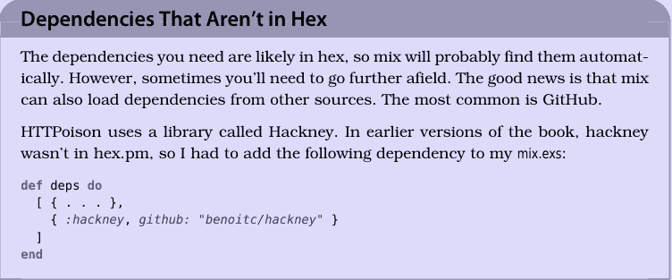
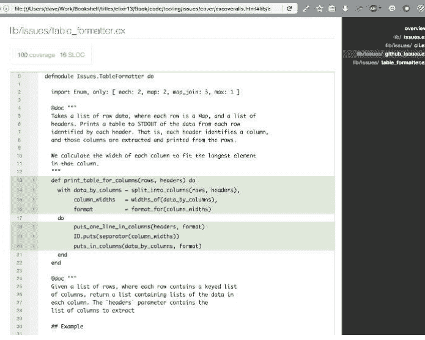
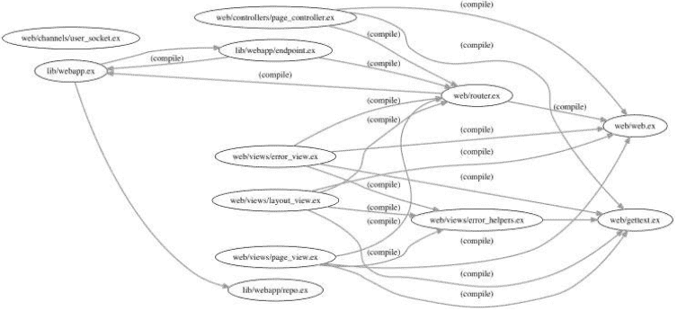
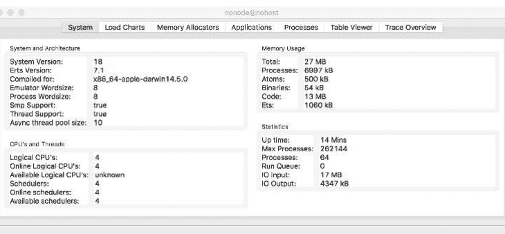
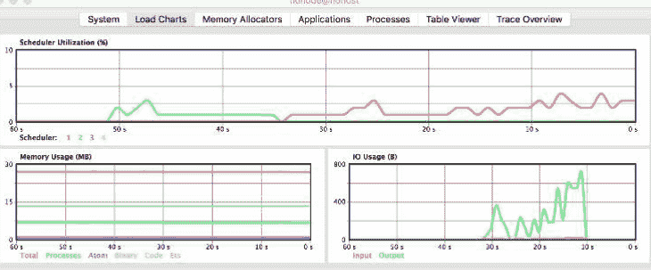
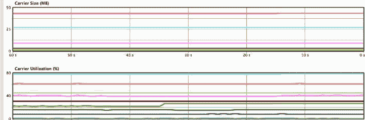
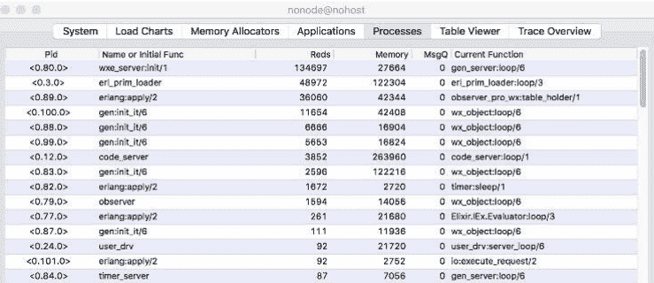
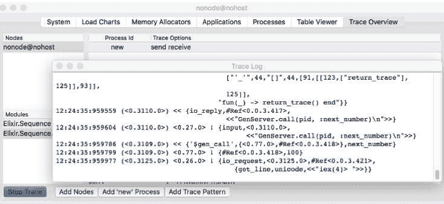
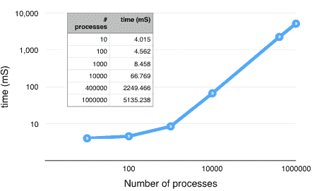

# Programming Elixir 1.3：函数式 ｜＞ 并发 ｜＞ 实用 ｜＞ 趣味

## 目录

- use 和 using 285
- 24. 更多酷东西 305
  - 编写自己的符号 (Sigils) 305
  - 多应用伞形项目 309
  - 等等！还有更多！313
- 附录 A1 异常：raise, try, catch 和 throw 315
  - 抛出异常 315
  - catch, exit 和 throw 317
  - 定义你自己的异常 318
  - 现在忽略此附录 319
- 附录 A2：类型规范与类型检查 321
  - 何时使用规范 321
  - 指定类型 322
  - 定义新类型 324
  - 函数和回调的规范 325
  - 使用 Dialyzer 326
- 参考文献 333
- 索引 335

---

## 更正，最后一段代码块翻译

```
name = "Dave"
if (use_formal_names) do
  name = "David"
end
IO.puts name
```

在 `if` 语句之外使用 `name` 将产生警告：

warning: the variable "name" is unsafe as it has been set inside a case/cond/receive/if/&&||\.

请显式返回变量值。

- 提到新的 `~D`、`~T` 和 `~N` 日时间符号，并简要说明 `Date`、`Time`、`DateTime` 和 `NaiveDateTime` 类型。
- 为 `get_in` 及其完善新的 `Access` 模块过滤函数。
- 更新 `String` 中的函数名：
  - `valid_character` → `valid?`
  - `strip` → `trim`
  - `lstrip` → `trim_leading`
  - `rstrip` → `trim_trailing`
  - `ljust` → `pad_trailing`
  - `rjust` → `pad_leading`
- 原书上次打印中的所有错误均已修复。

# 前言

我一直对硬件变化如何影响我们编写软件深着迷。

几十年前，内存是一种非常有限的资源。在当时，软件接管某些内存并根据需要对其进行变是有意义的。然而，分配内存并在不再需要时进行清理是一项非常容易出错的任务。某些内存从未被释放；有时内存被分配到另一个结构上，导致了故障。当时，垃圾回收是一项已知技术，但我们需要更快的 CPU 才能将其用于日常软件，并将我们从手动内存管理中解放出来。这种情况已经发生了——我们的大多数语言现在都采用了垃圾回收。

今天，类似的现象正在发生。我们的 CPU 核心越来越多。这意味着新软件需要尽可能地使用多个核心，以最大化对机器的利用。这与我们目前编写软件的方式直接冲突。

事实上，当涉及多个核心时，变异内存实际上会减慢软件速度。如果你有四个核心尝试访问并操作同一块内存，它们可能会相互干扰。除非应用某种同步机制，否则可能会损坏内存。

我很快学会了应用这种同步是手动的、容易出错且乏味的，而且还会损害性能。我突然意识到，这不是我想在职业生涯未来几年里编写软件的方式，于是我开始学习新的语言和技术。

正是在这段过程中，我爱上了 Erlang 虚拟机及其生态系统。

在 Erlang VM 中，所有代码运行在微小的并发进程中，每个进程都有自己的状态。进程通过消息互相通信。由于所有通信都是通过消息传递完成的，同一网络上不同机器之间的消息交换由 VM 透明地处理，这使其成为构建分布式软件的完美环境！

然而，我觉得 Erlang 生态系统中仍存在差距。我缺少对我日常工作中认为必要的某些功能的一手支持，例如元编程、多态和原生工具链。正是由于这种需求，Elixir 诞生了。

Elixir 是一种务实的函数式编程方法。它重视其函数式基础并关注开发者生产力。并发是 Elixir 软件的骨柱。垃圾回收曾将开发者从内存管理的枷锁中解放出来，Elixir 的出现是为了让你从过时的并发机制中解放出来，并在编写并发代码时带来快乐。

函数式编程语言让我们能够以转换数据的函数来思考。这种转换不会变异数据。相反，函数的每次应用都可能创建一个新的、新鲜的数据版本。这大大减少了对数据同步机制的需求。

Elixir 还通过提供宏来赋予开发者能力。Elixir 代码仅仅是数据，因此可以像语言中的任何其他值一样通过宏进行操作。

最后，面向对象的程序员将在 Elixir 中发现许多他们认为编写良好软件至关重要的机制，例如多态。

这一切都由 Erlang VM 驱动，这是一个拥有 20 年历史、从零开始构建以支持健壮、并发和分布式软件的虚拟机。Elixir 和 Erlang VM 将改变你编写软件的方式，并让你准备好应对未来的编程领域。

José Valim
Elixir 创建者
波兰，Tenczynek，2014年10月

# 一个徒劳的辩护尝试

我是一个语言痴迷者。我喜欢尝试各种语言，也喜欢思考它们的设计和实现。（我知道，这很可悲）。

我在 1998 年遇到了 Ruby，因为当时我是 comp.lang.misc 的忠实读者（问问你父母吧）。我下载了它，编译了它，并爱上了它。就像任何一次坠入爱河一样，很难解释为什么……

这些代码可能看起来不太懂，但读到这本书一半时，你就能自己写这种东西了。

# 函数是数据转换器

Elixir 允许我们像 Unix Shell 一样解决问题。我们拥有的不是命令行工具，而是函数。而且我们可以随心所欲将它们组合在一起。这些函数越小、越专注，我们在组合它们时的灵活性就越高。

如果我们需要，可以并行运行这些函数——Elixir 有一种强大的机制在它们之间传递消息。而且这些并不是你父亲辈那种无聊的老进程或线程——我们谈论的是在单台机器上运行数百万个进程，并让数百台这样的机器相互协作的潜力。Bruce Tate 对这一段话发表了这样的观点：“大多数程序员将线程和进程视为一种必要的恶；而 Elixir 开发者认为它们是一种重要的简化。”随着阅读的深入，你将开始理解他的意思了。

这种“转换”的思想将其输入转换为输出。三角函数 `sin` 就是一个例子——给它 π/4，你就会得到 0.7071...。一个 HTML 模板系统就是一个函数：它接收一个包含占位符的模板和一组命名值列表，并生成一个完整的 HTML 文档。

但这种力量是有代价的。你将忘记你所知的大量编程的知识。你的很多直觉都是错误的。这会让你感到沮丧，因为你会觉得自己自己像个完全的菜鸟（n00b）。

对我个人而言，我觉得这是乐趣的一部分。

你并不是一夜之间就学会了比如面向对象编程的。你也不可能在早餐之前成为函数式编程专家。

但在某些时刻，一切都会豁通的。你会开始以不同的方式思考问题，并发现自己只需花费极少的精力就能写出功能惊人的代码。你会发现自己写的小块块代码可以反复使用，而且往往以意想不到的方式（就像我们使用 `grep` 一样）。

当你停止从“责任”的角度思考，开始从“完成任务”的角度思考时，你的世界观甚至可能会发生一点变化。

几乎每个人都同意这会很有趣。

# 安装 Elixir

本书假设你至少在使用 Elixir 1.3 版本。安装 Elixir 的最新指令请访问 http://elixir-lang.org/install.html。现在就去安装它吧。

# 运行 Elixir

在书中，我展示了如下这样的会话：

```
$ echo Hello, World
Hello, World
```

终端提示符是美元符号 `$`，后面是你输入的内容。（在你的系统上，提示符可能会不同。）系统的输出不显示高亮。

## iex—交互式 Elixir

为了测试你的 Elixir 是否安装成功，让我们启动一个交互式 Elixir 会话。在你的普通 shell 提示符下，输入 `iex`

```
$ iex
rlang/OTP 18 [erts-7.1] [source] [64-bit] [smp:4:4] [async-threads:10]
[hype] [kernel-poll:false] [dtrace]
Interactive Elixir (x.y.z) - press Ctrl+C to exit (type h) ENTER for help)
iex(1)>
```

（你看到的各种版本号可能会不同——我不会在后续示例中特意显示它们。）

一旦你有了 `iex` 提示符，你就可以输入 Elixir 代码并看到结果。如果你输入的表达式跨越了行，`iex` 将用省略号（`...`）提示你输入额外的行。

```
iex(1)> 3 + 4
7
iex(2)> String.reverse "madamimadam"
"madamimadam"
iex(3)> 5 *
...(3)> 6
30
iex(4)>
```

提示符中的数字会在每执行一个完整表达式后递增。在后续的大多数示例中我会省略这个数字。

退出 `iex` 有几种方法。最简单的是连续两次 `Ctrl-C`，或者输入 `Ctrl-G` 后按 `Return`。在某些系统上，你也可以使用单个 `Ctrl-\`。

# 颜色

这是一个封装了 shell 使用的所有颜色设置的关键字列表。请参阅 `IO.ANSI` 模块的文档以获取支持的颜色和属性列表。

该值是一个关键字列表。支持的键列表如下：

- `:enabled` --- 布尔值，允许开启或关闭着色显示
- `:eval_result` --- 表达式执行结果结果的颜色
- `:eval_info` --- 各种信息消息
- `:eval_error` --- 错误消息
- `:stack_app` --- 堆栈跟踪中的应用程序
- `:stack_info` --- 堆栈跟踪中的剩余信息
- `:ls_directory` --- 用于目录项（ls 辅助函数）
- `:ls_device` --- 设备项（ls 辅助函数）

随后我在主目录下创建了一个名为 `.ex` 的文件，内容如下：

```elixir
Iex.configure colors: [ eval_result: [:cyan, :bright ] ]
```

如果你的 iex 会话看起来很混乱（输出中出现了类似 `[33m` 的内容），很可能是你的控制台不支持 ANSI 转义序列。在这种情况下，使用以下代码禁用颜色显示：

```elixir
Iex.configure colors: [enabled: false]
```

你可以将任何 Elixir 代码放入 `.ex.ex` 中。

# 编译与运行

一旦开始在 iex 中编写单行程序，你就会想要将代码放入源文件中。这些文件通常具有 `.ex` 或 `.exs` 扩展。这是一个约定——以 `.ex` 结尾的文件旨在编译成字节码，而以 `.exs` 结尾的文件更像脚本语言中的程序——它们实际上是在源码级别被解释执行的。当我们为 Elixir 程序编写测试时，你会发现应用文件使用 `.ex` 扩展，而测试文件使用 `.exs` 扩展，因为我们不需要保留测试的编译版本。

让我们写一个经典的第一个程序。进入一个工作目录并创建一个名为 `hello.ex` 的文件：

```
intro.ex
IO.puts "Hello, World!"
```

上一个示例展示了书中大部分代码列表的呈现方式。代码本身之前的横条显示了包含代码的路径和文件名。如果你正在阅读电子书，可以点击此处下载源文件。你也可以通过访问我们网站上的书籍页面并点击“源代码”链接¹来下载代码。


文件名采用小写字母并带有下划线。对于你打算编译成二进制格式的程序，使用 `.ex` 扩展；对于想在不编译的情况下运行的脚本，使用 `.exs`。我们的“Hello, World”示例基本上一次性代码，所以我们对它使用了 `.ex` 扩展。

创建源文件后，让我们运行它。在创建文件的相同目录下，运行 `elixir` 命令：

```bash
$ elixir hello.ex
Hello, World!
```

我们也可以在 iex 内部使用 `c` 辅助函数来编译并运行：

```bash
$ iex
iex> c "hello.ex"
Hello, World!
[]
iex>
```

`c` 辅助函数编译并执行了源文件。输出后的 `[]` 是 `c` 函数返回值——如果源文件中包含任何模块，它们的名称将列在这里。

`c` 辅助函数将源文件作为独立代码进行编译。你也可以使用 `import_file` 像将每行代码输入 iex 一样加载文件。在这种情况下，文件中设置的局部变量在 iex 会话中是可用的。

正如有些人纠结某些事情一样，Elixir 的约定是使用两列缩进和空格（而不是制表符）。

# 阅读本书的建议

这本书并不是一本从头到尾的 Elixir 参考指南。相反，它的目的是提供足够的信息，让你知道问什么问题以及何时问。因此，请带着冒险精神阅读。在阅读时尝试代码，不要止步于此。提问并通过编码或搜索网络来回答它们。

参与书籍的讨论论坛并考虑加入 Elixir 邮件列表²³

你在 Elixir 社区仍然年轻时就加入了。这里充满活力和变化，有很多贡献机会。

1. http://pragprog.com/titles/elixir13

# 练习

书中穿插了练习。如果你阅读的是电子书，每个练习都会直接链接到我们在线论坛的话题。你将在那里找到初始答案以及读者对替代方案的讨论。

如果你阅读的是纸质书籍，请访问论坛查看练习主题列表⁴。

# 与不同的思考

这是一本关于不同思考方式的书——关于接受人们对编程的某些说法可能并不完整：

- 对象方向不是设计代码的唯一方式。
- 函数式编程不需要是复杂或数学化的。
- 编程的基础不是赋值、if 语句和循环。
- 并发不需要锁、信号量、监视器等。
- 进程并不一定是昂贵的资源。
- 元编程不仅仅是附加在语言上的功能。
- 即使是一项工作，编程也应该是趣的。

当然，我不是说 Elixir 是魔法药水（从技术上来说它是，但你懂我的意思）。它不是编写代码的*唯一方式*。但它……

这些值，因此通过将变量设置为对应的值，可以使双方变得相同。

Elixir 将此过程称为模式匹配（pattern matching）。如果值（右侧）具有相同的结构，并且模式中的每个项都可以与值中的对应项相匹配，则匹配模式（左侧）。模式中的字面量值（literal value）匹配该精确的值，而模式中的变量则通过采用更多几个示例来匹配。

让我们来看一些例子：

```
iex> list = [1, 2, [ 3, 4, 5 ] ]
[1, 2, [3, 4, 5]]
iex> [a, b, c ] = list
[1, 2, [3, 4, 5]]
iex> a
1
iex> b
2
iex> c
[3, 4, 5]
```

右侧对应左侧项 `c` 的值是子列表 `[3,4,5]`；这就是赋值给 `c` 的值，使得匹配为真。

让我们尝试一个包含某些值和变量的模式。

```
iex> list = [1, 2, 3]
[1, 2, 3]
iex> [a, 2, b ] = list
[1, 2, 3]
iex> a
1
iex> b
3
```

模式中的字面量 `2` 匹配了右侧对应的项，通过将 `a` 和 `b` 的值设置为 `1` 和 `3`，匹配成功了。但是……

```
iex> list = [1, 2, 3]
[1, 2, 3]
iex> [a, 1, b ] = list
** (MatchError) no match of right hand side value: [1, 2, 3]
```

在这里，`1`（右侧的第二个项）无法与右侧对应的元素匹配，因此没有变量被设置，匹配失败。这为我们提供了一种匹配符合特定标准列表的方法——在这种情况下，长度为 3，且第二个元素为 `1`。

## 轮到你了

► 练习：PatternMatching-1

以下哪些项会匹配？

- `a = [1, 2, 3]`
- `a = 4`
- `4 = a`
- `[a, b] = [1, 2, 3]`
- `a = [[1, 2, 3]]`
- `[a] = [[1, 2, 3]]`
- `[[a]] = [[1, 2, 3]]`

# 使用 _ (下划线) 忽略值

如果我们不需要在匹配过程中捕获某个值，可以使用特殊变量 `_`（下划线）。它的作用类似于变量，但在模式匹配中会立即丢弃赋给它的值——它就像一个通配符，表示“我在这里接受任何值”。接下来的示例匹配了任何第一个元素为 `1` 的三元素列表。

```
iex> [1, _] = [1, 2, 3]
[1, 2, 3]
iex> [1, _] = [1, "cat", "dog"]
[1, "cat", "dog"]
```

# 变量在（每次匹配中）仅绑定一次

一旦变量在匹配过程中被绑定到某个值，在后续匹配的剩余部分中它将一直保持该值。


## 模式匹配示例

```elixir
iex> [a, a] = [1, 1]
[1, 1]
iex> a
1
iex> [b, b] = [1, 2]
** (MatchError) no match of right hand side value: [1, 2]
```

此示例中的第一个表达式成功了，因为 `a` 最初与右侧的第一个 `1` 匹配。然后该值被用于第二个项，以匹配右侧的第二个 `1`。

在下一个表达式中，第一个 `b` 匹配了 `1`。但第二个 `b` 对应右侧的值 `2`。`b` 不能拥有两个值，因此匹配失败。

然而，变量可以在随后的匹配中绑定到一个新值，而它的当前值不参与该匹配。

```elixir
iex> a = 1
1
iex> [1, a, 3] = [1, 2, 3]
[1, 2, 3]
iex> a
2
```

如果你想强制 Elixir 在模式中使用变量已有的值怎么办？在它前面加上 `^`（脱字符）。在 Elixir 中，我们称之为 **pin 操作符 (pin operator)**。

```elixir
iex> a = 1
1
iex> a = 2
2
iex> "a" = 1
** (MatchError) no match of right hand side value: 1
```

如果变量是模式的一个组件，这同样有效：

```elixir
iex> a = 1
1
iex> [^a, 2, 3] = [1, 2, 3]  # 使用 a 的现有值
[1, 2, 3]
iex> a = 2
2
iex> [^a, 2] = [1, 2]
** (MatchError) no match of right hand side value: [1, 2]
```

模式匹配还有另一个重要的部分，我们将在第65页深入研究列表时查看。

## 轮到你了

- 练习：PatternMatching-2

以下哪些会匹配？

- `[a, b] = [1, 2, 3]`
- `[a, b] = [1, 2]`
- `[a, b] = [1, 2, 3]`

- 练习：PatternMatching-3

以下哪些会匹配？

- `[a, b] = [1, 2, 3]`
- `[a, b] = [1, 2]`
- `[a, b] = [1, 2, 3]`

# 不变性对性能的影响

很容易假设这种编程方法是低效的。毕竟，每当你更新数据时，都必须创建一个数据的新副本，这会留下大量的旧值等待垃圾回收。让我们逐一来看这些问题。

## 数据拷贝

虽然常识可能认为所有数据拷贝都是无效的，但事实恰恰相反。因为 Elixir 知道现有数据是不可变的，因此在构建新结构时，它可以部分或整体重用它们。

考虑这段代码。（它使用了一个新操作符 `head | tail`，用于构建一个以 head 为第一个元素、tail 为其余部分的新列表。当我们讨论列表和递归时，我们会花整个章节来讲解它。现在，请先相信。）

```elixir
iex> list1 = [3, 2, 1]
[3, 2, 1]
iex> list2 = [4 | list1]
[4, 3, 2, 1]
```

在大多数语言中，`list2` 将通过创建一个包含 4、3、2 和 1 的新列表来构建。`list1` 中的三个值将被复制到 `list2` 的尾部。这样做是有必要的，因为 `list1` 是可变的。

但 Elixir 知道 `list1` 永远不会改变，所以它只需构造一个头部为 4、尾为 `list1` 的新列表。

## 垃圾回收

变换型语言的另一个性能问题是，当你从旧值创建新值时，经常会留下未使用的旧值。这会导致堆上出现大量对象占用内存，因此垃圾回收必须回收它们。

现代语言都有垃圾回收器，而开发者已经对它们产生了怀疑——它们可能会严重影响性能。

但 Elixir 的酷之处在于，你使用大量的进程（processes）来编写代码，每个进程都有自己的堆。应用程序中的数据分布在这些进程之间，因此每个单独的堆都比所有数据都在单个堆中要小得多。结果是，垃圾回收运行得更快。如果一个进程在它的堆填满之前终止，其所有数据都会被丢弃——不需要垃圾回收。

## 使用不可变数据编码

一旦接受了这一概念，使用不可变数据编码就会异常地简单。你只需要记住，任何转换数据的函数都会返回该数据的新副本。因此，我们永远不对字符串进行大写化处理，而是返回一个大写后的字符串副本。

```elixir
iex> name = "elixir"
"elixir"
iex> cap_name = String.capitalize(name)
"Elixir"
iex> name
"elixir"
```

如果你是从面向对象的语言转过来的，你可能不喜欢我们写的是 `String.capitalize(name)` 而不是 `name.capitalize()`。但在面向对象的语言中，对象大多具有可变状态。当你调用像 `name.capitalize()` 这样的方法时，你无法立即判断你是在更改 name 的内部表示、返回一个大写副本，还是两者兼有。这留有很大的歧义空间。

在函数式语言中，我们*总是*在转换数据。我们从不在原地修改它。每当我们使用时，语法都会提醒我们这一点。

理论足够了。现在是开始学习这门语言了。在下一章中，我们将快速回顾基础数据类型和一些语法，在接下来的章节中查看函数和模块。

在本章中，你将看到：

- 五种值类型
- 两种系统类型
- 四种集合类型
- 命名、操作符等
- `with` 表达式

# 第 4 章

# Elixir 基础

在本章中，我们将查看内置于 Elixir 的类型，以及你入门需要了解的几点。本章故意写得非常简练——你是一个程序员，你知道什么是整数，所以我不会侮辱你。相反地，我将尝试涵盖你需要的 Elixir 特有内容。

## 内置类型

Elixir 的内置类型有：

- 值类型（Value types）：
    - 任意大小的整数
    - 浮点数
    - 原子（Atoms）
    - 范围（Ranges）
    - 正则表达式

- 系统类型（System types）：
    - PID 和端口
    - 引用（References）

- 集合类型（Collection types）：
    - 元组（Tuples）
    - 列表（Lists）
    - 映射（Maps）
    - 二进制数据（Binaries）

函数也是一种类型。它们在本章之后有专门章节。

你可能会惊讶这个列表没有包含字符串和结构。Elixir 拥有它们，但它们是使用此列表中的基础类型构建的。然而，它们非常重要。字符串有自己的章节，我们还有两个关于列表和映射（以及其他字典类类型）的章节。映射章节还描述了 Elixir 的结构设施。

最后，关于正则表达式和范围是否属于值类型存在一些争论。从技术上讲，它们并不是——在底层它们只是结构。但目前，将它们视为不同的类型是比较方便的。

## 值类型

Elixir 中的值类型表示数字、名称、范围和正则表达式。

### 整数

整数字面量可以写为十进制 (`1234`)、十六进制 (`0xcafe`)、八进制 (`0o765`) 和二进制 (`0b1010`)。

十进制可以包含下划线——这些下划线通常在编写大数字时用于分隔三位一组的数字，因此一百万可以写成 `1_000_000`（在中国和日本可能被写成 `100_000`）。

整数的大小没有固定限制：

```elixir
factorial(10000)
```

### 浮点数

浮点数使用小数点写入。小数点前后必须至少各有一个数字。可以提供一个可选的指数。这些是有效的浮点字面量：

```elixir
1.0e5
```

浮点数是 IEEE 754 双精度，赋予它们约 16 位的精度和 308 左右的最大指数。

### 原子

原子是表示某些事物的常量。我们使用开头的冒号 (`:`) 来编写它们，后面可以跟着一个原子单词。原子单词是字母、数字、下划线和 `@` 符号的序列。它可以用感叹号或问号结尾。两个同名的原子比较结果始终为相等。

### 范围

范围表示为 `start..end`，其中 start 和 end 是整数。

### 正则表达式

Elixir 拥有正则表达式字面量，写为 `~r{regexp}` 或 `~r{regexp}opts`。这里我显示的正则表达式字面量分隔符是 `{` 和 `}`，但它们灵活得多。你可以选择任何非字母数字字符作为分隔符。

有些人出于怀旧原因使用 `~r|../`，但这比括号形式不方便，因为模式内部的任何正斜杠都必须转义。

Elixir 的正则表达式支持由 PCRE¹ 提供，它基本上为模式提供了 Perl-5 兼容的语法。

你可以在正则表达式字面量后面指定一个或多个单字符选项。这些选项会修改字面量的匹配行为或增加功能。

| Opt | 含义 |
|---|---|
| f | 强制模式从多行字符串的第一行开始匹配。 |
| g | 支持命名组。 |
| i | 使匹配不区分大小写。 |
| m | 如果要匹配的字符串包含多行，`^` 和 `$` 匹配行的首尾。`\A` 和 `\z` 继续匹配字符串的开头或结尾。 |
| s | 允许 `.` 匹配任何换行符。 |
| U | 通常修饰符 `*` 和 `+` 是贪婪的，尽可能多地匹配。`U` 修饰符使其变为非贪婪，尽可能少匹配。 |
| u | 启用 Unicode 特有的模式，如 `\p`。 |
| x | 启用扩展模式——忽略空格和注释（`#` 到行尾）。 |

¹ http://www.pcre.org/

你可以使用 `Regex` 模块来操作正则表达式。

```elixir
iex> Regex.run(~r{[aeiou]}, "caterpillar")
["a"]
iex> Regex.scan(~r{[aeiou]}, "caterpillar")
["a"], ["e"], ["i"], ["a"]
iex> String.split(~r{[aeiou]}, "caterpillar")
["c", "a", "rp", "ll", "r"]
iex> Regex.replace(~r{[aeiou]}, "caterpillar", "*")
"c*t*rp*ll*r"
```

## 系统类型 (System Types)

这些类型反映了底层 Erlang 虚拟机的资源。

### PID 和端口

PID 是本地或远程进程的引用，而端口是你将进行读取或写入的资源（通常是应用程序外部的）的引用。

可以通过 `self()` 获取当前进程的 PID。当你 `spawn` 一个新进程时，会创建一个新的 PID。我们将在第二部分讨论这一点。

### 引用 (References)

`make_ref()` 函数创建一个全局唯一的引用；没有其他引用会与它相等。我们在这书中未使用引用。

## 集合类型 (Collection Types)

我们目前看到的类型在其他编程语言中很常见。现在我们开始接触更奇特的类型，因此我们在这里进行更详细的介绍。

Elixir 集合可以包含任何类型的值（包括其他集合）。

### 元组 (Tuples)

元组是值的有序集合。与所有 Elixir 数据结构一样，元组一旦创建就无法被修改。

你用大括号编写一个元组，并用逗号分隔元素。

```elixir
{1, 42, "next"}
{:error, :enoent}
```

一个 Elixir 元组通常有两个元素——如果有更多，你可能想查看第 79 页的映射（**maps**）或第 83 页的结构（**structs**）。

你可以在模式匹配中使用元组：

```elixir
iex> {status, count, action} = {:ok, 42, "next"}
{:ok, 42, "next"}
iex> status
:ok
iex> count
42
iex> action
"next"
```

函数通常会返回一个元组，如果没有错误，则第一个元素是原子值 `:ok`。例如（假设你的当前目录下有一个名为 `mix.exs` 的文件）：

```elixir
iex> {status, file} = File.open("mix.exs")
{:ok, #PID<0.39>}
```

由于文件被成功打开，元组包含一个 `:ok` 状态和一个 PID，这就是我们访问内容的方式。

一种常见的惯用法是编写假设成功的匹配：

```elixir
iex> {:ok, file} = File.open("mix.exs")
{:ok, #PID<0.39>}
iex> {:ok, file} = File.open("non-existent-file")
** (MatchError) no match of right hand side value: {:error, :enoent}
```

第二次 `open` 失败了，返回了一个第一个元素为 `:error` 的元组。这导致匹配失败，错误信息显示第二个元素包含了原因——`enoent` 是 Unix 语言中表示“文件不存在”。

### 列表 (Lists)

我们已经看到过 Elixir 的列表字面量语法 `[1,2,3]`。这可能让你认为列表类似于其他语言中的数组，但它们并不是数组（事实上，元组是 Elixir 最接近传统数组的形式）。相反，列表实际上是一个链式数据结构。列表可以是空的，也可以由一个头部和一个尾部组成。头部包含一个值，而尾部本身是一个列表。（如果你用过 Lisp 语言，这看起来会很熟悉。）

正如我们将在第 65 页的“列表与递归”章节中讨论的，列表的递归定义是 Elixir 编程的核心。

由于实现方式，列表很容易进行线性遍历，但随机顺序访问的代价很高（为了获取第 `n` 个元素，必须扫描之前的 `n-1` 个元素）。获取列表的头部和提取列表的尾部总是廉价的。记得我们说过 Elixir 结构是不可变的吗？这意味着，如果我们想从列表中删除头部并保留尾部，就永远不需要复制整个列表。这是我们在第 7 章将讨论的所有列表遍历技巧的基础。Elixir 有一些专门操作列表的运算符：

```elixir
iex> [1, 2, 3] ++ [4, 5, 6]            # 拼接
[1, 2, 3, 4, 5, 6]
iex> [1, 2, 4] -- [2, 3]              # 差
[1, 4]
iex> 1 in [1, 2, 3, 4]                # 成员检查
true
iex> "wombat" in [1, 2, 3, 4]
false
```

### 关键字列表 (Keyword Lists)

因为我们经常需要简单的键值对，Elixir 为我们提供了一个快捷方式。如果我们写：

```elixir
[name: "Dave", city: "Dallas", likes: "Programming"]
```

Elixir 将其转换为值元组的列表：

```elixir
[{:name, "Dave"}, {:city, "Dallas"}, {:likes, "Programming"}]
```

Elixir 允许我们在关键字列表作为函数的最后一个参数时省略括号。因此，

```elixir
DB.save(record, use_transaction: true, logging: "HIGH")
```

可以更整洁地写为：

```elixir
DB.save record, use_transaction: true, logging: "HIGH"
```

### 二进制数据 (Binaries)

有时你需要以位和字节序列的形式访问数据。例如，JPEG 和 MP3 文件的头包含某些字段，单个字节可能编码两个或三个独立的值。

Elixir 使用二进制数据类型支持这一点。二进制字面量封装在 `<< >>` 之间。基础语法将无符号整数打包字节：

```elixir
iex> bin = <<1, 2>>
<<1, 2>>
iex> byte_size(bin)
2
```

你可以添加修饰符来控制每个单独字段的类型和大小。这里有一个包含 2、4 和 2 位宽单个字节。（示例使用了内置库来显示结果的二进制值）。

```elixir
iex> bin = <<3 :: size(2), 5 :: size(4), 1 :: size(2)>>
<<213>>
iex> :io.format("~8.2b~n", [:binary.bin_to_list(bin)])
11010101
ok
iex> byte_size(bin)
1
```

二进制数据既重要又底层。它们重要是因为 Elixir 使用它们来表示 UTF 字符串。它们底层是因为至少最初，你不太可能直接使用它们。

### 日期和时间 (Dates and Times)

Elixir 1.3 添加了 `Calendar` 模块和四个新的日期与时间相关类型。然而，它们目前仅仅是数据持有者——请寻找第三方库来添加功能。

`Calendar` 模块代表用于处理日期的规则。目前的唯一实现是 `Calendar.ISO`，即 ISO-8601 的表示法。

`Date` 类型持有年、月、日以及对日历的引用。

```elixir
iex> d1 = Date.new(2016, 12, 25)
{:ok, ~D[2016-12-25]}
iex> {:ok, d1} = Date.new(2016, 12, 25)
~D[2016-12-25]
iex> d2 = ~D[2016-12-25]
~D[2016-12-25]
iex> d1 == d2
true
iex> d1
~D[2016-12-25]
iex> inspect(d1, structs: false)
"%{__struct__: Date, calendar: Calendar.ISO, day: 25, month: 12, year: 2016}"
```

`Time` 类型包含小时、分、秒以及秒的分数。分数被存储在一个包含微秒和有效数字数的元组中。

```elixir
iex> t1 = Time.new(12, 34, 56)
{:ok, ~T[12:34:56]}
iex> t2 = ~T[12:34:56.000000]
~T[12:34:56.000000]
iex> t1 == t2
true
iex> inspect(t2, structs: false)
"%{__struct__: Time, calendar: Calendar.ISO, day: 0, hour: 12, microsecond: {0, 0}, minute: 34, month: 0, second: 56, year: 0}"
```

### 映射 (Maps)

映射是键值对的集合。映射字面量看起来像：

```elixir
%{key => value}
```

这里是一些映射：


```
iex states = %{"AL" => "Alabama", "WI" => "Wisconsin"}
{"AL" => "Alabama", "WI" => "Wisconsin"}
iex responses = %{:error, :enoent} => {:error, :busy}
{:error, :enoent} => :retry
iex colors = %{:red => 0xff0000, :green => 0x00ff0, :blue => 0x0000ff}
{blue: 255, green: 65280, red: 167168}
```

在第一情况下，键是字符串；第二情况下是元组；第三情况下是原子。虽然映射中的所有键都是相同的类型，但并不是要求的。

```
iex %{"one" => 1, :two => {1,1} => 3
{:two => 2, {1, 1} => 3
```

## 访问映射

你使用键从映射中提取值。方括号语法适用于所有映射：

如果键是原子，你也可以使用点符号：

```
iex colors = %{:red => 0xff0000, :green => 0x00ff00, :blue => 0x0000ff}
{blue: 255, green: 65280, red: 167168}
colors[:red]
167168
colors.green
65280
```

当你使用点符号时，如果没有匹配的键，将得到 `KeyError`。

这里有两种日期/时间类型：`DateTime` 和 `NaiveDateTime`。naive 版本只包含一个日期和一个时间；`DateTime` 则添加了关联时区的能力。`~N[...]` 符号用于构建 `DateTime` 结构。

如果你在代码中使用日期和时间，你可能可能想用第三方库来增强这些内置功能，例如 Lau Taarnaskov 的 Calendar 库。⁴

## 命名、源文件、约定、操作符等

Elixir 标识符由大写和小写 ASCII 字符、数字和下划线组成。它们可以以问号或感叹号结尾。

模块、记录、协议和行为的名称以大写字母开头，并采用 BumpyCase 命名法。所有其他标识符以小写字母或下划线开头，并按照约定在单词之间使用下划线。如果第一个字符是下划线，当该变量在模式匹配或函数列表中未使用时，Elixir 不会报告警告。

源文件使用 UTF-8 编写，但标识符可能仅使用 ASCII。

按照约定，源文件使用两个字符的缩进进行嵌套——我们使用空格而不是制表符来实现这一点。

注释以井号（`#`）开头，并持续到行尾。

社区正在编写一份风格指南。在我写这些内容时，它位于 https://github.com/levionessa/elixir_style_guide，但我被告诉它未来可能会移动。

## 真值

Elixir 有三个与布尔操作相关的特殊值：`true`、`false` 和 `nil`。在布尔上下文中，`nil` 被视为 `false`。

（一个小冷知识：所有这些值都是同名原子的别名，所以 `true` 等于原子 `:true`。）

在大多数语境/上下文中，除了 `false` 或 `nil` 之外的任何值都会被视为 `true`。有时我们将其称为“真值”，以区别于 `true` 本身。

## 操作符

Elixir 拥有一非常丰富的操作符集合。这里是我们在书中使用的一部分。

### 比较操作符

```
a === b # 严格相等（所以 1 === 1.0 为 false）
```

```
a != b # 严格不等（所以 1 != 1.0 为 true）
a == b # 值相等（所以 1 == 1.0 为 true）
a != b # 值不等（所以 1 != 1.0 为 false）
a > b # 正常比较
a >= b #
a < b #
a <= b #
```

Elixir 中的顺序比较比许多语言要少严格，因为你正在比较不同类型的值。如果类型相同或兼容（例如 3>2 或 3.0<5），则比较将使用自然排序。否则，比较将根据以下规则基于类型：

number - atom < reference < function < port < pid < tuple < map < list < binary

### 布尔操作符

（这些操作符将其第一个参数求值为 `true` 或 `false`）

```
a or b # 如果 a 为 true 则返回 true，否则返回 b
a and b # 如果 a 为 false 则返回 false，否则返回 b
not a # 如果 a 为 true 则返回 false，否则返回 true
```

### 松弛布尔操作符

这些操作符接受任何类型的参数。除了 `nil` 或 `false` 的任何值都被解释为真值。

```
a || b # 如果 a 为真值则返回 a，否则返回 b
a && b # 如果 a 为真值则返回 b，否则返回 a
!a # 如果 a 为真值则返回 false，否则返回 true
```

### 算术操作符

```
+ - * / div
```

整数除法产生浮点数结果。使用 `div(a,b)` 获取整数。`rem` 是取余操作符。它像函数一样被调用 (`rem(11, 3) => 2`)。它与普通取模运算的区别在于，结果的符号与函数的第一个参数相同。

### 连接操作符

```
binary1 <> binary2 # 合并两个二进制文件（稍后我们会看到二进制文件包含字符串）
list1 ++ list2 # 合并两个列表
list1 - list2 # 从 list1 中移除 list2 的元素
```

### 包含操作符

```
binary1 <> binary2 # 合并两个二进制文件...
```

```
a || b # 如果 a 是真值则返回 a，否则返回 b
a && b # 如果 a 是真值则返回 b，否则为 a
!a # 如果 a 是真值则返回 false，否则为 true
```

### 包含操作符

```
binary1 <> binary2 # 合并两个二进制文件（稍后我们会看到二进制文件包含字符串）
list1 ++ list2 # 合并两个列表
list1 - list2 # 从 list1 中移除 list2 的元素
```

由于文本文本，，文本文本文本文本文本，，，，，翻译翻译翻译翻译翻译。。

如果你的函数没有接受参数，调用它时仍然需要括号：

```elixir
iex = fn -> IO.puts "Hello" end
#Function<12.17052888 in :erl_eval.expr/5>
iex get().
Hello
:ok
```

你可以在函数定义中省略括号。

```elixir
iex f1 = fn a, b -> * b end
#Function<12.17052888 in :erl_eval.expr/5>
iex f1.(5,6)
30
iex f2 = fn -> 99 end
#Function<12.17052888 in :erl_eval.expr/5>
f2().
99
```

# 函数与模式匹配

当我们调用 `sum(2,3)` 时，很容易假设我们把 `2` 赋值给参数 `a`，把 `3` 赋值给 `b`。但“赋值”（assign）这个词应该让你感到有些耳熟。Elixir 并没有赋值操作。相反，它尝试将值匹配到模式上。（我们在第 13 页查看模式匹配和赋值时遇到过这一点。）

如果我们写下

`a = 2`

那么 Elixir 会通过将 `a` 绑定到值 `2` 来匹配模式。这正是在我们的 `sum` 函数被调用时发生的情况。我们传递 `2` 和 `3` 作为参数，Elixir 尝试将这些参数匹配到参数 `a` 和 `b`，它通过给 `a` 赋值 `2` 并给 `b` 赋值 `3` 来实现这一点。这和我们写的

`{a, b} = {1, 2}`是一样的。

这意味着我们在调用函数时可以执行更复杂的模式匹配。例如，以下函数反转了二元组中元素的顺序：

```elixir
iex swap = fn { a, b } -> { b, a } end
#Function<12.17052888 in :erl_eval.expr/5>
iex swap({ 6, 8 }).
{6, 8}
```

在下一节中学习具有多个实现的函数时，我们将使用这种模式匹配能力。

## 轮到你了

练习：Functions-1

进入 iex。复制并运行执行以下操作函数：

- `list_concat({:a, :b}, [:c, :d]) => [:a, :b, :c, :d]`
- `sum(1, 2, 3) => 6`
- `pair_tuple_to_list({ 1234, 5678 }) => [1234, 5678]`

### 一个函数，多个函数体

单个函数定义允许你定义不同的实现，取决于传递的参数的类型和内容。（你不能根据参数的数量进行选择——函数定义中的每个子句必须具有相同数量的参数。）

在简单的情况下，我们可以使用模式匹配来选择运行哪个子句。在接下来的示例中，我们知道如果文件打开成功，`File.open` 返回的元组的第一个元素是 `:ok`，因此我们写了一个函数，显示成功打开的文件的第一行，或者如果文件无法打开则显示一个简单的错误消息。

```elixir
iex handle_open = fn
  {:ok, file} -> "Read data: #{IO.read(file, :line)}"
  {:_, error} -> "Error: #{file.format_error(error)}"
end
#Function<12.17052888 in :erl_expr/5
iex handle_open.(File.open("code/into/hello.exs")) # 此文件存在
Read data: "Hello, World!\n"
iex handle_open.(File.open("nonexistent")) # 这个文件不存在
"Error: no such file or directory"
```

让我们先查看函数定义的内部。在第 2 行和第 3 行，我们定义了两个独立的函数体。每个都接受一个元组作为参数。第一个要求元组的第一个项为 `:ok`。第二行使用特殊变量 `_`（下划线）来匹配任何其他值。

现在在第 6 行。我们调用我们的函数，传递一个对存在文件的 `File.open` 结果。函数接收到元组 `{:ok, file}` 并匹配第 2 行的子句。相应的代码调用 `IO.read` 读取该文件的第一行。

我们再次调用 `handle_open`，这次是尝试打开一个不存在的文件。返回的元组 `{:error, _}` 被传递给我们的函数，它在第 2 行匹配失败（因为第一项不是 `:ok`），但在下一行成功。该子句中的代码将错误格式化为良好的字符串。

注意代码中的几点。在第 3 行，我们调用 `:file.format_error`。这里的 `:file` 指的是 Erlang 模块。与第 6 行的 `File.open` 调用进行对比，这里 `File` 指的是 Elixir 的内置模块。这是通过现有 Erlang 库学习的良好例子——有数百个这样的库等待你使用。困难之处在于，当你调用它们时必须区分 Erlang 函数和 Elixir 函数。

最后，这个示例展示了 Elixir 的字符串插值。在字符串内部，`#{...}` 的内容会被求值，结果被替换。

## 轮到你了

- 练习：Functions-2

写一个接受三个参数的函数。如果前两个为零，返回 "Fizz"。如果第一个为零，返回 "Buzz"。否则返回第三个参数。不要使用书中尚未过的语言特性。

- 练习：Functions-3

`rem(a,b)` 返回 `a` 除以 `b` 的余数。写一个接受整数 `(n)` 并调用 `rem(n, n)` 的函数。使用参数 `10` 调用它七次。你应该得到 "Buzz, Fizz, Fizz..."。（是的，这是一个带有逻辑的 FizzBuzz 解决方案。）

### 函数可以返回函数

这是一个奇怪的代码：奇怪的是第一行。它很难读，所以我们把它展开。

```elixir
fun1 = fn ->
  fn ->
    "Hello"
  end
end
```

变量 `fun1` 绑定到一个函数。该函数不接受参数，它的体是第二个函数定义。该第二个函数也不接受参数，它求值字符串 "Hello"。

当我们调用外部函数（使用 `fun1()`）时，它返回内部函数。当我们调用它 `fun1()()` 时，内部函数被求值并返回 "Hello"。

我们不会写类似 `fun()` 的东西……但我们可能会调用外部函数并将结果绑定到一个单独的变量。我们可能使用括号让内部函数更明显。

```elixir
iex fun = fn -> (fn -> "Hello") end
#Function<12.17052888 in :erl_eval.expr/5
iex other = fun().
#Function<12.17052888 in :erl_eval.expr/5
iex other.()
"Hello"
```

### 函数记得它们的原始环境

让我们把 `greeter` 函数的想法推进一步。

```elixir
iex greeter = fn name -> (fn -> "Hello #{name}") end
#Function<12.17052888 in :erl_eval.expr/5>
iex dave_greeter = greeter("Dave")
#Function<12.17052888 in :erl_eval.expr/5>
iex dave_greeter.()
"Hello Dave"
```

现在外部函数有一个 `name` 参数。像任何参数一样，`name` 在整个函数体内都是用的。在这种情况下，我们在内部函数的字符串内部使用了它。

当我们调用外部函数时，它返回内部函数的定义。此时它还没有将 `name` 替换到字符串中。但当我们调用内部函数 `dave_greeter()` 时，替换发生了，问候语出现了。

但这里发生了一些奇怪的事情。内部函数使用了外部函数的 `name` 参数。当 `greeter("Dave")` 返回时，外部函数已经执行完毕，参数已经离开了作用范围。然而当我们运行内部函数时，它仅仅使用了该参数的值。

这之所以有效，是因为 Elixir 函数携带了它们定义时作用域内的变量绑定。在我们的示例中，变量 `name` 绑定在外部函数的作用范围内。当内部函数被定义时，它继承了这个作用域并携带了 `name` 的绑定。这就是闭包——作用域封装了变量绑定，将它们打包成可以以后保存和使用的东西。

让我们多玩玩这个。

### 参数化函数

在上一个示例中，外部函数接受一个参数，而内部的没有。让我们尝试一个两个都接受参数的示例。

```elixir
iex add_n = fn n -> (fn other -> n + other) end
#Function<12.17052888 in :erl_eval.expr/5>
iex add_two = add_n (2)
#Function<12.17052888 in :erl_eval.expr/5>
iex add_five = add_n (5)
#Function<12.17052888 in :erl_eval.expr/5>
iex add_two.(3)
5
iex add_five.(7)
12
```

在这里，内部函数将其参数 `other` 的值加上外部函数参数 `n` 的值。我们每次调用外部函数时，都给它一个 `n` 的值，它返回一个与其参数相加函数。

## 轮到你了

- 练习：Functions-4

写一个接受字符串的函数 `prefix`。它应该返回一个接受第二个字符串的新函数。当第二个函数被调用时，它将返回一个包含第一个字符串、空格和第二个字符串的字符串。

```elixir
iex mrs = prefix.("Mrs")
#Function<erl_eval.6.82930912>
iex mrs.("Smith")
"Mrs Smith"
prefix.("Elixir").("Rocks")
"Elixir Rocks"
```

### 将函数作为参数

函数是值，因此我们可以将它们传递给其他函数。

```elixir
iex times_2 = fn n -> n * 2 end
#Function<12.17052888 in :erl_eval.expr/5>
iex apply = fn (fun, value) -> fun.(value) end
#Function<12.17052888 in :erl_eval.expr/5>
iex apply.(times_2, 6)
12
```

在这个示例中，`apply` 是一个接受第二个函数和一个值的函数。它返回调用该第二个函数并将值作为参数传递的结果。

我们在 Elixir 代码中几乎随处都使用传递函数的能力。例如，内置的 `Enum` 模块有一个名为 `map` 的函数。它接受两个参数：一个集合和一个函数。它返回一个列表，该列表是将该函数应用于集合中每个元素后的的结果。

```
iex list = [1, 3, 5, 7, 9]
[1, 3, 5, 7, 9]
Enum.map list, fn elem -> elem * 2 end
[2, 6, 10, 14, 18]
iex Enum.map list, fn elem -> elem * elem end
[1, 9, 25, 45, 81]
iex Enum.map list, fn elem -> 6 end
[false, false, false, true, true]
```

### 固定值与函数参数


当我们最初查看模式匹配时，我们看到固定操作符（`^`）允许在模式中使用变量的当前值。你也可以将其用于函数参数。

```elixir
functions/pin.exs
defmodule Greeter do
  def for(name, greeting) do
    fn
      (^name) -> "#{greeting} #{name}"
      (_) -> "I don't know you"
    end
  end
end

mr_valim = Greeter.for("José", "Oi!")
IO.puts mr_valim("José") # => José
IO.puts mr_valim("ave") # => I don't know you
```

在这个示例中，`Greeter.for` 返回一个具有两个头（heads）的函数。第一个头在第一个参数是传递给 `for` 的 `name` 的值时匹配。

## & 符号

创建短辅助函数的策略非常常见，以至于 Elixir 提供了一个快捷方式。让我们通过观察来看看发生了什么。

```iex
iex> add_one = &(&1 + 1) # 等同于 add_one = fn (n) -> n + 1 end
#Function<6.17052888 in :erl_eval.expr/5>
iex> add_one(4)
5
iex> square = &(&1 * &1)
#Function<6.17052888 in :erl_eval.expr/5>
```

```iex
iex> square.(8)
64
iex> speak = &(IO.puts(&1))
&IO.puts/1
iex> speak("Hello")
Hello
:ok
```

`&` 操作符将随其后的表达式转换为一个函数。在该表达式内部，占位符 `&1`、`&2` 等对应于函数的第一个、第二个以及随后的参数。因此，`&(&1 + &2)` 将被转换为 `fn p1, p2 -> p1 + p2 end`。

Elixir 甚至更加聪明。看看上段代码中的那行。通常情况下 Elixir 会生成一个匿名函数，因此 `&(IO.puts(&1))` 会变成 `fn x -> IO.puts(x) end`。但 Elixir 注意到匿名函数的体是对一个命名函数（`IO.puts`）的调用，并且参数顺序正确（即，匿名函数的第一个参数是命名函数的第一个参数，以此类推）。因此，Elixir 优化掉了匿名函数，用对该函数的直接引用 `IO.puts/1` 替换了它。

对于这项工作，参数必须处于正确的顺序：

```iex
iex> rnd = &(Float.round(&1, &2))
&Float.round/2
iex> rnd = &(Float.round(&2, &1))
#Function<12.17052888 in :erl_eval.expr/5>
```

当你以此方式定义函数时，可能会看到指向 Erlang 的引用。这就是 Elixir 在 Erlang 虚拟机上运行的方式。如果你尝试像 `&abs(&1)` 这样的操作，会有更多证据。在这里，Elixir 将你对 `abs` 的使用映射到底层 Erlang 库，并返回 `&erlang.abs/1`。

由于 `[]` 和 `{}` 是 Elixir 中的操作符，列表和元组也可以转换为函数。这是一个返回包含两个整数相除商和余数的元组的函数：

```iex
iex> divrem = &(div(&1, &2), rem(&1, &2))
#Function<12.17052888 in :erl_eval.expr/5>
iex> divrem.(13, 5)
{2, 3}
```

`&` 函数操作符有第二种形式。你可以给它一个现有函数的名称和元数（参数数量），它将返回一个调用该函数的匿名函数。你传递给匿名函数的参数将会被传递给该命名函数。我们已经见过这种了：当我们在 `iex` 中输入 `&(IO.puts(1))` 时，它显示的结果为 `&(IO.puts)`。在这种情况下，`puts` 是 `IO` 模块中的一个函数。Elixir 命名此函数的方式是 `IO.puts/1`。如果在其中放置一个 `&`，它变成一个函数。这里是其他示例：

```iex
iex> l = &length/1
&erlang.length/1
iex> l.([1,3,5,7])
4
```

```iex
iex> len = &Enum.count/1
&Enum.count/1
iex> len.([1,2,3,4])
4
```

```iex
iex> m = &Kernel.min/2 # 这是一个名为 Kernel.min/2 的函数
&Kernel.min/2
iex> m(10, 20)
10
```

`do...end` 形式是一种语法糖——在编译期间，它会被转换为 `do:` 形式。（而 `do:` 形式本身并没有特殊之处；它只是关键字列表中的一个术语。）通常人们使用 `do:` 语法用于单行块，而使用 `do...end` 用于多行块。

这意味着我们的示例可能会写成：

```elixir
times/1.ex
defmodule Times do
  def double(n), do: n * 2
end
```

我们甚至可以写成：

```elixir
defmodule Times, do: (def double(n), do: n*2)
```

（但请不要这样做）。

## 轮到你

- 练习：ModulesAndFunctions-1

扩展 `Times` 模块，增加一个三函数，将其参数乘以三。

- 练习：ModulesAndFunctions-2

在 ix 中运行结果。使用两种技术来编译该文件。

- 练习：ModulesAndFunctions-3

添加一个四倍函数。（也许它可以调用 `double` 函数……）

## 函数调用与模式匹配

在上一节中，我们涵盖了匿名函数如何使用模式匹配将其参数列表绑定到传递的参数。具名函数也是如此。区别在于我们多次编写该函数，每次都有它自己的参数列表和函数体。尽管这看起来像是多个函数定义，但纯主义者会告诉你它们是同一个定义的多个子句（clause）（而且是正确的）。

当你调用一个具名函数时，Elixir 会尝试将你的参数与第一个定义（子句）的参数列表匹配。如果无法匹配，它会尝试函数的下一个定义（记住，这必须具有相同的元数）并检查是否匹配。它会一直持续直到候选项耗尽。

让我们玩玩这个。n 的阶乘写做 n!，是从 1 到 n 所有数的乘积。0! 定义为 1。

### 这种表达的另一种说法是

- factorial(0) -> 1
- factorial(n) -> n * factorial(n-1)

这是阶乘的规范，但它也非常接近 Elixir 的实现：

```elixir
factorial/1.exs
defmodule Factorial do
  def of(0), do: 1
  def of(n), do: n * of(n-1)
end
```

我们有两个相同函数的定义。如果我们调用 `Factorial.of(2)`，Elixir 将 2 与第一个函数的参数 0 进行匹配。这失败了，所以它尝试第二个定义，当 Elixir 将 2 绑定到 n 时，匹配成功了。它评估了该函数的函数体，该函数体调用了 `Factorial.of(1)`。同样的过程适用，运行了第二个定义。反过来，它调用了 `Factorial.of(0)`，这被第一个函数定义匹配。该函数返回 1，递归结束。Elixir 现在展开栈，执行所有的乘法运算，并返回答案。这种函数式实现可以工作，但可以得到显著改进。我们将在查看[第 190 页的递归]时进行该改进。

假设在这段代码中：

```iex
iex> c("factorial1.exs")
[Factorial]
iex> Factorial.of(3)
6
iex> Factorial.of(7)
5040
iex> Factorial.of(10)
3628800
iex> Factorial.of(1000)
402387260770933735437024339230038517937486420174632543799910429938512398652902590244084268960904840079986101
```

这种设计和编码模式在 Elixir（以及几乎所有函数式语言）中非常常见。首先寻找最可能的情况，即具有确定答案的锚点（anchor）。然后寻找一个递归解决方案，它最终会调用锚点情况。

这里有几个例子：

### 前 n 个数的和

- 前 0 个数的和是 0。
- 前 n 个数的和是 $n$ + 前 $n-1$ 个数的和。

### 列表的长度

- 空列表的长度是 0。
- 任何其他列表的长度是 1 + 尾（tail）的长度。

一个需要强调的点：当你将这些子句转换为代码时，子句的顺序会产生影响。Elixir 从上向下尝试函数。以下代码将不起作用：

```elixir
factorial-bad.ex
defmodule BadFactorial do
  def of(n), do: n * of(n-1)
  def of(0), do: 1
end
```

第一个函数定义总是匹配，第二个永远不会被调用。当你尝试编译它时会得到一个警告：

```iex
iex> c("factorial-bad.ex")
factorial-bad.ex:3: clause cannot match because previous clause at line 2 always matches
```

还有：当你有同一个函数的多个实现时，它们在源代码中应该是相邻的。

## 轮到你

- 练习：ModulesAndFunctions-4

实现并运行函数 `sum(n)`，使用递归计算 1 到 n 的和。在一个文件中编写此函数。然后加载 ix 编译它。

- 练习：ModulesAndFunctions-5

编写函数 `gcd(x,y)`，寻找两个非负整数的最大公约数。

### 守护子 (Guard Clauses)

我们已经看到模式匹配允许 Elixir 根据参数决定调用哪个函数。但如果我们需要根据类型或值来区分呢？使用守护子句。这些是附加到函数定义上的一个或多个谓词（predicates）。进行模式匹配时，Elixir 首先进行参数匹配，仅当至少一个谓词为真时。

```elixir
guard.ex
defmodule Guard do
  def what_is(x) when is_number(x) do
    IO.puts("#{x} is a number")
  end
  def what_is(x) when is_list(x) do
    IO.puts("#{x} is a list")
  end
  def what_is(x) when is_atom(x) do
    IO.puts("#{x} is an atom")
  end

  Guard.what_is(99)         # => 99 is a number
  Guard.what_is(:cat)      # => cat is an atom
  Guard.what_is([1,2,3])   # => [1,2,3] is a list
end
```

回想我们在 49 页的阶乘示例。

```elixir
factorial.ex
defmodule Factorial do
  def of(0), do: 1
  def of(n), do: n * of(n)
end
```

如果我们传递给一个负数，它会无限循环——无论 n 减少多少，它永远不会变为 0。所以添加守护子句是一个好主意。

```elixir
factorial2.ex
defmodule Factorial do
  def of(0), do: 1
  def of(n) when n > 0 do
    n * of(n-1)
  end
end
```

如果你用负参数运行这段代码，没有任何函数会匹配：

```iex
iex> c("factorial2.ex")
[Factorial]
iex> Factorial.of(-100)
** (FunctionClauseError) no function clause matching Factorial.of
```

### 守护子限制

你只能在守护子句中编写 Elixir 表达式子集。以下列表来自入门指南。

#### 比较运算符

- `==`, `!=`, `===`, `>=`, `<`, `<=`

#### 布尔和取反运算符

- `or`, `and`, `not`, `!`。注意 `||` `&&` 是不允许的。

#### 算术运算符

- `+`, `-`, `*`, `/`

#### 拼接运算符

- `<>` 和 `++`，只要左侧是字面量。

#### in 运算符

- 集合或范围中的成员关系

#### 类型检查函数

这些内置 Erlang 函数如果其参数是给定类型则返回真。你可以在网上找到文档。

```
is_atom is_bitstring is_boolean is_exception is_float is_integer is_list is_map is_number is_pid is_port is_record is_reference is_tuple
```

#### 其他函数

这些内置函数返回值（而不是真或假）。它们的文档与类型检查函数在同一页。

```
abs(number) bit_size(bitstring) byte_size(bitstring) div(number,number) elem(tuple, n) float(term) hd(list) length(list) node(node) pid(ref|port) rem(number,number) round(number) self() tl(list) trunc(number) tuple_size(tuple)
```

## 默认参数

当你定义一个具名函数时，可以使用 `\\` 语法给它的任何参数一个默认值。当你调用一个函数时：

1. http://el-lang.org/getting-started/case-cond-and-if.html#expressions-in-guard-clauses
2. http://erlang.org/doc/man/erlang.html#is-atom-1

当定义默认参数时，Elixir 会将你传递的参数个数与函数所需的参数个数进行比较。如果你传递的参数少于必需参数的数量，则无法匹配。如果这两个数字相等，则必需参数将取所传递参数的值，而其他参数将取它们的默认值。如果传递的参数计数大于必需参数的数量，Elixir 将使用多出的参数覆盖部分或全部参数的默认值。参数从左到右进行匹配。

```elixir
mm/default_params.exs
defmodule Example do
  def func(p1, p2 \\ 2, p3 \\ 3, p4) do
    IO.inspect [p1, p2, p3, p4]
  end
end
```

```text
Example.func("a", "b") => ["a",2,3,"b"]
Example.func("a", "b", "c") => ["a","b",3,"c"]
Example.func("a", "b", "c", "d") => ["a","b","c","d"]
```

当 Elixir 进行模式匹配时，默认参数的行为可能会出人意料。

例如，编译以下代码：

```elixir
def func(p1, p2 \\ 2, p3 \\ 3, p4) do
  IO.inspect [p1, p2, p3, p4]
end

def func(p1, p2) do
  IO.inspect [p1, p2]
end
```

你会得到这个错误：

```text
** (CompileError) default_params.exs:7: def func/2 conflicts with defaults from def func/4
```

这是因为第一个函数定义（带有默认参数）可以匹配任何带有两个、三个或四个参数的调用。

默认参数还有一点。这里有一个具有多个子句头（heads）且带有默认参数的函数：

```elixir
mm/default_params1.ex
defmodule DefaultParams1 do
  def func(p1, p2 \\ 123) do
    IO.inspect [p1, p2]
  end

  def func(p1, 99) do
    IO.puts "you said 99"
  end
end
```

如果你编译这段代码，将得到一个错误：

```text
warning: definitions with multiple clauses and default values require a function head. Instead of:

def foo(:first_clause, b \\ :default) do ... end
def foo(:second_clause, b) do ... end

should write:

def foo(a, b \\ :default)
def foo(:first_clause, b) do ... end
def foo(:second_clause, b) do ... end

def func/2 has multiple clauses and defines default values in clauses with bodies mm/default_params1.ex:8

warning: variable p1 is unused

code/mm/default_params1.ex:8

warning: this clause cannot match because a previous clause at line 4 always matches code/mm/default_params1.ex:8
```

其意图是减少由默认值可能产生的困惑。只需添加一个包含默认参数的、没有函数体的函数头，并对其余部分使用普通参数。默认值将适用于对该函数的所有调用。


# 示例代码

文件：`mm/default_params2.ex`

```elixir
defmodule Params do
  def func(p1, p2 \\ 123)
  def func(p1, p2) when is_list(p1) do
    "You said #{p2} with a list"
  end

  def func(p1, p2) do
    "You passed in #{p1} and #{p2}"
  end
end
```

```elixir
IO.puts Params.func(99)             # You passed in 99 and 123
IO.puts Params.func(99, "cat")     # You passed in 99 and cat
IO.puts Params.func([99])          # You said 123 with a list
IO.puts Params.func([99], "dog")  # You said dog with a list
```

## 轮到你了

► 练习: ModulesAndFunctions-6

我正在想一个 1 到 1000 之间的数字....

找到该数字最高效的方法是在范围的低位和位中间进行猜测。如果我们的猜测太大，那么答案就在范围底部和我们的猜值之间。如果我们的猜测太小，那么答案就在我们的猜值和范围末端之间。

你的 API 将是 `guess(actual, range)`，其中 range 是一个 Elixir 范围。你的输出应该类似于：

```elixir
iex> guess(273, 1..1000)
Is it 500
Is it 250
Is it 375
Is it 281
Is it 265
Is it 273
```

提示：

- 你可能需要实现带有额外参数（猜测的数字）的辅助函数。
- `div(a,b)` 函数执行整数除法。
- 守护语句（Guard clauses）是你的朋友。
- 模式匹配范围 `a..b`。

`defp` 定义了一个私有函数——该函数只能在它的模块内部调用。你可以像使用 `def` 一样定义具有多个头部的私有函数。但是，你不能让某些子句是私有的而另一些不是。也就是说，以下代码是无效的：

```elixir
def fun(a) when is_list(a), do: true
defp fun(a), do: false
```

# 奇妙的管道运算符： `|>`

我把最好的留到了最后，至少在函数方面是如此。管道运算符的关键方面是，它让你编写的代码几乎完全遵循你规范的形式。对于销售税的示例，你可能在某些纸上记下了这些：

* 获取客户列表。
* 生成他们的订单列表。
* 计算订单的税费。
* 准备报表。

要从纸上的规范变为运行的代码，你只需要在这些项之间放置 `|>` 并将每一项实现为一个函数。

```elixir
DB.find_customers
|> Orders.for_customers
|> sales_tax(2016)
|> prepare_filing
```

编程正在转换数据，而 `|>` 让这种转换显式化。现在这本书的副标题有意义了。

# 模块

模块为你定义的内容提供了命名空间。我们已经看到过封装命名函数。它们还作为宏、结构体（structs）、协议（protocols）和其他模块的封装。

如果我们想从外部引用模块中定义的函数，我们需要为引用加上模块名前缀。如果我们在同一个模块内部引用内容，则不需要该前缀，如下例所示：

```elixir
defmodule Mod do
  def func1 do
    IO.puts "in func1"
  end
  def func2 do
    func1
    IO.puts "in func2"
  end
end
Mod.func1
Mod.func2
```

`func2` 可以直接调用 `func1`，因为它在模块内部。在模块外部，你必须使用完全限定名 `Mod.func1`。

正如在你喜欢的语言中做的那样，Elixir 程序员使用嵌套模块来提高可读性和复用性。从外部访问嵌套模块中的函数，需要所有的模块名前缀。在包含模块内部访问，可以使用完全限定名或仅内部模块名。

```elixir
defmodule Outer do
  defmodule Inner do
    def inner_func
  end
  def outer_func do
    Inner.inner_func
  end
end
```

这是基础编程。我们这样做是因为替代方案是写成 `filing = prepare_filing(sales_tax(Orders.for_customers(DB.find_customers)))`，而那是用来完成任务的代码类型。Elixir 有更好的编写方式：

```elixir
people = DB.find_customers
|> Orders.for_customers
|> sales_tax(2016)
|> prepare_filing
```

`|>` 运算符获取左侧的表达式并将其插入右侧函数的第一个参数中。因此 `val |> f(a,b)` 基本等同于调用 `f(val, a, b)`，并且

```elixir
list
|> sales_tax(2016)
|> prepare_filing
```

等同于 `prepare_filing(sales_tax(list, 2016))`。

在上一个示例中，我将表达式中的每个项单独写一行，这非常 Elixir 风格。但你也可以在同一行中链接项：

```elixir
iex> (1..10) |> Enum.map(&(&1 * &1)) |> Enum.filter(&(&1 < 40))
[1, 4, 9, 16, 25, 36]
```

注意我在该代码中必须使用括号——否则 `&` 快捷方式和管道运算符会产生冲突。重复一遍——在管道中应对函数参数始终使用括号。

## import 指令

`import` 指令将模块的函数和/或宏引入到当前作用域。如果你在代码中频繁使用某个特定模块，`import` 可以通过消除重复编写模块名的需要，减少源文件中的冗乱代码。

例如，如果你从 `List` 模块导入了 `flatten` 函数，你就可以在代码中直接调用它，而无需指定模块名。

文件：`mm/import.ex`

```elixir
defmodule Example do
  def func1 do
    List.flatten [1,[2,3],4]
  end
  def func2 do
    import List, only: [flatten: 1]
    flatten [5,6,7]
  end
end
```

`import` 的完整语法为：

`import Module [, only: | except: ]`

可选的第二个参数允许你控制导入哪些函数或宏。你编写 `only:` 或 `except:`，后面跟着一个 `name: arity` 对的列表。在最小的闭包作用域内使用 `import` 并使用 `only:` 仅导入你需要的函数是一个好习惯。

```elixir
import List, only: [ flatten: 1, duplicate: 2 ]
```

或者，你可以给 `only:` 传入原子 `:functions` 或 `:macros` 之一，`import` 将只会引入函数或宏。

### alias 指令

`alias` 指令为模块创建别名。一个显而易见的用途是减少输入。

```elixir
defmodule Example do
  def compile_and_go(source) do
    alias My.Other.Module.Parser, as: Parser
    alias My.Other.Runner, as: Runner
    source
    |> Parser.parse()
    |> Runner.execute()
  end
end
```

我们可以将 `alias` 指令简写为：

`alias My.Other.Module.Parser`

`alias My.Other.Module.Runner`

因为 `as:` 参数默认为模块名的最后一部分。我们甚至可以更进一步，这样做：

`alias My.Other.Module.{Parser, Runner}`

### require 指令

如果你使用了某个模块定义的任何宏，你就必须 `require` 该模块。这确保了在编译你的代码时，宏定义是可用的。我们将在第 267 页讨论宏时再介绍 `require`。

## 模块属性

Elixir 模块拥有关联的元数据。每项元数据被称为模块属性，并通过一个名称标识。在模块内部，你可以通过在名称前加上 `@` 符号来访问这些属性。你使用以下语法赋予属性值：

`@name value`

这仅在模块的顶层有效——你不能在函数定义内部设置属性。然而，你可以在函数内部访问属性。

文件：`mm/attributes.exs`

```elixir
defmodule Example do
  @author "Dave Thomas"
  def get_author do
    @author
  end
end
IO.puts "Example was written by #{Example.get_author}"
```

你可以在模块中多次设置同一个属性。如果你在模块的命名函数中访问该属性，你看到的值将是函数定义时的值。

文件：`mm/attributes1.exs`

```elixir
defmodule Example do
  @attr "one"
  def first, do: @attr
  @attr "two"
  def second, do: @attr
end
IO.puts "#{Example.second} #{Example.first}" # => two one
```

这些属性并不是传统意义上的变量。仅将它们用于配置和元数据。（许多 Elixir 程序员在使用它们时，而 Java 或 Ruby 程序员可能会使用常量。）

## 模块名称：Elixir、Erlang 和原子

当我们在 Elixir 中编写模块时，它们的名称可以是字符串或原子。我们通过类似 `String.length("abc")` 的调用这些模块中的函数。

这里的情况非常微妙。在内部，模块名只是原子。当你写一个以大写字母开头的名称时（例如 `IO`），Elixir 在内部将其转换为一个名为 `'Elixir.IO'` 的原子。

```elixir
iex> is_atom(IO)
true
iex> to_string(IO)
"Elixir.IO"
iex> "Elixir.IO" === 'Elixir.IO'
true
```

所以，对模块函数的调用实际上是一个原子，后面跟着一个点，然后是函数名。确实地，我们可以这样调用函数：

```elixir
iex> IO.puts(123)
123
iex> "Elixir.IO".puts(123)
123
```

## 在 Erlang 库中调用函数

Erlang 的命名规范不同——变量以大写字母开头，而原子是简单的小写名称。因此，例如 Erlang 的 `timer` 模块就是它本身，原子 `timer`。在 Elixir 中我们将其写为 `:timer`。如果你想引用 `timer` 中的 `tc` 函数，你需要写成 `:timer.tc`。（注意开头的冒号。）

假设我们想在一个三个字符宽的字段中输出一个保留一位小数的浮点数。Erlang 有一个函数可以实现这一点。搜索 `erlang format` 会带我们进入 Erlang 模块中该格式函数的描述³。

阅读描述后，我们发现 Elixir 期望我们调用 `:io.format`。因此，在 Elixir 中，我们只需将模块名更改为 Elixir 原子即可：

```elixir
iex> :io.format("The number is ~3.1f-n", [5.678])
The number is 5.7
:ok
```

³ 3. http://erlang.org/doc/man/io.html#format-2

## 使用头部和尾部处理列表

我们现在可以将列表拆分为头部（head）和尾部（tail），并且可以构造新列表的头部和尾部。

### iex 如何显示列表

在第 11 章“字符串与二进制数据”中（第 113 页），你会看到 Elixir 有两种字符串的表示方式。一种是熟悉的、位于连续内存位置的字符序列。用双引号编写的字面量使用这种形式。

第二种形式使用单引号，将字符串表示为整数代码点（codepoints）的列表。因此，字符串 `'cat'` 是三个代码点：99、97 和 116。

这对于 iex 来说是个棘手问题。当它看到像 `[99, 97, 116]` 列表时，它不知道这应该是字符串 `'cat'` 还是一个包含三个数字的列表。它使用了一种启发式方法：如果列表中的所有值代表可打印字符，它会将列表显示为字符串；否则，将其显示为整数列表。

```elixir
iex> [99, 97, 116]
'cat'
iex> [99, 97, 116, 0]      # 0 是不可打印的
[99, 97, 116, 0]
```

在第 11 章“字符串与二进制数据”中（第 113 页），我们将介绍如何绕过这种行为。在此期间，当你预期得到一个列表时，却弹出了一个字符串。

文件：`lists/mylist.ex`

```elixir
defmodule MyList do
  def len([]), do: 0
  def len([head | tail]), do: 1 + len(tail)
end
```

唯一的复杂之处在于函数第二个变体的定义：

```elixir
len([head | tail]) ...
```

这是对任何非空列表的模式匹配。当匹配成功时，变量 `head` 将持有列表第一个元素的值，而 `tail` 将持有列表的剩余部分。（记住，每个列表都以空列表结束，所以 `tail` 可以是 `[]`）。

让我们看看它在列表 `[11, 12, 13, 14, 15]` 上的运行。在每一步中，我们都取出头部并在列表长度上加 1：

```elixir
len([11, 12, 13, 14, 15])
= 1 + len([12, 13, 14, 15])
= 1 + 1 + len([13, 14, 15])
= 1 + 1 + 1 + len([14, 15])
= 1 + 1 + 1 + 1 + len([15])
= 1 + 1 + 1 + 1 + 1 + len([])
= 1 + 1 + 1 + 1 + 1 + 1 + 0
= 5
```

让我们用代码来验证理论在实践中是否有效：

```elixir
iex> c "mylist.exs"
...mylist.exs:3: warning: variable "head" is unused
[MyList]iex> MyList.len([])
0
iex> MyList.len([11,12,13,14,15])
5
```

它可以工作，但我们遇到了一个编译警告——我们从未在函数体中使用过变量 `head`。我们可以修复这个问题，并使我们的代码更具显式，即使用特殊变量 `_`（下划线），它充当占位符。我们也可以在任何变量名前加下划线来关闭该变量未使用的警告。我有时喜欢这样做来记录未使用的参数。

文件：`lists/mylist1.exs`

```elixir
defmodule MyList do
  def len([]), do: 0
  def len([_head | tail]), do: 1 + len(tail)
end
```

当我们编译时，警告就消失了。（但是，如果你编译 `MyList` 的第二个版本，可能会得到一个关于“重定义模块 MyList”的警告。这只是 Elixir 在保持谨慎。）

```elixir
iex> c "mylist1.exs"
[MyList]iex> MyList.len([1,2,3,4,5])
5
iex> MyList.len(["cat", "dog"])
2
```

### 使用头部和尾部构建列表

让我们更有野心一点。写一个函数，接收一个数字列表并返回一个包含每个数字平方的新列表。我们没有在这里展示它，但这些定义也在 `MyList` 模块内部。

文件：`lists/mylist1.exs`

```elixir
def square([]), do: []
def square([head | tail]), do: [head * head | square(tail)]
```

这里有很多操作在进行。首先，看 `square` 两个定义的参数模式。第一个匹配空列表，第二个匹配所有其他列表。

其次，看第二个定义的函数体：

```elixir
def square([head | tail]), do: [head * head | square(tail)]
```

当我们创建一个非空列表时，我们返回一个新的列表，该列表的头部是原列表头部的平方，其尾部是尾部元素平方的列表。这就是递归步骤。

让我们试一下：

```elixir
iex> c "mylist1.exs"
[MyList]
iex> MyList.square([])        # 这调用了第一个定义
[]
iex> MyList.square([4,5,6])   # 而这调用了第二个
[16, 25, 36]
```

让我们做一些类似的事情——一个给列表每个元素加 1 的函数：

文件：`lists/mylist1.exs`

```elixir
def add_1([]), do: []
def add_1([head | tail]), do: [head + 1 | add_1(tail)]
```

并调用它：

```elixir
iex> c "mylist1.exs"
[MyList]
iex> MyList.add_1([10])
[11]
iex> MyList.add_1([4,6,8])
[5, 7, 9]
```

### 创建 Map 函数


有了 `square` 和 `add_1`，工作是在第二个函数中完成的。该定义对于每个函数来说看起来是一样的——它们返回一个新列表，其头部是参数头部平方或递增的结果，其尾部是对尾部进行递归调用的结果。让我们将其泛化。我们将定义一个 `map` 函数，它接收一个列表和一个函数，并返回一个新列表，其中包含将该函数应用于原列表每个元素的结果。

```ixir
lists/mylist1.ex
def map([], func), do: []
def map([ head | tail ], func), do: [ func(head) | map(tail) ]
```

让我们用代码来验证理论在实践中是否有效：

```ixir
iex c "mylist.exs"
...mylist.exs:3: 变量 head 未使用
[MyList]iex MyList.len([])
0
iex MyList.len([11,12,13,14,15])
5
```

它可以工作，但我们遇到了一个编译警告——我们从未在函数体中使用过变量 `head`。我们可以修复这个问题，并使我们的代码更具显式，即使用特殊变量 `_`（下划线），它充当占位符。我们也可以在任何变量名前加下划线来关闭该变量未使用的警告。我有时喜欢这样做来记录未使用的参数。

lists/mylist1.exs

```ixir
defmodule MyList do
  def len([]), do: 0
  def len([head | tail]), do: 1 + len(tail)
end
```

当我们编译时，警告消失了。（但是，如果你编译 `MyList` 的第二个版本，可能会得到一个关于“重定义模块 MyList”的警告。这只是 Elixir 在保持谨慎。）

```ixir
iex c "mylist1.exs"
[MyList]iex MyList.len([1,2,3,4,5])
5
iex MyList.len(["cat", "dog"])
2
```

### 使用头部和尾部构建列表

让我们更有野心一点。写一个函数，接收一个数字列表并返回一个包含每个数字平方的新列表。我们没有在这里展示它，但这些定义也在 `MyList` 模块内部。

```ixir
lists/mylist1.exs
def square([]), do: []
def square([ head | tail]), do: [ head*head | square(tail) ]
```

这里有很多操作在进行。首先，看 `square` 两个定义的参数模式。第一个匹配空列表，第二个匹配所有其他列表。

其次，看第二个定义的函数体：

```ixir
def square([ head | tail ]), do: [ head*head | square(tail) ]
```

当我们创建一个非空列表时，我们返回一个新的列表，该列表的头部是原列表头部的平方，其尾部是尾部元素平方的列表。这就是递归步骤。

让我们试一下：

```ixir
iex> c "mylist1.ex"
[MyList]
iex> MyList.square [] # 这调用了第一个定义
[]
iex> MyList.square [4,5,6] # 而这调用了第二个
[16, 25, 36]
```

让我们做一些类似的事情——一个给列表每个元素加 1 的函数：

```ixir
lists/mylist1.ex
def add_1([]), do: []
def add_1([ head | tail ]), do: [ head+1 | add_1(tail) ]
```

并调用它：

```ixir
iex> c "mylist1.ex"
[MyList]
iex> MyList.add_1 [10]
[11]
iex> MyList.add_1 [4,6,8]
[5, 7, 9]
```

### 创建 Map 函数

有了 `square` 和 `add_1`，工作是在第二个函数中完成的。该定义对于每个函数来说看起来是一样的——它们返回一个新列表，其头部是参数头部平方或递增的结果，其尾部是对尾部进行递归调用的结果。让我们将其泛化。我们将定义一个 `map` 函数，它接收一个列表和一个函数，并返回一个新列表，其中包含将该函数应用于原列表每个元素的结果。

```ixir
lists/mylist1.ex
def map([], func), do: []
def map([ head | tail ], func), do: [ func(head) | map(tail) ]
```

# 轮你了

- 练习：ListsAndRecursion-0

我在定义 `sum` 函数时，将部分总和作为第二个参数传入，以便演示如何使用累加器（accumulators）来构建值。`sum` 函数也可以在不使用累加器的情况下编写。你能做到吗？

### 泛化我们的 sum 函数

`sum` 函数将一个集合归约为一个值。显然，其他函数也需要执行类似的操作——返回最大/最小值、元素的乘积、包含元素拼接结果的字符串等。我们该如何写一个通用的函数，来将一个集合归约为一个值呢？

我们知道它必须接受一个集合。我们也知道需要传入它的初始值（就像我们的 `sum/1` 向其辅助函数传递了 `0` 作为初始值一样）。此外，我们需要传入一个函数，该函数接收归约的当前值以及集合的下一个元素，并返回归约后的新值。因此，我们的 `reduce` 函数看起来将带有三个参数被调用：

```
reduce(collection, initial_value, fun)
```

现在让我们考虑一下递归设计：

- reduce([], value, _) -> value
- reduce([ head | tail], value, fun) -> reduce(tail, fun.(head, value), fun)

`reduce` 将函数应用于列表的头部和当前值，并在归约列表尾部时将结果作为新值传递。

这里是我们的 `reduce` 代码。请仔细观察它是如何遵循该设计的。

```ixir
lists/reduce.exs
defmodule MyList do
  def reduce([], value, _) do
    value
  end
  def reduce([head | tail], value, func) do
    reduce(tail, func.(head, value), func)
  end
end
```

而且，我们仍然可以使用简写符号来传入函数：

```ixir
iex c "reduce.exs"
[MyList]
iex> MyList.reduce([1,2,3,4,5], 0, &(1 + &2))
15
iex> MyList.reduce([1,2,3,4,5], 1, &(&1 * &2))
120
```

# 轮你了

- 练习：ListAndRecursion-1

  编写一个 `map` 函数，它接受一个列表和一个函数。它将函数应用于列表的每个元素，然后对结果求和，例如：

  ```ixir
  iex> MyList.mapsum([1, 2, 3], &(&1 * &1))
  14
  ```

- 练习：ListAndRecursion-2

  编写一个 `max(list)`，返回列表中最大值的元素。（这比听起来要难一点。）

- 练习：ListAndRecursion-3

  Elixir 的单引号字符串实际上是单个字符编码的列表。编写一个 `caesar(list, n)` 函数，它为每个元素加上 `n`，如果相加结果得到的字符大于 `z`，则循环位。

  ```ixir
  iex> MyList.caesar('ryvkve', 13)
  'elixir' :)
  ```

### 更复杂的列表模式

并不是每个列表问题都能通过一次处理一个元素来轻松解决。幸运的是，连接操作符 `|` 支持其左侧有多个值。因此，你可以写：

```ixir
iex> [ 1, 2, 3 ] ++ [ 4, 5, 6 ]
[1, 2, 3, 4, 5, 6]
```

同样的情况在模式匹配中也有效，因此你可以匹配多个单个元素作为头部。例如，以下程序交换了列表中成对的值的位置。

```ixir
lists/swap.ex
defmodule Swapper do
  def swap([]), do: []
  def swap([a, b | tail]), do: [b, a | swap(tail)]
  def swap(_tail), do: raise "Can't swap a list with an odd number of elements"
end
```

我们可以在 `iex` 中玩玩它：

```ixir
iex> c "swap.ex"
[Swapper]
iex> Swapper.swap [1,2,3,4,5,6]
[2, 1, 4, 3, 6, 5]
iex> Swapper.swap [1,2,3,4,5,6,7]
** (RuntimeError) Can't swap a list with an odd number of elements
```

`swap` 的第三个子句匹配一个只有一个元素的列表。当我们到达递归末尾且只剩一个元素时，就会发生。由于我们在每个循环中从列表中取出两个值，初始列表必须有偶数个元素。

### 列表的列表

假设我们记录了一些气象站的记录温度和降雨量。每次读取看起来像这样：

`[ timestamp, location_id, temp, rain ]`

我们的代码接收一个包含许多此类记录的列表，我们想报告特定位置（27号）的状况。

```ixir
lists/weather.exs
defmodule WeatherHistory do
  def for_location_27([]), do: []
  def for_location_27([[time, 27, temp, rain ] | tail]) do
    [ [time, 27, temp, rain] | for_location_27(tail) ]
  end
  def for_location_27([_ | tail]), do: for_location_27(tail)
end
```

这是一个标准的递归直到列表为空。第二个子句匹配 `location_id` 为 27 的记录，并将其包含在结果中。第三个子句忽略其他记录（使用 `_` 忽略头部），继续递归处理尾部。


# Elixir 列表操作与 Maps、关键字列表、结构体

## 列表操作示例

```elixir
iex [1,2,3] ++ [4,5,6]
[1, 2, 3, 4, 5, 6]
```

### Flatten (展平)

```elixir
List.flatten([[[1], 2], [[[3]]]])
[1, 2, 3]
```

### Folding (折叠，类似于 reduce，但可以选择方向)

```elixir
List.foldl([1,2,3], "", fn acc, value -> "#{value}(#{acc})")
"3(2(1))"
iex List.foldr([1,2,3], "", fn value, acc -> "#{value}(#{acc})")
"1(2(3))"
```

### Updating in the middle (中间更新，不是廉高效操作)

```elixir
list = [ 1, 2, 3 ]
[ 1, 2, 3 ]
List.replace_at(list, 2, "buckle my shoe")
[1, 2, "buckle my shoe"]
```

### Accessing Tuples within lists (访问列表中的元组)

```elixir
kw = {:name, "Dave"}, {:likes, "Programming"}, {:where, "Dallas", "TX"}
{:name, "Dave"}, {:likes, "Programming"}, {:where, "Dallas", "TX"}
List.keyfind(kw, "Dallas", 1)
{:where, "Dallas", "TX"}
List.keyfind(kw, "TX", 2)
{:where, "Dallas", "TX"}
List.keyfind(kw, "TX", 1)
nil
List.keyfind(kw, "TX", 1, "No city called TX")
"No city called TX"
kw = List.keydelete(kw, "TX", 2)
[:name, "Dave"], [:likes, "Programming"]
kw = List.keyreplace(kw, :name, 0, {:first_name, "Dave"})
[:first_name, "Dave"], [:likes, "Programming"]
```

## 熟悉列表 (Get Friendly with Lists)

当你有一流值流需要处理时，列表是使用的自然结构。你将使用它们来解析数据、处理值集合并记录一系列函数调用的结果。花些时间熟悉它们是值得的。

接下来我们将查看各种字典类型，包括 maps。这些允许我们将数据组织成键/值对的集合。

# 第 8 章：Maps、关键字列表 (Keyword Lists) 和结构体 (Structs)

在本章中，你将看到：

- 两种半种字典类型
- 模式匹配和更新 maps
- 结构体 (Structs)

字典是一种将键与值关联的数据类型。我们已经简要地查看了字典类型：maps 和关键字列表。在这个短小的章节中，我们将介绍如何结合模式匹配来使用它们，以及如何更新它们。最后，我们将查看 `Keyword` 模块（它实现了一种用于存储选项的特殊字典）以及实现集合的 `Map` 模块。

## 如何在 Maps 和关键字列表之间进行选择

问问自己这些问题（按顺序）：

- 我是否想对内容进行模式匹配（例如，一个在某个地方包含有 `:name` 键的字典）？如果是，使用 map。
- 我是否会想要同一个键的多个条目？如果是，你将必须使用 `Keyword` 模块。
- 我是否需要保证元素是有序的？如果是，使用 `Keyword` 模块。
- 那么，如果你已经到了这一步：使用 map。

## 关键字列表 (Keyword Lists)

关键字列表通常用于传递给函数的选项语境。

```elixir
defmodule Canvas do
  @defaults [fg: "red", bg: "white", font: "Merweather"]

  def draw_text(text, options \\ []) do
    options = Keyword.merge(@defaults, options)
    IO.puts("Drawing text #{inspect(text)}")
    IO.puts("Foreground: #{Keyword.get(options, :fg)}")
    IO.puts("Background: #{Keyword.get(options, :bg)}")
    IO.puts("Font: #{Keyword.get(options, :font)}")
    IO.puts("Style: #{Keyword.get(options, :style)}")
  end
end

Canvas.draw_text("hello", fg: :italic, style: :bold)
# Drawing text hello
# Foreground: red
# Background: white
# Font: Merweather
# Style: bold
```

## Maps

Maps 是 Elixir 中的键/值数据结构。它们在所有规模下都有良好的性能。让我们玩玩 `map = %{name: "Dave", ...`。

```elixir
iex map = %{name: "Dave", likes: "Programming", where: "Dallas"}
%{likes: "Programming", name: "Dave"}
iex Map.keys(map)
[:likes, :name, :where]
iex Map.values(map)
["Programming", "Dallas"]
iex map[:name]
"Dave"
iex map1 = Map.drop(map, [:where, :likes])
%{name: "Dave"}
```

1. http://elixir-lang.org/docs/master/Keyword.html
2. http://elixir-lang.org/docs/master/Enum.html
3. http://elixir-lang.org/docs/master/Map.html

```elixir
iex map2 = Map.put(map, :also_likes, "Ruby")
%{also_likes: "Ruby", likes: "Programming", where: "Dallas"}
iex Map.keys(map2)
[:also_likes, :likes, :name]
iex Map.has_key?(map1, :where)
false
iex {value, updated_map} = Map.pop(map2, :also_likes)
{"Ruby", %{likes: "Programming", where: "Dallas"}}
iex Map.equal?(map, updated_map)
true
```

## 模式匹配与更新 Maps (Pattern Matching and Updating Maps)

我们经常向 maps 的问题：“你有这些键（以及可能的值）吗？”例如，给定 map：

```elixir
person = %{name: "Dave", height: 1.88}
```

- 是否存在键 `:name` 的条目？

```elixir
iex %{name: a_name} = person
%{height: 1.88, name: "Dave"}
iex a_name
"Dave"
```

- 是否存在键 `:name` 和 `:height` 的条目？

```elixir
iex %{name: _, height: _} = person
%{height: 1.88, name: "Dave"}
```

- 键 `:name` 的条目值是 "Dave" 吗？

```elixir
iex %{name: "Dave"} = person
%{height: 1.88, name: "Dave"}
```

我们的 map 没有没有 `:weight` 键，所以下面的模式匹配失败：

```elixir
iex %{name: _, weight: _} = person
**(Error) no match of right side value: %{height: 1.88, name: "Dave"}
```

注意到第一个模式匹配了 map，提取了与键 `:name` 关联的值。我们可以以许多方式使用它。这里有一个例子。`for` 结构允许我们遍历集合，并进行过滤。参见第 107 页的枚举。接下来的示例用于遍历一个人员列表。使用解构来提取高度值，该值用于过滤结果。

```elixir
# maps/query.exs
people = [
  %{name: "Grumpy", height: 1.24 },
  %{name: "Dave", height: 1.88 },
  %{name: "Dopey", height: 1.32 },
  %{name: "Shaquille", height: 2.16 },
  %{name: "Sneezy", height: 1.28 }
]

IO.inspect(for person = %{height: height} > 1.5, do: person)
```

这产生了：

```elixir
[{height: 1.88, name: "Dave"}, {height: 2.16, name: "Shaquille"}]
```

在这段代码中，我们将 maps 列表过滤到我们的推导式。生成器将每个 map（整体）绑定到 person，并将该 map 中的高度绑定到 height。过滤器筛选出高度超过 1.5 的 map，结果是一个新的 map。

对于匿名 map（anonymous maps）这没问题。但如果我们想创建一个类型 map（typed map）呢——即一个具有固定字段集合以及这些字段默认值，并且可以根据类型和内容进行模式匹配的 map。

引入 `struct`。

`struct` 只是一个包装了有限形式 map 的模块。它之所以受限是因为键必须是原子（atoms），而且这些 map 不具备 Dict 功能。

模块的名称就是 map 类型的名称。在模块内部，你使用 `defstruct` 宏来定义 struct 的成员。

```elixir
# maps/defstruct.ex
defmodule Subscriber do
  defstruct name: "", paid: false, over_18: true
end
```

让我们在 iex 中玩玩这个：

```elixir
$ iex defstruct.ex
iex s1 = %Subscriber{name: "", over_18: true, paid: false}
iex s2 = %Subscriber{name: "Dave", over_18: true, paid: false}
iex s3 = %Subscriber{name: "Mary", paid: true}
%Subscriber(name: "Mary", over_18: true, paid: true)
```

创建 struct 的语法与创建 map 的语法相同——你只需要在语法和 `{` 之间加上 map 的名称即可。

你使用点符号法或模式匹配来访问 struct 中的字段：

```elixir
iex s3.name
"Mary"
iex %Subscriber{name: a_name} = s3
%Subscriber(name: "Mary", over_18: true, paid: true)
iex a_name
"Mary"
```

更新也遵循同样的逻辑：

```elixir
iex s4 = %Subscriber{s3 | name: "Marie"}
%Subscriber(name: "Marie", over_18: true, paid: true)
```

为什么 struct 要包装在模块中？这种设计的思路是，你可能会添加特定于 struct 的行为。

```elixir
# maps/defstruct1.ex
defmodule Attendee do
  defstruct name: "", paid: false, over_18: true
  def attend_after_party(attendee) = %Attendee{} do
    attendee.paid && attendee.over_18
  end
end
```

```elixir
def print_vip_badge(%Attendee{name: name}) when name != "" do
  IO.puts "Very cheap badge for #{name}"
end
```

```elixir
def print_vip_badge(%Attendee{}) do
  raise "missing name for badge"
end
```

```elixir
$ iex defstruct1.ex
iex a1 = %Attendee{name: "Dave", over_18: true}
%Attendee{name: "Dave", over_18: true, paid: false}
iex Attendee.may_attend_after_party(a1)
false
iex a2 = %Attendee{a1 | paid: true}
%Attendee{name: "Dave", over_18: true, paid: true}
iex Attendee.may_attend_after_party(a2)
true
iex Attendee.print_vip_badge(a2)
Very cheap badge for Dave
:ok
iex a3 = %Attendee{}
%Attendee{name: "", over_18: true, paid: false}
iex Attendee.print_vip_badge(a3)
** (RuntimeError) missing name for badge
defstruct1.ex:13: Attendee.print_vip_badge/1
```

注意我们如何调用 `Attendee` 模块中的函数来操作关联的 struct。

struct 在实现多态（polymorphism）时也起着重要作用，我们将在查看[第 291 页的协议 (protocols)] 时看到这一点。

### 嵌套字典结构

各种字典类型允许我们将键与值关联起来。但这些值本身也可以是字典。例如，我们可能有一个错误报告系统。我们可以通过以下方式表示它：

```elixir
# maps/nested.ex
defmodule Customer do
  defstruct name: "", company: ""
end
defmodule BugReport do
  defstruct owner: %Customer{}, details: "", severity: 1
end
```

创建一个简单的报告：

```elixir
iex report = %BugReport{owner: %Customer{name: "Dave", company: "Pragmatic"}}
%BugReport{details: "broken", severity: 1, owner: %Customer{name: "Dave", company: "Pragmatic"}}
```

`report` 的 `owner` 属性本身是一个 `Customer` struct。

我们可以使用点符号法访问嵌套字段：

```elixir
iex report.owner.company
"Pragmatic"
```

但现在客户抱怨 company 不正确——应该是 Pragmatic。让我们修复它：

```elixir
iex report = %BugReport{owner: %Customer{name: "Dave", company: "incorrect"}}
### 假设我们要更新它
%BugReport{details: "broken", severity: 1, owner: %Customer{name: "Dave", company: "incorrect"}}
```

哎！我们必须通过更新 customer 结构来更新 report 的 owner 属性。这非常冗长、难以阅读且容易出错。幸运的是，Elixir 有一组嵌套字典访问函数。其中 `put_in` 允许我们在嵌套结构中设置值：

```elixir
iex put_in(report, [:owner, :company], "Pragmatic")
%BugReport{details: "broken", severity: 1, owner: %Customer{name: "Dave", company: "Pragmatic"}}
```

这不是魔法——它只是一个在我们原本需要编写长代码的宏。`update_in` 函数允许我们对结构中的值应用函数：

```elixir
iex update_in(report, [:owner, :name], &("Mr. " <> &1))
%BugReport{details: "broken", severity: 1, owner: %Customer{name: "Mr. Dave", company: "Pragmatic"}}
```

另外两个嵌套访问函数是 `get_in` 和 `get_update_in`，`get_in` 文档包含了你需要的一切。然而，这两个函数都支持一个酷的技巧：

### 嵌套访问器与 struct

如果你对 map 或关键字列表使用嵌套访问函数，可以提供原子作为键：`report = %{name: "Dave", company: "Pragmatic"}, severity: 1}`。

### 动态（运行时）嵌套访问器


我们目前看到的嵌套访问器都是宏——它们在编译时运行。因此，它们有一些限制：

- 传递给特定调用的键的数量是静态的。
- 你不能在函数之间传递键集合。

为了克服这一点，`get_in`、`put_in`、`update_in` 和 `get_and_update_in` 都接受键列表作为单独参数。添加此参数将它们从宏变为函数调用，从而变得动态。

这里有一个简单的示例：

```elixir
maps/dynamic_nested.ex
nested = %{
  buttercup: %{
    name: "Robin",
    last: "Wright"
  },
  role: "princess"
  
  westley: %{
    name: "Cary",
    last: "Elves" # 拼写错误！
  },
  role: "farm boy"
}
IO.inspect get_in(nested, [:buttercup])
# => {:name: "Robin", last: "Wright"}, role: "princess"}
```

```elixir
IO.inspect get_in(nested, [:buttercup, :actor], "Wright")
# => {:name: "Robin"}
```

```elixir
IO.inspect get_in(nested, [:buttercup, :actor, :first])
# => "Robin"
```

```elixir
IO.inspect put_in(nested, [:westley, :actor, :last], "Elves")
# => {:buttercup: %{name: "Robin", last: "Wright"}, role: "princess", westley: %{name: "Cary", last: "Elves"}, role: "farm boy"}
```

`get_in` 和 `get_and_update_in` 的动态版本都有一个酷的技巧——如果你传递函数作为键，该函数会被调用以返回相应的值。

```elixir
maps/get_in_func.ex
authors = [
  %{name: "José", language: "Elixir"},
  %{name: "Matz", language: "Ruby"},
  %{name: "Larry", language: "Perl"}
]
```

```elixir
languages_with_an_r = fn (collection, next_fn) ->
  for row <- collection do
    if String.contains?(row.language, "r")
      next_fn.(row)
    end
  end
end
```

```
IO.inspect get_in(authors, [:languages_with_an_r, :name])
#=> ["José", nil, "Larry"]
```

## Access 模块

`Access` 模块提供了许多预定义函数作为 `get` 和 `get_update_in` 的参数。它们在遍历结构时充当简单的过滤器。

`all` 和 `at` 函数仅作用于列表。`all` 返回列表中的所有元素，而 `at` 返回第 n 个元素（从 0 开始计数）。

```elixir
maps/access1.ex
cast = [
  %{
    character: "Buttercup",
    actor: %
      first: "Robin",
      last: "Wright"
    },
    role: "princess"
  },
  %{
    character: "Westley",
    actor: %
      first: "Cary",
      last: "Elves"
    },
    role: "farm boy"
  }
]
```

```elixir
IO.inspect get_in(cast, [Access.all(), :character])
=> ["Buttercup", "Westley"]
```

```elixir
IO.inspect get_in(cast, [Access.at(1), :role])
=> "farm boy"
```

```elixir
IO.inspect get_and_update_in(cast, [Access.all(), :actor, :last],
fn (val -> {val, String.upcase(val)} end)
```

```
=> {{"Wright", "Ewes",
# {%actor: %first: "Robin", last: "WRIGHT"}, character: "Buttercup",
# role: "princess",
# %actor: %first: "Cary", last: "EWES"}, character: "Westley",
# role: "farm boy"}}
```

`element` 函数作用于元组：

```elixir
maps/access2.ex
cast = [
  {
    character: "Buttercup",
    actor: {"Robin", "Wright",
    role: "princess"
  },
  {
    character: "Westley",
    actor: {"Carey", "Elves",
    role: "farm boy"
  }
]
```

```elixir
IO.inspect get_in(cast, [Access.all(), :actor, Access.elem(1)])
=> ["Wright", "Elves"]
```

```elixir
IO.inspect get_and_update_in(cast, [Access.all(), :actor, Access.elem(1)])
fn (val -> {val, String.reverse(val)} end)
```

```
=> {{"Wright", "Ewes",
# {%actor: {"Robin", "thgirW"}, character: "Buttercup",
# role: "princess",
# %actor: {"Carey", "sewlE"}, character: "Westley",
# role: "farm boy"}}
```

`key` 和 `key!` 函数作用于字典（map 和 struct）：

```elixir
maps/access3.ex
cast = %{
  buttercup: %{
    actor: {"Robin", "Wright"
```

```elixir
role: "princess"
{
  westley: %{
    actor: {"Carey", "Elwes"},
    role: "farm boy"
  }
}
```

```elixir
IO.inspect_get_in(cast, [Access.key(:westley), :actor, Access.elem(1)])
#=> "Elwes"

IO.inspect_get_update_in(cast, [Access.key(:buttercup), :role],
fn (val) -> (val, "Queen") end)
#=> "princess"
# %buttercup: %{actor: "Robin", "Wright", role: "Queen"},
# westley: %{actor: "Carey", "Elwes", role: "farm boy"}
```

最后，`Access.pop` 会返回一个与 map 或关键字列表键关联的元组项。它返回该值以及更新后的容器。如果键不在容器中，则返回 `nil`。

这个名字与栈的弹出（pop）操作无关。

```elixir
iex.Access.pop(%name: "Elixir", creator: "Valim"}, :name)
{"Elixir", %{creator: "Valim"}}
iex.Access.pop(%name: "Elixir", creator: "Valim"}, :name)
{"Elixir", [{creator: "Valim"}]}
iex.Access.pop(%name: "Elixir", creator: "Valim"}, :year)
{nil, %{creator: "Valim", name: "Elixir"}}
```

# 集合 (Sets)

集合是通过 `MapSet` 模块实现的。

```elixir
iex set1 = 1..5 |> Enum.to(MapSet.new)
#MapSet<[1, 2, 3, 4, 5] |> Enum.to(MapSet.new)>
iex set2 = 3..8 |> Enum.to(MapSet.new)
#MapSet<[3, 4, 5, 6, 7, 8]>
iex MapSet.member?(set1, 3)
true
iex MapSet.union(set1, set2)
#MapSet<[1, 2, 3, 4, 5, 6, 7, 8]>
iex MapSet.difference(set1, set2)
#MapSet<[1, 2]>
iex MapSet.difference(set2, set1)
#MapSet<[6, 7, 8]>
iex MapSet.intersection(set2, set1)
#MapSet<[3, 4, 5]>
```

# 能力越大，诱惑越大

字典类型显然是一个强大的工具——你随处都在使用它们。但你可能也会被诱惑滥用它们。特别是结构体（Structs），可能会把你引入黑暗，因为你可以在它们的模块定义中将函数与它们联。在某个时刻，你大脑深处仍然活跃的旧对象对象思维神经元可能会复苏，你可能会想：“嘿，这有点像类定义。”你是对的。你可以使用结构体（或 map）模块编写类似于面向对象的代码。

这是一个坏主意——并不是因为对象本身是坏的，而是因为你将混合范式，并稀释函数式方法带给你的优势。

保持纯洁，年轻的编码员。保持纯洁。

为了让你从黑暗面转移注意力，下一章将对将函数与你处理的数据分离的好处进行一次小插曲。我们将其隐藏在对类型的讨论中。

# 旁白——什么是类型？

此前的两章描述了列表和字典的基础知识。但你可能注意到，虽然我把它们称作类型，但我并没有真正说明我的意思。

首先要理解的是，原始数据类型并不等同于它们所代表的类型。例如，原始 Elixir 列表是一组有序的值。我们可以使用 `[...]` 字面量创建列表，并使用 `]` 运算符解构和构建列表。

然后是另一层。Elixir 有 `List` 模块，它提供了一组操作列表的函数。这些函数通常使用递归和 `]` 运算符来添加额外功能。

在我看来，原始列表与 `List` 模块的功能之间存在差异。原始列表是一种实现，而 `List` 模块增加了一层抽象。两者都实现了 `Enumerable` 协议，但类型不同。

字典（Maps）也是一种原始类型。和列表一样，它们有一个 `Enum` 模块。关键字类型（Keyword type）被实现为元组的列表：`[{:width, 72}, {:style, "light"}]`。显然，这仍然是一个列表，并且所有的函数都在其上运行。`Enum` 提供了类似于字典的行为。

## 处理集合——Enum 和 Stream

Elixir 带有许多可以作为集合的类型。我们已经看过了列表和字典。范围（Ranges）甚至某些函数也可以作为集合。它们的不同在于实现，但它们都共享一些东西：你可以向它们添加项。技术上，可以迭代的对象实现了 `Enumerable` 协议。`Enum` 模块是处理集合的主力军，你会经常使用它。`Stream` 模块仅在需要时让你枚举集合。你会用得没那么频繁，但不想用它填充整本书。所以请记住：`Enum` 模块可能是最常迭代、过滤、组合操作集合的。以下是一些常见任务：

- 将任何集合转换为列表：

```elixir
iex Enum.to_list(1..5)
[1, 2, 3, 4, 5]
```

- 合并集合：

```elixir
iex Enum.concat([1,2,3], [4,5,6])
[1, 2, 3, 4, 5, 6]
```

- 创建元素是原始值的集合：

```elixir
iex Enum.map(list, &(&1 * 10))
[10, 20, 30, 40, 50]
iex Enum.map(list, &String.duplicate("*", &1))
["***", "****", "******"]
```

- 根据位置或标准选择元素：

```elixir
iex Enum.at(10..20, 3)
13
iex Enum.at(10..20, 20)
nil
iex Enum.at(10..20, 20, :no_one_here)
:no_one_here
iex Enum.filter(list, &(&1 > 2))
[3, 4, 5]
iex require Integer      # 以访问 is_even
nil
iex Enum.filter(list, &Integer.is_even/1)
[2, 4]
iex Enum.reject(list, &Integer.is_even/1)
[1, 3, 5]
```

- 排序并比较元素：

```elixir
iex Enum.sort(["there", "was", "a", "crooked", "man"])
["a", "crooked", "man", "there", "was"]
iex Enum.sort(["there", "was", "a", "crooked", "man"], &(String.length(&1) <= 6))
["a", "was", "man", "there", "crooked"]
iex Enum.map(["there", "was", "a", "crooked", "man"], &"was")
["was", "was", "was", "was", "was"]
iex Enum.max_by(["there", "was", "a", "crooked", "man"], &String.length/1 "crooked")
"crooked"
```

- 分割集合：

```elixir
iex Enum.take(list, 3)
[1, 2, 3]
iex Enum.take_every(list, 2)
[1, 3, 5]
iex Enum.take_while(list, &(&1 < 4))
[1, 2, 3]
iex Enum.split(list, 3)
{{1, 2, 3}, [4, 5]}
iex Enum.split(list, &(&1 < 4))
{{1, 2, 3}, [4, 5]}
```

- 并集合：

```elixir
iex Enum.join(list)
"12345"
iex Enum.join(list, " ")
"1, 2, 3, 4, 5"
```

- 谓词操作：

```elixir
iex Enum.all?(list, &(&1 < 4))
false
iex Enum.any?(list, &(&1 < 4))
true
iex Enum.member?(list, 4)
true
iex Enum.empty?(list)
false
```

- 合并集合：

```elixir
iex Enum.zip(list, [:a, :b, :c])
{{1, :a}, {2, :b}, {3, :c}}
iex Enum.with_index(["once", "upon", "a", "time"])
{{"once", 0}, {"upon", 1}, {"a", 2}, {"time", 3}}
```

- 将元素折叠为单个值：

```elixir
iex Enum.reduce(1..100, &(&1 <&2))
5050
iex Enum.reduce(["now", "is", "the", "time"], fn word, longest ->
  ...
  if String.length(word) > String.length(longest) do
    ...
    word
  else
    ...
    longest
  end
end)
iex Enum.reduce(["now", "is", "the", "time"], 0, fn word, longest ->
  ...
  if String.length(word) > longest,
    ...
  do:
    String.length(word),
    ...
  else: longest
  ...
end)
```

# 发牌牌：


```elixir
iex import Enum
iex deck = for rank <- '23456789TJQKA', suit <- 'CDHS', do: [suit, rank]
['C2', 'D2', 'H2', 'S2', 'C3', 'D3', ... ]
iex deck |> shuffle | take(13)
['D0', 'S6', 'HJ', 'H4', 'C7', 'D6', 'SJ', 'S9', 'D7', 'HA', 'S4', 'C2', 'CT']
iex hands = deck |> shuffle | chunk(13)
['D8', 'C0', 'H2', 'H3', 'HK', 'H9', 'OK', 'S9', 'CT', 'ST', 'SK', 'D2', 'HA'],
['C5', 'S3', 'CK', 'HQ', 'D3', 'D4', 'CA', 'C8', 'S6', 'D0', 'H5', 'S2', 'C4'],
['C7', 'C6', 'C2', 'D6', 'D7', 'SA', 'S0', 'H8', 'DT', 'C3', 'H7', 'DA', 'HT'],
['S5', 'S4', 'C9', 'S8', 'D5', 'H4', 'S7', 'SJ', 'HJ', 'D9', 'DJ', 'CJ', 'H6']
```

# 关于排序的说明

在示例中，我们使用的排序

```elixir
iex Enum.sort(["there", "was", "a", "crooked", "man"])
...> &(String.length(&1) <= String.length(&2))
```

如果你希望排序是稳定的，使用 `==` 而不仅仅是 `<=` 是重要的。

## 轮到你了

- 练习：`ListsAndRecursion-5`

不使用任何库函数或列表推导式实现以下 `Enum` 函数：`all?`、`each`、`filter`、`split` 和 `and/`、`take`。你可能需要使用 `if` 来实现 `filter`。该语法如下：

```elixir
if condition do
  expression(s)
else
  expression(s)
end
```

- 练习：`ListsAndRecursion-6`

（困难）编写一个 `flatten(list)` 函数，它接收一个可能包含任意数量子列表的列表，这些子列表本身也可以包含任意深度的子列表。它将这些元素的扁平列表返回。

```elixir
iex MyList.flatten([{ 1, [ 2, 3, [4] ], 5, [[6]]]])
[1,2,3,4,5,6]
```

提示：你可能需要使用 `Enum.reverse` 来按正确顺序获取结果。

# Streams—惰性枚举

在 Elixir 中，`Enum` 模块是贪婪的。这意味着当你向它传递一个集合时，它可能会消耗该集合的所有内容。它还使得结果通常是另一个集合。查看以下流水线：

```elixir
# enum/pipeline.exs
[ 1, 2, 3, 4, 5 ]
|> Enum.map(&(&1))
|> Enum.with_index
|> Enum.map(fn {value, index} -> value - index end)
|> IO.inspect #=> [1,3,7,13,21]
```

第一个 `map` 函数获取原始列表并创建一个新的平方值列表。`with_index` 接收此列表并返回一个元组列表。下一个 `map` 从值中减去索引，生成一个传递给 `IO.inspect` 的列表。

因此，这个流水线在输出最终结果时生成了四个列表。

让我们看一些不同的。这里有一段从文件读取并返回最长行的代码。

```elixir
# enum/longest_line.exs
IO.puts File.read!("/usr/share/dict/words")
|> String.split
|> Enum.max_by(&String.length/1)
```

在这种情况下，字典读入内存（2MB），拆分成单词列表（26,000 个），在处理它之前找到最长的一个。

在这两个示例中，我们的代码都不是最优的，因为每次对 `Enum` 的调用都是自包含的每次调用接收一个集合并返回一个集合。我们真正想要在需要时处理集合中的元素。我们不需要存储中间结果作为完整的集合；只需要将当前元素传递给函数。这就是 `Stream` 所做的。

## Stream 是可组合的

这是一个创建 `Stream` 的简单示例：

```elixir
iex s = Stream.map([1, 3, 5, 7], &(&1 + 1))
iex Enum.to_list s
[2, 4, 6, 8]
```

因为流是可枚举的，你也可以将流传递给一个函数。正因如此，我们说 `Stream` 是可组合的。

```elixir
iex squares = Stream.map([1, 2, 3, 4], &(&1))
iex Enum.to_list squares
[2, 4, 6, 8]
```

如果我们调用的是 `Enum.map`，我们会立即看到结果 `[2, 4, 6, 8]`。相反，我们得到的是一个包含预期的流。如何让 `Stream` 给我们结果？将其视为集合并传递给 `Enum` 模块中：

```elixir
iex s = Stream.map([1, 3, 5, 7], &(&1 + 1))
|> Enum.to_list
[2, 4, 6, 8]
```

由于 `Stream` 是惰性的，不需要整个集合预先就绪。例如，我写：

```elixir
iex> Enum.map(1..10_000_000, &(&1+1)) |> Enum.take(5)
[2, 3, 4, 5, 6]
```

大约花费了 8 秒才看到结果。Elixir 正在创建一个包含千万个元素的列表，然后从中取出前五个元素。如果我写：

```elixir
iex> Stream.map(1..10_000_000, &(&1+1)) |> Enum.take(5)
[2, 3, 4, 5, 6]
```

结果是瞬间返回的。`take` 只需要五个值，它从流中获取。在这些示例中，`Stream` 被表示为函数列表，在处理时依次应用于流的每个元素。

Stream 不仅用于列表。现在越来越多的 Elixir 模块支持流。例如，这是使用流的最长单词代码：

```elixir
# enum/stream2.exs
IO.puts File.open!("/usr/share/dict/words")
|> IO.stream(:line)
|> Enum.max_by(&String.length/1)
```

这里的魔法在于对 `IO.stream` 的调用，它将 IO 设备（在此情况下是文件）转换为一次提供一行的流。事实上，这是一个非常有用的概念，以至于有一个快捷方法：

```elixir
# enum/stream3.exs
IO.puts File.stream!("/usr/share/dict/words") |> Enum.max_by(&String.length/1)
```

好消息是没有中间阶段。坏消息是它运行比之前的版本慢一倍。然而，考虑数据来自外部传感器（可能是温度读取）的情况。连续的行可能会缓慢到达，并且持续下去。在 `Enum` 实现中，我们必须等待所有行到达后才开始。使用 `Stream`，我们可以在它们到达时进行处理。

## 无限流

由于 `Stream` 是惰性的，不需要整个集合预先可用。例如，我写：

```elixir
iex> Stream.map(1..10_000_000, &(&1+1))
|> Stream.filter(fn x -> rem(x,2) == 1 end)
|> Enum.to_list
[1, 3]
```

当然，在现实生活中我们这样写：

```elixir
iex odds = [1, 2, 3, 4]
|> Stream.map(&(&1))
|> Stream.filter(fn x -> rem(x,2) == 1 end)
|> Enum.to_list
[1, 3]
```

我们可以变得更冒险一点。`Stream.unfold` 与 `iterate` 相关，但你可以更显式地定义输出到流的值以及传递给下次迭代的值。你提供一个初始值和一个函数。该函数使用该参数创建两个值，并以元组的形式返回。第一个值是流的本次迭代返回的值，第二个值是传递给流下一次迭代中函数的参数。如果函数返回 `nil`，流就会终止。

这听起来很抽象，但 `unfold` 非常有用——它是一种创建潜在无限值流的通用方法，其中每个值都是上一个状态的某个函数。

关键在于生成函数。它的通用形式为：

`fn state -> { stream_value, new_state }`

例如，这里有一个斐波那契数列流：

```elixir
iex Stream.unfold({0,1}, fn {f1,f2} -> {f2,f1+f2} end) |> Enum.take(15)
[0, 1, 1, 2, 3, 5, 8, 13, 21, 34, 55, 89, 144, 233, 377]
```

这里的状态是一个包含序列中当前和下一个数字的元组。我们用初始状态 `{0,1}` 种子它。流的每次迭代返回元组中的第一个值。新状态向序列向下移动，因此初始状态 `{f1,f2}` 变成了新状态 `{f2,f1+f2}`。

## Stream.resource

此时，你可能在想流流与外部资源是如何交互的。我们已经看到过如何将文件转换为行流，但你自己如何实现它呢？你需要在流开始时打开文件，返回连续的行，然后在结束时关闭文件。或者你可能想将数据库结果集游标转换为值流。你需要在流开始时执行查询，将每个结果作为流值返回，并在结束关闭查询。这就是 `Stream.resource` 派上用场的地方。

`Stream.resource` 构建在 `Stream.unfold` 之上。它做了两个改变。

unfold 的第一个参数是传递给迭代函数的初始值。但如果该值是一个资源，我们不想在流开始交付值之前打开它，而这可能在我们创建流很久之后才会发生。为了解决这个问题，`resource` 接收的不是值，而是返回该值的函数。这是第一个改变。

其次，当流持有资源时，我们可能需要关闭它。这就是 `Stream.resource` 第三个参数的作用——它接收最后的累加器值以及释放资源所需的任何内容。

这里是库文档中的一个示例：

```elixir
Stream.resource(fn -> File.open!("sample") end,
  fn file ->
    case IO.read(file, :line) do
      data when is_binary(data) -> {:data, file}
      -> {:halt, file}
    end
  end,
  fn file -> File.close(file) end)
```

第一个函数在流激活时打开文件，并将其传递给第二个函数。它逐行读取文件，返回一个行和文件的元组，或者在文件末尾返回一个 `:halt` 元组。第三个函数关闭文件。

让我们用另一种类型的资源作为结束：我们将实现一个计时器，计算到下一分钟开始前的秒数。它使用流资源来实现这一点。分配函数返回距离下一分钟开始还剩余的秒数。它在每次求值流时执行，所以我们将得到一个取决于调用时间而变化的倒计时。

迭代函数查看剩余时间。如果是零，它返回 `{:halt, 0}`；否则，它睡眠一秒并返回当前的倒计时以及递减后的计数器。

在这种情况下，没有资源释放，所以第三个函数什么都不做。这里是代码：

```elixir
defmodule Countdown do

  def sleep(seconds) do
    receive do
      after seconds*1000 -> nil
    end
  end

  def say(text) do
    spawn fn -> :os.cmd("#{text}")
  end

  def timer do
    Stream.resource(
      # 下一分钟开始的秒数
      fn -> {h,m,s} = erlang.time() in 60 - s - 1 end,
      # 等待下一秒，然后返回倒计时
      fn count ->
        case count do
          0 -> {:halt, 0}
          c ->
            sleep(1)
            {inspect(c), c - 1}
        end
      end,
      fn _ -> nil # 无需释放
    )
  end
end
```

（敏锐的人会注意到 `Countdown` 模块中有一个名为 `say` 的函数。它执行 shell 命令，在 OS X 输出它的参数，在 Linux 和 Windows 上可能是 speak。）让我们玩玩这段代码。

```elixir
iex countdown.ex
iex counter = Countdown.timer
# Enumerable，Stream.resource
iex printer = counter | Stream.each(&IO.puts/1)
# Enumerable，Stream.resource，Stream.each
printer | Stream.each(&Countdown.say/1)
```

所以我们构建了一个创建事件、打印倒计时并执行它的流。但一直没有输出，因为我们还没有向流请求任何值。现在这样做：

```elixir
iex speaker | Enum.count(5)
# Stream.resource，数字输出一次：
["37", "36", "35", "34", "33"]
```

我们已经运行了一分钟，所以倒计时从 37 开始。再次使用同一个流，几秒钟后

```elixir
iex speaker |> Enum.take(3)
# Stream.resource，Stream.each
["29", "28", "27"]
```

再等几秒，这次让它运行到分钟顶部：

```elixir
iex speaker |> Enum.to_list()
# Stream.resource，Stream.each
["6", "5", "4", "3", "1"]
```

这显然不是很好的代码。但它无法修复我们代码引入的延迟。惰性流允许你处理资源，而且它们每次使用时都会初始化，这意味着它们实际上是没有副作用的。每当我们把流交给 `Enum` 函数时，我们得到一组新的计算值。

## 流的实践

正如函数式编程要求你观察问题一样，流允许你重新观察集合。并不是所有迭代的情况都需要流。但当你想要延迟处理直到需要数据，并且需要一次性处理大量对象时，可以使用流。

## collectible 协议

`Enumerable` 协议允许遍历元素——给定一个集合，你可以获取元素。并不是所有集合都是 collectible。例如，范围不能向其添加项。collect API 是相当底层的，所以你通常通过 `Enum.into` 和推导式（我们将在下一节介绍）来访问它。例如，你可以将范围的元素注入空列表：

```elixir
iex Enum.into(1..5, [])
[1, 2, 3, 4, 5]
```

如果列表不是空，新元素将附加在结尾：

```elixir
iex Enum.into(1..5, [100, 101])
[100, 101, 1, 2, 3, 4, 5]
```

输出流是 collectible 的，因此以下代码延迟地复制输入到标准输出：

```elixir
iex Enum.into(IO.stream(:stdio, :line), IO.stream(:stdout))
```

# 推导式

当你编写函数式代码时，通常会对集合进行映射和过滤。为了让你的生活更轻松（代码更易读），Elixir 提供了一个通用的推导式快捷方式。思路非常简单：给定一个或多个集合，从每个集合提取所有值的组合，可选地过滤这些值，然后使用剩余的值生成新集合。

推导式的通用语法简单得具有骗性：

```elixir
result = for generator or filter... [ into: value ], do: expression
```

在进入细节之前，让我们看几个基础示例。

```elixir
iex for x <- [1, 2, 3, 4, 5], do: x * x
[1, 4, 9, 16, 25]
iex for x <- [1, 2, 3, 4, 5], x < 4, do: x * x
[1, 4, 9]
```

生成器指定了如何从集合中提取值：

```elixir
pattern <- enumerable_thing
```

模式匹配中的任何变量在推导式的剩余部分可用（包括块）。例如，`x <- [1,2,3]` 表示我们要在 x 为 1 时运行推导式的剩余部分。然后在 x 为 2 时运行，如果我们有两个生成器，它们的操作是嵌套的：

x <- [1,2], y <- [5,6]

将在 x=1, y=5; y=6; x=2, y=5; 以及 x=2, y=6 时运行推导式的剩余部分。我们可以在 do 块中使用这些 x 和 y 的值。

```elixir
iex for x <- [1,2], y <- [5,6], do: x * y
[5, 6, 10, 12]
iex for x <- [1,2], y <- [5,6], do: {x, y}
[{1, 5}, {1, 6}, {2, 5}, {2, 6}]
```

你可以在后续的生成器中使用前面生成器的变量：


# 推导式与过滤器

```elixir
iex> min_maxes = [{1,4}, {2,3}, {10, 15}]
[{1, 4}, (2, 3), [10, 15]]
> {min,max} <- min_maxes, n <- min..max, do: n
[1, 2, 3, 4, 2, 3, 10, 11, 12, 13, 14, 15]
```

过滤器（filter）是一个谓词。它充当推导式其他部分的守门员——如果条件为假，则推导式将跳到下一次迭代，而不生成输出值。

例如，这段代码使用推导式列出从 1 到 8 之间且乘积为 10 的倍数的数字对。它使用了两个生成器（用于循环数字对）和两个过滤器。第一个过滤器允许第一个数字至少等于第二个数字数值的对。第二个过滤器检查乘积是否为 10 的倍数。

```elixir
iex> first8 = [1,2,3,4,5,6,7,8]
[1, 2, 3, 4, 5, 6, 7, 8]
iex> for x <- first8, y <- first8, x >= y, rem(x*y, 10)==0, do: {x, y}
[{5, 2}, {5, 4}, {6, 5}, {8, 5}]
```

这个推导式迭代了 64 次，其为 x=1, y=1；x=2；等。然而，第一个过滤器在 x 小于 y 时中断了迭代。第二个过滤器仅运行了 36 次。

由于生成器的第一项是一个模式，我们可以使用它来重构结构化数据。在这里我们交换了关键字列表（keyword list）中的键和值。

```elixir
iex> reports = [dallas :hot, minneapolis :cold, dc :muggy, la: :smoggy]
[:dallas :hot, minneapolis :cold, dc :muggy, la: :smoggy]
x> for {city, weather} <- reports, do: {weather, city}
[{hot :dallas, cold :minneapolis, muggy :dc, smogggy :la}]
```

## 推导式也适用于位操作

扩展来说，位字符串（bitstring）、二进制或字符串仅仅是 0 和 1 的集合。推导式适用于位操作可能并不意外，令人惊讶的是语法：

```elixir
iex> for ch << "hello" >>, do: ch
'hello'
x> for ch << "hello" >>, do: <<ch>
["h", "e", "l", "l", "o"]
```

在这里，生成器包含在 `<< >>` 中，表示这是一个二进制数据。在这种情况下，代码返回每个字符的整数代码，因此生成的列表为 `[104, 101, 108, 108, 111]`，iex 将其显示为 `'hello'`。

在第二情况下，将代码转换回字符串，结果是一个单字符字符串的列表。

再次，`<-` 左侧是一个模式，因此我们可以使用二进制模式匹配。让我们将字符串转换为字符的八进制表示：

```elixir
iex for << << b1::size(2), b2::size(3), b3::size(3) >> <- "hello",
... -> do: "#{0[b1]}{#{b2}#{b3}"
["0150", "0145", "0154", "0154", "0157"]
```

## 作用域与推导式

推导式内部所有的变量赋值都是局部该推导式的——你不会影响外部作用范围内变量的值。

```elixir
iex name = "Dave"
"Dave"
iex for name <- [ "cat", "dog"], do: String.upcase(name)
["CAT", "DOG"]
iex name
"Dave"
iex
```

## 推导式的返回值

在我们目前为止的示例中，推导式返回了一个列表。列表包含了推导式每次迭代中 `do` 表达式返回的值。

这种行为可以通过 `into:` 参数进行更改。它接收一个集合来接收推导式的结果。例如，我们可以填充一个流行的 map

```elixir
iex for x <- ~w{ cat dog }, in: {}, do: { x, String.upcase(x) }
%{"cat" => "CAT", "dog" => "DOG"}
```

在这种情况下，使用 `Map.new` 可能更加清晰：

```elixir
iex for x <- ~w{ cat dog }, in: Map.new, do: { x, String.upcase(x) }
%{"cat" => "CAT", "dog" => "DOG"}
```

集合也可以是空的：

```elixir
iex for x <- ~w{ cat dog }, in: %{"ant" => "ANT"}, do: { x, String.upcase(x) }
%{"ant" => "ANT", "cat" => "DOG"}
```

在第 23 章“协议——多态函数”的第 291 页，我们将查看协议（protocols），它们允许我们在不同类型之间指定共同行为。`into:` 接收实现了 `Collectable` 协议的值。这些包括

列表、二进制数据、函数、map、文件、sets 和 IO 流，因此我们可以编写如下内容

```elixir
iex for x <- ~w{ cat dog }, into: IO.stream(:stdio::line), do: "<<{x}\n"
>>
%1.IOStream(device: :standard_io, line_or_bytes: :line, raw: false)
```

## 你来试试

- 练习：递归-7 

在第 7 章“列表与递归”的第 65 页，你写了一个函数。使用它和列表推导式返回从 2 到 n 的质数列表。

- 练习：递归-8

Pragmatic Bookshelf 在德克萨斯州（TX）和北卡罗来纳州（NC）设有办公室，因此我们需要计算发往这些州的销售税。税率可以用关键字列表的形式表示：

```elixir
tax_rates = { NC: 0.07, TX: 0.08 }
```

这是一个订单列表：

```elixir
orders = [
  id: 123, ship_to: :NC, net_amount: 100.00,
  id: 124, ship_to: :OK, net_amount: 35.50,
  id: 125, ship_to: :TX, net_amount: 24.00,
  id: 126, ship_to: :TX, net_amount: 44.80,
  id: 127, ship_to: :NC, net_amount: 25.00,
  id: 128, ship_to: :MA, net_amount: 10.00,
  id: 129, ship_to: :CA, net_amount: 22.00,
  id: 130, ship_to: :NC, net_amount: 50.00
]
```

编写一个函数，接收列表并返回订单的副本，但带有一个额外的 `total_amount` 字段，即金额加上销售税。如果发货地不是 NC 或 TX，则不应用税率。希望那么简单……

## 进阶

现实中，我们大多数日常工作使用推导式处理更好。它们让你的代码更小、更易理解，并且可能更高。学习高效使用 Elixir 的一部分是自己找出何时使用递归何时使用推导式。接下来我们将查看 Elixir 中的字符串处理（以及 Erlang）。

# 字符串字面量

Elixir 有两种字符串：单引号和双引号。它们在内部表示上有很大不同。但也有许多共同点：

- 字符串可以包含 UTF-8 编码的字符。

- 它们可能包含转义序列：

  - BEL (0x7)

  - BS (0x8)

  - DEL (0xf)

  - ESC (0xb)

  - FF (0xc)

  - NL (0xa)

  - CR (0xd)

  - SP (0x20)

  - TAB (0x9)

  - VT (0xb)

- 它们允许使用 `#{...}` 语法在 Elixir 表达式中插值。

```elixir
iex name = "dave"
iex> "Hello, #{String.capitalize name}!"
"Hello, Dave!"
```

任何字符串都可以跨多行。为了说明这一点，我们将同时使用 `IO.puts` 和 `IO.write`。我们使用 `write` 是因为 `puts` 总是追加换行符，而我们希望在没有换行符的情况下查看内容。注意多行字符串保留了开头和结尾的换行符以及中间行的空格。

```elixir
IO.puts "start"
IO.write """
start
string
"""
```

产生：

Heredocs 被广泛用于为函数和模块添加文档。

# 符号（Sigils）

像 Ruby 一样，Elixir 对某些字面量有另一种语法。我们已经在正则表达式中见过它了，我们写的是 `~r{...}`。在 Elixir 中，这种风格的字面量被称为符号（带有魔法能力的符号）。符号以波浪号开头，后面跟着一个大写或小写字母、界定内容以及可能的一些选项。界符可以是 `<...>`、`{...}`、`[...]`、`|...`、`..."` 和 `'...'`。字母了符号的类型：

- ~C 无转义字符列表

- ~c 转义和插值的字符列表，与单引号字符串一样

- ~D 格式为 yyyy-mm-dd 的日期

- ~N 格式为 yyyy-mm-dd hh:mm:ss[.ddd] 的原生（原始）DateTime

- ~R 无转义或插值的正则表达式

- ~r 转义和插值的正则表达式

- ~S 无转义或插值的字符串

- ~s 转义和插值的字符串，与双引号字符串一样

- ~T 格式为 hh:mm:ss[.dddd] 的时间

- ~W 空格分隔的单词列表，无转义或插值

- ~w 空格分隔的单词列表，带转义和插值

这里是一些符号的示例，使用了多种界符：

```elixir
iex> ~C[1n2#{1+2}]
'\\1n2{1+2}''
iex> ~C"1n2#{1+2}"
'1n23'
iex> ~S[1n2#{1+2}]
"\"1n2#{1+2}"
iex> ~s/1n2#{1+2}/
"1n23"
iex> ~W[the c#{'a'}t sat on the mat]
["the", "c{'a'}t", "sat", "on", "the", "mat"]
iex> ~W[the c#{'a'}t sat on the mat]
["the", "cat", "sat", "on", "the", "mat"]
iex> ~D[1999-12-31]
D[1999-12-31]
iex> ~T[12:34:56]
T[12:34:56]
iex> ~N[1999-12-31 23:59:59]
N[1999-12-31 23:59:59]
```

~W 和 ~w 符号接受一个可选的类型指定符 a、c 或 s，它决定了返回原子、列表还是字符字符串。（我们已经见过 ~r 的选项了。）

```
'the', 'cat', 'sat', 'on', 'the', 'mat'
iex ~w[cat{a}]t sat on the mat]
"the", "cat", "sat", "on", "the", "mat"
```

分隔符可以是任何单词。如果它是 `[`、`[`、`{` 或 `<`，则结束分隔符是对应的闭合字符。否则，结束分隔符是下一个未转义的起始分隔符。

Elixir 不检查分隔符的嵌套，因此 sigil `~s{a{b}}` 是三个字符的字符串 `a{b}`。

如果起始分隔符是三个单引号或三个双引号，则该 sigil 被视为一个 heredoc（此处文档字符串）。

```iex
iex ~"""
>... the
>... cat
>... sat
>... """
["the", "cat", "sat"]
```

如果你想通过 heredoc sigil 指定修饰（最常见的是配合 `~r` 使用），请在结束分隔符之后添加它们。

```iex
iex ~r"""
>... hello
>... """
~r/hello\n/i
```

sigil 的有趣之处之一是你可以定义自己的。我们将在第三部分第 305 页讨论这个问题。

# “字符串 (strings)”的名称

在我们开始之前，我需要解释一些事情。在大多数其他编程语言中，你会把 `'cat'` 和 `"cat"` 都称为字符串。我目前为止也是这么做的。但 Elixir 有一种不同的约定。

在 Elixir 中，约定我们将双引号字符串称为“字符串（strings）”。单引号的形式是字符列表（character list）。

这非常重要。单引号和双引号的形式非常不同，并且处理字符串的库只对双引号形式有效。

让我们详细探索一下这些差异。

# 单引号字符串——字符代码列表

单引号字符串表示为整数值列表，每个值对应字符串中的一个码点（codepoint）。由于这个原因，我们称之为字符列表（char lists）。

```iex
iex> str = 'wombat'
'wombat'
iex> is_list str
true
iex> length str
6
iex> Enum.reverse str
'tabnow'
```

这很让人困惑：iex 说它是一个列表，但它显示的值是一个字符串。这是因为如果 ie 认为列表中的每个数字都是可打印字符，它就会将整数列表打印为字符串。你可以自己尝试一下。

```iex
iex> [ 67, 65, 84 ]
'CAT'
```

你可以通过多种方式查看内部表示：

```iex
iex> str = 'wombat'
'wombat'
iex> :io.format("-w-n", [ str ])
[119,111,109,98,97,116]
iex> List.to_tuple str
{119, 111, 109, 98, 97, 116}
> str ++ [0]
[119, 111,109,98,97,116]
```

格式字符串中的 `~w` 强制将 `str` 写法为 Erlang term——底层的整数列表。`~n` 是换行。。最后一个例子创建了一个末尾带有空字节的新字符列表。iex 不再认为所有字节都是可打印的，因此返回底层的字符代码。

如果字符列表包含 Erlang 认为不可打印的字符，你将看到列表的表示。

```iex
iex> '\x0/ay'
[8706, 120, 47, 8706, 121]
```

由于字符列表是一个列表，我们可以使用常用的模式匹配和 List 函数。

```iex
iex> 'pole' ++ 'vault'
'polevault'
iex> 'pole' -- 'vault'
'po'
iex> List.zip ['abc', '123']
[{77, 49}, {98, 50}, {99, 51}]
iex> [ head | tail ] = 'cat'
'cat'
iex> head
99
> tail
'at'
iex> [ head | tail ]
'cat'
```为什么 'cat' 的 head 是 99 而不是 c？记住字符列表只是整数列表，每个单独条目是一个数字。事实上，`?c` 返回的是小字母 `c` 的代码。这在从字符列表中提取带符号数字时非常有用。

```elixir
strings/parse.ex
defmodule Parse do
  def number([ - tail ]), do: _number_digits(tail, -1)
  def number([+ | tail ]), do: _number_digits(tail, 0)
  def number(str), do: _number_digits(str, 0)
  defp _number_digits([], value), do: value
  defp _number_digits([[ digit | tail ], value)
    when digit in '0123456789' do
      _number_digits(tail, value*10 + digit)
  defp _number_digits([[ digit | _ ], _]) do
    raise "Invalid digit #{digit}"
  end
end
```

在 iex 中试试。

```iex
iex> Parse.number("123")
123
iex> Parse.number('-123')
-123
iex> Parse.number('+123')
123
iex> Parse.number('+9')
9
iex> Parse.number('+a')
**RuntimeError: Invalid digit 'a'
```

## 轮你了

- 练习：StringsAndBinaries-1 写一个函数，如果单引号字符串只包含 ASCII 字符（空格到波浪），则返回 true。

- 练习：StringsAndBinaries-2 写一个 `anagram?(word)`，如果参数是字母位，则返回 true。

- 练习：StringsAndBinaries-3 在 iex 中尝试：

iex> ['cat' | 'dog']

['cat',100,103]

为什么 ie 将 'cat' 作为字符串打印，而 'dog' 作为单独数字？

- 练习：StringsAndBinaries-4 (困难) 写一个函数接收单引号形式的数字字符串并返回结果。单独的数字没有正负号。

# 二进制文件 (Binaries)

二进制类型表示位序列。二进制字面量看起来像 `<<term>>`。简单的 term 是 0 到 255 之间的数字。数字作为连续字节存储。

```iex
iex> b = <<1, 2, 3>>
<<1, 2, 3>
iex> byte_size b
3
iex> bit_size b
24
```


你可以指定修饰来设置任何 `term` 的大小（位）。这在处理媒体文件和网络包等二进制格式时非常有用。

```iex
iex> b = <<9::size(3)>   # 001
<<9> # (base 10)
iex> byte_size b
1
iex> bit_size b
5
```

你可以在二进制中存储整数、浮点数和其他二进制。

```iex
iex> int = <<1>>
<<1
iex> float = <<2.5 :: float>>
<<64, 4, 0, 0, 0, 0>>
iex> mix = << int :: binary, float>>
<<1, 64, 0, 0, 0, 0>>
```

## 双引号字符串是二进制

单引号字符串存储为字符列表，而双引号字符串 (`dqs`) 的内容存储为 UTF-8 编码的连续字节序列。显然，这在内存和某些访问形式上有效。

首先，由于 UTF-8 字符可能需要比单个字节更多的字节来表示，二进制的大小并不等于字符串的长度。

```iex
iex> dqs = "\ax/\ay"
"\ax/\ay"
iex> String.length dqs
5
iex> byte_size dqs
9
iex> String.at(dqs, 0)
"\a"
iex> String.codepoints(dqs)
["\a", "x", "/", "\a", "y"]
iex> String.split(dqs, "//")
["\ax", "\ay"]
```

其次，你不再使用列表，你需要在代码中学习并配合列表语法使用二进制。

## 字符串与 Elixir 库

当 Elixir 库文档使用 *string* 一词（大部分时候使用 *binary*）时，指的是双引号字符串。

`String` 模块定义了处理双引号字符串的函数。

```elixir
at(str, offset)
```

返回给定偏移量处的字形（grapheme）（从0开始）。负偏移量从字符串末尾计数。

```iex
iex> String.at("äog", 0)
"a"
iex> String.at("äog", -1)
"g"
```

```elixir
capitalize(str)
```

转换为小写，然后大写第一个字符。

```iex
iex> String.capitalize("école")
"École"
iex> String.capitalize("ïïïï")
"İïïï"
```

```elixir
codepoints(str)
```

返回 `str` 中的码点。

```iex
iex> String.codepoints("José's aøg")
["J", "o", "s", "é", "", "s", "", "a", "ø", "g"]
```

```elixir
downcase(str)
```

将 `str` 转换为小写。

```iex
iex> String.downcase("ØRsteD")
"ørsted"
```

```elixir
duplicate(str, n)
```

返回包含 `n` 次 `str` 的字符串。

```iex
iex> String.duplicate("Ho!", 3)
"Ho! Ho! Ho!"
```

### first(str)

返回 `str` 中的第一个字形单元（grapheme）。

```iex
iex> String.first "äog"
"ä"
```

### graphemes(str)

返回字符串中的所有字形单元。这与 `codepoints` 函数不同，后者会将组合字符单独列出。下面的示例使用带有分音点的组合字符结合字母 "e" 来表示 "ë"。（这在你的阅读器上可能无法正常显示。）

```iex
iex> String.codepoints "noe\u0308"
["n", "o", "e", "", "l"]
iex> String.graphemes "noe\u0308"
["n", "o", "ë", "l"]
```

### jaro_distance

返回一个 0 到 1 之间的浮点数，表示两个字符串的可能相似度。

```iex
iex> String.jaro_distance("jonathan", "jonathan")
0.9166666666666666
iex> String.jaro_distance("josé", "john")
0.6666666666666666
```

### last(str)

返回 `str` 中的最后一个字形单元。

```iex
iex> String.last "äog"
"ä"
```

### length(str)

返回 `str` 中字形单元的数量。

```iex
iex> String.length "äx/ä"
5
```

### myers_difference

返回将一个字符串转换为另一个字符串所需的变换列表。

```iex
iex> String.myers_difference("banana", "panama")
[del: "b", ins: "p", eq: "ana", del: "n", ins: "m", eq: "a"]
```

### next_codepoint(str)

将 `str` 拆分为其领先的码点（codepoint）和剩余部分，如果 `str` 为空则返回 `nil`。这可以作为迭代器的基石。

```elixir
defmodule MyString do
  def each(str, func), do: _each(String.next_codepoint(str), func)
  defp _each({codepoint, rest}, func) do
    _each(String.next_codepoint(rest), func)
    func.(codepoint)
  end
  defp _each(nil, _func), do: []
end

MyString.each("ö", fn c -> IO.puts c end)
```

产生：

- "∂"
- "o"
- "g"

### next_grapheme(str)

与 `next_codepoint` 相同，但返回字形单元（完成后返回 `:no_grapheme`）。

```elixir
pad_leading(str, new_length, padding \\ 32)
```

返回一个新字符串，长度至少为 `new_length` 个字符，包含右对齐并用填充填充的 `str`。

```iex
iex> String.pad_leading("cat", 5, ?)
>"cat"
```

```elixir
pad_trailing(str, new_length, padding \\ "")
```

返回一个新字符串，长度至少为 `new_length` 个字符，包含左对齐并用填充填充的 `str`。

```iex
iex> String.pad_trailing("cat", 5)
>"cat"
```

### printable?(str)

如果 `str` 仅包含可打印字符，则返回 `true`。

```iex
iex> String.printable?("José")
true
iex> String.printable?("\x0000} a null")
false
```

```elixir
replace(str, pattern, replacement, options \\ [global: true, insert_replaced: nil])
```

在 `options` 控制下将 `str` 中的 `pattern` 替换为 `replacement`。

如果 `:global` 为 `true`，则替换所有出现的 `pattern`；否则只替换第一个。

如果 `:insert_replaced` 是数字，则将 `pattern` 插入到替换内容的偏移量处。如果该选项是列表，则插入多次。

```iex
iex> replace "the cat on the mat", "at", "AT"
"the cat on the mat"
iex> replace "the cat on the mat", "at", "AT", global: false
iex> replace "the cat on the mat", "at", "AT", insert_replaced: 0
"catAT on the matAT"
iex> replace "the cat on the mat", "at", "AT", insert_replaced: [0,2]
"catATat on matATat"
```

### reverse(str)

反转字符串中的字形单元。

```iex
iex> reverse "pupils"
"slipup"
iex> reverse "∑f+∂"
"ä+ƒΣ"
```

### slice(str, offset, len)

返回从 `offset` 开始的长度为 `len` 的字符子字符串（如果 `offset` 为负，则从 `str` 的末尾测量）。

```iex
iex> slice "the cat on the mat", 4, 3
"cat"
iex> slice "the cat on the mat", -3, 3
"mat"
```

### split(str, pattern | nil, options | [global: true])

按 `pattern` 拆分为子字符串。如果 `:global` 为 `false`，则只执行一次分割。`pattern` 可以是字符串、正则表达式或 `nil`。在后的情况下，按空白字符分割。

```iex
iex> split "the cat on the mat"
["the", "cat", "on", "mat"]
iex> split "the cat on the mat", "t"
["", "he ca", "on ", "ma", ""]
iex> split "the cat on the mat", ~r{t}
["", "he ca", "on ", "ma", ""]
```

### starts_with?(str, prefix)

如果 `str` 以给定的任何前缀开头，则返回 `true`。

```iex
iex> String.starts_with("the cat on the mat", "the")
true
iex> String.starts_with("the cat on the mat", "z")
false
```

### trim(str)

修剪首尾的空白字符。

```iex
iex> String.trim("  the cat on the mat  ")
"the cat on the mat"
```

### trim(str, prefix)

移除 `str` 领先的前缀。

```iex
iex> String.trim("the cat on the mat", "the ")
"cat on the mat"
```

### trim(str, suffix)

移除 `str` 尾随的后缀。

```iex
iex> String.trim("the cat on the mat", " mat")
"the cat on"
```

### upcase(str)

返回字符串的大写版本。

```iex
iex> String.upcase("José")
"JOSÉ"
```

### valid?(str)

如果 `str` 是有效的 UTF-8 编码，则返回 `true`。

```iex
iex> String.valid("你好")
true
iex> String.valid("\xff")
false
```

你可能已经注意到我们已经读了书很大一部分，但还没有讨论过像 `if` 和 `case` 这样的控制流结构。这是刻意的：在 Elixir 中，我们使用这些结构的频率比在传统的语言中要低。然而，我们仍然需要它们，因此它们是下一章的主题。

在本章中，你将看到：

* `if` 和 `unless`
* `cond`（多分支 `if`）
* `case`（模式匹配 switch 语句）
* 异常（Exceptions）

# 第 12 章

# 控制流

Elixir 代码力求是声明式的，而不是命令式的。

在 Elixir 中，我们编写许多短函数，通过守卫语句（guard clauses）和参数模式匹配的组合，取代了其他语言中常见的大部分控制流。

然而，Elixir 确实有一组小小的控制流结构。我之所以等了这么久才介绍它们，是因为我希望你尽量少用它们。你肯定会用，并在代码中偶尔加入一个 `if` 或 `case`。但在那之前，请考虑更多函数式的替代方案。随着你编写代码的增加，这种处境将变得显而易见——没有显式控制流编写的函数往往更短、更聚焦。它们更容易阅读、测试和重用。如果你在 Elixir 程序中最终得到了一个 10 或 20 行的函数，在本章中，几乎可以肯定它包含了某种你可以将其简化的结构。

所以，预先警告一下，我们开始吧。

## if 和 unless

在 Elixir 中，`if` 及其邪恶双胞胎 `unless` 接收两个参数：一个条件和一个关键字列表，列表可以包含 `do:` 和 `else:` 键。如果条件为真（truthy），表达式将评估与 `do:` 键关联的代码；否则，评估 `else:` 代码。分支是可以缺失的。

```iex
iex> if 1 == 1, do: "true part", else: "false part"
"true part"

iex> if 1 == 2, do: "true part", else: "false part"
"false part"
```

就像定义函数时一样，Elixir 提供了一些语法糖。

你可以按照如下方式编写上面的第一个例子：

```iex
iex if 1 == 1 do
  ...> "true part"
  ...> else
  ...> "false part"
  ...> end
"true part"
```

`unless` 类似：

```iex
iex unless 1 == 1, do: "error", else: "OK"
"OK"
iex unless 1 == 2, do: "OK", else: "error"
"OK"
iex unless 1 == 2 do
  ...> "OK"
  ...> else
  ...> "error"
  ...> end
"OK"
```

`if` 和 `unless` 的值是所评估的表达式的值。

## cond

`cond` 宏允许你列出一系列条件，每个条件都有关联的代码。它执行对应于第一个真条件的代码。

在 FizzBuzz 游戏中，孩子们从 1 开始数。如果数字是 3 的倍数，他们说“Fizz”。如果是 5 的倍数，他们说“Buzz”。如果是两者的倍数，他们说“FizzBuzz”。否则，他们说数字。

在 Elixir 中，我们可以这样编写代码：

```elixir
control/fizzbuzz.ex
defmodule FizzBuzz do
  def upto(n) when n > 0, do: _upto(1, n, [])
  defp _upto(current, result), do: Enum.reverse result
  defp _upto(current, left, result) do
    next_answer =
      cond
        rem(current, 3) == 0 and rem(current, 5) == 0 ->
          "FizzBuzz"
        rem(current, 3) == 0 ->
          "Fizz"
        rem(current, 5) == 0 ->
          "Buzz"
        true ->
          current
      end

    _upto(current + 1, left - 1, [next_answer | result])
  end
end
```

`cond` 从第 8 行开始。我们将 `cond` 表达式的值赋值给 `next_answer`。在 `cond` 内部，我们有四种选择——当前数字是 3 和 5 的倍数、仅是 3、5 或两者都不是。Elixir 逐个检查每个，并返回第一个真条件 `->` 之后表达式的值。`_upto` 函数随后递归寻找下一个值。注意使用 `true->` 来处理没有任何一个之前的条件匹配的情况。这等同于传统 `case` 语句中的 `else` 或默认分支。

不过，这里有一个小问题。我们构建的结果始终将最近的值作为头部。当我们结束时，会得到一个答案顺序反转的列表。这就是为什么在锚点情况（当 `left` 为 0 时），我们在返回它之前反转了列表。这是一个非常常见的模式。不要担心性能——列表反转是高度优化的。

让我们尝试编写一下代码：

```iex
iex("fizzbuzz.ex")
```

```elixir
[FizzBuzz]
iex FizzBuzz.upto(20)
[1, 2, "Fizz", 4, "Buzz", "Fizz", 7, 8, "Fizz", "Buzz", 11, "Fizz", 13, 14, "FizzBuzz", 16, 17, "Fizz", 19, "FizzBuzz"]
```

在这种情况下，我们可以采取不同的做法。如果在锚点情况（当 `left` 为 0 时）不反转列表，而是反过来处理，那么结果顺序将是相反的。


# 第 12 章

# 控制流

Elixir 代码力求是声明式的，而不是命令式的。

在 Elixir 中，我们编写许多短函数，通过守卫语句（guard clauses）和参数模式匹配的组合，取代了其他语言中常见的大部分控制流。

然而，Elixir 确实有一组小小的控制流结构。我之所以等了这么久才介绍它们，是因为我希望你尽量少用它们。你肯定会用，并在代码中偶尔加入一个 `if` 或 `case`。但在那之前，请考虑更多函数式的替代方案。随着你编写代码的增加，这种处处将变得显而易见——没有显式控制流编写的函数往往更短、更聚焦。它们更容易阅读、测试和重用。如果你在 Elixir 程序中最终得到了一个 10 或 20 行的函数，在本章中，几乎可以肯定它包含了某种你可以将其简化的结构。

所以，预先警告一下，我们开始吧。

## if 和 unless

在 Elixir 中，`if` 及其邪恶双胞胎 `unless` 接收两个参数：一个条件和一个关键字列表，列表可以包含 `do:` 和 `else:` 键。如果条件为真，表达式将评估与 `do:` 键关联的代码；否则，评估 `else:` 代码。分支是可以缺失的。

```
iex> if 1 == 1, do: "true part", else: "false part"
"true part"

iex> if 1 == 2, do: "true part", else: "false part"
"false part"
```

就像定义函数时一样，Elixir 提供了一些语法糖。

你可以按照如下方式编写上面的第一个例子：

```
iex> if 1 == 1 do
...>   "true part"
...> else
...>   "false part"
...> end
"true part"
```

`unless` 类似：

```
iex> unless 1 == 1, do: "error", else: "OK"
"OK"
iex> unless 1 == 2, do: "OK", else: "error"
"OK"
iex> unless 1 == 2 do
...>   "OK"
...> else
...>   "error"
...> end
"OK"
```

`if` 和 `unless` 的值是所评估的表达式的值。

## cond

`cond` 宏允许你列出一系列条件，每个条件都有关联的代码。它执行对应于第一个真条件的代码。

在 FizzBuzz 游戏中，孩子们从 1 开始数。如果数字是 3 的倍数，他们说“Fizz”。如果是 5 的倍数，他们说“Buzz”。如果是两者的倍数，他们说“FizzBuzz”。否则，他们说数字。

在 Elixir 中，我们可以这样编写代码：

```elixir
control/fizzbuzz.ex
defmodule FizzBuzz do
  def upto(n) when n > 0, do: _upto(1, n, [])
  defp _upto(current, result), do: Enum.reverse result
  defp _upto(current, left, result) do
    next_answer =
      cond
        rem(current, 3) == 0 and rem(current, 5) == 0 ->
          "FizzBuzz"
        rem(current, 3) == 0 ->
          "Fizz"
        rem(current, 5) == 0 ->
          "Buzz"
        true ->
          current
      end

    _upto(current + 1, left - 1, [next_answer | result])
  end
end
```

`cond` 从第 8 行开始。我们将 `cond` 表达式的值赋值给 `next_answer`。在 `cond` 内部，我们有四种选择——当前数字是 3 和 5 的倍数、仅是 3、5 或两者都不是。Elixir 逐个检查每个，并返回第一个真条件 `->` 之后表达式的值。`_upto` 函数随后递归寻找下一个值。注意使用 `true ->` 来处理没有任何一个之前的条件匹配的情况。这等同于传统 `case` 语句中的 `else` 或默认分支。

不过，这里有一个小问题。我们构建的结果始终将最近的值作为头部。当我们结束时，会得到一个答案顺序反转的列表。这就是为什么在锚点情况（当 `left` 为 0 时），我们在返回它之前反转了列表。这是一个非常常见的模式。不要担心性能——列表反转是高度优化的。

让我们尝试编写一下代码：

```
iex> c("fizzbuzz.ex")
[FizzBuzz]
iex> FizzBuzz.upto(20)
[1, 2, "Fizz", 4, "Buzz", "Fizz", 7, 8, "Fizz", "Buzz", 11, "Fizz", 13, 14, "FizzBuzz", 16, 17, "Fizz", 19, "Buzz"]
```

在这种情况下，我们可以采取不同的做法。如果我们在锚点情况（当 `left` 为 0 时）不反转列表，而是反过来处理，那么结果将是相反的。

```elixir
case File.open("config_file") do
  {:ok, file} ->
    process(file)
  {:error, message} ->
    raise "Failed to open config file: #{message}"
end
```

或者你可以让 Elixir 为你抛出异常并写：

```elixir
{ok, file} = File.open("config_file")
process(file)
```

如果第一行的模式匹配失败，Elixir 将抛出 `MatchError` 异常。它不会像我们显式处理错误的版本那样详尽，但如果该错误永远不会发生，那么这种方法可能足够了（至少在它第一次触发且运维人员说他们需要更多信息之前）。

处理问题的更好方法是使用 `File.open!`。方法名末尾的感叹号是 Elixir 的惯用法——如果你看到它，你就知道该函数会在出错时抛出异常，而且该异常是有意义的。所以我们可以写：

```elixir
file = File.open!("config_file")
```

然后继续我们的工作。

# 用少治多

Elixir 只有几种控制流形式：`if`、`cond`、`unless`、`case` 以及（可能的）`raise`。但令人惊讶的是，在实践中这并不重要。Elixir 程序不需要大量的分支代码就可以非常丰富且富有表现力。结果就是它们更容易处理。

我们的 Elixir 之旅到此结束。现在，让我们开始整合这一切并实现一个完整的项目。

## 轮到你了

- 练习：ControlFlow-1

使用 `case` 重写 FizzBuzz 示例。

- 练习：ControlFlow-2

我们现在有了三种不同的 FizzBuzz 实现方式。一个使用 `cond`，一个使用 `case`，还有一个是通过守护语句（guard clauses）分离函数。

花几分钟看看这三个实现。你觉得哪一个最能表达问题？哪个容易维护？

`case` 风格和使用守护语句的实现与大多数其他语言中的控制结构不同。如果你觉得其中一种是最好的实现，你能想到什么方法在将来编写 Elixir 代码时提醒自己去研究这些选项吗？

- 练习：ControlFlow-3

许多内置函数有两种形式。`xxx` 形式返回元组 `{:ok, data}`，而 `xxx!` 形式在成功时返回数据，否则抛出异常。然而，某些函数并没有 `xxx!` 形式。

编写一个接收任意参数的 `ok!` 函数。如果参数是元组 `{:ok, data}`，则返回数据。否则，抛出一个包含参数信息的异常。

你可以像这样使用你的函数：

```elixir
file = ok!(File.open("somefile"))
```

---

在本章中，你将看到：

* 项目结构
* `mix` 构建工具
* ExUnit 测试框架
* 文档

# 第 13 章

# 组织项目

让我们停止胡乱写代码，开始认真对待它吧。

你需要组织你的源代码、编写测试并处理任何依赖项。你还会希望遵循 Elixir 的惯用法，因为这样你就能获得工具的支持。

在本章中，我们将查看 `mix`，这是 Elixir 的构建工具。我们将研究它使用的目录结构，并查看如何管理外部依赖。最后我们将使用 ExUnit 为代码编写测试（并验证代码文档中的示例）。为了激发积极性，我们将编写一个工具来下载并列出 GitHub 项目中最旧的 *n* 个问题。在此过程中，我们需要寻找一些库，并做出典型的 Elixir 项目设计决策。我们将我们的项目命名为 issues。

# 项目：从 GitHub 获取问题

GitHub 提供了一个非常棒的 Web API 来获取问题¹。只需向以下地址发送 GET 请求：

```http
https://api.github.com/repos/user/project/issues
```

你将得到一个 JSON 格式的问题列表。我们将对其进行重格式化、排序并过滤出最旧的 n 个，以表格形式呈现结果：

| # | created at | title |
| :--- | :--- | --- |
| 889 | 2013-03-16T22:02:13Z | MIX_PATH 环境变量（某种） |
| 892 | 2013-03-20T19:22:07Z | Enhanced mix test --cover |
| 893 | 2013-03-21T06:23:00Z | mix test time reports |
| 898 | 2013-03-23T19:19:08Z | Add mix compile --warnings-as-errors |

> ¹ http://developer.github.com/v3/

# 我们的代码如何实现

我们的程序将从命令行运行。我们需要传入 GitHub 用户名、项目名以及可选的数量。这意味着我们需要一些命令行解析。

我们需要作为 HTTP 客户端访问 GitHub，所以我们需要找到一个处理 HTTP 的库。返回的内容是 JSON 格式，所以我们需要一个处理 JSON 的库。我们需要能够对结果结构进行排序。最后，我们需要以表格布局字段。

我们可以将这种数据转换想象成生产线。原始数据从一端进入，通过每个站点进行转换。


我们可以将这种数据转换想象成生产线。原始数据从一端进入，通过每个站点进行转换。


# 组织项目

让我们停止胡乱写代码，开始认真的对待它吧。

你需要组织你的源代码、编写测试并处理任何依赖项。你还会希望遵循 Elixir 的惯用法，因为这样你就能获得工具的支持。

在本章中我们将查看 `mix`，这是 Elixir 的构建工具。我们将研究它使用的目录结构，并查看如何管理外部依赖。最后我们将使用 `ExUnit` 为代码编写测试（并验证代码文档中的示例）。为了激发积极性，我们将编写一个工具来下载并列出 GitHub 项目中最旧的 *n* 个问题。在此过程中，我们需要寻找一些库，并做出典型的 Elixir 项目设计决策。我们将我们的项目命名为 issues。

## 项目：从 GitHub 获取问题

GitHub 提供了一个非常棒的 Web API 来获取问题¹。只需向以下地址发送 GET 请求：

```http
https://api.github.com/repos/user/project/issues
```

你将得到一个 JSON 格式的问题列表。我们将对其进行重格式化、排序并过滤出最旧的 n 个，以表格形式呈现结果：

| created at | title |
| :--- | --- |
| 889 | 2013-03-16T22:02:13Z | MIX_PATH 环境变量（某种） |
| 892 | 2013-03-20T19:22:07Z | Enhanced mix test --cover |
| 893 | 2013-03-21T06:23:00Z | mix test time reports |
| 898 | 2013-03-23T19:19:08Z | Add mix compile --warnings-as-errors |

> ¹ http://developer.github.com/v3/

## 我们的代码如何实现

我们的程序将从命令行运行。我们需要传入 GitHub 用户名、项目名以及可选的数量。这意味着我们需要一些命令行解析。

我们需要作为 HTTP 客户端访问 GitHub，所以我们需要找到一个处理 HTTP 的库。返回的内容是 JSON 格式，所以我们需要一个处理 JSON 的库。我们需要能够对结果结构进行排序。最后，我们需要以表格布局字段。

我们可以将这种数据转换想象成生产线。原始数据从一端进入，通过每个站点进行转换。


## 任务：使用 Mix 创建我们的项目

Mix 是一个管理 Elixir 项目的命令行工具。用它来创建项目、管理依赖、运行测试。如果你安装了 Elixir，输入：

```bash
$ mix new issues
* creating README.md
* creating test
* creating test_helper.exs
* creating issues/test.exs
```

你的新项目已经创建。你可以使用 mix 来编译它、测试等：

```bash
cd issues
mix test
```

运行 `mix help` 获取更多信息。

以树形形式，新建的文件如下：

> 2. http://elixir-lang.org/getting-started/mix-otp/introduction-to-mix.html

```
.gitignore
README.md
config
  config.exs
lib
  issues.ex
mix.exs
test
  issues_test.exs
  test_helper.exs
```

现在我们的工作是添加代码。但在此之前，让我们对实现方案进行简单的思考。

### 转换：解析命令行

让我们从命令行开始。我们真的不想将命令行选项的处理耦合到程序的主体，所以让我们编写一个独立的模块，作为用户输入和程序行为之间的接口。按照惯例，该模块被称为 `Project.CLI`（所以我们的代码位于 `Issues.CLI` 中）。同样按照惯例，该模块的入口是一个名为 `run` 的函数，它接收一个命令行参数数组。

我们应该把这个模块放在哪里？

Elixir 有一套约定。在 `lib/` 目录下，创建一个与项目同名的子目录（也就是说创建 `lib/issues/` 目录）。该目录将包含应用程序的主要源码，每个文件一个模块。每个模块将命名在 `issues` 模块下——遵循目录命名规则。

在这种情况下，我们想要写的模块是 `Issues.CLI`——它是嵌套在 `issues` 模块内部的 CLI 模块。让我们在目录结构中体现这一点，并将 `cli.ex` 放在 `lib/issues` 目录：

```
lib
  issues
    cli.ex
  issues.ex
```

Elixir 自带了一个选项解析库³，所以我们将使用它。我们将告诉它 `-h` 和 `--help` 是可能的开关，其他任何内容都是参数。它返回一个元组，其中第一个元素是选项的关键字列表，第二个元素是剩余参数的列表。我们的初始 CLI 模块如下：

```elixir
# project/issues/lib/issues/cli.ex
defmodule Issues.CLI do

  @default_count 4

  @moduledoc """
  处理命令行解析并分发到各种函数，这些函数最终会生成 github 项目中最后 _n_ issues 的表格
  """

  def run(argv) do
    parse_args(argv)
  end

  @doc """
  argv 可以是 -h 或 --help，返回 :help。
  否则，它是一个 github 用户名、项目名以及（可选的）
  要格式化的条目数量。

  返回一个元组 `{user, project, count }`，如果提供了帮助信息则返回 `:help`。
  """
  def parse_args(argv) do
    parse = OptionParser.parse(argv, switches: [help: :boolean],
        aliases: [h: :help])
    case parse do
      {[help: true], _, _} ->
        :help

      {_, [user, project, count], _} ->
        {user, project, count}
      {_, [user, project], _} ->
        {user, project, @default_count}
      _ -> :help
    end
  end
end
```

> 3. http://elixir-lang.org/docs/stable/elixir/OptionParser.html

### 步骤：编写一些基础测试

到此时，如果没有一些测试，我会感到有点紧张。坦率说，Elixir 自带了一个名为 `ExUnit` 的极佳（且简单）测试框架。

查看测试文件 `test/issues_test.exs`：

```elixir
# project/0/test/issues_test.exs
defmodule IssuesTest do
  use ExUnit.Case
  doctest Issues

  test "the truth" do
    assert 1 + 1 == 2
  end
end
```

它作为你编写的所有测试文件的模板。我只需要在需要时将模板代码复制并粘贴到单独的测试文件中。所以，让我们为 CLI 模块编写测试，将测试放入 `test/cli_test.exs` 文件（测试文件名以 `_test.` 结尾）。我们将测试选项解析器是否成功检测到 `-h` 和 `--help` 选项，并在其他情况下返回参数。我们还将检查在只给出两个参数时它是否会为计数提供默认值。

```elixir
# project/1/issues/test/cli_test.exs
defmodule CliTest do
  use ExUnit.Case
  doctest Issues
  import Issues.CLI, only: [parse_args: 1]

  test "help returned by option parsing with -h and --help options" do
    assert parse_args(["-h", "anything"]) == :help
    assert parse_args(["--help", "anything"]) == :help
  end

  test "three values returned if three given" do
    assert parse_args(["user", "project", "99"]) == {"user", "project", "99"}
  end

  test "count is defaulted if two values given" do
    assert parse_args(["user", "project"]) == {"user", "project", 4}
  end
end
```

这些测试使用了 `ExUnit` 提供的所有基础宏。这个宏非常聪明——如果断言失败，它可以从表达式中提取值并传递给它，为测试提供良好的错误信息。

要运行测试，我们将使用 `mix` 任务。

```bash
issues$ mix test
Compiled lib/issues/ex
Compiled lib/issues/cli.ex
Generated issues app
```

失败案例：

1) test three values returned if three given (CliTest)

   test/cli_test.exs:11 == failed

   Assertion with code: `parse_args(["user", "project", "99"]) == {"user", "project", 99}`

   lhs: `{"user", "project", "99"}`

   rhs: `{"user", "project", 99}`

   stacktrace:

   test/cli_test.exs:12

Finished in 0.01 seconds

3 tests, 0 failures

### 转换：从 GitHub 获取

现在让我们编写代码。我们的程序将作为一个 HTTP 客户端，通过其 API 访问 GitHub。所以，看起来我们需要一个外部库。

### 任务：使用库

Elixir 自带了许多预装库。有些是用 Elixir 编写的，有些是用 Erlang 编写的。

首选是 http://elixir-lang.org/docs/，Elixir 文档。你通常会找到你需要的内置库。

接下来，检查是否有标准的 Erlang 库可以满足你的需求。这不是一个简单的任务。访问 http://erlang.org/doc 并查看左侧栏的 Application Groups（应用程序组）。你那里可以找到按顶级分类排序的库。

```elixir
def process(:help) do
  IO.puts """
  usage: <user> <project> [count | 4]
  """
  System.halt(0)
end

def process({user, project, _count}) do
  Issues.Github.fetch(user, project)
end
```

我们可以使用 `mix` 来运行我们的函数。让我们看看帮助信息是否显示。

```bash
$ mix run -e 'Issues.CLI.run(["-h"])'
usage: <user> <project> [count | 4]
```

你向 `mix run` 传递一个 Elixir 表达式，该表达式将在应用程序的上下文中执行。Mix 会重新编译你的应用程序，因为它已经过时。

然而，如果我们传递用户名和项目名，它会崩溃，因为我们还没有写那部分代码。

```bash
% mix run -e 'Issues.CLI.run(["elixir-lang", "elixir"])'
** (UndefinedFunctionError) undefined function: Issues.Github.fetch/2 Github.fetch("elixir-lang", "elixir")
```

#### 寻找外部库

包管理器：Ruby 有 RubyGems，Python 有 pip。Node.js 有 npm。

而且 Elixir 还有 hex。

访问 http://hex.pm 并搜索其包列表，这些包可以与 mix 项目良好集成。

如果其他方法都失败了，Google 和 GitHub 是你的朋友。搜索如 `elixir http client` 或 `erlang distributed logger` 等术语，你可能会找到你需要的库。

在我们的情况下，我们需要一个 HTTP 客户端。我们发现 Elixir 没有内置的这类工具，但 hex.pm 有许多 HTTP 客户端库。

对我来说，`HTTPPoison` 看起来是一个不错的选择。那么我们如何将其包含到项目中呢？

## 为你的项目添加库

Mix 认为所有外部库都应该复制到项目的目录结构中。好消息是它为我们处理了这一切——我们只需要列出依赖，它就会完成剩下的工作。记得项目根目录下的 `mix.exs` 文件吗？这里是它的原始版本。

```elixir
# project/0/issues/mix.exs
defmodule Issues.Mixfile do
  use Mix.Project

  def project do
    [
      app: :issues,
      version: "0.0.1",
      build_embedded: Mix.env() == :prod,
      start_permanent: Mix.env() == :prod,
      deps: deps()
    ]
  end

  ## OTP 应用程序的配置
  # 输入 `mix help compile.app` 获取更多信息
  def application do
    [applications: [:logger]]
  end

  # 依赖可以是 Hex 包：
  #
  #  {:mydep, "~> 0.3.0"}
  #
  # 或者 git/path 仓库：
  #
  #  {:mydep, git: "https://github.com/elixir-lang/mydep.git", tag: "0.1.0"}
  ## 输入 `mix help deps` 获取更多示例和选项

  defp deps do
    []
  end
end
```

我们现在向 `deps` 函数添加新的依赖项。对于 hex.pm 中的 `HTTPPoison` 包，这非常简单。我们只需要提供名称和我们想要版本即可。

```elixir
# project/1/issues/mix.exs
defp deps do
  [
    {:httppoison, "~> 0.9"}
  ]
end
```

在这种情况下，我们提供的版本是 `"~> 0.9"`。这匹配任何主版本为 0 且次版本号为 9 或更高的 `HTTPPoison` 版本。在 ie 中，输入 `h Version` 查看更多详情。

一旦你的 `mix.exs` 文件更新完成，你就可以让 mix 管理你的依赖项了。

使用 `mix deps` 列出依赖项及其状态：

```bash
$ mix deps
* poison (package)
  依赖可用，请运行 `mix deps.get`
```

使用 `mix deps.get` 下载依赖项：

```bash
$ mix deps.get
Running dependency resolution
Running dependency resolution
* Getting poison (Hex package)
  Checking package (https://repo.hex.pm/tarballs/httppoison-0.9.0.tar)
  Using locally cached package
* Getting hackney (Hex package)
```


Checking package (https://repo.hex.pm/tarballs/hackney-1.6.0.tar)

再次运行 `mix deps`：

```bash
$ mix deps
```

* idna (Hex package) (rebar3)

  locked at 1.2.0 (idna) ac62ee99

  依赖构建已过期，请运行 "mix deps.compile"

* poison (Hex package) (mix)

  locked at 0.9.0 (httppoison) 68187a2d

  依赖构建已过期，请运行 "mix deps.compile"

这显示 HTTPPoison 库已安装但尚未被编译。`mix.lock` 文件记录了它安装的每个库的精确版本，这意味着在未来的任何时候你都可以获得该库的相同版本。

不用担心库还没有编译——在我们需要它时 `mix` 会自动编译。

如果你查看项目树，会发现一个名为 `deps` 的目录，其中包含了依赖项。注意这些依赖项本身就是项目，你可以浏览它们的源码和文档。

# 轮到你练习：Project-2

将依赖添加到你的项目并安装。

# 回到转换

所以，回到我们的问题。我们需要编写 `fetch` 函数，将用户名和项目名转换为数据结构。HTTPPoison 页面给了我们线索，我们写一个新模块 `GithubIssues`：

```
project/1/issues/lib/github_issues.ex
defmodule Issues.GithubIssues do
  @user_agent ["User-agent", "api.github.com"]

  def fetch(user, project) do
    issues_url(user, project)
    |> HTTPPoison.get(@user_agent)
    |> handle_response()
  end

  def issues_url(user, project) do
    "https://api.github.com/repos/#{user}/issues"
  end

  def handle_response({:ok, %{status_code: 200, body: body}}) do
    {:ok, body}
  end

  def handle_response({_, %{status_code: _, body: body}}) do
    {:error, body}
  end
end
```

我们只需要传递 user-agent 请求头来让 GitHub API 满意。如果有成功的响应，我们返回一个第一个元素为 `:ok` 的 body 元组；否则返回一个带有 body 的 `:error` 元组。

还有一点。HTTPPoison 页面示例调用了 `HTTPPoison.start`。这是因为 HTTPPoison 实际上是在我们的主进程之外作为一个独立的应用程序运行。许多开发者会像我这样内联调用 `start`。在我们的 `mix.exs` 文件中，有一个函数 `application`：

```
project/0/issues/mix.exs
## OTP 应用程序的配置
# 输入 `mix help compile.app` 获取更多信息
def application do
  [applications: [:logger]]
end
```

OTP 是管理应用程序的框架。默认情况下，此应用程序配置这些套件。但可以使用它启动额外的应用程序。在这里我们告诉它（我最初发现这很反直觉。Erlang——以及 Elixir——程序通常被结构化子应用程序。将它们视为组件或服务可能会有帮助）。

```
project/1/issues/mix.exs
def application do
  [applications: [:logger, :httppoison]]
end
```

不要担心细节——我们将在书的第二部分详细讨论。我们可以在 iex 中玩这些。使用 `-S mix` 选项进入交互模式之前运行 mix。因为这是我们安装依赖后第一次尝试运行代码，你会看到它们被编译：

```bash
$ iex -S mix
erlang/OTP 18 [erts-7.1] [source] [64-bit] [smp:4:4] [async-threads:10]...
== idna (compile)
Compiled idna
Compiled poison
Generated issues app
iex)>
```

让我们试一下：

```elixir
iex> GithubIssues.fetch("elixir-lang", "elixir")
{:ok,
  {"url" => "https://api.github.com/repos/elixir-lang/elixir/issues/4126",
   "labels_url" => "https://api.github.com/repos/elixir-lang/elixir/...",
   "comments_url" => "https://api.github.com/repos/elixir-lang/elixir/...",
   "events_url" => "https://api.github.com/repos/elixir-lang/elixir/...",
   "html_url" => "https://github.com/elixir-lang/elixir/issues/4126",
   "id" => 124284664, "number" => 4126,
   "title" => "put_in function with structs raises"}}
```

这个元组获取了 GitHub 响应的 body。第一个元素被设置为 `:ok`。第二个元素是包含 JSON 格式编码数据的字符串。

# 转换：转换响应

我们需要一个 JSON 库将响应转换为数据结构。在 hex.pm 中，我发现了 poison 库¹（与 HTTPPoison 无关），所以让我们把它依赖项添加到 `mix.exs` 文件中。

```
project/2/issues/mix.exs
def deps do
  [
    {:poison, "~> 0.9"},
    {:httpoison, "~> 2.2"}
  ]
end
```

运行 `mix deps.get`，你就会安装好 poison。

为了将 body 转换为字符串，当我们收到来自 GitHub API 的响应时，调用 `Poison.Parser.parse!` 函数：

```
project/3/issues/lib/github_issues.ex
def handle_response({:ok, %{status_code: 200, body: body}}) do
  {:ok, Poison.Parser.parse!(body)}
end

def handle_response({_, %{status_code: _, body: body}}) do
  {:error, Poison.Parser.parse!(body)}
end
```

```elixir
def fetch(user, project) do
  Issues.GithubIssues.fetch(user, project)
  |> decode_response
end

def decode_response({:ok, body}), do: body
def decode_response({:error, error}) do
  {message} = List.keyfind(error, "message", 0)
  IO.puts "Error fetching from Github: #{message}"
  System.halt(2)
end
```

GitHub 成功响应时返回的 JSON 是一个 map 列表，每个 map 包含一个 GitHub issue。



## 应用配置

在继续之前，我想进行一个小小的调整。`issues_url` 函数硬编码了 GitHub URL。让我们让它变得可配置。

记得我们使用 `mix new` 创建项目时吗，它添加了一个包含 `config.exs` 的 `config/` 目录。该文件存储了应用级别的配置。

它应该以开头开头：

```elixir
use Mix.Config
```

然后我们为项目中的每个应用编写配置。在这里我们正在配置 `Issues` 应用，所以我们编写以下代码：

```elixir
use Mix.Config
config :issues, github_url: "https://api.github.com"
```

每一行配置代码都会向应用环境添加一个或多个键值对。如果你对同一个应用有多个行配置，则后续行中的重复键将覆盖早期行的值。

在我们的代码中，我们使用 `Application.get_env` 从环境中返回一个值。

```elixir
## 使用模块属性在编译时获取值
@github_url Application.get_env(:issues, :github_url)
def issues_url(user, project) do
  "#{@github_url}/repos/#{user}/#{project}/issues"
end
```

由于应用环境在类似 Elixir 的代码中非常常见，你会发现自己在使用配置功能来配置你导入的代码，以及你编写的代码。有时你可能想要更改配置，也许取决于你的应用环境。

一种方法是使用 `import_config` 函数，它从文件中读取配置。如果你的 `config.exs` 包含，Elixir 将根据你的环境运行 `dev.exs` 或 `prod.exs`。

```elixir
use Mix.Config
import_config "#{Mix.env}.exs"
```

# 转换：排序数据

现在我们的 CLI 模块包含了：

```elixir
def process({user, project, count}) do
  Issues.GithubIssues.fetch(user, project)
  |> decode_response
  |> sort_into_ascending_order
end

def sort_into_ascending_order(list_of_issues) do
  Enum.sort(list_of_issues, fn i1, i2 -> Map.get(i1, "created_at") <= Map.get(i2, "created_at") end)
end
```

这个 `sort_into_ascending_order` 函数让我有点担心——大约 50% 的时间会将比较逻辑搞反，所以让我们写一个简单的 CLI 测试。

```elixir
test "sort ascending orders correctly" do
  result = sort_into_ascending_order(fake_created_at(["c", "a", "b"]))
  issues = for issue <- result, do: Map.get(issue, "created_at")
  assert issues == ["a", "b", "c"]
end

defp fake_created_at(values) do
  for value <- values, do: %{"created_at" => value, "other_data" => "xxx"}
end
```

更新测试顶部的导入行：

```elixir
import Issues.CLI, only: [parse: 1, sort_into_ascending_order: 1]
```

并运行它：

```bash
$ mix test
....
Finished in 0.00 seconds
1 test, 0 failures
```

# 转换：取前 N 项

我们的下一个转换是从列表中提取前 N 个项。我们发现了内置的 `Enum.take`：

```elixir
def process({user, project, count}) do
  Issues.GithubIssues.fetch(user, project)
  |> decode_response
  |> sort_into_ascending_order
  |> Enum.take(count)
end
```

# 转换：格式化表格

剩下的工作是创建一个格式化表格。我们将列列表传递给格式化器：

```elixir
defmodule Issues.TableFormatter do
  import Enum, only: [each: 2, map: 2, join: 3, max: 1]

  def print_table(rows, headers) do
    with data_by_columns = split_into_columns(rows, headers),
         column_widths = widths_of(data_by_columns),
         format = format_table(headers, data_by_columns, column_widths) do
      IO.puts(format)
    end
  end

  defp split_into_columns(rows, headers) do
    for header <- headers do
      for row <- rows, do: Map.get(row, header)
    end
  end

  defp widths_of(data_by_columns) do
    data_by_columns
    |> Enum.map(fn column -> Enum.map(column, &String.length/1) |> Enum.max() end)
  end

  defp format_table(headers, data_by_columns, widths) do
    separator =
      headers
      |> Enum.with_index(fn header, i -> String.pad_right(header, widths[i]) end)
      |> Enum.join(" | ")
      |> String.pad_center(Enum.sum(widths) + (length(headers) * 3), "-")

    rows =
      data_by_columns
      |> Enum.map(fn column ->
        column
        |> Enum.with_index(fn val, i -> String.pad_right(to_string(val), widths[i]) end)
        |> Enum.join(" | ")
      end)
      |> Enum.join("\n")

    [separator, rows] |> Enum.join("\n")
  end
end
```

这段代码还使用了一个非常棒 Elixir 功能。通过导入 `ExUnit.Capture`，我们可以访问 `capture_io` 函数。它会运行传递它的代码，但捕获任何写入标准输出的内容并将其作为字符串返回。

## 任务：创建一个命令行可执行文件

虽然我们可以通过 `mix` 调用 `run` 函数来运行代码，但这对其他用户并不友好。所以，让我们创建一个可以在命令行运行的东西吧。

Mix 可以将代码及其依赖打包成单个文件，该文件可以在任何基于 Unix 的平台上运行。这使用了 Erlang 的脚本工具，它可以运行存储为 Zip 存档的预编译程序。在我们的案例中，程序将作为 issues 运行。

当 script 运行程序时，它会在你的 `mix.exs` 中查找 `escript` 。这应该返回一个脚本配置设置的关键字列表。其中最重要的是 `main_module`，它必须设置为包含 `main` 函数的模块名称。它会将命令行参数作为字符列表（不是二进制文件）传递给该 main 函数。由于这似乎是命令行相关的问题，我们将 main 函数存放在 `Issues.CLI` 中。以下是 `mix.exs` 的更新：

```
project/4/issues/mix.exs
defmodule Issues.Mixfile do
  use Mix.Project

  def project do
    [
      app: :issues,
      escript: [main_module: Issues.CLI],
      version: "0.0.1",
      build_embedded: Mix.env == :prod,
      start_permanent: Mix.env == :prod,
      deps: deps()
    ]
  end

  # OTP 应用程序配置
  def application do
    [
      applications: [:logger, :httpoison]
    ]
  end

  defp deps do
    [
      {:httpoison, "~> 0.9"},
      {:poison, "~> 2.2"}
    ]
  end

  defp escript_config do
    [main_module: Issues.CLI]
  end
end
```

现在让我们为我们的 CLI 添加一个 main 函数。事实上，我们做的只是重命名现有的 `run` 函数：


```elixir
project/4/issues/lib/issues/cli.ex
def main(argv) do
  argv
  |> parse_args
  |> process
end
```

然后我们使用 `mix` 打包我们的程序：

```bash
$ mix escript.build
Generated escript: issues
```

现在我们可以在本地运行该应用了。我们也可以把它发给朋友——它将在任何安装了 Erlang 的计算机上运行。

```bash
$ ./issues elixir-lang elixir 3
```

| id | created_at | title |
| :--- | :--- | :--- |
| 3328 | 2015-05-14T15:00:37Z | Support delayed evaluation of code in .iex.exs |
| 3400 | 2015-06-17T13:04:45Z | Float.round is inconsistent |
| 3413 | 2015-06-21T07:57:08Z | Remove Float.to_string/2 and Float.to_char_list/2... |

## 任务：添加一些日志

想象一个 Elixir 应用程序——可能有几十个进程在多个节点上运行。你需要一种标准的方法来跟踪它运行时的重大事件。Elixir logger 登场了。

默认的 `mix.exs` 为你的应用程序启动 logger。

```elixir
project/5/issues/mix.exs
def application do
  [
    applications: [:logger, :httpoison]
  ]
end
```

logger 支持四种级别的消息——按严重程度递增排序为 debug、info、warn 和 error。你通过两种方式选择日志级别。

首先，你可以在编译时确定包含的最小日志级别。低于此级别的日志甚至不会编译到你的代码中。编译时级别在 `config/config.exs` 文件设置：

```elixir
project/5/issues/config/config.exs
use Mix.Config
config :issues, github_url: "https://api.github.com"
config :logger, compile_time_level: :info
```

接下来，你可以调用 `Logger.config` 在运行时更改最小日志级别。（显然，这无法开启你在编译时排除的日志级别。）

完成配置后，是时候添加一些日志了。

基础日志函数是 `Logger.debug`、`.info`、`.warn` 和 `.error`。每个函数都接受字符串或零引用函数（zero-affinity function）：

```elixir
Logger.debug "Order total #{total(order)}"
Logger.debug fn -> "Order total #{total(order)}" end
```

为什么要提供函数版本？因为计算订单总销很大。在第一个版本中，我们会总是调用它并将值插到字符串中，即使运行时日志级别设置为忽略 debug 级消息。在函数变体中，只有在需要日志消息时才会调用 `total` 函数。

无论如何，这是带有日志的 fetch 函数版本：

```elixir
project/5/issues/lib/github_issues/issues.ex
defmodule Issues.GithubIssues do
  require Logger
  @user_agent [ "User-agent", "Elixir dave@pragprog.com" ]
  def fetch(user, project) do
    Logger.info "Fetching user #{user}'s project #{project}"
    issues_url(user, project)
  end

  defp issues_url(user, project) do
    "https://api.github.com/repos/#{user}/#{project}/issues"
  end
end
```

编写一个应用程序来获取这些数据、解析它们并以美化的格式显示出来。

（提示：你可能不需要下载库来处理 XML 解析。）

在本章中，你将看到：

* 测试
* 代码探索
* 服务器监控

# 第 14 章

# 工具链

你可能会预料，一种较新的语言会带有一套非常精简的工具——毕竟，开发团队正兴致勃勃地玩弄这种语言。

Elixir 并非如此。工具链从一开始就非常重要，核心团队花费了大量时间提供一个世界级的开发环境来编写代码。

在这个简短的章节中，我们将关注其中的某些方面。

本章并不是完整的列表。我们已经见过了 `ex_doc` 工具，它可以为你的代码创建精美的文档。稍后，当我们查看[第 246 页的应用程序](#page246) 时，我们将尝试 Elixir Release 管理器，这是一个用于在你的应用程序持续运行的同时管理发布版本的工具。

现在，让我们来看看测试、代码探索和服务器监控工具。

# 测试

我们已经使用过 ExUnit 框架为我们的 Issues Tracker 应用编写了测试。但那个章节仅仅触及了 Elixir 测试的冰角。让我们深入探索。

## 测试注释

当我为函数编写文档时，我喜欢包含函数使用的示例——注释中写着类似“传入这些参数，你将得到这个结果”。在 Elixir 世界中，实现此点的一种常用方法是在 iex 会话中显示函数的使用。

让我们看看我们 Issues 应用中的一个示例。`TableFormatter` 格式化定义了许多自包含的函数，我们可以对它们进行记录。

```elixir
project/5/issues/lib/table_formatter.ex
defmodule Issues.TableFormatter do
```

我们计算每一列的宽度以适应该列中最长的元素。

```elixir
def print_table_for_columns(rows, headers) do
  with data_by_columns = split_into_columns(rows, headers),
    column_widths = widths_of(data_by_columns),
    format = format_for(column_widths) do
    puts_one_line_columns(headers, format)
    IO.puts(separator(column_widths))
    put_in_columns(data_by_columns, format)
  end
end
```

```elixir
@doc """
给定一个行列表，每行都包含一个键值列列表，返回一个包含每列数据列表的列表。'headers' 参数包含要提取的列列表
"""
```

## 示例

```elixir
iex> list = [Enum.into([{"a","1"},{"b","2"},{"c","3"}], %{}), ...]
iex> Issues.TableFormatter.split_into_columns(list, ["a", "b", "c"])
  ["1", "4"], ["2", "5"], ["3", "6"]
```

```elixir
def split_into_columns(rows, headers) do
  for header <- headers do
    for row <- rows, do: printable(row[header])
  end
end
```

```elixir
@doc """
返回我们参数的二进制（字符串）版本。
## Examples
iex> Issues.TableFormatter.printable("a")
  "a"
iex> Issues.TableFormatter.printable(99)
"""
```

```elixir
printable(str) when is_binary(str), do: str
printable(str), do: to_string(str)
```

给定一个包含子列表的列表，每个子列表包含一列的数据，返回一个包含每列最大宽度的列表

## 示例

```elixir
iex> data = [ "cat", "wombat", "elk", "mongoose", "ant", "gnu"]
iex> Issues.TableFormatter.widths_of(data)
  [ 6, 8 ]
```

```elixir
widths_of(columns) do
  for column <- columns, do: map(&String.length/1) |> max
end
```

返回一个硬编码了一组列宽度的格式字符串。

我们在每列之间放置了 " | "。

## 示例

```elixir
iex> widths = [5,6,99]
iex> Issues.TableFormatter.format_for(widths)
  "~-5s | ~6s | ~99-n"
```

```elixir
format_for(column_widths) do
  map_join(column_widths, " | ", fn width -> "#{width}s" end) <> "~n"
end
```

生成位于列标题下方的行。它是一串连字符，在列与列之间的垂直线处 + 号。

## 示例

```elixir
iex> widths = [5,6,99]
iex> Issues.TableFormatter.separator(widths)
  "------+------+-----------"
```

```elixir
separator(column_widths) do
  map_join(column_widths, "-+-", fn width -> List.duplicate("-", width) end)
end
```

给定一个包含数据行的列表、一个包含表头选择器的列表以及一个格式字符串，根据格式字符串的控制写入提取的数据。

```elixir
puts_in_columns(data_by_columns, format) do
  data_by_columns
  |> List.zip
  |> map(&Tuple.to_list/1)
  |> each(&puts_one_line_in_columns(&1, format))
end
```

```json
[
  list: [1, 3, 5, 7, 9, 11],
  sum: 36,
  count: 6
]
```

```elixir
test "calculates sum", fixture do
  assert Stats.sum(fixture.list) == fixture.sum
end
```

```elixir
test "calculates count", fixture do
  assert Stats.count(fixture.list) == fixture.count
end
```

```elixir
test "calculates average", fixture do
  assert Stats.average(fixture.list) == fixture.sum / fixture.count
end
```

`setup` 函数在运行每个测试之前会被自动调用。（还有另一个 `setup_all` 函数，它在整个测试运行期间只会被调用一次）。`setup` 函数返回一个包含命名测试数据的关键字列表。在测试圈中，这种用于驱动测试的数据被称为 `fixture`（固定固件）。

这些数据作为第二个参数传递给我们的测试，紧跟测试名称之后。在我的测试中，我将此参数命名为 `fixture`。然后我使用 `fixture.list` 语法访问各个字段。

在代码中，我向 `setup` 传递了一个块。你也可以传递函数的名称（作为一个原子）。

在 `setup` 代码内部，你可以使用 `on_exit` 定义回调。这些回调将在测试结束时调用。它们可以用于撤销测试所做的更改。

ExUnit 有很多深层次的内容。我建议在 ExUnit 文档上花一点时间。¹

## 属性测试 (Property-Based Testing)

当你使用断言（assertions）时，你是在预判函数应该返回的结果。这很好，但也存在一些局限性。特别是，你在编写原始代码时所做的任何假设都很可能出现在测试中。

另一种方法是考虑你正在测试的函数的“整体属性”。例如，如果你的函数将字符串转换为大写，你可以预测，无论你输入什么字符串：

- 输出的长度将与输入的长度相同，且
- 输入中的任何小写字母都将被替换为其对应的大写字母。

这些是函数的内在属性。我们可以通过注入（大量）不同的字符串并验证结果是否符合这些属性，从统计学的角度来测试它们。如果所有测试都通过，我们并没有证明函数是正确的（尽管我们非常有信心它应该是正确的）。但更重要的是，如果任何测试失败，我们就发现了一个函数没有处理的边界条件。而属性测试在发现这些错误方面异常地出色。

让我们看看之前的例子：

```elixir
tooling/pbt/lib/stats.ex
defmodule Stats do
  def sum(vals),      do: vals |> Enum.reduce(0, &+/)
  def count(vals),    do: vals |> length
  def average(vals), do: sum(vals) / count(vals)
end
```

这里是一些我们可以测试的简单属性：

- 包含单个值的列表之和应该是该值。
- `count` 函数永远不应该返回负数。
- 如果我们将 `count` 和 `average` 返回的结果相乘，它应该等于 `sum` 返回的结果（允许微小的舍入）。

为了测试这些属性，框架需要生成大量正确类型的样本值。以第一个测试为例，我们需要大量的数值。

这就是属性测试库派上用场的地方。使用 ExCheck，²，我可以编写类似这样的代码：

```elixir
for_all number in real do
### ...
end
```

2. ExCheck 是对 Kresten Krab Thorpe 的 triq Erlang 库的 Elixir 封装。可以在 https://github.com/parity/excheck 找到它。

这里有两个魔法之处。第一个是 `real` 函数。这是一个生成器，它会返回连续的实数。它由 `for_all` 调用。你可能从它的名字中认为这会尝试所有的实数（这将需要花费一些时间），但实际上会迭代指定的次数（默认为 100 次）。

让我们编写代码实现它。首先，我们需要向依赖项列表中添加 `ExCheck` 和 `triq`：

```elixir
tooling/pbt/mix.exs
defp deps do
  [
    {:triq, github: "krestenkrab/triq"},
    {:excheck, "~> 0.4", only: :test}
  ]
end
```

现在，我们必须确保在运行测试时 ExCheck 正在运行。在你的 `test_helper.exs` 中添加该行：

```elixir
tooling/pbt/test_helper.exs
ExUnit.start()
ExCheck.start()
```

好了。现在我们可以编写属性测试了：这里是第一个：

```elixir
tooling/pbt/test/stats_property.exs
defmodule StatsPropertyTest do
  use ExUnit.Case
  use ExCheck

  describe "Stats on lists of ints" do
    property "single element lists are their sum" do
      for_all number in real do
        Stats.sum([number]) == number
      end
    end
  end
end
```

你会发现这看起来像一个普通的测试。我们必须在顶部包含 `ExCheck` 以引入属性测试框架。实际测试在 `property` 块中。它有我们之前看到的 `for_all` 块。在内部我们有一个条件：`Stats.sum([number]) == number`。

如果每次 `for_all` 迭代都满足此条件，测试通过通过。否则，将报告导致失败的值。

现在，每当生成器返回空列表时，`implies` 子句将跳过实际测试（并在测试输出中写入一个红色的 x）。

另一种方法是防止生成器从一开始就创建空列表。这使用了 `such_that` 过滤器：

```elixir
tooling/pbt/test/stats_property.exs
property "sum equals average times count (such_that)" do
  for_all l in such_that(l in list(int) when length(l) > 0) do
    abs(Stats.sum(l)) - Stats.count(l) * Stats.average(l) < 1.0e-6
  end
end
```

## 深入探索

遗憾的是，网上关于 ExCheck 和 triq 的相关文档并不多。

ExCheck 的生成器直接来自底层的 `triq` 库。如果你理解 Erlang，其源码其实非常易读。

否则，你可以通过搜索“Property Based Testing”（属性测试）和“QuickCheck”来获取大量的背景知识。

## 测试覆盖率


有些人认为，如果存在任何一行应用代码没有被测试执行，那么代码就是不完整的。（我不是其中之一。）人们使用测试覆盖率工具来检查未测试的代码。

在这里我们将使用 `overalls` 来查看我们应该为 Issues 应用添加哪些测试。

将该工具添加到项目中的所有工作都在 `mix.exs` 中完成。

首先，我们添加依赖：

```
tooling/issues/mix.exs
defp deps do
 [
  {:poison, ~> "0.9"},
  {:poison, ~> "2.2"},
  {:ex_doc, ~> "0.12"},
  {:earmark, ~> "1.0", override: true},
  {:excoveralls, "~> 0.5", only: :test}
 ]
end
```

然后，在项目部分，我们将各种 `coveralls` 命令集成到 `mix` 中，并强制它们在测试环境中运行：

```
tooling/issues/mix.exs
def project do
  [
    app:                                     :issues,
    version:                                 "0.0.1",
    name:                                    "Issues",
    source_url:                             "https://github.com/pragave/issues",
    escript:                                script_config,
    build_embedded:                        Mix.env == :prod,
    start_permanent:                       Mix.env == :prod,
    test_coverage:                         [tool: ExCoveralls],
    preferred_cli_env: [
      "coveralls": :test,
      "coveralls.detail": :test,
      "coveralls.post": :test,
      "coveralls.html": :test
    ],
    deps:                                   deps()
  ]
end
```

在快速执行 `mix deps.get` 后，你就可以运行第一个覆盖率报告了：

```
$ mix coveralls
....................
Finished in 0.1 seconds
13 tests, 0 failures
Randomized with seed 362718
```

| COV | FILE | LINES RELEVANT | MISSED |
|---|---|---|---|
| 0.0% | lib/issues.ex | 5 | 0 | 0 |
| 46.7% | lib/issues/cli.ex | 73 | 15 | 8 |
| 0.0% | lib/issues/github_issues.ex | 46 | 6 | 6 |
| 100.0% | lib/issues/table_formatter.ex | 109 | 16 | 0 |
| [TOTAL] | 62.2% | | | |

它会运行测试，然后报告我们应用中的文件。

我们没有为 `issues.ex` 写测试。由于这基本上是样板代码，这并不意外。我们为 `cli.ex` 写了一些测试，但还可以做得更好。`github.ex` 文件没有被测试。不过，好在最后，我们在表格格式化器中实现了 100% 的覆盖率（因为我们将其作为文档测试的示例）。

`coveralls` 可以在控制台生成详细报告（`mix coveralls.detail`）并生成 HTML 文件（`mix coveralls.html`）。后者生成文件 `cover/coveralls.html`。



最后，`overalls` 支持多个持续集成系统。详情请参阅其 GitHub 页面。

## 代码依赖

`mix` 工具在编译项目时是非常智能的。它分析源文件之间的依赖关系，并且仅当依赖项发生变化时才重新编译该文件。作为开发者，你也可以访问这些依赖信息，获取关于代码的价值见解。你可以通过 `mix xref` 命令来实现。

### `mix xref unreachable`

列出在调用时未知的函数。

### `mix xref warnings`

列出与依赖相关的警告（例如对未知函数的调用）。

### `mix xref callers Mod | Mod.func | Mod.func/arity`

列出模块或函数的调用者：

```
$ mix xref callers
web/controllers/page_controller.ex:1: Logger.log/3
web/controllers/page_controller.ex:1: Logger.debug/1
lib/webapp/endpoint.ex:1: Logger.log/3
lib/webapp/endpoint.ex:1: Logger.error/1
```

### `mix xref graph`

显示应用的依赖树：

```
$ mix xref graph
lib/webapp/endpoint.ex
    lib/webapp.ex (compile)
        web/router.ex (compile)
        lib/webapp.ex (compile)
lib/webapp/repo.ex
```

你可以使用 `dot` 生成依赖关系的圆圈和箭头图。

```
$ mix xref graph --format dot
$ dot -Tpng xref_graph.dot -o xref_graph.png
```

这会产生类似的内容：



## 服务器监控

正如你对一个运行了 20 年的平台所预期的那样，Erlang 有一些非常棒的监控工具。

最简单的工具之一已经内置了。在 `iex` 中输入 `observer()`。

使用它来获取基本信息：



### 负载动态图表



### 运行中的进程

| Table Name | Table Id | Objects | Size (KB) | Owner Pid | Owner Name |
|---|---|---|---|---|---|
| Elixir.Ex.Config | | 1 | 2 | <43.0> | |
| elixir_config | | 11 | 3 | <36.0> | |
| elixir_modules | | 0 | 2 | <39.0> | elixir_code_server |

以及运行中的应用程序：

| | | | | | |
|---|---|---|---|---|---|
| | | <0.23.0> | user | user_dr | <28.0> |
| | | <28.0> | | | |
| | | code_server | | | |
| | | <18.0> | | | |
| | | global | | | |
| <0.9> <10.0> | kernel_sup | global | <17.0> | | |
| | | inet_db | | | |
| | | kernel_sup | inet_host_native | inet_host_native | |
| | | erlang_server | | | |
| | | rex | | | |
| | | standard_error_sup | standard_error | | |

### 内存分配



| Allocator | Block size (kB) | Carrier size (kB) |
|---|---|---|
| total | 28196 | 45163 |
| temp_alloc | 0 | 640 |
| sl_alloc | 0 | 160 |
| std_alloc | 624 | 928 |
| t_alloc | 22386 | 28160 |
| eheap_alloc | 3852 | 9272 |
| ets_alloc | 1013 | 3232 |
| fix_alloc | 65 | 416 |

### ETS 表的信息和内容



以及函数调用、消息和事件的追踪：



对于应用级监控，你可能想看看 Pinterest 的 Elixometer。

# 不可避免，还有更多

`mix` 工具在编译项目时非常智能。它分析源文件之间的依赖关系，并且仅在依赖项发生变化时才重新编译该文件。作为开发者，你也可以访问这些依赖信息，获取关于代码的价值见解。你可以通过 `mix xref` 命令来实现。

# 第二部分

# 并发编程

你想编写并发程序。这可能就是你读这本书的原因。

让我们来看看 Elixir 基于 Actor 的并发模型。我们将深入研究 OTP，这是 Erlang 管理架构，它可以帮助你创建高扩展且非常可靠的应用程序。

## 简单的进程

这里有一个模块，定义了一个我们想要作为单独进程运行的函数：

```spawn/spawn-basic.ex
defmodule SpawnBasic do
  def greet
    IO.puts "Hello"
  end
end
```

没错，就是这样。没什么特别的——只是普通的代码。

让我们启动 iex 玩玩吧：

```
iex> c("spawn-basic.ex")
[SpawnBasic]
```

首先，让我们像普通函数一样调用它：

```
iex> SpawnBasic.greet
Hello
:ok
```

现在，让我们在单独进程中运行它：

```
iex> spawn(SpawnBasic, :greet, [])
Hello
#PID<0.42.0>
```

`spawn` 函数启动了一个新进程。它有许多形式，但最简单的两种允许你运行匿名函数，以及在模块中运行命名函数，并传递参数列表。（我们在这里使用了后者。）

`spawn` 返回一个进程标识符，通常称为 PID。它唯一地标识它所创建的进程。（这个标识符在世界上所有的进程中可能是唯一的，但这里它在我们的应用程序中是唯一的。）

当我们调用 `spawn` 时，它会创建一个新进程来运行我们指定的代码。我们并不知道它确切何时执行——只知道它有资格运行。

在这个例子中，我们可以看到在 iex 报告 `spawn` 返回的 PID 之前，我们的函数已经运行并输出了“Hello”。但你不能依赖这一点。相反，你将使用消息来同步进程的活动。

## 在进程之间发送消息

让我们重写示例以使用消息。顶层将发送一个包含字符串的 greet 消息，而 greet 函数将用一个包含该消息的问候语作为响应。

在 Elixir 中，我们使用 `send` 函数发送消息。它接收一个 PID 和要发送的消息（一个 Elixir 值，我们也称之为 term）。你可以发送任何你想发送的内容，但大多数 Elixir 开发者似乎都使用原子（atoms）和元组（tuples）。

我们使用 `receive` 等待消息。在某种程度上，它的作用就像 `case`，将消息体作为参数。在与 `receive` 调用关联的块内部，你可以指定任意数量的模式和关联的操作。与 `case` 一样，匹配到第一个模式的关联操作将被执行。

这是我们更新后的 greet 函数版本。

```spawn/spawn1.ex
defmodule Spawn do
  def greet do
    receive do
      {sender, msg} ->
        send sender, {:ok, "Hello, #{msg}"}
    end
  end
end
```

```elixir
# 这里是一个客户端
pid = spawn(Spawn, :greet, [])
send pid, {self(), "World!"}
receive do
  {:ok, message} ->
    IO.puts message
end
```

该函数使用 `receive` 等待消息，然后在块中匹配消息。在这种情况下，唯一的模式是一个两个元素的元组，第一个元素是原始发送者的 PID，第二个元素是消息。在对应的操作中，我们使用 `send sender, ...` 向原始消息发送者发送一个格式化字符串。我们将该字符串封装在一个元组中，并以 `{:ok` 作为第一个元素。

在模块外部，我们调用 `spawn` 创建一个进程，并向它发送一个元组：

```
send pid, {self(), "World!"}
```

函数 `self()` 返回调用者的 PID。在这里我们使用它将我们的 PID 传递给 greet 函数，这样它就知道向哪里发送响应了。

然后我们等待响应。注意对 `{:ok, message}` 进行了模式匹配，提取元组的第二个元素，该元素包含了实际文本。

我们可以在 iex 中运行它：

```
iex> c("spawn1.exs")
Hello, World!
[Spawn1]
```

非常酷。文本已发送，greet 响应了完整的问候。

## 处理多条消息

让我们尝试发送第二条消息。

```spawn/spawn2.exs
defmodule Spawn2 do
  def greet do
    receive do
      {sender, msg} ->
        send sender, {:ok, "Hello, #{msg}"}
    end
  end
end
```

# 这里是一个客户端

```elixir
pid = spawn(Spawn2, :greet, [])
send pid, {self(), "World!"}
receive do
  {:ok, message} ->
    IO.puts message
end

send pid, {self(), "Kermit"}
receive do
  {:ok, message} ->
    IO.puts message
end
```

在 iex 中运行它：

```
iex> c("spawn2.exs")
Hello World!
.... just sits there ....
```

第一条消息被返回了，但第二条消息无处可见。更糟糕的是，它直接挂起了，我们必须使用 `^C`（控制-C 键位序列）才能退出。

这是因为我们的 `greet` 函数只处理一条消息。一旦它处理完 `receive`，它就会退出。结果是我们发送给它的第二条消息从未被处理。顶层的第二个 `receive` 就会一直挂起，等待一个永远不会来的响应。

让我们至少修复挂起部分。我们可以告诉 `receive`，如果在指定的毫秒内没有收到响应，则超时。这使用了一个名为 `after` 的伪模式。

```spawn/spawn3.ex
defmodule Spawn3 do
  def greet do
    receive do
      {sender, msg} ->
        send sender, {:ok, "Hello, #{msg}"}
      after 500 ->
        IO.puts "timeout"
    end
  end
end
```

```elixir
# 这里是一个客户端
pid = spawn(Spawn3, :greet, [])
send pid, {self(), "World!"}
receive do
  {:ok, message} ->
    IO.puts message
end

send pid, {self(), "Kermit"}
receive do
  {:ok, message} ->
    IO.puts message
end
```

在 iex 中运行它：

```
iex> c("spawn3.exs")
Hello World!
Hello Kermit!
```

第 2 行的 `counter` 函数是在独立进程中运行的代码。它接收链中下一个进程的 PID。当它接收到一个数字时，它会将其加 1，并发送给下一个进程。

`create_processes` 函数可能是迄今为止见过的最密集的 Elixir 代码。让我们来拆解它。

它接收要创建的进程数量。每个进程的都必须被传递，以便它知道向谁发送更新后的数字。所有这些都在第 11 行完成。

`reduce` 将遍历范围 `1..n`。在每次循环中，它会将一个累加器作为第二个参数传递给它的函数。我们将累加器的初始值设置为 `self`，即我们的 PID。


在函数内部，我们使用 `spawn` 启动一个新进程来运行 `counter` 函数，使用 `spawn` 的第三个参数传递累加器的当前值（初始为 `self`）。`spawn` 返回的值是新创建进程的 PID，它将成为下一次迭代累加器的值。

换句话说，每当我们 `spawn` 一个新进程时，都会将上一个进程的 PID 传递给 `send_to` 参数。

`reduce` 函数返回的值是累加器的最终值，即最后一个创建的进程的 PID。

在下一行，我们通过向最后一个进程传递 0 来让球滚起来。它将将其加 1 并 1 传递给倒数第二个进程。这一直持续，直到我们创建的最末进程将结果传回给我们。我们使用 `receive` 块来捕获它，并将其格式化为良好的消息。

我们的 `receive` 块包含一个新特性。我们已经看到守卫语句（guard clauses）如何限制模式匹配和函数调用。相同的守卫也可以用于限定 `receive` 块中的模式。

但是，为什么我们需要这个呢？事实证明某些版本的 Elixir 中存在 bug¹。当你使用 `iex -S mix` 编译并运行程序时，编译过程会留下一个残留消息（记录了进程的终止）。我们通过告诉 `receive` 子句我们只感兴趣简单的整数来忽略那个消息。

`run` 函数启动了整个过程。它使用了一个内置的 Erlang 库 `:timer`，它可以改变函数的执行。我们向它传递模块、名称和参数，它返回一个元组。第一个元素是微秒级的执行时间，第二个元素是函数返回的结果。

我们将从命令行运行这段代码，而不是 `iex`。（你稍后就知道为什么了。）这些结果来自我的 2011 款 MacBook Air（2.13GHz Core 2 Duo 和 4GB 内存）。

```
$ elixir -r chain.chains -e "Chain.run(10)"
{4015, "Result is 10"}
```

我们要求它运行 10 个进程，它在 4 分钟内返回了。答案是正确的。让我们尝试 100 个进程。

```
$ elixir -r chain.chains -e "Chain.run(100)"
{4562, "Result is 100"}
```

时间只略有增加。在第一次创建时可能存在启动延迟。继续！让我们尝试 1,000 个。

```
$ elixir -r chain.chains -e "Chain.run(1_000)"
{8458, "Result is 1000"}
```

现在是 10,000 个。

```
$ elixir -r chain.chains -e "Chain.run(10_000)"
{66769, "Result is 10000"}
```

一万个进程在 66 ms 内被创建并执行。让我们尝试 400,000 个。

```
$ elixir -r chain.chains -e "Chain.run(400_000)"
=ERROR REPORT==== 25-Apr-2013::15:16:14 ===
Too many processes
** (SystemLimitError) a system limit has been reached
```

看起来虚拟机不支持 400,000 个进程。坦率地说，这不是一个硬性限制——我们触及了默认值。我们可以使用 VM 的 `+P` 参数来增加它。我们通过 `--el` 参数将该参数传递给虚拟机。（这就是为什么我选择从命令行运行。）

```
$ elixir --er +P 1000000 -r chain.chains -e "Chain.run(400_000)"
{224946, "Result is 400000"}
```

最后一次运行，这次是 1,000,000 个进程。

```
$ elixir --er +P 1000000 -r chain.chains -e "Chain.run(1_000_000)"
{5135238, "Result is 1000000"}
```

我们只用了略多 5 秒时间就运行了一百万个进程（顺序地）。而且，正如我们的图表所示，在克服了启动时间后，每个进程的时间几乎是线性的。



¹. https://github.com/elixir-lang/elixir/issues/1050

并接收其终止通知，但没有反向通知——它是单向的。

当你监控一个进程时，当它退出、失败或不存在时，你会收到一个 `:DOWN` 消息。

你可以在派生进程时使用 `spawn_monitor` 来开启监控，也可以使用 `Process.monitor` 来监控已存在的进程。然而，如果你使用 `Process.monitor`（或链接到现有进程），存在潜在的竞态条件——如果进程在你的监控调用完成之前挂了，你可能无法接收到通知。不过，`spawn_link` 和 `spawn_monitor` 版本是原子的，你总是能捕到失败。

```
spawn_monitor.ex
defmodule Monitor1 do
  import :timer, only: [ sleep: 1 ]
  def sad_function() do
    sleep 500
    exit(:boom)
  end
  def run do
    res = spawn_monitor(Monitor1, :sad_function, [])
    IO.puts inspect res
    receive do
      msg ->
        IO.puts "MESSAGE RECEIVED: #{inspect msg}"
      after 1000 ->
        IO.puts "Nothing happened as far as I am concerned"
    end
  end
end
```

Monitor1.run

并且结果与 `spawn_link` 版本相似：

```
$ elixir -r monitor1.ex
#{PID<0.37.0>,#Reference<0.0.0.53>,:process,#PID<0.37.0>,:boom}
```

MESSAGE RECEIVED:

（消息中的 Reference 记录是创建的监控器的标识。spawn_monitor 也可以返回它连同 PID。）

那么，什么时候该使用链接（links），什么时候该选择监控（monitors）？

这取决于你进程的语义。如果意图是一个进程的失败应该终止另一个进程，你需要链接。如果你需要知道其他进程由于任何原因退出，请选择监控。

# 轮到你

Erlang 函数 `timer:sleep(time_in_ms)` 会暂停当前进程指定的时间。你可能想在以下练习中使用它来强制实现某些场景。练习的关键在于习惯开发代码时看到的各种报告。

- 练习：WorkingWithMultipleProcesses-3

  使用 `spawn_link` 启动一个进程，并让该进程向父进程发送消息并立即退出。同时，在父进程中睡眠 500 毫秒，接收所有等待的消息。追踪你收到的内容。当子进程退出时你正在等待它的通知，这重要吗？

- 练习：WorkingWithMultipleProcesses-4

  执行相同的操作，但让子进程抛出异常。你在追踪中看到了什么区别？

- 练习：WorkingWithMultipleProcesses-5

  重复上述两个操作，将 `spawn_link` 改为 `spawn_monitor`。

## 并行 Map—Erlang 的“Hello, World”

Devin Torres 提醒我，Erlang 领域的每一本书都必须包含一个并行映射（parallel map）函数。普通的 `map` 返回将函数应用于集合中每个元素后得到的列表。并行版本执行相同的操作，但它是在独立的进程中对每个元素应用该函数。

```
spawnmodule pmap.exs
defmodule Parallel do
  def pmap(collection, fun) do
    me = self
    collection
    | Enum.map(fn elem) ->
      spawn_link fn -> (send me, {self, fun.(elem) }) end
    end
    | Enum.map(fn (pid) ->
      receive do {pid, result} -> result end
    end
  end
```

我们的方法包含两个转换（寻找 `|` 运算符）。第一个转换将集合映射为 PID 列表，其中列表中的每个 PID 都在一个单独的列表元素上运行给定的函数。如果集合包含 1,000 个项目，我们将运行 1,000 个进程。

第二个转换将 PID 列表转换为由列表中每个 PID 对应的进程所返回的结果。注意它如何在 `receive` 块中使用 `^pid` 来逐个获取每个 PID 的结果。如果没有这个，我们获取的结果的结果将是随机顺序的。

但它能工作吗？

```
iex("imap.exs")
[Parallel]
iex> Parallel.imap 1..10, &(&1 * &1)
[1,9,16,25,36,39,64,81,100]
```

这看起来很奇怪，但我们在第 257 页学习任务（tasks）和代理（agents）时，情况会变得更好。

# 轮到你

- 练习：WorkingMultipleProcesses-6

  在 `pmap` 代码中，我将 `self` 的值赋值给方法顶部的变量，然后将 `me` 作为派生进程返回的消息的目标。为什么要在这里使用单独变量？

- 练习：WorkingMultipleProcesses-7

  将 `pmap` 中的 `^pid` 改为 `_pid`。这意味着 `receive` 块将按照进程发送响应的顺序接收。现在再次运行代码。你在输出中看到任何区别吗？如果你和我一样，你没看到，但程序显然包含一个 bug。你被这吓到了吗？你可以找到一种发现问题的方法（可能通过传入不同的函数、睡眠或通过增加进程数量）？将其改回 `^pid` 并确保顺序是正确的。

## 一个斐波那契服务器

让我们用一个示例程序结束这一章。它的任务是计算斐波那契数。特别之处在于我们将使用一个服务器进程来计算斐波那契数，其中 `fib(n)` 是序列中的第 n 个数字。我们使用服务器是因为我们每天都要做这件事，但朴素的计算效率低下。这里是计算器模块：

```
spawn fib.ex
defmodule Solver do
  def fib(scheduler) do
    send scheduler, :ready
    receive do
      {:fib, n} ->
        send scheduler, {:answer, fib_calc(n)}
      {:shutdown} ->
        exit(:normal)
    end
  end

  defp fib_calc(0), do: 0
  defp fib_calc(1), do: 1
  defp fib_calc(n), do: fib_calc(n-1) + fib_calc(n-2)
end
```

求解器的公共 API 是 `fib` 函数，它接收调度器。它启动时发送 `:ready` 消息并等待回复。如果收到 `:fib` 消息，它计算答案并返回给客户端。它通过调用自己来实现循环。

## 任务调度器

调度器稍微复杂，因为它设计用于处理数量数量的服务器进程和未知的工作量。

```
spawn scheduler.ex
defmodule Scheduler do
  def run(num_processes, module, func, to_calculate) do
    (1..num_processes)
    |> Enum.map(fn() -> spawn(module, func, [self]) end)
    |> schedule_processes(to_calculate, [])
  end

  defp schedule_processes(processes, queue, results) do
    receive
      {:ready, pid} when length(queue) > 0 ->
        [ next | tail ] = queue
        send pid, {:fib, next, self}
        schedule_processes(processes, tail, results)
      {:ready, pid} ->
        send pid, {:shutdown}
        if length(processes) > 1
          schedule_processes(List.delete(processes, pid), queue, results)
        else
          Enum.sort(results, fn {n1}, {n2} -> n1 <= n2 end)
        end
      {:answer, number, result, _pid} ->
        schedule_processes(processes, queue, [{number, result} | results])
    end
  end
end
```

调度器的公共 API 是 `run` 函数。它接收要启动的进程数量、要启动的模块和函数以及要处理的项目列表。调度器对实际执行的任务完全无知。

`run` 函数会产生正确数量的进程并记录它们的 PID。然后它会调用工作主体函数 `schedule_processes`。

该函数本质上是一个接收循环。如果它从服务器收到一个就绪（ready）消息，它会检查队列中是否还有更多工作。如果有，它会将下一个数字传递给计算器，然后在队列中少一个数字的情况下进行递归。

当它在收到就绪消息时如果工作队列为空，它会向服务器发送关闭（shutdown）信号。如果这是最后一个进程，那么工作就完成了，它会对累积的结果进行排序。如果不是最后一个进程，它会将该进程从列表中移除，并递归处理另一个消息。

最后，如果它收到答案（answer）消息，它会将答案记录在结果累加器中，并递归处理下一条消息。

我们使用以下代码来驱动调度器：

```elixir
spawn/fib.ex
to_process = List.duplicate(37, 20)
Enum.each(1..10, fn num_processes ->
  {time, result} = :timer.tc(
    Scheduler, :run,
    [num_processes, FibSolver, :fib, to_process]
  )
  if num_processes == 1 do
    IO.puts inspect(result)
    IO.puts "\n# time(s)"
  end
  :io.format("~2B {:.2f", [num_processes, time/1000000.0])
end)
```

`to_process` 列表包含了我们将传递给斐波那契服务器的数字。在我们的例子中，我们给它提供了 20 次相同的数字 37。这里的意图是加载我们的每一个处理器。

我们总共运行了 10 次代码，将生成的进程数量从 1 变到 10。我们使用 `:timer.tc` 来确定每次迭代的运行时间，并以秒报告结果。在循环第一次运行时，我们还显示了计算出的数字。

```bash
$ elixir fib.ex
[{37, 24157817},{37, 24157817},{37, 24157817},.. ]
## time (s)
1 21.22
2 11.24
3 7.99
4 5.89
5 5.95
6 6.40
7 6.00
8 5.92
9 5.84
10 5.85
```

Cody Russell 在他的四核系统上为我运行了这段代码。我们看到当并发从一个增加到两个时，运行时间急剧减少；在达到四个进程之前时间小幅下降，之后性能趋于平稳。一旦并发数超过 4，活动监视器（Activity Monitor）显示 CPU 使用率稳定在 380%。（如果你想在具有更多核心的系统上看到类似的结果，你需要增加 `to_process` 列表中的条目。）

## 你来试试

- 练习：WorkingWithMultipleProcesses-8

在你的机器上运行斐波那契代码。你得到的可比计时吗？如果你的机器有多个核心和/或处理器，随着我们增加应用程序的并发，你会看到计时上的改进吗？

- 练习：WorkingWithMultipleProcesses-9

获取这段调度器代码并更新它，让你能够运行一个函数，该函数可以查找给定目录下每个文件中单词“cat”出现的次数。每个文件运行一个服务器进程。`File.ls` 函数返回目录中的文件名，`File.read` 以二进制进制格式读取文件内容。你能将其写成一个更通用的调度器吗？

在一个具有合理数量文件的目录（大约 100 个）上运行你的代码，以便你可以实验并发的影响。

## 代理（Agents）——预告

我们的斐波那契代码非常低效。为了计算 `fib(5)`，我们计算了：

```elixir
fib(5)
= fib(4) + fib(3)
= fib(3) + fib(2) + fib(1)
= fib(2) + fib(1) + fib(1) + fib(0) + fib(1)
= fib(1) + fib(0) + fib(1) + fib(1) + fib(0) + fib(1)
= fib(1) + fib(0) + fib(1) + fib(1) + fib(0) + fib(1)
```

看这些重复计算。如果我们可以缓存中间值。


正如你所知道的，Elixir 模块基本上是函数的桶——它们不能持有状态。但进程可以通过一个名为 `Agent` 的库模块来实现，它可以方便地将包含状态的进程封装在良好的模块接口中。不用担心后续代码的细节——我们在 257 页涵盖了代理和任务。现在只需看到进程是我们为 Elixir 代码添加持久性的工具之一。（这段代码来自 José Valim 的一个邮件列表帖子，那是针对我写的非常糟糕的代码的回复。）

```elixir
spawn/fib_agent.ex
defmodule FibAgent do
  def start_link do
    Agent.start_link(fn -> %{0 => 0, 1 => 1} end)
  end

  def fib(pid, n) when n >= 0 do
    Agent.get_and_update(pid, &_fib(&1, n))
  end

  defp do_fib(cache, n) do
    case cache[n] do
      nil ->
        {res1, cache1} = do_fib(cache, n-1)
        {res2, cache2} = do_fib(cache1, n-2)
        {res1 + res2, cache2}
      val ->
        {val, cache}
    end
  end
end
```

```
iex(node_one@light-boy): Node.spawn("node_one@light-boy", func)
#PID<57.0>
node_one@light-boy

iex(node_one@light-boy): Node.spawn("node_two@light-boy", func)
#PID<7393.48.0>
node_two@light-boy
```

我们正在 `Node` 上运行。当我们要求在 `node_one@light-boy` 上启动进程时，我们看到了两行输出。第一行是 `spawn` 返回的 PID，第二行是函数写入的 `Node.self` 的值。

第二个 `spawn` 是很有趣的地方。我们向它传递了 `node_two` 的名称以及与第一次使用时相同的函数。我们再次得到了两行输出。第一行是 PID，第二行是节点名称。注意 PID 的内容。PID 的第一个字段是节点编号。在本地节点上运行时，它是零。但在这里我们是在远程节点上运行，所以该字段有一个正值（7393）。然后看函数的输出，它报告说正在 `node_two` 上运行。我觉得这非常酷。

你可能原本期望第二个 `spawn` 的输出出现在下方的窗口中。毕竟，代码运行在 `node two` 上。但它是在 `node one` 上创建的，所以它继承了来自 `node one` 的进程层次结构。该层次结构的一部分被称为组组（group leader），它（包括其他因素）决定了它的输出。从某种意义上说，我们看到的令人印象深刻。我们从 `node one` 开始，在 `node two` 上运行一个进程，当该进程输出内容时，它显示在 `node one` 上。

## 轮你了

- 练习：Nodes-1

设置两个终端窗口，并在其中进入不同的目录。然后在每个窗口中启动一个命名节点。在一个窗口中，编写一个列出当前目录内容的函数。

```elixir
fun = fn -> IO.puts(Enum.join(File.ls!, ",")) end
```

在每个节点上运行两次。

## 节点、Cookies 和安全性

尽管这很酷，但也可能引起警报。如果你可以在任何节点上运行任意代码，那么任何可以从公访问节点的人就等于把他的机器交给了任何随机黑客。

但情况并非如此。在节点允许另一个连接之前，它会检查远程节点是否有权限。它通过比较节点的 cookie 与它自己的 cookie 来实现这一点。cookie 只是一个任意字符串（理想情况下是长且非常随机的）。作为分布式 Elixir 系统的管理员，你需要创建一个 cookie 并确保所有节点都使用它。

如果你正在运行 `iex` 或 `elixir` 命令，可以使用 `--cookie` 选项传递 cookie。

```bash
$ iex --name one --cookie chocolate-chip
iex(one@light-body)> Node.get_cookie
:"chocolate-chip"
```

如果重重复我们那两个节点的实验，并显式地设置 cookie 名称为不同，会发生什么？

## 窗口 #1

```bash
$ iex --name node_one --cookie cookie_one
iex(node_one@light-body)> Node.connect :"node_two@light-body"
false
```

## 窗口 #2

```bash
$ iex --name node_two --cookie cookie-two
iex(node_two@light-body)>
=ERROR REPORT==27-Apr-2013::21:27:43 ===
** Connection attempt from disallowed node 'node_one@light-boy' **
```

尝试连接的节点接收到 `false`，表示连接未建立。而它尝试连接的节点会记录一个描述该尝试的错误。

但为什么在我们没有指定 cookie 时它又成功了呢？当 Erlang 启动时，它会在你的主目录中查找 `.erlang.cookie` 文件。如果该文件不存在，Erlang 会创建它并在其中存储一个随机字符串。它使用该字符串作为用户启动的任何节点的 cookie。这样，你在特定机器上启动的所有节点都会自动获得彼此访问的权限。

在公共网络上连接节点时要小心——cookie 是明文传输的。

## 为你的进程命名

尽管 PID 显示为三个数字，但它只包含两个字段：第一个数字是节点 ID，接两个数字是进程 ID 的低位和高位。当你在本地节点上运行进程时，节点 ID 为零。然而，当你在另一个节点上启动进程时，节点 ID 会设置为该节点的编号。

但接收者如何找到生成者呢？一种方法是让客户端用名称注册其 PID。这在系统启动后工作得良好。让我们写一个简单的处理滴答（ticks）的服务器。

这里是服务器代码：

```elixir
defmodule Ticker do
  @interval 2000
  @name :ticker

  def start do
    pid = spawn(__MODULE__, :generator, [])
    register(@name, pid)
  end

  def generator do
    receive do
      {:tick, client} ->
        IO.puts "tick"
        Process.send(client, :tick)
        generator()
      after @interval ->
        Process.send(self(), :tick)
        generator()
    end
  end
end
```

客户端代码非常简单：它启动一个接收器并将 PID 传递给服务器。然后服务器循环，每当它收到消息时向控制台写入一条快乐的消息。或者，当它收到滴答时，它将 PID 添加到它的注册客户端列表中。

```elixir
defmodule Client do
  def start do
    pid = spawn(__MODULE__, :receiver, [])
    Ticker.register(pid)
  end

  def receiver do
    receive do
      :tick ->
        IO.puts "tick in client"
    end
  end
end
```

这种模式允许我们能够在节点之间传递消息。当 PID 被发送到服务器时，它变成一个外部 PID，指向客户端的节点。这为我们未来更改内容提供了灵活性。

## 何时为进程命名

当你为某个事物命名时，你正在记录某些全局状态。正如我们所知，全局状态可能会带来麻烦。例如，如果两个进程尝试注册相同的名称，会发生什么？

首先需要注意的是第 2 行。`use` 这一行有效地将 OTP GenServer 行为（behavior）添加到我们的模块中。这让它能够处理所有的回调。这意味着我们不需要在模块中定义每一个回调——该行为为它们所有回调定义了默认值。

当客户端调用我们的服务器时，GenServer 会调用 `handle_call` 函数并执行后续操作。它接收：

- 客户端作为第一个参数传递给调用的信息
- 客户端的 PID 作为第二个参数
- 服务器状态作为第三个参数

我们的实现非常简单：我们向 OTP 返回一个元组。

```elixir
{ :reply, current_number, current_number+1 }
```

`reply` 元素告诉 OTP 回复客户端，并传第二个元素的值。最后，元组的第三个元素定义了新状态。该状态将在下一次调用 `handle_call` 时被作为最后一个参数传递进去。

## 手动启动我们的服务器

我们可以在 `iex` 中操作我们的服务器。在项目主目录下打开它，记得使用 `-S mix` 选项。

```bash
$ iex -S mix
> {ok, pid} = GenServer.start_link(Sequence.Server, 100)
{:ok, #PID<0.71.0>}
> GenServer.call(pid, :next_number)
100
> GenServer.call(pid, :next_number)
101
> GenServer.call(pid, :next_number)
102
```

我们使用了 Elixir `GenServer` 模块中的两个函数。`start_link` 函数的行为类似于我们在上一章使用的 `spawn_function`。它要求 GenServer 启动一个新进程并与其链接（这样如果失败，我们就能收到通知）。我们传递了要运行的模块以及：初始状态（在本例中为 100）。我们也可以作为第三个参数传递 GenServer 选项，但这里使用默认值工作得良好。

我们返回一个状态 (`:ok`) 和服务器的 PID。`call` 函数获取此 PID 并调用服务器中的 `handle_call` 函数。调用的第二个参数将作为第一个参数传递给 `handle_call`。

在我们的案例中，唯一需要传递的值是我们想要执行的操作的标识符。如果你查看服务器中 `handle_call` 的定义，你会发现它的第一个参数是 `:next_number`。当 Elixir 调用该函数时，它会将调用中的参数与函数中的第一个参数进行模式匹配。服务器可以通过实现多个具有不同参数的 `handle_call` 函数来支持多个操作。

如果你想在调用服务器时传递多个一个值，请传递一个元组。例如，我们的服务器可能需要一个函数将计数器重置为给定值。我们定义处理器为：

```elixir
def handle_call({:set_number, new_number}, _from, _current_number) do
  {:reply, new_number, new_number}
end
```

并用如下方式调用：

```elixir
iex GenServer.call(pid, {:set_number, 999})
999
```

同样，处理器可以通过将多个值封装进元组或列表来返回多个值。

```elixir
def handle_call({:factors, number}, _, _) do
  {:reply, {:factors_of, number, factors(number)}, []}
end
```

## 轮到你

- 练习：OTP-Servers-1

你将开始创建一个实现栈（stack）的服务器。初始化栈的调用将传递一个初始栈内容的列表。

目前，只需实现 `pop` 接口。如果有人尝试从空栈中 `pop`，服务器崩溃是可以接受的。

## 单向调用（One-Way Calls）

`call` 函数调用服务器并等待回复。但有时你可能不想等待，因为没有回复返回。在这种情况下，请使用 `GenServer.cast` 函数。（将其想象为将你的请求投向服务器的海洋。）

就像 `call` 被传递给服务器中的 `handle_call` 一样，`cast` 被发送到 `handle_cast`。因为没有可能的响应，`handle_cast` 函数只接收两个参数：调用参数和当前状态。因为它不想发送回复，它将返回元组 `{noreply, new_state}`。

让我们修改序列服务器以支持 `:increment_number` 函数。我们将其视为一个 `cast`，因此它简单地设置新状态并返回。

```elixir
### otp-server/1/sequence/lib/sequence/server.ex
defmodule Sequence.Server do
  use GenServer

  def handle_call({:next_number, _from, current_number}, _state) do
    {:reply, current_number, current_number+1}
  end

  def handle_cast({:increment_number, delta}, current_number) do
    {:noreply, current_number + delta}
  end
end
```

注意 `cast` 处理器接收一个元组作为第一个参数。第一个元素是 `:increment_number`，用于模式匹配以选择运行的处理器。元组的第二个元素是要加到我们状态中的增量（delta）。该函数简单地返回一个元组，其中状态是之前的状态加上这个数字。

要从我们的 `iex` 会话中调用它，我们必须重新编译源码。`r` 命令接收一个模块名并重新编译包含该模块的文件。

```elixir
iex> r Sequence.Server
...sequence/lib/sequence/server.ex:2: defining module Sequence.Server
{Sequence.Server, []}
```

尽管我们重新编译了，旧版本仍在运行。在显式通过名称访问之前，VM 不会进行热替换（hot-swap）。因此，为了测试新功能，我们将创建一个新服务器。当它启动时，会获取最新版本的代码。

```elixir
iex> {ok, pid} = GenServer.start_link(Sequence.Server, 100)
{:ok, #PID<60.0>}
> GenServer.call(pid, :next_number)
100
> GenServer.call(pid, :next_number)
101
> GenServer.cast(pid, {:increment_number, 200})
> GenServer.call(pid, :next_number)
302
```

## 追踪服务器的执行

`link` 的第三参数是选项。开发过程中非常有用的一个是 `debug`，它可以将活动记录到控制台。我们使用 `debug` 选项启用追踪：

```elixir
iex> {ok, pid} = GenServer.start_link(Sequence.Server, 100, [debug: :trace])
{:ok, #PID<68.0>}
> GenServer.call(pid, :next_number)
*DBG* <68.0> got next_number from <50.0>
*DBG* <68.0> sent 100 to <50.0>, new state 100
> GenServer.call(pid, :next_number)
*DBG* <68.0> got next_number from <50.0>
*DBG* <68.0> sent 101 to <50.0>, new state 101
```

查看它是如何追踪传入的调用和返回的回复的。很棒的一是它还会显示下一个状态。我们可以在 `debug` 列表中包含 `:statistics` 来让服务器保留一些基础统计：

```elixir
iex> {ok, pid} = GenServer.start_link(Sequence.Server, 100, [debug: [:statistics]])
{:ok, #PID<69.0>}
> GenServer.call(pid, :next_number)
100
> GenServer.call(pid, :next_number)
101
> sys.statistics pid, :get
{:ok,start_time: {2013,4,26},{18,17,16}}, current_time: {2013,4,26},{18,17,28}, reductions: 50, messages_in: 2, messages_out: 0}
```

大多数字段应该被忽略。时间戳以 `{y,m,d},{h,m,s}` 元组给出。`reductions` 值是服务器工作量的衡量。它在进程调度中使用，以便让所有进程公平共享 CPU。

Erlang `sys` 模块是你与系统消息世界的接口。这些消息在进程之间后台发送——就像多人游戏中的聊天。当两个玩家正在战斗（他们的实际工作）时，他们也可以互相发送后台消息：“你在哪？”“移动”等。

传递给 GenServer 的 `debug` 参数列表就是要在 `sys` 模块中调用的函数名。如果是 `[debug: [:trace, :statistics]]`，那么 `sys` 中就会调用这些函数。

这意味着你可以在启动服务器后开启或关闭。例如，你可以使用以下操作在现有服务器上启用追踪：


```elixir
iex> sys.trace pid, true
ok
> GenServer.call(pid, :next_number)
*DBG* <69.0> got call next_number from <25.0>
*DBG* <69.0> sent 105 to <25.0>, new state 106
> sys.trace pid, false
ok
> GenServer.call(pid, :next_number)
106
```

`get_status` 是 `sys` 中的另一个有用函数：

```elixir
iex> sys.get_status pid
{:status,PID<57.0>,:module,:gen_server},["ancestors": [#PID<25.0>],
"initial_call":{Sequence.Server,:init,1},:running,#PID<25.0>[],
header: 'Status for generic server <57.0>',
data: {'Status',:running],'Parent',#PID<25.0>,{'Logged events',[]},
data: {'State',102}]}
```

这是 GenServer 提供的状态消息的默认格式。你有权通过定义 `format_status` 来更改 'State' 部分，以返回更特定于应用程序的消息。它接收一个描述函数为何被调用的选项，以及一个包含服务器进程字典和当前状态的列表。（注意在随后的代码中，响应中的字符串 `State` 使用单引号。）

```elixir
### otp-server/1/sequence/lib/sequence/server.ex
def format_status(_sequence, :dict, state) do
  data: [{'State', "My current state is #{inspect state}, and I'm happy"}]
end
```

如果我们在 `iex` 中请求状态，我们将得到新的消息（重启服务器后）：

```elixir
iex> sys.get_status pid
{:status,PID<61.0>,:module,:gen_server},["ancestors": [#PID<25.0>],
"initial_call":{Sequence.Server,:init,1},:running,#PID<25.0>[],
[trace],header: 'Status for generic server <61.0>',
data: {'Status',:running],'Parent',#PID<25.0>,{'Logged events',[]}]}
```

## 轮到你了

- 练习：OTP-Servers-2

扩展你的栈服务器，添加一个 push 接口，该接口向栈顶添加单个值。这将通过 `cast` 来实现。

在 `iex` 中实验推入（push）和弹出（pop）值。

## GenServer 回调函数

GenServer 是一个 OTP 协议。OTP 的工作原理假设你的模块定义了一组回调函数（对于 GenServer 来说是六个）。如果你在 Erlang 中编写一个 GenServer，你的代码必须包含所有六个函数的实现。

当你向模块添加 `use GenServer` 这一行时，Elixir 会为这六个回调函数创建默认实现。我们都必须覆盖那些添加了我们特定应用行为的回调。到目前为止，我们的示例包含了两个回调函数 `handle_call` 和 `handle_cast`。以下是完整列表：

### `init(start_arguments)`

当 GenServer 启动新服务器时调用。该参数是传递给 `start_link` 的第二个参数。成功时返回 `{:ok, state}`，如果服务器无法启动，则返回 `{:stop, reason}`。

你可以使用 `{:ok, state, timeout}` 指定可选的超时时间，在这种情况下，如果在 `timeout` 毫秒范围内没有接收到消息，GenServer 会向进程发送 `:timeout` 消息。（消息会被传递给 `handle_info` 函数。）

默认的 GenServer 实现会将服务器状态设置为你传递的参数。

### `handle_call(request, from, state)`

当客户端使用 `GenServer.call(pid, request)` 时被调用。`from` 参数是一个包含客户端 PID 和唯一标签的元组。`state` 参数是服务器状态。

成功时返回 `{:reply, result, new_state}`。第 226 页中紧随该项后的列表显示了其他有效的响应。

默认实现会以 `:bad_call` 错误停止服务器，你需要为你服务器实现的每种调用类型实现 `handle_call`。

### `handle_cast(request, state)`

在响应 `GenServer.cast(pid, request)` 时调用。

成功的响应是 `{:noreply, new_state}`。也可以返回 `{:stop, reason, new_state}`。

默认实现会以 `:bad_cast` 错误停止服务器。

### `handle_info(info, state)`

处理不是 call 或 cast 请求的传入消息。例如，超时消息在这里被处理。以及来自链接进程的终止消息。此外，使用 `send` 发送到 PID 的消息（因此它们会绕过 GenServer）将路由到此函数。

### `terminate(reason, state)`

当服务器准备终止时调用。然而，正如我们在下一章将看到的，一旦为服务器添加了监控（supervision），我们就不需要担心这个。

### `code_change(from_version, state, extra)`

OTP 允许在不停止系统的情况下替换运行中的服务器。然而，服务器的新版本可能代表其旧版本的状态。调用 `code_change` 回调是从旧状态格式转换为新格式。

### `format_status(reason, [dict, state])`

用于自定义服务器的状态显示。传统的响应是 `data:[{:State, state_info}].`。

调用句处理器返回标准的响应。这些响应中的某些可以包含可选的 `:hibernate` 或超时参数。如果返回了 `:hibernate`，服务器将从内存中移除，但在下次请求时会被恢复。超时选项可以是原子 `:infinite`（默认值）或一个数字。如果是后者，如果服务器空闲指定的毫秒数，则会发送超时消息。

前两个响应在 call 和 cast 之间是通用的。

```elixir
{:noreply, new_state [, :hibernate | timeout] }
```

```elixir
{:stop, reason, new_state}
```

信号服务器将终止。

只有 `handle_call` 可以使用后两个。

```elixir
{:reply, response, new_state[, :hibernate | timeout]}
```

向客户端发送响应。

```elixir
{:stop, reason, reply, new_state}
```

发送响应并信号服务器将终止。

## 为进程命名

通过 PID 引用进程的想法很快就会过时。幸运的是，有许多替代方案。

最简单的是本地命名。我们为服务器上所有的 OTP 进程分配一个唯一的名称，然后在每次引用它时使用该名称代替 PID。要创建一个本地命名的进程，我们在启动服务器时使用名称：

```elixir
iex
{:ok, pid} = GenServer.start_link(MyServer, [], name: :my_server)
```

# 第 18 章

# OTP：监控器 (Supervisors)

我已经说过过几次了：Elixir 之道是不在于过度担心会崩溃的代码；相反，要确保整个应用程序保持运行。

这听起来可能有些矛盾，但实际上并非如此。

想象一个典型的应用程序。如果一个未处理的错误导致异常引发，应用程序就会停止。在重启之前，任何其他工作都无法进行。如果这是一个处理多个请求的服务器，所有请求都可能丢失。

问题在于，一个错误就会导致整个应用程序崩溃。

但想象一下，你的应用程序由数百或数千个进程组成，每个进程只处理请求的一小部分。如果其中一个崩溃了，其他部分都会继续运行。你可能会丢失它正在执行的工作，但你可以设计应用程序来尽量降低这种风险。而且当该进程重启时，你就恢复了 100% 的运行。

在 Elixir 和 OTP 世界中，监控器负责所有这些进程监控和重启。

## 监控器与工人 (Supervisors and Workers)

一个 Elixir 监控器只有一个目的——管理一个或多个工作进程。（正如我们稍后讨论的，它也可以管理其他的监控器。）

在简单的情况下，监控器是一个使用 OTP 监控行为的进程。它被赋予一个需要监控的进程列表，并被告知当进程死亡时该做什么，以及如何防止重启循环（当进程被重启、死亡、再次重启、死亡，以此类推）。

为了做到这一点，监控器使用了 Erlang VM 的进程链接（process-linking）和监控（monitoring）机制。我们在第 195 页介绍 `spawn` 时讨论过这些内容。

你可以将监控器写成独立的模块，但 Elixir 的风格是将它们内联（inline）包含。最简单的入门方法是使用 `--sup` 标志创建项目。让我们为我们的序列服务器执行此操作。

```
$ mix new --sup sequence
* creating README.md
* creating .gitignore
* creating mix.exs
* creating config
* creating config/config.exs
* creating lib
* creating lib/sequence.ex
* creating test
* creating test/test_helper.exs
* creating test/sequence_test.exs
```

看起来没什么不同，但打开 `lib/sequence.ex`。

```elixir
defmodule Sequence do
  use Application

  def start(_type, args) do
    import Supervisor.Spec, warn: false
    children = [
      # 需要被监控的工子监控器
      # worker(Sequence.Worker, [arg1, arg2, arg3])
    ]
    opts = [strategy: :one_for_one, name: Sequence.Supervisor]
    Supervisor.start_link(children, opts)
  end
end
```

我们的 `start` 函数现在为我们的应用程序创建一个监控器。我们需要这样做来告诉它我们监控了什么。创建 `lib/sequence` 目录，并将上一章的 `Sequence.Server` 模块复制到其中。取消列表中工人调注释以引用它。

```elixir
### otp-supervisor/1/sequence/lib/sequence.ex
def start(_type, _args) do
  import Supervisor.Spec, warn: false

  children = [
    worker(Sequence.Server, [123])
  ]
  opts = [strategy: :one_for_one, name: Sequence.Supervisor]
  {:ok, _pid} = Supervisor.start_link(children, opts)
end
```

让我们看看事件发生的序列。

- 当我们的应用程序启动时，会调用 `start` 函数。
- 它创建了一个子服务器列表。它使用 `worker` 函数为每个子服务器创建一个规格（specification）。在我们的情况下，我们想要启动 `Sequence.Server` 并向它传递参数 `123`。
- 我们调用 `Supervisor.start_link`，传递子规格列表和一组选项。这创建了一个监控器进程。
- 现在，我们的监控器进程为它管理的每个子进程调用 `start_link` 函数。在我们的情况下，这是 `Sequence.Server` 中的函数。这段代码没有变化——它调用 `GenServer.start_link` 来创建一个 `GenServer` 进程。

现在我们已经运行起来了。让我们试一下：

```bash
$ mix -S mix
Compiling 2 files (.ex)
Generated sequence app
iex> Sequence.Server.increment_number 3
:ok
iex> Sequence.Server.next_number
126
```

到目前为止，一切良好，但监控器的关键在于它应该管理我们的工人进程。如果它崩溃了（例如），我们希望它能被重启。让我们尝试，如果我们向 `increment_number` 传递一个不是数字的内容，进程应该尝试将其加到当前数字上。

```bash
iex(3) Sequence.Server.increment_number "cat"
:ok
iex(4) 14:22:06.269 [error] GenServer.Server terminating
Last message: {{"gen_case", :increment_number, "cat"}}
State: [data: [{'State', "My current state is '127', and I'm happy"]]]
** (exit) an exception was raised:
** (ArithmeticError) bad argument in arithmetic expression
(sequence) lib/server/server.ex:27: Sequence.Server.handle_cast/2
(stdlib) gen_server.erl:599: :gen_server.handle_msg/5
(stdlib) proc_lib.erl:296: :proc_lib.init_p_do_apply/3
```

```bash
iex(4) Sequence.Server.next_number
123
iex(5) Sequence.Server.next_number
124
```

我们发现了一个极好的错误报告，它向我们展示了异常以及来自进程的堆栈跟踪。我们还可以看到触发该问题的消息。

但当我们向服务器请求数字时，它的响应就好像什么都没有发生过一样。监控器为我们重启了进程。

这太棒了，但存在一个问题。监控器使用我们传递的初始参数重启了序列进程，数字又从 123 开始计数。重生的进程对它的过去没有记忆，且状态在崩溃时不会被保留。

## 轮到你了

- 练习：OTP-Supervisors-1

在你的堆栈应用程序中添加一个监控器。使用 `iex` 确保其服务器正确启动。正常使用该服务器，然后让它崩溃（尝试从空栈中弹出元素）。它重启了吗？重启后栈的内容包含什么？

## 管理跨越重启的进程状态

某些服务器本质上是无状态的。如果我们有一个计算数字因数或用当前时间响应网络请求的服务器，我们只需简单的重启它并让它运行即可。

但我们的服务器不是无状态的——它需要记住当前数字，以便生成递增序列。处理此问题的所有方法都选择一个简单的监控器——我们将编写一个独立的进程，可以存储和检索值。

事实上，我们需要考虑生命周期。我们的序列服务器应该是相当健壮的，但我们已经发现了一个会崩溃的东西。因此在精算术语中，它至少必须比序列存活。我们需要做两件事来实现这一点。第一，让尽可能简单。代码中的活动部分越少，出错的可能性就越低。其次，我们必须单独监控它。事实上，我们将创建一个监控树。它看起来像下面的图：


这里我们有一个顶层监控器，负责两个东西的健康：`stash` 工人和第二个监控器。该第二个监控器再管理生成序列的工人。

我们的序列生成器需要知道 `stash` 的 PID 以便检索和存储序列值。我们可以在名称下注册 `stash` 进程（就像我们对序列工人本身做的那样），但由于这完全是本地事务，我们可以直接传递 PID。然而，为了这样做，我们需要先启动 `stash` 工人。这导致顶层监控器的设计略有不同。我们将启动顶层监控器的代码从 `sequence.ex` 移到一个独立的模块。我们在初始化时不为空，并手动添加 `stash` 和子监控器。一旦启动了 `stash` 工人，我们就有了它的 PID，并可以将其传递给子监控器（后者会将其传递给序列工人）。我们的监控器如下：


### `otp-supervisor/2/sequence/lib/supervisor.ex`

```elixir
defmodule Sequence.Supervisor do
  use Supervisor

  def start_link(initial_number) do
    result = {ok, sup} = Supervisor.start_link(__MODULE__, [initial_number])
    start_workers(sup, initial_number)
    result
  end

  def start_workers(sup, initial_number) do
    # 启动 stash worker
    Supervisor.start_child(sup, worker(Sequence.Stash, [initial_number]))
    # 然后是用于序列服务器的子监控器
    Supervisor.start_child(sup, supervisor(Sequence.SubSupervisor, [stash]))
  end

  def init([]) do
    supervise [], strategy: :one_for_one
  end
end
```

在第 4 行我们启动了监控器（`Supervisor`）。这会自动调用 `init` 回调。在这一轮中调用了 `supervise`，但传递了一个空列表。监控器现在正在运行，但没有子进程。

此时，OTP 将控制权交回我们的 `start_link` 函数，该函数调用了 `start_workers` 函数。这启动了 stash worker，传递了初始数值。我们得到了 `{:ok, PID}` 状态，然后我们将 PID 传递给子监控器（`SubSupervisor`）。

这个子监控器基本上和我们的第一个监控器相同——它只是生成了序列工作进程（sequence worker）。但它传递的不是当前数字，而是 stash 的 PID。

### `otp-supervisor/2/sequence/lib/sequence/sub_supervisor.ex`

```elixir
defmodule Sequence.SubSupervisor do
  use Supervisor

  def start_link(stash_pid) do
    {:ok, pid} = Supervisor.start_link(__MODULE__, stash_pid)
  end

  def init(stash_pid) do
    child_processes = [worker(Sequence.Server, [stash_pid])]
    supervise child_processes, strategy: :one_for_one
  end
end
```

sequence worker 有两个变化。首先，它在初始化时必须从 stash 中获取当前数字。其次，当它终止时，它会将当时的当前数字存回 stash 中。为了实现这些更改，我们将重写另外两个 GenServer 回调：`init` 和 `terminate`。

### `otp-supervisor/2/sequence/lib/sequence/server.ex`

```elixir
defmodule Sequence.Server do
  use GenServer

  #####
  # External API
  def start_link(stash_pid) do
    {:ok, pid} = GenServer.start_link(__MODULE__, stash_pid, name: __MODULE__)
  end

  def next_number(pid) do
    GenServer.call(__MODULE__, :next_number)
  end

  def increment_number(delta) do
    GenServer.cast(__MODULE__, {:increment_number, delta})
  end
```

## GenServer 实现

```elixir
def init(stash_pid) do
  current_number = Sequence.Stash.get_value(stash_pid)
  {:ok, current_number, stash_pid}
end

def handle_call({:next_number, _from}, {current_number, stash_pid}) do
  {:reply, current_number, {current_number + 1, stash_pid}}
end

def handle_cast({:increment_number, delta}, {current_number, stash_pid}) do
  {:noreply, current_number + delta, stash_pid}
end

def terminate(_reason, {current_number, stash_pid}) do
  Sequence.Stash.save_value(stash_pid, current_number)
end
```

stash 本身非常简单：


```elixir
defmodule Sequence.Stash do
  use GenServer

  #####
  # External API
  def start_link(current_number) do
    {:ok, pid} = GenServer.start_link(__MODULE__, current_number)
  end

  def save_value(pid, value) do
    GenServer.cast(pid, {:save_value, value})
  end

  def get_value(pid) do
    GenServer.call(pid, :get_value)
  end
end
```

## GenServer 实现

```elixir
def handle_call({:get_value, _from}, current_value) do
  {:reply, current_value, current_value}
end

def handle_cast({:save_value, value}, _current_value) do
  {:noreply, value}
end
```

最后，我们的顶层监控器需要启动：

### `otp-supervisor/2/sequence/lib/sequence.ex`

```elixir
defmodule Sequence do
  use Application

  def start(:type, args) do
    {:ok, pid} = Sequence.Supervisor.start_link(args)
  end
end
```

让我们来看看这里发生了什么：

- 我们启动顶层监控器，传递它一个初始值。它启动了 stash worker，传递了这个数值。然后它启动了子监控器，传递 stash PID。
- 子监控器转而启动 sequence worker。它去 stash 获取当前值，并将该值和 stash PID 作为它的状态。`next_number` 和 `increment_number` 函数没有变化（除了它们接收到的状态）。
- 如果 sequence worker 因为任何原因终止，GenServer 会调用它的 `terminate` 函数。它在终止前会将当前值存入 stash。
- 子监控器会注意到子进程已死亡。它会传递 stash PID 重启子进程，新的 worker 将拾起存储的当前值。

至少理论上是这样。让我们尝试：

```
iex -S mix
Compiling 6 files (.ex)
Generated sequence app
iex> Sequence.Server.next_number
123
iex> Sequence.Server.next_number
124
iex> Sequence.Server.increment_number 100
:ok
iex> Sequence.Server.next_number
225
iex> Sequence.Server.increment_number "cause it to crash"
:ok
iex>
14:35:07.333 [error] GenServer Sequence.Server terminating
Last message: {:gen_cast, {:increment_number, "cause it to crash"}}
State: {226, #PID<0.70.0>}
  ** (exit) an exception was raised:
  ** (ArithmeticError) bad argument in arithmetic expression
      (sequence) lib/sequence/server.ex:32: Sequence.Server.handle_cast/2
      (stdlib) gen_server:599: :gen_server.handle_msg/5
      (stdlib) proc_lib:239: :proc_lib.init_p_do_apply/3
iex> Sequence.Server.next_number
226
iex> Sequence.Server.next_number
```

即使我们崩溃了 worker，它得到了重启并且状态得到了保留。现在我们看到，如果我们想编写可靠的应用程序，仔细监控是关键的。

# 监控器是可靠性的核心

想想我们之前的例子；它既简单又深刻。简单是因为有很多方法；深刻是因为它是构建可靠性这一理念的具体表示。监控器的真正威力在于它们的存在。在本章中我们只看到了监控器的一小部分，而那是下一章的主题。

在本章中，我们将介绍两种类型的应用程序组件（发现我的双关梗了吗？）。实际上，它们几乎是相同的，所以让我们先涵盖共同点。

## 应用程序规范文件

你可能已经注意到，Mix 偶尔会提到一个名为 `name.app` 的文件，其中 `name` 是你的应用程序的名称。

这个文件被称为应用程序规范（application specification），用于向运行时环境定义你的应用程序。Mix 会根据 `mix.exs` 中的信息结合从编译你的应用程序时获取的信息，自动创建此文件。

当你运行应用程序时，并不需要使用所有的 OTP 功能——这个文件始终会被创建并引用。然而，一旦你开始使用 OTP 树，你添加到 `mix.exs` 中的内容将被复制到 `.app` 文件中。

# 将我们的序列程序转换为 OTP 应用程序

所以，好消息是：上一章节中的应用程序已经是一个完整的 OTP 应用程序。当 Mix 创建初始项目树时，它在我们的 `mix.exs` 文件中添加了一个监控器（我们随后对其进行了修改）以及足够的信息来启动应用程序。特别是，它填充了 `application` 函数：

```elixir
def application do
  [
    mod: {Sequence, []}
  ]
end
```

这表示我们应用程序的顶层模块名为 `Sequence`。OTP 假设该模块将实现一个 `start` 函数，并且它会将一个空列表作为参数传递给该函数。

在我们之前的 `start` 函数版本中，我们忽略了参数，而是硬编码了 `start_link` 的调用，将 123 传递给我们的应用程序。让我们将其更改为从 `mix.exs` 获取值。首先，修改 `mix.exs` 以传递一个初始值（我们将使用 456）：

```elixir
def application do
  [
    mod: {Sequence, 456}
  ]
end
```

然后修改 `sequence.ex` 代码以使用这个传入的值：

### `otp-app/sequence/lib/sequence.ex`

```elixir
defmodule Sequence do
  use Application

  def start(type, initial_number) do
    Sequence.Supervisor.start_link(initial_number)
  end
end
```

我们可以检查一下这是否有效：

```bash
$ iex -S mix
Compiling 5 files (.ex)
Generated sequence app

iex> Sequence.Server.next_number
456
```

让我们再次看一眼 `application` 函数。

`mod:` 告诉 OTP 该模块是我们应用程序的主入口点。如果我们的应用程序是一个常规的可运行应用程序，那么它需要在某个地方启动，因此我们在这里编写我们的启动函数。即使是纯库应用程序也可能需要初始化。（例如，一个日志库可能会启动一个后台日志进程，或连接到中央日志服务器。）

对于 sequence 应用程序，我们告诉 OTP `Sequence` 模块是主入口点。OTP 在启动应用程序时会调用该模块的 `start` 函数。元组的第二个元素是传递给该函数的参数。在我们的情况下，它是序列的初始数字。

我们还想要为此添加第二个选项。

`registered` 选项列出了我们的应用程序将注册的名称。我们可以利用它来确保在节点或集群的所有已加载应用程序中，每个名称都是唯一的。在我们的情况下，序列服务器以 `Sequence.Server` 的名称注册自己，因此我们将更新配置读取方式如下：

### `otp-app/sequence/mix.exs`

```elixir
## OTP 应用程序的配置
def application do
  [
    mod: {Sequence, 456},
    registered: [Sequence.Server]
  ]
end
```

现在我们已经在 `mix` 中完成了配置，我们运行 `mix compile`，这会同时编译程序并根据 `mix.exs` 中的信息更新 `sequence.app` 应用程序规范文件。（如果使用 `iex -S mix` 运行 mix 发生发生的情况。）

```bash
$ mix compile
Compiling 5 files (.ex)
Generated sequence app
```

Mix 告诉我们它已经创建了 `sequence.app` 文件，但它在哪里呢？你会在它隐藏在 `_build/dev/lib/sequence/` 中。虽然有点晦涩，但 `_build` 下的目录结构与 Erlang OTP 的处理方式兼容。这在你发布代码时会让生活变得更容易。你会注意到路径中包含 `dev`——这会将你在开发期间的工作与其他产品隔离开。

让我们看看生成的 `sequence.app`。

### `otp-app/sequence/_build/dev/lib/sequence/ebin/sequence.app`

```erlang
{application, sequence,
  [description, "sequence",
   vsn, "0.0.1",
   modules, ['Elixir.Sequence', 'Elixir.Sequence.Server',
     'Elixir.Sequence.Stash',
     'Elixir.Sequence.SubSupervisor',
     'Elixir.Sequence.Supervisor'],
   {applications, [kernel, stdlib, elixir]},
   mod, {'Elixir.Sequence', 456},
   registered, ['Elixir.Sequence.Server']}
}
```

该文件包含一个 Erlang 元组，定义了 `mix.exs` 中的 app 部分。Mix 还自动添加了我们应用程序中所有编译模块（.beam 文件）的名称列表，以及我们应用程序依赖的应用程序列表（kernel, stdlib, elixir）。这非常聪明。

# 关于应用程序参数更多

在上一个例中，我们将整数 456 作为初始参数传递给应用程序。虽然这（基本可行），但我们实际上应该传递一个关键字列表。这是因为 Elixir 提供了一个函数 `Application.get_env` 来获取值。

```elixir
def application do
  [
    mod: {Sequence, 456},
    registered: [Sequence.Server]
  ]
end
```

在 OTP 应用程序中，所有状态都由服务器维护，并且每个服务器的状态都是独立的。因此，在每个服务器模块内部对应用数据进行版本控制是合理的。也许一个服务器最初以二元素元组的形式存储状态。这可以是版本 0。后来，它被更改为以三元素元组的形式存储。这可以是版本 1。

我们稍后会看到它的重要性。现在，让我们先看看服务器中状态的版本。我们使用 `@vsn`（版本）指令：

### `otp-app/sequence_v0/lib/sequence/server.ex`

```elixir
defmodule Sequence.Server do
  use GenServer
  @vsn "0"
```

现在让我们生成一个发布（release）。

# 你的第一个发布

首先，我们必须将 `exrm` 添加为项目依赖。打开 sequence 项目的 `mix.exs` 文件并更新 `deps` 函数。

安装它：

```bash
$ mix deps.get
$ mix deps.compile
```

`exrm` 为各种配置选项做出了合理的选择，因此对于像这样一个基础应用，我们现在已经准备好创建第一个发布了。

```bash
$ mix release
Compiling 5 files (.ex)
Generated sequence app
Consolidated String.Chars
```


# 正在使用 MIX_ENV=dev 构建 release

==> sequence-0.0.1 的 release 已就绪！

==> 你可以通过以下命令启动运行你发布的控制台：

`$ /rel/bin/sequence console`

`exrm` 从你的 `mix.exs` 文件中获取了应用程序名称和版本号，并将你的应用封装到 `rel/` 目录：

```
rel
  sequence
    bin
      install_upgrade.escript << 全局脚本
      nodetool
      sequence
      sequence.bat
      start_clean.boot
    erts-7.1 << Erlang 运行时
      bin
      include
      lib
    lib
      compiler-6.0.1
      elixir-1.2.0-rc.1
      iex-1.2.0-rc.1
      kernel-4.1
      sasl-2.6
      sequence-0.0.1
      stdlib-2.6 << 所有应用依赖的 beam 文件
    releases
      0.0.1
        sequence.bat
        sequence.boot
        sequence.rel
        sequence.script
        sequence.sh
        sequence.tar.gz << 打包好的 release
        start.boot
        start_clean.boot
        sys.config
        vm.args
      RELEASES
      start_erl.data
```

最重要的文件是 `rel/sequence/releases/0.0.1/sequence.tar.gz`。它包含了运行此发布所需的所有内容。这就是我们要部署到服务器上的文件。

## 一个玩具级部署环境

我不想通过让你在云端配置服务器来减慢进度，所以我打算部署到我的本地机器。不过，为了让它更真实一点，我会假装这台机器是远程的，并使用 `ssh` 执行所有的部署操作。我还会手动创建目录并复制文件。在实践中，你会希望使用 Capistrano 或 Ansible 之类的工具自动化这一切。

我们将发布版本存储在 `deploy` 目录中。我会把它放在我的目录里——你可以将其放在任何你想要的地方（可写）。

```
$ ssh localhost mkdir ~/deploy
```

## 部署并运行应用

现在我们需要设置初始发布及其目录结构。将 `sequence.tar.gz` 文件复制到部署目录 `localhost:deploy`，并解压其内容。

```
scp rel/sequence/releases/0.0.1/sequence.tar.gz localhost:deploy
$ ssh localhost tar -x f ~/deploy/sequence.tar.gz -C ~/deploy
```

应用现在已准备好运行。`deploy/bin` 中的脚本控制着它。这些脚本反过来委托当前发布目录中的脚本（全部在服务器上）。

让我们启动一个 `iex` 控制台。（`ssh -t` 选项允许我们通过 `^C` 控制远程的 `iex`。）

```
$ ssh -t localhost ~/deploy/bin/sequence console
Using /Users/dave/deploy/releases/0.1/sequence.sh
Interactive Elixir (1.x) - 按 Ctrl+C 退出 (输入 h) ENTER 获得帮助
iex(sequence@127.0.0.1)>2 Sequence.Server.next_number
456
iex(sequence@127.0.0.1)>3 Sequence.Server.next_number
457
```

（保持此会话运行——我们将用它来演示热代码重载。）

# 第二次发布

我们的市场营销团队进行了一个焦点小组。似乎我们的客户希望 `next_number` 函数返回类似“the next number is 458”这样的消息。让我们满足他们吧。

首先，我们将修改 `server.ex`：

```elixir
otp-app/sequence_v1/lib/sequence/server.ex
def next_number do
  with = GenServer.call(__MODULE__, :next_number),
  do: "The next number is #{number}"
end
```

然后我们将在 `mix.exs` 中构建应用程序的版本号。

```elixir
otp-app/sequence_v1/mix.exs
def project do
  [
    app: :sequence,
    version: "0.0.2",
    deps: deps
  ]
end
```

（我们不需要更改 VSN 值——服务器状态的表示不受影响。）经过详尽测试后，我们决定准备好创建一个新的发布了：

```
$ mix release
正在使用 MIX_ENV=dev 构建 release。
==> 正在验证应用是否存在。
==> 所有依赖已准备好发布！
==> 已生成 sequence 0.0.1 -> 0.0.2
==> relup 成功！
==> sequence-0.0.2 的 release 已就绪！
```

第一次发布的部署是特殊的，因为它必须为该应用创建一个环境。现在环境已就绪，这次发布（以及所有后续发布）将略有不同。我们必须在服务器上创建一个发布目录并将压缩包复制其中。

```
$ ssh localhost mkdir deploy/releases/0.0.2
$ scp rel/sequence/releases/0.0.2/sequence.tar.gz localhost:deploy/releases/0.0.2
```

现在让我们升级运行中的代码：

```
$ ssh localhost ~/deploy/bin/sequence upgrade 0.0.2
Using /users/dave/deploy/releases/0.1/sequence.sh
找到 release 0.0.2，正在尝试解压 releases/0.0.2/sequence.tar.gz
解压成功: "0.0.2"
正在为升级生成 vm.args/sys.config...
sys.config 已就绪！
vm.args 已就绪！
Release 0.0.2 已解压，正在安装。
已安装 Release: 0.0.2
已制作永久发布: "0.0.2"
```

回到运行中的代码，回到之前的会话：

```
iex(sequence@127.0.0.1)>4 Sequence.Server.next_number
The next number is 458
iex(sequence@127.0.0.1)>5 Sequence.Server.next_number
The next number is 459
```

这是热加载代码的关键部分。当说 `Sequence.Server` 时，它会触发重载。对于我们的例子，Erlang 会在旧版本上运行，但 0.0.2 发布与它是兼容的。

```
iex(sequence@127.0.0.1)>6 Sequence.Server.next_number
The next number is 460
```

0.0.2 发布处理了下一个请求。

如果我们的新发布是个灾难呢？我们可以随时回退到之前的版本。

```
$ ssh localhost ~/deploy/bin/sequence downgrade 0.1
```

```
警告: "/Users/ave/deploy/releases/0.1/relup" 缺失（可选）
```

```
iex(sequence@127.0.0.1)>6 Sequence.Server.next_number
460
iex(sequence@127.0.0.1)>7 Sequence.Server.next_number
461
```

酷。在继续之前回到当前版本。

```
$ ssh localhost ~/deploy/bin/sequence upgrade 0.0.2
```

# 迁移服务器状态

老板来了。我们正准备为大成功的 sequence-server 业务第二轮融资，但客户发现了一个 bug：我们实现的 `increment_number` 是给当前数字增加增量——一次性更改。但显然它应该是设置连续数字之间的差异。

让我们在已经在运行的控制台中尝试现有代码：

```
iex(sequence@127.0.0.1)>8 Sequence.Server.next_number
The next number is 462
iex(sequence@127.0.0.1)>9>Sequence.Server.increment_number 10
:ok
iex(sequence@127.0.0.1)>10> Sequence.Server.next_number
The next number is 472
iex(sequence@127.0.0.1)>10>Sequence.Server.next_number
The next number is 473
```

是的，我们只应用了一次增量。

好吧，这在代码很容易修改。我们只需要在状态中保留一个额外值——增量值。这是更新后的服务器代码：

```elixir
otp-app/sequence_v2/lib/sequence/server.ex
defmodule Sequence.Server do
  use GenServer
  require Logger

  @vsn ""
  defmodule State do
    destruct current_number: 0, stash_pid: nil, delta: 1
  end

  #####
  # External API
  def start_link(stash_pid) do
```

```elixir
GenServer.start_link(__MODULE__, stash_pid, name: __MODULE__)
end
```

```elixir
def next_number do
  with number = GenServer.call(__MODULE__, :next_number)
    do: "The next number is #{number}"
end
```

```elixir
def increment_number(delta) do
  GenServer.cast(__MODULE__, {:increment_number, delta})
end
```

## GenServer 实现

```elixir
def init(stash_pid) do
  current_number = Sequence.Stash.get_value stash_pid
  {ok, %State{current_number: current_number, stash_pid: stash_pid}}
end
```

```elixir
def handle_call(:next_number, _from, state) do
  {:reply, state.current_number,
   %state | current_number: state.current_number + state.delta}
end
```

```elixir
def handle_cast({increment_number, delta}, state) do
  {:noreply,
   %state | current_number: state.current_number + delta, delta: delta}
end
```

```elixir
def terminate(_reason, state) do
  Sequence.Stash.save_value state.stash_pid, state.current_number
end
```

主要的变化是我们将状态改为结构体（struct）而不是元组，并添加了 `delta` 值。我们更新了递增处理程序，每次都改变 `delta`。

状态格式发生了变化，因此我们将版本号更新为 1。

如果我们简单的停止旧服务器并启动新服务器将会丢失存储在旧服务器中的状态。我们不能简单地复制状态——旧服务器只有一个整数，而新服务器有一个结构体。

幸运的是，OTP 为此提供了一个回调函数。在新服务器中，实现 `code_change` 函数。

```elixir
otp-app/sequence_v2/lib/sequence/sequence.ex
def code_change("0", old_state = {current_number, stash_pid}, _extra) do
  new_state = %State{current_number: current_number,
  stash_pid: stash_pid},
  delta: 1
}
Logger.info "Changing code from 0 to 1"
Logger.info inspect(old_state)
Logger.info inspect(new_state)
{:ok, new_state}
end
```

该回调接受三个参数——旧版本号、旧状态以及一个不使用的额外参数。回调的任务是返回 `{:ok, new_state}`。在我们的案例中，新状态是一个结构体，包含了 stash PID 和旧的数字，以及初始化为 1 的 `delta` 版本。我们需要在 `mix.exs` 中调高版本号。

```elixir
otp-app/sequence_v2/mix.exs
def project do
{
  app: :sequence,
  version: "0.0.3",
  deps: deps()
}
end
```

是时候创建新发布版本了

```bash
$ mix release
Building release with MIX_ENV=dev.
This is an upgrade, verifying appapus exist for updated dependencies.
== All dependencies have appapus ready for release!
== Generated .appup for sequence 0.0.2 -> 0.0.3
== relup successfully created!
== The release for sequence-0.0.3 is ready!
```

将其拷贝到部署位置：

```bash
$ ssh localhost ~/deploy/releases/0.0.3/
$ scp rel/sequence/releases/0.0.3/sequence.tar.gz localhost:deploy/releases/0.0.3/
```

祈祷好运，并升级应用：

```bash
$ ssh localhost ~/deploy/bin/sequence upgrade 0.0.3
Using /Users/dev/deploy/releases/0.0.2/sequence.sh
Release 0.0.3 not found, attempting to unpack releases/0.0.3/sequence.tar.gz
Unpacked successfully: "0.0.3"
Generating vm.args/sys.config for upgrade...
sys.config ready!
Release 0.0.3 is already unpacked, now installing.
Installed Release: 0.0.3
Made release permanent: "0.0.3"
```

真正的魔法发生在控制台：

```
16:09:07.890 [info] Changing code from 0 to 1
16:09:07.893 [info] [474, #PID<09>]
16:09:07.899 [info] %Sequence.State{current_number: 474, delta: 1, stash_pid:#PID<09>}
```

这就是我们添加到 `code_change` 的日志。我们看到服务器迁移到了新结构。让我们试一下：

```elixir
iex> sequence(0.1).next_number()
"The next number is 474"
iex> sequence(0.1).next_number()
"The next number is 480"
iex> sequence(0.1).next_number()
"The next number is 485"
iex> sequence(0.1).next_number()
"The next number is 495"
```


这就是带有新状态的行为。我们更新了两次代码，迁移了一次数据，而应用程序一直在运行。没有中断，也没有数据丢失。

普鲁塔（Plutarch）记录了一艘名为忒修斯的船的故事。在多年以后，这艘船的结构被逐件替换。在此发生期间，这艘船一直被使用。普鲁塔提出了一个问题：“修复后的忒修斯还是原来的那一个吗？”

使用 Elixir 的发布管理，我们的应用程序可以像忒修斯那样工作，持续运行但不断被更新。只要它仍在运行，谁会在意呢？这本书触及了 OTP 的表面，并引入了主要概念。OTP 的更多用途包括发布管理（包括热更新）、故障转移、自动扩缩等。但是，如果你的应用程序需要这些功能，你可能需要了解 OTP 底层细节的专家。实现 OTP 的这种复杂性并不简单。但现在你知道你可以从小开始到达那里。

然而，有更简单的方法编写某些 OTP 服务器，这是下一章的主题。

## 你来尝试

- 练习：OTP 应用
老板注意到在我们应用了版本 0 到版本 1 的代码更改后，`delta` 按预期工作。然而，她也注意到如果服务器崩溃，`delta` 会丢失——只保留了当前数字。创建一个同时存储这两个值的新发布版本。

# 第 20 章：Tasks 和 Agents

这本书的这部分关于进程和进程分布。到为止，我们涵盖了两个极端。在前面的章节中，我们查看了 `spawn` 原语以及消息的发送和接收。然后我们查看了 OTP，即进程架构。

然而，有时我们想要中间方案。我们希望能够运行简单的进程，无论是为了后台处理还是维护状态。但我们不想被 `spawn`、`send` 和 `receive` 的底层细节困扰，我们也不需要编写 GenServer 提供的额外控制。

引入 tasks 和 agents，两种简单使用的 Elixir 抽象。它们使用了 OTP 的功能，但将我们与这些细节隔离开。

## Tasks

一个 Elixir task 是在后台运行的函数。

```elixir
tasks/tasks1.ex

defmodule Fib do

  def(0), do: 0

  def(1), do: 1

  def(n), do: Fib.of(n-1) + Fib.of(n-2)

end

IO.puts "Start the task"

worker = Task.async(fn -> Fib.of(20) end)

IO.puts "Do something else"

### ...

IO.puts "Wait for the task"

result = Task.await(worker)

IO.puts "The result is #{result}"
```

对 `Task.async` 的调用创建一个运行给定函数的独立进程。`async` 的返回值是一个任务描述符（实际上是一个 PID 和一个 ref），我们将用它来识别任务。

一旦任务开始运行，代码继续执行其他工作。当想要获取函数的值时，它调用 `Task.await` 并传递任务描述符。此调用等待我们的后台任务完成并返回其值。

当我们运行它时，看到：

```bash
$ elixir tasks1.ex

Start the task

Do something else

Wait for the task

The result is 6765
```

我们也可以向 `Task.async` 传递模块和函数名以及任何参数。以下是更改：

```elixir
tasks/tasks.ex

worker = Task.async(Fib, :of, [20])

result = Task.await(worker)

IO.puts "The result is #{result}"
```

### Tasks 与监控

任务被实现为 OTP 服务器，这意味着我们可以它们添加到应用程序的监控树中。我们可以通过两种方式实现。

首先，我们可以通过调用 `start_link` 而不是 `async`，将任务链接到当前受监控的进程。这种影响并没有你想象的那么大。如果运行任务的函数崩溃且我们使用 `start_link`，我们的进程将终止。如果我们使用 `async`，只有当我们随后对崩溃的任务调用 `await` 时，我们的进程才会终止。

监控监控的方法是直接从监控器运行。这与指定任何 worker 非常相似：

```elixir
import Supervisor.Spec

children = [

  worker(Task, fn fn -> do_something_extraordinary() end)

]

supervise children, strategy: :one_for_one
```

### Agents

Agent 是维护状态的后台进程。该状态可以在进程或节点的不同位置访问，也可以跨节点访问。

初始状态是由我们在启动 agent 时传入的函数设置的。

我们可以使用 `Agent.get` 来查询状态，并传入 agent 描述符和一个函数。agent 会在其当前状态上运行该函数并返回结果。

我们还可以使用 `Agent.update` 来更改 agent 持有的状态。与 `get` 操作符一样，我们传入一个函数。但与 `get` 不同的是，函数的返回值将成为新状态。

这里有一个基础示例。我们启动一个状态为整数 0 的 agent。我们使用恒等函数 `&(&1)` 来返回该状态。调用 `&(&1)` 会增加状态，这可以通过随后的操作进行验证。

```elixir
{:ok, count} = Agent.start(fn -> 0 end)

{:ok, #PID<0.69.0>}

Agent.get(count, &(&1))
# => 0

Agent.update(count, &(&1 + 1))
# => {:ok}

Agent.update(count, &(&1 + 1))
# => {:ok}

Agent.get(count, &(&1))
# => 2
```

在上面的示例中，变量 `count` 持有 agent 进程的 PID。我们也可以给 agent 分配本地或全局名称，并使用该名称进行访问。在这种情况下我们利用了 Elixir 中大写裸字（bareword）会变成带有 `:` 前缀的原子的特性，因此说 `Sum` 实际上是原子 `:Elixir.Sum`。

```elixir
Agent.start(fn -> 1 end, name: Sum)
# => {:ok, #PID<0.78.0>}

Agent.get(Sum, &(&1))
# => 1

Agent.update(Sum, &(&1 + 99))
# => {:ok}

Agent.get(Sum, &(&1))
# => 100
```

下面的示例展示了一个更典型的用法。`Frequency` 模块在 map 中维护一个单词/频率对的列表。字典本身存储在一个 agent 中，它使用 `start_link` 模块进行初始化。

这是通过 `start_link` 函数初始化的，该函数认为是在应用初始化期间调用的。

```elixir
tasks/agent_dict.ex

defmodule Frequency do

  def start_link do
    Agent.start_link(fn -> %{} end, name: __MODULE__)
  end

  def add_word(word) do
    Agent.update(__MODULE__,
      fn map ->
        Map.update(map, word, 1, &(&1 + 1))
      end
    )
  end

  def count_for(word) do
    Agent.get(__MODULE__, fn map -> map[word] end)
  end

  def words do
    Agent.get(__MODULE__, fn map -> Map.keys(map) end)
  end
end
```

我们可以在 iex 中运行这段代码。

```bash
iex> c "agent_dict.exs"
[Frequency]

iex> Frequency.start_link
{:ok, #PID<0.101.0>}

iex> Frequency.add_word "dave"
:ok

iex> Frequency.words
["dave"]

iex> Frequency.add_word "was"
:ok

iex> Frequency.add_word "here"
:ok

iex> Frequency.add_word "he"
:ok

iex> Frequency.add_word "was"
:ok

iex> Frequency.words
["he", "dave", "was", "here"]

iex> Frequency.count_for("dave")
1

iex> Frequency.count_for("was")
2
```

在某种意义上，你可以将我们的 `Frequency` 模块看作是 gen_server 的实现部分——使用 agent 仅仅抽象了我们必须完成的所有繁琐工作。

# 更大的示例

让我们重写字母异位词代码以同时使用任务和 agent。

我们将从多个独立的字典并行加载内容。每个独立的任务处理一个字典。我们将使用 agent 来存储结果的单词和签名列表。

```elixir
tasks/anagrams.exs

defmodule Dictionary do

  @name __MODULE__

  ##
  # 外部 API

  def start_link,
    do: Agent.start_link(fn -> %{} end, name: @name)

  def add_words(words),
    do: Agent.update(@name, &do_add_words(&1, words))

  def anagrams_of(word),
    do: Agent.get(@name, &Map.get(&1, signature_of(word)))

  ##
  # 内部实现

  defp do_add_words(map, words),
    do: Enum.reduce(words, map, &add_one_word(&2, &1))

  defp add_one_word(word, map),
    do: Map.update(map, signature_of(word), [word], &[word | &1])

  defp signature_of(word),
    do: word |> to_charlist |> Enum.sort |> to_string
end

defmodule WordlistLoader do

  def load_from_files(file_names) do
    file_names
    |> Stream.map(fn name -> Task.async(fn -> load_task(name) end) end)
    |> Enum.map(&Task.await/1)
  end

  defp load_task(file_name) do
    File.stream!(file_name, [], :line)
    |> Enum.map(&String.strip/1)
    |> Dictionary.add_words
  end
end
```

我们的四个单词列表文件包含以下内容：

# list1
list2
list3
list4

| angor | ester |
|---|---|---|
| argon | palel | rogan |
| carte | stereo | petal |
| create | terse | steer |
| react | recta | terse |
| cater | groan | peat |

我们知道 Elixir 中的块（blocks）会被转换为关键字参数（keyword parameters），因此这等同于：

```elixir
myif condition,
  do: evaluate_if_true,
  else: evaluate_if_false
```

这是一个示例调用：

```elixir
My.myif 1 == 2, do: (IO.puts "1 == 2"), else: (IO.puts "1 != 2")
```

让我们尝试将 `myif` 实现为一个函数：

```elixir
defmodule My do
  def myif(condition, clauses) do
    do_clause = Keyword.get(clauses, :do, nil)
    else_clause = Keyword.get(clauses, :else, nil)

    case condition do
      val when val in [false, nil] -> else_clause
      otherwise -> do_clause
    end
  end
end
```

当我们运行它时，得到的以下输出感到（有些）意外：

```bash
iex> My.myif 1 == 2, do: (IO.puts "1 == 2"), else: (IO.puts "1 != 2")
1 == 2
1 != 2
:ok
```

当我们调用 `myif` 函数时，Elixir 必须在传递参数之前对它们求值。因此，`do:` 和 `else` 子句都被执行了，我们看到了它们的输出。由于 `IO.puts` 在成功时返回 `:ok`，实际传递给 `myif` 的是：

```elixir
myif 1 == 2, do: :ok, else: :ok
```

这就是为什么最终返回值为 `:ok`。

显然，我们需要一种方法延迟这些子句的执行。这就是宏（macros）大显用场的地方，但在实现我们的 `myif` 宏之前，我们需要一些背景知识。

## 宏注入代码

假设我们是 Elixir 编译器。我们从上到下读取模块的源码，并生成我们发现的代码的表示。该表示形式是一个嵌套的 Elixir 元组（tuple）。

如果我们想支持宏，我们需要一种方法告诉编译器我们想要操作该元组的某部分。我们使用 `defmacro`、`quote` 和 `unquote` 来做到这一点。

与 `def` 定义函数的方式一样，`defmacro` 定义宏。你很快就会看到它是什么样的。然而，真正的魔法并非开始于我们定义宏，而是在使用宏时。

当我们向宏传递参数时，Elixir 不会对它们求值。相反，它将它们作为代表代码的元组传递。我们可以通过一个简单的宏定义来打印其参数以检查这一点。

```elixir
macros/dumper.exs

defmodule My do
  defmacro macro(param) do
    IO.inspect param
  end
end

defmodule Test do
  require My

  # 这些值代表它们本身
  My.macro :atom      # => :atom
  My.macro 1          # => 1
  My.macro 1.0        # => 1.0
  My.macro [1,2,3]    # => [1,2,3]
  My.macro "binaries" # => "binaries"
  My.macro {1, 2 }    # => {1, 2}
  My.macro do: 1      # => [do: 1]

  # 这些由 3 元元组表示
  My.macro {1,2,3,4,5} # => {:{}, [line: 20], [1,2,3,4,5]}
  My.macro do: ( a = 1; a + a ) # => [do: {:block, [], [{:=, [line: 22], [{:a, [line: 22], nil}, 1]}, {:+, [line: 22], [{:a, [line: 22], nil}, {:a, [line: 22], nil}]}]}]
  My.macro do
    1+2
  else
    3+4
  end
  # => [do: {:+, [line: 24], [1, 2]}, else: {:+, [line: 26], [3, 4]}]
end
```


这向我们展示了原子、数字、列表（包括关键字列表）、二进制位（binaries）和两个元素的元组在内部被表示为它们本身。所有其他 Elixir 代码都由三元素元组表示。目前，该表示的内部细节并不重要。

## 加载顺序

你可能对上述代码的结构好奇。我们将宏定义放在一个模块，并将该宏的使用放在另一个模块中。而第二个模块包含了一个 `require` 调用。

宏在程序执行之前被展开，因此在一个模块中定义的宏在 Elixir 编译另一个使用这些宏的模块时必须是可用的。`require` 函数告诉 Elixir 确保命名模块在当前模块之前编译。在实践中，它被用于让在一个模块中定义的宏在另一个模块中可用。

但两个模块的原因就不那么明确了。这与 Elixir 首先编译源文件然后运行它们有关。

如果我们为每个源文件准备一个模块，并且在文件 B 中引用文件 A 中的模块，Elixir 将加载来自 A 的模块，一切都能正常工作。如果我们在同一个文件中拥有一个模块和使用它的代码，且该模块定义在我们使用它的相同作用域内，Elixir 将不知道加载该模块的代码。我们将得到：

> **(Compile)**
> .../dumper.ex:7:
> module My is not loaded but defined. 这种情况发生是因为我们正试图在一个模块定义的相同上下文中使用该模块。通过将代码放在该处...（注：此处原文内容似乎有截断，已根据语境翻译剩余部分）

（注：提供的原文文本在中间部分出现了逻辑重复或断层，以上翻译基于所提供的文本片段进行。）

或者，我们可以从“引用即字符串字面量”的类比来考虑。在这种情况下，我们可以创建一个（稍显牵强的）引用，它与我们在字符串中可以执行的插值非常相似。当我们写 `"sum#{1+2}"` 时，Elixir 会求值 `1+2` 并将结果插值到引用的引号中。当我们写 `quote do: dequote(name) do` 时，Elixir 将 `name` 的内容解释为它正在作为列表一部分所构建的代码表示。

# 扩展列表—unquote_splicing

考虑以下代码：

```
iex> Code.quoted(quote do: {1,2,unquote([3,4])})
{{1,2,[3,4]], [[]]}
```

列表 `[3,4]` 被作为一个列表插入到整个引用列表中，结果为 `[1,2,[3,4]]`。

如果我们只想插入列表的元素，可以使用 `unquote_splicing`。

```elixir
iex> Code.eval_quoted(quote do: {1,2,unquote_splicing({3,4})})
{{1,2,3,4], [[]]}
```

记得单引号字符串是字符的列表，这意味着我们可以写：

```elixir
iex> Code.eval_quoted(quote do: {?, ? = unquote_splicing('1234')})
{'1234',[]}
```

# 回到 myif 宏

我们现在有了实现 `if` 宏所需的所有内容。

```elixir
macros/myif.ex
defmodule My do
  defmacro if(condition, clauses) do
    do_clause = Keyword.get(clauses, :do, nil)
    else_clause = Keyword.get(clauses, :else, nil)
    quote do
      case unquote(condition) do
        val when val in [false, nil] -> unquote(else_clause)
        else -> unquote(do_clause)
      end
    end
  end
end

defmodule Test do
  require My
  My.if 2 do
    IO.puts "1 == 2"
  else
    IO.puts "1 != 2"
  end
end
```

这段代码值得研究。宏接收一个条件和一个 `else` 关键字列表。条件和关键字列表中的任何项都作为代码片段传递。

宏提取了 `and`/`or` 以及 `else` 子句：对于 `if` 语句，它开启了一个 `quote` 块。该块包含一个 Elixir `case` 表达式。这个 `case` 表达式必须求值传递进条件，因此它使用 `unquote` 将该条件的代码作为其参数注入。

当 Elixir 执行这个 `case` 语句时，它会评估条件。此时，如果结果是 `nil` 或 `false`，`case` 将匹配第一个子句；否则，它匹配第二个子句。当 `case` 匹配时（仅在匹配时），我们想要执行通过关键字列表中 `do:` 或 `else:` 值传递的代码，因此我们再次使用 `unquote` 将该代码注入到 `case` 中。

## 轮到你了

- 练习：MacrosAndCodeEvaluation-1

编写一个名为 `myunless` 的宏，实现标准的 `unless` 功能。你允许在其中使用普通的 `if` 表达式。

- 练习：MacrosAndCodeEvaluation-2

编写一个名为 `times_n` 的宏，接受单个数值参数。它应该在调用者的模块中定义一个名为 `times_n` 的函数，该函数本身接受一个参数，并将该参数乘以 `n`。因此，调用 `times_n(3)` 应该创建一个名为 `times_3` 的函数，而调用 `times_3(4)` 应该返回 12。以下是它的使用示例：

```elixir
defmodule Test do
  require Times
  Times.times_n(3)
  Times.times_n(4)
end
```

```elixir
IO.puts Test.times_3(4) #=> 12
IO.puts Test.times_4(5) #=> 20
```


# 使用 Bindings 注入值

记住向引用块注入值有两种方法。一种是 `unquote`。另一种是使用绑定（binding）。然而，两者具有不同的用途和语义。

绑定仅仅是一个变量名及其对应值的关键字列表。当我们把绑定传递给 `quote` 时，变量会在该 `quote` 的体内部被设置。

这非常有用，因为宏是在编译时执行的。这意味着它们无法访问运行时计算的值。

这里有一个示例。意图是让一个宏定义一个返回其自身名称的函数：

```elixir
defmacro mydef(name) do
  quote do
    unquote(name), do: unquote(name)
  end
end
```

我们使用类似 `mydef(:some_name)` 的内容进行尝试。果真，它定义了一个在调用时返回 `some_name` 的函数。但由于缺乏绑定，我们尝试了更有野心的做法：

```elixir
macros/no_binding.ex
defmodule My do
  defmacro mydef(name) do
    quote do
      unquote(name), do: unquote(name)
    end
  end
end

defmodule Test do
  require My
  My.mydef(:some_name)
end
```

（注：此处原文似乎有逻辑跳转或重复，已根据语境对齐）

我们得到了如下结果：

```elixir
macros/binding.ex
defmodule My do
  defmacro mydef(name) do
    quote binding: [name: name] do
      unquote(name), do: unquote(name)
    end
  end
end

defmodule Test do
  require My
  My.mydef(:some_name)
end
```

`IO.puts Test.mydef(:some_name) #=> "some_name"`

在这里发生了两件事。首先，绑定使得 `name` 在引用块体内部可用。其次，`binding:` 选项推迟了体中 `unquote` 的执行。通过这种方式，宏是在运行时定义的。正如其名称暗示的，简单的元组与普通引用代码相同，但对于大多数值，你可能希望引用它们或确保你的代码正确解释。

# 宏是卫生性的（Hygienic）

很容易将宏视为某种文本替换——宏体在调用处展开为文本并编译。但事实并非如此。考虑这个例子：

```elixir
macros/hygiene.ex
defmodule Scope do
  defmacro update_local(val) do
    local = "some value"
    result = quote do
      local = unquote(val)
      IO.puts "End of macro body, local = #{local}"
    end
    result
  end
  IO.puts "In macro definition, local = #{local}"
end

defmodule Test do
  require Scope
  local = 123
  Scope.update_local("cat")
  IO.puts "On return, local = #{local}"
end
```

运行该代码的结果是：

```
macro definition, local = some value
End of macro body, local = cat
On return, local = 123
```

如果宏体是在调用处替换的，`Test` 模块将共享相同的作用域，宏会覆盖变量 `local`，因此我们会看到：

```
macro definition, local = some value
End of macro body, local = cat
On return, local = cat
```

但事实并非如此。相反，宏定义在引用体执行期间拥有它自己的作用域。两者都与 `Test` 模块内的作用域是分离的。结果是，宏不会破坏变量或使用它们的模块和函数。`import` 和 `alias` 函数也是作用域化的。详见 `quote` 的文档。它还描述了如果在执行宏时出错如何控制堆栈的格式。

# 运行代码片段的其他方法

可以使用函数 `Code.eval_quoted` 来评估代码片段，例如由 `quote` 返回的内容。

```elixir
iex> fragment = quote do IO.puts("hello")
{{}, [], {:alias: false], :puts}, ["hello"]}
iex> Code.eval_quoted(fragment)
hello
{:ok, []}
```

默认情况下，引用片段是卫生的，无法访问作用域外的变量。使用 `var!` 可以禁用此功能并允许引用块访问包含作用域中的变量。在这种情况下，我们将绑定作为关键字列表传递给 `eval_quoted`。

```elixir
iex> fragment = quote do IO.puts(var!(a))
{:, [], [{alias: false], [:puts], []], {{var, [:context: Elixir, false], :import: Kernel], [:a, [], Elixir]]}}
iex> Code.eval_quoted(fragment, [a: "cat"])
{:ok, [a: "cat"]}
```

`Code.string_to_quoted` 将包含内容的字符串转换为引用形式，`Macro.to_string` 将代码片段转换回字符串。

```elixir
iex> fragment = Code.string_to_quoted("defmodule A do def b(c) do c+1 end")
{:ok, [:defmodule, [line: 1], A, do, [line: 1], b, [line: 1], (c), do, [line: 1], c+1, end], [line: 1]]}
iex> Macro.to_string(fragment)
"{defmodule A do def b(c) do c + 1 end\n}"
```

我们也可以使用 `Code.eval_string` 直接评估字符串。

```elixir
iex> Code.eval_string("[a, a*b, c]", [a: 2, b: 3, c: 4])
{{2,6,4], [a: 2, b: 3, c: 4]}
```

## 宏与运算符

（这绝对是危险的。）

我们可以使用宏覆盖 Elixir 中的一元和二元运算符。要这样做，我们需要移除任何现有的函数定义。

例如，运算符 `+`（相两个数字）定义在 `Kernel` 模块中。为了移除 `Kernel` 的定义并替换为自己的，我们需要执行类似下面的操作（这会将加法重新定义为连接左右参数的字符串表示形式）。

```elixir
macros/operators.ex
defmodule Operators do
  defmacro a + b do
    quote
      to_string(quote(a)) <> to_string(quote(b))
    end
  end
end

defmodule Test do
  IO.puts(123 + 456) #=> "579"
  import Operators
  IO.puts(123 + 456) #=> "123456"
end
IO.puts(123 + 456) #=> "579"
```

注意，宏的定义是词法作用域——操作符从我们导入 Operators 模块开始被重写，直到它所导入的模块结束。我们也可以在在一个简单的方法内部进行导入，作用域也仅限于此。

`Macro` 模块有两个函数可以列出一元运算符和二元运算符：

```elixir
iex> require Macro
nil
iex> Macro.binary_ops
[=, !=, =, ==, <=, >=, &&, ||, <>, <<, ++, -, \\, :::, <-, <-
[=, |, >=, <, |>, |->, +, *, |, =, |, :and, :or, :when, :in
:>>, :<, :, :c, <->, |<<, >>>, |||, &&&&, ^^, ---]
iex> Macro.unary_ops
[!, @, ^, :not, +, -,, ----, &]
```

## 深入探索

`Code` 和 `Macro` 模块包含了操作代码内部表示的函数。

查看 `Kernel` 模块的源码，可以找到大多数运算符宏的列表，以及像 `def`、`defmodule`、`alias` 等内容的宏。如果我们查看源码，就能看到这些函数的调用序列。然而，许多函数体是缺失的，因为这些宏是定义在 Elixir 源码中的。

## 极深探索

这里是一个简单表达式的内部表示：

```elixir
iex(1)> quote do: 1 + 2
{:+,[context: Elixir, import: Kernel], [1, 2]}
```

这是一个包含三个元素的元组。在特定情况下，第一个元素是函数（或宏），第二个元素是管理性元数据，第三个元素是参数。

我们知道可以使用 `eval_quoted` 来评估这段代码片段，并且可以通过省略元数据来节省输入字字量：

```elixir
iex> Code.eval_quoted {:+, [], [1,2]}
{3}
```

现在我们可以开始看到同质性语言（homoiconic language）的魅力（以及危险）了。因为代码仅仅是元组，而且我们可以操作这些元组，所以我们可以重写现有函数的定义。我们可以动态地创建新代码。而且我们可以以安全的方式这样做，因为我们可以控制更改的作用范围以及对变量的访问。接下来，我们将查看协议（protocols），这是一种向内置代码添加功能并将我们的代码集成到他人模块的方法。

## 轮到你了

### 评估

Elixir 的测试框架 ExUnit 使用了一些巧妙的技巧。例如，如果我们断言

```elixir
assert 5 < 4
```

你将得到如下错误：

```
Assertion failed
lhs: 5
rhs: 4
```

测试代码将该断言解析为左侧、操作符和右侧。Elixir 源码位于 GitHub 上（地址为 https://github.com/elixir-lang/elixir）。该实现位于 `lib/exunit/assertions.ex` 文件中。花些时间阅读这个文件，并弄清楚它是如何实现的（困难）。一旦你完成了，看看你是否可以使用相同的技术实现一个接收算术表达式并返回其自然语言版本的函数。

```elixir
explain do: 2 + 3
=> 3
```

## 模块链接：行为体 (Behaviours)

当我们编写 OTP 服务器时，我们写了一个以以下开头的模块：

```elixir
defmodule Sequence.Server do
  use GenServer
```

在本章中，我们将探索 `use` 实际上做了什么，以及我们如何编写扩展那些使用它们的其他模块能力的模块。

### 行为体 (Behaviours)


# Elixir 行为体与协议

## 行为体

一个 Elixir 行为体仅仅是一个函数列表。声明某个特定行为体的模块必须实现所有相关的函数。如果没实现，Elixir 将生成编译警告。你可以将行为体的定义认为类似于某些面向对象语言中的抽象类。因此，行为体有点像 Java 中的接口。模块使用它来声明自己实现了特定的接口。例如，`GenServer` 应该实现一组标准的回调（`handle_call`、`handle_cast` 等）。通过声明我们的模块实现了该行为体，我们让编译器验证我们确实提供了必要的接口。这减少了发生意外运行时错误的概率。

### 定义行为体

我们通过 `@callback` 定义来定义行为体。此工具处理各种 SCM（源码控制管理）方法。开箱即用支持 git 和本地文件系统。然而，SCM 的接口是使用行为体定义的，允许干净地添加新的版本控制系统。行为体定义在 `Mix.SCM` 模块中：

```elixir
defmodule Mix.SCM do
  @moduledoc """
  此模块提供了辅助函数，并定义了 Mix 使用的任何 SCM 所需的行为体。
  """

  @type opts :: Keyword.t
  @doc """
  如果依赖项可以获取或预先在文件系统中可用，则返回布尔值。本地依赖（即不可获取的）会在每次编译父项目时自动重新编译。
  """
end
```

该模块定义了实现行为体的模块必须支持的接口模块。它使用 `@callback` 来定义行为体中的函数。语法看起来有点不同。这是因为我们正在使用 Erlang 类型规范。例如，`fetchable?` 函数没有参数并返回一个布尔值。`format` 函数接收一个类型为 `opts` 的参数（在代码顶部定义为关键字列表）并返回一个字符串。关于这些类型规范的更多信息，请参见第 321 页附录 2：类型规范与类型检查。

除了类型规范，我们还可以在行为体定义中包含模块和函数级的文档。

### 声明行为体

定义行为体后，可以使用 `@behaviour` 属性声明另一个模块实现了它。这里是 mix 的 Git 实现开头。

```elixir
defmodule Mix.SCM.Git do
  @behaviour Mix.SCM

  def fetchable? do
    true
  end

  def format(opts) do
    opts[:git]
  end

  #...
end
```

该模块定义了 `Mix.SCM` 中声明为回调的每个函数。该模块将能够顺利编译。然而，想象一下我们拼写了 `fetchable`：

```elixir
defmodule Mix.SCM.Git do
  @behaviour Mix.SCM

  def fetchable do
    true
  end

  def format(opts) do
    opts[:git]
  end

  #...
end
```

当我们编译该模块时，会得到这个错误：

```
git.ex:1: warning: undefined behaviour function fetchable?/0 (for behaviour Mix.SCM)
```

行为体为我们提供了一种既记录又强制执行模块应该实现的公共函数的方法。

### `use` 和 `__using__`

在某种意义上，`use` 是一个微不足道的函数。你传递一个模块和一个可选参数，它会调用该模块中的 `__using__` 宏。

这种简单的接口为我们提供了强大的扩展功能。例如，在单元测试中我们使用 `ExUnit.Case` 并使用 `__using__` 来获取断言支持。当我们编写 OTP 服务器时，我们使用 `GenServer` 并使用 `__using__` 来获得行为回调的默认实现。

通常，`__using__` 回调将实现为宏，因为它将被调用原始模块中的代码。

## 整合——追踪方法调用

让我们来看一个更大的例子。我们想写一个名为 `Tracer` 的模块。如果在另一个模块中使用 `use Tracer`，任何定义的函数都将添加入口和出口追踪。例如，给定以下代码：

```elixir
defmodule Test do
  use Tracer
  def puts_sum_three(a, b, c), do: IO.inspect(a + b + c)
  def add_list(list), do: Enum.reduce(list, 0, &(&1 + &2))
end

Test.puts_sum_three(1, 2, 3)
Test.add_list([5, 6, 7, 8])
```

我们将得到如下输出：

```
>> call puts_sum_three(1, 2, 3)
6
< returns 6
>> call add_list([5, 6, 7, 8])
< returns 26
```

我编写这类代码的方法是从探索我们处理的内容开始，然后进行泛化。目标是尽可能少地使用元编程。

看起来我们必须重写 `def` 宏，它是定义在 `Kernel` 中的。让我们这样做并看看在定义方法时传递了什么。

```elixir
defmodule Tracer do
  defmacro def(definition, do: content) do
    IO.inspect(definition)
    quote do
    end
  end
end

defmodule Test do
  import Kernel, except: [def: 2]
  import Tracer, only: [def: 2]

  def puts_sum_three(a, b, c), do: IO.inspect(a + b + c)
  def add_list(list), do: Enum.reduce(list, 0, &(&1 + &2))
end
```

这输出：

```
{:puts_sum_three, [line: 15],
```

```
tracer1.ex:12: unused import Kernel
** (UndefinedFunctionError) undefined function: Test.puts_sum_three/3
```

每个方法的定义都是一个三元素元组。第一个元素是名称，第二个是定义所在的行号，第三个是参数列表，其中每个参数本身是一个元组。

我们还得到了一个错误：`puts_sum_three` 未定义。这并不意外——我们拦截了定义它的 `def` 语句，而没有创建该函数。

你可能对宏定义的格式感兴趣：`defmacro def(definition, do: content)`。参数中的 `do:` 并不是特殊语法：它只是一个作为函数体传递的简单模式匹配，该函数体是一个关键字列表。

你可能还会想我们是否影响了内置的 `Kernel.def` 宏。答案是否定的。我们定义了另一个也叫 `def` 的宏，它定义在 `Tracer` 模块的作用域内。在我们的 `Test` 模块中，我们告诉 Elixir 不要导入 `Kernel` 版本的 `def`，而是导入来自 `Tracer` 的版本。很快，我们将利用原始 `Kernel` 实现不受影响这一事实。

让我们看看是否可以定义一个真实的函数来提供这些信息。事实证明这异常地简单。我们已经有了传递给 `def` 的两个参数。我们要做的只是将它们传递下去。

```elixir
defmodule Tracer do
  defmacro def(definition, do: content) do
    quote do
      Kernel.def(unquote(definition)) do
        unquote(content)
      end
    end
  end
end

defmodule Test do
  import Kernel, except: [def: 2]
  import Tracer, only: [def: 2]

  def puts_sum_three(a, b, c), do: IO.inspect(a + b + c)
  def add_list(list), do: Enum.reduce(list, 0, &(&1 + &2))
end

Test.puts_sum_three(1, 2, 3)
Test.add_list([5, 6, 7, 8])
```

当我们运行它时，看到了 6，这是 `puts_sum_three` 的输出。

现在是时候添加一些追踪了。

```elixir
defmodule Tracer do
  def dump_args(args) do
    args |> Enum.map(&inspect/1) |> Enum.join(", ")
  end

  def dump_defn(name, args) do
    "##{name}(#{dump_args(args)})"
  end

  defmacro def(definition = {name, _args}, do: content) do
    quote do
      Kernel.def(unquote(definition)) do
        IO.puts("== call: #{Tracer.dump_defn(unquote(name), unquote(args))}")
        result = unquote(content)
        IO.puts("<= result: #{result}")
      end
    end
  end
end

defmodule Test do
  import Kernel, except: [def: 2]
  import Tracer, only: [def: 2]

  def puts_sum_three(a, b, c), do: IO.inspect(a + b + c)
  def add_list(list), do: Enum.reduce(list, 0, &(&1 + &2))
end

Test.puts_sum_three(1, 2, 3)
Test.add_list([5, 6, 7, 8])
```

看起来很不错：

```
== call: puts_sum_three(1, 2, 3)
6
<= result: 6
== call: add_list([5, 6, 7, 8])
<= result: 26
```

让我们封装我们的 `Tracer` 模块，以便客户端只需在自己的模块中添加 `use Tracer`。困难的部分在于区分两个模块：`Tracer` 和它使用的模块。

```elixir
defmodule Tracer do
  def dump_args(args) do
    args |> Enum.map(&inspect/1) |> Enum.join(", ")
  end

  def dump_defn(name, args) do
    "#{name}(#{dump_args(args)})"
  end

  defmacro __using__(_opts) do
    quote do
      import Kernel, except: [def: 2]
      import unquote(__MODULE__), only: [def: 2]
    end
  end

  defmacro def(definition = {name, _args}, do: content) do
    quote do
      Kernel.def(unquote(definition)) do
        IO.puts("== call: #{Tracer.dump_defn(unquote(name), unquote(args))}")
        result = unquote(content)
        IO.puts("<= result: #{result}")
      end
    end
  end
end

defmodule Test do
  use Tracer
  def puts_sum_three(a, b, c), do: IO.inspect(a + b + c)
  def add_list(list), do: Enum.reduce(list, 0, &(&1 + &2))
end

Test.puts_sum_three(1, 2, 3)
Test.add_list([5, 6, 7, 8])
```

## 使用 behaviours

Elixir behaviours 是极佳的——它们允许你将功能注入到编写的模块中。它们不仅仅是为库作者准备的——你可以在代码中使用它们来减少重复。虽然 behaviours 允许你扩展他人编写的模块，但实际上，即使你没有模块的源代码，也可以扩展其功能。

## 轮你了

- 练习：LinkingModules-Behaviours-1

在 `def` 宏的体内，有一个 `quote` 块定义了实际的方法。

```elixir
IO.puts("== call: #{Tracer.dump_defn(unquote(name), unquote(args))}")
result = unquote(content)
IO.puts("<= result: #{result}")
```

为什么 `puts` 的第一次调用需要解包插值中的值——而第二次调用没有？

- 练习：LinkingModules-Behaviours-2

内置函数 `IO.ANSI.format` 会将 ANSI 转义序列插入字符串。如果你向终端写入字符串，可以添加颜色、反色或下划线文本。

```iex
iex> IO.puts(IO.ANSI.format(["Hello ", :inverse, "world!"]))
world!
```

探索该库。`IO.ANSI.format` 的返回值是什么？为什么传递给 `puts` 时它是有效？使用 `IO.ANSI.format` 为我们的追踪输出上色。

- 练习：LinkingModules-Behaviours-3

（困难）尝试在 `Test` 模块中添加一个带有守卫句的方法。你会发现追踪不再工作了。

- 找出原因。

- 看看是否可以修复它。

## Protocols——多态函数

我们在书中多次使用了 `inspect` 函数。它将任何值的可打印表示转换为二进制格式（这是硬核人士称的字符串）。

但停下来思考分钟。对于没有对象的 Elixir 是如何知道调用什么来转换为二进制的呢？你可以传递任何内容，Elixir 都会以某种方式理解它。

可以使用守卫句来实现：

```elixir
def inspect(value) when is_atom(value), do: ...
def inspect(value) when is_binary(value), do: ...
```

但有一种更好的方法。

Elixir 有协议的概念。协议有点类似于我们在上一节中看到的 behaviours，它们定义了实现某些功能而必须提供的函数。但 behaviour 是模块内部的——模块实现该 behaviour。Protocol 则不同——你可以将协议的实现完全放在模块外部。这意味着你无需向它们添加代码即可扩展模块的功能——事实上，即使你没有模块的源代码也可以扩展其功能。

## 定义 Protocol

Protocol 定义与基础模块定义非常相似。它们可以包含模块级和函数级文档（`@moduledoc` 和 `@doc`），并且包含一个或多个函数定义。然而，这些函数没有体——它们仅仅是为了声明协议所需的接口。

例如，这里是 `Inspect` 协议的定义：

```elixir
defprotocol Inspect do
  def inspect(thing, opts)
end
```

模块模块，协议定义了一个或多个函数。但我们单独实现代码。

## 实现 Protocol

`defimpl` 宏允许为一个或多个类型实现协议。以下代码是 PID 和引用的 `Inspect` 协议的实现。

```elixir
defimpl Inspect, for: PID do
  def inspect(pid, _opts) do
    "PID" <> IO.iodata_to_binary(pid_to_list(pid))
  end
end

defimpl Inspect, for: Reference do
  def inspect(ref, _opts) do
    '#Ref' <> IO.iodata_to_binary(ref_to_list(ref))
  end
end
```

最后，`Kernel` 模块实现了 `inspect`，它用参数调用 `Inspect.inspect(self)`。这意味着当你调用 `inspect(self)` 时，它会变成 `Inspect.inspect(self)`。由于 `self` 是一个 PID，这将被解析为类似于 `"#PID<0.25.0>"`。

在底层，`defimpl` 将每个协议和类型组合的实现放在单独的模块中。`Inspect` 协议针对 PID 实现在 `Inspect.PID`。由于你可以重新定义模块，你可以更改通过协议访问函数的实现。

```iex
iex> inspect(self)
"#PID<0.25.0>"
iex> defimpl Inspect, for: PID do
  def inspect(pid, _opts) do
    "Process: " <> IO.iodata_to_binary(erlang.pid_to_list(pid)) <> "!"
  end
end
iex:3: redefining module Inspect.PID
{:module, Inspect.PID, <<70,79,...>>}
iex> inspect(self)
"Process: #PID<0.25.0>!"
```

## 可用类型

你可以为以下一种或多个类型定义实现：

- `Any`, `Atom`, `BitString`, `Float`, `Function`
- `Integer`, `List`, `Map`, `PID`, `Port`


- Record, Reference, Tuple

`BitString` 类型用于替代 `Binary`。

`Any` 类型是一个通配符，允许你将实现与任何函数进行匹配。不过，你可能希望将特定类型的实现放在 `Any` 的实现之前。

你可以在单个定义中列出多个类型。例如，可以调用以下协议来判断一个类型是否为集合：

```elixir
protocols/is_collection.ex
defprotocol Collection do
  @fallback_to_any true
  def is_collection?(value)
end

defimpl Collection, for: [List, Tuple, BitString, Map] do
  def is_collection?(_), do: true
end

defimpl Collection, for: Any do
  def is_collection?(_), do: false
end
```

```elixir
Enum.each [1, 1.0, [1,2], {1,2}, %{}, "cat"], fn value ->
  IO.puts "#{inspect value}: #{Collection.is_collection?(value)}"
end
```

我们为集合类型 `List`、`Tuple`、`BitString` 和 `Map` 编写了定义语句。但其他类型呢？为了处理它们，我们在第二个定义中使用特殊类型 `Any`。但是，如果我们使用 `Any`，还必须在协议定义中添加注解。这就是 `@fallback_to_any` 行的作用。

这产生了以下输出：

```
1: false
1.0: false
[1,2]: true
{1,2}: true
%{}: true
"cat": true
```

## 轮到你了

### 练习：Protocols-1

基础的凯撒密码通过固定偏移量移动消息中的字母。例如，如果偏移量为 1，a 会变成 b，b 会变成 c，z 会变成 a。如果偏移量为 13，我们就有有了 ROT13 算法。

列表（Lists）和二进制（binaries）都可以像字符串一样。编写一个同时适用于两者的凯撒协议。它应该包含两个函数：`encrypt(string, shift)` 和 `rot13(string)`。

### 练习：Protocols-2

使用你语言中的单词列表，编写一个程序来查找这些单词，使得调用 `rot13(word)` 的结果也是列表中的单词。（对于各种英语单词，请参考 http://wordlist.sourceforge.net/）。SCOWL 集合看起来很有前景，因为它已经按大小划分了单词。

## 协议与结构体（Structs）

Elixir 没有类（classes），但可能让你惊讶的是，它有用户定义的类型。它通过结构体和一些约定实现了这种魔法。

让我们来玩一个简单的结构体。它的定义如下：

```elixir
protocols/basic.exs
defmodule Blob do
  defstruct content: nil
end
```

现在我们在 iex 中使用它：

```
iex c "basic.exs"
[Blob]
iex b = %Blob{content: 123}
%Blob{content: 123}
inspect b
"%Blob{content: 123}"
```

它看起来完全就像我们创建了一个名为 `blob` 的新类型。但这仅仅是因为 Elixir 向我们隐藏了某些东西。默认情况下，`inspect` 会识别结构体。如果我们使用 `structs: false` 关闭它，`inspect` 就会揭示我们 blob 值的真实面目：

```
iex inspect b, structs: false
"%{__struct__: Blob, content: 123}"
```

结构体值实际上是一个 map，其键 `__struct__` 指向结构体的模块（在本例中为 `Blob`），其余元素包含该实例的键和值。map 的 `inspect` 实现正是这一点——如果你要求它检查一个包含指向模块的 `__struct__` 键的 map，它就会显示为结构体。

Elixir 中的许多内置类型在内部都以结构体的形式表示。尝试创建值并使用 `structs: false` 检查它们是非常有启发的。

## 内置协议

Elixir 带有以下协议：

- `Enumerable` 和 `Collectable`
- `Inspect`
- `List.Chars`
- `String.Chars`

为了玩玩这个，我们将实现一个简单的数据类型，表示整数中 0 和 1 的集合。底层表示非常简单：

```elixir
protocols/bitmap.ex
defmodule Bitmap do
  defstruct value: 0

  @doc """
  获取整数中 2^bit 值的简单访问器
  iex> b = %Bitmap{value: 5}
  %Bitmap{value: 5}
  iex> Bitmap.fetch_bit(b, 2)
  1
  iex> Bitmap.fetch_bit(b, 1)
  0
  iex> Bitmap.fetch_bit(b, 0)
  1
  """
  def fetch_bit(%Bitmap{value: value}, bit) do
    (value >>> bit) &&& 1
  end
end
```

`fetch_bit` 函数使用内置 `Bitwise` 库中的 `>>>` 和 `&&&` 函数来提取特定的位。

## 内置协议：Enumerable 和 Collectable

`Enumerable` 协议是 `Enum` 模块中所有函数的基础——任何实现了它的类型都可以作为集合参数传递给 `Enum` 函数。

协议由三个函数定义：

```elixir
defprotocol Enumerable do
  def count(collection)
  def member?(collection, value)
  def reduce(collection, acc, fun)
end
```

（注：由于原文后半部分存在严重的 OCR 乱码和重复，此处已根据标准 Elixir 协议逻辑进行了还原。）

```elixir
defp_reduce({_bitmap, -1}, {:cont, acc}, _fun), do: {:done, acc}
defp_reduce({_bitmap, bit_number}, {:cont, acc}, fun) do
  with bit = Bitmap.fetch_bit(bitmap, bit_number) do
    reduce(bitmap, bit_number - 1, fun.(bit, acc))
  end
end
defp_reduce({_bitmap, bit_number}, {:halt, acc}, _fun), do: {:halted, acc}
defp_reduce({_bitmap, bit_number}, {:suspend, acc}, fun) do
  {:suspended, acc, &reduce(bitmap, bit_number, &1), fun}
end
```

```
IO.inspect Enum.reverse fifty # => [0, 1, 0, 0, 1, 0]
IO.inspect Enum.join fifty, ":" # => "0:1:1:0:0:1:0"
```

因为我们的位图是二进制的，我们可以用它将单个比特位拷贝到列表中：

```
iex fifty = %Bitmap{value: 50}
%Bitmap{value: 50}
iex fifty | Enum.to []
[0, 1, 1, 0, 0, 1, 0]
```

然而，如果我们尝试将列表中的值放入位图中，就会得到一个错误：

```
iex Enum.to [0,1,1,0,0,1,0], %Bitmap{value: 0}
Protocol.UndefinedError: Collectable not implemented for %Bitmap{value: 0}
```

为了修复这个问题，我们的位图需要实现 `Collectable` 协议。

### Collectable

`Enum.into` 的目标必须实现 `Collectable` 协议。该协议定义了一个单函数，也称为 `into`。该函数返回一个包含两个元素的元组。第一个元素是集合的初始值。第二个元素是一个函数，用于将每个项目添加到集合中（这可能让你想起了传递给 `Enum.reduce` 的第二个和第三个参数，因为 `into` 是 `reduce` 的反操作）。

让我们先看代码：

```elixir
### protocols/bitmap_collectable.ex
defimpl Collectable, for: Bitmap do
  use Bitwise

  def into(%Bitmap{value: target}) do
    {target, fn
      {:cont, next_bit} -> acc <<< 1 | next_bit
      {:done} -> %Bitmap{value: acc}
      {:halt} -> :ok
    end}
  end
end
```

我们可以在 `iex` 中调用它：

```
iex Enum.into([1,1,0,0,1,0], %Bitmap{value: 50})
```

它的工作原理如下：

- `Enum.into` 调用 `Bitmap` 的函数，并向其传递目标值（在此例中为 `%Bitmap{value: 0}`）。
- `Bitmap.into` 返回一个元组。第一个元素是从位图结构中提取的值。它作为累加器的初始值。
- 元组的第二个元素是一个函数。`Enum.into` 接着调用该函数，传递累加器和一个命令。
- 如果命令是 `:done`，则对集合的迭代完成，因此我们返回一个带有累加器的新位图。
- 如果值为 `:halt`，则迭代提前终止，不需要执行任何操作。
- 实际工作在函数传递 `{:cont, next_bit}` 命令时完成。在我们的案例中，正是这里 `Collectable` 将下一个值添加到累加器中。

记住大局

如果觉得所有这些关于枚举（enumerable）/收集（collectable）的内容都很复杂——那么，你是正确的。确实很复杂。部分原因是因为这些约定允许枚举值以急切（eager）或懒性（lazy）的方式使用。当你处理大型（或无限）集合时，这非常重要。

## 内置协议：Inspect

这是用于检查值的协议。其规则很简单——如果你可以返回一个作为有效 Elixir 字面量的表示形式，就这样做。否则，在表示形式前加上 `#`。

我们可以将 `inspect` 函数委托给 Elixir 默认实现。对于我们的值 50，这将是 `%Bitmap{value: 50}`。但让我们重写它。我们需要实现 `inspect` 函数。它接收一个值和一些选项。列表在下一页。

```elixir
### protocols/bitmap_inspect.ex
defmodule Bitmap do
  defstruct value: 0

  defimpl Inspect do
    def inspect(%{value: value}, _opts) do
      "#{Bitmap{value}}=#{as_binary(value)}"
    end

    defp as_binary(value) do
      to_string(:io_lib.format("~2B", [value]))
    end
  end
end
```

```
$ iex bitmap_inspect.ex
iex fifty = %Bitmap{value: 50}
"%Bitmap{value: 50}=01100110"
inspect fifty
"%Bitmap{value: 50}=01100110"
inspect fifty, structs: false
"%{__struct__: Bitmap, value: 50}"
```

这里有一个小细节。如果你将结构体（structs）传递给 `IO.inspect`（或 `Kernel.inspect`），它永远不会调用你的 `inspect` 函数。相反，它将其格式化为结构体。

我们的 `%Bitmap` 格式化在大大数字上略不如人意：

```
%Bitmap{value: 12345678901234567890}
%Bitmap{value: 12345678901234567890=0101011010101010101010001100110011101111110010001010010}
```

输出都在同一行。为了修复这个问题，我们使用了一种名为代数文档（algebra documents）的功能。代数文档是一个表示你想要漂亮打印的数据树形结构。你的工作是根据要检查的数据创建结构，然后 Elixir 将找到一种漂亮的方式来显示它。

在我们的案例中，我希望位图值在能够容纳时单行显示，如果不能，我希望它们能智能地换行到多行。

1. http://citeseerx.ist.psu.edu/viewdoc/summary?doi=10.1.1.34.2200

我们通过让 `inspect` 函数返回一个代数文档而不是字符串来实现这一点。在那个文档中，我们指明允许（但并非强制）换行的地方：

```elixir
### protocols/bitmap_algebra.exs
defmodule Bitmap do
  defstruct value: 0

  defimpl Inspect do
    def inspect(%{value: value}, _opts) do
      # ... implementation ...
    end
  end
end
```

## 第 24 章

## 更多酷玩

Elixir 充满了许多让编码变得乐趣的特性。本章将包含其中一部分。

## 编写你自己的 Sigil（符号标记）

你现在已经知道可以使用 sigil 来创建字符串和正则表达式字面量了：

```elixir
string = ~s{now is the time}
regex = ~r{..h}
```

你是否曾经希望过扩展这些 sigil 以添加你自己的特定字面量类型？你可以这样做。

当你编写一个 `~{...}` 的 sigil 时，Elixir 会将其转换为对函数 `sigil_s` 的调用。它会向函数传递两个值：第一个是定界符之间的字符串；第二个包含任何紧跟在结束定界符后面的小写字母列表。（第二个参数用于获取你传递给正则表达式字面量的选项，例如 `~r/cat/if`。）

这里是一个 sigil `~l` 的实现，它接收一个多行字符串并返回一个包含每行作为独立字符串的列表。我们知道 `~l...` 被转换为对 `sigil_l` 的调用，因此我们在 `LineSigil` 模块中写了一个简单的函数。

```elixir
### odds/line_sigil.ex
defmodule LineSigil do
  @doc """
  实现 '~l' sigil，它接收一个包含
  多行的字符串，并返回这些行的列表。
  # 示例用法
  iex> import LineSigil
  nil
  iex> ~l\"\"\"
  ...> one
  ...> two
  ...> three
  ...> \"\"\"
  [\"one\",\"two\",\"three\"]
  """
  def sigil_l(lines, opts) do
    lines |> String.rstrip() |> String.split("\n")
  end
end
```

我们可以在另一个模块中尝试运行它：

```elixir
### odds/line_sigil.exs
defmodule Example do
  import LineSigil
  def lines do
    ~l\"\"\"
    line 1
    line 2
    and another line in #{__MODULE__}
    \"\"\"
  end
end
```

这会产生 `["line 1","line 2","and another line in Elixir.Example"]`：因为我们在示例模块内部导入了 `sigil_l` 函数，所以 `~sigil` 的作用域限于该模块。同时注意，Elixir 在将字符串传递给我们的方法之前会执行插值。这是因为我们使用了小写的 `l`。如果我们的 sigil 是 `~L{...}` 且函数重命名为 `sigil_L`，则不会执行任何插值。

在这个示例中，我们使用了 heredoc 语法（`"""`）。这向我们的函数传递了一个删除了前导空格的多行字符串。Sigil 选项不支持 heredocs，因此我们将切换到普通的字面量语法来尝试这些选项。

## 获取选项

让我们写一个允许我们指定颜色常量的 sigil。如果我们说 `~c{red}`，我们将得到 `0xff0000`，即 RGB 表示法。我们还将支持选项 `h` 来返回 HSB 值，`~c{red}h` 将返回 `{0,100,100}`。

以下是代码：


### odds/color.exs

```elixir
defmodule ColorSigil do
  @color_map [
    rgb: [red: 0xff0000, green: 0x00ff00, blue: 0x0000ff, # ...],
    hsb: [red: {0,100,100}, green: {120,100,100}, blue: {240,100,100}]
  ]

  def sigil_c(color_name, []), do: _c(color_name, :rgb)
  def sigil_c(color_name, ['r']), do: _c(color_name, :rgb)
  def sigil_c(color_name, ['h']), do: _c(color_name, :hsb)

  defp _c(color_name, color_space) do
    @color_map[color_space][String.to_atom(color_name)]
  end

  defmacro __using__(_opts) do
    quote do
      import Kernel, except: [sigil_c: 2]
      import(__MODULE__), only: [sigil_c: 2]
    end
  end
end

defmodule Example do
  use ColorSigil
  def rgb, do: IO.inspect ~c{red}
  def hsb, do: IO.inspect ~c{red}h
end
```

`Example.rgb` #=> 16711680 (== 0xff0000)

`Example.hsb` #=> {0,100,100}

`sigil_c` 函数的三个子句允许我们根据传递的选项选择使用的颜色空间。由于单引号字符串 `'r'` 实际上由列表 `['r']` 表示，我们可以使用字符串字面量匹配选项参数。

由于我覆盖了内置 sigil，我决定实现一个 `__using__` 宏，自动移除 `Kernel` 并添加我们自己的（但仅在调用 `use` 的模块作用域内）。

能够编写自己的 sigil 是非常自由的。但误用可能会导致难以懂的代码。

## 轮你了

### 练习：MoreCoolStuff-1

编写一个 `~v` sigil 来解析逗号分隔的多行数据，返回一个列表，其中每个元素都是行，每行都是值的列表。不需要考虑引号——只需假设每个字段都由逗号分隔。

```elixir
csv = ~v"""
1,2,3
cat,dog
"""
```

将产生 `[["1", "2", "3"], ["cat", "dog"]]`。

### 练习：MoreCoolStuff-2

`Float.parse` 函数将字符串开头的字符转换为浮点数，返回一个包含值和剩余字符串的元组，或者返回原子 `:error`。

更新你的 CSV sigil，让数字自动转换。

```elixir
csv = ~v"""
1,2,3.14
cat,dog
"""
```

应该产生 `[[1.0,2.0,3.14], ["cat", "dog"]]`。

### 练习：MoreCoolStuff-3

（困难）有时 CSV 文件的第一行是列名的列表。更新你的代码以支持这种格式，并将每行的值作为关键字列表返回，使用列名作为键。

```elixir
csv = ~v"""
Item,Price
Teddy bear,4,34.95
"""
```

将产生 `[[Item: "Teddy bear", Price: 4], 34.95]`。

### odds/eval/apps/evaluator/lib/evaluator.ex

```elixir
defmodule Evaluator do
  def eval(list_of_expressions) do
    {result, final_binding} =
      Enum.reduce(list_of_expressions,
        {result: [], binding: binding()},
        &evaluate_with_binding(binding/2))
    Enum.reverse result
  end

  defp evaluate_with_binding(expression, { result, binding }) do
    {next_result, new_binding } = Code.eval_string(expression, binding)
    { "value" => next_result, "code" => expression | result, new_binding }
  end
end
```

# 链接子项目

现在我们需要测试我们的评估器。使用我们的 `~l` 符号来创建表达式列表是有意义的，所以让我们用这种方式编写测试吧。

### odds/eval/apps/evaluator/test/evaluator_test.ex

```elixir
defmodule EvaluatorTest do
  use ExUnit.Case
  import LineSigil

  test "evaluates a basic expression" do
    input = ~l"""
      1 + 2
    """

    output = ~l"""
      <code> 1 + 2
      value> 3
    """

    run_test input, output
  end

  test "variables are propagated" do
    input = ~l"""
      a = 123
      a + 1
    """

    output = ~l"""
      <code> a = 123
      value> 123
      <code> a + 1
      value> 124
    """

    run_test input, output
  end
end
```

```elixir
defp run_test(lines, output) do
  assert output == Evaluator.eval(lines)
end
```

但如果我们简单地运行它，Elixir 将无法找到 `LineSigil` 模块。为了解决这个问题，我们需要将其作为项目的依赖项添加。但我们只想在测试环境中包含该依赖项，所以我们的 `mix.exs` 变得稍微复杂了一些。

### odds/apps/evaluator/mix.exs

```elixir
defmodule Evaluator.Mixfile do
  use Mix.Project
  def project do
    [
      app: :evaluator,
      version: "0.0.1",
      build_path: "../build",
      config_path: "../config/config.exs",
      deps: "../deps",
      lockfile: "../mix.lock",
      build_embedded: Mix.env == :prod,
      start_permanent: Mix.env == :prod,
      deps: deps()
    ]
  end
  def application do
    [
      applications: [:logger]
    ]
  end
  def deps do
    []
  end
end
```

现在我们可以从顶层目录运行测试。

```bash
$ mix test
...
Finished in 0.06 seconds (0.06s on load, 0.00s on tests)
3 tests, 0 failures
```

Finished in 0.00 seconds

0 tests, 0 failures

测试输出的第一段是针对评估器的测试，第二段是针对 `line_sigil` 的，它目前还没有测试。

# 但是等等！还有更多！

我们已经达到了 Elixir 探索的终点。

这本书的本意并不是面面俱。相反，它的目的是介绍亮点，并提供足够的信息让你开始用 Elixir 自己编写应用程序。

这意味着还有很多需要学习的内容，包括关于语言本身以及如何用它编写出应用程序。

我觉得这很有趣。尽情享受吧！

## 异常：raise、try 和 throw

Elixir（类似于 Erlang）认为错误对于发生错误的进程通常是致命的。典型的 Elixir 应用程序设计涉及许多进程，这意味着错误将被局部化。supervisor 会检测失败的进程并在该层处理重启。由于这个原因，你在 Elixir 程序中找不到大量的异常处理代码。异常会被抛出，但很少被捕获。

异常是存在的。本附录概述了如何生成它们以及在它们发生时捕获它们。

## 抛出异常

你可以使用 `raise` 函数抛出异常。最简单的方法是传递一个字符串，它会生成一个 `RuntimeError` 异常。

```elixir
iex raise "Giving up"
** RuntimeError: Giving up
    exception.ex:57
```

你还可以传递异常的类型以及可选字段。所有异常至少实现了 `message` 字段。

```elixir
iex RuntimeError, message: "message"
** RuntimeError: message
    exception.ex:57
```

## 捕获异常

你可以使用 `try` 函数拦截异常。它接收要执行的代码块、`rescue`、`catch` 以及可选子句。`rescue` 和 `catch` 子句有点像 `case` 函数——它们接收模式并在匹配时执行代码。主体是抛出的异常。这里有一个异常处理的示例。

### exceptions/catch.ex

```elixir
defmodule Boom do
  def start(n) do
    try
      raise_error(n)
    rescue
      [FunctionClause, RuntimeError] ->
        IO.puts "no match or runtime error"
      error in [ArithmeticError] ->
        IO.puts "Uh-oh! Arithmetic error"
        reraise "too late, we're doomed"
      other_errors ->
        IO.puts "Disaster! #{other_errors}"
    after
      IO.puts "DONE!"
    end
  end

  def raise_error() do
    IO.puts "No error"
  end

  def raise_error(val = 1) do
    IO.puts "About to divide by zero"
    raise ArithmeticError
  end

  def raise_error(2) do
    IO.puts "About to call a function doesn't exist"
    raise 99
  end

  def raise_error(3) do
    IO.puts "About to creating a directory with no permission"
    File.mkdir!("/not_allowed")
  end
end
```

定义了三个不同的异常模式。第一个匹配两个异常之一：`FunctionClause` 或 `RuntimeError`。第二个匹配 `ArithmeticError`并将异常值存储在变量 `other_error` 中。最后一个子句捕获任何异常。我们还包含了一个 `after` 子句。无论是否抛出了异常，它都会在函数结束运行时。

最后，查看 `ArithmeticError` 的处理。在报告错误的同时，我们调用了 `raise`。这会抛出当前异常，但允许我们添加一条消息。我们还传递了堆栈跟踪（抛出异常时的堆栈跟踪）。让我们在 `iex` 中查看这一切：

```elixir
iex("exception.ex")
[Boom]
iex> Boom.start 1
About to divide by zero
%ArithmeticError{}
Uh-oh! Arithmetic error
DONE!
** RuntimeError: too late, we're doomed
    exception.ex:26
    exception.ex:5
```

```elixir
iex> Boom.start 2
About to call a function that doesn't exist
no match or runtime error
DONE!
:ok
```

```elixir
iex> Boom.start 3
About to creating a directory with no permission
Disaster! %File.Error{action: "make directory", path: "/not_allowed", reason: :eaccess}
DONE!
:ok
```

# catch, exit 和 throw

Elixir 代码（以及底层 Erlang 库）可以抛出第二类错误。这些是在进程调用 `error`、`exit` 或 `throw` 时生成的。这三者都接受一个参数，对 catch 处理器可用。这里有一个示例：

### exceptions/catch.ex

```elixir
defmodule Catch do
  def start(n) do
    try do
      incite(n)
    catch
      exit, code -> "Exited with code #{inspect code}"
      throw, value -> "throw called with #{inspect value}"
      what, value -> "Caught #{inspect what} with #{inspect value}"
    end
  end
end
```

```elixir
defp incite(1) do
  exit(:something_bad_happened)
end

defp incite(2) do
  throw {:animal, "wombat"}
end

defp incite(3) do
  erlang.error "Oh no!"
end
```

使用 1、2 或 3 调用 start 函数会导致退出、抛出或错误被抛出。只是为了说明通配符模式匹配，我们通过将任何类型匹配到变量来处理该情况。

```elixir
iex("catch.ex")
[Catch]
iex> Catch.start 1
"Exited with code :something_bad_happened"
iex> Catch.start 2
"throw called with {:animal,\"wombat\"}"
iex> Catch.start 3
"Caught :error with \"Oh no!\""
```

## 定义你的异常

Elixir 中的异常本质上是记录。你可以通过创建一个模块来定义自己的异常。在模块内部，使用 `defexception` 定义异常的各种字段以及它们的默认值。假设我们正在编写一个与微软 Kinect 控制器通信的库。它可能在各种通信错误上抛出异常。其中一些是永久性的，但另可能是瞬时的可以重试。我们定义异常时，包含了必需的 `message` 字段和一个额外的 `can_retry` 字段。我们还添加了一个函数，将这两个字段格式化为良好的消息。

### exceptions/defexception.ex

```elixir
defmodule KinectProtocol do
  defexception message: "Kinect protocol error",
    can_retry: false

  def full_message(me) do
    "Kinect failed: #{me.message}, retriable: #{me.can_retry}"
  end
end
```

我们库的用户可以编写如下代码：

```elixir
try do
  talk_to_kinect
rescue
  error in [KinectProtocolError] ->
    IO.puts KinectProtocolError.full_message(error)
    if error.can_retry, do: schedule_retry
end
```

如果抛出了异常，代码将处理它并可能重试：

`Kinect failed: usb unplugged, retriable: true

Retrying in 10 seconds`

# 现在请忽略此附录

mix 工具的 Elixir 源代码不包含任何异常处理程序。Elixir 编译器本身总共包含了五个（尽管它正在执行一些非常奇怪的操作）。

如果你发现自己正在定义新的异常，问问自己是否应该将代码隔离在独立的进程中。毕竟，如果可能会出错，你难道不想将其隔离起来吗？

# 附录 2

# 类型规范与类型检查

我们在第 283 页查看 `@callback` 时，看到我们是根据参数类型和返回值来定义回调的。例如，我们可能会看到：


```elixir
@callback parse(uri_info) :: URI.Info.t
@callback default_port() :: integer
```

`URI.Info` 和 `integer` 是类型规范的示例。正如 José Valim 向我指出的那样，酷酷的地方在于，它们（由 Yurii Rashkovskii 实现）直接在 Elixir 语言本身中——不涉及解析。这是 Elixir 元编程能力的一大极佳例证。

在本附录中，我们将讨论如何在 Elixir 中指定类型。但在此之前，还有另一个问题需要解决：*为什么要费此精力？*

## 规范何时被使用

Elixir 类型规范来源于 Erlang。在 Erlang 代码中，看到每个导出的（公共）函数前面都跟随着一个 `-spec` 行是极其常见的。这是提供类型信息的元数据。以下代码来自 Elixir 解析器（目前用 Erlang 编写）。它表示 `return_error` 函数接受两个参数，一个整数，并且永不返回。

```erlang
-spec return_error(integer, any()) -> no_return().
return_error(Line, Message) ->
  throw({error, Line, MODULE, Message})
```

Erlang 这样做的原因之一是为了记录代码。你可以在阅读源码时内联阅读它，也可以在他们的文档工具创建的页面中阅读它。

另一个原因是他们拥有诸如 `dialyzer` 等工具，可以对 Erlang 代码进行静态分析并报告某些类型的类型不匹配。

这些相同的好处也适用于 Elixir 代码。我们有 `@spec` 模块属性来记录函数的类型规范；在 Elixir 中，我们有 `@t` 助手来显示用户定义的类型。你还可以在已编译的 Elixir `.beam` 文件上运行 `dialyzer` 等 Erlang 工具。

然而，类型规范目前在 Elixir 世界中并未广泛使用。你是否使用它们取决于个人喜好。

## 指定类型

类型仅仅是语言中所有可能值的子集。例如，`integer` 类型意味着所有可能的整数值，但排除了列表、二进制文件、PID 等。

Elixir 中的基本类型是 `any`、`atom`、`char_list`（单引号字符串）、`float`、`fun`、`integer`、`map`、`none`、`pid`、`port`、`reference` 和 `tuple`。

类型 `any`（及其别名 `_`）是所有值的集合，而 `none` 是空集。

字面量原子或整数是仅包含该值的集合。

值 `nil` 可以表示为 `[]`。

## 集合类型

列表表示为 `[type]`，其中 `type` 是基本类型或组合类型。

二进制文件使用此语法表示：

```elixir
<<>>
```

空二进制文件（大小为 0）。

```elixir
<<_ : size >>
```

位序列。这被称为位字符串。

```elixir
<<_ : size * unit_size >>
```

单位序列，每个单位的长度为 `unit_size`。

在最后两个实例中，`size` 可以指定为 `_`，此时二进制具有任意数量的位/单位。

预定义类型 `bitstring` 等于 `<<::`，任意大小位序列。同样，二进制定义为 `<<_:*8>>`，任意数量的 8 位字节。

元组表示为 `{type, type...}`，或者使用类型 `tuple`，`{atom,integer}` 和 `tuple(atom,integer)` 都表示第一个元素为原子、第二个元素为整数的元组。

## 组合类型

范围运算符 `..` 可以与字面量整数配合创建一个表示范围的类型。三个内置类型 `non_neg_integer`、`pos_integer` 和 `neg_integer` 分别表示大于等于零、大于或小于零的整数。

联合运算符 `|` 表示允许的值是参数的并。

括号可以分组类型。

## 类型与结构

结构本质上是映射。Elixir 使用 `struct` 来定义类型：

```elixir
defstruct User do
  field :name, string
  field :age, integer
end
```

`@spec` 指定了函数的参数数量、类型和返回值类型。它可以出现在定义该函数的模块任何位置，但按照惯例，它紧邻函数定义之前，位于任何函数文档之后。

### 第 6 行

`values` 接收集合（元组或列表）并返回值的列表（`any`）。

### 第 7 行

`size` 接收集合并返回一个整数（`>= 0`）。

### 第 8 行

`has_key` 接收集合和一个键，返回 `true` 或 `false`。

### 第 9 行

`update` 接收一个集合、一个键、一个值以及一个将值映射到值的函数。它返回一个（新的）集合。

对于具有多个头部的函数（或具有默认值的函数），你可以指定 `@spec` 属性。这里有一个来自 `Enum` 模块的示例：

```elixir
@spec at(t, index) :: element | nil
@spec at(t, index, default) :: element | default
def at(collection, n, default \\ nil) when n >= 0 do
  ...
end
```

`Enum` 模块还有许多使用 `as_boolean` 的示例：

```elixir
@spec filter(t, (element -> as_boolean(term))) :: list
def filter(collection, fun) when is_list(collection) do
  ...
end
```

这表示 `filter` 接收一个可枚举对象和一个函数（`any` 的别名），而 `filter` 函数将该值视为真（truthy）。`filter` 返回一个列表。

有关 Elixir 对类型规格支持的更多信息，请参阅指南。

# 使用 Dialyzer

`Dialyzer` 分析运行在 Erlang VM 上的代码，寻找潜在的错误。要在 Elixir 中使用它，我们必须将源代码编译为 `.beam` 文件，并确保设置了 `debug_info` 编译选项（在默认开发模式下运行 `mix` 时即是开启的）。让我们通过创建一个包含两个源文件的简单项目来查看如何操作。

```bash
$ mix new simple
...
$ cd simple
```

在项目内部，让我们创建一个简单的函数。因为偷懒，我还没有实现函数体。

```elixir
defmodule list do
  @type atom_list :: list(atom)
  @spec count_atoms(atom_list) :: non_neg_integer
  def count_atoms(list) do
    #
    ...
  end
end
```

在我们的代码上运行 `dialyzer`。由于它通过 `.beam` 文件工作，我们必须记住在运行 `dialyzer` 之前进行编译。

```bash
$ mix compile
.../lib/simple.ex:4: variable list is unused
Compiled lib/simple.ex
Generated simple app
```

```bash
$ dialyzer build/dev/lib/simple/ebin
Checking whether the PLT /Users/dave/.dialzer.plt is up-to-date...
dialyzer: Could not find the PLT: /Users/dave/.dialzer_plt
```

使用以下选项：

- `--build_plt` 构建一个 PLT；或
- `--add_to_plt` 将添加到现有的 PLT 中

例如，使用类似下面的命令：

```bash
dialyzer --build_plt --apps kernel stdlib mn
```

注意：构建上述这样的 PLT 可能需要 20 分钟左右。

如果你稍后需要关于其他应用程序（例如 `crypto`）的信息，你可以通过命令扩展 PLT：

```bash
dialyzer --add_to_plt --apps crypto
```

对于不在 Erlang/OTP 中的应用程序，请提供绝对文件路径。

哎。这看起来很严重，但其实不是。`Dialyzer` 需要你正在使用的所有运行时的规格。它将它们存储在缓存中，并称为持久查找表，即 `plt`。目前，我们用基础的 Erlang 运行时 (`erts`) 和基础 Elixir 运行时初始化它。你以后可以添加更多应用。

要做到这一点，你首先需要找到你的 Elixir 库。启动 `iex`，并运行：

```elixir
iex :code.lib_dir(:elixir)
/users/dave/Play/elixir/lib/elixir
```

我系统上的路径有点不寻，因为我是本地构建的。但取你显示的任何路径，并在后面添加 `/sbin`——这就是我们要给 `dialyzer` 的路径。

（这需要几分钟时间。）

```bash
$ dialyzer --build_plt --apps /Users/dave/play/elixir/lib/elixir/ebin
Compiling some modules to native code... done in 0m.29s
Creating PLT /Users/dave/..dialzer_plt ...
Unknown functions:
'Elixir.Enumerable.Atom':'__impl__/1
'Elixir.Enumerable.Float':'__impl__/1
```

你可以安全地忽略关于未知函数和类型的警告。现在让我们重新运行我们的项目。

```bash
$ dialyzer build/dev/lib/simple/ebin
Checking whether the PLT /Users/dave/.dialzer_plt is up-to-date...
Proceeding with analysis...
sample:1: Invalid type specification for function
'Elixir.Simple':count_atoms/1. The success typing is () -> 'nil'
done in 0m.29s
done (warnings were emitted)
```

它正在抱怨类型规格与实现不一致。成功类型（你可以将其理解为实际类型）返回 `nil`，但 `spec` 说它是整数。`Dialyzer` 捕到了我们留出的空函数体。让我们修复它：

```elixir
defmodule simple do
  @type atom_list :: list(atom)
  @spec count_atoms(atom_list) :: non_neg_integer
  def count_atoms(list) do
    length
  end
end
```

编译并运行 `dialyzer`：

```bash
$ mix compile
Compiled lib/simple.ex
Generated simple app
```

```bash
$ dialyzer build/dev/lib/simple/ebin
Checking whether the PLT /Users/dave/.dialzer_plt is up-to-date...
Proceeding with analysis... done in 0m.2s
done (passed successfully)
```

让我们添加第二个调用我们 `count_atoms` 函数的模块：

```elixir
defmodule Client do
  @spec other_function() :: non_neg_integer
  def other_function do
    Simple.count_atoms([1, 2, 3])
  end
end
```

编译并运行 `dialyzer`：

```bash
$ mix compile
Compiled lib/client.ex
Compiled lib/simple.ex
Generated simple app
$ dialyzer build/dev/lib/simple/ebin
Checking whether the PLT /Users/dave/.dialzer_plt is up-to-date...
Proceeding with analysis...
client.ex:4: Function other_function/0 has no local return
client.ex:5: The call Simple.count_atoms([1, 2, 3]) returns non_neg_integer, but other_function/0 is expected to return non_neg_integer
...
```

*(注：由于原文文本中存在重复的错误，翻译时已根据要求处理了核心逻辑)*


# 第 6 行

`values` 接收集合（元组或列表）并返回值的列表（`any`）。

# 第 7 行

`size` 接收集合并返回一个整数（`>= 0`）。

# 第 8 行

`has_key` 接收一个集合和一个键，返回 `true` 或 `false`。

# 第 9 行

`update` 接收一个集合、一个键、一个值以及一个将值映射到值的函数。它返回一个（新的）集合。

# 使用 Dialyzer

Dialyzer 分析运行在 Erlang VM 上的代码，寻找潜在的错误。要在 Elixir 中使用它，我们必须将源代码编译为 `.beam` 文件，并确保设置了 `debug_info` 编译选项（在默认开发模式下运行 `mix` 时即是开启的）。让我们通过创建一个包含两个源文件的简单项目来查看如何操作。

```bash
$ mix new simple
...
$ cd simple
```

在项目内部，让我们创建一个简单的函数。因为偷懒，我还没有实现函数体。

```elixir
defmodule list do
  @type atom_list :: list(atom)
  @spec count_atoms(atom_list) :: non_neg_integer
  def count_atoms(list) do
    #
    ...
  end
end
```

在我们的代码上运行 dialyzer。由于它通过 `.beam` 文件工作，我们必须记住在运行 dialyzer 之前进行编译。

```bash
$ mix compile
.../lib/simple.ex:4: variable list is unused
Compiled lib/simple.ex
Generated simple app
```

```bash
$ dialyzer build/dev/lib/simple/ebin
Checking whether the PLT /Users/dave/.dialzer_plt is up-to-date...
dialyzer: Could not find the PLT: /Users/dave/.dialzer_plt
```

使用以下选项：

  `--build_plt` 构建一个 PLT；或

  `--add_to_plt` 将添加到现有的 PLT 中

例如，使用类似下面的命令：

```bash
dialyzer --build_plt --apps kernel stdlib mn
```

注意：构建上述这样的 PLT 可能需要 20 分钟左右。

如果你稍后需要关于其他应用程序（例如 crypto）的信息，

你可以通过命令扩展 PLT：

```bash
dialyzer --add_to_plt --apps crypto
```

对于不在 Erlang/OTP 中的应用程序，请提供绝对文件路径。

哎。这看起来很严重，但其实不是。Dialyzer 需要你正在使用的所有运行时的规格。它将它们存储在缓存中，并称为持久查找表，即 `plt`。目前，我们用基础的 Erlang 运行时 (`erts`) 和基础 Elixir 运行时初始化它。你以后可以添加更多应用。

要做到这一点，你首先需要找到你的 Elixir 库。启动 `iex`，并运行

```elixir
iex :code.lib_dir(:elixir)
/users/dave/Play/elixir/lib/elixir
```

我系统上的路径有点不寻常，因为我是本地构建的。但取你显示的任何路径，并在后面添加 `/ebin`——这就是我们要给 dialyzer 的路径。

这需要几分钟时间。

```bash
$ dialyzer --build_plt --apps /Users/dave/play/elixir/lib/elixir/ebin
Compiling some modules to native code... done in 0m.29s
Creating PLT /Users/dave/..dialzer_plt ...
Unknown functions:
'Elixir.Enumerable.Atom':'__impl__/1
'Elixir.Enumerable.Float':'__impl__/1
```

你可以安全地忽略关于未知函数和类型的警告。现在让我们重新运行我们的项目。

```bash
$ dialyzer build/dev/lib/simple/ebin
Checking whether the PLT /Users/dave/.dialzer_plt is up-to-date...
Proceeding with analysis...
sample:1: Invalid type specification for function
'Elixir.Simple':count_atoms/1. The success typing is () -> 'nil'
done in 0m.29s
done (warnings were emitted)
```

它在抱怨类型规格与实现不一致。成功类型（你可以将其理解为实际类型）返回 `nil`，但 spec 说它是整数。Dialyzer 捕到了我们留出的空函数体。让我们修复它：

```elixir
defmodule simple do
  @type atom_list :: list(atom)
  @spec count_atoms(atom_list) :: non_neg_integer
  def count_atoms(list) do
    length
  end
end
```

编译并运行 dialyzer：

```bash
$ mix compile
Compiled lib/simple.ex
Generated simple app
```

```bash
$ dialyzer build/dev/lib/simple/ebin
Checking whether the PLT /Users/dave/.dialzer_plt is up-to-date...
Proceeding with analysis... done in 0m.2s
done (passed successfully)
```

让我们添加第二个调用我们 `count_atoms` 函数的模块：

```elixir
defmodule Client do
  @spec other_function() :: non_neg_integer
  def other_function do
    Simple.count_atoms([1, 2, 3])
  end
end
```

编译并运行 dialyzer：

```bash
$ mix compile
Compiled lib/client.ex
Compiled lib/simple.ex
Generated simple app
$ dialyzer build/dev/lib/simple/ebin
Checking whether the PLT /Users/dave/.dialzer_plt is up-to-date...
Proceeding with analysis...
client.ex:4: Function other_function/0 has no local return
client.ex:5: The call Simple.count_atoms([1, 2, 3]) returns non_neg_integer, but other_function/0 is expected to return non_neg_integer
```

Dialyzer 意识到这毫无意义并抱怨道。但看这个错误。它并不是在抱怨加法。相反，它根据对我们在函数内部调用内容的分析，为我们的函数分配了一个默认的类型规范（typespec）。

这就是成功类型化。Dialyzer 尝试推断与代码兼容的最宽泛类型——它假设代码是正确的，直到发现矛盾。这使得它成为一个强大的工具，因为它可以在运行时做出假设。

这意味着你就不需要 `@spec` 属性了吗？这取决于你的决定。尝试加上和不加试试。通常情况下，添加 `@spec` 会进一步约束函数的签名。我们在 `count_of_atoms` 函数中看到了这一点，该 spec 显式地表示了我们期望一个原子列表作为参数。

根结底，Dialyzer 是一个工具，而不是对你编程水平的测试。要这样使用它，但不要为了获得金星而浪费时间去添加 spec。

## Dialyzer 和类型推断

在本节中，我们展示了 dialyzer 在带有类型规格的情况下工作。但它也能处理未标注的代码。这是因为 dialyzer 知道内置函数的类型（记得我们运行了 `--build_plt` 吗？），并且可以推断出类型。

这是一个简单的示例：

```elixir
defmodule NoSpecs do
  def length_plus_n(list, n) do
    length(list) + n
  end

  def call_it_do
    length_plus_n(2, 1)
  end
end
```

编译这个文件，并在 `.beam` 文件上运行 dialyzer：

```bash
$ dialyzer build/dev/lib/simple/ebin/Elixir.NoSpecs.beam
Checking whether the PLT /Users/dave/.dialzer_plt is up-to-date...
Proceeding with analysis...
no.specs:7: Function call_it/0 has no local return
no.specs:8: The call 'Elixir.NoSpecs':length_plus_n(2,1) will never
return since it differs in the 1st argument from the success typing
arguments: ([any()],number)
done in 0m.29s
done (warnings were emitted)
```

在这里它注意到 `length_plus_n` 函数被调用在第一个参数上，而 `length` 要求列表作为参数。这意味着 `length_plus_n` 需要一个列表参数，所以它可以编译。

如果我们把调用更改为 `length_plus_n([:a, :b], :c)` 会怎样？

```elixir
defmodule NoSpecs do
  def length_plus_n(list, n) do
    length(list) + n
  end
  def call_it_do
    length_plus_n([:a, :b], :c)
  end
end
```

```bash
$ dialyzer build/dev/lib/simple/ebin/Elixir.NoSpecs.beam
Checking whether the PLT /Users/dave/.dialzer_plt is up-to-date...
Proceeding with analysis...
no.specs:7: Function call_it/0 has no local return
no.specs:8: The call 'Elixir.NoSpecs':length_plus_n(['a', 'b'],'c')
will never return since it differs in the 2nd argument from the
success typing arguments: ([any()],number)
done in 0m.29s
done (warnings were emitted)
```

这甚至更酷了。它知道 `+`（它是作为函数实现的）接受两个数值参数。当我们传入一个原子作为第二个参数时，

## 参考文献

- [Arm13] Joe Armstrong, *Programming Erlang (2nd edition)*. The Pragmatic Bookshelf, Raleigh, NC, 2nd, 2013.

## 索引

符号 `:` (冒号) `/` (斜杠), 除法操作符

`&` (and符号) 位于 Erlang 函数之前, 33

函数捕获运算符, 45-46, 58 位于原子之前, 24 `#` (井号), 位于 com-

`&&`(1) 恒等函数, 259 `$` (美元符号), 终端提示符, 4 `<` (左角括号)

`&&` 松散布尔运算符, 33 `.` (点表示法) 匿名函数 `<=` 小于等于

`<>` (角括号) 二进制数据拼接, 33 调用, 37 运算符, 98

`<<>>` 闭合二进制数据, 30, 119, 622 位于模块和函数之间, 60, 63 `--` (减号)

`->` (箭头表示法), 在函数中 `-`, 37 位于嵌套模块之间, 60 减法, `--` 列表差集,

`*` (星号), 乘法运算符, 33 60 在映射（maps）中, 30, 84-86 28, 33

`@` (符号) 访问属性


# 符号与运算符

- `\(` (反斜杠), 位于 ex- case 序列, 113 (双引号, 三引号), 闭合 heroes, 114 闭合参数
- `\(` (反斜杠, 双), 默认参数, 53 (省略号), iex 提示符, 4 8 `=` (等号) 在原子中, 24 `>` (右角括号)
- `})` 闭合元组, 26 `%()` 闭合映射, 29, 83 匹配运算符, 32 `===` 严格相等运算符, `..` (范围) 运算符, `==` 值相等运算符, 32 大于等于
- `!` (感叹号) 在原子中, 24 运算符, 32 135 位于函数名之后, `'` (单引号)
- 字符串, 617-119
- 松散布尔运算符, 33 (双引号, 三引号), 闭合 heroes, 114
- `!=` 严格不等运算符, 32
- `!=` 值不等运算符, 32
- `[(方括号]` 访问值, 9 闭合列表, 28
- 列表, 创建 14
- `as` nil 值, 322
- `~` (波浪号), 位于 sigils 之前, 114-116
- `_` (下划线) 在十中, 24
- 在名称中, 32
- 位于函数名之前, 71
- 特殊值, 16, 39, 68, 76, 322
- `|` (竖线) 联合运算符, 73, 323
- `|` 管道运算符, 命令行, 2
- `|` 管道运算符, Elixir, 2, 58-59, 144
- `||` 松散布尔运算符, 33 创建, 37, 323-324
- 在多个实现中, 39-41
- 嵌套, 41-43
- 参数化的, 43
- 传递参数, 43-66
- 模式匹配, 38-40
- 任意类型, 293, 322
- 任意函数, 97
- app 文件, 244
- 应用函数, 149
- 应用, 配置, 151-152
- 应用, OTP, 参见 OTP
- apps (库), 309
- 算术运算符, 33, 53
- 异常, 48, 317
- 与推导式配合, 108
- 拼接, 23
- 转换为整数, 144
- 双引号字符串, 120
- 修饰符, 119
- 模式匹配, 126-127
- 拆分, 126
- 二进制整数, 24
- 二进制类型, 126
- bind, 选项, 277
- 注入在宏中, 276-277
- 在嵌套类型中, 42
- 在模式匹配中, 16-18

# A

- accessors 器, 86-90
- after 子句, try, 316
- after 模式, 189
- `Agent` 模块, 204-205
- agents, 258-263, 参见 al-
- alias 指令, 61
- alias 函数, 278
- `&` 运算符, 45-46, 58
- `&(&1)` 恒等函数, 259
- `&&` 松散布尔运算符, 33
- and 运算符, 33
- 角括号 (`<`) 拼接, 30, 119, 322
- 匿名函数, 37
- 调用, 37
- ondata, 的, 448
- Armstrong, Joe, 18, 23
- asset 宏, 143-14
- await, 258
- binary-size, 119
- bitstring, 108, 126, 293, 322-324
- Boolean 运算符, 33, 53
- Boolean 值, 32, 32, 326
- 括号 (`})` 闭合元组, 26
- `{%` 29, 83
- 箭头表示法 (`->`), 在函数中, 37
- 星号 (`*`), 乘法运算符, 33
- async 函数, 258
- at 函数, 96
- 访问属性, 62
- 原子, 24
- 原子类型, 293
- 自动化扩展, 254

# B

- helper 函数, 9, 47
- `Calendar` 库, 322
- `Calendar` 方法, 301
- all 函数, 220-221
- callback 函数, `GenServer`, 225-227
- call 语法, 283-284
- can_retry, 32
- capitalize 大写规范, 32
- capitalize 函数, 121
- capture jo, 157
- cards 处理, 98
- caret, pin 运算符
- caret (`^`, pin 运算符) 在函数参数中, 模式匹配, 17, 83
- case 构造, 133
- case 敏感性, 在模式匹配中, 25
- cast 函数, 221-223
- catch 子句, try 函数, 316
- catch 函数, 318
- character (char) 列表, 115-119
- characters 转义, 113
- integer 代码, 118
- protools, 301-302
- classes, 1
- closures, 42
- code, 用于此, 8
- code 片段, 求值, 278-279
- code injection 宏, 269-271
- `code_change` 函数, 226, 252
- `codepoints` 函数, 121
- `Collectable` API, 106
- `Collectable` 协议, 106-107, 298-299
- collection 类型, 27-29
- collections
  - binaries, 30
  - cards 处理, 98
  - 与推导式结合, 107-111
  - comparing, 96
  - conatenating, 96
  - 转换为列表, 96
  - filtering, 96, 107-111
  - folding, 97
  - 插入元素到, 106-107
  - joining, 97
  - mapping, 96
  - maps, 23
  - merging, 97
  - parmal 函数用于,
  - predicate 函数, 97
  - 使用 `Enum` 处理, 95-98
  - 使用 `Stream` 准备, 95, 99-106
  - protocol 用于, 293
  - 选择特定项, 96
  - sorting, 98
  - splitting, 96
  - tuple, 26
- colon (`:`) 位于 Erlang 函数之前
- preceding 原子, 24
- color. ix 选项, 7
- color 标准示例, 306-307
- command line, 解析, 141-144
- command pipelines, 2
- comments 在正则表达式中, 25
- syntax 用于, 32
- 基于的, 165
- complete 函数, 243
- compiling Elixir 代码, 8-9
- modules, 47
- cond 标记, 133
- `config.ex` 文件, 151-152
- `config/` 目录, 140
- control flow, 129-135
- `--cookie`, 210
- couries, 209-210
- copying data, immutability affecting, 22
- downtime counter 示例 using streams, 104-106
- `Ctrl-\` | 退出 exe, 5
- `Ctrl-C` 退出 exe, 5
- `Ctrl-G` 退出 exe, 5
- curly brackets, 参见 braces
- cycle functions, 102

# D

- `~D` sigil, 115
- dates and times, 311
- dealing cards, 98
- debug log level, 158
- debug trace, 223
- decimal integers, 24, 118
- defkey, 47, 286
- defefection code, 318-319
- defimwil code, 292-293
- defmacro code, 269
- defmodule code, 47
- defyp code, 57, 71
- defrotocol code, 292
- destructruct code, 84
- dependencies
  - adding, 147
  - loading, 151
  - reporting on, 178-189
- deps 函数, 147
- describe tool, ExUnit, 170
- descriptor, for application, 241
- Deutsch. L., Peter, 111
- `Dialyser` tool, 322, 326-331
- `Dict` 模块, 325
- dictionary types, 79-91, also keyword maps; 使用变位位词示例, 261
  - choosing, 79
  - nested acceptors, 86-90
  - nesting, 85-88
- directories
  - OTP partitions, 246
  - projects, 139-141
- distributed failover, 254
- div 运算符, 33
- do 语法, 48, 129, 287
- do., preceding header functions, 71
- doctest tool, ExUnit, 165-169
- documentation, 160-161, 321
- dollar sign (`$`), terminal prompt, 4
- dot notation (`.`)
  - anonymous function calls, 37
  - between module and function, 60, 63
  - between nested modules.
  - in maps, 30
- double quotes (`"`)
  - in atoms, 24
  - enclosing strings, 67, 120-125
- dqs. see double quotes
- duck typing, 94
- du 函数, 121
- dynamic nested acceptors, 87

# E

## Elixir

- about, xii
- advantages, 1-3
- coding style guide, 332
- compiling and running, 8-9
- formatting conversions, 9, 32
- installing, 4
- interactively running, 8
- types, 23-36
- versions of, 4
- `elixir` 命令, 9
- Elixir/Elixir Package Manager, 146
- ellipsis (`...`), prompt, 4
- else: keyword, 129
- empty 函数, 97
- end keyword, 37
- `ends_with?`, 121
- enoent error, 27
- `Enum` 模块, 80, 95-336
- `Enumerable` 协议, 95, 295-298
- equal sign `=`
  - match operator, 13
  - `===` strict equality operator, 32
  - `===` value equality operator, 32
- `-er` parameter, Elixir, 193

## Erlang

- about, xi
- Elixir running Erlang VM. 45
- functions, calling, 40
- libraries, 64, 145
- naming conventions, 63
- pattern matching, 18
- type specifications, 284-321
- Erlang VM, nodes as 207
- error 函数, 317
- error level logging, 158
- errors, see exceptions
- escape sequences, strings, 113
- `escript` utility, 157
- `EUnit` framework, doctest tool, 165-169
- `eval_quoted` 函数, 278
- `eval_str` 函数, 279
- evaluator project example, 309-312
- `.ex` files, 8, 40
- except: parameter, import directory, 61
- exceptions
  - about, 315
  - defining, 318-319
  - designing code with, 134
  - handling, 316-318
  - raising, 134, 315, 317
  - re-raising, 317
- `ExCheck`, with trick library, 172-176
- exclamation mark (`!`)
  - in atoms, 24
  - following function names, 135
  - in names, 32
  - relaxed Boolean operator, 33
  - `!=` strict inequality operator, 32
  - `!=` value operator, 32
- overalls tool, 176-178
- `ExDoc` tool, 160–161
- exercises
  - anonymous functions, 38, 41, 43
  - binaries, 127
  - character lists, 119
  - comprehensions, 109
  - control flow, 135
  - Fibonacci sequence, 6, 203
  - GitHub project example, 144, 148
  - libraries, 64
  - linking modules with recursion, 71-72, 76
  - havries, 289
  - macros and code evaluation, 275, 281
  - modules and functions, 49, 51, 55, 64
  - multiple processes, 194, 197, 209
  - nodes, 209-214
  - OTP applications, 245, 255
  - OTP servers, 221, 224, 229
  - OTP supervisors, 234
  - matching, 15, 17
  - processing collections, 98
  - protocols, 293, 302
  - resources for, 10
  - sigils, 307
  - weather fetching, 162
- forward slash, division operator, 33
- Frequency module example, 259-260
- converting JSON list, 150-151
- directory tree, for 13-141
- documentation, for 160-161
- extracting issues from list, 154-157
- data fetching, 145-150
- forming table of issues, 154-157
- function operator, 45-46
- exit 函数, 317
- function type, 293
- functional programming, 1-30
- external package, 246-254
- extension files, 84
- `ExUnit` framework, 142-144, 155-170
- `FunctionError`, 317

## F

- f option, regular expressions, 25
- fallback, 254
- false Boolean value, 32
- fib 函数, 200
- file extensions, 8, 40
- file 模块, Elixir, 40
- Wait, wait
- factorial implementation, 49-51
- fetch project, see GitHub
- Fibonacci unfolding example, 103
- Fibonacci server example, 199-203
- file extensions, 8, 40
- file 模块, 40
- files, naming conventions, 9
- first filter, 96
- first 函数, 122
- Fizz example, 130-133
- flatten 函数, lists, 76
- float type, 296, 293
- floating-point numbers about, 24, 324
- fi keyword, 37, 70
- fold 函数, lists, 76
- foldr 函数, lists, 76
- format error 函数, file 模块, 40
- format status 函数, 226
- formatting conventions, 9, 32
- functions atom, import directive, 61

## G

- g option, regular expressions, 25, 36
- garbage collector, performance, 21
- `GenServer`, 218, 220, 225-227, 263
- get 函数, 147, 259
- get_and_update_in 函数, dictionaries, 86-88
- get_env, 245
- get_in 函数, dictionaries, 86-88
- get_status, 224
- into 参数: 109
- integer type, 126
- invariant
- iterate 函数, 102
- `io` 模块, 6

## H

- h 函数, 5-6
- handle_call, 225, 227
- handle_cast, 226
- handle_info 函数, 226
- hash sign (`#`), preceding comments, 32
- it in, 27, 65-69
- Hello World, creating, 8
- helper functions, 5, 7, 45
- heredocs, 114, 116


# 索引

## H

- `hex` (Package Manager), 146
- `hexadecimal integers`, 24
- `hiding`, `for`, 71

## I

- `i` function, 5-6
- `i` option, regular expressions, 25
- `I/O streams`, 214-215
- `identity function`, 259
- `iex` command
  - calling source files, 40
  - compiling and loading modules, 47–48
  - exiting, 5
  - helper functions, 5–7
  - displayed in, 67
  - running, 4
- `iex` file, 8
- `if` construct, 129–130
- `if` function, 267–268
- `if` macro example, 274–275
- `immutability`, 19–22, `unless` al
- `import` directive, 61
- `import` function, 156, 278
- `import` config, 152
- `import` command, 94
- `increment_number`, 227
- `indent`, 92
- `info` level logging, 158
- `init` function, 225, 236
- `input/output`, `select` i/O
- `inspect` function, 291, 294
- `inspect` protocol, 292, 299
- `integers`, about, 24, 324
  - as binaries, 144
  - converting strings to, 71
  - return, 67
- `issues` project, see GitHub

## J

- `jaro_distance` function, 122
- `join` operator (`,`), 73–76
- `join` operators, `for`, 33, 53
- `JSON`, reformatting, 150-151

## K

- `Kernel` module, 280
- `keyword lists`, 28
- `keyword lists`, 29–30
- `keyword lists`, 74–76
- `keyword lists`, 88
- `keyword lists`, 79–80
- `keyword lists`, 93
- `keyword lists`, 108
- `keyword lists`,
- `keyError` error, 30
- `keyfind` function, 76
- `keyreplace` function, 76
- `Keyword` module, 80

## L

- `last` function, 122
- `length` function, 122
- `less than` operator, `<=` equals operator, 32
- `length` of, 289
- `lexical scope`, 60
- `lib/directory`, 140
- `apps` as, 309
- `listing`
- `LineSigil` module, 305–310, 316
- `List` module, 76, 93
- `List` type, 301–302
- `ListChars`, lists, see also keyword
  - concatenating, 28, 33
  - displayed in `ie`, 67
  - filtering, 74–77

## M

- `MapSet` keyword, maps 29–30, 80
- `map` function, 69–90, 132
  - accessing, 29
  - pattern matching with, 81–83
  - primitive vs. functional, multiple processes, running, `none` type, 322
  - sets, 90
- `myers`, defence, 122
- `named functions`
  - about, 47
  - compiling within a module, 47-48
  - creating, 47
- `match` operator (`=`), 13
- `MatchError` exception, 135
- `matching`, see matching
- `max` function, 96
- `default` parameters, 53-55
- `max` by, 96
- `member` function, 97
- `memory`, garbage collection
- `module` prefix, 59
- `message` attribute, 134, 318
- `messages`, between processes, 187-192, all
- `multiple implementations` in, 49-51
- `naming conventions`
- `mix` utility, Elixir, 62
- `mix.exe` file, 139-140
- `mix ref` cmd, 178-179
- `mix.exe`, 241-242
- `nesting`, 247
- `options`, 247
- `otp`: 243
- `otp-5` option, 249
- `otp-dependencies`, 147
- `otp-dependencies`, 141
- `otp-logger`, 158-160
- `otp-module`, 63
- `otp-operators`, 280
- `about`, 138-141
- `rlang` functions, 63
- `rlang` VM, nodes as 207
- `requiring`, 62
- `scope` of, 277–278
- `when` to, 267
- `GenServer` 回调函数, 225-227
- `休眠`, 226
- `命名`, 228
- `单向调用`在, 221-223
- `传递和返回元组`, 221
- `带名称的进程`, 227
- `重新编译`, 222
- `不停止的情况下替换`, 226
- `运行重新编译后的版本`，序列项目, 222
- `二进制数据` (binaries), 126-127
- `绑定值`, 18-26
- `case` 结构, 133
- `带有字符的`, 117
- `默认参数`, 53-55
- `异常`, 316, 318
- `强制变量值`, 17
- `守护类` (guard classes), 52-53
- `忽略值`, 16
- `内部用途`, 75
- `配合列表`, 66
- `配合映射`, 81-83
- `命名函数`, 49-53
- `正则表达式选项`, 25
- `配合结构体`, 84
- `元组包含在`, 27
- `在表达式中包含`, 35
- `多态` (polymorphism), 302
- `类型`, 293
- `优点`, 26
- `正整数参数`, 323
- `基本数据类型`, 93
- `可打印?`, 123
- `私有值`, 57
- `进程函数`, 144
- `进程标识符`, PID
- `Process_monitor`, 197
- `进程` (processes), 亦见并发-
  - `创建`, 192
  - `退出`，通知的、
  - `链接`, 195-196
  - `监控`, 106-197
  - `命名`, 210-224
  - `并行 map` 函数, 198-199
  - `性能性能`, 191-194
  - `用于...的 PID`, 186-214
  - `运行的节点`, 208
- `OTP 守护进程` (OTP supervisors)
  - `关于`, 218, 231-234
  - `创建`, 232-234
  - `跨重启管理状态`, 234-239
  - `由...确保的可靠性`, 239, 245
  - `在终止后启动`, 233-234
  - `监控树`, 234
- `双引号字符串`, 120
- `Enum` 模块, 99
- `垃圾回收影响`, 221
- `不可变性`, 21
- `列表`, `遍历`, 27
- `多进程`, 191-194
- `流` (streams), 101
- `持久化`, 204
- `持久化查找表`, 327
- `在...之间发送消息`, 187-191
- `启动`, 186
- `由...持的状态`, 204-205
- `捕获退出`, 196
- `类型之`, 185
- `工作进程` (worker), 231
- `编程 Erlang` (Arm)
- `项目`，亦见 GitHub 项目示例, 239
- `+参数`, Erlang 虚拟机, 193
- `pad_leading`, 123
- `pad_trailing`, 126
- `parallel map` 函数, 198-199
- `并行处理`, 2-3, 亦见并发
- `括号 ()` 包裹函数参数, 58
- `分组类型规范`, 323-324
- `括号 ()`, 包裹函数, 37
- `Parser` 模块, 118
- `解析`，字符列表, 118
- `模式匹配`, 13-18
  - `匿名函数`, 38-40
- `PID` (标识符), 199, 210-214
- `PID` 类型, 293
- `关于`, 26, 186
- `I/O 服务器的`, 214-215
- `节点`, 209
- `pin` 算符, 83
  - `在函数参数中`, 44
  - `在模式匹配中`, 17
- `管道` (pipelines)
  - `命令行`, 2
  - `Elixir`, 2, 58-59
- `plt` (持久化查找表), 327
- `加号` (+)
  - `加法`选项, 33
  - `++` 列表连接, 28, 33, 76
- `pmap` 函数, 2, 198-199
- `poison` 库, 150
- `关于`, 137
- `向其添加库`, 146-148
- `命令行执行的`, 157-158
- `创建`, 138-219
- `目录树`, 139-141
- `基于属性的测试`, 171-176
- `协议` (protocols), 291
  - `构建`, 295-302
  - `用餐`, 291
  - `实现`, 292
  - `作为多态`, 302
  - `可实现的可用类型`, 293
- `put_function`, 字典, 317
- `raise rescue`, `try` 函数, 316
- `模块的`, 60
- `变量的`, 34-36, 42
- `66-88`
- `put_new`, 83
- `资源函数`，流, 103
- `安全性`, 节点, 209-210
- `问号` (?)
  - `原子`, 24
  - `在名称中`, 32
- `self`, 26
- `send` 函数, 187-190
- `序列`, 219-225
- `引号`，亦见双引号：
- `函数`, 270-271, 277
- `接口函数`,
- `APIs`, 95
- `Calendar` 库, 322
- `在本书中使用`, 8
- `OTP 应用`，用于, 242-245
- `Elixir` 和 maybe
- `编码风格`, 62
- `Elixir 更新`, 192
- `服务器监控`, 179-182
- `Elixir 语言`, 145
- `Check and triq` 库, 176
- `服务器通知`, 211-215
- `斐波那契数`, 99
- `集合`, 64, 145-146
- `设置工具`, 170-171
- `raise` 函数, 134, 315
- `range` 算符 (`.`), 323
- `范围`, 24-25
- `单引号` ("), 239
- `单引号` ("), 67-119
- `README.md` 文件, 140
- `成功类型`, 328
- `spawn`, 186, 202
- `spawn_link`, 195-197
- `spawn_monitor` 函数, 197
- `类型函数`, 52
- `不变条件`，在 77
- `右尖角` (<), 77
- `大于等于` (>=), 77
- `to` 算符, 32
- `发送消息`-, 68-191
- `特殊变异` ({}), 16
- `跟踪值`, 70-72
- `split` 函数, 96
- `split` 函数, 96
- `split while`, 96
- `递归`, 190-191
- `reduce` 函数, 97, 192
- `reductions`, 223
- `返回值`, 9
- `引用类型`, 293
- `关闭列表`, 8-14
- `as nil` 值, 322
- `Regex` 模块, 26
- `注册的`, 43
- `start` 栈, 317
- `正则表达式`, 24-25-
- `start` 函数, 240, 220, 227, 232, 258-259
- `start_workers`, 236
- `reject` 函数, 96
- `rlx` 包, 246
- `rem` 算符, 33
- `repeatedly`, 流, -5
- `helper` 函数, 322
- `mix` 选项, `exe`, 220
- `s`选项, 正则表达式, 25
- `sigil`, 115
- `say` 函数, 105
- `scaling`, 自动, 254
- `schedule_processes` 函数, 202,
- `comprehensions`, 109
- `agents`, 277-278
- `managing`, 258-263
- `命名` 进程, 213
- `OTP` 管理, 218-219
- `otp` 服务, 225
- `OTP` 管理, 234-239
- `Stream` 模块, 95, 99-106
  - `关于`, 95, 99-101
  - `与外部资源交互`, 103, 100-101
  - `性能`, 101
  - `unfolding`,
- `String` 模块, 121-125
- `String.Chars`, 301-302
- `string_quoted`, 279
- `strings` 关于, 113
  - `capitalization of`, 22, 121, 125
  - `codepoints in`, 121
  - `comprehensions` 与, 108
  - `转换为另一个`, 122
  - `displayed in ie`, 67
  - `double-quoted`, 67, 113, 120-125
  - `duplicating`, 121
  - `escape sequences`, 113
  - `extracting elements from`, 121-122
  - `interpolation`, all, 143
  - `length of`, 122
  - `Multiline`, heterod for, 114
  - `padding`, 123
  - `pattern matching`, 126-127
  - `prefixes of`, 124
  - `printability of`, 123
  - `replacing elements in`, 123
  - `reversing`, 114
  - `similarity of two`, 119
  - `splitting`, 117-119
  - `substrings of`, 124
  - `trimming`, 124
- `nesting`, 85-90
- `subversion`, 235
- `supervise` 函数, 236
- `test case`, 143
- `tests`, 165-169
  - `property-based on`, 171-176
- `directory`, 139-141
- `files for`, 8
- `information`, 179-182
- `coverage of`, 176-178
- `structs`, 83-90
- `structuring`, 169-171
- `threads`, 185
- `time out`, 204-205
- `timers`, 104-106
- `to_integer` 函数, 144
- `to_list` 函数, 206
- `to_process` 函数, 202
- `transformation`, 223
- `trim`, 124
- `trim_leading` 函数, 125
- `trim_trailing` 函数, 125
- `try` 函数, 316
- `tuples` 关于, 26-27
- `tail method calls`, 198-199
- `execution`, 223-225
- `immutability and`, 20, 22
- `library`, 176-216
- `binary`, 126-127
- `from`, 27, 65-69
- `take` 函数, 96, 154
- `take_every` 函数, 96
- `while_take` 函数, 96
- `tc` 函数, 202
- `terminate sessions`, 226-227
- `type specifications`, 284, 321
- `type`, 23-36, 313, see
- `under`, 93-94
- `@attribute`, 325
- `alias for`, 324
- `built-in`, 26-31, see
- `collections`, combining, 323
- `dates and times`, 31
- `defined`, 322
- `dictionary types`, 79-91
- `list`, 322
- `local to modules`, 325
- `new`, defined,
- `primitive vs. functional`,
- `that implemented`, 293
- `system types`, 26
- `user-defined`, 294
- `value types`, 24-26
- `preceding function`, 71
- `special variable`, 16, 39,
  68, 76
- `special variable`, 32
- `union operator`, 73, 323
- `unless` construct, 129-130
- `unquote` function, 273-274
- `using` function or macro, 285-289, 307
- `UTF-8 encoding`, 120, 126
- `utf8` type, 126
- `utf16` type, 126
- `utf32` type, 126
- `version control`, 140
- `vertical bar` ()
  - `join operator`, 73, 323
  - `pipe charts`, 65-66
  - `pipe operator`, command-line, 2
  - `|>` pipe operator, Elixir, 2, 58-59, 144
  - `|` relaxed Boolean operator, 33
