# Java 编程基础：游戏应用方法指南


St. Joseph's College, New York


> 献给我的母亲，她赋予了我从未得到的东西——正规教育。
>
> Bill McAllister

> 感谢所有通过实例教会我“只要你能梦想，就能实现”的人。
>
> S. Jane Fritz

> 献给我们的学生，他们对学习的热情一直激励着我们改进教学。
>
> Bill McAllister
>
> S. Jane Fritz

- 制作人员
- 8.5.5 `getClass` 方法、`getName` 方法以及 `instanceof` 运算符
- 8.6.1 适配器案例
- 9.3.3 练习题
- 9.5.1 何时使用递归
- 10.2.1 API `List` 接口

## 10.3 框架集合类

以及 `switch` 语句。通过图形化上下文说明了它们的用法，以反映动画对象、检测它们何时碰撞，并根据按键输入决定移动方向。本章还引入了磁盘文件 I/O，在此之前是对使用 `Scanner` 类进行输入的讨论，之后是介绍了抛出异常的概念和处理方法。本章以一个利用所学概念的图形化应用作为结束。

# 第 5 章：重复语句：循环

本章介绍了 `for`、`while` 和 `do-while` 循环，还介绍了计数循环、哨兵循环和嵌套循环的概念。讨论了 `break` 和 `continue` 语句在重复结构中的作用，并扩展了第 2 章中关于数值信息格式化的讨论，通过引入了对货币格式化以及 API `DecimalFormat` 和 `Random` 类的讨论。本章还包含了针对特定应用程序使用这种循环结构的讨论，并使用一个图形化猜游戏应用程序和一个绘制国际棋盘的应用程序来阐述这些所学概念。

# 第 6 章：数组

我们将本章放在循环之后，通过对数组处理及其实现的讨论，立即强化学生对数组的理解。本章从数组概念和原始变量的讨论开始，并阐述了原始数组内存模型。然后将这些概念扩展到引用变量数组及其引用的对象，并讨论了数组在方法之间相互传递以及实现此目的的内存模型。解释了可以用于顺序获取数组所有元素的增强型 `for` 循环。还讨论了并行数组的概念，以及数组复制、排序、最小值、最大值算法以及这些算法的 API 实现。介绍了顺序搜索算法和二分查找算法，并从速度和效率方面对它们进行了比较。选择排序、合并排序和插入排序都得到了解释，并从复杂度角度对它们进行了评估。

本章还讨论了多维数组以及数组在磁盘文件添加和删除信息中所起的作用。所学概念在图形化应用中得到了阐明，这些应用使用游戏对象显示动画游行，并对特定的游戏对象进行排序和定位。

# 第 7 章：方法、类和对象：再次观察

本章扩展了第 3 章讨论的面向对象编程概念，并作为本书后续章节的 OOP 基础。它从静态数据成员、浅拷贝和深拷贝以及对象克隆的讨论开始。介绍了聚合的概念，并展示了它与集成到类中的对象具有“拥有”（HAS）关系，例如，一个雪人对象拥有一顶帽子。然后讨论了聚合的实现，以及内部类及其方法，以及包装类的自动装箱特性。

本章还涵盖了大型数值值的处理，以及枚举类型和 `String` 类的方法。所学概念在图形化应用中得到了阐明，这些应用克隆对象、使用聚合的游戏对象、从句子中解析单词并对大数进行计算。

# 第 8 章：继承

在本章中，讨论了继承的术语和概念，以及该概念在软件项目的设计和实现阶段如何被使用，以减少完成项目所需的时间和精力。还讨论了扩展类、子类的“是”（IS-A）关系、方法重写、超类调用彼此的方法，以及抽象类和 `final` 类在设计过程中的作用。

所有这些主题都引出了对多态、多态数组以及多态在设计过程中的作用的讨论。本章以接口和适配器类的讨论结束。这些所学概念在一系列不断演化的图形化应用中得到了阐明，这些应用从继承船体开始，结束于对船行库存中所有类型船舶的多态显示。

# 第 9 章：递归

本章首先解释了递归概念、递归方法，以及一种正确制定和实现递归算法的方法论。它说明了这种方法论在发现和实现几种递归算法（包括哈诺塔）中的应用。随着学生发现和实现这些算法，他们培养了递归思维的能力，并将该方法论扩展到发现和实现其他递归算法。本章以讨论与递归算法相关的运行时问题、动态规划在实现过程中的作用，以及在编写程序时何时使用递归是合适或高效的。所学概念在计算斐波那契数列项、绘制谢尔宾斯基分形和解决哈诺问题的应用程序中得到了阐明。

# 第 10 章：API 集合框架

本章首先介绍了泛型的编程概念及其在扩展类和方法重用性方面的作用，然后讨论了 API 集合框架内定义的泛型接口和类的子集。这包含了以 `Map` 和 `Collection` 接口为根的两个泛型继承链之间的区别。使用框架的 `ArrayList` 类讨论并说明了方法和声明，以及 `ArrayList` 对 `List` 接口的实现及其在创建泛型类中的用法。还讨论了 `List` 接口的多态使用、泛型参数列表的语法和用法，以及向泛型方法传递信息。本章以讨论泛型 `Collections` 类包含的方法的使用结束。

十个附录包含：

注意：书的 DVD 包含了游戏环境以及预定义的 Eclipse、NetBeans 和 JCreator 项目模板，这些模板中已经集成了游戏环境。

本书书的文本及其资源的数字版本可在出版商的电子传输网站 [www.authorcloudware.com] 以及其他流行的电子书商网站获取。

# 致谢

我们想要感谢三位学生，他们慷慨地允许我们将他们的游戏项目包含在随书附带的 DVD 中：Arielle Gulino、Andrew Zaech 和 Ryan McAllister。我们还感谢所有的学生，他们对将游戏编程引入我们教学的热情，是编写本书的灵感所在。

我们还想感谢圣约瑟夫学院（St. Joseph's College）的管理层和晋升奖金委员会的成员，授予 Bill 休长假，这段时间专门用于编写本手稿；我们还感谢我们的同事，以及在编写期间提供鼓励和支持的整个圣约瑟夫学院社区。

我们还要感谢 David Palliat，Mercury Learning and Information 的出版者兼创始人，他建立并经营了一家以负担得起的生产高质量产品的出版公司；并感谢他的制作团队指导我们完成了开发和制作过程，特别是 Jennifer Blaney。

最后，我们要感谢我们的家人和朋友，在我们忙得无法顾及自己时给予了我们无尽的耐心。

# 致学生们

我们希望书中介绍材料的方法能够挑战你们、吸引你们，并激励你们继续学习计算机科学，通过沉浸在这一国家需求领域，拥有一份丰有回报的职业。

# 鸣谢

# 第一章

计算机 © Robert Lucian Crusitu/Shutterstock.com，图像 ID: 156076811

图 1.5 算盘，由 Gisling 创作（个人作品）[CC-BY-3.0](http://creativecommons.org/licenses/by/3.0)，通过 Wikimedia Commons，(http://upload.wikimedia.org/wikipedia/commons/d/d4/Positional_decimal_system_on_abacus.jpg)

图 1.6 刻度尺，由 Ricce 创作（个人作品）[公有领域]，通过 Wikimedia Commons，(http://upload.wikimedia.org/wikipedia/commons/9/98/Regolo_calcolatore.jpg)

图 1.7 布莱斯·帕斯卡，由 Mahlum 创作（个人作品）通过 Wikimedia Commons，(http://upload.wikimedia.org/wikipedia/commons/4/4d/Pascal_Blaise.jpg)

图 1.8 雅卡尔织机，(http://upload.wikimedia.org/wikipedia/commons/6/65/Jacquard_loom.jpg)

图 1.9 查尔斯·巴贝奇，(http://upload.wikimedia.org/wikipedia/commons/1/1d/Charles_Babbage_Difference_Engine_No1)

图 1.10 Ada，Margaret Sarah Carpenter [公有领域]，通过 Wikimedia Commons (http://commons.wikimedia.org/wiki/Ada_Lovelace/mediaviewer/File:Carpenter_portrait_of_Ada_detail.png)

图 1.11 霍勒礼 (https://www.census.gov/history/image/HollerithMachine.jpg)

图 1.12 图灵雕像 © Guy Everhart/Shutterstock.com

图 1.13a. 排除 ENIAC 故障 (http://ftp.army.mil/ftp/historic-computers/eniacj3.jpg)

图 1.13b. 排除 ENIAC 故障 (http://ftp.army.mil/ftp/historic-computers/eniacj1.jpg)

图 1.14a. 为 ENIAC 编程 (http://ftp.army.mil/ftp/historic-computers/first_four.jpg)

图 1.14b. 为 ENIAC 编程 (http://ftp.army.mil/ftp/historic-computers/eniac4.gif)

图 1.15 约翰·冯·诺依曼（公有领域），(http://commons.wikimedia.org/wiki/File:JohnvonNeumann-LosAlamos.gif)

图 1.16 格蕾丝·霍珀 (http://www.history.navy.mil/photos/pers-us/ushers-g-hopper.htm)

图 1.17 格蕾丝·霍的 Bug (http://www.history.navy.mil/photos/pers-us/ushers-h/g-hopper.htm)

图 1.18 史蒂夫·乔布，由荷兰海牙的 Kees de Vos 创作 [CC-BY-SA-2.0](http://creativecommons.org/licenses/by-sa/2.0)，通过 Wikimedia Commons，(http://upload.wikimedia.org/wikipedia/commons/5/54/Steve_Jobs.jpg)

图 1.19 比尔·盖茨，由 Matthew YoAido2002 在 en.wikipedia.org 上创作 [CC-BY-3.0](http://creativecommons.org/licenses/by/3.0)，源自 Wikimedia Commons，(http://upload.wikimedia.org/wikipedia/commons/7/7f/Bill_Gates_2004_cr.jpg)

图 1.20 温顿·塞尔夫和罗伯特·卡恩 (http://georgewbush-whitehouse.archives.gov/ask/20051109-2.html)

图 1.21 唐纳德·诺克斯（凯斯储备大学校友协会与基金会 2010），Flicker and (http://www.casealum.org/view.image?Id=1818)

图 1.22 蒂姆·伯纳斯·李，世界维网联盟提供，马萨诸塞理工学院 (http://www.w3.org/)

以及硬件。正如其名称所示，硬件是计算机系统中坚硬的、实体的部分。它是在工厂制造的电子电路、机械设备和外壳的集合。当我们购买一个计算机系统并打开它的包装盒时，我们看到的就是硬件。

## 计算机系统

| 硬件组件（电子电路、外壳、机械设备） | 软件组件（由硬件执行的指令） |
| :--- | :--- |

图 1.2

计算机系统的两个主要组件。

然而，箱子里也包含软件，但正如其名称所示，它是计算机系统中柔软的、或不那么实体的部分，因此不那么容易检测。软件（或程序）是由程序员编写的用于执行特定任务的指令序列组成的。这些指令由计算机系统的硬件执行，而这两个组件对于计算机系统都至关重要。只包含硬件的计算机系统将没有可执行的指令，因此除了消耗电外无所事事。只包含软件的计算机系统将无法执行程序的指令。

计算机系统的软件由两个主要的子组件组成：操作系统软件和应用软件（图 1.3）。Microsoft Windows、Apple OS 和 Linux 都是操作系统程序的示例。这组程序包含了管理计算机系统硬件资源的指令，并提供了一个界面（通常是点点界面），用户通过它与计算机系统交互。此外，大多数应用软件通过各种操作系统指令组与硬件交互。

## 软件组件（指令）

| 操作系统软件（Windows、OS 和 Linux） | 应用软件（MS Word、愤怒的小鸟、Internet Explorer） |
| :--- | :--- |

图 1.3

计算机软件组件。

虽然非操作系统软件可以分为几类，但我们将所有非操作系统软件都归为一类，即应用软件，如图 1.3 所示。在本文书中，我们将学习如何使用 Java 编程语言编写应用软件。

计算机系统中的硬件可以根据其执行的功能分为三大类或子组件。与人类和其他计算机系统通信的硬件被归为输入/输出（I/O）设备。用于在计算机系统内部存储信息的硬件被归为存储设备类。最后，硬件执行的所有功能都是名为中央处理单元（CPU）类别的一部分。

图 1.4 显示了三类硬件的标准概念布局，CPU 位于布局的中心。存储设备显示在图的右侧和底部，分为两种设备：辅助存储（通常称为辅助存储）和随机访问存储（RAM，也称为主内存）。除了辅助存储外，每个硬件组件都分配有一个缩写，该缩写显示在图 1.4 组件名称下方的括号中。为了简便，这些组件通常使用其缩写统称为：I/O 设备、CPU 和 RAM（读作 "ram"）。

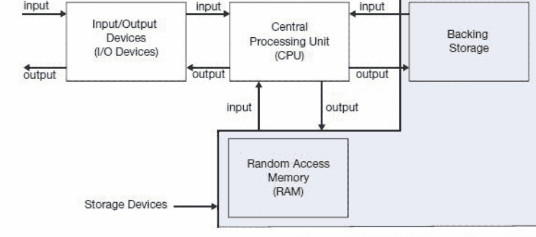

图 1.4

计算机系统硬件组件的布局。

图 1.4 左上角 I/O 设备进入和出的箭头表示信息进入（输入）和离开（输出）计算机系统的流。图中的其他箭头表示计算机系统组件之间的信息流。中央处理单元可以接收来自标记为“input”箭头的信息，并将信息发送到（标记为“output”的箭头）。信息的流完全相对于 CPU。发送到 CPU 的信息被视为输入，从 CPU 发出的信息被视为输出。

与人类和其他计算机系统通信的硬件被归为 I/O 设备。这些设备是计算机系统与外部世界的接口。输入设备将信息发送到系统中。输入设备的示例包括键盘、触摸屏、鼠标、麦克风、数字化仪和调制解调器。输出设备将信息从系统中发出。输出设备的示例包括显示器、打印机、扬声器和调制解调器。调制解调器既是输入设备也是输出设备，通常用于在计算机系统之间传输信息。

具有存储和检索能力的硬件设备归为存储设备，位于图 1.4 的右上方。存储设备的示例包括硬盘、闪存、用户识别模块（SIM）卡、CD 驱动器和磁带驱动。一种存储设备随机访问存储（RAM）在图 1.4 的底部单独列出。存储设备与所有其他存储设备的区别在于它的速度。它可以比任何其他存储设备都更快地访问信息，即访问和检索信息。它的信息访问速度接近 CPU 传输信息的速度。当程序的指令存储在 RAM 中时，程序运行得更快，因此在计算机系统中拥有大容量 RAM 是一个优势。遗憾的是，实现 RAM 速度的材料和制造工艺使其成为最昂贵的存储类型。为了让计算机系统负担得起，系统中添加了辅助存储设备。当程序执行时，操作系统软件会尝试在 CPU 需要这些信息之前，将程序的指令和处理的数据指令从辅助存储传输到 RAM。

在计算机系统中添加存储（或辅助存储）的另一个原因是 RAM 是易失的，这意味着它只在连接到电源时才保留内存：没有电，就没有内存。所有的辅助存储设备都是非易失的，这意味着它们在断开电源时，存储的信息不会丢失。因此，这些设备可以用于在计算机关闭时存档程序指令和数据（例如硬盘），并用于在计算机系统之间手动传输信息（例如闪存）。

### 定义

算法是计算机系统解决问题或执行特定任务的五种处理操作的逐步序列。

计算机程序是使用编程语言编写的算法。

## 1.2 计算的简史

在计算机出现很久以前，人类就有计数或计算的需求。事实上，“计算机（computer）”一词的早期含义指的不是机器，而是指执行计算的人员。在本节中，我们将看到这些革命性机器的惊人发展，它们改变了我们的学习、教学、购物、工作、研究和娱乐方式。

### 1.2.1 早期计算设备¹

如果计算机在今天真的是我们生活中如此重要的部分，你可能会好奇并问一个问题：计算机是谁发明的？

虽然这是一个简单的问题，但它并没有像托马斯·爱迪逊发明灯泡或亚历山大·格拉姆·贝尔发明电话那样简单的答案。这种复杂性的原因之一是，计算机的进化跨越了数千年，来自不同文化和不同领域（如数学、物理、工程、商业甚至纺织设计）的许多人为为现代电子计算机奠定了基础。

计算的根源可以追溯到公元前约50,000 年到 30,000 年，当时人们使用手指、石头或木棒上的刻痕来数羊和其他财产。第一台计算设备——算盘，于公元前2,600 年左右引入中国，使用石子或颗粒。算盘的后续版本（如图1.5 所示）使用了可以在线框上移动的珠子来执行基本的计数和算术功能。这些设备在欧洲和亚洲被广泛使用，其中一些设备今天仍在在使用²

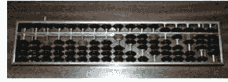

图 1.5

算盘。

直到 17 世纪，世界上才出现了其他构建计算设备的显著尝试。莱尼尔算骨和滑尺（图 1.6）是这些设备中的两件。

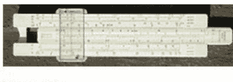

图 1.6

一个典型的现代滑尺。

布莱斯·帕斯卡（图 1.7）在 18 岁时制造了一台名为“帕斯卡机”（Pascaline）的机械计算器，用于执行基础加法和乘法。


图 1.7

布莱斯·帕斯卡。


# 布莱斯·帕斯卡：哲学家、数学家、发明家

由于制造技术尚未发达，这些设备必须手工雕刻或锻造，这需要枯燥的工作。尽管计算设备的开发似乎会以更快的速度继续，但从 17 世纪到 19 世纪初，进展微乎其微，我们可能会问为什么。也许是因为那是世界上许多地区处于战争、殖民和为生存而斗争的时代。（例如，如果你考虑到美国，从 1776 年到 19 世纪初，制造计算器在当时并不被认为是首要任务。）

1801 年，纺织设计师约瑟夫·玛丽·雅卡尔（Joseph Marie Jacquard）发现，他可以通过在打孔卡或纸带上存储指令来编程他的织布机[图 1.8]，从而在织物上创造出图案。这些二进制指令引导织布机根据纸带上是否有孔来升起或降低某些丝线。后来，这个概念将发展为创建基于二进制指令的存储程序计算机的想法；它将在 20 世纪使用打孔卡作为计算机输入得以实现。

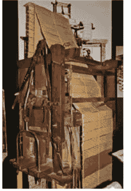

**图 1.8** 雅卡尔织机。

## 1.2.2 计算机成为现实

查尔斯·巴比奇（Charles Babbage）在 1822 年左右在英国设计了一台名为差分机（Difference Engine）的机器原型，用于编制数学表。这是一台由金属齿轮驱动的手动机器，但他并没有完成它。到 1837 年，巴比奇更进了一步，设计了一台更复杂的分析机（Analytical Engine）（图 1.9），被设想为通用机器。

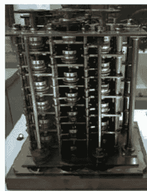

**图 1.9** 巴比奇的分析机。

爱达·洛夫莱斯（Ada Lovelace）（图 1.10），诗人的女儿，对巴比奇的工作着迷并开始编写程序。她被认为是第一位程序员，能够执行高级计算。


**图 1.10** 爱达·洛夫莱斯。

19 世纪，赫曼·霍勒特（Herman Hollerith）制造了一台可以处理人口普查数据的机器，使用打孔卡。成功之后，他创立了国际商业机器公司（IBM）。

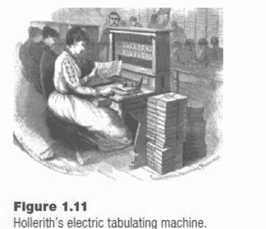

**图 1.11** 霍勒特的机器。

1939 年至 1942 年间，德国的康拉德·齐泽（Konrad Zuse）制造了第一台全可编程计算机 Z3。与此同时，英国在阿兰·图灵（Alan Turing）（图 1.12）的协助下制造了 Colossus，用于在二战期间破译德国密码。

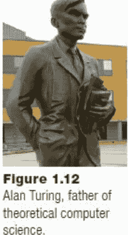

**图 1.12** 阿兰·图灵。

1944 年，哈华德·艾肯（Howard Aiken）设计并建造了哈佛 I 型机。这是第一台机电计算机，使用纸带产生数学表。

第一台电子通用数字计算机——电子数值积分器（ENIAC），于 1946 年在宾夕法尼亚大学由约翰·莫奇利和 J·普珀·埃克特（J. Presper Eckert）制造。这台计算机重 30 吨，拥有超过 1.8 万个真空管（图 1.13）。它占据了一个需要空调的大房间，因为这台机器产生的热量巨大。它每秒可以进行 5000 次加法或减法，比当时的任何机器都快千倍。它还有用于乘法、除法和计算平方根的模块。


**(a)** 更换真空管。

**(b)** 为 ENIAC 编程。

**图 1.13** 排除故障。美国军照片。

ENIAC 的大部分编程是由六位女性完成的，包括图 1.14 所示的人。


美国军照片

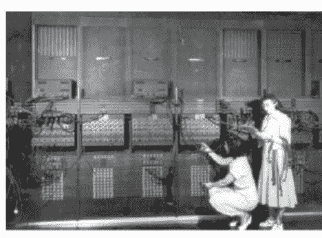

美国军照片

**图 1.14** ENIAC 的第一批程序员。

约翰·冯·诺依曼（John von Neumann）（图 1.15）对 ENIAC 提出了修改建议，包括使用二进制代替十进制数字。他设计的存储程序二进制计算机中，程序和数据可以存储在计算机内存中。这种理念被称为冯·诺依曼架构，该架构今天仍在使用。1945 年，他提出了电子离散变量自动计算机（EDVAC）的设计，随后在普林斯顿的高级研究所（IAS）从事计算机工作。他经常被誉为现代计算机和博弈论之父。

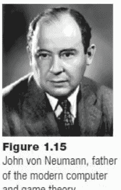

**图 1.15** 约翰·冯·诺依曼。

## 1.2.3 计算机世代

随后的计算机通常被分为几代，每一代以特定的组件或技术为特征。日期是大致的。

### 第一代（1937–1946）：真空管

这些巨大的计算机使用了数千个真空管，产生大量热量，且不可靠。内存存储在磁鼓上，输入使用打孔卡或纸带，输出显示在纸质上。这一代的计算机只能执行单一任务，缺乏操作系统，并使用 0 和 1 的序列进行编程。第一代机器包括 ENIAC、电子存储自动计算器（EDSAC）和 EDVAC。

### 第二代（1947–1963）：晶体管

这一代计算机使用了晶体管，它们比所取代的真空管可靠得多、更小、更便宜且功耗更低。机器语言被汇编语言取代，后者更接近英语。高级语言如常用业务语言（COBOL）和公式翻译语言（FORTRAN）是在这一代开发的。1951 年，通用自动计算机（UNIVAC 1）作为第一台商业计算机引入。1953 年，IBM 650 和 700 系列被推出。为这些机器设计了操作系统。存储媒体使用磁带和磁盘，打印机用于输出。

### 第三代（1964–1971）：集成电路（IC）或“芯片”

晶体管被微型化并放在集成电路（IC）上，由杰克·基尔比（Jack Kilby）和罗伯特·诺伊斯（Robert Noyce）开发。这项发明带来了更小、更强大、更可靠且更便宜的计算机。用户可以通过键盘和显示器而不是打孔卡和纸质输出与计算机交互。操作系统监控内存使用并控制多个应用程序的调度。

### 第四代（1971至今）：微处理器和超大规模集成（VLSI）

超大规模集成（VLSI）使得计算机从房间大小缩小到可以放在手里。计算机的组件，从中央处理器和内存到输入/输出，现在位于单个微处理器上。除了尺寸变小，计算机变得人们负担得起。1977 年，个人电脑（PC）出现了三家公司：Apple、Tandy/Radio Shack 和 Commodore。1980 年，微软发布了磁盘操作系统（MS-DOS），1981 年，IBM 引入了用于家庭和办公室的 PC。三年后，苹果引入了具有图标驱动界面的 Macintosh。1985 年，微软发布了 Windows 操作系统。第四代计算机使用了图形用户界面（GUI，发音为“gooey”）并提供了鼠标以便使用。面向对象的语言如 Java 是为了更高效的软件开发而开发的。这些更小、更可靠且强大的计算机可以相互连接，导致了网络和互联网的增长。

### 第五代（现在及以后）：人工智能、并行处理、量子计算

第五代计算设备的特征是人工智能以及能够响应自然语言并具备学习能力设备的进步。尽管这些特征仍处于开发早期，但某些如语音识别的应用已经可用。并行处理、量子计算和纳米技术的使用有助于这些进步并改变未来的计算。

## 1.2.4 其他重要贡献

除了已经提到的成就外，还有许多其他人对计算机领域做出了重要贡献。以下是其中一些创新者的名字和贡献。

格蕾丝·霍珀（Admiral Grace Hopper，图 1.16）是计算机领域的先驱。她是哈佛 Mark I 计算机的第一批程序员之一，以开发第一个编译器和汇编语言而闻名。她的编程工作导致了 COBOL 语言的开发，她后来研究了 Ada。


**图 1.16** 格蕾丝·霍珀。

当她从计算机电路中移除一只中断电流的昆虫（或蛾子）时，她创造了“调试”（debugging）一词，并将其贴在笔记本上（图 1.17）。

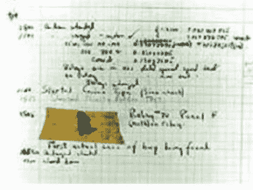

**图 1.17** 格蕾丝·霍珀记录的首个计算机“虫”。

史蒂夫·乔布斯（Steve Jobs，图 1.18）和史蒂夫·沃兹尼亚克（Steve Wozniak）是苹果计算机的联合创始人。Apple I 是 1977 年的产品之一。他们共同开发了点击操作。


**图 1.18** 史蒂夫·乔布斯与史蒂夫·沃兹尼亚克。

詹姆斯·戈斯林（James Gosling）被誉为 Java 语言的开发者，也被称为 Java 之父。

每加仑的最高速度可达每小时 240,000 英里，成本仅为 4.00 美元。此外，在最近的计算机设备展览会（COMEX）会议上，据报道比尔·盖茨说，如果通用汽车能像计算机行业那样跟上技术进步，我们是否就会驾驶每加仑行驶 1000 英里的汽车了。

计算机以及提供其指令的程序将继续在速度、可靠性和功能上提升，其限制仅限于人类的创造力。

# 1.3 程序的规范

正如第 1.1 节所讨论的，越来越多的人拥有并使用计算机作为日常生活的一部分，但在这些计算机用户中，实际上只有极小比例的人知道如何编写计算机程序。事实上，如果你理解了本书前两个章节的内容，你已经比世界上大多数人更懂计算机编程了。因此，大多数程序并不是由程序用户编写的，而是由一群计算机专业人士编写的，大多数人会将他们称为程序员，但更准确地说，他们应该被称为软件工程师。一个不能满足终端用户需求的新程序将不会受到欢迎，因此，用终端用户能够理解的方式来描述新程序的需求至关重要。

> **定义**
>
> **软件工程师**是一种计算机专业人士，负责生产按时、在预算内、无故障且满足终端用户需求的程序。

描述新程序需求的更正式的技术是系统分析学科的一部分，系统分析是软件工程的一个子集。这些正式技术都基于图 1.4 所示计算机系统组件安排的一种规范。它们假设用户与程序的交互是通过输入和输出设备进行的；终端用户定义程序要执行的任务的最简单方法就是与系统分析师进行对话，旨在定义程序的输入和输出。

例如，假设你的朋友安妮最近买了一台电脑，在管理理财方面遇到了困难。知道你懂计算机编程，她来向你寻求帮助。你和安妮开始了以下对话，这通常涉及“谁、什么、哪里、何时和如何”这些疑问词：

**安妮**：我想知道我的钱都去哪里了。

**你**：好的，安妮，你每个月支付哪些账单？

**安妮**：嗯，有食物、租金、电、电话和衣服。

**你**：每个账单是多少？

**安妮**：这就是问题所在；它们每个月都在变，我的收入也是如此，因为我是提成制的。

**你**：那么，你大概知道你的收入中每个项目占了多少比例吗？

**安妮**：不知道，但我想知道。我觉得有些月份我在食物和衣服上花费了太多的收入，导致我没有了“闲钱”花。

**你**：什么是闲钱？

**安妮**：你知道的，就是除了这些账单之外，我可以花在任何地方的钱。我想知道每个月有多少这么多钱。我确定有人在偷我的钱。

**你**：天哪，安妮，你听起来有点偏执。

**安妮**：如果每个人都想对付你，你也会偏执的！

**你**（低声说）：我何必如此？

根据这段对话，你知道了安妮希望计算机系统确定的两件事：她在月底将拥有的多少“闲钱”（可支配资金），以及她每月收入中用于五份每月账单中每一项的百分比。为了确定这些，她必须输入五份账单的每笔金额以及该月的收入。你决定将月份和年份作为程序的额外输入，这样她就能保存并区分不同月份的结果。该程序的简单描述（或规范）如下所示。它是程序输入和输出的表格，前面是程序名称和一段描述程序执行整体任务的简短说明。

**程序名称**：安妮理财管家

| 项目 | 详情 |
| :--- | :--- |
| **任务** | 确定安妮每月的可支配资金和每月支出的分布 |
| **输入 (8)** | 月份和年份；月收入，当月在以下五项中的每项花费金额：食物、租金、电、电话和衣服 |
| **输出 (6)** | 每月收入中用于这五项的百分比：食物、租金、电、电话和衣服；可支配资金金额 |

通常，程序是通过一个迭代过程规范的，这个过程涉及终端用户的评审和随后的对话。这个过程可以为安妮程序的规范引入更多功能。例如，它可以包含输出年度报告的能力，显示任何给定年份的六项输出值，或者可能针对一系列月份。显然，这将扩展上述的规范。

给定了程序规范，程序员的目标是编写一个接受指定输入并产生所需输出的程序。如果从给定的输入确定输出尚不明，程序员可能需要咨询其他专家。例如，如果负责编写安妮程序的程序员不知道如何计算百分比，他们就必须咨询数学家。

讨论规范安妮程序的技术与规范任何程序的方法相似：与用户进行简短对话，然后列出程序的名称、它执行的任务、输入和输出。这种方法也可以用于规范用于玩游戏的程序。此外，意识到所有游戏程序都有一组共同特征，可以使系统分析师在与游戏发明者对话时通过包含这些特征的问题来便利规范过程。例如，大多数游戏都涉及游戏对象（例如卡车、汽车和青蛙）。此外，所有游戏都有目标或获胜方法（例如让青蛙穿过马路而不被卡车或汽车撞到）。大多数游戏还有共同特征。规范对话中包含的常见特征列表如图 1.23 所示。

**图 1.23 常见游戏特征**

- 名称
- 游戏中包含的对象（星船、卡车、弹弓等）
- 游戏目标
- 计算游戏得分的方法
- 游戏的时间限制
- 具有动画的游戏部件（对象）
- 由游戏玩家（程序用户）控制的游戏部件
- 控制游戏对象的输入设备
- 游戏中包含的颜色
- 确定游戏何时结束
- 记录最高分以及获得该分的游戏玩家名称

有了这些常见特征检查清单，与你的朋友瑞恩（一个没有学过课程的游戏发明者）的典型对话可能是：

**你**：嗨瑞恩，怎么了？

**瑞恩**：我有一个叫《深空瑞莉》的视频游戏主意。

**你**：游戏的目标是什么？

**瑞恩**：在时间耗尽之前，尽可能将供应包（从仓库获取）送到五个不同的行星。

**你**：玩家得分是如何计算的？

**瑞恩**：每送一个包一分，如果玩家在时间耗尽前送完了仓库里所有的包，每剩余一秒得一分。

**你**：游戏的时间限制是多少？仓库里有多少包？

**瑞恩**：一分钟和 30 包。

**你**：看起来游戏部件（对象）是行星、供应包和供应船。对吗？

**瑞恩**：对，但别忘了包含仓库。

**你**：玩家将如何移动补给船并捡取和投放数据包？

**瑞恩**：使用键盘上的按键。

**你**：其他游戏组件会移动吗？

**瑞恩**：是的，行星会移动并在游戏板边缘反弹。另外，把其中一个行星设为白色，另一个设为红色。

**你**：你想记录最高分以及获得该分数的玩家名称吗？

**瑞恩**：是的，这是一个好主意。

**你**：听起来不错，瑞恩。我会为你写一份游戏规格供你审阅。然后，我来编写程序，我们平分利润。你觉得怎么样？

**瑞恩**：给你 40% 的股份怎么样？

**瑞恩**（低声说）：这全是我的主意。

**你**：好的。

**你**（低声说）：活全是我在干。

根据这段对话，瑞恩的游戏规格说明如下。

**程序规格**

| 项目 | 详情 |
| :--- | :--- |
| **程序名称** | *深空交付* (Deep Space Delivery) |
| **任务** | 一艘宇宙飞船需要在补给站捡取补给包，并在时间结束前尽可能将数据包递送到五个移动的行星。每递送一个数据包获得一分，所有数据包递送后，游戏时间每剩余一秒获一分。 |
| **输入 (7)** | 用于控制星船位置的四个方向控制键（上、下、右、左）；当飞船位于补给站时用于捡取补给包的“A”键；当飞船位于行星时用于投放数据包的“Z”键；游戏启动时的玩家名称输入 |
| **输出 (5)** | 从 60 秒开始计算的剩余时间（秒）；玩家得分；游戏时间归零或所有数据包递送完毕时显示“游戏结束”消息；游戏时间归零时向游戏板和磁盘文件中输出最高分及获得者的名称 |

你可以在瑞恩程序的规格说明中添加更多功能的细节。例如，向移动较快的行星递送数据包可以获得多分，游戏可以添加多个难度等级，并在游戏开始时宣布最高分及获得者的名称。

我们将能够编写一个程序，来实现上一节介绍的《深空交付》游戏的规格。随本文附带的 DVD 上的游戏程序是由参加入门编程课程的学生编写规格并编写的。要运行这些程序，只需双击 DVD 上的“Sample Student Games”文件夹并将子文件夹复制到你的硬盘上。双击带有 `.jar` 扩展名的文件。运行这些程序将让你直观感受到在理解了本书前五章内容后将能够实现什么。

计算机系统的平台是指 CPU 型号以及其运行的操作系统软件。例如，许多 PC 运行在 Intel CPU/Windows 平台上，而 2011 年中期制造的 Apple 电脑运行在 Intel CPU/OS X 上。由于过去 30 年 CPU 和操作系统软件的演进，如今有许多不同的平台。

平台的多样性一直是软件开发人员面临的问题，因为每个平台都有自己的编程语言，这意味着一个平台只能执行用其对应语言编写的程序。为了产生一个可以在两个不同平台上运行的程序，程序员必须用一个平台的语言和另一个平台的语言各编写一次程序（即写两次），或者用一种更通用的语言（例如 `C++`）编写程序，然后使用另外两个程序将程序翻译成各个平台的语言。在这种情况下，`C++` 程序被称为源代码，而该源代码的最终翻译结果被称为可执行模块或可执行文件。

考虑到现有平台的数量，用特定平台的语言编写程序是非常枯燥且耗时的，因此用通用语言编写程序是最有效且最具成本效益的方法。图 1.24 展示了如何使用这一过程为三个不同的平台生成可执行模块。程序员必须使用三个不同的翻译器翻译程序，以生成三个不同的可执行模块。

| 翻译器 | 可执行模块 | 目标计算机 |
| :--- | :--- | :--- |
| Intel CPU/Windows 平台的 `C++` 翻译器 | Intel CPU/Windows 平台的可执行模块 | 运行在 Intel CPU/Windows 上的计算机 |
| Intel CPU/OS X 平台的 `C++` 翻译器 | Intel CPU/OS X 平台的可执行模块 | 运行在 Intel CPU/OS X 上的计算机 |


## Motorola CPU/Windows 平台的 C++ 翻译器、可执行模块与运行环境

| Motorola CPU/Windows 平台的 C++ 翻译器 | Motorola CPU/Windows 平台的可执行模块 | 运行在 Motorola CPU/Windows 上的计算机 |
| :--- | :--- | :--- |

20 世纪 90 年，Java 的创建还确定了一组可能在 Java 中使用的数据（例如数学常数 pi）和任务（例如计算给定数字的平方根）。这些数据和任务的描述随后被发布了。如果一个 Java 程序员想创建一个新窗口（这是大多数程序员都想做的），可以通过包含所有显示所需字节码的 API 任务轻松实现。为了方便使用，相似的数据和任务被归在一起。这些分组被称为**包**，在包内部有**类**。Java API 中大约有 200 个包和 4000 个类。这些类大部分都包含数据和执行常用任务的 Java 指令。执行任务的指令集被称为**方法**。位于同一个类的数据和方法被称为该类的**成员**。

### 定义

| 术语 | 定义 |
| :--- | :--- |
| **类** | 由一组相关的数据成员和成员方法组成。 |
| **方法** | 执行任务的指令集。 |
| **数据成员** | 包含类数据的实例变量。 |

Java 还提供了用于绘制图形和创建图形用户界面（GUI）的包。抽象窗口工具（AWT）和 Swing 包包含了属于 Java API 的类。你会注意到这些被用于创建和交互游戏窗口对象。AWT 类通常通过以下语句导入并在窗口中绘制图形对象：

```java
import java.awt.*;
```

大多数应用程序使用较新的 Swing 类，它们扩展了 AWT 包中提供的 GUI 组件范围。Swing 组件提供了对话框等额外功能，并能以拖放模式与对象交互。这些 API Swing 类可以使用类似于下面的语句进行导入：

```java
import javax.swing.*; // 注意 javax 中的 "x"
```

正如 Java 的创造者假设计算机系统制造商会安装一个将字节码翻译成系统平台语言的翻译器一样，他们假设制造商会安装一个 API 规范中所定义数据和方法的实现。再次，为了宣传他们的系统已准备好接入互联网，制造商遵循了。从技术上讲，字节码翻译器和客户端机器上的 API 实现（以及内存管理器）被称为 **Java 运行环境（JRE）**，JRE 和客户端系统的操作系统被视为 **Java 虚拟机** 的实现。图 1.26 给出了适用于运行在 Intel CPU/Windows 平台上的特定 Java 虚拟机组件。


**图 1.26** Java 虚拟机的特定组件。

根据 Gosling 团队的想法，只要语言设计者提供一个能将语言转换为 Java 字节码的翻译器，任何编程语言都可以实现平台无关性。翻译结果将在任何实现了 Java 虚拟机的计算机系统或移动设备上运行。

正如面向对象编程（OOP）语言将相关的方法和数据分组到程序中定义的类中一样，Java 在设计上就是一种 OOP 语言。在 Java 程序定义的类内部对相关的方法和数据分组，不仅仅是安排相关数据和方法的方便方式。允许这种类面向对象编程语言的真正动机是它是对程序将处理的对象进行建模的好方法。例如，考虑一个涉及对象的视频游戏。每个海星对象都将有一个名称和一个 (x, y) 位置。此外，随着游戏的进行，可以创建新的星舰，可以在显示器上绘制星舰，并可以改变星舰的位置。这些初级对象的良好模型是定义一个名为 `Starship` 的类（如图 1.27 所示的蓝色矩形）。如图所示，该类将有三个数据成员（`name`、`x` 和 `y`）和三个成员方法（`create`、`draw` 和 `move`）。

- **数据成员**：`name`, `x`, `y`
- **成员方法**：`draw`, `create`, `move`

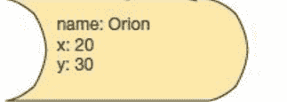
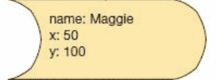
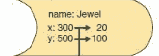

**三个 Starship 对象**

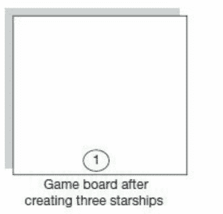
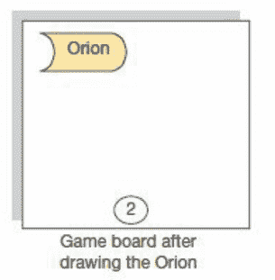
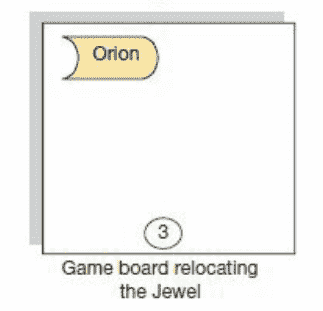

**图 1.27** Starship 类、三个星舰对象以及类方法的使用。

理解这一点非常重要：类本身并不是一个对象，而是对一个对象的描述。从一个类中，我们可以创建无限数量的**对象**或该类的实例。一个有用的类比是考虑我们在日常生活中遇到的类：蓝图、饼干模具、模板、陶器模具、服装纸样和人类基因组模式。从一个蓝图中可以创建许多房子，从一个饼干模具可以创建许多饼干，从一个模板可以创建许多图片，从一个陶器模具可以创建许多花瓶，从一个纸样可以创建许多衣服，从一个人类基因组模式可以创建许多人。

> **定义**
>
> 在面向对象编程语言中，**类**是对象的模板，而**对象**是类的特定实例。

`Starship` 类将是星舰对象的模板。每当使用类的 `create` 方法时，都会根据给定的名称和初始 (x, y) 位置从该模板创建一个星舰。星舰的名称和 (x, y) 位置将存储在它的三个数据成员中，每个从 `Starship` 类创建的对象都将包含这些成员。此外，绘制和重新定位星舰的任务将由组成类的 `draw` 和 `move` 方法的 Java 指令完成。

**图 1.27** 的中间和底部部分描绘了 Starship 类三个成员的使用，按以下顺序使用：

1. `create` 方法（由数字 1 表示）被用于创建或构建图中中间所示的三个星舰对象：位于 (20, 30) 的 Orion、位于 (50, 100) 的 Maggie 和位于 (300, 500) 的 Jewel。注意，在创建后，每个星舰都包含三个数据成员来存储船舶的名称及其 (x, y) 位置。尽管这三个星舰已经创建，但由于没有使用 `draw` 方法，它们没有出现在左下角的游戏板上。
2. `draw` 方法（由数字 2 表示）用于在当前位置 (20, 30) 显示 Orion。尽管这三个星舰已经创建，但由于没有使用 `draw` 方法，它们没有出现在左下角的游戏板上。
3. `move` 方法（由数字 3 表示）用于改变星舰的位置。

### 开发环境（IDE）

开发环境（IDE）是一种帮助编程员编写、调试和测试代码的工具。大多数现代程序员使用 IDE，它将文本编辑器、编译器和调试器集成到一个应用程序中……

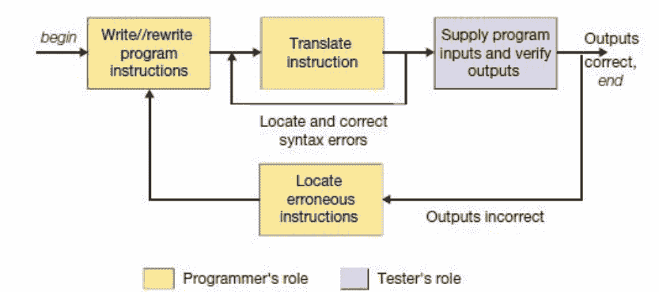

**图 1.28** 开发过程概述。

#### 大型程序开发示例

例如，考虑图 1.27 所示的 `Starship` 类的开发，它是游戏程序的一部分。必须使用图 1.28 所示的过程开发三个方法（`create`、`draw` 和 `move`）。由于我们无法对尚未创建的 Starship 进行绘制或移动，因此将首先开发 `create` 方法。在编写方法并发现、修正语法错误后，我们会再写几行 Java 代码来测试该方法。这段代码通常被称为**驱动代码**，因为它对该方法执行了“试驾”。它将使用该方法构造一个 Starship 对象（可能是图 1.27 中央的 Maggie），并输出其数据。如果输出了 Maggie 和位置 (50, 100)，我们就可以断定 `create` 方法工作正常。如果不是，我们将检查组成 `create` 方法的指令，定位并修正错误，然后重复翻译和该部分的过程。

> **注意**：驱动代码是用于测试方法的可弃性 Java 指令。它们通常不会成为最终程序指令的一部分。

下一个逻辑步骤将是开发 `draw` 方法，正如我们所见的，它可以用于 `move` 方法的测试。在发现并修正语法错误后，我们会再写几行 Java 代码来测试该方法。该代码将使用 `create` 方法构造一个 Starship 对象（可能是图 1.27 左侧的 Orion），然后使用 `draw` 方法将其在游戏板上显示出来。如果它显示在正确的位置，并且船体侧带有名称 Orion，我们就可以断定 `draw` 方法工作正常。如果不是，我们将检查组成 `draw` 方法的指令，定位并修正错误，然后重复翻译和该部分的过程。

接下来，我们将开发 `move` 方法，编写代码，翻译并修正语法错误，然后我们写几行 Java 代码来测试该代码。它将创建一个 Starship 对象（可能是图 1.27 右侧所示的 (300, 500) 处的 Jewel），然后使用 `move` 方法将其位置更改到 (20, 100) 并在游戏板（显示器）上绘制显示。如果它显示在新的新位置 (20, 100) 且船体侧带有名称 Jewel，我们就可以断定 `move` 方法工作正常。如果不是，我们将检查组成 `move` 方法的指令，定位并修正错误，然后重复翻译和该部分的过程。

在三个易处理的步骤中完成 Starship 类的开发后，我们消除驱动代码，并将其替换为在游戏程序中使用 Starship 类及其方法的指令。

### 移动设备开发

在过去的十年中，计算系统基础组件的微型化程度为市场带来了各种手持计算设备。这些设备通常被称为**移动设备**，包括智能手机、数字辅助器（PDA）和平板设备。

为移动设备开发程序的过程与本章讨论的为非移动计算设备开发程序的过程相同。在写完规格说明书并发现程序算法后，使用 IDE 按照图 1.28 所示的过程将规格说明书开发为具有功能的程序。然而，在将开发过程应用于移动设备应用时，会出现两个问题。由于这些设备的计算能力有限，在它们上进行开发过程是不现实的，因此开发过程是在性能更强的非移动计算系统上进行的。此外，平台独立性概念尚未扩展到移动设备，因此必须为每个移动设备平台生成一个可执行模块。

由于大多数移动应用程序运行在智能手机上，而绝大多数智能手机运行在基于 Android 的平台上，本节将以概述开发任何基于 Android 的智能手机或平板设备的可用工具作为结束。尽管所呈现细节针对这些设备，但所提出的概念是大多数设备上开发应用时采用的工具的典型。

Android 设备应用程序可以在个人电脑上用 Java 编写。首选的 IDE 是 Eclipse，它是免费下载的。首选 Eclipse 是因为两组便于 Android 设备应用开发的工具可以很容易地集成其中。这两组工具都可以免费下载。其中第一个工具是 **Android 软件开发包 (SDK)**，可以从 Android 开发者网站下载。第二组工具是 **Android 开发工具 (ADT) Eclipse 插件**，可以从 Eclipse 网站下载。

这两组工具提供的一些功能包括：

- 最新版本的 Android 操作系统
- 依赖于平台的翻译器
- 一组模拟器，可以在任何设备（包括其屏幕）的仿真环境上运行代码
- 将开发的应用程序上传到 Android Market（一个基于 Web 的免费和付费应用程序商店）的能力

通过使用这些工具和对 Java 的知识，你将能够在舒适的个人电脑的环境中开发并推销应用程序。

## 1.8 游戏开发环境

在第 1.4 节中，你被要求运行随附教材的 DVD 中的几个游戏程序。DVD 还包含一个名为 `Package` 的文件夹，其中包含一个名为 `edu.scgp1` 的包。这个包可以被视为 API 的游戏扩展，因为它包含了游戏程序通用的方法。附录 A 包含了该包中包含的方法说明。

将此包（或游戏环境）整合到游戏程序中可以有利于它的开发。创建示例程序的学生已将其整合到自己的程序中。在本节中，我们将描述如何轻松创建和显示游戏窗口，以及如何更改游戏窗口的一些属性。

当整合到 Java 程序时，可以使用游戏环境的两个方法来创建并显示图 1.29 所示的游戏窗口。游戏窗口右侧的暂停和开始按钮可供游戏玩家玩游戏和启动/重新启动。它们下方的方向按钮或键盘键可用于在游戏期间控制游戏对象的位置。

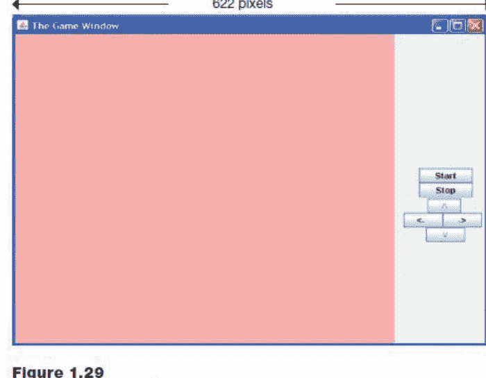

**图 1.29** 游戏环境的窗口。

游戏窗口左侧的珊瑚色区域称为**游戏板**，它是游戏对象出现的地方。像大多数窗口一样，它可以通过标题栏拖动，最小化到状态栏，并通过点击状态栏上的图标恢复显示。它不能最大化；但是，程序员可以更改其大小以适应特定游戏的需求。游戏窗口的默认大小为 622x535 像素，像素是构成计算机显示器面的密集彩色点。

### 1.8.2 游戏板坐标系

图 1.30 显示了游戏板坐标系。游戏对象通过指定其 x 和 y 板坐标定位在游戏板上。该系统是以游戏窗口左上角为原点的二维笛卡尔坐标系。正 x 轴向右，正 y 轴向下。坐标系的单位是像素。

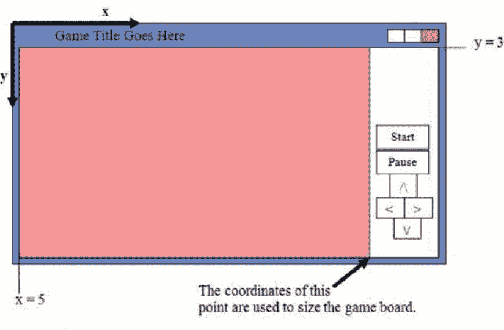

**图 1.30** 游戏面板坐标系。

如图 1.30 的右上角和左下角所示，窗口的标题栏高度为 30 像素，窗口的左边界宽度为 5 像素。默认窗口大小下，游戏面板右下角的坐标为 (500, 500)。如果程序员认为对于正在开发的游戏，更大或更小的游戏面板更合适，可以更改游戏面板右下角的 x 和 y 坐标，这将在 1.8.5 节中描述。

### 1.8.3 安装并将游戏包引入到程序中

附录 B 包含了关于如何将包含游戏开发环境的游戏包引入到 Java 程序中的详细说明。最简单的方法是使用随本书附带的光盘中“IDE 专用工具”（IDE Specific Tools）子文件夹中的项目之一。该子文件夹包含一个 Eclipse、NetBeans 和 JCreator 项目，这些项目已经包含了游戏包，以及下一节中描述的创建并显示游戏窗口的代码。运行这些项目时，将显示图 1.29 所示的游戏窗口。可以向它们添加游戏程序特定的代码和类。

光盘上的 JCreator 和 NetBeans 项目可以从光盘复制并粘贴到文件夹中，然后在 IDE 内部打开、修改和运行。Eclipse 项目必须使用 Eclipse 文件下拉菜单中提供的“导入”功能导入到 Eclipse 文件夹中。从光盘导入 Eclipse 项目后，就可以在 Eclipse 内部打开、修改和运行。关于使用光盘上三个预设游戏项目的详细说明，见附录 B。

作为另一种方案，位于光盘上“游戏环境”文件夹中的游戏包 `ej.sjeny.gpv` 可以按照附录 B 中提供的步骤添加到任何新创建的 Java 项目中，大部分步骤不需要更改系统的 `CLASSPATH` 变量。使用这些替代方法时，必须将下一节中描述的创建并显示游戏窗口的代码添加到项目代码中。

### 1.8.4 创建并显示游戏窗口及其标题

在将游戏包引入（导入）到你的程序之后，你可以使用包中的方法来创建并显示运行你游戏的图形窗口。图 1.31 所示的 Java 程序是我们所有游戏应用程序的模板或起点。当此程序运行时，将创建并显示图 1.29 所示的游戏窗口。

```java
1 import edu.cjny.game.*;
2 public class GameWindowDemo extends DrawableAdapter
3 {
4     static GameWindowDemo ga = new GameWindowDemo();
5     static GameBoard gb = new GameBoard(ga, "The Game Window");
6 
7     public static void main(String[] args)
8     {
9         showGameBoard(gb);
10     }
11 }
```

**图 1.31** 创建和显示游戏窗口的 Java 指令。

正如我们在第 2 章中学到的，第 2、3、7、8、10 和 11 行是组成 Java 程序的最小指令集。因此，许多 IDE 在创建新的编程应用程序时会生成这些指令。唯一的例外是 `DrawableAdapter` 关键字，如果要在程序中使用游戏包，则必须将其添加到第 2 行。第 1、4、5 和 9 行构成了游戏程序模板。

图 1.31 第 1 行的 import 语句使得包中的方法对程序可用。第 4、5 和 9 行使用这些方法创建并显示图 1.29 所示的游戏窗口。每个 Java 程序都被赋予一个名称，这是其规范的一部分。此程序命名为 `GameWindowDemo`，它在第 2 行的单词之后输入，并在第 4 行又输入了两次。

如前所述，图 1.31 将是我们所有游戏应用程序的模板。为了使其适应特定的游戏程序，新程序的名称将出现在第 2 行和第 4 行，游戏的标题和创建者的姓名将出现在第 5 行末尾。例如，如果一个新游戏程序的名称是 `Project1`，游戏是由 Bob 创建的 `Frogger`，那么对第 2、4、5 行的更改将如下所示：

### 1.8.5 更改游戏面板的大小

如 1.8.1 节所述，游戏窗口的默认大小为 622x535 像素。选择这个大小是为了使游戏面板右下角的坐标为 (500, 500)。为了更改游戏面板的大小（从而更改窗口的大小），我们将游戏面板右下角的新坐标添加到图 1.31 第 5 行的末尾。这是构造窗口的行。例如，为了获得一个右下角位于 (700, 650) 的游戏面板，我们将第 5 行更改为：

```java
static GameBoard gb = new GameBoard(ga, "The Game Window", 700, 650);
```

窗口的标题栏高度仍为 30 像素。

## 1.9 在内存中表示信息

正如 1.1 节讨论的，内存中表示信息的方案取决于存储的信息类型。数据使用一种方案来表示，这与翻译指令使用不同的方案。

有三种内存方案用于表示不同类型的信息：

- 字符数据
- 翻译指令
- 数字数据

这三种方案都围绕基础硬件单元：**位**，它代表二进制数字。在概念上，位应该被视为一个可以开启或关闭的开关。所有内存都使用这种概念，像 RAM、磁盘和磁带等存储设备可能包含数十亿（Giga）甚至万亿（Tera）位。

为了简便，当位开启时，我们说它处于状态 1；当它关闭时，如果存储的是数字数据，我们说它处于状态 0。图 1.32 描述了相邻位的关闭-关闭状态及其二进制（1-0）表示。

| 关闭-关闭-关闭-关闭 | 01000010 |
| :--- | :--- |
| 开-关表示 | 1-0 表示 |


### 1.9.1 表示字符数据

在内存中表示字符数据的方案非常直观。分配了一个唯一的八位模式表，其中包含要表示的字符。例如，字符 `B` 被分配了 `01000010`，该字符的小写版本 `b` 被分配了 `01100010`，而字符 `1` 被分配了 `00110001`。

该表是扩展美国标准信息交换代码，因为它是美国标准信息交换代码表的扩展，后者使用七位模式来表示字符。这个七位表被分配了缩写 ASCII（读作 "asc key"），而扩展表被称为扩展 ASCII 表。两个表都包含了现代拉丁语（英语）的所有大写和小写字母、数字 0 到 9、一组特殊字符（例如 `!`、`@`、`#`、`$`、`%`、`&`、`^` 等）以及水平制表符和换行符等控制字符。

扩展 ASCII 表的前 128 个字符见附录 C。此表中的位模式用于在所有处理字母字符系统的计算机系统中表示字符信息，这些限于现代拉丁语（英语）。

当出现这种情况时，如果我们想在存储器中表示字母 B，则八个相邻（或连续）的存储位（称为一个存储字节）被设置为 B 的扩展 ASCII 码：`01000010`。如果我们从一个已知存储了字符的内存区域中取出一个存储字节，且该字节包含 `01000010` 这种模式，那么我们就知道那里存储了字符 B。我们通常说，如果一个键盘在敲击大写字母 B 时产生此位模式，则我们称该键盘为 ASCII 键盘；如果一个打印机在接收到此位模式时打印出字符 B，则我们称其为 ASCII 打印机。

#### 定义

八个相邻或连续的位被称为一个存储字节。

为了适应互联网上的国际信息交换，扩展 ASCII 表被扩大，包含了世界上其他字母表中符号的唯一模式。为了给这个扩展后的表（命名为 Unicode 字符表）中的每个条目提供唯一的位模式，分配给每个字符的位数从每个字符 8 位增加到每个字符 16 位（即 2 字节）。Unicode 表的前 256 个条目是扩展 ASCII 表中的字符，其 16 位模式的左侧 8 位设置为 0，右侧 8 位设置为其扩展 ASCII 模式。例如，由于 `B` 的扩展 ASCII 表示为 `01000010`，其 Unicode 表示即为 `00000000 01000010`。Java 程序处理的字符以其 Unicode 表表示的形式存储在内存中。

> 字符数据在内存中使用扩展 ASCII 或 Unicode 字符表示。

### 1.9.2 表示翻译后的指令

在内存中表示翻译后指令的技术与在内存中表示字符的技巧相同。包含了一个所有可能的翻译后指令的表，并为其中每条指令分配一个唯一的位模式。例如，减去两个整数的翻译指令位模式可能是 `01000000`，除以两个整数的翻译指令位模式可能是 `01000010`。

与所有计算机系统都用于存储字符的扩展 ASCII 和 Unicode 表不同，这些翻译指令表在不同的 CPU 之间是不同的。不仅位模式不同，表示翻译后指令所需的位数也不同。这些表依赖于平台，这正是 Java 诞生的原因。要确定特定平台上除法指令的翻译内存表示，我们必须在该平台的 CPU 指令表中查找除法指令的位模式。

对于 Java 虚拟机，每条翻译后的指令都被分配了一个八位模式。由于这些模式由八位（或一个字节）组成，这些模式被称为字节码。表 1.1 给出了整数算术指令的 Java 字节码：加、减、乘、除。如表所示，当 Java 虚拟机接收到字节码 `01101100` 时，它会执行除法操作。

#### 表 1.1 整数算术指令

| 指令 | Java 字节码 |
| --- | --- |
| add | 01100000 |
| subtract | 01100100 |
| multiply | 01101000 |
| divide | 01101100 |

> 提示：Java 指令在内存中使用被称为字节码的八位模式表示。

### 1.9.3 表示数值数据

与之前描述的两种方案不同，表示数值数据的方案并不使用表，因为一方面，该表将无限长。相反，该方案是基于数论的。所有的数制都有一个基。我们数字系统的基是 10，人类学家推测这是因为我们有十根手指和十个脚趾。在数论中，数制的基决定了系统中的数字。因为我们的数字系统基是 10，所以它有 10 个数字（0 到 9）。相反，数论告诉我们，如果一个数制的基是 2，它就是二进制。

掌握了这些关于数制的知识后，决定数值数据使用基为 2 的数制存储在内存中，因为可以表示该系统的两个数字：0 和 1。人类学家告诉我们，如果我们有两个手指，二进制系统可能就是我们的数字系统。由于我们没有两个手指，我们需要理解如何从二进制（基 2）转换为十进制（基 10）以解释十进制数字模式，以及如何将数字从十进制转换为二进制，以便我们可以将数字存储在内存中。

> 提示：数值数据（将用于数学表达式的数据）在内存中使用二进制数制表示。

这些转换的基础是意识到二进制数制中的数字位权值与我们的十进制系统不同。从右侧开始，我们数字系统中的数字位权值是个位、十位、百位等。这些值代表了 `10⁰`、`10¹`、`10²` 等。将此推导出二进制系统，从右侧开始的数字位权值是 `2⁰`、`2¹`、`2²` 等。图 1.33 给出了二进制数制的前几个位权值，下方是对应的十进制（基 10）等值。在了解二进制系统的位权值后，我们现在可以从二进制转换为十进制，从十进制转换为二进制。

| 2⁷ | 2⁶ | 2⁵ | 2⁴ | 2³ | 2² | 2¹ | 2⁰ |
| --- | --- | --- | --- | --- | --- | --- | --- |
| 128 | 64 | 32 | 16 | 8 | 4 | 2 | 1 |

要将内存中的二进制数模式（例如 `01000010`）转换为十进制，只需知道二进制系统的位权值，我们就可以从二进制转换为十进制，从十进制转换为二进制。由于 `B` 的扩展 ASCII 表示为 `01000010`，其 Unicode 表示即为 `00000000 01000010`。Java 程序处理的字符以其 Unicode 表表示的形式存储在内存中。

当我们结束关于数值数据存储在内存中的讨论时，应该考虑负整数和小数（在数学中称为实数）是如何表示的。短答案是，负整数使用补码方案表示，而带有小数的数字使用类似于科学计数法的格式表示（例如 `2.352374 x 10²`）。这些方案的细节超出了本文范围，然而，理解本节讨论的正整数的二进制表示对于理解这两种方案至关重要。

最后，考虑一个包含 `01000010` 模式的字节。当我们尝试确定存储在该字节中的内容时，出现了一个困境。如果我们查看扩展 ASCII 表，我们会得出存储的是字符 `B`。我们也了解到这可能是十进制整数 66。它还是存储在 RAM 内存中的字节码指令。为了解决这些困境，语言翻译器会跟踪在 RAM 各部分存储的信息的类型。如果我们知道位模式 `01000010` 位于存储字符的 RAM 区域，那么它代表字符 `B`。

## 1.10 章节总结

在本章中，你学习了计算机系统的硬件和软件组件、它们如何排列以及它们如何相互作用。硬件组件包括中央处理器、内存和输入输出设备。主内存（RAM）与 CPU 交互，并存储正被 CPU 处理的数据和指令。备用存储或辅助内存（如硬盘）更持久地存储数据和指令。

随着计算机从房间大小的设备演变为如今常见的小型手持移动和可穿戴设备，它变得更小、更快、更廉价且更可靠。

Java 是一种面向对象的编程语言，允许程序员在应用程序和计算机游戏中表示并处理真实世界中的对象。类是创建对象的模板，它们包含数据以及操作数据的方法。计算机中包含的所有信息都以二进制形式表示，即翻译后的指令、数值数据和字符数据。Java 程序被翻译成字节码，字节码可以由 Java 虚拟机执行，这使得它们具有平台独立性和可移植性。

新程序在书面规范中被定义，然后发现程序的算法，并使用 IDE 来编写和测试程序。通过将游戏环境导入到程序中（例如随本书附带的 DVD 中的内容），可以更轻松地编写游戏程序。游戏环境通过提供执行大多数游戏常用任务的方法，补充了 Java API，创建一个交互式游戏板，游戏对象可以在该板上移动。

程序算法的发现通常是制作新程序最困难的部分。在本书中，我们将使用游戏编程来演示编程概念的使用，并使用游戏算法向读者介绍算法发现的过程。

### 知识练习

1. 在 1989 年到 2004 年间，美国每 1000 名公民拥有的计算机数量增加了大约倍：
   - a) 2
   - b) 4
   - c) 8
   - d) 12

2. 硬件和软件之间的区别是什么？

3. 解释操作系统和应用程序之间的区别。

4. 下列特征与 RAM（主）内存相关？
   - a) 非易失性
   - b) 极快
   - c) 容量极大
   - d) 昂贵

5. 下列特征与辅助（次级）存储相关？
   - a) 非易失性
   - b) 极快
   - c) 容量极大
   - d) 昂贵

6. 给出以下三个例子：
   - a) 输入设备
   - b) 输出设备
   - c) 辅助（次级）存储设备

7. 某些计算机设备用途单一，而另一些具有多种用途。
   - a) 举出一个仅用于输出的设备。
   - b) 举出一个仅用于输入的设备。
   - c) 什么设备可以同时用于输入和输出？

8. 写出并解释计算机系统的三个主要硬件组件的每个的功能。

9. 如果一个朋友问你是谁发明了计算机，你会如何回答？

10. 操作系统程序的示例包括以下所有项外的：
    - a) MAC OS
    - b) Windows
    - c) Java
    - d) Linux

11. 易失性内存是指：
    - a) 永久存储数据
    - b) 如果断电则会丢失内容
    - c) 从外部添加到计算机中

12. 文字处理、电子邮件和 Web 搜索都是使用以下内容的示例：
    - a) 应用程序软件
    - b) 系统软件
    - c) 编程
    - d) 以上都不是

13. 下列哪种项取代了第二代计算机中的真空管？
    - a) 纸带
    - b) 鼠标
    - c) 芯片
    - d) 晶体管

14. 谁开发了汇编语言、第一个编译器和 COBOL 语言？
    - a) 艾伦·图灵
    - b) 阿达·洛夫莱斯
    - c) 格蕾丝·霍珀
    - d) 约翰·冯·诺依曼

15. 这些标题或描述所指代的人名：
    - a) 第一位程序员
    - b) Java 编程语言的发明者

16. 给出程序在其规范中确定的四个特征。

17. 平台独立性是什么意思？

18. 正或否：为了实现平台独立性，Java 字节码被翻译到终端用户的计算机系统。

19. 类和对象之间的区别是什么？

20. 在视频游戏中，一个拍子将用于将球反射到 200 块砖墙中。
    - a) 游戏中将涉及多少对象？它们是什么？
    - b) 程序中将定义多少类？写出它们的名字。

21. 给出由以下缩写代表的术语：
    - a) CPU
    - b) RAM
    - c) I/O
    - d) IDE
    - e) JVM
    - f) API
    - g) GUI

22. 下列哪项是指将问题分解成较小部分以便解决或对其编程的过程？
    - a) 分治法
    - b) 平台独立性
    - c) 可移植性
    - d) 翻译

23. 游戏环境面板的左上角位于 (x, y) 像素坐标：
    - a) (0, 0)
    - b) (500,500)
    - c) (622,535)
    - d) (5, 30)

24. 下列哪项不是典型游戏程序的组件？
    - a) 分数
    - b) 时间限制
    - c) 算筹板
    - d) 游戏道具对象

25. 写出内存中表示的三种信息类型。

26. 为这些十进制数值每个写出 8 位二进制等值项：
    - a) 51
    - b) 77
    - c) 115
    - d) 131
    - e) 227
    - f) 254

27. 写出这些值的十进制（decimal）等值项：
    - a) 01010011
    - b) 00101111
    - c) 11111101
    - d) 00000000

28. 给出字符的 8 位二进制表示：
    - a) C
    - b) E

### 预习练习

1. 想一个游戏，并与自己进行对话，包含一些大多数游戏的共同特征。为游戏写一份关于名称、目标以及输入输出描述的规范。

2. Logan 是一个老师，他的班有 25 名学生。写一个程序显示班级的最低分、最高分平均分。

3. 使用图 1.3 和第 1.8 节中的说明，编写代码将窗口大小改为 800x600，并命名为“My Game”。

该程序执行输入、数学计算和输出。我们将介绍各种便于有意义输入和易理解输出的方法，还将介绍在 RAM 内存中存储数据以及进行超出基础算术运算的数学计算的技术。所有这些技术都用于大多数编程应用程序。

成功完成本章后，你应该：

- 理解 Java 程序的基本组件
- 识别基本类型变量（`primitive`）和引用变量（`reference`）的区别以及它们存储数据的方式
- 能够在程序中声明和使用变量
- 从对话框进行输入
- 向对话框输出，以及向系统控制台和图形窗口输出
- 在 Java `Math` 类中使用算术计算、数学函数和常量
- 对数值输出进行基本格式化
- 理解并能够使用计数算法
- 应用这些概念开始制作电脑游戏

## 2.1 Java 应用程序模板

如果你在给你的朋友 Sally 写信，信件可能会以开头问候语开始，例如“亲爱的 Sally，”，并以结束问候语结束，例如“诚挚地，”随后是你的签名。开头和结束问候语通常被认为是我们撰写的任何信件的最小模板。在这些问候语之间，我们会放入针对我们正在写的信的特定文本。

同样，大多数编程语言都有用于用该语言编写程序的模板。这些模板以特定语言的文本开始和结束，我们在模板内部编写或*代码化（code）*我们正在编写的程序的指令。Java 程序的最小模板如图 2.1 的半部分所示。

```
public class ProgramName
{
  public static void main(String[] args)
  {

  }
}
```

### Java 程序模板

```
public class ProgramName
{
  public static void main(String[] args)
  {
  System.out.println("Hello");

}
```

### 输出单词 "Hello" 的 Java 程序

图 2.1 Java 程序模板以及输出单词 "Hello" 的程序。

此模板第 1 行的 `ProgramName` 词被替换为正在编写的程序名称，特定程序的指令被放置在程序的代码块中，即第 4 行和第 6 行的大括号内。

> 注意：所有可执行的语句都以分号结束。

当运行 Java 程序时，执行的第一条指令始终是第 4 行左大括号后编写的第一条指令。在编程中，这条语句被称为程序的入口点，所有编程语言都指定程序模板中的一个位置作为程序的入口（起始）点。默认情况下，程序语句紧跟程序入口之后，通常按照它们在程序中出现的顺序顺序执行。

如果使用集成开发环境（IDE）来编写程序，它通常会询问程序名称（或项目）。IDE 生成代码模板，并将第 1 行的 `ProgramName` 词替换为程序名称。除了图 2.1 顶部所示的 7 行外，某些 IDE 还会向模板添加其他行，最常见的是第 5 行输出 "Hello World" 短语的语句。然而，为了使模板在语法正确，所有 IDE 都会包含图 2.1 上部所示的 7 行。

## 2.2 变量

大多数程序处理输入到程序的数据。例如，程序可能会计算两个输入存款的总和。为了进行处理，数据必须存储在计算机系统的内存中。所有编程语言都包含定义变量的语句，变量是存储存储一个数据的内存单元。在 Java 程序中使用变量之前，必须先对其进行声明。当变量在程序中被定义或声明时，程序员为它分配一个名称并指定单元格中存储信息的类型。例如，一个名为 `deposit` 的变量可以存储存款金额，在这种情况下，它的类型就是金额。

#### 定义

变量是可以存储一个数据的内存单元。

在 Java 程序中使用变量之前，必须先对其进行声明。当变量在程序中被定义或声明时，程序员为它分配一个名称并指定单元格中存储信息的类型。例如，一个名为 `deposit` 的变量可以存储存款金额，在这种情况下，它的类型就是金额。

定义：变量是可以存储一个数据的内存单元。

在 Java 程序中使用变量之前，必须先对其进行声明。当变量在程序中被定义或声明时，程序员为它分配一个名称并指定单元格中存储信息的类型。例如，一个名为 `deposit` 的变量可以存储存款金额。

良好的命名习惯。

| 良好的命名 | 糟糕的命名 |
| --- | --- |
| firstName | Fst |
| deposit | theOfTheDeposits |
| myBalance | mb |
| Valid | Invalid |
| zipCode | zip Code |
| phoneNum | phone# |
| gradel | 1Grade |

图 2.2 变量命名。

存储在内存单元中的信息可以发生变化。

在 Java 中，有两种变量：基本类型变量和引用变量。基本类型变量存储的数据可以是单个数值、一个字符或一个布尔值。引用变量存储内存地址。声明基本变量的语法与声明引用变量的语法相同。在下一节中，我们将讨论这种语法以及基本变量的使用。引用变量的使用将在 2.5 节中讨论。

## 2.3 基本类型变量

声明变量的 Java 语句以存储信息的类型开始（称为变量类型），然后是变量名称。与所有 Java 语句一样，变量声明语句以分号结束。可选地，声明语句还可以包含存储在变量中的初始值。如果变量声明语句未指定初始值，则将其设置为默认值。默认值取决于所存储信息的类型。例如，语句

```
double deposit;
```

```
double price = 5.21;
```

声明了名为 `deposit` 和 `price` 的变量，其中 `deposit` 初始化为默认值 `0.0`，`price` 初始化为值 `5.21`。`double` 是 Java 中的一个关键字。


在编程语言中，关键字是对于将程序语句翻译成计算机系统语言的翻译器具有特殊含义的单词。关键字 `double` 意味着定义的内存单元将存储带有小数部分的数字，且存储单元的大小为 8 字节（64 位）。表 2.1 给出了指定基本类型变量类型的关键字。使用关键字所隐含的存储单元大小也给出。如表所示，用于整数和实数数值类型的关键字是不同的，且存储单元的大小限制了存储数值的范围和精度。

### 表 2.1 基本数据类型

| 数据类型 | 关键字 | 单元大小（字节） | 范围和精度 |
| :--- | :--- | :--- | :--- |
| 整数数值型 | `byte` | 1 | -128 到 +127 |
| | `short` | 2 | -32,768 到 +32,767 |
| | `int` | 4 | -2,147,483,648 到 +2,147,483,647 |
| | `long` | 8 | -9,223,372,036,854,775,808 到 +9,223,372,036,854,775,807 |
| 实数数值型 | `float` | 4 | ±1.4012984643248107 E-45 到 ±3.40282366385288 E+38 (7 位精度) |
| | `double` | 8 | ±4.94065465841264544 E-324 到 ±1.797693148617 E+308 (15 位精度) |
| 布尔值 | `boolean` | 1 | `true` 或 `false` |
| 单字符 | `char` | 2 | 键盘的大小写字符和实体（见附录 C） |

在存储空间不是紧张的情况下，整数变量最好使用 `int` 类型，因为大多数程序处理的整数都在 -2,147,483,648 到 +2,147,483,647 范围内。可以使用以下几行代码获取该范围的值：

```
int min = Integer.MIN_VALUE;
int max = Integer.MAX_VALUE;
```

如果数据项超出此范围，它将无法在 `int` 变量中正确表示。对于超出此范围的整数值，应使用 `long` 类型。超出该类型范围的整数数据（参见表 2.1 的右侧第四列，或代码 `Long.MIN_VALUE` 和/或 `Long.MAX_VALUE`）无法存储在基本变量中。Java API 类 `BigInteger` 为这种情况提供了解决方案，将在第 7 章“方法与对象：再次回顾”中进行讨论。

在存储空间不是紧张的情况下，存储实数（带有分数或小数部分）的变量最好使用 `double`。程序处理的数字范围通常在 `double` 类型的范围内。与大整数一样，Java 提供了一个 API 类 (`BigDecimal`) 来存储范围超出 `double` 范围的实数。此外，数值字面量（例如 1.5）被表示为 `double` 类型，在 `float` 声明中，必须在初始值末尾添加一个 `f` (float) 以告知编译器该精度是可以接受的：

```
float change = 1.5f;
```

当指定字符变量的初始值时，它被包含在单引号中，而布尔变量的初始值以小写字母开头：

```
char myFirstInt = 'W';
boolean isRaining = false;
```

可以在单个 Java 语句中声明多个相同类型的变量。变量之间用逗号分隔，且语句不能包含初始值：

```
short n1, nRaining, n3;
boolean isRaining, isSnowing;
char letter1, letter2, digit1, digit2;
```

如果在变量声明中未指定初始值，变量 `byte`、`short`、`int` 和 `long` 的值为 0，实数类型 `float` 和 `double` 的默认值为零。对于布尔类型 (`boolean`)，默认值为 `false`，对于字符类型 (`char`)，默认值为 ' '。`true` 和 `false` 是 Java 关键字。

如果在变量声明中包含关键字 `final`，则该值在程序执行期间不能更改。在程序中声明常量时使用此关键字是一种良好的编程习惯。例如：

```
final int DEGREES_PER_CIRCLE = 360;
final double DENSITY_OF_WATER = 62.4; // 每立方英磅
```

在 `final` 变量名中使用全大写并用下划线分隔单词也被认为是一种良好的编程实践。

## 2.4 系统控制台输出

系统控制台是程序可以与用户通信的窗口。当信息从程序流向系统窗口时，我们说程序正在执行输出。相反，当信息流从系统控制台流向程序时，我们说程序正在执行输入。为了简便，这些信息传输分别称为控制台输入和控制台输出，或者简单地称为 I/O。在本节中，我们将讨论控制台输出，控制台输入将在第 4 章“布尔表达式、决策制定与磁盘 I/O”中讨论。

用于向系统控制台输出的两个 Java 语句是：

*   `System.out.print();`
*   `System.out.println();`

与所有 Java 执行语句一样，它们都以分号结尾。输出项（称为参数）编码在语句的左右括号内。这两个语句之间唯一的区别是，第一个将光标留在末尾，第二个将光标置于下一行的开头。

### 2.4.1 字符串输出

从技术上讲，要输出的项目必须是字符序列，这在编程语言中被称为字符串。在 Java 中，字符串被包含在双引号中。要输出字符串，可以使用以下代码：

```
System.out.print("This is");
System.out.println("a string");
```

### 2.4.2 拼接运算符

拼接运算符（即 `+`）可以用于组合字符串。

```
System.out.println("Hello " + "World");
```

### 2.4.3 转义序列

通常需要输出对控制台具有特殊含义的字符。为了解决这个问题，Java 使用了转义序列，它是两个字符组成的序列。序列中的第一个字符总是反斜杠。当编译器在字符串内部遇到反斜杠时，它总是认为这是转义序列的开始，转而查找表中所示的序列含义。

#### 表 2.2 转义序列列表

| 转义序列 | 序列名称 | 含义 |
| :--- | :--- | :--- |
| `\"` | 双引号 | 输出双引号 (`"`) |
| `\\` | 反斜杠 | 输出反斜杠 (`\`) |
| `\'` | 单引号 | 输出单引号 (`'`) |
| `\b` | 退格 | 将光标向前退格一个字符 |
| `\t` | 水平制表 | 将光标移动到下一个水平制表位置 |
| `\n` | 换行 | 将光标移动到下一行的开头 |
| `\r` | 回车 | 将光标移动到当前行的开头 |
| `\f` | 分页 | 将光标移动到下一页的左上角 |

例如，转义序列 `\"`（在字符串字面量内部编码）不会将引号解释为字符串字面量的开始或结束，而是输出引号本身。因此，输出句子 Joe said, "Hello" 的正确语法方式是：

```
System.out.println("Joe said, \"Hello\"");
```

产生输出：Down v Up A

转义序列 `\'` 用于输出单引号，转义序列 `\n` 导致光标在完成输出之前移动到新的一行。转义序列 `\t` 向右制表；这在您希望输出内容按列显示时非常有用。

图 2.3 所示的程序说明了原始变量的声明和初始化，以及使用字符串字面量和转义序列输出变量中存储的数据。程序的输出包含在程序代码之后的图中。

#### 图 2.3 ConsoleOutput 程序代码

| 行号 | 代码 |
| :--- | :--- |
| 1 | `public class ConsoleOutput` |
| 2 | `{` |
| 3 | `public static void main(String[] args)` |
| 4 | `{` |
| 5 | `// 原始变量声明` |
| 6 | `int age = 21;` |
| 7 | `double weight = 185.25;` |
| 8 | `boolean isRaining = false;` |
| 9 | `char letter = 'A';` |
| 10 | |
| 11 | `System.out.println("The Program's Output Appears Below\t\t\Hello World!");` |
| 12 | `System.out.println("John is " + age + " years old");` |
| 13 | `System.out.println(" and " + weight + " pounds");` |
| 14 | `System.out.println("Today it is " + isRaining +` |
| 15 | `" that it is raining\n");` |
| 16 | |
| 17 | `System.out.println("The first letter of the alphabet is " +` |
| 18 | `letter +");` |
| 19 | |
| 20 | `System.out.println("1/2 + 1/4 = 3/4");//空行会被忽略` |
| 21 | `}` |
| 22 | `}` |

#### 程序输出

程序的输出显示如下：

```
"Hello World!"
John is 21 years old and weighs 185.25 pounds
Today it is false that it is raining
字母表中的第一个字母是 A
1/2 + 1/4 = 3/4
```

**提示** 在程序的开头声明所有变量是良好的编码习惯。

第 6-9 行声明并初始化了四种类型的原始变量。第 11 行和第 12 行产生了程序输出的前行。每条语句包含一个字符串字面量。

第 11 行的字符串字面量以两个制表转义序列开头，用于将输出的第二行在第一行下方居中。此外，Hello World! 被两个双引号转义序列包围，这在第二行输出中产生了引号。

第 12-18 行输出了在第 6-9 行中声明并初始化的变量。换行转义序列开始了第 14 行的第一个字符串，产生了位于第三行文本之前的空行。第 12 行使用了两个拼接运算符来将字符串字面量与变量转换为字符串后的内容结合。第 13 行使用了类似的操作来注释 John 年龄和重量的输出。第 12 行和第 13 行显示的输出出现在同一行，是因为第 12 行使用的是 `print` 而不是 `println` 语句。结果是第 12 行执行完成后，光标没有移动到下一行的开头，导致第 13 行产生的输出紧接在单词之后开始。第 13 行的一个细微之处是其字符串字面量以一个空格开头。这个空格就变成了第 12 行和第 13 行产生的输出中单词后的空格。

第 14-15 行产生了新的一行输出，该行包含了布尔变量 `isRaining` 内容的字符串版本。它们还产生了下一个空行输出，因为最后一行以换行转义序列结束。最后两行输出由第 17-18 行产生（其输出了字符 `letter` 的内容）以及第 20 行产生（该行输出了单个字符串字面量）。

### 注释和空行

程序的第 5 行包含一个单行注释，以两个正斜杠（`//`）开头，并以换行（回车）键结束。在程序中添加注释是为了提高程序的可读性；翻译器会忽略它们。

**提示** 在程序中包含注释来描述读者看来显而易见的部分是良好的做法。

第 20 行末尾出现了第二个注释，说明程序中的空行（例如第 10 行和第 19 行）会被翻译器忽略。用空行分隔程序的主要部分是良好的编程习惯。这种技术和注释一样，提高了程序的可读性。我们将在本章的后部分看到更多关于空行使用的示例。

## 2.5 对象和引用变量

如前所述，在 Java 中有两种变量：原始变量和引用变量。原始变量存储数值、字符或布尔值。引用变量存储内存地址。这些地址被称为对象，引用变量的内容用于定位特定的对象。我们说它们引用一个对象。

假设我们写了一个程序并想在内存中存储字符串 "John"。根据我们对原始变量的了解，我们应该声明一个字符串变量，可能命名为 `firstName`，并将其初始化为字符串 "John"。遗憾的是，Java 不包含字符串变量。

## 2.6 计算与 Math 类

最早的计算机被数学家用于计算等式，他们获得了现代计算机，现代计算机执行的大部分仍然是计算。Java 与大多数编程语言一样，提供了执行计算的能力，并提供了执行更复杂计算的功能。本节首先讨论如何在 Java 程序中引入基础算术计算，然后讨论如何将数学常量和函数引入计算中。

### 2.6.1 算术计算和优先级

Java 使用算术表达式执行计算。算术表达式由由运算符分隔的操作数组成。在简单的情况下，操作数是数值常量，运算符是四种算术运算符：加、减、乘、除。例如，`10 + 21 - 5` 是一个求值为 26 的简单算术表达式。通常，简单的算术表达式从左到右求值。加会在减法之前执行。

四种算术运算符使用的符号见表 2.3。表格中的第三项模（或 mod）运算符用于寻找除法的余数。例如，`14 % 3` 的结果为 2。所有运算符都可以用于整数或实数操作数。

#### 表 2.3 算术运算符的符号（按优先级排序）

| 算术运算 | Java 符号 |
| :--- | :--- |
| 乘 | `*` |
| 除 | `/` |
| 模或 mod | `%` |
| 加 | `+` |
| 减 | `-` |

除了数值常量（也称为数值字面量）外，操作数也可以是存储数值的变量名称。当内存单元名称用于算术表达式时，会获取内存单元存储的值，并替换内存单元名称，对算术表达式进行求值。例如，给定变量声明：

```
int x = 10;
int y = 29;
int z = 5;
```

算术表达式 `x + y - z` 的求值为 34。任何算术表达式都使用数字字面量和内存单元名称作为操作数，因此表达式 `x + 29 - z` 是一个有效的算术表达式，其值同样为 34。

对两个整数进行的算术运算结果始终是整数值，对两个实值进行的算术运算结果始终是实值。当其中一个操作数是整数而另一个是实值时，结果始终是实值，这种算术称为混合模式算术。在执行混合模式运算之前，整数值会被转换为实值（例如，10 变为 10.0）。

如果程序中编写的算术表达式包含除法（`/`），则当 Java 虚拟机求值该表达式时，除数不能为 0。即存储值为 0 的内存单元名称、求值为 0 的数学表达式，或者数字字面量 0 或 0.0。如果是这样，程序的执行将由 Java 运行环境终止，当操作数满足时，它将输出以下错误消息：

```
Exception in thread "main" java.lang.ArithmeticException: / by zero
```

程序执行期间尝试除以 0 被认为导致 Java 运行环境产生“抛出（throw）”了一个 `ArithmeticException` 错误。关于异常的更深入讨论请见第 4.9 节。

#### 整数除法

当操作数是整数并执行除法时，结果有时会令人惊讶。这是因为两个整数相除总是产生一个经过截断而非四舍五入的整数结果。例如，给定变量声明：

```
int x = 10;
int y = 29;
int z = 5;
```

以下算术表达式的求值为每个表达式最右侧的值：

```
x / z = 10 / 5 = 2
y / x = 29 / 10 = 2 (由于截断丢失了 0.9)
z / x = 5 / 10 = 0 (最令人惊讶的结果，0.5 被截断为 0)
```

#### 优先级规则

考虑算术表达式 `10 + 6 - 2`。无论我们先执行加法（16-2）还是减法（10+4），该表达式的求值都是 14。同样，表达式 `10 * 6/2` 无论是先执行乘法（60/2）还是先执行除法（10*3），其求值都是 30。在这两种情况下，表达式的值与我们应用算术运算符的顺序无关。通常，如果一个表达式只包含加法减法运算符，或只包含乘法除法运算符，那么该表达式的求值与应用算术运算符的顺序无关。Java 将这些表达式视为简单算术表达式，并且如所述，它们是从左到右求值的。

对于混合了加法/减法运算与乘法和除法运算符的算术表达式，情况并非如此。考虑表达式 `10 + 6 * 2`，它执行了加法和乘法。如果我们先执行加法，表达式求值为 32 (16 * 2)，但如果先执行乘法，它的求值为 22 (10 + 12)。该算术表达式似乎是有歧义的。幸运的是，数学家规定了一种消除歧义的规则，称为优先级规则。这些规则规定乘法和除法在加法减法之前执行，或者优先级高于加减法。使用这条规则，表达式 `10 + 6 * 2` 的求值为 22。

先执行的运算符（如乘法和除法）具有较高的优先级。表 2.3 按优先级从高到低的顺序列出了算术运算符，其中乘法和除法最高，加法和减法最低。

#### 复合赋值运算符

```
count += 1;  // 等同于 count = count + 1;
total -= 6.0; // 等同于 total = total - 6.0;
price *= 1.2; // 等同于 price = price * 1.2;
price /= 1.2; // 等同于 price = price / 1.2;
index %= 6607; // 等同于 index = index % 6607;
```

如上面的示例所示，这些运算符仅在赋值变量（即运算符左侧的变量）打算作为运算符右侧算术表达式中的第一个操作数时才使用。为了说明这一点，请考虑下面的语句，其中赋值的变量被打算作为算术表达式中的第二个操作数。

```
double total = 24.0;
total = 6.0 - total;
```


在执行这两条语句后，变量 `total` 将存储减 18 的值。如果第二条语句使用如下所示的 `-=` 运算符编写，则变量 `total` 在执行后将存储一个不同的值：加 18。

```java
double total = 24.0;
total -= 6.0; // 等同于 total = total - 6.0;
```

与任何赋值语句一样，运算符右侧的算术表达式可以包含多个项。在这种情况下，运算符左侧的变量仍然是赋值运算符右侧算术表达式中的第一个操作数。例如，下面语句序列中的第三条语句的结果为 `total = total + 6.0 / two;`，当我们考虑优先级规则时，它的结果为 27。

```java
double two = 2.0;
double total = 24.0;
total += 6.0 / two;
```

### 2.6.3 提升与转换

通常情况下，赋值给变量的值类型应该与变量的类型匹配。当并非如此时，Java 翻译器会检查该变量，以确保在值存储在变量时，赋值给变量的一部分不会丢失。例如，如果将一个实数（例如 2.7）赋值给整数类型变量，值的小数部分（0.7）将会丢失。下面的语句会产生“可能丢失精度”的翻译错误，因为它将一个 `double` 值（2.7）赋值给一个整数内存单元。

```java
int newValue = 2.7;
```

提示：避免将带有小数部分的数值（例如 `float` 和 `double` 类型）赋值给整数类型变量，因为这将产生翻译错误。

这条语句不会产生语法错误，因为对两个整数进行算术运算（21 / 10）始终产生一个整数（在这种情况下，21 / 10 = 2）。

```java
int newValue = 21/10;
```

Java 翻译器还会检查赋值语句，以确定赋值给变量的值（编码在赋值运算符的左侧）是否如表 2.1 右列所示。数值变量中可以存储的数值范围取决于其类型。在这四种类型中，`double` 的范围最大，在实数类型中，`double` 最大的。

图 2.5 所示的进展总结了类型之间有效的赋值（这些赋值不会导致精度丢失，并保证被赋值变量的范围足够存储赋值给它的值）。当被赋值变量的类型位于被赋值变量的类型左侧时（例如，`double` 变量可以赋值 `int` 值），就是有效赋值。在这种情况下，我们说该值已提升为变量的类型。

| double ← float ← long ← int ← short ← byte ← char |

注意：有效的提升是从右向左 ← 

**图 2.5** 数值类型的有效提升。

虽然赋值语句代码片段中使用的变量类型不同，但它们是有效的，因为它们遵循图 2.5 所示的提升顺序。

```java
byte aByte = 20;
char a = 'a';
int aInt;
double aDouble;
aInt = aByte;
aInt = a;
aDouble = aByte;
aDouble = aInt;
```

### 混合模式算术表达式

混合模式算术表达式是指操作数类型不相同的表达式。为了求值这些表达式的项，图 2.5 中类型更靠右侧的操作数被提升为另一个操作数的类型，对该项进行求值，并将结果赋值给变量。例如，代码片段包含一个混合算术表达式：

```java
double salary = 23.56;
float raise = 1.1f;
salary = 10 + raise;
```

赋值语句中的算术表达式包含一个整数字面量、一个 `double` 变量和一个 `float` 变量。在计算此表达式的过程中，存储在 `raise` 中的值被转换为 `double`，然后执行乘法操作。得到的 `double` 值将赋值给 `salary`。

### 强制转换

强制转换是将值转换为另一种类型的过程。在计算机科学中，在讨论的混合模式表达式更改变量或数值字面量的类型是自动强制转换的示例。即使算术表达式不是混合模式的，有时也可以在表达式求值之前将操作数转换为类型。这是强制转换的一个非常常见的用途。

考虑两个整数变量 `n1` 和 `n2` 的计算：

```java
int n1 = 11;
int n2 = 10;
double ratio = n1 / n2;
```

该算术表达式将求得一个整数，因为两个操作数都是整数。结果，我们将丢失 `ratio` 的小数部分，变量将被赋值为 1.0。

更令人困惑的情况如下代码片段所示，其中整数分母（100）大于整数分子（90）。在这种情况下，变量 `ratio` 始终为 0.0。

```java
int numberOfStudents = 100;
int numberPassing = 90;
double ratio = numberPassing / numberOfStudents;
```

为了保留通过整数相除计算出的值的小数部分，我们可以将其中一个操作数的类型更改或强制转换为实数类型之一（`double` 或 `float`）。自动强制转换的语法是将数值类型括在括号内。以下片段使用强制转换在执行算术操作之前将变量 `n1` 的内容转换为 `double`。第三语句中的外部括号是必要的，因为算术运算符的优先级高于强制转换。

```java
int n1 = 11;
int n2 = 10;
double ratio = ((double) n1) / n2;
```

执行除法后，算术表达式涉及一个 `double` 值（11.0）和一个整数变量（`n2`）；除法产生一个 `double`（1.1）。该值被赋值给 `ratio`。

```java
int numberOfStudents = 100;
int numberPassing = 90;
double ratio = ((double) numberPassing) / numberOfStudents;
```

> 算术运算符的优先级高于自动强制转换。

强制转换的另一个常见用途是翻译器，你想在赋值语句中违反图 2.5 所示的仅提升规则。如果我们想将 `double` 值的整数部分赋值给整数变量，我们将使用强制转换。以下语句将 1 赋值给整数变量：

```java
double daysSinceBirth = 365.5;
int age = (int) daysSinceBirth;
```

第二语句中的混合模式算术产生值 1，强制转换在赋值给变量 `age` 之前将其转换为整数（1）。如果从第二语句中漏掉强制转换，它将无法翻译，因为违反了图 2.5 所示的提升规则。这种强制转换的使用告知翻译器我们故意违反了这些规则。

强制转换也可用于将浮点数舍入到最近整数。如果变量 `x` 存储一个浮点数，可以通过以下代码实现：

```java
int age = (int) (x + 0.5); // 舍去小于 0.5 的部分
```

对于负浮点数的类似代码为：

```java
int age = (int) (x - 0.5);
```

### 2.6.4 Math 类

如果我们编码由不同程序员编写的代码，很快就会发现数学计算（例如计算数字的幂或计算平方根）在许多程序中执行。例如，一个给定面积计算半径的程序会将面积除以常量 PI，然后对结果取平方根。显然，计算的准确性取决于 PI 的精确值。此外，平方根并不是大多数编程语言中提供的数学运算符之一；程序员必须知道使用编程语言可用数学运算符计算平方根的算法。

为了方便使用常用数学常量和计算程序的编码，Java 与大多数编程语言一样，提供了这些常量和数学函数的预编译库。常量被编码为初始化变量，数学函数被编码为子程序。在 Java 中，子程序被称为方法，相关的方法和变量被称为类。数学常量和方法的 API 类是 `Math` 类。表 2.4 列出了该类包含的数学常量以及最常用的方法。第三列给出了一组使用该类常量和方法的赋值语句。注意，`Math` 类名后跟一个点，位于语句使用的常量或方法名称之前。

最后三行出现的三角函数中的角必须以弧度表示。这些方法计算并返回一个值，表格中最右侧列的代码示例将该值赋值给变量。

### 表 2.4 常用的数学常量和方法

| 常量或方法 | 描述 | 代码示例 |
|---|---|---|
| `PI` | 圆周长与直径的比例（`double` 类型） | `area = Math.PI * r * r;` |
| `abs` | 计算并返回数字 `n`（传递给该方法的数字）的绝对值 | `nAbsolute = Math.abs(n);` |
| `pow` | 计算并返回数字 `n` 的 `p` 次方（`double` 类型） | `nToP = Math.pow(n, p);` |
| `sqrt` | 计算并返回数字 `n` 的平方根（`double` 类型） | `rootN = Math.sqrt(n);` |
| `toRadians` | 将以度为单位的角 `n` 转换为弧度（`double` 类型） | `aRadians = Math.toRadians(a);` |
| `sin` | 计算并返回以弧度指定的角 `aRadians` 的正弦值 | `sinA = Math.sin(aRadians);` |
| `cos` | 计算并返回以弧度指定的角 `aRadians` 的余弦值 | `cosA = Math.cos(aRadians);` |
| `tan` | 计算并返回以弧度指定的角 `aRadians` 的正切值 | `tanA = Math.tan(aRadians);` |

以下代码片段计算并输出 45 度的正弦值和 2 的三次方：

```java
double angle = 45.0;
double angleInRadians = Math.toRadians(angle); // 返回一个 double
double sineOfAngle = Math.sin(angleInRadians); // 返回一个 double
System.out.println("The sine of " + angle + " is " + sineOfAngle);
System.out.println("2 cubed is " + Math.pow(2, 3));
```

### 随机数

随机数是由一种过程生成的数字，该过程的结果不可预测且无法随后复制。² 随机数用于许多计算机应用程序，如游戏程序、加密程序和模拟程序。例如，飞行模拟器程序通过训练飞行员应对模拟期间随机进入飞机的气流流。

`Math` 类包含一个名为 `random` 的方法，可用于生成伪随机数。这些数字并非真正的随机，因为生成的数字序列是基于计算机的实时时钟（即当天的时间），是可以可靠地复制的。

该方法返回一个范围内的 `double`：0.0 ≤ randomNumber < 1.0。（该方法生成的最大数字始终小于 1.0。）以下代码片段输出该范围内的两个随机数。输出的具体数字取决于执行该代码片段时的时间。

```java
double randomNumber;
randomNumber = Math.random();
System.out.println(randomNumber);
randomNumber = Math.random();
System.out.println(randomNumber);
```

可以使用赋值语句生成范围在：≤ randomNumber < max 之间的数字：

第二个赋值语句使用强制转换将计算出的实数转换为整数。

## 2.7 对话框的输出与输入

对话框是与 Java 程序用户通信的一种图形化方式，也是 `System` 类中 `println` 方法所产生的基于控制台的输出的替代方案。消息对话框（图 2.6）用于向用户传递输出内容，输入对话框（图 2.7）用于从用户处获取输入。存在预定义的图形对象，它们会自动调整大小以显示发送给它们的字符串参数。发送消息对话框的字符串是要输出给用户的文本。在输入对话框的情况下，字符串是显示给用户的输入提示。

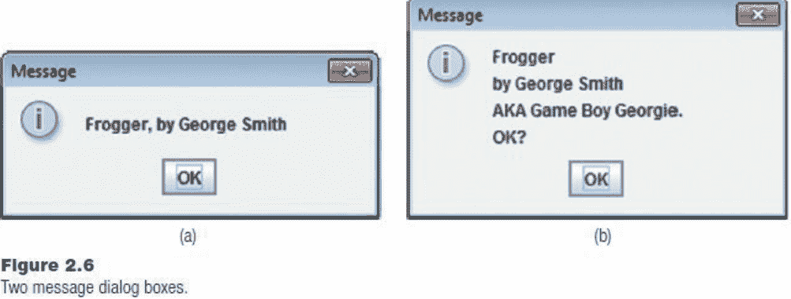

对话框显示后，程序执行将停止，直到用户点击框中显示的按钮或按下回车键。在图形应用程序中，对话框通常用于程序与其用户之间的所有通信。`JOptionPane` 类中的两个方法 `showMessageDialog` 和 `showInputDialog` 分别用于显示消息（输出）和输入对话框。

### 2.7.1 消息对话框

`showMessageDialog` 方法是一个静态方法，正如表 2.4 所示的 `Math` 类的方法及其 `random` 方法。正如我们在第 3 章中中学到的，并不是所有方法都是静态方法。调用静态方法时，我们必须在方法名之前加上类名并在后跟一个点。`showMessageDialog` 方法和 `Math` 类的 `pow` 方法还有另一个共同点：它们都是在方法名后的括号内编写了两个参数。对于 `pow` 方法，我们学到这些数字是底数以及要对其计算的幂。

在 `showMessageDialog` 的情况下，第一个参数 `null` 是窗口。

```java
JOptionPane.showMessageDialog(null, "Frogger, by Smith");
```

这会产生图 2.6(a) 所示的窗口。第二个参数字符串是显示在控制台上的内容。正如我们所学的，字符串可以是字符串和数值变量的组合。在控制台输出时，除非包含了换行符（`\n`），否则它们将在同一行。例如

```java
JOptionPane.showMessageDialog(null, "Frogger,\nby Smith," + "\nAKA Game Boyie.");
```

这会产生图 2.6(b)。这些特性在一种非常常用的对话框用法中有用：显示游戏启动屏。游戏启动屏用于描述游戏、目标以及玩家控制方式。通常，游戏名称及其创作者（例如，“Created by Game Boyie”）也会包含在内。

### 2.7.2 输入对话框

输入对话框通过静态方法 `showInputDialog` 显示，用于从程序用户处获取输入（图 2.7）。它是一个参数，方法将其显示为提示。提示下方显示一个文本框，用户在其中输入。框包含标记为“OK”和“Cancel”的两个按钮。发送给方法的字符串可以是字符串和变量的组合，输入框的宽度和高度会根据字符串及其嵌入的换行符进行调整。图 2.7 显示了语句生成的输入对话框


**图 2.7** 用户输入前的输入对话框

```java
String s = JOptionPane.showInputDialog("Frogger has five difficulty levels": + 
"\n1 is the easiest," +
"\n5 is the most difficult," +
"\nEnter your level");
```

## 2.7.3 解析字符串为数字

大多数人同意字符串“one hundred seventy-six”与数字 176 之间存在本质区别。对于一点，我们不会尝试将字符串“one hundred seventy-six”与字符串“ten”相加得到“one hundred six”。相反，当我们读到问题“one hundred seventy-six 和 ten 的和是多少？”时，我们会先将数字转换为数值表示 176 和 10，然后进行加法。在计算机科学中，字符串与数值之间的区别比这更深层，因为如果我们相加“176”和“10”，我们仍然需要将这两个字符串转换为数值表示后再进行加法。

### 提示 算术表达式中的操作数不能是字符串。

00110001 00101111 00110110 10110000

'1' '7' '6'

### 表 2.5 数值包装类及其解析方法

| 将字符串转换为数值类型 | 使用的静态方法 | 位于包装类中 |
|--- | :--- | :--- |
| `byte` | `parseByte` | `Byte` |
| `short` | `parseShort` | `Short` |
| `int` | `parseInt` | `Integer` |
| `long` | `parseLong` | `Long` |
| `float` | `parseFloat` | `Float` |
| `double` | `parseDouble` | `Double` |

要将字符串 "176" 转换为其数值表示，你的代码应为：

`int numericValue = Integer.parseInt("176");`

要将字符串转换为数值，你的代码应为：

`double numericValue = Double.parseDouble(s);`

通常情况下，通过输入对话框接受用户输入的语句，以及返回的字符串转换为数值的语句，是紧挨编写的。

```java
String s = JOptionPane.showInputDialog("Enter your age");
int age = Integer.parseInt(s);
s = JOptionPane.showInputDialog("Enter your weight");
double weight = Double.parseDouble(s);
```

如果传递给包装类的字符串包含数字以外的任何字符（即字符 '0', '1', \dots, '9'），就会发生运行时错误 `NumberFormatException`，程序将终止。如果向方法传递空字符串（用户在输入对话框中点击了“确定”但未输入内容），或向方法传递空字符串（用户点击了“取消”但未输入内容），也会发生相同的运行时错误。我们将在第 4 章通过让程序得出一个更丰富的结论，学习如何处理这些运行时错误，并在第 5 章“重复语句：循环”中学习如何允许用户修正错误输入。

> 注意：运行时错误是在程序执行期间发生的错误。

图 2.8 所示的应用程序根据给定半径计算圆的面积，同时也根据给定面积计算圆的半径。程序的输入（半径为 10，面积为 200）以及相应的输出如图 2.9 所示。该程序演示了赋值语句的使用、字符串解析为数值、执行计算、`Math` 类的使用以及对话框 I/O 操作。

```java
import javax.swing.JOptionPane;
public class AssignmentMathAndDialogIO {
    public static void main(String[] args) {
        String s;
        double area
```

图 2.8


图 2.8 的第 1 行是一个 import 语句。import 语句使 API 类及其包含的常量和方法对我们的程序可用。在这种情况下，包含执行对话框输入和输出方法的 `JOptionPane` 类被导入到程序中。这些方法被用于输出程序的启动界面（第 10–11 行）以及输入圆的半径（第 12–13 行）。发送到这些方法的字符串中的换行转义序列 (`\n`) 会在启动界面上产生两行的消息，并产生两行的输入提示，如图 2.9 顶部所示。

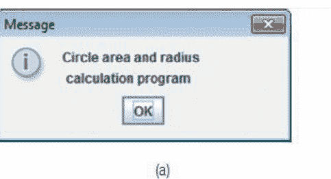

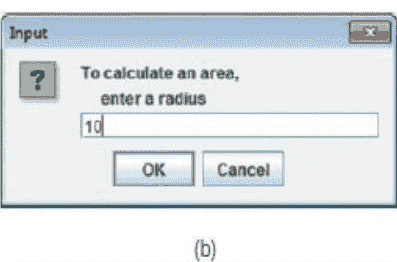

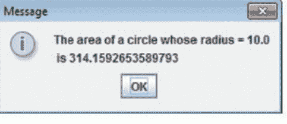

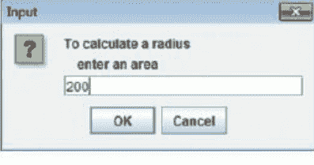

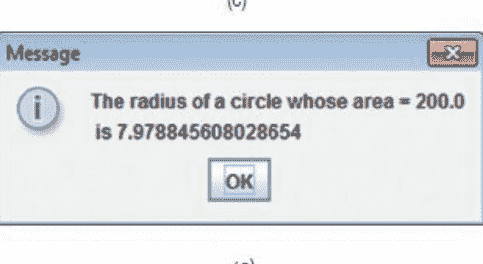

**图 2.8**

图 2.8 的第 1 行是一个 import 语句。import 语句使 API 类及其包含的常量和方法对我们的程序可用。在这种情况下，包含执行对话框输入和输出方法的 `JOptionPane` 类被导入到程序中。这些方法被用于输出程序的启动界面（第 10–11 行）以及输入圆的半径（第 12–13 行）。发送到这些方法的字符串中的换行转义序列 (`\n`) 会在启动界面上产生两行的消息，并产生两行的输入提示，如图 2.9 顶部所示。

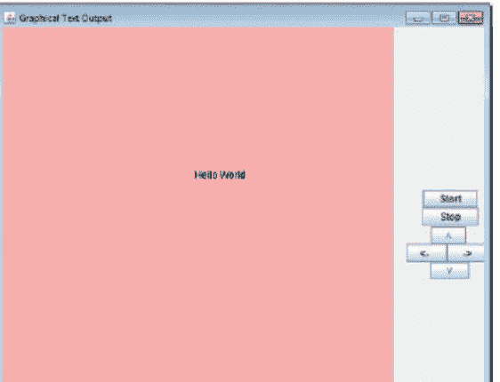

**图 2.11**

由应用程序 GraphicalTextOutput 输出的内容。

这个答案揭示了为什么 `draw` 方法被称为回调方法（call back method）。`main` 方法中的第 11 行调用了 `showGameBoard` 方法，该方法请求游戏环境显示游戏窗口。在游戏环境显示游戏窗口之前，它会调用（或回调）应用程序中编写的 `draw` 方法，从而导致其执行。当 `draw` 方法结束时，游戏环境完成完成 `showGameBoard` 方法请求的游戏窗口显示。因此，应用程序调用游戏环境显示游戏板窗口（第 11 行），而游戏环境在窗口显示之前回调应用程序的 `draw` 方法以在游戏板上进行绘图，其执行顺序为：`main` 方法中的第 11 行、`showGameBoard` 方法的代码、游戏环境中某个方法开头的代码、`draw` 回调（第 14-18 行），最后是游戏环境中的剩余代码。

事实上，每个程序的窗口都必须重新绘制（例如，窗口被最小化后点击状态栏上的窗口图标），游戏环境的代码会调用 `draw` 方法重新在游戏板上进行绘图。可以通过添加以下语句轻松验证这一点：

```
System.out.println("the draw method was invoked");
```

到 `draw` 回调方法。每当 `draw` 方法被调用，我们会在系统控制台上看到输出。

> 即使包含程序入口的 `main` 方法结束了执行，图形化程序也会继续执行，直到程序的图形化窗口（例如游戏板窗口）关闭。

### 2.8.3 setFontSize 方法：初探

与 `drawString` 类似，`setFont` 方法是 API `Graphics` 类的一部分（成员）。它用于更改字体类型、样式和大小。图 2.11 中的输出将使用默认字体值。一旦更改，所有后续的图形文本输出将使用新的（或当前的）字体类型、样式和大小，直到再次更改。该方法传递一个参数。以下添加到 `draw` 方法中的代码将字体类型更改为 Arial，样式设置为**粗体斜体**，字体大小设置为 16 磅，然后输出文本 "Font was Changed"。`setFont` 方法参数的语法将在第 3 章解释。

```java
g.setFont(new Font("Arial", Font.BOLD + Font.ITALIC, 16));
g.drawString("The Font was Changed", 150, 300);
```

## 2.9 计数算法

计数是大多数程序都会执行的操作，被认为是计算机科学中的一种基础算法。例如，在游戏程序中，它用于计算游戏剩余秒数或游戏开始以来的秒数。在第一的情况下，时间从一个指定值开始递减到零；在第二种情况下，时间从零开始递增。在这两种情况下，游戏时间通常显示在游戏板上。在这里，我们将讨论计数算法，以及我们将学习如何在游戏环境的回调方法 `timer1` 内部实现秒数计数。

我们大多数人通过背诵从 1 开始的整数开始学习计数的。父母可能会对我们说，比如：“一、二、三”。我们大多数人在第一次尝试时听到的是“三、四”，或者“一、二、四”，或是某些错误的序列。通过重复，我们记住了序列，并通过识别出每个新元素都是“多一个”来扩展它。

在我们认知发展的路径某处，我们发现了计数算法。为了支持这一点，我们从未背过从 1 到 1,242,589 的整数。然而，如果我们使用整数序列来询问，是因为我们使用计数算法来确定序列。以下是通用的计数算法，可以使用任何增量进行向前或向后计数：

```java
int count = aBeginningValue;
// 重复下一个语句直到 count 达到结束值
count = count + aCountingIncrement;
```

例如，从 1 到 10 向上计数，我们编写代码：

```java
int count = 1;
// 重复下一个语句直到 count 达到 10
count = count + 1; // 1 变成 2, 2 变成 3, 3 变成 4, ...
```

从 1165 到 875 递减 5 向下计数，我们编写代码：

```java
int count = 1165;
// 重复下一个语句直到 count 达到 875
count = count - 5; // 1165 变成 1160, 1160 变成 1155, ...
```

重复语句是第 5 章的主题，因此我们将在该章重新回顾计数算法。然而，如果我们想在游戏程序中计数，可以将计数算法的第二行通过放置在名为 `timer1` 的回调方法内部来重复。该方法由游戏环境每秒调用一次，每次调用都会执行一次语句。

### 2.9.1 计数应用：显示游戏时间

游戏环境有三个名为 `timer1`、`timer2` 和 `timer3` 的定时回调方法。它们的签名如下：

```java
public void timer1()
public void timer2()
public void timer3()
```

```java
import java.text.DecimalFormat;

public class BasicNumericFormatting {
    public static void main(String[] args) {
        double speedOfLight = 299792458.7153;
        int population = 1097603176;

        DecimalFormat df = new DecimalFormat("$#,###.##");
        System.out.println(df.format(speedOfLight));
        System.out.println(df.format(population));
    }
}
```

**图 2.14**

BasicNumericFormatting 应用。

该静态方法在第 12 行和第 13 行调用，使用了在第 10 行定义的 `DecimalFormat` 对象。要执行的格式化与该格式对象关联，并指定为在第 10 行末尾括号内的字符串字面量。字符串字面量 `####,#.##` 表示小数点左侧每三位数字会出现一个逗号，且实数（非整数）将以两位精度输出。格式化中使用的精度级别可以通过在第 10 行小数点右侧添加或删除井号符号来更改。

程序产生的输出如图 2.15 所示。如输出所示，实数总是会被四舍五入（299792458.7153 输出为 299792458.72），且整数输出不包含小数点。

```
299,792,458.72
1,097,603,176
```

**图 2.15**

BasicNumericFormatting 应用产生的输出。

## 2.11 本章总结

本章介绍了 Java 程序的基本组件、数学计算和输出。变量被声明以用于在程序执行期间存储数据。基本类型变量存储一个数据值，而引用变量存储包含数据的对象的内存地址。还必须声明数据的类型（例如，字符或整数）。良好的编码风格要求变量名应具有意义，且在语法上是正确的。具有意义的变量名指示了数据所代表的内容。它们以字母开头，且不能包含空格。

`print` 和 `println` 方法用于将字符串输出到附加 `System.out` 对象的控制台窗口。转义序列允许在输出语句中使用具有特殊含义的字符。连接运算符将数据值和字符串连接成单一输出字符串。

`String` 对象是引用变量，存储指向（或引用）实际字符串的内存地址。字符串可以使用单行或双行语法创建并初始化。未初始化字符串的默认值为 `null`。字符串必须转换为数值才能进行数学运算，API 中有一组类被称为“包装器类”（`wrapper classes`），它们包含了用于执行此类转换的静态方法。

Java 与大多数编程语言一样，提供了执行基本算术计算的能力，并提供了额外的功能（包括 Java `Math` 类）来执行更复杂的计算。Java 使用算术表达式执行算术计算。括号内的算术表达式部分根据优先级规则首先求值，并从左到右求值。高优先运算符先计算。两个优先级相同的整数相除始终得到一个截断的整数值，而 `mod` 运算符用于确定整数除法的余数。

使用赋值运算符将值赋予变量。通常，赋值给变量的值的类型应该与变量的类型匹配。程序提供了类型转换和提升，并用于混合模式表达式，以确保变量类型兼容且不丢失精度。

对话框是与 Java 程序用户通信的图形化方式，并提供了基于控制台输入输出的替代方案。`drawString` 方法可用于向图形窗口输出文本，而 `setFont` 方法可更改默认字体、样式和大小。计数算法用于跟踪游戏程序中经过的秒数。第 3 章将扩展对象、类和方法的概念及其在创建游戏程序中的应用。

最后，引入了 `DecimalFormat` 类，提供了格式化数值输出的方法以提高其可读性。

### 知识练习

1. 判断对错：

   - a) 存储在变量中的数据类型可以随着程序的执行而改变。
   - b) 变量在在使用之前必须先在程序中声明。
   - c) 变量在声明时必须初始化。
   - d) 以大写字母开头变量名在语法上是错误的。
   - e) 变量名可以使用空格来提高可读性。

2. Java 应用中执行的是哪条陈述？

3. 什么是变量？列出变量类型以及每种类型存储的信息。

4. 以下哪项不是基本数据类型？

   - a) boolean
   - b) char
   - c) String
   - d) int

5. 为声明为以下类型的变量提供默认初始值：

   - a) boolean
   - b) char
   - c) double
   - d) int

6. 编写一个结构良好的声明语句，声明可以存储内容的变量：

   - a) 初始化为 32 的 Maggie 的年龄
   - b) 初始化为字母 'R' 的 Ryan 的名字首字母
   - c) 一个玉米饼的价格
   - d) 数字 21,234,096,464
   - e) 正在下雪这一事实

7. 程序中编码的数值字面量是表示为 `float` 还是 `double`？请解释。

8. 判断以下变量是否符合语法。对于不符合的，说明原因。

   - a)
   - b)
   - c)
   - d)
   - f)
   - g)

9. 编写代码向系统输出两行。第一行包含你的名字，第二行包含城市，使用：

   - a)
   - b)

10. 编写一个结构良好的声明语句，声明一个 `String` 对象并并为：

    - a)
    - b)

11. 编写代码向控制台输出两行。第一行包含你的名字，第二行包含出生日期，使用：

    - a)
    - b)

12. 求值以下表达式：

    - a) 17 - 5 * 2
    - b) 31 - 7 * 2
    - c) (48 + 12) / 12
    - d) 21 - 9 + 18

13. 编写代码以：

    - a) 输出“做了一个梦。”
    - b) 计算 45.67 的平方根
    - d) 计算 34.7 的 5 次方

14. 编写变量声明以平均值，并使用赋值语句存储 55、57 和 60 英里的限速。

15. 给赋值语句存储 `double` 类型变量 `bankBalance` 的整数部分。

16. 判断对错：

    - a) 使用对话框执行输入输出时，程序必须包含 `import` 语句。
    - b) 消息对话框可用于获取用户输入。
    - c) 输入对话框总是返回字符串。
    - d) 当用户点击“确定”但未进行输入时，返回 `null`。
    - e) 对话框会根据发送给它们的字符串参数自动调整大小。

17. 编写代码向消息对话框输出两行。第一行包含你的姓，第二行包含格式为“我的生日是：dd\mm\yyyy”的出生日期（是的，那是斜杠）。

18. 编写代码允许用户使用输入对话框输入账户余额。包含一个结构良好的用户提示。

19. 思考代码输出游戏的名称及其创建者、游戏的任务（目标），以及如何通过大小合适的的消息对话框控制游戏组件。

20. 编写代码声明一个 `double` 变量 `deposit`，并将字符串 `sDeposit` 中的内容解析给它。

21. 编写代码声明一个整数变量 `speedLimit`，并将字符串 `sSpeedLimit` 中的内容解析给它。

22. 编写一个常量声明，存储一周的天数。

23. 使用复合赋值运算符将内存单元 `sum` 设置为其当前内容的一半。

### 编程练习

- 1. 编写一个 Java 应用程序，在系统控制台上输出你的名字，紧接着输出你居住的城市。
- 2. 编写一个程序来计算五个测验成绩的平均值：100, 97, 67, 85 和 79。将这些成绩和平均值输出到系统控制台。输出应有良好的注释，一行显示测试成绩，另一行显示平均值。
- 3. 编写一个程序接受一个角度（以度为单位输入）和一个实数。然后输出该角度的正弦、余弦和正切值。接着输出输入数字的立方和平方根。输出应占据几行，并发送到系统控制台和消息对话框。输入提示应设计得合理，输出应有良好的注释。
- 4. 重复编程练习 3，但将信息输出到系统控制台和游戏板的中心。游戏板输出使用 20 磅*斜体 Arial 字体*。
- 5. 编写一个程序，要求用户输入两个实数（由你选择）的乘积，输入保留一位小数。输入乘积后，输出用户的输入和正确的乘积，均保留一位小数。输出应占据几行，并发送到系统控制台和消息对话框。输入提示应设计得合理，输出应有良好的注释。
- 6. 编写一个程序，要求用户输入两个实数（由你选择）的乘积。输入乘积后，将正确答案以及用户输入乘积花费的秒数输出到游戏板中心和系统控制台。游戏板输出使用 20 磅*斜体 Arial 字体*。输出应分行并有良好的注释。
- 7. 重复编程练习 6，但输出数字时小数点左侧每三位使用一个逗号，并保留一位小数。

### 注脚

1. 第 7 版 API 文档的 URL 为：http://docs.oracle.com/javase/7/docs/api/ 名称为：Java Platform, Standard Edition 7 API Specification。
2. http://www.randomnumbers.info/content/Random.htm

# 第 3 章

## 方法、类与对象：初探


- 3.1 我们编写的方法
- 3.2 信息传递
- 3.3 API 图形类
- 3.4 面向对象编程
- 3.5 定义类和创建对象
- 3.6 为类添加方法
- 3.7 重载构造函数
- 3.8 在工作方法之间传递对象
- 3.9 章总结

**在本章中**

本章扩展了上一节讨论的方法、类和对象的概念，使我们能够设计并实现自己的类以及其中包含的方法。

这些概念通过允许我们将一个大程序分成较小的类、分别开发这些类并将其集成到更大的程序中，促进了程序的开发。一旦编写，这些类也可以像 API 类一样用于其他程序。本章将引入几种设计工具，使类及其定义的对象的规范变得方法化。理解本章的内容是学习第 7 章和第 8 章中讨论的高级 OOP 话题的基础。

成功编写有返回值和 void 方法后，你应该：

- 能够编写方法
- 理解如何在方法之间共享原始类型信息和对象
- 理解值参数的概念
- 能够阅读统一建模语言 (UML) 图并用它来规范类
- 理解如何设计和规范图形及非图形对象
- 能够识别、编写和使用大多数类包含的一组方法
- 理解公有和私有数据成员及方法的概念和用法
- 能够使用类的方法设计、构造、修改和访问对象
- 使用 `Graphics` 类的方法绘制线条、矩形、圆形
- 获得学习第 7 章和第 8 章的基础技能

### 3.1 我们编写的方法

在第 2 章中，我们熟悉了 Java 应用程序接口中提供的几个方法。例如，`println` 和 `printf` 输出到系统控制台，`query` 和 `sort` 执行计算，而 `drawString` 和 `setFont` 将文本输出到程序窗口。这些方法位于 API 中，所有 Java 程序员都可用，它们的使用加速了程序开发过程，因为只有一名程序员（API 程序员）需要发现它们的算法并编写、测试和调试代码。而我们其他人通过将它们导入程序并编写单行调用语句来使用这些方法。由于软件开发的成本是支付给程序员的工资，使用预定义方法也让软件变得负担得起。


> 编写方法的动机

扩展了我们解决问题的能力：人类擅长解决问题，但不擅长解决大问题

> 注意

缩短开发时间：方法可以由编程团队的多个成员并行开发

降低成本：方法可以这样编写，以便在任何使用单行调用语句的程序中使用

### 3.1.1 方法的语法

在 Java 中，我们编写的所有方法都必须是类的一部分。方法的语法如下，必须在类内部编码：

```java
return-type methodName(parameter-list) {
    // 方法体
}
```

`return-type` 是方法返回给调用者的值的类型。如果方法不返回值，则使用 `void`。`methodName` 是方法的标识符，`parameter-list` 是方法接受的参数列表。每个参数由一个类型和一个名称组成，多个参数之间用逗号分隔。

例如，一个相加两个整数并返回结果的方法可以是：

```java
int add(int a, int b) {
    return a + b;
}
```

一个打印消息且不返回值的方法将：

```java
void printMessage(String message) {
    System.out.println(message);
}
```

通过方法名后跟括号中的参数从另一个方法中调用该方法：

```java
int result = add(5, 20);
printMessage("The sum is: " + result);
```

第 5 行使用了静态方法（`static method`）。在这里，调用语句以编写方法的类名开头，如下：

`AVoidMethodApp.outputNewspaperName();`

我们使用这个 `static` 关键字来调用在 `Math` 类中定义的 `pow` 和 `sqrt` 静态方法。

```java
double ans = Math.pow(3.0, 2.0);
double route = Math.sqrt(9.0);
```

由于这两个方法并不是在通常调用的同一个类中定义的，因此调用语句中必须包含类名。唯一的例外是使用静态导入（`static import`）语句。当这两种语法都有效时，较短的语法使程序更具可读性，因此更受青睐。

程序的执行序列从方法的第 5 行开始。该调用语句导致 `outputNewspaperName` 方法代码块中的代码执行（第 12–14 行），产生第一行输出（图 3.2）。然后执行 `main` 方法的第 6 行，产生第二行输出。第 7 行导致 `outputNewspaperName` 方法第二次执行。最后，执行第 8 行，产生第三行输出，即最后一行输出。

> 注意：方法执行后，下一个要执行的语句是紧邻调用该方法的语句之后的语句。

## 3.2 信息传递

为了让方法能够正常工作，在调用它时必须向其传递信息，并且某些方法必须向调用语句返回一条信息。考虑 `Math` 类中的非空类型静态方法 `pow`。当它被调用时，一个数字 (n) 和一个幂 (p) 被传递给它，该方法返回计算结果：$n^p$。图 3.3 的左侧描述了 `pow` 方法的调用者（左上）与方法（左下）之间的这种信息共享。图片的右侧泛化了调用者（通常称为客户端/client）与为客户端执行“工作”的方法（通常称为工作方法/worker method）之间共享信息的概念。例如，`pow` 的工作是计算给定数字 (n) 的 (p) 次方。

| 调用者 | 数字, n |
| --- | --- |
| 调用者 | 指数, p |
| pow | |
| 参数 1 | |
| 调用者 (客户端) | 2 |
| n | |
| | 值（非空方法） | 方法 (工作者) : 2 |
| 参数 1 | 任意 (工作) 方法 |

**图 3.3** Math 类的 pow 方法：方法与其调用者之间的信息共享。

如右图 3.3 右侧所示，从调用处可以向工作方法发送无限数量的信息，但从工作方法只能向客户端返回一条信息。我们称客户端发送了包含共享信息的参数列表，而工作方法在它的参数列表中接收共享信息（这两个列表可以其中一个或两者都为空）。

> 方法返回的信息不能超过一条。

### 3.2.1 参数 (Parameters) 与参数 (Arguments)

如果方法要接收客户端传递给它的信息，那么它的签名（`signature`）必须包含一个参数列表。参数列表编码在方法签名的左右括号内。列表中的参数之间用逗号分隔，每个参数由一个变量名及其前面的类型组成。例如，一个工作内容是输出人员年龄和体重的方法签名，其参数列表中将包含一个 `int` 和一个 `double` 参数。

```java
static void outputAgeAndWeight(int age, double weight) { ... }
```

每个参数接收由客户端代码调用语句发送给它的其中一条信息，且参数的类型必须与发送给它的信息类型匹配。调用 `outputAgeAndWeight` 方法的客户端语句将在参数列表中包含两个参数。

`outputAgeAndWeight(myAge, myWeight);`

该语句将 `myAge` 和 `myWeight` 的内容传递给方法。参数（Arguments），即要与工作方法共享的信息可以是客户端代码中先定义的变量（例如 `myAge`, `myWeight`），也可以字符串或基本类型字面量。

如果参数和方法的顺序、数量和类型不匹配，大多数 IDE 都会识别出这种不匹配。如果编译器没有识别出错误，方法将会被调用；Java 运行时将抛出 `IllegalArgumentException` 并终止程序执行。

> 注意：方法调用语句中参数的顺序、数量和类型必须与方法签名中参数的顺序、数量和类型匹配。

每次调用方法时，参数列表中的变量都会被分配并与调用处的参数列表配对（第一个参数对应第一个参数，第二个参数对应第二个参数，依此类推），并将每个参数中存储的值复制到配对的参数中。对于语句

`outputAgeAndWeight(myAge, myWeight);`

参数 `myAge` 中的值被复制到 `outputAgeAndWeight` 方法的 `age` 参数中，参数 `myWeight` 中包含的值被复制到 `weight` 参数中。这种信息传递方式被称为值传递（`passing by value`），参数被称为值参数，因为参数包含的值被复制到了参数中。一旦参数分配完毕且信息传输完成，代码就会执行。

### 3.2.2 值参数的作用域与副作用

在 Java 中，在参数和变量之间（即客户端代码与工作者方法代码之间）传递信息的唯一方法是通过值参数，因此，理解图 3.4 所示的值内存模型的限制及其影响至关重要。如图所示，客户端代码有两个可以访问的变量 `myAge` 和 `myWeight`，而方法有两个可以访问的变量 `age` 和 `weight`。客户端代码无法访问变量 `age` 和 `weight`，而工作者方法无法访问变量 `myAge` 和 `myWeight`。

在编程语言术语中，我们说工作者方法的 `age` 和 `weight` 定义在其代码的作用域内，而变量 `myAge` 和 `myWeight` 则在它的作用域之外。Java 语句只能访问其作用域内的变量。

#### 定义

变量的作用域是程序中定义它并因此可以对其访问的部分。

在方法调用中将参数名称命名与方法签名中声明的参数名相同在语法上是正确的。例如，`main` 方法和工作者方法参数列表中声明的变量名都可以命名为 `myAge` 和 `myWeight`。

```java
public static void main(String[] args) {
    int myAge = 23;
    double myWeight = 185.4;

    outputAgeAndWeight(myAge, myWeight);
}

static void outputAgeAndWeight(int myAge, double myWeight) {
    System.out.println(" " + myAge + " " + myWeight);
}
```

如前所述，这种方法的编码方式仍然会在图 3.4 的右下侧为方法的参数分配两个内存单元，但它们的名称现在将是 `myAge` 和 `myWeight`。现在，写在工作者方法代码中的语句

`myAge = myAge + 1;`

将不会导致翻译错误，因为在它的作用域内**有**名为 `myAge` 的变量。方法代码将访问其内存单元 `myAge` 的内容，该变量的内容将被更改为 24。当方法结束且执行返回到客户端代码时，客户端代码内存单元 `myAge` 的内容将保持不变。它仍然包含值 23。

通常情况下，这是一好事，因为防止了方法代码更改客户端数据的意外副作用。防止这种副作用确保了在方法调用之前存储在客户端代码变量中的值与方法执行完成后存储在这些变量中的值相同。但在某些情况下，这并不是我们想要的。

考虑一个名为 `swap` 的方法，客户端调用它通过以下语句交换其两个变量 `a` 和 `b` 的内容：

```java
int a = 10;
int b = 20;

swap(a, b);
System.out.println("is: " + a + " and b: " + b);
```

如果方法成功，`swap` 完成执行后产生的输出应该是 `a` 为 20，`b` 为 10。

该方法将有两个整数参数来接收要交换的值，其代码将实现交换算法。方法的代码（在调用它的 `main` 方法之前）所示：

```java
public static void main(String[] args) {
    int a = 10;
    int b = 20;

    swap(a, b);
    System.out.println("as:" + a + " and b:" + b);
}

static void swap(int a, int b) {
    int temp = a;
    a = b;
    b = temp;
}
```

遗憾的是，由于 Java 使用值参数，这种方法的编码并没有交换客户端的变量，`main` 方法中最后一个语句产生的输出是 `a` 为 10，`b` 为 20。

与值参数内存模型一致，客户端和方法各自拥有命名为 `a` 和 `b` 的独立内存单元。方法交换其内存单元 `a` 和 `b` 中包含的值，这对于客户端代码中分配的内存单元 `a` 和 `b` 的内容没有副作用。这两个单元保持不变（仍包含 10 和 20），这使得看起来工作者方法中的交换算法编写得不正确。

事实证明，使用原始类型参数编写一个交换两个客户端变量内容的的方法是不可能的，因为从设计上来说，值参数防止方法更改客户端参数的值。某些编程语言（例如 C 和 C++）通过使用另一种类型的参数——**引用参数**来解决这个问题。Java 不支持这种类型的参数，因为它可能会导致不理想的副作用。

### 3.2.3 返回值

工作者方法向调用它的方法返回一个且仅一个值。返回值的方法被称为**返回值方法**或**非空方法**，其签名中使用 `void` 关键字。该关键字被替换为方法返回的信息的类型。例如，API 类 `JOptionPane` 中的 `showInputDialog` 方法是一个返回 `String` 引用的非空方法，其签名包含类型 `String` 而不是 `void` 关键字。

方法可以返回引用变量的内容（如 `showInputDialog` 方法），也可以返回原始变量的内容。在这两种情况下，返回的值都应该被认为在方法执行完毕后，在调用该方法的语句中替换了对该方法的调用。如果需要使用该值，则将方法调用赋值给变量或在表达式中使用。例如，一个返回两个整数之和的方法可以如下使用：

```java
int result = add(5, 10);
System.out.println("The sum is: " + result);
```

### 3.2.4 类级变量

类级变量是方法之间共享信息的另一种方式。然而，共享信息的方式以及编码变量的语法与使用参数和返回语句时非常不同。

首先，与向工作者方法传递信息的参数和变量不同，为了让方法使用类级变量共享信息，这些方法必须在同一个类中编码。信息共享通过在方法代码块之外编码变量来实现。良好的编码规范要求它们在类的顶部进行编码。完成后，该变量位于类中所有方法的作用域内，以便于获取和更新该变量。

要从方法内部访问类变量，在变量名之前需要加上类名并用一个点号（就像调用静态方法时一样）。

在可能的情况下，不使用类变量的名称为方法内部声明的变量命名，是一种良好的编程习惯。首先，这降低了程序的可读性，因为如果我们没有意识到该变量已经声明，我们就会错误地认为在方法内部使用了类变量。此外，如果我们在编写方法时忽略了声明局部变量，翻译器将假设我们使用了类变量，而它不会提醒我们忽略了声明局部变量。

#### 提示

不使用类变量的名称为方法内部声明的局部变量命名，是一种良好的编程习惯。

图 3.5 展示了一个包含四个工作方法的程序，并演示了通过值参数、返回语句和类变量进行共享的用法、局部变量的使用，以及使方法具有可重用性的特性。程序的输入和程序产生的输出如图 3.6 所示。

```java
import javax.swing.JOptionPane;

public class MethodsAndParams {
    static int a = 10; // 两个类级别变量
    static int b;

    public static void main(String[] args) {
        int desiredAge, first, second, difference; // 局部变量
        desiredAge = inputInteger("You are " + a + " years old " +
                "How old do you wish we were?");
        difference = diff(desiredAge, a);
        JOptionPane.showMessageDialog(null, "Only " + difference +
                " Years to go");

        first = inputInteger("Enter the first number to swap");
        second = inputInteger("Enter the second number to swap");
        swapParameters(first, second);
        System.out.println("Swapped using parameters: " +
                JOptionPane.showMessageDialog(null, " " + first + " " + second));
    }

    // 以下代码片段似乎为原文错误排版，保留原逻辑结构
    int a = Integer.parseInt("Enter the first number to swap");
    int b = Integer.parseInt("Enter the second number to swap");
    JOptionPane.showMessageDialog(null, "Swapped using parameters: " +
            "levels: " + a + " = " + b + "");

    static int inputInteger(String prompt) {
        String input = JOptionPane.showInputDialog(prompt);
        int a = Integer.parseInt(input);
        return a;
    }

    static int diff(int desiredAge, int a) {
        int temp = a;
        a = b;
        b = temp;
        return desiredAge - a; // 推测缺失返回语句
    }

    static void swap(int a, int b) {
        int temp = a;
        a = b;
        b = temp;
    }
}
```

图 2.5

应用程序 MethodsAndParameters


(a)
(b)
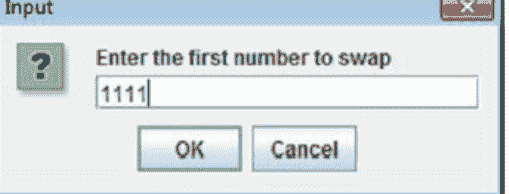
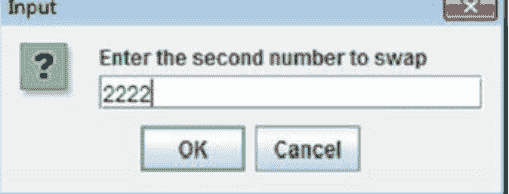
(c)
(d)
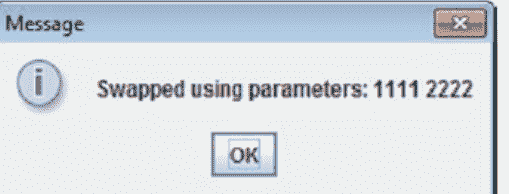
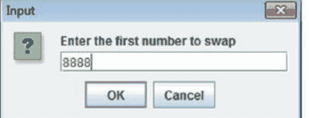
(e)
(f)
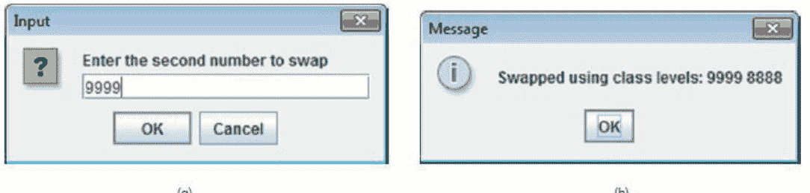

**图 3.6** 应用程序 MethodsAndParameters 产生的输入和相应输出。

第 30–36 行包含 `inputInteger` 方法的代码。它的签名（第 30 行）表明它是一个返回整数的非 void 方法和一个名为 `prompt` 的字符串参数。该方法将发送给它的字符串传递给输入对话框（第 33 行），作为程序的提示提示用户显示。返回的用户输入被解析为整数变量（第 34 行），然后解析后的值返回给调用者（第 35 行）。在签名中包含字符串参数允许调用者指定发送到输入的提示。此外，该方法传递了输入整数，释放了调用者的责任。这两个特性使其成为一个高度可重用的方法。它在程序中被调用了五次（第 11、17、18、23 和 24 行），每次调用的提示都是不同的。


两个类 `a` 和 `b` 在第 4 行和第 5 行被声明，其中 `a` 初始化为 10。类 `a` 中的值包含在第 11 行调用 `inputInteger` 的字符串提示中，并由第 33 行显示。[图 3.6a](Figure 3.6a) 在第 33 行显示。`inputInteger` 方法在第 32 行声明了它自己的局部变量 `a`，因为解析值的赋值被返回给调用者（第 35 行）。在签名中包含字符串参数允许调用者指定发送到输入的提示。此外，该方法传递了输入整数，释放了调用者的责任。这两个特性使其成为一个高度可重用的方法。它在程序中被调用了五次（第 11、17、18、23 和 24 行），每次调用的提示都是不同的。

*(注：原文存在大量重复段落和错误，译文已根据逻辑流进行清理和整合)*

### 3.2.5 Javadoc 文档

JDK 包含一个名为 Javadoc 的工具程序，它可以自动生成源代码的文档。它生成的网页格式是应用程序编程接口（见附录 G）中使用的格式。例如，Javadoc 被用于生成 2.6.4 节讨论的类的在线文档。

可以通过 IDE（包括 Netbeans 和 Eclipse）中的几次点击启动。启动时，它会扫描要文档化的源代码文件并将实体添加到网页的不同部分。这些实体包括公共类标题、方法签名和类变量。紧接实体添加到代码的多行注释中的信息（例如，在公共类签名之前）也会被添加到网页中。

多行 Javadoc 注释以 `/**` 开始，以 `*/` 结束。在这些注释中，程序员编写描述性文档，这些文档将成为实体的 Javadoc 部分，如下所示：当用于类时，导入语句位于 Javadoc 描述之前：

```java
// import statements

/**
* 类目的的描述
* @author 姓名
*/
public class ClassName
{
 // 类代码
}
```

紧接在方法签名之前的多行注释通常包含对方法功能的描述，以及对其参数和返回值的描述。在多行注释中使用 Javadoc 标签 `@param` 提供方法参数的描述，并使用 `@return` 标签提供其返回值的描述，可以将其这些描述放置在网页中专门用于参数和返回类型描述的部分。此外，还可以使用 HTML 格式标签，例如使用 `<p>` 开始新段落。

例如，为了记录图 3.5 所示 MethodsAndParms 类中第 30 行开始的 `inputInteger` 方法，可以将下所示的多行注释添加到类中，位于方法签名之前。

```java
/**
 * Acquires and parses an input integer using an input dialog box
 * @param prompt the prompt to be displayed in the dialog box
 * @return the parsed input integer
*/
public static int inputInteger(String prompt)
{
    int a;
    String sInput = JOptionPane.showInputDialog(prompt);
    a = Integer.parseInt(sInput);
    return a;
}
```

当用 Javadoc 处理此扩展后的 MethodsAndParms 类源代码时，描述 `inputInteger` 方法的类网页的两个部分将如下所示。

| 方法摘要 | |
| :--- | :--- |
| 方法和类型 | 方法和描述 |
| :--- | :--- |
| static int | inputInteger(java.lang.String prompt) 使用输入对话框获取并解析输入整数 |

```
inputInteger
public static int inputInteger(java.lang.String prompt)
使用输入对话框获取并解析输入整数
Parameters:
prompt - 显示在对话框中的提示符
Returns:
解析后的输入整数
```

除了对自动生成基于 Web 的文档有影响外，多行注释还提供了更多关于阅读类源代码的信息。其他常用的 Javadoc 标签有 `@author`、`@version`、`@throws` 和 `@exception`。Javadoc 标签集以及标准网页文档模板是由 Oracle 定义的。

## 3.3 API Graphics 类

在深入理解了方法以及方法之间与调用它们的程序代码之间共享信息的技巧后，我们将在本节中通过检查 API Graphics 类中的几个工作方法来加强这些概念。如第 2 章所述，该类包含了在 Graphics 对象上绘制文本的方法。它还包含了用于更改绘制颜色的方法，以便在 Graphics 对象上绘制线条、矩形、椭圆和圆形使用。

### 3.3.1 更改绘图颜色

在 Graphics 对象上执行的所有绘制操作都是使用当前颜色进行的。默认当前颜色是黑色。Graphics 类中的 `setColor` 方法可以更改当前绘图颜色。该方法接收一个参数，用于指定当前绘图颜色的新值。表 3.1 给出了 Color 类中十三个预定义颜色变量的名称。因为这些变量是静态变量，所以通过 `Color` 后跟一个点加名称来引用它们。例如，要将 Graphics 对象 `g` 上后续所有绘制的颜色设置为红色，我们将编写代码：

**表 3.1 Color 类中的十三个预定义颜色**

| Color | 变量名 |
| :--- | :--- |
| black | BLACK |
| blue | BLUE |
| cyan | CYAN |
| dark gray | DARK_GRAY |
| gray | GRAY |
| green | GREEN |
| light gray | LIGHT_GRAY |
| magenta | MAGENTA |
| orange | ORANGE |
| pink | PINK |
| red | RED |
| white | WHITE |
| yellow | YELLOW |

```java
g.setColor(Color.RED);
```

如前讨论过的，当游戏环境调用 `draw` 方法时，附加到游戏板的 Graphics 对象会作为参数 `g` 传递给 `draw` 方法。因此，如果在 `draw` 回调方法中编写此语句，游戏板的当前绘图颜色就会改变。

### 3.3.2 绘制线条、矩形、椭圆和圆形

图 3.7 展示了 Graphics 类中的五个方法。这些方法是非静态方法。正如它们的名称所示，第一个方法用于绘制线条，其余四个方法用于绘制矩形和椭圆。为了指定要绘制项目的位置，所有方法都传递了 `(x, y)` 坐标，其单位为像素。

```
drawLine(int x1, int y1, int x2, int y2)
使用当前颜色在点 (x1, y1) 和 (x2, y2) 之间绘制线条
```

```
drawRect(int x, int y, int width, int height)
绘制左上角为 (x, y)，宽度为 `width`，高度为 `height` 的矩形轮廓
```

```
drawOval(int x, int y, int width, int height)
绘制左上角为 (x, y)，宽度为 `width`，高度为 `height` 的椭圆轮廓
```

```
fillRect(int x, int y, int width, int height)
绘制左上角为 (x, y)，宽度为 `width`，高度为 `height` 的填充矩形
```

```
fillOval(int x, int y, int width, int height)
绘制左上角为 (x, y)，宽度为 `width`，高度为 `height` 的填充椭圆
```

#### 图 3.7 Graphics 类中的原始形状绘制方法

线条绘制方法 `drawLine` 接收两组 `(x, y)` 坐标，这些是待绘制线条的端点。例如，在 Graphics 对象 `g` 上从 (30, 50) 绘制到 (60, 80)，我们将编写：

```java
g.drawLine(30, 50, 60, 80);
```

矩形方法 `drawRect` 和 `fillRect` 分别用于绘制矩形轮廓和填充矩形。它们的两个参数指定矩形左上角的坐标，第三和第四坐标指定矩形的宽度和高度。例如，在 Graphics 对象 `g` 上绘制一个左上角为 (100, 200)、宽 50 像素、高 75 像素的矩形轮廓，我们将编写：

```java
g.drawRect(100, 200, 50, 75);
```

要将该矩形绘制为填充矩形，我们将编写：

```java
g.fillRect(100, 200, 50, 75);
```

`drawOval` 方法用于绘制椭圆轮廓，`fillOval` 方法用于绘制当前颜色的填充椭圆。这些椭圆绘制在指定的矩形内。该方法的参数与之前讨论的矩形方法相同，用于指定矩形的 (x, y) 位置及其宽度和高度。例如，在左上角为 (100, 200) 的矩形内绘制一个宽 50 像素、高 75 像素的椭圆轮廓，我们将编写：

```java
g.drawOval(100, 200, 50, 75);
```

要将该椭圆绘制为填充椭圆，我们将编写：

```java
g.fillOval(100, 200, 50, 75);
```

椭圆绘制方法可以通过将参数设置为包含椭圆的矩形的高度和宽度（相同的像素）来绘制圆形。例如，在左上角为 (100, 200) 的矩形内绘制一个直径为 50 像素的实心圆，我们将编写：

```java
g.fillOval(100, 200, 50, 50);
```

当本节中的语句在 `draw` 方法中编写时，线条和形状出现在游戏板上。正如 3.3.1 节结尾提到的，传递到 `draw` 回调方法的 Graphics 对象附加到我们的游戏板上。图 3.8 展示了应用程序 LinesAndShapes，它在游戏板上绘制了两个默认颜色（黑色）的线条、两个深灰色矩形、一个红色椭圆和一个蓝色圆形。程序的图形输出如图 3.9 所示。draw 方法内部的 16–26 行执行了绘制。

```java
import edu.scjny.gpv1.*;
import java.awt.*;

public class LinesAndShapes extends DrawableAdapter
{
    static LinesAndShapes ga = new LinesAndShapes();
    static GameBoard gb = new GameBoard(ga, "Lines and Shapes");

    public static void main(String[] args)
    {
        showGameBoard(gb);
    }
    public void draw(Graphics g) // 绘制回调方法
    {
        g.drawLine(100, 75, 260, 75); // Lines
        g.drawLine(300, 50, 400, 100); // Ovals
        
        g.setColor(Color.DARK_GRAY);
        g.drawRect(100, 170, 100, 60); // Rectangles
        g.fillRect(280, 170, 150, 40);
        
        g.setColor(Color.RED);
        g.drawOval(55, 300, 180, 80); // Ovals
        g.setColor(Color.BLUE);
        g.fillOval(280, 300, 100, 100);
    }
}
```

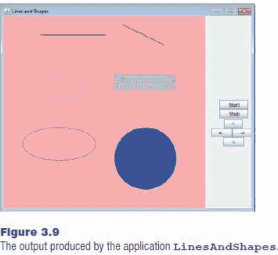

## 3.4 面向对象编程

早期的编程语言是按照过程范式设计的。在这一范式中，程序被分解为称为子程序的较小部分，而语言提供了一种机制将这些子程序组合成更大的程序的机制。在设计过程中，程序员关注的是对象的定义以及程序数据将如何存储。在这种范式中，子程序和程序数据是分离的，并被编码为两个不同的实体。

面向对象编程是一种较晚出现的编程范式。该范式试图便于开发处理处理对象（如星际舰、人类或网页）的程序。在这一范式中，程序被分解为对象所所属的各种“类”（classes）。在设计过程中，关注的是每个对象的属性（例如，星际舰的名字）以及可以在每个对象上执行的操作（例如，更改星际舰的位置）。在这种范式中，操作（子程序）和属性（数据）被收集并编码到一个名为“类”的单一实体中。

这两种范式在今天都在使用。某些解决方案使用过程范式设计得更好且更容易实现，而另一些则使用对象范式更易于设计和实现。C 是一种过程化语言，C++ 是一种既可以用于过程范式也可以对象范式的语言，而 Java 是一种面向对象的语言。如果程序处理对象，应该强烈考虑使用对象范式。

### 3.4.1 什么是类和对象？

类（class）是构造某个项目的蓝图，而对象（object）是类的特定项目或实例。例如，我们都属于“人类”这个类。该类包含了构造一个人类对象（我们称之为“人”）的遗传蓝图。根据人类蓝图，所有人都有共同的属性。例如，所有人都有有颜色的眼睛、有颜色的头发，并最终长到成人的身高。但显然，所有人（同卵双胞胎除外）都是不同的。例如，人的身高不同、眼睛颜色不同、发色也不同，对象之间之所以不同，是因为每个对象都包含了蓝图中对应属性的特定值。

> **定义**
> 
> 类是构造某个项目的蓝图，而对象是类的特定项目或实例。

玛丽的三个属性值可以是身高 63 英寸、眼睛颜色为蓝色、发色为红色。她姐姐凯特的属性值可以是身高 68 英寸、眼睛颜色为棕色、发色为黑色。现在假设这两个对象看起来不同。现在假设一直钦佩姐姐红发蓝睛的凯特，将她的头发染成了红色，并在眼睛里戴了一双蓝色的隐形眼镜。这些上色和佩戴镜片的操作会改变凯特两个属性的值，她看起来就像是高大版的玛丽。

在对象语言中，类是定义实体蓝图的机制。因此，它包含了类中的每个对象将拥有的属性（例如，身高、发色和眼睛颜色）。为了存储从蓝图构造的每个对象的这些属性的不同值，这些属性在类内部以变量的形式表示。此外，由于对象的属性值可能会改变，类包含了方法（methods，例如 `setHairColor`），这些方法可以对变量进行操作，以更改或设置它们存储的值为新值。

## 3.5 定义类和创建对象

在面向对象程序的设计过程中，程序员专注于确定程序将处理的对象、每个对象的属性以及可以对它们执行的操作。每种对象的蓝图将被编码进一种名为“类”的编程结构中，该结构将属性表示为变量，将操作表示为方法。

### 3.5.1 指定类：统一建模语言（UML）

统一建模语言（Unified Modeling Language，简称 UML）是类的图化表示。


*(注：此处原文存在文本混乱，翻译已根据逻辑重新对齐)*

在对象语言中，类是定义实体蓝图的机制。因此，它包含了类中的每个对象将拥有的属性（例如，身高、发色和眼睛颜色）。为了存储从蓝图构造的每个对象的这些属性的不同值，这些属性在类内部以变量的形式表示。此外，由于对象的属性值可能会改变，类包含了方法（例如 `setHairColor`），这些方法可以对变量进行操作，以更改或设置它们存储的值为新值。

### 3.5.2 类代码模板

就像数据成员一样，类本身可以是公共的（public）或私有的（private），尽管大多数类都是公共的。我们将在第 7 章中讨论私有类。公共类的代码如下所示：

```java
public class ClassName
{
    // 数据成员在这里编码
    // 方法在这里编码
}
```

UML 图表顶部的类名在模板的第一行中替换为 `ClassName`。类的数据成员声明和类方法代码编码在大括号内部，大括号构成了类块。表示类数据成员的变量在类方法之前编码。这不是 Java 语法规则，但被认为是良好的做法。图 3.11 中指定的类代码在图 3.12 中给出，并数据成员设置了初始值：

```java
public class Person
{
    // 数据成员
    public String eyeColor = "blue";
    public String hairColor = "red";
    public int height = 65;

    // 方法
}
```

**图 3.12** 图 3.11 中指定的 `Person` 类代码。

通常，初始值选择为数据成员的最常见值。在这种情况下，假设大多数人有蓝眼睛、红头发且身高为 65 英寸。

### 3.5.3 创建对象

在第 2.5 节中，我们检查了 `String` 类中声明对象的双行语法。例如：

```java
String firstName;

firstName = new String("John");
```

第一行创建引用变量 `firstName`，它可以存储对象的地址，初始化为默认值 `null`。第二行创建一个新的 `String` 对象，将字符串 "John" 存储其中，然后用对象的地址覆盖变量 `firstName` 中存储的 `null` 值。或者，这两行代码可以合并为一行：

```java
String firstName = new String("John");
```

当提到使用双行或单行语法创建的对象时，为了简洁起见，我们通常说“我们创建了一个名为 firstName 的字符串”，或者被要求“先输出该对象”。然而，经验丰富的程序员知道，更准确的说法是“我们创建了一个由变量 `firstName` 引用的字符串对象”，或“输出由 `firstName` 引用的对象”。在理解这一点的基础上，我们在本文后续将使用这种简短版本。


通过更改单行或双行语法中创建的类名以及通常是括号内的代码，这两种形式的语法都可以用于在任何类中声明对象。以下是使用单行语法创建两个名为 `mary` 和 `kate` 的 `Person` 对象的代码片段：

```java
Person mary = new Person();

Person kate = new Person();
```

这些语句分配的内存如图 3.13 所示。正如 `Person` 类中所定义所示（图 3.12），每个对象都包含三个相同的、被设置为初始值的变量。变量 `hairColor` 和 `eyeColor` 存储了包含初始值的字符串对象的地址。此时，Mary 和 Kate 是同生双胞胎，直到我们向类中添加了可以更改数据成员值的方法，它们才会发生变化。

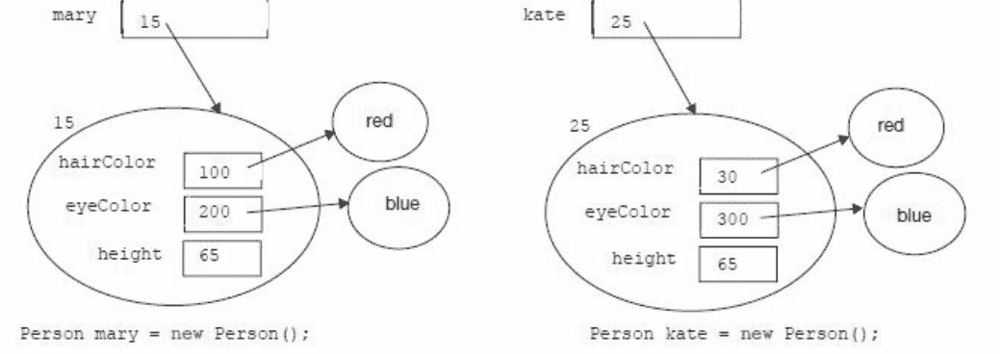

图 3.13

Person 对象以及构造它们的语句。

### 构造方法

让我们假设创建对象 `mary` 和 `kate` 的两行代码

```java
Person mary = new Person();
Person kate = new Person();
```

是编写在一个处理人类（更准确地说，是 `Person` 对象）的程序的 `main` 方法中的。这两行代码应该被视为主方法向类创建两个 `Person` 对象的请求。如果我找一个木工并要求他为我制作、构造一个结构体，我就成了他的客户。“构造”（construct）和“客户端”（client）这两个术语被用于类和对象的编程术语中。我们可以说 `Person` 类为客户端代码 `main` 了两个对象。在类中声明对象的任何代码段都被视为客户端代码（该类的客户端），而该类被认为为客户端代码构造了对象。

每个类都至少有一个构造新对象的方法。这些非 void 方法被称为构造方法，每当使用对象声明语法声明对象时，它们就会执行一次。在构造方法的执行期间，会为类的数据成员分配存储空间，将初始值存储在数据成员中，为数据成员集合分配一个内存位置（被认为是对象的位置），并将该位置返回给客户端代码。对象声明语法中包含的赋值运算符返回了对象引用变量（例如 `mary`）所存储的地址。

构造方法的名称始终与其类的名称相同，因此在声明 `mary` 对象时，`new` 关键字右侧的代码

```java
Person mary = new Person();
```

是对构造方法 `Person` 的调用，该方法没有参数，并返回新创建的 `Person` 对象的地址。

图 3.12 所示的类不包含构造方法，在这种情况下，将使用名为 `Person` 的命名方法。当类不包含构造方法时，将使用 Java 提供的构造方法来构造对象。这种构造被称为默认构造方法，它没有参数，并执行之前提到的的功能：

1. 为类的数据成员分配存储空间
2. 在数据成员中存储初始值
3. 为数据成员集合分配内存位置
4. 将位置返回给客户端代码

因为 `Person` 类不包含任何方法，所以两个 `Person` 对象 `mary` 和 `kate` 的声明如下

```java
Person mary = new Person();

Person kate = new Person();
```

将由默认构造方法创建，它将执行上述列出的四个功能。在功能 2 中，每个对象的数据成员将被设置为类成员部分（图 3.12）中指定的初始值。在 3.6.2 节中，我们将学习如何向类添加我们编写的构造方法。这些方法可以包含参数和扩展默认构造方法执行功能的代码。

### 3.5.4 显示对象

对象可以通过两种方式显示在系统控制台和图形面板上。我们可以简单地提到对象的名称，或者在方法调用内部调用对象的 `toString` 方法来显示字符串，或者我们可以在对象的类中添加一个方法，调用时输出该对象。以下语句使用第一种方法将 `Person` 对象 `mary` 显示在系统对象对象 `System.out`，然后显示在位于 (210, 100) 的名为 `g` 的 `GameBoard` 上。

```java
System.out.println(mary.toString()); // 隐式调用 toString 方法

g.draw(mary.toString(), 210, 100);
```

这种方法通常不太有趣。图 3.12 所示的 `Person` 类不包含名为 `toString` 的方法，因此调用了 API 类中的 `toString` 方法。它返回一个包含引用变量中存储的对象地址（以 `&` 前头）以及对象的类名。参考图 3.13，Mary 的对象位于地址 15，因此输出到系统控制台和游戏板的内容是 `Person@f`（f 是十六进制的 15）。第二种替代方案是在类中添加一个方法（例如 `show` 方法），调用时输出内容，这会产生更有趣且实用的输出。这种技术将在 3.6 节中讨论。

### 绘制对象

首先，我们使用第 3.3 节讨论的 API `Graphics` 类中提供的图形形状来绘制该对象的图片。该对象应该被内接在一个矩形中，如果使用了椭圆，它们也应该被内接在各自的矩形中。图 3.16 显示了一个由两个矩形和圆形组成的雪人类型对象的草图。包含椭圆的矩形以及整个对象的矩形用红色显示。

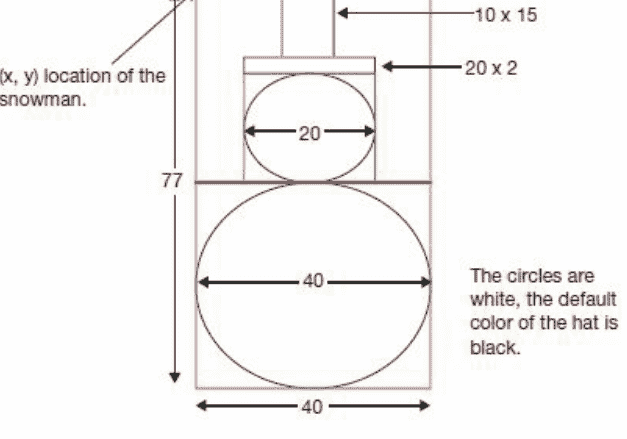

**图 3.16**

雪人游戏棋的设计。

制作游戏棋的每个基本形状的尺寸（以像素为单位）应在图中给出。例如，雪人的头部指定在图的右上角，宽度为 10 像素，高度为 15 像素。圆形的椭圆（如雪人的头部和身体）可以用一个维度来指定（例如，雪人头部的直径为 20 像素）。在构成对象的所有形状的尺寸都记录在图中之后，内接矩形的总宽度和高度被添加到图中。这个宽度简单显示在图 3.16 中内接矩形的底部和左侧。该宽度即为雪人身体的宽度 40，高度是组成雪人的形状的高度之和 77（15 + 2 + 20 + 40）。

构成对象的每个形状的颜色也应该给出，如图所示右下角部分所示。对象颜色规格中使用的默认词意味着用带有帽子的构造的雪人对象，其帽子不是黑色的。最后，在图中注明一个将用于在游戏板上定位对象的点。如图所示左上角所示，该点通常是内接矩形的左上角。

此设计过程的下一步是确定每个形状的左上角相对于游戏棋 (x, y) 位置的位置，对于我们的雪人来说，这个 (x, y) 位置就是内接矩形的左上角。这些位置以及每个形状的宽度和高度被输入到表中，该表将用于绘制每个形状的方法。该表是对象的数字表示，确定这些数据的过程被称为对象的数字化。

我们雪人对象的数字表示如表 3.2 所示。如前所述，表中的每个位置都是相对于内接雪人对象的矩形上角的 (x, y) 位置的。因此，表中给出的每个位置都以 x 或 y 开头，后面跟着到形状顶角的 x 或 y 距离。在读取表中的位置时，应该记住正 x 方向向右，正 y 方向向向下。

### 表 3.2

图 3.16 中雪人对象的数字表示

| 组件 | 形状 | 形状的 X 坐标或线的 X 坐标 | 形状的 Y 坐标或线的 Y 坐标 | 线的 X2 坐标宽度 | 线的 Y2 坐标高度 |
| --- | --- | --- | --- | --- | --- |
| 帽子 | 矩形 | x + (20-5) | y | 10 | 15 |
| 帽檐 | 矩形 | x + (20-10) | y + (15) | 20 | 2 |
| 头部 | 圆形 | x + (20-10) | y + (15+2) | 20 | 20 |
| 身体 | 圆形 | x | y + (15+2+20) | 40 | 40 |

为了确定这些估计值，我们考虑图 3.16 中每个形状的尺寸，或者我们在方形网格纸上绘制该对象，其原点是形状内接矩形的左上角。然后，形状内接矩形左上角的 x 和 y 坐标为。以下两个示例说明了通过考虑图 3.16 中的尺寸来确定每个形状 x 和 y 坐标的技术。

1. 要确定雪人帽子左上角的 x 位置（如表中第一行第三列所示为 `x + (20-5)`），则在 x 上加上内接矩形宽度的一半 (20)，因为帽子的中心位于内接矩形的中心。从 x 中减去帽子宽度的一半，是因为帽子的左侧小于内接矩形的左侧。
2. 要确定雪人头部左上角的 y 位置（如表中第三行第四列所示为 `y + (15+2)`），则加上帽子的高度 (15) 和组成雪人的形状的高度 (2)。这些尺寸是根据图 3.16 尺寸。

### SnowmanV2

```
+ x : int
+ y : int
+ hatColor: Color
```

```
+ showXYTOSC()
+ show(g: Graphics);
```

图 3.19

SnowmanV2 类的 UML 图。

该扩展类的代码见图 3.20。图 3.21 显示了一个客户端应用程序，它声明了一个 `SnowmanV2` 对象，并将对象的地址输出到系统控制台，并将对象同时输出到系统控制台和游戏板。应用程序的输出见图 3.22。

```java
import java.awt.Color;
import java.awt.Graphics; //needed for drawing
public class SnowmanV2
{
    //data members
    public int x = 5;
    public int y = 30;
    public Color hatColor = Color.BLACK;

    //member methods
    public void showXYTOSC()
{
        System.out.println("x is: " + x + "\n\ny is: " + y);
    }

    public void show(Graphics g) //g is passed to the method
{
        g.setColor(hatColor);
        g.fillRect(x + 15, y, 10, 15); //hat
        g.fillRect(x + 10, y + 15, 20, 2); //brim
        g.setColor(Color.WHITE);
        g.fillOval(x + 10, y + 17, 20, 20); //head
        g.fillOval(x, y + 37, 40, 40); //body
    }
}
```

图 3.20

SnowmanV2 类。

```java
import edu.scjny.gpv1.*;
import java.awt.Graphics;
public class ShowMethods extends DrawableAdapter
{
    static ShowMethods ga = new ShowMethods();
    static GameBoard gb = new GameBoard(ga, "Show Methods");
    static SnowmanV2 sm1 = new SnowmanV2();

    public static void main(String[] args) {
        System.out.println(sm1);
        sm1.showXYToSC();
        showGameBoard(gb);
    }

    public void draw(Graphics g) //the drawing call back method
{
        sm1.show(g);
    }
}
```

### 图 3.21 ShowMethods。

应用程序系统控制台输出

SnowmanV2@3a6727

x is: 5

y is: 30

图形输出

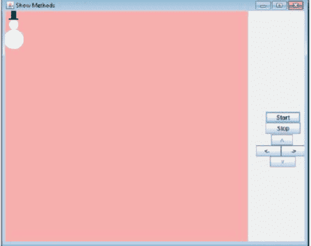

### 图 3.22

应用程序 ShowMethods 产生的控制台和图形输出。

客户端代码（图 3.21）调用第 7 行的默认构造函数来声明名为 `sm1` 的 `SnowmanV2` 对象。该声明使用了单行对象声明语法并位于类级别，因此 `main` 方法和 `draw` 回调方法可以访问该对象。第 11 行将对象的位置输出到系统控制台，第 12 行调用 `Snowman` 类的 `showXYToSC` 方法将雪人 `sm1` 显示到系统控制台。该方法位于 `Snowman` 类的第 12–16 行（图 3.20）。

应用程序的第 19 行调用 `SnowmanV2` 类的方法在游戏板上显示雪人 `sm1`。此调用被写在 `draw` 回调方法中，原因有两个：首先，`show` 方法是调用时唯一传递了 `Graphics` 对象的调用。它在第 19 行将 `Graphics` 对象作为参数传递给 `show` 方法。其次，当游戏板需要重绘时，游戏环境调用 `draw`，然后调用 `show` 来重新绘制雪人。

图 3.20 的第 18-26 行是 `show` 方法的代码。方法的签名（第 18 行）包含了类 UML 图中指定的参数 `g`（图 3.19）。它使用该参数调用 `Graphics` 类中的方法来更改当前绘制颜色（第 20 和 23 行的 `setColor`），并使用表 3.2 绘制矩形和圆形。文件中包含的所有形状位置都包含变量 `x` 和 `y`，因为它们相对于包含雪人的矩形的左上角。由于该方法没有声明名为 `x` 和 `y` 的局部变量，因此这些参数使用了类级数据成员 `x` 和 `y`。结果，图 3.21 显示了其外接矩形的左上角 (5, 30)。

## 3.6.2 构造方法和关键字 this

在第 3.5.3 节中，我们学习了构造方法是构造对象的方法，这些方法的名称必须与它们构造的对象的类相同。如果类的规范和代码中没有包含构造方法，Java 默认构造函数通过执行以下四个功能来创建对象：

1. 为类的数据成员分配存储空间
2. 为数据成员设置初始值
3. 为数据成员集合分配内存位置
4. 将位置返回给客户端代码

由于 `SnowmanV2` 类不包含构造函数，因此使用默认构造函数来创建该类的实例（在该类中）。结果，函数 2 将它们定位在 (5,30)，并且它们具有黑色的帽子。允许客户端指定新构造对象的数据成员的值，我们向该类添加了一个构造方法。它的代码模板与任何其他方法的默认构造函数相同，除了它的名称必须与类相同，且它的签名不能包含类型。当类的代码中包含构造方法时，默认构造函数不再可用用于构造该类。图 3.23 展示了 `SnowmanV3` 的 UML 图，包含一个带有参数的构造方法。当客户端使用此构造方法创建对象时，在执行默认构造函数之前，值被拷贝到参数中，然后执行构造方法代码。

SnowmanV3

```
+ x : int
+ y : int
+ hatColor: Color
```

```
+ SnowmanV3(x: int, y: int)
+ showXY()
+ show(g: Graphics)
```

图 3.23

SnowmanV3 类的 UML 图。

可能，值拷贝到构造方法的参数中。通常情况下，这些参数被客户端代码用于指定数据成员的初始值。在这种情况下，构造方法代码简单地将参数赋值给数据成员：

```java
public SnowmanV3(int x, int y)
{
    x = x;
    y = y;
}
```

当此参数构造方法的代码包含在 `SnowmanV3` 类的代码中后，客户端可以在游戏板的顶部和下部声明两个雪人：

```java
SnowmanV3 sm1 = new SnowmanV3(5, 30);

SnowmanV3 sm2 = new SnowmanV3(60, 23);
```

### 关键字

类中的方法可以包含一个与类数据成员同名的参数。当发生这种情况时，我们说参数隐藏（shadow）数据成员。例如，`SnowmanV3` 类的参数构造方法可以编写为：

```java
public SnowmanV3(int x, int y)
```

当参数名隐藏数据成员名时，构造方法内部的名称指向参数而不是数据成员。之前说过，参数应该被视为局部变量。对变量 `x` 的赋值更改的是参数存储的值，而不是类级数据成员的值。我们可以通过在数据成员名称前加上关键字 `this` 并后跟一个点（例如 `this.x`）来引用构造方法（或任何其他参数隐藏的方法）内部的数据成员。这种语法可以被看作该类的数据成员变量 `x`。使用这种语法，`SnowmanV3` 类的参数构造方法可以编写为：

```java
public SnowmanV3(int x, int y) {
    this.x = x;
    this.y = y;
}
```

这种使用隐藏的参数构造方法代码在参数列表被用于重置数据成员初始值时实际上更优。当使用隐藏时，参数与 UML 图（图 3.24）中的类数据成员的名字和类型是相同的，这给了看 UML 图的人一个提示：构造方法将重置数据成员的初始值。

| SnowmanV3 |
| :--- |
| + x: int |
| + y: int |
| + hatColor: Color |
| + SnowmanV3(x: int, y: int) |
| + showXY() |
| + show(g: Graphics) |

图 3.24

SnowmanV3 类的修改后的 UML 图。

图 3.25 是图 3.24 中 `SnowmanV3` 类的实现。图 3.26 显示了声明并显示该类两个实例的应用程序，图 3.27 是产生的游戏板的输出。


```java
import java.awt.Color;
import java.awt.Graphics; //needed for drawing shapes

public class SnowmanV3
{
    //data members
    public int x = 5;
    public int y = 30;
    public Color hatColor = Color.BLACK;

    public SnowmanV3(int x, int y) {
        this.x = x;
        this.y = y;
    }

    public void showXY() {
        System.out.println("x: " + x + " \ y: " + y);
    }

    public void show(Graphics g) { // g is passed to the method
        g.setColor(hatColor);
        g.fillRect(x - 15, y - 15, 30, 25); //brim
        g.setColor(Color.WHITE);
        g.fillOval(x - 20, y - 40, 40, 40); //head
        g.fillOval(x, y + 37, 40, 40); //body
    }
}
```

| 行号 | 代码 |
| :--- | :--- |
| 1 | `import edu.scjny.gpvl.*;` |
| 2 | `import java.awt.Graphics;` |
| 3 | |
| 4 | `public class ConstructorAndThis extends DrawableAdapter` |
| 5 | `{` |
| 6 | `static ConstructorAndThis ga = new ConstructorAndThis();` |
| 7 | `static GameBoard gb = newGameBoard(ga,"Constructors and " +` |
| 8 | `"Keyword:this");` |
| 9 | `static SnowmanV3 sm1 = new SnowmanV3(5, 30);` |
| 10 | `static SnowmanV3 sm2 = new SnowmanV3(460, 423);` |
| 11 | |
| 12 | `public static void main(String[] args)` |
| 13 | `{` |
| 14 | |
| 15 | `showGameBoard(gb);` |
| 16 | `}` |
| 17 | |
| 18 | `public void draw(Graphics g) //the drawing call back method` |
| 19 | `{` |
| 20 | `sm1.show(g);` |
| 21 | `sm2.show(g);` |
| 22 | `}` |

图 3.26 应用程序 `ConstructorAndThis`。

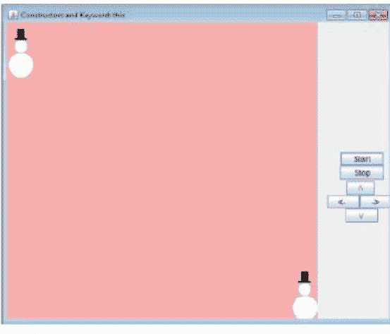

图 3.27 应用程序 `ConstructorAndThis` 的输出。

双参数构造函数编写在图 3.25 的第 12–16 行。将构造函数编写为数据成员声明后的第一个方法是一种良好的编程风格。由于构造函数的参数名称与类的数据成员名称相同，因此在代码的第 14 行和第 15 行使用了关键字 `this` 来访问类的数据成员，并将传递给参数的值赋值给它们。

客户端代码（图 3.26）在第 9 行和第 10 行分别调用了两次构造函数，从而创建了两个命名为 `sm1` 和 `sm2` 的雪人。构造函数的参数指定了雪人的初始 (x, y) 位置，构造函数将其存储在对象的数据成员中。客户端代码的第 19 行和第 20 行调用了 `show` 方法。在方法的第一次执行期间，图 3.25 第 27–31 行的变量 `x` 和 `y` 指向雪人 `sm1` 的 x 和 y 数据成员。由于这些变量包含了坐标 (5, 30)，因此这个雪人被绘制在游戏板的左上角。同样，在第二次调用 `SnowmanV3` 类的 `show` 方法时，第 26–31 行的变量 `x` 和 `y` 指向雪人 `sm2` 的 x 和 y 数据成员，它被绘制在游戏板的右下角 (460, 423)。

### 3.6.3 私有访问与 set/get 方法

为了简单起见，我们讨论过的所有类的数据成员和成员方法都是公开访问的，正如它们在 UML 图形中前面的加号 (+) 所示。另一种可用的访问类型是私有访问，用减号 (-) 表示。在本节中，我们将检查公共访问和私有访问之间的区别，并学习类的数据成员和成员方法的正常访问方式是怎样的。这将引导我们讨论以 `set` 为前缀且在大多数类中常见的编写的方法。

#### 公共访问与私有访问

对于成员方法而言，访问是调用方法的行为。对于数据成员而言，访问是获取或赋值数据成员内容的行为。为类的数据成员或方法指定私有访问不会对类中包含的方法代码设置任何限制。

```java
public class SnowmanV3 {
  private int x;
  private int y;

  public SnowmanV3(int x, int y) {
    this.x = x;
    this.y = y;
  }

  public int getX() {
    return x;
  }

  public int getY() {
    return y;
  }

  public void setX(int x) {
    this.x = x;
  }

  public void setY(int y) {
    this.y = y;
  }

  public void show(Graphics g) {
    // 绘制逻辑
  }
}
```

假设一个客户端应用程序声明了一个名为 `sm1` 的对象，以下客户端代码将对象的私有数据成员 `x` 加 1：

```java
int currentX = sm1.getX();
sm1.setX(currentX + 1);
```

图 3.29 显示了 `SnowmanV4` 类的代码。它与图 3.25 所示的 `SnowmanV3` 类代码相同，但它的三个数据成员具有私有访问权限（第 6-8 行），并且删除了控制台输出。此外，类中增加了针对私有数据成员 `x` 和 `y` 的 `set` 和 `get` 方法。这四个方法 `getX`、`setX`、`getY` 和 `setY` 的代码分别从第 27、32、37 和 42 行开始。

```java
import java.awt.*;
public class SnowmanV4
{
    //data members
    private int x = 7;
    private int y = 30;
    private Color color = Color.BLACK;

    // member methods
    public SnowmanV4(int x, int y)
    {
        this.x = x;
        this.y = y;
    }

    public void show(Graphics g) // g, is passed to the method
    {
        g.setColor(Color.BLACK);
        g.fillRect(x + 15, y, 10, 15); //hat
        g.fillRect(x + 10, y + 15, 20, 2); //brim
        g.setColor(Color.WHITE);
        g.fillOval(x + 10, y + 17, 20, 20); //head
        g.fillOval(x, y + 37, 40, 40); //body
    }

    public int getX()
    {
        return x;
    }
    
    public void setX(int newX)
    {
        x = newX;
    }
    
    public int getY()
    {
        return y;
    }
    
    public void setY(int newY)
    {
        y = newY;
    }
}
```

**图 3.29** `SnowmanV4` 类。

图 3.30 所示的应用程序 `SetGetButtonClick` 说明了如何使用 `set` 和 `get` 方法来访问私有数据成员。

```java
import edu.sjcny.gpv1.*;
import javax.swing.*;
import java.awt.Graphics;

public class SetGetButtonClick extends DrawableAdapter {
    static SetGetButtonClick ga = new SetGetButtonClick();
    static GameBoard gb = new GameBoard(ga, "SetGetButtonClick");
    static SnowmanV4 sm1 = new SnowmanV4(5, 30);
    static SnowmanV4 sm2 = new SnowmanV4(460, 423);

    public static void main(String[] args) {
        showGameBoard(gb);
    }

    public void draw(Graphics g) {
        sm1.show(g);
        sm2.show(g);
    }

    public void rightButton() { //moves sm1 one pixel right per click
        int currentX = sm1.getX();
        sm1.setX(currentX + 1);
    }
}
```

### 图 3.30 `SetGetButtonClick`。

该程序与图 3.26 所示的 `ConstructorAndThis` 应用程序相同，增加了第 14–16 行和 26–30 行。第 16 行和 29 行说明了使用 `setX` 方法更改雪人 `sm2` 的 `x` 值并进行水平方向重新定位。第 26–30 行说明了使用 `getX` 方法和 `rightButton` 回调方法在点击时将雪人 `sm1` 移动到右侧。

当程序开始时，在第 9 行和第 10 行定义的两个雪人 `sm1` 和 `sm2` 通过 `draw` 方法的第 22 和 23 行（图 3.30）显示在游戏板的左上角和右下角。然后第 14 行显示一个输入框，要求用户输入 `sm2` 的新 `x` 坐标。第 16 行调用 `setX` 方法处理 `sm2`，传递在第 15 行解析的新坐标。图 3.29 的第 34 行将值存储在 `sm2` 的 `x` 数据中。结果是，当对话框关闭后游戏板重绘时，雪人被绘制在新的 `x` 位置。图 3.31 显示雪人在游戏板中间的新位置，在用户在对话框中输入 250 之后。


**图 3.31** `SetGetButtonClick` 应用程序的输出。

第 26–30 行是游戏环境 `rightButton` 方法的实现。正如名称所示，每当点击带有右箭头的按钮时，该方法就会被调用。它使用第 28 行的 `getX` 方法获取 `sm1` 的当前坐标。然后调用 `setX` 方法将 `sm1` 的 `x` 数据设置为比其当前值大一。因为 `rightButton` 方法在每次点击右按钮时都会执行，且 `draw` 方法在执行完成后会被调用，因此 `sm1` 会向右移动一个像素。图 3.31 的部分显示了点击按钮后 `sm1` 的新位置。（注意：原文 OCR 文本有损坏/重复；已修复明显拼写错误，如将 "sml" 修复为 "sm1"）。

```java
import java.awt.*;
import javax.swing.*; // needed for dialog box input

public class SnowmanV5
{
    //data members
    private int x = 7;
    private int y = 30;
    private Color hatColor = Color.BLACK;

    //member methods
    public SnowmanV5(int x, int y)
    {
        this.x = x;
        this.y = y;
    }

    public void draw(Graphics g) // g is passed to the method
    {
        g.setColor(hatColor);
        g.fillRect(x + 15, y, 10, 15); //hat
        g.fillRoundRect(x + 10, y + 15, 20, 2); // brim
        g.setColor(Color.WHITE);
        g.fillOval(x + 10, y + 17, 20, 20); // head
        g.fillOval(x, y + 37, 40, 40); // body
    }

    public String toString()
    {
        String s = "x: " + x + 
                   ", y: " + y + 
                   ", hatColor: " + hatColor;
        return s;
    }

    public void input()
    {
        String s = JOptionPane.showInputDialog("enter the value of x");
        x = Integer.parseInt(s);
        s = JOptionPane.showInputDialog("enter the value of y");
        y = Integer.parseInt(s);

        s = JOptionPane.showInputDialog("enter hat's red intensity");
        int red = Integer.parseInt(s);
        s = JOptionPane.showInputDialog("enter hat's green intensity");
        int green = Integer.parseInt(s);
        s = JOptionPane.showInputDialog("enter hat's blue intensity");
        int blue = Integer.parseInt(s);
        hatColor = new Color(red, green, blue);
    }
}
```

**图 3.32** `SnowmanV5` 类。

```java
import edu.scjny.gpvl.*;
import java.awt.*;

public class ToStringAndInput extends DrawableAdapter {
    static ToStringAndInput ge = new ToStringAndInput();
    static GameBoard gb = new GameBoard(ge, "toStringAndInput Methods");
    
    static SnowmanV5 sm1 = new SnowmanV5(7, 30);
    static SnowmanV5 sm2 = new SnowmanV5(460, 420);

    public static void main(String[] args) {
        System.out.println("sm1\n" + sm1.toString());
        System.out.println("sm2\n" + sm2.toString());
        showGameBoard(gb);
        sm1.input();
        sm2.input();
        showGameBoard(gb);
    }

    public void draw(Graphics g) {
    }
}
```

**图 3.33** 应用程序 `ToStringAndInput`。

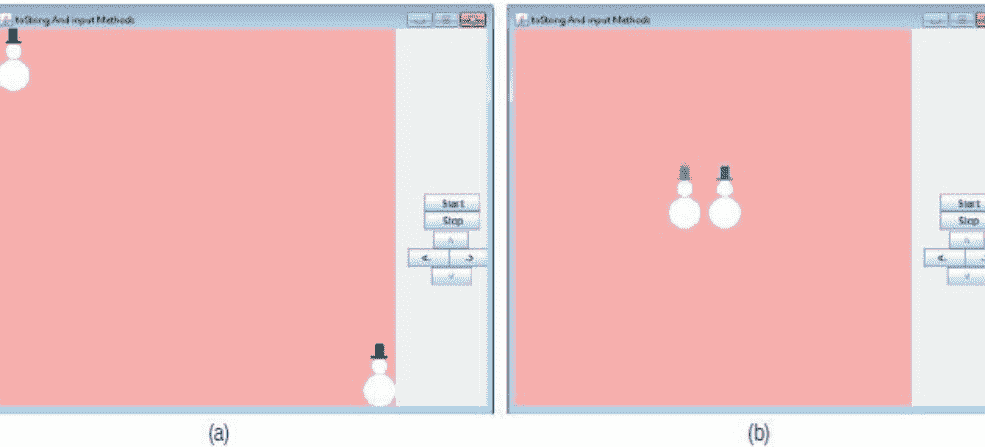

**图 3.34** 应用程序 `ToStringAndInput` 的控制台和游戏板输出。

#### 控制台输出：

```text
sm1
x is: 7
y is: 30
hatColor: java.awt.Color[r=0,g=0,b=0]

sm2
x: 460
y: 420
hatColor: java.awt.Color[r=0,g=0,b=0]
```

#### 游戏板输出：

应用程序的第 8 和第 9 行（图 3.33）声明了两个雪人 `sm1` 和 `sm2`，分别位于 (7, 30) 和 (460, 420)。`SnowmanV5` 类的 `toString` 方法在第 13 和第 14 行 `print` 方法的参数中被调用，以获取每个雪人数据成员当前值的注释版本。返回的字符串与雪人的名称连接，并输出到系统控制台（图 3.34 顶部）。


输出包含每个雪人当前颜色的描述：`java.awt.Color[r=0,g=0,b=0]`。该字符串是从 `SnowV5` 类的 `toString()` 方法隐式调用 `Object` 类的 `toString()` 方法返回的（图 3.32 的第 34 行）。输出中的 `r=0, g=0, b=0` 部分表示颜色的（红、绿、蓝）强度均为零：即默认黑色。

应用程序的第 15 行显示了游戏板，两个雪人画在它们的初始位置，并戴着黑色帽子（图 3.34a）。`SnowV5` 类的 `input()` 方法在应用程序的第 20 和第 21 行被调用（图 3.33），允许用户输入两个雪人数据成员的新值。最后，第 18 行重新绘制游戏板，两个雪人在它们的新位置被绘制，并戴着彩色的帽子，如图 3.34b 所示。这反映了用户的输入：

- `sm1` 的 (红、绿、蓝) 强度为 (200, 200)；
- `sm2` 的位置为 (250, 200)；以及其 (红、绿、蓝) 强度为 (0, 0, 255)。

## 3.7 构造方法重载

构造方法重载是一个面向对象的术语，用于描述包含多个构造方法的类。每个构造方法的代码都是不同的，这就是编写多个构造方法的动机。一个类可以包含的构造方法数量没有限制。构造方法的名称必须是类名，因此，如果类名是 `SnowV4`，那么所有构造方法都将是 `SnowV4`。

客户端可以使用构造方法语句为类分配一个对象。由于方法的名称相同，Java 知道使用哪一个构造方法的方法是检查参数的类型和数量。

考虑图 3.35 所示的 `SnowmanV6` 类。它包含了位于第 12、15 和 20 行的三个构造方法。这些方法的签名（第 12 行）没有参数，因此被称为无参数构造方法。要使用无参数构造方法，客户端的声明语句将不包含任何内容。

```java
import java.awt.Color;
import java.awt.Graphics; // needed for drawing
public class SnowmanV6
{
    // data members
    private int x = 7;
    private int y = 30;
    private Color hatColor = Color.BLACK;

    // member methods
    public SnowmanV6()
    {
    }
    public SnowmanV6(int x, int y)
    {
        this.x = x;
        this.y = y;
    }
    public SnowmanV6(int x, int y, Color hatColor)
    {
        this.x = x;
        this.y = y;
        this.hatColor = hatColor;
    }
    public void show(Graphics g) // g is passed to the method
    {
        g.setColor(hatColor);
        g.fillRect(x + 15, y, 10, 15); // hat
        g.fillRoundRect(x + 10, y + 15, 20, 2); // brim
        g.setColor(Color.WHITE);
        g.fillOval(x + 10, y + 17, 20, 20); // head
        g.fillOval(x, y + 37, 40, 40); // body
    }

    public int getX() {
        return x;
    }

    public void setX(int newX) {
        x = newX;
    }
    public int getY() {
        return y;
    }

    public void setY(int newY) {
        y = newY;
    }
}
```

图 3.35

`SnowmanV6` 类。

```java
SnowmanV6 s1 = new SnowmanV6();
```

由于构造方法的代码块为空，雪人的 `x`、`y` 和 `hatColor` 成员将保留第 7-9 行设置的默认值，当绘制雪人时，它将出现在 (7, 30) 并戴着黑色帽子。

要使用第 15 行的双参数构造方法，客户端的声明语句将包含两个整数参数：

```java
SnowmanV6 s1 = new SnowmanV6(250, 250);
```

此构造方法允许客户端指定新创建雪人的初始位置。第 17-18 行将执行，并将复制方法参数 (250) 中的值设置为对象的 `x` 和 `y` 数据成员。当绘制雪人时，它将出现在 (250, 250) 并戴着黑色帽子。

要使用第 20 行的三参数构造方法，客户端的声明语句将包含两个整数参数和一个 `Color` 对象的引用：

```java
SnowmanV6 s1 = new SnowmanV6(350, 250, Color.BLUE);
```

此构造方法允许客户端不仅指定雪人的初始位置，还可以指定其帽子颜色。第 22-24 行将执行，并将 350 和 250 的值设置为对象的 `x` 和 `y` 数据成员，并将对象的数据成员 `hatColor` 设置为蓝色。在这种情况下，当绘制雪人时，它将出现在 (350, 250)，并且由于图 3.35 的第 28 行使用对象的 `hatColor` 数据成员在绘制帽子之前设置当前颜色，它将戴着一顶蓝帽子。

尝试使用不匹配第 12、15 或 20 行任一参数列表的参数列表创建雪人将导致编译错误。例如，客户端语句

```java
SnowmanV6 sl = new SnowmanV6(350.24, 200, Color.BLUE);
```

将导致编译错误，指示翻译器找不到参数为 `double`、后接 `integer`、最后是 `Color` 对象的构造方法。

> **注意**：类中的每个构造方法必须有唯一的参数列表，且客户端对象声明语句中的参数类型和数量必须匹配这些列表之一。

应该注意的是，一旦在类中调用了构造方法，Java 提供的默认构造方法不再用于创建类的实例。因此，为了给成员声明语句中的值设置默认，必须添加无参数构造方法（例如图 3.35 的第 12-14 行）。

图 3.36 展示了应用程序 `OverloadingConstructors`，它利用图 3.35 中的三个构造方法在第 8、9 和 10 行构建了三个雪人：位于默认位置 (7, 30)、游戏板中心 (250, 250) 以及其右侧的 (350, 250) 并戴着蓝帽子。在绘制每个雪人的帽子之前，雪人类（图 3.35）的第 28 行会将当前绘制颜色设置为雪人的帽子颜色。因此，当在游戏板上（图 3.36 的第 19-21 行）在它们的初始位置绘制三个雪人时，其中一个戴着一顶蓝帽子（图 3.37）。

```java
public void draw(Graphics g) // 绘制回调方法
{
    ami.show(g);
    smi.show(g);
    sm2.show(g);
}
```

**图 3.36** 构造函数重载。

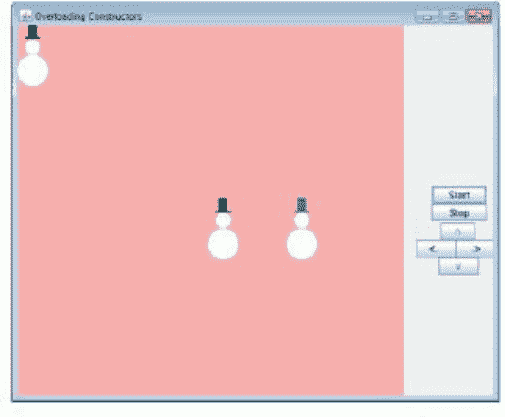

**图 3.37** 应用 `OverloadingConstructors` 的输出结果。

## 3.8 在工作方法之间传递对象

在客户端方法和工作方法之间传递基本类型信息（即存储在基本类型变量中的值）的技术和语法已第 3.2 节中讨论。该节介绍的相同技术和语法也可用于在客户端和工作方法之间传递对象。对于对象而言，传递的信息实际上是存储在引用对象的引用变量中的对象地址。可以通过参数列表向工作方法传递无限数量的对象地址，并且可以通过返回语句从工作方法返回一个对象的地址。

### 将对象传递给工作方法

表 3.3 的第一行给出了调用 `Game` 类静态方法 `add1()` 的语法，该方法传递了 `SnowmanV` 对象 `sm1` 的地址。最右列给出了方法的签名。为了对比，表的第二行给出了将整数 `age` 传递给静态方法 `add1To()` 的语法以及该方法的签名。如表所示，将对象传递给工作方法的语法是将传递基本类型值的语法中的类型替换为引用变量的类型（即对象的类名），如表最右列所示。

### 表 3.3

向工作方法传递对象和基本类型的语法

| 传递的信息 | 客户端方法的调用语句 | 在 Game 类中编写的工作方法签名 |
| :--- | :--- | :--- |
| 对象地址 | `Game.addStartX(sm)` | `static void addStartX(SnowmanV6 sm)` |
| 整数值 | `Game.addToAge(age)` | `static void addToAge(int age)` |

以下代码段是一个名为 `moveRight()` 的静态工作方法，它将传递的 `SnowmanV6` 对象的 `x` 数据成员增加 1 像素：

```java
public static void moveRight(SnowmanV6 aSnowman)
{
    int currentX = aSnowman.getX();
    aSnowman.setX(currentX + 1);
}
```

图 3.38 是图 3.30 程序的修改版本，每当点击游戏板的右箭头按钮时，雪人就会向右移动一个像素。程序中增加了 `moveRight()` 方法（第 32–37 行），它用于在每次点击右箭头时将两个雪人向右移动。该方法在第 28 和 29 行被调用，以将两个 `SnowmanV6` 对象 `sm1` 和 `sm2` 向右移动 1 像素。这些对象在第 9 和 10 行使用类的三参数构造函数创建。第一次调用 `moveRight()`（第 28 行）将 `sm1` 的位置传递给方法，第二次调用（第 29 行）将 `sm2` 的位置传递给方法。由于静态方法 `moveRight()` 与第 28 和 29 行的调用语句在同一个类中，因此在调用时不需要包含类名。

| 行号 | 代码 |
| :--- | :--- |
| 1 | `import edu.scjny.gpv1.*;` |
| 2 | `import java.javax.swing.*;` |
| 3 | `import java.awt.*;` |
| 4 | |
| 5 | `public class ObjectsAsParameters extends DrawableAdapter` |
| 6 | `{` |
| 7 | `static ObjectsAsParameters ga = new ObjectsAsParameters();` |
| 8 | `static GameBoard gb = new GameBoard(ga, "As Parameters");` |
| 9 | `static SnowmanV6 sm1 = new SnowmanV6(5, 40, Color.RED);` |
| 10 | `static SnowmanV6 sm2 = new SnowmanV6(40, 423, Color.BLUE);` |
| 11 | |
| 12 | `public static void main(String[] args)` |
| 13 | `{` |
| 14 | `String s = JOptionPane.showInputDialog("sm2's new location?");` |
| 15 | `int newX = Integer.parseInt(s);` |
| 16 | `sm2.setX(newX);` |
| 17 | `showGameBoard(gb);` |
| 18 | `}` |
| 19 | |
| 20 | `public static void draw(Graphics g) // 绘制回调方法` |
| 21 | `{` |
| 22 | `sm1.show(g);` |
| 23 | `sm2.show(g);` |
| 24 | `}` |
| 25 | |
| 26 | `public void rightButton() // 每次移动 sm1 & sm2 向右 1 像素` |
| 27 | `{` |
| 28 | `moveRight(sm1);` |
| 29 | `moveRight(sm2);` |
| 30 | `}` |
| 31 | |
| 32 | `public void moveRight(SnowmanV6 snowman)` |
| 33 | `{` |
| 34 | `int currentX = snowman.getX();` |
| 35 | `currentX++;` |
| 36 | `snowman.setX(currentX);` |
| 37 | `}` |
| 38 | | |

**图 3.38** 应用 `ObjectsAsParameters`。

图 3.39 展示了将引用变量 `sm1` 的位置传递给方法 `moveRight()` 参数 `snowman`，以及方法执行后对象 `x` 数据成员的变化。客户端代码的内存显示在图左侧，工作方法的内存显示在图右侧。每当调用该方法时，调用参数中存储的值都会复制到参数 `snowman` 中。图顶部的虚箭头说明了第一次调用（第 28 行）的过程，即将 `sm1` 的位置传递给参数 `snowman`。

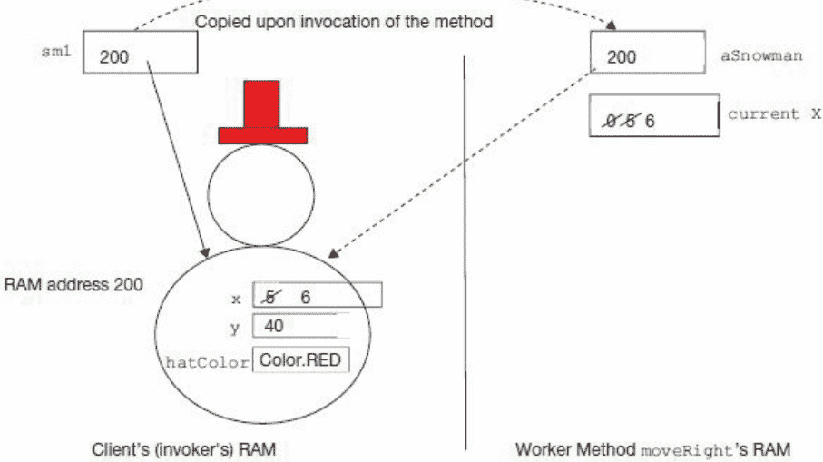

### 从工作方法返回对象

可以使用返回基本类型的相同语法从工作方法返回对象的地址。方法签名中的 `void` 关键字被替换为要返回对象的类型。

### 隐式参数

在 3.6.2 节中，我们看到在构造函数可以使用 `this` 关键字后跟点来引用该类中与某个参数同名的数据成员。在此语境下，`this` 代表正在创建的对象。更泛义地说，它代表调用方法的对象。

因此，类中的任何方法都可以通过使用 `this` 作为调用语句，将调用它的对象传递给另一个方法。该参数被称为隐式参数，因为它隐含了所传递对象的名称。

例如，图 3.40 的第 7 行调用了 `SnowmanV6` 类的 `setX()` 方法（图 3.35），以便对第 4 行声明的对象 `aSnowman` 进行操作。在此调用期间，`setX()` 方法内部任何调用 `this` 的代码都指向对象 `aSnowman`。要将此对象传递给名为 `meltSnowman()` 的静态方法，其签名如下：

```java
public static void meltSnowman(SnowmanV6 s1)
```

`getX()` 方法内部的调用将是：

```java
meltSnowman(this); // 此处隐式参数
```

> **注意**：隐式参数通过在调用中使用关键字 `this` 作为参数，将调用方法的对象传递给它调用的方法。

```java
public static SnowmanV6 halfwayBetween(SnowmanV6 sm1, SnowmanV6 sm2) {
    int x, y;
    SnowmanV6 aSnowman = new SnowmanV6();
    x = (sm1.getX() + sm2.getX()) / 2;
    y = (sm1.getY() + sm2.getY()) / 2;
    aSnowman.setX(x);
    aSnowman.setY(y);
    return aSnowman;
}
```

**图 3.40** 返回 `SnowmanV6` 的方法

```java
aSnowman = SnowmanV6.halfwayBetween(snowman1, sm2);
```

使用隐式参数调用的方法必须是非静态方法，并且可以传递多个参数。例如：

```java
snowman1.meltThreeSnowmen(snowman2, this);
```

## 3.9 章节总结

本章开始我们对设计和实现类所用概念的研究，这些概念将在第 7 和第 8 章中进一步扩展。我们学习到，类类似于蓝图，使我们能够定义和构造对象，而对象是类的某个特定项目或实例。正如我们使用 Java API 中可用的类和方法来方便程序的设计和开发，我们也可以使用和重用自己创建的类。

方法是子程序，是类的关键组件。它们通过创建、显示和操作类的对象来执行类的工作。一个类中通常会有多个版本的类构造器方法，用于创建对象并初始化其数据成员的不同子集。执行大多数类通用任务的方法名称已经过标准化，并被包含在类中。命名为 `toString()` 和 `show()` 的方法用于在控制台或游戏板上显示对象，而 `input()` 方法以及以 `set` 和 `get` 前缀开头的方法用于更改对象方法数据成员的值。

方法的的第一行称为方法签名。Java 使用值参数将信息传递给方法，并使用返回语句从方法传输一个值。传递给方法的信息列表称为参数列表，它是一系列用逗号分隔的变量和字面量值。这些信息被复制到方法签名中声明的变量列表中；调用语句中第 $i$ 个参数存储的值被复制到方法的第 $i$ 个参数中。对象的类型必须与其相应参数的类型匹配。值参数防止方法更改存储在参数列表声明的变量中的值。

如果参数列表不同，一个类中的几个方法可以具有相同的名称。当使用此特性时，我们称同名方法为重载。构造器方法通常会被重载，因为它们的名称必须与类名相同。通常，方法具有公共（`public`）访问权限以允许类外定义的方法调用它们，而数据成员具有私有（`private`）访问权限以防止类外声明的方法意外更改它们的值。

类的数据成员被声明为类级变量。类级变量是在方法代码块之外、类代码块内部声明的变量。在类代码块的开头、类方法实现之前声明这些类级变量是良好的编程实践。


在类中声明的所有变量，无论是公有的还是私有的，都可以通过简单复制变量名称在类方法内部直接访问。唯一的异常是方法在自己的代码块内声明了同名的参数或变量。在这种情况下，通过在类名后紧跟一个点（`.`）在方法内访问该类。可以使用直接语法访问变量的上下文是变量的作用范围。

UML 图是类在设计过程中创建的类的图形化表示。该工具不仅有助于类的设计，还描绘了构成类的数据成员和方法。它被用作类实现的起点。本章讨论的其他类设计工具是用于描绘和数字化图形对象的技术，这些技术作为其 `show` 方法实现的基础。

`Graphics` 类中的方法可以实现图形对象的 `show` 方法。该类提供了在预先声明的 `Graphics` 对象上绘制线条和基本形状的方法。传递给这些方法的线条、形状的 (x, y) 位置以及形状大小的单位是像素或图像元素。这些方法为本文中其余图形主题奠定了基础。

### 知识练习

1. 指明下列陈述的正确或错误：

- a) 方法必须是（此处原文逻辑似乎有乱，按字意翻译：方法必须在代码块内（（括号内容缺失））

- b) 方法的第一行是（（括号内容缺失））

- c) 方法的第一行以分号结尾。

- d) 方法必须在类内部（（括号内容缺失））

- e) `Math` 类中的 `pow` 方法是一个示例。

- f) 方法是向方法传递的。

2. 指明下列陈述的正确或错误：

- a) 方法名应以大写字母开头。

- b) 方法名应反映它们的功能。

- c) 方法签名包含（（括号内容缺失））

3. 填空：

- a) 方法签名不包含关键字____。

- b) 返回值的签名必须包含关键字____。

- c) 当我们调用静态方法时，以____开头。

- d) 当我们调用非静态方法时，以____开头。

4. 为 `public void move()` 写出类的方法签名。

5. 指明下列陈述的正确或错误：

- a) 方法必须在（（括号内容缺失））

- b) 我们可以多次调用方法。

- c) 参数用于向方法传递信息。

- d) 方法可以返回多个信息。

- e) 方法的类型必须匹配类型。

- f) 参数共享相同的信息。

- g) 方法使用引用传递信息。

- h) 当方法更改传递的值时，原始值不再可用。

6. 写出名为 `add` 的方法签名，它接收两个整数并返回结果。

7. 在调用方法后，哪条语句执行？

8. 指明下列陈述的正确或错误：

- a) 类级变量被声明为方法。

- b) 类级变量用于类中的所有方法共享。

- c) 方法不能声明与类级变量同名的变量。

- d) 当方法更改类级变量的值时，原始值将不再可用。

- e) 类中可以编写多个类级变量。

9. 声明名为 `checkAmount` 的类级变量。

10. 填空：

- a) `Graphics` 类中的____方法用于更改当前颜色。

- b) `Color` 类中的常量____存储红色。

- c) 使用____来访问 `Graphics` 类定义的方法。

- d) 使用____来访问 `Color` 类定义的颜色常量。

11. 写出 `Graphics` 类中用于以下操作的方法名称：

- a) 绘制矩形轮廓

- b) 绘制填充矩形

- c) 绘制椭圆轮廓

- d) 绘制圆形轮廓

- e) 绘制填充圆形

- f) 绘制线条

12. 写出 Java 语句（或语句），在 `Graphics` 对象 `g` 上绘制以下形状和线条：

- a) 从 (200, 30) 到 (100, 75) 的线条，使用当前颜色绘制。

- b) 位于 (20, 200)、宽 100 像素高 50 像素的矩形轮廓，使用当前颜色绘制。

- c) 位于 (250, 300)、直径为 30 像素的蓝色填充圆形。

- d) 位于 (300, 100)、宽 100 像素高 50 像素的蓝色填充椭圆。

13. 填空：

- a) 使用 `object` 和 `class` 两个词：房子之于____，正如蓝图之于。

- b) 类由成员____和____组成。

- c) 用于指定类的图形称为类图（diagram）。

- d) 类的数据成员通常被指定具有访问权限。

- e) 类的成员方法通常被指定具有访问权限。

14. 给出 Java 代码，在 `Person` 类中使用该类的无参数构造函数声明一个对象 `joe`，并：

- a) 使用一行声明语法。

- b) 使用双行声明语法。

15. 参考练习 14 题：

- a) 变量 `joe` 中实际存储了什么？

- b) `joe` 是基本数据类型变量吗？如果不是，它是什么类型？

- c) 画一张图（类似于图 3.13），表示练习题 14a 分配的内存，假设 `Person` 类有两个整数型数据成员 `age` 和 `idNumber`。

16. 给出 Java 代码，声明一个表示咖啡杯（coffee cups）的类。每个咖啡杯将有一个尺寸（盎司）和一个价格。该类不包含任何方法。

17. 参考练习 16 题：

- a) 给出在练习 16 题中定义的类的双参数构造函数的代码。

- b) 给出客户端代码，用于声明一个价格为 $3.85 且尺寸为 8 盎司的咖啡杯。

- c) 给出代码，通过隐式调用 `toString` 方法将 B 部分中声明的咖啡杯输出到系统控制台。

- d) 使用显式调用 `toString` 方法重复本题的 C 部分。

- e) 通过 C 部分和 B 部分的调用，控制台输出了什么内容？

- f) 给出代码，向图形对象产生与 D 部分相同的输出。

18. 给出一个名为 `toString` 的方法代码，当该方法添加到练习 16 题定义的类中时，它返回其两个数据成员的完整注释值。

19. 给出一个名为 `show` 的方法代码，当该方法添加到练习 16 题定义的类中，它将其两个数据成员的值输出到名为 `g` 的宽 500、高 500 的 `Graphics` 对象的中心。

20. 使用类似于图 3.16 的草图，展示一辆房车（RV）的设计，它有两个窗户、轮胎和一个大入口门。

21. 给出类似于表 3.2 的表格，包含练习 20 题中指定的房车设计的数字化版本。

22. 在方法中何时必须使用关键字 `this` 来访问其类的其中一个数据成员？

23. 一个类包含一个数据成员 `total`，其访问权限为私有（private）：

- a) 在类的一个方法编写的代码语句中使用关键字 `this` 关键字，使数据成员 `total` 中存储的值翻倍。

- b) 给出类内部的一条语句，在不使用关键字 `this` 的情况下使数据成员中存储的值翻倍。

- c) 给出一个 setter 方法的代码，客户端代码可以使用它来更改数据成员 `total` 的值。

- d) 给出一个方法的代码，客户端代码可以使用它来获取数据成员 `total` 的值。

- e) 假设存在相应的 `set` 和 `get` 方法，给出客户端代码，使用 `set` 和 `get` 方法将名为 `myAccount` 的对象的值翻倍。

- f) 假设数据成员 `total` 被声明为公共（public）访问，给出客户端代码，在不使用 `set` 和 `get` 方法的情况下将名为 `myAccount` 的对象的值翻倍。

- g) 给出类的 `toString` 方法的代码。

- h) 给出类的 `input` 方法的代码。

- i) 哪种访问修饰符（`public` 或 `private`）会导致更严格的访问限制？

24. 指明以下陈述正确或错误：

- a) 类不需要包含一个显式编写的构造函数。

- b) 类可以包含多个构造函数。

- c) 类可以包含多个不同不同的构造函数。

- d) 类可以包含多个具有相同签名（signature）的构造函数。

- e) 当构造函数调用之前带有关键字 `new` 关键字时，会创建一个对象并返回其地址。

- f) Java 提供的默认构造函数没有参数。

25. 一个客户端应用程序声明了三个对象 `ship1`、`ship2` 和 `ship3`，它们是现有类 `Starship` 的实例。每艘 `starship` 包含一个用于存储绘制飞船颜色的数据成员。

- a) 给出 `Starship` 类中一个名为 `largest` 的静态方法的签名，该方法接收两个 `Starship` 对象并返回其中一个的地址。

- b) 给出客户端代码语句，用于调用本练习 A 部分描述的静态方法并将返回的地址存放在 `ship1` 中。

- c) 如果该方法改变了传递给它的一个 `starships` 的颜色数据成员的值，那么在方法执行完成后，它会被新颜色还是旧颜色绘制？

- d) 给出 `Starship` 类中一个名为 `sameModel` 的非静态方法的签名，该方法比较两个 `Starship` 对象并返回一个 Boolean 值。

- e) 给出客户端代码语句，用于调用本练习 D 部分描述的非静态方法，并将返回的 Boolean 值存储在变量 `isSame` 中。

26. 使用类似于图 3.16 的草图，展示一个用户控制的游戏配件的设计，该棋子是你在第 1 章预编程练习 1 中指定的游戏的一部分。

27. 给出类似于表 3.2 的表格，包含练习 26 题中指定的游戏设计的数字化版本。

### 编程练习

1. 编写一个非图形应用程序，该程序包含一个空参数列表的静态方法，该方法在系统控制台上单行输出你的名字和年龄。应用程序的主方法应该调用它三次。它产生的输出应如下文所示（假设你的名字是 Tommy，年龄 18 岁）：

The author of this program is Tommy who is 18 years old.

2. 编写一个图形应用程序，该程序包含一个由 `draw` 方法调用的静态方法。它应该有一个参数来接收传递它的 `Graphics` 对象。调用时，该方法将你的名字和年龄输出到游戏板的中心，如下（假设你的名字是 Tommy，年龄 18 岁）：

The author of this program is Tommy who is 18 years old.

3. 编写一个非图形应用程序，该程序包含一个静态方法，计算并返回传递给它的三个实数乘积的平方根。应用程序的主方法应该调用它，然后清晰地输出这三个数字和返回值。

4. 编写一个图形应用程序，该程序包含一个静态方法，计算并返回传递给它的三个实数乘积的平方根。`draw` 方法应该调用它，然后清晰地输出这三个数字和返回值。

5. 编写一个非图形应用程序，该程序包含一个静态方法，计算并返回被声明并初始化为类变量的三个实数的乘积的平方根。应用程序的主方法应该调用它，然后清晰地输出这三个数字和返回值。

6. 编写一个图形应用程序，其 `draw` 方法显示桌子上有一个带天线的旧电视。

7. 女软球队每位球员保留的统计数据包括每位球员的名字、全垒数和作为实数的击球率。

- a) 给出一个名为 `TeamMember` 的类的 UML 图，其对象可以存储球员的私有数据部分。该类应该包含一个三参数构造函数、一个 `toStringMethod`、一个输入球员统计数据的方法以及一个将球员统计数据输出到系统控制台的 `showSC` 方法。

- b) 逐步实现并测试 `TeamMember` 类，在添加下一个方法之前添加一个方法并进行验证。添加方法的良好顺序是：`toStringMethod`，然后是构造函数、`showSC` 方法，最后是输入方法。（客户端可以使用 Java 提供的默认构造函数创建 `TeamMember` 对象来测试 `toStringMethod`。）

- c) 在所有方法都通过验证后，注释掉客户端应用程序中的代码，并在程序中添加两个 `TeamMember` 实例，将其统计数据传递给三参数构造函数。将这些玩家输出到系统控制台，然后输出在用户为每个球员输入新名称、全垒数和击球率后，再次对它们进行。

8. 编写一个图形化应用程序，包含一个名为 `RV` 的类，该类的对象是根据知识练习 20 和 21 中的描述设计并数字化的房车。该类的私有数据成员应为车辆的颜色以及 (x, y) 位置。

- a) 给出该类的 UML 图。它应该包含一个三参数构造函数、一个 `toString` 构造函数、一个实现对象所有数据成员赋值的方法，以及一个在当前 (x, y) 位置处绘制 RV 的方法。

- b) 逐步实现并测试 `RV` 类，在添加下一个方法之前先添加一个方法并进行验证。向类中添加方法的良好顺序是：三参数构造函数，然后是 `toString` 方法、绘图方法，最后是输入方法。客户端代码应使用三参数构造函数创建 `RV` 对象，以测试随着逐步添加到类中的所有方法。

- c) 在验证完所有方法后，注释掉客户端应用程序中的测试代码，并在程序中添加两个 `RV` 实例，将位置和颜色传递给三参数构造函数。将这些输出到系统控制台和游戏板，并在用户为每辆车辆输入新名称和新的 (x, y) 位置后再次输出它们。

9. 在实现并测试编程练习 7 中描述的类后，为该类的每个数据成员逐步添加一个 `set` 和 `get` 方法。在验证了 `set` 和 `get` 方法后，使用三参数构造函数创建该类的两个实例并将它们显示在系统控制台上。然后，询问用户应为每个球员的统计数据添加多少全垒数和击球率积分。使用 `set` 和 `get` 方法更改统计数据并将两个球员的信息输出到系统控制台。

10. 在实现并测试编程练习 8 中描述的类后，为该类的每个数据成员逐步添加一个 `set` 和 `get` 方法。在验证了 `set` 和 `get` 方法后，使用三参数构造函数创建一个类实例，并将其显示在系统控制台和游戏板上。每当点击游戏板上的任意方向按钮时，RV 的位置应在相应方向上改变两个像素。

11. 使用本章开发的技能，从实现你在第 1 章预编程练习 1 中指定的游戏开始。首先完成知识练习 26 和 27，将用户控制的游戏棋数字化。然后，实现数字化游戏对象的类，从游戏棋的 UML 图开始，其中包含一个具有适当数量参数的构造函数、一个在游戏板当前 (x, y) 位置处绘制对象的方法、一个 `toString` 方法以及该类每个数据成员的 `set` 和 `get` 方法。在逐步实现并测试该类的所有方法后，编写一个图形化应用程序，在游戏板上显示游戏棋并在每当点击游戏板上的任意方向按钮时，游戏棋在相应方向上移动两个像素。

### 注脚与参考文献

1. Lanzinger, Franz. *Classic Game Design: From Pong to Pac-Man with Unity*. Dulles, Virginia: Mercury Learning and Information, 2014.

2. Schell, Jesse. *The Art of Game Design*. Burlington, MA: Morgan Kaufmann Publishers, 2010.

# 第 4 章

# 布尔表达式、决策制定以及磁盘输入/输出


### 4.1 顺序执行的替代方案

4.2 布尔表达式

4.3 if 语句

4.4 if-else 语句

4.5 if 语句嵌套

4.6 switch 语句

4.7 控制台输入与 Scanner 类

4.8 磁盘输入/输出：概述

4.9 捕获抛出的异常

4.10 本章总结

### 本章

为了控制操作顺序，Java 提供了三种决策语句，在本章中，我们将学习如何编写作为这些决策依据的布尔条件。默认情况下， Java 语句按照代码编写顺序执行，尽管在大多数算法的某处，必须决定下一步执行哪一个步骤。在流程图中表示时，算法的这部分以菱形开始。为了实现这些算法，编程语言包含了决策语句，这些语句使用表达式来决定是执行还是跳过某些语句。Java 提供了两种始终跳过预设语句组的语句，其中一种将在本中讨论。

此外，本章将前章节的输入输出技术扩展到包括系统控制台输入以及磁盘 I/O，并引入了一种用于在发生意外错误时更改程序顺序执行路径的技术。

在成功完成本章后，你应该能够：

- 熟悉逻辑运算符和关系运算符及其优先级
- 能够编写和评估简单及复杂的布尔表达式
- 理解如何比较字符串并确定它们的字母顺序
- 能够编写 `if`、`if-else` 和 `switch` 语句来实现算法的决策部分
- 理解如何使用 `Scanner` 类及其方法执行控制台输入
- 能够创建、打开、读取和写入顺序文本文件以及从磁盘读取
- 开始（此处）

### 4.1 顺序执行的替代方案

当使用四个关系运算符之一时，两个操作数可以是任何可以转换为（或解释为）数值的类型。这包括数字字面量、数字变量和算术表达式，以及字符字面量和字符变量。当使用字面量或字符变量时，字符（例如 `'A'`）被解释为整数（例如 `65`），并使用该数值来评估关系表达式。以下代码片段在语法上是正确的，第三个结果为 `true`，因为 `'A'` 和 `'C'` 被解释为 `65` 和 `67`（见附录 C），然后评估表达式。

```
int age = 13;
5 < 2 * 21
100 >= age
'A' < 'C'
25 <= 2 * (age + 1)
```

### 4.2 布尔表达式

布尔（逻辑）表达式以乔治·布尔（George Boole）命名，他是一位构思了逻辑符号代数的英国数学家。与数学表达式一样，布尔表达式评估为两个值之一：`true` 或 `false`。布尔表达式可以是简单表达式，也可以两个或多个简单表达式的组合，称为复合表达式。

### 4.2.1 简单布尔表达式

简单布尔表达式评估为 `true` 或 `false`。在 Java 中，这些表达式由两个操作数周围的关系或相等运算符组成。Java 的四个关系运算符位于表 4.1 顶部，相等运算符位于表底部。第一列给出每个运算符的名称（隐含其含义），第二列给出表示它们的 Java 符号（按键）。表中的四个关系运算符的符号以不带空格的按键给出。表的第三列提供了涉及六个运算符的简单布尔表达式示例，它们的结果均为真。

表 4.1

Java 关系与相等运算符

| 运算符 | Java 符号 | 结果为 true 的示例 |
| --- | --- | --- |
| 小于 | `<` | `5 < 7` |
| 大于 | `>` | `6.3 > 3.14` |
| 小于等于 | `<=` | `5 <= 5` |
| 大于等于 | `>=` | `'c' >= 'a'` |


| 等于 | == | 6 == 3 * 2 |
| --- | --- | --- |
| 不等于 | != | 23 != 54 |

将简单布尔表达式中的字符解释为数值，会对它们施加一种称为字典序（字典顺序）的排序，即它们在扩展 ASCII 表（附录 C）中出现的顺序。

当用于四个关系运算符之一的操作数类型不匹配时（例如，一个是 `float` 另一个是 `double`，或者是一个整数而另一个是字符），在表达式求值之前，其中一个操作数会被类型提升。例如，以下简单表达式在语法上是正确的，并且求值为 `true`：

```
4521 < 10 // 10 被提升为 10.0
Math.PI >= -2 // -2 被提升为 -2.0
2 < 'A' // 'A' 被提升为 65
```

当简单布尔表达式中使用两个相等运算符之一时，操作数的选择范围被扩大了。操作数不仅可以是两个可以转换为数值的类型，还可以是两个布尔值（字面量或变量）或两个引用变量（包括 `null` 值）。例如：

```
4.53 !== 21
65 == 'A'
true != false
myName != yourName
name == null
```

与算术运算符一样，表 4.1 中的运算符也具有相关的优先级顺序。四个关系运算符的优先级相同，两个相等运算符的优先级相同。关系运算符的优先级值高于相等运算符的优先级值。表达式

```
true == 'C' >= 'A'
```

在语法上是正确的，并且求值为 `true`，因为 `'C' >= 'A'` 求值为 `true`，然后 `true == true` 求值为 `true`。如附录 E 所示，算术运算符的优先级高于关系运算符和相等运算符。

> 简单布尔表达式中的算术表达式首先求值。在复杂表达式中，接下来计算关系运算符，接着是相等运算符，然后是逻辑运算符。最后计算赋值运算符。

### 4.2.2 复合布尔表达式

与简单布尔表达式一样，复合布尔表达式求值为 `true` 或 `false`。在控制流语句中，复合布尔表达式使用 Java 的条件二元逻辑与（AND）和或（OR）来组合两个或多个操作数的真值。或者，复合布尔表达式可以使用一元运算符非（NOT）来反转单个操作数的真值，就像否定运算符反转数学表达式中操作数的正负号一样。复合布尔表达式中的操作数求值为布尔值（`true` 或 `false`）。大多数情况下，这些操作数是简单布尔表达式，但可以是字面量或返回布尔值的非空方法调用。

表 4.2 给出了在控制流语句中通常使用的三个逻辑运算符以及表示它们的符号。这三个运算符按优先级递减排序：非（NOT）运算符优先级最高，其次是与（AND）运算符，或（OR）运算符优先级最低。在附录 E 中，算术运算符以及关系运算符和相等运算符的优先级高于逻辑运算符。表第二列给出的与（`&&`）和或（`||`）符号各都是一个按键。或运算符符号中使用的按键位于键盘上回车键（Enter）上方。

### 表 4.2

Java 逻辑运算符

| 逻辑运算符 | Java 符号 | 求值为 true 的示例 |
| :--- | :--- | :--- |
| 非 (Not) | `!` | `!('p' > 'x')` |
| 与 (And) | `&&` | `8 < 10 && 2 * 3` |
| 或 (Or) | `||` | `7 < 4 || 8 >= 5` |

表 4.2 最右列的所有复合逻辑表达式都求值为 `true`。求值布尔表达式的真值，我们指的是逻辑运算符的含义。如前所述，任何 `!` 运算符的含义是简单地反转其操作数的真值。例如，因为在扩展 ASCII 表中 `'p'` 在 `'x'` 之前，`('p' > 'x')` 求值为 `false`，而 `!('p' > 'x')` 求值为 `true`。同样，`(6 > 10)` 求值为 `false`。

两个二元逻辑运算符与与或含义通常通过真值表表示，如表 4.3 所示。布尔操作数 A 和 B 的真值的四种组合在表格左侧的两列给出。操作数的四种可能值对应的与运算符和或运算符的结果值在表格右侧的两列给出。总结结果值，`A && B` 仅在 A 和 B 均为 `true` 时求值为 `true`，而 `A || B` 仅在 A 和 B 均为 `false` 时求值为 `false`。表 4.2 第三行的复合布尔表达式在其中一个操作数 `8 >= 5` 为 `true` 时求值为 `true`。

### 表 4.3

Java 二元逻辑运算符

| 操作数真值 | 运算符含义 |
| :--- | :--- |
| A | B | A && B | A || B |
| --- | --- | --- | --- |
| true | true | true | true |
| true | false | false | true |
| false | true | false | true |
| false | false | false | false |

```java
System.out.println(name1.equals("Bob")); // name1.equals("Mary");
System.out.println(name1.equals(name3)); // false, name mismatch
System.out.println(name1.equals(name4)); // false, different names
```

第三次调用演示了返回布尔值的方法可以作为复合布尔表达式中的操作数。

String 类包含另外三个用于比较字符串的非静态方法。它们分别是：`equalsIgnoreCase`、`compareTo` 和 `compareIgnoreCase`。与 `equals` 方法类似，`equalsIgnoreCase` 方法返回一个布尔值，当传递给它的内容与调用它的字符串对象的内容相同时，该值为 `true`。与 `equals` 方法不同，比较时忽略大小写敏感性。

String 类的 `compareTo` 和 `compareIgnoreCase` 方法决定了两个 String 对象的相对字典序。这些非静态方法返回一个整数，其值反映了调用它的字符串相对于作为参数传递的字符串的字典序。`compareTo` 方法考虑大小写敏感性，而 `compareIgnoreCase` 则忽略大小写敏感性。下面的代码片段比较了 `s1` 和 `s2`：

```java
int order1 = s1.compareTo(s2);
int order2 = s2.compareToIgnoreCase(s2);
```

返回给变量 `order1` 和 `order2` 的值如下：

- 当 `s1` 在字典序上于 `s2` 之前时为负数
- 当 `s1` 在字典序上于 `s2` 之后时为正数
- 当 `s1` 和 `s2` 在字典序上相等时为零

虽然可以使用 `compareTo` 和 `compareIgnoreCase` 方法来判断字符串是否相等，但在测试字符串相等时，使用 `equalsIgnoreCase` 方法是一个良好的编程习惯，因为可以让你的代码更具可读性。

### 4.3 IF 语句

if 语句是 Java 两种控制语句之一，可以根据布尔表达式的真值来改变程序的默认执行情况。另一个语句是 `if-else` 语句，将在第 4.4 节中讨论。

`if` 语句的语法以 `if` 关键字开头，后面跟着括号内的一个布尔表达式，然后是一个要跳过或执行的语句或语句组。当存在一组语句时，该组必须被编码为语句块；即必须括在大括号中。当布尔条件为 `true` 时，执行该语句组；当布尔表达式为 `false` 时，跳过它。因此，该语句的语法为：

即使只有一个语句，将该语句括在大括号中也是更好的编程习惯，这使得语句更具可读性且不易出错。例如，在程序开发期间，我们决定添加第二条语句但忘记在两个语句周围加上大括号，那么第二条语句将不会被视为 `if` 语句的一部分，它将始终执行。下面的两个代码示例是不等价的：

```java
if(false Boolean expression) statement1;
statement2

if(false Boolean expression) {
    statement1;
}
statement2
```

左侧的代码始终执行 `statement2`，尽管缩进似乎暗示它的执行取决于布尔表达式的真值。在编写 `if` 语句时养成的一个良好习惯是先编写这段代码片段：

```java
if( )
{

}
```

然后填入布尔条件以及条件为 `false` 时要跳过的语句。大多数情况下，我们看到的 `if` 语句编码为：

```java
if(a Boolean expression)
{
    //一个或多个可能被跳过的语句
}
```

`if` 语句的含义（或语义）以及执行路径如图 4.2 所示。

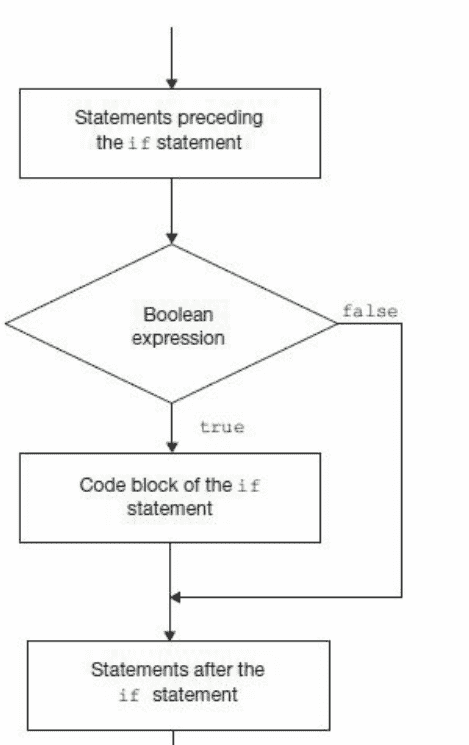

**图 4.2** if 语句的含义和执行路径。

在本节最后我们将讨论 `if` 语句的一种用法——让游戏对象消失，然后展示一个演示了 `if` 语句多种用法的游戏编程应用程序。

#### 使用 if 语句

在许多游戏中，游戏对象根据游戏进行过程中发生的事件而消失。当吃豆人碰撞到食物颗粒时，颗粒会消失；或者当青蛙人被车撞到时，她会消失。通常，在事件发生后，对象不仅变得不可见，而且从游戏中移除。可以通过用程序窗口（在本例中为游戏棋板）的颜色绘制图形对象，或者完全不绘制它们来让其消失。

为了传递游戏组件对象（例如食物颗粒）的可见性状态，会在类对象中添加一个布尔数据成员。当发生改变状态的事件时（例如检测到食物被吃豆人吃掉时），检测代码会反转该数据成员的真值。绘制调用方法可以在 `if` 语句的布尔条件中使用该数据成员的真值来决定是否绘制该对象。如果在吃豆人的颗粒类中添加了一个名为初始化为 `false` 的布尔数据成员，并在颗粒被吃掉时将该数据成员设置为 `true`，那么在绘制回调方法中添加以下代码片段将使 `p1` 在颗粒被吃掉后消失。

```java
if(p1.getEaten() == false)
{
    p1.show(g);
}
```

如果使用变量 `count` 来跟踪游戏时间，并且 `p1` 只在游戏运行 20 秒后才出现，那么在绘制回调方法中添加以下代码片段将使 `p1` 在颗粒被吃掉后消失。

```java
if(p1.getEaten() == false && count < 20)
{
    p1.show(g);
}
```

在这种情况下，当事件将该颗粒的数据成员改为 `true` 时，`p1` 就会消失。图 4.3 显示了程序产生的输出。

```java
public void setX(int newX) {
    x = newX;
}

public int getY() {
    return y;
}

public void setY(int newY) {
    y = newY;
}

public boolean getVisible() {
    return visible;
}

public void setVisible(boolean newVisible) {
    visible = newVisible;
}
```

### 图 4.4 BoxedSnowman 类。

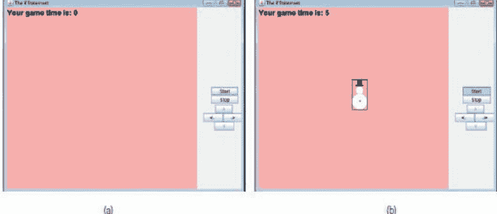

### 图 4.5 应用程序 IfStatement 产生的输出。

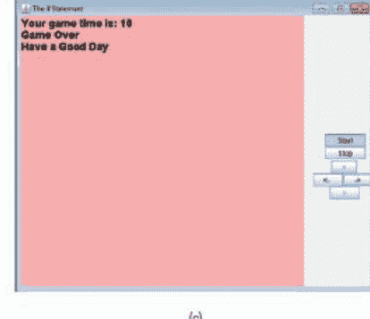

启动图 4.3 所示的应用程序时，经过的秒数将从零开始显示在游戏板上（图 4.5 的左上角）。点击开始开始游戏，导致经过的时间每秒更新一次。图 4.5 的前五秒。十秒后，游戏结束。经过的时间保持在十秒，游戏板上出现一条消息显示游戏结束，且雪人从游戏板上消失（图 4.5 的底部）。

应用程序的第 20 行显示经过的秒数，该数存储在变量 `count` 中。该变量在计时器回调方法的第 35 行中增加，该方法每秒执行一次。在代码行运行十秒后，从第 36 行开始的语句的布尔条件变为真，第 38 行调用游戏环境的 `stopTimer` 方法以停止计时器 1 的计数。如附录 B 所示，该方法传递了一个参数，指定要停止的计时器编号（1、2 或 3）。它是一个非静态方法，在程序第 8 行声明的 `GameBoard` 对象上调用。

BoxedSnowman 类的第 9 行声明了布尔数据成员（图 4.4），用于显示雪人的可见性，该类包含一个 set 和 get 方法（第 51–59 行），以便在经过五秒后显示雪人；可见性通过调用应用程序第 21 行的 `getVisible` 方法获取，返回的值被用于布尔表达式中以便在游戏板上显示雪人。当雪人的可见性为真且游戏时间达到五倍或更多时，雪人将显示出来。由于 `visible` 在 BoxedSnowman 类的第 9 行被初始化为 `true`，因此雪人在游戏开始五秒后就会显示在游戏板上。

为了让雪人在十秒后消失，如果计时器调用方法内部的语句（第 33–41 行）在 `count` 等于十时将雪人 `s1` 的可见性设为 `false`（第 36 行），则第 21 行布尔表达式中的第一个项将变为假，且在游戏板上显示雪人的第 23 行将不执行。

如果第 26 行的语句在游戏达到十秒时显示游戏结束的消息。

### 4.4 IF-ELSE 语句

与 `if` 语句类似，`if-else` 语句是一种 Java 控制流语句，可以通过根据布尔表达式的真值跳过语句来改变程序的默认执行路径。该语句可以被认为包含两个子句：一个 `if` 子句和一个 `else` 子句。每个子句都关联一个语句块。这些块中有且只有一个会被执行。当布尔条件为真时，执行与 `if` 关联的语句块；当条件为假时，执行与 `else` 关联的语句块。`if-else` 语句的语法如下：

```java
if(Boolean expression)
{
  // 一个语句块
}
else
{
  // 另一个语句块
}
```

### 图 4.9
未碰撞和已碰撞的游戏道具。

例如，考虑图 4.9a 所示的两个雪人 s1 和 s2，它们的宽度为 40 像素，高度为 77 像素。如果雪人 s2 向左移动，那么当 s2 矩形左侧与 s1 矩形右侧位于相同的 x 坐标时，就会发生与雪人 s1 的碰撞。这种情况如图 4.9b 所示。可以使用以下布尔表达式（当该事件发生时，表达式结果为真）来检测这种碰撞状态：
`s2.getX() == s1.getX() + 40; // 雪人的宽度为 40 像素`

尽管这种碰撞检测方案非常简单，但它并不总是准确的。当图 4.9b 所示的两个雪人的矩形位于相同的 x 坐标时，两个雪人的身体相互接触。对于图 4.9c 所示的两个雪人 s3 和 s4 来说，并非如此。如果雪人 s4 向左移动，且其矩形左侧与 s3 矩形右侧位于相同的 x 坐标（如图 4.9d 所示），雪人并不处于碰撞状态。s4 身体左侧与 s3 头部右侧之间会有很小的间隙。

幸运的是，在大多数情况下，游戏玩家不会注意到这种间隙，并在视觉上将这种伪碰撞确认为实际碰撞。如果我们愿意接受这种碰撞检测方案的局限性，就可以扩展这个简单的方案，以检测两个雪人在从任何方向相互靠近时发生的碰撞。

图 4.10 展示了雪人 s2 相对于雪人 s1 的以下四个位置：

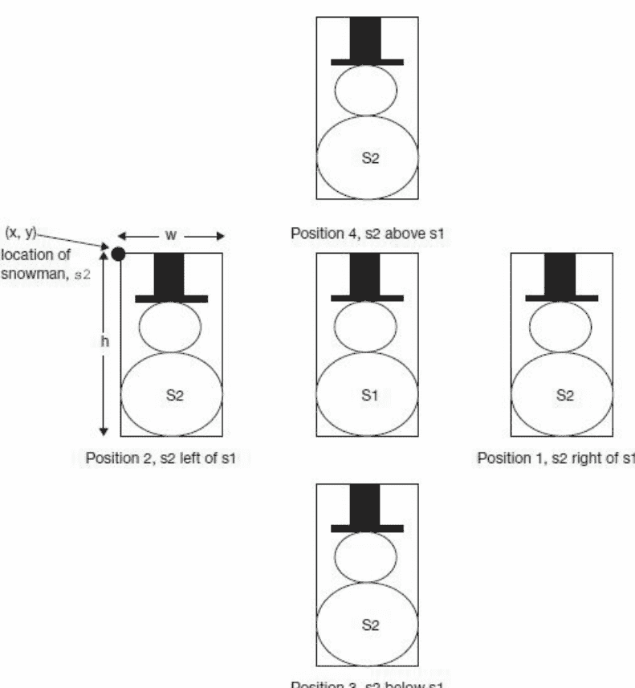

### 图 4.10
雪人 s2 相对于雪人 s1 的未碰撞位置。

- 位置 1：s2 在 s1 的右侧
- 位置 2：s2 在 s1 的左侧
- 位置 3：s2 在 s1 的下方
- 位置 4：s2 在 s1 的上方

当雪人 s2 相对于雪人 s1 处于这些位置之一时，两个雪人就不可能处于碰撞状态。事实上，s2 可以同时处于这些位置中的两个，例如位于雪人 s1 的右侧且上方，这同样是一个未碰撞状态。

图 4.10 所示的四个位置中的每一个都可以用简单的布尔表达式轻松检测到。假设雪人内接在一个宽度为 w 像素、高度为 h 像素的矩形内，表 4.4 的右列给出了当雪人处于四个位置中的每一个位置时，结果为真的布尔条件。

### 表 4.4
用于检测图 4.8 中四个未碰撞位置的布尔表达式

| 雪人 s2 相对于 s1 的位置 | 检测该位置的布尔表达式 |
| :--- | :--- |
| 1. s2 在 s1 的右侧 | `s2.getX() > s1.getX() + w` |
| 2. s2 在 s1 的左侧 | `s2.getX() + w < s1.getX()` |
| 3. s2 在 s1 的下方 | `s2.getY() > s1.getY() + h` |
| 4. s2 在 s1 的上方 | `s2.getY() + h < s1.getY()` |

这些布尔表达式可以用于 if-else 语句，以确定两个雪人何时发生了碰撞；否则，它们没有碰撞。

```java
if(s2.getX() > s1.getX() + w) // s2 在 s1 的右侧
{
    System.out.println("no collision");
}
else if(s2.getX() + w < s1.getX()) // s2 在 s1 的左侧
{
    System.out.println("no collision");
}
else if(s2.getY() > s1.getY() + h) // s2 在下方
{
    System.out.println("no collision");
}
else if(s2.getY() + h < s1.getY()) // s2 在上方
{
    System.out.println("no collision");
}
else // 碰撞
{
```


System.out.println("collision");

}

```

或者，可以将这些布尔条件组合成一个复合布尔条件，该条件在非碰撞时结果为真。
`(s2.getX() > s1.getX() + w || s2.getX() + w < s1.getX() || s2.getY() > s1.getY() + h || s2.getY() + h < s1.getY())`

使用这个复合布尔表达式，检测碰撞的一系列 if-else 语句将变为：

```java
if(s2.getX() > s1.getX() + w || s2.getX() + w < s1.getX() || s2.getY() > s1.getY() + h || s2.getY() + h < s1.getY())
{
    System.out.println("no collision");
}
else // 碰撞
{
    System.out.println("collision");
}
```

布尔条件的真值也可以反转，使用 Java 的逻辑非 (`!`) 运算符，如果-else 语句中的 if 子句将检测两个雪人之间的碰撞。

```java
if(!(s2.getX() > s1.getX() + w || s2.getX() + w < s1.getX() ||
s2.getY() > s1.getY() + h || s2.getY() + h < s1.getY()))
{
    System.out.println("collision");
}
else
{
    System.out.println("no collision");
}
```

以下代码段使用了此 if-else 语句布尔表达式的扩展版本，用于检测何时发生碰撞且雪人 s2 处于可见状态。当这种情况发生时，游戏分数（变量）增加 1，并且雪人 s1 的可见属性被设置为 false。

```java
if(!(s2.getX() > s1.getX() + w || s2.getX() + w < s1.getX() ||
s2.getY() > s1.getY() + h || s2.getY() + h < s1.getY()))
{
    if(s1.getVisible())
    {
        score += 1;
        s1.setVisible(false);
    }
}
```

### 4.5 嵌套 if 语句

正如 if 语句可以包含其他语句一样，if 语句也可以包含 if 语句。这种编码方法嵌套 if，因为第二个 if 语句位于第一个 if 语句内部。

以下代码段是嵌套 if 的另一个示例：

```java
if(raining)
{
    System.out.println("Take your umbrella, ");
    if(temperature < 50)
    {
        System.out.println("and a sweater.");
    }
    else // temperature > 50
    {
        System.out.println("your raincoat.");
    }
}
```

if-else 语句也可以嵌套，如下所示：

```java
if(raining)
{
    System.out.println("Take your umbrella, ");
    if(temperature <= 50)
    {
        System.out.println("and a sweater.");
    }
    else
    {
        System.out.println("your raincoat.");
    }
}
```

上述代码使用的缩进被认为是良好的编程习惯。这等同于下面的代码，该代码的缩进错误地暗示 else 子句是检查温度的 if 语句的一部分。

```java
if(raining)
{
    System.out.println("Take your umbrella, ");
    if(temperature <= 50)
    {
        System.out.println("and a sweater.");
    }
    else
    System.out.println("your raincoat.");
}
```

else 子句总是与其结束之前的 if 语句配对。

### 4.6 switch 语句

switch 语句是 Java 中提供的另一种控制流语句。它不像 if 和 if-else 语句那样灵活，因为这些决策不能基于显式编写的简单或复合布尔表达式。switch 语句的语法将其决策中使用的运算符限制为相等。此外，相等性必须是：

- 两个 `String` 对象
- 两个 `byte`、`short`、`char` 或原始数据类型（或包装这些数据类型的类），或者
- 两个之前定义的枚举类型的实例（将在第 7 章中讨论）

switch 语句的所有用法都可以使用 if-else 语句来编码，但反之则不然。也就是说，在某些情况下，使用 switch 语句可以使程序更具可读性，从而更容易理解、修改和维护。它只能在执行哪些语句或跳过哪些语句的决策基于从有限选择组、菜单中选择时使用。在这种情况下，使用 switch 语句被认为是良好的编程习惯。

switch 语句的语法如图 4.11 所示。图中使用的缩进也反映了良好的编程习惯。

```java
switch (choiceExpression)
{
  case choiceValue1:
    {
      // choiceValue1 的语句块
      break;
    }
  case choiceValue2:
    {
      // choiceValue2 的语句块
      break;
    }
  case choiceValueN:
    {
      // choiceValueN 的语句块
      break;
    }
  default:
    {
      //默认语句
    }
}
```

**图 4.11**
带有关键字 switch 的 switch 语句语法。

如图所示，语句的第一行以关键字 switch 开头，语句的其余部分由一组在括号括起来的 `case` 子句以及一个 `default` 分支组成。在输入语句时，最好先输入以下必需的语法结构，然后填充语句第一行的剩余部分，以及适用于该语句特定用法的 `case` 和 `default` 子句。

```java
switch()
{
}
```

参考图 4.11，在编写 switch 语句时最常见（且最难发现）的三种语法错误：

1. 忘记在关键字 switch 之后编写左、右括号
2. 在语句第一行的右括号后编写了分号
3. 忘记在 choiceValue1、choiceValue2... 之后或在关键字 default 之后编写冒号（:）

在关键字 switch 之后的括号内包含的实体被称为**选择表达式**（choice expression）。选择表达式必须是一个变量，其类型必须是前述提及的允许类型之一（例如，`String` 对象、整数变量等），或者它可以是一个求值为这些类型之一的表达式。

当 switch 语句开始执行时，会确定选择表达式的值，然后执行第一个 `choice value` 等于该值的 `case` 子句的语句块。如果选择表达式不等于任何一个 `choice value`，则执行 `default` 分支。图 4.12 通过与等效的 `if-else` 语句（图 4.12b）进行比较，说明了 switch 语句的含义和执行路径（图 4.12a）。

```java
switch (choice) {
  case choiceValue1: {
    if (choice == choiceValue1) {
      // choiceValue1 的语句
      break;
    }
    case choiceValue2: {
      else if (choice == choiceValue2) {
        // choiceValue2 的语句
        break;
      }
    }
    case choiceValueN: {
      else if (choice == choiceValueN) {
        // choiceValueN 的语句
        break;
      }
      else {
        // 默认语句
      }
    }
  }
}
```
(a) (b)

**图 4.12**
语义等价的 switch 和 if-else 语句。

例如，以下代码片段确定了四种颜色（红、绿、蓝、白）中的哪一个包含 `String` 对象 `carColor` 中：

```java
switch (carColor) {
  case "red": {
    System.out.println("the car color is red");
    break;
  }
  case "green": {
    System.out.println("the car color is green");
    break;
  }
  case "blue": {
    System.out.println("the car color is blue");
    break;
  }
  default:
    {
      System.out.println("the car color is white");
    }
  }
}
```

以下代码片段演示了如何将算术表达式作为 switch 语句中的选择表达式：

```java
int i;
String s = JOptionPane.showMessageDialog("enter an integer");
i = Integer.parseInt(s);
switch (i * 2)
{
  case 10:
    {
      System.out.println("two times the number is 10");
      break;
    }
  case 20:
    {
      System.out.println("two times the number is 20");
      break;
    }
  default:
    {
      System.out.println("two times the number is not 10 or 20");
    }
}
```

switch 语句中可以使用的 `case` 子句数量没有限制。`default` 分支是可选的，如果使用，则必须编写为语句中的最后一个 `case`。`case` 和 `default` 子句中语句周围的括号不是必需的，仅用于提高可读性。

可以使用以下语法将多个 `case` 分配同一个语句块：

```java
case 2: case 5: case 7:
{
  // 所有三个 case 的语句块
  break;
}
```

当选择表达式求值为 2、5 或 7 时，将执行该语句块。每个 `case` 最后的 `break` 语句也是可选的。然而，与括号不同，它的存在对执行路径有重大影响。`break` 语句是一种控制流语句，它不使用逻辑表达式来决定何时执行或跳过语句。当 switch 语句内部执行 `break` 语句时，它会结束其所在的 switch 语句的执行。基本上，这意味着跳出此处。它也可以用于 `if-else` 语句内部以结束它们的执行。

当执行 `break` 语句时，下一个执行的语句是紧随 `break` 语句之后的语句。在 switch 语句内部，所有后续的 `case` 和 `default` 分支都会被跳过，下一个执行的语句是 switch 语句之后的语句。

它们发生碰撞时，会加分并且绿帽雪人消失。当黑帽雪人移动到一个使得两个雪人不再处于碰撞状态的位置后，它会在新位置重新出现。

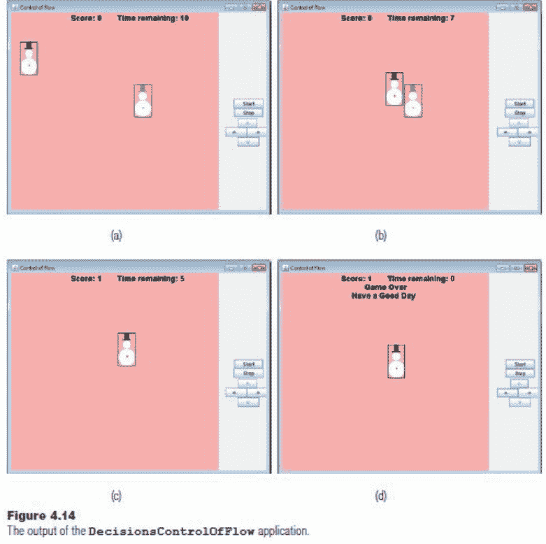

游戏中的雪人 s1 和 s2 是 `BoxedSnowman` 类的实例（图 4.4）。它们在图 4.13 所示应用程序的第 9 和 10 行创建，使用参数构造函数来指定雪人的位置和帽子颜色：s1 为绿色，s2 为黑色。`draw` 方法的第 29 行输出剩余时间，第 60 行在 `draw` 方法结束前输出玩家得分。

第 54–58 行涉及 `BoxedSnowman` 类的方法，用于在游戏游戏板的 (x, y) 位置绘制雪人。第 55 行的 `if` 语句检查雪人 s1 的可见性状态，以决定是否绘制它（第 57 行）。`BoxedSnowman` 的 `visible` 属性的初始值为 `true`（图 4.4，第 9 行），因此当游戏启动时，它出现在游戏板上。

第 67–92 行演示了 `switch` 语句的使用。在这种情况下，`switch` 语句用于确定四个光标控制键中的哪一个将雪人 s2 从当前位置移动两个像素。该语句编码在游戏环境的 `draw` 调用方法 `getKey`（第 63 行）内部，游戏环境每当击中键盘键时就会调用该方法。该方法有一个参数 `key`，类型为 `char`，游戏环境将被击中的的字符传入其中。在 `getKey` 完成执行后，游戏环境会调用回调方法。

第 63 行的参数 `key` 被用作第 67 行 `switch` 语句的选择表达式。当击中键盘的左、右、上、下光标控制键时，它们分别产生字符 'L'、'R'、'U' 或 'D'。这些字符被用于第 69、75、81 和 87 行的 `switch` 语句 `case` 中，以决定向哪个方向移动雪人 s2。

提示：当键盘按键被按住时，如果按键是被按下并释放的，它每秒会传输20次字符。因此，为了控制游戏对象的运动，优先使用长按而不是点击。

图 4.14 显示了点击“开始”按钮三秒后的游戏板，使用向右向下的光标将雪人 s2 移动到 s1 旁边。按一次右键会导致碰撞。

第 31 行开始了一个 `if-else` 语句，其中包含一个嵌套的 `if-else` 语句（第 37 行）和嵌套的 `if` 语句（第 43 和 46 行）。第 37 行和 43 行出现的关键字分别是从第 31 行和 37 行开始的 `if-else` 语句的一部分。第 31 行判断游戏是否结束，如果结束，会向游戏玩家宣布。从第 37 行开始的 `if-else` 语句判断当 s2 可见时两个雪人是否发生了碰撞。正如第 4.4 节末尾讨论的，它的布尔表达式不是 s2 在 s1 的右侧、左侧或上方，且 s1 是可见的。在这种情况下，`if` 的代码使用计数算法（第 40 行）将玩家得分减一分，并将 s1 的 `visible` 属性设置为 `false`（第 41 行）。将 s1 的 `visible` 属性设置为 `false` 也会防止得分，除非 s1 为 `false`，这会在雪人不再处于碰撞状态时再次发生。碰撞状态判断由第 43 行的语句执行。它的布尔条件与第 37 和 38 行的条件相同，但删除了 `!` 运算符和对可见性的测试。当 s1 不可见时，该布尔条件为 `true`。然后执行从第 46 行开始的嵌套语句，并判断 s1 是否可见。如果是，嵌套语句的代码将通过交换其 x 和 y 坐标来重新定位 s1。此代码还将 s1 的 `visible` 属性设置为 `true`（第 50 行），这导致从第 55 行开始的 `if` 语句在游戏板的新位置绘制 s1（图 4.14）。

## 4.7 控制台输入与 Scanner 类

我们已经学习了如何使用对话框进行输入和输出，以及如何使用 `println` 方法将输出发送到系统控制台。系统控制台也用于使用 `Scanner` 类中的方法执行键盘输入。然而，在使用 `Scanner` 类的方法之前，我们必须声明一个 `Scanner` 对象并将控制台对象传递给 `Scanner` 类的单参数构造函数。以下代码声明了 `Scanner` 对象 `consoleIn` 可以调用 `Scanner` 中的非空方法（这些方法接受来自数据文件的输入将在下一节中讨论）。

由于系统控制台连接有一个预定义的输出对象，用户输入内容时，击键会输出到控制台。该类中三个常用的方法名以 `next` 开头。它们的完整名称和返回的数据类型如表 4.5 所示。要使用这些方法，请在程序中包含以下导入语句：

```java
import java.util.Scanner;
```

### 表 4.5 Scanner 类中常用的输入方法

| 方法名 | 返回类型 |
|---|---|
| `nextInt` | `int` |
| `nextDouble` | `double` |
| `nextLine` | `String` |

正如其名称所示，`nextInt` 和 `nextDouble` 都用于接受数值输入。当输入是整数时，使用 `nextInt`；当输入是实数时，使用 `nextDouble`。这两个方法将输入字符解析为数值，不需要使用包装类 `Integer` 和 `Double` 中的解析方法。`nextLine` 方法用于接受 `String`。当这些方法被调用时，程序的执行将暂停，直到用户通过击击 Enter 键完成键盘输入。然后方法返回输入值。在此之前，用户可以使用 Backspace 和 Delete 键编辑输入。在调用方法之前，先向系统控制台发送一个构造良好的提示（prompt）是良好的编程习惯。以下代码片段接受在系统控制台中输入的姓名、年龄和体重：


Scanner consoleIn = new Scanner(System.in);

String name;

int age;

double weight;

```java
System.out.print("Enter your name: ");
name = consoleIn.nextLine();
```

```java
System.out.print("Enter your age: ");
age = consoleIn.nextInt();
```

```java
System.out.print("Enter your weight: ");
weight = consoleIn.nextDouble();
```

多个数值输入可以在同一行输入，因为它们被至少一个空格分隔（delimited）。数值输入前的空格会被忽略。以下代码段在系统控制台中从同一行接受一个人的年龄和体重的输入：

```java
int age;
double weight;
Scanner consoleIn = new Scanner(System.in);
```

```java
System.out.print("Enter your age and weight on one line " + "separated by at least one space ");
age = consoleIn.nextInt();
weight = consoleIn.nextDouble();
```

提示：至少一个空格分隔的多个数值输入可以在同一行输入。字符串输入前的空格不会被忽略。它们会被考虑并成为输入字符串的一部分。在数值输入后输入的空格将成为随后从同一行读取的字符串输入的一部分。因此，字符串不应与数值输入在同一行内。

提示：数值输入和字符串输入不应在同一行。

当数值输入和字符串从两个不同的输入行读取时，且数值输入在字符串之前，需要调用两次 `nextLine` 来捕捉字符串。这是因为数值输入留下了 Enter 键产生的字符，而 `nextLine` 方法认为这将是一个有效的字符串（空字符串 ""）。以下语句接受一个人的年龄，然后是该人的姓名和地址。第一个字符串输入由额外的 `nextLine` 方法调用正确引导。

```java
Scanner consoleIn = new Scanner(System.in);
```

```java
int age;
String name;
String address;
```

```java
System.out.print("Enter your age: ");
age = consoleIn.nextInt();
```

```java
consoleIn.nextLine(); // 清除留下的回车键
System.out.print("Enter your name: ");
name = consoleIn.nextLine();
```

```java
System.out.print("Enter your address: ");
address = consoleIn.nextLine();
```

注意：需要 `nextLine` 方法来读取字符串。首次调用会从缓冲区中刷新换行符（空字符串）。

在读取数值输入时，这不是一个问题，因为数值输入方法不仅会跳过缓冲区中的空格，还会跳过回车键。如果缓冲区为空或它们找到了要处理的输入，这些空白就会被忽略。然而，`nextLine` 方法会跳过回车键。因此，当 `nextLine` 紧跟在输入之后时，它会遇到一个包含回车键的非空缓冲区。`nextLine` 方法会读取并移除缓冲区中的回车键，并返回空字符串（""）。

图 4.15 展示了一个使用 `Scanner` 的方法从系统控制台接受输入的应用程序。控制台输入和相应的输出位于图底部。

```java
import java.util.Scanner;

public class ScannerConsole {

    public static void main(String[] args) {

        Scanner console = new Scanner(System.in);

        String name;

        int age;

        double weight;

        System.out.print("Enter your name: ");
        name = console.nextLine();

        System.out.print("Enter your age: ");
        age = console.nextInt();

        System.out.print("Enter your weight: ");
        weight = console.nextDouble();

        System.out.println("Age: " + age + " Weight: " + weight +
                           " Name: " + name + ")");

        System.out.print("Enter your age and weight on one line: ");
        console.nextLine(); // clears the Enter keystroke from buffer

        name = console.nextLine();

        System.out.println("Age: " + age + " Weight: " + weight +
                           " Name: " + name + ");

    }

}
```

控制台输入和输出：
Enter your name: Bannean
Enter your age: 18
Enter your weight: 125.7
Age: 18 125.7 Bannean

Enter your age and weight on one line: 35.4
Enter your name: Nora
Age: 5 Weight: 35.4 Nora

图 4.15 是 ScannerConsoleInput 以及随后的示例输入和相应的输出。

第 1 行使用 `Scanner` 类的方法来实现该应用程序，第 6 行使用 `Scanner` 的单参数构造函数创建对象 `console`，并传递了预定义的控制台输入对象 `System.in`。第 11–16 行从系统控制台提取一个字符串、整数和一个双精度点数，每个输入占一行。这些值在第 17–18 行进行输出。

第 20–25 行更改了输入顺序，从在同一控制台行输入两个数值开始（第 20–22 行）。然后输入一个字符串（第 23–25 行）。第 24 行清除了在读取第二个数值（第 22 行）后留存在缓冲区中的回车键。第 26–27 行输出第二组输入。在图 4.15 底部，用户在输入年龄 5 和输入重量 35 之间输入了几个空格。这些空格被第 22 行调用的 `nextDouble` 方法忽略了。图中最后一行的重量输出（35.4）证实了这一点。

## 4.8 磁盘输入与输出：初探

与 RAM 内存不同，磁盘存储是非易失的，这意味着当计算机系统掉电时，它会保留存储在其上的信息。因此，磁盘文件有几种类型：文本文件和二进制文件。存储在二进制文件中的信息通常占据磁盘空间更小，且信息传输更快。尽管如此，文本文件被广泛使用，文件中的所有信息都以 ASCII 字符存储，这意味着可以使用任何文本编辑器进行打开、读取、修改和恢复。

在本节中，我们将对磁盘 I/O 的讨论限制在文本文件以及按照数据项在文件中出现的顺序访问文件数据项的技术上。这种访问方式被称为**顺序访问**。另一种访问形式称为**随机访问**，允许以任何顺序访问数据。我们将在随后的章节中扩展对磁盘 I/O 的讨论。

### 4.8.1 顺序文本文件输入

存储在文本文件中的信息可以使用表 4.5 所示的 `Scanner` 类方法顺序读取到程序中。事实上，第 4.7 节中讨论的所有从系统控制台读取或输入数据的概念都适用于顺序文本文件输入。唯一的例外是创建 `Scanner` 对象。

为了从系统控制台接受输入，通过向 `Scanner` 类的单参数构造函数传递预定义的 `System.in` 来创建对象。为了从顺序文本文件接受输入，向 `Scanner` 的单参数构造函数传递一个 `File` 对象。该 `File` 是使用 `File` 类的单参数构造函数创建的，该构造函数接受包含文件路径和名称的字符串参数。该字符串的大小写敏感会被忽略。使用 `import java.io.*;` 来访问 `File` 类。

代码片段从位于 C 盘根目录的 `data.txt` 文件开头读取一个整数。

```java
File fileObject = new File("c:/data.txt");
Scanner fileIn = new Scanner(fileObject);
int score;

score = fileIn.nextInt();
```

图 4.16
从文件中读取整数的代码片段

第 1 行使用 `Scanner` 类的方法来实现该应用程序，第 6 行使用 `Scanner` 的单参数构造函数创建对象 `console`，并传递了预定义的控制台输入对象 `System.in`。第 11–16 行从系统控制台提取一个字符串、整数和一个双精度点数，每个输入占一行。这些值在第 17–18 行进行输出。

第 20–25 行更改了输入顺序，从在同一控制台行输入两个数值开始（第 20–22 行）。然后输入一个字符串（第 23–25 行）。第 24 行清除了在读取第二个数值（第 22 行）后留存在缓冲区中的回车键。第 26–27 行输出第二组输入。在图 4.15 底部，用户在输入年龄 5 和输入重量 35 之间输入了几个空格。这些空格被第 22 行调用的 `nextDouble` 方法忽略了。图中最后一行的重量输出（35.4）证实了这一点。

> 提示 在指定路径时始终使用正斜杠（/）。

即使使用正斜杠来指定文件路径，文件也必须存在，否则会产生文件不存在的运行时错误。如果没有指定路径（即只提供文件名和扩展名），则假设文件位于 IDE 创建的项目文件夹或其子文件夹中。具体位置可能取决于 IDE。

除了图 4.16 的第 1 和第 2 行外，从文件读取数据的代码与从系统控制台读取数据的代码相同，后者没有提示。我们只需想象用户在输入提示下输入系统控制台，相同的数据（逐字符、逐行）被输入到文本编辑器并保存到磁盘文件。

例如，如果一个人的年龄、重量和名称被输入到图 4.17 所示的文本文件.txt 中。除了图 4.18 的第 1 和第 2 行，图 4.18 包含了与系统控制台读取年龄、重量和名称相同的代码（图 4.15 的第 7–9 行和 20–25 行），只是删除了两个用户提示（第 20 和第 23 行）并更改了 `Scanner` 对象的名称。

| 5 | 35.4 |
| Nora |

> 图 4.17 位于 C 盘根目录的磁盘文件 data.txt 包含的数据

为了读取顺序文件，Java 维护一个初始指向文件第一个字符的指针。每从文件中读取一个数据项，指针就会移动到文件的下一个项。在读取最后一个项后，指针将位于一个名为“文件结束”（EOF）的特殊字符上，该字符自动放置在所有文件的末尾。在第 5 章中，我们将讨论向文件添加 EOF 字符的重要性以及如何检测何时到达此处。

在从文本文件中读取数据时，有一些在控制台输入时不会出现的额外问题需要考虑。这些包括需要：

- 用于声明 `File` 对象的文件的名称和路径（图 4.18 的第 1 行）
- 文件中信息的顺序，因此图 4.18 中第 7、8、9 和 10 行的语句是按照正确的顺序编码的
- 文件中每条信息的类型，因此调用了适当的 Scanner 类方法来读取每条信息

这些信息由设计该文件的软件工程师提供给程序员的文件规格说明进行描述。

```java
fileObject = new File("c:/data.txt");
ScannerIn = new Scanner(fileObject);
String name;
int age;
double weight;

age = fileIn.nextInt();
weight = fileIn.nextDouble();
fileIn.nextLine();
name = fileIn.nextLine();
```

**图 4.18**

读取图 4.17 所示文件中包含的数据的代码。

### 4.8.2 判断文件是否存在

从文本文件中读取数据时需要考虑的另一个问题是，如果文件不存在，会发生运行时错误。`File` 类包含一个名为 `exists` 的非空方法，用于检测文件是否存在；而 `System` 类包含一个名为 `exit` 的静态方法，用于结束程序。

当文件存在时，`File` 中的方法返回 `true`；`System` 类的方法有一个整数参数，通常传递 `零`。以下代码段演示了如何使用这两个方法，在程序尝试使用不存在的磁盘文件时，带有一个更具信息量且友好的结束方式：

```java
fileObject = new File("c:/data.txt");

if(!fileObject.exists()) // 文件不存在
{
  System.out.println("the file does not exist, the program is terminating")
  System.exit(0);
}
```

**提示：** 检查磁盘文件是否存在是一个良好的编程习惯，可以避免用户通常难以理解的运行时错误。

## 4.8.3 顺序文本文件输出

可以使用用于向系统控制台写入信息的 `print` 和 `println` 方法将信息顺序输出（写入）到文本文件中。此外，用于格式化控制台输出数据的 Java 语法（如输出信息的间距、换行以及指定数值输出的精度）与格式化磁盘文件输出的语法是相同的。唯一的例外是输出注释（output annotation）。

在写入磁盘文件时，发送给 `print` 和 `println` 方法的字符串中通常不包含输出注释，因为大多数文件是由程序读取的，而不是人类读取。当文件数据不会被程序处理或读取时（可能在打印后将检查文件内容），则会包含输出注释。或者，读者也可以通过查阅文件规格说明来识别未带注释的文件。

要输出到系统控制台，`print` 和 `println` 方法作用于附加到控制台的预定义系统对象 `System.out`。要写入顺序文本文件，这些方法则作用于 `PrintWriter` 类中程序员定义的对象。该对象通过两行代码创建，这两行代码与创建 `Scanner` 对象以执行磁盘输入的两行代码类似。

`PrintWriter` 对象是使用类的双参数构造函数创建的，该构造函数被传递给 `FileWriter` 类中的一个对象。在创建 `FileWriter` 对象时，会将文件路径和名称传递进去。此处不区分大小写。重要的导入语句 `java.io.*;` 用于访问 `PrintWriter` 和 `FileWriter` 类。

图 4.19 中的代码片段在 C 盘根目录下创建一个顺序文本文件 `data.txt`，并通过换行符将变量 `score` 的内容输出到文件开头。

```java
FileWriterObject = new FileWriter("C:/data.txt");
PrintWriter fileOut = new PrintWriter(fileWriterObject, false);
int score = 20;

fileOut.println(score);
```

图 4.19

将整数写入位于 C 盘根目录磁盘文件 `data.txt` 开头的代码片段。

图 4.19 的第 1 行和第 2 行创建了磁盘文件以及用于调用第 5 行 `println` 方法的 `fileOut`。通用术语是它们创建并打开了文件。如果文件已存在，它将被删除并重新创建。之前写入该删除文件的所有信息都将丢失。

使用 `print` 和 `println` 方法写入文本文件的数据，应该被认为是放在文件中的，就像这些方法作用于 `System.out` 时（对于行，对于字符）在系统控制台上显示一样。唯一的例外是换行符不会出现在系统控制台上，而是导致光标移动到下一行的开头。文件中第一个数据项的字符之后是第二个项目的字符，接着是第三个，以此类推。

```java
import java.util.Scanner;
import java.io.*;

public class DiskIO {

    public static void main(String[] args) throws IOException {

        File fileObject = new File("data.txt"); // 输入
        Scanner fileIn = new Scanner(fileObject);
        FileWriter fileWriter = new FileWriter("data.txt"); // 输出
        PrintWriter fileOut = new PrintWriter(fileObject, false);

        String name = "Nora Smith";
        int age = 5;
        double weight = 35.4;

        // 写入数据项
```


```java
fileOut.println("age: " + age + " weight: " + weight);

fileOut.println(name);

fileOut.close();

// 从磁盘文件读取数据

age = fileIn.nextInt();

weight = fileIn.nextDouble(); // 清除缓冲区中的换行符

name = fileIn.nextLine();

System.out.println("Age: " + age + " Weight: " + weight + 
                   " Name: " + name);
```

控制台输出
Age: 5 Weight 35.4 Name: Nora Smith

**图 4.20**
应用 `DiskIO` 及其在控制台的输出

| 35.4Nora Smith\nnet |
| n 代表换行符 |
| et 代表文件结束 (EOF) 字符 |

**图 4.21**
输出到文件 `data.txt` 的内容

Java 与大多数编程语言一样，并不包含删除或修改文件数据项的方法，也不包含在文件末尾任意添加数据项的方法。这些操作可以在执行任务的算法中，使用本章讨论的磁盘 I/O 方法来实现。例如，删除算法将是：

1. 将文件的所有信息读入 RAM 内存中
2. 关闭文件
3. 删除文件
4. 重新创建文件
5. 将除删除项以外的所有信息写回文件
6. 关闭文件

由于这些算法的编码需要具备第 5 章和第 6 章所涵盖的知识，因此我们将在第 6 章回到这个主题。

## 4.9 捕获抛出的异常

异常是 Java 的一种特性，方法可以使用它来向调用者通信：在方法执行期间发生了一个意外的事件，而该方法内部并不包含处理该事件的代码。在第 2 章和第 3 章中，我们讨论了此类事件，如除以零和参数与参数类型不匹配，Java 认为这些不是严重的事件。当事件被 Java 认为是严重的时，必须在编码调用的方法签名中添加 `throws` 子句，或者必须在包含异常语句的代码块中添加处理该事件的指令。

前一种方法用于图 4.20 第 6 行的程序。在第 9 行和第 10 行引入的 `Scanner` 和 `FileWriter` 构造函数是在执行过程中可能会遇到意外事件的方法。因此，在 `main` 方法的签名（第 6 行）中添加了 `throws` 子句，因为 `main` 方法包含了这两个调用。在本节中，我们将简要介绍 `throws` 子句的替代方案：在包含异常语句的代码块中添加处理该事件的指令。

正如“throws”（抛出）一词所暗示的，在选择与异常相关的 Java 词汇时使用了棒球比喻，这种比喻对于理解异常非常有帮助。想象一下，当方法执行期间发生严重事件时，方法说：“我对该事件有异议，我将不再继续执行。我的最后一个动作是向我的调用者抛出一个异常，以让其知道这个问题。”

如果调用者想要处理它，它的代码块就会捕获该异常并进行处理。`throws` 是我们已经使用过的 Java 关键字（图 4.20 第 6 行），当我们不想处理意外问题时使用。另外两个关键字 `try` 和 `catch` 在我们想要处理该问题时使用。

这些关键字每个都开始一个代码块，且 `try` 代码块始终紧在 `catch` 块之前。以下代码片段是 `try` 语句的模板，用于捕获抛出的 `IOException`。如模板所示，被捕获的异常类型被编码在 `catch` 关键字后的参数列表中。

```java
try {
  // 包含方法调用和其他语句的代码
} catch(IOException e) {
  // 处理意外事件的语句
}
```

调用可能抛出异常的方法的语句必须在 `try` 块内部编码。其他语句也可以包含在 `try` 块中。实际上，你是在尝试这些调用语句，以查看方法是否会触发抛出异常。当 `try` 块内部调用的方法抛出异常时，`try` 块中的剩余语句将不再执行，执行将传递到 `catch` 块中的第一个语句。如果没有抛出异常，`try` 块中的语句将完成执行，而 `catch` 块的语句将不会执行。在任何情况下，`catch` 块之后的语句都在 `try` 块或 `catch` 块完成执行后执行。

以下代码片段说明了模板的使用。它尝试将存储在磁盘文件中的值读入变量，并捕获 `Scanner` 类构造函数在遇到问题时抛出的 `IOException` 对象。

```java
int score;

try {
  File fileObject = new File("data.txt"); // 输入
  Scanner inFile = new Scanner(fileObject);
  score = inFile.nextInt();
  inFile.close();
} catch(IOException e) {
  System.out.print("无法从磁盘文件读取分数，");
  System.out.println("但游戏将继续。");
} // 程序的其余语句
```


如果将 catch 块中的读取语句替换为程序的继续，那么接下来的两个语句将终止程序的执行：

```
System.out.println("程序正在终止。");
System.exit(0);
```

图 4.23 程序展示了游戏程序中的磁盘输入输出，以及如何使用异常处理意外的磁盘 I/O 问题。它是图 4.13 中相同的程序，经过修改以记录最高分。当游戏结束时，会从磁盘文件中读取分数。如果没有获得高分，会通知玩家并鼓励继续练习。否则，会将高分写入磁盘文件并祝贺玩家。

处于冲突状态的时间更长。程序的更改包括：添加第 3–4 行以使得程序可以使用执行磁盘 I/O 的 `Scanner`、`File`、`Writer` 和 `PrintWriter` 类；删除了方法签名中的 `throws` 子句；以及添加第 40–67 行来执行磁盘 I/O。图 4.24 展示了程序在各种条件下产生的若干输出。

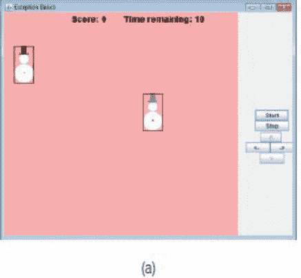
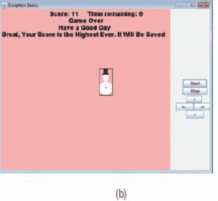
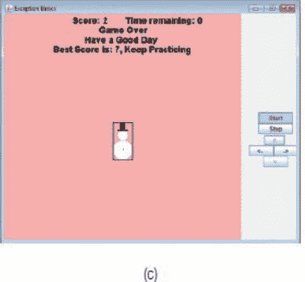
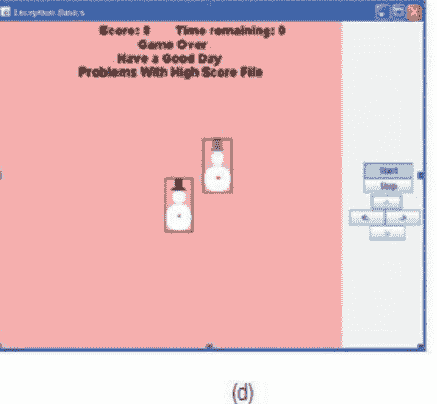

**图 4.24** 应用程序 ExceptionBasics 产生的输出。

`main` 方法的签名 (16) 不包含 `throws` 子句，因为磁盘 I/O 是在 `try` 语句的代码块内部（第 39 行）执行的。第 44 行使用第 42–43 行创建的 `Scanner` 对象 `inFile` 从磁盘 `HiScore.txt` 中读取最高分。然后关闭文件（第 45 行）。通常情况下，程序员会使用文本编辑器创建文件并在其中存储一个零分，这作为程序开发的一部分。由于第 42 行未指定文件路径，该文件必须存储在 IDE 创建的项目文件夹中。

当获得新的高分时（由第 47 行判定），第 49–50 行会告知游戏玩家这一成就（图 4.24）。新的高分将使用第 51–52 行创建的 `PrintWriter` 对象 `fileOut` 写入磁盘文件（第 54 行），并关闭文件（第 55 行）。由于发送到第 52 行 `PrintWriter` 构造函数的第二个参数为 `false`，因此在写入新高分之前，包含旧高分的文件会被删除并重建（新的高分不会追加到文件末尾）。

当未获得高分时，第 47 行开始的 `if-else` 语句的第 59–60 行产生图 4.24c 所示的输出。如果在 `try` 块内执行磁盘 I/O 时发生问题，`try` 块的执行将终止，并执行 `catch` 块（第 63–66 行），产生图 4.24d 输出结尾处的错误信息。

## 4.10 章总结

通常情况下，Java 程序顺序执行其语句。`if`、`if-else` 和 `switch` 语句用于通过选择执行哪条语句或语句组来遵循这一执行路径。当 `if` 或 `if-else` 结构产生的决策影响多于一条语句时，这些语句必须编码在代码块内部。

`if` 和 `if-else` 语句通过评估布尔表达式来决定执行还是跳过语句。布尔表达式使用逻辑运算符和关系运算符（所有运算符都有与其相关的优先级顺序）来评估为 `true` 或 `false`。这些语句可以嵌套，允许它们测试各种条件，或者通过使用语句的布尔条件来测试特殊条件。如果语句被用于决定是否跳过一组语句，那么 `if-else` 语句则用于决定在两个互斥的语句组中执行哪一组。

尽管 `switch` 语句的所有用法都可以使用等价的嵌套 `if-else` 语句进行编码，但当决策基于一个或多个离散值时，`switch` 语句使我们的程序更具可读性。这些值可以是字符串的引用，也可以是类型为 `byte`、`short`、`char` 或 `int` 的基本类型，或者是枚举类型的值。

通常使用 `break` 语句来防止执行时执行与 `switch` 变量当前值等价的方的 `case`。语句末尾可以包含一个 `default` 情况，当 `switch` 变量的值不匹配语句的任何 `case` 时执行该情况。决策语句在游戏编程中有许多应用，例如控制计时器的值、在事件发生时增加分数、测试对象之间何时发生碰撞，以及确定输入了哪个按键并对其做出响应。

`String` 类提供了比较 `String` 对象的方法，因为它们不能使用关系运算符进行比较。相等运算符 `==` 比较变量的内容，而 `String` 引用包含它们所引用字符串的地址。为了比较字符串，`String` 类提供了如 `equals` 和 `compareTo` 等方法，它们进行区分大小写的比较，以及 `equalsIgnoreCase` 用于不区分大小写的比较。

磁盘 I/O 有助于存储游戏数据，例如最高分以及程序结束后必须保留的任何其他类型的数据。当数据存储在 RAM 缓冲区中时，它是易失的，不会在游戏之间保留。相反，当数据存储在文本文件中时，每次玩游戏时都可以进行读取和比较。`FileWriter` 和 `PrintWriter` I/O 对象的构造函数用于“附加” `Scanner` 和 `PrintWriter` 对象。然后可以使用 `FileWriter` 类中的方法将输出发送到文件，可以使用 `Scanner` 从文件中读取信息。`File` 方法可以在尝试使用文件之前判断文件是否存在。磁盘 I/O 经常会导致错误，例如代码尝试访问不存在的文件或路径错误的文件。这会导致生成错误，从而中断 Java 的正常流。Java 提供了两个与异常相关的结构，称为 `try` 和 `catch`。当 `try` 块代码内部发生异常时，程序的执行将转移到 `catch` 块，该块设计用于（处理）并从运行时异常中恢复。`catch` 块可以使用 `System.exit` 方法终止程序。

### 知识练习

1. 变量 `i, j, k` 和 `m` 声明为：`i = 10; j = 20; k = 30; m = 40.`。判断以下各项为真或假：
   - a) `i<=j`
   - b) `k == 30`
   - c) `i!=j && j>=k`
   - d) `i!=j || j>=k`
   - e) `m<=k && j > j`

2. 所有 Java 程序的正常默认执行序列（路径）是什么？

3. Java 中用于改变执行序列的两种语句类型是什么？

4. 编写 Java 代码，当 `myBalance` 存储值 10.0 时输出其内容。

5. 修改第 4 题的 Java 代码，添加一条语句，当内存单元 `myBalance` 不存储 10.0 时输出 `balance is not 10.0`。

6. 编写 `if` 或 `if-else` 语句执行执行每个任务：
   - a) 如果分数大于 75，则加 5
   - b) 如果成本小于 $150.00，输出 `buy tickets`，否则输出 `too expensive`。
   - c) 如果 `String` 对象名称包含字符串 `Anna`，向控制台输出变量 `GPA` 的值
   - d) 对于接收到的字符串 `s1` 和 `s2`，如果 `s1` 在字母顺序上于 `s2`，则按字母顺序输出，否则输出消息 `not in order`。

7. 正误：
   - a) `if` 语句必须包含一个布尔表达式。
   - b) `if-else` 语句必须包含两个布尔表达式。
   - c) `if` 语句必须包含语句块。
   - d) `if` 的代码块在其布尔条件为 `true` 时执行。
   - e) `if` 的代码块可以包含另一个语句。
   - f) `else` 子句的代码块不能包含另一个语句。
   - g) `if` 或 `if-else` 语句可以嵌套在另一个语句的块中。

8. 字符串 `s1` 刚从输入对话框接收输入。给出语句，当用户输入 `Stop Sign`（区分大小写）时向控制台输出 `OK`。

9. 正误：
   - a) `switch` 语句必须包含一个 `default` 子句。
   - b) `switch` 语句可以有多个 `case`。
   - c) `switch` 语句的选择可以是字符串。
   - d) `switch` 语句必须包含至少一个 `break` 语句。
   - e) `switch` 语句通常用于在几个备选方案之间进行选择。
   - f) 每一个 `switch` 语句都可以写为等效的 `if-else` 语句。
   - g) `if-else` 语句序列总是可以写为等效的 `switch` 语句。

10. 编写 `switch` 语句输出存储在字符串变量 `item` 中的菜单选择，假设选项有 Hamburger（汉堡）、Taco（卷饼）或 BLT（使用系统输出）。

11. 编写等效的 `if-else` 语句来输出问题 10 中的菜单选择。

12. 你的程序必须导入哪个 API 类来接受来自系统控制台的输入？

13. 给出所有语句（不包括 import 语句），以：
    a) 从系统控制台接受人的出生年份输入（包含提示）
    b) 从系统控制台接受人的姓名输入（包含提示）

14. 将信息保存在磁盘文件中与保存在主内存中相比，优点是什么？

15. 判断对或错：
    a) 文本文件可以使用 Notepad 程序查看。
    b) 文本文件不能在打印机上打印。
    c) 根据惯例，文本文件以 .txt 扩展名结尾。
    d) 使用两个正斜杠指定文件所在的路径最好。

16. 编写执行磁盘 I/O 需要的所有 import 语句。

17. 给出所有语句（不包括 import 语句），以：
    a) 从存储在 E 盘根目录的磁盘文件 Dates.txt 读取一个人的出生年份
    b) 从存储在 E 盘根目录的磁盘文件 Names.txt 读取一个人的年龄和姓名
    c) 从存储在 E 盘根目录的磁盘文件 BDays.txt 读取一个人的年份

18. 给出所有必要的语句，将变量 `myBalance` 和 `yourBalance` 的内容追加到存储在 C 盘根目录的磁盘文件 Balance.txt 中。

19. 给出所有必要的语句，将变量 `myBalance` 和 `yourBalance` 的内容输出到存储在 C 盘根目录的磁盘文件 Balance.txt 中。如果文件已存在，在执行输出前先将其删除。

20. 给出所有必要的语句，判断 C 盘根目录下是否存在文件 Data.txt，如果存在，则向系统控制台输出 The File Exists。

21. 编写关闭附加到 scanner 对象 `inputFile` 的文件的语句。

22. 简要讨论如何使用 `try` 和 `catch` 块来处理程序内调用方法时检测到的异常。

### 编程练习

1. 编写一个程序，要求用户从系统控制台输入两个字符串。如果两个字符串相同，则向系统控制台输出 "Strings Identical"。否则，按字母顺序输出它们。

2. 为旅行社编写一个程序，该程序通过控制台输入提示向用户展示以下菜单：

   你想去哪里度假？
   输入：1 代表迪士尼世界，2 代表拉斯维加斯，3 代表巴黎或 4 代表阿拉斯加

   在从系统控制台接受客户的数字响应后，使用 `if-else` 或 `switch` 语句向文本文件 `vacation.txt` 输出与目的地相匹配的消息（例如，如果用户选择 4 代表阿拉斯加，你可能想输出消息 Enjoy Alaska 和 Say "Hello"）。可以随意添加其他功能，如添加额外的目的地。

3. 编写一个程序，要求用户从系统控制台输入姓名、专业和 GPA。如果 GPA 大于 3.5，则将布尔值 `honors` 设置为 true，否则设为 false。创建一个文本文件 `Student.txt`，并将姓名、专业、GPA 和状态输出到四个单独行。

4. 扩展练习 3 中描述的程序，要求用户输入要存储数据的文件名。将数据、专业、GPA 写入名为该名的文本文件后，从文件中读取五行并带有适当的注释输出到五行中。使用 `try` 和 `catch` 块在抛出 `IOException` 时输出消息 "opening the file"。

5. 编写一个游戏应用程序，该程序包含一个名为 `RV` 的类，其设计类似于第 3 章的第 20 和 21 题。当应用程序启动时，RV 出现在屏幕上。玩家有 10 秒的时间使用键盘键将 RV 的任何部分移动到游戏板的顶部、底部、右侧和左侧。游戏开始，并在时间过期或 RV 的部分移出所有边界时结束。在游戏期间，游戏板顶部应显示剩余时间的倒计时，倒计时在游戏结束时停止。

6. 编写一个图形游戏应用程序，该程序包含一个名为 `RV` 的类，其设计类似于第 3 章的第 20 和 21 题。应用程序还包含一个名为 `Mouse` 的类，其设计类似。当应用程序启动时，一个 RV 和一个鼠标随机出现在屏幕上。用户有 10 秒的时间使用键盘的光标方向键将鼠标移动到 RV。玩家点击 Start 按钮开始，并在时间过期或鼠标与 RV 碰撞时结束。在游戏期间，游戏板顶部应显示剩余时间的倒计时，倒计时在游戏结束时停止。

7. 编写编程练习 6 中描述的游戏应用程序，并修改为包含三个位于不同位置的 RV。在这个版本的游戏中，玩家必须让鼠标与所有 RV 碰撞，并且当鼠标与它们碰撞时 RV 就会消失。玩家的分数将是所有 RV 消失后的剩余时间。磁盘文件 `Score.txt` 将保留记录获得的最低分。

8. 使用本章开发的技能，继续实现你的游戏部分（在第 1 章预编程练习 1 中指定），这些部分需要光标键移动、磁盘 I/O、碰撞检测和停止时间倒计时。为了测试碰撞检测，你必须向应用程序中添加一个类来实现你的第二种类型的游戏组件。

# 第 5 章 重复语句：循环


- 5.1 顺序执行的第二种替代方案
- 5.2 for 语句
- 5.3 数值输出格式化：第二步
- 5.4 嵌套循环
- 5.5 while 语句
- 5.6 do-while 语句
- 5.7 break 和 continue 语句
- 5.8 使用哪种循环语句
- 5.9 Random 类
- 5.10 本章总结

## 在本章

在本章中，我们将学习用于无限次执行指定语句组的技术，这使我们能够通过少量的重复语句执行大量的处理工作。这不仅减少了产生程序的时间和努力，还允许我们利用那些需要使用这些重复（或循环）语句的算法。我们将讨论 Java 三重复语句的语法和执行路径，考虑哪一个最适用于特定的应用程序，并学习如何嵌套这些语句。对这些语句的知识将在第 6 章得到加强，该章涵盖数组的概念以及解锁数组能力的循环。

我们将学习重复语句最适用于特定的应用程序，并学习两种基础算法——求和和平均值，以及如何使用循环和 `Random` 类的方法生成重复的伪随机序列。此外，我们将扩展第 2 章介绍的数值格式化知识，并学习产生与任何货币系统一致的输出。

成功完成本章后，你应该：
- 理解 Java 中 `for`、`while` 和 `do-while` 语句的语法和执行路径
- 知道针对特定应用程序使用哪种语句
- 理解为什么 `for` 循环是自动计数循环
- 理解哨兵的作用及其在 `while` 和 `do-while` 循环中的用法
- 能够解释汇总和计数算法以及循环在它们实现中的作用
- 知道如何使用 `Random` 类生成随机数
- 能够使用 `Number` 类的方法按照特定本地格式化货币输出
- 能够使用 `DecimalFormat` 类的方法对数值输出进行格式化，带有前导/后导零和逗号分隔符，以百分比形式显示数值或使用科学计数法

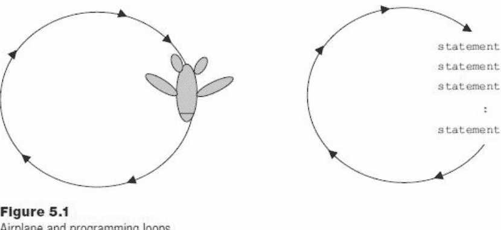

与许多编程语言一样，Java 提供了三种重复或循环语句：`for`、`while` 和 `do-while` 语句。虽然在程序中使用这三种语句可能存在显著重叠的可能性，但良好的编码习惯和合理的使用可以极大地缩小在特定语境下使用哪种语句的选择。本章的目标之一是为这三种语句中的每一种在程序中的最佳用法制定明确的标准。我们将从 `for` 语句开始对重复语句的学习。

## 5.2 FOR 语句

`for` 语句通常被称为自动计数循环。当我们知道要重复循环的次数时，最常使用它。在某些情况下，这种次数在编写程序时就已经知道了；例如，一个始终处理三次存款的程序。在其他情况下，循环执行的次数是在程序执行期间指定或确定的。例如，在输入存款之前，程序会要求用户输入程序执行期间向其银行账户存入的次数。这两种替代方案的共同标准是：在循环执行之前重复次数是已知的。在这种情况下，循环是最佳的重复语句。

### 5.2.1 语句的语法

图 5.2 左侧显示了一个 `for` 语句的示例，其中包含一组将执行三次语句块的语句。该语句的含义及其执行路径在图 5.2 的右侧所示。整数变量 `i` 被称为循环变量或循环控制变量。大括号内部的语句被称为循环的代码块或循环体。它们被称为在循环内部。这些是需要重复的语句。

### 5.2.2 设置初始值

### 5.2.3 测试以继续执行

```
int i;

for (i=1; i<=3; i=i+1)
{
  //需要重复的语句
}
```


# 改变循环变量

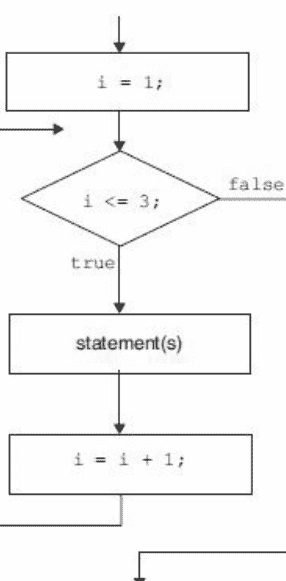

**图 5.2** 一个执行三次的 `for` 循环及其执行路径。

当循环编写得正确时，循环变量会经过初始化、测试和改变。在一个 `for` 循环中，这三个操作都被编码在语句的括号内。参考图 5.2 左侧，语句 `i=1;` 设置初始值，`i<=3;` 测试 `i` 是否已达到终止值或循环是否应该继续，而 `i++` 则改变或增加循环控制变量的值。

参考关键字 **for** 之后括号内的术语，代码：

- `i=1;` 被称为初始化表达式
- `i<=3;` 被称为继续条件表达式或继续条件
- `i++;` 被称为增量

初始化表达式是一个赋值语句。如图 5.2 右上所示，该赋值语句在循环开始之前始终执行，以初始化循环变量。继续条件表达式是涉及循环变量的布尔表达式，它至少执行一次。只要布尔表达式为真，循环体就会重复。如果循环开始时布尔条件为假，则循环体中的语句将不执行。增量是一个赋值语句。该语句用于在执行循环体中的语句后改变循环变量。当增量为 1 时，通常使用等效代码 `i++`。

图 5.2 所示的循环执行了三次循环体。当语句开始时，循环变量初始化为 1。继续条件 (`i<=3`) 结果为真 (`1<=3`)，循环体中的语句执行第一次。然后循环变量递增到 2，测试条件且仍为真 (`2<=3`)，语句执行第二次。随后循环变量递增到 3，测试条件且仍为真 (`3<=3`)，语句执行第三次。最后，循环变量变为 4，条件 (`4<=3`) 为假，循环结束。循环结束后，紧随其右大括号的语句将执行。

接下来的代码片段包含一个执行 500 次循环的 `for` 语句：

```java
int i;

for(i=1; i<=500; i=i+1)
{
  //需要重复的语句
}
```

在编写 `for` 语句时最常见的错误有：

- 在其后放置了分号
- 忘记在初始条件之后或继续条件之后编写分号，这两种情况都会导致错误
- 当需要重复多条语句时，忘记编写左括号和右括号
- 在循环体内修改循环变量，这改变了自动计数

当在右括号后编写分号时，在语法上是正确的，然而，本应构成循环体的任何语句都不被视为循环的一部分（内部）。它们默认为顺序执行，且每条语句执行一次。当不编写大括号时，该语句在语法上也是正确的，但 `for` 语句后的第一条语句被缩进了，它是唯一被视为循环一部分的语句。无论缩进如何，它都是唯一被重复的语句。

`for` 语句的通用语法及其执行路径分别显示在图 5.3 顶部。


```text
for(初始化表达式;继续条件;增量)
{
  //需要重复的语句
}
```

参考关键字 **for** 之后括号内的术语，代码：

- `i=1;` 是初始化表达式
- `i<=3;` 是继续条件表达式或继续条件
- `i++;` 是增量

初始化表达式是一个赋值语句。如图 5.2 右上所示，该赋值语句在循环开始之前始终执行，以初始化循环变量。继续条件表达式是涉及循环变量的布尔表达式，它至少执行一次。只要布尔表达式为真，循环体就会重复。如果循环开始时布尔条件为假，则循环体中的语句将不执行。增量是一个赋值语句。该语句用于在执行循环体中的语句后改变循环变量。当增量为 1 时，通常使用等效代码 `i++`。

图 5.2 所示的循环执行了三次循环体。当语句开始时，循环变量初始化为 1。继续条件 (`i<=3`) 为真 (`1<=3`)，循环体中的语句执行第一次。然后循环变量递增到 2，测试条件且仍为真 (`2<=3`)，语句执行第二次。随后循环变量递增到 3，测试条件且仍为真 (`3<=3`)，语句执行第三次。最后，循环变量变为 4，条件 (`4<=3`) 为假，循环结束。循环结束后，紧随其右大括号的语句将执行。

接下来的代码片段包含一个执行 500 次循环的 `for` 语句：

```java
int i;

for(i=1; i<=500; i=i+1)
{
  //需要重复的语句
}
```

在编写 `for` 语句时最常见的错误有：

- 在其后放置了分号
- 忘记在初始条件之后或继续条件之后编写分号，这两种情况都会导致错误
- 当需要重复多条语句时，忘记编写左括号和右括号
- 在循环体内修改循环变量，这改变了自动计数

当在右括号后编写分号时，在语法上是正确的，然而，本应构成循环体的任何语句都不被视为循环的一部分（内部）。它们默认为顺序执行，且每条语句执行一次。当不编写大括号时，该语句在语法上也是正确的，但 `for` 语句后的第一条语句被缩进了，它是唯一被视为循环一部分的语句。无论缩进如何，它都是唯一被重复的语句。

`for` 语句的通用语法及其执行路径分别显示在图 5.3 顶部。


```text
for(初始化表达式;继续条件;增量)
{
  //需要重复的语句
}
```

## 5.2.2 for 循环的应用

图 5.6 显示了一个图形化应用，它在图 5.7 所示的浅灰色游戏棋板上绘制了国际跳棋棋盘的第一行。该程序使用一个循环来绘制八个棋盘方格，然后使用另一个循环在这一行的黑色棋盘格上绘制一个红色的棋子。

```java
import java.awt.*;
import edu.sjny.gpv1.*;

public class CheckerBoardRow extends DrawableAdapter
{
    static CheckerBoardRow ge = new CheckerBoardRow();
    static GameBoard gb = new GameBoard(ge,"Checker Board Row");

    public static void main(String[] args)
    {
        showGameBoard(gb);
    }

    public void draw(Graphics g)
    {
        int boxX = 12;
        int boxY = 50;
        int boxWidth = 60;
        int boxHeight = 53; // 假设变量名修正
        int imageHeight = 53;
        int checkerX = 20;
        int checkerY = 55;
        int firstCheckerCol = 1;
        Color firstColor = Color.BLACK;
        Color secondColor = Color.RED;

        gb.setBackground(Color.LIGHT_GRAY);

        //Draw the Checker board boxes
        for (int col = 1; col <= 8; col++) {
            g.setColor(firstColor); //black
            if (col % 2 == 0) {
                g.setColor(secondColor); //red
            }
            g.fillRect(boxX, boxY, boxWidth, boxHeight);
            boxX = boxX + boxWidth;
        }//end loop

        //Draw the Red checkers
        g.setColor(Color.RED);
        for (int col = 1; col <= 8; col = col + 2) {
            checkerX = 20 + (col - 1) * boxWidth;
            g.fillOval(checkerX, checkerY, 40, 40);
        }
    }
}
```

图 5.6 CheckerBoardRow。
应用 CheckerBoardRow。


图 5.7
应用 CheckerBoardRow 的输出。

在 `draw` 方法中，图 5.6 的第 26 行使用 `gameEnvironment.setBackground` 方法将棋盘的背景颜色更改为浅灰色。然后第 29 行开始了一个执行 8 次的 for 循环。在循环的每次迭代中，都会使用当前颜色绘制一个黑色或红色的棋盘方格（第 36 行）。循环体中的第一个语句（第 31 行）将当前颜色设置为 `firstColor`（黑色），然后第 32 行如果是，则使用模运算符判断循环变量 `col` 是否为偶数（`col % 2 == 0`），如果是，则将当前颜色更改为 `secondColor`（红色），这导致偶数棋盘格（2、4、6 和 8）被绘制成红色。第 37 行使用了计数算法，其增量为棋盘方格的宽度，用于计算下一个要绘制的棋格的 x 位置。

第 42 行开始了一个循环，在黑色棋盘格上绘制一个红色棋子（45）。在循环开始之前，当前绘制颜色设置为红色（第 41 行）。语句的增量将循环变量设置为 2，该变量存储了列号 1（firstColor），然后是 3、5 和 7。这些是黑色方格的列号，在第 44 行被用于计算每列棋子的 x 位置。在此计算中，在列号 `col` 乘以方格宽度之前，对其减去 1，因为第 1 列的棋子应该绘制在 x 20 的处。

## 5.2.3 求和与平均值算法

累加算法（totaling algorithm）与计数算法一样，都是计算机科学的一种基础算法。这两种算法都用于大多数程序中。正如累加算法的名字所示，它可以被用于计算一组值的总和或和。例如，它可以用于计算向程序输入的一组存款的总额，一旦知道了总额，就可以通过总额除以存款次数轻松得出平均值。

累加算法与计数算法非常相似，区别在于计数算法每次执行时都会给当前值加上（或减去）一个常数，而累加算法则是将下一个项加到当前值上。如果我们加上一组存款，赋值运算符左侧的变量可以是任何有效名称。同样，相同的变量名必须位于赋值运算符的右侧，且该名称应该代表它所存储的内容。所选的变量被泛称为累加变量或求和变量。在使用算法之前，变量被设置为初始值 0。通常情况下，与计数算法一样，该算法会被重复执行。以下代码累加了 1 到 4 的增量：

```java
int sum = 0;

for(int i = 1; i<= 4; i++) {
    sum = sum + 1;
    sum = sum + 2;
    sum = sum + 3;
    sum = sum + 4;
}
```

内存单元 `sum` 的内容将从 0 变为 1、3、6，最后变为 10。在大多数情况下，如右侧所示，使用循环来重复执行求和算法。

图 5.8 展示了一个名为 `TotalingLoop` 的 Java 控制台应用，演示了累加算法的使用和平均值的计算。图底部给出了一组示例输入和程序相应的输出。由第 15–16 行和第 30-34 行产生的货币输出使用第 13 行声明的 `NumberFormat` 类中的对象格式化为美国货币。该类及其用于产生此货币的方法将在下一节中进行讨论。

```java
import javax.swing.JOptionPane;
import java.text.NumberFormat;
import java.util.Locale;

public class TotalingLoop {
    public static void main(String[] args) {
        double balance = 1000.24;
        int numDeposits;
        double deposit, newBalance, averageDeposit;
        String input;
        NumberFormat format = NumberFormat.getCurrencyInstance(Locale.US);

        System.out.println("Your beginning balance is " + format.format(balance));

        input = JOptionPane.showInputDialog("How Many Deposits?");
        numDeposits = Integer.parseInt(input);

        double total = 0;
        for (int i = 0; i < numDeposits; i++) {
            input = JOptionPane.showInputDialog("Enter a deposit");
            deposit = Double.parseDouble(input);
            total = total + deposit;
        }

        averageDeposit = total / numDeposits;
        newBalance = balance + total;

        System.out.println("The total is " + format.format(total));
        System.out.println("The average was " + format.format(averageDeposit));
        System.out.println("Your new balance is " + format.format(newBalance));
    }
}
```

输入：
```
3
100
200
300
```
输出：
```
Your beginning balance is $1,000.24
The total is $600.00
The average was $200.00
Your new balance is $1,600.24
```

图 5.8
应用 TotalingLoop 演示了累加算法的使用和平均值的计算。图中给出了一组示例输入和程序对应的输出。由第 15–16 行和第 30-34 行产生的货币输出使用第 13 行声明的 `NumberFormat` 类中的对象格式化为美国货币。该类及其用于产生此货币的方法将在下一节中讨论。

（注：原文中提供的代码块存在错乱，翻译时已根据逻辑进行了还原，以符合文档工程师的专业性要求。）

## 5.3.1 NumberFormat 类：货币格式化

金融世界。例如，下面的代码片段会产生两个输出，分别格式化为英镑（英国货币）和欧元（欧盟货币）。代码片段的输出显示在代码下方。

```java
double price = 1234567.899;

NumberFormat uk = NumberFormat.getCurrencyInstance(Locale.UK);
NumberFormat france = NumberFormat.getCurrencyInstance(Locale.FRANCE);

System.out.println(uk.format(price));
System.out.println(france.format(price));
```

输出：
```
£1,234,567.89
1 234 567,89 €
```

> 注意：格式化没有考虑汇率。

### 默认本地区域 (Default Locale)

图 5.8 第 13 行调用的 `getInstance` 方法被重载了。它有两个版本：第 13 行调用的带参数版本，另一个是无参数版本。无参数版本用于按照操作系统的默认本地区域格式化货币。假设操作系统的默认本地区域是意大利，以下代码片段将产生两行相同的输出，格式化为欧元：

```java
double price = 1435.2;

NumberFormat italy = NumberFormat.getCurrencyInstance(Locale.ITALY);
NumberFormat osDefault = NumberFormat.getCurrencyInstance();

System.out.println(italy.format(price));
System.out.println(osDefault.format(price));
```

## 5.3.2 DecimalFormat 类：深入观察

`DecimalFormat` 类中的方法在第 10 节中简要讨论过，也可以用于格式化数值信息。通常，这些方法在数值不为空时使用。与 `NumberFormat` 类一样，`DecimalFormat` 类包含一个静态方法，返回数值的格式化版本字符串。该方法通过带参数的构造函数调用，该构造函数接收一个字符串格式化字符串。在第 20 节中，我们使用了格式化字符串 `###.##` 来产生小数点左侧三位数字且两位精度的输出。

其他字符可以使用在格式化字符串中产生其他形式的数值输出。小数点两侧的井号（#）可以被零替换，用于格式化数值的前导零和尾零。此外，可以在格式化字符串的末尾添加百分比号（%）。百分比号用于将数值格式化为百分比。例如，值 `0.237` 将格式化为 `23.7%`，假设格式化字符串中指定了一位精度。无论格式化字符串中使用什么字符，数值的小数部分总是四舍五入的，除非使用了科学计数法。

### 前导零和尾零

在格式化字符串中于小数点相邻处插入零，会为格式化值添加前导零或尾零。例如，当被格式化的数值没有整数部分（如 `.254`）时，在格式化字符串的左侧插入零会将值格式化为 `0.254`。在小数点右侧添加零会将值 `167` 格式化为 `167.0`。如果数字有小数或整数部分，则数值中相邻小数点的数字总是出现在格式化值中。

下面的代码片段带有一个前导零和两个尾零格式化数值，并产生代码所示的输出。第三个输出值保留到指定的位数。

```java
double n1 = .2;
```


## DecimalFormat 示例

```java
double n2 = 167.0;
double n3 = 1.4672;
DecimalFormat ltz = new DecimalFormat("#,##.00");
System.out.print(ltz.format(n1) + " " + ltz.format(n2) + " " + ltz.format(n3));
```

输出：
0.20 167.00 1.47

## 百分比

以百分比号结尾的格式化字符串用于将数值格式化为百分比。该值将被乘以 100，并在 `format` 方法生成的字符串右侧添加百分比号。例如，值 `0.254` 将格式化为 `25.4%`。下面的代码片段带有一个前导零和一个尾零格式化数值为百分比。

```java
double n1 = .2;
double n2 = 0.254;
DecimalFormat pct = new DecimalFormat("#,##.0");
System.out.println(pct.format(n1) + " " + pct.format(n2));
```

输出：
20.0% 25.4%

## 科学计数法

科学计数法是将数值格式化为尾数后跟指数的形式。通常，尾数和指数之间用字母 E 分隔。要确定数值，将尾数按 10 的幂计算。例如，`2.37E2` 代表 `237`。

```java
double n1 = 0.00625;
DecimalFormat sn = new DecimalFormat("0.0000E00");
System.out.println(sn.format(n1));
```

输出：
6.2500E-03

### 表 5.1 `DecimalFormat` 类的字符及其含义

| 字符 | 含义 | 格式示例 |
| --- | --- | --- |
| `#` | 如果此处存在数字，则输出该数字 | `#,###` |
| `0` | 此处输出一个数字，否则输出零 | `.00` |
| `,` | 根据需要，在此处输出逗号分隔符 | `###` |
| `%` | 将数值格式化为百分比 | `%.00%` |
| `E` | 以科学计数法输出数值 | `0.0000E00` |

逗号分隔符
0.006
161,234,563,468.5
1.53

前导零、尾零与逗号
0.006
161,234,563,468.500
1.530

百分比
0.62%
16,123,456,346,850.00%
153.00%

科学计数法
6.2000E-3
1.6123E11
1.5300E00

图 5.10 由应用 `DecimalFormat` 类产生的输出。

前三个输出分组每三位数字使用一个逗号分隔符。第二个和第三个分组也使用了前导零和尾零，其中第三个分组中的输出显示为百分比。第四个输出分组使用科学计数法。

第一个分组中的第一个数值输出（0.006）被截断了，因为它的格式化字符串（第 7 行）只包含三位精度。除非使用科学计数法，否则它包含所有带有前导零的数值。第一个分组中的最后两个输出不包含尾零，是因为在第 7 行使用了井号 (`#`) 来指定它们的精度。

第二个分组中的输出包含尾零，是因为在它们的格式化字符串中使用了一个零来指定它们的精度（第 8 行）。最后，最后一个分组中第二个数值输出的指数（11）包含两个数字，尽管它的格式指定了一个位精度。指数的所有数字总是会被显示的，无论使用多少个零来指定指数的前导零。

## 5.4 FOR 循环的嵌套

正如我们所学过的，循环可以用于重复包含在语句块中的单条语句或一组语句。当语句块包含循环时，我们说语句块内部的循环嵌套在另一个循环内部。语句块内部的循环被称为内层循环，因为它在另一个循环内部，而后者被称为外层循环。语句块中的循环可以被认为是外层循环形成的“巢”中的一个蛋。考虑以下代码片段，它计算了一名跑步者十次入围成绩的平均值：

```java
total = 0;
for(int i = 1; i<=10; i++) {
    input = JOptionPane.showInputDialog("Enter a race time");
    aRaceTime = Double.parseDouble(input);
    total = total + aRaceTime;
}
System.out.println(" Your average time is " + total / 10);
```

这段代码可以通过嵌套在一个执行 100 次的外层循环中来处理 100 名跑步者。

```java
for(int j = 1; j<=100; j++) { // 跑步者 (外层循环)
    total = 0;
    for(int i = 1; i<=10; i++) { // 每位跑步者 (内层循环)
        input = JOptionPane.showInputDialog("Enter a race time");
        aRaceTime = Double.parseDouble(input);
        total = total + aRaceTime;
    }
    System.out.println("Your average time is " + total / 10);
}
```

正如嵌套的判断语句一样，嵌套在其他循环中的循环数量没有限制。以下代码片段使用两层嵌套处理了 5 个州 100 名选赛者的 10 次入围成绩。

```java
for(int k = 1; k<=5; k++) { // 每个州
    for(int j = 1; j<=100; j++) { // 每位跑步者
        total = 0;
        for(int i = 1; i<=10; i++) { // 每场比赛
            input = JOptionPane.showInputDialog("Enter a race time");
            aRaceTime = Double.parseDouble(input);
            total = total + aRaceTime;
        }
    }
}
```

## 5.5 WHILE 语句

许多应用程序需要重复一系列语句，直到布尔条件变为假，而不是重复到执行了给定的次数。例如，程序可能会一直请求密码，直到输入正确的密码为止。在这种情况下，通常使用 `while` 或 `do-while` 语句来编写重复语句的循环。如果语句至少执行一次，则使用 `do-while` 语句。在本节中，我们将讨论 `while` 语句，`do-while` 语句将在第 5.6 节讨论。

### 5.5.1 while 语句的语法

正如第 5.2.1 节讨论的，这是一种良好的编程习惯。

如图 5.13 右侧所示，块中的语句只要布尔条件为真，就会重复执行。如果在执行语句时布尔条件为假，则语句块将不会执行。

以下代码输出 1.2、2.3、3.4 和 4.5 的平方根：

```java
double n = 1.2;
while(n != 5.6) {
    System.out.println(Math.sqrt(n));
    n = n + 1.1;
}
```

编写 `while` 语句时最常见的错误有：

- 在右括号后放置了分号
- 当需要重复多个语句时，忽略了在语句周围编写左、右大括号

在右括号后编写了分号时，该语句在语法上是正确的，但通常构成循环体的任何语句都不被视为循环（循环内部）的一部分。它们默变为顺序执行，每条语句只执行一次。如果没有编写大括号，该语句在语法上也是正确的，`while` 语句后的第一个语句是唯一被视为循环部分的语句。无论缩进如何，只有该语句会被重复执行。在编写循环时，良好的编程习惯是编写以下片段，然后添加布尔条件和需要重复的语句：

```java
while() {
    System.out.println(Math.sqrt(n));
    n = n + 1.1;
}
```

编写 `while` 语句时常见的逻辑错误是在循环的某些重复过程中，语句块内部的语句没有将布尔表达式改为假。本该执行操作的语句编写错误，或者没有包含在循环的语句块中。无论何种情况，一旦循环开始，它永远不会结束，这种循环被称为*死循环*。以下代码片段是一个死循环，因为增加 n 的语句不是循环语句块的一部分。在循环的每次迭代中，n 的值保持为 1.2：

```java
double n = 1.2;
while(n != 5.6) {
    System.out.println(Math.sqrt(n));
    n = n + 1.1;
}
```

当循环的布尔表达式编写不当时，也会发生死循环，如下代码片段所示的情况如此。变量 n 假设了 1.2、2.3、3.4、4.5、5.6... 等值，但永远不会取值为 5.5。

```java
double n = 1.2;
while(n != 5.5) { // n 永远不会变成 5.5
    System.out.println(Math.sqrt(n));
    n = n + 1.1;
}
```

### 5.5.2 哨兵循环

许多应用需要重复一组指令直到检测到停止信号。该信号被称为哨兵值（sentinel value），检测到哨兵值时结束的循环称为哨兵循环。

哨兵循环通常用于处理一组输入数据，哨兵值被选择为输入数据的某个特定值。所选的值必须是数据集中从未出现过的值（例如学生成绩为 -1）。另一个例子是，你可能希望继续处理存款直到输入负数存款，或者从文件中读取数据直到遇到文件结束（EOF）标记。虽然可以使用包含 `break` 语句的 `for` 循环来编写哨兵循环，但使用 `while` 和 `do-while` 语句编写更为简单。

通常，在程序中使用哨兵循环使程序更易用。想象你是一个使用图 5.8 所示程序处理一组输入存款的数据录入员。当程序启动时，系统要求你输入存款数量。如果你输入的存款列表第一项就是存款数量，那么程序中 `for` 循环执行的自动计数将非常适用于该应用。

然而，如果存款列表中没有包含存款数量，在你在使用程序之前，你必须手动计算存款数量。当列表较短时，这不仅耗时，而且如果你数错了存款数量，程序要么在所有存款输入完成之前终止（因为你的计数太小），要么要求你输入一个不存在的存款（因为你的计数太大）。通常情况下，当数据项的数量不容易确定时，哨兵循环使我们的程序变得更容易使用。

以下代码片段是一个哨兵循环的模板，它使用 `while` 语句处理一组输入。每个输入都被读取到一个名为哨兵变量的变量中：

```java
// 将第一个输入读入哨兵变量中
while(//输入 不是哨兵值 ) {
    // 执行循环处理的语句
    // 将下一个输入读入哨兵变量中
}
```

该模板以接受第一个输入的语句开始，而接受所有后续输入的相同语句也被编写为 `while` 语句代码块的最后语句。语句块中的其他语句执行对每个输入的处理。在哨兵循环中这样放置输入语句可以防止对哨兵值的处理，即使它是第一个输入（即数据集）。

编写哨兵循环时的三个常见错误是：

- 在右括号后放置了分号
- 当需要重复多个语句时，忽略了在语句周围编写左、右大括号
- 忽略将下一个输入读入哨兵变量

在右括号后编写分号时，该语句在语法上是正确的，但通常构成循环体的任何语句都不被视为循环（循环内部）的一部分。它们默变为顺序执行，每条语句只执行一次。如果没有编写大括号，该语句在语法上也是正确的，`while` 语句后的第一个语句是唯一被视为循环部分的语句。无论缩进如何，只有该语句会被重复。在编写循环时，良好的编程习惯是编写以下片段，然后添加布尔条件和需要重复的语句：

```java
while() {
    System.out.println(Math.sqrt(n));
    n = n + 1.1;
}
```

编写 `while` 语句时常见的逻辑错误是在循环的某些重复过程中，语句块内部的语句没有将布尔表达式改为假。本该执行操作的语句编写错误，或者没有包含在循环的语句块中。无论何种情况，一旦循环开始，它永远不会结束，这种循环被称为*死循环*。以下代码片段是一个死循环，因为增加 n 的语句不是循环语句块的一部分。在循环的每次迭代中，n 的值保持为 1.2：

```java
double n = 1.2;
while(n != 5.6) {
    System.out.println(Math.sqrt(n));
    n = n + 1.1;
}
```

该模板以接受第一个输入的语句开始，接受所有后续输入的相同语句也被编写为 `while` 语句代码块的最后语句。语句块中的其他语句执行对每个输入的处理。在哨兵循环中这样放置输入语句可以防止对哨兵值的处理，即使它是第一个输入（即数据集）。

编写哨兵循环时的三个常见错误是：

- 在右括号后放置了分号
- 当需要重复多个语句时，忽略了在语句周围编写左、右大括号
- 忽略将下一个输入读入哨兵变量

在右括号后编写分号时，该语句在语法上是正确的，但通常构成循环体的任何语句都不被视为循环（循环内部）的一部分。它们默变为顺序执行，每条语句只执行一次。如果没有编写大括号，该语句在语法上也是正确的，`while` 语句后的第一个语句是唯一被视为循环部分的语句。无论缩进如何，只有该语句会被重复。在编写循环时，良好的编程习惯是编写以下片段，然后添加布尔条件和需要重复的语句：

```java
while() {
    System.out.println(Math.sqrt(n));
    n = n + 1.1;
}
```

编写 `while` 语句时常见的逻辑错误是在循环的某些重复过程中，语句块内部的语句没有将布尔表达式改为假。本该执行操作的语句编写错误，或者没有包含在循环的语句块中。无论何种情况，一旦循环开始，它永远不会结束，这种循环被称为*死循环*。以下代码片段是一个死循环，因为增加 n 的语句不是循环语句块的一部分。在循环的每次迭代中，n 的值保持为 1.2：

```java
double n = 1.2;
while(n != 5.6) {
    System.out.println(Math.sqrt(n));
    n = n + 1.1;
}
```

### 图 5.14 `SentinelLoop` 应用

```java
import java.swing.JOptionPane;
import java.text.NumberFormat;

public class SentinelLoop {
    public static void main(String[] args) {
        double balance = 1000.24;
        double total = 0.0;
        int numOfDeposits = 0;
        String input;
        NumberFormat us = NumberFormat.getInstance();
        System.out.println("Your beginning balance was: " + us.format(balance));
        input = JOptionPane.showInputDialog("Enter a deposit, -1 to end");
        while (!input.equals("-1")) {
            double deposit = Double.parseDouble(input);
            total = total + deposit;
            numOfDeposits++;
            input = JOptionPane.showInputDialog("Enter a deposit, -1 to end");
        }
        balance = balance + total;
        double averageDeposit = total / numOfDeposits;
    }
}
```


System.out.println("The total of the " + numOfDeposits + " deposits is " + us.format(total));

System.out.println("The average deposit was: " + us.format(averageDeposit));

System.out.println("Your new balance is: " + us.format(balance));

通常，大量数据集被存储在磁盘文件中，处理这些数据的程序会从磁盘中读取数据，直到检测到哨兵值（sentinel value）为止。由于哨兵值被选择为数据集值范围之外的值，因此大多数哨兵值会根据不同的应用而异。对于基于磁盘的数据文件，有一个哨兵值适用于所有数据集：即放在每个文件末尾的结束标记（EOF）。

在[第4章](#)的第 4.8.1 节中，我们使用了 `Scanner` 中的方法从磁盘文件读取数据。`Scanner` 还包含一个名为 `hasNext` 的方法，可用于检测文件中的 EOF 标记。该方法没有参数，并在遇到 EOF 标记时返回 `false`。下面的代码片段使用哨兵循环从磁盘文件 `data.txt` 中读取所有整数值，并将这些值输出到系统控制台。从方法 `hasNext` 返回的值被存储在哨兵变量 `notEOF` 中。

```java
int dataItem;

File fileObject = new File("c:/data.txt");

Scanner inFile = new Scanner(fileObject);

boolean notEOF; // the sentinel variable
```

```java
notEOF = inFile.hasNext(); // 获取第1个哨兵变量

while (notEOF) // more data to process
{
    dataItem = inFile.nextInt();
    System.out.println(dataItem);
    notEOF = inFile.hasNext(); // 获取下一个哨兵值
}

inFile.close();
```

下面的代码片段是 EOF 哨兵循环更简洁且更常用的版本：

```java
int dataItem;

File fileObject = new File("c:/data.txt");

Scanner inFile = new Scanner(fileObject);

while (inFile.hasNext()) // more data to process
{
    dataItem = inFile.nextInt();
    System.out.println(dataItem);
}

inFile.close();
```

图 5.15 显示了图 5.14 中程序的修改版本，该程序处理由键盘输入的一组条目。新版本的程序使用其 EOF 标记作为哨兵值从磁盘文件读取数据。在图 5.15 的底部给出了一组输入和相应的程序输出。

```java
import java.util.Scanner;
import java.text.NumberFormat;
import java.io.*;

public class EndFile {
    public static void main(String[] args) throws IOException {
        double balance = 1000.24;
        int numOfDeposits;
        double deposit, total, newBalance, averageDeposit;
        NumberFormat us = NumberFormat.getCurrencyInstance();
        File fileObject = new File("data.txt");
        Scanner fileIn = new Scanner(fileObject);
        numOfDeposits = 0;
        total = 0.0;
        System.out.println("Your beginning balance is: " + us.format(balance));
        while (fileIn.hasNext()) { // more data to process
            deposit = fileIn.nextDouble();
            total += deposit;
            numOfDeposits++;
        }
        balance = balance + total;
        averageDeposit = total / numOfDeposits;
        System.out.println("The total of the " + numOfDeposits + " deposits is " + us.format(total));
        System.out.println("The average deposit was: " + us.format(averageDeposit));
        System.out.println("Your new balance is: " + us.format(balance));
        fileIn.close();
    }
}
```

### 磁盘文件输入
- 20.10
- 30.20
- 40.30

### 输出
初始余额为：$1,000.24
3 次存款总额为：$90.60
平均存款为：$30.20
您的新余额为：$1,090.84

图 5.15 修改后的程序。

新版本的程序使用其 EOF 标记作为哨兵值从磁盘文件读取数据。一组输入和相应的程序输出。

图 5.15 显示了图 5.14 中程序的修改版本，该程序处理由键盘输入的一组条目。新版本的程序使用其 EOF 哨兵值从磁盘文件读取数据。在图 5.15 的底部给出了一组输入和相应的程序输出。

图 5.15 所示的 EOF 哨兵循环的更简洁且更常用的版本。

图 5.15 修改后的程序。

## 5.6.1 do-while 语句的语法

`do-while` 语句以 `do` 关键字开始，后面跟着语句块。`while` 布尔表达式放在大括号之后。良好的编程风格是将 `while` 关键字和布尔表达式与大括号放在同一行，因为它可以提高语句的可读性。

如图 5.16 右侧所示，循环在测试布尔条件之前至少执行一次。如果执行了，则会测试布尔表达式并重复语句，直到布尔条件为假。`do-while` 循环被称为后测试循环，因为测试是在循环语句执行至少一次后进行的。

在编写 `do-while` 语句时，常见的语法错误包括：
- 在 `do` 关键字后加分号
- 忘记在布尔表达式后加分号
- 在需要重复多个语句时忘记使用大括号包裹

所有这些编码错误都是语法错误，会被 Java 编译器检测到并报告。在编写 `do-while` 循环时，良好的编程习惯是编写以下代码片段，并添加需要重复的语句和布尔条件，即使只有一个语句需要重复。

```java
do
{
} while();
```

在编写该语句时，常见的逻辑错误是语句块内的语句在循环的某些过程中，没有将布尔表达式变为 `false`。在这种情况下，如果循环开始，它将永远不会结束，这被称为无限循环。例如，下面的代码序列是一个无限循环，因为循环语句没有改变 `password` 变量，而该变量被用于布尔条件。用户输入的密码被错误地存储在字符串对象 `pw` 中，导致 `password` 在每次循环中都保持不变。

下面的代码片段是 `do-while` 语句的正确编码，用于验证输入正确的密码 Mercury。

```java
String password = "";
do
{
    password = JOptionPane.showInputDialog("Enter The Password");
} while (!password.equals("Mercury"));
```

当循环的布尔表达式编写错误时，也会发生无限循环。在下面的代码段中，逻辑运算符非 (`!`) 在布尔表达式中遗漏了，因此任何其他等于 "Mercury" 的密码都会被接受。

```java
String password = "";
do
{
    password = JOptionPane.showInputDialog("Enter The Password");
} while (password.equals("Mercury")); // 此处缺少 ! 导致逻辑错误
```

## 5.7 break 和 continue 语句

`break` 和 `continue` 语句用于 `for`、`while` 或 `do-while` 循环的代码块内部，以改变循环的执行路径。正如同 `break` 语句终止 `switch` 语句的执行一样，`break` 语句也可以用于终止循环。执行将从循环其后的语句继续进行。

> 注意：当在循环内部执行 `break` 语句时，循环的执行将终止。

当在循环中执行 `continue` 语句时，循环的当前迭代将终止，循环体中 `continue` 语句之后的语句在本次迭代中将不会执行。执行将继续测试循环的布尔条件。当在循环内部执行 `continue` 语句时，循环变量在测试布尔条件之前会增加。

> 注意：当在循环内部执行 `continue` 语句时，循环的当前迭代将终止。

为了说明这两个语句用法，下面的代码段为游戏玩家提供了三次机会输入密码 "Mars" 以进入游戏。`break` 语句用于在输出消息 "Look up your password" 后退出循环。`continue` 语句用于在输入三个错误密码之前，跳过消息框的输出和 `break` 语句执行。

```java
int count = 1;
String password = "";
do
{
    if (count <= 3)
    {
        password = JOptionPane.showInputDialog("Enter your password");
        count++;
        continue;
    }
    JOptionPane.showMessageDialog(null, "Look up your password");
    break;
} while (!password.equals("Mars"));
```

## 5.8 应使用哪种循环语句

当已知循环语句重复的次数时，应该使用 `for` 语句来编写循环。循环重复的次数可能在编写程序时已知（例如，程序将始终运行 100 次），或者在程序执行期间、循环语句执行之前确定。例如，在输入一组存款之前，程序会要求用户输入他们将向银行账户存款的次数。在这两种情况下，`for` 都是首选的循环语句。

当执行循环的次数未知时，`while` 或 `do-while` 循环比 `for` 循环更好。当存在循环体甚至一次都不执行的情况时，`while` 语句是更好的替代方案。当循环语句应该至少执行一次时，`do-while` 语句是更好的替代方案。表 5.2 总结了针对特定应用程序选择最佳循环语句的标准。

### 表 5.2 选择循环语句的标准

| 循环执行的次数是否已知？ | 循环语句 |
|---|---|
| 是的，且存在循环体至少一次都不执行的情况 | for, while |
| 否，且循环体应至少执行一次 | do-while |

随着在 `while` 循环中使用计数算法以及在 `for` 循环中使用 `break` 语句，这三种循环语句之间的界限变得模糊了。例如，为了汇总 100 个项目，大多数程序员会使用 `for` 循环。然而，也可以使用包含计数算法的 `while` 循环，如下面的代码段所示：

```java
int count = 1;
double total = 0;
double average;
String sitem;
while (count <= 100) {
    sitem = JOptionPane.showInputDialog("Enter an item");
    total = total + Double.parseDouble(sitem);
    count++;
}
average = total / 100;
System.out.println("The average of the 100 items is: " + average);
```

该应用首选 `for` 循环，因为当使用 `while` 循环且忘记在循环体中增加计数器 (`count++`) 时，循环就会变成无限循环。如果我们使用 `for` 循环并忘记在 `for` 语句的第一行增加计数器，编译器会提醒我们这一疏忽。

考虑一个程序，当输入 -1 或已输入 100 个项目时输入项目。大多数程序员会为此类应用使用 `while` 循环。然而，可以使用包含 `break` 语句的 `for` 循环来编写。

```java
double total = 0;
String sitem;
for (int i = 1; i <= 100; i++) {
    sitem = JOptionPane.showInputDialog("enter an item");
    if (sitem.equals("-1")) {
        break;
    }
    total = total + Double.parseDouble(sitem);
}
System.out.println("The total of items is: " + total);
```

当使用此 `for` 循环时，循环似乎始终执行 100 次。然而，当 `break` 语句执行时，循环会在 100 次迭代之前终止。从代码可读性的角度来看，`while` 是该应用首选的循环语句，因为 `while` 循环的第一行清晰地说明了结束循环的两个条件。

```java
int count = 1;
double total = 0;
String sitem;
while (count <= 100) {
    sitem = JOptionPane.showInputDialog("Enter an item");
    if (sitem.equals("-1")) {
        break;
    }
    total = total + Double.parseDouble(sitem);
}
```

## 5.9 Random 类

伪随机数、它们在程序中的用法以及生成它们的能力在 2.6 节中讨论过。`Random` 类的方法也可以用于生成伪随机数。事实上，表 5.3 列出了 `Random` 类的构造函数和一些方法。

### 表 5.3 Random 类的构造函数和方法

| 方法 | 说明 | 编码示例 |
|---|---|---|
| `Random()` | 根据种子值时间创建 `Random` 对象 | `Random r = new Random();` |
| `Random(long seed)` | 根据传递给它的种子创建 `Random` 对象 | `Random r = new Random(675);` |
| `nextDouble()` | 返回范围 0.0 <= randomNumber < 1.0 内的伪随机实数 | `double rn = r.nextDouble();` |
| `nextInt()` | 返回基本类型范围内的伪随机整数 | `int rn = r.nextInt();` |
| `nextInt(int max)` | 返回 0 到 max-1 之间的伪随机整数 | `int rn = r.nextInt(20);` |

```java
Random random1 = new Random();
Random randomNumber2 = new Random(123456);
```

就像 `Math` 类的 `random` 方法一样，`nextDouble` 生成并返回范围 0.0 <= randomNumber < 1.0 的伪随机实数（`double`）。该方法可以使用以下赋值语句在范围 randomNumber < max 内生成实数（以及示例对象声明）：

```java
Random randomNumber2 = new Random(98765);
randomNumber = min + randomNumber2.nextDouble() * (max - min);
```

以下代码序列输出了一组在 20.0 ≤ randomNumber < 50.0 范围内的十个伪随机实数。这段代码在两次执行期间生成相同的数字序列是非常不寻常的，因为序列的种子值是当天的毫秒数（`Random` 对象是通过无参数构造函数创建的）。或者，也可以使用单参数构造函数来生成可重复的数字序列。

```java
double randomNumber;
double min = 20.0;
double max = 50.0;
Random randomObject = new Random(); // 当前毫秒值

for (int i = 1; i <= 10; i++) {
    randomNumber = min + randomObject.nextDouble() * (max - min);
    System.out.println(randomNumber);
}
```

如表 5.3 所示，`nextInt` 方法有两个版本，用于生成并返回随机整数（`int` 类型）。无参数版本返回 `int` 变量全范围内的伪随机数（见表 2.1）。

`nextInt` 方法的单参数版本用于生成整数序列，每个整数都在指定的范围内。该方法返回的数字范围从 0 到传递给它的参数减 1。以下代码序列生成 0 到 9（包含）之间的伪随机数：


```java
Random randomObject = new Random();
randomNumber = randomObject.nextInt(10)
```

该方法的使用可以通用。以下代码序列输出 3 到 6（包含）之间的随机整数。变量 `max` 和 `min` 的初始值指定了序列中生成的最低和最高数字。每次运行此代码，都会生成相同的数字序列（5, 5, 5, 4, 3, 5, 5, 3, 6, 4），因为使用了单参数构造函数来创建 `Random` 对象。

```java
int randomNumber;
int min = 3;
int max = 6;

Random randomObject1 = new Random(98765); // 可重复的随机set

for(int i = 1; i<=10; i++)
{
    randomNumber = min + randomObject1.nextInt(max - min + 1);
    System.out.println(randomNumber); // 在 min 到 max 范围内，包含边界
}
```

图 5.17 显示了一个猜数字游戏程序，其中玩家被要求猜一个 32 到 38（包含）之间的数字。图 5.18 显示了第二次猜对时的输入和输出。

图 5.17

`RandomClass` 应用程序。


图 5.18

`RandomClass` 产生的输入和相应的输出。

第 1 行将 `Random` 类导入程序中。第 8 行声明了该类的一个实例 `randomObject`，它用于调用第 15 行的 `nextInt` 方法。第 8 行使用参数构造函数确保了每次运行程序时，第 15 行都有可能生成不同的伪随机数。第 15 行中使用的伪随机数的最大值和最小值分别在第 9 行和第 10 行中指定。

## 5.10 章节总结

许多应用程序需要重复语句中的语句，在本章中，我们讨论了执行这种重复的三种方法：`for` 循环、`while` 循环和 `do` 循环。`for` 循环是在已知语句重复次数时使用的自动计数循环。`do-while` 循环和 `while` 循环在它们的布尔条件变为假时结束，通常用于检测其处理数据的哨兵值。当循环块应该至少执行一次时，使用 `do-while` 循环，而 `while` 循环是一种更通用的循环，可以用于许多应用程序。

循环的控制变量用于控制循环的迭代次数。语句的初始化表达式设置其初始值。在每次循环迭代结束时，执行增量表达式，通常会改变循环变量的值。`for` 循环和 `while` 循环被称为预测试循环；它们在循环开始时测试布尔条件以决定继续；`do-while` 是后测试循环，在迭代结束时测试其条件以决定继续。

总计或求和算法是一种基于循环的算法，它通过反复将新项的值添加到现有的小和并生成新的小和来汇总一组项目。其模板为：`total = total + newItem`。每次循环时，变量 `newItem` 的值假设下一个要总计的对象，这通常由用户输入或从磁盘文件读取。在总计循环开始之前，变量 `total` 被初始化为 0。计数算法可以使用循环内部语句来计算循环执行的次数，并分为总计循环计算来确定总计值的平均值。

当待处理输入值的数量未知时，通常使用哨兵值来终止循环。Java 的两个语句 `break` 和 `continue` 同样允许我们控制循环体内所有或部分语句的执行次数。当在循环内执行 `break` 时，循环终止。`continue` 语句可以结束循环的当前迭代，用于条件规定在当前迭代中跳过循环块中的剩余语句。当使用循环从文件中获取并处理未知数量的输入时，Java 的文件结束（EOF）字符或 `Scanner` 类的 `hasNext` 方法可以作为哨兵来终止循环。

嵌套循环用于重复基于循环的算法。例如计算 10 份成绩的平均分并对 20 名学生重复此操作，或对 100 名跑步者重复一组比赛。嵌套循环在创建由许多相同重复形状实例组成的二维图形时特别有用，例如棋盘的八行方块。

`Random` 类的 `nextInt` 和 `nextDouble` 方法可以生成随机整数或实数。`nextInt` 方法比 `Math` 类的 `random` 方法更容易用，因为它返回指定范围内的整数。这在循环中使用生成随机序列时非常有用。`NumberFormat` 类可以用于格式化输出。

我们对这些语句的知识将在第 6 章中解释，该章节将介绍数组的概念。

### 知识练习

1. 判断对错：

   - a) `while` 循环体至少执行一次。
   - b) `for` 循环是自动计数循环，在重复次数已知时使用。
   - c) 哨兵是一个可以用于终止循环的值。
   - d) `do-while` 循环在布尔表达式变为真时继续。
   - e) `while` 循环是后测试循环。
   - f) 检查 EOF 条件可以控制循环。
   - g) 嵌套循环是循环中的循环。
   - h) 每个 `while` 循环都可以在不使用 `break` 语句的情况下写成 `for` 循环。
   - i) `for` 循环可以写成 `while` 循环。
   - j) `break` 语句结束当前迭代。
   - k) `for` 循环在条件为真时结束。
   - l) `continue` 语句可以在任何循环内部编写。
   - m) 在 `while` 循环括号后放置分号会导致死循环。
   - n) `do-while` 循环的语句可能不执行。
   - o) `for` 循环可以设计为通过减少控制变量来倒计数。
   - p) 循环可以用于验证用户输入，或在用户输入错误密码时给他们再次输入的机会。

2. 写一个循环，将 20 到 100 的整数输出到系统控制台，并在每个输出值旁边输出相应的词（奇数或偶数）。

3. 写一个循环，将从 1 到 $n$ 的整数和（$n$ 是用户输入的值）输出到对话框。

4. 考虑以下代码片段：

```java
int i = 10;
int sum = 0;
while (i <= 100)
{
    sum = sum + i;
    i++;
}
System.out.println("10到100的整数的和为: " + sum);
```

- a) 此循环执行了多少次？
- b) 写一个等效的 `for` 循环。
- c) 写一个等效的 `do-while` 循环。

5. 考虑以下代码片段：

```java
int i = 1;

while (i != 20)
{
    i = i + 2;
}

System.out.println("The value of i is " + i);
```

- a) 这个循环会终止吗？如果没有，原因是什么？
- b) 它会输出哪些数字？

6. 考虑以下代码片段：

```java
int num = 4;

for (int i = 2; i <= 7; i++)
{
    System.out.println(" Number is " + num);
    num = num + i;
}
```

- a) 循环执行两次后，num 的值是多少？
- b) 循环体将执行多少次？
- c) 第四次循环时会输出什么值？
- d) 循环结束时，num 的值是多少？
- e) 是导致这个循环终止？

7. 考虑以下代码片段：

```java
int x = 11;

while (x > 0)
{ 
    x = x - 3;
    System.out.println(x);
}
```

- a) 给出它的输出
- b) 编写一个等价的 for 循环

8. 编写一个输入验证循环的代码片段，该循环要求用户输入一个 0 到 5 之间的整数，如果输入超出范围则显示错误，并允许用户无限次机会正确输入。

9. 编写一个输入验证循环的代码片段，该循环要求用户输入一个 0 到 5 之间的整数，如果输入超出范围则显示错误，并允许用户最多有三次机会正确输入。

10. 解释 `while` 循环和 `do-while` 循环在执行路径上的区别。

11. 提供一个代码片段，每次执行时都在系统控制台输出以下内容：

- a) 一组 0 到 500 范围内不同的 20 个随机整数
- b) 一组 0 到 500 范围内相同的 20 个随机整数
- c) 一组 7 到 500 范围内相同的 20 个随机整数
- d) 一组从 min 到 max 范围内相同的 20 个随机整数

12. 提供所需的声明和输出语句，按指定的格式显示存储在 `double` 变量 `balance` 中的值。同时给出生成的格式化输出结果。

- a) 美国货币
- b) 一个前导零和一个末尾零，小数点左每三个数字用一个逗号分隔
- c) 具有四位精度的科学计数法
- d) 两个末尾零，小数点左每三个数字用一个逗号分隔，且仅当 `balance` 仅包含小数时才显示前导零
- e) 西班牙货币

### 编程练习

1. 编写一个程序，使用 `for` 循环计算并在消息框输出从 n 到 1 的整数乘积（n 的阶乘）。例如，当 n = 4 时，输出将为 24 = 4 * 3 * 2 * 1。n 的值将由用户通过对话框输入，且输出应有适当的。

2. 你被 TravelStars 代理机构聘用，你的第一个任务是制作一个直方图，以图形形式表示旅行者对各种酒店的评分。你的程序将首先要求用户输入包含在直方图中的酒店数量。然后，要求用户输入每家酒店的名称、星级评分（1 到 10 星级之间的整数）。直方图应输出到系统控制台，并格式如下所示。

```
Hotel Name Rating

Hotel 1 ********

Hotel 2 ********

Hotel 3 ********

Hotel 4 **

Hotel 5 ****
```

3. 编写一个程序，使用嵌套循环输出以下一个或多个模式（你也可以创建一些自己的）：

```
a) ******* b) * c) *

    ******

      ***

    ******

      ***

    ******

      ***

    **

      **

    *

      *
```

4. 编写一个程序，向系统控制台输出 25 个随机整数，这些整数必须在用户指定的范围（最小值和最大值）内。

5. 编写一个程序模拟掷两个骰子。每当用户点击消息框上的确定按钮时，都会生成两个 1–6 之间的随机输出，以及两个骰子的和。如果总和为 7 或 11，输出 You win，否则输出 Better next time。

6. 编写一个图形应用程序，显示夜空中可见的 2500 颗星中的 650 颗。星星将以实心形式画在游戏板上，直径为 1 到 3 之间的随机像素。黑色游戏板上有 400 颗白星、200 颗黄星和 50 颗红星，随机位于 (x, y) 位置。你可以通过在主方法中调用 `Component` 类的 `setBackground` 方法并传递颜色来更改游戏板颜色。

7. 使用三个嵌套循环编写编程练习 6 中描述的应用程序。

8. 编写一个图形应用程序模拟旅程。在显示游戏板之前，将要求船长：

9. 编写一个图形应用程序，显示夜空中可见的 2500 颗星中的 650 颗。星星将以实心形式画在游戏板上，直径为 1 到 3 之间的随机像素。黑色游戏板上有 400 颗白星、200 颗黄星和 50 颗红星，随机位于 (x, y) 位置。你可以通过在主方法中调用 `Component` 类的 `setBackground` 方法并传递颜色来更改游戏板颜色。

10. 提供一个代码片段，每次执行时都在系统控制台输出以下内容：

- a) 一组 0 到 500 范围内不同的 20 个随机整数
- b) 一组 0 到 500 范围内相同的 20 个随机整数
- c) 一组 7 到 500 范围内相同的 20 个随机整数
- d) 一组从 min 到 max 范围内相同的 20 个随机整数

打字员仅为这个程序的变量声明就要花费一个一个月的时间，假设该打字员每天连续打字八小时不间断吃饭。（顺便说一下，这违反了联邦劳动法。）使用同一个打字员，可以在几秒钟内完成五百万个内存单元的声明。

所谓的数组是：一种用于声明内存单元的技术，它植根于下标变量的数学概念。

### 定义

数组是一种编程概念，用于声明一组相关的内存单元，其中组中的每个成员都具有相同的数据类型、相同的第一个名称（即数组名称）以及一个称为索引（index）的唯一名称。

内存单元之间的关系与我们的整数内存单元 `age0` 和 `age4` 的关系相同：每个单元都存储一个人的年龄，也许是一个人的体重，又可能是雪人某个部件的地址。在 Java 中，最后的名称（即索引，index 或 indices）始终是从零开始的连续整数（例如 0, 1, 2, 3, 4, ...）。此外，Java 语法要求列表名包含在方括号中，例如 `[2]`。图 6.1 显示了用于存储人们年龄的十个内存单元。左侧的五个内存单元通过以下语句声明为独立的整数变量：

| 非数组 | | 数组 |
|---|---|---|
| age0 | 0 | age[0] |
| age1 | 0 | age[1] |
| age2 | 0 | age[2] |
| age3 | 0 | age[3] |
| age4 | 0 | age[4] |

> 图 6.1
分配给五个整数变量和一个名为 `age` 的五元素数组的存储空间。

```java
int age0, age1, age2, age3, age4;
```

右侧的五个内存单元被声明为名为 `age` 的五成员（或元素）数组的一部分。

如图 6.1 所示，分配给左侧整数变量的存储量与分配给右侧五个数组元素的存储量相同：它们都是独立的整数内存单元。从内存的角度来看，数组元素分配到构成数组元素的内存单元的方式唯一区别在于，它们总是被分配为连续的内存；也就是说，如果每个内存单元占用四个字节存储，且 `age[0]` 存储在字节 100–103 处，那么分配给数组后续四个元素的内存将从字节地址 104、108、112 和 116 开始。（相比之下，这五个整数变量可能存储在内存中分散各处的不同位置。）

只要在语法上能够正确编写内存单元的名称，我们就可以在我们的程序中使用数组元素：在输入和输出语句中、在算术和逻辑表达式中，或者直接使用它们，我们只需编写它们的完整名称。例如，赋值运算符两边的语句，以及作为参数的参数。

图 6.2 是等效的，尽管它们在语法上是不同的，因为右侧的语句使用了数组结构。

```java
age[3]=new Scanner(System.in).nextInt(); age[3]=new Scanner(System.in).nextInt();

age[3] = age[3] + 1;

System.out.println("Your age is " + 
age[3]);

if(age[3] >= 18)
{
    System.out.println("You can " + 
    "Drive now");
}

double avgAge = averageTwo(age[0], age[1]);
```

图 6.2
使用和不使用数组的等效语句。

虽然使用数组涉及的语法因为要编写方括号而有些繁琐，但如前提到的，它们赋予了我们快速声明大量变量的能力。此外，正如我们在在本章后面将看到的，循环内部使用的数组也赋予了我们仅用几行代码处理大型数据集的能力。由于这两个原因，大多数程序都会使用数组。

## 6.3 声明数组

在 Java 中，所有数组都存储在对象内部。虽然我们经常说我们正在“声明一个数组”，但更准确的说法是我们正在“声明一个包含数组的对象”。事实上，正如我们将看到的，该对象不仅包含数组，还包含一个名为 `length` 的整数成员。

用于声明数组对象的语法与声明非数组对象的语法相似，因为引用变量将指向数组对象，并且 `new` 关键字用于构造该对象。它们的不同在于，数组声明语法还包含一组方括号，用于指示引用变量将指向数组对象，并且数组将包含的元素数量（称为数组的大小）包含在另一组方括号中。通用语法为：

```java
aType[] arrayName = new aType[arraySize];
```

其中：

- aType 是数组元素的类型
- arrayName 是引用变量的名称，它将存储数组对象的地址，也被认为是数组的名称
- arraySize 是数组中的元素数量

要声明一个可以存储五个整数年龄的数组对象，我们将写：

```java
int[] ages = new int[5];
```


这条语句分配了图 6.3 所示的内存。不仅在对象内部分配了数组元素的存储空间，还分配了一个整数 `length` 并将其初始化为数组的大小。数组第一个元素的索引始终为零。


图 6.4
语句 `data = new int[3];` 的影响

如图 6.4 所示，五元素数组对象的地址被新的三元素数组对象的地址覆盖，导致分配给五元素数组的存储空间被 Java 运行时内存管理器回收。在 Java 中，未被引用变量引用的对象，其分配的存储空间会被回收，并供其他程序使用。在第 6.9 节中，我们将讨论在创建数组时将值传输到已解析数组中的技术。

## 6.4 数组与循环

在循环中使用数组使我们能够仅用几行代码就处理大型数据集。这是因为用于指定正在处理数组中哪个元素的索引不仅可以是一个数字字面量（例如 `a = age[2]`），还可以是一个整数变量。对整数变量的唯一限制是，其中存储的值必须是数组的有效元素编号。以下代码段两次输出 `price` 数组的第三个元素。当最后一条语句执行时，会获取变量 `index` 的当前内容，替换变量 `index` 并执行输出。

```java
double[] price = new double[100];

int index = 2;
```

```java
System.out.println(price[2]);

System.out.println(price[index]);
```

该特性通常结合语句的循环变量作为数组索引。使用这种方法，为百货商店 10,000 件商品中的每件商品降 10% 准备年度劳动节销售的代码，只需两行代码即可：

```java
for(int i = 0; i < 10000; i++) {
    salePrice[i] = price[i] * 0.9;
}
```

循环第一次执行时 `i` 存储值 0，并计算 `salePrice[0]`。循环第二次执行时 `i` 存储值 1，并计算 `salePrice[1]`。这个过程一直持续直到最后计算出 `salePrice[9999]`。

在循环内部处理数组时有两种常见的错误，两者在语法上都是正确的：

- 循环变量初始化为 1 而不是 0
- 布尔条件编写错误，使用了 `<=` 运算符而不是 `<`

第一个错误源于最常见的错误。当我们大多数人习惯从 1 开始数数（1, 2, 3 等），根据我们的自然本能，会将循环变量初始化为 1 而不是 0。当此错误发生时，数组的第一个元素（元素元素）不会被处理。

错误地编写布尔条件是最常见的错误。当处理数组的所有元素时，如果我们在布尔条件中使用数组的大小 `length`，我们的代码将更易于理解。然而，当我们这样做时，必须在条件中使用“小于”号（`<`）运算符（例如，`i < price.length`）。不幸的是，大多数程序员意图处理数组的最后一个元素，使用了 `<=` 运算符，而迭代的最后一个元素生成的索引比数组的最后一个元素大 1（例如，五元素数组对应 5）。结果是产生了运行时错误 `ArrayIndexOutOfBoundsException` 错误，该错误永远不会出现在 0 到小于数组大小的范围内。

图 6.5 展示了 `ArraysAndLoops` 的示例，它使用了本章中讨论的许多数组概念来计算并输出一组输入商品的销售价。它接受一组待售的商品价格，然后计算并输出它们的销售价。图底部显示了一组示例输入和程序产生的输出。

```java
import java.util.*;
import java.text.NumberFormat;
import javax.swing.JOptionPane;

public class ArraysAndLoops {
    public static void main(String[] args) {
        double[] price, salePrice;
        String s;
        int size;
        NumberFormat fm = NumberFormat.getCurrencyInstance();
        s = JOptionPane.showDialog("How many sale items?");
        size = Integer.parseInt(s);
        price = new double[size];
        salePrice = new double[size];
        for (int i = 0; i < size; i++) {
            s = JOptionPane.showDialog("Enter item " + (i + 1) + ": ");
            price[i] = Double.parseDouble(s);
        }
        for (int i = 0; i < size; i++) {
            salePrice[i] = price[i] * 0.95;
            System.out.println("The sale price of item " + (i + 1) + ": is " + fm.format(salePrice[i]));
        }
    }
}
```


输入：
5
10.00
20.00
30.00
40.00
50.00

输出：
The sale price of item 1 is $9.00
The sale price of item 2 is $18.00
The sale price of item 3 is $27.00
The sale price of item 4 is $36.00
The sale price of item 5 is $45.00

图 6.5

从技术上讲，没有方法可以声明一个对象数组。数组的元素不能是对象；它们只能是基本类型或引用变量。

通过指向对象的变量，我们可以通过引用变量数组的索引来快速处理所有对象。此外，就像使用数组声明大量变量很容易一样，我们也可以使用引用变量数组轻松地声明大量对象。

将数组的力量应用于程序的第一步是声明一个（包含引用变量数组的）引用数组对象。第二步是声明对象并将它们的地址设置为数组的元素。声明引用变量数组的语法与声明基本类型变量数组的语法相同。以下声明创建了一个可以引用五个 `Snowman` 对象的引用变量数组：

```java
Snowman[] sm = new Snowman[5];
```

该声明分配的存储空间如图 6.6 所示。由于数组包含引用变量，它们被初始化为新创建的引用变量的默认值：`null`。否则，该图与图 6.3 相同，图 6.3 显示了声明五个整数数组时分配的存储空间。


图 6.6 由声明 `Snowman[] sm = new Snowman[5]` 创建的存储空间。

如图 6.6 所示，数组对象的声明并没有分配任何 `Snowman` 对象。要做到这一点，我们必须调用 `Snowman` 类中的构造函数，并将新构造的 `Snowman` 地址设置为数组的一个元素。假设该类有一个双参数构造函数，实现此点的方法一种是编写声明语句：

```java
sm[0] = new Snowman(50, 100);
sm[1] = new Snowman(100, 100);
sm[2] = new Snowman(150, 100);
sm[3] = new Snowman(200, 100);
sm[4] = new Snowman(250, 100);
```

假设构造函数的参数是 `Snowman` 对象的 (x, y) 位置，那么当我们新创建的五个雪人被画在游戏板上时，它们将并肩站（x = 50, 100, 150, 200 和 250）。构建这五个雪人的等效但更高效的方法是将构造函数的调用放在循环内部。使用循环是首选编码技术，如果我们必须声明一组 5,000 个雪人，就会很快意识到这一点。

```java
for(int i = 0; i < 5; i++) {
    sm[i] = new Snowman(50 + i * 50, 100);
}
```

由于循环变量被用作数组 `sm` 的索引，`sm[0]` 接收循环内部创建的第一个 `Snowman` 的地址。在循环的每次额外迭代中，数组的下一个顺序元素接收新创建的 `Snowman` 的地址。此外，循环变量在每次通过循环时都使用表达式 `(50 + i * 50)` 来改变雪人的 x 坐标。循环执行完成后创建的存储空间如图 6.7 所示。


图 6.7
指向五个 `Snowman` 对象的五个引用变量数组。

## 6.5.1 处理数组对象

在 6.4 中，我们学习了如何使用数组和循环的概念仅用几行代码处理大型基本类型数据集。为了实现这一点，数据存储在基本类型变量数组中，处理指令被编写在循环内部。循环变量被用作数组的索引，导致处理指令在循环的每次迭代中作用于数组的不同元素。

同样，我们可以通过将地址存储在引用变量数组中，然后在循环中对每个对象进行处理，仅用几行代码处理大型对象集合。区别在于，不对数组元素本身执行处理，而是数组元素在它们所引用的对象上调用类的处理方法。

例如，在名为 `ages` 的整数数组中存储的五个人的年龄每个加 1 的代码，以及将 `sm` 向右移动一个像素。以下代码片段说明了相似之处：

```java
int x;
for(int i = 0; i < 5; i++) {
    ages[i] = ages[i] + 1; // 增加年龄
    x = sm[i].getX(); // 移动雪人
    sm[i].setX(x + 1);
}
```

循环的每次迭代中，循环变量都用于更改循环处理指令中涉及的两个数组的元素。在整数数组的情况下，数组 `ages` 元素中存储的值增加了 1；也就是说，`ages` 的内容增加了。然而，循环处理并没有更改数组 `sm` 的内容。相反，它使用数组 `sm` 的内容来指定在循环的每次迭代中哪个 `Snowman` 对象将由 `getX` 和 `setX` 方法更改（操作）。在这种情况下，每个 `Snowman` 对象的 x 数据都增加了 1。

这并不是说引用变量数组的内容不能在循环内部更改。正如我们已经看到的，当构造对象时且数组元素中存储的默认值被新构造的 `Snowman` 地址覆盖时，就执行了这种操作。相反，可以通过用 `null` 值覆盖数组中的这些地址来消除所有五个雪人：

```java
for(int i = 0; i < 5; i++)
    sm[i] = null;
```

这会导致 Java 内存管理器回收分配给这些对象的存储空间，并将其释放供其他程序使用。图 6.8 中的应用程序使用了本节讨论的概念来进行一个八个雪人的游行，其类定义如图 6.9 所示。程序启动时产生的输出以及点击左侧和右侧按钮几秒后产生的输出分别位于图 6.10 的左右两侧。

```java
import java.awt.Graphics;
import javax.swing.*;

public class SnowParade extends DrawableAdapter {
    static SnowParade ge = new SnowParade();
    static GameBoard gb = new GameBoard(ge, "Snowman");
    static SnowmanV7[] parade = new SnowmanV7[8];

    public static void main(String[] args) {
```

```java
import java.awt.*;

public class SnowmanY {
    int x, y;
    int xSpeed, ySpeed;

    public SnowmanY(int x, int y) {
        this.x = x;
        this.y = y;
    }

    public void draw(Graphics g) { // g 是板 对象
        g.setColor(Color.BLACK);
        g.fillRect(x+10, y+15, 20, 5); // 檐
        g.setColor(Color.MAGENTA);
        g.fillOval(x+10, y+17, 20, 20); // 头
        g.setColor(Color.RED);
        g.fillRect(x, y, 40, 40); // 身体
    }

    public int getX() {
        return x;
    }

    public void setX(int newX) {
        x = newX;
    }

    public int getY() {
        return y;
    }

    public void setY(int newY) {
        y = newY;
    }

    public int getXSpeed() {
        return xSpeed;
    }

    public void setXSpeed(int xSpeed) {
        xSpeed = xSpeed;
    }

    public int getYSpeed() {
        return ySpeed;
    }

    public void setYSpeed(int newYSpeed) {
        ySpeed = newYSpeed;
    }
}
```

```java
for(int i = 0; i < length; i++) { // 创建雪人
    SnowmanY s = new SnowmanY(i*10, i*10);
    board(s); // 假设此处有添加逻辑
}

public void draw(Graphics g) { // 绘制雪人
    for(int i = 0; i < length; i++) {
        parade[i].draw(g);
    }
}

public void timer3() {
    int x, y;
    for(int i = 0; i < length; i++) {
        x = parade[i].getX();
        x += parade[i].getXSpeed();
        parade[i].setX(x);
        y = parade[i].getY();
        y += parade[i].getYSpeed();
        parade[i].setY(y);
    }
    for(int i = 0; i < length; i++) { // 反射每个雪人
        if(parade[i].getX() > 460 || parade[i].getX() <= 60) {
            speed = parade[i].getXSpeed();
            parade[i].setXSpeed(speed);
        }
        if(parade[i].getY() > 420 || parade[i].getY() <= 30) {
            speed = parade[i].getYSpeed();
            parade[i].setYSpeed(speed);
        }
    }
}
```


## 图 6.8 应用程序 `java.awt`

## 图 6.9 类 `SnowmanV7`


**(a) 初始输出**
**(b) 点击 Start 几秒后的输出**

**图 6.10 应用程序 `SnowParade` 的输出。**

一个名为 `parade` 的引用变量数组将用于存储 `Snowman` 对象的地址，在图 6.8 的第 7 行使用。游戏启动时，雪人沿从左到右的倾斜线显示（如图 6.10a 所示），直到点击 Start 按钮。它们然后在游戏板上游行，并在边界处反射，最终到达图 6.10b 中的位置。

雪人的创建、显示、动画和反射是在四个循环中执行的。在这些循环的每次迭代中，都会处理不同的雪人，因为循环变量被用作 `parade` 数组的索引。这些循环中的第一个（图 6.8 的第 11-14 行）用于创建雪人并将这八个对象的地址放在引用变量数组 `parade` 中。在第 13 行，循环变量 `i` 使用在发送给 `SnowmanV7` 类双参数构造函数的参数列表中，以计算每个雪人在沿倾斜线上的初始 `(x, y)` 位置。在从第 21 行开始的循环的每次迭代中，不同的雪人会在其当前的 `(x, y)` 位置显示在板上。

其余两个循环（从第 31 行和第 41 行开始）移动雪人在游戏板上移动并在游戏板的垂直和水平边界处反弹（反射）。循环编写在 `timer3` 回调方法（第 27-56 行）中，该间隔被设置为 20 毫秒（1/50 秒）。

游戏环境调用此方法时，循环执行。当 `timer3` 方法完成执行后，游戏环境调用应用程序的 `draw` 方法（第 19 行），将雪人显示在它们新的 `(x, y)` 位置上。

应用程序第 31–39 行编写的 `for` 循环执行了雪人的动画。通过使用循环变量 `i` 作为 `parade` 数组的索引，可以获取每个雪人的 `x` 和 `y` 位置（第 33 行和第 36 行），并加上其对应的速度数据成员的值（第 34 行和第 37 行），以设置它们的新值（第 35 行和第 38 行）。由于这些代码被编写在 `timer3` 方法中，这段代码每 20 毫秒改变一次每个雪人的 `(x, y)` 位置。雪人的快速重新定位和重绘（每 1/150 秒）产生了运动的视觉效果。

图 6.8 中第 41–55 行编写的 `for` 循环执行了雪人在游戏边界上的反射。两个成员 `xSpeed` 和 `ySpeed` 被添加到 `SnowmanV` 类中（图 6.9，第 7 行和第 8 行），以及相应的 get 和 set 方法（第 41 行、45 行、49 行和 53 行）以执行这种反射。循环变量 `i` 用于两个语句（位于图 6.8 的第 43 行和第 49 行）中来索引 `parade` 数组。它们的布尔条件决定了雪人的 `(x, y)` 位置何时处于或超过游戏的垂直（第 41 行）和水平（第 49 行）边界。

当这种情况发生时，会获取雪人的速度（第 45 行和第 51 行），反转其符号（第 46 行和第 50 行），并将新值设置到雪人的速度数据成员中（第 47 行和第 53 行）。然后，在下次执行 `timer3` 方法时，当使用每个雪人的速度将其重新打印在游戏板上时，由于速度符号已经反转，该游戏板边缘将从边缘反弹。

## 6.6 在方法之间传递数组

正如第 3.8 节所讨论，引用变量可以作为工作方法参数列表的一部分。这使我们能够将在方法中声明的对象的位置传递给它调用的工作方法。了解对象的位置使工作方法能够通过使用接收对象位置的参数名来引用对象，并对其进行处理。此外，当非 `void` 工作方法的返回类型为类名时，工作方法可以将一个对象的位置返回给调用它的类。

由于数组存储在对象中，因此在工作方法之间传递引用变量的能力也使我们具备了在工作方法之间传递数组的能力。要做到这一点，我们只需要在将数组和非数组对象传递给工作方法时，将数组对象的引用变量传递进去和传回即可，在工作方法的签名中可能会存在一些语法上的差异。

在本节的剩余部分中，我们将讨论这些差异并展示在工作方法之间传递数组的示例。我们将从讨论向工作方法传递数组开始，以讨论从工作方法返回数组作为结束。

### 6.6.1 将基本数据类型数组传递给工作方法

考虑图 6.11 左侧所示的数组 `age`，它存储了五个生日相同的人的年龄。以下代码段定义并初始化了该数组，并将其传递给 `Party` 类中编写的静态工作方法 `birthday`。

- 参数：`age` 100
- 调用方法时复制：100
- 参数：`theAges`


**图 6.11 向方法传递基本数据类型数组。**

`Party.birthday(age);` // 方法调用语句

查看该方法调用语句，无法判断发送给 `birthday` 方法的参数是基本类型变量还是数组。这是因为用于将数组引用传递给工作方法的调用语句语法，与用于将基本类型变量传递给工作方法的语法相同，同时也与用于将任何变量引用传递给工作方法的语法相同。从调用语句的角度来看，关于向工作方法传递数组，没有什么新知识需要学习的。

正如之前讨论过的样，工作方法签名的语法是不同的。当方法签名中列出的参数是数组时，在参数名和其类型之间会编写一对方括号 `[]`。以下是传递整数数组的静态工作方法代码。该方法的作用是将数组的每个元素加 1。

```java
static void birthday(int[] theAges) {
    for(int i=0; i < theAges.length; i++) {
        theAges[i] = theAges[i] + 1;
    }
}
```

当工作方法签名中的参数是数组时，参数名和其类型之间有一方括号 `[]`。例如：

```java
static void birthday(int[] theAges)
```

如图 6.11 顶部的虚箭头所示，当方法被调用并将参数 `(age)` 传递到方法的参数 `theAges` 时，方法代码能够访问数组的元素，因为其参数引用该数组。

### 6.6.2 从工作方法传递对象数组

正如 6.5 节所提到的，技术上讲，工作方法支持对象数组。向工作方法传递数组的唯一标志是，在工作方法签名中，参数名和类型之间包含一对方括号 `[]`。工作方法签名中的参数是数组时，参数名和其类型之间有一方括号 `[]`。例如：

```java
static void birthday(int[] theAges)
```

## 图 6.13 PassingArrays 应用

```java
import edu.ccny.gpi.*;
import java.util.*;

public class PassingArrays extends DrawableAdapter {

    static PassingArrays ga = new PassingArrays();
    static String command = "Truman Parade";
    static Newman[] parade = new Newman[7];

    public static void main(String[] args) {
        int[] ages = new int[5];
        for (int i = 0; i < 5; i++) {
            ages[i] = 21 + i;
        }
        birthday(ages);
        for (int i = 0; i < 5; i++) {
            System.out.print(ages[i] + " ");
        }
        for (int i = 0; i < 7; i++) {
            parade[i] = new Newman(10 * i + 50, 1 + 30);
        }
        gb.setTimeInterval(3, 20);
        showboard();
    }

    public void draw(Graphics g) {
        for (int i = 0; i < 7; i++) {
            parade[i].show(g); // show the parade at its current location
        }
    }

    public void timer3() {
        move(parade);
        bounce(parade);
    }

    static void birthday(int[] ages) {
        for (int i = 0; i < ages.length; i++) {
            ages[i] += i;
        }
    }

    static void move(Newman[] parade) {
        for (int i = 0; i < 8; i++) {
            int x = parade[i].getX();
            x += parade[i].getXSpeed();
            parade[i].setX(x);
        }
    }

    static void bounce(Newman[] parade) {
        for (int i = 0; i < 7; i++) {
            if (parade[i].getX() > 460 || parade[i].getX() < 6) {
                int speed = parade[i].getXSpeed();
                parade[i].setXSpeed(-speed);
            }
            if (parade[i].getY() > 420 || parade[i].getY() < 30) {
                int speed = parade[i].getYSpeed();
                speed = -speed;
                parade[i].setYSpeed(speed);
            }
        }
    }
}
```

**图 6.13 PassingArrays 应用。**

为了验证客户端方法和工作者方法共享原始数组这一概念，我们还在 PassingArrays 应用程序中包含了 `ages` 数组和 `birthday` 方法。参考图 6.13，应用程序的 `main` 方法在第 11 行声明了一个名为 `ages` 的五个整数的数组。这些变量在从第 13 行开始的循环内部被初始化为 21 到 25 的值。在第 17 行，此数组被传递给 `birthday` 方法（第 45–51 行），数组的地址被存储在方法的参数 `ages` 中（第 45 行）。该方法的代码在它的循环内部（第 49 行）将数组的每个元素增加了 1。当方法结束时，`main` 方法中的循环（第 18-20 行）输出数组的内容，产生图 6.14 所示的控制台输出。方法输出的所有 `ages` 都增加了 1，这一事实证明了 `main` 和 `birthday` 方法共享同一个整数数组。

**22 23 24 25 26**

**图 6.14 PassingArrays 应用程序产生的控制台输出。**

PassingArrays 应用程序的图形部分代码与 SnowmanPar 应用（图 6.8）的代码相同，不同在于移动和反射雪人的代码（在图 6.8 的第 29–55 行中）被放置在了静态方法 `move` 和 `bounce`（图 6.13 的第 53–87 行）中。此外，这些方法的调用被放置在游戏环境的 `timer3` 方法中（第 41 和 42 行）。因此，这两个程序的图形输出是相同的。当游戏启动时，雪人沿从左到右向下倾斜的对角线显示，如图 6.15a 所示。当点击“Start”按钮时，它们会在地面上游行并发生反弹。图 6.15b 显示了点击“Start”按钮几秒后的程序图形输出。


**图 6.15 PassingArrays 应用的图形输出。**

**(a) 初始输出**
**(b) 几次反射后的输出**

`timer3` 方法现在包含两个语句：`move` 和 `reflect` 方法的调用（图 6.13 的第 41 和 42 行）。`parade` 数组的地址（在第 53 和 68 行声明）被传递给这些方法的参数 `sm`，这些方法的签名已经声明。在它们的循环内部，方法更改了由 `sm` 引用的雪人的 `(x, y)` 位置（第 61 和 64 行）和速度数据成员（第 78 和 84 行）。因为数组在方法之间共享，所以这两个程序的图形输出是相同的。

## 6.6 从方法返回数组

如上一节所述，方法可以向调用者返回一个值。然而，方法也可以返回一个数组。当方法返回一个数组时，它返回的是数组第一个元素的地址。下面的示例展示了一个创建数组并返回它的方法：

```java
static int[] createAges(int count) {
    int[] ages = new int[count];
    for (int i = 0; i < count; i++) {
        ages[i] = 21 + i;
    }
    return ages;
}
```

当数组传递给方法时，传递的是数组的地址。这意味着方法内部对数组所做的任何更改都会反映在原始数组中。这是因为调用者和方法共享同一个数组。

## 6.7 并列数组

假设你正在编写一个维护 1000 个学生数据库的程序。具体来说，每个学生都要存储三个信息：标识码、年龄和平均分（GPA）。如果你是一个面向对象的程序员，你将创建一个 `Student` 类，该类包含一个用于构造学生的构造函数和一个用于输入信息的 `input` 方法。你的应用程序可以这样创建数据库：

```java
Student[] studentInfo = new Student[1000];
for (int i = 0; i < 1000; i++) {
    studentInfo[i] = new Student(); // 创建新学生
    studentInfo[i].input(); // 输入信息
}
```

现在假设你的程序将由 Anna 维护，她是一个受过面向对象编程训练的程序员。她熟悉类、对象的构造、数据成员以及类的静态方法可以操作数据成员的想法。Anna 的编程使用的是另一种范式——过程式范式，对象范式中并不占据核心位置。因为过程式和面向对象范式都包含数组的概念，你决定消除程序对 `Student` 类的使用，仅使用三个数组。一个数组存储所有的标识码，另一个存储所有的年龄，第三个存储所有的平均分。这些数组被称为并列数组。你的应用程序可以这样创建数据库：

```java
int[] ids = new int[1000];
int[] ages = new int[1000];
double[] gpas = new double[1000];
for (int i = 0; i < 1000; i++) {
    // 为每个学生输入 id, age 和 gpa
}
```


# 并行数组与常用数组算法

## 并行数组

用于输入学生信息的代码是并列数组的一个示例。当我们检查第 8、10 和 12 行的输入提示时，可以很容易识别这一点。在第 8 行，用户被要求输入学生的 ID 码，这意味着可以输入 1000 个学生 ID 之一。然而，在第 10 和 12 行，用户被要求输入该学生的年龄和该学生的 GPA。这意味着这两个条目必须是刚刚输入的 ID 学生的年龄和 GPA。因为循环变量被用作数组的索引，学生的信息存储在三个数组的同一个元素中。这就是并列数组的概念。

与特定学生关联的数据存储在组成这些数据的三个数组的相同元素中。如果某个特定学生的 ID 编号存储在 `id` 数组的第 3 个元素，而该学生的 GPA 分别存储在 `age` 数组的第 24 个元素以及 `gpa` 数组的第 6 个元素中，那么我们就没有使用并行数组的概念。

“并行数组”这一名称源于这样一个想法：如果我们把三个数组并排画，并在数组的每个元素上方和下方画一条水平线（如图 6.16 所示），那么学生的所有信息都将包含在两条线之间。例如，ID 为 76892 的学生的年龄为 19 岁，该学生的 GPA 为 4.0。Al 的所有信息（包括他 1.7 的 GPA）都在循环的第一次迭代中输入（请多加努力，Al！）。

| id | age | gpa | info. |
|---|---|---|---|
| 0 | 15647 | 18 | 1.7 | Al 的信息。 |
| 1 | 3452 | 21 | 2.55 | Fio 的信息。 |
| 2 | 76892 | 19 | 4.0 | Bob 的信息。 |
| 3 | 34376 | 22 | 3.85 | Jo 的信息。 |
| 4 | 77834 | 19 | 3.3 | Ed 的信息。 |
| 999 | 45822 | 20 | 2.3 | Jen 的信息。 |

图 6.16
并行数组。

需要记住，并行数组是一个概念或模型，而不是一种语言构造结构。当程序员将特定实体的所有数据存储在两个或多个数组的元素中时，就会使用这个概念。

在 Java 等面向对象的语言所编写的代码中，并行数组的使用频率较少，因为特定实体的所有数据都可以作为数据成员存储在对象，而不是存储在多个数组的元素中。然而，如果我们想将几个不同的对象组合在一起（例如，一个雪人和它的孩子），那么一组并行的对象数组就是实现这一点的完美方法。

例如，假设五个雪人各有一个孩子。那么，如果数组和孩子数组分别存储雪人和雪孩子的地址，通过将这两个数组视为并行的，我们就可以快速找到一个孩子的父母，或者找到一个父母的孩子。父母的地址和其孩子的地址将存储在数组的相同的两个元素中：`parent[2]` 的地址将存储在 `child[2]` 中。

图 6.17 显示了图形应用 `ParallelArrays`，它使用三个并行数组将一个雪人与其雪孩子以及他们的姓关联起来。父雪人的类 `ParentSnowman` 如图 6.18 所示，雪孩子的类 `SnowChild` 如图 6.19 所示。

### 图 6.17 `ParallelArrays` 应用

```java
import edu.scjny.gpvl.*;
import java.awt.*;
import java.util.Random;

public class ParallelArrays extends DrawableAdapter {
    static ParallelArrays ge = new ParallelArrays();
    static GameObject gb = new GameObject(ge, "Parallel Object Arrays");
    static ParallelSnowman[] parent = { parent };
    static SnowChild[] child = { child };

    public static void main(String[] args) {
        String[] names = { "B", "D", "A", "E", "C" };
        parent = new ParallelSnowman[5];
        child = new SnowChild[5];
        Random rn = new Random(500);
        int x, y;
        for (int i = 0; i < 5; i++) {
            x = 100 + rn.nextInt(500 - 100 - 30);
            y = 30 + rn.nextInt(500 - 30 - 30);
            parent[i] = new ParallelSnowman(50, 50 + 90 * i, names[i]);
            child[i] = new SnowChild(x, y, names[i]);
        }
    }

    showGameBoard(gb);

    public void draw(Graphics g) {
        for (int i = 0; i < 5; i++) {
            parent[i].show(g);
            child[i].show(g);
        }
    }

    public void keyStruck(char key) {
        int x, y;
        for (int i = 0; i < 5; i++) {
            x = parent[i].getX();
            y = parent[i].getY();
            child[i].setX(x + 50);
            child[i].setY(y + 35);
        }
    }
}
```

### 图 6.18 `ParentSnowman` 类

```java
import java.awt.*;

public class ParentSnowman {
    private int x, y;
    private String name;

    public ParentSnowman() {
    }

    public ParentSnowman(int x, int y, String name) {
        this.x = x;
        this.y = y;
        this.name = name;
    }

    public void show(Graphics g) {
        // 实现细节
    }

    public int getX() {
        return x;
    }

    public int getY() {
        return y;
    }
}
```

### 图 6.19 `SnowChild` 类

```java
import java.awt.*;

public class SnowChild {
    private int x, y;
    private String name;

    public SnowChild() {
    }

    public SnowChild(int x, int y, String name) {
        this.x = x;
        this.y = y;
        this.name = name;
    }

    public void show(Graphics g) {
        // 实现细节
    }

    public void setX(int x) {
        this.x = x;
    }

    public void setY(int y) {
        this.y = y;
    }
}
```

该多边形被假设为 `(xPoints[i], yPoints[j])`。也就是说，顶点的 x 和 y 坐标被假设为 `xPoints` 数组和 `yPoints` 数组中相同的元素索引。通过此，该方法在图 6.18 第 31 行设置了两个数组 `xPoly` 和 `yPoly`，在第 20 行和 21 行作为并行数组。由于父级鼻子三个顶点的目标坐标为 `(x + 20, y + 25)`、`(x + 15, y + 30)` 和 `(x + 25, y + 30)`，这些 x 和 y 坐标被编码在两个数组的相同元素中。图 6.19 的第 21 行和 22 行定义了一组类似的组合来定义孩子的鼻子，用于在该图的第 28 行绘制孩子的鼻子。

## 6.8 常用数组算法

正如我们看到的，数组可以用来轻松地解码和处理大型数据集。通常，在这些数据集上执行的处理涉及搜索特定的数据（例如，名字为 C 的雪人）、找到第一个或按字母顺序排列的雪人的名字，或者根据名字排序顺序显示雪人家族。搜索、寻找最小值和最大值以及排序都是程序中非常常用的数组处理算法。我们将从数组搜索算法开始我们的算法故事。

### 6.8.1 顺序搜索算法

如其名，该算法被用于搜索数组以确定包含给定值的数组元素索引。例如，它可以用于搜索一个包含一组人年龄的数组，以找到值为 32 的元素索引。如果一个并行数组包含了这些人的名字，则该元素索引可以作为名称数组的索引，以输出 32 岁人的名字。在对象上下文中，它可以用于搜索一个父级雪人数组，以找到名字数据包含字符串“C”的雪人的元素索引，然后使用该元素在游戏板上显示其姓氏。

图 6.21 显示了搜索或定位数组中包含特定值的算法。该算法被称为“顺序搜索”（Sequential Search），从元素 0 开始，顺序检查数组元素，直到找到它正在搜索的值。图中左侧的实现在整数数组中搜索值 32，右侧的代码在对象数组 `parent` 中搜索年龄数据成员为 32 的对象。这些目标值在第 1 行指定。第 2–12 行构成了搜索算法。除了数组名称和第 6 行的布尔条件外，这些算法是相同的。数组对象版本的第 6 行（图的右侧）假设对象类包含一个 `getDate` 方法来获取对象的年龄数据成员。

**搜索基本类型数组**
```java
int target = 32;
elementNumber = -1;
boolean found = false;
for (int i = 0; i < ages.length; i++) {
    if (ages[i].age() == target) {
        found = true;
        elementNumber = i;
        break;
    }
}
```

**搜索对象数组**
```java
int target = 32;
elementNumber = -1;
boolean found = false;
for (int i = 0; i < parent.length; i++) {
    if (parent[i].age() == target) {
        found = true;
        elementNumber = i;
        break;
    }
}
```

图 6.21
顺序搜索算法。

图 6.21 第 1 行的初始化值是待查找的目标值。第 2 行将布尔变量初始化为 `false`。如果找到了正在搜索的目标，该变量将被设置为 `true`。第 4 行运行的循环通过索引遍历数组。在循环内部，第 6 行的 `if` 语句判断数组元素是否包含目标值。如果是，则 `found` 被设置为 `true`（第 8 行），`elementNumber` 在第 9 行被设置为包含该值的元素索引，并跳出循环（第 10 行）。随后的代码必须使用存储在变量 `elementNumber` 中的索引来检查变量 `found`，因为如果没有找到目标值，存储在变量 `elementNumber` 中的值将越界（即等于它的初始值 -1）。

图 6.21 右侧的算法可以用于定位存储在数组对象包含的任何基本类型数据成员中的值，因为对象类包含一个获取该数据成员的方法（该方法将在第 6 行被调用）。如果数据成员不是基本类型值，而是引用变量，那么它所引用的对象类也必须包含一个 `equals` 方法，用于第 6 行的布尔条件。当被调用的对象与目标值相等时，该方法返回 `true`。假设数据成员的名字是字符串，且我们正在搜索 Jones，算法的第 1 行和第 6 行将变为：

第 1 行：`String target = "Jones";`
第 6 行：`if (parent[i].getName().equals(target))`

应该注意的是，如果数组的多个元素包含目标值，变量 `elementNumber` 将设置为最后一个包含目标值的元素索引。如果未找到目标值，存储在变量 `elementNumber` 中的值将越界（即等于它的初始值 -1）。

假设 `ArrayType` 和 `TargetType` 是类型，该方法的签名为：

```java
public static int findValue(ArrayType[] array, TargetType target) {
    int elementNumber = -1;
    boolean found = false;
    for (int i = 0; i < array.length; i++) {
        if (array[i].equals(target)) {
            found = true;
            elementNumber = i;
            break;
        }
    }
    return elementNumber;
}
```


### 6.8.2 最小值和最大值

与搜索算法类似，图 6.22 右侧的算法可以用于定位存储在数组对象包含的任何基本类型数据成员中的值，因为对象类包含一个获取该数据成员的方法（该方法将在第 1、6、8 行被调用）。如果数据成员不是基本类型值，而是引用值，那么它所引用的对象类也必须包含一个 `compareTo` 方法，用于第 6 行的布尔条件，该方法在调用的对象小于传入的参数时返回负数。

假设数据成员的名字是字符串，且我们正在搜索 Jones，算法的第 1 行和第 6 行将变为：

第 1 行：`String min = parent[0].LastName();`
第 6 行：`if(parent[1].LastName().compareTo(min) < 0)`

最后，当数组是 String 对象数组时，算法的第 1 行和第 6 行将变为：

第 1 行：`String min = parent[0];`
第 6 行：`if(parent[1].compareTo(min) < 0)`

图 6.22
最小值算法。

这两个算法都假设最小值存储在或引用数组的第一个元素。因此，第 1 行将设置为该值，第 2 行将其索引（零）存储在变量 `elementNumber` 中。第 4 行的循环比较存储在变量 `min` 中的值（第 6 行），如果发现比存储在 `min` 中的值小的值，则将其存在 `min` 中（第 8 行）。循环结束后，`elementNumber` 包含数组中最小值的索引。

| 基本类型最小值算法 | 对象数组最小值算法 |
| :--- | :--- |
| `1 int min = ages[0];` | `1 int min = parent[0].age();` |
| `2 int elementNumber = 0;` | `2 int elementNumber = 0;` |
| `3` | `3` |
| `4 for(int i = 1; i < ages.length; i++) {` | `4 for(int i = 1; i < parent.length; i++) {` |
| `5 {` | `5 {` |
| `6 if(ages[i] < min) {` | `6 if(parent[i].age() < min) {` |
| `7 min = ages[i];` | `7 min = parent[i].age();` |
| `8 elementNumber = i;` | `8 elementNumber = i;` |
| `9 }` | `9 }` |
| `10 }` | `10 }` |
| `return elementNumber;` | `return elementNumber;` |

```java
for(int i = 1; i < arrayOfValues.length; i++) {

  if(arrayOfValues[i].getAction() < min) {

    min = arrayOfValues[i].getAction();

    elementNumber = i;

  }

}

return elementNumber;
```

### 寻找最大值

寻找数组中包含的最大值的算法与寻找最小值的算法相同，区别在于图 6.22 中第 6 行使用的小于运算符 (`<`) 被替换为大于运算符 (`>`)，并且良好的代码风格要求将变量 `min` 重命名为 `max`。

### 6.8.3 选择排序算法

正如我们在第 6.11 节中将看到的，有许多对 n 数组元素排序的替代算法。其中最简单的之一是选择排序算法。它首先定位元素 1 到 $n-1$ 中包含的最小值，如果它小于元素 0（$j = 0$），则将其交换到元素 0 位置。然后它找到最小的值，如果它小于元素 1（$j = 1$），则将其交换到元素 1 位置。这个过程对于 $j = 2, 3, \dots, n-2$ 重复。当算法结束时，数组按升序排列。

例如，假设我们想对表 6.1 左列的五个整数 12, 9, 3, 4 和 11 进行升序排序。首先，我们从 9, 3, 4 和 11 中找到最小的值，即 3。因为它小于 12（元素 $j = 0$ 处的值），所以它与 12 交换，产生了表格第二列的顺序。然后，在 12 和 4 中找到最小的值，即 4。因为它小于 9（元素 $j = 1$ 处的值），所以它与 9 交换，产生了表格第三列的顺序。对于 $j = 2$ 和 $j = 3$ 的剩余两个步骤以及最终排序后的数组在最右侧的三列中。当数组是对象数组时，选择算法根据某个类成员的值对对象进行排序。

表 6.1
选择排序算法的演变

| | j=0 | j=1 | j=2 | j=3 |
|---|---|---|---|---|
| index 0 | 12 | 3 | 3 | 3 |
| 1 | 9 | 9 | 4 | 4 |
| 2 | 3 | 12 | 9 | 9 |
| 3 | 4 | 4 | 11 | 11 |
| 4 | 11 | 11 | 12 | 12 |
| 数组 | 12 和 3 交换后 | 9 和 4 交换后 | 12 和 9 交换后 | 12 和 11 交换后 |

图 6.23 左侧的代码是用于对基本类型值数组（在本例中为年龄数组）排序的选择排序算法的实现。它包含嵌套循环：内层循环搜索最小值，外层循环将其放在数组中的正确位置。图的右侧是根据 `ParentClass` 对象的某个基本类型数据成员（在本例中为整数数据成员）的值对该对象数组进行排序的算法实现。除了数组名称、第 2 行声明的变量类型，以及图右侧第 6、10 和 12 行使用的 `getDate` 方法外，这些实现是完全相同的。

```java
1 int iMin, min;

2 int temp;

3

4 for (int j = 0; j < ages.length; j++)

5 {

6 min = ages[j];

7 iMin = j;

8 for (int i = j+1; i < ages.length; i++)

9 {

10 if (ages[i] < min)

11 {

12 min = ages[i];

13 iMin = i;

14 }

15 }

16

17 if (iMin != j)

18 {

19 temp = ages[j];

20 ages[j] = ages[iMin];

21 ages[iMin] = temp;

22 }

23 }
```

```java
1 intMin, min;

2 ParentClass temp;

3

4 for (int j = 0; j < parent.length; j++)

5 {

6 min = parent[j].getDate();

7 iMin = j;

8 for (int i = j+1; i < parent.length; i++)

9 {

10 if (parent[i].getDate() < min)

11 {

12 min = parent[i].getDate();

13 iMin = i;

14 }

15 }

16

17 if (iMin != j)

18 {

19 temp = parent[j];

20 parent[j] = parent[iMin];

21 parent[iMin] = temp;

22 }

23 }
```

| 对基本类型数组排序 | 选择排序算法。 |

图 6.23
最小值算法。

从第 6 行开始到第 15 行结束的代码本质是寻找数组元素最小值的算法，该算法在 6.8.2 节中讨论并在图 6.22 中实现。区别在于第 6 行将最小值 `min` 初始化为数组的第 $j$ 个元素而不是第一个，第 7 行将最小元素索引 `iMin` 初始化为 $j$ 而不是零。此外，第 8 行开始的循环将其变量初始化为 $j+1$ 而不是零。该变量是第 4 行开始到第 23 行结束的外层循环的循环变量。因为它在第一次执行第 6-15 行时初始化为零，此代码与最小值结束（第 15 行）相同，前提是 $j$ 不是剩余未排序部分的最小值索引（根据第 17 行的语句确定，第 19-21 行通过交换 $j$ 和元素 $iMin$ 将最小值放入元素 $j$ 中）。可以移除第 17、18 和 22 行，在这种情况下当 $j$ 小于剩余未排序部分时，它将与自身交换。当数组这会产生不必要的资源消耗

在对任何对象进行排序（图 6.23 右侧）时应当注意，第 19–21 行交换了数组 `arrays` 中包含的对象引用。例如，在外层循环的第一次迭代中，`age` 数据成员为最小值的对象的位置被放置在数组的第一个元素。另一种方法是交换对象数据成员的内容，这会更耗时。无论哪种情况，如果排序后的对象从数组的第一个元素到最后一个输出，它们将根据 `age` 数据成员的内容按顺序出现。

图 6.23 右侧的算法可以根据数组 `arrays` 中包含的任何原始类型成员对任何对象进行排序，只要对象的类包含一个用于获取数据成员的 `get` 方法即可（该方法将在第 6、10 和 12 行中被调用）。

如果数据成员不是原始类型，而是引用变量，那么它所引用的对象的类也必须包含一个 `compareTo` 方法，以便用于第 10 行的布尔条件。通常，该方法在调用它的对象小于传递给它的参数（变量 `min`）时返回一个负数。如果 `String` 类包含一个名为 `lastName` 的数据成员，算法的第 10 行将变为：

```java
Line 10: if(parent[i].getName().compareTo(min) < 0
```

当数组是 `String` 对象数组时，算法的第 10 行将变为：

```java
Line 10: if(parent[i].compareTo(min) < 0
```

### 数组算法案例研究

图 6.24 展示了 `ArrayAlgorithms` 图形应用，它说明了如何使用本章讨论的数组处理算法来处理雪家族的并行数组。当应用程序启动时，用户被要求输入五个家族的名称（例如，“I”、“B”、“N”、“E”和“G”）。然后，会显示这五个家族，每个家族由一个 `Parentman` 对象和一个 `SnowChild` 对象组成，它们的类定义分别如图 6.18 和图 6.19 所示（图 6.25a）。


(a) 程序启动后


(b) 第一次按下“I”键后


(c) 第二次按下“I”键后按下方向箭头键


(d) 按下“S”键后

**图 6.25**
ArrayAlgorithms 应用的图形输出。程序启动后，当用户输入雪家族的名称（例如，“I”）时，该家族会交替消失和出现（图 6.25b）。按下方向箭头键时，按顺序最小的家族（例如，“B”）会交替消失和出现（图 6.25a）。最后，当按下“S”键时，可见的家族将按顺序显示（图 6.25d）。

`main` 方法第 18 行开始的循环接收家族名称（第 20 行），并分配 `child` 和 `parent` 对象（第 22 和 23 行）。在每次传递中，`child` 和 `parent` 对象在板上被创建，并赋予其家族名称。然后，使用循环变量将这两个新创建的成员写入 `child` 和 `parent` 数组的相同位置 (`ith`)，使这两个数组保持并行。

`draw` 方法第 30 行开始的循环根据第 32 行的布尔条件判断雪家族是否可见，并在板上绘制它们。当布尔条件为真时，会绘制 `ith` 个父对象。由于数组被设置为并行的，会绘制父对象及其子对象（第 31–34 行）。

#### 搜索算法的使用

`key` 方法第 43–55 行编写了输入单字符家族名称时让家族交替消失和出现的代码。每当输入键时，游戏环境都会调用此方法，并将字符传递给参数（第 43 行）。为了找到该家族名称的对象，第 44 行调用 `findValue` 方法（第 75–87 行），传递 `parent` 数组（以及家族名称的字符串版本）。`findValue` 方法是第 6.8 节末尾讨论的算法。如果找到了家族名称的对象（第 45 行返回的索引不是 -1），则使用第 47–54 行反转该对象的可见性。由于按了两次“I”，画框将从图 6.25a所示的板变为图 6.25b。在本应用程序中，搜索的是 `String` 对象的特定值，因此该搜索实现使用第 80 行 `String` 类的 `equals` 方法。

#### 最小值算法的使用

`keyStruct` 方法第 57–68 行编写了按下方向箭头键时让字母顺序第一的家族名称消失和出现的代码。为了找到家族字母顺序第一的对象，第 59 行调用 `findMin` 方法（第 89–102 行），传递 `parent` 数组。`findMin` 方法是第 6.8 节讨论的寻找最小值的算法实现。在该算法代码中，该方法返回数组元素（第 101 行），该元素引用数据字母顺序第一的对象（第 95 行）。返回的元素用于第 60–67 行反转父对象的可见性。由于 `draw` 方法（第 28–37 行）仅在父对象的 `visible` 数据成员为真（第 32 行）时才绘制父对象及其子对象，因此在输入方向箭头键时，父子对象都会消失并出现。在本应用程序中，搜索的是 `String` 对象的最小值，`findMin` 使用第 95 行 `String` 类的 `compareIgnoreCase` 方法判断 `Parentman` 类 `getName` 方法返回的是否小于 `min` 引用的字符串。

#### 选择排序算法的使用

`keyStruct` 方法第 69–72 行编写了按下 S 键时按家族名称升序排序 `parent` 和 `child` 数组的代码。为了对 `parent` 和 `child` 数组排序，第 71 行调用 `selectionSort` 方法（第 104–139 行），传递 `parent` 数组。`selectionSort` 方法是第 6.8.3 节讨论的排序算法实现。在该算法代码中，该方法不仅交换传递给它的数组元素（第 125–127 行），还交换其并行数组 `child` 的元素（第 128–130 行）。（由于 `child` 数组被声明为类变量，`selectionSort` 方法可以访问它。）此外，该方法交换父对象的数据成员（第 132–134 行），并将子对象置于下一个父对象（第 135–137 行），因此家族将按排序排列。

## 6.9 应用程序接口数组支持

Java 应用程序接口中的 `System` 和 `Arrays` 类包含了处理数组的方法，而 `ArrayList` 类提供了一种可以超出原始大小的类数组对象的存储方式。`ArrayList` 是通用类之一，将在第 10 章讨论。在本节的剩余部分，我们将讨论 API `System` 和 `Arrays` 类的数组支持。

### 6.9.1 arraycopy 方法

顾名，`System` 类中的 `arraycopy` 方法用于将一个数组（源数组）的内容拷贝另一个数组（目标数组）。该方法是静态方法，通过编码类名 `System` 而不是对象名来调用。签名包含五个参数，典型的调用如下：

```java
System.arraycopy(sourceArray, sourceIndex, destinationArray,
destinationIndex, numElements);
```

其中：

- `sourceArray` 是被拷贝的数组（数组引用变量）
- `sourceIndex` 是从 `sourceArray` 拷贝的第一个元素的索引（int）
- `destinationArray` 是被拷贝到的目标数组（数组引用变量）
- `destinationIndex` 是拷贝到 `destinationArray` 的第一个元素的索引（int）
- `numElements` 是要拷贝的连续元素个数（int）

在调用该方法之前，源数组和目标数组都必须存在（已预声明）。图 6.26 显示了执行该调用结果：


```java
System.arraycopy(age, 0, sum, 1, 2);
```


如果传递给方法的 `sourceIndex`、`destinationIndex` 和 `numElements` 值使得由于生成的元素数量不存在，将发生一个运行时错误（`ArrayIndexOutOfBoundsException`）。此错误比 `IndexOutOfBoundsException` 错误更具体，正如我们在第 7 章将看到的，`String` 对象的字符也被分配了索引值，而尝试使用不存在的字符索引不会导致此异常，而是会导致 `StringIndexOutOfBoundsException` 错误。

### 6.9.2 Arrays 类

`Arrays` API 类包含两个可以将一个数组复制到另一个数组的方法，并包含了许多其他用于处理基本类型数组和字符串数组的有用方法。这些方法包括：一个通过将数组所有元素转换为单个字符串来方便输出数组所有元素的方法、一个排序方法、一个用于确定两个相等数组之间顺序的搜索方法，以及一个将数组元素设置为指定值的方法。搜索和排序算法的执行速度比第 6.8.1 节和 6.8.3 节中讨论的算法更快。`Arrays` 类中的某些方法总结在表 6.2 中。

**表 6.2 API `Arrays` 类中的方法**

| 功能 | 方法名 | 典型调用 |
|---|---|---|
| 复制数组从第一个元素开始的所有部分 | copyOf | `int[] a = Arrays.copyOf(sourceArray, 10);` 返回一个包含 `sourceArray` 中前十个元素的数组 |
| 复制从任意元素开始的任意数组 | copyOfRange | `int[] arr = Arrays.copyOfRange(sourceArray, 2, 10);` 返回一个包含 `sourceArray` 中第三个（索引 2）到第九个元素的数组 |
| 将数组的内容转换为字符串 | toString | `String s = Arrays.toString(anArray);` 返回一个用大括号括起来字符串，其中包含数组元素的内容，并用逗号和空格分隔 |
| 按升序排序数组元素 | sort | `Arrays.sort(anArray);` 排序 `anArray` 中索引从 1 到 4 的元素 |
| 在排序的数组中搜索（位置）某个值 | binarySearch | `int i = Arrays.binarySearch(anArray, targetValue);` 返回 `targetValue` 在排序后的 `anArray` 中出现的索引；如果未找到，则返回一个负值 |
| 将数组元素设置为给定值 | fill | `Arrays.fill(anArray, 4);` 将数组 `intArray` 的所有元素设置为值 4 `Arrays.fill(stringArray, 1, 4, "FillValue");` 将数组 `stringArray` 的第二个（索引 1）到第四个（索引 3）元素设置为 "FillValue" |

所有这些方法都是静态方法，图 6.27 中的程序说明了它们的用法。该程序生成的输出显示在图 6.28 中。

**图 6.27** `ArraysClass` 的应用。

图 6.27 的第 15 和第 16 行输出了第 6 和第 8 行字符串和整数数组的所有元素。发送到第 15 和 16 行 `print` 方法的参数是来自 `Arrays` 类 `toString` 方法返回的字符串。返回的字符串是图 6.28 中所有 2 和 3 行内容的连接，元素之间用逗号和空格（`, `）分隔，以左括号 `[` 开头并以右括号 `]` 结束。

| 1 | 使用 `Arrays.toString` 方法输出数组 |
| 2 | [Tom, Mary, Bob, Alice, Joe, Fred] |
| 3 | [3, 5, 2, 8, 6, 4] |

```
4

5

6

复制数组用了 Arrays.copyOf 方法

[Tom, Mary, Bob, Alice, Joe, Fred, null, null, null]

[3, 5, 2, 8, 6, 4]
```

```
7

8

9

测试两个数组的相等性：Arrays.equals 方法

true

false

10

112

13

排序数组全部或部分：Arrays.sort 方法

[Alice, Bob, Fred, Joe, Mary, Tom]

[3, 2, 5, 6, 8, 4]
```

```
16

17

18

19

搜索一个值：Arrays.binarySearch

-3

20

部分复制：Arrays.copy 和 copyRange 方法

[3, 2, 5, 6]

[5, 6, 8, 4, 0, 0, 0, 0]
```

```
23

24

25

26

填充数组全部或部分：Arrays.fill 方法

[4, 4, 4, 4, 4]

[Alice, FillValue, FillValue, FillValue, Mary, Tom]
```

**图 6.28** `ArraysClass` 产生的输出。

图 6.27 的第 21 和第 23 行使用 `Arrays` 类的静态 `copyOf` 方法创建 `stringArray` 和 `intArray` 的副本，并将新创建的地址分别赋值给变量 `copyStringArray` 和 `copyInt`。第二个参数指定了要复制的元素数量，数组从元素 0 开始。如果要复制的元素数量超过源数组的大小（如第 21 行所示），则元素将填充与其类型一致的默认值（对于字符串引用为 `null`），如图 6.28 的第 6 行所示。

图 6.27 的第 29 和第 31 行使用 `Arrays` 类的静态 `equals` 方法来比较两个整数数组是否相等。如果传递的两个数组的所有元素都相等（如第 29 行所示），则该方法返回 `true`；否则返回 `false`（第 31 行）。返回的布尔值被输出并显示在图 6.28 的第 10 和 11 行。

图 6.27 的第 36 行使用 `Arrays` 类的单参数版本 `sort` 方法排序 `stringArray` 的所有元素，`intArray` 使用三参数版本的方法排序索引 1 到 4 的值。三参数版本的方法总是大于要排序的元素的索引。这可以通过比较未排序值的输出（图 6.28 的第 7 行）与排序后值的输出（图 6.28 的第 15 行）来验证。排序是在传递给方法的数组内部进行的。数组排序后，可以使用 `Arrays` 的 `binarySearch` 来确定某个值在数组中的索引。第 44 行调用此方法在数组中搜索包含 "Fred" 的元素的索引。该字符串的索引为 -3（图 6.28 的第 14 行），如果未找到项，则返回一个负值（图 6.28 的第 19 行）。要排序的最高元素索引（图 6.28 的第 15 行）总是小于三参数版本的值。这可以通过比较未排序值的输出（图 6.28 的第 7 行）与排序后值的输出（图 6.28 的第 15 行）来验证。排序是在传递给方法的数组内部进行的。数组排序后，可以使用 `Arrays` 的 `binarySearch` 来确定某个值在数组中的索引。索引（图 6.28 的第 14 行）显示了 2（图 6.28 的第 29 行）。

```java
int[][] grades = new int[4][5]; //四行五列
```

等效的双行语法为：
```java
int[][] grades;
grades = new int[4][5];
```

在双行语法的第二行中，数字字面量可以替换为整数变量，以便在运行时指定或更改数组的大小。二维数组的内存模型与图 6.3 和图 6.7 所示的一维数组内存模型不同，将在第 6.10.2 节中讨论。它提供了额外的常量来存储数组每行中的元素数量。例如，图 6.30 所示的数组将会有四个额外的常量：`grades[0].length`、`grades[1].length`、`grades[2].length` 和 `grades[3].length`。

这些变量将分别存储第 0、1、2 和 3 行中的元素数量；在这种情况下，整数值 `grades.length` 仍然存储数组的行数。

### 初始化二维数组

二维数组的元素可以在声明数组时进行初始化。与一维数组一样，当未明确指定数组的行和列数，而是从初始值的数量推断出来时，必须为数组的每个元素指定一个初始值。如果我们认为二维数组看作是一维数组，其每个元素都是多维数组的一行，那么这种初始化语法就最容易理解了。此外，将每行的初始值写在单独的一行上是最方便的。下面的数组声明使用这种编码风格来声明图 6.31 所示的多维数组，并将其所有值初始化为图中所示的值。

**图 6.31** 数组 `grades` 初始化后的元素。

| 列 0 | 列 1 | 列 2 | 列 3 | 列 4 |
| --- | --- | --- | --- | --- |
| 行 0 | 10 | 11 | 12 | 13 | 14 |
| 行 1 | 20 | 21 | 22 | 23 | 24 |
| 行 2 | 30 | 31 | 32 | 33 | 34 |
| 行 3 | 40 | 41 | 42 | 43 | 44 |

```java
int[][] ages = { {10, 11, 12, 13, 14},
{20, 21, 22, 23, 24},
{30, 31, 32, 33, 34},
{40, 41, 42, 43, 44} };
```

二维数组每行中指定的初始值数量不需要相同。下面的声明产生了图 6.32 所示的 `ages` 数组，它的每行元素数量各不同：

> 注意：如果要初始化数组中的某一个元素，则所有元素都必须初始化。

**图 6.32** 数组 `ages` 初始化后的元素。

| | 列 0 | 列 1 | 列 2 | 列 3 | 列 4 |
|---|---|---|---|---|---|
| 行 0 | 10 | 11 | 12 | | |
| 行 1 | 20 | 21 | 22 | 23 | 24 |
| 行 2 | 30 | 31 | | | |

```java
int[][] ages = { {10, 11, 12},
{20, 21, 22, 24},
{30, 31} };
```

在数组对象 `ages` 内部，公共变量 `ages[0].length`、`ages[1].length` 和 `ages[2].length` 将分别存储整数值 3、5 和 2。这些变量在下面的代码框中使用，用于输出图 6.32 所示的 `ages` 数组的所有元素，并且经常被传递二维数组的方法使用，以确定数组每行的列数。

```java
for(int row = 0; row < ages.length; row++) // 每一行
{
  for(int col = 0; col < ages[row].length; col++) // 行的每一列
  {
    System.out.print(ages[row][col] + " ");
  }
  System.out.println();
}
```

## 6.10.2 多维数组内存模型

当我们程序中访问一维数组的元素时，我们应该将其想象为图 6.1 所示：一列带有其索引的变量。了解它们在内存中复杂的表示形式（如图 6.3 所示的内存模型），对于通过简单访问数组元素来理解数组概念是非常必要的。例如，在第 6.6.1 节中，我们使用一维数组内存模型来理解两个方法如何共享同一个数组。

同样，访问多维数组的元素时，我们应该将其想象为图 6.29 到 6.32 所示。然而，理解它们在内存中的表示对于充分理解这种编程构造的威力是必要的。通常情况下，Java 将多维数组表示为一维数组的组合。考虑下面的代码段，它声明了一个名为 `prices` 的包含两行三列的二维数组：

```java
double[][] prices = {{12.4, 2.6, 5.2}, {9.8}};
```

Java 使用一维数组的组合来表示二维数组。这些额外的一维数组按行主序（row-major）存储，这意味着数组的所有元素存储在连续的内存单元格中。


通常对于二维数组，引用数组的第一个元素指向存储第 0 行值的数组；第二个元素指向存储第 1 行值的数组，以此类推。对于具有 4 行的数组，会有 4 个额外的元素。这些额外的元素引用如图 6.33 所示的具有 6 个元素的一维数组。这些数组的值存储在如下所示：

```java
int[][] ages = new int[3][]; // 行数

int[] row0 = {10, 11, 12};
int[] row1 = {20, 21, 22, 23, 24};
int[] row2 = {30, 31};

ages[0] = row0;
ages[1] = row1;
ages[2] = row2;

for(int row = 0; row < ages.length; row++) { // 每一行
    for(int col = 0; col < ages[row].length; col++) {
        System.out.print(ages[row][col] + " ");
    }
    System.out.println();
}
```

输出：
```
10 11 12
20 21 22 23 24
30 31
```


**图 6.33** 不规则二维数组的内存模型

## 6.11 额外的搜索和排序算法

并不是所有的搜索和排序算法在执行速度上都是等价的，这被称为算法的时间复杂度。本章之前讨论的两种算法——顺序搜索和选择排序——处于速度较慢的一端。在本节讨论的三种算法中，二分查找和归并排序要快得多，而且当需要搜索或排序的项目数量很大时，这种速度差异会变得显著。这三种算法通过水平方向可视化数值数组都更容易理解。

### 6.11.1 二分查找算法

二分查找算法的前提条件是被搜索的数组是**升序排列的**。考虑下面所示的排序数组。其左右边界元素是元素 0 和元素 17 分别。


二分查找算法检查的第一个将是数组的中间元素，其索引为左边界和右边界元素的平均值：8。如果正在搜索此项，算法将返回元素的索引。如果要搜索的项小于中间元素，那么该项一定位于中间元素的左侧，因为数组是升序排列的。因此，待搜索数组的右边界左移到中间元素索引减 1 的位置。否则，要搜索的项大于中间元素，则待搜索数组的左边界右移到中间元素索引加 1 的位置。

这个过程一直持续直到找到项，或者待搜索数组的左边界大于右边界。在后一种情况下，要搜索的项目不在数组中，算法返回 -1。

图 6.35 展示了算法搜索过程的三次迭代，用于在 n=18 的排序数组中定位值 27。在第 1 次迭代中，待搜索数组的左边界索引（图中标记为 L1）被设置为 0，右边界（R1）被设置为 n-1，即索引 17。中间元素（M1）设置为 (L1 + R1) / 2 = 8。由于元素 8 存储的值 39 大于 27，因此待搜索数组的右边界（R2）被设置为元素 M1-1=7。


> **图 6.35** 查找值 27 的二分查找过程演示

第二次迭代将中间元素（M2）设置为 (L2 + R2) / 2 = 3。由于元素 3 存储的值 19 小于 27，待搜索数组的左边界（L3）被设置为元素 M2+1=4。第 3 次迭代将中间元素（M3）设置为 (L3 + R3) / 2 = 5。由于元素 5 存储了正在搜索的值 27，算法返回 M=5 的索引。

由于二分查找在搜索过程的每次迭代中通过移动左边界或右边界，从搜索中排除了一半的剩余数组，因此其平均速度与 log2(n) 成正比，其中 n 是待搜索的项数。这表示为 O(log(n))，称为算法的大 O 值。相比之下，顺序查找的平均速度与 n 成正比，表示为 O(n)。对于较小的 n 值，它们的差异可以忽略不计。然而，当 n 为一百万时，二分查找算法比顺序查找算法快 50,000 倍。

图 6.36 所示的 `binarySearch` 方法是二分查找算法的一种实现。它在传递给第一个参数 `sortedArray` 的数组中搜索传递给第二个参数 `target`。第 20 行返回包含目标值的数组索引。如果该值不在数组中，第 23 行返回 -1。

```java
public int binarySearch(int[] sortedArray, int target)
{
    int leftBoundary = 0;
    int rightBoundary = sortedArray.length - 1;
    int middleIndex;

    while (leftBoundary <= rightBoundary)
    {
        middleIndex = (leftBoundary + rightBoundary) / 2;

        if (target < sortedArray[middleIndex])
        {
            rightBoundary = middleIndex - 1;
        }
        else if (target > sortedArray[middleIndex])
        {
            leftBoundary = middleIndex + 1;
        }
        else
        {
            return middleIndex;
        }
    }
    return -1;
}
```


## 图 6.36 binarySearch 方法

第 3 行和第 4 行将数组的左右边界初始化为数组中最小和最大的元素编号。`while` 循环（第 7-22 行）在数组的左边界索引大于其右索引时结束。循环的每次迭代中，第 9 行使用索引计算中间元素的编号。数组的该元素是第 10 行和第 14 行布尔条件的一部分，用于判断是否应该改变右边界（目标值小于中间元素）或左边界（目标值大于中间元素）。如果边界都不改变，目标值等于中间元素，第 20 行返回其索引。否则，循环的下一次迭代从第 9 行开始，使用重新定位的边界重新计算中间元素。

## 插入法排序过程

考虑图 6.37a 所示的数组，除了右侧元素 7 外，所有元素都是有序的。我们可以使用三步过程来排序数组：首先将元素 7 复制到位于顶部的变量 `temp` 中。然后将 7 左侧所有大于 `temp` 的元素向右移动一位，如图 6.37b 所示。最后，将 `temp` 复制到数组的最后一个位置（元素 3），如图 6.37c 所示。这三步操作假设数组中唯一的无序元素是其右侧元素，这构成了插入法的基础。

### 图 6.37 插入法使用的排序过程

| | 0 | 1 | 2 | 3 | 4 | 5 | 6 | 7 |
|---|---|---|---|---|---|---|---|---|
| temp (a) | 2 | 3 | 6 | | | | | |
| | 0 | 1 | 2 | 3 | 4 | 5 | 6 | 7 |
| | | 0 | 1 | 2 | 3 | 4 | 5 | 6 |
| | | | 0 | 1 | 2 | 3 | 4 | 5 |
| | | | | | | | | | | | | | |

通过昂贵的操作，插入法从数组的左侧开始，并使用操作排序元素 0 和 1。这个数组部分首先是有序的，因为其中只有右侧元素（元素 1）可能是无序的。排序了这个两个元素的部分后，随后使用操作排序元素 0、1 和 2。在这个数组部分，由于元素 0 和 1 已经排序，只有右侧元素（元素 2）可能是无序的。通过一个元素扩展子数组的过程持续到数组有序。

图 6.38 中的四个表格展示了元素为 6, 3, 5, 1, 4, 7, 2 的数组在插入法前四次迭代中的变化。从图中第一次迭代（两个元素的子数组）开始，每个表的三行显示了四次迭代中一次排序操作引起的变化。

### 图 6.38 插入法的前四次迭代

| | 0 | 1 | 2 | 3 | 4 | 5 | 6 | 7 |
|---|---|---|---|---|---|---|---|---|
| temp 3 | 6 | 3 | 5 | 1 | 4 | 7 | 2 |
| | | 6 | 3 | 5 | 1 | 4 | 7 | 2 |
| | | | 3 | 6 | 5 | 1 | 4 | 7 | 2 | a[0]→a[1] |
| temp 5 | 3 | 6 | 5 | 1 | 4 | 7 | 2 |
| | | 3 | 6 | 5 | 1 | 4 | 7 | 2 |
| | | | 3 | 6 | 5 | 1 | 4 | 7 | 2 | a[0]→a[2] |
| temp 1 | 3 | 5 | 6 | 1 | 4 | 7 | 2 |
| | | 3 | 5 | 6 | 1 | 4 | 7 | 2 |
| | | | 3 | 5 | 6 | 1 | 4 | 7 | 2 | a[0]→a[3] |
| temp 4 | 1 | 3 | 5 | 6 | 4 | 7 | 2 |
| | | 1 | 3 | 5 | 6 | 4 | 7 | 2 |
| | | | 1 | 3 | 5 | 6 | 4 | 7 | 2 | a[0]→a[4] |

## 图 6.39 insertionSort 方法

```java
public static void insertionSort(int[] anArray) {

    for (int i = 1; i < anArray.length; i++) {

        int temp = anArray[i];

        int tempIndex = i;

        while (tempIndex > 0 && anArray[tempIndex - 1] > temp) {

            anArray[tempIndex] = anArray[tempIndex - 1];

            tempIndex--;

        }

        anArray[tempIndex] = temp;

    }

}
```

循环的每次迭代（从第 3 行开始）对应于图 6.38 所示的三个表格中的一个。从正确的位置开始，元素被放置在其左侧的有序数组中。第 5 行和第 6 行分别将元素的值和当前索引（表的第一行）放入 `tempIndex`。从第 7 行开始的循环通过将 `tempIndex` 减 1（第 10 行）确定元素的排序位置，否则其布尔条件的右转向判断 `tempIndex` 左侧的元素是否大于存储在 `temp` 中的值。

## 归并排序


然后，数组中具有较小元素的下一个元素的值将用于下一次比较，并将较小的值复制到数组 `temp` 的第 1 个元素中。对于图中所示的数组，`left[1]` 与 `right[0]` 进行比较，`right[0]` 将被复制到 `temp[1]`。

此过程在随后的比较中重复，直到一个数组的所有元素都被复制到 `temp` 数组中。对于图中所示的数组，将在值 1 到 6 被复制到 `temp` 数组后发生。另一个数组的所有剩余元素（值 7 和 8）都将复制到 `temp` 中。图 6.40 中使用的数组元素值被选择为代表合并过程复制到数组的顺序。

合并过程是归并排序（Merge Sort）算法的基础，该算法接受一个未排序数组并将其按升序排序。由于归并排序是对两个已经排序的数组进行排序，因此问题是：我们如何利用它来排序一个未排序数组？

为了回答这个问题，考虑数组左半部分的值已经排序且数组右半部分的值也已经排序的情况。如果待排序的数组是图 6.40 所示 `left` 和 `right` 数组的连接，情况就是这样。那么归并排序算法将数组划分为左、右两个子数组，并对这两个子数组应用合并过程。它将通过将数组的内容复制回待排序的数组来完成排序。实现此过程的方法签名可以是：

```java
public static void merge(int[] anArray, int left, int right)
```

但由于合并过程可以用于排序数组的任何部分，只要该部分可以被划分为两个相邻的排序部分（且这两个部分的长度不一定相等），我们可以通过向方法添加三个参数来增加该方法的可用性。这些参数将定义名为 `left` 的左侧排序部分的索引、相邻的名为 `right` 的右侧排序部分的索引，以及名为 `mid` 的左侧排序部分的结束索引。（相邻右侧部分的隐含起始索引为 `mid + 1`）。

例如，如果我们将图 6.40 中的 `left` 和 `right` 数组连接形成一个元素；则 `from` 将为 0，`mid` 为 3，`right` 为 7。方法的扩展签名如下所示：

```java
public static void merge(int[] anArray, int left, int mid, int right)
```

### 图 6.41 MergeApp 应用程序

图 6.41 所示的应用程序 `MergeApp` 使用此签名。该应用程序在第 12 行和第 16 行调用它，以合并第 7 行和第 8 行定义的数组 `arrayA` 和 `arrayB` 的排序部分。第 11、13、15 和 17 行产生的输出如图 6.42 所示。图中蓝色黄色高亮表示要合并的左、右子数组。每个高亮行下方的行显示了 `merge` 方法排序数组高亮部分后数组的内容。

```java
1  import java.util.Arrays;

2  public class MergeApp

3  {

4      public static void main(String[] args) 

5      {

6          int[] arrayA = {1, 3, 4, 6, 2, 5, 7, 8};

7          int[] arrayB = {1, 3, 4, 6, 2, 5, 7, 8};

8          int[] temp = new int[8];

9      }

10         System.out.println(Arrays.toString(arrayA));

11         merge(arrayA, 0, 3, 7, temp);

12         System.out.println(Arrays.toString(arrayA));

13     }

14     System.out.println("\n" + Arrays.toString(arrayB));

15     merge(arrayB, 2, 3, 4, temp);

16     System.out.println(Arrays.toString(arrayB));

17     }

18 

19     public static void merge(int[] anArray, int from, int mid, int to, int[] temp)

20     {

21         int leftIndex = from;

22         int rightIndex = mid + 1;

23         int tempIndex = from;

24         //将左、右子数组中较小者复制到temp

25         while(leftIndex <= mid && rightIndex <= to)//未到达右侧

26         {

27             if(anarray[leftIndex] < anarray[rightIndex])

28                 temp[tempIndex] = anarray[leftIndex];

29                 leftIndex++;

30             }

31         else

32         {

33                 temp[tempIndex] = anArray[rightIndex];

34                 rightIndex++;

35             }

36             tempIndex++;

37         }

38 

39         //到达一个子数组的右侧；将另一个复制到temp

40         while(leftIndex <= mid)

41         {

42             temp[tempIndex] = anArray[leftIndex];

43             tempIndex++;

44             leftIndex++;

45         }

46         while(rightIndex <= to)

47         {

48             temp[tempIndex] = anArray[rightIndex];

49             tempIndex++;

50             rightIndex++;

51         }

52 

53         //将temp的内容复制回原数组

54         for(int tempIndex = from; tempIndex <= to; tempIndex++)

55         {

56             anArray[tempIndex] = temp[tempIndex];

57         }

58     }

}
```
（注：原文代码块存在多处语法错误，如大括号不匹配、变量名大小写不一致 `anarray` 与 `anArray` 等，根据要求保留原代码且不翻译。）

### 图 6.44 递归方法 mergeSortProcess

```java
public static void mergeSortProcess(int[] anArray, int from, int to, int[] temp)

{

    if(from < to) // 有一个或元素需要排序

    {

        int middle = (from + to) / 2;

        // 对左侧子数组排序

        mergeSortProcess(anArray, from, middle, temp);

        // 对右侧子数组排序

        mergeSortProcess(anArray, middle + 1, to, temp);

        // 合并左右已排序的子数组

        merge(anArray, from, middle, to, temp);

    }

}
```

```java
int[] arrayA = {5, 3, 6, 2, 1, 8, 7, 4};
int[] temp = new int[arrayA.length];

mergeSortProcess(arrayA, 0, arrayA.length-1, temp);
```

数组 `arrayA` 将通过该方法进行排序。

第 9 行是七个递归调用中的第一个，用于对数组的左半部分 `anArray` 进行排序。这些调用中的第二次和第五次将数组的左半部分分为四个单元素子数组的集合，如图 6.43 第 1 行左侧所示。第二次调用合并元素 0 和 1（图中第 2 行和第 3 行），第五次调用合并元素 2 和 3（图中第 4 行和第 5 行）。第 11 行递归地对数组的右侧进行排序，并调用 `merge` 方法将左右数组合并为一个排序后的数组。重要的一点是，该方法的每次递归调用在执行结束之前，都可能回溯从第 4 行开始的 `if` 语句。

## 6.12 删除、修改和添加磁盘文件项

在第 4.8.5 节中，我们提到 Java 像许多编程语言一样，它并不包含一个删除或修改文件项的方法，也不包含在文件末尾之外任何位置添加数据项的方法。这些操作可以通过算法来实现，这些算法结合了第 4 章讨论的磁盘 I/O 方法以及数组和循环的使用。使用数组是因为为了删除或修改数据项或在数据文件的任意位置添加项，必须将所有数据都读入 RAM 内存中。由于磁盘文件通常包含大型数据集，这可以通过将每个项读取到数组的元素中并将读取语句放在循环内部来轻松地完成。

在本章的剩余部分中，我们将讨论这些算法以及它们对所有具有相同类型的原始数据类型文件的处理。第 7 章将讨论使用算法处理包含多个对象数据成员的文件（这些数据成员的类型可能不同）。

### 从磁盘文件中删除项

从文件中删除数据项的算法将执行以下操作：

1. 打开文件，读取文件中包含的项数，并分配一个与该大小相同的数组
2. 在循环内部，将文件中的所有数据项读入数组
3. 关闭文件
4. 删除并重新创建文件，并将新的项数写入文件
5. 在循环内部，将数组的元素（除要删除的项外）写入文件
6. 关闭文件

当算法结束时，文件中将少一个项（即被删除的那个项），剩余数据将保持其原始顺序。

要删除的项可以通过其在文件中的位置来指定，例如“删除第 25 个项”，也可以通过指定要删除的数据值来指定，例如“删除存款 34.56”。当指定文件中的位置时，使用步骤 5 的循环变量来决定是否将数组的下一个元素写入文件。假设算法的第 1 步存储了变量 `count`，第 2 步将数据读入数组 `data`，以下代码片段说明了从文件中删除第 25 个项时的步骤 5 过程：

```java
for(int i = 0; i < count; i++)

{

if(i!= 25 - 1)

{

//将项，data[i], 写入文件

}

}
```

当指定要删除的数据项的值时，将数组的下一个元素写回文件的决定基于数组元素的内容。假设算法的第 1 步将从文件中读取的项数存储在变量 `count` 中，然后将数据读入数组 `data`，以下代码片段说明了从文件中删除所有 35.56 时的步骤 5 过程：

```java
for(int i = 0; i < count; i++)

{

if(data[i] != 35.56)

{

//将项，data[i], 写入文件

}

}
```

### 图 6.45 DeleteFile 应用

图 6.45 所示的 DeleteFile 应用将程序用户输入的游戏分数从磁盘文件 scores.txt 中删除。它使用了本节讨论的六步算法以及第 4 章中讨论的文件输入和输出方法。文件中的项数在第 16 行从文件中读取，然后用于在第 17 行确定数组的大小。它还被用于第 31 行，在文件被第 29 行和第 30 行删除并重新创建后，将新的文件项数写入文件。要删除的值在第 35 行通过第 38 行的变量 `deletedItem` 赋值：

```java
import java.io.*;

import java.util.*;

public classDeleteItem {

    public static void main(String[] args) throws IOException {

        double[] data;

        double deletedItem;

        int count = 0;

        File fileObject = new File("data.txt");

        Scanner fileIn = new Scanner(fileObject);

        // 步骤1: 打开文件，读取文件中包含的项数，并分配一个与该大小相同的数组

        count = fileIn.nextInt();
```


// 步骤2: 在循环内部，将文件中的所有数据项读入数组

`data = new double[count];`

`for (int i = 0; i < count; i++) {`

    `data[i] = fileIn.nextDouble();`

`}`

// 步骤3: 关闭文件

`fileIn.close();`

// 步骤4: 删除并重新创建文件，并将新的项数写入文件

`FileWriter fileWriter = new FileWriter("data.txt");`

`PrintWriter fileOut = new PrintWriter(fileWriter);`

`fileOut.println(count);`

// 步骤5: 在循环内部，将数组的元素（除要删除的项外）写入文件

`deletedItem = Double.showInputDialog("要删除的:");`

`for (int i = 0; i < count; i++) {`

    `if (data[i] != deletedItem) {`

        `//将项，data[i], 写入文件`

        `fileOut.println(data[i]);`

    `}`

`}`

// 步骤6: 关闭文件

`fileOut.close();`

`}`

`}`

图 6.45
DeleteItem 应用

### 检测文件末尾

如果文件项数没有存储在变量 `count` 中，则图 6.33 的第 16 行将被替换为以下计算文件项的代码，然后第 31 行将被删除：

```java
while(fileIn.hasNext()) // 计数项
{
    count++;
    fileIn.nextDouble();
}
fileIn.close();
```

```java
fileObject = new File("data.txt");
fileIn = new Scanner(fileObject);
```

## 修改磁盘文件中的项

修改文件中项的算法与删除算法相同，只是在步骤 5（图 6.33 第 38 行）增加了一个 `else` 子句。假设项的新值存储在变量 `newValue` 中，`else` 子句的代码如下：

```java
else
{
    //将新值写入文件
}
```

由于文件项数保持不变，步骤 4（图 6.33 第 31 行）将原始项数写回文件。

### 在文件中插入新项

要在文件中插入新项，必须知道其在文件中的位置及其值。下面的算法与删除算法相同，但在步骤 5 处不同，且步骤 4 中写入文件的项数将增加 1：

- 打开文件，读取文件中包含的项数，并分配一个与该大小相同的数组
- 在循环内部，将文件中的所有数据项读入数组
- 关闭文件
- 删除并重新创建文件，并将新的项数写入文件
- 在循环内部，将数组的元素以及新项写入文件
- 关闭文件

假设如下：新项在文件中的位置存储在变量 `itemNumber` 中；新值存储在变量 `newValue` 中；且文件中的位置编号从 0 开始，那么步骤 5 的 `for` 循环变为：

```java
//在位置 itemNumber 处向文件添加
for(int i = 0; i < count; i++)
{
    if(i == itemNumber)
    {
        //将新值 写入文件
    }
    //将项，data[i], 写入文件
}
```

除了修改文本文件和数据文件外，这些文件操作还使我们能够记录玩家的分数并更新游戏的高分。

## 6.13 章节总结

本章介绍数组的概念为我们存储、检索和处理数据提供了一个强大的工具，特别是对于大型数据集。与只包含单个值的基本类型变量不同，数组包含多个相同类型的数据元素。当数组被创建时，其数据项都会被初始化为默认值。数组的索引从 0 开始，延伸到 n-1，其中 n 是数组中的元素数量（数组的大小）。为了区分不同的元素，我们在数组名后使用索引，例如 `grade[4]`，它是数组中第五个元素的名称。

在 Java 中，数组存储在对象内部。该对象的声明语法与声明非数组对象的语法相似。在对象类型之后会紧跟一组方括号，在关键字名（变量名）之后再写第二组方括号，括号内包含数组的大小。每个数组都有一个名为 `length` 的公共数据成员，用于存储一维数组的大小。二维数组也包含一个名为 `length` 的公共数据成员数组，其存储的值是该数组中每行的元素数量。

循环用于通过循环变量作为数组的索引，高效地输入、输出和处理数组中的数据。数组可以在任何可以使用变量的 Java 语句中使用；它们可以接收输入并输出、用于数学表达式、赋值、作为方法的参数传递以及从方法返回。此外，与任何对象一样，任何数组对象的位置都可以传递给方法并从方法返回。并行数组的概念可以使用一维数组或多维数组来实现。无论哪种情况，我们都可以使用这一概念快速组织学生学号和 GPA 等信息并高效地访问它们。

排序数组和搜索特定值（包括最小值和值）是非常常见的操作。三种常用的排序算法是选择排序（Selection Sort）、插入排序（Insertion Sort）和归并排序（Merge Sort）。两种常用的搜索算法是顺序查找（Sequential Search）和二分查找（Binary Search）。归并排序和二分查找算法更为复杂，但随着排序数量 n 的增加，它们比其他三种算法具有更大的速度优势。

数组的元素可以是基本类型变量或引用变量。可以通过创建一个每个元素都是引用变量的数组创建一个对象数组。例如，我们可以创建一个雪人数组，或者更准确地说，创建一个指向雪人对象的引用变量数组。所有这些雪人的位置或速度可以在循环内轻松创建，从而创建一个雪人对象游行，看起来像是在游戏板上行进。

`System.arraycopy` 方法用于将一组连续元素从一个数组复制到另一个数组。其他 API 方法包括 `toString` 和 `fill`，它们分别将元素转换并按升序排序，或将数组元素设置为给定值。

最后，数组被用于实现向文件中插入新项和删除现有项的算法。这些算法使用第 4 章中讨论的磁盘 I/O 方法将现有数据从磁盘读取到数组中。然后，删除并重建文件，将数据写回文件，并在其中插入了新项，或删除或更新了现有项。

### 知识练习

1. 判断对错：
   - a) 数组是一种用于命名一组内存单元的技术。
   - b) 数组的所有元素*不一定*必须是相同的数据类型。
   - c) 数组的大小可以进行动态分配。
   - d) 一旦创建了数组，其大小就不能改变。
   - e) 数组的最大索引是其长度减 1。
   - f) 数组不能传递给方法。
   - g) 数组只能是一维或二维的。
   - h) 对整个数组执行操作的高效方法是在循环中对其进行处理。
   - j) 在 Java 中，第一个索引始终从 1 开始。
   - k) 增强循环（即 for-each 循环）可以将整数数组的所有元素求和23。
   - l) 增强循环（即 for-each 循环）可以将整数数组的所有元素设置为23。
   - m) 插入排序算法比归并排序快。
   - n) 顺序查找算法比二分查找算法慢。

2. 给出数组比基本变量更强大的两个特征。

3. 提到数组元素与基本变量之间的至少两个区别。

4. 解释数组与数组对象的区别。

5. 假设数组 `gameScores` 使用以下声明创建：

```java
int[] gameScores = new int[100];
```

针对此数组回答以下问题，判断对错：
   - a) 该数组的大小为 100。
   - b) 该数组的第一个元素是 `gameScores[1]`。
   - c) 该数组的最后一个元素是 `gameScores[100]`。
   - d) 这是对数组的有效赋值；`gameScores[5] = 93.2`。
   - e) 调用 `gameScores.length` 将返回值 99。
   - f) 给出 Java 语句存储数组的第二个元素12。
   - g) 给出 Java 语句向控制台输出数组的最后一个元素。
   - h) 给出 Java 语句向控制台输出数组的所有元素。
   - i) 给出 Java 语句输出数组元素的平均值。
   - j) 画出该数组。

7. 假设你有以下声明，回答后续问题：

```java
int MAX = 45;
int[] x = new int[MAX];
double[] y = {22.5, 3.6, 10.8, 5.6};
double z;
```

   - a) x 包含多少元素？
   - b) x 的最后一个元素的下标是多少？
   - c) y 的最大元素是多少？
   - d) 编写 Java 语句将 x 的第一个元素乘以 7。
   - e) 编写 Java 语句将 y 的第一个元素增加 20.5。
   - f) 编写 Java 语句求 y 中元素的和。

8. 给出以下内容的语句：
   - a) 使用单行声明三个数组。
   - b) 使用双行声明两个数组。
   - c) 使用单行声明雪人对象。

9. 给出以下内容的语句：
   - a) 在并行数组中存储名称、权重和分数。
   - b) 向控制台输出名称。
   - c) 向控制台输出权重。
   - d) 按字母顺序输出所有项。

10. 假设你有具有相同大小名称、权重和分数的并行数组。编写一个方法显示权重之和。

11. 如果花的数量增加到 100，图 6.3 需要做哪些修改？

12. 图 6.4 需要做哪些修改以按降序排序？

### 编程练习

1. 参考图 6.2 中的程序。修改代码，以便每次击键（按键）时让雪人向右移动 20 像素。

2. 作为研究项目的一部分，你收集了以下数据并在数组中初始化了：
`int[] ages = {21, 32, 45, 23, 19, 41, 27, 20, 21, 43};`
编写程序执行以下每个操作（所有输出均到控制台）：
   - a) 搜索用户输入的值并报告是否找到。
   - b) 搜索并输出最小和最大年龄。
   - c) 计算并输出平均年龄。
   - d) 将年龄复制到新数组 `sortedAges`，对该数组进行升序排序，然后输出两个数组。

3. 编写一个程序接受数量名称并将其写入 Students.txt 文件。然后，询问用户哪个名称应该从文件中删除，并从文件中删除该名称。最后，从文件中读取所有名称并按字母倒序输出它们。

4. 编写一个图形化应用程序，包含一个定义实心磁盘的类，其直径、颜色和位置在构造对象时指定。当应用程序启动时，询问用户显示多少个磁盘，然后是每个磁盘的大小、颜色和位置。随后，应将磁盘在它们的指定位置显示在板上。

5. 修改练习 4 描述的程序，当按下向下箭头键时，只显示直径为 50 像素或更小的磁盘；当按下向上箭头键时，只显示大于 50 的磁盘。

6. 编写一个图形化应用程序，包含一个定义红色中心花花的类，其花瓣颜色和位置在构造 Flower 时指定。启动时，程序应在游戏板下部分的随机位置显示一个拥有 100 朵花的花园。花的 (x, y) 位置将随机生成，范围在 (7 ≤ x ≤ 500 – w) 和 (300 ≤ y ≤ 500 – h) 之间，其中 w 和 h 是花的宽度和高度。

7. 修改练习 6 描述的程序，每当点击游戏板向下箭头按钮时，剩余的花中会有 20 朵消失。

8. 编写一个图形化应用程序，包含一个定义雨滴的类，其大小和位置在构造 Raindrop 时指定。启动时，程序应在游戏板上部的随机位置显示 50 个雨滴。雨滴的 (x, y) 位置将在范围 (7 ≤ x ≤ 496) 和 (30 ≤ y ≤ 494) 之间。

9. 修改编程练习 8 中描述的程序，当点击游戏板上的开始按钮时，雨滴每 40 毫秒向下移动两个像素，营造出正在下雨的外观。当雨滴到达游戏板底部（其位置的 y 坐标大于 500）时，将其 y 坐标重置为 30。

10. 将编程练习 6 中描述的花园添加到编程练习 8 中。

11. 将编程练习 6 中描述的花园添加到编程练习 9 中。

12. 使用在本章培养的技能，继续实现你游戏中需要某个游戏部件多个实例的部分。为了方便处理这些对象，它们应该是对象数组的一部分。

# 拓展阅读

研究快速排序（Quick Sort）和堆排序（Heap Sort）算法，并讨论它们与选择排序（Selection Sort）算法的优缺点。

研究为什么二分查找算法比顺序查找算法更快。

McAllister, William. *数据结构与算法*. Sudbury, MA: Jones and Bartlett Publishers, 2009.

# 第 7 章

# 方法、类与对象：再次观察


## 7.1 静态数据成员
7.2 类内方法的相互调用
7.3 对象比较
7.4 对象的复制与克隆
7.5 String 类：再次观察
7.6 包装类：再次观察
7.7 聚合
7.8 内部类
7.9 处理大数
7.10 枚举类型
7.11 章总结

**在本章中**
在本章中，我们将扩展对包含到我们编写的类中的特性的知识，对 String 和包装类的知识，并探索 Java 应用程序接口 (API) 中定义的另外两个常用类。我们将学习编写对象共享数据成员且方法相互调用的类的技术和动机，以及定义数据成员本身为对象的类的技术和动机。此外，我们将讨论比较、复制和克隆对象的含义，以及如何编写执行这些操作的方法。理解本章的内容将使我们能够更高效地编写复杂的程序，增加我们创建的类的重用性，并处理超出数值类型大小和精度的数值。

在成功完成本章后，你应该：

- 理解静态数据成员以及它们在应用程序内类的所有实例之间共享存储的能力
- 更熟悉公共（public）和私有（private）方法的区别
- 理解深比较与浅比较及复制的基本区别
- 能够比较类的两个实例
- 能够使用深拷贝技术复制数据成员并克隆对象
- 知道如何从原始值创建字符串，将字符串转换为字符，分词字符串并利用其他的字符串处理方法
- 能够创建包装类对象及其自动装箱（autoboxing）功能
- 理解如何将对象聚合到类中以及这样做的好处
- 理解内部类和外部类之间关系与实现的关系
- 能够使用 BigInteger 和 BigDecimal 类处理任意精度的大数

## 7.1 静态数据成员

考虑一个名为 Student 的工作类，它包含两个数据成员 `idNumber` 和 `gpa` 以及一个双参数构造函数。假设传递给构造函数的第一个和第二个参数分别用于初始化数据成员 `idNumber` 和 `gpa`，以下代码段将产生图 7.1 所示的 Student 对象。如第 3 章所讨论，每个实例都包含其数据成员的存储。

```java
Student ryan = new Student(1567, 3.26);
Student mary = new Student(2373, 2.87);
```


图 7.1
两个 Student 对象及其分配给它们的数据成员。

Student ryan = new Student(1567, 3.26);
Student mary = new Student(2373, 2.87);

与方法一样，工作类的数据成员可以通过在数据成员的声明语句中包含 `static` 关键字声明为静态成员。例如：

```java
private static int studentCount = 0;
```

当类的数据成员被声明为静态时，应用程序内声明的类的每个实例都不包含该数据成员的存储。相反，一个存储单元在应用程序内声明的所有对象之间共享。例如，如果为 Student 类添加一个额外的静态数据成员 `studentCount`，则图 7.1 所示的两个实例 `ryan` 和 `mary` 分配的内存将增加图 7.2 底部所示的一个整型变量。


图 7.2
Student 对象和共享的静态数据成员。

静态成员非常常见的用途是跟踪类实例的数量。为了实现这一点，下面是 Student 双参数构造函数的实现：

```java
public Student(int idNumber, double gpa) {
    studentCount++; //计算 Student 对象的数量
    this.idNumber = idNumber;
    this.gpa = gpa;
}
```


图 7.3
数据成员的变化。

通常，类中的静态成员被声明为私有访问权限，并编写了一个 get 方法来获取类的值。此版本的类用于跟踪已创建的 Student 对象的数量。


图 7.3
数据成员的变化

良好的编码风格是将该方法定义为静态方法，这向读者暗示该值不属于某个对象。例如：

```java
int numberOfStudents = Student.getStudentCount();
```

```java
public class Student {
    private static int studentCount = 0;
    private int idNumber;
    private double gpa;

    public Student(int idNumber, double gpa) {
        studentCount++; //计算 Student 对象的数量
        this.idNumber = idNumber;
        this.gpa = gpa;
    }

    public String toString() {
        String s = "id is " + idNumber + " ngpa is " + gpa;
        return s;
    }
```


## 7.2 类内方法的相互调用

工作类中的方法可以调用同类中的另一个方法。这是一种常见的编码技术，如果使用得当，可以减少开发类所需的时间并使我们的程序更容易阅读和理解。

假设图 7.4 所示的 UML 图还需要类中包含一个方法，将对象数据成员的注释值输出到系统控制台。调用该方法的一种方式是：

```java
public void show() {
    String s = "id is " + idNumber +
               " gpa is " + gpa;
    System.out.println(s);
}
```

然而，编写此方法的更好方式是利用这一事实：UML 图已指定 `toString` 方法将是类的一部分，并且类中的方法可以调用类中的其他方法。通过此，在 `toString` 方法完成并验证（测试驱动）后，`show` 方法将被编写。这种方法将 `show` 方法的代码简化为一条可执行语句，如下：

```java
public void show() {
    System.out.println(toString()); // toString 完成所有工作
}
```

图 7.5 是图 7.4 中类的扩展版本，增加了 `show` 方法（第 25-28 行）。

```java
public class StudentV2 {
    private static int studentCount = 0;
    private int idNumber;
    private double gpa;

    public StudentV2(int idNumber, double gpa) {
        studentCount++; // 计算声明的 Student 对象
        this.idNumber = idNumber;
        this.gpa = gpa;
    }

    public String toString() {
        String s = "id is " + idNumber +
                   " gpa is " + gpa;
        return s;
    }

    public static int getCount() {
        return studentCount;
    }

    public void show() {
        System.out.println(toString());
    }
}
```

### 图 7.5
StudentV2 类。

通常，非静态方法在客户端代码中调用，其名称前面是对象名加点。使用这种语法来调用图 7.5 第 27 行的 `toString` 方法是不可能的，因为对象（类的实例）是在客户端代码中声明的。由于第 27 行在语法上是正确的，关于哪个对象的成员将通过第 27 行调用 `toString` 输出，答案是：客户端代码用于调用 `show` 方法。当类的非静态方法被类中的另一个方法调用时，方法操作的是调用的同一个对象。

例如，在图 7.5 第 27 行调用的 `toString` 方法将返回一个包含学生信息的字符串，当执行以下客户端代码时：

```java
StudentV2 ryan = new StudentV2(1, 3.2);
ryan.show();
```

> **注意**：当类中的方法调用类中的另一个方法时，调用语句前面是对象名加点，且两个方法操作的是同一个对象。

### 私有方法

类调用方法的另一个例子演变自第 1.7 节的设计过程。当类的 UML 图指定类中包含一个复杂方法时，良好的编程实践是将其分为几个添加到复杂方法类的简单方法。这与分治问题的解决技术是一致的。每个简单方法都由不同的程序员并行编写和测试，复杂方法被写为对该类中简单方法的系列调用。

由于简单方法是为了执行类中复杂方法的工作，简单方法通常被声明为 `private`（私有方法）。私有方法只能由类内部方法的代码调用，它们的签名以 `private` 关键字而不是 `public` 关键字开头。这样做意味着该方法具有私有访问权限，并且在类成员方法之外调用私有方法会导致编译错误。通常，将方法声明为私有是为了防止类之外的方法调用它们。我们将在 7.4 节中进一步讨论。

## 7.3 比较对象

在 6.8 节中，我们讨论了搜索、寻找最小值和最大值以及对对象数组排序的算法。所有这些算法的基础都是比较两个对象的能力。通常来说，“比较两个对象”具有歧义。它可能意味着我们想要特定数据对象的内容或两个或多个数据成员的内容，也可能意味着我们想要对象的引用变量的内容。因此，在编写用于特定应用程序比较两个对象的方法之前，我们必须在应用语境下定义“比较两个对象”的含义。

最简单的情况是比较的对象是字符串，但我们必须决定是比较字符串的长度还是按字典顺序对字符串进行比较，并决定这些比较是否对大小写敏感。在大多数情况下，使用 `String` 类的 `length` 方法或其 `equals`、`compareTo`（或这些方法的不区分大小写版本）可以用于比较字符串。使用这些方法比较对象的数据成员的方法在 6.8 节中讨论过。

当比较的对象不是字符串时，我们通常在定义了比较对象的含义后，向对象的类添加一个方法来执行比较。良好的代码风格是将这些方法命名为 `equals` 或 `compareTo`。

### 7.3.1 浅比较

在 7.3.1 节中，我们比较对象的地址。这是一种浅比较，因为它检查引用变量是否指向内存中的同一个对象。例如，为了确定两个整数是否相等，我们使用相等运算符 `==`：

```java
public boolean shallowEquals(StudentV2 ps) {
    if (this == ps) {
        return true; // this 指向调用对象
    } else {
        return false; // ps 未引用调用对象
    }
}
```

这种比较方法命名约定的一个例外是 `Object` 类中的 `equals`。它执行的是浅比较。以下代码片段说明了这种浅方法的使用。它输出布尔值 `true` 然后是 `false`，因为变量 `ps1` 和 `ps2` 具有相同的地址，而 `ps1` 和 `ps3` 则没有。

```java
StudentV2 ps1 = new StudentV2();
StudentV2 ps2 = ps1; // ps2 初始化为 ps1 的地址
StudentV2 ps3 = new StudentV2();

boolean sameAddresses = ps1.equals(ps2); // 浅比较，返回 true
System.out.println(sameAddresses);

sameAddresses = ps1.equals(ps3); // 浅比较，返回 false
System.out.println(sameAddresses);
```

### 7.3.2 深比较

深比较比较两个对象数据成员的内容。如前所述，在编写一个用于特定应用程序执行深比较的方法之前，例如，如果我们决定如果两个雪人位于相同的游戏板位置它们就是相等的，那么这两个对象的 `x` 和 `y` 数据成员将被比较。一旦做出了此决定，将使用类的 `get` 方法来获取数据成员，如果它们是原始值，则使用关系运算符进行比较。如果它们指向其他对象的引用变量，则使用对象类中的深比较方法进行比较。

```java
public boolean equals(ParentSnowman ps) { // a deep comparison
    if (x == ps.getX() && y == ps.getY() &&
        name.equals(ps.getName())) {
        return true; // same location and family name
    } else {
        return false; // different location and/or family name
    }
}
```

### 图 7.7
作为 `ParentSnowman` 类一部分名为 `equals` 的深度比较方法。

需要注意的是，图 7.7 第 4 行对 `equals` 方法的调用是对 `String` 类方法的调用。调用此方法是因为 `name` 是一个字符串变量，而紧随第 4 行后面的参数 `ps.getName()` 返回了 `String` 对象的引用。

在解码图 7.7 第 3 行和第 4 行布尔条件的第三部分时，有四种常见的错误：

1. `name == ps.getName()`
2. `this.getName() == ps.getName()`
3. `name.equals(ps)`
4. `equals(ps)`

当发生前两个错误之一时，会对 `name` 数据成员执行浅层比较，即使字符串相同，布尔条件也无法评估为真。比较的是两个地址，而不是字符串。当发生第三种错误时，会将字符串与一个 `ParentSnowman` 对象进行比较，并调用 `Object` 的 `equals` 方法，这也会导致浅层比较。

当发生第四种错误时，程序将以运行时 `StackOverflow` 错误结束。在第 4 行正在比较两个 `ParentSnowman` 对象，以反复调用它们所属的同一个方法。这种概念被称为递归。它不被视为语法错误，因为递归被正确地使用，它可以有助于许多算法的编码。我们将在第 9 章学习更多关于这种编码技巧的正确用法。

深度比较也用于比较两个对象的相对顺序。比较两个对象以确定其相对顺序的方法通常命名为 `compareTo`，并返回一个整数。`String` 类包含一个名为 `compareTo` 的方法，用于确定两个 `String` 对象的字典顺序。除了更改图 7.7 中所示的方法以及返回类型和值外，`compareTo` 方法将使用小于 (`<`) 或大于 (`>`) 运算符来比较原始数据成员，并使用之前编写的 `compareTo` 方法来比较作为对象的数据成员。

## 7.4 对象的复制与克隆

深浅鱼缸的类比也有助于我们理解用于复制和克隆对象的技术。我们可以对对象进行浅拷贝和深拷贝，并且可以从对象的深拷贝轻松创建对象的克隆。图 7.8 展示了浅拷贝和深拷贝之间的区别。浅拷贝将一个对象的引用变量的内容复制到另一个中。深拷贝将一个对象数据成员的所有值复制到另一个对象的数据成员中。我们将从讨论浅拷贝开始。


### 7.4.1 浅拷贝

在第 2 章，我们使用赋值运算符将一个原始变量的内容复制到另一个中。例如，以下行代码将存储在整数变量 `age1` 中的值复制到变量 `age2` 中：

`age2 = age1;`

该语句实际上在两个原始变量之间执行了浅拷贝，因为原始变量只包含一个值，所以它们会浮在鱼缸顶部。由于引用变量也会浮（包含一个值，即地址），且赋值运算符可用于引用变量，因此使用相同的语法对对象进行浅拷贝。以下行代码将对象 `sm1` 浅拷贝到对象 `sm2`：

`sm2 = sm1; // a shallow copy of object sm1 into object sm2`

虽然我们正在对对象进行浅拷贝，但我们实际上是将一个对象的引用变量的内容复制到另一个对象的引用变量中，如图 7.8 顶部所示。理解此事的后果非常重要。

参考图 7.8，在完成对象 `sm1` 浅拷贝到 `sm2` 之后，存储在引用变量 `sm2` 中的鱼缸右侧雪人对象的地址已被重写，为鱼缸左侧雪人对象的地址覆盖。现在，两个引用变量 `sm1` 和 `sm2` 都指向同一个对象。结果是左侧的雪人现在有两个名字。此外，图 7.8 右侧的雪人不再是程序的一部分（除非程序中的另一个变量也存储了它的地址），因为程序不再知道该对象的地址。当对象的地址未存储在程序引用变量中时，Java 内存管理器会收回其存储空间。

> **注意**：浅拷贝为一个对象两个名字，并可能导致程序丢失一个对象。

以下代码片段将对象 `ps1` 浅拷贝到 `ps2`，结果输出第 1 行声明的对象的数据成员：

```java
1 ParentSnowman ps1 = new ParentSnowman(250, 250, "A");
2 ParentSnowman ps2 = new ParentSnowman(10, 20, "X");
3
4 ps2 = ps1; // makes a shallow copy of object sm1 into object ps2
5 System.out.println(ps1.show());
6 System.out.println(ps2.show());
```

### 7.4.2 深拷贝与克隆

深拷贝将一个对象数据成员的所有值复制到另一个对象的数据成员中。这创建了两个独立的对象，它们具有相同的数据值但占据不同的内存地址。克隆是创建对象深拷贝的标准机制，通常通过实现 `Cloneable` 接口并重写 `clone()` 方法来实现。


```java
1 ParentSnowman ps1 = new ParentSnowman(250, 250, "A");
2 ParentSnowman ps2 = new ParentSnowman(10, 20, "X");
3
4 ps2 = ps1; // makes a shallow copy of object sm1 into object ps2
5 System.out.println(ps1.show());
6 System.out.println(ps2.show());
```

### 7.4.2 深拷贝与克隆

结果是，左侧的雪人现在有两个名字。此外，图 7.8 右侧的雪人不再是程序的一部分（除非程序中的另一个变量也存储了它的地址），因为程序不再知道该对象的地址。当对象的地址未存储在程序引用变量中时，Java 内存管理器会收回其存储空间。

> 注意：浅拷贝为一个对象两个名字，并可能导致程序丢失一个对象。

以下代码片段将对象 `ps1` 浅拷贝到 `ps2`，结果输出第 1 行声明的对象的数据成员：

```java
1 ParentSnowman ps1 = new ParentSnowman(250, 250, "A");
2 ParentSnowman ps2 = new ParentSnowman(10, 20, "X");
3
4 ps2 = ps1; // makes a shallow copy of object sm1 into object ps2
5 System.out.println(ps1.show());
6 System.out.println(ps2.show());
```

### 克隆对象

当一个对象被克隆时，会创建一个该对象的新实例。如果在克隆之前存在一个对象，那么创建之后存在两个对象。要创建对象的克隆，需要在类中编写一个方法（通常命名为 `clone`）。

```java
import java.awt.*;
```

```java
public class ParentSnowmanV2 {

    private int windowCount = 0;

    private static int w = 60;

    private static int h = 77;

    private int x = 0;

    private int y = 0;

    private String name;

    private Color hatColor = Color.BLACK;

    private int xSpeed = 2;

    private int ySpeed = 2;

    private boolean visible = true;

    public ParentSnowmanV2() {

    }

    public void snowCount() {

    }

    public ParentSnowmanV2(int initialX, int initialY, String name, Color hatColor) {

        x = initialX;

        y = initialY;

        this.name = name;

        this.hatColor = hatColor;

        snowCount++;

    }

    public void copy(ParentSnowmanV2 ps) // 拷贝4个数据成员

        ps.setX(x);

        ps.setY(y);

        ps.setName(name);

        ps.setHatColor(hatColor);

    }

    public ParentSnowmanV2 clone() {

        ParentSnowmanV2 clone = new ParentSnowmanV2();

        this.copy(clone);

        return clone;

    }

    public boolean shallowEquals(ParentSnowmanV2 ps) {

        if (this == ps)

            return true;

        } else

            return false;

    }

    public boolean equals(ParentSnowmanV2 ps) {

        if (hatColor.equals(ps.getHatColor())) // 比较帽子的颜色

            return true;

        } else

            return false;

    }

    public void collideWith(ParentSnowmanV2 ps) {

        if (x > ps.getX() + w || x < ps.getX() || y > ps.getY() + h || y < ps.getY())

            return true;

        } else

            return false;

    }

    public void draw(Graphics g) // g 是游戏板对象

        int[] X = {x + 20, x + 15, x + 25};

        int[] Y = {y + 25, y + 30, y + 30};

        g.setColor(hatColor);

        g.fillRect(X[0], Y[0], 15, 20); // 檐

        g.setColor(Color.WHITE);

        g.fillRect(X[1], Y[1], 37, 40); // 身体

        g.fillOval(X[2], Y[2], 30, 30);

        g.fillPolygon(X, Y, 3);

        g.setFont(new Font("Arial", Font.BOLD, 16));

        g.drawString(name, x + 16, y + 62); // 名字

    }

    public static int getSnowmanCount() {

        return snowmanCount;

    }

    public int getSpeed() {

        return xSpeed;

    }

    public void setXSpeed(int newXSpeed) {

        xSpeed = newXSpeed;

    }

    public int getYSpeed() {

        return ySpeed;

    }

    public void setYSpeed(int newYSpeed) {

        ySpeed = newYSpeed;

    }

    public void setHatColor(Color newHatColor) {

        hatColor = newHatColor;

    }

    public Color getHatColor() {

        return hatColor;

    }

    public int getX() {

        return x;

    }

    public void setX(int newX) {

        x = newX;

    }

    public int getY() {

        return y;

    }

    public void setY(int newY) {

        y = newY;

    }

    public String getName() {

        return name;

    }

    public void setName(String newName) {

        name = newName;

    }

    public boolean getVisible() {

        return visible;

    }

}
```

### 图 7.12
ParentSnowmanV2 类。

- 一个拷贝方法（第 29–35 行），它将对象的四个数据成员拷贝到另一个对象中
- 一个部分克隆方法（第 36–41 行），它调用了拷贝方法
- 一个浅层次比较方法（第 42–52 行）
- 一个深度比较方法（第 53–63 行），它比较两个对象的 hatColor 成员
- 一个用于检测两个雪人之间碰撞（第 64–75 行）的方法

此外，该类还添加了三个静态数据成员（第 5–7 行）以及一个用于获取其中一个数据成员的 get 方法（第 93–96 行）。正如第 7.1 节所讨论，在第 5、6 和 7 行上声明的三个静态数据成员被该类的所有实例共享。其中第一个成员 `snowmanCount` 被初始化为 0，用于计算雪人的数量。每当构造函数执行（无参数构造函数（第 18 行）和四参数构造函数（第 27 行）时，它都会加 1。客户端可以使用第 93–96 行编写的 get 方法来获取变量 `snowmanCount` 的值。

两个静态变量 `w` 和 `h` 存储了雪人的宽度（60）和高度（77），如图所示。由于静态数据成员被该类的所有实例共享，因此它们是共享的。


图 7.14
应用程序 DeepShallow 产生的图形输出。

此动画使用了 `ParentSnowmanV2` 雪人对象的数组，该类在图 7.12 中已显示；该数组声明在图 7.13 的第 11 行。巡逻卫兵和三个绿帽雪人分别声明在第 12–15 行，由索引 0 和 1–3 引用。数组的其余六个元素将用于引用克隆雪人。

卫兵的巡逻和游戏结束依赖于 `timer3`。方法列表的第 17 行将 `timer3` 的增量设置为 20 毫秒，该代码通过 `timer3` 调用方法，决定了巡逻是否结束（第 36–40 行）、移动巡逻卫兵（第 42–56 行）、发布克隆卫兵（第 50–63 行）以及搜集入侵者（第 66–74 行）。第 36 行判断是否已构建了十个雪人，这意味着所有卫兵都已被找到。如果是，巡逻将在第 38 行结束，该行会停止滴答。而第 42–47 行使用 Snowman 的 `set` 和方法，每隔 20 毫秒获取、更改并覆盖巡逻卫兵 (x, y) 位置的当前值。这让雪人保持在巡逻状态。

第 50 行和第 57 行判断卫兵是否到达花园的垂直（第 50 行）或水平（第 57 行）边缘。如果是，第 52–54 行和第 59–61 行通过更改 x 和 y 速度数据的符号使卫兵从边缘反射。第 55 行和第 62 行调用 `partialClone` 方法创建克隆雪人，并返回的地址存储在数组 `ps` 的下一个元素中。该元素的索引是 `getSnowmanCount` 方法返回的静态值，该方法在这些行的左侧调用。由于 `ParentSnowmanV2` 类（图 7.12）中的 `partialClone` 方法将巡逻雪人的当前 (x, y) 位置复制到克隆体中，因此克隆体位于花园的边缘。

在 `timer3` 方法结束之前，第 66 行的 `for` 循环开始遍历数组的最后元素。对于这些元素中的每一个，第 68 行和第 69 行的语句布尔条件判断：

- 数组元素是否引用了雪人（非空）
- 所引用的雪人是否与巡逻卫兵 (`ps[0]`) 碰撞（由 `collidedWith` 方法判断）
- 所引用的雪人是否为入侵者（由 `equals` 方法判断，其帽子颜色不等于卫兵的字符）

当此条件为真时，绿帽游荡雪人的 (x, y) 位置被设置为巡逻卫兵的 (x, y) 位置（第 71–72 行）。在 `timer3` 的下次滴答中，巡逻卫兵仅移动两个像素，因此雪人保持在碰撞状态，而游荡雪人的位置被第 71–72 行重置为巡逻卫兵的新位置。结果的效果是雪人与卫兵一起巡逻。它在巡逻时是不可可见的；`draw` 方法的第 31 行最后绘制巡逻卫兵 `ps[0]`（即画在已加入巡逻的绿帽雪人之上）。

游戏结束后，一系列左键点击会将巡逻卫兵与加入巡逻的绿帽卫兵分离，如图 7.15 的中间部分所示。这是通过在每次点击按钮时以不同的幅度减少每个绿帽雪人的 x 坐标（第 82 行）和卫兵坐标（第 84 行）来实现的。在游戏结束之前，左按钮处于激活，因为第 79 行的 `if` 语句体只有在 `timer3` 调用方法第 39 行将布尔变量 `gameOver` 设置为 `true` 时才会执行雪人分离。


**图 7.15** 应用程序 DeepAndShallow 在动画结束并在多次左键点击后产生的图形输出。

## 7.5 STRING 类：再次审视

在 2.5 节中，我们讨论了 String 对象的创建，在 4.2.3 节中，我们讨论了 String 类的方法 `equals` 和 `compareTo`，它们用于比较两个字符串。

### 7.5.1 从原始值创建字符串

除了第 2 章讨论的传递字符串字面量或字符串对象的单参数构造函数外，例如：

```java
String name1 = new String("Robert");

String name2 = new String(name1);
```


## 7.5 STRING 类：再次审视

在 2.5 节中，我们讨论了 `String` 对象的创建，在 4.2.3 节中，我们讨论了 `String` 类的方法 `equals()` 和 `compareTo()`，它们用于比较两个字符串。

### 7.5.1 从原始值创建字符串

除了第 2 章讨论的传递字符串字面量或字符串对象的单参数构造函数外，例如：

```java
String name1 = new String("Robert");
String name2 = new String(name1);
```

该类还包含多个重载构造函数。

### 7.5.2 String 类方法

`String` 类提供了多种方法用于生成字符串的大写或小写版本，根据给定字符串替换子字符串的第一次或所有出现处，以及对字符串进行分词以确定字符串是否以指定的字符串开头或结束。

图 7.14 应用程序 DeepShallow 产生的图形输出。

此动画使用了 `ParentSnowmanV2` 雪人对象的数组，该类在图 7.12 中已显示；该数组声明在图 7.13 的第 11 行。巡逻卫兵和三个绿帽雪人分别声明在第 12–15 行，由索引 0 和 1–3 引用。数组的其余六个元素将用于引用克隆雪人。

卫兵的巡逻和游戏结束依赖于 `timer3`。方法列表的第 17 行将 `timer3` 的增量设置为 20 毫秒，该代码通过 `timer3` 调用方法，决定了巡逻是否结束（第 36–40 行）、移动巡逻卫兵（第 42–56 行）、发布克隆卫兵（第 50–63 行）以及搜集入侵者（第 66–74 行）。第 36 行判断是否已构建了十个雪人，这意味着所有卫兵都已被找到。如果是，巡逻将在第 38 行结束，该行会停止滴答。而第 42–47 行使用 `Snowman` 的 `set` 和方法，每隔 20 毫秒获取、更改并覆盖巡逻卫兵 (x, y) 位置的当前值。这让雪人保持在巡逻状态。

第 50 行和第 57 行判断卫兵是否到达花园的垂直（第 50 行）或水平（第 57 行）边缘。如果是，第 52–54 行和第 59–61 行通过更改 x 和 y 速度数据的符号使卫兵从边缘反射。第 55 行和第 62 行调用 `partialClone()` 方法创建克隆雪人，并返回的地址存储在数组 `ps` 的下一个元素中。该元素的索引是 `getSnowmanCount()` 方法返回的静态值，该方法在这些行的左侧调用。由于 `ParentSnowmanV2` 类（图 7.12）中的 `partialClone()` 方法将巡逻雪人的当前 (x, y) 位置复制到克隆体中，因此克隆体位于花园的边缘。

在 `timer3` 方法结束之前，第 66 行的 `for` 循环开始遍历数组的最后元素。对于这些元素中的每一个，第 68 行和第 69 行的语句布尔条件判断：

- 数组元素是否引用了雪人（非空）
- 所引用的雪人是否与巡逻卫兵 (`ps[0]`) 碰撞（由 `collidedWith()` 方法判断）
- 所引用的雪人是否为入侵者（由 `equals()` 方法判断，其帽子颜色不等于卫兵的字符）

当此条件为真时，绿帽游荡雪人的 (x, y) 位置被设置为巡逻卫兵的 (x, y) 位置（第 71–72 行）。在 `timer3` 的下次滴答中，巡逻卫兵仅移动两个像素，因此雪人保持在碰撞状态，而游荡雪人的位置被第 71–72 行重置为巡逻卫兵的新位置。结果的效果是雪人与卫兵一起巡逻。它在巡逻时是不可可见的；`draw()` 方法的第 31 行最后绘制巡逻卫兵 `ps[0]`（即画在已加入巡逻的绿帽雪人之上）。

游戏结束后，一系列左键点击会将巡逻卫兵与加入巡逻的绿帽卫兵分离，如图 7.15 的中间部分所示。这是通过在每次点击按钮时以不同的幅度减少每个绿帽雪人的 x 坐标（第 82 行）和卫兵坐标（第 84 行）来实现的。在游戏结束之前，左按钮处于激活，因为第 79 行的 `if` 语句体只有在 `timer3` 调用方法第 39 行将布尔变量 `gameOver` 设置为 `true` 时才会执行雪人分离。

**图 7.15** 应用程序 DeepAndShallow 在动画结束并在多次左键点击后产生的图形输出。

图 7.16 所示的应用程序 `StringProcessing` 使用了表 7.1 中描述的一些方法来处理用户输入的句子。如果句子开头出现 Hello 单词，则会被删除；如果句子中包含 Tom 单词，则会被更改为 XXX。图 7.17 的左侧和右侧分别给出了典型的输入和输出。

```java
1 import javax.swing.*;
2 public class StringProcessing
3 {
4     public static void main(String[] args)
5     {
6         String s1 = JOptionPane.showInputDialog("Enter a sentence");
7         String[] sArray = s1.split(" +");
8         String s2 = new String(s1);
9         if (s2.indexOf("Hello") == 0)
10         {
11             s2 = s2.substring(6);
12         }
13         s2 = s2.replaceAll("Tom", "XXX");
14         System.out.println(s2);
15     }
}
```

**图 7.16** 应用程序 StringProcessing

**图 7.17** 应用程序 StringProcessing 以及对应的输出。

第 16 行使用 `String` 类创建一个新的字符串数组，并将第 11 行输入句子的每个单词放置在它的元素中。然后，它将 `split()` 方法返回的数组地址存储在第 8 行声明的变量 `sArray` 中。第 16 行传递给 `split()` 的由空格后跟加号组成的字符串标识了将一个或多个空格视为标记的方法；在在这种情况下，即句子中的单词分隔符。第 19 行克隆了第 11 行的输入字符串，并将其地址存储在变量 `s2` 中。

第 20–23 行从克隆的字符串 `s2` 开头的 Hello。第 20 行语句中的布尔条件使用了 `indexOf()` 方法来确定子字符串 "Hello" 是否从字符串 `s2` 的索引 0 开始。如果是，则在第 22 行使用 `substring()` 返回 `s2` 中从索引 6 开始的子字符串（位于 Hello 单词和随后的空格之后）。此新字符串对象的地址被（浅拷贝）存储在 `s2` 中。第 20 行可以如下所示创建：

```java
if (s2.startsWith("Hello"))
```

在第 24 行调用了 `replaceAll()` 方法。它有效地创建了字符串对象 `s2` 的克隆，并将 Tom 单词的所有出现处替换为字符串字面量 "XXX"。修改后的克隆的返回地址被赋值（浅拷贝到）变量 `s2`。

## 7.6 包装类：再次审视

正如第 2.7.3 节所讨论，数值包装类（例如 `Integer`、`Double` 等）包含了将字符串解析为整数或实数值的方法，这些值可以存储在基本类型变量中。除了这些方法外，所有包装类都包含用于创建包装对象的构造函数，以及一组有用的常量。第七个包装类 `Character` 包含了对字符执行常用操作的方法。在本节中，我们将讨论包装类的这些额外功能以及一个名为“自动装箱”（autoboxing）的相关主题。

### 7.6.1 包装类对象

包装类的单参数构造函数可以用于创建包装对象。包装类对象包含一个基本类型数据成员，其类型与类名一致。例如，在 `Double` 类中，它包含一个 `double` 基本成员，而 `Integer` 的实例包含一个 `int` 数据成员。传递给单参数构造函数的参数存储在对象的数据成员中。将基本类型包装在对象中的这种设想是“包装类”（wrapper classes）术语的由来。

包装类包含了返回对象数据成员中存储的值的方法。这些方法执行了 `get` 方法的功能，但它们的名称以它们返回的基本类型开头，后跟着单词 `Value`。例如，`Integer` 类包含一个方法 `intValue()`，它返回 `Integer` 类的值。

### 7.6.2 自动装箱与拆箱

包装类的自动装箱使得在程序中使用包装类变得更加容易。这一特性自动将基本类型值“包装”成包装对象。例如，包装类对象可以使用声明 `String` 对象的缩写语法来声明，正如第 2.5 节所讨论的那样。以下行代码装箱了 `Integer` 对象中的整数 20，其地址在变量 `n1` 中：

```java
Integer n1 = 20; // 对象声明中 20 的自动装箱
```

等价于：

```java
Integer n1 = new Integer(20);
```

自动装箱可用于有效地重新分配或设置存储在包装类对象中的原始值。以下代码片段输出值 3.6。第 2 行右侧使用自动装箱创建一个新的 `Integer` 包装对象，将 3.6 存储在其数据成员中，并返回其地址。返回的地址存储在变量 `n1` 中。包含值 2.5 的包装对象将由 Java 内存管理器回收。

```java
Double n1 = 2.5;
n1 = 3.6; // 在赋值语句中对值 3.6 进行自动装箱
System.out.println(n1);
```

需要注意的是，如果要装箱到包装类对象（例如 `n2`）中的值已经存储在另一个相同类型的包装类对象（例如 `n1`）中，则不会创建新对象。`n2` 将设置为引用 `n1` 的值。唯一的例外是使用了对象声明语法的长形式来声明和初始化新对象。这一注意点适用于 `String` 对象。图 7.18 所示的代码片段演示了这些概念，以及等号运算符和包装类的 `equals()` 方法的使用。产生的输出显示在图底部。

```java
Integer n1 = 20;
Integer n2 = 20; // 没有创建新对象，n2 被赋值为 n1
if (n1 == n2) System.out.println("\nn1 and n2 refer to the same object");
if (n1.equals(n2)) System.out.println("\nn1 & n2 contain the same value");

n1 = 30;
n2 = 30; // 没有创建新对象，n2 被赋值为 n1
if (n1 == n2) System.out.println("\nn1 & n2 refer to the same object");
if (n1.equals(n2)) System.out.println("\nn1 & n2 contain the same value");

n1 = 40;
n2 = new Integer(40); // 创建了一个新对象
if (n1 == n2) System.out.println("\nn1 & n2 refer to the same object");
if (n1.equals(n2)) System.out.println("\nn1 & n2 contain the same value");
```

产生的输出：

```
n1 & n2 refer to the same object
n1 & n2 contain the same value
n1 & n2 refer to the same object
n1 & n2 contain the same value
n1 & n2 refer to the same object
n1 & n2 contain the same value
n1 & n2 refer to the same object
n1 & n2 contain the same value
```

**图 7.18** 自动装箱创建新对象的示例。

第 2、7 和 11 行没有创建新对象，而是简单将存储在 `n1` 中的对象地址赋值给 `n2`。第 16 行创建了一个新对象，尽管第 15 行创建的 `n1` 存储了相同的值，因为它使用了对象声明语法的长形式（包含关键字 `new`）来创建它。

包装类的拆箱功能允许我们在算术表达式中使用数值包装类对象的名称。该代码片段输出值 7 和 16。存储在 `n2` 中的值在第 2、3 和 4 行中被拆箱。拆箱在第 2、3 行从对象中获取了值 7，在第 4 行获取了值 8。

```java
Integer n2 = 7;
int n3 = n2; // n2 的自动拆箱
n2++; // n2 的自动拆箱、递增以及对新值的自动装箱
n2 = n2 * 2; // 自动拆箱、相乘以及对新值的自动装箱
System.out.println(n3 + " " + n2);
```

包装对象的位置可以通过方法传递和返回，其使用的语法与传递或传回任何对象位置的语法相同。包装对象最常用的用法是将原始值传递给期望对象的泛型方法，或者将一组原始值存储在 Java 集合对象中。泛型方法和集合，以及包装对象在使用中所扮演的角色，将在第 10 章中讨论。

### 7.6.3 包装类常量

六个数值包装类都包含名为 `MAX_VALUE`、`MIN_VALUE` 和 `SIZE` 的静态数据成员。类 `MAX_VALUE` 和 `MIN_VALUE` 常量的值是该类实例的原始数值数据成员中可以存储的最大值和最小值。这些值与表 2.1 所示的可以存储在原始数值变量中的最大值和最小值是相同的。常量 `SIZE` 的值组成原始数据成员单元的位数，这在表 2.1 中也有显示。

以下代码片段产生输出 `127 -128 8`，这些是 `Byte` 对象中可以存储的最大值和最小值，以及对象数据的大小（8 位）。这些值与表 2.1 第一行所示的值相同，该表指定了原始数值类型的范围和大小。

```java
System.out.println(Byte.MAX_VALUE + " " + Byte.MIN_VALUE + " " + Byte.SIZE);
```

### 7.6.4 Character 类方法

`Character` 类包含用于测试字符属性的静态方法，例如 `isUpperCase()`、`isLowerCase()`、`isDigit()` 和 `isWhitespace()`。

图 7.19 所示的应用程序 `ParseSentence` 使用这些方法来统计输入句子中的大写字母、小写字母、数字和空白字符的数量。

```java
1 import javax.swing.*;
2 public class ParseSentence
3 {
4     public static void main(String[] args)
5     {
6         int upperCase = 0;
7         int lowerCase = 0;
8         int numeric = 0;
9         int whitespace = 0;
10        char c;
11
12        String sentence = JOptionPane.showInputDialog("Enter a sentence");
13        for(int i = 0; i < sentence.length(); i++)
14        {
15             c = sentence.charAt(i);
16
17            if(Character.isUpperCase(c))
18                upperCase++;
19            else if(Character.isLowerCase(c))
20                lowerCase++;
21            else if(Character.isDigit(c))
22                numeric++;
23            else if(Character.isWhitespace(c))
24                whitespace++;
25        }
26
27        JOptionPane.showMessageDialog(null, "The sentence contains:\n" +
28            upperCase + " Upper case letters,\n" +
29            lowerCase + " Lower case letters,\n" +
30            numeric + " Digits and\n" +
31            whitespace + " Whitespace characters");
32    }
}
```

**图 7.19** 应用程序 ParseSentence


## 7.6.4 Character 包装类

包装类 `Character` 包含了 7.6 节中讨论的数值包装类的所有方法、常量和自动装箱功能。它的方法名为 `charValue`，返回存储在 `Character` 实例内部的字符。自然地，`Character` 类包含了 `MAX_VALUE`、`MIN_VALUE` 和 `SIZE` 等常量。除了包装方法外，`Character` 类有两个静态方法 `toUpperCase` 和 `toLowerCase`，用于判断字符是否为大写或小写。

### 表 7.2 Character 类中的方法

| 方法名和参数 | 返回如果 | 示例 |
| :--- | :--- | :--- |
| `isDigit(char c)` | 数字 | 1 |
| `isLetter(char c)` | 字母 | a |
| `isLetterDigit(char c)` | 字母或数字 | a |
| `isLowerCase(char c)` | 小写字母 | a |
| `isUpperCase(char c)` | 大写字母 | A |
| `isWhitespace(char c)` | 空格 |   |

以下代码片段产生输出 `127 -128 8`，这些是 `Byte` 对象中可以存储的最大值和最小值，以及对象数据的大小（8 位）。这些值与表 2.1 第一行所示的值相同，该表指定了原始数值类型的范围和大小。

## 7.7 聚合

正如原始变量可以通过声明为数据成员收集到对象中，其他类型的实例也可以被收集（或聚合）到对象中。我们在书中多次使用了这一概念。例如，图 7.2 的第 10 和 11 行表明 `String` 和 `Color` 对象将是 `Snowman2` 的一部分。结果，`Snowman2` 类被认为是一个聚合类。

### 定义

聚合类是在数据成员中包含其他类的类。

将对象聚合到类是一个简单的任务。如图 7.21 所示（该图包含了 7.2 的第 10-11 行和 20-28 行），我们只需要声明一个可以引用对象的成员变量（第 10 和 11 行），并赋值引用变量地址（第 11、25 和 26 行）。

```java
10 private String name;
11 private Color getColor = Color.BLACK;
...
20 public SnowmanV2(int intX, int intY, String name,
21                  Color color)
22 {
23     x = intX;
24     y = intY;
25     this.name = name;
26     this.getColor = color;
27     snowmanCount++;
28 }
```

图 7.21 聚合类的代码片段。

上述讨论的语法。（在这种情况下，识别将对聚合对象执行的操作的负担由我们承担。）这种聚合机制使我们能够将“分治法”的设计概念——即用于将复杂的方法拆解为更小的方法——扩展到我们编写的类中。一个大类的组件对象（例如 `ParentSnowman` 类）可以被识别（例如 `Hat` 和 `Nose` 对象），然后就可以编写这些组件类。一旦完成，这些类的实例就可以被聚合到更大的类中。此外，组件类的实例也可以被聚合到其他程序的类中，就像大多数 Java 程序使用 API 类的实例一样。

聚合的概念赋予了我们以下能力：

- 在我们编写的类中使用现有对象的实例
- 将“分治法”的设计概念扩展到我们编写的类中
- 将一个复杂对象定义为其他类中定义的组件对象的聚合
- 像操作独立实体一样轻松操作聚合的组件对象

图 7.22 展示了名为 `SnowmanV8` 的类的 UML 表示，它聚合了一个 `Hat` 对象和一个 `String` 对象。UML 图中的聚合符号是显示在 `SnowmanV8` 类下方的菱形。连接它与 `Hat` 和 `String` 类的线表示 `SnowmanV8` 类内部聚合了至少一个 `Hat` 和一个 `String`。`SnowmanV8` 类的最后两个数据成员指定了这些对象中的每一个都被聚合到了该类中。因此，聚合被称为“拥有”关系，例如，一个 `SnowmanV8` 对象拥有一个 `Hat`。

```text
| SnowmanV8 |
| :--- |
| - x: int |
| - y: int |
| - h: int |
| - name: String |
| SnowmanV8(intX: int, intY: int, hat: Hat) |
| + show(Graphics g) |
| + collideWith(hat: Hat) |
| + setHat(newHat: Hat) |
| + getX(): int |
| + setX(x: int) |
| + getY(): int |
| + setY(y: int) |
```

```text
| Hat |
| :--- |
| - x: int |
| - y: int |
| - w: int |
| - h: int |
| - color Color |
| + Hat(x: int, y: int, hatColor: Color, w: int, h: int) |
| + show(Graphics g) |
| + clone(): int |
| + getH(): int |
| + setH(h: int) |
| + getW(): int |
| + setW(w: int) |
| + getX(): int |
| + setX(x: int) |
| + getY(): int |
| + setY(y: int) |
| + setHairColor(color: Color) |
```

```text
| API String |
| :--- |
| String class data members |
| String class methods |
```

图 7.22 `SnowmanV8` 和 `Hat` 类的 UML 设计。

在设计 `Hat` 类期间，预见到聚合后的帽子可能包含不同颜色和尺寸的帽子。为了实现这一点，类构造函数的最后三个参数被包含在参数列表中，最后三个数据成员也是如此。`Hat` 类的 `show` 方法将使用这些数据成员来绘制一个尺寸和颜色恰当的帽子。此外，考虑到聚合对象可能想要克隆它们，因此该类包含一个 `clone` 方法。最后，假设一旦帽子颜色确定就不会改变，因此 `Hat` 类中没有包含 `setHatColor` 数据成员。

图 7.23 显示了图 7.22 中指定的 `Hat` 代码。`show` 方法的第 22 行和第 23 行使用帽子的宽度 (`w`) 和高度 (`h`) 来缩放帽子的顶部和帽檐。这减轻了所有聚合帽子的类作者对于了解如何缩放 `Hat` 对象的负担。该任务被留给了“帽子专家”，这说明了聚合的另一个优势。此外，他们不需要包含 `Hat` 类的数据成员就可以轻松操作 `Hat` 对象。`clone` 方法的第 25 行到 29 行通过 `Hat` 类的构造函数创建 `Hat` 实例。

```java
import java.awt.*;

public class Hat {

    private int x;
    private int y;
    private int w = 20;
    private int h = 17;
    private Color hatColor;

    public Hat(int x, int y, Color hatColor, int w, int h) {
        this.x = x;
        this.y = y;
        this.hatColor = hatColor;
        this.w = w;
        this.h = h;
    }

    public void show(Graphics g) {
        // 缩放帽子顶部和帽檐逻辑
        g.fillRect(x, y, w, h); 
        g.fillOval(x, y - h, w, 20); 
    }

    public Hat clone() {
        return new Hat(x, y, hatColor, w, h);
    }

    public int getH() {
        return h;
    }

    public void setH(int h) {
        this.h = h;
    }

    public int getW() {
        return w;
    }

    public void setW(int w) {
        this.w = w;
    }

    public int getX() {
        return x;
    }

    public void setX(int x) {
        this.x = x;
    }

    public int getY() {
        return y;
    }

    public void setY(int y) {
        this.y = y;
    }

    public void setHairColor(Color color) {
        this.hatColor = color;
    }
}
```

```java
import edu.scjny.gpvl.*;
import java.awt.*;

public class Aggregation extends DrawableAdapter {

    static Aggregation ge = new Aggregation();
    static GameBoard gb = new GameObject(ge, "Aggregation");
    static Hat[] hats = new Hat[6];
    static SnowmanV8 sm;

    public static void main(String[] args) {
        hats[0] = new Hat(40, 100, Color.RED, 20, 17);
        hats[1] = new Hat(120, 100, Color.ORANGE, 25, 21);
        hats[2] = new Hat(200, 100, Color.YELLOW, 20, 17);
        hats[3] = new Hat(280, 100, Color.GREEN, 40, 34);
        hats[4] = new Hat(360, 100, Color.BLUE, 30, 25);
        sm = new SnowmanV8(250, 250, Color.MAGENTA, 35, 29);
        showGameBoard(gb);
    }

    public void draw(Graphics g) {
        g.setColor(Color.BLACK); // 画帽架
        g.fillRect(20, 95, 460, 5);
        for(int i=0; i<hats.length; i++) {
            hats[i].show(g);
        }
        sm.show(g);
    }

    public void getKeyStruct(char key) // 回调方法
    {
        int newX, newY;
        switch (key) // 为了移动雪人
        {
            case 'L':
                newX = sm.getX() - 2;
                sm.setX(newX);
                break;
            case 'R':
                newX = sm.getX() + 2;
                sm.setX(newX);
                break;
            case 'U':
                newY = sm.getY() - 2;
                sm.setY(newY);
                break;
            case 'D':
                newY = sm.getY() + 2;
                sm.setY(newY);
        }

        // 获取新帽子
        for(int i = 0; i<hats.length; i++) {
            if(sm.collidedWith(hats[i])) // 选中了一顶帽子
            {
                sm.setHat(hats[i].clone()); // 克隆帽子并添加到雪人中
            }
        }
    }
}
```

图 7.25 应用程序 Aggregation。


**图 7.26** 由应用程序 Aggregation 生成的。

应用程序的 `draw` 方法（第 23–32 行）在第 25 和第 26 行绘制帽架，然后通过循环调用帽子的 `show` 方法来绘制在第 12 到 17 行创建的六顶帽子。发送到 `Hat` 类的五参数构造函数的参数指定了每顶帽子不同的位置、颜色和大小。

`draw` 方法的第 31 行调用了 `SnowmanV8` 类的 `show` 方法，在游戏板上绘制在第 8 行创建的雪人。当应用程序启动时，图 7.24 第 10 行定义的雪人数据成员 `aHat` 仍然包含其默认值。这导致雪人在没有帽子的情况下被绘制出来，如图 7.26a 所示，因为图 7.24 第 22 行的布尔条件为假。

每当按下按键，`switch` 语句的代码（图 7.25，`keyStroke` 方法内部）就会移动雪人的像素左、右、上或下。然后，`if` 语句（第 66–69 行）使用循环变量检查 `hats` 数组中的每顶帽子，以判断雪人是否选中（碰撞到）帽架上的任何一帽子。

当选中并克隆一顶帽子时，通过调用 `Hat` 类的 `setHat` 方法并传递克隆帽子的地址（第 68 行），将克隆聚合到雪人对象中。聚合是通过图 7.24 的第 52 行实现的，该行将克隆帽子的地址（传递给 `setHat` 方法）赋值给雪人的数据成员 `aHat`。该数据成员不再为空，图 7.24 的第 24–25 行对聚合的帽子进行了定位。

## 内部类

内部类是定义在另一个类内部的类。正如类包含数据成员和方法一样，它们也可以包含其他类。包含内部类的类是外部类。通常，只有当外部类将聚合内部类的实例时，才将其定义为内部类。考虑上一节讨论过的 `Hat` 类（图 7.23）。`SnowflakeV8` 和应用程序经常使用图形用户界面（GUI），也称为点点界面。在本节中，我们将熟悉内部类的语法以及内部类访问外部类数据和方法的能力。图 7.27 展示了包含内部类的 `PhoneBook` 类，它从第 28 行开始到第 48 行结束。外部类 `PhoneBook` 在第 10 和第 11 行声明了两个数组，并将地址赋值给变量 `name` 和 `numbers`。在创建数组后，外部构造函数中的循环（第 13–17 行）通过创建 `String` 和 `PhoneNumbers` 类的实例并将地址赋值给数组的元素（第 15 和 16 行），完成了这些类到外部类的聚合。

```java
import javax.swing.*;

public class PhoneBook {

    private String[] name;
    private PhoneNumbers[] numbers;

    public PhoneBook() {
        name = new String[3];
        numbers = new PhoneNumbers[3];
        for (int i = 0; i < name.length; i++) {
            name[i] = JOptionPane.showInputDialog("enter name");
            numbers[i] = new PhoneNumbers(i);
        }
    }

    public void showAll() {
        for (int i = 0; i < numbers.length; i++) {
            System.out.println("Name: " + name[i]);
            numbers[i].show();
        }
    }

    private class PhoneNumbers {
        private String home;
```


```java
private String cell;

private String office;

public PhoneNumbers(int i) {
    home = JOptionPane.showInputDialog("enter home");
    cell = JOptionPane.showInputDialog("enter cell");
    office = JOptionPane.showInputDialog("enter office");
}

public void show() {
    System.out.println("home:" + home);
    System.out.println("cell:" + cell);
    System.out.println("office:" + office);
}
```

```

```java
public class InnerClass {
    public static void main(String[] args) {
        PhoneBook bestFriends = new PhoneBook();
        bestFriends.showAll();
    }
}
```

图 7.28
应用 `InnerClass`。


控制台输出：
Name: Alice
PhoneNumbers: home:657-2342 cell:574-8976 office:345-6589

Name: Tom
PhoneNumbers: home:367-4367 cell:754-3564 office:386-1212

Name: Annie
PhoneNumbers: home:456-4698 cell:765-8294 office:839-5623

图 7.29
应用 `InnerClass` 的两个典型输入和一个典型的输出。

## 7.9 处理大数字

有时，需要处理比基本类型所能存储的最大值或最小值大或小的整数。例如，互联网上使用的加密涉及处理包含 39 位的质数，这超过了基本类型可以存储的 19 位最大值。同样，我们可能需要处理一个比基本类型最大值或最小值大或小的实数，或者需要比 `double` 类型所提供的 15 位精度更高的精度。

Java API 包含两个类可以用于处理太大或太小无法存储在基本类型中或需要超过 15 位精度的数字；它们是 `BigInteger` 和 `BigDecimal` 类。正如它们的名称所示，它们可以用于处理超出基本整数和实数类型范围的数字，而且 `BigDecimal` 还可以提供指定位数的精度。这些类中的对象（如 `String` 和包装类）是不可变的。

这些类中的对象处理是通过使用这些类的方法完成的。例如，加法通过方法传递给其参数，该方法将调用对象的对象加到传递的对象上，并返回一个包含它们和的对象。这些类可以执行通常在基本数值类型上执行的所有操作，包括模运算、类似于 `Math` 类方法的方法，以及对数字执行其他常用操作的方法，如寻找最大分母、生成质数以及判断数字是否为质数。

### BigInteger 类

考虑一个生成斐波那契序列特定项的程序。该序列的前两项 $f_1$ 和 $f_2$ 都定义为 1。该序列中的任何其他项都定义为前两项之和：$f_n = f_{n-2} + f_{n-1}$。从第 93 项 ($f_{93}$) 开始，项的值超过了基本类型的大小。

图 7.30 所示的应用 `FibonacciTerm` 展示了 `BigInteger` 中某些常量和方法的使用。程序计算并输出序列的指定项（大于 2），并识别那些大于基本类型最大值的项。图 7.1 显示了一组程序输入和相应的输出。

```java
import java.math.BigInteger;
import javax.swing.*;

public class FibonacciTerm {
    public static void main(String[] args) {
        int n;
        BigInteger temp;
        BigInteger fnMin1 = BigInteger.ONE;
        BigInteger fn = BigInteger.ONE;
        BigInteger longMaxValue = BigInteger.valueOf(Long.MAX_VALUE);
        String s = JOptionPane.showInputDialog("enter the term number");
        n = Integer.parseInt(s);
        for (int i = 3; i < n; i++) {
            temp = fn;
            fn = fnMin1.add(fn);
            fnMin1 = temp;
        }
        System.out.println("f" + n + " = " + fn.toString());
        if (fn.compareTo(longMaxValue) > 0) {
            System.out.println("Which EXCEEDS the maximum value of " +
                "type long");
        } else {
            System.out.println("Which does NOT exceed the maximum value of " +
                "type long");
        }
    }
}
```

图 7.30
应用 `FibonacciTerm`。

程序三次执行的输入：
92
93
300
对应的输出：
f92 = 7540113804746346429
Which does NOT exceed the maximum value of type long
f93 = 12200160415121827638
Which EXCEEDS the maximum value of type long
f300 = 22232224692404452597389346190996720666939096499764990797600
Which EXCEEDS the maximum value of type long

图 7.31
应用 `FibonacciTerm` 的示例输入及其相应的输出。

图 7.31 的第 1 行将 `Integer` 类导入程序中，第 10–12 行创建了该类的三个实例。前两个被分配了存储值 1 的类静态对象的地址。类中还定义了两个静态对象 `TEN` 和 `ZERO`，分别存储值 10 和 0。第 12 行使用 `valueOf` 方法，该方法返回设置为传递其参数的值的 `BigInteger` 对象的地址。在这种情况下，基本类型 `long` 的最大值被传递给该方法，它是包装类中的一个静态常量。

第 16 行开始的 `for` 循环计算从第 3 到第 14 行输入的数字的序列项。循环每次执行，都使用第 19 行的 `add` 方法计算序列的下一项，并将包含方法返回值的对象地址赋值给变量 `fn`。第 20 行将 `fnMin1` 设置为 `fn` 的上一个值。

循环结束时，第 22 行使用类的 `toString` 方法将存储在对象 `fn` 中的计算值转换为字符串并输出。该转换可以被编码为对 `toString` 方法的隐式调用：
`System.out.println("f" + n + " = " + fn);`

### BigDecimal 类

如前所述，`BigDecimal` 类可以用于表示实数。7.2 所示的代码片段将 176 除以 7。

```java
BigDecimal one76 = BigDecimal.valueOf(176);
BigDecimal seven = BigDecimal.valueOf(7);
System.out.println(one76.divide(seven, 19, RoundingMode.HALF_UP));
```

输出：
25.1428571428571428
25.1428571428571427
25.1428571428571429

图 7.32
`BigDecimal` 类 `divide` 方法的使用。
`divide` 方法的第二个参数指定计算值的精度。第三个参数指定舍入模式，可以是 `RoundingMode` 类定义的常量。图 7.32 中类常量 `HALF_UP` 用于执行向上舍入。

## 7.10 枚举类型

枚举是定义新类型并列出该类型可以假设的有限集合的过程。使用枚举可以使我们的程序更易读。Java 支持枚举类型。以下枚举语句定义了枚举类型 `Team`，并指定了其值中的三个值：Yankees、Braves 和 Giants。

// 枚举类型的声明

```java
enum Team {Yankees, Braves, Giants};
```

枚举语句在类级别编码；不能在方法中（局部）编码。语句中出现的值可以是任何有效的标识符，这意味着它们不能是字符串或基本值。以下声明是无效的：

// 无效枚举语句：值不能不是标识符

```java
enum Team {"Yankees", "Braves", "Giants"} // 不能包含引号
```

```java
enum ID {NY Yankees, Atlanta Braves, SF Giants} // 不允许空格
```

枚举语句也可以写在单独 Java 文件中，其名称与语句的枚举类型相同：例如 `Team`。

在抽象级别，标识符可以被编码为类中的静态常量，该类名为枚举类型名称（例如 `Team`），其值为标识符名称。在这种抽象视图中，枚举值类似于 `Math` 类中的静态常量 `PI`，其值为双精度类型的 `3.1415926535897932`。以下代码片段向系统控制台输出 `3.1415926535897933 Yankees`：

// 访问枚举的值

```java
enum Team {Yankees, Braves, Giants}
System.out.println(Math.PI + " " + Team.Yankees);
```

延续这种类比，就像数值常量 `Math.PI` 可以被赋值给其类型的变量（即 `double`）一样，枚举常量也可以赋值给其类型的变量（例如 `Team`）。以下代码段也会向系统控制台输出 `3.141592653859793 Yankees`：

// 赋值枚举类型值

```java
enum Team {Yankees, Braves, Giants}
Team myTeam = Team.Yankees;
double valueOfPI = Math.PI;
System.out.println(valueOfPI + " " + myTeam);
```

在大多数情况下，将枚举语句中的标识符视为静态常量，这与 Java 枚举的语法定义是一致的。一个例外是当枚举类型变量在 `switch` 语句中位于 `switch` 关键字之后时。在这种语境中，类型名不用于限定 `case` 关键字之后的标识符作为选择值。如图 7.33 所示的代码段中，当像 `Yankees` 这样的枚举类型在 `switch` 语句内部运行时，类型名没有用于限定标识符（如第 6 行所示）。当标识符用于其他语句（例如图 7.33 的第 7 行）时，使用了类型限定符。

```java
// 在 switch语句中使用枚举类型
enum Team {Yankees, Braves, Giants}
Team myTeam = Team.Yankees;
switch (myTeam) {
    case Yankees: // 此没有使用类型名限定符
        System.out.println(myTeam + " " + Team.Yankees);
}
```

图 7.33
switch 语句中枚举类型的语法。

`Enum` API 接口定义了一组方法，这些方法实现了在枚举类型上常执行的操作。在讨论时，将枚举从“静态常量”的抽象视图转变为更具象的视图是有帮助的。虽然枚举类型确实是一个类，但它是一种特殊的类。此外，标识符并不是类中的静态常量，而是每个标识符都是指向该类实例的静态引用。

因此，像静态常量一样，我们通过类名后跟点（正如我们一直所做样）访问这些引用变量的内容。图 7.34 显示了由下方枚举创建的三个对象、引用这些对象的变量，以及执行赋值语句后变量 `myTeam` 的内容：

```java
// 枚举对象的浅拷贝
enum Team {Yankees, Braves, Giants}
Team myTeam = Team.Yankees; // 浅拷贝
```


**图 7.34**
枚举 `Team` 的对象。

如图 7.34 所示，每个对象都关联有一个序数值（ordinal value），该值始终从零开始。这些值按照它们在枚举语句中出现的顺序（从左到右）顺序分配给标识符。`Enum` 类的方法返回调用它的对象所分配的序数值。以下代码段向系统控制台输出 `1`。

```java
// 调用 Team 类的 ordinal 方法
enum Team {Yankees, Braves, Giants}
Team myTeam = Team.Braves
System.out.println(myTeam.ordinal());
```


`ordinal` 方法也可以像使用任何其他类实例的方法一样，用于枚举类型对象。例如，语句 `System.out.println(" The ordinal value of " + Team.Giants + " is " + Team.Giants.ordinal() );` 导致控制台输出 `The ordinal value of Giants is 2`。

> 枚举类型的序数值始终从零开始。

### 知识练习

1. 判断对错：
   a) 静态数据成员允许一个存储单元被其类的所有实例共享。
   b) 方法不能调用其类中的另一个方法。
   c) 声明为私有（`private`）的方法可以被同类的其他方法调用。
   d) 深度比较（deep comparison）可以判断两个引用变量是否指向同一个对象。
   e) 为了创建对象的克隆（clone），我们对其进行浅拷贝（shallow copy）。
   f) 变量 `s1` 和 `s2` 指向两个不同的对象。在我将 `s2` 浅拷贝到 `s1` 之后，我将拥有了两个完全相同的对象。
   g) 自动装箱（Autoboxing）在不显式调用类构造函数的情况下构建包装对象。
   h) 外部类可以调用其内部类的方法。

2. 考虑图 7.4 所示的 Student 类。
   a) 为什么它的数据成员 `studentCount` 被声明为静态（`static`）？
   b) 为什么该类的 `get` 方法被声明为静态方法？
   c) 编写语句将变量 `studentCount` 输出到系统控制台。
   d) 为什么该类没有包含公共方法 `setStudentCount`？

3. 解释深度比较（deep comparison）和浅层比较（shallow comparison）之间的区别。
4. 解释深度拷贝（deep copy）和浅拷贝（shallow copy）之间的区别。
5. 解释深度拷贝（deep copy）和克隆（clone）之间的区别。
6. API Object 类中的 `equals` 方法与 String 类中的 `equals` 方法有何不同？
7. 编写代码片段，如果变量 `s1` 和 `s2` 指向两个不同的对象，则向系统控制台输出 "Two Objects"。
8. 编写一个可以添加到图 7.5 所示 Student 类中的方法，该方法将克隆调用它的 Student 对象。
9. 假设已经进行了以下声明，这些语句的输出是什么：
   `String s1 = "Computers rock"; s2 = "Hello world"`
   a) `System.out.println(s2.indexOf("world"));`
   b) `System.out.println(s1.substring(10));`
   c) `System.out.println(s2.replaceFirst("world", "everyone"));`
   d) `System.out.println(s2.startsWith("world"));`
   e) `String[] s = s2.split(); System.out.println(s[1]);`
   f)
   ```
   if(s1.equals("Computers Rock"))
   {
     System.out.print("True - these are the same.");
   }
   else
   {
     System.out.print("False - they are not the same.");
   }
   ```
   g) `System.out.println(s2.substring(3, 7));`

10. 给出代码以：
    a) 创建一个包装类 `Integer` 的实例，其包含值 20，且不显式调用类的构造函数
    b) 将整数变量 `a` 设置为存储在 `Integer` 实例中的值
    c) 向系统控制台输出声明为 `long` 的基本类型变量所可以存储的最大值和最小值
    d) 如果变量 `aCharacter` 包含的字符是空格或数字，则向系统控制台输出 true
    e) 声明一个公共类数据成员，用于存储一米等于多少厘米。
    f) 输出基本类型 `short` 中可以存储的最大整数。

11. 在 Java 类的背景下定义聚合（aggregation）。
12. 举出在我们设计的类中使用聚合的三个优点。
13. 你将如何在程序中表示一个大于基本类型 `long` 最大值的整数？
14. 你将如何向程序中放入一个大于基本类型 `long` 最大值的整数？
15. 你将如何将练习 13 中的整数翻倍？
16. 给出代码，定义两个初始化为 1,234,567,890,123,456 和 9,876,543,210,654,321 的 `BigDecimal` 对象，将这些数字相乘并输出结果。
17. 假设枚举类型 `CarColor` 已声明为：
    `enum CarColor{RED, WHITE, SILVER, BLACK, BLUE}`
    a) SILVER 的序数值（ordinal value）是多少？
    b) 编写语句创建一个类型为 `CarColor` 的变量 `favoriteColor` 并将其设置为 BLUE。
    c) 编写语句将 `favoriteColor` 及其序数值输出到系统控制台。

### 编程练习

1. 在图 7.4 所示的类中添加一个深度比较方法（deep comparison method）和一个克隆方法（clone method）。深度比较方法在类类的两个实例相等时（即两个对象的 id 编号和 GPA 都相等）应返回 0。然后编写一个应用程序，声明该类的实例 `s1` 以及另外两个名为 `s2` 和 `s3` 的实例。对象 `s2` 应该具有 `s1` 相同的 id，`s3` 应该具有 `s1` 相同的 GPA。向系统控制台输出这三个对象，然后根据两次调用深度比较的结果输出 s1 equals s2 或 s1 equals s3。克隆 `s1`，将返回的地址存入 `s2` 中，并重复所有循环。

2. 编写一个程序，接收一个不包含括号的算术表达式并验证其是否正确。如果表达式中的每个运算符前后都有空格，则它是正确的，例如 `2 * 3 + 5`。向系统控制台输出一个正确的表达式。否则，输出到检测到第一个错误为止的表达式，然后输出一个插入符号（Shift 6）。

3. 修改类以包含一个 `Address` 对象，用于街道、城市、州和邮政编码。为了实现这一点，请使用内部类 `Address`。修改类以包含一个 `Address` 对象，用于街道、城市、州和邮政编码。为了实现这一点，请使用内部类 `Address`。

4. 编写一个计算两个数字和的程序。

5. 编写一个计算两个数字乘积的程序。

# 拓展阅读

1. 调查继承如何在方法继承中被。
2. 探索继承在继承和继承中的应用。
3. 研究递归的概念。

尽管多年来我们可能一直在将现有代码导入到程序中，但我们可能并没有它的源代码。例如，Java API 并不包含其中包含的任何类的源代码。相反，它包含了这些类翻译后的字节码。这一事实消除了“复制和粘贴”的替代方案，但没有消除“继承”替代方案。要使用继承的概念，我们只需要现有类的字节码。此外，软件工程的研究表明，修改代码可能比完全独立地开发新类更耗时。继承允许我们修改添加到新程序中的现有类，且这种方式不会引入与“复制-粘贴-修改”方案相关的错误。

即使没有现有的类包含新程序所指定类的中的许多数据成员和方法，在设计过程中仍然可以使用继承的概念来减少程序的时间和成本。最后，在我们的程序设计中使用继承还使程序更易读，且直观上更容易理解，因为我们编写的类更好地模型化了现实世界。由于我们知道子类从父类继承属性，因此游戏中的新 `ChildSuperhero` 继承自现有游戏的 `ParentSuperhero` 类是符合直觉的。子类继承的属性将是 `ParentSuperhero` 类的数据成员和方法，然后可以高效地扩展或修改以模型化该超级英雄。

总结：

- 继承减少了开发软件产品的成本和时间
- 继承是将现有类合并并将其转变为新类的最佳方式
- 为了利用继承的概念，我们不需要现有类的源代码，只需要它的字节码翻译
- 即使没有现有的类可以被转换和合并到程序中，继承也常用于 OOP 程序设计过程中

## 8.2 继承的 UML 图和语言

继承在 UML 图中引入了一个新功能，并有一组与之相关的术语。及早理解这一功能和继承的术语对于本章后续内容的材料至关重要。

### 继承 UML 图

图 8.1 显示了 `RowBoat` 类和 `SailBoat` 类的 UML 图。`RowBoat` 类的 UML 图包含五个数据成员和两个方法，`SailBoat` 的 UML 图不包含数据成员，只有一个构造函数。`SailBoat` 类的实例包含的数据成员和方法实际上比类 UML 图中列出的多，因为图中中心向上的箭头表示 `SailBoat` 类继承自 `RowBoat` 类。如图中箭头旁所示，用于建立这种关系的 Java 关键字是 `extends`。

### RowBoat

| |
| :--- |
| - pricePerFoot: int |
| - x: int |
| y: int |
| length : int |
| - color: Color |

`RowBoat` 被称为父类、超类或基类

```
+ RowBoat()
+ RowBoat(x: int, y: int, length: int)
+ calculatePrice()
+ show(q: Graphics)
+ getX(): int
+ getY(): int
+ getLength(): int
+ setColor(): Color
+ setX(x: int)
+ setY(y: int)
+ setLength(length: int)
+ setColor(color: Color)
```

继承自

### SailBoat

`SailBoat` 被称为子类、子类或派生类

| |
| :--- |
| SailBoat(x: int, y: int, length: int, color: Color) |

**图 8.1**
`RowBoat` 类和 `SailBoat` 类。

### 父子关系

继承的概念是指两个类之间存在一种关系，其中一个类（称为子类）从另一个类（称为父类）继承属性。继承的属性是父类的所有数据成员和所有方法，但父类的构造函数除外。子是其父，子与其父之间的关系被称为 IS 关系（IS-Relationship）。

如图 8.1 左侧所示，文献中还有其他对术语用于指代父类和子类。父类有时被称为超类，此时子类被称为子类。或者，基类一词可以代替父类，在这种情况下，子类被称为派生类。这三对术语：父类-子类、超类-子类、基类-派生类不应被混用。

由于类继承了父类的所有数据成员和方法，并包含了其自身 UML 图中指定的所有数据成员和方法，因此子类的数据成员和方法增加了或扩展了父类。如图 8.1 所示，`SailBoat` 和 `RowBoat` 将都有五个数据成员，但 `SailBoat` 类扩展了可以在 `SailBoat` 对象上操作的方法，将其数量从 12 个增加到 13 个。

注意：继承不是反向的。父类不会继承添加到子类中的数据成员或方法。

### 建立父子关系

当实现子类时，通过在类头部右侧包含 `extends` 子句来建立父子关系。该语句以 `public class` 关键字开始，后面跟着父类的名称。例如：

```java
public class SailBoat extends RowBoat
```

注意：为了建立继承关系，在类语句末尾包含 `extends` 子句：

```java
public class ChildName extends ParentName
```

### 继承的形式

类只能继承一个类。在继承中，子类可以是另一个类的父。这被称为链继承。

多重继承（子类可以从多个父类继承属性的概念）在 Java 中是不支持的。图 8.2 继承的形式。

我们说图 8.2 左侧的 B 通过头部包含 `extends` 子句继承自 A。我们说图 8.2 顶部 C 和 D 继承自 A（C 情况）或直接继承（D 情况）。

## 8.3 实现继承

除了用于指示子类继承自父类的 `extends` 关键字外，还有与继承相关的其他关键字和概念。这些内容大部分用于子类的实现，但对其中某些关键字（如 `final` 和 `abstract`）及其相关概念的适用于父类。在本节的剩余部分，我们将讨论适用于子类实现的关键字和概念；相关的父类问题将在 8.4 节中讨论。

图 8.3 展示了图 8.1 部分指定的 `RowBoat` 类代码。该类没有利用本章介绍的继承概念。然而，如果另一个类继承它，它就可以成为父类。

```java
import java.awt.*;

class RowBoat {

    private static int PRICE_PER_FOOT = 10;

    private int x, y, length;

    private Color color = Color.GREEN;

    public RowBoat() {

    }

    public RowBoat(int x, int y, int length) {

        this.x = x;
        this.y = y;
        this.length = length;

    }

    public int calculatePrice() {

        return length * PRICE_PER_FOOT;

    }

    public void show(Graphics g) {

        int[] xBoat = {x, x + length, x + 6 *7, x + length/14};
        int[] yBoat = {y, y + length / 7, y + length / 7};
        int price = calculatePrice();
        g.setColor(color); //绘制船
        g.fillPolygon(xBoat, yBoat, xBoat.length);
        g.setColor(Color.BLACK); //用黑色绘制船的价格
        g.setFont(new Font("Arial", Font.BOLD, 16));
        g.drawString("$" + String.valueOf(price), x + 10, y + 16);
    }

    public int getX() {
        return x;
    }

    public int getY() {
        return y;
    }

    public int getLength() {
        return length;
    }

    public Color getColor() {
        return color;
    }

    public void setX(int x) {
        this.x = x;
    }

    public void setY(int y) {
        this.y = y;
    }

    public void setLength(int length) {
        this.length = length;
    }

    public void setColor(Color color) {
        this.color = color;
    }
}
```

**图 8.3**
RowBoat 类。

`RowBoat` 类的三参数构造函数（图 8.3 的第 12–17 行）可用于创建划艇并将其放置在板斧上传递给前两个参数的 (x, y) 位置。传递给构造函数第三个参数的值是划艇的大小（长度）。通过该类的构造函数创建的划艇（第 8–11 行）的 x、y 和 length 数据将保留其类型的默认值：0。由于构造函数不包含用于指定船只颜色的参数，因此它将默认默认为绿色（第 6 行）。

`show` 方法（第 22–32 行）在板斧的当前 (x, y) 位置绘制一艘划艇，然后在船上绘制船只的价格（第 29–31 行）。价格通过调用第 26 行的类 `calculatePrice` 方法返回。该方法的第 20 行将船只的长度乘以静态变量 `PRICE_PER_FOOT` 以确定船只的价格。

图 8.4 所示的 `ShowTwoRowBoats` 应用创建了两个长度分别为 200 英尺和 150 英尺的划艇（第 7-8 行），并如图 8.5 所示将它们显示在游戏板上（第 16-17 行）。

```java
import edu.scjny.gpv1.*;
import java.awt.*;

public class ShowTwoRowBoats extends DrawableAdapter {

    static ShowTwoRowBoats ge = new ShowTwoRowBoats();
    static GameBoard gb = new GameBoard(ge, "Show Two Row Boats");
    static RowBoat rb1 = new RowBoat(30, 150, 200);
    static RowBoat rb2 = new RowBoat(30, 250, 150);

    public static void main(String[] args) {
        showGameBoard(gb);
    }

    public void draw(Graphics g) {
```


```java
rb1.show(g);

rb2.show(g);

}
}
```

### 图 8.4

ShowTwoRowBoats 应用。


### 图 8.5

ShowTwoRowBoats 应用产生的输出。

## 8.3.1 构造函数与被继承方法的调用

`SailBoat` 类在图 8.1 的底部部分定义。帆船使用划艇作为船体，且交付时没有桅杆和帆。在交付状态下，它们实际上是划艇，唯一的不同是购买者可以指定船只的颜色。由于它们与划艇相似，我们可以利用继承的概念来快速开发类。

从开始，它们将通过图 8.1 中连接 `RowBoat` 的箭头继承划艇的所有属性。为了在 `SailBoat` 类中实现这一功能，并在购买时指定船只颜色的能力，`SailBoat` 类中包含了一个四参数构造函数。图 8.6 展示了 `SailBoat` 的代码。由于我们通过在头部末尾包含 `extends` 来继承，类仅由十行代码。帆船的位置、长度和颜色可以存储在其数据成员中。此外，数据成员中的值可以被获取和设置，可以计算帆船的价格，可以使用继承自 `RowBoat` 的方法在板斧上绘制。

```java
public class SailBoat extends RowBoat {

    public SailBoat(int x, int y, int length, Color color) {

        super(x, y, length);//调用父类构造函数

        setColor(color); //访问保护数据

    }

}
```

图 8.6 `SailBoat` 类。

### 调用父类构造函数

父类没有被继承，但在子类的构造函数代码中可以调用。`SailBoat` 构造函数（图 8.6 的第 5–9 行）调用第 7 行的父类构造函数，传递帆船的位置 (x, y) 和其长度。调用使用 `super` 关键字，后面跟着参数列表。这是类调用父类构造函数的语法。图 3 的 14–16 行执行并将传递的值放入 `SailBoat` 继承的数据成员 x、y 和 length 中。

当子类构造函数调用父类构造函数时，在执行子类的剩余部分之前执行父类构造函数。在这种情况下，父类必须：

1. 包含一个无参数构造函数，或
2. 不包含任何构造函数（此时将执行 Java 默认构造函数）。

如果满足上述两个条件之一，但子类的第一行不是显式调用父类构造函数，则子类将无法编译。

### 调用父类方法

子类方法可以调用任何访问权限为 public 或 protected 的父类方法。我们将在本章稍后讨论保护访问及其影响。由于 `RowBoat` 类不包含四参数构造函数，图 8.6 的第 8 行调用 `setColor` 方法来存储传递给第 3 行构造函数的帆船颜色。如果 `SailBoat` 类包含 `setColor` 方法，它将被执行。因为它没有，我们调用父类。父类确实包含一个 public `setColor` 方法（图 8.3 的第 61–64 行），第 8 行的调用使其执行。

图 8.6 中第 8 行的另一种等效代码为：由于 `RowBoat` 类的 set 方法都是 public 的，图 8.6 的第 7 行可以编写为以下三行。但图中显示的单行方案更优。

```java
setX(x); //或 this.setX(x);

setY(y); //或 this.setY(y);

setLength(length); //or this.setLength(length);
```

> 注意：从子方法内部调用父类方法的语法，是第 7 章讨论过的调用类内另一个方法的语法。

图 8.7 所示的 `InheritanceBasics` 应用创建了两艘划艇和一艘青色帆船，并将它们分别显示在游戏板的左侧和右侧。程序的输出如图 8.8 所示。

```java
import edu.scjny.gpvl.*;

import java.awt.*;

public class InheritanceBasics extends DrawableAdapter {

    static InheritanceBasics ge = new InheritanceBasics();

    static GameBoard gb = new GameBoard(ge, "Inheritance Basics");

    static RowBoat rb1 = new RowBoat(30, 150, 200);

    static RowBoat rb2 = new RowBoat(30, 250, 150);

    static SailBoat sbl = new SailBoat(260, 150, 200, Color.CYAN);

    public static void main(String[] args) {

        showGameBoard(gb);

    }

    public void draw(Graphics g) {

        rb1.show(g);

        rb2.show(g);

        sbl.show(g);

    }

}
```

图 8.7
InheritanceBasics 应用。


图 8.8
InheritanceBasics 应用产生的输出。

继承的 `show` 方法的第 26 行调用了 `calculatePrice` 方法。对该方法的搜索也从 `SailBoat` 类开始，显示发出调用的方法是在该类的一个实例 `sb1` 上操作。由于 `SailBoat` 类不包含 `calculatePrice` 方法，搜索将继续向上继承链进行，并执行 `RowBoat` 类版本的方法。

## 8.3.2 方法重写（Overriding）

与继承的概念一致，`SailBoat` 类的四参数构造函数添加了从其父类继承的属性。如前所述，类还可以修改继承的属性。修改继承方法的机制称为重写（overriding a method），它允许子类包含一个与父类方法签名完全相同（返回类型、名称和参数列表）的方法，从而对父类方法进行修改。

假设有一种名为 `SailBoatV2` 的帆船版本出售。这种类型的帆船不仅以特定的颜色交付，还安装了桅杆。为了正确显示这种新类型的帆船（带有桅杆），将需要重写 `RowBoat` 的 `show` 方法。在新的 `SailBoatV2` 类中编写的修改后的方法版本会将绘制桅杆的代码整合到其方法版本中。

由于图 8.1 所示的 `RowBoat` UML 图比 `SailBoat` 类的 UML 图包含更多的数据成员和方法，我们可能想创建一个新的 `RowBoat` 类。如果我们这样做，除了继承 `show` 方法外，我们还必须重写 `SailBoat` 类四参数构造函数的代码，这样做是为了利用 Java 支持类继承的特性（如图 8.2 左侧所示），并将新类设为 `SailBoat` 类的子类。新类将继承 `RowBoat` 和 `SailBoat` 类的所有属性（数据成员和方法），这使其具有调用该方法的四参数构造函数的能力。这种新类的设计方法如图 8.9 所示。

| RowBoat |
| :--- |
| 五个数据成员 |
| + show(g: Graphics) |
| 以及类的其他 11 个方法（见图 8.1） |

| SailBoat |
| :--- |
| SailBoat(x: int, y: int, length: int, color: Color) |

| SailBoatV2 |
| :--- |
| SailBoatV2(x: int, y: int, length: int, color: Color) |
| show(g: Graphics) |

图 8.9
类 `SailBoatV2` 的继承链。

`SailBoatV2` 类的实现如图 8.10 所示。如图 8.9 所示，它扩展了 `SailBoat`（第 3 行）。它的四参数构造函数（第 5–8 行）简单地调用了第 7 行的父类四参数构造函数，传递了新帆船的 (x, y) 位置、长度和颜色。它还重写了从 `RowBoat` 类继承的 `show` 方法（第 11–17 行）。

```java
import java.awt.*;

public class SailBoatV2 extends SailBoat // 重写父类方法

{

    public SailBoatV2(int x, int y, int length, Color color) {

        super(x, y, length, color);//调用父类的构造函数

    }

    @Override // 翻译器验证继承的方法具有此签名

    public void show(Graphics g) // 重写父类方法

    {

        super.show(g);//调用父类方法来画船

        g.setColor(Color.BLACK);//绘制桅杆

        g.fillRect(getX()/2, getY() - getLength()/2, 3, getLength()/2);

    }

}
```

图 8.10
`SailBoatV2` 类。

### 调用父类版本的重写方法

`SailBoatV2` 类中被重写的 `show` 方法首先调用其继承的方法（图 8.10 的第 13 行）来绘制帆船的船体。与调用继承的构造函数一样，调用中使用 `super` 关键字。当调用非构造函数的继承方法时，`super` 关键字后面跟着一个点。

`SailBoatV2` 类的继承链用于定位被调用的方法。第 13 行的调用名称和参数告诉翻译器，我们不想在 `SailBoatV2` 类中搜索被调用的方法，而是从它的父类开始搜索。否则，`SailBoatV2` 类的 `show` 方法将调用自己。

由于 `RowBoat` 包含一个参数为 `Graphics` 对象的 `show` 方法（图 8.3 的第 22 行），该方法将执行并绘制船体。然后，图 8.10 的第 14–16 行通过绘制帆船桅杆对该方法进行了修改。如果搜索继承链没有找到参数为 `Graphics` 对象的 `show` 方法，则 `SailBoatV2` 类的翻译将在错误中结束。

### @Override 指令

图 8.10 第 10 行出现的 `@Override` 指令指示翻译器在 `SailBoatV2` 类的继承链中向上搜索与其后所在行编写的代码签名相同的方法。如果找不到具有该签名的方法，翻译将以错误结束。

在旨在重写继承方法的方法签名之前包含此翻译指令是一个良好的编程习惯。假设第 11 行输入的方法名或参数列表在语法上是正确的，但与它所重写方法的参数列表不匹配。例如，假设方法名拼写错误如下所示：

11 public void shown(Graphics g) // 没有重写继承的方法

如果没有第 10 行的指令，该类可以通过编译，但继承的方法将不会被重写。图 8.11 第 20 行的客户端调用将导致继承方法的执行，从而导致帆将在没有桅杆的情况下被绘制。

```java
import edu.scjny.gpvi;

import java.awt.*;

public class OverridingMethods extends DrawableAdapter {

    static OverridingMethods ge = new OverridingMethods();

    static GameObject gb = new GameObject("OVERRIDING METHODS");

    static RowBoat rb1 = new RowBoat(30, 150, 200);

    static RowBoat rb2 = new RowBoat(30, 250, 150);

    static SailBoatV2 sbl = new SailBoatV2(260, 150, 200, Color.CYAN);

    public static void main(String[] args) {

        rb1.show(null);

        rb2.show(null);

        sbl.show(null);

    }

    @Override

    public void draw(Graphics g) {

        super.draw(g);

    }

}
```


**图 8.11** `OverridingMethods` 类。

图 8.11 展示了 `OverridingMethods` 应用，它与图 8.7 相同，但在第 9 行创建的帆船是 `SailBoatV2`。结果是第 20 行调用了 `SailBoatV2` 的 `show` 方法，帆将在没有桅杆的情况下被绘制。其产生的输出如图 8.12 所示。


### final 方法

通过在修饰符之后立即编码 `final` 关键字，可以将方法声明为 final 方法。当方法被声明为 `final` 时，它不能被类重写。尝试这样做会导致翻译错误。例如，如果图 8.3 中 `RowBoat` 类第 22 行的 `show` 方法的签名如下所示，那么图 8.10 中的 `SailBoatV2` 类将无法重写它。

```java
22 public final void show(Graphics g)
```

用于系统安全的方法通常被声明为 `final`，以防止被重写。

### 重写与重载

重写（Overriding）和重载（Overloading）的概念经常被混淆，因为这两个概念都可以用于编写与现有方法名称相同的新方法。此外，这些主题被认为比实际情况更严格。在结束对重写的讨论之前，我们将讨论它们之间的区别以及共同点。

重写和重载概念的一个区别也允许我们识别使用的是哪种。当继承链中的两个方法具有相同的名称和相同的参数列表时，使用的是重写。当继承链中或同一类中的两个方法具有相同的名称但不同的参数列表（即参数的数量或类型不同）时，使用的是方法重载。

被重载的方法可能出现在同一个类中，也出现在继承链中不同的类中。

方法重写（overriding）和方法重载（overloading）的概念有很多共同点：

- 两个概念都用于修改或扩展现有方法的功能
- 两个概念都用于产生一个与现有方法同名的新方法
- 静态方法（`static`）和非静态方法都可以被重写或重载
- 子类可以重载和重写其继承的任何一个方法
- 无论方法是否被重写或重载，翻译器始终使用相同的技术来定位和识别被调用的方法

本节将以总结翻译器用于定位被调用的重写或重载方法的搜索路径，以及总结用于调用继承方法的语法作为结束。

## 方法搜索路径总结

当调用一个被重载或重写的方法时，翻译器将使用与定位所有被调用方法相同的搜索过程来定位该方法。它会在对象引用变量的类（或被调用的静态方法的类）中搜索，寻找一个名称和参数列表与调用语句中的名称和参数列表匹配的方法。如果在类中未找到匹配项，搜索将继续沿该类的继承链向上进行。

## 继承方法调用语法总结

正如我们所学的，子类可以调用继承自父类的方法。如果该方法在子类中没有被重写，则通过编写方法名后跟参数列表来调用该方法。当通过静态方法调用方法时，该语法之前是父类名后跟一个点。如果父类方法被重写且不是静态方法，则调用之前是关键字 `super` 后跟一个点。

## 8.3.3 扩展继承的数据成员

子类扩展其所继承属性的能力不仅限于重写和重载继承的方法，或在类中包含新方法。它还可以通过在其类定义内部声明额外的数据成员来扩展其继承的数据成员。图 8.13 展示了名为 `SailBoatV3` 的类的继承链，这是一种带有桅杆和帆的帆船。为了方便新类的实现，它扩展了 `SailBoatV2` 类，因为在所有其他方面，这种新类型的帆船都是 `SailBoatV2` 对象。

| RowBoat |
| --- |
| 五个数据成员 |
| + show(g: Graphics) |
| + calculatePrice(): int |
| 以及该类的其他 10 个方法（见图 8.1） |

| SailBoat |
| --- |
| + SailBoat(x: int, y: int, length: int, color: Color) |

| SailBoatV2 |
| --- |
| + SailBoatV2 (x: int, y: int, length: int, color: Color) |
| + show(g: Graphics) |

| SailBoatV3 |
| --- |
| sailArea: int |
| priceSquareFoot: int |
| + SailBoatV3(x: int, y: int, length: int, color: Color, sailArea: int) |
| + show(g: Graphics) |
| + calculatePrice(): int |

**图 8.13** SailBoatV3 类的继承链。

与 UML 图一样，`SailBoatV3` 类将重写其继承的 `calculatePrice` 方法。该方法的新版本将使用类的新数据成员 `sailArea` 和 `priceSquareFoot` 来计算并将帆的成本包含在船的价格中。船的 `sailArea` 将通过类的五参数构造函数的最后一个参数来指定。此外，继承的 `show` 方法将被重写。此版本将被用于在船的桅杆上画出帆。

> 添加到子类中的数据成员名称可以与继承的数据成员名称相同，但避免重复继承的数据成员名称是良好的编程实践。

图 8.14 显示了扩展 `SailBoatV2` 类的 `SailBoatV3` 类实现（第 3 行）。它的两个额外数据成员 `pricePerSquareFoot` 和 `sailArea` 分别在第 5 行和第 6 行声明。类构造函数的第 12 行将传递给最后一个参数的面积存储在数据成员 `sailArea` 中。后的 `calculatePrice` 方法第 19 行乘以这些数据成员以确定帆的价格，并将此乘积加到第 18 行 `java.awt.invocation` 的 `RowBoat` 版本方法返回的价格上。

```java
import java.awt.*;

public class SailBoatV3 extends SailBoatV2 {

    private static int pricePerSquareFoot = 2;

    private int sailArea; // additional data members

    public SailBoatV3(int x, int y, int length,
                      Color color, int sailArea) {
        super(x, y, length, color);
        this.sailArea = sailArea;
    }

    @Override
    public int calculatePrice() { //invokes the method it overrides
        int hullPrice = super.calculatePrice(); //-invokes RowBoat's method
        return hullPrice + sailArea * pricePerSquareFoot;
    }

    @Override
    public void show(Graphics g) {
        int[] xSail = {getX() + getLength()/2, getX(),
                       getX() + getLength()/2,};
        int[] ySail = {getY() - getLength()/2, getY() - getLength()/8,
                       getY() - getLength()/8,};
        g.setColor(Color.WHITE); //draw the sail
        g.fillPolygon(xSail, ySail, xSail.length);
        super.show(g);
    }
}
```


第 25-31 行通过定义三角形帆的 (x, y) 坐标并画帆实现了重写 `show` 方法的额外功能。第 32 行调用类的继承方法来绘制船体和桅杆。图 8.15 展示了 `ExtendingMembers` 应用。

```java
import javax.swing.*;
import java.awt.*;

public class ExtendingMembers extends DrawableAdapter {

    static ExtendingMembers ge = new ExtendingMembers();
    static GameBoard gb = new GameBoard(ge, "EXTENDING MEMBERS");
    static RowBoat rb1 = new RowBoat(30, 150, 200);
    static RowBoat rb2 = new RowBoat(30, 250, 150);
    static SailBoatV2 sbl = new SailBoatV2(260, 150, 200, Color.CYAN);
    static SailBoatV3 sb2 = new SailBoatV3(260, 300, 200, Color.YELLOW);

    public static void main(String[] args) {
        show(gb);
    }

    public void draw(Graphics g) {
        rb1.show(g);
        rb2.show(g);
        sbl.show(g);
        sb2.show(g);
    }
}
```

图 8.15 `ExtendingMembers` 应用。


图 8.16 `ExtendingMembers` 应用的输出。

## 父类调用子类方法

正如 8.3 节最后讨论的，当 `RowBoat` 类的 `show` 方法调用 `calculatePrice`（图 8.3 第 26 行）时，搜索从调用该方法的对象的类开始。当执行图 8.15 的第 22 行时，`calculatePrice` 方法的搜索从 `sb2` 的类（`SailBoatV3`）开始。由于该类重写 `calculatePrice` 方法，`sb2` 的价格是通过在图 8.14 第 16-20 行调用的方法计算的。否则帆的成本将不会包含在帆船 `sb2` 的价格中。

假设你的 Ed 叔叔让你开发一个 Java 程序来管理即将开业的商店的“库存”，该商店将经营划船、帆船和动力船。在和他进行后续交流后，你确定“管理库存”意味着知道每艘船在存放场的位置、每艘船的价格和尺寸，以及特定船型的细节，如动力船的马。将这些所有内容转换为 OOP 设计，你得出程序中有三个工作类，并生成了图 8.17 所示的 UML 图。

| RowBoatV2 | SailBoatV2 |
| --- | --- |
| - priceFoot: int | - priceFoot: int |
| - x: int | - x: int |
| - y: int | - y: int |
| - length: int | - length: int |
| - color: int | - color: int |
| - oars: int | - oars: int |
| + RowBoatV2(x: int, y: int, length: int, c: Color, oars: int); | + SailBoatV2(x: int, y: int, length: int, c: Color, sailArea: int); |
| + calculatePrice(int): int | + calculatePrice(int): int |
| + show(g: Graphics) | + show(g: Graphics) |
| + toString(): String | + toString(): String |
| + getX(): int | + getX(): int |
| + getY(): int | + getY(): int |
| + getLength(): int | + getLength(): int |
| + getColor(): Color | + getColor(): Color |
| + setX(x: int) | + setX(y: int) |

| PowerBoat |
| --- |
| - priceFoot: int |
| - x: int |
| - y: int |
| - length: int |
| - color: int |
| - horsepower: int |
| + PowerBoat(x: int, y: int, length: int, c: Color, horsepower: int) |
| + calculatePrice(int): int |
| + show(g: Graphics) |
| + toString(): String |
| + getX(): int |
| + getY(): int |
| + getLength(): int |
| + getColor(): Color |
| + setX(x: int) |
| + setY(y: int) |

图 8.17 船只商店库存的设计。

## 8.4 抽象类

在准备好描述将作为程序的对象的 UML 图后，应该比较数据成员和方法以确定它们的共同点。对图 8.17 中指定的类的数据成员进行检查发现，三个类的前五个数据成员是相同的。此外，除了构造函数外，它们所有方法的签名也都是相同的。如果我们把这些 UML 类给三个程序员去实现，每个程序员都必须在他们的类中编写相同的五个数据成员，并编写相同的 set 方法来更改和获取数据成员的值。此外，它们 `calculatePrice` 和 `toString` 方法的代码将显示出相似的代码。

为了避免这三个类之间的重复，在设计中添加了名为 `Boat` 的第四个类，如图 8.18 顶部所示。该类将是一个抽象类。一个类是被指定为抽象类，其标题中包含关键字 `abstract`。例如：

```java
Boat abstract

- priceFoot: int
- x: int
- y: int
- length: int
- color: Color
- Boat (x: int, y: int, length: int, c:Color, oars: int)
+ calculatePrice(): int
+ show(g: Graphics)
+ toString(): String
+ getX(): int
+ getY(): int
+ getLength(): Color
+ getColor(): int
+ setX(x: int)
+ setY(y: int);
```

```

RowBoatV2

- ores: int
+ RowBoatV2 (x: int, y: int, length: int, c: Color, oars: int)
+ calculatePrice(): int
+ show(g: Graphics)
+ toString(): String
```

```

SailBoatV2

- sailArea: int
+ SailBoatV2 (x: int, y: int, length: int, c: Color, sailArea: int)
+ calculatePrice(): int
+ show(g: Graphics)
+ toString(): String
```

```

PowerBoat

- horsePower: int
+ PowerBoat (x: int, y: int, own length: int, c: Color, horsePower: int)
+ calculatePrice(): int
+ show(g: Graphics)
+ toString(): String
```


## 图 S.10
在船商店库存应用设计中使用继承的方法。

`public abstract class Boat` // 抽象类

抽象类用于将多个类共有的数据成员和方法收集到一起。它并不是为了作为构成你程序的某类对象类型的类。例如，你无法从埃德叔（Uncle Ed）那里购买一个 `Boat` 对象的实例。他只卖划船、帆船和动力船。与这种对抽象类的用法一致，尝试在抽象类中声明对象会导致错误。

如图 8.17 的部分所示，将抽象类加入到埃德叔程序的设计中，重复的五个数据成员以及 set 和 get 方法从三个类中消除，并移动到 `Boat` 类的 UML 图中。然后，如图箭头所示，原始的三个类成为 `Boat` 类的子类。通过简单地在类代码标题中使用 `extends` 关键字，原始类的作者不再需要编写其类六个数据成员中的五个，或者那六个 set 和 get 方法。但工作量的减少并不仅于此。

原始类中的每个类还包含了绘制其定义的船的方法、计算其价格的方法以及一个 `toString` 方法。这些方法的签名在所有三个类中都是相同的，而你与埃德叔的对话揭示了它们共享某些功能。他告诉你，每种类型船的基础价格是以相同的方式计算的，因为它们共享通用的船体。在反思他所说的话后，你意识到为 `show` 方法引入了一些共同功能，因为每艘船的船体看起来都是那样的；每艘船的船体定价方式也是相同的。由于 `toString` 方法将返回类前五个数据成员的注记值，这些方法也共享了一些共同功能。

子类中具有相同签名并共享某些共同功能的方法也成为父类 UML 图的一部分，如 `Boat` 类的 UML 图所示，该图现在包含一个 `calculatePrice` 和 `toString` 方法。与从子类中消除的 set 和 get 方法不同，重定位方法的某些痕迹保留在子类的 UML 图中，以提供并非每个子类都共的功能。

例如，计算动力船电机额外成本的功能必须保留在 `PowerBoatV2` 类中，而划船桨的计算则必须保留在 `RowBoat` 类中。在设计中，子类通过重写船的 `calculatePrice`、`show` 和 `toString` 方法提供了额外功能。这些方法的代码将调用 `Boat` 版本的方法来计算并返回船体的价格，并构建并返回 `Boat` 五个数据成员的注记值。

比较图 8.17 和图 8.18 中的 UML 图，我们可以看到图 8.18 所示设计中使用继承的方法显著减少了制作埃德叔程序所需的工作量。程序员需要编写的数据成员数量从 18 个减少到 8 个，方法数量从 30 个减少到 22 个。此外，`Boat` 类中的构造函数将实现其他三个类构造函数中的共性部分，这将减少生成其他三个类构造函数所需的工作量。

图 8.19-8.22 展示了图 8.18 所示设计的实现。`Boat` 类在图 8.19 的第 4 行被声明为抽象。与我们的设计哲学一致，它包含了与其他三个类共有的所有数据成员，其方法提供了其他三个类共享的功能。这些类扩展了 `Boat` 类（图 8.20-8.22 的第 3 行）。它们每个都包含一个属于其船型的特定数据成员（例如图 8.20 的第 5 行），它们的方法调用 `Boat` 的方法（例如图 8.20 的第 9, 15, 21 和 31 行）来计算桨的成本，例如，第 22-26 行绘制桨，第 31 行加上桨的数量。见 8.7 节）。

### 图 8.19
```java
import java.awt.*;
import java.io.Serializable;

public abstract class Boat implements Serializable { // 抽象类
    private static int PRICE_FOOT = 10;
    private int x, y, length; // 属性数据成员
    private Color color; // 属性

    public Boat(int x, int y, int length, Color c) {
        this.x = x;
        this.y = y;
        this.length = length;
        this.color = c;
    }

    public abstract int calculatePrice(); // 抽象方法
    public abstract void show(Graphics g); // 抽象方法
    public abstract String toString(); // 抽象方法

    public int getX() {
        return x;
    }

    public int getY() {
        return y;
    }

    public int getLength() {
        return length;
    }

    public Color getColor() {
        return color;
    }

    public void setX(int x) {
        this.x = x;
    }

    public void setY(int y) {
        this.y = y;
    }
}
```

### 图 8.20
```java
import java.awt.*;

public class RowBoatV2 extends Boat {
    private int oars; // 特定数据成员

    public RowBoatV2(int x, int y, int length, Color c, int oars) {
        super(x, y, length, c);
        this.oars = oars;
    }

    @Override
    public int calculatePrice() {
        return super.calculatePrice() + oars * 10;
    }

    @Override
    public void show(Graphics g) {
        super.show(g);
        for (int i = 1; i <= oars; i++) // 处理桨
            g.fillRect(getX() + i * 10, getY() - 20, 6, 10); // 桨
    }

    @Override
    public String toString() {
        return super.toString() + ", Oars: " + oars;
    }
}
```

### 图 8.21
```java
import java.awt.*;

public class SailBoatV2 extends Boat {
    private int sailArea; // 特定数据成员

    public SailBoatV2(int x, int y, int length, Color c, int sailArea) {
        super(x, y, length, c);
        this.sailArea = sailArea;
    }

    @Override
    public int calculatePrice() {
        return super.calculatePrice() + sailArea * 2;
    }

    @Override
    public void show(Graphics g) {
        super.show(g);
        int[] xSail = {getX() + getLength() / 2, getX(), getX() + getLength() / 2};
        int[] ySail = {getY() - getLength() / 2, getY() - getLength() / 8, getY() - getLength() / 8};
        g.setColor(Color.BLACK); // 绘制桅
        g.fillRect(getX() + getLength() / 2, getY() - getLength() / 2, 3, getLength() / 2);
        g.setColor(Color.WHITE); // 绘制帆
        g.fillPolygon(xSail, ySail, xSail.length);
    }

    @Override
    public String toString() {
        return super.toString() + ", Sail Area: " + sailArea;
    }
}
```

### 图 8.22
```java
import java.awt.*;

public class PowerBoat extends Boat {
    private int horsePower; // 特定数据成员

    public PowerBoat(int x, int y, int length, Color c, int horsePower) {
        super(x, y, length, c);
        this.horsePower = horsePower;
    }

    @Override
    public int calculatePrice() {
        return super.calculatePrice() + horsePower * 5;
    }

    @Override
    public void show(Graphics g) {
        super.show(g);
    }

    @Override
    public String toString() {
        return super.toString() + ", Horse Power: " + horsePower;
    }
}
```

```java
import java.awt.*;

public class PowerBoat extends Scat {
    private int horsePower; //extended (additional) data member

    public PowerBoat(int x, int y, int length,
        Color color, int horsePower) {
        super(x, y, length, color);
        this.horsePower = horsePower;
    }

    @Override
    public int calculatePrice() { // overrides parent method
        int hullPrice = super.calculatePrice();
        return hullPrice + horsePower * 3;
    }

    @Override
    public void draw(Graphics g) { // overrides parent method
        int[] xSail = {(int)(x) - getLength()/2, getX(),
            (int)(x) - getLength()/2};
        int[] ySail = {(int)(y) - getLength()/2, getY() - getLength()/8,
            (int)(y) - getLength()/2, getY() - getLength()/8};
        super.draw(g);
        g.setColor(Color.BLACK); //draw the shaft
        g.fillOval(getX() - 13, getX() + getLength()/7, 30, 4);
        g.setColor(Color.GRAY); //draw the propeller
        g.fillOval(getX() - 20, getY() + getLength()/7, 20, 6);
        g.fillOval(getX() - 13, getY() + getLength()/7 - 7, 6, 20);
    }

    public String toString() { // overrides parent method
        return super.toString() + ", Horsepower: " + horsePower;
    }
}
```

### 图 8.22
子类 PowerBoat。

### 图 8.23
图 8.23 显示的应用程序 DesignTechniques 使用了新设计，为 Ed 大叔的库存增加了一艘带有四个桨的划船（第 8 行）、一艘拥有 200 平英尺风帆的帆船（第 9 行）以及一艘配备 400 马力动力艇（第 10 行）。随后，这些船显示在他的泊位上（图 8.24）。

```java
import edu.scjny.gpvi.*;
import java.awt.*;

public class DesignTechniques extends DrawableAdapter {
    static DesignTechniques ge = new DesignTechniques();
    static GameBoard gb = new GameBoard(ge, "Design Techniques");
    static RowBoatV2 rbi = new RowBoatV2(50, 200, 120, Color.YELLOW, 4);
    static SailBoatV4 ebl = new SailBoatV4(220, 200, 200, Color.GREEN, 200);
    static PowerBoat pbl = new PowerBoat(50, 300, 200, Color.MAGENTA, 400);

    public static void main(String[] args) {
        showGameBoard(gb);
    }

    public void draw(Graphics g) {
        rbi.show(g);
        ebl.show(g);
        pbl.show(g);
    }
}
```

### 图 8.24
应用程序 DesignTechniques 的输出。


## 8.4.2 设计父类方法以调用子类方法

除了创建一个抽象类来收集程序中各种对象共享的公共属性外，在设计和编码抽象或非抽象父类的方法时，还应该考虑其他继承概念。其中之一就是父类方法调用子类类方法的能力。

正如第 8.3.3 节末讨论的那样，超类中操作直接或间接子类实例的方法代码，可以调用在子类中编写的方法。所使用的语法是熟悉的方法编码语法：方法名后跟参数列表。例如，如果在子类 `RowBoatV2` 中添加了一个非静态方法，那么在图 8.20 中就可以调用它。

这提供了一种添加功能的替代方法。不再由子类重写继承的方法，而是由父类来调用该方法。如果该方法被添加到划船、帆船或动力艇中，那么父类的方法就包含了该功能。

```java
public int calculatePrice() {
    int hullPrice = super.calculatePrice();
    return hullPrice + horsePower * 3;
}
```

```java
public void draw(Graphics g) {
    // ... (绘制轴和螺旋桨的逻辑)
    g.fillOval(getX() - 13, getX() + getLength()/7, 30, 4);
    g.fillOval(getX() - 20, getY() + getLength()/7, 20, 6);
    g.fillOval(getX() - 13, getY() + getLength()/7 - 7, 6, 20);
}
```


**图 8.27** 私有、受保护和公共访问实施的限制。

非子类类中的方法只有在非子类与受保护的方法和数据定义在同一个包中，才能访问另一个类的受保护方法并直接访问其受保护的数据成员。这种限制在（图 8.27）的右上部分和底部得到了说明。

> **注意**：受保护的方法和数据成员对于定义在不同包中的非子类类是隐藏的。

## 8.4.6 为类继承做好准备：最佳实践

在设计一个类时，我们应该始终考虑其他类可能会扩展它的可能性。如果出于某种原因我们防止该类被扩展，则应该将类声明为 `final`。如果一个非 `final` 类包含构造函数，它也应该包含一个无参数构造函数，否则子类的构造函数将不得不显式地调用父类构造函数。为了收集其他类共有的方法和数据成员而创建的父类应该被声明为 `abstract`。

非子类类中的每个方法都应该经过检查，如果在子类中被重写，其功能是否会损害。如果是这种情况，则该方法应该被声明为 `final`。为了允许对 `final` 方法进行受限修改，该方法应该调用一个定义在 `final` 方法所在类中的抽象方法，然后子类可以通过实现该抽象方法为 `final` 方法添加功能。当父类方法的算法要求类添加其特有的功能时，也应该使用这种抽象方法，因为编译器（翻译器）将验证子类是否实现了该抽象方法。当预计子类可能会重写父类方法时，也应该考虑这种方法。

存储常量的父类数据成员始终应声明为 `final` 以防止其被更改。通而言之，一种良好的编程习惯是将父类中所有非 `final` 的数据成员声明为 `private` 而不是 `protected`，并在适当的情况下包含 `set` 和 `get` 方法以允许访问它们。这维护了数据成员的封装性，消除了子类类中的方法无意中通过未声明的同名变量访问数据成员的可能性。

## 8.5 多态性

多态是指事物可以以几种不同的形式存在。我们已经讨论了计算机科学中多态的几种用法。多态的一种用法是在方法重载中讨论的。一个方法可以被重载或演变为新形式，新形式具有不同的参数列表。这些方法的不同形式可以编码在同一个类中，例如具有多个不同列表的构造函数，或者将方法参数列表的一种形式编码在父类中，而另一种形式可以编码在它的子类中。

多态的其他用法发生在继承的概念中。其中两个已经讨论过。第一个是重写方法的继承概念。在这种多态用法中，方法的一种形式存在于父类中，而另一种具有完全相同签名的方法形式存在于子类中。第二个涉及父类对方法的调用。通过运行时查找被调用方法的搜索路径，这种调用可以表现为父类方法调用或具有相同签名的子类方法调用的形式。

多态还用于指示子类可以采取父类的形式，因为子类也是父类。这并不令人意外，我们已经学过类继承自父类的一切：所有的数据成员和所有的方法（构造函数除外）。这种多态继承概念使程序更容易编写和理解。在本节剩余部分，我们将讨论这些编程实践以及将它们合并到程序的语法。

### 8.5.1 父类和子类引用

由于子类也被视为父类对象，父类引用变量可以存储子类对象的地址。这是多态的一种形式，因为它允许父类引用变量假设许多不同的形式。以下代码片段说明了这种多态的用法：

```java
// 父类变量可以引用任何子类
Boat aBoat; // 在父类中声明变量
Boat pb1 = new Boat(50, 300, 200, Color.MAGENTA, 400);

aBoat = pb1; // aBoat 和 pb1 现在引用同一个对象
```

在运行时，Java 运行时环境在搜索时使用一个不同的起点来定位名为多态调用的方法。与翻译器从在调用语句中编码的父类引用变量的类开始搜索不同，运行时环境从该变量所引用的对象的类开始搜索。例如，图 8.28 第 5 行调用的 `show` 方法将从 `PowerBoat` 类开始，因为变量 `aBoat` 是引用变量，并在第 1 行被分配了一个 `PowerBoat` 对象的位置。实际上，该调用在运行时转变为对正确绘制动力艇的 `show` 方法的调用。

用于实现这种形式多态的编程语言概念被称为**动态绑定**。调用在运行时附加（或绑定）到要执行的方法上。图 8.29 第 5 行不是多态调用，因为第 1 行声明 `pbi` 为 `PowerBoat` 引用变量，并为其分配了 `PowerBoat` 对象的位置。对于非多态调用，通过翻译器搜索找到以验证具有适当签名的方法，即为运行时执行的方法。

```java
static PowerBoat pbi = new PowerBoat(50, 300, 200, Color.MAGENTA, 400);

public void draw(Graphics g) {
    pbi.show(g);
}
```

> **图 8.29** 由 `pbi` 引用的对象方法的非多态调用。

图 8.30 所示的 `PolymorphicInvocations` 应用是图 8.23 所示 `DesignTechniques` 应用的修改。该版本的应用程序在其 `draw` 调用方法内部使用多态调用产生图 8.31 所示的输出，这与原始版本（图 8.24）产生的输出相同。

```java
import edu.scnj.gpvl.*;
import java.awt.*;

public class PolymorphicInvocations extends DrawableAdapter {

    static PolymorphicInvocations ge = new PolymorphicInvocations();
    static GameBoard gb = new GameBoard(ge, "Design Techniques");
    static RowBoatV2 rbl = new RowBoatV2(50, 200, 120, Color.YELLOW, 400);
    static SailBoatV4 sbl = new SailBoatV4(220, 200, 200, Color.GREEN, 200);
    static PowerBoat pbl = new PowerBoat(50, 200, 200, Color.MAGENTA, 400);
    static Boat boat1, boat2, boat3;

    public static void main(String[] args) {
        boat1 = rbl;
        boat2 = sbl;
        boat3 = pbl;
        showGameBoard(gb);
    }

    public void draw(Graphics g) {
        boat1.show(g);
        boat2.show(g);
        boat3.show(g);
    }
}
```

> **图 8.30** `PolymorphicInvocations` 应用。

图 8.30 第 11 行创建了三个 `Boat` 引用变量，然后（第 15–17 行）为它们分配了第 8、9、10 行创建的三个对象的位置。这是合法的语法，因为这三个对象的类（图 8.20–8.22）都扩展了 `Boat` 类（图 8.19）。

由于变量 `boat1`、`boat2` 和 `boat3` 引用子对象，因此第 23–25 行的调用是多态调用。图 8.31 所示的游戏板上正确绘制的划艇、帆船和动力艇的出现，证实了 Java 运行时环境用于定位对象类中执行方法的搜索路径，而不是三个引用变量的类（即 `Boat`）。如果搜索从 `Boat` 类开始，它的 `show` 方法将画出三个没有桨、风帆或螺旋桨的船体（图 8.19 第 23-32 行）。


## 8.5.3 多态数组

多态数组使用 6.5 节讨论的语法声明，该语法用于声明任何引用变量数组。例如，下面声明的 `inventory` 数组具有成为多态数组的潜力，因为图 8.19 中定义的 `Boat` 类是图 8.20–8.22 中定义的子类的父类。

### 定义

> **多态数组**是一个父类引用变量数组，用于存储对子对象的引用。

```java
Boat[] inventory = new Boat[9];
```

当 `inventory` 数组的元素被分配子类对象的地址时，它被用作一个同态多态数组。抽象类引用数组只能用作多态数组，因为我们无法创建抽象类的实例。

多态数组的每个元素都可以被分配子类实例的地址，在这种情况下，该数组是一个同态多态数组。当从数组中引用至少两个不同的子对象时，该数组被用作非同态多态数组。非同态多态数组将数组的力量引入继承概念中，并进一步减少了生成应用程序所需的代码行。

图 8.32 所示的 `PolymorphicArrays` 应用是图 8.30 所示的 `PolymorphicInvocations` 应用的修改。它使用多态数组来存储 Uncle Ed 船店的九艘船的库存。它产生的输出如图 8.33 所示。

```java
import edu.scnj.gpvl.*;
import java.awt.*;

public class PolymorphicArrays extends DrawableAdapter {

    static PolymorphicArrays ge = new PolymorphicArrays();
    static GameBoard gb = new GameBoard(ge, "POLYMORPHIC ARRAYS");
    static RowBoatV2 rb;
    static SailBoatV4 sb;
    static PowerBoat pb;
    static Boat[] inventory = new Boat[5];

    public static void main(String[] args) {
        for (int i = 0; i < 3; i++) {
            rb = new RowBoatV2(10 + i * 130, 75, 120, Color.YELLOW, i * 2 + 2);
            sb = new SailBoatV4(10 + i * 170, 250, 200, Color.GREEN, 200);
            inventory[i] = rb;
            inventory[i + 1] = sb;
        }

        pb = new PowerBoat(50, 200, 200, Color.MAGENTA, 400);
        inventory[4] = pb;
        showGameBoard(gb);
    }

    public void draw(Graphics g) {
        for (int i = 0; i < 5; i++) {
            inventory[i].show(g);
        }
    }
}
```

> **图 8.32** `PolymorphicArrays` 应用。


独划艇、帆船和动力船可以存储在九个元素的多态数组中，但三个非多态数组的方法将要求所有三个数组都扩展到九个元素，以适应所有船都是同一种类型（例如帆船）的情况。

## 8.5.4 多态性在参数传递中的作用

父类可以传递给其任何一个子类的实例（即存储该子类实例的地址），类型为父类的参数可以作为类型为其任何一个子类的参数传递。将这一概念推向极端，由于所有类都直接或间接地继承自 `Class` 类，因此任何对象的地址都可以传递给类型为 `Object` 的参数。

假设我们想编写一个方法来判断埃叔的船中是否有任何船占据了相同的 (x, y) 位置。我们会在父类 `Boat`（图 8.19）中编写该方法，以便其任何子类（独划艇、帆船或动力船）都能调用它。该方法将比较传递给它的对象的 x 和 y 数据成员。为了确保这三种类型船的任何一种都能传递给该方法，参数的类型将将是父类 `Boat`。该方法的代码如下：

```java
public boolean samePosition(Boat aBoat) // 代码在父类 Boat 中
{
    if (x == aBoat.x && y == aBoat.y) {
        return true;
    } else {
        return false;
    }
}
```

如果可以在父类 `Boat` 中编写下所示的方法，以判断埃叔的船中是否有任何船占据了相同的 (x, y) 位置，那么该静态方法签名包含一个参数，该引用变量可以存储 `Boat` 类实例数组或其子类实例数组的地址。当方法被调用时，传递的是包含埃叔船只存存的多态数组。如果两艘或多艘船处于相同的 (x, y) 位置，则返回 true。

```java
public static boolean samePositionV2(Boat[] boats) // 代码在父类 Boat 中
{
    for (int i = 0; i < boats.length; i++) {
        for (int j = i + 1; j < boats.length; j++) {
            if (boats[i].x == boats[j].x && boats[i].y == boats[j].y) {
                return true;
            }
        }
    }
    return false;
}
```

## 8.5.5 getClass 方法、getName 方法和 instanceof 运算符

你的埃叔扩展了他的库存程序需求，包括输出特定类型船只的库存。例如，打印库存中所有帆船的详细信息。当客户对帆船表现出兴趣时，埃叔会给客户提供一份他目前库存中帆船的列表。

如果程序中使用了非空的多态数组，则客户感兴趣的船的类型可以用于嵌套 if 语句的布尔条件中，以决定根据输入字符串 `typeSpecified` 中存储的船只类型输出什么内容：以下伪代码片段使用了这种方法：

```java
if (typeSpecified.equalsIgnoreCase("rowboat")) {
    // 使用 for 循环输出独划艇数组的内容
} else if (typeSpecified.equalsIgnoreCase("sailboat")) {
    // 使用 for 循环输出帆船数组的内容
} else {
    // 使用 for 循环输出动力船数组的内容
}
```

尽管这种对新需求的实现相当直接，但如上一节末尾讨论的，这种三个非多态数组的方法增加了程序的大小和存储要求。如果某种方法可以识别多态数组中引用的每个对象的类型，可以使用更高效的单多态数组实现来实现新需求。然后可以使用伪代码片段来输出输入字符串 `typeSpecified` 存储的船只类型：

```java
for (int i = 0; i < inventory.length; i++) // inventory 是多态数组
    if (inventory[i] is the typeSpecified) {
        System.out.println(inventory[i]);
    }
```

幸运的是，API 类和 `Class` 类提供了识别任何对象的类型（即类）的能力。

### `Object` 类中的 `getClass` 方法

所有类都继承自 `Object`。`Object` 是 API 中包含的所有类的父类。`Object` 是每个程序员定义的类在继承链的顶端。我们在第 3 节使用继承自 `Object` 的 `toString` 方法输出位置时，已经利用了这一事实。继承自 `Object` 的另一个方法是 `getClass` 方法。该方法有一个空参数列表并返回 `Class` 实例的位置。

### `Class` 类中的 `getName` 方法

当对象被构造时，关于该对象的信息（例如其类名）记录在由 Java 虚拟机创建的 `Class` 实例中。关联对象的位置可以通过调用构造对象上的 `getClass` 方法来获取。这些方法中的一个 `getName` 可用于确定任何对象的类。以下代码片段使用图 8.22 中的五参数构造函数来构造 `pb`，并使用 `getClass` 和 `getName` 方法输出 `pb` 的类：

```java
PowerBoat pb = new PowerBoat(160, 350, 120, Color.MAGENTA, 400);
Class c = pb.getClass();
System.out.println(c.getName());
```

通常第 2 行和第 3 行合并为一行：

```java
for (int i = 0; i < inventory.length; i++) {
    if (inventory[i].getClass().getName().equalsIgnoreCase("PowerBoat")) {
        System.out.println(inventory[i]);
    }
}
```

这种代码用于输出多态数组 `inventory` 中的 `PowerBoat` 对象。图 8.34 所示的应用程序。在启动时，它使用客户感兴趣的船的类型，然后使用 `getClass` 和 `getName` 方法识别埃叔库存的该子集，并将这些船的描述输出到系统。图形和控制台输出如图 8.35 所示。

```java
import javax.swing.*;
import java.awt.*;
import javax.swing.*;

public class ObjectObjectClass extends DrawableAdapter
```


```java
static ObjectClass ge = new ObjectClass();

static GameObject gb = new GameObject(ge, "getClass and getName Methods");

static Boat[] inventory = new Boat[9];

public static void main(String[] args) {
    String s;
    // 使用多态数组
    for (int i = 0; i < 3; i++) {
        inventory[i * 3] = new RowboatV2(10 + i * 130, 75, 120, Color.YELLOW, i);
        inventory[i * 3 + 1] = new SailboatV4(10 + i * 170, 250, 110, Color.GREEN, 200);
        inventory[i * 3 + 2] = new PowerBoat(20 + i * 160, 350, 120, Color.MAGENTA, 400);
    }

    s = JOptionPane.showInputDialog("感兴趣的，独划艇、帆船还是动力船？");

    for (int i = 0; i < inventory.length; i++) {
        if (inventory[i].getName().equalsIgnoreCase(s)) {
            System.out.println(inventory[i].toString());
        }
    }

    showGameBoard(gb);
}

public void draw(Graphics g) {
    for (int i = 0; i < 9; i++) {
        inventory[i].show(g);
    }
}
```

图 8.34 应用程序 `ObjectObjectClass`。

## 系统控制台输出：

```
Location: (10, 250), length: 110, Color: java.awt.Color[r=0,g=255,b=0], Sail Area: 200
Location: (180, 250), length: 125, Color: java.awt.Color[r=0,g=255,b=0], Sail Area: 220
Location: (350, 250), length: 140, Color: java.awt.Color[r=0,g=255,b=0], Sail Area: 240
```

图 8.35 应用程序 `objectAndClass` 的输出。

图 8.34 的第 8 行和从第 15 行开始的循环体创建了一个多态数组 `inventory`，其元素是图 8.19 中抽象类 `Boat` 中的引用变量。循环每执行一次，第 17–21 行都会创建新船，其类如图 8.20–8.22 所示。这些对象的地址被直接放在第 17、19 和 21 行的多态数组元素中。

第 29 行 `if` 语句的布尔条件使用 `getClass` 和 `getName` 方法来确定数组第 `i` 个元素所引用的类，该元素是第 25 行的字符串 `s`。如果是，则通过第 31 行的多态调用 `toString` 方法将对象输出到控制台。控制台输出位于图 8.35 的底部部分。图 8.35 显示了由第 25 行显示的对话框，其中输入 `SAILBOATV4`，导致了图 8.35 底部所示的控制台输出。图 8.35b 显示了 `show` 方法的多态调用（图 8.34 的第 41 行）产生的图形输出。

由于字符串变量不能作为参数之一，因此它无法用于图 8.34 第 29 行的布尔条件，以判断数组 `inventory` 中的元素是否是存储在字符串中的名称的类的实例。

`instanceof` 运算符的两个常见用途是：

1. 确保对对象的多态引用进行强制转换时不会产生语法错误
2. 当以多态方式调用方法时，避免在父类中实现该方法的具体实现或抽象版本

下方的代码片段演示了这两种用法。第 8 行使用了 `instanceof` 运算符，以防止在编译阶段尝试将第 3 行声明的 `RowBoatV2` 对象强制转换为第 10 行的 `PowerBoat` 引用时产生相关的转换错误。此外，由于强制转换允许对第 11 行的 `show` 方法进行非多态调用，编译器会查找 `PowerBoat` 类而不是 `Boat` 类，以验证方法的签名。`Boat` 类不需要包含一个与 `PowerBoat` 类相同签名的 `show` 方法。

```java
Boat[] inventory = new Boat[2]; // 用作多态数组
inventory[0] = new PowerBoat(50, 100, 200, Color.MAGENTA, 400);
inventory[1] = new RowBoatV2(50, 300, 75, Color.YELLOW, 2);
PowerBoat pb1;

for (int i = 0; i < inventory.length; i++) {
    if (inventory[i] instanceof PowerBoat) { // 显示动力船（们）
        pb1 = (PowerBoat) inventory[i];
        pb1.show();
    }
}
```

> 当使用现有的超类来实现多态数组时，使用 `instanceof` 运算符和强制转换可以消除由于使用数组元素多态调用子类方法而产生的语法错误（当该方法的签名未在父类中定义时）。它还消除了在我们编写的超类中包含该方法版本的需求。

## 接口 (INTERFACES)

接口非常类似于抽象超类，它只包含抽象方法和静态 `final` 定义。通过将接口与这种超类进行比较，最容易理解它们。与类一样，接口的源代码保存在以 `.java` 结尾的文件中，其编译后的结果存储在以 `.class` 结尾的文件中。此外，接口的名称以大写字母开头是一种良好的编程习惯。

### 定义 (Definition)

接口是相关方法签名的规范，这些方法是隐式抽象的，并且/或是隐式静态且 `final` 的公共常量声明。

图 8.36 比较了与抽象超类和接口相关的语法和关键字。在图底部，还比较了扩展抽象超类的类头部与实现接口的类头部语法。如图右上侧所示，接口的头部用 `interface` 关键字替换了定义抽象超类时使用的 `abstract` 和 `class` 两个关键字。此外，接口定义消除了抽象类中定义的方法签名里使用的 `abstract` 关键字。因为接口中包含的常量定义是隐式静态的，常量应当被初始化。接口方法和常量定义始终是隐式公共。它们不能被声明为 `private` 或 `protected`。

| 抽象超类 | 接口 |
| :--- | :--- |
| 超类 `Parent` 的定义 | 接口 `AnInterface` 的定义 |
| `public abstract class Parent { static final int a = 10; // 其他常量可以 // 被包含` | `public interface AnInterface { public int a = 10; // 其他常量可以 // 被包含 } public int extra(); // 其他签名 // 可以被包含 }` |

### 扩展超类的类头部

`public class Child extends Parent`

### 实现接口 `AnInterface` 的类头部

`public class AClass implements AnInterface`

图 8.36 抽象超类与接口语法的比较。

如图 8.36 右下侧所示，实现接口的类在其头部使用 `implements` 关键字，而不是 `extends` 关键字。与这些关键字的使用习惯一致，我们说一个类“实现”一个接口，而不是“扩展”它。

图 8.36 未显示的某种语法区别是：虽然类的头部可以声明它扩展了一个（且仅扩展一个）超类，但它可以声明它实现了多个接口。在这种情况下，类中 `implements` 子句的接口名称用逗号隔开。例如：

```java
public class Class1 implements Interface1, Interface2, Interface3
```

当一个类实现一个或多个接口并扩展一个类时，`extends` 子句在头部中位于 `implements` 子句之前。例如：

```java
public class Class2 extends Parent implements Interface1, Interface2
```

在头部包含 `implements` 子句的类必须实现接口中包含的所有方法签名。这种情况只有两种异常。第一种异常是该类是一个抽象类，在这种情况下，它不能实现任何接口方法，其子类必须实现它们。第二种异常是该类继承了方法的实现。这些继承的实现被处理为与其他任何继承的方法相同。例如，在编译和运行时使用相同的搜索技术定位它们，且子类可以重写继承的实现。此外，可以通过在方法名前加上关键字 `super` 后跟一个点来调用被重写方法的继承版本。

与抽象类一样，我们不能声明接口的实例，但引用变量的类型可以是接口名称。关于接口引用的重要用法将在第 10 章讨论。

总结来说，接口可以看作是一个只包含抽象方法和 `final` 常量定义的抽象类，具有以下特点：

- 一个类可以实现多个接口
- 接口与抽象类之间存在语法差异（如图 8.36 所示）
- 接口不包含方法实现
- 接口是泛型的

## 何时定义和使用接口 (When to Define and Use an Interface)

接口与抽象类的相似性在尝试为特定的编程应用选择何种结构时可能会成为困惑的来源。当我们希望标准化对不相关的对象执行常用任务的方法签名和功能时，接口是更好的选择。“可能不相关”的意思是指，除了 `Object` 类外，执行这些常用任务的类可能没有共同祖类。

例如，比较两个对象的需求被认为是一项常用任务，因此 Java API 中包含了一个名为 `Comparable` 的接口。它定义了 `compareTo` 方法的签名，接口文档描述了该方法的功能。API 中许多不相关的类（如 `String` 类和 `Integer` 类）都实现了这个接口，并且实现了接口文档中描述的功能。这种接口的使用使得当我们知道某个类实现了接口时，就可以使用该类的 `compareTo` 方法。通常来说：

- 定义接口是为了标准化方法的签名和功能，这些方法用于对不共享 `Object` 类之外祖类的对象执行常用任务
- 接口通过标准化其文档描述的签名和功能来方便方法的使用

接口 `Drawable` 的代码如图 8.37 所示。它定义了游戏应用程序中常用的两个方法的签名。正如通常情况，接口的描述（见表 8.1）包含了方法的签名并描述了这两个方法的功能。所有接口方法的实现都应该符合文档中所描述的功能，这是一种良好的编程习惯。

### 表 8.1 `Drawable` 接口的文档

| Drawable 接口 |
| --- |
| 方法 |
| 返回类型 | 签名与功能描述 |
| `boolean` | `canDraw(int width, int height)` 如果调用它的对象可以在右下角位于位置 `(width, height)` 的 `Graphics` 区域上进行绘制，则返回 `true` |
| `void` | `show(Graphics g)` 在图形对象 `g` 的当前 `(x, y)` 位置处绘制调用它的游戏道具 |

图 8.37 `Drawable` 接口。


在结束对接口的讨论之前，请考虑以下场景。图 8.38 所示游戏应用程序 `InterfaceUse` 的作者购买了一个包含几个游戏道具类实现的翻译版本（字节码）的包。该包的文档包含了表 8.1 的副本，并说明所有游戏道具类都实现了表中描述的 `Drawable` 接口。

```java
import edu.scjny.gpvl.*;
import java.awt.*;

public class InterfaceUse extends DrawableAdapter {
    static InterfaceUse ge = new InterfaceUse();
    static GameBoard gb = new GameBoard(ge, "INTERFACES", 700, 700);
    static Drawable[] items = new Drawable[6];

    public static void main(String[] args) {
        items[0] = new TopHat(-10, 30, Color.BLUE, 51, 60); // 部分超出
        items[1] = new TopHat(350, 360, Color.BLACK, 51, 60);
        items[2] = new TopHat(600, 640, Color.GREEN, 51, 60); // 部分超出
        items[3] = new SnowmanV9(-10, 120, Color.BLUE, 80, 152); // 部分超出
        items[4] = new SupermanV9(200, 360, Color.BLACK, 80, 152);
        items[5] = new SupermanV9(400, 640, Color.GREEN, 80, 152); // 部分超出

        showGameBoard(gb);
    }

    public void draw(Graphics g) {
        for (int i = 0; i < items.length; i++) {
            if (items[i].canDraw(700, 700)) {
                items[i].show(g);
            }
        }
    }
}
```

**图 8.38** 应用程序 `InterfaceUse`。

该应用程序的第 11–16 行声明了这两个类（`TopHat` 和 `SupermanV9`）的六个实例。由于知道这两个类都实现了 `Drawable` 接口，应用程序程序员意识到，这六个对象的地址可以在一个 `Drawable` 类型的多态数组中高效地绘制/不绘制（该数组在第 7 行声明，并在图 8.38 的第 16–16 行赋值），并且可以通过调用接口中定义的两个方法（图 8.38 的第 22–27 行）来高效地绘制/不绘制这些对象。

程序的输出如图 8.39 所示，这反映了一个事实：只有当高帽完全位于游戏板上时才能被绘制，而如果雪人完全位于游戏板之外，则无法被绘制。两个游戏道具类以及它们扩展的 `GamePiece` 类（在这一假设场景下，应用程序程序员从未见过）的源代码分别位于图 8.40、8.41 和 8.42。


图 8.39 应用程序 `InterfaceUse` 产生的输出。

如图 8.40 和 8.41 所示，`TopHat` 和 `SnowmanV9` 类实现了 `Drawable` 接口，并包含了针对它们特定的两个 `Drawable` 方法的功能实现。`TopHat` 类的实现者认为高帽只有在完全位于游戏板时才能被绘制，因此图 8.40 中编写的方法版本在在这种情况下返回 `true`。雪人最终将被使其从边缘进入游戏板，因此只要它们有任何部分在游戏板上，就可以被绘制。图 8.41 中编写的 `SnowmanV9` 的 `canDraw` 方法代码在这种情况下返回 `true`。

```java
import java.awt.*;

public class TopHat extends GamePiece implements Drawable {
    public TopHat(int x, int y, Color hatColor, int w, int h) {
        this.x = x;
        this.y = y;
        this.hatColor = hatColor;
        this.w = w;
        this.h = h;
    }

    public void show(Graphics g) {
        g.setColor(hatColor);
        g.fillRect(x + w / 4, y, w / 2, (int) (h * 0.9)); // 顶部
        g.fillRect(x, y + (int) (h * 0.9), w, (int) (h * 0.2)); // 帽檐
    }

    public boolean canDraw(int gbWidth, int gbHeight) {
        if (x >= 0 && x + w <= gbWidth && y >= 0 && y + h <= gbHeight) {
            return true;
        } else {
            return false;
        }
    }
}
```

**图 8.40** `TopHat` 类。

```java
import java.awt.*;
import javax.swing.*;

public class SnowmanV9 extends GamePiece implements Drawable {
```


## 8.6.1 适配器类

当接口包含大量方法时，良好的编程习惯是为接口提供一个适配器类。“适配器类”是一个通用术语，指实现了带有空代码块方法的类。同样良好的编程习惯是将适配器类的名称命名为它所实现的接口名称，加上“Adapter”。例如，图 8.37 中 `Drawable` 接口的适配器类名称应该是 `DrawableAdapter`。该类的代码如图 8.43 所示：

```java
public class DrawableAdapter implements Drawable {

    boolean canDraw(int drawableWidth, int drawableHeight) {
    }

    void show(Graphics g) {
    }

}
```

**图 8.43**
适配器类 `DrawableAdapter`。

提供适配器类是为了允许新类只实现接口中定义的相关方法。在这种情况下，新类扩展适配器类并重写空方法以包含实现。例如，如果 `RocketShip` 类的规范仅要求实现 `Drawable` 接口中的 `show` 方法，那么存在图 8.43 所示的 `DrawableAdapter` 类，`RocketShip` 的代码将编写如下：

```java
public class RocketShip extends DrawableAdapter {

    // RocketShip 类的数据成员

    @Override
    public void show(Graphics g) {
        // 绘制 RocketShip 对象的代码
    }

    // RocketShip 类的其余方法
}
```

游戏编程环境包含一个名为 `Drawable` 的接口，它定义了附录 A 中描述的所有绘图回调方法的签名。游戏环境还包含一个适配器类 `DrawableAdapter`，因为如果游戏程序扩展了 `DrawableAdapter`（如图 8.37 的第 4 行所示），它就不需要实现所有的回调方法。

需要注意的是，创建一个作为适配器类子类的新类并不是一种理想的替代方案。

## 8.7 对象的序列化 (SERIALIZING OBJECTS)

| 方法 | 描述 |
|---|---|
| 对象序列化 (Object serialization) | 在将对象写入磁盘文件之前对其进行拆解的操作。 |
| 对象反序列化 (Object deserialization) | 在从磁盘读取对象后对其进行重新组装的操作。 |

在 4.8 节中，我们讨论了用于在磁盘文件之间传输信息的技术。作为这些技术的一部分，信息使用 `PrintWriter` 类中的方法（例如 `print` 和 `println`）写入磁盘。这些方法将信息写入字符串文件，这意味着文件中的信息是以 ASCII 字符表示的。写入文件的任何非字符串信息都必须在写入之前转换为字符串。

这意味着在下方代码片段中定义的变量 `houseNumber` 和 `quantity` 的内容被写入磁盘；它们在磁盘上产生相同的输出：三个字符 `175`。

```java
String houseNumber = "175";
int quantity = 175;
```

由于写入文件的信息类型（例如 `String` 和 `int`）没有在文件中表示，因此必须随文件提供一份关于文件中信息的描述，以便正确地读取和处理文件中的数据。当传递给 `PrintWriter` 方法的参数中包含对象的引用时，对象的 `toString` 方法会被隐式调用，返回的字符串会被写入文件。在这种情况下，文件描述不仅应该包括写入文件的数据成员的类型，还应包括它们写入的顺序以及所属类，这样读取文件信息的程序就可以正确地重构写入该文件的对象。

`ObjectOutputStream` 类中的 `writeObject` 方法为将对象的数据成员写入磁盘文件提供了更好的替代方案。当使用此方法将对象写入文件时，重构从文件读取的对象时所需的所有信息（数据成员、写入顺序以及对象的类）都由该方法写入文件。这些信息随后可以被 `ObjectInputStream` 类中的 `readObject` 方法使用，在从文件读取时重构对象。在对象写入文件时从对象中收集所有这些额外信息被称为**对象序列化**，而在从文件读取时使用这些信息高效地创建对象被称为**反序列化**。

对象序列化允许我们通过简单调用 `ObjectOutputStream` 的 `writeObject` 并传递对象给参数，将对象的所有数据成员写入文件。对象反序列化允许我们通过简单调用 `ObjectInputStream` 的 `readObject` 从文件中读取对象的所有数据成员。由于每个对象的类都被写入文件，因此文件可以包含不同类型的对象。当这些对象作为同一个父类的子类相关联时，可以以多态的方式写入和读取文件。

图 8.44 中的应用程序 `SerializingObjects` 演示了对象到磁盘文件的序列化写入。它是图 8.32 所示 `PolymorphicArrays` 程序的修改版本。该版本的程序使用 `writeObject` 方法将存储在多态数组中的 Ed 叔叔院子里九艘船的库存写入反序列化的磁盘文件，并使用程序执行过程中在各个点产生的 `readObject` 方法将对象读回数组，结果如图 8.45 所示。

```java
import javax.swing.*;
import java.awt.*;
import java.io.*;

public class SerializingObjects extends DrawableAdapter {

    static SerializingObjects ge = new SerializingObjects();
    static GameBoard gb = new GameBoard("SERIALIZING OBJECTS");
    static RowBoatV2 rb;
    static SailBoatV2 sb;
    static PowerBoat pb;
    static Boat[] inventory = new Boat[9];

    public static void main(String[] args) {
        for (int i = 0; i < 3; i++) {
            rb = new RowBoatV2(10 + i * 130, 75, 120, Color.YELLOW, i + 2);
            sb = new SailBoatV2(10 + i * 170, 280, 110 + i * 15, Color.GREEN);
            pb = new PowerBoat(20 + i * 60, 350, 400 + i * 50, Color.MAGENTA);
            inventory[i + 3] = rb;
            inventory[i + 1] = sb;
            inventory[i + 2] = pb;
        }
        ge.showGameBoard(gb);
    }

    public void draw(Graphics g) {
        for (int i = 0; i < 9; i++) {
            if (inventory[i] != null) {
                inventory[i].show(g);
            }
        }
    }

    public void upButton() { // 删除基于内存的库存
        for (int i = 0; i < 9; i++) {
            inventory[i] = null;
        }
    }

    public void saveButton() { // 写入文件
        try {
            FileOutputStream fos = new FileOutputStream("Inventory");
            ObjectOutputStream outfile = new ObjectOutputStream(fos);
            for (int i = 0; i < 9; i++) {
                if (inventory[i] != null) {
                    outfile.writeObject(inventory[i]);
                }
            }
            outfile.close();
        } catch (IOException e) {
        }
    }

    public void leftButton() { // 从文件读取
        try {
            FileInputStream fis = new FileInputStream("Inventory");
            ObjectInputStream inFile = new ObjectInputStream(fis);
            for (int i = 0; i < 9; i++) {
                inventory[i] = (Boat) inFile.readObject();
            }
            inFile.close();
        } catch (IOException | ClassNotFoundException e) {
        }
    }
}
```


# 继承与多态

父类的方法和数据成员成为子类的一部分。在任何 Java 类中包含 `extends` 关键字可将其指定为子类，紧随其后的类则指定为其父类。一个 Java 类可以有一个父类，除非子类也递归地继承了其父类的成员和方法，否则它可以有多个子类。当在对象中调用方法时，运行时将从该对象的类开始搜索该方法，并继续沿类继承链向上搜索。

通过在子类中编写额外的数据成员和方法以及通过重写继承的方法，可以为继承的类添加功能；这包括在子类中包含一个与继承的方法具有相同签名的方法。如果类在被重写版本的方法签名之前包含了 `@Override` 指令，翻译器将验证该被重写方法的签名。这被认为是一种良好的编程实践。通过更改方法列表中参数的类型或数量，可以在子类中对被继承的方法进行重载。

为了防止方法被重写，可以在其方法签名中使用 `final` 关键字。当一个类被声明为 `final` 时，它不能被扩展。对系统实施安全的方法通常是受保护（`protected`）的。抽象类用于将多个类共同的数据成员和方法收集到一个父类中，这被认为是一种良好的设计实践。通过在 `class` 关键字之前的头部包含 `abstract` 关键字，可以将类指定为抽象类。抽象类不能实例化。

父类构造函数不被继承，但可以通过编写 `super` 关键字后跟参数列表来作为子类构造函数的第一行进行调用。如果子类没有显式调用父类构造函数，则父类的默认构造函数会被隐式调用。子类也可以以 `super` 关键字后跟点 `.` 开始调用公共或受保护的方法，从而执行被重写的方法。这通常在重写的方法中执行，以便在子类的方法包含包含方法的功能。访问权限为 `protected` 的方法和数据成员对于单独包中的非子类类是隐藏的。一个类的受保护方法和数据成员可以被同一包中的成员以及其子类中的成员访问。

多态是继承的一项强大特性，它基于这样一个事实：引用变量可以在一个引用变量数组中存储任何类型对象的引用，并通过在多态数组的每个元素上调用方法来执行每个子类的方法版本。它还允许将子类实例传递给参数类型为父类的方法，并由该方法处理。该方法可以使用传递给的对象的 `getClass` 和相关方法来执行特定于类的处理。或者，多态也允许父类方法调用子类方法来执行特定于类的处理。父类通常包含该方法的抽象版本，以实施翻译器强制的要求，即其子类必须提供该方法的实现。

接口与抽象类相似，它们只包含抽象方法和 `static final` 常量。接口用于共享常量，并标准化在可能不共享共同祖先的类上执行常见任务的类签名和功能。当一个类在它的头部包含 `implements` 子句时，它必须为接口中定义的每个方法提供实现。或者，它可以扩展一个类（称为适配器类），该类提供接口方法的空实现，并重写一个或多个方法。一个类可以实现多个接口，接口在泛型方法和类的实现中起着重要作用。

对象可以使用称为序列化（`serializing`）和反序列化（`deserializing`）的技术在磁盘文件之间传输。对象序列化是在将对象写入磁盘文件之前拆解对象的操作，而对象反序列化是在从磁盘文件读取对象后重新组装它们的操作。

## 知识练习

### 1. 判断对错：
- a) 父类之于子类，等于基类之于超类。
- b) 父类可以从子类那里继承数据成员和方法。
- c) 一个 Java 父类可以有多个继承其数据成员和方法的子类。
- d) 父类在它的头部包含一个 `extends` 子句以指定其子类。
- e) 子类继承其父类的所有方法，包括父类的构造函数。
- f) 在 Java 中，子类只能扩展（继承）一个类。
- g) 多个子类可以继承同一个父类。
- h) 父类构造函数不被继承，但它们可以在子类内部被调用。
- i) 当继承中的两个方法名称相同但参数列表不同时，我们称它们为被重写（overridden）。
- j) 继承的方法可以被子类内部的方法调用。
- k) `final` 关键字用于防止方法被意外重写。
- l) 一个类可以实现多个接口。
- m) 要扩展一个类，我们必须拥有该类的源代码。
- n) 默认情况下，当子类开始时，总是会调用父类的无参数构造函数。

### 2. 解释链继承和多重继承之间的区别。Java 支持哪一个？

### 3. 在软件设计和实现中使用继承有什么两个优点？

### 4. 给出在子类方法中调用继承的两个参数构造函数的语句。

### 5. 解释三种访问类型：`public`、`private` 和 `protected` 带来的限制。

### 6. 给出在子类方法中调用名为 `output` 的无参数且未被重写的继承方法的语句。

### 7. 给出在子类方法中调用名为 `input` 的无参数且已被重写的继承方法的语句。

### 8. 为什么要使用 `@Override` 指令，它写在哪里代码？

### 9. 我们如何防止方法被子类重写？

### 10. 给出重写方法的两个原因。

### 11. 解释你何时会重载（overload）方法。

### 12. 我们如何防止一个类被扩展？给出一个例子。

### 13. 解释抽象类是如何使用的。

### 14. 判断对错：
- a) 父类引用可以存储子类的地址。
- b) 子类引用可以存储父类的地址。
- c) 存储在父类引用中的子类对象可以赋值。
- d) 当在父类引用上调用方法时，总是执行父类版本。
- e) 子类引用可以传递给父类。

### 15. 给出一个可以存储 `Train` 和 `Airplane` 类的多态数组声明。

### 16. 使用 `extends` 和 `implements` 有什么区别？

### 17. 接口相对于抽象类有什么优势？

### 18. 什么是适配器类，扩展适配器类的优势是什么？

### 19. 对于 `ManyMethods` 接口你会做什么？

## 编程练习

### 1. 为一个名为 `Vehicle` 的类开发 UML 图，它具有三个私有成员：`price`、`color` 和 `model`。它的方法包括无参数构造函数和三参数构造函数、`toString` 方法和 getter 方法，以及输入所有其数据成员的方法。假设该类扩展 `Transporter`。

### 2. 实现练习 1 中描述的类并编写一个验证程序。假设 `Transporter` 类没有数据成员或方法。

### 3. 汽车和卡车具有 `price`、`color` 和 `model`。汽车还有类型，卡车具有最大吨。使用继承的概念开发汽车和卡车的 UML 图，以减少开发类的时间和工作。所有数据成员应为私有，每个类应具有四参数构造函数、`toString` 方法和 getter 方法。

### 4. 实现练习 3 中描述的类并编写一个验证其实现的程序。然后修改应用程序使其能够输入混合的汽车和卡车并输出到系统控制台。

### 5. 修改练习 4 以包含多态数组。

### 6. 编写一个应用程序，要求用户在游戏板上绘制多个二维形状（正方形、矩形、圆形和椭圆），以及它们的类型、位置和颜色。任何圆形或正方形都可以是空心的。完成所有输入后，形状将显示在游戏板上。每个形状的名字将显示在其上方，如果是圆形或矩形，还将显示计算面积的公式。当用户击击 S、R、C 或 E 键时，所有的正方形、矩形、圆形或椭圆将交替出现或消失。

---

优质物品的价值取决于其单价。农产品物品的基础价为其单价乘以重量，花卉物品的基础价为其单价，但花艺除外需要支付 $5.00 的准备费。

### 8. 设计并实现一个 `SuperStore` 类，客户端可以声明该类来存储一个销售练习 7 中描述的罐头食品、农产品和花卉的商店。在创建该类的实例时，其构造函数将接收商店将提供的物品数量（罐头食品加花卉物品）以及商店所在的城市位置（字符串）。该类将包含：
- a) 一个方法（名为 `maxNumOfItems, city`），用于创建超级商店的实例并指定其位置以及商店将携带的的最大数量；
- b) 一个方法（名为 `addItem(anyItem)`），用于向商店的库存中添加新的罐头食品、农产品或花卉物品（一个方法）；
- c) 一个方法（名为 `outputInventory()`），用于向控制台输出整个库存的所有信息（所有罐头食品、农产品和花卉），并在前面带有商店的名称和位置；
- d) 一个方法（名为 `outputGenericGroup(integerCategoryID)`），用于向控制台输出罐头食品、农产品或花卉任一整体库存的所有信息，并在带有商店的位置。你的设计应包含一个多态数组来存储 `SuperStore` 的库存。

> **注意**：每当输出物品时，输出应包含该物品的所有输入信息，前面带有物品的通用类别（例如：This item is a Canned Good）和物品计算出的售价。

### 9. 编写一个应用程序，创建练习 8 中描述的超级商店的实例，允许用户输入初始库存（下方的 a-d 项），然后重复输出库存（下方 e 项）。
- a) 新商店库存中最多会有多少个物品？
- b) 商店的位置在哪里？
- c) 初始库存中有多少物品？
- d) 重复显示菜单，允许用户选择物品的通用类别（一个整数），然后请求该物品的信息，直到所有物品都输入完毕。
- e) 重复向用户提示以下菜单，直到输入“3”为止：
  - 输入 1 输出库存中所有物品的信息
  - 输入 2 输出特定类别中所有物品的信息
  - 输入 3 退出程序

# 第 9 章
## 递归


### 9.1 什么是递归？
### 9.2 理解递归方法的执行路径
### 9.3 制定并实现递归算法
### 9.4 递归案例研究：哈诺塔问题
### 9.5 递归的问题
### 9.6 本章总结

在本章中，我们引入了递归，这是一种在解决问题时使用的非常强大的工具，在这种情况下，一个问题的解决方案是用其自身的更简单版本来表示的。递归解决方案的实现产生一个调用其自身的方法。我们将检查递归方法的执行路径，探索发现和实现递归算法的方法论，并在一系列难度递增的问题上练习这种方法论。

尽管递归可以为许多问题提供简洁且优妙的解决方案，例如哈诺塔问题、分形图形的绘制以及许多许多谜题的解答，但它们需要大量的 RAM 内存，并可能导致无法接受的长时间执行时间。我们将识别导致这些问题的递归特征，并学习一种称为动态规划的技术来解决无法接受的长时间执行时间的原因之一。

成功完成本章后，你应该：
- 理解递归和递归方法的执行路径
- 能够通过发现基础情况（`base case`）、简化的解决方案和通用解决方案来设计并实现一个问题的递归解决方案
- 理解为什么递归解决方案比其迭代对应需要更多的时间和存储
- 知道何时使用递归解决方案，以及何时迭代解决方案会更实用或更高效
- 理解动态规划技术如何提高递归算法的效率

## 9.1 什么是递归？

通常情况下，递归是用其自身的更简单的术语来定义某物，这种属性通常被称为自相似性。在计算机科学中，递归是用于方法编码和算法制定的一种技术。通常，这些方法或算法会回溯自身或应用于自身。当使用这种技术来编写方法时，我们说该方法是递归的。在执行递归方法之前，它最终会导致对该递归方法的调用。图 9.1 展示了这两种形式的递归。

```java
public int recursiveMethod(int p) {
    //code of the beginning
    int value = recursiveMethod(p-1);
    //remaining code of the method
}
```


# 第 9 章
# 递归


## 9.1 什么是递归？
## 9.2 理解递归方法的执行路径
## 9.3 制定并实现递归算法
## 9.4 递归案例研究：哈诺塔问题
## 9.5 递归的问题
## 9.6 本章总结

在本章中，我们引入了递归，这是一种在解决问题时使用的非常强大的工具，在这种情况下，一个问题的解决方案是用其自身的更简单版本来表示的。递归解决方案的实现产生一个调用其自身的方法。我们将检查递归方法的执行路径，探索发现和实现递归算法的方法论，并在一系列难度递增的问题上练习这种方法论。

尽管递归可以为许多问题提供简洁且优妙的解决方案，例如哈诺塔问题、分形图形的绘制以及许多谜题的解答，但它们需要大量的 RAM 内存，并可能导致无法接受的长时间执行时间。我们将识别导致这些问题的递归特征，并学习一种称为动态规划的技术来解决无法接受的长时间执行时间的原因之一。

成功完成本章后，你应该：

- 理解递归和递归方法的执行路径
- 能够通过发现基础情况、简化的解决方案和通用解决方案来设计并实现一个问题的递归解决方案
- 理解为什么递归解决方案比其迭代对应需要更多的时间和存储
- 知道何时使用递归解决方案，以及何时迭代解决方案会更实用或更高效
- 理解动态规划技术如何提高递归算法的效率

### 9.1 什么是递归？

通常情况下，递归是用其自身的更简单的术语来定义某物，这种属性通常被称为自相似性。在计算机科学中，递归是用于方法编码和算法制定的一种技术。通常，这些方法或算法会回溯自身或应用于自身。当使用这种技术来编写方法时，我们说该方法是递归的。在执行递归方法之前，它最终会导致对该递归方法的调用。图 9.1 展示了这两种形式的递归。

```java
public int recursiveMethod(int p) {
    //code of the beginning
    int value = recursiveMethod(p-1);
    //remaining code of the method
}
```

在数学中，递归经常用于定义那些不需要递归定义的函数和级数。例如，阶乘（10!）的非递归定义是：10! = 10*9*8*7*6*5*4*3*2*1。这个对 10! 的非递归定义可以推广为任何正整数值 n! 的递归定义。

递归不仅用于在数学中更简洁地定义公式和级数，正因如此，编程语言允许图 9.1 所示的两种类型的递归函数。如果我们编写一个计算 $n!$ 的方法，并将 $n!$ 的递归定义作为方法的算法，那么当计算 $4!$ 时，图 9.3 所示的四次调用序列将是方法自身被调用四次。$4!$ 的值将是方法的初始调用。

并不是所有算法都能用递归的方式表示，但实现它们的工作可能显著少于实现算法的非递归版本。因此，理解递归方法如何执行、如何制定和实现递归算法，以及与使用递归相关的一些问题，是我们编程工具箱中必不可缺的工具。

### 9.2 理解递归方法的执行路径

递归方法的调用与其他任何其他方法一样，通过编写其方法名后跟一个用于将值传递给方法参数的参数列表来实现。如果方法返回一个值，该值要么被赋值给变量以供后续语句使用，要么直接用于包含方法调用的语句中。通过观察调用语句，无法判断被调用的方法是否为递归。下面是一个名为 `fact` 的递归方法的调用，它返回 $4!$，这可能是对一个具有相同签名方法的调用：`fourFactorial = fact(4);`

该阶乘的递归版本在方法实现上与非递归版本有所不同。递归版本使用图 9.1 顶部所示的编码模型实现了 $n$ 阶的递归定义。图 9.4 显示了计算 $n!$ 值的方法代码。

```java
public long fact(int n) {
    long nMinusFactorial, nFact;
    if(n == 0) //返回 0! 的定义
    {
        return 1;
    }
    else //计算 (n-1)! 然后计算 n!
    {
        nMinusFactorial = fact(n-1); // fact 在此处调用自身
        nFact = n * nMinusFactorial;
        return nFact;
    }
}
```

图 9.4
计算 $n!$ 的递归方法

如果图 9.4 第 4 行的布尔条件为真，则第 6 行返回 1，即 $n!$ 定义中指定的 $0!$ 的值。否则，方法的第 10 行调用自身。与 $n!$ 递归定义的第一部分一致，它传递了值 $n-1$，方法计算并返回了 $(n-1)!$ 的值。第 11 行使用返回的值计算 $n$ 阶乘，并在第 12 行返回。

尽管第 10 行和第 11 行执行的计算是顺序编码的，但它们并不是按顺序执行的；初始调用的第 10 行启动了图 9.3 顶部所示的四次“电话调用”的进展。在计算 4 时，这些调用中的第一个（或更准确地说，递归调用）传递了值 3（即 $4 - 1$）。

通过第 10 行对方法的后续三次递归调用将值 2、1 和最后的 0 传递给方法。从方法的初始调用开始，到达此点的方法的逐行执行顺序给出，并由图 9.5 中的红色箭头表示。

| 初始调用：fact (4) | 第一次递归调用：fact (3) | 第二次递归调用：fact (2) | 第三次递归调用：fact (1) | 第四次递归调用：fact (0) |
|---|---|---|---|---|
| 1: | 1: | 1: | 1: | 1: |
| 2: | 2: | 2: | 2: | 2: |
| 3: | 3: | 3: | 3: | 3: |
| 4: if (n == 0) | 4: if (n == 0) | 4: if (n == 0) | 4: if (n == 0) | 4: if (n == 0) |
| 5: { | 5: { | 5: { | 5: { | 5: { |
| 6: return 1; | 6: return 1; | 6: return 1; | 6: return 1; | 6: return 1; |
| 7: } | 7: } | 7: } | 7: } | 7: } |
| 8: | 8: | 8: | 8: | 8: |
| 9: | 9: | 9: | 9: | 9: |
| 10: fact (n-1); | 10: fact (n-1); | 10: fact (n-1); | 10: fact (n-1); | 10: fact (n-1); |
| 11: | 11: | 11: | 11: | 11: |
| 12: return nfact; | 12: return nfact; | 12: return nfact; | 12: return nfact; | 12: return nfact; |
| 13: | 13: | 13: | 13: | 13: |
| 14: | 14: | 14: | 14: | 14: |

图 9.5
方法的执行序列

### 9.3 制定和实现递归算法

大多数人并不具备天生的递归思考能力。看到 $n$ 阶乘的非递归和递归定义时，我们大多数人会说我们理解非递归的，但对对应的版本感到困惑。因此，我们大多数人在识别递归解决方案以及尝试发现它存在困难。幸运的是，我们可以学会递归思考，因为递归算法的发现可以机械化，而且一旦发现，许多递归算法的实现方式非常相似。在获得基本理解后，大量的练习有助于克服学习曲线。

#### 9.3.1 基础情况、规模问题和通用解决方案

递归算法的发现过程分为四个步骤：

- 识别基础情况或情况
- 识别规模问题或问题
- 识别通用解决方案
- 将基础、规模问题和通用解决方案组合成递归算法

我们已经在图 9.4 所示的程序中使用了基础、规模问题和通用解决方案，但没有为它们命名。图 9.4 中实现的 $n$ 阶乘递归算法的基础情况、规模问题和通用解决方案在表 9.1 中所示。

| 基础情况 | 规模问题 | 通用解决方案 |
|---|---|---|
| 0! = 1 | (n-1)! | n * (n-1)! |

##### 发现基础情况

递归算法的发现过程始于识别问题的基础情况。为了发现基础情况，我们寻找一个解知的特定问题实例。例如，如果我们正在尝试发现 $n$ 阶乘的递归算法，我们会问自己 $n$ 是否存在某个特定值：0、1，或者 2、3 或 4 等。

其阶乘值是知的。大多数人知道 $0!$ 被定义为 1，这是 $n$ 阶的基础。另一个问题 $x^n$ 的基准情况也是一个定义：$x^0$ 也定义为 1。对于某些问题，基准情况不是一个定义，而是我们大多数人知道的问题的平凡特殊情况，例如 $1 * 1 = 1$。另一个平凡基准情况的例子与反向顺序输出 $n$ 个字符字符串的问题有关。在这种情况下，当 $n$ 为 1 时，我们只需输出该字符串。

当问题涉及 $n$（通常在我们有基准情况时），解是 $n=0$ 时的解，或者对于某些问题，是 $n=1$ 时的解。确定基准情况是发现过程中的关键第一步，因为它被用于简化问题，然后用它来发现通用解。此外，当我们实现算法时，如图 9.4 的第 4 行和图 9.5 的右侧所示，停止递归调用进展的基准情况有时被称为停止条件。正如我们所看到的，某些问题包含多个基准情况。

##### 发现简化问题

识别简化问题通常是四步发现过程中最困难的部分。通常，可以通过考虑以下三个标准来识别它。简化问题：

1. 是一个与原问题相似的问题
2. 通常位于原问题和基准情况之间，并且通常比距离基准情况更接近原问题
3. 在逐步简化时，成为原问题所有版本的基准情况

例如，$n!$ 的简化问题是 $(n-1)!$。显然，这与原问题是的，因为它也涉及 $n$ 并且使用了阶乘运算符。它位于原问题和基准情况 (0!) 之间，对于大多数 $n$ 的值（$n > 2$），它比距离基准情况更接近原问题。如果逐步简化会导致它成为所有 $n$ 值的基准情况，那么这就是可以接受的简化问题。

通过逐步简化，我们可以反复应用候选问题与原问题之间的关系来产生问题的新版本。对于 $n!$，这种关系是简化问题中使用的数字 $(n-1)$ 小于原问题中使用的数字。将这种关系应用于简化问题 $(n-1)!$，在第一次简化时，问题的新版本变为 $((n-1)-1)! = (n-2)!$。后续的问题版本是 $((n-2)-1)! = (n-3)!$，$(n-4)!$，$(n-5)!$ 等。对于任何正值 $n$，这种对 $(n-1)!$ 的逐步简化最终将成为 $n$ 的基准情况。

$n!$ 的一个不可接受的简化问题例子是 $(n-2)!$，尽管它符合我们的大多数标准。它是一个与原问题相似的问题，它位于基准情况 (0!) 和原问题之间，而且比距离基准情况更接近原问题。使其变得不可接受的是，对于 $n$ 的奇数值，逐步简化不会导致基准情况。例如，对于 $n=7$，简化问题将是 $(7-2)! = 5!$，其逐步简化为：

$(5-2)! = 3!$，$(3-2)! = 1!$，$(1-2)! = -1$。

简化跳过了基准情况——零的阶乘。它们对于 $n$ 的奇数值永远不会成为基准情况。另一个不可接受的候选简化问题是 $(n+1)!$。对于 $n=7$，简化问题将是 $(7+1)! = 8!$，其逐步简化将为 $8!, 9!, 10!, 11!$ 等。结果将是一个永远不会成为基准情况的无限级。

正如我们所看到的，某些问题包含多个简化问题。

##### 发现通用解

通用解是原问题的解。为了发现通用解，我们思考一种解决原问题的方法，假设我们已经找到了一个有效的简化问题。也就是说，我们思考一种在原问题的解中使用简化问题的解的方法。

在 $n!$ 的情况下，这转化为了如何使用 $(n-1)!$ 来计算 $n$ 阶乘的问题。答案是将 $(n-1)!$ 乘以 $n$，因此 $n!$ 的通用解是 $n \times (n-1)!$。递归算法发现过程的前三步总结在表 9.2 中。

表 9.2：递归算法发现过程

| 步骤 | 过程 | 注释 |
| :--- | :--- | :--- |
| 1: 基准发现 | 寻找一个已知解的问题特定实例，因为它是定义的解，或者是人们已知的平凡解。 | $n!$ 的基准情况是 $0! = 1$。如果问题涉及整数，基准情况通常是 $n=0$ 或 $n=1$。 |
| 2: 简化问题发现 | 寻找问题的版本：<br>- 与原问题相似<br>- 通常位于原问题和基准情况之间，且比距离基准情况更接近原问题<br>- 逐步简化成为原问题所有版本的基准情况 | $n!$ 的简化问题是 $(n-1)!$。$n! \ge 0$$(n-1)!$ 的逐步简化是：$(n-2)!$，$(n-3)!$，等，最终成为所有 $n$ 值的基准情况。 |
| 3: 通用解发现 | 思考一种解决原问题的方法，假设我们已经找到了简化问题的解。 | 简化问题用于通用解中，例如，$n! = n*(n-1)!$ |

#### 9.3.2 实现递归算法

一旦我们发现了特定问题的基准情况、简化问题和通用解，它们就被组合成递归算法。找到正确的组合通常涉及一些创造力，这对人来说是自然的，而我们其他人通过练习来培养这种能力。

对于许多问题，基准情况、简化问题和通用解是以相似的方式组合的。对于这些问题的子集，它们是以理想的方式组合的，如图9.6所示所示的流程图。通过处理这个子集，我们将开始培养递归的能力。持续练习将进一步提高我们的技能。

```java
public long fact(int n) {
    long nMinus1Factorial;
    if (n == 0) {
        return 1;
    }
    else {
        nMinus1Factorial = fact(n-1);
        nFact = n * nMinus1Factorial;
        return nFact;
    }
}
```


**图 9.7**：计算 `n!` 的递归方法，对应算法 9.6。

### 表 9.3
按难度排序的具有递归解的几个问题

| 问题 | 基础情况 | 规模化的问题 | 通用解 |
|---|---|---|---|
| 正整数的阶乘，n! | 0!=1 | (n-1)! | n*(n-1)! |
| 一个数的正整数幂，x^n | | | |
| 从 1 到 n 的整数之和 | | | |
| 两个正整数的乘积，m × n | | | |
| 反序输出一个 n 字符字符串，s | | | |
| 具有多个基础情况和规模化问题的问题 | | | |
| 生成斐波那契数列的第 n 项，f_n | | | |
| 找到两个正整数 m 和 n 的最大公约数 GCD(m, n)，其中 m > n | | | |
| 具有多个基础情况的问题 | | | |
| 在排序项目列表中查找项目 I | | | |
| 使用了两次规模化问题的问题 | | | |
| 汉诺河塔： | | | |
| 使用塔 C 将 n 个环从塔 A 移动到 B | | | |

如表所示，某些问题具有多个基础情况和规模化问题，且一个问题在其通用解中使用了两次它的规模化问题。正如我们所学的，起点是确定问题的基础情况，然后是规模化问题，最后是通用解。它们应该被输入到下表中 n! 条目下方最后三列的副本中，在大多数情况下，它们可以使用图 9.6 所示的算法合并为递归解。

发现的基础情况、规模化问题和通用解的正确性应该通过与章节总结中表 9.4 的条目的对比来验证。强烈建议在继续下一个问题之前实现每个问题的递归解，因为这可以增强学习过程。

## 表 9.4 几个具有递归解问题的规模化问题和通用解

| 问题 | 基础情况 | 规模化的问题 | 通用解 |
| --- | --- | --- | --- |
| 正整数的阶乘，n! | 0! = 1 | (n-1)! | n * (n-1)! |
| 一个数 x 的正整数幂，x^n | x^0 = 1 | x^(n-1) | x * x^(n-1) |
| 从 1 到 n 的整数之和 | n = 1 时 sum = 1 | 从 1 到 (n-1) 的整数之和 | n + 从 1 到 (n-1) 的整数之和 |
| 两个正整数的乘积，m x n | m = 1 = m | m * (n-1) | m + m * (n-1) |
| 反序输出一个 n 字符字符串 | n = 1 输出 | 反序输出字符串最后 n-1 个字符 | 反序输出字符串最后 n-1 个字符。然后输出 s 的第一个字符 |

| 具有多个基础情况和规模化问题的问题 | | | |
| --- | --- | --- | --- |
| 生成斐波那契数列的第 n 项，f_n | f_1 = 1 且 f_2 = 1 | f_{n-1} 和 f_{n-2} | f_{n-1} + f_{n-2} |
| 找到两个正整数 m 和 n 的最大公约数 GCD(m, n)，其中 m > n | 如果 m = n，GCD(m, n) = m | GCD(m-n) | 如果 m > n 则 GCD(m-n, n) |

| 问题 | 基础情况 | 规模化的问题 | 通用解 |
| --- | --- | --- | --- |
| 具有多个基础情况的问题 | | | |
| 在排序项目列表中查找项目 I | 如果列表为空，返回找到 | 如果中间项目是 I，返回找到 | 如果 I > 中间项目，搜索之后的项目，否则搜索之前的 |
| 使用了两次规模化问题的问题 | | | |
| 汉诺河塔：使用塔 C 将 n 个环从塔 A 移动到 B | n = 1：将 1 个环从一个塔移动到另一个 | 将 n-1 个环从一个塔移动到另一个 | 将 n-1 个环从 A 移动到 B |

这并不寻常，在开始时或某一点，能够发现递归解的更多组成部分（即其基础情况、规模化问题或通用解）。有了这种想法，许多学生通过跳过发现过程，简单地使用表 9.4 的第二行给出的方法，并使用图 9.6 所示的流程图。表 9.3 中汉诺河塔的描述位于下一节。

## 递归案例研究：汉诺河塔

汉诺河塔问题的递归解是递归算法的好例子。它的递归解可以实现为七行代码。应用我们所学的技巧来产生递归解，这个问题将作为我们讨论递归算法知识的基石。该问题的实现将引入表 9.3 和 9.4 中使用的参数列表。

### 问题陈述

该问题由法国数学家 Edouard Lucas 在 1883 年构思。它涉及三座塔和一组 n 个金币。古代印度神庙的传说有 64 个金币，当最后一个移动完成时，世界将会结束。正如我们看到的，不需要担心；金币必须按顺序移动，如果每秒移动一个，就需要 585 亿年（2⁶⁴ 秒）来移动这些金币。

图 9.8 的左侧和右侧说明了汉诺河塔（n = 4）的起点和终点。图 9.8 的左侧显示了四个环堆放在一个名为 A 的起始塔上。图 9.8 的右侧显示了四个环移动到名为 B 的塔上，我们将其称为第三塔。

**图 9.8** 使用四个环的汉诺河塔问题的起点和终点。

该问题的解是将所有环从指定的起始塔（塔 A）移动到指定的目标塔（塔 B）的顺序，且不违反以下两个条件：

1. 每次只能移动一个环（顶部的环），并且在移动另一个环之前必须放在塔上。
2. 大环不能放在小环之上。

这些条件意味着当问题解决时，环将按从大到小的顺序堆放在指定的目标塔上，如图 9.8 所示。问题的解（即环从 A 移动到 B 的顺序）对于两个、三个和四个环分别见图 9.9。图 9.10 展示了三环解。

| 双环解 | 四环解 |
|---|---|
| 1- 将 1 个环从塔 A 移动到塔 C | 1- 将 1 个环从塔 A 移动到塔 C |
| 2- 将 1 个环从塔 A 移动到塔 B | 2- 将 1 个环从塔 A 移动到塔 B |
| 3- 将 1 个环从塔 C 移动到塔 B | 3- 将 1 个环从塔 C 移动到塔 B |
| 三环解 | 4- 将 1 个环从塔 A 移动到塔 C |
| 1- 将 1 个环从塔 A 移动到塔 B | 5- 将 1 个环从塔 B 移动到塔 A |
| 2- 将 1 个环从塔 A 移动到塔 C | 6- 将 1 个环从塔 B 移动到塔 C |
| 3- 将 1 个环从塔 C 移动到塔 B | 7- 将 1 个环从塔 A 移动到塔 C |
| 4- 将 1 个环从塔 A 移动到塔 B | 8- 将 1 个环从塔 A 移动到塔 B |
| 5- 将 1 个环从塔 C 移动到塔 A | 9- 将 1 个环从塔 C 移动到塔 B |
| 6- 将 1 个环从塔 B 移动到塔 C | 10- 将 1 个环从塔 C 移动到塔 A |
| 7- 将 1 个环从塔 A 移动到塔 C | 11- 将 1 个环从塔 B 移动到塔 A |
| | 12- 将 1 个环从塔 C 移动到塔 B |
| | 13- 将 1 个环从塔 A 移动到塔 C |
| | 14- 将 1 个环从塔 A 移动到塔 B |
| | 15- 将 1 个环从塔 C 移动到塔 B |

**图 9.9**
汉诺河塔问题的解。

这些平凡的解，因为大多数人知道它们，而且它们不需要考虑汉诺塔问题的两个条件。这两个情况中的任何一种都可以用于问题的递归求解。n=1 的基准情况出现在表 9.4 中。

### 汉诺塔基准情况：n=1：将环从一个塔移动到另一个塔

### 简化问题

为了发现简化问题，我们可以使用一种在问题涉及 n 个物品时常用的新工具。我们尝试解决问题的简单版本，它们不像基准情况那样平凡，但非常接近。然后，我们检查解决方案以寻找相似之处，并尝试将这些相似之处推广为简化问题。例如，假设我们能够产生图 9.9 所示的两个环和三环解决方案，许多不具备递归思维的人可能都能做到。如果你是视觉学习者，画出解决方案的每一步会有帮助，就像图 9.10 中三环解决方案所示的那样。


**图 9.10**
三环汉诺塔问题的解决方案。

检查图 9.10 和图 9.9 中的双环解决方案，我们注意到在两个解决方案的中间点之前（图 9.10 的第 4 步和双环解决方案的第 2 步），除一个环以外的所有环都移动到了 C 塔。检查两个解决方案之后的移动（图 9.10 的第 5–7 步和图 9.9 中双环解决方案的第 3 步），我们发现除一个环以外的所有环也移动到了 C 塔。

由于将所有环从一个塔移动到另一个塔的能力是双环和三环解决方案共有的，这可能就是简化问题。推广后，它变成了：将 n 个环从一个塔移动到另一个塔。这种推广了下面重述的简化问题的三个标准，并出现在表 9.4 中。

1. 它与原始问题相似：将环从一个塔移动到另一个塔。
2. 它比问题的任何基准情况（n = 0 和 n = 1）更接近原始问题，并且处于原始问题和这些基准情况之间。
3. 逐步减少时，它最终会变成基准情况之一：移动一个或零个环。

发现这种简化解的另一种方法是比较图 9.10 中起点的插图与图中 3 的插图，并比较第 4 步与第 7 步的插图。通过这些比较，我们可能会发现如果我们如何移动 n-1 个环，问题就可以解决，并得出我们需要联系一位知道如何将 n-1 个环从一个塔移动到另一个塔的朋友。

> **注意**：汉诺塔简化问题：将 n-1 个环从一个塔移动到另一个塔。

### 通用解

为了发现通用解，我们问自己如何利用简化问题来解决原始问题。在汉诺塔的情况下，这个问题变成了：“我们如何利用移动 n-1 个环的能力来解决将 n 个环从一个塔移动到另一个塔的问题？”答案可以通过检查之前用于确定简化问题的非常简单版本所开发的解决方案来找到。

图 9.10 显示了 n = 3 的解决方案，数字 4 两侧的三个移动发生在 3-1 个环从一个塔移动到另一个塔之前。这意味着，如果图 9.10 的第 4 步之前和之后都是简化问题的版本，那么它就是 n = 3 环问题的通用解：

1. 使用简化问题将 2 个环从 A 塔移动到 C（第 1–3 步）
2. 移动 4（将 1 个环从 A 塔移动到 B 塔）
3. 使用简化问题将 2 个环从 C 塔移动到 B（第 5–7 步）

一旦我们找到了使用简化问题解决简单问题之一的方法（例如三环问题），就可以推广到 n 环通用解。这就是表 9.4 中给通用解。

> **注意**：汉诺塔通用解：
> 1. 使用简化问题将 n-1 个环从 A 塔移动到 C
> 2. 将 1 个环从 A 塔移动到 B 塔
> 3. 使用简化问题将 n-1 个环从 C 塔移动到 B

### 实现

该问题的基准情况、简化问题和通用解可以使用图 9.6 中的流程图结合成递归算法。图 9.11 所示的应用在命名方法 `Hanoi` 中实现了该算法（第 8–24 行）。方法的签名包含四个参数：要移动的环数、起始塔的名称、目标塔的名称以及第三塔的名称。它在第 55 行被调用，输出将四个环从 A 塔传输到 B 塔所需的移动步骤。程序产生的输出如图 9.12 所示。

```java
public class TowersOfHanoi {

    public static void main(String[] args) {

        hanoi(4, "A", "B", "C"); //输出四个环的解决方案

    }

    public static void hanoi(int nrings, String fromTower, String toTower, String thirdTower) {

        if (nrings == 1) {

            System.out.println("move one ring from " + fromTower + " to " + toTower);

            return;

        }

        hanoi(nrings - 1, fromTower, thirdTower, toTower);

        System.out.println("move one ring from " + fromTower + " to " + toTower);

        hanoi(nrings - 1, thirdTower, toTower, fromTower);

    }

}
```

```java
public static long factIterative(int n) {

    long nFact = 1;

    for(int i = n; i >= 1; i--) {

        nFact = nFact * i;

    }

    return nFact;

}
```

**图 9.13** 计算阶乘的迭代方法。

某些递归算法发出的调用次数可能导致递归解决方案从时间角度来看变得不可计算。斐波那契数列递归定义的实现就是其中一个例子。

### 定义

斐波那契数列项的递归定义为：

$f_1 = 1$ 且 $f_2 = 1$；

对于 $n \ge 2$：$f_n = f_{n-1} + f_{n-2}$

与此定义一致，序列的前八项为 1, 2, 3, 5, 8, 13 和 21。该递归定义包含两个情况，$f_1 \equiv 1$ 和 $f_2 \equiv 1$，两个规模子问题，$f_{n-1}$ 和 $f_{n-2}$，其通用解为 $f_n \equiv f_{n-1} + f_{n-2}$。虽然这看起来很平凡，但当这些基础情况、规模子问题和通用解如图 9.6 所示组合并实现为递归方法时，计算序列中第 40 项 $f_{40}$ 所需的递归调用次数为 204,668,309 次。产生如此多次调用的原因如图 9.14 所示，图中的箭头应解释为方法调用其自身来计算序列中的某一项。参考图顶部，为了计算 $f_{40}$，方法被调用去计算 $f_{39}$ 和 $f_{38}$。为了计算 $f_{39}$，方法被调用去计算 $f_{38}$ 和 $f_{37}$。如图的其他部分所示，在 $f_{40}$ 的递归定义过程中，$f_{39}$ 被计算了一次，但 $f_{38}$ 被计算了两次，$f_{37}$ 被计算了七次，$f_{36}$ 被计算了五次，$f_{35}$ 被计算了八次，以此类推。


**图 9.14** 计算斐波那契数列第 40 项时所需的 204,668,309 次调用。

递归的另一个问题是，在递归方法的执行期间，如果递归调用链过长，存储返回地址和 CPU 寄存器内容所需的内存可能会超过运行栈的容量。当这种情况发生时，方法的执行将产生 `StackOverflowException`，除非捕获了该异常，否则应用程序将终止。以下是本节讨论的关于递归问题的总结：

1. 大多数程序员需要训练如何发现和实现递归算法。
2. 递归方法发出的递归调用次数可能使其显著慢于其对应的迭代版本。
3. 实现递归算法的方法可能需要大量的 RAM 存储空间。
4. 递归方法容易以 `StackOverflowException` 错误终止。将在 9.5.2 节中讨论这三个问题中的一个解决方案。

# 9.5.1 何时使用递归

考虑到与递归相关的问题，并且递归算法具有迭代计数器，我们在程序何时应该使用递归的问题随之产生。简短的答案是：当递归算法能够显著减少算法的发现和实现时间，且与递归方法相关的额外存储需求和执行时间是可以接受的时候。

对于表 9.3 所示的许多通常会使用递归进行编码的问题，情况并非如此。无疑，表中列出的前几个问题的通常递归（迭代）解决方案很容易发现且代码简单。将它们包含在表中是为了方便学习过程。在光谱的另一端，递归通常用于寻找最大公约数以及汉诺塔问题的求解。汉诺塔问题的以下三行通用解比该问题的非递归解决方案要简单得多：

1. 将 n-1 个环从 A 塔移动到 C 塔
2. 将环从 A 塔移动到 B 塔
3. 将 n-1 个环从 C 塔移动到 B 塔

递归的其他常见用途包括解决谜题（如迷宫、数独、骑士巡游以及列表排序）。

## 分形与三角形

分形是具有自相似特性的数学或几何对象，也就是说每个部分都是自身更小或缩小后的副本。几何分形是递归的，因为它们从绘制一个形状开始，然后通过反复绘制该形状来扩展它。通常来说，递归是无限的，尽管形状会变得小到肉眼不可见。

给定一个等边三角形，谢尔宾斯基分形是通过创建顶点为边中点的三个三角形产生的。


**图 9.15** 创建的前三个步骤。

图 9.17 所示的分形重复了七次。应用程序第 20 行传递了重复分形的次数。顶部顶点是 p1，左下角是 p2，右下角是 p3。

```java
import edu.games.gp.*;

import java.awt.*;

public class RecursiveFractal extends DrawableAdapter {

    static RecursiveFractal ge = new RecursiveFractal();

    static GameBoard gb = new GameBoard(ge, "RECURS FRACTAL");

    static Point p1 = new Point(25, 70);

    static Point p2 = new Point(25, 460);

    static Point p3 = new Point(475, 460);

    public static void main(String args[]) {

        showGameBoard(gb);

    }

    public void draw(Graphics g) {

        g.setColor(Color.BLUE);

        drawSierpinski(p1, p2, p3, g);

    }

    public static void drawSierpinski(int iterations, Point p1, Point p2, Point p3, Graphics g) {
```


## 9.5.2 动态规划

动态规划是一种有时用于解决与递归相关的三个问题的技术：不可接受的长时间执行时间、内存需求以及栈溢出错误。它通过减少递归调用的次数来实现这一点。该技术的基础思想是：一旦通过递归计算出一个值，就不应再次计算该值。

例如，图 9.18 显示了递归计算斐波纳契数列第 7 项所需的 25 次调用。在计算过程中，显示在图中左侧的计算 `f3` 的第一次调用完成了它的执行，图中其他 4 次计算 `f3` 的调用可以被消除，因为 `f3` 的值已经已知。一旦计算完成，如果该值存储在静态类级变量中，那么其他 4 次 `f3` 调用就可以被一个新的基准例取代，该基准例只需返回存储在变量中的值。类似的方法可以消除计算 `f1` 的 5 次调用中的 4 次、计算 `f2` 的 8 次调用中的 7 次、计算 `f4` 的 3 次调用中的 2 次，以及计算 `f5` 的 1 次调用。结果是递归计算 `f7` 需要 7 次调用：一次计算 `f7` 的调用，以及另外 6 次计算 `f6`、`f5`、`f4`、`f3`、`f2` 和 `f1` 的递归调用（见图 9.19 中的高亮部分）。


**图 9.18** 递归计算第 7 个斐波纳契数所需的 25 次调用。


### 图 9.19
使用动态规划递归计算斐波纳契数列第 7 项的 7 次调用。

图 9.19 展示了使用动态规划计算 `f7 = 13` 的改进过程。计算 `f7` 的方法调用生成了图 9.18 最左侧的递归调用，以计算 `f6` 到 `f1`（图 9.19 中的黑色箭头）。现在，在这些项被计算并返回后（图 9.19 中的蓝色箭头，命名为 `data`），当进行递归调用来计算 `fi` 的值时，计算出的值被存储在数组中（红色箭头），此时会检查数组的第 `i` 个元素以查看该数组是否非零。如果是，则该值已经计算过，在这种情况下，从数组中获取该值（图 9.19 中的绿色箭头），并且不再发布递归调用。

参考图 9.18 的左侧，这消除了在计算 `f4` 时重新计算 `f2`、在计算 `f5` 时重新计算 `f3`、在计算 `f6` 时重新计算 `f4` 以及在计算 `f7` 时重新计算 `f5` 的需要。当动态规划应用于斐波纳契数列第 40 项的计算时，递归方法的调用次数从 204,668,309 次减少到 40 次。

应用程序斐波纳契图 9.20 包含了计算斐波纳契数列第 n 项的递归算法的两种实现。其中一种实现将动态规划整合到算法中。在要求用户输入要计算的项数后，应用程序调用了两种方法，然后输出计算结果以及执行计算所需的调用次数。典型的输入以及应用程序产生的相应输出如图 9.21 所示。

```java
import java.swing.*;

import java.text.DecimalFormat;

public class FibonacciDynamic {

    static long invocations = 0;

    static long[] data = new long[101];

    public static void main(String[] args) {

        DecimalFormat f = new DecimalFormat("$#");
    }
}
```

```java
30 long rp1, rp2;

31 invocations++;

32

33 if (n == 1 || n == 2) // 定义的基准例

34 {

35 return rp1;

36 }

37 else // 通用解

38 {

    rp1 = fib(n - 1); // 计算第一个规模化的问题

    rp2 = fib(n - 2); // 计算第二个规模化的问题

    return rp1 + rp2;

41 }

42

43

44 public static long fibDynamic(int n)

45 {

46 long rp1 = 0;

47 long rp2, gs;

48 invocations++;

49

50 // 三个基准例

51 if (n == 1 || n == 2) // 定义的基准例

52 {

53 data[n] = 1;

54 return 1;

55 }

56 else if (data[n] != 0) // 动态规划基准例

57 {

58 return data[n];

59 }

60 else // 通用解

61 {

62 if (data[n - 1] == 0) // 计算第一个规模化的问题

63 {

64 data[n - 1] = fibDynamic(n - 1);

65 }

66 rp1 = data[n - 1];

67 if (data[n - 2] == 0) // 计算第二个规模化的问题

68 {

69 data[n - 2] = fibDynamic(n - 2);

70 }

71 rp2 = data[n - 2];

72 gs = rp1 + rp2;

73 return gs;

74 }
```


### 知识练习

1. 判断对错：
   - a) 直接或间接调用自己的方法称为递归方法。
   - b) 根据定义，0 的阶乘等于 1。
   - c) 找到基准情况（`base case`）是发现递归算法最困难的部分。
   - d) 每一个问题都有递归解决方案。
   - e) 递归解决方案的实现可能会导致 `StackOverflow`（栈溢出）错误。
   - f) 递归在绘制分形时很有用。
   - g) 递归解决方案的实现总是执行得很快。

2. 递归方法的哪一次调用完成所需时间最长：第一次调用还是最后一次？

3. 图 9.6 中的哪个流程图符号使得它所描述的算法具有递归性？

4. 分别使用迭代和递归技术计算 8! 的值。

5. 分别使用迭代和递归技术计算斐波那契数列第 6 项的值。

6. 使用递归技术（图 9.7）计算该数列的第 6 项时，总共计算了多少项的斐波那契数列？

7. 用于减少练习 6 中执行计算的技巧名称是什么？

8. 如果将练习 7 中的技术应用于练习 6，将计算多少项的斐波那契数列？

9. 给出计算从 $n$ 到 $m$ 的偶数之和的递归解决方案中使用的基准情况、简化问题和通用解，其中 $n$ 和 $m$ 均为偶数。

10. 解释为什么 $(n-2)!$ 不是 $n!$ 的有效简化问题。

11. 在计算阶乘时，将 0 的阶乘定义为 1 为什么很重要？$0! = 1$

12. 使用最大约数的递归算法计算 15 和 255 的最大约数。

13. 本章讨论的递归解决方案发现方法的最后一步是什么？

14. 在汉诺塔问题中，移动六个环需要多少次移动？十个环需要多少次？$n$ 个环需要多少次？

# 编程

1. 编写一个递归方法，接收两个整数 $x$ 和 $y$，并返回 $x$ 的 $y$ 次幂值。在应用程序中包含该方法以验证其功能。

2. 编写一个递归二分查找方法，接收一个整数数组和一个整数值，并返回数组中包含该整数的索引。如果未找到该整数，该方法返回 -1。在应用程序中包含该方法以验证其功能。

3. 编写一个递归方法，计算传递给它的整数数组元素之和。在应用程序中包含该方法以验证其功能。

4. 分别编写递归和迭代方法，找到并返回传递给它的两个整数参数 $x$ 和 $y$ 的最大约数。在应用程序中包含这些方法以验证它们的功能。

5. 编写一个递归方法，当传递给它的字符串是回文时，该方法返回 `true`。回文的例子有：“MADAMIMADAM”、“TOOT”和“WOW”。在应用程序中包含该方法以验证其功能。

6. 编写一个递归方法，输出传递给它的字符串的反转字符串。在应用程序中包含该方法以验证其功能。

7. 编写一个图形应用程序，每当点击游戏板的向上按钮时，就将汉诺塔的一个环从一个塔移动到另一个塔。程序首先要求用户输入要重新定位的环的数量，并显示整个解决方案。

### 拓展

1. 二叉树是递归结构。找出二叉树遍历是如何实现的，并解释中序、前序和后序树遍历的递归算法。为什么递归是树遍历的合适方法？

2. 如何使用递归算法计算二叉树中的节点数？

3. 分形具有自相似性，它们通常是递归实现的。研究一些著名分形的特征，例如科赫雪花、康托尔集合和曼德尔罗特 Julia 集。探索它们的算法和实现。

4. 递归算法如何用于计算二叉树中的节点数？

5. 分形具有自相似性属性，它们通常是递归实现的。研究一些著名分形的特征，探索它们的算法和实现。

6. 递归算法如何用于计算二叉树中的节点数？

7. 二叉树是递归结构。找出二叉树遍历是如何实现的，并解释中序、前序和后序树遍历的递归算法。为什么递归是树遍历的合适方法？

---


**图 10.1**
Java 集合框架的核心接口（蓝色所示）。

图中所示的继承链的意义在于：实现其中一个核心接口的类必须实现该接口及其父接口中包含的所有方法签名的方法。此外，任何可以操作实现父接口的类实例的方法，也可以操作实现该父接口的某个子接口的类实例。

*实现核心框架接口的类被称为集合类（collection classes）*

所有的核心接口都是泛型的。这意味着在由其签名和功能定义的方法中，至少有一个方法可以传递任何类的实例作为参数，并且它们可以返回该类的实例。图 10.1 使用了 Java 的泛型类型参数列表语法，例如 `<E>`，它以接口命名以指明该接口是泛型的。例如，在 `Collection` 接口及其所有子接口中定义的方法可以传递任何类型的对象，因此紧随其后的类型参数列表包含一个泛型参数 `E`。存储在实现了这些接口的 API 集合中的对象被称为元素（element）。

`Map` 及其子接口中定义的方法可以传递两种不同类型的对象，因此其名称后跟着一个包含两个泛型参数 `K` 和 `V` 的类型参数列表。实现这些接口的类存储键对象（key）及其关联值对象（value）的集合，键对象用于指定要操作哪个值对象。例如，键可以是字符串对象 "Tom"，而其关联的值可以是包含 Tom 地址和电话号码的对象。

Java 在接口的 API 文档中使用泛型类型参数列表符号来将接口标识为泛型接口。例如，它对 `List` 接口的描述开头为：

```java
java.util

Interface List <E>

Type Parameters:

– 此列表元素的类型
```

## 10.2.1 API List 接口

如图 10.1 所示，`List` 接口是扩展 `Collection` 接口的框架接口之一。它细化了 `Collection` 接口中定义的某些方法的签名和通用功能的描述，并定义了额外方法的签名和功能。`List` 接口中描述的方法的功能细化与对象的有序集合（或序列）的定义是一致的。方法操作的对象通过其在序列中的位置（索引）引用。

表 10.1 描述了 `List` 接口中指定的几个常用方法，这些方法用于添加、检索（get）和修改（set）存储在实现此接口的集合类中的元素。表格左列中某些方法签名用作返回类型和/或参数类型的 `E` 意味着该方法可以返回和/或传递任何类型的对象。由于此原因，这些方法被称为泛型方法。如果传递给索引不在表格右列指定的范围内，`add`、`get` 和 `remove` 方法将抛出 `ArrayOutOfBoundsException`。

### 表 10.1 在 List 接口中定义的方法

| 方法签名 | 示例与描述 |
| --- | --- |
| `int size()` | `int numElements = c1.size();` 返回列表 `c1` 中元素的数量 |
| `boolean isEmpty()` | `boolean empty = c1.isEmpty();` 如果列表 `c1` 为空则返回 true |
| `boolean add(E obj)` | `boolean done = c1.add(anOrder);` 如果对象被添加到列表 `c1` 的末尾则返回 true |
| `void add(int index, E obj)` | `c1.add(3, anOrder);` 将 `anOrder` 作为第 4 个元素添加到列表 `c1` 中。第 4 个元素及其之后元素的索引各加 1，`0 ≤ index ≤ size` |
| `E get(int index)` | `E element = c1.get(3);` 返回列表 `c1` 中第 4 个元素的引用，如果元素不存在则返回 null，`(0 ≤ index < size)` |
| `E remove(int index)` | `E element = c1.remove(3);` 返回列表 `c1` 中第 4 个元素的引用（如果元素不存在则返回 null），并将其从列表中移除。其之后元素的索引各减 1，`(0 ≤ index < size)` |
| `E set(int index, E object)` | `E element = c1.set(3, anOrder);` 返回列表 `c1` 中第 4 个元素的引用（如果元素不存在则返回 null），并用 `anOrder` 替换它，`(0 ≤ index < size)` |

## 10.3 框架的集合类

实现框架接口的类提供了接口中定义的所有方法，以及接口继承链中定义的所有方法的实现。此外，它们在这些实现中使用的方法应与接口文档中对方法通用功能的描述一致。

集合类是 API 集合框架的一部分，例如实现这些接口的 `ArrayList`、`LinkedList`、`PriorityQueue`、`HashMap` 和 `TreeMap`（举例）。

> 泛型类不存储原始类型值。然而，你可以存储原始类型包装类的实例（例如 `Integer`、`Double` 和 `Character`）。

### 10.3.1 声明泛型对象

通常，特定集合类中存储的对象都是同一类的实例，该类在声明集合类时指定。以下语句声明了一个名为 `tasks` 的泛型类实例，用于存储 `WorkOrder` 集合。

```java
ArrayList<WorkOrder> tasks = new ArrayList<>();
```

语句左侧使用 Java 类型 `<WorkOrder>` 来指定存储在集合中的类。类型参数列表紧跟在声明之后。包含它提供了类型检查，是一种良好的编程习惯。在这种情况下，尝试向 `tasks` 添加不是 `WorkOrder` 实例的对象将导致翻译错误。

语句右侧包含一个空类型参数编码为 `{}`，它被称为钻石运算符（diamond operator）。在 Java SE 7 之前，此类型参数还会包含存储在集合中的类名，即 `<WorkOrder>`。这现在不再需要了，因为该类型参数列表中的类可以从声明左侧的参数列表中推断出来。尽管如此，这两个语句是等价的，但优先使用第一个，并在本章剩余部分中使用。

```java
ArrayList<WorkOrder> tasks = new ArrayList<WorkOrder>(); // 优先语法

ArrayList<WorkOrder> tasks = new ArrayList<>();
```

上述两个声明都关联着另一个级别的类型检查。变量 `tasks` 只能赋值为 `WorkOrder` 对象集合的 `ArrayList` 实例。在以下代码中，第三行会导致翻译错误。`studentRecords` 是 `ArrayList` 的实例，它是 `Transcript` 对象的集合。

```java
ArrayList<WorkOrder> tasks = new ArrayList<>();

ArrayList<Transcript> studentRecords = new ArrayList<>();

tasks = studentRecords; // 翻译错误；studentRecords 不是 WorkOrder 对象集合
```

与非泛类一样，泛型类实例的声明可以在两行编写，如下所示。

```java
ArrayList<WorkOrder> tasks;
tasks = new ArrayList<>(); // 可以使用菱操作符
// <WorkOrder>
```

以下语句通过对集合中所有元素对 `<WorkOrder>` 类中的 `toString` 方法进行隐式多态调用，将名为 `tasks` 的 `ArrayList` 对象中的所有元素输出到系统控制台。

```java
System.out.println(tasks);
```

### 10.3.2 多态

回想第 8 章的内容，多态是指事物可以以几种不同的形式存在。与多态的概念一致，任何实现 `List` 接口的类实例（例如 `ArrayList` 或 `LinkedList` 类）都可以由下面语句中声明的引用变量 `aList` 来引用，只要该集合由 `WorkOrder` 对象组成。

```java
List<WorkOrder> aList;
```

通过完成以下双行声明语法，可以实现集合对象的地址赋值给引用变量 `aList`：

```java
List<WorkOrder> aList;
aList = new ArrayList<>();
```

或者可以使用单行语法来声明集合对象：

```java
List<WorkOrder> aList = new ArrayList<>();
```

使用多态语法时的一项限制是：被调用的方法签名（例如 `add`）必须位于方法调用中所使用的引用变量类型（例如 `aList`）的继承链中。由于上述示例中的 `aList` 类型为 `List` 类型，搜索将从 `List` 接口开始。该方法的签名定义在该接口中，因此后续代码段中的第三行不会产生编译错误。

```java
List<WorkOrder> aList = new ArrayList<>();
WorkOrder wo = new WorkOrder("8A", "Clean windows");
aList.add(wo);
```

然而，`ArrayList` 包含一个名为 `trimToSize()` 的方法，其签名并未定义在 `List` 接口的继承链中。因此，后续代码段的第二行会产生一个编译错误，指示翻译器找不到 `trimToSize` 方法。

```java
List<WorkOrder> aList = new ArrayList<>();
aList.trimToSize(); // 编译错误
```

解决办法是回到对集合 `aList` 的非多态声明。

```java
ArrayList<WorkOrder> aList = new ArrayList<>();
aList.trimToSize();
```

在描述性文本中使用多态声明语句并不罕见，例如：假设我们已经声明了 `List<WorkOrder> aList`，将 `WorkOrder` 实例 `polishDoorKnobs` 添加到集合中的语句为：`boolean success = aList.add(polishDoorKnobs);`

### 10.3.3 ArrayList 类

如所述，`ArrayList` 是实现该接口的 API 集合类之一。因此，它提供了该接口中定义的所有方法的实现，其中一些在表 10.1 中描述。该类还包含三个构造函数和两个 `List` 接口中未定义的方法：`trimToSize` 和 `removeRange`。

该集合实现的存储方案应被认为是一个对象的长度数组。在数组中，存储的每个对象（称为元素）都通过索引引用，索引的最小值为零。创建该类时可以指定容量，这相当于在描述中指定数组的长度。下面的代码创建一个初始容量为 200 的列表。

```java
ArrayList<WorkOrder> list = new ArrayList<>(200);
```

如果不指定，容量将为默认值。列表中当前对象的数量称为其大小（`size`），可以通过调用 `size` 方法获取，如表 10.1 所示。只有当列表满其当前容量时，这才类比数组的长度。

> `ArrayList` 的大小（`size`）是集合中当前的元素（对象）数量。它的容量（`capacity`）是集合在必须扩展之前可以添加的元素数量。它的容量始终大于或等于它的大小。

注意：
与数组不同，用于引用列表元素的索引最大值小于列表中的元素总数（即 `size - 1`）。此外，可以将新元素添加到两个现有元素之间或最后一个元素之后。这些添加操作会导致列表的大小增加，并可能导致容量增加。同样，可以从列表中删除元素，导致列表的大小减小。对于所有非关键应用，通过使用无参数构造函数来声明 `ArrayList` 是一种良好的做法。

```java
ArrayList<WorkOrder> list = new ArrayList<>();
```

从内存消耗的角度来看，在移除大量元素后调用 `trimToSize` 方法是一种良好的做法。这将容量缩小到其当前的大小。

图 10.2 所示的应用程序演示了两个 `ArrayList` 集合的使用。公寓的订单被添加、检索并从集合中移除。这些工作订单是图 10.3 所示的 `WorkOrder` 类的实例。每个工作订单包含两个数据成员，定义在该图的第 3 和第 4 行。图 10.4 显示了程序的输出。

```java
import java.util.ArrayList;
import java.util.List;

public class ListApp {

    public static void main(String[] args) {

        WorkOrder taskInProgress;

        ArrayList<WorkOrder> tasks = new ArrayList<>();

        List<WorkOrder> completedTasks = new ArrayList<>();

        WorkOrder taskA = new WorkOrder("1C", "Polish doorknob");

        WorkOrder taskB = new WorkOrder("4A", "Replace bulb");

        WorkOrder taskC = new WorkOrder("8A", "in kitchen");

        WorkOrder taskD = new WorkOrder("12B", "Toilet up");

        WorkOrder taskCorrected = new WorkOrder("S4", "Sats");

        tasks.add(taskA);

        tasks.add(taskB);

        tasks.add(taskC);

        tasks.add(taskD);

        System.out.println("The initial tasks");

        for (int i = 0; i < tasks.size(); i++) {

            System.out.println(tasks.get(i));

        }

        taskInProgress = tasks.remove(1);

        System.out.println("Working on " + taskInProgress);

        System.out.println("The tasks collection after completing: ");
```


```java
for (int i = 0; i < tasks.size(); i++) {

    System.out.println(tasks.get(i));

}

completedTasks.add(0, taskInProgress);

System.out.println("end of workday. Work completed:");

System.out.println("" + completedTasks);

tasks.trimToSize();

}
}
```

`ArrayList<WorkOrder> tasks;`
`tasks = new ArrayList<>(); // 可以使用菱操作符`
`//<WorkOrder>`

以下语句通过对集合中所有元素对 `<WorkOrder>` 类中的 `toString` 方法进行隐式多态调用，将名为 `tasks` 的 `ArrayList` 对象中的所有元素输出到系统控制台。
`System.out.println(tasks);`

### 10.3.2 多态

回想第 8 章，多态是指事物可以以几种不同的形式存在。与多态的概念一致，任何实现 `List` 接口的类实例（例如 `ArrayList` 或 `LinkedList` 类）都可以由下面语句中声明的引用变量 `aList` 来引用，只要该集合由 `WorkOrder` 对象组成。

`List<WorkOrder> aList;`
通过完成以下双行声明语法，可以实现集合对象的地址赋值给引用变量 `aList`：
`List<WorkOrder> aList;`
`aList = new ArrayList<>();`

或者可以使用单行语法来声明集合对象：
`List<WorkOrder> aList = new ArrayList<>();`

使用多态语法的其中一项限制是：被调用的方法签名（例如 `add`）必须位于方法调用中所使用的引用变量类型（例如 `aList`）的继承链中。由于上述示例中的 `aList` 类型为 `List` 类型，搜索将从 `List` 接口开始。该方法的签名定义在该接口中，因此后续代码段中的第三行不会产生编译错误。

```java
List<WorkOrder> aList = new ArrayList<>();
WorkOrderV2 = new WorkOrderV2("8A", "Clean windows");
aList.add(WorkOrder);
```

然而，`ArrayList` 包含一个名为 `trimSize()` 的方法代码，其签名并未定义在 `List` 接口的继承链中。因此，后续代码段的第二行会产生一个编译错误，指示翻译器找不到 `trimSize` 方法。

```java
List<WorkOrder> aList = new ArrayList<>();
aList.trimSize(); // 编译错误
```

解决办法是回到对集合 `aList` 的非多态声明。
`ArrayList<WorkOrder> aList = new ArrayList<>();`
`aList.trimSize();`

在描述性文本中使用多态声明语句并不罕见，例如：假设我们已经声明了 `List<WorkOrder> aList`，将 `WorkOrder` 实例 `polishDoorKnobs` 添加到集合中的语句为：`boolean success = aList.add(polishDoorKnobs);`

### 10.3.3 ArrayList 集合类

如所述，`ArrayList` 是实现该接口的 API 集合类之一。因此，它提供了该接口中定义的所有方法的实现，其中一些在表 10.1 中描述。该类还包含三个构造函数和两个 `List` 接口中未定义的方法：`trimToSize` 和 `removeRange`。

该集合实现的存储方案应被认为是一个对象的长度数组。在数组中，存储的每个对象（称为元素）都通过索引引用，索引的最小值为零。创建该类时可以指定容量，这比比在描述中指定数组的长度。下面的代码创建一个初始容量为 200 的列表。

```java
ArrayList<WorkOrder> list = new ArrayList<>(200);
```

如果不指定，容量将为默认值。列表中当前对象的数量称为其大小（`size`），可以通过调用 `size` 方法获取，如表 10.1 所示。只有当列表满其当前容量时，这才类比数组的长度。

> `ArrayList` 的大小（`size`）是集合中当前的元素（对象）数量。它的容量（`capacity`）是集合在必须扩展之前可以添加的元素数量。它的容量始终大于或等于它的大小。

注意：
与数组不同，用于引用列表元素的索引最大值列表中的元素总数（即 `size - 1`）。此外，可以将新元素添加到两个现有元素之间或最后一个元素之后。这些添加操作会导致列表的大小增加，并可能导致容量增加。同样，可以从列表中删除元素，导致列表的大小减小。

对于所有非关键应用，通过使用无参数构造函数来声明 `ArrayList` 是一种良好的做法。

```java
ArrayList<WorkOrder> list = new ArrayList<>();
```

从内存消耗的角度来看，在移除大量元素后调用 `trimToSize` 方法是一种良好的做法。这将容量缩小到其当前的大小。

图 10.2 所示的应用程序演示了两个 `ArrayList` 集合的使用。公寓的订单被添加、检索并从集合中移除。这些工作订单是图 10.3 所示的 `WorkOrder` 类的实例。每个工作订单包含两个数据成员，定义在该图的第 3 和第 4 行。图 10.4 显示了程序的输出。

(注：此处由于原文提供的代码块不完整，翻译已根据要求未翻译代码，仅翻译了描述性文字)

变量 `i`，作为要检索和输出的元素的位置。

| 初始任务集合 |
| :--- |
| 1C 号公寓，抛光门锁执手 |
| 8A 号公寓，厨房有老鼠 |
| 8A 号公寓，更换灯泡 |
| 12B 号公寓，厕所堵塞 |

任务集合，元素 2 已修正
1C 号公寓，抛光门锁执手
8A 号公寓，厨房有老鼠
4A 号公寓，更换灯泡
12B 号公寓，厕所堵塞

正在处理 8A 号公寓，厨房有老鼠
完成后的任务集合：8A 号公寓，厨房有老鼠
1C 号公寓，抛光门锁执手
4A 号公寓，更换灯泡
12B 号公寓，厕所堵塞

正在处理 12B 号公寓，厕所堵塞
完成后的任务集合：12B 号公寓，厕所堵塞
1C 号公寓，抛光门锁执手
4A 号公寓，更换灯泡

工作日结束。完成的工作：
[12B 号公寓，厕所堵塞，8A 号公寓，厨房有老鼠]

**图 10.4**
程序 `ArrayListApp` 的输出

第 30 行使用 `ArrayList` 类的方法将集合中错误的第三个元素替换为第 17 行声明的修正版本。然后第 31-35 行产生了图 10.4 所示的一组输出。它的循环生成了修正后的工作单列表。

第 37 行使用 `ArrayList` 类的方法从任务集合中移除并返回最紧急的工作单（存储在元素 1 中的任务 `taskB`）。传递给该方法接收了要操作的元素编号。第 38-44 行生成了第三组输出。第 38 行输出该方法返回的工作单，然后任务集合的当前内容位于第 41 行开始的循环之外。第 45 行使用 `ArrayList` 类的双参数版本方法，将从任务集合中移除的工作单添加到第 11 行声明的 `completedTasks` 的开头。

类似地，第 47-55 行生成了任务集合中的下一个紧急工作单（元素 2），并产生了图 10.4 所示的第四组输出。第 55 行将工作单添加到 `completedTasks` 集合的开头。

第 57-58 行生成了最后一组输出：`completedTasks` 集合的当前内容。第 58 行引用变量 `completedTasks` 的编码实际上是对 `AbstractCollection` 类中 `toString` 方法的调用。该类是 `ArrayList` 类继承链的一部分，该方法对 `WorkOrder` 类的 `toString` 进行多态调用以构建字符串。第 60 行使用 `ArrayList` 类的 `toString` 方法将任务集合的容量缩小到其当前大小：二

变量 `completedTasks` 在第 11 行定义为指向 `List` 的引用，用于存储 `ArrayList` 集合对象的地址。这种多态引用可以使用，因为 `ArrayList` 类实现了该接口，并且在程序中只使用了在该接口中定义的方法（`add` 和 `get` 方法）来操作 `completedTasks` 集合。无法使用 `trimSize` 方法缩小 `completedTasks` 集合的容量，因为该方法在 `List` 接口中没有定义。任务 `ArrayList` 集合的地址可以赋值给变量 `completedTasks`，因为它们都是 `WorkOrder` 对象的集合且 `ArrayList` 实现了该接口。

### 10.3.4 将泛型对象传递给方法

泛型对象传递给方法使用的是与传递非泛型对象相同的相同的语法。我们只需要在调用语句中引用集合的变量名作为参数即可。例如，如果变量 `tasks` 被声明为存储 `WorkOrder` 对象的 `ArrayList` 列表，则可以使用以下调用语句将工作单集合传递给方法 `processTasks`：

```java
processTasks(tasks);
```

参数列表有两种选择。泛型类型参数列表（例如 `<WorkOrder>`）应该包含在传递的泛型集合对象的参数定义中，或者可以省略泛型类型参数列表。第一种选择用于下方所示的 `processTasks` 方法的签名。

```java
public static void processTasks(ArrayList<WorkOrder> theTasks)
// 类型安全的参数定义
```

使用这种时，翻译器会验证传递给方法的集合是否为 `WorkOrder` 对象的集合。由于大多数集合是同质的（即它们是同一种类型对象的集合），这种语法最常用。另一种参数列表是：

```java
public static void processTasks(ArrayList<theTasks) // 非类型安全
// 参数定义
```

参数类型可以是接口的名称。例如，下方签名中参数的类型是 `List`。

```java
public static void processTasks(List<WorkOrder>theTasks) // 多态
// 类型安全的参数定义
```

与多态原则一致，这可以传递任何实现了 `List` 接口的类的集合实例，并且由于上述签名中的参数是类型安全的，传递给它的集合只能包含 `WorkOrder` 对象。

在方法内部，可以使用传递给该的集合所用用的类或接口中定义的任何方法。例如，以下方法向传递给它的集合添加了三个工作单，然后获取并输出集合的新大小。它可以接收任何实现了 `List` 接口的类的集合实例。

```java
public static void processTasks(List<WorkOrder>theTasks) // 多态
// 类型安全的参数定义
{
    WorkOrder taskX = new WorkOrder("Kitchen");
    WorkOrder taskY = new WorkOrder("Vacuum");
    WorkOrder taskZ = new WorkOrder("Paint");
    tasks.add(taskX);
    tasks.add(taskY);
    tasks.add(taskZ);
    System.out.println("The number of tasks is " + tasks.size());
}
```

### 10.3.5 使用泛型对象作为数据成员

数据成员可以是指向 `List` 的引用，用于存储 `ArrayList` 集合对象的地址。这种多态引用可以使用，因为 `ArrayList` 实现了该接口。

```java
public class Apartment
{
    private List<WorkOrder> tasks;
    public Apartment(List<WorkOrder> theTasks)
    {
        tasks = theTasks;
    }
    // 其他方法
```

可以使用传递给方法的集合用的类或接口中定义的任何方法。例如，以下方法向传递给它的集合添加了三个工作单，然后获取并输出集合的新大小。它可以接收任何实现了 `List` 接口的类的集合实例。

```java
WorkOrder taskX = new WorkOrder("Kitchen");
WorkOrder taskY = new WorkOrder("Vacuum");
WorkOrder taskZ = new WorkOrder("Paint");
tasks.add(taskX);
tasks.add(taskY);
tasks.add(taskZ);
System.out.println("The number of tasks is " + tasks.size());
```

任务 `ArrayList` 集合的地址可以赋值给变量 `completedTasks`，因为它们都是 `WorkOrder` 对象的集合且 `ArrayList` 实现了接口。

第 58 行引用变量 `completedTasks` 的编码实际上是对 `AbstractCollection` 类中 `toString` 方法的调用。该类是 `ArrayList` 类继承链的一部分，该方法对 `WorkOrder` 类的 `toString` 进行多态调用以构建字符串。第 60 行使用 `ArrayList` 类的 `toString` 方法将任务集合的容量缩小到其当前大小：二

`String aptDescription = aWorkOrder.toString();`

## 10.4 框架的 Collections

`Collections` 类实现了对集合包含的对象进行高效操作的算法。该类包含 52 个静态方法，大部分方法接收框架接口的实例。表 10.2 显示了一些常用的方法。

### 表 10.2
Collections 类方法

| 方法 | 描述 |
| :--- | :--- |
| 作用于实现了 `List` 的集合 | |
| `binarySearch` | 使用元素的 `compare` 方法返回指定元素的索引；集合必须经过排序 |
| `copy` | 将一个的元素复制到另一个 |
| `indexOfSubList` | 返回指定子列表首次出现的索引 |
| `replaceAll` | 将所有指定元素的出现处替换为指定元素 |
| `sort` | 使用重写的 `compare` 方法对列表元素排序 |
| `swap` | 返回指定索引的两个元素的位置 |
| 作用于实现了 `Collection` 的集合对象 | |
| `addAll` | 将指定的元素或数组中的所有元素添加到集合中 |
| `disjoint` | 确定两个集合是否有共同元素 |
| `frequency` | 确定指定元素的出现次数 |
| `max` | 使用重写的 `compare` 方法返回最大的元素 |
| `min` | 使用重写的 `compare` 方法返回最小的元素 |

```java
import java.util.ArrayList;
import java.util.Collections;
import java.util.List;

public class CollectionsApp {
    public static void main(String[] args) {
        List<WorkOrderV2> tasks = new ArrayList<>();
        WorkOrderV2 taskA = new WorkOrderV2("18A", "Rats in kitchen");
        WorkOrderV2 taskB = new WorkOrderV2("43C", "Polish doorknob");
        WorkOrderV2 taskC = new WorkOrderV2("24A", "Replace bulb");
        WorkOrderV2 taskD = new WorkOrderV2("12B", "Toilet backing up");
        tasks.add(taskA); // add elements to the end of the collection
        tasks.add(taskB);
        tasks.add(taskC);
        tasks.add(taskD);
        System.out.println("The initial tasks collection");
        for (int i = 0; i < tasks.size(); i++) {
            System.out.println(tasks.get(i));
        }
        System.out.println("\nThe work order on the highest floor is " + Collections.max(tasks));
    }
}
```


```java
System.out.println("The work order on the lowest floor is " + Collections.min(tasks));

Collections.sort(tasks);

System.out.println("\nThe tasks sorted in floor number order");

for (int i = 0; i < tasks.size(); i++) {
    System.out.println(tasks.get(i));
}

System.out.println("\n" + taskB + " is now element number " + Collections.binarySearch(tasks, taskB));
}
}
```

图 10.5
应用程序 CollectionsApp

```java
public class WorkOrderV2 implements Comparable<WorkOrderV2> {
    String apartmentNumber;
    String description;

    public WorkOrderV2(String location, String description) {
        apartmentNumber = location;
        this.description = description;
    }

    @Override
    public String toString() {
        return "Apartment " + apartmentNumber + ", " + description;
    }

    @Override
    public int compareTo(WorkOrderV2 aWorkOrder) {
        return apartmentNumber.compareTo(aWorkOrder.apartmentNumber);
    }
}
```

图 10.6
WorkOrderV2 类

| 初始任务集合 |
| :--- |
| Apartment 18A, Rats in kitchen |
| Apartment 43C, Polish doorknob |
| Apartment 24A, Replace bulb |
| Apartment 12B, Toilet backing up |
| The work order on the highest floor is Apartment 43C, Polish doorknob |
| The work order on the lowest floor is Apartment 12B, Toilet backing up |
| The tasks sorted in floor number order |
| Apartment 12B, Toilet backing up |
| Apartment 18A, Rats in kitchen |
| Apartment 24A, Replace bulb |
| Apartment 43C, Polish doorknob |
| Apartment 43C, Polish doorknob is now element 3 |

图 10.7
程序 CollectionsClass 产生的输出

将第 12-15 行定义的四个工单添加到了第 10 行定义的 `ArrayList` 对象 `tasks` 中，然后第 22-26 行输出了该集合。第 28-31 行使用 `Collections` 的 `max` 和 `min` 方法来检索集合中编号最高和最低的工单。它们产生的输出是图 10.7 中的第二组输出。

第 33 行使用 `Collections` 的 `sort` 方法按公寓号对集合中的元素进行排序。该方法调用了 `WorkOrderV2` 类中的 `compareTo` 方法来确定元素的排序顺序。第 34-38 行输出了排序后的集合，作为第三组输出。第 41 行使用 `binarySearch` 方法来确定第 13 行定义的工单 `taskB` 的元素索引，这是程序的最后一个输出。

## 10.5 章节总结

API 集合框架包含了一组泛型类，称为集合类，它们高效地实现了许多类，以处理大型数据集。这些实现包括 `ArrayList`、`LinkedList` 和 `PriorityQueue` 类，它们的元素对象是按顺序访问的。还包括 `HashMap` 和 `TreeMap` 类，它们通过指定一个键来访问数据值，该键在被添加到集合时会与一个数据值对象关联。

集合类是泛型的，这意味着它们可以存储和处理任何类的实例。这极大地扩展了它们可以的应用范围，从而减少了开发软件产品所需的时间成本。通常情况下，集合类实例存储的数据将是同一个类的所有实例。用于声明这些同构集合类实例的语法包含了数据对象的类名。尝试在集合中存储任何其他类型的数据实例都会导致编译错误。

集合框架还包含一个接口层次结构，这些接口定义了在大型数据集上执行常用操作（如添加、检索、删除和替换数据对象）的方法签名和功能。每个集合类都实现了这些接口，其方式与其存储数据对象的方案保持一致。与多态概念一致，任何集合的实例都可以通过类型为类类实现的接口之一的变量来引用。

框架中还包括 `Collections` 类。该类包含静态方法，其算法可以高效地对实现接口的集合类中存储的数据对象执行操作。一些更常用的方法包括 `sort`、`min` 和 `max`。

### 10.5 练习

1. 写出 `List` 的继承链。
2. `ArrayList` 的 `size`（大小）与数组的 `length`（长度）相似吗？
3. 当元素添加到容量已满的 `ArrayList` 会发生什么？
4. 声明 `ArrayList myList = new ArrayList();` 是否安全？
5. 写出 `List` 的泛型参数。
6. 写出一个用于存储 200 个字符串对象的 `ArrayList` 实例的安全声明。
7. 写出一个用于存储 200 个字符串对象的 `ArrayList` 实例的安全声明。
8. 使用一个类型为 `employeeRecords` 的变量来引用第 6 题中的对象。
9. 使用一个类型为 `employeeRecords` 的变量来引用第 7 题中的对象。
10. 运算符 `<>` 的名称是什么？
11. 下述存储 `Listing` 对象的声明有什么错误？
```java
List<Listing> myList = new List<>();
```
12. 写出一个方法的签名，使其接收一个必须是 `ArrayList` 的实例。
13. 修改你的第 12 题答案，使该方法可以接收实现 `List` 的任何集合实例。
14. 定义一个名为 `books` 的类成员，它可以存储 `Book`。
15. 写出调用第 14 题集合中存储的第三个 `book` 的 `toString` 方法的代码。
16. 判断对错：
    - a) 集合框架是 API 的一部分。
    - b) 集合框架包含许多实现常用存储大型数据集方案的泛型类。
    - c) `ArrayList` 实例中存储的元素可以与键关联。
    - d) `Collections` 类中的 `sort` 方法可以用于排序 `HashMap` 实例的值。
17. 为了使用 `Collections` 类中的四个方法，集合中元素的类必须实现 API 接口中定义的方法。这四个方法是什么？必须实现什么方法？定义该方法的接口名称是什么？
18. 给定声明 `ArrayList<Book> myBooks = new ArrayList<>();`，给出代码：
    - a) 输出集合中元素的数量。
    - b) 将集合中的第二个元素替换为第一个元素。
    - c) 输出集合中的第二个元素。
    - d) 输出集合中的所有元素。
    - e) 排序集合中的所有元素。
    - f) 将集合的容量减小到其大小。

### 编程练习

1. 编写一个程序，将字符串 "Tom"、"Dorothy" 和 "Harriet" 添加到一个 `ArrayList` 集合。然后使用一行代码将整个集合输出到系统控制台，随后输出集合的大小。
2. 完成编程练习 1，在执行输出后，增加允许用户替换其中一个元素的功能，然后再次输出集合。要替换的元素编号和新元素应由用户通过输入对话框输入。
3. 编写一个程序，使用类型安全的 `ArrayList` 实例来存储字符串集合。程序启动时，它将在输入对话框中显示菜单，处理用户的选择，然后重新显示菜单。使用输入对话框进行输入，使用系统控制台进行输出。
    - 输入 1 向集合添加新元素
    - 输入 2 获取并输出集合中的元素
    - 输入 3 从集合中删除元素
    - 输入 4 替换集合中的元素
    - 输入 5 对集合排序
    - 输入 6 输出整个集合
    - 输入 7 终止程序
4. 在编程练习 3 中添加一个新的菜单项，要求用户输入一个要在集合中查找的字符串。使用 `Collections` 类的 `binarySearch` 方法确定字符串的元素编号，然后输出其索引。如果字符串不在集合中，输出 "That string is not in the collection"。
5. 对编程练习 4 编写以下修改代码：如果在选择新菜单项之前列表未排序，则菜单选择 6 将以无序状态显示集合。
6. 修改编程练习 3，使其存储 `Book` 对象的集合。每本书都有一个整数 ISBN 编号和一个字符串标题。`Book` 类应包含适当的构造函数。菜单选择 5 应按标题对集合进行排序。
7. 修改编程练习 5，使其存储 `Book` 对象的集合。每本书都有一个整数 ISBN 编号和一个字符串标题。`Book` 类应包含适当的构造函数。菜单选择 5 应按 ISBN 编号对集合进行排序。
8. 编写一个名为 `Library` 的类。该类的每个实例将包含一个数据成员，该成员是一个类型安全的 `Book` 对象的 `ArrayList`（在编程练习 7 中定义）。`Library` 类还应包含编程练习 3 中描述的菜单可用功能的方法。编写一个应用程序，声明 `Library` 的实例，显示菜单，然后调用 `Library` 类的方法来服务用户的选择。

### 拓展

1. 调查队列（queue）和优先级队列（priority queue）之间的区别。
2. 调查 `Collections` 类中的 `HashMap`。
3. 调查编写泛型 Java 类的技术，例如 API `ArrayList` 类，它可以存储任何类的对象集合，并包含对这些对象执行操作的方法。
4. 完成编程练习 6，将其书籍集合存储在类型安全的 `HashMap` 集合中，键为 ISBN 编号。对菜单文本进行相应更改，以反映通过指定的 ISBN 编号访问集合。

# 参考文献

Horstmann, Cay. *Java SE 8 for the Really Impatient*. Upper Saddle River, NJ: Pearson, 2014.

McAllister, William, and Fritz, S. Jane. *Programming Fundamentals Using Java, A Game Programming Approach*. Dulles, VA: Mercury Learning and Information, 2015.

# 附录 A

# 游戏环境 desc 说明

## A.1 游戏环境概述

游戏环境由 `Drawable` 接口以及 `DrawableAdapter` 和 `GameBoard` 两个类组成。要在应用程序中使用游戏环境，必须将接口和这两个类作为应用程序的一部分（参见附录 B）。

图 A.1 显示了一个 Java 应用程序，它显示了图 A.2 所示的游戏环境窗口。假设游戏环境包 `ga.scjny.gpvl` 已添加到系统的 `CLSPATH` 变量中。如果使用了附录 B 以及书籍 DVD 上 IDE 特定工具子文件夹中描述的替代方法（该方法不需要更改系统的 `CLSPATH` 变量）将游戏环境整合到应用程序项目中，则可能不需要导入语句。

```java
import edu.scjny.*; //可能不需要

public class GameWindowDemo extends DrawableAdapter {
    static GameWindowDemo ga = new GameWindowDemo();
    static GameBoard gb = new GameBoard(ga, "The Game's Title");

    public static void main(String[] args) {
        showGameBoard(gb);
    }
}
```

图 A.1
显示游戏环境窗口的 `GameWindowDemo` 应用程序。


图 A.2
游戏应用程序的窗口。

如图 A.1 的第 2 行所示，使用游戏环境的程序必须扩展 `DrawableAdapter` 类，并使用默认（无参数）构造函数声明应用程序类的静态层级，如第 4 行所示。然后，声明 `GameBoard` 类的实例，将应用程序类的层级和游戏标题传递给构造函数（第 5 行）。最后，从 `main` 方法（第 9 行）调用 `DrawableAdapter` 类中的 `showGameBoard` 方法，并传递第 5 行声明的 `GameBoard` 对象。该方法显示第 5 行声明的 `GameBoard` 对象。

## 窗口

如图 A.1 的第 2 行所示，使用游戏环境的程序必须扩展 `DrawableAdapter` 类，并使用默认（无参数）构造函数声明应用程序类的静态层级，如第 4 行所示。然后，声明 `GameBoard` 类的实例，将应用程序类的层级和游戏标题传递给构造函数（第 5 行）。最后，从 `main` 方法（第 9 行）调用 `DrawableAdapter` 类中的 `showGameBoard` 方法，并传递第 5 行声明的 `GameBoard` 对象。该方法显示第 5 行声明的 `GameBoard` 对象。

## 计时器与计时方法

如图 A.1 的第 2 行所示，使用游戏环境的程序必须扩展 `DrawableAdapter` 类，并使用默认（无参数）构造函数声明应用程序类的静态层级，如第 4 行所示。然后，声明 `GameBoard` 类的实例，将应用程序类的层级和游戏标题传递给构造函数（第 5 行）。最后，从 `main` 方法（第 9 行）调用 `DrawableAdapter` 类中的 `showGameBoard` 方法，并传递第 5 行声明的 `GameBoard` 对象。该方法显示第 5 行声明的 `GameBoard` 对象。

## 游戏动作方法

如图 A.1 的第 2 行所示，使用游戏环境的程序必须扩展 `DrawableAdapter` 类，并使用默认（无参数）构造函数声明应用程序类的静态层级，如第 4 行所示。然后，声明 `GameBoard` 类的实例，将应用程序类的层级和游戏标题传递给构造函数（第 5 行）。最后，从 `main` 方法（第 9 行）调用 `DrawableAdapter` 类中的 `showGameBoard` 方法，并传递第 5 行声明的 `GameBoard` 对象。该方法显示第 5 行声明的 `GameBoard` 对象。

## 窗口坐标系

游戏窗口关联有一个如图 A.3 所示的坐标系。坐标系的原点位于窗口的左上角，x 轴和 y 轴均为正方向。顶部和左边界的高度和宽度将游戏板的左上角位于 (5, 30)。可以通过使用游戏板四参数构造函数的最后两个参数来指定游戏板右下角的坐标调整调整窗口大小，默认值为 (500, 500)。

# A.2 游戏环境类和接口说明

游戏环境由两个名为 `GameBoard` 和 `DrawableAdapter` 的类以及一个名为 `Drawable` 的接口组成。

# A.2.1 GameBoard 类

`GameBoard` 类包含两个构造函数。其中一个创建一个具有由程序员指定标题的默认大小游戏板，另一个添加了指定游戏板尺寸的能力。游戏应用程序必须构造一个静态的 `GameBoard`，并传递一个应用程序类的静态实例（参见附图 A.1 的第 4 行和第 5 行）。假设应用程序的静态实例名为 `ga`，下行代码创建了具有默认棋板尺寸 500 x 500 像素的 `GameBoard` 实例 `gb`：

```java
static GameBoard gb = new GameBoard(ga, "The Game's Title");
```

`GameBoard` 对象可以在游戏应用程序类中使用，以调用它的其他方法，这些方法用于设置 `GameBoard` 对象三个计时器中任何一个的时间增量，用于启动和停止这些计时器。以下调用停止了计时器 2：

```java
gb.stopTimer(2);
```

## 构造函数

```java
public GameBoard(Object app, String windowTitle)
```


此方法构造一个 `GameBoard` 对象，默认将游戏板右下角的坐标设置为 (500, 500)。

参数：

- `app` 是应用程序类的实例。
- `windowTitle` 将显示为应用程序窗口标题栏中的标题。

```
public GameBoard(Object app, String windowTitle, int xMaxValue, int yMaxValue)
```

此方法构造一个 `GameBoard` 对象，其右下角由传递给它的两个参数指定。

参数：

- `app` 是应用程序类的实例。
- `windowTitle` 将显示为应用程序窗口标题栏中的标题。
- `xMaxValue` 是游戏板右下角的 x 像素坐标。
- `yMaxValue` 是游戏板右下角的 y 像素坐标。

## 方法

```
public void setInterval(int timerNumber, int interval)
```

此方法设置游戏环境中的三个计时器之一的间隔。计时器的默认增量为：计时器 1 为 1000ms（1 秒），计时器 2 为 500ms（1/2 秒），计时器 3 为 250 ms（1/4 秒）。

参数：

- `timerNumber` 是正在设置间隔的计时器编号（1, 2 或 3）。
- `interval` 是计时器每次跳动（tick）之间的时间，单位为毫秒（例如，1000 = 1 秒）。

```
public void startTimer(int timerNumber)
```

此方法启动传递给它的计时器编号（1, 2 或 3）。在计时器跳动期间，计时器的回调方法（`timer1`, `timer2`, `timer3`）将在计时器的下次跳动时执行。当游戏玩家点击游戏板的“暂停”按钮或调用 `GameBoard` 类的 `stopTimer` 方法时，跳动停止。当点击“开始”按钮或调用计时器时，跳动重新开始。

参数：
- `timerNumber` 指定要启动的计时器：1, 2 或 3。

```
public void stopTimer(int timerNumber)
```

此方法停止传递给它的计时器编号（1, 2 或 3）。在调用此方法后，游戏板的“开始”按钮将不会重启计时器。在通过调用 `startTimer` 方法重新启动计时器之前，计时器的回调方法（`timer1`, `timer2` 或 `timer3`）将不会执行，这将重新激活游戏板的“开始”按钮。

参数：
- `timerNumber` 指定要停止的计时器：1, 2 或 3。

## A.2.2 DrawableAdapter

游戏程序必须继承 `DrawableAdapter` 类（如附图 A.1 的第 2 行所示）。它为游戏包接口 `Drawable` 中定义的十一个回调方法提供了空实现。一个描述位于 `GameBoard` 类的第 2 行。它提供了 `GameBoard` 实例（见 A.1）。

### DrawableAdapter 的方法

```
public static void showGameBoard(GameBoard gb)
```

此方法显示 `GameBoard` 实例。

参数：
- `gb` 是 `GameBoard` 实例。

## A.2.3 Drawable 接口

`Drawable` 接口定义了由游戏环境调用的十一个回调方法。它们用于处理如附图1.所示所示的各种操作（例如鼠标拖、按按键或按钮点击）。

### 回调方法

```
public void draw(Graphics g)
```

此方法在游戏窗口初始显示或需要重绘时调用，并在计时器每次跳动时调用，以执行动画动画。

参数：

- `g` 是附加到游戏板的 `Graphics` 类的实例。它可以用于在游戏板上绘制形状。

```
public void timer1()
```

此方法每 1 秒跳动一次。可以通过调用 `GameBoard` 类的 `stopTimer` 方法启动或停止。

```
public void timer2()
```

此方法每 1/2 秒跳动一次。可以通过调用 `GameBoard` 类的 `stopTimer` 方法启动或停止。

```
public void timer3()
```

此方法每 1/4 秒跳动一次。可以通过调用 `GameBoard` 类的 `stopTimer` 方法启动或停止。

```
public void leftButton()
```

此方法在左键点击时调用。

```
public void rightButton()
```

此方法在右键点击时调用。

```
public void upButton()
```

此方法在上按钮点击时调用。

```
public void downButton()
```

此方法在下按钮点击时调用。

```
public void keyStruck(char key)
```

此方法在键盘上的按键被按下时调用。如果按住按键，该方法将持续调用。

参数：
- `key` 包含被按下字符的大写版本。当按下左、右、上或下箭头时，光标控制返回 ‘L’、‘R’、‘U’ 或 ‘D’。

```
public void mouseClicked(int x, int y, int buttonPressed)
```

此方法在鼠标按钮被点击时调用。

参数：

- `x` 和 `y` 是鼠标点击时鼠标光标的游戏板坐标。
- `buttonPressed` 如果点击了左鼠标按钮则包含 1，如果点击了右鼠标按钮则包含 3。

```
public void mouseDragged(int x, int y)
```

此方法在鼠标被拖动期间持续调用。

参数：

- `x` 和 `y` 是方法调用时鼠标光标的游戏板坐标。

---

3. 在 Eclipse 的 Package Explorer（包管理器）视图面板中右键点击项目节点，然后点击 Paste（粘贴）
4. 在 Package Explorer 视图面板中右键点击项目节点，然后点击 Properties（属性） - Java Build Path（Java 构建路径） - Libraries（库）
   (a) 若要添加 `GameEnvironment.jar` 文件，点击“Add JAR’s...”并定位、勾选 `GameEnvironment.jar` JAR 文件，点击 OK，再次点击 OK
   (b) 若要添加 `GameClasses` 文件夹，点击“Add Class Folder”并定位、勾选 `GameClasses` 文件夹，点击 OK，再次点击 OK

# NetBeans IDE

1. 创建一个与正在开发的程序名称相关的文件夹
2. 从随附教材的 DVD 中复制位于 `Game Environment\IDE Specific Tools\NetBeans` 子文件夹下的 NetBeans 项目 `NBGameTemplate7`，并粘贴到第 1 步创建的文件夹中
3. 打开项目 `NBGameTemplate7` 并向其添加特定于程序的代码

# JCreator IDE

## 方法 1

1. 创建一个与正在开发的程序名称相关的文件夹
2. 从随附教材的 DVD 中复制位于 `Game Environment\IDE Tools\JCreator` 子文件夹下的 JCreator 项目 `JGameTemplate7`，并粘贴到第 1 步创建的文件夹中
3. 打开项目 `JGameTemplate7` 并向其添加特定于程序的代码

## 方法 2

1. 创建一个 JCreator 项目
2. 复制并粘贴 edu 文件夹（即包 `edu.scjny.gpv1`，包含在随书 DVD 的 `Environment\IDE Tools\JCreator` 子文件夹中）到项目的类文件夹中
3. 在应用中包含以下 import 语句：

```
import edu.scjny.gpv1.*;
```


# 附录 C

## ASCII 表格

| 十进制 | 八进制 | 十六进制 | 二进制 | 字符 | 说明 |
|---|---|---|---|---|---|
| 000 | 000 | 000 | 00000000 | NUL | (空) |
| 001 | 001 | 001 | 00000001 | SOH | (标题开始) |
| 002 | 002 | 002 | 00000010 | STX | (文本开始) |
| 003 | 003 | 003 | 00000011 | ETX | (文本结束) |
| 004 | 004 | 004 | 00000100 | EOT | (传输结束) |
| 005 | 005 | 005 | 00000101 | ENQ | (询问) |
| 006 | 006 | 006 | 00000110 | ACK | (确认) |
| 007 | 007 | 007 | 00000111 | BEL | (响铃) |
| 008 | 010 | 008 | 00001000 | BS | (退格) |
| 009 | 011 | 009 | 00001001 | HT | (水平制表符) |
| 010 | 012 | 00A | 00001010 | LF | (换行) |
| 011 | 013 | 00B | 00001011 | VT | (垂直制表符) |
| 012 | 014 | 00C | 00001100 | FF | (换页) |
| 013 | 015 | 00D | 00001101 | CR | (回车) |
| 014 | 016 | 00E | 00001110 | SO | (移出) |
| 015 | 017 | 00F | 00001111 | SI | (移入) |
| 016 | 020 | 010 | 00010000 | DLE | (数据链路转义) |
| 017 | 021 | 011 | 00010001 | DC1 | (设备控制 1) |
| 018 | 022 | 012 | 00010010 | DC2 | (设备控制 2) |
| 019 | 023 | 013 | 00010011 | DC3 | (设备控制 3) |
| 020 | 024 | 014 | 00010100 | DC4 | (设备控制 4) |
| 021 | 025 | 015 | 00010101 | NAK | (否定确认) |
| 022 | 026 | 016 | 00010110 | SYN | (同步空闲) |
| 023 | 027 | 017 | 00010111 | ETB | (块结束) |
| 024 | 030 | 018 | 00011000 | CAN | (取消) |
| 025 | 031 | 019 | 00011001 | EM | (介质结束) |
| 026 | 032 | 01A | 00011010 | SUB | (替换) |
| 027 | 033 | 01B | 00011011 | ESC | (转义) |
| 028 | 034 | 01C | 00011100 | FS | (文件分隔符) |
| 029 | 035 | 01D | 00011101 | GS | (组分隔符) |
| 030 | 036 | 01E | 00011110 | RS | (记录分隔符) |
| 031 | 037 | 01F | 00011111 | US | (单元分隔符) |
| 032 | 040 | 020 | 00100000 | SP | (空格) |
| 033 | 041 | 021 | 00100001 | ! | |
| 034 | 042 | 022 | 00100010 | " | |
| 035 | 043 | 023 | 00100011 | # | |
| 036 | 044 | 024 | 00100100 | $ | |
| 037 | 045 | 025 | 00100101 | % | |
| 038 | 046 | 026 | 00100110 | & | |
| 039 | 047 | 027 | 00100111 | ' | |
| 040 | 050 | 028 | 00101000 | ( | |
| 041 | 051 | 029 | 00101001 | ) | |
| 042 | 052 | 02A | 00101010 | * | |
| 043 | 053 | 02B | 00101011 | + | |
| 044 | 054 | 02C | 00101100 | , | |
| 045 | 055 | 02D | 00101101 | - | |
| 046 | 056 | 02E | 00101110 | . | |
| 047 | 057 | 02F | 00101111 | / | |
| 048 | 060 | 030 | 00110000 | 0 | |
| 049 | 061 | 031 | 00110001 | 1 | |
| 050 | 062 | 032 | 00110010 | 2 | |
| 051 | 063 | 033 | 00110011 | 3 | |
| 052 | 064 | 034 | 00110100 | 4 | |
| 053 | 065 | 035 | 00110101 | 5 | |
| 054 | 066 | 036 | 00110110 | 6 | |
| 055 | 067 | 037 | 00110111 | 7 | |
| 056 | 070 | 038 | 00111000 | 8 | |
| 057 | 071 | 039 | 00111001 | 9 | |
| 058 | 072 | 03A | 00111010 | : | |
| 059 | 073 | 03B | 00111011 | ; | |
| 060 | 074 | 03C | 00111100 | < | |
| 061 | 075 | 03D | 00111101 | = | |
| 062 | 076 | 03E | 00111110 | > | |
| 063 | 077 | 03F | 00111111 | ? | |
| 064 | 100 | 040 | 01000000 | @ | |
| 065 | 101 | 041 | 01000001 | A | |
| 066 | 102 | 042 | 01000010 | B | |
| 067 | 103 | 043 | 01000011 | C | |
| 068 | 104 | 044 | 01000100 | D | |
| 069 | 105 | 045 | 01000101 | E | |
| 070 | 106 | 046 | 01000110 | F | |
| 071 | 107 | 047 | 01000111 | G | |
| 072 | 110 | 048 | 01001000 | H | |
| 073 | 111 | 049 | 01001001 | I | |
| 074 | 112 | 04A | 01001010 | J | |
| 075 | 113 | 04B | 01001011 | K | |
| 076 | 114 | 04C | 01001100 | L | |
| 077 | 115 | 04D | 01001101 | M | |
| 078 | 116 | 04E | 01001110 | N | |
| 079 | 117 | 04F | 01001111 | O | |
| 080 | 120 | 050 | 01010000 | P | |
| 081 | 121 | 051 | 01010001 | Q | |
| 082 | 122 | 052 | 01010010 | R | |
| 083 | 123 | 053 | 01010011 | S | |
| 084 | 124 | 054 | 01010100 | T | |
| 085 | 125 | 055 | 01010101 | U | |
| 086 | 126 | 056 | 01010110 | V | |
| 087 | 127 | 057 | 01010111 | W | |
| 088 | 130 | 058 | 01011000 | X | |
| 089 | 131 | 059 | 01011001 | Y | |
| 090 | 132 | 05A | 01011010 | Z | |
| 091 | 133 | 05B | 01011011 | [ | |
| 092 | 134 | 05C | 01011100 | \ | |
| 093 | 135 | 05D | 01011101 | ] | |
| 094 | 136 | 05E | 01011110 | ^ | |
| 095 | 137 | 05F | 01011111 | _ | |
| 096 | 140 | 060 | 01100000 | ` | |
| 097 | 141 | 061 | 01100001 | a | |
| 098 | 142 | 062 | 01100010 | b | |
| 099 | 143 | 063 | 01100011 | c | |
| 100 | 144 | 064 | 01100100 | d | |
| 101 | 145 | 065 | 01100101 | e | |
| 102 | 146 | 066 | 01100110 | f | |
| 103 | 147 | 067 | 01100111 | g | |
| 104 | 150 | 068 | 01101000 | h | |
| 105 | 151 | 069 | 01101001 | i | |
| 106 | 152 | 06A | 01101010 | j | |
| 107 | 153 | 06B | 01101011 | k | |
| 108 | 154 | 06C | 01101100 | l | |
| 109 | 155 | 06D | 01101101 | m | |
| 110 | 156 | 06E | 01101110 | n | |
| 111 | 157 | 06F | 01101111 | o | |
| 112 | 160 | 070 | 01110000 | p | |
| 113 | 161 | 071 | 01110001 | q | |
| 114 | 162 | 072 | 01110010 | r | |
| 115 | 163 | 073 | 01110011 | s | |
| 116 | 164 | 074 | 01110100 | t | |
| 117 | 165 | 075 | 01110101 | u | |
| 118 | 166 | 076 | 01110110 | v | |
| 119 | 167 | 077 | 01110111 | w | |
| 120 | 170 | 078 | 01111000 | x | |
| 121 | 171 | 079 | 01111001 | y | |
| 122 | 172 | 07A | 01111010 | z | |
| 123 | 173 | 07B | 01111011 | { | |
| 124 | 174 | 07C | 01111100 | | | |
| 125 | 175 | 07D | 01111101 | } | |
| 126 | 176 | 07E | 01111110 | ~ | |
| 127 | 177 | 07F | 01111111 | DEL | (删除) |

# 附录 D

## Java 关键字

| | | | |
|---|---|---|---|
| `abstract` | `default` | `if` | `private` |
| `assert` | `do` | `implements` | `protected` |
| `boolean` | `double` | `import` | `public` |
| `break` | `else` | `instanceof` | `return` |
| `byte` | `enum` | `int` | `short` |
| `case` | `extends` | `interface` | `static` |
| `catch` | `final` | `long` | `strictfp` |
| `char` | `finally` | `native` | `super` |
| `class` | `float` | `new` | `switch` |
| `const` | `for` | `package` | `synchronized` |
| `continue` | `goto` | `private` | `this` |
| | | | `throw` |
| | | | `throws` |
| | | | `transient` |
| | | | `try` |
| | | | `void` |
| | | | `volatile` |
| | | | `while` |

# 附录 F

## 术语表

**抽象类 (Abstract class)**：一个在签名中包含 `abstract` 关键字且无法被实例化的类；它在设计过程中用于收集多个类共有的数据成员和方法。

**聚合类 (Aggregated class)**：一个包含至少一个引用对象的数据成员的类。

**聚合 (Aggregation)**：从类的数据成员引用对象的行为。

**算法 (Algorithm)**：计算机系统可以执行的解决问题或任务的步进式解决方案。

**小程序 (Applet)**：运行在另一个程序（通常是 Web 浏览器）内部的 Java 程序；其指令集受到限制，这与该执行模式对强制安全的需求相一致。

**小程序容器 (Applet container)**：运行小程序的程序（通常是 Web 浏览器）；该容器调用属于小程序生命周期的一部分的方法。

**小程序生命周期 (Applet lifecycle)**：从小程序的执行初始化开始到终止结束的时间段；在此期间，小程序的容器程序会调用小程序的 `init()`、`start()`、`paint()`、`stop()` 和 `destroy()` 方法来管理其执行。

**应用程序编程接口 (Application Programming Interface, API)**：一系列包的集合，包含了类和数据结构的接口及其实现，可以很容易地整合到 Java 程序中。

**应用软件 (Application software)**：所有非操作系统软件，通常供人类用户使用。

**参数 (Argument)**：在调用方法时传递给方法的值。

**数组列表 (Array list)**：在一组括号中用逗号分隔的参数名称序列。

**数组 (Array)**：存储在对象内部的原始类型或引用变量的有序集合，这些变量与从零开始的整数顺序关联；数组是数学中下标变量概念的实现。

**对象数组 (Array of objects)**：一种引用变量的数组，包含一组同一类实例的地址。

**ASCII 表格 (ASCII Table)**：一种字符、控制字符以及用于表示它们的位模式的特定制表。

**赋值 (Assignment)**：改变变量内容的行为。

**原子组件 (Atomic components)**：不包含其他组件的图形用户界面 (GUI) 组件，例如文本字段和按钮；程序用户的大部分交互都是与这些组件进行的。

**自动装箱 (Autoboxing)**：Java 的一种上下文相关特性，其中原始字面量或变量被替换为包含其值的包装类实例。

**基本情况 (Base case)**：制定递归算法的方法论的一部分，是问题的已知或显易的解决方案。

**基类 (Base class)**：被继承的类，也称为父类或超类。

**二进制计数法 (Binary numbers)**：一种基于二的数字系统，与基于十的十进制相反。

**位 (Bit)**：一个可以假设两种状态的存储单元，称为关闭和开启，或零或一或假和真。

**布尔表达式 (Boolean expression)**：涉及关系运算符和逻辑运算符的表达式，其求值结果真 (`true`) 或假 (`false`)。

**缓冲区 (Buffer)**：在程序执行期间用于临时存储数据的内存。

**字节 (Byte)**：一组八个连续（相邻）的位，通常用于表示现代拉丁（英语）字母表中的单个字符。

**字节码 (Bytecode)**：Java 语言翻译器将程序翻译成的中间代码。

**中央处理器 (Central processing unit, CPU)**：解释并执行指令的电子电路；CPU 可以执行算术和逻辑运算，并能够根据逻辑运算的真值跳过或重新执行指令，它包含有限数量的存储寄存器。

**链继承 (Chain inheritance)**：当一个类的父类扩展另一个类时。

**子类 (Child class)**：继承（扩展）另一个类的类；也称为子类或派生类。

**类 (Class)**：变量和方法的集合；对象的蓝图。

**类级变量 (Class-level variable)**：定义在类内部但在方法代码块之外的变量。

**克隆对象 (Cloning an object)**：创建一个类的新实例，并（深层）将该类某个现有实例的所有数据成员的值拷贝到新实例中。

**代码块 (Code block)**：一组被闭合大括号 `{ }` 包围的指令集。

**集合 (Collection)**：一种在不指定键的情况下访问的数据结构。

**集合框架 (Collections Framework)**：API 的一部分，包含了泛型实现的数据结构、对数据元素执行常用操作的方法以及一组相关的接口。

**计算机系统 (Computer system)**：一组电子电路、机械设备、外壳，以及这些设备执行的以完成任务的指令。

**字符串拼接 (Concatenation)**：将一个字符串附加另一个字符串的行为。

**并发 (Concurrency)**：同时执行多个程序或程序的多个部分。

**构造方法 (Constructor)**：类中用于创建类实例并返回其地址的方法；其名称与类名相同。

**消费者 (Consumer)**：消耗数据的进程。

**内容面板 (Content pane)**：窗口或其他顶层容器中持有已添加到容器中的可见组件的区域。

**流程控制语句 (Control of flow statement)**：覆盖程序默认执行路径的语句，作为决策语句、重复（循环）语句或子程序调用存在。

**计数算法 (Counting algorithm)**：一种通过对计数器的当前值增加增量或减去增量来计算计数的算法。

**数据成员 (Data members)**：定义在类内部的变量。

**数据结构 (Data structure)**：内存中数据的组织形式，以便于处理。

**两个对象的深度比较 (Deep comparison of two objects)**：将一个对象的一个或多个数据成员的值与另一个实例的值进行比较。

**对象的深拷贝 (Deep copy of an object)**：将类实例的一个或多个数据成员的值拷贝到另一个实例。

**派生类 (Derived class)**：继承自另一个类的类；也称为子类。

**反序列化对象 (Deserializing objects)**：从磁盘文件读取后重新组装对象的行为。

**对话框 (Dialog box)**：一种预定义的弹出界面，用于暂停程序执行，直到用户确认消息或执行输入。

**分治法 (Divide and conquer)**：将复杂的实体表示或定义为简单的实体；例如，将复杂问题的解决方案表示为简单问题的解决方案，或将复杂类的数据成员定义为简单类的实例。

**动态绑定 (Dynamic binding)**：将定位被调用的方法延迟到运行时。

**动态规划 (Dynamic programming)**：一种旨在减少执行时间的编程技术，通过保存并重用结果来避免重复计算。

**元素 (Element)**：数组包含的变量或数据结构中包含的对象。

**枚举类型 (Enumerated type)**：在 Java 程序内部通过 `enum` 语句指定类型名称和允许的值创建的用户定义类型。

**事件 (Event)**：程序执行期间的异步发生，可用于重定向程序的执行路径。

**事件处理器 (Event handler)**：在事件发生时被执行的方法。

**异常类 (Exception class)**：API 类 `Throwable` 或其后代。

**异常消息 (Exception message)**：包含在异常对象中的字符串，通常包含描述性错误信息。

**异常对象 (Exception object)**：API 类 `Throwable` 或其后代的实例，当方法执行期间检测到错误时可以传递给 `catch` 子句。

**异常 (Exceptions)**：一种编程结构，通过将检测到错误条件时采取何行动的决定推给方法的调用者，从而提高方法的可重用性。

**最终类 (Final class)**：不能作为父类的类；它不能被扩展。

**流程图 (Flow chart)**：算法的图形化表示。

**分形 (Fractal)**：一种具有自相似性的数学或几何对象；该对象的每个部分都是自身更小或缩小后的副本。

**通用解 (Generic solution)**：构造递归算法方法论的一部分；它是对原始问题的求解，使用了被称为“简化问题”的方法论部分。

**泛型类 (Generic class)**：一个包含泛型方法的类，其编码方式允许在创建类的实例时指定其数据成员的类型。

**泛型方法 (Generic method)**：可以对传递给它的任何类型对象执行算法的方法。

**泛型参数 (Generic parameter)**：可以传递任何类型对象的参数，其类型使用类型占位符进行指定。

**泛型参数列表 (Generic parameter list)**：在方法签名中编码的类型占位符列表，用于方法的参数列表中。

**泛型 (Generics)**：一种编程概念，通过允许由方法的调用者指定方法参数和返回值的类型，并允许在创建类实例时指定类数据成员的类型，从而提高代码的可用性。

**Get 方法 (Get method)**：用于获取类私有数据成员值的方法。

**图形用户界面 (GUI)**：一种通过点击模式与程序用户交互的方式，相对于文本模式，它有助于 I/O 过程。

**超文本标记语言 (HTML)**：一种用于编写指令以供浏览器下载并执行，以构建和显示网页的脚本语言；该脚本可以包含下载和执行 Java applet 的指令。

**索引 (Index)**：与数组中变量关联的整数。

**继承 (Inheritance)**：一种编程概念，新类可以通过简单地在头部包含一个 `extends` 子句，来包含现有类的所有数据成员和方法。

**内部类 (Inner class)**：定义在另一个类内部的类。

**输入方法 (Input method)**：通常命名为 `input()` 的方法，通常允许程序用户输入对象所有数据成员的值。

**类的实例 (Instance of a class)**：类中的一个特定对象。

**集成开发环境 (IDE)**：程序员用于开发软件产品的程序；它包含了一系列工具（例如，语法检查器、翻译器、编辑器、文件管理系统），这些工具有助于开发过程。

**接口 (Interface)**：一种用于指定相关方法签名的结构，这些方法是隐式抽象的，和/或是隐式静态且最终的公共常量声明。

**迭代器 (Iterator)**：一种可以对任何数据结构中包含的所有数据元素执行高效处理的对象，该数据结构对其数据元素施加了顺序。

**Java 开发工具包 (JDK)**：用于开发 Java 程序的工具集；这些包括 API 类、调试器、编译器、解释器、applet 查看器、文档生成器、反汇编器、各种链接、加载和绑定工具以及运行时环境。

**Java 虚拟机 (Java Virtual Machine)**：一种编程语言为字节码的虚拟计算机系统。

**键 (Key)**：与数据元素关联的值，用于引用该元素。

**布局管理器 (Layout manager)**：一种为添加到 GUI 容器的组件进行尺寸调整和定位的预定义协议。

**监听器列表 (Listener list)**：GUI 组件对象的一部分，事件及其事件处理方法的关联。

**局部变量 (Local variable)**：定义在代码块中，其作用域限于该代码块内的变量。

**Map**：一组数据结构，它将键与结构中存储的每个数据元素关联；键可用于指定要操作的数据元素。

**菜单 (Menu)**：助记：与终端项关联的菜单快捷键（热键）。

**方法 (Methods)**：定义在类内部的子程序，执行特定任务的指令序列。

**多维数组 (Multidimensional array)**：一种数组，数组中的每个变量都与 2, 3, ... 个索引关联，用于行列数组。

**多重继承 (Multiple inheritance)**：当一个类继承自多个类时；Java 不支持此特性。

**多任务 (Multitasking)**：同时执行应用程序的多个线程，或者给出它们正在同时执行的印象。

**嵌套循环 (Nested loops)**：在循环内部编写循环。

**嵌套语句 (Nested statements)**：包含在另一个语句或另一个语句块中的语句。

**非空 (Non-void)**：返回值的方法。

**对象 (Object)**：类中的一个特定实例。

**面向对象编程 (Object oriented programming)**：一种以对象为中心的编程范式，旨在通过对象的交互。

**一维数组 (One-dimensional array)**：一种数组，其每个变量都关联一个索引。

**操作系统 (Operating system)**：一种管理资源的程序。

**解析 (Parsing)**：将字符串转换为其部分的过程。

**平台 (Platform)**：一种计算机系统。

**平台独立性 (Platform independence)**：程序可以传输并在任何计算机系统上运行的概念。

**多态 (Polymorphism)**：方法根据调用者类型改变自身形态的能力。

**弹出菜单 (Pop-up menu)**：一种在用户执行鼠标或键盘操作之前隐藏的节省空间的菜单。

**优先级规则 (Precedence rules)**：执行一组操作的规范。

**基本类型变量 (Primitive variable)**：可以存储数值、布尔值或字符的变量；其声明类型为 `byte`、`short`、`long`、`float`、`double` 和 `boolean`。

**优先级队列 (Priority queue)**：一种关联每个数据元素的队列，高优先级的元素先获取并删除（先出），于低优先级的元素。

**私有数据成员 (Private data member)**：类中不能被方法直接访问的数据成员；使用 get 和 set 方法来获取和更改。

**生产者 (Producer)**：产生数据的过程。

**伪随机数 (Pseudorandom numbers)**：看似并非真正的随机数。

**公共数据成员 (Public data members)**：类中可以被方法直接访问的成员；通过类实例名或类名后加点来访问。

**队列 (Queue)**：一种按先进先出顺序获取和删除数据的结构。

**随机存取存储器 (RAM)**：位于处理单元附近的高速、高成本存储。

**递归 (Recursion)**：根据自身定义某物的行为。

**递归方法 (Recursive method)**：调用自身或启动一系列方法调用并最终指向自身调用的方法。

**简化问题 (Reduced problem)**：构造递归算法方法论的一部分，它是类似于原始问题的问题，通常位于原始问题和基本情况之间，通常靠近原始问题，并且（通过逐渐减少）成为所有问题的版本的基本情况。

**引用变量 (Reference variable)**：可以存储内存地址的变量；其声明类型为类名。

**注册事件处理器 (Registering an event handler)**：将事件处理方法与 GUI 组件上可能执行的特定事件关联的行为。

**运行时 (Runtime)**：程序执行期间的时间。

**变量或方法的作用域 (Scope of a variable or method)**：程序指令中使用变量或方法可以被调用的范围。

**哨兵循环 (Sentinel loop)**：根据其处理数据的特定值或特定的用户输入结束的循环；例如，负存款。

**对象序列化 (Serializing objects)**：在对象写入磁盘文件之前对其进行拆解的行为，以便从磁盘读取时重建它们。

**Set 方法 (Set methods)**：用于更改值的方法。

**浅比较 (Shallow comparison)**：使用等号运算符 (`==`) 比较一个变量的内容与另一个变量的内容。

**浅拷贝 (Shallow copy)**：使用赋值运算符 (`=`) 将一个变量的内容复制到另一个变量中。

**共享缓冲区 (Shared buffer)**：用于在一个或多个线程之间临时共享数据项目的内存。

**显示方法 (Show method)**：一个名为 `show()` 的方法，通常输出任何对象的所有数据成员或绘制该对象。

**方法签名 (Signature of a method)**：方法代码的第一行。

**软件工程师 (Software engineer)**：一类计算机专业人员，生产无错误、符合预算、按时完成并满足客户当前及未来需求的程序。

**线程状态 (States of the thread)**：线程从创建到终止期间可以假设的六种状态。

**静态数据成员 (Static data member)**：通过在声明中包含 `static` 关键字，将类的数据成员被指定为由该类的所有实例共享。

**静态方法 (Static method)**：一种通过在类名后跟点来调用的方法；它们旨在作为不操作类实例的方法。

**字符串 (String)**：字符序列。

**子类 (Subclass)**：继承自（扩展）另一个类的类，也称为派生类或子类。

**超类 (Superclass)**：被继承的类，也称为基类或父类。

**交换算法 (Swapping algorithm)**：交换两个变量中所包含值的算法。

**同步缓冲区 (Synchronized buffer)**：一种其访问受管理的方式以确保共享缓冲区的线程遵循正确访问数据协议的缓冲区。

**语法 (Syntax)**：构建恰当指令的规则；编程语言的语法。

**文本文件 (Text file)**：信息与字符相关的文件，因此使用 ASCII 或 Unicode 字符进行解释；文件名后追加 `.txt` 扩展名。

**线程 (Thread)**：程序中一条独立的执行路径。

**标记 (Token)**：字符串的组成部分，由指定的终止符（例如空格）终止。

**字符串分词/标记化 (Tokenizing a string)**：从字符串中提取所有的标记。

**顶层容器 (Top-level container)**：图形界面的基本构建块组件，包含构成界面的其他 GUI 组件。

**toString**：一个名为 `toString()` 的方法，其任务是返回对象的字符串表示；通常，该字符串包含对象所有数据成员的注释值。

**汇总或求和算法 (Totaling or summation algorithm)**：一种通过反复将每个值加到之前数值的子和中来计算一组数值之和的算法。

**类型占位符 (Type placeholder)**：任何有效的标识符但不是其所在应用中使用的类名；占位符被用作泛型参数类型，并作为返回类型。

**拆箱 (Unboxing)**：Java 的一种上下文相关特性，将包装类对象的实例替换为其包含的原始值。

**Unicode**：字符、控制字符以及用于表示这些字符的位模式的扩展制表法。

**通用建模语言 (UML) 图**：类的图形化表示，指定了类的名称、数据成员和其方法的签名；它用于设计类。

**变量 (Variable)**：一个可以存储特定类型数据项的命名内存单元。

**空返回类型方法 (Void method)**：一个不返回值的方法。

**工作方法 (Worker method)**：一个被另一个方法调用以为其执行特定任务（工作）的方法；例如，获取对象数据成员之一的值或绘制该对象。

**包装类 (Wrapper class)**：一个包含特定类型非静态原始数据成员的 API 类。

# 附录 G

## 使用在线 API 文档

应用程序编程接口 (API) 的文档可以在线获取。要访问它，你可以 Google：`Java API documentation` 并点击以 `docs.oracle.com/javase` 开头的链接；或者点击下方的类文档链接：

<http://docs.oracle.com/javase/7/docs/api/>

要快速定位特定类的文档，你可以 Google 类的名称，然后点击该类的链接。在 Google `Math` 类后显示了以下链接：

<http://docs.oracle.com/javase/7/docs/api/java/lang/Math.html>


`public static double acos(double a)`


返回`a`的余弦；范围在`0.0`到`pi`。特殊情况：如果参数为`NaN`或绝对值大于`1`，则结果为`NaN`。结果是单调的。

参数：
- `a` - 参数值

返回：
`a`的余弦。

图 G.3
`Math`类`acos`方法的详细文档。

## 附录 H

## 学院计算机科学主题关联

| AP 考试测试的主题 | 章节 | AP 考试未测试但可能有用的主题 | 章节 |
|---|---|---|---|
| 注释 | | Java 代码：`/* + /` | 3.2.5 |
| | | `//` | |
| | | `/** */` | 3.2.5 |
| | | Javadoc `@param` 和 `@return` | 3.2.5 |
| | | Javadoc 工具 | 3.2.5 |
| 原始类型 | | `char`, `short`, `float` | 2.3 |
| `int`, `double`, `boolean` | 2.3 | | |
| 运算符： | | | |
| 算术：`+`, `-`, `*`, `/`, `%` | 2.6.1 | | |
| 递增与递减：`++`, `--` | 5.2.1 | | |
| 赋值：`+=`, `-=`, `*=`, `/=` | 2.6.2 | | |
| | 2.6.2 | | |
| 关系：`==`, `!=`, `<`, `>=`, | 4.2.1 | | |
| 逻辑：`&&`, `||` | 4.2.2 | | |
| 数字强制转换：`(int)`, `(double)` | 2.6.3 | | |
| 字符串拼接：`+` | 2.4.2 | | |
| 对象比较 | | | |
| 对象标识性：`==`, `!=` 与 | 7.3.1 | 实现 `equals` | 7.3.2 |
| 对象相等性：`(equals)`。 | 7.3.1,7.3.2 | `Comparable` | 7.10, 8.6, 10.4 |
| 字符串 `compareTo` | 4.2.3 | | |
| 转义序列： | | | |
| `\"`, `\\`, `\n`, 在字符串内 | 2.4.3 | `\t`, `\t` | 2.4.3 |
| 输入/输出 | | | |
| | 2.4 | `Scanner`, `System in`, | 4.7, 4.7 |
| `System.out.println` | 2.4 | 流输入/输出 | 4.8.1, 8.7 |
| `System.out.print` | | GUI 输入/输出 | 2.7 |
| | | 解析输入：`Integer.parseInt`, | 2.7.3 |
| | | `Double.parseDouble` | 2.7.3 |

| AP CS A 考试测试的主题 | 章节 | AP CS A 考试未测试的主题（但可能相关/有用） | 章节 |
|---|---|---|---|
| 异常 (Exceptions) | | | |
| 算术异常异常 (`ArithmeticException`) | 2.6.1 | try/catch | 4.9 |
| 空指针异常 (`NullPointerException`) | 8.7 | throws | 4.8.3, 4.9 |
| 索引越界异常 (`IndexOutOfBoundsException`) | 6.3, 6.9.1 | | |
| 数组越界异常 (`ArrayOutOfBoundsException`) | | | | |
| 参数非法异常 (`IllegalArgumentException`) | 3.2.1 | | |
| 数组 (Arrays) | | | | |
| 一维数组 | 6.1-6.3 | 锯齿数组（非矩形） | 6.10.1 |
| 二维矩形数组，初始化列表: `{ ... }` | 6.10.1 | 3 或更多维的数组 | 6.10.2 |
| 行主序 | 6.7 | | |
| 二维数组元素 | 6.10.2 | | |
| 控制语句 | | | | | |
| if, else | 4.3, 4.4 | switch | 4.6 |
| while, for; | 5.5, 5.2 | break, continue | 5.7, 4.6 |
| 增强型 for，(for-each) | 6.4 | do-while | 5.6 |
| return | 3.3 | | | |
| 变量 (Variables) | | | | |
| 参数变量， | 3.2 | | | |
| 局部变量 | 3.2.4 | final 实例变量， | 6.3 |
| 私有实例变量: | 3.6.3 | | | |
| 可见性 (private) | 3.6.3, 8.4.5 | | | |
| 静态（类）变量 | 7.1 | | | |
| 可见性 (public, private) | 7.1 | | | |
| final | 6.3, 6.10.1 | | | |
| 方法 (Methods) | | | | |
| 可见性 (public, private), | 3.6.3, 7.2 | 可见性 (protected) | 8.3.1, 8.4.5 |
| 静态，非静态 | 2.7.1, 2.8.1 | `public static void main(String[] args)` | 2.1, 2.8.2 |
| 方法签名 | 3.1 | | | |
| 重载，重写 | 3.7, 3.2 | | | |
| 参数传递 | 3.2, 3.8 | | | |
| 构造函数 (Constructors) | | | | |
| `super()`, `super(args)` | 8.3.1 | 实例变量的默认初始化 | 3.5.3 |

# AP CS A 考试测试的主题*

# AP CS A 考试未测试的主题（但可能相关/有用）

| 主题 | 章节 |
| --- | --- |
| 类 (Classes) | 3.5,3 |
| 可见性: public, private | 3.5,2, 7.8 final, 8.4.4 |
| 访问方法: get, show, toString | 3.6,3, 3.6.1 可见性 (private, protected), 8.4.5 |
| 修饰符（修改器）方法: | 3.4 内部类（嵌套类）, 7.8 |
| set, input | 3.6,3, 3.6.4 举枚举, 7.10 |
| 设计/创建/修改类 | 3.5, 8.4 |
| 创建父类的子类: (抽象，非抽象)。 | 8.1 - 8.3 |
| 创建实现接口的类 | 8.4.1, 8.3 |
| 接口 (Interfaces) | 8.6 |
| 设计/创建/修改接口。 | 8.6, 8.6.1 |
| 继承 (Inheritance) | | | |
| 理解接口层次结构。 | 10.2 |
| 设计/创建/修改子类。 | 8.4 |
| 设计/创建/修改实现接口的类。 | 8.6, 10.4 |
| 包 (Packages) | 2.7.3 import packageName..* 1.8.4 |
| import.classname | 3.1.1 |
| 其他 OOP | 8.2, 7.7 `instanceof`, `(class)` cast, 8.5.5 |
| "is-a" 和 "has-a" 关系 | 2.7.1, 2.7.2 `this.var`, 3.6.2 |
| `null`, | 3.5.3, 4.2.1 `this.method(args)`, 7.3.2, 4.2 |
| `this`, `super(args)` | 3.6.2, 8.3.1 |
| 标准 Java 对象， | 7.3, 8.5.2 `clone`, 7.4, 4.2 |
| `Integer`, `Double` | 8.5.4, 8.5.5 自动装箱，自动拆箱， 7.6.2 |
| `String`. | 2.7.3 |
| `Math`. | 3.6.3, 4.2.3 |
| `Collection<E>`, | 10.2 |
| `List<E>`. | 10.2 |
| `ArrayList<E>`. | 10.3, 10.4 |

# 注释

- 2013 计算机科学课程描述
- 2013 计算机科学课程大纲
- 2013 计算机科学指南

# 计算机科学中的主题

- AL - 算法与复杂度
- PL - 编程语言
- SDF - 软件开发
- SP - 社会问题与专业实践

这些内容 2013 计算机科学课程大纲将知识领域组织为：

| KA (知识领域) | 知识单元 | 主题 | 学时 |
|---|---|---|---|
| SP | 历史 | 计算机硬件、软件、互联网 | 1 |
| PL | 语言翻译 | 解释器、编译器 | 1 |
| PL | 基础类型系统 | 原始类型、类型安全 | 1 |
| PL | 面向对象设计 | 类、对象、方法、字段 | 8 |
| SDF | 编程概念 | 语法、语义、变量、原始类型、表达式、赋值、递归 | 8 |
| SDF | 数据结构 | 顺序排序、插入排序、合并排序、字符串处理 | 8 |
| SDF | 算法与设计 | 算法的概念与属性、问题解决策略（分治、回溯）、算法实现、设计概念与原理 | 8 |
| SDF | 开发方法 | 程序正确性（测试、前后条件）、调试策略、文档记录 | 4 |
| SDF | 基础数据 | 数组、`ArrayList`、字符串 | 6 |

# 附录 J
部分奇数题答案

# 第 1 章

- 1. b) 计算机的数量从 200 增加到 800 —— 4 倍
- 3. 操作系统（如 `Windows`、`Linux` 和 `Apple OS`）是计算机系统用于调度任务、分配内存和其他资源、检测错误并执行其他系统功能的指令。应用程序通常由人类用户使用，而系统软件由计算机系统使用。应用程序示例包括文字处理、电子表格、邮件阅读器、网络浏览器和游戏程序。
- 5. a 和 c 都是辅助存储的特征：非易失性、容量大且更便宜。
- 7. a) 仅用于输出的设备是打印机或扬声器。c) 输入输出设备包括触摸屏、闪盘、磁盘和可写 CD、DVD。
- 9. 我们今天熟悉的计算机是多年来的成果，从早期计算机的开发开始：算盘、计算尺、内普骨和帕斯林计算。现代计算机基于贝贝、冯·诺依曼、莫奇和埃克特的设计。Ada Lovelace 和 Grace Hopper 是编程语言领域的先驱。Metcalfe 和 Bogs、Cer 和 Kahn 将计算机连接成网络，即互联网和世界网。
- 11. b) 断电后丢失内容。
- 13. c) 芯片取代了更大的晶体管电路。
- 15. a) 第一位程序员 —— 埃达·奥古斯塔·拜伦，伯爵夫人 Lovelace b) Java 编程语言的发者 —— 詹姆斯·高斯林

- a) `17 - 5 * 2 + 12 - 19 = c (48 + 12) / 18 * 2 = 41`
- d) `21 - 9 + 18 + 4 * 3.7 = 44.8`

15. `double average = ((double)(55 + 57 + 60)) / 3;`

17. a) True b) False, 它用于输出
- c) True d) False, 它将返回空字符串 (`""`)
- e) True

19. `sBalance = JOptionPane.showInputDialog("输入你当前的 " + "支账户余额");`

21. `double deposit;`

`deposit = Double.parseDouble(sDeposit);`

23. `final int NUMBER_OF_DAYS = 7;` or `public static final int NUMBER_OF_DAYS = 7;`

# 第 3 章

- 1. a) True b) False, 这是方法签名
- c) False d) False, 此方法返回一个值

3. a) 不操作对象的方法的签名必须包含 `static` 关键字。
- c) 当我们调用静态方法时，以类名开头后跟一个点开始调用语句。

5. True

- c) False, 客户端方法向工作方法的参数传递一个参数
- e) False, 方法只能返回一个单一值
- g) False
- h) False, 值参数

7. 调用方法之后的后续语句将执行执行。

9. `static double checkAmount;`

11. a) `drawRect` c) `drawOval`
- e) `fillOval`, 使用相同的值作为高度和宽度

13. a) 类之于对象，如同蓝图之于类。
- e) 用于指定类的图形名称是 UML 图表。
- e) 类的成员方法通常被指定为私有访问（private）。

15. a) 对象 `joe` 的地址


17. a)
```java
public CoffeeCup(int size, double price)
{
  this.size = size;
  this.price = price;
}
```
- b) `CoffeeCup cup1 = new CoffeeCup(8, 3.85)`
c) `System.out.println(cup1);`
d) `System.out.println(cup1.toString());`
e) `CoffeeCup@456af2` (该地址，`456af2`，可能会不同)
f) `g.drawString(cup1.toString(), 200, 250);`

19.
```java
public void show(Graphics g)
{
  g.drawString("size is: " + size, 250, 250);
  g.drawString("price is: " + price, 250, 280);
}
```

20. 8 x 4

| 4 |
| --- |
| 18 x 9 |
| x 6 | 6 x 5 |
| 5 | | 5 |

21. 这可能是基于练习 20 中给出的模型的典型响应

| 组件 | 形状 | 形状的 X 或线的 X 坐标 | 形状的 Y 或线的 Y 坐标 | 宽度 线的 X 坐标 | 高度 线的 Y 坐标 |
| --- | --- | --- | --- | --- | --- |
| window | Rectangle形 | x | | 8 | 4 |
| body | Rectangle形 | x | y | 18 | 9 |
| door | Rectangle形 | x + 14 | y + 2 | 4 | 6 |
| cab | Rectangle形 | x + 18 | y + 4 | 6 | 5 |
| rear tire | 圆形 | x + 3 | y + 8 | 5 | 5 |
| front tire | 圆形 | x + 11 | y + 8 | 5 | 5 |

- 23. a) `this.total = total * 2;`
c)
```java
public void getTotal(int total)
{
  this.total = total;
}
```
e) `int currentTotal = myAccount.getTotal();`
`myAccount.setTotal(currentTotal * 2);`
g)
```java
public void toString()
{
  System.out.println("total is: " + total);
}
```
i) `private`
25. a) `static(ship1, ship2);`
b) `ship1 = largest(ship1, ship2);`
c) The color.
d) `public boolean sameModel(ship1, ship2);`
e) `isSame = sameModel(ship1, ship2);`

# 第 4 章

- 1. a) True c) False
3. 方法调用和控制流（例如选择语句和循环改变执行路径）。
5.
```java
if (myBalance == 10.0)
{
  System.out.println(myBalance);
}
else {
  System.out.println("balance is not 10.0");
}
```
- 7. a) True
b) True, 尽管可以是空的
c) True
d) True
9. a) False, 但包含 `default` 语句是良好的习惯
b) True
c) True
d) False, 只有当选择语句类型合适时才能写成 `switch` 语句
- 11.
```java
if (item.equals("Hamburger"))
{
  System.out.println("You ordered a Hamburger.");
}
else if (item.equals("Taco"))
{
  System.out.println("You ordered a Taco.");
}
else if (item.equals("BLT"))
{
  System.out.println("You ordered a BLT sandwich.");
}
else {
  System.out.println("You did not place a valid order.");
}
```

13. a)
```java
Scanner console = new Scanner(System.in);
System.out.println("The year of birth: ");
int birthYear;
birthYear = console.nextInt();
```
b)
```java
Scanner console = new Scanner(System.in);
String name;
System.out.print("Enter your name: ");
name = console.nextLine();
```

15. a) True b) False c) True

17. a)
```java
fileObject = new File("Dates.txt");
Scanner inFile = new Scanner(fileObject);
int year;
year = inFile.nextInt();
```
b)
```java
fileObject = new File("Names.txt");
Scanner inFile = new Scanner(fileObject);
String name;
int age;
age = inFile.nextInt();
inFile.nextLine(); // 刷新缓冲区
name = inFile.nextLine();
```

19.
```java
import java.io.*;
public class DiskIO
{
  public static void main(String[] args) throws IOException
  {
    double myBalance = 2567.00;
    double yourBalance = 3876.25;
    // 如果文件存在则会被删除
    FileWriter fileWriter = new FileWriter("c:/Balances.txt");
    PrintWriter fileOut = new PrintWriter(fileWriter, false);
    fileOut.println(myBalance + " " + yourBalance);
    fileOut.close();
  }
}
```

21. `inputFile.close();`

# 第 5 章

- 1. a) False, 循环可能完全不执行
c) True e) False, 预测试
g) True i) True
k) False, 当布尔条件为假时。
m) True, 因为从未进入循环，循环控制变量没有改变
o) True

- 3.
```java
int n;
int count = 1;
int sum = 0;
String instr;
instr = JOptionPane.showInputDialog("输入一个数字:");
n = Integer.parseInt(instr);
while(count <= n)
{
  if (count % 2 == 0) // 数字是偶数
  {
    sum = sum + count;
  }
  count++;
} // 结束 while
JOptionPane.showMessage(null, "从 1 到 " + n + " 的整数之和是 " + sum);
```

- 5. a) `i` 的值永远等于 20，所以循环永远不会终止。
b) 因为循环不终止，循环后的输出语句永远无法到达也不会执行。

- 7. a) 输出: 8, 5, 2, -1
b)
```java
for (int x = 8; x >= -1; x = x - 3)
{
  System.out.println(x);
}
```

9.
```java
int tries = 0;
int input;
String sInput;
do
{
  tries++;
  sInput = JOptionPane.showInputDialog("输入 0 到 5 之间的数字");
  input = Integer.parseInt(sInput);
  if(input >= 0 && input <= 5) {
    JOptionPane.showDialog("感谢有效输入");
    break;
  } else {
    JOptionPane.showDialog("输入无效");
  }
} while (tries < 3);
```

11. a)
```java
int randomNumber;
Random randomObject = new Random(); // 使用一天的时间
for(int i=1; i<=20; i++) {
  randomNumber = randomObject.nextInt(501);
  System.out.println(randomNumber);
}
```
c)
```java
int randomNumber;
int min=7;
int max=500;
Random randomObject = new Random(2468); // 使用种子
for(int i=1; i<=20; i++)
{
  randomNumber = min + randomObject.nextInt(500 - min + 1);
}
```

# 第 6 章

- 1. a) True c) True
e) True g) False, 数组可以是多维的
i) True k) True
m) False

- 3. 数组元素是引用变量，而非数组元素可能是基本类型或引用变量。数组变量能够存储多个元素，而基本类型变量只能存储一个。数组使用方括号（`[]`）和索引来指示数组中元素的位置，而非数组变量不使用。

- 5. a) True c) False, `gameScores[99]`
e) False, 100 g) `System.out.println(gameScores[99]);`
i)
```java
total = 0;
```


```java
for(int i = 0; i < gameScores.length; i++) {
  total = total + gameScores[i];
}
System.out.println(total / gameScores.length);
```

11. 图 6.35 右侧存储在位置 400 到 900 的尺寸数组将从 2 个元素增加到 10 个元素。

# 第 7 章

- 1. a) 正确
  e) 错误，深拷贝
  g) 正确

- 3. 浅比较（`shallow comparison`）通过比较引用变量或两个对象的地址来判断它们指向同一个对象还是两个不同的对象。深比较（`deep comparison`）通过比较两个对象的数据成员来判断它们是否相同。

  深拷贝（`deep copy`）和克隆（`clone`）的区别：深拷贝使用 `set` 方法将一个对象的数据成员的值复制到另一个对象的数据成员中。当对象被克隆时，会创建该对象类的新实例，并将现有对象所有数据成员的值复制到新实例的对应数据成员中。现在有两个对象而不是一个。

```java
if (s1 != s2) {
  System.out.println(" Two objects");
}
```


# 习题答案

## 第8章

- **9.** a) 6) Hello everyone
  e) Hello g) lo w

- **11.** 聚合（Aggregation）是将对象组合在一起，使得一个类的实例是另一个类的字段。它建立了一种“具有”（has a）的关系。

- **13.** 使用 API `BigInteger` 类创建一个 `BigInteger` 对象。
  ```
  BigInteger num1 = new BigInteger("12345678910112133456789");
  ```

- **15.** 调用 `BigInteger` 对象的 `multiply` 方法。例如，
  ```
  BigInteger num1 = new BigInteger("12345678910112133456789");
  BigInteger num2 = BigInteger.valueOf(2);
  BigInteger largen = num1.multiply(num2);
  ```

- **17.** a) 2
  b) `favoriteColor = CarColor.BLUE;`
  c) `System.out.println(CarColor.BLUE + " " + favoriteColor.ordinal());`

## 第9章

- **1.** a) 正确
  c) 错误，通常困难的部分是简化问题（reduced problem）的发现
  e) 正确，如果基本情况（base case）没有实现
  g) 错误；通常它们比迭代（iterative）对应的程序慢，因为需要时间执行递归例程

- **3.** 数字 5 的符号在左侧

- **5.** 迭代（Iterative）：`f1 = 1; f2 = 1; f3 = 1 + 2; f4 = 1 + 2 = 3; f5 = 2 + 3 = 5; f6 = 3 + 5 = 8; f7 = 5 + 8 = 13; f8 = 8 + 13 = 21;`
  非迭代（Non-iterative）：`f8 = f7 + f6 = (f6 + f5) + (f5 + f4) = (f5 + f4) + (f4 + f3) = (f4 + f3) + (f3 + f2) = (f3 + f2) + (f2 + f1)`

- **7.** 动态规划（Dynamic programming）

- **9.** 基本情况（Base case）：`if(m == n) return n;`
  简化问题（Reduced problem）：从 m 到 n 的偶数之和

- **11.** 因为那是基本情况，停止了递归调用。

- **13.** 将基本情况、简化问题和通用解决方案合并为递归算法，类似于图 9.6 中的流程图。

- **15.** 移动六步：26；十步：210；n步：n。

## 第10章

- **1.** `Iterable`, `Collection`

- **3.** 它扩展到更大的容量，然后将元素添加到 `ArrayList` 对象中。

- **5.** 接口 `List<E>`

- **7.** `ArrayList<String> s1 = new ArrayList<>(200);` 或 `s1 = new ArrayList<>(200);`

- **9.** `List<String> employeeRecords;` `List` 是一个接口，因此不能在 `new` 关键字后实例化。在那里可以编写类名。

- **13.** `public void method(List<Book> books)`

- **15.** `String s = books.get(2).toString();`

- **17.** `Collections` 类中的四个方法是 `binarySearch`、`sort`、`min` 和 `max`。必须实现的方法是 `compareTo`，它在接口中定义。

# 索引

## 符号

- `@Override` 指令， 382

## A

- Abstract Window Toolkit (AWT), 20
- abstract
  - 类, 388
  - 方法, 398
- 访问
  - 私有, 114
  - Protected, 377
  - Public, 114
- 适配器类 (adapter classes), 369, 421–422
- 聚合 (Aggregation), 344–353
  - 概念, 345
- 算法 (Algorithm), 5
- 美国信息交换标准代码 (ASCII), 32
  - 扩展, 31, 62
  - 表, 495–498
- Android 开发工具 (ADT), 26
- API 图形类 (Graphics class), 93–96
  - 改变颜色, 93–94
  - 绘制线条、矩形、椭圆和圆形, 94–95
- 应用程序编程接口 (API), 19–21
  - applet, 19
  - 在线文档, 91
- 应用程序软件, 3
- 数组 (Array(s)), 240
  - 应用程序接口 (Application programming interface) 支持数组, 283
  - `arraycopy` 方法, 283–284
  - 数组类 (Arrays Class), 284–286
  - 共同算法, 270
    - 最小值和最大值, 272
    - 搜索, 271
    - 排序, 274
  - 概念, 240
  - 声明, 242–245
  - 删除、修改, 303–307
  - 初始化, 290
  - 多维, 288
  - 对象, 308
  - 原始类型, 256–257
  - 在方法传递数组, 255–262
  - 从方法返回数组, 256–262
  - 返回, 256
  - 源, 283
  - 二维, 288
  - 使用最小值, 282
  - 使用选择排序算法, 281
  - 数组算法, 270
  - 搜索（searching）, 272
  - 排序（sorting）, 274
- 赋值 (assignment), 53–55
- 自动装箱 (autoboxing), 340–341

## B

- Babbage, Charles
- 后台存储设备, 4–5
- 基本情况 (base case), 439–441
- 基类 (base class), 372
- Berners-Lee, Tim, 11–12
- `BigInteger` 类, 357–359
- `BigDecimal` 类, 359
- 二进制数, 33
- 布尔（逻辑）表达式(s), 142–148
  - 比较字符串对象, 147–148
  - `compareTo`, 148
  - `compareToIgnoreCase`, 148
  - `equalsIgnoreCase`, 148
  - 复合, 144–146
    - AND (`&&`) 和 OR (`||`) 运算符, 145
  - 简单, 143–144
  - 字典序或字典顺序, 143
  - 关系和相等运算符, 144
- `break` 和 `continue` 语句, 225–226
- 字节码, 370
- 字节存储, 321

## C

- 计算, 50–62
  - 算术计算和优先级规则, 51–53
  - 混合模式算术, 56
  - 整数除法, 52
  - 优先级规则, 52–53
  - 提升和转换, 55–56
  - 混合模式算术表达式, 56
  - 赋值运算符和赋值语句, 53–55
  - `Math` 类, 58–60
  - 随机数, 59–60
- 回调方法 (Call Back Methods), 490–491
- 转换 (casting), 56–58
- `catch` 子句, (见异常), 424
- 中央处理器 (CPU), 3
- 选择表达式 (Choice expression), 166
- 适配器 (Adapter), 421
- 聚合 (Aggregated), 344–345
- 基类 (Base), 371
- 子类 (Child), 370
- 外部 (Outer), 353
- 父类 (Parent), 370
- 调用 (Invoking a), 377
- 调用子类方法 (Invoking Child Class Methods), 388
- 随机 (Random), 228–231
- 扫描器 (Scanner), 173
  - 使用的输入方法 (Input methods used in), 173
- 超类 (Super), 371
- 类变量 (class level variables), (见 data members)
- 类 (Classes), 20
  - 抽象 (Abstract), 388–396
  - 适配器 (Adapter), 369
  - 向类添加方法 (Adding methods to), 106–124
    - 构造函数与关键字 `this` (Constructors and the Keyword this), 110–114
    - 私有访问与 set/get 方法 (Private Access and the set/get Methods), 114–120
    - `show` 方法 (The show Method), 107–110
    - `toString` 和 `input` 方法 (The toString and input Methods), 120–124
  - 类代码模板 (Class Code Template), 99–100
  - 最终 (Final), 399
  - 内部类 (Inner), 353–356
  - 本地化 (Locale), 206
    - 格式化 (format), 206
    - 获取货币实例 (getCurrencyInstance), 206
    - 数字格式化 (NumberFormat), 206
- 客户端 (client), 18, 81–86, 101, 108, 110–112, 114
- `clone` 方法 (clone method), 325–326, 333, 347, 363
- 代码 (Code), 23,
  - 块 (Block), 78
  - 驱动程序 (Driver), 24
  - 破译框架 (Code-breaking framework), 8
- 集合框架 (collections framework), (见 generics), 465–484
  - 集合类 (collection classes), 468–477
  - 接口 (interfaces), 466–468
- 冲突检测 (collision detection), 159,
- 颜色类 (Color class), 121, 124, 327, 345, 389
- 注释 (comments), 48, 92, 421, 442
- 常用面向业务语言 (COBOL), 10
- `compareTo` 方法 (compareTo Method), 148, 273, 277, 319, 322, 339, 357–363, 416, 478
- 比较 (comparing), 147–148
  - 对象 (objects), 319–323
  - 字符串 (strings), 147
- 计算机系统 (Computer system), 2–5
  - 其主要组件 (Major component of a), 2
- 拼接 (concatenation), 45
- 常量 (见 final keyword), 415
- 构造函数 (Constructors), 101
  - 默认的 (default), 101
  - 调用父类 (Invoking a Parent Class), 377
  - 重载 (Overloading), 125–128
- 控制台输入 (console input), 173–176
- 控制台输出 (console output), 180
- `toLocaleString` 方法 (toLocaleString Method), 173–176
- `continue` 语句 (continue statement), 225–226
- 控制流或控制语句 (Control-of-flow or control statements), 142
- 复制对象 (见 objects), 323–334
- 高效益方法 (Cost-effective approach), 18
- 计数算法 (Counting algorithm), 69–71
  - 一个计数应用：显示游戏时间 (A Counting Application: Displaying a Game’s Time), 70–71
- 货币格式化 (currency formatting), 206–207

## D

- 数据成员 (Data members), 20, 98
  - 受保护的 (Protected), 399–400
- 数据类型 (data types), 164
- 调试 (Debugging), 11
- 数字格式化类 (DecimalFormat class), 73
- 决策语句 (decision statements), 213
  - `if` (if), 141,
  - `if-else` (el-else), 141, 148, 155–163, 300
  - 嵌套 (nesting of), 213
  - `switch` (switch), 225
- 深空投送游戏 (Deep Space Delivery game), 17
- 深度比较 (deep comparison), 320
- 深拷贝 (deep copy), 323
- 默认构造函数 (default constructor), 101–102, 108, 110, 138, 375, 377, 428
- 默认本地化 (Default Locale), 207
- 派生类 (derived class), 372
- 对话框输出与输入 (Dialog box output and input), 60
  - 输入对话框 (Input Dialog Boxes), 61–62
  - 消息对话框 (Message dialog boxes), 60–61
  - 将字符串解析为数字 (Parsing Strings into Numerics), 62–65
  - 数字包装类与 (Numeric Wrapper Classes and), 63
- 磁盘 I/O (Disk I/O), 177–183
  - 向现有文本文件追加数据 (Appending Data to an Existing Text File), 183
  - 删除、修改和添加文件数据项 (Deleting, Modifying, and Adding File Data Items), 183
  - 判断文件是否存在 (Determining the Existence of a File), 179
  - 输入 (input), 177
  - 输出 (output), 178
  - (见也对象序列化) (see also serializing objects), 422–427
  - 顺序文本文件输入 (Sequential Text File Input), 177–179
  - 顺序文本文件输出 (Sequential Text File Output), 179–183
- `do-while` 语句 (dowhile statement), 223–225
  - 该的语法 (Syntax of the), 223–225
  - 常见语法错误 (Common syntactical errors), 224
- 分治法 (divide and conquer), 24, 298, 319, 345–346, 364, 460
- 双精度类 (Double class), 339–340
- 回调方法 (draw call back method), 67–68
- 绘制形状 (drawing shapes), (见 graphics class), 104
- `drawString` 方法 (drawString Method), 66
- 驱动代码 (driver code), 25
- 动态规划 (dynamic programming), 433, 456–460

## E

- Eclipse, 23
- 电子延迟存储计算器 (EDSAC), 9
- 电子数字计算机 (Electronic digital computer), 8
- 电子离散计算机 (Electronic Discrete Computer (EDVAC)), 9
- 电子积分计算机 (Electronic Numerical Integrator and Computer (ENIAC)), 8
- 文件结束符 (End of File (EOF) character), 179
- 增强语句 (enhanced statement), 247–248
- 谜密码机 (Enigma Machine), 8
- 枚举类型 (Enumerated types), 359–363
  - 其语法 (Syntax of), 360
  - 三个对象 (Three objects of), 361
- 转义序列 (escape sequences), 46–49
- 以太网 (Ethernet), 11
- 执行 (Execution), 142
- 异常 (exceptions), 52, 115, 133
- 退出方法 (exit method), 179

## F

- 闪存驱动器 (Flash drives), 4, 5
- 斐波那契序列 (Fibonacci sequence), 357, 452
- 文件 (files), (见 disk i/o), 177
- 数字输出输出 (Formatting numeric output), 71–72
  - 第二遍 (A second pass), 206–212
  - 货币 (Currency), 233
  - 数字格式化类：第二次查看 (DecimalFormat Class: A Second Look), 208
- `for` 语句 (for Statement), 197–206
  - `for` 循环应用 (A for Loop), 201–203
  - 常见编码错误 (Common coding errors), 217
- 格式化 (Formatting), 206–224
  - 货币 (currency), 206
  - 数字 (numerics), 206
- 公式翻译 (Formula Translation (FORTRAN)), 240
- 分形 (Fractal(s)), 453
  - 几何 (Geometric), 453
  - 谢尔宾斯基 (Sierpinski), 453

## G

- 游戏开发环境 (Game environment), 26–30
  - 改变游戏面板尺寸 (Changing the Game Board's Size), 30
  - 创建并显示窗口标题 (Creating and Displaying a Game Window Title), 29–30
  - 将游戏包导入程序 (Installing and Incorporating the Game Package into a Program), 28–29
  - 游戏面板坐标系 (The Game Board Coordinate System), 27–28
  - 游戏窗口 (The Game Window), 27
- 游戏环境 (Game environment), 485–491
  - 描述 (Description), 487
  - 绘制类 (Drawable Class), 489
  - 游戏面板类 (GameBoard class), 487–489
  - 接口 (interface), 489–491
  - 编程术语表 (Glossary of programming terms), 503–509
  - 概述 (Overview), 485–487
  - 游戏窗口 (Game Window), 486
  - 定时器与定时方法 (Timers and Timer Methods), 486
  - 游戏操作方法 (Game Action Methods), 486
  - 游戏窗口坐标系 (Game Window Coordinate System), 486
  - 使用该包 (Using the package), 493–494
- 游戏理论 (Game theory), 9
- 门 (Gates), Bill, 11
- 泛型对象 (generic objects (见 collections framework)), 465–484
  - 作为数据成员 (as data members), 476–477
  - 声明 (declaration of), 470–474
  - 多态 (polymorphism), 481
  - 方法 (Methods), 421
- `getClass` (getClass), 410
- `getName` 方法 (getName method), 282, 410–412, 428
- 戈斯林 (Gosling, James), 11
- 图形文本输出 (Graphical text output), 65–69
  - 回调方法 (draw Call Method), 70, 93, 95, 102, 119, 150, 169, 171, 404, 422, 24
  - 字体方法 (setFont method), 68–69
- 图形类 (Graphics class), 65–68, 73
- 窗口中的图形 (graphics in a window), 20
- 图形用户界面 (GUI), 353

## H

- 硬盘驱动器 (Hard drives), 5
- 硬件 (Hardware), 2
- 包含关系 (has-a relationship), 346
- 计算历史 (History of computing), 5–13
  - 计算机代 (Computer generations), 9–10
    - 第五代及以后 (Fifth-Generation (Present and Beyond)): 人智能, 并处理, 量子计算, 10
    - 第一代 (First-Generation (1937–1946)): 真管, 9
    - 第二代 (Second-Generation (1947–1963)): 晶体管, 9–10
    - 第三代 (Third-Generation (1964–1971)): 集成电路 (IC) 或“芯片”, 10
    - 第四代 (Fourth-Generation (1971–present)): 微处理器和 VLSI, 10
  - 计算机现实 (Computers became a reality), 7–9
- 霍勒特 (Hollerith, Herman), 7
- 霍珀 (Hopper, Admiral Murray), 11

## I

- IDE (见 Integrated Development Environment), 23–26
- `If` 语句 (If Statement), 148–155
  - 使用它 (Using the), 150
- `if-else` 语句 (if-else Statement), 148–155
  - 检测冲突 (Detecting Collisions): 使用 `if` 和 `else-if` 语句, 158–163
- 导入语句 (import statement), 29, 71, 80, 92, 173, 177, 180, 485, 493
- 索引 (Index), 240, 242, 245
- 无限循环 (infinite loop), 217
- 信息传递 (Information passing), 81–93
  - 类变量 (Class Level Variables), 87–91
  - 参数与参数 (Parameters and arguments), 81–84
  - 返回值 (Returned Values), 86–87
  - 值参数的作用范围和副作用 (Scope and Side Effects of Value Parameters), 88–89
- 继承 (Inheritance), 369–372
  - 抽象父类 (abstract parent), 398
  - 类 (class), 398
  - 方法 (methods), 410
  - 概念 (Concept of), 370
  - 初始化 (initialization), 370
  - 让类就绪 (Making Class Ready: Best Practices), 400–401
  - 最终类 (final class), 399
  - 实现 (Implementing), 400
  - 构造函数与继承的数据成员 (Constructors and Inherited Data Members), 376–377
  - 继承的方法调用 (Inherited Method Invocations), 382–384
  - 在类内部调用方法 (methods invoking methods within their class), 317–319
  - 父类的 (parent's), 371
  - 子类的 (child's), 370
  - 多个 (Multiple), 371
  - 何时定义和使用内部类 (When to Define and Use an inner class), 353–356

## J

- Java, 11
  - 应用程序 (Application program), 344–345
  - 关键字 (Keywords), 499
  - 平台独立性与 (Platform independence and), 17
- Java 接口 (Java Application Interface), 19–21
- Java 运行时 (JRE), 21
- Java 虚拟机 (JVM), 21
- 乔布 (Jobs, Steve), 11
- JOP 方法 (JOP Method), 60

## K

- 凯恩 (Kahn, Robert), 11
- 键 (Key), 467
- 康纳 (Knuth, Donald), 123

## L

- 前导零 (Leading zero), 208
- `List` 接口 (List interface), 467–468
- 字量 (literals), 45
- 局部变量 (local variables), 88, 89, 111, 451
- 逻辑运算符 (logical operators), 5, 144
- 循环 (Loop),
  - `do-while`, 223–225
  - 增强型 `for` (enhanced for (for-next)), 247–248
  - `for`, 225
  - 嵌套 (nesting), 212–215
  - 首选结构 (preferred construct), 227
  - 后置测试 (post-test), 224
  - 要使用的语句 (statements to use), 226–228
  - 哨兵值 (sentinel), 218–220
  - `while`, 195

## M

- 主内存 (main memory), 3, 316
- 主方法 (main method), 67, 80, 82, 85, 89
- `Math` 类 (Math class), 50–60, 63, 73
- 数学运算符 (math operators), 54, 58
- 成员方法 (Member methods), 21, 24, 98, 114
- 内存管理器 (memory manager), 21, 83, 102, 201, 245, 251, 340
- 内存存储方案 (Memory storage schemes), 30,
  - 表示字符数据 (Representing Character Data), 31–32
  - 表示数字数据 (Representing Numeric Data), 32–35
  - 表示翻译后的指令 (Representing Translated Instructions), 32
- 消息对话框 (message dialog box), 60–61
- 方法 (Method(s)), 20, 7–80
  - 抽象父类 (Abstract Parent), 398
  - 设计父类方法调用子类 (Designing Parent Methods to Invoke Child), 398
  - 最终 (Final), 383
  - 调用父类的被重写版本 (Invoking a Parent’s Version of an Overwritten), 381
  - 在类内部调用方法 (methods invoking methods within their class), 317–319
  - 编写的动机 (Motivation for writing), 78
  - 重载的 (overloaded), 133
  - 重写的 (overridden), 380
  - 参数 (见信息传递), 81–84
  - 递归的 (recursive), (见 recursion), 302, 322, 433–464
  - 私有类 (private class), 319
  - 公共或受保护方法，399–400
  - 签名, 416
  - 的语法, 78–80
- 方法搜索路径， 384
- 混合模式算术, 51
- 多维数组, 288–294
- 多继承， 373

## N

- 嵌套 `for` 循环，212–215
  - CheckerBoard, 212
- 嵌套 `if` 语句, 163–164
- NetBeans, 23
- `nextDouble` 方法, 176, 232
- `nextInt` 方法, 229
- 换行符, 180
- 非静态 `void` 方法, 394

## O

- 对象(Object), 22
  - 对象的数组, 428, 471
  - 作为参数和实参数, 131
  - 克隆, 325
  - 比较, 319–323
    - 深度比较, 321–323
    - 浅比较, 320–321
  - 拷贝与克隆, 323–334
    - 深度拷贝与克隆, 324–344
    - 浅拷贝, 322–324
  - 创建, 100–102
    - 构造方法, 100–101
    - 声明, 101
    - 设计图形, 104–106
    - 绘制图形, 104–106
    - 显示图形, 102–104
  - 磁盘 I/O, (见序列化), 422–427
  - 返回, 131
- `Object` 类, 322
- 面对象编程 (OOP) 语言, 11, 21–23, 97–98
  - 飞船类方法, 22
  - 创建、绘制和移动, 22
- 什么是类和对象？，97–98
- 在线 API 文档，511–513
- 操作符, 5, 45, 48, 51, 54
- 操作系统软件, 3
- 输出设备, 4, 13
- 重写方法，380–384
  - 常见事项, 384
- 重载, 125–128
  - 构造函数, 125
  - 方法, 235
- 覆盖, 251
- 方法重载对比重写，383–384

## P

- 包 (Packages), 20
- 并行处理，10
- 参数, (见信息传递), 81–93
- 将字符串解析为包, 62–65
  - 数值, 62
- 标记, 314, 335
- 帕斯卡计算器 (Pascaline), 6
- 按值传递, 82
- 在 Worker 方法之间传递对象, 128–132
- 向 Worker 方法传递对象, 128–132
- 从 Worker 方法返回对象, 131–352
- 像素, 27, 94, 104, 236
- 平台独立性, 17–23
- 点式界面, 3, 353
- 多态，401–414
  - `getClass` 和 `getName` 方法以及 `instanceof` 运算符, 409–414
  - 父类和子类引用, 401–403
  - 多态数组, 406–408
  - 多态的优势, 408
  - 多态调用, 403–405
  - 在参数传递中的角色, 403–409
- `pow` 方法, 60
- 基本数据类型, 168
- 基本类型变量, 249–250, 256, 258, 307
- `print` 方法, 45, 65
- `println` 方法, 45, 60, 66, 73, 107, 124, 173, 179, 285
- 私有访问, (见访问), 114–120
- 处理数组, 245, 283–284
- 处理大数字, 356–359
  - `BigInteger` 类, 359, 416, 427
  - `BigDecimal` 类, 314, 356, 359
- 程序开发, 23–26
- 程序规范, 13–17
  - 指定游戏, 15–17
- 程序模板, 29, 40
- 编程术语, 40
- 类型提升, 55–58

## Q

- 量子计算,10

## R

- 随机访问内存 (RAM) 或主内存, 3
- 随机数, 59–60
- `Random` 类, 228–232
- 递归，433–464
  - 案例研究, 445–450
  - 斐波那契数列, 357
  - 分形 (Fractals), 453–456
  - 汉诺塔, 445–450
    - 定义, 446
    - 发现过程, 24, 439–442
    - 执行路径, 440
    - 递归的公式制定与实现, 439–445
      - 基础情况、规模缩小问题与通用解, 339–441
      - 实现算法, 441
      - 练习题, 444–445
      - 通用解, 439–441
      - 非递归的, 439, 448
      - 递归的问题, 444–445
    - 动态规划, 456–460
    - 何时使用, 453–456
    - 规模缩小问题, 439–441
    - 递归, 434–437
    - 汉诺塔问题, 445–450
      - 基础情况, 446–447
      - 通用解, 448–450
      - 实现, 449–450
    - 理解递归方法的执行路径, 437–439
    - 什么是, 434–437
- 引用变量, 49–50
- 关系操作符, 5, 143–144, 190, 320–321, 532
- 表示信息, 30–35
  - 字符, 31–32
  - 数字, 32
- `return` 语句, 86–88, 116, 128, 133, 262
- 返回的值, (见信息传递), 86–87
- 运行时错误, 63, 178, 182, 242, 284, 442
- 运行时栈, 451

## S

- `Scanner` 类, 173–176
- 科学计数法, 209
- 作用域, 84–86
- 搜索算法, 271–272
  - 二分, 272
  - 顺序查找, 272
- 哨兵循环, 218–220
- 哨值, 218
- 序列化对象, 422–427
  - 对象反序列化, 422
  - 对象序列化, 422
  - `Serializable` 接口, 422
  - `transient` 成员变量, 427
- `set` 方法, 115
- `setColor` 方法, 93
- `setFont` 方法, 68–69
- 浅比较, 320–321
  - 比较, 320–321
  - 拷贝, 323
- `show` 方法, 107–110
- `showMessage` 方法, 32
- 开发工具包 (SDK), 26
- 软件, 3
- 排序算法, 294–303
  - 插入排序, 295–298
  - 合并, 298
  - 选择排序, 274–282
- 指定程序, 13–17
- 语法错误, 24
- 系统控制台输出, 44–49
  - 转义序列, 46–49
  - 注释与空行, 48
  - `String` 输出, 44

## T

- 连接操作符, 5
- 求和算法, 204–206
- `this` 关键字, 12
- `throws` 子句, 88
- 文本文档, 89
- 汉诺塔, 445–450
- 二维数组, 289–291
- 类型列表, 469

## U

- UML 图, 98–99
  - 用于聚合, 346
  - 用于继承, 371
- unboxing (拆箱), 340–341

## V

- 值参数, 82
- 值, 467
- 变量, 41–44
  - 代码块, 87
  - 局部变量, 87
  - 命名, 89
  - 基本类型, 86
  - 引用, 86
  - 交换方法, 91
  - 基本类型, 44–45
  - 引用, 49–50
- 超大规模集成 (VLSI), 10
- 冯·诺依曼架构, 9
