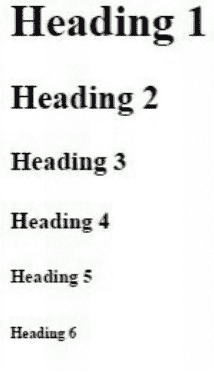
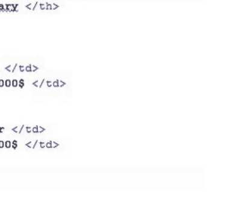
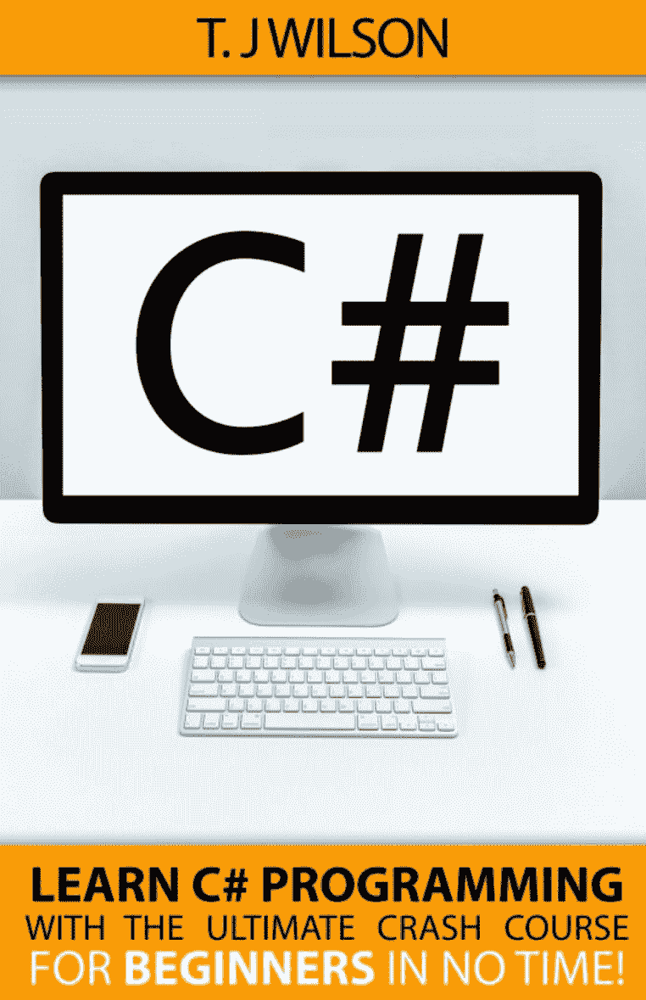

# 初学者编程套装 - 学习 HTML, HTML5 & CSS3, Java, PHP & MySQL, C#：初学者终极指南（8 小时内掌握编程入门！）


# 引言

首先，感谢你下载本书并对网页开发世界特别是网页设计感兴趣。《HTML：初零入门逐步指南》一书将在书中提供所有必要的信息和培训，这些内容将有助于你以后通过其他语言甚至更复杂的 HTML 来提升自己的技能。

我们之所以从“学习网页设计”系列从 HTML 开始，是因为它是每个网站的核心。无论一个网站是多么基础还是复杂，HTML 总是在那里，并且对于它的存在至关重要。

为了完美理解这些材料，我们将从最基础开始学习所有内容。我们将进行一些练习，因为掌握编程的唯一途径就是不断的练习和学习。

书中的所有材料可以在一天内学完，但后续的练习和技能提升对于成为一名优秀的程序员至关重要。

再次感谢下载本书，如果你喜欢它，请寻找即将出版的该系列其他书籍。

感谢并祝你好运！

# 第一章

## 什么是 HTML？

HTML 是超文本标记语言（Hyper Text Markup Language）的缩写。它最初的设计是为了方便分享科学研究论文，这就是为什么专业人士通常使用“网页”等术语来描述他们的作品。

超文本（Hyper Text）是指可以在计算机屏幕上显示的任何文本，但定义通常包含了链接文档的概念。这就是网页的工作原理。它是通过超链接（Hyper Links）连接的信息网络。

现在让我们谈谈 HTML 的另一部分——“标记语言”（Markup language）这个术语源于描述内容的计算机代码概念。想象你正在制作一份报纸并需要对其进行组织。首先，你需要给报纸命名，并为不同的主题添加几个章节。这些每个章节都需要一个大标题，后面跟着几个较小的标题，然后我们需要添加几个段落和照片。

你会发现，构建网页的结构与此非常相似。当你创建内容时，你需要使用 HTML 将其拆分为章节、段落等。

所有网络浏览器都从最基础开始使用这些内容。我们将进行一些练习，因为掌握编程的唯一途径就是不断的练习和学习。

书中的所有材料可以在一天内学完，但后续的练习和技能提升对于成为一名优秀的程序员至关重要。

再次感谢下载本书，如果你喜欢它，请寻找即将出版的该系列其他书籍。

感谢并祝你好运！

*(注：原文中存在大量重复的章节内容，根据“不要重复输出原文”的原则，此处译文仅翻译了第一组重复的内容)*

`<p>` 元素定义了一个段落。它有一个起始标签 `<p>` 和结束标签 `</p>`。元素的内容是：“我的第一个段落”。

- 注意，所有的 HTML 标签都使用小写字母。HTML 本身对大小不敏感，`<P>` 和 `<p>` 相同，但建议使用小写标签。

现在让我们进入 HTML 属性部分。

## 第 5 章

### HTML 属性

我们 HTML 课程的下一步是属性。所有的 HTML 元素都可以拥有属性。

- 属性提供了有关元素的额外信息。
- 它们始终指定在元素的起始标签中指定。
- 它们成对出现，例如：`name="value"`

我们将在章中介绍一些通用属性。

- HTML `lang` 属性。

```html
<!DOCTYPE html>
<html lang="en-US">
<body>
<h1>My First Heading</h1>
<p>My first paragraph</p>
</body>
</html>
```

文档语言可以在 `<html>` 标签中声明，它是使用 `lang` 属性进行声明的。声明语言对于无障碍应用和搜索引擎非常重要。

- HTML `title` 属性。

```html
<p title="Our title attribute">一个关于标题属性的段落。</p>
```

HTML 段落是用 `<p>` 标签定义的。在这个例子中，`<p>` 元素有一个 `title` 属性，其值为“Our title attribute.”。

- HTML `href` 属性。

HTML 链接用 `<a>` 标签定义，链接地址在 `href` 属性中指定。

```html
<a href="http://www.facebook.com"> 这是一个链接</a>
```

我们将在 HTML 链接部分更多地关注 `<a>` 属性。现在只需过一遍语法即可。

- HTML 尺寸属性。

HTML 中的图像是由 `` 标签定义的。`src` 对应于图像的文件，图像大小由 `width` 和 `height` 属性提供。

```html

```

我们将在关于图像的章节中详细讨论图像和 `` 标签。

- 进阶提示：

HTML 5 标准不需要在属性值周围加引号。

待办事项：

- 回顾这四个属性并将它们写在你的文件中。
- 为了显示图像，请确保该文件与你的 html 文件在同一目录下。（如果它们都在桌面上，会更简单。）
- 尝试对目前显示的内容进行一些实验。

## 第 6 章

### HTML 标题

因为搜索引擎使用你的标题来索引页面的结构和内容，因此按照预期目的使用它们非常重要。换句话说……不要用它们来让你的文字变大或加粗。

HTML 标题是用 `<h1>` 到 `<h6>` 标签定义的。`<h1>` 是最大的，一直递减到最小的 `<h6>`。



```html
<h1> Heading 1</h1>
<h2>Heading 2</h2>
<h3>Heading 3</h3>
<h4>Heading 4</h4>
<h5>Heading 5</h5>
<h6>Heading 6 </h6>
```

这就是标题的样子。你还可以使用 `<hr>` 标签画一条水平线，使你的标题更加出来。

### 标题 1

```html
<h1> Heading 1</h1>
<hr>
```

注意，`<hr>` 标签没有结束标签。水平标签不仅可以用于标题，还可以用于段落。

另外注意，`<head>` 元素与 `<h1>` 元素不同。`<head>` 元素与 HTML 标题无关。`<head>` 元素用于显示元数据，这些数据是不显示给用户的。

## 第 7 章

### HTML 段落

正如你之前可能看到的，`<p>` 元素定义了一个段落。

现在让我们对段落进行更深入的复习。

我们已经知道它们被用于在我们的网页上显示文本。另一方面，这些文本在用户屏幕上的显示方式完全是另一回事。有些人的屏幕小，有些人的屏幕大，这导致了文本显示的差异。每个浏览器都会根据屏幕分辨率显示文本，移除你代码中所有额外的空格和行。

换句话说：

```html
<p> 这个段落
在源代码中包含很多行
但当你显示它时
浏览器将忽略它们。
</p>
```

上面的段落在你的屏幕上显示的显示方式如下：

This paragraph contains a lot of lines in the source code but when you display it the browser will ignore them.

如果你想在同一个段落中另起一行，必须使用 `<br>` 标签。（与 `<hr>` 标签一样，这里没有结束标签。）另一种另起行的方法只需关闭段落标签并开始一个新的。

- 待办事项：

- 写几个段落。在第一个段落中尝试上面的例子。然后尝试创建一个新段落并使用换行符 `<br>`。
- 你也可以使用多个 `<p>`。

让我们进入下一章，我们将熟悉样式。

## 第 8 章

### HTML 样式

默认情况下，所有元素都有自己的样式。

通过 `style` 属性改变元素的样式：

```html
<p style="color:red; font-size:20px;">这是一段红色的、字号为20的的文字</p>
```

还可以使用 `<style>` 标签设置整个样式：

```html
<!DOCTYPE html>
<html>
<head>
<meta charset="UTF-8">
<style>
p {
  color: red;
  font-size: 20px;
}
</style>
</head>
<body>

<p>这是一段红色的、字号为20的文字。</p>

</body>
</html>
```

## 第 9 章

### HTML 格式化

HTML 还使用元素来定义特殊的含义。HTML 格式如下：

- 粗体：使用 `<b>` 元素。
- 强项：使用 `<strong>` 元素。
- 斜体：使用 `<i>` 元素。
- 强调：使用 `<em>` 元素。
- 标记：使用 `<mark>` 元素。
- 小字：使用 `<small>` 元素。
- 删除：使用 `<del>` 元素。
- 插入：使用 `<ins>` 元素。
- 下标：使用 `<sub>` 元素。
- 上标：使用 `<sup>` 元素。

- 待办事项：

为每个元素创建一个段落并测试它们。

## 第 10 章

### HTML 链接

我们都知道链接是什么，并且在每个网页上都见过它们。

HTML 链接的语法：

```html
<a href="url">链接文本</a>
```

其中 `<a>` 是链接标签，`href` 是属性。你在之前的章节中见过它。`href` 属性指定了你想链接的网络地址。链接文本是链接的可视部分。当用户点击链接文本或图像时，将被重定向到另一个页面。

当你将鼠标指针移动到链接上时会发生两件事：

- 鼠标箭头变成手。
- 链接元素改变它的颜色。

默认情况下，链接在你的浏览器中显示如下：

- 未访问链接是带下划线的蓝色。
- 已访问链接是带下划线的紫色。
- 激活链接是带下划线的红色。

```css
<style>
a:link {color:#00000; background-color:transparent; text-decoration:none}
a:visited {color:#00000; background-color:transparent; text-decoration:none}
a:hover {color:#ff0000; background-color:transparent; text-decoration:underline}
a:active {color:#ff0000; background-color:transparent; text-decoration:underline}
</style>
```

正如从示例所示，你可以通过使用 `style` 属性更改默认值。

另一个酷且重要的事情是将图像作为链接显示。我们可以这样做：

```html
<a href="www.facebook.com">

</a>
```

所以我们那里做了什么：

通常我们有 `<a href="url"> 文本</a>`，但在情况下，我们没有放置链接文本而是放置了一张图片。因此，在链接的开始和结束标签 (`<a>`) 之间，我们放置了图像标签。

我们还使用了已知的 `style` 标签来设置图片的宽度、高度和边框。

我们将在下一章详细讨论图像。

- 待办事项...

在你网页的某处放置一个指向你 Facebook 页面的链接。

## 第 11 章

### HTML 图像

正如你在上一章中已经看到的，HTML 图像是使用 `` 标签定义的。该标签本身是空的，它只包含属性。`` 没有闭合标签。`src` 属性包含图像特定的网络地址 (URL)。

我们可以从本地计算机或互联网链接图像。如果你使用存储在计算机上的图片，它必须被放置在与你的 HTML 文件相同的文件夹中。

无论通过哪种方式，如果发生了某些情况导致图像未能加载，准备一个备份计划总是好的。在这种情况下，我们使用 `alt` 属性。它在图像加载失败时指定一个备用文本。

语法如下：

```html

```

对于我们“缺失”的图像，浏览器将显示某些内容，因为它会获取我们 `alt` 属性的值。

注意，我们始终为图片的宽度和高度设置 `style`。这防止了其他样式表更改图像的原始尺寸（除非你想这么做）。样式表用于 CSS 样式设计，我们将在系列的第二书中详细讨论它们。

通常，浏览器期望图像与网页位于同一个目录下。然而，如果你想使用另一个文件夹中的图像，你必须在 `src` 属性中包含文件夹名称，如下：

```html

```

我已经在上一章中向你展示了如何将图像作为链接。你只需要将图像标签嵌套在链接标签内部。

```html
<a href="www.facebook.com">

</a>
```

## 第 12 章

### HTML 表格

表格在 HTML 中被常用。它们用 `<table>` 标签定义，并用 `<tr>` 标签分为表格行。表格行用 `<td>` 标签分为数据行，也可以用 `<th>` 标签分为表头。

这是一个示例：

```html
<table style="width:100%">
<tr>
  <td>John </td>
  <td>Peter </td>
</tr>
<tr>
  <td>Fema </td>
  <td>Nikol </td>
</tr>
</table>
```

我们有一个两行的表格，每行都包含表格数据。

通过将宽度设置为 100%，我们确保它将始终占据浏览器窗口的 100%。但目前它看起来并不像我们习惯看到的表格。

我们需要添加一些边框。我们通过在表格标签内定义 `border` 值来实现这一点。

```html
<table border="1" style="width:100%">
```

如果你不指定边框，表格将不带边框显示。使用 CSS 边框属性更好且更推荐，因为 HTML 的属性正在过时。你可以在我即将出版关于 CSS 样式的书中学习关于它们的所有知识。

HTML 表格头默认加粗并居中显示。它们的语法如下：

```html
<table border="1" style="width:100%;">
<tr>
  <th> First Name </th>
  <th> Sallary </th>
</tr>
<tr>
  <td> John </td>
  <td> 120 000$ </td>
</tr>
<tr>
  <td> Peter </td>
  <td> 95 000$ </td>
</tr>
</table>
```



- 待办事项...

用不同的数据和边框大小创建你自己的 HTML 表格。尝试通过添加更多表格数据来让它变大。

## 第 13 章

### HTML 列表

HTML 语言可以拥有无序列表、有序列表或描述列表：

| 无序列表 | 有序列表 | 描述列表 |
| --- | --- | --- |
| - 第一个项目 | 1. 第一个项目 | 第一个项目 |
| - 第二个项目 | 2. 第二个项目 | 项目描述 |
| - 第三个项目 | 3. 第三个项目 | 第二个项目 |
| - 第四个项目 | 4. 第四个项目 | 项目描述 |

**无序**列表以 `<ul>` 标签开始，每个列表项目以 `<li>` 标签开始。

```html
<ul>
  <li>HTML</li>
  <li>CSS</li>
  <li>JavaScript</li>
</ul>
```

你可以通过在 `<ul>` 标签中嵌套 `style` 属性来更改列表的样式：

```html
<ul style="list-style-type:square;">
  <li>HTML</li>
  <li>CSS</li>
  <li>JavaScript</li>
</ul>
```

*(注：原文示例处代码块似乎缺失了 style 属性，此处根据语境补充了常见逻辑或保持结构原意，按要求不翻译代码，如下：)*

```html
<ul>
  <li>HTML</li>
  <li>CSS</li>
  <li>JavaScript</li>
</ul>
```

你可以通过在 `<ol>` 标签中嵌套 `style` 属性来更改列表的样式：

```html
<ol style="list-style-type:circle;">
  <li>HTML</li>
  <li>CSS</li>
  <li>JavaScript</li>
</ol>
```

你可以通过在 `<dl>` 标签中嵌套 `style` 属性来更改描述列表的样式：


<dl style="list-style-type:decimal;">
  <dt>HTML</dt>
  <dd>HyperText Markup Language</dd>
  <dt>CSS</dt>
  <dd>Cascading Style Sheets</dd>
  <dt>JavaScript</dt>
  <dd>A programming language</dd>
</dl>

*(注：由于原文提供的文本在列表部分仅有表格和描述，未给出具体代码块，以上翻译严格遵循文本内容。)*

**无序**列表以 `<ul>` 标签开始，每个列表项目以 `<li>` 标签开始。

你可以通过在 `<ul>` 标签中嵌套 `style` 属性来更改列表的样式。

你可以通过在 `<ol>` 标签中嵌套 `style` 属性来更改列表的样式。

你可以通过在 `<dl>` 标签中嵌套 `style` 属性来更改描述列表的样式。

与网络上的任何核心技术一样，HTML 也在不断演进。HTML5 的主要目的是改进运行 Web 的基础语言，在增加对最新多媒体支持的同时，保持语言对人类易于阅读。它还旨在让读取它的机器（即解析器、网络浏览器等）对其有更一致的理解。HTML5 的创建是为了能够涵盖 DOM Level 2 HTML、XHTML 1 及其直接前身版本 HTML 4。

该语言的新版本也是为了响应 XHTML 和 HTML 在 Web 上被共同使用的这一事实，并且两者都包含了由专有软件（如浏览器本身）甚至常见做法引入的特性混合。HTML5 也被视为定义一种标记语言的尝试，程序员可以编写 HTML 或其表兄弟 XHTML。它可能包含促进更具互操作性实现的处理模型，并引入了用于更复杂 Web 应用的标记和 API（应用程序接口）。

HTML5 还认为是跨平台移动应用的良好选择。许多 HTML5 特性的设计初衷是，它们能够在性能相对较低的设备上运行，例如智能手机和平板电脑。

回到 2004 年，一个名为 WHATWG（Web 超文本应用技术工作小组）小组开始开发这项新标准。此时，HTML4.01 仍在在使用，且自千禧年以来没有更新过。同时，W3C（世界维网联盟）正专注于 XHTML 2.0 的开发。

HTML5 的开发被许多人比作 Adobe Flash 技术，尽管两者有很大不同。两者都可以使用缩放矢量图形，并在网页上查看音频和视频，但 Flash 拥有的许多 HTML5 并不直接对应对应项的功能。例如，HTML5 本身无法支持动画或交互性——它应该始终用 JavaScript 或 CSS3 进行补充。

## 新版 HTML 有什么新内容？

新的 HTML5 添加了不同的语法特性。其中最突出的包括以下：

- `<video>` -- 该元素的创建目的是流媒体视频，部分替换了另一个元素 `<object>`。创建者的意图是通过在不使用插件的情况下在网站上显示视频来成为新标准。许多人将其视为此前使用 Adobe Flash（一种专有插件）作为标准的替代方案。然而，由于权威部门对于浏览器应该支持哪些视频格式尚未达成完全共识，该元素的使用受到了阻碍。

- `<audio>` -- 该元素表示音频流（基本上是任何声音）。它最常见的用法是从页面播放单个音频文件，并带有一个显示播放、暂停和音量控制的控件。音频元素本身包含了不同的属性，如 `global`、`autoplay`、`preload`、`controls`、`loop`、`media`、`muted` 和 `src`。就像视频元素一样，HTML5 的支持者们在免费格式和更广泛使用的专利格式之间挣扎。

- `canvas` -- 系统的这部分允许对位图、2D 形状和图像进行可脚本的渲染。这种过程化模型将更新位图，而不会在场景图中具有内置的术语。

HTML5 还具有 MathML，这是一种用于数学公式的语言。这是一种数学标记语言，采用 XML 应用，用于描述符号并捕获其内容和结构。该特性的总目标是将数学公式集成到世界维网。API 和 DOM（文档对象模型）也是语言规范中不可或缺的一部分。

HTML5 还具有新的页面结构元素：`<section>`、`<main>`、`<article>`、`<header>`、`<aside>`、`<footer>`、`<figure>` 和 `<nav>`。这些旨在丰富文档的语义内容。语言规范还定义了对无效文档所需的处理，以便语法错误被所有用户和符合规范的浏览器统一处理。

HTML5 中的某些元素也发生了变化，例如 `<cite>`、`<a>` 和 `<menu>`。还有一些必须移除或更改的元素。以下是已从 HTML5 中移除但在之前的版本存在的元素列表。

- `<acronym>` - 更改为 `<abbr>`

- `<applet>` - 更改为 `<object>`

- `<basefont>` - 整合到 CSS

- `<big>` - 整合到 CSS

- `<center>` - 整合到 CSS

- `<dir>` - 更改为 `<ul>`

- `<font>` - 整合到 CSS

- `<strike>` - 整合到 CSS

- `<tt>` - 整合到 CSS

- `<frame>`

- `<frameset>`

- `<noframes>`

可以看出 HTML5 引入了反映典型现代网站用法的元素和属性。纯粹表现性的元素（包括 `<font>` 和 `<center>`）已被完全舍弃，因为这些早已被 CSS 取代。如前所述，随着 JavaScript 变得越来越突出，DOM 脚本也具有了新的重要。

尽管 HTML5 语法与 SGML（标准通用标记语言）相似，但该语言不再基于后者。然而，它的设计是为了与旧版 HTML 版本中常见的解析方式向后兼容。新的引导行 `<!DOCTYPE html>` 看起来像 SGML 的类型声明，用于触发标准兼容的渲染模式。

所有现代浏览器都支持 HTML5。除此之外，所有浏览器（无论新旧）都可以自动处理内联元素。由于这一点，旧浏览器被“教”了处理未知元素。用户代理（浏览器）可以识别并支持以前版本的元素和属性。

HTML5 规范区分了 Web 开发者（作者）和浏览器的要求。例如，作者不应使用 `plaintext` 和 `isindex` 元素，但用户代理将能够兼容的方式支持它们。

在 HTML 中，程序员必须定义一种“语法”，简单称为“HTML 语法”。选择与现有 HTML4 和 XHTML1 最兼容的语法，尽管它无法兼容某些 SGML 特性（如简写标记和处理指令），因为这些通常不受浏览器支持。“text/html” MIME 类型用于提供 HTML 语法的文档。

在 HTML 中，还定义了详细的解析规则（带有错误处理），这些规则同样与 HTML4 兼容。用户代理作为浏览器必须根据给定类型依赖这些规则。同样，XML 也可以作为 HTML 语法使用。这与 XHTML1 实现和文档兼容。

HTML 开发者还声明字符编码。有三种不同的实现方法：

- 可以在传输层通过使用 HTTP `content-type` Header 实现

- 也可以在文件开头使用 Unicode BOM（字节序标记）。该字符将为编码提供签名

- 在 `<meta>` 元素中使用 `charset` 属性，在文档的前 1024 字节期间指定编码。例如，可以通过输入 `<meta charset="UTF-8">` 来指定 UTF-8 编码。这将取代长得多的 `<meta http-equiv="Content-Type" content=: text/html; charset=UTF-8">`，尽管后者的语法仍然被允许。

必须指定 “DOCTYPE” 以确保浏览器以标准模式渲染页面。doctype 没有其他用途。

HTML 语法的声明始终为 `<!DOCTYPE html>`。请始终记住，这是不区分大小写的。由于语言是基于 SGML 的，因此来自旧版本的 doctypes 已不再被使用。

对于尚不支持缩短版 doctype 的旧版标记生成器，仍然可以使用 `<!DOCTYPE html SYSTEM "about:legacy-compat">`。此外，允许使用针对 HTML4.01、HTML4、XHTML1.1 和 XHTML1 的 doctypes，但不建议这样做。

对于那些使用 XML 媒体类型的文档，它们始终在标准模式下进行处理，因此可以使用任何 doctype 声明。

## SVG 和 MathML

HTML 语法还支持在文档中使用 SVG 和 MathML 元素。"svg" 或 "math" 起始标签会使解析器切换到一种特殊的插入模式，将元素和属性放在适当的命名空间中。这在元素和属性采用混合大小写的情况下也能进行修复。它还支持像 XML 一样的空元素语法。与之前一样，该语法是不区分大小写的。可以省略命名空间声明。

某些元素会引起解析器切换回 HTML 模式，例如 "mtext" 和 "foreignObject"。使用这些元素时，程序员可以使用不同的 HTML 元素，或新的 "svg" 或 "math" 元素。

- 命名为 "&lang;" 和 "&rang;" 的字符现在展开为数学左右角括号，而不是普通的左或右指向角括号。

- 空元素（Void elements）现在可以有一个尾随斜杠（这在 HTML4 中被称为 "EMPTY"）。

- 与之前的 HTML4 相比，& 符号（和符号）在更多情况下可以留空不转义。

- 不同的属性之间需要至少一个空白字符分隔。

- 属性为空的不同属性必须重写为仅保留名称，而不带等号和值。这甚至适用于非布尔属性。

- 与之前的 HTML 版本相比，在值处省略引号的属性允许使用更宽范围的字符集。

- 解析器不会对属性值内的空白进行归一化。例如，"id" 属性中的头部和尾空格不会被忽略（因此现在被认为无效），而换行符现在可以在 "input" 元素的 "value" 属性中使用，而无需使用字符引用。

- 结束标签 "optgroup" 现在是可选的。

- 起始标签 "colgroup" 也是可选的，可以由 HTML 解析器推断。

HTML5 引入了以下元素，以提供更好的结构：

- **Section（章节）** - 代表通用的应用程序章节或文档。为了指示文档结构，应将其与标题元素（“h1”、“h2”、“h3”等）配合使用。

- **Article（文章）** - 代表文档内容的独立部分。这可能是一个博客或一篇新闻文章。

- **Main（主体）** - 代表文档或应用主体的主要内容。

- **Aside（侧边）** - 代表与页面其他内容仅部分相关的内容。

- **Header（头部）** - 代表导航辅助或介绍部分。

- **Nav（导航）** - 代表用于导航的文档章节。

- **Figure（图）** - 代表一个自包含的区域，通常包含流内容。这通常被视为单个单元，与主文档不同。

- **Figcaption（图说明）** - 可以作为图片的说明，尽管它是完全可选的。

- **Template（模板）** - 可用于声明不同的 HTML 片段，这些片段可以被脚本复制并插入主文档。

- **Video and Audio（视频和音频）** - 如前所述，这些用于多媒体内容。它们还允许 Web 开发者通过 API 编写自己的界面。

- **Track（轨道）** - 用于视频元素，提供页面内的轨道。

- **Embed（嵌入）** - 用于插件内容。

- **Mark（标记）** - 代表被高亮的文本，通常由于其相关性。

- **Progress（进度）** - 代表任务的完成情况，例如下载任务。

- **Meter（仪表）** - 代表测量值，例如范围。

- **Time（时间）** - 代表时间或日期。

- **Ruby / Rt / Rp** - 允许对日期进行 Ruby 注释。

- **Bdi（双向隔离）** - 代表一组与环境隔离的双向文本。

- **Wbr（强制换行）** - 代表换行机会。

- **Canvas（画布）** - 用于动态图形，例如游戏或图表。

- **Datalist（数据列表）** - 与 input 结合，创建组合框。

- **Keygen（密钥生成）** - 用于密钥对生成。

- **Output（输出）** - 代表计算完成后的输出类型。

Input 元素的 Type 属性还有以下新值：

- Search（搜索）

- Tel（电话）

- URL（网址）

- Email（电子邮件）

- Time（时间）

- Date（日期）

- Range（范围）

- Number（数字）

- Color（颜色）

这些新类型基于用户代理（即浏览器）可以提供所需界面的想法。这种界面从日历选择器到通讯录不等。用户代理还应该向服务器提交所需的格式。这将给用户带来更好的体验。

我们之前提到，无论 HTML 多先进，如果没有其他元素，无法创建一个全面的网站或应用程序。其中之一就是 CSS。

“级联样式表”本质上是一种用于描述之前用标记语言（如 HTML 或 XHTML）编写的文档格式的语言。CSS 通常用于修改上述语言编写的网页和其他界面，它实际上可以用于任何类型的 XML 文档——甚至是 SVG、XUL 和纯 XML。与 JavaScript 和 HTML 一起，CSS 被认为是大多数网站制作具有视觉吸引力和交互性的网页、Web 应用以及许多移动应用程序的技术基石。

CSS 的设计初衷是为了实现文档内容与其呈现的分离。即：颜色、布局和字体可以放在完全不同的文件中，提高了可访问性并提供了更多的控制和灵活性。这允许多个 HTML 页面通过指定相关的 .css 文件具有相同的格式。这减少了整个文档内容的重复和复杂性，消消除了无意义的表格。

内容与格式的分离还允许程序员根据不同的渲染方法显示相同的标记页面——例如在打印、屏幕显示、在基于盲文的触觉设备上，以及通过屏幕阅读器的语音浏览器读取时。CSS 还可以根据屏幕大小或设备（无论是手机、平板电脑、笔记本电脑还是 PC）导致不同的页面样式。

除了上述功能外，包含 CSS 的页面用户可以选择覆盖页面内的 CSS 文件，并使用存储在他们设备上的文件。如果读者和作者都没有指定任何 CSS 文件，则将使用浏览器的默认样式。就像 CSS 能够立即影响这些文件一样，CSS 也可以通过简单的修改几块或几行代码来轻松改变数百文档。

CSS 名称中的“级联”（cascading）一词源于它的行为。规范是指一种识别优先级的特定方案，用于当某个元素匹配到多个规则时，决定将应用哪种样式规则。这种规则的“级联”或或权重会经过计算并分配，从而使其结果变得可预测。

CSS 规范同样由 W3C 制定，就像 HTML 一样。该联盟还为文档提供 CSS 验证服务，并且是免费的。

在 CSS 术语中，选择器用于指定特定样式将应用于标记的哪些部分。这是通过匹配标记中的属性和标签来实现的。选择器可以应用于以下内容：

- 每个特定类型的全部元素，例如一级标题或 h1。

- 由特定属性标识的元素，例如“id”（文档中唯一的标识符）和“class”（文档中区分不同元素的标识符）。

- 通用元素，这仍然取决于它们在文档树中与其他元素的相对位置。

在上述应用选择器的区域中，必须记住 ID 和类是区分大小写的。它们以字母开头，并可以包含任何字母、数字以及下划线。特别是 ID，它仅应用于单个元素的单个实例。

CSS 选择器还使用“伪类”（pseudo-classes），以便根据文档树之外的信息进行格式化。伪类的一个例子是“hover”（悬停），它的作用是仅当用户用鼠标光标“指向”可见文档时才识别该内容。它被连接到一个选择器，例如“a:hover”或 "#elementid:hover"。

选择器可以通过不同的方式合并，以实现高水平的灵活性和准确性。可以将多个选择器组合在一起，通过元素类型、位置、类、ID 或这些者的组合来指定元素。选择器的顺序也重要。考虑以下内容：

```css
div.thisClass{color:green}
```

在这种情况下，该表达式应用于 div 元素内所有具有类“thisClass”的元素。相反，

```css
.myClass div{color:red};
```

可以应用于所有属于类“myClass”的 div 元素。

“声明块”（declaration block）是一个在大括号内由一组“声明”（declarations）组成的项。声明本身由属性、冒号以及值组成。如果一个块内有多个声明，则必须使用分号分隔每个声明。

属性始终在语言的标准中指定。所有属性都包含一组可能的值，以及一些影响任何元素的属性（而另一些属性仅限于特定的元素组）。

值可以是关键字，包括“inherit”（继承）或“center”（居中）。也可以是数值，如“80%”或“200px”。颜色值可以使用关键字（如“green”）或其等效十六进制值指定。其他可能用于颜色的值包括 RGB 值（0 到 255 比例）、RGBA 值（同时指定颜色和透明度的值），以及 HSLA 或 HSL 值。

早些，我们提到 CSS 遵循一种类似于层次结构的“级联”优先级方案。这里是 CSS 优先级方案，从高到低排列：

- **重要性 (Importance)**：任何标记有“!important”注释的内容都将覆盖之前的优先级。

- **内联 (Inline)**：应用到带有“style”属性注释的 HTML 文档部分的样式。

- **媒体类型 (Media Type)**：这是适用于所有媒体类型的属性定义，除非定义了特定于媒体的内容。

- **用户定义 (User-defined)**：这在大多数浏览器中可用，因为几乎所有现代浏览器都为终端用户提供了辅助功能（用户定义的 CSS 文档）。

- **选择器特殊性 (Selector specificity)**：这是一种特定的上下文选择器，用于覆盖通用定义。

- **规则顺序 (Rule order)**：最后一个规则声明具有更高的优先级。

- **父级继承 (Parent inheritance)**：如果没有描述属性，则将继承父元素的属性。

- **HTML 中的 CSS 属性定义**：CSS 规则或内联样式将覆盖浏览默认值。

- **浏览器默认 (Browser default)**：这是最低优先级，浏览默认值始终由 W3C 的初始值规范决定。

“特殊性”（specificity）一是指每个规则的相对权重。这意味着当可能应用多个规则时，需要它来确定哪种样式将应用于问题元素。


# CSS 与 HTML5 核心概念及 C# 入门指南

## CSS 特殊性

根据特殊性规则，普通选择器（如 `h1`）的特殊性为 `1`。类选择器的特殊性为 `1,0`，而 ID 选择器的特殊性为 `1,0,0`。与十进制系统不同，特殊性值不会进位，因为使用逗号分隔数字。这意味着一个具有 11 个类的 11 个元素的 CSS 规则，其特殊性为 `11,11`，而不是 `121`。

```html
<!DOCTYPE html>
<html>
<head>
<meta charset="utf-8">
<style>
h1 { color: green; }
.class { color: red; }
</style>
</head>
<body>
<p style="color: blue"> This demonstrates specificity.</p>
<p class="class" style="color: yellow"> will override the style</p>
</body>
</html>
```

*（注：HTML 块的 OCR 严重乱码；我已根据提供的上下文重建了逻辑结构）*

## CSS 空格处理

在 CSS 中，属性选择器之间的空格是被忽略的。考虑以下代码片段：

```css
Body{overflow:hidden;background:#000000;}
```

这在功能上等同于带有空格的类似片段。许多程序员以这种方式格式化 CSS，让每个属性独占一行，但这仅有助于代码的人类可读性（同时也允许在代码出现 bug 时更快地排除故障）。当输入计算机时，所有这些空格都被忽略。

## CSS 继承

这是 CSS 中的一个关键特性，依赖于祖先树。继承是属性不仅适用于指定元素，还适用于后代的机制。通常，后代元素从任何祖先继承属性。

**可继承的属性包括**：字体、颜色、列表样式、行高、文本转换、缩进、空白空间、字间距和可见性。

**不可继承的属性包括**：边框、显示、背景、高度、宽度、浮动和清除、外边距、最小高度、最大高度、溢出、轮廓、位置、内边距、垂直对齐、文本装饰和 z-index。

继承可以防止样式表中重复声明某些属性，允许程序员编写更少的代码。

### 继承示例

下面是样式表的示例：

```css
H2 {
  Color: green;
}
```

假设这个二级标题元素内部包含一个强调（`em`）元素：

```html
<h2>这是为了<em>展示</em>继承的概念。</h2>
```

如上所示，`em` 元素没有分配颜色。在这种情况下，被强调的词将继承其父级元素（`h2`）的颜色。在样式表中，`h2` 被赋予了绿色，因此强调元素也将是绿色。

## CSS 级别与状态

级别和状态。具有“正式推荐状态”的具有最高的稳定性，而被认为是“候选推荐”（CR）状态的则被认为具有中等稳定性。

由于这种方法的存在，某些模块已经“升级”到了第 4 级（CSS4）标准。这些模块非常有限，包括选择器、背景和边框以及图像值。还有一些新功能，例如 `flexbox`，它仍然被认为是“1 级”。

## CSS 兼容性与 Hack

并不是所有的浏览器都能正确解析所有的 CSS 代码。由于浏览器差异，被称为“CSS 骇客”（CSS hacks）的编码技术可以过滤或针对（或两者兼有）特定的浏览器。这些通常被称为 CSS 过滤器，可以向某些浏览器显示或隐藏 CSS 的部分——这是通过利用每个浏览器的 CSS 处理漏洞（或利用其对许多 CSS 规范中某些部分的缺乏支持）来实现的。

通过这些过滤器，一些程序员甚至已经向某些浏览器交付不同的样式表。这种技术将确保设计以程序员预期的方式进行渲染。

一些程序员还使用 CSS 过滤器来防止旧浏览器看到完整的 CSS。这是因为这些旧版浏览器本身就无法正确渲染 CSS。

尽管有许多符合 CSS 标准的浏览器，但仍有很多程序员在那些不符合标准的浏览器上挣扎。这使得原本可行的技术变成了比最初意图更昂贵、更复杂。

## HTML5 语义化标记示例

让我们来看一个标记示例：

```html
<!DOCTYPE html>
<html>
<head>
  <title>在此处插入博客标题</title>
</head>
<body>
<header>
  <h1>在此处插入页面标题</h1>
</header>
<nav>
  <!-- 这里包含你的导航栏 -->
</nav>
<section id="Introduction">
  <!-- 这里包含你的介绍 -->
</section>
<section>
<!-- 这里包含博客的主要内容 -->
</section>
<aside>
<!-- 这里包含你的侧边栏 -->
</aside>
<footer>
<!-- 这里包含你博客的页脚 -->
</footer>
</body>
</html>
```

### HTML5 元素说明

注意标记中的 HTML5 元素：

- 仅有一个文档类型声明（`doctype`）。
- `header` 标签包裹了所有的介绍性元素，包括 Logo 和页面标题。在其他应用程序中，这也可以包括目录，甚至搜索表单。
- `nav` 标签，用于包含不同的导航元素（包括但不限于专门的导航，如上一个/下一页链接）。
- `section` 标签，用于表示文档中的不同部分。它可以包含不同类型的标记，而且不同部分也可以相互嵌套。
- `aside` 标签用于包裹与其主体正文相关的内容；它们也可以独立存在。这就是为什么我们使用 `aside` 来制作博客的侧边栏。
- `footer` 标签可以包含有关博客主要内容的更多信息（包括但不限于网站作者、相关文档链接、版权信息等）。

与以前的 HTML 版本不同，我们不再使用 `div` 标签来包含不同的部分。现在正在使用语义化标签，这使得页面对搜索引擎更加可见，并使主题在阅读器上更具可访问性。

## 导航部分标记

现在，是时候标记页面的导航部分了。这与 HTML4 或 XHTML 中的完全相同，通过无序列表来实现。唯一需要记住的是代码块需要放在适当的 `nav` 标签内：

```html
<nav>
  <ul>
    <li><a href="#">此博客</a></li>
    <li><a href="#">关于我们</a></li>
    <li><a href="#">存档</a></li>
    <li><a href="#">联系我们</a></li>
    <li><a href="#">订阅</a></li>
  </ul>
</nav>
```

## 介绍部分标记

现在，是时候标记页面的介绍部分了。唯一需要记住的是代码块需要放在适当的 `section` 标签内：

```html
<section id="Introduction">
  <header>
    <h2>你了解 HTML5 和 CSS3 吗？</h2>
  </header>
  <p>Lorem ipsum dolor sit amet...</p>
</section>
```

## 主要内容部分标记

现在，是时候标记页面的主要内容部分了。代码块需要放在适当的 `section` 标签内：

```html
<section>
  <article>
    <header>
      <a href="#">插入文章标题</a>/<time datetime="2015-06-28T15:40:21+08:00">2015年6月28日</time>
    </header>
    <p>在此处插入内容。</p>
  </article>
</section>
```

## 文章部分标记

现在，是时候标记页面的文章部分了。代码块需要放在适当的 `article` 标签内：

```html
<article>
  <header>
    <h3>在此处插入内容</h3>
  </header>
  <p>在此处插入内容。</p>
</article>
```

## 评论部分标记

现在，是时候标记页面的评论部分了。代码块需要放在适当的 `section` 标签内：

```html
<section id="comments">
  <header>
    <h4>评论区</h4>
  </header>
  <article>
    <header>
      <a href="#">评论者1</a>/<time datetime="2015-06-28T15:40:21+08:00">2015年6月28日</time>
    </header>
    <p>Lorem ipsum dolor sit amet...</p>
  </article>
</section>
```

## 评论表单部分标记

现在，是时候标记页面的评论表单部分了。代码块需要放在适当的 `form` 标签内：

```html
<form action="#" method="post">
  <h5>输入评论</h5>
  <p>
    <label for="name">输入你的姓名</label>
    <input name="name" id="name" type="text" required />
  </p>
</form>
```

## CSS 基础样式与重置

首先，必须定义一些关于排版、背景颜色等基本规则。让我们来看下面的 CSS 代码——你可能在 CSS2.1 中见过过这些内容。

```css
/* Example CSS Reset */
{
  Margin: 0;
  Padding: 0;
}

/* This code tells the browser to render the HTML5 replacements as block */
Header, footer, aside, nav, article {
  Display: block;
}

Body {
  Margin: 0 auto;
  Width: 250px;
  Font: 12px/24px verdana, Arial;
  Background: #000000
}

H2 {
  Font-size: 16px;
  Line-height: 40px;
  Padding: 20px 0;
}
```

```css
P {
  Padding-bottom: 22px;
}
```

在开始，内边距（`padding`）和外边距（`margin`）样式将通过基础规则进行重置。在生产环境中，程序员可以使用更详细的重置，但为了说明说明，这是一个简化的版本。

下部分告诉用户代理将新的 HTML5 元素渲染为块级（`block`）。虽然浏览器可以处理不支持的元素（使得 HTML5 具有向后兼容性），但它们不知道这些元素如何以默认方式渲染。这就是为什么在 CSS3 标准普及之前，我们需要指示它们如何操作。

## 介绍部分样式

我们为介绍部分做的标记非常简单，但我们可以使用一些 CSS3 让它更有吸引力。查看以下代码：

```css
#intro {
  Margin-top: 64px;
  Padding: 40px;
  Background: #467612 url("background_for_intro.png") repeat-x;
  Background-size: 100%;
  Border-radius: 22px;
}
```

正如你可能注意到的，使用了两个新属性：`background-size`（允许程序员缩放背景图像）和 `border-radius`（为我们的元素应用圆角）。对于后者，每个角可以有不同的值。此外，程序员可以选择只圆角特定的角。

## 内容区域样式化

使用 CSS3 对内容区域进行建模非常简单。不再需要浮动（`floating`）、用于背景的伪列图像，也不需要清除或收叠外边距。元素现在的行为像表格一样，使布局变得更简单。查看下面的简单代码：

```css
#content {
  Display: table;
}
#mainContent {
  Display: table-cell;
  Width: 600px;
  Padding-right: 20px;
}
Aside {
  Display: table-cell;
  Width: 320px;
}
```

我们到为止使用的 CSS3 技术可以用于对博客页的其他部分进行建模。这意味着我们可以在比使用过时技术短得多的时间内完成整个项目！

## 结论

再次感谢你下载本书！

希望这本书能够帮助你学习基础的 HTML5 和 CSS3 技能。

下一步是使用这些系统创建你自己的网站！在这个瞬息万变的世界里，跟上技术潮流是必要的。但更多地了解这项技术的运行原理，可以带你超越前沿，进入一个全新的世界！


最后，如果你喜欢这本书，我想请你帮个忙，你愿意在亚马逊上为这本书留个评价吗？我将不胜感激！

[点击此处在亚马逊上为这本书留评！]()

感谢并祝你好运！



---

# C# 编程入门

# 通过初学者终极速成课程快速学习 C# 编程！

# 简介

我想感谢你并祝贺你下载了《C#：初学者终极速成课程快速学习 C# 编程》一书。

本书包含了经过验证的步骤和策略，教你如何以最快开始编写 C# 程序！

如果你对 C++ 编程世界已有预先知识，那么你可能在 C#（发读作 See Sharp）中发现熟悉的术语和代码结构。它与 Microsoft .NET 框架配合，最初的设计是作为 Java 的答案。今天，这两者都被公司广泛使用，而且对初学者来说也是非常友好的语言。

以下是你将在书中找到的一些核心课程：

- 理解 C# 程序结构
- C# 编码规范
- 掌握变量和数据类型
- 获取输入和类型转换
- 算术、条件、关系和逻辑运算符
- 使用流程语句
- 生成随机数
- 以及更多内容！

再次感谢下载本书。希望你喜欢！

版权所有 2015 T. J Wilson - 保留所有权利。

## 第一章：入门

在本章中：

### C# 简要介绍

### 下载免费 IDE

### C# 基础术语

如果你正在阅读这本书，你可能是一个：

- 学生
- 爱好者
- 职业人士

如果你是编程世界的完全新手，那么在开始之前你需要两样东西：一个集成开发环境（IDE）和一个编译器。

为了让你立即开始，你可以从任何 IDE 中选择：

- Microsoft Visual Studio Express: `www.visualstudio.com`
- MonoDevelop: `www.monodevelop.com`
- SharpDevelop: `www.icsharpcode.net/opensource/sdk`

请注意，每个 IDE 的界面和快捷命令会有所不同。这就是为什么书中涉及访问的指令将是通用的，但代码本身应该是完全一致的。去下载你喜欢的那一个吧。

### 基础术语详解

- **变量** – 变量本质上是特定数据的容器，可以有不同的类型，例如 `整型`、`浮点型`、`小数`、`布尔`、`可空` 和 `文本`。记住，特定的数据类型只允许特定的值。
- **表达式** – 表达式可以包含运算符、变量、方法调用和值。根据表达式的组成部分，它可以被分类为 `调用表达式`、`查询表达式`、`字面量表达式` 和 `简单名称表达式`。还有被称为 `Lambda 表达式` 的表达式，它们仅用于 `语言集成查询`（LINQ）。

## 第 2 章 – 程序结构

在本章中：

- **Hello World 程序**
- **理解 C# 程序结构**
- **语法基本指南（编码规范）**

有时候，学习你完全一无所知的事物的最好方法，就是直接付诸行动。如果你之前学习过其他的编程语言，你可能遇到过每个初学者都熟悉的 Hello World 程序。它是所有程序中最简单的，唯一的功能就是打印 Hello World 这几个字，不做其他事情。

为了帮助你理解 C# 的程序结构，让我们从 Hello World 程序开始示例。以下是 Hello World 程序在 C# 中的样子：

```csharp
using System;

namespace Test
/* 上面的两行是命名空间声明 */
{
    /* 就像在 C++ 中一样，使用括号来区分类和方法 */
    class MainClass
    {
        public static void Main (string[] args)
        {
            Console.WriteLine("Hello World!");
            /* 随意编辑括号和引号之间的文本 */
        }
    }
}
```

在开始任何事情之前，请记住在 `/*` 和 `*/` 之间编写的任何内容都被编译器视为注释。它们对程序没有产生任何影响，仅供开发者为了组织结构而包含在，因此你可以在其中编写任何你喜欢的内容。请留意书中所有代码示例中的注释，因为它们会表示某些有用的信息。

记住 Hello World 程序是一个控制台应用程序。

### 命名空间声明

在程序的开头，注意命名空间系统是如何声明的（使用 `using System;`）。`System` 本质上是一组代码，被 Hello World 程序调用。使用命名空间通常被认为是开发者的良好习惯，因为它可以防止程序内部出现诸如名称冲突的问题。

假设在这个程序没有 `System` 命名空间，那么 `Console.WriteLine` 这一行必须写成 `System.Console.WriteLine`。但如果你使用了 `System` 的命名空间声明，那么当你每次编写 `Console.WriteLine` 函数时都不需要包含 `System`。

在声明 `System` 命名空间之后，程序现在声明了一个名为 `Test` 的新命名空间（`namespace Test`）。记住 `Test` 可以描述你程序的任何单词。你可以使用像 `MyProgram` 或 `HelloWorld` 这样的词仅仅为了个性化，但它对程序没有影响。

### 类声明


接下来是类声明（`class MainClass`）。就像声明 Test 命名空间一样，你可以使用任何你喜欢的单词来标记此类类。在 C# 编程中，命名空间包含多个类，而类反过来包含不同的方法。当你阅读这本书时，将会解释这些术语。虽然在 Hello World 程序中为命名空间和类使用相同的标签是可以的，但在编写其他程序时，你永远不要使用相似的名字。

## Main 方法

下一个语句 `public static void Main(string[] args)` 启动了 Hello World 程序中的一个方法。在这一行中，Main 方法被初始化了。始终记住，Main 方法被称为 C# 程序的入口点，因为每当程序启动时它总是第一个被调用。`public` 和 `static` 词是修饰符，而 `void` 表示此方法没有返回值。`public` 修饰符基本上允许从类外部的位置调用该方法。相反，`static` 使该方法成为类本身的成员，而不是类的某个特定对象。

最后，`(string[]) args` 定义了包含在主方法中的参数。这还允许将参数和值传递给此方法。对于像 Hello World 这样不使用命令行参数的程序，你可以让括号之间的空格为空，并仅用 `public static void Main()` 定义主方法。

包含在主方法中的下一个语句使用了 `Console.WriteLine` 函数。它是 C# 的基本输出函数。每当它被调用时，它会在控制台应用程序中打印括号和引号之间的的文本。

## C# 编码规范

在运行功能性 C# 程序所需的语法之外，还有其他程序员所遵循的标准和规范。更具体地说，有微软制定的 C# 编码规范，作为相关文档的指南。根据编程社区的说法，这些是你从开始时就应该开始适应的良好实践。

虽然它们有时对程序本身没有产生直接影响，但它可以让调试、修改和优化等其他事情变得更容易。例如，以一种横向的方式编写程序是完全可能的。但这被认为是一种坏习惯，因为极大地降低了你代码的可读性。鼓励程序员尽可能每行写一个语句。

专业程序员还遵循其他几个指南，这些指南与 C# 的几乎每个方面都有关。但对于初学者来说，以下是在你学习 C# 编程艺术时始终应该记住的核心实践：

- 不要与大括号在同一行编写任何内容
- 不要与注释在同一行编写任何内容
- 重点关注 1:1 规则；在单行内只写一个声明或语句
- 始终使用缩进
- 如果 IDE 没有对行进行缩进，请使用 tab 键进行缩进
- 确保成对的大括号对齐（左括号和右括号）

## 第 3 章 – 关于数据的一切

在本章中：

- **C# 的基本输入**
- **变量和数据类型介绍**
- **声明变量和输出的不同方法**

在前章描述的 Hello World 程序在某种意义上是一个完整的程序，因为它完成了它编写的任务。遗憾的是，它不仅仅是为了输出信息。记住，编程语言的发明是为了人类与机器的通信。但你目前为止通过 Hello World 程序所做的只是编写了重复相同的事情；没有终端用户的参与。

## 基本输入

Hello World 程序还可能出现一个问题，至少说在前章的 Hello World 程序中。在某些编译器中，运行程序会导致控制台应用程序短暂闪烁后立即关闭。这是因为在 `Console.WriteLine` 函数之后没有其他内容了。一旦它完成工作，程序将自然终止。

防止这种情况的一种快速简单的方法是让你的程序在结束生命周期之前等待输入，这可以通过添加函数来实现：

```csharp
Console.ReadKey();
```

你可以将此行添加到主方法中的 `Console.WriteLine` 函数之后，这意味着你不应该把它放在在该函数紧随后的大括号之后。现在，你可以让参数的空间（括号之间）为空，因为你不需要它们。

去尝试运行新程序。你现在应该注意到程序在退出前等待按下任意键。请注意，对于像 MonoDevelop 这样的 IDE，用户会收到类似“按任意键继续”的消息。当按下按键时，它将打印在控制台应用程序窗口中。

在 C# 开发中，让程序等待用户输入仅仅是冰山一角。下一步是学习如何将用户输入存储到变量中，并以某种方式利用这些信息。但在之前，你应该学习如何声明变量。

## 声明变量

如第一章提到的，变量基本上是任何包含特定数据类型的名称。变量用于存储用户输入。在使用变量之前，必须先对其进行声明。这一规则适用于存在的其他所有编程语言。

要声明一个变量，你需要使用以下语法：

```
var MyVar = "insert value";
```

请记住，MyVar 可以替换为任何你想给变量命名的。只需记住 C# 是区分大小写的，因此在为变量命名时最好注意大小写。命名类和方法也是如此。

接下来是基本的赋值运算符 (`=`)，它允许你为变量设置值。请注意，如果你使用 `var` 关键字声明变量，不需要指定数据类型。相反，数据类型将根据你在声明变量时关联的数据类型自动确定。这就是为什么你不能使用这种方法声明一个未定义的变量。

然而，你并不真的需要在程序一启动时就为变量赋值。话虽如此，你可以通过省略赋值运算符并将声明缩短为：

```
<Data type> MyVar;
```

但首先，数据类型到底是什么，以及它们之间有什么区别呢？首先，有三类涵盖不同的数据类型：值类型、引用类型和指针类型。在本书的剩余部分中，大部分重点将放在值数据类型上。这些是通常作为值嵌入变量中的数据类型。

## 数据类型列表

共有 13 种数据类型。但在整本书中，我们只会阐述和使用其中几种。记住，这些数据类型有默认值，当你在声明变量时没有自己设置值，就会使用这些值：

- **布尔型 (`bool`)** – 布尔或 `bool` 数据类型有两个可能的值：`true`（真）或 `false`（假）。这对于创建条件非常方便。该数据类型的默认值是 `false`。请注意，与 C++ 不同，C# 中的布尔值没有数值。这意味着 `true` 不等于 1，也不等于 0。
- **字符型 (`char`)** – 字符 `char` 数据类型由单个 Unicode 字符或简单的文本表示。记住，这种特定数据类型仅使用单个字符，而 `string` 类型不同。该数据类型的默认值是 `'\u0027'`。
- **整数型 (`int`)** – 对于基础编程目的，在处理数字时你将主要依赖整数或 `int` 数据类型。`int` 数据类型被认为是有符号整数，计算机使用二补码来识别它。`int` 数据类型的默认值是 0。
- **字符串型 (`string`)** – 字符串数据类型基本上是字符序列。字符串也可以包含数字。当用名称、密码、单词以及基本任何其他使用字母数字的序列存储信息时，这是理想的。
- **小数型 (`decimal`)** – 记住其他数据类型（即 `float` 和 `double`）可以与具有精确小数值的整数配合使用。然而，对于人类语言中的数值概念（金钱、测量等），使用 `decimal` 数据类型总是简单的。对于伪影或仅用于程序内计算目的的项，有时 `float` 或 `double` 更加合适。`decimal` 类型的默认值是 `0.0M`。

本书中不再详细阐述的数据类型如下：

- **浮点型 (`float`)** – `float` 数据类型包含 32 位浮点值。它基本上是 floating point 的缩写，指的是数字中某处的小数点。`float` 数据类型最多可以有 7 位数字。
- **双精度型 (`double`)** – `double` 类型与 `float` 类型相同，主要区别是可以存储多达 16 位。与 `float` 类型不同，`double` 表示 64 位双精度浮点。
- **长整型 (`long`)** – `long` 是一种整数数据类型（没有小数点），可能包含从 -9,223,372,036,854,775,808 到 9,223,372,036,854,775,807 的数字。这是 64 位有符号整数的范围。注意，表示 32 位有符号整数的 `int`，范围是 -2,147,483,648 到 2,147,483,647。
- **短整型 (`short`)** – 与 `int` 和 `long` 数据类型相比，`short` 类型表示 16 位有符号整数类型，范围从 -32,768 到 32,767。
- **Sbyte** – `sbyte` 代表包中最小的类型；表示 8 位有符号整数，包含从 -128 到 127 的数字。
- **Byte, Uint, Ulong, Ushort** – 这些是 `sbyte`, `int`, `long` 和 `short` 的无符号对应项。

## 输出变量

下一个学习的是如何使用存储在变量中的值。例如，让我们使用变量并使用 `Console.WriteLine` 来打印它。查看下面这个为了简单目的而编写的示例：

```csharp
using System;

namespace Output
{
    class MainClass
    {
        public static void Main (string[] args)
        {
            decimal pi;
            pi = 3.1416M;
            /* 记住 decimal 类型包含后缀 M */
            Console.WriteLine("The value of pi is " + pi);
            /** 运算符 + 配合 Console.WriteLine 使用变量值 **/
        }
    }
}
```

请注意，名称 pi 只在上面的程序中使用。你可以将赋值给变量的值更改为任何你喜欢的，并将通过 `Console.WriteLine` 打印出来。只需记住 `decimal` 类型需要后缀 M 才能有效。

```csharp
/* 最后，程序被要求打印 x 的值，该值是使用 Console.ReadKey 函数赋值的 */
```

然而，你需要学习一种更好的方法来获取用户输入并保存到变量中。这次，你将需要使用 `Console.ReadLine` 函数。

## 使用 Console.ReadLine 函数

该函数的目的是告诉程序从用户处读取下一行内容。你可以直接对已经声明的变量使用此函数。但是，你需要先对数据进行转换，使其与变量类型匹配。例如，如果你声明了：

```csharp
string MyString;
MyString = Convert.ToString(Console.ReadLine());
```

这是一个接受用户输入并将其打印出来的程序示例：

```csharp
using System;

namespace FavoriteColor
{
    class Main
    {
        public static void Main(string[] args)
        {
            string MyString;
            /* 声明了字符串 */
            Console.WriteLine("你好！你的颜色是什么？");
            /* 询问用户输入 */
            MyString = Convert.ToString(Console.ReadLine());
            /* 输入被转换为字符串并存储在变量中 */
            Console.WriteLine("你的颜色是 " + MyString);
            /* 程序输出存储在 MyString 中的值 */
        }
    }
}
```

## 转换为其他类型

如上所述，你需要将通过 `Console.ReadLine` 方法获取的输入转换为相应的类型，才能将其存储到变量中。以下是转换数据类型的特定语法，供你参考：

- 转换为 Int – `Convert.ToInt32`
- 转换为 Decimal – `Convert.ToDecimal`
- 转换为 Char – `Convert.ToChar`
- 转换为 Bool – `Convert.ToBoolean`

## 第 5 章 – 执行操作

## 基础运算符简介

到此时，你应该已经知道如何编写一个以简单形式允许用户交互的程序。用户现在可以参与并影响程序的运行。但仍然缺少一些东西。你需要赋予程序以目的。

## C# 的基础运算符

C# 使用的运算符与 C++ 中使用的相似。这种编程语言有一组很大的运算符，分为 5 类：

- 原始运算符（Primary）
- 一元运算符（Unary）
- 乘法运算符（Multiplicative）
- 加法运算符（Additive）
- 关系与类型测试（Relational and Type Testing）
- 等于运算符（Equality）
- 移位运算符（Shift）
- 逻辑异或（Logical XOR）
- 逻辑或（Logical OR）
- 逻辑与（Logical AND）
- 条件与（Conditional AND）
- 条件或（Conditional OR）
- 条件/三元运算符（Conditional）
- 空值合并运算符（Null-Coalescing）
- 赋值与 Lambda（Assignment and Lambda）

对于初学者来说，你需要学习如何使用基础运算符进行算术和逻辑处理。这些是能够为你的程序注入生命的基本过程。

## 执行数学运算

编写数学表达式是非常简单易懂的。例如，如果你想将变量 `x` 和 `y` 的值相加，在变量声明并赋值后，可以使用以下语法。你可以使用 `Console.Write` 函数直接打印结果数字：

```csharp
Console.Write("和是 " + (x + y));
```

记住，你需要在将想要执行的算术操作括在括号中。否则，`Console.Write` 函数将把 `x` 和 `y` 的值视为待写行的扩展。例如，如果 `x = 1` 且 `y = 2`，结果将是：

```csharp
Console.Write("和是 " + x + y); // 后续输出将是 和是12
```

```csharp
Console.Write("和是 " + (x + y)); // 后续输出将是 和是3
```

或者，你可以将结果数字存储在另一个变量中。这样，你就可以避免每次想打印两个变量之和时都计算 `(x + y)`。将其存储在单独的变量中也允许使用它的值执行进一步的操作。

## 简单的计算器

在 C# 中体验创建一个全功能程序的简单方法是编写一个执行简单数学计算的小程序。利用你学到的用户输入和变量的知识，你应该能够获取要执行操作的值。

这是一个允许你对两个数字进行简单数学运算的示例程序：

```csharp
using System;

namespace Calculator
{
    class Main
    {
        public static void Main(string[] args)
        {
            int x, y, a, b, c, d;
            Console.WriteLine("请输入第一个数字。");
            x = Convert.ToInt32(Console.ReadLine());
            Console.WriteLine("请输入第二个数字。");
            y = Convert.ToInt32(Console.ReadLine());
            a = x + y; /* x 和 y 的和存储在 a 中 */
            b = x - y; /* 差存储在 b 中 */
            c = x * y; /* 积存储在 c 中 */
            d = x / y; /* 商存储在 d 中 */
            Console.WriteLine("和是: " + a);
            Console.WriteLine("差是: " + b);
            Console.WriteLine("积是: " + c);
            Console.WriteLine("商是: " + d);
        }
    }
}
```

## 其他运算符

在本书后续章节中，你还将介绍 C# 中的其他运算符。首先，让我们来看一些一元运算符。注意：一元运算符之所以这样命名，是因为它们只影响所附的操作数。

- `++x` – 该运算符将操作数的数值加 1。
- `--x` – 该运算符将操作数的数值减 1。
- `+x` – 该运算符仅表示操作数的值。
- `-x` – 该运算符将取操作数的负值。

另一类有用的运算符是关系运算符，其主要目的是比较两个运算符：

- `==` – 该运算符检查两个操作数是否相等。
- `!=` – 与 `==` 运算符相反，此运算符检查两个操作数是否不相等。
- `>` – 该运算符检查左侧的操作数是否大于右侧。
- `<` – 该运算符检查左侧的操作数是否小于右侧。
- `>=` – 该运算符检查左侧的操作数是否大于等于右侧。
- `<=` – 该运算符检查左侧的操作数是否小于等于右侧。

关系运算符返回布尔值，并用于条件语句。它们在创建循环时设置条件参数也有用。

最后，条件运算符是用于检查两个更多参数的基础运算符。它们根据操作数的值返回布尔值。这两个条件运算符是：

- 与 (`&&`) – 该运算符检查双方是否都为真。如果是，它将产生布尔值真。
- 或 (`||`) – 该运算符检查至少有一侧是否为真。例如，表达式 `1 < 2 || 1 > 2` 将返回布尔值，因为左侧为真，即使右侧不是。

## 数字检查器程序

你可以查看以下示例程序，它演示了如何使用这些类别中的某些运算符。它是专门为了满足以下要求而编写的：

- 请求输入第一个数字
- 请求输入第二个数字
- 检查两个数字是否相同
- 检查第一个数字更小或更大
- 检查其中一个数字是否为负数
- 检查其中一个负数是否等于 -2
- 获取第一个数字的增量
- 获取第二个数字的减量

**注意：** 请注意，将使用多个流控制语句（`if`）。这些将在下一章中讨论。


```csharp
using System;

namespace Operations
{
    class MainClass
    {
        public static void Main(string[] args)
        {
            int x, y;
            Console.WriteLine("Insert first number.");
            x = Convert.ToInt32(Console.ReadLine());
            Console.WriteLine("Insert second number.");
            y = Convert.ToInt32(Console.ReadLine());

            /* Relational Operators */
            if (x == y)
            {
                Console.WriteLine("The two numbers are equal.");
            }
            else if (x < y)
            {
                Console.WriteLine("The first number is smaller.");
            }
            else
            {
                Console.WriteLine("The first number is bigger.");
            }
            /* Conditional Operators */
            if (x < 0 || y < 0)
            {
                Console.WriteLine("one of them is negative.");
                if (x != -2 && y != -2)
                {
                    Console.WriteLine("None of them is -2.");
                }
            }
            /* Unary Operators */
            Console.WriteLine("The increment of the first number is " + ++x);
            Console.WriteLine("The decrement of the second number is " + --y);
            Console.ReadKey();
        }
    }
}
```

记住，你可以使用这些运算符在程序中创建逻辑。这些对于创建流控制语句至关重要，流控制将在下一章中讨论。

## 第 6 章 – C# 中的流控制

在本章中：

- **If-Else 语句基础**
- 使用 Switch 语句
- **生成随机数**
- **编写循环**

到目前为止，你应该注意到你到为止在 C# 中编写的程序是单向运行的。它们从第一行一直运行到最后一个括号。在上一章中，你也接触了 `if-else` 语句，它们会在运行方法之前检查特定条件。在理解 C# 程序中的流控制方面，这是向正确方向的一步。

## 什么是流控制？

简单来说，你可以使用流控制语句来控制程序的方向或过程。你不再是简单地从上到下运行每一行和方法，而是可以告诉程序在任何给定时刻访问特定的内容。

你在上一章中使用的 `if-else` 语句是使用布尔逻辑的流控制示例。如果满足一个条件，则将应用后续的方法。为了清晰起见，这里是 C# 中编写 `if-else` 语句的正确语法：

```csharp
if ("Insert condition here")
{
    /* 在满足条件时，插入你想要运行的方法 */
}
else if ("Insert secondary condition here")
{
    /* 如果没有满足第一个条件，你可以使用 else if 来检查
    另一个条件并运行其他方法 */
}
else
{
    /* 如果之前的 if 条件都不满足，你可以运行 else 语句；
    记住 else 语句是可选的 */
}
```

除了 `if-else` 语句外，在运行适当结果之前检查特定条件的另一种更简单的方法是使用三元运算符 (`?`)。通过此运算符，你可以根据条件返回的布尔值来初始化另一个变量的值。使用此运算符的正确语法如下。

`<条件> ? <如果为真> : <如果为假>`

例如，`if-else`：

```csharp
if (x != y)
    z = 1;
else
    z = 2;
```

等同于：

```csharp
z = (x != y) ? 1 : 2;
```

在 C# 语言中，使用条件语句来控制运行的代码行也被称为分支。除了使用三元运算符和 `if-else` 语句外，你还可以使用 `switch` 语句和循环控制程序的运行。

## Switch

通过 `switch` 语句，你可以编写带有不同 `case` 的程序，这些 `case` 根据 `switch` 表达式中变量的值而触发。以下是 `switch` 语句的样子：

```csharp
switch("switch statement")
{
    case 1:
        /* 如果 switch 语句变量等于 1，插入将发生的情况 */
        break;
    case 2:
        /* 如果 switch 语句变量等于 2，插入将发生的情况 */
        break;
    default:
        /* 如果 switch 语句变量不等于上述任何 case 标签，插入将发生的情况 */
        break;
}
```

同时请记住，你需要在每个 `case` 结束操作的地方插入 `break;`。否则，程序将继续运行剩余的 `case`，这会违背了使用 `switch` 流控制语句的目的。

还要注意，`default` case 等同于 `if-else` 语句中的 `else` 语句。

这里是一个简单的示例，要求用户从给定范围内输入一个数字并给出相应的响应：

```csharp
char x;
Console.WriteLine("Insert a letter from A-C.");
x = Convert.ToChar(Console.ReadLine());
x = Char.ToUpper(x);

switch (x)
{
    case 'A':
    {
        Console.WriteLine("You put A.");
        break;
    }
    case 'B':
    {
        Console.WriteLine("You put B.");
        break;
    }
    case 'C':
    {
        Console.WriteLine("You put C.");
        break;
    }
    default:
    {
        Console.WriteLine("Invalid input.");
        break;
    }
}
```

注意，在这个示例中使用了 `switch` 语句。

## 编写循环

另一种创建变体的方法是循环只要满足条件就会一直重复。一旦条件不再满足，循环就会停止。有三种主要的循环：

### While 循环

`while` 循环在运行之前会测试条件。利用 `while` 循环最简单的方法是创建一个从 10 开始倒数的程序。如下：

```csharp
int x = 10;
while (x > 0)
{
    Console.WriteLine(x);
    /* 在此示例中，使用了递减运算符来防止无限循环 */
    x--;
}
```

### For 循环

`for` 循环与 `while` 循环的主要区别在于，变量的初始化、检查和更新包含了其中。与上面的示例相比，`for` 循环如下：

```csharp
for (int x = 10; x > 0; x--)
{
    Console.WriteLine(x);
}
```

### Do-While 循环

`do-while` 循环在检查条件之前运行一次方法。在控制应用程序中使用此循环的一种方便是将整个程序封装在循环中，这将为用户提供重启选项。为了演示 `do-while` 循环，这里有一个模拟骰子的示例程序。以下是程序将完成的任务：

- 随机生成两个 1-6 之间的数字
- 获取两个数字的和
- 询问用户是否想再次掷骰

## 生成随机数

在 C# 中生成随机数，你需要调用 `Random` 类，它可以用于生成随机数的实例。这可以通过实例构造语法完成，该语法需要一个实例名称以及可选参数。

创建 `Random` 类的实例，可以使用以下语法：

```csharp
Random <instance name> = new Random();
```

此外，你还需要实际使用随机实例的变量。例如，如果你想为变量 `random` 生成随机值，这里是你需要使用的语法：

```csharp
Random RandomInstance = new Random();
int random = RandomInstance.Next(1, 101);
```

在这个特定的示例中，随机实例将生成一个 1 到 100 之间的数字，该数字与 `RandomInstance` 一起声明。记住，表达式中的最大值总是比实际值大 1。如果你愿意，可以留空这些参数。

不再赘言，骰子模拟器程序如下：

```csharp
using System;

namespace DieRoller
{
    class MainClass
    {
        public static void Main(string[] args)
        {
            char Roll = 'R';

            /* First, we initialize the condition for the do-while loop */
            do
            {
                Random x = new Random();

                /* We created an instance/object of the random class called 'x' */
                int die01 = x.Next(1, 7);
                Console.WriteLine("The first die rolls " + die01);

                /* The value of the first die or variable die01 is generated from 1-6 and printed */
                int die02 = x.Next(1, 7);
                Console.WriteLine("The second die rolls " + die02);

                /* The value of the second die or variable die02 is generated from 1-6 and printed */
                Console.WriteLine("You rolled " + (die01 + die02));

                /* The total value of both dice is printed */
                Console.WriteLine("Press R to Reroll");
                Roll = Convert.ToChar(Console.ReadLine());
                Roll = Char.ToUpper(Roll);
            } while (Roll == 'R'); // 修正：原逻辑为 != 'R' 会导致首次输入 R 即退出，应为 == 'R' 继续循环

            /* Here, the user may press R to allow the value of variable Roll to fulfill
            the loop's condition */
        } // (注：原始 OCR 存在逻辑错误)

        /* Finally, the program checks if the value of variable roll is still Y and
        will restart if it is */
    }
}
```

## 结论

再次感谢你下载这本书！

我希望这本书能够帮助你学习 C# 编程基础知识。

下一步是继续学习！记住，关于 C# 的奇妙世界，你还有很多东西需要学习。


最后，如果你喜欢这本书，我想请你帮个忙，你是否愿意在亚马逊上为这本书留一个评价呢？我将不胜感激！

[点击此处在亚马逊上为这本书留评价!]

谢谢，祝你好运！

# T. J WILSON


# Java 编程学习

专为初学者的速成课程

让你快速上手！

# Java

通过专为初学者的速成课程快速学习 Java 编程！

# 目录

- 引言
- 第 1 章：初探 Java
- 第 2 章：为 Java 配置电脑
- 第 3 章：你的第一个 Hello World 程序
- 第 4 章：编程基础
- 第 5 章：总结
- 结论

## 引言

今天的应用程序正变得越来越强大，尤其是电脑、智能手机和平板电脑每年的处理能力和内存都在增加。然而，如果没有操作系统和其中包含的程序，所有这些设备都将无用处。

你可能已经熟悉 Java 了，无论是通过某门编程入门课程，还是为了让某些程序在你的电脑上运行而必须安装的平台，这完全不奇怪，因为 Java 仍然是世界上最受欢迎、需求最大的编程语言之一！

尽管 Java 作为一种语言和平台非常流行，但仍然缺乏合格的程序员来创建有意义且实用的 Java 应用。无论你是 Java 的完全新手，还是对编程也完全陌生，或者你觉得自己的 Java 编程技能还有很大的提高空间，这本书都将在编程和 Java 方面为你打下坚实的基础。

如果你仍在犹豫这本书是否适合你，这里有一些陈述可以帮助你做决定：

- 你是一个完全的新手，需要一本能温和地带你进入编程世界的书
- 你已经是一名 Java 开发者，但你想精进技能，并创建更高效、无错误的代码
- 你想找一本既不会过于技术化，同时又不会太浅显化的书
- 你喜欢解决谜题和挑战
- 你对某个程序有一个非常棒的想法，但还没有人想过它
- 你想通过创建人们需要但似乎找不到的程序来帮助他们

如果你对上述陈述中的任何一条引起了共鸣，那么你就找对地方了。这本书提供了一个自学进度的 Java 综合速成课程，从编程的最基础定义到 Java 的高级主题。这本书将提供大量的源代码供你学习和实验，以帮助你更好地理解 Java。完成这本书后，你应该能够自信地创建 Java 程序。

这本书可以既作为 Java 的参考书，也可以作为操作指南，因此你可以随时跳过或快速浏览你已经熟悉的章节，并在章节之间反复跳转（如果这样对你更有帮助的话）。

再次感谢下载这本书，希望你喜欢！

Copyright 2015 by T. J Wilson - 版权所有。

本文档旨在关于……提供准确且可靠的信息（注：OCR 文本在此处中断）

## 第 1 章：初探 Java

Java 是一种面向对象的编程语言，具有广泛的应用。然而，如果这是你第一次接触 Java 甚至是编程，你可能无法领会这个定义。考虑到这一点，在本章中，我们将处理编程术语和定义，以免你被随后的章节所淹没。

### 什么是编程语言？

语言的核心是人类交流的方式。由于计算机的能力相对于人类大脑非常有限，计算机无法轻松学会如何解释人类语言，特别是语气、面部表情和口语能够赋予同一个陈述不同的含义。考虑到这一点，编程语言诞生了，它们剥离了人类语言的复杂性，留下了结构化、严格且没有歧义的陈述。

基本上，编程语言是人类与计算机通信的方式。

### 什么是面向对象编程？

#### 继承

学习编程概念最好的方法之一是将它们与现实世界的联系起来，让我们用三个简单的问题开始关于继承的讨论：

你会如何描述一部手机？

典型的答案包括：“它可以打电话”、“它可以发送短信”、“它有电池”。

你会如何描述一部智能手机？

典型的答案包括：“它可以打电话”、“它可以发送短信”、“它可以拍照”、“它有一个大屏幕”、“它可以运行 Facebook、Instagram、Twitter 和其他应用”、“它的电池续航时间短”。

你会如何描述一部功能机（老人手机）？

典型的答案包括：“它可以打电话”、“它可以发送短信”、“它的电池续航时间长”、“它有一个数字键盘”、“它有一个小屏幕”。

回答了这些问题后，你现在对以下内容有了大致的了解：

1. 手机的通用特征是什么
2. 智能手机的通用特征是什么
3. 功能手机（老人机）的通用特征是什么

这引出了我们**继承**的概念，这是面向对象编程中的一个重要概念。注意看智能手机和功能手机都具有手机的特征，并且带有一些额外的特征，这足以创建一个子类，该子类继承手机的所有特征，同时还能包含它们特有的额外特征。

#### 多态

至于智能手机和功能手机继承的手机通用特征，请注意智能手机在可用表情、多媒体能力等方面，发送短信的方式与功能手机有所不同。这是因为智能手机和功能手机上短信应用程序的实现发生了变化，覆盖了原始手机的默认实现。然而，如果有人请求借用手机发短信，你可以给他一部智能手机或一部功能手机，尽管它们包含的短信功能实现方式不同，但这两者都是可以接受的。这种现象在 Java 世界中被称为多态；如果你的代码中某个部分请求某个特定类的对象，它甚至会接受来自其子类的对象。


哇！这要吸收的信息真多！现在我们已经讨论了面向对象编程中最两个困难但也最重要的概念，我们现在可以稍微放松，进入类和对象的概念了：

**类。** 你为手机、功能手机和智能手机列出的特征基本上是在告诉你，任何以被认为是手机、功能手机或智能手机为目标而制造的对象，都必须包含所有列出的特征。类充当了蓝图的角色，基本上告诉你当你从它们中创建对象时可以预期得到什么。

**对象。** 对象是 Java 的构建块。当手机、功能手机或智能手机被制造时，它们有自己的内存，并随着人们频繁的使用，最终会产生划痕和凹痕。这意味着尽管制造了成百上万部手机、功能手机或智能手机，每一部随着持续的使用都会变得更加独特。简而言之，对象是从蓝图（类）制造出来的。

# 什么是 Java？

就像人类语言一样，编程语言有很多种类，其中一种就是 Java。作为一种面向对象的编程语言，对象、类、继承和多态的概念同样适用于 Java。

Java 是迄今为止最受欢迎的编程语言之一。由于其易用性、灵活性和广泛的应用，大多数入门编程书籍和课程都会使用 Java 来解释编程中的不同概念。

提到第一次编程时，还会想到的另外两种编程语言：C 和 Python。然而，C 位于光谱中较困难的一侧，而 Python 位于较容易的一侧。Java 从根本上是不同的——C 是一种过程化的、面向函数的语言，包含了复杂性和易学性的恰好平衡。此外，C 和 Python 意味着它们对于容易添加新函数或操作的程序很好，而 Python 可以是过程化的、面向对象的，但可能会给初学者一个过高的学习编程基础的脚手架。

# 结论

你已经对编程概念、面向对象编程概念以及 Java 有了相当快速的概述。虽然本章对这三个重要主题进行了详尽论述，但它足以帮助你理解我们在本书中将讨论的大部分内容。下一章将讨论如何准备你的计算机来编写、编译和运行 Java 代码，所以请休息一下，在你准备好深入探索 Java 的世界时再回来。

## 第 2 章：为你的计算机配置 Java 环境

欢迎回来。记得在第 1 章中，你已经从底层了解了 Java。在本章中，我们将为你的计算机配置 Java 环境，以便你可以编写、编译和运行 Java 代码，而不会遇到与代码创建本身无关的问题。在本章结束时，你应该拥有创建第一个 Hello World 程序所需的所有工具，所以坚持住，除非你确定已经拥有所需工具，否则不要跳这一章！

# 设置

在任何编程语言中，你都需要三样东西：

1. 一个可以让你写代码的东西
2. 一个将你写的内容转换为计算机能懂的东西
3. 一个运行你程序的东西

让我们一个一个来看它们：

**一个可以让你写代码的东西。** 基本上我们说的是某种文本编辑器。计算机上默认安装的编辑器绝对可以编写 Java 代码，但到目前，只有 Linux 操作系统拥有语法高亮功能且易于使用的文本编辑器。语法高亮意味着变量、类名等以不同的颜色显示，使代码看起来对眼睛更舒服。尽管如此，这里是编写 Java 代码的一些最佳文本编辑器：

- a. Notepad++ - Notepad++ 是 Windows 上最著名的文本编辑器之一，因为是免费的，并且可以从闪存盘甚至 Dropbox 中运行。它支持多种编程语言，正如名称所示，它可以完全取代预装的记事本应用程序。简而言之，它是免费的、使用快速且灵活的，如果你有 Windows 系统，没有理由不安装这个程序。
- b. Atom - Atom 是由程序员为程序员创建的最强大的文本编辑器之一。许多程序员喜欢这个文本编辑器，因为它不仅在外观上高度可定制，在行为上也是如此。Atom 加载确实需要更长的时间，但一旦运行，它就可以在 Windows、Mac 和 Linux 上运行。
- c. Vim - Vim 被称为 Vi 的简化版本。许多程序员喜欢这个文本编辑器，因为界面是高度定制的。
- d. Eclipse - (IDE)。 技术上不是文本编辑器，而是集成开发环境。在 `Eclipse` 中，你只需输入 Java 代码，它会帮你记住变量和函数名并检查错误。只需一下，`Eclipse` 就能编译并运行你的代码。建议使用文本编辑器，不要过度依赖 `Eclipse` 来完成和修正你的代码。

**一个将你写的内容转换为计算机理解的东西。** 我们需要编译器，它将 Java 源代码转换为虚拟机理解的内容（字节码），以便它执行工作。你需要从 `oracle.com` 获取最新的 Java 开发工具包 (`JDK`)。它是免费的，并包含简单的安装方案（对于 Windows 用户，你需要更新 `PATH` 变量。别担心，这些操作也很简单），但请记住下载与你操作系统对应的 Java 标准版。

**一个运行你程序的东西。** 在编程术中，平台是一组帮助运行 Java 语言编写程序的程序。Java 包含一个通常称为虚拟机的执行引擎和一个编译器，确保你编写的程序在不同操作系统和硬件上的运行方式相同。简而言之，Java 程序并没有直接从操作系统运行，尽管看起来如此；它们在一个平台之上，该平台确保程序不会因为用户更换处理器或升级操作系统而崩溃。

# Java 平台

根据设备类型，有不同的 Java 平台供选择：

- Java Card - 这是一个新平台，适用于小型 Java 程序（applet），运行在内存限制的智能卡等设备上。
- Java 标准版 (`Java SE`) - 该平台用于创建可以在桌面计算机和浏览器上运行的 Java 应用。
- Java 企业版 (`Java EE`) - 该平台构建在 `Java SE` 之上。从名称来看，如果你运行服务器，它非常有用，因为它允许你创建服务器应用程序。
- Java 微型版 (`Java ME`) - 该平台同样构建在 `Java SE` 之上。从名称来看，如果你需要为嵌入式设备 (`Xlets`)、移动信息设备 (`MIDlets`) 以及任何其他具有限制显示、存储和电力的设备创建 Java 应用，它非常有用。

在整本书中，我们将使用 `Java SE`，这只是因为你反正都要在自己的计算机上编程，所以不需要为了额外的设备来运行你的程序。此外，由于 `Java SE` 是使用最广泛的 Java 平台，在这个平台上运行你的程序是有意义的。

## Java 骨架

在编写你的第一个 Java 程序之前，让我们来看一个 Java 应用程序的最简实现：

```java
class Classname
{
    public static void main(String[] args)
    {
    }
}
```

类基本上是方法和变量的容器。如果你还记得第 1 章中与手机、功能机手机和智能手机的类比，那么类基本上是一个蓝图，包含了特定对象是什么以及它能做什么。在代码段中，`Classname` 基本上只是一个占位符，可以改为任何其他名称，只要文件名随之更改即可。

`Classname` 内部的代码块被称为方法。方法基本上是接收某些输入、对其进行处理并响应输出（可选）的代码块。在代码段中，`main` 是方法的名称；`void` 是返回值（意味着它不会返回任何内容）。`main()` 接收一组描述其输入的字符串，并将其存储在一个名为 `args` 的数组中。

现在你已经拥有了所有需要的工具，以及对 Java 程序模板的快速概述，你准备好创建你的第一个 Java 程序了！下一章相当短，所以请尽管直接开始，看看你的第一个 Java 代码如何欢迎世界！

## 第 3 章：你的第一个世界程序

传统认为，当你第一次学习一种编程语言时，你的第一个程序会在屏幕上输出“Hello World”。话虽如此，这是你的第一个 hello world 程序的 Java 代码：

```java
class MyFirstProgram {
    public static void main(String[] args) {
        System.out.println("Hello, World!");
    }
}
```

记得将此文件保存为 `MyFirstProgram.java`，因为 Java 将 Java 源代码的名称视为程序主类的名称。

在运行程序之前，让我们简单聊聊源代码。`MyFirstProgram` 是程序的类，而 `main()` 是它包含的一个方法。在 `main()` 方法内部是 `System.out.println()` 函数，它基本上会获取你放入其中的任何文本并将其交给命令行或终端显示。

现在你已经对源代码有了一定的了解，使用以下命令编译 Java 源代码（如果你使用 IDE，你可能只需要点击“运行”按钮，程序就会编译并运行）：

```bash
javac MyFirstProgram.java
```

这段代码不应该产生任何错误，但如果生成了，请返回源代码检查是否有任何拼写错误的名称、缺失的分号和其他输入错误的命令。

无错误编译后，你现在可以使用以下命令运行你的第一个 Java 程序：

```bash
java MyFirstProgram
```

这应该会在屏幕上显示“Hello, World!”。

恭喜你！你创建了你的第一个 Java 程序！这个小章节虽然让你创建了第一个程序，但也起到了在你学习完之前章节中的所有概念后让你休息。此时，休息一下是个好主意，在继续下一章之前浏览一下之前的章节，因为下一章将是本书中最长的一章。

## 第 4 章：编程基础

我们讨论过 Java 是一种面向对象的语言，但在我们使用对象、类和其他东西之前，我们必须先掌握 Java 与其他语言共同特征，这样你才不会感到无从下手。在本章中，我们将讨论到：

- 注释
- 字面量
- 标识符
- 数据类型
- 变量
- 数组
- If-Else 语句
- Switch 语句
- While 和 For 循环

这些特征在几乎每种编程语言中都是本质，即使你已经学习了基本的命名规范。

## 注释

注释功能可能是 Java 语言中最重要但最被低估的功能之一。基本上，注释功能允许你输入编译器不会运行的内容。注释的两个常见用途是：

- 通过简单注释你想让编译器运行的部分和你想忽略的部分，来“关闭”和“开启”代码段。
- 为未来的后的自己提供一份详尽的解释，说明你的代码是如何工作的。

第 1 点对于调试和调整程序流程非常有用。通过观察关闭程序的特定部分会发生什么，你可以轻松地定位错误和其他方便的功能。第 2 点在你处理超过一千行代码时（是的，你可以有那么多行）特别有用，用来说告诉自己大多数晦涩代码片段是想要实现什么。想象一下，如果那些行代码中埋藏着一个错误而没有任何注释，那将多么困难，可能需要花费几个月甚至几年来解释源代码，从而从头创建新的 Java 代码。

现在你已经知道了注释的常见用途以及它们为什么重要，这里有两种常见的注释类型，以及你如何在未来的 Java 程序中有效使用它们：

单行注释，被称为单行注释。单行注释是跨越一行的注释。它以 `//` 开始，直到它所在行的末尾。这里有一个使用稍加修改的 `MyFirstProgram.java` 的示例：

```java
class MyFirstProgram {
    public static void main(String[] args) {
        System.out.println("Hello, World!");
        // 输出 "Hello, World!"
    }
}
```

正如你所见，单行注释非常适合为简单的函数和过程提供简要总结。它们也适合开启和关闭代码部分，在 `System.println()` 前添加注释看看发生什么！

多行注释，被称为多行注释。如果你需要为程序创建长描述，在每行添加注释将非常麻烦。幸运的是，多行注释的存在使得多行注释变得简单。它以 `/*` 开始，以 `*/` 结束，之间的所有内容都被编译器忽略。这是一个进一步修改 `MyFirstProgram` 的示例：

```java
/*
此程序做了五件事：
1. 在屏幕上输出 "Hello, World"。
2. 创建一个名为 A 的变量并赋值为 1。
3. 创建一个名为 B 的变量并赋值为 2。
4. 创建一个名为 C 的变量并赋值为 3。
5. 将 A、B 和 C 相加并将结果输出到屏幕上。
*/

class MyFirstProgram {
    public static void main(String[] args) {
        System.out.println("Hello, World!");
        int A = 1;
        int B = 2;
        int C = 3;
        A + B + C;
    }
}
```

运行程序后，检查代码是否真的执行了多行注释所说的内容。作为一个练习，找出这五件事中的哪一个没有执行，看看你可以如何修复程序。

注释是确保你的程序保持可读且无 Bug 的良好方法，这就是为什么它们被讨论得如此详细。接下来的几个部分将很快，所以请系好带，这将是一个颠簸且快速的旅程！

## 字面量

现在人们完全可以说“当我看到那个关于猫的超搞笑视频时，我简直死了”，但在那时，“literally（字面上地）”这个词纯粹意味着某件事是要按原意采取。在 Java 世界中，这种含义保留了它的纯洁，因为字面量基本上是按原样获取的，而不是不同值的表示。例如：

```java
int a = 1; // 1 是字面量，但 a 不是。
int b = a + 2; // 2 是字面量，但 a 和 b 不是。
int c = 1 + 2; // 1 和 2 是字面量，但 c 或 1+2 都不是。
```

请记住，某些字面量需要特殊的语法，因此在尝试它们之前请先进行研究。

## 标识符

我们已经讨论过字面量是按原样取的值，但很多时候，像 `MyFavoriteNumber` 这样的描述性名称比像 `8.162923532` 好得多。幸运的是，Java 允许我们为类、变量、方法、对象等命名。基本上，标识符提供了一种表示值的自定义方式。如果我们想表示数字 3.14，以下是 Java 允许的一些标识符名称：

- `Bacon`
- `asdagarsf`
- `pi`
- `PI`
- `P_I`
- `PPPPPPPPPPPPPPPPPPPPPIIIIIIIIIIIIIIIIIIIIIIII`
- `_PI`

注意这个非常长的标识符是被允许的。你甚至可以让它更长，看看 Java 到底能处理多长！另外，注意 `PI` 和 `pi` 被认为是完全不同的，因为 Java 是区分大小写的。以下是为内容命名的标准 Java 规则：

1. 变量名可以达到宇宙允许的长度。
2. 只能使用字母和数字。
3. 变量名应该以字母、`$` 或 `_` 字符开头。
4. 使你的变量名清晰且完整。
5. 由一个单词组成的变量名应该小写，而由两个或多个单词组成的首字母应该大写。
6. 如果你声明一个不会改变值的变量，通常使用 `final` 关键字，所有字母并使用 `_` 字符分隔单词。

## 数据类型

虽然标识符提供了描述值的方式，但数据类型提供了描述变量大小以及它可以存储什么类型信息的方式。Java 提供了许多类型供你选择，因此了解最常用的：

### 基本数据类型（称为内置数据类型，这些是 Java 已经创建的，因为程序员经常使用它们）。Java 中的基本类型有：

- `int`：这种类型代表“整数”，是最常用的数据类型之一。只能存储整数，其最小值约为 `-2^31`，最大值约为 `2^31`。如果没有给出初始值，它默认为 `0`。
- `byte`：这种类型比 `int` 小得多——取值范围从 `-128` 到 `127`。这种类型不常用，除非在处理可能消耗大量内存的数组。
- `short`：这种类型比 `int` 小但比 `byte` 大。取值范围从 `-32768` 到 `32767`。通常在处理可能消耗大量内存的数组时使用，但也比 `byte` 大。
- `long`：这种类型比 `int` 大，取值范围从 `-9223372036854775808` 到 `9223372036854775807`！与之前的类型不同，默认值为 `0L`。除非你知道自己在做什么。
- `float`：这种类型允许你存储带小数点的数字。默认值为 `0.0f`。
- `double`：这种类型类似于 `float`，但具有双倍精度。默认值为 `0.0d`。在处理小数值时，通常首选这种而不是 `float`。
- `boolean`：这是最小的数据类型，只有两个可能的值，`0` 或 `1`，但也可以写成 `true` 或 `false`。
- `char`：这种类型允许你存储一个字符，从 `\u0000` 到 `\ffff` 的 16 位 Unicode 字符。

### 非基本数据类型

由于基本数据类型是 Java 已经创建的类型，非基本数据类型是 Java 没有创建的类型；而是程序员为了特定的 Java 应用创建的。这包括类、数组和接口。

## 变量

变量允许程序存储值并对其进行操作。基本上，当你创建变量时，你会获得一段内存，给它一个名称并在其中存储特定类型的值。由于所有变量在使用之前都需要指定数据类型，你必须通过提供数据类型、一对括号（用于数组）、标识符并以分号结尾来声明它们。以下是变量声明的示例：

```java
char[] sentence;

int num;

String alsoASentence;

float[][] twoDimensionalArray;
```

虽然某些数据类型有默认值，但记住给变量一个初始值是一个良好的习惯。例如：

```java
char[] sentence = {'r', 'a', 'w', 'r', 'r'};

int num = 7;

String alsoASentence = "Raaaaawr.";

float[][] twoDimensionalArray = {{10.5, 11.5},{13.5, 14.5}};
```

对于对象的创建，语法稍有不同。例如，这段代码片段：

```java
Phone awesomePhone;
```

作为一个对象。另一方面，这段代码片段：

```java
Phone awesomePhone = new Phone();
```

如果你对这些仍然感到困惑，不要担心；我们将以后详细介绍。

## 数组

数组是一种特殊的引用类型，允许你存储一组具有相同数据类型的项。这些项被称为元素。括号的数量告诉数组有多少个维度，例如，一对括号意味着一维数组。

## 运算符

运算符允许你对拥有的数据进行有趣的操作。从意义上说，运算符是编程语言的动词。然而，与动词不同，运算符有优先级，这样当它们组合时，你就知道预期结果。以下是最常用运算符的快速指南，以及它们从高到低的优先级：

| 运算符 | 作用 |
|---|---|


| 运算符 | 说明 |
| :--- | :--- |
| `a++` 或 `--a`，其中 `a` 是变量 | 返回内部的值，然后将该值加一或减一 |
| `++b` 或 `--b`，其中 `b` 是变量 | 在返回其值之前对内部的值加一或减一 |
| `*`、`/` 或 `%` | 让两个数相乘、除法或取模 |
| `+` 或 `-` | 让两个数相加或相减 |
| `>`、`>=`、`<`、`<=` 或 `instanceof` | 除了 `instanceof` 之外，这里的运算符允许你比较两个数字。`instanceof` 另一方面，可以让你检查对象是否来自指定的类 |
| `==` 或 `!=` | 检查两个数字是否相等 |
| `&&` | 组合两个表达式，只有两个表达式都为真时整个语句才为真 |
| `\|\|` | 组合两个表达式，其中一个表达式为真时整个语句就为真 |
| `?` 与 `:` | 称为三元运算符，这对组合允许你创建单行的 else 语句 |
| `=`、`*=`、`/=`、`+=`、`-=` 或 `%=` | 等号允许你为变量赋值。其他运算符是快捷方式，让你对数字进行乘、除法、相加、相减或取模，并将结果赋值给运算符左侧的变量 |

```java
/*
int num = 5; //稍微修改一下数值看看发生什么！

if(num > 0)
{
    System.out.println("这个数字是正数!");
}
else if(num < 0)
{
    System.out.println("这个数字是负数!");
}
else
{
    System.out.println("这个数字既不是正数也不是负数!");
}
*/
```

记住编译器是从上往下读取代码的，所以如果第一个条件已经满足，它就不会再检查后续条件。基本上，`if-else` 语句通过告诉计算机当 `if()` 内的条件为真时，执行 `if()` 块中的特定任务。如果 `if()` 内的条件不为真，就会检查下一个 `if()` 条件，直到编译器到达最后一个代码块：`else`。`else` 块在 `if-else` 语句中始终存在，因为它告诉编译器当所有条件都不满足时应该做什么。

## Switch 语句

`Switch` 语句与 `if-else` 语句非常相似，不同之处在于 `switch` 语句只能根据具有基本类型、`String` 或枚举数据类型的单个变量的可能值做出决策。这里有一个完整的代码供你实验和尝试：

```java
class Test
{
    public static void main(String[] args)
    {
        /*
        此程序检查变量是否包含字母 a、b 或 c，并在屏幕上输出该值。
        */
        char letter = 'a'; //修改字母看看发生什么！
        switch(letter)
        {
            case 'a':
                System.out.println("找到了字母 a!");
                break;
            case 'b':
                System.out.println("找到了字母 b!");
                break;
            case 'c':
                System.out.println("找到了字母 c!");
                break;
            default:
                System.out.println("我似乎没有找到我认识的字母。");
                break;
        }
    }
}
```

注意执行流与 `if-else` 语句非常相似。然而，在大多数情况下，`if-else` 语句更加灵活，因此优于 `switch` 语句。

## While 和 For 循环

程序员尽量避免重复编写代码。幸运的是，`while` 和 `for` 循环允许你在设置的条件仍然成立时，让程序反复执行某些操作。这里有一个包含 `for` 循环和两种 `while` 循环变体的完整程序：

```java
class Test {
    public static void main(String[] args) {
        /*
        此程序模拟了一个在极长旅途中的讨厌的孩子，通过 for 循环输出 15 次“我们到了吗？”，通过 while 循环输出 5 次，通过 do-while 循环输出 5 次。
        */

        //声明并初始化变量‘counter’。
        int counter = 0;
        //对于 for 循环，将 counter 设置为 0，检查 counter 是否小于 5，然后增加 counter。内部语句将执行 5 次，直到 counter 不再小于 5。
        for(counter = 0; counter < 5; counter++)
        {
            System.out.println("我们到了吗?");
        }
        // 为了保险，重置正在使用的变量是个好习惯。

        counter = 0;
        while(counter < 5)
        {
            System.out.println("我们到了吗?");
            counter++; //如果你删掉这一行，你的程序将永远询问“我们到了吗？”。这被称为无限循环，可以使用 `ctrl+c` 或 `ctrl+z` 命令停止。
        }

        //注意这种 while 循环的变体条件位于代码块的末尾。这意味着代码块中的语句将至少执行一次，这与 for 循环或普通的 while 循环不同。

        do
        {
            System.out.println("我们到了吗?");
            counter++;
        }while(counter < 5);
    }
}
```

恭喜！你现在已经准备好创建可以实现任何你想做什么的 Java 程序（当然，在科学技术的范围内）。下一章将作为总结，介绍接口。

## 第 5 章：总结

到目前为止，你已经学习了类，并且我们已经通过以下代码快速探讨了接口：

```java
interface ExpensiveUess {
    void crackScreenReason();
}
```


```java
class Test {
    public static void main(String[] args) {
        /*
        此程序模拟了一个在极长旅途中的讨厌的孩子，通过 `for` 循环输出 15 次“我们到了吗？”，通过 `while` 循环输出 5 次，通过 `do-while` 循环输出 5 次。
        */

        // 声明并初始化变量 `counter`。
        int counter = 0;
        // 对于 `for` 循环，将 `counter` 设置为 0，检查 `counter` 是否小于 5，然后增加 `counter`。内部语句将执行 5 次，直到 `counter` 不再小于 5。
        for (counter = 0; counter < 5; counter++) {
            System.out.println("我们到了吗?");
        }
        // 为了保险，重置正在使用的变量是个好习惯。

        counter = 0;
        while (counter < 5) {
            System.out.println("我们到了吗?");
            counter++; // 如果你删掉这一行，你的程序将永远询问“我们到了吗？”。这被称为无限循环，可以使用 `ctrl+c` 或 `ctrl+z` 命令停止。
        }

        // 注意这种 `while` 循环的变体条件位于代码块的末尾。这意味着代码块中的语句将至少执行一次，这与 `for` 循环或普通的 `while` 循环不同。

        do {
            System.out.println("我们到了吗?");
            counter++;
        } while (counter < 5);
    }
}
```

恭喜！你现在已经准备好创建可以实现任何你想做什么的 Java 程序（当然，在科学技术的范围内）。下一章将作为总结，介绍接口。

# T. J WILSON


# 通过初学者极速入门课程，快速掌握 PHP 与 MySQL！

# PHP

# 通过初学者极速入门课程，快速掌握 PHP 与 MySQL！

# 目录

- 引言
- 第1章：PHP 简介
  - 为什么你应该学习 PHP
  - 在你的电脑上安装 PHP
- 第2章：MySQL
  - 到底什么是 MySQL？
  - MySQL 对比 PostgreSQL
  - 你需要学习 MySQL 吗？
- 第3章：语法、注释、大小写敏感、换行和表单
  - 语法
  - 注释
  - 大小写敏感
  - 换行
  - 处理表单
- 第4章：数组
  - 如何创建数组
  - 方中括号语法
  - 一些最常用的数组函数
- 第5章：条件语句
  - If... Else 语句
  - If... Else if... Else 语句
  - Switch 语句
  - Break 语句
  - Continue 语句
- 第6章：数字与数学运算
  - 数学运算符
  - 运算顺序
  - 递增与递减
  - 内置高级数学函数
  - 数字格式化
- 第7章：打开、读取、写入和关闭文件
  - 打开和关闭文件
  - 读取文件
  - 写入文件
- 结论

# 引言

感谢你的下载，祝贺你下载了《PHP：通过初学者极速入门课程，快速掌握 PHP 与 MySQL！》。

本书包含了如何使用正确的语法、关键字和标点符号创建代码的步骤和策略。它还提供了如何正确使用数组和条件语句的提示。

为了充分利用这些应用，你还将学习如何进行数学运算。你也将学习如何在 PHP 中打开、读取、写入和关闭文件。

书中包含了可以作为编写代码指南的示例程序。这本书还包含了关于 MySQL 和 PHP 的有用信息，包括它们的特性。它甚至讨论了 MySQL 和 PostgreSQL 之间的区别。

感谢下载本书。希望你阅读愉快！

© Copyright 2015 T. J Wilson - 版权所有。

本文旨在就其涵盖的主题和问题提供准确可靠的信息。本书的出版基于这样一个理念，即出版者不需要提供会计、官方许可或其他合规服务。如果需要法律或专业建议，应聘请该领域经验丰富的人士。

- 摘自一份由美国律师协会委员会和出版商及协会委员会共同接受并批准的原则声明。

以任何方式通过电子手段或打印格式复制、复制或传输本文档的任何部分都是非法的。严禁录制本书，未经出版者书面许可，不允许存储本文档。版权所有。

此处提供的信息被声明是真实且一致的，任何因使用或滥用书中包含的任何策略、流程或指令导致的任何责任（无论不作为），均由接收读者承担全部责任。在任何情况下，对于书中信息直接或间接导致的任何赔偿、损害或资金损失，出版者不承担任何法律责任或责任。

相应的作者拥有所有版权，仅供参考且具有通用性。信息的呈现不带有任何合同或任何类型的保证说明。

在未经许可的情况下使用的商标，以及商标的出版未经商标所有者的许可或支持。书中的所有商标和品牌仅用于说明目的，由所有者自己拥有，与本文无关联。

## 第1章：PHP 简介

PHP 代表 `PHP: Hypertext Preprocessor`（超文本处理器），是一种在服务器上执行脚本的开源脚本语言。它是免费下载并提供的。它是 Web 开发的理想选择，推荐初学者使用。它可以嵌入 HTML 中。此外，它还可以用于 WordPress 和 Facebook。

PHP 文件可以包含 HTML、JavaScript、CSS、PHP 代码和文本。PHP 与客户端 JavaScript 的区别在于代码是在服务器上执行的，并生成发送到客户端的 HTML。运行脚本后，即使客户端不知道底层代码，也能收到结果。可以配置 Web 服务器以使用 PHP 处理 HTML 文件。

PHP 简单到新手也能理解，但它也为高级程序人员提供了许多高级功能。你甚至可以在几小时内开始编写简单的脚本。

请注意，尽管它的创建重点是服务器端脚本编写，但你还可以用它做更多事情。

### 为什么你应该学习 PHP

你可能认为，如果你精通 JavaScript，学习 PHP 就不再必要了。然而，与 PHP 相比，JavaScript 实际上限制。JavaScript 运行在客户端或浏览器中，这意味着它只知道浏览器中发生的事情以及你访问的网站。

相反，PHP 运行在你访问的网站所在的同一台计算机或服务器上。它可以访问该计算机上的每个文件和信息，这使其能够创建发送到你浏览器的自定义 HTML 页面、运行任务、执行计算并处理该网站的 Cookie。

PHP 可以在服务器上打开、创建、写入、读取、关闭和删除文件。它可以生成页面内容、收集表单数据并发送接收 Cookie。它还可以在数据库中删除、添加和修改数据。此外，它可以加密数据以及控制用户访问。

通过 PHP，你可以输出 PDF 文件、图像和 Flash 电影。你不限于 HTML。PHP 主要用于以下领域：

- **服务器端脚本**

  它是 PHP 的主要目标领域。为了让它工作，你需要 PHP 解析器、浏览器和 Web 服务器。你可以通过这些访问支持 Web 服务器运行 PHP 程序。

- **命令行脚本**

  即使你没有浏览器或服务器，仍然可以使用 PHP。你只需要 PHP 解析器。建议使用 Windows 任务计划或 Linux 的 `cron` 定期运行这些脚本。你也可以用于简单的文本处理。

- **创建桌面应用程序**

  虽然 PHP 不是创建带图形界面桌面应用程序的首选，但如果你想在应用程序中包含高级功能，仍然可以使用它。你可以使用 `PHP-GTK` 创建此类客户端应用程序。此外，你还可以编写跨平台应用程序。`PHP-GTK` 实际上是一个 PHP 扩展，在主发行版中可用。

你可以在任何主要的操作系统上使用 PHP，包括 Unix、Linux、Microsoft Windows、RISC OS 和 Mac OS X。PHP 还受到大多数流行 Web 服务器的支持，如 Apache 和 IIS。任何可以使用 CGI 二进制文件的 Web 服务器（如 nginx 和 lighttpd）也可以使用 PHP。PHP 可以作为 CGI 处理器或模块。

你可以自由选择任何 PHP Web 服务器和操作系统。此外，你可以选择对象编程、过程编程或两者的结合。PHP 可以自动生成文件并将其保存到系统中，而不是打印出来。

PHP 的主要优势之一是支持多种数据库。使用数据库特定扩展或抽象层（如 `PDO`）编写启用数据库的页面非常简单。你还可以通过 `ODBC` 扩展连接到支持数据库连接标准的数据库。

此外，PHP 支持通过 IMAP、LDAP、SNMP、POP3、NNTP、COM 和 HTTP 等协议与其他服务进行通信。你甚至可以使用你选择的协议交互打开原始网络套接字。PHP 支持 Java 安装以及所有编程语言之间的 `WDDX` 数据交换。

PHP 还具有文本处理功能，包括 Perl 兼容正则表达式和其他用于解析和访问 XML 文件的工具。PHP 标准化了 XML 扩展，并增加了 `XMLReader`、`XMLWriter` 和 `SimpleXML` 支持。

PHP 还增加了 `PECL` 扩展，例如 `Xdebug`。

### 在你的计算机上设置 PHP

为了开始使用 PHP，你必须寻找支持 MySQL 和 PHP 的 Web 主机。你也可以安装一个 Web 服务器，然后安装 MySQL 和 PHP。然而，如果你的服务器已经支持 PHP，那么你就不再需要执行上述指令了。你只需要创建 `.php` 文件并将它们放入目录中即可。服务器将自动解析它们。你不再需要编译或安装任何东西。如今大多数 Web 主机实际上支持 PHP，因为它是免费的。

## 第 2 章：MySQL

MySQL 是一个免费的开源关系型数据库管理系统 (RDBMS)。它利用结构化查询语言 (SQL)，这是访问、管理和添加数据库内容最常用的语言。它还以经过证明的可靠性、快速处理速度、灵活性和易用性而闻名。MySQL 是几乎每个开源 PHP 应用的关键组成部分。一些最流行的基于 PHP/MySQL 的脚本包括 Joomla、phpBB 和 osCommerce。

### MySQL 到底是什么？

要理解 MySQL 是什么，你必须知道什么是计算机数据库。本质上，计算机数据库是数据的集合。MySQL 和其他专门的数据库软件只是允许用户高效存储和检索数据的程序。

使用专门的数据库软件程序是为了避免在存储和检索数据时遇到问题。例如，如果你使用毫无脑筋的文件（如 `a.doc`、`b.doc` 和 `c.doc`）来保存文件，那么当你需要它们时，你会很难找到这些文件。你需要更高效的数据存储方法。

数据库是一种用于存储海量数据的计算机软件程序。它基本上是一个结构化的数据集合，可以是从图片库到购物列表再到公司网络信息的任何内容。通过数据库软件，你可以维护包含重要信息的列表。

例如，如果你正在经营一家商店，使用数据库将帮助你保持一切井井有条。你可以创建一个客户及其地址的列表。如果你需要从特定客户那里获取信息，就不需要逐个检查你的数据了。

为了访问、处理和添加存储在数据库中的数据，你需要像 MySQL Server 这样的数据库管理系统。因为计算机擅长处理海量数据，你可以从数据库管理系统中获益。它们作为应用的一部分或作为独立单元时都是理想的选择。

MySQL 数据库也是关系性的。它们将数据存储在单独表中，而不是将所有数据存储在单个表中。具有表、行、列和数据库等对象的逻辑模型提供了灵活的编程环境。作为用户，你可以根据数据字段之间的关系创建自己的规则，包括一对多、一对一、唯一、可选、强制以及表之间的指针。你的数据库会强制此类规则，确保你的应用程序不会产生重复、不一致、缺失、孤立或过时的数据。

SQL 实际上代表结构化查询语言。它由 ANSI/ISO SQL 标准定义，该标准自 1986 年以来一直存在。它是访问数据库最著名的标准化语言。你可以直接输入 SQL 来执行某些操作，例如生成报告；将 SQL 语句嵌入到使用其他语言创建的代码中；或者使用隐藏 SQL 的特定语言编程接口 (API)。

MySQL 数据库服务器速度快、可扩展且可靠。它们也易于使用，这就是为什么初学者可以使用它们。它们可以在桌面电脑或笔记本电脑上良好运行，并与其他 Web 服务器和应用程序并存。它们不需要太多关注，这使得它们易于维护。如果你专门用一台机器运行 MySQL，还可以调整设置以最大限度地利用可用内存、I/O 能力和 CPU 功率。

### MySQL vs PostgreSQL

涉及到开源关系型数据库管理系统时，许多人在 MySQL 和 PostgreSQL 之间选择会遇到困难。MySQL 是最知名且最常用的 RDBMS，而 PostgreSQL 是最先进的开源目标 RDBMS。两者都是可以与专用数据库软件相媲的优秀解决方案。

PostgreSQL 也称为 Postgres，是一种对象关系数据库管理系统 (ORDBMS)，侧重于标准兼容性和可扩展性。它存储数据、支持最佳实践并允许检索。它还可以处理工作负载，包括单机应用和面向互联网的应用程序。

许多用户认为 MySQL 功能丰富且类似于 Oracle。相反，许多开发者由于其易用性和速度而在软件项目中使用 PostgreSQL，同时，许多具有 SQL Server 和 Oracle 背景的开发者也使用 PostgreSQL。

MySQL 有几层结构：一个包含多个存储引擎的层和一个上层。相比之下，PostgreSQL 只有一个存储引擎。记住，存储引擎之间的区别主要在于性能和功能。根据你的数据库系统运行的环境，你可以对其进行优化。

PostgreSQL 的一些重要特性包括 `TOAST` 数据压缩、参数化和静态 SQL 执行器、改进的缓存管理、强大的可扩展性、异步提交和先进的基于成本的优化器。PostgreSQL 能够使用快速压缩方案解压缩和压缩数据，使其能够将数据放入特定的磁盘空间中。压缩数据是非常棒的，因为它可以节省磁盘空间并更快地读取数据。

MySQL 的一些核心特性包括 ANSI SQL 99 子集和扩展、通过 `LIST`、`SET`、`HASH` 和 `RANGE` 进行表分区、网络协议压缩、通过行更改事件或触发器进行内置复制、SQL 支持、游标、存储过程、可更新视图以及 Unicode 支持。

如果你是一个不为自己的网站编写程序的网站站长，你可能不会觉得 MySQL 和 PostgreSQL 之间的差异大到程度。你可能更关注 MySQL，因为几乎所有的主机都将其作为包的一部分提供。

## 第 3 章：语法、注释、大小写敏感、换行和表单

### 语法

你可以将 PHP 脚本放置在文档的任何位置。它们通常以 `<?php` 开始，以 `?>` 结束。它们的文件扩展名为 `.php`，通常包含 PHP 脚本代码和 HTML 标签。不要忘记使用分号 (`;`) 结束 PHP 语句。

考虑以下 PHP 代码示例：

```php
<?php
echo "Testing code";
?>
```

如果你运行这段代码，你将得到输出：

```text
Testing code
```

### 注释

注释是不执行或不作为程序的一部分读取的行。它们的唯一目的是供可能需要额外信息的用户阅读。如果你想让其他人更好地理解程序，或者想提醒自己做过什么，你可以在程序中包含注释。万一你决定在几年后查看你的程序，你的注释将非常有帮助。它们可以让你回想起你在创建代码期间的想法。

考虑以下示例：

```php
<?php
# 这是一个单行注释
// 这是一个单行注释
/*
这是一个
多行
注释
*/
// 这是一个漏掉了代码行部分内容的注释
$w = 2 /* * + 10 */ + 3;
echo $w;
?>
```

如果你运行这段代码，你将得到输出：

```text
5
```

### 区分大小写

在 PHP 中，函数、关键字和类是不区分大小写的。

考虑这个示例：

```php
<?php
echo "Testing code ";
ECHO "Testing code ";
EcHo "Testing code ";
?>
```

如果你运行这段代码，你将得到如下输出：

```text
Testing code Testing code Testing code
```

然而，变量名在 PHP 中是区分大小写的。

看这个示例：

```php
<?php
$color = "blue";
echo "The sky is is " . $color . "\n";
echo "The sky is is " . $cOLOR . "\n";
echo "The sky is is " . $COLOR . "\n";
?>
```

如果你运行这段代码，你将得到如下输出：

```text
The sky is blue
The sky is is
The sky is is
```

如果你注意到，第一条语句是唯一显示变量 `$color` 值的语句。这是因为 `$color`、`$coLOR` 和 `$COLOR` 被视为不同的变量。

### 换行

要创建新行，你只需要在语句后放置 `\n` 即可。

看这个示例：

```php
<?php
echo "The sky is blue. \n";
echo "The rose is red. \n";
?>
```

如果你运行这段代码，你将得到如下输出：

```text
The sky is blue.
The rose is red.
```

### 处理表单

PHP 的最大优势之一是它可以处理 HTML 表单。请注意，表单元素在 PHP 脚本中是可用的。

## 第 4 章：数组

数组是一种特殊的变量，一次可以存储多个值。它本质上是一个项目列表。例如，如果你想存储一个名字列表，可以将它们存储在单个变量中，如：

```php
$name1 = "Wendy";
$name2 = "Dawn";
$name3 = "David";
```

但如果你想对这些名字进行循环，你就需要一个数组。数组可以在一个名称中存储许多值，并允许你在引用索引数字时访问这些值。

从一个更直观的视角来看，数组就像一张购物清单。它允许你在一个变量中存储多个项目。当你创建购物清单时，可以为你每一件需要买的物品使用单独的纸条。这些物品就像你存储的变量。

不过，没必要为购物物品使用单独的纸条。那样太麻烦了，完全是浪费纸。所以，与其这样做，你只需要把需要买的所有东西写在一张纸上即可。这张单纸就像一个数组。


## 如何创建数组

PHP 中的 `array()` 函数用于创建数组。可以使用任意数量由逗号分隔的 `key => value` 对作为参数。例如：

```php
array (
    key1 => value1,
    key2 => value2,
    ...
)
```

最后一个数组元素可能有也可能没有逗号。单行数组实际上不带逗号更好。所以，与其写 `array(1, 2, )`，你应该写 `array(1, 2)`。然而，多行数组最好保留末尾逗号，因为这使得添加新元素变得更容易。

实际上有三种数组：关联数组、索引数组和多维数组。关联数组是具有命名键的数组。索引数组是具有数字索引的数组。多维数组是包含一个或多个数组的数组。

关联数组的语法为：

```php
array (key => value, key => value, etc.);
```

例如：

```php
<?php
$price = array("cantaloupes" => "2", "grapes" => "3", "strawberries" => "4");
echo "Cantaloupes cost " . $price['oranges'] . ". dollars each";
?>
```

索引数组的语法为：

```php
array(value1, value2, etc);
```

编写索引数组有两种方法。你可以允许索引自动分配，也可以手动分配它。

看这个自动分配索引的示例：

```php
$fruits = array("apples", "bananas", "kiwis");
```

这是一个手动分配索引的示例：

```php
$fruits[0] = "apples";
$fruits[1] = "bananas";
$fruits[2] = "kiwis";
```

至于多维数组，这里有一个二维数组的示例：

```php
<?php
$fruits = array (
  array("apples", 10, 6),
  array("bananas", 4, 5),
  array("kiwis", 11, 10)
);
?>
```

在 PHP 5.4 中，`array()` 可以被 `[]` 取代。这被称为短数组语法。

例如：

```php
<?php
$name = array (
  "Wendy" => "Dawn",
  "Dawn" => "Wendy",
);
```

如果你使用的是 PHP 5.4，可以这样写：

```php
<?php
$name = [
  "Wendy" => "Dawn",
  "Dawn" => "Wendy"
];
?>
```

字符串或整数可以作为键。值也可以是任何类型。此外，预期会出现这些键转换：

- 浮点数 (Float) 转换为整数。
- 字符串 (String) 转换为整数。
- 布尔值 (Bool) 转换为整数。
- 空 (Null) 转换为整数。

如果你运行这段代码，你将得到如下输出：

```php
<?php
$array = array(
"apple" => (
"banana"
);
```

对于多维数组，这里有一个二维数组的示例：

```php
<?php
$fruits = array (
  array("apples", 10, 6),
  array("bananas", 4, 5),
  array("kiwis", 11, 10)
);
?>
```

（注：原文后部分存在大量重复的 OCR 文本，已根据代码片段进行了逻辑清理。）

### 常用数组函数

- `array_replace` – 将传入数组中的元素替换到第一个数组中
- `array_search` – 在数组中搜索值并返回其键
- `array_reverse` – 返回反序排列的数组
- `array_shift` – 从数组开始移除元素
- `array_slice` – 提取数组的切片
- `array_splice` – 移除数组部分并进行替换
- `array_sum` – 计算值的总和
- `array_unique` – 消除重复值
- `array_values` – 返回数组的值
- `array_unshift` – 在数组开头插入至少一个元素
- `array_walk` – 将用户提供的函数应用到数组的每个成员
- `asort` – 对数组进行排序并保持索引关联
- `arsort` – 对数组进行反序排序并保持索引关联
- `array` – 创建数组
- `count` – 统计数组中的每个元素
- `compact` – 创建包含值和变量的数组
- `current` – 返回数组中的当前元素
- `each` – 返回数组的当前键值对，并移动数组指针
- `end` – 将数组的内部指针设置为最后一个元素
- `extract` – 将变量导入到当前的符号表中
- `in_array` – 验证值是否存在于数组中
- `key_exists` – `array_key_exists` 的别名
- `ksort` – 按键排序数组
- `krsort` – 按键对数组进行反序排序
- `key` – 获取数组的键
- `list` – 像数组一样分配变量
- `natsort` – 通过自然顺序算法排序数组
- `natcasesort` – 通过不区分大小写的自然顺序算法对数组排序
- `next` – 推进内部数组指针
- `prev` – 回退内部数组指针
- `pos` – `current` 的另一个术语
- `range` – 创建包含各种元素的数组
- `rsort` – 对数组进行反序排序
- `reset` – 将内部指针设置为第一个元素
- `shuffle` – 打乱数组顺序
- `sort` – 排序数组
- `sizeof` – `count` 的另一个术语
- `uasort` – 使用自定义比较函数排序数组并保持索引关联
- `uksort` – 使用自定义比较函数按键排序数组
- `usort` – 使用自定义比较函数按值排序数组

## 第 5 章：条件语句

条件语句用于根据各种条件执行各种操作。通常，当你编写代码时，目标是针对特定目的执行操作。在 PHP 中，你可以使用这些条件语句：

- **Switch 语句** – 允许你选择要执行的代码块
- **If 语句** – 如果条件为真，则执行代码
- **If... Else If... Else 语句** – 如果上一个条件为假，允许你指定一个新条件进行测试
- **If... Else 语句** – 如果条件为真则执行一段代码，如果为假则执行另一段代码

### If 语句

如上所述，`if` 语句允许在发现条件为真时执行代码。其语法如下：

```php
if (condition)
{
    block of code;
}
```

请看下面的示例：

```php
<?php
$time = date("Hour");
if ($time < "10")
{
    echo "Good morning!";
}
?>
```

如果你运行这段代码，你将得到输出：

Good morning!

当且仅当小时或时间小于 10 时。

### If... Else 语句

你可以使用 `if... else` 语句在发现条件为真时执行代码，在发现条件为假时执行另一段代码。其语法如下：

```php
if (condition)
{
    block of code to execute if the condition is true;
}
else{
    block of code to execute if the condition is false;
}
```

考虑下面的示例：

```php
<?php
$time = date("Hour");
if ($time < "10")
{
    echo "Good morning!";
}else{
    echo "Good afternoon!";
}
?>
```

如果你运行这段代码，你将得到输出：

Good morning!

当时间小于 10 时。否则，你将得到输出：

Good afternoon!

### If... Else if... Else 语句

该语句用于在发现第一个条件为假时，指定新的条件进行测试。其语法如下：

```php
if (condition)
{
  block of code to execute if the condition is true;
} else if (condition)
{
  block of code to execute if the condition is true;
} else
{
  block of code to execute if the condition is false;
}
```

请看下面的示例：

```php
<?php
$time = date("Hour");
if ($time < "10")
{
  echo "Good Morning!";
} else if ($time < "20")
{
  echo "Good afternoon!";
} else
{
  echo "Good night!";
}
?>
```

如果你运行这段代码，你将得到输出：

Good morning!

当时间小于 10 时。你将得到输出：

Good afternoon!

当时间小于 20 时。否则，你将得到输出：

Good night!

### Switch 语句

它用于根据给定条件执行操作。在 PHP 中，有很多种 `switch` 语句。其语法如下：

```php
switch (expression) {
    case value1:
        block of code;
        break;
    case value2:
        block of code;
        break;
    default:
        block of code;
}
```

考虑下面的示例：

```php
<?php
$color = "red";
switch ($color) {
    case "red":
        echo "The color is red!";
        break;
    case "blue":
        echo "The color is blue!";
        break;
    default:
        echo "Color not found!";
}
?>
```

如果你运行这段代码，你将得到输出：

The color is red!

### Break 语句

`break` 语句用于退出循环或 `switch` 语句。如果没有 `break` 语句，无论条件是否匹配，代码将继续执行后续 `case`。考虑下面的示例：

```php
<?php
$x = 2;
switch ($x) {
    case 1:
        echo "One";
        break;
    case 2:
        echo "Two";
        break;
}
?>
```

如果你运行这段代码，你将得到输出：

Two

### Continue 语句

`continue` 语句用于跳过循环的当前迭代并移动到下一次。考虑下面的示例：

```php
<?php
for ($i = 0; $i < 5; $i++) {
    if ($i == 2) {
        continue;
    }
    echo $i;
}
?>
```

如果你运行这段代码，你将得到输出：

0
1
3
4

### Return 语句

`return` 语句用于退出函数并可选地向调用者返回一个值。考虑下面的示例：

```php
<?php
function add($a, $b) {
    return $a + $b;
}
echo add(5, 3);
?>
```

如果你运行这段代码，你将得到输出：

8

处理过程。因此，`$total` 的结果变为了 4。通常情况下，这种转换并不是程序员所预期的。当你依赖 PHP 的自动转换功能时，你仍然应该小心，因为在某些情况下你可能无法得到预期的结果，如上面的示例所示。

此外，你可能会得到意料之外的结果，因为 PHP 并不理解人类的计数法。如果你使用以下示例，可能会得到错误的结果：

```php
$var1 = "3,000";
$var2 = 3;
$total = $var1 + $var2;
```

你可能理解逗号及其功能，但 PHP 并不。如果你在代码中使用逗号，PHP 会在逗号处自动停止读取。因此，如果你执行上述代码，你的 `$total` 将被读取为 3 而不是 3,000。

## 数学运算符

- `+` 代表加法过程。它用于数字相加。
- `-` 代表减法过程。它用于从第一个数字中减去第二个数字。
- `*` 代表乘法过程。它用于数字相乘。
- `/` 代表除法过程。它用于将第一个数字除以第二个数字。
- `%` 称为取模。它用于识别执行除法过程时的余数。

## 运算顺序

可以同时执行多个数学运算。请看以下示例：

```php
$total = 2 + 3 * 4 + 2;
```

请记住，数学语句的顺序至关重要。你可能会得到不同的输出。因此，在代码中使用数学运算符时必须非常小心。在 PHP 中，先执行除法和乘法。然后执行减法和加法。此外，在所有其他条件相等的情况下，PHP 可以从左到右开始。

如果你运行上述代码，你将得到输出：

```
16
```

你得到 16 是因为 PHP 先执行了乘法。在 `$total = 2 + 3 * 4 + 2` 中，先执行 `3 * 4`。因此，通过 3 乘以 4，你得到了 12。由于其他运算符是加法，PHP 从左到右读取代码。它在 12 上加上 2，这是 `*4` 的结果。最后，它执行最后一次加法过程。`2 + 12` 等于 14，然后加上 2，所以你得到了 16。

如果你想改变运算顺序，可以使用括号。当你使用括号时，里面的任何内容都会先执行。请看以下示例：

```php
$total = (2 + 3) * 4 + 2;
```

如果你运行这段代码，你将得到输出：

```
22
```

你得到 22 是因为 `2 + 3` 先执行了，因为它们在括号内。2 和 3 相加得到 5，然后乘以 4。你的代码实际上变成了 `(5) * 4 + 2`。正如之前提到的，默认情况下先执行乘法和除法。但由于你使用了一组括号，里面的操作会先执行。由于你没有需要执行的除法，因此执行了乘法。你得到 `20 + 2`。最后，你执行最后一次加法过程。20 加 2 等于 22。

也可以在一组括号内使用另一组括号。如果你想改变该组括号内的运算顺序，可以这样做。理想情况下，如果你的数学语句有多个答案，你应该在必要的地方使用括号。

## 自增与递减

在 PHP 中，你可以使用快捷方法给变量加 1。考虑以下示例：

```php
$counter = $counter + 1;
```

同样，你可以编写更短的代码执行完全相同的操作：

```php
$counter++;
```

请看这个示例：

```php
$counter = 0;
$counter++;
echo $counter;
```

如果你运行上述代码，你将得到输出：

```
1
```

这是因为使用 `++` 会给变量 `$counter` 的现有值加 1。同样，你可以使用 `--` 减去 1。如果你想从 `$counter` 的现有值中减去 1，只需要写 `$counter--`。

你还有另一个可以使用的快捷方法来给某个变量增加一个数字。你可以使用 `+=1` 来给该特定变量加 1。你也可以通过这个快捷方法给变量加任何数字。同样，你可以用它进行减法、除法或乘法。请看以下示例。这里是你可以使用的相同格式的一些语句：

```php
$counter /= 2;
$counter *= 3;
$counter -= 2;
$counter += 3;
```

上述语句相对于 `$counter` 增加了 3、减去了 2、乘以 3 并除以 2。

## 内置高级数学函数

在 PHP 中，你实际上可以执行复杂的数学运算，例如获取特定数字的平方根。请看这个示例：

```php
$rootvar = sqrt(25);
$rootvar = sqrt($number);
```

使用上述示例，你不再需要编写所有计算平方根所需的数学运算符。（注：原文此处存在大量重复句子，已根据文档工程师逻辑进行去重处理）。

## 第 7 章：文件的打开、读取、写入和关闭

### 打开和关闭文件

在 PHP 中，使用 `fopen()` 函数来打开文件。它需要两个参数：指定文件名和操作的模式。

| 模式 | 目的 |
| --- | --- |
| `r` | 以只读模式打开文件。它将指针置到文件的开头。 |
| `r+` | 以读写模式打开文件。它将指针置到文件的开头。 |
| `w` | 以只写模式打开文件。它将指针置到文件的开头，并将其截断为零长度。如果文件不存在，它会尝试创建一个。 |
| `w+` | 以读写模式打开文件。它将指针置到文件的开头，并将其截断为零长度。如果文件不存在，它会尝试创建一个。 |
| `a` | 以追加模式打开文件。它将指针置到文件的末尾。如果文件不存在，它会尝试创建一个。 |


| a+ | 以读写模式打开文件。它将指针置到文件的末尾。如果文件不存在，它会尝试创建一个。 |

如果打开文件失败，`fopen()` 函数将返回 `false` 值。否则，它将返回一个指向该文件以进行写入或读取的文件指针。

一旦你完成了对文件的修改，就必须使用 `fclose()` 函数关闭它。它需要一个文件指针作为参数。如果关闭成功则返回 `true`，否则返回 `false`。

## 读取文件

在用 `fopen()` 函数打开文件后，你可以使用 `fread()` 函数来读取它。它需要两个参数。它从句柄引用的文件指针读取指定长度的字节。一旦读取了指定长度的字节、到达文件末尾、发生套字超时或数据包可用，读取就会停止。

你可以使用 `filesize()` 函数来查找文件的长度。它接受文件名作为参数，并返回以字节为单位的大小。如果失败则返回 `false`，否则返回读取字符串。请注意，`read()` 函数是从文件指针的当前位置读取的。如果你想找到文件指针的当前位置，必须使用 `ftell()` 函数。如果你想重置文件指针的位置，必须使用 `rewind()`。

请看下面的示例：

```php
<?php
$filename = "testfile.txt";
$file = fopen($filename, "r");
if ($file == false) {
    echo ("Opening File Error");
    exit();
}
$files = filesize($filename);
$filetext = read($file, $files);
fclose($file);
echo ("The size of the file is $files bytes");
echo ("<pre>$filetext</pre>");
?>
```

在上面的示例中，文本文件 testfile.txt 的内容被赋值给变量，然后作为输出显示。

## 写入文件

如果你想写入新文件或向现有文件追加文本，可以使用 `fwrite()` 函数。它需要两个参数来指定文件指针和要写入的数据字符串。如果你想指定写入数据的长度，可以包含第三个整数参数。不过，这个第三个整数参数是可选的。如果你不包含第三个参数，写入将在达到指定长度后停止。

`fwrite()` 函数将字符串的内容写入句柄指向的文件流。出错时返回 `false`，否则返回写入的字节数。如果你使用的是一个区分文本文件和二进制文件的系统（例如 Windows），你应该在 `fopen()` 模式中包含 'b' 来打开文件。此外，如果句柄是以追加模式打开的，`fwrite()` 将变成原子的，除非字符串的大小超过了文件系统的块大小。在调用 `fwrite()` 之前不再需要对资源进行 `flock()`。你可以无中断地写入所有数据。

请看下面的示例：

```php
<?php
$file = fopen("testfile.txt", "w");
echo fwrite($file, "Testing sample!");
fclose($file);
?>
```

如果你运行上面的代码，将得到输出：

15

为什么？因为 `Testing sample!` 包括空格在共有十五个字符。

## 总结

再次感谢下载这本书！

我希望这本书能够帮助你学习 PHP 和 MySQL 以及如何编写代码。

下一步是应用你在书中学学到的知识。


最后，如果你喜欢这本书，请花时间分享你的想法并在 Amazon 上发表评论。我们将不胜感激！

点击此处在 Amazon 上发表评论。

感谢并祝你好运！
