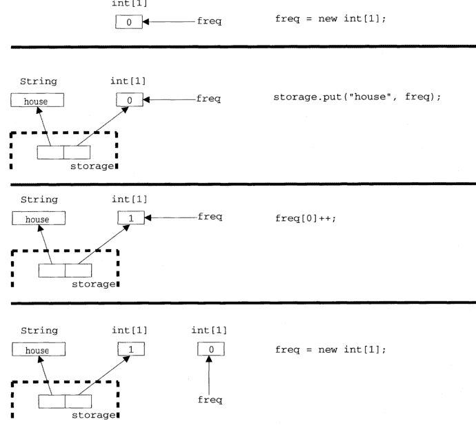
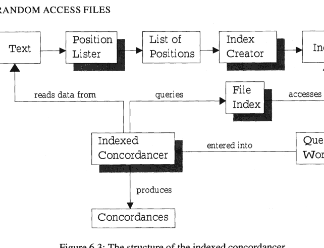
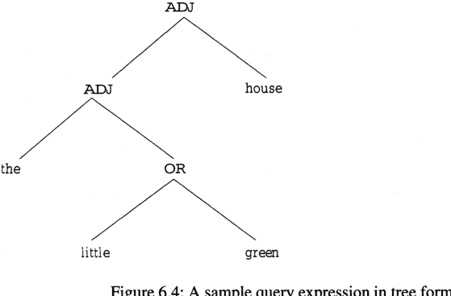
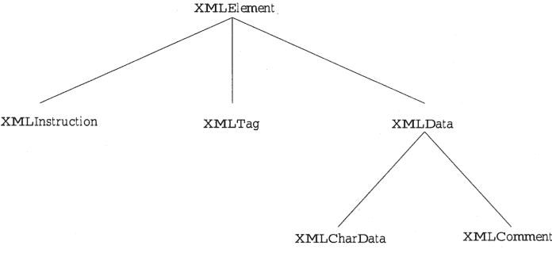
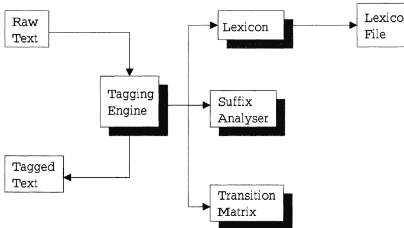
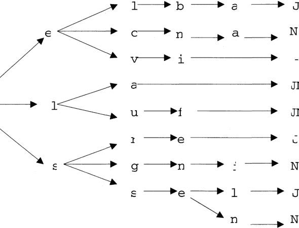

# 语料语言学编程：如何使用 Java 进行文本分析

## 编辑顾问委员会

- Ed Finegan，美国南加州大学
- Dieter Mindt，德国柏林自由大学
- Bengt Altenberg，瑞典隆德大学
- Knut Holland，挪威人文科学计算中心，挪威卑尔根
- Jan Aarts，荷兰内梅亨天主教大学，荷兰
- Pam Peters，澳大利亚麦考瑞大学，澳大利亚

丛主编：Tony McEnery 和 Andrew Wilson

Oliver Mason

## II 语言处理示例 ........................................................................ 177

- 12.4 参考文献 .................................................................................. 235

献给 Joanna，感谢她所有的帮助与支持

# 1 引言

语料语言学的核心是通过分析语言数据来得出关于语言如何运作的结论。为了对语言的本质做出有效断言，通常需要观察大量的单词，往往超过百万个。如此规模的文本显然超出了人工分析的范畴，因此我们需要计算机的帮助。尽管计算机功能强大，但对于具有人文背景的人来说，它并不是一个容易使用的工具，因此其使用通常局限于现有的任何成品程序。

本书是一本关于计算机编程的入门书，面向语料语言学。它的编写目的是为了让没有任何编程基础（但知道如何开关电脑）的语料语言学家能够创建程序来辅助他们的研究、文本分析和语料库处理。它介绍了 Java 编程语言的基本概念。这种语言不仅适合初学者，还具有许多对语料处理非常有用的特性。

本书也适合计算机科学专业的学生，他们已经拥有计算背景，并希望投身语言处理领域。第三章解释了文本处理的基础知识，这应该起到类似于第二章对非程序员的作用：在提供足够的介绍以便在该领域开展实际工作之前，在后文中介绍示例和应用。

读完本书后，你将知道如何为基础处理任务生成自己的工具，例如创建词表、计算文本参数和进行检索。为了让你了解如何开发复杂的软件，我们将查看几个示例项目：一个词干提取器、一个词性标注器和一个搭配分析程序。

## 1.1 语料语言学中的编程

语料库源于语言学，是一个侧重于数据实证分析的学科。然而，计算机的角色是至关重要的，如果没有机器可读的语料，语料语言学无法取得巨大进展。为了处理此类语料，需要软件，即用于分析数据的计算机程序，这对编程技能产生了需求。本节将简要讨论由当前语料语言学现状引发的某些问题，并论证威胁该行业的 IT 技能短缺危机对学术界也产生了影响。

### 1.1.1 语料语言学中的计算机

在分析大量语言数据时，计算机是语料语言学者的基本工具。但当手头任务超出收集一小组语料块（concordance lines）时，就会发现没有合适的软件来完成任务。这意味着为了进行实证研究，人们不得不诉诸手动操作，或者自己编写适当的软件。

手动数据分析不仅枯燥且耗时，而且容易出错，因为人类大脑并不擅长处理枯燥的重复任务，而语言学计数工作正等同于此类任务。然而，这恰恰是计算机极擅长的。进一步来说，可以说，目前形式的语料语言学如果没有计算机的帮助将无法运作。某些技术，例如搭配分析（Church and Hanks, 1990; Clear, 1993）和语体变异研究（Biber, 1988），根本无法通过手动应用。事实上，语料库只有以机器可读的形式存在时才有用，“语料库”一词的含义确实演变为意味着机器可读，因此印刷版语料库现在是例外而非规定（McEnery and Wilson, 1996）。

这种对除最基础工作之外的所有语料的依赖显然并非没有问题。问题在于，研究人员受到可用软件及其功能的限制，为了使用给定的程序，往往不得不改变处理问题的方法。另一方面，开发者则受限于自身的兴趣（由于缺乏与潜在用户的交流）或易于实现的事物。语料语言学软件的主要需求似乎是灵活性，以便能够以开发者无法预测的新方式探索语料库。然而，这只能通过用户方面的某种编程来实现。

当某个特定任务没有可用软件时，有两种主要的解决方案：用户可以自己开发合适的软件，或者找开发者来做。自力更生方法的问题在于它需要编程知识，而这种知识是很难获得的。编程本身不仅耗时，而且当生成的程序运行不正常并需要调试时，可能会非常令人沮丧。通常值得检查计算机在项目中需要参与的何种程度，参见 Barnbrook (1996)：通常，为了调整问题以便使用计算机而付出的努力远高于手动操作，特别是当不涉及重复性或大规模计数任务时。

### 1.1.2 哪种编程语言？

计算机程序是用特殊的代码编写的，即所谓的编程语言。机器指令有多个级别，程序员通常使用高级语言，这种语言会被翻译成实际的机器码，而机器码取决于计算机的处理器。自上世纪中叶以来，编程已经取得了巨大进步，当时它基本上由配置大型计算机前面板上的开关组成，这些计算机需要存放在高空调房间里。如今，编写计算机程序与写学术论文并没有太大区别：你坐在屏幕前，在文本编辑器中输入，随着过程不断编写程序，并偶尔尝试其运行。

今天有许多编程语言，Java 是其中较新的开发成果。所有这些语言都是为了特定目的而开发的，并带有不同的设计目标。某些语言更适用于数学计算（如 Fortran），人工智能研究和逻辑计算（如 Prolog）。因此，首要任务是找到一种非常适用于语料分析中典型过程的语言。然而，还有其他方面：这种语言对于非计算专家应该是容易学习的，因为很少语料语言学家拥有计算机科学学位，而且它应该能够在平台上运行，因为个人电脑和大型工作站通常被用于语料处理。

对于这本书来说，Java 主要以通过动画和交互来“增强”网页而闻名，但同时它是一种强大且设计良好的通用编程语言，这一特点促成了它在很短时间内成为最广泛使用的语言之一。在接下来的章节中，在查看详细路线概述之前，我们将简要查看 Java 的对语料分析特别有用的某些方面。

### 1.1.3 Java 的有用方面

Java 语言中特别适用于处理语料的第一个特性是其处理字符的先进能力。许多其他语言仅限于基础拉丁字母表，可能仅带有几个带重音字母作为扩展，而 Java 支持全字符集（`http://www.unicode.org/`）。这意味着可以轻松处理英语以外的其他语言，然而，对于许多不同的语言……

## 1.2 路线图

在像这样的书中，显然不可能同时涵盖 Java 编程的所有方面或语料语言学的所有方面，因此必须决定哪些内容被纳入书中，哪些内容被排除。本节简要列出了你将在书的其余部分找到的内容，以及你找不到的内容。Java 已经迅速成为一种非常全面的编程语言，并有数千页的书籍在描述它。然而，其中许多内容对语料语言学家来说并不真正相关，但仍为文本和语料分析留下了许多有用元素。

### 1.2.1 涵盖内容

后续章节“基础编程概念简介”是总体性的介绍。它面向到目前为止没有进行过任何编程的读者，并将为后续章节提供基础。第三章“基础语料概念”介绍了语料语言学的基础知识。通过阅读这两章，将建立一个将语料语言学与编程相结合的框架，了解如何利用编程进行语言研究。

下一章“基础 Java 编程”介绍了 Java 编程语言，并在第一章介绍的概念的基础上进行。它将展示如何在实际编程代码中实现这些概念。在《Java 类库》中，我们将查看你可以在项目使用的一些标准类。使用现有的类可以大大加快开发速度，并减少错误范围，因为现有的类不太可能包含许多未被检测到的错误。

然后，“输入/输出”将带你进入语料语言学中最重要的任务。在展示了如何读取文本和打印文本后，我们将运用新学的技能来研究创建检索索引（concordance）的不同方法。

之后，在第 7 章中，我们将处理仅包含简单单词的全文。在输入流中识别单词是基础处理步骤之一，后续许多其他任务都依赖于此。

大多数语料库都有注释。如何处理语料库中的注释是第 8 章的主题。在这里我们将研究标记，重点关注 XML，它不仅是 Web 的新标准，而且作为 SGML 的简化变体，也与语料编码相关。

最后，我们将研究三个案例研究，这些是你可能在日常研究中发现并有用的自包含项目。借鉴该系列中两本伴侣书的思路，我们将根据 Oaks 的《语料语言学统计学》中的简要描述实现一个词干提取器；根据 McEnery & Wilson 的《语料语言学》中的一项研究问题描述一个词性标记器；并按照 Barnbrook 的《语言与计算机》中描述的，查看如何计算词汇。所有这些案例研究都从对如何做的简单描述开始，并以一个你可以立即开始使用的运行程序结束。

### 1.2.2 Java 的其他特性

如前所述，Java 已经发展（并且仍在进一步发展）成为一种具有各种领域扩展的庞大语言。然而，其中许多内容与你的目的并不直接相关，在本节中，我们将涉及一些书中不得不省略的特征，但这些特征可能对你的后续工作有用。如果你想了解更多关于这些特征，我建议你买一本通用的 Java 书籍，例如 Horton (1999)。

在整个列表中你会发现一个反复出现的主题，即系统操作被泛化到更抽象的水平，然后被纳入语言中。许多需要访问外部硬件组件（如显卡或网络适配器）或其他软件模块（如数据库）的操作是针对特定机器或操作系统的。然而，通过创建一个抽象层，它们可以在不同平台上以相同的方式被处理，而 Java 运行环境（JRE）填补了通用操作与它们在给定计算机上实际工作方式之间的空白。

#### 图形

图形是 Java 的另一个强项。处理图形输出是非常特定于平台的，这意味着如果你的开发需要具有可移植性，那么它就没有通用的支持。然而，Java 的开发者设计了一个抽象工具包，用于处理图形操作并在目标平台上渲染它们。在第一个版本中，该方案受到了 Windows 和 Unix 上的 X Window 系统中按钮与其他元素之间缺陷和细微差异的影响，但开发者选择了一种略有不同但效果更好的方法：不再依赖系统提供用户界面组件，新工具包（称为 Swing）仅使用如绘制线条和窗口等基本操作，所有的组件都通过其原语操作来实现。

通过抛弃“原生”设备，用户界面现在在所有平台上都真正实现了一致性，并且可以使用 Java 进行编程。

#### 数据库

与图形输出类似，所有与数据库相关的功能都已抽象为 JDBC（Java 数据库连接）。这允许程序员无论底层操作系统如何，都能从数据库中检索数据。

#### 网络

Java 与互联网紧密相关。这主要是因为被用于 Applet，即运行在浏览器内的小型应用程序。

## 1.3 获取 Java

与许多语言不同，Java 编译器在互联网上免费提供。你可以从 Sun 网站下载最新版本。有两种不同的包可供选择，一个称为 JRE，另一个称为 JDK 或 SDK。

JRE 是“Java 运行环境”。如果你只想运行 Java 程序，就需要它。它包含了适用于计算机的标准类库和虚拟机。

JDK 或 SDK 是“Java 开发工具包”或“系统开发工具包”。发行商 Sun 从 1.2 版本开始更改了该包的名称。该包包含了开发 Java 程序所需的所有内容，并包括编译器。事实上，Java 编译器 `javac` 本身是用 Java 编写的。

你还需要一个编辑器来编写源文件。可以使用任何文本编辑器，只要你能生成纯文本文件。有些公司提供所谓的 IDE（集成开发环境），有时带有他们优化的编译器。只要它们支持完整的 Java 标准，你就可以使用它们进行开发。

## 1.4 准备源码

在我们开始编写 Java 程序之前，还有几点需要注意；这些只是细小的细节，但尽管如此，记住它们可以节省你在后期阶段与编译器错误信息斗争的时间。

类的源代码必须在纯文本文件中。无法在文字处理软件包中编写程序并直接编译它。你必须将其保存为纯文本，或者更明智的做法是，使用专门的文本编辑器编写它们。Java 源文件必须具有 `.java` 扩展名，因此文件必须相应保存。Java 编译器会拒绝任何具有其他扩展名的文件。此外，文件名需要与其中定义的类名匹配。

每个类都必须放在一个单独的文件中，除非它可以从其他类被公开访问。即使你可以在一个源文件中定义多个类，这也会在查找特定类的定义时让寻找相关文件变得更加困难。如果类 `Phrase` 能总能在 `Phrase.java` 文件中找到，将要容易得多。Java 编译器会将此转换为一个二进制文件 `class.class`，该文件可以被 JVM（Java 虚拟机）使用。

### 1.4.1 运行你的第一个程序

在我们开始学习理论之前，这里有一个简单的示例，你可以自己尝试一下。由于我们在语言结构的使用上仍然受到很大限制，因此这必须是一个很小的示例。在接下来的章节中，你将看到 Java 还提供了哪些类来让编程变得更容易，以及如何处理输入和输出。

我们现在开发的类展示了命令行参数。这意味着你在调用它时带有若干参数，例如：

`java Echo is a test of the Echo class`

结果是该类将在屏幕上打印 `This is a test of the Echo class`。上述命令行的前两个部分分别是交给 Java 解释器的类以及要执行的类名，它们不被视为参数。

当你尝试执行一个类时，Java 解释器会将相应的编译代码加载到内存并进行分析。它会寻找形式如下的方法：

```java
public static void main(String args[])
```

这意味着必须有一个名为 `main()` 的方法，它接受一个 `String` 数组作为参数，而且它必须被声明为 `public`（公共）和 `static`（静态）。这样就可以从外部访问它，而不需要可用的对象实例。这个 `String` 数组将是命令行参数，有了这些知识，我们现在编写 `Echo` 类：

```java
/*
 * Echo.java
 */
public class Echo {
    public static void main(String args[]) {
        System.out.println("The command-line arguments:");
        for (int i = 0; i < args.length; i++) {
            System.out.println("** " + args[i]);
        }
    }
} // Echo 类的结束
```

类的定义由访问修饰符引导，后面跟着关键字 `class`。你将处理的大多数类都是 `public` 的，但同样有更细粒度的选项。我们暂时忽略这些，因为它们与本书中的内容不相关。在类名之后，定义本身被括在花括号中。这被称为代码块（block），是 Java 中一种反复出现的模式。你会在其他几个地方发现块，例如在方法定义中。

只需将此代码列表保存为名为 `Echo.java` 的文件，用 `javac Echo.java` 编译它，然后按照上述描述的方法运行它。你会发现它的行为略有不同，为了让它更有趣一点。它不是简单地原样回显模式，而是将它们放在单独的行中的一个编号列表中。

当类被执行时，JVM 会定位到 `main()` 方法并将参数传递给它。在迭代所有参数之前，我们先打印一行表头。注意我们在 `for` 循环的条件部分是如何使用数组 `args` 的 `length` 字段的。在循环内部，我们可以通过变量 `i` 访问计数器，在语句中，我们将变量、一个包含句号和空格字符的字面量字符串以及当前参数组合成一个字符串显示在屏幕上。

## 1.5 总结

在本介绍性章节中，我们首先讨论了计算机在语言学中的作用，强调了这样：在处理计算机语料库时，能够编程变得越来越重要且相关。解决这一问题的优选方案是学习 Java，这是一种既适合文本处理又易于学习的语言。

此外，Java 是机器无关的，这意味着你可以在任何平台上运行程序。这在你在家和工作场所使用不同的机器时尤为重要；性能较弱的计算机可能运行不够快，或者可能无法处理大量数据，但至少你不需要更改程序。这是由于 Java 的混合性质，它介于编译型语言和解释型语言之间。

在查看了书中将要内容的路线图后，我们简要介绍了 Java 的几项特性，这样如果你想将你的编程知识扩展到图形用户界面、数据库或网络设施，你就知道可以使用 Java，这节省了你学习另一种编程语言的时间。

最后，我们还学习了如何获取在 Java 中开发程序时我们需要的必要工具。这包括了开发工具包（JDK），它可以免费下载。我们还编写了第一个 Java 程序。

在下一章中，我们将介绍通用的编程知识。你将熟悉开始编程所需的各种概念，这些概念将贯穿本书的其余部分。这里的重点是最基本的需求，考虑到大多数读者最终对计算机科学本身并不感兴趣，只是将其作为辅助语言研究的手段。


```java
public static void main(String args[]) {
    System.out.println("The command-line arguments:");
    for (int i = 0; i < args.length; i++) {
        System.out.println("** " + args[i]);
    }
}
```

// Echo 类的结束

类的定义由访问修饰符引导，后面跟着关键字 `class`。你将处理的大多数类都是 `public` 的，但同样有更细粒度的选项。我们暂时忽略这些，因为它们与本书中的内容不相关。在类名之后，定义本身被括在花括号中。这被称为代码块，是 Java 中一种反复出现的模式。你会在其他几个地方发现块，例如在方法定义中。

只需将此代码列表保存为名为 `Echo.java` 的文件，用 `javac Echo.java` 编译它，然后按照上述描述的方法运行它。你会发现它的行为略有不同，为了让它更有趣一点。它不是简单地原样回显模式，而是将它们放在单独的行中的一个编号列表中。

当类被执行时，JVM 会定位到 `main()` 方法并将参数传递给它。在迭代所有参数之前，我们先打印一行表头。注意我们在 `for` 循环的条件部分是如何使用数组 `args` 的 `length` 字段的。在循环内部，我们可以通过变量 `i` 访问计数器，在语句中，我们将变量、一个包含句号和空格字符的字面量字符串以及当前参数组合成一个字符串显示在屏幕上。

## 1.5 总结

在本介绍性章节中，我们首先讨论了计算机在语言学中的作用，强调了这样：在处理计算机语料库时，能够编程变得越来越重要且相关。解决这一问题的优选方案是学习 Java，这是一种既适合文本处理又易于学习的语言。

此外，Java 是机器无关的，这意味着你可以在任何平台上运行程序。这在你在家和工作场所使用不同的机器时尤为重要；性能较弱的计算机可能运行不够快，或者可能无法处理大量数据，但至少你不需要更改程序。这是由于 Java 的混合性质，它介于编译型语言和解释型语言之间。

在查看了书中将要内容的路线图后，我们简要介绍了 Java 的几项特性，这样如果你想将你的编程知识扩展到图形用户界面、数据库或网络设施，你就知道可以使用 Java，这节省了你学习另一种编程语言的时间。

最后，我们还学习了如何获取在 Java 中开发程序时我们需要的必要工具。这包括了开发工具包（JDK），它可以免费下载。我们还编写了第一个 Java 程序。

在下一章中，我们将介绍通用的编程知识。你将熟悉开始编程所需的各种概念，这些概念将贯穿本书的其余部分。这里的重点是最基本的需求，考虑到大多数读者最终对计算机科学本身并不感兴趣，只是将其作为辅助语言研究的手段。

# 导论

……具有其他扩展名。此外，文件名需要与其中定义的类名匹配。

每个类都必须放在一个单独的文件中，除非它可以从其他类被公开访问。即使你可以在一个源文件中定义多个类，这也会在查找特定类的定义时让寻找相关文件变得更加困难。如果类 `Phrase` 能总能在 `Phrase.java` 文件中找到，将要容易得多。Java 编译器会将此转换为一个二进制文件 `class.class`，该文件可以被 JVM（Java 虚拟机）使用。

### 4.1.1 运行你的第一个程序

在我们开始学习理论之前，这里有一个简单的示例，你可以自己尝试一下。由于我们在语言结构的使用上仍然受到很大限制，因此这必须是一个很小的示例。在接下来的章节中，你将看到 Java 还提供了哪些类来让编程变得更容易，以及如何处理输入和输出。

我们现在开发的类展示了命令行参数。这意味着你在调用它时带有若干参数，例如：

`java Echo is a test of the Echo class`

结果是该类将在屏幕上打印 `This is a test of the Echo class`。上述命令行的前两个部分分别是交给 Java 解释器的类以及要执行的类名，它们不被视为参数。

当你尝试执行一个类时，Java 解释器会将相应的编译代码加载到内存并进行分析。它会寻找形式如下的方法：

```java
public static void main(String args[])
```

这意味着必须有一个名为 `main()` 的方法，它接受一个 `String` 数组作为参数，而且它必须被声明为 `public`（公共）和 `static`（静态）。这样就可以从外部访问它，而不需要可用的对象实例。这个 `String` 数组将是命令行参数，有了这些知识，我们现在编写 `Echo` 类：

```java
/*
 * Echo.java
 */
```

```java
public static void main(String args[]) {
    System.out.println("The command-line arguments:");
    for (int i = 0; i < args.length; i++) {
        System.out.println("** " + args[i]);
    }
}
```

// Echo 类的结束

类的定义由访问修饰符引导，后面跟着关键字 `class`。你将处理的大多数类都是 `public` 的，但同样有更细粒度的选项。我们暂时忽略这些，因为它们与本书中的内容不相关。在类名之后，定义本身被括在花括号中。这被称为代码块，是 Java 中一种反复出现的模式。你会在其他几个地方发现块，例如在方法定义中。

只需将此代码列表保存为名为 `Echo.java` 的文件，用 `javac Echo.java` 编译它，然后按照上述描述的方法运行它。你会发现它的行为略有不同，为了让它更有趣一点。它不是简单地原样回显模式，而是将它们放在单独的行中的一个编号列表中。

当类被执行时，JVM 会定位到 `main()` 方法并将参数传递给它。在迭代所有参数之前，我们先打印一行表头。注意我们在 `for` 循环的条件部分是如何使用数组 `args` 的 `length` 字段的。在循环内部，我们可以通过变量 `i` 访问计数器，在语句中，我们将变量、一个包含句号和空格字符的字面量字符串以及当前参数组合成一个字符串显示在屏幕上。

## 1.5 总结

在本介绍性章节中，我们首先讨论了计算机在语言学中的作用，强调了这样：在处理计算机语料库时，能够编程变得越来越重要且相关。解决这一问题的优选方案是学习 Java，这是一种既适合文本处理又易于学习的语言。

此外，Java 是机器无关的，这意味着你可以在任何平台上运行程序。这在你在家和工作场所使用不同的机器时尤为重要；性能较弱的计算机可能运行不够快，或者可能无法处理大量数据，但至少你不需要更改程序。这是由于 Java 的混合性质，它介于编译型语言和解释型语言之间。

在查看了书中将要内容的路线图后，我们简要介绍了 Java 的几项特性，这样如果你想将你的编程知识扩展到图形用户界面、数据库或网络设施，你就知道可以使用 Java，这节省了你学习另一种编程语言的时间。

最后，我们还学习了如何获取在 Java 中开发程序时我们需要的必要工具。这包括了开发工具包（JDK），它可以免费下载。我们还编写了第一个 Java 程序。

在下一章中，我们将介绍通用的编程知识。你将熟悉开始编程所需的各种概念，这些概念将贯穿本书的其余部分。这里的重点是最基本的需求，考虑到大多数读者最终对计算机科学本身并不感兴趣，只是将其作为辅助语言研究的手段。

# 导论

……具有其他扩展名。此外，文件名需要与其中定义的类名匹配。

每个类都必须放在一个单独的文件中，除非它可以从其他类被公开访问。即使你可以在一个源文件中定义多个类，这也会在查找特定类的定义时让寻找相关文件变得更加困难。如果类 `Phrase` 能总能在 `Phrase.java` 文件中找到，将要容易得多。Java 编译器会将此转换为一个二进制文件 `class.class`，该文件可以被 JVM（Java 虚拟机）使用。

# 程序是做什么的？

做这些，但仍然希望从使用它中获益。毕竟，编程只是目的的手段，即对语料库探索。

## 2.1.2 如何表达算法

开发程序的一种非常直观的方法被称为逐步细化（Wirth, 1971）。在这里，你从算法的通用的（不可避免是模糊的）大纲开始，对其进行多次检查。每当每个步骤都表述得更详细时，直到经过若干迭代后，你达到了一个与编程语言匹配的水平。这种编程风格被称为自顶向下编程，因为你从高抽象层级开始，一路“向下”工作到计算机层级。相反的是自底向上，即你从低级例程开始，将它们组合成更大的模块，直到达到应用层。大多数时候，你实际上会同时使用这两种方法，从两端开发程序，直到它们在中间某处汇合。

等一下，让我重新读一下文本以确保准确性。

为了描述算法，我们将使用伪代码，这是一种混合了某些形式元素和自然语言的语言。起初，描述将包含更多英语，但随后的迭代中英语会越来越少，形式元素会越来越多。

例如，任务是从文本文件中创建一个排序的倒序列表。这是一个包含所有单词的列表，按反序排序，使得具有相同结尾的单词相邻。这样的列表可以用于形态学分析，或用于对韵律模式的调查。我们从以下描述开始：

```
1 从文本中读取单词
2 反转单词中的字母
3 按字母顺序排序列表
4 将字母反转回来
5 打印排序后的列表
```

通过反转单词的字母，我们可以简单地按字母顺序对它们进行排序，然后再反转它们。这意味着我们可以使用列表排序机制，而无需创建一个特殊的自定义机制。那组指令对于人类来说创建这样一个列表是足够的，但对于计算机来说它不够精确。尽管如此，我们可以检查它并再增加几个步骤：

```
1 对于文本中的每个单词
2 从文本中读取下一个单词
3 反转单词
4 将单词插入列表
5 列表排序
6 对于列表中的所有单词
7 反转单词
8 打印单词
```

请注意，我们通过将算法拆分为三个主要步骤改变了算法的结构：创建一个反转单词列表、对列表排序以及打印列表。这个新版本精确得多，因为它反映了每个单词是如何一次处理的，而且我们还了解了涉及多少工作量：程序的第一部分为我们正在查看的文本中的每个单词（或标记）执行一次，而第二部分和第三部分对唯一单词列表（类型）进行操作。我们还显式地说明了单词与单词列表之间的关系，以及我们将单词插入列表，这在第一份草稿中并不显而易见。

虽然第二次尝试要精确得多，但仍然不够。这里是第三次尝试：

```
1 打开文本文件进行读取
2 创建空列表
3 当文件中还有更多单词时
4 从文件读取下一个单词
5 反转单词
6 检查单词是否在列表中
7 是：跳过该单词
8 否：将单词插入列表
9 关闭输入文件
10 列表排序
11 对于列表中的所有单词
12 反转单词
13 打印单词
```

我们在这里得到的是人类不会考虑的非常明显的点。如果有人要求你写一份购物清单，你会拿一张空纸，就像打开一本书并从你想阅读的第一页开始一样。但对于计算机，你必须让所有这些步骤显式化，这些包括读取文本和设置单词列表。

# 语句和表达式

计算机程序通常由语句和表达式组成。在上面的算法中，我们有 `reverse word`（反转单词）和 `close input file`（关闭输入文件）。这些语句由一个命令关键字（reverse 和 close）和一个描述它们操作对象的表达式（分别为 word 和 input file）组成。表达式求值为某个特定的数据类型。

例如，打印时间的语句可能看起来像：

```
print time
```

在这里 `time` 是一个表达式，它在计算机执行它时被求值。你不会写 `print 10:30`，因为你希望计算机在语句执行的那一刻打印时间。因此，`time` 需要是一个表达式，它的求值触发读取计算机内部时钟并以某种形式返回当天的时间。另一方面，`print` 是一个语句。它一直运行一样，是给计算机的直接指令。虽然 `time` 要求计算机检索当前时间，而 `print` 告诉它做什么。

作为进一步示例，考虑字面量 'the'。这个字面量值可以被表达式 '英语语料库中最频繁的单词' 替换。这里的区别在于，表达式不能被字面理解，它必须经过求值才有意义。表达式反过来可以由运算符组合的子表达式组成。这些运算符要么是标准的数学运算（加法、减法等），要么是非数值数据的操作，如：

# 程序是做什么的？

字符串拼接。如果我们看一个实际 Java 代码中的示例，这将会变得更清晰：

```java
String word1 = 'aard';
String word2 = 'vark';
String word3 = word1 + word2;
```

在这个简单的示例中，我们首先声明了两个数据类型为 `String` 的变量（存储数据的容器）。变量声明由一个数据类型、一个变量名和一个可选的初始赋值组成。这里变量声明算是一个语句，在 Java 中语句以分号结束。第三行工作原理完全相同，只是这次我们没有赋值字面量 `String`，而是一个求值为 `String` 的表达式。加号表示（两个或多个）字符串的拼接，因此表达式 `word1 + word2` 求值并赋值给 `word3`。

从那个示例中可以看出，变量是一种表达式。它不能替代语句，但可以与要求相同类型表达式的命令一起使用。赋值有点特殊，它们技术上是命令，但没有命令关键字。我们稍后会详细讨论类型、语句和表达式，但在考虑布尔表达式之前，我们还需要了解另外一种类型。


# 布尔表达式与控制流

布尔表达式是一个求值为真值的表达式。这可以通过字面量 `true` 和 `false` 来表示，它们是极简的布尔表达式。我们已经遇到的一个布尔表达式是上一个反转列表中的 `list`。如果你对这个表达式进行求值，它要么是 `true`（如果单词在列表中），要么是 `false`（如果不在）。编程中使用的大多数布尔表达式要简单得多，只需测试相等性或比较值。对于这些，有许多布尔运算符（如表 2.1 所示）。赋值指示符单等号 `=` 与布尔运算符 `==` 之间的区别是双等号。

为了说明这些运算符的使用，这里有几个简单的示例。假设你正在编写一个调度程序，那么当表达式 `time == 12:30` 时，你可以设置一个午饭通知。在组合表达式时，系统会告诉你 `time >= 5:30 || to-do-list == ''`。这意味着你可以在 5:30 之后离开，或者在你完成所有必须做的事情时离开。只要两个子表达式都求值为真即可。然而，经理可能会将逻辑或 (`||`) 更改为逻辑与 (`&&`)，在这种情况下，如果你完成了当天的工作，你必须等到 5:30；但如果你在 5:30 之前还没有处理完你的收件箱，你就必须加班，因为那时只有当两个子表达式都为真时，该表达式才为真。

## 表 2.1：布尔运算符

| 运算符 | 含义 | 示例 |
| --- | --- | --- |
| `==` | 等于 | `4 == 4` |
| `>` | 大于 | `3 > 2` |
| `<` | 小于 | `4 < 6` |
| `>=` | 大于等于 | `5 >= 5, 7 >= 5` |
| `<=` | 小于等于 | `5 <= 5, 3 <= 5` |
| `&&` | 逻辑与 | `(1 < 3 || 7 > 5)` |
| `!` | 否定 | `(2 > 1 && 3 < 5)` |
|  |  | `!(2 != 0)` |

## 2.2 控制流

当你阅读文本时，从开始开始逐行向下阅读，直到末尾，除非你将引用作为脚注或参考文献。在这些情况下，你会“跳转”到打印脚注的地方，然后在之前停止的地方继续阅读。这本质上与计算机处理你程序的方式是相同的。然而，我们在 2.2 节中看到的代码列表中，还有一些行表示否定（虽然有更多的单词）和分支（如果单词在列表中）。这些语句引导着程序的控制流，对于理解计算机如何执行程序至关重要。在本节中，我们将更详细地讨论控制流为什么是编程中如此重要的概念。

为了跟踪需要执行哪些命令，计算机需要一个指向程序内当前位置的指针，就像你需要跟踪自己在阅读文本时所处的位置一样。这个位置标记是程序计数器，它存储了要执行的下一条指令的地址。它有一个辅助存储器来临时保存以便跳转到另一个位置，类似于文章中的脚注。它将程序计数器的当前值存储在一个单独的地方，然后加载“脚注”的地址。当到达脚注末尾时，一个结束标记会通知处理器从临时空间将旧值重新加载到程序计数器中，并从中断的地方恢复执行。

在程序中，我们将利用几种方法来引导控制流。你可能还记得某些被称为“互动小说”的书，它们是一种幻想角色扮演游戏。它是一系列编号的图表，书中会发生事情并告诉你从何处继续。你通过掷骰子与巨魔“战斗”，并根据结果决定胜负。段落的最后几行通常是这样的：“如果你打败了巨魔，去 203，否则继续到 451。”与传统的叙事不同，这些书没有单一的剧情线，但你可以“阅读”多次，探索不同的“替代现实”，取决于你是否击败了巨魔。

计算机程序也是那样。根据外部影响，计算机在程序中采取不同的路径，改变控制流有多种方法。我们现在更详细地讨论其中三种：顺序、选择和循环。

### 2.2.1 顺序

这是程序执行的通用方式，按顺序执行。从第一条指令开始，程序计数器简单地递加指向下一条指令，大多数指令实际上不会影响程序计数器。顺序就像从头到尾读一本书，而从不回溯或跳过任何部分。

尽管它是默认的，但如果计算机的优势是速度，而通过让它重复执行某些操作来利用这一点，程序就做不了。为了这一点，我们需要其他方法，我们将在文中介绍。

纯顺序流的表达能力相当有限；一个口袋计算器可以执行数学运算，但无法以任何方式对结果做出反应。任何比这更复杂的算法都需要更差异化的控制流。

在讨论引导控制流的方法之前，我们还需要了解另一个概念，块（block）。块是一组组合在一起的语句序列，在语法上等同于单条语句。在上一个示例中，我们在末尾有一个块：

```
11 for all words in list
12 reverse word
13 print word
```

这两行是一个块，在伪代码中，它们通过处于相同的缩进级别被组合在一起。在 Java 程序以及许多其他语言中，块是用花括号界定的。设置块的原因是让计算机能够确定某些命令的作用范围；否则，它应该如何知道打印语句也要为每个单词执行呢？通过将这两个语句放入一个块中，这一点变得一目易见。在接下来的章节中，我们将看到更多块至关重要的示例。

### 2.2.2 选择

如果只有顺序执行，那么每次运行计算机程序时它基本上和以前完全一样。可以通过另一种类型的控制流——选择（choice）来引入变数。在这里，处理器评估一个条件，并根据结果分支到两个或多个替代方案之一。简单的替代方案以抽象形式表示为 `IF X THEN ELSE B`，其中 `X` 是要评估的条件，`A` 和 `B` 是两个替代语句块。条件 `X` 必须是一个布尔表达式，即它的求值结果真或假。如果 `X` 为真，则执行块 `A`，否则执行块 `B`。

现在这可以用于决策制定：想象一下电影院的售票处，人们在机器上买票。为了检查客户是否允许看电影，机器会询问他们的年龄。然后它检查年龄相对于他们想看的电影的分级是否足够，并打印结果。

### 2.2.3 多重选择

还有另一种形式的选择控制流，其中测试评估为多个值中的一个。这种选择的形式是 `switch`，`switch` 语句匹配每个 `case`，如果匹配了则执行相应的块。一个特殊情况是 `default`，当没有匹配其他 `case` 时。

### 2.2.4 循环

计算机非常擅长重复某件事，不像人类在执行某百次某次时不会失去注意力。为了让计算机重复执行某些操作，我们使用循环来控制执行流。

第一种循环由条件控制。它基本上像一个分支，但它只有一个块，当到达该块的末尾时会重新检查条件，如果仍然为真，则再次执行该块。如果为假，程序将从块的结束后继续执行。

对于我们的示例，我们编写一个程序扫描文本并找到单词的首次出现。一旦找到该单词，它将停止并打印单词在文本中的位置。在伪代码中这看起来如下：

```
1 searchWord = 'scooter'
2 searchPosition = -1
3 currentPosition = 0
4 open input text for reading
5 while text-has-more-words && searchPosition == -1
6 read word
7 increment currentPosition
8 if word == searchWord
9 then
10 searchPosition = currentPosition
11 endif
12 endwhile
13 close input text
14 if searchPosition == -1
15 then
16 print 'the search word does not occur in the text'
17 else
18 print 'the search first occurs at position ' + searchPosition
19 endif
```

我们首先从几个变量开始。当你初始化一个变量时，你是在为它分配一个初始值。这些变量是：`searchWord`（我们正在查找的单词）、`searchPosition`（该单词首次出现的位置）以及一个用于跟踪我们当前所在位置的计数器 `currentPosition`。`searchPosition` 作为我们是否已经找到该单词的指示：它最初被设置为 -1，并在与文本中的某个单词匹配之前一直保持该值不变。

在打开输入文本进行读取后，我们进入循环。在我们的情况下，循环由一个复杂的条件控制，该条件由两个子条件组成。我们的条件是一个逻辑“与”（AND），只有当两个子条件都为真时，整个条件才为真。只要任何一个子条件变为假，整个条件也会变为假。该条件是：还有更多可读的单词（否则我们就不知道何时停止读取），并且 `searchPosition` 的值为 -1。这意味着我们还没有找到正在查找的单词。

在循环中，我们读取一个单词并记录它在文本中的位置，然后将其与目标单词 `searchWord` 进行比较。一旦发生这种情况，该变量将不再是 -1，第二个子条件变为假，导致循环终止。否则，`searchPosition` 将保持为 -1，循环将再次执行。

一旦完成循环，我们就检查 `searchPosition` 变量的值：如果它仍然是 -1，说明循环终止是因为在遇到搜索单词之前已经读取到了文本末尾。如果我们打印出已找到的消息，请注意变量的打印方式：如果它像消息的其他部分一样被包含在双引号中，我们只会打印单词 'searchPosition' 本身，而不是变量 `searchPosition` 的值。要打印实际值，我们必须在双引号之外用加号将其附加到消息上。

这种循环的特点是在进入循环体之前对条件进行评估。这意味着如果条件从一开始就为假，则循环体可能完全不会被执行。如果输入文本为空、或者不包含任何单词（或者可能不存在），就会出现这种情况。另一种类型的循环是在循环体之后有条件，因此循环体至少会被执行一次。它们是相似的，所以让我们用不同的循环来看同样的同一个任务：

```
1 searchWord = "scooter"
2 searchPosition = -1
3 currentPosition = 0
4 open input text for reading
5 do
6 read word
7 increment currentPosition
8 if word == searchWord
9 then
10 searchPosition = currentPosition
11 endif
12 while text-has-more-words && searchPosition == -1
13 close input text
14 if searchPosition == -1
15 then
16 print "the search word does not occur in the text"
17 else
18 print "the search word first occurs at position " + searchPosition
19 endif
```

我们从相同的初始化开始，然后进入循环体，如 `do` 关键字所示（第 5 行）。之后，它看起来与之前的程序完全相同。然而，这里有一个重要的区别：如果输入文本为空（即它不包含任何单词），那么在第一次执行循环体时，程序仍会尝试从其中读取一个单词，这会导致错误。这是因为条件 "text-has-more-words"（第 12 行）是在循环体执行后才被检查的，因此存在出现问题的风险。使用头部驱动的 `while` 循环更安全，因为你不需要受循环体在条件后执行一次的限制，因此头部驱动循环比 `do-loops` 多得多。

另一种类型的循环是 `for` 循环。它结合了初始化、条件检查和迭代步骤。让我们用 `for` 循环来重写同样的任务（假设最多读取 100 个单词）：

```java
int counter = 0;
String searchWord = "by";
inputFile = new FileReader("input");
for(int position = 0; position < 100; position++) {
  String word = readNext(input);
  if (word.equals(searchWord)) {
    counter++;
  }
}
```

几点需要说明：Java 要求在使用变量之前对其进行声明，例如 `int` 在变量名 `counter` 之前；代码块包含在括号 `{ }` 中，所有的语句必须以分号结束。我们还作了小技巧，因为从文本中读取单词的操作被简单地替换为对过程的调用，我们称之为 `readNext()`，且如此。另一个可能让人困惑的点是如何比较字符串变量。由于某些原因，我们在这里不能使用双等号，所以我们必须使用特殊方法 `equals()` 来这样做。这具体如何工作目前并不重要，但你将在第 5 章中看到如何处理 `String` 变量。

`for` 关键字后面跟着三个元素，用分号隔开并包含在圆括号内：

```
for(int position = 0; position < 100; position++)
```

第一个是初始化器，它在循环开始之前执行。通常人们会为计数变量赋值，如这里的 `position = 0`。在上面的 `while` 循环中，它等同于第一行。第二个元素是条件。当此条件为真时执行循环体，在这种情况下 `position` 小于 100。最后一个元素是在循环体处理后执行的语句，我们使循环位置加一。表达式 `position++` 是 `position = position + 1` 的简化形式，我们将 `position` 的当前值加一赋值给 `position`。

`for` 循环比这更灵活；你可以使用任何评估为真的表达式作为条件，最后的语句也可以比简单的递增语句更复杂。我们将在后续章节中学习更多 `for` 循环的完整威力。

## 2.3 变量与数据类型

我们在前文讨论表达式时，已经遇到过数据类型了。那里我们用“时间”（time）作为一个例子。所有的表达式都有一个数据类型，它告诉计算机如何处理这些表达式。“时间”表达式的数据类型取决于你所使用的计算机语言：它可能是一个处理日期和时间的特定类型，也可能是一个字符序列（例如 `'10:30'`），甚至（如在 Unix 操作系统中很常见）一个单一数字，代表自 1970 年 1 月 1 日凌晨 12:00 以来所经过的秒数。在 Java 中，有一个特殊的类，其中包含了日期和时间的引用。

当一个表达式被求值时，你需要一个地方来存储结果。你还需要一种访问它的方法，这是通过变量完成的。我们已经遇到过变量和常量，它们是某些值的符号标签，并可以为它们分配新值。从技术角度来看，变量是内存中的位置，上面附带了一个标签，程序可以使用该标签来引用它。例如，如果你想统计文本中有多少个单词，你就会有一个变量 `counter`，在其中存储到目前遇到的单词数。当你读到一个单词时，你会取出存储在标签 `counter` 下的当前值并将其加 1。当你完成计数后，你可以打印最终的值。在伪代码中，它可以看起来像这样：

```
1 counter = 0
2 while more words are available
3 read next word
4 counter = counter + 1
5 endwhile
6 print counter
```


# 基础编程概念介绍

在程序的开始，变量被初始化为零，这意味着它被分配了一个初始值。如果没有这样做，该标签所指的存储区域将只包含一个随机值，这可能导致产生意外的结果。如果你忘记初始化变量，Java 编译器通常会给你一个警告。最好的习惯是养成在使用变量之前始终对其进行初始化的习惯。

变量只能包含一种类型的数据，这意味着计算机内存中指向它的数据是以特定方式解释的。数值数据、字符数据和复合数据之间的基本区别如下。在接下来的章节中，我们将介绍不同的数据类型，从数值类型开始。

## 2.3.1 数值数据

这些是不同类型的数字。数字在内存中的存储方式根据其用途进行优化。这里的基本区别是整数（没有小数位）和浮点数（带有小数位）。值的范围越广，占用的内存越多，因此值得选择正确的数据类型。Java 中可用的数值类型及其所需的存储空间如表 2.2 所示。

| 数据类型 | 描述 | 大小（字节） |
|---|---|---|
| `byte` | 小整数 (-128 到 127) | 1 |
| `short` | 小整数 (-32768 到 32767) | 2 |
| `int` | 整数 (+/- 20 亿) | 4 |
| `long` | 大整数 | 8 |
| `float` | 浮点数 | 4 |
| `double` | 双精度浮点数 | 8 |

表 2.2：Java 中的数值数据类型

与某些编程语言不同，Java 中所有的数值数据类型都是带符号的，这意味着它们有正值和负值范围。这实际上有效地减半了如果只有正值时的可用范围，但对于计算目的更有用。例如，一个单字节可以存储 256 个不同的值。在 Java 中，这被映射到 -127 到 +128 的范围，因此你仍然拥有相同数量的不同值，只是最大值和最小值不同。

你大部分可能需要 `int` 变量，主要用于计数单词或单词的属性。它们的范围在零的两边大约都是几十亿，这对于大多数用途来说是足够的。浮点变量应该只在处理带小数的地方（例如概率）使用，因为它们无法在不丢失精度的情况下表示大整数值。`float` 的精度约为 4 位小数，而 `double` 则可达约 310 位小数。

## 2.3.2 字符数据

字符是一个不解释为数值的符号。这包括字母、数字，以及作为标点符号和图表的特殊符号。处理符号的能力是区分通用计算机与口袋计算器的重要方面之一，而且这对于语料语言学显然相关。

在内部，每个字符由一个数字表示，即它在字符表中的索引。为了允许不同计算机之间交换文本数据，存在字符到值的标准映射。虽然大型主机通常使用 EBCDIC 字符表，但大多数其他机器使用 ASCII 字符集。它定义了 127 个符号，包括控制代码（例如换行和分页）、英语中使用的字母、数字和标点符号。通常还有针对区域字符的扩展，最多为 256 个符号（这是单个字节不同值的最大数量）。然而，Java 使用 Unicode 字符集，它提供了超过 65,000 个字符，足以覆盖世界上大多数语言的字母。单个字母由 `char` 数据类型表示，而字母序列则由 `String` 表示：

```
char myInitial = 'M'; // 注意单引号
String my = "Mason"; // 注意双引号
String aletter = "a";
```

字面量字符必须包含在单引号中，而对于字符串你必须使用双引号。如果你包含单个字符（如行所示），它将被视为 `String`。

## 2.3.3 复合数据

到为止描述的数据类型能够实现大多数编程，但现实世界的数据通常比简单的数值或单个字符要复杂。解决这一问题的方案在于复合数据。历史上，它们从包含多个基本类型（之前描述的类型）或其他复合类型的记录开始。这允许你将相关数据存储在一起，这样你就可以在变量中拥有单词及其频率。

后来人们发现，不仅想拥有相关数据，还想拥有仅适用于这些数据的指令。这种结果就是对象，它是数据字段和可以应用于这些字段的操作组合。以单词为例，我们可以从文本文件中创建一个单词对象，并定义检索单词长度、单词在文本中的整体频率或显示出现位置分布图的操作。

对象是一种强大的编程范式：它们基本上是可重用的构建块，可以组合创建应用程序。由于对象是 Java 的基础部分，我们将在第 4 章详细讨论它们。

## 2.4 数据存储

在处理时，我们需要查看的下一个基本问题是：我们在哪里如何保存数据？我们已经知道可以将单个数据项存储在变量中，但这仅适用于我们正在处理的小数量项目。如果你想将文本中的单词存储在不同的变量中，例如你必须预先知道有多少个，然后你无法对它们进行任何有用的操作。相反，你必须采用不同的方法，将单词存储在一个可以按一个访问或整体对其进行操作的地方（如果你想对它们进行排序）。主要有两个可以存储数据的地方，直接在计算机内存中，或者在计算机硬盘上的文件中。

### 2.4.1 内部存储：内存

将数据存储在内存中有一个巨大的优势：访问速度非常快。这是因为计算机从内存芯片中读取值所需的时间远短于从外部存储读取的时间。这是因为其中不涉及任何机械部件，而只是电子高速流过的连接通路。机械部件的速度要慢得多，特别是当存储设备需要很高的鲁棒性时。例如，比较从软磁盘和硬盘读取文件所需的时间，并将两者都从高处掉落在地板上并重复这一过程。你基本上是用硬盘较低的鲁棒性换取了其更快的速度。

如果内存是如此充裕，那还有人会费力将数据存储在其他地方吗？主要有两个原因：(a) 当你关闭电源时，内存中的内容会被清除，且 (b) 可用内存是有限的。外部存储用于备份目的，因为它不需要持续的供电，而且容量要大得多。

那么，你到底如何在内存中存储数据呢？Java 提供了所谓的“容器类”，你可以将其想象成一种架子，你可以把变量放在上面。有不同的方法来组织变量的存储方式，以便在你需要时找到它们，我们将在第 4 章查看具体的类时讨论这一点。基本上，你可以将数据作为序列存储，或者使用关键字来存储。

如果你正在处理文本并希望按照单词出现的顺序查看它们，你就会使用序列，因为你确实需要保留它们进入数据时的顺序。通过将它们存储在正确的类中，你可以根据它们在文本中的位置访问它们。记住计数器从 0 开始，你文本中的第一个单词位于位置 0，第二个位于位置 1，以此类推，第 $n$ 个单词位于位置 $n-1$。而且你不必遵循特定的顺序。这被称为“随机访问”，这种数据结构被称为“数组”。数组可以是固定大小的，也可以是动态的，即当你向它们添加更多元素时，它们可以增长。

通过关键字访问要稍微复杂一些。想象你想存储一个词频列表，然后从中检索一组单词。实现此点的简单方法是在按单词索引的表中，这样你可以立即定位信息，而无需遍历所有单词来寻找它。这工作原理完全就像字典一样：你永远不会考虑去读字典的第 4274 条目（除非你正在对条目进行随机抽样），相反，你会寻找“close”。事实上，你甚至甚至不知道“close”是第 427 个条目，因为它们没有编号，但你实际上也不想知道这些。

有几种可能的数据结构允许通过关键字访问数据，它们都有不同的优缺点。我们将在第 4 章详细研究 Java 的集合类时讨论这些。

### 2.4.2 外部存储：文件

我们现在已经听过了在计算机主内存中存储数据的几种方法，但如果你因为数据太多而无法存储该怎么办？例如，你无法一次将整个英国国家语料库 (BNC) 加载到内存中，因为它太大了。即使你只想存储一个可以轻松放入内存的单个文本，你也需要从某个地方获取它。这个“某个地方”就是外部存储介质，数据保存在文件中。与内部存储或内存相比，外部存储通常大得多、是非易失性的（即即使在没有电的情况下它也会保留内容）、便宜得多，而且访问速度慢得多。

文件只是一个可以通过名称访问的数据段。在某种意义上，外部存储的组织方式与早期可能会遇到的访问方法相似。为了获取存储在文件中的数据，你需要打开它。通常，你可以以读取或写入模式打开文件，这样就可以从中读取数据或向其写入数据。你不能打开一个不存在的文件进行读取，当你打开一个已存在文件进行写入时，它之前的内容会被清除。

文件中的数据是以无结构的方式存储的，在写入文件时，数据被添加到末尾。读取时，你将按照写入时的相同顺序读取内容。

还有另一种访问文件的方法：不是以顺序读取或写入的方式打开它们，而是以随机访问的方式打开。在这里，你可以跳转到文件的任何位置，并同时进行读取和写入，就像你访问内部内存中的数组一样。这种方法的缺点是它稍慢且更复杂。我们将在第 6 章详细查看访问文件的不同方法。

在本章中，我们学习了什么是算法，即对事物执行方式的正式化描述。算法的正式化程度是任意的，它可以用于指导软件开发过程：从一个非常非正式且不精确的大纲开始，我们逐渐使用越来越多的正式元素进入更多细节，直到达到编程语言的水平。

单个语句可以组合成块，并可以使用分支和循环来命令计算机执行这些语句。这种控制流允许计算机重复执行多次操作，并根据布尔表达式做出决策。

程序由指令和数据组成。变量和常量是命名的标签，可以用于存储和检索单个变量。较大量的变量可以存储在计算机内存中的容器类中或硬盘上的外部数据文件中。

在本章最后，我们讨论了内部和外部存储介质的不同属性：内部内存访问更快，但大小更有限；而外部存储速度慢，但容量大得多，并且在没有电源的情况下也能保留信息。

## 总结

# 3 基础语料库概念

本章介绍了语料语言学的相关概念。它旨在作为一个简要介绍，使你能够理解在处理语料库时会遇到的主要问题。

## 3.1 如何收集数据

除非你与一个已经拥有语料库的研究小组一起工作，否则你的第一个问题将从哪里获取数据以及如何将其组装成语料库。在本节的剩余部分中，我们假设你想构建自己的语料库。有几个原因导致你可能想这样做。主要的一点是你想要分析的数据类型（尚未）以语料库的形式存在。当你在不知道已经存在哪些可公开访问的语料库的情况下选择你的主题时，这实际上极有可能。一方面，你将拥有不在研究课题上做出妥协的优势（例如通过限制其范围），但你可能需要投入额外精力收集合适的文本。通常，你可能想将语言的特殊样本与普通语言进行比较；在这里，你会收集一些数据（例如政治演说或学习者论文），并使用现有的语料库（如 BNC 或英语银行库）作为基准。

### 3.1.1 打字

数据打字无疑是将数据输入计算机的最枯燥、最耗时的工作。它也很出错，人类打字员要么修正数据，要么输错。尽管如此，这通常是唯一可能的解决方案，例如处理口语数据时，或者在没有其他替代方案（后续章节）时。

在键盘上输入语料数据时需要考虑的最重要点是，你希望它处于计算机可以轻松处理的格式。否则，拥有机器可读的语料库没有意义。多年来（主要通过计算技术的进步推动）演变出了几种不同的格式。关于数据格式的更多信息见下文 3.2.2 节。

### 3.1.2 扫描

扫描似乎是输入数据的一种更好的方法。你只需要（前提是你有适当的硬件）一次放入一页到扫描仪，按下（或点击）按钮，扫描仪就会读取页面并将其导出到你的系统中。这看起来就像复印一样简单。

遗憾的是，并没有那么简单；有一个重要的步骤极大地增加了复杂性。换句话说，从页面图像到页面内容的路径，即读取过程。虽然人类通常非常擅长阅读，但对计算机来说，页面就像一个布满了随机黑点的大区域。通过使用先进的光学字符识别（OCR）软件，这些点与字母形状进行匹配，然后以纯文本的形式写入输出文件。

这种从图像到文本的转换对于高质量的纸质打印来说可能是很容易。然而，对于旧数据，由于纸张与字母之间的对比度不足，或者因为铅字随时间推移磨损导致字母形状缺失，很容易出现错误。打印不完美会导致计算机误读字母，最常见的例子是缺少 `c`（反之亦然），或者将 `ni` 误认为 `m`。

幸运的是，这些识别错误大部分可以通过现代拼写检查软件发现，但在你开始分析之前，将文本转换为机器可读格式需要付出额外努力，而且拼写检查器也并非无一失。

一旦开始查看多列格式、混合了图表或表格的数据，就会出现进一步的复杂性。计算机很难确定文本的流向，因此此类数据需要大量的人工干预。

### 3.1.3 下载

最好的解决方案——一如既往——是重用别人已经机器可读的材料。互联网上有大量的可用文本，来源多样，质量也不一。可能的来源列表请参见附录。

通常互联网上有两种类型的文本：网页和文本文件。网页可以很容易地从浏览器中保存，它们包含了许多不同的文本。你经常可以在这种形式下找到新闻文章甚至学术论文。文本通常太大，无法在单个页面上显示，因此提供下载而非在线查看。一些网站包含整本书，例如古登堡计划（Project Gutenberg）和其他其他项目。牛津文本档案库（Oxford Text Archive）还允许下载不同格式的全文。大多数可以免费下载的书籍是过期的经典著作；虽然这使其成为容易的数据来源，但它们的语言学相关可能存疑。

### 3.1.4 其他媒体

现在花少量的钱在 CD-ROM 上购买文本集变得越来越可能。这些通常是整份报纸或过期的经典著作，作为一种数字图书馆的形式出售，并配有在计算机屏幕上显示文本的软件。虽然这看起来是一个非常方便的数据源，但通常文本是加密格式的，这使得它们在没有附带软件的情况下无法使用。这种格式可能是为了索引或压缩目的，这意味着你必须使用 CD 提供的软件来查看数据。有时你可能可以在程序内保存你正在查看的文本，或者将其“打印”到一个你随后可以处理的文件中。

从此类集合中提取文本可能需要一些计算机知识，在互联网上找到这些文本可能会更容易，因为这些文本最初很可能就源于那里（见前一节）。

对于报纸，当你通过 CD 找回一整年的过刊期刊时，你几乎肯定会在访问文本时遇到问题。这些 CD 主要作为新闻文章的存档，因此它们与搜索机制关联，而这些机制通常是进入文本的唯一入口。之前提到的警告仍然适用，甚至更甚，因为出版商可能认为这些材料具有商业价值，并对其进行加密以防止通过提供的界面以外进行访问。这同样适用于许多 CD 上的百科全书，这些书通常附在计算机杂志的磁盘上。

这里经常被忽视的问题是版权问题，这是一个权利陷阱。如果你被允许使用某些数据，最好咨询专家，从长远来看这可以为你节省很多麻烦。

## 3.2 如何存储文本数据

收集数据是问题的一部分，另一个问题是存储数据。这很重要，因为你管理数据的方式极大影响了你在分析期间能对它做什么，以及这项分析有多容易。除了组织数据之外，你还需要考虑物理存储，这意味着你存储数据的格式。在计算机上表示文本数据有许多方法，特别是当它不仅仅是纯文本时（例如某些类型的注释）。在研究项目初期进行仔细规划可以避免以后很多头疼，处理数据与实际调查同样重要，因此在上面花费任何时间都是值得的。

### 3.2.1 语料库组织

一旦你收集了所有文本，就需要以某种形式将它们存储在计算机中。根据你的分析内容，组织材料有多种方法，但预判数据的其他用途总是值得的。尝试不要因为对自己不感兴趣就排除某些分析途径；你自己的兴趣可能会改变，或者会有其他人以意想不到的方式使用你的数据。

将数据划分为较小部分是一个不错的选择，并且可能为每个语料库提供少量的指南。第一步是观察看看是否有结构你想要借鉴的相似语料库。这是 LOB 语料库（兰卡斯特-奥斯陆/伯根英国英语语料库）选择的方法，它借鉴了 Brown 语料库（美国书面英语）的设计，以便两者之间进行直接比较。其他语料库也采用了相同的结构，例如 FLOB 和 Frown（在弗莱堡大学创建的、Brown 和 LOB 的现代等价物），以及印度英语的 Kolkhar 语料库。由于其被广泛使用，这些语料库的组织结构如表 3.1 所示（来自 Taylor, Leech, and Fligelstone (1991)）。

| 类别 | 说明 |
|---|---|
| A | 报刊（报道） |
| B | 报刊（社论） |
| C | 报刊（评论） |
| D | 宗教 |
| E | 技能与爱好 |
| F | 民间传说 |
| G | 优秀文学、传记、散文 |
| H | 杂项 |
| I | 学术与科学著作 |
| K | 通俗小说 |
| L | 谜题与侦探小说 |
| M | 科幻小说 |
| N | 冒险与西部小说 |
| P | 浪漫与爱情故事 |
| R | 幽默 |

表 3.1：Brown/LOB 结构

如果你找不到任何可以遵循其结构的语料库，你将不得不自己想出一个。将数据划分成某种树形结构可能是很有用的，根据最重要的属性来决定拆分方式（见图 3.1）。例如，如果你的语料库既包含书面又包含口头材料，你可能希望第一次划分是针对这一特定属性，而在分区内部，你可能希望区分书籍和报纸，以及成人和儿童书籍，或者女性/男性作者。在这里，你可以选择对你以后分析最方便的方案，并在其他研究中重新安排划分。

构建语料库的另一个有用标准是时间。如果你正在观察使用模式随时间的变化，那么为不同的年份或时间范围建立不同的子语料库可能是一个解决方案。根据你的时间跨度，你可能区分十年、年、月甚至天。这也是一种相对中性的语料库划分方式，不会对数据做出过多的假设。

最终，划分主要是为了方便起见，因为所有属性都应该存储在数据文件中，只要标记方式合理，你就可以根据任何一个属性来选择数据（见下一节关于如何标记属性）。然而，以合理的方式对语料库数据进行分组可以大大提高分析速度，因为你不需要为了寻找比较部分而检索所有材料；相反，你可以根据你正在寻找的属性选择一组按其分组的数据。

在开发语料库材料结构化指南方面已有相关工作，欧盟 EAGLES 项目的结果可以在网上找到。该网站的地址可以在附录中找到。

### 3.2.2 文件格式

在决定了逻辑结构后，你还需要考虑物理结构，即如何在你的计算机上存储数据。一种简单的方法是在硬盘的目录树中镜像这种分级结构。这种情况下，作品的属性将通过其在磁盘上的位置来反映，但处理起来可能会更加困难，因为你必须从一组独立的目录收集文件。这也意味着重新排列数据变得更加复杂。

另一种可能性是为每个文本准备一个单独的文件，并在其他地方保留文本属性列表（如作者、标题和来源）。当你需要选取某些语料库时，可以参考属性列表并选择包含你感兴趣文本的文件。这对于处理来说更简单，但如果你在单个目录中有太多文件，效率可能会很低。某些操作系统还可能对单个目录中的文件数量设置上限。


# 36 基础语料库概念

原则上讲，将文本存储在计算机的各个单独文件中，还是将它们共同保留在一个或多个大文件中，在很大程度上取决于方便性。如果所有数据都在一个大文件中，处理起来就非常简单，因为你只需要处理一个文件，而不是大量较小文件。当你的语料库规模增大时，大文件会变得难以处理，如果它无法放进单张软盘或 ZIP 磁盘，那么将其备备份可能会很困难。你可能还需要考虑在大文件中标记文档边界，而单独的单元文件可以组成包含所有相关必要元信息的自包含式文档。

一旦你将材料存储在计算机的正确位置，下一个问题是选择什么格式。从原则上说，有三种格式可以选择，它们都有特定的优缺点：

1. 纯 ASCII 文本
2. 标记的 ASCII 文本 (SGML/XML/...)
3. 文字处理文本 (Word/RTF/...)

纯 ASCII 文本是最受限的格式。你只能在其中存储单词和作为换行的某些简单布局信息。你无法表示非 ASCII 字符，如带重音的字母和变音符号，这严重限制了处理偶尔出现的高频词甚至非英语语料库时的工作。为了克服这个问题，演化出了一系列不同的约定，每种约定都需要特殊的程序来处理。如果你有一个适用于语料库 X 的语料检索程序，它无法在语料库 Y 上使用，或者至少无法利用该语料库中存储的信息。

在开发了多年特有的方案后，一种标准格式已经建立起来：SGML，或其简化版本 XML。这些是关于如何编码文本以及如何表示否则无法直接直接添加到文本中的内容的正式描述。随着这种标准被越来越多地用于标记语料库数据，已经开发了许多软件来配合使用。更多的标记细节将在下一节讨论。

另一种流行的语料库格式选择似乎是文字处理文件。这有三个原因：

1. 许多人都有文字处理软件可用
2. 大量现有文件已经是这种格式
3. 你可以突出显示重要单词或更改它们的字体

除非代表数据，否则语料库基本上是文本文档的集合。因此，使用文字处理软件来存储它们似乎是自然的，这允许你使用高亮和更改来标记某些文本。你可以用粗体字体标记作动词，然后在分析期间搜索加粗文本，并利用内置的标记语言，你可能编写一个简单的语料检索程序。这有什么问题呢？问题在于你会将自己限制在单一平台上的单一产品上，并由单一供应商支持。如果文字处理软件的下一个版本更改了某些格式代码怎么办？突然，你辛苦插入的用于标记作动词的代码可能从视图中消失了。

尽管通过选择不同的字体来标记单词比完全不能在纯 ASCII 文本中做到这一点看起来像是一个巨大的改进，但它严重限制了你以后处理文件的方式。通过选择文字处理格式，你之后只能在该文字处理软件中分析你的文本，因为文件格式几乎无法被任何其他软件读取。文字处理软件的设计并不是用于语料库分析的，你除了搜索单词之外做不了更多事情。

此外，如果文字处理软件停用了会怎样？你可能会认为某个产品非常普及，以至于会一直存在，但回想十年前：那时有一种广泛使用的 PC 时代之前的计算机，Amstr PCW。它带有一个文字处理程序（Locoscript），并会将你的数据保存在 3 英寸软盘上（记住现在的“标准”软盘尺寸是 3.5 英寸）。假设你在那个日子使用这个平台收集了语料库。你可能停止工作了一段时间，而现在，几年之后，你可能继续将其转变为一个非常有用的资源。问题是，你在上一轮设备支出时将 PCW 换成了 PC（或 Apple Mac），假设你设法在计算机博物馆中找到了另一台。不幸的是，它上没有 Locoscript 了，因为磁盘由于某种原因丢失了。没有任何支持软件，你无法利用这些文件，即使 PC 上有 Locoscript 版本，你仍然也做不了，因为 PC 没有读取 3 英寸软盘的驱动器。

## 3.3.1 为什么要使用标注？

标注（Annotations）可用于标记语料库中感兴趣的项目。例如，如果你正在分析指代关系（anaphoric references），你无法使用程序自动提取它们，因为它们的识别仍然是一个未解决的研究问题。找到它们的唯一可靠方法是通过数据本身（可能是在数据经过一个识别代词的辅助程序处理后），并对这些指代进行标记。

一旦你向数据中添加了标注，你就可以搜索它们、检索特征的实例并对其进行处理。这自然意味着你正在使用的程序能够查找你之前放入的标注。虽然不太可能要求检索检索程序（concordancing program）去寻找指代关系，但找到所有标记此类实例的标签要容易得多。

在实践中，某些语料库具有某种类型的标注。其粒度程度不相同，更复杂的标注（即那些需要手动输入的标注）主要限于较小的语料库；较大的语料库通常只包含可以使用计算机程序自动添加的标注，例如词性标记以及句子边界。你从其他来源获得的任何材料很可能没有任何标注。

## 3.3.2 存储标注的不同方法

我们已经看到，存储数据文件有不同的方法，而且编码标注的格式种类更多。在本节中，我们将简要介绍这一主题，但不会在描述过时格式上花费太多时间。

标注通常有两种类型：一种关系到整个文本，例如作者和标题；另一种则仅适用于文本的部分（通常是单词或词组），例如词性或指代关系。前者通常保留在文本开头的头部块（header）中，而后者必须包含在文本内部。

### 头部信息（Header Information）

通常语料库将包含纯文本，除非它是从出版来源（如报纸文章或排字字带）或结构化集合（如数据库）转换而来的。在这种情况下，它有时包含附加在文本开头的头部中的额外信息，描述文档是什么、何时出版、是哪个版本等。这种外部信息可以通过某种指示文本开始的边界符轻松地从实际正文中分离。

某些标记方案使用许多标签来指示文档的哪些属性填充了值。例如，一篇报纸文章可以标注为：

```
\begin(header)
title(Labour Party To Abolish Monday)
date(01/04/2001)
author(A.P.)
source(The Times)
\end(header)
\(text)
在昨天的公告中，首相说……
\end(text)
```

可以使用标签，或者可以将它们封装在括号中，正如 McEnery 和 Wilson (1996) 的示例所示：

```
<CHARLES DICKENS
```

这一行 COCOA 格式（来自早期计算机程序）显示查尔斯·狄更是以下文本的作者。存储此类信息有多种方法，每个检索程序只理解自己的格式。头部信息的结构化是一个问题，因为不同的语料库可以使用不同的变体进行标注，且没有指定给定信息的类型。这使得软件处理不同语料库变得困难，因为无法依赖于特定的格式。此外，如果没有定义的属性集，任何程序在利用可用信息时都会遇到问题。解决方案是使用一种适用于所有语料库的单一格式。

### 文本内部标注（Text-Internal Annotations）

为语料库的其他方面添加标注要求标注位于文本内部。如果你想分析单个单词的词性或指代点，你必须在文本中对它们进行标记，这将产生许多问题。第一个问题是将标注与文本分离。如果未来某个时间点你想回到原始的未标注文本，且无法轻松判断哪些是文本哪些是标注，你就会遇到问题。

当研究人员最初开始收集语料库时，他们必须发明自己的存储格式。早期的计算机只有大写字母，因此引入了特殊的约定来区分大小写，例如在任何大写字母前加上星号，并将所有其他字母视为小写。这使得数据处理变得复杂，因为程序必须能够处理所有约定，但并没有真正的替代方案。更糟糕的是，每个人都使用自己的约定，因为人们想要编码不同的内容，这意味着软件和数据都无法交换或重用。

由于最初从事语料库工作的人不多，并没有意识到这可能变成问题。然而，随着语料语言学日益主流，这成了一个问题，因为并不是每个人都能从零开始开发自己的软件并收集自己的数据，因此建立了委员会来制定标准。这已经到了这种程度：如果项目创建的不符合标准的资源，有时将不再获得资助。

## 语料库概念（BASIC CORPUS CONCEPTS）

### SGML

唯一可以理解的文件格式通常是纯 ASCII 文本。ASCII 除了换行符和制表符外不允许有不可打印字符，也不允许代码高于 127 的字符。然而，你现在可以在任何机器上读取它，但如何标记你的数据呢？这就是标记语言登场的地方。标记语言允许你以无歧的方式存储任何类型的信息，然后你可以轻松地识别它；如果不需要，只需将其从文本中移除。

SGML 是一个成熟的标准（ISO 8879），由于它不能轻易更改，软件开发人员编写了与之工作的工具，因此他们投入的时间和精力是值得的。SGML 可用于指定一组标签，并在正式语法中显式地标记它们的关系。例如，你可以规定“章节”标签可以包含一个或多个“节”，而“节”又包含“段落”。如果你尝试在“节”内部放置“章节”标签，你就违反了数据的结构完整性，而一个名为解析器（parser）的软件使用角括号（`<` 和 `>`）和符号（`&`）作为特殊字符将标签与文本分离，它会告诉你你的标记存在错误。

文本编码倡议（TEI）在为人文科学研究提供文本标记指南方面付出了大量努力。这些编码指南可以在互联网上获得（见第 12.2 节资源），甚至还有一个“TEI Lite”，这是一个精简到文本数据标记核心要素的版本。

TEI 指南提供了一个标准格式，但并不意味着语料库会按照提供的所有细节进行标注。这些指南中有一个特殊的定制版本，即语料库编码标准（CES），它定义了不同层次的标注，对应标记中所表达的细节。

### 标记与注释

然而，针对学术和商业的所有领域，已经定义了各种标记语言，其中最为人知的是 HTML。HTML 是一种用于超文本文档的标记语言，广泛用于互联网上的网页格式化。它遵循关于标签格式的标准 SGML 规范。

### HTML

HTML 成功的部分之一在于它的简单性。它有限的功能以及带来的易用性为世界维网的成功做出了贡献。当你下载网页时，它们是用 HTML 标记的，因此你完全可以设中也用它来标记其他语料库数据。

HTML 最初是为科学文章的基础演示而开发的，后来进行了扩展以允许对信息进行更通用的格式化，它包含许多允许你标记段落、标题甚至交叉引用的标签，但并没有 `<excerpt>` 标签。当然，你可以使用现有的标签之一来更改字体以及进行斜体或粗体打印，但这只能给你提供有限的标签范围，而且标签与其含义之间没有显的联系。如果你只是添加自己的标签，那么你的数据将不再符合 HTML 标准，任何浏览器都将不知道如何处理这些情况。

为了解决这一困境，我们需要向后退一步，看看 HTML 本身是什么。HTML 是 SGML 的一种应用。它是用于标记 (M) 超文本 (HT) 文档的定义 (L)。但语料库并没有被正确标记，你可能想使用另一种基于 SGML 的格式来对其标记。这种其他格式被设计为 SGML 的简化子集，易于人类使用、灵活、强大且易于计算机处理。这种设计的结果就是 XML，即可扩展标记语言。

编写处理 XML 的程序比编写 SGML 的程序容易得多，但符合 SGML 标准的文档很容易转换而不产生兼容性问题。XML 的限制没有那么严格，正如我们在第 8 章编写几个处理 XML 数据的工具将会看到的。为 SGML 开发的语料库编码方案现在适用于 XML（见附录中的 XCES），而且 XML 看起来将是标记领域的一个重大突破。

出于各种原因，建议使用 XML 来存储你的数据；它是可扩展的，所以如果你需要，可以添加自己的标签，而且尽管它的规范没有 SGML 那么稳定，但仍有很多软件可以处理它。XML 将在第 8 章进行更详细的描述，那里我们将开发几个用于处理以 XML 格式的标签的程序。

使用 XML 的另一个原因是它的未来发展。许多人认为它是将改变全球数据存储和交换方式的标记语言，了解 XML 本身就是一项有用的技能。

数据注释是一个复杂的话题，值得专门写几本书。对于我们的目的，我们将保持简单，因为我们关注的是在数据上执行的操作。例如在书中随后的示例中，我们将使用纯文本，基础语料库概念（BASIC CORPUS CONCEPTS），不带注释，存储在计算机硬盘的单个文件文件中。然而，如果你决定对你收集的任何数据添加注释，那么使用 XML 作为标记格式是值得的。我们在书的最后部分看到的示例应用程序之一将允许你处理此类数据。

### 3.3.3 纠错

与标记有关，还有一点值得提到：语料库中出现拼写错误是不可避免的，因为所有数据输入方法都容易引入故障。无论是扫描页面上的污点，还是仅仅是键盘上的瞬间失误，错误总会渗入。除非涉及的数据量非常小，否则通常不值得去纠正，因为花费在上面的大量时间可能用于更有产出的任务。此外，通过拼写检查器发送数据不能保证它变得更好，因为生僻词可能无法识别和更改，而其他错误可能恰好与其它正确单词的拼写重合而保持未被纠正。

然而，有一种错误是应该纠正的，即错误的标记。与自然语言不同，标记有严格的语法，可以很容易地自动检查。因此，一个简单的计算机程序（如我们在第 8 章开发的程序）可以告诉你是否存在不一致之处，更重要的是告诉它们在哪里。然而。

### 3.4 操作

在本节中，我们将研究应用的一些基本操作。所有这些操作将在后文中详细描述，并带有来自 McNery 和 Wilson (1996) 以及 Barnbrook (1996) 的示例。

### 3.4.1 词表

词表基本上是一个按照某些标准排序的单词列表。最常见的形式是频率列表，其中最常见的词在顶部，稀有的词在底部。频率列表可以让你对文本的内容有一个大致的了解：如果是个人叙述，你将看到很多人称代词。它们也可以用于通过频率来比较不同的文本。

排序词列表的另一种方法是按字母顺序。在这里，例如你可以看到词根范式的哪些形式比其他形式更常见。

### 3.4.2 检索

查看文本中的某个单词对于获取文本中使用了哪些单词以及其写作风格的第一印象可能有用，但它必然是表面且概括性的。更有用的方法是查看单词本身，分析它们被使用的局部上下文。用于该点的工具就是检索（concordances）。

在语料语言学之前就已经存在，但只是随着语言研究临时基础的出现。以前，检索的产生需要几年时间，并且只为某些具有文学或宗教意义的作品汇编。然而，现在可以在标准台式计算机上几秒钟为大量文本创建详尽的检索。

基本上有两种检索：KWIC 和 KWOC。这两个缩写词代表“关键词/在环境中”（keyword/in of context），指的是单词列表的视觉呈现，其中关键词位于中心，其两侧尽可能多地容纳行内的上下文。另一方面，KWOC 将关键词显示在页边处，紧挨着构成上下文的句子或段落旁边。

在 3.2 中，你可以看到一个 KWIC 格式的检索示例。这是书中该单词检索的一个摘录（在此图被添加到它之前）。


modify it 是一个名词。为了这个目的，大多数时候只需要一个狭窄的上下文。一旦上下文在打印页面或计算机屏幕上超过单行，它就失去了它的核心优势，即关键词（或节点词）可以立即定位到它的中间。大多数用于语料库分析的计算机软件都提供生成 KWIC（关键词索引）显示的方法，而 KWOC 格式在语料库语言学中并不真正使用。

## 3.4.3 搭配 (Collocations)

通过根据节点词左侧或右侧的单词对语料进行排序，很容易发现节点词用法中的重复模式。然而，如果你有几百行需要查看，将很难把握全局。将大量语料减少为少数相关词的列表，一种方法是计算节点词的*搭配*（collocations）。

“搭配”这一概念的原理是：对于一个节点词重要的词，它们在其局部上下文中出现的频率，会高于如果它们之间没有某种“联系”时所预期的频率。例如，*word cup*（杯子）在 *word tea*（茶）的上下文中出现的频率远比 *word spade*（铲子）更高，而在固定表达 *cup of tea*（喝茶）和复合词 *tea cup*（茶杯）中也是如此。没有特殊理由说明 spade 应该像 cup 一样与 tea 共享相同的联系。

搭配不仅限于这种直接的情况；很多时候，搭配词列表会出现几个你预期的词，但也会出现许多一旦你思考起来就显而易见的词，这些词单是母语者是想不出来的。这使得搭配成为语料库分析中非常有用的工具，因为它有助于挖掘语言使用中潜意识的模式，而说话者通常对这些模式并无感知。

许多研究（例如 1995 年）显示，某些词（例如表面上中性的动词 *to cause*）总是与占主性的负面词一起使用，尽管该词本身在脱离上下文时并不具有任何负面内涵。

在处理搭配时，一个重要的方面是它们是如何被评估的：有一个近十种函数，可以根据几个基本参数（如语料库的总大小、节点词的频率、搭配词的频率以及两者的联合频率，即它们在节点词上下文中出现的次数）为单词计算显著性得分。其中一些函数产生相似的结果，但它们都具有某些偏向，倾向于高频词，在依赖这些结果进行任何分析之前，了解这些属性是非常重要的。

## 3.5 总结 (SUMMARY)

在本章中，我们查看了语料探索的第一步：构建你自己的语料库。从各种来源获取数据的方法有很多，但当你想要处理特定的文本材料时，通常不会有很多选择。如果你想充分利用与文本相关的外部信息，以适当的方式设计你的语料库结构是重要的。如果你在数据文件的命名规范或存放文件的目录结构上花些心思，某些探索途径将变得容易得多。

当你想要用更多信息丰富你的数据时，注释（Annotations）起着重要作用。如果你想搜索未词汇化的语言事件（即你无法简单地检索特定词形式的实例），这将非常有用。注释有许多不同的存储方式，最好是遵循新兴的标准，使用 XML 和 TEI 指南或 CES。在开发通用且灵活的方法标记语料数据方面已经做了很多工作，因此尝试重新发明轮子将浪费时间。

最后，词表在概念上是简单的，并且可以很快生成。它们可以让你对文本的内容产生即时印象，或者它以何种方式与其他文本不同。稍复杂一点的是语料行（concordance lines）。虽然包含相邻词的语料行的词表可以为一个词所使用的固定表达和短语提供有用的提示。

搭配是语料行之上的下一步。在这里，我们获取所有出现在节点词一定距离范围内的词（所谓的搭配词），并根据每个词分配一个得分，取决于它们纯粹由于偶然靠近节点词的概率有多大。存在几种函数可以计算此类得分，它们会产生一些有趣的结果。

一旦我们涵盖了 Java 编程的基础，我们将开始开发一些应用程序来执行本章描述的操作。

# 4. 基础 Java 编程 (Basic Java Programming)

在开始用 Java 编写程序之前，我们需要涵盖更多内容：面向对象编程的基础。我们已经听说过 Java 是一种面向对象的编程语言，现在我们将看看这对用它编写程序意味着什么。


## 4.1 面向对象编程

面向对象编程（或 OOP）的开发是为了更容易设计健壮且易于维护的软件。它基本上尝试通过将程序拆分为自主的组件或对象来降低程序的整体复杂性，从而为软件开发者提供一个易于理解的结构或模型。OOP 是一个本身在大学学位课程中教授的话题，但对于我们的目的，我们将限制在开发中型软件项目相关的方面。

OOP 的核心术语是类（`class`）和对象（`object`）。在接下来的部分，我们将讨论它们是什么以及如何在编程中使用它们。我们还将学习 Java 如何通过特定约定支持组件的使用和重用。

### 4.1.1 什么是类，什么是对象？

任何计算机程序都是由模拟过程的指令构建的，例如路口交通灯的工作原理、如何根据今天的温度、湿度和气压预测明天的天气等等。这些要么是真实系统的副本（交通灯），要么是理论模型（天气）。

...

OOP 的核心术语是类和对象。在接下来的部分，我们将讨论它们是什么以及如何在编程中使用它们。我们还将学习 Java 如何通过特定约定支持组件的使用和重用。

### 4.1.2 对象的属性

对象拥有一组相关的属性。例如，交通灯有一个状态。当你模拟交通灯时，需要跟踪它的状态。这些属性在你想要模拟功能时是相关的。另一方面，如果你想创建交叉动画，你可能希望包含它们。

在设计类时，你需要表示这些属性，其方法是将它们存储在变量中。每个类都可以定义任意数量的变量，每个类的实例都拥有自己的这组变量。你在设计类时，需要将这些属性映射到可用的数据类型。

对于我们的交通示例，我们希望将状态存储为颜色，有几种方法：

- 我们可以为每种可能的颜色分配一个数字并将其存储为数值，例如红色是 1，琥珀色是 2，绿色是 3。
- 可以使用每个颜色的首字母并将其存储为字符值，例如 `'r'`、`'a'` 和 `'g'`。
- 可以使用 `String` 对象存储全名，即 `'red'`、`'amber'` 和 `'green'`。
- 我们可以定义特殊的类 `Colour`，为交通灯所需的相应颜色创建不同的对象。

所有方法都有其优缺点。从纯主义者的角度来看，最后的方案是最好的，但它也复杂一些。我们稍后会回到这一点。

### 4.1.3 对象操作

除了属性之外，类还定义了操作。这些操作允许你对这些属性进行某些处理，并模拟了你的领域对象的行为。

行为术语。例如，交通灯可以将其状态从红色变为绿色，这可以反映在适当的操作中。在这些编程中，我们称其为*方法*（`methods`），有时也称为*函数*（`functions`）。在本书中，我们将它们称为方法。

一个方法由一系列指令组成。这些指令可以访问类的属性，但你也可以以参数的形式向它们提供额外信息。方法可以从其他方法调用，甚至从其他类的内部调用。我们将在稍后或在讨论可访问性时看到这种情况下是可行的。

除了向方法传递信息外，方法还可以将信息返回给调用者。通常，一个方法会根据对象的属性（例如字典）和传递给它的参数（例如要查找的单词）进行工作，从中计算出一个值（例如字典中该单词最可能的含义），并将其返回。它是以变量的形式存在的，你必须定义它是什么数据类型（例如 `String`）。方法必须有一个单一的数据类型，这在它的声明中指定。如果你不想返回任何数据，可以使用 `void` 关键字来表示。

方法不需要与类关联任何内容，但面向对象编程（OOP）的核心点是将属性和方法封装在一起，这些内容实际上与该类所建模的内容有关。

最后一点说明：除了普通方法外，类还有一种特殊类型的方法，*构造函数*（`constructors`）。构造函数是初始化对象属性的特殊方法，它在创建新对象时总是被调用。它的方法名与类名相同，并且没有返回值。由于它隐式地创建了类的实例，因此你不指定返回值。一个类可以有多个具有不同参数的构造函数。

### 4.1.4 类定义

我们现在展示如何在 Java 中将交通灯实现为一个类。在 Java 中声明类有一种固定的方法。它由 `class` 关键字引入，后面跟着括在大括号内的类定义。类需要一个名称，按照惯例，以大写字母开头并在内部使用大写；因此我们的示例类被命名为 `TrafficLight`。我们需要将其保存到 `TrafficLight.java` 文件中，以便 Java 编译器能够正确处理它。为了更好的文档说明，在文件的开头和结尾放置文件名是一个好习惯。一段旨在为源文件添加注释的文本会被编译器忽略。在例示例中，它们由 `/* ... */` 序列标记；这对字符对之间的所有内容都会被忽略。所以我们从这里开始：

```java
/*
 * TrafficLight.java
 */
class TrafficLight {

} // end of TrafficLight
```

我们现在要给类添加一个属性，即灯光的状态。为了表示这一点，我们将选择一个 `String` 对象，它的优点是不需要进一步解释就很容易理解，不像数值表示（后者我们需要一个图例来解释哪些数字代表什么颜色）。它还避免了对它们进行算术运算的诱惑，这样做是没有意义的，因为这些数字并不代表数值，而只是符号。

属性通过数据类型后跟变量名来声明。如果我们调用我们的对象，修改后的 `TrafficLight` 类看起来如下：

```java
/*
 * TrafficLight.java
 */
class TrafficLight {

  String state;

} // end of class TrafficLight
```

变量声明在类定义的顶部，在方法声明之前。虽然类名以大写字母开头，但变量以小写字母开头，但在内部使用大写。这种惯例允许你区分类名和变量名。你不需要遵循这个惯例，但通常认为为了一致性，这样做是好的。

接下来我们想为我们的类添加一个构造函数。由于交通灯始终显示某种颜色（除非它被关闭），我们想用此作为一个参数。构造函数通常紧随变量声明之后：

```java
class TrafficLight {

  String state;

  TrafficLight(String initialState) {
    state = initialState;
  }
}
```

构造函数的调用名称为 `TrafficLight`，就像类名一样。它接收一个字符串参数，我们称之为 `initialState`。当我们想要创建一个 `TrafficLight` 类实例时，必须提供这个值。JVM 在内存中为对象分配空间，然后执行构造函数。我们只需将初始值分配给 `state` 变量，这样它现在就有了一个我们可以从其他方法访问的定义值。

接下来我们想添加一个更改状态的方法。对于此，我们不需要任何参数，因为状态只能按照定义的序列进行。我们只需检查当前状态是什么，并根据下一个应该是什么来更改状态。为此，我们使用 `if` 语句链（参见第 2.2.2 节）。

为了比较 `String` 对象，我们不能使用双等号，因为那比较的是对象本身而不是对象的内容。然而，比较字符串时，我们想知道的是它们的内容是否具有相同的字符序列。我们必须使用另一个方法 `equals()` 来检查。

```java
public static void main(String[] args) {
    TrafficLight myLight = new TrafficLight("red");

    for(int i = 0; i < 6; i++) {
        System.out.print("MyLight is: ");
        System.out.println(myLight.getColor());
        myLight.changeState();
    }
}
```

```java
main(String args[]) {
    TrafficLight myLight = new TrafficLight("red");

    for(int i = 0; i < 6; i++) {
        System.out.print("My TrafficLight is: ");
        System.out.println(myLight.getColor());
        myLight.changeState();
    }
} // TrafficLight 类的结束
```

如果你输入这个类，将其保存为 `TrafficLight.java`，并使用 `java TrafficLight` 运行它，你将看到以下输出：

- My TrafficLight is: red
- My TrafficLight is: red-amber
- My TrafficLight is: green
- My TrafficLight is: amber
- My TrafficLight is: red
- My TrafficLight is: red-amber

你可以看到它在重复它的状态，所以它看起来运行正常。

### 4.1.5 访问可见性：私有与公共

一个重要的注意点是，你有一个类，以及类之外的所有其他内容。在外部可能是混乱的，但如果设计得当，你就可以放心地类是稳定、健壮且可靠的。这种安全性的关键在于不让外部任何人触碰你的数据。遗憾的是，这样的类可能是安全可靠的，但它实际上并没有用处，因为它无法向外部世界提供任何服务。因此，我们需要在应用程序编程接口（或 API）中提供一些可以从外部访问的入口。一个类的 API 为你提供了该类所有可用服务的概述，它还告诉你如何访问它们。没有关于类 API 的信息，你可能根本无法使用该类，或者它将完全毫无用处。

我们在本章的前面学过类具有属性和方法。从原则上说，我们保证数据内部一致性的方法通常是隐藏的，并且只能通过特定方法访问。考虑我们交通灯的以下 `static void main(String args[])` 方法：

```java
public static void main(String args[]) {
    TrafficLight myLight = new TrafficLight("red");

    for(int i = 0; i < 6; i++) {
        if(i == 3) myLight.state = "blue";
        System.out.print("My TrafficLight is: ");
        System.out.println(myLight.getColor());
        myLight.changeState();
    }
}
```

我们在这里做的是当循环变量达到值 3 时，直接为 `myLight` 对象的状态变量赋一个新值。这使得输出看起来如下：

```
My TrafficLight is: red
My TrafficLight is: red-amber
My TrafficLight is: green
My TrafficLight is: blue
My TrafficLight is: blue
My TrafficLight is: blue
```

你可以看到，一旦它变成“蓝色”，交通灯就永远不会改变，因为没有定义蓝色灯的后续状态。

这显然是我们想要避免的，因为我们无法预见可能可能想要分配给交通灯的所有颜色。相反，我们想要严格控制我们可以更改的状态，而实现这一点的唯一方法是禁止外部访问状态变量。这被称为**数据隐藏**，意味着你不向外部世界暴露对象的属性，而是将它们隐藏在方法之后。在这些方法中，你可以执行额外的检查以确保你的对象返回一致的状态。这也是你在构造函数中也应该做的，否则别人可以简单地写：

```java
TrafficLight myList = new TrafficLight("blue");
```

然后陷入麻烦。避免此类潜在问题的最简单方法是在赋值之前确保该值是有效的。我们现在将看到如何做到。

假设你想要添加一种将交通灯状态设置为任何值的功能，而不通过所有中间状态。你不允许直接访问持有值的变量，以避免涉及蓝灯的潜在灾难。因此，使用 `setState()` 方法，它接受新状态作为参数，并在实际赋值之前对其进行一些检查：

```java
void setState(String newState) {
  if (newState.equals("red")
    || newState.equals("red-amber")
    || newState.equals("green")
    || newState.equals("amber")) {
    state = newState;
  } else {
    System.out.println("Illegal state");
  }
}
```

在这里，我们将新状态与所有允许的值进行比较，只有找到匹配时才采用。否则，我们打印一条消息并保持状态不变。你也可以从构造函数调用此方法。这将变得有点复杂，因为状态还没有被用户赋值。所以处理这种情况最简单的方法是在尝试设置值之前分配一个默认值。修改后的构造函数看起来像这样：

```java
TrafficLight(String initialState) {
    state = "red";
}
```

如果初始值无效，交通灯将保持为“红色”。

但我们如何防止恶意的（或无知的）用户跳过 `setState()` 方法直接给变量赋值呢？Java 语言提供了访问修饰符。有几种，但我们最重要的是 `private` 和 `public`。这些修饰符可以应用于属性和方法（例如上面的 `main()` 方法需要声明为 `public`）。如果你将某些内容声明为 `private`，它只能在类内部访问。我们修订后的 `TrafficLight` 类将包含以下声明：

```java
private String state;
```

另一方面，方法将被声明为 `public`，因为它们构成了其他类使用的接口或 API。私有方法从外部不可见，它们完全包含在类内部，只能从类的其他方法访问。拥有私有方法的主要原因是提取多个方法共享的代码段，或者提供与类功能直接相关的辅助方法。在这种情况下，你不会希望弄乱 API，你可以通过将它们命名为 `private` 来隐藏它们。

总结关于访问限制的这一点，你希望将你的实际类从外部隐藏，以减少交互的复杂性。

### 4.1.6 API 与文档

当你暴露有限数量的定义接口以提供服务时。一个类的 API 为你提供了该类所有可用服务的概述，它还告诉你如何访问它们。没有关于类 API 的信息，你可能根本无法使用该类，或者它将完全毫无用处。我们在本章的前面学过类具有属性和方法。从原则上说，我们保证数据内部一致性的方法通常是隐藏的，并且只能通过特定方法访问。考虑我们交通灯的以下 `static void main(String args[])` 方法：

```java
public static void main(String args[]) {
    TrafficLight myLight = new TrafficLight("red");

    for(int i = 0; i < 6; i++) {
        if(i == 3) myLight.state = "blue";
        System.out.print("My TrafficLight is: ");
        System.out.println(myLight.getColor());
        myLight.changeState();
    }
}
```

我们在这里做的是当循环变量达到值 3 时，直接为 `myLight` 对象的状态变量赋一个新值。这使得输出看起来如下：

```
My TrafficLight is: red
My TrafficLight is: red-amber
My TrafficLight is: green
My TrafficLight is: blue
My TrafficLight is: blue
My TrafficLight is: blue
```

你可以看到，一旦它变成“蓝色”，交通灯就永远不会改变，因为没有定义蓝色灯的后续状态。

这显然是我们想要避免的，因为我们无法预见可能可能想要分配给交通灯的所有颜色。相反，我们想要严格控制我们可以更改的状态，而实现这一点的唯一方法是禁止外部访问状态变量。这被称为**数据隐藏**，意味着你不向外部世界暴露对象的属性，而是将它们隐藏在方法之后。在这些方法中，你可以执行额外的检查以确保你的对象返回一致的状态。这也是你在构造函数中也应该做的，否则别人可以简单地写：

```java
TrafficLight myList = new TrafficLight("blue");
```

然后陷入麻烦。避免此类潜在问题的最简单方法是在赋值之前确保该值是有效的。我们现在将看到如何做到。

假设你想要添加一种将交通灯状态设置为任何值的功能，而不通过所有中间状态。你不允许直接访问持有值的变量，以避免涉及蓝灯的潜在灾难。因此，使用 `setState()` 方法，它接受新状态作为参数，并在实际赋值之前对其进行一些检查：

```java
void setState(String newState) {
  if (newState.equals("red")
    || newState.equals("red-amber")
    || newState.equals("green")
    || newState.equals("amber")) {
    state = newState;
  } else {
    System.out.println("Illegal state");
  }
}
```


在这里，我们将新状态与所有允许的值进行比较，只有找到匹配时才采用。否则，我们打印一条消息并保持状态不变。你也可以从构造函数调用此方法。这将变得有点复杂，因为状态还没有被用户赋值。所以处理这种情况最简单的方法是在尝试设置值之前分配一个默认值。修改后的构造函数看起来像这样：

```java
TrafficLight(String initialState) {
    state = 'red';
}
```

如果初始值无效，交通灯将保持为“红色”。

但我们如何防止恶意的（或无知的）用户跳过 `setState()` 方法直接给变量赋值呢？Java 语言提供了访问修饰符。有几种，但我们最重要的是 `private` 和 `public`。这些修饰符可以应用于属性和方法（例如上面的 `main()` 方法需要声明为 `public`）。如果你将某些内容声明为 `private`，它只能在类内部访问。我们修订后的 `TrafficLight` 类将包含以下声明：

```java
private String state;
```

另一方面，方法将被声明为 `public`，因为它们构成了其他类使用的接口或 API。私有方法从外部不可见，它们完全包含在类内部，只能从类的其他方法访问。拥有私有方法的主要原因是提取多个方法共享的代码段，或者提供与类功能直接相关的辅助方法。在这种情况下，你不会希望弄乱 API，你可以通过将它们命名为 `private` 来隐藏它们。

# 继承

## Javadoc 注释标签

| 标签 | 说明 |
| :--- | :--- |
| `@author` | 类的作者名称 |
| `@version` | 版本号（或日期） |
| `@param` | 方法的参数 |
| `@return` | 方法的返回值 |
| `@throws Exception` | 方法可能抛出的异常 |
| `@see` | 指向其他方法的交叉引用 |

一个类的所有公有方法集合被称为该类的 API，因此生成的文档被称为 API 文档。结合对类的简要描述，API 文档应该使你能够使用它，尽管这并非易事，特别是对于那些复杂、设计不佳或具有特殊价值的类来说。

当我们下一章开始编写第一个类时，我们将查看为了让 javadoc 能够正常工作而必须遵循的文档注释的实际格式。

## 4.2 继承

面向对象编程（OOP）的另一个方面是可以通过扩展现有类来派生新类的能力。你只需要声明你想要扩展的类，然后向其添加更多方法和变量。你可以利用此创建类的特化版本，正如我们在第 6 章中将看到的，那里我们将通过扩展现有类来读取其中的数据，并将其转换为索引类。除了添加方法之外，你还可以重写具有不同功能的方法。

举一个简单的例子，考虑人行灯。它只有红灯和绿灯，因此我们可以省去在 `TrafficLight` 类中必须处理的黄灯和红黄灯转换状态。所以我们只需要写：

```java
class PedestrianLight extends TrafficLight {

    public void changeState() {
        if(state.equals("red"))
    }
}
```

我们不需要重复所有其他方法，因为它们继承自父类 `TrafficLight`。`PedestrianLight` 具有完全相同的行为，区别在于它的状态更少。你可以将 `PedestrianLight` 类的实例赋值给 `TrafficLight` 变量：它们之间是“是一个”（is a）的关系，就像狗是哺乳动物一样。我们将在后面的章节中看到如何使用这一点。

事实上，所有的类都排列成一个层次结构，这意味着除了最顶部的类外，所有类都派生自其他类。这个类就是 `Object`，是最通用的类。所有其他类都直接或间接地派生自它，如果你写一个新类，除非你指定另一个派生类（如 `PedestrianLight`），否则它都隐式地扩展了 `Object`。

### 4.2.1 多重继承

在 Java 中，你一次只能扩展一个类，但如果你想结合两个或多个类来实现某些功能呢？在 C++ 中，一个类可以有多个祖类，但由于非常充分的原因，Java 并不允许这样做。原因之一是它保持了层次结构的简单：你拥有的不是复杂的类网络，而是一个简单的树形结构，每个类都恰有一条回到树根 `Object` 类的路径。另一个原因是它避免了潜在的冲突：如果两个父类具有同名的方法，应该选择哪一个？如果只有一个父类，这个问题就不会出现。

但 Java 中也有方法可以在多大程度上实现多重继承。与其继承方法的具体实现，不如说一个类仅仅拥有一个同名的方法。这听起来可能有点没意义，但实际上极其有用。通常情况下，一个类在不同的语境中可以承担多个功能。单重继承的限制会使实现这一点变得困难，甚至不可能。假设例如，你有一个使用电力对事物建模的类。它有一个属性“所需电压”和一个方法 `switchOn()`。我们的人行灯理想情况下应该同时扩展 `ElectricItem` 类和 `TrafficLight` 类，因为它与这两者都共享特征。然而，在 Java 中这是不可能的，因为只能有一个父类。

实现这一点的方法是通过所谓的接口定义（interface definition）。接口的声明就像类一样，但所有的方法体都是空的。这意味着你可以定义方法的签名，但你不提供具体的执行指令。你使用 `extends` 关键字来扩展类，使用 `implements` 关键字来引入接口。这意味着你需要为接口中声明的方法提供实现。实际上，你只能从一个类中继承实现，但可以实现任意数量你感兴趣的接口中的功能。当你有不同的类提供相同的服务，并且你希望能够相互交换它们而无需更改其他任何内容时，接口就非常有用。接口可以用于隔离功能，你可以将所有实现接口的类看作具有相同的数据类型。我们稍后会看到如何使用这一点。

## 4.3 总结

在本章中，我们对面向对象编程进行了简要介绍。我们学习了如何使用类对我们的问题进行建模，类代表了我们处理的领域中的实体，并抽象掉与解决方案无关的所有方面。我们还学习了类与对象之间的关系，以及对象如何封装与其相关的数据和操作。最后，我们学习了如何使用继承来扩展类。比直接继承更常见的是使用接口以一组方法的形式来指定特定的功能。接口允许你对对象的不同视图进行分离，并在不同的维度下处理它。当对象变得越来越复杂且特征越来越丰富时，这尤为有用。

# 5 Java 类库

在本章中，我们首先将简要介绍 Java 类库的不同部分是如何组织的。相关的类被组织在所谓的包（packages）中，理解这些的机制对于 Java 编程至关重要。之后，我们将简要查看 Java 如何处理错误，然后详细研究 Java 语言中最重要的类之一——`String` 类，它用于表示字符序列。我们将研究 `String` 类的 API，以及它提供的具体方法如何使用。

接下来，我们将稍微详细地查看一些在编写自己的程序时经常使用的其他类，在查看他人编写的程序以理解其原理时这些类也是至关重要的。然而，某些类由于 JDK 1.2 版本引入的集合框架而变得多余。我们将在最后一节查看该框架。

本章将包含一些示例，以说明这些类的用法。

## 5.1 打包

### 5.1.1 引言

Java 应用程序由许多许多类组成，通过模块化设计和重用，这些类的数量可能非常大。有许多类可以执行各种任务，迟早会出现同名类的情况。

基本上有三种不同类型的包（packages）：

在接下来的三个部分，我们将更详细地查看每种类型，但在之前，我们需要先回答另一个问题：你实际上是如何操作包的？

除一种情况外（我们将在下一节中处理），你必须在你的类中声明你正在使用的类（或包）。假设我们想使用一个名为 `Date` 的类，它位于 `java.util` 包中，我们需要在类定义之前包含以下语句：

```java
import java.util.Date;
```

这告诉编译器，每当我们使用一个名为 `Date` 的类时，实际上它是 `java.util.Date` 类，即来自 `java.util` 包的类。如果你省略掉 `import` 语句，你将始终必须通过类的全名来引用它，全名是包名和类名之间用点 `.` 隔开（在我们的例子中为 `java.util.Date`）。你当然可以这样做，但使用 `import` 语句可以节省大量的输入工作。

如果你发现你正在使用某个包中的很多类，你可以列出它们，如：

```java
import java.util.Date;
import java.util.Calendar;
import java.util.TimeZone;
```

或者你也可以一次性导入该包的所有类，只需写：

```java
import java.util.*;
```

第二种方法导入了更多你实际上并没有使用的类。虽然这可能会稍微增加编译你的类所需的时间，但对结果没有影响，你自己的类既不会变大也不会变慢。然而，在维护方面，列出具体的类是有好处的：它能让你一目看出你正在使用哪些其他类，前提是你没有导入那些你实际上没使用的类。归结底，这非常取决于个人风格，其实并不重要。

但如果你导入了两个具有同名类的两个包该怎么办？假设你导入了一个名为 `bham.qtag` 的包，它包含一个 `Tagger` 类，以及另一个包 `lanc.claws`，它也包含一个名为 `Tagger` 的类。现在，当你有这样一行时：

```java
myTagger = new Tagger(target);
```

编译器也不确定你想要使用哪一个 `Tagger` 类。你现在可以同时导入两个包，这可能意味着你需要在文件顶部写出一长串单独导入的类列表，或者你可以简单地对类进行限定。这意味着你使用全名，全名包含了包名，因此被定义为唯一的，因为任何包都不可能有两个同名的类。所以，你只需要写：

```java
bham.qtag.Tagger myTagger = new bham.qtag.Tagger(tagset);
lancs.claws.Tagger myOtherTagger = new lancs.claws.Tagger(tagset);
```

这样编译器就满意了，而且没有任何未解决的歧义。

### 5.1.2 标准包

Java 的强大之处部分源于语言规范中包含的大量有用类。与许多其他语言只定义了最小 set 的命令，并对任何非简易的任务提供极少数第三方扩展不同，Java 为大多数用途都包含了一组非常大的类。由于这些类被保证在任何 Java 系统上都是可用的，你可以直接使用它们，而无需担心它们是否真的已经安装在潜在用户的机器上。

这为你节省了大量时间，因为你总是不需要重造轮子，而标准包允许你将精力集中在程序的实际逻辑上，而不会在为其他可能需要的任务编写辅助类上浪费太多时间。Java 的每一个主要版本都包含了更多的包和类，因此花太多时间去列出它们是没有意义的；最好的方法是查看你计算机上安装的 JDK 在线文档以获取权威列表。因此，在本节中，我们将简单查看包含处理文本和语料库重要的类的包，以及一些你以后可能感兴趣的包。

标准包中的所有类都以 `java.` 开头，后面跟着包的实际名称。然而，你不能通过输入以下代码来导入所有类：

```java
import java.*;
```

因为星号 `*` 只适用于包内的类，而不适用于子包。上面的语句只会包含来自名为 `java` 的包的类，但那里并没有这种包，因为它们都在 `java` 的子包中。

没有另一组随 JDK 分发的以 `sun.` 开头的包了。这些包的文档并不详尽，而且很有道理：你不应该使用它们。它们要么是在后台使用的内部类，要么是尚未进入标准发行版的类。`sun` 包可能会在不通知的情况下发生变化，如果你希望你的程序运行时间比下一个 Java 版本发布还要长，你应该避免使用它们。通常情况下你根本不需要它们。

最重要的包是 `java.lang`，至关重要的一点是在是你甚至不需要自己导入它；它由编译器自动导入。它包含了语言本身所需的某些基础类。

你最常导入类的的包是 `java.util`。它包含了一组并非必不可但非常有用的工具类。我们将在本章结束时查看它的一些类。

所有处理输入输出的类都封装在 `java.io` 包中。整个第 6 章都致力于这些类，因为它们对数据处理至关重要。

`java.text` 包提供了许多类用于以特定文化的方式格式化文本。例如，某些国家使用点作为小数点分隔符，而另一些国家使用逗号。这些类检查操作系统的相关设置并按照约定格式化。类似的考虑也适用于用户界面的。由于 Java 的移植性，国际化起着重要作用，这被忽视了太久。

Java 的一个强点是它提供了跨平台的图形访问。这大部分包含在 `java.awt` 包中（AWT 代表窗口工具包），最近包含在扩展包 `javax.swing` 中（见下文）。

访问互联网的类位于 `java.net`。这些类允许你建立与其他计算机的连接，或从任何 URL 下载网页。

如果你想从 Java 应用访问数据库，可以使用 `java.sql` 包。SQL 是一种从数据库检索数据的标准查询语言，该包中的这些类提供了支持功能。

### 5.1.3 扩展包

以前开发者开始对 AWT 提供的图形功能失去耐心，因为像按钮这样基础的小部件在不同平台上变得略有不同，开发者无法依靠他们的程序在处处运行。这让有些人认为 Java 的“一次编写，随处运行”哲学是有缺陷的。然而，这些问题通过使用更底层的方法得到了解决，即只有基本操作由主机系统管理，而其他一切由 Java 允许。因此，按钮在所有平台上行为相同，因为它们不再是“Windows”按钮或“XWindow”按钮，而是 Java 按钮。

所得系统在跨平台上更加可靠和一致，比原始的 AWT 大得多，后者的大部分功能依赖于底层操作系统。因此，这个名为 Swing 的新系统并不是标准包的一部分，而是被插入了一个新类型的包，即 Java 扩展包。这些包以 `javax` 开头，尽管它们没有在 Java 发行版中，但它们仍然是良好的 Java 包系统的一部分。

其他类型的包也属于这一类，然而这些主要是深奥的，我们在这里不会讨论它们。

### 5.1.4 创建你自己的包

对于小型一次性项目可能并不相关，但每当你设计一个以后可能在某处重用的类时，你应该考虑将其放在包中。这使得组织和维护你的项目变得更容易，因为你可以将所有相关的类放在同一个包中。

创建你自己的包非常简单：只需在源文件的第一行插入包语句（注释允许除外），它们位于包语句（package statement）之前。我们稍后将查看的一些编程项目已经组织在它们各自的包中。

## 5.2 错误与异常

无论你在编写程序时有多小心，总会有事情出现问题。处理错误是一个非常复杂的问题，妥善处理这些错误可能需要大量的精力。每当你最喜欢的文字处理器在你正准备花费两个小时写作时突然崩溃时，它都会遇到其程序员没有考虑到的情况。

总的来说，错误有两种类型：你可以从中恢复的错误，以及致命的错误。内存耗尽是致命的，因为你已经触及了机器所能做的极限。尝试打开一个不存在的文件并不是那样严重的问题；你可以尝试再次打开另一个文件，或者放弃尝试。在 Java 中，这就是 `Error`（致命错误）和 `Exception`（非致命异常）的区别。如果发生了致命错误，你通常无能为力。相反，异常只有在你不处理它们时才会停止程序。

处理异常的术语是“捕捉”（catch）。这是通过 `try` 块和一个或多个 `catch` 块结合完成的。由于最常见的异常涉及输入和输出，这里有一个简单的示例（你将在第 6 章中找到更多内容）：

```java
// opening a file can produce an IOException
FileReader file;
try {
    file = new FileReader("corpus.txt");
} catch(IOException exc) {
    System.err.println("Problem opening the file: " + exc);
    file = null;
}

if(file != null) {
    System.out.println("Success!");
}
```

如果打开文件 'corpus.txt' 时，就会抛出一个异常。由于这只会在创建 `FileReader` 对象时发生，因此我们将此关键部分封装在 `try` 块中。在进入块之前需要声明变量 `file`，否则它的作用范围将仅限于该块。

`try` 块后面跟着许多 `catch` 块，它们指定了自己正在处理哪种异常。未被 `catch` 块捕捉的异常将传递给抛出异常方法的调用者。在我们的示例中，`IOException` 是创建 `FileReader` 时可能抛出的唯一异常，因此我们不需要担心其他异常。

但在调用方法时，你如何知道需要预期哪些异常呢？答案通常在 API 中提供。一个方法可能抛出的异常列表是其公共接口的一部分，作为返回值或参数数量存在。如果异常在方法内部没有被捕捉，则必须使用 `throws` 关键字进行声明：

```java
public int countLinesFromFile(String filename) throws IOException {
}
```

如果你在这个方法中用 `try` 和 `catch` 处理了异常，那么你就不需要声明它，除非你重新抛出（rethrow），即在你处理完异常后将其传递出去。Java 编译器会注意到你的某个方法中可以抛出一个未声明的异常，并在当你尝试编译它时，它会给出一个错误信息。

异常是类，它们按照层次结构组织，以 `Exception` 作为顶层类。当你捕捉一个异常时，该异常的任何子类也会被捕获，因此捕捉 `IOException` 也会处理 `FileNotFoundException`（后者是 `IOException` 的子类）。如果你很懒，可以直接捕捉 `Exception`，但这样你就会丢失关于哪里出错了的所有信息。不过，你可以选择你想要处理的精确粒度值。

## 5.3 Java 中的字符串处理

语言学中分析的基本单位通常是单词。因此，我们将以此作为进入 Java 编程语言的切入点。在 Java 编程中，字符串的分析单位通常是 `String`。

### 5.3.1 字符串字面量

当你赋值字符串字面量时，有多种方法来创建一个 `String` 字符串的字面量。

```java
int a = 13;
```


为了处理字符串，你需要使用双引号告诉编译器字符串从开始到结束。例如：

```java
String weather = "Sunshine, light showers in the evening.";
```

### 3.3.2 字符串合并

在 Java 语言中，字符串有一个特殊位置，可以通过操作符而不是方法调用来处理。这个操作符是拼接运算符（`+`），它允许你合并字符串。此外，它允许你将其他对象和原始类型转换为字符串，在这些示例中：

```java
int score = 150;
String example = "The score " + score;
```

在这些示例中，我们使用了两种其他数据类型，一个 `int` 值和一个 `Date` 对象。变量 `example` 将具有值 "The score is 150"，这是通过变量 `score` 创建的新字符串。

一个更复杂的示例是变量 `nestedString`：在这里我们包含了 `example1` 的值，并将其放在双引号内：为了清楚这些双引号是字符串的一部分，它们前面有一个反斜杠。

```java
String nestedString = "The variable 'example1' has the value \"" + example + "\";";
```

你只需要知道它提供了哪些类型的方法，这样你就可以在文档中查找你所需的具体方法形式。除了 Java 开发工具包（JDK）之外，你还可以下载它的文档（从 Sun 网站）；这是一组网页，其中列出了标准类库中的所有类以及所有的方法及其参数。这些文档实际上是使用 `javadoc` 工具从类库源代码生成的，这意味着只要你遵循 `javadoc` 规范，就可以很容易地生成此类文档。

## 创建 String

有两个常用的构造函数可用，它们列在表 5.1 中。

```
String(char value[]);
String(StringBuffer buffer);
```

表 5.1：常用的 String 构造函数

第一个构造函数使用 `char` 取值数组来创建一个 `String`。这个构造函数并不十分常用，但当你从其他类获取字符数组时（例如，从网络源或数据库检索数据）并想将其转换为 `String` 时，它是很有用的。

我们将查看第二个构造函数来自 `StringBuffer` 的数据。我们已经听说过 `StringBuffer` 用于构建字符串，因为与 `String` 对象不同，它们是可以改变的。我们现在创建 `StringBuffer` 的一个不可变副本，然后将其与原始对象分离，这意味着任何方式修改 `StringBuffer` 都不会改变 `String` 对象。

在 Java 中创建 `String` 的另一种方法是组合 `String` 字面量。这些也可以与其他数据类型混合，这些类型会自动转换。Java 支持 `'+'` 运算符，它可以将各个 `String` 合并为一个单一 `String`：

在这里，我们通过拼接三个字符串字面量（"My name is "、"I'm " 和 "years old."）以及两个变量（一个 `String` 类型 name 和一个 `int` 类型值 age）来构造一个字符串。顺便提一下，注意变量和字面量拼接处包含的空格字符。如果没有空格，你将得到 "My name isLord Gnomeand I'94years old."，因为组件直接粘在一起了。

另一种创建 `String` 的非常常见的方法实际上不是 `String` API 的一部分，而是 `Object` 类的方法：`toString()` 方法。此方法以 `String` 的形式返回对象的表示，由于它是 `Object` 的方法，而所有其他类都直接或间接地继承自 `Object`，我们可以认为每个对象都拥有这个方法。因此，我们同样可以写写：

```java
StringBuilder sb = new StringBuilder();
sb.append("some text");
sb.append("and even more text");
String text1 = new String(sb);
String text2 = sb.toString();
// text1 和 text2 都是 "some text and even more text"
```

在这里，我们首先创建一个空的 `StringBuilder`，然后在其追加字面量字符串。然后我们创建 `String` 变量 `text1` 和 `text2`，并以两种不同的方式将来自 `StringBuilder` 内容 `String` 赋值给它们。首先我们使用构造方法直接从给定的 `StringBuilder` 创建 `String`，然后我们使用更通用的 `toString()` 方法，这是 `StringBuilder` 继承自 `Object` 的。如果你有其他类的对象，你仍然可以使用那种方法，因为所有类都有 `toString()` 方法。然而，这并不总是返回你期望的结果，特别是对于那些没有像 `StringBuilder` 那种文本表示的类来说。

这实际上是你在编写自己的类时应该记住的设计方面：提供一个 `toString()` 方法来返回该类的合理表示。例如，在第 9 章的案例中，我们将使用一个 `Rule` 类来代表形态提取器的一个替换规则。在提取器中，实际上不需要一个代表 `Rule` 对象的 `String` 对象，但为了调试目的，它有用。对于 `Rule` 类，我们选择了打印规则的各个部分，这使得识别哪个规则对象代表什么变得非常容易。

如果你自己没有提供 `toString()` 方法，将将使用父类 `Object` 的默认方法；由于此方法无法访问你类定义的语义，它只是打印对象存储的内存地址。这对于区分两个对象足够了，但对任何其他用途都没有用。

## 基础 String 方法

| 返回类型 | 方法 |
| :--- | :--- |
| `int` | `length()` |
| `char[]` | `toCharArray()` |
| `String` | `toString()` |

表 5.2：杂项 String 方法

在本节中，我们涵盖了一些通用的 `String` 方法，如表 5.2 所示。正如你所注意到的，它们的方法名前有一个数据类型，这与我们在表 5.1 中看到的构造函数不同。这个数据类型描述了方法的返回值（而构造函数没有显式的返回值）。

因此，`length()` 方法返回一个 `int` 值，如果你想将其赋值给变量，它必须是 `int` 类型。

这些方法第一个是 `length()`，它将返回 `String` 对象的长度，以字符数计数。你通常需要将此方法结合 `charAt()` 方法（见下文）来遍历 `String`。例如，它也可以用来生成单词频率的列表。

在查看表 5.1 中的构造函数时，我们已经遇到过内部用于存储 `String` 内容的 `char` 取值数组。通过 `toCharArray()` 方法，我们拥有相反的功能，因为它将 `String` 转换为数组。这允许你对其进行更改而不影响原始 `String` 对象。如果你例如想操作单个字符，情况会更复杂。

# Java 类库

用于比较字符串（及字符串部分）的方法如表 5.3 所示。我们从两个简单的方法开始：`equals()`，它用于测试严格相等性；以及 `equalsIgnoreCase()`，它在与 String 对象及其参数进行比较时会忽略大小写字母字符的比较，而该参数也必须是一个 String 对象。`equals()` 方法接受来自不同类的任何对象（见上文），但为了使其与当前对象相等，该对象也必须是一个 String 对象。

这两个方法都返回一个布尔值：如果两个字符串相等则返回 `true`，否则返回 `false`。这意味着你可以将它们用在布尔表达式中，例如：

```java
String word = new String("anything");

if (word.equals("something")) {
  // ...
}
```

而无需将返回值与某个预定义值进行比较。

与 `equals()` 不同，`compareTo()` 方法（以及对应的不敏感版本 `compareToIgnoreCase()`）返回一个 `int` 值。这是因为因为它评估两个字符串的排序顺序，而有三种可能的情况（之前、之后、相同），这些情况无法仅用布尔值来表示。如果当前对象（调用方法的对象）在字典序上位于另一个对象（参数）之前，则返回负值；如果在之后，则返回正值。如果字符串相等（即 `equals()` 方法返回 `true`），则方法返回 `0`。

如果你查看 String 类的完整 API 文档，你会发现还有另一种形式的 `compareTo()` 方法，它接受一个 `Object` 作为参数，就像 `equals()` 方法一样。该方法的存在是因为 String 类实现了 `Comparable` 接口（该接口仅指定了一个方法：`compareTo()`）；通过实现该接口，定义了一个固定的排序顺序，这意味着你可以在排序集合（见下文）中使用字符串，而无需自己付出任何额外努力。同样，`Comparable` 接口是通用的，因此只能指定 `Object` 作为参数，因为它可以被任何类实现。

## 比较字符串的片段

下一组方法用于比较字符串的部分，我们从两个较简单的方法开始：`startsWith()` 和 `endsWith()`，它们对于语言处理非常有用。它们的作用基本上与其名称含义一致，并且像 `equals()` 一样返回布尔值。让我们来看它们是如何使用的示例：

```java
// 如果 String 在别处定义
if (word.startsWith("un")) {
  System.out.println("negative");
}
if (word.endsWith("ly")) {
  System.out.println("adverb");
}
```

这是一个略微简化的形态分析器，它假设所有以 `un-` 开头的单词都是否定词，以 `-ly` 结尾的单词都是副词，以此类推。对于真正的分析器，在做出此类陈述之前，显然必须对其他条件进行更复杂的处理，但你可以直看出这些方法是如何使用的。

`startsWith()` 还有另一个变体，你可以指定一个偏移量。这意味着在匹配前缀时，不是从字符串的第一个字符开始，而是可以跳过任意数量的字符（例如，如果你之前确定该字符串有另一个前缀）。`startsWith()` 的“普通”版本等同于 `startsWith("prefix", 0)`。

最后的比较方法 `regionMatches()` 非常复杂。它允许你根据两个偏移量变量匹配两个字符串的片段。第一个偏移量（`thisOffset`）应用于当前字符串，而第二个偏移量（`otherOffset`）应用于参数。由于两个部分的长度相等才能相等，因此只需指定要比较的片段长度即可。该方法还有另一种形式供你指定（通过一个布尔参数，与其他方法相比略不一致），该匹配可以考虑大小写差异。你很少会需要这两个方法。

## 字符串转换

正如你在表 5.4 中看到的，所有转换字符串的方法都返回一个 `String` 对象。这是因为 String 对象是不可变的，它们无法直接作用于当前对象本身。然而，在实践中这并不重要，因为你总是将返回值赋值给同一个变量，例如：

```java
word = word.toLowerCase();
```

当你将对象 `word` 转换为小写时，实际上发生的是创建一个包含 `word` 小写版本的新 String 对象；然后将该对象赋值给 `word`，原始的混合大小写版本被丢弃。这种做法的唯一缺点是性能上的轻微代价，但这只有在处理海量数据的关键密集型应用程序中才会注意到。

第一个方法 `concat()` 将作为参数的字符串与当前对象的值拼接，并返回一个由两个字符串组合的新 String 对象（前提是参数字符串不为空）。拼接（Concatenation）是将两个字符串放在一起的术语，例如：

```java
String str1 = "Rhein";
String str2 = "gold";
String str3 = str1.concat(str2);
// str3 是 "Rheingold"
```

| 方法 |
| :--- |
| `String concat(String value)` |
| `String trim()` |
| `String replace(char oldChar, char newChar)` |
| `String toLowerCase()` |
| `String toLowerCase(Locale locale)` |
| `String toUpperCase()` |
| `String toUpperCase(Locale locale)` |

表 5.4: 转换字符串的方法

作为简写形式，你也可以使用拼接运算符加号 `'+'`，例如：

```java
String str3 = str1 + str2;
```

注意，再次由于 String 的不可变性，对象（之前的示例中的 `str1`）不会改变。

## 在字符串中查找序列

你在语料库分析中经常执行的工作是匹配单词或单词的一部分。在本节中，我们将查看 String 类提供的查找序列的方法。通过这些方法，你可以正向查找（`indexOf()`）或反向查找（`lastIndexOf()`）。完整列表见表 5.5，正如你所看到的，它们都返回整数值。返回值的含义相同：要么找到了你搜索的位置，如果没有出现则返回 -1。

| 方法 |
| :--- |
| `int indexOf(int chr)` |
| `int indexOf(int chr, int from)` |
| `int indexOf(String str)` |
| `int indexOf(String str, int from)` |
| `int lastIndexOf(int chr)` |
| `int lastIndexOf(int chr, int from)` |
| `int lastIndexOf(String str)` |
| `int lastIndexOf(String str, int from)` |

表 5.5: 在字符串中查找序列的方法

我们声明一个变量用于为返回值赋值。我们只需要声明一次，然后就可以重复使用它，而无需再次声明。在初始行中，我们正在搜索字符串 "to"。如果你查看示例字符串，可以看到它第一次出现在位置 13（匹配是敏感的），因此变量 `x` 将被赋值为 13。注意 String（双引号）和字符（单引号）之间的区别。

如果你想找到多个出现的位置，简单地对字符串进行循环，就像这段代码所示：

```java
int location = -1;
do {
    location = sample.indexOf('o', location + 1);
    if (location >= 0) {
        System.out.println("Match at position " + location);
    } else {
        System.out.println("No (further) matches found");
    }
} while (location >= 0);
```

这段代码将打印出我们上一个示例中字符串对象 `sample` 中所有字母 'o' 出现的位置。注意我们是如何跟踪最后一个位置，以记住从哪里继续查找后续匹配的。如果在调用 `indexOf()` 方法时没有给 `location` 的值加 1，我们只会永远停留在找到第一个匹配的位置。

## 获取子字符串

一旦你在字符串中找到了某些内容，你可能想要提取其前面或其后的子字符串，或者你可能简单地将一个子字符串与其他字符串列表进行比较，在整个字符串中搜索列表中的每个字符串。你可以使用三种方法来实现这一点，它们列在表 5.6 中。

| 方法 |
| :--- |
| `char charAt(int index)` |
| `String substring(int from)` |
| `String substring(int from, int toIndex)` |

表 5.6：获取子字符串的方法

`charAt()` 提供了访问字符串内单个字符位置的功能。你可以用它来遍历字符串中的所有字母，例如：

```java
String str = "And now for something completely different...";
for (int i = 0; i < str.length(); i++) {
    char c = str.charAt(i);
    System.out.println("Character at position " + i + ": " + c);
}
```

在这里我们首先初始化一个字符串 `str`，然后使用 `for` 循环遍历所有的字母。由于 `i` 是索引位置，它必须小于字符串长度，所以我们使用它作为循环条件。这个示例的输出如下：

```
Character at position 0: A
```


# JAVA 中的字符串处理

`substring()` 方法有两个变体：在两种变体中，你都指定了子字符串从哪个位置开始，而在第二种情况下，你只需要指定它在哪里结束。在第一种变体中，子字符串一直取到字符串的末尾。对于两种变体，该方法都会返回你指定的字符位置生成的子字符串。

假设你想从一个字符串中删除前缀 `un`。你可以使用以下代码段：

```java
if (word.startsWith("un")) // 以前缀 "un" 开头
    word = word.substring(2);
```

在这里，我们在移除前缀之前检查了我们的单词是否确实以该前缀开头。`substring()` 方法的参数是 `2`，即第三个字符。因此，我们忽略了位置 0 和 1 的两个字符（它们构成了我们的前缀），只保留从位置 2 开始的字符串。

# 5.3.4 改变字符串：StringBuffer

我们已经多次听到 `String` 对象是不可变的，也就是说它们的内容始终保持初始创建时的状态。尽管你仍然可以通过在每次想要更改时创建一个新的 `String` 对象来处理字符串，但这相当低效。观察几个 Java 应用程序的执行时间可以发现，在计算中创建对象是昂贵的，通过创建大量对象可能会减慢你的程序。由于任何语料库处理可能涉及大量的字符串处理，你不希望在这一领域是低效的。

这个困境的解决方案是一个相关的类，`StringBuffer`。`StringBuffer` 允许你操作字符串。当你进入可以轻松将 `String` 转换为它的阶段时（我们在 5.3.3 节已经遇到这种情况）。`StringBuffer` 适用于中间工作，例如从几个组件组装一个字符串。事实上，在 Java 中拼接字符串时，它会被隐式地使用。`StringBuffer` API 最常用的方法如表 5.7 所示。再次注意，构造函数缺少返回值，它们隐式地返回一个 `StringBuffer` 对象。

如果你知道字符串将有多长，可以在构造函数中指定长度。你也可以直接从一个 `String` 创建 `StringBuffer`。如果你想反转字符串，可以写道：

```java
String str = "Corpus Linguistics";
StringBuffer sb = new StringBuffer(str);
sb.reverse();
str = sb.toString();
// str 现在是 "scitsugniL suproc"
```

`setCharAt()` 方法允许你更改单个字符，而通过 `setLength()`，你要么保留更多空间（如果新长度大于当前长度），要么剪掉 `StringBuffer` 的结尾（如果新长度小于当前长度）。保留空间并不是真的必要，因为 `StringBuffer` 会随着你添加更多文本而自动增长。只有当你添加许多较小的文本片段时，才需要这样做，因为只需要分配一次空间效率更高。

# JAVA 类库

| 方法 | 说明 |
| :--- | :--- |
| `StringBuffer()` | 构造函数 |
| `StringBuffer(int length)` | 构造函数，指定初始容量 |
| `StringBuffer(String str)` | 构造函数，从字符串创建 |
| `StringBuffer append(char c)` | 追加字符 |
| `StringBuffer append(String str)` | 追加字符串 |
| `char charAt(int index)` | 获取指定索引处的字符 |
| `int length()` | 获取长度 |
| `StringBuffer reverse()` | 反转字符序列 |
| `void setCharAt(int index, char c)` | 设置指定索引处的字符 |
| `void setLength(int length)` | 设置长度 |
| `String toString()` | 转换为字符串 |

表 5.7：StringBuffer API 的常用方法

# JAVA 类库

组织数据有多种方法，每种都有其优缺点。每种方法都有适用场景，正确的选择可以使程序简单直接、快速且高效。相反，错误的选择会导致程序笨拙、缓慢且浪费空间。了解有哪些选项很重要。

从 1.2 版本开始，Java 有了一个非常系统的数据结构框架，即集合（collections）。在之前的 Java 版本中，只有少数相关的类。然而，由于旧类仍被广泛使用（出于兼容性考虑），了解它们很重要。在实践中，如果你使用的是 Java 1.2，可能更倾向于使用框架中的类。

### 5.4.2 数组

数组是内置语言的结构。与其他容器类不同，你可以在数组中存储基本类型（`int`、`char` 等）。你通过在类型后添加方括号将变量声明为数组，例如：

```java
int frequencies[];
```

这一行仅将 `frequencies` 声明为可以存储 `int` 值的数组，并没有指定有多少个。为了使用此数组，你需要使用 `new` 语句创建它，就像其他对象一样：

```java
frequencies = new int[5];
```

在这里你为五个值留了空间。数组具有定义的单元格数量，除非使用另一个语句重新定位数组，否则无法更改数量。与 `StringBuilder` 的 `set()` 方法不同，这将导致丢失原数组的内容。你可以通过索引位置访问数组中的单个单元格；注意计数从零开始，所以你拥有索引 0 到 4。数组有一个关联变量 `length`，它告诉你数组中有多少元素。遗憾的是，这非常令人困惑，因为它是一个公共变量而不是方法，所以当你获取 `String` 的长度时使用 `length()`，而获取数组的大小时使用 `length`（不带括号）。当你混淆这些时，编译器会提醒你，但尽管如此，记住这一点确实相当烦人（如果你搞错了，还会被编译器告知）。

这是一个示例，说明了如何使用数组：首先，我们为上面分配的某些单元格赋值，然后我们遍历数组并打印所有的值：

```java
frequencies[0] = 3776;
frequencies[1] = 42;
frequencies[2] = 6206;
frequencies[3] = 65000;
frequencies[4] = 386;

for (int i = 0; i < frequencies.length; i++) {
    System.out.println(frequencies[i]);
}
```

我们可以通过数字或通过数值变量（如 for 循环中所示）来访问数组的单元格。循环从第一个元素开始，一直持续到数组末尾。“手动”设置频率是非常繁琐的，但你可以使用循环来完成，例如在从文件中读取数据时。

## 5.4.3 Vector（向量）

| 方法 | 说明 |
| :--- | :--- |
| `Vector()` | 构造函数 |
| `Vector(int initialCapacity)` | 构造函数，指定初始容量 |
| `boolean add(Object o)` | 添加元素 |
| `void clear()` | 清空向量 |
| `boolean contains(Object o)` | 判断是否包含元素 |
| `Object elementAt(int index)` | 获取指定索引处的元素 |
| `int indexOf(Object o)` | 获取元素首次出现的索引 |
| `boolean isEmpty()` | 判断是否为空 |
| `Object remove(int index)` | 移除指定索引处的元素 |
| `boolean remove(Object o)` | 移除指定元素 |
| `void removeAt(int index)` | 移除指定索引处的元素（已废弃） |
| `int size()` | 获取元素数量 |

表 5.8：Vector API 中常用的方法

Vector 是一个可扩展的数组，这意味着你可以添加和删除元素，而无需担心跟踪它的大小。Vector 类最重要的方法如表 5.8 所示。Vector 的元素是顺序存储的，这意味着你可以通过索引值遍历它们。为了打印 Vector 的所有元素，你可以这样写：

```java
Vector myVector = new Vector();
for (int i = 0; i < myVector.size(); i++) {
    System.out.println("Element " + i + " is " + myVector.elementAt(i));
}
```

## 其他实用类

如果你需要存储许多对象，且事先不知道会有多少个对象，那么 Vector 就非常有用。如果你知道这一点，你可能更想使用数组。数组的优点是它是类型安全的，也就是说在单个数组中只能有相同数据类型的元素，并且你可以用它来存储原始数据类型。Vector 将元素存储为 Object，因此在检索时必须将它们强制转换为适当的类：

```java
String myString = (String) vector.elementAt(5);
```

这里检索 Vector 的第六个元素。我们知道它必须是一个 String，因为我们只向这个 Vector 中插入了 String 对象，但 JVM 并不知道这一点（当然，如果我们想的话，可以在这个向量中存储任何对象）。`elementAt()` 方法只返回 Object 类型的对象，为了将其转换为 String，我们必须将其强制转换为 String。只要对象的实际类型是 String，这种方法就能运行良好，否则我们会得到一个错误。这意味着你必须注意不要在 Vector 中混合不同的数据类型，或者你需要跟踪所有对象到底是什么。

这同样适用于所有其他类。为了允许你存储任何想要的类，它们必须采用最低公约数，而在这里，这个最小公约数就是“终极”超类：Object。在实践中，这并不是什么大问题，因为你通常不会再在单个容器中混合不同的类型。

## 5.4.4 Hashtable（哈希表）

| 方法 | 说明 |
| :--- | :--- |
| `Hashtable()` | 构造函数 |
| `Hashtable(int initialCapacity)` | 构造函数，指定初始容量 |
| `void clear()` | 清空哈希表 |
| `Object get(Object key)` | 根据键获取值 |
| `void put(Object key, Object value)` | 存入键值对 |
| `Object remove(Object key)` | 根据键移除键值对 |
| `boolean isEmpty()` | 判断是否为空 |
| `int size()` | 获取键值对数量 |
| `Enumeration keys()` | 获取所有键的枚举 |
| `Enumeration elements()` | 获取所有值的枚举 |

表 5.9：Hashtable 中常用的方法

你通常想存储与特定键关联的值，例如词频。这里你有一个键（单词）和一个关联的值（频率）。将这些内容存储在 Vector 中会很笨拙，因为你会丢失两者之间的关联。Hashtable 非常适合这种操作，因为它允许你存储键/值对，而且速度非常快。它的基本工作原理是从每个键计算出一个数值，然后使用该数值为关联值选择一个位置。你不需要遍历整个表来定位项目，而是可以直接计算它在表中的位置并直接从那里获取。Hashtable 类最重要的方法在表 5.9 中给出。

为了将一组词频插入 Hashtable 中，我们可以写类似这样的代码：

```java
String word;
int frequency;
Hashtable freqTable = new Hashtable();
// 从外部源读取单词和频率
word = readNextWord();
frequency = readNextFrequency();
while (word != null) {
    freqTable.put(word, frequency);
    word = readNextWord();
    frequency = readNextFrequency();
}
```

## JAVA 库

## 5.4.6 栈 (Stack)

栈是一种非常简单的数据结构。你可以将一个对象放在栈的顶端，也可以从顶端取出该元素，但你无法访问它的任何其他元素（参见 5.11）。这些操作分别称为“push”（入栈）和“pop”（弹出）。尽管访问元素的方式非常有限，但栈对于某些类型的处理来说是一个非常有用的数据结构。在第 8 章中，我们将看到如何使用栈来跟踪匹配的标记标签对。

| 方法 | 说明 |
| :--- | :--- |
| `Stack()` | 构造函数 |
| `Object push(Object item)` | 入栈 |
| `Object pop()` | 弹出栈顶元素 |
| `boolean empty()` | 判断栈是否为空 |
| `Object peek()` | 查看栈顶元素但不移除 |

表 5.11：Stack API 中的常用方法

`empty()` 方法允许你检查栈中是否还有任何内容；如果你尝试从空栈中 `pop()` 出一个元素，你将得到一个 `EmptyStackException` 异常。`peek()` 方法是以下代码的快捷方式：

```java
Object obj = myStack.pop();
myStack.push(obj);
```

它检索栈的最顶端元素，但不会将其实际从栈中移除。

下面是如何使用栈的简单示例：首先我们向栈中推入三个 `String` 对象，然后将它们弹出：

```java
Stack stack = new Stack();
stack.push("Stilton");
stack.push("Cheddar");
stack.push("Shropshire Blue");
String cheese = (String) stack.pop(); // cheese 是 'Shropshire Blue'
cheese = (String) stack.pop(); // cheese 是 'Cheddar'
cheese = (String) stack.pop(); // cheese 是 'Stilton'
```

按照惯例，我们必须返回 `pop()` 方法的值以获取正确的数据类型。这个示例说明了栈是所谓的 LIFO（后进先出）结构：我们放入栈的最后一次项（'Shropshire Blue'）是我们在取出元素时第一个获取的项。正如我们将在第 8 章中看到的，这种结构非常适合处理嵌套和嵌入式结构。

## 5.4.7 举举器 (Enumeration)

Enumeration 在这一节中显得有些格格不入。它本身并不是一种数据结构，而是一种用于提供访问我们刚刚讨论过的容器类的辅助类型。而且，它甚至不是一个类，而仅仅是一个接口。Enumeration 的完整 API 如表 5.12 所示。

| 方法 | 说明 |
| :--- | :--- |
| `boolean hasMoreElements()` | 判断是否还有更多元素 |
| `Object nextElement()` | 获取下一个元素 |

表 5.12：Enumeration API

使用 `Vector`，你可以轻松通过索引访问所有元素。然而，对于 `Hashtable`，这完全是另一回事，因为没有定义的顺序，元素与索引值关联，而是与键关联，而键可能没有任何自然顺序。访问所有元素的方法是对它们进行枚举。你可以对键进行枚举，也可以对元素本身进行枚举，为了这个目的，`Hashtable` 类提供了 `keys()` 和 `elements()` 方法（参见表 5.9）。

Enumeration 不是一个类而是一个接口的原因是，在使用 Enumeration 时，你只感兴趣的功能，而不是实现。Enumeration 以不特定的顺序对它的所有元素提供详尽访问，但其实现方式取决于你想遍历的种种容器类。以下是我们如何使用 Enumeration 来打印我们在 5.4.4 节中创建的单词/频率列表（未排序的）：

```java
Enumeration words = freqTable.keys();
while (words.hasMoreElements()) {
    String word = (String) words.nextElement();
    Integer freq = (Integer) freqTable.get(word);
    System.out.println(word + ": " + freq);
}
```

这是你在实践中使用 Enumeration 的典型方式。其中两个关键方法是 `hasMoreElements()` 和 `nextElement()`。前者在有更多可用元素时返回 `true`，如果没有则返回 `false`。以下是我们如何使用它们来控制遍历所有单词的循环，这些单词在频率表中被用作键。一旦到达 Enumeration 循环的末尾，循环就会终止。

`nextElement()` 方法返回下一个对象。由于 Enumeration 必然是通用的，它再次返回一个 `Object` 类型的对象，我们必须将其转换为所需的类型（我们必须预先知道类型）。在我们的示例中，我们知道它是一个 `String`，并可以使用它从频率表中检索关联的值。

为了让 Enumeration 的内容更加生动，这里有一个可能的实现示例。这只是对一个数组的包装，我们通过 Enumeration 访问它。我们将其称为 `ArrayEnumeration`，并从对象数组获取一个 `Enumeration`。我们使用两个（私有的）变量来支持实现：`content` 指向我们正在枚举元素的数组，`counter` 跟踪我们在数组中的位置。两个变量都在构造函数中初始化。

由于该类实现了 `Enumeration` 接口（如类声明行所示），我们需要提供构成 Enumeration API 的两个方法。这里我们包含了描述构造函数的注释：


```java
/*
 * ArrayEnumeration.java
 */
public class ArrayEnumeration implements Enumeration {
    private Object[] content;
    private int counter;

    /**
     * 构造函数。
     * @param theArray 要枚举的数组
     */
    public ArrayEnumeration(Object theArray[]) {
        content = theArray;
        counter = 0;
    }

    /**
     * 检查是否有更多元素。
     * @return 如果可用则返回 true，否则返回 false。
     */
    public boolean hasMoreElements() {
        if (counter < content.length) {
            return true;
        } else {
            return false;
        }
    }

    /**
     * 获取下一个元素。
     * @throws NoSuchElementException 如果到达数组末尾
     */
    public Object nextElement() {
        if (hasMoreElements()) {
            Object retval = content[counter];
            counter++;
            return retval;
        } else {
            throw new NoSuchElementException("ArrayEnumeration: 已到达末尾");
        }
    }
} // ArrayEnumeration 类结束
```

在 `hasMoreElements()` 方法中，我们简单地检查是否到达数组末尾。如果 `counter` 的值小于数组长度，我们还有可用元素，并返回 `true`。否则，我们到达了数组末尾，返回 `false`。

`nextElement()` 方法在没有更多可用元素时抛出 `NoSuchElementException`。为了测试这一点，我们只需调用 `hasMoreElements()` 方法，它会告诉我们是否已经到达末尾。如果没有，我们就返回当前对象并将计数器加 1，使其指向下一个可用对象或越过数组。

## 5.5 集合框架 (THE COLLECTION FRAMEWORK)

### 5.5.1 引言

正如在本章开头提到的，在许多改进之后，Java 规范的 1.2 版本引入了集合框架，这是一套行为一致的系统化数据结构。在此之前，如果需要，你无法将 `Vector` 替换为 `Hashtable`，因为它们拥有完全不同的方法。有了这个新框架，所有类都共享一组访问元素的基本方法，因此你拥有了更多的自由来无需修改程序中的任何其他部分即可将变量从一个集合更改为另一个。

起初，大量的选项可能会让人望而生畏，但一旦你理解了底层结构，你就会发现它是如何完美契合的。对于每种基础的“概念”类型，都有多种实现，每种实现都有其特定的特性。为你的任务选择正确的类是实现简单高效编程的关键。

该框架围绕一组接口展开。正如你可能在上一章回想的，接口允许你在严格的层次结构之外创建类之间的关系，因此你可以以相同的方式处理对象，即使它们来自类层次中完全不同的分支。你可以将其看作只查看类的某方面：想象一辆汽车、一台自行车和一台静止的电动起重机。你可以用 `Vehicle` 接口和另一个 `MotorObject` 接口对它们进行建模。汽车和自行车都可以拥有移动到某个位置、左转等方法。起重机和汽车将拥有启动引擎、增加引擎速度和检查燃料水平的方法。

如果是另一个，比如 `Person`（人），你可以实现一个接受 `Vehicle` 作为参数的方法。由于它们都具有“车辆属性”，这就可以实现自行车、汽车，甚至飞机和巴士，而无论它们具有其他任何属性。这是面向对象编程的主要优势之一：你可以专注于原本不相关的类之间的共享特征。

在集合框架中，你将找到许多数据结构，它们通过多种方式实现。具体的实现具有不同的属性和特性，你需要思考其中哪些适合你的需求。某些实现比其他更快，但会使用更多内存，而另一些实现需要的内存较少但速度较慢。这对编程的影响是微乎其微的，因为仍然提供相同的方法，你通常只需要更改一行代码就可以切换正在使用的类。

因此，为了充分利用集合框架，建议尽可能使用接口，只有在需要时才去实现类（例如，当你需要创建一个集合类的实例时）。

### 5.5.2 Collection（集合）

在 `java.util` 包中，有两个命名几乎完全相同的项：`Collection` 和 `Collections`。前者是一个接口，定义了集合框架中每个对象的各种功能；而后者是一个包含操作集合对象方法的类。在本节中，我们只讨论该接口；`Collections` 类将在本书末尾描述。

`Collection` 是集合框架根底的接口。它概述了一些方法（如表 5.13 所示），框架的所有成员类都需要实现这些方法，尽管其中一些被指定为可选。我们现在简要查看一下它的方法，由于它们也适用于所有其他类，这意味着一旦你学会了这几个基本方法，就不需要了解其他内容就可以使用该框架了。

| 方法 |
|---|
| boolean add(Object o); |
| boolean addAll(Collection col) |
| void clear(); |
| boolean contains(Object o); |
| boolean isEmpty(); |
| Iterator iterator(); |
| boolean remove(Object o); |
| boolean removeAll(Collection col); |
| int size(); |

表 5.13：Collection 方法

`add()` 方法向集合中添加对象，它返回一个布尔值，表示是否已添加。`addAll()` 将集合中的所有元素添加。`clear()` 清空集合。`contains()` 检查集合是否包含特定对象。`isEmpty()` 检查集合是否为空。`iterator()` 返回一个迭代器。`remove()` 从集合中移除对象。`removeAll()` 移除集合中的所有元素。`size()` 返回集合的大小。

### 5.5.3 Set（集合）

| 方法 |
|---|
| Comparator comparator(); |
| Object first(); |
| Object last(); |
| Object headSet(Object fromObj); |
| Object subSet(Object fromObj, Object toObj); |
| Object tailSet(Object fromObj); |

表 5.14：Set 方法

Set 是一个不允许重复元素的集合。接口本身除了这些方法外没有其他方法。框架中有两个实现 Set 的类：`HashSet` 和 `TreeSet`。`HashSet` 检索速度非常快但没有顺序；`TreeSet` 有排序但速度慢。集合框架提供了一种使用迭代器遍历元素的方法，无需知道底层结构即可访问元素。

### 5.5.4 List（列表）

List 是对象的简单序列，类似于链表。每个对象都有特定的位置，可以通过索引访问。与 Set 不同，List 可以包含重复元素。List 接口有两种实现：`ArrayList` 和 `LinkedList`。`ArrayList` 基本等同于 `Vector`。通过索引访问很快，且会根据需要增长空间。

`LinkedList` 正好是链表。从一端访问某个元素意味着访问速度较慢，但在添加和删除元素时效率更高。在 `ArrayList` 中，如果你要在头部插入元素，必须移动整个列表；而在 `LinkedList` 中，你只需要更新新相邻元素的链接。`LinkedList` 可用于实现其他数据结构，如栈（见 5.4.6 节的 Stack）和队列。

作为如何操作的示例，这里有一个使用 `LinkedList` 实现的栈。它提供了 `push()`、`pop()` 和 `isEmpty()` 方法。在集合中访问元素的方法是 `size()`。`addAll()` 方法用于集合的并集，`removeAll()` 用于减法，`retainAll()` 用于交集。

```java
/**
 * 检查栈是否为空。
 * @return 如果栈为空返回 true，否则返回 false。
 */
public boolean isEmpty() {
    return(stack.isEmpty());
}
```

```java
/**
 * 用于测试的主方法。
 * 将所有命令行参数推入栈中。
 */
public static void main(String[] args[]) {
    ListStack theStack = new ListStack();
    for (int i = 0; i < args.length; i++) {
        stack.push(args[i]);
    }
    System.out.println("栈包含内容：");
    while(!theStack.isEmpty()) {
        System.out.println(" " + theStack.pop());
    }
}
```

```java
// ListStack 类结束
```

该实现非常直接；该类基本上是对名为 `stack` 的 `LinkedList` 对象的包装器，`push()`、`pop()` 和 `isEmpty()` 方法很容易映射到 `LinkedList` 的对应方法。`main()` 方法将所有命令行参数推入栈中，并反序打印它们。这种栈的实现比旧的 `Stack` 类（基于 `Vector`）更高效，但除非涉及大量数据，否则你几乎察觉不到区别。

你可能会问整个练习的目的是什么：既然 `ListStack` 类做的只是调用 `LinkedList` 对象的方法，为什么不直接使用 `LinkedList` 呢？原因基本上与使用 `private` 限制对象变量相同：`ListStack` 类比用作栈的 `LinkedList` 对象本身更安全、更健壮。它保证你只能访问推入栈的最后一个对象，而不能修改甚至查看任何其他元素。这些是栈的基本特征，而完整的 `LinkedList` 并不符合这一规范。这避免了无意中在应该只作为栈运行的对象上执行非栈操作可能导致的所有潜在错误。一个类“做什么”与它“不做”同样重要。

### 5.5.5 Map

`Map` 是将键与值关联的集合。就像之前讨论过的 `Hashtable` 类（它本身实现了 `Map` 接口）一样，你可以向它添加值并通过它们的键检索它们。这种从键到值的映射是二义的，这意味着每个键只能添加一次（使用 `put()` 方法），后续的添加将替换之前的任何添加。

与 `Set` 类似，它有两种实现：`HashMap` 和 `TreeMap`，其中 `TreeMap` 根据键进行排序。在访问速度方面，考虑因素与 `Set` 的实现相同。

`Map` 的一个特殊子接口是 `SortedMap`，它保持其键的排序顺序。这种顺序可以是键的固有属性（例如 `String` 对象的字母顺序），也可以由你自行指定。这是通过极端对象——即所谓的“比较器”（`comparators`）实现的，我们将在第 7.3.4 节中介绍它们。`SortedMaps` 对于生成排序列表非常有用，因此我们稍后将广泛使用它们。

### 5.5.6 Iterator

| 方法 |
|---|
| boolean hasNext(); |
| Object next(); |
| void remove(); |

表 5.15：Iterator 方法

`Iterator` 是集合框架中 `Enumeration` 的替代者。在功能上它与几乎几乎相同，只是方法名更短（见表 5.15），并且多了一个（可选）方法：`remove()`。它会移除从 `next()` 调用返回的最后一个元素，因此你可以轻松遍历集合并过滤掉元素。假设我们有一个单词集合 `Set`，我们想要取出那些长度超过 7 个字母的单词：

```java
Set words = new TreeSet();
// 用文本中的单词填充 'words'
for(Iterator it = words.iterator(); it.hasNext(); ) {
  String w = (String)it.next();
  if(w.length() > 7) {
    it.remove();
  }
}
```

注意 `Iterator` 是如何在 `for` 循环内部被使用的：就像循环计数器（我们到目前为止使用的）一样，我们可以在循环头的第一部分进行初始化。第二部分的条件测试是否有更多可用元素，而第三部分留空，因为迭代器在循环体内部进行了步进。另一种放置循环的方式是：

```java
Iterator it = words.iterator();
while(it.hasNext()) {
  String w = (String)it.next();
  ...
```

这两种变体是完全等价的，主要取决于你偏好的个人风格。由于第二种变体让发生的过程更加直观，从维护的角度来看，它可能是更好的选择。

### 5.5.7 Collections

`Collections` 类包含一组操作集合的方法，但你不需要创建它的实例就可以使用这些方法。它的所有方法都声明为静态（`static`），这意味着它们可以直接调用，例如：

```java
Collections.copy(targetList, sourceList);
```

从严格来说，这违反了面向对象编程的原则，但在某些情况下这样做是完全合理的。一个类似的例子是 `java.lang.Math` 类，它也只是持有数学方法的集合，而本身并不是一个“正规”的类。

（注：提供的原始文本存在大量重复和 OCR 错误，上述翻译已根据逻辑流进行了去重和清理）

这些类使得从你自己的硬盘读取文件与通过网络从地球另一端的计算机读取文件变得一样简单。

# 6 输入/输出

输入和输出（I/O）本质上就是数据处理的核心。其基本步骤是：从文件或其他外部源读取数据，然后在核心内存中进行处理，并将处理结果发送到屏幕或另一个文件中。输入的示例可以是一个包含语料库的文本文件，而输出文件可以是按出现频率排序的所有单词列表。本章将描述如何实现这一过程。首先，我们将查看 Java I/O 架构，以及我们如何扩展标准库提供的类。为此，我们将设计几个类，用于用于生成语料检索行（concordance lines），并比较不同方法的优缺点。最后，我们将介绍通过索引文件访问外部数据的替代方法。

## 6.1 流的概念

Java 中的 I/O 是基于流（streams）的。流有两种类型：传递数据的输入流（input streams）和接收数据的输出流（output streams）。流概念的核心思想是：数据实际来自哪里并不重要——是来自键盘、磁盘上的文件，甚至是网络连接。使用流作为中间的抽象层允许你以相同的方式处理所有这些不同的源。输出流也同样如此。

除了与输入输出设备直接交互外，流之间也可以相互交互；特殊的流可以链联起来执行任务，如计算行数、缓冲或转换通过它们的数据。这是一个极其强大的概念，你可以通过为任何目的创建特殊流来自己使用它。在本章的稍后部分中，我们将设计一个用于语料检索的流。然后它可以与任何输入源配合，无论是文本文件还是远程服务器机器上的网页。

当你获取实际数据时，你决定使用哪种流，从那以后用什么就不重要了。流排列在继承层次结构中，因此所有流都以 `InputStream`（用于读取）或 `OutputStream`（用于写入）作为其祖类之一，而这两个类定义了你可以利用的功能。语料库主要存储在文本文件中，处理语料库最重要的流是 `FileInputStream` 和 `File`。这些流允许对数据文件进行直接读写。

如果你查看 `InputStream` 的 API，你会发现它主要允许你读取单个项，或一次读取固定数量的项。但我们通常处理的是单词，或者至少是整行，因此我们需要向下移动抽象层，处理单个字节并将它们组合成单词。幸运的是这并不是必要的，因为还有另一个流可以链接到 `FileInputStream` 上为我们完成这项工作，即 `BufferedInputStream`。该流的主要功能是通过缓冲数据来使输入操作更高效，这样你就不需要将每个字节都写入文件，而是一次写入一组，这要快得多。同时，它还提供了一个 `readline()` 方法，可以一次读取一整行，这正是我们目的所需的。

### 6.1.1 流和读取器（Readers）

输入/输出设施是与底层操作系统最重要的接口。这意味着它们可能会将功能映射到操作系统，而且它们还需要为原生环境中不存在的功能提供替代方案。一个例子是 Java 对 Unicode 字符的支持：如果你的计算机处理的是范围更有限的字符集，导致你无法将其存储在计算机的文件中，那么 Java 能够处理阿拉伯语或中文字符就没什么意义了。


因此，对于处理文本数据的情况，有特殊的转换器可以包装在流的外层。由于我们在处理文本时显然一直在这么做，所以这些转换器是非常重要的。基础流在字节级别上操作，字节可以代表 256 个不同的值。字节被广泛用于表示字符集，因为这种可能性的数量对于大多数语言来说已经足够：ASCII 字符集仅定义了 127 个字符（包括控制字符和一些特殊符号），而其他语言的扩展成功填充了所有 256 个槽位（带有更多图形和其他符号）。只有这种意识到英语以外的语言在计算机上处理的意识改变了这一点：字符越来越多地取代字节来表示文本。可能的字符范围跨越 65535，这需要超过一个字节。如果你在处理图像，你仍然可以直接流处理，因为字节是图像的“原子单位”。

这在 Java 中通过一个熟悉的概念解决了：包装类。正如 `Integer` 类封装了一个 `int` 值一样，也有类专门处理基于字符的流，并管理字符到字节的编码。这些包装器被包装在 `Readers` 和 `Writers` 中。`Readers` 包装在输入流上，`Writers` 包装在输出流上。既有直接包装流的包装器，也有为了方便而设计的更专门的：你可以使用 `FileInputStream` 并在周围包装一个 `InputStreamReader`，但由于你每次想从文件读取时都要这样做，有一个便利类 `FileReader` 可以取而代之。当然，还有 `BufferedReader`（以及 `BufferedWriter`），让你可以一次处理一整行。

在本书剩余部分中，我们将主要使用读取器和写入器，因为它们更适合文本处理。相应的流类工作方式类似，只是处理字符的方式不同。请注意，尽管名称不同，读取器和写入器仍然处理数据流。

## 6.2 文件处理

你执行的最频繁的 I/O 操作可能是读取和写入文件。在处理文件之前，你必须先打开它，一旦完成操作，你就需要关闭它。如果你不打开文件，当你尝试从它读取（或向其写入）时会得到错误；如果你忘记关闭已打开用于写入的文件，你将丢失某些数据，因为出于效率，某些数据通常保存在内存中的缓冲区中，只有当缓冲区满或文件被关闭时，缓冲区才会写入磁盘（或进行“刷新/flushed”）。打开文件进行读取其实并不重要，文件本身不会改变，但通常对给定时间内可以打开的文件数量有一个限制。如果你打开了许多文件进行读取而不关闭，一旦超过该限制，你可能会收到错误消息，并且将无法打开更多文件。因此，无论你是为了读取还是写入而打开了文件，在完成后关闭任何文件都是一个好主意。

### 6.2.1 从文件读取

让我们看看如何打开一个文件进行读取：

```java
FileReader corpusFile = new FileReader("bnc.sgml");
```

这非常直观：我们创建一个新的 `FileReader` 对象，命名为 `corpusFile`，指定我们想要打开的文件名，这里是 'bnc.sgml'。这当然可以是一个 `String` 变量而不是字面量。如果你仔细查看 `FileReader` 类的完整 API 说明，你可以抛出一个 `FileNotFoundException`，它是 `IOException` 的子类。这在你尝试打开一个不存在的文件时发生，因此你需要意识到要么捕获异常，要么将其传播到更高层。

正如我们之前讨论的，`FileReader` 对于文本处理并不是一个非常有用的类，因为它只允许你一次读取单个字符。读取单个字符既低效又麻烦，因为你必须收集单个字符并将它们组合成一行或一个单词。因此，`FileReader` 通常被包装在 `BufferedReader` 中，例如：

```java
BufferedReader corpusReader = new BufferedReader(new FileReader("lob.txt"));
```

现在你就可以使用 `readLine()` 方法，它可以一次返回一整行。

下面的示例类执行类似于 Unix `cat` 命令或旧版 DOS `type` 命令的功能：它在你调用该类时，显示你在命令行列出的所有文件的内容。注意如何使用异常来提供有意义的错误信息。

```java
/*
 * Type.java
 */

import java.io.*;

class Type {

  public static void main(String[] args) {

    if (args.length == 0) {
      System.err.println("usage: java Type file file2 file3 ...");
    } else {
      BufferedReader br = null;
      String line = null;

      // 遍历所有命令行参数：
      for (int i = 0; i < args.length; i++) {
        try {
          br = new BufferedReader(new FileReader(args[i]));
          line = br.readLine();
          while (line != null) {
            System.out.println(line);
            line = br.readLine();
          }
          br.close();
        } catch (FileNotFoundException exc1) {
          System.err.println("File " + args[i] + " not found");
        } catch (IOException exc2) {
          System.err.println("Input/Output error with file " + args[i]);
        }
      }
    }
  }
}
// Type 类结束
```

这不是一个非常面向对象的类，因为它只包含一个方法，即 `main()`。然而，在 Java 中一切都是对象，因此我们需要将此方法封装在一个类中。一旦你将代码保存为 `Type.java` 并将其编译为 `Type.class`，你就可以通过输入命令来使用该类：

```bash
java Type Type.java
```

在这里我们在屏幕上显示它的源代码，因为我们已经将源文件 'Type.java' 指定为命令行参数。你可以在命令行中输入多个文件名，因为该程序是基于一个遍历所有参数的循环的。

我们在循环内部定义了一个 `BufferedReader br`，它通过 `FileReader` 对当前的命令行参数进行初始化。然后我们读取第一行。`readLine()` 方法读到文件末尾是正常现象，因为你通常想读取整个文件的内容。无论如何，你不会得到 `EOFException`，相反，当没有更多可用行时，它会返回 `null`。这使得设置一个 `while` 循环来遍历文件的所有行变得非常容易，我们只需要检查当前行并读取下一行。如果到达文件末尾，`line` 将变为 `null`，`while` 条件变为 `false`，从而终止循环。然后我们关闭流并继续外层循环，直到所有文件名都被处理。

文件操作嵌入在一个 `try/catch` 块中，该块可能会抛出 `IOException`。在 `catch` 部分，我们首先测试更具体的异常 `FileNotFoundException`，这样我们就可以打印更准确的错误信息。所有其他与 I/O 相关的异常将被捕获并产生一个更通用的消息。注意，错误信息通常打印在错误流 `System.err` 上，以便它们能与正常输出区分开来。假设你正在重定向命令输出以合并多个文件：

```bash
java Type file1 file2 file3 > file123
```

这一行将列出 'file1'、'file2' 和 'file3' 的内容，因为有大于号，操作系统会将所有输出重定向到文件 'file123' 中。如果 `file2` 不存在，尽管有输出重定向，你仍然会在屏幕上看到打印的错误信息。如果你将消息打印在 `System.out` 上，它将出现在 file123 的中间某个位置，你可能不会注意到它。

### 6.2.2 写入文件

写入文件与从文件中读取一样简单：唯一的区别是你需要使用 `FileWriter`。此外，使用 `FileWriter` 时，文件名不需要指向已存在的文件；如果没有匹配名称的文件，将创建一个新文件。不过，你必须小心，一旦打开了现有文件，你可以很容易地覆盖（从而擦除）它。

`BufferedWriter` 类没有等同于 `readLine()` 的方法。这种违反直觉的不对称性意味着我们需要在其周围封装另一个类，即 `PrintWriter`。

```java
PrintWriter pw = new PrintWriter(new BufferedWriter(new FileWriter(filename)));
```

当你想要写入文件时使用它。如果 `BufferedWriter` 的作者能包含一个相应的 `writeLine()` 方法，将会变得简单得多且更直观。

在没有可写内容的情况下，我们无法写入文件，因此作为示例，我们将读取和写入结合起来处理单词列表。输入文件每行一个单词。该文件完全无序，并且包含一个单词的多次出现。以下类将读取此类列表，按字母顺序排序，并同时统计每个单词在文件中出现的次数。这个排序后的列表将被写入一个文件中。

#### 排序单词列表

该类有两个主要方法，它们分别接受读取器和写入器作为参数。`readList()` 方法从 `BufferedReader` 中读取行，假设每行一个单词。在调用此方法后，所有单词及其相应的频率都位于计算机的主存储器中。其他方法 `writeList()` 将排序后的列表和频率信息写入它作为参数的 `PrintWriter` 中。

还提供了一个进一步的方法 `main()`，以便你可以将该类作为应用程序运行，但如果你想在自己的程序中使用该类，这并不是必须的。

你需要提供两个命令行参数，第一个是包含单词列表的文件名，第二个是输出文件名，程序运行完成后该文件将包含排序后的单词频率列表。通常文件名是不同的，但在这种情况下它们可以是相同的，因为在打开输出文件之前，我们已经完成了从第一个文件中读取单词的工作。在许多此类程序中，输出文件是与输入文件同时打开的，这会在我们读取任何内容之前覆盖输入文件。

由于列表比我们目前为止看到的要长，实际源代码以注释中的源名称开始，并以一行包含右括号和注释 'end of class XXX' 的行结束。我们将在书的其余部分遵循这一习惯。因此，这里是单词频率类的前几行，称为 `SortedWFList`（保存到文件 `SortedWFList.java` 中）：

```java
/*
 * SortedWFList.java
 */

import java.util.*;
import java.io.*;

public class SortedWFList {

    private SortedMap storage = new TreeMap();
}
```

我们需要来自 `java.util` 和 `java.io` 包的几个类，我们需要在开头导入它们。为了存储排序后的单词列表，我们声明了一个名为 `storage` 的 `SortedMap`（见 5.5.5）。虽然这不是类而是一个接口，但我们仍然可以用相同的方式处理它。键将是单词，我们使用 `SortedMap` 来统计它们的频率。我们面临的问题之一是，我们想要使用 `int` 值进行计数，但我们只能存储对象而不是基本数据类型。为了规避这一限制，我们使用单元素数组：数组是一个对象，通过声明一个只有一个值的数组，我们实际上创建了一个持有单个 `int` 的对象。这就像对象一样被处理，看起来并不优雅，但无论如何都有效。

```java
/*
 * 读取单词列表。
 * 从源读取单词列表。
 * @param source 一个 BufferedReader。
 */
public void readList(BufferedReader source) {
    int[] freq;
    String word = source.readLine();
    while (word != null) {
        word = word.trim();
        freq = (int[]) storage.get(word);
        if (freq == null) {
            freq = new int[1];
            storage.put(word, freq);
        }
        freq[0]++;
        word = source.readLine();
    }
}
```

由于行末很容易在不经意的情况下出现空格，因此使用 `trim()` 方法从每个字符串两端去除空白。每当从文件中读取一个单词时，我们有两种可能：要么我们以前遇到过该单词，它已经在我们的 `storage` 映射中了，要么它是一个新单词，我们需要将其插入。为了确定这一点，我们尝试从映射中检索该单词；如果是新单词，检索尝试的返回值将是 `null`，否则将是存储频率值的数组对象。如果是 `null`，我们创建一个新数组并以新单词为键将其插入映射，然后继续，假设该单词已经在映射中。我们可以增加数组第一个元素的值（我们的计数器值），而无需将其放回映射，因为是同一个对象，对我们的局部变量加 1 也会更改映射中的数组。这在图 6.1 所示。



图 6.1：向哈希表插入值

我们创建了一个名为 `freq` 的整型数组，包含一个单元格。在下一步，我们将这个单元素数组放入我们的 map 存储中，并使用字符串 'house' 作为键。现在我们有了对 `freq` 对象的两个引用：一个通过变量 `freq`，另一个在存储容器中（该对象与其键被存储在一起）。需要注意的是，当对象被插入存储器时，并不会被复制。

在第三步中，我们将 `freq[0]` 的值加了 1。这是数组的第一个（也是唯一的）元素，此操作更改了存储器中引用指针指向的值。如你所见，在最后一帧中，我们通过创建一个新数组来重复第一步。现在，变量 `freq` 指向一个独立的、新创建的单元格，而旧数组仍被存储器中的指针引用。现在获取旧数组的唯一方法是使用键 'house' 从存储器中取出值。

该类的下一个方法负责处理我们的输出：

```java
/**
 * 将排序后的 map 写入 PrintWriter。
 * @param destination 一个 PrintWriter。
 */
public void writeList(PrintWriter destination) {
    Iterator it = storage.keySet().iterator();
    while (it.hasNext()) {
        String word = (String) it.next();
        int[] freq = (int[]) storage.get(word);
        destination.println(word + " " + freq[0]);
    }
}
```

在这里，我们使用 `Iterator`（参见第 5.5.6 节）来遍历存储 map 的键。在 `while` 循环中，我们获取下一个键（即下一个单词类型），然后用它检索频率，最后将其打印到目标流。

最后，`main()` 方法允许你将该类作为应用程序运行：

```java
/**
 * main 方法。
 */
public static void main(String[] args) {
    if (args.length != 2) {
        System.err.println("usage: java SortedWFList infile outfile");
    } else {
        String input = args[0];
        String output = args[1];
        try {
            BufferedReader br = new BufferedReader(new FileReader(input));
            SortedWFList swfl = new SortedWFList();
            swfl.readList(br);
            br.close();
            PrintWriter pw = new PrintWriter(new BufferedWriter(
                new FileWriter(output)));
            swfl.writeList(pw);
            pw.close();
        } catch (IOException exc) {
            System.err.println("SortedWFList: " + exc);
        }
    }
}
// 类 SortedWFList 结束
```

#### 创建你自己的读取器

首先，我们确保拥有了所需的两个命令行参数。如果 `args` 数组不包含恰好两个元素，我们要么参数太少，要么有些我们用不到的参数。为了防止任何潜在错误，我们打印一条用法信息，描述类的使用方法，并跳过处理。

如果我们恰好有两个参数，会将它们赋值给两个具有描述性名称的 `String` 变量。这并非必须，但它极大地增强了源代码的可读性。此外，很容易不小心交换 0 和 1，使用具有描述性的名称可以减少跟踪执行情况所需的心理负担。


由于可能出现 IO 异常，我们进入 `try` 块，打开输入文件（封装在 `BufferedReader` 中），创建 `SortedWFlist` 实例，将输入文件读取到该对象中，并关闭输入文件。接下来我们打开输出文件并将排序后的单词频率列表写入其中。最后，如果发生任何错误，我们只需在 `catch` 块中打印异常内容，这将告诉我们问题产生的原因。

在示例中，你会注意到 `SortedWFlist` 类没有构造函数。在这种情况下，它简单地继承了 `Object` 的构造函数，这里不需要进行进一步的初始化。`storage` 拥有一个静态初始化器，也就是说它在创建 `SortedWFlist` 的新实例时就会执行。或者，我们也可以将此初始化放在构造函数中。

在下一章中，我们将处理将运行中的文本拆分为输入单词，我们将看到如何让这个类更加易用。这意味着你不需要以目前所需的相当限制格式提供输入数据。

## 6.3 创建你自己的读取器

对于大多数用途，你可以使用现有的流和读取器，并在读取后对其进行处理，但有时直接创建一个专门的读取器也很方便，特别是当你可能需要频繁执行某任务时。在语料库处理中，明显的例子是从纯文本中创建语料行，因为语料行可以作为更广泛处理步骤的输入。在本节中，我们将开发两种 `ConcordanceReader` 变体，它们仅产生基于字符的语料。第一种变体是直接的实现，而第二种使用了更复杂的数据处理方式，导致速度提升倍。

### 6.3.1 ConcordanceReader

在本节中，我们将语料行定义为固定长度的字符字符串，其中间包含一个目标序列。该目标序列就是我们要研究的单词。行长度可以是任何大小，因此我们将保持其可变，默认值为 75，这略小于普通文本窗口或普通打印机的一行的宽度。

在内部，我们将使用一个与整行大小相同的缓冲区。

#### 直接方法

直接的方法是使用缓冲区存储行，然后在其中搜索目标单词。这种方法实现简单，但可能效率低下，因为每当读取新行时都需要移动缓冲区。

#### 环形缓冲区方法

第二种变体使用环形缓冲区来避免移动字符的需求。这种实现更为复杂，但带来了显著的性能提升，特别是在处理大型语料库时。

带有输入变量的 `BufferedReader`。再次，`super()` 必须是构造函数的第一行。

使用这些特殊关键字的原因是构造函数本身没有名称，如果你需要调用它们（例如，在子类的自定义构造函数内部调用时），你必须使用某种方式来引用它们。你也可以使用它们（不带括号）来引用方法和变量；例如，调用你已经重写的父类方法。如果我们想使用 `readLine()` 方法读取一行，你必须写成：

```java
String line = super.readLine();
```

因为我们在当前类中用我们自己的版本替换了原始的 `readLine()` 方法。`super` 关键字确保了将使用父类的实现。

构造函数本身非常直观：首先我们调用父类 `BufferedReader` 的构造函数，然后初始化局部变量。我们创建了所需长度的行缓冲区并用空格填充，将节点赋值给相应的局部变量，并计算指向行中间指针的值。为了给 `node` 变量赋值，我们必须在开头添加 `this` 符号来对对象的变量进行限定，以将其与同名的方法参数区分开来。这与上面讨论的 `this` 和 `super` 的用法类似。

另一种解决方案是给参数命名为其他名称，例如 `argNode`。然而，需要注意的是，参数或局部声明的变量将遮蔽任何同名的对象范围变量，这可能导致非常难以追踪的意外错误。

```java
/**
 * 将内部缓冲区向左移动一位。
 */
void shiftBuffer() {
  for (int i = 1; i < buffer.length; i++) {
    buffer[i-1] = buffer[i];
  }
}
```

`shiftBuffer()` 方法简单地将每个字符复制到上一个位置。数组索引从零开始，我们的循环从 1 开始，即第二个字符。在行末尾时，缓冲区的最后一个字符被复制了，因为它还没有被覆盖，但那是在另一个方法中完成的。

读取下一个字符看起来相当复杂，因为我们必须处理几种特殊情况：我们可能已经到达“真实”输入的末尾并正处于“填充模式”，在这种模式下，我们假装读取了一个空格字符，直到缓冲区被完全处理；或者我们可能到达了该模式的末尾；或者我们读取到了想要将其替换为空格的不可打印字符。

### 创建你自己的读取器

```java
/**
 * 读取下一个字符。
 * 此方法由 readLine 方法在内部调用。
 * @return 如果可以读取字符则返回 true，当到达输入末尾时返回 false。
 * @throws IOException.
 */
private boolean readNextChar() throws IOException {
    boolean retval = true;
    if(spaces > -1) { // 我们处于填充模式
        if(spaces == 0) { // 我们已经用完了空格
            retval = false;
            nshiftBuffer();
            buffer[buffer.length-1] = ' ';
            spaces--;
            retval = true;
        } else {
            int next = read();
            char nextC;
            if(next == -1) { // 到达输入末尾
                spaces = buffer.length / 2;
                nextC = ' ';
            } else {
                nextC = (char)next;
                if(Character.isISOControl(nextC)) nextC = ' ';
                nshiftBuffer();
                buffer[buffer.length-1] = nextC;
                retval = true;
            }
        }
    }
    return retval;
}
```

在这里，我们首先需要检查是否已经到达输入数据的末尾，从而正处于用空格填充输入的阶段。这就是变量 `spaces` 派上用场。它的初始值为 -1，我们用它作为有更多可用数据的指示。一旦到达输入末尾，我们就分配所需的填充空格数，这将是一个大于零的正值。如果是这种情况，我们假装读取了一个字符并将该值减 1，直到它变为零。现在我们到达了输入数据的末尾，并返回 `false` 值表示没有更多可用数据。

从 `readNextChar()` 方法中可以看出，我们首先检查 `spaces` 是否大于 -1。如果是，我们就处于填充模式。如果 `spaces` 正好为 0，说明我们已经到达了末尾，否则我们移动行缓冲区并在其末尾放置一个空格。

如果仍有数据，我们通过调用 `read()` 方法读取下一个字符。你会发现 `ConcordanceReader` 中没有包含 `read()` 方法，因此这将被路由到父类 `BufferedReader`。从 API 文档中可以看到 `read()` 返回一个 `int` 值，因为它使用 -1 表示无法再读取更多数据。因此，我们需要将返回值赋值给临时变量。

同时，我们现在有一个 `concordance` 类，我们可以在自己的应用程序中使用它，还有一个 `concordance` 程序，我们可以直接对任何纯文本使用。在 `main()` 中，我们从默认输入通道读取内容，这通常是键盘或重定向的文件。可以通过变量 `System.in` 访问它。这是一个 `InputStream`，我们需要一个读取器，因此，我们需要使用包装类 `InputStreamReader` 从它创建一个读取器。我们用它初始化我们的 `ConcordReader`，并使用第一个命令行参数 (`args[0]`) 作为节点。然后，我们有一个简单的循环，从 `ConcordanceReader` 中读取行，直到没有更多可读内容为止。在这种情况下，`readLine()` 方法将返回 `null`，我们就知道该停止了。

在第 3.2 节第 43 页，你可以看到我们类测试运行的一些示例输出。

## 环形缓冲区方法

如上所述，每当我们读取一个新字符时就将行缓冲区向左移动一个字符的方法是非常浪费的。对于长度为 75 个字符的缓冲区，每读入一个字符就要移动 74 个字符，因此对于一个包含 100,000 个字符（约 25,000 个单词）的文件，我们需要进行 740 万次移动操作。另一种完全不移动任何字符的方法是使用环形缓冲区。正如我们所说的，缓冲区就像一条纸，末端与开头相连形成一个圆（没有开头和终点）。对于线性缓冲区，我们始终有一个固定的绑定（索引位置 0）和一个固定的末端（由缓冲区长度决定）。环形缓冲器的思想是你不移动缓冲区的内容，而是移动边界。所以，在读取一个字符后，你声明缓冲区从位置一而不是零开始，之后是位置二，以此类推。缓冲区的末尾始终是起始位置加上长度，它会相应移动。

一旦我们超过了缓冲区末尾，就会从位置零重新开始。这使得将行转换为 `String` 变得更加复杂，但节省了所有那些字符移动。只要增加的复杂度小于这些移动的开销，我们最终将会更高效。

由于源代码与线性缓冲区几乎相同，我们不会详细讨论它。完整列表打印在附录第 231 页。相反，我们只看与 `ConcordanceReader` 类不同的方法。我们只有一个实例变量 `start`，它初始设置为零。我们用它来跟踪缓冲区的当前起始位置。第一个变化是 `shiftBuffer()` 方法消失了，取而代之的是两个新方法：`nextPointer()` 和 `prevPointer()`，用于在环形缓冲区中移动。它们的工作原理是将指向缓冲区位置的变量值加减 1，并测试缓冲区两端是否都到达了特殊情况。如果发生了这种情况，值将分别被设置为开头（如果会越过末尾）和末尾（如果会越过第一个位置）：

### 创建你自己的读取器

- 将指针值加 1。
- 如果到达缓冲区末尾，指针值将重置为 0。
- @param 旧的指针值。
- @return 新的指针值。

```java
private int nextPointer(int pointer) {
    pointer++;
    if(pointer >= buffer.length) pointer = 0;
    return pointer;
}
```

- 将指针值减 1。
- 如果到达缓冲区开头，指针值将重置为缓冲区尾点。
- @param 旧的指针值。
- @return 新的指针值。

```java
private int prevPointer(int pointer) {
    pointer--;
    if(pointer < 0) pointer = buffer.length - 1;
    return pointer;
}
```

每当我们想通过缓冲区向前移动一个字符时，我们现在必须使用 `nextPointer()` 方法，因为我们不能简单地只对索引位置进行加减。

在 `readNextChar()` 方法中，我们现在将新字符分配给缓冲区的起始位置。你可能会注意到我们将起始位置移动了一位，旧的起始位置变成了末尾位置。除了移动起始位置外，我们还必须移动中间位置以跟踪变化的缓冲区边界。因此，我们用以下内容替换两处出现的 `shiftBuffer()` 方法：

```java
buffer[start] = nextChar;
start = nextPointer(start);
middle = nextPointer(middle);
```

当我们第一次实际上向 `buffer[start]` 赋值而不是原来的值时，将行转换为 `String` 变得更复杂，但节省了所有那些字符移动。只要增加的复杂度小于 `matchNode()` 中的开销，我们就必须更改结构。我们可以对缓冲区位置进行普通的算术运算，所以我们现在做的是检查中间位置之前的字符是否为字母。接下来我们比较节点和缓冲区，在变量中跟踪缓冲区位置，然后测试最后一个字符是否为字母。你可能会注意到，如果节点不匹配，我们在错误的位置执行此最后的测试，但没关系，因为在这种情况下返回值将是 `false`。为了测试潜在节点之前的字符，我们使用 `prevPointer()` 方法：

```java
if(Character.isLetter(buffer[prevPointer(middle)])) {
    retrieval = false;
}
```

新的 `matchNode()` 方法看起来如下：

```java
private boolean matchNode() {
    boolean retrieval = true;
    if(Character.isLetter(buffer[prevPointer(position)])) {
        retrieval = false;
    }

    int position = middle;
    for (int i = 0; i < buffer.length && retrieval == true; i++) {
        if (node != buffer[position]) {
            retrieval = false;
        }
        position = nextPointer(position);
    }

    if(retrieval) {
        if(Character.isLetter(buffer[prevPointer(position)])) {
            retrieval = false;
        }
    }
    return retrieval;
}
```

新的 `readLine()` 方法看起来是这样的：

```java
public String readLine() throws IOException {
    String retrieval = null;
    while (nextChar() != '\n') {
        StringBuilder res = new StringBuilder();
        int pos = start;
        for (int i = 0; i < buffer.length; i++) {
            res.append(buffer[pos]);
            pos = nextPointer(pos);
        }
        retrieval = res.toString();
    }
    return retrieval;
}
```

一旦我们超过了缓冲区末尾，就会从位置零重新开始。这使得将行转换为 `String` 变得更加复杂，但节省了所有那些字符移动。只要增加的复杂度小于这些移动的开销，我们最终将会更高效。

由于源代码与线性缓冲区几乎相同，我们不会详细讨论它。完整列表打印在附录第 231 页。相反，我们只看与 `ConcordanceReader` 类不同的方法。我们只有一个实例变量 `start`，它初始设置为零。我们用它来跟踪缓冲区的当前起始位置。第一个变化是 `shiftBuffer()` 方法消失了，取而代之的是两个新方法：`nextPointer()` 和 `prevPointer()`，用于在环形缓冲区中移动。它们的工作原理是将指向缓冲区位置的变量值加减 1，并测试缓冲区两端是否都到达了特殊情况。如果发生了这种情况，值将分别被设置为开头（如果会越过末尾）和末尾（如果会越过第一个位置）：

（注：用户提供的原始文本在此处似乎出现了重复和乱码，翻译员已根据指令对逻辑部分进行了清理和对齐）

### 创建你自己的读取器

- 将指针值加 1。
- 如果到达缓冲区末尾，指针值将重置为 0。
- @param 旧的指针值。
- @return 新的指针值。

```java
private int nextPointer(int pointer) {
    pointer++;
    if(pointer >= buffer.length) pointer = 0;
    return pointer;
}
```

- 将指针值减 1。
- 如果到达缓冲区开头，指针值将重置为缓冲区尾点。
- @param 旧的指针值。
- @return 新的指针值。

```java
private int prevPointer(int pointer) {
    pointer--;
    if(pointer < 0) pointer = buffer.length - 1;
    return pointer;
}
```

每当我们想通过缓冲区向前移动一个字符时，我们现在必须使用 `nextPointer()` 方法，因为我们不能简单地只对索引位置进行加减。

在 `readNextChar()` 方法中，我们现在将新字符分配给缓冲区的起始位置。你可能会注意到我们将起始位置移动了一位，旧的起始位置变成了末尾位置。除了移动起始位置外，我们还必须移动中间位置以跟踪变化的缓冲区边界。因此，我们用以下内容替换两处出现的 `shiftBuffer()` 方法：

```java
buffer[start] = nextChar;
start = nextPointer(start);
middle = nextPointer(middle);
```


当我们第一次实际上向 `buffer[start]` 赋值而不是原来的值时，将行转换为 `String` 变得更复杂，但节省了所有那些字符移动。只要增加的复杂度小于 `matchNode()` 中的开销，我们就必须更改结构。我们可以对缓冲区位置进行普通的算术运算，所以我们现在做的是检查中间位置之前的字符是否为字母。接下来我们比较节点和缓冲区，在变量中跟踪缓冲区位置，然后测试最后一个字符是否为字母。你可能会注意到，如果节点不匹配，我们在错误的位置执行此最后的测试，但没关系，因为在这种情况下返回值将是 `false`。为了测试潜在节点之前的字符，我们使用 `prevPointer()` 方法：

```java
if(Character.isLetter(buffer[prevPointer(middle)])) {
    retrieval = false;
}
```

新的 `matchNode()` 方法如下：

```java
private boolean
matchNode() {
    boolean retrieval = true;
    if(Character.isLetter(buffer[prevPointer(position)])) {
        retrieval = false;
    }

    int position = middle;
    for (int i = 0; i < buffer.length && retrieval == true; i++) {
        if (node != buffer[position]) {
            retrieval = false;
        }
        position = nextPointer(position);
    }

    if(retrieval) {
        if(Character.isLetter(buffer[prevPointer(position)])) {
            retrieval = false;
        }
    }
    return retrieval;
}
```

新的 `readLine()` 方法如下：

```java
public String
readLine() throws IOException {
    String retrieval = null;
    while (nextChar() != '\n') {
        StringBuilder res = new StringBuilder();
        int pos = start;
        for (int i = 0; i < buffer.length; i++) {
            res.append(buffer[pos]);
            pos = nextPointer(pos);
        }
        retrieval = res.toString();
    }
    return retrieval;
}
```

一旦我们超过了缓冲区末尾，就会从位置零重新开始。这使得将行转换为 `String` 变得更加复杂，但节省了所有那些字符移动。只要增加的复杂度小于这些移动的开销，我们最终将会更高效。

（注：由于原始文本后半部分存在大量逻辑重复和格式混乱，译文已基于前文语境进行了结构性整合）

### corpus.txt, pass 1

```
Testing 3818 time: 25975 3818 time: 46409
Testing book 31 time: 21588 31 time: 46457
Testing word 479 time: 18467 479 time: 50865
Testing test 32 time: 17739 32 time: 47356
```

### corpus.txt, pass 2

```
Testing 3818 time: 49756 3818 time: 25205
Testing book 31 time: 46657 31 time: 19569
Testing word 479 time: 46176 479 time: 19367
Testing test 32 time: 48110 32 time: 17632
```

### corpus.txt, pass 3

```
Testing 3818 time: 25278 3818 time: 46713
Testing book 31 time: 20906 31 time: 46370
Testing word 479 time: 20193 479 time: 46108
Testing test 32 time: 18674 32 time: 46382
```

总线性时间: 567359 avg = 4729.916666666664

总环形时间: 250593 avg = 20882.75

最后几行显示了所有 pass 和单词的总耗用时间（不包括 pass 0），以及每个单词的平均时间。在该测试文件中，与线性缓冲区版本的检索结果相比，平均时间约为 47 秒，而环形缓冲区版本所需的时间不到的一半，平均为 21 秒。这是速度上的巨大提升。如果你只看环形缓冲区，你会发现 'the' 是检索中最慢的单词。由于它非常频繁（频率比 'word' 高出一个数量级），组装输出所需的额外时间受其影响最大。

查看结果，我们可以看到 `RingConcordanceReader` 的速度是普通 `ConcordanceReader` 的两倍。通过对程序进行微小的修改，我们成功地让它的运行速度比以前快得多；同时，通过将代码模块化将复杂性的增加降至最低，仅修改了少数低级方法。

### 6.3 局限性与问题

在上一节中，我们看到产生像内置流和读取器那样可以在其他程序使用的特殊读取器是相对容易的。对于许多应用程序，这些类已经足够了，尽管它们没有经过特别优化。然而，当你观察这两个检索器类的耗时时，你会发现，无论我们查找的是哪个节点单词，从文本生成一组检索行总是花费大约相同的时间。

## 随机访问文件

出现这种情况的原因是，当我们想要查找单词出现的情况时，总是必须遍历整个文本，即使该单词在数据中根本没有出现。只有当我们查看了每一个字符时，才知道这一点。这显然是不够的，尤其是你需要交互式生成检索行时。遗憾的是，没有办法能够充分加速这种输入处理，使其适用于处理较量数据的交互式使用。

另一个问题是一旦创建了上下文，就无法扩展它。假设你正在查看一组检索行，其中有一行是你想要研究扩展上下文的。在使用两个版本的 `ConcordanceReader` 时，你无法做到这一点，除非你使用更大的缓冲区从文本的开始重新读取。

这些局限性并不是 Java 编程或检索功能固有的，你一定用过那种即使在处理大量文本时也能近乎瞬间显示结果的检索程序。这里的问题出在数据处理的方式上：它是顺序读取的。这意味着你只能顺序读取数据，而无法在数据内部自由移动。这种限制对于某些类型的数据的数据是必要的，例如通过键盘输入或通过网络读取的数据。在这些情况下，物理上无法以任何其他方式进行移动。事实上，唯一可以进行随机访问的情况是数据保存在一个通过计算机本地文件系统可用的文件中。我们将在下一节中介绍如何实现这一点。

### 6.4 随机访问文件

到为止，我们一直使用 `FileReader` 来访问文件。这非常简单直接，但随而来的缺点是正如之前讨论的，我们只能进行顺序处理。除了流和读取器之外，还有另一种访问文件的方法。这种方法允许随机访问，这意味着你可以精确指定要在文件的哪个位置读取或写入数据。这允许另一种类型的检索，它需要通过构建索引来完成一些初始准备，但在本节中，我们将首先查看从索引中检索单词的概念，然后实现一个利用该方法的检索器。这不可避免地会涉及一些开销，在数据量较小时可能看起来太复杂，但其通用思想也适用于非常大的语料库。事实上，语料库越大，使用索引的效率就越高。

#### 6.4.1 索引化

基于流的检索器每次查找单词出现时都必须处理整个文本。它并不知道会有多少命中，并且在检索到后无法停止搜索。只要文本长度足够小，这通常不是问题，因为分布是未知的。观察我们开发的两个检索器的耗时可以发现，无论命中次数如何，每个版本仍然花费大约相同的时间。为了节省时间，我们遍历语料库并记录每个单词类型的所有位置。在这个过程结束，我们实际上得到了一个带有单词出现位置的列表。我们还拥有该单词的出现次数。当我们现在查找一个单词时，可以立即访问该列表，知道它出现了以及在数据的什么位置。然后我们访问这些位置并检索足够的上下文以生成一行。

我们创建的这个列表被称为索引。索引通常会比原始文件大，但我们可以几乎瞬间访问文本中所有的单词出现。有些检索程序具有更复杂的查询语言，允许从数据中检索精确的模式描述。你可以搜索相邻单词对、带有间隔的单词对、变形形式或其他许多项目组合。查询语言在概念上相当复杂，因此我们将限制在单个单词。最终，所有的查询语言都查找单个单词，并将更复杂的查询分解为单个单词查找。在本节结束，我们将简要勾勒如何实现这一点。

#### 6.4.2 创建索引

为了创建索引，我们需要记录单词在文本中的位置，因此我们需要遍历数据并提取单词，同时跟踪它们在文件中的位置。为了保持简单，我们将过程分为几个步骤：

- 创建一个带有位置的单词列表
- 将每个单词的所有位置汇总到一个单独列表中
- 将位置写入索引文件

在存储数据方面，我们故意做得得很冗长。有一些优化方法，利用数据分布特性的假设（关于高效数据存储的讨论请参见 Witten, Moffat 和 Bell (1994)），但这会让事情变得更加复杂。在本节中，我们只感兴趣基本原理。

第一步由 `PositionLister` 类执行。该类只需读取文件并将单词及其位置发送到另一个类，即 `IndexCreator`。这一过程如图 6.3 所示，该图给出了程序结构的概述。这里使用的符号用带阴影框表示程序（或类），而数据是普通框。



索引位置简单地存储在一个属性文件中，可以使用 `FileIndex` 类将其读取到内存中。在此类中，我们将位置存储在 `Map` 中的 `int` 数组中，并以词的形式作为键。为了保持简单，我们在进行索引时将忽略标点符号，并且只查看包含字母和数字的令牌（tokens）。

我们将使用一种非常简单的算法来识别输入数据中的令牌；更复杂的方法将在下一章中讨论。然而，由于这些方法在更高级的抽象层上工作，因此跟踪令牌在数据文件中的位置也是很困难的。

我们将尝试确保程序的组件可以方便地更改以采用备选的实现。出于这个原因，我们不会直接从 `IndexedConcordance` 类访问索引文件，而是使用另一个类——`FileIndex`。如果我们决定更改索引文件的格式，可以扩展 `FileIndex` 类以使其能够处理新格式，而 `IndexedConcordance` 永远不会知道（也永远知道）发生了变化。

## WordPositionReceiver 接口

首先，我们定义一个接口，它用于记录单词及其位置。该接口需要由处理索引位置的类来实现，即将它们整理成一个排序列表。选择接口的原因是因为这是一项相当通用的任务，我们可能可以将此接口复用到其他程序中。此外，我们还避免了类之间的紧密依赖，因为我们将功能（即接口）与实现（即类）分离开了。

```java
/*
 * WordPositionReceiver.java
 */
interface WordPositionReceiver {

  public void
  receiveWordPosition(String word, int position);
} // 接口 WordPositionReceiver 结束
```

该接口只指定了一个方法，该方法将由从数据中提取单词及其索引位置的组件调用。该组件不需要关心单词和位置发生了什么，因为这些将由实现接口的类来处理。

## PositionLister 类

提取位置的类是 `PositionLister`。它接受一个简单的 `Reader` 和一个 `WordPositionReceiver` 实例作为参数。然后它遍历源文本，每当发现有效的令牌时，就会调用 `WordPositionReceiver`。这个类的设计并不完美，因为所有工作都直接在构造函数中完成，但有时忽略设计原则是有意义的，只要这不变成惯例。

```java
/*
 * PositionLister.java
 */
import java.io.*;

public class PositionLister {

  private WordPositionReceiver target = null;
  private Reader source = null;

  public PositionLister(Reader input, WordPositionReceiver output)
    throws Exception {
    source = input;
    target = output;
    boolean inward = false;
    int currentPosition = 0;
    int wordPosition = 0;
    StringBuilder currentToken = new StringBuilder();
    int c = source.read();
    while(c != -1) {
      char ch = (char)c;
      if(inward) {
        if(Character.isLetterOrDigit(ch)) {
          currentToken.append(ch);
        } else {
          target.receiveWordPosition(currentToken.toString(),
          wordPosition);
          currentToken.setLength(0);
          inward = false;
        }
      } else {
        if(Character.isLetterOrDigit(ch)) {
          wordPosition = currentPosition;
          currentToken.append(ch);
          inWord = true;
        } else {
          // nothing
        }
      }
      currentPosition++;
      c = source.read();
    }
  }
}
// 类 PositionLister 结束
```

分割单词的算法非常简单：在任何给定位置，我们要么处于令牌内部，要么处于令牌之间。该状态存储在布尔值 `inWord` 中。根据它的值，对当前字符进行解释。两种选择是状态保持不变（在令牌内部读取字母或数字）或状态改变（在令牌之间读取字母或数字）。当我们在令牌内部并读取非单词字符时，当前单词已结束，我们记录位置和令牌本身，并将其发送到目标（`WordPositionReceiver` 的实例）。

## IndexCreator 类

`IndexCreator` 类的设计使其可以方便地从其他应用程序（例如图形用户界面）调用。主要任务分为两部分：设置索引的构造函数，以及将索引写入打印机（`Printer`）的 `writeIndex()` 方法。

```java
/*
 * IndexCreator.java
 */
import java.io.*;
import java.util.*;

public class IndexCreator implements WordPositionReceiver {

  private HashMap wordPositions;

  IndexCreator(String filename) throws IOException {
    BufferedReader input = new BufferedReader(new FileReader(filename));
    wordPositions = new HashMap<>();
    PositionLister pl = new PositionLister(input);
    input.close();
  }
```

构造函数接收要索引的文本的文件名并设置 `BufferedReader`。然后它初始化 `wordPositions`（一个用于存储单词及其索引的 `HashMap`），在通过构造 `PositionLister` 启动进程。随后关闭输入流，因为不再需要它，且索引已经在内存中创建。

根据上面对 `PositionLister` 的描述，你可能记得它需要一个普通的 `Reader` 和 `WordPositionReceiver` 作为参数。`IndexCreator` 实现了 `WordPositionReceiver` 接口，并通过这种方式将自身传递给 `PositionLister` 实例。一旦创建了索引，就需要存储在外部，否则在 `IndexCreator` 完成后它就会消失。这在 `writeIndex()` 方法中实现：

```java
public void writeIndex(PrintWriter output) {
  Iterator it = wordPositions.keySet().iterator();
  while(it.hasNext()) {
    String key = (String)it.next();
    Vector positions = (Vector)wordPositions.get(key);
    output.print(key);
    for (int i = 0; i < positions.size(); i++) {
      output.print(positions.elementAt(i) + " ");
    }
  }
  output.println("");
}
```


首先，我们获取一个 `Iterator` 来遍历 `wordPositions` 中的所有键。键将是令牌，其位置存储在 `Vector` 实例中（参见上面的 `PositionLister`）。在这里，我们基本上合成了文件中存储元素的格式，即键后跟着一个等号和值。我们逐个遍历所有位置，打印每个位置。

我们在 `Map` 中查找单词，并尝试获取其位置的 `Vector`。作为 `PositionLister` 的接收端。该接口指定了一个方法，每当遇到新令牌时调用。

```java
public void receiveWordPosition(String word, int position) {
  Vector list = (Vector)wordPositions.get(word);
  if(list == null) {
    list = new Vector();
    wordPositions.put(word, list);
  }
  list.add(new Integer(position));
}
```

我们在 map 中查找单词，并尝试获取其位置的 `Vector`。作为 `PositionLister` 的接收端。该接口指定了一个方法，每当遇到新令牌时调用。由于列表已经在 map 中，我们不需要再次将 list 放入 map 中。这样做会直接覆盖它。

为了让你能够将 `IndexCreator` 作为独立应用程序使用，我们需要实现一个 `main` 方法。它接收一个参数，即要索引文本的文件名，并创建一个同名后缀为 `.idx` 的文件。

```java
public static void main(String args[]) throws IOException {
  if(args.length != 1) {
    System.err.println("Usage: IndexCreator filename");
  } else {
    IndexCreator ic = new IndexCreator(args[0]);
    PrintWriter pw = new PrintWriter(new BufferedWriter(
      new FileWriter(args[0]+".idx")));
    pw.close();
  }
}
// 类 Index 类结束
```

## FileIndex 类

我们上面提到过 `FileIndex` 类在索引文件和 `IndexedConcordancer` 类之间起到重定向层的作用，以便我们以后更方便地更改索引文件的格式，因为目前它还没有以非常优化的格式存储。

```java
/*
 * FileIndex.java
 */

import java.util.*;
import java.io.*;

class FileIndex {

  private Map theIndex = null;
}
```

在此类中，我们有一个 `Map`，我们将从早前创建的文件读取索引。这与 `IndexCreator` 的区别在于，我们现在有了关于索引文件内容的信息，从而可以优化内存存储。之前我们使用 `Vector` 来存储位置，因为我们不知道有多少个。默认，给定文本中约一半的单词只会出现一次。此外，由于我们需要将位置值转换为 `Integer` 对象，与仅存储 `int` 值相比，我们产生了相当的开销。

然而，我们知道每个标记（token）在文本中出现的频率，因为我们拥有所有的位置值。我们可以设置一个大小恰好的 `int` 值数组，这样新形式的索引将大大减少内存。缺点是它的灵活性也较低，因为添加和删除位置变得更加复杂。这仅仅是为特定任务选择正确数据结构重要性的另一个例子，并没有绝对的正确或错误之分，因为这始终取决于你对数据需要执行哪些操作。

`FileIndex(String)` 是另一个重量级较大的类，它在构造函数中完成了大部分工作，在该处从文件中加载索引。

```java
/**
 * 构造函数
 * 将文件索引读入内存。
 * @param filename 文本的名称。
 * @throws IOException。
 */
FileIndex(String filename) {
  String index = filename + ".idx";
  InputStream is = new BufferedInputStream(index);
  Properties prop = new Properties();
  prop.load(is);
  is.close();
  Iterator it = prop.keySet().iterator();
  index = new HashMap((int)(1.5 * prop.size()));
  while (it.hasNext()) {
    String word = it.next();
    String positions = prop.getProperty(word);
    StringTokenizer st = new StringTokenizer(positions);
    int numberPositions = st.countTokens();
    int[] pos = new int[numberPositions];
    for (int i = 0; i < numberPositions; i++) {
      pos[i] = Integer.parseInt(st.nextToken());
    }
    index.put(word, pos);
  }
}
```

当我们初始化索引时，`HashMap` 构造函数可以接受一个可选参数，即初始容量。每当超过此容量时，通过向映射中添加更多元素，它就会重新组织自己并增加容量。为了避免这种情况的发生，我们向它传递一个适当的值，因为我们已经预知道了将向其中放入多少元素。对于 `HashMap` 来说，理想的容量大约是元素数量的1.5倍。准确的原因在于哈希算法从键计算索引的方式；对此的详细讨论不在本书的涵盖范围之内。此外，设置初始容量仅在你已经知道想在映射中存储多少个元素时才有意义。选择较高的容量意味着你在尺寸上付出了微小的权衡，但你可以获得极快的访问。在这里我们取索引中的单词数（`Properties` 对象的 `size()`）并乘以1.5。由于 `HashMap` 构造函数期望一个 `int` 值，因此需要向下强制类型转换，因为结果在非整数算术运算上会被提升为 `double`。

在存储位置时，我们遍历所有的单词，并检索包含该单词在文本中所有出现位置索引的行。使用 `StringTokenizer` 我们可以提取出单独的值，并且还预先进行了计数，以便我们能够为它们分配正确的存储空间。`Integer.parseInt()` 是一个静态方法，允许我们将包含数值字符串的 `String` 转换为对应的 `int` 值。一旦我们填满了位置数组，就使用单词作为键将其存储起来。

从此索引中检索位置非常简单。它们的表示方式是一个 `int` 值数组，因为我们可以通过数组附带的 `length` 属性找到命中次数。因此，`lookup()` 方法相当简单：

```java
/*
* 获取索引中单词的所有位置。
* 如果索引中不包含该单词，则返回 null。
* @param word 要查找的单词。
* @return 文件位置数组。
*/
int[] lookup(String word) {
    int retval[] = (int[])index.get(word);
    return(retval);
}

// FileIndex 类结束
```

## IndexedConcordancer 类

现在回到我们的应用，`IndexedConcordancer` 类。为了显示某个单词的所有行，我们首先需要从索引中检索位置。`IndexedConcordancer` 类通过一个 `int` 值数组来表示这些位置。

```java
/*
* IndexedConcordancer.java
*/
import java.io.*;
import java.util.*;

public class IndexedConcordancer {
    private FileIndex theIndex = null;
    private RandomAccessFile theText = null;
}
```

在构造函数中，我们只需要初始化索引和 `RandomAccessFile`。为了获取某个单词的行，我们需要打开文件：`r`只读模式。

- 构造函数。
- @param filename 文件的名称。
- @throws IOException。

```java
public IndexedConcordancer(String filename) {
    theIndex = new FileIndex(filename);
    theText = new RandomAccessFile(filename, "r");
}
```

- 获取单词的所有行。
- 如果索引中不包含该单词，则返回 null。
- @param word 要查找的单词。
- @param width 宽度。
- @return 文件位置数组。
- @throws IOException。

```java
public String[] getlines(String word, int width)
throws IOException {
    String[] retval = null;
    int[] positions = theIndex.lookup(word);
    if(positions != null) {
        retval = new String[positions.length];
        StringBuilder line = new StringBuilder();
        int offset = (width - word.length()) / 2;
        int end = (int)theText.length();
        for(int i = 0; i < positions.length; i++) {
            line.setLength(0);
            int start = positions[i] - offset;
            while(start < 0) {
                line.append(' ');
                start++;
            }
            theText.seek(start);
            while(line.length() < width) {
                if(start < end) {
                    int c = theText.read();
                    char ch = (char)c;
                    if(Character.isControl(ch)) ch = ' ';
                    line.append(ch);
                    start++;
                } else {
                    line.append(' ');
                }
            }
            retval[i] = line.toString();
        }
    }
    return(retval);
}
```

```java
/**
 * 测试主方法。
 * @param args 文件名和要查找的单词。
 */
public static void
main(String[] args[])
throws IOException {
    IndexedConcordance ic = new IndexedConcordance(args[0]);
    String[] lines = ic.getLines(args[1], 75);
    if (lines == null) {
        System.out.println("No lines found for "+args[1]+"
    } else {
        for (int i = 0; i < lines.length; i++) {
            System.out.println(lines[i]);
        }
        System.out.println(lines.length+" lines found for "+args[1]+"
    }
}
} // IndexedConcordance 类的结束
```

# 索引索引检索 (Instant Concordances)

这个应用比我们之前看到的要复杂一些。原因在于它依赖其他数据，即索引；我们需要在加载它之前创建该索引，并且我们可以使用新开发的快速检索工具。使用 `IndexCreator` 类来创建索引。假设你的语料库名为 'myfile'，那么你必须执行：

```bash
java IndexCreator myfile
```

在短暂的磁盘活动后，你会发现一个新文件 'myfile.idx'它包含了所有单词及其索引位置的列表。该文件的大小通常是你输入文件的 1.5 倍左右。

现在你可以运行 `IndexedConcordance` 类：在加载索引时会有短暂的延迟，随后你的屏幕会迅速被文本中所有的检索行填充，无论它们有多少行，无论它们出现在什么位置。在交互式检索器中，你显然只需要加载一次索引文件，这样延迟只会在程序启动时，后续所有的检索将是瞬时的。

### 6.4.3 复杂查询

如果你想查找更复杂的查询，必须将它们拆解为各个组成部分，直到每个单个单词。然后你可以查询索引并对结果进行简单的算术运算。

要查找 X 紧跟着 Y，只需从索引中获取所有出现的位置。然后遍历位置列表，对于单词 X 出现的每个位置 x，检查 Y 是否出现在位置 x+1处。如果是，则保留结果；如果不是，将其丢弃。一旦遍历完列表并丢弃了所有 X 后面没有跟随 Y 的出现情况，你就得到了原始查询的位置。

然而，一旦涉及两个以上的单词，情况就会变得复杂，特别是当你想要使用多种不同的关系时，例如：

# 总结

- 单词 X 在单词 Y 前后正好 d 个单词
- 单词 X 在单词 Y 前或/后 d 个单词以内
- 单词 X 或单词 Y
- 单词 X 后未跟随单词 Y
- ...

这可以通过将查询拆分为一组“原子”查询来实现，这些查询以树形结构组合，类似于短语结构树。如何实现这一点的细节超出了本书的范围，但图 6.4 可能会让你对它的工作原理有一个了解。



查询“紧跟着 little 或 green 且紧跟着 house”可以用如图 6.4 所示的解析树表示。树的叶节点显示了原子查询，它们在索引中被查找，节点则是运算符。这里，ADJ 代表相邻（adjacent），这是一个检查两个操作数是否相邻的运算符。因此，它将最右元素的位置传递给上方节点。

从左到右观察该树，我们首先找到所有 the 的出现情况。然后将它们与下方 OR 节点的出现情况结合，后者返回 little 和 green 出现情况的（排序后）并。结果将是所有带有 the 的 little 和 green。然后，它们与最上方 ADJ 节点中所有 house 的出现情况合并。

## 6.5 总结

对于编程问题，往往不止一种解决方案。通常在易于理解且易于实现的算法，与另一种更复杂、需要大量概念工作来编写但速度快多的算法之间进行权衡。有时，选择更简单的算法是值得的，因为在实现过程中出错的概率较低，因此对结果更有信心。然而，速度上的差异可能意味着除非经过优化，某些操作实际上是不可行的。

当你开始编程时，速度不是首要任务。相反，程序运行正确并产生正确的结果更为重要。在实现这一点后，考虑提高速度的措施也是值得的。有时即使是微小的改变也会产生巨大影响，例如在 I/O 操作中使用缓冲区类，有时你需要更改数据结构（例如使用环形缓冲区代替普通缓冲区）。关于速度问题的更详细讨论，请参阅 Bulka (2000)。

在所有情况下，尽可能封装对底层数据结构的访问都是有用的。使用具体类的接口可以将概念与实现分离，你可以轻松地将哈希表（hashtable）替换为树并观察性能是否有所提升，而无需修改超过一行代码。理想情况下，如果性能没有可感知的提升，你可以改回来。

优化程序有不同的层次，每一层都有一定的收益潜力。

# 7 处理纯文本

文本有许多不同的形状或形式，这主要是由于将布局信息与文本结合的文字处理或桌面出版程序。


正如我们在第 3 章中讨论的，可以尝试逆向工程这些格式，但这通常是一项需要大量数据专业知识的困难任务，如果你想将这些文本用于语料工作，在开始之前就会遇到问题。你最好将任何数据转换为纯文本，或者从一开始就选择纯文本。纯文本实际上可以从任何处理包创建。你当然会失去所有的格式信息，但对于语言学目的来说这通常并不重要。如果你想表示任何结构信息，可以使用标记语言添加。其中一个合适的选项是 XML，我们将在下一章介绍。

## 7.1 将文本拆分为单词

在上一章中，当我们生成检索结果时，是将每一行视为字符序列，并在其中匹配模式（即我们要查找的单词）。我们没有对这些行进行进一步分析，例如找出另一个单词出现在节点旁边的频率。看到这样的检索输出对人类来说很容易，但对计算机来说它只是没有任何意义的符号。

因此，在对文本进行任何操作之前，我们需要将其拆分为单个单词，这个过程被称为分词（tokenisation）。通过对文本分词，我们实现了从无结构的单字符流到意义符号列表的重要转变，就像将音位（phonemes）分割成素（morphemes）并将它们转换为词汇（lexemes）一样。

### 7.1.1 分词（Tokenisation）的问题

我们面临的首个问题是现代语言学尚未以令人满意的方式解决的问题：什么是单词？在短期内，这个问题可能不太可能得到解决方案；我们必须使用一个可行的定义，并将其用于我们的程序。这个定义最好是易于实现的，因此尽可能需要它是不歧义的。我们可能需要做出妥协，因为我们无法找到一个易于实现的完美定义。

我们的第一次尝试可以是：单词是一个由空白字符分隔的字符序列。“空白”是所有在纸上或文本文件中产生空格的字符的统称：空格字符、制表符标记和行结束标记。正如我们之后看到的，将所有这些视为视为对待是非常方便的。按照这个定义，我们可以将句子 "The cat sat on the mat." 拆分为以下标记：‘The’、‘cat’、‘sat’、‘on’、‘the’、‘mat.’。仔细观察最后一个标记，正如大多数人预期的那样，句号实际上连接在最后一个单词 mat 上，尽管很少有人将其视为一个整体。

我们第一个定义的缺陷在于，我们没有考虑到标点符号通常与单词连接在一起的，而不是由空格分隔的。因此，我们不能丢弃它们，因为它们是文本的一部分。空格可以抽象为单词边界，我们并不真正在乎标记之间是一个空格还是一个换行符。然而，对于这些标点符号，情况略有不同：我们需要在单词和标点符号之间插入一个之前不存在的单词边界。

下一个问题是某些标点符号的歧义性。逗号或句号通常是分隔符，用于数值表达式（如 13,500.40），在缩写中（如 Co.）中，句号甚至可以是缩写标记也可以是句子界符。

撇号（apostrophe）同样困难：它是一个单词还是两个？Tony’s 呢？James’ 呢？使用撇号作为单引号也引入了复杂性。序列 `said ‘I'm fed with James’` 和 `James’ car didn't start in the morning` 只要你跟踪起始引号和结束引号的数量，处理起来相对容易。然而，你如何处理 `James said ‘I’m fed with James car’` 呢？此外，有些人会使用反向撇号（‘’）来开始引用，这使得几乎不可能找到一个始终能完美运行的通用解决方案。

其原因是将函数（如起始引号）映射为标点符号组合有多种不同的惯例，而且创建文本的人们并没有使用统一的标准。因此，我们不得不接受事实：在处理纯文本时，我们永远无法实现 100% 的正确性。

既然我们已经了解了分词的复杂性，我们将看看如何在 Java 中实际实现一个分词算法。`java.text` 包中提供了一些为此目的设计的类，但这些类主要是为文字处理目的设计的，它们的输出在语言学上可能没有用处。此外，你无法影响它们的工作方式，而对于语言研究来说，对结果拥有完全控制是非常重要的。由于这个原因，我们将研究如何进行分词，以便你理解涉及的问题。

## 7.2 StringTokenizer 类

分词也是计算其他领域的重要问题，而不仅仅是文本处理。事实上，当你编写一个 Java 程序时，编译器会对其进行分析并执行分词，标记为变量名或 Java 关键字。对编程文件进行分词显然简单得多，因为与自然语言相比，标点符号的歧义更少。考虑到编程中通用分词的重要性，Java 的设计者在标准库中包含了一个实用的类：`StringTokenizer`（注意美式拼写）。在本节中，我们将详细查看 `StringTokenizer`。

### 7.2.1 StringTokenizer API

`StringTokenizer` 类的 API 如表 7.1 所示。实例化时你基本上有三个选择。无论你选择哪种版本，都必须提供源 String，其中包含你想分词的文本。

```
Tokenizer(String str);
Tokenizer(String str, String delim);
Tokenizer(String str, String delim, boolean keepDelim);
countTokens();
boolean hasMoreElements();
boolean hasMoreTokens();
Object nextElement();
String nextToken();
String nextToken(String delim);
```

表 7.1：StringTokenizer API

默认情况下，只有空格被视为分隔符，这意味着标点符号仍然会连接在之前的单词上。下一个变体允许你指定想要哪些字符作为分隔符。在这里，你可以例如指定逗号、句号和其他标点符号，加上空白字符（你现在必须自己显式地指定它们）。然而，由于分隔字符在分词过程中会被忽略，你会丢失它们，这通常不是你想要的。

对于文本处理最有用的版本是第三种选择：在这里你可以指定是否想要将分隔符视为标记，这意味着你将获得第二个 String 参数中指定的所有空格和标点符号，并且你可以自己决定是否保留它们。

使用这个版本，我们实现了一个“预分词器”（pre-tokenizer），它可以处理我们之前提到的某些歧义性。为了避免拆分数字和缩写，我们对待逗号、句号、连字符和撇号的方式与其他标点符号不同；只有当它们后面紧跟空格时，它们才被视为分隔符。预分词器接收一个字符串并将其拆分为标记。

### 7.2.2 预分词器详解

正如前面所述，PreTokenizer 只有一个方法 `tokenize()`。它接收一个要处理的字符串参数。在开始时，我们为字符串创建一个 `StringTokenizer` 实例，用于将其拆分为基础标记。

```java
import java.util.StringTokenizer;

public class PreTokenizer {
    public static final String PUNCT = ".,-\u00a3";

    public static String tokenize(String line) {
        StringTokenizer st = new StringTokenizer(line, PUNCT, true);
        String tok1 = st.nextToken();
        boolean skip = false;
        StringBuilder retval = new StringBuilder();
        while (st.hasMoreTokens()) {
            String tok2 = st.nextToken();
            if (PUNCT.contains(tok1)) {
                if (Character.isWhitespace(tok2.charAt(0))) {
                    skip = true;
                } else {
                    skip = false;
                }
            } else {
                skip = false;
            }
            if (skip) {
                retval.append(tok1);
            } else {
                retval.append(tok1).append(" ").append(tok2);
            }
        }
        return retval.toString();
    }

    public static void main(String[] args) {
        String stringWithSpaces = "The cat sat on the mat.";
        System.out.println(PreTokenizer.tokenize(stringWithSpaces));
    }
}
```

`tokenize()` 方法的主循环由 `StringTokenizer` 提供的令牌的可用性驱动。在循环内部，我们移动令牌，将之前的“下一个令牌”变为当前令牌，并从 `StringTokenizer` 读取下一个令牌（即所谓的“前瞻”令牌）。然后，我们检查当前令牌；如果它是我们感兴趣的三个特殊字符之一，我们会查看下一个令牌：如果下一个令牌是空格，我们会在它前面加一个空格，将其与上一个令牌隔开。如果它后面没有跟随空格，说明它在单词内部，例如 `don't` 或 `2.50`。在这种情况下，我们将 `skip` 标志位标记设为 `true`，以确保我们不想在它后面插入空格。

如果当前令牌不是特殊字符之一，我们会在它前面加一个空格（除非 `skip` 标记被设为 `true`）。然后，我们将（可能被修改过的）当前令牌附加到 `StringBuffer` 中，我们在该缓冲器中构建预分词字符串。在循环结束时，我们添加最后一个令牌，然后将 `StringBuffer` 转换为 `String` 并返回。

使用提供的用于测试的 `main()` 方法，我们实际上可以尝试运行它。示例如下：

```
> java PreTokenizer "Testing, 2.50 don't 10,000,000.00"
Testing , 2.50 don't 10,000,000.00
> _
```

如你所见，程序正确地将第一个逗号从单词 `Testing` 中分离出来，并留了其他标点符号。你还会注意到插入了一些额外的空格；这本可以通过不在在空格分隔符周围添加空格来避免，但这对于后续处理并不重要。毕竟，从分词的角度来看，连续的分隔符被被视为一个分隔符。

### 7.2.3 示例：FileTokenizer 类

在下一阶段，我们将我们的 `PreTokeniser` 集成到一个实用的工具类中，用以对整个文件进行分词。`FileTokenizer` 类的使用方法与 `StringTokenizer` 完全相同，只不过它作用于文件而不是字符串。它在构造函数中接收包含待分词数据的文本文件名称作为参数。然后打开该文件并从中读取令牌，类似于 `StringTokenizer`。它利用 `PreTokeniser` 来处理上述描述的分词工作。

与 `PreTokeniser` 不同，它不是使用静态方法实现的，因为它更适合作为一个提供服务的“正规”对象，即在请求请求时交付令牌。

基本上，它是对 `StringTokenizer` 类的封装器。它从文件中读取一行，并将其通过 `PreTokenizer` 和 `StringTokenizer`，以从中提取令牌。当行中的所有令牌都读取完毕后，将继续从文件中读取下一行，并重复该过程，直到到达文件末尾。

### 7.2.4 FileTokenizer 详解

在本节中，我们将更仔细地观察 `FileTokenizer` 类。

```java
/*
 * FileTokenizer.java
 */

package corpus;

import java.io.IOException;
import java.io.FileReader;
import java.io.BufferedReader;
import java.util.StringTokenizer;

public class FileTokenizer
implements Tokenizer {

    private BufferedReader input = null;
    private StringTokenizer tokenizer = null;
    private String nextToken = null;
```

那么，`FileTokenizer` 实际上是如何工作的？它使用了三个变量：用于正在处理的（形式为 `BufferedReader`）`input`，用于当前行的 `StringTokenizer` `tokenizer`，以及用于要返回的下一个令牌 `nextToken`。为了知道是否有更多可用令牌，我们需要提前一步，即让下一个可用令牌存储在 `nextToken` 中。如果没有了，`nextToken` 为 `null`，我们就知道到达了文件末尾。

```java
/*
 * 构造函数。
 * @param infile 文件名。
 * @throws IOException。
 */
public FileTokenizer(String infile) throws IOException {
    input = new BufferedReader(new FileReader(infile));
    tokenizer = new StringTokenizer(input.readLine());
    nextToken = tokenizer.hasMoreTokens() ? tokenizer.nextToken() : null;
}
}

/**
 * 检查是否有更多可用令牌。
 * @return 如果有更多可用令牌返回 true，否则返回 false。
 */
public boolean hasMoreTokens() {
    if (nextToken == null) {
        return false;
    } else {
        return true;
    }
}

/**
 * 读取下一个令牌。
 * @return 下一个令牌，或在文件末尾返回 null。
 */
public String getNextToken() {
    String retval = nextToken;
    if (tokenizer.hasMoreTokens()) {
        nextToken = tokenizer.nextToken();
    } else {
        try {
            nextToken = null;
            String line = input.readLine();
            while (line != null && nextToken == null) {
                if (line != null) {
                    tokenizer = new StringTokenizer(line);
                }
                if (tokenizer.hasTokens()) {
                    nextToken = tokenizer.nextToken();
                } else {
                    line = input.readLine();
                }
            }
            input.close();
        } catch (IOException exc) {
            System.err.println("FileTokenizer: " + exc);
        }
    }
    return retval;
}

public void close() {
    if (input != null) {
        input.close();
    }
}
```

将变量 `input` 设置为 `null` 并不是真的必要的，但它给了系统一个提示，说明我们不再需要它，并且所有关联的系统资源都可以被回收。

最后，`main()` 方法对文件进行分词并将所有 token 打印到标准输出通道，每行一个：

- 用于测试的主方法。
- 第一个命令行参数被视为文件名并进行分词。
- 输出打印在 `System.out` 通道上。
- @param args 命令行参数。


```java
public static void
main(String[] args) {
    throws Exception {
        if (args.length < 1) {
            System.err.println("usage: FileTokenizer <filename>");
        } else {
            FileTokenizer ft = new FileTokenizer(args[0]);
            while (ft.hasMoreTokens()) {
                String token = ft.nextToken();
                System.out.println(token);
            }
            ft.close();
        }
    }
}
// end of class FileTokenizer
```

在最后一节，我们将查看如何使用 `FileTokenizer` 从文本文件中创建不同的词列表。

## 7.3 创建词列表

在本章的最后一节中，我们将查看词列表。我们处理的列表是词频列表，即它们包含单词及其相关的频率。查看这些列表有两种：要么按字母顺序排序，要么按频率排序。因此，我们将在最后一节中简要查看如何根据需要对它们进行排序和重新排序。

### 7.3.1 在内存中存储单词

在内存中存储单词时，我们可以选择使用何种数据结构。查看框架提供的选项（参见第 5 章），我们有 `list`、`set` 或 `map`。我们需要从两个方面考虑这些选项：首先是为了从文本创建列表，其次是为了列表创建后的进一步处理。

#### List（列表）

`List` 仅仅是单个对象的列表。如果我们只看单词本身，这并不是问题，但当我们想要处理单词及其相关频率时，这就变成了一种限制。然而，创建一个辅助类来同时存储单词和频率值是非常简单的。

#### 创建词列表

`Arrays` 类提供了一组实用的方法，用于对数组形式的列表进行排序，因此如果你对它有多个视图，这似乎是一个合适的数据结构，因为它可以很容易被重新排序。

需要记住的一点是最高效的列表实现是数组，它在列表大小不增长时运行最好。这是将你的数据转换为数组以备后处理的另一个理由。

#### Set（集合）

`Set` 与 `list` 相似之处在于它只能包含单个对象，但它有一个额外的限制，即每个元素只能出现一次。如果你想获得文本中所有单词类型的列表，可以通过分词器遍历数据并在过程中将 token 添加到集合中。所有重复实例将被自动丢弃，你将留下类型列表。

你可以选择 `SortedSet`，在这种情况下，你可以在没有额外成本的情况下获得排序的词列表。然而，如果你想将频率值与单词关联，处理就会变得有些繁琐。

#### Map（映射）

`Map` 更适用于频率列表，因为它允许你将数据与键（key）关联。键只需是单词，而其频率可以存储在关联的对象中。这可以用于计数，正如我们在上一章的 `SortedFVList` 类中看到的那样。

`Map` 在速度方面非常高效，但它们有轻微的内存开销。在 `Map` 中，我们更倾向于存储简单的 `int` 值。一种解决方法是使用一个大小为 1 的 `int` 数组，它被视为对象处理，但这似乎不是一个非常优雅的解决方案。

与 `Set` 一样，还有一个 `SortedMap`，允许你直接创建一个排序的频率列表。然而，此列表将根据键（即单词）进行排序，并且无法根据频率在原地进行重新排序。原因是键需要是唯一的，这适用于单词类型，但不适用于频率值。

### 7.3.2 字母顺序词表

我们首先通过 `WordLister` 类从文本文件中生成一个简单的字母顺序的单词类型列表：

```java
/**
 * WordLister.java
 */

import java.io.*;
import java.util.*;

public class WordLister {

    public static void
    main(String[] args[]) {
        throws IOException
        (args.length != 1) {
            System.err.println("usage: WordLister filename");
        } else {
            SortedSet storage = new TreeSet<>();
            FileTokenizer ft = new FileTokenizer(args[0]);
            while (ft.hasMoreTokens()) {
                String word = ft.nextToken();
                storage.add(word);
            }
            Iterator it = storage.iterator();
            while (it.hasNext()) {
                String word = (String)it.next();
                System.out.println(word);
            }
        }
    }
}
// end of class WordLister
```

## 144 处理纯文本

我们设置 `SortedSet` 来存储按字母顺序的单词；由于它是集合，每个元素只能包含一次，后续添加相同元素的尝试将覆盖之前的。然后使用 `FileTokenizer` 读取 token。在程序的后半部分遍历集合。由于它是 `SortedSet`，元素按字母顺序检索的。

### 7.3.3 频率列表

接下来我们要查看频率列表。我们将创建自己的自定义类型 `FreqList`，它隐藏了我们在第 6 章中使用的复杂工作。`FreqList` 将包含一个添加单词并记录其频率的方法。如果你想从列表中获取相对频率，这是我们在处理搭配词时需要做的。`FreqListCreator` 类从文件创建频率列表：

```java
/**
 * FreqListCreator.java
 */
import java.io.*;
import java.util.*;

public class FreqListCreator {
    public static void main(String[] args) throws IOException {
        if(args.length != 1) {
            System.err.println("usage: FreqList filename");
        } else {
            FileTokenizer ft = new FileTokenizer(args[0]);
            FreqList flist = new FreqList();
            while(ft.hasMoreTokens()) {
                flist.add(ft.nextToken());
            }
            ft.close();
            PrintWriter pw = new PrintWriter(new FileWriter(args[0]+".frq"));
            flist.save(pw);
            pw.close();
        }
    }
}
// end of class FreqListCreator
```

与我们之前看到的 `JobList` 类似，该类使用 `add()` 方法向频率列表添加 token，并将列表保存到带有 `.frq` 扩展的文件。它要求 `FreqList` 实现的功能是添加 token 以及保存到 `PrintWriter` 对象。现在我们来看 `FreqList` 类本身：

```java
/**
 * FreqList.java
 */
import java.util.*;
import java.io.*;
/**
 * 频率列表的实现。
 * @author Oliver Mason
 * @version 1.0
 */
public class FreqList {
    private Map storage;
    private int total = 0;

    public FreqList() {
        storage = new HashMap();
    }
}
```

对于数据的内部存储，我们声明了一个 `Map` 变量，并且还跟踪了总频率。如果你想从列表中获取相对频率，这是我们在处理搭配词和其他统计方法时需要做的。在构造函数中，我们创建了一个 `HashMap` 对象，它履行了 `Map` 的角色。

## 146 处理器纯文本

```java
public void
add(String word) {
    int[] value = (int[])storage.get(word);
    if(value == null) {
        value = new int[1];
        storage.put(word,value);
    }
    value[0]++;
    total++;
}
```

`add()` 方法允许你向频率列表添加一个标记（token），并自动更新频率信息。这与第 6 章节中的 `SortedWFList` 类似，它是更新存储在 map 中信息的常用惯用法：首先尝试检索数据，如果数据尚未添加，则在修改内容之前插入它。

```java
public int
Freq(String word) {
    int retval = 0;
    int[] value = (int[])storage.get(word);
    if(value != null) {
        retval = value[0];
    }
    return(retval);
}
```

`getFreq()` 获取单词的频率。这实际上是 Map 的 `get()` 方法的一个更专门的变体，因为我们知道在这里处理的是单词。如果单词不在列表中，我们返回频率为零。

访问器方法 `getN()` 返回所有频率的总和。在统计学中，这样的值通常被称为 N，这就是为什么我们为该方法选择了这个名字：

```java
public int
getN() {
    return(total);
}
```

在获取列表的迭代器（iterator）时，我们只想让遍历键（keys），因为值的表示对外部是隐藏的。此外，你始终可以通过键获取值。

```java
public Iterator
iterator() {
    return(storage.keySet().iterator());
}
```

为了保留频率列表以供后续处理，我们需要能够将其写入文件。这是通过 `save()` 方法实现的。它接受一个 `PrintWriter` 而不是文件名，这样实际目标就不会固定在一个文件中。如果你愿意，同样可以将数据写入网络连接。我们在这里选择的格式是单词后跟空格和频率值。这是单词频率列表的一种标准格式。

## 创建单词列表

```java
public void
save(PrintWriter pw) {
    Iterator it = storage.keySet().iterator();
    while (it.hasNext()) {
        String word = (String)it.next();
        int freq = getFreq(word);
        pw.println("*"+freq);
    }
}
```

或者，我们可以在这里生成更复杂的输出，例如 SGML 或 XML。这样做的问题在于，从外部源读回数据并没有变得困难。我们将在第 8 章节查看如何使用 XML 实现这一点。

`load()` 方法获取与 `save()` 生成的形式相同的数据，并将其插入列表。你可以使用此方法检索你之前保存的单词列表，并合并多个频率列表。

```java
public void
load(BufferedReader br) throws IOException {
    String line = br.readLine();
    while (line != null) {
        Tokenizer st = new StringTokenizer(line);
        if (st.countTokens() < 2) {
            System.err.println("Insufficient line: "+line+"");
        } else if (st.countTokens() == 2) {
            insert(st.nextToken(), Integer.parseInt(st.nextToken()));
        } else {
            StringBuilder word = new StringBuilder(st.nextToken());
            while (st.countTokens() > 1) {
                word.append(" ");
                word.append(st.nextToken());
            }
            insert(word.toString(), Integer.parseInt(st.nextToken()));
        }
        line = br.readLine();
    }
}
```

我们使用 `StringTokenizer` 创建每行。通常情况下，一行应该有两个元素：单词和频率。如果元素少于两个，我们简单地打印警告并忽略该行。如果多于两个，我们假设该标记是一个多词表达式（如“in front of”），在将其插入列表之前，我们将所有后续的标记组合成该单词。

我们使用辅助方法 `insert()` 将读取的单词添加到列表中。我们在这里不能使用 `add()`，因为它只添加单词的单次实例，而我们希望插入单词时带上一个可能大于 1 的频率。由于我们是从文本表示中读取频率，必须在插入之前将其转换为整数值。这可以使用 `Integer.parseInt()` 方法完成。

```java
private void
insert(String word, int freq) {
    int value[] = new int[1];
    total += freq;
    freq += getFreq(word);
    value[0] = freq;
    storage.put(word, value);
}
```

最后，我们提供了一个 `main()` 方法以便对该类进行测试。在这种情况下，它从文件中读取频率列表（文件名是第一个命令行参数），然后打印列表中的所有单词及其频率。这当然意味着你必须先使用 `FreqListCreator` 类创建一个列表。

```java
public static void
main(String[] args[]) throws IOException {
    FreqList flist = new FreqList();
    BufferedReader br = new BufferedReader(new FileReader(args[0]));
    br.close();
    Iterator it = flist.iterator();
    while(it.hasNext()) {
        String word = (String)it.next();
        int freq = flist.getFreq(word);
        System.out.println(word+": "+freq);
    }
}
```

### 7.3.4 排序

对于排序，我们将默认顺序定义为字母顺序，因为如果我们创建一个包含 `WordFreq` 对象的数组并使用简单形式的 `Arrays.sort` 方法（仅以 `Object` 数组作为参数），列表将按字母顺序排序。这并没有给我们带来任何帮助，因为我们还想按频率顺序查看。为此，有 `sort()` 方法的另一种形式，它接受一个额外的参数——`Comparator` 对象。`Comparator` 是一个仅包含两个方法的接口：`compare()` 和 `equals()`。这些方法指定了同类任意两个对象的排序顺序，因此我们只需要设计一个 `FrequencyComparator` 类，它接收两个 `WordFreq` 对象并——

```java
/*
 * WordFreq.java
 */

public class WordFreq implements Comparable {

    private String word;

    private int freq;

    public WordFreq(String w, int f) {

        word = w;

        freq = f;

    }

    public String getWord() {

        return(word);

    }

    public int getFreq() {

        return(freq);

    }

}
```

该类最复杂的部分是 `Comparable` 接口的实现。在 `compareTo()` 方法中，我们需要指定我们的对象如何与另一个对象进行比较。另一个对象可以是任何类型，所以我们首先需要检查它是否是另一个 `WordFreq` 对象。`instanceof` 在对象（第一个参数）是该类（第二个参数）的实例时返回 `true`。一旦我们确定正在与同类对象进行比较，我们只需调用两个对象单词的 `compareTo()` 方法。如果不是，则抛出异常，因为不存在有意义的排序。我们将在词搭配分析章节中详细讨论此问题。

```java

public int
```


compareTo(Object other) throws ClassCastException {

    if (other instanceof WordFreq) {

        WordFreq wf = (WordFreq) other;

        return (word.compareTo(wf.word));

    } else {

        throw new ClassCastException("*WordFreq != " +

        other.getClass().getName());

    }

}

// end of class WordFreq

```

返回它们应该处的顺序。使用此 `Comparator` 实现的 `sort()` 就能为我们完成任务。

通过这个 `Comparator`，我们还可以决定列表按升序还是降序排序；简而言之，这对于具有许多不同选项的操作的一种极其灵活的方法。尽管我们有默认的自然排序顺序，但也可以实现一个 `AlphaComparator`，甚至可以使用 `ReverseAlphaComparator` 来创建一个反转的词汇表：此比较器只需从单词的末尾开始进行比较。我们稍后会看到，这对于包含许多属性的类特别有用；因为无法预先决定由许多方面中的哪些负责排序顺序。

以下是 `WordFreq` 类的比较器，它根据频率对数组进行排序：

```java

/*

 * FreqComparator.java

 */

import java.util.Comparator;

public class FreqComparator

implements Comparator {

/**

     * 根据频率比较两个 WordFreq 对象。

     * @param o1 第一个对象。

     * @param o2 第二个对象。

     * @return 如果 o1 < o2 则返回 -1；如果 o1 == o2 则返回 0；如果 o1 > o2 则返回 +1。

     * @throws ClassCastException 如果对象不是 WordFreq 类型则抛出异常。

     */

    public int compare(Object o1, Object o2) {

        int retval = 0;

        if (o1 instanceof WordFreq && o2 instanceof WordFreq) {

            WordFreq c1 = (WordFreq) o1;

            WordFreq c2 = (WordFreq) o2;

            if (c1.getFreq() < c2.getFreq()) retval = -1;

            if (c1.getFreq() > c2.getFreq()) retval = 1;

        } else {

            throw new ClassCastException("FreqComparator: illegal arguments.");

        }

        return retval;

    }

// end of class FreqComparator

}

```

尽管 `Comparator` 接口也指定了 `equals()` 方法，但不必实现它。你可能记得，`equals()` 是 `Object` 提供的方法之一，没有必要重写它。

## 7.4 总结

在处理文本数据时，需要将其分割成标记（tokens），而不是对连续的字符流进行操作。这类似于将音素分割成语素，这让我们能够接触到更高层次的语言描述。然而，这样做存在一些问题，因为字符在文本流中可能具有多种功能，而且并不是所有的歧义都能被轻松解决。

由于标记化（tokenisation）是一个非常基础的处理步骤，因此对分割应该是什么样的进行一些仔细思考是有意义的。如果最初对“单词”的定义很模糊，后续的处理步骤可能会变得困难得多。执行标记化的类是经常重复使用的候选者，因此设计时应具有最大的灵活性。

标记化的第一个应用是从输入数据创建词汇表。使用标准类库的容器类，可以很容易地生成排序的单词列表，无论是否附带频率信息。排序机制的设计允许在定义排序标准时进行进一步的自定义。

在处理了纯文本之后，我们继续处理更复杂的输入数据：注释文本。在下一章中，我们将看到如何以灵活且易于处理的方式在文本文件中存储注释。

# 8 处理注释

## 8.1 引言

在第 3 章中，我们讨论了注释的背景，并在那里提到应该使用 XML 作为标记数据的格式，因为它正在成为一种标准。在本章中，我们将首先更详细地查看 XML，然后我们将看到如何处理它。如果没有合适的软件工具，处理起来会很笨拙，但一旦你攻克了这一点，你就会很快发现 XML 标记是多么强大。

我们将坚持 XML 的子集，因为它的完整规范仍在变化中。然而，这里描述的基本结构不太会改变，并且它们足以编码你将遇到的大多数注释。

## 8.2 什么是 XML？

XML 是为了让 SGML 更加流行和实用的最新尝试。它基本上是 SGML 的精简版本，强调处理的便利性。SGML 允许在标记本身中使用许多快捷方式，但缺点是这使得程序难以解析文档。相比之下，XML 更加严格，但这使其更容易处理。

XML 必须遵循几条严格规则：

- 每个起始标签必须有一个相应的结束标签。
- 标签必须正确嵌套。
- 属性值必须加引号。
- 文档必须恰好有一个根元素。

如果遵循了这些规则，则文档被认为是“良好的”（well-formed）。如果不遵循，则该文档不是有效的 XML，解析器将返回错误。一个良好的 XML 文档并不一定是有效的（valid）。要成为有效的，它还必须符合文档类型定义（DTD）或 XML Schema 中定义的规则集。这些规则定义了允许哪些元素、它们可以拥有哪些属性以及它们可以包含什么内容。

请注意，属性值必须包含在引号中。在 SGML 中并非如此，只要属性值中没有空格，你就可以省略这些引号。

有时你拥有的数据可能是某种形式，这种形式会与标记语法冲突。例如，在 HTML 中，有一个 `<pre>` 标签，它提供了一种简单的方法来包含一段预先格式化的可能包含标签的文本。除了结束标签 `</pre>` 之外，所有其他标签都被视为数据而非标记。在 XML 中，序列 `<![CDATA[` 引入了字面文本，并由 `]]>` 结束。在这些特殊标签之间，你可以包含任何字符序列，但代码本身除外。

另一种特殊类型的标签是处理指令。这些类似于空标签，因为它们没有对应的结束标签，而且它们不是文档本身的一部分。相反，它们被“传递给应用程序”，应用程序将通过它们的名称来识别它们。处理指令看起来如下：

```
<?myApp restart?>
```

如果你的应用程序接收到来自解析器的指令，它可以通过检查第一部分来判断是否应该对其做出反应，在这种情况下，指令 `restart` 将由一个名为 `myApp` 的程序解释，任何其他处理该 XML 文件的程序都会忽略它。

处理指令的名称（或目标）有一个限制：它不能以小写、大写或混合大小写的 `xml` 开头。这些是留给 XML 相关的声明的。事实上，一个 XML 文件应该以 XML 声明开始，如下所示：

```
<?xml version="1.0"?>
```

适用于当前的 XML 版本。在稍后的阶段，这可以拒绝包含你的软件不支持的 XML 版本的文档。

最后是注释。注释由序列 `<!--` 引入，并以 `-->` 结束。为了与早期版本的标记兼容，它们不能包含双连字符。除此之外，它们可以包含任何其他内容。

这就是我们开始使用 XML 所需要知道的全部了。然而，还有一些复杂的结构，例如文档部分的条件包含，或者可能需要包含的外部实体（例如文件）。其中大部分内容并不适用于语料库数据，或者至少在这里不应该考虑这些。如果你在数据中恰好遇到此类，你可以扩展这里描述的程序，或者简单地选择一个支持完整 XML 的解析器。有很多这样的解析器，大部分用 Java 编写，并且通常免费提供。

我们可能想要使用但尚未处理的唯一事情就是定义特殊字符的实体声明。例如，你可能遇到过它们的表示法，这在 HTML 中也被使用：一个 `&`，后面跟着一个名称，并以分号结束；如 `&aacute;`，它代表带有锐音符号的字母 `a`。完整的 XML 解析器会将该表达式翻译成代表正确字母的单个字符代码。

XML 的完整规范可以从 `http://www.w3.org/` 获取，这是万维网联盟（W3C）的网站。软件工具列表及其获取方式请见第 12.2 节。

## 8.3 使用 XML

本节包含了示例程序，展示了如何处理用 XML 标签标记的文本。我们不会处理 XML 的所有方面（那对于这本书来说太负担重了），但假设它已经是良好格式的，且 DTD 是必要的。显然，这些程序无法与功能完整的 XML 解析器相提并论，但它们应该让你对它们的工作原理有一个大致的了解，而不会涉及太多的隐藏复杂性。它们并非旨在用于完全感知 XML 的程序，但在处理用基础 XML 标记的文本时，它们非常有帮助。

### 8.3.1 将 XML 集成到你的应用程序中

当你编写使用 XML 处理数据的应用程序时，你通常不想从零开始实现你的 XML 解析器。相反，你可能想使用许多现有的 XML 解析器之一，其中一些甚至是免费提供的（XML 工具列表请参见第 12.2 节）。现在有越来越多的 XML 解析器正在用 Java 编写，因为许多开发者认为 Java 和 XML 是两个相辅相成的事物：程序和数据格式本质上是相互独立的。

因此，你需要从你的应用程序到 XML 解析器的某种类型的接口。例如，假设你正在编写一个运行在 XML 编码的语料库数据上的语索引程序。你把处理工作交给解析器，但你需要访问 XML 解析的结果，以便在其中匹配你的单词。有标准的 API 允许你获取 XML 文档的数据和结构。这些 API 甚至为不同的编程语言进行了定义，因为它们具有很强的通用性。

处理 XML 文档基本上有两种模型。第一种是文档对象模型（DOM）。在这里，XML 解析器将整个文档读取到内存中并据此构建树形结构。这个树形结构被传递给解析器，数据处理就简单地由树的遍历和导航组成。

另一种处理 XML 文档的方法是通过 XML 简单 API（SAX）。它是基于事件的，每当读取一个元素时，就会发生某些操作来处理它。通常的方法是通过回调函数。回调是每当某些特殊事件发生时就会被调用的方法。在这种情况下，你需要定义一个处理起始标签的方法。你需要定义的方法集将在一个 Java 接口中指定，你的应用程序需要一个实现该接口的类。表 8.1 显示了某些 SAX 回调，让你对可能发生什么事件有一个直观的印象。

你可能会注意到 SAX 比 DOM 更“低级”。事实上，你可以编写一个内部使用 SAX 创建文档 DOM 的 XML 解析器。

你现在的主要问题是在处理用 XML 标记的文档时应该使用哪种模型。虽然 DOM 允许你访问和操作文档的任何部分，但它有一个巨大的缺点：整个树需要同时在内存中。当处理较小的文本时这可能不是问题，但一旦你处理大量数据（以及详细标记的结构信息），你很快就会达到内存的限制。而且这是在不进行进一步处理的情况下。

一种可能的解决方案是将未访问的树部分存储在文件中，并在需要时将它们换入内存中。如果你只是想做一些语索引，这似乎极其复杂。如果你是按顺序处理数据，那么 SAX 要易用得多，而且资源利用率更高。

### 8.3.2 一个 XML 分词器

在本节中，我们将观察如何实现一个 XML 分词器。理解上述对 XML 格式的非正式描述是非常重要的，因为我们在本节中都会引用它。该分词器将不会涵盖的内容，即 XML 的某些复杂方面，包括文档类型描述（DTD）。我们假设你的输入文件包含有效的 XML，因此不需要处理 DTD。

#### XML 数据类型类

XML 文件由几个不同的元素组成，我们将使用类来对它们进行建模。在这个小类层次结构的根（见图 8.1）是 `XMLElement`。这是一个抽象类，不能实例化。它的目的仅仅是为许多子类提供一个共同的基础。目前，它包含了几个可以查询元素类型的方法。默认情况下，这些方法都将返回 `false`，子类只需要重写适用于其各自类型的方法。



```java

/*

 * XMLElement.java

 */

package xml;

public abstract class XMLElement {

    public boolean isTag() {

        return false;

    }

    public boolean isEmptyTag() {

        return false;

    }

    public boolean isOpeningTag() {

        return false;

    }

    public boolean isClosingTag() {

        return false;

    }

    public boolean isCharData() {

        return false;

    }

    public boolean isComment() {

        return false;

    }

    public boolean isInstruction() {

        return false;

    } // end of class XMLElement

}

```

在下一层中进一步区分了三种元素类型：`XMLTag` 和 `XMLData`。`XMLInstruction` 类似于标签，但它没有属性，因此将它们区分是有意义的。指令有一个名称和一些任意内容，并提供了访问器方法来从 `XMLInstruction` 对象中获取这些内容：

```java

/*

 * XMLInstruction.java

 */

package xml;

public class XMLInstruction extends XMLElement {

    private String name;

    private String content;

    public XMLInstruction(String theName, String theContent) {

        name = theName;

        content = theContent;

    }

    public String getName() {

        return name;

    }

    public String getContent() {

        return content;

    }

    public boolean isInstruction() {

        return true;

    }

    public String toString() {

        return "INSTRUCTION: " + getName();

    }

} // end of class XMLInstruction

```

你可以看到我们还重写了 `toString()` 方法，以便我们可以更方便地打印标签。

`XMLTag` 可以是开启的、关闭的或空的。这三个值无法用一个布尔变量轻松表示，因此我们有一个变量来存储开启/关闭值，另一个变量用于存储空或非空。这些值之间的任何组合都没有意义，因为它们在构造函数中是隐式定义的：第一个构造函数假设它是空标签（没有开启/关闭值），而接收显式布尔值的第二个构造函数假设它将是非空标签。

我们再次为名称和属性提供了访问器方法，并重写了几个 `isXXX()` 方法，以便正确识别封装在该对象中的类型：

```java

/*

 * XMLTag.java

 */

package xml;

import java.util.Properties;
import java.util.Enumeration;

public class XMLTag extends XMLElement {

    private String name;

    private Properties attributes;

    private boolean empty = false;

    private boolean open = false;

    public XMLTag(String tagName, Properties theAttributes) {

        name = tagName;

        attributes = theAttributes;

        empty = true;

    }

    public XMLTag(String tagName, Properties theAttributes, boolean opening) {

        name = tagName;

        attributes = theAttributes;

        open = opening;

    }

    public String getName() {

        return name;

    }

    public Properties getAttributes() {

        return attributes;

    }

    public boolean isTag() {

        return true;

    }

    public boolean isEmptyTag() {

        return empty;

    }

    public boolean isOpeningTag() {

        return open;

    }

    public boolean isClosingTag() {

        return !open && !empty;

    }

    public String toString() {

        return "TAG: " + getName();

    }

} // end of class XMLTag

```

`XMLData` 类封装字符数据。它只存储字符串并提供访问器：

```java

/*

 * XMLData.java

 */

package xml;

public class XMLData extends XMLElement {

    private String data;

    public XMLData(String theData) {

        data = theData;

    }

    public String getData() {

        return data;

    }

    public boolean isCharData() {

        return true;

    }

    public String toString() {

        return "DATA: " + data;

    }

} // end of class XMLData

```

`XMLComment` 类处理注释：

```java

/*

 * XMLComment.java

 */

package xml;

public class XMLComment extends XMLElement {

    private String comment;

    public XMLComment(String theComment) {

        comment = theComment;

    }

    public String getComment() {

        return comment;

    }

    public boolean isComment() {

        return true;

    }

    public String toString() {

        return "COMMENT: " + comment;

    }

} // end of class XMLComment

```

#### XMLTokenizer 类

`XMLTokenizer` 类负责将输入流分解为 `XMLElement` 对象。它使用一个 `PushbackReader` 来实现回溯功能。

```java

/*

 * XMLTokenizer.java

 */

package xml;

import java.io.*;

public class XMLTokenizer {

    private PushbackReader reader;

    public XMLTokenizer(Reader r) {

        reader = new PushbackReader(r, 8192);

    }

    public XMLElement nextElement() throws IOException {

        int c = reader.read();

        if (c == -1) return null;

        if (c == '<') {

            c = reader.read();

            if (c == '!') {

                c = reader.read();

                if (c == '-') {

                    return readComment();

                } else if (c == '[') {

                    return readCDATA();

                } else {

                    throw new IOException("Unexpected character after <! : " + (char) c);

                }

            } else if (c == '?') {

                return readInstruction();

            } else if (c == '/') {

                return readClosingTag();

            } else {

                reader.unread(c);

                return readOpeningOrEmptyTag();

            }

        } else {

            reader.unread(c);

            return readCharData();

        }

    }

    private XMLElement readComment() throws IOException {

        StringBuilder sb = new StringBuilder();

        int c;

        while ((c = reader.read()) != -1) {

            if (c == '-') {

                c = reader.read();

                if (c == '-') {

                    c = reader.read();

                    if (c == '>') {

                        break;

                    } else {

                        sb.append("--");

                        reader.unread(c);

                    }

                } else {

                    sb.append('-');

                    reader.unread(c);

                }

            } else {

                sb.append((char) c);

            }

        }

        return new XMLComment(sb.toString());

    }

    private XMLElement readCDATA() throws IOException {

        StringBuilder sb = new StringBuilder();

        int c;

        while ((c = reader.read()) != -1) {

            if (c == ']') {

                c = reader.read();

                if (c == ']') {

                    c = reader.read();

                    if (c == '>') {

                        break;

                    } else {

                        sb.append("]]");

                        reader.unread(c);

                    }

                } else {

                    sb.append(']');

                    reader.unread(c);

                }

            } else {

                sb.append((char) c);

            }

        }

        return new XMLData(sb.toString());

    }

    private XMLElement readInstruction() throws IOException {

        StringBuilder name = new StringBuilder();

        StringBuilder content = new StringBuilder();

        int c;

        while ((c = reader.read()) != -1) {

            if (c == '?') {

                c = reader.read();

                if (c == '>') {

                    break;

                } else {

                    name.append('?');

                    reader.unread(c);

                }

            } else if (Character.isWhitespace(c)) {

                break;

            } else {

                name.append((char) c);

            }

        }

        while ((c = reader.read()) != -1) {

            if (c == '?') {

                c = reader.read();

                if (c == '>') {

                    break;

                } else {

                    content.append('?');

                    reader.unread(c);

                }

            } else {

                content.append((char) c);

            }

        }

        return new XMLInstruction(name.toString(), content.toString());

    }

    private XMLElement readClosingTag() throws IOException {

        StringBuilder name = new StringBuilder();

        int c;

        while ((c = reader.read()) != -1) {

            if (c == '>') {

                break;

            } else {

                name.append((char) c);

            }

        }

        return new XMLTag(name.toString().trim(), new Properties(), false);

    }

    private XMLElement readOpeningOrEmptyTag() throws IOException {

        StringBuilder name = new StringBuilder();

        Properties attrs = new Properties();

        int c;

        while ((c = reader.read()) != -1) {

            if (c == '>' || c == '/' || Character.isWhitespace(c)) {

                break;

            } else {

                name.append((char) c);

            }

        }

        String tagName = name.toString().trim();

        if (c == '/') {

            c = reader.read();

            if (c == '>') {

                return new XMLTag(tagName, attrs);

            } else {

                throw new IOException("Expected > after / in empty tag");

            }

        }

        while (c != -1 && c != '>' && c != '/') {

            while (Character.isWhitespace(c)) {

                c = reader.read();

            }

            if (c == '>' || c == '/') break;

            StringBuilder attrName = new StringBuilder();

            while (c != -1 && c != '=' && !Character.isWhitespace(c) && c != '>' && c != '/') {

                attrName.append((char) c);

                c = reader.read();

            }

            String attrNameStr = attrName.toString().trim();

            while (Character.isWhitespace(c)) {

                c = reader.read();

            }

            if (c == '=') {

                c = reader.read();

                while (Character.isWhitespace(c)) {

                    c = reader.read();

                }

                StringBuilder attrValue = new StringBuilder();

                char quote = (char) c;

                if (quote != '"' && quote != '\'') {

                    throw new IOException("Attribute value must be quoted");

                }

                c = reader.read();

                while (c != -1 && c != quote) {

                    attrValue.append((char) c);

                    c = reader.read();

                }

                if (c == -1) {

                    throw new IOException("Unterminated attribute value");

                }

                attrs.put(attrNameStr, attrValue.toString());

            }

            c = reader.read();

        }

        boolean empty = false;

        if (c == '/') {

            c = reader.read();

            if (c == '>') {

                empty = true;

            } else {

                throw new IOException("Expected > after /");

            }

        } else if (c != '>') {

            throw new IOException("Expected > or />");

        }

        return new XMLTag(tagName, attrs, !empty);

    }

    private XMLElement readCharData() throws IOException {

        StringBuilder sb = new StringBuilder();

        int c;

        while ((c = reader.read()) != -1) {

            if (c == '<') {

                reader.unread(c);

                break;

            } else {

                sb.append((char) c);

            }

        }

        return new XMLData(sb.toString());

    }

} // end of class XMLTokenizer

```

#### 使用分词器

下面的示例程序演示了如何使用 `XMLTokenizer` 来解析一个简单的 XML 文件并打印出遇到的元素：

```java

/*

 * XMLTokenizerTest.java

 */

package xml;

import java.io.*;

public class XMLTokenizerTest {

    public static void main(String[] args) throws IOException {

        if (args.length != 1) {

            System.err.println("Usage: java XMLTokenizerTest <xml-file>");

            System.exit(1);

        }

        FileReader fr = new FileReader(args[0]);

        XMLTokenizer tokenizer = new XMLTokenizer(fr);

        XMLElement elem;

        while ((elem = tokenizer.nextElement()) != null) {

            System.out.println(elem);

        }

        fr.close();

    }

} // end of class XMLTokenizerTest

```

## 8.4 总结

XML 提供了一种标准化的、可扩展的方式来标记文本数据。虽然完整的 XML 规范很复杂，但其核心子集足以满足大多数语料库标注的需求。通过实现一个简单的 XML 分词器，我们可以将 XML 文档转换为一系列易于处理的 `XMLElement` 对象。对于大型文档，基于 SAX 的事件驱动解析方式比基于 DOM 的树形结构更节省内存。在实际应用中，建议使用成熟的 XML 解析库（如 JAXP、DOM4J、JDOM 等）来处理复杂的 XML 文档。


# XMLTokenizer 类

在本节中，我们将逐个方法遍历 `XMLTokenizer` 的源码。这个类很大，但背后的逻辑非常直观。

## 常量定义

在 `XMLTokenizer` 类开头，我们定义了一些常量，反映了我们识别的不同类型。使用大写字母的习惯是从编程语言继承而来的，这使得它们非常显眼，让你立即知道正在处理什么。

```java
/*
 * XMLTokenizer.java
 */
package xml;

import java.io.*;
import java.util.Properties;

public class XMLTokenizer {

    private final static OPENTAG = 0;
    private final static CLOSETAG = 1;
    private final static EMPTYTAG = 2;

    private PushBackReader in;
    private StringBuilder currentElement;
    private LineNumberReader lineReader;
}
```

`StringBuilder` 对象 `currentElement` 用于存储当前元素。使用描述性的变量名在编写文档时看起来可能有点傻，但比使用 `x` 这样的名字更容易理解程序。使用短变量名打字量较少，但遵循程序逻辑需要更多的心理精力。

## 构造函数

我们在构造函数中初始化我们的读取器。在这里必须分两步进行，以便我们访问 `LineNumberReader`。如果我们简单输入：

```java
in = new PushBackReader(new LineNumberReader(input));
```

我们将无法找到当前行号，因为我们没有变量来查询此值。

```java
public XMLTokenizer(Reader input) {
    lineReader = new LineNumberReader(input);
    in = new PushBackReader(lineReader);
    currentElement = new StringBuilder();
}
```

## 获取当前行号

为了获取当前行号，我们正在使用以下方法：

```java
public int currentLine() {
  return(lineReader.getLine()+1);
}
```

我们必须对得到的数字加 1，因为计数是从零开始的，但我们希望第一行显示为一。

## lookahead() 方法

以下方法 `lookahead()` 接受一个参数字符串，应该在随后的输入中进行匹配。如果字符串与后续内容匹配，则这些字符被视为有效并返回 `true`。如果不匹配，则在此过程中读取的字符将推回到流中，并返回 `false`。

```java
private boolean
lookahead(String test) throws IOException {
  char buffer[] = new char[test.length()];
  int index = 0;
  int c;
  boolean match = true;
  while (c < test.length() && match) {
    c = in.read();
    if(c == -1) {
      match = false;
    } else {
      buffer[index] = (char)c;
      if((char)c != test.charAt(index)) {
        match = false;
      }
      index++;
    }
  }
  if(!match) {
    while (index >= 0) {
      in.read(buffer[index--]);
    }
  }
  return(match);
}
```

在初始设置中，我们创建了一个字符缓冲区来存储我们读取的内容。此缓冲区用于识别在匹配失败时需要推回的字符。为了确定缓冲区的大小，我们使用要匹配的字符串的长度，因为我们读取的字符永远不会多于这个长度。变量 `index` 指向缓冲区数组中的下一个空单元，负责跟踪我们读取了多少字符；每当我们读取一个新字符时，`index` 就会加 1。

所有的方法主要返回一个 `int` 值，尽管你实际上是一个 `char`。这样做的原因是输入的末端是通过返回值 -1 来信号的，这超出了 `char` 的可能值范围。这样你就可以与普通字符区分开来（返回值将不是 -1，且不会产生值的冲突）。否则，你需要预留一个特殊值（例如零），然后你无法在数据文件中使用它。因此，你需要将返回值从 `int` 强制转换为 `char`。

在方法中，我们最初假设存在匹配，直到我们证明反面。当我们从输入中一个接一个读取字符时，我们不断将其与测试字符串进行比较，一旦发现不匹配就会停止，并将 `match` 设置为 `false`。如果循环结束时 `match` 仍为 `true`，则存在匹配，我们只需丢弃读取的字符。这些字符只是测试字符串，因此没有必要保留它们。

## readElement() 方法

`readElement()` 方法返回数据中的下一个元素。这可以是标记，也可以是数据。如果是标记，下一个字符将是角括号（`<`），我们在 `readXMLTag()` 方法中继续。否则，我们遇到了字符数据，并读取更多字符，直到遇到输入文件的末尾（此时 `c` 将为 -1），或遇到角括号（我们将其“取消读取”，以便在下次继续读取时能够获取它）。

```java
public XMLElement readElement() throws IOException {
  XmlElement retrieval = null;
  int c = in.read();
  if (c != -1) {
    currentElement.setLength(0);
    if((char)c == '<') {
      retrieval = readXMLTag();
    } else {
      char ch = (char)c;
      while (Character.isWhitespace(ch)) ch = in.read();
      currentElement.append(ch);
      c = in.read();
      while (c != -1 && (char)c != '<') {
        in.read(c);
      }
      retrieval = new XMLCharData(currentElement.toString());
    }
  }
  return (retrieval);
}
```

所有的空格（空格、制表符、换行符）都会标准化，即它们被替换为空格，这使得后续处理更加容易。如果到达输入末尾，方法返回 `null`。

## readXMLTag() 方法

当我们进入 `readXMLTag()` 方法时，已经消耗了起始角括号。根据我们需要区分的几种标记类型，我们使用多选分支 `switch` 语句，根据该字符进行分支处理。其中几个分支指向 `readTag()` 方法，为了区分我们正在读取的是哪种标签，我们将其类型作为参数传递。这是我们在类开始定义的常量之一。

```java
private XMLElementTag readXMLTag() throws IOException {
    XMLElement retval = null;
    int c = in.read();
    if (c == -1) {
        char ch = (char)c;
        switch (ch) {
            case '<':
                retval = readCommentOrCData();
                break;
            case '?':
                retval = readXMLInstr();
                break;
            case '/':
                retval = readTag(CLOSETAG);
                break;
            case '!':
                retval = readTag(OPENTAG);
                break;
            case ':':
                in.unread(c);
                retval = readTag(OPENTAG);
                break;
            default:
                if (Character.isLetter(ch)) {
                    in.unread(c);
                    retval = readTag(OPENTAG);
                }
        }
    }
    return (retval);
}
```


在初始设置中，我们创建一个字符缓冲区来存储我们读取的内容。此缓冲区用于识别在匹配失败时需要推回的字符。为了确定缓冲区的大小，我们使用要匹配的字符串的长度，因为我们读取的字符永远不会多于这个长度。它指向缓冲区数组中的下一个空单元。每个变量 `index` 负责跟踪我们读取了多少字符；每当我们读取一个新字符时，`index` 就会加1。

# 处理注解

你会注意到我们返回的是一个 `XMLCharData` 对象，尽管该方法声明返回一个 `XXElement`，我们可以这样做是因为 `XMLCharData` 是 `XXElement` 的子类，所以你可以这样处理它。只有当你想要访问额外的功能时，我们才需要将其强制转换回 `XMLCharData`。要确定一个对象的类型，你可以使用 `instanceof` 运算符，或者在 `XXElement` 的情况下，你可以使用指示元素是否为某种类型的方法。

接下来，我们实现读取名称的方法。名称由字母、数字和几个特殊字符组成。第一个字符有一个特殊的限制，它不能是破折号或句号。然而，由于我们在 `readXMLTag()` 的 `switch` 语句中已经测试了第一个字符，这里不需要担心这一点。

```java
private String readName() throws IOException {
    StringBuffer name = new StringBuffer();
    int c;
    boolean end = false;
    do {
        c = in.read();
        if (c == -1) {
            end = true;
        } else {
            char ch = (char) c;
            if (ch == '_' || ch == ':' || ch == '-' || ch == '.'
                    || Character.isLetterOrDigit(ch)) {
                name.append(ch);
            } else {
                in.unread(c);
                end = true;
            }
        }
    } while (!end);
    return (name.toString());
}
```

在原理上，这个方法的工作原理与之前的相似。我们继续读取字符，直到遇到输入末尾，或者我们遇到了一个非名称字符。在我们离开该方法之前，会将该字符推回输入流。

```java
break;
case '[':
if (Character.isLetter(ch))
```

首先读取注释的字符。当我们读取注释时，会检查双连字符 `--`。如果在注释终止之前到达输入末尾，我们将抛出一个 `XMLParseException`。否则我们追加字符并返回 `XMLComment` 的实例。注意我们没有检查 `--` 的存在。`readCData()` 方法几乎相同：测试字符串不同，错误信息以及返回的内容也不同。在某些情况下，值得将共同部分放在一个方法，并将变量部分作为参数。这种方法将接受一个测试字符串并返回对应的任何内容。结果字符随后可以返回给调用方法，由它创建相应的元素。

# XML 的操作

读取属性值与读取名称相似，不同在于它需要包含在双引号或单引号内，因此允许在其中出现各种字符。如果你想在属性值中使用双引号，需要使用实体字符 `&quot;`。对于单引号，则使用 `&apos;`。

```java
private String readValue() throws IOException {
    StringBuffer value = new StringBuffer();
    int c = in.read();
    if (c == -1 || ((char) c != '\'' && (char) c != '\"')) {
        throw new XMLParseError("Double or single quote expected in line " + currentLine());
    } else {
        char terminator = (char) c;
        boolean end = false;
        do {
            c = in.read();
            if (c == -1) {
                throw new XMLParseError("terminated attribute value in line " + currentLine());
            } else {
                char ch = (char) c;
                if (ch != terminator) {
                    value.append(ch);
                } else {
                    end = true;
                }
            }
        } while (!end);
    }
    return (value.toString());
}
```

由于我们需要同时允许单引号和双引号，因此将相应的字符存储在变量 `terminator` 中。同样继续读取，直到到达输入末尾（这是一个我们需要处理的错误情况）或读取到终止字符。在返回值时我们忽略引号，因为它们是分隔符，而不是实际内容的一部分。

有时 XML 规范允许在数据文件中包含一些空格。这些空格可以用于格式化，但在处理时需要跳过它们。在 `skipSpace()` 方法中，我们读取连续的空白字符（包括换行和制表符）并简单地忽略它们。

```java
private void skipSpace() throws IOException {
    int c;
    boolean space = true;
    do {
        c = in.read();
        if (c != -1) {
            if (Character.isWhitespace((char) c)) {
                in.unread(c);
                space = false;
            }
        }
    } while (c > -1 && space);
    return;
}
```

# 170

变量 `space` 用作指示我们何时离开循环。第一个非空白字符需要被回读，以便下一个开始读取的方法不会跳过它。如果在调用此处时输入流中没有空格，则什么都不会发生。

在 `readXMLTag()` 中，我们根据正在读取的标签类型进行分支。这基本上就是我们之前遇到的，即对其他相关方法的变量部分进行参数化。

```java
if (end && (type == EMPTYTAG || type == OPENTAG)) {
    String attr = readName();
    skipSpace();
    if (lookahead("*")) {
        skipSpace();
        String value = readValue();
        attributes.put(attr
```

属性是由属性名、等号和引号中的属性值（可以使用上文的 `readValue()` 读取）组成的序列。只有起始标签和空标签可以拥有属性。在该方法的结束处，我们需要创建已读取的标签元素。空标签仅用名称和属性构造，而另外两种类型还需要一个额外的参数来指定标签是否为起始标签。为了保持简单

# 与 XML 操作

闭合标签也有一个属性的参数，尽管它不会被填充。然而，这避免了我们之后对这两种类型进行区分。

```java
switch (type) {
    case EMPTYTAG:
        retval = new XMLTag(name, attributes);
        break;
    case OPENTAG:
        retval = new XMLTag(name, attributes, true);
        break;
    case CLOSETAG:
        retval = new XMLTag(name, attributes, false);
        break;
}
return (retval);
```

现在剩下读取处理指令。这些在某些方面与注释相似，因为它们可以包含直到序列 `???>` 的任何数据部分。

```java
private XMLElement readXMLInstr() throws IOException {
    XMLElement retval = null;
    String name = readName();
    skipWhitespace();
    StringBuffer content = new StringBuffer();
    while (lookahead("??*") == in.read()) {
        int c = -1;
        if (c == -1) {
            throw new XMLParseError("Premature end of file in XML instruction");
        } else {
            content.append((char) c);
        }
    }
    retval = new XMLInstruction(name, content.toString());
    return (retval);
}
```

# 处理注解

```java
/*
 * XMLCheck.java
 */
package xml;

import java.util.Stack;
import java.io.Reader;
import java.io.IOException;

public class XMLCheck {

    private Stack tagstack;
    private XMLTokenizer source;

    public XMLCheck(Reader input) {
        tagstack = new Stack<>();
        source = new XMLTokenizer(input);
    }

    public boolean check() throws IOException {
        XmlElement xml = source.readElement();
        boolean wellFormed = true;
        while (wellFormed && xml != null) {
            if (xml.isOpeningTag()) {
                tagstack.push((XMLTag) xml.getName());
            } else if (xml.isClosingTag()) {
                System.out.println("Line: " + xml.currentLine());
                System.out.println("found " + ((XMLTag) xml.getName()));
                wellFormed = false;
            } else {
                String expected = (String) tagstack.pop();
                if (!expected.equals(xml.getName())) {
                    System.out.println("Line: " + xml.currentLine());
                    System.out.println("found " + ((XMLTag) xml.getName()));
                    System.out.println("expected " + expected);
                    wellFormed = false;
                }
            }
        }
        xml = source.readElement();
        while (!tagstack.isEmpty()) {
            wellFormed = false;
            System.out.println("leftover tag " + tagstack.pop());
        }
        return (wellFormed);
    }
}
```

# 处理注释

在 `main()` 方法中，我们创建了 `XMLFormCheck` 类的实例。然后我们执行 `check()` 方法并将结果存储在变量中，我们根据 XML 是否格式良好使用该变量来生成正确的输出。当你运行 `xml.XMLFormCheck myfile` 配合类时：

```bash
java xml.XMLFormCheck myfile.xml
```

你可能会得到令人放心的：

The document myfile.xml is well-formed XML

或者在发生错误时：

Line: 1031

+   - found spare tag test

The document myfile.xml is not well-formed XML

以及

leftover tag: test

The document myfile.xml is not well-formed XML

在这个类中，我们没有包含太多的错误处理，只要你处理的只是自己开发的研究原型，这是没问题的。一旦你开发出供他人使用的软件，就应该为潜在错误设置一些保护措施。这包括分词器可能抛出的 `XMLParseException`。对你来说解释发生了什么没有问题，但当用户在输入文件出现问题时收到可怕的错误信息时，他们会感到完全困惑。

## 8.4 总结

在本章中，我们将看到 XML 标记是什么样的，以及你如何处理被其标记的文件。“有效（valid）”与“格式良好（well-formed）”之间的重要区别，你可以使用 DOM 解析器（一次性读取整个文档）或基于事件的解析器（分部分读取并使用回调与上层应用程序通信）来处理 XML 文档。最广泛使用的 XML 事件型 API 是 SAX。

在理论背景之后，我们实现了一个简单的分词器，它将 XML 数据拆分为不同的元素。这个分词器不能识别所有可能的形式的标签，但在处理并不一定使用大量花哨标记的语料库数据时，它将大有裨益。

最后，我们看到了基于像分词器这样的低级组件创建应用程序是多么简单。一旦完成了正确拆分输入的主要工作，检查格式良好性就非常简单直接，而且不需要花费大量的编程精力。

# 9

# 词干提取 (Stemming)

在本节中，我们将查看如 Oakes (1998) 描述的词干提取器的实现。从简短的描述开始，我们将看到将产生规则表转换为可运行程序需要什么。

## 9.1 引言

Oakes (1998) 的表 10 列出了 Paice (1977) 用于实现词干提取器的规则集。词干提取器是将词形式还原为标准形式的程序，类似于词形还原器（lemmatiser）。主要区别在于，词形还原器只去掉词变化后缀，实际上产生动词的原形或名词的单数形式。另一方面，词干提取器会尝试同样删除派生后缀，生成的字符字符串并不总是一个真实的词。词干提取器主要用于信息检索，在其中，为了索引目的，`able` 和 `ability` 应该是相同的，而大多数语言学家不会认为它们属于同一个词变化范式。

词干提取器还有一个进一步的优势：要求产生正确的单词并需要一种识别这些词的方法，但词干提取器可以不需要这些。这意味着词形还原器通常由一组归约操作加上一个用于检查结果正确性的字典组成，而对于词干提取器，一组规则就足够了。这些规则通常不仅体积小，而且运行快得多。

目前最广泛使用的词干提取器基于 Porter (1980) 的算法，该算法相当复杂，因此不像 Porter (1977) 的算法那样容易实现。然而，基本原理是相同的，主要区别在于 Porter 的算法在执行规则之前对输入词进行一系列测试，而 Paice 的算法在找到匹配的后缀后立即应用规则。

查看规则列表，有一个主要点需要注意：由于匹配的后缀固定了替换内容，规则处理的顺序非常重要。考虑 `-ied` 和 `-ed` 的情况。两条规则都匹配该词，但第一个规则涵盖了更多字符，正确地还原为 `test`，而第二个规则是在看整体，因为它它导向了 `testify`。因此，先应用较长的规则是重要的；这种匹配模式被称为“最长匹配”（longest-matching）。我们即将编写的词干提取程序现在将接收一个词，对其应用所有可能的规则，并输出输入词的标准表示。这可以作为创建列表的第一步，因为它去除了词变化后缀以及派生后缀。

## 9.2 程序设计

总结该算法非常简单：对于我们处理的每个词，我们都遍历规则列表并测试每条规则。一旦找到匹配项，我们就会从单词中去掉后缀，如果是的话则附加替换内容。之后我们继续，直到遇到另一条规则或停止整个过程。对于我们的示例，将有：

- label（标签）
- suffix（后缀）
- replacement（替换内容）
- transfer（转移）

label 用于在处理过程中跳过规则，suffix 决定是否匹配，replacement 指定要替换的内容。


在设计程序时，我们首先需要考虑要处理的对象。最基础的对象是规则。规则由四个元素组成，其中三个是可选的：`label`、`suffix`、`replacement`。为了允许使用不同的规则集并便于修改规则，我们需要从文件中读取规则。这可以在同一个类中完成，但在本示例中规则加载器位于单独的类中。一方面，这引入了类之间的紧密耦合，规则加载器需要与之交互，这通常不是好事。另一方面，规则可以从文件、网络服务器、用户输入甚至从另一个程序自动生成。这种设计使类保持短小且功能化。

我们需要的最后一个类是主处理器，通常被称为引擎。我们的词干引擎执行所有的实际工作，在启动时初始化规则，然后等待输入词并受到规则处理。由于我们把初始化委托给了规则加载器，并将所有底层处理委托给了规则类，我们只需要处理输入输出方面以及规则匹配。

我们需要以某种方式在内存中存储规则以便处理，这里有一个现有的数据结构：`List` 接口提供了顺序排列的元素序列。`RuleLoader` 类返回列表的实例，我们甚至不需要担心它的具体实现。我们可以使用 `Vector` 或 `LinkedList`，如果我们只使用 `List` 接口提供的方法，我们甚至可以在 `RuleLoader` 类中更改实现而不影响主类。

## 182 词干提取

```java
/**
 * 此类实现了根据 Oakes (1998) 和
 * Paice (1977) 描述的英语词干提取器。它从文件中加载一组规则，
 * 然后将这些规则应用于单个单词。
 * @Author Olive Mason
 * @version 1.0
 */
public class Stemmer {
    private List ruleset = null;
    boolean TRACE = true;
}
```

我们有两个变量，一个用于存储我们的规则集，另一个用于控制诊断信息的输出。为了方便通过规则列表跟踪词干提取过程的进度，代码中添加了许多打印语句，用以指示当前正在处理哪条规则，以及匹配是否成功。显然，一旦程序经过测试并正常运行，我们就不希望它再打印这些信息。

我们可以把这些语句删除，但假设我们对最后一个类修改了某些内容，或者我们使用了不同的规则集，并想查看它们在程序中是否运行正常。在这种情况下，能够重新获得这些额外的输出就很好，只需修改一行代码：`TRACE` 变量的值即可将其关闭，这使得在代码中散布诊断信息变得非常容易，而你并不希望在最终版本中看到这些信息。你基本上拥有一个在编译时变量设置为 `true` 的“开发版本”，以及一个设置为 `false` 的“生产版本”。

通常这种变量被被称为 `DEBUG` 而不是 `TRACE`，但这没有区别。其思路是相同的，即拥有一个“跟踪”或“调试”模式，允许你插入程序的内部信息。你可以将这些打印语句想象成测量引擎温度和油压的传感器。没有这些传感器，汽车也能运行得良好，但有了这些额外信息，你可能会更容易地发现故障。

```java
/**
 * 构造函数。
 * 规则集从文件中加载。
 * @param filename 规则文件的名称。
 * @throws IOException 当发生任何错误时。
 */
public Stemmer(String filename) throws IOException {
    ruleset = FileReader.load(filename);
    if (TRACE) System.err.println("loaded " + ruleset.size() + " rules");
}
```

`Stemmer` 类的构造函数非常简单；在跟踪模式下，它还会打印加载的规则数量。我们还看到 `TRACE` 仅仅是列表中元素的数量。从文件中加载规则涉及整系列潜在问题，这些问题可能导致程序失败。如果规则文件不存在、计算机磁盘驱动器故障或文件已损坏，规则列表将无法加载。由于词干提取器依赖于规则的存在，这将是一个相当严重的状态，我们需要将信息传递给任何使用该 `stemmer` 的人。出于某些原因，我们并不尝试捕获 `RuleLoader` 在出现问题时可能抛出的 `IOException`，而是直接向上传传递。这意味着 `stemmer` 的构建失败了，这在这种情况下是完全合理的行为。毕竟，这是一个不可恢复的错误。

```java
/**
 * 单个单词通过规则集处理。
 * @param word 输入单词。
 * @return 将词干提取规则应用于单词后的输出结果。
 */
public String stemming(String word) {
    ListIterator i = rules.listIterator();
    boolean finished = false;
    while (i.hasNext()) {
        Rule r = i.next();
        if (TRACE) System.err.println("word: " + r);
        if (r.matches(word)) {
            word = r.execute(word);
            if (TRACE) System.err.println("match -> " + word);
            String transfer = r.getTransfer();
            if("finish".equals(transfer)) {
                finished = true;
            } else {
                if (TRACE) System.err.println("-> " + transfer);
                finished = i.advance(1, transfer);
            }
        }
    }
    return word;
}
```

`stem()` 方法承担了大部分工作，这部分体现在它的长度上。方法不应该比这长得多，理想情况下，整个方法应该一次性显示在屏幕上，这样处理起来方便得多。`stem()` 是公共 API 的一部分，这使其成为其他模块想要对单词进行词干提取时使用的入口。首先，我们设置了一个迭代器来遍历规则集。该迭代器允许我们跟踪当前正在处理哪条规则。我们创建了一个标志位，一旦到达一个转换组件为 'finish' 的规则，我们就使用该标志来终止词干提取。

处理循环由两个条件控制：是否存在更多规则，以及我们是否还没有到达规则告诉我们停止的点。只要其中一个条件为真，循环就会退出，并将单词的词干返回给调用模块。在循环中，我们获取下一条规则（在跟踪模式下也会打印它），并检查它是否匹配。如果匹配，我们就执行它，这意味着我们对单词应用后缀替换。规则 `execute()` 方法的返回值是修改后的单词，由于我们不需要跟踪……

## 183 实现

（注：OCR 文本在源文件中似乎被截断或碎片化。上面的逻辑是根据提供的片段推断的。）

### 实现

```java
/**
 * 用于测试的 main 方法。
 * 第一个命令行参数是规则文件，后续所有的参数
 * 都被解释为需要提取词根的单词。
 * @param args 命令行参数。
 * @throws IOException 如果无法加载规则文件则抛出异常。
 */
public static void main(String[] args) throws IOException {
    Stemmer s = new Stemmer(args[0]);
    for (int i = 1; i < args.length; i++) {
        System.out.println(args[i] + " " + s.stem(args[i]));
    }
}
// end of class Stemmer
```

`Stemmer` 类的最后一个方法是 `main()`，每当用户直接通过 Java 解释器运行它时，它就会被调用。当然，其他类也可以调用它。`main()` 的参数是一个来自命令行的字符串数组，我们取第一个作为规则文件的文件名，然后用它来构造 stemmer 的实例。我们遍历所有剩余的命令行参数，将每个参数视为需要提取词根的单词。在这个循环中，我们打印原始单词及其词根，直到所有参数都处理完毕为止。

值得注意的是，目前的 `main()` 方法在命令行为空时会导致异常。该方法假定至少存在一个参数（即规则文件名），并且没有检查该参数是否存在。如果 `main()` 方法是该词根提取器用户的入口，那么这样做将非常不好，因为用户可能在不知道所需的命令行结构的情况下尝试运行，并会迅速看到错误信息，从而对程序产生很糟糕的印象。由于这里的 `main()` 方法仅用于测试目的，因此省略了错误检查，但对任何输入的正确性进行测试始终是一个好主意，如果在屏幕上打印用法信息而不是获取晦涩的错误信息，用户会觉得要友好得多。

### 9.3.2 RuleLoader 类

接下来我们将查看 `RuleLoader` 类。

```java
/*
 * RuleLoader.java
 */
```

```java
package java.io.BufferedReader;

import java.io.FileReader;
import java.io.IOException;
import java.util.StringTokenizer;
import java.util.NoSuchElementException;
import java.util.List;
import java.util.Vector;
```

## 词根提取

该类显然与其他类位于同一个包中，这里我们还需要更多的标准类库组件。尽管如此，为了清晰起见，它们都被显式列出了。此外，这也提高了编译速度，编译器不需要遍历整个包来定位相关的类信息。

```java
/**
 * 此类从文件中加载一组规则。
 * <p>
 * 文件每行包含一条规则，空行或以井号开头的行会被忽略。每行必须包含
 * 由空白符分隔的四个元素：
 * <li> label 标签（如果没有适用则可以为 ""）</li>
 * <li> ending 结尾（默认匹配可以为 "-"）</li>
 * <li> replacement 替换（如果没有则可以为 "-"）</li>
 * <li> transfer 转移（标签或 "finish"）</li>
 * </p>
 * <p>所有操作都在静态方法 load() 中完成，该方法从
 * 指定的文件加载规则。</p>
 * @author Oliver Mason
 * @version 1.0
 */
class RuleLoader {
```

正如你在注释中所看到的，我们在这里使用 HTML 标记来格式化注释。在这里，我们包含了一个编号列表，详细列出了规则的各个部分。此列表也将出现在用 javadoc 生成的 API 文档中。

`RuleLoader` 类只包含一个方法，该方法也相当

```java
/**
 * 从文件中加载规则列表。
 * @param filename 包含规则的文件名。
 * @return 包含文件中所有规则的 List。
 * @throws IOException 在发生任何问题时抛出异常。
 */
public static List load(String filename) throws IOException {
    List rules = new Vector();
    BufferedReader br = new BufferedReader(new FileReader(filename));
    String line = br.readLine();
    int lineNumber = 1;
    while(line != null) {
```

`load()` 取一个文件名作为参数并返回规则列表。该方法是静态的，这意味着我们不需要创建类的实例即可使用它。这在主要由实用例程组成且不操作于具体对象的类中这是一种非常常见的模式。如果你查看 `java.lang.Math` 类，会发现它具有相同的结构。

可能会让你感到惊讶的一点是，`java.util` 中没有这个类，只有一个同名的接口。因此，`load()` 方法实际上返回的不是一个类，而是一个接口，或者是实现 `List` 接口的类。这是 Java 的一个非常有用的方面，因为你可以处理类的功能，而不必担心具体的实现。有几个类实现了 `List` 接口，但对于任何使用 `RuleLoader` 类的人来说，该类唯一相关的就是它返回了一个 `List`。如果实际的选择证明太慢或太浪费空间，那么实现 `List` 的实际 `Vector` 可以很容易地替换为其他 `List` 类，而不会对其他类产生任何影响。这种功能与实现的解耦。

```java
/**
 * 返回规则的文本表示形式。
 * 这用于调试。
 * @return 以 String 形式的规则组件。
 */
```

在开始处我们重写了 `toString()` 方法。这是为了在打印类时获得一个更有用的表示形式。不再仅仅给出类在内存中的地址，我们现在可以打印规则并查看它的组成部分。这是为了调试之目的，因为我们可以写：

```java
System.err.println("Current rule: " + currentRule);
```

如果我们假设 `currentRule` 是包含当前规则的 `Rule` 类对象。

```java
/**
 * 构造函数。构造函数从给定参数初始化规则组件。
 * @param l 标签（可以为 null）。
 * @param e 要匹配的结尾（可以为 null）。
 * @param r 替换（可以为 null）。
 * @param t 要执行的转移操作。
 */
public Rule(String l1, String e, String r, String t) {
    label = l1;
    ending = e;
    replacement = r;
    transfer = t;
}
```

接下来是构造函数。当创建规则时，需要做的就是初始化包含四个组件的变量，这就是我们在这里所做的。

```java
/**
 * 测试与单词的匹配。
 * 如果结尾为空，则规则默认匹配。
 * @param word 要测试的单词。
 * @return 如果规则匹配则返回 true，否则返回 false。
 */
public boolean matches(String word) {
    boolean retval = false;
    if(ending == null) {
        retval = true;
    } else {
        if(word.endsWith(ending)) retval = true;
    }
    return(retval);
}
```

## 190 词干提取

下一个方法用于检查规则是否适用于给定的单词。这类似于一个是/否问题，因此我们选择布尔作为返回类型。如果规则匹配，则返回 `true`，否则返回 `false`。我们假设初始状态是不匹配，然后我们需要处理一种特殊情况：某些规则具有空后缀，它可以匹配任何单词。在这种情况下，结尾的值将为 `null`，因此只需测试它是否为 `null` 并将返回值设置为 `true`。否则，我们测试单词是否以规则的后缀结尾。如果我们没有检查 `null` 结尾，在这里将会得到 `NullPointerException`，因为 `endsWith()` 的参数不能为 `null`。

我们可以通过省略变量获取来让这个方法的代码不那么冗长，它看起来像这样：

```java
public boolean matches(String word) {
    if (ending == null) return true;
    return word.endsWith(ending);
}
```

在这种情况下，我们违反了“每个代码块应只有一个出口”的原则。突然出现了两个 `return()` 语句，如果这两个语句之间还有其他代码，可能会再次发生匹配。同样，在一个短方法中这非常微不足道，但对于更长更复杂的方法，保持冗长是值得的。你会发现，在尝试找出为什么程序没有按预期运行时，这非常有帮助，而你节省的时间让多写几行代码变得非常值得。

```java
/**
 * 执行规则。
 * 后缀被替换为替换项。并不关心 规则是否实际匹配，因此在
 * 解析规则所作用的单词之前，需要先调用
 * matches() 方法。
 * @return 替换的结果。
 */
public String execute(String word) {
    StringBuilder sb = new StringBuilder();
    if (ending == null) {
        sb = new StringBuilder(word.substring(0, word.length() - ending.length()));
        if (replacement != null) {
            sb.append(replacement);
        }
    } else {
        sb = new StringBuilder(word);
    }
    return sb.toString();
}
```


然后我们来到类中最复杂的方法：执行规则。由于我们正在更改 `String` 实例，因此我们使用 `StringBuilder` 对象进行临时存储。我们首先检查结尾是否为空；如果是的话，我们就保留单词，这在 `else` 分支中完成。否则，我们在一个看起来非常复杂的表达式中获取单词的子字符串，但实际上非常简单直接。`String` 类的 `substring()` 方法有一种实现方式，即它接收起始位置和结束位置，并返回这两个位置之间的字符串部分。在这里我们从开始（即位置 0）开始，去掉由 `ending` 长度定义的字符数。因此，我们取单词长度，减去后缀，从而到达我们新单词的位置。

如果规则中后缀有替换项，那么在切掉后缀后将其附加到单词上，最后我们返回一个从我们的临时 `StringBuffer` 派生的 `String` 对象。

一旦我们有了规则，我们需要知道继续哪里。下一个方法返回规则的转移组件，它可以是要应用的下一个规则的标签，或者是单词 'finish'。

- 获取规则的转移部分。
- 规则的转移可以是执行继续的标签，
- 或者它是一个指示词干提取过程已结束的标记。
- @return 标签或字符串 "finish"，取决于规则。

```java
public String
getTransfer() {
    String retval = null;
    if(transfer == null) {
        retval = "finish";
    } else {
        retval = transfer;
    }
    return(retval);
}
```

在 `part` 部分为空的情况下我们也返回 'finish'，以防万一。只有在规则定义文件存在错误时这才有意义，因为所有规则都应该有一个转移部分。

- 匹配规则的标签。
- @param label 用于与规则标签测试的标签。
- @return 如果标签匹配则返回 true，否则返回 false。

```java
public boolean
matchesLabel(String label) {
    boolean retval = false;
    if(label.equals(this.label)) {
        retval = true;
    }
    return(retval);
}
```

`Rule` 类的最后一个方法测试其标签是否与给定的标签匹配。当我们带上标签转移到另一个规则时，我们需要检查标签匹配的每个规则。这个方法在本质上与我们之前看到的 `matches()` 方法类似，但这次我们需要测试整个字符串而不仅仅是后缀，因此我们使用 `equals()` 代替 `endsWith()`。

## 192 词干提取 (STEMMING)

```markdown
# 词干提取规则文件
# 内容源自 Oakes (1998) 中的表 3.10。格式：
# 标签 缀 替换 转移
| - | - | - | - |
| - | ably | - | IS |
| - | ibly | - | finish |
| - | - | SS | - |
| SS | ss | - | finish |
| - | ous | - | finish |
| - | ies | y | ARY |
| - | s | - | E |
| - | ied | y | ARY |
| - | ed | - | ABL |
| - | ing | - | ABL |
| E | e | - | ABL |
| - | al | - | ION |
| ION | ion | - | AT |
| - | - | - | finish |
| - | ARY | ary | IS |
| - | ability | - | finish |
| - | ibility | - | IV |
| - | ity | - | finish |
| - | ify | - | finish |
| - | - | - | IS |
| - | abl | - | finish |
| - | ibl | - | AT |
| - | iv | - | IS |
| - | at | - | finish |
| - | is | - | finish |
| - | ific | - | finish |
| - | lut | - | finish |
```

## 9.3.4 规则文件

为了正常运行，我们需要机器可读的规则。规则文件的格式由 `RuleLoader` 定义，并有助于理解。你可能记得 `RuleLoader` 会忽略以井号开头的行，这通常用于标记注释。

## 9.4 测试

在软件开发周期中，最后一步是测试。在这里我们确定程序是否按照定义工作。如果没有，我们需要返回更早的阶段进行修改，直到通过。

### 9.4.1 输出

这里是一些示例输出。第一行是我们输入的命令行，后续行是 `Stemmer` 的输出：

```
> stemmer.Stemmer rules availability interrogation
availability: avail
astonishing: astonish
rallied: rally
interrogation: interrog
questioningly: question
```

尽管词干提取不是一个语言学上有意义的过程，但它对于某些不区分屈折形式或派生变体的任务很有帮助。还原词干，所以你真的想回退并切掉后缀。

### 9.4.2 扩展

如上述，词干提取在原理上不是特定语言的，尽管规则只适用于英语单词。然而，为通过向词干添加后缀形成屈折和派变的语言开发一套规则并不困难。为了使用词干提取，你可以轻松将其集成到词频列表程序中。

## 9.5 思考题

1. 修改我们目前开发的程序以使用词干提取。哪些程序这样做是合理的？数据如何呈现？如何集成词干提取？

2. 仔细观察规则文件。如果更改某些规则的顺序会发生什么？你想出想要添加的其他规则吗？创建一个测试词集，以便在更改规则文件时观察结果的变化。注意意外的影响。

3. 为另一种语言创建一个规则文件。这可以是一种活语言、死语言（例如拉丁语），甚至是计划语言（例如国际语）。使用任

你可能在互联网上找到的关于词变化词尾和后缀的语法或描述。

4. 正如此处代码所示，`Rule` 类的 `execute()` 方法将不允许结尾为空且替换内容非空的规则。这是为什么呢？在这种情况下，该方法会有什么表现？如何进行修改以允许仅为单词添加结尾的规则（即没有需要删除的结尾，但只有替换内容）？

## 词性标记

## 10.1 绪言

在 McEnery 和 Wilson (1996) 的一个研究问题中，描述了一种简单的词性标记器，读者的任务是使用该算法对句子进行手动标记。在本章中，我们将看到实现此功能的计算机程序需要什么条件，因为手动进行标记是非常无聊的。在查看程序之前，我们将对标记的一些相关概念进行简要介绍。

词性标记是为运行文本中的标记（tokens）分配词类标签的过程。随后，就可以研究句法模式并区分词元（lemma）的不同形式。有时，只要单词与不同的词类相关，就可以对单词进行观察。

执行此类词类分配的程序被称为标记器（tagger），分为基于规则或随机的。第一步是所有标记都共有的：输入文本中的每个单词都将被分配若干个潜在标记，其数量取决于标记的歧义性。某些单词在词表中无法找到，这时可能需要某种方法来“猜测”正确的标记集。这通常通过观察形态特征（例如词尾）来完成，如果失败了，最后的手段是分配一个默认的所有开放性词类（open word classes）。

基于规则的标记器其资源是一个规则列表，描述了可能的标记序列。它们通常观察歧义词的环境，并尝试根据上下文推断出最可能的标记。例如，light 可以是形容词（adj）、名词（noun）或动词（verb），但在这种上下文中：

```
a_DET light ??? snack_NOUN
```

可能有一条这样的规则：

```
DET ??? NOUN -> DET ADJ NOUN
```

并指定被限定词和名词围绕的未知单词可能是一个形容词。

规则的问题在于，它们通常需要花费大量精力来创建（尽管有自动获取规则的方法，参见 Brill (1992)），而且你需要大量的规则来全面覆盖所有可能的情况。此外，这些规则通常是特定语言的，甚至限于特定的标记集。

与之相反，随机标记器使用概率，这些概率通常是从（手动）预标记的训练语料库中收集的。在上面的示例中，标记器将评估每个标记单独出现时最可能是哪个（即 light 最频繁的词性是什么），然后将其与标记序列的概率相结合。某些标记器使用二元语法（bigrams），因此它们只查看前一个标记；而另一些使用三元语法（trigrams），这意味着它们会考虑三个标记。

随机标记器很容易设计成与语言无关的。它只需要一个训练语料库来提取概率，并且在训练数据未出现过的情况下有回退方法。参考 Tufis 和 Mason (1998) 在将随机标记器从英语适配到罗马尼亚语的实验研究。

McEnery 和 Wilson (1996) 描述的标记器是基于二元语法的随机标记器。在下一节中，我们将介绍其设计，然后讨论如何实现它。

## 10.2 程序设计

标记器在概念上可以分为四个不同的组件：

- 词表（lexicon），用于查找开放类单词
- 后缀分析器（suffix analyser），用于处理开放类单词
- 转移矩阵（transition matrix），用于整合上下文知识
- 处理器（processor），用于分配标记

因此，使用四个不同的类为每个组件来设计标记器似乎非常直接。在设计阶段有很多需要注意的地方，因为我们希望为进一步的改进留出空间。



图 10.1：标记器的结构

## 实现

系统的结构如图 10.1 所示。如图 10.1 所示，标记系统以框的形式显示。

## 10.3 实现

标记器在概念上分为四个不同的组件。

### 10.3.1 处理器

```java
/*
 * Tagger.java
 * 此类实现了如 McEnery
 * 和 Wilson (1996) 第 143 页所述的基础标记器。
 * @author Mason
 * @version 1.0
 */

public class Tagger {
    ...
}
```

```java
case 'F': return('FORM');
case 'G': return('GENS');
case 'I': return('PREP');
case 'J': return('ADJ');
case 'M': return('MD');
case 'N': return('NOUN');
case 'O': return('OTHER');
case 'P': return('FROM');
case 'R': return('ADV');
case 'T': return('INTO');
case 'U': return('INTERJ');
case 'V': return('VERB');
case 'X': return('NEG');
case 'Z': return('LETTER');
}
return(null);
```

如果标签不是识别出的标签之一，我们简单地返回 null，表示我们无法为它找到更长的标签。

下一个我们要处理的工作是生成输出。我们已经决定支持 XML 和下划线格式，并使用 `variableStyle` 中使用的当前样式。这里是 `print()` 方法，它接受一个单词及其标签并按指定的格式将其打印到输出中：

```java
/*
* 将标签打印到指定的输出流。
* @param word 已标记的单词形式。
* @param tag 已分配的标签。
*/
private void
print(String word
```

如果单词为 null，则什么都不会发生。否则，我们定义一个名为 `outputline` 的字符串，并用该特定单词和标签的可打印版本填充它。如你所见，我们实际上支持第三种样式，它类似于下划线格式，但我们不是使用下划线，而是使用斜杠来分隔标签和单词。

当 `printStyle` 的值既不是 XML 也不是 USCORE 时，使用这种格式。

显然，这不应该发生，但为了确保你的程序始终以定义好的方式运行，考虑这些“不可能”的情况是值得的。或者，我们可以将默认标签设置为其他选项之一，如：

```java
case USCORE:
default:
    outline = new String(word+"*_"+map(tag)+"*_");
    break;
```

这样在 `printStyle` 超出范围时，将使用 USCORE 作为默认值。

一旦我们有了输出行，就将其打印。为了在需要时添加换行符，我们记录了填充行的进度：如果超过 55 个字符，我们就使用 `println()` 并添加换行符；否则我们使用 `print()`，它不会在输出末尾添加换行符。

提到输出，你并不希望将其打印在屏幕上，而是将输出保存在变量中，而不是直接将输出发送到 `System.out`。通过 `setOutput()` 方法，你可以打开一个文件并让标记将输出在那里。在下面讨论 `main()` 方法时，你可以看到是如何做的。

```java
/**
 * 设置标记器的输出流。
 * @param out 输出流的新值。
 */
public void
setOutputStream(OutputStream out) {
    output = out;
}
```

`setOutput()` 非常简单。像这样只设置变量值的方法通常被称为 setter（设置器），与返回变量值的 getter（访问器）相反。正如第 4.1.5 节所讨论的，这比直接访问变量要好得多。

现在我们对一行文本进行标记。使用第 7.2.1 节中的 `PreTokeniser` 将行拆分为单词，每个标记标记被传递给 `tag()` 方法。

```java
/**
 * 处理一行文本。
 * 将行拆分为标记（用空格分隔）并输入到
 * 标记引擎。
 * @param line 要处理的文本。
 */
public void
processLine(String line) {
    StringTokenizer st = new StringTokenizer(PreTokeniser.tokenize(line));
    while (st.hasMoreTokens()) {
        String s = st.nextToken();
        tag(s);
    }
}
```

### 实现

在 `tag()` 中，我们首先打印上一个单词，它现在应该已经分配了标签。记住，这个单词最初被设置为 null，并且 `print()` 会忽略 null 值，因此对于第一个单词，什么都不会发生。在处理输入时，你始终需要确保第一个和最后一个项目都被正确处理。

- 标记一个单词。
- 单词被添加到缓冲区中，通过组合所有可能的标签与上一个单词的可能标签，分配最可能的标签。
- 之前被标记过的单词从缓冲区中移除并发送到输出。
- @param word 要标记的单词。

```java
private void
tag(String prevword) {
    print(prevword
```

一旦打印了上一个单词，当前单词就会被分配为新的 `prevword`。这是解决大问题所必需的。要标记的单词变为 `currWord` 并分配一个默认标签。然后我们通过在词典中查找获取该单词的所有可能标签。如果词典中没有找到该单词，则包括后缀分析，对于我们的标记目的来说，我们不在乎标签来自哪里。我们假设问题单词是名词、动词或形容词。我们遍历所有可能的标签，标签的分数是根据其与上一个标签以及 `curr tag` 第一个字母匹配的概率计算得出的。某些标签带有一个特殊限定符的原因是这意味着它们很稀有或非常稀有。矩阵查找的返回值除以 100，取决于任何标签分数是否大于当前计数，我们假设它是正确的标签。然后我们根据情况调整分数和标签。

一旦到达文件末尾，就打印我们的输出行。为了在需要时添加换行符，我们记录了填充行的进度。

```java
/**
 * 结束标记。
 */
public void
close() {
    print(prevTag);
    print(currTag);
    output.println("");
}
```

在 `tag()` 方法中，我们首先打印一个单词，它现在应该已经分配了标签。记住，这个单词最初被设置为 null，并且 `print()` 会忽略 null 值，因此对于第一个单词，什么都不会发生。在处理输入时，你始终需要确保第一个和最后一个项目都被正确处理。

### 10.3.2 词典

词典基本上是一个带有一个可能词性的单词列表。它应该是一个持久化对象，因为我们不想在每次运行标记器时都保留它，而主函数用于查找单词并返回词性，或者在找不到时返回其他值。添加和删除单词以及更改分配给单词的词性都很很容易。

此任务的自然数据结构是 Map，因为涉及到从单词形式到关联对象的映射，由于我们只处理 String 对象，`Property` 类完全符合需求：它的键和值都是 String，而且它提供了方便的方法将它们存储在文件中，它非常适合我们的目的。存储在 Property 文件中的词典数据如下：

```
a=A D
haft=I C
aboard=I C
about=I C
after=I C
against=I C
aint=V
```

如果一个单词形式有多个可能的词性，它们将被列出并用空格隔开，例如 afresh 可以被分配 I（介词）或 C（连词）标签。

```java
private Properties storage = null;

/**
 * 构造函数
 */
Lexicon() {
    storage = new Properties();
}
```


```java
/**
 * 加载词典。
 * 词典从文件初始化。该文件应包含
 * 一行条目，数据通过别名与条目分离（标准的 Java 属性格式）。
 * @param filename 数据文件的路径。
 * @throws IOException 如果发生错误。
 */
void load(String filename) throws IOException {
    BufferedInputStream in = new BufferedInputStream(filename);
    storage.load(in);
}
```

`Lexicon` 类不仅仅是 `Properties` 对象的封装。`load()` 方法允许将多个词典文件添加到当前词典中，因为它不会覆盖其当前内容（除非键相同）。这允许你管理多个词典文件，这些文件可以单独维护，并根据需要进行选择（例如针对特定领域的词汇）。在初始化标记器时，你只需要反复调用 `load()`，针对每个想要使用的词典文件调用。除了 `load()` 之外，还有一个方法 `lookup()`，它返回给定参数的单词条目。如果单词不在字典中，它将返回 `null`。这里有两种特殊情况需要考虑：数字和非字母字符串。在词典中检查所有可能的数字序列是不可能的（也是相当浪费的），因此，如果单词的第一个字符是数字，如果是，我们返回 'M' 作为数字的标记。同样，如果第一个字符既不是数字不是字母，我们返回 'O' 作为实体的标记。

```java
/**
 * 在字典中查找单词。
 * 如果字典包含给定的单词，则以 String 形式返回关联
 * 条目，否则返回 null。如果字典中未找到该单词，
 * 则将尽可能应用与后缀相关的规则。
 * 这些规则定义在 ClassSuffix 类中。
 * @param the word 要查找的单词。
 * @return 找到的单词的条目，否则返回 null。
 */
```

```java
String lookup(String word) {
    String retrieval = null;
    if(word.length() > 0) {
        if(Character.isDigit(word.charAt(0))) return "M";
        if(Character.isLetter(word.charAt(0))) {
            String entry = storage.getProperty(word);
            if (entry == null) {
                entry = storage.getProperty(word.toLowerCase(), null);
                if (entry == null) {
                    String retval = Suffix.match(word, this);
                    if (retval == null) {
                        if (Character.isUpperCase(word.charAt(0))) {
                            retval = "N";
                        } else {
                            retval = "N V J";
                        }
                    } else {
                        retval = entry;
                    }
            } else {
                retval = entry;
            }
        } else {
            retval = "O";
        }
        return(retval);
    }
    return null;
}
```

这个方法看起来比它实际上要复杂。它是一个基于词典查找结果的简单决策序列。当你有深度嵌套的 `if` 语句时，在 `else` 分支中添加注释是有用的，例如：

```java
} else {
     // 条目在词典中
    retval = entry;
} else {
     // 第一个字符既不是字母不是数字
    retval = "O";
}
```

此外，使用正确的缩进来反映嵌套关系使得代码逻辑更易理解。查找一个单词涉及几个步骤：首先我们检查数字和其他标记标记，然后我们以原始形式对其进行查找。然而，这种查找是区分大小写的，如果单词由于某种原因被大写了（例如在句首），它将失败。如果我们没有找到该单词，下一步是将其转换为小写。如果这仍然失败了，我们查看单词的第一个字符：如果它是大写的，我们假设它是专名词并为其分配一个 `N` 标记，否则我们推测它是名词、形容词或动词之一。

在查找过程中，我们调用后缀分析器来为单词提供标记。我们将在下一节中详细讨论后缀分析器，如果你查看调用：

```java
retval = Suffix.match(word, this);
```

你就知道关键词了。`match()` 方法接受 `Lexicon` 对象作为其第二个参数，以防在移除后缀后查找单词。在这种情况下，我们需要对当前 `Lexicon` 对象的引用，这正是它的用处：它是对对象本身的引用。将其传递给后缀分析器允许该对象引用词典。

每当处理器接收到一个新单词进行标记时，它首先在词典中查找。如果不在词典中，它将其提交给后缀分析器。我们这里可以走捷径，让处理器变得稍微简单一点：我们并不在意单词的标记信息来自哪里，是来自词典还是后缀分析器。因此，只要 `Lexicon` 类在词典中没有找到单词，它就会直接传递给后缀分析。这意味着我们不需要在处理器中处理未知单词。在概念上，我们可以将后缀分析器视为一种动态词典，它履行相同的功能：它接收一个单词并返回关于它的信息。

# 10.3.3 后缀分析器 (Suffix Analyser)

后缀分析器是一个极其简单的组件。它所做的只是检查单词的结尾是否符合预定义的标记集，如果找到了则返回标记，如果找到则返回 `null`。这正是我们需要做的，以便知道可能的标记是什么，请考虑以下序列：

```java
package tagger;

/**
 * Suffix.java
 * 此类实现了后缀匹配程序。
 * @author Oliver Mason (1996)
 * @version 1.0
 */
class Suffix {

    /**
     * 针对其结尾匹配单词。
     * @param word 要匹配的单词。
     * @param lexicon 用于查找。
     * @return 描述标记的 String，或者 null。
     */
    public static String match(String word, Lexicon lexicon) {
        if (word.endsWith("able")) return "J";
        if (word.endsWith("al")) return "N";
        if (word.endsWith("ance")) return "J";
        if (word.endsWith("ant")) return "N";
        if (word.endsWith("ate")) return "V";
        if (word.endsWith("ers")) return "V";
        if (word.endsWith("er")) return "N";
        if (word.endsWith("est")) return "J";
        if (word.endsWith("ly")) return "N";
        if (word.endsWith("ing")) return "V";
        if (word.endsWith("ion")) return "N";
        if (word.endsWith("ity")) return "N";
        if (word.endsWith("ive")) return null;
        if (word.endsWith("y")) return "K";
        if (word.endsWith("ment")) return "N";
        if (word.endsWith("ness")) return "N";
        if (word.endsWith("th")) return "M";
        if (word.endsWith("tion")) return "N";
        if (word.endsWith("ed")) return "J";
        if (word.endsWith("y")) return "N";
        if (word.endsWith("s")) return "S";
        return lexicon.lookup(word.substring(0, word.length() - 2));
    }
}
// Suffix 类结束
```

有很多其他方法可以实现后缀分析器，其中一些方法可以避免上一段提到的问题。可以将后缀列表放入 `Properties` 对象中（类似于词典），然后使用循环在其中查找单词。如果未找到单词，就去掉第一个字母并重试。重复此过程，直到找到匹配项或用完单词所有的字母。

这种方法有两个优点：(a) 后缀列表没有硬编码在类中，而是在像词典这样的外部资源文件中；(b) 它会自动选择最长匹配，我们不需要担心后缀的顺序。如果条目在外部文件中，我们可以轻松地添加、删除或更改条目，而无需重新编译 `Suffix` 类。这使得维护变得容易得多，特别是当其他人没有源代码访问权限在使用时。第二点看起来并不重要，但想象一下几个月后你想向列表添加一个新的后缀。那时你可能已经忘记了顺序是有重要性的。

为了查找它，否则文档可能会丢失。最好的方法总是避免隐式约束，并保持事物尽可能简单，以便于未来的维护。

实现后缀匹配的另一种方法是从列表中生成一棵树，其中每个分支由一个字母表示（见 10.2）。然后，我们从一个以最后一个字母字母单词开始，随着字母的匹配逐步进入树。这是最有效且优雅的方法，但在这种实现中也是最复杂的。查找单词所需的时间极短，甚至可以用于高效地存储整个词汇表。



图 10.2：后缀字典树（反向读取）

另一方面，这使得处理特殊情况变得更加困难，例如去掉 `-s` 后缀后在词汇表中再次查找生成的字符串。

### 10.3.4 转移矩阵

转移矩阵也是一个非常直观的元素。它只是一个包含转移值的二维数组，我们通过标签标签索引来访问它，即每一行和每一列代表其对应的行和列。值是取舍入后的百分比，每个最大 100。我们可以简单地使用一个用正确条目初始化的静态 `int` 值值数组。标签与行/列数之间的映射可以通过 `String` 轻松实现：由于标签标签是单个字符，标签在 `String` 对象中的位置等同于列索引。

```java
private static String labels = "ACDEFGHIJKLMNOPQRSTUVXZO";
int index = labels.indexOf(t);
```

## 实现 209

在这里，`tl` 是一个标签标签（`String` 或 `char`），`index1` 是其对应的索引值。`indexOf()` 方法返回参数在 `String` 对象中的索引，如果字符串不包含该值，则返回 `-1`。如果标签序列不完整（例如缺少头部 `H`）或顺序不对（例如 `O` 位于结尾），这是获取正确索引的最简单方法。如果 `labels` 只有一个字符，我们可以将其放入 `Header` 或 `Properties` 对象以检索其关联的值。

```java
/*
 * Matrix.java
 */
package tagger;

/**
 * 此类实现用于标记概率的转移矩阵。
 * @author Oliver Mason
 * @version 1.0
 */
class Matrix {

```

```java
private static int[][] matrix[] = {
    {0, 1, 0, 0, 0, 29, 4, 64, 0, 2, 0, 0, 0, 1},
    /*(14, 2, 5, 0, 0, 9, 1, 19, 19, 4, 1, 0, 13.1, 0, 3),*/
    {5, 1, 3, 0, 0, 8, 6, 22, 3, 0, 2, 1, 0, 0, 0, 0, 0, 2, 0, 93, 0, 0},
    {0, 2, 0, 0, 0, 0, 69, 1, 1, 6, 6, 0, 30},
    {1, 1, 0, 0, 0, 0, 7, 84, 1, 0, 0, 0, 2},
    /*(46, 10, 0, 0, 0, 6, 22, 14, 1, 0, 4, 0, 0, 0*/
    {0, 5, 0, 0, 0, 0, 5, 3, 72, 0, 0, 0, 9},
    {0, 2, 1, 0, 0, 0,  4, 3, 0, 2, 0, 28},
    {1, 6, 1, 0, 0, 0, 27, 0, 8, 1, 0, 10},
    {1, 1, 0, 0, 0, 4, 1, 7, 2, 71.0, 0},
    {9, 4, 3, 0, 0, 14, 1, 11, 3, 6, 21.0, 0, 16},
    {0, 7, 0, 0, 0, 0, 0, 0, 99, 0, 0, 0},
    {1, 1, 1, 0, 0, 0, 1, 0, 0, 89},
    {17, 2, 3, 0, 0, 11, 5, 4, 16.5, 18, 3, 0, 10},
    {7, 1, 0, 0, 0, 0, 1, 5, 4, 56.0, 0, 6},
    {0, 4, 1, 0, 0, 2, 19.2, 0, 4, 1, 0, 10.0, 5, 5},
    {9, 10, 4, 0, 1, 5, 4, 1, 10.36, 1, 7, 0}
};
private static String labels = "ACDEFGHIJKLMNTVUZ";
```为了检查标记值是否正确，对应的标签被放在行的开头作为注释。如果数组较大或难以看出哪个单元格对应哪个值，这种初始化数组的形式并不理想。或者，我们可以将矩阵放入资源文件中。对于后缀分析器，你应该始终记住，你可能为了调优而更改矩阵中的单个条目，或者添加一个不同的标记。如果将标记相关信息保存在外部文件中，代价很小：初始化阶段复杂性稍微增加，性能略有下降。


/** 在矩阵中查找标记序列。 如果标记标签有效 */

```java
static int lookup(char t1, char t2) {
    int index1 = labels.indexOf(t1);
    int index2 = labels.indexOf(t2);
    return matrix[index1][index2];
}
// 类结束
```

为了查找一个大值，我们需要将标记标签从 `char` 值转换为对应的索引值，然后使用这些值访问矩阵。此方法被标记为 `static`，因此我们不需要 `Matrix` 实例即可调用它。这意味着我们在静态方法中访问的所有变量必须声明为 `static`，以便它们与类而不是对象实例关联。否则，变量将只存在于对象的范围内。

## 10.4 测试

现在让标记器处理一些数据。在这里我们只使用了书的第一段的几个句子；它们通过以下命令保存到文件 `tagtest.out`：

```bash
java tagger.Tagger lexicon.prop tagtest tagtest
```

创建一个文件 `tagtest.out`。由于 `Tagger` 在 `tagger` 包中，我们需要使用全包名加类名来运行该类。第一个命令行参数 `lexicon.prop` 是包含我们词汇表的 `Properties` 文件名。这是标记器生成的内容：

```
Corpus_NOUN_linguistics_VERB_is_VERB_ALL_DET_about_PREP_preparing_NOUN

language_VERB_data_VERB_in_PREP_ORDER_NOUN_to_PREP_draw_NOUN

clusions_VERB_about_PREP_other_LANGUAGE_NOUN_works_VERB_OTHER

to_CONJ_make_NOUN_valid_claims_VERB_about_PREP_ART_nature_NOUN

f_of_NOUN_tag_NOUN_suggest_NOUN_has_VERB_to_PREP

look_NOUN_at_PREP_large_numbers_VERB_of_PREP_words_NOUN_OTHER

often_NOUN_more_DET_than_PREP_one_NUM_million_NUM_OTHER
```

意乎合理，结果非常糟糕。主要原因是有很多未知单词：对于每个名词和动词，标记器都必须猜测正确的类别是什么，而仅由其短的后缀列表支持。如果我们在词汇表中添加几个单词，例如：

```
linguistics=N

language=N

draw=VN

claims=V

clusions=N
```

## 思考题

```
make=V

valid=J

data=N
```


我们得到

`Corpus_NOUN_linguistics_NOUN is_VERB_all_DET_about_PREP_analysing_NOUN`

# 搭配分析

我们现在已经了解了计算词汇搭配的关键参数有哪些：

- 环境的定义。
- 基准频率的定义。
- 比较频率的方法。

在这些参数上，你有一定程度的选择权，因为它们没有标准答案。过去对搭配的研究往往是比较随意的，通过试错法来得出合理的结论。在理论基础方面做的工作并不多，因此你需要通过实际使用、观察数据并将其与你的预期进行比较，来积累某种程度的经验。

现在我们来逐步介绍这三个参数，并看看我们在应用程序中是如何处理它们的。

## 11.1.1 环境

按照惯例，研究人员在寻找搭配词时，通常使用节点词周围各侧三个或四个单词的固定跨度作为环境。然而，最近的研究（参见 Mason (1997) 和 Mason (2000)）显示这种做法过于简化了，理想情况下，你必须根据所观察的单词使用不同的跨度。每个单词似乎对邻接词都有独特的影响范围，通过简单的程序，你可以计算出理想的跨度应该是多少。

为了方便起见，我们将使用可变跨度，以便你可以指定节点左侧和右侧的范围。这意味着你可以选择任何所需的跨度。你可能需要根据你正在查看的单词类型以及你所在的语言来调整你的选择：英语的词序相对固定，可以使用较小的跨度值，而其他语言可能需要更大的值。

我们将从一组语料行中提取环境。这些语料可以使用我们在第 6 章中看过的任何一种检索程序生成。你需要确保行足够宽，以容纳跨度所需的单词，否则环境将被静默截断为当前可用的单词数量。

## 11.1.2 基准频率

如上所述，理想情况下你应该使用一个并非从你使用的语料库生成的通用频率列表。出于这个原因，我们将使用第 7 章引入的 `FreqList` 类，它不需要从同一个语料库生成。如果你没有合适的语料库材料，可以尝试在网上寻找频率列表，或者搜索语料库邮件列表的存档：偶尔会有针对不同语言的列表请求。

当你从其他来源获取此类列表时，你需要将其转换为 `FreqList` 类可以理解的格式。该格式仅为一个单词后跟着空格，然后是频率值。大多数频率列表已经是这种格式了。关于该类的更详细描述，请参见第 7 章。

## 11.1.3 评估函数

Barnbrook (1996) 描述了评估我们从环境中提取的频率的三种方法：z分数、t分数和互信息。我们将实现所有这些方法，以便你可以比较生成的得分。所有得分都需要相同的参数：搭配词在节点环境中的频率、它在基准列表中的频率，以及环境和参考列表的标记数量。后者用于计算用于比较的相对频率。

## 11.2 系统设计

从末端开始，系统的最终输出应该是一个搭配词列表，并带有由评估函数计算出的相应得分。因此，我们需要某个对象来存储一个单词和三个得分，我们将其称为 `Collocate`。该类的对象将在处理过程中创建，因此我们需要访问器方法来读取得分。这对于排序也同样重要。

正如我们在上面看到的，计算搭配词的算法涉及统计节点词周围单词的频率。过程的输入数据是一组语料行和跨度大小。我们创建一个频率列表，然后将其与通用频率列表进行比较。输入数据是行，它们需要被拆分成标记。为此，我们将使用一个 `Span` 类，它将接收一行语料，并准备好通过“槽位”（即到节点的距离）进行访问。这可以用如下所示：

| -4 | -3 | -2 | -1 | NODE | +1 | +2 | +3 | +4 | +5 |
| :--- | :--- | :--- | :--- | :--- | :--- | :--- | :--- | :--- | :--- |
| accessing | tasks, | as creating | word | lists, | computing | parameters | of | a | te |

我们将拥有左侧最多4个单词、右侧5个单词的上下文。第一个和最后一个单词会被忽略，因为它们可能会被截断，尽管它们在实际中可能是恰好完整的。

“搭配引擎”将遍历所有行并使用 `Span` 类将它们转换为标记。然后将其用于检索我们正在查看的跨度范围内的单词，以统计搭配词的频率。我们在之前引入的 `Flist` 中已经有一个合适的类了，所以我们可以简单地重用该类。我们只需要设计一个执行必要操作的“引擎”。

`Collocator` 类将协调整个过程中涉及的活动：

1. 对语料行进行分词。
2. 统计搭配频率。
3. 将它们与基准进行比较。
4. 生成输出。

该类的输入将是一个代表语料行的 `String` 对象数组，输出将是 `Collocate` 对象的 `List`。

由于我们想根据不同的标准对生成的搭配词进行排序，我们需要采用已经用过的 `Comparator` 机制。

对于共词，请记住，其他人看到这样的注释时可能会欣赏这种显式的描述。

最后，我们需要实现由 `Comparable` 接口定义的 `compareTo()` 方法。由于该方法接受一个 `Object` 作为参数，我们需要检查它是否为 `Colocate`。只有这样，我们才能进行比较，否则我们将抛出 `ClassCastException` 来表示这两个对象无法进行有意义的比较。

```java
public int compareTo(Object other) throws ClassCastException {
    if (other instanceof Colocate) {
        Colocate coll = (Colocate) other;
        return (colocate.compareTo(coll.colocate));
    } else {
        throw new ClassCastException("Colocate != " + other.getClass().getName());
    }
}
// end of class Colocate
```

如果你愿意，可以定义与其他对象（如 `String`）进行有意义的比较，但通常情况下这意义不大。`compareTo()` 方法主要用于在排序类中维护正确的顺序，而且你只会在单个容器中存储相同类（或其派生类）的对象。没有理由在同一个容器中同时存储 `String` 和 `Colocate` 对象。

## 11.3.2 比较器

如前所述，我们希望能够根据三个分数中的任何一个对 `Colocate` 对象进行排序，而无需编写自定义的排序程序。类本身只能有一个 `compareTo()` 方法，因此我们被限制只能有一个标准。

Java `Arrays` 类（位于 `java.util` 包）中的排序方法提供的答案是：它们允许你指定一个实现了 `Comparator` 接口的单独对象，该对象能够比较你要排序的两个对象。我们需要实现三个不同的类，每个类对应一个分数。

`ZComparator` 根据 z-score 值比较两个 `Colocate` 对象。它的工作与我们刚刚讨论的 `Colocate` 的 `compareTo()` 方法类似：

```java
/*
 * ZComparator.java
 */
```

```java
import java.util.Comparator;

public class ZComparator implements Comparator {
    public int compare(Object o1, Object o2) {
        int retval = 0;
        if (o1 instanceof Colocate && o2 instanceof Colocate) {
            Colocate c1 = (Colocate) o1;
            Colocate c2 = (Colocate) o2;
            if (c1.getZScore() < c2.getZScore()) retval = -1;
            if (c1.getZScore() > c2.getZScore()) retval = 1;
        } else {
            throw new ClassCastException("ZComparator: illegal arguments.");
        }
        return retval;
    }
    // end of class ZComparator
}
```

同样，我们必须处理对象可能不是正确类型的情况。目前，对象将按升序排列值，即最小的值在前，最大的值在最后。要将这种升序改为降序，你必须交换 `retval` 的 1 和 -1 赋值。或者，你可以交换大于号和小于号。

`ZComparator` 与另外两个比较器 `TComparator` 和 `MIComparator` 之间的差异微乎其微。除了类名外，只有进行实际比较的行不同。对于 `TComparator`，这些行是：

```java
if (c1.getTScore() < c2.getTScore()) retval = -1;
if (c1.getTScore() > c2.getTScore()) retval = 1;
```

而 `MIComparator`，这些行是：

```java
if (c1.getMI() < c2.getMI()) retval = -1;
if (c1.getMI() > c2.getMI()) retval = 1;
```

要将排序顺序从升序改为降序，你需要对 `ZComparator` 执行相同的操作。

## 11.3.3 跨度

`Span` 用于对组成输入数据的检索行进行预处理。单个 `Span` 对象将取一行并将其分为左上下文和右上下文的标记。将从行中提取尽可能多的标记，尽管并不是所有标记之后都可能被使用。节点词必须位于行的中间，这是第 6 章中语料组件作为输出使用的格式。

```java
// Span.java
import java.util.StringTokenizer;

class Span {
    private String left();
    private String right();
}
```

为了处理，我们需要一个 `StringTokenizer`，为了存储上下文，我们需要两个 `String` 数组。你会注意到该类没有声明为 `public`，它的任何方法也是如此。这是因为它只是一个辅助类，不需要被构成共词系统的其他类使用。如果你想更通用地使用该类，你需要为它添加 `public` 修饰符。

构造函数接受单行并将其分成标记。这是在左侧和右侧独立进行的，通过名为 `tokenize()` 的独立方法。由于我们从节点的中间开始，右侧的标记和左侧的最后一个标记必须被忽略，事实上，双方第一个和最后一个标记都必须丢弃，因为相应的词也会被截断。

```java
Span(String line) {
    int middle = line.length() / 2;
    right = tokenize(line.substring(middle));
    left = tokenize(line.substring(0, middle));
}
```

在 `tokenize()` 方法中，我们可以极大利用之前的分标记工作。通过使用 `PreTokenizer` 类，可以确保我们的软件始终对标记有相同的定义。由于某些原因，我们可能想要更改 `PreTokenizer` 类，所有使用它的类都无需重新编译即可采用新行为。

```java
private String[] tokenize(String line) {
    StringTokenizer st = new StringTokenizer(PreTokenizer.tokenize(line));
    String[] retrieval = new String[st.countTokens() - 2];
    String dummy = st.nextToken();
    for (int i = 0; i < retrieval.length; i++) {
        retrieval[i] = st.nextToken();
    }
    return retrieval;
}
```

如前所述，我们跳过字符串第一个和最后一个标记，因为它们可能不是完整的词。为了做到这一点，我们分配的词少于可用词的数量，并在进入将有效词分配 `retrieval` 数组的循环之前处理第一个标记。

`getWord()` 从 span 中检索标记以给出给定的偏移量。该偏移值对于左上下文为负，对于右上下文为正。对于偏移量 0，将返回 `null`。

```java
String getWord(int offset) {
    String retrieval = null;
    if (offset > 0) { // right offset
        if (offset < right.length) {
            retrieval = right[offset - 1];
        }
    }
    if (offset < 0) { // left offset
        offset = left.length + offset;
        if (offset >= 0) {
            retrieval = left[offset];
        }
    }
    return retrieval;
}
// end of class Span
```

`Span` 允许我们通过偏移量引用环境中的词。由于这个原因，我们需要将输入数据从检索行转换为每个行的 `Span` 对象列表。这样操作起来更容易。

## 11.3.4 共词器

`Collocator` 是我们的主处理类，共词系统的“引擎”。它协调所有的活动，并将检索列表（带有提供的基准频率列表）转换为带有分数的共词列表。

```java
/*
 * Collocator.java
 */
import java.util.*;
import java.io.*;

public class Collocator {
    private Span subset[];
    private FreqList ftable;
}
```

我们需要两个类变量：`subset` 中的预处理检索行集，以及 `ftable` 中的基准频率列表。在构造函数，我们根据输入数据的大小构建 `subset` 数组并实例化 `Span` 对象，并将 `FreqList` 对象赋值给 `ftable`：

```java
public Collocator(String lines[], FreqList frequencies) {
    subset = new Span[lines.length];
    for (int i = 0; i < lines.length; i++) {
        subset[i] = new Span(lines[i]);
    }
    ftable = frequencies;
}
```

下一个方法 `getCollocates()` 完成了大部分工作。它接收关于左右上下文扩展范围的参数，以及另一个我们尚未定义的参数。

# 搭配词分析

尚未讨论过：截断值设置了一个阈值频率，用于过滤掉单次词和拼写错误的单词。这些词从定义上来说是稀有的，并且可能会干扰结果，因为没有足够的数据来正确评估它们的搭配意义。如果截断值为零，则包含所有单词；如果值为一，则仅出现一次的单词会被剔弃，以此类推。频率的最佳设置取决于你使用的数据量，因此你必须进行实验：

```java
public Collocate[] getCollocates(int left, int right, int cutoff) {
    Vector coll = new Vector();
    FreqList list = getFreqList(left, right);
    int n = list.getN();
    int N = ftable.getN();
}
```

在第一部分，我们建立了一个 `Vector` 用于在处理过程中存储 `Collocate` 对象。然后我们为环境创建频率列表，其中包含我们正在评估的每个搭配词的频率。接着，我们获取存储在相应频率列表中的所有频率的和。这些值分别是环境的大小 (n) 和参考数据的大小 (N)，单位都是标记的数量。

```java
Iterator it = list.iterator();
while (it.hasNext()) {
    String word = (String) it.next();
    int freq = list.getFreq(word);
    if (freq > cutoff) {
        int cfreq = ftable.getFreq(word);
        Collocate coll = new Collocate(word, cfreq, n, N);
        colls.addElement(coll);
    }
}
Collocate retval[] = new Collocate[colls.size()];
colls.copyInto(retval);
return retval;
```


在第二部分，我们遍历候选词集（等同于存储在环境频率列表中所有的键）。对于每个单词，我们获取其频率，判断其是否高于截断点，如果是，我们就检索基准频率并使用必要的参数创建一个 `Collocate` 对象。然后我们将其添加到 `Vector` 中，在我们处理完所有潜在的搭配词后，将其复制到正确大小的数组中。

剩下的是生成存储在 `subset`（我们的 `Span` 对象数组）中的环境频率列表的方法。在这里，我们需要知道应该考虑两侧多少个单词，并创建一个 `FreqList` 对象在处理过程中添加所有的标记：

```java
private FreqList getFreqList(int left, int right) {
    FreqList list = new FreqList();
    for (int i = 0; i < subset.length; i++) {
        int offset = -1;
        String coll = null;
        for (int j = 0; j < left; j++) {
            do {
                coll = subset[i].getWord(offset);
                offset--;
            } while (coll != null && Character.isLetterOrDigit(coll.charAt(0)));
            if (coll != null) list.add(coll);
        }
        offset = 1;
        for (int j = 0; j < right; j++) {
            do {
                coll = subset[i].getWord(offset);
                offset++;
            } while (coll != null && Character.isLetterOrDigit(coll.charAt(0)));
            if (coll != null) list.add(coll);
        }
    }
    return list;
}
```

由变量 `i` 控制的外部循环遍历数据集中的所有行，而两个由变量 `j` 控制的内部循环则收集相关的标记。我们通过另一个跳过标点符号的循环获取偏移位置处的单词，因为预分词器（`PreTokenizer`）将逗号视为一个标记，但在搭配分析中，我们不希望包含标点符号。

如果我们尝试检索位于正确跨范围之外的单词，`coll` 将返回 `null` 值，我们只需忽略它。否则，我们将标记添加到当前频率列表中，并在方法结束时返回它。

最后，我们需要提供一个 `main()` 方法，允许你将 `Collocator` 类作为应用程序运行。这里的设置比之前的程序稍微复杂，因为我们依赖于一些外部数据，即语料和基准频率。这些数据存储在两个外部文件中，文件名将通过命令行传递给应用程序。

```java
public static void main(String[] args[]) throws IOException {
    if (args.length != 5) {
        System.err.println("usage: Java Collocator <left> <right> <cutoff> <conlist> <freqfile>");
    } else {
        int leftSpan = Integer.parseInt(args[0]);
        int rightSpan = Integer.parseInt(args[1]);
        int cutoff = Integer.parseInt(args[2]);
        String confile = args[3];
        String freqfile = args[4];
    }
}
```

首先，我们检查命令行参数的数量是否正确。如果不是五个，则打印用法信息；否则，我们初始化一组具有对应值的变量。前三个是 `int` 值，我们需要对它们进行转换，因为命令行参数总是以 `String` 形式传递给 `main()` 的。为此，我们使用 `Integer` 类的静态方法 `parseInt()`。剩余两个参数是 `String`，所以我们直接进行赋值即可。

```java
FreqList flist = new FreqList();
BufferedReader br = new BufferedReader(new FileReader(freqfile));
```

# 搭配词分析

我们需要为文本创建一个词频列表。为了避免出现奇异的结果，我们删除了文件开头的“小字说明”，因为那是说明文本已结束的最后一行。然后，你运行：

```bash
java FreqList frank1.txt
```

稍后，你就会会在工作目录下找到一个名为 `frank1.txt.frq` 的文件。该文件包含了所有的标记及其相应的频率。

下一步是从第 6 章提取一些语料行（concordance lines），我们将使用 `IndexedConcordancer` 来处理。为此，我们需要为该文件创建一个索引：

```bash
java IndexConcordancer frank1.txt
```

这应该会生成一个包含所有单词的 `frank1.txt.idx` 文件，然后你可以用它来提取搭配词，例如使用：

```bash
java IndexedConcordancer frank1.txt monster monster.cnc
```

此命令运行 `IndexedConcordancer` 来寻找单词 `monster` 的出现情况（共有 33 次），并将它们写入名为 `monster.cnc` 的文件中。一旦收集了所有数据，我们就可以完成搭配词分析了，例如使用命令行：

```bash
java Collocation 4 4 1 monster.cnc frank1.txt.freq
```

该命令使用了四个单词的焦点范围和一个单词的截断阈值，结果是一个搭配词列表，如下：

```
ta and -1.58607923743584 - -1.227144295076923 - -0.753161558070983
in in The -0.74972280505794 - -0.610062213308868 - -0.631672172735043
was -0.6498722871917262 - 0.25657286557131021 - -0.5314426110468828
to to 0.0410164049687025 - 0.5258471178713741 - 0.3924509453697286
with 0.910856011733368 - 0.133841331388153 - 0.04244659227115577
mi 0.165297422806003 - 0.1733819023255179 - 0.1166076673049595
of 0.182375593807583 - 0.265271433333333 - 0.0942506808374195
but 0.312555555555555 - 0.191627221111111 - 0.3571943126538602
a 0.3472554993462552 - 0.619722003446944 - 0.3924509453697286
is 0.910855060113735 - 0.3312634172664070 - 1.06766545429421491
was 1.004847017415715 - 0.256207125018509 - 0.9528591505697571
to 1.133144503473473 - 0.1885595111111116 - 2.210839829964677
then 1.202543202942878 - 0.3193990844119884 - 2.759900412753347
was 1.2409197494445995 - 1.3850198273614173 - 2.7859744593329937
taw 1.225579725226322 - 0.3942655839853785 - 2.2905987335681784
is 1.314450103344101 - 0.1885595111111116 - 1.889556161111111
he 1.333144503473473 - 0.293126612642062 - 1.685097485682186
from 1.360188099949252 - 0.946791464818232 - 2.47759423223003
with 1.405347113766372 - 0.316407412744374 - 3.65142744374437
go 1.370690741977612 - 0.274829088311381 - 5.21424522921151
then 1.382648505251885 - 0.274829084311381 - 1.65529675794283
ble 1.390133422805013 - 0.105784324805851 - 5.58457241437234
with 1.395111111111111 - 0.3924509453697286 - 4.60397713395154
I 1.586029505373126 - 0.03185551555152 - 1.2653143351432
had 1.656710261386635 - 2.923674482389396 - 1.627489721230279
created 1.721832138474372 - 16.069979112561396 - 4.60397713395154
me 1.735111111111111 - 0.515442611046882 - 1.543579082742103
that 1.822664472952382 - 0.101673427434376 - 4.60397713395154
with 2.314459277502927 - 0.101966436950173 - 4.46039713395154
then 2.487324627819102 - 3.626438112529518 - 1.53204353885959
```

## 11.5 习题

行包含单词以及三个分数。它们根据 t-score 倒序排列，因此 `is` 是 `monster` 最显著的搭配词，其次是 `whom`。如果你查看 z-score，你会发现 `created` 的得分最高，然后是 `depart`；这些也是互信息分（mutual score）最大的搭配词。

- 目前，`Collocator` 运行在你之前准备的外部文件语料集上。请将 `Collocator` 与第 6 章中的语料提取程序相结合，以便你可以指定节点（node）而不是文件名，自动提取语料。
- 为显著性分数拥有三个不同的 `Comparator` 对象有点繁琐。你能想到一种方法将它们合并为一个对象，并设置为按这三个分数中的任何一个排序吗？这可以在构造函数中完成，也可以通过允许更改排序模式来实现。
- 为了方便比较不同的分数，思考一种方法根据每个分数计算每个搭配词的排名，然后打印出如下的列表：

| created | 1 | 1 | 2 |
| depart | 2 | 3 | 1 |
| whom | 3 | 15 | 6 |

这显示了单词以及每个分数的相应排名。

# 12 附录

## 12.1 JAVA 关键字列表

Java 有一组保留关键字，你不能将其用作变量名。其中一些是显而易见的，如 `if`、`while`，另一些（如 `goto`）尚未使用，但仅供以后可能使用而保留。为了避免你在调用其中一个变量时困惑为什么程序无其故无法编译，这里是保留字列表：

| abstract | else | int | static |
| boolean | interface | super |
| break | false | long | switch |
| byte | final | native | synchronized |
| byvalue | new | this |
| case | null | throw |
| cast | for | operator | throws |
| catch | future | outer | transient |
| char | generic | package | true |
| class | goto | private | try |
| const | protected | var |
| continue | implements | public | void |
| default | import | rest | volatile |
| do | inner | return | while |
| double | instanceof | short |

表 12.1 包含了一个包含语料库有用资源的网站列表。显然，互联网是一个非常多变的实体，地址的消失和新网站的出现速度远快于本书修订版的出版速度。因此，这里列出的某些 URL 可能已经失效，尽管它们在写作时是有效的。

当链接不可用时，你的首选方案应该是你选择的搜索引擎上搜索该资源的名称或标题。

### 12.3 RINGCONCORDANCE

在本节中你将找到 `RingConcordance` 类的列表，该类在第 6 章没有完整打印。你很有可能会发现指向该资源的另一个链接。

# RINGCONCORDANCEREADER 233

- 创建一个默认宽度为 75 个字符的 `RingConcordanceReader`。
- @param the 提供数据的 `Reader`。
- @param node 索引行中的节点词。

```java
public RingConcordanceReader(Reader in, String node) {
    this(in, 75);
}
```

```java
/*
 * 将指针值加 1。
 * 如果到达缓冲区末尾，指针值将重置为 0。
 * @param pointer 旧的指针值。
 * @return the 新的指针值。
 */
private int nextPointer(int pointer) {
    pointer++;
    if (pointer >= buffer.length) pointer = 0;
    return pointer;
}
```

```java
/*
 * 将指针值减 1。
 * 如果到达缓冲区开头，指针值将重置为指向它的末尾。
 * @param pointer 旧的指针值。
 * @return the 新的指针值。
 */
private int prevPointer(int pointer) {
    pointer--;
    if (pointer < 0) pointer = buffer.length - 1;
    return pointer;
}
```

- 读取字符。
- 此方法由 `readLine` 方法在内部调用。
- @return 如果可以读取字符则返回 `true`，当到达输入末尾时返回 `false`。
- @throws IOException。

```java
private boolean readChar() throws IOException {
    boolean retval = true;
    if (spaces > -1) { // 我们正处于填充模式
        if (spaces == 0) { // 我们已经使用了所有的空格
            retval = false;
        } else {
            buffer[start] = ' ';
            start = nextPointer(start);
            middle = nextPointer(middle);
            spaces--;
            retval = true;
        }
    } else {
        int next = read();
        char nextC;
        if (next == -1) { // 到达输入结束
            spaces = buffer.length / 2;
            nextC = ' ';
        } else {
            nextC = (char) next;
            if (Character.isControl(nextC)) nextC = ' ';
        }
        buffer[start] = nextC;
        start = nextPointer(start);
        middle = nextPointer(middle);
        retval = true;
    }
    return retval;
}
```

- 检查节点是否与当前行匹配。
- 将缓冲区中间的当前内容与节点词进行匹配。节点词前后的字符必须是非字母字符，以避免部分单词匹配。
- @retval 如果匹配则返回 `true`，否则返回 `false`。

```java
private boolean matchNode() {
    boolean retval = true;
    if (Character.isLetter(buffer[prevPointer(middle)])) {
        retval = false;
    }
    int position = middle;
    for (int i = 0; i < node.length() && retval == true; i++) {
```


```java
if (node.charAt(i) != buffer[position]) retval = false;

position = nextPointer(position);

}

if (Character.isLetter(buffer[position])) {

    retval = false;

}

return (retval);
```

- 读取一个索引行。
- @return 返回一行内容，如果没有可用的索引行则返回 `null`。
- @throws `IOException`。

```java
public String readLine() throws IOException {

    String retval = null;

    while (readNextChar() && !matchNode()) {

        if (matchNode()) {

            StringBuffer res = new StringBuilder(buffer.length);

            for (int i = 0; i < buffer.length; i++) {

                res.append(buffer[pos]);

                pos = nextPointer(pos);

            }

            retval = res.toString();

        }

    }

    return retval;

}
```

- 用于测试目的主方法。
- 第一个命令行参数被解释为必须匹配的节点词。数据从 `System.in` 读取，并从那里打印索引。
- @param `args` 命令行参数。

```java
public static void main(String[] args) throws IOException {

    RingConcordanceReader cr = new RingConcordanceReader(
        new InputStreamReader(System.in), args);

    String line = cr.readLine();

    while (line != null) {

        System.out.println(line);

        line = cr.readLine();

    }

} // RingConcordanceReader 类结束
```

# 2.4 参考文献


# 参考文献

- Barnbrook, Geoff (1996) *Language and Computers: A practical introduction to the Computer Analysis of Language*. Edinburgh Textbooks in Empirical Linguistics. Edinburgh: EUP.
- Biber, Douglas (1988) *Variation across speech and writing*. Cambridge: CUP.
- Brill, Eric (1992) A simple rule-based part of speech tagger. In *Third Conference on Applied Natural Language Processing*, 16(1):152–155, Trento, Italy.
- Bulka, Dov (2000) *Java Performance and Scalability: Server-side Programming Techniques*, volume 1, Addison-Wesley.
- Church, Kenneth Ward and Patrick Hanks (1990) Word association norms, mutual information and lexicography. *Computational Linguistics*, 16(1):22–29.
- Clear, Jeremy (1993) From First principles: Computational tools for the study of collocation. In Mona Baker, Gill Francis, and Elena Tognini-Bonelli (ed.), *Text and Technology*. John Benjamins, Amsterdam, pages 271–292.
- Galle, Matthias, Oliver Jacobs, Peter Kesten, and Alexander Mehler (1992) Dokumentation des studienjekts „aufbereitung des korpus“. Technical report, Dept. of Computational Linguistics, University of Trier.
- Horton, Ivan (1999) *Beginning Java-2: A comprehensive tutorial to*. Birmingham: Wrox.
- Mason, Oliver (1997) The weight of words: An investigation of lexical gravity. In *Proceedings of PALC'97*, pages 361–375, Lodz, Poland.
- Mason, Oliver (2000) Parameters of collocation: The word in the centre of gravity. In John M. Kirk, *Corpus Galore: Analyses and Techniques in Dealing English*. Rodopi, Atlanta.
- McEnery, Tony and Andrew Wilson (1996) *Corpus Linguistics*. Edinburgh Textbooks in Empirical Linguistics. Edinburgh: EUP.
- Oakes, Michael P. (1998) *Statistics for Corpus Linguistics*. Edinburgh Textbooks in Empirical Linguistics. Edinburgh: EUP.
- Paice, C.D. (1977) *Information Retrieval and the Computer*. London: Jane’s.
- Porter, M.F. (1980) An algorithm for suffix stripping. 14(3):130.
- Stubbs, Michael (1995) Collocations and semantic profiles: on the cause of quantitative studies. *Language*, 2(1):23–55.
- Taylor, Geoffrey Leech, and Steven Fligel (1991) A survey of machine-readable corpora. In *English Corpora: Selected Papers and Research Guide*, pages 319–354.
- Tufis, Dan and Oliver Mason (1998) Tagging roman: a case study for probabilistic tagging. In *Proceedings of the First International Conference on Language Resources & Evaluation (LREC)*, pages 589–596, Granada, Spain, May.
- Wirth, Niklaus (1971) Program development by stepwise refinement. *Communications of the ACM*, 14(4):221–227, April.
- Witten, Ian H., Alistair Moffat, and Timothy C. Bell (1994). *Managing Gigabytes: Compressing and Indexing Documents and Images*. New York: Reinhold.

# 索引

## 符号与数字

- `double` (双精度), 216
- `int`, 24
- `boolean`, 190
- `char`, 26, 68
- `float` (浮点数), 25, 216
- `void`, 49
- `true`, 17
- `false`, 17
- `null`, 184, 190
- `new`, 52, 79
- `instanceof`, 149, 168
- `static`, 105, 137, 186, 210, 225
- `private`, 55, 107
- `public`, 55, 219
- `#` (哈希符号, 用于注释), 192

## A

- API 文档, 57, 72, 109
- `ArrayList`, 122, 222, 225 (参见 `Vector`)
- `array` (数组), 28, 79, 102, 124, 125
- `ArrayIndexOutOfBoundsException` (隐含)
- `ArrayStoreException` (隐含)

## B

- `benchmark` (基准测试), 31, 213, 232
- `boolean` (布尔型), 17, 19, 72, 121, 190
- `break` (隐含)
- `BufferedReader`, 98, 99, 203
- `BufferedWriter`, 101
- `byte`, 25

## C

- `cast` (转换), 81, 110, 125, 168
- `catch`, 87, 141
- `char` (字符), 26, 68
- `Class` (类), 48, 50, 58, 68, 144, 173, 180, 181, 216, 218
- `ClassCastException`, 168
- `ClassNotFoundException`, 64
- `clone()`, 95
- `Collection` (接口), 119, 130, 181, 186
- `Collections` (工具类), 63, 72, 90, 149
- `Comparator`, 149
- `compareTo()`, 72, 149
- `compile` (编译), 7, 63
- `Component` (隐含)
- `concat()` / `+` (拼接), 17, 67
- `ConcurrentModificationException`, 187
- `constructor` (构造函数), 173
- `container class` (容器类), 28, 218
- `continue` (隐含)
- `control flow` (控制流), 18, 19, 33
- `corpus` (语料库), 31, 33, 34, 38, 39, 40, 44, 118, 196, 215, 219, 226
- `corpus linguistics` (语料库语言学), 39
- `corpus position` (语料库位置), 118
- `copyright` (版权), 32, 33
- `CSV` (隐含)

## D

- `data` (数据)
  - `data format` (数据格式), 133
  - `data loading` (数据加载), 54
  - `data processing` (数据处理), 97
  - `data structure` (数据结构), 124, 130, 142, 172, 181
  - `data type` (数据类型), 17, 25, 81
- `database` (数据库), 9, 64
- `Date` (日期), 34, 64
- `decimal separator` (小数分隔符), 64
- `default` (默认), 83, 200
- `definition` (定义), 13, 16, 78, 79, 154, 164
- `delimiter` (分隔符), 138, 169
- `deque` (隐含)
- `derivation` (派生), 193
- `design` (设计)
  - `bottom-up` (自底向上), 15, 216
  - `complexity` (复杂度), 181
  - `decoupling` (解耦), 187
  - `encapsulation` (封装), 130, 216
  - `interdependency` (相互依赖), 180
  - `modular` (模块化), 116
  - `modularisation` (模块化), 173
  - `of classes` (类的), 144, 180
  - `of collocator` (连词词的), 215
  - `phase` (阶段), 47
  - `principles` (原则), 120
  - `top-down` (自顶向下), 15, 24, 188, 197
- `desktop publishing` (桌面出版), 133
- `development version` (开发版本), 182
- `diagnostic messages` (诊断消息), 182
- `dictionary` (字典), 28, 79, 196, 201, 203
- `digit` (数字), 26, 204
- `digital library` (数字库), 32
- `document` (文档)
  - `tree structure` (树形结构), 156
  - `documentation` (文档), 49, 55, 192, 208
- `DOM` (文档对象模型), 156
- `double` (双精度), 216
- `DTD` (文档类型定义), 153, 157, 172
- `duplicates` (重复), 143

## E

- `EAGLES`, 35
- `EBCDIC`, 26
- `efficiency` (效率), 117
- `endsWith()`, 72, 190, 191, 206
- `engine` (引擎), 180
- `entity` (实体), 40, 155
- `Enumeration` (枚举), 82, 95, 139
- `environment` (环境), 214
- `equals()`, 24, 51, 71, 72, 89, 150, 184, 191
- `equalsIgnoreCase()`, 72
- `error channel` (错误通道), 141
- `error condition` (错误条件), 87
- `error message` (错误消息), 141
- `evaluation function` (评估函数), 213
- `exception` (异常), 87, 141, 149, 187
  - `exception handling` (异常处理), 87
  - `run-time exception` (运行时异常), 87
- `expression` (表达式)
  - `boolean expression` (布尔表达式), 17, 19, 72
  - `definition` (定义), 16
  - `loop expression` (循环表达式), 24
  - `multi-word expression` (多词表达式), 147
  - `numerical expression` (数值表达式), 134
  - `sub-condition` (子条件), 22
  - `variable expression` (变量表达式), 17
- `external storage` (外部存储), 28

## F

- `fallback` (回退), 198
- `File` (文件), 97, 99, 123, 138, 144, 180, 203, 204, 225
- `FileIndex`, 123
- `FileInputStream`, 97
- `FileNotFoundException`, 99
- `FileOutputStream`, 97
- `FileReader`, 98, 99, 203
- `FileTokenizer`, 144
- `FileWriter`, 101
- `fixed expression` (固定表达式), 44
- `floppy disk` (软盘), 28
- `formal grammar` (形式语法), 40, 154
- `FreqList`, 144, 222, 241
- `FreqListCreator`, 144
- `frequency` (频率)
  - `benchmark` (基准测试), 213, 232
  - `cut-off` (截止), 222, 226
  - `relative` (相对), 145
  - `retrieve` (检索), 144, 146
  - `storing` (存储), 143
- `frequency list` (频率列表), 148
- `frequency table` (频率表), 85
- `FrequencyComparator`, 149
- `function` (函数), 49
- `functionality` (功能性), 144

## G

- `garbage collection` (垃圾收集), 52
- `getter` (获取器), 200
- `goto` (隐含, Java中保留字未使用)

## H

- `hapax legomena` (单现象/现象), 222
- `hard disk` (硬盘), 28
- `HashMap`, 92, 121, 124, 145, 203
  - `capacity` (容量), 124
- `HashSet`, 90
- `Hashtable`, 81
- `hasMoreElements()`, 85
- `HTML`, 41, 154, 186
- `humanist` (人文学的)

## I

- `IDE` (集成开发环境), 10
- `immutable` (不可变的)
  - `Strings` (字符串), 67
- `imperfect printing` (不完美打印), 32
- `implementation` (实现), 130, 181, 217
  - `details` (细节), 87
  - `phase` (实现阶段), 48
- `import` (导入), 62
- `index` (索引), 79, 117, 118, 123, 128, 226
  - `in file` (在文件中), 123
  - `storage of` (存储的), 124
  - `index number` (索引号), 79
- `IndexCreator`, 118
- `IndexedConcordancer`, 119, 125
- `indexOf()`, 75
- `inflections` (屈形变化), 193
- `information retrieval` (信息检索), 179
- `initialiser` (初始化器), 24
  - `static initialiser` (静态初始化器), 105
- `input` (输入), 97
- `InputStream`, 97
- `InputStreamReader`, 112, 203
- `instance` (实例), 59, 121, 163
- `int` (整型), 24, 25
- `Integer` (包装类), 78, 82, 123
- `interface` (接口), 58, 119, 120, 130, 156, 181, 216
  - `vs. class` (与类), 85, 102, 181
- `intermediate code` (中间代码), 7
- `internationalisation` (国际化), 64
- `Internet`, 32, 64, 154, 214
- `interpreter` (解释器), 7, 51
- `iteration` (迭代), 222
- `Iterator` (迭代器), 79, 87, 90, 93, 95, 122, 144, 146, 183, 184
- `IOException`, 99, 141, 183

## J

- `Java` (Java语言)
  - `extensions` (扩展), 64
  - `interpreter` (解释器), 51
  - `javac` (编译器), 7
  - `javadoc`, 56, 68, 186, 217
    - `tags` (标签), 56
- `JDBC`, 9
- `JDK` (Java开发工具包), 10, 63, 68
- `JRE` (Java运行环境), 10
- `JVM` (Java虚拟机), 7, 52, 61, 137

## K

- `key` (键), 79, 143, 148
- `key/value pair` (键值对), 81, 83
- `keys()`, 82
- `KWIC` (Key Word In Context), 43
- `KWOC` (Key Word Out of Context), 43

## L

- `language` (语言)
  - `mark-up` (标记), 133
  - `natural language of rules` (自然语言规则), 207
- `lastIndexOf()`, 75
- `layout information` (布局信息), 133
- `lemmatizer` (词形还原器), 179
- `length` (长度), 79, 125
- `length()`, 70, 79
- `letter` (字母), 26
- `lexicon` (语料库/词典), 196, 201, 203, 204, 205
  - `lookup` (查找), 205
  - `lexicon lookup` (语料库查找), 195
- `LIFO` (后进先出), 84
- `line number` (行号), 163
- `LineNumberReader`, 163
- `linguistic relevance` (语言相关性), 32
- `LinkedList`, 91
- `List` (接口), 91, 181, 186
  - `alphabetical` (字母顺序的), 143
  - `frequency` (频率), 144, 215, 222
  - `merge` (合并), 147
  - `sorted` (排序的), 90, 119
  - `tagged words` (标记的单词), 197
  - `word` (单词), 148
  - `word frequency` (单词频率), 142, 193, 216
- `Locale`, 74
- `look-ahead` (前瞻), 138
- `lookup table` (查找表), 198
- `loop` (循环), 12, 21, 22, 23, 24, 25, 52, 93, 183
  - `body` (主体), 24
  - `counter` (计数器), 12, 93
  - `definition` (定义), 21
  - `for` (for循环), 23, 24
  - `head-driven` (驱动的), 23
  - `processing` (处理), 183
  - `while` (while循环), 22
- `main()`, 123
- `Map` (映射/接口), 92, 203
  - `of keys` (键的), 92
- `mark-up` (标记), 40
  - `verification` (验证), 154
- `mark-up language` (标记语言), 40
- `matching` (匹配)
  - `case-sensitive` (大小写敏感), 205
  - `longest-match` (最长匹配), 179, 207
  - `pattern` (模式), 133
  - `suffix` (后缀), 179, 188
  - `matching pairs` (匹配对), 84
  - `matching words` (匹配单词), 75
- `measurement` (测量), 114
- `memory` (内存), 27, 97
- `mental effort` (心理努力), 163
- `merge` (合并), 89
- `method` (方法), 49, 111
  - `accessor` (访问器), 146, 160, 215
  - `declaration` (声明), 51
  - `getter` (获取器), 200
  - `in interface` (在接口中), 120
  - `setter` (设置器), 200
  - `signature` (签名), 51
  - `static` (静态), 137, 186, 210, 225
  - `verbosity` (详细性), 190
- `multiple choice` (多选题), 165

## N

- `native speaker` (母语者), 44
- `negation` (否定), 89, 184
- `network` (网络), 64
- `NoSuchElementException`, 187
- `NullPointerException`, 190
- `number` (数字), 25
  - `floating point` (浮点数), 25
  - `integer` (整数), 25
- `Object` (对象基类), 58, 150
- `object` (对象), 27, 48, 52, 58, 59, 121, 163
  - `creation of` (创建), 52
- `OCR` (光学字符识别), 32
- `operator` (操作符), 16
  - `assignment` (赋值), 17
  - `boolean` (布尔), 17
  - `comparison` (比较), 70
  - `concatenation` (拼接), 17, 67
  - `negation` (否定), 89
- `optimisation` (优化), 30
- `ordering` (排序)
  - `alphabetic` (字母表的), 216
  - `descending` (降序), 219
  - `frequency` (频率), 149
  - `lexicographical` (字典顺序的), 72
  - `sequential` (顺序的), 79, 157, 219
  - `sorting` (排序), 72
  - `word` (单词), 214
- `OutputStream`, 97
  - `creating` (创建), 64
  - `definition` (定义), 61
  - `standard` (标准), 63
- `override` (覆盖/重写), 141

## P

- `package` (包), 61, 63
- `padding` (填充), 109
- `parser` (解析器), 155, 156, 167
- `parse error` (解析错误), 167
- `part-of-speech tagger` (词性标记器), 195
- `persistence` (持久化), 203
- `pocket calculator` (口袋计算器), 19
- `portability` (可移植性), 7
- `PositionList`, 118
- `PreTokenizer` (预分词器), 137, 200, 220
- `PrintWriter`, 101
- `primitive` (原始类型), 27, 79
- `probability` (概率), 196
  - `bigram` (二元组), 196, 201, 210
  - `trigram` (三元组), 196
- `process` (过程), 47
- `production version` (生成版本), 182
- `program counter` (程序计数器), 18
- `programming` (编程)
  - `compiled languages` (编译型语言), 6
  - `interpreted languages` (解释型语言), 7
  - `language` (语言), 5
  - `overhead` (开销), 173
  - `pseudo-code` (伪代码), 15
  - `stepwise refinement` (逐步细化), 15
- `Properties` (属性), 83, 119, 124, 204, 207
- `Property` (属性类), 203
- `punctuation mark` (标点符号), 26
- `PushBackReader`, 163

## Q

- `query` (查询), 129

## R

- `RandomAccess` (随机访问), 29, 125
- `Readers` (读取器), 98
- `readLine()` / `nextLine()`, 29, 97
- `Reader` (读取器基类), 98
- `recursion` (递归, 隐含)
- `reference` (引用, 隐含)
- `regex` (正则表达式, 隐含)
- `run-time` (运行时), 87

## S

- `sample` (样本), 31
- `search` (检索), 123
- `sequential` (顺序的), 11
- `setter` (设置器), 200
- `spoken data` (口语数据), 31
- `stemmer` (提取器/词干提取器), 181, 182, 185, 192
- `storage` (存储), 29
- `String` (字符串), 50, 68, 79, 134, 138, 180, 225
  - `immutable` (不可变的), 67
  - `Unicode` (Unicode), 67
- `string` (字符串/字符串字面量), 68
- `structural` (结构性的), 133
- `structural integrity` (结构完整性), 40
- `structured collections` (结构化集合), 38
- `sub-` (子-), 63
- `suffix` (后缀), 179, 188
- `super` (超类引用, 隐含)
- `switch` (开关语句, 隐含)

## T

- `tagger` (标记器), 96, 198, 202
- `tagged words` (标记的单词), 197
- `TrafficLight` (交通灯/示例类), 49, 51
- `training corpus` (训练语料库), 196
- `transition matrix` (转移矩阵), 196, 201, 208
- `tree structure` (树结构), 34, 156
- `TreeMap`, 92
- `TreeSet`, 90
- `trim()`, 74, 103
- `true` (真值), 17, 24
- `truth value` (真值), 17, 24
- `type` (类型), 16, 118
- `type safe` (类型安全), 81
- `Type.java`, 100

## U

- `underscore format` (下划线格式), 197
- `Unicode`, 5, 26, 98, 137
  - `Strings` (字符串), 67
- `Unix`
  - `convention` (惯例), 192
  - `usage message` (用法消息), 223

## V

- `variable` (变量), 12, 17, 20, 24, 25, 26, 70, 148, 163, 217
  - `boolean` (布尔), 121
  - `class variable` (类变量), 48
  - `comparing` (比较), 24
  - `declaration` (声明), 17
  - `definition` (定义), 17, 20
  - `expression` (表达式), 25
  - `instance variable` (实例变量), 163
  - `overwrite` (覆盖), 141
  - `precision` (精度), 26
  - `range` (范围), 26
  - `read-only` (只读), 148
  - `storage area` (存储区域), 25
  - `temporary` (临时), 109, 217
  - `vs. literal` (与字面量对比), 184
- `Vector` (向量/矢量类), 122, 222, 225
  - `definition` (定义), 80
- `Vehicle` (车辆/示例类), 88
- `virtual machine` (虚拟机), 10

## W

- `web page` (网页), 32, 55, 154
- `well-formed` (格式良好的), 172, 174
- `while` (while循环), 22
- `word` (单词)
  - `boundaries` (边界), 134
  - `definition` (定义), 134
  - `word frequency` (词频), 78
  - `word list` (词列表), 45, 118
- `word processing` (文字处理), 36, 133, 134
- `word-frequency list` (词频列表), 42
- `WordFreq`, 148
- `WordList`, 143
- `WordPositionReceiver`, 121
- `wrapper` (包装器/包装类), 85, 202, 204
- `Writers` (写入器), 98

## X

- `XML`, 36, 41, 45, 153, 154, 155, 156, 172, 174, 186, 197
  - `comment` (注释), 155
  - `declaration` (声明), 155
  - `definition` (定义), 155
  - `entity declaration` (实体声明), 155
  - `for annotations` (用于注解), 153
  - `generating output` (生成输出), 147
  - `output` (输出), 197
  - `parser` (解析器), 155, 156
  - `processing instruction` (处理指令), 155
  - `specification` (规范), 156
- `XMLCharData`, 162
- `XMLData`, 159, 161
- `XMLElement`, 158
- `XMLFormCheck`, 172
- `XMLInstruction`, 159
- `XMLParseError`, 167
- `XMLTag`, 159, 160
- `XMLTokenizer` (XML分词器), 162, 163, 171, 173

## Z

- `z-score`, 213
