# Java 编程基础：游戏应用方法 (计算机科学)

W. McCallister 和 S. Jane Fritz.

《使用 Java 的编程基础：一种游戏应用方法》。

> 献给我的母亲 Alma，她在我身上珍视了她未曾获得的东西——正规教育。
>
> —Bill McAllister

> 献给所有通过亲身教导我“如果你能梦想，你就能实现”的人，深表感谢。
>
> —S. Jane Fritz

> 献给我们的学生，他们对学习的热情一直激励我们追求改进教学技术。
>
> —Bill McAllister
>
> —S. Jane Fritz

https://archive.org/details/programmingfunda0000mcal

序言 XV

致谢 xxiii

制作鸣谢 xxv

- 6.12 章总结 290
  - 13.3.1 泛型数据结构 615
- 附录 C ASCII 表 693

游戏编程作为一种教学工具，让面向对象编程的概念对学生来说变得更加形象、更有趣。例如，对象通过在它们当前的位置绘制自己来输出，而不是向系统控制台输出它们的 `(x, y)` 坐标。`set` 和 `get` 方法的功能以及计数算法通过使用这些方法来重新定位和动画化棋子、检测它们之间的碰撞以及决定游戏何时结束得到了阐明，而循环则用于绘制棋盘方格和棋子。得益于这种新的教学方法，学生的微笑取代了皱眉，热情取代了自满，“教我们这个”被取代了“我们必须知道那个吗？”。我们的教室已经从基于讲座的场所转变为高度参与的交互式学习环境。

在全书中，在介绍并讨论一个概念后，将通过一个简洁编写的工作程序来演示它的用法，并充分讨论程序中利用新概念的部分。

## 本书用法

本书中的材料可以在两门课程中完成：一门基础编程课程，随后是一门高级编程课程。基础编程课程通常涵盖前七章，并辅以第 8 章和第 10 章中的选定材料。其余材料将在高级课程中涵盖。或者，高级主题可以整合到其他课程中，例如在网页制作课程中使用 GUI 章节，在数据结构课程中使用递归、泛型以及应用程序编程接口 (API) 和集合框架泛型，以及在操作系统课程中使用多任务处理和并发章节。

本书的编写方式使得它及其相关资源不仅可以在大学水平使用，也可以在高中水平或自学模式下使用。

## 章节概述

### 第 1 章：引言

本章包含了计算机科学的简史，以及对于理解教科书其余部分所呈现概念至关重要的主题。这些主题包括计算机系统概述和内存中的数据表示、编程过程以及 IDE 在该过程中的作用、平台无关性以及 Java 如何实现它，以及面向对象编程和应用程序编程接口 (API) 的概述。读者被要求执行书中 DVD 包含的几个学生编写的游戏，这通常会激发他们的兴趣，本章包含的游戏环境简要描述也是如此。

### 第 2 章：变量、输入/输出与计算

本章讨论了原始变量、对话框输入、执行计算以及向对话框、系统控制台和游戏面板窗口执行输出。对象的声明和引用变量的主题是在声明 `String` 对象的范围内引入的，在本章对 `Math` 类的讨论、文本和数字输出的格式化以及图形文本输出中，也讨论了类和方法的主题。

### 第 3 章：方法、类和对象：初探

本章讨论了接下来三个章节中使用的基础面向对象编程。它从用于编写方法以及通过值参数和返回语句传递信息的技术开始，并在讨论参数传递时使用了 `Graphic` 二维形状绘制方法。然后，通过一个渐进开发的棋子类 UML 图以及使用数据成员、构造函数和方法的渐进式实现，讨论了指定和编写类的技术。讨论了使用 `set` 和 `get` 方法以及 `toString`、`input` 和 `show` 方法的动机，并实现了这些方法。在整个章节中，使用草图来说明引用变量和数据成员内存模型，本章以一个利用这些所学概念的图形化应用结束。

### 第 4 章：布尔表达式、决策制定以及磁盘输入/输出

本章开始了关于流程控制的双序列介绍。在讨论了布尔表达式以及关系和逻辑运算符后，学生学习了 Java 的 `if`、`if-else` 和 `switch` 语句。它们的用法在图形背景中进行了演示，以反映动画对象、检测它们何时碰撞，并根据按键输入决定向哪个方向移动。本课还引入了磁盘文件 I/O，在此之前是使用 `Scanner` 类进行输入的讨论，之后是对抛出异常的概念和处理的介绍。本章以一个利用所学概念的图形化应用结束。

### 第 5 章：重复循环

本章介绍了 `for`、`while`、`do-while` 和增强型 `for` 循环，还介绍了计数循环、哨兵循环和嵌套循环的概念。讨论了 `break` 和 `continue` 语句在重复结构中的作用。本章以一个利用所学概念的图形化应用结束。

# 第 10 章：异常：进阶

第 4 章关于捕获方法抛出的异常的讨论在本章得到了扩展，本章讨论了从我们编写的方法中抛出异常对象。讨论并图说明了这对我们方法的重用性的影响，以及创建和处理异常错误消息的能力。此外，还讨论了创建新异常类的动机，以及实现这些类的技术，以及在非错误检查模式下异常的概念。所学概念将在几个应用程序中进行说明，包括在图形化应用程序中使用异常来保持游戏棋子留在棋板上。

# 第 11 章：图形用户界面

本章介绍了显示增强型对话框的方法，以及在应用程序和 Web Applet 程序中整合图形用户界面（GUI）的基本技术。这些技术包括构建包含二维形状、文本字段、标签和按钮组件的界面，以及在不使用布局管理器的情况下对界面内组件进行尺寸调整和定位。还讨论了用于编写和注册事件处理器的方法，这些方法用于响应用户通过鼠标动作和按键与这些界面的交互，并对时间间隔到期的响应。本章最后讨论了 Java Applet 的实现、Web 浏览器下载和执行这些程序的方式，以及与 Applet 相关的安全问题。所学概念将在几个使用 GUI 的应用程序、一个功能性 Applet 以及不使用书中游戏引擎构建的游戏应用程序中进行说明。

# 第 12 章：图形用户界面：再次审视

第 11 章讨论的 GUI 组件在本章中得到了扩展，包含了单选按钮、复选框、组合框、下拉菜单和弹出菜单。本章还讨论了 API 对话框的使用，对话框便于指定用于文件 I/O 操作的文件路径以及用于图形应用程序的颜色选择。这些所学概念将在一系列进化的 GUI 应用程序中说明，包括向用户征求餐点的选择以及允许用户选择应用程序窗口背景色的应用程序。

# 第 13 章：泛型与 API 集合框架

本章从介绍泛型概念及其在增强我们编写的方法和类的重用性方面的作用开始。讨论了实现泛型方法的技术，该方法可以传递任何类型的对象，以及在创建类实例时可以指定数据成员类型的泛型类。本章最后讨论了 API 集合框架，它包含一组泛型实现的数据结构类、操作这些类中存储数据的泛型方法，以及与这些类相关的一组泛型接口。这些所学概念将在一组实现泛型方法和泛型数据结构类的应用程序中说明，以及使用集合框架中的两个泛型类来存储数据集的应用程序中说明。

# 第 14 章：多线程与并发

本章讨论了与多线程程序相关的术语、概念、优势、实现和问题。在讨论了 Java 中多线程的实现以及线程在生命周期中可能存在的状态后，我们的注意力转向了问题的发现，包括与线程间共享数据相关的“生产者-消费者”问题。在理解这些问题后，学生将被介绍用于避免这些问题的 `synchronized`（同步）语句和 `synchronized` 方法。本章最后讨论了 API 类 `ArrayBlockingQueue`，它用于以无问题（线程安全）的方式在线程之间共享数据。所学概念将在一组多线程应用程序中说明，这些程序分别以不安全和安全的方式共享数据，以及一个使用 `ArrayBlockingQueue` 实例在线程间共享数据的应用程序。

# 附录

八个附录包含：

- 游戏编程环境说明（附录 A）
- 如何将游戏环境整合到编程环境指南（附录 B）
- 注意：书中的 DVD 包含了游戏环境以及预定义的 Eclipse、NetBeans 和 JCreator 项目模板，这些模板已整合了游戏环境。
- 一张 ASCII 表，包含表中定义的每个字符的十进制、八进制、十六进制和二进制表示（附录 C）
- Java 关键字列表（附录 D）
- 所有 Java 运算符及其优先级列表（附录 E）
- 编程术语表表（附录 F）
- 如何使用 API 在线文档的简要说明（附录 G）
- 每章节末尾奇数练习题答案，便于学生在教室外进行自学（附录 H）。

## 书中的 DVD

书后提供的 DVD 包含目录和以下材料，分别存储在不同的文件夹中：

- 学生编写的可执行格式游戏示例，并附有如何运行它们的说明
- 游戏环境
- Eclipse、NetBeans 和 JCreator 模板项目，其中已整合了环境，并说明了如何使用它们在不更改系统 `CLASSPATH` 变量的情况下启动新项目
- 环境描述及其用于绘制和动画对象以及响应鼠标、键盘和定时器事件的回调方法
- 以类文件、jar 文件和可导入包形式提供的环境类和方法
- 文中介绍的所有应用程序的源代码
- 书中的所有图片
- 书的所有附录

## 教师 DVD（供教师采用本书时提供）

该 DVD 包含目录和以下材料，分别存储在不同的文件夹中：

- 每章节末尾所有知识练习的答案
- 每个章节的 Microsoft PowerPoint 幻灯片
- 文中介绍的所有应用程序的源代码
- 书中的所有图片
- 学生编写的可执行格式游戏示例，并附有如何使用它们的说明

本书及其资源的数字版本可在出版者的电子网站 www.authorcloud.com 以及其他电子销售网站获取。

## 致谢

我们要感谢三位慷慨允许我们将游戏项目放入 DVD 的学生：Arielle Gulino、Andrew Zaech 和 Ryan McAllister。我们还感谢所有的学生，他们对游戏编程引入教学的热情激发了编写本书的灵感。

我们还要感谢 St. Joseph's College 管理层以及晋升与委员会的成员给予 Bill 休假，这次休假专门用于编写手稿，并感谢在准备期间提供鼓励和支持的同事以及整个 St. Joseph's College 社区。

感谢 Mercury Learning and Information 的出版人和创始人 David Pallai，他建立并经营了一家以廉价的价格生产高质量产品的出版社，并感谢他的制作团队在开发和制作过程中的指导，特别是 Jennifer Blaney 和 Meg Salvia。

最后，感谢我们的家人和朋友，在我们忙得无法顾及自己时给予了无限的耐心。

## 致学生

我们希望书中的材料方法能够挑战你们、吸引你们，并激励你们继续学习计算机科学，通过投身于这个国家需要的领域来获得充实的职业生涯。

## 致谢

# 第一章

计算机 © Robert Lucian Crusutu@Shutterstock.com, 图像 ID: 156076811

图 1.5 算盘，由 Gisling 提供（个人作品）[CC-BY-3.0 (http://creativecommons.org/licenses/by/3.0)],来自 Wikimedia Commons，(http://upload.wikimedia.org/wikipedia/commons/d/d4/Positional_decimal_system_on_abacus.JPG )

图 1.6 刻度尺，由 Ricce 提供（个人作品）[公有领域]，来自 Wikimedia Common，(http://upload.wikipedia.org/wikipedia/commons/9/98/Regolo_calcolatore.jpeg)

图 1.7 布莱斯·帕斯卡，由 Mahlum 提供（个人作品）[公有领域]，来自 Wikimedia Commons，(http://upload.wikimedia.org/wikipedia/commons/4/4d/Pascal_Blaise.jpeg)

图 1.8 雅卡尔织机，(http://upload.wikimedia.org/wikipedia/commons/6/65/Jacquard_loom.jpg)

图 1.9 查尔斯·巴贝奇，(http://upload.wikimedia.org/wikipedia/commons/1/1d/Charles_Babbage_Difference_Engine_No1.jpg)

图 1.10 Ada，Margaret Sarah Sarah Carpenter [公有领域]，来自 Wikimedia Commons (http://commons.wikipedia.org/wiki/Ada_Lovelace/mediaviewer/File:Carpenter_portrait_of_Ada_Lovelace-_detail.png)

图 1.11 霍勒里思 (https://www.census.gov/history/img/HollerithMachine.jpg)

图 1.12 图灵雕像 © Guy Erwood/Shutterstock.com

图 1.13a. ENIAC 故障排除 (http://ftp.arl.army.mil/ftp/historic-computers/jpeg/eniac3.jpg)

图 1.13b. ENIAC 故障排除 (http://ftp.arl.army.mil/ftp/historic-computers/jpeg/eniac1.jpg_four.jpg)

图 1.14a. 为 ENIAC 编程 (http://ftp.arl.army.mil/ftp/historic-computers/jpeg/first_four.jpg)

图 1.14 b. 为 ENIAC 编程 (http://ftp.arl.army.mil/ftp/historic-computers/gif/eniac4.gif)

图 1.15 冯·诺依曼，（公有领域），(http://commons.wikimedia.org/wiki/File:JohnvonNeumann-LosAlamos.gif)

*Smith*

图 1.16 格蕾丝·霍珀 (http://www.history.navy.mil/photos/pers-us/us-h/g-hopper.htm)

图 1.17 格蕾丝·霍珀的 Bug (http://www.history.navy.mil/photos/pers-us/us-pers-h/g-hopper.htm)

图 1.18 史蒂夫·乔布斯，由 Kees von The Hague 提供，荷兰 [CC-BY-SA-2.0] (http://creativecommons.org/licenses/by-sa-2.0)，来自 Wikimedia Commons，(http://upload.wikipedia.org/wikipedia/commons/5/54/Steve_Jobs.jpg)

图 1.19 比尔·盖茨，由 Matthew Yoaide 于 2002 年拍摄于 en.wikipedia.org [CC-BY-3.0] (http://creativecommons.org/licenses/by/3.0)，来自 Wikimedia Com，(http://upload.wikimedia.org/wikipedia/commons/7/7f/Bill_Gates_2004_cr.jpg)

图 1.20 文特·瑟夫和罗伯特·坎 (http://georgewbush-whitehouse.archives.gov/ask/20051109-2.html)

图 1.21 唐纳德·奈特 (Case Alumni Foundation and 2010,Flicker and (http://www.casealumn.org/image?id=1818))

图 1.22 蒂姆·伯纳斯-李，世界万维网联盟提供，麻省理工学院 (http://w3.org/People/Berners-Lee)

# 第三章

窗台上的绿茶 © GoodMoodPhoto/Shutterstock.com, 图像 ID: 158310728

# 第四章

两个游戏人偶 © Melanie Kintz, Mellimage/Shutterstock.com, 图像 ID: 70027111

# 第五章

红色过山车的环路 Marco Jose Bastos Silva/Shutterstock.com, 图像 ID: 978192421

# 第八章

尼泊尔费特瓦湖上的船 © Worapan Kong/Shutterstock.com, 图像 ID: 123349601

# 第九章

嵌套的传统俄罗斯套娃娃 © PiXart/Shutterstock.com, 图像 ID: 112054022

# 第十章

建筑施工现场 © Victor Correia/Shutterstock.com, 图像 ID: 113180041

# 第十一章

口袋式滑动十五宫格游戏 © Coprid/Shutterstock.com, 图像 ID: 81197962

# 第十二章

矢量复古菜单设计 © Yienkeat/Shutterstock.com, 图像 ID: 108289445

# 第十三章

行星与星辰的集合 © Motuwe/Shutterstock.com, 图像 ID: 95917

# 第十四章

迷宫与解决方案

# 第一章

## 引言

1.1 计算机系统 ............................................ 2

1.2 计算机简史 ................................................ 5

1.3 指定程序 ................................................. 13

1.4 示例游戏 ................................................. 17

1.5 Java 与平台无关性 .................................... 17

1.6 面向对象语言 ................................................ 21

1.7 集成开发环境与过程 ... 22

1.8 我们的开发：展望 ....................................... 26


# 第一章 绪言

## 1.1 计算机系统

在过去的二十年里，计算机和互联网已成为我们日常生活的一部分。过去通过邮政系统和电话通话进行的日常交流现在通过电子邮件和短信更高效地完成。许多以前在图书馆收集的信息现在可以在家里通过连接互联网的计算机完成。

在世界上许多发达国家，现在每个城市有一台计算机，更准确地说，每个城市有一套系统。尽管许多人会说他们每天都在使用计算机，但他们也会说他们每天都在使用计算机系统。

程序员编写的用于执行特定任务的指令序列。这些指令由计算机系统的硬件执行，而这两个部分对于计算机系统来说都是至关重要的。一个只包含硬件的计算机系统将没有可执行的指令，因此它除了消耗电能什么也做不了。一个只包含软件的计算机系统将无法执行程序的指令。

计算机系统的软件由两个主要部分组成：操作系统软件和应用程序软件（图 1.3）。微软 `Windows`、`Apple OS` 和 `Linux` 都是操作系统软件的示例。这组程序包含了管理计算机系统硬件资源的指令，并提供了一个界面（通常是点点式界面），用户通过该界面与计算机系统进行交互。此外，大多数应用程序都通过各种组操作系统指令与硬件进行交互。

尽管非操作系统软件可以被归为几类，但我们认为所有非系统软件都可以被归为一类，即应用程序软件，如图 1.3 所示。在本文中，我们将学习如何使用 `Java` 编程语言编写应用程序。

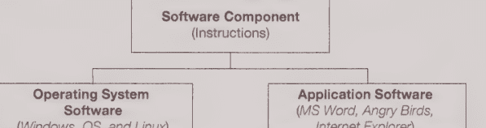

图 1.3 计算机子组件。

计算机系统的硬件根据其执行的功能分为三个大类，或三个子组件。与人类和其他计算机系统通信的硬件被归为输入/输出（`I/O`）设备类。用于在计算机系统内部存储信息的硬件归为存储设备类。最后，硬件执行的所有其他功能都属于名为中央处理单元（`CPU`）的类别。

图 1.4 显示了三类硬件的标准概念布局，其中 `CPU` 位于布局的中心。存储设备显示在图右侧和底部，分为两类设备：备份存储（通常称为次级存储）和随机存存储器（`RAM`，也称为主内存）。除了备份存储外，每个硬件组件都分配了一个缩写，该缩写在图 1.4 的组件名称下方括号中。为了简洁起见，这些组件通常使用其缩写来称为：`I/O` 设备、`CPU` 和 `RAM`（读音为“ram”）。

图 1.4 顶层 `I/O` 设备的进出箭头表示了进入（输入）和离开（输出）计算机系统的信息流。图中的其他箭头表示计算机系统组件之间的信息流。

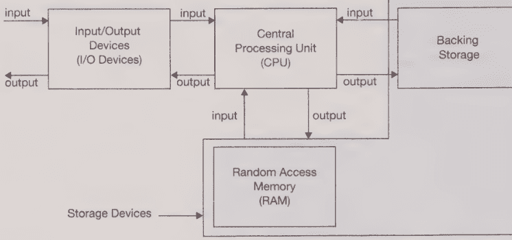

图 1.4 计算机系统硬件子组件的布局。

中央处理单元可以从其他系统组件接收信息（标记为“input”的箭头）并向它们发送信息（标记为“output”的箭头）。信息流始终相对于 `CPU`。发送到 `CPU` 的信息被视为输入，从 `CPU` 发出的信息被视为输出。

与人类和其他计算机系统通信的硬件归为 `I/O` 设备组件。这些是计算机系统与世界其他部分的接口。输入设备将信息发送到系统中。输入设备的示例包括键盘、触摸屏、鼠标、数字化器和调制解器。输出设备将信息从系统发送出。输出设备的示例包括显示器、打印机、扬声器和调制解器。调制解器既是输入设备也是输出设备，通常用于在计算机系统之间传输信息。

具有存储和检索信息的硬件设备归为存储组件。这些设备中除一个之外都属于备份存储进程，显示在图 1.4 的右上侧。存储设备的示例包括硬盘、闪存驱动、用户识别模块（`SIM`）卡、`CD` 驱动器和磁带驱动器。一种存储设备随机存存储器（`RAM`）单独描在图 1.4 的底部。这种存储设备与所有其他存储设备的不同之处在于速度。它访问信息（即存储和检索信息）的速度比任何其他存储设备都快。它的信息访问速度接近 `CPU` 传输信息的速度。

程序在它们的指令存储在 `RAM` 中运行时运行，因此在计算机系统中拥有大容量 `RAM` 是一个优势。遗憾的是，实现 `RAM` 速度所使用的材料和制造工艺使其成为最昂贵的存储类型。为了让计算机系统负担得起，系统中添加了备份存储设备。当程序执行时，操作系统软件会尝试在 `CPU` 需要这些信息之前，将程序的指令和指令处理的数据从备份存储传输到 `RAM`。

向计算机系统添加备份存储（或次级存储）的另一个原因是 `RAM` 是易失的，这意味着当它连接到电源源时，它会保留内存：没有电，就没有内存。所有的备份存储设备都是非易失的，这意味着当它们断开电源时，信息不会丢失。结果是这些设备可以在计算机系统掉电时存储指令和数据（例如硬盘），并可以在计算机系统之间手动传输信息（例如闪存驱动器）。

计算机系统的 `I/O` 和存储组件赋予了我们进出计算机系统以及存储和检索这些信息的能力。图 1.4 中心 `CPU` 赋予了我们处理信息的能力，因此被形象地命名为中央处理单元。如果我们把系统中的一个组件指定为大脑，我们可能会把这个授予 `CPU`。然而，尽管计算机执行卓越的任务，`CPU` 的电子电路只执行五种处理操作：

1. 与计算机组件之间传输信息（即指令和数据）并解释指令
2. 存储极少的信息，例如一条指令和十六个数据
3. 执行算术运算，如加、减、乘、除
4. 执行涉及关系运算符（如 `10 < 6` 和 `a >= 12`）和逻辑运算符（如 `a AND B` 和 `a OR B`）的逻辑操作
5. 按照顺序执行指令或根据逻辑操作真值跳过某些指令

神奇之处在于，计算机执行的所有任务都可以表示为这些基本处理操作的序列。执行特定任务的逐步操作序列被称为算法。程序员工作中最困难的部分是开发或发现。一旦算法被发现，就会被编写成编程语言并通过测试过程进行验证。

> **定义**
>
> - 算法是计算机系统执行以解决问题或执行特定任务的五种处理操作的逐步序列。
> - 计算机程序是用编程语言编写的算法。

## 1.2 计算简史

在现代计算机出现之前，人们就有计数或计算的需求。事实上，该术的早期含义并不是指机器，而是指执行计算的人。在本节中，我们将看到这些改变了我们学习、教学、购物、研究和娱乐方式的革命性机器的惊人发展。

### 1.2.1 早期计算设备

如果计算机真的是我们今天生活中如此重要的部分，你可能会好奇并问到：是谁发明了计算机？

虽然这是一个简单的问题，但它并没有简单的答案，就像托马斯·爱迪逊发明了灯泡或亚历山大·格拉汉·贝尔发明了电话一样。这种复杂性的原因之一是计算机的发展经历了数千的时间，来自不同文化和不同领域（如数学、物理、工程、商业甚至纺织设计）的许多人士共同参与了现代电子计算机的基础工作。


**图 1.5** 算盘。

计算的历史可以追溯到公元前 50,000 年至 30,000 年，当时人们使用手指、石头或木棒上的刻痕来计算羊和财产。第一种计算设备——算盘出现在公元前 2,600 年左右，当时使用圆卵石或石头。算盘的后续版本（如图 1.5 所示）使用了可以在线框上移动的珠子来执行基本的计数和算术功能。这些设备在欧洲和亚洲被广泛使用，其中一些设备今天仍在在使用。

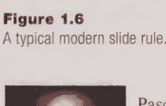

**图 1.6** 一个典型的现代刻度尺。

布莱兹·帕斯卡（图 1.7）在 18 岁时制造了一台名为“帕斯林机”（`Pascaline`）的机械计算器，用于执行基本的加法和乘法。

由于制造技术尚不发达，这些设备必须手工雕刻或锻造，工作非常枯燥。尽管计算设备的发展似乎以更快的速度持续，但从 17 世纪到 1800 年代，进展微乎其微，我们可能会问为什么。也许是因为世界上许多地区处于战争、殖民统治和生存斗争的时期。（例如，考虑到美国，从 1776 年直到今天，制造计算器并不是当时的优先事项。）

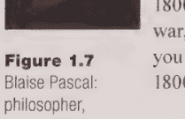

**图 1.7** 布莱兹·帕斯卡：哲学家，数学家，发明家。

1801 年，纺织设计师玛丽·雅卡尔（`Marie Jacquard`）发现他可以通过在打孔卡或纸带上存储指令来编写他的织布机（图 1.8），从而在织物上创造出复杂的图案。这些二进制指令根据纸带上是否打孔来引导织布机升起或降低丝线。后来，这个概念发展成了创建基于二进制指令的存储程序式计算机的设想；它在 20 世纪通过使用打孔卡作为计算机输入的方式得以实现。


**图 1.8** 雅卡尔织机。

### 1.2.2 计算机成为现实

1822 年左右，在英国工作的数学家查尔斯·巴贝奇（`Charles Babbage`）设计了一种机器的原型，称为差分机（`Difference Engine`），用于编制数学表。这是一台由金属轮子和齿轮制成的庞大手摇机器，尽管他不断对其进行改进，但从未完全完成。到 1837 年，巴贝奇将他的想法更进一步，设计了一台更复杂的分析机（`Analytical Engine`，图 1.9），他将其想象为一种通用计算机器，与现代计算机具有许多共同特征。他将其设计为蒸汽动力，这虽然使其无法变得便携，但能使计算自动化。由于可用技术的限制，它在他生前没有完成，但最近已按照他描述的样子完成了。查尔斯·巴贝奇因其在第一台机械计算机上的创新工作被称为计算机之父。

奥古斯塔·洛夫莱士夫人（`Lady Augusta Lovelace`）是诗人拜伦勋的女儿，她被巴贝奇的作品所吸引，并开始为他的机器编写指令，即我们现在所说的程序。她今天被认为是第一位程序员。在女性很少受正式教育的时代，她是一个受过良好教育、精通数学并能够执行高级数学和工程功能的女性。在 19 世纪 90 年代的美国，赫曼·霍立（`Herman Hollerith`）正在研究机械计算器，受政府要求设计一台可以记录和存储增长的人口的机器，因为数据增长的速度手工计算跟不上。霍立使用打孔卡输入他的新机器。成功之后，他与华特森创立了一家公司，后来被称为国际商业公司（`IBM`）。

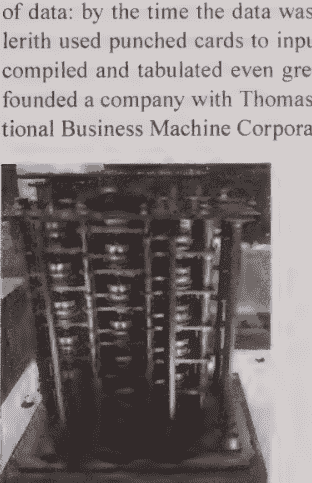


图 1.9 巴贝奇的分析机。

图 1.10 奥古斯塔·洛夫莱士夫人，第一位程序员。

图 1.11 霍立的统计机。

### 1.2.3 编程基础

20 世纪，对记录大量数据的需求继续增加，出现了许多尝试设计更先进的机器。这种需求来自企业，也来自军队。1939 年至 1942 年左右，阿塔纳索夫（`John Atanasoff`）和克利福德·贝（`Clifford Berry`）在爱荷华州立大学制造了阿塔纳索夫-贝计算机（`ABC`）。与此同时，在德国工作的康拉德·齐泽（`Konrad Zuse`）制造了第一台可编程计算机 `Z`。同样在 40 年代，在艾兰·图灵（`Alan Turing`）的帮助下制造了巨型（`Colossus`，图 1.12）。它被设计为一台可以破解 `Enigma` 机生成的德国密码的机器。图灵破解德国密码的有助于击败希特勒，他被视为计算机科学之父，为先进计算机奠定了基础。第二次世界大战期间，图灵还探索了人工智能（“图灵测试”）。


1944 年，在霍华德·艾肯（`Howard Aiken`）与格蕾丝·霍珀（`Grace Hopper`）合作的努力下，设计并制造了哈佛一型（`Harvard Mark I`）。它是第一台机电计算机，用于产生数学表。它可以使用纸带进行编程。

第一台电子数字计算机——电子数值积分计算机（`ENIAC`）由约翰·莫奇利（`John Mauchly`）和 J·普拉斯珀·埃克特（`J. Presper Eckert`）于 1946 年在宾夕法尼亚大学制造。这台计算机重 30 吨，有超过 18000 个真空管和数千个继继（图 1.13）。它占据了一个大房间，由于该机器产生的热量需要空调。它每秒可以加减 5000 次，比当时的任何机器都快一千倍。它还有用于乘法、除法和开平方的模块。

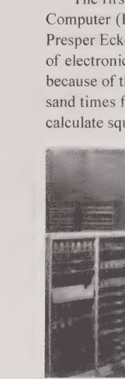

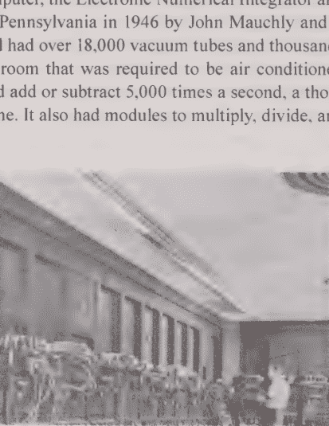

(a) 更换真空管。

(b) 为 `ENIAC` 编程。

美国陆军照片。

图 1.13 排除 `ENIAC` 故障。


美国陆军照片


美国陆军照片

**图 1.14** `ENIAC` 的第一批程序员。

`ENIAC` 的大部分编程是由六位女性完成的，包括图 1.14 所示的女性。


约翰·冯·诺曼（`John von Neumann`，图 1.15）对 `ENIAC` 提出了修改建议，包括使用二进制而非十进制。他设计的存储程序二进制计算机，其程序和数据都可以存储在计算机内存中，被称为冯·诺曼架构，该架构在今天仍在使用。1945 年，他提出了电子离散变量计算机（`EDVAC`）的设计，后来在普林斯顿高等研究院参与了 `IAS` 计算机的制造。他被认为是现代计算机和博弈论之父。

**图 1.15** 约翰·冯·诺曼，现代计算机和博弈论之父。

### 1.2.4 计算机世代

随后的计算机通常分为几代，每一代都有特定的组件或技术为特征。年代大致如下。

#### 第一代（1937–1946）：真空管

这些大型计算机使用数千个真空管，产生大量热量，且可靠性较低。内存存储在磁鼓上，输入使用打孔卡或纸，输出显示在纸质打印上。这一代的计算机只能执行单一任务，没有操作系统，并使用零 1 序列作为机器语言进行编程。第一代机器包括 `ENIAC`、`EDSAC` 和 `EDVAC` 计算机。

#### 第二代（1947–1963）：晶体管

这一代计算机使用晶体管，晶体管比它们取代的真空管要可靠得多。晶体管也更小、更便宜，且消耗的电量更少。机器语言被汇编语言取代，这是一种更接近英语的语言，并且这一代计算机开发了如面向业务的语言（`COBOL`）和公式翻译语言（`FORTRAN`）等高级语言。1951 年，通用自动计算机（`UNIVAC 1`）作为第一台商业计算机被推出。1953 年，`IBM 650` 和 `700` 系列计算机问世。这些机器设计了操作系统，并在这一代中开发了 100 多种计算机编程语言。磁带和磁盘等存储介质投入使用，并配备打印机进行输出。

#### 第三代（1964–1971）：集成电路（`IC`）或“芯片”

晶体管被缩小并放置在杰克·基尔比（`Jack Kilby`）和罗伯特·诺伊斯（`Robert Noyce`）开发的芯片和集成电路（`IC`）上。这项发明产生了更小、更强大、更可靠且更便宜的计算机。用户现在可以通过键盘和显示器与计算机交互，而不是使用孔卡和打印机。操作系统监控内存使用情况，并控制共享系统资源的多个应用程序的调度。

#### 第四代（1971-现在）：微处理器和超大规模集成（`VLSI`）

超大规模集成（`VLSI`）使得成千上万个计算机电路被缩小到适合放在一块芯片上，将第一代占据房间的计算机缩小到手可以拿的大小。从中央处理器、内存到输入/输出控制，计算机的组件现在都可以位于单个微处理器芯片上。由于尺寸变小，计算机变得个人可以负担得起，1977 年，苹果（`Apple`）、Tandy/Radio Shack 和雅达（`Commodore`）三家公司推出了个人电脑（`PC`）。1980 年，微软发布了其磁盘操作系统（`MS-DOS`），1981 年，`IBM` 引入了用于家庭和办公室的 `PC`。三年后，苹果公司引入了带有图标驱动界面的 `Macintosh` 计算机。1985 年，微软发布了 `Windows` 操作系统。第四代计算机还使用了图形用户界面（`GUI`，发音为“goey”），并提供了鼠标以方便使用。为了实现更高效的软件开发，开发了 `Java` 等面向对象的语言。这些更小、更可靠、更强大的计算机现在可以连接起来，促进了网络和互联网的发展。

#### 第五代（现在及以后）：人工智能、并行处理、量子计算

第五代计算设备的特征是人工智能，以及能够响应自然语言并具备学习能力的设备进步。尽管这些特征仍处于开发的早期阶段，但某些应用如语音识别目前已经可用。并行处理、量子计算和纳米技术的使用将帮助实现这些进步，并将改变未来的计算。

### 1.2.5 更多显著的贡献

除了已经提到的成就外，还有许多人对计算领域做出了显著贡献。以下是其中几位创新者的名字和贡献，欢迎你继续添加该列表。

格蕾丝·默雷·霍珀（`Admiral Grace Murray Hopper`，图 1.16）是计算领域的先驱。她是哈佛马克号 I 型计算机的第一批程序员之一，并因开发了第一个编译器和汇编语言而闻名。她在编程方面的工作导致了 `COBOL` 语言的开发，她后来还研究了 `Ada` 语言。

当她从计算机电路中移除一个干扰电流的昆虫（或飞蛾子）并将其贴在笔记本上时，她创造了“调试”（`debugging`）这一术语（图 1.17）。


史蒂夫·乔布斯（`Steve Jobs`，图 1.18）和史蒂夫·沃兹尼亚克（`Steve Wozniak`）是苹果公司的联合创始人。`Apple I` 是 1977 年推出的三台用于家庭的个人电脑之一。他们共同开发了点击式计算方法。1984 年，他们引入了开发出现代图形用户界面的 `MAC OS`，这在今天的现代计算机上是标准。史蒂夫·乔布斯还是皮克斯（`Pixar`）动画的联合创始人，被描述为数字革命之父。


# 计算机科学概论

## 计算机先驱

比尔·盖茨和保罗·艾伦共同创立了微软（美国最大的公司之一），并为 IBM 的 PC 提供了运行磁盘操作系统（DOS）。1985 年，微软开发了名为 Windows 的图形操作系统，它是当今 80% 以上计算机使用的操作系统。

詹姆斯·高斯林被归功于开发了面向对象的语言 Java。他被称为 Java 之父。

鲍勃·梅特卡菲和大卫·博格发明了以太网，这是局域网的基础。

文特·策夫和罗伯特·凯恩被认为是互联网以及传输控制协议/网际协议（TCP/IP）之父。

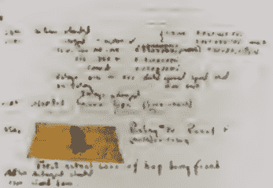


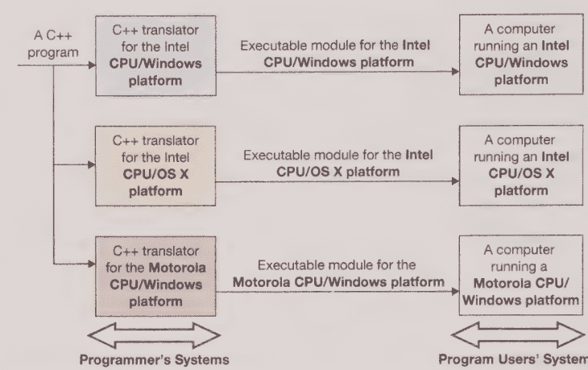


唐纳德·努斯是计算机科学家、数学家，斯坦福大学名誉教授，被称为算法之父。他的多卷著作《程序设计艺术》（The Art of Computer Programming）是所有程序员的经典参考。他还是用于创建高质量出版物的排版系统（TeX）的开发者。

蒂姆·伯纳斯·李被称为万维网的发明者，作为万维网联盟（W3C）的董事继续指导 Web 的发展。他还是万维网基金会的董事，促进了 Web 造福人类的潜力。文特·策夫创建了第一个商业电子邮件系统，现任谷歌副总裁兼首席布道师。

## 1.2.5 更小、更快、更便宜

计算机在 15 年内取得的进步比交通工具在 2000 年内的进步还要大，变得更快、更便宜。根据华盛顿大学计算机科学与工程系主席埃德·洛斯科瓦的说法，如果汽车制造商能跟上计算机行业的速度，那么今天的汽车将变得非常微小、强大且廉价。它们将像烤面包机一样小，售价 200 美元，时速 100,000 英里，每加仑油可以行驶 150,000 英里。他说：“在罗马时代，人们骑马或坐车每天旅行 20 英里；在本世纪早期，汽车让人们每天旅行 20 英里；今天，超音速飞机每分钟旅行 20 英里。这种进步在 2000 年内大约是 1000 倍。”

里克·德克和斯图亚特·希希尔德在《分析引擎》中提出了另一个类比：“如果汽车技术的发展像 1960 年到现在的计算机技术一样快，今天的汽车发动机将小于十分之一，每加仑油行驶 120,000 英里，最高速度 240,000 英里，售价 4 美元。”此外，在最近的计算机展（COMDEX）会议上，据报道比尔·盖茨表示，如果通用汽车能跟上技术的发展，我们将驾驶 25 美元、每加仑油行驶 1000 英里的汽车。

计算机以及提供指令的程序在速度、可靠性和功能方面将继续增加，仅限于人类的创造力。

## 1.3 规定程序

正如第 1.1 节所述，越来越多的人拥有并使用计算机作为日常生活的一部分，但这些计算机用户中只有极小比例的人知道如何编写程序。事实上，如果你理解了本书前两节的内容，你对编程的了解比世界上大多数人都要多。因此，大多数程序不是由程序用户编写的，而是由大多数人称为程序员的计算机专业人员编写的，更准确地说，他们应该被称为软件工程师。不满足终端用户需求的新程序将不受欢迎，因此，用终端用户可以理解的方式来描述新程序的需求是重要的。

> 软件工程师是能够按时、在预算内、免费且满足终端用户需求的专业人士。

描述新程序需求的正式技术是系统分析学科的一部分，该学科是软件工程的子集。这些正式技术都基于计算机系统组件布局（图 1.4）的一种规范。它们假设用户通过输入输出设备与程序交互，定义程序要执行的任务的最简单方法与系统分析师对话，定义程序的输入和输出。

例如，假设你的朋友安妮最近买了一台计算机，正在管理她的财务。知道你上过计算机编程课程，她来向你寻求帮助。你和安妮进入了以下对话，这通常涉及主动词：谁、什么、为什么、哪里、什么时候和如何：

- **安妮**：我想知道钱都去哪里了。
- **你**：好的，安妮，你每个月支付哪些账单？
- **安妮**：嗯，有食物、房租、电费、电话费和衣服。
- **你**：每笔账单多少钱？
- **安妮**：那是问题的一部分；它们每个月都在变，我的收入也是——因为我是拿佣金工作的。
- **你**：嗯，你大概知道你的收入中百分之多少花在了什么地方吗？
- **安妮**：不知道，但我很想知道。我觉得有些月份我把大部分收入都花在了食物和衣服上，导致我没有了可以挥霍的“闲钱”。
- **你**：什么是闲钱呢？
- **安妮**：你知道的，就是除了这些账单之外，我可以花在任何我喜欢的东西上的钱。我想知道每个月有多少。我确信有人在偷我的钱。
- **你**：天哪，安妮，你太多疑了。
- **安妮**：如果每个人都想对付你，你也会多疑的！
- **你**（低声说）：我何必此？

根据这段对话，可以知道安妮希望计算机系统确定并输出的两件事是：她月底将拥有的“闲钱”（可支配资金）金额，以及她每月五项账单每项占月收入的百分比。为了确定这一点，她必须输入每月五项账单每项金额以及该月的收入。你决定将月份和年份作为程序的两个输入，这样她就能保存并区分某个月的结果与其他月份的结果。该程序的简单描述（或规格说明）如下所示。它是程序输入和输出的表格，前面附有程序名称和一段描述程序执行总体任务的简要说明。

### 程序规格说明

**程序名称**：安妮的理财管家

- **任务**：确定安妮每月的可支配资金及其每月支出的分布情况
- **输入**（8 项）：
  - 月份和年份
  - 该月收入
  - 该月在以下五项中的每项花费金额：食物、房租、电费、电话费和衣服
- **输出**（6 项）：
  - 这五项（食物、房租、电费、电话费和衣服）占月收入的百分比
  - 可支配资金金额

通常，程序规格是通过迭代过程不断完善的，该过程涉及最终用户的评审以及随后的对话。这一过程可以为安妮程序的规范引入更多功能。例如，它还可以包括输出年度报告的能力，显示任何给定年份（或者可能是某一段时间内）的六项输出结果。显然，这将扩展上述规范。

根据程序规格，程序员的目标是编写一个能够接受指定输入并产生预期输出的程序。如果程序员不清楚如何从给定输入确定输出，他们可能需要咨询其他专家。例如，如果负责编写安妮程序的程序员不知道如何计算百分比，他们就必须咨询数学家。

## 1.3.1 规范游戏程序

本文讨论的规范安妮程序的技巧与规范任何程序的技巧相似：与用户进行简短对话，并列出程序的名称、它执行的任务、输入和输出。这种方法也可以用于规范一个要玩游戏的程序。此外，如果系统分析师在与游戏发明者的对话中包含关于这些特征的问题，那么意识到所有游戏共享一组共同特征有助于规范过程。

例如，大多数游戏都涉及对象（例如卡车、汽车和青蛙）。此外，所有游戏都有一个目标，即赢得游戏（例如将物体移动到道路的另一侧而不被卡车或汽车撞到）。大多数游戏还有其他共同特征。图 1.23 给出了游戏规范对话中包含的常见特征列表。

- 游戏名称
- 游戏组成的对象（星际舰、卡车、弹弓等）
- 游戏目标
- 计算游戏得分的方法
- 对游戏施加的时间限制
- 将被动画化的道具（对象）
- 由游戏玩家（程序）控制的道具
- 用于控制游戏对象的输入设备
- 游戏中包含的特定颜色
- 确定游戏何时结束
- 游戏结束时发生的事件
- 记录最高游戏得分以及获得得分的玩家名称

有了这个常见游戏特征清单，与你的朋友莱恩（一个还没上过编程课程的有志游戏发明者）的典型对话可能是：

- **你**：嗨，莱恩，怎么样？
- **莱恩**：我有一个关于名为《深空递送》视频游戏的好主意。
- **你**：游戏的目标是什么？
- **莱恩**：在时间耗尽之前，尽可能将多的供应包（从补给站领取）送到五个不同的行星。
- **你**：玩家的得分是如何计算的？
- **莱恩**：每交付一个包裹得一分，如果玩家在时间耗尽前交付了补给站的所有包裹，则剩余每秒得一分。
- **你**：游戏的时间限制是多少？补给站会有多少包？
- **莱恩**：一分钟和 30 个包。
- **你**：看起来游戏道具（对象）是行星、供应包和补给船。对吗？
- **莱恩**：是的，但别忘了包括补给站。
- **你**：玩家将如何移动补给船并拿起、放下包裹？
- **莱恩**：使用键盘上的键。
- **你**：其他游戏道具会移动吗？
- **莱恩**：是的，行星会移动并在游戏边缘弹跳。
- **你**：你想记录最高游戏得分和获得得分的玩家名称吗？

## 1.4 使用 Java 编程基础

考虑到平台的数量，以及使用特定平台的语言进行编写是一个非常繁琐且耗时的过程，因此使用通用语言编写程序是最有效且最具成本效益的方法。图 1.24 展示了如何利用这种方法为三个不同的平台生成可执行模块。程序员将不得不使用三个不同的翻译器对程序进行翻译，以生成三个不同的可执行模块。


在 20 世纪 90 年代初，互联网尚未向个人开放，这使得他们在自己的计算机系统之间共享信息成为可能。这种信息可以是驻留在某台计算机系统上的程序（可能是一个显示网站的程序），这种想法提出了一个根本性的问题。如果两台计算机没有运行相同的平台，那么从一个平台（主机平台）下载的可执行模块将无法在另一个平台（客户端平台）上运行，网站也无法在客户端机器上显示。使用图 1.24 所示的过程为所有平台生成可下载的可执行文件是不切实际的方案，其一在于，今天编写的程序应该能够在未来的平台上运行。幸运的是，由詹姆斯·高斯林领导的太阳公司科学家团队提出了一种更实用的解决方案。

团队的想法是改变生成可执行模块的过程。不再由主机产生可执行模块，而是由客户端机器产生。主机仅需将用一种新编程语言 Java 编写的模块翻译成一组字节码。字节码被视为虚拟机（命名为 Java 虚拟机，JVM）的伪可执行文件，这些字节码不属于任何现有的平台语言。一旦生成，字节码就可以下载到任何客户端机器上，客户端机器将使用字节码翻译器将下载的字节码翻译成其所在平台的语言。图 1.25 展示了高斯林的新过程。

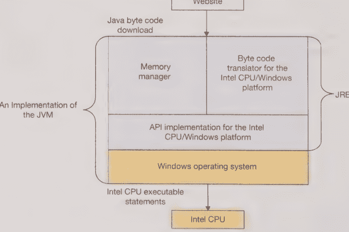

> Gosling 团队在在线获取的《Java 语言规范》（JLS）中描述了使用 Java 语言编写程序的语法规则。

注意：为了使这一过程能够运行，Gosling 团队假设客户端系统的制造商将安装一种翻译器，将 Java 字节码翻译成其系统平台的语言。由于意识到所有未来的客户都希望将他们的新代码连接到互联网，计算机制造商遵从了这一要求，并将他们的系统宣传为“接入就绪”。

某组字节码可以被下载并在任何具有字节码翻译器的平台上生成可执行模块，这一事实使得 Java 程序具有了平台独立性。用 Java 编写的程序，或者更准确地说，程序的字节码可以被下载、翻译，然后在任何包含特定平台代码翻译器的平台上执行。

### 1.4.1 Java 应用程序接口

除了提供将 Java 程序翻译成字节码的翻译器外，Java 的创造者还确定了一组数据（例如数学常数 pi）和任务（例如计算给定数字的平方根），这些可能在 Java 程序中使用。这些数据和任务的描述随后作为《Java 应用程序接口》（API）规范发布。

为了方便使用，这些数据和任务被组合在一起。这种分组被称为包，而其中的分组被称为类。API 中大约有 400 个包和 4000 个类。在这些类中，执行任务的一组指令被称为方法。

> **定义**：
> - **类** 是由一组相关数据和方法组成的。
> - **方法** 是执行任务的指令。
> - **数据成员** 是类的实例变量。

正如 Gosling 团队假设制造商会安装一种将 Java 字节码翻译成系统平台语言的翻译器一样，他们也假设了数据和方法是类的实现。这些数据和方法被视为 Java 虚拟机。技术上讲，字节码翻译器和内存管理器被称为 Java 运行时环境（JRE）。图 1.26 给出了适用于 Intel CPU/Windows 平台的 Java 虚拟机组件。根据 Gosling 团队的想法，如果语言设计者提供一种翻译成字节码的翻译器，任何编程语言都可以实现平台无关性。生成的翻译将在任何计算机系统或移动设备上运行。


## 1.5 面向对象的编程语言

正如 API 规范中的相关方法和数据被分组为类一样，它们也可以在面向对象的编程语言中使用。Java 设计上是一种 OOP 语言。在 Java 程序中定义的类内部组织相关方法和数据并不是一种方便的方法。在面向对象的编程语言中允许这种类分组的真正动力在于它是对程序将执行的对象进行建模的好方法。

例如，考虑一个涉及星船对象的视频游戏程序。每个星船对象都将有一个名称和一个 (x, y) 位置。此外，随着游戏的进行，可以创建新的星船，可以在显示器上绘制星船，并改变星船的位置。对于这些星船对象的良好模型是定义一个名为 `Starship` 的类（如图 1.27 中的蓝色矩形所示）。如图所示，该类将有三个数据成员（`name`、`x` 和 `y`）以及三个方法（`create()`、`draw()` 和 `move()`）。

重要的是要理解类本身并不是一个对象，而是它是对对象的描述。从一个类中，我们可以创建无限数量的对象或该类的实例。一个有用的类比是考虑我们在日常生活中遇到的类：蓝图、饼干模具、模板纸、陶器模具、服装图纸和人类基因组图谱。从蓝图中可以建造许多房子，从一个饼干模具可以制作许多饼干，从一个模板纸可以画许多画作，从一个陶模可以做出许多花瓶，从一种图案可以做出许多连衣裙，从一个人类基因组可以产生许多人。

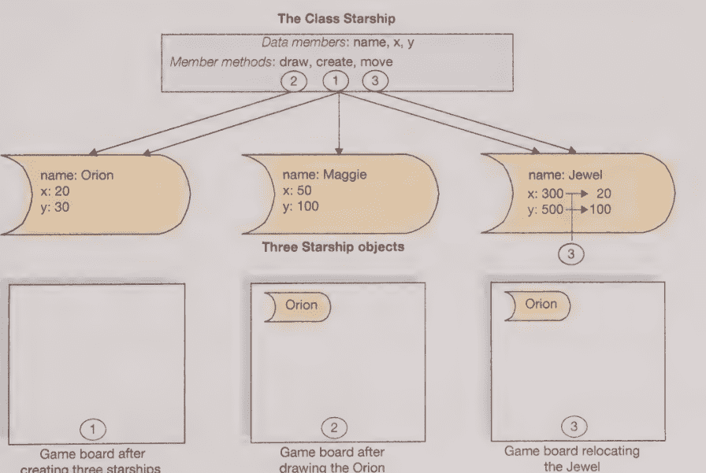

> **定义**：
> 在面向对象的编程语言中，类是对象的模板，而对象是类的特定实例。

`Starship` 类将是星际舰对象的模板。每当有星际舰进入游戏时，都会使用该类的 `create()` 方法从该模板创建一个新的星际舰，赋予名称和初始 (x, y) 位置。星际舰的名字和 (x, y) 位置将存储在三个数据成员中，每个从 `Starship` 创建的对象都包含这些数据成员。此外，绘制和移动星际舰的任务将由构成类的 `draw()` 和 `move()` 方法的 Java 指令完成。

图 1.27 的中心和底部部分描述了 `Starship` 类三个方法的使用，它们按以下顺序使用：

1. `create()` 方法（由数字 1 标出）用于创建或构建图中中心的三个星际舰对象：位于 (20, 30) 的 Orion、位于 (50, 100) 的 Maggie 以及位于 (300, 500) 的 Jewel。注意，在它们创建后，星际舰包含三个数据成员来存储星际舰的名字和 (x, y) 位置。尽管这三个星际舰已经创建，但它们没有显示在图左下角的游戏板上，因为还没有使用 `draw()` 方法。
2. `draw()` 方法（图中数字 2 所示）用于将星际舰 Orion 显示在它的当前位置 (20, 30)，如图底部中央所示。`draw()` 方法没有对另外两个星际舰进行操作，尽管它们存在，但没有出现在游戏板上。（注：Orion 位于游戏板的左上角，y 轴方向向下的）。
3. `move()` 方法（图中数字 3 表示）用于将星际舰 Jewel 的当前位置从 (300, 500) 改变到 (20, 100)，如图右侧部分所示。如图右下角所示，它没有显示是因为没有对它执行 `draw()` 方法。在移动星际舰后，对 Jewel 执行了绘制任务，它将直接显示在 (20, 100) 处的 Orion 下方。

每个对象都包含其类的数据成员，并通过类的方法对其进行操作。

## 1.6 集成开发环境与程序开发过程

集成开发环境（IDE）是一种帮助程序员编写程序的程序。通常，它们是针对特定语言的，即特定的 IDE 可以用于用一种且仅一种编程语言开发程序。例如，`NetBeans` 和 `Eclipse` 是两种用于开发 Java 编写程序的流行 IDE，而 `Microsoft Visual C++` 可用于开发用 C++ 语言编写的程序。许多流行的 IDE 都可以从 IDE 官网免费下载。

这些程序的共同点是，它们将一组开发工具集成到一个程序中。这些工具的示例包括用于输入、保存和打开程序指令的文本编辑器，以及用于将程序指令翻译成其运行所需的程序语言的翻译器。在 Java IDE 的情况下，这就是从 Java 到字节码的翻译。此外，大多数 IDE 都具有自动补全功能，以方便输入程序，并具有语法检查器，以帮助定位程序指令中正确的语法错误。


配备了良好的规格书（specification）和良好的 IDE，我们几乎已经准备好开始程序开发过程，该过程如图 1.28 所示。在开始之前，我们必须阅读规格书中包含的程序任务，并发现一组执行这些任务的算法。例如，在 Ryan 的 Deep Space Delivery 程序中，我们将如何确定星际舰何时向行星递送供应包？正如第 1.1 节末尾提到的，这可能是编写程序中最困难的部分，软件工程师会学习算法发现的高级课程。我们将通过贯穿本教材的编程示例来说明开发过程。

在发现程序的算法后，我们准备好开始程序开发过程（图 1.28）。通常，该过程从将算法表示为一组程序指令（称为代码）开始，翻译代码，然后纠正语法错误（称为语法错误）。一旦消除了所有的语法错误，IDE 的翻译器将生成一个它将运行的可执行模块。在 Java 的情况下，IDE 在安装在程序员计算机上的 Java 虚拟机上生成并执行字节码。

然后程序员将角色从程序员转变为用户，以测试程序的正确性。为了做到这一点，用户（或测试人员）向程序提供输入，并检查它产生的输出。

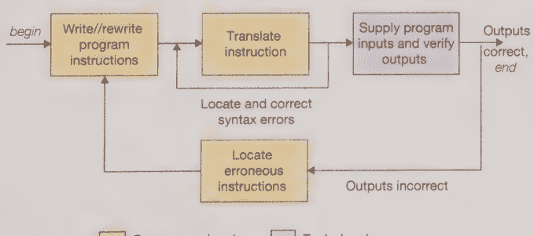

**图 1.28** 程序开发过程概述。

如果程序对几组精心选择的输入输出了正确的输出，则程序就完成了。如果没有完成，测试人员将变回程序员的角色，找到错误的指令，并从重写这些指令开始重复该过程。

对于除了极小程序以外的任何程序，对该过程进行改进都是必要的，因为我们无法有效地解决大问题。当我们考虑到无法解决大问题时，答案在于分而治之（divide and conquer）。面向对象的编程语言提供了几种显而易见的方法将大事物分成小事物。今天这种方法是：分而治之。就像登月任务被分解成许多任务一样，一个大型程序被分成许多小部分，这些小部分可以组合成大程序。

# 第1章 引绪

如果船体侧面显示名称 `Orion`，我们就可以断定 `draw` 方法工作正常。如果没有，我们将检查生成 `draw` 方法的指令，定位并纠正错误，然后重复过程中的翻译和测试部分。

接下来，我们将开发 `move` 方法，编写其代码，翻译并纠正语法错误，然后再写几行 Java 驱动代码对其进行测试。该代码将创建一个 `Starship` 对象，例如位于 (300, 500) 处的 `Jewel`，如图 1.27 右侧所示，让我们使用 `move` 方法将其位置更改到 (20, 100)，并使用 `draw` 方法将其在游戏板（监视器）上显示出来。如果它显示在新的位置 (20, 100) 且船体侧面显示名称 `Jewel`，我们就可以断定 `move` 方法工作正常。如果没有，我们将检查生成 `up` 方法的指令，定位并纠正错误，然后重复过程中的翻译和测试部分。

在三个易于管理的的阶段完成 `Starship` 类的开发后，我们将删除驱动代码，并将其替换为在游戏程序中使用 `Starship` 类及其方法的指令。

## 1.7.1 移动设备应用开发环境

过去十年中，计算系统基础组件的微型化为市场带来了各种手持计算设备。这些设备通常被称为移动设备，包括智能手机、个人数字助理 (PDA) 和平板电脑设备。

为移动设备开发程序的过程与本章讨论的为非移动计算设备开发程序的过程相同。在编写完规范并开发程序算法后，使用 IDE 按照图 1.28 所示的过程将规范开发为功能性程序。然而，在将开发过程应用于移动设备应用时，会出现两个问题。由于这些设备的计算能力有限，在它们上进行开发过程是不切实际的，因此开发过程在性能更强大的非移动计算系统上进行。此外，平台独立的概念尚未扩展到移动设备，因此必须为每个移动设备平台生成一个可执行模块。

由于大多数移动应用运行在智能手机上，而大多数智能手机运行基于 Android 的平台，本节将包含用于开发 Android 智能手机或平板设备应用的可用工具概述。所呈现的细节针对这些设备，所介绍的概念是开发大多数移动设备应用时常用的典型类型。

Android 设备应用可以在个人电脑上用 Java 编写。首选的 IDE 是 Eclipse，它是免费下载的。首选 Eclipse 是因为便于 Android 设备应用开发的两套工具可以轻松集成到其中。这两套工具都可以免费下载。其中第一个是 Android 软件开发包 (SDK)，可以从 Android 开发者网站下载。第二套工具 Android 开发工具 (ADT) Eclipse 插件可以从 Eclipse 下载。如果你的个人电脑运行的是 Windows 操作系统，你可以从 Android 开发者网站（地址为 `http://developer.android.com/sdk/index`）以一个组合包的形式下载 Eclipse IDE、SDK 和 ADT。

这两套工具提供的一些功能：

-   最新版本的 Android 操作系统
-   平台相关的翻译器
-   一组模拟器，可以在任何基于 Android 的移动设备的模拟上运行翻译后的代码，显示其屏幕并模拟所有的输入/输出 (I/O) 功能
-   将开发的应用程序上传到 Android Market（一个基于 Web 的免费和付费应用商店）的能力

通过这些工具和对 Java 的知识，你将能够在舒适的个人电脑系统上为任何 Android 设备开发并推销应用。

## 1.8 我们的游戏开发环境：初探


在 1.4 节中，你被要求运行包含本教科的 DVD 中的若干游戏程序。该 DVD 还包含一个名为 `Package` 的文件夹，其中包含一个名为 `edu.scjny.gpvl` 的 Java 包。这个包被认为是 API 的一个游戏开发扩展，因为它包含了执行大多数游戏程序通用任务的方法。附录 A 包含了该包中包含方法的描述。

将此包（或称游戏环境）整合到游戏程序中可以方便其开发。创建书中 DVD 中包含的所有示例游戏程序的学生都已将它整合到了自己的程序中。在这一节中，我们将描述如何使用此包中的方法轻松地创建和显示游戏窗口，如何将此包整合到游戏程序中，以及如何更改游戏窗口的一些属性。

### 1.8.1 游戏窗口

当整合到 Java 程序中时，可以使用游戏环境的两个方法来创建并显示图 1.29 所示的游戏窗口。游戏窗口右侧的 `Pause` 和 `Start` 按钮可供玩家用于暂停游戏以及开始/重启游戏。它们下方的方向键或键盘键可用于控制左侧游戏对象的位置。

游戏窗口左侧的橙色区域称为“游戏板”，是游戏对象出现的地方。像大多数窗口一样，它可以通过标题栏进行拖动，最小化到状态栏，并通过点击状态栏上的图标来调整大小。然而，它不能被最大化，但程序员可以更改其大小以适应游戏需求。窗口的默认大小为 500x500 像素，如图 1.27 右侧所示，让我们使用 `move` 方法将其位置更改到 (20, 100)，并使用 `draw` 方法将其在游戏板（监视器）上显示出来。如果它显示在新的位置 (20, 100) 且船体侧面显示名称 `Jewel`，我们就可以断定 `move` 方法工作正常。如果没有，我们将检查生成 `up` 方法的指令，定位并纠正错误，然后重复过程中的翻译和测试部分。

### 1.8.2 坐标系

如图 1.30 右侧所示，该系统是一个二维笛卡尔坐标系，原点位于左角。正 x 轴向右，正 y 轴向下。系统的单位是像素。

### 1.8.3 安装并将游戏包整合到程序中

最简单的方法是使用 DVD 中 `IDE Tools` 子文件夹中的项目之一。该子文件夹包含了 Eclipse、NetBeans 和 Jcreator，它们已经整合了游戏包。关于使用 DVD 中三个游戏项目的详细说明请见附录 B。

作为替代方案，可以按照附录 B 中的步骤将 DVD 上的游戏包文件夹 `Environment` 添加到新的 Java 项目中，大多数步骤不需要更改系统的 `CLPATH` 变量。使用这些替代方案时，必须将下一节中描述创建和显示游戏窗口的代码添加到你的项目代码中。

### 1.8.4 创建并显示游戏窗口及其标题

将游戏包整合（导入）到你的程序后，你可以可以使用包中的方法来创建并显示运行你游戏的图形窗口。图 1.31 所示的 Java 程序是我们所有图形化游戏应用程序的模板或起点。当运行此程序时，将创建并显示图 1.29 所示的游戏窗口。

```java
import edu.scjny.gpvl.*;
public class GameWindowDemo extends DrawableAdapter
{
    static GameWindowDemo ga = new GameWindowDemo();
    static GameBoard gb = new GameBoard(ga, "The Game Window");

    public static void main(String[] args) {
        showGameBoard(gb);
    }
}
```

图 1.31

图 1.31 第 1 行的 import 语句使得游戏包中的方法对程序可用。第 4、5 和第 9 行使用这些方法来创建并显示图 1.29 所示的游戏窗口。每个 Java 程序都有一个名称，这是其规范的一部分。该程序被命名为 `GameWindowDemo`，在第 2 行输入在类上方，并在第 4 行又输入了两次。

如前所述，图 1.31 将作为我们所有图形化应用程序的模板。为了将其适配特定的游戏，新程序的名称将出现在第 2 行和第 4 行，游戏的标题及其作者的名字将出现在第 5 行的末尾。例如，如果一个新程序的名称是 `Project`，且游戏是由 Bob 创作的 `Frogger`，那么第 2、4 和 5 行的更改将如下所示：

```java
import edu.scjny.gpvl.*;
public class Frogger extends DrawableAdapter
{
    static Project ga = new Project();
    static GameBoard gb = new GameBoard(ga, "Frogger, by Bob");

    public static void main(String[] args) {
        showGameBoard(gb);
    }
}
```

### 1.8.5 改变游戏板的大小

如节 1.8.1 提到的，游戏窗口的默认大小为 622x535 像素。选择这个大小是为了使游戏板右下角的坐标为 (500, 500)。为了更改游戏板的大小（以及窗口的大小），我们将游戏板右下角的坐标添加到图 1.31 第 5 行的末尾。这是构造窗口的行。例如，为了获得右下角位于 (700, 650) 的游戏板，我们将第 5 行更改为：

```java
static GameBoard gb = new GameBoard(ga, "The Game Window", 700, 650);
```

窗口的标题栏仍高 30 像素，窗口的左边框仍为 5 像素宽（如图 1.29 所示），但窗口的高度和宽度将增加以适应更大的游戏板。

## 1.9 在内存中表示信息

如节 1.1 讨论的，计算机系统的内存组件具有存储和召回信息的能力，这些信息可以是程序处理的数据，也可以是组成程序的指令。在内存中存储或表示信息的方案取决于所存储信息的类型。在翻译程序指令时，数据使用不同的方案进行存储。此外，字符数据（输入到文字处理器或 IDE 中的数据）与数值数据（用于算术表达式的数据）的存储方式不同。

有三种内存存储方案用于表示三种类型的信息：(1) 字符数据，(2) 翻译指令和 (3) 数值数据。所有这些方案都是围绕基础硬件内存单元设计的：位（bit），它代表二进制数字。从概念上说，位应该被看作是可以开启或关闭的单个开关。所有内存都使用这种存储容量，RAM、磁盘、闪存驱动器和磁带驱动器等存储设备可能包含数十亿（giga）甚至万亿（tera）这样的位。

为了简洁起见，当位开启时它处于状态 1（一），当位关闭时它处于状态 0（零）。只有当存储的信息是数值数据时，才应将它们视为数字一和零。图 1.32 展示了八个关闭-开启状态的位以及它们的简写 (1-0) 表示法。

| 关闭 关闭 关闭 关闭 关闭 关闭 | 01000010 |

| :--- | :--- |

| 开启-关闭表示 | 1-0 表示法 |

**图 1.32** 八个相邻关闭-开启位的状态及其 1-0 表示法。

### 1.9.1 表示字符数据

在内存中表示字符数据的方案相当直接。创建了一个映射表，其中每个要表示的字符都被分配了一个唯一的 8 位模式。例如，字符 `B` 被分配了模式 `01000010`，该字符的小写版本 `b` 被分配了模式 `01100010`，而字符 `1` 被分配了模式 `00110001`。

该表被称为扩展美国标准信息交换码（Extended American Standard Code for Information Interchange），因为它是名为美国标准信息交换码的表的扩展，该表使用 7 位模式来表示字符。7 位表被赋予了缩写 ASCII（读音为 "ask ee"），扩展表被称为扩展 ASCII 表。两张表都包含了现代拉丁（英语）字母的所有大写和小写字母、数字 0 到 9、一些特殊字符（例如 `1, @, #, $, %, &, ',` 等）以及如水平制表符和换行符等控制字符。

# 第1章 引言

为了适应互联网上的信息国际交换，扩展 ASCII 表被扩展以包含其他字母的唯一位模式。为了给这个扩展表即 Unicode 表中的每个条目提供唯一的位模式，分配给每个字符的位数从 8 位增加到 16 位。Unicode 表的前256个条目是扩展 ASCII 表中的字符，其 16 位模式的左侧 8 位设置为0，右侧 8 位设置为 ASCII 模式。例如，因为 `B` 的扩展 ASCII 表示为 `01000010`，它的 Unicode 表示为 `0000000001000010`。Java 程序处理的字符使用它们的 Unicode 表示存储在内存中。

> 内存中使用扩展 ASCII 或 Unicode 表表示字符数据。

## 注意

### 1.9.2 表示翻译指令

在内存中表示翻译指令的技术与在内存中表示字符的技术相同。二进制文件包含所有的翻译指令，并为每个条目分配了一个唯一的位模式。例如，相减两个整数的翻译指令位模式可能是 `01000000`，除以两个整数的位模式可能是 `010000`。

与所有计算机系统用于存储字符的 ASCII 和 Unicode 表不同，这些翻译指令表随 CPU 而异。不仅位模式不同，用于表示翻译指令的位数也不同。这些表依赖于平台，这就是 Java 产生的原因。要确定特定平台上除法指令的翻译内存表示，我们必须在该平台的 CPU 指令表中查找除法指令的位模式。

| 八个相邻或连续的位被称为一个存储字节 |

对于 Java 虚拟机，每条翻译后的指令都被分配了一个八位模式。由于模式由八位（或一个字节）组成，因此这些模式被称为字节码（byte codes）。表 1.1 给出了翻译指令的 Java 字节码：加、减、乘、除。如表所示，当 Java 虚拟机接收到字节码 `01100100` 时，它会执行相应的操作。

## 表 1.1 整数算法的 Java 字节码

| 指令 | Java 字节码 |

| :--- | :--- |

| add | 01100000 |

| subtract | 01100100 |

| multiply | 01101000 |

| divide | 01101100 |

## 1.3 数值数据的表示

与之前描述方案不同，表示数值数据的方案并不使用无限长的表格。相反，该方案基于基于数论，这是因为我们有十个手指。在我们的数字系统中，数论决定了数字的个数（0 到 9）。相反，数论告诉我们，如果一个数字系统有 10 个数字，它就有一个字节。掌握了这些数字系统的知识后，决定在内存中使用基数为 2 的二进制系统表示数值数据，因为我们需要理解如何从基 2 转换为基 10。这些转换的基础是意识到基2系统中的数字位值与我们的十进制系统是不同的。从右侧开始，我们数字系统的数字位值是个位、十位、百位等。冯·诺依曼（von Neumann，他通常被称为称为**计算机之父**）最初提出了这种方案。

## 第 1 章 引言

这些代表 $10^1$、$10^2$、$10^3$。将此推至基2系统，从右侧开始的数字位值为 $2^1$、$2^2$。图 1.33 给出了二进制系统的前八个位值及其十进制（基 10）等值。了解了二进制系统的数字位值，我们现在就可以从基 2 转换为基 10，以及从基 10 转换为基 2。

**图 1.33** 二进制系统的前八个位值。

| $2^7$ | $2^6$ | $2^5$ | $2^4$ | $2^3$ | $2^2$ | $2^1$ | $2^0$ |

| :--- | :--- | :--- | :--- | :--- | :--- | :--- | :--- |

| 128 | 64 | 32 | 16 | 8 | 4 | 2 | 1 |

要将存储在内存中的整数值的基2 表示（例如 `01000010`）转换为基 10，我们只需将位模式写在图 1.33 所示的十进制位值下方，并相加下方为 1 的值。例如，如果是位模式 `01000010`，处理过程如下：

| 128 | 64 | 32 | 16 | 8 | 4 | 2 | 1 | 基2 位值 |

| :--- | :--- | :--- | :--- | :--- | :--- | :--- | :--- | :--- |

| 0 | 1 | 0 | 0 | 0 | 0 | 1 | 0 | 内部表示 |

| | 64 | | | | | | | |

因此，`01000010` 代表十进制数字 66 ($64 + 2$)。

这个转换过程意味着位模式 `11111111` 代表了使用 8 位可以表示的最大整数，即十进制数字 255 ($255 = 128 + 64 + 32 + 16 + 8 + 4 + 2 + 1$)。为了表示大于 255 的整数，需要为每个整数数值值分配更多字节的存储空间。

要将一个基 10 整数转换为其二进制位模式以显示内存中的数值，方法是先写出图 1.33 所示的十进制位值。然后从左侧开始，我们在所有相加等于该十进制数字的位值下放置 1。剩余的位值用0 填充。

为了快速确定哪些位置应该放置 1，请使用以下算法，直到到达最右侧的位值：


# 第 1 章 引言

## 1.1 总结

在本章中，你学习了计算机系统的硬件和软件组件、它们的排列方式以及它们如何交互。硬件由中央处理器、内存和输入/输出设备组成。主内存与 CPU 存储数据和指令。

现代计算机通过许多人的努力，从房间大小演变为现在的更小、更快、更便宜且更可靠。

## 1.2 二进制表示算法

1. 设 `n`（例如 66）为要在内存中表示的基 10 整数
2. 从左侧位 `b` 开始
3. 将 `v` 设置为 `b` 的位值（例如，`v = 128`）
4. 如果 `(n - v)` 为正或等于零，则：
   a. 在 `b` 的位置放置 1
   b. 设置 `n = (n - v)`
   c. 否则在 `b` 的位置放置 0
5. 将 `b` 移动到右侧的下一个位
6. 回到步骤 3

表 1.2 展示了使用该算法将 66 转换为其 8 位二进制表示的过程。表中的每一行代表算法第 3 和第 4 步的执行。

### 表 1.2 将整数 66 转换为其 8 位二进制表示

| `n` | `b` | `n - v` | `n` 的二进制表示 |
| :--- | :--- | :--- | :--- |
| 66 | 7 | -62 | 0 |
| 66 | 6 | 2 | 01 |
| 66 | 5 | -30 | 010 |
| 66 | 4 | -14 | 0100 |
| 66 | 3 | -6 | 01000 |
| 66 | 2 | -2 | 010000 |
| 66 | 1 | 0 | 0100001 |
| 66 | 0 | -66 | 01000010 |

在我们考虑讨论数值数据如何在内存中存储之前，我们应该注释一下数学中如何表示负整数和带有小数部分的数字。简短的回答是，负整数使用名为**补码**的方案，而带有小数部分的数字使用类似于科学计数法的标准形式（当 `2.537 × 10^4`）。

## 1.3 Java 概述

Java 是一种面向对象的编程语言，允许程序员在应用程序和游戏中处理真实世界对象。类是对象的模板，包含了操作数据的方法。Java 程序被翻译成字节码，可以由 `Java` 虚拟机执行，使其具有平台无关性和可移植性。

新程序通过书面规范定义，然后发现算法并使用 `IDE` 进行组合和测试。游戏环境通过补充 Java `API` 提供了大多数游戏常用的方法，创建一个可以绘制和移动游戏对象的交互式看板。

算法的发现通常是制作新程序中最困难的部分。在本书中，我们将使用游戏编程来演示编程概念，并使用游戏算法向读者介绍算法过程。

## 1.4 知识练习

1. 从 1889 年到 2004 年，美国每 1000 人的计算机数量增加了大约：
   - a) 4 倍
   - b) 8 倍
   - c) 12 倍

2. 硬件和软件之间的区别是什么？

3. 操作系统和应用程序之间的区别是什么？

4. 以下哪些特征与 `RAM`（主内存）相关？
   - a) 非常快
   - b) 容量极大
   - c) 昂贵

5. 以下哪些特征与后端（辅助存储）相关？
   - a) 非常快
   - b) 容量极大
   - c) 昂贵

6. 为下列各项举例：
   - a) 输入设备
   - b) 输出设备
   - c) 后端（辅助存储）设备

7. 有些计算机只有一个用途，而另一些有多种用途。
   - a) 举出一个仅用于输出的设备。
   - b) 举出一个仅用于输入的设备。
   - c) 有什么设备既可以输入也可以输出的？

8. 写出并解释计算机系统的三个主要硬件组件的功能。

9. 如果一个朋友问你是谁发明了计算机，你会如何回答？

10. 操作系统程序的示例包括以下所有项：
    - a) `MAC OS`
    - b) `Windows`
    - c) `Java`
    - d) `Linux`

11. 易失性内存指的是：
    - a) 永久存储数据
    - b) 断电后会丢失内容
    - c) 外部添加到计算机中

12. 文字处理、电子邮件和网页搜索都是使用以下内容的示例：
    - a) 应用软件
    - b) 系统软件
    - c) 编程
    - d) 以上均不是

13. 以下哪项在第二代计算机中取代了真空管？
    - a) 纸带
    - b) 鼠标
    - c) 芯片
    - d) 晶体管

14. 谁开发了汇编语言、第一个编译器和 `COBOL` 语言？
    - a) 阿兰·图灵
    - b) 阿达·洛夫莱斯
    - c) 格蕾丝·霍珀
    - d) 约翰·冯·诺依曼

15. 写出每个头衔或描述所指的人：
    - a) 第一位程序员
    - b) `Java` 编程语言的发明者

16. 写出程序规格中确定的四个特征。

17. 平台独立性是什么意思？

18. 正或错：为了实现平台独立性，`Java` 字节码在用户的计算机系统上进行翻译。

19. 类和对象之间的区别是什么？

20. 在视频游戏中，挡板将用于将球反射到 200 块砖墙中。游戏中将涉及多少对象？它们是什么？
    - a) 程序中将定义多少个类？请列出名称。

21. 写出以下缩写所代表的术语：
    - a) `CPU`
    - b) `RAM`
    - c) `I/O`
    - d) `IDE`
    - e) `JVM`
    - f) `API`
    - g) `GUI`

22. 以下哪项指的是为了解决或编写程序而将问题分解成较小部分的过程？
    - a) 分治法
    - b) 平台独立性
    - c) 可移植性
    - d) 翻译

23. 游戏环境游戏板的左上角位于像素坐标 `(x, y)` 处：
    - a) `(0, 0)`
    - b) `(500,500)`
    - c) `(622,535)`
    - d) `(5, 30)`

24. 以下哪项不是典型游戏程序的组件？
    - a) 分数
    - b) 时间限制
    - c) 纳皮尔算盘
    - d) 游戏道具对象

25. 写出内存中代表的三种信息类型。

26. 为每个十进制数值写出 8 位二进制等价值：
    - a) 51
    - b) 77
    - c) 115
    - d) 131
    - e) 227
    - f) 254

27. 为每个二进制值写出十进制等价值数字：
    - a) `01010011`
    - b) `00101111`
    - c) `00000000`

28. 写出字符 `C` 和 `c` 的 8 位内存表示。

## 1.5 编程前练习

- 1. 想一个视频游戏，并与自己进行对话，对话中包含图 1.1.23 中列出的大多数游戏的共同特征。根据该对话，为该游戏写一份规格说明，给出游戏名称、游戏任务或目标，以及输入输出的描述。游戏必须包含至少两种游戏对象，其中一种要通过光标控制键和游戏板由用户控制。
- 2. `Logan` 是一位有 25 名学生的老师。写一份程序规格，向 `Logan` 显示考试的最低分、最高和平均分。
- 3. 使用图 1.31 提供的模板和第 1.8.5 节的说明，编写必要的代码行，将游戏窗口大小更改为 800x600，新标题为“My Game Window”。

## 1.6 拓展阅读

正如计算机和编程语言随时间演变一样，游戏程序也从非常简单的游戏变成了现在的多人互动游戏。搜索互联网发现游戏的一些历史发展。你可以研究的问题包括：

- 第一批游戏何时以及哪里开发的
- 谁是今天游戏领域的领导者
- 的游戏与最早的计算机游戏有何区别

请务必记录你信息的来源。

## 1.7 参考文献

- Fullerton, Tracy, *Game Design Workshop*, 2nd ed. Burlington, MA: Morgan Kaufman Publishers, 2008.
- Iverson, Jakob, and Michael Eierman. *Learning Mobile App Development*. Upper Saddle River, NJ: Addison-Wesley, 2013.
- Lucci, Stephen, and Danny Kopec. *Artificial Intelligence in the 21st Century*. Dulles, VA: Mercury Learning and Information, 2013.
- Swade, Doron. *Charles Babbage and his Calculating Machines*. London: Science Museum, 1998.

## 1.8 尾注注释

- 1. <http://en.wikipedia.org/>

# 第 2 章 变量、输入/输出与计算

第 1 行的 `ProgramName` 被替换为程序的名称。除了图 2.1 顶部所示的行外，某些 `IDE` 还会向模板中添加其他几行，最常见的是第 5 行的用于输出短语“Hello World.”。然而，为了使模板在语法上正确，所有的 `IDE` 都会包含图 2.1 顶部所示的第 7 行。

## 2.1 变量

大多数程序处理输入程序的数据。例如，一个程序可能会计算两个输入存款的总和。为了进行处理，数据必须存储在计算机系统的内存中。所有编程语言都使用语句来定义变量，变量是用于存储一个数据的内存单元。在 `Java` 程序中使用变量之前，必须先对其进行声明。当在程序中定义或声明变量时，程序员会为其分配一个名称，并指定存储在单元格中的信息类型。例如，名为 `deposit` 的变量可以用于存储金额，在这种情况下，它的类型将是一个带有小数部分的数字。

> **定义**
>
> 变量是一个命名的内存单元，可以存储特定类型的数据。
>
> 变量在使用之前必须声明。

在 `Java` 中，有效的变量名必须以字母开头，且不能包含空格。在第一个字母之后，其余字符可以是字母、数字或下划线。它们不能是 `Java` 关键字。（参见附录 D。）不符合这些规则的变量名是无效的，并会被 `Java` 翻译器识别为语法错误。良好的编码风格规定变量以小写字母开头，变量名中的新单词以大写字母开头。此外，变量的名称应该代表存储在内存单元格中的数据项，同时尽可能简洁。例如，用于存储我的储蓄余额的变量可以命名为 `myBalance`。

良好的变量名使我们的程序更具可读性。图 2.2 左侧的变量构造良好；它们语法上是正确的，使用了良好的命名规范，并暗示了它们存储的内容。图中右侧的变量构造得不好、不简洁或无意义。

### 图 2.2 变量名

| 构造良好 | 构造不佳 |
| :--- | :--- |
| `firstName` | `Fst` |
| `deposit1` | `theOfTheBankDeposits` |
| `myBalance` | `mb` |

| 有效 | 无效 |
| :--- | :--- |
| `zipCode` | `zip` |
| `phoneNum` | `phone#` |
| `grade` | `1stGrade` |

存储在内存单元中的信息可以在程序执行过程中改变或变化（这就是为什么这些存储单元被称为变量）。然而，一旦指定，存储在内存单元中的信息类型（例如，带有小数部分的数字）就不能更改。

在 `Java` 中，有两种变量：基本类型变量和引用变量。基本类型变量中存储的数据类型可以是单个数值值、一个字符或一个布尔真值。引用变量存储 `RAM` 内存地址。声明基本类型变量的语法（规则）与声明引用变量的语法相同。在下一节中，我们将讨论在程序中使用基本类型变量。引用变量的使用将在 2.5 节中讨论。

> **定义**
>
> 基本类型变量存储一个数值、一个字符或一个真值。
>
> 引用变量存储内存地址。

## 2.2 基本类型变量

用于声明变量的 `Java` 语句以变量中存储的信息类型开头（称为变量的类型），随后是变量的名称。与所有 `Java` 语句一样，变量声明语句以分号结束。可选情况下，声明语句还可以包含要存储在变量中的值。如果不在声明语句中指定初始值，则变量被设置为默认值。默认值取决于存储在变量中的信息类型。例如，以下语句

```
double deposit;
double price = 5.21;
```

声明了名为 `deposit` 和 `price` 的变量，其中 `deposit` 初始化为默认值 `0.0`，`price` 初始化为值 `5.21`。`double` 词是 `Java` 中的一个关键字。

在编程语言中，关键字是对将语句翻译成计算机系统语言的翻译器具有特殊含义的单词。关键字 `double` 意味着定义的内存单元将存储一个带有小数部分的数字，存储单元格的大小为 8 字节（64 位）。表 2.1 给出了用于指定基本类型变量类型的关键字。还给出了使用关键字所隐含的存储单元格大小。如表所示，用于声明整数和实数数值类型的关键字是不同的，存储单元格的大小限制了所存储数值的范围和精度。

当不需要特种类型时，最好使用 `int` 来处理整数值，因为大多数程序处理的是 -2,147,483,648 到 +2,147,483,647 范围内的整数。如果数据项超出该范围，它将无法在 `int` 变量中得到正确表示。对于较大的整数值，应该使用 `long` 类型。超出 `long` 范围的整数数据无法存储在基本类型变量中。`Java API` `BigInteger` 为这种情况提供了解决方法，将在第 7 章“方法与对象：再次观察”中讨论。

### 表 2.1 基本数据类型

| 数据类型 | 关键字 | 大小（字节） | 范围和精度 |
| :--- | :--- | :--- | :--- |
| 整数 | `byte` | 1 | -128 to 127 |
| 整数 | `short` | 2 | -32,768 to 32,767 |
| 整数 | `int` | 4 | -2,147,483,648 to +2,147,483,647 |
| 整数 | `long` | 8 | -9,223,372,036,854,775,808 to +9,223,372,036,854,775,807 |
| 实数数值 | `float` | 4 | 6 位小数 |
| 实数数值 | `double` | 8 | 15-16 位小数 |
| 布尔 | `boolean` | 1 | `true` 或 `false` |
| 字符 | `char` | 2 | 任意 Unicode 字符 |

## 2.3 控制台输出

系统控制台是程序可以用来与用户通信的窗口。当信息从程序流向系统控制台时，我们说程序正在执行输出。相反，当信息流是从系统控制台流向程序时，我们说程序正在执行输入。为了简洁，这些信息分别被称为控制台输入和控制台输出。在本节中我们将讨论控制台输出，控制台输入将在第四章“布尔表达式、决策与磁盘 I/O”中讨论。

用于执行输出的两个语句是：

```
System.out.print();
System.out.println();
```

与所有 `Java` 执行语句一样，它们都分号结束。输出项（称为参数）代码在字符串括号内。在 `Java` 中，这两个语句唯一的区别是，第一个将光标留在输出末尾，而第二个将其置于下一行的开头。

### 2.3.1 字符串输出

严格来说，要输出的项必须是字符序列，这在编程语言中被称为字符串（例如，This is Console Output）。在 `Java` 中，字符串可以是字符串字面量或 `String` 对象。`String` 对象将在 2.5 节中讨论。

字符串字面量用双引号括起来。输出 "This is Console Output" 将字符串字面量 "This is Console Output" 代码放在输出输出语句的括号内。以下代码片段将显示两行：

```
System.out.println("This is Console Output");
System.out.print("from the program");
```

第一行将包含 This is Console Output，第二行将包含 from the program。因为第二行是打印语句，控制台的光标将出现在第二行紧跟 print 单词之后。

### 2.3.2 拼接运算符和注释数值输出

拼接运算符（代码为加号 `+` 符号）可以将两个字符串合并为一个。语句

```
System.out.println("Hello" + "World");
```

向系统控制台输出 Hello World。在执行输出之前，第一个包含单词 "Hello" 的字符串字面量与第二个字符串字面量 "World" 组合。生成的字符串 "Hello World" 被输出到控制台。使用连接运算符可以组合的字符串字面量数量没有限制，以生成 `print` 和 `println` 方法输出的字符串。

```
System.out.println("Hello" + "World," + " I'm Bill.");
```

输出 Hello World, I'm Bill.。

为了让数值数据的输出更具意义且更符合用户习惯，应该始终对输出内容进行标识或注释。例如，输出 The price is $5.21 比输出 5.21 包含的信息丰富得多。使用连接运算符将注释内容 "price is $" 包含在输出结果中。

```
System.out.println("The price is " + price);
```

`Java` 翻译器在此语境下将加号解释为连接运算符，因为左侧的项是一个字符串字面量。它将获取变量 `price` 的内容，将其转换为字符串，然后将其与之前的字符串字面量连接。生成的控制台输出为 "The price is $5.21."。

由于用于生成 `print` 方法字符串参数的字符串字面量数量没有限制，因此可以使用一个输出语句向控制台输出多个变量的注释内容。控制台输出 The price of the 10 items is $5.21. 是由以下代码段生成的：


```
int quantity = 10;
double price = 5.21;
System.out.println("The price of " + quantity + " items is $" + price + ".");
```

上述 `System.out.println` 语句中的缩进是为了提高其可读性。它防止语句超出第 8 列，这被认为是一种良好的编程实践。

### 2.4.3 转义序列

有必要输出包含对 Java 翻译器具有特殊含义字符的字符串。例如，双引号（`"`）用于开始或结束字符串字面量，而单引号（`'`）用于开始或结束字符字面量。假设我们想输出 `Joe, "Hello"` 然后跟着一个句号。为了在英语语法上正确，单词 `Hello` 周围需要引号。然而，输出语句

```
System.out.println("Joe said, "Hello,\"");
```

将导致语法错误，因为 Java 中的双引号被视为字符串字面量的开始或结束。因此，翻译器会认为单词 `Hello` 之前的引号是用于翻译字符串字面量的，而该字符串字面量是从单词 `Joe` 之前的引号开始的。在此假设下，翻译器期望下一个字符是右括号后跟分号，或者是一个连接运算符。结果，它发现了一个字符 `H`，这导致了语法错误。

为了解决这个问题，Java 提供了转义序列（escape sequences），它是编码在字符串字面量内部的两个字符的序列。序列中的第一个字符总是反斜杠（`\`）。当翻译器在字符串字面量内部遇到反斜杠时，它总是认为这是转义序列的开始，并根据表 2.2 查找该转义序列的含义。换句话说，反斜杠告诉翻译器跳过其解释该反斜杠和下一个字符的常规方式，转而查找转义序列表中这两个字符的含义。

例如，转义序列 `\"`（在字符串字面量内部编码）不会将引号解释为字符串字面量的开始或结束，而是输出一个引号。因此，输出序列 `Joe said "Hello"` 的正确语法方法是：

```
System.out.println("Joe said, \"Hello\"");
```

现在，`Hello` 中 `H` 之前的引号是输出引号的转义序列的一部分。它不会被解释为从单词 `Joe` 之前的引号开始的字符串字面量的结束。出于相同的原因，`Hello` 中 `o` 之后也编码了另一个转义序列。在字符串字面量中向右移动时，翻译器遇到了随其后的引号，并将其正确地解释为字符串字面量的结束。

由于字符串字面量内部的反斜杠被解释为转义序列的开始，一个自然而然的问题是“我们如何输出反斜杠？”答案是有一个用于输出反斜杠的转义序列，即双反斜杠。语句

```
System.out.println("Down \\ Up \\");
```

产生输出：`Down \ Up \`。

转义序列 `\'` 用于输出单引号，且转义序列 `\n` 会在完成输出前使光标移动到新行。转义序列 `\t` 使光标向右移动，这在你希望输出按列显示时非常有用。转义序列列表所示于表 2.2。

#### 表 2.2 转义序列

| 转义序列 | 序列名称 | 含义 |
| :--- | :--- | :--- |
| `\"` | 双引号 | 输出双引号 (`"`) 字符 |
| `\\` | 反斜杠 | 输出反斜杠 (`\`) 字符 |
| `\'` | 单引号 | 输出单引号 (`'`) 字符 |
| `\b` | 退格 | 将光标向后移动一个字符位置 |
| `\t` | 水平制表 | 将光标移动到下一个水平制表位置 |
| `\n` | 换行 | 将光标移动到下一行的开头 |
| `\r` | 回车 | 将光标移动到当前行的开头 |
| `\f` | 分页（换页） | 将光标移动到下一页的左上角 |

## 第 2 章 - 变量、输入/输出与计算

图 2.3 所示的应用程序说明了原始变量的装饰和初始化，以及使用字符串字面量和转义序列输出存储这些变量的数据。程序的输出包含在代码之后。

```java
public class ConsoleOutput {
    public static void main(String[] args) {
        // 原始变量声明
        int age = 21;
        double weight = 185.25;
        boolean isRaining = false;
        char letter1 = 'A';

        System.out.println("Hello" + "World," + " I'm Bill.");
        System.out.println("The price is " + price);
        System.out.println("The price of " + quantity + " items is $" + price + ".");
        System.out.println("Joe said, \"Hello\"");
        System.out.println("Down \\ Up \\");
    }
}
```

#### 程序输出

```
Hello World, I'm Bill.

The price is $5.21.

The price of 10 items is $5.21.

Joe said, "Hello"

Down \ \
```

## 2.5 字符串对象与引用变量

如前所述，在 Java 中有两种变量：原始变量和引用变量。原始变量存储数值、字符或布尔数据值。引用变量存储内存地址。这些地址是被称为对象的内存程序构造体的地址，引用变量的内容用于定位特定的对象。我们说引用对象，这就是它们名称的来源——引用变量。

假设我们正在编写一个程序，并希望内存中有一个字符串 `John`。根据我们对原始变量的了解，我们应该声明一个字符串变量，可能是 `firstName`，并将其初始化为 `"John"`。

```
string firstName = "John"; // 错误
```

## 第 2 章 变量、输入/输出、计算

这在语法上是不正确的。然而，Java 中存在 `String` 对象。`String` 对象可以存储一个字符序列，对象的地址可以存储在引用变量中。我们首先创建一个 `String` 引用，用于存储我们的 `String` 对象的地址。然后，我们将新创建的、包含字符串 `"John"` 的 `String` 对象的地址存储在引用变量：

```
String firstName;
firstName = new String("John");
```

正如我们将在第 3 章“方法、类和对象：初探”中所学到的，这种双行语法可以用于创建任何类的对象。例如，通过将两行中的单词替换为类名 `Starship`、`Snowman` 或 `Paddle`，并将字符串 `"John"` 替换为与这些对象更相关的内容，就可以创建 `Starship` 对象、`Snowman` 对象（雪人对象）或 `Paddle` 对象。第一行创建了一个未初始化的引用变量，与未初始化的基本类型不同，它被赋予了一个默认值。引用变量的默认值是 `null`。当变量是一个 `String` 引用变量时，我们说该引用变量存储了空字符串：

> "`String s` 包含一个空值，这意味着 `s` 是一个空值。"

由于字符串在程序中被常用，Java 提供了一种简化的单行语法来创建和初始化 `String` 对象：

```
String firstName = "John";
```

声明 `String` 对象的简写语法是：

`String referenceVariableName = intStringLiteralValue;`

这种单行语法只能用于创建 `String` 对象，它的模型是用于声明和初始化基本类型变量的语法。尽管语法非常相似，但我们必须记住，与图 2.3 中第 6 行中初始化为存储值 `21` 的基本类型变量不同，引用变量 `firstName` 并没有被初始化为字符串 `"John"`。相反，引用变量 `firstName` 存储了指向初始化为字符串 `"John"` 的 `String` 对象的地址。图 2.4 显示了为基本变量和对象/引用变量分配内存的语句。图中的箭头表示引用变量 `firstName` 指向了该对象：

| age | 21 |
| firstName | 1096 |

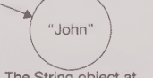

```
int age = 21;
String firstName = "John";
```

**图 2.4** 分配给基本变量和对象/引用变量的内存。

此外，除了提供创建 `String` 对象的简化语法外，Java 还为这些对象内部包含的字符串提供了简化的语法。再次，它是模仿输出基本变量的语法进行建模的。要输出 `String` 对象中包含的字符串，我们只需将变量名代码到对象中。例如，以下代码段会在系统控制台上输出 `My name is John Smith, my age is 21`：

```
int age = 21;
String firstName = "John";
String lastName = "Smith";
System.out.println("My name is " + firstName + " " + lastName);
System.out.println("My age is " + age + ");
```

在编写变量声明语句和输出语句时，Java 存储基本数据项和字符串数据之间的区别可以忽略。正如我们在第 3 章将看到的，对于其他类型的对象，这些差异是不能忽略的。

## 2.6 计算与 Math 类

第一批计算机被数学家用于计算方程的值，这也是他们获得“计算机”名称的原因，而现代计算机执行的大部分处理仍然是计算。Java 与大多数编程语言一样，提供了执行基础算术计算的能力，并提供了执行更复杂计算的附加功能。本节讨论如何将基础算术计算纳入 Java 程序，然后讨论如何将常用的数学常数和函数纳入这些计算中。

### 2.6.1 算术计算与优先级规则

Java 使用算术表达式执行算术计算。算术表达式由一组由运算符分隔的操作数组成。在最简单的情况下，操作数是数值常量，运算符是四种算术运算符：加、减、乘、除。例如，`10 + 21 - 5` 是一个简单的算术表达式，求值为 `26`。通常，简单的算术表达式从左到右求值。因此，加法将在减法之前执行。

四种算术运算符使用的符号见表 2.3。表中的第三项取模（或 mod）运算符用于寻找除法中的余数。例如，`14 % 3` 的求值为 `2`。所有这些都可以用于整数或实数操作数。

除了数值常量（称为数值字面量）外，操作数也可以是存储数值的变量名。当在算术表达式中使用内存单元名称时，会获取存储在内存单元中的值，替换内存单元名称，并计算算术表达式。例如，给定变量声明：

```
int x = 10;
int y = 29;
int z = 5;
```

#### 表 2.3 Java 算术运算符的符号（按优先级顺序排列）

| 算术运算 | Java 符号 |
| --- | --- |
| 乘 | `*` |
| 除 | `/` |
| 取模或 mod | `%` |
| 加 | `+` |
| 减 | `-` |

算术表达式 `x + y - z` 的求值为 `34`。数值字面量和内存单元名的混合可以作为任何算术表达式的操作数。通常，简单的算术表达式从左到右求值。因此，加法将在减法之前执行。

#### 整数除法

当操作数是整数时，除法的结果会被截断。例如，`10 / 3` 的求值为 `3` 而不是 `3.333`。这是因为整数除法不保留小数部分。

```
int x = 10;
int y = 3;
int result = x / y; // result 为 3
```

#### 优先级规则

四种算术运算符使用的符号见表 2.3。表中的第三项取模（或 mod）运算符用于寻找除法中的余数。例如，`14 % 3` 的求值为 `2`。所有这些都可以用于整数或实数操作数。

### 2.6.2 赋值运算符与赋值语句

在 2.3 中，我们学习了如何通过代码声明变量名 `price` 并将其初始化为值 `5.21`：

```java
double price = 5.21;
```

在此声明中使用的 `=` 符号被称为**赋值运算符**，因为它将值分配给内存单元。在这种情况下，名为 `price` 的内存单元被赋值为值 `5.21`。虽然该语句应该读作“`double price` 等于 `5.21`”，这是很遗憾的（正如我们将看到的），但该运算符并不代表数学上的相等概念。相反，它代表了从其右侧的数据值（在上述语句中为 `5.21`）流向左侧内存单元（在上述语句中为 `price`）的过程。

#### 赋值语句

赋值运算符除了用于声明语句中初始化变量外，还用于重新赋值（实际上是覆盖）程序中之前声明的内存单元的内容。这些语句被称为**赋值语句**。例如，在执行以下两条语句后，变量 `price` 存储了值 `6.25`。

```java
double price = 5.21;
price = 6.25;
```

除了数字字面量外，赋值运算符右侧的实体也可以是一个算术表达式。例如：

```java
answer = x + 21 - z;
```

在这种情况下，我们应该意识到该语句的执行分三个步骤完成：

1. 从内存中获取赋值运算符右侧代码所示变量的内容，并将这些值代入算术表达式中
2. 考虑到括号和优先级规则对算术表达式求值
3. 将算术表达式的值存储在赋值运算符左侧代码定义的内存单元中

在赋值语句中，赋值运算符左侧的项必须是变量名。不能通过将变量名放在赋值运算符右侧来反转该语句。也就是说，

```java
answer = x + 21 - z;
```

并不等同于

```java
x + 21 - z;
```

第二个表达式将产生语法错误。理解了这一点后，赋值语句（可能在某人的生日时执行）

```java
age = age + 1;
```

将内存单元中存储的值增加 `1`。此外，数学家现在会理解赋值运算符并不代表相等，并且不会从这条语句中惊恐，并声称没有任何（在此例中为 `age`）能等于它自己加一。20 世纪 70 年代的程序调查显示，程序中包含的语句有 47% 是赋值语句，因此这是一个需要理解的概念。

### 2.6.3 类型提升与类型转换

通常情况下，赋值给变量的值类型应该与变量的类型匹配。如果不是如此，Java 翻译器会检查在值存储到变量中时，赋值给变量的值可能会丢失。例如，如果将一个实数（例如 `2.7`）赋值给整数类型变量，该值的小数部分（`0.7`）将会丢失。因此，下面的语句产生翻译错误“丢失精度”，因为它将一个 `double` 赋值给整数内存单元。

```java
int newValue = 2.7;
```

> 避免将带有小数部分的数字（例如 `float` 和 `double`）赋值给整数类型变量，因为会产生翻译错误。

这条语句不会导致语法错误，因为对两个整数进行算术运算（`21 / 10`）的结果始终是一个整数（在此例中 `21 / 10 = 2`）。

```java
int newValue = 21/10;
```

Java 翻译器还会检查赋值语句，以确定赋值运算符左侧代码定义的赋值值是否在变量范围内。如表 2.1 右侧列所示，存储在数值变量中的数值范围取决于其类型。在四种整数类型中，`long` 类型的数值范围最大；在实数类型中，`double` 类型的范围最大。

图 2.5 中的进展总结了类型之间有效的赋值（即不会导致精度丢失，并保证赋值变量的范围足够存储赋值给它的值）。有效赋值是指：被赋值变量的类型位于被赋值值类型之左侧（例如，一个 `double` 变量可以被赋值 `int` 值）。在这种情况下，我们说该值已提升为变量的类型。

```
double ← float ← long ← int ← short ← byte ← char
```

注意：有效的提升是从左到右（←）

**图 2.5** 数值类型的有效提升。

尽管代码片段中使用的变量类型如下，但在图 2.5 所示，这些提升是有效的：

```java
byte a = 20;
double a = 'a';
```

使用编程语言中提供的数学运算符计算数字的平方根。

为了方便编写使用常用数学常量和计算的程序，Java 像大多数编程语言一样，提供了包含这些常量和数学函数的预编译库。这些常量被编码为初始化变量，而数学函数则被编码为子程序。在 Java 中，子程序被称为方法，相关的方法和变量被收集在类中。正如第 1.5.1 节所述，Java 中提供的预编译类集合是 Java 应用程序编程接口，或 Java API。关于 API 中类的完整描述可以在网上找到。要找到此文档，只需在浏览器的搜索窗口中输入“Java API Specification”即可。

包含数学常量和方法的 API 类称为 `Math` 类。表 2.4 列出了该类中包含的一个数学常量和一些常用方法。表格的第三列给出了一系列赋值语句，说明了该类常量和方法的使用。注意，语句中使用的常量或方法名称之前是 `Math` 类的名称后跟一个点 `.`。最后几行中出现的三角函数中使用的角度必须以弧度表示。这些方法计算并返回一个值，最右列的编码示例将该值赋值给变量。

#### 表 2.4 常用 Math 类常量和方法

| 方法 | 说明 | 编码示例 |
| --- | --- | --- |
| `PI` | 圆周长与直径的比值（`double` 类型） | `area = Math.PI * r;` |
| `abs` | 计算并返回数字 `n` 的绝对值（返回其接收的类型） | `nAbsolute = Math.abs(n);` |
| `pow` | 计算并返回数字 `n` 的 `p` 次方（返回 `double` 类型） | `nToPow = Math.pow(n, p);` |
| `sqrt` | 计算并返回数字 `n` 的平方根（返回 `double` 类型） | `rootN = Math.sqrt(n);` |
| `toRadians` | 将角度角度 `a` 转换为弧度（返回 `double` 类型） | `aRads = Math.toRadians(a);` |
| `sin` | 计算并返回以弧度指定的角度 `aRads` 的正弦 | `sinA = Math.sin(aRads);` |


| cos | 计算并返回以弧度指定的角度 `aRads` 的余弦 | `cosA = Math.cos(aRads);` |
| :--- | :--- | :--- |
| tan | 计算并返回以弧度指定的角度 `aRads` 的正切 | `tanA = Math.tan(aRads);` |

以下代码段计算并输出 45 度的正弦以及 2 的三次幂：

```java
double angle = 45.0;
double angleInRadians = Math.toRadians(angle); //returns a double
double sineOfAngle = Math.sin(angleInRadians); //returns a double
```

```java
System.out.println("The sine of " + angle + " is " + sineOfAngle);
System.out.println("2 cubed = " + Math.pow(2, 3));
```

## 随机数

“随机数是由一个过程生成的，其结果不可预测，且随后无法可靠地重现。”随机数用于许多计算机应用程序，例如游戏程序、加密程序和模拟程序。例如，飞行模拟器程序训练飞行员以应对模拟过程中随机引入飞行的任何湍流。

`Math` 类包含一个 `random()` 方法，可生成伪随机数。这些数字不是真正的随机，因为方法生成器的序列是基于计算机的实时时钟（即当天的时间），精确到毫秒，因此可以可靠地重现。

该方法返回一个范围内的 `double` 值：`0.0 ≤ randomNumber < 1.0`。（该方法生成的最大数字始终小于 1.0。）以下代码段输出两个范围内的随机数。具体的输出数字取决于执行代码段的时间。

```java
double randomNumber;
randomNumber = Math.random();
System.out.println(randomNumber);
randomNumber = Math.random();
System.out.println(randomNumber);
```

可以使用 `double` 通过赋值语句生成范围内的 `min ≤ randomNumber < max` 的数字：

```java
double randomNumber1 = min + Math.random() * (max - min);
int randomNumber2 = (int)(min + Math.random() * (max - min));
```

# 第 2 章 变量、输入/输出与计算

将“一百百十七六”转换为字符串“十”以得到“一百百八十六”，这显然是不可能的。相反，如果我们阅读这个问题：“一百百十七六和十之和是多少？”，我们将数字转换为它们的数值表示，即 176 和 10，然后执行加法。在计算机科学中，字符串和数字之间的区别比此更深，因为即使我们被要求相加“176”和“10”，我们仍然在执行加法之前必须将这两个字符串转换为它们的数值表示。

- 算术表达式中的操作数不能是字符串。

正如第 1 节所述，字符使用其扩展 ASCII 表示进行存储，而数字使用其二进制表示进行表示。在字符串（`String`）的情况下，使用的是扩展 ASCII 表示。这两种表示方式的区别如下所示。

| 176 的扩展 ASCII 表示 | 176 的二进制表示 |
| :--- | :--- |
| `00110001 00110111 00110110` | `10110000` |
| `'1' '7' '6'` | |

由于输入对话框返回的是字符串，当将 176 输入到文本框时，它返回的是字符串 `"176"`，如果要在算术表达式中使用它，必须将其转换为数值。此转换过程被称为解析字符串为数字（parsing strings into numbers）。API 中有一组被称为包装类（wrapper classes）的类，包含了执行此转换的静态方法。要转换为数值的字符串作为参数传递给方法，该参数编码在跟随方法名后的圆括号内。使用哪个类和哪个方法的决定取决于原始数值字符串被转换为哪种数值类型，如表 2.5 所示。

## 表 2.5：数值包装类及其解析方法

| 将字符串转换为数值类型 | 使用的静态方法 | 所在的包装类 |
| :--- | :--- | :--- |
| `byte` | `parseByte()` | `Byte` |
| `short` | `parseShort()` | `Short` |
| `int` | `parseInt()` | `Integer` |
| `long` | `parseLong()` | `Long` |
| `float` | `parseFloat()` | `Float` |
| `double` | `parseDouble()` | `Double` |

要将字符串字面量 `"176"` 转换为其整数数值表示，我们将编写：

```java
int numericValue = Integer.parseInt("176");
```

要将字符串转换为数值型 `double`，我们将编写：

```java
double numericValue = Double.parseDouble(s);
```

通常情况下，通过输入对话框接受用户输入的语句以及将返回的字符串转换为数值的语句是连续编写的。

```java
String s = JOptionPane.showInputDialog("Enter your age");
int age = Integer.parseInt(s);
s = JOptionPane.showInputDialog("Enter your weight");
double weight = Double.parseDouble(s);
```

如果进入包装类的字符串包含任何数字以外的字符（即字符 `'0'`, `'1'`, ..., `'9'`），则会发生运行时错误 `NumberFormatException`，程序将终止。如果向方法传递了空字符串（用户在输入对话框中点击了“确定”但没有输入内容）或向方法传递了 `null` 字符串（用户在未输入的情况下点击了“取消”），则会发生相同的运行时错误。我们将在第 4 节通过让程序得出更具信息性的结论来学习如何处理这些运行时错误，并在第 5 节“重复语句：循环”中学习如何允许用户修正错误输入。

> **注意**：运行时错误是程序在执行期间发生的错误。

图 2.8 显示的应用程序根据给定半径计算圆面积，还根据给定面积计算圆的半径。程序的输入（半径为 10，面积为 200）以及相应的输出如图 2.9 所示。该程序演示了赋值、解析字符串为数值、执行计算、`Math` 类的使用以及对话框 I/O。

```java
import javax.swing.JOptionPane;

public class AssignmentMathAndDialogIO {

    public static void main(String[] args) {
        String s;
        double area, radius;
        s = JOptionPane.showInputDialog("To calculate an area," + "\n enter a radius:");
        radius = Double.parseDouble(s);
        area = Math.PI * Math.pow(radius, 2);
        JOptionPane.showMessageDialog(null, "The area of a circle is " + area + " whose radius = " + radius);
        s = JOptionPane.showInputDialog("To calculate a radius" + "\n enter an area:");
        area = Double.parseDouble(s);
        radius = Math.sqrt(area / Math.PI);
        JOptionPane.showMessageDialog(null, "The radius of a circle is " + radius + " whose area = " + area);
    }
}
```

图 2.8：应用程序 `AssignmentMathAndDialogIO`。

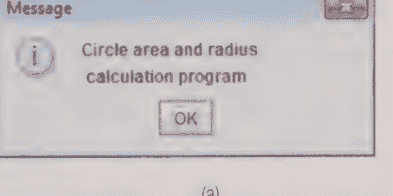 （注：此处对应原文图 2.9 描述，原文为图 2.9 描述占位符）

## 2.8 图形化文本输出

在 2.4 节中，我们调用（或某些人说“使用”、“调用”）`PrintStream` 类的 `println()` 方法将文本输出到系统。在本节中，我们将学习如何在图形窗口中使用 `drawString()`。

### 2.8.1 `drawString()` 方法

`drawString()` 方法是 API `Graphics` 类的一部分（成员），用于向图形对象输出文本（可能是窗口）。当调用该方法时，会传递三个参数。第一个参数是要输出的文本。第二个和第三个参数是输出文本的 x 和 y 坐标。这些坐标确定了文本第一个字符的位置。它们的原点是显示图形对象（例如，我们的游戏板）的左上角，x 轴向右，y 轴向下。

要在我们的游戏环境的游戏板上输出 `"Hello World"`，并使 `"H"` 的左下角位于 `(200, 300)`，我们将编写：

```java
g.drawString("Hello World", 200, 300);
```

注意字符 `g` 位于方法名前之前。这是因为方法必须在 `Graphics` 对象上绘制文本。在我们的情况下，对象 `g` 必须是附加到游戏板的 `Graphics` 对象，因为我们希望文本画在游戏板上。正如我们在下一节中看到的，对象 `g` 与游戏板的附加是由环境为我们完成的。

操作对象的方法被称为实例方法（instance method）。调用这些方法的语法是所操作对象的名称，后跟一个点，然后是方法名及其参数列表。我们在第 2.4 节中已使用这种语法来调用 `println()` 方法。它们通过在 Java 预定义的 `PrintStream` 对象 `System.out` 后面加上一个点 `.` 来调用。（正如之前讨论过的，在静态方法中，我们在方法名之前加上方法类的名称并跟上一个点。例如：`Math.sqrt(9)`）。

确定一个方法是静态（`static`）还是非静态的最简单方法是点击在线 Java API 文档左下角窗口中的类名，然后向下滚动 API 文档找到方法名所在的列。如果该方法是静态的，“static”一词将出现在方法名左侧的列中。例如：

| 修饰符和类型 | 方法和说明 |
| :--- | :--- |
| `static double` | `sqrt(double a)` 返回正确四舍五入的 `double` 正平方根 |

如果该方法是非静态方法，“static”一词将不会出现在方法名左侧的列中。

剩下的问题是确定我们在游戏程序中的何处放置 `drawString()` 的调用。简短的答案是在 `draw()` 回调方法中，我们将在接下来讨论。

### 2.8.2 `draw()` 回调方法

图 2.10 展示了应用程序类 `GraphicalOutput`，它在第 7 行创建一个窗口，并在 `main()` 方法执行时在第 11 行显示。第 2–12 行与图 1.31 中的游戏代码模板相同，除了应用程序类名（第 4 行和 6 行）和窗口标题（第 7 行）发生了变化。当程序运行时，显示器上会出现图 2.11 所示的窗口。

```java
import edu.sjcny.gpv1.*;
import java.awt.Graphics;

public class GraphicalOutput extends DrawableAdapter
{
    static GraphicalOutput ga = new GraphicalOutput();
    static GameBoard gb = new GameBoard(ga, "Graphical Output");

    public static void main(String[] args)
    {
        showGameBoard(gb);
    }

    public void draw(Graphics g) // 绘图回调方法
    {
        g.drawString("Hello World", 250, 220);
    }
}
```

图 2.10：应用程序 `GraphicalOutput`。

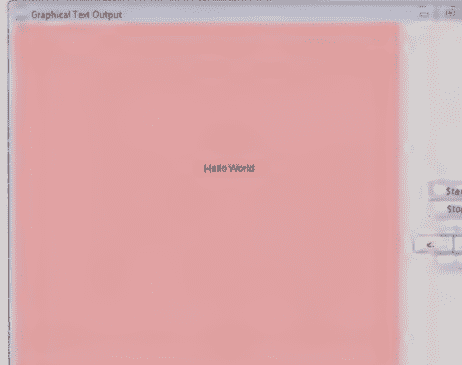

**图 2.11**：应用程序 `GraphicalOutput` 产生的输出。

第 14–18 行是游戏环境 `draw()` 回调方法的编码。`draw()` 方法的第一行称为方法签名，必须与第 14 行的代码完全相同，并且要求将游戏环境添加（导入）到程序（第 1 行）。`drawString()` 方法的调用被编写在第 16 行，执行时它会将图形文本“Hello World”从像素位置 `(250, 220)` 开始输出到我们的游戏板上。`drawString()` 方法所在的 `Graphics` 类必须导入到程序中（第 2 行）。但是，它是什么时候执行的呢？

我们已经了解到 `main()` 方法是由 Java 运行时调用的，导致其语句执行，从第一个可执行语句（程序入口）开始，到执行到达代码块的末尾结束（在本例中为第 12 行）。因此，似乎第 11 行会显示应用程序的窗口，然后程序结束。`draw()` 方法一定已经执行了，因为字符 "Hello World" 出现在游戏的窗口中（图 2.11）。所以我们再次问出这个问题：“它是什么时候执行的？”

这个答案是为什么 `draw()` 方法被称为回调方法（callback method）的关键。`main()` 方法中的第 11 行调用了 `showGameBoard()` 方法，该方法请求游戏环境显示游戏板窗口。在游戏环境显示窗口之前，它会调用（或回调）应用程序中编写的 `draw()` 方法，导致其执行。当 `draw()` 方法结束时，游戏环境完成 `showGameBoard()` 方法请求的窗口显示。因此，应用程序调用游戏环境显示游戏板窗口（第 11 行），而游戏环境在窗口显示之前回调应用程序的 `draw()` 方法以在游戏板上执行绘图。具体来说，执行序列是：`main()` 方法第 11 行 -> 执行到 `draw()` 回调方法（第 14–18 行） -> 最后是游戏环境方法中的剩余代码。

事实上，每当程序窗口需要重绘时（例如，窗口被最小化后点击状态栏上的窗口图标），游戏环境的代码就会调用 `draw()` 方法重新在游戏板上进行绘图。这可以通过添加以下语句轻松验证：

```java
System.out.println("the draw method was invoked");
```

到 `draw()` 回调方法中。那么，每当 `draw()` 方法被调用时，我们都将在系统控制台上看到一个输出。

尽管包含程序入口的 `main()` 方法结束了执行，图形程序仍继续执行，直到程序的图形窗口（例如游戏板）关闭为止。

### 2.8.3 `setFont()` 方法：初探

与 `drawString()` 方法一样，`setFont()` 是 `Graphics` API 的一部分（成员）。

```java
import edu.sjcny.gpv1.*;
import java.awt.Graphics;
import java.awt.Font;

public class CountingSeconds extends DrawableAdapter
{
    static CountingSeconds ga = new CountingSeconds();
    static GameBoard gb = new GameBoard(ga, "The Counting Algorithm");
    static int count = 0; // a class level variable

    public static void main(String[] args) {
        showGameBoard(gb);
    }

    public void draw(Graphics g) // the drawing call back method
    {
        g.setFont(new Font("Arial", Font.BOLD, 18));
        g.drawString("Your game time is: " + count, 10, 50);
    }

    public void timer() {
        count = count + 1;
    }
}
```

图 2.12：应用 `CountingSeconds`。

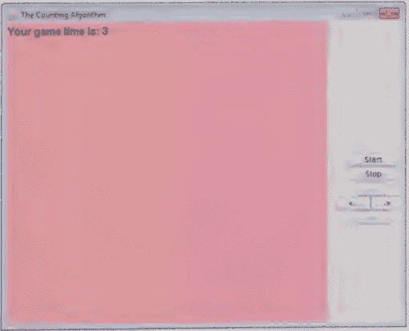

图 2.13：点击 Start 按钮三秒后应用 `CountingSeconds` 输出的内容。


计数算法的第二行代码编写在 `timer()` 回调方法内部的第 23 行（第 21–24 行）。由于 `timer` 每秒跳动一次（默认情况下），第 23 行每秒重复一次，导致计数器变量 `count` 计算秒数。每当 `timer` 方法结束时，游戏环境就会调用 `draw` 方法，该方法通过输出类级变量 `count` 的内容（第 18 行）在游戏板上显示新时间。输出之所以以粗体 Arial 18 号字体显示，是因为第 17 行调用了 `Graphic` 类的 `setFont` 来更改当前的字体值。第 3 行的 `import` 语句使得 `Font` 类的常量和方法可供该语句使用。

## 2.10 格式化数值输出：初步尝试

在本章中，我们讨论了如何格式化数值输出，但我们还没有讨论如何通过格式化数值输出来提高其可读性，例如在小数点左侧每三位添加一个逗号，或者调整输出数字数字右侧小数部分的精度。`DecimalFormat` 类中的 `format` 方法可以用于这两种常用的输出格式化类型。我们将继续在本章中介绍用于格式化数值输出的技术；我们将在第 5 章中提供这些技术的更多细节。

图 2.14 所示的应用使用了 `DecimalFormat` 类的方法来格式化浮点数（第 12 行）和整数（第 13 行）的输出。该方法返回一个包含格式化数值的字符串，并接受一个参数。该参数是需要格式化的数值变量：分别为第 12 行和第 13 行的 `speedOfLight` 和 `population`。

该方法使用第 10 行定义的 `DecimalFormat` 对象调用（第 12 行和第 13 行）。执行的格式化与小数格式对象关联，并指定为在第 10 行末尾括号内的字符串字面量。该行编写的字符串字面量 `"#,###.00"` 表示小数点左侧每三位将出现逗号，且实数（非整数）将以两位精度输出。格式化时使用的精度可以通过添加或删除第 10 行小数点右侧的井号（#）来更改。

```java
1 import java.text.DecimalFormat;
2 
3 public class BasicNumericFormatting
4 {
5 public static void main(String[] args)
6 {
7 double speedOfLight = 299792458.7153;
8 int population = 1097603176;
9 
10 DecimalFormat df = new DecimalFormat("#,###.00");
11 
12 System.out.println(df.format(speedOfLight));
13 System.out.println(df.format(population));
14 }
15 }
```

图 2.14  

应用 BasicNumericFormatting。

## 第 2 章 变量、输入/输出与计算

程序的输出如图 2.15 所示。如输出所示，实数总是四舍五入（299792458.7153 变为 299,792,458.72）。

图 2.15  

BasicNumericFormatting 输出的内容。

## 总结

本章介绍了变量、输入和输出的基本组件。变量用于存储数据，并且必须声明其类型。良好的编码风格要求变量名具有意义，并指示数据所代表的内容。它们以字母开头，不能包含空格。使用赋值运算符进行赋值。通常，被赋值的值应该与变量的类型匹配。

## 使用 Java 编程基础

对话框是与用户通信的图形方式，提供了控制台输入输出的替代方案。`Graphics` 类中的 `drawString` 方法可将文本输出到图形窗口，`setFont` 可用于更改默认字体、样式和大小。

## 知识练习

1. 判断对错：

   - a) 变量中存储的数据类型可以随着程序的执行而改变。

   - b) 变量在使用之前必须先声明。

   - c) 变量在声明时必须初始化。

   - d) 以大写字母开头变量名在语法上是错误的。

   - e) 变量名可以使用空格来提高可读性。

2. Java 程序中哪条语句最执行？

3. 什么是变量？列举两种变量类型及其存储的信息。

4. 下面哪个不是基本数据类型？

   - a) boolean

   - b) char

   - c) String

   - d) int

5. 给出声明为以下类型的默认初始值：

   - a) boolean

   - b) char

   - c) double

   - d) int

6. 编写一个良好的声明语句，声明可以存储内容的变量：

   - a) 初始化为 32 的 Maggie 的年龄

   - b) 初始化为字母 'R' 的 Ryan 的名字首字母

   - c) 一个塔可的价格

   - d) 数字 21,234,096,464

   - e) “是”这一事实

7. 程序中编写的数值字面量被表示为 `float` 还是 `double`？请解释。

8. 判断以下每一项是否符合规范且有效。对于不符合的项，请说明原因：

   - a) 2ndplace

   - b) middleInitial

   - c) winningTeam

   - d) fgp3

   - e) test1 grade

   - f) myScore

   - g) SalePrice

9. 用代码向系统控制台输出两行。第一行包含你的名字，第二行包含你居住的城市，使用：

   - a) 条语句

   - b) 一条语句

# 第 2 章 变量、输入/输出与计算

10. 编写一个结构良好的变量声明语句，声明一个字符串 `String` 对象并将其初始化为 Skyler 的地址（21 First Avenue），请使用以下方式：

-   a) 单行对象声明语法

-   b) 两行对象声明语法

11. 画出这些语句所分配的内存示意图：

-   a) `int distance = 675;`

-   b) `String myName = new String("Jane");`

12. 编写一条语句来实现：

-   a) 输出内存单元 `priceOfCorn` 的注释内容

-   b) 输出句子：Martin said: "I had a dream."

-   c) 将变量 `myBalance` 的内容改为 234.56。

13. 计算以下每个表达式的值：

-   a) `17 - 5 * 2 + 12`

-   b) `31 - 7 * 2 + 14`

-   c) `(48 + 12) / 12 + 18 * 2`

-   d) `21 - 9 + 18 * 4 * 3`

14. 编写代码以：

-   a) 声明变量 `quizAverage`并将变量 `quiz1`、`quiz2`、`quiz3` 和 `quiz4` 的平均值存储其中

-   b) 计算45 度的正弦并将值存储在变量 `sineOf45` 中

-   c) 计算并输出 45.67 的平方根

-   d) 计算并输出 34.7 的 5 次方

15. 编写变量声明来声明变量 `average`，以及赋值语句来存储三个速度列表：55、57和60英里/小时的平均值。

16. 编写一条赋值语句，将 `double` 类型变量 `bankBalance` 中存储值的整数部分存储到变量 `dollars` 中。

17. 判断对错：

-   a) 在程序中使用对话框进行 I/O 操作时，必须包含一个 `import` 语句。

-   b) 消息对话框可以用于从程序用户处获取输入。

-   c) 输入对话框始终返回一个字符串。

-   d) 当用户在输入对话框中不进行输入而点击“确定”时，将返回 `null`。

-   e) 对话框将调整大小以适应发送给它们的参数。

18. 编写代码在消息对话框中输出两行内容。第一行包含你的姓，第二行包含格式为“My birthday is: ddd\mm\yyyy”的出生日期（是的，那些是反斜杠）。

19. 编写代码允许程序使用输入对话框输入账户余额。包含一个结构良好的用户提示。

20. 思考一个游戏。编写代码将游戏名称及其创建者、游戏任务（目标）以及如何控制游戏棋子输出到一个大小适中的消息对话框中。

21. 编写代码声明一个名为 `deposit` 的 `double` 类型变量，并将字符串 `sDeposit` 中包含的内容解析到其中。

22. 编写代码声明一个名为 `speedLimit` 的整数变量，并将字符串 `sSpeedLimit` 中包含的内容解析到其中。

## 编程练习

- 1. 编写一个 Java 程序，在系统控制台输出你的名字，随后输出你居住的城市。

- 2. 编写一个程序计算五个测验成绩的平均值：100、97、67、85和79。将测验成绩和平均值输出到系统控制台。输出应有良好的注释，测验成绩在一行，平均值在另一行。

- 3. 编写一个程序接受一个角度（度）和一个实数。然后输出该角度及其正弦、余弦和正切值。随后输出数字的立方和平方根。输出应占据几行并发送到消息对话框。用户提示应结构良好，输出应有良好的注释。

- 4. 重复练习 3，但将输出发送到系统控制台。使用 20 磅的斜体字体显示板输出。

- 5. 编写一个程序要求用户输入一对实数（根据你的选择）。输入后，输出正确答案以及用户输入该数字花费的秒数。输出应保留一位小数的精度。

- 6. 重复练习 6，但将输出发送到消息对话框。用户提示应结构良好，输出应有良好的注释。

- 7. 重复练习 6，但数字的左侧每三位添加逗号，并保留一位小数的精度。

# 注脚

> 1 Java 7 版 API 文档的 URL 为：http://docs.oracle.com/java/7/docs/

# 第 3 章 · 方法、类与对象：初探

一组括号。如果方法不向调用者返回值（例如，仅输出一个字符串值），则使用 `void` 关键字作为返回类型。在这种情况下，该方法被称为 void 方法。

一个每次被调用时都简单向系统控制台输出学生报纸名称的方法，就是 void 方法的一个示例。

```java
void outputNewspaperName()
{
    System.out.println("The Student Voice");
}
```

用于命名方法的语法和编码风格与命名变量的风格相同：

- 它们不能包含空格

- 它们应该以小字母开头

- 新单词以大写字母开头

通常，它们只由字母组成。数字、美元符号和下划线不用于名称中。例如，一个相加两个整数并返回结果的方法可以命名为 `addToInts` 而不是 `add_2_Ints`。

图 3.1 展示了应用程序 `AVoidMethod`，它包含了 `outputNewspaperName` 方法的实现以及两种不同的调用形式。其产生的输出如图 3.2 所示。

```java
public class AVoidMethod
{
    public static void main(String[] args)
    {
        AVoidMethod.outputNewspaperName(); // 第一次方法调用
        System.out.println("Page 1\n");
        outputNewspaperName(); // 第二次方法调用
        System.out.println("Page 2\n");
    }
    static void outputNewspaperName() //方法签名
    {
        System.out.println("The Student Voice");
    }
}
```

图 3.1 控制台应用程序 AVoidMethod。

The Student Voice

Page 1

The Student Voice

Page 2

图 3.2 控制台应用程序 AVoidMethod 产生的输出。

该程序包含两个方法：`main` 方法（第 3–9 行）和 `outputNewspaperName` 方法（第 11–14 行）。这两个方法都编写在程序类的代码块中，该代码块从第 2 行开始，到第 15 行结束。

> 注意：方法不能在另一个方法的代码块内编写。

在第 11 行编写的方法 `outputNewspaperName` 的签名以 `static` 关键字开头。并不是所有方法签名都以这个词开头。正如我们所学的，方法分为两类：操作对象的方法（静态方法）和不操作对象的方法（非静态方法）。操作对象的方法示例是 `println` 方法。它作用于（或将其输出字符串发送到）控制台对象，即 `System.out`。不操作对象的方法必须在其签名中包含 `static` 关键字。`outputNewspaperName` 方法不操作对象，因此它的签名以 `static` 关键字开头。在 3.5 节中，我们将讨论操作对象的方法，并更深入地了解“方法操作对象”意味着什么。

> 不操作对象的方法必须在其签名中包含 `static` 关键字。

`outputNewspaperName` 方法在应用程序 `main` 方法的第 5 行和第 7 行被调用。第 7 行仅提到了方法名并在后跟一个左括号。这种调用语法是有效的，因为该静态方法编写在同一个类 `AVoidMethod` 中。第 5 行使用了更通用的静态方法调用语法。在这里，调用语句以方法所在类的名后跟一个点开头。

```
AVoidMethod.outputNewspaperName();
```

我们使用这种语法来调用编写在 `Math` 类中的静态方法 `pow` 和 `sort`。

```java
double ans = Math.pow(3.0, 2.0);
double root = Math.sqrt(9.0);
```

由于这两个方法并不是在调用它们的同一个类中编写的，因此调用语句必须包含类名。唯一的例外是使用静态语句。当使用任一种语法时，较短的语法使我们的程序更具读性，因此更受欢迎。

应用程序的执行序列从 `main` 方法的第 5 行开始。该调用语句导致 `outputNewspaperName` 方法代码块中的代码执行（第 12-14 行），产生第一行输出（图 3.2）。`main` 方法的第 6 行执行，产生第二行输出。第 7 行导致 `outputNewspaperName` 方法第二次执行，产生第三行输出。最后，执行第 8 行，产生最后一行输出。

> 在方法执行后，下一个要执行的语句是紧随其所调用的语句之后的语句。

如果一个方法需要接收来自客户端传递的信息，那么它的签名必须包含参数列表。参数列表编写在方法签名的左右括号内。列表中的参数用逗号分隔，每个参数由一个变量名和其类型组成。例如，一个工作是输出人的年龄和重量的方法，其参数列表中将有一个 `int` 和一个 `double` 参数。

```java
static void outputAgeAndWeight(int age, double weight)
{
    System.out.println("age: " + age + " weight: " + weight);
}
```

每个参数接收客户端调用语句发送的一条信息，参数的类型必须与发送的信息类型匹配。`outputAgeAndWeight` 方法在应用程序 `main` 方法的第 5 行和第 7 行被调用。第 7 行仅提到了方法名并在后跟一个左括号。这种调用语法是有效的，因为该静态方法编写在同一个类 `AVoidMethod` 中。第 5 行使用了更通用的静态方法调用语法。在这里，调用语句以方法所在类的名后跟一个点开头。

```
AVoidMethod.outputNewspaperName();
```

我们使用这种语法来调用编写在 `Math` 类中的静态方法 `pow` 和 `sort`。

```java
double ans = Math.pow(3.0, 2.0);
double root = Math.sqrt(9.0);
```

传递给方法的参数（`myAge` 和 `myWeight`）如果选择为与参数和变量名称不同但相同的名称（例如，都被编码为 `age` 和 `weight`），事件 5 仍然会在图 3.4 的右侧创建两个名为 `age` 和 `weight` 的不同内存单元格。在工作方法中对 `age` 和 `weight` 符号的编码将引用这些内容指向的内存单元格，而这些单元格在方法执行结束时会被释放。

> 注意：每当调用方法时，其参数列表中的变量都会被分配内存，并在方法执行结束时被释放。

## 3.2.2 值参数的作用域和副作用

在 Java 中，在参数和变量之间（即客户端代码与工作方法代码之间）传递信息的唯一方法是通过值参数，我们理解图 3.4 所示展示的值参数模型的局限性及其影响至关重要。如图所示，客户端代码拥有它可以访问的变量 `myAge` 和 `myWeight`，而方法拥有两个它可以访问的变量 `age` 和 `weight`。客户端代码无法访问变量 `age` 和 `weight`，而工作方法无法访问变量 `myAge` 和 `myWeight`。

在编程语言 argon 中，我们说工作方法的变量 `age` 和 `weight` 定义在它的代码作用域内，而变量 `myAge` 和 `myWeight` 则在它的作用域之外。Java 语句只能访问位于其作用域内的变量。

**定义**：变量的作用域是程序中定义它并因此可以访问的部分。

在方法调用中将参数名称设置为与方法签名中编码的参数名称相同在语法上是正确的。例如，在 `main` 方法中声明的变量和工作方法参数列表中的变量都可以命名为 `myAge` 和 `myWeight`。


```java
public static void main(String[] args) {
  int myAge = 23;
  double myWeight = 185.4;

  outputAgeAndWeight(myAge, myWeight);
}

static void outputAgeAndWeight(int myAge, double myWeight) {
  System.out.println("age: " + myAge + " weight: " + myWeight);
}
```

如前所述，这种方法的编码将在图 3.4 的右下方创建分配给方法参数的两个内存单元格，但它们的名称将是 `myAge` 和 `myWeight`。现在，写入工作代码的语句 `myAge = myAge + 1;` 不会导致翻译错误，因为现在其作用域内有一个名为 `myAge` 的变量。该方法将访问其内存单元格 `myAge` 的内容，该变量的内容将更改为 24。当方法结束并返回客户端代码时，客户端内存单元格 `myAge` 的内容将保持不变。它仍然包含值 23。

通常情况下，这是一件好事，因为防止了方法代码更改客户端数据的非预期副作用。防止这种副作用确保了在调用方法之前存储在客户端代码中的值，与方法完成后存储在变量中的值是相同的值。然而，在某些情况下，这并不是我们想要的。

考虑一个名为 `swap` 的方法，客户端通过以下语句调用它来交换变量 `a` 和 `b` 的内容：

```java
int a = 10;
int b = 20;
swap(a, b);
System.out.println("a is: " + a + " and b is: " + b);
```

如果方法执行成功，`swap` 完成执行后产生的输出应该是 `a = 20` 和 `b = 10`。

`swap` 方法将有两个整数参数来接收要交换的值，其代码将实现交换算法。方法的代码（在前调用它的 `main` 方法）所示：

```java
public static void main(String[] args) {
    int a = 10;
    int b = 20;

    swap(a, b);
    System.out.println("a is:" + a + " and b is: " + b);
}

static void swap(int a, int b) {
    int temp = a;
    a = b;
    b = temp;
}
```

遗憾的是，由于 Java 使用值参数，这种方法的编码并没有交换客户端的变量，`main` 方法中最后一个语句产生的输出是 `a = 10` 和 `b = 20`。

与值参数的内存模型一致，客户端和方法各自拥有自己的名为 `a` 和 `b` 的内存单元格。方法交换了其两个内存单元格 `a` 和 `b` 中包含的值，这对于客户端代码中分配的内存单元格 `a` 和 `b` 的内容没有副作用。这两个单元格保持不变（它们仍然包含 10 和 20），这使得看起来像是工作方法中的交换算法编码不当。

事实证明，使用基本类型参数编写一个可以交换两个客户端变量内容的方法是不可能的，因为根据设计，值参数防止了方法更改客户端参数列表中的值。某些编程语言（例如 C 和 C++）通过允许另一种类型的参数（引用参数）来解决这个问题。Java 不支持这种类型的参数，因为它可能会导致一些不良的副作用。

## 3.2.3 返回值

方法可以返回一个值，且只能返回一个值。方法可以返回字面量、变量或算术表达式。以下代码显示了一个返回两个数之和的方法。

```java
public static void main(String[] args) {
    int a = 10;
    int b = 20;
    int sum = add(a, b);
    System.out.println("The sum is: " + sum);
}

static int add(int a, int b) {
    return a + b;
}
```

方法可以返回多个值，如果这些值封装在对象中。以下代码显示了一个返回两个数值的方法。

```java
public static void main(String[] args) {
    Point p = createPoint(10, 20);
    System.out.println("x: " + p.x + ", y: " + p.y);
}

static Point createPoint(int x, int y) {
    return new Point(x, y);
}

class Point {
    int x;
    int y;
    Point(int x, int y) {
        this.x = x;
        this.y = y;
    }
}
```

方法还可以返回一个数组，它是值的集合。以下代码显示了一个返回整数数组的方法。

```java
public static void main(String[] args) {
    int[] numbers = createArray(5);
    for (int n : numbers) {
        System.out.println(n);
    }
}

static int[] createArray(int size) {
    int[] arr = new int[size];
    for (int i = 0; i < size; i++) {
        arr[i] = i * 10;
    }
    return arr;
}
```

## 3.2.4 类级变量

类级变量是方法之间共享信息的另一种方式。然而，共享方式以及编码类级变量的语法与使用参数和返回语句都不同。

首先，与使用参数将信息传递给工作方法不同，为了让方法使用类变量共享信息，方法必须在同一个类中编码。信息的共享通过在方法的代码块之外编码变量来实现。良好的编码规范要求它们在类的顶部编码。这样做之后，变量位于类中所有方法的作用域内。方法实际上共享同一个变量，这允许类中的任何方法获取并覆盖变量的内容。

```java
public class Counter {
    static int count = 0;

    public void increment() {
        count++;
    }

    public int getCount() {
        return count;
    }

    public static void main(String[] args) {
        Counter c1 = new Counter();
        c1.increment();
        System.out.println("Count after first increment: " + count);
        Counter c2 = new Counter();
        c2.increment();
        System.out.println("Count after second increment: " + count);
    }
}
```

在方法代码块内部可以声明与类级变量同名的变量。这样做会创建一个与类级变量同名的新内存单元格，它会隐藏类级变量。这被称为“阴蔽”。

```java
public class Counter {
    static int count = 0;

    public void increment() {
        int count = 5; // 这隐藏了类级变量
        count++;
        System.out.println("Local count: " + count);
        System.out.println("Global count: " + Counter.count);
    }
}
```

被称为局部变量。方法代码块内部对局部变量名的所有使用都指向该局部变量，且该局部变量只能通过方法的代码访问。要从方法内部访问类变量，需要在变量名之前加上类名并跟上一个点（就像我们调用静态方法一样）。

尽可能的情况下，不使用类变量名来为方法内部声明的变量命名是一种良好的编程习惯。其一在于，这降低了程序的可读性，因为如果我们没有意识到声明了局部变量，我们就会错误地认为方法内部使用了类变量。此外，如果我们在编写方法时忘记声明局部变量，翻译器将假设我们使用了类变量，而它不会提醒我们忘记了声明局部变量。

> 提示：在尽可能的情况下，不使用类变量名来为方法内部声明的变量命名是一种良好的编程习惯。

图 3.5 展示了一个包含四个工作方法的程序，并演示了如何通过值参数、返回语句和类变量进行信息共享、局部变量的使用，以及使它们具有可复用的特性。程序的输入和程序产生的输出如图 3.6 所示。

第 30–36 行包含 `inputInteger` 方法的代码。其签名（第 30 行）表明它是一个返回整数的 `void` 方法，并且有一个名为 `prompt` 的 `String` 参数。方法将发送到输入框的字符串（第 33 行）传递，以作为程序的提示显示。返回的用户输入被解析为整数变量 `a`（第 34 行），解析后的值返回给调用者（第 35 行）。签名中包含字符串参数允许调用者指定发送到对话框的提示。此外，该方法负责解析输入，免除了调用者的这一责任。这两个特性使得该方法具有高度的可复用性。它在程序中被调用了五次（在第 11、17、18、23 行），每次发送的提示都不同。

第 4 行和 5 行声明了两个类变量 `a` 和 `b`，其中 `a` 初始化为 10。类变量 `a` 的值包含在传递给第 11 行 `inputInteger` 用的字符串中，该值作为由 33 行生成的输入对话框中的提示显示（图 3.6a）。`inputInteger` 方法在第 32 行声明了它的局部变量 `a`，因此将用户输入的解析值赋值给变量 `a`（第 34 行）改变了局部变量的内容，而保持类变量不变。这通过程序产生的第一个输出（图 3.6b，第 14–15 行）得到了验证，该输出表明一个 10 岁的孩子年后是 13 岁。

`dif` 方法在第 13 行被调用以计算第一个输出：达到目标年龄所需的年数。它将第 11-12 行输入的目标年龄作为第 13 行的第一个参数传递。由于该方法没有声明名为 `a` 的局部变量，第 13 行的第二个参数 `a` 是类变量。该方法计算传递给两个参数（第 40 行）的值之间的差，即目标年龄和存储在类变量中的值。由于目标年龄作为输入为 13，且输出显示将在 3 年后达到，因此传递给方法第二个参数的类变量在 `dif` 被调用时必须包含值 10。之前在第 34 行对局部变量 `a` 的赋值对它没有影响。

需要注意的是，即使参数 `a` 在方法 `dif` 内部被重新赋值，类变量仍然保留值 10，因为 Java 使用的是值参数。`dif` 方法中对变量的所有引用都指向参数，该参数可以被视为局部变量。

两个方法 `swapParameters` 和 `swapClasses` 编写在第 43–55 行。其中第一个在第 19 行被调用。它包含两个参数 `a` 和 `b`（第 43 行），用于接收要交换的值，这些值是在第 17 和 18 行输入的（图 3.6c 和 d）。虽然参数的名称与类变量的名称相同，但它们并不是与类变量相同的内存单元。当参数中存储的值被交换时（第 45–47 行），主方法第 20–21 行产生的输出验证了值的特性：对参数的更改对传递给方法的参数没有影响。主方法产生的数字按输入顺序为：111，后是 2222（图 3.6e）。

由于主方法没有在程序的类变量中声明局部变量 `Integer`（图 3.6f 和 g），第 23 和 24 行从 `Integer` 返回值。第二个方法 `swapClasses` 在第 25 行被调用。它有一个空参数列表（第 50 行）且只有一个变量 `temp`。因此，该方法使用的变量 `a` 和 `b` 默认指向类变量。由于这些变量与主方法共享，在第 52–55 行对这些变量值的交换对主方法（第 23 和 24 行）产生了影响，按输入顺序为：111，后是 2222（图 3.6h）。

当前的绘图颜色。该方法接收一个参数，用于指定当前绘图颜色的新值。表 3.1 列出了 `Color` 类中十三个预定义颜色变量的名称。由于这些变量是静态变量，因此通过在 `Color` 后面跟一个点和名称来引用它们。例如，为了设置 `Graphics` 对象 `g` 后续所有绘图的颜色，我们可以编写代码：

```
g.setColor(Color.RED);
```

正如之前讨论的，当游戏环境调用 `draw` 方法时，附加到我们游戏板上的 `Graphics` 对象会被作为参数 `g` 传递给 `draw` 方法。因此，在回调方法编写此语句，游戏板的当前绘图颜色将变为红色。

## 表 3.1

`Color` 类中的十三个预定义颜色

| 颜色 | 变量名 |
|---|---|
| black | `BLACK` |
| blue | `BLUE` |
| cyan | `CYAN` |
| dark gray | `DARK_GRAY` |
| gray | `GRAY` |
| green | `GREEN` |
| light gray | `LIGHT_GRAY` |
| magenta | `MAGENTA` |
| orange | `ORANGE` |
| pink | `PINK` |
| red | `RED` |
| white | `WHITE` |
| yellow | `YELLOW` |

### 3.3.2 绘制线条、矩形、椭圆和圆形

图 3.7 展示了 `Graphics` 类中的五种方法。这些方法是非静态的 `void` 方法。正如它们的名称所示，第一个方法用于绘制线条，而其余四个方法用于绘制矩形和椭圆。为了指定要绘制项目的位置，所有方法都传递了 `(x, y)` 坐标，其单位为像素。

线条绘制方法 `drawLine` 接收两组 `(x, y)` 坐标，这些坐标是要绘制线条的两个端点。例如，为了在 `Graphics` 对象 `g` 上从 (30, 50) 到 (60, 80) 绘制一条线，我们可以编写代码：

```
g.drawLine(30, 50, 60, 80);
```

矩形绘制方法 `drawRect` 和 `fillRect` 分别用于绘制矩形的轮廓和绘制填充（实心）矩形。它们的前两个参数指定矩形左上角的坐标，第三和第四个坐标指定矩形的宽度和高度（像素像素）。例如，为了在 `Graphics` 对象 `g` 上绘制一个左上角位于 (100, 200)、宽 50 像素、高 75 像素的矩形轮廓，我们可以编写代码：

```
g.drawRect(100, 200, 50, 75);
```

要将此矩形绘制为填充当前绘图颜色的实心矩形，我们可以编写代码：

```
g.fillRect(100, 200, 50, 75);
```

`drawOval` 方法用于绘制椭圆的轮廓，`fillOval` 方法用于绘制填充当前颜色的实心椭圆。这些椭圆在一个指定的矩形内绘制（该矩形本身不绘制）。该方法的四个参数与之前讨论的矩形方法相同，用于指定矩形的 `(x, y)` 位置及其宽度和高度。例如，要在左上角位于 (100, 200) 的矩形内绘制一个宽 50 像素、高 70 像素的内切椭圆轮廓，我们可以编写代码：

```
g.drawOval(100, 200, 50, 75);
```

要将此椭圆绘制为填充当前绘图颜色的实心椭圆，我们编写代码：

```
g.fillOval(100, 200, 50, 75);
```

| 方法签名 | 描述 |
|---|---|
| `drawLine(int x1, int y1, int x2, int y2)` | 使用当前颜色在点 (x1, y1) 和 (x2, y2) 之间绘制一条线 |
| `drawRect(int x, int y, int width, int height)` | 使用当前颜色绘制一个左上角位于 (x, y)、宽度和高度为 width 和 height 的矩形轮廓 |
| `drawOval(int x, int y, int width, int height)` | 使用当前颜色绘制一个由左上角位于 (x, y)、宽度和高度为 height 的矩形边界的椭圆轮廓 |
| `fillRect(int x, int y, int width, int height)` | 绘制一个左上角位于 (x, y)、宽度和高度为 width 的填充当前颜色的矩形 |
| `fillOval(int x, int y, int width, int height)` | 绘制一个由左上角位于 (x, y)、宽度和高度为 width 的矩形边界的填充当前颜色的椭圆 |

图 3.7

`Graphics` 类中的基元形状绘制方法。

椭圆绘制方法可以通过使第三和第四参数（即包含椭圆的矩形的宽度和高度）具有相同的像素值来绘制圆形。例如，要在左上角位于 (100, 200) 的矩形内绘制一个直径为 50 像素的实心圆，我们可以编写代码：

```
g.fillOval(100, 200, 50, 50);
```

当本节介绍的语句编写在游戏环境的 `draw` 回调方法中时，它们绘制的线条和形状会出现在游戏板上，因为正如上所示，线条和形状出现在游戏板上。


```java
import edu.gp.*;
import java.awt.*;

public class LinesShapes extends DrawableAdapter {
    public static void main(String[] args) {
        GameBoard gb = new GameBoard("Lines and Shapes");
        gb.start();
    }

    public void draw(Graphics g) {
        g.setColor(Color.BLACK);
        g.drawLine(30, 50, 60, 80);

        g.setColor(Color.DARK_GRAY);
        g.drawRect(100, 200, 50, 75);

        g.setColor(Color.RED);
        g.fillRect(100, 200, 50, 75);

        g.setColor(Color.BLUE);
        g.drawOval(100, 200, 50, 75);

        g.setColor(Color.YELLOW);
        g.fillOval(100, 200, 50, 75);
    }
}
```

图 3.8 LinesShapes 应用。


图 3.9 LinesShapes 的输出。

## 3.4 面向对象编程

早期编程语言是基于过程式范式的。在这种范式中，程序被分解为较小的部分子程序，语言提供了将这些子程序组合成更大的程序的机制。在设计过程中，程序员关注子程序的定义以及程序数据如何存储。在这种范式中，子程序和程序数据被分离并编码为不同的实体。

面向对象是一种较新的编程范式。该范式旨在便于处理对象的程序的开发，例如星船、人类或 Web 页面。在这种范式中，程序被分解为对象所属的各种类。在设计过程中，程序员关注确定程序将处理的属性、每个对象的属性（例如星船的名称）以及可以在每个对象上执行的操作（例如更改星船的位置）。

这两种范式现在都广泛使用。某些编程解决方案更容易使用过程式范式进行设计和实现，而另一些则更容易使用面向对象范式设计和实现。`C` 是一种过程式语言，`C++` 是一种既可以用于过程式也可以面向对象范式的语言，而 `Java` 是一种面向对象的语言。如果程序处理对象，则会强烈考虑面向对象范式。

### 3.4.1 什么是类和对象？

类是构造对象的蓝图，而对象是类的某个特定项目或实例。例如，所有的都属于“人类”类。该类包含了遗传蓝图如何构建一个人类对象，我们称之为“人”（person）。作为人类的蓝图，所有人都有共同的属性。例如，所有人都有颜色的眼睛、颜色的头发，并最终长到成人的身高。但显然，所有人（同卵双胎除外）也是不同的。例如，人的身高不一，眼睛颜色和头发颜色也不同，对象之所以不同，是因为每个对象都包含了蓝图中对应属性的特定值。

## 定义

类（Class）是构建项的蓝图，而对象（Object）是类的特定项或实例。

Mary 的三个属性值可以是：身高 63 英寸、眼睛颜色蓝色、头发颜色红色。她的姐姐 Kate 的属性值可以是：身高 68 英寸、眼睛颜色棕色、头发颜色黑色。这两个对象看起来不同也不奇怪了。现在假设 Kate 一直崇拜姐姐的红发和蓝眼，她将头发染成了红色，并在眼睛里戴了一双蓝色隐形眼镜。这些染发和佩戴隐形眼镜的操作会改变 Kate 两个属性的值，然后她看起来就像是高版本的 Mary。

在面向对象语言中，类是定义实体蓝图的机制。因此，它包含了类中每个对象将拥有的属性（例如：身高、头发颜色和眼睛颜色）。为了存储从蓝图构建的每个对象的不同属性值，这些属性在类内部表示为变量。此外，由于对象的属性值可以改变，类还包含了方法（例如 `setEyeColor()`），这些方法对变量进行操作，以更改或设置它们所存储的值为新值。

## 3.5 定义类和创建对象

在面向对象程序的设计过程中，程序员重点确定程序将处理的对象、每个对象的属性以及可以在这些对象上执行的操作。每种类型对象的蓝图将被编码为一种名为“类”的编程结构，该结构将属性表示为变量，将操作表示为方法。在 3.5 节的剩余部分，我们将讨论一种用于指定类的图形化工具，以及用于将该规范编码到 `Java` 程序中的 `Java` 语法。

> 编程结构类由变量定义和方法定义组成。

### 3.5.1 指定类：统一建模语言图

统一建模语言（UML）是类的图形化表示。该图由三个堆叠在一起的矩形组成。从上到下，如图 3.10 所示，这些矩形分别用于指定类名、作为类部分的变量以及类的方法。

### 第 3 章：方法、类和对象：初探

| Person |
| :--- |
| 类名 | + eyeColor: String |
| | - hairColor: String |
| | + height: int |

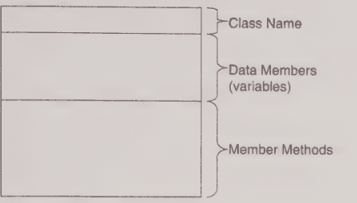

图 3.11 Person 类的规范，版本 1。

变量被称为数据成员（类的数据成员），方法被称为成员方法，因为它们都是被指定类的一部分（类的成员）。

例如，考虑一个处理“人”对象的程序，其中每个人都有三个属性：眼睛颜色、头发颜色和身高。用于指定该类（名称定为 `Person`）的 UML 图如图 3.11 所示。类名出现在图的顶部，类的数据成员列在图的第二个框框中。

为了简洁地传达有关类数据成员和方法的信息，UML 图采用了标准记法，其中一些包含在图 3.11 中。例如，每个属性的类型紧跟在变量名后面（冒号后）。数据成员的访问修饰符（如 `+` 或 `-`）决定了其可见性。

### 3.5.2 类代码模板

由于对象的属性值可以改变，类本身可以是公共（`public`）或私有（`private`）的。以下是类的代码模板：

```java
public class ClassName {
    // 数据成员
    // 方法
}
```

类的数据成员，初始值存储在数据成员中，数据成员的集合被分配了一个内存地址（被认为是对象的位置），并且该地址被返回给客户端代码。对象声明语法中包含的赋值运算符会将返回的对象地址存储在对象的引用变量中（例如 `mary`）。

构造方法的名称始终与其所属类名相同，因此在声明 `mary` 对象时，`new` 关键字右侧的代码

```java
Person mary = new Person();
```

实际上是对构造方法 `Person()` 的调用，该方法没有参数，并返回新创建的 `Person` 对象的地址。

图 3.12 所示的类不包含构造方法；在这种情况下，它将是一个名为 `Person()` 的方法。当类不包含构造方法时，将使用 `Java` 提供的构造方法来构造对象。该构造方法作为默认构造方法，没有参数，并执行之前提到的功能：

1. 为类的数据成员分配存储空间
2. 在数据成员中存储初始值
3. 为数据成员集合分配内存地址
4. 将地址返回给客户端代码

由于 `Person` 类不包含任何方法，声明为

```java
Person mary = new Person();
Person kate = new Person();
```

的 `Person` 对象 `mary` 和 `kate` 将由默认构造方法创建，它将执行上述四个功能。在执行功能 2 时，每个对象的数据成员将被设置为其类数据成员部分（图 3.12）中指定的初始值。在 3.6.2 节中，我们将学习如何编写作为类编写的构造方法。这些方法可以包含参数和代码，以扩展默认构造方法执行的功能。

### 3.5.4 显示对象

对象可以通过两种方式显示在系统控制台和图形游戏板上。我们可以简单地提到对象的名称，或者在方法调用中使用对象的 `toString()` 方法并使用显示字符串；或者我们可以在对象的类中添加一个方法，调用时输出该对象。以下语句使用第一种方法将 `Person` 对象 `mary` 显示在系统控制台对象 `System.out` 以及位置位于 (210, 100) 的 `GameObject` 对象 `g` 上。

```java
System.out.println(mary);
g.drawString(mary.toString(), 210, 100);
```

这种方法通常不太有趣，因为显示的是存储在变量 `mary` 中的对象位置，前面带有一个 `ampersand` 符号 (`@`)，后面是对象的类名。参考图 3.13，`Mary` 的对象位于地址 15，输出到系统控制台和游戏板的结果将是 `Person@15`。另一种方案是在对象类中添加一个方法，调用时输出对象，这会产生更有趣且实用的输出。这种技术将在 3.6 节中讨论。

图 3.14 展示了一个创建两个 `Person` 对象的应用程序，其类定义在图 3.12 中，并将它们的结果输出到系统控制台和游戏板上。输出如图 3.15 所示。不同的是，程序没有产生在游戏板中间显示实际对象 `Mary` 的那种更有趣的输出。如前提到的，产生该输出的技术将在 3.6 节中讨论，产生该输出的代码将留给学生练习。

第 7、10 和 11 行使用双行语法创建了两个 `Person` 对象。引用变量 `Mary` 和 `Kate` 在第 7 行被声明为类变量，因此可以从 `main()` 方法和 `draw()` 回调方法访问。第 13–14 行和第 21–22 行分别将对象的位置输出到系统控制台和游戏板。这些位置可以被认为是 `Java` 内存管理器在第 10–11 行执行时分配给这两个对象的位置。

```java
1 import edu.sjcny.gui.*;
2 import java.awt.*;
3 public class ClassAndObjectBasics extends DrawableAdapter
4 {
5 static ClassAndObjectBasics ge = new ClassAndObjectBasics();
6 static GameBoard gb = newGameBoard(ge, "Class & Object Basics");
7 static Person mary, kate;
8
9 public static void main(String[] args)
10 { mary = new Person();
11 kate = new Person();
12 }
13
14 System.out.println(mary);
15 System.out.println(kate);
16
17 showGameBoard(gb);
18 }
19
20 public void draw(Graphics g)
21 {
22 g.drawString(mary.toString(), 210, 100);
23 g.drawString(kate.toString(), 210, 120);
24 }
```

**图 3.14** ClassAndObjectBasics 应用程序。

应用程序控制台输出：

Person@3a6727

Person@4a65e0

游戏板输出：

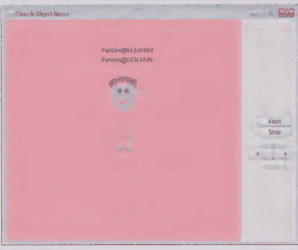

**图 3.15** 应用程序输出的对象位置。

### 3.5.5 设计对象

在设计过程中，我们识别出组成对象的类型。为了产生在游戏板中间显示实际对象 `Mary` 的更有趣的输出，我们使用了 3.6 节中讨论的技术。产生该输出的代码将留给学生练习。

该设计过程的下一步是确定每个形状左上角相对于游戏道具 (x, y) 位置的距离，对于我们的雪人来说，就是其外接矩形的左上角。与每个形状的宽度和高度一起，输入到一个表格中，该表格将在 `show()` 方法中用于绘制每个形状。表格是对象的数字表示，确定数据的过程被称为对象的数字化。

我们对象的数字表示如表 3.2 所示。如前所述的，表中的每个位置都是相对于外接矩形上角的 (x, y) 位置。因此，表中给出的每个位置都以 `x y` 开头，随后是到形状顶角的 x 或 y 距离。在读取表中的位置时，应该记住正 x 方向向右，正 y 方向向下。

为了确定这些距离，我们要么考虑图 3.16 中给出的每个形状的尺寸，要么在带有网格纸上绘制该对象，其原点是对象外接矩形的左上角。

**图 3.16** 雪人游戏道具的设计。

## 表 3.2 图 3.16 所示雪人对象的数字化表示

| 组件 | 形状 | 形状的 X 或线的 X_1 坐标 | 形状的 Y 或线的 Y_1 坐标 | 宽度或线的 X_2 坐标 | 高度或线的 Y_2 坐标 |
|---|---|---|---|---|---|
| 帽子 | 矩形 | x + (20-5) | y | 10 | 15 |
| 帽檐 | 矩形 | x + (20-10) | y + (15) | 20 | 2 |
| 头部 | 圆形 | x + (20-10) | y + (15+2) | 20 | 20 |
| 身体 | 圆形 | x | y + (15+2+20) | 40 | 40 |

这些坐标仅仅是形状外接矩形左上角的 x 和 y 坐标。以下示例说明了通过考虑图 3.16 中的尺寸来确定每个形状 x 和 y 坐标的技术。

1. 要确定雪人帽子左上角的 x 坐标（如表格第一行第三列所示，为 `x + (20-5)`），我们需要将雪人外接矩形的宽度（20）加到 `x` 上，因为帽子的中心位于宽度的一半；从 `x` 中减去 `(5)` 是因为帽子的左侧比中心更靠近雪人外接矩形的左侧，距离为宽度的一半。
2. 要确定雪人头部左上角的 y 坐标（如表格第三行第四列所示，为 `y + (15+2)`），我们需要在 `y` 上加上帽子的高度（15）和帽檐的高度（2）。

需要注意的是，当对象的绘制中使用线条时，每条线都输入表格的单独行中，并且如表 3.2 标题所示，线的坐标被输入表格的最右侧列。在程序设计阶段，会为每种类型的对象生成一个表格。

## 3.6 为类添加方法

向类添加的许多方法都会对类中的对象执行操作。其中某些操作非常常见，例如显示对象的方法或更改数据成员值的方法，因此它们包含在大多数类中。为了提高可读性，这些方法的名称通常以指定的以前缀开头。例如，显示对象的方法名称通常以 `show` 前缀开头，而以 `set` 前缀开头的方法用于更改对象数据成员的值。

在本节中，我们将使用向类添加方法的技术以及如何在对象上使用这些方法。这些方法将尽添加到一个名为 `Snowman1` 的类中，该类定义了图 3.16 所示的对象，并将通过向其添加方法来逐步开发其 UML 图。

## 第 3 章 - 方法、类与对象：初探

我们的起点将是图 3.17 所示的 UML 图。该类有三个成员：两个整数和一个用于用于指定 `Snowman1` 位置及其帽子颜色的引用变量。如 UML 图所示，数据成员 `hatColor` 将引用到类中的一个颜色常量。`Snowman1` 类的代码如图 3.18 所示。数据成员定义在第 4–6 行。板的默认位置是 `(5, 30)`，即游戏板的左上角。帽子颜色已初始化为常量 `BLACK`。

| x : int |
| y : int |
| hatColor: Color |

图 3.17 Snowman1 类的类图

在本章中使用图形化的雪人将使“操作对象”的概念变得不再抽象，从而更容易理解。例如，与其简单通过类方法显示对象的 `(x, y)` 位置，它的 `show()` 方法将以一种更具象的方式显示对象：通过在游戏板的 `(x, y)` 处绘制它。

### 3.6.1 show 方法

以 `show` 前缀开头的方法用于显示对象，并且是一个非静态方法。由于 `Graphics` 类的绘制方法无法在控制台上绘制，因此我们必须定义在控制台上显示对象。通常接受的含义是输出由对象数据成员的注释值组成。这个名为 `showXYToSC()`（SC 代表 system console）的方法将调用 `println()` 方法，并传递一个拼接了注释以及类中 `x` 和 `y` 数据成员的字符串。

```java
public void showXYToSC() {
    System.out.println("x is: " + x +
        "\ny is: " + y);
}
```

将此代码添加到类后，可以使用以下语句将 `snowman1` 输出到控制台：

```java
snowman1.showXYToSC();
```

这将产生输出：

x is: 5

y is: 30

语句 `snowman1.showXYToSC()` 有三种不同的读方式：

1. 对象 `snowman1` 正在调用 `showXYToSC()`。
2. 方法 `showXYToSC()` 被对象 `snowman1` 调用。
3. 方法 `showXYToSC()` 正在操作 `snowman1`。

这些都是同义词，意思相同。通常，为了让一个方法操作对象，我们在方法名称之前加上对象的名称并跟一个点。

需要记住的一个重要点是，如果我们只关注 `showXYToSC()` 方法的代码并问：“当它提到数据成员 `x` 和 `y` 时，指的是哪个对象的数据成员？”，答案是语句“方法操作对象”的真实含义：即方法内部编码的数据成员的所有出现处都指向调用它的对象的数据成员。


# 使用 Java 编程基础


```java
import edu.sjcny.gpvl.*;
import java.awt.Graphics;

public class ShowMethods extends DrawableAdapter {
    static ShowMethods ga = new ShowMethods();
    static GameGameBoard gb = new GameGameBoard(ga, "Show Methods");
    static SnowmanV2 sml = new SnowmanV2(gb);
    
    public static void main(String[] args) {
        System.out.println("SnowmanV2: " + sml.snowyV2());
        showGameBoard(gb);
    }
    
    public void draw(Graphics g) { // 绘图回调方法
        sml.show(g);
    }
}
```

图 3.21

ShowMethods 应用。

系统控制台输出

```
SnowmanV2@3a6727
x is: 5
y is: 30
```

图形化输出


图 3.22

ShowMethods 应用产生的控制台和图形输出。

# 第 3 章 - 方法、类与对象：初探

## 3.6.2 构造方法与关键字 `this`

在 3.5.3 中，我们学习了构造方法是用于构造对象的方法，这些方法的名称必须与它们所构造对象的类名相同。如果类的规范和代码中没有包含构造方法，Java 提供的默认构造方法将通过执行以下功能来创建对象：

1. 为类的数据成员分配存储空间
2. 将初始值设置到数据成员中
3. 为数据成员集合分配一个内存地址
4. 将该地址返回给客户端代码

由于 `SnowmanV2` 类不包含构造方法，因此使用默认构造方法来创建该类的所有实例（在该类中声明的对象）。结果是，函数 2 将它们都定位在 (5, 30) 处，并且它们将戴着黑帽子。显示时，它们将重叠在一起，给人一种只显示了一个的视觉感受。

为了允许客户端代码指定新构造对象的数据成员的值，我们为该类添加了一个构造方法。它的代码模板与编写任何其他方法时使用的模板相同，但其名称必须与类名相同，且其签名不能包含返回类型。它的签名可以包含参数列表，并且可以在其代码块中包含 Java 语句。当类代码中包含构造方法时，默认构造方法不再用于构造类中的对象。

图 3.23 展示了 `SnowmanV3` 类的 UML 图，它包含一个双参数构造方法，即包含两个参数的参数列表的构造方法。客户端代码使用此构造方法创建对象，在执行通常由默认构造方法的第四个函数之前，构造方法会执行：为构造方法的参数分配存储空间，客户端的值作为参数传入进行复制，并执行构造方法代码。

| SnowmanV3 |
| :--- |
| + x : int |
| y : int |
| + hatColor : Color |

对于任何方法，复制到构造方法参数中的值都可以通过编写参数名称在构造方法的代码块中使用。通常情况下，客户端代码使用这些参数来指定数据成员的初始值。在这种情况下，构造方法的代码块只需将参数赋值给数据成员即可：

```java
public SnowmanV3(int xLoc, int yLoc) {
    x = xLoc;
    y = yLoc;
}
```

将此双参数构造方法的代码包含在 `SnowmanV3` 类代码后，客户端可以使用以下代码声明两个位于游戏板右上角和左下角的雪人：

```java
SnowmanV3 sm1 = new SnowmanV3(5, 30);
SnowmanV3 sm2 = new SnowmanV3(460, 423);
```

图 3.23

`SnowmanV3` 类的 UML 图。

### 关键字 `this`

类中的方法可以包含一个名称与类的某个数据成员名称相同的参数。当这种情况发生时，我们称这些参数“遮蔽”了数据成员。例如，`SnowmanV3` 类双参数构造方法的签名可以被编写为：

`public SnowmanV3(int x, int y)`

当参数名称遮蔽数据成员时，构造方法内部使用该名称指的是参数而非数据成员。如前所述，参数应该被视为局部变量。在构造方法代码体中对变量 `x` 的赋值会更改存储在参数中的值，而不是存储在类级数据成员 `x` 中的值。我们可以通过在构造方法（或任何其他使用遮蔽的参数列表的方法）的代码中数据成员名称前加上单词 `this` 和点号来引用数据成员，例如 `this.x`。这种语法可以被认为变量 `x` 是类的数据成员。使用这种语法，`SnowmanV3` 类的双参数构造方法可以编写为：

```java
public SnowmanV3(int x, int y) { 
    this.x = x;
    this.y = y;
}
```

这种双参数构造方法的编写方式（使用遮蔽）在参数名称遮蔽数据成员时实际上是更优的。图 3.24 显示了 `SnowmanV3` 类的实现。客户端（图 3.24）两次调用构造方法，分别在第 9 行和第 10 行创建名为 `sm1` 和 `sm2` 的两个雪人。传递给构造方法的参数被存储在数据成员中。图 3.25 显示了应用的输出。图 3.26 显示了产生的控制台和图形输出。

```java
import java.awt.*;
import java.awt.Graphics; // 绘制形状需要

class SnowmanV3 {
    // 数据成员
    public int x = 5;
    public int y = 30;
    public Color color = Color.BLACK;

    // 成员方法
    public void snowman(int x, int y) {
        this.x = x;
        this.y = y;
    }

    public void showXYToSC() {
        System.out.println("x is: " + x + "\ny is: " + y);
    }

    public void draw(Graphics g) { // g 被传递给方法
        g.setColor(color);
        g.fillRect(x + 15, y, 10, 15); // 身体
        g.fillRect(x + 10, y + 15, 20, 2); // 帽檐
        g.setColor(Color.WHITE);
        g.fillOval(x + 10, y + 17, 20, 20); // 头部
        g.fillOval(x, y + 37, 40, 40); // 身体
    }
}
```

图 3.25

`SnowmanV3` 的类。

```java
import edu.sjcny.gpvl.*;
import java.awt.Graphics;

public class ConstructorAndThis extends DrawableAdapter {
    static ConstructorAndThis ga = new ConstructorAndThis();
    static GameBoard gb = new GameBoard(ga, "Constructors and " +
        "Key Word:this");
    static SnowmanV3 sm1 = new SnowmanV3(2, 39);
    static SnowmanV3 sm2 = new SnowmanV3(46, 425);

    public static void main(String[] args) {
        showGameBoard(gb);
    }
    
    public void draw(Graphics g) { // 绘图回调方法
        sm1.show(g);
        sm2.show(g);
    }
}
```

图 3.26 ConstructorAndThis 应用程序。

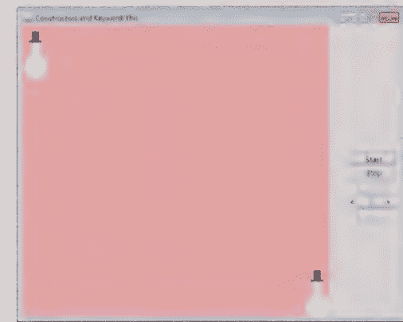

图 3.27 应用程序 ConstructorAndThis 的输出。

## 3.6.3 私有访问与 set/get 方法

为了简单起见，我们讨论的类的数据成员和成员方法通过其 UML 图前的 `+` 号表示为公共访问。Java 中可用的访问类型是私有访问，它在 UML 图中用 `-` 号表示。在本节中，我们将检查公共和私有的区别。

### 公有与私有访问

在成员方法的情况下，访问是调用该方法的行为。在数据成员的情况下，访问是获取或赋值数据成员内容的行为。将类的数据成员或方法指定为私有访问不会对类中包含的方法代码产生任何限制。类方法中的任何行代码都可以调用类中的任何私有或公有方法，并可以获取和赋值存储在任何数据成员中的值。

私有访问对客户端代码进行限制。客户端代码不能调用被指定为私有类的类方法，也不能访问被指定为私有类的类数据成员。如果应用程序声明了一个名为 `mary` 的对象，且该对象的类包含一个名为 `show` 的方法，那么客户端代码语句

```java
mary.show();
```

如果该方法被指定为私有访问，将会导致编译错误。

> 公有访问允许客户端代码访问类的数据成员或方法，但私有访问则不允许。

我们在客户端代码中用于访问（调用）公有方法的语法也可以用于客户端代码来访问对象的公有数据。该语法是方法（或数据）名称，前面是对象名称，后面跟着一个点。这种语法被用于图 3.21 中应用程序的第 12 行：

```java
sml.showXYToSC();
```

以调用图 3.20 第 12-16 行编写的公有方法 `showXYToSC`。此方法将两个数据成员 `x` 和 `y` 输出到系统控制台。因为声明这两个数据成员时使用的访问修饰符是公有的，所以它们的内容可以被客户端代码获取并输出，只需将图 3.21 代码的第 12 行替换为语句：

```java
System.out.println("x is: " + sml.x + "\ny is: " + sml.y);
```

此外，客户端代码可以通过编写代码将雪人 `sml` 的 `x` 位置设置为 10：

```java
sml.x = 10;
```

通常情况下，类中的方法默认被指定为公有访问。后续章节将给出此规定的例外。指定公有访问允许客户端代码调用它们。

良好的编程实践要求类中的所有数据成员都应为私有访问，因为允许客户端公有地访问对象的数据成员可能会导致某些隐蔽且难以发现的编程错误。

### set 方法

`set` 方法是一个 `void` 方法，用于更改存储在对象数据成员的值。

### String 不变性

Java 字符串是不可变的。一旦值被存储在 `String` 对象中，就无法更改。虽然以下代码似乎在更改存储的值，但实际上它创建了一个新的字符串对象并将其赋值给变量。

```java
String name = "Robert";
name = "Bob";
```

### get 方法

`get` 方法是一个非 `void` 方法，用于获取存储在对象数据成员的值。值通过 `return` 语句返回。与 `set` 类似，`get` 是用于命名获取并返回私有数据的方法的前缀，通常类中的每个私有数据成员都会编写一个 `get` 方法。`get` 方法的签名包含一个返回类型，且其参数列表为空。返回类型始终与其获取的数据成员的类型相同。它的代码块包含一行代码，简单地返回数据成员的值。以下是返回对象名为 `x` 的私有数据成员整数值的 `get` 方法代码：

```java
public int getX() {
    return x;
}
```

假设客户端应用程序声明了一个名为 `sm` 的对象，以下客户端代码将对象的私有数据成员 `x` 增加 1：

```java
currentX = sm.getX();
sm.setX(currentX + 1);
```

```java
import java.awt.*;

public class SnowmanV4 {
    // 成员变量
    private int x = 0;
    private int y = 0;
    private Color hatColor = Color.BLACK;

    // 成员方法
    public SnowmanV4(int x, int y) {
        this.x = x;
        this.y = y;
    }

    public void show(Graphics g) { // g 被传递给方法
        g.setColor(hatColor);
        g.fillRect(x + 15, y, 10, 15); //
        g.fillRect(x + 10, y + 15, 20, 2); // 边缘
        g.setColor(Color.WHITE);
        g.fillOval(x + 10, y + 17, 20, 20); // 头
        g.fillOval(x, y + 37, 40, 40); // 身体
    }

    public int getX() {
        return x;
    }

    public void setX(int newX) {
        x = newX;
    }

    int getY() {
        return y;
    }

    public void setY(int newY) {
        y = newY;
    }
}
```

图 3.29

SnowmanV4 类。

图 3.30 所示的 `SetGetButtonClick` 类展示了如何使用 set 和 get 方法来访问私有成员变量。

```java
import edu.sjcny.gpvl.*;
import javax.swing.*;
import java.awt.Graphics;

public class SetGetButtonClick extends DrawableAdapter {
    static SetGetButtonClick ga = new SetGetButtonClick();
    static GameBoard gb = new GameBoard(ga, "Set and Button Click");
    static SnowmanV4 sm1 = new SnowmanV4(5, 30); // 左上角
    static SnowmanV4 sm2 = new SnowmanV4(460, 423); // 右下角

    public static void main(String[] args) {
        String s = JOptionPane.showInputDialog("sm2's x location?");
        int newX = Integer.parseInt(s);
        sm2.setX(newX);
        GameBoard.show(gb);
    }
    
    public void draw(Graphics g) { // 绘图回调方法
        sm1.show(g);
        sm2.show(g);
    }
}
```

图 3.30 SetGetButtonClick 应用程序。


| 26 | public void rightButton() //每次点击让 sm1 向右移动一个像素 |
| 27 | { |
| 28 | int currentX = sm1.getX(); |
| 29 | sm1.setX(currentX + 1); |
| 30 | } |
| 31 | } |

**图 3.30** SetGetButtonClick。

该程序与图 3.26 所示的 `ConstructorAndThis` 相同，但增加了第 14–16 行和 26–30 行。第 16 和 29 行演示了如何使用 `setX` 方法更改雪人 sm2 的 x 值并重新进行水平定位。第 26–30 行演示了如何使用 `getX` 方法和 `rightButton` 调用方法，在每次点击右按钮时让雪人 sm1 向右移动一个像素。

当程序运行时，在第 9 和 10 行定义的两个雪人 sm1 和 sm2 会通过 `draw` 回调方法的第 22 和 23 行（图 3.30）显示在游戏板的左上和右下角。第 14 行显示一个输入框，要求用户输入雪人 sm2 x 坐标的新值。第 16 行调用 `setX` 方法处理雪人 sm2，并传入第 15 行解析的新 x 坐标。该方法将新值存储在 sm2 的 x 数据成员变量中（图 3.29 的第 34 行）。结果是，当对话框关闭后重新绘制游戏板时，雪人将在新的 x 位置绘制。图 3.31 显示了用户在输入对话框中输入 250 后，雪人 sm2 位于游戏板中间的新位置。

### 方法

第 26-30 行是游戏环境 `rightButton` 调用方法的实现。正如名称所示，每当点击游戏窗口上带有箭头 (->) 的按钮时，该方法就会被调用。随后调用第 28 行的 `getX` 方法获取 x 坐标。然后调用 `setX` 方法将雪人 sm1 的 x 数据成员增加 1。由于 `rightButton` 方法在每次点击时都会执行，且 `draw` 方法在完成后会被调用，因此每次点击按钮，雪人都会移动一个像素。

### 3.6 toString 和 input 方法

`toString` 和 `input` 方法是用于处理数据成员的方法。`input` 方法允许用户输入新值，而 `toString` 方法则用于获取值。

#### toString 方法

`toString` 方法是一个返回字符串的方法。在图 3.29 所示的 `SnowmanV4` 类中，`toString` 方法的实现如下：

```java
public String toString()
{
    return "x: " + x + "\ny: " + y;
}
```

#### input 方法

`input` 方法是一个 void 方法，它通过对话框允许用户输入数据。其典型实现如下：

```java
public void input()
{
  String s;
  int red, green, blue;

  s = JOptionPane.showDialog("enter the value of x");
  x = Integer.parseInt(s);
  s = JOptionPane.showDialog("enter the value of y");
  y = Integer.parseInt(s);
  s = JOptionPane.showDialog("enter the red intensity");
  red = Integer.parseInt(s);
  s = JOptionPane.showDialog("enter the green intensity");
  green = Integer.parseInt(s);
  s = JOptionPane.showDialog("enter the blue intensity");
  blue = Integer.parseInt(s);
  hatColor = new Color(red, green, blue);
}
```

# 第 3 章 - 方法、类与对象：初探

```java
import java.awt.*;
import javax.swing.*; // 用于对话框输入

public class SnowmanV5
{
    // 数据成员
    private int x = 7;
    private int y = 30;
    private Color hatColor = Color.BLACK;

    // 成员方法
    public SnowmanV5(int x, int y)
    {
        this.x = x;
        this.y = y;
    }

    public void show(Graphics g) // g 被传递给方法
    {
        g.setColor(hatColor);
        g.fillRect(x + 15, y, 10, 15); // 帽子
        g.fillRect(x + 10, y + 15, 20, 2); // 帽檐
        g.setColor(Color.WHITE);
        g.fillOval(x + 10, y + 17, 20, 20); // 头
        g.fillOval(x, y + 37, 40, 40); // 身体
    }

    public String toString()
    {
        String s;
        s = "x is: " + x + "\ny is: " + y + "\nhatColor is: " + hatColor;
        return s;
    }

    public void input()
    {
        String s;
        int red, green, blue;

        s = JOptionPane.showInputDialog("输入 x 的值");
        x = Integer.parseInt(s);
        s = JOptionPane.showInputDialog("输入 y 的值");
        y = Integer.parseInt(s);
        s = JOptionPane.showInputDialog("输入帽子的红色强度");
        red = Integer.parseInt(s);
        s = JOptionPane.showInputDialog("输入帽子的绿色强度");
        green = Integer.parseInt(s);
        s = JOptionPane.showInputDialog("输入帽子的蓝色强度");
        blue = Integer.parseInt(s);
        hatColor = new Color(red, green, blue);
    }
}
```

图 3.32

SnowmanV5 类。

```java
import edu.scjny.gpv1.*;
import java.awt.*;

public class ToStringAndInput extends DrawableAdapter
{
    static ToStringAndInput ge = new ToStringAndInput();
    static GameBoard gb = new GameBoard("toStringAndInput Methods");
    static Snowman sm1 = new SnowmanV5(300, 300);
    static Snowman sm2 = new SnowmanV5(460, 420);

    public static void main(String[] args)
    {
        System.out.println("sm1\n" + sm1.toString());
        System.out.println("sm2\n" + sm2.toString());
        showGameBoard(gb);
        sm1.input();
        sm2.input();
        showGameBoard(gb);
    }

    public void draw(Graphics g)
    {
        sm1.show(g);
        sm2.show(g);
    }
}
```

图 3.33 ToStringAndInput。

应用程序

# 控制台输出：

sm1

x is: 7

y is: 30

hatColor is: java.awt.Color[r=0,g=0,b=0]

sm2

x: 460

y: 420

hatColor is: java.awt.Color[r=0,g=0,b=0]

# 游戏板输出：

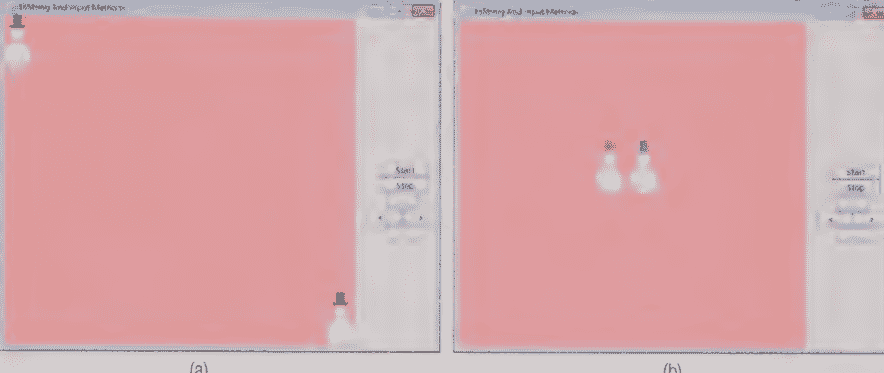

图 3.34

应用程序 ToStringAndInput 的控制台和游戏板输出。

## 3.7 构造方法的重载

**构造方法重载**（Overloading constructors）是一个面向对象的编程术语，用于描述包含多个构造方法的类。每个构造方法的代码都是不同的，这正是编写多个构造方法的初衷。一个类可以包含的构造方法数量没有限制。构造方法的名称必须与类名相同，因此类中的所有构造方法名称都相同。例如，如果类名是 `SnowmanV4`，那么所有构造方法的名称都将是 `SnowmanV4`。

客户端应用程序可以使用类中的任何一个构造方法来分配对象。由于方法名称相同，Java 知道使用了哪一个构造方法的唯一方法是检查客户端调用语句中的参数。考虑图 3.35 所示的 `SnowmanV6` 类代码。它包含三个构造方法，分别从第 12、15 和 20 行开始。其中第一个构造方法的签名（第 12 行）不包含参数，因此被称为**无参数构造方法**（no-parameter constructor）。要使用无参数构造方法，客户端的声明语句不包含任何参数：

```java
SnowmanV6 s1 = new SnowmanV6();
```

由于构造方法块是空的，雪人的 x、y 和 hatColor 数据成员将保留第 7–9 行设置的默认值，当绘制雪人时，它将出现在 (7,30) 位置，并戴着黑色帽子。

要使用第 15 行的双参数构造方法，客户端的声明语句必须包含两个整数参数：

```java
SnowmanV6 s1 = new SnowmanV6(250, 250);
```

此构造方法允许客户端指定新创建雪人的初始位置。第 17-18 行将执行并将 250 设置为对象的 x 和 y 数据成员。当绘制雪人时，它将出现在 (250,250) 并戴着黑色帽子。

要使用第 20 行的三参数构造方法，客户端的声明语句必须包含两个整数参数和一个 `Color` 对象引用：

```java
SnowmanV6 s1 = new SnowmanV6(350, 250, Color.BLUE);
```

此构造方法不仅允许客户端指定雪人的初始位置，还可以指定其帽子颜色。第 22-24 行将执行并将 350 和 250 设置为对象的 x 和 y 数据成员，并将对象的 hatColor 数据成员设置为蓝色。在这种情况下，绘制雪人时，它将出现在 (350,250)，因为图 35 的第 28 行使用 hatColor 数据成员在绘制帽子之前设置了当前颜色，它将戴着蓝色帽子。

尝试使用不匹配第 12、15 或 20 行参数的参数列表创建雪人会导致编译错误。例如，客户端语句：

```java
SnowmanV6 s1 = new SnowmanV6(350, 200, Color.BLUE);
```

会导致错误，指示找不到参数为双加 Color 对象的构造方法。

> 类中的每个构造方法必须有一个唯一的参数列表，客户端声明语句中的参数类型必须与其中之一匹配。

应该注意的是，一旦在类中编写了构造方法，就无法再使用 3.5 节提供的默认构造方法来创建类的实例。因此，为了默认值，必须向类中添加无参数构造方法（例如图 33 的第 12–14 行）。

图 3.36 展示了应用程序 `OverloadingConstructors`，它使用图 35 中的三种方法在第 8、9 和 10 行构造了三个雪人：一个位于默认位置 (7,30)，一个位于游戏板中心 (250,250)，另一个位于右侧 (350,250) 且戴着蓝色帽子。在绘制每个雪人的帽子之前，雪人类 `show` 方法（图 35）的第 28 行会将当前颜色设置为雪人的帽子。结果是，当游戏板上（图 36 的第 19–21 行）绘制三个雪人时，其中一个戴着蓝色帽子（图 37）。

# 第 3 章 - 方法、类与对象：初探

```java
import java.awt.Color;
import java.awt.Graphics; // 用于绘制形状
public class SnowmanV6
{
    // 数据成员
    private int x = 7;
    private int y = 30;
    private Color hatColor = Color.BLACK;

    // 成员方法
    public SnowmanV6()
    {
    }
    public SnowmanV6(int x, int y)
    {
        this.x = x;
        this.y = y;
        this.hatColor = hatColor;
    }
    public void setHatColor(int x, int y, Color hatColor)
    {
        this.x = x;
        this.y = y;
        this.hatColor = hatColor;
    }
    public void show(Graphics g) // g 被传递给方法
    {
        g.fillRect(x + 15, y, 10, 15); // 帽子
        g.fillRect(x + 10, y + 15, 20, 2); // 帽檐
        g.setColor(Color.WHITE);
        g.fillOval(x + 10, y + 17, 20, 20); // 头
        g.fillOval(x, y + 37, 40, 40); // 身体
    }
    public int getX()
    {
        return x;
    }
    public void setX(int newX)
    {
        x = newX;
    }
    public int getY()
    {
        return y;
    }
    public void setY(int newY)
    {
        y = newY;
    }
}
```

**图 3.35**

SnowmanV6 类。

```java
import edu.sjcny.gpv1.*;
import java.awt.*;

public class OverloadingConstructors extends DrawableAdapter
{
    static OverloadingConstructors ga= new OverloadingConstructors();
    static GameBoard gb = new GameBoard(ga, "Overloading Constructors");
    static SnowmanV6 sm1 = new SnowmanV6(7, 30);
    static SnowmanV6 sm2 = new SnowmanV6(250, 250);
    static SnowmanV6 sm3 = new SnowmanV6(350, 250, Color.BLUE);
    public static void main(String[] args)
    {
        showGameBoard(gb);
    }

    public void draw(Graphics g) // 绘制回调方法
    {
        sm1.show(g);
        sm2.show(g);
        sm3.show(g);
    }
}
```

# 第 3 章 方法、类与对象：初探

## 3.8 向工作方法和从工作方法传递对象

第 3.2 节讨论了在客户端方法和工作方法（worker methods）之间传递原始信息（即存储在原始类型变量中的值）的技术和语法。本节介绍的相同技术和语法也可用于在客户端和工作方法之间传递对象。对于对象而言，传递的信息实际上是存储在引用对象的引用变量中的对象地址。可以通过工作方法的参数列表向工作方法传递无限数量的对象地址，并且可以通过工作方法的返回语句从工作方法返回一个对象的地址。

### 向工作方法传递对象


# 第3章 - 方法、类与对象：初探

表 3.3 的第一行给出了调用 `Game` 的静态方法 `addToX` 的语法，该方法传递了 `SnowmanV6` 对象 `sm` 的地址。最右侧列给出了方法的签名语法。为了对比，表格的第二行给出了将整数 `age` 传递给静态方法 `addObject` 的语法以及该方法的签名语法。如表所示，向工作方法传递对象使用的语法与向工作方法传递原始值使用的语法是相同的。方法参数列表中编码的原始类型被替换为引用变量的类型（即对象的类名），如表格最右侧所示。

以下代码是一个名为 `moveRight` 的静态工作方法，它将传递给它的 `SnowmanV6` 对象的 `x` 数据成员增加一个像素：

```java
public static void moveRight (SnowmanV6 aSnowman)
{
    int currentX = aSnowman.getX( );
    aSnowman.setX(currentX + 1);
}
```

### 3.3 向工作方法传递对象和原始值所使用的语法

| 传递的信息 | 客户端方法的调用语句 | 在 Game 类中编码的工作方法签名 |
|---|---|---|
| 对象的地址 | `Game.addToX(sm)` | `static void addToX(SnowmanV6 sm)` |
| 整数值 | `Game.addObject(age)` | `static void addObject(int age)` |

图 3.38 是图 3.30 所示程序的修改版本，它每当点击游戏的右箭头按钮时，就会将雪人向右移动。程序中已添加 `moveRight` 方法（第 32–37 行），它用于在每次点击右箭头按钮时移动两个雪人。该方法在第 28 行和第 29 行被调用，将两个 `SnowmanV6` 对象 `sm1` 和 `sm2` 向右移动一个。对象在第 9 行和第 10 行使用类的三参数构造函数创建。第一次调用 `moveRight`（第 28 行）将 `sm1` 的位置传递给方法，第二次调用（第 29 行）将 `sm2` 的位置传递给方法。由于静态方法 `moveRight` 与第 28 行和 29 行的调用语句在同一个类中，因此调用时不需要包含类名。

| 行号 | 代码 |
|---|---|
| 1 | `import edu.sjcny.gpvl.*;` |
| 2 | `import javax.swing.*;` |
| 3 | `import java.awt.*;` |
| 4 |  |
| 5 | `public class ObjectsAsParameters extends DrawableAdapter` |
| 6 | `{` |
| 7 | `static ObjectsAsParameters ga = new ObjectsAsParameters();` |
| 8 | `static GameBoard gb = new GameBoard(ga, "Objects As Parameters");` |
| 9 | `static SnowmanV6 sm = new SnowmanV6(40, Color.RED);` |
| 10 | `static SnowmanV6 sm2 = new SnowmanV6(460, 471, Color.BLUE);` |
| 11 |  |
| 12 | `public static void main(String[] args)` |
| 13 | `{` |
| 14 | `String s = JOptionPane.showInputDialog("sm2's new location?");` |
| 15 | `int newX = Integer.parseInt(s);` |
| 16 | `sm2.setX(newX);` |
| 17 | `showGameBoard(gb);` |
| 18 | `}` |
| 19 |  |
| 20 | `public static void draw(Graphics g) // 绘制回调` |
| 21 | `{` |
| 22 | `sm1.show(g);` |
| 23 | `sm2.show(g);` |
| 24 | `}` |
| 25 |  |
| 26 | `public void rightButton() // 将 sm1 & sm2 向右移动一个像素` |
| 27 | `{` |
| 28 | `moveRight(sm1);` |
| 29 | `moveRight(sm2);` |
| 30 | `}` |
| 31 |  |
| 32 | `public void moveRight(SnowmanV6 snowman)` |
| 33 | `{` |
| 34 | `int currentX = snowman.getX();` |
| 35 | `currentX++;` |
| 36 | `snowman.setX(currentX);` |
| 37 | `}` |
| 38 | `}` |

**图 3.38** 应用 `ObjectsAsParameters`。

图 3.39 展示了将位置从引用变量 `sm1` 传递到方法的参数 `snowman` 中，以及 `x` 数据成员的变化。`moveRight` 方法已添加到程序中（第 32–37 行），用于在每次点击右箭头按钮时移动两个雪人。该方法在第 28 行和第 29 行被调用，以将两个 `SnowmanV6` 对象 `sm1` 和 `sm2` 向右移动一个像素。对象在第 9 行和第 10 行使用该类的三参数构造函数创建。第一次调用 `moveRight`（第 28 行）将 `sm1` 的位置传递给方法，第二次调用（第 29 行）将 `sm2` 的位置传递给方法。因为静态方法 `moveRight` 与第 28 行和 29 行的调用语句在同一个类中，因此调用时不需要包含类名。

### 从工作方法返回对象

与返回原始值的情况类似，可以使用相同的语法从工作方法返回对象的地址。方法签名中的 `void` 关键字被替换为返回对象的类型。为了从工作方法返回对象，客户端代码必须将返回的地址赋值给变量。

图 3.40 所示方法创建了返回对象。假设该方法已添加到 `SnowmanV6` 类中，以下代码片段调用了该方法并将返回结果赋值：

```java
SnowmanV6 aSnowman;
aSnowman = SnowmanV6.halfBetween(sm1, sm2);
```

图 3.40 的第 1 行方法签名显示了返回的 `SnowmanV6` 对象。

```java
public static SnowmanV6 halfBetween(SnowmanV6 sm1, SnowmanV6 sm2)
{
    int x, y;
    SnowmanV6 aSnowman = new SnowmanV6();
    x = (sm1.getX() + sm2.getX()) / 2;
    y = (sm1.getY() + sm2.getY()) / 2;
    aSnowman.setX(x);
    aSnowman.setY(y);
    return aSnowman;
}
```

**图 3.40** 一个返回对象的方法。

## 3.9 章节总结

本章开始学习设计和实现类的概念，这些概念将在第 7 和第 8 章中进一步扩展。我们了解到类类似于蓝图，允许我们定义和构建项目，而对象是类的特定项目或实例。正如我们使用 Java API 提供的类和方法来方便程序开发一样，我们也可以使用和重用自己创建的类。

方法是子程序，是类的关键组件。它们通过创建、显示和操作类对象来执行类的工作。类通常提供多个版本的构造方法，用于创建对象并初始化其数据成员的集合。执行大多数类共同的任务的方法名称已经标准化，并包含在大多数类中。名为 `toString` 和 `show` 的方法用于在控制台或游戏板上显示对象，而 `input` 方法及那些以 `set` 和 `get` 前缀开头的方法被用于更改对象数据成员的值。

方法的第一行称为方法的签名。Java 使用值参数向方法传递信息，并使用返回语句从方法传输一个值。传递方法的信息列表称为参数列表，它是由逗号分隔的变量和字面量序列。这些信息被复制到方法签名中声明的变量列表中，列表被称为形参列表。在方法执行之前，调用语句中第 i 个实参所存储的值被复制到方法的第 i 个形参中。形参的类型必须与其对应实参的类型匹配。值参数可以防止方法更改实参列表中所调用的变量中存储的值。

如果方法的参数列表不同，则类中的多个方法可以具有相同的名称。在类方法的编码中使用此特性时，我们称同名的方法为重载。构造器方法通常是重载的；它们的名称必须与类名相同。通常，方法具有公共访问权限，以便允许类外部的方法调用它们，而数据成员具有私有访问权限，以防止类外部的方法无意中更改它们的值。

类数据成员声明为类级变量。类级变量声明在方法的代码块之外、类的代码块内部。在类方法的实现之前，在类代码块的开始处声明这些类级变量是一项良好的编程实践。

在类中声明的所有类变量，无论是声明为公有的还是私有的，都可以通过简单编写变量名在类方法中直接访问。唯一的异常是该方法在其代码块中声明了同名的参数或变量。在这种情况下，通过在变量名前面加上关键字 `this` 并后跟一个点号（`.`）来在方法内访问类变量。使用直接访问语法访问变量的上下文称为变量的作用范围。

UML 图是类在类设计过程中对类进行的图形化描述。该工具不仅有助于类的设计，还记录了构成类的数据成员和方法。它被用作类实现的起点。本章中讨论的其他设计工具是用于描述和数字化图形对象的技术，这些技术构成了实现其 `show` 方法的基础。

API `Graphics` 类中的方法可以用于实现图形对象的 `show` 方法。该类提供了在之前声明的 `Graphics` 对象中绘制线条和基本形状的方法。传递给这些方法的线条、形状的 `(x, y)` 位置以及形状大小的单位是像素或图像元素。这些方法为书中其余图形主题奠定了基础。

## 知识练习

1. 判断下列陈述对或错：
   - a) 方法可以编写在类的代码块（即左括号和右括号）内部。
   - b) 方法的第一行称为其标题。
   - c) 方法的第一行始终以分号结束。
   - d) 所有方法都包含一个代码块。
   - e) `Math` 类中的 `pow` 方法是空方法的示例。
   - f) 我们可以调用我们没有写的方法。

2. 判断下列陈述对或错：
   - a) 以大写字母开头方法名是一项良好的编程实践。
   - b) 使方法名代表它们所执行的工作是一项良好的编程实践。
   - c) 方法名不应包含大写字母。

3. 填空：
   - a) 不操作对象的方法的签名必须包含关键字 `static`。
   - b) 不返回值的方法的签名必须包含关键字 `void`。
   - c) 当我们调用静态方法时，调用语句以 `类名` 开头并后跟一个点号。
   - d) 当我们调用非静态方法时，调用语句以 `对象引用` 开头并后跟一个点号。

4. 写出调用 `Boat` 类的 `moveBoat` 方法的调用语句，其签名是：`public static void moveBoat()`。

5. 判断下列陈述对或错：
   - a) 客户端代码调用方法。
   - b) 方法可以多次调用同一个方法。
   - c) 实参用于向方法传递信息。
   - d) 可以向方法传递一个或多个信息。
   - e) 可以从方法返回一个或多个信息。
   - f) 形参的类型必须与其接收的信息类型匹配。
   - g) 形参和实参共享同一个变量。
   - h) Java 使用引用参数向方法传递信息。
   - i) 当方法更改传递给它的整数时，原始值对客户端代码失效。

6. 给出一个方法的签名，它添加两个整数并返回结果。

7. 在调用的方法完成后，接下来执行哪条语句？

8. 判断下列陈述对或错：
   - a) 类级变量必须在方法内部编写。
   - b) 类级变量用于在类的所有方法之间共享信息。
   - c) 方法不能声明与类级变量同名的变量。
   - d) 当方法更改类级变量的值时，原始值对类中的其他方法失效。
   - e) 类中可以编写多个类级变量。

9. 写出类中编写的名为 `checkAmount` 的类级变量声明。

10. 填空：
    - a) `Graphics` 类中的方法 `setColor` 用于更改当前颜色。
    - b) `Color` 类中的常量 `RED` 存储红色。
    - c) 语句 `g.methodName()` 用于访问 `Graphics` 类中的方法。
    - d) 语句 `Color.CONSTANT_NAME` 用于访问 `Color` 类中定义的常量。

11. 写出 `Graphics` 类中用于以下方法的名称：
    - a) 绘制矩形的轮廓
    - b) 绘制填充矩形
    - c) 绘制椭圆的轮廓
    - d) 绘制圆的轮廓
    - e) 绘制填充圆
    - f) 绘制线条

12. 写出 Java 语句（或语句），在 `Graphics` 对象上绘制以下形状和线条：
    - a) 从 (200, 30) 到 (100, 75) 的线条，使用当前颜色
    - b) 位于 (20, 200) 的宽 100 像素高 50 像素的矩形轮廓，使用当前颜色
    - c) 位于 (250, 300) 的直径为 30 像素的蓝色填充圆
    - d) 位于 (300, 100) 的宽 100 像素高 50 像素的蓝色填充椭圆

13. 填空：
    - a) 使用 object 和 class 词：House 之于 `object` 相当于 `class`。
    - b) 类由成员 `数据成员` 和 `方法` 组成。
    - c) 用于指定类的图形是 `UML` 图。

14. 写出 Java 代码，使用类的双参数构造器在 `Person` 类中声明对象 `joe`，并使用：
    - a) 单行声明语法。
    - b) 两行声明语法。

15. 参考练习 14：
    - a) 变量 `joe` 中实际存储了什么？
    - b) `joe` 是基本类型变量吗？如果不是，它的类型是什么？
    - c) 假设 `Person` 类有两个名为 `age` 和 `idNumber` 的整数成员，画出练习 14a 分配内存的图（类似于图 3.13）。

16. 写出 Java 代码声明一个名为 `CoffeeCups` 的类。每个咖啡杯将有一个大小（盎司）和一个价格。该类将不包含任何方法。

17. 参考练习 16：
    - a) 写出练习 16 中定义的类的双参数构造器的声明代码。
    - b) 写出客户端代码，声明一个大小为 8 盎司、价格为 $3.85 的咖啡杯。
    - c) 写出代码，通过隐式调用 `toString` 方法将 B 部分中声明的咖啡杯输出到系统控制台。
    - d) 使用显式调用 `toString` 方法重复 C 部分。
    - e) B 部分调用在控制台的输出是什么？
    - f) 写出代码，在图形对象 `g` 上产生与 D 部分相同的输出。

18. 写出名为 `toString` 的方法代码，将其添加到练习 16 定义的类中，返回其两个数据成员的完整注释。

19. 写出名为 `show` 的方法代码，将其添加到练习 16 定义的类中，将其两个数据成员的值输出到 500 宽 500 高 `Graphics` 对象 `g` 的中心。

20. 使用类似于图 3.16 的草图，展示一辆休闲车（RV）的设计，它有两个窗户、轮胎和一个大型入口门。

21. 给出一个类似于表 3.2 的表格，包含练习 20 指定设计的数字化版本。

22. 在方法中访问类的一个数据成员时，何时必须使用关键字 `this`？

23. 类包含一个名为 `total` 的私有数据成员。
    a) 在类的一个方法代码中使用 `this` 关键字，使 `total` 存储的值翻倍。


# 第3章 · 方法、类与对象：初探

## 知识练习

### 23. 类设计练习

b) 在类的一个方法代码中使用在不使用 `this` 关键字的情况下使 `total` 存储的值翻倍。

c) 写出一个 set 方法，客户端代码可以使用它来更改数据成员的值。

d) 编写一个 `get` 方法的代码，客户端代码可以使用它可以获取数据成员 `total` 的值。

e) 假设存在相应的 `set` 和 `get` 方法，编写客户端代码使用 `set` 和 `get` 方法将名为 `myAccount` 的对象的 `total` 值翻倍。

f) 假设数据成员 `total` 已声明为 `public` 访问，编写客户端代码使用 `set` 和 `get` 方法将名为 `myAccount` 的对象的 `total` 值翻倍。

g) 编写类的 `toString` 方法的代码。

h) 编写类的 `input` 方法的代码。

i) 哪种访问修饰符关键字（`public` 或 `private`）会导致更严格的访问？

### 24. 判断下列陈述的对错：

a) 类不需要包含显式编写的构造函数。

b) 类可以包含多个不同名称的构造函数。

c) 类可以包含多个签名相同的构造函数。

d) 类可以包含多个签名相同的构造函数。（注：原文此处重复了c项）

e) 当构造函数调用之前带有 `new` 关键字时，会创建一个对象，并返回其地址。

f) Java 提供的默认构造函数没有参数。

### 25. Starship 类练习

一个客户端应用程序声明了三个对象 `ship1`、`ship2` 和 `ship3`，它们是现有类 `Starship` 的实例。每个 `Starship` 包含一个存储用于绘制星船颜色的数据成员。

a) 给出 `Starship` 类中一个名为 `largest` 的静态方法的签名，该方法接收两个 `Starship` 对象并返回其中一个的地址。

b) 编写客户端代码语句，调用本练习题 A 部分描述的静态方法，并将返回的地址存储在 `ship1` 中。

c) 如果方法更改了传递的飞船之一的 `color` 数据成员的值，在方法执行完毕后，它将以新颜色或旧颜色绘制。

d) 给出 `Starship` 类中一个名为 `setName` 的非静态方法的签名，该方法比较两个 `Starship` 对象并返回一个布尔值。

e) 编写客户端代码语句，调用本练习题 D 部分描述的非静态方法，并将返回的布尔值存储在变量 `isSame` 中。

### 26. 游戏棋子设计

使用类似于图 3.16 的草图，显示你在第1章预编程练习1中指定的游戏的受用户控制的游戏棋子的设计。

### 27. 游戏棋子数字化

编写一个类似于表 3.2 的表格，包含第 26 题中指定的游戏棋子的数字化版本。

## 编程练习

### 1. 非图形化应用程序：输出姓名和年龄

编写一个非图形化应用程序，在系统控制台上单行输出你的名字和年龄。应用程序的 `main` 方法应该调用它三次。它产生的输出应如下所示（假设你的名字是 Tommy，年龄 18 岁）：

```
The author of this program is Tommy who is 18 years old.
```

### 2. 图形化应用程序：静态方法绘制

编写一个图形化应用程序，其中包含一个被 `draw` 回调方法调用的静态方法。它有一个有一个参数接收传递给它的 `Graphics` 对象 `q`。调用时，该方法应将你的名字和年龄输出到游戏板中心，如下所示（假设你的名字是 Tommy，年龄 18 岁）：

```
The author of this program is Tommy who is 18 years old.
```

### 3. 非图形化应用程序：计算平方根

编写一个非图形化应用程序，包含一个静态方法，用于计算并返回传递给它的三个实数乘积的平方根。应用程序的 `main` 方法应该调用它，然后清晰地标注输出三个数字和返回的值。

### 4. 图形化应用程序：计算平方根并绘制

编写一个图形化应用程序，包含一个静态方法，用于计算并返回传递给它的三个实数乘积的平方根。`draw` 方法应该调用它，然后清晰地标注输出这三个数字和返回的值。

### 5. 非图形化应用程序：类变量计算

编写一个非图形化应用程序，包含一个静态方法，用于计算并返回声明并初始化为类变量的三个实数乘积的平方根。应用程序的 `main` 方法应该调用它，然后清晰地标注输出这三个数字和返回的值。


### 6. 图形化应用程序：绘制带天线的电视

编写一个图形化应用程序，其 `draw` 方法显示桌子上有一个带天线的电视。

### 7. TeamMember 类设计与实现

女软垒球球队中每个球员的统计数据包括每个球员的姓名、全垒打次数以及实数形式的击率。

a) 给出名为 `TeamMember` 的类的 UML 图，该类可以存储球员的三个私有数据成员。该类应包含一个三参数构造函数、一个 `toString` 方法、一个输入球员统计数据的方法以及一个将球员统计数据输出到系统控制台的 `showSC` 方法。

b) 逐步实现并测试 `TeamClass`，每添加一个方法后在添加下一个方法之前对其进行验证。添加方法的良好顺序是：`toString` 方法，然后是构造函数、`show` 方法，最后是 `input` 方法。（客户端可以使用 Java 提供的默认构造函数创建 TeamMember 对象来测试 toString 方法。）

c) 在验证所有方法后，注释掉类应用程序中的代码，并在程序中添加两个 `TeamMember` 实例，将其统计数据传递给三参数构造函数。将这些结果输出到系统控制台，并在用户为每个球员输入新名字、全垒打次数和击率后再次输出它们。

### 8. RV 类设计与实现

编写一个图形化应用程序，其中包含一个 `RV` 类，其对象是知识练习 20 和 21 中详细描述的旅行车。类数据成员应该是车辆的颜色和 (x, y) 位置。

a) 给出该类的 UML 图。它应包含一个三参数构造函数、一个 `toString` 方法、一个输入统计数据的方法以及一个在当前 (x, y) 位置绘制该对象的 `show` 方法。

b) 逐步实现并测试 `RV` 类，每添加一个方法后在添加下一个方法之前对其进行验证。添加方法的良好顺序是：`toString` 方法，然后是构造函数、`show` 方法，最后是 `input` 方法。（客户端可以使用 Java 提供的默认构造函数创建 TeamMember 对象来测试 toString 方法。）

c) 在验证所有方法后，注释掉类应用程序中的代码，并在程序中添加两个 `RV` 实例，将其统计数据传递给三参数构造函数。将这些结果输出到系统控制台，并在用户为每个球员输入新颜色和新 (x, y) 位置后再次输出它们。

### 9. TeamMember 类扩展：set/get 方法

在实现并测试了编程练习 7 中描述的类后，逐步为类的每个成员添加一个 `set` 和 `get` 方法。验证 `set` 和 `get` 方法后，使用三参数构造函数创建两个类实例并将它们显示在系统控制台上。然后，询问用户每个球员的统计数据应增加多少次。使用 `set` 和 `get` 方法更改统计数据，然后输出球员。

### 10. RV 类扩展：set/get 方法与交互

在实现并测试了编程练习 8 中描述的类后，逐步为类的每个成员添加一个 `set` 和 `get` 方法。验证 `set` 和 `get` 方法后，使用三参数构造函数创建一个类实例并显示在系统控制台和游戏板上。每当点击游戏板上的方向按钮时，车辆的位置应沿相应方向改变两个像素。

### 11. 游戏实现：用户控制的游戏棋子

使用本章开发的技能，开始实现你在第1章预编程练习1中指定的游戏。通过完成知识练习 26 和 27 来设计和数字化受用户控制的游戏棋子。然后，实现数字化对象的类，从游戏棋子的 UML 图开始，该应包含一个具有适当参数数量的构造函数、一个在游戏板当前 (x, y) 位置绘制对象的 `show` 方法、一个 `toString` 方法以及每个类数据成员的 `set` 和 `get` 方法。在逐步实现并测试所有类方法后，编写一个图形化应用程序，在游戏板上显示棋子，每当点击游戏板上的任意方向按钮时，游戏棋子移动两个像素。

# 第 4 章 · 布尔表达式、决策以及磁盘输入/输出

## 章节目录

- 4.1 顺序执行的替代方案 . . . . 138
- 4.2 布尔表达式 . . . . . . . . . . . 138
- 4.3 if 语句 . . . . . . . . . . . 144
- 4.4 if-else 语句 . . . . . . . . 150
- 4.5 嵌套 if 语句 . . . . . . . 158
- 4.6 switch 语句 . . . . . . . 160
- 4.7 控制台输入与 Scanner 类 . . . 169
- 4.8 磁盘输入输出：初探 . . . 172
- 4.9 异常：初步了解 . . . . . . . 179
- 4.10 本章总结 . . . . . . . . 185


## 本章学习目标

在成功完成本章后，你应当：

- 熟悉逻辑运算符、关系运算符以及它们的优先级
- 能够编写和评估简单及复杂的布尔表达式
- 理解如何比较字符串并确定它们的字母顺序
- 能够编写 `if`、`if-else` 和 `switch` 语句来实现算法的决策部分
- 理解 `break` 语句的使用
- 能够使用 `Scanner` 类及其方法进行控制台输入
- 能够创建和从磁盘创建、打开、读取和读写顺序文本文件
- 开始理解如何使用 `try` 和 `catch` 块来处理错误异常
- 使用决策语句来控制定时器、图形对象的可见性和运动，并检测两个对象之间的碰撞

## 4.1 顺序执行的替代方案

当 Java 启动时，首先执行的第一条语句是 `main` 方法中的第一个可执行语句。其余指令执行的顺序被称为程序的执行路径或程序的程序流。Java 语句块的默认执行路径是顺序的。它可以被视为语句按行号顺序执行。在语句块中的第一条语句执行后，其余语句将按照编写的顺序执行，除非某条语句特意地改变了执行路径。

许多算法无法以所有步骤都按顺序执行的方式来制定。因此，编程语言提供了更改默认执行路径的语句。程序员使用这些语句（或结构）来改变程序的顺序流，因此它们被称为流程控制语句或控制语句。我们已经使用了这些结构之一：方法的调用。假设在程序的第 10 行调用了一个方法，那么下一条执行的语句将不是第 11 行，而是方法代码块中的第一个可执行语句。第 11 行将在方法执行完毕后执行。

除了方法调用语句外，编程语言提供了额外的流程控制语句来更改默认执行路径。其中一些语句用于跳过一组语句，而另一些则用于重复一组语句。大多数情况下，这些流程控制语句使用逻辑表达式（称为布尔表达式）来决定何时跳过语句或决定重复语句次数。在本章中，我们将讨论用于跳过一组语句的 Java 语句。用于重复一组语句的 Java 语句将在第 5 章中讨论。

## 4.2 布尔表达式

布尔（逻辑）表达式以乔治·布尔（George Boole）命名，他是一位构思了逻辑符号代数的的英国数学家。与数学代数表达式一样，布尔表达式由运算符和操作数组成。与数学表达式不同，布尔表达式的结果为两个值之一：`true`（真）或 `false`（假）。用于流程控制语句的布尔表达式可以是简单的布尔表达式，也可以是两个或多个简单布尔表达式的组合，称为复合布尔表达式。

### 4.2.1 简单布尔表达式

简单布尔表达式求值为 `true` 或 `false`。在 Java 中，这些表达式由两个操作数包围的关系运算符或相等运算符组成。Java 的四个关系运算符位于表 4.1 顶部，其相等运算符位于表格底部。第一列给出每个运算符的 Java 名称（暗示了其含义），第二列给出代表它们的 Java 符号（按键）。

**表 4.1 Java 关系运算符与相等运算符**

| 运算符 | Java 符号 | 示例 |
| :--- | :--- | :--- |
| 小于 | `<` | `5 < 7` |
| 大于 | `>` | `10 > 3` |
| 小于等于 | `<=` | `5 <= 4` |
| 大于等于 | `>=` | `a >= a` |
| 等于 | `==` | `true == 3` |
| 不等于 | `!=` | `age != 5` |

### 4.2.2 复合布尔表达式

与简单布尔表达式一样，复合布尔表达式也求值为 `true` 或 `false`。在流程控制语句中，复合布尔表达式使用 Java 条件二元逻辑运算符 AND 和 OR 来结合两个或多个操作数的真值。另一种，复合布尔表达式可以使用一元运算符 NOT 反转单个操作数的真值，就像否定运算符反转数学表达式中整数的符号一样。布尔表达式中的操作数必须求值为布尔值（`true` 或 `false`）。大多数情况下，这些操作数是简单表达式，但也可能是布尔字面量或返回布尔值的非 void 方法调用。

**表 4.2 Java 逻辑运算符**

| 运算符 | Java 符号 |
| :--- | :--- |
| NOT | `!` |
| AND | `&&` |
| OR | `||` |

表格第二列中使用的 AND (`&&`) 和 OR (`||`) 运算符的符号各需两次按键。OR 运算符符号中使用的按键 (`||`) 位于键盘回车键（Enter）的上方。

**表 4.2 Java 逻辑运算符真值表示例**

| 逻辑运算符 | Java 符号 | 结果为 true 的示例 |
| --- | --- | --- |
| 非 (Not) | `!` | `! ('p' > 'x')` |
| 与 (And) | `&&` | `8 < 10 && 6 == 2 * 3` |
| 或 (Or) | `||` | `7 < 4 || 8 >= 5` |

表 4.2 最右列显示的所有复合逻辑表达式的结果均为 `true`。要评估复杂布尔表达式的真值，我们必须知道条件逻辑运算符的含义。如前所述，单元运算符 NOT() 的含义仅仅是反转其操作数的真值。例如，在扩展 ASCII 表中，'p' 位于 'x' 之前，`('z' > 'x')` 结果为 `false`，`('p' > 'x')` 结果为 `true`。同样，`(6 > 10)` 结果为 `true`。

两个二元逻辑运算符 AND 和 OR 的含义通常通过表 4.3 所示的表格表达。其两个操作数 A 和 B 真值的四种可能组合在表格左侧的两列中。表格右侧两列对应的值总结了结果值。只有当 A 和 B 都为 `true` 时，`A && B` 结果为 `true`；当 A 和 B 都为 `false` 时，`A || B` 结果为 `false`。表 4.2 第三行的复合布尔表达式评估结果为 `true`，因为其中一个操作数 `B >= 5` 是 `true`。

**表 4.3 Java 二元逻辑运算符的含义**

| 操作数真值 | 运算符含义 |
| :--- | :--- |
| A | B | A && B | A \|\| B |
| `true` | `true` | `true` | `true` |
| `true` | `false` | `false` | `true` |
| `false` | `true` | `false` | `true` |
| `false` | `false` | `false` | `false` |

图 4.1 展示了一个应用程序，它评估了操作数为字面量、原始变量和引用变量以及复合布尔表达式的简单布尔表达式。程序的输出位于页面底部。

当评估复合表达式时，它遵循从左到右的优先级。括号也可以用于使顺序清晰，或在评估时强制执行特定的顺序。例如，第 23 行的表达式可能是：

```java
((i1 == 5 || c1 < 'A') && d1 != 21.8 ))
```

以指定评估顺序。以不同的顺序评估子表达式可能会产生不同的结果。

```java
public class BooleanExpressions {
    public static void main(String[] args) {
        int i1 = 5;
        double d1 = 3.53;      double d2 = 54.88;
        char c1 = 'A';         char c2 = 'C';
        boolean b1 = true;    boolean b2 = false;
        String s1 = new String("Bob");
        String s2 = new String("Bob");
        System.out.println(i1 < 5);
        System.out.println(d1 > d2);
        System.out.println(i1 >= d1); // 整数 i 被提升
        System.out.println(d1 <= 3); // 整数 3 被提升
        System.out.println(c1 < c2); // 使用了字典序
        System.out.println(10 > c2); // c2 提升为数值 67
        System.out.println(b1 == b2);
        System.out.println(i1 == 5 || c1 < 'A' && d1 != 21.8);
        System.out.println(s1 == s2); // 比较 s1 和 s2 的内容
    }
}
```

**输出**

```
false
false
true
true
false
false
true
false
```

图 4.1 BooleanExpressions 及其输出。


# 第 4 章：布尔表达式、决策以及磁盘输入输出

第 5–8 行声明并初始化了整数、双、字符和布尔变量。这些变量用于简单的布尔表达式，这些表达式在第 12–21 行中被评估并输出。第 15 行、16 行和 19 行表达式中的操作数类型不匹配，因此在评估这些表达式之前使用了类型提升。第 18 行中字符变量的内容在评估布尔表达式之前被解释为数值。因为 65 ('A') 小于 67 ('C')，因此第一个输出是 true。

第 23 行包含一个包含两个条件运算符 OR 和 AND 的复合布尔表达式示例。虽然该表达式中的操作顺序并不重要，但优先级更高的 AND 运算会先执行。这简化了表达式：

```
s1 == s2 false
评估结果为 true（图 4.1 中的倒数第二个输出）。
```

第 25 行输出的布尔表达式中的操作数是第 9 行和第 10 行声明的两个字符串变量。它们都由 `String` 构造函数初始化为 "Bob"。

左侧的代码始终执行 `statement2`，尽管缩进似乎暗示其执行取决于布尔表达式的真值。在编写 `if` 语句时，养成的一个良好习惯是先写这段代码片段：

```
if() {

}
```

然后填充布尔条件以及当条件为假时需要跳过的语句。在大多数情况下，我们看到的 `if` 语句代码如下：

```
if(a Boolean expression) {
  // 一个或多个可能被跳过的语句
}
```

`if` 语句的含义（语义）和执行路径如图 4.2 所示。

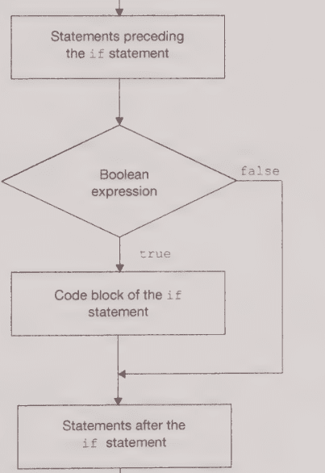

图 4.2: `if` 语句的含义和执行路径。

我们通过讨论 `if` 语句的一种用途——使游戏对象消失——来结束本节，然后展示一个演示了 `if` 语句多种用处的游戏编程应用。

## 使用 if 语句

在许多游戏中，游戏对象根据游戏进行过程中发生的事件而消失。当吃豆人撞到食物颗粒时，颗粒会消失；或者当青蛙人被车撞到。通常，在事件发生后，对象不仅变得不可见，而且从游戏中移除。可以通过将它们绘制成与游戏窗口（在本例中为游戏板）相同的颜色，或者完全不绘制它们来使图形对象消失。

为了传递游戏道具对象（例如食物颗粒）的可见状态，在对象的类中添加了一个布尔数据成员。当发生改变状态的事件时（例如，当吃豆人吃掉了食物颗粒 `pl`），检测到事件的代码会反转该数据成员的真值。`draw` 调用方法可以在语句的布尔条件中使用该数据成员的真值来决定是否绘制该对象。在吃豆人的颗粒类中添加了一个名为 `eaten` 的布尔数据成员并初始化为 `false`，当颗粒被吃掉时，该数据成员被设置为 `true`，此时在 `draw` 调用方法中添加以下代码片段将使 `pl` 在被吃掉后消失。

```
if(pl.getEaten() == false)
{
  pl.show(g);
}
```

如果变量 `count` 被用来跟踪游戏的时间，并且颗粒 `pl` 仅在游戏运行 20 秒后才出现，则在上述代码片段将使用复合布尔表达式。

```
if(pl.getEaten() == false && count >= 20)
{
  pl.show(g);
}
```

在这种情况下，颗粒将在游戏开始 20 秒后出现，并在事件将颗粒的数据成员 `eaten` 更改为 `true` 时消失。

在第 2.9.1 节中（图 2.12），计数算法被用于跟踪游戏时间。图 4.3 展示了该节中讨论的代码，并对其添加了三条语句：两条添加到 `draw` 调用方法（第 17–31 行），一条添加到 `timer` 方法（第 33–40 行）。此外，应用中添加了一个 `BoxedSnowman` 类型的对象 `sl`，其类定义见图 4.4（第 10 行）。程序产生的图形输出如图 4.5 所示。

当图 4.4 所示的应用启动时，游戏板上显示从零开始的已秒数（图 4.5 的左上角）。点击开始按钮开始游戏，这会导致每秒更新一次已时间。游戏开始五秒后，雪人 `sl` 出现在游戏板的中心（图 4.5 的右上角）。十秒后，游戏结束。已时间停在十秒，游戏板上出现消息显示游戏结束，雪人从游戏板上消失（图 4.5 的底部）。

应用的第 20 行显示了已秒数，它存储在类变量 `count` 中。该变量在 `timer` 调用方法的第 35 行进行增加，该方法（默认）每秒执行一次。游戏开始十秒后，从第 36 行开始的 `if` 语句的布尔条件变为 `true`，第 38 行调用游戏环境的 `stopTimer` 方法来停止计时器 1 的计数。附录 B 中描述了该方法接收一个参数，该参数指定要停止的计时器编号（1、2 或 3）。它是一个非静态方法，在程序第 8 行声明的 `GameObject` 对象上调用。

布尔数据成员 `visible` 已在 `BoxedSnowman` 类的第 9 行声明（图 4.4），用于显示雪人的可见状态，该类包含 `set` 和 `get` 方法（第 51–59 行），允许客户端代码访问此数据成员。为了让雪人在经过五秒后出现，通过调用应用第 21 行的 `getVisible` 方法获取雪人的可见状态，并将返回的值用于布尔表达式，以决定何时在大游戏板上显示雪人。当雪人的 `visible` 数据成员为 `true` 且时间大于或等于五秒时，雪将被显示。由于 `visible` 在 `BoxedSnowman` 类的第 9 行初始化，雪人显示在游戏板上。要让雪人在十秒后消失，第 21 行的 `if` 语句变为 `false`，这导致第 26 行布尔表达式中的第一个项不执行。`timer` 调用方法内部的 `if` 语句（第 33–41 行）在 `count` 达到十时将雪人的属性设置为 `false`（第 36 行）。

### 图 4.3 The IfStatement

```java
import java.awt.*;
import java.awt.Font;

public class IfStatement extends Drawable {
    static GameObject ga = new GameObject();
    static BoxedSnowman sl = new BoxedSnowman(ga);
    static int count = 0;

    public static void main(String[] args) {
        showGameBoard();
    }

    public void draw(Graphics g) {
        g.setFont(new Font("Arial", Font.BOLD, 18));
        g.drawString("Your time is: " + count, 10, 50);
        if(sl.isVisible() == true && count >= 5) {
            sl.show(g);
        }
        if(count == 10) {
            g.drawString("Game Over", 10, 70);
            g.drawString("Have a Good Day", 10, 90);
        }
    }

    public void showGameBoard() {
        // Implementation for showing game board
    }

    public void timer() {
        count = count + 1;
        if(count == 10) {
            sl.setVisible(false);
        }
    }
}
```

### 图 4.4 The BoxedSnowman class

```java
class BoxedSnowman extends Drawable {
    private int x;
    private int y;
    private Color hatColor;
    private boolean visible;

    public BoxedSnowman(GameObject go) {
        // Initialization
    }

    public int getX() {
        return x;
    }

    public void setX(int x) {
        x = x;
    }

    public int getY() {
        return y;
    }

    public void setY(int y) {
        y = y;
    }

    public boolean getVisible() {
        return visible;
    }

    public void setVisible(boolean visible) {
        visible = visible;
    }

    public void show(Graphics g) {
        g.setColor(Color.WHITE);
        g.fillOval(x + 10, y + 17, 20, 20); // head
        g.fillOval(x, y + 37, 40, 40); //body
        g.setColor(Color.RED);
        g.fillOval(x + 19, y + 53, 4, 4); // button
        g.setColor(Color.BLACK);
        g.drawRect(x, y, 40, 77); // inscribing rectangle
    }
}
```

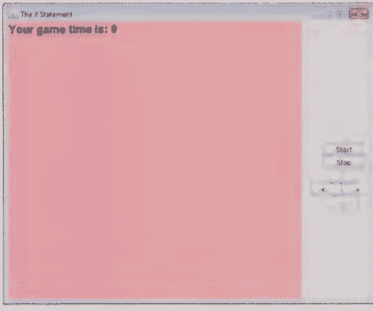

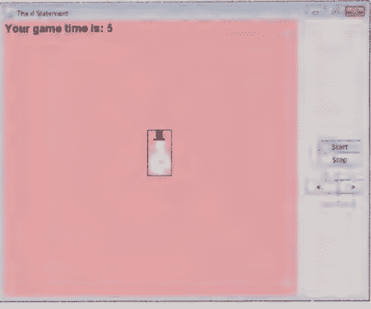

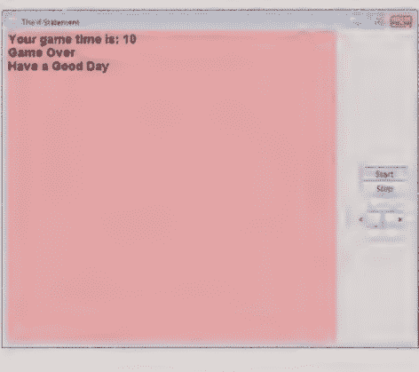

图 4.5 IfStatement 应用程序产生的输出。

## 4.4 if-else 语句

与 `if` 语句一样，`if-else` 语句也是一种 Java 流程控制语句，它可以通过根据布尔表达式的真值跳过某些语句，从而改变程序默认的顺序执行路径。该语句可以被认为包含两个部分：`if` 子句和 `else` 子句。每个子句都关联有一个语句块。在这些块中，且只有一个块会被执行。当布尔条件为真时，执行与 `if` 关联的语句块；当条件为假时，执行与 `else` 关联的语句块。

```java
if(布尔表达式)
{
    // 一个或多个 if 语句
}
else
{
    // 一个或多个 else 语句
}
```

其含义和执行路径如图 4.6 所示：

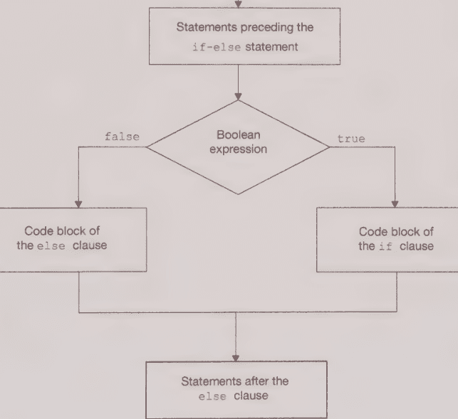

图 4.6 `if-else` 语句的含义和执行路径。

由于 `else` 子句后面的代码块在语句布尔表达式为假时执行，因此 `else` 子句不包含自己的布尔表达式。以下代码片段根据内存中存储的温度决定穿什么衣服：

```java
if(temperature <= 45)
{
    System.out.println("温度为 " + temperature + " 度");
    System.out.println("穿厚外套。");
}
else
{
    System.out.println("温度为 " + temperature + " 度，");
    System.out.println("穿薄外套。");
}
```

`if-else` 语句用于选择两个语句块中的一个：当语句条件为真时执行第一个，为假时执行第二个。通过在 `else` 子句的语句块中编写另一个 `if-else` 语句，我们可以选择三个互斥选项之一，如下所示：

```java
if(布尔表达式 1)
{
    // 代码块 1 中的一个或多个 if 语句
}
else if(布尔表达式 2)
{
    // 代码块 2 中的一个或多个 if 语句
}
else
{
    // 代码块 3 中的一个或多个 else 语句
}
```

正如模板中的第二个注释所示，第二个括号对定义了第二个 `if` 语句块。由于第二个 `if` 语句是第一个 `else` 子句中的唯一语句，将其放在大括号内可以提高可读性。图 4.7 展示了该代码模板的含义和执行路径。

当存在三个互斥选项时，这种编码过程可以逐步重复。另一种代码模板展示了如何使用这一概念选择四个互斥代码块之一：

```java
if(布尔表达式 1)
{
    // 代码块 1 中的一个或多个 if 语句
}
else if(布尔表达式 2)
{
    // 代码块 2 中的一个或多个 if 语句
}
else if(布尔表达式 3)
{
    // 代码块 3 中的一个或多个 if 语句
}
else
{
    // 代码块 4 中的一个或多个 else 语句
}
```

为了提高可读性，良好的编程习惯是将 `if` 语句与它们之前的 `else` 子句在同一行进行缩进，并将 `if` 语句的第一行与先前的 `else` 子句对齐。

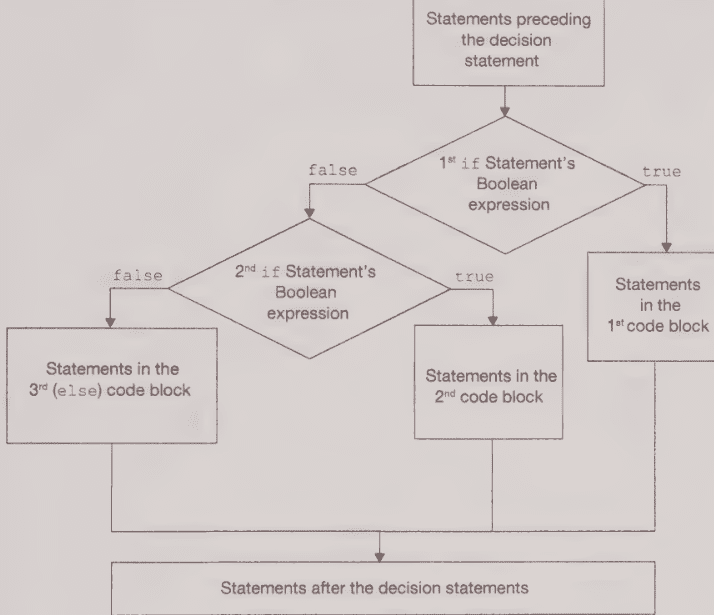

图 4.7 `else` 子句语句为 `if-else` 语句的 `if-else` 语句的含义和执行路径。

例如，以下代码片段判断 `String` 对象 `carColor` 中包含红、绿、蓝、白四种颜色中的哪一种：

```java
if(carColor.equals("Red"))
{
    System.out.println("颜色是红色");
}
else if(carColor.equals("Green"))
{
    System.out.println("颜色是绿色");
}
else if(carColor.equals("Blue"))
{
    System.out.println("颜色是蓝色");
}
else
{
    System.out.println("颜色是白色");
}
```

这些决策语句按照图 4.8 所示的顺序执行。布尔表达式按照编码顺序进行求值。只会执行一个语句块，即与第一个真布尔条件关联的语句块。当所有布尔条件为假时，执行与最后一个 `else` 子句关联的语句块。最后一个 `else` 子句及其关联的语句块是可选的。如果包含，结构中始终执行且仅执行一个块。

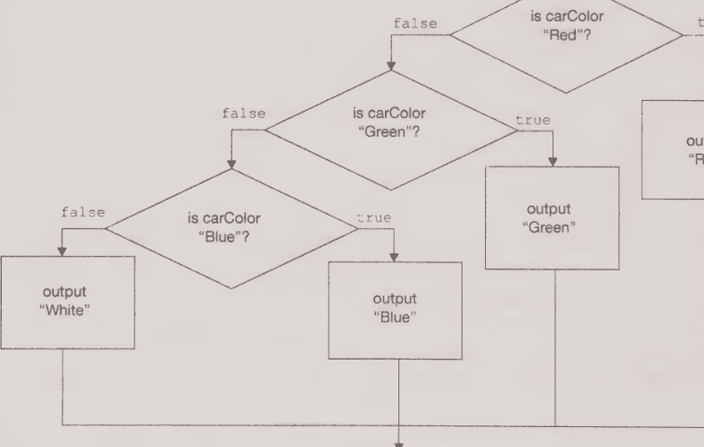

图 4.8 判断 `String` 对象 `color` 中的颜色。

## 检测碰撞：if 和 else 语句的使用

大多数游戏都涉及游戏道具之间的某种交互。例如，Pong 游戏中的球从板上反弹，Frogger 游戏中的青蛙被卡车撞到，或者陨石撞击太空器。所有这些交互都被称为碰撞，游戏长度通常受到这些碰撞的影响。`if-else` 结构中的布尔条件用于检测碰撞的发生，而结构内部的代码块用于采取适当的操作（例如更改分数或结束游戏）。我们通过讨论 `if-else` 语句的常用用法结束本节，并介绍一个利用这一常见事件的程序应用。

### 碰撞检测的 Java 基础

有几种算法用于检测碰撞，所有的都涉及决策语句的使用。在最简单的算法中，我们想象用矩形包裹每个道具。也就是说，整个游戏道具都内接在一个矩形内，如图 4.9 所示。


虽然这种碰撞检测方案很简单，但并不总是准确。如图 4.9 所示，位于 x 坐标时，当两个 if-else 语句的...

**图 4.9** 两个...

*(注：由于原文文本在乱码 `img/48ac12a3996b2439a1159c27d2d71e43_182_0.png` 后的部分存在大量重复的字符“4 4 4 4 4 4 4...”等乱码，翻译时已根据上下文逻辑进行了剔除处理，保留了核心技术含义。)*

```java
}
else if(s2.getY() > s1.getY() + h) // s2 在 s1下方
{
    System.out.println("no collision");
}
else if(s2.getY() + h < s1.getY()) // s2 在 s1上方
{
    System.out.println("no collision");
}
else // 碰撞
{
    System.out.println("collision");
}
```

或者，可以将布尔条件组合成一个复合布尔条件，在没有碰撞时该条件为真。

```
(s2.getX() > s1.getX() + w || s2.getX() + w < s1.getX() || s2.getY() > s1.getY() + h || s2.getY() + h < s1.getY())
```

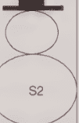

位置 4，s2 在 s1 上方

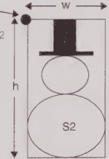

雪人 s2 的 (x, y) 坐标

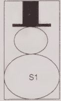

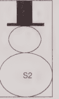

位置 2，s2 在 s1 左侧

位置 1，s2 在 s1 右侧

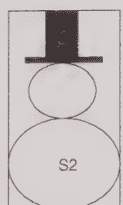

位置 3，s2 在 s1 下

图 4.10 雪人 s2 相对于雪人 s1 的非碰撞位置。

使用这个复合布尔表达式，检测碰撞的系列 if-else 语句将变为：

```java
if(s2.getX() > s1.getX() + w || s2.getX() + w < s1.getX() ||
    s2.getY() > s1.getY() + h || s2.getY() + h < s1.getY())
{
    System.out.println("no collision");
} else // 碰撞
{
    System.out.println("collision");
}
```

布尔条件的真值也可以被反转，使用 Java 的非逻辑运算符 (`!`)，这样 if-else 语句的子句将检测两个雪人之间的碰撞。

```java
if(!s2.getX() > s1.getX() + w || s2.getX() + w < s1.getX() ||
    s2.getY() > s1.getY() + h || s2.getY() + h < s1.getY())
{
    System.out.println("collision");
} else // 无碰撞
{
    System.out.println("no collision");
}
```

以下代码片段使用了该 if-else 语句布尔表达式的扩展版本，用于检测何时发生碰撞以及雪人 s2 是否处于可见状态。当这种情况发生时，游戏分数（变量 `score`）将增加 l，并且雪人 s1 的可见性属性被设置为 false。

```java
if(!s2.getX() > s1.getX() + w || s2.getX() + w < s1.getX() ||
    s2.getY() > s1.getY() + h || s2.getY() + h < s1.getY()) &&
    s1.isVisible() == true) // 碰撞且 s1 可见
{
    score = score + 1;
    s1.setVisible(false);
}
```

在布尔表达式的末尾添加了一个额外的项。由于前面有 `&&` (与) 运算符，扩展后的表达式只有在两个雪人碰撞且雪人 s1 可见时才为真。这防止了当游戏对象（例如 s2）与不再属于游戏部分的不可见游戏对象（例如 s1）碰撞时分数增加。

## 4.5 嵌套 if 语句

正好像 if-else 语句的子句可以包含一个 if 语句一样，if 语句的语句块也可以包含其他的 if 语句。这种编码方法被称为嵌套 if 语句，因为第二个语句可以被看作第一个语句代码块形成的“巢”内部的“蛋”。

以下代码片段包含一个布尔变量 `raining`（下雨）和一个整数变量 `temperature`（温度），并使用嵌套 if 语句来判断在下雨的冷天里是否应该带毛衣和雨衣。

```java
if(raining == true)
{
  System.out.println("Take your umbrella, ");
  if(temperature <= 50) // 开始嵌套的 if-else 语句
  {
    System.out.println("take a sweater, ");
    System.out.println("and your raincoat, ");
  }
}
```

if-else 语句也可以嵌套在 if 语句内部，如下方的代码片段所示：

```java
if(raining == true)
{
  System.out.println("Take your umbrella, ");
  if(temperature <= 50) // 开始嵌套的 if 语句
  {
    System.out.println("take a sweater, ");
    System.out.println("and your raincoat, ");
  }
} else // 温度大于 50
{
    System.out.println("no jacket needed");
  }
}
```

if-else 语句的子句可以包含一个 if 语句，而 if 语句的语句块也可以包含其他的 if 语句。正如在下面的代码片段所示，if-else 语句也可以嵌套在 if 语句内部。

if-else 语句的子句可以包含一个 if 语句，而 if 语句的语句块也可以包含其他的 if 语句。正如上文所示，所有的 switch 语句都可以使用 if-else 语句来编码，但反之则不然。但在某些情况下使用 switch 语句会让程序更具可读性，更易于理解、修改和维护。当决策是基于有限一组中的选择时，使用 switch 语句被认为是良好的编程习惯。子句是 if 语句用于判断是否下雨的。

```java
if(raining == true)
{
  System.out.println("Take your umbrella, ");
  if(temperature <= 50) // 开始嵌套的 if 语句
  {
    System.out.println("take a sweater, ");
    System.out.println("and your raincoat, ");
  }
} else // 温度大于 50
  {
    System.out.println("no jacket needed");
  }
}
```

## 4.6 switch 语句

switch 语句是 Java 中提供的另一种控制流语句。它不像 if-else 语句那样灵活，因为这些语句的决策不能基于简单或复合布尔表达式。其使用的运算符限制在：

- 两个 `String` 对象
- 两个 `byte`、`short`、`char` 或 `int` 基本类型
- 之前定义的枚举类型的实例（将在第 7 章讨论）

switch 语句的语法如图 4.11 所示。图中使用的缩进反映了良好的编程习惯。

```java
switch (choiceExpression)
{
  case choiceValue1:
    // choiceValue1 的语句块
    break;
  case choiceValue2:
  {
    // choiceValue2 的语句块
    break;
  }
  ...
  case choiceN:
  default:
  {
    // 默认语句;
  }
}
```

**图 4.11** switch 语句的语法。

如图所示，语句的第一行以关键字 switch 开头，语句的其余部分由一组括号内的 case 子句和 default 子句组成。在输入语句时，最好先输入以下所需的语法，然后填充语句第一行的剩余部分以及适用于用途的 case 和 default 子句。

```java
switch() {
{
}
```

参考图 4.11，在编写 switch 语句时最常见的（且最难发现）三个语法错误：

1. 忘记编写关键字 switch 之后的左括号和右括号
2. 在语句第一行的右括号后编写了分号
3. 在 choiceValue、choiceValue2... 或 default 关键字之后忘记写分号

关键字 switch 之后括号内的实体被称为选择表达式。选择表达式必须是一个类型为允许类型之一的变量（前文提到的，例如，一个 `String` 对象、一个整数变量等）或者求值结果为这些类型之一的表达式。

```java
switch (choice)
  if (choice == choiceValue)
  {
  case choiceValue:
    {
      // 用于 choiceValue 的语句
    }
    break;
  case choiceValue2:
    {
      // 用于 choiceValue2 的语句
    break;
    }
  else if (choice == choiceValue2)
    {
      // 用于 choiceValue2 的语句
    }
  case choiceValueN:
  else if (choice == choiceValueN)
    {
      // 用于 choiceValueN 的语句
    }
    break;
  default:
    {
      // default 语句
    }
  }
```

(a) (b)

**图 4.12** 语义等的 switch 语句和 if-else 语句。

当 switch 语句开始执行时，会确定 choice 表达式的值，然后执行第一个 choice 值等于该值的 `case` 语句块。如果 choice 表达式不等于其中任何一个值，则执行 `default` 情况的语句块。图 4.12 通过与等效的 if-else 语句（图 4.12b）对比，说明了 switch 语句的含义和执行路径（图 4.12a）。

例如，以下代码段确定了 `String` 对象 `carColor` 包含四种颜色（红、绿、蓝、白）中的哪一种：

```java
switch (carColor)
{
  case "red":
    {
      System.out.println("the car color is red");
      break;
    }
  case "green":
    {
      System.out.println("the car color is green");
      break;
    }
  case "blue": {
      System.out.println("the car color is blue");
      break;
    }
  default: {
      System.out.println("the car color is white");
    }
}
```

以下代码段演示了在 switch 语句中使用算术表达式作为 choice 表达式的方法：

```java
int i;
String s = JOptionPane.showInputDialog("enter an integer");
i = Integer.parseInt(i);
switch (i) {
    case 10:
        System.out.println("two times the number is 10");
        break;
    case 20:
        System.out.println("two times the number is 20");
        break;
    default:
        System.out.println("two times the number is not 10 or 20");
}
```

switch 语句中使用的 `case` 子句数量是没有限制的。`default` 子句是可选的，如果使用，则必须编码为语句中的最后一个子句。`case` 和 `default` 子句中语句周围的括号不是必须的，仅用于提高可读性。

可以使用语法将多个 `case` 分配给同一个语句块：

```java
case 2: case 5: case 7 {
    // 适用于所有三个情况的语句块
    break;
}
```

当 choice 表达式求值等于 2、5 或 7 时，将执行 `break` 语句块。

每个 `case` 代码块末尾的 `break` 语句也是可选的。然而，与可选的括号对不同，它的存在对构造的执行路径有重大影响。`break` 语句是一种流程控制语句，不使用逻辑表达式来决定何时执行或跳过语句。相反，当在 switch 语句内部执行 `break` 语句时，它总是会结束其所在的 switch 语句的执行。基本上，它的意思是：跳出此语句。它也可以用于 `if` 或 `else` 语句内部以结束它们的执行。

当流程控制语句内部 `break` 语句执行时，下一个执行的语句是紧跟在该流程控制语句之后的语句。如果在 switch 语句内部执行，则会跳过后续所有的 `case` 子句和 `default` 块，下一个执行的语句是 switch 语句结束处大括号之后的语句（即与 `switch` 关键字匹配的大括号）。

如果一个 `case` 子句末尾没有编写 `break` 语句，则在该 `case` 子句中的语句执行后，会执行后续所有 `case` 子句中的语句，直到遇到 `break` 语句。如果没有遇到 `break` 语句，则执行 `default` 子句。由于 switch 构造中的选项是互斥的，`break` 语句通常被编写为每个 `case` 子句的最后一个语句。

图 13 显示了一个游戏程序，它使用 `switch` 和 `break` 语句改变雪人的位置，使用 `if-else` 语句确定得分、让第二个雪人消失并在新位置出现，以及判断游戏何时结束。当程序启动时，两个雪人（一个戴黑帽，另一个戴绿帽）出现在游戏板上。玩家点击游戏板上的 Start 按钮时游戏开始。游戏的目标是使用键盘控制黑帽雪人，在时间耗尽前让雪人尽可能多碰撞。每碰撞一次就会得分，绿帽雪人会消失。在黑帽雪人移动到不再处于碰撞状态后，绿帽雪人会在新位置出现。

游戏的雪人 `s1` 和 `s2` 是 `BoxSnowman` 类的实例（图 4.4）。它们在图 13 程序的第 9 和 10 行创建，使用三个参数指定雪人的位置和颜色：`s1` 为绿色，`s2` 为黑色。`draw` 方法的第 29 行输出剩余时间，第 61 行在 `draw` 方法结束前输出得分。第 54–58 行显示 `BoxSnowman` 类的 `show` 方法在游戏板的当前 (x, y) 位置绘制雪人。第 55 行的 `if` 语句检查是否应该绘制（第 57 行）。`BoxSnowman` 的 `visible` 属性初始值为 `true`（图 4.4，第 9 行），当游戏启动时，它出现在游戏板上。

| | |
| :--- | :--- |
| 1 | import javax.swing.*; |
| 2 | import java.awt.*; |
| 3 | // 使用语句 |
| 4 | |
| 5 | public class DecisionsOfFlow extends DrawableAdapter |
| 6 | { |
| 7 | static DecisionsOfFlow ge = new DecisionsOfFlow(); |


# 第 4 章 布尔表达式、决策以及磁盘输入与输出

## 代码清单：DecisionsControlOfFlow 应用

| 行号 | 代码 |
| :--- | :--- |
| 8 | `static GameBoard gb = new GameBoard(ge, "Control Flow");` |
| 9 | `static BoxSnowman s1 = new BoxSnowman(300, 200, Color.GREEN);` |
| 10 | `static BoxSnowman s2 = new BoxSnowman(30, 100, Color.BLACK);` |
| 11 | `static int score = 0;` |
| 12 | `static int count = 10;` |
| 13 | |
| 14 | `public static void main(String[] args)` |
| 15 | `{` |
| 16 | `showGameBoard(gb);` |
| 17 | `}` |
| 18 | |
| 19 | `public void draw(Graphics g) // 回调方法` |
| 20 | `{` |
| 21 | `int w = 40;` |
| 22 | `int h = 77;` |
| 23 | `int s1X, s1Y, s2X, s2Y, temp;` |
| 24 | `s1X = s1.getX(); s1Y = s1.getY();` |
| 25 | `s2X = s2.getX(); s2Y = s2.getY();` |
| 26 | `g.setColor(Color.BLACK);` |
| 27 | `g.setFont(new Font("Arial", Font.BOLD, 18));` |
| 28 | `g.drawString("Time remaining: " + count, 260, 50);` |
| 29 | |
| 30 | `if(count == 0) // 游戏结束` |
| 31 | `{` |
| 32 | `g.setColor(Color.BLACK);` |
| 33 | `g.drawString("Game Over", 205, 70);` |
| 34 | `g.drawString("Have a Good Day", 175, 90);` |
| 35 | `}` |
| 36 | `else if (!(s2X > s1X + w || s2X + w < s1X || s2Y > s1Y + h || s2Y + h < s1Y) && s1.isVisible() == true) // 碰撞` |
| 37 | `{` |
| 38 | `score = score + 1;` |
| 39 | `s1.setVisible(false);` |
| 40 | `}` |
| 41 | `else if(s2X > s1X + w || s2X + w < s1X || s2Y > s1Y + h || s2Y + h < s1Y)` |
| 42 | `{ // 不碰撞` |
| 43 | `// 不可见见` |
| 44 | `{` |
| 45 | `temp = s1.getX();` |
| 46 | `s1.getY());` |
| 47 | `s1.setY(temp);` |
| 48 | `}` |
| 49 | `s1.setVisible(true);` |
| 50 | `}` |
| 51 | `}` |
| 52 | |
| 53 | `public void keyStruck(char key) // 回调方法` |
| 54 | `{` |
| 55 | `int newX, newY;` |
| 56 | |
| 57 | `switch (key)` |
| 58 | `{` |
| 59 | `case 'L':` |
| 60 | `{` |
| 61 | `newX = s2.getX() - 2;` |
| 62 | `s2.setX(newX);` |
| 63 | `break;` |
| 64 | `}` |
| 65 | `case 'R':` |
| 66 | `{` |
| 67 | `newX = s2.getX() + 2;` |
| 68 | `s2.setX(newX);` |
| 69 | `break;` |
| 70 | `}` |
| 71 | `case 'U':` |
| 72 | `{` |
| 73 | `newY = s2.getY() - 2;` |
| 74 | `s2.setY(newY);` |
| 75 | `break;` |
| 76 | `}` |
| 77 | `case 'D':` |
| 78 | `{` |
| 79 | `newY = s2.getY() + 2;` |
| 80 | `s2.setY(newY);` |
| 81 | `break;` |
| 82 | `}` |
| 83 | `} // switch 语句结束` |
| 84 | `}` |
| 85 | `public void timer() // 回调方法` |
| 86 | `{` |
| 87 | `count = count - 1;` |
| 88 | `if(count == 0)` |
| 89 | `}` |

## 图 4.13

DecisionsControlOfFlow 应用：决策语句案例研究。

第 63 行使用的 `switch` 语句被用作 `switch` 语句的选择。在这种情况下，`switch` 语句用于判断按了四个光标控制键盘键中的哪一个，以便雪人2 从当前位置移动两个像素。该语句编写在游戏环境的回调方法 `keyStruck`（第 63 行）中，游戏环境每当击击键盘键时都会调用该方法。该方法有一个参数 `key`，类型为 `char`，游戏环境会将击击的字符传递给它。在 `keyStruck` 完成执行后，游戏环境会调用 `draw` 方法。

参数 `key` 被用作第 67 行的 `switch` 表达式。当按下键盘的左、右、上、下光标控制键时，它们会分别生成字符 `'L'`、`'R'`、`'U'` 或 `'D'`，第 69、75、81 和 88 行的 `switch` 分支将决定雪人2移动的方向。

> 当按键被按住时，它每秒传输 20 次，就像按键每秒被按下和释放 20 次一样。由于这个原因，为了控制游戏对象的运动，优先使用滑动（strokes）而不是点击（clicks）。

图 4.14b 显示了点击 Start 按钮后使用右和下光标键将雪人2 移动到雪人1 相邻的游戏板。再次向右光标滑动将导致碰撞。

第 31 行开始了一个 `if-else` 语句，其中包含一个嵌套的 `if-else` 语句（第 37 行）和两个嵌套的 `if` 语句（第 43 和 46 行）。出现在第 37 行和 43 行的 `else` 关键字分别是从第 31 行和第 37 行开始的 `if-else` 语句的一部分。第 31 行决定游戏是否结束，如果结束，它会向玩家宣布。

从第 37 行开始的 `if-else` 语句确定当雪人2 可见时两个雪人是否碰撞。它的布尔表达式（如第 4.4 节末尾所述）如果雪人2 不在雪人1 的右侧、左侧或上方，且 `s1` 可见，则表达式为真。在这种情况下，`if` 子句代码块使用计数算法（第 40 行）将玩家的分数加一，并将雪人1 的 `visible` 属性设置为 `false`，以使其从游戏板上消失（图 4.14c），因为现在绘制 `s1` 的语句（第 55 行）结果为 `false`。将 `s1` 的 `visible` 属性设置为 `false` 也防止了再次评分，直到两个雪人不再处于碰撞状态且 `s1` 再次可见。对两个雪人不再处于碰撞状态的判断是由第 43 行的 `if` 语句执行的。它的布尔条件与第 37 行和 38 行的条件相同，只是删除了 `NOT ()` 运算符和对可见性的测试。当雪人不处于碰撞状态时，该布尔条件为真。然后，从第 46 行开始的嵌套 `if` 语句执行，并判断雪人是否不可见。当不可见时，嵌套 `if` 语句的代码块执行，通过交换其 x 和 y 坐标来移动雪人。该代码块还将 `s1` 的 `visible` 属性设置为 `true`（第 50 行），这导致从第 55 行开始的 `if` 语句在游戏板的新位置绘制雪人 `s1`（图 4.14d）。

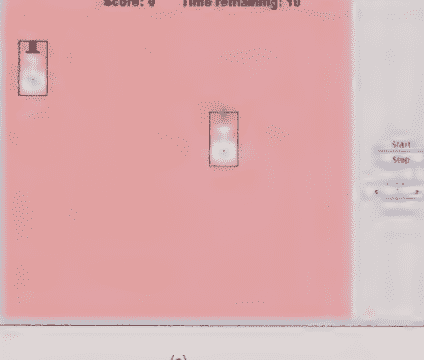
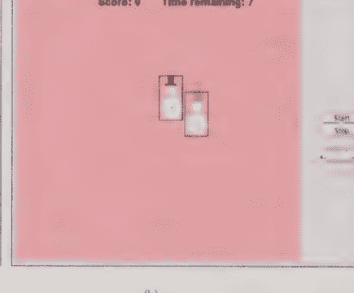
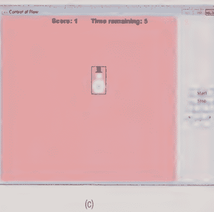
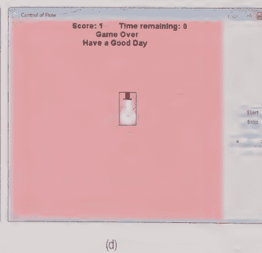

**图 4.14** DecisionsControlOfFlow 应用的输出。

## 4.7 控制台输入与 Scanner 类

我们已经学习了如何使用消息对话框进行输入和输出，以及如何使用 `println` 方法将输出发送到系统控制台。系统控制台还可以使用 `Scanner` 类中的方法来执行键盘输入。这些非静态方法还可以用于从磁盘文件进行输入，将在下一节中讨论。

尽管系统控制台附带了一个预定义的输出对象 `System.out`，但在使用 `Scanner` 类中的输入方法之前，我们必须声明一个 `Scanner` 对象并将控制台对象传递给 `Scanner` 的单参数构造函数。以下代码片段内联声明了 `Scanner` 对象：

```java
Scanner consoleIn = new Scanner(System.in);
```

然后可以使用 `consoleIn` 对象来调用 `Scanner` 类中的方法。该类中三个常用方法的名称见表 4.5。要使用这些方法，请在程序中包含以下语句：

```java
import java.util.Scanner;
```

### 表 4.5 Scanner 类中常用的输入方法

| 方法名称 | 返回类型 |
| :--- | :--- |
| `nextInt` | `int` |
| `nextDouble` | `double` |
| `nextLine` | `String` |

正如名称所示，`nextInt` 和 `nextDouble` 都用于接受数值输入。当输入为整数时使用 `nextInt`，当输入为实数时使用 `nextDouble`。`nextLine` 用于接受字符串。当调用这些方法时，程序的执行会暂停，直到用户通过按下回车键完成输入。此时，用户可以使用退格和删除键编辑输入。良好的编程习惯是在调用方法之前提供一个良好的提示。以下代码片段将人的姓名、年龄和体重输入到系统控制台：

```java
Scanner consoleIn = new Scanner(System.in);
String name;
int age;
double weight;

System.out.print("Enter your name: ");
name = consoleIn.nextLine();

System.out.print("enter your age: ");
age = consoleIn.nextInt();

System.out.print("enter your weight: ");
weight = consoleIn.nextDouble();
```

多个数值输入可以在一行输入，只要它们被至少一个空格分隔（分隔）。数值输入之前的空格会被忽略。以下代码段在系统控制台上的一行接受人的年龄和体重：

```java
int age;
double weight;
Scanner consoleIn = new Scanner(System.in);

System.out.print("Enter your age and weight on one line separated by least one space:");
age = consoleIn.nextInt();
weight = consoleIn.nextDouble();
```

> **TIP** 多个数值输入只要至少隔一个空格，就可以一行输入。

字符串输入之前的空格不会被忽略。它们会被视为并成为字符串的一部分。在数值输入之后输入的空格将成为从同一行读取的字符串的一部分。由于这个原因，字符串不应与数值输入在同一行。

> **TIP** 数值输入和字符串输入不应在同一行。

当从两个单独的输入行读取数值和字符串时，数值输入在前，需要调用两次 `nextLine` 来捕捉字符串。这是因为数值输入会将回车键产生的字符留在“后面”，而 `nextLine` 方法认为这是一个有效的字符串（空字符串 `""`）。以下语句接受人的年龄，然后是人的姓名和地址。第一个字符串由额外的 `nextLine` 方法正确地前置。

```java
Scanner consoleIn = new Scanner(System.in);
int age;
String name;
String address;

System.out.print("\enter your age: ");
age = consoleIn.nextInt();

consoleIn.nextLine(); // 清除留下的回车键
System.out.print("Enter your name: ");
name = consoleIn.nextLine();

System.out.print("Enter your address: ");
address = consoleIn.nextLine();
```

为了完全理解 `Scanner` 类的输入，我们必须意识到你输入的字符会被被传输到一个名为“输入缓冲区”的内存驻留存储器中。当调用 `Scanner` 方法且缓冲区为空时，该方法会暂停，直到按下回车键（Enter）。如果缓冲区不为空，该方法将接受缓冲区中的输入，然后从缓冲区中删除该输入。`nextLine` 方法也会删除缓冲区中的回车键字符；然而，返回数值结果的 `Scanner` 方法不会从缓冲区中移除该字符。

在读取数值输入时，这并不是问题，因为数值方法不仅会跳过缓冲区开头的空格，还会跳过回车键。这些空白字符会被忽略，直到缓冲区为空或它们找到需要处理的输入为止。然而，`newline` 方法不会跳过回车键。结果是，当 `nextLine` 输入位于数值输入之后，它会遇到一个包含回车键的非空缓冲区。`nextLine` 方法会读取并移除缓冲区中的回车键，并返回空字符串（`"\n"`）。

> 在数值输入后读取字符串控制时，需要调用两次 `newline` 方法来读取字符串。第一次调用会冲刷缓冲区中的换行（空字符串）。

图 4.15 展示了一个应用程序，演示了如何使用 `Scanner` 类的方法来从系统控制台接受输入。控制台输入和相应的输出位于图底部。

第 1 行将 `Scanner` 类的方法导入应用程序中，第 6 行使用 `Scanner` 类的单参数构造函数创建对象 `consoleIn`，并将预定义的输入对象 `System.in` 传递给它。第 11–16 行从系统控制台接受一个字符串、一个整数和一个双精度浮数，每个占一行。这些值在第 17–18 行输出。

第 20–25 行更改了输入顺序，从在同一控制台行上的两个数值输入开始（第 20–22 行）。然后输入一个字符串（第 23–25 行）。第 24 行清除了在读取第二个数值后（第 22 行）留存在缓冲区中的回车键。第 26–27 行输出这组输入。参考图 4.15，用户在输入年龄 5 和输入体重 35 之间输入了几个空格。这些空格被第 22 行调用的 `nextDouble` 方法忽略了。图中最后一行的体重输出（35.4）证实了这一点。

```java
import java.util.Scanner;
public class ScannerConsoleInput
{
    public static void main(String[] args)
    {
        Scanner console = new Scanner(System.in);
        String name;
        int age;
        double weight;
        System.out.print("Enter your name: ");
        name = console.nextLine();
        System.out.print("Enter your age: ");
        age = console.nextInt();
        System.out.print("Enter your weight: ");
        weight = console.nextDouble();
        System.out.println("Age: " + age + " Weight: " + weight + 
        " Name: " + name);

        System.out.print("\nEnter your age and weight on one line: ");
        age = console.nextInt();
        weight = console.nextDouble();
        System.out.print("Enter your name: ");
        console.nextLine(); // 清除缓冲区中的回车键
        name = console.nextLine();
        System.out.println("Age: " + age + " Weight: " + weight + 
        " Name: " + name);
    }
}
```


为了处理顺序文件，Java 维护了一个读取位置指针，该指针最初指向文件的第一个字符。每当从文件中读取一个数据项时，该指针就会移动到文件中的下一个项。在读取完文件的最后一项后，指针将指向一个称为“文件结束”（EOF）的特殊字符，该字符会自动放置在所有文件的末尾。在第 5 章中，我们将讨论在文件中添加 EOF 字符的重要性，以及如何检测我们何时到达了该位置。

从文本文件中读取数据时，有一些额外需要考虑的问题，这些问题在执行控制台输入时不会出现。这些包括需要知道：

- 声明 `File` 对象所需的文件名和路径（图 4.18 的第 1 行）
- 文件中信息的顺序，以便使图 4.18 中第 7、8、9 和 10 行的语句按正确的顺序编码
- 文件中每条信息的类型，以便调用适当的 `Scanner` 类来读取每条信息

这些信息均在由设计该文件的软件工程师提供给程序员的文件规范中描述。

### 4.8.2 判断文件是否存在

在从文本文件中读取数据时，另一个需要考虑的问题（在执行控制台输入时不会出现）是防止数据文件不存在时发生运行时错误。`File` 类包含一个方法 `exists()`，可以用于检测文件是否存在；而 `System` 类包含一个静态方法 `exit()`，可以结束程序。

`File` 类中的 `exists()` 方法在文件存在时返回 `true`，而 `System` 类中的 `exit()` 方法包含一个整数参数，通常传递 `0`。下面的代码段演示了如何使用这两个方法，以便在程序尝试使用不存在的磁盘文件时，提供一个更具信息量且友好的结束方式：

```java
File fileObject = new File("c:/data.txt");
```

```java
if (!fileObject.exists()) // 文件不存在
{
    System.out.println("the file does not exist, the program is terminating");
    System.exit(0);
}
```

> 检查磁盘文件的存在是一个良好的编程习惯，可以避免用户通常难以理解的运行时错误。

## 4.8.3 顺序文本文件输出

可以使用用于向系统控制台写入信息的 `print()` 和 `println()` 方法将信息顺序输出（写入）到文本文件中。此外，Java 用于格式化控制台输出数据的语法（例如输出信息的间距、换行以及指定数值输出的精度）与格式化磁盘文件输出的语法相同。唯一的异常是输出注解（output annotation）。

在向磁盘文件写入时，设置到 `print()` 等方法的字符串集中通常不包含输出注解，因为大多数文件是由程序读取的，而不是人类读取。当文件数据将不会被程序处理或读取时（可能在打印后将检查文件内容），则会包含输出注解。或者，读取器也可以参考文件的规范来识别未注解的文件信息。

要写入系统控制台，`print()` 和 `println()` 方法作用于连接到系统控制台的预定义 `System.out`。要写入顺序文本文件，这些方法作用于 `PrintWriter` 类中由程序员定义的对象。该对象通过两行代码创建，这与用于执行输入的 `Scanner` 对象的两行代码类似。

`PrintWriter` 是使用该类的双参数构造函数创建的，该构造函数被传递给 `FileWriter` 类中的一个对象。在创建 `FileWriter` 对象时，会将文件的路径和名称传递给它。该字符串的大小写敏感会被忽略。使用 `import java.io.*;` 语句来访问 `PrintWriter` 和 `FileWriter` 类。

图 4.19 所示的代码片段在 C 盘根目录下创建一个名为 `data.txt` 的顺序文本文件，并将变量 `score` 的内容以及一个换行符输出到文件开头。

| 行 | 代码 |
| :--- | :--- |
| 1 | `FileWriter fileObject = new FileWriter("c:/data.txt");` |
| 2 | `PrintWriter outFile = new PrintWriter(fileObject, false);` |
| 3 | `int score = 20;` |
| 4 | `fileOut.println(score);` |

**图 4.19** 向 C 盘根目录下的磁盘文件 data.txt 开头写入整数的代码片段。

图 4.19 的第 1 行和第 2 行创建了磁盘文件和 `outFile`。`outFile` 是一个通用术语，用于描述这两行代码的功能，即创建并打开文件。如果文件已经存在，它将被删除并重新创建。之前写入已删除文件的所有信息都将丢失。

使用 `print()` 和 `println()` 方法写入文本文件的数据，应该被认为是完全放置在文件中，就像这些方法作用于 `System.out` 时在系统控制台上显示的一样（逐行、逐字符）。唯一的异常是，换行符不会出现在系统控制台上。相反，它会导致光标移动到下一行的开头。文件中第一个数据项的字符之后紧跟着第二个项的字符，然后是第三个，依此类推。

图 4.20 演示了一个应用程序，它将一个人的年龄、体重和姓名写入名为 `data.txt` 的顺序文本文件，然后从文件中读取数据并将信息输出到系统控制台。程序产生的系统控制台输出显示在图末尾，写入磁盘文件的字符显示在图 4.21 中。

图 4.20 的第 1 行和第 2 行显示了程序可用 `Scanner`、`File`、`FileWriter` 和 `PrintWriter` 类。它们的构造函数在第 8–12 行被用于创建对象 `inFile` 和 `fileOut`，它们分别在第 18–19 行和第 23–26 行用于写入和读取文件。

```java
import java.util.Scanner;
import java.io.*;

public class DiskIO {
    public static void main(String[] args) throws Exception {
        File fileObject = new File("data.txt"); // 输入
        Scanner inFile = new Scanner(fileObject);
        FileWriter fileWriter = new FileWriter("data.txt"); // 输出
        PrintWriter fileOut = new PrintWriter(fileWriter, false);

        String name = "Nora Smith";
        int age = 5;
        double weight = 35.4;

        // 将数据项写入磁盘文件
        fileOut.println("Age: " + age + " Weight: " + weight + " Name: " + name);
        fileOut.close();

        // 从文件中读取数据
        age = inFile.nextInt();
        weight = inFile.nextDouble();
        name = inFile.nextLine();
        System.out.println("Age: " + age + " Weight: " + weight + " Name: " + name);
        inFile.close();
    }
}
```

# 第 4 章 布尔表达式、决策以及磁盘输入与输出

## 4.8.4 向现有文本文件追加数据

通过将传递给 `PrintWriter` 的双参数构造函数的第二个参数从 `false` 改为 `true`，可以将数据追加（添加到末尾）到磁盘文件中。例如，图 4.20 中的第 11 行将改为：

```java
PrintWriter fileOut = new PrintWriter(fileWriterObject, true);
```

当运行程序时，如果文件存在，它不会被删除（如果文件不存在，则会创建它）。程序的每次执行都会在文件末尾添加数据，随后跟一个 EOF 字符。图 4.22 显示了程序执行三次后文件的内容，假设文件在程序首次执行之前不存在，且向 `PrintWriter` 传递了值 `true`。

| 内容 | 说明 |
| :--- | :--- |
| `35.4\nNora Smith\n5 35.4\nNora Smith\n5 35.4\nNora Smith\neof` | `\n` 代表换行字符，`eof` 代表 EOF 字符 |

**图 4.22** 使用追加模式对文件执行 3 次 DiskIO 的输出。

## 4.8.5 删除、修改和添加文件数据项

与大多数编程语言一样，它不包含删除或修改文件数据项或在文件末尾之外任何位置添加数据项的方法。这些操作可以通过在执行这些任务的算法中包含在本章讨论的 I/O 方法来实现。例如，删除算法将：

- 将文件的所有信息读入 RAM 内存
- 关闭文件
- 删除文件
- 重新创建文件
- 将除要删除的项目以外的所有信息写回文件
- 关闭文件

由于这些算法的编码需要掌握第 5 章和第 6 章涵盖的知识，我们将在第 6 章回到这个主题。

## 4.9 异常：初探

异常（exception）是 Java 的一种特性，方法可以使用它向其调用者通信：在方法执行期间发生了意外事件，而该方法本身并不包含处理该事件的代码。当事件是严重的时，必须在调用该代码的方法签名中添加一个 `throws` 子句，或者在包含调用语句的代码块中添加处理该事件的指令。

前一种方法出现在图 4.20 第 6 行的程序中。在第 9 行和第 10 行调用的 `Scanner` 和 `FileWriter` 类构造函数是在执行过程中可能会遇到严重意外事件的方法。因此，在 `main` 方法的签名（第 6 行）中添加了一个 `throws` 子句，因为 `main` 方法包含了这两个调用。在本节中，我们将对 `throws` 子句的替代方案进行简要介绍：在包含调用语句的代码块中添加处理事件的指令。第 10 章“异常：进阶”包含了对异常更深入的讨论。

正如“throws”（抛出）一词所暗示的，在选择与异常相关的 Java 关键字时，使用了棒球类比，这种比喻有助于理解异常。想象一下，当方法执行期间发生严重事件时，方法说：“我对该事件有异议，我不打算继续执行。我的最后一个动作是将一个异常对象抛回给调用者，让他们知道这个问题。”

如果调用者想处理该问题，它的代码块将捕获异常并处理问题。否则，它会将异常对象抛给 Java 运行时环境。`throws` 术语是我们已经使用过的关键字（图 4.20 的第 6 行），当我们不想处理意外问题时曾使用过。另外两个关键字 `try` 和 `catch` 是在我们想要处理问题时使用的。

这些关键字中的每一个都开始一个代码块，`try` 代码块和 `catch` 代码块用于我们想要处理问题时。`try` 代码块紧跟在 `catch` 块之后。`try` 块用于处理可能抛出 `IOException` 的异常。

```java
try {
    // 代码块
} catch (IOException e) {
    // 处理意外事件
}
```

# 第 4 章 布尔表达式、决策制定与磁盘输入输出

```java
68      else if (!s2X > s1X + w || s2X + w < s1X || s2Y > s1Y + h ||
          s2Y + h < s1Y) && s1.isVisible() == true
  {
          score = score + 1;
          s1.setVisible(false);
      }
  else if (s2X > s1X + w || s2X + w < s1X || s2Y > s1Y + h ||
          s2Y + h < s1Y) {
      {
          if(s1.isVisible() == false) // 不可见
          {
              temp = s1.getX();
              s1.setX(s1.getY());
              s1.setY(temp);
              s1.setVisible(true);
          }
      }

      s2.show(g);
      if(s1.isVisible() == true)
      {
          s1.show(g);

          g.drawString(Color.BLACK) + "Score: " + score, 150, 50);
      }
  }
  public void keyKeyStroke(char key) // 回调方法
  {
      int newX, newY;
      switch (key)
      {

         case 'L':
          {
              newX = s2.getX() - 2;
              s2.setX(newX);
              break;
          }
         case 'R':
          {
              newX = s2.getX() + 2;
              s2.setX(newX);
              break;
          }
         case 'U':
          {
              newY = s2.getY() - 2;
              s2.setY(newY);
              break;
      }
      case 'D':
      {
          newY = s2.getY() + 2;
          s2.setY(newY);
      }
  }
  public void timer(1) // 回调方法
  {
      count = count - 1;
      if (count == 0)
      {
          gb.stopTimer(1);
      }
  }
}
```

# 使用 Java 语言编程基础

## 图 4.23 基础应用：决策与异常研究。

当应用程序启动时，两个雪人（一个戴着黑帽子，另一个戴着绿帽子）会出现在游戏分数和剩余时间下方的游戏板上（图 4.24a）。当玩家点击面板上的“开始”（Start）按钮时，游戏开始。游戏的目标是在时间耗尽之前，使用键盘方向键移动黑帽雪人，使两个雪人尽可能多地碰撞。每碰撞一次，就会获得一分，且绿帽雪人会消失。在黑帽雪人移动到一个使两个雪人不再碰撞状态的位置后，绿帽雪人会在新位置重新出现。

程序的更改在于增加了第 3-4 行，这些代码使得使用 `Scanner`、`File`、`FileWriter` 和 `PrintWriter` 类成为可用，以便程序执行磁盘 I/O；删除了 `main` 方法签名中的 `throws` 子句，并添加了第 40–67 行执行磁盘 I/O 代码。图 4.24 展示了程序在各种条件下产生的若干输出。

`main` 方法的签名（第 16 行）不包含 `throws` 子句，因为磁盘 I/O 是在 `try` 语句的代码块（第 39 行）内部执行的。第 44 行使用第 42–43 行创建的 `Scanner` 对象从 `HiScore.txt` 文件中读取历史最高分。然后关闭文件（第 45 行）。通常情况下，程序员会在程序开发过程中使用文本编辑器创建该文件并在其中存储分数为 0。由于第 42 行未指定文件路径，该文件必须存储在 IDE 创建的项目文件夹中。

当获得新的高分时（由第 47 行确定），第 49–50 行会告知玩家这一成就（图 4.24b）。新的高分将使用第 51–52 行创建的 `PrintWriter` 对象写入磁盘文件（第 54 行），并关闭文件（第 55 行）。由于传递给第 52 行 `PrintWriter` 构造函数的第二个参数为 `false`，因此在写入新的高分之前，会删除并重新创建包含旧高分的文件。（新的高分不是追加到文件末尾）。

## 第 4 章 布尔表达式、决策制定与磁盘输入输出

当应用程序启动时，两个雪人（一个戴着黑帽子，另一个戴着绿帽子）会出现在游戏板上（图 4.24a）。游戏的目标是在时间耗尽之前，使用键盘方向键移动黑帽雪人，使两个雪人尽可能多地碰撞。每碰撞一次，就会获得一分，且绿帽雪人会消失。在黑帽雪人移动后，绿帽雪人会在新位置重新出现。

程序的更改在于增加了第 3-4 行，这些代码使得使用 `Scanner`、`File`、`FileWriter` 和 `PrintWriter` 类成为可用，以便程序执行磁盘 I/O；删除了 `main` 方法签名中的 `throws` 子句，并添加了第 40–67 行执行磁盘 I/O 代码。

`main` 方法的签名（第 16 行）不包含 `throws` 子句，因为磁盘 I/O 是在 `try` 语句的代码块（第 39 行）内部执行的。第 44 行使用第 42–43 行创建的 `Scanner` 对象从 `HiScore.txt` 文件中读取历史最高分。然后关闭文件（第 45 行）。通常情况下，程序员会在程序开发过程中使用文本编辑器创建该文件并在其中存储分数为 0。

当获得新的高分时（由第 47 行确定），第 49–50 行会告知玩家这一成就（图 4.24b）。新的高分将使用第 51–52 行创建的 `PrintWriter` 对象写入磁盘文件（第 54 行），并关闭文件（第 55 行）。由于传递给第 52 行 `PrintWriter` 构造函数的第二个参数为 `false`，因此在写入新的高分之前，会删除并重新创建包含旧高分的文件。

## 图 4.23 基础应用：决策与异常研究。


# 第4章 · 布尔表达式、决策制定与磁盘输入输出

当应用程序启动时，两个雪人（一个戴着黑帽子，另一个戴着绿帽子）会出现在游戏分数和剩余时间下方的游戏板上（图 424a）。当玩家点击面板上的“开始”（Start）按钮时，游戏开始。游戏的目标是在时间耗尽之前，使用键盘方向键移动黑帽雪人，使两个雪人尽可能多地碰撞。每碰撞一次，就会获得一分，且绿帽雪人会消失。在黑帽雪人移动到一个使两个雪人不再碰撞状态的位置后，绿帽雪人会在新位置重新出现。

程序的更改在于增加了第 3-4 行，这些代码使得使用 `Scanner`、`File`、`FileWriter` 和 `PrintWriter` 类成为可用，以便程序执行磁盘 I/O；删除了 `main` 方法签名中的 `throws` 子句，并添加了第 40–67 行执行磁盘 I/O 代码。图 424 展示了程序在各种条件下产生的若干输出。

`main` 方法的签名（第 16 行）不包含 `throws` 子句，因为磁盘 I/O 是在 `try` 语句的代码块（第 39 行）内部执行的。第 44 行使用第 42–43 行创建的 `Scanner` 对象从 `HiScore.txt` 文件中读取历史最高分。然后关闭文件（第 45 行）。通常情况下，程序员会在程序开发过程中使用文本编辑器创建该文件并在其中存储分数为 0。由于第 42 行未指定文件路径，该文件必须存储在 IDE 创建的项目文件夹中。

当获得新的高分时（由第 47 行确定），第 49–50 行会告知玩家这一成就（图 224b）。新的高分将使用第 51–52 行创建的 `PrintWriter` 对象写入磁盘文件（第 54 行），并关闭文件（第 55 行）。由于传递给第 52 行 `PrintWriter` 构造函数的第二个参数为 `false`，因此在写入新的高分之前，会删除并重新创建包含旧高分的文件。（新的高分不是追加到文件末尾）。

## 图 4.23 基础应用：决策与异常研究

当应用程序启动时，两个雪人（一个戴着黑帽子，另一个戴着绿帽子）会出现在游戏分数和剩余时间下方的游戏板上（图 224a）。当玩家点击面板上的“开始”（Start）按钮时，游戏开始。游戏的目标是在时间耗尽之前，使用键盘方向键移动黑帽雪人，使两个雪人尽可能多地碰撞。每碰撞一次，就会获得一分，且绿帽雪人会消失。在黑帽雪人移动到一个使两个雪人不再碰撞状态的位置后，绿帽雪人会在新位置重新出现。

程序的更改在于增加了第 3-4 行，这些代码使得使用 `Scanner`、`File`、`FileWriter` 和 `PrintWriter` 类成为可用，以便程序执行磁盘 I/O；删除了 `main` 方法签名中的 `throws` 子句，并添加了第 40–67 行执行磁盘 I/O 代码。图 424 展示了程序在各种条件下产生的若干输出。

`main` 方法的签名（第 16 行）不包含 `throws` 子句，因为磁盘 I/O 是在 `try` 语句的代码块（第 39 行）内部执行的。第 44 行使用第 42–43 行创建的 `Scanner` 对象从 `HiScore.txt` 文件中读取历史最高分。然后关闭文件（第 45 行）。通常情况下，程序员会在程序开发过程中使用文本编辑器创建该文件并在其中存储分数为 0。由于第 42 行未指定文件路径，该文件必须存储在 IDE 创建的项目文件夹中。

## 总结

I/O 有助于存储游戏数据，例如最高分以及任何存储在内存中的其他类型数据，内存是易失的，无法在游戏之间保留。相比之下，当数据存储在文件中时，每次玩游戏时都可以读取。`File` 和 `Scanner` 类的构造函数以及 `FileWriter` 和 `PrintWriter` 类的构造函数可以用于将 `Scanner` 和 `PrintWriter` I/O 对象附加到文件。可以使用 `PrintWriter` 类的方法将文本输出到文件，可以使用 `Scanner` 的方法从文件中读取信息。`Scanner` 类的方法还可以用于接受系统控制台的输入。

## 知识练习

1. 变量 `i`、`j`、`k` 和 `m` 声明为：`int i = 10; int j = 20; int k = 30; int m = 40;` 请判断以下表达式的真或假：

   - a) `i <= j`
   - b) `k == 30`
   - c) `i != j && j >= k`
   - d) `i != j || j >= k`
   - e) `(i < k && j >= m) || (j * 2 == m && k > j)`
   - f) `m <= k || i + j - k == m`

2. 所有 Java 程序的正常默认执行序列（路径）是什么？

3. Java 中哪两种类型的语句可以改变默认执行路径？

4. 编写 Java 代码，当变量 `myBalance` 存储值为 `10.0` 时，将其内容输出到系统控制台。

5. 修改问题 4 中的 Java 代码，添加一条语句：当内存单元存储的不是 `10.0` 时，输出 "my balance is not 10.0"。

6. 编写 `if` 或 `if-else` 语句来执行以下每个任务：

   - a) 如果分数大于 75，则给分数加 5 分
   - b) 如果成本小于 $150.00，则输出 `buy tickets`，否则输出 `too expensive`。
   - c) 如果 String 对象包含字符串 `Anna`，则将变量 `GPA` 存储的值输出到系统控制台
   - d) 对于由 `s1` 和 `s2` 引用的字符串，如果 `s1` 在字母顺序上于 `s2` 之前，则按字母顺序输出，否则输出消息 "not in order"。

7. 判断真或假：

   - a) `if` 语句必须包含一个布尔表达式。
   - b) `if-else` 语句必须包含两个布尔表达式。
   - c) `if` 语句必须包含一个语句块。
   - d) `if` 语句的代码块在在其布尔条件为真时执行。
   - e) `if` 语句的代码块可以包含另一个语句。
   - f) `else` 分句的代码块不能包含另一个语句。
   - g) `if` 或 `if-else` 语句可以嵌套在另一个 `if` 语句的代码块中。
   - h) Java 包含 `if-else-if` 语句。

8. 字符串 `s1` 刚刚接收到输入框的输入。编写语句，当用户输入 `Stop Sign`（区分大小写）时，向系统控制台输出 `OK`。

9. 判断真或假：

   - a) `switch` 语句必须包含 `default` 情况（case）。
   - b) `switch` 语句可以有多个 `case`。
   - c) `switch` 语句的选择值是字符串。
   - d) `switch` 语句必须包含至少一个 `break` 语句。
   - e) `switch` 语句通常用于确定多个备选方案之间的选择。
   - f) 每个 `switch` 语句都可以写成等效的 `if-else` 语句。
   - g) 一系列 `if-else` 语句始终可以写成等效的 `switch` 语句。

10. 编写 `switch` 语句，输出字符串变量 `item` 中的菜单选择，假设选项有 `Hamburger`、`Taco` 或 `BLT`（使用系统控制台输出）。

11. 编写等效的 `if-else` 语句，输出问题 10 给出的菜单选择。

12. 你的程序必须导入哪个 API 类才能接受来自系统控制台的输入？

13. 除 `import` 语句外，给出所有语句以：

    - a) 从系统控制台接收人的出生年份（包含提示信息）
    - b) 从系统控制台接收人的姓名（包含提示信息）

14. 将信息保存在磁盘文件中与保存在主内存相比有什么优点？

15. 判断真或假：

    - a) 可以使用程序的记事本查看文本文件。
    - b) 文本文件不能在打印机上打印。
    - c) 根据惯例，文本文件以 `.txt` 扩展结尾
    - d) 最好使用两个正斜线来指定文件所在的路径名。

16. 编写执行磁盘 I/O 需要的所有语句。

17. 除 `import` 语句外，给出所有语句以：

    - a) 从存储在 E 盘根目录的磁盘文件 `Dates.txt` 读取人的出生年份
    - b) 从存储在 E 盘根目录的磁盘文件 `Names.txt` 读取人的年龄和姓名
    - c) 从存储在 E 盘根目录的磁盘文件 `bDays.txt` 读取人的出生年份

18. 给出所有语句，将变量 `myBalance` 和 `yourBalance` 的内容追加到存储在 C 盘根目录的磁盘文件 `Bal.txt` 中。

19. 给出所有语句，将变量 `myBalance` 和 `yourBalance` 的内容输出到存储在 C 盘根目录的磁盘文件 `Bal.txt` 中。如果已存在，在执行输出之前将其删除。

20. 给出所有语句以判断 C 盘根目录下是否存在 `Data.txt` 文件，如果存在，则向系统控制台输出 `The File Exists`。

21. 编写关闭与 `scanner inputFile` 关联的文件所需的语句。

22. 简要讨论 `try` 和 `catch` 块如何用于处理程序内调用方法时检测到的异常。

## 编程练习

1. 编写一个程序，要求用户从系统控制台输入两个字符串。如果字符串相同，则向系统控制台输出 `Strings`。否则按字母顺序输出它们。

2. 为旅行社编写一个程序，该程序通过控制台输入向用户展示以下菜单：

   你想去哪里度假？

   输入：1 代表迪士尼世界 (Disney World)，2 代表拉斯维加斯 (Las Vegas)，3 代表巴黎或 4 代表阿拉斯加

   在从系统控制台接受客户的数字应答后，使用 `else` 语句或 `switch` 语句向文本文件 `vacation.txt` 输出两条目的地消息（例如，如果用户选择了 4 代表阿拉斯加，你可能想输出消息“Bring a warm jacket and enjoy Alaska”（带件保暖外套并享受阿拉斯加）以及“Say 'Hello' to Frosty for me”（替我向弗蒂问好）。欢迎在此类欢迎消息中添加装饰或添加额外的细节。

3. 扩展编程练习 2 中描述的程序，要求用户输入存储数据的文件名。将数据写入名为该文本文件后，添加短语 `End of Student Record`。然后读取文件中的五行内容并将它们输出到系统控制台。

4. 编写一个图形应用程序，包含一个 `RV` 类，其对象是根据第3章知识练习20和21设计并数字化的休闲车。当程序启动时，RV 出现在屏幕上。给玩家10秒时间，使用键盘控制键将RV移动到游戏的顶部、底部、右侧和左侧。游戏在玩家点击开始按钮时开始，并在过期或RV移动时结束。

5. 编写一个图形应用程序，包含一个 `RV` 类，其对象是根据第3章知识练习20和21设计并数字化的休闲车。该程序还应包含一个 `Mouse` 类，其设计方式类似。当程序启动时，一个 RV 和一个鼠标出现在不同的随机位置。用户有10秒时间使用键盘控制键将鼠标移动到RV。游戏在玩家点击开始按钮时开始，在时间过期或鼠标与RV碰撞时结束。游戏期间，在游戏板顶部显示剩余时间的倒计时，倒计时在游戏结束时停止。

6. 编写编程练习5中的游戏应用程序，修改为包含三个不同位置的RV。在这个版本的游戏中，玩家必须让鼠标碰撞所有的RV，RV在被碰撞时消失。玩家的得分是剩余时间。最低分记录保留在磁盘文件 `Lowscore.txt` 中。

7. 使用本章开发的技能，继续实现你的游戏（在第1章预编程练习1中指定）中需要光标按键移动控制、磁盘 I/O、碰撞检测和停止倒计时的部分。为了测试碰撞检测，你需要在你的应用程序中添加一个类来实现你的第二种游戏道具。

# 第5章 重复语句：循环

- 5.1 顺序执行的第二种替代方案 ... 192
- 5.2 for 语句 ... 193
- 5.3 数值输出格式化：第二阶段 ... 202
- 5.4 for 循环嵌套 ... 208
- 5.5 while 语句 ... 212
- 5.6 do-while 语句 ... 219
- 5.7 break 和 continue 语句 ... 222
- 5.8 使用哪种循环语句 ... 222
- 5.9 Random 类 ... 224
- 5.10 增强型 for 语句 ... 228
- 5.11 本章总结 ... 229

## 本章介绍

在本章中，我们将学习用于无限次重复执行指定语句组的技巧，这使得我们能够仅通过几条重复的语句就完成大量的处理。这不仅减少了生成程序所需的时间和精力，还允许我们利用那些实现上需要重复（或循环）语句的算法。我们将讨论 Java 三种重复语句的语法和执行路径，考虑哪一种最适用于特定的应用程序，并学习如何嵌套这些语句。我们对这些语句的理解将在第 6 章中得到扩展，第 6 章将介绍数组的概念，因为循环被用来解锁数组的力量。

我们将学习为什么重复语句是重复逻辑中不可或缺的一部分，考虑哪一种语句最适用于特定的应用程序，并学习两种基础算法——求和和求平均值，以及如何使用循环和 `Random` 类中的方法生成可重复的伪随机数序列。此外，我们还将扩展在第 2 章中引入的数值格式化知识，并学习生成与世界上任何货币系统一致的输出。

在成功完成本章后，你应当：

- 理解 Java 的 `for`、`while` 和 `do-while` 语句的语法和执行路径
- 知道在特定应用中使用哪种语句
- 理解为什么 `for` 循环是自动计数循环
- 理解哨兵（sentinel）的作用及其在 `while` 和 `do-while` 循环中的用法
- 能够解释汇总和计数算法以及循环在它们实现中的作用
- 知道如何使用 `Random` 类的方法生成一组随机数
- 能够使用 `NumberFormat` 类的方法按特定本地格式化货币输出
- 能够使用 `DecimalFormat` 类的方法对带有前导/后置零和逗号分隔符的数值输出进行格式化，并将数值以百分比或科学计数法显示

## 5.1 顺序执行的第二种替代方案

通常，程序语句的正确执行路径是让一组指令重复执行几次。例如，一个程序接受三次输入存款，并在每次输入后将其加到银行余额中。在这种情况下，输入语句和将存款加到余额的算术语句被重复了三次。

另一种替代方案是编写一个输入语句和一个算术语句，将它们复制并粘贴到程序中两次，然后顺序执行这三组语句。另一种替代方案是将一个输入和一个算术语句封装在一个重复语句的代码块中，并重复三次。虽然两种方法都能产生相同的结果，但第二种方案更受青睐，特别是当语句需要重复多次时。这种方法不仅节省了编码时间，还通过显著缩短程序长度提高了程序的可读性，更重要的是，让读者一眼看出这些语句正在重复。

重复语句通常被称为循环语句（loop statement）。“loop”一词来自飞行中的“环绕”动作，这种动作在航空表演中经常出现，飞机在垂直圆周反复飞行。图 5.1 展示了这种动作与编程的类比。

与许多编程语言一样，Java 提供了三种重复或循环语句：`for`、`while` 和 `do-while` 语句。虽然在程序中使用这三种语句存在显著重叠的可能性，但良好的编码习惯和易用性极大地缩小了在特定语境下选择的范围。本章的目标之一是为程序中这三种语句的每一种指定明确的标准。我们将从 `for` 语句开始对重复语句的学习。

## 5.2 for 语句

`for` 语句通常被称为自动计数循环。当我们知道要重复循环语句的次数时，最常使用它。在某些情况下，这在编写程序时就已经确定了；例如，一个处理三次存款的程序。在其他情况下，循环执行的次数是在程序运行期间指定或确定的。例如，在输入存款之前，程序会要求用户输入在本次程序运行期间向银行账户存款的次数。这两种替代方案的共同点是在重复次数已知之前执行的。

### 5.2.1 for 语句的语法


# 第 5 章 - 重复语句：循环

## 5.2 for 语句

`for` 语句通常被称为自动计数循环。当我们知道要重复循环语句的次数时，最常使用它。在某些情况下，这在编写程序时就已经确定了；例如，一个处理三次存款的程序。在其他情况下，循环执行的次数是在程序运行期间指定或确定的。例如，在输入存款之前，程序会要求用户输入在本次程序运行期间向银行账户存款的次数。这两种替代方案的共同点是在重复次数已知之前执行的。

当循环被正确编写时，循环变量会经过初始化、测试和改变。在 `for` 循环中，这三个操作都编码在 `for` 括号内。参考图 5.2 的左侧，语句：

- `i=1;` 称为初始化表达式
- `i<=3;` 称为继续条件
- `i=i+1;` 称为增量

初始化表达式是一个赋值语句。如图 5.2 所示，该赋值在循环之前初始化循环变量。继续条件是一个涉及循环变量的布尔表达式，至少执行一次。如果循环开始时布尔条件为假，则循环语句不执行。增量是一个赋值语句。该语句用于在执行循环体后改变循环变量。增量代码常用 `i++`。

图 5.2 所示循环执行其语句体三次。当 `for` 语句开始时，循环变量初始化为 1。继续条件 (`i <= 3`) 结果为真 (`1 <= 3`)，循环体语句执行第一次。循环变量增加到 2，测试结果仍为真 (`2 <= 3`)，语句执行第二次。循环变量增加到 3，测试结果仍为真 (`3 <= 3`)，语句执行第三次。最后，循环变量变为 4，条件 (`4 <= 3`) 为假，循环结束。

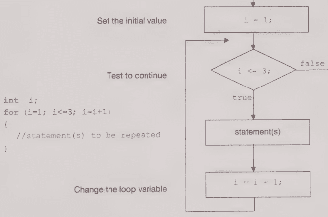

图 5.2 执行三次的 `for` 循环。

### 5.2.1 使用循环变量的编程基础

以下代码包含一个 `for` 语句，它紧跟在其大括号后执行 500 次：

```java
int i;
for(i=1; i<=500; i=i+1)
{
    //需要重复的语句(s)
}
```

编写 `for` 语句时常见的错误有：

- 在 `for` 括号后放置分号
- 忽略初始条件后或继续条件后的分号，这两种会导致翻译错误
- 在需要重复多个语句时，忽略了在语句周围的大括号
- 在循环体内部修改循环变量，这将改变自动计数

当在右括号后编写一个分号时，该语句在语法上是正确的；然而，通常构成循环体的任何语句都不被视为循环的一部分（即在循环内部）。它们将默认为顺序执行，且每条语句只执行一次。当不编写大括号时，该语句在语法上也是正确的；然而，`for` 语句后的第一个语句是唯一被视为循环部分的语句。无论使用什么缩进，它都是唯一被重复的语句。

`for` 语句的通用语法及其执行路径分别位于图 5.3 的顶部和底部。

```java
for(initialization expression; condition to continue; increment)
{
    //需要重复的语句
}
```

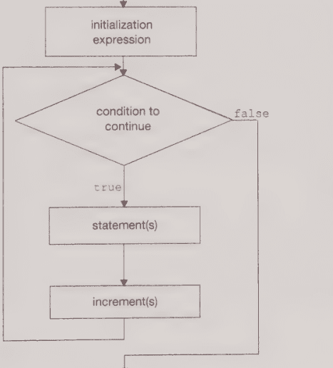

图 5.3 `for` 语句的通用语法及其执行路径。

除了循环变量外，初始化表达式、继续测试条件和增量可以包含所有其他用于在运行时调整语句流的变量。例如，以下代码段在一行中输出 10 到 50 的五倍法表中的值：

```java
int i;
int beginValue = 10;
int endValue = 50;
int tableValue = 5;

for(i=beginValue; i<=endValue; i=i+tableValue)
{
    System.out.print(i + " ");
}
```

图 5.4 展示了一个名为 `LoopCounting` 的控制台，它利用该语句的这一特性，从用户输入的起始值到指定的结束值，按指定的增量进行计数。图底部显示了用户提示和程序生成的输出。

输入的起始值、结束值以及用于计数的增量分别在图 5.4 的第 10、12 和 14 行被解析到变量 `start`、`end` 和 `increment` 中。这些变量被用于初始化表达式、继续条件以及从第 18 行开始的 `for` 语句。正如图 5.5 底部的输入和输出所示，程序用户输入 3 作为起始值，27 作为结束值，增量为 5。在输出值 23 后，循环变量变为 28 (=23+5)。因为 28 不小于或等于结束值 27，所以不输出循环 28。

输入提示和用户输入：

```text
Enter the starting value: 3
Enter the ending value: 27
Count by: 5
```

Outputs:

```text
Counting from 3 to 23 by 5s:
8
13
18
23
```

图 5.4 `ForCounting` 应用以及典型的输入输出。

第 18 行展示了一个我们之前没有讨论过的 `for` 语句的特性。它通过在赋值语句前加上关键字 `int`，将循环变量 `i` 声明为初始化表达式的一部分。这样做之后，循环变量的作用范围被局限于 `for` 语句，并随循环或其语句体结束。循环结束后，Java 内存管理器会回收分配给循环变量的存储空间，该变量的生命周期即宣告结束。如果在程序中循环语句之前或之后声明了另一个变量 `i`，那么 `for` 语句内部（第 18-21 行）对变量 `i` 的引用都将指向循环变量，而不是循环外的变量。这一特性确保了循环能够正确计数。

循环也可以用于递减计数到一个结束值。在这种情况下，循环变量被初始化为起始计数值，并在每次循环时递减。语句的布尔条件检查是否到达了结束值。以下代码段从 10 计数到 0：

```java
for(int i = 10; i>= 0; i--)
{
    System.out.println(i);
}
```

通常，初始化表达式和增量可以包含多个语句。在这种情况下，它们用逗号分隔，如下代码段所示。循环的执行路径如图 5.5 所示。

```java
int i, j, k;
for(i=1, j=10, k<= 3; i=j+1, j=k-1, k=i-3)
{
    //语句
}
```

### 5.2.2 for 应用

图 5.6 显示了一个图形应用，在浅灰色的棋盘上绘制第一行棋子，如图 5.7 所示。程序使用一个 `for` 循环来绘制棋盘格，然后使用另一个 `for` 循环在黑色格上绘制红色棋子。在 `draw` 方法中，图 5.6 的第 26 行使用环境的 `setBackground` 方法将游戏板颜色设置为灰色。第 29 行开始一个执行八次的循环。在循环的每次迭代中，使用当前颜色绘制黑色或红色棋盘。循环体中的第一个语句（第 31 行）将颜色设置为黑色，然后第 32 行使用模运算符判断循环变量 `col` 是否为偶数（`col % 2 == 0`）。如果是，则将颜色改为红色，从而绘制偶数格（2、4、6 和 8）。索引为棋盘宽度的计数算法位于第 37 行，用于计算下一个要绘制的棋盘格的 x 位置。

由于 `for` 语句的增量给循环变量加 2，该变量取值为 1、3、5 和 7。这些是第 44 行绘制的黑色格编号，用于计算每个列棋子的 x 位置。在此计算中，在列号乘以宽度之前要减去 1，因为棋子应该绘制在 x 值上。


```java
import java.awt.*;
import javax.swing.*;

public class CheckerRow extends JPanelAdapter {
    static CheckerRow ge = new CheckerRow();
    static GameBoard gb = new GameBoard(ge, "Checker Board");

    public static void main(String[] args) {
        showGameBoard(gb);
    }

    public void draw(Graphics g) {
        int boxX = 12;
        int boxY = 50;
        int boxWidth = 60;
        int boxHeight = 60;
        int checkerX = 20;
        int checkerY = 55;
        int firstCheckerCol = 1;
        Color borderColor = Color.BLACK;
        Color secondColor = Color.RED;

        gb.setBackground(Color.LIGHT_GRAY);
        //绘制棋盘格
        for (int col = 1; col <= 8; col++) {
            g.setColor(firstCheckerCol); //黑色
            if (col % 2 == 0) {
                g.setColor(secondColor); //红色
            } //结束 if
            g.fillRect(boxX, boxY, boxWidth, boxHeight);
            boxX = boxX + boxWidth;
        } //结束 for

        //绘制红色棋子
        g.setColor(Color.RED);
        for (int col = firstCheckerCol; col <= 8; col = col + 2) {
            checkerX = 20 + (col - 1) * boxWidth;
            g.fillOval(checkerX, checkerY, 40, 40);
        }
    }
}
```

图 5.6 `CheckerRow` 应用。

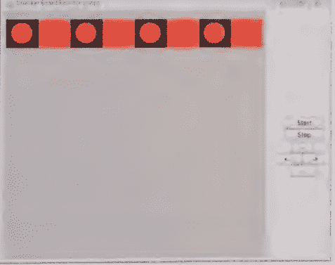

图 5.7 `CheckerRow` 应用的输出。

## 5.2.3 求和与求平均值算法

求和或累加算法与计数算法一样，都是计算机科学中的基础算法。这两种算法都用于大多数程序。求和算法的名称意味着它用于计算总数、总和或一组值。例如，它可以用于计算输入到程序的一组存款的总额，一旦知道了总额，就可以通过将总额除以存款数量来轻松确定平均存款金额。

求和与计数算法非常相似，区别在于：计数算法在每次执行时都会向计数器的当前值加上（或减去）常量增量，而求和算法在每次执行时都会将下一个要求和的项加上总数的当前值：

```text
计数算法：count = count + constantIncrement;
求和算法：total = total + newItem;
```

如果我们正在累加一组存款，变量 `newItem` 将包含下一笔存款。正如计数算法中的情况一样，赋值运算符左侧的变量名称可以是任何合法的变量名。同样，赋值运算符右侧也必须使用相同的变量名，且该名称应该反映其所存储的内容。例如，在计算新余额时：

```java
balance = balance + deposit;
```

所选的变量通常被称为求和或累加变量。在使用算法之前，会将该变量设置为一个初始值，即总和的当前（起始）值。例如，它可以可能是存款存款之前的银行余额。通常，这个值为零。正如计数算法一样，一旦设置了初始值，就会重复执行求加。

以下代码段累加从一到四的整数：

```java
sum = 0;                               
sum = sum + 1;                          
sum = sum + 2;                          
sum = sum + 3;
sum = sum + 4;

// 等价于
int sum = 0;
for(int i = 1; i <= 4; i = i + 1)
    sum = sum + i;
```

### 5.2.4 求和循环应用

该程序接受指定数量的存款输入，并使用累加算法（第 25 行）计算其总和。要处理的存款数量在第 17 行输入，然后解析出的值被用于第 21 行开始的 `for` 语句的布尔条件中，以处理相应数量的存款。

在循环开始之前，累加变量 `total` 初始化为 0（第 20 行）。在第 21 行开始的循环的每次迭代中，都会输入并解析一个新的存款。然后，在第 25 行使用该算法将新存款添加到之前输入的存款总和中。在处理完所有存款后，将计算出新余额（第 27 行）和平均存款（第 28 行）。第 15–16 行输出初始余额，第 30–34 行将存款总和、平均存款和新余额输出到系统控制台。

```java
import javax.swing.JOptionPane;
import java.text.NumberFormat;
import java.util.Locale;

public class TotalingLoop {
    public static void main(String[] args) {
        double balance = 1000.24;
        int numOfDeposits;
        double deposit, total, newBalance, averageDeposit;
        String input;
        NumberFormat us = NumberFormat.getCurrencyInstance(Locale.US);
        System.out.println("Your beginning balance is: " + us.format(balance));
        input = JOptionPane.showInputDialog("How Many Deposits?");
        numOfDeposits = Integer.parseInt(input);
        total = 0.0;
        for(int i = 1; i < numOfDeposits; i++) {
            input = JOptionPane.showInputDialog("Enter a deposit");
            deposit = Double.parseDouble(input);
            total = total + deposit;
        }
        balance = balance + total;
        averageDeposit = total / numOfDeposits;
        System.out.println("The total of the " + numOfDeposits + " deposits is: " + us.format(total));
        System.out.println("The average deposit was: " + us.format(averageDeposit));
        System.out.println("Your new balance is: " + us.format(balance));
    }
}
```

| 输入 |
| :--- |
| 3 |
| 20.10 |
| 30.20 |
| 40.30 |

输出

```text
Your beginning balance is: $1,000.24
The total of the 3 deposits is $90.60
The average deposit was: $30.20
Your new balance is: $1,090.84
```

图 5.8 应用程序 `TotalingLoop` 及其典型的输入和输出。

## 5.3 格式化数值输出：第二次处理

在第 2 章（第 2.10 节）中简要讨论了使用 `DecimalFormat` 类来提高数值输出的可读性。在本节中，我们将扩展该讨论，并讨论 `NumberFormat` 和 `Locale` 类的使用，这些类被用于格式化图 5.8 所示程序产生的货币输出。我们将从介绍用于将数值输出格式化为货币的技巧开始。

> 所有数值格式化都会四舍入数值的小数部分，并且数值整数部分中的所有数字始终包含在数字的格式化版本中。

### 5.3.1 货币格式化

图 5.8 所示程序产生的货币输出被格式化为美国货币。有一个前导数字和一个小数点将美元金额与分隔开，分显示为小数点右侧两个四舍五入后的数字。此外，美元金额中使用逗号作为千分位分隔符。如果输出是负数，它将被包含在括号中。所有格式化都符合美国货币在金融世界的显示方式，并使输出单位可识别为美元和分。

`NumberFormat` 类的方法 `getCurrencyInstance` 被用于图 5.8 的第 12 行，以创建一个名为 `us` 的货币格式化对象。该方法接受一个参数，该参数几乎是 `Locale` 类中预定义的静态常量之一。正如类名所示，该参数指定了与格式化对象关联的格式区域（locale）。第 13 行使用常量 `Locale.US`，指定与对象 `us` 关联的货币格式化为美国货币：美元和分。

该对象用于第 15-16 行和第 30-33 行，以调用 `NumberFormat` 类的 `format` 方法。该方法将传递给它的数值值通过所调用对象关联的格式转换为字符串。结果是，程序产生的数值输出被格式化为美国货币。

通过更改第 13 行传递给 `getCurrencyInstance` 方法的参数，可以使程序产生的数值输出符合金融世界使用的其他格式。例如，以下代码片段产生两个输出，分别被格式化为英镑（英国货币）和欧元（欧盟货币）。该代码片段的输出如代码正下方所示。


## 第 5 章 - 重复语句：循环

该程序接受指定数量的存款输入，并使用累加算法（第 25 行）计算其总和。要处理的存款数量在第 17 行输入，然后解析出的值被用于第 21 行开始的 `for` 语句的布尔条件中，以处理相应数量的存款。

在循环开始之前，累加变量 `total` 初始化为 0（第 20 行）。在第 21 行开始的循环的每次迭代中，都会输入并解析一个新的存款。然后，在第 25 行使用该算法将新存款添加到之前输入的存款总和中。在处理完所有存款后，将计算出新余额（第 27 行）和平均存款（第 28 行）。第 15–16 行输出初始余额，第 30–34 行将存款总和、平均存款和新余额输出到系统控制台。

```java
import javax.swing.JOptionPane;
import java.text.NumberFormat;
import java.util.Locale;
public class TotalingLoop {
    public static void main(String[] args) {
        double balance = 1000.24;
        int numOfDeposits;
        double deposit, total, newBalance, averageDeposit;
        String input;
        NumberFormat us = NumberFormat.getCurrencyInstance(Locale.US);
        System.out.println("Your beginning balance is: " + us.format(balance));
        input = JOptionPane.showInputDialog("How Many Deposits?");
        numOfDeposits = Integer.parseInt(input);
        total = 0.0;
        for(int i = 1; i < numOfDeposits; i++) {
            input = JOptionPane.showInputDialog("Enter a deposit");
            deposit = Double.parseDouble(input);
            total = total + deposit;
        }
        balance = balance + total;
        averageDeposit = total / numOfDeposits;
        System.out.println("The total of the " + numOfDeposits + " deposits is: " + us.format(total));
        System.out.println("The average deposit was: " + us.format(averageDeposit));
        System.out.println("Your new balance is: " + us.format(balance));
    }
}
```

### 图 5.8 应用程序 TotalingLoops 及其典型的输入和输出

| 输入 |
| :--- |
| 3 |
| 20.10 |
| 30.20 |
| 40.30 |

**输出**

```text
Your beginning balance is: $1,000.24
The total of the 3 deposits is $90.60
The average deposit was: $30.20
Your new balance is: $1,090.84
```

## 5.3 格式化数值输出：第二次处理

在第 2 章（第 2.10 节）中简要讨论了使用 `DecimalFormat` 类来提高数值输出的可读性。在本节中，我们将扩展该讨论，并讨论 `NumberFormat` 和 `Locale` 类的使用，这些类被用于格式化图 5.8 所示程序产生的货币输出。我们将从介绍用于将数值输出格式化为货币的技巧开始。

> 所有数值格式化都会四舍五入数值的小数部分，并且数值整数部分中的所有数字始终包含在数字的格式化版本中。

### 5.3.1 货币格式化

图 5.8 所示程序产生的货币输出被格式化为美国货币。有一个前导数字和一个小数点将美元金额与分隔开，分显示为小数点右侧两个四舍五入后的数字。此外，美元金额中使用逗号作为千分位分隔符。如果输出是负数，它将被包含在括号中。所有格式化都符合美国货币在金融世界的显示方式，并使输出单位可识别为美元和分。

`NumberFormat` 类的方法 `getCurrencyInstance()` 被用于图 5.8 的第 12 行，以创建一个名为 `us` 的货币格式化对象。该方法接受一个参数，该参数几乎是 `Locale` 类中预定义的静态常量之一。正如类名所示，该参数指定了与格式化对象关联的格式区域。第 13 行使用常量 `Locale.US`，指定与对象 `us` 关联的货币格式化为美国货币：美元和分。

该对象用于第 15–16 行和第 30–33 行，以调用 `NumberFormat` 类的 `format()` 方法。该方法将传递给它的数值值通过所调用对象关联的格式转换为字符串。结果是，程序产生的数值输出被格式化为美国货币。

通过更改第 13 行传递给 `getCurrencyInstance()` 方法的参数，可以使程序产生的数值输出符合金融世界使用的其他格式。例如，以下代码片段产生两个输出，分别被格式化为英镑（英国货币）和欧元（欧盟货币）。该代码片段的输出如代码下方所示。

```java
double price = 1234567.89;
NumberFormat uk = NumberFormat.getCurrencyInstance(Locale.UK);
NumberFormat france = NumberFormat.getCurrencyInstance(Locale.FRANCE);

System.out.println(uk.format(price));
System.out.println(france.format(price));
```

**输出**

```text
£1,234,567.89
€1,234,567.89
```

### 默认区域设置

图 5.8 第 13 行调用的 `getCurrencyInstance()` 方法重载了。它接受一个参数，该参数几乎是 `Locale` 类中预定义的静态常量之一。正如类名所示，该参数指定了与格式化对象关联的格式区域。第 13 行使用常量 `Locale.US`，指定与对象 `us` 关联的货币格式化为美国货币：美元和分。

### 5.3.2 DecimalFormat：再次观察

`DecimalFormat` 方法在第 2.10 节中简要讨论过，它们也可以用于格式化数值输出。通常，当数值不是货币时使用这些方法。

与 `NumberFormat` 类一样，`DecimalFormat` 类包含一个非静态方法，返回传递给它的数值值的格式化字符串。该方法是通过 `DecimalFormat` 对象调用的。该构造函数传递一个字符串参数，即格式化字符串。在第 2.10 节中，我们使用了 `"#,###.##"` 来产生一个小数点左侧有三位数字并格式化两位精度的数字。

其他字符可以用于格式化字符串以产生不同的输出形式。

#### 前导零和尾部零

在格式化字符串的小数点周围插入零会为格式化值添加前导零或尾部零。例如，当要格式化的数值没有整数部分时（例如 `.254`），在格式化字符串的小数点左侧插入零会将该值格式化为 `0.254`。在小数点右侧添加零会将值 `167` 格式化为 `167.0`。如果数字具有小数部分或整数部分，那么数值中小数点相邻的数字始终出现在格式化值中。

下面的代码片段将数值格式化为一个前导零和两个尾部零，并产生下文所示的输出。第三个输出被四舍五入到指定的两位精度。

```java
double n1 = .2;
double n2 = 167.0;
double n3 = 1.4672;
DecimalFormat ltz = new DecimalFormat("##.00");
System.out.print(ltz.format(n1) + " " + ltz.format(n2) + " " + ltz.format(n3));
```

**输出**

```text
0.20 167.00 1.47
```

#### 百分比

以百分号结尾的格式化字符串用于将数值格式化为百分比。该值将被乘以 100，并在格式化方法的字符串右侧添加一个百分号。例如，值 `0.254` 将被格式化为 `25.4%`。下面的代码段将数值格式化为具有一个前导零和一个末尾零的百分比。其产生的输出显示在代码下方。

```java
double n1 = 0.0022;
double n2 = 0.16;
DecimalFormat pct = new DecimalFormat("###.0%");
System.out.println(pct.format(n1) + " " + pct.format(n2));
```

**输出**

```text
0.2% 16.0%
```

#### 科学计数法

科学计数法是将数值格式化为尾数后面跟着指数的形式。通常，尾数和指数由字母 `E` 分隔。尾数包含数值的数字，其小数点向左或向右移动。要确定数值，将尾数乘以 10 的指数次幂。例如，`23.971E2` 代表数值 `2,397.1`。

以字符 `E` 结尾并后跟许多用于在指数中显示的前导零的格式化字符串，用于以科学计数法格式化数值。格式化字符串中字母 `E` 后必须至少包含一个零。格式化后的值将包含由字母 `E` 分隔的尾数指数。尾数使用格式化字符串中字母 `E` 左侧的部分进行格式化，该部分应包含零和小数。

下面的代码段将数值格式化为科学计数法，尾数显示在小数点左侧一位数字。其产生的输出显示在代码下方。

```java
double n1 = 0.00000215;
double n2 = 16123067533.1;
DecimalFormat sn = new DecimalFormat("0.0000E0");
System.out.println(sn.format(n1) + " " + sn.format(n2));
```

**输出**

```text
2.1500E-6 1.6123E10
```

> 数值的科学计数法版本将始终包含指数的所有数字。

表 5.1 总结了 `DecimalFormat` 类格式化字符串中使用的字符及其产生的格式。除非使用科学计数法，否则数值中整数部分的所有数字都将始终包含在格式化后的版本中。当使用科学计数法时，指数的所有数字始终会显示。

### 表 5.1 DecimalFormat 类的格式化字符及其含义

| 字符 | 产生的格式 | 格式化字符串示例 |
| :--- | :--- | :--- |
| `#` | 在此位置输出小数点；如果该处有数字，则在此处输出该数字 | `"#,###.##"` |
| `0` | 如果该处有数字，则在此处输出数字，否则输出零 | `"0.00"`（带一个前导零，两位精度） |
| `,` | 在需要时在此处输出逗号分隔符 | `"#,###.00"`（每三位输出一个逗号分隔符） |
| `%` | 将数值格式化为百分比（将数值乘以 100 并在右侧添加百分号） | `"###.0%"` |
| `E` | 以科学计数法输出数值 | `"0.0000E0"`（尾数格式化为 5 位数字；显示指数的所有数字） |

图 5.9 展示了如何使用 `DecimalFormat` 类中的方法产生输出。程序产生了四组输出，如图 5.10 所示。每组输出相同的数字：`n1`、`n2` 和 `n3`（第 15–33 行），使用不同的格式化字符串，这些字符串定义在第 7–10 行。

第一组输出每三位数字进行逗号分组。第二组和第三组使用前导零和末尾零，第三组的输出以百分比形式显示。第四组输出使用科学计数法。

第一组中的第一个数值 (`0.006`) 被截断了，因为它的格式化字符串（第 7 行）只包含三位精度。它包含一个前导零，因为除非使用科学计数法，否则所有数值都包含一个前导零。第一组中的两个输出不包含末尾零，因为在第 7 行使用了井号 (`#`) 来指定精度。

第二组中的输出包含末尾零，因为在它们的格式化字符串使用了零来指定精度（第 8 行）。最后，最后一组中第二个数值输出的指数 (`11`) 包含两个数字，尽管它的格式化字符串只指定了一位精度。

无论使用多少个零来指定指数的前导零，指数的所有数字始终都会显示。


# 使用 Java 的编程基础

```java
import java.text.DecimalFormat;
public class DecimalFormatClass {
    public static void main(String[] args) {
        DecimalFormat cs = new DecimalFormat("#,#####0.00"); // 逗号
        DecimalFormat lz = new DecimalFormat("0.000"); // 零
        DecimalFormat pct = new DecimalFormat("###.0%"); // 百分比
        DecimalFormat sn = new DecimalFormat("0.0000E0"); // 科学计数法
        double n1 = 0.00000215;
        double n2 = 16123067533.1;
        double n3 = 0.006;
        System.out.println(cs.format(n1) + " " + cs.format(n2) + " " + cs.format(n3));
        System.out.println(lz.format(n1) + " " + lz.format(n2) + " " + lz.format(n3));
        System.out.println(pct.format(n1) + " " + pct.format(n2) + " " + pct.format(n3));
        System.out.println(sn.format(n1) + " " + sn.format(n2) + " " + sn.format(n3));
    }
}
```

（注：根据 OCR 文本的上下文，我重构了代码块，因为原始片段是破碎的且包含了分离的变量声明。）

程序的输出为：

```
0.00 16,123,067,533.10 0.01
0.000 16123067533.100 0.006
0.0% 1612306753311.0% 0.6%
2.1500E-6 1.6123E10 6.0000E-3
```

上述文本代表了 OCR 片段中描述的程序逻辑。

```java
import edu.sjcny.gpvl.*;
import java.awt.Color;
import java.awt.Graphics;

public class CheckerBoard extends DrawableAdapter
{
    static CheckerBoard ge = new CheckerBoard();
    static GameBoard gb = new GameBoard(ge, "Nested For Loops");

    public static void main(String[] args) {
        showGameBoard(gb);
    }

    public void draw(Graphics g) {
        int xBox = 12;
        int yBox = 50;
        int boxWidth = 53;
        int boxHeight = 1;
        int firstCheckerCol = 1;
        int checkerX = 20;
        int checkerY = 55;
        Color first = Color.BLACK;
        Color second = Color.RED;
        Color temp;

        gb.setBackground(Color.LIGHT_GRAY);
        //Draw the checker board boxes
        for (int row = 0; row < 8; row++) //each row
        {
            for (int col = 0; col < 8; col++) //each column
            {
                g.setColor(first);
                if(col % 2 == 0) {
                    g.setColor(second);
                }
                g.fillRect(xBox, yBox, boxWidth, boxHeight);
                xBox = xBox + boxWidth;
            }
            yBox = yBox + boxHeight;
            xBox = 12;
        }
        temp = first; //swap the box colors
        first = second;
        second = temp;
    }
}
```

# 第5章 重复语句：循环 211

```java
for(int row =1; row <= 3; row++) //first three rows
{
    if (row % 2 == 0) //an even numbered
    {
        checkerX = checkerX - boxWidth;
        firstCheckerCol = 2;
    }
    setColor(Color.RED);
    for (int col = firstCheckerCol; col <= col + 2; col++)
    {
        //red checker locations
        checkerX = 20 + (col - 1) * boxWidth;
        fillOval(checkerX, checkerY, 40, 40);
    }
    checkerY = checkerY - boxHeight;
    checkerX = 20;
    firstCheckerCol = 1;
}
```

**图 5.11** 图形化程序 `Checker`。方格，且第44行将每行第一个框的x位置重置为12。在外层循环结束之前，第46–48行交换了奇数列和偶数列框的颜色。这将使得下一行每一列中绘制的方格颜色与上方行的方格颜色不同。

从第60行开始到第64行结束的的内部循环，与图5.6中第42–46行使用的代码相同，用于绘制一行的红色棋子。该循环嵌套在一个从第31行开始的外层循环中，该外层循环执行三次。外层循环每通过一次，内部循环就会绘制下一行棋子。在绘制完一行后，下一行棋子的y位置被计算并赋值给第65行的变量 `checkerY`。该变量中存储的值增加了内部循环下一次迭代中（第63行）用于绘制一行棋子时框的高度。

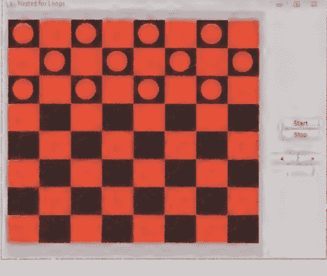

**图 5.12** 程序 `CheckerBoard` 产生的输出。

第66行将每行第一个框的x位置重置为12。第54行的if语句在偶数行时，只有奇数行（1和3）的方格在20处。当是偶数行时，`checkerX` 增加了框的宽度。第57行设置用于第60行的变量 `firstCheckerCol` 为2。

## 5.5 WHILE 语句

许多应用程序要求在布尔条件变为假时重复一组语句，而不是重复给定的已知次数。例如，程序可能会一直请求密码，直到输入正确的密码。在这种情况下，通常使用 `while` 或 `do-while` 语句。如果语句至少执行一次，则使用 `do-while` 语句。在本节将讨论 `while` 语句，`do-while` 语句将在第5.6节讨论。

### 5.5.1 while 语句的语法

`while` 语句的通用语法及其执行路径分别在图5.13的左侧和右侧所示：

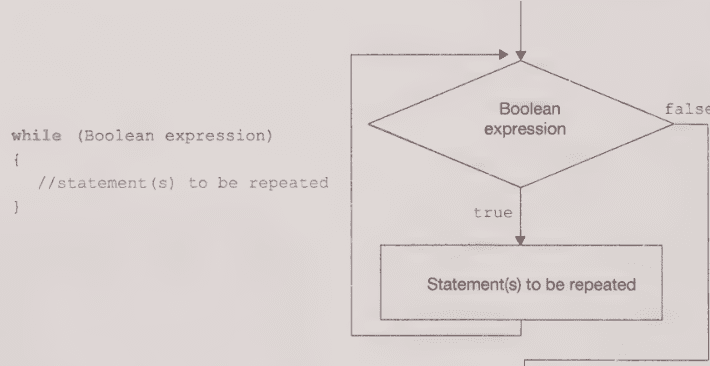

**图 5.13** while语句的语法和执行路径。

该语句以关键字 `while` 开始，后面跟着一个在括号内的布尔表达式，紧接着是一个包含要重复语句的代码块。虽然在5.2.1节中提到单个要重复的语句不需要编写在语句块中，但这样做是一种良好的编程习惯。

如图5.13右侧所示，块中的语句只要布尔条件为真就会一直重复。如果在执行语句时，布尔条件为假，则语句块将不会执行。

以下代码片段输出 1.2、2.3、3.4和4.5的平方根：

```java
double n = 1.2;
while(n != 5.6)
{
    System.out.println(Math.sqrt(n));
    n = n + 1.1;
}
```

*   忘记在循环代码块的末尾编写接受哨兵变量所有后续输入的语句
*   在循环代码块内部、处理语句之前编写接受哨兵变量所有后续输入的语句

在处理哨兵变量默认值的循环中，第一种错误是：如果默认值本身就是哨兵值，则循环将完全不执行。第二个错误会导致一旦进入循环就会无限循环，因为哨兵变量没有改变。当发生第三种错误时，第一个输入没有被处理。

图 5.14 展示的应用程序 `SentinelWhileLoop` 演示了代码模板的使用。它是图 5.8 中程序的哨兵循环版本，用于计算一组输入存款的总和和平均值。图 5.14 底部显示了典型的输入和输出。如之前讨论过的，如果存款数量不是第一个数据项，则会优于此版本。

按照 `while` 循环哨兵模板的逻辑，第 18 行接受哨兵变量输入的初始值。`while` 语句中第 19 行的布尔表达式使用该变量来决定是否执行语句的代码块。如果输入的不是哨兵值 (-1) 的其他任何内容，则执行循环语句。

由于需要计算平均值且用户不再需要输入存款数量，因此在第 23 行使用计数算法来统计处理的存款数量。计数变量 `numberOfDeposits` 在第 15 行初始化为零。与哨兵循环模板，循环代码块的最后一行（第 24 行）接受下一个输入值并将其存储在哨兵变量中。

```java
import java.swing.JOptionPane;
import java.text.NumberFormat;
public class SentinelWhileLoop {
    public static void main(String[] args) {
        double balance = 1000.24;
        int numberOfDeposits;
        double deposit, total, newBalance, averageDeposit;
        String input;
        NumberFormat us = NumberFormat.getCurrencyInstance();
        System.out.println("Your beginning balance was " + us.format(balance));
        numberOfDeposits = 0;
        total = 0.0;
        input = JOptionPane.showInputDialog("Enter a deposit, -1 to end");
        while (!input.equals("-1"))
20 {
21 deposit = Double.parseDouble(input);
22 total = total + deposit;
23 numOfDeposits++;
24 input = JOptionPane.InputDialog("Enter a deposit, -1 to end");
25 }
26
27 balance = balance + total;
28 averageDeposit = total / numOfDeposits;
29
30 System.out.println("The total of the " + numberOfDeposits +
31 " deposits is " + us.format(total));
32 System.out.println("The average deposit was: " +
33 us.format(averageDeposit));
34 System.out.println("Your new balance is: " + us.format(balance));
35
36 }
}
```

输入

```
20.10
30.20
40.30
-
```

输出

```
Your beginning balance was: $1,000.24
The total of the 3 deposits is $90.60
The average deposit was: $30.20
Your new balance is: $1,090.84
```

**图 5.14** 控制台应用程序 `SentinelWhileLoop` 及其产生的输出。

另一种常用的 `while` 循环形式是在接受每个输入后进行解析。图 5.14 所示程序中这种 `while` 循环哨兵模板的适应版本代码如下：

```java
input = JOptionPane.InputDialog("Enter a deposit, -1 to end");
deposit = Double.parseDouble(input);
while (deposit != -1.0) {
  //执行循环处理的语句(s)，减去解析部分
  input = JOptionPane.InputDialog("Enter a deposit, -1 to end");
  deposit = Double.parseDouble(input);
}
```

### 5.5.3 检测文件结束

通常，大型数据集存储在磁盘文件中，处理这些数据集的程序从磁盘文件中读取数据，直到检测到哨兵值。由于哨兵值通常被选择为数据集值范围之外的值，大多数哨兵值在不同应用程序之间是不同的。对于磁盘数据文件，有一个适用于所有数据集的哨兵值：放置在每个文件末尾的文件结束 (EOF) 标记。

在第 4 章第 4.8.1 节中，我们使用了 `Scanner` 类中的方法从文本文件中读取数据。`Scanner` 类还包含一个名为 `hasNext` 的方法，可以用于检测文件中的 EOF 标记。该方法没有参数，并在遇到 EOF 标记时返回 `false`。以下代码片段使用哨兵循环从存储在 C 盘根目录下的磁盘文件 `data.txt` 读取所有整数值，并将值输出到系统控制台。`hasNext` 方法返回的值存储在哨兵变量 `EOF` 中。

```java
int dataItem;
File fileObject = new File("c:/data.txt");
Scanner inputFile = new Scanner(fileObject);
boolean EOF; //哨兵变量
```

```java
EOF = inputFile.hasNext(); //获取下一个哨兵
while (EOF) { //还有数据
    dataItem = inputFile.nextInt();
    System.out.println(dataItem);
    EOF = inputFile.hasNext(); //获取下一个哨兵
}
inputFile.close();
```

以下代码片段是一个更简洁且常用的 EOF 哨兵循环版本：

```java
int dataItem;
File fileObject = new File("c:/data.txt");
Scanner inputFile = new Scanner(fileObject);

while (inputFile.hasNext()) { //还有数据
    dataItem = inputFile.nextInt();
    System.out.println(dataItem);
}
inputFile.close();
```

图 5.15 展示了图 5.14 所示程序的修改版本，该程序处理了从键盘输入的一组存款。新版本的程序使用文件的 EOF 标记作为哨兵值从磁盘文件中读取存款。图 5.15 底部给出了一组文件输入和相应的程序输出。

## 5.6 DO-WHILE 语句

```java
do
{
  //需要重复执行的语句
} while (Boolean expression);
```


该语句以 `do` 关键字开头，随后是循环语句块。`while` 关键字和括号内的语句布尔表达式位于语句块的右括号 `}` 之后。将 `while` 关键字和重复的布尔表达式与右括号放在同一行上是一种良好的编程风格，因为可以提高语句的可读性。`do-while` 语句以分号结束，分号位于终止布尔表达式的右括号之后。

如图 5.16 右侧所示，循环语句将至少执行一次，因为它们在测试布尔条件之前就已经执行了。执行后，语句将重复执行，直到布尔条件变为 `false`。`do-while` 循环被称为“后测试循环”，因为终止循环的测试是在循环语句至少执行一次后进行的。

在编写 `do-while` 语句时最常见的语法错误有：

*   在 `do` 关键字后放置分号
*   忽略了在布尔表达式后包含分号
*   当重复多条语句时，忽略了编写语句周围的大括号

所有这些编码错误都是语法错误，并由 Java 翻译器检测和报告。在编写 `do-while` 循环时，良好的编程习惯是先编写以下代码片段，然后添加要重复的语句和布尔条件，即使只需要重复一条语句。

```java
do
{
}
while ( );
```

## 第 5 章 重复语句：循环 21


# 第 5 章 重复语句：循环

编写此语句时最常见的逻辑错误是：在循环的某些重复过程中，语句块内部的语句没有将布尔表达式变为 `false`。在这种情况下，一旦循环开始就永远不会结束，被称为无限循环。例如，以下代码序列是一个无限循环，因为循环语句没有改变字符串变量 `password`，而该变量被用于布尔条件。用户输入的密码被错误地存储在字符串对象 `pw` 中，导致每次通过循环时字符串 `password` 保持不变。

```java
String password = "";
String pw;
{
    pw = JOptionPane.showDialog("Enter The Password");
}while(!password.equals("Mercury"));
```

以下代码片段是 `do-while` 语句的正确编码，用于验证是否输入了正确的密码 `Mercury`。

```java
String password = "";
do{
    password = JOptionPane.showDialog("Enter The Password");
}while(!password.equals("Mercury"));
```

当循环的布尔表达式编写不当时，也会发生无限循环。在下面的代码片段中，布尔运算符 `!` 被遗漏了，任何正确密码 `Mercury` 以外的密码都会被接受。

```java
String password = "";
do{
    password = JOptionPane.showDialog("Enter The Password");
}while(password.equals("Mercury"));
```

## 5.7 break 和 continue 语句

`break` 和 `continue` 语句用于 `for` 或 `do-while` 循环的代码块内部，以改变循环的执行路径。正如 `break` 语句终止 `switch` 语句的执行一样，`break` 语句也可以用于终止循环。执行将继续后续其后的语句。

当在循环内部执行 `break` 语句时，循环的执行终止。

当在循环内部执行 `continue` 语句时，当前循环迭代将终止，循环体中其后的语句在本次迭代中将不再执行。执行将继续测试循环语句的布尔条件。当在 `for` 循环内部执行 `continue` 语句时，循环变量在测试布尔条件之前会增加。

### 注意

当在循环内部执行 `continue` 语句时，当前循环迭代将终止。

为了说明这两个语句的用法，下面的代码片段为玩家提供了三次机会输入密码“Mars”以进入游戏。`break` 语句用于在输出“Look up your password”消息后退出循环。`continue` 语句用于跳过对话框输出和 `break` 语句，直到输入了三个错误的密码。

```java
int count = 1;
String password = "";
do {
    if(count <= 3) {
        password = JOptionPane.showDialog("Enter The password");
        count++;
        continue;
    }
    JOptionPane.showMessageDialog(null, "Look up your password");
    break;
}while(!password.equals("Mars"));
```

## 5.8 使用哪种循环语句

当已知循环重复的次数时，应该使用 `for` 语句。循环重复的次数在当时已知（例如输入 100 个项目），也可能未知。在这两种情况下，`while` 语句都是首选的循环。

当未知循环执行的次数时，优先使用 `do-while` 循环。表 5.2 总结了选择循环语句的标准。

| 是否知道循环执行的次数 | 循环语句 |
|---|---|
| 否，且存在循环体不应执行的情况 | while |
| 否，且循环体应至少执行一次 | do-while |

在循环内部使用 `break` 语句后，循环语句之间的界限变得模糊。例如，为了计算 100 个项目的平均值，大多数程序员会使用 `for` 循环。

该应用程序也可以使用首选的 `while` 循环，如下所示：

```java
int count = 1;
double total = 0;
double average;
String sItem;
while (count <= 100)
{
    sItem = JOptionPane.showDialog("Enter an item");
    total = total + Double.parseDouble(sItem);
    count++;
}
average = total / 100;
System.out.println("The average of the 100 items is: " + average);
```

如果在该应用程序中使用 `while` 循环且我们在循环体中忽略了增加计数器（`count++`），循环将变成无限循环。如果我们使用 `for` 循环并在 `for` 语句的第一行中忽略了增加计数器，翻译器会提醒我们这一疏忽。

考虑一个在输入 -1 或输入 100 个项目为止对汇总输入的程序。大多数程序员会为该应用程序使用 `while` 循环。然而，可以使用包含 `break` 语句的 `for` 循环来编码。

```java
double total = 0;
String sItem;

for(int i = 1; i <= 100; i++)
{
    sItem = JOptionPane.showDialog("enter an item");
    if(sItem.equals("-1"))
    {
        break;
    }
    total = total + Double.parseDouble(sItem);
}
System.out.println("The total of the items is: " + total);
```

当使用此 `for` 循环时，看起来循环将始终执行 100 次。然而，当 `break` 语句执行时，循环会在 100 次迭代之前终止。从代码可读性的角度来看，下面的 `while` 循环是该应用程序的首选循环语句，因为 `while` 语句的第一行清楚地说明了终止它的条件。

```java
int count = 1;
double total = 0;
String sItem;
sItem = JOptionPane.showInputDialog("enter an item, or -1");
while (!sItem.equals("-1") && count <= 100) // tests both count
{
    total = total + Double.parseDouble(sItem);
    count++;
    sItem = JOptionPane.showInputDialog("enter an item, or -1");
}
System.out.println("The total of the items is: " + total);
```

## 5.9 Random 类

伪随机数及其在计算机程序中的应用，以及通过 `Math` 类的 `random` 方法生成它们的能力已经在第 2 章第 2.6.4 节中讨论过。`Random` 类中的方法也可以生成伪随机数。事实上，这些方法的效果比 `Math` 类的 `random` 方法更好，因为 `random` 方法调用了 `Random` 类的方法来生成数字。

表 5.3 Random 类的构造函数及其用于生成伪随机数的方法。每当这些方法被调用时，它们都会返回随机数序列中的下一个数。`Random` 类中的对象被用于调用这些方法，该对象是使用该类的构造函数之一创建的。

### 表 5.3 Random 类方法

| 方法 | 说明 | 编码示例 |
| --- | --- | --- |
| `Random()` | 根据当天的时间种子值创建一个 Random 对象 | `Random ro = new Random();` |
| `Random(long seed)` | 根据传递给它的种子参数创建一个 Random 对象 | `Random ro = new Random(675);` |
| `nextDouble()` | 返回范围在: 0.0<=randomNumber<1.0 之间的下一个伪随机浮点数 | `double rn = ro.nextDouble();` |
| `nextInt()` | 返回 int 原型类型范围内的下一个伪随机整数 | `int rn = ro.nextInt();` |
| `nextInt(int max)` | 返回从 0 到 max 小 1 范围内的下一个伪随机整数 | `int rn = ro.nextInt(20);` |

当使用单参数构造函数创建对象时，方法生成的数字序列基于传递给构造函数的整数参数，该参数被称为种子值（seed）。当使用无参数构造函数创建对象时，方法生成的数字序列基于当天的时间，因为种子值默认设置为以毫秒表示的实时时钟值。使用相同种子值的对象生成的数字序列将是相同的。

当希望在每次运行程序时生成相同的伪随机数序列时，就会使用单参数构造函数。相反，当希望生成一个很少重复的伪随机数序列时，就会使用无参数构造函数，因为程序必须在当天的同一时刻才能生成相同的数字序列。

与 `Math` 的 `random` 方法一样，`nextDouble` 方法生成并返回范围在 0.0 <= randomNumber <= 1.0 之间的随机数（double）。可以使用以下赋值语句（以及示例声明）生成范围在：min <= randomNumber <= max 之间的浮点数：

```java
randomObject2 = new Random(98765);
randomNumber = min + randomObject2.nextDouble() * (max - min);
```

以下代码序列输出一个范围在 20.0 <= randomNumber <= 50.0 之间的伪随机数序列。这段代码在程序两次执行期间生成相同数字序列将是非常不常的，因为该序列的种子值是毫秒计的当天时间。（Random 对象是使用无参数构造函数创建的。）或者，也可以使用单参数构造函数来生成可重复的数字序列。

```java
double randomNumber;
double min = 20.0;
double max = 50.0;
randomObject2 = new Random(); // 当天时间种子值
for(int i = 1; i<=10; i++) {
  randomNumber = min + randomObject2.nextDouble() * (max - min);
  System.out.println(randomNumber);
}
```

如表 5.3 所示，`nextInt` 方法有两个版本，用于生成并返回随机整数（int 类型）。无参数版本返回 int 变量全范围内的伪随机数（见表 2.1）。

`nextInt` 方法的单参数版本用于生成整数序列，每个整数都在指定的范围内。从方法返回的数字范围是 0 到传递给它的参数减 1。以下代码生成 0 到 9 之间的伪随机数：

```java
randomObject2 = new Random();
randomNumber = randomObject2.nextInt(10);
```

该方法的使用可以泛化。以下代码序列输出 3 到 6（包含）范围内的十随机整数。变量 `max` 和 `min` 的初始值指定了序列中生成的最低和最高数字。每次运行此代码，都会生成该序列（5, 5, 5, 4, 3, 5, 5, 3, 6, 4），因为使用了单参数构造函数来创建 Random 对象。

```java
int randomNumber;
int min = 3;
int max = 6;
Random randomObject1 = new Random(98765);//可重复的随机集

for(int i = 1; i<=10; i++) {
    int randomNumber = min + randomObject1.nextInt(max - min + 1);
    System.out.println(randomNumber);
}
```

## 5.10 增强 for 语句

增强 for 语句是 `for` 循环的另一种语法，用于获取数组中的所有元素。在循环执行期间，数组的元素不能被修改，因此其使用是有限的。它可以用于输出或汇总数组元素。

该语句的语法所示，其中 `anElement` 是变量，其类型 `aType` 是数组元素的类型：

```java
for( aType anElement: arrayName )
{
// 使用变量 anElement 的语句
}
```

例如，如果数组是 `String` 对象的数组，语句将编写如下：

```java
for( String anElement: arrayName )
{
// 使用变量 anElement 的语句
}
```

冒号始终位于变量 `anElement` 之后。如果循环内只有一个执行语句，则可以不编写大括号，但包含它们是良好的编程习惯。

循环执行的次数始终等于数组的长度。在上面的例子中为 `arrayName.length`。在循环执行期间，变量 `anElement` 按照升序假设数组中每个元素的值，从第一个元素（循环的第一次迭代）开始，一直到最后一个元素（循环的最后一次迭代）结束。下面所示的两个循环是等价的，并且都会产生系统控制台输出 Nora Ryan

```java
String[] arrayName = {"Nora", "Ryan", "Logan"};

for(String anElement: arrayName )
{
    System.out.print(anElement + " ");
}

System.out.println();

for(int i = 0; i < 3; i++)
{
    System.out.print(arrayName[i] + " ");
}
```

在循环体内部，增强 for 语句中使用的变量（例如 `anElement`），可以在任何语法上正确使用该类型变量的地方。增强 for 循环的一个优点是它不会产生 `ArrayIndexOutOfBounds` 错误，因为它不使用循环变量来访问数组元素。其缺点是无法在循环内部更改数组的元素。我们将在第 13 章“泛型”中看到增强 `for` 语句更具实用的用法。

## 5.11 章节总结

许多应用程序都需要对语句块中的语句进行重复，在本章中，我们讨论了执行这种重复的三方法：for 循环、while 循环和 do-while 循环。当语句重复的次数已知时，for 循环是一种自动计数循环。do-while 循环和 while 循环在布尔条件变为假时结束，它们通常被用于检测所处理数据的的哨兵值。每当循环块至少应执行一次时，使用 do-while 循环；而 while 循环是一种更通用的循环，可以用于大多数应用程序。

for 循环的控制变量用于控制迭代的次数。语句的初始化表达式设置其初始值。在每次循环迭代的结束时，会执行递增表达式，它通常会改变循环变量的值。for 循环和 while 循环被称为预测试循环：它们在循环开始时测试布尔条件以决定是否继续；do-while 循环是后测试的，在迭代结束时测试其条件。

求和或汇总算法是一种基于循环的算法，因为它通过反复将值加到现有的小计并将结果作为新的小计对一组项目求和。其模板为：`total = total + newItem`。循环每次运行时，变量 `newItem` 的值都会加到 `total`，这通常由用户输入或从磁盘文件读取。在汇总循环开始之前，变量 `total` 初始化为零。计数算法可以在循环语句内部使用，计算循环执行的次数，并可以分为计算总和，以确定求和值的平均值。

当待处理的数值输入未知时，通常使用哨兵值来终止循环。Java 的两个语句 `break` 和 `continue` 允许我们控制循环体内所有或部分语句的执行次数。当循环内执行 `break` 时，循环将终止。`continue` 语句可结束循环的当前迭代，当条件规定在当前迭代中跳过循环块中的剩余语句时，它非常有用。当使用循环从文件中获取并处理未知数量的项目时，可以使用 Java 的文件结束（EOF）字符或 `Scanner` 类的 `hasNext` 方法作为哨兵来终止循环。

嵌套循环用于重复基于循环的算法。示例包括计算 10 个成绩的平均值并对 20 个学生重复此操作，或处理 100 名跑步者的比赛时间集合。嵌套循环在创建二维图形时特别有用，这些图形由许多相同重复形状的实例组成，例如棋盘上八行八个正方形。

`Random` 类的 `nextInt` 和 `nextDouble` 方法可以用于生成随机整数或实数，并在循环内部用于生成一组随机数。`nextInt` 方法比 `Math` 类的 `random` 方法更易用，因为它返回的是 `int` 类型范围内或指定范围内的整数。这使得它成为生成游戏板像素位置的理想选择。此外，当使用该类的单参数构造函数创建 `Random` 对象调用这些方法时，它们会生成一个可重复的伪随机数序列。这对于要求每次启动都具有相同起点的应用程序特别有用，并且在图形调用方法内部生成随机数时总是会使用。

`DecimalFormat` 类中的方法可以用于在数值输出中插入前导/后置零和逗号，指定精度，并将输出转换为百分比或使用科学计数法显示。`NumberFormat` 和 `Locale` 类中的方法用于产生依赖于区域的货币格式，用于金融和国际应用程序。

我们对这些语句的知识将在第 6 章得到扩展，该章将涵盖数组的概念，循环被用于解锁数组的力量。此外，在下一章，我们将看到如何将循环与数组，以便我们输入、输出和处理大型数据集。

## 知识练习


# 判断对错

a) `while` 循环体始终将至少执行一次。

b) `for` 循环是一种自动计数循环，应在重复次数已知的地方使用。

c) 哨兵是一个用于终止循环的数据值。

d) `do-while` 循环将一直持续，直到 `while` 语句中的布尔表达式变为真。

e) `while` 循环是后测试循环。

f) 检查 EOF 条件可以控制循环。

g) 嵌套循环是循环中的循环。

h) 每一个 `while` 循环都可以在不使用 `break` 语句的情况下写成 `for` 循环。

i) 每一个 `for` 循环都可以写成 `while` 循环。

j) `break` 语句结束循环的当前迭代。

k) `for` 循环在布尔条件变为真时结束。

l) `continue` 语句可以编写在任何循环内部。

m) `while` 循环括号后加分号可能会导致无限循环。

n) `do-while` 循环的语句块可能不执行。

o) `for` 循环可以设计为通过递减控制变量来倒计时。

p) 循环可以用于验证用户输入，或给用户另一个机会输入输入错误的值（例如密码）。

## 2. 写一个循环，在控制台上输出从 20 到 100 的整数，并在每个数字旁边输出相应的术语（奇数或偶数）。

## 3. 写一个循环，向消息框输出从 1 到 n 的整数，其中 n 是插入。

## 4. 考虑以下代码：

```java
int i = 10;
int sum = 0;
while (i <= 100)
{
    sum += i;
}
```

a) 循环执行多少次？

b) 写一个等效的 `for` 循环。

c) 写一个等效的 `do-while` 循环。

## 5. 考虑以下代码：

```java
int i = 1;
while (i != 20)
{
    i += 2;
}
```

a) 该循环会终止吗？如果没有，为什么？

b) 它输出什么？

## 6. 考虑以下代码：

```java
int num = 4;
for (i = 2; i <= 7; i++)
{
    System.out.println("Number " + num);
    num += i;
}
```

a) 执行两次后 `num` 的值是多少？

b) 循环体执行多少次？

c) 第四次输出什么？

d) 什么导致了循环终止？

## 7. 考虑以下代码：

```java
int x = 11;
while (x > 0)
{
    x -= 3;
    System.out.println(x);
}
```

a) 给出输出

b) 写一个等效的 `for` 循环

## 8. 写一个输入验证循环，要求用户输入零到五范围内的整数，如果超出范围则显示错误，并给用户无限次机会。

## 9. 写一个输入验证循环，要求用户输入零到五范围内的整数，如果超出范围则显示错误，并给用户最多三次机会。

## 10. 解释 `while` 循环和 `do-while` 循环的路径差异。

## 11. 给出一个代码片段，每次执行时产生以下输出：

a) 0 到 500 范围内不同的随机整数

b) 0 到 500 范围内相同的随机整数

c) 7 到 500 范围内相同的随机整数

d) min 到 max 范围内的随机整数

## 12. 给出声明和输出语句，显示存储在 `double` 变量 `balance` 中的值，格式化如下。同时给出格式化输出。

a) 货币

b) 一个前导零和一个后置零，小数点左侧每三位有一个逗号

c) 四位精度的科学计数法

d) 两个后置零，只有当余额包含小数部分时才有前导零

e) 西班牙货币

# 编程练习

## 1. 写一个程序，使用 `for` 循环计算并输出从 n 到 1 的整数乘积（n 的阶乘）到消息框。例如，当 n = 4 时，输出为 24 = 4 * 3 * 2 * 1。n 的值将由用户通过输入对话框输入，输出应适当注释。

## 2. 你被 TravelStars 聘用，你的任务是制作一个直方图来表示旅行者对各种酒店的评分。你的程序将首先要求用户输入包含直方图中的酒店数量。然后，要求输入每个酒店的名称和星级评分（1 到 10 星之间的整数）。直方图应输出到系统控制台，格式如下：

| 酒店名称 | 评分 |
| :--- | :--- |
| 酒店 1 | ******** |
| 酒店 2 | ****** |
| 酒店 3 | ***** |
| 酒店 4 | ** |
| 酒店 5 | **** |

## 3. 编写一个程序，使用嵌套循环输出这些模式中的一个或多个（或创建一些你自己的）：

a) ***********

b) * c

c) *

**************

*

**************

************

************

## 4. 编写一个程序，询问用户其出生国家以及过去 12 个月每个月的工资。将每个月的工资以及该年的总薪按其当地货币的格式输出到系统控制台，并进行适当的注释。

## 5. 编写一个程序，向系统控制台输出 25 个随机整数，这些整数在用户指定的范围（最小值和最大值）内。

## 6. 编写一个程序来模拟掷两个骰子。每当用户点击消息框上的“确定”按钮时，生成两个 1–6 之间的输出结果，以及两个骰子的和。如果总和为 7 或 11，输出“You win（你赢了）”，否则输出“Better luck next time.（下次好运。）”

## 7. 编写一个图形应用程序，显示夜空中可见的 2500 颗星中的 650 颗。星星将绘制在游戏板上作为实心椭圆形，其直径为一到三像素之间的随机数。将有 400 颗白星、200 颗黄星和 50 颗红星，位于黑色游戏板上的 (x, y) 位置。你可以通过调用 `Component` 类的 `setBackground` 方法并向其传递黑色来更改游戏板的颜色。

## 8. 使用三个嵌套循环来绘制星星，编写出编程练习 7 中描述的应用程序。

## 9. 编写一个图形应用程序来模拟伯克船长（Captain Burke）前往太阳的旅程。在显示游戏板之前，船长被要求输入敏感密码“SS”（代表 Starship，星际舰）。输入 -1 时，输出其货物中每个物品的吨数。显示编程练习 7 或 8 中描述的游戏板，并在游戏板中心放置一个直径 50 像素的太阳。太阳将是 `HeavenlyBodies` 类的黄色实例，你需要在应用程序中添加该类，该类包含：

- 天体的四个数据成员：它的 (x, y) 位置坐标、它的直径和它的颜色
- 一个四参数的构造函数
- 一个 `show` 方法，以及针对所有数据成员的 `set` 和 `get` 方法

所有输入均使用输入对话框。

## 10. 编写编程练习 9 中描述的图形应用程序，并将其扩展以包含以下功能：

- 在显示游戏板之前，船长将被询问向夜空添加多少颗（最多三颗）行星，并被要求输入每个行星的位置和直径。这三颗行星的颜色分别为红色、绿色和棕色，它们将是显示在游戏板上的 `HeavenlyBodies` 实例。
- 点击“Start”按钮时，太阳的直径每 20 毫秒增加 2 像素，以模拟伯克船长前往太阳的旅程。
- 点击“Start”按钮时，一颗白色彗星（一个 `HeavenlyBodies` 对象）将从游戏板的左上角移动到右下角，直径从 3 像素增加到 50 像素。

## 11. 使用本章开发的技能，继续实现你游戏中需要循环知识的部分。务必添加此功能：

- 在输入区分大小写的密码“gp”（game player，游戏玩家）之前，不允许进行游戏。在失败输入三次密码后，输出语句“passwords are case sensitive（密码区分大小写）”并调用 `System` 类的 `exit` 方法终止程序。

# 第 6 章 数组

- 6.1 数组的起源 ..............236
- 6.2 数组的概念 ..............236
- 6.3 数组数组 ..............238
- 6.4 数组与循环 ..............241
- 6.5 对象数组 ..............243
- 6.6 在方法之间传递数组 ..............250
- 6.7 并列数组 ..............258
- 6.8 常用数组 ..............265
- 6.9 应用程序编程接口数组支持 ..............278
- 6.11 删除、修改和添加磁盘文件项 ..............286
- 6.12 章总结 ..............290

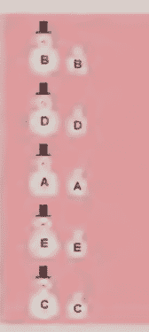

# 在章中

在本章中，我们将引入数组的概念以及该结构的强大功能，这些功能使其成为大多数程序的一部分。这些功能包括存储和检索大型数据集的能力，当与循环结合时，仅需几条指令即可处理这些数据集。我们将讨论并实现数组处理算法，如排序、搜索和复制，就像第 4 章中引入的用于插入和删除磁盘文本文件中存储项目的算法一样。我们还将探索实现许多经典数组处理算法的 API 方法。

我们将讨论可用于存储项目列表的一维数组，以及多维数组，并使用二维数组以行和列的形式在表格中组织数据。

在成功完成本章后，你应该：

- 理解使用数组的优点和重要性
- 熟悉用于存储基本类型数组和对象数组的 Java 内存模型
- 能够构建并实现搜索数组、排序数组以及找到存储其中的最小值和最大值的算法
- 熟悉并能够使用 API 中的数组处理方法
- 理解并列数组的概念并使用它们处理数据集
- 知道如何使用数组插入、删除或更新存储在磁盘文件中的数据项
- 能够将数组技术应用于游戏程序

## 6.1 数组的起源

计算机之所以得名，是因为这些机器的首批运行版本主要供数学家用于对大型数据集进行快速计算。在计算机运行很久以前，数学家就已经使用下标变量（如 x）来表示公式中的数据。为了方便将这些下标变量写入程序，FORTRAN（代表 Formula Translation，即公式翻译，数学家使用的第一种编程语言）的设计者包含了一个模拟下标变量的结构。这个结构就是数组。因此，数组的概念源于下标变量的数学模型。

## 6.2 数组的概念

考虑一个处理存储在整数内存单元 `age0`、`age1`、`age2`、`age3`、`age4` 中的五个人年龄的程序。这些变量的声明相当直接：

```java
int age0, age1, age2, age3, age4;
```

但假设程序处理的不是五人的年龄，而是五百万人的年龄。虽然这五百万个内存单元的声明语法上仍然直观，但写起来会非常长且极其耗时。事实上，一个优秀的打字员需要花费一个月才能打完这个程序的变量声明，假设他们每天连续工作八小时而不休息。（顺便说一下，这违反了联邦劳动法。）使用数组结构，同一个打字员可以在几秒钟内完成这五百万个单元的声明。

这就是数组全部：一种声明内存单元的技术，源于下标变量的数学模型。

**定义** 数组是一种用于声明一组内存单元的编程概念，组中的每个成员具有相同的数据类型、相同的名称（数组名称）以及一个称为索引（index）的唯一名称。

内存单元之间的关系与我们的整数内存单元 `age0` 到 `age4` 的关系相同：每个单元存储一个人的年龄，或者一个人的体重，或者雪人游戏棋子的地址。在 Java 中，唯一名称（索引，indexes）总是从零开始的连续整数（例如 0, 1, 2, 3, 4, ...）。Java 语法要求将唯一名称包含在方括号中。例如 `[2]`。

图 6.1 显示了用于存储人们年龄的十个内存单元。左侧的五个内存单元通过语句声明为独立的整数变量：

```java
int age0, age1, age2, age3, age4;
```

右侧的五个内存单元被声明为名为 `age` 的五元素数组的组成。

| 非数组 | 数组 |
|---|---|
| age0 | age[0] |
| age1 | age[1] |
| age2 | age[2] |
| age3 | age[3] |
| age4 | age[4] |

**图 6.1** 分配给五个整数变量以及一个名为 `age` 的五元素数组的存储空间。

如图 6.1 所示，分配给图中左侧整数变量的存储空间与分配给图中右侧数组元素的存储空间相同：即五个不同的内存单元。从内存分配的角度来看，构成数组元素的内存单元在内存分配方式上的唯一区别在于，数组元素总是作为连续内存被分配的；也就是说，如果每个内存单元占用四个字节的存储，且 `age[0]` 存储在 100–103 字节，那么分配给数组后续四个元素的内存将从地址 104、108、112 和 116 开始。（相比之下，这五个整数变量可能存储在分散在内存中的不同位置。）

数组元素可以在程序中任何语法上正确编写内存单元名称的地方：在输入输出语句中、在算术和逻辑表达式中，以及作为参数和参数。要使用它们，只需复制它们的完整名称。例如，图 6.2 左侧和右侧的语句是等价的，尽管它们在语法上不同，因为图中右侧的语句使用了数组结构。

```java
age3 = new Scanner(System.in).nextInt(); 
age[3] = new Scanner(System.in).nextInt();
age3 = age3 + 1; 
age[3] = age[3] + 1;
System.out.println("Your age is " + age3); 
System.out.println("Your age is " + age[3]);
if (age3 >= 18) {
    System.out.println("You can " + "Drive now");
}
double avg = averageTwo(age0, age1); 
double avgAge = averageTwo(age[0], age[1]);
```

**图 6.2** 使用和不使用数组的等效语句。

虽然使用数组涉及的语法由于前面提到的闭合括号的编写而有些繁琐，但它们赋予了我们快速声明大量变量的能力。此外，正如我们在本章稍后部分看到的，当在循环内部使用数组时，它们赋予了我们用几行代码处理大型数据集的能力。由于这两个原因，大多数程序都会使用数组。

## 6.3 声明数组

在 Java 中，所有数组都存储在对象内部。虽然我们经常说我们正在“声明一个数组”，但更准确的说法是我们正在“声明一个包含数组的对象”。事实上，正如我们所看到的，该对象不仅包含数组，还包含一个名为 `length` 的整数成员。

用于声明数组对象的语法与用于声明非数组对象的语法相似。声明了一个引用变量，它将指向数组对象，并使用关键字 `new` 来构造该对象。不同之处在于，数组对象的声明语法还包含一组括号，表示该引用变量将指向数组对象，并且数组将包含的元素数量（称为数组的大小）括在另一组括号中。通用的语法为：

```java
aType[] arrayName = new aType[arraySize];
```

- `aType` 是数组元素的类型
- `arrayName` 是引用变量的名称，它将存储对象的地址，也被视为数组的名称
- `arraySize` 是数组中的元素数量

声明一个可以存储五个整数的数组对象，应写为：

```java
int[] ages = new int[5];
```

这分配了图 6.3 所示的内存。不仅在对象内部分配了数组元素的存储空间，还分配了一个整数长度并将其初始化为数组的大小。数组第一个元素的索引始终为 0，数组其余元素的索引按递增顺序分配连续值。这意味着数组最后一个元素的索引始终比数组的大小少 1。在一个长度为 5 的数组中，`ages[5]` 不存在，这有些违背直觉，并且尝试访问它会导致运行时错误。包含 $n$ 个元素的数组的索引为 0 到 $n-1$，数组的大小为 $n$。从概念上说，数组对象的声明可以画在图 6.1 的右侧，这正是我们经常视觉化数组的方式。引用变量 `ages` 指向数组对象。

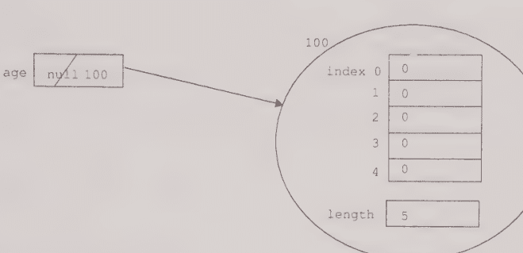

**图 6.3** 由语句 `int[] ages = new int[5];` 创建的对象。

当数组对象被创建时，数组元素被初始化为它们的默认值（例如整数数组为 0），并为数组对象分配一个地址（图 6.1 中的地址 100）。数组对象的索引初始化为数组的大小。如图 6.3 所示，`length` 成员被赋值为数组的大小。例如，通过 `.` 访问数组的长度成员。以下代码片段输出 5：

```java
int[] ages = new int[5];
System.out.println(ages.length);
```

`length` 成员是 `final` 的，不能赋值。以下代码片段会导致错误：

```java
int[] ages = new int[5];
ages.length = 3; // 错误：无法赋值常量
```

### 6.1 数组的动态分配

数组对象像其他对象一样，在执行期间可以动态分配。正如我们所学的，这通常在方法的顶部编写。数组的语法允许数组的大小由程序输入决定。例如：

```java
int[] ages;
String sSize = JOptionPane.showDialog("How many ages " + "will be entered?");
int size = Integer.parseInt(sSize);
ages = new int[size];
```

如图 6.4 所示，五元素数组对象的地址被新三元素数组对象的地址覆盖，导致分配给五元素数组的存储被 Java 运行时内存管理器回收。在 Java 中，分配给未被引用变量引用的对象的存储空间将被回收并供其他程序使用。在第 6.9 节中，我们将讨论在创建调整大小数组时将值转移过去的技术。

## 6.4 数组与循环

在循环内部使用数组使我们能够仅用几行代码处理大型数据集的能力。这是因为用于指定处理数组中哪个元素的索引不仅可以是一个数字字面量（例如 `a = age[2]`），也可以是一个整数变量。对整数值的唯一限制是存储在其中的值必须是数组的有效元素编号。以下代码段将输出两次 `price` 数组的第三个元素。当最后一条语句执行时，会获取变量 `index` 的当前内容，替换变量 `index` 并执行输出。


## 数组与循环

```java
double[] price = new double[100];
int index = 2;

System.out.println(price[2]);
System.out.println(price[index]);
```

这种数组特性通常配合 `for` 语句的循环作为数组索引。使用这种方法，只需两行代码即可编写降低商店销售的 10,000 件商品价格 10% 的代码，以准备年度劳动节促销：

```java
for (int i = 0; i < 10000; i++) {
    salePrice[i] = price[i] * 0.9;
}
```

循环第一次运行时 `i` 存储值 0，并计算 `salePrice[0]`。第二次循环时 `i` 存储值 1，并计算 `salePrice[1]`。这个过程一直持续到计算出 `salePrice[9999]`。在循环内部处理数组时，有两种常见的错误，这两种在语法上都是正确的：

- 循环变量初始化为 1 而不是 0
- 布尔条件的代码编写错误，使用了 `<=` 而不是 `<`

第一个错误源于我们大多数人计数时是从 1 开始的：1, 2, 3 等，因此我们习惯性的倾向是将循环变量初始化为 1。当犯下这个错误时，数组的第一个元素（索引为 0 的元素）不会被处理。错误地编写布尔条件是最常见的错误。当需要处理数组的所有元素时，如果我们在布尔条件中使用数组的长度 `price.length`，我们的代码会变得更易于理解。然而，当我们这样做时，必须在条件中使用小于（`<`）运算符（例如 `< price.length`）。不幸的是，大多数初学者在处理数组的最后一个元素时使用了 `<=` 运算符，导致循环执行最后一次迭代时，索引超出了数组范围。结果是发生运行时错误，指示程序生成了 `IndexOutOfBounds` 异常。当程序使用的数组索引不在 0 到数组大小减 1 的范围内时，就会发生此错误。

图 6.5 展示了应用程序 `ArraysLoops`，它使用了本章在此为止讨论的许多数组概念来计算并输出一组商品的售价。它接受一组待售商品的价格，计算并输出售价。图底部提供了一组示例输入和程序产生的相应输出。

```java
import java.swing.*;
import java.text.NumberFormat;

public class ArraysAndLoops {
    public static void main(String[] args) {
        double[] price, salePrice;
        String s;
        int size;
        NumberFormat fm = NumberFormat.getCurrencyInstance();
        s = JOptionPane.showDialog("How many sale items?");
        size = Integer.parseInt(s);
        price = new double[size];
        salePrice = new double[size];
        for (int i = 0; i < size; i++) {
            s = JOptionPane.showDialog("Enter item " + (i + 1) + " price:");
            price[i] = Double.parseDouble(s);
        }
        for (int i = 0; i < size; i++) {
            salePrice[i] = price[i] * 0.9;
            System.out.println("The sale price of item " + (i + 1) + " is " + fm.format(salePrice[i]));
        }
    }
}
```

**输入：**

```text
5
10.00
20.00
30.00
40.00
50.00
```

**输出：**

```text
The sale price of item 1 is $9.00
The sale price of item 2 is $18.00
The sale price of item 3 is $27.00
The sale price of item 4 is $36.00
The sale price of item 5 is $45.00
```


**图 6.5** 应用程序 `ArraysLoops` 输入待售商品数量（第 12 行），在第 14 行和 15 行动态分配了两个数组对象，并将它们的地址赋值给引用变量 `price` 和 `salePrice`。它接受一组待售商品的价格，计算并输出售价。图中底部提供了一组示例输入和程序产生的相应输出。

## 6.5 对象数组

从技术上来说，没有声明对象数组的方法。元素只能是原始类型或引用变量。然而，当数组元素是引用变量时，数组的每个元素都可以包含一个对象的地址。在这种情况下，我们常说有一个对象数组，因为我们实际上拥有的是“引用变量数组”。

这是首选的编码技术，如果我们必须声明 5,000 个雪人。

```java
for (int i = 0; i < 5; i++)
    sm[i] = new Snowman(50 + i * 50, 100);
```

循环变量被用作数组 `sm` 的索引，`sm[0]` 接收在循环内部创建的第一个 `Snowman` 的地址。在循环的每次遍历中，数组的下一个顺序元素都会接收新创建的 `Snowman` 的地址。此外，循环变量被用于在每次循环执行时改变雪人的 x 坐标，使用表达式 `(50 + i * 50)`。循环执行完毕后创建的存储空间如图 6.7 所示。


**图 6.7** 指向五个 `Snowman` 对象的五个引用变量数组。

### 6.5.1 处理数组对象

在第 6.4 节中，我们学习了通过数组和循环的概念，仅需几行代码即可处理大型数据集。为了实现这一点，数据被存储在基本类型变量数组中，处理指令被编写在循环内部。循环变量被用作数组的索引，这使得处理指令在每次循环遍历时都作用于数组的不同元素。

同样地，我们也可以通过将对象的地址存储在引用变量数组中，然后在循环内部对每个对象进行处理，仅需几行代码即可处理大型对象集合。区别在于，我们不是对数组本身执行处理，而是使用数组元素来调用它们所引用的对象的类方法。

例如，存储在整数数组中的五个对象对每个对象进行加法操作的代码，与将名为 `sm` 的数组中的每个雪人向右移动一个像素的代码非常相似。下面的代码片段说明了相似之处：

```java
int x;
for (int i = 0; i < 5; i++) {
    ages[i] = ages[i] + 1; // 增加年龄

    x = sm[i].getX(); // 移动雪人
    sm[i].setX(x + 1);
}
```

在此循环的每次执行中，变量被用于更改循环处理指令涉及的两个数组的元素。对于整数数组，数组 `ages` 的其中一个元素中存储的值增加了 1；也就是说数组 `ages` 的内容被改变了。然而，循环处理并没有改变数组 `sm` 的内容。相反，它使用数组的内容来指定在每次循环遍历中哪一个 `Snowman` 对象将通过 `getX()` 和 `setX()` 方法被改变（被操作），此时，每个 `Snowman` 的 x 数据成员都增加了 1。

这并不是说引用变量数组的内容不能在循环内部更改。我们已经在构造对象时看到这种情况，此时数组元素中存储的默认 `null` 值被新构造的 `Snowman` 对象的地址覆盖。相反，通过用值 `null` 覆盖存储在数组中的地址，可以从游戏中移除全部五个雪人：

```java
for (int i = 0; i < 5; i++) {
    sm[i] = null;
}
```

这将导致 Java 内存管理器回收分配给五个 `Snowman` 对象的存储空间，并供系统上运行的其他程序使用。

图 6.8 中的应用使用了本节讨论的概念来组织一个八个雪人的游行，其类如图 6.9 所示。程序启动时产生的输出以及点击开始按钮几秒后的输出分别位于图 6.10 的左侧和右侧。

图 6.8 的第 7 行创建一个名为 `parade` 的引用变量数组，用于存储八个 `Snowman` 对象的地址。当游戏启动时，雪人会沿从左到右向下倾斜的对角线显示（如图 6.10a 所示），直到点击开始按钮。它们在游戏板上游行，并在边界处反射，最终到达图 6.10b 所示的位置。

雪人的创建、显示、动画和反射是在四个循环内完成的。在这些循环的每次迭代中，不同的雪人作为循环变量，被用作 `parade` 数组的索引。这些循环中的第一个（图 6.8 的第 11–14 行）用于创建雪人并将这八个对象的地址放在引用变量数组 `parade` 中。在第 13 行，循环变量 `i` 用于发送到 `SnowmanV7` 类的双参数构造函数的参数列表中，以计算每个雪人在向下倾斜对角线上的初始 (x, y) 位置。在从第 21 行开始的循环每次迭代中，不同的雪人会在其当前的 (x, y) 位置显示在游戏板上。

剩下的两个循环从第 31 行和 41 行开始，使雪人在游戏边界移动并在游戏板的垂直和水平边界反弹（反射）。编写的代码使用了 `timer3` 回调方法（第 27–56 行）。因此，每隔 20 毫秒（秒的五分之一），游戏环境就会调用此方法。在定时器执行完毕后，应用程序显示 (x, y) 位置。通过使用此循环，变量被用作 `parade` 数组的索引，每个雪人的运动都是……

图 6.8 中第 31–39 行编写的代码执行了雪人在游戏边界的反射。在这种情况下，雪人的速度被获取并设置为其负值。然后，在循环的下次遍历中，雪人的速度被用于将其重新定位在游戏板上，因为它们的速度符号已经反转了。

```java
import java.awt.Graphics;
import edu.sjc.gp.*;

public class SnowmanParade extends DrawableAdapter {
    static SnowmanParade ge = new SnowmanParade();
    static GameBoard gb = new GameBoard("Snowman Parade");
    static SnowmanV7[] parade = new SnowmanV7[8];

    public static void main(String[] args) {
        for (int i = 0; i < parade.length; i++) // 创建每个雪人
            parade[i] = new SnowmanV7(10 + i * 50, 100 + i * 30);
        gb.setTimerInterval(3, 20);
        showGameBoard(gb);
    }

    public void draw(Graphics g) { // 绘制每个雪人
        for (int i = 0; i < parade.length; i++) {
            parade[i].show(g);
        }
    }

    public void timer() {
        int x, speed, y;
        for (int i = 0; i < parade.length; i++) { // 移动每个雪人
            x = parade[i].getX();
            x = x + parade[i].getXSpeed();
            parade[i].setX(x);
            y = parade[i].getY();
            y = y + parade[i].getYSpeed();
            parade[i].setY(y);
        }
        for (int i = 0; i < parade.length; i++) { // 反射每个雪人
            if (parade[i].getX() >= 460 || parade[i].getX() <= 6) {
                speed = parade[i].getXSpeed();
                speed = -speed;
                parade[i].setXSpeed(speed);
            }
            if (parade[i].getY() >= 420 || parade[i].getY() <= 30) {
                speed = parade[i].getYSpeed();
                speed = -speed;
                parade[i].setYSpeed(speed);
            }
        }
    }
}
```

**图 6.8** 应用程序 `SnowmanParade`。

```java
import java.awt.*;
public class SnowmanV7 {
    int x;
    int y;
    int xSpeed;
    int ySpeed;
    public SnowmanV7(int x, int y) {
        this.x = x;
        this.y = y;
    }
    public void show(Graphics g) { // g 是游戏板对象
        g.setColor(Color.BLACK);
        g.fillRect(x + 15, y, 10, 15); // 帽子
        g.fillRect(x + 10, y + 15, 20, 20); // 衣服
        g.setColor(Color.WHITE);
        g.fillOval(x + 10, y + 17, 20, 20); // 脸
        g.setColor(Color.RED);
        g.fillOval(x, y + 37, 40, 40); // 身体
    }
    public int getX() {
        return x;
    }
    public void setX(int newX) {
        x = newX;
    }
    public int getY() {
        return y;
    }
    public int getXSpeed() {
        return xSpeed;
    }
    public void setXSpeed(int newXSpeed) {
        xSpeed = newXSpeed;
    }
    public int getSpeed() {
        return ySpeed;
    }
    public void setYSpeed(int newYSpeed) {
        ySpeed = newYSpeed;
    }
}
```

**图 6.9** `SnowmanV7` 类。

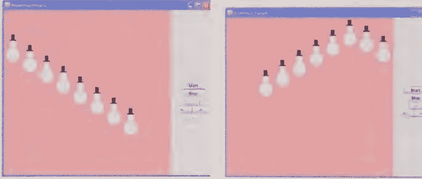


# 第6章 数组

## 6.6 在方法之间传递数组

如第 3.8 节所述，引用变量可以作为工作方法参数列表的一部分。这使我们能够将方法中声明的对象的位置传递给它调用的工作方法。知道对象的位置，使得工作方法能够通过接收对象位置的参数名引用该对象进行某些处理。此外，当非空（non-void）工作方法的返回类型为类名时，工作方法可以将该类中某个对象的位置返回给调用它的方法。

由于数组存储在对象中，因此在工作方法之间传递引用变量的能力也使我们能够在工作方法之间传递数组。要实现这一点，我们只需将数组对象的引用变量在工作方法之间传递即可。在向工作方法之间传递数组和非数组对象时，没有第 6 章“数组”的概念差异需要考虑，但在工作方法的签名中，存在一些细微的语法差异。

在本节的剩余部分，我们将讨论这些差异，并展示在工作方法之间传递数组的示例。我们将从讨论向工作方法传递数组开始，并以讨论从工作方法返回数组作为结束。

### 6.6.1 向工作方法传递基本数据类型数组

考虑图 6.11 左侧所示的数组 `age`，它存储了具有相同生日的人的年龄。以下代码片段定义并初始化了该数组，并将其传递给 `Party` 类中的静态方法 `birthday`。

```java
int[] age = new int[5];
for(int i=0; i < age.length; i++)
{
    age[i] = 21 + i;
}
Party.birthday(age); // 方法调用语句
```

参数：`age` 在调用方法时被复制：参数 `ages`

**图 6.11** 向方法传递基本数据类型数组。

查看方法调用语句，无法判断传递给 `birthday` 方法的参数 `age` 是基本数据类型变量还是数组。这是因为用于将数组引用传递给工作方法的调用语句语法，与将基本数据类型变量传递给工作方法的语法是相同的，而后者也是将任何引用变量传递给工作方法时所使用的语法。从调用语句的角度来看，向工作方法传递数组并没有新东西需要学习。

正如之前讨论过的，不同的是工作方法签名的语法。当方法签名中列出的参数是数组时，在参数名和类型之间会编码一对括号 `[]`。以下是传递了整数数组的静态工作方法 `birthday` 的代码。该工作方法的作用是将数组的每个元素加 1。

```java
static void birthday(int[] ages) {
    for (int i = 0; i < ages.length; i++) {
        ages[i] = ages[i] + 1;
    }
}
```

查看方法调用语句，无法判断传递给 `birthday` 方法的参数 `age` 是基本数据类型变量还是数组。这是因为用于将数组引用传递给工作方法的调用语句语法……（此处省略重复内容）

正如之前讨论过的，不同的是工作方法签名的语法。当方法签名中的参数是数组时，在参数名和类型之间会编码一对括号 `[]`。例如：

```java
static void birthday(int[] ages)
```

如图 6.11 顶部的虚线所示，在方法调用时，Java 的值传递会将存储在 `age` 中的值传递到参数 `ages` 中。在方法执行期间，该数组对象在客户端代码和工作方法之间共享。虽然我们通常说是在“向方法传递数组”，但实际上我们是在“向方法传递对象的地址”。

在工作方法之间传递数组时，由于数组的地址是共享的，如果工作方法更改了数组的内容，客户端代码将无法访问原始数组的内容。这并不与值参数防止工作方法更改客户端的想法相矛盾。这是一个微妙但重要的需要理解的点。参考图 6.11，工作方法确实可以更改数组的内容，因为 `ages` 存储的是数组的地址。如果工作方法包含以下语句，它将丢失对客户端数组的访问，但客户端代码不会。地址仍然存储在变量 `age` 中。

### 6.6.2 向工作方法传递数组

如 6.5 节提到的，从技术上讲，Java 不支持对象数组。然而，数组的元素可以是存储对象地址的引用变量。在这种情况下，我们经常说数组是“对象数组”，因为这比说它是“指向对象的引用变量数组”要简单得多。向方法传递对象数组时，调用语句和方法签名都与向方法传递基本数据类型变量数组时使用的语法相同。正如前节所讨论，传递数组的唯一指示是工作方法签名中参数名和类型之间包含的一对括号 `[]`。

图 6.12 左侧显示了数组 `parade`，它包含了五个存储五个 `SnowmanV7` 对象地址的引用变量，这些对象的类见图 6.9。为了将此数组传递给工作方法，我们利用 Java 的值参数实现，并使用传递基本数据类型数组时相同的语法将数组地址传递给方法。

**图 6.12** 向方法传递数组的位置。

例如，假设我们想使用 `PassingArrays` 类中的静态工作方法 `move` 和 `bounce` 来重新定位游戏板上的 `SnowmanV7` 对象，并让它们从板边缘反射。假设这些方法每个都有一个参数来将名为 `parade` 的类数组传递给方法，调用这些工作方法的客户端代码语句将：

```java
PassingArrays.move(parade);
PassingArrays.bounce(parade);
```

如果工作方法中的参数名是 `sm`，则方法的签名将为：

```java
static void move(SnowmanV7[] sm);
static void bounce(SnowmanV7[] sm);
```

图 6.12 顶部的虚箭头说明了将数组的位置传递给方法的参数 `sm`，这使得方法在执行期间可以引用雪人的代码。结果是，当方法在执行时，客户端代码和工作方法向雪人对象的数据成员写入新值；这些新值在工作方法完成执行后，对客户端代码是可用的。

图 6.13 所示的 `PassingArrays` 应用演示了将整数数组和对象数组中包含的信息与被调用方法共享，以及方法更改数组元素内容及其所引用对象的能力。图 6.14 显示了程序产生的控制台输出，图 6.15 显示了图形化输出（与 `SnowmanParade` 应用生成的输出相同）。图 6.13 中引用的 `SnowmanV7` 类与 `SnowmanParade` 应用中的类（使用图 6.9）是同一个类。

为了验证客户端和工作方法共享了原始类型数组，我们还在 `PassingArrays` 应用中包含了数组对象和 `birthday` 方法。参考图 6.13，`main` 方法在第 11 行声明了一个名为 `ages` 的五元素整数数组。这些变量在第 3 行开始的 `for` 循环中初始化为 21 到 25 的值。在第 17 行，该地址被传递给 `birthday` 方法（第 45-51 行），数组地址存储在方法的参数 `Ages` 中（第 45 行）。该方法的代码在其 `for` 循环内部将数组的每个元素加 1（第 49 行）。当方法结束时，`main` 方法中的循环（第 18–20 行）输出数组的内容，产生了图 6.14 所示的控制台输出。`main` 方法输出的所有 `ages` 都增加了 1，这一事实证明了 `main` 和 `birthday` 方法共享了该整数数组。

`PassingArrays` 应用图形部分的代码与 `SnowmanParade` 应用的代码（图 6.8）相同，但移动和反射雪人的代码（在图 6.8 的第 29–55 行中编写）被放置在了静态方法 `move` 和 `bounce` 中（图 6.13 的第 53–87 行）。此外，这些调用被放置在环境的 `timer3` 方法中（第 41 行和第 42 行）。因此，这两个程序的图形输出是相同的。当游戏启动时，雪人沿左向右倾斜的对角线显示，如图 6.15a 所示。当点击 Start 按钮时，会在游戏板周围发生反弹的游行。图 6.15b 显示了点击 Start 几秒后程序的图形化输出。

`timer3` 方法由两个语句组成：对 `move` 和 `reflect` 方法的调用（图 6.13 的第 41 行和 42 行）。数组 `parade` 的地址（在第 7 行声明）传递给这些方法的参数 `sm`，其签名在第 53 行和第 68 行给出。在循环中，方法更改了 `sm` 元素的 `(x, y)` 位置（第 61 行和第 64 行）和速度数据成员（第 78 行和第 84 行）。因为数组在这些方法和 `timer3` 方法之间共享，雪人的新位置和速度已被放入由 `parade` 引用的雪人数组中。这一事实在下一次调用游戏环境的 `draw` 方法时得到了验证，此时雪人在它们的新位置上被绘制并在游戏板边缘发生反弹。

```java
import edu.sydney.gpvl.*;
import java.awt.*;

public class PassingArrays extends DrawableAdapter {
    static PassingArrays ge = new PassingArrays();
    static GameBoard gb = new GameBoard("Snowman Parade");
    static SnowmanV7[] parade = new SnowmanV7[8];

    public static void main(String[] args) {
        int[] ages = new int[5];
        for(int i = 0; i < 5; i++) {
            ages[i] = 21 + i;
        }
        birthday(ages);
        for(int i = 0; i < 5; i++) {
            System.out.print(ages[i] + " ");
        }

        for(int i = 0; i < 8; i++) {
            parade[i] = new SnowmanV7(10 + i * 50, 100 + i * 30);
        }
        gb.setTimerInterval(3, 20);
        showGameBoard(gb);
    }

    public void draw(Graphics g) {
        for(int i = 0; i < 8; i++) {
            parade[i].show(g); // show the parade at its current location
        }
    }

    public void timer3() {
        move(parade);
        bounce(parade);
    }

    static void birthday(int[] Ages) {
        for(int i = 0; i < Ages.length; i++) {
            Ages[i] = Ages[i] + 1;
        }
    }

    static void move(SnowmanV7[] sm) {
        int x, y;

        for(int i = 0; i < 8; i++) {
            x = sm[i].getX();
            x = x + sm[i].getXSpeed();
            sm[i].setX(x);
            y = sm[i].getY();
            y = y + sm[i].getYSpeed();
            sm[i].setY(y);
        }
    }

    static void bounce(SnowmanV7[] sm) {
        int speed;

        for(int i = 0; i < 8; i++) {
            if(sm[i].getX() >= 460 || sm[i].getX() <= 0) {
                // logic for bounce
            }
        }
    }
}
```

(a) 初始输出

(b) 点击“开始”后几秒的输出

**图 6.10** 应用程序 SnowmanParade 的输出。

**图 6.14** 控制台输出。

**图 6.15** 图形化输出。

## 并行数组

用于输入学生信息的代码是并行数组的一个示例。当我们执行第 8、9、10 和 12 行的提示时，可以很容易识别出这一点。在第 8 行，用户被指示输入学生的 ID 号，这意味着可以输入 1,000 个 ID 中的任意一个。也许是 ID 号 15647。然而，在第 10 行和第 12 行，用户被要求输入*该*学生的年龄和*该*学生的 GPA。这意味着接下来的两个条目必须是刚刚输入的 ID 号对应的年龄和 GPA。

```java
for(int i = 0; i < 1000; i++)
{
    sInput = JOptionPane.showInputDialog("Enter a student's ID number");
    id[i] = Integer.parseInt(sInput);
    sInput = JOptionPane.showInputDialog("Enter THAT student's age");
    age[i] = Integer.parseInt(sInput);
    sInput = JOptionPane.showInputDialog("Enter THAT student's GPA");
    gpa[i] = Double.parseDouble(sInput);
}
```

由于循环变量被用作三个数组的索引，因此一个学生的信息存储在三个数组的相同元素中。这就是并行数组的概念。与特定学生关联的每条数据都存储在构成数据集的三个数组的相同元素中。如果特定学生的 ID 号存储在 ID 数组的第 3 个元素中，而该学生的年龄和 GPA 分别存储在年龄数组的第 24 个元素和 GPA 数组的第 6 个元素中，那么我们就没有使用并行数组的概念。

“并行数组”这一名称源于这样一个想法：如果我们把三个数组并排画，然后在数组的每个元素上方和下方画上水平线（如图 6.16 所示），那么学生的所有信息都将包含在两条线之间。例如，ID 为 76892 的学生的年龄为 19 岁，他的 GPA 为 4.0。Al 的所有信息（包括他 3.7 的 GPA）都在输入循环的第一次迭代中输入。（Al，请多加学习。）

| id | age | gpa | info |
|---|---|---|---|
| 0 | 15647 | 18 | Al's info |
| 1 | 3452 | 21 | 2.55 Fe's info |
| 2 | 76892 | 19 | 4.0 Bob's info |
| 3 | 34376 | 22 | 3.85 Jo's info |
| 4 | 77834 | 19 | 3.3 Ed's info |
| 999 | 45823 | 20 | 2.3 Jen's info |

**图 6.16** 并行数组。

记住，并行数组是一个概念或模型，而不是编程语言的构造。当程序员将特定实体的所有数据存储在两个或多个数组的相同元素时，就会使用这个概念。

## 使用 Java 编程基础

在 Java 等编程语言中，并行数组的使用并不频繁，因为特定实体的数据可以作为数据成员存储在对象内部，而不是在几个数组的元素中。然而，如果我们想将几个不同的对象组合在一起（例如，一个雪人和孩子），那么一组并行数组就是实现此点的完美方法。

例如，假设五个雪人各有一个孩子。那么，如果使用 `parent` 和 `child` 数组分别存储雪人和雪小孩的地址，通过将这两个数组视为并行的，我们就可以快速定位一个孩子的父亲或定位一个父亲的孩子。父亲的地址及其孩子的地址将存储在数组的相同元素中：`parent[2]` 将存储在 `child[2]` 中。

图 6.17 显示了图形化应用 `ParallelArrays`，它使用并行数组将一个父雪人与其孩子关联起来。父雪人的类 `ParentSnowman` 如图 6.18 所示，雪孩子的类 `SnowChild` 如图 6.19 所示。

当程序启动时，会产生图 6.20a 所示的图形输出。雪人垂直排列在游戏板的左侧，雪孩子位于它们右侧的随机位置。每个孩子和父母的肚子上都显示着他们的姓氏（姓）。当按下键时，孩子们会重新定位到他们的父母身边，如图 6.20b 所示。并行数组用于建立父亲、孩子及其姓氏之间的关联。

在第 14–16 行创建了三个数组对象，其中第一个（数组名称）被初始化为五个家族的名字（A, B, C, D, E）。另外两个数组对象在从第 20 行开始的 `for` 循环内部填充了指向 `ParentSnowman` 和 `SnowChild` 对象的引用。前两个参数是对象的 x 和 y 位置，第 22 行和第 23 行生成的随机数是出现在对象肚子上的姓氏。构造函数分别将这些存储在图 6.18 和图 6.19 的成员名中。

数组的并行构造确立为并行数组。在循环的每次通过中，循环变量在第 24 行和第 25 行被用作建立并行数组。


```java
27 showGameBoard(gb);
28 }
29 
30 public void draw(Graphics g)
31 {
32   for(int i = 0; i<5; i++)
33 {
34     parent[i].show(g);
35     child[i].show(g);
36   }
37 }
38 
39 public void keyStruck(char key)
40 {
41   int x, y;
42   for(int i = 0; i < 5; i++)
43 {
44     x = parent[i].getX();
45     y = parent[i].getY();
46     child[i].setX(x - 50);
47     child[i].setY(y + 35);
48   }
49 }
50 }
```

图 6.17 应用程序 `ParallelArrays`。

```java
1   import java.awt.*;
2   
3   public class ParentSnowman
4   {
5     private int x = 8;
6     private int y = 30;
7     private boolean visible = true;
8     private String name;
9   
10  public ParentSnowman(int initialX, int initialY, String name)
11  {
12    x = initialX;
13    y = initialY;
14    this.name = name;
15  }
16 
17  public void show(Graphics g) // g 是游戏板对象
18  { int[] xPoly = {x - 20, x + 15, x + 25};
```

```java
int[] yPoly = {y + 25, y + 30, y + 30};
g.setColor(Color.BLACK);
g.fillRect(x + 15, y, 10, 15);
g.fillRect(x + 10, y + 15, 20, 2); // 帽檐
g.setColor(Color.WHITE);
g.fillOval(x + 10, y + 17, 20, 20); // 头
g.fillOval(x, y + 37, 40, 40); // 身体
g.setColor(Color.RED);
g.fillOval(x + 315, y + 25, 35, 35); // 鼻子
g.setColor(Color.BLACK);
g.setFont(new Font("Arial", Font.BOLD, 16));
g.drawString(name, x + 16, y + 62); // 名字

public int getX() {
    return x;
}

public void setX(int newX) {
    x = newX;
}

public int getY() {
    return y;
}

public void setY(int newY) {
    y = newY;
}

public boolean getVisible() {
    return visible;
}

public void setVisible(boolean newVisible) {
    visible = newVisible;
}

public String getName() {
    return name;
}
```

**图 6.18** `ParentSnowman` 类。

```java
import java.awt.*;
public class SnowChild {
    private int x = 8;
    private int y = 30;
    private boolean visible = true;
    private String name;
    public SnowChild() {
}
    public SnowChild(int initialX, int initialY, String name) {
        x = initialX;
        y = initialY;
        this.name = name;
    }
    public void show(Graphics g) //g 是游戏板对象 {
        int[] XPoly = {x - 15, x + 12, x + 18};
        int[] YPoly = {y - 20, y - 5, y + 18};
        g.setColor(Color.WHITE);
        g.fillOval(x + 8, y, 14, 14); // 头
        g.fillOval(x, y + 14, 28, 28); // 身体
        g.setColor(Color.RED);
        g.fillRect(x - 5, y - poly, 3); // 鼻子
        g.setColor(Color.BLACK);
        g.setFont(new Font("Arial", Font.BOLD, 16));
        g.drawString(name, x + 10, y + 33); // 名字
}
    public int getX() {
        return x;
    }
    public void setX(int newX) {
        x = newX;
    }
    public int getY() {
        return y;
    }
    public void setY(int newY) {
        y = newY;
    }
}
```

```java
50  public boolean getVisible()
51  { return visible;
52  }
53
54  public void setVisible(boolean newVisible)
55  { visible = newVisible;
56  }
57
58  public void setName(String newName)
59  { name = newName;
60  }
61
62  public String getName()
63  { return name;
64  }
65 }
```

图 6.19 `SnowChild` 类。

图 20 `ParallelArrays` 应用程序。

## 6.8.1 数组的搜索

正如我们所见，数组可以用于定位数组中的某个值，只要该类包含相应的成员方法（在第 6 行调用）。如果数据成员不是基本类型，而是引用变量，那么它引用的类也必须包含一个 `equals` 方法以便用于第 6 行的布尔条件。通常，`String` 类包含了该方法的实现。

假设数据成员 `lastName` 引用一个字符串，并且我们正在搜索名字 "Jones"，那么算法的第 1 行和第 6 行将变为：

```
第1行: String target = "Jones";
第6行: if(parent[i].LastName().equals(target))
```

### 在数组中搜索基本类型

### 在数组中搜索对象

图 6.21 搜索算法。搜索算法的第 1 行初始化了 `target` 值，第 2 行将布尔变量 `found` 设置为 `false`。第 4 行开始循环遍历数组 `ages`。在循环内部，第 6 行的语句判断数组是否包含目标值。如果是，则第 8 行将 `found` 设置为 `true`，第 9 行将 `elementNumber` 设置为该索引。后续代码将在第 10 行检查 `found` 变量，因为如果没有找到目标值，`elementNumber` 将是其初始值（即 -1）。

```java
int target = target;
int elementNumber = -1;
boolean found = false;
for (int i = 0; i < ages.length; i++) {
    if (ages[i] == target) {
        found = true;
        elementNumber = i;
        break;
    }
}
```

### 最小值和最大值

定位数组中最小值或最大值的算法与上一节讨论的搜索算法非常相似。它们也都使用 `for` 循环遍历整个数组，但当循环结束时，变量 `elementName` 包含了数组中最小值或最大值的索引。当数组是对象数组时，该值是存储在对象特定数据成员中的最小值或最大值。

图 6.22 左侧的代码是定位基本类型值数组（在本例中为年龄数组）中包含的最小值的算法实现。右侧搜索对象父，查找存储在对象某个数据成员（在本例中为整数数据成员 age）中的最小值。除了第 1 行、第 6 行以及不同的数组名称外，这些算法是相同的。

对象数组版本算法的第 1 行和第 6 行假设对象类包含一个 `getAge` 方法，用于获取对象的数据成员（`age`）。

两种算法都假设最小值存储在数组的第一个元素中，或由第一个元素引用。因此，第 1 行将变量 `min` 设置为该值，第 2 行将其索引（0）存储在变量 `elementNumber` 中。从第 4 行开始的 `for` 循环将变量 `min` 存储的值与数组的所有其他成员进行比较。如果找到一个比 `min` 存储的值更小的值（第 6 行），它将该值保存到 `min` 中（第 8 行），并将元素编号保存到变量 `elementNumber` 中（第 9 行）。循环结束时，`elementNumber` 存储数组中最小值的索引。

```java
int min = ages[0];
int elementNumber = 0;
for (int i = 1; i < ages.length; i++)
{
    if (ages[i] < min)
    {
        min = ages[i];
        elementNumber = i;
    }
}
```

```java
int min = parent[0].getAge();
int elementNumber = 0;
for (int i = 1; i < parent.length; i++)
{
    if(parent[i].getAge() < min)
    {
        min = parent[i].getAge();
        elementNumber = i;
    }
}
```

| 基本类型数组最小值算法 | 对象数组最小值算法 |
| :--- | :--- |

**图 6.22** 最小值算法。

使用与搜索算法类似的方法，图 6.22 右侧的算法可以用于定位数组对象中包含的任何基本类型数据成员的最小值，只要对象类包含一个 `get` 方法来获取数据成员（在第 1 行、6 行和 8 行中调用）。如果数据成员不是基本类型，而是引用变量，那么它引用的类也必须包含一个 `compareTo` 方法，以便用于第 6 行的布尔条件。通常，当被调用的对象小于传递给它的参数（变量 `min`）时，该方法返回一个负数。`String` 类包含了该方法的实现。

假设引用的数据成员是一个 String 对象，且数据成员名称为 `lastName`，算法的第 1 行和第 6 行将变为：

## 第 6 章：数组

第 1 行：`String min = parent[0].getName();`

第 6 行：`if (parent[i].getName().compareTo(min) < 0)`

最后，当数组是 String 对象数组时，算法的第 1 行和第 6 行将变为：

第 1 行：`String min = parent[0];`

第 6 行：`if (parent[i].compareTo(min) < 0)`

注意的是，如果数组的多个元素包含最小值，变量 `elementName` 将是这些元素中最低值的索引。如果需要包含最小值的数组的最高索引，则将第 6 行布尔表达式中的小于运算符（`<`）更改为小于或等于运算符（`<=`）。当算法被编码为返回最小值元素编号的方法时，该方法返回变量 `elementName`。该方法的签名如下：

```
public int findMin(ArrayType[] arrayValues)
```

`ArrayType` 是数组元素的类型（例如 `double`、`String`、`SnowChild` 等）。以下方法搜索传递的 `SnowChild` 对象数组，并返回包含基本类型数据成员 `x` 最小值的雪人小孩的索引。

```java
public int findMin(SnowChild[] arrayValues)
{
  int min = arrayValues[0].getX();
  int elementName = 0;

  for (int i = 1; i < arrayValues.length; i++) {
    if (arrayValues[i].getAge() < min) {
      min = arrayValues[i].getAge();
      elementNumber = i;
    }
  }
  return elementName;
}
```

## 定位最大值

定位数组中包含的最大值的算法与定位最小值的算法相同，只是将图 6.22 第 6 行使用的小于运算符（`<`）替换为大于运算符（`>`），并且良好的代码风格要求将变量 `min` 改为 `max`。

### 6.8.3 排序

有很多算法可以排序元素数组。最简单的之一是选择排序算法。它的工作原理是定位元素 $i$ 到 $n-1$ 之间的最小值，如果它小于元素 0（$j=0$），则将其交换到元素 0。然后定位下一个最小值，如果它小于元素 1（$j=1$），则将其交换到元素 1。此过程对于 $j = 2, 3, \dots, n-2$ 重复。当算法结束时，数组按升序排列。

例如，假设我们想对包含五个整数 $12, 9, 3, 4$ 和 $11$ 的数组（如表 6.1 左列所示）进行升序排序。我们首先在 9, 3, 4 和 11 中找到最小的值，即 3。因为它小于 12（元素 $j=0$ 的值），所以它与 12 交换，产生表第二列所示的顺序。在 12, 4 和 11 中找到最小的值，即 4。因为它小于 9（元素 $j=1$ 的值），所以它与 9 交换，产生表第三列所示的顺序。对于 $j=2$ 和 $j=3$ 的最后两个步骤以及最终排序后的数组在右侧的三列中。当数组是对象数组时，算法根据成员的值对对象进行排序。

### 表 6.1 选择排序的过程

| 索引 | j=0 | j=1 | j=2 | j=3 |
| :--- | :--- | :--- | :--- | :--- |
| 12, 9, 3, 4, 11 | 3, 12, 9, 4, 11 | 3, 4, 12, 9, 11 | 3, 4, 9, 12, 11 | 3, 4, 9, 11, 12 |

图中左侧的代码是基本类型数组选择排序的实现。右侧是对象数组的实现。两者的区别在于使用 `getAge` 方法获取值，以及交换对象而不是基本类型值。

### 使用 Java 编程基础

图 6.23 右侧的算法可以根据数组对象中包含的任何基本类型成员对对象数组进行排序，只要这些对象的类包含一个 `get` 方法来获取数据成员（该方法将在第 6、10 和 12 行被调用）。

如果数据成员不是基本类型，而是引用变量，那么该变量所引用的对象类也必须包含一个 `compareTo` 方法，以便用于在第 10 行的布尔条件中。通常情况下，当调用该方法的对象小于传递给它的参数（变量 `min`）时，该方法会返回一个负数。`String` 类包含了该方法的实现。使用 `String` 对象所引用的数据成员，假设该数据成员的名为 `lastName`，算法的第 10 行将变为：

```
Line 10: if(parent[i].getName().compareTo(min) < 0)
```

当数组是 `String` 数组时，算法的第 10 行将变为：

```
Line 10: if(parent[i].compareTo(min) < 0)
```

# 算法案例研究

图 6.24 展示了图形应用程序 `ArrayAlgorithms`，它说明了如何使用在本章讨论的数组处理算法来处理雪人家族并行数组。当应用程序启动时，用户会被要求输入五个雪人家族的名称（例如“I”、“B”、“N”、“E”和“G”）。然后，程序将显示这些家族，每个家族分别由一个 `ParentSnowman` 和一个 `SnowChild` 对象组成，分别如图 6.18 和 6.19 所示（图 6.25a）。

程序启动后，当用户输入某个雪人家族的名称（例如“I”）时，程序会搜索该家族并使其交替消失（图 6.25b）和重新出现（图 6.25a）。当按下上箭头光标键时，该家族名称为排序顺序中的最小值（例如“B”），并交替消失（图 6.25c）和重新出现（图 6.25a）。最后，当按下“S”键时，可见的家族将按照家族名称排序顺序显示（图 6.25d）。

```java
import edu.scjny.gpvl.*;
import java.awt.*;
import javax.swing.*;

public class ArrayAlgorithms extends DrawableAdapter {
    static ArrayAlgorithms ge = new ArrayAlgorithms();
    static GameBoard gb = new GameBoard(ge, "ArrayAlgorithmsApp");
}
```


# Java 编程基础

## 代码示例

```java
static ParentSnowman[] parent;
static SnowChild[] child;

public static void main(String[] args) {
    String name;
    parent = new ParentSnowman[5];
    child = new SnowChild[5];
    for (int i = 0; i < 5; i++) {
        name = JOptionPane.showInputDialog("enter a family name");
        name = name.toUpperCase();
        child[i] = new SnowChild(50, 60, 80 + 90 * 1, name);
        parent[i] = new ParentSnowman(50, 50 + 90 * 1, name);
    }
    showGameBoard(board);
}

public void draw(Graphics g) {
    for (int i = 0; i < 5; i++) {
        if (parent[i].isVisible() == true) {
            parent[i].show(g);
            child[i].show(g);
        }
    }
}

public void keyStruck(char key) {
    int index;
    String sKey = Character.toString(key);
    index = findValue(parent, sKey);
    if (index != -1) { // 有效，反转家族的可见性
        if (parent[index].isVisible() == true) {
            parent[index].setVisible(false);
        } else {
            parent[index].setVisible(true);
        }
    }
    if (key == 'U') { // 按下箭头，反转最小名称的可见性
        index = findMin(parent); // 字母顺序中第一个家族的索引
        if (parent[index].isVisible() == true) {
            parent[index].setVisible(false);
        } else {
            parent[index].setVisible(true);
        }
    }
    if (key == 'S') { // 排序家族列表
        selectionSort(parent);
    }
}

public static int findValue(ParentSnowman[] parent, String targetValue) {
    int elementNumber = -1;
    for (int i = 0; i < parent.length; i++) {
        if (parent[i].getName().equalsIgnoreCase(targetValue)) {
            elementNumber = i;
            break;
        }
    }
    return elementNumber;
}

public static int findMin(ParentSnowman[] parent) {
    String min = parent[0].getName();
    int elementNumber = 0;
    for (int i = 1; i < parent.length; i++) {
        if (parent[i].getName().compareTo(min) < 0) {
            min = parent[i].getName();
            elementNumber = i;
        }
    }
    return elementNumber;
}

public static void selectionSort(ParentSnowman[] parent) {
    int i, j;
    ParentSnowman tempParent;
    SnowChild tempChild;
    String min;
    for (i = 0; i < parent.length - 1; i++) {
        min = parent[i].getName();
        int elementNumber = i;
        for (j = i + 1; j < parent.length; j++) {
            if (parent[j].getName().compareTo(min) < 0) {
                min = parent[j].getName();
                elementNumber = j;
            }
        }
        tempParent = parent[i];
        parent[i] = parent[elementNumber];
        parent[elementNumber] = tempParent;
        tempChild = child[i];
        child[i] = child[elementNumber];
        child[elementNumber] = tempChild;
    }
}
```

## 算法的使用

用于在输入字符时使家族交替消失和重新出现的代码位于 `keyStruck` 方法的第 43-55 行。每当按下键时，游戏环境都会调用此方法，并将按下的字符传递给参数 `key`（第 44 行）。为了查找该名称的 `ParentSnowman` 对象，第 44 行调用 `findValue` 方法（第 75-87 行），传入 `parent` 数组和名称的字符串版本。`findValue` 方法是 6.8.1 节末讨论的对象版本算法的实现。如果找到了该名称的对象（返回的数组索引不为 -1，见第 45 行），则使用第 47-54 行反转对象的可见性。假设按了两次“I”，面板将从图 6.25a 所示的面板变为图 6.25b，然后恢复。

## 6.9 应用程序编程接口数组支持

Java 应用程序编程接口中的 `System` 和 `Arrays` 类包含了处理数组的方法，而 API 类 `ArrayList` 提供了一种在类数组对象中存储数据的方法，该对象可以扩展到超出原始大小的范围。`ArrayList` 是 API 的泛型集合类之一，我们将在第 12 章泛型主题后讨论它。我们从 `System` 类的 `arraycopy` 方法开始讨论。

### 6.9.1 arraycopy 方法

顾如其名，`System` 类中的 `arraycopy` 方法用于将一个数组（称为源数组）的内容复制到另一个数组（称为目标数组）。该方法是一个静态方法，因此通过首先编写类名 `System` 而不是对象名来调用。它的签名包含五个参数，典型的调用方式如下：

```
System.arraycopy(sourceArray, sourceIndex, destinationArray, destinationIndex, numElements);
```

其中：

- `sourceArray` 是要复制到的数组的名称（一个数组对象引用变量）
- `sourceIndex` 是从 `sourceArray` 中复制的第一个元素的索引（一个 `int`）
- `destinationArray` 是要复制到的数组的名称（一个数组对象引用变量）
- `destinationIndex` 是复制到 `destinationArray` 中的第一个元素的索引（一个 `int`）
- `numElements` 是要复制的连续元素的个数（一个 `int`）

在调用该方法之前，源数组和目标数组都必须存在（即已预先声明）。图 6.26 显示了执行调用的结果：

```
System.arraycopy(age, 0, sum, 1, 2);
```

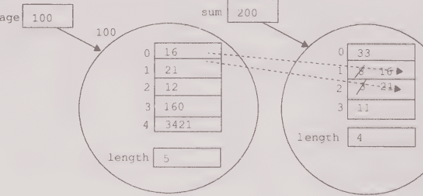

**图 6.26** `System` 类 `arraycopy` 方法的用法。

如果传递给方法的 `sourceIndex`、`destinationIndex` 和 `numElements` 值导致生成的元素索引不存在，则会发生运行时错误（`ArrayIndexOutOfBoundsException`）。

### 6.9.2 Arrays 类

`Arrays` 类包含两个可以将一个数组复制到另一个数组的方法，并包含了其他几个处理基本类型数组和字符串数组的有用方法。这些包括：一个通过将数组所有元素转换为单个字符串来方便输出数组所有元素的方法、一个排序方法、一个搜索方法、一个判断两个数组对应元素是否相等的方法，以及一个将数组元素设置为指定值的方法。`Arrays` 类中的某些方法执行速度比第 6.8.1 节和 6.8.3 节讨论的算法更快。表 6.2 汇总了 `Arrays` 类中的一些方法。

#### 表 6.2 API Arrays 类方法

| 功能 | 方法名称 | 典型调用 | 说明 |
| :--- | :--- | :--- | :--- |
| 从第一个元素开始复制数组的所有或部分 | `copyOf` | `int[] a = Arrays.copyOf(sourceArray, 10)` | 返回一个包含 `sourceArray` 前十个元素的数组 |
| 从任意元素开始复制数组 | `copyOfRange` | `int[] a = Arrays.copyOfRange(sourceArray, 2, 10)` | 返回一个包含 `sourceArray` 从第三（索引 2）到第九个元素的数组 |
| 将数组内容转换为字符串 | `toString` | `String arrayContents = Arrays.toString(anArray)` | 返回一个用大括号括的字符串，包含数组元素的内容，元素之间用逗号和空格分隔 |
| 升序对数组元素排序 | `sort` | `Arrays.sort(anArray)` | 排序 `anArray` 的所有元素。`Arrays.sort(anArray, 1, 5)` |
| 在排序数组中搜索（定位）目标值 | `binarySearch` | `int i = Arrays.binarySearch(anArray, targetValue)` | 返回 `targetValue` 在排序后的 `anArray` 中出现的的索引；若未找到，则返回负值 |
| 将数组元素设置为给定值 | `fill` | `Arrays.fill(intArray, 4)` | 将 `intArray` 数组的所有元素设置为值 4。`Arrays.fill(stringArray, 1, 4, "FillValue")` 将 `stringArray` 数组从第二个（索引 1）到第四个（索引 3）的元素设置为 "FillValue" |

所有这些方法都是静态方法，图 6.27 展示的程序说明了它们的用法。该程序生成的输出见图 6.28。图 6.27 的第 15 行和 16 行输出了第 6 行和 8 行创建的字符串数组 `stringArray` 和整数数组 `intArray` 的所有元素。15 行和 16 行传递给 `println` 方法的参数是 `Arrays` 类 `toString` 方法的返回值。返回的字符串是数组所有元素用逗号和空格分隔后的拼接（见图 6.28 的第 2 行和 3 行）。它以左括号开头，以右括号结尾。图 6.27 的第 21 行和 23 行使用 `Arrays` 类的 `copyOf` 创建数组 `stringArray` 和 `intArray` 的副本，并分别赋值给变量 `copyString` 和 `copyIntArray`。传递此方法的第二个参数是要复制的元素个数，复制从元素 0 开始。如果元素个数超过了源数组的大小（如第 21 行所示），则元素将用与其类型一致的默认值填充（引用类型为 `null`）。

### 代码示例：ArraysClass 应用

```java
System.out.println("copying arrays using the " +
"Arrays.copyOf method");
String[] copyArray = Arrays.copyOf(stringArray, 10);
System.out.println(Arrays.toString(copyArray));
int[] copyIntArray = Arrays.copyOf(intArray, intArray.length);
System.out.println(Arrays.toString(copyIntArray));
// determining if all the elements of two arrays are equal
System.out.println("testing two arrays for equality " +
"the Arrays.equals method");
System.out.println(Arrays.equals(intArray, copyIntArray));
copyIntArray[0] = 1;
System.out.println(Arrays.equals(intArray, copyIntArray));
// sorting arrays
System.out.println("sorting all or part of an array: " +
"the Arrays.sort method");
Arrays.sort(stringArray);
System.out.println(Arrays.toString(stringArray));
Arrays.sort(intArray, 1, 5);
System.out.println(Arrays.toString(intArray));
// searching for an element of a sorted array
System.out.println("Searching for a value: the " +
"Arrays.binarySearch method");
System.out.println(Arrays.binarySearch(stringArray, "Fred"));
System.out.println(Arrays.binarySearch(stringArray, "Boris"));
// copying a part of an array
System.out.println("Partial copies: the " +
"Arrays.copyOf and copyOfRange methods");
copyIntArray = Arrays.copyOf(intArray, 4);
System.out.println(Arrays.toString(copyIntArray));
copyIntArray = Arrays.copyOfRange(intArray, 2, 10);
System.out.println(Arrays.toString(copyIntArray));
// setting all elements of an array to one value
System.out.println("filling all or part of an array: " +
"the Arrays.fill method");
Arrays.fill(intArray, 4);
Arrays.fill(stringArray, 1, 4, "FillValue");
System.out.println(Arrays.toString(intArray));
System.out.println(Arrays.toString(stringArray));
```

**图 6.27** `ArraysClass` 的应用。

## 第 6 章 · 数组 28

### 图 6.28 程序输出

| # | 输出 |
| :--- | :--- |
| 1 | 使用 `Arrays.toString` 方法输出数组 |
| 2 | [Tom, Mary, Bob, Alice, Joe, Fred] |
| 3 | [3, 5, 2, 8, 6, 4] |
| 4 |  |
| 5 | 使用 `Arrays.copyOf` 方法复制数组 |
| 6 | [Tom, Mary, Bob, Alice, Joe, Fred, null, null, null] |


| 7 | [3, 5, 2, 8, 6, 4] |
| 8 | |
| 9 | 两个两个数组的相等性：`Arrays.equals` 方法 |
| 10 | true |
| 11 | false |
| 12 | |
| 13 | 排序全部或部分数组：`Arrays.sort` 方法 |
| 14 | [Alice, Bob, Fred, Joe, Mary, Tom] |
| 15 | [3, 2, 5, 6, 8, 4] |
| 16 | |
| 17 | 搜索一个值：`Arrays.binarySearch` 方法 |
| 18 | 2 |
| 19 | - |
| 20 | 部分复制：`Arrays.copy` 和 `copyRange` 方法 |
| 21 | [3, 2, 5, 6] |
| 22 | [5, 6, 8, 4, 0, 0, 0] |
| 23 | |
| 24 | 填充全部或部分数组：`Arrays.fill` 方法 |
| 25 | [4, 4, 4, 4, 4] |
| 26 | [Alice, FillValue, FillValue, FillValue, Mary, Tom] |
| 27 | |

图 6.28 `ArraysClass` 应用程序产生的输出。

## 6.10 多维数组

Java 与大多数编程语言一样，也支持多维数组。与一维数组一样，多维数组中的每个内存单元都共享相同的“姓”（即数组名称），并且数组的所有元素必须是相同类型。为了完成这个类比，与一维数组不同，多维数组的每个元素都有两个或多个独特的“名”。

简单的多维数组是二维数组，它在概念上是一组按行和列排列的内存单元（见图 6.29 左侧）。在 Java 中，数组的维度没有限制。三维数组可以被可视化为多个位于不同平面上的二维数组（见图 6.30 右侧）。实质上，我们为二维数组增加了一个深度维度。由于我们生活在三维世界中，超过三维的多维数组在程序中并不常见，尽管在某些情况下它们是有用的。


图 6.29 二维数组

图 6.30 三维数组

## 6.11 访问多维数组

多维数组通过多个索引来访问，每个索引对应一个维度。对于二维数组，第一个索引指定行，第二个索引指定列。

```java
int[][] matrix = { {1, 2, 3},
                  {4, 5, 6},
                  {7, 8, 9} };
System.out.println(matrix[0][1]); // 输出 2
System.out.println(matrix[2][0]); // 输出 7
```

### 使用 Java 编程基础

| 列 0 | 列 1 | 列 2 | 列 3 | 列 4 |
|---|---|---|---|---|
| 行 0 | 10 | 11 | 12 | 13 | 14 |
| 行 1 | 20 | 21 | 22 | 23 | 24 |
| 行 2 | 30 | 31 | 32 | 33 | 34 |
| 行 4 | 40 | 41 | 42 | 43 | 44 |

**图 6.31** 初始化后数组 `grades` 的元素。

二维数组每行中指定的初始值数量不需要相同。以下声明生成了 `ages` 数组，如图 6.32 所示，它的三行中每行的元素数量都不同：

```java
int[][] ages = { {10, 11, 12},
{20, 21, 22, 23, 24},
{30, 31} };
```

在数组对象 `ages` 内部，名为 `ages[0].length`、`ages[1].length` 和 `ages[2].length` 的公共变量分别存储整数值 3、5 和 2。这些变量在下面的代码段中用于输出图 6.32 所示的数组 `ages` 的所有元素，并且经常被传递二维数组的方法用于确定数组每行的列数。

```java
for(int row = 0; row < ages.length; row++) //每行
{
    for(int col = 0; col < ages[row].length; col++) //每行中的每一列
    {
        System.out.print(ages[row][col] + " ");
    }
    System.out.println();
}
```

| 列 0 | 列 1 | 列 2 | 列 3 | 列 4 |
|---|---|---|---|---|
| 行 0 | 10 | 11 | 12 | | |
| 行 1 | 20 | 21 | 22 | 23 | 24 |
| 行 2 | 30 | 31 | | | |

**图 6.32** 初始化后数组 `ages` 的元素。

## 6.12 删除、修改和添加磁盘文件项

在第 4.8.5 节中提到，Java 像大多数编程语言一样，并不包含用于删除或修改文件项，或在文件末尾之外任何位置添加数据项的方法。这些操作可以通过算法实现，这些算法结合第 4 章讨论的磁盘 I/O 方法结合数组和循环的使用。使用数组是因为在删除或修改数据项或在文件的任意位置添加项时，必须将所有数据读入 RAM 内存。由于磁盘文件通常包含大型数据集，可以通过将每个项读取到数组的元素中并将读取语句放在循环内部来轻松实现。

在本章的剩余部分，我们将讨论这些算法以及它们对所有相同类型的原始数据项文件的处理。使用算法处理包含多个对象数据成员的文件（这些数据成员类型可能不同）将在第 7 章中讨论。

### 从磁盘文件中删除项

从文件中删除数据项的算法应为：

1. 打开文件，读取文件中包含的项数，并分配相应大小的数组
2. 在 `for` 循环内部，将文件的所有数据项读入数组
3. 关闭文件
4. 删除并重建文件，并将新的项数写入文件
5. 在 `for` 循环内部，将数组的元素（被删除项除外）写入文件
6. 关闭文件

当算法结束时，文件中少了一个项（即被删除的项），其余数据将保持其原始顺序。

要删除的项可以通过其在文件中的位置来指定，例如“删除第 25 个项”，或者通过指定要删除的数据值来指定，例如“删除数据 34.56”。当指定文件中的位置时，使用步骤 5 的循环变量来来决定是否应将数组的下一个元素写入文件。假设算法的步骤 1 将从文件中读取的项数存储在变量 `count` 中，且步骤 2 将数据读入数组 `data` 中，下面的代码段说明了从文件中删除第 25 个项时步骤 5 的过程：

```java
//删除第 25 项
for(int i = 0; i < count; i++) {
    if (i != 25 - 1) {
        // 写入该项，默认...
    }
}
```

当指定要删除的数据项的值时，将数组的下一个元素写回文件的决定基于数组元素的内容。假设算法的步骤 1 将从文件中读取的项数存储在变量 `count` 中，并将数据读入数组 `data` 中，下面的代码段说明了从文件中删除所有次数的 35.56 时步骤 5 的过程：

```java
//从文件中删除 35.56
for(int i = 0; i < count; i++)
{
    if(data[i] != 35.56)
    {
        // 将项写入文件
    }
}
```

图 6.33 所示的 `DeleteFile` 从磁盘文件 `scores.txt` 中删除分数。它使用了本节讨论的六步算法以及第 4 章讨论的输入输出方法。项数在第 16 行从文件中读取，并在第 17 行用于调整数组大小。要删除的值在第 35 行解析到变量 `deletedItem` 中，然后在第 38 行的布尔条件中防止删除项被重写到文件中。文件在第 29 行和第 30 行被删除并重建。

| | | |
|---|---|---|
| 1 | import java.util.Scanner; |
| 2 | import java.io.*; |
| 3 | import javax.swing.*; |
| 4 | |
| 5 | public class DeleteFile |
| 6 | { |
| 7 | public static void main(String[] args) throws IOException |
| 8 | { |
| 9 | double[] data; |
| 10 | double deletedItem; |
| 11 | int count = 0; |
| 12 | |
| 13 | //步骤 1：打开文件，读取项数，分配数组 |
| 14 | File gameObject = new File("scores.txt"); |
| 15 | Scanner fileIn = new Scanner(gameObject); |
| 16 | count = fileIn.nextInt(); |
| 17 | data = new double[count]; |
| 18 | |
| 19 | //步骤 2：将文件的所有数据项读入数组 |
| 20 | for(int i = 0; i < count; i++) |
| 21 | { |
| 22 | data[i] = fileIn.nextDouble(); |
| 23 | } |
| 24 | |
| 25 | //步骤 3：关闭文件 |
| 26 | fileIn.close(); |
| 27 | |
| 28 | //步骤 4：删除并重建文件 |
| 29 | FileWriter fileObject = new FileWriter("data.txt"); |
| 30 | PrintWriter fileOut = new PrintWriter(fileObject, false); |
| 31 | fileOut.print(count--); |
| 32 | |
| 33 | //步骤 5：写入不含删除项的数组元素 |
| 34 | String s = JOptionPane.showInputDialog("enter score to delete"); |
| 35 | deletedItem = Double.parseDouble(s); |
| 36 | for(int i = 0; i < count; i++) { |
| 37 | if(data[i] != deletedItem) { |
| 38 | fileOut.println(data[i]); |
| 39 | } |
| 40 | } |
| 41 | //步骤 6：关闭文件 |
| 42 | fileOut.close(); |
| 43 | } |
| 44 | } |

**图 6.33** `DeleteFile`。

### 检测文件结束

如果项数没有存储在文件中，则图 6.33 的第 16 行将替换为下面的代码段，它在声明数组之前计算文件的项数并关闭文件。此外，程序将移除第 31 行。

```java
while(fileIn.hasNext()) // 统计数据项
{
    count++;
    fileIn.nextDouble();
}
fileIn.close();
fileObject = new File("data.txt");
fileIn = new Scanner(fileObject);
```

### 修改存储在磁盘文件项

修改磁盘文件项的算法与删除算法相同，但在步骤 5 的 `if` 语句（图 6.33 的第 38 行）增加了一个 `else` 子句。假设数据项的新值存储在变量 `newValue` 中，`else` 子句的代码如下：

```java
else
{
    // 将新值写入文件
}
```

由于文件中的项数不变，步骤 4（图 6.33 的第 31 行）将原始项数写回文件。

### 在文件中插入新项

要在文件中插入新项，必须知道其在文件中的位置及其值。下面的算法与删除算法相同，但步骤 5 不同，步骤 4 写入文件的项数将增加：

1. 打开文件，读取文件中包含的项数，并分配相应大小的数组
2. 在 `for` 循环内部，将文件的所有数据项读入数组
3. 关闭文件
4. 删除并重建文件，并将新的项数写入文件
5. 在 `for` 循环内部，将数组的元素和新项写入文件
6. 关闭文件

假设如下：新项在文件中的位置存储在变量 `itemNumber` 中；新值存储在变量 `newValue` 中；且文件中的位置从零开始，那么步骤 5 的 `for` 循环变为：

```java
// 在 itemNumber 位置处写入 newValue
for(int i = 0; i < count; i++)
{
    if(i == itemNumber)
    {
        // 将 newValue 写入文件
    }
    // 将项 data[i] 写入文件
}
```

在修改文本文件和数据文件时，这些文件操作也将能够记录玩家分数并更新游戏的高分。

## 6.13 章总结

本章介绍的数组概念为我们存储、检索和处理数据（特别是大型数据集）提供了一个强大的工具。与只包含单个值的原始变量不同，数组包含多个类型均相同的数据集。当创建数组时，其数据项都被初始化为默认值。数组的索引从零开始到 n-1，其中 n 是数组中元素的数量（数组的大小）。为了区分不同的元素，我们在数组名后使用索引，例如元素的名称 `grade[4]`，即为数组中第五个元素的名称。

# 第 6 章 · 数组

每个数组都有一个名为 `length` 的公共数据成员，用于存储一维数组的大小或二维数组的行数。二维数组还包含一个名为 `length` 的公共数据成员数组，其元素存储了数组中每行的元素数量。

循环被用于通过循环变量作为数组的索引，高效地输入、输出和处理数组中的数据。数组元素可以用在任何可以使用变量的 Java 语句中；它们可以接收输入并输出、用于数学表达式、赋值值、作为参数传递给方法，并从方法返回。此外，对于任何对象，数组对象的位置都可以传递给方法并从方法返回。并行数组的概念通过一维数组或多维数组来实现。无论是哪种情况，我们都可以使用该概念来组织相关信息（如学生学号和平均绩点 GPA）并快速访问它们。

对特定值进行排序和搜索（包括最小值和最大值）是非常常见的编程操作，它们的算法非常相似。选择排序算法用于按升序或降序对数组进行排序。它的嵌套循环定位数组中的最小（或最大）值并将其存储在第一个元素中。然后，它搜索下一个较小值并将其存储在第二个元素中，重复此过程直到整个列表排序完成。

数组的元素可以是基本类型变量或引用变量。可以通过创建一个数组，其中每个元素都是引用变量，来模拟对象数组。例如，我们可以创建一个雪人数组，或者更常见的是，创建一个指向雪人对象的引用变量数组。所有这些雪人对象的位置或速度都可以在循环中轻松地更改，从而创造出一个看起来像是在游戏棋板上行走的雪人对象组成的游行。

`System` 类方法 `arraycopy` 用于从一个数组将一组连续元素复制到另一个数组中。其他 API 方法包括 `toString`、`sort` 和 `fill`，它们分别用于将数组的所有元素转换为单个字符串、高效地将元素按升序排序，或将数组的元素设置为给定值。

最后，数组被用于实现算法，以向文本文件中插入新项并删除或更新现有项。这些算法使用第 4 章中讨论的磁盘 I/O 方法将现有数据集从磁盘文件读取到数组中。然后，删除并重建文件，并在其中插入新项或删除或更新现有项后，将数据写回文件。

## 知识练习

- 1. 判断对错：
  - (a) 数组是一种为组内存单元命名的技术。
  - (b) 数组的所有元素不必得是相同的数据类型。
  - (c) 数组的大小可以动态分配。
  - (d) 一旦创建数组，其大小就不能更改。
  - (e) 数组的最大索引是其长度 `length-1`。
  - (f) 数组不能传递给方法。
  - (g) 数组只能是一维或二维的。
  - (h) 数组可以在创建时初始化。
  - (i) 对整个数组执行操作的高效方法是在循环中进行处理。
  - (j) 在 Java 中，第一个索引或下标总是从 1 开始。

- 2. 给出数组的两个特征，使其变得比一组非数组变量更强大。

- 3. 列出数组元素与非数组变量之间的至少两处区别。

- 4. 解释数组和数组对象之间的区别。

- 5. 假设数组 `gameScores` 已经通过以下声明创建：
  `int[] gameScores = new int[100];`
  针对此数组回答以下问题：
  - 判断对错：
    - (a) 此数组的大小是 100。
    - (b) 此数组中的第一个元素是 `gameScores[1]`
    - (c) 此数组中的最后一个元素是 `gameScores[100]`
    - (d) 这是一个数组的有效赋值：`gameScores[5] = 93.2;`
    - (e) 调用时，`gameScores.length` 将返回值 99。
    - (f) 给出将值 `12` 存储在数组第二个元素中的 Java 语句。
    - (g) 给出将数组的最后一个元素输出到系统控制台的语句。
    - (h) 给出将数组所有元素输出到系统控制台的 Java 语句。
    - (i) 给出输出数组所有元素平均值的 Java 语句。
    - (j) 画出由该声明所分配的内存图。

- 6. 在以下代码中找到至少两个错误，并解释如何修复它们：
  `//prices at $0 (not available) and increase from $5, to $10, $15...`

```java
int size = 25;
double[] ticketPrice = new double[size];
for (int i = 1; i < 25; i++) {
  ticketPrice[i] = i * 5;
}
System.out.println("The price of a tier " + i + " ticket is: " + ticketPrice[i]);
```

- 7. 假设你已经获得了以下声明。回答与其相关的问题。


```java
final int MAX = 45;
int[] x = new int[MAX];
double[] y = {22.5, 3.6, 54.76, 10.8, 5.62};
double[] z = null;
```

(a) 数组 `x` 包含多少元素？

(b) `x` 最后一个元素的下标或索引是多少？

(c) `y` 的最大有效下标是多少？

(d) 编写将数组第一个元素乘以 7 的语句。

(e) 编写将数组 `y` 最后一个元素增加 20 的语句。

(f) 编写一条将数组 `y` 第一个元素的和赋值给 `z` 的语句。

- 8. 给出一条语句来分配一个可以存储内容的：

  (a) 使用单行声明三个字符。

  (b) 使用双行声明两百个字符串。

  (c) 使用单行声明五个对象。

  (d) 为 100 名学生 5 个分数。

- 9. 给出语句以：

  (a) 声明三个并行数组，分别存储 50 个人的姓名、体重和目标体重。

  (b) 将 a 部分中声明的数组中存储的所有信息输出到系统控制台，每行一个。

  (c) 将数组中的目标体重输出到系统控制台。

  (d) 将所有元素按字母顺序输出。

- 10. 编写一个方法，接收两个相同大小的数组并返回它们的元素和。

## 编程练习

- 1. 参考图 6.2，当按下键时，将雪人数组向右移动 20 像素。

- 2. 作为研究项目的一部分，你收集了以下数据并使用数组初始化：

  `int[] ages = {21, 32, 45, 23, 19, 27, 20, 44, 33, 25};`

  编写一个程序执行以下操作：

  (a) 根据用户搜索一个值并报告是否找到。

  (b) 搜索并输出数据的最大值。

  (c) 计算并输出平均值。

  (d) 将此数组按升序排序，然后输出数组。

- 3. 编写一个程序接受用户输入的名称，并按排序顺序写入 `Students.txt` 文件。然后询问用户要删除哪个名称，最后按字母顺序输出文件内容。

- 4. 编写一个图形应用程序，包含一个类，其直径、颜色和位置在构造对象时指定。当程序启动时，用户被要求在棋板上显示多少个磁盘，然后根据它们的位置在位置显示。

- 5. 修改编程练习 4 中的代码，当按下向下箭头键时，显示直径小于 50 像素的磁盘；当按下向上箭头键时，显示大于 50 像素的磁盘。

- 6. 编写一个图形应用程序，包含一个类，其红色中心的花瓣颜色和位置在构造花对象时指定。启动时，在棋板下半部分随机生成 100 朵花。它们的 (x, y) 位置将位于 (7 ≤ x ≤ 500 - w) 和 (30 ≤ y ≤ 500 - h) 范围内，其中 w 和 h 是花的宽度和高度。

- 7. 修改编程练习 6 中的程序，每当点击向下箭头时，剩余的花朵中会有 20 朵消失。

- 8. 编写一个图形应用程序，包含一个类，定义一个高 4 像素、宽 6 像素的浅灰色雨滴。应用程序启动时，棋板上应随机出现 300 滴雨滴。它们的 (x, y) 位置将位于 (7 ≤ x ≤ 496) 和 (30 ≤ y ≤ 494)。

- 9. 修改编程练习 8 中的程序，当点击棋板上的开始按钮时，雨滴每 40 毫秒向下移动 2 像素，营造出正在下雨的外观。当雨滴到达棋板底部（其 y 坐标大于 500）时，将其 y 坐标重置为 30。

- 10. 将编程练习 6 中的花园添加到编程练习 8 中。

- 11. 将编程练习 6 中的花园添加到编程练习 9 中。

- 12. 利用本开发的技能，继续实现你的游戏中需要多个相同游戏道具的部分。为了方便处理这些对象，它们应该是对象数组的一部分。

## 参考文献

Knuth, Donald, The Art of Computer Programming, Volume 3: Sorting and Searching, 2nd ed. New York: Addison-Wesley, 1998.

Levitin, Anal. Introduction to the Design and Analysis of Algorithms, 3rd ed. New York: Addison-Wesley Longman, 2011.

McAllister, William. Data Structures and Algorithms. Sudbury, MA: Jones and Bartlett Publishers, 2009.

# 第7章 - 方法、类与对象：再次审视

## 方法、类与对象：再次审视

- 7.1 静态数据成员
- 7.2 方法调用类中的其他方法
- 7.3 对象的比较
- 7.4 对象的复制与克隆
- 7.5 String 类：再次审视
- 7.6 包装类：再次审视
- 7.7 聚合
- 7.8 内部类
- 7.9 处理大数字
- 7.10 枚举类型
- 7.11 本章总结

### 本章内容

在本章中，我们将扩展对整合到我们编写的类中的特性的认知，加深对 `String` 类和包装类的了解，并探索 Java 应用程序接口 (API) 中另外两个常用的类。我们将学习编写对象共享共享数据成员的类的技术和动机，以及定义其数据成员为对象的类的技术和动机。此外，我们还将讨论比较、复制和克隆对象的含义，以及如何编写执行这些操作的方法。理解本章的主题将使我们能够更高效地编写复杂程序，增加我们编写的类的可重用性，并处理超出基本数据类型大小和精度的数值值。

在成功完成本章后，您应该：

- 理解静态数据成员及其在应用程序内所有类实例之间共享存储的能力
- 更加熟悉公共方法和私有方法之间的区别
- 理解深比较和浅比较之间的根本区别
- 能够比较类的两个实例
- 能够使用深拷贝技术复制数据成员并克隆对象
- 知道如何从基本值创建字符串、将字符串转换为字符、对字符串进行分词，并利用其他常用的字符串处理方法
- 能够创建和使用包装类对象及其自动装箱（`autoboxing`）功能
- 理解如何将对象聚合到类中以及这样做的优势
- 理解内部类和外部类之间的关系及其实现
- 能够使用 `BigInteger` 和 `BigDecimal` 类处理任意精度的大数字

## 7.1 静态数据成员

考虑一个名为 `Student` 的工作类，它包含两个数据成员 `idNumber` 和 `gpa` 以及一个双参数构造函数。以下代码段将产生图 7.1 所示的 `Student` 对象 `ryan` 和 `mary`；假设传递给构造函数的第一个和第二个参数分别用于初始化要作为静态的数据成员 `idNumber` 和 `gpa`（如第3章所述），每个实例都会为它的两个数据成员计算存储。

```java
Student ryan = new Student(1567, 3.26);
Student mary = new Student(2733, 2.87);
```

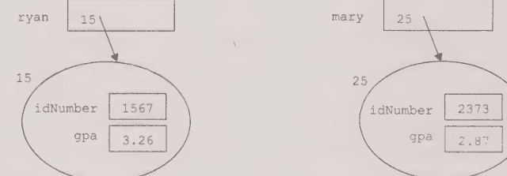

**图 7.1** 两个 Student 对象及其数据成员。

像方法一样，类的数据成员可以通过在声明语句中包含 `static` 关键字来声明为静态的。例如：

```java
static int studentCount;
```

当类的数据成员被声明为静态时，类中的每个实例并不包含该数据成员的存储。相反，应用程序中的所有类实例共享一个存储单元。例如，如果为类添加了名为 `studentCount` 的静态数据成员，图 7.1 所示的两个 `Student` 实例的存储就会增加一个共享的变量。

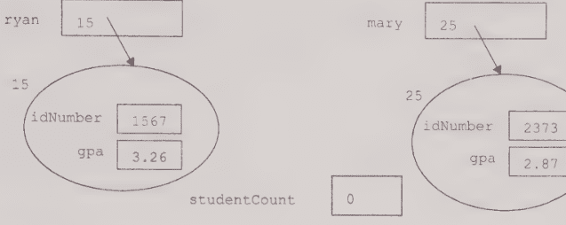

**图 7.2** 静态数据成员 studentCount。

静态数据成员的一种常见用途是跟踪应用程序中声明的类实例数量。为了实现这一点，在每个构造函数中都包含一条增加静态数据成员的代码。以下是使用静态数据成员跟踪声明对象数量的 `Student` 类双参数构造函数的实现：

```java
public Student(int idNumber, double gpa) {
    studentCount++; // 统计声明的 Student 对象数量
    this.idNumber = idNumber;
    this.gpa = gpa;
}
```

通常，类的静态数据成员被声明为私有访问，并在类中编写一个 get 方法来获取数据成员的值。当数据成员被用于计算类的实例时，通常不会编写 set 方法以限制写访问权限。

将 get 方法声明为静态方法是一种良好的编码风格。这强制调用者（如下所示）在调用语句中使用类名而不是对象名，从而向读者暗示所获取的值不属于特定的对象。例如：

```java
int numberOfStudents = Student.getStudentCount();
```

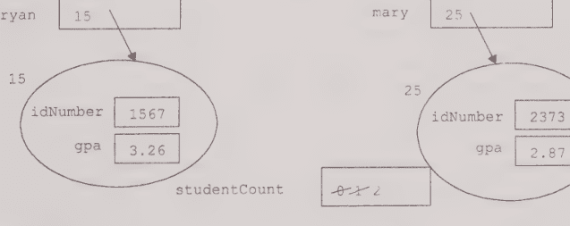

**图 7.3** 创建两个对象后数据成员 studentCount 的变化。

```java
public class Student {
    private static int studentCount = 0;
    private int idNumber;
    private double gpa;

    public Student(int idNumber, double gpa) {
        studentCount++; // 统计声明的 Student 对象的数量
        this.idNumber = idNumber;
        this.gpa = gpa;
    }

    public String toString() {
        String s = "id is " + idNumber + "\ngpa is " + gpa;
        return s;
    }

    public static int getStudentCount() {
        return studentCount;
    }
}
```

**图 7.4** 工作类 Student。

## 7.2 类内方法的调用

工作类中的一个方法可以调用该类中的另一个方法。这是一种常用技术，而且如果使用得当，可以减少开发类所需的时间，并使我们的程序更容易阅读和理解。

假设图 7.4 中指定 `Student` 类的 UML 图还需要类包含一个名为 `show` 的方法，该方法将对象数据成员的注释值输出到系统控制台。编写该方法的一种方式是：

```java
public void show() {
    String s = "id is " + idNumber + 
    "gpa is " + gpa;
    System.out.println(s);
}
```

然而，编写此方法的更好方法是利用这一事实：UML 图还规定类中将包含一个 `toString` 方法，并且类中的方法可以调用该类中的其他方法。知道这一点，`show` 方法将在 `toString` 方法完成并验证（经过测试）后进行编写，这样它就可以被调用来为 `show` 方法执行某些工作。这种方法将 `show` 方法的代码减少到一条可执行语句，如下所示：

```java
public void show() {
    System.out.println(toString()); // toString 完成了所有工作
}
```

图 7.5 是图 7.4 中 `Student` 类的扩展版本，添加了上述 `show` 方法的代码（第 25–28 行）。

通常，当在客户端代码中调用非静态工作方法时，其名称前面是一个对象名称，后跟一个点。无法使用这种语法来调用图 7.5 第 27 行的 `toString` 方法，因为对象（工作类的实例）是在客户端代码中声明的。由于第 27 行在语法上是正确的，问题就变成了：通过第 27 行的 `toString` 调用，哪个对象的数据成员将输出到控制台？答案是：用于调用 `show` 方法的客户端代码。类的非静态方法是由类中的另一个方法调用的，该方法在正在调用该方法的同一个对象上进行操作。

例如，当执行以下客户端代码片段时，图 7.5 第 27 行调用的 `toString` 方法将返回一个包含 Ryan 学生信息的字符串：

```java
StudentV2 ryan = new StudentV2(1567, 3.26);
ryan.show();
```

当类中的方法调用该类中的另一个方法时，调用语句前面不是对象名称后跟点点，且两个方法都在同一个对象上进行操作。

```java
public class StudentV2 {
    private static int studentCount = 0;
    private int idNumber;
    private double gpa;

    public StudentV2(int idNumber, double gpa) {
        studentCount++; // 统计声明的 Student 对象的数量
        this.idNumber = idNumber;
        this.gpa = gpa;
    }

    public String toString() {
        String s = "id is " + idNumber + "\ngpa is " + gpa;
        return s;
    }

    public static int getStudentCount() {
        return studentCount;
    }

    public void show() {
        System.out.println(toString());
    }
}
```

**图 7.5** `StudentV2` 类。

### 私有类方法

工作类调用其类中方法的另一个例子源于第 1.7 节讨论的设计过程。当一个指定复杂方法的类 UML 图要被包含在类中时，良好的编程实践是将其分为几个更简单的方法，并将它们添加到该复杂方法的类中。这与分治（解决问题的技术）是一致的。一旦每个简单方法都完成了编写和测试（通常由几位不同的程序员并行完成），复杂方法就会被写为对其所在类中的简单方法的一系列调用。

由于编写简单方法的唯一理由是它们执行其所在类中更复杂方法的工作，因此较简单的方法通常被声明为私有（`private`）方法。私有方法只能由其类中其他方法的代码调用，它们的签名以 `private` 关键字开头而不是以 `public` 关键字开头。当这样做时，我们说该方法具有私有访问权限（`private access`），从一个不是该类成员的方法尝试调用私有方法会导致编译错误。通常，将方法声明为私有是为了防止不是类成员的方法调用它们。我们将在第 7.4 节中讨论这一点。

## 7.3 对象的比较

在第 6.8 节中，我们讨论了搜索、寻找最小值和最大值以及对对象数组排序的算法。所有这些算法的基础都是比较两个对象的能力。通常来说，“比较两个对象”这个短语是有歧义的。它可能意味着我们想要比较两个对象的特定数据成员的内容，或者是两个对象的两个数据成员的内容，也可能意味着我们想要比较引用对象的引用变量的内容。因此，在为特定应用程序编写比较两个对象的方法之前，我们必须定义在该应用程序的语境下“比较两个对象”的含义。

最简单的情况是对象本身被比较时，但即使如此，我们也必须决定是比较字符串的长度，还是比较字符串的相等性或字典顺序，并决定这些比较是否对大小写敏感。一旦我们定义了在特定应用程序中比较两个字符串的含义，在大多数情况下，可以使用 `String` 类的 `length` 方法或其 `equals` 或 `compareTo` 方法（或这些方法的不区分大小写版本）来比较字符串。这些方法在第 4.2.3 节中讨论过，而使用这些方法比较作为字符串的对象的数据成员的方法在第 6.8 节中讨论过。

当对象不是字符串时，通常我们在定义了“比较两个对象”的含义后，为对象类添加一个方法来执行比较。将这些方法命名为 `equals` 或 `compareTo`，或者至少在较长的方法标题中使用这些词，是一种良好的代码风格。


# 第7章 - 方法、类与对象：再次回顾

鱼缸对于理解如何编写和使用这些方法很有帮助，这些方法将在本书的下一节讨论。图 7.6 展示了鱼缸中的两个对象：`sm1` 和 `sm2`。在这个类比中，引用变量浮在鱼缸顶部，因为它们很轻（它们只包含一个地址）。对象被描在鱼缸的深层，因为它们包含了多个数据成员，使其很重。我们的雪人比较三个数据成员：每个雪人的 (x, y) 位置和一个引用变量名。

浅层比较在鱼缸表面进行。它比较浮在鱼缸上的两个变量的内容（例如图 7.6 中的 `sm1` 和 `sm2`）。深层比较在鱼缸底部进行。深层比较比较两个对象的内容。

执行浅比较和深比较的方法从根本上是不同的，并将分别讨论。


**图 7.6** 浅比较与深比较的鱼缸类比。

## 7.3.1 浅比较

在第 4 章中，我们使用关系运算符来比较原始值。例如，为了确定整数变量 `age1` 和 `age2` 的值相等，我们使用了相等运算符 (`==`)：

```java
if (age1 == age2)
```

这是一种浅比较，因为原始变量包含一个值，所以它们会浮在鱼缸顶部。因为引用变量也浮，用于比较两个原始值的浅比较语法可以用于对两个对象的浅比较。实际上，两个对象的浅比较判断引用变量是否指向同一个对象。

通常，`equals` 方法（例如 `String` 类中的方法）对两个对象执行深比较。它比较对象内部的信息。因此，在被比较对象的类中编写 `equals` 方法时，将方法命名为 `shallowEquals` 是一种良好的编程实践。这个名称清楚地表明该方法正在进行浅比较。以下方法将在 `ParentSnowman` 类中（图 6.18）编写，执行对调用的 `ParentSnowman` 对象与传递给参数的对象之间的浅比较。它使用相等关系运算符执行比较。

```java
public boolean shallowEquals(ParentSnowman ps) // 一个浅比较
{
    if (this == ps) // this 包含调用对象的地址
    {
        return true; // 调用者对象和 ps 指向同一个对象
    }
    else
    {
        return false; // ps 没有引用调用者对象
    }
}
```

这种比较方法命名规范的例外是 `Object` 类中的 `equals` 方法。它对两个对象进行浅比较。下面的代码片段说明了这种浅比较的使用。它输出布尔值 true，然后是 false，这是因为变量 `ps1` 和 `ps2` 包含相同的地址，而 `ps1` 和 `ps3` 则不是。

```java
ParentSnowman ps1 = new ParentSnowman();
ParentSnowman ps2 = ps1; // ps2 初始化为 ps1 中的地址
ParentSnowman ps3 = new ParentSnowman();
boolean sameAddresses;
sameAddresses = ps1.equals(ps2); // 浅比较，返回 true
System.out.println(sameAddresses);
sameAddresses = ps1.equals(ps3); // 浅比较，返回 false
System.out.println(sameAddresses);
```

## 7.3.2 深度比较

深度比较比较的是两个对象数据成员的内容。正如前面提到的，在我们为特定应用程序编写执行深度比较的方法之前，我们必须确定对于该应用需要比较对象的哪些数据成员。例如，如果我们决定如果两个对象处于相同的游戏棋盘位置，则它们就是相等的，那么这两个对象的 `x` 和 `y` 成员就会被比较。一旦做出此决定，将使用类的方法来获取数据成员，如果它们是原始类型变量，则使用关系运算符进行比较。如果它们是指向其他对象的引用变量，则使用对象类中的深度比较方法进行比较。

图 7.7 所示的方法（将在 `ParentSnowman` 类中编写）对两个 `ParentSnowman` 对象执行深度比较：即它所调用的对象和传递给其参数的对象。如图 7.6 所示，每个 `ParentSnowman` 包含它的 (x, y) 位置以及对它的姓氏（一个字符串）的引用。当两个对象位于相同的游戏棋盘 (x, y) 位置，且通过字符串数据成员引用的对象姓氏相同时，该方法返回 true。

```java
public boolean equals(ParentSnowman ps) // 深度比较
{
    if (x == ps.getX() && y == ps.getY() &&
        name.equals(ps.getName()))
        return true; // 相同的位置和姓氏
    else
        return false; // 位置和/或姓氏不同
}
```

**图 7.7** 名为 `equals` 的深度比较方法将是 `ParentSnowman` 类的一部分。

需要注意的是，图 7.7 第 4 行对 `equals` 方法的调用是对 `String` 类 `equals` 方法的调用。调用此方法是因为 `name` 是一个字符串变量，且第 4 行其名称后的参数 `ps.getName()` 返回了对 `String` 对象的引用。

在编写图 7.7 第 3 行和第 4 行布尔条件的第三项时，有四种常见的错误：

1. `name == ps.getName()`
2. `this.getName() == ps.getName()`
3. `name.equals(ps)`
4. `this.equals(ps)`

当发生前两个错误之一时，会对 `name` 数据成员进行浅比较，当字符串相同时，布尔条件的求值为 false。比较的是两个地址，而不是字符串。当发生第三种错误时，将一个字符串与 `ParentSnowman` 对象进行比较，并调用 `Object` 类的 `equals` 方法，这同样会导致浅比较。

当发生第四种错误时，程序将以运行时 `StackOverflow` 错误结束。在第 4 行比较两个 `ParentSnowman` 对象时正在反复调用它所属的同一个方法。这种概念被称为递归。它不被视为语法错误，因为递归被正确使用，它可以有助于许多算法的编码。我们将在第 9 章学习更多关于这种编码技术的正确用法。

深度比较也用于确定两个对象的相对顺序。比较对象确定相对顺序的方法通常是 `compareTo`，它返回一个整数。`String` 类包含一个名为 `compareTo` 的方法，用于确定两个 `String` 对象的字典顺序。除了更改图 7.7 所示的方法名称以及返回类型和值外，比较方法将使用小于 (`<`) 或大于 (`>`) 运算符来比较原始数据成员，并使用之前编写的方法来比较作为对象类型的数据成员。

## 7.4 复制与克隆对象

深度和浅鱼缸类比也有助于我们理解用于复制和克隆对象的技术。我们可以对对象进行浅拷贝和深拷贝，并且可以从对象的深拷贝轻松创建对象的克隆。图 7.8 展示了浅拷贝和深拷贝之间的区别。浅拷贝是将对象的引用变量的内容复制到另一个对象的引用变量中。深拷贝是将一个对象数据成员的所有值复制到另一个对象的数据中。我们将从讨论浅拷贝开始。

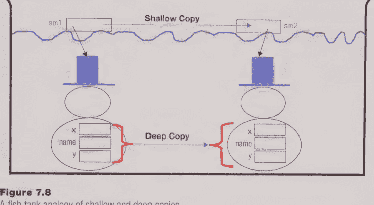

### 7.4.1 浅拷贝

在第 2 章中，我们使用赋值运算符将一个对象的引用变量复制到另一个。例如，下面的行执行了浅拷贝：

```java
ParentSnowman ps1 = new ParentSnowman(250, 250, "A");
ParentSnowman ps2 = new ParentSnowman(10, 20, "X");
ps2 = ps1; // 执行了浅拷贝
```

尽管我们说正在进行浅拷贝，但实际上复制的是对象的地址。参考图 7.8，浅拷贝完成后，两个变量指向同一个对象。由于赋值运算符只复制地址，内存管理器回收了不再使用的存储空间。下面的代码片段两次输出该对象的数据成员：

```java
System.out.println(ps1.show());
System.out.println(ps2.show());
```

### 7.4.2 深拷贝与克隆

如图 7.8 底部所示，当我们对一个对象进行深拷贝时，其数据成员的值被复制到另一个对象。与浅拷贝不同，深拷贝完成后两个对象都存在，并且它们数据成员存储的值是相同的。

通常情况下，类中应添加一个方法以便进行深拷贝。深拷贝方法使用类的设置方法将调用它的对象的数据成员复制到传递给它的对象的数据成员中。

图 7.9 所示的方法将在 `ParentSnowman` 类中编写。如图 7.8 所示，每个 `ParentSnowman` 包含它的 (x, y) 位置以及通过字符串数据成员 `name` 引用的对象姓氏：

```java
public void deepCopy(ParentSnowman ps) // 进入 ps 的深拷贝
{
    ps.setX(x);
    ps.setY(y);
    ps.setName(name);
}
```

**图 7.9** 作为 `ParentSnowman` 类的一部分的一个方法。

在某些情况下，将一个对象的一个子集数据成员深拷贝到另一个对象是有理想的。在这种情况下，良好的编程习惯是将该方法命名为 `copy` 而不是 `deepCopy`，以提醒方法签名的读者并不是对象的所有数据成员都被复制了。

## 对象的克隆

当一个对象被克隆时，会创建该对象类的一个新实例，并将现有对象所有数据成员的值复制到新对象的对应数据成员中。如果在创建克隆之前已经存在一个对象，那么在克隆创建后将存在两个对象。要创建一个对象的克隆，通常会在对象的类中编写一个方法（通常命名为 `clone`）。该方法是一个非空（nonvoid）方法，返回新创建对象的地址。

图 7.10 和 7.11 显示了 `clone` 方法的不同编码方式，这些方法编写在 `ParentSnowman` 类中。这两种方法都返回调用它们的对象的创建克隆的地址。图 7.10 所示的版本在第 4 行调用了类的 `deepCopy` 方法，将调用者对象的数据成员值复制到第 3 行创建的克隆对象中。该版本的方法确保了类包含一个深拷贝方法和一个无参数构造函数。新对象与现有对象相同（是现有对象的精确拷贝）。

```java
public ParentSnowman clone() // 一个深拷贝
{
    ParentSnowman theClone = new ParentSnowman();
    this.deepCopy(theClone);
    return theClone;
}
```

**图 7.10** 一个使用 `deepCopy` 方法的克隆，该方法是 `ParentSnowman` 类的一部分。

图 7.11 中的 `clone` 方法的另一种编码使用了第 3 行类的三参数构造函数，在构造时将数据成员复制到克隆中。如果每个对象只包含三个数据成员，那么新创建的对象与现有对象相同（是现有对象的精确拷贝）。通常情况下，为了产生一个具有 $n$ 个数据成员的对象的精确拷贝，该版本的 `clone` 方法必须在图 7.11 的第 3 行调用一个 $n$ 参数的构造函数。

```java
public ParentSnowman clone() // 一个深拷贝
{
    ParentSnowman theClone = new ParentSnowman(x, y, name);
    return theClone;
}
```

**图 7.11** 作为 `ParentSnowman` 类一部分的另一种 `clone` 方法。

如果对于特定应用程序，`clone` 方法仅将对象数据成员的一部分复制到新创建的对象中是合适的，则图 7.10 的第 4 行将改为调用类的 `copy` 方法，并将 `clone` 方法重命名为 `partialClone`，以表示对此方法的调用不会为调用对象创建相同的拷贝。

## 使用 Java 编程基础

图 7.12 是名为 `ParentSnowmanV2` 的类的代码，它是图 6.18 所示 `ParentSnowman` 类的扩展版本。扩展版本为类添加了以下方法：

- 一个 `copy` 方法（第 29–35 行），将对象的四个数据成员复制到另一个对象中
- 一个 `partialClone` 方法（第 36–41 行），调用 `copy` 方法
- 一个浅比较方法（第 42–52 行）
- 一个深比较方法（第 53–63 行），比较两个对象的 `hatColor` 数据成员
- 一个检测两个雪人之间碰撞（第 64–75 行）的方法

此外，类中还添加了三个静态数据成员（第 5–7 行）以及一个用于获取这些数据成员之一的 `get` 方法。

正如第 7.1 节所述，图 7.12 第 5、6、7 行声明的三个静态数据成员由该类的所有实例共享。其中第一个 `snowmanCount` 初始化为零，将用于计算所构造的雪人的数量。每当雪人构造函数执行时，它都会在无参数构造函数（第 18 行）和四参数构造函数（第 27 行）内部进行递增。客户端可以使用第 93–96 行编写的 `get` 方法获取变量 `snowmanCount`。

另外两个变量 `w` 和 `h` 存储雪人的宽度 (40) 和高度 (77)，如图 4.9 所示。该类的 `show` 方法绘制所有具有相同宽度和高度的雪人，因此这两个变量由类的所有实例共享是合适的。这些变量被使用在 `collidedWith` 方法（第 64–75 行）的布尔条件中，该方法检测雪人与传递给参数的雪人之间的碰撞。在类其他方法的第 66 和 67 行中使用的 `x` 和 `y` 值；另一种情况下，我们可以将这些数据成员编码为 `this.x` 或 `this.y`。

类的 `copy` 方法（第 29–35 行）复制了对象的四个数据成员（第 31–34 行）。当方法执行完成时，传递给参数的雪人将与调用它的雪人具有相同的名称、帽子颜色和位置。为了防止不是 `ParentSnowmanV2` 方法错误地调用它来对所有数据成员进行深拷贝，它在第 29 行被声明为私有方法。

`copy` 方法在第 39 行被 `partialClone` 调用，这意味着克隆对象仅具有与其被克隆的雪人相同的名称、帽子颜色和位置。它们的 `xSpeed`、`ySpeed` 和 `visible` 数据成员保留了默认值（在 12–14 行）。正如之前在第 7.2 节中，`copy` 方法是私有方法的这一事实并不会阻止类的 `clone` 方法调用它。`copy` 方法在第 55 行执行的深比较通过调用类的 `equals` 方法判断两个雪人具有相同的帽子颜色。如果是，则方法返回 true。

```java
public int getXSpeed()
{
    return xSpeed;
}
public void setXSpeed(int newSpeed)
{
    xSpeed = newSpeed;
}
public int getYSpeed()
{
    return ySpeed;
}
public void setYSpeed(int newSpeed)
{
    ySpeed = newSpeed;
}
public void setColor(Color newHatColor)
{
    hatColor = newHatColor;
}
public Color getHatColor()
{
    return hatColor;
}
public int getX()
{
    return x;
}
public void setX(int newX)
{
    x = newX;
}
public int getY()
{
    return y;
}
public void setY(int newY)
{
    y = newY;
}
public String getName()
{
    return name;
}
public void setName(String newName)
{
    name = newName;
}
public boolean getVisible()
{
    return visible;
}
```

**图 7.12** `ParentSnowmanV2` 类。

图 7.13 所示的应用程序使用了本章为止讨论的大部分概念。当点击游戏板的 Start（开始）按钮时，一个姓名为“G”的雪人守卫会在他的游戏板花园中巡逻，寻找三个误入花园的绿帽子雪人（图 7.14a）。当他发现（碰撞）其中一个时，他会将绿帽子雪人放置在自己身后，并继续寻找（图 7.14b）。每当他到达花园的边界时，他就会克隆自己并将克隆体放置在花园边缘（图 7.14c），以保护花园免受流浪雪人的侵扰。守卫找到三个绿帽子雪人并在花园边界部署了六个克隆体后，动画结束（图 7.14d）。


```java
1 import edu.scjny.gpvl.*;
2 import java.awt.*;
3
4 public class DeepAndShallow extends DrawableAdapter
5 { static DeepAndShallow ge = new DeepAndShallow();
6 static GameBoard gb = newGameBoard(ge, "Deep and Shallow");
7 static ParentSnowmanV2[] ps;
8 static boolean gameOver = false;
9
10 public void main(String[] args)
11 { ps = new ParentSnowmanV2[4];
12 ps[0] = new ParentSnowmanV2(100, 200, "G", Color.BLUE);
13 ps[1] = new ParentSnowmanV2(300, 275, "1", Color.GREEN);
14 ps[2] = new ParentSnowmanV2(300, 400, "2", Color.GREEN);
15 ps[3] = new ParentSnowmanV2(100, 100, "3", Color.GREEN);
16
17 gb.setTimer(3, 20);
18 showGameBoard(gb);
19 }
20
21 public void draw(Graphics g)
22 {
23 for(int i=0; i<ps.length; i++) {
24 {
25 if(ps[i] != null) // 雪人存在
26 {
27 ps[i].show(g);
28 }
29 }
30 gb[0].show(g); // 巡逻的守卫
31 }
32 }
33
34 public void timer(){
int x, speed, y;
if(ParentSnowmanV2.getSnowmanCount() == 10)
{
    gb.stopTimer(3);
    gameOver = true;
}
// 移动守卫
x = ps[0].getX();
x = x + ps[0].getXSpeed();
ps[0].setX(x);
y = ps[0].getY();
y = y + ps[0].getYSpeed();
ps[0].setY(y);

// ps[0] 是否在边界上？
if(ps[0].getX() >= 460 || ps[0].getY() <= 30)
{
    speed = ps[0].getYSpeed();
    speed = -speed;
    ps[0].setY(speed);
    ParentSnowmanV2.getSnowmanCount() = ps[0].partialClone();
}

// ps[0] 找到绿帽子流浪雪人吗？
for(int i = 1; i<ps.length; i++)
{
    if(ps[i] != null && ps[0].collidedWith(ps[i]) &&
        {
        ps[i].setX(ps[0].getX()); // 将其放在 ps[0] 后方
        ps[i].setY(ps[0].getY());
    }
}

public void leftButton()
{
    if(gameOver == true)
    for(int i=0; i<=3; i++) // 移动三个入侵者
    {
        ps[i].setX(ps[i].getX() - (i * 3));
    }
84
ps[0].setX(ps[0].getX() - 1); // 移动守卫
86
}
```

# 图 7.13 应用程序 DeepAndShallow


 (a) 程序启动时的游戏板

 (b) 找到绿帽子雪人 2 并放置在守卫身后

 (c) 部署了三个克隆体后，绿帽子雪人 3 即将找到

 (d) 部署了六个克隆体且所有流浪者都找到后的游戏板

# 图 7.14 DeepAndShallow 产生的图形输出

此动画使用十个 `ParentSnowmanV2` 对象的数组，其类如图 7.12 所示；数组 `ps` 定义在图 13 的第 11 行。巡逻的守卫和加入队伍的三个绿帽子雪人分别被索引 0 和 3 引用，数组的其余六个元素将用于引用克隆体。

# 第 7 章 方法、类和对象：再次查看

守卫的巡逻和游戏的结束依赖于计时器的 20 毫秒间隔，这意味着 `timer` 调用方法（第 34-75 行）每 20 毫秒执行一次。它的代码判断巡逻是否结束（第 36-40 行）、移动守卫（第 42-56 行）、部署克隆体（第 50-63 行）以及收集入侵者（第 66-74 行）。第 36 行判断是否构建了十个雪人，这意味着所有雪人都已部署。如果是，巡逻由第 38 行结束。在计时器计数期间，第 42-47 行使用 `Snowman` 类的方法每 20 毫秒获取并覆盖巡逻守卫的当前 (x,y) 位置。这让雪人继续巡逻。第 50 行和 57 行判断守卫是否到达花园的垂直（第 50 行）或水平（第 57 行）边缘。如果是，第 52-54 行和 59-61 行通过改变 x 速度数据的符号使守卫反弹。然后，第 55 行和 62 行调用 `partialClone` 方法创建雪人并将其地址存储在数组 `ps` 的下一个可用元素中。该元素的索引是这些行左侧调用的 `getSnowman` 方法的静态值。在 `timer` 方法结束之前，从第 66 行开始的 `for` 循环遍历数组的最后元素。对于这些元素中的每一个，第 68 行和 69 行的 `if` 语句条件判断：

- 数组元素是否引用雪人（不为空）
- 根据 `collidedWith` 方法判断引用的雪人是否与巡逻守卫 (`ps[0]`) 碰撞
- 根据 `equals` 方法判断引用的雪人是否为入侵者（其颜色与守卫的帽子颜色不同）

在这种情况下，雪人的 (x, y) 位置设置为巡逻守卫的 (x, y) 位置（第 71-72 行）。在计时器的下次计数中，巡逻守卫仅有几个像素之隔，因此守卫和雪人保持碰撞状态，流浪雪人的位置被第 71-72 行重置为守卫的新位置。产生的结果是进入巡逻的雪人无法看到，因为 `draw` 方法的第 31 行绘制了巡逻守卫 `ps[0]`（即绘制在加入巡逻的绿帽子雪人之上）。游戏结束后，一系列左键点击将巡逻守卫与加入巡逻的绿帽子守卫分离，如图 7.15 的中间部分所示。这是通过每次点击按钮时减少减少每个绿帽子雪人（第 82 行）和守卫（第 84 行）的 x 坐标来实现。在游戏结束之前，按钮处于未激活状态，因为第 79 行分离雪人的 `if` 语句只有在 `gameOver` 变量在第 39 行设置为 `true` 时才会执行。

使用 `char`, `int`, `long`, `float` 或 `double` 参数。整数类型的 `byte` 和 `short` 参数将传递给此方法的 `int` 参数版本。此外，该方法还有一个版本接受传递给它的字符数组。以下代码段演示了如何使用此重载方法来输出字符串：`x102030405.556.66yz`。

```java
char c = 'x';
byte b = 10;
short s = 20;
int i = 30;
long l = 40;
float f = 5.55f;
double d = 6.66;
char[] cArray = {'y', 'z'};
```

```java
String s2 = String.valueOf(c) + String.valueOf(b) + String.valueOf(s) +
            String.valueOf(i) + String.valueOf(f) + String.valueOf(l) +
            String.valueOf(d) + String.valueOf(cArray);
```

```java
System.out.println(s2);
```

## 7.5.2 将字符串转换为字符

`String` 类的方法 `charAt` 可用于将调用的字符串对象包含的特定字符转换为 `char` 类型并返回该字符。以下代码段将字符 'S' 存储在变量 `c` 中。

```java
String aString = "Joe Smith";
char c = aString.charAt(4); //字符数字从0开始计数
```

`toCharArray` 方法将调用的字符串转换为字符数组，并返回数组的地址。在执行以下代码段后，字符数组 `c1` 和 `c2` 包含相同的序列：

```java
char[] c1 = {'J', 'o', 'a', 'n', 'n', 'e', ' ', 'R', 'a', 'y'};
char[] c2;
String aString = "Joanne Ray";
c2 = aString.toCharArray();
```

## 7.5.3 处理字符串

`String` 类包含多个用于处理字符串数据的方法。其中两个方法 `compareTo` 和 `equals`（以及它们相关的方法 `compareToIgnoreCase` 和 `equalsIgnoreCase`）已在 4.2.3 节中讨论过。表 7.1 描述了其他经常用于处理字符串的 `String` 方法。

这些方法都是非静态方法。它们可以用于确定给定子字符串在字符串中是否存在或位置、从字符串的指定位置获取子字符串、生成字符串的大写或小写版本、用给定字符串替换子字符串的第一次或所有出现位置，以及对字符串进行分词判断字符串是否以指定的字符串开头或结尾。

## 表 7.1 String 类中的字符串处理方法

| 功能 | 方法与参数类型 | 示例与描述 |
| --- | --- | --- |
| 在字符串中定位指定的子字符串 | `indexOf` | `int i = sl.indexOf(target);` 返回字符串 `sl` 中子字符串 `target` 第一次出现的索引 |
| | 参数(s): String 或 String, int | `int i = sl.indexOf(target, start);` 返回字符串 `sl` 中从索引 `start` 之后开始的子字符串 `target` 第一次出现的索引 |
| 从字符串中获取子字符串 | `substring` | `String s2 = sl.substring(start);` 返回 s1 中从索引 `start` 到末尾的子字符串 |
| | 参数(s): int 或 int, int | `String s2 = sl.substring(start, end);` 返回 s1 中从索引 `start` 到索引 `end -1` 的子字符串 |
| 将字符串转换为大写或小写字符 | `toUpperCase` | `String s2 = sl.toUpperCase();` 创建 s1 的克隆，由所有大写字符组成 |
| | `toLowerCase` | `String s2 = sl.toLowerCase();` 创建 s1 的克隆，由所有小写字符组成 |
| 用指定的子字符串替换字符串中的指定子字符串 | `replaceFirst` | `String s2 = sl.replaceFirst(target, new);` 返回替换了 s1 中第一次出现的子字符串 `target` 的字符串 |
| | `replaceAll` | `String s2 = sl.replaceAll(target, new);` 返回替换了 s1 中所有出现的子字符串 `target` 的字符串 |
| 判断字符串是否以指定的字符串开头或结尾 | `startsWith` | `boolean b = sl.startsWith(s2);` 如果字符串 `sl` 以字符串 `s2` 开头则返回 true |
| | `endsWith` | `boolean b = sl.endsWith(s2);` 如果字符串 `sl` 以字符串 `s2` 结尾则返回 true |
| 对字符串进行分词 | `split` | `String[] s1 = sl.split(" +");` 返回一个字符串数组，s1 的元素由一个或多个空格分隔 |
| | 参数(s): String 或 String, int | `String[] s1 = sl.split(" +", n);` 返回一个字符串数组，s1 的元素由一个或多个空格分隔；返回的数组中会有 n 个或更少的元素 |

## 第 7 章 - 方法、类与对象：再次审视

图 7.16 所示的 `StringProcessing` 应用使用了表 7.1 中描述的一些方法来处理用户输入的句子。如果单词 `Hello` 出现在句首，它将被消除；如果句子中出现单词 `Tom`，它将被更改为 `XXX`。图 7.17 的左侧和右侧分别给出了典型的输入和相应的输出。

第 16 行使用 `String` 类的方法 `split` 创建一个新的新的数组，并将第 11 行输入的句子每个单词放置在它的元素中。然后，它存储了来自 `split` 的数组地址。

## 7.6 包装类：再次审视

正如在 2.7.3 节中讨论过的，六个数值包装类（例如 `Integer`, `Double` 等）包含将字符串转换为整数或实数值的方法。除了这些方法外，所有的包装类都包含创建包装类的构造函数以及一组常量。第七个包装类 `Character` 包含了对字符进行操作的方法。在本节中，我们将讨论这些类的额外功能以及相关的主题“自动装箱”（auting）。

## 7.6.1 包装类对象

包装类的单参数构造函数可以创建包装对象。包装类对象包含单个原始数据成员，其类型与类名一致。例如，`Double` 类的对象包含一个 `double` 数据成员，而 `Integer` 的实例包含一个 `int` 数据成员。单参数构造函数存储在对象的数据成员中。将原始值封装在对象中的正是包装类的基础。

包装类包含返回存储在对象数据成员中的值的方法。这些方法执行了 `get` 方法的功能，但它们的名称以其返回的原始类型开头。例如，`Integer` 类包含名为 `intValue` 的方法，返回类整数数据成员的值；`Character` 类包含 `charValue` 方法返回类数据成员的值。

`Integer` 类还包含 `byteValue`, `shortValue`, `longValue`, `floatValue` 和 `doubleValue`，它们将返回的数据成员强制转换为其他原始类型。其他数值包装类也包含五个类似命名的方法，用于将它们返回的数据成员转换为不同的数值类型。以下代码段将值 20 封装在 `Integer` 对象中，并以整数和双精度格式输出该值（例如 20 后接 20.0）：

```java
Integer n = new Integer(20);
System.out.println(n.intValue() + " " + n.doubleValue()); //输出: 20 20.0
```

第 20 行的代码可以如下代码所示：

```java
import java.swing.*;

public class StringProcessing
{
    public static void main(String[] args)
    {
        String s1 = "Hello Tom this is a sentence";
        int n = s1.indexOf("Hello");
        String s2;
        if (s1.startsWith("Hello"))
        {
            s2 = s1.substring(6);
        }
        else
        {
            s2 = s1;
        }
        n = s2.indexOf("Tom");
        if (n != -1)
        {
            s2 = s2.replaceAll("Tom", "XXX");
        }
        JOptionPane.showMessageDialog(null, "There are " + n + " words in your sentence:\n" + s2);
    }
}
```

图 7.16 `StringProcessing` 应用。图 7.17 (a) 输入 (b) 输出

# 使用 Java 的编程基础

赋值运算符也可以用于浅拷贝（地址）两个包装类对象。以下代码段会输出两次 12.5。虽然它最初创建了两个 `Double` 实例 `d1` 和 `d2`，但在执行第三行代码时，这些变量指向了同一个对象。包含值 54.6 的对象被 Java 内存管理器回收。在传递给 `println` 方法的参数中，变量 `d1` 和 `d2` 的编码是对 `Double` 类 `toString` 方法的隐式调用。

```java
Double d1 = new Double(12.5);
Double d2 = new Double(54.6);
System.out.println(d1 + " " + d2); // 输出两次 12.5
```

## 7.6.2 自动装箱与拆箱


包装类的自动装箱使得在程序中使用包装类对象变得更加容易。这一功能自动将原始类型值“封装”成包装对象。例如，正如第 2.5 节讨论的那样，可以使用简写语法来声明包装类对象（如 `String` 对象）。下面这行代码将整数 20 封装（装箱）为 `Integer` 对象，并将其地址写入变量 `n1`：

```java
Integer n1 = 20; // 在对象声明中对值 20 进行自动装箱
```

当该语句执行时，自动装箱功能创建一个 `Integer` 对象，将 20 存储（装箱）在其数据成员中，并返回对象的地址。该语句等同于：

```java
Integer n1 = new Integer(20);
```

自动装箱可用于有效地重新赋值或设置存储在包装类对象中的原始值。以下代码段输出值 3.6。第 2 行右侧使用自动装箱创建一个 `Integer` 包装对象，在其数据成员中存储 3.6 并返回其地址。返回的地址存储在变量 `n1` 中。包含值 2.5 的包装对象被 Java 内存管理器回收。

```java
1 Double d1 = 2.5;
2 n1 = 3.6; // 在赋值语句中对值 3.6 进行自动装箱
3 System.out.println(n1);
```

需要注意的是，如果被装箱到包装类对象（例如 `n2`）值已经存储在另一个相同类型的包装类对象（例如 `n1`）中，则不会创建新对象。相反，`n2` 被设置为 `n1` 所指向的对象。使用对象声明语法来声明并初始化新对象。这种注意事项也避免了创建 `String` 对象。图 7.19 所示的代码段演示了这些概念，以及相等运算符和包装类 `equals` 方法的使用。产生的输出显示在图底部。

第 2、7 和 11 行没有创建新对象，而是将对象的地址赋值给 `n2`，地址存储在 `n1` 中。第 16 行创建了一个新对象，尽管第 15 行创建的对象 `n1` 存储了相同的值，但因为它使用了长格式的对象声明语法（包含 `new` 关键字）来创建它。

### 第 7 章 - 方法、类与对象：再次回顾 325

| 行数 | 代码 |
| :--- | :--- |
| 1 | `Integer n1 = 20;` |
| 2 | `Integer n2 = 20; // 未创建新对象，n2 被赋值为 n1` |
| 3 | `if(n1 == n2) System.out.println("n1 & n2 指向同一个对象");` |
| 4 | `if(n1.equals(n2)) System.out.println("n1 & n2 包含相同值");` |
| 5 | |
| 6 | `n1 = 30;` |
| 7 | `n2 = 30; // 未创建新对象，n2 被赋值为 n1` |
| 8 | `if(n1 == n2) System.out.println("n1 & n2 指向同一个对象");` |
| 9 | `if(n1.equals(n2)) System.out.println("n1 & n2 包含相同值");` |
| 10 | |
| 11 | `n2 = n1; // 未创建新对象，n2 被赋值为 n1` |
| 12 | `if(n1 == n2) System.out.println("n1 & n2 指向同一个对象");` |
| 13 | `if(n1.equals(n2)) System.out.println("n1 & n2 包含相同值");` |
| 14 | |
| 15 | `n1 = 40;` |
| 16 | `n2 = new Integer(40); // 创建了新对象` |
| 17 | `if(n1 == n2) System.out.println("n1 & n2 指向同一个对象");` |
| 18 | `if(n1.equals(n2)) System.out.println("n1 & n2 包含相同值");` |

产生的输出：

```
n1 & n2 指向同一个对象
n1 & n2 包含相同值
n1 & n2 指向同一个对象
n1 & n2 包含相同值
n1 & n2 指向同一个对象
n1 & n2 包含相同值
n1 & n2 指向同一个对象
n1 & n2 包含相同值
```

图 7.18 自动装箱创建新对象的示例

包装类的拆箱功能允许我们在算术表达式中使用原始值。以下代码段输出 7。

```java
1 Integer n2 = 7;
2 int n3 = n2; // 对值 7 进行拆箱
3 System.out.println(n3);
```

### 7.6.3 包装类常量

包装类包含了名为 `MAX_VALUE`、`MIN_VALUE` 和 `SIZE` 的静态成员。`MAX_VALUE` 和 `MIN_VALUE` 的值是可以存储的最大和最小值。`SIZE` 的值是组成原始类型的位数。

以下代码段产生 127 - -128，这些是最大和最小值。

```java
System.out.println(Byte.MAX_VALUE + " - " + Byte.MIN_VALUE);
```

### 7.6.4 Character 类

`Character` 类包含了之前讨论的包装类的所有方法、常量和自动装箱功能。其值方法 `charValue()` 返回存储在 `Character` 实例中的字符。当然，类的常量（如 `MAX_VALUE`、`MIN_VALUE` 和 `SIZE`）存储的是与原始 `char` 相关的值，而类的方法操作 `Character` 对象并传递 `char` 参数。

除了数值包装类方法外，`Character` 类包含两个名为 `toUpperCase` 和 `toLowerCase` 的静态方法，可以将原始字符的大小转换为相应类型。`Character` 类还包含表 7.2 中描述的其他若干静态方法，它们返回布尔值。这些方法可以用于判断传递给它的字符是数字还是字母、大写或小写字母，或者是空白字符。

#### 表 7.2

| 方法名称和参数列表 | 传递给参数的字符返回为： | 代码示例 |
| :--- | :--- | :--- |
| `isDigit(char c)` | 0 到 9 之间的数字 | `Character.isDigit('4');` 返回 true |
| `isLetter(char c)` | 字母表的大写或小写字母 | `Character.isLetter('C');` 返回 true |
| `isLetterOrDigit(char c)` | 大写或小写字母或数字 (0-9) | `Character.isLetterOrDigit('C');` 返回 true |
| `isLowerCase(char c)` | 字母表的小写字母 | `Character.isLowerCase('c');` 返回 true |
| `isSpaceChar(char c)` | 空格字符 | `Character.isSpaceChar(' ');` 返回 true |
| `isUpperCase(char c)` | 字母表的大写字母 | `Character.isUpperCase('B');` 返回 true |
| `isWhitespace(char c)` | Java 定义的空白字符（例如空格、制表符或换行符） | `Character.isWhitespace(' ');` 返回 true |

```java
import javax.swing.*;
public class ParseSentence {
    public static void main(String[] args) {
        int upperCase = 0;
        int lowercase = 0;
        int numeric = 0;
        int whitespace = 0;
        char c;
        String sentence = JOptionPane.showInputDialog("Enter a sentence");
        for(int i = 0; i < sentence.length(); i++) {
            c = sentence.charAt(i);
            if(Character.isUpperCase(c)) {
              upperCase++;
            } else if (Character.isLowerCase(c)) {
              lowercase++;
            } else if (Character.isDigit(c)) {
              numeric++;
            } else if (Character.isWhitespace(c)) {
              whitespace++;
            }
        }
    }
}
```

### 图 7.19

应用程序 `ParseSentence`。

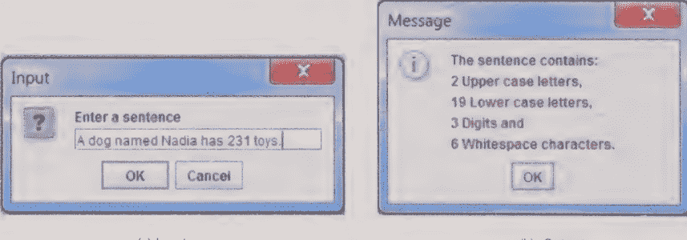

### 图 7.20

应用程序 `ParseSentence` 的输入及相应的输出。

### 7.7 聚合

就像一组原始变量可以通过将其声明为对象类中的数据成员来收集到一个对象中一样，其他类型的对象实例也可以被收集（或称“聚合”）到一个对象中。我们已经在这本书中使用了许多概念。例如，图 7.12 的第 10 行和第 11 行表示一个 `String` 和一个 `Color` 对象将是一个 `ParentSnowmanV2` 对象。因此，`ParentSnowmanV2` 类被认为是一个聚合类。

> **定义**
>
> 聚合类是指其数据成员包含其他类实例的类。

将一个对象聚合到类中是一项简单的任务。如图 7.21 所示（它包含了图 7.12 的第 10–11 行和第 20–28 行），我们只需要声明一个可以引用该对象的数据成员（第 10 和 11 行），并将对象的地址赋值给引用（第 11、25 和 26 行）。

```java
10 private String name;
11 private Color color = Color.BLACK;
12:
20 public ParentSnowmanV2(int initialX, int initialY, String name,
21 Color hatColor)
22 {
23 x = initialX;
24 y = initialY;
25 this.name = name;
26 this.color = hatColor;
27 snowmanCount++;
28
```

图 7.21 来自聚合类的代码片段。

聚合的困难部分在于正确管理对象的生命周期和引用关系。

### 第 7 章 方法、类与对象：再次观察

以及设置方法来获取帽子的高度和宽度，这些被用于将帽子居中在雪人的头部。

图 7.24 的第 38–49 行包含了图 7.22 中指定的 `SnowmanV8` 类的 `collidedWith` 方法的代码。它检测调用的雪人与传递给参数的 `Hat` 对象之间是否存在碰撞。它在第 40 和 41 行的布尔表达式中使用 `Hat` 的 `get` 方法来判断是否发生了碰撞。

```java
1 import java.awt.*;
2 public class SnowmanV8
3 {
4 private static int w = 40;
5 private static int h = 77;
6 private int x;
7 private int y;
8 private String name; //聚合对象的成员变量
9 private Hat hat;
10
11 public SnowmanV8(int initialX, int initialY)
12 {
13 x = initialX;
14 y = initialY;
15 name = "Snowman"; //将 String 对象聚合到此类中
16 }
17
18 public void draw(Graphics g)
19 { int[] x = {x + 20, x + 15, x + 25};
20 int[] y = {y + 8, y + 13, y + 13};
21
22 if(hat != null) //雪人戴了帽子
23 {
24 hat.setX(x + w/2 - hat.getX()/2); //在头部定位帽子
25 hat.setY(y - hat.getY()/2);
26 hat.draw(g); //绘制帽子
27 }
28
29 g.setColor(Color.WHITE);
30 g.fillOval(x + 10, y, 20, 20);
31 g.fillOval(x, y + 20, 40, 40); // 身体
32 g.setColor(Color.RED);
33 g.fillPolygon(x, y, poly, 3); // 鼻子
34 g.setColor(Color.BLACK);
35 g.setFont(new Font("Arial", Font.BOLD, 16));
36 g.drawString(name, x + 10, y + 45); // 名字
37 }
38
39 public boolean collidedWith(Hat hat)
40 {
41 if((x > hat.getX()) + hat.getWidth() || x + w < hat.getX()) ||
42      y > hat.getY() + hat.getHeight() || y + h < hat.getY()))
43  {
44      return true;
45  }
46  else
47  {
48      return false;
49  }
50  }
51 public void setHat(Hat newHat)
52  {
53      hat = newHat; //将 Hat 对象聚合到此类中
54  }
55 public int getX()
56  {
57      return x;
58  }
59 public void setX(int newX)
60  {
61      x = newX;
62  }
63 public int getY()
64  {
65      return y;
66  }
67 public void setY(int newY)
68  {
69      y = newY;
70  }
71 }
```

**图 7.24** `SnowmanV8`。

图 7.25 展示了聚合的应用。当程序启动时，它会显示一个雪人和一个包含六顶不同帽子的帽架，如图 7.26a 所示。使用键盘光标控制键来移动雪人，使其到达他想戴的帽子处，可能是图中右上角的蓝色帽子（图 7.26b）。选中的帽子会被克隆并放置在他头部（图 7.26c），并如图右下侧所示随着游戏板移动（图 7.26d）。

应用程序的 `draw` 方法（第 23–32 行）在第 25 和 26 行绘制帽架，其 `for` 循环调用类的 `show` 方法来绘制在第 12 到 17 行创建的六顶帽子。发送到 `Hat` 构造函数的参数为每顶帽子指定了不同的位置、颜色和大小。`draw` 方法的第 31 行调用 `SnowmanV8` 类的 `show` 方法，在游戏板上绘制第 8 行创建的雪人。当应用程序启动时，在第 10 行定义的雪人成员变量 `hat` 仍然包含其空值。这导致在图 7.26a 中绘制的雪人没有帽子，因为图 7.24 第 22 行的布尔条件为假。


# 第 7 章 方法、类与对象：再次观察

## 7.8 内部类

内部类是定义在另一个类内部的类。正如类可以包含成员变量和方法，也可以包含其他类。包含内部类的类被称为外部类。通常，只有当外部类将聚合内部类的实例时，该类才被定义为内部类。考虑上一节讨论的 `Hat` 类。内部类最常用于使用图形用户界面（GUI）的 Java 程序中。在本节中，我们将熟悉内部类的语法，以及内部类和外部类访问彼此成员变量和方法的能力。

图 7.27 展示了 `PhoneBook` 类，它包含一个内部类 `PhoneNumbers`，后者从第 28 行开始，到第 48 行结束。内部类的实例包含一个人的办公电话、手机和家庭电话。这三个字符串在第 30–32 行被声明为内部类的聚合成员变量，类的构造函数在创建 `PhoneNumbers` 对象时在第 36–40 行进行赋值。类的 `show` 方法（第 43–47 行）将三个电话号码输出到系统控制台。

```java
42     }
43     public void showNumbers()
44     {
45         System.out.println("PhoneNumbers + home:" + home +
46                 " cell:" + cell + " office:" + office);
47     
48     }//end of the inner class PhoneNumbers
49 }
```

### 图 7.27

外部类 `PhoneBook` 在第 10 和第 11 行声明了两个各包含三个元素的并行数组，并将它们的地址赋值给第 5 和 6 行定义的变量 `name` 和 `numbers`。在创建数组后，外部类构造函数中的 `for` 循环（第 13–17 行）通过创建 `String` 和 `PhoneNumbers` 对象的新实例，并将地址赋值给并行数组 `name` 和 `numbers` 的元素（第 15 和 16 行），完成了将这些对象聚合到外部类的操作。

> **注意**：内部类的代码可以调用内部类的构造函数。

每当在第 16 行调用内部类时，它不仅创建了一个新对象，还通过第 36–41 行向新创建对象的数据成员接收输入。传递给第 16 行该单参数构造函数的参数是在第 13 行声明的循环变量。构造函数的第 36、38 和 40 行使用该值作为外部类 `name` 数组的索引，这使得第 10 行刚刚输入的人名通过第 36–41 行成为输出的一部分。

> **注意**：内部类的代码可以访问其外部类的数据成员。

外部类的 `showAll`（第 19–26 行）将两个并行数组中的所有名称和号码输出到系统控制台。在 `for` 循环内部，第 23 行输出一个人的姓名，然后第 24 行调用内部类的 `show` 方法输出该人的电话号码。

> **注意**：外部类的代码可以调用内部类的方法。

总而言之：

- 内部类和外部类的代码可以访问彼此的成员（包括数据成员和方法）
- 内部类在外部类之外是不可见的

图 7.28 所示的应用程序 `InnerClass` 声明了一个 `PhoneBook` 对象，用于存储一个三个好朋友的姓名和电话号码。然后，它调用类的 `showAll` 方法输出程序用户输入的名称和号码。图 7.29 显示了两个典型的首次输入以及程序产生的典型控制台输出。

```java
public class InnerClass {
    public static void main(String[] args) {
        PhoneBook bestFriends = new PhoneBook();
        bestFriends.showAll();
    }
}
```

### 图 7.28

应用程序 `InnerClass`。


#### 图 7.29

应用程序 `InnerClass` 的两个典型输入和一组典型输出。

```
控制台输出：
Name: Alice
PhoneNumbers: home:657-2342 cell:574-8976 office:345-6589
Name: Tom
PhoneNumbers: home:367-4367 cell:754-3564 office:386-1212
Name: Annie
PhoneNumbers: home:456-4698 cell:765-8294 office:839-5623
```

## 7.9 处理大数字

有时，需要处理比基本类型 `long` 所能存储的最大或最小值更大或更小的整数。例如，互联网上使用的加密涉及包含 309 位的质数，这远超过了基本类型 `long` 能够存储的 19 位最大值。同样，我们可能需要处理比基本类型 `double` 最大或最小值更大或更小的实数，或者超过 `double` 类型 15 位精度的数字。

Java API 提供了 `BigInteger` 和 `BigDecimal` 类来处理基本类型无法处理的数字。

### BigInteger 类

考虑一个生成斐波那契数列的程序。前两项 `f1` 和 `f2` 定义为 1。从第 16 行开始的循环计算从第 3 项到输入数字的数列项。第 19 行使用 `add` 方法计算数列的下一项：`fn = f1 + f2`。当循环结束时，第 20 行将 `fn` 设置为上一个值。

最后，第 22 行使用该类的 `toString` 方法将存储在对象中的计算值转换为字符串。这种转换可以编码为对 `toString()` 的隐式调用：

```java
System.out.println("f" + n + " = " + fn);
```

`BigInteger` 类的 `compareTo` 方法用于第 23 行判断数列项是否大于 `long` 的最大值。返回值的解释方式与 `String` 类 `compareTo` 方法返回的整数值相同。

#### 图 7.31

FibonacciTerm 程序的示例输入及其相应的输出。

```
f93 = 12200160415121876738
这**超过了** `long` 类型的最大值

f300 = 222322324462942044552973989346160999672066693906949976499097600
这**超过了** `long` 类型的最大值
```

### BigDecimal 类

如前所述，`BigDecimal` 类可用于表示指定精度的实数值。图 7.32 中的代码片段计算并将数字 176 除以 7 的结果舍入到 19、18、17 和 16 位的精度。生成的 `BigDecimal` 对象由该类 `divide` 方法的三参数版本返回，并通过对 `BigDecimal` 类 `toString` 方法的隐式调用在图底部输出。`divide` 方法将它调用的对象除以传递给它的第一个参数。

传递给 `divide` 方法的第二个参数指定计算值的精度。第三个参数指定用于确定精度最右侧数字的舍入模式。它可以是一个整数，可以是 `RoundingMode` 类中的常量。图 7.32 中的类常量 `HALF_UP` 用于执行常规的进位舍入。

```java
BigDecimal one76 = BigDecimal.valueOf(176);
BigDecimal seven = BigDecimal.valueOf(7);
System.out.println(one76.divide(seven, 19, RoundingMode.HALF_UP));
System.out.println(one76.divide(seven, 18, RoundingMode.HALF_UP));
System.out.println(one76.divide(seven, 17, RoundingMode.HALF_UP));
System.out.println(one76.divide(seven, 16, RoundingMode.HALF_UP));
```

#### 图 7.32

`BigDecimal` 类 `divide` 方法的使用。

```
输出：
25.42857142857142851
25.42857142857142857
25.42857142857142856
25.42857142857142859
```

## 7.10 枚举类型

枚举是定义一个新类型并指定（或列举）该类型实例可以取值的有限取值集合的过程。枚举的使用可以使我们的程序更具可读性。Java 支持枚举类型。接下来的枚举语句定义了枚举类型 `Team`，并指定了其值集中包含三个值：Yankees、Braves 和 Giants。

```java
// 枚举的声明
enum Team {Yankees, Braves, Giants}
```

枚举语句在类级别编码；它不能在方法内部（局部）编码。语句中出现的值可以是任何合法的标识符，这意味着它们不能是字符串或基本数据类型字面量。以下声明是无效的：

```java
// 无效的枚举语句：值不是标识符名
enum Team ("Yankees", "Braves", "Giants") //不能包含引号
enum ID (NY Yankees, Atlanta Braves, SF Giants) //不允许包含空格
```

枚举可以写在一个单独的 Java 文件中，其文件名与语句的枚举类型相同；例如，`Team.java`。

在抽象层面上，标识符可以被视为以枚举类型命名的类（例如 `Team`）中的静态常量，其值就是标识符名。在这个抽象视图中，枚举值类比于 `Math` 类中的静态 `double` `PI`，其值为 `3.141592653589793`。接下来的代码片段向系统控制台输出 `3.141592653589793 Yankees`：

```java
// 访问枚举类型的值
enum Team {Yankees, Braves, Giants}

System.out.println(Math.PI + " " + Team.Yankees);
```

继续这个类比，就像数值型的 `Math.PI` 可以赋值给其类型的变量（即 `double`）一样，枚举常量也可以赋值给其类型的变量（例如 `Team`）。接下来的代码片段同样向系统控制台输出 `3.141592653589793 Yankees`：

```java
// 赋值枚举类型值
enum Team {Yankees, Braves, Giants}

Team myTeam = Team.Yankees;
double valueOfPI = Math.PI;
System.out.println(valueOfPI + " " + myTeam);
```

对于大多数人来说，枚举语句中的标识符类比于静态常量，这与 Java 枚举的语法是一致的。例外是枚举类型变量在 `switch` 语句的 `switch` 关键字之后使用时。在这种情况下，枚举类型没有被用于修饰在 `case` 关键字之后作为选择值的标识符。在图 7.33 所示的代码片段中，当如 `Yankees` 这样的枚举值在 `switch` 语句内部使用时，并没有使用类型名 `Team` 来修饰标识符，如第 6 行所示。当标识符在其他语句中使用时（例如），则需要修饰标识符。如图 7.33 所示，在 `switch` 关键字后使用枚举类型变量来修饰标识符：

```java
// 带有枚举类型的 switch 语句
enum Team {Yankees, Braves, Giants}

Team myTeam = Team.Yankees;
switch (myTeam) {
    case Yankees: // 这里没有使用 Team 修饰 Yankees
        System.out.println("Yankees");
        break;
}
```

#### 图 7.33

带有枚举类型的 `switch` 语句。

```java
// Invocations of the Team class's compareTo method
enum Team {Yankees, Braves, Giants}

Team myTeam = Team.Yankees;
System.out.println(myTeam.compareTo(Team.Giants));
```

当调用它的对象的序数（ordinal value）与传递给参数的对象的相同时，枚举类的 `equals` 方法返回 `true`。

## 7.11 章节总结


# Java 类与对象

Java 类由数据成员和操作数据的方法组成，对象是类的一个实例。当一个数据成员被声明为 `static` 时，类的所有实例都共享该变量。通常，会在类构造中对静态变量进行递增，以跟踪已创建的对象数量。

将一个复杂的方法编写为若干个它可以调用的更简单的方法是一种良好的编程习惯。通常，这些简单方法被赋予 `private` 访问权限，以防止不属于该类的方法调用它们。方法可以通过简单复制方法名和参数列表来调用其所在类中的 `private` 方法。

存储在两个引用变量中的对象地址可以使用关系运算符进行比较，并可以使用赋值运算符进行浅拷贝。这些分别被称为浅比较和浅拷贝。浅拷贝之后，两个引用变量指向同一个对象。要进行比较或拷贝，我们首先需要定义哪些数据成员将进行比较或拷贝。比较和拷贝两个对象的数据被称为深比较和深拷贝。在这两种情况下，都需要编写一个方法来执行这些操作。

深比较方法返回一个布尔值，良好的编程习惯是将方法命名为 `Comparable` API 接口定义的 `compareTo`，或者在执行比较以确定相等性时命名为 `equals`。`String` 类包含了这些命名的深比较方法。深拷贝方法从一个对象拷贝所有数据成员到另一个对象，或者将所有成员拷贝到新创建的克隆对象中并返回类的地址。深拷贝方法的名称通常包含 "copy" 字样，例如 `System` 类中的 `arraycopy` 方法，而克隆方法通常命名为 `clone`。

除了深比较方法外，`String` 类还包含对字符串对象执行常用操作的方法。这些包括定位和获取字符串（`indexOf` 和 `substring` 方法）、更改字符串的大小写（`toUpperCase` 和 `toLowerCase`）、用另一个字符串替换字符串的部分内容（`replaceFirst` 和 `replaceAll`）以及确定字符串是否以特定字符串开始或结束（`startsWith` 和 `endsWith`）。此外，它的 `split` 可以将由指定分隔符（通常是空格）分隔的子字符串放在它创建并返回的数组元素中。这些子字符串被称为标记，该过程被称为字符串分词。

自动装箱是在无需显式调用类构造函数的情况下自动构造包装类对象，而拆箱是在无需调用 `get` 方法的情况下从包装类对象中获取原始值的过程。这一特征可以将原始值传递给包装类参数，或将返回的包装类对象赋值给原始变量。`Character` 类包含了多种处理字符的方法，例如判断字符是否为字母或数字、是小写还是大写、或是空白。数值包装类包含静态常量，其值是它们可以封装的最大和最小数值。`BigInteger` 和 `BigDecimal` 类中的方法允许我们处理绝对值太大无法存储在原始类型中或需要超过 15 位精度的数字。这些类中的对象与 `String` 和包装类对象一样，都是不可变的。

聚合是将类的数据成员声明为指向对象的引用的过程。这允许我们将一个复杂对象定义为更简单组件对象的聚合，扩展了可重用代码和类设计分治的理念。一个名为内部类的类也可以定义在另一个类外部类的内部。内部类可以访问外部类定义的数据成员，反之亦然。外部类可以创建内部类的实例并调用其方法。枚举是定义一种类型并分类或列举该类型实例可以假设的值的过程。使用枚举使我们的程序更具可读性。

## 知识练习

### 1. 判断对错：

a) 静态数据成员允许类的所有实例共享一个存储单元格。

b) 方法不能调用其所在类中的另一个方法。

c) 声明为 `private` 的方法可以被所在类中的其他方法调用。

d) 深比较判断两个引用变量是否指向同一个对象。

e) 为了创建对象的克隆，我们可以对其进行浅拷贝。

f) 变量 `s1` 和 `s2` 指向两个不同的对象。在我对 `s1` 中的 `s2` 进行浅拷贝后，我有两个相同的对象。

g) 自动装箱在不显式调用类构造函数的情况下构造包装类对象。

h) 外部类可以调用其内部类的方法。

### 2. 考虑图 7.4 所示的 `Student` 类。

a) 为什么它的数据成员 `studentCount` 被声明为 `static`？

b) 为什么类的 `get` 方法被声明为静态方法？

c) 编写语句将变量 `studentCount` 输出到系统控制台。

d) 为什么该类不包含名为 `setStudentCount` 的公共方法？

### 3. 解释深比较和浅比较之间的区别。

### 4. 解释深比较和浅比较的区别。

### 5. 解释深拷贝和浅拷贝的区别。

### 6. `Object` 类中的 `equals` 方法与 `String` 类中的 `equals` 有何不同？

### 7. 如果两个引用变量指向同一个对象，编写代码将它们输出到系统控制台。

### 8. 编写在图 7.5 所示的类中添加一个可以克隆对象的方法。

### 9. 假设进行了以下声明，通过这些语句会输出什么：

```java
String s1 = "Computers";
String s2 = "Hello world";
System.out.println(s2.indexOf("world"));
System.out.println(s1.substring(10));
System.out.println(s2.replaceFirst("world", "everyone"));
System.out.println(s2.startsWith("world"));
String[] s = s2.split(" ");
System.out.println(s[1]);
if (s1.equalsIgnoreCase("Computers")) {
    System.out.print("True - these are the same.");
} else {
    System.out.print("False - they are not the same.");
}
```

### 10. 使用以下代码：

a) 在不显式调用类构造函数的情况下构造包装类对象

b) 将包装类设置为 20

c) 输出原始类型中可以封装的最大和最小数值

d) 如果变量是空格，向控制台输出 true

### 11. 在类的语境下定义聚合。

### 12. 使用聚合的三个优势。

### 13. 如何在程序中表示大于原始类型存储范围的整数？

### 14. 如何在程序中输入大于原始类型最大值的整数？

### 15. 如何处理第 13 题中讨论的整数？

### 16. 使用 1,234,567,890,123,456 和 9,876,543,321 相乘并输出结果。

### 17. 假设声明了如下枚举类型：

```java
enum ColorColor {RED, WHITE, SILVER}
```

a) `ColorColor` 类型变量的序值是多少？

b) 编写语句创建 `ColorColor` 并将其设置为 BLUE。

c) 编写语句输出该 `ColorColor`。

## 编程练习

### 1. 为图 7.4 所示的类添加深比较方法和克隆方法。深比较方法在两个实例相等时（即 id 和 GPA 相等）应返回 0。然后编写一个应用程序，声明实例 `s1` 以及另外两个实例 `s2` 和 `s3`。`s2` 的 id 与 `s1` 相同，GPA 也与 `s1` 相同。通过两次调用比较方法，向系统控制台输出三个对象，以及 `s1 equals s2` 或 `s1 equals s3`。然后克隆 `s1`，显示返回的地址，并重复所有输出。

### 2. 编写一个程序接受不包含括号的算术表达式并验证其是否正确。如果表达式中的每个运算符前后都有空格，则它是正确的，例如 `2*3+5`。向系统控制台输出正确的表达式。否则，将表达式输出到检测到错误的地方，打印一个符号（Shift+6），然后是行的剩余部分。两种情况下，第二行输出应该是原始表达式中标记（运算符和操作数）的数量。（使用 `String` 类的 `split` 方法。）

### 3. 修改图 7.27 所示的 `PhoneBook` 类，使每个 `PhoneBook` 实例中的三个列表都拥有一个包含城市、州和邮政编码的地址。为了实现这一点，在 `PhoneBook` 类中添加另一个名为 `Address` 的内部类。新信息的输入方式应与电话号码类似。为了验证对类的修改，编写一个应用程序声明 `PhoneBook` 实例，接受用户输入并输出整个电话簿。

### 4. 编写一个程序计算并输出从 1 到 10,000,000,000 的整数和。提示：和是 (10,000,000,000*10,000,000,001)/2，这不等于 3,883,139,820,726,960。

### 5. 如何处理第 13 题中讨论的整数？

## 拓展阅读

1. 调查并学习是谁第一个发现从 1 到 n 的整数和等于 (n * (n + 1)) / 2，以及他发现这一点的背景。

2. 探索斐波纳契数列，发现它在艺术、建筑、音乐和自然中的存在，并研究斐波纳契数列与黄金比例的关系。

3. 研究斐波纳契搜索算法。

# 第 8 章 继承

| 节 | 页码 |
| :--- | :--- |
| 8.1 继承的概念 | 354 |
| 8.2 继承的 UML 图和语言 | 355 |
| 8.3 实现继承 | 357 |
| 8.4 在设计过程中使用继承 | 372 |
| 8.5 多态 | 385 |
| 8.6 接口 | 398 |
| 8.7 对象序列化 | 406 |
| 8.8 本章总结 | 411 |


## 本章介绍

在本章中，我们将面向对象编程的知识扩展到继承、多态、接口、适配器类以及对象序列化等高级主题。这些 OOP 概念可以显著减少设计和开发软件产品所需的时间和精力。

我们将学习 Java 支持两种形式的继承：链式继承和多子继承。这两种形式都允许我们从类似的现有类快速创建新类，并轻松地扩展和修改新类以适应特定项目的需求。当作为设计工具使用时，继承不仅可以减少开发中软件产品的成本，还可以通过增加我们使用的类的可重用性降低未来产品的成本。使用继承，方法的依赖应用程序的部分可以以特定的方式编写，使其能够调用实现未来产品待定需求的方法。

多态是 OOP 的另一个基本特征，它允许事物以许多（"poly"）不同的形式（"morph"）存在，当一个数组引用许多不同类型的对象，或者当一次调用转变为适用于程序特定启动的方法调用时。多态还允许我们将不同类型的对象传递给同一种类型的参数。

接口允许我们在无需实现相关方法的情况下定义其方法的签名和功能，而适配器类促进了接口的使用。通过对象序列化，我们可以轻松地将对象集合保存到磁盘文件中，并在未来相同或不同程序的启动中重用这些对象。

成功完成本章后，你应该：

- 理解使用继承的优点、术语、语法和重要性
- 知道如何使用 `extends` 子句实现继承自现有父类数据成员和方法的子类
- 能够调用和修改继承的方法，并扩展继承的方法和数据成员
- 能够区分方法的重写和重载
- 知道如何将继承作为设计过程的一部分
- 理解 Java 在编译和运行时定位方法的过程
- 能够理解并使用多态和多态数组
- 理解抽象类、接口和适配器类，以及如何实现和使用它们
- 将一组对象写入并从磁盘文件读取对象

## 8.1 继承的概念

### 定义

继承是一种 OOP 编程概念，其中可以高效地创建包含现有类所有数据成员和方法的新类，并对其进行扩展或修改。继承的概念意味着两个类之间存在关系，其中一个类（称为子类）从另一个类（称为父类）继承属性。

继承的概念是面向对象编程的基础。如果使用得当，它可以极大地减少开发软件产品所需的时间和精力。例如，假设在一个新的程序设计过程中指定的其中一个类与某个现有类相似，而该现有类包含了新类 UML 图中列出的许多数据成员和方法。开发新类的类方法是简单地将现有类添加到程序中，并对其进行修改和/或添加。一种方法是复制现有类的源代码，将代码粘贴到新类中，然后修改复制的代码。一种更好的方法是使用继承的概念。

尽管多年来我们一直在向程序中导入类，但我们可能没有它的源代码。例如，Java API 并不包含其中包含的任何类的源代码。相反，它包含了这些类的翻译后的字节码。这一事实消除了复制和粘贴的替代方案，但它是原生可行的。要使用继承的概念，我们只需要现有类的字节码。此外，软件工程研究表明，复制、粘贴和修改我们没有编写的代码比完全独立地开发新类更耗时间。继承允许我们以一种方式修改添加到新程序中的现有类，而这种方式不会引入与复制-粘贴-修改替代方案相关的错误。


即使没有现有类包含新程序指定类中的许多数据成员和方法，在设计过程中仍然可以使用继承的概念来减少开发程序的时间和成本。最后，在我们的程序中使用继承也使得它们更易读，直观上更容易理解，因为我们知道子类继承自父类。

总结：

- 继承减少了开发软件产品的成本和时间
- 继承是将现有类合并并转换为新类的最佳方法
- 利用继承的概念不需要现有类的源代码，只需要其字节码
- 即使没有可以转换和合并的现有类，OOP 设计过程中也会继承

## 8.2 继承的 UML 图和语言

继承为 UML 图引入了一个新特征，并带有一组相关的术语。及早理解这一特征和继承术语是本章后续内容的基础。

### 继承 UML 图

图 8.1 显示了 `RowBoat` 和 `SailBoat` 类的 UML 图。`RowBoat` 类的 UML 图包含五个数据成员和两个方法，而 `SailBoat` 的 UML 图不包含数据成员，只有一个构造方法。`SailBoat` 类的实例实际上包含比其类图中列出的更多的数据成员和方法，因为图中指向上的箭头表示 `SailBoat` 继承自 `RowBoat` 类。正如图中旁边所示，建立这种关系的 Java 关键字是 `extends`。

### 父子关系

继承的概念意味着两个类之间存在关系，其中一个类（称为子类）从另一个类（称为父类）继承属性。继承的属性是父类的所有数据成员和所有方法，父类的构造方法除外。如图 8.1 左侧所示，文献中使用另外两对术语来指代父类和子类。父类有时被称为超类，子类被称为子类。或者，可以用基类替换父类，在这种情况下，子类被称为派生类。这三对术语：父类-子类、超类-子类以及基类-派生类不应以不配对和混合的方式使用。

由于类继承了父类所有的数据成员和方法，并包含了其 UML 图中指定的所有数据成员和方法，因此子类的数据成员和方法增加了或扩展了父类。如图 8.1 所示，`SailBoat` 和 `RowBoat` 类的所有实例都具有 `RowBoat` 的属性。`SailBoat` 类扩展了第 12 到 13 行所示的可以对 `SailBoat` 对象的操作的方法。

> **注意** 继承不是反向的。父类不会继承添加到子类中的数据成员和方法。

### 建立父子关系

在实现一个类时，通过在类标题的右侧包含 `extends` 子句来建立父子关系。该子句以 `extends` 关键字开头，后跟父类的名称。例如：

```java
public class SailBoat extends RowBoat
```

> **注意** 要建立继承关系，在类语句的末尾包含 `extends` 子句：
> `public class ChildClassName extends ParentClassName`

### 继承的形式

一个类只能扩展或继承一个类。在链式继承中，子类可以是另一个类的父类。Java 支持这种方式，多个类继承同一个父类也是支持的。这两种继承形式分别在图 8.2 的左上部分和右上部分所示。

多重继承（即子类可以从多个父类继承属性的概念）在 Java 中是不被支持的。多重继承在图 8.2 的右下部分所示。

我们说图 8.2 左上角的类 B 直接继承自类 A，正如图中右上角的类 B、C 和 D 一样。直接继承自另一个类的类通过在其标题中包含 `extends` 子句来扩展的。我们说图 8.2 左上角的类 C 和 D 间接继承自类 A，因为它们要么继承自一个直接继承自 A 的类（C 的情况），要么继承自一个间接继承自 A 的类（D 的情况）。


**图 8.2** 各种形式的继承。

## 8.3 实现继承


除了用于指示子类继承父类的 `extends` 关键字外，还有其他与继承相关的关键字和概念。这些内容中的大部分用于子类的实现，但对其中某些关键字（如 `final` 和 `abstract`）以及与之相关概念的理解，也适用于父类的实现。在本节的剩余部分，我们将讨论适用于子类实现的继承关键字和概念；我们将在第 8.4 节中讨论相关的父类问题。

图 8.3 展示了图 8.1 指定部分中 `RowBoat` 类的代码。该类没有利用本章介绍的任何继承概念。尽管如此，如果另一个类通过 `extends` 扩展了它，它就可以变成一个父类。该类将成为本章某些部分使用的子类的父类，用于演示继承的基本概念以及与这些概念相关的关键字的使用。

```java
import java.awt.*;
public class RowBoat
{
    private static int PRICE_PER_FOOT = 10;
    private int x, y, length;
    private Color color = Color.GREEN;

    public RowBoat()
    {
    }
    public RowBoat(int x, int y, int length)
    {
        this.x = x;
        this.y = y;
        this.length = length;
    }
    public int calculatePrice()
    {
        return length * PRICE_PER_FOOT;
    }
    public void show(Graphics g)
    {
        int[] xBoat = {x + length, x + 6 * length/7, x + length/14};
        int[] yBoat = {y, y + length / 7, y + length / 7};
        int price = calculatePrice() * 2;
        g.setColor(color);//draw the boat
        g.fillPolygon(xBoat, yBoat, 3); // 注意：此处原文代码似乎不完整，按逻辑补全
        g.setColor(color);//draw the boat
        // ... 此处根据原文逻辑翻译注释并保持代码结构
    }
}
```

图 8.3 `RowBoat` 类。

`RowBoat` 类在图 8.1 的指定部分。该类没有利用本章介绍的任何继承概念。尽管如此，如果另一个类通过 `extends` 扩展了它，它就可以变成一个父类。该类将成为本章某些部分使用的子类的父类，用于演示继承的基本概念与这些概念相关的关键字的使用。

`RowBoat` 类的 `pricePerFoot: int`，`x: int`，`y: int`，`length : int`，`color: Color`

+ `RowBoat()`
+ `RowBoat(x: int, y: int, length: int)`
+ `calculatePrice(): int`
+ `show(g: Graphics)`
+ `getX(): int`
+ `getY(): int`
+ `getLength(): int`
+ `getColor(): Color`
+ `setX(x: int)`
+ `setY(y: int)`
+ `setLength(length: int)`
+ `setColor(color: Color)`

# 使用 Java 的编程基础

由于 `RowBoat` 类不包含四个参数的构造函数，图 8.6 第 8 行调用了 `setColor` 方法来存储第 3 行传递给构造函数的蓝色帆船颜色。如果 `SailBoat` 类包含 `setColor` 方法，它将会被执行。由于它没有，我们沿着继承链向上移动父类。父类不包含公有的 `setColor` 方法（图 8.3 第 61–64 行），第 8 行的调用导致其执行。

```java
import java.awt.*;
public class SailBoat extends RowBoat {
    public SailBoat(int x, int y, int length, Color color) {
        super(x, length); //invoke parent constructor
        setColor(color); //parent's protected data method
    }
}
```

# 图 8.6

`SailBoat` 类。

图 8.6 第 8 行的另一种等效代码为：

```
this.setColor(color);
```

由于 `RowBoat` 类的所有方法都是公有的，图 8.6 第 7 行可以编写为以下三行。图中显示的单行替代方案更佳。

```
setX(x); //for this.setColor;
setY(y); //for this.setColor;
setLength(length); //for this.setLength(length);
```

在子类方法内部调用方法的语法与（在第 7 章中讨论过的）调用所在类中另一个方法的语法是相同的。

> **注意**
>
> 图 8.7 展示的 `InheritanceBasics` 应用创建了两艘划船和一艘青色的帆船，并将它们分别显示在游戏板的左侧和右侧。程序的输出如图 8.8 所示。

`show` 方法在图 8.7 第 20 行被调用，用于显示第 9 行指定的位置、大小和颜色的帆船。由于 `SailBoat` 对象 (`sbi`) 调用了该方法，搜索从 `SailBoat` 类开始，这对于没有扩展其他类的类也是如此。如果 `SailBoat` 类包含一个带有 `graphics` 参数的 `show` 方法，它将被执行。由于它没有，我们沿着继承链向上移动到父类 `RowBoat`。它包含一个带有 `graphics` 参数的公有 `show` 方法（图 8.3 第 22 行），第 20 行的调用执行了它。继承的 `show` 方法绘制了帆船对象 `mbi`。

继承的 `show` 方法第 26 行调用了 `calculatePrice`。该方法的搜索也从 `SailBoat` 类开始，因为调用调用的 `show` 方法操作的是该类的实例 `sbl`。由于 `SailBoat` 类不包含 `calculatePrice` 方法，搜索继续向上继承链，并执行 `RowBoat` 类的方法版本。

```java
import edu.sjcny.gpvl.*;
import java.awt.*;
public class InheritanceBasics extends DrawableAdapter {
    static InheritanceBasics ge = new InheritanceBasics();
    static GameBoard gb = new GameBoard(ge, "Inheritance Basics");
    static RowBoat rb1 = new RowBoat(30, 150, 200);
    static RowBoat rb2 = new RowBoat(30, 250, 150);
    static SailBoat sb1 = new SailBoat(20, 150, 200, Color.CYAN);
    public static void main(String[] args) {
        showGameBoard(gb);
    }
    public void draw(Graphics g) {
        rb1.show(g);
        rb2.show(g);
        sb1.show(g);
    }
}
```

**图 8.7** 应用 `InheritanceBasics`。


**图 8.8** 应用 `InheritanceBasics` 产生的输出。

### 8.3.2 方法重写

与继承的概念一致，`SailBoat` 类的四参数构造函数添加了从其父类继承的属性。如之前提到的，子类也可以修改所继承的属性。调用修改后的方法的机制被称为“方法重写”（overriding），它允许子类包含一个与其正在修改的父类签名完全相同（返回类型、名称和参数列表）的方法。

假设正在出售另一种名为 `SailBoatV2` 的帆船。这种类型的帆船不仅以指定的颜色交付，而且还安装了一根桅杆。为了正确显示这种新类型的帆船，将重写 `RowBoat` 的 `show` 方法。在新的 `SailBoatV2` 类中编写的方法修改后版本会将桅杆的绘制整合到其方法版本中。

由于图 8.1 所示的 `RowBoat` 的 UML 图比 `SailBoat` 类的 UML 图包含更多数据成员和方法，我们可能会倾向于让新类成为 `RowBoat` 类的子类，当添加新类时，我们也必须重写 `SailBoat` 类四参数构造函数的代码。更好的方法是利用 Java 支持继承这一事实（如图 8.2 左侧所示），并让新类成为 `SailBoat` 类的子类。新类将继承 `RowBoat` 和 `SailBoat` 类的所有属性（数据成员和方法），这使其具有调用 `SailBoat` 类四参数构造函数的能力。这种新类的设计方法如图 8.9 所示。

| | `show(g: Graphics)` 和该类的其他方法（见图 8.1） |
| :--- | :--- |
| | **图 8.9** `SailBoatV2` 类的继承链 |

`SailBoatV2` 类的实现如图 8.10 所示。如图 8.9 所示，它继承 `SailBoat` 类（第 3 行）。四参数构造函数（第 5–8 行）简单地调用其父类第 7 行的四参数构造函数，传递了帆船的 (x, y) 位置、长度和颜色。它还覆盖了从 `RowBoat` 类继承的 `show` 方法（第 11–17 行）。

| | |
| :--- | :--- |
| 1 | `import java.awt.*;` |
| 2 | |
| 3 | `public class SailBoatV2 extends SailBoat //overriding a parent method` |
| 4 | `{` |
| 5 | `public SailBoatV2(int x, int y, int length, Color color)` |
| 6 | `{` |
| 7 | `super(x, y, length, color); //invoke the parent's constructor` |
| 8 | `}` |
| 9 | |
| 10 | `@Override//translator an inherited method has this signature` |
| 11 | `public void show(Graphics g) //overwrites the parent's method` |
| 12 | `{` |
| 13 | `super.show(g); //invoke the parent's method to draw the boat` |
| 14 | `g.setColor(Color.BLACK);//draw the mast` |
| 15 | `g.fillRect(getX() + getLength()/2, getY() - getLength()/2,` |
| 16 | `3, getLength()/2);` |
| 17 | `}` |
| 18 | `}` |

**图 8.10** `SailBoatV2` 类。

## 调用父类的覆盖方法


在 `SailBoatV2` 类中编写的覆盖 `show` 方法通过调用其继承的 `show` 方法（图 8.10 第 13 行）来绘制帆船体。调用继承的构造函数时，使用关键字 `super`。调用非继承的方法时，关键字 `super` 后面跟着点。使用 `SailBoatV2` 类的继承链来调用被调方法。`super` 语法位于第 13 行调用的名称和参数列表之前，表示我们不希望搜索从 `SailBoatV2` 类开始，而是从其父类开始搜索。由于 `RowBoat` 确实包含一个参数为 `Graphics` 对象的 `show` 方法（图 8.3 第 22 行），该方法执行并绘制船体。然后，图 8.10 第 14–16 行通过绘制帆船桅杆对该方法进行了修改。如果在继承链中没有找到参数为 `Graphics` 对象的 `show` 方法，`SailBoatV2` 类的编译报错。

## @Override 指令

图 8.10 第 10 行出现的 `@Override` 指令指示编译器在 `SailBoatV2` 类的继承链中搜索与其签名相同的方法。如果找不到该签名的方法，编译报错。

在旨在重写继承方法的签名之前包含此编译指令是一个良好的编程习惯。假设第 11 行输入的方法名称或参数列表在语法上是正确的，但与其要重写的方法参数列表不匹配。例如，假设方法签名的拼写如下所示：

11 public void show(Graphics g) //doesNOT override inherited show method

如果没有第 10 行的指令，类将会通过，但继承的方法不会被重写。图 8.11 第 20 行的客户端调用将导致继承方法的执行，绘制出的帆船没有桅杆。

图 8.11 展示了 `OverridingMethods` 应用，它与图 8.7 中的应用相同，但它在第 9 行创建的帆现在是一个 `SailBoatV2` 对象。结果是第 20 行调用了 `SailBoatV2` 的覆盖 `show` 方法，绘制了带有桅杆的帆船。输出如图 8.12 所示。

```java
import edu.scnj.gpvl.*;
import java.awt.*;

public class OverridingMethods extends DrawableAdapter {
    static OverridingMethods ge = new OverridingMethods();
    static GameBoard gb = new GameBoard(ge, "OVERRIDING METHODS");
    static RowBoat rb1 = new RowBoat(30, 150, 200);
    static RowBoat rb2 = new RowBoat(30, 250, 150);
    static SailBoatV2 sb1 = new SailBoatV2(260, 150, 200, Color.CYAN);

    public static void main(String[] args) {
        GameBoard(gb);
    }

    public void draw(Graphics g) {
        rb1.show(g);
        rb2.show(g);
        sb1.show(g);
    }
}
```

**图 8.11** `OverridingMethods` 应用。

第 8 章 - 继承 367


**图 8.12** 应用程序 `OverridingMethods` 的输出。

## 最终方法 (Final Methods)

通过在方法签名中的访问修饰符之后立即编写关键字 `final`，可以将一个方法声明为最终方法。当一个方法被声明为 `final` 时，它不能被子类重写。尝试这样做会导致编译错误。例如，如果 `RowBoat`（图 8.3）第 22 行的 `show` 方法的签名代码如下所示，那么图 8.10 中的 `SailBoatV2` 类将无法重写它。

```java
22 public final void show(Graphics g)
```

对系统中强制执行安全的方法通常被声明为 `final`，以防止它们被重写。

## 方法重写与重载 (Overriding versus Overloading Methods)

方法重写和重载的概念经常被混淆，因为两者都可以用于编写与现有方法同名的新方法。此外，这两个主题通常被认为比它们的实际限制更严格。在结束对方法重写的讨论之前，我们将讨论这些概念之间的区别以及共同点。

方法重写和方法重载概念的一个区别还允许我们识别正在使用的是哪种概念。当继承链中的两个方法具有相同的名称和相同的参数列表时，使用的是重写概念。当继承链中或同一类中的两个方法具有相同的名称但不同的参数列表（即参数的数量和/或类型不同）时，使用的是方法重载概念。

第二个区别是，重写方法的概念不能用于修改在类所在类中编写的方法的功能；两个具有相同名称和参数列表的方法不能在同一个类中编写。重写方法的代码和重写它的方法的代码必须出现在继承链中两个不同的类中。重载方法的概念限制较少。被重载的方法代码和它所重载的方法可以出现在同一个类中，也可以出现在继承链中不同的类中。

方法重写和重载的概念有许多共同点：

- 两个概念都可以用于修改或扩展现有方法的功能
- 两个概念都可以用于生成一个与现有方法同名的新方法
- 静态和非静态方法都可以被重写和重载
- 子类可以重载和重写其继承的任何方法
- 翻译器始终使用相同的技术来定位和识别被调用的方法，无论该方法是否被重写或重载

本节总结翻译器用于定位被调用的重写或重载方法的搜索路径，以及调用继承方法的语法总结。

## 方法搜索路径总结 (Summary of the Method Search Path)

当调用重载方法时，翻译器使用与定位所有调用方法时相同的搜索过程来定位该方法。在对象的引用变量的类或被调用的静态方法的类中搜索名称和参数列表与调用语句中的名称和参数列表匹配的方法。如果在该类中未找到匹配，搜索将沿着类的继承链向上继续。

## 继承方法调用语法总结 (Summary of the Inherited Method Invocation Syntax)

正如我们所学的，子类可以调用从父类继承的方法。如果该方法在子类中没有被重写，则通过编写方法名后跟参数列表来调用方法。当方法是静态方法时，该语法的前是父类名后跟一个点。如果父方法被重写且不是静态方法，则调用的前是关键字 `super` 后跟一个点。

## 8.3.3 扩展继承的数据成员 (Extending Inherited Data Members)

子类扩展其所继承的属性的能力不仅限于重写和重载方法或在类类中包含新方法。它还可以通过在其类定义内部声明额外的数据成员来扩展其继承的数据成员。图 8.13 展示了名为 `SailV3` 的类的继承链，这是一种带有桅杆和帆的帆船。为了方便这一新类的实现，它扩展了 `SailV2` 类，因为在所有其他方面，这种新类型的帆船都是一个 `SailV2` 对象。

正如其 UML 图所示，`SailV3` 将重写其继承的 `calculatePrice` 方法。该方法的新版本将使用类的新数据成员 `sailArea` 和 `priceSquareFoot` 来计算并将帆的成本包含在船的价格中。船的 `sailArea` 将使用该类五参数构造函数的最后一个参数指定。此外，继承的 `show` 方法将被重写。该版本的方法将用于在桅杆上绘制帆。

> 添加到子类中的数据成员名称可以与继承的数据成员名称相同，但避免重复继承的数据成员名称是良好的编程习惯。

| RowBoat |
| :--- |
| 五个数据成员 |
| + show(g: Graphics) |
| + calculatePrice(): int |

- + show(g: Graphics)
- calculatePrice(): int

以及类的其他 10 个方法

见图 8.1)

| SailBoat |
| :--- |
| SailBoat(x: int, y: int, length: int, color: Color) |
- + SailBoat(x: int, y: int, length: int, color: Color)

| SailBoatV2 |
| :--- |
| SailBoat(x: int, y: int, length: int, color: Color) |
- + SailBoat(x: int, y: int, length: int, color: Color)

| SailBoatV2 |
| :--- |
| SailBoat(x: int, y: int, length: int, color: Color) |
| + show(g: Graphics) |
- + SailBoat(x: int, y: int, length: int, color: Color)

| SailV3 |
| :--- |
| sailArea: int |
| priceSquareFoot: int |
| + SailV3(x: int, y: int, ... |

**图 8.13** `SailV3` 类的继承链。

**图 8.14** 展示了 `SailV3` 类的实现，它扩展了 `SailBoatV2`（第3行）。它的两个数据成员 `priceSquareFoot` 和 `sailArea` 声明在第 5 和 6 行。构造函数的第 12 行将最后一个参数存储在数据成员 `sailArea` 中。`calculatePrice` 方法的第 19 行通过这些数据成员确定帆的价格，并加上 18 行调用 `RowBoat` 方法的结果。

```java
import java.awt.*;

public class SailV3 extends SailBoatV2 {
    private static int priceSquareFoot = 2;
    private int sailArea; //额外数据成员

    public SailV3(int x, int y, int length, Color color, int sailArea) {
        super(x, y, length);
        this.sailArea = sailArea;
    }

    @Override
    public int calculatePrice() { //调用它重写的方法
        int hullPrice = super.calculatePrice(); //调用 RowBoat 的方法
        return hullPrice + sailArea * priceSquareFoot;
    }

    @Override
    public void show(Graphics g) {
        int[] xSail = {getX() + getLength()/2, getX()};
        xSail[1] = getX() + getLength()/2;
        int[] ySail = {getY() - getLength()/2, getY() - getLength()/8};
        ySail[1] = getY() - getLength()/8;
        g.setColor(Color.WHITE); //绘制帆
        g.fillPolygon(xSail, ySail, xSail.length);
        super.show();
    }
}
```

# 第 8 章 继承 31

黄色帆船的绘制如图 8.12 右下角所示，带有一个帆。虽然应用程序中声明的两艘帆船（第 9–10 行）的长度均为 200，但第二艘船（sb2）的成本更高，因为该船 300 平英尺的帆增加了 600 美元的成本（见图 8.14 第 5 行，每平方英尺 2 美元）。

```java
1 import edu.sju.gpv.*;
2 import java.awt.*;
3
4 public class ExtendingDataMembers extends DrawableAdapter
5 { static ExtendingDataMembers ge = new ExtendingDataMembers();
6 static GameBoard gb = new GameBoard(ge, "EXTENDING DATA MEMBERS");
7 static RowBoat rb1 = new RowBoat(30, 150, 200);
8 static RowBoat rb2 = new RowBoat(30, 250, 150);
9 static SailBoatV2 sb1 = new SailBoatV2(260, 150, 200, Color.CYAN);
10 static SailBoatV3 sb2 = new SailBoatV3(260, 300, 150, Color.YELLOW, 300);
11
12 public static void main(String[] args)
13 {
14 showGameBoard(gb);
15 }
16
17 public void draw(Graphics g)
18 {
19 rb1.show(g);
20 rb2.show(g);
21 sb1.show(g);
22 sb2.show(g);
23 }
```

**图 8.15** 应用程序 **ExtendingDataMembers**。


**图 8.16** 应用程序 **ExtendingDataMembers** 的输出。

## 父类方法调用子类方法

正如在第 8.3.1 节末尾讨论过的，当 `RowBoat` 的 `show` 方法调用 `calculatePrice` 方法（图 8.3 第 26 行）时，方法的搜索将从调用 `show` 方法对象的类开始。当图 8.15 的第 22 行执行时，对 `calculatePrice` 方法的搜索从 `sb2` 的类 `SailBoatV3` 开始。由于该类重写了继承的 `calculatePrice` 方法，`sb2` 的价格是通过其在图 8.14 第 16–20 行编写的方法版本计算的。如果不这样做，就会发生这种情况，否则帆的成本将不会包含在帆船 `sb2` 的价格中。用于调用继承方法的 Java 过程（在第 8.3.2 节末尾有总结）导致 `RowBoat` 的 `show` 方法调用 `SailBoatV3` 类的 `calculatePrice` 方法，以确定 `SailBoatV3` 实例的实例。

## 8.4 设计过程中的继承

如果我们能使用上一节讨论的继承基本技术来扩展现有类的属性，就可以大大减少创建新类所需的时间精力。这些技术包括将方法和数据成员继承到新类中、重写和重载这些方法以更改和扩展其功能，以及在新类中添加新的方法和数据成员。但即使新程序没有可以指定的现有类，在设计过程中使用继承的概念仍然可以减少开发程序的时间和成本。

假设你的 Ed 叔叔要求你开发一个 Java 程序来“跟踪”一家即将开业的船店的库存，该商店将经营划艇、帆船和动力艇。在与他后续交流后，你确定“跟踪库存”意味着知道每艘船在堆放场上的位置，知道每艘船的价格和尺寸，以及特定于船的类型的细节，例如桨的数量、帆的面积以及动力艇的马力。将所有这些内容转换为面向对象（OOP）设计，你得出结论程序中会有三个工作类，并制作了如图 8.17 所示的 UML 图。

在进入 Ed 叔叔（或其他任何其他程序）的编码阶段之前，我们应该将本章之前讨论的继承基本概念以及其他更高级继承概念（如抽象类）应用到设计过程中。

### 8.4.1 抽象类

在准备好描述程序组成对象的 UML 图后，应该比较它们的数据成员和方法以确定它们的共同点。检查图 8.17 中指定类的的数据成员发现，所有三个类的前五个数据成员是相同的。此外，除了构造函数外，它们所有方法的签名也是相同的。为了实现这些，每个程序员都必须在他们的类中编写相同的五个数据成员，并编写相同的六个 set 和 get 方法来更改和获取数据成员的值。此外，它们的 `calculatePrice`、`show` 和 `toString` 方法的代码共享一些相似的代码。

| RowBoatV2 | SailBoatV4 |
| :--- | :--- |
| - priceFoot: int | priceFoot: int |
| - x: int | x: int |
| - y: int | y: int |
| - length: int | length: int |
| - color: Color | color: Color |
| - oars: int | sailArea: int |
| + RowBoatV2 (x: int, y: int, length: int, c: Color, oars: int) | + SailBoatV2 (x: int, y: int, length: int, c: Color, sailArea: int) |
| + calculatePrice(): int | + calculatePrice(): int |
| + show(Graphics g) | + show(Graphics g) |
| + toString(): String | + toString(): String |
| + getX(): int | + getX(): int |
| + getY(): int | + getY(): int |
| + getLength(): int | + getLength(): int |
| + getColor(): int | + getColor(): int |


| 修饰符 | 方法签名 |
| :--- | :--- |
| + | `setX(x: int)` |
| + | `setY(y: int)` |

| 类名 | 说明 |
| :--- | :--- |
| `Boat` | abstract |

| 修饰符 | 属性 |
| :--- | :--- |
| - | `priceFoot: int` |
| - | `x: int` |
| - | `y: int` |
| - | `length: int` |
| - | `color: Color` |

| 修饰符 | 方法签名 |
| :--- | :--- |
| + | `Boat(x: int, y: int, length: int, c: Color)` |
| + | `calculatePrice(): int` |
| + | `show(Graphics g)` |
| + | `toString(): String` |
| + | `getX(): int` |
| + | `getY(): int` |
| + | `getLength(): int` |
| + | `getColor(): int` |
| + | `setX(x: int)` |
| + | `setY(y: int)` |

| 类名 | 类名 |
| :--- | :--- |
| `RowBoatV2` | `SailBoatV4` |

| 修饰符 | 属性 | 修饰符 | 属性 |
| :--- | :--- | :--- | :--- |
| - | `priceFoot: int` | - | `priceFoot: int` |
| - | `x: int` | - | `x: int` |
| - | `y: int` | - | `y: int` |
| - | `length: int` | - | `length: int` |
| - | `color: Color` | - | `color: Color` |
| - | `oars: int` | - | `sailArea: int` |

| 修饰符 | 方法签名 | 修饰符 | 方法签名 |
| :--- | :--- | :--- | :--- |
| + | `RowBoatV2(x: int, y: int, length: int, c: Color, oars: int)` | + | `SailBoatV2(x: int, y: int, length: int, c: Color, sailArea: int)` |
| + | `calculatePrice(): int` | + | `calculatePrice(): int` |
| + | `show(Graphics g)` | + | `show(Graphics g)` |
| + | `toString(): String` | + | `toString(): String` |
| + | `getX(): int` | + | `getX(): int` |
| + | `getY(): int` | + | `getY(): int` |
| + | `getLength(): int` | + | `getLength(): int` |
| + | `getColor(): int` | + | `getColor(): int` |
| + | `setX(x: int)` | + | `setX(x: int)` |
| + | `setY(y: int)` | + | `setY(y: int)` |

| 类名 | 说明 |
| :--- | :--- |
| `PowerBoat` | |

| 修饰符 | 属性 |
| :--- | :--- |
| - | `priceFoot: int` |
| - | `x: int` |
| - | `y: int` |
| - | `length: int` |
| - | `color: Color` |
| - | `horsePower: int` |

| 修饰符 | 方法签名 |
| :--- | :--- |
| + | `PowerBoat(x: int, y: int, length: int, c: Color, horsePower: int)` |
| + | `calculatePrice(): int` |
| + | `show(Graphics g)` |
| + | `toString(): String` |
| + | `getX(): int` |
| + | `getY(): int` |
| + | `getLength(): int` |
| + | `getColor(): int` |
| + | `setX(x: int)` |
| + | `setY(y: int)` |

## 船店库存应用程序的设计

为了避免三个类之间的重复，在设计中添加了一个名为 `Boat` 的抽象基类（如图 18 顶部所示）。通过在类头部包含 `abstract` 关键字可以将一个类指定为抽象类。例如：

```java
public abstract class Boat
```

## 船店库存应用程序设计中的继承

抽象类用于将多个类共同的数据成员和方法收集到一个类中。它并不是用于组成程序的对象的类。例如，你不能从 Ed 叔叔那里购买 `Boat` 对象的实例。他只卖划艇、帆船和动力艇。与这种对抽象类的用法一致，在抽象类中声明对象会导致错误。如图 8.17 底部所示，在将抽象 `Boat` 类添加到 Ed 叔叔程序的设计中后，重复的五个数据成员和 `set`/`get` 方法从原始类中消除并移动到 `Boat` 类的 UML 图中。

然后，如图中的箭头所示，原始三个类成为 `Boat` 类的子类。通过在类头部包含 `extends` 关键字，原始三个类的作者不再需要编写其类六个数据成员中的五个或 `set`/`get` 方法。但努力的减少于此结束。

每个原始类还包含了绘制船和作为 `toString` 方法计算其价格的方法。这些方法的签名在三个类中都是相同的，你与 Ed 叔叔的对话揭示了它们共享一些功能。他告诉你，每种船的基础价格计算方式相同，因为它们共享共同的船体。思考他的话，你意识到这为 `show` 方法引入了共同功能，因为每艘船的船体看起来都是那样的。它也为 `calculatePrice` 方法引入了某些功能，因为每艘船的船体定价方式相同。由于每个 `toString` 方法将返回类第一个数据成员的注释值，这些方法也共享一些共同功能。

子类中具有相同签名并共享某些功能的方法也成为父类 UML 图的一部分，如图 `Boat` 类的 UML 图所示，它现在包含 `calculatePrice`、`show` 和 `toString` 方法。与子类中消除的 `set`/`get` 方法不同，这些迁移方法中的一些保留在子类的 UML 图中，以提供每个子类的功能。

例如，计算帆船额外成本的功能必须保留在 `PowerBoatV2` 类中，而划桨的成本将在 `RowBoat` 类中计算。

图 8.23 显示的应用程序 `DesignTechniques` 使用新设计为 Uncle Ed 的库存添加了一艘带有四个桨的小划船（第 8 行）、一艘面积为 200 平方英尺的帆船（第 9 行）以及一艘配备 400 马力发动机的动力船（第 10 行）。然后这些船显示在他的最后一个地块上（图 8.24）。

## 图 8.19：抽象类 `Boat`

```java
import java.awt.*;
import java.io.Serializable;

public abstract class Boat implements Serializable // 包含属性
{
    // 所有船共用
    private static int PRICE_PER_FOOT = 10;
    private int x, y, length; // 所有类型船共的数据成员
    private Color color;

    public Boat(int x, int y, int length, Color color)
    {
        this.x = x;
        this.y = y;
        this.length = length;
        this.color = color;
    }

    public int calculatePrice() // 将被重写
    {
        return length * PRICE_PER_FOOT;
    }

    public void showGraphics(Graphics g) // 将被重写
    {
        int[] xBoat = {getX(), getX() + length, getX() + 6 * length / 7,
                       getX() + length / 14};
        int[] yBoat = {getY(), getY(), getY() + length / 7,
                       getY() + length / 7};
        int price = calculatePrice();
        g.setColor(color);
        g.fillPolygon(xBoat, yBoat, xBoat.length);
        g.setColor(Color.BLACK);
        g.setFont(new Font("Arial", Font.BOLD, 16));
        g.drawString("" + String.valueOf(price), x + 10, y + 16);
    }

    public String toString() // 将被重写
    {
        return "Location: " + x + ", " + y + ", length: " + length + 
               ", Color: " + color + ";";
    }

    public int getX() // 所有类型船共用的 get & set 方法
    {
        return x;
    }

    public int getY()
    {
        return y;
    }

    public int getLength()
    {
        return length;
    }

    public Color getColor()
    {
        return color;
    }

    public void setX(int x)
    {
        this.x = x;
    }

    public void setY(int y)
    {
        this.y = y;
    }
}
```

## 图 8.20：子类 `RowBoatV2`

```java
import java.awt.*;

public class RowBoatV2 extends Boat 
{
    private int oars; // 扩展（额外的）数据成员

    public RowBoatV2(int x, int y, int length, Color c, int oars)
    {
        super(x, y, length, c);
        this.oars = oars;
    }

    @Override
    public int calculatePrice() // 重写父方法
    {
        int hullPrice = super.calculatePrice();
        return hullPrice + oars * 10;
    }

    @Override
    public void show(Graphics g) // 重写父方法
    {
        super.show(g);
        g.setColor(Color.BLACK);
        for(int i = 1; i <= oars; i++) // 每只桨
        {
            g.fillRect(getX() + i * 10, getY() - 20, 20, 20); // 手柄
            g.fillOval(getX() + i * 10 - 2, getY() - 30, 6, 10); // 桨叶
        }
    }

    @Override
    public String toString() // 重写父方法
    {
        return super.toString() + ", Oars: " + oars;
    }
}
```

## 图 8.21：子类 `SailBoatV4`

```java
import java.awt.*;

public class SailBoatV4 extends Boat
{
    private int sailArea; // 扩展（额外的）数据成员

    public SailBoatV4(int x, int y, int length, Color color, int sailArea)
    {
        super(x, y, length, color);
        this.sailArea = sailArea;
    }

    @Override
    public int calculatePrice() // 重写父方法
    {
        int hullPrice = super.calculatePrice();
        return hullPrice + sailArea + 2;
    }

    @Override
    public void show(Graphics g) // 重写父方法 (原文为 draw，推测应为 show 以匹配父类)
    {
        int[] xSail = {getX() + getLength() / 2, getX(),
                      getX() + getLength() / 2};
        int[] ySail = {getY() - getLength() / 2, getY() - getLength() / 8,
                      getY() - getLength() / 8};

        super.show(g); // 调用父类绘制船体
        g.setColor(Color.BLACK); // 绘制桅杆
        g.fillRect(getX() + getLength() / 2 - 1, getY() - getLength() / 2, 2, getLength() / 2);
        g.setColor(Color.WHITE); // 绘制帆
        g.fillPolygon(xSail, ySail, xSail.length);
    }

    @Override
    public String toString() // 重写父方法
    {
        return super.toString() + ", Sail Area: " + sailArea;
    }
}
```

## 图 8.22：子类 `PowerBoat`

```java
import java.awt.*;

public class PowerBoat extends Boat {
    private int horsePower;

    public PowerBoat(int x, int y, int length, 
        Color color, int horsePower) {
        super(x, y, length, color);
        this.horsePower = horsePower;
    }

    @Override
    public int calculatePrice() {
        int hullPrice = super.calculatePrice();
        return hullPrice + horsePower * 3;
    }

    @Override
    public void show(Graphics g) {
        super.show(g);
        g.setColor(Color.BLACK);
        for (int i = 0; i < horsePower; i++) {
            g.fillRect(getX() + i * 10, getY() - 20, 20, 20);
            g.fillOval(getX() + i * 10 - 2, getY() - 30, 6, 10);
        }
    }

    @Override
    public String toString() {
        return super.toString() + ", HorsePower: " + horsePower;
    }
}
```

## 使用 Java 编程


```java
import java.awt.*;
public class DesignTechniques {
    public static void main(String[] args) {
        Boat[] inventory = new Boat[3];
        inventory[0] = new RowBoatV2(10, 10, 20, Color.BLUE, 4);
        inventory[1] = new SailBoatV4(50, 50, 40, Color.GREEN, 100);
        inventory[2] = new PowerBoat(100, 100, 30, Color.RED, 5);

        for (Boat b : inventory) {
            System.out.println(b.toString());
        }
    }
}
```

```java
public int extras() //RowBoatV2's version of the method extras
{
    return oars * 10;
}

public int extras() //SailBoatV4's version of the method extras
{
    return sailArea * 2;
}

public int extras() //PowerBoat's version of the method extras
{
    return horsePower * 3;
}
```

**图 8.26** 方法 `extras` 的三种类实现

## 8.4.3 父方法

图 8.25 底部所示空版本 `extras` 方法的替代方案是将其作为抽象方法编写在父类中，在这种情况下，即 `Boat` 类（图 8.19）。抽象方法在签名中的返回类型之前使用 `abstract` 关键字。此外，它们的签名以分号结束。如下所示，它们不包含大括号或任何代码。

```java
public abstract int extras();
```

当使用这种方法时，父类必须声明为抽象类（`abstract`），因为父类不再包含其所调用的方法的实现。此外，编译器将验证每个直接或间接继承自抽象类的非抽象类是否都实现了一个签名与抽象方法签名匹配的方法。如果不是，子类将无法编译。实际上，在父类中包含抽象方法是一份由编译器强制执行的承诺，确保子类将实现（重写）该抽象方法。

在超类中使用抽象方法被认为是良好的编程实践，当满足以下条件：

- 超类不会被实例化。它的唯一目的是收集其直接和间接子类共享的公共数据成员和功能。
- 绝大多数直接和间接子类都会为其调用抽象方法的超类方法添加功能。

如果子类不需要为调用抽象方法的超类添加功能，则该子类可以使用一个空代码块来实现该抽象方法。

## 8.4.4 Final 类

可以通过在类的头部紧接在类访问修饰符之后编写 `final` 关键字来将一个类声明为 final 类。当一个类被声明为 `final` 时，它就不能被扩展。尝试这样做会导致编译错误。例如，如果 `PowerBoat` 类的头部（图 8.22 的第 3 行）如下所示编写，那么它就不能作为父类。

```java
public final class PowerBoat extends Boat
```

包含强制系统安全方法的类统一声明为 `final`，以防止其方法被重写。

一个类不能同时声明为抽象和 `final`，因为这将使其变得毫无用。如果它是抽象的，则无法创建该类的实例；如果它又是 `final` 的，则不能被扩展。简而言之，对它无法进行任何操作。

## 8.4.5 Protected 数据成员

当类中的方法或数据成员被指定具有 `private` 访问权限时，该方法只能由类内部的方法调用，数据成员只能由类内部的方法直接访问。私有方法不能由类外部的方法调用。私有数据成员可以通过调用其 set 和 get 方法由另一个类定义的方法间接访问。当方法或数据成员被指定具有 `public` 访问权限时，类外部定义的方法可以调用该方法并直接访问该数据成员。

类的方法和数据成员还可以通过以 `protected` 关键字开头声明来声明具有 `protected` 访问权限。

```java
protected int count;
```

`protected` 访问修饰符的限制比 `private` 宽松，但比 `public` 访问严格。

`protected` 访问权限的限制取决于包。

当方法或数据成员被指定具有 `protected` 访问权限时，类内部的方法及其直接和间接子类可以调用该方法并直接访问该数据成员。如图 8.27 底部和左上部分所示，无论父类的保护数据成员/方法和子类是否定义在同一个包中，这种访问都是允许的。

非子类中的方法只有在非子类与保护方法及数据定义在同一个包中时，才能访问另一个类的保护方法并直接访问其保护数据成员。这种限制在图 8.27 的右上部和底部所示。


**图 8.27** `private`、`protected` 和 `public` 访问权限施加的限制。

> 保护方法和数据成员对于定义在不同包中的非子类是隐藏的。

## 8.4.6 使类继承就绪：最佳实践

在设计类时，我们应该始终考虑其他类可能会扩展它的可能性。如果出于某种原因我们想防止该类被扩展，则将该类声明为 `final`。如果一个非 final 类包含构造函数，如果其代码块为空，则它也应该包含一个无参数构造函数，否则该类的构造函数将始终必须调用父类构造函数。为了收集其他类公共方法和数据成员的父类应该声明为抽象类。

非 final 类中的每个方法都应该检查其功能是否在子类中被重写时会受到损害。如果是这样，该方法应该被声明为 `final`。为了允许对 `final 方法` 进行受限修改，该方法应该调用一个抽象方法，其签名定义在 `final 方法` 所在的类中，子类可以通过方式为 `final 方法` 添加功能。

# 使用 Java 的编程基础

执行后，变量 `aBoat` 存储了 `PowerBoat` 对象的地址，这与 `pb1` 引用的对象相同。

```java
// 父类引用可以引用子类对象
1 aBoat; // 在父类 Boat 中声明一个引用变量
2 PowerBoat pb1 = new PowerBoat(50, 300, 200, Color.MAGENTA, 400);
3
4 aBoat = pb1; // aBoat 和 pb1 现在引用同一个 powerboat
```

与这种形式的多态性一致的是，指向一种类型子类的父类引用可以重新赋值为其任一子类的实例。在执行完以下代码序列后，变量 `aBoat` 和 `sbl` 都引用同一个 `SailBoat` 对象，该类（8.2节）也继承自 `Boat`。

```java
// 父类引用可以引用任何子类对象
1 aBoat; // 在父类 Boat 中声明一个引用变量
2 PowerBoat pb1 = new PowerBoat(50, 300, 200, Color.MAGENTA, 400);
3 SailBoat sbl = new SailBoat(220, 200, 200, Color.GREEN, 200);
4
5 aBoat = pb1; // aBoat 引用一个 powerboat
6 aBoat = sbl; // aBoat 现在引用一个 sailboat
```

> **注意** 父类引用可以引用直接或间接继承自它的类的任何实例。

使用强制转换，存储在父类引用变量中的子对象地址可以强制转换为子类引用变量。在执行以下代码片段第 6 行后，子类引用变量 `pb2` 存储了 powerboat 的地址。如果 `pb2` 被声明为指向 `Boat` 类以外的某个子类的引用，则第 6 行将导致编译错误。

```java
// 子类引用可以强制转换为子类引用变量
1 aBoat; // 在父类 Boat 中声明一个引用变量
2 PowerBoat pb1 = new PowerBoat(50, 300, 200, Color.MAGENTA, 400);
3 PowerBoat pb2;
```

```java
4 aBoat = pb1; // aBoat 现在引用同一个 PowerBoat 子类
5 pb2 = (PowerBoat) aBoat; // 当 aBoat 引用 PowerBoat 时是有效的
```

在混合使用子类和父类变量的赋值语句方面有一个限制。类引用变量不能被赋值父类对象的地址，因为父对象不是子类对象。尝试这样做会导致编译错误。记住这一限制的好方法源于一句古老的谚语：父母在纠正孩子时可以指向孩子，但应该是孩子指向他们的父母。

以下代码片段使用了 8.3 节中定义的抽象父类 `RowBoat` 和继承自它的 `SailBoat` 类（8.6 节）。将第 1 行声明的父类对象的位置赋值给第 4 行的类引用变量 `sbl` 会导致编译错误，因为第 5 行试图将父类 `RowBoat` 对象的地址强制转换为类引用变量。

```java
// 子类引用变量不能 引用父类对象
1 RowBoat rbl = new RowBoat(30, 150, 200);
2 SailBoat sbl;
3
4 sbl = // 语法错误：子类引用赋值了一个父类对象
5 sbl = (SailBoat) rbl; // 强制转换不能解决问题
```

> **注意** 父对象的地址不能赋值给子类引用变量。

### 8.5.2 多态调用

#### 定义

多态调用是指使用指向子对象的父类引用变量调用方法的行为。

当使用指向子对象的父类引用变量调用方法时，这被称为多态调用。考虑图 8.28 所示的客户端代码片段，它使用了父类 `Boat`（图 8.19）和其子类 `PowerBoat`（图 8.22）。尽管第 1 行声明的变量 `a` 类型是 `Boat`，但它被赋值了子类 `PowerBoat` 对象的地址。这是合法的的，因为父母可以指向孩子。第 5 行使用此父类引用变量调用了 `show` 方法，这使得第 5 行成为 `show` 方法的多态调用。

```java
1 static Boat a = new PowerBoat(50, 300, 200, Color.MAGENTA, 400);
2 public void draw(Graphics g)
3 {
4 a.show(g);
5 }
6
```

**图 8.28** 由 `aBoat` 引用的对象对 `show` 方法的多态调用。

对于多态调用和非多态调用，编译器总是查看调用非静态方法的引用变量所属的类，以验证方法的签名。因此，第 5 行在 `Boat` 类中开始搜索参数列表为 `Graphics` 对象的 `show` 方法。由于 `Boat` 类包含具有该签名的方法（图 8.19 的第 21 行），因此第 5 行是有效的。父类 `Boat` 无需实现 `show` 方法；它只需要将方法名和其签名定义为一个抽象方法即可。

如果 `Boat` 类不包含一个参数列表与第 5 行参数匹配的 `show` 方法，编译器将沿着 `Boat` 继承链中的类向上搜索。由于 `Boat` 类没有显式继承自任何类，搜索将在 `Object` 类中失败结束，图 8.28 的第 5 行将产生编译错误。

在多态方法调用中使用的父类引用变量的类，必须包含或继承了被调用方法的实现版本或抽象版本。

在运行时，Java 运行时环境（JRE）在搜索时使用不同的起点来定位多态调用中命名的方法。与从调用语句中编码的父类引用变量的类开始搜索的编译器不同，运行时环境从变量引用的对象的类开始搜索。例如，对图 8.28 第 5 行调用的 `show` 方法的搜索将从变量引用的对象的类开始。对于图 8.28 第 5 行调用的 `show` 方法，搜索将从 `PowerBoat` 类开始。实际上，`show` 方法的调用在运行时绑定到了对象。实现这种多态形式的编程语言概念是动态绑定。图 8.29 第 5 行调用的 `show` 方法搜索是因为 `pb` 被 被声明为 `PowerBoat`。对于非多态调用，编译器搜索引用变量所在的类是否存在该方法。

```java
1 static PowerBoat pb = new PowerBoat(50, 300, 200);
2 public void draw(Graphics g)
3 {
4 pb.show(g);
5 }
```

**图 8.29** 由 `pb` 引用的对象对 `show` 方法的多态调用。

图 8.30 所示的 `PolymorphicInvocations` 应用是对原始版本（图 8.24）的修改。该版本在它的 `draw` 调用中使用多态调用来产生图 8.31 的输出。由于变量 `boat1`、`boat2` 和 `boat3` 现在引用子对象，第 23-25 行的调用是多态的。图 8.31 中正确绘制的划船、帆船和动力船确认了 Java 运行时使用的路径。如果搜索从 `Boat` 类开始，它的 `show` 方法将画出没有桨、帆或螺旋桨的船体（图 8.19 的第 23-32 行）。

```java
import edu.scj.gpv.*;
import java.awt.*;
public class PolymorphicInvocations extends DrawableAdapter
{
    static PolymorphicInvocations ge = new PolymorphicInvocations();
    static GameBoard gb = new GameBoard("Design Techniques");
    static RowBoatV2 rb = new RowBoatV2(50, 200, 120, Color.YELLOW, 4);
    static SailBoatV4 sbl = new SailBoatV4(220, 200, 300, 200, Color.GREEN, 200);
    static PowerBoat pbl = new PowerBoat(50, 300, 200, Color.MAGENTA, 400);
    static Boat b = new Boat(100, 100, 100, Color.BLUE);

    public static void main(String[] args) {
        b.show(gb);
        sbl.show(gb);
        pbl.show(gb);
        showGameBoard(gb);
    }

    public void draw(Graphics g) {
        b.show(g);
        sbl.show(g);
        pbl.show(g);
    }
}
```

**图 8.31** `PolymorphicInvocations` 应用产生的输出。


### 8.5.3 多态数组

#### 定义

多态数组是一个父类引用变量数组，用于存储子类对象。

多态数组使用第 6.5 节讨论的语法进行声明，该语法用于声明任何引用变量数组。例如，下面的 `inventory` 数组具有成为多态数组的潜力，因为图 8.19 中定义的 `Boat` 类是图 8.20–8.22 中定义的子类的超类：

```java
Boat[] inventory = new Boat[9];
```

如果在给 `inventory` 数组的元素赋值子类对象的地址，那么它就被用作多态数组使用。抽象类变量数组只能作为多态数组使用，因为我们无法创建抽象类的实例。

多态数组的每个元素都可以被赋值相同类型子类实例的地址，这被称为同质多态数组。当数组内部引用至少两个不同的子类对象时，该数组被用作非同质多态数组。非同质多态数组将数组的功能引入继承概念中，并进一步减少了生成应用程序所需的代码行数。

图 8.32 显示的应用程序 `PolymorphicArrays` 是图 8.30 中所示 `PolymorphicInvocations` 应用程序的修改版。它使用多态数组来存储 Ed 叔九艘船的库存。它产生的输出如图 8.33 所示。

图 8.32 的第 11 行创建了一个多态数组 `inventory`，其元素是抽象类 `Boat`（图 8.19）中的引用变量。每当第 15 行的循环开始执行时，第 17–21 行会创建三只新船，它们的类如图 8.20–8.22 所示。第 22–24 行通过将它们存储在多态数组中将将其添加到 Ed 叔的库存中。循环变量 `i` 在第 17–20 行用于更改船只的 (x, y) 位置、桨的数量、帆以及尺寸。它还用于第 22–24 行以更改存储船只的数组元素。

从第 32 行开始的 `for` 循环使用 `show` 方法的多态调用在图上画出每只船，代表了 Ed 叔的船只存储。


```java
import edu.scjny.gpvl.*;
import java.awt.*;

public class PolymorphicArrays extends DrawableAdapter {
    static PolymorphicArrays ge = new PolymorphicArrays();
    static GameBoard gb = new GameBoard("POLYMORPHIC ARRAYS");
    static RowBoatV2 rb;
    static SailBoatV4 sb;
    static PowerBoat pb;
    static Boat[] inventory = new Boat[3];

    public static void main(String[] args) {
        for (int i = 0; i < 3; i++) {
            rb = new RowBoat2V(10 + i * 130, 75, 120, Color.YELLOW, i * 2 + 2);
            sb = new SailBoatV4(10 + i * 170, 250, 110 + i * 15, Color.GREEN, 200 + i * 20);
            pb = new PowerBoat(20 + i * 160, 350, 120 + i * 15, Color.MAGENTA, 400);
            inventory[i * 3] = rb;
            inventory[i * 3 + 1] = sb;
            inventory[i * 3 + 2] = pb;
        }
        showGameBoard(gb);
    }

    public void draw(Graphics g) {
        for (int i = 0; i < 9; i++) {
            inventory[i].show(g);
        }
    }
}
```

图 8.32 PolymorphicArrays。


图 8.33 `PolymorphicArrays` 应用程序产生的输出。

## 多态数组的优势

图 8.32 第 17–21 行创建的新船的地址可以直接赋值给这些行的数组元素，在这种情况下，程序中的第 8–10 行和 22–24 行将被消除。这种方法将程序减少到 31 行，并且通过使用多态数组获得了程序的大部分简洁性。

该程序的另一种替代方法是声明三个非多态数组，每种类型的船各占一个，如下所示：

```java
RowBoatV2[3] rb = new RowBoatV2[3];
SailBoatV4[3] sb = new SailBoatV4[3];
PowerBoat[3] pb = new PowerBoat[3];
```

这三行的添加以及输出循环体（第 34 行）的变动（现在需要输出三个数组而不是一个）将使该 31 行的程序版本扩展到 36 行的程序。在使用多态数组时，通常可以实现编码工作的减少。

此外，如果 Ed 叔库存中新船的细节（即它们的类型）是由程序输入的，而不是硬编码的（如第 17–21 行所示），那么多态方法将减少程序的存储需求。任何类型的划手船、帆船和动力船的混合都可以保存在九个元素的多态数组中，但如果所有船都是同一种类型，则需要将三个数组都扩展到九元素。

## 8.5.4 多态在参数传递中的作用

由于父类可以指向（即指向子类实例的地址）类型为父类的参数可以接受任何类型的子类。将此概念推向极端，由于所有类都直接或间接继承自 `Object` 类，任何对象的地址都可以传递给类型为 `Object` 的参数。假设我们想编写一个方法来判断 Ed 叔的船是否占据相同的 (x, y) 位置，我们会在超类中编写该方法，以便任何子类实例（划手船、帆船或动力船）都能调用它。该方法将对象的 `x` 和 `y` 成员与传递的对象进行比较。为了确保这些类型的船都可以传递给方法，参数的类型应该是超类。方法的代码如下：

```java
public boolean samePosition(Boat aBoat) {
    if (x == aBoat.x && y == aBoat.y)
        return true;
    else
        return false;
}
```

如果方法是为了判断 Ed 叔的船是否占据相同的 (x, y) 位置，则可以在超类中编写下面的静态方法。该方法签名包含一个可以存储 `Boat` 或其子类数组的参数。当方法被调用时，传递的是包含 Ed 叔库存的多态数组。如果两只或更多船位于相同的 (x, y) 位置，它返回 `true`。

```java
public static boolean position2(Boat[] boats) { // 在超类中编写
    for (int i = 0; i < boats.length; i++) {
        for (int j = i + 1; j < boats.length; j++) {
            if (boats[i].x == boats[j].x && boats[i].y == boats[j].y) {
                return true;
            }
        }
    }
    return false;
}
```

## 8.5.5 getClass 和 getName 方法以及 instanceof

假设 Ed 叔扩展了他的库存程序以输出特定类型的船。例如，打印库存中所有的帆船。当客户对帆船表示感兴趣时，Ed 叔可以提供库存中帆船的列表。如果在程序中使用三个非多态数组，可以使用嵌套的 `if-else` 语句来决定输出三个数组中的哪一个，即客户感兴趣的船类型。以下伪代码使用这种方法输出输入字符串 `typeSpecified` 中存储的船类型：

```text
if (typeSpecified.equalsIgnoreCase("rowboat")) {
    // 循环输出划手船数组的内容
} else if (typeSpecified.equalsIgnoreCase("sailboat")) {
    // 循环输出帆船数组的内容
} else {
    // 循环输出动力船数组的内容
}
```

正如上一节所示，这种新需求的三个非多态数组实现增加了程序的尺寸和存储需求。如果某种方法可以识别多态数组中引用的类型，可以使用更高效的单多态数组实现。可以使用下面的伪代码片段输出输入字符串 `typeSpecified` 中存储的船类型：

```text
for (int i = 0; i < inventory.length; i++) // inventory 是多态数组
    if (inventory[i] is of the typeSpecified) {
        System.out.println(inventory[i].toString());
    }
```

幸运的是，API 类 `Object` 和 `Class` 提供了识别任何对象的类型（即类）的能力。

### Class 对象中的 getClass 方法

所有类都继承自 `Object` 类。它是 API 中所有类的超类，也是程序员定义的类的隐式超类。`Object` 类位于每个类继承链的顶端。我们在第 3 章使用继承自 `Object` 类的 `toString` 方法输出对象的位置时已经利用了这个事实。

从 `Object` 类继承的其他方法之一是 `getClass` 方法。该方法有一个空参数列表并返回 `Class` 对象实例的位置。

### Class 类中的 getName 方法

当构造对象时，关于对象的信息（例如其类名和所属类）会被记录在 Java 虚拟机创建并与构造对象相关的 `Class` 对象实例中。通过在构造的对象上调用 `Object` 的 `getClass` 方法可以获取 `Class` 对象的位置。这些方法中的 `getName` 用于确定任何对象的类名。该方法有一个空参数列表并返回一个包含类名的字符串。下面的代码片段使用 `PowerBoat` 类（8.22）的五参数构造函数构造对象 `pb`，并使用 `getClass` 和 `getName` 方法输出 `pb` 的类 `PowerBoat` 的位置：

```java
PowerBoat pb = new PowerBoat(160, 350, 120, Color.MAGENTA, 400);
Class c = pb.getClass();
System.out.println(c.getName());
```

通常第 2 行和第 3 行会合并为一行：

```java
System.out.println(pb.getClass().getName());
```

这种简写代码版本在下面的代码片段中使用，用于输出存储在多态数组 `inventory` 中的 `PowerBoat` 对象：

```java
for (int i = 0; i < inventory.length; i++)
    if (inventory[i].getClass().getName().equalsIgnoreCase("PowerBoat")) {
        System.out.println(inventory[i].toString());
    }
```

图 8.34所示的 `ObjectAndClass` 应用是对图 8.32 所示 `PolymorphicArrays` 应用的修改。启动时，它会询问用户感兴趣什么类型的船，然后使用 `getClass` 和 `getName` 方法识别 Ed 叔的库存中的哪一个，并将这些船的描述输出到系统控制台。该应用程序产生的图形和控制台输出如图 8.35 所示。

图 8.34 的第 8 行和第 15 行运行的循环体创建了一个多态数组，其元素是图 8.19 中定义的抽象类 `Boat` 中的引用变量。每当循环执行时，第 17–21 行都会创建三只新船，它们的类如图 8.20–22 所示。这些对象的地址被直接放在第 17、19 和 21 行的多态数组元素中。

第 29 行 `if` 语句的布尔条件使用 `getClass` 和 `getName` 方法来确定 `inventory` 数组中第 $i$ 个元素所引用的对象的类名是否为第 25 行输入的字符串。如果是，则在第 31 行通过 `toString` 方法的多态调用将对象输出到控制台。控制台输出显示在图 8.35 的底部。图 8.35a 显示了第 25 行显示的对话框，其中包含用户输入的 `SAILBOATV4`，这导致了图 8.35 底部所示的控制台输出。图 8.35b 显示了由 `show` 方法的多态调用所产生的图形输出（图 8.34 的第 41 行）。

```java
import edu.scjny.*;
import java.awt.*;
import javax.swing.*;

public class ObjectAndClass extends DrawableAdapter {
    static ObjectAndClass ge = new ObjectAndClass();
    static GameBoard gb = new GameBoard(ge, "getClass and getName Methods");
    static Boat[] inventory = new Boat[3];

    public static void main(String[] args) {
        String s;
    }
}
```

## 使用 Java 编程基础

图 8.34 `ObjectAndClass` 应用。


# 第8章 继承

控制台输出：

```
Location: (10, 250), length: 110: Color: java.awt.Color[r=0,255,b=0] Sail Area: 200
Location: (180, 250), length: 125, Color: java.awt.Color[r=0,255,b=0] Sail Area: 220
Location: (350, 250), length: 140, Color: java.awt.Color[r=0,255,b=0] Sail Area: 240
```

## 图 8.35

由第一个 `ObjectAndClass` 产生的输出。

## instanceof 运算符

Java 提供了一种比图 8.34 第 29 行使用的语法更简洁的语法，用于确定对象的类：它的关系运算符 `instanceof`。这是一个可以用在布尔表达式中的二元运算符。它的第一个操作数必须是一个引用变量，第二个操作数必须是区分大小写的类名。当类名是第一个操作数所引用对象的类时，该运算符返回 `true` 值。此代码片段最后一行的布尔条件求值为 `true`。

```java
Boat[] inventory = new Boat[2];
inventory[0] = new PowerBoat(50, 100, 200, Color.MAGENTA, 400);

if (inventory[0] instanceof PowerBoat) {
```

由于字符串变量不能作为参数之一，因此它不能用于图 8.34 第 29 行的布尔条件中，以确定 `inventory` 数组中的元素是否为存储在字符串 `s` 中的类的一个实例。

`instanceof` 运算符的两个常见用途是：

1. 确保将多态引用向对象的强制转换不会产生语法错误
2. 当多态地调用方法时，消除在父类中包含该方法的实现或抽象版本的必要

下面的代码片段演示了这两种用法。第 8 行使用 `instanceof` 运算符是为了防止与将第 3 行声明的 `RowBoat2` 对象强制转换为第 10 行的 `PowerBoat` 引用时相关的转换错误。此外，由于强制转换允许对第 11 行的 `show` 方法进行匿名调用，编译器会查找 `PowerBoat` 类而不是 `Boat` 类来验证方法的签名。`Boat` 类将不需要包含一个与 `PowerBoat` 类相同签名的方法。

```java
Boat[] inventory = new Boat[2];
inventory[0] = new PowerBoat(50, 100, 200, Color.MAGENTA, 400);
inventory[1] = new RowBoat2(50, 100, 200, Color.YELLOW, 400);

for (int i = 0; i < inventory.length; i++) {
    if (inventory[i] instanceof PowerBoat) {
        ((PowerBoat) inventory[i]).show();
    }
    inventory[i].show();
}
```

（由于字符串变量不能作为参数之一，因此它不能用于图 8.34 第 29 行中确定 `inventory` 数组中的元素是否为存储在字符串 `s` 中的类的一个实例。）

## 8.6 接口

接口与抽象类非常相似，但它只包含抽象方法。注意：接口与抽象类的区别在于接口只能包含静态常量。接口是类必须实现的方法规范。如图 8.36 所示，类实现接口而不是扩展它。虽然类可以声明它扩展一个（且仅一个）父类，但它可以声明实现多个接口。在这种情况下，类中的接口名称用逗号分隔。例如：

```java
public class Class1 implements Interface1, Interface2
```

### 抽象父类

父类的定义

```java
public abstract class Parent {
    static final int a = 10;
}
```

### 接口

接口的定义

```java
public interface AnInterface {
    int a = 10;
}
```

```java
public abstract int extra();
```

```java
public int extra();
```

### 扩展父类的类头部

```java
public class Child extends Parent
```

### 实现接口 AnInterface 的类头部

```java
public class AClass implements AnInterface
```


当类实现一个或多个接口并扩展一个父类时，`extends` 子句在类头部中位于 `implements` 子句之前。例如：

```java
public class Class2 extends Parent implements Interface1, Interface2
```

# 定义和使用接口

在尝试为特定的编程应用程序选择使用哪种结构时，接口和抽象类之间的相似性可能会导致困惑。当我们想要对可能不相关的对象执行某种常见任务的方法进行签名和功能的标准化时，应首选接口。我们所说的“可能不相关”是指，除了 `Object` 类之外，执行这些共同任务的类可能没有共同的祖先。

例如，比较两个对象被认为是一项常见任务，这就是为什么 Java API 中包含一个名为 `Comparable` 的接口。它定义了一个名为 `compareTo()` 方法的签名，接口的文档描述了该方法的功能。API 中包含许多不相关的类（例如 `String` 类和 `BigInteger` 类）都实现了此接口，并且它们实现了接口文档中描述的功能。它们都比较两个对象并返回一个零、负值或正值，这便于所比较的两个对象的等效性和排序。如果我们知道某个类是如何实现 `Comparable` 接口的，就可以利用接口来使用该类的 `compareTo` 方法。通常情况下：


# 接口与对象序列化

## 接口的定义与作用

定义接口是为了对在除 `Object` 类外可能不共享共同祖先的对象上执行常见任务的方法签名和功能进行标准化。接口通过标准化方法的签名和功能（如其文档所述）来方便方法的使用。

## `Drawable` 接口示例

`Drawable` 接口的代码如图 8.37 所示。它定义了游戏应用程序中常用的两个方法的签名。按照惯例，表 8.1 中给出的接口描述包含了方法的签名，并描述了这两个方法的功能。让一个接口的所有方法都符合接口文档中描述的功能被认为良好的编程实践。

```java
import java.awt.*;

public interface Drawable {
    boolean canDraw(int drawableWidth, int drawableHeight);
    void show(Graphics g);
}
```

**图 8.37** `Drawable` 接口。

### 表 8.1 接口 `Drawable` 的文档

#### 接口 `Drawable`

| 返回类型 | 签名和功能描述 |
| --- | --- |
| boolean | `canDraw(int width, int height)` 如果调用它的对象可以在右下角位于 (width, height) 位置的 `Graphics` 上绘制，则返回 true |
| void | `show(Graphics g)` 在图形对象 `g` 的当前 (x, y) 位置上绘制它所调用的游戏道具 |

## 接口的多态应用：`InterfaceUse` 应用程序

在我们结束对接口的讨论之前，考虑以下场景。游戏应用程序 `InterfaceUse` 的作者（如图 8.38 所示）购买了一个包含几个游戏道具类实现的翻译版本（字节码）的包。该包的文档包含了表 8.1 的副本，并指出所有游戏道具都实现了该表中的 `Drawable` 接口。

应用程序的第 11–16 行声明了两个类（`TopHat` 和 `SnowmanV3`）的六个实例。由于这两个类都实现了 `Drawable` 接口，应用程序程序员意识到这六个对象的地址可以高效地存储类型为 `Drawable` 的多态数组中（该数组在图 8.38 的第 7 行声明并在第 11–16 行赋值），然后可以使用调用接口中定义的两个方法（图 8.38 的第 22–27 行）高效地绘制/不绘制对象。

程序的输出如图 8.39 所示，这反映了这样一个事实：顶帽只有在完全位于板上时才能被绘制，而雪人如果完全不在板上则无法被绘制。两个游戏道具类的源代码以及扩展的 `GamePiece` 类（在假设场景中，应用程序程序员从未见过它们）分别在图 8.40、8.41 和 8.42 中给出。

```java
1 import edu.scjny.gpvl.*;
2 import java.awt.*;
3
4 public class InterfaceUse extends DrawableAdapter {
5     static InterfaceUse ge = new InterfaceUse();
6     static GameBoard gb = new GameBoard("INTERFACES", 700, 700);
7     static Drawable[] items = new Drawable[6];
8
9
10     public static void main(String[] args) {
11         items[0] = new TopHat(-10, 30, Color.BLUE, 51, 60); // 部分超出边界
12         items[1] = new TopHat(350, 360, Color.BLACK, 51, 60);
13         items[2] = new TopHat(600, 640, Color.GREEN, 51, 60); // 部分超出边界
14         items[3] = new SnowmanV3(-10, 120, Color.BLUE, 80, 152); // 部分超出边界
15         items[4] = new SnowmanV3(200, 360, Color.BLACK, 80, 152);
16         items[5] = new SnowmanV3(400, 640, Color.GREEN, 80, 152); // 部分超出边界
17
18         showGameBoard(gb);
19     }
20
21     public void draw(Graphics g) {
22         for (int i = 0; i < items.length; i++) {
23             if (items[i].canDraw(gb.getWidth(), gb.getHeight())) {
24                 items[i].show(g);
25             }
26         }
27     }
}
```

**图 8.38** `InterfaceUse` 应用程序。


**图 8.39** 程序的输出。

### `TopHat` 类

```java
import java.awt.*;

public class TopHat extends GamePiece {
    public TopHat(int x, int y, Color color, int w, int h) {
        this.x = x;
        this.y = y;
        this.hatColor = color;
        this.w = w;
        this.h = h;
    }

    public void show(Graphics g) {
        g.setColor(hatColor);
        g.fillRect(x, y, w, h / 2); // 帽檐
    }

    public boolean canDraw(int gbWidth, int gbHeight) {
        if (x >= 0 && x + w <= gbWidth && y >= 0 && y + h <= gbHeight) {
            return true;
        } else {
            return false;
        }
    }
}
```

**图 8.40** `TopHat` 类。

### `SnowmanV3` 类

```java
import java.awt.*;
import javax.swing.*;

public class SnowmanV3 extends GamePiece {
    public SnowmanV3(int x, int y, Color color, int w, int h) {
        this.x = x;
        this.y = y;
        this.hatColor = color;
        this.w = w;
        this.h = h;
    }

    public void show(Graphics g) {
        g.setColor(hatColor);
        g.fillOval(x, y, w, h); // 身体
        g.fillRect(x, y - h / 2, w, h / 2); // 帽子
    }

    public boolean canDraw(int gbWidth, int gbHeight) {
        if (x >= 0 && x + w <= gbWidth && y >= 0 && y + h <= gbHeight) {
            return true;
        } else {
            return false;
        }
    }
}
```

**图 8.41** `SnowmanV3` 类。

### 抽象 `GamePiece` 类

```java
import java.awt.*;

public abstract class GamePiece {
    protected int x;
    protected int y;
    protected int w;
    protected int h;
    protected Color hatColor;

    public abstract void show(Graphics g);
    public abstract boolean canDraw(int gbWidth, int gbHeight);
}
```

**图 8.42** 抽象 `GamePiece` 类。

## 8.6.1 适配器类

当接口包含大量方法时，为该接口提供一个适配器类是良好的编程实践。“适配器类”是一个通用术语，指一个实现了接口且其方法包含空代码块的类。另一种良好的编程实践是将适配器类的名称命名为它所实现的接口名称，加上“Adapter”一词。例如，对于图 8.37 所示的 `Drawable` 接口，适配器类的名称可以为 `DrawableAdapter`。该类的代码如图 8.43 所示。

```java
public class DrawableAdapter implements Drawable {
    public boolean canDraw(int drawableWidth, int drawableHeight) {
    }

    public void show(Graphics g) {
    }
}
```

**图 8.43** `DrawableAdapter` 适配器类。

提供适配器类是为了允许新类仅实现接口中定义的相关方法。在这种情况下，新类继承该适配器类，然后用其实现的代码覆盖空方法。例如，如果 `RocketShip` 类的规范只需要它实现 `Drawable` 接口中的 `show` 方法，那么存在如图 8.43 所示的 `DrawableAdapter` 类，`RocketShip` 类的代码将编写如下：

```java
public class RocketShip extends DrawableAdapter {
    // RocketShip 类的数据成员

    @Override
    public void show(Graphics g) {
        // 绘制 RocketShip 对象的代码
    }

    // RocketShip 类的其余方法
}
```

当我们在第 11 章学习图形用户界面时，我们将扩展 Java API 中的其中一个适配器类。游戏编程环境包含一个名为 `Drawable` 的接口，它定义了附录 A 中描述的所有绘制回调方法的签名。游戏环境还包含适配器类 `DrawableAdapter`，因此，如果游戏程序的类继承了 `DrawableAdapter`（如图 8.38 的第 4 行所示），它就不需要实现所有的调用方法。

需要注意的是，当新类是一个子类时，使用适配器类并不是一种替代方案，因为一个类只能继承一个类。新类的头部必须包含一个 `implements` 子句，并且所有的接口方法都必须被实现。类未使用的接口方法只需包含一个空代码块即可。

## 8.7 对象序列化

### 定义

**对象序列化**是在将对象写入磁盘文件之前对其进行拆解的过程。

**对象反序列化**是在从磁盘文件读取对象后对其进行重组的过程。

在第 4.8 节中，我们讨论了用于在磁盘文件与程序之间传输信息的技术。作为这些技术的一部分，使用 `PrintWriter` 类中的方法（例如 `println` 和 `print`）将信息写入磁盘。这些方法将字符串写入文件，这意味着文件中的信息是以 ASCII 字符表示的。写入文件的任何非字符串信息都必须在写入之前转换为字符串。

这意味着，当代码段中定义的变量 `houseNumber` 和 `quantity` 的内容写入磁盘时，它们在磁盘上产生相同的输出：

```java
String houseNumber = "175";
int quantity = 175;
```

由于写入文件的信息类型（例如 `String` 和 `int`）没有在文件中表示，因此必须随文件提供一份对文件中信息的写入描述，以便正确读取和处理文件中的数据。当将对象的引用传递给 `PrintWriter` 输出方法的参数时，对象的 `toString` 方法会被隐式调用，返回的字符串被写入文件。在这种情况下，文件描述不仅应包含写入文件的数据成员的类型，还应包括它们被写入的顺序以及对象的类，以便从文件中读取信息的程序能够正确重构该对象。

`ObjectOutputStream` 类中的 `writeObject` 方法为将对象的数据成员写入磁盘文件提供了一个更好的替代方案。当使用该方法将对象写入文件时，从文件中读取对象时重构该对象所需的所有信息（数据成员、写入顺序以及对象的类）都由该方法写入文件。这些信息可以被包含在 `ObjectInputStream` 中的 `readObject` 方法使用，在用该方法从文件中读取对象时重构该对象。在将对象写入文件时从对象中提取所有这些额外信息的过程被称为对象序列化，而当从文件中读取对象时使用这些信息高效地重新创建对象的过程被称为反序列化。

对象序列化允许我们通过调用 `ObjectOutputStream` 类的 `writeObject` 方法并将对象传递给方法的参数，将对象的所有数据成员写入磁盘文件。对象反序列化允许我们通过简单地调用 `ObjectInputStream` 类的 `readObject` 方法，从磁盘文件读取对象的所有数据成员。该方法会重创建一个序列化对象并返回重构后的对象的地址。由于每个对象的类都被写入了文件，因此文件可以包含不同类型的对象。当这些对象作为同一类的子类相关联时，可以以多态的方式对文件进行读写。

### `SerializingObjects` 应用程序示例

图 8.44 所示的应用程序 `SerializingObjects` 展示了对象从到磁盘文件的序列化写入和读取。这是对图 8.32 所示的应用程序 `PolymorphicArrays` 的修改。该版本的应用程序使用了 Ed 叔叔船厂的九只船的库存（存储在多态数组中），使用 `writeObject` 方法将其序列化到磁盘文件，并使用 `readObject` 方法将对象返回到数组中。程序执行过程中各个点产生的示例输出见图 8.45。

图 8.44 的第 12 行创建了一个名为 `inventory` 的多态数组，其元素是抽象类 `Boat`（图 8.19）中的引用变量。每当第 16 行的循环执行时，第 18–22 行会创建三只新船，如图 8.20–22 所示。然后，第 23–25 行通过将它们存储在多态数组中加入 Ed 叔叔的船。当启动图 8.44 中的程序时，`draw` 方法的第 37 行在游戏板上显示船，`inventory` 数组的每个元素包含一个非空引用（第 35 行）。程序的初始输出见图 8.45。

#### 序列化与反序列化流程

当点击右箭头按钮时，按钮调用方法的第 59 行将所有对象的序列化版本写入名为 "Inventory" 的磁盘文件。文件在第 52 和 53 行创建并连接到 `ObjectOutputStream` `outFile`；这是第 59 行调用 `writeObject` 方法的对象。

点击上方按钮后，按钮调用方法的第 46 行通过将所有元素设置为 `null` 从多态数组中删除船。当回调方法结束时，游戏环境调用 `draw` 回调方法。由于第 35 行阻止了 `show` 方法的执行，该方法显示游戏板（图 8.45）。

为了恢复并重新显示 Ed 叔叔的库存，左回调方法的第 77 行从磁盘文件 "Inventory" 读取序列化对象并将地址放入多态数组。文件在第 72 和 73 行打开并连接到 `ObjectInputStream` `inFile`；这是第 77 行调用 `readObject` 方法的对象。当回调方法结束后，`draw` 回调方法执行，`draw` 调用方法的第 37 行通过对船的 `show` 方法的多态调用（图 8.42 左侧）在游戏板上显示恢复的九只船库存。库存的重新交付验证了第 59 行正确将序列化对象恢复到磁盘文件，且第 77 行正确将它们读回多态数组。

图 8.44 第 77 行的强制转换是必要的，因为在该行调用的 `readObject` 方法返回一个类型为 `Object` 的引用。在写入和读取序列化对象时，第 64 行、81 行和 84 行编写的异常必须在执行磁盘 I/O 方法内部被捕获（如所示）或抛出（将在第 10 章讨论）。或者，可以在方法的头部中包含一个 `throws` 子句。如果方法覆盖了某个方法，则被覆盖的方法必须使用 `throws` 子句，否则无法使用 `throws` 替代方案。因为回调方法覆盖了 `DrawableAdapter` 类中的方法，此程序使用了 `catch` 子句替代方案。


```java
static Boat[] inventory = Boat[9];
public static void main(String[] args)
{
    for(int i = 0; i < 3; i++) {
        rb = new RowBoatV2(10 + i * 130, 75, 120, Color.YELLOW, i * 2 + 2);
        sb = new SailBoatV4(10 + i * 170, 270, 110 + i * 15, Color.GREEN, 200 + i * 20);
        pb = new PowerBoat(2 + i * 160, 350, 120 + i * 15, Color.MAGENTA, 400);
        inventory[i * 3] = rb;
        inventory[i * 3 + 1] = sb;
        inventory[i * 3 + 2] = pb;
    }
    showGameBoard(gb);
}
public void draw(Graphics g)
{
    for(int i = 0; i < 9; i++) {
        if(inventory[i] != null) {
            inventory[i].show(g);
        }
    }
}
public void upButton() //delete the RAM based inventory
{
    for(int i = 0; i < 9; i++) {
        inventory[i] = null;
    }
}
public void rightButton() //output inventory to the file
{
    try {
        FileOutputStream fos = new FileOutputStream("Inventory");
        ObjectOutputStream outFile = new ObjectOutputStream(fos);
        for(int i = 0; i < 9; i++) {
            if(inventory[i] != null) {
                outFile.writeObject(inventory[i]);
            }
        }
        outFile.close();
    }
    catch (IOException e)
    {
    }
}

public void leftButton() ///input inventory from the file
{
    try
    {
        FileInputStream fis = new FileInputStream("Inventory");
        ObjectInputStream inFile = new ObjectInputStream(fis);

        for (int i = 0; i < 9; i++) {
            inventory[i] = (Boat) inFile.readObject();
        }
        inFile.close();
    }
    catch (IOException e)
    {
    }
    catch (ClassNotFoundException e)
    {
    }
}
```

**图 8.44** 序列化对象（SerializingObjects）。

SerializingObjects 应用。


**图 8.45**

由应用 SerializingObjects 产生的输出。

为了使对象变为可序列化，它的数据成员也必须是序列化的。基本类型变量和字符串像基本类型数组一样是可以序列化的。API 文档表明，如果一个类实现了 `Serializable` 接口，那么该类的实例就是可序列化的；此外，数据成员引用这些可序列化对象的对象也是可序列化的。API 类的文档说明了它们实现了哪些接口。API `Color` 类、`BigDecimal` 和 `BigInteger` 类以及许多其他 API 类都实现了 `Serializable`。

允许对象序列化的类的头部，应指示它实现了 `Serializable` 接口，并且它的所有数据成员都应该是可序列化的。如果类的任何数据成员不可序列化，应将其声明为 `transient`。

`Serializable` 接口导入自 API `java.io` 包（图 8.44 的第 3 行），它不包含任何需要实现的方法签名。由于 SerializingObjects 应用中所有序列化的对象都自 `Boat` 类，因此在该类的头部添加了 `implements` 子句（图 8.19 的第 2 行）。

# 8.8 章节总结

继承在两个类之间建立了父子关系，父类的所有方法和数据成员都成为子类的一部分。在任何 Java 类的头部包含 `extends` 关键字会将该类指定为子类，随其后的类名则指定父类。一个 Java 类可以有一个父类，也可以有多个子类，除非该类被声明为 `final`。类还会递归地继承其父类之父类的数据成员和方法。当在对象上调用方法时，运行时开始在对象的类中搜索该方法，并沿着类的继承链向上继续搜索。

通过在子类中编写额外的数据成员和方法以及重写（override）继承的方法，可以为继承的类添加功能：即在子类中包含一个与继承的方法同名的方法。如果类在在其方法版本的签名之前包含 `@Override`，编译器将验证被重写方法的签名。这被认为是一种良好的编程习惯。通过更改参数列表中参数的类型或数量，可以在类中对被继承的方法进行重载（overload）。

为了防止方法被重写，在其方法签名中使用 `final` 关键字。当一个类被声明为 `final` 时，它就不能被扩展。系统中强制安全的方法通常被声明为 `final` 以防止它们被重写。抽象类用于将公共方法和方法收集到一个类中。抽象类不能被实例化。

父类的构造函数是不被继承的，但子类可以使用 `super` 关键字加上参数调用它们。如果子类没有显式调用父类构造函数，会自动调用父类的默认构造函数。子类还可以访问父类的公共或保护成员。父类的私有成员对子类是隐藏的。

多态是继承的一个强大特性，基于父引用变量可以存储子对象的地址。这允许我们在父引用数组中存储任何类型的对象，并通过多态执行每个类的方法版本。它还允许将子实例传递给参数类型为父类的方法。可以使用 `getClass` 方法和 `instanceof` 操作符对子类进行特定的处理。此外，多态还允许父方法调用子类方法。

接口类似于仅包含抽象方法静态常量的抽象类。接口用于共享常量，并标准化对可能没有共同祖先的对象执行方法的签名和功能。当一个类在头部包含 `implements` 子句时，它必须为接口定义的每个方法提供实现。或者，它可以扩展一个适配器类（适配器类提供了接口方法的空实现并重写其中一个或多个）。一个类可以实现多个接口，接口在泛型方法和类的实现中起着重要作用。

对象可以通过序列化（serializing）和反序列化（deserializing）技术在磁盘文件之间传输。对象序列化是在写入磁盘文件之前拆解对象的过程，而对象反序列化是在从磁盘文件读取后重新组对象的过程。

## 知识练习

1. 判断对错：

   a) 父类之于子类，如 base 之于 super。

   b) 父类可以从子类继承数据成员和方法。

   c) 一个 Java 父类可以有多个继承其数据成员和方法的子类。

   d) 父类在头部包含 `extends` 子句来指定其子类。

   e) 子类继承父类的所有方法，包括构造函数。

   f) 在 Java 中，子类只能扩展（继承自）一个类。

   g) 多个子类可以继承同一个父类。

   h) 父类的构造函数不被继承，但它们可以在子类内部被调用。

   i) 当继承链中的两个方法具有相同名称但参数列表不同时，它们会被重写（overridden）。

   j) 继承的方法可以通过子类中的某个方法被调用。

   k) 关键字 `final` 用于防止方法被意外重写。

   l) 一个类可以实现多个接口。

   m) 若要扩展一个类，我们必须拥有该类的源代码。

   n) 默认情况下，当子类开始执行时，总是会调用类的无参数构造函数。

2. 解释链继承（chain inheritance）和多继承（multiple inheritance）的区别。Java 支持哪一种？

3. 在软件设计和实现过程中，使用继承有什么优点？

4. 给出一个子类方法中调用继承的两个参数构造函数的语句。

5. 解释这三种访问权限：public（公共）、private（私有）和 protected（保护性）所施加的限制。

6. 给出一个子类方法中调用继承的名为 `output` 的无参数且未被重写的方法。

7. 给出一个子类方法中调用继承的名为 `input` 的无参数且未被重写的方法。

8. 为什么应该使用 `@Override` 指令？它在哪里编写代码？

9. 我们如何防止一个方法被子类重写？

10. 给出重写继承方法的两个理由。

11. 解释在什么情况下你会重载（overload）一个方法而不是重写（override）它。

12. 我们如何防止一个类被扩展？给出一个我们想要施加这种限制的例子。

13. 解释在设计过程中何时使用抽象类（abstract class）。

14. 判断对错：

    a) 父类引用变量可以存储子对象的地址。

    b) 子类引用变量可以存储父对象的地址。

    c) 存储在父类引用变量中的子对象地址可以给子类引用变量。

    d) 当在父类引用变量上调用方法时，执行的是父类中的方法版本。

    e) 子类引用变量可以传递给父类型参数。

15. 给出一个 200 个元素的多态数组声明，该数组可以存储自 `Transporter` 类的子类 `Train` 和 `Airplane` 的实例。

16. 在类的头部中使用 `extends` 和 `implements` 有什么区别？

17. 接口可以包含什么？接口相比抽象类有什么优势？

18. 什么是适配器类（adapter class）？扩展适配器类的优点是什么？

19. 解释为定义了 20 个方法签的接口 `ManyMethods` 实现一个适配器类你会做什么。

## 编程练习

1. 为名为 `Vehicle` 的类开发 UML 图，该类有三个私有数据成员：price（价格）、color（颜色）和 model（型号）。它的方法将包括一个默认构造函数和一个三参数构造函数、一个 `toString` 方法、set 和 get 方法以及一个输入所有数据成员值的方法。假设 `Vehicle` 类继承自 `Transporter` 类。

2. 实现练习 1 中描述的类，并编写一个验证你实现的应用程序。你可以假设 `Transporter` 类没有数据成员或方法。

3. 汽车和卡车都有价格、颜色和型号。汽车还有收机类型，而卡车有它们可以承载的最大吨。使用继承的概念为汽车类和卡车类开发 UML 图，以减少开发这些类所需的时间和精力。所有数据成员都应该是私有的，每个类都应该有一个四参数构造函数、一个 `toString` 方法、set 和 get 方法以及一个输入所有数据成员值的方法。

4. 实现练习 3 中描述的类，并编写一个验证你实现的应用程序。然后修改应用程序，使其能够输入 10 辆汽车和卡车的混合体，并将它们输出到系统控制台。

5. 修改练习 4 以包含对多态数组的使用。

6. 编写一个应用程序，询问用户要在游戏板上绘制多少个二维形状（正方形、矩形、圆形和椭圆），以及每个形状的类型、位置和颜色。任何圆形或正方形都可以绘制成填充或未填充的。形状将出现在游戏板上。每个形状的名称将显示在其上方，并带有一个计算形状面积的公式。当用户击 S、R、C 或 E 键时，所有的正方形、矩形、圆形或椭圆将交替出现或消失。你的设计应利用继承和多态技术来最大限度地减少产生程序所需的精力。

7. 超市的库存中有三类物品：罐头食品、花卉和农产品。商店里的每件物品都有单价和库存数量。此外，农产品有过期日期和重量（因为它们按磅出售），花卉有颜色和品种（如：室内植物、园艺植物、插花）。为这三类物品（罐头食品、农产品和花卉）开发 UML 图，利用继承和多态技术来最大限度地减少实现这些类所需的精力，实现这些类并验证它们的实现。所有数据成员都应该提供，每个类都应该有一个可以传递所有数据成员值的构造函数、一个 `toString` 方法、get 方法、一个输入所有数据成员的方法和一个计算物品价格的方法。物品的价格为其基价加上 15% 的利润率。罐头食品的价格为其单价。农产品的价格为其单价乘以重量，花卉的价格为其单价加上 $5.00 的准备费。

8. 设计并实现一个名为 `SuperStore` 的类，客户端用它来声明练习 7 中描述的罐头食品、农产品和花卉。当创建该类的实例时，其构造函数将传递物品的数量（罐头食品加花卉物品）以及商店的位置（一个字符串）。该类将包含：

    a) 一个名为 `Superstore(maxNumItems, city)` 方法，用于创建商店实例并指定其位置和携带的物品数量；

    b) 一个名为 `addItem(item)` 方法，将新的罐头食品、农产品或花卉添加到商店库存中（一个方法）；

    c) 一个名为 `OutputInventory()` 方法，将整个库存（所有罐头食品、农产品和花卉）输出到系统控制台，带有带有名称和位置；

    d) 一个名为 `OutputGenericGroup(integerCategoryID)` 方法，将罐头食品、农产品或花卉的整个库存输出到控制台，前面带有商店的位置。你的设计应包含一个多态数组来存储 `SuperStore` 的库存。

每当输出物品时，输出应包含物品的所有输入信息，前面带有物品的通用类别（例如：此件物品是罐头食品）和物品计算出的销售价格。

9. 编写一个应用程序，创建练习 8 中描述的 superstore 实例，允许用户输入初始库存（下 a–d 项），然后重复输出库存（下 e 项）。

    a) 新商店库存中最多会有多少个物品？

    b) 商店的位置在哪里？

    c) 初始库存中有多少物品？

    d) 重复显示一个菜单，允许用户选择物品的通用类别（整数），然后请求该物品的信息，直到所有物品都输入完毕。

    e) 重复显示以下菜单，直到输入“3”为止：

        1 输出库存中所有物品的信息

        2 输出特定通用类别中所有物品的信息

        3 退出程序。

# 扩展

1. 为什么 Java 不允许多重继承？菱问题是如何由多重继承引起的

2. 如何在 Java 中模拟多重继承的大多数特征？

# 递归

- 9.1 什么是递归？........................................... 418

- 9.2 理解递归方法的执行路径 ................ 421

- 9.3 制定并实现递归算法 ................ 423

- 9.4 递归案例研究：汉诺华塔...................... 429

- 9.5 递归的问题.................................................. 435

- 9.6 本章总结............................................................... 444


## 本章介绍

在本章中，我们引入了递归，这是一种解决问题时非常强大的工具，它将问题的解决方案用自身的更简单版本来表示。递归解决方案的实现会产生一个调用自身的方法。我们将检查递归方法的执行路径，探索发现和实现递归算法的方法论，并在一组逐渐变难的问题上练习这种方法论。

尽管递归可以为许多问题（如汉诺华塔问题、分形绘制以及许多谜题）提供简洁优雅的解决方案，但某些递归解决方案的实现会导致运行时问题。它们可能需要大量的 RAM 内存，并导致无法接受的长执行时间。我们将识别导致这些问题的递归特征，并学习一种名为动态规划的技术，用于解决执行时间长不可接受的问题。

成功完成本章后，你应该：

- 理解递归和递归方法的执行路径

- 能够通过发现问题的基准情况、简化的解决方案和通用解决方案来设计并实现问题的递归解决方案

- 理解为什么递归解决方案比其迭代对应需要更多的时间和存储

- 知道何时使用递归解决方案，何时使用迭代解决方案更实用或更高效

- 理解动态规划技术如何提高递归算法的效率

## 9.1 什么是递归？

通常来说，递归是用自身更简单的术语来定义某物，这种属性通常被称为自相似性。在计算机科学中，递归是用于方法编码和算法制定的一种技术。通常，这些方法或算法会回溯自身或应用于自身。当使用这种技术来编写一个方法时，我们称该方法是递归的。在递归方法的执行结束之前，它要么调用自身，要么调用另一个执行最终会导致调用递归方法的方法。图 9.1 展示了递归的这两种形式。

```java
public int recursiveMethod(int p) {
    // code of the beginning
    // of the method
    int value = recursiveMethod(21);
}
```

| public void methodA() | public void methodB() | public void methodC() |
| --- | --- | --- |


| //beginning code | | |
| :--- | :--- | :--- |
| `methodB();` | `methodC();` | `methodA();` |

最终被另一个方法重新调用的方法

`methodA` 的重新调用

**图 9.1** 递归方法的两种形式。

在数学中，递归经常用于定义也可以不使用递归定义的函数和级数。例如，十阶乘（`10!`）的非递归定义是：

```
10! = 10*9*8*7*6*5*4*3*2*1
```

这种对 `10!` 的非递归定义可以推广为任何正 `n` 值的 `n!` 的非递归定义。

> **定义**
>
> `n ≥ 0` 时，`n!` 的非递归定义
>
> `n! = n*(n-1)*(n-2)*(n-3)*(n-4)*...*3*2*1` 且 `0! = 1`

或者，`10!` 的定义可以用递归更简洁地表述：

```
10! = 10 * (10 - 1)! and 0! = 1
```

这种递归定义可以推广为任何正 `n` 值的 `n!` 的递归定义。

### 定义

`n!` 的递归定义

```
n! = n * (n - 1)! and 0! = 1
```

通过检查 `10!` 和 `9!` 的非递归定义，可以很容易理解递归定义与非递归定义的等效性：

```
10! = 10*9*8*7*6*5*4*3*2*1
```

```
9! = 9*8*7*6*5*4*3*2*1
```

```
(10 - 1)! = 9!
```

```
(9 - 1)!
```

`10!` 方程中的最后九项包含在 `9!` 方程的右侧，因此 `10!` 完全可以表示为 `10 * 9!`，这就是 `10!` 的递归定义。有了这个例子，我们大多数人都会接受 `9!` 可用于计算 `10!` 的事实，即：

```
10! = 10 * 9!
```

这是计算 `10!` 的递归定义，我们现在理解了它，因为我们意识到 `9! = 9*8*7*6*5*4*3*2*1`。（等等，让我重新读一遍逻辑）

（注：此处原文后续包含大量 OCR 识别错误和重复，翻译已根据指令要求清理并保持逻辑清晰）

# 第 9 章 - 递归

## 使用 Java 编程基础

| 步骤 | 计算过程 |
| :--- | :--- |
| 1 | `4! = 4 * (4 - 1)!` |
| 2 | `4! = 4 * 3!` |
| 3 | `4! = 4 * (3 * 2!)` |
| 4 | `4! = 4 * (3 * (2 * 1!))` |
| 5 | `4! = 4 * (3 * (2 * (1 * 0!)))` |
| 6 | `4! = 24` |
| 7 | `24` |

**图 9.2** 使用 `n` 的递归定义计算 `4!`

我们打算编写一个计算 `n!` 的方法，并使用 `n!` 的递归定义作为该方法的算法。那么，当用它计算 `4!` 时，图 9.3 所示的四次调用序列即为该方法调用自身四次。每一次对 `4!` 的请求都是方法的初始调用。

并不是所有算法都能用递归的方式表示，但对于可以递归的算法，其实现工作量少于实现其非递归版本的算法。因此，理解递归方法如何执行、如何制定和实现递归算法，以及与递归使用相关问题，是编程工具箱中不可或缺的工具。

## 9.2 理解递归方法的执行路径

递归方法的调用与其他任何方法一样，都是通过编写其方法名后跟一个参数列表来将值传递给方法的参数。如果方法返回一个值，该值要么赋值给变量以供后续语句使用，要么位于包含方法调用的语句内部。通过观察调用语句，无法判断被调用的方法是否为递归。以下是一个名为 `fact` 的递归方法的调用，它返回 `4!`，这也可能是一个具有相同签名的非递归方法的调用：

```
long fourFactorial = fact(4);
```

该阶乘方法的递归版本与非递归版本的区别在于方法的实现内部。递归版本使用图 9.1 顶部所示的代码模型实现了 `n` 的递归定义。图 9.4 显示了递归计算 `n!` 值的 `fact` 方法代码。

### 图 9.4 计算 n! 的递归方法

```java
public long fact(int n) {
    long nMinusFactorial, nFact;
    if (n == 0) // 返回定义的基础情况 {
        return 1;
    } else // 计算 {
        nMinusFactorial = fact(n - 1);
        nFact = n * nMinusFactorial;
        return nFact;
    }
}
```

如果图 9.4 第 4 行的布尔条件为真，第 6 行返回 `1`，即 `n!` 定义中指定的 `0!` 的值。否则，方法的第 10 行将调用它自身。与 `n!` 递归定义的第一部分一致，它传递了 `n-1` 的值，方法计算并返回 `(n-1)!` 的值。然后第 11 行使用返回的值计算 `n` 的阶乘，并在第 12 行返回。

虽然第 10 行和第 11 行的计算是顺序编码的，但它们并不是顺序执行的，因为方法初始调用的第 10 行启动了图 9.3 所示四次调用序列中的第一次。在计算 `4!` 时，这些调用中的第一次（或更准确地说，递归调用）被传递了值 `3`（即 `4 - 1`）。

通过第 10 行对方法进行的后续三次调用分别将值 `2`、`1` 以及最后是 `0` 传递给方法。到达此点的逐行执行序列（从方法的初始调用开始）如文所示，并由图 9.5 中的红色箭头表示。

```
Lines 1, 2, 3, 4, 8, 9, 10 // 传递了第一次递归调用值 3
Lines 1, 2, 3, 4, 8, 9, 10 // 传递了第二次递归调用值 2
Lines 1, 2, 3, 4, 8, 9, 10 // 传递了第三次递归调用值 1
Lines 1, 2, 3, 4, 8, 9, 10 // 传递了第四次递归调用值 0
```

**图 9.5** 计算 `4!` 的方法调用执行序列

| 调用层级 | 初始调用: `fact(4)` | 第一次递归调用: `fact(3)` | 第二次递归调用: `fact(2)` | 第三次递归调用: `fact(1)` | 第四次递归调用: `fact(0)` |
| :--- | :--- | :--- | :--- | :--- | :--- |
| 1 | 1 | 1 | 1 | 1 | 1 |
| 2 | 2 | 2 | 2 | 2 | 2 |
| 3 | 3 | 3 | 3 | 3 | 3 |
| 4 | `if (n == 0)` | `if (n == 0)` | `if (n == 0)` | `if (n == 0)` | `if (n == 0)` |
| 5 | | | | | |
| 6 | | | | | `return 1;` |
| 7 | `}` | `}` | `}` | `}` | `}` |
| 8 | | | | | |
| 9 | | | | | |
| 10 | `fact(n-1);` | `fact(n-1);` | `fact(n-1);` | `fact(n-1);` | |
| 11 | | | | | |
| 12 | `return nFact;` | `return nFact;` | `return nFact;` | `return nFact;` | |
| 13 | | | | | |
| 14 | | | | | |

由于方法的第四次递归调用传递了值零，其执行序列为第 1, 2, 3, 4, 5, 6 行，因为该方法的布尔条件为真。结果是第 6 行将值 `1` (`0!`) 返回给第三次递归调用的第 10 行（如图 9.5 右侧绿色箭头所示）。然后第三次、第二次和第一次调用的第 11 和 12 行执行，返回值 `1`、`2` 和 `6`（如图 9.5 中的其他绿色箭头所示）。最后，初始调用的第 11 和 12 行执行并返回。

通过观察图 9.5 有两个重要的观察：

1. 因为初始调用的第 10 行产生了递归调用，完成此代码的执行需要大量时间。
2. 如果不是递归调用传递了值零，方法的递归调用将会无限继续下去。

在理解递归方法的执行路径后，我们将讨论用于发现递归算法的技术以及它们的细微差别。

## 9.3 制定和实现递归算法

大多数人并不具备天生的递归思维。当看到阶乘的非递归定义时，我们大多数人会说能理解非递归定义，但对其递归版本感到困惑。因此，当我们被告诉存在递归解决方案后，大多数人在尝试发现算法时遇到困难，这并不令人意外。

幸运的是，我们可以学习递归思维，因为递归算法的发现是可以方法化的，一旦发现，许多递归算法都以非常相似的方式实现。大量的练习将有助于学习曲线。

### 9.3.1 基础情况、归约问题和通用解决方案

递归算法的发现过程分为四个步骤：

1. 识别基础情况或情况
2. 识别归约问题或问题
3. 识别通用解决方案
4. 将基础情况、归约问题和通用解决方案合并为递归算法

我们已经在图 9.4 的程序中使用基础情况、归约问题和通用解决方案，只是没有命名它们。`n!` 递归算法的基础情况、归约问题和通用解决方案在图 9.4 和表 9.1 中标识。

在编写图 9.4 所示的方法之前，我们没有发现 `n!` 递归算法的这三个部分。它们是由最初制定 `n!` 递归定义的人发现的递归思维的。我们只是讨论了一个实现该定义的方法，以获得递归方法的执行路径。这是一个非常有用的练习，因为对方法的执行路径的理解以及对 `n!` 递归定义这三个部分的认识有助于发现过程。

**表 9.1** `n!` 的基础情况、归约问题和通用解决方案

| 基础情况 | 归约问题 | 通用解决方案 |
| :--- | :--- | :--- |
| `0! = 1` | `(n-1)!` | `n * (n-1)!` |

#### 发现基础情况

递归算法的发现始于识别问题的基础情况。为了发现基础情况，我们搜索解决方案已知的问题特定实例。如果我们尝试发现 `n!` 的递归算法，我们会问自己是否存在某个特定的 `n` 值（`0`、`1`、`2`、`3` 或 `4` 等），其阶乘值是已知的。大多数人知道 `0!` 是 `n!` 的基础情况。另一个问题 `1!` 的基础情况也是一个定义：`1!` 也定义为 `1`。对于某些问题，基础情况不是定义，而是我们大多数人熟悉的平凡情况，例如 `1 * 1 = 1`。另一个平凡基础情况的示例与反序输出 `n` 个字符字符串的问题。在这种情况下，当 `n` 为 `1` 时，我们只需输出字符串。

当问题涉及整数 `n` 时（正如我们所看到的），基础情况是 `n=0` 时问题的解决方案；对于某些问题，基础情况是发现过程中的关键第一步，因为它用于发现归约问题，而归约问题又用于发现通用解决方案。此外，当我们实现算法时（如图 9.4 第 4 行和图 9.5 最右侧所示），是基础情况停止了递归调用的进展，有时被称为**停止条件**。正如我们所看到的，某些问题包含多个基础情况。

#### 发现归约问题

识别归约问题通常是四步发现过程中最困难的部分。通常，可以通过考虑以下三个标准来识别。归约问题需要：

1. 是一个与原始问题相似的问题
2. 通常比原始问题和基础情况更小，并且通常比基础情况更接近原始问题
3. 在**逐步归约**之后会成为原始问题所有版本的基础情况

例如，`n!` 的归约问题是 `(n-1)!`。显然，这与原始问题相似，因为它也涉及 `n` 并使用阶乘运算符。它位于原始问题和基础情况 (`0!`) 之间，对于大多数 `n` 值 (`n > 2`)，它比基础情况更接近原始问题。如果逐步归约导致它成为所有 `n` 值的基础情况，那么这就是可以接受的归约问题。

通过**逐步归约**，我们指的是反复将候选归约问题与原始问题之间的关系应用到归约问题上，以产生问题的新版本。对于 `n!`，这种关系是归约问题中使用的数字 `(n - 1)` 小于原始问题使用的数字 `(n)`。将此关系应用于归约问题 `(n - 1)!`，第一次归约后，问题的新版本变为 `(n - 2)!`。后续的版本为 `(n - 3)!`、`(n - 4)!` 等。对于任何正整数 `n`，`(n - 1)!` 的这种逐步归约最终变成基础情况，因此 `(n - 1)!` 是 `n!` 可接受的归约问题。

`n!` 的不可接受的归约问题示例是 `(n - 2)!`，尽管它满足了我们的大多数标准。它是一个类似于原始问题的问题，比基础情况 (`0!`) 和原始问题更小，而且比接近基础情况的 `(n - 1)!` 更接近原始问题。使其不可接受的原因是逐步归约：对于 `n` 的奇值，逐步归约不会产生基础情况。例如，对于 `n = 7`，归约问题将是 `(7 - 2)! = 5!`，其逐步归约为：

`(5 - 2)! = 3!`，`(3 - 2)! = 1!`，`(1 - 2)! = -1!`

归约跳过了基础情况——零阶乘。对于 `n` 的奇值，它们跳过了基础情况。另一个不可接受的归约问题是 `(n + 1)!`。对于 `n = 7`，归约问题将是 `(7 + 1)! = 8!`，其逐步归约将为 `9!`、`10!`、`11!` 等。结果将是一个永远不会变成基础情况的无限序列。

正如我们所看到的，某些问题包含多个归约问题。

#### 发现通用解

通用解是原始问题的解。为了发现通用解，我们思考一种在假设已经找到有效归约问题的情况下，解决原始问题的方法。也就是说，我们思考一种在原始问题的求解中使用归约问题的方法。

在 `n!` 的情况下，这转化为如何使用 `(n - 1)!` 来计算阶乘的问题。答案是用 `(n - 1)!` 乘以 `n`，因此 `n!` 的通用解是 `n * (n - 1)!`。

递归算法发现过程的第一步总结在表 9.2 中。

**表 9.2** 发现递归算法的步骤

| 步骤 | 过程 | 注释 |
| :--- | :--- | :--- |
| 1: 发现基础情况 | 寻找解决方案已知的问题特定实例。 | `n!` 的基础情况是 `0! = 1`。 |
| 2: 发现归约问题 | 寻找满足以下条件的问题版本：<br>• 与原始问题相似<br>• 通常位于原始问题和基础情况之间，且更接近原始问题<br>• 逐步归约后成为原始问题所有版本的基础情况 | `n` 的归约问题是 `(n-1)!`<br>`n! >= (n-1)! >= ...`<br>`(n-1)!`、`(n-2)!`、`(n-3)!` 等的逐步归约对于所有 `n` 的值都会变成基础情况 `0!`。 |
| 3: 发现通用解 | 思考一种解决原始问题的方法，假设我们已经找到了归约问题的解。 | `n!` 的通用解是 `n * (n-1)!`。 |

### 9.3.2 实现递归算法

一旦我们发现了特定问题的基础情况、归约问题和通用解，它们就会组合成一个递归算法。寻找正确的组合涉及一些创造力，这种能力对某些人来说是自然而然的，而我们其他人必须通过练习来培养这种创造能力。

对于许多问题，基础情况、归约问题和通用解是以相似的方式组合的。对于这些问题的一个子集，它们以相同的方式组合，如图 9.6 所示的流程图。通过处理这些子集问题，我们开始开发递归思维的能力。对问题全集进行持续练习将提高我们的技能。

图 9.6 中的算法通过与它的特定实现进行对比最容易理解：即图 9.4 所示的递归计算 `n!` 的方法代码。计算 `n!` 的问题属于这类问题子集中的一个，其三个组成部分（基础情况、归约问题和通用解）可以完全如图 9.6 所示进行组合。

图 9.7 表示了该方法的代码，并添加了注释以帮助理解算法组合其三个组件的方式。这些注释引用了图 9.6 流程图中符号左侧显示的蓝色数字。

**图 9.7** 计算 `n!` 的递归方法，带有注释与图 9.6 的算法对应。

```java
public long fact(int n) {
    long nMinusFactorial;
    if (n == 0) // 流程图 2
    {
        return 1; // 流程图 3 和 4
    } else {
        nMinusFactorial = fact(n - 1); // 流程图 5
        nFact = n * nMinusFactorial; // 流程图 6
        return nFact; // 流程图 7 和 8
    }
}
```

图 9.7 第 4 行编写的 `if` 语句代表流程图中符号 2 的判断，用于判断要解决的问题是否为基础情况。`if` 代码块内部的 `return` 语句（第 6 行）代表在返回基础情况后终止算法的流程符号 3 和 4。

流程图符号 5 通常是算法中最令人困惑的部分，因为它是递归中最核心的部分。它使用相同的算法计算归约问题的解。它是算法的递归部分。第 10 行的右侧通过重新调用方法并传递归约问题来实现符号 5。正如我们学到的，这个流程图符号可能占据算法执行时间的很大一部分。每当进入它时，它都会产生另一个算法执行，从符号 1 开始计算新问题的解。

在流程图符号 5 计算出归约问题的解后，符号 6 使用它来计算原始问题的通用解。图 9.7 的第 11 行实现了符号 6。符号 7 返回问题的解后，符号 8 结束算法。


**图 9.6** 某些递归算法的模板。

### 9.3.3 练习题

现在我们已经对递归有了基本的理解，扩展我们递归思维能力的方法是将新学到的技能应用于可以通过递归解决的问题集。表 9.3 中列出的问题旨在以渐进的方式扩展这些技能。当我们从表格顶部的问题移动到底部的问题时，它们的递归解决方案与 `n!` 的递归解决方案越来越不同。出于这个原因（这符合“熟能生巧”的谚语），最好按照列出的顺序处理所有问题。表 9.4（包含在章节总结中）提供了表 9.3 中每个问题的基础情况、归约问题和通用解。

**表 9.3** 按难度排序的有递归解决方案的问题

| 问题 | 基础情况 | 归约问题 | 通用解 |
| :--- | :--- | :--- | :--- |
| 正整数的阶乘, `n!` | `0! = 1` | `(n-1)!` | `n * (n-1)!` |
| 一个数 `x` 的正整数次方, `x^n` | | | |
| 从 1 到 `n` 的整数之和 | | | |
| 两个正整数的乘积, `m * n` | | | |
| 反向输出 `n` 字符字符串 `s` | | | |
| 具有多个基础情况和归约问题的问题 | | | |
| 生成第 `n` 个斐波那契数列, `f_n` | | | |
| 两个正整数 `m` 和 `n` 的最大公约数, `GCD(m, n)`, 当 `m > n` 时 | | | |
| 具有多个基础情况的问题 | | | |
| 在排序的项目列表中搜索项目 `l` | | | |
| 两次使用归约问题的问题 | | | |


| 汉诺塔 | | | |
| --- | --- | --- | --- |
| 使用辅助 C 塔将 n 个圆盘从 A 塔移动到 B 塔 | | | |

如表所示，某些问题有多个基情况（base cases）和规模问题（reduced problems），且一个问题在其通用解中使用两次其规模问题。正如我们所学到的，起点是确定问题的基情况，然后是规模问题，最后是通用解。它们应该被输入到下表中 `nt` 列条目下方最后三列的副本中，在大多数情况下，它们可以使用图 9.6 所示的算法合并成一个递归解。

所发现的基情况、规模问题和通用解的正确性，应通过将它们与章节总结中表 9.4 的条目进行比较来验证。强烈建议在进入下一个问题之前，实现每个问题的递归解，因为这可以增强学习过程。

在开始阶段，或者在这个学习过程的其他某个时刻，无法发现递归解的三个组件中的一个或多个（即其基情况、规模问题或通用解），这并不罕见。在这种情况下，使用 9.4 中提供的组件实现递归算法仍然是有用的。与此一致，许多学生开始时跳过发现过程，仅使用表 9.4 第二行的组件和图 9.6 所示的流程图来实现计算 $x_n$ 的递归方法。

表 9.3 中最后一个问题“汉诺塔”的描述位于下一节的开头。

# 9.4 递归案例研究：汉诺塔

汉诺塔问题的递归解是递归算法简单性和强大性的极佳示例。它的递归解可以用七行代码来实现。通过应用我们学过的技术来产生递归解，这个问题将成为我们讨论如何制定和实现递归算法的良好结语。这不仅将加强我们对发现过程的理解，而且该问题递归算法的实现引入了递归方法参数列表中一个常用的细微差别，这种差别在表 9.3 和 9.4 所示的其他问题的解决方案中未使用。

## 问题描述

该问题由法国数学家埃德华多·卢卡斯（Eduardo Lucas）于 1883 年构想。它涉及三个塔和一组 $n$ 个盘，每个盘的直径都不同。原始传说称，古代印度寺庙的婆罗门负责移动 64 个金色圆盘，当最后一个盘处于最终位置时，世界就会终结。正如我们将看到的，不必担心这一点，因为圆盘必须按照指定的顺序移动，如果每秒移动一个盘，那么需要 5850 亿年（$2^{64}-1$ 秒）才能重新定位圆盘。

图 9.8 的左侧和右侧说明了该问题的起点和终点。对于四个盘（$n=4$），盘最初按从大到小的顺序堆叠在一个塔上，我们称为起始塔。图 9.8 的左侧显示四个盘堆叠在起始塔 A 上。右侧显示四个盘移动到塔 B，我们称为目标塔。我们将图中显示的第三个塔 C 称为额外塔。


**图 9.8** 汉诺塔问题的起点和终点使用四个盘。

汉诺塔问题的解决方案是移动所有盘从指定的起始塔（塔 A）到指定的目标塔（塔 B）的顺序，且不违反以下两个条件：

1. 每次只能移动一个盘（顶层盘），并且必须在移动另一个盘之前放置它。
2. 较大的盘不能放在较小的盘之上。

这些条件意味着，当问题解决时，盘将如图 9.8 右侧所示按从大到小的顺序堆叠在目标塔上（即，四个盘从塔 A 移动到塔 B 的顺序在图 9.9 中给出）。图 9.10 展示了三个盘的解。

注意，预测 $n$ 个盘所需的移动次数有一个模式：对于两个盘，有三次；对于三个盘，有七次；对于四个盘，有十五次。通常，$n$ 个盘的最小移动次数为 $2^n-1$。这就是移动著名的 64 个金色圆盘需要 $2^{64}-1$ 次移动和异常的时间。

## 基情况

我们学到问题的递归解的制定始于搜索其基情况：问题的已知的或平凡解。我们还学到问题涉及 $n$ 个物品，开始搜索的好地方是 $n=0$ 或 $n=1$ 的情况。这个问题涉及 $n$ 个盘，因此我们将从考虑零个盘的情况开始。这是该问题的正当基情况，因为平凡解就是什么都不做。另一种基情况是 $n=1$，因为如果我们被要求将一个盘从塔 A 移动到塔 B，我们只需说“将塔 A 顶层盘移动到 B”。两者都是平凡解，因为大多数人知道它们，而且它们不需要考虑汉诺塔问题。这两个基情况都可以用于问题的递归解。$n=1$ 的基情况出现在表 9.4 中。

| 两盘解 | 四盘解 |
| :--- | :--- |
| 1- 将一个盘从 A 到 C | 1- 将一个盘从 A 到 C |
| 2- 将一个盘从 A 到 B | 2- 将一个盘从 A 到 B |
| 3- 将一个盘从 C 到 B | 3- 将一个盘从 C 到 B |
| **三盘解** | 4- 将一个盘从 A 到 C |
| 1- 将一个盘从 A 到 B | 5- 将一个盘从 B 到 A |
| 2- 将一个盘从 A 到 C | 6- 将一个盘从 B 到 C |
| 3- 将一个盘从 B 到 C | 7- 将一个盘从 A 到 C |
| 4- 将一个盘从 A 到 B | 8- 将一个盘从 A 到 B |
| 5- 将一个盘从 C 到 A | 9- 将一个盘从 C 到 B |
| 6- 将一个盘从 C 到 B | 10- 将一个盘从 C 到 A |
| 7- 将一个盘从 A 到 B | 11- 将一个盘从 B 到 A |
| | 12- 将一个盘从 C 到 B |
| | 13- 将一个盘从 A 到 C |
| | 14- 将一个盘从 A 到 B |
| | 15- 将一个盘从 C 到 B |

**图 9.9** 三塔汉诺塔问题的解决方案。


**图 9.10** 三盘汉诺塔问题的解决方案。汉诺塔基情况：$n = 1$：从一个塔移动 1 个盘到另一个塔。

## 规模问题

为了发现规模问题，我们使用一种通常用于问题涉及 $n$ 个物品的工具。我们尝试解决问题的简单版本，虽然不像基情况那样完全平凡，但接近它。然后，我们检查解决方案以寻找相似性，并尝试将这些相似性推广为规模问题。例如，假设我们能够产生图 9.9 所示的两盘和三盘解，这是许多非递归思维者都能做到的。如果我们是视觉型学习者，画出解决方案的每一步会有帮助，就像图 9.10 为三盘解所做的那样。

检查图 9.10 和图 9.9 中的两盘解，我们注意到在两个解决方案的中间点之前（图 9.10 的第 4 次移动和两盘解的第 2 次移动），除了一个盘之外，所有的盘都移动到了 C。检查两个解决方案中间之后的移动（图 9.10 的第 5-7 次移动和两盘解的第 3 次移动），我们意识到这些也移动了除了一个之外的所有盘。

因为从一个塔移动所有盘到另一个塔的能力对于两盘和三盘解都是通用的，也许这可以作为规模问题。当推广时，它变为：移动 $n-1$ 个盘从一个塔到另一个。这种推广符合下面重述的规模问题的三个标准，并且是表 9.4 中的那个：

1. 它接近原始问题：移动 $n$ 个盘从一个塔到另一个。
2. 它比问题的任何基情况（$n=0$ 和 $n=1$）都接近原始问题，并且位于原始问题这些基情况之间。
3. 逐步缩小，它最终变为基情况之一：移动一个或零盘。

发现这种规模解的另一种方法是比较图 9.10 中的起点与图中第 3 次移动，并比较第 4 次移动插图。通过这些比较，我们可能会观察到如果我们知道如何移动 $n-1$ 个盘，问题就可以解决，然后得出结论我们需要联系一个知道从一个塔到另一个移动 $n-1$ 个盘的朋友。

**汉诺塔规模问题：** 移动 $n-1$ 个盘从一个塔到另一个塔。

## 通用解

为了发现通用解，我们问自己如何利用规模问题来解决原始问题。在汉诺塔的情况下，这个问题变成了：“我们如何利用移动 $n-1$ 个盘的能力来解决将 $n$ 个盘从一个塔移动到另一个塔的问题？”答案可以通过检查之前用于确定规模问题时使用的非常简单问题的解决方案来找到。

图 9.10 中第 4 次移动两边的三次移动（显示了 $n = 3$ 的解）代表了 $3-1$ 个盘从一个塔到另一个的移动。这意味着，如果在图 9.10 的第 4 次移动前后加上一个规模问题的版本，它将会是

**n = 3 环问题的通用解：**

1. 使用简化问题将 2 个环从 A 塔移动到 C（第 1–3 步）
2. 移动 4（将 1 个环从 A 塔移动到 B 塔）
3. 使用简化问题将 2 个环从 C 塔移动到 B（第 5–7 步）

一旦我们找到使用简化问题解决发现简化问题时使用的简单问题之一（例如 3 环问题），就可以将其推广到 n 的通用解上。这就是表 9.4 所示的通用解。

**汉诺塔通用解：**

1. 使用简化问题将 n-1 个环从 A 塔移动到 C
2. 将 1 个环从 A 塔移动到 B 塔
3. 使用简化问题将 n-1 个环从 C 塞移动到 B

## 实现

该问题的基础情况、简化问题和通用解可以通过图 9.6 中的流程图组合成一个递归算法。图 9.11 所示的应用通过名为 `hanoi` 的方法实现了该算法（第 8–24 行）。该方法的签名包含四个参数：要移动的环的数量，随后是起始塔的名称、目标塔的名称以及第三塔的名称。它在第 5 行被调用，输出将环从 A 塔传输到 B 塔的移动步骤。程序的输出如图 9.12 所示。

如第 8 行和第 9 行 `hanoi` 方法签名中最后三个参数的所示，该方法使用传递给参数 `fromTower` 的塔名称作为起始塔，并将传递给第二个和第三个参数的塔名称（`toTower` 和 `thirdTower`）分别作为目标塔和辅助塔。因此，通用解在第 20 行递归调用，将除底部环以外的所有环从起始塔移动到辅助塔，调用时使用的第二个参数是参数 `thirdTower`，最后一个参数是参数 `toTower`。这在方法的这次调用中有效地交换了辅助塔和目标塔的角色，并将 n-1 个环重新定位到辅助塔。

同样，当方法在通用解的第 23 行被调用，以将放置在辅助塔上的 n-1 个环从辅助塔移动到目标塔时，调用中使用的第一个参数是方法的参数 `thirdTower`，最后一个参数是方法的参数 `fromTower`。这在方法的这次调用中有效地交换了辅助塔和起始塔的角色。

当调用方法 `hanoi`且第 12 行检测到基础情况（传递给 `nRings` 的值为 1）时，第 14–15 行产生的输出包含了传递给方法的第一个和第二个参数 `fromTower` 和 `toTower` 的塔名称。这确保了当第 20 行和第 23 行的调用退化为基础情况时，传递给方法的第一个和第二个参数将包含在基础情况的输出中（第 14–15 行）。

### Java 编程基础

```java
public class TowersOfHanoi {
    public static void main(String[] args) {
        hanoi(4, "A", "B", "C"); //输出四个环的解
    }

    public static void hanoi(int nRings, String fromTower, String toTower, String thirdTower) {
        if (nRings == 1) //基础情况
            System.out.println("move one ring from tower " + fromTower + " to tower " + toTower);
        return;
    }

    //通用解
    hanoi(nRings-1, thirdTower, toTower, fromTower); //简化问题
    System.out.println("move one ring from tower " + fromTower + " to tower " + toTower);
    hanoi(nRings-1, thirdTower, fromTower, toTower); //简化问题
}
```

**图 9.11** 应用 `TowersOfHanoi`。

| 移动步骤 |
| :--- |
| 将一个环从 A 塔移动到 C 塔 |
| 将一个环从 A 塔移动到 B 塔 |
| 将一个环从 C 塔移动到 B 塔 |
| 将一个环从 A 塔移动到 C 塔 |
| 将一个环从 B 塔移动到 A 塔 |
| 将一个环从 B 塔移动到 C 塔 |
| 将一个环从 A 塔移动到 B 塔 |
| 将一个环从 C 塔移动到 B 塔 |
| 将一个环从 C 塔移动到 A 塔 |
| 将一个环从 C 塔移动到 B 塔 |
| 将一个环从 A 塔移动到 B 塔 |
| 将一个环从 A 塔移动到 C 塔 |
| 将一个环从 A 塔移动到 B 塔 |

**图 9.12** 应用 `TowersOfHanoi` 产生的输出。

# 9.5 递归的问题

由于只有一小部分的人具有天生的递归思维能力，因此我们大多数人需要接受如何发现和实现递归算法的训练。在某种程度上，发现和实现的过程可以方法化，要成为一名优秀的递归程序员需要大量的努力。

递归的另一个问题是使用递归算法的应用运行速度通常较慢。如果开发同一个程序的两个版本，一个使用递归算法，另一个使用非递归算法，那么非递归版本通常运行得更快。速度差异由于现代计算机系统传输执行到和从方法返回的方式，以及递归算法通过反复调用自身执行了更多的调用。

每当方法被调用时，无论如何，运行时环境都必须暂停程序执行以完成调用任务。这些任务通常包括为调用方法的参数和局部变量分配内存，并将参数传递到这些参数中。这不仅需要时间，每次方法调用还需要额外的内存来存储方法的参数和变量。还需要分配存储来保存 CPU 寄存器的内容和方法的返回地址以完成方法的执行。Java 将这些信息存储在名为运行时栈的存储区域。在每次调用执行完成后，在从运行时栈检索信息之前，调用方法无法继续执行。

如图 9.5 所示，计算 n! 的递归方法调用了自己四次；计算! 需要 40 次调用，而 n! 需要 n 次调用。图 9.13 给出了方法的非递归（或迭代）版本。它不产生任何方法调用。

```java
public static long factIterative(int n) {
    long nFact = 1;
    for(int i = n; i >= 1; i--) {
        nFact = nFact * i;
    }
    return nFact;
}
```

**图 9.13** 计算 n! 的迭代方法

## 定义

某些递归算法产生的调用次数可能从时间角度来看是不可计算的。斐波纳契序列的实现就是这样一个例子。

**斐波纳契序列的递归定义：**

$f_0 \equiv 1$ 且 $f_1 \equiv 1$;

对于 $n \geq 2; f_n = f_{n-1} + f_{n-2}$

与该定义一致，序列的前八项为 1, 2, 3, 5, 8, 13, 21。 (注：原文后续部分存在大量重复文本，此处已按要求完成翻译并保持逻辑)。

# 第 9 章 · 递归

3. 实现递归算法的方法可能需要惊人的 RAM 存储空间。
4. 递归方法容易导致 `StackOverflowException`。针对最后三个问题的解决方案之一将在 9.5.2 节中讨论。

## 9.5.1 何时使用递归

考虑到与递归相关的问题，并考虑到递归算法具有迭代的对应方案，我们在程序中何时应该使用递归的问题是：简短的回答是，当递归算法能够显著缩短算法的发现和实现时间，且递归方法带来的额外存储需求和执行时间是可以接受的时。

对于表 9.3 中给出的多数问题，情况并非如此。当然，表中列出的前五个问题通常会使用递归编码，因为它们的非递归（迭代）解决方案易于发现且代码简单。将它们包含在表中是为了便于学习过程。在光谱的另一端，递归通常用于寻找最大公约数以及解决汉诺塔问题。以下汉诺塔问题的的三行通用解比该问题的非递归解要简单得多：

1. 将 n-1 个环从塔 A 移动到 C
2. 将一个环从塔 A 移动到 B
3. 将 n-1 个环从塔 C 移动到 B

递归的其他常见用途还包括解决谜题（如迷宫、数独游戏、八皇后问题、骑士游）、数据列表的搜索与排序以及分形的绘制。

## 分形与谢尔宾斯基三角形

分形是具有自相似特性的数学或几何对象，也就是说，对象的每个部分都是自身较小或缩小后的副本。几何分形是隐式递归的，因为它们从绘制一个形状开始，然后通过以不断缩小的比例绘制该形状来扩展绘制。通常情况下，这种重复是无限的，尽管当形状小到无法看见时，绘制过程通常会终止。

给定一个等边三角形，谢尔宾斯基分形通过创建三个等边三角形产生，这些三角形的顶点是原始三个顶点以及这些顶点相邻边的中点。然后对生成的三个等边三角形递归重复此过程。该过程的前三个步骤如图 9.15 所示。

### 使用 Java 编程基础


**图 9.15** 创建谢尔宾斯基三角形的三个步骤。


# 图 9.16 显示的分形是一个重复了七次的谢尔宾斯基三角形

它是通过应用图 9.17 所示的 `RecursiveFractal` 创建的。应用程序第 20 行调用了递归方法 `drawSierpinski`（第 31–47 行）来绘制分形。调用向方法传递了重复谢尔宾斯基过程的次数（加上绘制原始三角形的一次）、原始三角形的顶点（声明为 `Point` 8、9 和 10）以及图形对象，因为该方法负责绘制三角形（行 39–41）。图顶部的顶点是 `p1`，左下顶点是 `p2`，右下顶点是 `p3`（第 8-10 行）。


**图 9.16** 六次迭代的谢尔宾斯基分形。

第 34 行测试基本情况，即方法的调用次数通过第 42 行递减到零。通用解位于第 44–46 行，它递归地调用该方法绘制三个三角形。这些三角形的顶点是传递给方法的顶点之一以及连接两个顶点的线的中点。这些调用中的每一次都会为绘制的分形产生 363 次额外的 `drawSierpinski` 方法调用。作为第 44–46 行的第三和第四成员传递的三角形边中点位置通过 `midpoint` 方法（第 23–29 行）计算。API `Point` 两个整数数据成员 (`x`, `y`) 是公共数据成员，这消除了在第 26 行和 27 行调用 `set` 和 `get` 方法的需求。

第 44–46 行的递归序列绘制了图 9.16 中构成大部分蓝色上三角形的所有蓝线，在绘制大部分蓝色大下三角形之前，而是在绘制大部分蓝色大右三角形之前。

```java
1 import edu.sjcny.gpvl.*;
2 import java.awt.*;
4 public class RecursiveFractal extends DrawableAdapter {
 static RecursiveFractal ge = new RecursiveFractal();
 static GameBoard gb = new GameBoard(ge, "RECURSIVE FRACTAL");
9 static Point p1 = new Point(250, 70); //vertices of the 1st triangle
9 static Point p2 = new Point(25, 460);
10 static Point p3 = new Point(475, 460);
  public static void main(String[] args) {
 showGameBoard(gb);
}
  public void draw(Graphics g) {
g.setColor(Color.BLUE);
drawSierpinski(8, p1, p2, g);
}
 public static Point midpoint(Point p1, Point p2) {
midPoint = new Point();
midPoint.y = p1.y + (p2.y - p1.y)/2;
midPoint.x = p1.x + (p2.x - p1.x)/2;
return midpoint;
} public static void drawSierpinski(int iterations, Point p1, Point p2, Graphics g) {
 if (iterations == 0) //base case
 return;//general solution
g.drawLine(p1.x, p1.y, p2.x, p2.y); //draw a triangle
g.drawLine(p2.x, p2.y, p3.x, p3.y);
41 g.drawLine(p3.x, p3.y, p1.x, p1.y);
42 iterations--;
//reduced problems to draw top, left and right triangles
44 drawSierpinski(iterations, midpoint(p1, p2), midpoint(p1, p3), g);
45 drawSierpinski(iterations, midpoint(p2, p1), midpoint(p2, p3), g);
46 drawSierpinski(iterations, midpoint(p3, p1), midpoint(p3, p2), g);
47 }
```

**图 9.17** RecursiveFractal 应用程序

## 9.5.2 动态规划

动态规划是一种有时用于解决与递归相关的三个问题（不可接受的执行时间、过度的内存需求和 `StackOverflowException` 错误）的技术。它通过减少递归调用次数来实现。该技术的理论是：如果一个值已经通过递归计算过了，就不应该再次计算。

例如，图 9.18 显示了计算斐波那契数列第七项所需的 25 次调用。在计算期间，图中底部的计算 `f3` 的第一次调用完成了执行，其他四次 `f3` 的调用可以消除，因为 `f3` 的值已经已知。一旦将该值存储在静态类变量中，其他对 `f3` 的调用就可以替换为简单返回存储值的基本情况。类似的方法将消除计算 `f1` 的五次调用、计算 `f2` 的八次调用、计算 `f4` 的三次调用以及计算 `f5` 的一次调用。结果是计算 `f7` 仅需七次调用：一次计算 `f7`，以及六次计算 `f6`、`f5`、`f4`、`f3` 和 `f1`（见图 9.19 中的高亮部分）。

图 9.19 展示了在其递归算法实现中使用动态规划计算 `f7` 的改进过程。计算 `f7` 的方法调用仍然跨了图 9.18 左侧用于计算 `f6` 的递归调用，尽管


**图 9.18** 递归计算斐波那契数列第七项所需的 25 次调用。


**图 9.19** 使用 `f1` 递归计算斐波那契数列第七项所需的七次调用（图 9.19 中的黑色箭头）。现在，在这些项计算之后并在返回之前（图 9.19 中的蓝色箭头），计算出的值存储在数组中（图 9.19 中的红色箭头数据）。此外，会进行递归调用来计算 `fi` 的值，检查数组的第 $i$ 个元素是否非零。如果是，则该值已经计算过，在这种情况下从数组中获取值（图 9.19 中的绿色箭头），并且不发出递归调用。

参考图 9.18 的左侧，这消除了在计算 `f4` 时重新计算 `f2`、在计算 `f5` 时重新计算 `f3`、在计算 `f6` 时重新计算 `f4` 以及在计算 `f7` 时重新计算 `f5` 的需求。当动态规划应用于斐波那契数列第 40 项的计算时，递归方法的调用次数从 204,668,309 次减少到 40 次。

图 9.20 所示的 `FibonacciDynamic` 应用包含了计算斐波那契数列第 $n$ 项的两种算法实现。这些实现之一将动态规划整合到了算法中。在用户输入要计算的项数后，应用程序调用了两种方法并输出计算值以及执行计算所需的调用次数。典型的输入以及应用程序产生的输出如图 9.21 所示。

从第 18 行的输出语句调用了非动态实现 `fib`，并产生了图 9.21 所示的前两行输出。它传递了要计算的项数，该数是在第 13–16 行输入并传递的。`fib` 方法（第 28–42 行）通过增加第 31 行的计数器变量 `invocations` 来计算它被调用的次数。该变量在第 6 行定义为类级变量，因此所有的递归都共享它。

方法的第 33 行识别了两个基本情况并返回基本值，其中一个在第 35 行。第 38 行和第 39 行调用方法计算两个规模后的问题，其结果在第 40 行返回。当该方法被传递 $n=40$ 和 $n=7$ 时，生成的典型递归调用集合分别如图 9.14 和 9.18 所示。

# 使用 Java 的编程基础

第 23 行开始的输出调用了动态实现 `fibDynamic`，并产生了图 9.21 所示的最后两行输出。在第 21 行调用方法的动态版本之前，第 21 行将调用计数器设置为零。与其动态对应的 `fib` 方法类似，该方法（第 44–75 行）接收了要调用的项数（第 44 行），统计了被调用的次数（第 48 行），并在第 51 行识别了两个基础情况。与动态对应版本不同，第 53 行在返回值之前，将这些基础情况的值存储在一个数组数据 `data` 中。该数组在第 7 行定义为静态类数组，其第 $i$ 个元素用于存储计算后的序列的第 $i$ 项。

第 56–59 行检查了一个额外的基础情况：如果 `data` 数组中第 $n$ 个元素的值非零，则返回该值。这防止了当第 $n$ 项已计算并存储在数组中时，再次进行递归调用 `fn-1` 和 `fn-2`。

第 62 行检查 `data[n-1]` 以确定第一个规模缩小问题 `fn-1` 的值是否未被计算。如果是这种情况，第 64 行进行递归调用以计算它，并返回数组中第 $n-1$ 个元素中的返回值。第 64 行将变量 `rpl` 设置为计算出的值。第 66–71 行对第二个规模缩小问题 `fn-2` 执行类似的操作。该值的通用解在第 72 和 73 行计算并返回。

```java
import java.swing.*;
import java.text.DecimalFormat;

public class Fibonacci {
  static long invocations = 0;
  static long[] data = new long[100];

  public static void main(String[] args) {
    DecimalFormat f = new DecimalFormat("####");
    String s = JOptionPane.showInputDialog("输入要评估的项数" + \
      " n:" +
      " 1 <= n<=100");

    int n = Integer.parseInt(s);
    System.out.println("fn = " + f.format(fn) + \
      " calculated making " + f.format(invocations) + \
      " 次调用");

    invocations = 0;
    System.out.println("fn = " + f.format(fibonacci(n)) + \
      " calculated making " + f.format(invocations) + \
      " 次调用");
  }

  public static long fib(int n) {
    long rpl, rp2;
    invocations++;
    if (n == 0 || n == 1 || n == 2) // 定义的基础情况
    {
      return 1;
    }
    else // 通用解
    {
      rpl = fibDynamic(n-1); // 计算第一个规模缩小问题
      rp2 = fibDynamic(n-2); // 计算第二个规模缩小问题
      return rpl - rp2;
    }
  }

  public static long fibDynamic(int n) {
    long rpl = 0;
    long rp2, gs;
    invocations++;
    // 三个基础情况
    if(n == 1 || n == 2) // 定义的基础情况
    {
      data[n] = 1;
      return 1;
    }
    if (data[n] != 0) // 动态规划基础情况
    {
      return data[n];
    }
    else // 通用解
    {
      if(data[n-1] == 0) // 计算第一个规模缩小问题
      {
        data[n-1] = fibDynamic(n-1);
      }
      if(data[n-2] == 0) // 计算第二个规模缩小问题
      {
        data[n-2] = fibDynamic(n-2);
      }
      rp2 = data[n-2];
      gs = rpl + rp2;
      return gs;
    }
  }
}
```

**图 9.20** FibonacciDynamic 的应用

# 使用 Java 的编程基础


**控制台输出：**

```
fn = 102334 calculated making 2046679 次调用
fn = 102334 calculated making 40 次调用
```

**图 9.21** 输入 FibonacciDynamic

## 9.6 总结

递归是一种解决问题的工具，可以提供比其他问题解决技术更简洁、优雅的解决方案。递归算法实现在方法内部，该方法直接或间接地递归地调用自己，直到达到基础情况（base case）并终止。如果没有达到基础情况，方法将因为超过了每次调用所需的内存而导致栈溢出错误（stack overflow）。虽然大多数人天生具备递归思考的能力，但通过练习其领域内的问题，可以学习如何将该方法推广到领域之外的问题。

不仅要理解如何使用递归，理解何时使用它也很重要。当递归算法能够显著减少额外的存储需求和执行时间时，应该使用它。适用于递归解决方案的问题是那些结构上本质递归的，例如树、嵌套列表和分形。

**表 9.4** 若干具有递归解决方案的基础情况、规模缩小问题和通用解

| 问题 | 基础情况 | 规模缩小问题 | 通用解 |
| :--- | :--- | :--- | :--- |
| 正整数 $n$ 的阶乘 | 0! = 1 | $(n-1)!$ | $n * (n-1)!$ |
| 正整数幂 $x^n$ | $x^0 = 1$ | $x^{n-1}$ | $x * x^{n-1}$ |
| 从 1 到 $n$ 的整数之和 | $n=n$ 时 sum = 1 | 从 1 到 $(n-1)$ 的整数之和 | $n + 从 1 到 $(n-1)$ 的整数之和 |
| 两个正整数的积 $m * n$ | $m * 1 = m$ | $m * (n-1)$ | $m + m * (n-1)$ |
| 反序输出一个 $n$ 个字符的字符串 | $n==1$ 时输出 s | 反序输出字符串的最后 $n-1$ 个字符 | 反序输出字符串的最后 $n-1$ 个字符。然后输出 $s$ 的第一个字符 |

### 具有多个基础情况和规模缩小问题的问题

| 问题 | 基础情况 | 规模缩小问题 | 通用解 |
| :--- | :--- | :--- | :--- |
| 生成斐波那契序列第 $n$ 项 $f_n$ | $f_1 = 1$ 且 $f_2 = 1$ | $f_{n-1}$ 和 $f_{n-2}$ | $f_{n-1} + f_{n-2}$ |
| 求两个正整数 $m$ 和 $n$ 的最大公约数 $GCD(m, n)$（$m > n$ | 若 $m=n$，$GCD(m, n)=m$ | $GCD(m-n, n)$ 和 $GCD(m, n-m)$ | 若 $m > n$ 则 $GCD(m-n, n)$，否则 $GCD(m, n-m)$ |

### 具有多个基础情况的问题

| 问题 | 基础情况 | 规模缩小问题 | 通用解 |
| :--- | :--- | :--- | :--- |
| 在排序项目列表中搜索 $I$ | 如果列表为空，返回未找到；如果中间元素是 $I$，返回已找到 | 在指定的排序列表中搜索 $I$ | $I >$ 中间元素，子列表为其后的元素，否则子列表为之前的元素。在列表中搜索 $I$ |

### 使用两次规模缩小问题的问题

| 问题 | 基础情况 | 规模缩小问题 | 通用解 |
| :--- | :--- | :--- | :--- |
| 汉诺诺塔：使用 C 将 $n$ 个环从塔 A 移动到 B | $n=1$ 时：将环从一个塔移动到另一个塔 | 将 $n-1$ 个环从一个塔移动到另一个塔 | 将 $n-1$ 个环从 A 到 C；移动 1 个环从 A 到 B；将 $n-1$ 个环从 C 到 A |

# 使用 Java 的编程基础

## 知识练习

1. 判断对错：
   a) 直接或间接地调用自己的方法被称为递归方法。
   b) 根据定义，零阶等于1。
   c) 发现基础情况是发现递归算法最困难的部分。
   d) 每个问题都有递归解决方案。
   e) 递归解决方案的实现可能会导致栈溢出错误。
   f) 递归在绘制分形很有用。
   g) 递归解决方案的执行速度总是很快。

2. 递归方法的哪一次调用执行时间最长：第一次调用还是最后一次？

3. 图 9.6 流程图中哪个符号使其描述的算法变为递归？

4. 分别迭代和递归技术计算 $8!$。

5. 分用迭代和递归技术计算斐波那契序列的第六项。

6. 使用递归技术（图 9.7）计算斐波那契序列的第六项时，计算了多少个斐波那契项？

7. 减少练习 6 中执行计算的技术名称是什么？

8. 将练习 7 的技术应用于练习 6 时，计算了多少个斐波那契项？

9. 在计算从 $n$ 到 $m$ 的偶数和（其中 $n$ 和 $m$ 均为偶数）的递归解决方案，给出基础情况、规模缩小问题和通用解。

10. 解释为什么 $(n-2)!$ 不是 $n!$ 的有效规模缩小问题。

11. 在阶乘计算中，为什么将零的阶乘定义为 1 是重要的？
    $(0!)=1$

12. 使用最大公约数的递归算法计算 15 和 255 的最大公约数。

13. 本章讨论的递归解发现方法论的最后一步是什么？

14. 在汉诺塔问题中移动六个圆环需要多少步？十个圆环需要多少步？$n$ 个圆环需要多少步？

## 编程练习

1. 编写一个递归方法，传递两个整数 $x$ 和 $y$，并返回 $x$ 的 $y$ 次幂值。在一个应用中包含该方法以验证其功能。

2. 编写一个递归二分查找方法，传递一个整数数组和一个整数值，并返回数组中包含该整数的索引。如果未找到整数，该方法返回 -1。在一个应用中包含该方法以验证其功能。

3. 编写一个递归方法，计算传递给它的整数数组元素之和。在一个应用中包含该方法以验证其功能。


- 4. 分别编写递归和迭代方法来查找并返回传递它的两个整数参数 $x$ 和 $y$ 的最大公约数。在一个应用中包含这些方法以验证其功能。

- 5. 编写一个递归方法，当传递的字符串是回文时返回 `true`。回文是一个正着读和反着读都相同的字符串。例如，“MADAMIMADAM”、“TOOT”和“WOW”。在一个应用中包含该方法以验证其功能。

- 6. 编写一个递归方法，反向输出传递它的字符串。在一个应用中包含该方法以验证其功能。

- 7. 编写一个图形化应用程序，每当点击游戏板上的向上按钮时，将汉诺塔的一个圆环从一个位置移动到另一个位置。程序开始要求用户输入要重位置的圆环数量，并显示整个解决方案。

## 拓展阅读

- 1. 二叉树是递归结构。找出二叉树遍历是如何执行的，并解释中序、前序和后序树遍历的递归算法。为什么递归是树遍历的方法？

- 2. 如何使用递归算法来计算二叉树中的节点数？

- 3. 分形具有自相似性，通常以递归方式实现。研究一些知名分形的特征，例如科赫雪花、康托尔集和曼德尔集合 Julia 集合。探索它们的算法和实现。

- 4. 调查堆排序和快速排序递归算法，发现为什么它们如此高效。简要解释这些算法的工作原理。

- 5. 八皇后问题和骑士巡问题都有递归解决方案。研究这些问题以及用于解决它们的递归算法。

- 6. 递归用于解决迷宫。研究一种遍历迷宫的递归算法，并解释基础情况、规模缩小问题和通用解。

## 参考文献

Barnsley, Michael. Fractals Everywhere. San Diego, CA: Academic Press, Inc., 1988.

Mandelbrot, Benoit. The Fractal Geometry of Nature. New York: W.H. Freeman and Co., 1977.

Peitgen, Heinz-Otto, et al. Fractals for the Classroom, Strategic Activities, Part One. New York: Springer-Verlag, 1991.

Peitgen, Heinz-Otto, et al. Fractals for the Classroom, Complex Systems and Mandelbrot Set, Vol. 2. New York: Springer-Verlag, 1992.

Roberts, Eric. Thinking Recursively. New York: John Wiley and Sons, 1986.

Roberts, Eric. Thinking Recursively with Java, 20th Anniversary Ed. New York: John Wiley and Sons, 2005.

# 注脚

- 1 Epp, Suzanna, Discrete Mathematics with Applications, 3rd Ed., Brooks Cole, 2004, p. 461.

# 第 10 章

异常：再次审视

- 10.1 概述 ............................................................ 450

- 10.2 Java 的异常类和异常对象 ........................................ 451

- 10.3 处理抛出的异常 ........................................ 453

- 10.4 throw 语句和错误信息 ................ 464

- 10.5 定义异常类 ...................................... 472

- 10.6 本章总结 ................................................... 475


# 本章

在本章，我们将讨论 Java 在实现异常概念时提供的特性。这将扩展我们对 `try-catch` 结构、API 异常类以及已检查和未检查异常区别的认知（这些在执行磁盘 I/O 时已讨论过）。此外，我们将学习编写在检测到错误时抛出异常的方法（正如 API 类中的方法所做的那样），以及创建自定义异常类以提高程序的可读性。我们还将讨论使用异常来便利的方法。

在成功完成本章后，你应当：

- 能够使用 `try-catch` 结构处理方法检测的错误，并完全理解其在执行路径中的作用

- 知道何时在结构中包含 `finally` 子句，以及它在异常执行路径中的作用

- 理解如何设计和实现抛出异常的方法

- 能够区分已检查和未检查异常，并了解这两种类型的区别

- 能够定义和使用新的异常类来开发更具读性的代码

- 理解如何使用异常来便利开发，以及 `try-catch` 结构中多个 `catch` 子句的顺序

## 10.1 概述

在开发程序期间，花费大量时间进行测试。为了提高实现这一目标的概率，开发开始将大型程序分成较小的类，并且每个类都不出错。不幸的是，这一过程的成功并保证方法不会产生错误或错误结果。例如，用户可能会向除法方法传递零除数，或者用户引导方法读取不存在的文件。一个从调用方法接收除以零异常的应用程序可以简单地通知用户无法除以零并终止，而另一个调用它的应用程序可以给用户重新输入除数的机会。

为了解决这一困境，Java 和其他语言使用了异常的概念。该概念名称源于一种类比：当有人要求你做你不能或不应该做的事情时，你回答：“我对要求你做这一点表示异议。”确定自己被要求除以零的方法应该对此表示异议，确定自己被要求读取不存在的磁盘文件的方法应该对此表示异议。

# 异常术语：棒球类比

正如第 4 章提到的，异常的术语源于两个玩棒球的人之间的一种通信类比。一个人通过球传出消息，然后将球抛给另一个人，对方接住球，拆开消息并阅读。将此类比应用于错误消息的通信时，当一个方法的算法检测到问题时，它会将错误消息封装在一个异常对象周围，并将该对象抛出给调用它的代码块。该代码块可以捕获被抛出的异常对象，拆开错误消息并对其进行处理。

进一步扩展这个类比，如果一个人选择不抛球，那么一组按顺序排列的人可以选择接住它。运行时环境维护着历史，或者说方法调用序列的顺序。例如，如果方法 `main` 调用了方法 `A`，方法 `A` 调用了方法 `B`，而方法 `B` 调用了方法 `C`，那么 `C` 的调用序列就是 `main`、`A`、`B`。调用序列存储在一个称为名为运行时栈（`runtime stack`）的结构中。如果方法 `C` 在执行期间调用了 `D`，`C` 会被添加到运行时栈中，或者从运行时栈中弹出，此时运行时栈将包含调用序列 `main`、`A`、`B`、`C`。

回到我们的类比，如果 `C` 选择不捕获在其执行期间调用的方法所抛出的异常，则运行时栈上的每个方法都有机会按照调用的反序（后进先出）捕获它。在我们的示例中，`B` 将获得第一个捕获抛出的异常对象的机会，然后是 `A` 和 `main`。我们看到异常沿着运行时栈向上传播。如果运行时栈上没有任何方法捕获该异常，则由 Java 运行时进行捕获并处理。

> 注意：所有未捕获的异常对象都由 Java 运行时环境处理。

捕获异常后，Java 运行时环境会在系统控制台输出一个错误，其中包含了拆开的消息，并终止程序。这通常发生在开发过程中，由于编码错误导致调用的方法使用了一个包含 `null` 值的引用变量，或者生成的数组索引超出了数组边界。Java 运行时环境在发生这两个错误时产生的控制台输出对我们来说非常熟悉：

- `exception in thread "main" java.lang.NullPointerException`

- `exception in thread "main" java.lang.ArrayIndexOutOfBoundsException: -23`

使用第 4 章讨论的技巧，我们可以捕获被抛出的异常，并在捕获异常后继续程序的执行，或者将程序带入一个更具信息性的“软着陆”式终止。

## 10.2 Java 的异常类和异常对象

10.1 显示了一些作为 `Throwable` 类的直接或间接子类的 API 类。所有这些类的实例都被视为 Java 异常对象，可以被 `try-catch` 块抛出和捕获。在抛出之前，可以将错误消息封装在这些对象周围，并在捕获时进行拆开和处理。

# 使用 Java 编程基础

| | |

| :--- | :--- |

| **注意** | 在 Java 中，异常对象是 API 类 `Throwable` 的实例，或者是该类的直接或间接子类的实例。 |

## 检查异常类与未检查异常类

如图 10.1 顶部所示，`Exception` 和 `Error` 类是 `Throwable` 的直接子类。`Error` 类及其所有后代类都是未检查异常类（`unchecked exception classes`）。相反，`Throwable` 类和 `Exception` 类是检查异常类（`checked exception classes`）。`Exception` 类的所有直接和间接子类也都是 `RuntimeException` 类及其后代类的检查异常类。


图 10.1

Java API 中包含的异常类子集及其继承链。

当我们调用一个算法使用检查异常实例来向调用者通信已发生错误的方法时，调用方法必须捕获该异常，或者在其头部中包含一个 `throws` 子句，以告知翻译者它故意忽略了被调用方法检测到的错误。`throws` 子句的语法是关键字 `throws` 后面跟着由逗号分隔的一个或多个异常类。子句中编码的异常对象必须是被忽略的检查异常的类型，或者是它的直接或间接父类。

如图 10.1 所示，`IOException` 类是一个检查异常类。该类及其后代类的实例由第 4 章讨论的执行磁盘 I/O 方法显示。也就是说，图 4.20 和 4.23 所示的两个磁盘 I/O 程序在 `main` 方法签名的末尾带有一个 `throws` 子句（图 4.20 的第 6 行），或者在 `try-catch` 结构内部执行磁盘 I/O（图 4.23 的第 39–66 行），这可以捕获被抛出的检查异常对象。如果磁盘 I/O 方法抛出的是未检查异常实例，那么在调用它们的方法中不包含 `throws` 子句或 `try-catch` 结构在语法上是正确的。

被抛出的检查异常必须被捕获，或者调用方法的签名必须包含一个 `throws` 子句。

导致 `Error` 类或其后代类实例被抛出的错误被视为异常情况；它们通常应该发生。它们不是由编程错误、I/O 错误或应用程序内部可以处理引起的。当它们发生时，最好由 Java 运行时环境（所有未捕获异常的捕获者）进行处理。产生检查异常的运行时错误被认为是应用程序内方法可以处理的情况，且严重程度足以要求翻译者对其进行处理，或者由方法通过 `throws` 子句指示其故意忽略了该错误。

导致 `RuntimeException` 或其后代类实例的错误，被视为将在应用程序开发测试阶段被消除的错误，因此，翻译者不要求应用程序处理这些错误，或者通过 `throws` 子句指示它们被故意忽略。当程序员认为错误输入或其他非编程错误可能导致这些未检查异常被抛出时，在应用程序的相关部分包含 `try-catch` 结构。

## 10.3 处理被抛出的异常

异常使用 `try-catch` 结构处理。该结构由一个 `try` 子句紧跟一个 `catch` 子句组成。这些子句相关的语句始终封装在括号中（如果只有一个语句）。因此，它们通常被称为 `try` 块和 `catch` 块。

`try` 块用于检测被抛出的异常，`catch` 块用于处理产生异常的错误。如图 10.2 所示，一个 `try` 块可以跟随多个 `catch` 块，且 `catch` 块必须紧跟在 `try` 块之后。在块之外编写语句是语法错误。在缺少 `finally` 块的情况下，结构中必须包含一个 `catch` 块。

```java
try {
  // 尝试执行此块中的语句
} catch (ExceptionClass1 thrownObject) {
  // 当抛出 ExceptionClass1 对象时执行的语句
}

catch(ExceptionClass2 thrownObject2)
{
    // 当抛出 ExceptionClass2 对象时执行的语句
}
:
catch(ExceptionClassN thrownObjectN)
{
    // 当抛出 ExceptionClassN 对象时执行的语句
}
```

图 10.2 `try-catch` 结构的语法。

每个 `catch` 块的第一行包含一个单一参数，它是异常对象的引用。其类型必须是 `Throwable` 或该类的后代。当结构中包含多个 `catch` 块时，每个块必须包含不同的参数类型。

`try-catch` 结构的执行路径如图 10.3 所示。`try` 块中的语句一直执行，直到其中一个语句导致异常，此时执行将转移。


图 10.3 `try-catch` 结构的执行路径。

# 第 10 章 · 异常：再次回顾 45

`try` 块语句终止后，`catch` 块中参数与抛出的异常对象类型相匹配的语句开始执行。

抛出的异常对象可以被 `catch` 块捕获，该块的参数类型必须是异常类型的直接或间接超类。

> 注意

在 `catch` 块中的语句执行完毕后，`catch` 块之后的语句将开始执行。如果抛出的异常对象类型与 `catch` 块中的任何参数类型都不匹配，则将执行 `catch` 块之后的语句。如果未捕获的异常是受检异常，则包含该 `try-catch` 结构的方法将终止。

图 10.4 展示了 `ProcessingExceptions` 应用的应用，它计算两个数字的商和余数，并给用户三次机会来纠正除数的错误输入。从第 18 行开始的 `for` 循环提供了三次执行除法的尝试。它的语句块（第 19–42 行）包含了计算、对除数的错误检测以及错误处理。

第 22 行对在第 12–16 行初始输入并解析的两个数字进行除法。Java 的除法运算符用于第 22 行，当操作的除数为 0 时会抛出一个 `ArithmeticException` 对象。由于该语句位于第 20 行开始的 `try` 循环内部，且第 26 行的 `catch` 块处理此类异常，因此当错误发生时，将执行从第 28 行开始的 `if-else` 语句。如果还没有三次除法尝试，且该语句的代码块接受除数的任何值（图 10.5a），则开始循环的下一次迭代。在第三次尝试除法失败后，执行 `else` 分句的代码块（第 35–40 行），输出错误信息（图 10.5b），并由第 39 行终止程序。

当第 22 行执行的除法成功时，`try` 块完成其执行，第 43–45 行输出除法结果（图 10.5c）。`try` 块末尾的 `break` 语句（第 24 行）不应被解释为跳出 `try-catch` 结构；相反，它的作用是终止 `for` 循环。图 10.3 所示退出 `try-catch` 结构的过程并不涉及 `break` 语句；该语句用于终止 `switch` 或循环结构。如果 `try-catch` 结构没有编写在第 18 行开始的 `for` 循环内部，则第 24 行的 `break` 语句将产生编译错误。

```java
1 import java.swing.*;
2
3 public class ProcessingExceptions
4 {
5 public static void main(String[] args)
6 {
7 String s;
8 int a, b;
9 int quotient = 0;
10 int remainder = 0;
```

# Java 基础

```java
s = JOptionPane.showInputDialog("此程序计算 a / b " + \
    输入 a 的值");
a = Integer.parseInt(s);
s = JOptionPane.showInputDialog("输入 b 的值");
b = Integer.parseInt(s);

for(int i=1; i<=3; i++) //三次尝试除法 a 和 b
{
    try {
        quotient = a / b; //抛出 ArithmeticException
        remainder = a % b;
        break; //结束 for 循环并在后续执行第 43 行
    }
    catch (ArithmeticException s) {
        if (i != 3) //尚未完成三次除法
            s = JOptionPane.showInputDialog("除数不能为零。" + \
                请重新输入");
        else {
            JOptionPane.showMessageDialog(null, "除以零 " + \
                "未定义 \n" +
                "程序正在结束");
            System.exit(0); //终止程序
        }
    } //结束 try-catch 结构
a + " = " +
JOptionPane.showMessageDialog(null, a + " / " + b + " = " +
"结果为 " + \
"商为 " + quotient + ", " + \
"余数为 " + remainder);
```

**图 10.4**

`ProcessingExceptions` 应用。

第 10 章：异常：再次回顾 45


**图 10.5**

`ProcessingExceptions` 的输出。


虽然图 10.4 中使用的 `try-catch` 结构可以使用 `if-else` 语句执行错误检查，但在大多数情况下，使用异常使得代码更易读、更简单。当传递的字符串包含非数字时，`Integer` 类的 `parseInt` 方法会抛出 `NumberFormatException`。为了利用这一点，我们使用异常来识别字符串中的数字标记。

图 10.6 所示的 `try-catch` 结构（第 17 行）的 `catch` 块（第 30–36 行）处理 `ArithmeticException` 对象。当发生错误时，执行从第 32 行开始的 `if-else` 语句。如果还没有完成三次除法尝试，且语句的代码块接受除数的任何值（图 10.5a），则开始循环的下一次迭代。在第三次尝试除法失败后，执行 `else` 分句的代码块（第 35–40 行），输出错误信息（图 10.5b），并由第 39 行终止程序。

当第 22 行执行的除法成功时，`try` 块完成其执行，第 43–45 行输出除法结果（图 10.5c）。`try` 块末尾的 `break` 语句（第 24 行）不应被解释为跳出 `try-catch` 结构；相反，它的作用是终止 `for` 循环。图 10.3 所示退出 `try-catch` 结构的过程并不涉及 `break` 语句；该语句用于终止 `switch` 或循环结构。如果 `try-catch` 结构没有编写在第 18 行开始的 `for` 循环内部，则第 24 行的 `break` 语句将产生编译错误。

```java
1 import java.swing.*;
2
3 public class ProcessingExceptions
4 {
5 public static void main(String[] args)
6 {
7 String s;
8 int a, b;
9 int quotient = 0;
10 int remainder = 0;
```

# Java 基础

```java
s = JOptionPane.showInputDialog("此程序计算 a / b " + \
    输入 a 的值");
a = Integer.parseInt(s);
s = JOptionPane.showInputDialog("输入 b 的值");
b = Integer.parseInt(s);

for(int i=1; i<=3; i++) //三次尝试除法 a 和 b
{
    try {
        quotient = a / b; //抛出 ArithmeticException
        remainder = a % b;
        break; //结束 for 循环并在后续执行第 43 行
    }
    catch (ArithmeticException s) {
        if (i != 3) //尚未完成三次除法
            s = JOptionPane.showInputDialog("除数不能为零。" + \
                请重新输入");
        else {
            JOptionPane.showMessageDialog(null, "除以零 " + \
                "未定义 \n" +
                "程序正在结束");
            System.exit(0); //终止程序
        }
    } //结束 try-catch 结构
a + " = " +
JOptionPane.showMessageDialog(null, a + " / " + b + " = " +
"结果为 " + quotient + ", " + \
"余数为 " + remainder);
```

**图 10.6**

`MultipleCatchBlocks` 应用。

第 10 章：异常：再次回顾 45


**图 10.7**

`MultipleCatchBlocks` 的输出。

# 解包错误消息

`Throwable` 类的 `getMessage` 方法可以用于解包错误消息。该方法返回包含调用它的异常对象所包装的消息的字符串。以下代码片段通过 `catch` 语句输出包含的消息：

```java
catch (RuntimeException e)
{
    System.out.println(e.getMessage());
}
```

# 10.3.1 使用异常进行非错误检查

有时，使用 `try-catch` 结构并不是为了检测和处理错误，而是为了高效地识别和处理数据。考虑输入字符串混合了字符和数字的情况，我们只想处理数字部分。例如，计算字符串中的数字和：

> 请将 3.4 加上 5 减去 -2 好

在隔离输入字符串中的标记（通过空格分隔）后，我们可以利用 `Double` 类的 `parse` 方法抛出的 `NumberFormatException` 来避免处理非数字标记。我们实际上在使用异常来识别字符串中的数字标记。通常情况下，此类应用程序中的 `catch` 块是空的，包含它的仅仅是为了使语法正确。

如果 `token` 不是数字，则在该行调用的 `parseDouble` 方法将抛出 `NumberFormatException`，且第 19 行无法完成执行。该异常被 `catch` 语句（第 22 行）捕获，`for` 循环开始下一次迭代。

当解析的 token 是数字时，第 19 行通过将解析的 token 加到当前总和中完成执行。然后，将 token 和一个加号字符串连接成字符串 `numerics`。当循环结束时，第 27 行将字符串 `numerics` 中最右侧的加号替换为等号。然后，第 28 行将字符串和 `numerics` 值的总和输出到消息框中。

图 10.8

应用程序 `ParsingNumerics`。

# 第 10 章：异常：再次回顾


**图 10.9**

应用程序 `ParsingNumerics` 的输入及相应的输出。

### 10.3.2 finally 子句

`try-catch` 结构可以包含一个 `finally` 子句。如果是这样，如图 10.10 所示，`finally` 子句必须紧跟在最后一个 `catch` 语句之后。在最后一个 `catch` 语句和 `finally` 子句之间不能编写语句。它与其他两个语句相似之处在于，它必须包含一个可以为空或包含一个或多个语句的代码块。

```java
try {
    // 尝试执行此语句块中的陈述
} catch(ExceptionClass1 thrownObject1)
{
    // 当抛出 ExceptionClass1 对象时执行的语句
}
catch(ExceptionClass2 thrownObject2)
{
    // 当抛出 ExceptionClass2 对象时执行的语句
}
:
:
catch(ExceptionClassN thrownObjectN)
{
    // 当抛出 ExceptionClassN 对象时执行的语句
}
finally
{
    // 在上述任一代码块完成执行后执行的代码
}
```

**图 10.10**

`try-catch-finally` 结构的语法。

`finally` 块的功能是实现与结构相关的任务，这些任务应该在 `try` 块或一个 `catch` 块完成执行后执行。

`finally` 块始终会执行。图 10.11 显示了 `try-catch-finally` 结构的执行路径。


**图 10.11**

`try-catch-finally` 结构的执行路径。

`finally` 子句最常用的用法是结束该结构的处理。由于该子句始终执行，因此这种处理包含了那些在 `try` 块和所有 `catch` 块末尾本应实现的且通用的任务。正确理解 `finally` 块的用法是：如果不将其包含在结构中，那么它的代码将必须粘贴到 `try` 块的末尾以及所有 `catch` 块的末尾。它的一个很好的例子是关闭在结构其他部分执行期间打开的所有文件。

Java 支持 `try-finally` 结构。这是一种错误检测和处理结构，不包含 `catch` 子句。`finally` 子句必须紧跟在 `try` 子句之后；之间不能编写语句。在 `try` 块完成执行后，无论 `try` 块执行期间是否生成了异常，`finally` 块都会执行。当 `finally` 块完成执行后，如果 `try` 块执行期间没有产生异常，则方法中 `finally` 块之后的语句将执行。如果在 `try` 块执行期间产生了异常，则所属的方法将在 `finally` 块完成执行后终止。`finally` 块之后的语句不会执行，因为抛出的异常未被捕获。如果异常是受检异常（checked），则方法的签名必须包含 `throw` 子句；否则无法通过编译。

当抛出的异常需要向运行时堆栈传播时，就会使用 `try-finally` 结构。`finally` 类的代码为空，也可以包含在结构完成执行前要执行的剩余处理。例如，写入 `try` 块的文件被关闭，或者执行某种输出。在 `try` 块执行期间抛出的异常在 `finally` 块完成执行之前，不会向运行时堆栈传播。

图 10.12 展示了应用程序 `Finally`，其中名为 `datetime` 的类（第 20–35 行）在第 11 行调用，将字符串数据写入磁盘文件。该方法使用 `try-finally` 结构（第 24–33 行）以确保在执行结束时关闭磁盘文件。方法的签名（第 20 和 21 行）包含两个字符串参数；第一个是文件名，第二个是要写入文件的数据项。该方法不包含 `catch` 子句，因为它将发生文件输出错误时的处理决策推给了它的调用者（inv）。因此，它的签名包含一个 `throws` 子句。

第 28 行到 32 行关闭文件。由于文件在 `finally` 块内部，无论是否发生错误，它都会执行。第 34 行通知用户磁盘写入成功。它只在没有抛出异常时执行。

如果异常是受检异常，则方法的签名必须包含 `throw` 子句；否则无法通过编译。

`try-finally` 结构用于抛出的异常需要向运行时堆栈传播的情况。`finally` 类的代码为空，也可以包含在结构完成执行前要执行的剩余处理。例如，写入 `try` 块的文件被关闭，或者执行某种输出。在 `try` 块执行期间抛出的异常在 `finally` 块完成执行之前，不会向运行时堆栈传播。

# 创建错误消息

在创建异常对象时，通过向异常类的单参数构造函数传递一个包含消息的字符串来创建错误消息。错误被封装或包含在方法中；图 10.13 所示的 `setX` 方法在第 5 行和第 9 行使用了这种方法，以告知宽 40 像素的游戏棋子突破了 500 像素宽游戏板的哪一个边缘。可以使用 `Throwable` 类的 `getMessage` 方法访问异常对象的消息。

```java
public void setX(int newX)
{
    if(newX > 460)
        throw new RuntimeException("beyond the board's RIGHT edge");
    if(newX < 6) //超出游戏板左边缘
        throw new RuntimeException("Beyond the board's LEFT edge");
    x = newX;
}
```

抛出一个包含描述性消息的异常。

图 10.13 所示方法的签名不包含 `throws` 子句，因为 `RuntimeException` 是一个未检查异常类。第 5 行和第 9 行创建的匿名对象的替代方案是用于命名异常对象，但图中使用的匿名对象方法需要更高的可读性。

```java
// 图 10.13 第 5 行的命名异常替代方案
RuntimeException e = new RuntimeException("Beyond the board's RIGHT");
throw e;
```

> 注意：当不向 API 异常类的构造函数传递字符串时，将使用默认错误消息。

# throw 语句的执行路径

在方法内部执行 `throw` 语句后，方法的执行结束，异常对象沿运行时栈中存储的调用序列进行传播。如果方法是非 void 方法，则不会从方法返回值。

在客户端，如果方法是在 `try` 块内部调用的，将开始执行 `try` 块。如果异常没有被调用方法捕获，它将继续执行运行时栈中存储的调用序列，直到被捕获。如果 Java 运行时捕获了异常，错误消息将显示在系统控制台上，应用程序将终止。

# 第 10 章：异常：回顾

图 10.14 显示了 `BoxedSnowman2` 类。从第 37 行和第 53 行开始的 `set` 方法在传递它们的值位于游戏板边界外的部分时会抛出 `RuntimeException`。如果 `set` 方法第 39 行和第 43 行的语句检测到雪人坐标的错误值传递到了方法参数 `newX`，在这种情况下，第 41 行或第 45 行将抛出一个包含适当错误消息的匿名 `RuntimeException` 对象。

抛出异常对象会终止 `set` 方法的执行，使 `x` 数据成员保持不变。如果没有检测到错误值，`set` 方法的正常功能是将传递的值设置为对象的 `x` 数据成员。第 53–64 行 `setY` 方法的标准代码也进行了类似的修改。

类的三参数构造函数（第 9–19 行）也被修改为以创建完全位于游戏板上的雪人。为了简洁，这是通过调用类的 `setX` 和 `setY` 方法（第 12 行和第 13 行）将对象的位置存储在它的 `x` 和 `y` 数据成员中。如果在第 11 行开始的块内部编写的这些方法调用产生了抛出的异常（因为传递给构造函数的 `intialX` 或 `intial` 值无效），则构造函数将不会完成执行，并且不会返回新创建的雪人的地址。由于构造函数不包含 `catch` 子句，抛出的异常沿运行时栈存储的调用序列向上传播。包含第 15-17 行的空 `finally` 子句是为了使 `try` 的用法在语法上正确。

```java
import java.awt.*;

public class BoxedSnowman2
{
    private int x = 8;
    private int y = 30;
    private Color hatColor = Color.BLACK;

    public BoxedSnowman2(int intialX, int intialY, Color hatColor)
    {
        try {
            setX(intialX); // x = intialX;
            setY(intialY); // y = intialY;
        }
        finally {
        }
        this.hatColor = hatColor;
    }

    public void show(Graphics g) //g 是游戏板对象
    {
        g.setColor(hatColor);
        g.fillRect(x + 15, y, 10, 15); //帽子
        g.fillRect(x + 10, y + 15, 20, 2); //帽檐
        g.setColor(Color.WHITE);
        g.fillOval(x + 10, y + 17, 20, 20); //头
        g.fillOval(x, y + 37, 40, 40); //身体
        g.setColor(Color.RED);
        g.fillOval(x + 19, y + 53, 4, 4); //纽扣
        g.setColor(Color.BLACK);
        g.drawRect(x, y, 40, 77); //内刻的矩形
    }

    public int getX() {
        return x;
    }

    public void setX(int newX) {
        if(newX > 460) {
            throw new RuntimeException("x is beyond the board's RIGHT");
        }
        if(newX < 6) {
            throw new RuntimeException("x is beyond the board's LEFT");
        }
        x = newX;
    }

    public int getY() {
        return y;
    }

    public void setY(int newY) {
        if(newY < 30) {
            throw new RuntimeException("y is beyond the board's TOP");
        }
        if(newY > 423) {
            throw new RuntimeException("y is beyond the board's BOTTOM");
        }
        y = newY;
    }
}
```

# 图 10.14 BoxedSnowman2


# 应用程序 `Throwing.Exceptions`

应用程序 `Throwing.Exceptions`（如图 10.15 所示）在游戏板上用户指定的位置显示一个 `BoxedSnowman2` 对象，可以使用键盘光标控制键在板上移动。该应用程序在第 24–32 行使用了 `try-catch` 结构。

## 代码示例

```java
16 while(correctXY = false) // x 或 y 无效
17 { s = JOptionPane.showInputDialog("输入雪人的 " + 
18     "X 坐标");
19 x = Integer.parseInt(s);
20 s = JOptionPane.showInputDialog("输入雪人的 " + 
21     "Y 坐标");
22 
23 
24 y = Integer.parseInt(s);
25 
26 try
27 {
28 s1 = new Snowman2(x, y, Color.BLUE);//是否产生异常？
29 correctXY = true;
30 } //结束 try
31 catch (RuntimeException e)
32 {
33 JOptionPane.showDialog(null, e.getMessage());
34 } //结束 catch
35 //结束 while
36 
37 showGame board(gb);
38 } 
39 40 public void draw(Graphics g)
41 {
42 g.setColor(Color.BLACK);
43 g.setFont(new Font("Arial", Font.BOLD, 120));
44 g.drawString(message, 120, 50);
45 s1.show(g);
46 } 
47 
48 public void keyStruck(char key)
49 { int newX, newY;
50 message = "";
51 try
52 {
53 switch (key)
54 {
55 case 'L':
56 {
57 newX = s1.getX() - 2;
58 s1.setX(newX);//可能会导致异常
59 break;
60 }
61 case 'R':
62 {
63 newX = s1.getX() + 2;
64 s1.setX(newX);//可能会导致异常
65 break;
66 }
```

```java
}
case 'U':
{
    newY = s1.getY() - 2;
    s1.setY(newY); // 可能会导致异常
    break;
}
case 'D':
{
    newY = s1.getY() + 2;
    s1.setY(newY); // 可能会导致异常
}
//结束 try
catch (RuntimeException e)
{
    message = e.getMessage();}//结束 catch
}
}
```

## 图 10.15

应用程序 `ThrowingExceptions`。


## 使用 Java 编程基础


**图 10.16** 应用程序 `ThrowingExceptions` 产生的输出。

# 10.5 定义异常类

可以通过扩展现有的异常类来定义一个新的异常类。在程序中定义和使用新的异常类可以使程序更具可读性且更容易理解，因为我们给它们命名的名称可以更有代表性地引起抛出异常的错误。例如，如果我们定义了一个异常类 `OffBoardException`，并在第 41 行和图 10.15 的第 29 行使用它，那么抛出和捕获异常的原因将是显而易见的。

扩展异常类所用语法中涉及的概念与第 8 章中讨论的扩展非异常类的概念和语法是相同的。子类继承了其继承链中的所有方法和数据成员，包括在 `Throwable` 类中定义的 `getMessage` 方法。

> **注意**
>
> *   受检查异常类的子类始终是受检查异常类。
> *   未检查异常类的子类始终是未检查异常类。

图 10.17 展现了异常类 `OffBoardException` 的定义，它是一个异常类，因为它扩展了 `RuntimeException`；它是一个未检查异常类，因为 `RuntimeException` 是一个未检查异常类。它的简洁性是大多数非 API 异常类的典型特征，可以作为定义其他异常类的模板。它的两个构造函数都简单地调用 `RuntimeException` 类的构造函数。传递给类的单参数构造函数（第 7 行）的消息传递给其父类的构造函数，后者封装了它创建的对象。继承的默认消息是空字符串。该类可以用于图 10.14 和 10.15 中使用 `RuntimeException` 类的地方。

## 第 10 章 异常：再次回顾

| 行号 | 代码 |
| :--- | :--- |
| 1 | public class OffBoardException extends RuntimeException |
| 2 | { |
| 3 | public OffBoardException() |
| 4 | { |
| 5 | super(); |
| 6 | } |
| 7 | public OffBoardException(String message) |
| 8 | { |
| 9 | super(message); |
| 10 | } |

**图 10.17** 非 API 异常类 `OffBoardException`

### 捕获块

应用程序 `DefinedException`（如图 10.18 所示）展示了捕获异常的顺序，无论它们是 API 类还是自定义类。在第 13 行捕获 `RuntimeException` 异常比在第 25 行捕获 `Exception` 异常更显而易见。捕获异常的顺序取决于抛出异常的继承链，这种捕获的传递由调用者决定。

异常类是检查异常类（checked exceptions）。导致 `Error` 类或其子类实例抛出的条件被认为是异常的，最好由 Java 运行时环境处理。包含 `try-catch` 结构的方法必须捕获抛出的异常，或者该方法必须通过在其方法签名中添加 `throws` 子句来告知调用者它将有意地忽略该错误。如果抛出的异常在应用程序内部没有被捕获，运行时环境将终止程序并输出异常对象的错误信息。

`finally` 句可以用于实现 `try-catch` 块执行后应该执行的任务。它紧跟在最后一个 `catch` 块之后编写，并且总是会执行。当 `try` 句没有关联的 `catch` 句时，它必须在 `try` 句之后编写。

在为方法设计算法时，我们应该始终考虑可能出现的问题，并在算法中包含一种检测错误的策略。通常，使用 `if` 语句的布尔条件来检测错误，并由 `if` 语句的代码块创建并抛出一个异常对象。可以通过扩展现有的异常类来定义新的异常类。在程序中定义和使用新异常可以使程序更具可读性且更容易理解，因为我们给类起的名字可以代表引发异常抛出的错误。所有这些设计问题都有助于开发具可读性、更可重用且易于维护的软件。

## 知识练习

1. 判断对错：

    a) 一个重要的编程设计目标是产生一个无错误的程序。
    
    b) 将大型程序划分为较小的类并测试每个类可以保证运行时不会发生错误。
    
    c) 所有未被捕获的异常对象都会被 Java 运行时环境捕获并处理。
    
    d) `Throwable` 类有一个直接子类：`Exception`。
    
    e) 导致 `Error` 类实例抛出的异常条件最好由 Java 运行时环境处理。
    
    f) `Exception` 类是非检查异常类（unchecked exception），而 `Error` 类是检查异常类（checked exception class）。
    
    g) 异常对象是 `Throwable` 类或其一个子类的实例。
    
    h) API 异常类不能被扩展。
    
    i) 任何抛出检查异常的方法必须在其签名中包含一个 `throws` 子句。
    
    j) 如果一个方法抛出异常，调用它的方法必须包含一个 `try-catch` 块。
    
    k) `finally` 句的代码块始终执行。
    
    l) 如果 `try` 内部调用的方法没有抛出异常，程序将跳过 `catch` 块。
    
    m) `try-catch` 结构也可以用于识别和处理数据，以及检测错误。
    
    n) 非检查异常类的子类总是非检查异常类。
    
    o) API 类中的某些方法会抛出异常。

2. 列举至少三个可能导致程序出现运行时错误或异常的因素。

3. 在什么情况下，你会选择抛出检查异常而不是非检查异常？

4. 写出一个你想要扩展的类，以创建一个非检查异常类。

5. 写出一个你想要扩展的类，以创建一个检查异常类。

6. 详细说明当 Java 程序中发生错误（如除以零）时会发生什么。

7. 说明以下每个异常或错误是检查的（checked）还是非检查的（unchecked）：

    a) `IOException`
    
    b) `RuntimeException`
    
    c) `EOFException`
    
    d) `ArithmeticException`
    
    e) `NullPointerException`
    
    f) `AnnotationFormatError`
    
    g) `IndexOutOfBoundsException`
    
    h) `VirtualMachineError`

8. 解释 `throws` 子句和 `throw` 语句之间的区别。给出每个用法的示例。

9. 解释你如何获取包含被捕获异常对象错误信息的字符串。

## 编程练习

1. 编写一个程序，创建一个三元素的数组，并询问用户应该输出数组的哪个元素。使用 `try-catch` 块来处理输出索引不是 0、1 或 2 的数组的尝试操作。通知用户输入了错误的索引，输出异常对象的错误信息，并给用户无限次的机会纠正错误。在此程序中未使用 `if` 语句。

2. 重复练习 1，并包含一个独立的方法，该方法接收数组和输入索引并执行输出。该方法应使用 `if` 语句来检测错误的索引，并抛出一个包含消息“The range of the index must be between 0 and 2.”的非检查异常。

3. 重复练习 2，修改该方法使其在一个名为 `InvalidIndexException` 的新异常类中抛出检查异常。

4. 重复练习 2，修改该方法使其当传递给方法的数组索引过低时，在一个名为 `IndexTooLowException` 的新异常类中抛出检查异常；当传递给方法的数组索引过高时，在一个名为 `IndexTooHighException` 的新异常类中抛出检查异常。

5. 编写一个程序，根据用户提示输出有效算术表达式包含的运算符数量。使用 `try-catch` 结构来计数运算符。提示：`parseDouble` 方法在接收任何代表有效数字或有效整数的字符串以外的内容时会抛出异常。

6. 在 `ValidNumericInput` 类中编写一个名为 `getInput` 的静态方法。使用 `try-catch` 结构来计数。提示：`parseDouble` 方法在接收任何代表有效数字或有效整数的字符串以外的内容时会抛出异常。

# 扩展

1. 阅读关于 `Throwable` 及其两个直接子类的文档。

2. 调查 API 文档以确定一个方法是否抛出异常以及它抛出什么异常。

3. 在本章中，我们将学习如何创建更用户友好且信息丰富的对话框，并向我们的程序中集成图形界面 (GUIs)。

# 11 图形界面


# 第 11 章 图形用户界面

## 11.1 概述

图形界面是与程序交互的手段。它通常被称为缩写 GUI（读作 "goo-ee"），其设计目标是让程序的使用变得一目易见。GUI 比原始的基于命令的交互方案友好得多，在原始方案中，程序会发出一个通用的文本提示“你想做什么？”，而用户通过输入“退出程序”等命令来做出响应。

图形界面开发于 20 世纪 70 年代后期，最初用于与操作系统通信，但其强大性和易用性很快被应用于系统中的所有应用程序。在可能的情况下，文本提示被图标取代，键盘输入被鼠标点击、音频命令以及触摸屏/触控板输入取代。

就像路标简洁地向路员传达信息一样，被称为组件（components）的 GUI 对象允许我们在程序中导航。这些组件的每个特征（包括可点击的按钮、颜色框、滚动条、滑块和菜单栏）都方便了大多数程序通用的特定 I/O 功能。图 11.1 显示了一些最常用的组件。

虽然使用 GUI 减少了与程序交互所需的时间和精力，但在程序中引入 GUI 可能会显著增加开发程序的时间和精力。针对此，许多集成开发环境（IDE）提供了 GUI 构建器，允许程序员快速开发界面。它是通过从图形显示中选择常用的 GUI 组件，将它们拖到用户界面的理想位置，然后设置与它们相关的特征（如颜色、大小、类型、可见性）来构建的。随着程序员的构建，IDE 会向程序中添加创建和显示组件的代码，并向程序中添加用户与组件交互时将执行的空方法。然后程序员向这些方法中添加执行与组件相关处理的代码。


**图 11.1** 常用的 GUI 组件。

### AWT 和 Swing 软件包

这些 GUI 构建器生成的 Java 代码高度依赖于 API `AWT` 和 `Swing` 软件包中的类。这两者都是 Java 基础类库（JFC）的一部分，这是一组支持图形界面开发的类。在添加 `Swing` 软件包之前，`AWT` 软件包已经是 API 的一部分。`Swing` 软件包既复制又扩展了 `AWT` 软件包中可用 GUI 组件类型的范围，包含了文件和颜色选择器对话框，并提供了诸如工具提示以及以拖放模式与 GUI 交互等功能。所有 `Swing` 组件都设计为 100% 跨平台兼容。

使用 `Swing` 中组件的 Java 应用程序较少依赖于运行应用程序的平台操作系统的图形特征。例如，组件外观（或样式）的细微差异，以及用户与其交互时外观的变化（其感觉）这些依赖于平台的特征可以被消除，或者组件的外观和感觉可以模拟应用程序运行的平台。

此外，`Swing` 组件类是用 Java 编写的，不包含任何平台特定代码。因此，它们被称为轻量级组件（lightweight components），以区分于被平台特定代码“拖累”（即包含）的重量级组件子集，后者始终模拟其运行平台的外观和感觉。大多数应用程序使用 API `Swing` (`javax.swing`) 软件包中类的实例作为 GUI 组件。

## 11.2 增强对话框

输入对话框和消息对话框是用于与程序用户执行 I/O 的图形用户界面。除了第 2 章讨论的 `showInputDialog` 和 `showJOptionPane` 方法版本外，`JOptionPane` 类提供了这些方法的多个重载版本以及其他可以提供更多信息且用户友好的对话框的方法。对话框中显示的默认图标和标题可以更改，对话框可以在指定窗口（如游戏板窗口）的中间显示，并在输入对话框中显示默认输入或一组输入选项。

表 11.1 汇总了 `showInputDialog` 和 `showJOptionPane` 方法的重载版本，左列为它们的签名。右侧列中的勾号标识了每个版本的特征。

**表 11.1** 显示输入和消息对话框的选项

| 方法 | 方法包含的特征 | | | | |
| :--- | :--- | :--- | :--- | :--- | :--- |
| **输入对话框** | 默认输入 | 指定窗口 | 标题 | 选项 |
| `showInputDialog(prompt)` | | | | |
| `showInputDialog(prompt, newInput)` | | | | |
| `showInputDialog(Component window, prompt)` | | | | |
| `showInputDialog(Component window, prompt, newInput)` | | | | |
| `showInputDialog(Component window, prompt, title)` | | | | |
| `showInputDialog(Component window, prompt, title, icon, Object[] selectionValues, initialSelectionValue)` | | | | |
| **消息对话框** | | | | | |
| `showJOptionPane(message)` | | | | |
| `showJOptionPane(Component window, message, title, icon)` | | | | |

表格的顶部部分是输入对话框方法，底部部分是消息对话框方法。这些是教科书中为止已的方法签名。所有的输入对话框方法都返回 `String` 对象的引用，但顶部部分的最后一个外，它返回 `Object` 引用。

消息框方法签名和最后四个输入框方法签名中的参数 `window` 可以传递 GUI 组件的引用作为窗口。当这样做时，对话框将显示在调用该方法的程序窗口中心。若要将其显示在游戏板窗口的中心，则应向方法传递 `GameBoard` 对象，如图 11.2 所示应用程序 `CenteredMsgBox` 的第 12 行。

```java
import edu.sjony.gpvl.*;
import javax.swing.JOptionPane;

public class CenteredMsgBox extends DrawableAdapter
{
    static CenteredMsgBox ge = new CenteredMsgBox();
    static GameBoard gb = new GameBoard(ge,"My Game");
    public static void main(String[] args)
    {
        showGameBoard(gb);
        JOptionPane.showMessageDialog(gb,"A Messages Box Centered "in the Game Board Window");
        showGameBoard(gb);
    }
}
```

**图 11.2** 应用程序 `CenteredMsgBox`。


**图 11.3** 应用程序 `CenterMsgBox` 产生的输出。

表 11.1 中签名中包含参数 `messageIcon` 的方法可以传递 `JOptionPane` 类定义的五个静态常量之一。此参数用于指定在对话框左侧显示五个预定义图标中的哪一个。表 11.2 给出了这些常量的名称、它们的整数值以及与每个常量关联的图标。表 11.1 中签名中不包含参数 `messageIcon` 的方法将始终在表格最右侧的列中以括号形式显示默认图标。可以向此参数传递一个在 -1 到 3（包含在内）之间的整数字面量（这五个常量值之一）。

**表 11.2** `JOptionPane` 类定义的对话框图标常量和图标

| 常量名称 | 取值 | 图标 | 常见用途 |
|---|---|---|---|
| `PLAIN_MESSAGE` | -1 | | 其他定义的图标不合适：不显示图标 |
| `ERROR_MESSAGE` | 0 | | 发生了错误或问题 |
| `INFORMATION_MESSAGE` | 1 | | 供你参考（消息对话框默认值） |
| `WARNING_MESSAGE` | 2 | | 考虑可能的影响 |
| `QUESTION_MESSAGE` | 3 | | 请求对提示进行回复（输入对话框默认） |

表 11.3 输入部分最后显示的最后一个方法实现了该表中呈现的所有功能。在该方法的此版本中，默认输入实际上被指定为包含在传递方法的 `selectionValues` 参数的数组中的一组有效输入之一。默认值的指定是通过将数组的元素之一传递给 `initialSelectionValue` 完成的。数组的元素是 `String` 对象，或者在本章稍后将讨论的几种其他其他选项。如果向参数 `selectionValues` 传递 `null` 值，用户可以覆盖默认的显示值；否则，用户可以选择下拉框中显示的数组中的对象之一。

图 11.4 所示的应用程序 `EnhancedDialogBoxes` 展示了表 11.1 所示的重载对话框所实现的所有功能的使用，但 GUI 组件中的对话框除外（已在图 11.2 所示的应用程序中演示）。程序产生的对话框输出如图 11.5 所示。

传递给图 11.4 第 12 行调用的方法第二个参数的单词 `ERROR` 出现在它输出的消息框的标题区域中（图 11.5a）。此消息还包含非默认错误图标，使用静态常量 `JOptionPane.ERROR_MESSAGE` 将数字 (0) 传递给方法的第三个参数。

第 15 行显示了一个包含默认输入 `Sophomore` 的对话框，如图 11.5b 所示。默认值在第 16 行传递给它的第二个参数。

在第 19 行调用的方法显示了图 11.5c 所示的对话框。该框包含第 21 行传递给方法第三参数的字面量 "Standing"，并且问题图标作为数字字面量 3 传递给它的第四个参数。默认输入 `Junior` 显示在输入框的文本区域中，因为第 7 行和第 8 行定义的数组第三个元素被传递给第 24 行的方法的最后一个参数。第 22 行传递给方法的 `null` 值表示没有向方法传递用户生成的图标。

图 11.5d 显示了在用户点击框的向下箭头以显示第 23 行传递给方法的输入选择后，显示在左侧的输入框。第 19 行的强制类型转换是必要的，因为第 19 行调用的方法返回一个 `Object` 引用变量，该变量包含第 23 行传递给它的数组中用户选择对象的地址。

```java
import javax.swing.JOptionPane;
public class EnhancedDialogBoxes {
    public static void main(String[] args) {
        String[] inputOptions = {"Freshman", "Junior", "Senior"};
        String s1, s2;
        // 带有错误图标的标题消息框
        JOptionPane.showMessageDialog(null, "The Disk/O Failed", "ERROR",
                               JOptionPane.ERROR_MESSAGE);

        // 带有默认输入的输入框
        s1 = JOptionPane.showInputDialog("Enter your Class ",
                               "Sophomore");
        // 带有非默认图标的标题输入框，一组有效输入
        s2 = (String) JOptionPane.showInputDialog(null, "Select your ",
                               "standing",
                               null,
                               new String[] {"Junior", "Freshman", "Senior"},
                               JOptionPane.COMBO_LIST);

        System.out.println(s1 + " " + s2);
    }
}
```

**图 11.4** 应用程序 `EnhancedDialogBoxes`。


**图 11.5** 应用程序 `EnhancedDialogBoxes` 产生的输出。

## 11.3 为应用程序创建图形用户界面

图形用户界面是通过声明顶层容器的实例然后向其添加 GUI 组件来创建的。`Swing` 包中的顶层容器类包括 `JFrame`、`JApplet` 和 `JDialog`。`JFrame` 类通过添加一个包含窗口图标（最小化、调整大小和关闭）的标题栏、一个可选的标题以及绘制窗口的能力，扩展了其父类 `Window` 的功能。图 11.6 显示了顶层容器的继承链。

非 Web 的 GUI 应用程序使用 `JFrame` 作为它们的的顶层 GUI 容器，因为它具有特定的外观和感受。基于 Web 的应用程序使用 `JApplet` 作为其的顶层容器。`JDialog` 类被用于对话框的顶层容器。所有 `JDialog` 实例都是对话框的。


**图 11.6** 顶层容器的继承链。

### 11.3.1 内容页

图 11.7 显示了两个 `JFrame` 实例，一个带有菜单栏（左窗口），另一个没有菜单栏（右窗口）。当 `JFrame` 创建时，指定其外部宽度和高度。在这些外部维度内有一个矩形边框。默认情况下，26 像素宽的标题栏位于边框的正上方，并且一个 23 像素高的菜单栏可以被添加到标题栏正下方。


**图 11.7** 宽 408 像素，高 257 像素的 `JFrame`。


例如，图 11.7 中的窗口均为宽 408 像素，高 257 像素。左侧窗口的内容区域宽度为 400 像素（408 减去左右边框宽度），高度为 200 像素（257 减去顶部边框、标题栏、菜单栏和底部边框的高度）。右侧窗口的内容区域高度为 223 像素，因为菜单栏的高度（23 像素）现在是内容区域的一部分。

用于在内容区域定位组件的坐标系原点位于内容区域的左上角。正 x 向右，正 y 向下。图 11.7 中两个区域文本是在相同的 `(x, y)` 位置添加的。由于没有菜单栏的窗口原点更高，因此文本更靠近窗口顶部。

### 11.3.2 创建并显示程序窗口

`JFrame` 类的单参数构造函数用于创建程序窗口。传递给它的字符串参数显示在窗口标题栏的左侧。或者，可以使用默认（无参数）构造函数来创建一个没有标题的窗口。一旦创建，必须指定窗口的大小，然后必须使窗口可见。以下代码片段创建了图 11.8 所示的 708 x 434 像素窗口，其左上角显示在显示器上的默认位置 `(0, 0)` 处。

```java
JFrame appWindow = new JFrame("A GUI Window");
appWindow.setSize(708, 434); //内容面板是 700 x 400
appWindow.setVisible(true);
```


**图 11.8** 程序窗口。

通常情况下，在创建窗口时会调用三个额外的方法。其中一个方法用于将窗口的左上角从其默认的显示器位置 `(0, 0)` 重新定位，第二个方法用于更改内容面板的颜色（默认默认为浅灰色）。第三个方法用于指导运行时环境在用户关闭窗口时终止程序。默认值是继续程序的执行。

表 11.3 显示了这三个方法的签名、`JFrame` 构造函数、`setSize` 和 `setVisible` 方法，以及一个额外的方法。表中的所有方法都是非静态方法，且最后一个都是 `JFrame` 类的成员。最后一个方法是 `Component` 类的成员。

**表 11.3** 用于创建和显示窗口的方法

| 方法签名 | 功能 |
| :--- | :--- |
| `JFrame()` | 构造一个无标题的窗口 |
| `JFrame(String windowTitle)` | 构造一个标题为 `windowTitle` 的窗口 |
| `setSize(int width, int height)` | 将窗口的宽度设置为 `width` 像素，窗口的高度设置为 `height` 像素 |
| `setVisible(boolean isVisible)` | 当 `isVisible` 为 `true` 时，在显示器上显示窗口 |
| `setLocation(int x, int y)` | 将窗口的左上角置于显示器的像素位置 `(x, y)` |
| `setDefaultCloseOperation(int action)` | 指定窗口关闭时要执行的动作；`action: 3` 终止程序 |
| `getContentPane()` | 返回指向窗口内容面板的 `Container` 引用 |
| `setBackground(Color paneColor)` | 将窗口内容面板的颜色设置为 `paneColor`，这是 `Component` 类的方法 |

图 11.9 所示的应用程序 `GUIWindow` 创建并显示了图 11.10 所示的窗口。第 10 行将窗口的左上角定位在显示器左上角下方且右侧 100 像素处。第 11 行通过在 `getContentPane()` 方法返回的内容面板对象上调用 `setBackground()` 方法，将内容面板的颜色设置为粉色。`JFrame` 继承自 `Component` 类可以使用了这个方法。

第 12 行调用的 `setDefaultCloseOperation()` 传递的参数是 `JFrame` 类中定义的一个静态常量，用于指定窗口关闭时要执行的动作。在此语境下，当由 `appWindow` 引用的窗口关闭时，应用程序将终止。虽然该常量的值（三）可以被编码为数字字面量，但使用常量（`EXIT_ON_CLOSE`）使代码更具可读性，并认为是良好的编程实践。

如果从程序中删除第 12 行，Java 运行时环境仍然认为程序处于活动状态，即使窗口已经关闭且方法已经结束。这的结果之一是用于执行程序的 IDE 仍然认为程序正在运行。我们将在第 14 章学习线程概念时了解更多信息。

```java
import javax.swing.*;
import java.awt.Color;

public class GUIWindow {
    public static void main(String[] args) {
        JFrame appWindow = new JFrame("A GUI Window");
        appWindow.setSize(698, 443);
        appWindow.setLocation(100, 100);
        appWindow.getContentPane().setBackground(Color.PINK);
        appWindow.setVisible(true);
    }
}
```

**图 11.9** 应用程序。


**图 11.10** 由程序生成的窗口。

### GUI 构建器类

根据分而治之的思想，通常用户界面的构建并不是在 `main()` 方法中完成的，而是被委托给多个工作类。当应用程序包含多个窗口时，这种方法非常有用，因为每个窗口都可以由一个单独的工作类来构建。

图 11.11 所示的应用程序 `GUIBuilder` 创建了与图 11.9 所示相同的窗口，但这次窗口是 `WindowBuilder` 类的实例。图 11.12 所示的 `WindowBuilder` 继承自 `JFrame`，但它没有添加任何数据成员或方法。它仅仅包含一个构造函数：用于构造窗口的带参数构造函数（见图 11.12 的第 6-15 行）。

图 11.12 所示的类在构造函数的第 8 行调用了 `JFrame` 的带参数构造函数，以传递要在窗口标题栏显示的字符串，然后第 10-15 行设置了窗口的大小、位置、颜色、关闭动作和可见性。这与图 11.9 应用程序中第 9-13 行的代码相同，只是这些方法是调用在第 8 行创建的对象上的，但图中所示的代码更为常见。

```java
public class GUIWindowBuilder {
    public static void main(String[] args) {
        WindowBuilder appWindow = new WindowBuilder("A GUI Window");
    }
}
```

**图 11.11** GUIBuilder。

```java
import javax.swing.*;
import java.awt.*;

public class WindowBuilder extends JFrame {
    public WindowBuilder(String title) {
        super(title);

        setSize(698, 443);
        setLocation(100, 100);
        getContentPane().setBackground(Color.PINK);
        setDefaultCloseOperation(JFrame.EXIT_ON_CLOSE);
        setVisible(true);
    }
}
```

**图 11.12** WindowBuilder 类。

### 11.3.3 向窗口添加组件

Swing 包包含了丰富的 GUI 组件，其中部分组件如图 11.1 所示，它们可以添加到窗口中。虽然它们在扮演的角色上存在某些重叠，但每个组件的设计都是为了方便特定的输入/输出功能。

#### 界面设计

在将 GUI 组件添加到窗口之前，对界面进行快速的草图描绘是非常有用的，草图中应包含所有要添加的组件以及它们在窗口中的位置。添加哪些组件的选择取决于程序的 I/O 要求以及组件的目标用途，如表 11.4 所示。如表所示，`JTextField` 组件既可以用于输入，也可以用于输出。

如果程序涉及一组应按特定顺序输入的输入，那么按照输入顺序从左到右、从上到下添加输入组件将增强界面的友好性。图 11.14 显示了加法器的 GUI 设计草图。其详细程度是设计草图的典型水平。


**图 11.14** 加法器的 GUI 设计。

#### 添加组件

当使用具有 GUI 构建器特性的 IDE 时，程序的窗口会出现在 GUI 构建器中。通过从组件列表中选择组件，然后将其拖动到窗口中的相应位置即可将组件添加到窗口。它们的大小通常通过拖动调整大小句柄来调整，字体颜色、字体大小和初始可见性等属性通过适用于每个组件的属性菜单来指定。

虽然不同 IDE 之间的 GUI 构建器具体细节有所不同，但它们提供了一种快速选择、定位、查找和使用应用程序 GUI 组件的方法。可能更重要的是，在执行此过程时，GUI 构建器会向用于创建、查找和显示组件的代码中添加内容。它还添加了响应与组件的运行时交互的代码模板。这些功能极大地缩短了开发应用程序 GUI 的时间，这也是为什么在开发具有图形用户界面的应用程序时应该始终使用带有 GUI 构建器的 IDE 的原因。

Java 还提供了几种布局管理器，可以在没有带有 GUI 构建器的 IDE 的情况下，简化在窗口中定位组件的繁琐过程，但它们的使用局限于简单 IDE 的开发。我们将在第 11.5 节中讨论布局管理器。

在本节的剩余部分，我们将熟悉用于构造、定位、调整大小和将组件添加到窗口的方法，以及用于调整其属性的一些方法。当使用 IDE GUI 构建器创建界面时，这些方法的调用会被添加到应用程序中。即使这些调用是由 IDE 生成的，了解这些方法及其用法对于修改生成的代码以及完成添加到应用程序中的代码模板也是至关重要的。

使用三步（或对于单选按钮为四步）编码过程来将组件添加到窗口或其他非原子容器（如 `JPanel` 对象）中：

1. 创建组件对象
2. 指定组件属性，如大小、位置、字体样式、工具提示和可见性
3. 将互斥的单选按钮添加到公共组容器中
4. 将组件添加到窗口或其他非原子容器

在这一过程的第 1 步中，用于创建表 11.4 描述的组件的常用构造函数如表所示。传递给这些构造函数的字符串和传递给组合框构造函数的数组将成为显示在组件上、内部或旁边的注释。例如，以下语句创建了一个显示文本 "Click Me" 的按钮，以及一个显示文本 "Hamburger" 的文本字段。组件的大小必须足够宽以容纳文本，否则文本将无法显示：

```java
JButton jButton = new JButton("Click Me");
JTextField entree = new JTextField("Hamburger");
```

表 11.5 给出了在该过程第 2 步和第 4 步中用于指定组件属性和将组件添加到窗口或某些非原子容器的方法。第 3 步中用于分组互斥单选按钮的技术和方法将在第 12 章中讨论，包含复选框和单选按钮的界面开发也是如此。`Component` 和 `Container` 类包含了表 11.5 所示的每个 `set` 方法对应的 `get` 方法。所有 `JComponent` 默认都是可见的。

### 11.5 用于指定容器属性并将其添加到容器的方法

| 方法签名 | 描述 |
| :--- | :--- |
| **在组件上调用的 JComponent 和 Container 类** | |
| `setToolTip(String tip)` | 给组件添加工具提示，当鼠标指针悬停在其上方时显示 |
| `setBounds(int x, int y, int width, int height)` | 将组件的位置设置为 `(x, y)`，并设置其宽度高度 |
| `setLocation(int x, int y)` | 将组件的位置设置为 `(x, y)` |
| `setSize(int width, int height)` | 设置组件的宽度和高度 |
| `setText(String newText)` | 将组件上的文本更改为 `newText` |
| `setVisible(boolean visible)` | 当传递为 `true` 时组件可见，传递为 `false` 时不可见 |
| `setFont(Font style)` | 设置由方法调用的用于样式的容器或组件的字体样式 |
| **Container 类方法** | |
| `setLayout(LayoutManager layout)` | 将容器的布局设置为 `layout`，以指定组件的大小 |
| `add(Component component)` | 将组件添加到容器或调用该方法的组件 |

当在 GUI 构建器类的构造函数中编写代码时（如图 11.2 所示的类），以下代码向 GUI 添加了一个宽 300 像素、高 30 像素的 `JLabel`，该标签包含文本 "Computes + b"。文本的左上角位于窗口内容区域的 `(120, 0)`，文本的字体类型、大小和样式为 Serif、加粗、24 磅。

```java
setLayout(null);
JLabel description = new JLabel("Computes + b");
description.setBounds(120, 0, 300, 30);
description.setFont(new Font("Serif", Font.BOLD, 24));
add(description);
```

传递给 `setLayout()` 方法调用的 `null` 值允许使用 `setBounds()` 方法来调整组件的大小和位置。一旦调用，所有添加到窗口的组件都可以使用 `setBounds()` 或 `setLocation()` 或 `setSize()` 进行定位和调整大小。使用布局管理器来调整组件的方法将在 11.5 节中讨论。

在 GUI 构建器类的构造函数内部编写代码时，以下代码片段向 GUI 添加了一个宽 90 像素、高 25 像素的 `JButton`，该按钮包含文本 "Clear" 并带有工具提示。按钮的左上角位于 `(235, 110)`。该片段假设在代码执行之前 `setLayout()` 方法已经调用并返回了 `null` 值。

```java
JButton clear = new JButton("Clear");
clear.setLocation(235, 110);
clear.setSize(90, 25);
clear.setToolTip("Clear, b and the sum");
add(clear);
```

使用 `getLocation()` 和 `setSize()` 方法来定位和调整按钮的大小是为了演示这些方法的使用。当同时设置组件的位置和大小时，调用一次 `setBounds()` 是首选编程风格。

图 11.15 所示的工作类 `AddingMachineGUI` 构建了图 11.16 所示的图形界面，其设计如图 11.14 所示。图 11.17 所示的应用程序 `AddingMachine` 在第 8 行创建此界面的实例，在第 9 行设置默认关闭操作，并在第 10 行使界面可见。最后两个任务可以通过图 11.12 所示的 GUI 构建器完成。当程序中使用多个 GUI 时，通常会移除这些窗口初始化任务。

`AddingMachineGUI` 类（图 11.15）的代码遵循本节讨论的四步过程（由于 GUI 不包含单选按钮，所以是第 3 步）来将 GUI 组件适配到它创建的窗口。编码风格是在移动到下一步之前对所有组件执行步骤的步骤。所有组件的第 1 步发生在 18–27 行，所有组件的第 2 步发生在 30–46 行，第 4 步发生在 49–58 行。

在每一步中，都按照它们在 GUI 设计中出现的顺序处理组件，从顶部开始从左到右。与这种方法一致，第 18 行构造了 GUI 设计顶部的描述标签，第 19 行构造了位于其下方左侧的文本字段，第 20 行构造了位于此文本框右侧的加号标签。

这种编码风格使得程序更具可读性，并通过减少在窗口中正确定位组件的迭代次数来简化了编码过程。

第 13 行和第 14 行指定了窗口在显示器上显示的大小以及窗口左上角的位置。第 15 行允许程序员接管 GUI 组件的尺寸和定位，使其脱离 `JFrame` 的默认布局管理器。剩余的三行代码创建了 GUI 组件，指定了它们的属性，并把它们添加到 `JFrame` 中。引用这些组件的变量被声明为类级变量。第 6–8 行允许在本章下一节中将添加到类中的方法访问这些组件。


```java
import java.swing.*;
import java.awt.*;

public class AddingMachineGUI extends JFrame {
    JLabel description, plus, equals, sum, a, E;
    JTextField aValue, bValue;
    JButton compute, clear;

    public AddingMachineGUI(String title) {
        super(title); // 创建窗口。所有后续调用
        setSize(500, 250); // 在一个未命名的对象上以操作此窗口。
        setLocation(200, 100);
        setLayout(null);

        /* 创建组件 */
        description = new JLabel("Computes a + b");
        aValue = new JTextField();
        plus = new JLabel("+");
        bValue = new JTextField();
        equals = new JLabel("=");
        sum = new JLabel("x, xxx.xx");
        a = new JLabel("a");
        b = new JLabel("b");
        compute = new JButton("Compute");
        clear = new JButton("Clear");

        /* 定位组件 */
        description.setBounds(120, 0, 300, 30);
        description.setFont(new Font("Serif", Font.BOLD, 24));
        aValue.setBounds(60, 50, 100, 30);
        plus.setBounds(190, 50, 20, 30);
        plus.setFont(new Font("Serif", Font.BOLD, 20));
        bValue.setBounds(230, 50, 100, 30);
        equals.setBounds(35, 90, 50, 30);
        equals.setFont(new Font("Serif", Font.BOLD, 20));
        sum.setBounds(180, 90, 100, 30);
        sum.setFont(new Font("Serif", Font.BOLD, 20));
        a.setBounds(105, 130, 70, 30);
        b.setBounds(180, 130, 70, 30);
        compute.setBounds(60, 170, 100, 30);
        clear.setBounds(170, 170, 100, 30);
        a.setFont(new Font("Serif", Font.BOLD, 20));
        b.setBounds(27, 75, 20, 30);
        b.setFont(new Font("Serif", Font.BOLD, 20));
        compute.setBounds(65, 110, 90, 25);
        clear.setBounds(235, 110, 90, 25);
        clear.setToolTipText("Clears a, b and the sum");

        add(description); // 步骤 3 无关
        add(aValue);
        add(plus);
        add(bValue);
        add(equals);
        add(sum);
        add(a);
        add(b);
        add(compute);
        add(clear);
    }
}
```

图 11.15 `AddingMachineGUI` 类。


图 11.16 `AddingMachine` 类创建的图形用户界面。

```java
import java.swing.*;
import java.awt.*;

public class AddingMachine {
    public static void main(String[] args) {
        AddingMachineGUI calculator = new AddingMachineGUI("Calculator");
        calculator.setDefaultCloseOperation(JFrame.EXIT_ON_CLOSE);
        calculator.setVisible(true);
    }
}
```

图 11.17 应用 `AddingMachine`。

# 第 11 章 图形用户界面

## 11.4 事件处理

构建 GUI 后，编程的下一步是识别在用户交互时需要处理的组件。更准确地说，事件依赖的处理是识别在用户交互时需要处理的组件。

为了在 GUI 事件发生时启动应用程序依赖的处理，Java 事件处理机制允许程序员将作为应用程序一部分的方法添加到通知列表中，并在发生时调用。这些方法统称为事件处理器。图 11.18 展示了这一概念及其产生的事件路径。

### 11.4.1 实现事件处理器方法

由于应用程序依赖的事件处理器方法是在每个 GUI 对象的 API 方法内部调用的，因此方法的签名必须在 API 实现中定义。以 `Listener` 结尾的 API 接口定义了 GUI 事件发生时调用的应用程序依赖事件处理器方法的签名。

表 11.6 列出了一些常用的监听器接口的名称以及它们定义的事件处理器名称和列表。它们都是 `void` 方法，并且在大多数情况下，方法名称暗示了它们所处理的事件。最明显的例外是表格顶部的 `actionPerformed` 方法签名。它处理的事件以及表格中其他方法所处理的事件在中间列中进行了总结。表格右侧列的勾选表示该行的接口有一个相关的适配器类。适配器类将在 11.4.4 节中讨论。

每个添加到接口的组件对象都有自己的事件监听器列表。

### 表 11.6 若干 API 监听器接口及其定义的常用事件处理器方法

| 事件处理器接口及其对应的空方法 | 处理的事件 | 适配器类 |
|---|---|---|
| `ActionListener` 接口方法 | | |
| `actionPerformed(ActionEvent e)` | 按钮点击、定时器超时、或在文本框中按下回车键 | |
| `FocusListener` 接口方法 | | |
| `focusGained(FocusEvent e)` | 一个可点击的组件（例如按钮或文本框）被点击 | |
| `focusLost(FocusEvent e)` | 另一个可点击的组件被点击 | |
| `KeyListener` 接口方法 | | |
| `keyPressed(KeyEvent e)` | 键被按下 | ✓ |
| `keyReleased(KeyEvent e)` | 键被释放 | |
| `keyTyped(KeyEvent e)` | 键被输入（按下并释放） | |
| `MouseListener` 和 `MotionListener` 方法 | | ✓ |
| `mouseClicked(MouseEvent e)` | 在 GUI 组件上点击鼠标 | |
| `mousePressed(MouseEvent e)` | 在 GUI 组件上按下按钮 | |
| `mouseDragged(MouseEvent e)` | 按住左鼠标键并在组件上移动鼠标 | |
| `mouseReleased(MouseEvent e)` | 释放鼠标按钮 | |

当特定事件发生时，在处理该事件的事件处理器方法实现内部，需要执行依赖于应用程序的处理逻辑。可以通过在表 11.6 的中间列查找要处理的事件，来确定该方法的名称、签名和接口。例如，为了在输入按键时执行处理，应将处理代码编写在 `keyTyped` 方法内部，该方法的签名定义在 `KeyListener` 接口中。以下代码片段计算了鼠标点击的次数。

```java
public static int numOfClicks = 0;
public void mouseClicked(MouseEvent e) {
    numOfClicks++;
}
```

包含事件处理器方法实现的类头部必须包含一个 `implements` 子句，表示该类实现了该方法的接口。该类通常被编写为声明 GUI 组件的类的内部类，尽管该方法也可以编写在声明 GUI 组件的某个类中。

一种良好的编程习惯是：内部类的名称能够暗示其方法所处理或监听的组件和事件。与这一习惯一致，其名称通常以 `Handler` 或 `Listener` 单词结尾。例如：对于一个包含处理 `compute` 按钮对象点击事件并执行与该事件相关处理过程的事件处理器的内部类，`ComputeClickHandler` 或 `ComputeClickListener` 都是很好的名称。

### 11.4.2 注册事件处理器

要完成实现事件处理器的过程，必须将事件处理器方法添加到或注册到事件发生时被调用的方法列表中。如图 11.18 所示，该列表被称为监听器列表（listener list），每个添加到应用程序接口的 GUI 组件都维护着自己的监听器列表。

若要在特定 GUI 组件对象维护的监听器列表中添加事件处理器方法，需要调用一个方法，该方法以 `add` 开头加上定义该方法签名的接口名称：例如，`addMouseListener` 或 `addActionListener`。该方法在 GUI 组件对象上被调用，并传递一个包含事件处理器方法代码的类实例。此调用是在组件的监听器列表中注册事件处理器。

以下代码片段在名为 `compute` 的 `JButton` 对象的列表中注册了在内部类 `ComputeClickHandler` 中编写的 `actionPerformed` 方法：

```java
ComputeClickHandler click = new ComputeClickHandler();
compute.addActionListener(click);
```

在 GUI 组件上注册事件处理器方法的两步过程总结如下：

1. 创建实现事件处理器方法的内部类实例
2. 在 GUI 组件上调用 `add[接口名称]` 方法，并传递在第 1 步中创建的对象

这种两步过程的更简洁的编码方式是使用一个匿名对象来注册事件处理器方法，如下代码片段所示：

```java
compute.addActionListener(new ComputeClickHandler());
```

当事件处理器方法没有编写在内部类内部时，则通过向第 2 步中调用的方法传递关键字 `this` 来注册事件处理器方法，如下代码片段所示：

```java
compute.addActionListener(this);
```

## 实现事件处理器的过程总结

使用以下四步过程来确定处理事件的 API 方法：

1. 使用表 11.6 的中间列确定处理该事件的 API 方法
2. 将该方法添加到实现该方法接口的内部类中，该接口通过表 11.6 中的方法识别
3. 在方法中添加执行事件处理逻辑的指令
4. 将该方法添加到（注册到）事件发生 GUI 组件的监听器列表中：`guiComponent.add(innerClassName);`

接口的所有方法都必须在类中实现。某些实现可以包含一个空代码块。

注意：在理解了事件和事件处理器之后，我们将通过将事件过程整合到我们的添加 GUI 工作类中（图 11.15），并讨论 `getSource` 方法来结束本节。

## 完成加法器应用程序

图 11.19 所示的 `AddingMachineGUIV2` 类为图 11.15 显示所示 `AddingMachineGUI` 类添加了两个按钮点击事件处理器，并将它们注册到 GUI 的按钮对象中。其中一个方法添加输入并输出两位小数精度的和，另一个方法则清除输入和计算出的和。程序窗口显示用户输入两个值并点击计算。

### 使用 Java 编程基础

```java
// 为动作方法注册监听器
compute.addActionListener(new ComputeClickHandler());
clear.addActionListener(new ClearClickHandler());

// 步骤 4: 将组件添加到容器中
add(description);
add(aValue);
add(plus);
add(bValue);
add(equals);
add(sum);
add(a);
add(b);
add(compute);
add(clear);
}
// 事件处理器内部类和方法
public class ComputeClickHandler implements ActionListener {
    public void actionPerformed(ActionEvent e) {
        String s;
        double a, b, result;
        DecimalFormat f = new DecimalFormat("##,##.00");

        s = aValue.getText();
        a = Double.parseDouble(s);
        s = bValue.getText();
        b = Double.parseDouble(s);
        result = a + b;
        sum.setText(f.format(result));
    }
}
public class ClearClickHandler implements ActionListener {
    public void actionPerformed(ActionEvent e) {
        aValue.setText("");
        bValue.setText("");
        sum.setText("#,.xx");
    }
}
```

图 11.19 `AddingMachineGUIV2` 类。

# 计算 a + b


**图 11.20** 由类 `AddingMachineGUIV2` 的 `Compute` 和 `Clear` 按钮生成的输出。

```java
import javax.swing.*;
import java.awt.*;

public class AddingMachineV2 {
    public static void main(String[] args) {
        AddingMachineGUIV calculator = new AddingMachineGUIV("Calculator");
        calculator.setDefaultCloseOperation(JFrame.EXIT_ON_CLOSE);
        calculator.setVisible(true);
    }
}
```

**图 11.21** 应用程序 `AddingMachineV2`。

# getSource 方法

当事件处理器被调用时，传递给涉及事件的 GUI 对象的参数包含了有关事件的信息，其中包括事件的地址。例如，当从图 11.19 第 69 行开始的事件处理器被调用时，传递给其参数 `e` 的信息包含了在图中第 28 行声明的 `compute` 对象的地址。这是可能涉及该事件的唯一对象，因为 `clear` 对象（在第 29 行声明）已向其监听器列表（第 52 行）添加了 `actionPerformed` 事件的另一种实现。因此，传递给参数 `e` 的信息没有被使用。

当使用替代的编码风格来实现事件处理器时，传递给参数 `e` 的信息在事件处理器的编码中起着至关重要的作用。在这种替代方法中，只编码了一个事件处理器实现，而所有可能发生该事件的对象都将该实现加入到自己的监听器列表中。假设包含这一个事件处理器方法的内部类命名为 `ButtonClickHandler`，图 11.19 的第 51 行和第 52 行将变为：


```java
51 compute.addActionListener(new ButtonClickHandler());
52 clear.addActionListener(new ButtonClickHandler());
```

为了区分两个按钮中的哪一个（`compute` 或 `clear`）参与了按钮点击事件，传递给参数的信息中的 GUI 组件地址将与存储在变量 `compute` 和 `clear` 中的地址进行比较。`EventObject` 类中的 `getSource` 方法用于从传递给 `e` 的信息获取地址。图 11.22 展示了在使用这种替代实现时替换图 11.19 第 67-82 行的代码。这假设了之前讨论的第 51 行和第 52 行已经执行。

图 11.22 第 67 行的（内部）事件处理器的名称现在是 `ButtonClickHandler`，而第 75 行和第 84 行的 `if-else` 条件语句用于判断事件的对象。如果 GUI 包含更多按钮，则会在方法中添加额外的 `if-else` 语句。

```java
67 public class ButtonClickHandler implements ActionListener
68 {
69     public void actionPerformed(ActionEvent e)
70     {
71         String s;
72         double a, b, result;
73         DecimalFormat f = new DecimalFormat("#,##.00");
74 
75         if(e.getSource() == compute)
76         {
77             s = aValue.getText();
78             a = Double.parseDouble(s);
79             s = bValue.getText();
80             b = Double.parseDouble(s);
81             result = a + b;
82             sum.setText(f.format(result));
83         }
84         else if(e.getSource() == clear)
85         {
86             aValue.setText("");
87             bValue.setText("");
88             sum.setText("#,.xx");
89         }
90     }
91 }
```

**图 11.22**

图 11.19 第 67 行开始的事件处理器的替代编码风格。

### 11.4.3 Paint 事件、面板和二维图形

paint 事件是任何导致图形对象被绘制或重绘的通用类型事件。最明显的 paint 事件是应用程序 GUI 窗口的初始显示以及窗口最小化后的恢复。更微妙的 paint 事件是窗口在屏幕上移动时的持续重绘。

为了在屏幕上显示窗口，窗口（`JFrame`）对象以及添加到它的所有组件（`JButton` 等）必须使用 `Graphics` 类绘制为二维（2D）图形。为了实现这一点，每个组件都有一个 paint 事件处理器或回调方法，当 paint 事件发生时会被调用。这些处理器的名称通常以 `paint` 单词开头，例如 `paintComponent` 和 `paint`。

当它们被调用时，会被传递一个 `Graphics` 对象，它们使用该对象来渲染组件。传递给 `JPanel` paint 回调方法的 `Graphics` 对象可用于绘制 `Graphics` 类中定义的二维图形。为了实现这一点，我们只需添加一个扩展 `JPanel` 的类并覆盖其 `paintComponent` 方法。然后将面板添加到窗口。二维图形的绘制是在 `paintComponent` 方法内部完成的。

例如，将以下代码段添加到扩展 `JPanel` 的类中，以绘制一个 70 像素乘 30 像素的填充红色矩形，其左上角位于 (300, 200)。`JPanel` 类的覆盖方法始终作为子方法的第一行被调用。

```java
public void paintComponent(Graphics g) {
    super.paintComponent(g);
    g.setColor(Color.RED);
    g.fillRect(300, 200, 70, 30);
}
```

图 11.23 显示的 `BoxedSnowmanV3` 类扩展了 `JPanel` 并覆盖了其第 19-34 行的 `paintComponent` 方法。该方法使用传递给它的 `Graphics` 对象调用第 22-33 行的 `Graphics` 类的绘制方法。

图 11.24 显示的应用程序 `Graphics2D` 产生了图 11.25 所示的输出。应用程序没有导入游戏环境来执行窗口中显示的图形。它声明了图 11.24 第 10 行所示 `BoxedSnowmanV3` 类的实例，命名为 `s1`，并将此 `JPanel` 组件（第 1 行）添加到第 8 行创建的 `JFrame` 窗口中。每当 `JFrame` 窗口绘制或重绘时，Java 运行时都会调用 `JPanel` 组件的 `paintComponent` 方法来重绘 `s1`，就像处理添加到 JFrame 中的任何其他 GUI 组件一样。由于方法被覆盖了，因此二维图形会被绘制或重绘。

> **注意**
>
> 当一个组件添加到 JFrame 时，默认情况下，它占据 JFrame 的整个内容面板。

`paintComponent` 方法通过调用 JPanel 的覆盖方法第 21 行开始。如前所述，这应该是覆盖方法的第一行。第 22–31 行绘制了一个周围围着矩形的雪人，第 32–33 行将字体从默认值进行更改并在应用程序窗口顶部绘制字符串。

这种图形输出与使用游戏环境的程序产生的图形输出之间的区别在于，执行 2D 图形的方法（图 11.23 第 19–34 行）是由 Java 运行时环境调用的，而不是游戏环境。

# 第 11 章 · 图形用户界面

```java
g.fillOval(x, 10, y + 17, 20, 20); //头部
g.fillOval(x, y + 37, 40, 40); //身体
g.setColor(Color.RED);
g.fillOval(x + 19, y + 53, 4, 4); //按钮
g.setColor(Color.BLACK);
g.drawRect(x, y, 70, 77); //内刻矩形
g.drawString("smile", x + 25, y + 55); //时间格式
public int getX() {
  return x;
}
public void setX(int newX) {
  x = newX;
}
public int getY() {
  return y;
}
public void setY(int newY) {
  y = newY;
}
```

图 11.23 BoxedSnowmanV3 类。


```java
import javax.swing.*;
import java.awt.*;
public class Graphics2D extends JFrame {
  public static void main(String[] args) {
    JFrame window = new JFrame("Graphics");
    window.setDefaultCloseOperation(JFrame.EXIT_ON_CLOSE);
    BoxedSnowmanV3 snowman = new BoxedSnowmanV3();
    window.add(snowman);
    window.setSize(708, 434);
    window.setVisible(true);
  }
}
```

图 11.24 Graphics2D。

# 512 使用 Java 编程基础


### 11.4.4 鼠标、键盘和定时器事件

API 中包含的许多 GUI 组件都会响应鼠标点击事件和键盘事件（如按键或键入）。这些事件最明显的例子是单选按钮事件处理器和复选框事件处理器，它们在被点击时会改变这些组件的外观。另一个例子是文本字段在点击时光标的出现，随后在文本字段中光标左侧显示输入的字符。API 中的 GUI 支持包含了这些非依赖于应用程序的事件处理器的实现及其注册。

正如 GUI 组件响应这些事件以保持其外观和感受一样，应用程序通常也需要以依赖应用程序的方式响应鼠标或键盘事件。本章已经讨论了 `JButton` 的应用程序特定处理。其他鼠标事件，例如拖动鼠标或点击应用程序窗口中不包含 GUI 原子组件的部分，可能是特定应用程序中的重要事件。例如，鼠标拖动事件可以用于将图 11.25 所示的雪人移动到程序窗口的另一个位置，或者键入事件（如输入光标控制/箭头键）可以用于让雪人在窗口中移动。同样，定时器触发事件对于许多依赖它的应用程序来说无疑是一个重要事件。

在本节中，我们将学习如何将鼠标、键盘和定时器事件整合到任何 Java 程序中。虽然我们在游戏程序中对其中一些事件做出了反应，但定时器、键盘和鼠标事件处理器的实现细节及其注册是由游戏环境完成的。基本上，在本节的剩余部分，我们将深入了解环境是如何实现这些点的，以便我们可以在编写的任何应用程序中处理这些事件。

# 第 11 章 图形用户界面

键盘和鼠标事件使用 11.4.1 节和 11.4.2 节讨论的技术在应用程序内部处理。实现一个签名在 API 接口中定义的事件处理器方法，并将该方法添加（注册）到事件发生时调用的方法列表中。事件发生时要执行的应用程序特定处理被编写在事件处理器方法中。定时器事件以类似的方式处理，但注册事件处理器的语法与 11.4.2 节中讨论略有不同。

# 鼠标事件

有八个鼠标事件与事件处理器方法相关，这些方法的签名定义在 API 接口 `MouseListener`、`MouseMotionListener` 和 `MouseWheelListener` 中。下文给出了八个方法的签名和定义它们的接口，同时表 11.6 也描述了其中四个最常用的方法。

```java
void mouseClicked(MouseEvent e) //定义在 MouseListener 中
void mouseEntered(MouseEvent e) //定义在 MouseListener 中
void mouseExited(MouseEvent e) //定义在 MouseListener 中
void mousePressed(MouseEvent e) //定义在 MouseListener 中
void mouseReleased(MouseEvent e) //定义在 MouseListener 中
void mouseDragged(MouseEvent e) //定义在 MouseMotionListener 中
void mouseMoved(MouseEvent e) //定义在 MouseMotionListener 中
void mouseWheelMoved(MouseWheelEvent e) //定义在 MouseWheelListener 中
```

方法的名称代表它们所处理的鼠标事件（导致它们被调用的事件）。当鼠标光标进入和离开注册事件的 GUI 组件时，会调用 `mouseEntered` 和 `mouseExited` 方法。

为了在鼠标事件发生时执行应用程序特定处理，定义 GUI 的工作类实现相关的事件处理器，并使用 `addMouseListener`、`addMouseMotionListener`、`addMouseWheelListener` 将其注册。

# 事件处理器适配器类

适配器类（Adapter class）是一个实现了接口所有方法的类。这样做的好处是子类可以简单实现感兴趣的方法。例如，如果 GUI 类只需要处理鼠标释放事件，那么如果它扩展了 `MouseAdapter` 而不是实现 `MouseListener` 接口，它只需要重写 `mouseReleased` 方法即可。

> **注意**
>
> 以 Adapter 单词结束适配器类的命名是一种良好的编程风格。

许多定义了多个方法签名的 API 接口都有与其相关的适配器类。由于一个类只能继承一个类，因此适配器类的扩展通常由内部类完成，并在其内部重写相关的事件处理器方法。

以下代码段注册了一个鼠标进入事件处理器的实现，每当鼠标指针进入边界时都会输出“Button b1 was Entered”的消息。

```java
JButton b1 = new JButton("Enter Test");
b1.addMouseListener(new MouseHandler()); //注册事件处理器
```

```java
public class MouseHandler extends MouseAdapter {
    public void mouseEntered(MouseEvent e) { //仅实现此方法
        System.out.println("Button b1 was Entered");
    }
}
```

## 键盘事件

有三个键盘事件与事件处理方法相关，其签名定义在 API 接口 `KeyListener` 中。这些签名如表 11.6 所示并在下方进行了描述：

```java
void keyPressed(KeyEvent e)
void keyReleased(KeyEvent e)
void keyTyped(KeyEvent e)
```

每当击中按键时，就会调用 `keyPressed` 事件处理方法；当释放按键时，就会调用 `keyReleased` 方法。此外，每当击中非功能键时，就会调用 `keyTyped` 方法（即：击中功能键时，不会发生 `keyTyped` 事件）。功能键包括 Shift、Num Lock、Delete、End、Home、Caps Lock、功能键、箭头键等。

当非功能键被按住时，它会重复生成一个 `keyPressed` 事件，紧接着是一个 `keyTyped` 事件。如果按住的键是功能键，则只生成 `keyPressed` 事件。无论何种情况，当按键释放时，都会发生一次 `keyReleased` 事件。

处理事件的类必须实现 API 接口 `KeyListener` 定义的所有三个方法，或者扩展适配器类 `KeyAdapter`。键盘事件处理程序使用 `addKeyListener` 方法进行注册。传递给三个鼠标事件处理方法参数的参数是 `KeyEvent` 对象的地址。该对象的类包含几个方法，可以确定导致键盘事件的字符。`getKeyChar()` 方法返回的字符被用于确定击中了哪一个非功能键。以下键盘事件处理程序在输入 P 键时执行其输出：

```java
public void keyTyped(KeyEvent e) {
    if (e.getKeyChar() == 'P' || e.getKeyChar() == 'p') {
        System.out.println("The P key was struck");
    }
}
```

当击中功能键时，可以使用 `KeyEvent` 类中的 `getKeyCode` 方法来识别它们。此整数可以传递给该类的静态方法 `getKeyText` 方法，该方法会返回一个描述按键代码的字符串：例如，箭头键返回 "Right"。与每个功能键关联的字符串可以通过在 `keyPressed` 事件处理方法的实现中包含以下语句来识别，其中变量 `e` 是参数的名称：

```java
System.out.println(KeyEvent.getKeyText(e.getKeyCode()));
```

游戏环境会将与功能键关联的字符串的第一个字符传递给其回调方法 `keyStruck`（例如，点击右箭头键时传递 'R'）。

## 键盘焦点

为了让组件响应键盘事件，它必须拥有键盘焦点，这可以被认为是将键盘分配（或附加）给 GUI 组件。通常情况下，应用程序在任何给定时间只有一个组件可以拥有键盘焦点。当组件拥有键盘焦点时，当发生键盘事件时，注册在组件事件监听列表中的键盘事件处理方法将会执行。

继承自 `JComponent` 类的 `requestFocusInWindow` 方法在 Swing 组件上被调用，以一种平台无关的方式将应用程序的输入焦点转移到组件。为了实现转移，组件必须已经添加到应用程序中（例如：已渲染、可见等）。为了确保在请求键盘焦点时此操作已经发生，应该在重写版本的 `addNotify` 方法内部进行该调用，该方法在组件被添加到应用程序时被调用。Swing 组件从 `JComponent` 类继承了此方法。

图 11.26 中的代码片段将被添加到图 11.23 所示的 `BoxedSnowmanV3` 类中，以注册一个键盘事件处理程序的实现，该实现通过每次按下按键时生成的文本向系统控制台输出 "Key Pressed"。


```java
addKeyListener(new KeyHandler()); //添加到监听器列表
public void addNotify() //当组件添加到应用程序时被调用 {
    super.addNotify(); // 调用 JComponent 的 addNotify 方法
    requestFocusInWindow(); // 获取键盘焦点
}
public class KeyHandler extends KeyAdapter {
    public void keyPressed(KeyEvent e) {
        System.out.println("Key Pressed");
        System.out.println(KeyEvent.getText(e.getKeyCode()));
    }
}
```

图 11.26 为 GUI 组件类添加按键按下处理程序的代码。

## 定时器事件

定时器事件是由 API `Timer` 类中的对象产生的事件。它可以比作蛋计时器在时间间隔过期后响起的铃声。`Timer` 的时间间隔是创建对象时传递给构造函数的第一个参数。此整数值指定以毫秒为单位的时间间隔（例如，一秒间隔为 1000）。构造函数的第二个参数用于注册定时器事件处理方法，该方法必须是实现 `actionPerformed` 方法的类的实例。该方法的签名定义在 `ActionListener` 接口中，并在标题 11.6 顶部给出。`Timer` 对象的间隔从调用类的 `start` 方法开始，定时器在后续定时器间隔（滴）结束时产生事件。

图 11.27 中的代码片段模拟了一个三分钟蛋计时器，在对蛋计时器上调用 `start` 方法三分钟后，向系统控制台输出 "The egg is cooked"。

```java
int interval = 1000 * 60 * 3; // 3分钟 (1,000 ms * 60 秒)
Timer eggTimer = new Timer(interval, new EggTimer());
eggTimer.start();

class EggTimer implements ActionListener {
    public void actionPerformed(ActionEvent e) {
        System.out.println("The egg is cooked");
    }
}
```

图 11.27 模拟三分钟蛋计时器的代码。

## 第 11 章 - 图形用户界面

输入焦点到对象的 `JPanel`。随后的按键事件会调用事件处理程序 `keyPressed`（第 69–77 行），该程序编写在内部类 `KeyHandler` 中（第 67-78 行）。该事件处理程序在第 22 行注册到 `JPanel` 的监听列表中。该方法使用第 71 行调用的 `KeyEvent.getText` 方法返回的字符串来判断是否按了右箭头键（第 72 行）。当按键按下时，第 74 行的代码会将雪雪人向右移动三个像素。图 11.30 的下半部分显示了游戏开始 15 秒后雪雪人的位置（图 11.30c）以及按住右箭头键 4 秒后的位置（图 11.30d）。

```java
1 import java.awt.*;
2 import javax.swing.*;
3 import ...
4
5 public class BoxedSnowmanV4 extends JPanel implements ActionListener
6 {
7   private int xs = 8;
8   private int ys = 30;
9   private Color Color = Color.BLACK;
10   private int dx = 0;
11   private int dy = 0;
12   private int time = 0;
13   private Timer timer = new Timer(300, this);
14
15   public BoxedSnowmanV4(int initialX, int initialY, Color hatColor)
16   {
17     xS = initialX;
18     ys = initialY;
19     this.hatColor = hatColor;
20     add(hat, new SnowmanHat());
21     add(body, new SnowmanBody());
22     addKeyListener(new KeyAdapter() {
23     timer.start(); });
24   }
25   public void paintComponent(Graphics g)
26   {
27     super.paintComponent(g);
28     g.setColor(hatColor);
29     g.fillRect(xs + 5, ys, 10, 15); // hat
30     g.fillRect(xs + 10, ys + 15, 20, 2); // brim
31     g.setColor(Color.WHITE);
32     g.fillOval(xs + 10, ys + 17, 20, 20); // head
33     g.fillOval(xs, ys + 37, 40, 40); // body
34     g.setColor(Color.RED);
35     g.fillOval(xs + 19, ys + 53, 4, 4); // button
36     g.setColor(Color.BLACK);
37     g.drawRect(xs, ys = 40, 70, 77); // inscribing rectangle
38     g.setFont(new Font("Serif", Font.BOLD, 20));
39     g.drawString("Time: " + time, 300, 50);
40   }
41   public int getXS()
42   {
43     return xS;
44   }
45   public void setXS(int newX)
46   {
47     xS = newX;
48   }
49   public int getYS()
50   {
51     return yS;
52   }
53   public void setYS(int newY)
54   {
55     yS = newY;
56   }
57   public void actionPerformed(ActionEvent e)
58   {
59     time++;
60     repaint();
61   }
62   public void addNotify()
63   {
64     super.addNotify();
65     requestFocusInWindow();
66   }
67   public class KeyError extends KeyAdapter
68   {
69     public void keyPressed(KeyEvent e)
70     {
71       String key = e.getKeyCode();
72       if(key.equals("Right")) {
73         xS = xS + 3;
74         repaint();
75       }
76     }
77   public class MouseHandler extends MouseAdapter
78   {
79     public void mouseDragged(MouseEvent e)
80     {
81       xS = e.getX() - dx;
82       yS = e.getY() - dy;
83       repaint();
84     }
85     public void mousePressed(MouseEvent e)
86     {
87       dx = e.getX() - xS;
88       dy = e.getY() - yS;
89     }
90     public void mouseClicked(MouseEvent e) {
91       {
92         xS = e.getX();
93         yS = e.getY();
94       }
95     public void mouseEntered(MouseEvent e) {
96       {
97         System.out.println("Entered");
98       }
99     public void mouseExited(MouseEvent e) {
100      {
101        System.out.println("Exited");
102      }
103   }
```

### 图 11.28 BoxedSnowmanV4 类。

```java
1 import java.swing.*;
2 import java.awt.*;
3
4 public class MouseKeyboardEvents extends JFrame
5 {
6   public static void main(String[] args)
7   {
8     JFrame window = new JFrame("MOUSE, KEYBOARD, AND TIMER");
9     window.CloseOperation(JFrame.EXIT_ON_CLOSE);
10     BoxedSnowmanV4 instance = new BoxedSnowmanV4();
11     window.add(instance);
12     window.setSize(708, 434);
13     window.setVisible(true);
14   }
15 }
```

### 图 11.29 MouseKeyboardEvents 应用。


控制台输出：

Entered
Exited

**图 11.30** 由应用 MouseKeyboardEvents 产生的窗口和控制台输出。

## 11.5 布局管理器

Java 提供了三种布局管理器，可以在没有 GUI 构建器的情况下方便窗口中定位组件的繁琐过程。默认情况下，它们管理添加到 `JPanel` 或 `JFrame` 的组件的放置和调整。它们的名称分别是边界布局、流式布局 和网格布局。每个布局管理器都使用不同的方法来定位和调整添加到容器的组件的大小。

使用第 11.3 节讨论的 `Container` 类的 `add` 方法将组件添加到容器。该方法是重载的，使用的版本取决于用于调整组件的布局管理器。以下代码片段使用单参数版本的方法将字符串“Computes a + b”添加到使用默认边界布局管理器的 GUI 中：

```java
JLabel description = new JLabel("Computes a + b")
add(description);
```

当使用布局管理器构建图形界面时，通常将原子组件添加到 `JPanel`，并使用布局管理器定位界面中的面板。这极大地扩展了布局的灵活性。此外，由于原子组件在面板中居中，使用面板使得界面更具视觉吸引力。以下代码片段将包含字符串“Computes a + b”的 JLabel 添加到名为 panel 的 JPanel 中，然后添加到 GUI 界面：

```java
// 将 JLabel 添加到 JPanel，并将 JPanel 添加到 GUI
JPanel panel = new JPanel();
JLabel description = new JLabel("Computes a + b")
panel.add(description); // 将 JLabel 添加到 JPanel
panel.add(panel); // 将面板添加到 GUI
```

布局管理器执行的定位和调整过程实现在 `BorderLayout`、`FlowLayout` 和 `GridLayout` API 类中。`JPanel` 和 `JFrame` 存储这些类中一个对象的引用，布局管理器使用这些方法对其添加的组件进行调整和定位。

### 11.5.1 指定布局管理器

默认情况下，`JPanel` 使用流式布局，`JFrame` 使用边界布局。这些默认值可以覆盖，也可以通过调用 `JPanel` 或 `JFrame` 对象的 `setLayout` 方法并传递布局器的实例来设置网格布局。

```java
JPanel panel = new JPanel();
panel.setLayout(new BorderLayout()); // 使用边界布局
```

为了控制容器内组件的定位和调整，如第 11.3 节所述，将 `setLayout` 设置为 `null` 值。

> **注意**
>
> 在添加组件之前必须指定 `null` 或非默认布局管理器。

虽然使用布局管理器可以方便构建界面，但它限制了程序员对组成界面的 GUI 组件进行定位和调整大小的能力。表 11.7 总结了布局管理器实施的组件数量、大小和定位限制。

### 表 11.7 布局管理器的组件容量、大小和定位限制

| 布局管理器 | 组件最大数量 | 组件大小 | 组件定位 |
|---|---|---|---|
| 边界布局 (JFrame 和 applet 的默认布局管理器：见第 11.6 节) | 五 | 组件的高度和宽度被调整以适应其所属的区域 | 组件放置在五个区域之一；每个组件分配的区域由程序员指定，每个区域一个组件 |
| 流式布局 (JPanel 的默认布局管理器) | 无限 | 无限制 | 组件按照添加到容器的顺序在行中放置，从容器的左上角开始。行高设置为该行中最大的组件 |
| 网格布局 | 隐含为网格的行 × 列 | 所有组件的大小都调整为单元格的大小 | 组件放置在包含单元格的行中，按照添加到容器的顺序，从左上角单元格开始，每个单元格一个项目。网格的行数数由程序员指定 |

### 11.5.2 边界布局

当边界布局分配给容器时，它被分为五个区域：北、南、东、西和中心。这些区域在容器中的位置如图 11.30 所示。南区域显示的文本字体大小设置为比其他区域显示的文本更大。


**图 11.31** 五个边界布局区域的定位和调整。

# 第 11 章 · 图形用户界面

添加到容器的五个组件的高度和宽度按照以下顺序调整，无论程序将组件添加到各个区域的顺序如何：

1. 添加到北部（north）或南部（south）区域的组件保持其高度，其宽度为其所在容器的宽度
2. 添加到东部（east）或西部（west）区域的组件保持其宽度，其高度被设置为北部和南部区域之间的高度
3. 添加到中心（center）区域的组件的高度和宽度被调整为以适应其他四个区域

当使用 BorderLayout 时：

1. 北部和南部区域的宽度始终相等
2. 东部、西部和中心区域的高度始终相等

图 11.32 中的 `AddingMachineGUI3` 类使用边框布局管理器构建了第 11.33 节中讨论的加法器的 GUI 界面。图 11.33 中的应用程序 `BorderLayout` 在 GUI 的第 8 行声明了该类的实例化并在第 10 行显示图形对象。由 `AddingMachineGUI3` 类构建的应用程序 GUI 如图 11.34 所示。尽管它与图 11.15 中 `AddingMachineGUI3` 类构建的图 11.16 GUI 并不相同，但使用边框布局管理器极大方便了它们的整合。

由于图 11.34 中 GUI 的原子组件位于界面的顶部、中间和底部区域，因此在其实现使用了边框布局的北部、中心和南部区域。此外，中心和底部区域包含多个原子组件，因此使用了 `JPanel` 来收集所有区域的组件。

用于收集原子组件的三个 `JPanel` 声明在图 11.32 的第 9–11 行，第 18 行被指定在界面中收集它们。由于该类继承了 `JFrame`（第 4 行），而其默认布局管理器是 `BorderLayout`，因此这并非必要；包含它是作为如何指定边框布局管理器的示例。原子组件在第 43–53 行被添加到三个面板中，而面板被添加到边框布局的北部、中心和南部区域（第 54–56 行）。

在将原子组件添加到面板之前，先构造了组件（第 21–31 行），并设置了它们的属性（第 34–40 行）。第 23 和 26 行使用 `JTextField` 的单参数构造函数来设置文本字段的宽度。第 30 行创建的 `JLabel` 被添加到第 52 行的面板上，位于计算和清除按钮之间，为它们之间提供额外的间距。


# 图形用户界面布局管理器与 Applet 开发

## BorderLayout 示例

### AddingMachineGUI3 类

```java
import javax.swing.*;
import java.awt.*;

public class AddingMachineGUI3 extends JFrame {
    JLabel description, a, plus, b, equals, sum, centerSpace;
    JTextField aValue, bValue;
    JButton compute, clear;
    JPanel panel1 = new JPanel();
    JPanel panel2 = new JPanel();
    JPanel panel3 = new JPanel();

    public AddingMachineGUI3(String title) {
        super(title);
        setSize(475, 150);
        setLocation(200, 100);
        setLayout(new BorderLayout());

        // 创建原子组件
        description = new JLabel("Computes a + b");
        a = new JLabel("a");
        aValue = new JTextField(5);
        plus = new JLabel("+");
        b = new JLabel("b");
        bValue = new JTextField(5);
        equals = new JLabel("=");
        sum = new JLabel("x,xx.xx");
        compute = new JButton("Compute");
        centerSpace = new JLabel(" ");
        clear = new JButton("Clear");

        // 设置组件属性
        description.setFont(new Font("Serif", Font.BOLD, 24));
        panel1.setFont(new Font("Serif", Font.BOLD, 20));
        equals.setFont(new Font("Serif", Font.BOLD, 20));
        sum.setFont(new Font("Serif", Font.BOLD, 20));
        a.setFont(new Font("Serif", Font.BOLD, 20));
        b.setFont(new Font("Serif", Font.BOLD, 20));
        clear.setToolTipText("Clear a, b and the sum");

        // 将组件添加到容器
        panel1.add(description);
        panel2.add(a);
        panel2.add(aValue);
        panel2.add(plus);
        panel2.add(b);
        panel2.add(bValue);
        panel2.add(equals);
        panel2.add(sum);
        panel3.add(compute);
        panel3.add(centerSpace);
        panel3.add(clear);
        add(panel1, BorderLayout.NORTH);
        add(panel2, BorderLayout.CENTER);
        add(panel3, BorderLayout.SOUTH);
    }
}
```

**图 11.32**：使用 `BorderLayout` 管理器的 `AddingMachineGUI` 类。

### BorderLayout 应用程序

```java
import javax.swing.*;
import java.awt.*;

public class BorderLayout {
    public static void main(String[] args) {
        AddingMachineGUI3 calculator = new AddingMachineGUI3("BORDER LAYOUT");
        calculator.setDefaultCloseOperation(JFrame.EXIT_ON_CLOSE);
        calculator.setVisible(true);
    }
}
```

**图 11.33**：应用程序 `BorderLayout`。

**图 11.34**：应用程序的图形用户界面。

## 11.5.3 流式布局

当流式布局分配给容器时，它被分为若干行，所有行的宽度等于容器的宽度。每行的高度设置为该行中最高组件的高度。图 11.35 显示了使用流式布局构建的 GUI：`setLayout(new FlowLayout());` 从顶部行开始，组件按照添加到容器的顺序从左到右排列。行调整为最高组件的高度，组件在行内居中对齐。当一行满时，下一个组件被添加到下方的行。如果窗口高度无法容纳显示组件所需的行，它们将不会显示或部分显示。如果单个组件太宽，它只会显示部分。

### FlowLayoutGUI 类

图 11.36 中的 `FlowLayoutGUI` 类使用流式布局管理器构建了图 11.35 所示的图形界面。第 15 行需要将容器的布局管理器更改为流式布局，因为该类继承了默认管理器为 `BorderLayout` 的 `JFrame`。

按照我们的 GUI 构建过程，原子组件在图 11.35 中配置（第 18–24 行），设置它们的属性（第 27–29 行），然后将它们添加到 `JFrame`（第 32–36 行）。图 11.37 中的应用程序 `FlowLayout` 在第 8 行声明了该类的实例化并在第 10 行在显示器上显示窗口。

```java
import javax.swing.*;
import java.awt.*;

public class FlowLayoutGUI extends JFrame {
    JButton first, second, third;
    JLabel fourth;
    JTextField fifth;

    public FlowLayoutGUI(String title) {
        super(title);
        setSize(650, 180);
        setLocation(200, 100);
        setLayout(new FlowLayout()); // Override the default BorderLayout

        // Step 1: 创建组件
        first = new JButton("Added First");
        second = new JButton("Added Second, Large Font Sets Row's Height");
        third = new JButton("Added Third, Could Not Fit on Row 1");
        fourth = new JLabel("Added Fourth, Component's Width Forces Fifth Component to the Next " +
                "Row");
        fifth = new JTextField("Added Fifth, Components are Centered " +
                "in the Rows");

        // Step 2: 设置组件属性
        second.setFont(new Font("Serif", Font.BOLD, 22));
        fourth.setFont(new Font("Serif", Font.BOLD, 16));
        fifth.setFont(new Font("Serif", Font.BOLD, 14));

        // Step 4: 将组件添加到容器 (Step 3 is skipped)
        add(first);
        add(second);
        add(third);
        add(fourth);
        add(fifth);
    }
}
```

**图 11.36**：`FlowLayoutGUI` 类。

### FlowLayout 应用程序

```java
import javax.swing.*;
import java.awt.*;

public class FlowLayout {
    public static void main(String[] args) {
        FlowLayoutGUI flowWindow = new FlowLayoutGUI("FLOW LAYOUT");
        flowWindow.setDefaultCloseOperation(JFrame.EXIT_ON_CLOSE);
        flowWindow.setVisible(true);
    }
}
```

**图 11.37**：应用程序 `FlowLayout`。

## 11.5.4 网格布局

布局管理器在容器内建立一个按行和列排列的单元格网。行数和列数是在指定布局管理器时通过传递给 `GridLayout` 类的双参数构造函数指定的。

每个单元格具有相同的高度和宽度，由布局设置。单元格网始终填充容器，单元格的高度和宽度被设置为以适应这一点。例如，4x2 的网格将导致单元格的高度为容器的四分之一，宽度为容器宽的一半。

图 11.38 显示了一个使用 3x2 网格布局构建的 GUI 界面。`JFrame` 容器中添加了五个组件。首先添加了三个按钮，接着是一个标签和一个文本字段。当标签的字体较大且文本较长导致标签的大小超过了单元格的大小时，其文本底部会被截断，并显示省略号（...），以指示剩余文本无法显示。网格右下角的单元格未使用。

**图 11.38**：使用 `GridLayout` 管理器构建的 GUI。

### GridLayoutGUI 类

图 11.39 显示的 `GridLayoutGUI` 类使用网格管理器更改了图 11.38 显示的图形界面。第 15 行将容器布局改为 `GridLayout`，因为该类扩展了 `JFrame`，其默认管理器是 `BorderLayout`。第 15 行还指定了网格的行数（三行）和列数（二列）。图 11.40 显示的 `GridLayout` 应用在第 8 行声明了该类的实例，并在显示器上显示窗口（第 10 行）。

```java
import javax.swing.*;
import java.awt.*;

public class GridLayoutGUI extends JFrame {
    JButton first, second, third;
    JLabel fourth;
    JTextField fifth;

    public GridLayoutGUI(String title) {
        super(title);
        setSize(650, 100);
        setLocation(200, 100);
        setLayout(new GridLayout(3, 2));

        // Step 1: 创建组件
        first = new JButton("Added First");
        second = new JButton("Added Second");
        third = new JButton("Added Third");
        fourth = new JLabel("Added Fourth, too large");
        fifth = new JTextField("Added Fifth, a JTextField");

        // Step 2: 设置组件属性
        second.setFont(new Font("Serif", Font.BOLD, 16));
        fourth.setFont(new Font("Serif", Font.BOLD, 30));
        fifth.setFont(new Font("Serif", Font.BOLD, 14));

        // Step 4: 将组件添加到容器
        add(first);
        add(second);
        add(third);
        add(fourth);
        add(fifth);
    }
}
```

**图 11.39**：`GridLayoutGUI` 类。

### GridLayout 应用程序

```java
import javax.swing.*;
import java.awt.*;

public class GridLayout {
    public static void main(String[] args) {
        GridLayoutGUI gridWindow = new GridLayoutGUI("GRID LAYOUT");
        gridWindow.setDefaultCloseOperation(JFrame.EXIT_ON_CLOSE);
        gridWindow.setVisible(true);
    }
}
```

**图 11.40**：`GridLayout` 应用。

## 11.6 Applet

我们在书中到目前为止编写的程序被称为应用程序。应用程序旨在从你的桌面运行，一旦启动，它们就会在另一个程序的范围之外独立运行。另一种类型的 Java 程序是 applet（小程序），它是一种旨在运行在另一个称为 applet 容器的程序中的程序。通常，applet 容器是一个支持 Java 的 Web 浏览器，因为 Java applet 旨在执行与 Web 页面相关的任务，而这些任务超出了定义 Web 页面内容的语言的能力：超文本标记语言（HTML）。这些任务包括处理鼠标事件、显示 GUI 组件和执行计算。

> **注意**：HTML 是一种标记语言，用于创建 Web 页面并在 Web 浏览器中启动 applet。

Java 开发工具包（JDK）包含一个称为 applet viewer（applet 查看器）的 applet 容器，也可以用于运行 applet。将其包含在 JDK 中是为了在开发期间对 applet 进行测试。applet 与应用程序一样，使用集成开发环境进行开发，并且大多数 IDE 都会从 JDK 的 applet viewer 内部运行 applet。

当我们使用浏览器访问网站时，与网站关联的 HTML 文档将从网站服务器下载到我们的计算机。浏览器解释文档文本以构建并显示 Web 页面。如果 HTML 文档包含对 Java applet 的引用，则 applet 翻译后的字节码将从 Web 服务器的磁盘下载，并在我们的计算机上执行。

为了防止正在执行的 applet 在其运行的计算机上执行恶意活动（例如向其硬盘写入内容），Java 的设计者限制了包含在 applet 中的 Java 指令集范围。尝试执行 applet 中包含的受限制指令会导致运行时错误，无论是从 Web 浏览器还是 applet viewer 运行。在 applet 的开发过程中，无意包含在其中的受限制指令会在测试阶段被识别并移除。这种由 Java 强制的 applet 安全策略使其从 Web 浏览器内下载和运行变得是安全的。

Web 浏览器将下载 Java applet，但不会下载 Java 应用程序。

### 11.6.1 开发 Applet

创建一个 applet 类以及一个包含该类引用的 HTML 文档。当 applet 容器（即 Web 浏览器或 applet viewer）处理 HTML 文档时，它会创建 applet 类的实例并通过调用其几个方法来启动其执行。

applet 容器只能创建扩展 `Applet` 类或其子类 `JApplet` 的类的实例，这意味着我们所有的 applet 类都必须扩展这些类中的某一个。与从 `main` 方法中的第一个可执行语句开始执行的应用程序不同，applet 程序从名为 `init` 的方法的第一个可执行语句开始执行。当 applet 启动时，applet 容器调用它，随后是 `start` 方法，然后是 `paint` 方法。`paint` 方法每当 applet 需要重新绘制时都会被调用。applet 像 `JPanel` 一样，具有这三个方法的重写版本。它们可以使用在本章讨论的技术在 Web 页面上添加 GUI 界面，或使用用于应用程序的技巧在 Web 页面上添加图形。

图 11.41 包含了 applet `CH1HelloWorld` 的代码，它在 applet viewer 中运行时会产生图 11.42 所示的窗口。applet viewer 处理的 HTML 文档见图 11.43。


```java
import java.swing.*;
import java.awt.*;

public class CH11HelloWorld extends Applet {
    public void paint(Graphics g) {
        g.setFont(new Font("Serif", Font.BOLD, 16));
        g.setColor(Color.BLUE);
        g.drawString("Hello World", 170, 130);
        g.fillOval(200, 70, 70, 70);
    }
}
```

图 11.41 applet `CH11HelloWorld`。

img/48ac12a3996b2439a1159c27d2d71e43_557_0.png

图 11.42 applet 的输出。

图 11.43 启动 applet 的 HTML 文档。

# 11.6 使用 Java 编程

## 11.6.2 HTML 文档基础

图 11.43 所示的 HTML 文档将被 applet 容器用于启动图 11.41 所示的 applet。

```html
<html>
<title>Hello Applet</title>
<body>
  <applet code="CH11HelloWorld.class" width="500" height="300">
  </applet>
</body>
</html>
```

可以通过将 applet 放在 `<center>` 标签内，使其在网页中居中：

```html
<body>
  <center>
    <applet code="CH11HelloWorld.class"
         width="500"
         height="300">
    </applet>
  </center>
</body>
```

HTML 文档中使用缩进和换行仅仅是为了提高文档的可读性。

除了 `<applet>` 元素外，还可以将文本包含在 `<body>` 元素中现在网页上显示。有几个 HTML 标签可以嵌入到文本中，以控制其格式（例如大小、位置、字体样式），这些细节超出了本书的讨论范围。

## 11.6.3 Applet 的执行路径

applet 的执行路径由 applet 容器用于启动、重新显示和关闭 applet 的协议决定。该协议中包含的步骤进过程通常被称为 applet 的生命周期。该协议定义了 Java API 类 `Applet` 和 `Container` 中 applet 的 `init`、`start`、`paint`、`stop` 和 `destroy` 方法的签名，并定义了 applet 何时调用这些方法。表 11.8 显示了这些方法的签名及其在 applet 生命周期中起的作用。在 applet 类中重写这些方法，以执行与其预期用途一致的处理，可以产生一个运行正常的 applet。

### 表 11.8 Applet 容器调用的方法

| 被 Applet 容器调用的时机 | 预期用途 |
|---|---|
| `public void init()` | 调用一次：当 applet 启动时 | 执行通常被归类于构造函数的初始化任务，例如声明和初始化类变量、构建 applet 的 GUI、注册事件处理程序以及创建线程（见第 14 章） |
| `public void start()` | 在 `init` 方法之后调用，且每次重新访问该网页时调用 | 执行与重新访问包含该 applet 的网页相关的任务，例如启动/重启动画计时器 |
| `public void paint()` | 在 `init` 和 `start` 方法之后调用，且每当 applet 需要重新部署时调用，例如当 applet 容器被最小化后又最大化时 | 重绘 applet；在扩展 `Applet` 类的 applet 类中执行 2D 图形 |
| `public void stop()` | 当离开网页且在 `destroy` 方法被调用之前调用 | 执行与离开包含该 applet 的网页相关的任务，例如停止动画计时器 |
| `public void destroy()` | 当 applet 从内存中移除时调用一次，例如被关闭时 | 释放分配给 applet 的资源 |

## 11.6.4 在 Applet 中整合 GUI 和二维图形

Applet 是容器。`Applet` 类和 `JApplet` 类在它们的继承链中都包含 `Container` 类。这使得它们能够包含 GUI 组件、处理事件，并使用本章之前讨论的相同技术和语法在 GUI 接口上绘制 2D 形状，从而将这些功能整合到 `JPanel` 和 `JFrame` 中。applet 的默认布局管理器是 `BorderLayout`。

### JApplet 中的二维图形

在图 11.44 中，我们编写了一个 applet，在网页上绘制图形化文本和一个 2D 形状（实心椭圆）。该 applet 类扩展了 `Applet` 类，并在重写的 `paint` 方法版本中执行绘制。如果该类扩展了 `JApplet` 类，则将使用另一种执行 2D 图形的方法。绘制将在扩展 `JPanel` 的类中进行，使用重写的 `paintComponent` 方法版本，并将该类的实例添加到 applet 中。如果不这样做，图形将不会作为网页重绘的一部分而被重新绘制。

图 11.44 显示的 applet `CHHelloWorldV2` 展示了图 11.41 所示 HelloWorld applet 的修订版本。此版本的 applet 扩展了 `JApplet` 类，通过声明 `GraphicsPanel` 类的实例（第 6 行和第 10 行，如图 11.45 所示）并添加到 applet 中（第 11 行）来执行其 2D 图形。

第 98–111 行被添加到这些按钮的监听器列表中（第 36–37 行）。第 31 行调用 `setHorizontalAlignment` 方法并传入静态常量 `RIGHT`，以便对错误标签和错误数量标签进行定位，这些标签被添加到网格的底部，并彼此相邻。最后，`init` 方法的第 54 行调用工作方法 `initializeGame`（第 55–67 行），在 16 个按钮网格上生成（第 59 行）并显示（第 64 行）一组随机的数字。

`generateNumbers` 方法在 `initializeGame` 方法的第 59 行调用以初始化（第 54 行）和重置（第 109 行）游戏，点击 Reset 按钮时生成，并将八对数字配对到数组值（第 76–79 行），然后它们数组内部随机交换（第 80–84 行）。`initializeGame` 方法第 62 行开始的循环通过传递数组元素的 `setText` 方法字符串（第 64 行），将每个按钮的文本设置为这 16 个随机值之一。第 64 行在循环遍历点击对时（第 122 和 137 行）将 `cell` 和 `values` 作为并行数组。

```java
import java.awt.*;
import java.applet.*;
import java.swing.*;
import java.util.Random;
import java.awt.event.*;
public class GuessingGame extends JPanel implements ActionListener {
    boolean firstClick = true;
    int firstClickValue = 0;
    int firstClickIndex = 0;
    int secondClickIndex = 0;
    int errorCount = 0;
    boolean correct = false;
    int[] Y = new int[8];
    JButton b = new JButton();
    JLabel errors = new JLabel("Errors: ");
    JLabel numberOfErrors = new JLabel("0");
    JButton begin = new JButton("Begin");
    JButton reset = new JButton("Reset");
    Timer timer = new Timer(1, this);
public void init() {
    JButton[] cell = new JButton[16]; //数字按钮
    setLayout(new GridLayout(5, 4)); //覆盖默认的 BorderLayout
    //设置 GUI 组件的属性
    errors.setHorizontalAlignment(JLabel.RIGHT_ALIGNMENT);
    errors.setFont(new Font("Serif", Font.BOLD, 30));
numberOfErrors.setFont(new Font("Serif", Font.BOLD, 30));
```

# 使用 Java 编程基础

35

```java
// 向监听器列表添加事件处理器
begin.addActionListener(new Begin.ResetHandler(this));
reset.addActionListener(new Begin.ResetHandler(this));
```

36

37

38

39

```java
// 创建数字按钮，设置属性，注册事件处理器
for (int i = 0; i < 16; i++) {
    cell[i] = new JButton("" + i + "");
    cell[i].setFont(new Font("Serif", Font.BOLD, 40));
    cell[i].addActionListener(this);
    add(cell[i]);
}
```

40

41

42

43

44

45

46

47

48

```java
// 添加底部按钮和标签
add(begin());
add(errors);
add(numberOfErrors);
add(reset);
```

49

50

51

52

53

54

```java
initializeGame();
}
```

55

56

57

```java
public void initializeGame() {
    generateNumbers();
    numberOfErrors.setText("0");
    errorCount = 0;
    for (int i = 0; i < 16; i++) {
        cell[i].setText(Integer.toString(values[i]));
        cell[i].setForeground(Color.BLACK);
    }
}
```

58

59

60

61

62

63

64

65

66

67

68

69

```java
public void generateNumbers() //生成按钮
    Random rn = new Random();
    int number = 0;
    int cellNumber = 0;
    for (int i = 1; i <= 16; i++) //所有数字按钮
        values[i-1] = i % 8 + 1; //放置数字1->8两次
    for (int i = 0; i < 16; i++) //所有数字按钮
        cellNumber = rn.nextInt(16);
        swap(values, i, cellNumber); //与随机按钮交换值
```

70

71

72

73

74

75

76

77

78

79

80

81

82

84

85

86

```java
public void swap(int[] array, int indx1, int indx2)
{
    int temp;
    temp = array[indx1];
    array[indx1] = array[indx2];
    array[indx2] = temp;
}
```

87

88

89

90

91

92

93

94

95

```java
public class BeginResetHandler implements ActionListener
{
    public void actionPerformed(ActionEvent e)
    {
        if(e.getSource() == begin) //开始游戏
            for(int i = 0; i < 16; i++)
                cell[i].setText(" "); //隐藏数字
        else //生成新游戏
            initializeGame();
    }
}
```

96

97

98

99

100

101

102

103

104

105

106

107

108

109

110

111

112

113

```java
public void actionPerformed(ActionEvent e) //数字按钮处理器
{
    if(firstClick) //显示数字
        for(int i = 0; i < 16; i++) //所有数字按钮
            if(e.getSource() == cell[i]) //按钮点击
                cell[i].setText(values[i]);
                firstClick = false;
                firstClickValue = values[i];
                firstClickIndex = i;
                break;
    else //第二次点击处理
{}
```

114

115

116

117

118

119

120

121

122

123

124

125

126

127

128

129

130

131

```java
timer1.start(); //两秒
for(int i = 0; i < 16; i++) //所有数字按钮
{
    if(e.getSource() == cell[i]) //按钮点击
    {
        cell[secondIndex].setForeground(Color.YELLOW);
        firstClick = true;
        secondIndex = i;
        if(firstClickValue == values[i]) //匹配正确
        {
            correct = true;
            cell[firstIndex].setForeground(Color.BLUE);
            cell[secondIndex].setForeground(Color.BLUE);
        }
    }
    else //匹配错误
    {
        correct = false;
        errorCount++;
        numberOfErrors.setText(Integer.toString(errorCount));
        break;
    } // 结束 if
} // 结束 for
} // 结束 else
156
158
public class TimerHandler implements ActionListener
{
    public void actionPerformed(ActionEvent e) { //事件处理器
    {
        if(correct == false) //无匹配
        {
            timer1.stop(); //暂停一秒
            cell[firstIndex].setText(" "); //隐藏数字
            cell[secondIndex].setText(" ");
        }
    }
}
```

图 11.47 Applet `GuessingGame`。

# 第 11 章 图形用户界面


图 11.48 Applet `GuessingGame` 生成的 GUI。

## 11.6.5 可移植性和安全性问题

在为 applet 设计 GUI 界面，当界面中使用 AWT 组件而不是 Swing 组件时，可以跨 Web 浏览器的最高移植性。另一种，基于 Swing 的 GUI applet 的移植性可以通过在运行浏览器的计算机上安装 Java 插件来扩展到所有可用的浏览器。该插件是免费提供的，并且是 JDK 的一部分。

虽然用于 applet 的 AWT GUI 组件提供了更好的浏览器移植性，但 Swing 提供了更广泛的组件组合。更常用的 Swing 组件（如标签、按钮、文本字段和复选框）没有 AWT 对应组件，然而几个 Swing 组件（例如单选按钮）也没有 AWT 对应组件。AWT 类名不包含 Swing 类名中的前缀 `J`。例如，AWT 按钮类的名为 `Button`，而 AWT 标签类的名为 `Label`（Swing 的类名是 `JButton` 和 `JLabel`）。


## Swing 与 AWT 的方法差异

除了组件类名称不同外，某些用于操作 GUI 组件的 Swing 和 AWT 方法也不同。例如，Swing 方法 `setText` 和 `getText` 可用于更改和获取 `JButton` 上的注释。它们的 AWT 对应是 `label` 和 `get`。

图 14 所示 applet 在第 7 行继承 `JApplet` 类，其图形界面完全由 Swing 组件构建。通过使其成为 `Applet` 类（继承 `Applet` 而不是 `JApplet`）、消除 applet 中使用的所有 GUI 组件类名前的 `J`，并将 `setText` 方法（例如第 64 行）更改为对 AWT `Button` 的 `label` 方法的调用，可以扩展 applet 的移植性。

## Applet 安全性与签名

如同为存储在计算机硬盘中的程序安装 Web 版本的软件更新。为了实现这一点，applet 开发者从证书权威机构获取一个数字安全证书并将其附加到 applet。在 Web 浏览器中运行经过认证的 applet 之前，向用户公布有关 applet 开发者及其将执行的受限操作的信息，并询问用户开发者是否为受信源。对开发者的认可允许 applet 运行并访问用户计算机的各种资源（如硬盘），而这些资源通常是受限制的。

## 11.7 章节总结

`JOptionPane` 中 `showInputDialog` 和 `showDialog` 方法的重载版本可以比之前章节中使用的对话框提供更多信息且更易用。对话框的默认图标可以替换为四个其他选择之一，可以更改其默认标题，并指定其居中的窗口。此外，在输入对话框中可以显示输入或一组从多个有效输入中进行选择。

通过添加一个包含构建界面代码的工作类（worker class），可以将用户友好的图形界面集成到程序中。程序声明该类的实例并使其可见。通常，工作类要么为非 Web 的程序扩展 `JFrame`，要么为 Web 的程序扩展 `JApplet`。这些 API 类被称为顶层容器（top-level containers）。工作类包含代码，在设置可见性、注释、颜色、字体和大小属性以及它们在容器中的位置后，创建并添加 `JButton`、`JTextField` 和 `JLabel` 的实例到容器中。`Timer` 类实例可以添加到容器中。它的时间间隔在创建时设置，并通过调用定时器对象的 `start` 方法启动。

可以使用流布局管理器（flow layout manager）来方便容器内组件的定位和尺寸。可以通过调用容器上的 `setLayout` 方法更改容器的默认 `FlowLayout` 管理器，或通过传递 `null` 值将其置空。某些集成开发环境具有 GUI 构建器功能，当程序员将 GUI 组件拖放到容器上并选择其属性列表和对话框时，该功能会生成工作类。

GUI 构建器工作类还包含在用户与界面交互或当定时器时间间隔到期时执行处理操作的代码。这些交互被称为事件（events），代码被放置在称为事件处理程序（event handlers）的回调方法中。这些方法的定义在一组 API 接口中，命名为 `ActionListener`、`KeyListener` 和 `MouseListener`。当点击按钮、输入按键、点击或拖动鼠标或时间间隔到期时，会调用这三个接口中定义的方法。

通过调用如 `addActionListener`、`addKeyListener` 和 `addMouseListener` 等方法，并将编写事件处理程序方法的类实例传递给组件，从而将事件处理程序与 GUI 中的特定组件相关联。在 `Timer` 对象的情况下，事件处理程序的实例在创建时被传递给 `Timer` 对象的构造函数。事件处理程序可以是 GUI 构建器工作类的一部分，也可以是定义在其内部的内部类。包含事件处理程序方法实现的类标题，必须包含一个指示其实现了该方法接口的标识。或者，该类可以扩展一个 API 适配器类，这些适配器类提供了某些 API 监听器接口的空实现。可以通过调用传递给事件处理程序方法的参数上的 `getSource` 方法来识别发生事件的组件，或者通过调用参数上的 `getKey` 方法确定键盘上的按键。

## 绘图与重绘

画画事件（paint event）导致图形对象被绘制或重绘的原因，例如在窗口最小化后将其最大化。当这些事件发生时，Java 运行时环境会调用回调函数，该函数可以被重写以便在 GUI 上绘制形状。这些方法用单词“paint”命名（例如 `paintComponent`），通常在单独的绘图工作类中被重写。然后，在程序中（例如 `main` 方法）声明该类的实例，并在 GUI 构建器对象（其窗口）上调用 `add` 方法将该实例添加进去。

## Applet 生命周期与特性

除了程序外，Java 还支持 applet，它们运行在另一个程序内部，例如 Web 浏览器或 applet 查看器。applet 程序创建了扩展自 `Applet` 类或其子类 `JPanel` 的类实例。与从名为 `main` 的方法中的第一个可执行语句开始执行的程序不同，applet 容器在启动 applet 时会调用 `init` 方法，随后调用 `start` 和 `paint` 方法。它调用 `stop` 方法挂起 applet，调用 `destroy` 方法终止 applet。像 `JPanel` 这样的 applet 是容器，可以使用向应用程序添加 GUI 和形状相同的技术在 Web 页面上添加 GUI 界面或 2D 形状。

applet 被认为是既可移植又是安全的。跨 Web 浏览器的最高移植性是通过 AWT 组件实现的，而不是 Swing 组件。通过限制 applet 可以执行的一些功能以及向 applet 附加数字安全证书，为 Java applet 提供安全性。

## 知识练习

### 1. 判断对错：

- a) GUI 代表 Grand Unified Interaction（大统一交互）。
- b) 尽管 GUI 的开发时间较长，但它们减少了与程序交互所需的时间和精力。
- c) 要创建图形用户界面，需要声明顶层容器类对象的实例并将 GUI 组件添加到其中。
- d) 画画事件导致图形对象被绘制或重绘。
- e) 复选框允许进行多项选择。
- f) 应用程序中的多个组件可以同时拥有键盘焦点。
- g) Java 和 applet 都在其主方法中开始执行。
- h) 增强型对话框可以显示供用户选择的多个输入。
- i) `JFrame` 的默认布局管理器是网格布局管理器。
- j) 边界布局指定了五个区域。
- k) 边界布局的北部和南部区域总是窗口的宽度。
- l) 网格布局的所有单元格具有相同的高度和宽度。
- m) Java applet 被认为是可移植且安全的。

### 2. 编写一条语句，使用一个包含信息消息且标题为 Happy Birthday 的对话框询问人的年龄。

### 3. 列出至少三个 GUI 组件并解释它们的用处。

### 4. 编写代码以：

- a) 让 `JButton b1` 消失
- b) 将 `JButton b2` 移动到位置 (200, 400)
- c) 将 `JTextField tbl1` 的文本改为 Correct
- d) 创建一个注释为 Click Here 的 `JButton b3`
- e) 将 `JLabel b1` 的文本改为 The Answer is Yes
- f) 将 `JButton b4` 添加到 `JPanel p1`
- g) 将 `JTextField b2` 的尺寸设置为宽 100 像素，高 50 像素
- h) 为 `b5` 附加工具提示 Click After Entering a Number

### 5. 命名边界布局的五个区域，并描述它们的位置、高度和宽度。

### 6. 列出并描述 Java 提供的三种布局管理器。

### 7. 编写代码以实现：

- a) 使用 `setBounds` 方法在 `JPanel p1` 中对组件进行定位和尺寸调整
- b) 将 `JPanel p2` 的布局管理器改为 `BorderLayout`

### 8. 绘制出每个布局管理器在组件按照 c1 到 c5 的顺序添加到容器后，呈现出的五个组件（c1, c2, c3, c4 和 c5）的位置。在必要时，清楚说明你关于组件宽度和放置的假设。

### 9. 编写代码，从 `main` 方法内部显示一个 600x800 像素的红色窗口。

### 10. 在创建窗口时，省略 `setDefaultCloseOperation` 的结果是什么？

### 11. 解释事件处理程序的目的。

### 12. 给出处理 `JButton` 对象点击事件的事件处理程序的名称。

### 13. 三个名为 `b1`、`b2` 和 `b3` 的 `JButton` 对象注册了同一个事件处理程序。编写事件处理程序方法中的代码，当 `b2` 被点击时输出 Button 2。

### 14. API `KeyListener` 接口中定义了哪三个键盘处理方法？它们分别处理哪些事件？

### 15. 什么是适配器类（adapter classes）？继承这些适配器类有什么优势？

### 16. 说一个组件必须拥有键盘焦点意味着什么？

### 17. 组件如何获取键盘焦点？

### 18. AWT 和 Swing GUI 程序包之间有哪些区别？

### 19. 请说明使用 AWT 包中的类相比于 Swing 包中的类的一个优点，反之亦然。

### 20. 讨论 Java 应用程序（applications）和小型程序（applets）之间的主要区别。

### 21. Java 小型程序（applets）是如何提供安全性和可移植性的？

## 编程练习

### 1. 编写一个 GUI 程序，允许用户输入矩形的长度和宽度。该 GUI 将有三个按钮。当点击其中一个按钮时，以平方英尺为单位显示矩形的面积。点击第二个按钮时，显示矩形的周长。点击第三个按钮时，GUI 恢复到程序启动时的状态。每个按钮都将有自己的事件处理器。

### 2. 修改练习 1 中的程序，使一个事件处理器执行计算，而 GUI 恢复到启动状态的操作由第二个事件处理器执行。

### 3. 修改练习 2 中的程序，增加一个每平方英尺地毯成本的输入，以及一个计算并显示地毯成本的按钮。

### 4. 编写一个 GUI 应用程序，其窗口标题为 Favorite Color（喜爱颜色），初始颜色为蓝色。当点击界面上的按钮时，显示一个增强对话框，用户可以从八种颜色中选择一种。当点击对话框上的 OK 按钮时，窗口背景应改变为所选颜色。

### 5. 创建一个程序显示具有以下功能的 GUI：大小为 400 x 450 像素，位置为 100。窗口标题应包含一个标记为 Press（按下）的按钮。当按钮被按下时，窗口颜色应变变为你喜欢的颜色，并出现一个圆（或笑脸）。

### 6. 使用带有三个按钮的 GUI 编写程序，标记分别为 RED（红色）、YELLOW（黄色）和 BLUE（蓝色），点击这些按钮时会绘制一个对应颜色的填充矩形。

### 7. 编写一个 GUI 应用程序，通过显示鼠标点击窗口位置的 x 和 y 坐标来响应鼠标点击事件。

### 8. 创建一个 GUI 窗口，上面画有一个鼠标和一块奶酪，它们位于随机位置。可以使用键盘方向箭头键将鼠标移动到奶酪上。

### 9. 扩展练习 8 中描述的应用程序，使奶酪可以在窗口内拖动到鼠标。

### 10. 编写一个名为 Stopwatch（秒表）的 GUI 应用程序，显示点击界面 Start（开始）按钮后经过的分钟和秒。当点击界面 Reset（重置）按钮时，经过的时间应归零，计时停止。每个按钮都应有自己的事件处理器。

### 11. 设计并实现一个四功能 GUI 计算器，带有 0 到 9 的数字按钮以及减、乘、除 算术操作按钮。等 按钮应执行操作并在文本字段中显示结果。还包括一个 Clear（清除）按钮以清空计算器以便进行其他操作。

### 12. 编写一个名为 Know Your Shapes（认识你的形状）的小型程序，显示彩色的圆、正方形、矩形和椭圆，每个形状下方有一个文本字段。当用户在文本框中输入每个形状名称并点击 Done（完成）按钮后，在输入正确的文本字段中显示 Correct（正确），在输入错误的文本框中显示形状的正确名称。五秒后，清空文本框并在 GUI 上输出 Try again（再次尝试）。

# 拓展

使用 Java 的 `Timer` 对象为 GUI 界面上的图形对象创建动画。

## 参考文献

Boese, Elizabeth Sugar. *An Introduction to Programming with Java Applets*. 3rd Ed. Sudbury, MA: Jones and Bartlett Publishers, 2010.

# 第 12 章：图形用户界面：再次审视

- 12.1 边框、复选框和单选按钮 .............................. 550
- 12.2 下拉框和列表 .............................................. 563
- 12.3 菜单 ...................................................... 572
- 12.4 文件选择器和颜色选择器 ................................... 585
- 12.5 总结 ...................................................... 590

在第 11 章中，我们熟悉了创建窗口和添加标签的技巧，以及如何响应用户。在本章中，我们扩展了对其他类的知识。复选框、单选按钮、下拉框和列表允许用户选择一个或多个。菜单是 GUI 的常见组件，本章介绍了两种文件选择器对话框。

成功完成本章后，你应当：

- 能够创建和定位复选框、单选按钮、下拉框和列表
- 知道如何使用倾斜边框以及如何更改颜色和厚度
- 理解如何为下拉框添加滚动条
- 能够为 GUI 组件分配热键并执行处理
- 理解如何实现下拉菜单、弹出菜单和子菜单
- 知道如何使用 API 定义的对话框

## 12.1 边框、复选框和单选按钮

GUI 组件复选框和单选按钮在图 12.1 的顶部中央和右上部分。复选框和单选按钮的组合用于便于从集合选择一个或多个输入。当用户可以选择多个输入时，使用复选框。当输入是互斥的（即只能选择一个）时，使用单选按钮。


**图 12.1** 通常，一组复选框或一组单选按钮被添加到 `JPanel` 实例，然后将该面板添加到窗口的内容区域。这使得复选框或单选按钮组在窗口中的重新定位变得更容易，因为只需要更改面板的位置，而不是更改每个按钮的位置。此外，可以使面板边框可见，以产生框或按钮是一个集合的视觉印象，并在面板边框上添加标题以提供关于框或按钮组的附加信息。这就是构建图 12.1 所示 GUI 时采用的方法。

### 12.1.1 边框

边框可以放置在任何扩展 `JComponent` 的组件周围，尽管边框的使用通常与 `JPanel` 和 `JLabel` 组件相关。这是通过调用 `BorderFactory` 类中的静态方法并传递其调用返回的对象实现的。这些方法创建了 API Swing 框架中提供的大多数边框。以下代码片段用于在图 12.1 左上角的 `JPanel` 组件 `pl` 周围放置带有标题 Basics 的边框。

```java
// 带有标题的默认蓝色线边框
pl = new JPanel();
pl.setBorder(BorderFactory.createTitledBorder("Basics"));
```

这个单参数版本的 `createTitledBorder` 方法会创建一个细的浅蓝色线边框，标题显示在默认位置（即边框的左上角）。静态方法 `createTitledBorder` 被重载了。该方法的所有其他版本都包含一个 `Border` 类型参数，用于更改边框的厚度、样式和颜色，某些版本的方法还包含更改标题垂直位置、水平对齐方式及其字体和颜色的参数。

除了 `createTitledBorder` 方法外，`BorderFactory` 类还包含用于构造不同样式边框并固定边框厚度和颜色的静态方法。这些方法构造并返回一个描述边框的 `Border` 对象，然后将其传递给 `createTitledBorder` 方法的重载版本。以下代码段用于在图 12.1 中包含复选框的 `JPanel` 周围创建一个粗红线边框。传递给 `BorderFactory` 方法 `createLineBorder` 的整数参数 2 将厚度从默认值 1 更改为 2：

```java
// 带有标题的双粗红线边框
p2 = new JPanel();
aBorder = BorderFactory.createLineBorder(Color.RED, 2);
p2.setBorder(BorderFactory.createTitledBorder(aBorder, "Check Boxes"));
```

其他样式包括刻蚀样式（etched）、斜角样式（beveled）和软斜角样式（soft-beveled）。`BorderFactory` 类的 `createBevelBorder` 用于将边框样式从线条变为斜角外观。以下代码段用于在图 12.1 中包含单选按钮的 `JPanel` 周围放置斜角边框。传递给 `createBevelBorder` 方法的整数参数 (0) 指定要使用的斜角类型，在这种情况下是凸起的（raised）：

```java
// 带有标题的凸起斜角边框
p3 = new JPanel();
aBorder = BorderFactory.createBevelBorder(0);
p3.setBorder(BorderFactory.createTitledBorder(aBorder, "Radio Buttons"));
```

通过仅向 `setBorder` 方法传递由 `BorderFactory` 静态方法返回的 `Border` 对象，可以创建没有标题的边框。以下代码段在 `JPanel` 周围放置了一个没有嵌入标题的凸起斜角边框：

```java
// 双粗红线边框，无标题
p4 = new JPanel();
p4.setLayout(null);
p4.setBorder(BorderFactory.createBevelBorder(0));
```

### 12.1.2 复选框

GUI 上使用一组复选框是为了方便从小量的有效输入中选择一个或多个输入。当用户点击复选框时，复选框内会出现勾选标记，或者该标记会被移除。使用本节讨论的技术，可以在 J 容器中创建、添加和定位复选框。当用户勾选或取消勾选它们时，可以启动处理过程。

#### 检查复选框


# 复选框与单选按钮

## 复选框

复选框是 API 类 `JCheckBox` 的实例，可以使用该类的单参数（String）构造函数或默认构造函数来创建。当复选框显示时，出现在它旁边的文本是传递给单参数构造函数的字符串，或者是传递给该类 `setText()` 方法的字符串。以下代码段创建了图 12.1 顶部中央显示的两个复选框：

```java
// 创建复选框并初始化它们的文本
JCheckBox cb1 = new JCheckBox("This choice");
JCheckBox cb2 = new JCheckBox();
cb2.setText("And / Or this choice");
```

`setText()` 方法设置大多数显示文本的 GUI 组件的属性，它可以用于初始设置或更改与组件关联的文本。如第 11 章所述，原子组件的属性可以使用表 11.5 所示的方法进行设置和获取，为了方便起见，该表已重建为表 12.1。

### 表 12.1 用于指定组件属性并将其添加到容器的方法

| 方法签名 | 描述 |
| --- | --- |
| **在组件上调用的 JComponent 和 Component 类方法** | |
| `setToolTip(String tip)` | 为组件添加工具提示，当鼠标悬停在组件上方时显示 |
| `setBounds(int x, int y, int width, int height)` | 将组件的位置设置为 (x, y)，宽度和高度设置为 width 和 height |
| `setLocation(int x, int y)` | 将组件的位置设置为 (x, y) |
| `setSize(int width, int height)` | 将组件的宽度和高度设置为 width 和 height |
| `setText(String newText)` | 将组件上显示的文本更改为 newText |
| `setVisible(boolean visible)` | 当 visible 传递值 true 时，组件可见；传递 false 时，不可见 |
| `setFont(Font fontStyle)` | 将调用该方法的容器或组件的字体样式设置为 fontStyle |
| **Container 类方法** | |
| `setLayout(LayoutManager layout)` | 将容器的布局设置为 layout，以指定组件的位置/大小：layout = null |
| `add(Component theComponent)` | 将 theComponent 添加到调用该方法的容器或组件中 |

默认情况下，复选框初始状态为未勾选（没有勾选标记）。此外，可以向 `JCheckBox` 类的双参数构造函数传递额外的布尔参数，以指定该框在初始显示时将包含一个勾选标记：

```java
// 显示一个复选框
JCheckBox cb1 = new JCheckBox("This choice is checked", true);
```

### 将复选框添加到容器

使用 `add()` 方法将复选框添加到 GUI 中。

## 复选框事件处理示例

在第 10 行被调用，为 `cbl` 的事件监听列表添加事件处理方法。如图所示，类的源文件中必须包含两个导入，且类的头部必须指明它实现了 `ItemListener` 接口。

```java
// 类头部中需要两个导入并包含 implements 子句
import javax.swing.*;
import java.awt.event.*;

// 类头部和 implements 子句在此处
JCheckBox cbl; // 类级变量

// 编写在类的构造函数中
cbl = new JCheckBox("Hamburger");
cbl.addItemListener(this); // 为 cbl 的列表添加事件处理器

public void itemStateChanged(ItemEvent e) // 事件处理方法
{
    if (e.getSource() == cbl) // 点击了 cbl 选框
        if (cbl.isSelected() == true)
        {
            System.out.println("Hamburger Selected");
        }
        else
        {
            System.out.println("Hamburger Un-selected");
        }
}
```

图 12.2：一个说明如何在不使用内部类的情况下处理选框事件的代码片段。

## 单选按钮

通常，单选按钮与其他单选按钮分组成一个互斥组，因为它们在 GUI 中的共同用途是方便从一小组有效输入中选择一个输入。当用户点击单选按钮时，按钮上会出现一个点或该点会被移除。使用本节讨论的技术，可以创建、添加并在 GUI 容器中定位单选按钮，并使它们互斥。然后根据它们的选中或未选中状态初始化处理过程。

### 创建单选按钮

单选按钮是 `JRadioButton` API 类的实例，可以使用该类的单参数构造函数或默认构造函数创建。显示单选按钮时旁边出现的文本是传递给单参数构造函数的字符串，或者是传递给类的 `setText()` 方法的字符串。以下代码片段创建了图 12.1 右上部分的前两个单选按钮：

```java
// 创建单选按钮并初始化它们的文本
JRadioButton rb1 = new JRadioButton("This choice");
JRadioButton rb2 = new JRadioButton();
rb2.setText("Or this choice");
```

`setText()` 方法设置大多数 GUI 组件显示文本的文本属性，并可用于初始设置或更改与组件相关的文本。可以使用表 12.1 所示的方法设置和获取单选按钮的属性。

默认情况下，单选按钮最初是未选中的状态，中间没有圆点。可以将一个布尔值传递给 `JRadioButton` 的双参数构造函数，以指定单选按钮在最初显示时包含圆点（选中）。

```java
// 在单选按钮中显示圆点
JRadioButton rb3 = new JRadioButton("Button is selected", true);
```

### 使单选按钮互斥

默认情况下，一组单选按钮不是互斥的：它们中的一个、几个或全部都可以同时被选中。由于它们通常用于从一组互斥的输入中选择一个输入，因此一组单选按钮被指定为互斥。当进行此指定后，组中的一个按钮被选中后，组中之前选中的按钮将同时取消选中。

要将一组单选按钮指定为互斥，需要将按钮添加到 `ButtonGroup` 类的实例中。以下代码片段创建了一个包含三个单选按钮的互斥组：

```java
// 将一组单选按钮指定为互斥
JRadioButton rb1 = new JRadioButton("This choice", true);
JRadioButton rb2 = new JRadioButton("Or this choice");
JRadioButton rb3 = new JRadioButton("Or this choice");

// 创建单选按钮分组
ButtonGroup group = new ButtonGroup();

// 添加按钮
group.add(rb1);
group.add(rb2);
group.add(rb3);
```

如果互斥组中的多个单选按钮在创建时通过传递 `true` 值被声明为选中，那么当组最初显示时，只有创建的第一个按钮会被选中。可以使用相同的技术将一组选框设为互斥：创建一个 `ButtonGroup` 对象并将选框添加到其中。这通常不会这样做，因为这与图形界面中选框的常见用法相反。


### 将单选按钮添加到容器并定位

使用表 12.1 描述的 `add()` 方法将单选按钮添加到容器中。以下代码片段向 `JPanel` 添加了两个互斥的单选按钮：

```java
// 向 JPanel 添加两个互斥的单选按钮
JRadioButton radioButton1 = new JRadioButton("Hamburger");
JRadioButton radioButton2 = new JRadioButton("Taco");
ButtonGroup bg1 = new ButtonGroup();
bg1.add(radioButton1);
bg1.add(radioButton2);
```

单选按钮与其他添加到容器的组件一样，使用第 11 章讨论的技术在其中进行定位（当使用布局管理器时，单选按钮按照它们添加到容器的顺序在容器中进行定位）。

如果容器的布局管理器被设置为 `null`，则可以使用表 12.1 描述的 `setBounds()` 方法来定位并设置组件及其关联文本的高度和宽度。或者，可以使用 `setLocation()` 方法来定位容器中的单选按钮并设置按钮及其关联文本的宽度。

以下代码片段用于创建图 12.1 所示的三个单选按钮，以及它们所在的面板。面板对其组件不使用布局管理器，因为其 `setLayout()` 传递了 `null` 值。这允许使用 `setBounds()` 方法来定位并调整添加组件的大小。发送给 `setBounds()` 的前两个参数指定的 `(x, y)` 位置相对于已添加组件容器的左上角。

```java
// 不使用布局管理器定位并调整单选按钮的大小
JPanel p3 = new JPanel();
p3.setLayout(null); // 不使用布局管理器
Border aBorder = BorderFactory.createBevelBorder(0);
p3.setBorder(BorderFactory.createTitledBorder(aBorder, "Radio Buttons"));

JRadioButton rb1 = new JRadioButton("This choice");
JRadioButton rb2 = new JRadioButton("Or this choice");
JRadioButton rb3 = new JRadioButton("Or this choice", true);

ButtonGroup bg1 = new ButtonGroup();
bg1.add(rb1);
bg1.add(rb2);
bg1.add(rb3);

// 定位并调整选框的大小
rb1.setBounds(10, 30, 140, 20); // x, y, 宽, 高
rb2.setBounds(10, 60, 140, 20);
rb3.setBounds(10, 90, 140, 20);

// 将它们添加到 JPanel, p3
p3.add(rb1);
p3.add(rb2);
p3.add(rb3);
```

### 确定单选按钮状态

单选按钮的状态（选中或未选中）可以通过调用 `isSelected()` 来确定。如果调用该方法时按钮被选中，则该方法返回布尔值 `true`，否则返回 `false`。由于双参数构造函数传递了值 `true`，以下代码向系统控制台输出 `true`：

```java
// 确定单选按钮是否选中
JRadioButton rb1 = new JRadioButton("Radio button selected", true);
if (rb1.isSelected() == true) // rb1 被选中
{
    System.out.println("true");
}
```

### 单选按钮事件

在使用单选按钮的应用中，接口包含一个在用户选择一个单选按钮后点击的 `JButton`，然后与选择相关的处理在 `JButton` 的事件处理器 `actionPerformed()` 中执行。在这种情况下，通过在 `actionPerformed()` 方法中调用每个按钮的 `isSelected()` 方法来确定组中的哪一个单选按钮被选中。这种编码方式以及在 `JButton` 处理器列表中注册处理器的技术在第 11.4 节中讨论过。

在单选按钮被选中后立即执行处理很重要的应用中，实现一个事件处理器并将其注册到单选按钮的监听列表中。单选按钮的选择会产生一个事件，这意味着当单选按钮被选中时执行处理的技术与点击 `JButton` 时执行处理的技术相同（第 11 章中讨论）。应用程序在声明单选按钮的类内部或内部类中实现事件处理器 `actionPerformed()`。无论在何种情况下，类的头部必须指明它实现了 `ActionListener` 接口。给出的 `actionPerformed()` 方法的签名，它是接口中定义的唯一签名：

```java
public void actionPerformed(ActionEvent e)
```

通过在单选按钮对象上调用 `addActionListener()` 并传递关键字 `this` 将该方法添加到单选按钮的监听列表中。当方法在内部类中实现时，会声明内部类的实例并传递给该方法。

图 12.3 所示的代码片段在第 10 行定义的单选按钮 1 被选中时输出 "Hamburger Selected"，在单选按钮 2 被选中时输出 "Taco Selected"。

## 单选按钮事件处理示例

在第 12 行声明并被选中。代码假设事件处理器方法 `actionPerformed()`（第 15–25 行）没有在内部类内部编写；关键字 `this` 被传递给第 11 行和第 13 行调用的方法，以便将事件处理方法添加到按钮的事件监听列表中。如图顶部所示，类的源文件中必须包含两个导入语句，并且类头部必须指明它实现了 `ActionListener`。

```java
// 类头部需要两个导入语句和一个 implements 子句
import javax.swing.*;
import java.awt.event.*;

// 类头部和 implements 子句应在此处
JRadioButton rb1; // 类级变量
JRadioButton rb2;

// 在类的构造函数中编写 new
rb1 = new JRadioButton("Hamburger");
rb1.addActionListener(this); // 将事件处理方法添加到 rb1 的列表
rb2 = new JRadioButton("Taco");
rb2.addActionListener(this); // 将事件处理方法添加到 rb2 的列表

public void actionPerformed(ActionEvent e) {
    if (rb1.isSelected() == true) // 或者可以使用 e.getSource() == rb1
        System.out.println("Hamburger Selected");
    if (e.getSource() == rb2) // 可以使用 rb2.isSelected() == true
        System.out.println("Taco Selected");
}
```

图 12.3：片段说明了在不使用内部类的情况下处理单选按钮事件。

## 应用示例：DollarMeal

图 12.4 所示 GUI 应用 DollarMeal 展示了在 GUI 应用中复选框和单选按钮的使用。它声明（第 7 行）并显示（第 9 行）了图 12.5 所示的 GUI 构建器类 `MealMenu` 的实例。该类的构造函数（第 11–65 行）构建了图 12.6a 所示的 GUI，用户可以在那里点餐。典型的订单如图 12.6b 所示。当点击 GUI 底部的 Place Order 按钮时，订单摘要将输出到系统控制台（图 12.6 底部）。

`MealMenu` 类继承 `JFrame`，并将两个面板（命名为 `p1` 和 `p2`，声明在第 18 和 41 行）以及一个 `JButton`（命名为 `placeOrder`，定义在第 58 行）添加到第 62–64 行的框架内容面板中。内容面板和面板的布局管理器被设置为 `null`（第 14、19 和 42 行），以便允许面板和 `JButton` 在框架中进行定位（第 21、44 和 59 行），并使用 `setBounds()` 方法将面板内容（复选框和单选按钮）定位在它们内部。单选按钮和复选框分别在第 23–38 行和第 46–56 行被创建、定位、调整大小并添加到面板中。单选按钮还被添加到 `ButtonGroup` 中以实现互斥（第 31–34 行）。

字符串 `order`（声明在第 71 行）在按钮的事件处理器 `actionPerformed()`（第 68–105 行）的第 104 行输出到控制台，该方法在第 60 行添加到按钮的监听列表。该方法使用一系列 `if-else` 和 `if` 语句通过复选框和单选按钮的 `isSelected()` 来构建输出字符串，以确定其中哪些被选中（第 73–103 行）。

```java
import javax.swing.*;

public class DollarMeal
{
    public static void main(String[] args)
    {
        MealMenu window = new MealMenu();
        window.setDefaultCloseOperation(JFrame.EXIT_ON_CLOSE);
        window.setVisible(true);
    }
}
```

图 12.4：应用 DollarMeal。

```java
import javax.swing.*;

public class MealMenu extends JFrame implements ActionListener
{
    JPanel p1, p2;
    JRadioButton hamburger, taco, blt;
    JCheckBox cheese, ketchup, napkins;
    JButton placeOrder;

    public MealMenu()
    {
        super("Dollar Meals");
        // ... 后续构造函数代码省略
    }
}
```


## 代码示例：MealMenu 类

```java
setLayout(null);
setSize(303, 200);

// 构建单选按钮面板
p1 = new JPanel(); // 声明面板
p2 = new JPanel(null);
p1.setBorder(BorderFactory.createTitledBorder("Entree"));
p1.setBounds(10, 150); // 定位并调整面板大小

hamburger = new JRadioButton("Hamburger", true); // 声明按钮
taco = new JRadioButton("Taco");
blt = new JRadioButton("BLT Sandwich");
hamburger.setBounds(10, 20, 120, 20); // 定位并调整大小
taco.setBounds(10, 50, 120, 20);
blt.setBounds(10, 80, 120, 20);

ButtonGroup bg1 = new ButtonGroup(); // 按钮分组
bg1.add(hamburger);
bg1.add(taco);
bg1.add(blt);

p1.add(hamburger); // 将按钮添加到面板
p1.add(taco);
p1.add(blt);

// 构建复选框面板
p2 = new JPanel(); // 声明面板
p2.setLayout(null);
p2.setBorder(BorderFactory.createTitledBorder("Extras"));
p2.setBounds(150, 10, 140, 110); // 定位并调整面板大小

cheese = new JCheckBox("Cheese"); // 声明复选框
ketchup = new JCheckBox("Ketchup");
napkins = new JCheckBox("Napkins");

cheese.setBounds(10, 20, 120, 20); // 定位并调整复选框大小
ketchup.setBounds(10, 50, 120, 20);
napkins.setBounds(10, 80, 120, 20);

p2.add(cheese); // 将复选框添加到面板
p2.add(ketchup);
p2.add(napkins);

placeOrder = new JButton("Place Order"); // 声明 JButton
placeOrder.setBounds(10, 80, 120, 30); // 定位并调整大小
placeOrder.addActionListener(this); // 注册事件处理器
```

```java
// 点餐处理器
public void actionPerformed(ActionEvent e) {
    int extras = 0;
    String order = "";

    if (hamburger.isSelected()) {
        order = order + "Hamburger ";
    } else if (taco.isSelected()) {
        order = order + "Taco";
    } else if (blt.isSelected()) {
        order = order + "BLT sandwich";

        if (cheese.isSelected()) {
            order = order + " and cheese";
            extras++;
        }
        if (ketchup.isSelected()) {
            order = order + " and ketchup";
            extras++;
        }
        if (napkins.isSelected()) {
            order = order + " and napkins";
            extras++;
        }
        if (extras == 0) {
            order = order + " no extras";
        }
        System.out.println(order);
    }
}
```

**图 12.5** MealMenu 类。


**控制台输出：**
```
Taco and cheese and napkins
```

**图 12.6** 应用 DollarMeal 的 GUI、用户输入以及相应的控制台输出。

## 12.2 下拉框和列表

GUI 组件下拉框和列表显示在图 12.1 的左下角和中间部分。这些组件与一组单选按钮和一组复选框相似，因为它们都用于方便从一组有效输入中选择一个或多个输入。当集合中的元素数量较少时，GUI 设计师使用单选按钮和复选框来呈现备选方案。当集合包含大量元素时，下拉框和列表是首选组件，因为它们可以包含滚动条，允许用户在查看备选方案而不占用程序窗口的大部分空间的情况下进行选择。表 12.2 总结了下拉框和列表 GUI 组件的术语、特征和用途。

### 表 12.2 下拉框和列表的术语与特征

| 特征 | 下拉框 | 列表 |
| :--- | :--- | :--- |
| 元素名称 | 项目 | 值 |
| 最常见用途 | 从一组有效项目中选择一个项目 | 从一组有效值中选择一个或多个值 |
| 指定元素为 | 包含项目的数组 | 包含值的数组 |
| 元素可以在程序期间从其初始值更改 | 否 | 是 |
| 实例 | `JComboBox` 类 | `JList` 类 |
| 可滚动 | 是 | 是 |
| 用户选择技术 | 点击项目 | 点击项目、`Ctrl`+点击 选择多个项目或 `Shift`+点击 选择间隔项目 |
| 用户可以输入一个不是元素的输入 | 是 | 否 |

点击组合框中的单个元素即可选中该元素，这会导致之前选中的项目（如果是列表，则为多个项目）被同时取消选择。在列表中，可以通过按住键盘上的 `Ctrl`（控制）键并点击多个值，来选择多个非连续的值。在列表中，可以通过点击序列中的第一个值，然后按住 `Shift` 键并点击序列中的最后一个值，来选择列表中的多个连续值。表 12.3 总结了用于创建和操作组合框与列表以及在它们上处理点击事件的方法。

### 表 12.3 执行常用组合框和列表操作的方法

| 操作 | 命名为 `aBox` 的组合框 | 命名为 `aList` 的列表 |
| :--- | :--- | :--- |
| **创建** | `JComboBox aBox; aBox = new JComboBox(arrayList);` | `JList aList; aList = new JList(arrayList);` |
| **获取索引、选中的项目、或按顺序的第一个值** | `int i = aBox.getSelectedIndex();`<br>`Object item = aBox.getSelectedItem();` | `int i = aList.getSelectedIndex();`<br>`Object value = aList.getSelectedValue();` |
| **获取所有选中项** | 不适用 | `int[] i = aList.getSelectedIndices();`<br>`Object[] values = aList.getSelectedValues();` |
| **添加滚动条** | `aBox.setMaximumRowCount(aCount);` | `aList.setVisibleRowCount(aCount);`<br>`JScrollPane sp = new JScrollPane(aList);` |
| **更改显示的元素** | 不允许 | `aList.setListData(newArray);` |
| **允许用户输入新元素** | `aBox.setEditable(true);` | 不允许 |
| **事件处理** | 接口: `ActionListener`<br>事件处理器: `actionPerformed(ActionEvent e)`<br>注册事件: `addActionListener` | 接口: `ListSelectionListener`<br>事件处理器: `valueChanged(ListSelectionEvent e)`<br>注册事件: `addListSelectionListener` |

## 创建组合框和列表

组合框是 `JComboBox` 类的实例，而列表是 `JList` 类的实例。这两种实例中显示的元素在创建时被放置在传递给它们类的单参数构造函数的数组中。它们保持了在数组中关联的索引，`JComboBox` 和 `JList` 构造器按索引升序顺序显示。以下代码序列创建了一个组合框和一个显示从周日开始的星期几的列表。列表将显示所有七天，组合框在点击顶部的箭头时将显示七天。

```java
// 创建一个显示星期几的组合框和列表
String[] days = {"Sunday", "Monday", "Tuesday", "Wednesday",
    "Thursday", "Friday", "Saturday"};

JComboBox aBox = new JComboBox(days);
JList aList = new JList(days);
```

## 获取选中的项目和值

通过调用组件的 `getSelectedIndex` 方法，可以获取组合框中选中项目的索引，或者列表中选中值的最小索引。或者，也可以使用 `getSelectedItem` 和 `getSelectedValue` 方法获取组合框中选中的项目或列表中索引最低的选中值。这两种方法都返回一个 `Object` 引用，必须将其强制转换为赋值给它的引用变量。假设程序用户在组合框中选了周三，并在列表中选择了周一和周四，以下代码序列将向系统控制台输出两行，包含 `3 Wednesday` 随后是 `1 Monday`。

```java
// 获取组合框和列表中选中的项目和第一个值
String[] days = {"Sunday", "Monday", "Tuesday", "Wednesday",
    "Thursday", "Friday", "Saturday"};

int comboIndex, listIndex;
String item, value;

JComboBox aBox = new JComboBox(days);
JList aList = new JList(days);

// 在用户选择后，执行以下代码
comboIndex = aBox.getSelectedIndex();
item = (String) aBox.getSelectedItem();
listIndex = aList.getSelectedIndex();
value = (String) aList.getSelectedValue();

System.out.println(comboIndex + " " + item);
System.out.println(listIndex + " " + value);
```

通过调用组件对象的 `getSelectedIndices` 方法可以获取列表中所有选中值的索引。通过调用组件对象的 `getSelectedValues` 方法可以获取所有选中的值。这两个方法都返回数组的引用。索引以整数数组的形式返回，而值以 `Object` 引用的形式返回。假设程序用户在列表中选择了周一和周四，以下代码序列将向系统控制台输出两行：`1 Monday` 随后是 `4 Thursday`。输出取决于用户进行选择的顺序。

```java
// 从列表中获取所有选中的索引和值
String[] days = {"Sunday", "Monday", "Tuesday", "Wednesday",
    "Thursday", "Friday", "Saturday"};

int[] listIndices;
Object[] values; // getSelectedValues 返回 Object[]

JList aList = new JList(days);

// 在用户选择后，执行以下代码
listIndices = aList.getSelectedIndices();
values = aList.getSelectedValues();

for (int i = 0; i < values.length; i++) {
    System.out.println(listIndices[i] + " " + values[i]);
}
```

## 添加滚动条

组合框可以且列表通常带有滚动条。在这些组件中，选择元素的方法不会改变。如下代码所示，在组合框上调用了 `setMaximumRowCount` 方法：

```java
String[] days = {"Sunday", "Monday", "Tuesday", "Wednesday",
    "Thursday", "Friday", "Saturday"};

JComboBox aBox = new JComboBox(days);
aBox.setMaximumRowCount(4);

JList aList = new JList(days);
aList.setVisibleRowCount(4);
JScrollPane scrollPane = new JScrollPane(aList);
```

## 代码示例：ExpandedDollarMeal 应用

循环是从第 63 行开始的循环。数组引用变量 `extrasOrderedArray` 在第 57 行声明为 `Object` 引用数组，因为 `getSelectedValues` 方法返回一个对象数组的引用。

```java
import javax.swing.*;

public class ExpandedDollarMeal {
    public static void main(String[] args) {
        String title = "Expanded Dollar Meal";
        ExpandedDollarMenu menu = new ExpandedDollarMenu(title);
        menu.setDefaultCloseOperation(JFrame.EXIT_ON_CLOSE);
        menu.setVisible(true);
    }
}
```

**图 12.7** 应用程序 `ExpandedDollarMeal`。

```java
import javax.swing.*;
import java.awt.event.*;

public class ExpandedDollarMenu extends JFrame implements ActionListener {
    JPanel p1, p2;
    String[] entreeItems = {"Hamburger", "Taco", "BLT Sandwich",
        "Nachos", "Chicken Soup", "Hot Chili", "Salad"};
    String[] extrasValues = {"Cheese", "Napkins", "Mustard",
        "Mayonnaise", "Salsa", "Ketchup", "Paper Plate",
        "Utensils", "Water"};
    JComboBox entreeBox;
    JList extraList;
    JButton placeOrder;

    public ExpandedDollarMenu(String title) {
        super(title);
        setLayout(null);
        setSize(303, 200);

        // 构建主菜面板
        p1 = new JPanel(); // 声明面板
        p1.setLayout(null);
        p1.setBorder(BorderFactory.createTitledBorder("Entree"));
        p1.setBounds(5, 10, 140, 110); // 定位并调整主菜面板的大小

        entreeBox = new JComboBox(entreeItems);
        entreeBox.setMaximumRowCount(4);
        entreeBox.setBounds(10, 20, 120, 20);
        p1.add(entreeBox);

        // 构建配菜面板
        p2 = new JPanel(); // 声明面板
        p2.setLayout(null);
        p2.setBorder(BorderFactory.createTitledBorder("Extras"));
        p2.setBounds(150, 10, 140, 110); // 定位并调整配菜面板的大小

        extraList = new JList(extrasValues);
        JScrollPane scrollPane = new JScrollPane(extraList);
        // 后续代码省略...
    }
}
```


aScrollableList.setBounds(10, 20, 120, 80); // 显示 4 个值

p2.add(aScrollableList);

```java
placeOrder = new JButton("Place Order"); //声明 JButton

placeOrder.setBounds(80, 130, 120, 30); // 定位并调整大小

placeOrder.addActionListener(this); //注册其事件处理器
```

```java
add(p1); // 将面板和按钮添加到内容面板

add(p2);

add(placeOrder);
```

```java
// 订单按钮处理器

public void actionPerformed(ActionEvent e) {

    Object[] extrasOrderedArray =

```

```java
System.out.print("entree Number " + entree.getSelectedIndex() + 
               ": " + entree.getSelectedItem());

    extrasOrderedArray = extrasList.getSelectedValues();

```

```java
for(int i = 0; i < extrasOrderedArray.length; i++) {

    System.out.print(", " + extrasOrderedArray[i]);

}

```

**图 12.8**
类 `ExpandedDollarMenu`。

# 使用 Java 编程基础


(a) (b)

# 控制台输出：

Entree Number 5: Hot Chili, Salsa, Utensils, Water

图 12.9
应用程序 `ExpandedDollarMeal` 的 GUI、用户输入以及对应的控制台输出。

`JList` 对象中最初显示的值（在列表创建时传递给类构造函数）是可以更改的。要实现此操作，可以在 `JList` 对象上调用 `setListData` 方法并传递一个包含新值的数组。以下代码行显示了 `JList` 对象 `aList` 中包含的数组对象：
`aList.setListData(newValueArray);`

# 可编辑的组合框

每个 `JComboBox` 都有一个布尔数据成员 `isEditable`，其默认值为 `false`。当使用类的 `setEditable` 方法将该成员的值设置为 `true` 时，组合框顶部会显示一个文本框，如图 12.10a 所示。这个现在可编辑的组合框保留了本节讨论的不可编辑版本的所有功能，并且允许用户在文本框中输入内容。输入的项目不必是创建组合框时传递给单参数构造函数的项目之一。

例如，如果用户在文本框中输入 `Ham Sandwich`，组合框将显示如图 12.10b 所示。在文本框中输入的项目将是在文本框中输入的项目。（注：原文此处存在重复描述，翻译已根据逻辑精简）。

```java
entree.setEditable(true);
```

# 第 12 章图形用户界面：再次观察 57

构成了程序的菜单，如图 12.11a 所示。这些类是 `JMenuBar`、`JMenu` 和 `JMenuItem`。图 12.11a 中显示的两个子菜单对象是 `JMenu` 类的实例。


图 12.11 下拉菜单组件及其 API 类。

带有下拉菜单的 `JMenuItem` 对象是菜单的终端组件。这些项目是一组有效输入。用户通过点击选择其中一个输入，这会产生一个动作事件（action event），就像点击 `JButton` 生成动作一样。与所选项目相关的处理是在接口 `ActionListener` 中定义 `actionPerformed` 处理程序方法签名时执行的。

## 构建下拉菜单系统

通常情况下，由包含一个或多个下拉菜单的菜单栏组成的下拉菜单系统是通过以下四个步骤被添加到 `JFrame` 实例中的。用于说明该过程每个步骤的代码片段被用于创建图 12.12 所示的菜单系统。这些片段会被添加到扩展 `JFrame` 类的 GUI 构建器工作类的构造函数中。

1. 创建菜单栏，它是 `JMenuBar` 的实例，并使用 `JFrame` 的 `setJMenuBar` 方法将其添加到 `JFrame` 实例中

```java
// 添加菜单栏

MenuBar aMenuBar = new JMenuBar(); // 创建菜单栏

setJMenuBar(aMenuBar); // 将菜单栏添加到 JFrame
```

2. 创建下拉菜单对象，它们是 `JMenu` 的实例，通过调用它们上的 `add` 方法将它们添加到菜单栏；下拉菜单的字符串注释（传递给 `JMenu` 构造函数）将按照菜单添加到菜单栏的顺序从左到右显示在菜单栏上

```java
// 向菜单栏添加两个下拉菜单

JMenu dropMenuItem = new JMenu("Dollar"); // 创建菜单

JMenu dropMenu2 = new JMenu("Deluxe"); // 创建菜单

aBar.add(dropMenuItem); // 向菜单栏添加菜单

aBar.add(dropMenu2); // 向菜单栏添加菜单
```

3. 对于添加到菜单栏的每个下拉菜单，重复创建并添加以下实例之一：

    a) 一个可点击的终端菜单项，它是 `JMenuItem` 类的实例；

```java
JMenuItem saladItem = new JMenuItem("Salad"); // 创建项目

JMenuItem soupItem = new JMenuItem("Chicken Soup");

dropDownMenu.add(saladItem);

dropDownMenu.add(soupItem);
```

    或者

    b) 一个子菜单，它是 `JMenu` 类的实例

```java
JMenu subMenu = new JMenu("Sandwich"); // 创建子菜单

JMenu subMenu2 = new JMenu("Mexican"); // 创建子菜单

dropDownMenu.add(subMenu); // 向菜单添加第一个子菜单

dropDownMenu.add(subMenu2); // 向菜单添加第二个子菜单
```

菜单项目和子菜单按照它们被添加的顺序从上到下显示在下拉菜单中。

4. 对所有子菜单重复步骤 3；通常情况下，只向子菜单中添加一组终端项目

```java
JMenuItem item1 = new JMenuItem("Hamburger"); // 创建项目

JMenuItem item2 = new JMenuItem("BLT"); // 创建项目

subMenu.add(item1);

subMenu.add(item2);
```


图 12.12
包含两个子菜单的下拉菜单系统。

## 分隔线

分隔线被添加到下拉菜单中，以在视觉上对相关元素分组。图 12.12 所示的下拉菜单中有分隔线：一个在 Sandwich 子菜单上方，一个在下方。在下拉 `JMenu` 菜单对象上调用 `addSeparator` 方法可以向菜单添加分隔线。菜单项目、分隔线和子菜单按照它们被添加的顺序从上到下显示在下拉菜单中。图 12.12 中的两个菜单分隔符是使用以下菜单代码片段添加到下拉菜单 `dropMenu` 的：

```java
// 添加菜单分隔线

dropMenu.add(saladItem); // 作为第一个项目添加到菜单

dropMenu.add(soupItem); // 作为第二个项目添加到菜单

dropMenu.addSeparator();

JMenuItem subMenu = new JMenuItem("Sandwich"); // 创建子菜单

dropMenu.add(subMenu); // 将子菜单添加到菜单

dropMenu.addSeparator();
```

## 记忆键

记忆键（mnemonic）是一种键盘事件，被指定等同于用户点击 GUI 组件（如菜单项或按钮）。记忆键的其他名称是快捷键（shortcut keys）或热键（hot keys）。该设计通过调用组件上的 `setMnemonic` 方法来实现。该方法是重载的，可以传递单个字符或 `KeyEvent` 类中定义的键码（作为静态整数）。键盘上的每个键及其对应的 Shift 版本都与其一个唯一的键码关联。例如，静态的 `VK_2` 与未带 Shift 的 `2` 键击键关联，而常量 `VK_AT` 与带了 Shift 的 `&` 键击键关联。

当一个键被指定等同于点击某个 GUI 组件时，当组件可见时击打该键等同于点击该组件。此外，键字符在关联字符串（创建组件时传递给构造函数的字符串）中首次出现会在菜单上带有下划线。以下代码片段为图 12.12 所示的 Salad 和 Chicken Soup 菜单项目指定 S 和 C 键为热键：

```java
// 指定热键

JMenuItem saladItem = new JMenuItem("Salad");

JMenuItem soupItem = new JMenuItem("Chicken Soup");

dropMenu.add(saladItem);

dropMenu.add(soupItem);

saladItem.setMnemonic('S');

soupItem.setMnemonic('C');
```

## JMenuItem 对象动作事件

当用户点击 `JMenuItem` 或按下与对象关联的热键时，会发生一个动作事件。发生此事件时的处理是在 `ActionListener` 接口中定义的 `actionPerformed` 事件处理程序方法签名中执行的。

```java
import javax.swing.*;

import java.awt.event.*;

public class MenuBarBuilder extends JFrame {

    // MenuItem 引用

    private MenuItem saladItem;

    private MenuItem chickenSoupSubItem;

    private MenuItem bLTSubItem;

    private MenuItem hamburgerSubItem;

    private MenuItem tacoSubItem;

    private MenuItem nachosSubItem;

    private MenuItem chiliSubItem;

    public MenuBarBuilder(String title) {

        super(title);

        setSize(303, 200);

        // 步骤 1: 创建并将菜单栏添加到 JFrame

        MenuBar menuBar = new MenuBar();

        setJMenuBar(menuBar);

        // 步骤 2: 创建并将菜单添加到菜单栏

        JMenu dollarMenu = new JMenu("Dollar Menu");

        menuBar.add(dollarMenu);

        // 步骤 3: 创建并将项目和子菜单添加到菜单

        saladItem = new MenuItem("Salad"); // 构建并返回美元菜单

        // 创建下拉菜单

        JMenu sandwichSubMenu = new JMenu("Sandwich");

        // 创建菜单项目和子菜单

        chickenSoupSubItem = new MenuItem("Chicken Soup");

        JMenu mexicanSubMenu = new JMenu("Mexican");

        // 向菜单添加项目、子菜单和分隔符

        dollarMenu.add(saladItem);

        dollarMenu.add(chickenSoupSubItem);

        dollarMenu.addSeparator();

        dollarMenu.add(sandwichSubMenu);

        dollarMenu.addSeparator();

        dollarMenu.add(mexicanSubMenu);

        // 创建子菜单项目

50 bLTSubItem = new JMenuItem("BLT")

51 hamburgerItem = new JMenuItem("Hamburger")

52 tacoSubItem = new JMenuItem("Taco")

53 nachosSubItem = new JMenuItem("Nachos")

54 chiliSubItem = new JMenuItem("Chili");

// 将子菜单项目添加到子菜单

57 sandwichMenu.add(hamburgerSubItem);

58 sandwichMenu.add(blTSubItem);

59 mexicanMenu.add(tacoSubItem);

60 mexicanMenu.add(nachosSubItem);

61 mexicanMenu.add(chiliSubItem);

// 为菜单项目分配快捷键

64 saladItem.setMnemonic('S');

65 chickenSoupItem.setMnemonic('C');

66 blTSubItem.setMnemonic('B');

67 hamburgerItem.setMnemonic('H');

68 tacoSubItem.setMnemonic('T');

69 nachosSubItem.setMnemonic('N');

70 chiliSubItem.setMnemonic('L');

// 注册事件处理器

73 saladItem.addActionListener(new menuItemListener());

74 chickenSoupItem.addActionListener(new menuItemListener());

75 blTSubItem.addActionListener(new menuItemListener());

76 hamburgerItem.addActionListener(new menuItemListener());

77 tacoSubItem.addActionListener(new menuItemListener());

78 nachosSubItem.addActionListener(new menuItemListener());

79 chiliSubItem.addActionListener(new menuItemListener());

return dollarKeySet;

public class dollarMenuListener implements ActionListener {

    public void actionPerformed(ActionEvent e) {

        String entree = "";

        if(e.getSource() == saladItem) entree = "Salad";

        if(e.getSource() == chickenSoupItem) entree = "Chicken Soup";

        if(e.getSource() == blTSubItem) entree = "BLT Sandwich";

        if(e.getSource() == hamburgerItem) entree = "Hamburger";

        if(e.getSource() == tacoSubItem) entree = "Taco";

        if(e.getSource() == nachosSubItem) entree = "Nachos";

        if(e.getSource() == chiliItem) entree = "Chili";

98 }

99 }

100 }
```


# 第 12 章：图形用户界面：再次审视

## 图 12.14

`MenuMenuBar` 类。


## 控制台输出

美元餐主菜：Nachos

## 图 12.15

应用程序 `Menus` 产生的 GUI 菜单和输出。

## 菜单单选按钮和复选框项目

除了 `JMenuItem` 对象外，还可以向下拉菜单添加复选框和单选按钮，并允许程序从中选择。这些菜单项目分别是 `JCheckBoxMenuItem` 和 `JRadioButtonMenuItem` 类的实例。图 12.16 显示了一个包含四个复选框和四个互斥单选按钮的下拉菜单。


## 图 12.16

一个包含复选框和单选按钮的 GUI 菜单。

## 使用 Java 编程基础

一旦创建，单选按钮和复选框菜单项目将使用与将 `JMenuItem` 添加到下拉菜单和子菜单相同的技术添加到 `JMenu` 对象中。处理单选按钮和复选框菜单项目使用的技术与处理 `JMenuItem` 选择的技术相同。以下代码添加到图 12.17 的构造函数中，创建了下拉菜单。单选按钮和复选框菜单项目是 `JMenu` 类的实例。

```java
public JMenu buildExtras() {

    // 创建菜单
    JMenu extras = new JMenu("Extras");

    // 创建菜单项目和子菜单
    cheeseItem = new JCheckBox("Cheese");
    waterItem = new JCheckBox("Water");
    plateItem = new JCheckBox("Plate");
    utensilItem = new JCheckBox("Utens");
    mustardItem = new JRadioButton("Mustard");
    mayonnaiseItem = new JRadioButton("Mayonnaise");
    ketchupItem = new JRadioButton("Ketchup");
    salsaItem = new JRadioButton("Salsa");

    // 创建按钮组
    ButtonGroup bg = new ButtonGroup();
    bg.add(mustardItem);
    bg.add(mayonnaiseItem);
    bg.add(ketchupItem);
    bg.add(salsaItem);

    // 将子菜单项目添加到菜单
    extras.add(cheeseItem);
    extras.add(waterItem);
    extras.add(plateItem);
    extras.add(utensilItem);
    extras.addSeparator();
    extras.add(mustardItem);
    extras.add(mayonnaiseItem);
    extras.add(ketchupItem);
    extras.add(salsaItem);

    // 注册事件处理器
    cheeseItem.addActionListener(new menuItemListener());
    waterItem.addActionListener(new menuItemListener());
    plateItem.addActionListener(new menuItemListener());
    utensilItem.addActionListener(new menuItemListener());
    mustardItem.addActionListener(new menuItemListener());
    mayonnaiseItem.addActionListener(new menuItemListener());
    ketchupItem.addActionListener(new menuItemListener());
    salsaItem.addActionListener(new menuItemListener());

    return extras;
}
```

图 12.17 `buildExtras` 方法。

## 13.2.2 弹出菜单

弹出菜单是基于菜单栏的下拉菜单的节省空间的替代方案。与下拉菜单不同，弹出菜单与图形界面中的特定组件相关，并且在用户对组件执行平台相关的鼠标或键盘操作之前保持隐藏。组件上常见的操作是右键点击。

弹出菜单是 `JPopupMenu` 类的实例，可以使用该类的默认构造函数创建：

```java
// 创建弹出菜单对象
JPopupMenu aMenu = new JPopupMenu();
```

在上一节中讨论的将菜单项目、子菜单、分隔符和热键添加到下拉菜单的技术，与将这些元素添加到弹出菜单的技术相同。菜单项目、分隔符和子菜单使用 `JPopupMenu` 类的 `setMenuItem` 方法添加到弹出菜单。以下代码片段表示图 12.18a 中的弹出菜单：

```java
// 创建弹出菜单并为其添加三个菜单项目
JPopupMenu aMenu = new JPopupMenu();
JMenuItem blue = new JMenuItem("Blue"); // 创建菜单项目
JMenuItem red = new JMenuItem("Red");
JMenuItem green = new JMenuItem("Green");

aMenu.add(blue); //将菜单项添加到弹出菜单
aMenu.add(red);
aMenu.add(green);

blue.setMnemonic('B'); //指定热键
red.setMnemonic('R');
green.setMnemonic('G');
```


图 12.18
由应用程序 `PopupMenu` 生成的窗口。

要将弹出菜单与 GUI 组件关联，应在该 GUI 组件上调用 `setComponentPopupMenu` 方法，并将弹出菜单对象传递给该方法。当用户在组件上执行依赖于平台的操作时（例如，右键点击组件）时，菜单将变得可见。以下代码段的最后一行用于将图 12.18 所示的菜单与窗口顶部显示的 `JLabel` 关联：

```java
//将弹出菜单与 GUI 组件关联
JPopupMenu aMenu = new JPopupMenu();

JMenuItem blue = new JMenuItem("Blue");
JMenuItem red = new JMenuItem("Red");
JMenuItem green = new JMenuItem("Green");

aMenu.add(blue);
aMenu.add(red);
aMenu.add(green);

blue.setMnemonic('B');
red.setMnemonic('R');
green.setMnemonic('G');

//将弹出菜单与 JLabel 关联
JLabel aLabel = new JLabel("右点击此文本以更改颜色");
aLabel.setComponentPopupMenu(aMenu);
```

## 第 12 章—图形用户界面：再次审视

从弹出菜单中选择菜单会产生一个动作事件（action event），就像从下拉菜单中选择项目一样。正如之前讨论过的，动作事件由事件处理器方法 `actionPerformed` 服务，该方法的签名定义在 `ActionListener` 接口中。通过在菜单项上调用 `addActionListener` 方法，可以将事件处理器注册到菜单项的列表列表中。假设事件处理器 `actionPerformed` 是在定义菜单项 `blue` 的类中实现的，以下代码将把事件处理器注册到该项的监听列表中：

```java
// 注册下拉菜单项选择动作事件处理器
JMenuItem blue = new JMenuItem("Blue");
blue.addActionListener(this);
```

图 12.19 显示的应用程序允许我们更改窗口顶部显示文本的颜色。图 12.18a 显示了应用程序启动后用户右键点击文本的窗口。图 12.18b 显示了用户从弹出菜单中选择 Red（通过点击 Red 单词或使用按键击中）后的程序窗口。这些操作将文本颜色更改为红色。

应用程序的窗口（图 12.19 的第 8 行）是 `PopupMenu` 类的实例，如图 12.20 所示，该类继承自 `JFrame`。类的构造函数构建了弹出菜单并将其添加到 `JFrame` 中。弹出菜单（`aMenu`）及其三个菜单项（`blue`、`red` 和 `green`）在图中第 9–12 行创建。菜单项被添加到菜单（第 20–22 行），指定了它们的热键（第 24–26 行），并在第 37–42 行编写的代码事件处理器被注册到第 28–30 行的监听列表中。第 32 行将弹出菜单 a 与第 7 行创建的 `JLabel` 关联。最后，第 33 行将标签添加到第 19 行创建的 `JPanel` 中，第 34 行将面板添加到 `JFrame` 中。

当程序用户右键点击程序窗口顶部的文本并点击弹出菜单中的某项选择时，事件处理器方法 `actionPerformed` 的第 39–41 行会更改显示文本的颜色。

```java
import java.swing.*;

public class PopupMenu
{
    public static void main(String[] args)
    {
        String title = "弹出式菜单";
        PopupMenu window = new PopupMenuWindow(title);
        window.setDefaultCloseOperation(JFrame.EXIT_ON_CLOSE);
        window.setVisible(true);
    }
}
```

图 12.19
应用程序 `PopupMenu`。

## 使用 Java 编程基础

```java
1 import javax.swing.*;
2 import java.awt.event.*;
3 import java.awt.Color;
4 
5 public class PopupMainWindow extends JFrame implements ActionListener
6
7 JLabel label = new JLabel("右点击此文本以更改颜色");
8 JPopupMenu aMenu = new JPopupMenu();
9 JMenuItem blue = new JMenuItem("Blue");
10 JMenuItem red = new JMenuItem("Red");
11 JMenuItem green = new JMenuItem("Green");
12 
13 public PopupMainWindow(String title)
14 {
15 super(title);
16 setSize(400, 300);
17 JPanel aPanel = new JPanel();
18 aMenu.add(blue);
19 aMenu.add(red);
20 aMenu.add(green);
21 
22 blue.setMnemonic('B');
23 red.setMnemonic('R');
24 green.setMnemonic('G');
25 
26 blue.addActionListener(this);
27 red.addActionListener(this);
28 green.addActionListener(this);
29 
30 label.setComponentPopupMenu(aMenu);
31 aPanel.add(label);
32 add(aPanel);
33 }
34 
35 public void actionPerformed(ActionEvent e)
36 {
37 if(e.getSource() == blue) label.setForeground(Color.BLUE);
38 if(e.getSource() == red) label.setForeground(Color.RED);
39 if(e.getSource() == green) label.setForeground(Color.GREEN);
40 }
```

图 12.20 
`PopupMainWindow` 类。

## 12.4 文件选择器和颜色选择器对话框

API Swing 包提供了用于方便用户任务的对话框选择器：指定要打开或保存的文件路径，以及指定在图形处理中使用的颜色。`JFileChooser` 类包含了显示文件打开和文件保存对话框的方法。`JColorChooser` 类包含了显示包含调色板的对话框的方法，用户可以从中选择颜色。

### 12.4.1 文件选择器对话框

图 12.21a 显示了打开对话框，图 12.21b 显示了保存对话框。这两个对话框都由第 15 行的 `PopupMenu` 对象调用 `showDialog` 方法显示。图 12.22 显示了应用程序中，打开对话框由第 14 行的 `FileChooser` 显示。当用户点击打开按钮或关闭对话框时，第 15 行的 `showDialog` 方法返回一个整数，取决于发生了哪种事件。当用户点击打开按钮时，第 19 行将 `File` 类的 `getPath` 方法返回的字符串放入变量 `path` 中。该字符串包含用户选择路径和文件名，输出到控制台（第 20–21 行，由图 12.23 所示）。通常，该字符串 `path` 用于将 `Scanner` 对象附加到选定的输入文件，如下所示：

```java
File fileObject = new File(path);
Scanner fileIn = new Scanner(fileObject);
```

第 33–49 行使用类似的代码序列从用户处获取路径和文件名，通过调用 `FileChooser` 对象的 `showSaveDialog` 方法显示图 12.21b 中的保存对话框，并且第 38 行引用的变量 `path` 将将 `PrintWriter` 对象附加到指定的输出文件，如下所示：

```java
FileWriter fileWriter = new FileWriter(path);
PrintWriter fileOut = new PrintWriter(fileObject, false);
```

图 12.23 显示的最后两行输出是由第 39–40 行产生的，此前用户在图 12.21b 所示的对话框文本框中输入了“Class Notes CS 210”并点击了保存按钮。

> 打开和保存对话框最初显示时，“查找”和“保存到”字段中的默认文件夹取决于平台。

### 注意

```java
1 import javax.swing.*;
2 import java.io.*;
3 
4 public class FileChooser
{
5 public static void main(String[] args)
6 {
7 JFileChooser fc;
8 String path;
9 int cancelAppError;
10 File file;
11
12 // 演示***打开***对话框
13 fc = new JFileChooser();
14 cancelAppError = fc.showDialog(null);
15 if(cancelAppError == JFileChooser.APPROVE_OPTION) //点击了打开
16 {
17 file = fc.getSelectedFile(); // 获取文件信息
18 path = file.getPath(); // 返回路径和文件名
19 }
20 }
21 }
```

## 第 12 章 图形用户界面：再次观察

```java
System.out.println("The path to the file to be opened is:\n" + 
    path);
}
else if(cancelApproveError == JFileChooser.CANCEL_OPTION) //取消
{
    System.out.println("The user canceled the file open operation");
}
else // 错误
{
    System.out.println("An error has occurred");
}

// 展示 ***保存*** 文件对话框
fc = new JFileChooser();
cancelApproveError = fc.showSaveDialog(null);
if(cancelApproveError == JFileChooser.APPROVE_OPTION) // 点击了打开
{
```


```java
file = fc.getSelectedFile();

System.out.println("The path to the file to be written is:\n" + 
    path);
}
else if (cancelApproveError == JFileChooser.CANCEL_OPTION) // 取消
{
    System.out.println("The user canceled the file save operation");
}
else // 错误
{
    System.out.println("An error has occurred");
}
```

图 12.22

应用程序 FileChooseers。

控制台输出：

要打开的文件路径：
C:\Users\Bill\Documents\Class Notes CS 101.docx
要写入的文件路径：
C:\Users\Bill\Documents\Class Notes CS 210

图 12.23

应用程序 FileChooser 产生的输出。

## 12.4.2 颜色选择器对话框

`JFileChooser` 的静态方法 `showDialog` 用于显示一个如图 12.24a 所示的颜色选择器对话框。以下代码片段用于显示该对话框，并将黑色指定为默认颜色选择。传递给方法的第二个参数显示在对话框顶部，通常用作用户提示。

```java
// 显示颜色选择器对话框。
Color aColor;
Color = JColorChooser.showDialog(null, "Choose the Window's color", Color.BLACK);
```

用户通过选择对话框顶部第一行颜色块中间的粉色色块，覆盖了传递给方法第三参数的默认颜色选择。此选择显示在图 12.24a 中标记为 `Recent`（最近）的网格中。

图 12.24b 显示了应用程序 ColorChooser 的窗口，其代码如图 12.25 所示。在用户从颜色选择器对话框选择粉色后，它显示的内容：


(a)


(b)

**图 12.24**
JFileChooser 对话框和 ColorChooser 应用程序的程序窗口。

并点击了确定。此应用程序在图 12.25 的第 8 行创建了窗口（`ColorChooserWindow` 的实例），并在第 10 行将其可见。

`ColorChooserWindow` 类的构造函数（图 12.26 的第 16–19 行）显示一个颜色选择器对话框（第 15–16 行），并将返回的 `Color` 对象的地址存储在第 12 行声明的变量 `UIColor` 中，该对象描述了用户选择的颜色（在本例中为粉色）。然后，第 17 行将 `JPanel`（第 11 行声明）的背景颜色设置为此颜色。最后，第 18 行将面板添加到 `JFrame`。

```java
import javax.swing.*;

public class ColorChooser {

    public static void main(String[] args) {

        String title = "File and ColorChooser Dialogs";

        ColorChooserWindow window = new ColorChooserWindow(title);

        window.setDefaultCloseOperation(JFrame.EXIT_ON_CLOSE);

        window.setVisible(true);

    }

}
```

图 12.25

应用程序 ColorChooser。

```java
import javax.swing.*;

import java.awt.Color;

public class ColorChooserWindow extends JFrame {

    public ColorChooserWindow(String title) {

        super(title);

        setSize(400, 300);

        JPanel aPanel = new JPanel();

        // 窗口的背景颜色

        Color aColor = JColorChooser.showDialog(null, "Choose the Window's color", Color.BLACK);

        aPanel.setBackground(aColor);

        add(aPanel);

    }

}
```

图 12.26

ColorChooserWindow 类。

## 12.5 总结

GUI 组件复选框、单选按钮、组合框和列表被用于从一组有效输入中选择一个或多个输入。这些组件分别是 `JCheckBox`、`JRadioButton`、`JComboBox` 和 `JList` 类的实例。通常，当选项相互互斥时，使用一组单选按钮或组合框；当不属于此情况时，则使用一组复选框或列表。通过使用 `add` 方法将单选按钮添加到 `ButtonGroup` 实例中，可以使单选按钮相互互斥。

当项目集很大时，组合框和列表比单选按钮和复选框更佳，因为它们显示的项目数量可以通过组合框的 `setRowCount` 方法和列表的 `setVisibleCount` 方法来指定。`setRowCount` 方法为组合框添加滚动条，而可以通过创建 `JScrollPane` 对象时将其传递给构造函数，从而在列表中加入滚动条。这允许用户在程序窗口的较小空间内查看更多的选择项。

显示在单选按钮或复选框旁边的注释是传递给构造函数以创建这些对象的。在组合框和列表中显示的元素放置在数组中，该数组被传递给它们的类。

（注：原文后续部分似乎存在逻辑重复或乱码，翻译时已根据上下文意图进行了平滑处理，保持了技术术语的准确性）

[此处省略了原文中重复且无意义的描述部分，已确保核心逻辑翻译准确]

## 知识练习题

1. 判断对错：
a) 单选按钮通常用于从一组有效输入中选择一个或多个输入。
b) 将复选框添加到面板中使其它们更容易重新定位。
c) 组合框用于从一组有效输入中进行多个选择。
d) 当输入选项数量很大时，使用组合框或列表。
e) 列表可以关联滚动条以保持组件尺寸较小。
f) 组合框不能关联滚动条。
g) 列表中的元素称为项，组合框中的元素称为值。
h) 列表组件可以一次从列表中选择多个值。
i) 组合框组件可以一次从中选择多个项。
j) 列表和组合框显示的元素定义为对象数组。
k) GUI 组件可以被设置为不可见。
l) 组合框可以是编辑的，允许用户在文本框中输入选择。
m) 列表可以是编辑的，允许用户在文本框中输入选择。
n) Java 支持下拉菜单不支持弹出菜单。
o) 使用 `setMnemonic` 方法为菜单项分配热键或快捷键。
p) 单选按钮和复选框可以添加到菜单中。

2. 请举例说明你在何时使用一组复选框（check boxes），以及何时使用一组单选按钮（radio buttons）。

3. 说明你在何时使用组合框（combo box），以及何时使用列表（list）。

4. 解释如何：
   - a) 将单选按钮组合在一起以实现互斥
   - b) 为如 `JPanel` 等 GUI 组件添加边框
   - c) 将边框的颜色和样式更改为其默认颜色和样式

5. 比较并对比组合框和列表的特征。

6. 解释滚动条添加到组合框和列表的方式上的不同之处。

7. 讨论下拉菜单（drop-down menus）和弹出菜单（pop-up menus）之间的区别。

8. 在应用程序中包含菜单有什么优点？

9. 什么是助记符（mnemonics）？请举例子。

10. 简要说明 `JFileChooser` 对象的功能。

11. 简要说明 `JColorChooser` 对象的功能。

12. 在下方提供的每个组件旁放置字母 A、B 或 C，以指定定义组件事件处理器方法的接口。标记定义为：
    - A: `ItemListener`
    - B: `ListSelectionListener`
    - C: `ActionListener`

    - a) 复选框
    - b) 单选按钮
    - c) 组合框
    - d) 列表
    - e) 菜单项

13. 在下方提供的每个组件旁放置字母 A、B 或 C，以指定组件的事件处理器方法。标记定义为：
    - A: `actionPerformed`
    - B: `itemChanged`
    - C: `valueChanged`

    - a) 复选框
    - b) 单选按钮
    - c) 组合框
    - d) 列表
    - e) 菜单项

14. 给出用于的方法：
   - a) 判断复选框是否被选中
   - b) 判断单选按钮是否被选中
   - c) 获取组合框中选中的项目
   - d) 获取组合框中选中项目的索引
   - e) 获取列表中所有选中值的索引
   - f) 获取列表中第一个选中的值
   - g) 获取列表中所有选中的值

15. 给出以下每个组件的类：
    - a) 复选框
    - b) 单选按钮
    - c) 组合框
    - d) 列表
    - e) 下拉菜单
    - f) 弹出菜单
    - g) 菜单项
    - h) 菜单复选框
    - i) 菜单单选按钮

16. 给出用于以下方法的名称：
    - a) 向 `JPanel` 对象添加组件
    - b) 向 `JFrame` 对象添加菜单栏
    - c) 向菜单栏添加下拉菜单
    - d) 为组件关联弹出菜单
    - e) 为菜单项添加热键
    - f) 为菜单添加复选框
    - g) 为菜单添加单选按钮
    - h) 显示文件保存对话框
    - i) 显示颜色选择对话框

## 第 12 章 图形用户界面：再次审视

## 编程练习

1. 为“快速缆服务”设计、编写并测试一个 GUI。包含一个菜单，以提供以下服务选项的任意组合：基础、电影、体育、高级和学习。当用户点击计算按钮时，应计算并并在对话框中输出所有所选服务的月费用（费用如下：基础是 $30，电影是 $15，体育是 $20，学习是 $12）。客户还可以选择高定义或标准定义，费用分别为 $10 或 $5。

2. 使用 GUI 为银行编写并测试一个应用程序，为用户提供以下选择：存款、取款和检查余额。使用下拉菜单检查账户。对话框应用于输入和输出。

3. 彩色图标要求你编写一个弹出 GUI 程序，客户可以在那里订购冬季衣物：衬衫 $30，裤子 $150，手套 $15。客户可以选择任意项目并尺寸（小号、中号、大号或特大号）。每个项目应有一个关联键。当选择一个项目时，用户呈现一个对话框，提供一个“订单”按钮来计算总费用（包括 8% 的销售税）并输出到 GUI。

4. 编写代码并测试练习 3 中描述的应用程序。

5. 为“三明治店”设计一个 GUI 以允许用户下单。选择应包括（但不限于）以下项目：面包（意大利式、全麦、黑麦）、填充料（奶酪、火鸡肉、生菜、番茄、蛋黄酱和芥末）以及饮料（水、咖啡）。做出选择后，允许用户点击按钮并在对话框中查看订单。

6. 编写程序实现练习 5 中的“三明治店”设计。

7. 为旅游社设计一个 GUI，客户可以使用它选择旅行年份、月份、日期、人数（最多四人）以及访问城市。当点击按钮时，旅行信息输出到 GUI。GUI 还应提供一个“重置”按钮来清除所有选择。

8. 编写程序实现练习 7 中的旅游社设计。

## 拓展

调查 Java API 提供的其他 GUI 组件，例如滑块。

# 第 13 章 泛型与 API 集合框架

- 13.1 概述...............596
- 13.2 泛型方法................................596
- 13.3 泛型类................................561
- 13.4 API 集合框架......621
- 13.5 章总结.....577

在本章中，我们通过将泛型特性引入方法和类，来扩展对它们的知识。这将使我们编写的方法和类更具复用性且不易出错。泛型方法可以传递任何类型的参数，在创建类实例时可以指定泛型类成员的类型。这些强大的功能可以用于编写可以存储、获取和处理任意类型的数据结构。将讨论列表、队列和哈希映射等数据结构。高度复用的泛型方法、接口和类构成了 Java 集合框架。方法实现了处理大数据集的经典算法。我们将学习这些方法的功能以及如何将其整合到编写的程序中。此外，我们将讨论框架中的类组，以及通过简单指定关联键来高效定位对象的 Map。

成功完成本章后，你应该：
- 知道泛型类如何扩展复用性并减少运行时错误
- 理解值参数列表与类型参数列表的区别
- 能够编写泛型类并使用泛型接口
- 知道如何调用泛型方法以及如何声明泛型类的实例
- 理解并能够编写和使用泛型方法
- 能够在程序中使用 Java 集合框架中的方法，包括 `Collections` 类定义的方法
- 理解 Java 集合框架定义的泛型接口层次结构
- 创建使用框架中实现的泛型数据类的应用程序
- 理解列表（Lists）、集合（Sets）、队列（Queues）和优先级队列（Priority Queues）以及映射（Maps）及其在框架中的实现区别

## 13.1 概述

泛型是编程语言的一种特性，扩展了方法和类的复用性。它通过允许方法调用者指定方法的参数类型和返回值，以及允许在创建类实例时指定类成员的类型，提供了复用性。因此，泛型使用使得编写一个可以对传递的任意类型数组进行排序的方法，以及一个可以存储、获取、删除和处理任意类型对象的类成为可能。此外，泛型还将某些类型检查错误从运行时移动到编译时，在那里更容易检测和消除。

Java 支持泛型，并提供可以使用泛型方式实现方法和类的语法。使用语言的这一强大功能，你可以向泛型方法传递任何类型的参数，并指定泛型类成员及其方法参数的类型。此外，Java API 为许多用于高效处理和存储包含任意类型的数据集的经典算法提供了泛型实现。这些泛型实现被称为*集合*，它们构成了 Java 框架。

在本章的第一部分，我们将熟悉 Java 对泛型的实现、如何编写泛型方法以及如何使用泛型方法和声明泛型类的实例。这将有助于我们理解章的第二部分，在部分部分我们将熟悉 Java 框架中的许多方法、接口和类，它们都是使用泛型实现的。

## 13.2 泛型方法

当调用任何带有非空参数列表的方法时，值会被传递到每个参数中。这些值在方法的每次调用时通常是不同的，它们可以是原始值，也可以是对象的地址（引用值）。位于方法签名末尾括号内的参数列表可以被看作传递给方法的值列表或值参数列表。该列表包含了每个参数的名称以及传递给它的值的类型。当传递给方法的值是原始值时，类型是原始类型。当传递给方法的值是引用值（对象的地址）时，类型是类名。

泛型方法传递值与非泛型方法相同。它们与非泛型方法的区别在于，在它们的值参数列表中，至少有一个参数可以是任何类实例的引用。该参数没有硬编码特定的类名。

相反，在值参数列表中，使用一个类型占位符作为参数的类名进行编码，并且该占位符被包含在方法签名中方法的类型参数列表部分。

```java
public static void outputAnyObject(T object)
```

类型参数列表被编码在方法返回类型的左侧。它们是方法参数列表中使用的类型占位符的列表，并用逗号分隔，该列表被包裹在角括号中。例如：`<T>` 或 `<T1, T2>`。良好的编码规范规定，首字母大写的头部名称应尽可能简短。方法值参数列表中使用的所有类型占位符都必须包含在方法的类型参数列表中。

例如，所示的第一个签名可以用于输出任何类实例的泛型方法，而第二个签名可以用于输出两个任何类实例的方法：

```java
public static void outputAnyObject(T object)

public static void outputAnyTwoObjects(T1 object1, T2 object2)
```

出现在方法签名中的类型占位符可以在方法的代码体中使用。它们通常用于在方法内部声明局部引用变量，这些变量可以引用其所属类型类的实例。

泛型方法的签名也可以包含非泛型类型。例如，以下签名可以用于一个按指定次数（即 `nTimes`）输出任何类实例的泛型方法：

```java
public static void outputNTimes(T object, int nTimes)
```

以下签名可以用于一个按指定次数输出两个对象（可能属于两个不同的类）的方法：

```java
public static void outputNTimes2(T1 object1, T2 object2, int nTimes)
```

> 注意 基本类型（`int`, `double`, `char` 等）不能被传递给泛型参数。

只有对象引用可以传递给泛型参数类型。要将基本类型值传递给类型为泛型的参数，必须将其封装在基本类型包装类的实例中（例如 `Integer`, `Double`, `Character` 等）。正如我们将会看到的，这可以通过 Java 的自动装箱（autoboxing）功能实现。

## 泛型返回类型

在非泛型方法中，一个类型占位符可以指定返回类型。例如：

```java
public static <T1, T2> output2Objects(T1 object1, T2 object2)
```


在这种情况下，`T2` 是返回类型，该方法必须返回一个与传递的第二个参数类相同的对象地址。要返回与第一个参数类型相同的对象，可以将返回类型更改为 `T1`。泛型方法可以返回基本类型和非泛型引用变量类型，正如非泛型方法一样通过将其特定类型编码为方法的返回类型。

图 13.1 中的应用程序 `GenericParameters` 包含一个泛型方法 `output2`（18–24 行），它输出任何类型的对象，并返回传递给第二个参数的对象。该方法在应用程序中被调用两次。在方法的第一次调用中（12 行），参数是两个基本类型变量 `amount` 和 `price`，它们在第 5 行和第 6 行声明。由于基本类型不能传递给泛型参数，这些参数被自动装箱，然后 `Integer` 和 `Double` 对象的地址被传递给方法的参数。

# 注意

第二次调用（13 行）的第一个参数也进行了类似的自动装箱，它是在第 7 行声明的基本类型 `char` 变量。该调用中的第二个参数是 `Student` 类的实例（如图 13.2 所示），它在第 8 行声明。在应用程序结束之前，图 13.1 的第 14 行和第 15 行输出泛型方法的返回值。程序的输出如图 13.3 所示。

应用程序第 5–7 行的声明可以将 `amount`、`price` 和 `initial` 声明为包装对象，并使用下面的包装类构造函数对其初始化。虽然调用语句的编码不会改变，这将消除对自动装箱的需求。第 5–7 行的声明被认为是更好的编程风格。

```java
Integer amount = new Integer(45);
Double price = new Double(567.89);
Character initial = new Character('P');
```

泛型方法 `output2Objects` 签名（18 行）中的类型参数列表包含两个泛型占位符：`T1` 和 `T2`。这些占位符在方法的参数列表中用作传递给对象的类型。占位符 `T2` 也用作方法的返回类型，因为方法的参数的泛型类型在第 23 行返回。

第 20 行和 21 行通过调用泛型方法（12 行）将传递给系统的对象输出到控制台；调用了 `Integer` 和 `Double` 类的 `toString` 方法是因为此调用将这些自动装箱的类型传递到了方法的类型占位符。同样，在方法的第二次调用中（13 行），调用了 `Character` 类和 `Student` 类的 `toString` 方法（图 13.2 的第 14–16 行）。如果 `Student` 类不包含 `toString` 方法，则将调用继承自 `Object` 类的 `toString` 方法。

参数（在 Version 3a 和 3b 的情况下）可以自动装箱为 `Integer` 包装对象，然后可以将其传递给方法的参数。在这种情况下，最佳匹配协议（best-fit protocol）导致了 Version 1 的执行：其参数列表中的类型（`int`）与传递它的两个整数参数精确匹配。

当调用方法且传递的第一个参数是对象而第二个参数是整数基本类型值时，也可以调用 Version 2。Version 3a 也可以被调用，因为第二个参数可以自动装箱，生成的 `Integer` 包装对象可以传递给方法的第二个参数。结果显示 Version 3b 也可以被调用，尽管它的参数列表意味着传递给它的两个对象必须是相同类型 `T`。在这种情况下，最佳匹配协议导致了 Version 2 的执行，因为它的第二个参数类型 `int` 与传递给方法的第二个参数精确匹配。

```java
// Version 1
public static void IdentifyYourself(int a, int b) {
    System.out.println("Version 1 was invoked");
}

// Version 2
public static <T> void IdentifyYourself(T a, int b) {
    System.out.println("Version 2 was invoked");
}

// Version 3a
public static <T1, T2> void IdentifyYourself(T1 a, T2 b) {
    System.out.println("Version 3a was invoked");
}

// Version 3b
public static <T> void IdentifyYourself(T a, T b) {
    System.out.println("Version 3b was invoked");
}
```

**图 13.4** 一组重载方法。

最佳匹配协议不允许 Version 3a 和 3b 位于同一个类中，因为它们都可以接受两个相同类型或不同类型的对象实例。在同一个类中编码时，尝试调用 `IdentifyYourself` 并传递两个对象会导致编译错误，表明调用是歧义的（由该方法的任一版本提供）。与 Version 3b 相比，优先选择 Version 3a。

图 13.5 所示的 `GenericOverloading` 应用包含了图 13.4 所示的 `IdentifyYourself` 前三个重载版本。第 5–8 行的方法调用以及程序产生的输出（图 13.6）演示了编译器的最佳匹配选择协议。删除了方法的编码顺序是为了证明最佳匹配协议不考虑方法在类中出现的顺序。

为了简洁起见，第 6–8 行传递了 `Integer`、`Double` 类以及 `Student` 类（图 13.2 所示）的匿名实例。

```java
public class GenericOverloading {
    public static void main(String[] args) {
        IdentifyYourself(1, 2); // int, int: Version 1
        IdentifyYourself(new Integer(10), 2); // int, Version 2
        IdentifyYourself(2, new Double(20.3)); // int, object: Version 3a
        IdentifyYourself(new Integer(10), new Student(19, "Evie")); // V3a
    }

    // Version 3a
    public static <T1, T2> void IdentifyYourself(T1 a, T2 b) {
        System.out.println("Version 3a was invoked");
    }

    // Version 2
    public static <T> void IdentifyYourself(T a, int b) {
        System.out.println("Version 2 was invoked");
    }

    // Version 1
    public static void IdentifyYourself(int a, int b) {
        System.out.println("Version 1 was invoked");
    }
}
```

# 图 13.5 应用 `GenericOverloading`。

```text
Version 1 was invoked
Version 2 was invoked
Version 3a was invoked
Version 3a was invoked
```

# 图 13.6 应用 `GenericOverloading` 产生的输出。

## 13.2.2 数组作为泛型参数和返回值

对于非泛型方法，泛型方法参数列表中的任何参数都可以是数组对象的引用。通过将参数类型指定为方法类型参数列表中的泛型占位符之一，并加上左括号和右括号，可以将任何对象数组的地址传递给参数。以下泛型方法签名可以用于输出非基本类型数组的内容并返回其元素之一的方法。

```java
public static <T> outputArray(T[] anArray)
```

方法签名中占位符后的括号表示将数组的地址传递给方法的参数。

图 13.7 所示的 `GenericArrayParameters` 应用包含一个名为 `outputArray`（24-33 行）的泛型方法，它将传递给它的对象数组的内容输出到系统控制台。该方法还返回数组的一个元素，其索引由调用者指定。除了基本类型值的数组都可以传递给方法的第一个参数。Java 的自动装箱功能不会将传递给方法的基本类型数组转换为基本类型数组。

注意：后续页的 OCR 文本严重错乱/损坏（例如“age 19 Sam”）。根据泛型的上下文，我已重构了逻辑部分。

## 返回泛型数组

正如第 6 章所述，当从方法返回非泛型数组时，数组的 `type` 加上一组括号（例如 `Student[]`）替换方法签名中的 `void` 关键字，并在方法中使用返回语句标识数组名称。

## 13.2 拷贝泛数组

虽然可以在泛型方法内部声明局部泛型变量，但在泛型方法内部创建泛型数组存在限制。方法内部创建非泛型数组（用于存储另一个非泛型数组的副本）的语法不能用于创建泛型数组。如果 `T` 是泛型占位符，下面的声明将产生编译时泛型数组错误：

```java
T[] copy = new T[100]; // 不允许
```

好消息是，可以在泛型方法内部使用第 6 章讨论过的 `Arrays` 类的 `copyOf` 方法创建泛型数组的副本，并且该副本可以被修改并从方法返回。另一种方案是可以创建一个 `ArrayList` 类的类数组实例，并在泛型方法中对其创建、修改和返回。`ArrayList` 类将在本章稍后（第 13.3.1 节）讨论，同样的创建不是其他泛型数组副本的泛型数组的正确语法。

图 13.10 所示的应用程序 `ReturningGenericArrays` 的第 29–39 行是一个名为 `invertArray` 的泛型方法，它拷贝传递给它的任何类型的数组，然后将该数组的修改版本返回给方法的调用者，并反转顺序（第一个到最后一个变为最后一个到第一个）。程序产生的输出如图 13.11 所示。

方法的第 31 行使用第 29 行出现的占位符 `T` 声明了一个泛型引用变量 `copy`。第 33 行使用 `Arrays.copyOf` 方法创建传递给方法的数组副本，将其地址赋值给变量 `copy`。第 34 行开始的 `for` 循环代码反序将原始数组（`inArray`）的对象引用拷贝到新创建的数组（`copy`）中。第 38 行将方法内部创建的数组返回给调用者。

方法第一次被调用时（第 14 行），第 7 行声明了一个 `Integer` 包装数组。第二次调用（第 15 行）将第 9–11 行声明的对象数组传递给该方法。该数组通过初始化为三个 `Student` 对象来创建，其类定义如图 13.2 所示。

调用返回的数组在第 17 行和第 23 行开始的两个循环内部输出。第一个循环并排输出原始数组 `iArray` 和反转数组 `iReturned` 的内容（图 13.11 的上部分）。第二个循环对 `Student` 数组 `sArray` 和 `sReturned` 重复此过程（图 13.11 的下部）。

```java
import java.util.Arrays;

public class ReturningGenericArrays {
    public static void main(String[] args) {
        Integer[] iArray = {1, 2, 3, 4};
        Student[] sArray = {new Student(17, "Robert"), new Student(20, "Carol"), new Student(16, "Maggie")};
        Integer[] iReturned = invertArray(iArray);
        Student[] sReturned = invertArray(sArray);
        for (int i = 0; i < iArray.length; i++) {
            System.out.println(iArray[i] + "\t" + iReturned[i]);
        }
        for (int i = 0; i < sArray.length; i++) {
            System.out.println(sArray[i] + "\t" + sReturned[i]);
        }
    }

    public static <T> T[] invertArray(T[] inArray) {
        T[] copy = Arrays.copyOf(inArray, inArray.length);
        for (int i = 0; i < copy.length; i++) {
            copy[i] = inArray[inArray.length - 1 - i];
        }
        return copy;
    }
}
```

图 13.10: 应用程序 `ReturningGenericArrays`。
图 13.11: 应用程序 `ReturningGenericArrays` 产生的输出。

## 对泛型对象的操作

正如我们看到的，对对象进行处理的一种方法是调用工作方法。例如，为了获取 `Student` 对象实例的私有数据成员 `x`，我们可以调用该类的 `getX` 方法：

```java
Student sl = new Student();
int x = sl.getX();
```

当翻译器处理此调用时，它会在对象的类及其继承链中搜索一个名为 `getX`、具有空参数列表且返回整数的方法。如果它找到了一个具有此签名的方法，翻译将继续。否则，翻译将以“cannot find symbol getX()”错误结束。

现在考虑当 `sl` 是泛型方法签名中的泛型参数，且在泛型方法内部调用 `getX` 方法的情况，如下片段所示：

```java
public static boolean collision(T sl, T s2) {
    int x = sl.getX();
}
```

在这种情况下，即使传递给 `sl` 的参数的类包含 `getX` 方法，该方法的翻译也会以“cannot find symbol getX()”结束。对象的类在方法参数列表中被指定为泛型占位符 `T`，因此参数 `sl` 与 `Student` 类或任何其他类之间没有关系。翻译器无法查看 `T` 以定位方法 `getX`；它仅仅是一个泛型占位符。

为了解决这个问题，泛型方法 `collision` 的作者会在泛型方法签名的类型参数列表中包含一个 `extends` 子句，其中包含定义 `getX` 方法的接口名称。假设泛型方法的修改后签名如下：

```java
public static <T extends Detectable> collision(T sl, T s1)
```

添加到方法签名中的 `extends` 子句引导翻译器去查找 `Detectable` 接口以验证 `getX` 方法的签名，只有类实现了此接口的对象才能传递给此方法。`extends` 关键字始终用于类型参数列表中标识接口。不使用 `implements` 关键字。

传递给方法的任何对象都必须实现 `Detectable` 接口，在类头部包含一个 `implements` 子句，并包含一个签名定义的 `getX` 方法的实现。如果它没有实现该接口，翻译器将发出错误信息。当将两个 `Student` 对象传递给方法时，错误信息将指示该方法无法应用于 (Student, Student)。

图 13.12 所示的应用程序 `OperatingGenericObjects` 包含一个名为 `min` 的泛型方法（第 15–26 行），该方法返回对象数组中最小的对象。比较数组中两个元素的工作由名为 `compareTo` 的工作方法执行，该方法在泛型数组的元素上被调用（第 20 行），并传递了数组元素的引用（第 17 行）。方法签名（第 15 行）中包含了涉及数组泛型占位符 `T` 的 `extends` 子句，允许翻译器查找 `Comparable` 接口以验证第 20 行调用的 `compareTo` 方法的签名。接口名称后的 `<T>` 语法指定类 `T` 中的对象将传递给 `compareTo` 方法。结果是，只有实现了此接口的对象被传递给 `min` 方法，传递给第 12 行 `compareTo` 方法的对象必须是传递给 `min` 方法类型。

许多 API 类（包括 `String` 类和原始类型包装类 `Integer` 类）都实现了 `Comparable` 接口。接口的实现者需要决定实现类中的对象相对于另一个类实例是相等、大于还是小于。正如预期的那样，`Integer` 类数值比较两个 `Integer`。

`StudentV2` 类（如图 13.13 所示）也实现了 `Comparable` 接口。在类头部元素结尾包含 `<StudentV2>` 指定了其 `compareTo` 方法必须传递一个 `StudentV2` 实例。第 20 行有效地比较了类的两个实例的年龄。

# 使用 Java 编程基础

```java
public static <T extends Comparable<T>> T min(T[] anArray) {
    T minimum = anArray[0];
    for (int i = 1; i < anArray.length; i++) {
        if (anArray[i].compareTo(minimum) < 0) {
            minimum = anArray[i];
        }
    }
}
```


## 第 13 章 - 泛型与 API 集合框架

### 13.3 泛型类

泛型类是类其头部包含类型参数列表的类，该列表用于指定其一个或多个数据成员的类型。它们被广泛用于数据结构的实现。该类可以同时包含非泛型方法和泛型方法，这些方法可以使用类类型参数列表中包含的类型占位符。类型参数列表紧接在类名之后。例如：

```java
public class GenericClass <T, U, V> {
```

如果泛型类扩展另一个类和/或接口，则 `extends` 和 `implements` 子句会被添加到类型参数列表之后的方法头部。例如，作为 `Person` 的子类的泛型类 `Employee`，其头部可能是：

```java
public class Employee <T> extends Person implements Comparable<Employee> {
```

以下语句使用两个参数构造函数声明了该类的实例：
`Employee s1 = new Employee<Integer>(45323, "Ryan");`

在声明中声明的 `<Integer>` 是一个类型参数列表。类型参数列表包含在角括号中，由一个或多个用逗号分隔的类名列表组成（例如 `<Integer, String, Integer>`）。它紧接在传递给类构造函数的参数之前。类型参数列表必须为类头部中包含的每个类型参数包含一个类名。

当声明泛型类的实例时，声明中类型参数列表的类型参数将与类头部中的类型参数进行匹配，顺序为它们在类代码中使用的顺序或一个。这些类名在任何使用类型占位符的地方都被有效地替换了它们。例如，当图 13.15 顶部所示的 main 方法第 3 行声明对象 `s1` 时，类 `String` 有效地替换了图中底部类第 3 行和第 6 行的占位符 `T`。结果，`s1` 的数据成员 `id` 是指向 `String` 对象的引用，且 main 方法第 3 行传递给类构造函数的第一个参数必须是 `String`（main 方法第 3 行的 CS103）。

当在 main 方法第 4 行声明对象 `s2` 时，也会进行类似的替换。由于包含了类 `Integer` 的类型参数列表，`s2` 的数据成员 `id` 将是指向 `Integer` 对象的引用，main 方法第 4 行传递给类构造函数的第一个参数必须是 `Integer` 的实例。在这种情况下，它是包含 10 的无名 `Integer` 包装类。整数字面量 10 可以替换传递给 main 方法第 4 行构造函数的匿名对象，因为它在传递给构造函数的第一个参数之前它会进行自动装箱。

#### 图 13.15

| 行号 | 代码 |
| :--- | :--- |
| 1 | public static void main(String[] args) { |
| 2 | { |
| 3 | StudentV3 s1 = new StudentV3<String>("CS103","Tom"); |
| 4 | StudentV3 s2 = new StudentV3<Integer>(new Integer(10), "Ryan"); |
| 5 | } |

| 行号 | 代码 |
| :--- | :--- |
| 1 | public class StudentV3<T> { |
| 2 | { |
| 3 | private T id; |
| 4 | private String name; |
| 5 | |
| 6 | public StudentV3(T id, String name) |
| 7 | { |
| 8 | this.id = id; |
| 9 | this.name = name; |
| 10 | } |
| 11 | } |

在声明泛型类和泛型方法时，类型参数列表应该始终包含在紧接传递给类构造函数的参数之前，如图 13.15 中 main 方法第 3 行和第 4 行所示。它的包含提供了 Java 类型检查，并被认为是良好的编程实践。

参数列表也可以包含在对象声明语句左侧的类名和变量名之间。使用时，此列表必须与声明右侧出现的参数列表匹配。例如，图 13.15 中 main 方法的第 3 行和第 4 行：

```java
StudentV3 s1 = new StudentV3<String>("CS103","Tom");
StudentV3 s2 = new StudentV3<Integer>(new Integer(10), "Ryan");
```

在变量名之前包含参数列表扩展了 Java 执行的类型检查。随后尝试将变量 `s1`（其 id 成员为字符串）赋值给 `s2`（其 id 成员是 Integer 实例）会导致类型不匹配错误。这种编译时的类型检查是非常必要的。尽管以下两个声明在语法上是正确的，但从类型检查的角度来看是不安全的。

```java
******** 不安全的泛型声明 *****
StudentV3 s1 = new StudentV3<String>("CS103","Tom");
StudentV3 s2 = new StudentV3<Integer>("CS103","Tom");
```

图 13.16 所示的 `GenericClasses` 声明了图中泛型类 `StudentV3` 的四个类型实例。程序的输出如图 13.18 所示。每个 `StudentV3` 对象都有一个标识（ID）数字和一个名称。图 13.17 第 3 行通过编码类头部中包含的占位符 `T`，将 ID 的类型声明为泛型。类构造函数也使用类型参数 `T` 作为其第一个参数的类型占位符。

图 13.16 第 6 至第 8 行的三个对象声明使用了推荐的类型安全参数列表语法，声明了一个 String 类型 ID 对象（第 6 行），以及两个 Integer 类型 ID 对象（第 7 行和第 8 行）。第 9 行使用类型安全参数列表声明了第四个对象。第 6 至 9 行中调用的构造函数的第一个参数的类型与这些传递给 `StudentV3` 参数列表的类名一致（考虑到自动装箱）。第四个对象在第 13 至 16 行通过隐式调用泛型类的 `toString` 方法输出。当图 13.17 第 14 至 16 行执行时，`toString` 方法被调用。

```java
s6 = s2; //Safe
System.out.println(s5);
System.out.println(s6);
System.out.println(s5.compareTo(s6));
}
```

**图 13.16** GenericClasses。该应用程序

```java
public class StudentV3<T> implements Comparable<StudentV3>
{
    private T id;
    private String name;
    public StudentV3(T id, String name)
    {
        this.id = id;
        this.name = name;
    }
    public String toString()
    {
        String s = "ID: " + id + ", Name: " + name;
        return s;
    }
    public int compareTo(StudentV3 s)
    {
        return id.compareTo(s.id);
    }
}
```

**图 13.17** `StudentV3` 类。

ID: Sci103; Name: Tom
ID: 1672; Name: Maggie
ID: 45323; Name: Ryan
ID: 53812; Name: Logan

ID: Sci103; Name: Tom
ID: 1672; Name: Maggie

7

**图 13.18** 应用程序 `GenericClasses` 输出。

### 13.3.1 泛型数据结构类

数据结构是一种可以存储大量对象（例如 10,000 个 Student 对象）的对象，其存储方式便于对其的操作。常见的操作包括获取和更新对象。数组是每个编程语言都包含的数据结构，我们使用这种数据结构来存储 Student 和字符串等对象。常见的数据结构还有栈、队列、链表、树和哈希结构。这些数据结构通常实现为泛型类，以便像数组一样，用于存储任何类型的对象集合。在本节中，我们使用队列数据结构来阐明实现泛型数据结构的细差别。

队列可以被认为一个有头部（前端）和尾部（后端）的等待队列。当一个对象被添加到队列时，它被添加到队列的末尾或后端。当从队列中获取对象时，队列头部的对象被获取并从队列中删除。这种添加和获取对象的过程被称为先进先出（FIFO）过程：第一个添加到数据结构中的对象是第一个从数据结构中获取（并删除）的对象。添加操作称为 `enqueue`（入队），获取/删除操作称为 `dequeue`（出队）。

队列被那些按照接收顺序一次且仅一次处理对象的应用程序使用。共享打印机的打印请求是队列中的一个元素，等待在繁忙跑道上降落的飞机对象也是如此，等待操作系统运行进程也是如此。

#### 非泛型队列

图 13.19 所示的类是非泛型的基于数组的队列实现，只能存储 `StudentV4` 对象，该类的定义见图 13.20。队列包含一个构造函数（第 11–15 行）、一个入队方法（第 17–30 行）和一个出队方法（第 32–46 行）。这些方法的实现了环形队列，因为第 27 和 42 行将队列的头部和尾部置零，以防止它们超出数组边界。图 13.21 所示的应用程序 `NonGenericQueueApp` 声明了一个队列对象（第 5 行），然后添加（入队）、获取/删除（出队）并输出 `StudentV4` 对象。程序产生的输出如图 13.22 所示。

图 13.19 所示的队列实现是基于数组的。它将第 17 行传递给 `enqueue` 方法的对象存储在名为 `data` 的 `StudentV4` 对象数组中，该数组声明在第 9 和 14 行。`dequeue` 方法在第 44 行返回该数组的元素。

数组的大小传递给类的构造函数（第 11 行）和数据成员 `size`（第 13 行）。当队列满时（由第 19 行确定），`enqueue` 方法返回 `false`（第 21 行）；当队列空时（由第 35 行确定），`dequeue` 方法返回 `null`（第 37 行）。其余实现细节与我们的讨论无关，通常在数据结构教科书中讨论。

图 13.21 所示的应用程序在第 5 行创建了 `Queue` 实例，最多可以存储四个 `StudentV4` 对象。它创建了四个对象并调用 `enqueue` 方法将其存储在队列中（第 8–15 行）。尝试在队列中存储第五个对象（第 16–18 行）会返回 `false`（图 13.22 显示的第一个输出，由第 17–18 行产生）。图 13.22 显示的其他五个输出是由图 13.21 第 20 行开始的 `for` 循环中五次调用 `dequeue` 方法产生的。第五次调用返回 `null` 是因为队列为空。

```java
// // 一个非泛型队列。它只能队列 StudentV4 对象
public class Queue
{
    private int size;
    private int numOfNodes = 0;
    private int front = 0;
    private int rear = 0;
    private StudentV4[] data;
    public Queue(int n)
    {
        size = n;
        data = new StudentV4[n];
    }
    public boolean enqueue(StudentV4 item) // add a StudentV4 object
    {
        if(numNodes == size) //queue is full
        {
            return false;
        }
        else //add the object to the structure
        {
            numNodes = numOfNodes + 1;
            data[rear] = item;
            rear = (rear + 1) % size;
            return true;
        }
    }
    public StudentV4 dequeue() // fetch and delete a StudentV4 object
    {
        int frontLocation;
        if(numNodes == 0) //the queue is empty
        {
            return null;
        }
        else //return an object from the structure
        {
            frontLocation = front;
            front = (front + 1) % size;
            numNodes = numNodes - 1;
            return data[frontLocation];
        }
    }
}
```

| 行号 | 代码 |
| :--- | :--- |
| 43 | numNodes = numNodes - 1; |
| 44 | return data[frontLocation]; |
| 45 | } |
| 46 | } |
| 47 | } |

**图 13.19** `Queue` 类。

```java
public class StudentV4 implements Comparable <StudentV4>
{
    private int id;
    private String name;
    public StudentV4(int id, String name)
    {
        this.id = id;
        this.name = name;
    }
    public String toString()
    {
        String s = "ID: " + id + ", Name: " + name;
        return s;
    }
    public int compareTo(StudentV4 s)
    {
        return name.compareTo(s.name);
    }
}
```

**图 13.20** `StudentQueueApp` 类。

```java
public class NonGenericQueueApp
{
    public static void main(String[] args)
    {
        Queue aQueue = new Queue(4);
        StudentV4 studentStudent = new StudentV4(1, "Nora");
        aQueue.enqueue(studentStudent);
        StudentV4 studentStudent = new StudentV4(2, "Logan");
        aQueue.enqueue(studentStudent);
        StudentV4 studentStudent = new StudentV4(3, "Evie");
        aQueue.enqueue(studentStudent);
        StudentV4 studentStudent = new StudentV4(4, "Ryan");
        aQueue.enqueue(studentStudent);
        StudentV4 studentStudent = new StudentV4(5, "Skyler"); // queue full
```


System.out.println("Fifth enqueue successful?" + aQueue.enqueue(studentStudent));

for (int i = 1; i <= 5; i++) // one more than the queue's capacity
{
    System.out.println(aQueue.dequeue());
}

}

}

```

图 13.21 `NonGenericQueueApp` 应用程序。

Fifth enqueue successful? false
ID: 1; Name: Nora
ID: 2; Name: Logan
ID: 3; Name: Evie
ID: 4; Name: Ryan
null

图 13.22 `GenericApp` 输出。

## 泛型队列实现

在实现泛型数据结构时，由于可以存储任何类的对象，最好的做法是先实现一个非泛型版本（如图 13.19 所示的实现），然后在测试和验证后将其转换为泛型实现。这种方法符合分治法的思想。

图 13.23 所示的 `GenericQueue` 类是图 13.16 所示类的泛型版本。可以对这两个图中的代码逐行比较，以找到对泛型版本所做的更改，如图 13.23 中的黄色高亮所示。此过程的第一步是在泛型版本的头部添加泛型参数列表 `<T>`（图 13.19 第 3 行），然后将其作为占位符以消除 `StudentV4` 类名的出现。该类名出现在非泛型版本的第 9、14、17 和 32 行。

```java
public class GenericQueue<T extends Comparable<T>>
{
    private int size;
    private int numOfNodes = 0;
    private int front = 0;
    private int rear = 0;
    private T[] data;

    public GenericQueue(int n)
    {
        size = n;
        data = (T[]) new Comparable[n];
    }

    public boolean enqueue(T item) // add a T object
    {
        if (numNodes == size) //the queue is full
        {
            return false;
        }
        else //add the object to the structure
        {
            numNodes = numOfNodes + 1;
            data[rear] = item;
            rear = (rear + 1) % size;
            return true;
        }
    }

    public T dequeue() // fetch and delete a T object
    {
        int frontLocation;
        if (numNodes == 0) //the queue is empty
        {
            return null;
        }
        else //return an object from the structure
        {
            frontLocation = front;
            front = (front + 1) % size;
            numNodes = numNodes - 1;
            return data[frontLocation];
        }
    }
}
```

由于 Java 类继承自 `Object`，且由于多态允许父类指向子类，对第 14 行的以下创新性更改消除了泛型数组创建的转换错误：

```java
private T[] data;
data = new T[n]; //对象可以指向任何类实例
```

第 14 行的强制转换是必要的，因为第 9 行将 `data` 声明为类型 T 的数组引用。我们可以按照这种方式进行，并通过对第 26 行进行以下更改来完成转换，但对第 14 行的修改被认为是类型不安全的：

```
26 data[rear] = newItem;
```

更好的类型安全方法是用 API 泛型类 `ArrayList` 的实例来替换第 9 行和第 14 行声明的数组。采用这种方法，这些行的新版本显示在图 13.23 的第 9 行和第 14 行。由于变量 `data` 现在引用一个 `ArrayList` 对象，在图 13.23 所示类的类型安全转换中，该类的 `get` 方法调用取代了非泛型版本队列中第 26 行和 44 行的数组元素访问。这两个更改完成了 `Queue` 类的泛型转换。

```java
import java.util.ArrayList;

public class GenericQueue<T> {
    private int size;
    private int numOfNodes = 0;
    private int front = 0;
    private int rear = 0;
    private ArrayList<T> data;

    public GenericQueue(int n) {
        size = n;
        data = new ArrayList<T>(size);
    }

    public boolean enqueue(T newItem) {
        if (numOfNodes == size) //队列满了
        {
            return false;
        } else //将对象添加到结构中
        {
            numOfNodes = numOfNodes + 1;
            data.add(rear, item);
            rear = (rear + 1) % size;
            return true;
        }
    }

    public T dequeue() //获取并删除对象
    {
        int frontLocation;
        if (numOfNodes == 0) //队列为空
            return null;
        }
        else {
            frontLocation = front;
            front = (front + 1) % size;
            numOfNodes = numOfNodes - 1;
            return data.get(frontLocation);
        }
    }
}
```

## 13.23 GenericQueue

图 13.24 所示的应用程序 `GenericQueueApp` 与图 13.21 中的应用程序相同，不同在于它在第 5 行声明了一个泛型队列对象。这两个应用程序都产生相同的输出，如图 13.22 所示。在图 13.23 第 5 行的声明末尾使用类型参数列表确保了队列中只会存储 `StudentV4` 实例。如果尝试向该（仅在该行声明的）队列入队另一种对象类型，将导致 `find symbol: method enqueue` 编译转换错误。

由于 `GenericQueue` 类是泛型的，应用程序可以使用以下方式声明该类的 100 个 `Student` 对象的实例：

`GenericQueue<Student> snowmanQueue = new GenericQueue<Student>(100);`

```java
public class GenericQueueApp {
    public static void main(String[] args) {
        GenericQueue<StudentV4> queue = new GenericQueue<StudentV4>(41);
        StudentV4 student;
        student = new StudentV4(1, "Nora");
        queue.enqueue(student);
        student = new StudentV4(2, "Logan");
        queue.enqueue(student);
        student = new StudentV4(3, "Evie");
        queue.enqueue(student);
        student = new StudentV4(4, "Ryan");
        queue.enqueue(student);
        student = new StudentV4(5, "Skyler"); //队列已满
        System.out.println("Fifth enqueue successful? " + queue.enqueue(student));
        for (int i = 1; i <= 5; i++) // 比队列容量多一个
        {
            System.out.println(queue.dequeue());
        }
    }
}
```

图 13.24 应用程序 `GenericQueueApp`。

## 13.4 API 集合框架

程序通常处理由一个类的实例的集合组成的信息。例如，存储公寓大楼维护工单的过程、存储某大学所有学生的成绩单的过程，或者在人事记录中搜索特定员工的电话号码。为了方便此类信息组（如工单、成绩单和人事记录）的存储和处理，Java API 提供了集合类。这些类的单个实例可以存储整个信息组。

图 13.23 所示的 `GenericQueue` 类是泛型集合类的示例。该类的一个实例可以存储公寓大楼的所有维护工单，第二个实例可以存储某大学所有学生的成绩单，第三个实例可以存储公司的员工记录。使用我们的 `GenericQueue`，API 集合类是泛型的。

虽然队列由于其先入后出的特性是存储请求的完美选择，但同样的特性（特别是先入后出）使得队列成为存储成绩单或员工记录集合的糟糕选择。考虑到一个集合并不理想地适用于所有应用，Java API 实现了多种最实用的集合类型。该框架还包括：

- 一组定义了集合类泛型签的接口，例如 `add` 和 `remove` 方法，用于向集合添加项和从集合中删除项
- 一个执行集合操作的泛型静态方法，如 `sort`、`binarySearch`、`min` 和 `max`

### 13.4.1 框架接口

八个核心接口（如图 13.25 蓝色所示），它们分为两组：扩展 `Map` 接口的和扩展 `Collection` 接口的。核心接口 `Map` 不是子接口；它不扩展其他接口。其他七个核心接口是子接口；它们直接扩展一个接口。

图中所示继承链的意义在于，实现其中一个核心接口的类必须实现该接口及其父接口中包含的所有方法签名。此外，类实现父接口的任何方法也可以在实现其任一子接口的类实例上操作。

所有核心接口都是泛型的。如图 13.25 中名称旁所示，它们在类型参数列表中包含一个或两个类型参数，以表示存储在集合中的信息类型。接口及其所有子接口的类型参数列表包含一个类型参数。实现这些接口的 API 集合类中存储的对象被称为元素（element）。`Map` 和 `SortedMap` 接口的类型参数列表包含两个类型参数。实现 `Map` 或 `SortedMap` 的集合类存储的对象对是键（key）和值（value）。


图 13.25 Java 集合框架的接口（蓝色所示）。

> 注意 实现接口的类被称为集合类

### 13.4.2 框架算法：Collections 类

`Collections` 类实现了对集合中对象执行常用操作高效算法。该类包含 52 个静态方法，大部分方法接收一个实现特定框架接口或其扩展的类实例。一些常用的方法如表 13.1 所示。表格上半部分的方法只能在实现 `List` 接口的对象上调用。表格下半部分的方法可以在实现 `Collection` 接口的对象上调用。这些方法的使用在本章剩余部分的应用程序和类中进行演示。

## 表 13.1 Collections 类方法

| 方法 | 说明 |
| :--- | :--- |
| | 对实现了 List 类的集合对象进行操作 |
| `binarySearch` | 返回指定元素的索引 |
| `copy` | 将一个列表的元素复制到另一个列表中 |
| `indexOfList` | 返回指定元素子列表首次位置的索引 |
| `replaceAll` | 将指定元素的所有出现处替换为指定的元素 |
| `sort` | 使用重写后的 `compareTo` 方法对列表元素进行排序 |
| `swap` | 交换两个指定索引的元素的位置 |
| | 对实现了 Collection 类的集合对象进行操作 |
| `addAll` | 将所有指定元素或数组中的所有元素添加到集合 |
| `disjoint` | 判断两个集合是否至少包含一个共同元素 |
| `frequency` | 确定指定元素出现的次数 |
| `max` | 使用重写后的 `compareTo` 方法返回元素中的最大值 |
| `min` | 使用重写后的 `compareTo` 方法返回元素中的最小值 |

## 13.4 LinkedList 和 ArrayList 类

API 框架类 `LinkedList` 和 `ArrayList` 实现了 `List` 接口。实现该接口的类实例可以在其集合中包含重复对象。此外，集合中的对象被赋予了顺序排序，范围从 0 到集合元素数量减 1。因此，存储在实现 `List` 接口的类中的对象根据它们在列表中的位置轻松地按顺序处理。`ArrayList` 和 `LinkedList` 类实现了许多相同的接口，共享许多相同的方法，包括可以通过 `Collections` 类中的方法进行操作的能力。

`add` 方法的双参数版本接收一个对象和一个整数（索引），该位置之后的所有元素的位置都会增加 1。`add` 方法有效地将新元素插入到两个现有元素之间。`ArrayList` 类和 `LinkedList` 类的实例会进行扩展以容纳添加到集合中的元素，且元素在被获取时不会被删除。

由于我们在 13.3.1 节实现泛型队列已经使用了 `ArrayList` 类（图 13.23），在本节的剩余部分，我们将使用 `LinkedList` 实例来更加熟悉这两个类共享的方法。以下代码片段向 `LinkedList` 实例 `undergrads` 添加了三个 `StudentV4` 对象：

```java
// 创建一个链表并向其中添加元素
LinkedList<StudentV4> undergrads = new LinkedList<StudentV4>();
StudentV4 s1 = new StudentV4(2071, "Dana");
StudentV4 s2 = new StudentV4(8129, "Annie");
StudentV4 s3 = new StudentV4(6142, "Nadia");

undergrads.add(s1);
undergrads.add(s2);
undergrads.add(1, s3); // s3 被添加到 s1 和 s2 之间
```

`get` 和 `remove` 方法传递一个整数，即要获取或删除元素的位置。当一个元素被删除时，之后所有元素的位置都会减 1。`remove` 方法的重载版本接收对象的引用，而 `getLast` 方法返回最高索引元素的引用。代码片段的最后两行从链表 `undergrads` 中删除了 `s3` 并输出两次 `s2` 的索引。

```java
// 删除并获取链表的元素
LinkedList<StudentV4> undergrads = new LinkedList<StudentV4>();
StudentV4 s1 = new StudentV4(2071, "Dana");
StudentV4 s2 = new StudentV4(8129, "Annie");
StudentV4 s3 = new StudentV4(6142, "Nadia");

undergrads.add(s1);
undergrads.add(s2);
undergrads.add(1, s3); // s3 被添加到 s1 和 s2 之间

undergrads.remove(1); // 从链表中删除 s3
System.out.println(undergrads.get(0)); // 返回 s1
System.out.println(undergrads.get(1)); // 返回 s2
```


# 第 13 章 - 泛型与 API 集合框架

图 13.24 中的应用程序演示了 `ArrayList` 类的使用。图 13.25 中的应用程序演示了 `LinkedList` 类的使用。图 13.26 中的应用程序演示了 `ArrayList` 类的使用。图 13.27 中的应用程序演示了 `LinkedList` 类的使用。图 13.28 中的应用程序演示了 `Collections` 类的使用。

图 13.29 中的应用程序演示了 `ArrayList` 类的使用。图 13.30 中的应用程序演示了 `LinkedList` 类的使用。图 13.31 中的应用程序演示了 `Collections` 类的使用。

## 使用 Java 编程基础

该方法接收 `LinkedList` 对象 `underGrads` 以及两个 `Transcript` 对象 `t1` 和 `t2`。这会导致集合中所有出现的 `t1` 替换为 `t2`（在此情况下，仅进行了一次替换）。

第 52 行使用 `Collections` 类的 `binarySearch` 方法查找并输出 `t4` 的当前位置，此时它是第二个元素（集合中的 `1`）。第 57 行调用 `swap` 方法交换集合中的第一个（位置 0）和最后一个（位置 3）元素。随后，在从第 59 行开始的 `while` 循环中输出该集合，该循环使用 `iterator` 来遍历并输出列表。

```java
import java.util.LinkedList;
import java.util.Collections;
import java.util.List;
import java.util.ListIterator;

public class LinkedListApp {

    public static void main(String[] args) {

        LinkedList<Transcripts> underGrads = new LinkedList<Transcripts>();

        Transcripts t1 = new Transcripts("Dana", 3.5, 45);
        Transcripts t2 = new Transcripts("Carol", 3.8, 45);
        Transcripts t3 = new Transcripts("Alice", 1.7, 22);
        Transcripts t4 = new Transcripts("Bob", 2.6, 120);

        underGrads.add(t1);
        underGrads.add(t2);
        underGrads.add(t3);
        underGrads.add(t4);

        // 按输入顺序输出成绩单
        System.out.println("All transcripts in order of entry");
        for (int i = 0; i < underGrads.size(); i++) {
            System.out.println(underGrads.get(i));
        }

        // Collections 类的 sort 方法
        System.out.println("All transcripts in sorted order by GPA");
        Collections.sort(underGrads, new Comparator());
        for (int i = 0; i < underGrads.size(); i++) {
            System.out.println(underGrads.get(i));
        }

        // Collections 类的 min 和 max 方法
        System.out.println("Highest GPA is " + Collections.max(underGrads));
```

```java
        System.out.println("Lowest GPA is " + Collections.min(underGrades));

        // Collection 类的 replaceAll 方法
        System.out.println("\nAll transcripts replacing " + 
        "Dana's transcript with Carol's transcript");
        Collections.replaceAll(underGrades, t1, t2);
        for (int i = 0; i < 4; i++) {
            System.out.println(underGrades.get(i));
        }

        // Collection 类的 binarySearch 方法
        System.out.println("\nt4, Bob, is currently at location " + 
        Collections.binarySearch(underGrades, t4(3)));

        // iterator 的使用
        System.out.println("\nAll transcripts output using an iterator " + 
        "after locations 0 and 3 were swapped");
        Iterator<Transcript> it = underGrades.iterator();
        while (it.hasNext()) {
            System.out.println(it.next());
        }
}
```

**图 13.26** LinkedListAdapter

```java
public class Transcripts implements Comparable<Transcripts> {

    String name;
    double gpa;
    int creditsEarned;

    public Transcripts(String name, double gpa, int creditsEarned) {
        this.name = name;
        this.gpa = gpa;
        this.creditsEarned = creditsEarned;
    }

    public String toString() {
        return "name: " + name + 
               ", gpa: " + gpa + 
               ", credits earned: " + creditsEarned;
    }
}
```

```java
    public int compareTo(Transcript transcript) {
        // 定义成绩单的自然顺序
        int gpa = (int) (gpa * 100);
        int gpa2 = (int) (transcript.gpa * 100);
        return gpa - gpa2;
    }
```

**图 13.27** Transcripts。

按输入顺序的所有成绩单
name: Dana; gpa: 3.5; credits earned: 45
name: Carol; gpa: 3.8; credits earned: 45
name: Alice; gpa: 1.7; credits earned: 22
name: Bob; gpa: 2.6; credits earned: 120

按 GPA 排序的所有成绩单
name: Alice; gpa: 1.7; credits earned: 22
name: Bob; gpa: 2.6; credits earned: 120
name: Dana; gpa: 3.5; credits earned: 45
name: Carol; gpa: 3.8; credits earned: 45

最高 GPA 是 name: Carol; gpa: 3.8; credits earned: 45
最低 GPA 是 name: Alice; gpa: 1.7; credits earned: 22

将 Dana 的成绩单替换为 Carol 的成绩单的所有成绩单
name: Alice; gpa: 1.7; credits earned: 22
name: Bob; gpa: 2.6; credits earned: 120
name: Carol; gpa: 3.8; credits earned: 45
name: Carol; gpa: 3.8; credits earned: 45

t4, Bob, 当前位于位置 1
交换位置 0 和 3 后使用迭代器输出的所有成绩单
name: Carol; gpa: 3.8; credits earned: 45
name: Bob; gpa: 2.6; credits earned: 120
name: Carol; gpa: 3.8; credits earned: 45
name: Alice; gpa: 1.7; credits earned: 22

**图 13.28** LinkedListApp 的输出。

## 迭代器 (Iterators)

迭代器是一个用于移动（遍历）有序列表的对象，通常按向前（元素位置增加）或向后（元素位置减小）方向移动。迭代器类通常包含可以获取、添加和删除迭代器当前位置之前或之后列表元素的方法，并判断之前和之后是否存在元素。API 中的 `ListIterator` 提供了所有这些方法。

迭代器的当前位置始终位于列表的两个元素之间、第一个元素之前或最后一个元素之后。图 13.29 显示了包含四个元素的集合的五种迭代器位置。`ListIterator` 类的 `previous` 方法在迭代器位于列表第一个元素之前时返回 `false`，`next` 方法在迭代器位于最后一个元素之后时返回 `false`。否则，它们返回 `true`。`next` 方法将迭代器向右移动并将迭代器位置向右推进。`previous` 方法将迭代器向左移动并将迭代器位置向左推进。


第 58 行调用了 `LinkedList` 的 `listIterator` 方法，该方法创建并返回 `ListIterator` 实例。该方法接收了迭代器位置 0，如图 13.29 所示，即列表第一个元素之前的迭代器位置。在第 58 行声明并初始化的迭代器对象用于调用第 59 行循环中的 `hasNext` 方法。循环中第 61 行的输出语句通过调用迭代器的 `next` 方法来输出列表的所有元素，该方法返回下一个元素并推进迭代器。

在 `while` 循环中使用迭代器遍历列表比使用 `for` 循环的其他遍历方式（例如第 45-48 行）更高效。高效的原因是，迭代器在每次循环迭代后都会维护其在列表中的位置，这意味着在下一次迭代中它只需要向前移动一个元素。相比之下，应用程序中未使用迭代器的循环每次迭代都从列表的第一个元素开始。因此，`for` 循环遍历到列表最后一个元素所需的元素数量，与 `while` 循环输出列表所有元素所需的元素数量是相同的。

### 13.4.4 HashSet、TreeSet 和 LinkedSet 类

框架集合 `HashSet`、`TreeSet` 和 `LinkedSet` 实现了 `Set` 接口。实现 `Set` 的类实例不能包含重复对象，这取决于对象 `equals` 方法的实现。例如，如果集合中的元素是美国大联盟球队，尝试使用类的 `add` 方法在集合中包含重复球队将导致无操作，且 `add` 方法将返回 `false`。

这三个类不包含用于获取元素的 `get` 方法。它们确实有一个名为 `iterator` 的方法，用于将迭代器附加到这些类的实例。以下代码片段使用迭代器获取 `TreeSet` 对象的所有元素。`TreeSet` 实例按排序维护其元素，使用迭代器遍历会按升序返回元素。

```java
TreeSet<Integer> ts = new TreeSet<Integer>();
```

```java
ts.add(22); // 自动装箱
ts.add(4);
ts.add(7);
```

```java
Iterator iterator = ts.iterator();
while (iterator.hasNext()) {
    System.out.print(iterator.next() + " ");
}
```

`HashSet`、`TreeSet` 和 `LinkedSet` 类实例根据添加到集合的元素数量进行扩展。可以使用类的 `remove` 方法删除元素。`Collections` 类的多个方法（如 `max`、`min`、`addAll` 和 `disjoint`）可用于这三个类中的元素。`LinkedSet` 类继承自 `HashSet`。

### 13.4.5 ArrayDeque 和 PriorityQueue 类

框架集合 `ArrayDeque` 和 `PriorityQueue` 分别实现了 `Deque` 和 `Queue` 接口。这些类的实例可以包含重复对象。此外，集合中的对象被施加了先进先出的排序。因此，这些类中实现的添加和删除对象的方法没有传递整数索引来指定新元素在集合中的位置。

这些类的实例将是收集公寓维护工作的良好候选者。通常，工单（如抛光门把、消除厨房里跑来的老鼠、更换灯泡和马桶堵塞）是按照接收顺序添加的。显然，某些任务比其他更紧急。

每个类都对传统队列集合的先进先出排序进行了各自的改进。`ArrayDeque` 类有一个 `add` 方法，可以将新元素添加到集合的末尾或后部，以及有一个 `remove` 方法，可以从集合的前部移除一个元素。当使用 `addFirst` 方法将元素添加到集合并使用 `remove` 方法将其移除时，该集合会模拟一个后进先出的集合（称为栈）。

`PriorityQueue` 类的先进先出排序更准确的描述应该是“先进入（具有最高优先级的）先出”，因为元素是按照优先级顺序维护的。元素的优先级由对象通过类在 `Comparable` 接口中对 `compareTo` 方法实现的定义的自然排序决定。集合对象使用从 `compareTo` 方法返回的整数作为元素的优先级。通常，使用元素的一个数据成员来指定该元素的优先级，并用于确定 `compareTo` 方法实现所返回的整数。自然顺序最低的元素优先级最高（例如，优先级 1 高于优先级 2）。

图 13.30 中的 `Queues` 应用程序演示了如何使用 `ArrayDeque` 和 `PriorityQueue` 来收集作为 `WorkOrder` 类对象的维护工单（图 13.31）。一个 `WorkOrder` 实例包含三个数据成员：公寓号、要执行的工作描述，以及在类第 3–5 行声明的优先级。该应用程序产生的输出如图 13.32 所示。

`Queues` 应用程序（图 13.30）在第 7 行声明了一个名为 `tasks` 的 `ArrayDeque` 实例，指定集合中的所有元素都是 `WorkOrder` 实例。第 10–13 行使用该类的 `add` 方法向集合添加了四个新工单，然后在从第 28 行开始的 `while` 循环中使用 `remove` 方法将它们取出并输出（第 18 行）。循环的布尔条件使用 `ArrayDeque` 的 `size` 方法来确定何时所有工单已从队列中移除。该方法返回集合中的元素数量。如图 13.32 顶部所示，工单通过第 16–19 行按照它们添加到 `tasks` 集合（第 10–13 行）的时间顺序被获取并输出。

为了弥补使用 `tasks` 集合会导致会在老鼠在公寓楼乱跑且马桶堵塞时还在抛门节点的问题，应用程序在第 8 行声明了名为 `tasks` 的 `PriorityQueue` 对象。工单在第 23–26 行按照与添加到 `tasks` 集合（第 10–13 行）相同的时间顺序添加到此集合。`tasks` 集合中的工单在第 32 行的 `while` 循环（第 30 行）内部被获取并输出，该循环用于输出 `tasks` 集合（第 16 行）。

这一次，输出根据工单数据成员优先级的值进行优先级排序。由于在第 24 行和第 26 行添加到集合时优先级为 1，它们在两个优先级较低的工单之前输出。“厨房老鼠乱跑”工单排在“马桶堵塞”工单之前，因为它在时间顺序上先于马桶维护请求被添加到队列。尽管这项“打磨门节点”工作是第一个添加到 `tasks` 集合的工单（第 23 行），但它在第 32 行被获取时，位于集合中优先级 1 的工单和优先级 7 的工单之后，因为它的优先级较低：10。

为了定义 `WorkOrder` 对象的自然顺序，`WorkOrder` 类第 20–23 行（图 13.31）实现了 `compareTo` 方法。该方法返回的整数被 `PriorityQueue` 对象按照 `Comparable` 接口中描述的方式使用，以确定元素的排序。该方法接收一个 `WorkOrder` 对象，如类头中的实现所示，该实现包含一个与第 20 行方法参数列表一致的类型参数列表，必须包含在类头部。

```java
import java.util.*;

public class Queues {

    public static void main(String[] args) {

        Deque<WorkOrder> tasks = new ArrayDeque<WorkOrder>();
```


```java
PriorityQueue<WorkOrder> tasks2 = new PriorityQueue<WorkOrder>();

tasks.add(new WorkOrder("1C", "Polish door knob.", 10));

tasks.add(new WorkOrder("8A", "Rats running around kitchen.", 1));

tasks.add(new WorkOrder("8B", "Replace light bulb in hall.", 7));

tasks.add(new WorkOrder("12B", "Toilet backing up.", 1));

System.out.println("Work Orders Non-prioritized by an ArrayQueue");

while (tasks.size() != 0) {

    System.out.println(tasks.remove());

}

System.out.println();

tasks2.add(new WorkOrder("1C", "Polish door knob.", 10));

tasks2.add(new WorkOrder("8A", "Rats running around kitchen.", 1));

tasks2.add(new WorkOrder("8B", "Replace light bulb in hall.", 7));

tasks2.add(new WorkOrder("12B", "Toilet backing up.", 1));

System.out.println("Work Orders Prioritized by a PriorityQueue");

while (tasks2.size() != 0) {

    System.out.println(tasks2.remove());

}

}
}
```

# 第 13 章 泛型与 API 集合框架

| 行号 | 代码 |
| :--- | :--- |
| 9 | `this.name = name;` |
| 10 | `this.DOB = DOB;` |
| 11 | `this.cellNumber = cellNumber;` |
| 12 | `}` |
| 13 | `public String toString()` |
| 14 | `{` |
| 15 | `return name + ", \tDOB: " + DOB + ", \tCell Number: " + cellSize;` |
| 16 | `}` |

图 13.33 `Patient` 类。

图 13.34 所示的 `TreeMap` 应用演示了如何使用名为 `patientInfo` 的 `TreeMap` 集合对象（在第 8 行声明）来存储 `Patient` 对象值的集合，以及用于从集合中获取值并输出整个集合的技术。程序产生的一组输入和相应的输出如图 13.35 所示。`Patient` 类如图 13.33 所示。

图 13.34 的第 17–20 行通过向其 `put` 方法传递一个字符串键和关联值，将第 10–13 行声明的对象添加到集合对象 `patientInfo` 中。键是患者的姓氏。虽然值的键并不包含在值对象中，但在本例中，该值对象包含了患者的姓和名。

哨兵循环从第 26 行开始，并在第 41 行反复用于获取和显示患者的信息。用户在循环开始之前（第 23–25 行）以及每次循环迭代结束时（第 38–40 行）通过输入对话框（图 13.35a）被提示输入一个人的姓氏。如果对提示做出“取消”响应，`showInputDialog` 方法将返回 `null` 值，循环结束。

当返回值不为 `null` 时，输入字符串将传递给第 28 行的集合对象 `get` 方法。`get` 方法返回与字符串键关联的值对象的地址；如果该键在集合中未关联任何值，则返回 `null`。当返回 `null` 时，第 31–32 行通知用户该人员不在数据库（集合）中。否则，在第 36 行通过隐式调用 `Patient` 类的 `toString` 方法将人员信息输出到消息对话框中。典型的输出如图 13.35b 所示。

当 `while` 循环结束时，第 44 行开始的增强 `for` 循环获取并将存储在集合中的所有值对象输出到系统控制台（如图 13.35 的底部）。传递给第 46 行调用的 `get` 方法的键是从第 44 行右侧调用的集合对象 `keySet` 方法返回的键集（`Set`）中顺序访问的。集合值按排序顺序输出，因为 `TreeMap` 集合对象维护了排序后的键集，且 `keySet` 方法返回反映了这种顺序。

# 使用 Java 编程基础

```java
import java.util.TreeMap;
import javax.swing.*;

public class TreeMap {

    public static void main(String[] args) {

        TreeMap<String, Patient> patientInfo = new TreeMap<String, Patient>();

        String lastName;

        Patient p1 = new Patient("Tom Jones", "2/3/1989", "643 976-4545");
        Patient p2 = new Patient("Amy Adams", "8/5/1991", "643 531-2283");
        Patient p3 = new Patient("Baum", "5/9/1945", "541 386-2371");
        Patient p4 = new Patient("Ray Rondo", "2/6/1998", "643 736-2949");
        Patient aPatient;

        // 在集合中保存键值对
        patientInfo.put("Jones", p1);
        patientInfo.put("Adams", p2);
        patientInfo.put("Baum", p3);
        patientInfo.put("Rondo", p4);

        // 获取并输出患者的值（对象）
        lastName = JOptionPane.showInputDialog("Enter a patient's last name\n Cancel-to output all patients");

        while (lastName != null) { // 不是点击取消
            aPatient = patientInfo.get(lastName);

            if (aPatient == null) { // 键不在集合中
                JOptionPane.showMessageDialog(null, "That person is not in our data base");
            } else {
                JOptionPane.showMessageDialog(null, aPatient);
            }

            lastName = JOptionPane.showInputDialog("Enter a patient's last name\n Cancel-to output all patients");
        }

        // 输出所有患者
        for (String key : patientInfo.keySet()) { // 集合中的所有键
            Patient aPatient = patientInfo.get(key);
            System.out.println(aPatient);
        }

    }
}
```

图 13.34 `TreeMap` 应用。


## 知识练习

1. 判断对或错：
   - a) 对象可以传递给使用泛型占位符的参数。
   - b) 基本类型值可以传递给泛型参数。
   - c) 泛型方法的参数列表可以包含基本类型的参数和/或类名。
   - d) 用作方法返回类型的占位符必须出现在方法的类型参数列表中。
   - e) 类型参数列表可以包含未在方法参数列表中使用的占位符。
   - f) 泛型方法可以使用其泛型占位符之一之一来声明一个泛型变量。
   - g) 任意类型对象的数组都可以传递给泛型方法的参数。
   - h) 泛型方法可以声明其泛型类型之一的数组。
   - i) 泛型方法可以被重载。
   - j) 泛型方法可以被重写。
   - k) 调用非泛型方法的调用语句语法与调用泛型方法使用的语法相同。

2. 给出一个泛型方法的签名：
   - a) 名为 `output` 且具有两个泛型参数且没有返回值的方法
   - b) 名为 `find` 且具有一个泛型参数和两个整数参数并返回整数的方法
   - c) 名为 `clone` 且返回传递给其泛型参数的对象的实例的方法
   - d) 名为 `min` 接收一个任意类型对象的数组并返回数组中一个元素引用的方法

3. 写出语句，对传递给名为 `values` 的泛型占位符 `T` 的数组进行复制。

4. 给出一个带参数的泛型方法的签名，该方法使用 `Addable` 接口中定义的无参数方法操作其参数对应的对象。

5. 判断对或错：
   - a) 泛型类包含泛型方法。
   - b) 泛型类可以包含非泛型方法。
   - c) 泛型类的头部必须包含泛型参数列表。
   - d) 泛型类数据成员的类型规格可以是泛型占位符。
   - e) 泛型类可以扩展其他类。
   - f) 泛型类可以实现接口。

6. 给出一个名为 `g6Class` 的泛型类的头部，其代码使用了两个泛型占位符。

7. 给出一个名为 `g7Class` 的泛型类的头部，该类实现了 `Comparable` 接口定义的 `compareTo` 方法，用于将调用它的对象与另一个 `g7Class` 对象进行比较。

8. 给出一个 `ArrayList` 类实例的类型安全声明，用于存储 200 个 `String` 对象。

9. 给出一个引用变量的类型安全声明，该变量可以引用练习 8 中声明的对象。

10. 判断对或错：
    - a) 集合框架（collections framework）是 API 的一部分。
    - b) 集合框架包含许多实现高效存储大型数据集的数据结构的泛型类。
    - c) `LinkedList` 框架类实例中存储的项可以与键关联。
    - d) `Collections` 类中的 `sort` 方法可以用于对 `HashMap` 框架类实例的值进行排序。
    - e) `TreeMap` 框架类实例中存储的值根据与其关联的键按排序顺序进行维护。
    - f) 可以使用迭代器顺序遍历存储在框架类中的元素。

11. 给出一个你可以使用的框架类名称，用于存储一个数据集，通过指定与字符串（如 `Mary Smith`）关联的值来获取其元素。

12. 给出一个你可以使用的框架类名称，用于存储一个按先入先出原则获取元素的数据集。

13. 写出一个类型安全声明语句，在练习 12 确定的类中声明一个对象，该对象将存储 `PhoneListing` 类中对象的值。

## 编程练习

1. 编写一个泛型方法，通过系统控制台输出传递给它的三个对象，每个对象占一行。通过传递一个 `String`、`Double` 和 `Integer` 对象来对其进行测试。（为什么在这个编程练习中使用了这三个类？）

2. 编写编程练习 1 中描述方法的重载版本，在方法签名中添加一个整数参数并同样输出它。通过向方法传递一个 `Integer`、`Double` 和 `String` 对象以及一个整数 `int` 基本类型值来对其进行测试。

3. 编写一个泛型方法，通过系统控制台输出传递给它的两个不同对象中的第一个，并返回传递给它的第二个对象。通过传递一个 `String` 和一个 `Integer` 对象然后输出返回的对象来对其进行测试。

4. 编写一个泛型方法，返回传递给它的两个相同类型对象中较大的一个。通过传递它两个 `String` 对象和两个 `Integer` 对象来对其进行测试。然后将返回的对象输出到系统控制台。（为什么在这个编程练习中使用了 `String` 和 `Integer` 类？）

5. 编写一个泛型方法，排序并输出传递给系统控制台的对象数组，每个对象占一行。通过传递一个 `Integer` 对象数组来对其进行测试。

6. 扩展编程练习 5 中描述的方法，使其也对排序后的数组进行复制并返回。通过输出返回的数组对你的方法进行测试。

7. 编写一个名为 `ArrayDS` 的泛型数据类，它使用 `ArrayList` 对象存储传递给其 `insert` 方法的任意类型对象，并返回传递给其 `fetch` 方法的索引对应的对象。通过声明一个可以存储工资集合（`Double` 对象）的该类类型安全实例对该类进行测试。然后接受给定数量的工资并将其插入数据结构中。输入完成后，询问用户要从数据结构中获取的项目编号，并将其输出到系统控制台。

8. 扩展编程练习 7，包含两个额外的行，以确定数据结构中的最大和最小工资。使用 `HashMap` 类实例，其键为 `String` 对象，其值为 `Double` 对象。然后接受给定数量的工资并将其插入数据结构。使用 `Collections` 类输出数据中的工资。最后，使用迭代器顺序遍历存储在框架类中的元素。

# 第 14 章 多线程与并发

# 使用 Java 编程基础

- 理解线程的六种转换状态
- 能够实现线程类、创建线程对象并启动和终止线程
- 理解并发和同步的概念，以及如何创建线程安全的类
- 能够解释与线程相关的生产者-消费者同步问题及其解决方案
- 了解如何在多线程应用程序中使用线程安全的 API 类

## 14.1 概述

在计算机科学中，并发（`concurrency`）是指同时执行多个程序（或一个程序的多个部分），或者给用户留一种它们正在同时执行的错觉。例如，一个程序可能在显示和更新当前时间，而另一个程序正在播放网站上的某个音乐视频。此外，音乐程序的一个部分可能从网站下载视频，而该程序的另一部分正在播放已经下载的视频部分。

并发执行的程序（例如时间显示程序和音乐播放程序）通常被称为**进程**（`processes`）。并发执行的进程部分（例如音乐视频程序中同时下载和播放的两个部分）被称为**线程**（`threads`）。图 14.1 显示了两个并发执行的进程。即使看起来是在计算机系统上运行的单个程序，也可能是一个有一组同时执行线程的进程。事实上，当我们考虑到每个程序从操作系统和 Java 运行时环境（`JRE`）获得的支持时，每个 Java 程序都是一个拥有多个线程的进程。


图 14.1 单线程进程和双线程进程。

线程可以被认为为穿过程序的执行路径，本文在此为止讨论的程序应该被认为只有一个线程。这个线程被称为**主线程**（`main thread`），它包含 `main` 方法的代码，并在启动时由 Java 运行时环境创建并启动。正如我们将看到的，主线程可以创建并启动其他线程。线程的创建、启动，以及它们之间信息和系统资源的共享，是并发（多任务）编程的主题。

## 实际与感知并发

为了让线程处于执行状态，它的所有指令之一必须存储在 CPU 的指令寄存器中，以便 CPU 的数据路径对其进行解释（解码）和执行。因此，只有当运行线程的系统具有多个 CPU，或者系统的 CPU 包含多个数据路径（称为**核心**）时，两个或多个线程才能并发执行。具有包含一个数据路径的 CPU 的系统可以通过在线程之间共享 CPU 的处理时间，从而产生若干个线程同时执行的错觉。

共享 CPU 数据路径的线程会根据调度算法（这取决于平台或操作系统）被赋予一个量子（`quantum`，或称为“时间片”）的 CPU 时间。幸运的是，现代计算机的速度允许在一个时间量子内执行大量数量的指令（数百万条）。此外，时间片与时间片之间的时间足够小，足以让系统用户感知到所有线程都在没有中断的情况下执行。这类似于我们的感知：当白炽灯泡在 60 赫兹电流供电时，它每秒不会闪烁 120 次。

## 14.2 创建和启动线程

创建和启动线程执行有三种方法。它们都涉及编写一个类，该类在 `Runnable` 接口中包含一个名为 `run` 的方法。当线程被分配到它的 CPU 时间量子时，它的执行从 `run` 方法中的第一个可执行语句开始。该方法对于线程而言，就像 `main` 方法对于应用程序一样。线程的算法写在这个方法中。

### 定义线程类

线程的头部必须指示它实现了 `Runnable` 接口，或者扩展 `Thread` 类（该类实现了 `Runnable` 接口）。图 14.2 显示了一个名为 `extendsThread` 的线程类扩展了 `Thread` 类，图 14.3 显示了一个名为 `ImplementsRunnable` 的类实现了 `Runnable` 接口。如图 14.2 所示，扩展 `Thread` 的类的构造函数中的第一条可执行语句应该是对其父类构造函数的调用。这两个类都实现了 `Runnable` 接口中定义的 `run` 方法，并包含 `String` 类型的数据成员 `name`，该成员由传递给类构造函数的字符串初始化。

```java
import javax.swing.*;
```


# 第 14 章 多线程与并发

## 14.2 创建线程

在 Java 中创建线程有两种主要方式：扩展 `Thread` 类或实现 `Runnable` 接口。

### 扩展 Thread 类

```java
public class ExtendsThread extends Thread {

    private String name;

    public ExtendsThread(String name) {
        super();
        this.name = name;
    }

    public void run() { // 线程的入口点
        System.out.println(name + " is executing");
        String answer = JOptionPane.showDialog("What is 23 + 57 ?");
        if (answer.equals("80")) {
            System.out.println("Correct, 23 + 57 = 80");
        } else {
            System.out.println("Incorrect, 23 + 57 = 80");
        }
    }
}
```

图 14.2 扩展 `Thread` 类的 `ExtendsThread`。

### 实现 Runnable 接口

```java
public class ImplementsRunnable implements Runnable {

    private String name;
    private int n;

    public ImplementsRunnable(String name) {
        this.name = name;
    }

    public void run() { // 线程的入口点
        System.out.println(name + " is executing");
    }
}
```

图 14.3 实现 `Runnable` 接口的 `ImplementsRunnable`。

### 启动线程的执行

`main` 方法的代码创建了一个对象，下一步是在 `main` 方法中启动该对象的执行，使线程获得 CPU 时间量子。这种方法取决于线程的头部指示它是扩展了 `Thread` 还是实现了 `Runnable` 接口。

如果类扩展了 `Thread` 并名为 `ExtendsThread`（如图 14.2 所示），则在 `main` 方法中使用以下代码片段创建 `Thread` 实例并使线程获得 CPU 时间量子：

```java
// 创建扩展 Thread 类的线程
ExtendsThread thread1 = new ExtendsThread("thread1");
thread1.start();
```

将在下一节了解更多关于 `Thread` 类的 `start` 方法。当任何线程被授予第一个计算时间量子时，它的执行从 `run` 方法中的第一个可执行语句开始。

如果线程类实现了 `Runnable`（如图 14.3 所示），则启动线程执行有两种替代方法。假设线程类实现了 `Runnable`，在 `main` 方法中使用以下代码片段创建 `Thread` 实例并使线程获得 CPU 时间量子。它创建一个 `Runnable` 对象并将其传递给 `Thread` 类的单参数构造函数。

```java
// 创建实现 Runnable 类的线程
ImplementsRunnable runnableObj = new ImplementsRunnable("thread2");
Thread thread1 = new Thread(runnableObj);
thread1.start();
```

当类实现 `Runnable` 时，另一种技术是不显式声明 `Thread` 实例或其执行。这种方法使用执行服务（executor service）的概念来创建线程并管理线程的启动和执行。使用这种方法可以减少与多个线程相关的开销，因为执行器维护了一个可扩展的线程池，每个线程都可以分配或重新分配给 `Runnable` 对象。

以下代码片段说明了这种方法。它调用 `Executors` 的静态方法 `newCachedThreadPool` 创建由 `threadLauncher` 用的执行器。该对象维护一个池，并能够向池添加线程并将对象分配给现有线程。它的 `execute` 方法将传递给参数的 `Runnable` 对象（在本例中为 `ImplementsRunnable` 类的实例）分配给池中的一个线程并启动其执行。

```java
ImplementsRunnable runnableObj = new ImplementsRunnable("thread3");
ExecutorService threadLauncher = Executors.newCachedThreadPool();
threadLauncher.execute(runnableObj); // 作为 runnableObj 启动 thread1
```

## 14.3 使用 Java 编程基础

在第 8 行创建的线程是图 14.2 所示 `ExtendsThread` 类的实例，正如其名称所示，它继承了 `Thread` 类。第二个线程在第 12 行创建，通过将第 11 行创建的对象 `runnableObj1` 传递给 `Thread` 的单参数构造函数来实现。对象 `runnableObj1` 是图 14.3 所示 `ImplementsRunnable` 类的实例，该类实现了 `Runnable` 接口。这两个线程在图 14.4 的第 19 行和第 20 行启动。

为了启动第三个线程，第 15 行创建了另一个 `ImplementsRunnable` 类（图 14.3）的实例，即实例 `runnableObj`。第 23 行将此对象传递给在 `threadLauncher` 上调用的方法；第 16 行创建的对象包含一个线程池。第 23 行对 `execute` 的调用会导致一个线程被添加到此线程池中，对象 `runnableObj` 与该线程关联，第三个线程随之启动。

这三个线程和主线程在程序执行期间共享 CPU 时间。当线程接收到一个计算时间的时间片时，其 `run` 方法中的第一条语句（分别为图 14.2 的第 15 行和图 14.3 的第 13 行）会将线程名称数据成员输出到系统控制台。图 14.5 下半部分所示的输出序列表明，任何线程调用的 `main` 方法都获得了一个计算时间的时间片。输出还表明 `thread1` 在 `thread2` 之前获得了计算时间的时间片，而 `thread2` 又在第三个线程之前获得了计算时间的时间片。图底部显示的最后一次控制台输出是在用户在 `thread1` 显示的输入框中输入 80 后生成的（此时另外两个线程已经完成了它们的执行）。

```java
import java.util.concurrent.*;

public class CreatingThreads {

    public static void main(String[] args) {

        // 创建一个线程
        ExtendsThread thread1 = new ExtendsThread("thread1");

        // 创建一个 runnable 对象然后创建一个线程
        ImplementsRunnable runnableObj1 = new ImplementsRunnable("thread2");
        Thread thread2 = new Thread(runnableObj1); // 创建一个线程

        // 创建一个 runnable 对象和一个线程池
        ImplementsRunnable runnableObj2 = new ImplementsRunnable("thread3");
        ExecutorService threadLauncher = Executors.newCachedThreadPool();

        // 启动线程
        thread1.start(); // 启动线程 1
        thread2.start(); // 启动线程 2

        // 将 runnable 对象分配给线程池中的线程
        threadLauncher.execute(runnableObj2);

        threadLauncher.shutdown();

        System.out.println("main method has completed its execution");

    }
}
```

图 14.4 应用程序 `CreatingThreads`。


控制台输出：
```
main method has completed its execution
thread1 is executing
thread2 is executing
thread3 is executing
Correct 23 + 57 = 80
```

图 14.5 应用程序 `CreatingThreads` 的输入及其生成的输出。

## 14.3 线程状态

从线程对象创建到它不再存在的时间被称为线程的生命周期。在整个生命周期内，线程是 Java 虚拟机定义的六种状态之一。这六种状态的名称为：`new`（新建）、`runnable`（可运行）、`blocked`（阻塞）、`waiting`（等待）、`timed waiting`（计时等待）和 `terminated`（已终止）。图 14.6 显示了这些状态以及图中箭头表示的从一个状态到另一个状态的可能转换。

### 14.3.1 新、可运行和终止状态

如图 14.6 左侧所示，当线程被创建时它进入 `new` 状态。如图 14.4 的第 19 行和 20 行所示，调用 `start` 方法后线程进入 `runnable` 状态。处于 `runnable` 状态的线程可以分配计算时间的时间片。当线程完成执行后，它进入 `terminated` 状态。如图 14.6 右侧所示，分配给该线程的所有资源将被收回。


图 14.6 线程生命周期中的状态转换。

处于 `runnable` 状态的线程可以由操作系统分配计算时间的时间片。决定哪个处于 `runnable` 状态的线程获得下一个计算时间的时间片的算法取决于平台，通常基于优先级。线程优先级越高，它在处于 `runnable` 状态时越有可能获得计算时间的时间片。图 14.7 显示了 `thread1`、`thread2` 和 `thread3` 的此调度过程。


图 14.7 三个线程的轮调度。

默认情况下，Java 为新创建的线程分配 `N_PRIORITY` 优先级，该值位于 `MAX_PRIORITY` 和 `MIN_PRIORITY` 之间。可以通过调用 `Thread` 类的 `setPriority` 方法并传递 `MAX_PRIORITY` 到 `MIN_PRIORITY` 范围内的值来更改此优先级。

### 14.3.2 阻塞、等待和计时等待状态

大多数线程在其生命周期内在 `runnable` 状态与 `waiting`、`timed waiting` 状态之间转换。这些转换由各种事件触发，例如线程执行 I/O 或调用方法。

#### 阻塞状态

当线程请求输入（例如向用户提示输入并等待输入完成）后，它从 `runnable` 状态移动到 `blocked` 状态，因为在输入完成之前无法继续执行。这种从 `runnable` 状态到 `blocked` 状态的转换（如图 14.8 底部所示）与挂起事件的启动和完成有关。

如果线程遇到 Java 构造 `synchronized` 代码块，也可以进入 `blocked` 状态，除非发出了名为“锁”的警告，否则无法进入代码块。例如，如果某个线程的 `synchronized` 代码块的任务是增加储罐内的压力，那么另一个任务是判断储罐压力传感器是否正常的线程可以发出锁，直到它确定传感器功能正常。`synchronized` 代码块还用于防止一个线程在另一个线程读取共享数据时对其更改。

从 `runnable` 状态到 `blocked` 状态的的转换（由锁定和随后解锁 `synchronized` 代码块引发）也如图 14.8 底部中心部分所示。我们将在本章稍后部分学习更多关于 `synchronized` 代码块和锁的知识。


图 14.8 导致线程从可运行状态转换并返回的操作和事件。

#### 等待和计时等待状态

当线程或另一个线程调用 `wait` 方法时，线程会从 `runnable` 状态移动到 `waiting` 或 `timed waiting` 状态。当线程在其上调用了 `sleep` 方法。这些状态转换如图 14.8 的顶部中间部分所示。

当处于可运行（`runnable`）状态的线程调用 `wait` 方法且不传递参数时，该线程进入等待（`waiting`）状态。如果线程没有完成其算法所需的所有系统资源（例如某些数据或其所需的资源可用），它将通过调用 `wait` 方法无参数的版本进入等待状态。当另一个线程通过调用 `notify` 或 `notifyAll` 方法通知所有等待该数据项或资源的线程，该数据项或资源已可用时，该线程将重新进入可运行状态。这种回到可运行状态的转换如图 14.8 的左上部分所示。

当处于可运行状态的线程调用 `wait` 方法或 `Thread` 的静态方法 `sleep` 并传递一个整数参数时，该线程将进入等待指定毫数的等待状态。当时间结束后，线程将返回可运行状态，如图 14.8 的右上部分所示。一个在已知时间内无法执行其任务的线程可以使用 `sleep` 或 `wait` 方法退出可运行状态。以下代码片段将被任务用于将其从可运行状态中移除一秒（即 1000 毫秒）：

```java
Thread.sleep(1000);
```

被置定时等待（`timed wait`）的线程通过调用 `notify` 或 `notifyAll` 方法也可以在没有调用的情况下退出该状态；如果一个线程一直在等待一分钟获取某个不可用的数据，然后在没有该数据项的情况下继续，它将使用以下代码片段：

```java
int t = 1000 * 60; // 一分钟 = 60,000 毫秒
wait(t); // 在定时等待状态
```

虽然使用 `wait`、`sleep`、`notify` 和 `notifyAll` 执行状态转换的并发算法很常见，但这些算法的无错误实现可能是困难的。因此，Java 提供了多个级别的支持来促进这些实现。在掌握了如何创建线程、线程状态以及触发状态间转换的事件和方法后，我们现在准备通过实现一个经典的并发算法来扩展我们的并发知识库：生产者-消费者算法，该算法如果实现不当，会导致生产者-消费者问题。

## 14.4 生产者-消费者问题

生产者-消费者问题是一个经典的同步问题，发生当一个线程正在生产（即生成）另一个线程正在消费（即使用）的资源时。例如，一个线程在计算一个数据值，另一个线程在与其他数据值合并后将其输出到系统控制台。问题名称中使用“消费者”一词，是因为该问题的一个假设是：一旦资源（例如数据项）被使用它的线程获取，该线程就不再需要维护对它的记录（这种情况通过《吃豆人包》游戏而闻名）。

在面向对象的编程中，数据通过一个对象在线程之间共享，该对象的地址对生产者和消费者线程已知。共享资源通常是对象的一个数据成员，该类实现了一个生产者方法调用的设置方法（set method）和一个消费者线程调用的获取方法（get method）。该对象被称为“缓冲区”（buffer），或者更简单地称为缓存，它是共享资源的持有区域。界限缓冲区（bounded buffer）是一个可以存放指定数量共享项的缓冲区对象。API 类 `ArrayBlockingQueue` 中的对象（我们将在本章稍后部分学习）可以作为界限缓冲区，在生产者和消费者任务之间安全地共享数据。

图 14.9 所示的 `Buffer` 类实例可以在第 3 行定义的数据成员 `sharedData` 中缓冲一个整数数据项。图 14.10 所示的单线程应用程序 `BufferDemo` 使用 `Buffer` 对象 `aBuffer` 在第 10 行交替地生产（存储在缓冲区的数据成员中）三个整数数据项，然后在第 13-14 行进行消费（获取）并输出。程序生成的输出如图 14.11 所示。

```java
public class Buffer {

    private int sharedData;

    public Buffer() {
    }

    public void setData(int dataItem) {
        sharedData = dataItem;
    }

    public int getData() {
        return sharedData;
    }
}
```

图 14.9 `Buffer` 类。

```java
public class BufferDemo {

    public static void main(String[] args) {
        Buffer aBuffer = new Buffer();
        int dataItem;
    }
}
```

图 14.10 `BufferDemo` 应用程序。


# Java 编程基础

```java
for(int i = 1; i <= 3; i++) {
}
```

```java
buffer.setData(i); // 生产一个数据项
System.out.println("Produced " + i);

dataItem = buffer.getData(); // 消费一个数据项
{
    System.out.println("Consumed " + dataItem);
}
```

## 图 14.10
`BufferDemo` 应用程序。

- Produced 1
- Consumed 1
- Produced 2
- Consumed 2
- Produced 3
- Consumed 3

## 图 14.11
应用程序 `BufferDemo` 生产和消费存储在 `Buffer` 中的整数数据项时产生的输出。

当生产者和消费者在同一个线程中时，这种类型的问题很容易被发现和纠正；然而，当生产者和消费者位于不同的线程时，这种类型的问题要难得多避免、发现和纠正。复杂性包括输出变得不再具有重复性或可预测。为了说明这些复杂性，将生产者和消费者任务（图 14.10 中的第 10–11 行和 13–14 行）转移到两个名为 `Producer` 和 `Consumer` 的类中，分别如图 14.13 和 14.14 所示。这些类实现了 `Runnable`，因此这些类的实例可以用于生产者和消费者任务分离到两个线程。

当创建一个 `Producer` 对象时，类构造函数（图 14.13 的第 8 行）接收一个 `Buffer` 实例，其代码如图 14.9 所示。`Buffer` 对象的地址存储在第 5 行的数据成员 `sharedData` 中。第 24 行和第 25 行编写的生产者任务位于一个执行十次的 `for` 循环（第 15–26 行）内部。循环变量 `i` 被传递给第 24 行共享 `Buffer` 的 `setData` 方法。`Producer` 将按升序产生值 1 到 10。

第 19 行调用 `Thread` 类的静态 `sleep` 方法，使 `Producer` 对象进入等待状态，持续随机的毫秒。这类似于在生产共享数据项 `i` 所需的处理期间，随机过期的时间片。用于生成传递给 `sleep` 方法的时间增量的 `Random` 对象在第 6 行声明。`sleep` 方法抛出 `InterruptedException`，这就是为什么它被编写在 `try-catch` 结构中（第 17–23 行）。

图 14.14 所示的 `Consumer` 类代码与 `Producer` 类代码相似。最明显的区别是生产者任务（图 14.13 的第 24–25 行）被消费者任务（图 14.14 的第 28 和 29 行）取代。除了这一变化外，在消费者 `run` 方法结束之前，它调用了 `outputSummary` 方法（第 35 行）。该方法输出两行统计数据，总结消费者线程的性能。用于存储统计数据的两个数组使用在第 6 行和第 7 行声明，并在每次通过 `run` 方法的 `for` 循环时（第 32 行和 33 行）更新。

- Produced 1
- Consumed 1
- Produced 2
- Consumed 2
- Produced 3
- Consumed 3

## 第 14 章 多线程与并发

### Producer 类 (图 14.13)

```java
import java.util.Random;

public class Producer implements Runnable {
    private Buffer sharedData;
    private Random delay = new Random();

    public Producer(Buffer sharedData) {
        this.sharedData = sharedData;
    }

    public void run() {
        for (int i = 1; i <= 10; i++) {
            try {
                Thread.sleep(delay.nextInt(10) + 1); // 模拟数据处理
            } catch (InterruptedException e) {
                sharedData.setData(i);
                System.out.println("Produced " + i);
            }
        }
    }
}
```

### Consumer 类 (图 14.14)

```java
import java.util.Random;

public class Consumer implements Runnable {
    private Buffer sharedData;
    private int[] timesConsumed = new int[10];
    private boolean[] interruptedData = new boolean[10]; // 原文为 boolean interruptedData = new boolean[10]，推测为数组

    public Consumer(Buffer sharedData) {
        this.sharedData = sharedData;
    }

    public void run() {
        Random delay = new Random();
        int dataItem; // 原文缺少类型声明，补充 int

        for (int i = 1; i <= 10; i++) {
            try {
                Thread.sleep(delay.nextInt(10) + 1); // 模拟数据获取
            } catch (InterruptedException e) {
                dataItem = sharedData.getData();
                System.out.println("Consumed " + dataItem);
            }

            // 记录消费统计信息
            if (dataItem != 0) { // 假设 dataItem 为 int 类型，0 为默认值，原文为 null 不合理
                // consumedData.add(dataItem); // 原文逻辑不清，此处注释
            }
            outputConsumedSummary();
        }
    }

    private void outputConsumedSummary() { // 输出最终统计数据
        try {
            Thread.sleep(5000);
        } catch (InterruptedException e) {
            System.out.print("Consumed data: ");
            for (int i = 1; i <= 10; i++) {
                if (interruptedData[i - 1]) {
                    System.out.print(" " + i);
                }
            }
            System.out.print("\nTimes consumed:");
            for (int i = 1; i <= 10; i++) {
                if (interruptedData[i - 1]) {
                    System.out.print(" " + timesConsumed[i - 1]);
                }
            }
        }
    }
}
```

### PCThreadProblems 应用程序 (图 14.15)

```java
import java.util.concurrent.ExecutorService;
import java.util.concurrent.Executors;

public class PCThreadProblems {
    public static void main(String[] args) {
        Buffer aBuffer = new Buffer();
        Producer producerThread = new Producer(aBuffer);
        Consumer consumerThread = new Consumer(aBuffer);
        ExecutorService launcher = Executors.newCachedThreadPool();
        launcher.execute(producerThread);
        launcher.execute(consumerThread);
        launcher.shutdown();
    }
}
```

图 14.15 所示的应用程序 `PCThreadProblems` 在第 10 行和 11 行声明了 `Producer` 和 `Consumer` 对象的实例，并向构造函数传递了第 8 行声明的共享 `Buffer` 对象。第 13–15 行关联了这些可运行对象并启动了它们。应用程序连续执行两次产生的输出如图 14.16 的左右两侧所示。图中添加了行号以便进行讨论。

如果没有生产者-消费者问题，那么两列输出都将与图 14.17 所示的输出相同，在该图中，所有产生的值都紧接着被消费的值。正如底部的总结所示，每个产生的值（1 到 10 的值）仅且仅被消费一次。由于每个图 14.16 底部的总结表明，`PCThreadProblems` 应用程序两次执行产生的数据并未全部被消费。在图的左侧，只有值 1, 3, 5, 6 和 7 被消费了，其中 1 被消费了两次，6 被消费了三次。在程序的第二次执行期间也发生了类似的问题，如图右侧所示。

这些问题发生在这个生产者-消费者多线程应用程序中，是因为生产者和消费者没有互相等待完成任务。每当任何一个线程获得计算时间片时，它都会尽可能地产生或消费值，而不考虑另一个线程是否已经消费或产生了值。参考图 14.16 左侧的第 13–15 行，消费者能够在生产者线程产生值 7（第 16 行）之前，从缓冲区中连续消费了三次相同的值（6）。在某些情况下，生产者线程能够在消费者消费它们之前产生好几个值，如图 14.16 右侧的第 7–9 行所示。

明显的解决办法是让生产者产生一个值，并在消费者消费该值之前不产生另一个值。同样，一旦消费者消费了一个值，在生产者产生另一个值之前它不应该消费另一个值。这个过程被称为生产者和消费者任务的同步。同步这些任务可以确保生产者和消费者交替访问缓冲区，如图 14.17 所示。


# 第 14 章 多线程与并发

## 图 14.15
应用程序 PCthreadProblems。

## 图 14.16
应用程序连续执行两次产生的输出。

| 行 | 第一次执行 | 第二次执行 |
|---|---|---|
| 1 | Produced 1 | Produced 1 |
| 2 | Consumed 1 | Consumed 1 |
| 3 | Produced 2 | Consumed 1 |
| 4 | Consumed 2 | Consumed 2 |
| 5 | Produced 3 | Produced 2 |
| 6 | Consumed 3 | Consumed 3 |
| 7 | Produced 4 | Consumed 3 |
| 8 | Consumed 4 | Produced 4 |
| 9 | Produced 5 | Produced 4 |
| 10 | Consumed 5 | Consumed 5 |
| 11 | Produced 6 | Produced 5 |
| 12 | Consumed 6 | Produced 6 |
| 13 | Produced 6 | Consumed 6 |
| 14 | Consumed 6 | Produced 7 |
| 15 | Produced 7 | Consumed 7 |
| 16 | Consumed 7 | Produced 8 |
| 17 | Produced 8 | Consumed 8 |
| 18 | Consumed 8 | Produced 9 |
| 19 | Produced 9 | Consumed 9 |
| 20 | Consumed 9 | Produced 10 |
| 21 | Produced 10 | Consumed 10 |
| 22 | Consumed 10 | |

## 图 14.17
无问题的生产者-消费者输出。

## 图 14.18
前两个生产者-消费者同步标准的伪代码。

| setData 方法 | getData 方法 |
|---|---|
| 1 if(writeable == true) | 1 if(readable == true) |
| 2 { | 2 { |
| 3 //write the buffer's data member | 3 writable = true; |
| 4 writable = false; | 4 readable = false; |
| 5 readable = true; | 5 //buffer's data member |
| 6 } | 6 } |

在第一个标准的背景下更容易理解第三个标准的必要性，这些标准如图 14.18 所示。考虑这种情况：图中右侧 `getData` 方法的代码片段刚刚完成了第 3 行，将 `writable` 设置为 `true`。如果此时允许执行 `setData` 方法，第 1 行（图左侧）的布尔条件将评估为 `true`，第 3 行将向缓冲区写入一个新值。问题在于：`getData` 方法的第 5 行尚未执行，无法返回刚刚被覆盖的值。允许这种情况发生会导致数据项丢失，即：产生的数据项没有被消费。其他的执行序列场景会导致另一种不可接受的结果：数据项被消费两次。通常情况下，线程某部分代码的执行一旦开始就不能被中断，这是至关重要的。这段代码被称为临界区。

Java 通过允许我们声明方法为同步（`synchronized`）来为这种情况提供了解决方案。当类中的两个或多个方法被声明为 `synchronized` 且其中一个方法正在执行时，另一个方法无法执行。尝试启动第二个 `synchronized` 方法执行的线程将进入等待状态。将 `setData` 和 `getData` 方法声明为 `synchronized` 将解决之前提到的数据项丢失问题。在 `getData` 方法的第 3 行（图 14.18 右侧）将 `writable` 设置为 `true` 之后，在 `getData` 方法第 5 行执行并将未被覆盖的数据值返回给调用者之前，`setData` 方法无法开始执行。调用 `setData` 方法的生产者线程将进入等待状态。

以下的两个问题揭示了谜题中剩下的两个细微之处：

1. 当 `getData` 执行期间调用 `setData` 而移动到等待状态的生产者线程，如何返回可运行状态？
2. 如果在 `readable` 为 `false` 时调用 `getData` 方法会怎样？在这种情况下，其返回语句（图 14.18 第 5 行）是不可到达的。（Java 版本的伪代码会产生翻译错误）。

谜题第一个剩余问题的解决方案是：`getData` 方法在退出之前调用了 `notify` 方法（或 `notifyAll`）。这会将一个（或所有）调用同步方法进入 `getData` 方法的线程从等待状态移动到可运行状态。在我们的情况下，当操作系统授予调用它的线程 CPU 时间片时，`setData` 方法将开始执行。必须在 `setData` 方法中也添加类似的修改，即对 `notify` 或 `notifyAll` 方法的调用。

谜题第二个剩余问题的解决方案（如果在 `readable` 为 `false` 时调用 `getData` 方法，在这种情况下其返回语句不可到达）与线程进入等待状态有关。在这种情况下，调用 `getData` 方法的线程将自己置于等待状态，等待 `readable` 变为 `true` 以暂停执行（即在 `getData` 方法内部调用了 `wait` 方法）。当调用 `setData` 方法的线程发出 `notify` 或 `notifyAll` 调用时，该线程将返回可运行状态。对调用 `setData` 方法的线程必须进行类似的修改。

同步 `setData` 和 `getData` 方法还可以防止生产者-消费者问题的另一个方面发生：死锁。死锁发生在两个或多个线程共享资源，它们都在等待对方完成，且没有一个线程可以继续运行。这种情况类似于停路处向北和向东行驶的汽车司机互相等待，或者单车道桥上向南北行驶的汽车互相等待。为了看到这在非同步方法中何时会发生，让我们再次考虑这种情况：图 14.18 右侧所示的 `getData` 方法代码片段完成了第 3 行，将 `writable` 设置为 `true`。如果此时允许 `setData` 方法执行并运行完成，该方法的第 4 行将 `writable` 设置回 `false`。在方法结束后，`getData` 方法将在第 4 行继续执行，且 `readable` 将被设置为 `false`。现在 `writable` 和 `readable` 都是 `false`，两个方法都无法执行。

> 当在两个或多个线程之间共享可读数据时，对数据的访问必须同步。

## 同步方法

通过在方法签名中包含 `synchronized` 关键字来声明方法为同步。类中同步方法的执行是互斥的，并使用锁的类比来解释执行权从一个同步方法到另一个同步方法的转移。

一个锁由所有同步方法共享，初始时对所有同步方法都是可用的。当线程调用 `synchronized` 方法时，它必须先获取锁才能开始执行。一旦获取，锁将有效地锁住线程发出的其他同步方法的调用。当线程发出调用且锁不可用时（即另一个同步方法之前获取了锁），该线程将进入等待状态，直到执行中的方法释放锁。方法在调用 `wait` 方法、`notify` 方法、`notifyAll` 方法时隐式地释放锁。

## 同步类

图 14.9 所示的 `SynchronizedBuffer` 是 `Buffer` 的线程安全版本。它们的签名包含 `synchronized` 关键字，这使它们声明为同步方法，分别如图 14.18 所示。这是通过将 `notifyAll` 的调用编码在第 49 行的返回语句之前实现的，否则它将是不可到达。`getData` 方法没有返回第 49 行的缓冲区数据项 `sharedData`，而是返回局部变量 `dataItem` 的内容。该局部变量是第 47 行 `sharedData` 的值。问题在于：没有调用 `notifyAll`，生产者线程将执行并调用 `setData` 方法。由于 `writable` 已设置为 `true`（第 45 行），方法将在第 49 行执行之前完成执行并覆盖变量 `sharedData` 内容。如果发生这种情况且第 49 行返回变量 `sharedData`，将返回新的数据项，导致数据项丢失。通过返回变量 `dataItem`，`getData` 方法正确返回了可能被覆盖的数据项。

```java
public class SynchronizedBuffer {

    int sharedData;

    private boolean writable = true;

    private boolean readable = false;

}
```

```java
public SynchronizedBuffer() {

}

public synchronized void setData(int dataItem) {

    try {

        while (writable == false) {

            wait();

        }

        sharedData = dataItem;

        writable = false;

        readable = true;

        notifyAll();

    } catch (InterruptedException e) {

    }

}

public synchronized int getData() {

    int dataItem;

    try {

        while (readable == false) {

            wait();

        }

    } catch (InterruptedException e) {

    }

    writable = true;

    readable = false;

    dataItem = sharedData;

    return dataItem;

}
```

## 图 14.19
SynchronizedBuffer 类

为了完整起见，原始 Producer（生产者）和 Consumer（消费者）类（如图 14.13 和 14.14 所示）为了通过 `SynchronizedBuffer` 类的实例共享数据而必须修改，已以高亮代码的形式在图 14.20 和 14.21 中给出。除了类名更改为 ProducerV2 和 ConsumerV2 外，这些类的唯一变化是用 `SynchronizedBuffer` 类替换了 `Buffer` 类名。图 14.22 所示应用 PCThreadSync 的第 8 行也进行了类似的高亮替换，它是对图 14.15 中之前提供的应用 PCThreadProblems 的修改。

应用 PCThreadSync 产生的典型输出如图 14.23 所示。如图底部的两行总结所示，整合到共享缓冲区对象中的同步技术使得每个产生的数据项（整数 1 到 10）都恰恰且仅消费了一次。

## 图 14.20
ProducerV2 类使用一个 SynchronizedBuffer 对象。

```java
import java.util.Random;

public class ProducerV2 implements Runnable {

    private SynchronizedBuffer sharedBuffer;

    private Random delay = new Random();

    public ProducerV2(SynchronizedBuffer sharedData) {

        this.sharedData = sharedData;

    }

    public void run() {

        for (int i = 1; i <= 10; i++) {

            try {

                // 模拟数据处理
                Thread.sleep(delay.nextInt(10) + 1);

            } catch (InterruptedException e) {

                sharedData.setData(i);
                System.out.println("Produced " + i);

            }

        }

    }

}
```

## 图 14.21
ConsumerV2 类使用一个 SynchronizedBuffer 对象。

```java
import java.util.Random;

public class ConsumerV2 implements Runnable {

    private SynchronizedBuffer sharedData;
    private int[] timesConsumed = new int[10];
    private boolean[] consumedData = new boolean[10];

    public Consumer(SynchronizedBuffer sharedData) {
        this.sharedData = sharedData;
    }

    public void run() {
        Random delay = new Random();
        int dataItem;

        for (int i = 1; i <= 10; i++) {
            try {
                Thread.sleep(delay.nextInt(10) + 1); // 模拟数据获取
            } catch (InterruptedException e) {
            }

            dataItem = sharedData.getData();
            System.out.println("Consumed " + dataItem + " <-");

            // 记录消费统计
            consumedData[dataItem - 1] = true;
            timesConsumed[dataItem - 1]++;
        }
        outputConsumedSummary();
    }

    private void outputConsumedSummary() { // 输出统计信息
        try {
            Thread.sleep(5000);
        } catch (InterruptedException e) {
        }
        System.out.print("Consumed data: ");
        for (int i = 1; i <= 10; i++) {
            if (consumedData[i - 1] == true) {
                System.out.print(" " + i);
            }
        }
        System.out.print("\nTimes consumed:");
        for (int i = 1; i <= 10; i++) {
            if (consumedData[i - 1] == true) {
                System.out.print(" " + timesConsumed[i - 1]);
            }
        }
    }

}
```

## 图 14.22
PCThreadSync 应用程序。

```java
import java.util.concurrent.ExecutorService;
import java.util.concurrent.Executors;

public class PCThreadSync {

    public static void main(String[] args) {
        SynchronizedBuffer buffer = new SynchronizedBuffer(10);
        ProducerV2 producerThread = new ProducerV2(buffer);
        ConsumerV2 consumerThread = new ConsumerV2(buffer);

        ExecutorService launcher = Executors.newCachedThreadPool();
        launcher.execute(producerThread);
        launcher.execute(consumerThread);

        launcher.shutdown();
    }

}
```


## 图 14.22
应用 `PCThreadSync`。

| 产生 (Produced) | 消费 (Consumed) |
| :--- | :--- |
| Produced 1 | Consumed 1 |
| Produced 2 | Consumed 2 |
| Produced 3 | Consumed 3 |
| Produced 4 | Consumed 4 |
| Produced 5 | Consumed 5 |
| Produced 6 | Consumed 6 |
| Produced 7 | Consumed 7 |
| Produced 8 | Consumed 8 |
| Produced 9 | Consumed 9 |
| Produced 10 | Consumed 10 |

## 图 14.23
应用 `PCThreadSync` 的输出。

关于图 14.23 顶部两行高亮内容显示的剩余问题应该讨论。根据这些输出，数据项 2 似乎在产生之前就被消费了。事实并非如此。在生产者线程调用 `setData` 方法（图 14.20 的第 24 行）和图 14.19 的第 28 行的 `notifyAll` 方法产生数据项 2 之后，消费者线程从等待状态被带入运行状态。此时，生产者线程的时间片可能在图 14.20 的第 25 行执行并产生 `Produced 2` 输出之前已经过期。

下一个时间片可能被分配给了消费者线程，它对图 14.21 第 28 行的 `getData` 方法执行完成并消费了数据项 2。消费者线程的时间片尚未过期，因此图 14.21 的第 29 行执行了奇怪的输出：`Consumed 2`。

当生产者最终获得 CPU 时间片时，它从上一个时间片过期的地方继续，并执行了图 14.20 的第 25 行，产生了输出 `Produced 2`。相反的不是消费和产生的过程，而是输出的顺序。没有数据丢失。在产生数据项 3 之后也发生了同样的系列事件，这如图 14.23 中的第三行和第四行高亮内容所示。

解决办法是在 `synchronized` 方法 `setData` 和 `getData` 内部执行输出。故意不这样做是为了强化这一观点：这些输出语句应该在 `synchronized` 方法内部实现，并说明在多线程应用中，两条顺序指令（例如图 14.20 的第 24-25 行）在不中断的情况下执行的不确定性。

## 14.5.2 API `ArrayBlockingQueue` 类

API 泛型类 `ArrayBlockingQueue` 可以用作生产者消费者缓冲区。它是同步安全的队列实现，这意味着本章讨论的生产者消费者问题的解决方案已经整合到该类中。

队列是一个元素按先入顺序维护的集合，这使得该类的实例非常适合用作生产者消费者缓冲区。第一个添加到缓冲区中的数据项是第一个从缓冲区返回（并移除）的项。由于该类是泛型类，缓冲区存储的是对象的引用。该类的实例有效地执行了图 14.19 所示的 `SynchronizedBuffer` 类实例的所有同步功能。

类的构造函数传递一个整数参数，即缓冲区中一次可以存储元素的最大数量。缓冲区实际上是一个引用变量的数组，该数组队列被实现为循环队列。用作生产者消费者缓冲区时，将缓冲区（数组）的大小扩展到一个元素以上会高效得多，特别是当生产者和消费者之间的时间差异很大时，因为生产者和消费者任务不需要交替进行。也就是说，当消费者处理第一个项时，生产者可以产生多个项。

## 使用 Java 的编程基础

`ProducerV3` 类的第 21 行调用了 `ArrayBlockingQueue` 类的 `put` 方法将数据项添加到缓冲区，而 `ConsumerV3` 类的第 21 到 25 行调用了该类的 `take` 方法从缓冲区中获取数据项。从 `take` 方法返回的数据项地址被强制转换为消费者线程类中第 18 行声明的 `Integer` 变量 `onItem`，因为 `take` 方法是泛型的，其返回类型为 `Object`。

该应用程序没有包含同步缓冲区类的实现。该实现是由 API `ArrayBlockingQueue` 类的作者为我们完成的。

```java
import java.util.concurrent.ExecutorService;
import java.util.concurrent.Executors;
import java.util.concurrent.ArrayBlockingQueue;

public class PCThreadSyncAPI {

    public static void main(String[] args) {

        ArrayBlockingQueue<Integer> aBuffer;

        aBuffer = new ArrayBlockingQueue<Integer>(1);

        ProducerV3 producerThread = new ProducerV3(aBuffer);

        ConsumerV3 consumerThread = new ConsumerV3(aBuffer);

        ExecutorService launcher = Executors.newCachedThreadPool();

        launcher.execute(producerThread);

        launcher.execute(consumerThread);

        launcher.shutdown();

    }

}
```

## 图 14.24
应用程序 `PCThreadSyncAPI`。

| Produced 1 |
| Consumed 1 <--- |
| Produced 2 |
| Consumed 2 <--- |
| Consumed 3 <--- |
| Produced 3 |
| Produced 4 |
| Consumed 4 <--- |
| Produced 5 |
| Consumed 5 <--- |
| Produced 6 |
| Consumed 6 <--- |
| Produced 7 |
| Consumed 7 <--- |
| Produced 8 |
| Consumed 8 <--- |
| Consumed 9 <--- |
| Produced 9 |
| Produced 10 |
| Consumed 10 <--- |
| Consumed data: 1 2 3 4 5 6 7 8 9 10 |
| Times consumed: 1 1 1 1 1 1 1 1 1 1 |

## 图 14.25
应用程序 `PCThreadSyncAPI` 的输出。

```java
import java.util.Random;
import java.util.concurrent.ArrayBlockingQueue;

public class ProducerV3 implements Runnable {

    ArrayBlockingQueue<Integer> sharedData;

    Random delay = new Random();

    public ProducerV3(ArrayBlockingQueue<Integer> sharedData) {
        this.sharedData = sharedData;
    }

    public void run() {
        for(int i = 1; i <= 10; i++) {
            try {
                //simulate数据处理
                Thread.sleep(delay.nextInt(10) + 1);
                sharedData.put(i);
                System.out.println("Produced " + i);
            } catch (InterruptedException e) {
            }
        }
    }
}
```

## 图 14.26
使用 API `ArrayBlockingQueue` 对象作为缓冲区的 `ProducerV3` 类。

## 使用 Java 的编程基础

| 行号 | 代码 |
| :--- | :--- |
| 1 | `import java.util.Random;` |
| 2 | `import java.util.concurrent.ArrayBlockingQueue;` |
| 3 |  |
| 4 | `public class ConsumerV3 implements Runnable` |
| 5 | `{` |
| 6 | `    ArrayBlockingQueue<Integer> sharedData;` |
| 7 | `    int[] timesConsumed = new int[10];` |
| 8 | `    boolean[] consumedData = new boolean[10];` |
| 9 |  |
| 10 | `    public ConsumerV3(ArrayBlockingQueue<Integer> sharedData)` |
| 11 | `    {` |
| 12 | `        this.sharedData = sharedData;` |
| 13 | `    }` |
| 14 |  |
| 15 | `    public void run()` |
| 16 | `    {` |
| 17 | `        Random delay = new Random();` |
| 18 | `        Integer dataItem = 0;` |
| 19 |  |
| 20 | `        for(int i = 1; i <= 10; i++)` |
| 21 | `        {` |
| 22 | `            try` |
| 23 | `            {` |
| 24 | `                Thread.sleep(delay.nextInt(10) + 1); //模拟数据获取` |
| 25 | `                dataItem = (Integer) sharedData.take();` |
| 26 | `                System.out.println("Consumed " + dataItem + " <--");` |
| 27 | `            }` |
| 28 | `            catch (InterruptedException e)` |
| 29 | `            {` |
| 30 | `            }` |
| 31 |  |
| 32 | `            //记录消费统计信息` |
| 33 | `            consumedData[dataItem - 1] = true;` |
| 34 | `            timesConsumed[dataItem - 1]++;` |
| 35 | `        }` |
| 36 | `        outputConsumedSummary();` |
| 37 | `    }` |
| 38 |  |
| 39 | `    private void outputConsumedSummary()` |
| 40 | `    {` |
| 41 | `        try` |
| 42 | `        {` |
| 43 | `            Thread.sleep(5000);` |
| 44 | `        }` |
| 45 | `        catch (InterruptedException e)` |
| 46 | `        {` |
| 47 | `        }` |
| 48 | `        System.out.print("Consumed data: ");` |
| 49 | `        for(int i = 1; i <= 10; i++)` |

## 第 14 章：多线程与并发

```java
synchronized {
    if (consumedData[dataItem - 1] == true) {
        System.out.println("Consumed " + i);
    }
}

Times consumed:

for (int i = 1; i <= 10; i++) {
    if (consumedData[dataItem - 1] == true) {
        System.out.print(timesConsumed[i-1] + " ");
    }
}
```

## 图 14.27
使用 API `ArrayBlockingQueue` 对象作为缓冲区的 `ProducerV3` 类。

## SYNCHRONIZED

使用 API `ArrayBlockingQueue` 对象作为缓冲区的 `ProducerV3` 类。

```java
synchronized {
    if (consumedData[dataItem - 1] == true) {
        System.out.println("Consumed " + i);
    }
}
```

## 图 14.28
使用 API `ArrayBlockingQueue` 对象作为缓冲区的 `ProducerV3` 类。

## SYNCHRONIZED

使用 API `ArrayBlockingQueue` 对象作为缓冲区的 `ProducerV3` 类。

## 图 14.29
使用 API `ArrayBlockingQueue` 对象作为缓冲区的 `ProducerV3` 类。

## 图 14.30
使用 API `ArrayBlockingQueue` 对象作为缓冲区的 `ProducerV3` 类。

## 图 14.31

## 第 14 章 · 多线程与并发

（注释掉的），未同步的线程执行在 ATM 系统关闭之前产生了六次交易，如图 14.31 右侧所示。图 14.32 显示了产生前两个输出（l 和 l）的线程的未同步执行序列的逐行分析。如图中高亮部分所示，由于由于-11 模拟了 ATM 1 的时间片过期（图中左上部分的第 26 行），在 ATM 1 的线程将增量值写入共享计数器（图中中间左部分的第 27 行）之前，ATM 2 的线程被允许获取计数器的值（图中右上部分的第 25 行）。结果是 ATM 在图中中间左侧和右下部分将计数器增加到了 27 和 0。

```java
import java.util.concurrent.ExecutorService;
import java.util.concurrent.Executors;

public class SynchronizedStatement
{
    public static void main(String[] args)
    {
        new;
        new;
        new;

        ExecutorService launcher = Executors.newCachedThreadPool();

        launcher.execute(ATM1);
        launcher.execute(ATM2);

        launcher.shutdown();
    }
}
```

## 图 14.28
应用程序 `SynchronizedStatement`。

```java
public class AtmTransaction implements Runnable
{
    private int shared;

    public AtmTransaction(int shared)
        this.shared = shared;

    public void run()
    {
        int count;

        while(true)
        (
```

## 使用 Java 的编程基础

```java
//使用同步语句（synchronized）
try {
    synchronized (shared) // 增加事务计数器
    {
        if (shared.getCounter() >= 3) // 达到事务限制
        {
            break;
        }
        count = shared.getCounter();
        Thread.sleep(10); // 模拟时间片结束
        shared.setCounter(count + 1);
    }
    Counter.outputCounter();
}
catch (InterruptedException e) {
    // 处理事务的代码将写在这里
    System.out.println("An ATM is shutting down");
}
```

## 图 14.29
`AtmTransaction` 类。

```java
public class Counter {
    private static int counter = 0;

    public int getCounter() {
        return counter;
    }

    public void setCounter(int value) {
        counter = value;
    }

    public static void outputCounter() {
        System.out.println(counter);
    }
}
```


# 图 14.30
`Counter` 类。

# 第 14 章 多线程与并发

| 1 | 1 |
| :--- | :--- |
| 2 | 1 |
| 3 | 2 |
| ATM 正在关闭 | 2 |
| ATM 正在关闭 | 3 |
| ATM 正在关闭 | |
| ATM 正在关闭 | |
| 使用同步 | |
| 未使用同步 | |

# 图 14.31
`AtmTransaction` 产生的输出。

| ATM 1 线程 | ATM 2 线程 |
| :--- | :--- |
| 行 15-21 | |
| 行 25 `count=shared.getCounter();` | |
| 行 26 **进入计时等待状态** | 行 15-21 |
| 行 27 `shared.setCounter(0 + 1);` | 行 25 `count=shared.getCounter();` |
| 行 28 `Output: 1` | 行 26 **进入计时等待状态** |
| 行 15-21 | |
| 行 25 `count=1=shared.getCounter();` | |
| 行 26 进入计时等待状态 | 行 27 `shared.setCounter(0 + 1);` |
| | 行 28 `Output: 1` |

# 图 14.32
当从 `AtmTransaction` 类中移除同步语句时，`SynchronizedStatement` 的线程执行序列。

> 同步语句用于扩展 `Runnable` 的类内部，用以同步共享对象方法的调用。
> 注意：同步方法用于共享对象内部，用以同步对方法的调用。

# 14.7 总结

程序可以被分为两个或多个执行部分，称为线程。线程是实现 `Runnable` 的类或扩展 `Thread` 的类（后者实现了 `Runnable`）的实例。这些对象通常在程序的 `main` 方法中创建，并在那里启动它们的执行。一旦启动，它们的执行将从 `run` 方法开始，该方法的签名由接口定义。

在线程的生命周期内（即从线程创建到终止的时间），它存在于六种状态之一：可运行、阻塞、等待、计时等待和终止。当线程对象被创建时，它进入新状态，当它完成执行时，它终止。其生命周期的其余时间都在其他状态度过。处于可运行状态的线程可以继续执行。（注：原文此处提到六种状态但后文中仅列出了五种，翻译处遵循原文）。

# 14. 判断对错

- a) 生产者线程从共享缓冲区中读取数据。
- b) 如果共享某个数据项的线程只获取其值，则不需要对该项访问进行同步。
- c) 所有的 API 类都是线程安全的。
- d) API 类 `ArrayBlockingQueue` 是线程安全的。
- e) 当一个线程安全的类被用于线程间共享数据时，不会发生死锁。

# 编程练习题

在这些练习中，除非明确说明，否则不要使用 API 类在线程之间共享数据。

1. 请为共享缓冲区对象 `xLocation`（它是一个非线程安全类的实例）提供一个 `getY` 方法的线程安全调用方式。

2. 可以使用线程安全的类来在并发线程之间共享其字符串数据成员 `title`。请写出该类 `setTitle` 方法的代码。

3. 编写一个程序，创建并启动一个线程，该线程向系统控制台多次输出字符串 `Happy Birthday Nadia`，每行输出一次。输出次数由程序用户通过消息对话框输入，并传递给线程类的单参数构造函数。

4. 编写一个程序，创建并启动两个线程，它们分别向系统控制台多次输出自己的名称，每行输出一次。它们的名称和输出次数由程序用户通过消息对话框输入，并传递给线程类的双参数构造函数。这两个线程应该是同一个类的实例，并且在所有 I/O 操作完成后启动。使用该程序通过其输出来证明它们在共享一个 CPU 的计算时间。

5. 重复练习 2，但让线程成为两个不同类的实例，并且输出内容最多的线程应该在另一个线程开始输出之前完成其输出，无论线程的启动顺序如何。通过反转线程的启动顺序，当其中一个线程产生大量输出时验证你的程序的正确性。

6. 编写一个程序，计算并输出两个斐波那契数列的项，其项数由程序用户输入，每个项由单独的线程并发计算。在接受输入后，应用程序将创建并启动这些线程。线程类应调用下面的递归方法进行计算。使用该程序发现一组输入，导致第一个启动的线程先完成执行，以及另一组输入，导致第二个启动的线程先完成执行。

```java
public static long fibonacci(long n) {
    if (n == 1 || n == 2) {
        return 1;
    } else {
        return (fib(n - 1) + fib(n - 2));
    }
}
```

7. 编写一个程序，反复要求用户通过消息框输入一个整数并将其输出到系统控制台，直到用户输入 -1 为止。输入和输出应由两个独立的线程完成。在每次输出后，输出线程应随机等待 1 到 20 秒之间的随机时间。检查输出，以确保当你以尽可能快的速度输入数字时，每个输入的数字都能被输出。

8. 编写一个程序，反复计算并输出斐波那契数列的第 n 项，其项数由用户输入，直到用户输入 -1 为止。主方法将启动两个线程：一个负责输入，另一个负责计算并将该项的值输出到系统控制台。检查输出，以确保当项数以尽可能快的速度输入且项数在 30–50 范围内时，每个输入都有对应的输出。计算/输出线程应调用练习 6 给出的方法来计算斐波那契项的值。使用缓冲区类中的 `synchronized` 方法进行同步。

9. 使用 `synchronized` 语句重复练习 8。

10. 使用 API `ArrayBlockingQueue` 类的实例作为共享数据缓冲区重复练习 8。缓冲区应只包含一个数据项。哪种方法的工作量更少，因此效率更高？

11. 使用可以容纳四个共享数据项的 API `ArrayBlockingQueue` 类实例重复练习 10。发现哪些斐波那契项数的范围使得这种大小的缓冲区能够显著提高程序的性能，并解释其原因。

## 拓展阅读

1. 研究经典的同步问题，如哲学家就餐问题和读写者问题。
2. 探索硬件或软件中使用的其他线程同步技术。
3. 寻找日常同步的其他示例，例如访问共享数据库。
4. 寻找其他同步问题，如睡眠理发师问题，并解释这些问题与本章提出的问题的相似之处。

## 参考文献

Silberschatz, Abraham, et al. *Operating System Concepts*, 9th Ed. New York: John Wiley and Sons, 2013.

# 附录 A

# 游戏环境描述

## A.1 游戏环境概述

游戏环境由接口 `Drawable` 以及 `DrawableAdapter` 和 `GameBoard` 类组成。要在应用程序中使用游戏环境，必须将该接口和这两个类作为应用程序的一部分（见附录 B）。

图 A.1 显示了一个 Java 应用程序，它显示了图 A.2 所示的游戏环境窗口。它假设游戏环境包 `edu.sjcny.gpvl` 已添加到所述的系统 CLASSPATH 中。

```java
import edu.sjcny.gpvl.*;

public class GameWindow extends DrawableAdapter {

    static GameWindow ga = new GameWindow();

    public static void main(String[] args) {

    }
}
```

*(注：此处原文中存在大量重复的文本和代码片段，已根据翻译要求进行清理和对齐)*

## 游戏坐标系

游戏窗口关联着一个笛卡尔坐标系，如图 A.3 所示。坐标系的原点位于游戏窗口的左上角，正 x 轴向右，正 y 轴向下。窗口顶部和左侧边界的高度和宽度将游戏板的左上角置于 (5, 30)。游戏窗口的大小可以通过游戏板四参数构造函数的最后两个参数来调整，该参数指定游戏板右下角的坐标，默认值为 (500, 500)。


## A.2 游戏环境类和接口描述

游戏环境由两个类组成，名为 `GameBoard` 和 `DrawableAdapter`，以及一个名为 `Drawable` 的接口。

### A.2.1 GameBoard 类

`GameBoard` 类包含两个构造函数。一个创建一个带有程序员指定标题的默认大小游戏板，另一个添加了指定游戏板尺寸的能力。游戏应用程序必须构造一个静态 `GameBoard` 对象，并将其传递给应用程序类的静态实例（见图 A.1 的第 4 和第 5 行）。假设应用程序类的静态实例名为 `ga`，下行代码创建了具有默认游戏板尺寸 500 x 500 像素的 `GameBoard` 实例 `gb`：

```java
static GameBoard gb = new GameBoard(ga, "The Game's Title");
```

`GameBoard` 对象可以在游戏应用程序类中使用调用该类的其他方法，这些方法用于设置 `GameBoard` 对象三个定时器之一的时间增量，以启动和停止这些定时器。以下调用停止了定时器 2：

```java
gb.stopTimer(2);
```

#### 构造函数

```java
public GameBoard(Object app, String windowTitle)
```

此方法构造一个 `GameBoard` 对象，默认游戏板右下角的坐标为 (500, 500)。

参数：

- `app` 是应用程序类的实例。
- `windowTitle` 将显示为应用程序窗口标题栏中的标题。

```java
public GameBoard(Object app, String windowTitle, int xMaxValue, int yMaxValue)
```

此方法构造一个 `GameBoard` 对象，其右下角由传递给它的最后参数指定。

参数：

- `app` 是应用程序类的实例。
- `windowTitle` 将显示为应用程序窗口标题栏中的标题。
- `xMaxValue` 是游戏板右下角的 x 像素坐标。
- `yMaxValue` 是游戏板右下角的 y 像素坐标。

#### 方法

```java
public void setTimerInterval(int timerNumber, int interval)
```

此方法设置游戏环境三个定时器之一的间隔。定时器的默认增量为：定时器 1 为 1000ms（1 秒），定时器 2 为 500ms（1/2 秒），定时器 3 为 250 ms（1/4 秒）。

参数：

- `timerNumber` 是正在设置间隔的定时器编号（1, 2 或 3）。
- `interval` 是定时器每次滴答之间的时间，以毫秒为单位（例如，1000 = 1 秒）。

```java
public void startTimer(int timerNumber)
```

此方法启动传入的编号（1, 2 或 3）的定时器。在定时器计时期间，定时器的回调方法（`timer1`、`timer2` 或 `timer3`）将在每次滴答时执行。当游戏玩家点击游戏板的 Pause 按钮或调用 `GameBoard` 类的 `stopTimer` 方法时，计时停止。当点击 Start 按钮或调用此方法时，计时重新开始。

参数：

- `timerNumber` 指定要启动的定时器：1, 2 或 3。

```java
public void stopTimer(int timerNumber)
```

此方法停止传入的编号（1, 2 或 3）的定时器。在调用此方法后，点击游戏板的 Start 按钮将不会重启定时器。在通过调用 `startTimer` 方法启动定时器之前，定时器的回调方法（`timer1`、`timer2`、`timer3`）将不会执行，这也会重新激活游戏板的 Start 按钮。

参数：

- `timerNumber` 指定要停止的定时器：1, 2 或 3。

### A.2.2 DrawableAdapter 类

游戏程序必须继承 `DrawableAdapter` 类（如图 A.1 的第 2 行）。它为 `game` 包接口 `Drawable` 中定义的 11 个回调方法提供了空实现。这 11 个方法的描述见 A.2.3 节。此外，它还提供了一个显示传递给它的 `GameObject` 实例的方法（图 A.1 的第 9 行)。

#### DrawableAdapter 类的方法

```java
public static void showGameBoard(GameObject gb)
```

此方法显示游戏程序的窗口。通常，它是作为游戏程序 `main` 方法的最后语句调用的。

参数：

- `gb` 是应用程序的 `GameObject` 对象。

### A.2.3 接口

`Drawable` 接口定义了 11 个回调方法。游戏程序必须实现这些方法来定义游戏对象的行为。

#### 回调方法

```java
public void draw(Graphics g)
```

此方法在游戏窗口需要重绘时调用，用于在游戏板上绘制二维形状。

参数：

- `g` 是 `Graphics` 实例。

```java
public void timer1()
```

此方法每次 `timer1` 滴答时执行。通过调用 `GameBoard` 的 `startTimer` 和 `stopTimer` 方法可以启动或停止它。它用于处理每秒一次的游戏逻辑。

```java
public void timer2()
```

此方法每次 `timer2` 滴答时执行。通过调用 `GameBoard` 的 `startTimer` 和 `stopTimer` 方法可以启动或停止它。它用于处理每秒两次的游戏逻辑。

```java
public void timer3()
```

此方法每次 `timer3` 滴答时执行。通过调用 `GameBoard` 的 `startTimer` 和 `stopTimer` 方法可以启动或停止它。它用于处理每秒四次的游戏逻辑。

```java
public void leftButton()
```

此方法在每次点击左键时调用。

```java
public void rightButton()
```

此方法在每次点击右键时调用。

```java
public void upButton()
```

此方法在每次点击上键时调用。

```java
public void downButton()
```

此方法在每次点击下键时调用。

```java
public void keyTyped(char key)
```

此方法在键盘上的任意按键被击击时调用。如果按住按键，该方法将持续调用直到释放按键。

参数：

- `key` 包含击击字符的大写版本。当按下左、右、上或下方向键时，光标控制返回 'L'、'R'、'U' 或 'D'。

# 附录 B
# 使用游戏环境包

按照特定 IDE 的说明，可以轻松在 Eclipse、NetBeans 和 JCreator IDE 中使用游戏环境，而无需更改操作系统的 CLASSPATH 变量。或者，随附 DVD 提供的 `edu.jny.gpvl` 包和 JAR 文件也可以存储在系统中并添加到 CLASSPATH 变量中。然后，可以使用 import 语句将游戏环境整合到应用程序中：

```java
import edu.jny.gpvl.*;
```

## 修改 CLASSPATH 的 IDE 说明

### Eclipse

**方法 1：导入项目**

1. 创建一个文件夹并打开 Eclipse。
2. 导入 `EclipseTemplate7` 文件夹。
   - 点击 File（文件）> Import（导入）> Existing Projects（现有项目）。
   - 浏览到 DVD 文件夹：`IDE\Specific Tools\Workspace` 并点击 Next（下一步）。
   - 勾选 Copy Projects（复制项目），然后点击 Finish（完成）。
3. 打开 `EclipseTemplate7` 项目并添加其特定代码。

**方法 2：添加 JAR 文件或类**

1. 启动 Eclipse。
2. 定位并复制 `GameJAR` 或 `GameClasses` 文件夹。
3. 在 Package Explorer（包资源器）视图中右键点击项目，选择 Properties（属性）> Java Build Path（Java 构建路径）。
   - 点击 Add JARs... 并定位 `gameEnvironment.jar` 文件，点击 OK（确定）。
4. 复制 `IDE\Specific Tools\NetBeans` 文件夹并将其粘贴到步骤 1 创建的文件夹中。


```java
import edu.jny.gpvl.*;
```

# 附录 C

## ASCII 表格

| 十进制 | 八进制 | 二进制 | 描述 |
|---|---|---|---|
| 000 | 000 | 00000000 | NUL (空字符) |
| 001 | 001 | 00000001 | SOH (起始字符) |
| 002 | 002 | 00000010 | STX (正传输字符) |
| 003 | 003 | 00000011 | ETX (传输结束字符) |
| 004 | 004 | 00000100 | EOT (传输结束字符) |
| 005 | 005 | 00000101 | ENQ (查询) |
| 006 | 006 | 00000110 | ACK (确认) |
| 007 | 007 | 00000111 | BEL (响铃) |
| 008 | 010 | 00001000 | BS (退格) |
| 009 | 011 | 00001001 | HT (水平制表符) |
| 010 | 012 | 00001010 | LF (换行) |
| 011 | 013 | 00001011 | VT (垂直制表符) |
| 012 | 014 | 00001100 | FF (换页) |
| 013 | 015 | 00001101 | CR (回车) |
| 014 | 016 | 00001110 | SO (移出) |
| 015 | 017 | 00001111 | SI (移入) |
| 016 | 020 | 00010000 | DL (数据链路转义) |
| 017 | 021 | 00010001 | DC1 (设备控制 1) |
| 018 | 022 | 00010010 | DC2 (设备控制 2) |
| 019 | 023 | 00010011 | DC3 (设备控制 3) |
| 020 | 024 | 00010100 | DC4 (设备控制 4) |
| 021 | 025 | 00010101 | NAK (否定确认) |
| 022 | 026 | 00010110 | SYN (同步空闲) |
| 023 | 027 | 00010111 | EB (传输结束) |
| 024 | 030 | 00011000 | CAN (取消) |
| 025 | 031 | 00011001 | EN (介质结束) |
| 026 | 032 | 00011010 | SUB (替换) |
| 027 | 033 | 00010111 | ESC (逸逸) |
| 028 | 034 | 00011100 | FS (文件分隔符) |
| 029 | 035 | 00011101 | GS (分组分隔符) |
| 030 | 036 | 00011110 | RS (记录分隔符) |
| 031 | 037 | 00011111 | US (单位分隔符) |
| 032 | 040 | 00100000 | SP (空格) |
| 033 | 041 | 00100001 | ! |

## Java 基础

| 十进制 | 八进制 | 二进制 | 字符 |
|---|---|---|---|
| 034 | 042 | 00100010 | " |
| 035 | 043 | 00100011 | # |
| 036 | 044 | 00100100 | $ |
| 037 | 045 | 00100101 | ^ |
| 038 | 046 | 00100110 | & |
| 039 | 047 | 00100111 | \| |
| 040 | 050 | 00101000 | ( |
| 041 | 051 | 00101001 | ) |
| 042 | 052 | 00101010 | * |
| 043 | 053 | 00101011 | + |
| 044 | 054 | 00101100 | - |
| 045 | 055 | 00101101 | \| |
| 046 | 056 | 00101110 | \| |
| 047 | 057 | 00101111 | / |
| 048 | 060 | 00110000 | 0 |
| 049 | 061 | 00110001 | 1 |
| 050 | 062 | 00110010 | 2 |
| 051 | 063 | 00110011 | 3 |
| 052 | 064 | 00110100 | 4 |
| 053 | 065 | 00110101 | 5 |
| 054 | 066 | 00110110 | 6 |
| 055 | 067 | 00110111 | 7 |
| 056 | 070 | 00111000 | 8 |
| 057 | 071 | 00111001 | 9 |
| 058 | 072 | 00111010 | : |
| 059 | 073 | 00110111 | / |
| 060 | 074 | 00111100 | < |
| 061 | 075 | 00111101 | \| |
| 062 | 076 | 00111110 | > |
| 063 | 077 | 00111111 | ? |
| 064 | 100 | 01000000 | @ |
| 065 | 101 | 01000001 | A |
| 066 | 102 | 01000010 | B |
| 067 | 103 | 01000011 | C |
| 068 | 104 | 01000100 | D |
| 069 | 105 | 01000101 | E |
| 070 | 106 | 01000110 | F |
| 071 | 107 | 01000111 | G |
| 072 | 110 | 01101000 | H |
| 073 | 111 | 01101001 | I |
| 074 | 112 | 01101010 | J |
| 075 | 113 | 01101011 | K |
| 076 | 114 | 01101100 | L |
| 077 | 115 | 01101101 | M |
| 078 | 116 | 01101110 | N |
| 079 | 117 | 01101111 | O |
| 080 | 120 | 01110000 | P |
| 081 | 121 | 01110001 | Q |
| 082 | 122 | 01110010 | R |
| 083 | 123 | 01110011 | S |
| 084 | 124 | 01110100 | T |
| 085 | 125 | 01110101 | U |
| 086 | 126 | 01110110 | V |
| 087 | 127 | 01110111 | W |
| 088 | 130 | 10001000 | X |
| 089 | 131 | 10001001 | Y |
| 090 | 132 | 10001010 | Z |
| 091 | 133 | 10001011 | [ |
| 092 | 134 | 10001100 | ] |
| 093 | 135 | 10001101 | \ |
| 094 | 136 | 10001110 | ^ |
| 095 | 137 | 10001111 | _ |
| 096 | 140 | 10010000 | a |
| 097 | 141 | 10010001 | b |
| 098 | 142 | 10010010 | c |
| 099 | 143 | 10010011 | d |
| 100 | 144 | 10010100 | e |
| 101 | 145 | 10010101 | f |
| 102 | 146 | 10010110 | g |
| 103 | 147 | 10010111 | h |
| 104 | 148 | 10011000 | i |
| 105 | 151 | 10011001 | j |
| 106 | 152 | 10011010 | k |
| 107 | 153 | 10011011 | l |
| 108 | 154 | 10011100 | m |
| 109 | 155 | 10011101 | n |
| 110 | 156 | 10011110 | o |
| 111 | 157 | 10011111 | p |
| 112 | 160 | 10110000 | q |
| 113 | 161 | 10110001 | r |
| 114 | 162 | 10110010 | s |
| 115 | 163 | 10110011 | t |
| 116 | 164 | 10110100 | u |
| 117 | 165 | 10110101 | v |
| 118 | 166 | 10110110 | w |
| 119 | 167 | 10110111 | x |

附录 表 69

# 附录 D

## JAVA 关键字

| abstract | default | if | private | this |
| --- | --- | --- | --- | --- |
| assert² | do | implements | protected | throw |
| boolean | double | import | public | throws |
| break | else | instanceof | return | transient |
| byte | enum³ | int | short | try |
| case | extends | interface | static | void |
| catch | final | long | strictfp | volatile |
| char | finally | native | super | while |
| class | float | new | switch | |
| continue | for | package | synchronized | |

1: 在 1.2 版本中添加
2: 在 1.4 版本中添加
3: 在 5.0 版本中添加

## JAVA 运算符及其优先级

1 最高优先级

| 运算符 | 描述 | 优先级 | 运算符 | 描述 | 优先级 |
| --- | --- | --- | --- | --- | --- |
| 后置运算符 | | 1 | 相等运算符 | | 7 |
| `++` | 后置自增 | | `==` | 等于 | | |
| `--` | 后置自减 | | `!=` | 不等于 | | |
| 一元运算符 | | 2 | 按位与 | | 8 |
| `++` | 前置自增 | | `&` | 按位与 | | |
| `--` | 前置自减 | | 按位异或 | | 9 |
| `+` | 符号加 | | `^` | 异或 | | |
| `-` | 符号减 | | 逻辑与 | | 10 |
| `!` | 逻辑非 | | `&&` | 条件与 | | |
| `~` | 按位取反 | | 逻辑或 | | 11 |
| 乘法运算符 | | 3 | `||` | 条件或 | | |
| `*` | 乘法 | | 三元运算符 | | 12 |
| `/` | 除法 | | `? :` | 条件 | | |
| `%` | 取余 | | 赋值 | | 13 |
| 加法运算符 | | 4 | `=` | 赋值 | | |
| `+` | 加法 | | `+=` | 加法赋值 | | |
| `-` | 减法 | | `-=` | 减法赋值 | | |
| 移位运算符 | | 5 | `*=` | 乘法赋值 | | |
| `<<` | 左移 | | `/=` | 除法赋值 | | |
| `>>` | 右移 | | `%=` | 取余赋值 | | |
| `>>>` | 无符号右移 | | `&=` | 按位与赋值 | | |
| 关系运算符 | | 6 | `^=` | 按位异或赋值 | | |
| `<` | 小于 | | `|=` | 按位或赋值 | | |
| `<=` | 小于等于 | | `<<=` | 按位左移赋值 | | |
| `>` | 大于 | | `>>=` | 按位右移赋值 | | |
| `>=` | 大于等于 | | `>>>=` | 按位无符号右移赋值 | | |
| `instanceof` | 类比较符 | | | | |

# 附录 F

## 使用游戏编程术语表

**抽象类 (Abstract class)**: 一种在签名中包含 `abstract` 关键字且不能实例化的类；它在设计过程中用于收集多个类共有的数据成员和方法。

**聚合类 (Aggregated class)**: 包含至少一个引用对象的数据成员的类。

**聚合 (Aggregation)**: 从类的数据成员中引用对象的连接。

**算法 (Algorithm)**: 计算机系统可以执行的解决问题或任务的逐步解决方案。

**小程序 (Applet)**: 一种运行在另一个程序（通常是 Web 浏览器）内部的 Java 程序；其指令集设置的限制与该执行模式对强制安全性的需求一致。

**Applet 容器 (Applet container)**: 运行 applet 的程序（通常是 Web 浏览器）；容器负责调用 applet 生命周期中包含的方法。

**Applet 周期 (Applet lifecycle)**: 从 applet 执行开始到终止结束的时间段；在此期间，applet 容器会调用 applet 的 `init`、`start`、`paint`、`stop` 和 `destroy` 方法来管理其执行。

**应用程序编程接口 (API)**: 一个包的集合，包含了类和数据结构的接口及其实现，这些内容可以很容易地集成到 Java 程序中。

**应用程序软件 (Application software)**: 非操作系统的软件，通常供人类用户使用。

**参数 (Argument)**: 在调用方法时传递给方法的值。

**参数列表 (Argument list)**: 括在括号中的、用逗号分隔的参数名称序列。

**数组 (Array)**: 存储在对象内部的原始或引用变量的有序集合，从零开始与整数顺序关联；数组是数学概念中下标变量的实现。

**对象数组 (Array of objects)**: 一种引用变量数组，其中包含一组相同类实例的地址。

**ASCII 表格 (ASCII Table)**: 一种特定的字符、控制字符以及表示它们的位模式的表格。

**赋值 (Assignment)**: 改变变量内容的行为。

**原子组件 (Atomic components)**: 不包含其他组件的图形用户界面 (GUI) 组件，如文本字段和按钮；大多数用户交互都是通过这些组件。

**自动装箱 (Autoboxing)**: Java 的一种上下文相关特性，其中原始字面量或变量被替换为包含其值的包装类实例。

**基础情况 (Base case)**: 制定递归算法的方法的一部分，是问题的已知的或简易的解决方案。

**基类 (Base class)**: 被继承的类，也称为父类或超类。

**二进制数 (Binary numbers)**: 一种基于二的数字系统，与基于十的十进制相对。

**位 (Bit)**: 单个存储单元，可以假设两种状态，称为关闭和开启、零和一或假和真。

**布尔表达式 (Boolean expression)**: 一个涉及关系运算符和逻辑运算符的表达式，其结果为真或假。

**缓冲区 (Buffer)**: 程序执行期间用于临时存储数据的内存。

**字节 (Byte)**: 一组八个连续（相邻）位，通常用于表示单个字符。

**字节码 (Byte codes)**: 翻译器对程序翻译产生的中间代码。

**中央处理器 (CPU)**: 解释并执行指令的电子电路；CPU 可以执行算术和逻辑操作，具有跳过或重执行的能力，并包含有限的存储（寄存器）。

**链式继承 (Chain inheritance)**: 当父类扩展另一个类时。

**子类 (Child class)**: 继承（扩展）另一个类；也称为子类或派生类。

**类 (Class)**: 变量和方法的集合；对象的蓝图。

**类级变量 (Class-level variable)**: 定义在类内部但在方法之外的变量。

**克隆对象 (Cloning an object)**: 创建类的新实例，并将现有实例数据成员的值拷贝到新实例中。

**代码块 (Code block)**: 包裹在一对大括号 `{}` 中的一组指令。

**集合 (Collection)**: 无需指定键访问的数据结构。

**API 集合框架 (Collections Framework of the API)**: API 的一部分，包含通用实现的数据结构、对数据元素执行常用操作以及一组相关的接口。

**并发 (Concurrency)**: 同时执行多个程序，或一个程序的多个部分。

**字符串拼接 (Concatenation)**: 将一个字符串附加另一个字符串的行为。

**构造方法 (Constructor)**: 类中的一种方法，用于创建类的实例并返回其地址；其名称与类名相同。

**对象的深拷贝 (Deep copy of an object)**: 将类实例的一个或多个数据成员的值复制到类的另一个实例的相应数据成员中。

**派生类 (Derived class)**: 继承自（扩展）另一个类的类；也称为子类或从类。

**对象反序列化 (Deserializing objects)**: 在对象从磁盘文件读取后重新组装的过程。

**对话框 (Dialog box)**: 一种预定义的弹出图形用户界面，用于暂停程序的执行，直到程序用户确认消息或执行输入。

**分治法 (Divide and conquer)**: 将一个复杂的实体表示或定义为一组不复杂的实体；例如，将一个复杂问题的解决方案表示为一组简单问题的解决方案，或者将一个复杂类的数据成员定义为不复杂类的实例。

**动态绑定 (Dynamic binding)**: 将方法调用的过程延迟到运行时。

**动态规划 (Dynamic programming)**: 一种旨在减少执行时间的编程技术，通过保存并随后重用之前的结果来避免重复处理。

**元素 (Element)**: 数组中包含的一个变量，或数据结构中包含的一个对象。

**枚举类型 (Enumerated type)**: 在 Java 程序中通过在 `enum` 语句中指定类型名称和允许的值而创建的用户定义类型。

**事件 (Event)**: 程序执行期间发生的异步发生情况，可用于重定向程序的执行路径。

**事件处理器 (Event handler)**: 在事件发生时执行的方法。

**异常类 (Exception class)**: API 类 `Throwable` 或该类的的后代类。

**异常错误消息 (Exception error message)**: 包含在异常对象中的字符串，通常包含描述性信息。

**异常对象 (Exception object)**: API 类 `Throwable` 的实例，或其后代类之一，在方法执行期间检测到错误时，可以传递给 `catch` 语句。

**异常 (Exceptions)**: 一种编程结构，通过将检测到错误条件时采取何种操作的决策推迟给方法的调用者，从而提高方法的重用性。

**终结类 (Final class)**: 不能作为父类的类；它不能被扩展。

**流程图 (Flow chart)**: 具有自相似属性的几何对象的图形化表示；即对象的每个部分都是其自身的一个较小或缩小的副本。

**通用解 (General solution)**: 制定递归算法方法的一部分；它是对原始问题的解决方案，使用了被称为“规模缩小问题”的方法部分。

**泛型类 (Generic class)**: 包含泛型方法的类，其编码方式允许在创建该类的实例时指定其数据成员的类型。

**泛型方法 (Generic method)**: 一种可以对传递给它的任何类型对象执行算法的方法，其类型使用类型占位符指定。

**泛型参数 (Generic parameter)**: 在方法签名中编码的类型占位符列表，用于方法的参数列表。

**泛型泛化 (Generics)**: 一种编程概念，通过允许由方法的调用者指定方法参数和返回值的类型，并允许在创建类实例时指定类数据成员的类型，来提高重用性。

**get 方法 (Get method)**: 用于获取类私有数据成员值的方法。

**用户界面 (GUI)**: 一种通过点点点击模式（相对于文本模式）与程序用户交互的手段，旨在方便 I/O 过程。

**超文本标记语言 (HTML)**: 一种用于编写 Web 浏览器下载并执行的指令的脚本语言，用于构建和显示 Web 页面；脚本可以包含下载和执行 Java 小程序的指令。

**索引 (Index)**: 数组中与变量相关的整数。

**继承 (Inheritance)**: 一种编程概念，新类通过简单地在头部包含 `extends` 子句来包含现有类的所有数据成员和方法。

**内部类 (Inner class)**: 定义在另一个类中的类。

**输入方法 (Input method)**: 通常命名为 `input` 的方法，通常允许程序用户输入对象所有数据成员的值。

**类实例 (Instance of class)**: 类中的特定对象。

**集成开发环境 (IDE)**: 一个用于开发软件产品的程序，包含语法检查器、编辑器、文件管理工具等。

**接口 (Interface)**: 一个用于指定相关方法声明的抽象类。

**迭代器 (Iterator)**: 一种可以对数据结构中的所有元素执行操作的类。

**Java 开发工具包 (SDK)**: 用于开发 Java 程序的工具集；包括 API 类、调试器、编译器、解释器、文档生成器、反汇器、各种链接、加载以及运行时环境。

**Java 虚拟机 (Java Virtual Machine)**: 编程语言为字节 的虚拟计算机系统。

**键 (Key)**: 与数据元素关联的值。

**布局管理器 (Layout manager)**: 一种对添加到 GUI 容器的组件进行尺寸和定位的预定义协议。

**监听 (Listener list)**: 事件与其方法的关联，是 GUI 组件的一部分。

**局部变量 (Local variable)**: 定义在代码块中的变量，其作用域限于代码块内的指令。

**循环 (Loop)**: 重复指定次数或直到布尔值变为真或假的指令序列。

**映射 (Map)**: 一种将键与存储的数据元素关联的数据结构；键可指定要操作的数据元素。

**菜单快捷键 (Menu mnemonic)**: 与终端菜单项相关的快捷键（热键）。

**方法 (Methods)**: 定义在类中的子程序，执行特定任务的指令序列。

**多维数组 (Multidimensional array)**: 数组中的每个变量与 2、3... 个索引关联，例如行列数组。

**多重继承 (Multiple inheritance)**: 类继承自多个类；Java 不支持此特性。

**多任务处理 (Multitasking)**: 同时执行应用程序的多个线程，或给人它们正在执行的印象。

**嵌套循环 (Nested loops)**: 循环内部的代码。

**嵌套语句 (Nested statements)**: 包含在另一个语句或块中的语句。

**非空方法 (Non-void method)**: 返回值的方法，其类型在方法签名中指定。

**对象 (Object)**: 类的特定实例，包含类的非静态成员。

**面向对象编程 (OOP)**: 一种编程方法（编程范式），旨在开发处理对象（如飞船、人物或 Web 页面）的程序。

**一维数组 (One-dimensional array)**: 数组中的每个变量与一个索引关联。

**操作系统软件 (Operating system software)**: 用于管理计算机系统资源并允许用户与之交互（通常通过点点击界面）的程序。

**弹出菜单 (Pop-up menu)**: 一种节省空间的下拉菜单，在用户对 GUI 组件执行与平台相关的鼠标或键盘操作之前保持可见。

**优先级规则 (Precedence rules)**: 对执行一组操作顺序的规范。

**基本数据类型变量 (Primitive variable)**: 可以存储数值值、布尔值或单个字符的变量；其声明时使用的类型是基本数据类型之一。

**基本数据类型 (Primitive type)**: Java 类型 `byte`、`short`、`int`、`long`、`float`、`double`、`char` 和 `boolean`。

**私有数据成员 (Private data member)**: 类中的成员，无法被该类之外的方法直接访问；使用 `get` 和 `set` 方法来获取和更改其值。

**生产者 (Producer)**: 生成数据的进程。

**伪随机数 (Pseudorandom numbers)**: 看似随机但并非真正随机的数字。

**公有数据成员 (Public data members)**: 类的数据成员，可以被类之外的方法直接访问；通过在类实例名或类名后加点号并编码名称来访问。

**队列 (Queue)**: 一种数据结构，按照先进先出的原则获取和删除数据元素。

**随机存存储器 (RAM)**: 物理上位于中央处理器附近的高速、高成本存储器。

**递归 (Recursion)**: 用自身来定义某事的行为。

**递归方法 (Recursive method)**: 调用自身或启动一系列方法调用序列并最终导致自身被调的方法。

**简化问题 (Reduced problem)**: 算法制定方法论的一部分，与原始问题类似的问题，通常位于原始问题和基本情况（base case）之间，通常是原始问题，并且（当逐步减少时）成为原始问题所有版本的基本情况。

**引用变量 (Reference variable)**: 可以存储内存地址的变量；其声明中使用的类型是类名。

**注册事件处理器 (Registering an event handler)**: 将事件处理方法与 GUI 组件上可能执行的特定事件关联的行为。

**运行时 (Runtime)**: 程序执行期间的时间。

**变量或方法的作用域 (Scope of a variable or method)**: 程序指令中变量可以使用或方法可以被调用的范围。

**哨兵循环 (Sentinel loop)**: 根据其处理数据的特定值或特定输入结束的循环；例如，负数存款。

**序列化对象 (Serial objects)**: 在将对象写入磁盘文件之前对其进行拆解，以便在从磁盘读取时重新创建。

**设置方法 (Set methods)**: 用于更改类私有数据成员的值。

**浅比较 (=) 运算符 (Shallow comparison operator)**: 使用等号运算符 (`=`) 比较一个变量的内容与另一个变量的内容。

**浅拷贝 (Shallow copy)**: 使用赋值运算符 (`=`) 将一个变量的内容拷贝到另一个变量中。

**共享缓冲区 (Shared buffer)**: 用于在一个或多个线程之间临时共享数据项的内存。

**显示方法 (Show method)**: 名为 `show` 的方法，通常输出对象的所有数据成员并绘制该对象。

**方法签名 (Signature of a method)**: 类代码的第一行。

**软件工程师 (Software engineer)**: 生产无错误、预算内、按时完成并满足客户当前及未来需求的计算机专业人员。

**线程状态 (States of a thread)**: 线程从创建到终止期间可以承担的六种状态。

**静态数据成员 (Static data member)**: 类的数据成员，通过在声明中包含关键字 `static` 被指定为由类的所有实例共享。

**静态方法 (Static method)**: 指定通过在方法名前之前加方法的类名和点号来调用的方法；它们旨在不操作类实例的方法。

**字符串 (String)**: 字符的有限序列（扩展自另一个类，也称为派生类或子类）。

**超类 (Super class)**: 继承自或被继承的类，也称为基类或父类。

**交换算法 (Swapping algorithm)**: 交换两个变量中包含值的算法。

**同步缓冲区 (Synchronized buffer)**: 其访问通过管理方式进行，以确保共享缓冲区的线程上对数据有正确的访问协议。

**语法 (Syntax)**: 形成构造良好的程序指令的规则；编程语言的语法。

**文本文件 (Text file)**: 意图为字符的文件，因此使用 ASCII 或 Unicode 表格解释；否则在文件名后附加 `.txt` 扩展名。

**线程 (Thread)**: 程序中的独立执行路径。

**标记 (Token)**: 字符串中由指定分隔符（例如空格）终止的组成部分。

**字符串分词 (Tokenizing a string)**: 提取字符串的所有标记。

**顶层容器 (Top-level container)**: 从字符串中提取所有标记。

**总和 (Totaling)**: 一个名为 `total` 的方法，通常输出对象的所有数据成员并绘制对象（此处原文逻辑可能有误，应为 `show`）。

**字符串化 (toString)**: 一个名为 `toString` 的方法，其任务是返回对象的字符串表示。

**总和算法 (Totaling algorithm)**: 通过不断累加数值计算总和的算法。

**类型 (Type)**: 在方法名前之前加方法的类名和点号来调用的方法；类型占位符。

**解箱 (Unboxing)**: 当占位符被替换为类时。

**Unicode**: 一种在类中被使用的字符表示方式。

**通用建模语言 (UML) 图**: 类的图形化表示。

**变量 (Variable)**: 可以存储内存地址的单元。

**空方法 (Void method)**: 不返回值的方法。

**工作方法 (Worker method)**: 通过其数据成员来调用的方法。

**包装类 (Wrapper class)**: 包含特定数据的类。

# 附录 G

## 在线 API 文档

应用程序接口（API）的文档可以在线获取。要访问它，可以 Google Java API 并点击如下的链接：


# 使用 Java 编程基础

## 概述
### 类 数据类型 泛型 原生类型 所有类

| 包名 | 类 | 包装 | 刷新 | 新闻 | 摘要 | 嵌套 | 字段 方法 默认 类 (String) |
| --- | --- | --- | --- | --- | --- | --- | --- | --- |
| java.* | | | | | | | | |

## 类访问控制与继承细节

## 通用描述

```java
public final class Math extends Object
```

`Math` 类包含许多用于执行数学运算的方法，例如初等函数、算术函数、三角函数、对数函数和双曲函数。

`Math` 类中的所有方法都是静态的（`static`），这意味着每个方法的实现都不需要该类的实例。

默认情况下，`Math` 类中的所有方法都是公共的（`public`），可以从任何其他类进行访问。

## 图 G.1
Math 类文档的顶部部分。

## 字段摘要

| 修饰符和类型 | 字段和描述 |
| --- | --- |
| static double | 数据成员及其后续描述 |
| static double | `E`: 比任何其他值都接近 e 的 double 值；自然对数的基。 |
| static double | `PI`: 比任何其他值都接近 π 的 double 值；圆周长与直径的比率 |

## 方法摘要

| 修饰符和类型 | 方法和描述 |
| --- | --- |
| static double | `abs(double a)` 返回 double 值的绝对值 |
| static float | `abs(float a)` 返回 float 值的绝对值 |
| static int | `abs(int a)` 返回 int 值的绝对值 |
| static long | `abs(long a)` 返回 long 值的绝对值 |
| static double | `acos(double a)` 返回 a 的反余弦；返回的角度范围在 0.0 到 pi 之间 |

## 图 G.2
API Math 类的字段摘要和方法摘要的部分内容。

## `public static double acos(double a)`

返回一个值的反余弦，返回的角度范围在 0.0 到 pi 之间。特殊情况：
- 如果参数为 `NaN` 或其绝对值大于 1，则结果为 `NaN`。

计算出的结果与精确结果之间的误差必须在 1 个 ulp（最后单位）以内。结果必须是半单调的。

- 参数：
  - `a` - 要返回反余弦的值。

- 返回：
  参数的反余弦值。

## 图 Q.3
Math 类 acos 方法的详细文档。

## 附录 H
## 选定奇数知识练习答案

## 第 1 章

- 1. (b) 计算机的数量从 200 增加到 800 —— 增长了 4 倍
- 3. 操作系统（如：Windows、Linux 或 Apple OS X）是计算机系统用于调度任务、分配内存和其他系统资源、检测错误以及执行其他系统功能的指令。应用程序供人类用户使用，而系统软件供计算机系统使用。应用程序的示例包括文字处理器、电子表格、邮件阅读器、网络浏览器和游戏程序。
- 5. a 和 c 都是辅助存储器的特征，其容量很大，且速度比 RAM 慢且便宜。
- (a) 仅用于输出的设备是打印机或扬声器。
- (e) 同时用于输入和输出的设备包括触摸屏、优盘、软磁盘和可写 CD、DVD。
- 9. 我们今天所知的计算机是许多人在几百年里的工作成果，其发展经历了早期计算机器的发展：算盘、滑度尺、纳皮尔骨和帕斯林计算器。现代计算机基于巴格、冯·诺依曼、Mauchly 和 Eckert 设计。Ada Lovelace 和 Grace Hopper 是编程语言领域的先驱。Metcalfe, Briggs, Cerf, Kahn 和 Berners-Lee 分别将计算机连接到网络、互联网和万维网。
- 11. (b) 如果打印中断，它会丢失数据。
- 13. (c) 芯片，取代了更大的电路。
- (a) 第一位程序员 - 阿达·拜伦伯爵夫人，洛夫莱斯伯爵夫人
- (b) Java 编程语言的发明者 – 詹姆斯·高斯林

平台独立性是软件能够在任何计算机系统或平台上运行的能力。每个编译器都有自己独特的语言，因此通常需要其翻译程序将源代码翻译成其对应的机器语言。然而，Java 是由用户的解释器以其特定的机器码进行解释执行的。

类是一组相关的数据成员和方法。它是用于创建对象的模板。对象是类的特定实例。从一个类中我们可以创建无限数量的对象或类实例，就像通过蓝图可以建造许多房屋，或者通过饼干模具制作很多批饼干一样。

- 21. (a) CPU – 中央处理器 (c) I/O – 输入/输出
- (e) JVM – Java 虚拟机 (g) GUI– 图形用户界面
- 23. (d, 3010) 它向左边界移动了 5 像素，并位于顶部下方 30 像素。
- 27. (a) 01000011 = 十进制 83 (b) 00101111 = 十进制 47

## 第 2 章

- (a) 错误，变量的类型可能会改变，但数据类型不会
- (c) 错误 (e) 错误
- 3. 变量是一个命名的内存单元，存储一个在执行期间可以改变的数据项。原始类型变量可以存储单个数值、一个字符或一个值。引用变量存储（RAM）地址。
- 5. (a) boolean false (c) double 0.0
- 7. 包含小数（如 19.5）的数字字面量被认为是 double。如果将数字字面量赋值给 float，必须在字面量后加上字母 f，以告知翻译器精度损失是可以接受的。（这是一个正确的声明：`float weight = 19.5f;`）。
- 9. (a) `System.out.println("Sara Larson");`
- (b) `System.out.println("Sara " + "Smalltown, USA");`
- 11. distance 675 myName 1024
  
  `distance = 675; myName = "Jane";`
- 13. (a) 17 - 5 * 2 + 12 = 19 (c) (48 + 12) + 18 * 2 = 96
- 15. `distance = 675; myName = "Jane";`

## 第 3 章
*(由于原文 Chapter 3 与 Chapter 2 内容重复，此处省略)*

## 第 4 章

- 1. (a) 正 (c) 错误 (e) 正
- 3. 方法调用和流程控制（或控制语句，例如判断和循环，稍后执行）

```java
5. if (myBalance == 10.0) {
    System.out.println(myBalance);
} else {
    System.out.println("my balance is not 10.0.");
}
```

- 7. (a) 正
- (c) 正，尽管它可以为空
- (e) 正
- (g) 正

- 9. (a) 错误，但包含默认语句是良好的编程习惯
- (c) 正
- (e) 正
- (g) 错误，只有当选择语句的类型合适时，才能写成 switch 语句

```java
11. if (item.equals("Hamburger")) {
    System.out.println("You ordered a Burger.");
} else if (item.equals("Taco")) {
    System.out.println("You ordered a Taco.");
} else if (item.equals("BLT")) {
    System.out.println("You ordered a BLT sandwich.");
} else {
    System.out.println("You did not place a valid order.");
}
```

## 第 5 章

- (e) `int currentTotal = myAccount.getTotal(); myAccount.setTotal(currentTotal * 2);`

```java
(g) public void toString() {
    System.out.println("The total is: " + total);
}
```

- (i) `private`

- 25. (a) `static Starship largest(Starship ship1, Starship ship2);`
- (b) `ship1 = largest(ship1, ship2);`
- (c) 新的颜色。
- (d) `public boolean sameModel(Starship ship1, Starship ship2);`
- (e) `isSame = sameModel(ship1, ship2);`


## 附录 H - 奇数练习题解答

13. (a)
```java
Scanner consoleIn = new Scanner(System.in);
System.out.println("Type the year of your birth:");
int birthYear;
birthYear = consoleIn.nextInt();
```

(b)
```java
Scanner consoleIn = new Scanner(System.in);
String name;
System.out.print("Enter your name:");
name = consoleIn.nextLine();
```

15. (a) 正 (b) 错误 (c) 正

17. (a)
```java
File fileObject = new File("e:/Dates.txt");
Scanner fileIn = new Scanner(fileObject);
int year;
year = fileIn.nextInt();
```

(b)
```java
FileObject = new File("e:/Names.txt");
Scanner fileIn = new Scanner(fileObject);
String name;
int age;
age = fileIn.nextInt();
fileIn.nextLine(); // 刷新
name = fileIn.nextLine();
```

19.
```java
import java.io.*;
public class DiskIO
{
    public static void main(String[] args) throws IOException
    {
        double myBalance = 2567.0;
        double yourBalance = 3876.25;
        // 如果文件存在，将被删除
        FileWriter fileWriterObject = new FileWriter("c:/Balances.txt");
        PrintWriter fileOut = new PrintWriter(fileWriterObject, false);
        fileOut.println(myBalance + " " + yourBalance);
        fileOut.close();
    }
}
```

21. `inputfile.close();`

## 第5章

+ 1. (a) 错误，`while` 循环体可能不执行
(c) 正 (e) 错误，这是一个预设值
(g) 正 (i) 正
(k) 错误，当布尔条件变为假时。
(m) 正，由于从未进入循环，循环控制变量没有改变
(o) 正

3.
```java
int n;
int count = 1;
int sum = 0;
String instring;
string = JOptionPane.showDialog("Type a number: " ");
```

```java
n = Integer.parseInt(instr);
while(count <= n)
{
    if (count % 2 == 0) // 数字是偶数
    {
        sum = sum + count;
    }
    count++;
}
JOptionPane.showMessage(null, "The sum of even integers from 1 to " + n + " is " + sum);
```

+ 5. (a) `i` 的值从不等于 20，因此循环不会终止。
(b) 因为循环不终止，循环后的语句不会被到达且不会执行。

+ 7. (a) 输出：8, 5, 2, -1
(b)
```java
for (int x = 8; x >= -1; x = x - 3)
{
    System.out.println(x);
}
```

9.
```java
int tries = 0;
int input;
String sInput;
do{
    tries++;
    sInput = JOptionPane.showInputDialog("Enter a number from 0 to 5");
    input = Integer.parseInt(sInput);
    if(input >= 0 && input <= 5)
    {
        JOptionPane.showInputDialog("Thanks for the valid input");
        break;
    } else
    {
        JOptionPane.showInputDialog("invalid input");
    }
} while(tries < 3);
```

+ 11.
```java
int randomNumber;
Random randomObject = new Random(); // 使用时间
for(int i=1; i<=20; i++)
{
    randomNumber = randomObject.nextInt(501);
    System.out.print(randomNumber);
}
```

+ (c)
```java
int min = -7;
int max = 500;
Random randomObject = new Random(2468); // 使用种子
for(int i=1; i<=20; i++)
{
    randomNumber = min + randomObject.nextInt(500 - min + 1);
    System.out.print(randomNumber);
}
```

## 第6章

+ 1. (a) 正 (c) 正
2. (e) 正 (g) 错误，数组可以是多维的
3. (i) 正 数组元素是一个引用变量，而非数组元素可以是基本类型或引用变量。数组变量用于 `[]` 存储多个元素，而基本类型变量只存储一个。数组变量使用方括号 `[]` 和索引来识别。

# 附录 H 选奇数练习题解答

3. 左侧数字 5 的符号

5. 迭代法：`f1=1; f2=1; f3=1+1=2; f4=1+2=3; f5=2+3=5; f6=3+5=8; f7=5+8=13; f8=8+13=21;`

非迭代法：`f8=f7+f6=(f6+f5)+(f5+f4 =(f5+f4)+(f4+f3)=(f4)+(f3+1) =(f4)+(f3)+(1)+(f3)+(1)+(1+1)+(1+1)+(1+1)=(1+1)+(1+1)+(1+1)+(1+1)+(1+1)+(1+1)+(1+1)+(1+1)+(1+1)+(1+1)+(1+1)+(1+1)+(1+1)+(1+1)+11`

7. 动态规划

9. 基础情况：`if(m == n) return n;`
简化问题：从 `m-2` 到 `n` 的偶数之和
通用解：`m + 简化问题`

11. 因为那是基础情况，它会停止递归调用。

13. 将基础情况、简化问题和通用解合并成递归算法，使用流程图，如图 9.6 所示。

15. 移动六个环：`2^6-1`；十个环：`2^10-1`；n 个环：`2^n-1`

# 第 10 章

+ 1. (a) 正确 (c) 正确
(e) 正确 (h) 错误
(j) 错误，但如果异常是受检异常，则方法的签名必须包含 `throws` 子句
(l) 正确 (n) 错误

3. 当引起问题的错误是严重错误时，因为翻译器会警告程序员，调用方法的程序中没有包含处理该问题的 `catch` 块。

5. 异常

+ 7. (a) 受检 (Checked) (c) 受检 (Checked)
(e) 未检检 (Unchecked) (g) 未检检 (Unchecked)

9. 在异常对象上调用 `getMessage()` 方法来捕获 `catch` 子句：
```java
String error = e.getMessage();
```

+ 1. (a) 错误，它代表图形用户界面 (Graphical User Interface)
(c) 正确
(e) 正确
(g) 错误，applet 不支持
(i) 错误，它们的默认布局管理器是边界布局 (border layout)
(k) 正确

3. 按钮用于启动处理：单选按钮（Radio buttons）用于从互斥的项目中选择一个；复选框（Check boxes）用于从一组项目中选择一个或多个项目。

5. 北、西、中、东、南

+ 7. (a) `p1.setLayout(null);` (b) `p2.setLayout(new BorderLayout());`

9.
```java
JFrame aWindow = new JFrame("Exercise 9 Window Title");
aWindow.setSize(600, 800);
aWindow.getContentPane().setBackground(Color.RED);
aWindow.setDefaultCloseOperation(JFrame.EXIT_ON_CLOSE);
aWindow.setVisible(true);
```

11. 事件处理程序是重写的方法，其签名是预定义的，并且当特定事件与 GUI 组件相关联并发生时执行。

13. `Isometric` 是事件处理程序中参数的名称，语句应为：
```java
if(e.getSource() == b2) System.out.print("Button 2");
```


# 第 12 章

15. 适配器是一个实现了接口中定义的所有签名方法的类。方法实现的代码块通常是空的。它们提供的优势是该类只需要实现与其功能相关的接口方法。

17. `requestFocusWindow` 方法继承自 `JComponent` 类，在 Swing 组件上被调用。该调用通常在重写的 `addNotify` 方法内部进行，该方法在组件被添加到应用程序时被调用。

19. 使用 SWT 组件时可以实现跨浏览器的最高可移植性。Swing 类是 100% 跨平台兼容的，当使用它们时，可以消除跨平台外观的差异。

21. Java 限制了 applet 程序中可以包含的指令集范围。例如，不允许磁盘 I/O 指令。

# 第 12 章 习题答案

1. (a) 错误，它们通常用于从一组互斥的输入中选择一个
2. (c) 错误，只能选择一个 (e) 正确
3. (g) 错误，反之亦然 (i) 错误
4. (k) 正确 (m) 错误
5. (o) 正确

3. 组合框用于从一组项目中选择一个项目；列表用于从一组值中选择一个或多个值。

5. 组合框只能从一组项目中选择一个项目，列表可以从一组值中选择多个。点击下拉菜单中的箭头时，组合框显示其项目。当列表太小无法显示所有值时，列表会显示滚动条。

7. 下拉菜单在用户点击时显示其选择。弹出菜单在用户执行鼠标或按键操作时显示其选择。

9. 快捷键是一种旨在点击 GUI 组件（如菜单项或按钮）的按键事件。其他快捷键是热键。`JColorChooser` 是一个对话框，用于方便选择颜色。

13. (a) A:actionPerformed (b) A:actionPerformed
(c) A:actionPerformed (d) A:valueChanged
(e) A:actionPerformed

15. (a) `JCheckBox` (c) `JComboBox`
(e) `JMenu`
(i) `JRadioButton`

# 第 13 章

1. (a) 正确 (e) 错误
(g) 正确 (i) 正确

# 附录 H 选奇数练习题解答

3. 
```
T[] copy;
copy = Arrays.copyOf(values, values.length);
```

5. (a) 正确 (c) 正确
(f) 正确

7. 
```
public class G implements Comparable<T>
```

9. 
```
ArrayList<String> s2;
```

11. `HashMap`, `TreeMap`, 或 `LinkedHashMap`

13. 
```
PriorityQueue<PhoneListing> pl = new PriorityQueue<PhoneListing>();
```

# 第 14 章

1. (a) 正确 直程序的一部分 (c) 正确
(e) 正确，或者可以实现 `Runnable`
(g) 错误

2. 新、等待、阻塞和终止

5. 等待方法

7. 调用 `wait` 方法，或者调用 `sleep` 方法。

9. (a) 正确 (c) 错误
(e) 错误 (g) 错误

11. 消费者任务使用另一个生产者产生的数据。可能发生这种情况：生产者产生新数据并覆盖之前处理的数据（包含默认值），因为生产者没有生成新数据。

13. 使用同步方法或同步语句（`synchronized`）。

# 索引

`@Override` 指令, 366
`arraycopy` 方法, 278–279

# A

Access, 111, 173
Private, 111
`action` 方法, 503, 504
Aggregation, 229–337
Concept of, 330
`Arrays` 类, 279–283
Common array algorithms, 275–277
Minimum or maximum value, 267–269
Searching, 266–277
Sorting, 269–277
Use of Minimum Value, 276–277
Use of Selection Algorithm, 277
Concept of, 236–238
Declaring, 238–241
American Standard Code for Interchange (ASCII), 30
Extended, 31, 61
Table, 693–696
Dynamic allocation of, 239–241
Deleting, modifying, and adding file items, 286–290
Destination, 278
Loops and, 241–243
Multi-dimensional, 283–285
Two-Dimensional, 248–285
Initializing Two-Dimensional, 285
Objects, 243–250
Processing of, 245–250
Android Development Tools (ADT), 25
API graphics class, 85–90
Changing the Drawing, 80–90
Drawing Lines, Rectangles, Ovals, and Circles, 90–93
Origin of, 236
Parallel, 258–265
Passing arrays between methods, 250–258
Objects to a Worker Method, 253–257
Primitives to a Worker Method, 251–252
Returning an Array from a Worker Method, 257–258
Applet(s), 480, 531–544
Container, 531
Developing an, 532–534
Execution path, 535–536
HTML Document Basics, 534–535
Incorporating GUIs and Two-Dimensional Graphics into, 536–543
GUI Components and Event Handling, 538–544
Two-Dimensional graphics in a Applet, 536
Source, 278
Array BlockingQueue, 668
Artificial Intelligence, 8, 10
Atomic, 494
Portability and Security Issues, 543–544
viewer, 532
Application Programming Interface (API), 19
Application software, 3
Array(s), 236
Application programmer interface array support, 278–283

# B

Babbage, Charles, 7
Backing-storage devices, 5
Berners-Lee, Tim, 12
Boolean (logical) expression(s), 138
Comparing string objects, 143–144
`compareTo`, 143
`equalsIgnoreCase`, 143
Compound, 140
AND (`&&`) and OR (`|`) operators, 141
Simple, 149
Lexicographical dictionary order, 139
Relational and Equality, 143
Borders, 550
Break and continue statements, 221–222
Buffer, 653
bounded, 653
Byte of storage, 31

# C

Calculations, 50–58
Arithmetic Calculations and the Rules, 50
Mixed mode arithmetic, 51
Integer division, 51
Promotion and Casting, 54–56
Mixed Mode Expressions, 55
The Assignment Operator, 53–54
The Math Class, 58
Random numbers, 58
Call Back Methods, 668–689
Central Processing Unit (CPU), 4
Cerf, Version, 12
Check Boxes, 551
Adding to Containers and Positioning, 553–554
Check box event, 554
Creating, 564–565
Determining a status, 554

`compareTo` 方法, 609
组件, 480
计算机系统, 2–5
的主要组件, 2
并发, 644
实际的, 645
感知的, 645
`consoleIn` 方法, 169–172
构造函数, 97, 686
调用父类, 361
重载, 121–124
流程控制或控制语句, 138
高效益方法, 18
计数算法, 67–70
计数计数应用：显示游戏时间, 68–70
临区域, 661

# E

Eclipse, 22
电子延迟存储器自动计算器 (EDACS), 9
电子数字计算机, 8
电子离散变量自动计算机 (EDVAC), 8
电子数值积分计算机 (ENIAC), 8
元素, 534, 622
文件结束 (EOF) 字符, 178
增强型 for 语句, 228–229
恩玛密码机, 8
入队, 615

# D

成员变量, 20, 95
受保护的, 383–384
调试, 11
`DecimalFormat` 类, 70
深空投递游戏, 17
默认区域, 203
双端队列 (`Deque`), 615
对话框输出和输入, 58–64
输入对话框, 60
消息对话框, 59–60
将字符串解析为数字, 60–64
数字包装类, 以及 61
磁盘文件 I/O, 172–179
向现有文本文件追加数据, 179
删除、修改和添加文件数据项, 179
判断文件是否存在, 175
顺序文本文件输入, 173–175
顺序文本文件输出, 175–178
do-语句, 219–221
该语句的语法, 219–222
常见的语法错误, 220
`drawstring` 方法, 64–65
以太网, 11
事件处理, 500–522
事件处理器, 500
`ActionListener`, 503
`addKeyListener`, 503
`addMouseListener`, 503
GUI 事件, 500
实现事件处理器方法, 501–503
鼠标、键盘和定时器事件, 512–552
键盘焦点, 516
绘制事件、面板和二维图形, 509–512
注册事件处理器, 503–509
加法器应用的完成, 504
`getSource` 方法, 507
监听器列表, 503
异常, 179–185, 450–475
概述, 450–451
术语, 450–451
类和对象, 451–453
检查的与未检查的, 452–453
创意性错误消息, 466
定义类, 472–475
Catch 块顺序, 473
处理抛出的异常, 453–464
非错误检查的异常用法, 459–461
解包错误消息, 585
finally 子句, 461–464
try-catch-finally 结构, 461
游戏环境, 683–689
描述, 685–689
`DrawableAdapter` 类, 687
`GameBoard` 类, 685–687
接口 `Drawable`, 687–689
编程术语表, 701–707
概述, 683–685
抛出的检查异常, 453
throw 语句, 465
执行路径, 466
游戏窗口, 684
定时器和定时器方法, 684
游戏玩家动作方法, 684
游戏坐标系, 685
使用包, 691–692
游戏论, 9
Gates, Bill, 11
`Generic()`, 596–637
执行路径, 138
顺序的, 192

# F

Flash 绘制, 515
斐波那契数列, 436
文件选择对话框, 585–587
`JFileChooser` 类, 476
API 集合框架, 621–637
`ArrayDeque` 和 `PriorityQueue` 类, 630–635
数字输出格式化, 70
第一次遍历, 70–71
第二次遍历, 202–208
货币格式化, 202–203
框架算法：`Collections` 类, 622–623
框架接口, 622
`HashMap`, `TreeMap` 和 `LinkedHashMap` 类, 633–637
`DecimalFormat` 类：第二次查看, 204–208
`HashSet`, `TreeSet` 和 `LinkedSet` 类, 630
`LinkedList` 和 `ArrayList` 类, 623–629
公式翻译 (FORTRAN), 10
for 语句, 193–202
For 循环, 197–199
常见的编码错误, 194
该的语法, 193–197
总和平均算法, 200–202
泛型, 611–621
泛型队列实现, 318
非泛型队列, 615
方法, 596
碎形, 437
几何形, 437
泛型返回值, 603–610
复制数组, 606
对泛型对象进行操作, 608–610
重载, 600–602
返回数组, 605
游戏开发环境, 26–30
更改面板尺寸, 29–30
它的标题, 28
概述, 596
`getCode` 方法, 515
Gosling, James, 11
图形文本输出, 64–67
`drawString` 方法, 65
`setFont` 方法, 67
安装集成到程序, 28
游戏坐标系, 27–28

# G

图形用户界面 (GUI), 337, 480–544
Applets, 531–544
创建应用程序, 487–499
向窗口添加 GUI 组件, 492–499
创建并显示程序窗口, 488–492
设计界面, 494
`GUI-Builder` 类, 491–492
窗口, `JFrame`, Applet 和 `JDialog`, 487
内容面板, 488
增强对话框, 482–486
`showInputDialog` 方法, 482
`showDialog` 方法, 482
事件处理, 500–522
布局管理器, 522–531
概述, 480–481
抽象窗口工具 (AWT) 和 swing 包, 481
早期计算机设备, 6
更重要的贡献, 11–12
更小、更快、更廉价的计算机, 12–13
Hollerith, Herman, 7
Hopper, Grace, 11

# I

if-else 语句, 150–158
检测冲突：使用 if else-if 语句, 154–158
If 语句, 144–150
使用该, 146–150
索引, 236
信息传递, 79–89
类级变量, 85–89
参数和参数, 79–82
值参数的作用范围和侧边, 82–84
继承, 353–385
链, 354–355
概念, 354–355
设计处理, 372–385
准备类继承的实践, 384–385
实现, 357–372
构造函数和继承的方法调用, 361–368
扩展继承的成员变量, 368–372
重写方法, 364–368
多重, 357
UML 图表和语言, 355–357
建立父子关系, 356
形式, 357
父子关系, 355
继承方法的对话语法, 368
`InputDialog` 方法, 60
输入方法, 117
输入输出 (I/O) 设备, 3
高级研究学院 (IAS), 9
集成开发环境 (IDE), 22–28, 41

# H

处理器或监听器, 503
硬盘, 5
硬件, 2
`asnext` 方法, 629
计算史, 5–13
计算机代际, 9–10
第五代（现在及以后）：人工智能、并行处理、量子计算, 10
第一代（1937–1946）：真空空管, 9
第四代（1971 至今）：微处理器和 VLSI, 10
第二代（1947–1963）：晶体管, 10
第三代（1964–1971）：集成电路 (IC) 或“芯片”, 10
计算机成为现实, 7–9

# Index

移动设备应用开发, 25–28
迭代器, 629
继承, 353, 398–406
类的特性, 399
当定义和使用该, 400–405
国际机器公司 (IBM), 7
项, 563
改变的, 554
生命周期, 649
锁, 651
do-while 循环, 220
后测试, 220
使用这些语句, 222–224

# M

成员方法, 95
存储方案, 30–34
字符数据, 30–31
数字数据, 32–34
翻译的指令, 31–32
泛型, 572–584
构建一个, 573–574
下拉式, 572–573
动作事件, 575–579
记忆键, 575
弹出式, 581–584
单选按钮和复选框, 579–581
分隔符, 574–575
方法, 20, 76–78

# J

Java, 11
程序, 40–41
关键字, 697
运算符优先级, 699
平台无关性, 17–20
Java 程序员接口, 19–20
Java 开发工具包 (JDK), 532
Java 运行环境 (JRE), 220
Java 虚拟机 (JVM), 18
`JCheckBox` 类, 493, 552
`JComboBox` 类, 563
`JList` 类, 563
Jobs, Steve, 11
`JOptionPane` 方法, 59, 84
`JRadioButton`, 493, 555

# K

抽象父类, 382
设计父方法以调用类, 382
final, 367
调用被重写的父类版本, 365
类内部的方法调用, 301–303
编写方法, 76
私有类, 302–303
公有或保护方法的语法, 76–78
方法搜索路径, 368
Kahn, Robert, 12
键, 622
Knuth, Donald, 12

# L

布局管理器, 522–531
边界布局, 524–527
指定的, 523–524
组件容量、尺寸和位置限制, 524
流式布局, 527–529
网格布局, 529–531
领先零, 204

# N

嵌套 for 循环, 208–211
棋盘, 211
嵌套 if 语句, 158–160
NetBeans, 22
下双击方法, 171, 230
`nextInt` 方法, 225
换行符, 178
非静态 void 方法, 90
Notify 方法, 660
NotifyAll 方法, 652

# O

点点界面, 337
`pow` 方法, 59, 79
多态, 353, 385–398
`getClass` 和 `getName` 方法以及 `instanceof` 运算符, 393–398
父和子类引用, 385–387
多态数组, 390–392
优势, 392
多态调用, 378–389
在参数传递中的作用, 392–393
`print` 方法, 59
`println` 方法, 59
进程, 644
大大数字的处理, 340–343
`BigInteger` 类, 341–343
`BigDecimal` 类, 343
生产者-消费者问题 (PCP), 652–673
解决方案, 660–673
`ArrayBlockingQueue`, 668–673
同步缓冲区类：同步方法, 660–668
PCP 的伪代码, 661

# P

包, 19
吃豆人游戏, 652
并行处理, 10
帕斯卡计算机, 6
值传递, 80
传递对象和从 Worker 方法, 125–128
将对象传递给 Worker 方法, 125–127
从 Worker 方法返回对象, 127–128

# Q

量子计算, 10

# R

单选按钮, 555–562
向容器中添加按钮并定位, 557–558
创建, 555–556
确定状态, 558
使按钮互斥, 556
随机访问内存 (RAM) 或主内存, 3
递归, 418–444
制定和实现递归算法, 423–429
边界情况、规模缩小问题和通用解, 423–425
实现算法, 425–427

# 索引

练习题, 428–429
非递归, 419
带有问题的, 435–444
动态规划, 440–440
何时使用, 437–440
递归, 418
汉诺塔问题, 429–434
边界情况, 430–431
通用解, 432–433
实现, 433–434
规模缩小问题, 432
问题陈述, 429–430
理解递归方法的执行路径, 421–423
是什么, 418–421
运行时栈, 435

# S

科学计数法, 205
哨兵值, 214
序列化对象, 406–411
对象反序列化, 407
对象序列化, 407
序列化, 353, 406
`setBorder` 方法, 550
`setColor` 方法, 89
`setMaxRowCount` 方法, 590
`set` 方法, 112
`setTimerInterval` 方法, 686
`setVisibility` 方法, 567
`showGameBoard` 方法, 66
`showInputDialog` 方法, 59, 84
`showMessageDialog` 方法, 59
签名, 76
Sleep 方法, 652
软件, 3
工程师, 3
软件开发包 (SDK), 25
栈, 61
静态成员, 298–300
字符串, 44
类, 318–322
转换字符, 319
从原始值创建字符串, 319
处理字符串, 319–322
格式化, 204
不可变性, 112
对象, 45–50
switch 语句, 160–168
break 语句, 164
同步代码块, 651
同步语句, 673–677
语法错误, 23
控制台输出, 44
转义字符, 48–50
注释与空行, 44
线程, 644–652
创建和初始化, 445
定义类, 445–446
执行执行, 447
主线程, 445
状态, 449–652
阻塞、等待和终止, 649–652
运行时的, 44
`toString` 方法, 11
传输控制协议/网际协议 (TCP/IP), 2
图灵, 8
类型列表, 80
极大规模集成 (VLSI), 10
void 方法, 77
冯·诺依曼架构, 9
UNICODE 表格, 31
统一建模语言 (UML) 图形, 94–95
通用自动计算机 (UNIVAC), 10
