# Java 游戏编程：JFC Swing 入门指南

## 作者简介

Philip Conrod 拥有计算机信息系统学士学位以及 Regis 大学的业务发展精要硕士证书。Philip 从 1978 年开始编写计算机程序。他为儿童、青少年和成人编写、合著并编辑了许多初级编程书籍。Philip 曾在 Sundstrand Aerospace、Safeco Insurance Companies、FamilyLife、Kenworth Truck Company 和 PACCAR 等公司担任过多种信息技术领导职务。今天，Philip 是华盛顿州西雅图一家大型制造公司的首席信息官。在空闲时间，Philip 担任 Kidware Software 的总裁。

Lou Tylee 拥有机械工程学士和硕士学位，以及电气工程博士学位。他从 1969 年大学学习 Fortran 课程开始编写程序。

## 致谢

感谢我的妻子 Jessica 的支持。还要感谢我的朋友 Stephanie 和 Lou 的帮助。

## 1. 引言

- 预览
- 介绍使用 Java 编写游戏
- 使用 Java 编写游戏的要求
- 安装
- Java 程序帮助
- Java 程序结构
- GUI 应用程序结构
- Swing 控件
- 使用 NetBeans 创建项目
- 创建窗口
- 使用 NetBeans 保存 Java 项目
- 创建用户界面
- 添加控件
- 事件方法
- 编写代码
- 复习

## 2. Safecacker 项目

## 3. 井棋游戏项目

## 4. 连对游戏项目

## 5. 披萨交付项目

## 6. 月球登陆项目

## 7. 青蛙项目

## 附录 A. 分发 Java 项目

## 附录 B. 安装 Java 和 NetBeans

## Kidware Software 提供的更多自学或导师计算机编程教程

## 课程说明

**使用 Java 编程游戏** 教授 Java GUI 编程，同时为构建有趣的游戏提供了详细的步骤说明。本教程适用于儿童和成人。构建的游戏是非暴力的，并可以教授逻辑思维能力。

**使用 Java 编程游戏**（用简单、易懂的术语）解释了如何构建 Java 游戏项目。学生将学习项目设计、`Java Swing` 控制、Java 语言的许多元素以及如何分发完成的项目。学到的技能包括处理多个玩家、评分、图形、动画和声音。构建的游戏项目包括（难度递增）：

该产品包含 900 多页自学笔记、所有 Java 源代码以及所需图形和音频文件。

## 课程前提

为了掌握《使用 Java 编程游戏》中介绍的概念，你应该具有 Java 编程经验。我们提供两个教程，《Java 入门》和《儿童 Java》，它们可以帮助你获得必要的接触。

你还应该非常熟悉 `Java Swing` 控制库。我们提供了一项编程教程《学习 Java GUI 应用》，可以帮助你获得必要的接触。

你还需要拥有当前的 Java 开发工具包 (`JDK`) 和我们在本课程中使用的最新 NetBeans 集成开发环境 (`IDE`)。`JDK` 和 `NetBeans` 的完整下载和安装说明可以在这些笔记附带的附录（安装 Java 和 NetBeans）中找到。

## 系统要求

你将需要以下软件完成书中的练习：

- Oracle Java Standard Edition `JDK8`
- `NetBeans 8.0`

## 安装下载的多媒体和解决方案文件

如果你直接从我们的网站购买，将收到一封电子邮件，其中包含特殊且个性化的网络下载链接，可以在那里下载压缩的解决方案。如果你通过 Amazon.com 等第三方书店购买此书，本教程的解决方案文件包含在一个压缩 `ZIP` 文件中，可以直接从我们的网站下载（注册后），位于：

`http://www.kidwaresoftware.com/pg8-registration.html`

在上述网页上填写在线表单，填写你的姓名、收货地址、电子邮件、此书的确切标题、购买日期、在线或实体商店名称以及该商店的订单确认号。在我们收到所有这些信息后，我们将向你发送与此书相关的多媒体和源代码解决方案文件的下载链接。

**警告：** 如果你购买的是“二手”或“旧”书，你没有获得许可或权利下载程序解决方案文件。但是，你可以以极低的价格购买这本书的数字下载版，这将允许你访问完成本教程所需的数字源代码解决方案。

## 如何学习课程

## 使用 Java 编程游戏

《使用 Java 编程游戏》教授 Java GUI 编程，同时为构建有趣的游戏提供了详细的步骤说明。本教程适用于儿童和成人。构建的游戏是非暴力的，并可以教授逻辑思维能力。

**使用 Java 编程游戏**（用简单、易懂的术语）解释了如何构建 Java 游戏项目。学生将学习项目设计、`Java Swing` 控制、Java 语言的许多元素以及如何分发完成的项目。学到的技能包括处理多个玩家、评分、图形、动画和声音。构建的游戏项目包括（难度递增）：

- 青蛙 – 一种刺激的街机游戏，你操控青蛙穿过交通穿越河流。

该产品包含 900 多页自学笔记、所有 Java 源代码以及所需图形和音频文件。

为了掌握《使用 Java 编程游戏》中介绍的概念，你应该具有 Java 编程经验。我们提供两个教程，《Java 入门》和《儿童 Java》，它们可以帮助你获得必要的接触。

你还应该非常熟悉 `Java Swing` 控制库。我们提供了一项编程教程《学习 Java GUI 应用》，可以帮助你获得必要的接触。

你还需要拥有当前的 Java 开发工具包 (`JDK`) 和我们在本课程中使用的最新 NetBeans 集成开发环境 (`IDE`)。`JDK` 和 `NetBeans` 的完整下载和安装说明可以在这些笔记附带的附录（安装 Java 和 NetBeans）中找到。

你将需要以下软件完成书中的练习：

- Oracle Java Standard Edition `JDK8`
- `NetBeans 8.0`

如果你直接从我们的网站购买，将收到一封电子邮件，其中包含特殊且个性化的网络下载链接，可以在那里下载压缩的解决方案。如果你通过 Amazon.com 等第三方书店购买此书，本教程的解决方案文件包含在一个压缩 `ZIP` 文件中，可以直接从我们的网站下载（注册后），位于：

`http://www.kidwaresoftware.com/pg8-registration.html`

在上述网页上填写在线表单，填写你的姓名、收货地址、电子邮件、此书的确切标题、购买日期、在线或实体商店名称以及该商店的订单确认号。在我们收到所有这些信息后，我们将向你发送与此书相关的多媒体和源代码解决方案文件的下载链接。

**警告：** 如果你购买的是“二手”或“旧”书，你没有获得许可或权利下载程序解决方案文件。但是，你可以以极低的价格购买这本书的数字下载版，这将允许你访问完成本教程所需的数字源代码解决方案。

## 计算机科学教师 Alan Payne 前言

### 什么是《使用 Java 编程游戏》以及它如何运作

这些课程是一套组织良好且索引清晰的教材，专为学生设计。

学习者可以按照自己的节奏遵循教程，同时关注相关内容。最终的作品是奖励，但学生在过程中深度投入并受益。这种学习方式通常是教师培训的重点。每一位计算机科学教师让项目以这种方式运行，需要大量的工作。

### 适用于每个项目的渐进式课程……课程、示例、问题和项目。渐进式学习，难度逐渐增加且适中……效果极佳。

通过这些项目，课程为要涵盖的编程主题提供了丰富的背景知识。一旦理解，这些概念就可以轻松应用于各种应用程序中。然后，会提取出具体的示例，让学习者可以在 `NetBeans` 中练习正确的 Java 语法，并为本章节提供一个总结性的游戏程序。游戏设计被拆解为易管理的部分——问题的逻辑解决方案、`Java Swing` 经典用户界面的设计以及支持类（用户定义对象类型的蓝图）和方法（子程序）在最终产品中汇聚在一起。

学生们全方位投入并面临适当的挑战，从而成为独立的思考者，他们能够提出自己的项目想法，设计自己的纯文本（Java 控制台）或 GUI（`Java Swing`）界面，并完成自己的编码。一旦学会了这一过程，学生的参与度将是无限的！我看到学生的素养得到了极大提高，因为他们对呈现的内容意得不厌。

事实上，课程鼓励了加速学习——从这个意义上说，它们提供了一个学习计算机科学的丰富环境，但它们也鼓励学习，因为学生一旦开始，就无法停下课程！计算机科学提供了这一独特机会来挑战学生，这对于作者来说是一个巨大的证明，他们成功地持续地实现了如此水平的参与度。

### 我与 Kidware 软件产品的渊源。

我使用单用户许可或共享软件版本十多年，以跟上我的学习。通过使用这些工具，我能够花时间在课堂上会有回报的事情上。我没有浪费宝贵的时间困在编程环境的语言参考库和帮助屏幕中，这些是永远无法被完全记住的！这些游戏设计项目展示了学生项目作为最终产品应该是样的——因此，学习路径是清晰且直接的。

令人兴奋的是，以上所有内容都可以在系统的 Java v7、Small Basic 或 Visual Studio 语言——Visual Basic、Visual C# 或 Visual C++ 中完成。从一种语言切换到另一种语言现在已成为必然的结果！

通过这些课程，我专注于问题所呈现的高阶思维能力，而不会为了完成任务而被拴在语言参考书中！

### 满足不同州和省的课程预期及更多

不同的州和省对计算机科学有自己的课程要求。通过 Kidware 软件产品，你有一系列项目可供选择，让你从中挑选最适合你课程的项目。学生侧重于从计算机科学的角度关注设计阶段和健全的问题解决技术。通过这样做，他们变成了独立的问题解决者，并将超过各地小学、初中和高中的课程要求。

### 可用的项目——开箱即用！

《使用 Java 编写编程游戏》教程中附带的课程和特定项目适用于 10 年级及以上的学生。它们包括：

- 计时器（Stopwatch）
- 破译器（Safecacker——数字版的数独）
- 井棋（Tic Tac Toe）
- 连对游戏（Match Game/专注力）
- 披萨交付（Pizza Delivery——一个强调商业实践的游戏）
- 月球陆（Moon Landing——强调轨道物理）
- 青蛙跳（Leap Frog——强调碰撞检测）

正如你所看到的，我们投入了大量精力确保项目符合年龄段，并在最终游戏中提供教育内容。

### 如何为项目评分。

在教室环境中，教师可以在各种游戏设计和编码阶段通过提问来评估学生的进度。老师可以轻松地从提供的参考材料编写自己的书面测验，但我发现完成项目（精通）的要求已足够收集学生进度的信息——特别是在高年级。

### 课程鼓励你自己的编程扩展。

一旦学会了概念，就很难不知道你自己的项目该做什么。

在过去的十年里，通过 Kidware 软件教程，我成功地将学习扩展到其他平台，例如用于 Xbox 的 `XNA`，或平板电脑和手机的最新开发套件。我感谢 Kidware 软件及其作者，他们持续坚持教学方法中正确的做法，这种方法不仅激发了灵感，还推动了自学学习者穿过一个可能极具条理且易懂的机遇图谱。

顺颂商祺，

Alan Payne, B.A.H., B.Ed.

TA Blakelock High School

安大略省渥太市（Oakville, Ontario）

## 1. 引言


### 预览

在第一章中，我们将概述如何构建具有图形用户界面 (`GUI`) 的 Java 项目。你将获得完成本课程所需的描述，回顾构建 Java GUI 项目的步骤，并深入研究集成开发环境 (`IDE`) 的使用。

### 介绍 Java 编程游戏

在这些笔记中，我们将使用 Java 构建许多具有图形用户界面 (`GUI`) 的游戏项目。这些游戏是非暴力的，并教授逻辑思维能力。它们适合所有年龄段的孩子（甚至是成人）。你将构建的项目（复杂度递增）：

- **破译器（Safecacker）**——使用电脑提供的线索破解秘密组合。
- **井棋（Tic Tac Toe）**——经典游戏——比尔·盖斯最早编写的游戏之一！
- **连对游戏（Match Game）**——寻找隐藏照片的匹配对——使用你自己的照片！
- **披萨交付（Pizza Delivery）**——一个商业模拟，你可以在那里管理一家小型披萨店。
- **月球陆（Moon Landing）**——将模块舱降落在表面。
- **青蛙跳（Leap Frog）**——一个你需要过河的趣味游戏。

这些项目将教授成为成功程序员所需的许多技能。请注意**文件视图**、**编辑器**和**主菜单**的位置。文件视图显示可用的 Java 程序，编辑器用于查看实际代码，主菜单用于控制文件访问和文件编辑功能。每个项目将在章节中介绍。

### Java 编程游戏要求

要完成本课程中的游戏，你需要两样东西：(1) Java 开发包 (`JDK`) 和 (2) 开发环境。`JDK` 可以从 Java 网站免费下载。几乎所有程序员都使用称为开发环境 (`IDE`) 的工具开发程序。有很多 `IDE` 可用，有的复杂的，有的简单的。在这些笔记中，我们使用名为 `NetBeans` 的免费 `IDE`。如果你习惯其他的，完整的下载和安装说明见附录（安装 Java 和 NetBeans）。

### 测试安装

我们将使用 **NetBeans** 加载 Java 项目并运行项目。这将确保我们安装一切正确。这将让我们开始学习 Java 语言。

安装后，启动 **NetBeans：**

- 点击 任务栏上的**开始**按钮。
- 选择**所有程序**，然后选择 **NetBeans**
- 点击 **NetBeans IDE 8.0**

（某些标题在你的电脑上可能略有不同，但你应该能找到正确的。）如果你在安装时在桌面上创建了快捷方式，也可以通过双击图标启动 `NetBeans`。`NetBeans` 程序将启动。屏幕上会出现几个窗口。

启动后（清除**启动页**后），我的屏幕显示：

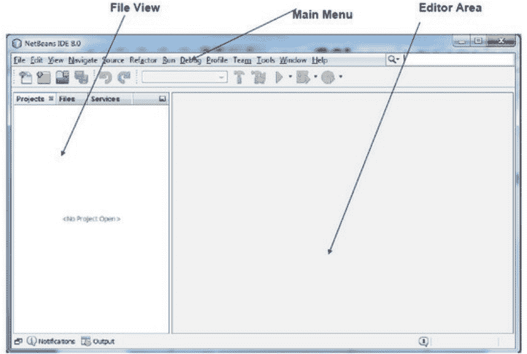

此屏幕显示了 `NetBeans` **集成开发环境 (`IDE`)**。我们将用它来测试 Java 安装，并查看是否可以运行程序。文件视图显示可用的 Java 程序，编辑器用于查看实际代码，主菜单用于控制文件访问和文件编辑功能。它也用于运行程序。

我们现在想要的是打开一个项目。使用 Java 编写的计算机程序（应用程序）被称为项目。项目包含了我们计算机程序所需的所有文件信息。Java 项目存储在项目组中。本笔记中包含了许多你可以打开并使用的 Java 项目。让我们现在打开一个。

确保 `NetBeans` 正在运行。打开项目的第一步是打开包含感兴趣项目的项目组。按照以下步骤操作：

选择 `File`（文件）菜单选项并点击 `Project Groups`（项目组）选项。将出现此窗口：

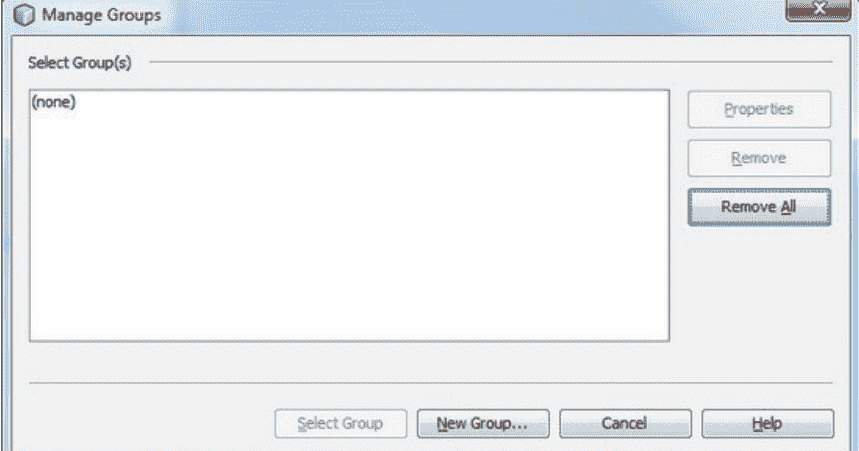

本笔记中的所有项目都保存在名为 `KidGamesJava\KidGamesProjects\` 的文件夹中。点击 `New Group`（新建组），选择 `Folder of Projects`（项目文件夹），按所示浏览（`Browse`）到该文件夹。点击 `Create Group`（创建组）。

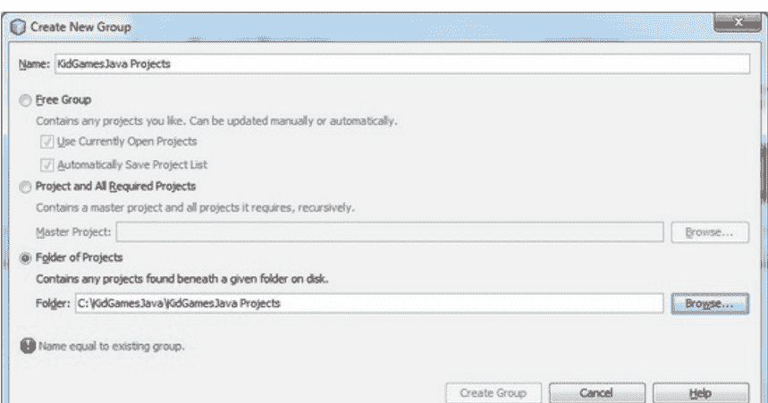

当你回到 `Select Group`（选择组）窗口时，选择你的新项目组（Class 1）。

在 `NetBeans` 的文件视图区域将列出许多项目。找到名为 Welcome 的项目。右键点击该项目名称并选择 `Set as Main Project`（设置为主项目）。展开 Welcome

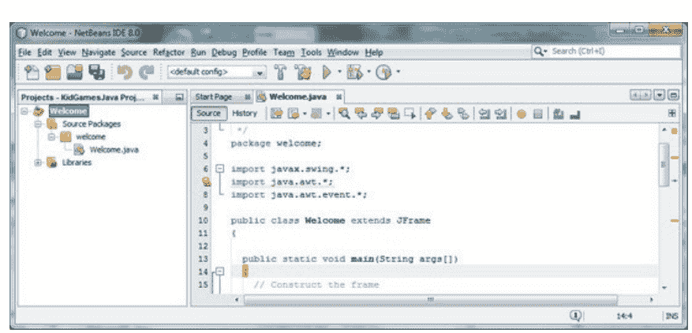

要运行此项目，从菜单中选择 **Run**（运行）并选择 **Run Main Project**（运行主项目）（或者也可以在键盘上按 **F6** 或点击工具栏上的绿色 **Run** 箭头）。**Output**（输出）窗口将会打开，你应该看到以下 Welcome 消息：

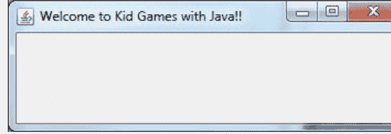

如果你已经到了这里，说明一切都安装正确了。如果你没有看到 Welcome 消息，说明某些内容没有安装正确。你可能应该回去检查安装 Java 和 NetBeans 的所有步骤，并确保所有步骤都已正确执行。

要停止此项目，你可以点击窗口右上角的框选 **X**。若要停止 `NetBeans`（虽然现在不要这样做）：

- 在主菜单中选择 **File**（文件）。
- 选择 **Exit**（退出）（位于 File 菜单的末尾）。

`NetBeans` 将关闭所有打开的窗口并将你返回到 Windows 桌面。与停止项目一样，停止 `NetBeans` 的另一种方法是点击主窗口右上角的关闭按钮。

## 获取 Java 程序的帮助

在构建 Java 程序时，有时你会遇到瓶颈的时刻。你可能不知道如何使用 Java 完成特定任务，或者在编译或运行程序时收到你不理解的错误消息。在这些情况下该怎么办？有几种方法可以获得帮助。

一种非常推荐的帮助方法是问问别人是否知道如何帮助你。其他程序员喜欢与刚学习这种语言的人分享技能。第二种选择是看市上的许多 Java 书之一（你正在阅读其中一本）。

Java 网站（`http://www.oracle.com/technnetwork/java/index.html`）拥有可能对你有用的丰富信息。该网站的问题是信息太多了，可能会让人无从从。那里有教程、示例、论坛等……Java API（应用程序编程接口）文档（在 Sun 网站上在线）如果你能处理那些复杂的格式，它是获取帮助的好地方。Java 网站确实提供搜索功能。我经常输入几个关键词，并找到可以帮助我寻找答案的话题。

WWW 世界上还有成百上千其他的 Java 网站。许多网站提供论坛，你可以在那里向其他 Java 程序员提问并获得快速回答。找到它们的好方法是使用 Google 或 Yahoo 这样的搜索工具。同样，输入几个关键词，很多时候你会找到正在寻找的答案。

随着你作为 Java 程序员的发展，你将开发出自己解决遇到的问题的方法。有一天，你会成为其他程序员向你寻求答案的人。

## Java 程序的结构


# Java 与 GUI 程序结构

## Java 程序结构

Java 与任何语言（计算机语言或口语）一样都有自己的术语。让我们看看 Java 程序的结构并学习一些新术语。一个 Java 程序（或项目）由许多文件组成。这些文件是 `classes`（类）。每个文件都有执行某些特定任务的 Java 代码。每个类都以 `.java` 后缀保存。用于保存类的文件名必须与类名匹配。每个项目中有一个类将包含一个被称为 `main method`（主方法）的内容。每当你运行 Java 程序时，你的计算机将搜索 `main method` 以启动程序。因此，要运行程序，你直接引用包含此 `main method` 的类。

让我们看看这如何与 `Welcome` 项目相关。这个特定项目有一个名为 `Welcome.java` 的单文件。注意，按照要求，名称 `Welcome` 与代码中的类名匹配（`public class Welcome`）。如果没有看到代码，只需双击文件名 `Welcome.java`。如果项目有其他类，它们将列在 `Welcome` 项目文件夹下。同样，注意代码区域中的单词 `main`。这就是我们在项目的其中一个类中需要的 `main method`。

关于 Java 程序的结构，我们真的只需要知道这些。每个类都以 `.java` 后缀保存。用于保存类的文件名必须与类名匹配。每个项目中有一个类将包含一个被称为 `main method` 的内容。每当你运行 Java 程序时，你的计算机将搜索 `main method` 以启动程序。因此，要运行程序，你直接引用包含此 `main method` 的类。

让我们看看这如何与 `Welcome` 项目相关。这个特定项目有一个名为 `Welcome.java` 的单文件。注意，按照要求，名称 `Welcome` 与代码中的类名匹配（`public class Welcome`）。如果没有看到代码，只需双击文件名 `Welcome.java`。如果项目有其他类，它们将列在 `Welcome` 项目文件夹下。同样，注意代码区域中的单词 `main`。这就是我们在项目的其中一个类中需要的 `main method`。

## GUI 程序的结构

让我们看看 Java GUI 的结构。GUI 应用程序由一个框架（frame）组成，它是：

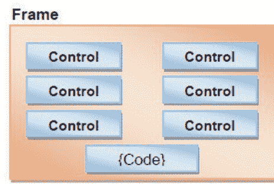

应用程序由：

- `Frame`（框架）
- `interface`（界面）

构建 GUI 遵循三个步骤：

1. 创建 `frame`。
2. 通过放置控件创建 `interface`。
3. 为事件方法（以及可能的其他方法）编写代码。

文本区域控件接受多行可滚的输入信息（text 属性）。

### JCheckBox 控件


复选框控件用于对问题提供“是”或“否”的回答。

### JRadioButton 控件


单选按钮控件用于从互斥选项组中选择。你总是一组单选按钮一起工作。

### JComboBox 控件


组合框控件在 GUI 应用中非常常见。用户可以从下拉列表（状态、国家、产品）中选择一个项目。

### JList 控件


列表控件类似于组合框，但其列表部分始终可见。可以使用列表控件进行多项选择。

### JScroll 控件


滚动条控件用于从值范围内进行选择。滚动条总是与另一个与滚动条选择相关的控件“成对”使用。

### JPanel 控件

面板控件是 GUI 应用中的“主力军”——我们将使用许多面板。它为在 Java GUI 应用中对相关控件分组提供了一种方便的方法。而且，面板还可以用于托管图形。

现在，我们将启动 NetBeans 并查看应用程序开发过程中的每一步，包括使用 Swing 控件。我们将使用一个秒表应用程序作为示例。

## 秒表 - 使用 NetBeans 创建 Java 项目

我们现在开始构建第一个 Java GUI 应用程序（一个电脑秒表）。这看起来可能像是一个缓慢而漫长的过程。但为了涵盖所有必要的材料，必须如此。你构建的项目越多，这个过程就会变得越简单。我们从创建一个新项目并创建一个框架开始。我们将所有创建的项目放在一个名为 `Kid Games` 的独立项目组中。现在创建该文件夹。如果使用 Windows，可以使用 Windows 资源管理器或我的电脑来完成该任务。

如果 NetBeans 尚未运行，请启动它。包含 Welcome（欢迎）的程序组应该还在。我们将删除这个程序组并创建一个。（当你需要引用类名中包含的代码时，你应该只使用 `KidGamesJava Projects` 程序组。对于你的所有项目，将使用你自己的项目组）。

从主菜单选择 `File`（文件）并选择 `Project Group`（项目组）。出现 `Manage Groups` 窗口——选择 `New Group`（新建组）查看

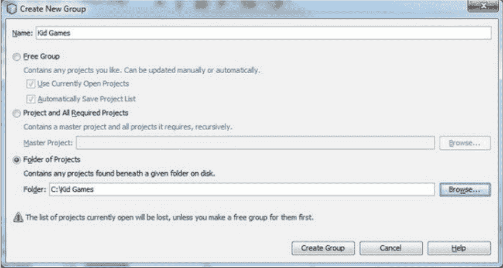

所示，点击 `Folder of Projects`（项目文件夹），然后浏览到你的 `Kid Games` 文件夹。点击 `Create Group`（创建组）。项目组显示在文件视图区域（它是空的）。

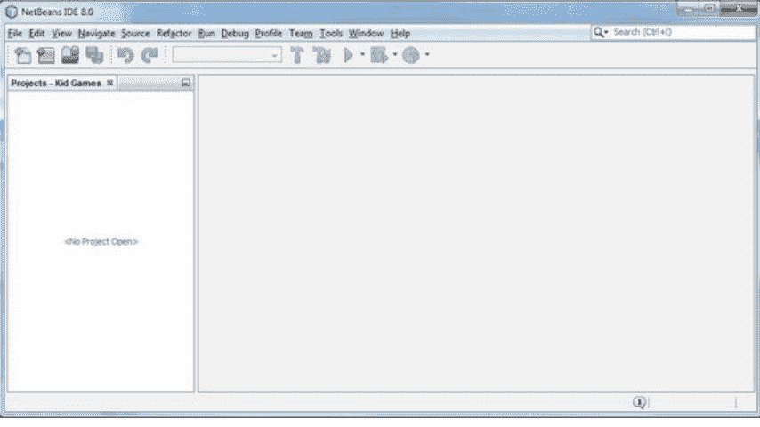

我们想向项目组添加一个项目。请注意这些步骤，因为你每次需要创建新的 Java 项目时都要重复它们。在文件视图中的项目组区域点击右键并选择 `New Project`（新建项目）以：

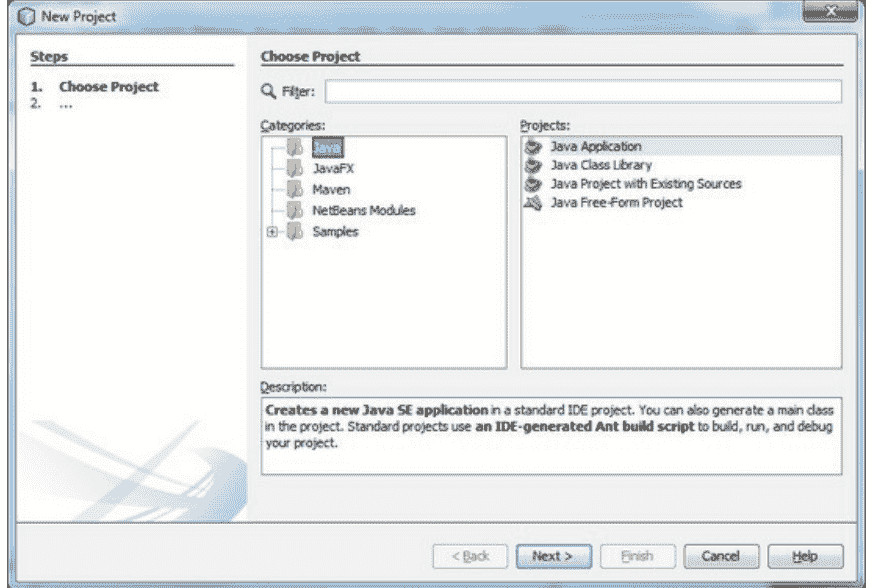

在 `Categories`（类别）中选择 `Java`，在 `Projects`（项目）中选择 `Java Application`。点击 `Next`（下一步）。

出现此窗口：

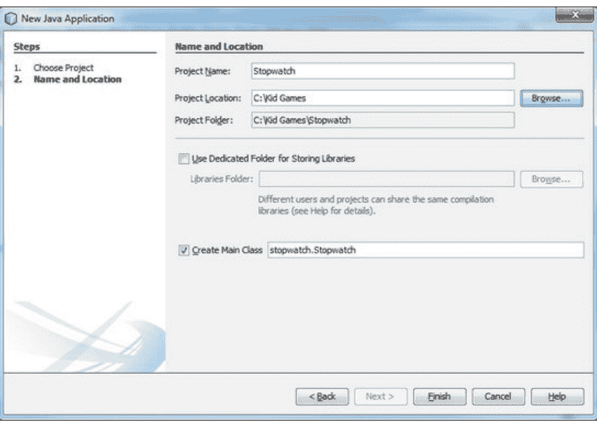

在 `Project Name`（项目名称）框中输入 `Stopwatch`（所示）。浏览到 `Kid Games` 文件夹作为 `Project Location`（项目位置）。点击 `Finish`（完成）创建项目。一旦创建，点击结果窗口中的 `Finish`。项目组视图现在应该显示项目组中的项目 (`Stopwatch`）（我展开了所有文件夹）：

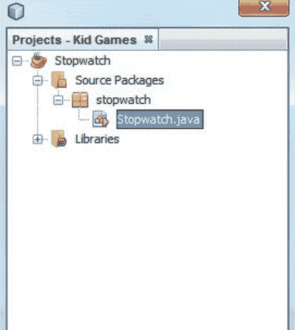

NetBeans 为你创建的每个项目使用特定的结构。Project 文件夹下有一个名为 `Source Packages`（源包）的文件夹（在本例中为 `stopwatch`）。该文件夹中是项目所需的类文件 (`java`）。它会创建一个默认类（在本例中带有你的项目名称的类，`Stopwatch.java`）。你不需要接受默认名称（或包名）——如果需要，你可以在创建项目时更改它。只需确保主类与文件名匹配。

双击 `Stopwatch.java` 文件，在编辑器区域查看该文件的框架：

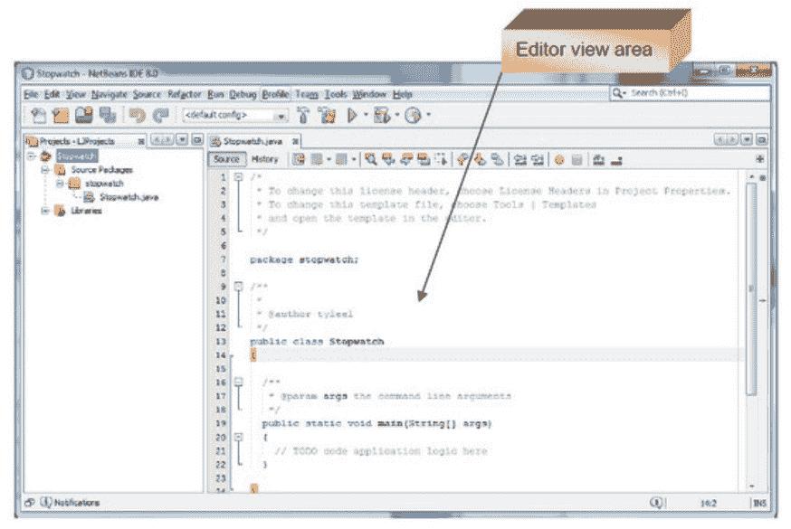

NetBeans 创建的默认代码是：

```java
/*
 * Stopwatch
 * To change this license header, choose Headers in Properties.
 * To change this template file, choose Templates
 * and open the template in the editor.
 */
package stopwatch;

/**
 * @author tylele
 */
public class Stopwatch
{
    /**
     * @param args the command line arguments
     */
    public static void main(String[] args)
    {
        // TODO: code application logic
    }
}
```

我们将始终用自己的代码替换这段默认代码（或者如果你想，也可以修改它）。删除默认代码。记住，作为 Java 代码，有几个规则需要注意（我们将再次过的这些规则）：

- Java 要求完美。所有单词必须拼写正确。
- Java 是区分大小的，这意味着大写和小写字母被认为是不同的。在输入代码时，确保你正确使用大写和小写字母。
- Java 忽略任何“空白区域”，如空格。我们经常使用空白区域来提高代码的可读性。
- 大括号用于分组。它们标记了编程部分的开始和结束。确保你的程序左括号和右括号的数量相等。我们把匹配括号之间的部分称为一个块（block）。

双击 `Stopwatch.java` 文件，在编辑器区域查看该文件的框架：

## 秒表 - 创建 Java 框架

构建 Java GUI 应用的第一步是创建一个框架。在我们创建框架时，建立整个程序的框架，所示：

```java
/*
 * Stopwatch
 * To change this license header, choose Headers in Properties.
 * To change this template file, choose Templates
 * and open the template in the editor.
 */
package stopwatch;
import javax.swing.*;
import java.awt.*;
import java.awt.event.*;

public class Stopwatch extends JFrame
{

    public static void main(String args[])
    {
        // Construct the frame
        new Stopwatch().show();
    }

    public Stopwatch()
    {
        // Frame constructor
        setTitle("Stopwatch Application");
        setSize(300, 100);
    }
}
```

逐行输入代码，注意当你输入每个大括号 (`{}`) 时，NetBeans 编辑器会添加相应的大括号 (`{}`) 并自动缩进后续。这遵循了缩进代码的规则。括号，当你输入左括号时，会添加匹配的括号。此外，另一点注意的是编辑器对代码中的不同内容使用不同的颜色。绿色表示注释。代码是黑色，关键字是蓝色的。这种颜色有时有助于你识别输入时可能犯错误。

完成输入后，你应该看到：

```java
import java.swing.*;
import java.awt.*;
import java.awt.event.*;

public class Stopwatch extends JFrame {

    public static void main(String[] args) {
        // Construct the frame
        new Stopwatch().setVisible(true);
    }

    public Stopwatch() {
        // Frame constructor
    }
}
```

此代码通过**扩展 Swing `JFrame` 对象**来创建框架，这意味着它具有此类框架的所有特征。代码有一个 `Stopwatch` 对象的**构造函数**。你应该看到它执行了两个方法：一个设置标题 (`setTitle`)，一个设置大小 (`setSize`)。构造函数在**主方法**中调用以创建框架。我们在本课程的每个项目中都将使用相同的相同的结构。我们将构建框架以及所有关联的控件和控件事件。框架将在主方法中构建。

运行项目（按下 `<F6>` 或在菜单中选择 `Run`，然后选择 `Run Main Project`）。你将看到你的第一个框架：

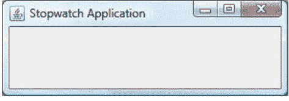

# 使用 NetBeans 保存 Java 项目

每当你运行 Java 项目时，NetBeans 都会自动为你保存源文件和编译后的代码文件。因此，大多数时候，你不需要担心保存项目——它已经为你处理好了。如果你想保存正在输入的代码（在运行之前），只需从主菜单中选择 `File`（文件）并点击 `Save All`（全部保存）。或者，点击工具栏上的 `Save All`（全部保存）按钮：


每当你做出更改时，都需要保存项目组，例如，如果你从项目中添加/删除文件或添加/删除项目。这也可以通过 `Save All`（全部保存）选项完成。如果你尝试退出 NetBeans 但未保存项目，NetBeans 将弹出对话框告知你此类情况，并在退出前提供保存文件的机会。

# NetBeans 和 Java 文件

那么，这些关于程序结构、文件、编译和运行的信息是如何整合到我们的开发环境 NetBeans 中的呢？我们已经看到 Java 项目是按项目组分组的。而项目是由不同的文件夹和文件组成的。

使用“我的电脑”或 Windows 资源管理器（如果使用 Windows），进入你刚刚构建的 Stopwatch 项目所在的文件夹。那里有很多文件夹和文件。在 `src/stopwatch` 文件夹中，你会看到：

### Stopwatch.java

这是在 NetBeans 编辑器视图区域显示的源代码。在 `build/classes/stopwatch` 文件夹中是 `Stopwatch.class`。这是 `Stopwatch.java` 的编译版本（这是 Java 虚拟机所需的文件）。其他大多数文件被用于跟踪哪些文件组成项目。

请注意，这里真正的 Java 文件只有那些扩展名为 `.java` 和 `.class` 的文件。其他文件是由我们特定的开发环境 NetBeans 创建和修改的。如果你想与朋友分享你的 Java 程序，或将你的 Java 程序移动到另一个开发环境，你真正需要传输的文件只有 `.java` 文件。这些文件可以被任何 Java 程序员或编程环境用于创建一个运行的程序。

# 创建用户界面

创建框架（frame）后，我们现在通过在框架中“放置”控件来创建用户界面。这种放置仅涉及为每个所需的控件编写几行逻辑 Java 代码。

一个名为布局管理器（layout manager）的对象决定了控件在框架中的排列方式。某些布局管理器及其特征如下：

在本类中，我们将使用 `GridBagLayout`。在我们看来，它提供了最理想的界面外观。随着课程的进行，你将学习更多关于该管理器的功能。如果你感兴趣，也可以研究其他的布局管理器。

框架实际上由几个不同的 `panes`（面板）组成。控件被放置在框架的 `content pane`（内容面板）中。`GridBagLayout` 管理器将内容面板划分为由行和列组成的网格：

| 列 0 | 列 1 | 列 2 | 列 3 | 列 4 | 列 5 |
|---|---|---|---|---|---|
| 行 0 | | | | | |
| 行 1 | | | | | |
| 行 2 | | | | | |
| 行 3 | | | | | |
| 行 4 | | | | | |
| 行 5 | | | | | |

顶行是行 0，行号随着网格向下向下增加。左侧列是列 0，列号随着你向网格右侧移动而增加。

`GridBagConstraints` 对象用于在各种网格元素中的放置和定位。控件通过引用特定的列（`grid location` 位置）和行（`grid location` 位置）来放置在此网格中。行和列都从 (0) 开始。网格不需要（但可以）设置大小。它会随着控件的添加而自动增长。我们看到 `GridBagLayout` 非常灵活。控件可以跨越多个列/行，并可以在任何网格元素中使用 `Insets` 设置间距。

```java
getContentPane().setLayout(new GridBagLayout());
```

要在 `GridBagLayout` 网格中放置控件，我们遵循以下步骤：

- 声明控件。
- 创建（构造）控件。
- 建立所需的属性。
- 将控件添加到所需位置的内容面板。

在构建的项目中，所有控件都将在类作用域声明，这意味着相关的属性和方法对类中的任何方法可用。在类的左大括号之前，第一个方法。我们还会为控件提供有意义的名字。接受的做法是以某些用途描述开头，然后将类型拼接在结尾。这种命名使得阅读和编写你的 Java 代码变得更容易。按钮、标签和文本字段的示例如下（我们使用的 stopwatch 示例）：

- `startButton`
- `stopButton`
- `elapsedLabel`
- `startTextField`

要声明控件，输入语句：

```java
controlName;
```

在 Swing 库中，按钮类型是 `JButton`。因此，为了声明我们的 `startButton`，我们使用：

```java
JButton startButton;
```

要创建之前声明的控件，使用：

```java
controlName = new ControlType();
```


# 创建控件与布局

要创建之前声明的控件，使用：

```
controlName = new ControlType();
```

## 控件属性配置表

### stopLabel

| text | End Time |
| --- | --- |
| gridx | 1 |
| gridy | 1 |

### elapsedLabel

| text | Elapsed Time (sec) |
| --- | --- |
| gridx | 1 |
| gridy | 2 |

### startTextField

| text | [Blank] |
| --- | --- |
| columns | 15 |
| gridx | 2 |
| gridy | 0 |

### stopTextField

| text | [Blank] |
| --- | --- |
| columns | 15 |
| gridx | 2 |
| gridy | 1 |

### elapsedTextField

| text | [Blank] |
| --- | --- |
| columns | 15 |
| gridx | 2 |
| gridy | 2 |

## 实现步骤

### 2. 声明九个控件

首先，输入代码来声明这九个控件（记住这些行位于类定义左大括号之后）：

```java
JButton startButton = new JButton();
JButton stopButton = new JButton();
JButton exitButton = new JButton();
JLabel startLabel = new JLabel();
JLabel stopLabel = new JLabel();
JLabel elapsedLabel = new JLabel();
JTextField startTextField = new JTextField();
JTextField stopTextField = new JTextField();
JTextField elapsedTextField = new JTextField();
```

### 3. 设置布局管理器

将构造函数代码中的 `setSize` 替换为建立网格布局的行：

```java
getContentPane().setLayout(new GridBagLayout());
```

### 4. 设置控件属性并放置

设置九个控件属性并放置它们的代码（同样位于构造方法中）：

```java
GridBagConstraints gridConstraints = new GridBagConstraints();
startButton.setText("Start Timing");
gridConstraints.gridx = 0;
gridConstraints.gridy = 0;
getContentPane().add(startButton, gridConstraints);

stopButton.setText("Stop Timing");
gridConstraints.gridx = 0;
gridConstraints.gridy = 1;
getContentPane().add(stopButton, gridConstraints);

exitButton.setText("Exit");
gridConstraints.gridx = 0;
gridConstraints.gridy = 2;
getContentPane().add(exitButton, gridConstraints);

startLabel.setText("Start Time");
gridConstraints.gridx = 1;
gridConstraints.gridy = 0;
getContentPane().add(startLabel, gridConstraints);

stopLabel.setText("Stop Time");
gridConstraints.gridx = 1;
gridConstraints.gridy = 1;
getContentPane().add(stopLabel, gridConstraints);

elapsedLabel.setText("Elapsed Time (sec)");
gridConstraints.gridx = 1;
gridConstraints.gridy = 2;
getContentPane().add(elapsedLabel, gridConstraints);

startTextField.setText("");
startTextField.setColumns(15);
gridConstraints.gridx = 2;
gridConstraints.gridy = 0;
getContentPane().add(startTextField, gridConstraints);

stopTextField.setText("");
stopTextField.setColumns(15);
gridConstraints.gridx = 2;
gridConstraints.gridy = 1;
getContentPane().add(stopTextField, gridConstraints);

elapsedTextField.setText("");
elapsedTextField.setColumns(15);
gridConstraints.gridx = 2;
gridConstraints.gridy = 2;
getContentPane().add(elapsedTextField, gridConstraints);

pack();
```

> **注意**：每个控件在网格中的位置。同样请注意，我们是如何为文本字段控件设置列数的。如果不这样做，你将看不到这些控件。这里有很多代码（对于 GUI 界面也会有很多代码）。你可以选择手动输入代码，也可以从这些笔记中复制并粘贴到 NetBeans 中。如果你选择手动输入代码，请注意大部分代码是相似的，因此复制和粘贴操作非常方便。

## 完整代码参考

作为参考，这里是目前阶段完整的 `Stopwatch.java` 代码（新添加的代码已涂上阴影——设置框架大小的行已被删除）：

```java
/*
* Stopwatch.java
*/
package stopwatch;
import javax.swing.*;
import java.awt.*;
import java.awt.event.*;

public class Stopwatch extends JFrame {

    // 声明使用的控件
    JButton startButton = new JButton();
    JButton stopButton = new JButton();
    JButton exitButton = new JButton();
    JLabel startLabel = new JLabel();
    JLabel stopLabel = new JLabel();
    JLabel elapsedLabel = new JLabel();
    JTextField startField = new JTextField();
    JTextField stopField = new JTextField();
    JTextField elapsedField = new JTextField();

    public static void main(String args[]) {
        // 构造框架
        new Stopwatch().show();
    }

    public Stopwatch() {
        // 框架构造函数
        setTitle("Stopwatch Application");
        getContentPane().setLayout(new GridBagLayout());

        // 添加控件
        GridBagConstraints gridConstraints = new GridBagConstraints();

        startButton.setText("Start Timing");
        gridConstraints.gridx = 0;
        gridConstraints.gridy = 0;
        getContentPane().add(startButton, gridConstraints);

        stopButton.setText("Stop Timing");
        gridConstraints.gridx = 0;
        gridConstraints.gridy = 1;
        getContentPane().add(stopButton, gridConstraints);

        exitButton.setText("Exit");
        gridConstraints.gridx = 0;
        gridConstraints.gridy = 2;
        getContentPane().add(exitButton, gridConstraints);

        startLabel.setText("Start Time");
        gridConstraints.gridx = 1;
        gridConstraints.gridy = 0;
        getContentPane().add(startLabel, gridConstraints);

        stopLabel.setText("Stop Time");
        gridConstraints.gridx = 1;
        gridConstraints.gridy = 1;
        getContentPane().add(stopLabel, gridConstraints);

        elapsedLabel.setText("Elapsed Time (sec)");
        gridConstraints.gridx = 1;
        gridConstraints.gridy = 2;
        getContentPane().add(elapsedLabel, gridConstraints);

        startTextField.setText("");
        startTextField.setColumns(15);
        gridConstraints.gridx = 2;
        gridConstraints.gridy = 0;
        getContentPane().add(startTextField, gridConstraints);

        stopTextField.setText("");
        stopTextField.setColumns(15);
        gridConstraints.gridx = 2;
        gridConstraints.gridy = 1;
        getContentPane().add(stopTextField, gridConstraints);

        elapsedTextField.setText("");
        elapsedTextField.setColumns(15);
        gridConstraints.gridx = 2;
        gridConstraints.gridy = 2;
        getContentPane().add(elapsedTextField, gridConstraints);

        pack();
    }
}
```

> **注意**：每个控件在网格中的位置。同样请注意，我们是如何为文本字段控件设置列数的。如果不这样做，你将看不到控件。这里有很多代码（对于 GUI 界面也会有很多代码）。你可以选择手动输入代码，也可以从这些笔记中复制并粘贴到 NetBeans 中。如果你选择手动输入代码，请注意大部分代码是相似的，因此复制和粘贴操作非常方便。


注意每个控件在网格中的位置。同样请注意，我们是如何为文本字段控件设置列数的。如果不这样做，你将看不到控件。这里有很多代码（对于 GUI 界面也会有很多代码）。你可以选择手动输入代码，也可以从这些笔记中复制并粘贴到 NetBeans 中。如果你选择手动输入代码，请注意大部分代码是相似的，因此复制和粘贴操作非常方便。

作为参考，这里是目前阶段完整的 `Stopwatch.java` 代码（新添加的代码已涂上阴影——设置框架大小的行已被删除）：

```java
/*
* Stopwatch.java
*/

package stopwatch;

import javax.swing.*;
import java.awt.*;
import java.awt.event.*;

public class Stopwatch extends JFrame {
    // 声明使用的控件
    JButton startButton = new JButton();
    JButton stopButton = new JButton();
    JButton exitButton = new JButton();
    JLabel startLabel = new JLabel();
    JLabel stopLabel = new JLabel();
    JLabel elapsedLabel = new JLabel();
    JTextField startField = new JTextField();
    JTextField stopField = new JTextField();
    JTextField elapsedField = new JTextField();

    public static void main(String args[]) {
        // 构造框架
        new Stopwatch().show();
    }

    public Stopwatch() {
        // 框架构造函数
        setTitle("Stopwatch Application");
        getContentPane().setLayout(new GridBagLayout());
        // 添加控件
        GridBagConstraints gridConstraints = new GridBagConstraints();

        startButton.setText("Start Timing");
        gridConstraints.gridx = 0;
        gridConstraints.gridy = 0;
        getContentPane().add(startButton, gridConstraints);

        stopButton.setText("Stop Timing");
        gridConstraints.gridx = 0;
        gridConstraints.gridy = 1;
        getContentPane().add(stopButton, gridConstraints);
    }
}
```

## 添加事件方法

此时，我们的界面看起来已经完观了。缺失的是控件背后的代码。构建 Java 应用程序的下一步是添加这些代码。但为了添加代码，我们需要放置并放入它。我们需要为应用程序添加事件方法及其对应的监听器。添加监听器有两种，一种针对 AWT 对象，另一种针对 Swing 对象。监听器在框架构造函数代码中添加。AWT 对象（主要是用于鼠标和键盘输入）的事件监听器是使用所谓的适配器（也从 AWT 中可用）实现的。添加此类监听器的最佳方法是通过示例。在我们构建的每个项目中，我们需要“监听”用户关闭窗口的事件。实现框架（窗口）的适配器被称为 `WindowAdapter`，它与 `WindowListener` 工作。在我们情况下，我们想要监听 `windowClosing` 事件。将此方法添加到应用程序的代码是：

```java
addWindowListener(new WindowAdapter() {
    public void windowClosing(WindowEvent e) {
        // [窗口关闭的 Java 代码]
    }
});
```

这实际上是一个跨越几行的 Java 语句。它调用了 `addWindowListener` 方法，并作为参数（全部在括号内），包含了 `WindowAdapter` 事件方法的新实例（`windowClosing` 事件）。当你看到它时，理解并不困难，只是非常长！！

在 `windowClosing` 方法中，我们将编写窗口关闭时执行的代码。`windowClosing` 方法必须有一个单独参数（`WindowEvent e`）。我们可以使用此参数来确定具体发生了什么事件。

对于 Swing 组件，例如这里使用的按钮、标签和文本字段，事件方法（`actionPerformed`）是使用 `ActionListener` 添加的。如果组件名为 `controlName`，则方法的添加方式如下：

```java
controlName.addActionListener(new ActionListener() {
    public void actionPerformed(ActionEvent e) {
        // [Java code to execute]
    }
});
```

再次，请注意这仅仅是一行很长的 Java 代码。该方法有一个参数（`ActionEvent e`），它告诉我们发生了什么种特定事件（每个控件都可以响应多个事件）。对于我们的秒表示例，我们将假设三个按钮控件的点击事件。

请注意，当我们添加一个监听器时，我们还需要为事件方法添加代码。我们在添加监听器的同时编写代码，但我们采取了不同的处理方法。当添加一个方法时，该方法的代码将是单行代码，用于调用一个“外部”方法，而实际的代码将位于该方法中。这种做法将方法事件的编码与构建框架的代码隔离开，使得代码更加“整洁”。对于 Swing 组件，我们将使用特定的约定来命名这些外部方法——将`controlName`和`methodName`拼接成一个新的方法名。对于 AWT 事件也遵循类似的变体。对于我们的示例，添加此类方法的代码如下：

```java
controlName.addActionListener(new ActionListener() {
    public void actionPerformed(ActionEvent e) {
        controlNameActionPerformed(e);
    }
});
```

一旦添加了方法，实际代码将写在程序其他地方定义的方法中。该方法的格式必须是：

```java
private void controlNameActionPerformed(ActionEvent e) {
    // [Java code to execute]
}
```

通过将事件方法代码与构建框架的代码分离，编辑、修改和测试 Java GUI 将变得简单得多。而且，所选的命名约定更容易找到与特定控件关联的事件方法。控件事件方法通常放置在构造方法之后。

让我们总结一下在框架中放置类型为 `controlType` 且命名为 `controlName` 的控件并添加事件方法的许多步骤：

- 声明并创建控件（类级作用域）：

```java
ControlType controlName = new ControlType();
```

- 放置控件位置：

```java
gridConstraints.gridx = desiredColumn;
gridConstraints.gridy = desiredRow;
getContentPane().add(controlName, gridConstraints);
```
（假设已经创建了 `gridConstraints` 对象）：

- 添加控件监听器：

```java
controlName.addActionListener(new ActionListener() {
    public void actionPerformed(ActionEvent e) {
        controlNameActionPerformed(e);
    }
});
```

- 编写控件事件方法：

```java
private void controlNameActionPerformed(ActionEvent e) {
    // [Java code to execute]
}
```

当你第一次几次添加控件时，这看起来像是一个繁琐的过程。随着你开发的 GUI 应用程序越来越多，这些添加操作将变成一种本能（而且，你会通过使用 NetBeans 的复制和粘贴功能变得非常擅长）。

## 秒表 - 编写代码

剩下的要做工作就是为应用程序编写代码。我们为每个需要响应的事件编写代码。在这个应用程序中，有三个这样的事件：点击每个按钮。

### 1. 声明类级变量

在声明框架控件的行下方，声明三个类级变量：

```java
long startTime;
long stopTime;
double elapsedTime;
```

这建立了 `startTime`、`stopTime` 和 `elapsedTime` 为类级变量。

### 2. 添加窗口关闭事件

在框架的构造函数中，添加窗口关闭事件方法（每个 GUI 项目都需要这段代码 - 将其放在建立框架标题行之后）：

```java
addWindowListener(new WindowAdapter() {
    public void windowClosing(WindowEvent e) {
        exitForm(e);
    }
});
```

并且，添加相应的事件方法代码：

```java
private void exitForm(WindowEvent e) {
    System.exit(0);
}
```

此方法放置在秒表类最后的右大括号之前（这是方法的正常位置）。这一行代码告诉应用程序停止。

### 3. 为 `startButton` 创建 `actionPerformed` 事件

添加监听器（我将其放在在框架上放置的代码之后）：

```java
startButton.addActionListener(new ActionListener() {
    public void actionPerformed(ActionEvent e) {
        startButtonActionPerformed(e);
    }
});
```

然后，在构造方法之后添加事件方法：

```java
private void startButtonActionPerformed(ActionEvent e) {
    // 点击开始计时按钮
    startTime = System.currentTimeMillis();
    startField.setText(String.valueOf(startTime));
    stopField.setText("");
    elapsedField.setText("");
}
```

在此过程中，点击“开始计时”按钮，我们使用系统函数读取当前时间（顺便说一下，单位是毫秒），并使用 `setText` 方法将其放入文本字段中。我们还清空了其他字段。在上面的代码中（以及这些笔记的所有地方），任何以双斜杠（//）开头的行都是注释。你决定是否要输入这些行。

### 4. 为 `stopButton` 创建 `actionPerformed` 事件

添加监听器：

```java
stopButton.addActionListener(new ActionListener() {
    public void actionPerformed(ActionEvent e) {
        stopButtonActionPerformed(e);
    }
});
```

然后，在 `startButtonActionPerformed` 方法之后添加此事件方法：

```java
private void stopButtonActionPerformed(ActionEvent e) {
    // click stop button
    stopTime = System.currentTimeMillis();
    stopField.setText(String.valueOf(stopTime));
    elapsedTime = (stopTime - startTime) / 1000.0;
    elapsedField.setText(String.valueOf(elapsedTime));
}
```

在这里，点击“停止计时”按钮，我们读取当前时间，计算流逝时间（单位为秒），并将其值放入对应的文本框中。

### 5. 为 `exitButton` 创建 `actionPerformed` 事件

添加监听器：

```java
exitButton.addActionListener(new ActionListener() {
    public void actionPerformed(ActionEvent e) {
        exitButtonActionPerformed(e);
    }
});
```

现在，添加该方法：

```java
private void exitButtonActionPerformed(ActionEvent e) {
    System.exit(0);
}
```

此例程在点击“退出”按钮时关闭框架。

## 参考：完整的 `Stopwatch.java` 代码

```java
gridConstraints.gridy = 0;
getContentPane().add(startLabel, new GridBagConstraints());

stopLabel.setText("Stop Time");
gridConstraints.gridx = 1;
gridConstraints.gridy = 1;
getContentPane().add(stopLabel, gridConstraints);

elapsedLabel.setText("Elapsed Time (sec)");
gridConstraints.gridx = 1;
gridConstraints.gridy = 2;
getContentPane().add(elapsedLabel, gridConstraints);

startTextField.setText("");
startTextField.setColumns(15);
gridConstraints.gridx = 2;
gridConstraints.gridy = 0;
getContentPane().add(startTextField, new GridBagConstraints());

stopTextField.setText("");
stopTextField.setColumns(15);
gridConstraints.gridx = 2;
gridConstraints.gridy = 1;
getContentPane().add(stopTextField, gridConstraints);

elapsedTextField.setText("");
elapsedTextField.setColumns(15);
gridConstraints.gridx = 2;
gridConstraints.gridy = 2;
getContentPane().add(elapsedTextField, gridConstraints);

pack();

private void startButtonActionPerformed(ActionEvent e) {
    // 点击开始计时按钮
    startTime = System.currentTimeMillis();
    startTextField.setText(String.valueOf(startTime));
    stopTextField.setText("");
    elapsedTextField.setText("");
}

private void stopButtonActionPerformed(ActionEvent e) {
    // 点击停止计时按钮
    stopTime = System.currentTimeMillis();
    stopTextField.setText(String.valueOf(stopTime));
    elapsedTime = (stopTime - startTime) / 1000.0;
    elapsedTextField.setText(String.valueOf(elapsedTime));
}

private void exitButtonActionPerformed(ActionEvent e) {
    System.exit(0);
}

private void exitForm(WindowEvent e) {
    System.exit(0);
}
```


学习此代码以查看所有方法 [F6] 所在的位置。

现在，运行应用程序（按 `<F6>`）。尝试一下。如果你的应用程序没有运行，请重新检查以确保代码输入正确。保存你的应用程序。它被保存为 `\KidGamesJava\KidGamesJava Projects\` 文件夹下 **Projects** 中的 **Stopwatch Project**（计时项目）。以下是我尝试时得到的结果：

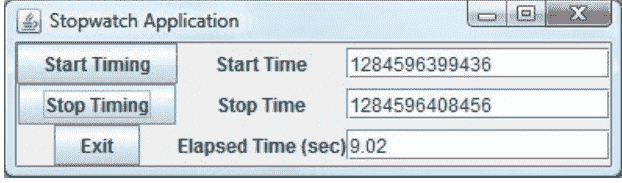

如果你有时间，这里有一些你可能对 **Stopwatch** 尝试的其他事情。要实现这些更改，需要你进行研究（使用网站、其他书籍或其他程序员）来寻找方法。

这是一项重要的技能——如何通过发现新事物来改进现有应用程序。课程笔记末尾的问题和练习的解决方案也可以为这些挑战提供启发：

- A. 尝试更改框架的背景颜色。
- B. 注意到你可以在“开始计时”按钮之前按下“停止计时”按钮。这不应该是这样的。修改应用程序使得你无法这样做。并使得在按下“停止计时”之前你无法按下“开始计时”。提示：查看按钮的启用状态（`enabled`）属性。
- C. 你能想到如何连续显示“结束时间”和“流逝时间”吗？由于 Java 的事件驱动特性，这有点棘手。查看 `Timer` 类（做一些 Java 研究）。通过将该类的 `delay` 属性设置为 1000，它将每秒生成一次自己的 Java 事件。在 `Timer` 类中 `stopButton` 的事件方法 `actionPerformed` 中放置类似的代码，看看会发生什么。此外，请查看课程末尾的练习以获得帮助。

# 章节总结

完成本章后，你应该理解：

- 本课程的先决条件
- 如何使用 NetBeans 构建和运行应用程序
- Java GUI 应用程序的结构
- 构建 Java GUI 应用程序三个步骤
- 如何创建一个框架（frame）
- 如何使用 `GridBagLayout` 在框架上放置控件
- 适当的控件命名规范
- 如何添加事件监听器和事件方法
- 如何在事件方法中添加代码

## 2

# 密码破解项目 (Safecracker Project)


# 回顾与预览

我们已经完成了使用 NetBeans（或你选择的任何 IDE）构建 Java GUI 项目的回顾。我们现在开始编写一些儿童游戏。对于每个项目，我们都提供了设计和构建表单图形界面的逐步说明，以及对项目背后代码的详细解释。

我们构建的第一个项目是密码破解器（Safecracker），它要求根据计算机提供的线索猜一个秘密数字组合。

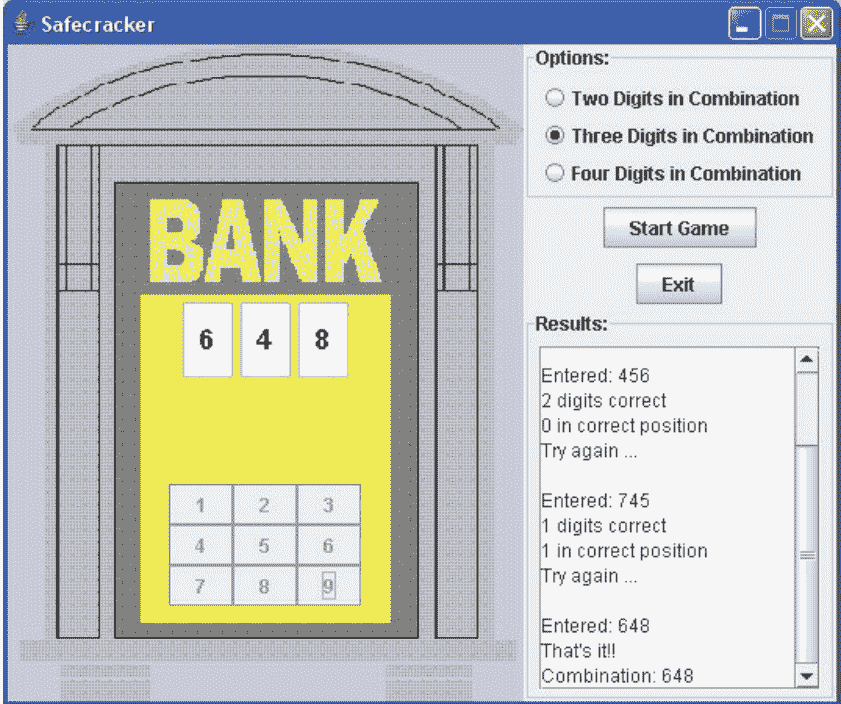

## 密码破解项目预览

在本章中，我们将构建一个**密码破解游戏 (Safecracker game)**。一个银行保险箱被锁定，只有输入正确的组合才能打开。组合可以是 2 到 4 个不重复的数字（数字范围为 1 到 9）。每次猜测后，系统都会告诉你有几个数字正确，以及几个数字的位置正确。

## 框架设计 – GridBagLayout 管理器

我们使用 `GridBagLayout` 管理器来设置你的 Java GUI 项目（当然，你可以选择任何你喜欢的布局管理器）。回想一下，使用此管理器可以使用网格来放置控件：

| gridx = 0 | gridx = 1 | gridx = 2 | gridx = 3 | gridx = 4 |
|---|---|---|---|---|
| gridy = 0 | | | | |
| gridy = 1 | | | | |
| gridy = 2 | | | | |
| gridy = 3 | | | | |
| gridy = 4 | | | | |
| gridy = 5 | | | | |

`GridBagConstraints` 对象被用于在各种网格元素中控制控件的放置和定位。通过引用特定的列（`gridx` 位置）和行（`gridy` 位置），可以将控件放置在此网格中。我们已经看到，随着控件的添加，网格（以及框架）会自动扩展。列宽由特定列中“最宽”的控件决定，而行高由特定行中“最高”的控件决定。

还有其他与 `GridBagConstraints` 关联的变量可以调整控件的大小，从而调整相关的列、行和框架尺寸。控件可以占据多个列或多个行。控件跨越的列数通过 `gridwidth` 变量设置；跨越的行数通过 `gridheight` 变量设置。默认情况下，控件占据一行一列。如果我们有一个名为 `gridConstraints` 的 `GridBagConstraints` 对象，通过以下代码，控件将从第二列（`gridx = 1`）和第四行（`gridy = 3`）开始占据两行三列：

```
gridConstraints.gridx = 1;
gridConstraints.gridy = 3;
gridConstraints.gridheight = 2;
gridConstraints.gridwidth = 3;
```

在我们的示例网格中，该控件将如下所示：

| gridx = 0 | gridx = 1 | gridx = 2 | gridx = 3 | gridx = 4 |
|---|---|---|---|---|
| gridy = 0 | | | | |
| gridy = 1 | | | | |
| gridy = 2 | | | | |
| gridy = 3 | | | | |
| gridy = 4 | | | | 控件在此处 | |
| gridy = 5 | | | | | |

特定的控件可能会完全填充其区域，也可能不会。如果控件小于其分配的区域，可以调整其尺寸以填充该区域——使用 **fill** 变量。它有四个值：

- `GridBagConstraints.NONE`: 控件不调整大小（默认值）
- `GridBagConstraints.HORIZONTAL`: 控件宽度填充显示区域。
- `GridBagConstraints.VERTICAL`: 控件高度填充显示区域。
- `GridBagConstraints.BOTH`: 控件填充整个显示区域。

使用我们的示例 **gridConstraints** 对象，控件将使用以下代码增长以填充区域宽度：

`gridConstraints.fill = GridBagConstraints.HORIZONTAL;`

该控件在它的网格区域中看起来如下：

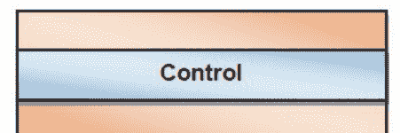

可以使用 **ipadx** 和 **ipady** 变量对控件尺寸进行较小更改。这些变量决定了控件尺寸在最小尺寸之外增加的程度（每个方向）。使用我们的 **gridConstraints** 示例为控件的宽度和高度增加五个像素：

`gridConstraints.ipadx = 5;`
`gridConstraints.ipady = 5;`

如果你选择不扩展控件以填充其区域，则其在分配区域内的位置通过 **anchor** 变量设置。共有九种可能的值：

- `GridBagConstraints.NORTH`: 控件在顶部居中
- `GridBagConstraints.NORTHEAST`: 控件在右上角
- `GridBagConstraints.EAST`: 控件在右侧，垂直居中
- `GridBagConstraints.SOUTHEAST`: 控件在右下角
- `GridBagConstraints.SOUTH`: 控件在底部居中
- `GridBagConstraints.SOUTHWEST`: 控件在左下角
- `GridBagConstraints.WEST`: 控件在左侧，垂直居中
- `GridBagConstraints.NORTHWEST`: 控件在左上角
- `GridBagConstraints.CENTER`: 控件水平和垂直居中

要在显示区域内（两个方向上）居中控件，请使用：

```
gridConstraints.anchor = GridBagConstraints.CENTER;
```

该控件在它的网格区域中看起来如下：

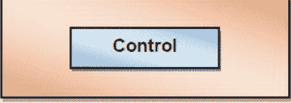

如果控件完全填充了分配的显示区域，可以使用 `Insets` 对象在控件周围建立边界区域（空闲空间）。使用四个值来定义距离显示区域边缘的上、左、下、右边距。默认是 `Insets(0, 0, 0, 0)`。在我们的示例中，如果我们要在顶部和底部留出 10 像素，左侧留 20 像素，右侧留 30 像素，我们将使用：

```
gridConstraints.insets = new Insets(10, 20, 10, 30);
```

该控件在它的网格区域中看起来像这样：

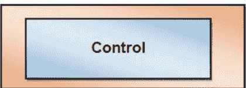

一旦为控件建立了 `gridConstraints`，就可以使用 `add` 方法将其添加到框架的内容面板中。如果控件是 `myControl`，代码语法为：

`getContentPane().add(myControl, gridConstraints);`

很多时候，我们会向框架内的面板控件（带有它自己的 `GridLayout` 管理器）添加控件。如果面板名为 `myPanel`，添加 `myControl` 的代码是：

`myPanel.add(myControl);`

我想你已经看到了 `GridBagLayout` 管理器的灵活性。我们鼓励你学习这些思想并使用它们来“美化”你的 GUI 界面。记住在将控件添加到网格之前建立所有约束值。

构建界面是一门“艺术”，而不是科学。你会发现这个过程涉及大量的尝试和调整。有时，你可能会得到意料之外的结果——组件可能不会以你所希望的方式出现，或者根本不出现！底线是——一旦完成了所有调整，完成的框架尺寸就确定了。让我们来看看标签中。

```java
setTitle("Safecracker");
setResizable(false);
addWindowListener(new WindowAdapter() {
    public void windowClosing(WindowEvent evt) {
        exitForm(evt);
    }
});
getContentPane().setLayout(new GridBagLayout());
GridBagConstraints gridConstraints;
pack();
Dimension screenSize = Toolkit.getDefaultToolkit().getScreenSize();
setBounds((int) (0.5 * (screenSize.width - getWidth())), (int) (0.5 * (screenSize.height - getHeight())), getWidth(), getHeight());
private void exitForm(WindowEvent evt) {
    System.exit(0);
}
```

我们使用相似的代码来启动每个项目。它构建了框架，设置了布局管理器并包含了退出应用程序的代码。运行该代码以确保框架（至少是目前已有的部分）出现并居于屏幕中心：


让我们用其他控件填充框架。所有创建框架和放置控件的代码（声明除外）都放在 `Safecracker` 构造函数中。

我们首先在框架上放置四个面板控件。`GridBagLayout` 如下：

| gridx = 0 | gridx = 1 |
|---|---|
| gridy = 0 | safePanel |
| gridy = 1 | buttonsPanel |
| gridy = 2 | resultsPanel |

我们在构建 Java GUI 项目时使用了大量的面板。它们对于调整框架大小非常有用，并包含其它控件。**safePanel** 将包含保险箱图形、组合显示器和用于输入组合的数字键盘。**optionsPanel** 将包含用于指定组合数字数的单选按钮。**buttonsPanel** 将包含两个按钮控件。**resultsPanel** 包含输入组合后显示结果的文本区域。每个面板将单独构建。我们从 **safePanel** 开始。

**safePanel** 是一个 **ImagePanel** 控件，它是 **JPanel** 控件的扩展版本。我们想在面板中使用背景图像（保险箱），但 `JPanel` 控件没有图像属性。我们通过 Java 的面向对象特性，通过扩展 `JPanel` 控件并添加新的 **img** 属性来绕过这个问题。实现此操作的代码如下（顺便说，是在网上找到的）：

```java
class ImagePanel extends JPanel {
    private Image img;
    public ImagePanel(Image img) {
        this.img = img;
    }
    public void paintComponent(Graphics g) {
        g.drawImage(img, 0, 0, null);
    }
}
```

描述 `Safecracker` 项目的类之后添加此代码。

让我们构建带有图形的 **safePanel** 控件并放入框架。使用以下属性：

- **safePanel** (`ImagePanel`):
  - img `bank.gif`（位于 `\KidGamesJava\KidGamesJavaProjects\Safecracker\` 文件夹中）
  - size 330, 420

确保将 `bank.gif` 图形复制到你用于构建项目的文件夹中。面板的大小与图形的大小匹配。

声明并创建面板（位于类定义之后）：

```java
ImagePanel safePanel = new ImagePanel(new ImageIcon("bank.gif").getImage());
```

设置属性并将面板放入框架的代码（位于 `Safecracker` 构造函数中，在布局管理器定义之后）：

```java
safePanel.setPreferredSize(new Dimension(330, 420));
safePanel.setLayout(new GridBagLayout());
gridConstraints = new GridBagConstraints();
gridConstraints.gridx = 0;
gridConstraints.gridy = 0;
gridConstraints.gridheight = 3;
getContentPane().add(safePanel, gridConstraints);
```

作为对特定代码段的提醒，这里是目前的完整代码（阴影部分为新增）：

```java
/*
 * Safecracker.java
 */
package safecracker;
import javax.swing.*;
import java.awt.*;
import java.awt.event.*;
public class Safecracker extends JFrame {
    ImagePanel safePanel = new ImagePanel(new ImageIcon("bank.gif").getImage());
    public static void main(String[] args) {
        // create frame
        new Safecracker().show();
    }
    public Safecracker() { // frame constructor
        setTitle("Safecracker");
        setResizable(false);
        addWindowListener(new WindowAdapter() {
            public void windowClosing(WindowEvent evt) {
                exitForm(evt);
            }
        });
        getContentPane().setLayout(new GridBagLayout());
        GridBagConstraints gridConstraints;
        safePanel.setPreferredSize(new Dimension(330, 420));
        safePanel.setLayout(new GridBagLayout());
        gridConstraints = new GridBagConstraints();
        gridConstraints.gridx = 0;
        gridConstraints.gridy = 0;
        gridConstraints.gridheight = 3;
        getContentPane().add(safePanel, gridConstraints);
        pack();
        Dimension screenSize = Toolkit.getDefaultToolkit().getScreenSize();
        setBounds((int) (0.5 * (screenSize.width - getWidth())), (int) (0.5 * (screenSize.height - getHeight())), getWidth(), getHeight());
    }
    private void exitForm(WindowEvent evt) {
        System.exit(0);
    }
}
```


# keyButton[2]

text 3
gridx 2
gridy 0

# keyButton[3]

text 4
gridx 0
gridy 1

# keyButton[4]

text 5
gridx 1
gridy 1

# keyButton[5]

text 6
gridx 2
gridy 1

# keyButton[6]

text 7
gridx 0
gridy 2

# keyButton[7]

text 8
gridx 1
gridy 2

# keyButton[8]

text 9
gridx 2
gridy 2

这些按钮使用以下方式声明：

```java
JButton[] keyButton = new JButton[9];
```

使用以下代码将按钮放置在 `keyPanel` 中（请将此代码放置在定位 `comboPanel` 的代码之后）：

```java
for (int i = 0; i < 9; i++)
{
    keyButton[i] = new JButton();
    keyButton[i].setText(String.valueOf(i + 1));
    gridConstraints = new GridBagConstraints();
    gridConstraints.gridx = i % 3;
    gridConstraints.gridy = i / 3;
    keyPanel.add(keyButton[i], gridConstraints);
    keyButton[i].addActionListener(new ActionListener())
    {
        public void actionPerformed(ActionEvent e)
        {
            keyButtonActionPerformed(e);
        }
    });
}
```

注意循环索引 (`i`) 是如何用于设置属性的。

这段代码还为每个按钮添加了监听器。当按钮被点击时调用的方法是 `keyButtonActionPerformed`。请与其他方法一起添加此空方法：

```java
private void keyButtonActionPerformed(ActionEvent e)
{
}
```

在适当的位置添加代码。运行以查看：

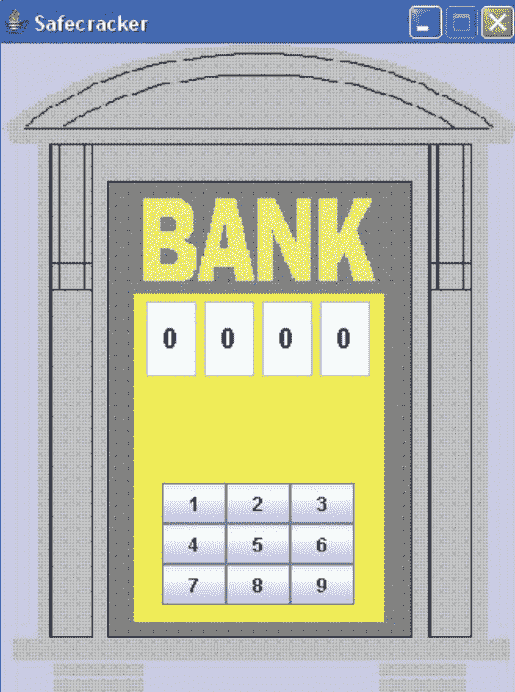

按键出现了。`safePanel` 控件已完成。让我们移动框架上的其他三个面板。

`optionsPanel` 将包含三个单选按钮控件，用于选择组合中的数字位数。`optionsPanel` 的 `GridBagLayout` 如下：

| | gridx = 0 |
|---|---|
| gridy = 0 | twoDigitsRadioButton |
| gridy = 1 | threeDigitsRadioButton |
| gridy = 2 | fourDigitsRadioButton |

面板和单选按钮属性：

**optionsPanel:**

- size 200, 100
- title Options:
- gridx 1 (on frame)
- gridy 0 (on frame)

**twoDigitsRadioButton:**

- text Two Digits in Combination

**threeDigitsRadioButton:**

- text Three Digits in Combination
- digitsButtonGroup
- 0 (on optionsPanel)
- 1 (on optionsPanel)
- WEST

**fourDigitsRadioButton:**

- text Four Digits in Combination
- 0 (on optionsPanel)
- 2 (on optionsPanel)
- WEST

这些控件使用以下方式声明：

```java
JPanel optionsPanel = new JPanel();
ButtonGroup digitsButtonGroup = new ButtonGroup();
JRadioButton twoDigitsRadioButton = new JRadioButton();
JRadioButton threeDigitsRadioButton = new JRadioButton();
JRadioButton fourDigitsRadioButton = new JRadioButton();
```

使用以下代码将单选按钮放置在 `optionsPanel` 中（该面板放置在框架中）：

```java
optionsPanel.setPreferredSize(new Dimension(200, 100));
optionsPanel.setBorder(BorderFactory.createTitledBorder("Options:"));
optionsPanel.setLayout(new GridBagLayout());
gridConstraints = new GridBagConstraints();
gridConstraints.gridx = 1;
gridConstraints.gridy = 0;
getContentPane().add(optionsPanel, gridConstraints);
```

```java
twoDigitsRadioButton.setText("Two Digits in Combination");
twoDigitsRadioButton.setSelected(true);
digitsButtonGroup.add(twoDigitsRadioButton);
gridConstraints = new GridBagConstraints();
gridConstraints.gridx = 0;
gridConstraints.gridy = 0;
gridConstraints.anchor = GridBagConstraints.WEST;
optionsPanel.add(twoDigitsRadioButton, gridConstraints);

threeDigitsRadioButton.setText("Three Digits in Combination");
digitsButtonGroup.add(threeDigitsRadioButton);
gridConstraints = new GridBagConstraints();
gridConstraints.gridx = 0;
gridConstraints.gridy = 1;
gridConstraints.anchor = GridBagConstraints.WEST;
optionsPanel.add(threeDigitsRadioButton, gridConstraints);

fourDigitsRadioButton.setText("Four Digits in Combination");
digitsButtonGroup.add(fourDigitsRadioButton);
gridConstraints = new GridBagConstraints();
gridConstraints.gridx = 0;
gridConstraints.gridy = 2;
gridConstraints.anchor = GridBagConstraints.WEST;
optionsPanel.add(fourDigitsRadioButton, gridConstraints);
```

在适当的位置添加代码。运行以查看：

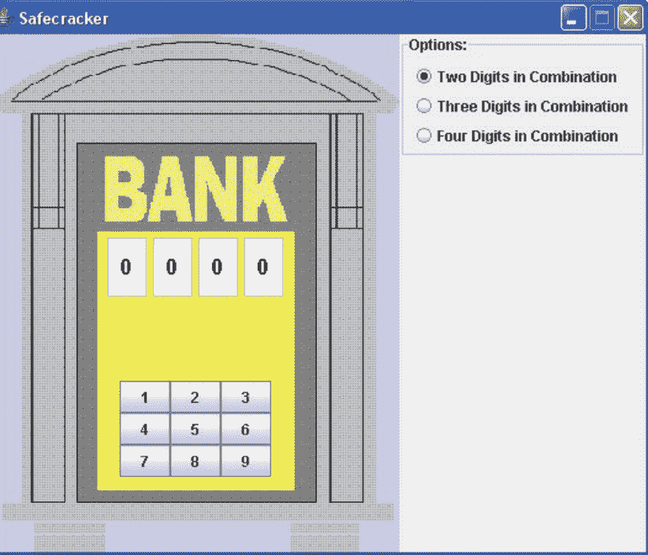

显示选项面板。

`buttonsPanel` 将包含两个用于控制游戏的按钮。`buttonsPanel` 的 `GridBagLayout` 如下：

| | gridx = 0 |
|---|---|
| gridy = 0 | startStopButton |
| gridy = 1 | exitButton |

面板和按钮属性：

**buttonsPanel:**

- size 200, 100
- gridx 1 (on frame)
- gridy 0 (on frame)

**startStopButton:**

- text Start Stop
- gridx 0 (on buttonsPanel)
- gridy 0 (on buttonsPanel)

**exitButton:**

- text Exit
- gridx 0 (on buttonsPanel)
- gridy 1 (on buttonsPanel)

这些控件使用以下方式声明：

```java
JPanel buttonsPanel = new JPanel();
JButton startStopButton = new JButton();
JButton exitButton = new JButton();
```

使用以下代码将按钮放置在 `buttonsPanel` 中（该面板放置在框架中）：

```java
buttonsPanel.setPreferredSize(new Dimension(200, 100));
buttonsPanel.setBorder(BorderFactory.createTitledBorder("Buttons:"));
buttonsPanel.setLayout(new GridBagLayout());
gridConstraints = new GridBagConstraints();
gridConstraints.gridx = 1;
gridConstraints.gridy = 0;
getContentPane().add(buttonsPanel, gridConstraints);
```

```java
startStopButton.setText("Start Stop");
gridConstraints = new GridBagConstraints();
gridConstraints.gridx = 0;
gridConstraints.gridy = 0;
gridConstraints.anchor = GridBagConstraints.WEST;
buttonsPanel.add(startStopButton, gridConstraints);

exitButton.setText("Exit");
gridConstraints = new GridBagConstraints();
gridConstraints.gridx = 0;
gridConstraints.gridy = 1;
gridConstraints.anchor = GridBagConstraints.WEST;
buttonsPanel.add(exitButton, gridConstraints);
```

在适当的位置添加代码。运行以查看：

```java
startStopButton.addActionListener(new ActionListener())
{
    public void actionPerformed(ActionEvent e)
    {
        startStopActionPerformed(e);
    }
});
exitButton.addActionListener(new ActionListener())
{
    public void actionPerformed(ActionEvent e)
    {
        exitActionPerformed(e);
    }
});

private void startStopActionPerformed(ActionEvent e)
{
}

private void exitActionPerformed(ActionEvent e)
{
}
```

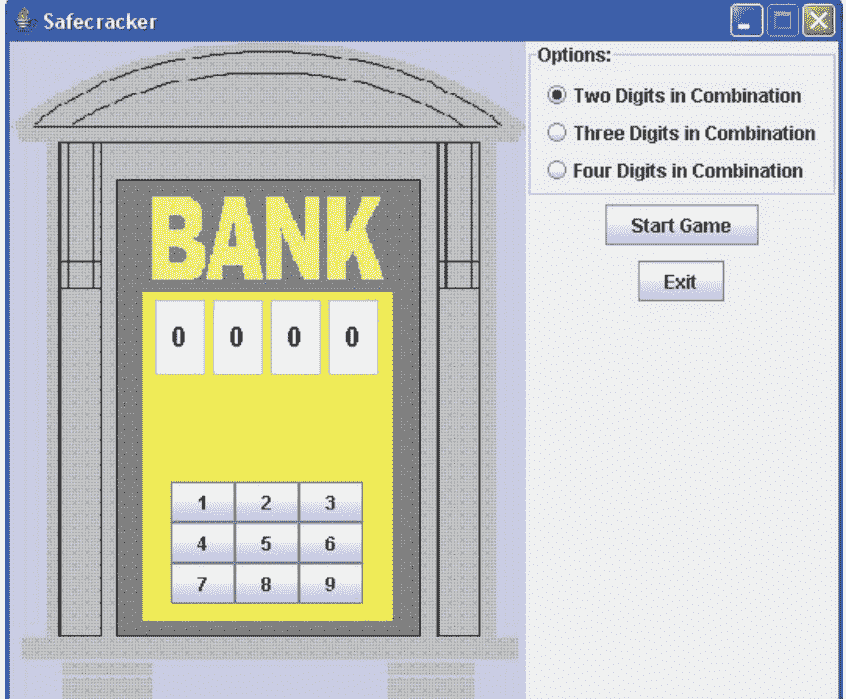

## 代码设计 – 初始化停止状态

每当我们开始一个项目时，都必须进行某些初始化工作。让我们来看看 Safecracker 游戏所需的初始化工作。所有的初始化代码都放置在所有控件添加到框架（`frame`）之后的框架构造函数中。

当游戏开始时，在选择选项之前，用户不应该能够点击银行中的按键。添加此通用方法，将所有小键盘按钮设置为被选中的布尔状态（`a`）：

```java
private void setKeyButtons(boolean a)
{
    for (int i = 0; i < 9; i++)
    {
        keyButton[i].setEnabled(a);
    }
}
```

然后，在 `Safecracker` 构造函数代码的末尾添加这行代码（跟在设置 `screenSize` 变量的行之后）：

```java
setKeyButtons(false);
```

运行项目以确保框架正确初始化。执行此操作，你会发现在“停止”状态下（使用默认属性），Safecracker 游戏看起来如下：

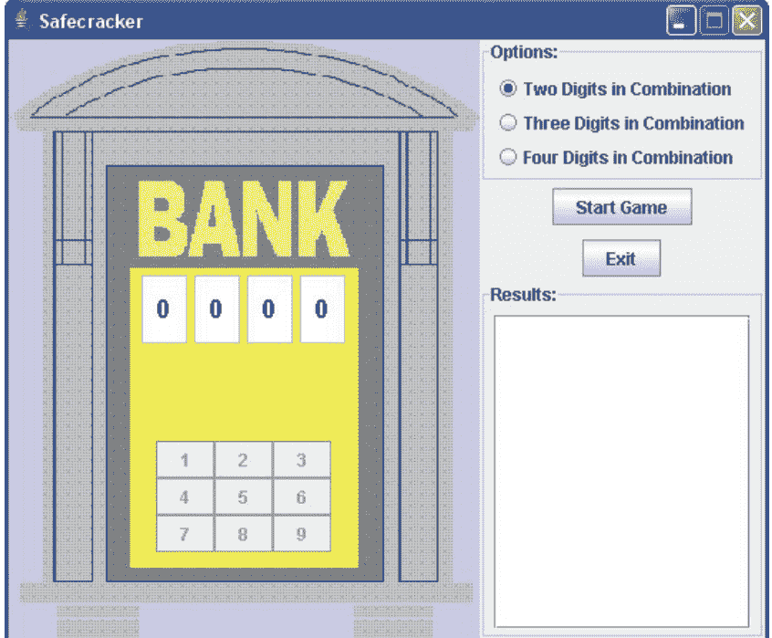

注意小键盘按钮如预期所示呈“灰色”。尝试点击其中一个；你无法点击。此时我们有两个选择——要么选择某些选项并点击 `startStopButton`（带有 Start Game 的按钮），要么点击 `exitButton`（带有 Exit 的按钮）。

退出的代码非常简单。`exitButtonActionListener` 方法（目前为空）如下：

```java
private void exitButtonActionPerformed(ActionEvent e)
{
    System.exit(0);
}
```

这表示每当点击 `Exit` 按钮时，项目就会关闭。将此代码添加到项目中。

`startStopButton` 按钮的代码复杂得多。我们将分步骤构建它。首先，我们查看如何从停止状态切换到运行状态。

# 代码设计 – 从停止到运行状态

当用户在“停止”状态下点击 `Start Game` 按钮时，必须发生以下操作才能将 Safecracker 游戏切换到“运行”状态：

- 将 `startStopButton` 的 `text` 属性改为 Stop Game。
- 禁用单选按钮（游戏期间不允许选择选项）。
- 禁用 `exitButton`。
- 启用小键盘按钮（允许输入组合）。
- 清空 `resultsTextArea`（删除之前的结果）。
- 显示相应数量的文本框控件以显示组合。
- 确定秘密组合。
- 允许用户输入秘密组合。
- 检查输入的组合是否匹配秘密组合——提供结果。

现在，我们将实现这些步骤中的每一个，除了建立秘密组合以及接受和检查用户输入。这些步骤将单独处理。

在类级别声明中添加此行代码，以定义一个用于组合数字数的变量：

```java
int numberDigits;
```

`startStopButtonActionPerformed` 方法的代码实现了上述方法中除最后三个步骤以外的所有步骤：

```java
private void startStopButtonActionPerformed(ActionEvent e) {
    startStopButton.setText("Stop Game");
    twoDigitsRadioButton.setEnabled(false);
    threeDigitsRadioButton.setEnabled(false);
    fourDigitsRadioButton.setEnabled(false);
    exitButton.setEnabled(false);
    setKeyButtons(true);
    resultsTextArea.setText("");
    // 确定数字位数并设置标签
    if (twoDigitsRadioButton.isSelected())
    {
        numberDigits = 2;
    }
    else if (threeDigitsRadioButton.isSelected())
    {
        numberDigits = 3;
    }
    else
    {
        numberDigits = 4;
    }
    for (int i = 0; i < numberDigits; i++)
    {
        textField[i].setVisible(true);
        textField[i].setText("");
    }
    if (numberDigits != 4)
    {
        for (int i = numberDigits; i < 4; i++)
        {
        }
    }
}
```

注意观察文本框控件数组 (`textField`) 如何用于显示所需的组合。

保存并运行项目。点击 Start Game，游戏应该切换到“运行”状态（组合为两位）：

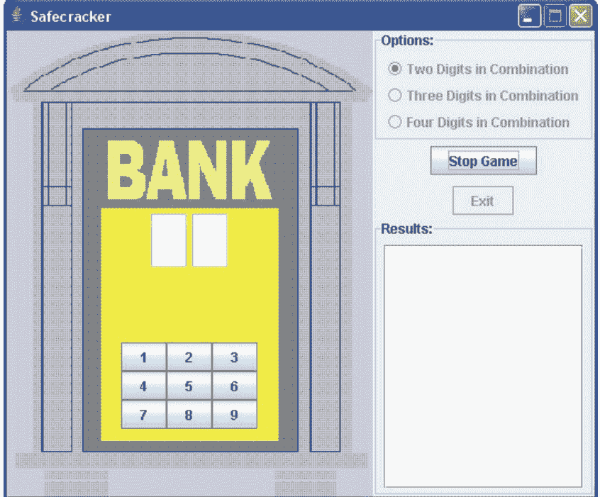

确保显示的文本框控件与选项匹配。`Stop Game` 按钮没有任何作用。让我们修复它。停止项目。

# 代码设计 – 从运行到停止

当用户在“运行”状态下点击 Stop Game 按钮时，必须发生以下操作才能将 Safecracker 游戏切换到“停止”状态：

- 将 `startStopButton` 的文本属性改为 Start Game。
- 启用单选按钮。
- 启用 `exitButton`。
- 禁用小键盘按钮。


现在标记为 Stop Game 的按钮是 `startStopButton`。我们已经在 `actionPerformed` 方法中添加了一些代码。通常做法是让一个按钮多用途——我们需要某种方法来区分点击时它处于什么“模式”。在项目中，我们使用按钮的文本属性。如果是 Start Game，我们切换到“运行”模式；如果是 Stop Game，我们切换到“停止”模式。实现此功能的代码如下：

```java
private void startStopButtonActionPerformed(ActionEvent e)
{
    if (startStopButton.getText().equals("Start Game")) {
        startStopButton.setText("Stop Game");
        twoDigitsRadioButton.setEnabled(false);
        threeDigitsRadioButton.setEnabled(false);
        fourDigitsRadioButton.setEnabled(false);
        exitButton.setEnabled(false);
        setKeyButtons(true);
        resultsTextArea.setText("");
        // 确定数字位数并设置标签
        if (twoDigitsRadioButton.isSelected()) {
            numberDigits = 2;
        } else if (threeDigitsRadioButton.isSelected()) {
            numberDigits = 3;
        } else {
            numberDigits = 4;
        }
    }
    else {
        // 切换到停止状态的逻辑
    }
}
```

等待，再次查看 OCR，“运行到停止”部分的逻辑在我的重构中有些碎片。让我严格遵循提供的文本：

```java
    for (int i = 0; i < numberDigits; i++) {
        comboTextField[i].setVisible(true);
        comboTextField[i].setText("");
    }
    if (numberDigits != 4) {
        for (int i = numberDigits; i < 4; i++) {
            comboTextField[i].setVisible(false);
        }
    } else {
        startStopButton.setText("Start Game");
        twoDigitsRadioButton.setEnabled(true);
        threeDigitsRadioButton.setEnabled(true);
        fourDigitsRadioButton.setEnabled(true);
        exitButton.setEnabled(true);
        setKeyButtons(false);
    }
}
```

（注：OCR 文本在代码块中有一些重叠部分；我根据说明提供了合并后的版本。）

# 代码设计 – 生成秘密组合

Safecracker 项目中的一个关键步骤是生成玩家尝试猜测的秘密组合。根据所选选项，我们知道组合可以是 2 到 4 位数。我们还规定数字不能重复。

由于不允许数字重复，对于组合中的每个数字，我们生成一个 1 到 9 的随机数，但只有在它之前未使用过时才将其添加到组合中。为我们的游戏实现此代码的代码：

```java
// 确定组合
secretCombo = "";
int j;
boolean uniqueDigit;
for (int i = 0; i < numberDigits; i++)
{
  // 选择唯一数字
  do
  {
    j = myRandom.nextInt(9) + 1;
    uniqueDigit = true;
    if (i != 0)
    {
      for (int k = 0; k < i; k++)
      {
        if (String.valueOf(secretCombo.charAt(k)).equals(String.valueOf(j)))
          uniqueDigit = false;
      }
    }
  } while (!uniqueDigit);
  secretCombo += String.valueOf(j);
}
```

我们将带你逐步阅读这段代码以查看发生了什么。使用字符串变量 `secretCombo` 来存储组合。它最初是空的。通过字符串拼接，一个接一个数字（总共 `numberDigits`）被添加到 `secretCombo` 中。

生成一个随机数字 `j`（1 到 9）。然后我们查看当前的数字，看这个新生成的数字是否是唯一的。如果是，则将其添加到 `secretCombo`。如果不唯一，则生成一个新的随机数字。所有这些逻辑都实现在 `do` 循环中。研究我们如何使用 `charAt` 方法检查 `secretCombo` 中的单个数字。返回的值是 `char` 类型，因此在比较之前我们需要将其转换为 `String`。让我们尝试这段新代码。

由于我们使用了随机数，请在代码列表顶部包含此导入语句（与其他导入语句一起）：

```java
import java.util.Random;
```

添加这些类变量声明来定义秘密组合并建立随机数对象：

```java
String secretCombo;
Random myRandom = new Random();
```

```java
{
  numberDigits = 3;
}
else
{
  numberDigits = 4;
}
for (int i = 0; i < numberDigits; i++) {
  comboTextField[i].setVisible(true);
  comboTextField[i].setText("");
}
if (numberDigits != 4) {
  for (int i = numberDigits; i < 4; i++) {
    comboTextField[i].setVisible(false);
  }
}

// 确定组合
secretCombo = "";
int j;
boolean uniqueDigit;
for (int i = 0; i < numberDigits; i++) {
  // 选择唯一数字
do
{
    j = myRandom.nextInt(9) + 1;
    uniqueDigit = true;
    if (i != 0) {
      for (int k = 0; k < i; k++) {
        if (String.valueOf(secretCombo.charAt(k)).equals(String.valueOf(j)))
        {
          uniqueDigit = false;
        }
      }
    }
  } while (!uniqueDigit);
  secretCombo += String.valueOf(j);
}
else
{
  startStopButton.setText("Start Game");
  twoDigitsRadioButton.setEnabled(true);
  threeDigitsRadioButton.setEnabled(true);
  fourDigitsRadioButton.setEnabled(true);
  exitButton.setEnabled(true);
  setKeyButtons(false);
}
```

现在我们可以生成一个秘密组合，但无法看到它是什么。在开发项目时，很多时候你想在项目完成之前检查结果。这意味着为了调试目的而添加临时代码。在生成组合的代码的闭合括号之后放置此行：

`System.out.println(secretCombo);`

这将把生成的组合写入 IDE 的 `Output`（输出）窗口中，允许你查看组合是否符合要求（正确的位数以及正确的重复/非重复数字）。

保存并运行项目。点击 `Start Game`。打开你 IDE 的 `output` 窗口并查看生成的组合。确保它符合所选选项的要求。点击 `Stop Game`。对各种组合重复此过程，以确保组合生成是正确的。完成后，从代码中删除调试行。我们现在准备好使用 9 个数字键盘按钮接受玩家对秘密组合的猜测了。

## 代码设计 – 接受玩家输入

一旦生成秘密组合，下一步是允许用户输入他们对组合的猜测。这是通过图形数组中面板控件上的 9 个数字按钮完成的。遵循的步骤如下：

- 点击按钮输入一个数字。
- 如果这是组合中的第一个数字，清除标签控件中任何之前的猜测。
- 确定点击了哪个按钮。
- 禁用被点击的按钮，因为不允许数字重复。
- 将点击的按钮上的数字添加到用户的输入组合中。
- 在正确的标签控件中显示该数字。
- 如果所有数字都已输入，启用数字按钮并将用户的输入与实际组合进行比较，否则重复这些步骤。

执行这些步骤的代码将存放在名为 `keyButtonActionPerformed` 的方法（目前为空）中。该方法被设置为处理用于输入的所有 9 个按钮（`keyButton` 数组）的点击事件。

添加以下类变量来存储用户输入的组合和输入的位数：

```java
int digitsEntered;
String enteredCombo;
```

使用 `startStopButtonActionPerformed` 中的阴影代码来初始化这两个新变量的值：

```java
private void startStopButtonActionPerformed(ActionEvent e)
{
    if (startStopButton.getText().equals("Start Game"))
    {
        startStopButton.setText("Stop Game");
        twoDigitsRadioButton.setEnabled(false);
        threeDigitsRadioButton.setEnabled(false);
        fourDigitsRadioButton.setEnabled(false);
        exitButton.setEnabled(false);
        setKeyButtons(true);
        resultsTextArea.setText("");
    }
```

```java
// 确定位数并设置标签
if (twoDigitsRadioButton.isSelected()) {
    numberDigits = 2;
} else if (threeDigitsRadioButton.isSelected()) {
    numberDigits = 3;
} else {
    numberDigits = 4;
}
for (int i = 0; i < numberDigits; i++) {
    comboTextField[i].setVisible(true);
    comboTextField[i].setText("");
}
if (numberDigits != 4) {
    for (int i = numberDigits; i < 4; i++) {
        comboTextField[i].setVisible(false);
    }
}
// 确定组合
secretCombo = "";
int j;
boolean uniqueDigit;
for (int i = 0; i < numberDigits; i++) {
    // 选择唯一数字
    do {
        j = myRandom.nextInt(9) + 1;
        uniqueDigit = true;
        if (i != 0)
        {
            for (int k = 0; k < i; k++)
            {
                if (String.valueOf(secretCombo.charAt(k)).equals(String.valueOf(j)))
                {
                    uniqueDigit = false;
                }
            }
        }
    } while (!uniqueDigit);
    secretCombo += String.valueOf(j);
}
enteredCombo = "";
digitsEntered = 0;
```

```java
}
else
{
    startStopButton.setText("Start Game");
    twoDigitsRadioButton.setEnabled(true);
    threeDigitsRadioButton.setEnabled(true);
    fourDigitsRadioButton.setEnabled(true);
    exitButton.setEnabled(true);
    setKeyButtons(false);
}
```

将以下代码添加到 `keyButtonActionPerformed` 方法中。该方法实现了检查用户输入的步骤：

```java
private void keyButtonActionPerformed(ActionEvent e)
{
    String n;
    // 确定点击了哪个按钮
    // ActionCommand 是按钮上的文本
    n = e.getActionCommand();
    // 禁用被点击的按钮，因为不允许重复
    keyButton[Integer.valueOf(n).intValue() - 1].setEnabled(false);
    // 如果是组合中的第一个数字，清除标签控件
    if (digitsEntered == 0)
    {
        comboTextField[0].setText("");
        comboTextField[1].setText("");
        comboTextField[2].setText("");
        comboTextField[3].setText("");
    }
    // 将按钮添加到代码
    enteredCombo += n;
    digitsEntered++;
    textField[digitsEntered - 1].setText(n);
    // 如果所有数字都已输入，检查组合
    if (digitsEntered == numberDigits)
    {
        // 重置组合
        for (int i = 0; i < 9; i++)
            keyButton[i].setEnabled(true);
        // 检查组合
        System.out.println(enteredCombo);
    }
}
```

注意 `getActionCommand` 方法返回点击按钮的文本。这就是对应的数字（变量 `n`）。我们使用 `println` 语句在 IDE 输出窗口中打印完整的组合。我们现在有了生成秘密组合并获取玩家对该组合猜测的能力，如果匹配，太棒了！如果不匹配，告诉玩家有多少个数字是正确的，有多少个在正确的位置。这是部分比较复杂的代码。

一旦用户完成输入，我们遵循这些步骤：

- 在 `resultsTextArea` 中显示用户的猜测 `enteredCombo`。
- 如果用户的猜测 `enteredCombo` 等于实际组合 `secretCombo`，将游戏返回停止状态并让玩家知道组合。
- 如果猜测错误，确定正确的数字数量和正确位置的数量。将这些信息显示在 `resultsTextArea` 中。
- 清除用户的猜测以便再次尝试。

执行这些步骤的代码位于 `keyButtonActionPerformed` 方法中。

将阴影代码添加到 `keyButtonActionPerformed` 方法以实现这些步骤（我们删除了 `println` 语句）：


```java
enteredCombo += n;
digitsEntered++;
comboTextField[digitsEntered - 1].setText(n);
// if all digits entered, check combo
if (digitsEntered == numberDigits)
{
  // reset combo buttons
  for (int i = 0; i < 9; i++)
    keyButton[i].setEnabled(true);
  // check combination
  resultsTextArea.append("Entered: " + enteredCombo + "\n");
  if (enteredCombo.equals(secretCombo)){
    startStopButton.doClick();
  }
  else {
    numberRight = 0;
    for (int i = 0; i < numberDigits; i++) {
      n = String.valueOf(enteredCombo.charAt(i));
      for (int j = 0; j < numberDigits; j++) {
        if (n.equals(String.valueOf(secretCombo.charAt(j))))
          numberRight++;
      }
      // how many in correct position
      positionRight = 0;
      for (int i = 0; i < numberDigits; i++) {
        if (secretCombo.charAt(i) == enteredCombo.charAt(i))
          positionRight++;
      }
      resultsTextArea.append(String.valueOf(numberRight) + " digits correct " + "\n");
      resultsTextArea.append(String.valueOf(positionRight) + " in correct position " + "\n");
    }
  }
  resultsTextArea.append("Try again ..." + "\n");
  // clear to try again
  enteredCombo = "";
  digitsEntered = 0;
}
```

你应该能够读懂这段代码。它计算了用户输入中正确数字的数量。检查数字是否处于正确位置的代码会比较 `enteredCombo` 和 `secretCombo` 中的每个数字。所有结果都通过 `append` 方法显示在 `resultsTextArea` 中。

如果猜中了正确的组合，我们希望返回“停止”状态。实现此点的简单方法（也是我们的做法）是直接使用 `doClick()` 方法程序化点击“停止游戏”按钮。然而，使用这种方法，我们需要在 `startStopButtonActionPerformed` 方法中添加一些代码。新代码用于区分是在猜测组合之前停止游戏，还是因为猜中了组合而停止。对 `startStopButtonActionPerformed` 方法进行如下修改：

```java
private void startStopButtonActionPerformed(ActionEvent e)
{
    if (startStopButton.getText().equals("Start Game"))
    {
        startStopButton.setText("Stop Game");
        twoDigitsRadioButton.setEnabled(false);
        threeDigitsRadioButton.setEnabled(false);
        fourDigitsRadioButton.setEnabled(false);
        exitButton.setEnabled(false);
        setKeyBounds(true);
        resultsTextArea.setText("");
        //确定数字位数并设置标签
        if (twoDigitsRadioButton.isSelected())
        {
            numberDigits = 2;
        }
        else if (threeDigitsRadioButton.isSelected())
        {
            numberDigits = 3;
        }
        else
        {
            numberDigits = 4;
        }
        for (int i = 0; i < numberDigits; i++) {
            comboTextField[i].setVisible(true);
            comboTextField[i].setText("");
        }
        if (numberDigits != 4) {
            for (int i = numberDigits; i < 4; i++) {
                comboTextField[i].setVisible(false);
            }
        }
        //确定组合
        secretCombo = "";
        int j;
        boolean uniqueDigit;
        for (int i = 0; i < numberDigits; i++) {
            //选择唯一的数字
            do {
                j = myRandom.nextInt(9) + 1;
                uniqueDigit = true;
                if (i != 0) {
                    for (int k = 0; k < i; k++) {
                        if (String.valueOf(secretCombo.charAt(k)).equals(String.valueOf(j))) {
                            uniqueDigit = false;
                        }
                    }
                }
            } while (!uniqueDigit);
            secretCombo += String.valueOf(j);
        }
        enteredCombo = "";
        digitsEntered = 0;
    }
    else
    {
        if (enteredCombo.equals(secretCombo)) {
            resultsTextArea.append("That's it!!" + "\n");
        } else {
            resultsTextArea.append("Game Stopped" + "\n");
        }
        resultsTextArea.append("Combination: " + secretCombo);
        startStopButton.setText("Start Game");
        twoDigitsRadioButton.setEnabled(true);
        threeDigitsRadioButton.setEnabled(true);
        fourDigitsRadioButton.setEnabled(true);
        exitButton.setEnabled(true);
        setKeyButtons(false);
    }
}
```

保存并运行项目。游戏现在已完全功能化。尝试玩几次以确保一切运行正常。它还需要最后一件事。

# Java 中的声音

你可能从未在项目中使用过声音。或者你可能用过 Java 提供的唯一声音，即通过以下代码生成的简单哔声：

```
Toolkit.getDefaultToolkit().beep();
```

这种独特的声音会通过电脑内置的扬声器播放（如果有的话）。多媒体演示和游戏具有利用立体声声卡的复杂声音。在 Java 中播放此类声音只需要一点小技巧。

确定点击了哪个按钮：

```java
// ActionCommand 是按钮上的文本
n = e.getActionCommand();
```

```java
// 禁用按钮，因为数字不能重复
keyButton[Integer.valueOf(n).intValue() - 1].setEnabled(false);
```

```java
// 如果是组合中的第一个按钮，清空标签框
if (digitsEntered == 0) {
    comboTextField[0].setText("");
    comboTextField[1].setText("");
    comboTextField[2].setText("");
    comboTextField[3].setText("");
}
```

```java
// 将按钮添加到代码中
enteredCombo += n;
digitsEntered++;
```

```java
comboTextField[digitsEntered - 1].setText(n);
// 如果所有数字已输入，检查组合
if (digitsEntered == numberDigits) {
```

```java
// 重置组合按钮
for (int i = 0; i < 9; i++)
    keyButton[i].setEnabled(true);
```

```java
// 检查组合
resultsTextArea.append("Entered: " + enteredCombo + "\n");
if (enteredCombo.equals(secretCombo))
```

```java
correctSound.play();
startStopButton.doClick();
}
else {
```

```java
wrongSound.play();
numberRight = 0;
for (int i = 0; i < numberDigits; i++) {
```

```java
n = String.valueOf(enteredCombo.charAt(i));
for (int j = 0; j < numberDigits; j++)
    if (n.equals(String.valueOf(secretCombo.charAt(j))))
        numberRight++;

// 位置正确的数字个数
positionRight = 0;
for (int i = 0; i < numberDigits; i++)
    if (secretCombo.charAt(i) == enteredCombo.charAt(i))
        positionRight++;
resultsTextArea.append(String.valueOf(numberRight) + " digits correct " + "\n\n\n");
resultsTextArea.append(String.valueOf(positionRight) + " in correct position " + "\n");

resultsTextArea.append("Try again..." + "\n\n");
// 清空组合重新尝试
enteredCombo = "";
digitsEntered = 0;
```

保存并运行项目。现在你应该有了一个完整的、可运行的 Safecracker 游戏（完整代码列表位于章节末尾）。玩得开心！看看你能不能想出某种获胜策略。这里有一个我使用 3 个不重复数字玩的游戏。首先，我尝试了 123（显然不是一个好的猜测），然后听到了“噢噢”的声音：

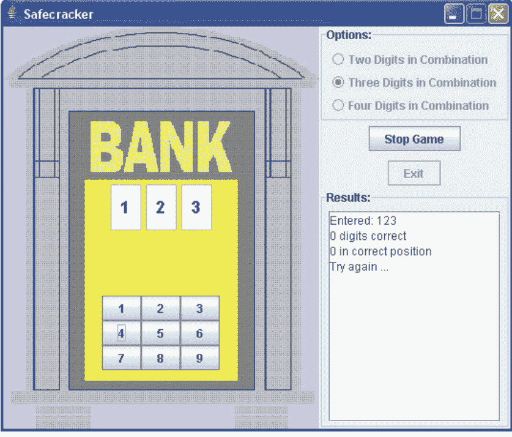

下一次尝试是 456：

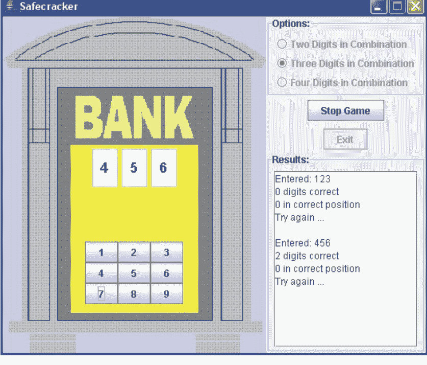

好多了——有两个数字是正确的。我获得了一些有价值的信息。

接下来，我尝试了 745，稍微偏离了主题：

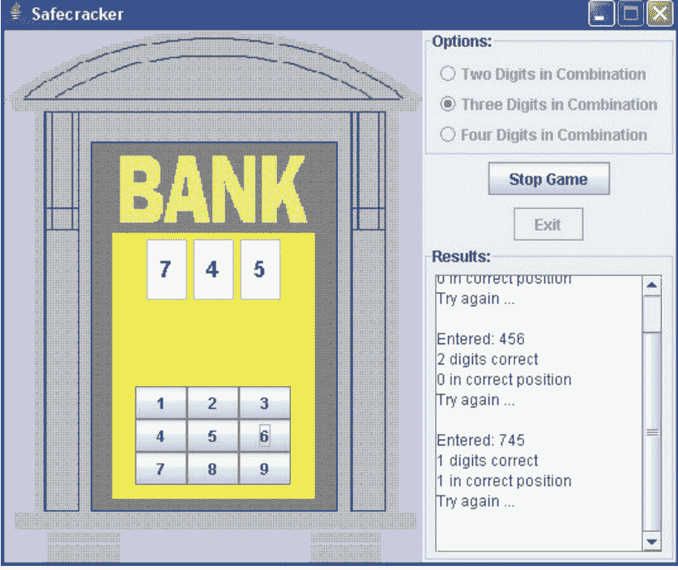

然后，我输入了 648：

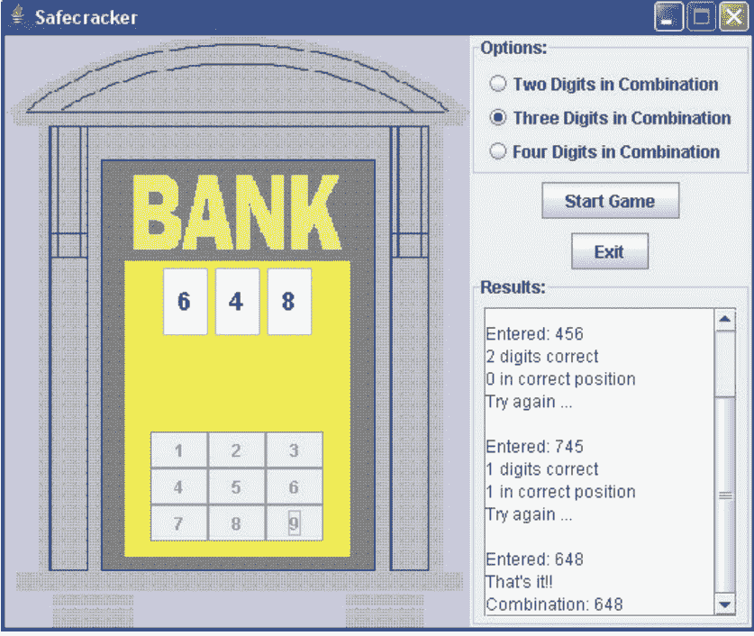

输入正确的组合！听到了短暂的庆祝声，游戏返回到停止状态。

# Safecracker 项目评审

**Safecracker** 游戏项目现在已经完成。保存并运行项目，确保它如预期般工作。检查所有选项是否正常运行。

如果你的实现中存在错误，请回到表单和代码设计的步骤。重新检查开发的代码——确保你理解项目不同部分是如何编码的。正如本章开头提到的，完成的项目已保存为 `\KidGamesJava\KidGamesJava Projects\` 组组中的 **Safecracker**。

在完成此项目期间，你获得的新概念和技能包括：

- 正确的设计步骤。
- Java 控件的功能和使用。
- 随机数和声音的使用。

# Safecracker 项目增强

你总可以改进项目。在每个章节的末尾我们将为你提供关于当前项目的一些想法。对于 Safecracker 游戏，一些可能性包括：

- 添加一个选项，允许组合中的数字重复（也许可以使用一个复选框）。你需要修改生成和检查组合的代码。你还必须确保键盘按钮在点击后不会被禁用。
- 为了让游戏对儿童来说更简单，你可能希望使用少于 9 个数字的组合。例如，只使用 1 到 3 数字的代码会更容易猜。你需要逻辑来决定在键盘上保留哪些键。
- 在每次猜测后，你可能想提供提示。
- 在组合正确后，也许可以有更戏剧性的结果。让银行图形消失并出现一堆宝藏。

# Safecracker 项目代码列表


```java
/*
 * Safecracker.java
 */
package safecracker;
import javax.swing.*;
import java.awt.*;
import java.awt.event.*;
import java.util.Random;
import java.net.URL;

public class Safecracker extends JFrame
{
    Image safePanel = new JPanel(new ImageIcon("bank.gif").getImage());
    JPanel comboPanel = new JPanel();
    JPanel keyPanel = new JPanel();
    JPanel optionsPanel = new JPanel();
    JPanel buttonsPanel = new JPanel();
    JPanel resultsPanel = new JPanel();

    JTextField[] comboField = new JTextField[4];
    JButton[] keyButton = new JButton[9];
    ButtonGroup digitsGroup = new ButtonGroup();
    JRadioButton twoDigitsRadioButton = new JRadioButton();
    JRadioButton threeDigitsRadioButton = new JRadioButton();
    JRadioButton fourDigitsRadioButton = new JRadioButton();
    JButton startButton = new JButton();
    JButton exitButton = new JButton();
    JScrollPane resultsPane = new JScrollPane();
    JTextArea resultsArea = new JTextArea();

    int numberDigits;
    String secretCombo;
    Random myRandom = new Random();
    int digitsEntered;
    String enteredCombo;

    Clip wrongSound;
    Clip correctSound;

    public static void main(String args[])
    {
        // create frame
        new Safecracker().show();
    }

    public Safecracker()
    {
        // frame constructor
        setTitle("Safecacker");
        setResizable(false);
        addWindowListener(new WindowAdapter()
        {
            public void windowClosing(WindowEvent evt)
            {
                exit(evt);
            }
        });

        getContentPane().setLayout(new GridBagLayout());
        GridBagConstraints constraints;
        safePanel.setPreferredSize(new Dimension(330, 420));
        safePanel.setLayout(new GridBagLayout());
        gridConstraints = new GridBagConstraints();
        gridConstraints.gridx = 0;
        gridConstraints.gridy = 0;
        gridConstraints.gridheight = 3;
        getContentPane().add(safePanel, gridConstraints);

        comboPanel.setPreferredSize(new Dimension(160, 110));
        safePanel.setLayout(new GridBagLayout());
        comboPanel.setBackground(Color.YELLOW);
        gridConstraints = new GridBagConstraints();
        gridConstraints.gridx = 0;
        gridConstraints.gridy = 0;
        gridConstraints.Insets = new Insets(110, 0, 0);
        getContentPane().add(comboPanel, gridConstraints);

        for (int i = 0; i < 4; i++) {
          textField[i] = new JTextField();
          textField[i].setPreferredSize(new Dimension(32, 48));
          textField[i].setEditable(false);
          textField[i].setBackground(Color.WHITE);
          textField[i].setText("0");
          textField[i].setHorizontalAlignment(SwingConstants.CENTER);
          textField[i].setFont(new Font("Arial", Font.BOLD, 18));
          gridConstraints = new GridBagConstraints();
          gridConstraints.gridx = i;
          gridConstraints.gridy = 0;
          comboPanel.add(textField[i], gridConstraints);
        }

        keyPanel.setPreferredSize(new Dimension(160, 100));
        keyPanel.setLayout(new GridBagLayout());
        keyPanel.setBackground(Color.YELLOW);
        gridConstraints = new GridBagConstraints();
        gridConstraints.gridx = 0;
        gridConstraints.gridy = 1;
        getContentPane().add(keyPanel, gridConstraints);

        for (int i = 0; i < 9; i++) {
          keyButton[i] = new JButton();
          keyButton[i].setText(String.valueOf(i + 1));
          gridConstraints = new GridBagConstraints();
          gridConstraints.gridx = i % 3;
          gridConstraints.gridy = i / 3;
          keyPanel.add(keyButton[i], gridConstraints);
          keyButton[i].addActionListener(new ActionListener() {
            public void actionPerformed(ActionEvent e) {
                keyButtonActionPerformed(e);
            }
          });
        }

        optionsPanel.setPreferredSize(new Dimension(200, 100));
        optionsPanel.setBorder(BorderFactory.createTitledBorder("Options:"));
        optionsPanel.setLayout(new GridBagLayout());
        gridConstraints = new GridBagConstraints();
        gridConstraints.gridx = 1;
        gridConstraints.gridy = 0;
        getContentPane().add(optionsPanel, gridConstraints);

        twoDigitsRadioButton.setText("Two Digits in Combination");
        twoDigitsRadioButton.setSelected(true);
        digitsButtonGroup.add(twoDigitsRadioButton);
        gridConstraints = new GridBagConstraints();
        gridConstraints.gridx = 0;
        gridConstraints.gridy = 0;
        gridConstraints.anchor = GridBagConstraints.WEST;
        optionsPane.add(twoDigitsRadioButton, gridConstraints);

        threeDigitsRadioButton.setText("Three Digits in Combination");
        digitsButtonGroup.add(threeDigitsRadioButton);
        gridConstraints = new GridBagConstraints();
        gridConstraints.gridx = 0;
        gridConstraints.gridy = 1;
        gridConstraints.anchor = GridBagConstraints.WEST;
        optionsPane.add(threeDigitsRadioButton, gridConstraints);
    }
}
```

```java
digitsRadioButton.setText("组合中的四位数字");
digitsGroup.add(fourDigitsRadioButton);
gridConstraints = new GridBagConstraints();
gridConstraints.gridx = 0;
gridConstraints.grid = 2;
gridConstraints.anchor = GridBagConstraints.WEST;
optionsPane.add(fourDigitsRadioButton, gridConstraints);
```

```java
buttonsPanel.setPreferredSize(new Dimension(200, 70));
buttonsPanel.setLayout(new GridBagLayout());
gridConstraints = new GridBagConstraints();
gridConstraints.gridx = 1;
gridConstraints.grid = 1;
getContentPane().add(buttonsPanel,gridConstraints);
```

```java
startStopButton.setText("开始游戏");
gridConstraints = new GridBagConstraints();
gridConstraints.gridx = 0;
gridConstraints.gridy = 0;
buttonsPanel.add(startStopButton, gridConstraints);
startStopButton.addActionListener(new ActionListener() {
    public void actionPerformed(ActionEvent e) {
        startStopButtonActionPerformed(e);
    }
});
```

```java
exitButton.setText("退出");
gridConstraints = new GridBagConstraints();
gridConstraints.gridx = 0;
gridConstraints.gridy = 1;
gridConstraints.in = new Insets(10, 0, 0, 0);
buttonsPanel.add(exitButton, gridConstraints);
exitButton.addActionListener(new ActionListener() {
    public void actionPerformed(ActionEvent e) {
        exitButtonActionPerformed(e);
    }
});
resultsPanel.setPreferredSize(new Dimension(200, 250));

resultsPanel.setBorder(BorderFactory.createitledBorder("结果:"));
resultsPane.setLayout(new GridBagLayout());
gridConstraints = new GridBagConstraints();
gridConstraints.gridx = 1;
gridConstraints.gridy = 2;
getContentPane().add(resultsPane, gridConstraints);

resultsTextArea.setEditable(false);
resultsTextArea.setBackground(Color.WHITE);
resultsPane.setPreferredSize(new Dimension(180, 220));
resultsPane.setViewportView(resultsTextArea);
gridConstraints = new GridBagConstraints();
gridConstraints.gridx = 0;
gridConstraints.gridy = 0;
resultsPane.add(resultsPane, gridConstraints);

pack();
Dimension DimensionSize = Toolkit.getDefaultToolkit().getScreenSize();
setBounds((int) (0.5 * (screenSize.width - getWidth())), (int) (0.5 * (screenSize.height - getHeight())), getWidth(), getHeight());

setKeyButtons(false);
try
{
  wrongSound = Applet.newAudioClip(new URL("file:" + "uhoh.wav"));
  correctSound = Applet.newAudioClip(new URL("file:" + "tada.wav"));
}
catch (Exception ex)
{
    System.out.println("加载音频文件出错");
}
```


```java
private void keyButtonActionPerformed(ActionEvent e)
{
    String n;
    int numberRight, positionRight;
    // 确定点击了哪个按钮
    // ActionCommand 是按钮上的文本
    n = e.getActionCommand();
    // 禁用按钮因为数字不能重复
    keyButton[Integer.valueOf(n).intValue() - 1].setEnabled(false);
    // 如果是组合中的第一个按钮，清空标签框
    if (digitsEntered == 0) {
        comboTextField[0].setText("");
        comboTextField[1].setText("");
        comboTextField[2].setText("");
        comboTextField[3].setText("");
    }
    // 将按钮添加到代码
    enteredCombo += n;
    digitsEntered++;
    comboTextField[digitsEntered - 1].setText(n);
    // 如果所有数字都已输入，检查组合
    if (digitsEntered == numberDigits) {
        // 重置组合按钮
        setKeyButtons(true);
        // 检查组合
        resultsTextArea.append("已输入: " + enteredCombo + "\n");
    }
}
```

（...）。网格已禁用——无法进行任何标记（通过点击网格）。我选择了一个单人游戏，由我先手（获得 X），并配有一个聪明的电脑：

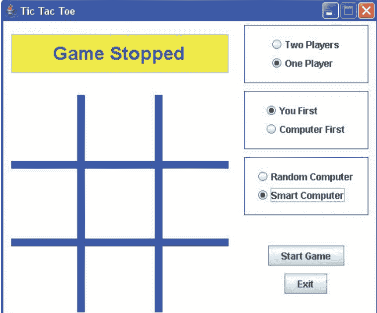

点击 **Start Game** 按钮开始游戏。它的标题将改变（现在显示为 **Stop Game**），选项组框和 **Exit** 按钮将变为禁用。网格顶部的标签显示 **X's Turn**。在这场游戏中，X 总是先手的（无论你是人类玩家还是电脑）。

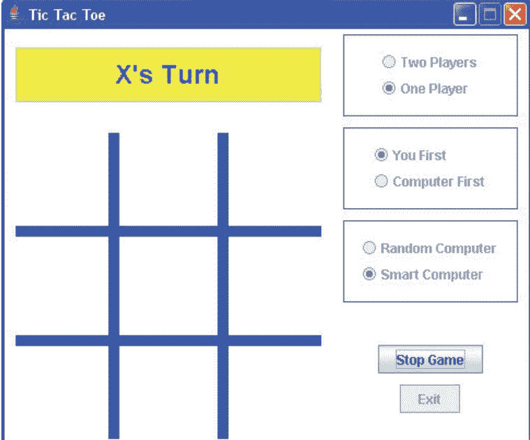

在状态下，你可以通过点击所需的方格在网格中做出标记。每次标记后，系统都会检查是否获胜或平局。你将交替回合，直到出现胜者、网格填满或你按下 Stop Game。双人模式的工作原理相同，由两个玩家交替标记网格。

输入一个标记；我选择了中间方格，电脑立即在左上角放置了它的标记（一个 O）：

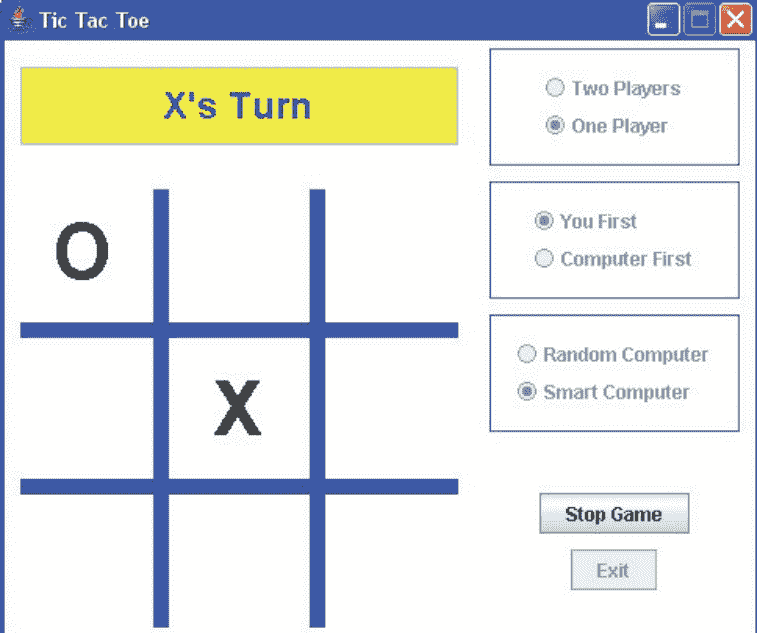

我尝试左下角，电脑阻止了我的获胜：

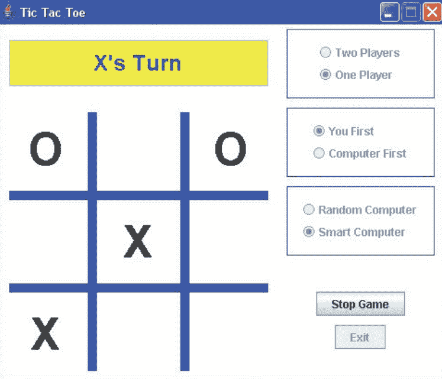

我通过在第一行的中间格子里放置一个 X 阻止了电脑可能的获胜。然后，电脑移动到最后一行的中间阻止了我：

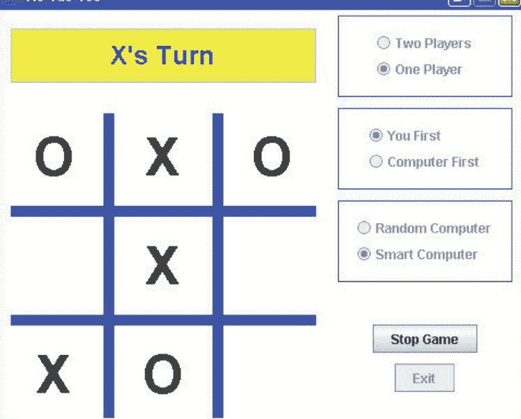

看起来这里没有人会赢。

我继续玩下去（移动到中间行的右侧，并在电脑阻挡后，移动到最后行的右侧），直到最后以平局结束：

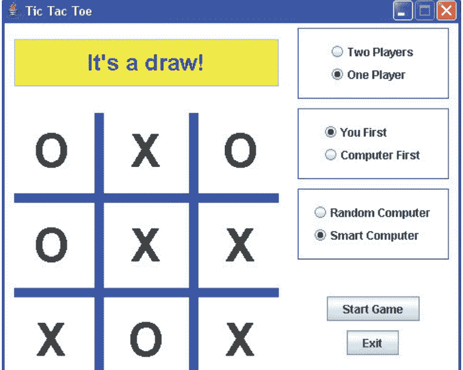

看起来电脑相当聪明！我们稍后会看看如何编写这种智能。注意游戏会返回停止状态，以便进行另一场游戏或停止程序。

继续玩游戏以理解它的操作。尝试使用 **Random Computer** 选项（电脑只会随机移动，这使其更容易击败）。完成后点击 **Exit** 停止游戏。如果你愿意，可以打开代码文件并查看代码。

你现在将分阶段构建此项目。在构建 Java 项目时，我们总是建议采取缓慢的、循序渐进的过程。这可以尽可能地减少编程错误，并在事物汇成完整项目时帮助建立信心。

我们将处理**框架设计**。我们将讨论构建框架所需的控件，建立初始控件属性，并讨论如何更改控件的状态。此外，我们还将处理**代码设计**。我们将讨论如何标记网格、处理多个玩家、检查胜负以及决定如何生成电脑生成的移动。

## 井井棋框架设计

我们开始构建 **Tic Tac Toe** 游戏项目。让我们构建框架。在你的 Java Project 中启动一个新项目——将其命名为 **TicTacToe**。删除名为 `TicTacToe.java` 文件中的默认代码。一旦启动，建议你立即使用选择的名称保存项目。这将为你的项目设置文件夹和文件结构。

使用以下属性构建基础框架：

**TicTacToe** 框架：

| Property (属性) | Value (值) |
| :--- | :--- |
| title | Tic Tac Toe |
| background | White |
| resizable | false |

代码如下：

```java
/*
 * TicTacToe.java
 */
package tictactoe;
import javax.swing.*;
import java.awt.*;
import java.awt.event.*;

public class TicTacToe extends JFrame
{
    public static void main(String[] args[]) {
        // create frame
        new TicTacToe().show();
    }

    public TicTacToe()
    {
        // frame constructor
        setTitle("Tic Tac Toe");
        getContentPane().setBackground(Color.WHITE);
        setResizable(false);
        addWindowListener(new WindowAdapter() {
            public void windowClosing(WindowEvent evt) {
                exitForm(evt);
            }
        });
        getContentPane().setLayout(new GridBagLayout());
        GridBagConstraints gridConstraints;

        pack();
        Dimension screenSize = Toolkit.getDefaultToolkit().getScreenSize();
        setBounds((int) (0.5 * (screenSize.width - getWidth())), (int) (0.5 * (screenSize.height - getHeight())), getWidth(), getHeight());
    }

    private void exitForm(WindowEvent evt) {
        System.exit(0);
    }
}
```

此代码构建了框架，设置了布局管理器并包含了退出应用程序的代码。运行代码以确保框架（至少是目前已有的部分）出现并居中于屏幕上：


让我们用其他控件填充我们的框架。创建框架和放置控件的所有代码（声明除外）都位于 `TicTacToe` 构造函数中。我们首先在框架上放置一个文本字段控件和五个面板。`GridBagLayout` 如下：

| gridx | gridy |
| :--- | :--- |
| 0 | messageTextField |
| 1 | gamePanel |
| 2 | firstPanel |
| 3 | computerPanel |
| 4 | buttonsPanel |

使用以下属性将 `messageField` 和 `gamePanel` 控件添加到框架中：

messageField:

| Property (属性) | Value (值) |
| :--- | :--- |
| size | 280, 50 |
| editable | false |
| background | Yellow |
| foreground | Blue |
| text | X's Move |
| horizontalAlignment | Center |
| font | Arial, Bold, 24 |
| grid | 0 |
| gridy | 0 |
| insets | 10, 10, 10, 10 |

gamePanel:

| Property (属性) | Value (值) |
| :--- | :--- |
| size | 280, 50 |
| background | White |
| gridx | 0 |
| gridy | 1 |

这些控件使用了：

```java
JTextField messageField = new JTextField();
JPanel gamePanel = new JPanel();
```

使用以下属性将 `messageField` 和 `gamePanel` 控件添加到框架：

```java
messageField.setSize(280, 50);
messageField.setEditable(false);
messageField.setBackground(Color.YELLOW);
messageField.setForeground(Color.BLUE);
messageField.setText("X's Move");
messageField.setHorizontalAlignment(SwingConstants.CENTER);
messageField.setFont(new Font("Arial", Font.BOLD, 24));
gridConstraints.gridx = 0;
gridConstraints.gridy = 0;
gridConstraints.insets = new Insets(10, 10, 10, 10);
getContentPane().add(messageField, gridConstraints);

gamePanel.setSize(280, 280);
gamePanel.setBackground(Color.WHITE);
gridConstraints.gridx = 0;
gridConstraints.gridy = 1;
```

（...后续文本由于重复或截断，已按上述逻辑处理）

居中

Arial, 粗体, 字号 48

边框

null

grid

0

grid\4

TextField[7]:

大小

80, 80

可编辑

false

背景白色

水平对齐居中

字体

Arial, 粗体, 字号 48

边框

null

grid

2

grid\4

TextField[8]:

大小

80, 80

可编辑

false

背景白色

水平对齐居中

字体

Arial, 粗体, 字号 48

边框

null

grid

4

grid\4

gridLabel[0]:

size 280, 10

不透明

true

背景蓝色

grid

0

grid

1

宽度

5

内边距 5, 0, 5, 0

gridLabel[1]:

size 280, 10

不透明

true

背景蓝色

gridLabel[2]:

size 10, 280

不透明 true

背景蓝色

gridx 1

gridy 0

高度 5

内边距 0, 5, 0, 5

gridLabel[3]:

size 10, 280

不透明 true

背景蓝色

gridx 3

gridy 0

高度 5

内边距 0, 5, 0, 5

使用以下代码声明控件：

```java
JTextField[] textField = new JTextField[9];
JLabel[] gridLabel = new JLabel[4];
```

使用以下代码将控件添加到 `gamePanel` 中：

```java
for (int i = 0; i < 9; i++)
{
    textField[i] = new JTextField();
    textField[i].setPreferredSize(new Dimension(80, 80));
    textField[i].setEditable(false);
    textField[i].setBackground(Color.WHITE);
    textField[i].setHorizontalAlignment(SwingConstants.CENTER);
    textField[i].setFont(new Font("Arial", Font.BOLD, 48));
    textField[i].setBorder(null);
    gridConstraints = new GridBagConstraints();
    gridConstraints.gridx = 2 * (i % 3);
    gridConstraints.gridy = 2 * (i / 3);
    gamePanel.add(textField[i], gridConstraints);
    textField[i].addMouseListener(new MouseAdapter() {
        public void mousePressed(MouseEvent e) {
            textFieldMousePressed(e);
        }
    });
}

gridLabel[0] = new JLabel();
gridLabel[0].setPreferredSize(new Dimension(280, 10));
gridLabel[0].setOpaque(true);
gridLabel[0].setBackground(Color.BLUE);
gridConstraints = new GridBagConstraints();
gridConstraints.gridx = 0;
gridConstraints.gridy = 1;
gridConstraints.gridwidth = 5;
gridConstraints.insets = new Insets(5, 0, 5, 0);
gamePanel.add(gridLabel[0], gridConstraints);

gridLabel[1] = new JLabel();
gridLabel[1].setPreferredSize(new Dimension(280, 10));
gridLabel[1].setOpaque(true);
gridLabel[1].setBackground(Color.BLUE);
gridConstraints = new GridBagConstraints();
gridConstraints.gridx = 0;
gridConstraints.gridy = 3;
gridConstraints.gridwidth = 5;
gridConstraints.insets = new Insets(5, 0, 5, 0);
gamePanel.add(gridLabel[1], gridConstraints);

gridLabel[2] = new JLabel();
gridLabel[2].setPreferredSize(new Dimension(10, 280));
gridLabel[2].setOpaque(true);
gridLabel[2].setBackground(Color.BLUE);
gridConstraints = new GridBagConstraints();
gridConstraints.gridx = 1;
gridConstraints.gridy = 0;
gridConstraints.gridheight = 5;
gridConstraints.insets = new Insets(0, 5, 0, 5);
gamePanel.add(gridLabel[2], gridConstraints);

gridLabel[3] = new JLabel();
gridLabel[3].setPreferredSize(new Dimension(10, 280));
gridLabel[3].setOpaque(true);
gridLabel[3].setBackground(Color.BLUE);
gridConstraints = new GridBagConstraints();
gridConstraints.gridx = 3;
gridConstraints.gridy = 0;
gridConstraints.gridheight = 5;
gridConstraints.insets = new Insets(0, 5, 0, 5);
gamePanel.add(gridLabel[3], gridConstraints);
```

注意循环 `i` 是如何用于设置字段位置的。

此代码还为每个文本字段添加了鼠标监听器。当点击文本框时调用 `boxTextFieldPressed` 方法。添加此空方法：

```java
private void boxTextFieldPressed(MouseEvent e)
{
}
```

在适当的位置添加代码。运行以查看空网格：

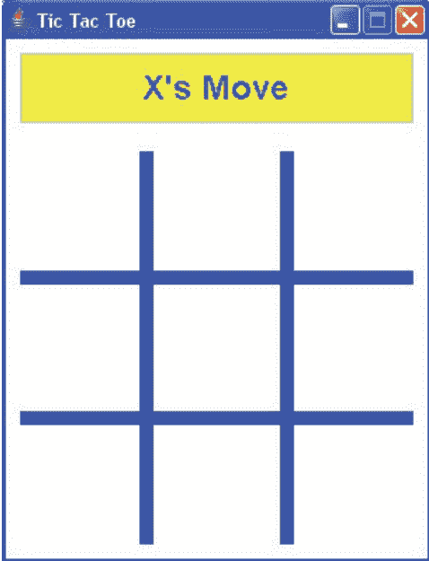

让我们添加剩余的面板。


# playersPanel

`playersPanel` 将包含两个单选按钮控件，用于选择游戏人数。`optionsPanel` 的 `GridBagLayout` 为：

| | gridx = 0 |
|---|---|
| gridy = 0 | twoPlayersRadioButton |
| gridy = 1 | onePlayerRadioButton |

## 面板和单选按钮属性

### playersPanel

- 大小：160, 75
- 边框：Line
- gridx：1 (frame 中)
- gridy：0 (frame 中)
- 内边距：5, 10, 5, 10

### twoPlayersRadioButton

- 文本：Two Players
- 背景：白色
- 按钮组：playersButtonGroup
- 选中

### RadioButton (onePlayerRadioButton)

- 文本：One Player
- 背景：白色
- 按钮组：playersButtonGroup
- gridx：0 (optionsPanel 中)
- gridy：1 (optionsPanel 中)
- 对齐：WEST

## 声明控件

```java
JPanel playersPanel = new JPanel();
ButtonGroup playersGroup = new ButtonGroup();
JRadioButton twoPlayersRadioButton = new JRadioButton();
JRadioButton onePlayerRadioButton = new JRadioButton();
```

## 将单选按钮放入 playersPanel (位于 frame 中)

```java
playersPanel.setPreferredSize(new Dimension(160, 75));
playersPanel.setBackground(Color.WHITE);
playersPanel.setBorder(BorderFactory.createLineBorder(Color.BLUE));
playersPanel.setLayout(new GridBagLayout());
gridConstraints = new GridBagConstraints();
gridConstraints.gridx = 1;
gridConstraints.gridy = 0;
gridConstraints.insets = new Insets(5, 10, 5, 10);
getContentPane().add(playersPanel, gridConstraints);

twoPlayersRadioButton.setText("Two Players");
twoPlayersRadioButton.setBackground(Color.WHITE);
twoPlayersRadioButton.setSelected(true);
playersButtonGroup.add(twoPlayersRadioButton);
gridConstraints = new GridBagConstraints();
gridConstraints.gridx = 0;
gridConstraints.gridy = 0;
gridConstraints.anchor = GridBagConstraints.WEST;
playersPanel.add(twoPlayersRadioButton, gridConstraints);
twoPlayersRadioButton.addActionListener(new ActionListener() {
    public void actionPerformed(ActionEvent e) {
        twoPlayersRadioButtonActionPerformed(e);
    }
});
```

## 添加事件处理方法

我们为单选按钮添加了监听器。添加这些空方法来处理选择：

```java
private void twoPlayersRadioButtonActionPerformed(ActionEvent e) {
}
```

```java
private void onePlayerRadioButtonActionPerformed(ActionEvent e) {
}
```

在适当的位置添加此代码。运行以查看：

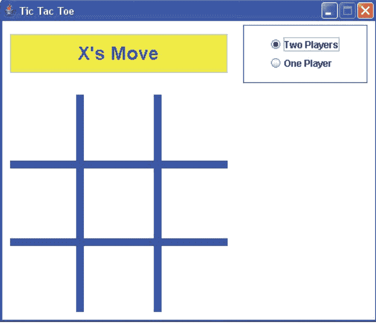

显示面板。

# firstPanel

`firstPanel` 将包含两个单选按钮控件，用于确定单人游戏中谁先开始。`firstPanel` 的 `GridBagLayout` 为：

| | gridx = 0 |
|---|---|
| gridy = 0 | youFirstRadioButton |
| gridy = 1 | computerFirstRadioButton |

## 面板和单选按钮属性

### firstPanel

- 大小：160, 75
- 边框：Line, Blue
- gridx：1 (frame 中)
- gridy：1 (frame 中)
- 内边距：5, 10, 5, 10

### youFirstRadioButton

- 文本：You First
- 背景：白色
- 按钮组：firstButtonGroup
- 选中
- gridx：0 (firstPanel 中)
- gridy：0 (firstPanel 中)
- 对齐：WEST

### computerFirstRadioButton

- 文本：Computer First
- 背景：白色
- 按钮组：firstButtonGroup
- gridx：0 (firstPanel 中)
- gridy：1 (firstPanel 中)
- 对齐：WEST

## 声明控件

```java
JPanel firstPanel = new JPanel();
ButtonGroup firstButtonGroup = new ButtonGroup();
JRadioButton youFirstRadioButton = new JRadioButton();
JRadioButton computerFirstRadioButton = new JRadioButton();
```

## 将单选按钮放入 firstPanel (位于 frame 中)

```java
firstPanel.setPreferredSize(new Dimension(160, 75));
firstPanel.setBackground(Color.WHITE);
firstPanel.setBorder(BorderFactory.createLineBorder(Color.BLUE));
firstPanel.setLayout(new GridBagLayout());
gridConstraints = new GridBagConstraints();
gridConstraints.gridx = 1;
gridConstraints.gridy = 0;
gridConstraints.insets = new Insets(5, 10, 5, 10);
getContentPane().add(firstPanel, gridConstraints);

youFirstRadioButton.setText("You First");
youFirstRadioButton.setBackground(Color.WHITE);
youFirstRadioButton.setSelected(true);
firstButtonGroup.add(youFirstRadioButton);
gridConstraints = new GridBagConstraints();
gridConstraints.gridx = 0;
gridConstraints.gridy = 0;
gridConstraints.anchor = GridBagConstraints.WEST;
firstPanel.add(youFirstRadioButton, gridConstraints);
youFirstRadioButton.addActionListener(new ActionListener() {
    public void actionPerformed(ActionEvent e) {
        youFirstRadioButtonActionPerformed(e);
    }
});

computerFirstRadioButton.setText("Computer First");
computerFirstRadioButton.setBackground(Color.WHITE);
computerFirstRadioButton.setSelected(false);
firstButtonGroup.add(computerFirstRadioButton);
gridConstraints = new GridBagConstraints();
gridConstraints.gridx = 0;
gridConstraints.gridy = 1;
gridConstraints.anchor = GridBagConstraints.WEST;
firstPanel.add(computerFirstRadioButton, gridConstraints);
computerFirstRadioButton.addActionListener(new ActionListener() {
    public void actionPerformed(ActionEvent e) {
        computerFirstRadioButtonActionPerformed(e);
    }
});
```

将此代码添加到适当的位置。运行以查看结果：

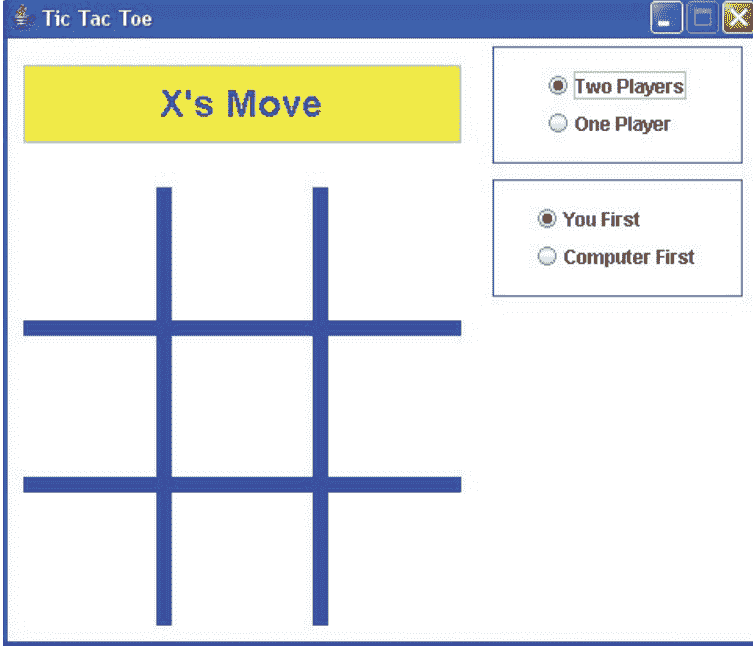

第一个面板已显示。

# computerPanel

`computerPanel` 将包含两个单选按钮控件，用于确定在一个游戏中电脑的智能程度。`computerPanel` 的 `GridBagLayout` 如下：

| gridx = 0 |
| :--- |
| gridy = 0 | randomRadioButton |
| gridy = 1 | smartRadioButton |

## 面板和单选按钮属性

### computerPanel

- 尺寸：160, 75
- 边框：Line, Blue
- gridx：1（在 frame 上）
- gridy：2（在 frame 上）
- 内边距：5, 10, 5, 10

### randomRadioButton

- 文本：Random Computer
- 背景：White
- 按钮组：computerButtonGroup
- 选中状态：true
- gridx：0（在 computerPanel 上）
- gridy：0（在 computerPanel 上）
- 对齐方式：WEST

### smartRadioButton

- 文本：Smart Computer
- 背景：White
- 按钮组：computerButtonGroup
- gridx：0（在 computerPanel 上）
- gridy：1（在 computerPanel 上）
- 对齐方式：WEST

## 声明控件

```java
JPanel computerPanel = new JPanel();
ButtonGroup computerButtonGroup = new ButtonGroup();
JRadioButton randomRadioButton = new JRadioButton();
JRadioButton smartRadioButton = new JRadioButton();
```

## 将单选按钮放入 computerPanel (该面板位于 frame 中)

```java
computerPanel.setPreferredSize(new Dimension(160, 75));
computerPanel.setBackground(Color.WHITE);
computerPanel.setBorder(BorderFactory.createLineBorder(Color.BLUE));
computerPanel.setLayout(new GridBagLayout());
gridConstraints = new GridBagConstraints();
gridConstraints.gridx = 1;
gridConstraints.gridy = 2;
gridConstraints.insets = new Insets(5, 10, 5, 10);
getContentPane().add(computerPanel, gridConstraints);

randomRadioButton.setText("Random Computer");
randomRadioButton.setBackground(Color.WHITE);
randomRadioButton.setSelected(true);
computerButtonGroup.add(randomRadioButton);
gridConstraints = new GridBagConstraints();
gridConstraints.gridx = 0;
gridConstraints.gridy = 0;
gridConstraints.anchor = GridBagConstraints.WEST;
computerPanel.add(randomRadioButton, gridConstraints);

smartRadioButton.setText("Smart Computer");
smartRadioButton.setBackground(Color.WHITE);
computerButtonGroup.add(smartRadioButton);
gridConstraints = new GridBagConstraints();
gridConstraints.gridx = 0;
gridConstraints.gridy = 1;
gridConstraints.anchor = GridBagConstraints.WEST;
computerPanel.add(smartRadioButton, gridConstraints);
```

将此代码添加到适当的位置。运行以查看结果：

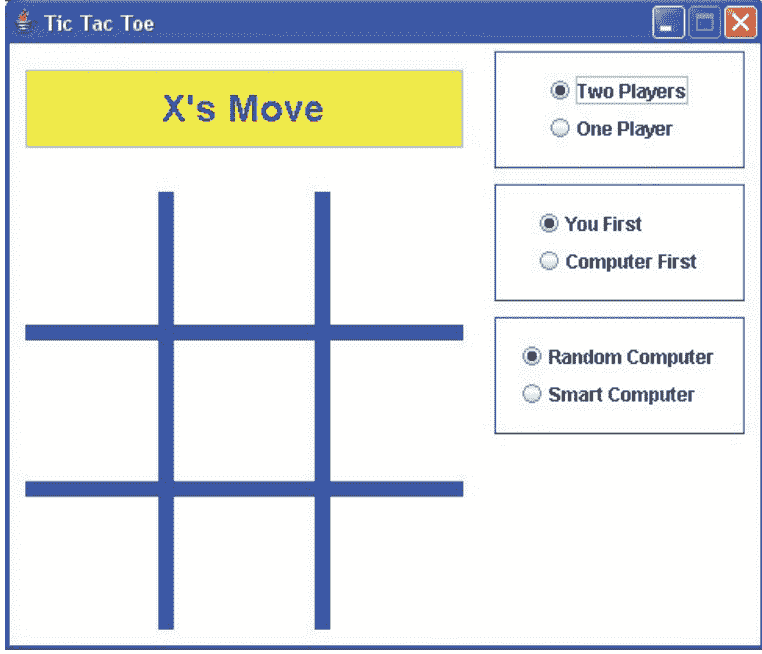

电脑面板已显示。

# buttonsPanel

`buttonsPanel` 将包含两个按钮，用于控制游戏运行。`buttonsPanel` 的 `GridBagLayout` 如下：

| | gridx = 0 |
| :--- | :--- |
| gridy = 0 | startStopButton |
| gridy = 1 | exitButton |

## 面板和按钮属性

### buttonsPanel

- 尺寸：160, 70
- gridx：1（在 frame 上）
- gridy：3（在 frame 上）

### startStopButton

- 文本：Start Game
- gridx：0（在 buttonsPanel 上）
- gridy：0（在 buttonsPanel 上）

### exitButton

- 文本：Exit

## 声明控件

```java
JPanel buttonsPanel = new JPanel();
JButton startStopButton = new JButton();
JButton exitButton = new JButton();
```

## 将按钮放入 buttonsPanel (该面板位于 frame 中)

```java
```


## 代码实现

```java
buttonsPanel.setPreferredSize(new Dimension(160, 70));
buttonsPanel.setBackground(Color.WHITE);
buttonsPanel.setLayout(new GridBagLayout());

gridConstraints = new GridBagConstraints();
gridConstraints.gridx = 1;
gridConstraints.gridy = 3;
getContentPane().add(buttonsPanel, gridConstraints);

startStopButton.setText("Start Game");

gridConstraints = new GridBagConstraints();
gridConstraints.gridx = 0;
gridConstraints.gridy = 0;
buttonsPanel.add(startStopButton, gridConstraints);

startStopButton.addActionListener(new ActionListener() {
    public void actionPerformed(ActionEvent e) {
        startStopButtonActionPerformed(e);
    }
});

exitButton.setText("Exit");

gridConstraints = new GridBagConstraints();
gridConstraints.gridx = 0;
gridConstraints.gridy = 1;
buttonsPanel.add(exitButton, gridConstraints);

exitButton.addActionListener(new ActionListener() {
    public void actionPerformed(ActionEvent e) {
        exitButtonActionPerformed(e);
    }
});
```

此代码还为每个按钮添加了监听器。在其他方法中添加这些空方法：

```java
private void startStopButtonActionPerformed(ActionEvent e) {
}
```

```java
private void exitButtonActionPerformed(ActionEvent e) {
}
```

```java
// 重置单元格
for (int i = 0; i < 9; i++) {
    textField[i].setText("");
    canClick = true;
    numberClicks = 0;
}
```

你能看到代码中是如何实现这些步骤的吗？

保存并运行项目。点击**Start Game**（开始游戏），游戏应该切换到双玩家“正在进行”状态：

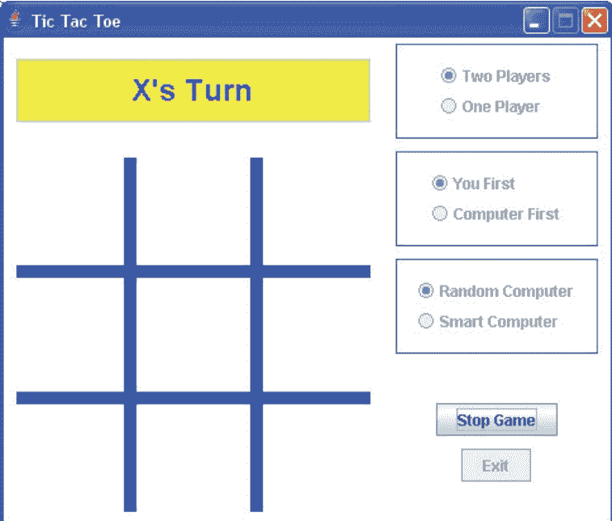

游戏正在等待第一个玩家点击网格的一个位置（我们很快就会为此编写代码）。注意，此时**Stop Game**（停止游戏）按钮没有任何作用。让我们来修复它。停止项目。

## 代码设计 – 切换到已停止状态

当用户在双玩家“正在进行”状态下点击停止游戏按钮时，有几件事必须将井字游戏切换到“已停止”状态：

- 将 `startStopButton` 的文本属性改为“Start Game”。
- 显示“游戏已停止”消息。
- 启用玩家面板中的单选按钮。
- 如果是单人游戏，启用第一个面板和电脑面板中的单选按钮。
- 启用 `exitButton`。
- 将 `canClick` 设置为 `false`。

我们使用与之前 Safecacker 游戏类似的逻辑——修改用于 `startStopButton` 的代码。执行这些步骤的代码如下（对当前 `startStopButtonActionPerformed` 方法代码的修改部分已阴影）：

```java
private void startStopButtonActionPerformed(ActionEvent e) {
    if (startStopButton.getText().equals("Start Game")) {
        startStopButton.setText("Stop Game");
        twoPlayersRadioButton.setEnabled(false);
        onePlayerRadioButton.setEnabled(false);
        youFirstRadioButton.setEnabled(false);
        computerFirstRadioButton.setEnabled(false);
        randomRadioButton.setEnabled(false);
        smartRadioButton.setEnabled(false);
        exitButton.setEnabled(false);
        xTurn = true;
        messageTextField.setText("X's Turn");
        // 重置单元格
        for (int i = 0; i < 9; i++) {
            textField[i].setText("");
        }
        canClick = true;
        numberClicks = 0;
    } else {
        startStopButton.setText("Start Game");
        messageTextField.setText("Game Stopped");
        twoPlayersRadioButton.setEnabled(true);
        onePlayerRadioButton.setEnabled(true);
        if (onePlayerRadioButton.isSelected()) {
            youFirstRadioButton.setEnabled(true);
            computerFirstRadioButton.setEnabled(true);
            randomRadioButton.setEnabled(true);
            smartRadioButton.setEnabled(true);
        }
        exitButton.setEnabled(true);
        canClick = false;
    }
}
```

保存并运行项目。你现在应该能够在“已停止”和“正在进行”状态之间来回切换。在停止时，确保为单玩家和双玩家选项显示了正确的单选按钮。让我们开始编写双玩家游戏的代码，首先查看如何标记网格。

## 代码设计 – 标记网格

在双玩家井字游戏中，当玩家点击网格中的一个单元格时，我们希望出现正确的标记（X 或 O）。在每次标记之后，我们需要检查是否有人获胜。如果没有获胜且仍有空位置，我们就切换到下一个玩家。

所以，当网格单元格被点击时，我们遵循以下步骤：

- 确保该处没有标记。
- 增加 `numberClicks`。
- 在相应的文本框控件中放置标记（如果 `xTurn` 为 `true` 则为 X，否则为 O）。
- 切换到下一个玩家（如果获胜或平局则不需要）。
- 检查是否获胜。如果获胜，宣布胜利者并停止游戏。
- 检查 `numberClicks = 9`（棋盘已满但未获胜）。如果是，宣布平局并停止。

考虑到人类可以选择单元格，或者电脑可以选择单元格（在单人游戏中），我们首先编写一个实现上述步骤的通用方法（尽管目前还没有检查获胜）。添加此通用方法 `markClickedBox`，它接受一个所选单元格索引作为参数：

```java
private void markClickedBox(int i) {
    String whoWon = "";
    // 如果已经点击过，则退出
    if (!textField[i].getText().equals(""))
        return;
    numberClicks++;
    if (xTurn) {
        textField[i].setText(" X");
        xTurn = false;
        messageTextField.setText("O's Turn");
    } else {
        textField[i].setText("O");
        xTurn = true;
        messageTextField.setText("X's Turn");
    }
    // 检查获胜 - 将为 WhoWon 赋值
    if (!whoWon.equals("")) {
        messageTextField.setText(whoWon + " wins!");
        startStopButton.doClick();
        return;
    } else if (numberClicks == 9) {
        // 平局
        messageTextField.setText("It's a draw!");
        startStopButton.doClick();
        return;
    }
}
```

看看这段代码。参数 `i` 是被选文本框控件 (`textField`) 的索引。如果已经有了标记（不为空），则退出方法。如果为空，则将标记放在 `textField[i]` 中。之后，我们检查是否获胜（现在只是在注释行中——我们很快就会修复它）。如果变量 `whoWon` 不为空（将由获胜检查逻辑确定），我们宣布胜利者。否则，我们退出并允许网格的其他元素被选择，直到网格填满并宣布平局。

让我们使用此方法允许通过鼠标选择单元格。实现此操作的代码位于 `textFieldPressed` 方法中（目前为空）。每当九个文本框中的一个被鼠标控制时，就会调用此方法。棘手的部分是——如何确定点击了哪一个控件。互联网搜索提供了必要的逻辑。鼠标按下方法有一个 `MouseEvent` 参数 `e`。以下方法使用此参数并返回一个 `Point` 对象 (`p`)，该对象包含被点击组件左上角的坐标（相对于托管该组件的面板）：

```java
Point p = e.getComponent().getLocation();
```

对于我们的情况，`p.x` 和 `p.y` 代表被点击文本框的左上角（相对于托管文本框的 `gamePanel`）。我们可以使用这些来确定点击了哪个单元格，并反此之。

```java
private void textFieldPressed(MouseEvent e) {
    if (canClick) {
        Point p = e.getComponent().getLocation();
        int i;
        for (i = 0; i < 9; i++) {
            if (textField[i].getX() == p.x && textField[i].getY() == p.y) {
                markClickedBox(i);
                break;
            }
        }
    }
}
```

保存并运行项目。你应该能够点击网格中的每个单元格，交替放置 X 和 O。一旦你填满了网格，游戏将返回停止状态。这里是我尝试停止时得到的结果：


正如预期的，电脑完全漏掉了玩家 2 获得了井字！！让我们来修复它。

## 代码设计 – 检查获胜

我们将构建一个通用方法 `checkForWin` 来检查游戏网格并确定是否有胜利者。如果是，将识别获胜并返回一个持有胜利者标记（X 或 O）的字符串变量，如果没有胜利者则返回空白。让我们建立执行此操作的策略。

有八种获胜方式（3种水平、3种垂直、2种对角线）。回想游戏网格中使用的 `textField` 索引布局如下：

| 0 | 1 | 2 |
|---|---|---|
| 3 | 4 | 5 |
| 6 | 7 | 8 |

如果我们声明一个名为 `possibleWins` 的字符串数组，它的 8 个元素将是：

```java
possibleWins[0] = "012";
possibleWins[1] = "345";
possibleWins[2] = "678";
possibleWins[3] = "036";
possibleWins[4] = "147";
possibleWins[5] = "258";
possibleWins[6] = "048";
possibleWins[7] = "246";
```

所以我们的逻辑是遍历每种可能的胜利，并检查 `textField` 的相应元素是否包含相同的标记（X 或 O），但不为空。如果是，则宣布胜利者。

在代码窗口中添加此类声明：

```java
String[] possibleWins = new String[8];
```

在 `TicTacToe` 构造函数末尾添加此代码以为数组赋值：

```java
// 可能胜利
possibleWins[0] = "012";
possibleWins[1] = "345";
possibleWins[2] = "678";
possibleWins[3] = "036";
possibleWins[4] = "147";
possibleWins[5] = "258";
possibleWins[6] = "048";
possibleWins[7] = "246";
```

将通用方法 `checkForWin` 添加到你的项目中：

```java
private String checkForWin() {
    String winner = "";
    int[] boxNumber = new int[3];
    String[] mark = new String[3];
    // 检查所有可能的胜利
    for (int i = 0; i < 8; i++) {
        for (int j = 0; j < 3; j++) {
            boxNumber[j] = Integer.valueOf(String.valueOf(possibleWins[i].charAt(j))).intValue();
            mark[j] = textField[boxNumber[j]].getText();
        }
        if (mark[0].equals(mark[1]) && mark[0].equals(mark[2]) && mark[1].equals(mark[2]) && !mark[0].equals("")) {
            // 我们有获胜者
            winner = mark[0];
            for (int j = 0; j < 3; j++) {
                textField[boxNumber[j]].setBackground(Color.RED);
            }
        }
    }
    return winner;
}
```

这段代码遍历了所有可能的胜利情况。如果特定水平、垂直或对角行中的所有标记都匹配，则该行的背景颜色将变为红色，并返回相应的获胜者。研究代码以查看其工作原理。`boxNumber` 数组存储了每个可能胜利对应的 `textField` 数组索引。

我们可能会修改 `markClickedBox` 方法来检查胜利，但我们还需要进行另一项修改。当宣布胜利或平局时，我们通过点击 `startStopButton` 来停止游戏。我们需要一种方法来区分这种停止游戏的方式和玩家直接点击停止按钮（这在宣布胜利或平局之前停止游戏）。请将此变量添加到类级声明中：

```java
boolean gameOver;
```

如果 `gameOver` 为 `true`，说明发生了胜利或平局。如果为 `false`，则在游戏结束前点击了停止游戏按钮。

对 `startStopButtonActionPerformed` 方法进行修改：


```java
private void startStopButtonActionPerformed(ActionEvent e)
{
    if (startStopButton.getText().equals("Start Game")) {
        startStopButton.setText("Stop Game");
        twoPlayersRadioButton.setEnabled(false);
        onePlayerRadioButton.setEnabled(false);
        youFirstRadioButton.setEnabled(false);
        computerFirstRadioButton.setEnabled(false);
        randomRadioButton.setEnabled(false);
        smartRadioButton.setEnabled(false);
        exitButton.setEnabled(false);
        xTurn = true;
        messageTextField.setText("X's Turn");
        // 重置方框
        for (int i = 0; i < 9; i++) {
            textField[i].setText("");
            textField[i].setBackground(Color.WHITE);
        }
        canClick = true;
        numberClicks = 0;
        gameOver = false;
    }
    else {
        startStopButton.setText("Start Game");
        if (!gameOver) {
            messageTextField.setText("Game Stopped");
            twoPlayersRadioButton.setEnabled(true);
            onePlayerRadioButton.setEnabled(true);
            if (onePlayerRadioButton.isSelected()) {
                youFirstRadioButton.setEnabled(true);
                computerFirstRadioButton.setEnabled(true);
                randomRadioButton.setEnabled(true);
                smartRadioButton.setEnabled(true);
            }
            exitButton.setEnabled(true);
            canClick = false;
        }
    }
}
```

这些更改完成了多项工作。文本框控件的`背景`被恢复为`白色`，以防显示了胜利结果。在开始新游戏时，`gameOver`变量被设置为`false`。并且，当`gameOver`为`true`时，会显示**游戏已停止（Game Stopped）**消息（除非可能已经显示了胜利）。我们需要处理`textField`数组的索引。现在，通过以下阴影部分修改`markClickedBox`方法来检查胜利，整合`checkForWin`方法和`gameOver`变量：

```java
private void markClickedBox(int i) {
    String whoWon = "";
    // 如果已经点击退出
    if (textField[i].getText().equals("")) {
        return;
    }
    numberClicks++;
    if (xTurn) {
        textField[i].setText("X");
        xTurn = false;
        messageTextField.setText("O's Turn");
    }
    else {
        textField[i].setText("O");
        xTurn = true;
        messageTextField.setText("X's Turn");
    }
    // 检查胜利以确定值
    whoWon = checkForWin();
    if (!whoWon.equals("")) {
        // 胜利了
        messageTextField.setText(whoWon + " wins!");
        gameOver = true;
        startStopButton.doClick();
        return;
    } else if (numberClicks == 9) {
        // 平局
        messageTextField.setText("It's a draw!");
        gameOver = true;
        startStopButton.doClick();
        return;
    }
}
```

保存并运行项目。你和朋友应该能够正确判断胜利和平局。这是我之前尝试的游戏（注意现在宣布了胜利）：

img/4f

计算机背后的逻辑非常直观。在任何时候，网格中都有`9-numberClicks`个空框。代码从1到`9-numberClicks`之间选择一个随机数，并计算空框以确定要标记的框。为了标记识别出的框`textField[selectedBox]`，我们通过调用带有`selectedBox`参数的方法来模拟点击该框。程序将根据之前实现的逻辑在框中放置X还是O。

现在，让我们来实现`computerTurn`方法让计算机能够玩。我们需要修改两个方法。首先，当我们开始游戏时，如果计算机先移动，我们需要调用`computerTurn`。对`startStopButtonActionPerformed`进行了阴影修改：

## 代码设计：玩家人数

玩家有多种选项。我们需要根据选择禁用这些按钮：

- 双人模式
- 单人模式
- 你先
- 电脑先
- 随机
- 智能
- 退出

## 代码设计：随机计算机移动

我们需要实现`computerTurn`方法让计算机能够玩。我们需要使用`Random`类生成随机数。

为了使用随机数添加此导入语句：

```java
import java.util.Random;
```

并且，在类级声明中添加随机对象：

```java
Random myRandom = new Random();
```

将此通用方法`computerTurn`添加到你的项目中：

```java
private void computerTurn() {
    int selectedBox;
    int i, n;
    if (randomRadioButton.isSelected()) {
        // 随机逻辑
        // 在第 N 个方格标记
        n = myRandom.nextInt(9 - numberClicks) + 1;
        i = 0;
        for (selectedBox = 0; selectedBox < 9; selectedBox++) {
            if (textField[selectedBox].getText().equals("")) {
                i++;
                if (i == n)
                    break;
            }
        }
    } else {
        // 智能计算机
    }
    markClickedBox(selectedBox);
}
```

```java
boxTextField[i].setBackground(Color.WHITE);
}
canClick = true;
numberClicks = 0;
gameOver = false;
```

```java
if (computerFirstRadioButton.isSelected())
    computerTurn();
```

```java
}
else
{
    stopStopButton.setText("Start Game");
    if (!gameOver)
        messageTextField.setText("Game Stopped");
    twoPlayersRadioButton.setEnabled(true);
    onePlayerRadioButton.setEnabled(true);
    if (onePlayerRadioButton.isSelected())
    {
        youFirstRadioButton.setEnabled(true);
        computerFirstRadioButton.setEnabled(true);
        randomRadioButton.setEnabled(true);
        smartRadioButton.setEnabled(true);
    }
    exitButton.setEnabled(true);
    canClick = false;
}
```

并且，在人类玩家下了一个标记后，电脑需要轮到。这段逻辑位于`markClickedBox`方法中。更改的部分已阴影显示：

```java
private void markClickedBox(int i)
{
    String whoWon = "";
    // 如果已经点击过则退出
    if (!textField[i].getText().equals(""))
        return;
```

```java
numberClicks++;
if (xTurn) {
    boxTextField[i].setText("X");
    xTurn = false;
    messageTextField.setText("O's Turn");
}
else {
    boxTextField[i].setText("O");
    xTurn = true;
    messageTextField.setText("X's Turn");
}
// 检查胜利 - 将 WhoWon 赋值
whoWon = checkForWin();
if (!whoWon.equals("")) {
    messageTextField.setText(whoWon + " wins!");
    gameOver = true;
    startStopButton.do();
    return;
}
else if (numberClicks == 9) {
    // 平局
    messageTextField.setText("It's a draw!");
    gameOver = true;
    startStopButton.onClick();
    return;
}
if (onePlayerRadioButton.isSelected()) {
    if ((xTurn && computerFirstRadioButton.isSelected()) || (!xTurn && youFirstRadioButton.isSelected())) {
        computerTurn();
    }
}
```

添加的代码是：当电脑先手且轮到X的回合，或者当人类先手且轮到O的回合时，电脑执行其回合。

保存并运行游戏。选择“单人玩家”选项并确保选择了“随机电脑（Random Computer）”。尝试玩几局（你先手，电脑先手）。确保一切运行正常，你应该会发现电脑其实很容易击败！这里有一局我先手赢的对局：

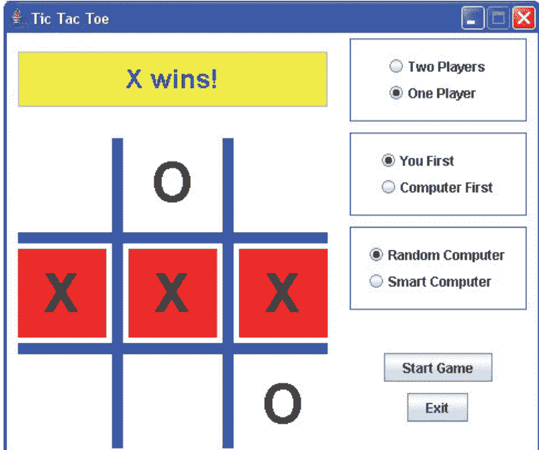

# 代码设计 – 智能电脑移动

我们来到了这个游戏项目中最有趣且最具挑战性的部分之一。我们如何让电脑对手变得更聪明呢？在任何电脑与人对抗的游戏中，我们都必须编写一些规则，让电脑看起来具有智能性。许多电脑对手是不可战胜的。例如，人类在国际象棋游戏中很难击败电脑。

那么，我们如何让电脑成为一个更出色的井字棋玩家呢？我们尝试注入我们在玩游戏时会做的选择。因此，要让电脑成为一个聪明的玩家，程序员本身需要是一个聪明的玩家。这通常需要实践和学习。对于井字棋游戏，我们可以开发一种相当简单但非常智能的策略。让我们开始吧。

当轮到电脑的回合时，它的移动应该是什么？我们将使用的规则如下（按选择顺序排序）：

1. 如果电脑可以通过某次移动获胜，就执行该移动，游戏结束。所以，如果某行中有电脑的两个标记和一个空格，那么该空格就是应该标记的位置！
2. 如果电脑可以通过某次移动阻止对手，就执行该移动，这样对手在下一回合无法获胜。所以，如果某行中有人类玩家的两个标记和一个空格，那么该空格就是应该标记的位置！
3. 如果没有可能的胜利或阻止，则按此顺序移动：中心格、其中一个角格、或其中一个边格。

我认为这个逻辑是合理的。你可能对第3步感到——为什么我们选择那个特定的顺序？记住井字棋中有8种可能的获胜方式（3条水平、3条垂直、2条对角线）。中心格涉及其中4种情况，任何角格都涉及3种，而任何边格都涉及2种。因此，选择顺序是基于基本概率的。让我们在代码中实现这个逻辑。这里是实现了此“智能”逻辑的修改后的`computerTurn`方法。更改已阴影显示：

```java
private void computerTurn()
{
    int selectedBox;
    int i, n;
    int j, k;
    String computerMark, playerMark, markToFind;
    int[] boxNumber = new int[3];
    String[] mark = new String[3];
    int emptyBox;
    int[] bestMoves = { 4, 0, 2, 6, 8, 1, 3, 5, 7 };
```

```java
if (randomRadioButton.isSelected())
{
    // 随机逻辑
    // 将标记放在第 N 个格子
    int n = myRandom.nextInt(9);
    // ... (省略具体实现细节)
}
// (注：此处根据原文逻辑翻译，原文代码块不完整，保持格式即可)
```

*(注：由于提供的英文文本中代码块不完整且存在部分重复或逻辑跳跃，翻译遵循了“不翻译代码块”的原则，仅翻译描述性文字)*

```java
return;
numberClicks++;
if (xTurn)
{
    textField[i].setText(" X");
    xTurn = false;
    messageTextField.setText("O's Turn");
}
else {
    textField[i].setText("O");
    xTurn = true;
    messageTextField.setText("X's Turn");
}
// check for win - will establish a value for WhoWon
whoWon = checkForWin();
if (!whoWon.equals(""))
{
    winSound.play();
    messageTextField.setText(whoWon + " wins!");
    gameOver = true;
    startStopButton.doClick();
    return;
} else if (numberClicks == 9)
{
    // draw
    drawSound.play();
    messageTextField.setText("It's a draw!");
    gameOver = true;
    startStopButton.doClick();
    return;
}
if (onePlayerRadioButton.isSelected)
    if ((xTurn && computerFirstRadioButton.isSelected()) || (!xTurn && youFirstRadioButton.isSelected()))
        computerTurn();
```

保存并运行该项目。你现在应该拥有了一个完整且可运行的井棋游戏版本（完整代码列表位于章节末尾）。尽情玩耍吧！再次强调，你会发现计算机是无法被击胜的。这里是我与一个“智能”电脑对局的一局，在那场比赛中我先下手，占据了中间方格：

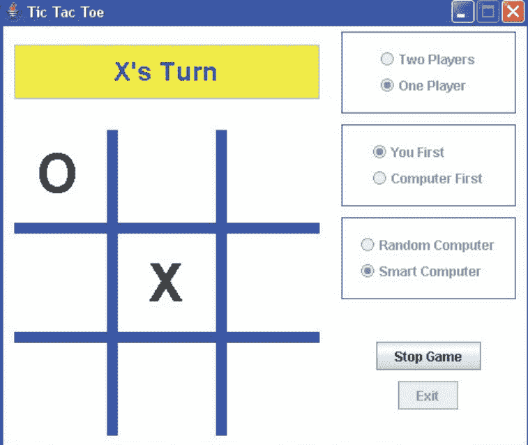

注意，根据我们实现的逻辑，由于计算机无法获胜或阻挡，它采取了下一个最佳移动，即第一个可用的角点格。

我的下一步是左下角：

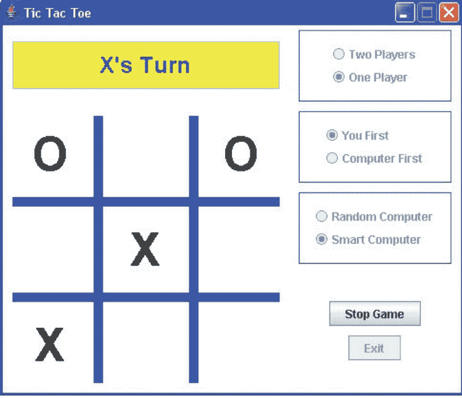

计算机逻辑通过我的下一步执行了阻挡。

我的下一步是阻堵电脑，而电脑反过来也堵住了：


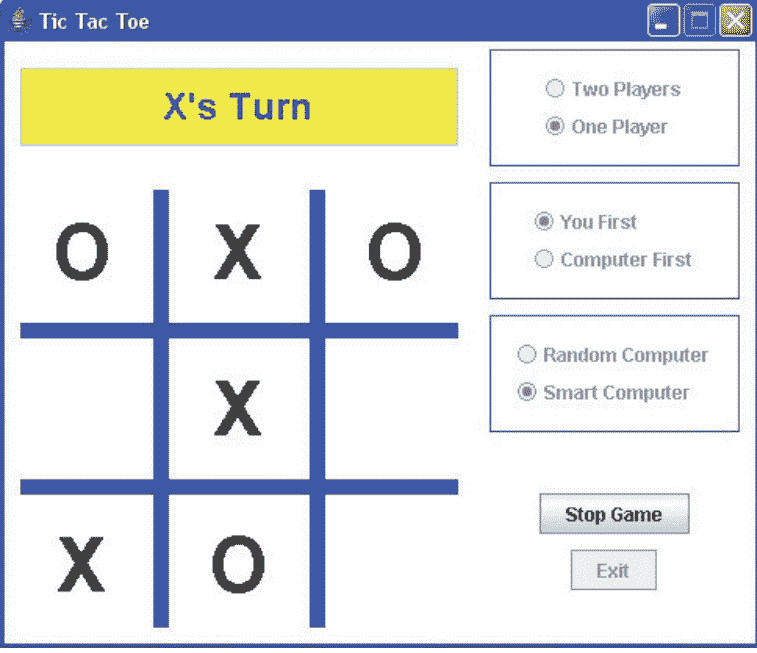

我继续下棋（移动到中间行的右侧，并在电脑阻挡后，移动到最后行的右侧），直到最后以平局收场：

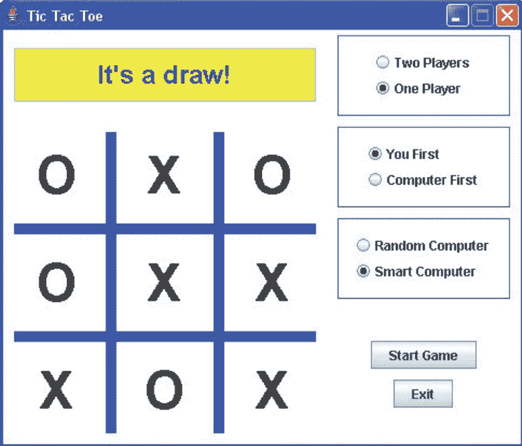

我听到了短促的哔哔声，电脑已准备好再次游戏了。

# 井棋项目回顾

**井棋**游戏项目现在已完成。保存并运行该项目，确保它的运行符合预期。检查所有选项是否工作正常。

如果在你的实现中存在错误，请重新检查框架和代码设计的步骤。检查已开发的代码——确保你理解项目不同部分是如何编码的。正如本章开头提到的，完成的项目已保存为 **TicTacToe**，位于 `\KidGamesJava\KidGamesJava Projects\`文件夹中。

在完成此项目期间，你应该获得的新概念和技能包括：

- 项目设计中的正确步骤。
- 许多 Java 控件的能力和用法。
- 如何使用通用方法和方法。
- 如何在游戏中赋予计算机智能。

# 井棋项目增强

改进井棋游戏的方法有几种。可能包括：

- 在网格中使用标签（`JLabel`）代替文本控件。通过这种更改，你可以使用 X 和 O 以外的内容标记方格。尝试使用小数字照片（jpeg 文件）。
- 为电脑对手添加更好的消息。按照目前的实现，计算机会很快做出移动。也许可以添加延迟（`Timer` 对象）以及网格中的某些颜色变化，以便计算机有时间告诉它将如何移动。
- 在目前的计算机逻辑（步骤 3）中，计算机总是按照相同的顺序选择角或边。为了增加这种不可预测性，可以添加逻辑，让计算机根据空角或空边框的数量随机进行角点或边的移动。
- 此游戏中的计算机相当智能，但可以变得更聪明。在当前计算机逻辑的步骤 2 和 3 之间，我们可以增加另一个步骤，让计算机更具攻击性。在这一新步骤中，让计算机搜索包含它的标记和两个空格的水平、垂直或对角线行。通过选择其中一个空格，计算机可以制造出两个胜局，使你无法阻挡它。更好的方法是找到一个位置，通过增加一个标记，计算机就能制造出两个胜局。
- 对于小孩子来说，电脑可能太智能了。随机电脑是一个选项，但走向了另一个极端。

```java
gridLabel[0] = new JLabel();
gridLabel[0].setPreferredSize(new Dimension(280, 10));
gridLabel[0].setOpaque(true);
gridLabel[0].setBackground(Color.BLUE);
gridConstraints = new GridBagConstraints();
gridConstraints.gridx = 0;
gridConstraints.gridy = 1;
gridConstraints.gridwidth = 5;
gridConstraints.insets = new Insets(5, 0, 5, 0);
gamePanel.add(gridLabel[0], gridConstraints);
```

```java
gridLabel[1] = new JLabel();
gridLabel[1].setPreferredSize(new Dimension(280, 10));
gridLabel[1].setOpaque(true);
gridLabel[1].setBackground(Color.BLUE);
gridConstraints = new GridBagConstraints();
gridConstraints.gridx = 0;
gridConstraints.gridy = 3;
gridConstraints.gridwidth = 5;
gridConstraints.insets = new Insets(5, 0, 5, 0);
gamePanel.add(gridLabel[1], gridConstraints);
```

```java
gridLabel[2] = new JLabel();
gridLabel[2].setPreferredSize(new Dimension(10, 280));
gridLabel[2].setOpaque(true);
gridLabel[2].setBackground(Color.BLUE);
gridConstraints = new GridBagConstraints();
gridConstraints.gridx = 1;
gridConstraints.gridy = 0;
gridConstraints.gridheight = 5;
gridConstraints.insets = new Insets(0, 5, 0, 5);
gamePanel.add(gridLabel[2], gridConstraints);
```

```java
gridLabel[3] = new JLabel();
gridLabel[3].setPreferredSize(new Dimension(10, 280));
gridLabel[3].setOpaque(true);
gridLabel[3].setBackground(Color.BLUE);
gridConstraints = new GridBagConstraints();
gridConstraints.gridx = 3;
gridConstraints.gridy = 0;
gridConstraints.gridheight = 5;
gridConstraints.insets = new Insets(0, 5, 0, 5);
gamePanel.add(gridLabel[3], gridConstraints);
```

```java
playersPanel.setPreferredSize(new Dimension(160, 75));
playersPanel.setBackground(Color.WHITE);
playersPanel.setBorder(BorderFactory.createLineBorder(Color.BLUE));
playersPanel.setLayout(new GridBagLayout());
gridConstraints = new GridBagConstraints();
gridConstraints.gridx = 1;
gridConstraints.gridy = 0;
gridConstraints.insets = new Insets(5, 10, 5, 10);
getContentPane().add(playersPanel, gridConstraints);

twoPlayersRadioButton.setText("Two Players");
twoPlayersRadioButton.setBackground(Color.WHITE);
twoPlayersRadioButton.setSelected(true);
playersButtonGroup.add(twoPlayersRadioButton);
gridConstraints = new GridBagConstraints();
gridConstraints.gridx = 0;
gridConstraints.gridy = 0;
gridConstraints.anchor = GridBagConstraints.WEST;
playersPanel.add(twoPlayersRadioButton, gridConstraints);

twoPlayersRadioButton.addActionListener(new ActionListener() {
    public void actionPerformed(ActionEvent e) {
        twoPlayersRadioButtonActionPerformed(e);
    }
});
```

```java
onePlayerRadioButton.setText("One Player");
onePlayerRadioButton.setBackground(Color.WHITE);
playersButtonGroup.add(onePlayerRadioButton);
gridConstraints = new GridBagConstraints();
gridConstraints.gridx = 0;
gridConstraints.gridy = 1;
gridConstraints.anchor = GridBagConstraints.WEST;
playersPanel.add(onePlayerRadioButton, gridConstraints);

onePlayerRadioButton.addActionListener(new ActionListener() {
    public void actionPerformed(ActionEvent e) {
        onePlayerRadioButtonActionPerformed(e);
    }
});
```

```java
firstPanel.setPreferredSize(new Dimension(160, 75));
firstPanel.setBackground(Color.WHITE);
firstPanel.setBorder(BorderFactory.createLineBorder(Color.BLUE));
firstPanel.setLayout(new GridBagLayout());
gridConstraints = new GridBagConstraints();
gridConstraints.gridx = 1;
gridConstraints.gridy = 1;
gridConstraints.insets = new Insets(5, 10, 5, 10);
getContentPane().add(firstPanel, gridConstraints);
```

```java
youFirstRadioButton.setText("You First");
youFirstRadioButton.setBackground(Color.WHITE);
youFirstRadioButton.setSelected(true);
firstButtonGroup.add(youFirstRadioButton);
gridConstraints = new GridBagConstraints();
gridConstraints.gridx = 0;
gridConstraints.gridy = 0;
gridConstraints.anchor = GridBagConstraints.WEST;
firstPanel.add(youFirstRadioButton, gridConstraints);
```

```java
computerFirstRadioButton.setText("Computer First");
computerFirstRadioButton.setBackground(Color.WHITE);
firstButtonGroup.add(computerFirstRadioButton);
gridConstraints = new GridBagConstraints();
gridConstraints.gridx = 0;
gridConstraints.gridy = 1;
gridConstraints.anchor = GridBagConstraints.WEST;
firstPanel.add(computerFirstRadioButton, gridConstraints);
```

```java
computerPanel.setPreferredSize(new Dimension(160, 75));
computerPanel.setBackground(Color.WHITE);
computerPanel.setBorder(BorderFactory.createLineBorder(Color.BLUE));
computerPanel.setLayout(new GridBagLayout());
gridConstraints = new GridBagConstraints();
gridConstraints.gridx = 1;
gridConstraints.gridy = 2;
gridConstraints.insets = new Insets(5, 10, 5, 10);
getContentPane().add(computerPanel, gridConstraints);
```

```java
randomRadioButton.setText("Random Computer");
randomRadioButton.setBackground(Color.WHITE);
computerButtonGroup.add(randomRadioButton);
gridConstraints = new GridBagConstraints();
gridConstraints.gridx = 0;
gridConstraints.gridy = 0;
gridConstraints.anchor = GridBagConstraints.WEST;
computerPanel.add(randomRadioButton, gridConstraints);
```

```java
smartRadioButton.setText("Smart Computer");
smartRadioButton.setBackground(Color.WHITE);
computerButtonGroup.add(smartRadioButton);
gridConstraints = new GridBagConstraints();
gridConstraints.gridx = 0;
gridConstraints.gridy = 1;
gridConstraints.anchor = GridBagConstraints.WEST;
computerPanel.add(smartRadioButton, gridConstraints);
```


```java

);

}

```

```java

gridLabel[0] = new JLabel();

gridLabel[0].setPreferredSize(new Dimension(280, 10));

gridLabel[0].setOpaque(true);

gridLabel[0].setBackground(Color.BLUE);

gridConstraints = new GridBagConstraints();

gridConstraints.gridx = 0;

gridConstraints.gridy = 1;

gridConstraints.grid = 5;

gridConstraints.Insets = new Insets(5, 0, 5, 0);

gamePanel.add(gridLabel[0], gridConstraints);

```

```java

gridLabel[1] = new JLabel();

gridLabel[1].setPreferredSize(new Dimension(280, 10));

gridLabel[1].setOpaque(true);

gridLabel[1].setBackground(Color.BLUE);

gridConstraints = new GridBagConstraints();

gridConstraints.gridx = 0;

gridConstraints.gridy = 3;

gridConstraints.gridwidth = 5;

gridConstraints.Insets = new Insets(5, 0, 5, 0);

gamePanel.add(gridLabel[1], gridConstraints);

```

```java

gridLabel[2] = new JLabel();

gridLabel[2].setPreferredSize(new Dimension(10, 280));

gridLabel[2].setOpaque(true);

gridLabel[2].setBackground(Color.BLUE);

gridConstraints = new GridBagConstraints();

gridConstraints.gridx = 1;

gridConstraints.gridy = 0;

gridConstraints.gridheight = 5;

gridConstraints.Insets = new Insets(0, 5, 0, 5);

gamePanel.add(gridLabel[2], gridConstraints);

```

```java

gridLabel[3] = new JLabel();

gridLabel[3].setPreferredSize(new Dimension(10, 280));

gridLabel[3].setOpaque(true);

gridLabel[3].setBackground(Color.BLUE);

gridConstraints = new GridBagConstraints();

gridConstraints.gridx = 3;

gridConstraints.gridy = 0;

gridConstraints.gridheight = 5;

gridConstraints.Insets = new Insets(0, 5, 0, 5);

gamePanel.add(gridLabel[3], gridConstraints);

```

```java

playersPanel.setPreferredSize(new Dimension(160, 75));

playersPanel.setBackground(Color.WHITE);

playersPanel.setBorder(BorderFactory.createLineBorder(Color.BLUE));

playersPanel.setLayout(new GridBagLayout());

gridConstraints = new GridBagConstraints();

gridConstraints.gridx = 1;

gridConstraints.gridy = 0;

gridConstraints.Insets = new Insets(5, 10, 5, 10);

getContentPane().add(playersPanel, gridConstraints);

twoPlayersRadioButton.setText("Two Players");

twoPlayersRadioButton.setBackground(Color.WHITE);


## Java Swing 井字棋游戏核心代码实现

### 界面初始化与组件配置

```java
twoPlayersRadioButton.setSelected(true);
playersButtonGroup.add(twoPlayersRadioButton);

gridConstraints = new GridBagConstraints();
gridConstraints.gridx = 0;
gridConstraints.gridy = 0;
gridConstraints.anchor = GridBagConstraints.WEST;
playersPanel.add(twoPlayersRadioButton, gridConstraints);

twoPlayersRadioButton.addActionListener(new ActionListener() {
    public void actionPerformed(ActionEvent e) {
        twoPlayersRadioButtonActionPerformed(e);
    }
});
```

```java
onePlayerRadioButton.setText("One Player");
onePlayerRadioButton.setBackground(Color.WHITE);
playersButtonGroup.add(onePlayerRadioButton);

gridConstraints = new GridBagConstraints();
gridConstraints.gridx = 0;
gridConstraints.gridy = 1;
gridConstraints.anchor = GridBagConstraints.WEST;
playersPanel.add(onePlayerRadioButton, gridConstraints);

onePlayerRadioButton.addActionListener(new ActionListener() {
    public void actionPerformed(ActionEvent e) {
        onePlayerRadioButtonActionPerformed(e);
    }
});
```

```java
firstPanel.setPreferredSize(new Dimension(160, 75));
firstPanel.setBackground(Color.WHITE);
```

```java
firstPanel.setBorder(BorderFactory.createBorder(Color.BLUE));
firstPanel.setLayout(new GridBagLayout());

gridConstraints = new GridBagConstraints();
gridConstraints.gridx = 1;
gridConstraints.gridy = 1;
gridConstraints.insets = new Insets(5, 10, 5, 10);
getContentPane().add(firstPanel, gridConstraints);
```

```java
youFirstRadioButton.setText("You First");
youFirstRadioButton.setBackground(Color.WHITE);
youFirstRadioButton.setSelected(true);
firstButtonGroup.add(youFirstRadioButton);

gridConstraints = new GridBagConstraints();
gridConstraints.gridx = 0;
gridConstraints.gridy = 0;
gridConstraints.anchor = GridBagConstraints.WEST;
```

```java
firstPanel.add(firstRadioButton, gridConstraints);

computerFirstRadioButton.setText("Computer First");
computerFirstRadioButton.setBackground(Color.WHITE);
firstButtonGroup.add(computerFirstRadioButton);

gridConstraints = new GridBagConstraints();
gridConstraints.gridx = 0;
gridConstraints.gridy = 0;
gridConstraints.anchor = GridBagConstraints.WEST;
```

### 游戏控制逻辑

```java
startStopButton.setText("Stop Game");
twoPlayersRadioButton.setEnabled(false);
onePlayerRadioButton.setEnabled(false);
youFirstRadioButton.setEnabled(false);
computerFirstRadioButton.setEnabled(false);
randomRadioButton.setEnabled(false);
smartRadioButton.setEnabled(false);
exitButton.setEnabled(false);

xTurn = true;
messageTextField.setText("X's Turn");

// 重置输入框
for (int i = 0; i < 9; i++) {
    textField[i].setText("");
    textField[i].setBackground(Color.WHITE);
}

canClick = true;
numberClicks = 0;
gameOver = false;

if (computerRadioButton.isSelected())
    computerTurn();
} else {
    startStopButton.setText("Start Game");
    if (!gameOver)
        messageTextField.setText("Game Stopped");
    
    twoPlayersRadioButton.setEnabled(true);
    onePlayerRadioButton.setEnabled(true);
    
    if (onePlayerRadioButton.isSelected()) {
        youFirstRadioButton.setEnabled(true);
        computerFirstRadioButton.setEnabled(true);
        randomRadioButton.setEnabled(true);
        smartRadioButton.setEnabled(true);
    }
    
    exitButton.setEnabled(true);
    canClick = false;
}
```

### 事件处理方法

```java
private void exitButtonActionPerformed(ActionEvent e) {
    System.exit(0);
}
```

```java
private void markClickedBox(int i) {
    String whoWon = "";
    
    // 如果已经点击过，则退出
    if (!textField[i].getText().equals(""))
        return;
    
    numberClicks++;
    
    if (xTurn) {
        textField[i].setText("X");
        xTurn = false;
        messageTextField.setText("O's Turn");
    } else {
        textField[i].setText("O");
        xTurn = true;
        messageTextField.setText("X's Turn");
    }
    
    // 检查是否胜利 - 将确定 Who Won 的值
    whoWon = checkForWin();
    
    if (!whoWon.equals("")) {
        whoSound.play();
        messageTextField.setText(whoWon + " wins!");
        gameOver = true;
        startStopButton.doClick();
        return;
    } else if (numberClicks == 9) {
        // 平局
        drawSound.play();
        messageTextField.setText("It's a draw!");
        gameOver = true;
        startStopButton.doClick();
        return;
    }
    
    if (onePlayerRadioButton.isSelected())
        if ((xTurn && computerFirstRadioButton.isSelected()) || (!xTurn && firstRadioButton.isSelected()))
            computerTurn();
}
```

### 胜利判定算法

```java
private String checkForWin() {
    String winner = "";
    int[] boxNumber = new int[3];
    String[] mark = new String[3];
    
    // 检查所有可能的胜利情况
    for (int i = 0; i < 8; i++) {
        for (int j = 0; j < 3; j++) {
            boxNumber[j] = Integer.valueOf(possibleWins[i].charAt(j)).intValue();
            mark[j] = textField[boxNumber[j]].getText();
        }
        
        if (mark[0].equals(mark[1]) && mark[0].equals(mark[2]) && mark[1].equals(mark[2]) && !mark[0].equals("")) {
            // 我们有了一个胜利者
            winner = mark[0];
            
            for (int j = 0; j < 3; j++) {
                textField[boxNumber[j]].setBackground(Color.RED);
            }
            
            return winner;
        }
    }
    
    return winner;
}
```

### 电脑 AI 策略

```java
private void computerTurn() {
    int selectedBox;
    int i, n;
    int j, k;
    String computerMark, playerMark, markToFind;
    int[] boxNumber = new int[3];
    String[] mark = new String[3];
    int emptyBox;
    int[] bestMoves = { 4, 0, 2, 8, 1, 3, 5, 7 };
    
    if (randomRadioButton.isSelected()) {
        // 随机逻辑
        // 在第 N 个格子放置标记
        n = myRandom.nextInt(9 - numberClicks) + 1;
        i = 0;
        
        for (selectedBox = 0; selectedBox < 9; selectedBox++) {
            if (textField[selectedBox].getText().equals(""))
                i++;
            if (i == n)
                break;
        }
        
        // 在 selectedBox 放置标记
        markClickedBox(selectedBox);
    } else {
        // 智能电脑
        // 确定是谁
        if (computerFirstRadioButton.isSelected()) {
            computerMark = "X";
            playerMark = "O";
        } else {
            computerMark = "O";
            playerMark = "X";
        }
        
        // 第1步 (K = 1) - 检查胜利 - 查看两个格子是否有电脑标记和一个空格
        // 第2步 (K = 2) - 检查封堵 - 查看两个格子是否有玩家标记和一个空格
        for (k = 1; k <= 2; k++) {
            if (k == 1)
                markToFind = computerMark;
            else
                markToFind = playerMark;
            
            for (i = 0; i < 8; i++) {
                n = 0;
                emptyBox = 0;
                
                for (j = 0; j < 3; j++) {
                    boxNumber[j] = Integer.valueOf(possibleWins[i].charAt(j)).intValue();
                    mark[j] = textField[boxNumber[j]].getText();
                    
                    if (mark[j].equals(markToFind))
                        n++;
                    else if (mark[j].equals(""))
                        emptyBox = boxNumber[j];
                }
                
                if (n == 2 && emptyBox != 0) {
                    // 标记空格以胜利 (K = 1) 或封堵 (K = 2)
                    markClickedBox(emptyBox);
                    return;
                }
            }
        }
        
        // 第3步 - 寻找下一步移动
        for (i = 0; i < 9; i++) {
            if (textField[bestMoves[i]].getText().equals("")) {
                markClickedBox(bestMoves[i]);
                return;
            }
        }
    }
}
```


## 4. 记忆游戏项目


### 复习与预览

我们将构建下一个项目是记忆游戏。这是一个单人或双人游戏——可以与朋友、电脑或独自玩。十对照片（你可以使用自己的照片）隐藏在游戏板上。游戏的目标是通过记忆照片的位置找到匹配对。我们将看到如何生成随机整数数组以及如何使用计时器进行延迟。


### 记忆游戏项目预览

在本章中，我们将构建一个记忆游戏。十对照片隐藏在游戏板上。目标是找到匹配对。玩家之间交替回合——每次匹配成功都可以获得额外回合。我们在这里构建的版本允许两个玩家相互竞争，或者让单个玩家玩独自模式或与电脑竞技。

完成的项目保存为 `\KidGamesJava\KidGamesJava` 文件夹中的 `MatchGame`。启动 NetBeans（或你的 IDE）。打开指定的项目组。将 `MatchGame` 设置为活动项目。运行项目。你将看到：


左侧是记忆游戏的照片区域。每个照片显示在 `label` 控件中。右侧是用于显示数的 `label` 和文本字段控件。还有三个面板和两个按钮。每个面板包含用于设置游戏选项的单选按钮控件。两个按钮用于启动和停止游戏以及退出程序。

游戏处于“停止”状态，持有照片的 `label` 控件被覆盖，等待你选择游戏选项。你可以选择单人或双人。如果是单人，你可以选择独自玩或与电脑玩。如果选择了与电脑玩，你可以选择电脑有多智能（难度）。作为选项，用于计分的 `label` 会更改其标题以匹配选择。我选择了单人游戏，与难度为困难的电脑对战：


点击 **Start Game**（开始游戏）按钮开始游戏。它的标题将改变（现在显示为 **Stop Game** 停止游戏），选项组框和 **Exit**（退出）按钮将禁用。消息区域显示 **Pick a Box**（选择一个格子）。与电脑对战时，你先手。


匹配成功……但我们之前都见过这两个了。我想你知道下一步该怎么做。

点击第一行的第一个框和第三行的第二个方框，我得到了一次匹配。然后，选择第一行的第二个框和底部的第一个方框，我又得到了一次匹配。照片被移除，我的分数增加，又轮到了我的回合了：

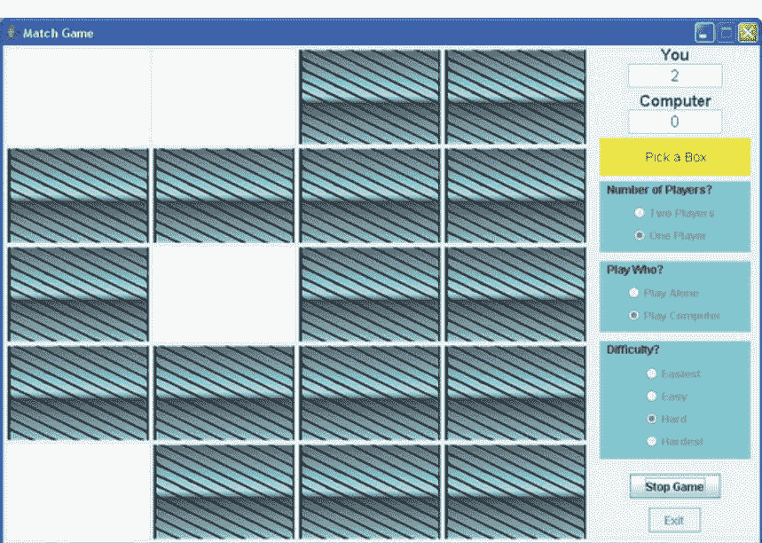

游戏以这种相同的方式继续，在你和电脑之间交替回合。当匹配成功时，你或电脑将获得额外的回合。我继续与一个相当聪明的电脑玩这个游戏。当找到所有匹配后，最终得分是我 6 比电脑 4，我赢了！

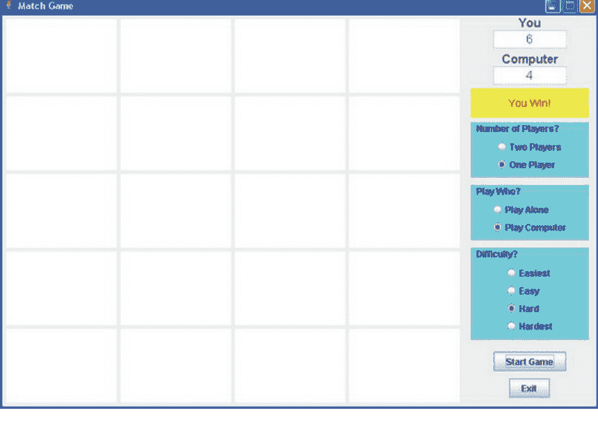

游戏将回到停止状态，以便进行另一场游戏或点击 Exit 退出程序。

继续玩游戏以理解其操作。尝试使用双人游戏和选择**独自玩**的单人游戏。或者，在与电脑的单人游戏中，尝试不同的难度级别。你会发现在**最难**级别下，电脑几乎是不可胜的。完成后点击 Exit 停止游戏。如果你喜欢，可以打开代码文件并查看代码。

你现在将分阶段构建此项目。在构建 Java 项目时，我们总是建议采取缓慢、循序渐进的过程。这可以最大限度地减少编程错误，并在事物汇成一个完整项目时建立你的信心。

我们将处理**框架设计**。我们将讨论构建框架所需的控件，建立初始控件属性（包括在游戏中使用你自己的照片），并讨论如何更改控件的状态。此外，我们将处理**代码设计**。我们将讨论如何显示图片对、检查是否匹配、处理多个玩家，以及决定如何让电脑移动。我们还会讨论如何“洗牌”照片以及使用计时器对象进行延迟。

## 匹配游戏框架设计

我们开始构建 Match Game 项目。让我们构建框架。在你的 Java 项目组中创建一个新项目——将其命名为 `MatchGame`。删除 `MatchGame.java` 文件中的默认代码。一旦启动，我们建议你立即使用选择的名称保存项目。这将建立项目所需的文件夹和文件结构。

使用以下属性构建基础框架：

**MatchGame Frame:**
- title: Match Game
- resizable: false

代码如下：

```java
/*

 * MatchGame.java

 */

package matchgame;

import javax.swing.*;
import java.awt.*;
import java.awt.event.*;

public class MatchGame extends JFrame {

    public static void main(String args[]) {
        // create frame
        new MatchGame().show();
    }

    public MatchGame() {
        // frame 构造函数
        setTitle("Match Game");
        setResizable(false);
        addWindowListener(new WindowAdapter() {
            public void windowClosing(WindowEvent evt) {
                exitForm(evt);
            }
        });
        getContentPane().setLayout(new GridBagLayout());
        GridBagConstraints gridConstraints;
        pack();
        Dimension screenSize = Toolkit.getDefaultToolkit().getScreenSize();
        setBounds((int)(0.5 * (screenSize.width - getWidth())), (int)(0.5 * (screenSize.height - getHeight())), getWidth(), getHeight());
    }

    private void exitForm(WindowEvent evt) {
        System.exit(0);
    }
}
```

这段代码构建了框架，设置了布局管理器，并包含了退出应用程序的代码。运行代码以确保框架（至少是目前已有的）出现并居中显示：


让我们用其他控件填充框架。创建框架和放置控件的代码（声明除外）都在 `MatchGame` 构造函数中。

我们首先通过在框架上放置六个面板控件。`GridBagLayout` 如下：

| gridx = 0 | gridx = 1 |
|---|---|
| gridy = 0 | resultsPanel |
| gridy = 1 | playersPanel |
| gridy = 2 | gamePanel / playWhoPanel |
| gridy = 3 | difficultyPanel |
| gridy = 4 | buttonsPanel |

`gamePanel` 将用于在标签中显示图片。`resultsPanel` 将持有评分测量控件。`playersPanel` 将持有选择人数的单选按钮。`playWhoPanel` 将决定（在单人游戏中）是独自玩还是对抗电脑。`difficultyPanel` 决定电脑有多聪明。而 `buttonsPanel` 将持有两个按钮控件。我们将分别构建每个面板。让我们从 `gamePanel` 开始。

`gamePanel` 将持有二十个标签控件（5 行 4 列网格），用于显示隐藏的图片。`gamePanel` 的 `GridBagLayout` 如下：

| gridx = 0 | gridx = 1 | gridx = 2 | gridx = 3 |
|---|---|---|---|
| gridy = 0 | photoLabel[0] | photoLabel[1] | photoLabel[2] | photoLabel[3] |
| gridy = 1 | photoLabel[4] | photoLabel[5] | photoLabel[6] | photoLabel[7] |
| gridy = 2 | photoLabel[8] | photoLabel[9] | photoLabel[10] | photoLabel[11] |
| gridy = 3 | photoLabel[12] | photoLabel[13] | photoLabel[14] | photoLabel[15] |
| gridy = 4 | photoLabel[16] | photoLabel[17] | photoLabel[18] | photoLabel[19] |

使用以下属性将 `gamePanel` 添加到框架：

**gamePanel:**
- size: 600x600
- insets: 5, 5, 5, 5

`gamePanel` 的尺寸和标签控件的选择确保了标签与其他控件以及与面板边缘之间有 5 像素的间距。

这些控件使用以下声明：

```java
JPanel gamePanel = new JPanel();
JLabel[] photoLabel = new JLabel[20];
```

```java
gamePanel.setPreferredSize(new Dimension(625, 530));
gamePanel.setLayout(new GridBagLayout());
gridConstraints = new GridBagConstraints();
gridConstraints.gridx = 0;
gridConstraints.gridy = 0;
gridConstraints.gridheight = 5;
getContentPane().add(gamePanel, gridConstraints);

for (int i = 0; i < 20; i++) {
    photoLabel[i] = new JLabel();
    photoLabel[i].setPreferredSize(new Dimension(150, 100));
    photoLabel[i].setOpaque(true);
    photoLabel[i].setBackground(Color.WHITE);
    gridConstraints = new GridBagConstraints();
    gridConstraints.gridx = i % 4;
    gridConstraints.gridy = i / 4;
    gridConstraints.insets = new Insets(5, 5, 0, 0);
    if (gridConstraints.gridx == 3) {
        gridConstraints.insets = new Insets(5, 5, 0, 5);
    }
    if (gridConstraints.gridy == 4) {
        gridConstraints.insets = new Insets(5, 5, 0, 0);
    }
    if (gridConstraints.gridx == 3 && gridConstraints.gridy == 4) {
        gridConstraints.insets = new Insets(5, 5, 5, 5);
    }
    gamePanel.add(photoLabel[i], gridConstraints);
    photoLabel[i].addMouseListener(new MouseAdapter() {
        public void mousePressed(MouseEvent e) {
            photoLabelIMousePressed(e);
        }
    });
}
```

注意循环索引 `i` 如何用于设置正确的标签控件属性（`gridx`, `gridy`）。这段代码还为每个标签添加了鼠标监听器。当用鼠标点击标签时，会调用该方法：

| gridx = 0 |
| :--- |
| gridy = 0 | player1Label |
| gridy = 1 | scoreTextField[0] |
| gridy = 2 | player2Label |
| gridy = 3 | scoreTextField[1] |
| gridy = 4 | messageLabel |

控件属性如下：

**resultsPanel:**
- size: 160, 140
- grid: 1 (on frame)
- gridy: 0 (on frame)

**player1Label:**
- text: Player 1
- font: Arial, Bold, Size 16
- grid: 0 (on resultsPanel)
- gridy: 0 (on resultsPanel)

**scoreTextField[0]:**
- size: 100, 25
- text: 0
- editable: false
- background: White
- horizontalAlignment: CENTER
- font: Arial, Plain, Size 16
- grid: 0 (on resultsPanel)
- gridy: 1 (on results Panel)

**player2Label:**
- text: Player 2
- font: Arial, Bold, Size 16
- grid: 0 (on resultsPanel)
- gridy: 2 (on resultsPanel)

**scoreTextField[1]:**
- size: 100, 25
- text: 0
- editable: false
- background: White
- horizontalAlignment: CENTER
- font: Arial, Plain, Size 16
- grid: 0 (on resultsPanel)
- gridy: 3 (on results Panel)

**messageLabel:**
- size: 160, 40
- opaque: true
- background: Yellow
- horizontalAlignment: CENTER
- text: [blank]
- font: Arial, Plain, Size 14
- grid: 0 (on resultsPanel)
- gridy: 4 (on resultsPanel)
- insets: 5, 0, 0, 0

使用以下代码声明控件：

```java
JPanel resultsPanel = new JPanel();
JLabel player1Label = new JLabel();
JLabel player2Label = new JLabel();
JTextField[] scoreField = new JTextField[2];
JLabel messageLabel = new JLabel();
```

使用以下代码将控件添加到 `resultsPanel`（该已放置在 frame 中）：

```java
resultsPanel.setPreferredSize(new Dimension(160, 140));
resultsPanel.setLayout(new GridBagLayout());
gridConstraints1 = new GridBagConstraints();
gridConstraints1.gridx = 1;
gridConstraints1.gridy = 0;
getContentPane().add(resultsPanel, gridConstraints1);

player1Label.setText("Player 1");
player1Label.setFont(new Font("Arial", Font.BOLD, 16));
gridConstraints1 = new GridBagConstraints();
gridConstraints1.gridx = 0;
gridConstraints1.gridy = 0;
resultsPanel.add(player1Label, gridConstraints1);
```

```java
scoreField[0] = new JTextField();
scoreField[0].setPreferredSize(new Dimension(100, 25));
```

```java
scoreTextField[0].setText("0");
scoreTextField[0].setEditable(false);
scoreTextField[0].setBackground(Color.WHITE);
scoreTextField[0].setHorizontalAlignment(SwingConstants.CENTER);
scoreTextField[0].setFont(new Font("Arial", Font.PLAIN, 16));
gridConstraintsl = new GridBagConstraints();
gridConstraintsl.gridx = 0;
gridConstraintsl.gridy = 1;
resultsPanel.add(scoreTextField[0], gridConstraintsl);

player2Label.setText("Player 2");
```


# 与谁玩？

## playWhoPanel 布局属性

| 属性 | 值 |
|---|---|
| gridx | 1 (在 frame 上) |
| gridy | 2 (在 frame 上) |
| insets | 5, 10, 5, 10 |

## playAloneRadioButton 属性

| 属性 | 值 |
|---|---|
| text | 单人玩 |
| background | Cyan |
| buttonGroup | playWhoButton |
| selected | true |
| gridx | 0 (在 playWhoPanel 上) |
| gridy | 0 (在 playWhoPanel 上) |
| anchor | WEST |

## playComputerRadioButton 属性

| 属性 | 值 |
|---|---|
| text | 与电脑玩 |
| background | Cyan |
| buttonGroup | playWhoButton |
| gridx | 0 (在 playWhoPanel 上) |
| gridy | 1 (在 playWhoPanel 上) |
| anchor | WEST |

这些控件使用以下代码声明：

```java
JPanel playWhoPanel = new JPanel();
ButtonGroup playWhoButtonGroup = new ButtonGroup();
JRadioButton playAloneRadioButton = new JRadioButton();
JRadioButton playComputerRadioButton = new JRadioButton();
```

使用以下代码将单选按钮放在 `playWhoPanel` 中（该面板置于 frame 中）：

```java
playWhoPanel.setPreferredSize(new Dimension(160, 75));
playWhoPanel.setBackground(Color.CYAN);
playWhoPanel.setBorder(BorderFactory.createTitledBorder("Play Who?"));
playWhoPanel.setLayout(new GridBagLayout());
gridConstraints = new GridBagConstraints();
gridConstraints.gridx = 1;
gridConstraints.gridy = 2;
gridConstraints.insets = new Insets(5, 10, 5, 10);
getContentPane().add(playWhoPanel, gridConstraints);

playAloneRadioButton.setText("Play Alone");
playAloneRadioButton.setBackground(Color.CYAN);
playAloneRadioButton.setSelected(true);
playWhoButtonGroup.add(playAloneRadioButton);
gridConstraints = new GridBagConstraints();
gridConstraints.gridx = 0;
gridConstraints.gridy = 0;
gridConstraints.anchor = GridBagConstraints.WEST;
playWhoPanel.add(playAloneRadioButton, gridConstraints);
playAloneRadioButton.addActionListener(new ActionListener() {
    public void actionPerformed(ActionEvent e) {
        playAloneRadioButtonActionPerformed(e);
    }
});

playComputerRadioButton.setText("Play Computer");
playComputerRadioButton.setBackground(Color.CYAN);
playWhoButtonGroup.add(playComputerRadioButton);
gridConstraints = new GridBagConstraints();
gridConstraints.gridx = 0;
gridConstraints.gridy = 1;
gridConstraints.anchor = GridBagConstraints.WEST;
playWhoPanel.add(playComputerRadioButton, gridConstraints);
playComputerRadioButton.addActionListener(new ActionListener() {
    public void actionPerformed(ActionEvent e) {
        playComputerRadioButtonActionPerformed(e);
    }
});
```

我们为这两个单选按钮添加了监听器。添加这些空方法来处理按钮选择：

```java
private void playAloneRadioButtonActionPerformed(ActionEvent e) {
}
```

```java
private void playComputerRadioButtonActionPerformed(ActionEvent e) {
}
```

将此代码添加到适当的位置。运行以查看效果：

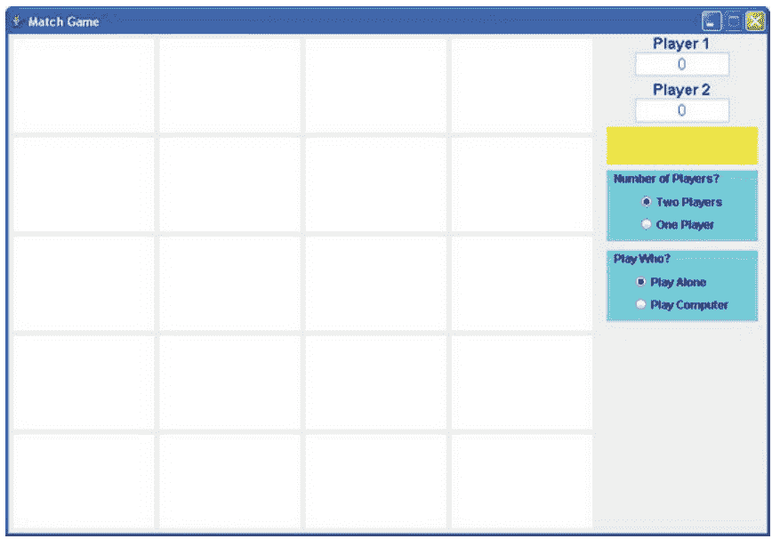

“与谁玩”面板已显示。

# 难度设置

`difficultyPanel` 将包含四个单选按钮控件，用于确定（在与电脑的单人游戏中）电脑的智能程度。`difficultyPanel` 的 `GridBagLayout` 为：

| gridy = 0 | easiestRadioButton |
|---|---|
| gridy = 1 | easyRadioButton |
| gridy = 2 | hardRadioButton |
| gridy = 3 | hardestRadioButton |

## difficultyPanel 属性

| 属性 | 值 |
|---|---|
| size | 160, 125 |
| background | Cyan |
| title | 难度？ |
| gridx | 1 (在 frame 上) |
| gridy | 3 (在 frame 上) |
| insets | 5, 10, 5, 10 |

## easiestRadioButton 属性

| 属性 | 值 |
|---|---|
| text | 最简单 |
| background | Cyan |
| buttonGroup | difficultyButtonGroup |
| selected | true |
| gridx | 0 (在 difficultyPanel 上) |
| gridy | 0 (在 difficultyPanel 上) |
| anchor | WEST |

## easyRadioButton 属性

| 属性 | 值 |
|---|---|
| text | 简单 |
| background | Cyan |
| buttonGroup | difficultyButtonGroup |
| gridx | 0 (在 difficultyPanel 上) |
| gridy | 1 (在 difficultyPanel 上) |
| anchor | WEST |

## hardRadioButton 属性

| 属性 | 值 |
|---|---|
| text | 困难 |
| background | Cyan |
| buttonGroup | difficultyButtonGroup |
| gridx | 0 (在 difficultyPanel 上) |
| gridy | 2 (在 difficultyPanel 上) |
| anchor | WEST |

## hardestRadioButton 属性

| 属性 | 值 |
|---|---|
| text | 最困难 |
| background | Cyan |
| buttonGroup | difficultyButtonGroup |
| gridx | 0 (在 difficultyPanel 上) |
| gridy | 3 (在 difficultyPanel 上) |
| anchor | WEST |

这些控件使用以下代码声明：

```java
JPanel difficultyPanel = new JPanel();
ButtonGroup difficultyGroup = new ButtonGroup();
JRadioButton easiestButton = new JRadioButton();
JRadioButton easyRadioButton = new JRadioButton();
JRadioButton hardRadioButton = new JRadioButton();
JRadioButton hardestButton = new JRadioButton();
```

使用以下代码将单选按钮放在 `difficultyPanel` 中（该面板置于 frame 中）：

```java
difficultyPanel.setPreferredSize(new Dimension(160, 125));
difficultyPanel.setBackground(Color.CYAN);
difficultyPanel.setBorder(BorderFactory.createTitledBorder("Difficulty?"));
difficultyPanel.setLayout(new GridBagLayout());
gridConstraints = new GridBagConstraints();
gridConstraints.gridx = 1;
gridConstraints.gridy = 3;
gridConstraints.insets = new Insets(5, 10, 5, 10);
getContentPane().add(difficultyPanel, gridConstraints);
```

```java
easiestRadioButton.setText("Easiest");
easiestRadioButton.setBackground(Color.CYAN);
easiestRadioButton.setSelected(true);
difficultyButtonGroup.add(easiestRadioButton);
gridConstraints.gridx = 0;
gridConstraints.gridy = 0;
gridConstraints.anchor = GridBagConstraints.WEST;
difficultyPanel.add(easiestRadioButton, gridConstraints);
easiestRadioButton.addActionListener(new ActionListener() {
    public void actionPerformed(ActionEvent e) {
        easiestRadioButtonActionPerformed(e);
    }
});
```

```java
easyRadioButton.setText("Easy");
easyRadioButton.setBackground(Color.CYAN);
easyRadioButton.setSelected(true);
difficultyButtonGroup.add(easyRadioButton);
gridConstraints = new GridBagConstraints();
gridConstraints.gridx = 0;
gridConstraints.gridy = 1;
gridConstraints.anchor = GridBagConstraints.WEST;
difficultyPanel.add(easyRadioButton, gridConstraints);
easyRadioButton.addActionListener(new ActionListener() {
    public void actionPerformed(ActionEvent e) {
        easyRadioButtonActionPerformed(e);
    }
});
```

```java
hardRadioButton.setText("Hard");
hardRadioButton.setBackground(Color.CYAN);
hardRadioButton.setSelected(true);
difficultyButtonGroup.add(hardRadioButton);
gridConstraints = new GridBagConstraints();
gridConstraints.gridx = 0;
gridConstraints.gridy = 2;
gridConstraints.anchor = GridBagConstraints.WEST;
difficultyPanel.add(hardRadioButton, gridConstraints);
hardRadioButton.addActionListener(new ActionListener() {
    public void actionPerformed(ActionEvent e) {
        hardRadioButtonActionPerformed(e);
    }
});
```

```java
hardestRadioButton.setText("Hardest");
hardestRadioButton.setBackground(Color.CYAN);
hardestRadioButton.setSelected(true);
difficultyButtonGroup.add(hardestRadioButton);
gridConstraints = new GridBagConstraints();
gridConstraints.gridx = 0;
gridConstraints.gridy = 3;
gridConstraints.anchor = GridBagConstraints.WEST;
difficultyPanel.add(hardestRadioButton, gridConstraints);
hardestRadioButton.addActionListener(new ActionListener() {
    public void actionPerformed(ActionEvent e) {
        hardestRadioButtonActionPerformed(e);
    }
});
```

```java
public void actionPerformed(ActionEvent e) {
    exitButtonActionPerformed(e);
}
```


这段代码还为每个按钮添加了监听器。将这些空方法与其他方法一起添加：

```java
private void startStopButtonActionPerformed(ActionEvent e)
{}
```

```java
private void exitButtonActionPerformed(ActionEvent e)
{}
```

将此代码添加到适当的位置。运行以查看：

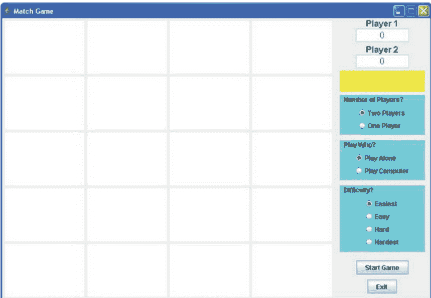

这完成了窗口设计。你应该能够识别出游戏中的所有控件。在查看代码之前，让我们先看看如何选择游戏中使用的照片。

## 照片选择

这个游戏有趣的一点是，你可以使用自己的照片！这让游戏变得个性化，而且变得非常有趣。你需要选择 10 张想要使用的照片（来自你数码相机的 jpg 文件）。照片尺寸应为 150 像素宽、100 像素高（这是标签控件的大小，也与典型的横向 6 英寸乘 4 英寸照片的比例相同）。如果你的照片尺寸不同，它们将无法正确显示。如有必要，使用照片处理程序（如 Microsoft Windows 画图程序）调整照片大小。将要使用的调整后的照片放在项目的代码文件夹中。记下每个文件的文件名。

如果你现在没有照片可以使用，我们在 `\KidGamesJava\KidGamesJava Projects\MatchGame\` 文件夹中包含了十张样本照片：

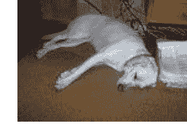

- `claraara.jpg` (KIDware 狗中的一只)

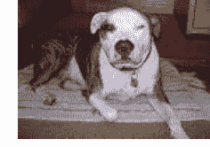

- `tooby.jpg` (另一只 KIDware 狗)


- `Blue hills.jpg` (山丘的库存照片)

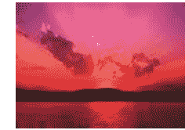

- `Sunset.jpg` (落日库存照片)


- `Water lilies.jpg` (一些漂亮的花)


- `Winter.jpg` (冬日场景)


- `spaceneed.jpg` (西雅图的太空针)


- `market.jpg` (西雅图的派克市场市场)


- `safeco.jpg` (西雅图的 Safeco 场，水手队的主场)


- `qwest.jpg` (西雅图的 Qwest 场，海鹰队的主场)

这些照片中的每张都已调整了大小（约为 150 像素乘 100 像素），使用了 Microsoft 画图程序。如果你决定使用这些照片（而不是你自己的），请将文件复制到你的项目文件夹中。

在覆盖标签框之前，你还需要一张额外的图片，它是用于覆盖的。此外，在 `\KidGamesJava\KidGamesJava Projects\MatchGame\` 文件夹中有一个名为 `cover.jpg` 的文件，图片如下：


将此文件复制到项目文件夹中。

我们现在开始为游戏编写代码。在编写第一部分代码之前，你应该知道有一些标准步骤可以获得运行的项目。由于你应该熟悉这些步骤，在讨论游戏代码时，我们将省略一些步骤来加快开发过程。在代码开发过程中，你可能会在完成产品之前多次从“停止”状态到“运行”状态。

## 代码设计 – 初始化停止状态

每当启动项目时，都会进行初始化。所有的初始化都在窗口构造函数中完成。我们将使用 `ImageIcon` 数组 `photo` 来存储 10 张照片，并使用额外的 `ImageIcon` 来存储覆盖图像。在类声明中添加这些变量：

```java
ImageIcon[] photo = new ImageIcon[10];
ImageIcon cover;
```

另一个初始化是将游戏设置为双玩家模式。这样，我们将禁用 `playWhoPanel` 和 `difficultyPanel` 中的单选按钮。在游戏中多次启用和禁用单选按钮，让我们添加这三个方法来方便此过程。一个用于设置 `playersPanel` 中单选按钮的属性，一个用于 `playWhoPanel`，一个用于 `difficultyPanel`（每个方法指定所需的状态 true 或 false）：

```java
private void setPlayersButtons(boolean a)
{
    onePlayerRadioButton.setEnabled(a);
    twoPlayersRadioButton.setEnabled(a);
}
```

```java
private void setPlayWhoButtons(boolean a)
{
    playAloneRadioButton.setEnabled(a);
    playComputerRadioButton.setEnabled(a);
}
```

```java
private void setDifficultyButtons(boolean a)
{
    playAloneRadioButton.setEnabled(a);
    easyRadioButton.setEnabled(a);
    hardRadioButton.setEnabled(a);
}
```

```java
photo[0] = new ImageIcon("clara.jpg");
photo[1] = new ImageIcon("toby.jpg");
photo[2] = new ImageIcon("Blue hills.jpg");
photo[3] = new ImageIcon("Sunset.jpg");
photo[4] = new ImageIcon("Water lilies.jpg");
photo[5] = new ImageIcon("Winter.jpg");
photo[6] = new ImageIcon("spaceneed.jpg");
photo[7] = new ImageIcon("market.jpg");
photo[8] = new ImageIcon("safeco.jpg");
photo[9] = new ImageIcon("qwest.jpg");
cover = new ImageIcon("cover.jpg");
for (int i = 0; i < 10; i++)
    photo[i].setIcon(cover);
setPlayWhoButtons(false);
setDifficultyButtons(false);
```

在上面的代码中，如果你使用自己的照片，请相应更改文件名（再次确保文件在你的项目文件夹中，否则它们将加载）。

运行项目使游戏正确初始化。这样做，你将在“停止”状态下（使用默认属性）看到游戏看起来如下所示：


游戏在双玩家模式下初始化。标签控件都被“覆盖”。我们有三个选择切换到单玩家模式：点击 `startStopButton`（开始游戏按钮）或点击 `exitButton`（退出按钮）。

如果我们点击“单玩家”按钮，就有不同的可用选项，并且显示信息的标签必须更改。必须发生以下情况：

- 启用 `play panel` 中的单选按钮。
- 将 `player1Label` 文本设置为“你”。
- 如果选择了“单人模式”选项，将 `player2Label` 文本设置为“猜测”，禁用 `difficulty panel` 中的单选按钮。
- 如果选择了“对战”选项，将 `player2Label` 文本设置为“电脑”，启用 `difficulty panel` 中的单选按钮。

对应这些步骤的代码放置在 `onePlayerActionPerformed` 方法中：

```java
private void onePlayerRadioButtonActionPerformed(ActionEvent e)
{
    setPlayWhoButtons(true);
    player1Label.setText("You");
    if (playAloneRadioButton.isSelected()) {
        player2Label.setText("Guesses");
        setDifficultyButtons(false);
    }
    else {
        player2Label.setText("Computer");
        setDifficultyButtons(true);
    }
}
```

在单玩家模式下，我们可以选择“单人模式”或“对战”。如果用户点击“单人模式”，我们需要确保 `difficulty panel` 中的单选按钮被禁用，并且 `player2Label` 的文本属性为“猜测”。在 `playAloneActionPerformed` 方法中使用此代码：

```java
private void playAloneRadioButtonActionPerformed(ActionEvent e)
{
    setDifficultyButtons(false);
    player2Label.setText("Guesses");
}
```

相反，如果用户点击“对战”，我们需要确保 `difficulty panel` 中的单选按钮被启用，并且 `player2Label` 的文本属性为“电脑”。在 `playComputerActionPerformed` 方法中使用此代码：

```java
private void playComputerRadioButtonActionPerformed(ActionEvent e)
{
    setDifficultyButtons(true);
    player2Label.setText("Computer");
}
```

最后，我们需要为 `twoPlayersRadioButtonActionPerformed` 方法返回双玩家模式。当点击此按钮时，我们禁用 `play who panel` 和 `difficulty buttons` 中的单选按钮，并将标签恢复到默认值：

```java
private void twoPlayersRadioButtonActionPerformed(ActionEvent e)
{
    setPlayWhoButtons(false);
    setDifficultyButtons(false);
    player1Label.setText("Player 1");
    player2Label.setText("Player 2");
}
```

只需表示只要点击 Exit（退出）按钮，项目就会关闭。添加这段代码。

`startStopButton` 的代码要复杂得多。我们将分步骤来构建它。首先，我们查看将表单从“stopped”（停止）切换到“playing”（播放），然后再回到“stopped”状态。在此之前，让我们确保新的初始化代码可以正常工作。保存并运行项目。它将处于双人模式。点击 One Player（单人模式），你应该看到：


注意标签控件的变化。Play Who 面板被启用，Difficulty（难度）面板被禁用。

现在，再次点击 Play Computer（电脑对战），标签控件再次变化，Difficulty 面板被启用：


最后，确保当你点击 **Two Players**（双玩家）时，表单返回双人模式。

我们几乎准备好开始研究 **Start Game**（开始游戏）按钮背后的代码了。启动游戏的一个关键步骤是在 20 个标签控件后面“隐藏”每张照片的两个副本。共有 10 张照片，在数组 `photo` 中，索引从 0 到 9。我们希望将每个索引的两个副本随机放置在另一个数组（包含 20 个元素）中。第二个数组的元素告诉我们哪个照片在哪个框控件后面。我们需要一种方法来打乱整数索引。这实际上是一个非常常见的游戏任务，可以用于洗牌、选择多项答案，或者在这里隐藏照片。我们将构建一个执行此任务的通用方法。

## 代码设计 – 整数洗牌

我们将展示一个洗牌过程，之所以被称为洗牌，是因为它可以用于洗一副扑克牌。在这里我们只是洗牌 20 张“牌”，尽管代码可以推广到任意数量的“牌”。你可能会问，为什么我们要洗牌 20 个值而不是 10 个，因为我们只有 10 张照片？我们需要 10 个照片索引中每个索引的两个副本，因此总共有 20 个项目被洗牌。我们提议随机生成 0 到 19 的整数。洗牌后，对于任何大于 9 的值，我们将减去 10。这将给我们一个包含 20 个随机整数的列表。该列表将包含 0 到 9 的每个索引两个，告诉我们哪个照片在哪个框控件后面。让我们看看如何做到。

通常当我们需要一个不需要电脑就能完成的计算机版本时，很容易写下采取的步骤并在代码中复制它们。当我们洗一副扑克牌时，我们将牌组分成两部分，然后在扇开每部分时交错牌，发出那种熟悉的洗牌声。我不知道你如何写代码来实现这一点。我们将采取另一种方法，这种方法在计算机外操作很难或很无聊，但在计算机上很容易。

我们执行所谓的“单牌洗牌”。在单牌洗牌中，你从牌堆中随机抽出单张牌并放在一侧的堆中。重复 52 次，牌就洗好了。试试看！我想你看出这个想法很简单，但用真实的扑克牌进行单牌洗牌会非常耗时。我们在这里使用单牌洗牌的想法，但稍有不同。我们不是把选中的牌放在一堆上，而是将其与剩余待洗牌堆底部的牌交换。这把选中的牌从牌堆中取出并用剩余的底部牌替换它。结果与将其放在一边是一样的。

以下是 n 个连续整数进行洗牌的方法：

- 从一个包含 n 个连续整数的列表开始。
- 从列表中随机选取一个项目。将其与你拥有的项目交换。你现在在列表中需要排序的项目变少了（称为剩余列表），或者 n 现在是 n - 1。
- 从剩余列表中随机选取一个项目。将其与剩余列表底部的项目交换。再次，你的剩余列表现在有了更少的项目。

执行单牌洗牌或排序 n 个整数的代码放在一个通用方法 `nRandomIntegers` 中。单个参数是 n，要排序的整数数量。该方法返回一个包含排序后整数的数组。返回的数组是基于 0 的，返回 0 到 n-1 的随机整数，而不是 1 到 n。如果你需要 1 到 n 的整数，只需对返回数组中的每个值加 1 即可！代码如下：

```java
private int[] nRandomIntegers(int n)
{
    /*
     * 返回 n 个随机排序的整数 0 -> n - 1
     */
    int[] nIntegers = new int[n];
    int temp, s;
    Random sortRandom = new Random();
    // 从 0 到 n - 1 初始化数组
    for (int i = 0; i < n; i++)
    {
        nIntegers[i] = i;
    }
    // i 是列表中剩余的项目数
    for (int i = n; i >= 1; i--)
    {
        s = sortRandom.nextInt(i);
        temp = nIntegers[s];
        nIntegers[s] = nIntegers[i - 1];
        nIntegers[i - 1] = temp;
    }
    return nIntegers;
}
```

`photosRemaining` 告诉我们仍有多少照片被隐藏，而 `score` 数组存储两名玩家的分数（匹配的照片数量）。`photoFound` 数组告诉我们对应图片框后的照片是否已经显示（这样它可以被点击两次）。`playerNumber` 告诉我们现在轮到谁了，`choiceNumber` 告诉它是玩家在游戏板上的第一次选择还是第二次选择。`choice` 数组存储所选两个图片框的索引。`canClick` 用于判断是否可以点击图片框控件。游戏时为 `true`，停止时为 `false`。最后，`gameOver` 用于我们游戏是否真正结束（如果所有照片都已显示则为 `true`），或在完成游戏前点击了停止按钮（为 `false`）。

`startStopButtonActionPerformed` 方法的代码实现了点击“开始游戏”的步骤并初始化新变量：


```java
private void startStopButtonActionPerformed(ActionEvent e)
{
    if (startStopButton.getText().equals("Start Game")) {
        startStopButton.setText("Stop Game");
        score[0] = 0;
        score[1] = 0;
        textField[0].setText("0");
        textField[1].setText("0");
        photosRemaining = 20;
        photoIndex = nRandomIntegers(20);
        for (int i = 0; i < 20; i++) {
            if (photoIndex[i] > 9) {
                photoIndex[i] -= 10;
                photoFound[i] = false;
                photoLabel[i].setIcon(cover);
            }
        }
        playerNumber = 1;
        choiceNumber = 1;
        if (twoPlayersRadioButton.isSelected()) {
            messageLabel.setText("Player 1, Pick a Box");
        }
        else {
            messageLabel.setText("Pick a Box");
            setNumberPlayersButtons(false);
            setPlayWhoButtons(false);
            setDifficultyButtons(false);
            exitButton.setEnabled(false);
            canClick = true;
            gameOver = false;
        }
    } else {
        // stop game
    }
}
```

接下来的步骤应该是清晰的。特别注意在哪里使用了“洗牌”程序来形成 `photoIndex` 数组。

保存并运行项目。点击**Start Game**（开始游戏），你应该能看到：


唯一明显的变化是标签控件中的玩家消息（**Player 1, Pick a Box**）。停止项目（你现在不能点击 **Stop Game**），如果你想的话，可以尝试其他选项。

**btnStartStop Click** 事件的代码实现了点击 *Stop Game*（停止游戏）的步骤（已添加新增内容）：

```java
private void startStopButtonActionPerformed(ActionEvent e)
{
    if (startStopButton.getText().equals("Start Game"))
    {
        startStopButton.setText("Stop Game");
        score[0] = 0;
        score[1] = 0;
        textField[0].setText("0");
        textField[1].setText("0");
        photosRemaining = 20;
        photoIndex = nRandomIntegers(20);
        for (int i = 0; i < 20; i++)
        {
            if (photoIndex[i] > 9)
                photoIndex[i] -= 10;
            photoFound[i] = false;
            photoLabel[i].setIcon(cover);
        }
        playerNumber = 1;
        choiceNumber = 1;
        if (twoPlayersRadioButton.isSelected())
            messageLabel.setText("Player 1, Pick a Box");
        else
            messageLabel.setText("Pick a Box");
        setNumberPlayersButtons(false);
        setPlayWhoButtons(false);
        setDifficultyButtons(false);
        exitButton.setEnabled(false);
        canClick = true;
        gameOver = false;
    }
    else
    {
        // stop game
        startStopButton.setText("Start Game");
        setNumberPlayersButtons(true);
        if (onePlayerRadioButton.isSelected())
        {
            setPlayWhoButtons(true);
            if (playComputerRadioButton.isSelected())
                setDifficultyButtons(true);
        }
        exitButton.setEnabled(true);
        canClick = false;
        if (!gameOver)
        {
            messageLabel.setText("Game Stopped");
        }
    }
}
```

注意我们如何确定哪些持有单选按钮的面板应该禁用/启用，以及我们如何决定是否使用 **Game Stopped**（游戏已停止）消息。如果游戏完成（**gameOver 为 True**），将出现其他消息（后期开发）。保存并运行项目。你应该能够在“停止”切换到“进行中”并返回。确保面板处于单人和双人玩家选项的正确状态。让我们编写双人游戏的代码，首先查看在点击标签后如何显示照片。

## 代码设计 – 显示照片

在配对游戏中，当玩家点击标签时，我们希望正确的照片出现。在点击第二个标签后，会显示另一张照片，我们查看是否有匹配。如果匹配，照片将被移除，玩家将获得下一次机会。如果不匹配，照片将再次隐藏，我们切换到下一个玩家。

所以，当标签被点击时，请遵循以下步骤：

-   确保该框未被点击过。
-   显示照片。
-   如果是第一次选择，允许第二次选择并显示该照片。
-   如果匹配：
    -   播放匹配音。
    -   从框架中移除标签。
    -   分数加 1。
    -   `photosRemaining` 减 2。
    -   如果 `photosRemaining` 为 0，设置 `gameOver` 为 true，确定胜者并停止游戏。
-   如果 `photosRemaining` 不为 0，给玩家下一次机会。
-   如果不匹配：
    -   播放不匹配音。
    -   用覆盖图形替换照片。
    -   切换玩家。

我们将稍后编写这些步骤。但首先注意这些声音：`tada.wav` 文件用于不匹配。`boing.wav` 音用于匹配。`wow.wav` 音用于游戏结束。将声音文件复制到项目文件夹。

添加这些导入语句：

```java
import java.net.URL;
import java.applet.*;
```

并添加这些类级声明来表示声音：

```java
AudioClip matchSound;
AudioClip noMatchSound;
AudioClip gameOverSound;
```

将此代码添加到 `MatchGame` 构造函数的末尾：

```java
try {
    matchSound = Applet.newAudioClip(new URL("file:" + "tada.wav"));
    noMatchSound = Applet.newAudioClip(new URL("file:" + "boing.wav"));
    gameOverSound = Applet.newAudioClip(new URL("file:" + "wow.wav"));
} catch (Exception ex) {
    System.out.println("Error loading sound files");
}
```

现在是在选中标签中显示照片的代码。像 Tic Toe 项目一样，我们预期人类或计算机可以选择标签，我们首先编写一个实现上述步骤的通用方法（尚未检查胜利）。添加此类级变量来指示选中的标签：

```java
int labelSelected;
```

添加此通用方法 (`showSelectedLabel`)，它使用 `labelSelected` 显示对应的照片：

```java
private void showSelectedLabel() {
    photoLabel[labelSelected].setIcon(photo[photoIndex[labelSelected]]);
    photoFound[labelSelected] = true;
    if (choiceNumber == 1) {
        choice[0] = labelSelected;
        choiceNumber = 2;
        if (twoPlayersRadioButton.isSelected()) {
            messageLabel.setText("Player " + String.valueOf(playerNumber) + ", Pick Another");
        }
    } else {
        canClick = true;
    }
}
// ... 单人玩家逻辑
else {
    choice[1] = labelSelected;
    choiceNumber = 1;
    if (photoIndex[choice[0]] == photoIndex[choice[1]]) {
        // 匹配
        matchSound.play();
        photoLabel[choice[0]].setIcon(null);
        photoLabel[choice[1]].setIcon(null);
        score[playerNumber - 1]++;
        scoreTextField[playerNumber - 1].setText(String.valueOf(score[playerNumber - 1]));
        photosRemaining -= 2;
        if (photosRemaining == 0)
        {
            gameOver = true;
            gameOverSound.play();
            if (twoPlayersRadioButton.isSelected())
            {
                if (score[0] > score[1])
                    messageLabel.setText("Player 1 Wins!");
                else if (score[1] > score[0])
                    messageLabel.setText("Player 2 Wins!");
                else
                    messageLabel.setText("It's a Tie!");
            }
        }
    }
}
```

```java
// 单人逻辑
}
startStopButton.doClick();
return;
}
// 另一回合
if (twoPlayersRadioButton.isSelected()) {
    messageLabel.setText("玩家 " + String.valueOf(playerNumber) + ", 再次选择");
    canClick = true;
} else {
    // 单人逻辑
}
} 
} else {
    // 匹配失败
    noMatchSound.play();
    photoFound[choice[0]] = false;
    photoFound[choice[1]] = false;
    photoLabel[choice[0]].setIcon(cover);
    photoLabel[choice[1]].setIcon(cover);
    // 切换玩家
    if (twoPlayersRadioButton.isSelected()) {
        if (playerNumber == 1) {
            playerNumber = 2;
        } else {
            playerNumber = 1;
            messageLabel.setText("玩家 " + String.valueOf(playerNumber) + ", 选择方框");
        }
        canClick = true;
    }
}
else
{
    // 单人逻辑
}
```

我知道一次性给你看这么多代码量很大，但这仅仅是对列出的步骤的简单直接实现（确定 `labelSelected` 的值除外；我们接下来将查看这一点）。现在你已经成为一名出色的游戏程序员了，你应该能够理解这段逻辑。它与井井游戏中使用的逻辑相似。所选标签背后的照片 `[photo][photoLabel[labelSelected]]` 会被显示出来。如果这是第一次选择（`choiceNumber = 1`），我们将使用 `messageLabel` 告诉玩家再次选择。

在显示第二次选择后，我们查看两次选择是否匹配。选中的方框存储在 `choice` 数组中。如果匹配，则移除照片，播放音效，并检查是否所有照片都已选择。如果仍有照片，则给同一个玩家另一个回合。同样地，如果不匹配，会听到音效，恢复照片并切换玩家。

所有这些代码都是为双人游戏设计的。但请注意，我们为以后修改为单人游戏预留了“钩子”（由注释语句表示）。

让我们使用这种方法允许使用鼠标选择标签。实现此功能的代码位于 `photoLabelMousePressed` 方法中（目前为空）。为了确定点击了哪个标签，我们使用在井字游戏中开发的相同逻辑，检查被点击标签的左上角。将此代码添加到 `photoLabelMousePressed` 方法中。

```java
private void photoLabelMousePressed(MouseEvent e)
{
  // 确定点击了哪个标签
  // 获取被点击标签的左上角
  Point p = e.getComponent().getLocation();
  // 根据 p 确定索引
  for (labelSelected = 0; labelSelected < 20; labelSelected++)
  {
    if (p.x == photoLabel[labelSelected].getX() && p.y == photoLabel[labelSelected].getY())
      break;
```

```java
if (!canClick || photoFound[labelSelected])
  return;
// 显示所选标签框背后的图像
canClick = false;
  showSelectedLabel();
```

点击用于显示照片的 20 个标签控件中的任何一个都会调用此方法。代码的第一部分确定了被点击的标签控件数组中元素的索引（变量 `labelSelected`）。如果该方框已被点击（或 `canClick` 为 `false`），则将退出方法。否则，我们将使用 `showSelectedLabel` 方法显示标签背后的照片。

保存并运行项目。尝试和朋友或自己玩玩这个双人游戏。你会发现一个问题：当你点击第一个标签时，图片显示正常。当你点击第二个标签时，你会听到表示匹配或不匹配的音效，但你看不到第二张照片。代码执行得太快了，导致照片的显示无法跟上！


```java
choiceNumber = 2;
if (twoPlayersRadioButton.isSelected())
{
    messageLabel.setText("Player " + String.valueOf(playerNumber) + ", Pick Another");
    canClick = true;
}
else
{
    // one player logic
}
else
{
    choice[1] = labelSelected;
    choiceNumber = 1;
    if (photoIndex[choice[0]] == photoIndex[choice[1]])
    {
        // a match
        matchSound.play();
        photoLabel[choice[0]].setIcon(null);
        photoLabel[choice[1]].setIcon(null);
        score[playerNumber - 1]++;
        scoreField[playerNumber - 1].setText(String.valueOf(score[playerNumber - 1]));
        photosRemaining -= 2;
        if (photosRemaining == 0)
        {
            gameOver = true;
            gameOverSound.play();
            if (twoPlayersRadioButton.isSelected())
            {
                if (score[0] > score[1])
                    messageLabel.setText("Player 1 Wins!");
                else if (score[1] > score[0])
                    messageLabel.setText("Player 2 Wins!");
            }
        }
    }
    else
        messageLabel.setText("It's a Tie!")
}
else
{
    // one player logic
    startStopButton.doClick();
    return;
}
// another turn
if (twoPlayersRadioButton.isSelected())
{
    messageLabel.setText("Player " + String.valueOf(playerNumber) + ", Pick Again");
    canClick = true;
}
else
{
    // one player logic
}
else
{
    // no match
    noMatchSound.play();
    photoFound[choice[0]] = false;
    photoFound[choice[1]] = false;
    photoLabel[choice[0]].setIcon(cover);
    photoLabel[choice[1]].setIcon(cover);
    // swap players
    if (twoPlayersRadioButton.isSelected())
    {
        if (playerNumber == 1)
            playerNumber = 2;
        else
            playerNumber = 1;
    messageLabel.setText("Player " + String.valueOf(playerNumber) + ", Pick a Box");
    canClick = true;
}
else
{
    // one player logic
}
}
```

在执行此代码之前，我们停止计时器以确保代码只被处理一次。

因此，首先将上述所有阴影代码（请确保已保存已删除的代码）替换为单行开启计时器的代码（新行是阴影部分）：

```java
private void showSelectedLabel()
{

    photoLabel[labelSelected].setIcon(photo[photoIndex[labelSelected]]]);
    photoFound[labelSelected] = true;

    displayTimer.start();
}
```

现在，将刚刚从 `showSelectedLabel` 方法中删除的代码放入 `displayTimerActionPerformed` 方法中，并添加关闭计时器的行（阴影部分）：

```java
private void displayTimerActionPerformed(ActionEvent e)
{
    displayTimer.stop();

    if (choiceNumber == 1)
    {
        choice[0] = labelSelected;
        choiceNumber = 2;
        if (twoPlayersRadioButton.isSelected())
        {
            messageLabel.setText("Player " + String.valueOf(playerNumber) + ", Pick Another");
            canClick = true;
        }
        else {
            // one player logic
        }
    }
    else {
        choice[1] = labelSelected;
        choiceNumber = 1;
        if (photoIndex[choice[0]] == photoIndex[choice[1]]) {
            // a match
            matchSound.play();
            photoLabel[choice[0]].setIcon(null);
            photoLabel[choice[1]].setIcon(null);
            score[playerNumber-1]++;
            scoreTextField[playerNumber-1].setText(String.valueOf(score[playerNumber-1]));
            photosRemaining -= 2;
            if (photosRemaining == 0) {
                gameOver = true;
                gameOverSound.play();
                if (twoPlayersRadioButton.isSelected()) {
                    if (score[0] > score[1]) {
                        messageLabel.setText("Player 1 Wins!");
                    } else if (score[1] > score[0]) {
                        messageLabel.setText("Player 2 Wins!");
                    } else {
                        messageLabel.setText("It's a Tie!");
                    }
                }
            }
        }
    }
    else {
        // one player logic
        startStopButton.doClick();
        return;
    }
    // another turn
    if (twoPlayersRadioButton.isSelected()) {
        messageLabel.setText("Player " + String.valueOf(playerNumber) + ", Again");
        canClick = true;
    } else {
        // one player logic
    }
    else {
        // no match
        noMatchSound.play();
        photoFound[choice[0]] = false;
        photoFound[choice[1]] = false;
        photoLabel[choice[0]].setIcon(cover);
        photoLabel[choice[1]].setIcon(cover);
        // swap players
        if (twoPlayersRadioButton.isSelected()) {
            if (playerNumber == 1) {
                playerNumber = 2;
            } else {
                playerNumber = 1;
                messageLabel.setText("Player " + String.valueOf(playerNumber) + ", Pick a Box");
            }
        } else {
            canClick = true;
        }
    } else {
        // one player logic
    }
}
```

确保你理解这一切是如何运作的——其实很简单。图片显示，计时器开始，经过0.5秒让照片显示，计时器关闭并执行 `delayTimerActionPerformed` 中的代码。

保存并运行项目。你和朋友现在应该可以使用双人版本的**连对游戏**，且照片显示正确。当找到匹配项时，你会听到“tada”声，照片会消失。当未找到匹配时，你会听到“boing”声，照片会恢复。完成后，你会听到观众在说“wow”。试一试吧。我一个人玩了双人游戏。这是找到三对匹配项（**玩家1** 2处，**玩家2** 1处）且有一个方框未翻开后的界面：


一直玩到结束，界面如下，我们现在可以选择其他选项并重新开始：


玩家2胜利！实际上，我既是玩家1也是玩家2。在这种情况下，当你没有玩伴时，独自玩或和电脑玩很有趣。让我们现在来编写这些选项的代码。

# 代码设计 – 单人独机游戏

如果在连对游戏中选中了“单人 - 独自玩”选项，单个玩家将尝试在游戏界面上寻找匹配的照片。电脑会记录找到所有匹配项需要多少次猜测。

在单人独机游戏中，点击标签后的步骤如下：

- 确保标签没有被选中。
- 增加猜测次数（使用 `scoreTextField[1]`）。
- 显示照片。
- 如果是第一次选择，允许进行第二次选择并显示该照片。比较两张照片。
- 如果照片匹配：
    - 播放匹配音。
    - 从游戏面板中移除带有照片的标签。
    - 匹配数加1。
    - 剩余照片数 `photosRemaining` 减2。
    - 如果 `photosRemaining = 0`，设置 `gameOver` 为 `true`，播放游戏结束音并停止游戏。
    - 如果 `photosRemaining != 0`，继续游戏。
- 如果照片不匹配：
    - 播放不匹配音。
    - 将照片替换为“遮罩”图形。
    - 继续游戏。

为了实现这些步骤，我们首先对 `showSelectedMethod` 方法进行修改：

```java
private void showSelectedLabel()
{
  // 单人/独机游戏
  if (onePlayerRadioButton.isSelected() && playAloneRadioButton.isSelected())
  {
    score[1]++;
    scoreTextField[1].setText(String.valueOf(score[1]));
  }

  photoLabel[labelSelected].setIcon(photo[photoIndex[labelSelected]]]);
  photoFound[labelSelected] = true;

  displayTimer.start();
}
```

现在对 `displayTimerActionPerformed` 方法进行额外的修改：

```java
private void displayTimerActionPerformed(ActionEvent e)
{
    displayTimer.stop();

    if (choiceNumber == 1)
    {
        choice[0] = labelSelected;
        choiceNumber = 2;
        if (twoPlayersRadioButton.isSelected())
        {
            messageLabel.setText("Player " + String.valueOf(playerNumber) + ", Pick Another");
            canClick = true;
        }
        else
        {
            if (playerNumber == 1)
            {
                messageLabel.setText("Pick Another Box");
                canClick = true;
            }
            else
            {
                // 电脑逻辑
            }
        }
    }
    else
    {
        choice[1] = labelSelected;
        choiceNumber = 1;
    }
}
```

```java
if (photoIndex[choice[0]] == photoIndex[choice[1]])
{
    // 匹配
    matchSound.play();
    photoLabel[choice[0]].setIcon(null);
    photoLabel[choice[1]].setIcon(null);
    score[playerNumber - 1]++;
    scoreTextField[playerNumber - 1].setText(String.valueOf(score[playerNumber - 1]));
    
    photosRemaining -= 2;
    if (photosRemaining == 0)
    {
        gameOver = true;
        gameOverSound.play();
        if (twoPlayersRadioButton.isSelected())
        {
            if (score[0] > score[1])
                messageLabel.setText("玩家 1 胜!");
            else if (score[1] > score[0])
                messageLabel.setText("玩家 2 胜!");
            else
                messageLabel.setText("平局!");
        }
    } else
    {
        // 单人逻辑
        if (playAloneRadioButton.isSelected())
            messageLabel.setText("已找到所有匹配!");
        else
        {
            // 电脑玩家逻辑
        }
    }
    startStopButton.doClick();
    return;
}
```

// 另一回合

if (twoPlayersRadioButton.isSelected())
{
    messageLabel.setText("玩家 " + String.valueOf(playerNumber) + ", 请再次");
    canClick = true;
}
else
{
    // 单人逻辑
    if (playerNumber == 1)
    {
        messageLabel.setText("选择一个箱子");
        canClick = true;
    }
    else
    {
        // 电脑玩家逻辑
    }
}
else
{
    // 未匹配
    noMatchSound.play();
    photoFound[choice[0]] = false;
    photoFound[choice[1]] = false;
    photoLabel[choice[0]].setIcon(cover);
    photoLabel[choice[1]].setIcon(cover);
    // 切换玩家
    if (twoPlayersRadioButton.isSelected())
    {
        if (playerNumber == 1)
            playerNumber = 2;
        else


playerNumber = 1;

}

}

}

```

```java

messageLabel.setText("玩家 " + String.valueOf(playerNumber) + ", 选择一个箱子");

canClick = true;

} else {

  // 单人逻辑

  if (playerNumber == 1) {

    messageLabel.setText("选择一个箱子");

    canClick = true;

  }

  else {

    // 电脑玩家逻辑

  }

}

```

再次注意，我们为单人游戏与对战电脑预留了“钩子”（注释语句，即电脑玩家逻辑）。

保存并运行游戏。点击“单人模式”（One Player）并确保选择了“独自游戏”（Play Alone）。点击“开始游戏”。这是我发现的第一个箱子：


我发现了另一个，但没有匹配。

从现在开始，你只需要继续翻开照片。电脑会记录你花了多少次猜测（翻开照片次数）才找到所有匹配。这里是我完成后的界面（我表现得相当不错——花了我 42 次尝试）：


现在，让我们看看如何修改游戏以与电脑对战。

# 代码设计 – 电脑移动

是时候给电脑增加一些智能了，让它在“配对游戏”中成为一个合理的对手。回想在井棋游戏中，我们对电脑对手有两种选择：**随机**或**智能**。随机对手很容易击败，而智能对手是不可战胜的。作为对井棋游戏的改进，我们建议设置分等级的电脑智能水平。我们在这里也将采用这种方法。

对于配对游戏，我们仍然为电脑开发**随机**选择（最低智能）和**智能**选择（最高智能）的逻辑。为了提供分级的智能水平，我们将决定电脑进行随机选择的频率与进行智能选择的频率。这种分级智能水平在**配对游戏窗口**上的**难度**（Difficulty）面板中选择。

检查**难度**面板，你会看到四个难度级别：**最简单（Easiest）、简单（Easy）、困难（Hard）和最困难（Hardest）**。我们将为每个级别的智能设置一些规则。如果你愿意，可以随时更改这些规则。这些规则建立了电脑移动中随机移动和智能移动的百分比。显然，智能级别越低，随机选择越多。选定的规则如下：

| 难度 | 规则 |
| :--- | :--- |
| 最简单 (Easiest) | 75% 随机，25% 智能 |
| 简单 (Easy) | 50% 随机，50% 智能 |
| 困难 (Hard) | 25% 随机，75% 智能 |
| 最困难 (Hardest) | 10% 随机，90% 智能 |

因此，即使在最高难度级别，我们也允许电脑可能犯错。

让我们先构建一个实现电脑对手的框架，然后开发随机或智能移动的代码。添加这些类声明：

```java

Random myRandom = new Random();

boolean smartComputer;

int difficulty = 1;

```

我们将使用随机数（使用 `myRandom` 对象）来决定执行随机移动还是智能移动。选定的规则如下：

```java

private void easiestRadioButton(ActionEvent e) {

    difficulty = 1;

}

private void easyRadioButton(ActionEvent e) {

    difficulty = 2;

}

private void hardRadioButton(ActionEvent e) {

    difficulty = 3;

}

private void hardestRadioButton(ActionEvent e) {

    difficulty = 4;

}

```

编写 `randomChoice` 和 `smartChoice` 两个空方法：

```java

private int randomChoice() {

    return 0;

}

private int smartChoice() {

    return 0;

}

```

添加通用的 `computerTurn` 方法，根据难度生成电脑选择：

```java

private void computerTurn() {

    if (choiceNumber == 1) {

        switch (difficulty) {

            case 1:

                threshold = 25;

                break;

            case 2:

                threshold = 50;

                break;

            case 3:

                threshold = 75;

                break;

            case 4:

                threshold = 90;

                break;

        }

        if (myRandom.nextInt(100) < threshold)

            smartComputer = true;

        else

            smartComputer = false;

    }

    if (smartComputer)

        labelSelected = smartChoice();

    else

        labelSelected = randomChoice();

    showSelectedLabel();

}

```

并且，我们需要修改 `displayTimerActionPerformed` 方法以允许电脑对手（记住“钩子”是通过注释语句标记的）。在与电脑的游戏中，电脑是玩家 2 号——你总是先手。这些修改会在适当的时间调用 `computerTurn` 并在适当切换玩家：

```java

private void displayTimerActionPerformed(ActionEvent e)

{

    displayTimer.stop();

    if (choiceNumber == 1)

    {

        choice[0] = labelSelected;

        choiceNumber = 2;

        if (twoPlayersRadioButton.isSelected())

        {

            // ... 切换逻辑 ...

        }

        else

        {

            if (playerNumber == 1)

            {

                messageLabel.setText("选择另一个箱子");

                canClick = true;

            }

            else

            {

                // 电脑玩家逻辑

                messageLabel.setText("电脑正在选择...");

                computerTurn();

                return;

            }

        }

    }

}

```


```java

else

{

    choice[1] = labelSelected;

    choiceNumber = 1;

    if (photoIndex[choice[0]] == photoIndex[choice[1]])

    {

        // a match

        matchSound.play();

        photoLabel[choice[0]].setIcon(null);

        photoLabel[choice[1]].setIcon(null);

        score[playerNumber - 1]++;

        textField[playerNumber - 1].setText(String.valueOf(score[playerNumber - 1]));

        photosRemaining -= 2;

        if (photosRemaining == 0)

        {

            gameOver = true;

            gameOverSound.play();

            if (twoPlayersRadioButton.isSelected())

            {

                if (score[0] > score[1])

                    messageLabel.setText("Player 1 Wins!");

                else if (score[1] > score[0])

                    messageLabel.setText("Player 2 Wins!");

                else

                    messageLabel.setText("It's a Tie!");

            }

            else

            {

                // one player logic

                if (playAloneRadioButton.isSelected())

                    messageLabel.setText("All Matches Found!");

                else

                {

                    // play computer logic

                    if (score[0] > score[1])

                        messageLabel.setText("You Win!");

                    else if (score[1] > score[0])

                        messageLabel.setText("Computer Wins!");

                    else

                        messageLabel.setText("It's a Tie!");

                }

            }

        }

    }

}

}

}

startButtonButton.doClick();

return

}

// another turn

if (twoPlayersRadioButton.isSelected()) {

    messageLabel.setText("Player " + String.valueOf(playerNumber) + ", Pick Again");

    canClick = true;

}

else {

    // one player logic

    if (playerNumber == 1) {

        messageLabel.setText("Pick a Box");

        canClick = true;

    }

    else {

        // play computer logic

        messageLabel.setText("Picking Again");

        computerTurn();

        return;

    }

}

}

//noMatchSound.play();

photoFound[choice[0]] = false;

photoFound[choice[1]] = false;

photoLabel[choice[0]].setIcon(cover);

photoLabel[choice[1]].setIcon(cover);

// swap players

if (twoPlayersRadioButton.isSelected())

{

    if (playerNumber == 1)

        playerNumber = 2;

    else

        playerNumber = 1;

    messageLabel.setText("Player " + String.valueOf(playerNumber) + ", Pick a Box");

    canClick = true;

} else

{

    // one player logic

    if (playComputerRadioButton.isSelected())

    {

        if (playerNumber == 1)

            playerNumber = 2;

        else

            playerNumber = 1;

    }

    if (playerNumber == 1)

    {

        messageLabel.setText("Pick a Box");

        canClick = true;

    } else

    {

        // play computer logic

        messageLabel.setText("Computer Picking");

    }

}

choiceNumber = 1;

computerTurn();

return;

}

}

}

}

```

框架已经准备就绪。如果你运行游戏，双玩家、单玩家以及“单人游戏”选项仍然可以工作。与电脑对战将无法运行，因为我们需要为 `randomChoice` 和 `smartChoice` 方法编写代码。我们将先处理 `randomChoice`。

## 代码设计 – 随机电脑

对于随机移动，电脑将简单地（随机）选择游戏面板上一个可用标签之一。这段代码与井井棋（Tic Tac Toe）游戏的随机移动代码非常相似。

将目前 `randomChoice` 方法中的单行代码替换为以下阴影部分的代码：

```java

private int randomChoice()

{

  int count, n, rc;

  if (choiceNumber == 1) {

    n = myRandom.nextInt(photosRemaining) + 1;

  } else {

    n = myRandom.nextInt(photosRemaining - 1) + 1;

  }

  count = 0;

  for (rc = 0; rc < 20; rc++) {

    if (!photoFound[rc]) {

      count++;

    }

    if (count == n) {

      break;

    }

  }

  return(rc);

}

```

这段代码的逻辑非常直接：我们要么有 `photosRemaining` 个未选标签（如果是第一次选择），要有 `photosRemaining - 1` 个未选标签（如果是第二次选择）。代码在该范围内选择一个随机数，并计数未选标签以确定要选择的标签索引（返回 `rc`）。

我们可以测试随机逻辑，但有一个问题：如果在 `computerTurn` 中选择了智能电脑，`smartMove` 方法中还没有代码。为了让其运行，将 `smartMove` 方法中的当前行替换为以下阴影代码：

```java

private int smartChoice()

{

  return(randomChoice());

}

```

我们只是暂时让智能电脑随机以便测试逻辑。保存并运行游戏。选择单玩家和电脑模式。此时难度无关，因为所有代码已加载。点击开始游戏。你先开始尝试寻找匹配的照片。当轮到电脑时，你会注意到两点：第一，照片被翻开了（但很少匹配）；第二，照片出现和消失得很快。

我们可以使用另一个计时器对象（命名为 `delayTimer`）来放慢速度（添加1秒延迟）。声明此计时器：

`Timer delayTimer;`

并将其添加到框架，设置1000毫秒延迟（1秒）：

```java

delayTimer = new Timer(1000, new ActionListener()

{

    public void actionPerformed(ActionEvent e)

    {

        delayTimerActionPerformed(e);

    }

});

```

我们不再在 `computerTurn` 方法中立即显示照片，而是启动计时器。我们将显示照片的代码移动到 `delayTimer` 方法中。有了1000毫秒的延迟，照片将在表上停留1秒。你可以根据需要调整这个延迟时间。`delayTimerActionPerformed` 方法如下：


## 代码实现

### `delayTimerActionPerformed` 方法

```java
private void delayTimerActionPerformed(ActionEvent e) {
    delayTimer.stop();
    showSelectedLabel();
}
```

在这里我们关闭计时器以停止延迟，并使用从 `computerTurn` 方法移动的代码显示照片。将 `computerTurn` 方法中的最后一行（调用 `showSelectedLabel` 的行）替换为启动计时器的单行：

### `computerTurn` 方法

```java
private void computerTurn() {
    int threshold = 0;
    if (choiceNumber == 1) {
        switch (difficulty) {
            case 1:
                threshold = 25;
                break;
            case 2:
                threshold = 50;
                break;
            case 3:
                threshold = 75;
                break;
            case 4:
                threshold = 90;
                break;
        }
    }
    if (myRandom.nextInt(100) < threshold)
        smartComputer = true;
    else
        smartComputer = false;
}

if (smartComputer)
    labelSelected = smartChoice();
else
    labelSelected = randomChoice();

delayTimer.start();
```

再次保存并运行游戏。选择单玩家和电脑模式。同样，难度无关。点击开始游戏。你现在可以与一个减慢了随机电脑对战，这让你很容易赢。我们将通过编写一个更智能、更强大的电脑对手来修复这个问题。这是我玩的一局游戏（电脑匹配了两个——最后两个！）：


## 代码设计 – 智能电脑

如何让电脑成为更好的连对游戏对手呢？嗯，我们可以作弊：由于电脑生成了随机数来隐藏标签后的照片，电脑知道一切。一旦轮到电脑回合，它只需要遍历列表并找到所有匹配对即可。你永远赢不了。显然，这不是一个好方法。

更好的方法是给电脑完美的记忆。换句话说，一旦照片被翻开，电脑就会记住那张照片在哪里。然后，当电脑回合时，它会在内存中搜索匹配项。如果找到了匹配项，它就会采取。首先，让我们编写内存代码。

添加此类声明：

```java
int[] memory = new int[20];
```

此数组在每张照片翻开时存储 20 个标签对象后面照片的索引。值 `0` 意味着标签后的照片尚未被翻开。

内存数组在 `startStopButtonActionPerformed` 方法中初始化（添加的代码为阴影部分）：

```java
private void startStopButtonActionPerformed(ActionEvent e) {
    if (startStopButton.getText().equals("Start Game")) {
        startStopButton.setText("Stop Game");
        score[0] = 0;
        score[1] = 0;
        textField[0].setText("0");
        textField[1].setText("0");

        for (int i = 0; i < 20; i++) {
            memory[i] = 0;
        }

        playerNumber = 1;
        choiceNumber = 1;
        if (twoPlayersRadioButton.isSelected()) {
            messageLabel.setText("Player 1, Pick a Box");
        } else {
            messageLabel.setText("Pick a Box");
            setNumberPlayersButtons(false);
            setPlayWhoButtons(false);
            setDifficultyButtons(false);
            exitButton.setEnabled(false);
            canClick = true;
            gameOver = false;
        }
    } else {
        // stop game
        startStopButton.setText("Start Game");
        setNumberPlayersButtons(true);
        if (onePlayerRadioButton.isSelected()) {
            setPlayWhoButtons(true);
            if (playComputerRadioButton.isSelected()) {
                setDifficultyButtons(true);
            }
        }
        exitButton.setEnabled(true);
        canClick = false;
        if (!gameOver) {
            messageLabel.setText("Game Stopped");
        }
    }
}
```

`memory` 数组中的值在 `displayTimerActionPerformed` 方法中建立。需要更改的部分已阴影显示：

```java
private void displayTimerActionPerformed(ActionEvent e) {
    displayTimer.stop();
    if (choiceNumber == 1) {
        choice[0] = labelSelected;
        choiceNumber = 2;
        memory[labelSelected] = photoIndex[labelSelected];
        if (twoPlayersRadioButton.isSelected()) {
            messageLabel.setText("Player " + String.valueOf(playerNumber) + ", Pick Another");
            canClick = true;
        } else {
            // one player logic
            if (playerNumber == 1) {
                messageLabel.setText("Pick Another Box");
                canClick = true;
            } else {
                // play computer logic
                messageLabel.setText("Picking Another");
                computerTurn();
                return;
            }
        }
    } else {
        choice[1] = labelSelected;
        choiceNumber = 1;
        memory[labelSelected] = photoIndex[labelSelected];

        if (photoIndex[choice[0]] == photoIndex[choice[1]]) {
            // a match
            matchSound.play();
            photoLabel[choice[0]].setIcon(null);
            photoLabel[choice[1]].setIcon(null);
            // clear memory so boxes are not checked again for match
            memory[choice[0]] = 0;
            memory[choice[1]] = 0;
            score[playerNumber - 1]++;
            scoreTextField[playerNumber - 1].setText(String.valueOf(score[playerNumber - 1]));
            photosRemaining -= 2;
            if (photosRemaining == 0) {
                gameOver = true;
                gameOverSound.play();
                if (twoPlayersRadioButton.isSelected()) {
                    if (score[0] > score[1]) {
                        messageLabel.setText("Player 1 Wins!");
                    } else if (score[1] > score[0]) {
                        messageLabel.setText("Player 2 Wins!");
                    } else {
                        messageLabel.setText("It's a Tie!");
                    }
                } else {
                    // one player logic
                    if (playAloneRadioButton.isSelected()) {
                        messageLabel.setText("All Matches Found!");
                    } else {
                        // play computer logic
                        if (score[0] > score[1])
                            messageLabel.setText("You Win!");
                        else if (score[1] > score[0])
                            messageLabel.setText("Computer Wins!");
                        else
                            messageLabel.setText("It's a Tie!");
                    }
                }
                startStopButton.doClick();
                return;
            }
            // another turn
            if (twoPlayersRadioButton.isSelected()) {
                messageLabel.setText("Player " + String.valueOf(playerNumber) + ", Pick Again");
                canClick = true;
            } else {
                // one player logic
                if (playerNumber == 1) {
                    messageLabel.setText("Pick a Box");
                    canClick = true;
                } else {
                    // play computer logic
                    messageLabel.setText("Picking Again");
                    computerTurn();
                    return;
                }
            }
        } else {
            noMatchSound.play();
            photoFound[choice[0]] = false;
            photoFound[choice[1]] = false;
            photoLabel[choice[0]].setIcon(cover);
            photoLabel[choice[1]].setIcon(cover);
            // swap players
            if (twoPlayersRadioButton.isSelected()) {
                if (playerNumber == 1)
                    playerNumber = 2;
                else
                    playerNumber = 1;
                messageLabel.setText("Player " + String.valueOf(playerNumber) + ", Pick a Box");
                canClick = true;
            } else {
                // one player logic
                if (playComputerRadioButton.isSelected()) {
                    if (playerNumber == 1)
                        playerNumber = 2;
                    else
                        playerNumber = 1;
                }
                if (playerNumber == 1) {
                    messageLabel.setText("Pick a Box");
                    canClick = true;
                } else {
                    // play computer logic
                    messageLabel.setText("Computer Picking");
                }
            }
            choiceNumber = 1;
            computerTurn();
            return;
        }
    }
}
```

现在，我们如何使用 `memory` 数组来做出明智的移动呢？我们为计算机选择使用的规则如下：

### 选项 1
1. 检查 `memory` 数组是否有匹配。
2. 如果找到了匹配项，选择第一个匹配标签。
3. 如果没有找到匹配项，选择一个随机标签。

### 选项 2
1. 如果通过选项 1 找到了匹配，选择第二个匹配标签。
2. 如果通过选项 1 没有找到匹配项，再次检查匹配（选项 1 中的随机选择可能与存储在内存中的照片匹配）。
3. 如果找到了匹配，选择该匹配的标签。
4. 如果没有找到匹配项，选择一个随机标签。

让我们在代码中实现这些逻辑。

首先，添加通用方法 `checkForMatch`。该方法返回一个包含两个整数的数组。如果这两个整数都不为零，它会告诉计算机哪两个盒子具有匹配的照片：

```java
private int[] checkForMatch() {
    int[] matches = new int[2];
    matches[0] = 0;
    matches[1] = 0;
    for (int i = 0; i < 20; i++) {
        for (int j = 0; j < 20; j++) {
            if (memory[i] != 0 && memory[i] == memory[j] && i != j) {
                matches[0] = i;
                matches[1] = j;
            }
        }
    }
    return matches;
}
```

该方法对所有标签进行简单比较，以便在 `memory` 数组中寻找匹配的非零值。

添加一个类级别的整数数组声明 `matchFound`，将用于存储匹配的图片框：

```java
int[] matchFound = new int[2];
```

现在，从 `smartChoice` 方法中移除当前的 `return` 语句（即返回随机选择的那个）。用以下代码替换该方法，以实现上述概述的智能步骤：

```java
private int smartChoice() {
    int sc;
    if (choiceNumber == 1) {
        matchFound = checkForMatch();
        if (matchFound[0] != 0 && matchFound[1] != 0)
            sc = matchFound[0];
        else
            sc = randomChoice();
    } else {
        if (matchFound[0] != 0 && matchFound[1] != 0)
            sc = matchFound[1];
        else {
            matchFound = checkForMatch();
```


```java
if (matchFound[0] != 0 && matchFound[1] != 0) {
    if (matchFound[0] != choice[0]) {
        sc = matchFound[0];
    } else {
        sc = matchFound[1];
    }
} else {
    sc = randomChoice();
}
```

保存并运行项目。现在游戏已功能完整（完整的代码列表位于章节末尾）。与计算机对战，并选择 `Hardest` 难度。你会发现这很难赢。继续玩，观察不同的难度级别如何确实调整计算机的智能程度。这里是我用 `Hard` 难度玩的一局游戏。我选择了前两个盒子，看到：


是 Qwest 球场和西雅图太空塔；漂亮的照片，但不匹配。

轮到计算机回合了。它的选择是：


不匹配……但我们之前见过这两个。

选择第一行的第一个盒子和第三行的第二个盒子，我得到一个匹配。然后，选择第一行的第二个盒子和最后几行的第一个盒子，我又得到了另一个匹配。照片被移除，我的得分增加，又轮到了我的回合：


一旦所有的匹配项都被找到，最终得分是我 6 分，计算机 4 分，我赢了！

# Match Game 项目回顾

Match Game 项目现在已经完成了。请保存并运行该项目，确保其运行符合预期。检查所有选项是否都能正常工作。

如果在你的实现过程中遇到错误，请重新检查界面设计和代码设计的步骤。回顾已编写的代码——确保你理解项目的不同部分是如何编码的。正如我们在本章开头提到的，完成的项目已保存为 `MatchGame`，位于 `\KidGamesJava\KidGamesJava Projects\` 文件夹中。

在完成此项目期间，你应该获得了以下新概念和技能：

- 游戏设计和游戏流程的正确步骤。
- 许多 Java 控件的能力和用法。
- 如何对整数进行随机排序（洗牌数字）。
- 如何在游戏中实现延迟。
- 如何让电脑在玩游戏时具有分级的智能水平。

# Match Game 项目增强

有几种方法可以改进 Match Game 项目。一些可能性包括：

- 按照目前的写法，人类玩家可以在计算机移动时点击标签。请实现一种逻辑来禁止此操作。
- 设计一个允许选择游戏照片的工具。这需要一些高级技能。你的工具将写入一个文件，包含要使用的 10 张照片的名称（及其位置）。当 Match Game 开始时，它将打开该文件并自动加载文件。文件的读写在我们上一个游戏项目中简要介绍过。
- 使显示照片的标签数量可调节，以增加难度调整（对于小孩使用较少的格子）。
- 通过对随机和智能计算机移动之间的阈值进行更精细的调整，增加额外的难度级别。
- 按照目前的写法，理论上玩家可以在不给其他玩家机会的情况下找到所有十对。也许可以重写游戏，让玩家在匹配成功后只获得一次额外回合。
- 这个游戏中的电脑相当聪明了，但它可以更聪明。你问怎么做？如果计算机翻开了一张没有匹配的照片，它的下一次选择可以选择一张已经翻开的照片。这不会给计算机提供关于隐藏照片的更多信息，也不会向你（对手）提供任何需要的信息。

# Match Game 项目 Java 代码列表

```java
/*
* MatchGame.java
*/

package matchgame;

import javax.swing.*;
import java.awt.*;
import java.awt.event.*;
import java.util.Random;
import java.net.URL;
import java.applet.*;

public class MatchGame extends JFrame {

    JPanel gamePanel = new JPanel();
    JLabel[] photoLabel = new JLabel[20];
    JPanel resultsPanel = new JPanel();
    JLabel player1Label = new JLabel();
    JLabel player2Label = new JLabel();
    JTextField[] scoreTextField = new JTextField[2];
    JLabel messageLabel = new JLabel();
    JPanel playersPanel = new JPanel();
    ButtonGroup playersButtonGroup = new ButtonGroup();
    JRadioButton twoPlayersRadioButton = new JRadioButton();
    JRadioButton onePlayerRadioButton = new JRadioButton();
    JPanel playWhoPanel = new JPanel();
    ButtonGroup playWhoButtonGroup = new ButtonGroup();
    JRadioButton playAloneRadioButton = new JRadioButton();
    JRadioButton playComputerRadioButton = new JRadioButton();
    JPanel difficultyPanel = new JPanel();
    ButtonGroup difficultyButtonGroup = new ButtonGroup();
    JRadioButton easiestButton = new JRadioButton();
    JRadioButton easyRadioButton = new JRadioButton();
    JRadioButton hardRadioButton = new JRadioButton();
    JButton hardestRadioButton = new JButton();
    JPanel buttons = new JPanel();
    JButton startStopButton = new JButton();
    JButton exitButton = new JButton();
    ImageIcon[] photo = new ImageIcon[10];
    ImageIcon cover = new ImageIcon();
    int[] photoIndex = new int[20];
    int photosRemaining;
    int[] score = new int[2];
    boolean[] photoFound = new boolean[20];
    int playerNumber, choiceNumber;
    int[] choice = new int[2];
    boolean canClick = false;
    boolean gameOver;
    int labelSelected;
    Random myRandom = new Random();
    boolean smartComputer;
    int difficulty = 1;
    int[] memory = new int[20];
    int[] matchFound = new int[2];
    AudioClip matchSound;
    AudioClip noSound;
    AudioClip gameOverSound;
    Timer displayTimer;
    Timer delayTimer;

    public static void main(String args[]) {
        new MatchGame().show();
    }

    public MatchGame() {
        setTitle("Match Game");
        setDefaultCloseOperation(JFrame.EXIT_ON_CLOSE);
        setResizable(false);
        setLayout(new BorderLayout());
        gamePanel.setLayout(new GridLayout(4, 5));
        for (int i = 0; i < 20; i++) {
            photoLabel[i] = new JLabel("");
            photoLabel[i].setBorder(BorderFactory.createLineBorder(Color.BLACK));
            photoLabel[i].addMouseListener(new MouseAdapter() {
                public void mousePressed(MouseEvent e) {
                    // 待实现
                }
            });
            gamePanel.add(photoLabel[i]);
        }
        add(gamePanel, BorderLayout.CENTER);

        resultsPanel.setLayout(new GridLayout(2, 2));
        player1Label.setText("Player 1");
        player1Label.setFont(new Font("Arial", Font.BOLD, 16));
        resultsPanel.add(player1Label);
        scoreTextField[0] = new JTextField("0");
        scoreTextField[0].setEditable(false);
        resultsPanel.add(scoreTextField[0]);
        player2Label.setText("Player 2");
        player2Label.setFont(new Font("Arial", Font.BOLD, 16));
        resultsPanel.add(player2Label);
        scoreTextField[1] = new JTextField("0");
        scoreTextField[1].setEditable(false);
        resultsPanel.add(scoreTextField[1]);
        messageLabel.setPreferredSize(new Dimension(160, 40));
        messageLabel.setOpaque(true);
        messageLabel.setBackground(Color.YELLOW);
        messageLabel.setText("");
        resultsPanel.add(messageLabel);
        add(resultsPanel, BorderLayout.SOUTH);
        pack();
    }
}
```

```java
playersPanel.setLayout(new GridBagLayout());
GridBagConstraints gridConstraints = new GridBagConstraints();
gridConstraints.gridx = 1;
gridConstraints.gridy = 1;
gridConstraints.insets = new Insets(5, 10, 5, 10);
getContentPane().add(playersPanel, gridConstraints);

twoPlayersRadioButton.setText("双玩家");
twoPlayersRadioButton.setBackground(Color.CYAN);
twoPlayersRadioButton.setSelected(true);
playersButtonGroup.add(twoPlayersRadioButton);
gridConstraints = new GridBagConstraints();
gridConstraints.gridx = 0;
gridConstraints.gridy = 0;
gridConstraints.anchor = GridBagConstraints.WEST;
playersPanel.add(twoPlayersRadioButton, gridConstraints);
twoPlayersRadioButton.addActionListener(new ActionListener() {
    public void actionPerformed(ActionEvent e) {
        twoPlayersRadioButtonActionPerformed(e);
    }
});

onePlayerRadioButton.setText("单玩家");
onePlayerRadioButton.setBackground(Color.CYAN);
playersButtonGroup.add(onePlayerRadioButton);
gridConstraints = new GridBagConstraints();
gridConstraints.gridx = 0;
gridConstraints.gridy = 1;
gridConstraints.anchor = GridBagConstraints.WEST;
playersPanel.add(onePlayerRadioButton, gridConstraints);
onePlayerRadioButton.addActionListener(new ActionListener() {
    public void actionPerformed(ActionEvent e) {
        onePlayerRadioButtonActionPerformed(e);
    }
});

playWhoPanel.setPreferredSize(new Dimension(160, 75));
playWhoPanel.setBackground(Color.CYAN);
playWhoPanel.setBorder(BorderFactory.createTitledBorder("谁来玩？"));
playWhoPanel.setLayout(new GridBagLayout());
gridConstraints = new GridBagConstraints();
gridConstraints.gridx = 1;
gridConstraints.gridy = 2;
gridConstraints.insets = new Insets(5, 10, 5, 10);
getContentPane().add(playWhoPanel, gridConstraints);

playAloneRadioButton.setText("单人玩");
playAloneRadioButton.setBackground(Color.CYAN);
playAloneRadioButton.setSelected(true);
playWhoButtonGroup.add(playAloneRadioButton);
gridConstraints = new GridBagConstraints();
gridConstraints.gridx = 0;
gridConstraints.gridy = 0;
gridConstraints.anchor = GridBagConstraints.WEST;
playWhoPanel.add(playAloneRadioButton, gridConstraints);
playAloneRadioButton.addActionListener(new ActionListener() {
    public void actionPerformed(ActionEvent e) {
        playAloneRadioButtonActionPerformed(e);
    }
});

playComputerRadioButton.setText("和电脑玩");
playComputerRadioButton.setBackground(Color.CYAN);
playWhoButtonGroup.add(playComputerRadioButton);
```


## 界面初始化与组件配置

```java
difficultyPanel.setPreferredSize(new Dimension(160, 125));
difficultyPanel.setBackground(Color.CYAN);
difficultyPanel.setBorder(BorderFactory.createTitledBorder("难度？"));
difficultyPanel.setLayout(new GridBagLayout());

gridConstraints = new GridBagConstraints();
gridConstraints.gridx = 1;
gridConstraints.gridy = 3;
gridConstraints.insets = new Insets(5, 10, 5, 10);
getContentPane().add(difficultyPanel, gridConstraints);

easiestRadioButton.setText("最简单");
easiestRadioButton.setBackground(Color.CYAN);
easiestRadioButton.setSelected(true);
difficultyButtonGroup.add(easiestRadioButton);

gridConstraints = new GridBagConstraints();
gridConstraints.gridx = 0;
gridConstraints.gridy = 0;
gridConstraints.anchor = GridBagConstraints.WEST;
difficultyPanel.add(easiestRadioButton, gridConstraints);

easiestRadioButton.addActionListener(new ActionListener() {
    public void actionPerformed(ActionEvent e) {
        easiestRadioButtonActionPerformed(e);
    }
});

easyRadioButton.setText("简单");
easyRadioButton.setBackground(Color.CYAN);
easyRadioButton.setSelected(true);
difficultyButtonGroup.add(easyRadioButton);

gridConstraints = new GridBagConstraints();
gridConstraints.gridx = 0;
gridConstraints.gridy = 1;
gridConstraints.anchor = GridBagConstraints.WEST;
difficultyPanel.add(easyRadioButton, gridConstraints);

easyRadioButton.addActionListener(new ActionListener() {
    public void actionPerformed(ActionEvent e) {
        easyRadioButtonActionPerformed(e);
    }
});

hardRadioButton.setText("困难");
hardRadioButton.setBackground(Color.CYAN);
hardRadioButton.setSelected(true);
difficultyButtonGroup.add(hardRadioButton);

gridConstraints = new GridBagConstraints();
gridConstraints.gridx = 0;
gridConstraints.gridy = 2;
gridConstraints.anchor = GridBagConstraints.WEST;
difficultyPanel.add(hardRadioButton, gridConstraints);

hardRadioButton.addActionListener(new ActionListener() {
    public void actionPerformed(ActionEvent e) {
        hardRadioButtonActionPerformed(e);
    }
});

hardestRadioButton.setText("最难");
hardestRadioButton.setBackground(Color.CYAN);
hardestRadioButton.setSelected(true);
difficultyButtonGroup.add(hardestRadioButton);

gridConstraints = new GridBagConstraints();
gridConstraints.gridx = 0;
gridConstraints.gridy = 3;
gridConstraints.anchor = GridBagConstraints.WEST;
difficultyPanel.add(hardestRadioButton, gridConstraints);

hardestRadioButton.addActionListener(new ActionListener() {
    public void actionPerformed(ActionEvent e) {
        hardestRadioButtonActionPerformed(e);
    }
});

buttonsPanel.setPreferredSize(new Dimension(160, 70));
buttonsPanel.setLayout(new GridBagLayout());

gridConstraints = new GridBagConstraints();
gridConstraints.gridx = 1;
gridConstraints.gridy = 4;
getContentPane().add(buttonsPanel, gridConstraints);

startStopButton.setText("开始游戏");

gridConstraints = new GridBagConstraints();
gridConstraints.gridx = 0;
gridConstraints.gridy = 0;
buttonPanel.add(startStopButton, gridConstraints);

startStopButton.addActionListener(new ActionListener() {
    public void actionPerformed(ActionEvent e) {
        startStopButtonActionPerformed(e);
    }
});

exitButton.setText("退出");

gridConstraints = new GridBagConstraints();
gridConstraints.gridx = 0;
gridConstraints.gridy = 1;
gridConstraints.insets = new Insets(10, 0, 0, 0);
buttonPanel.add(exitButton, gridConstraints);

exitButton.addActionListener(new ActionListener() {
    public void actionPerformed(ActionEvent e) {
        exitButtonActionPerformed(e);
    }
});

displayTimer = new Timer(500, new ActionListener() {
    public void actionPerformed(ActionEvent e) {
        displayTimerActionPerformed(e);
    }
});

delayTimer = new Timer(1000, new ActionListener() {
    public void actionPerformed(ActionEvent e) {
        delayTimerActionPerformed(e);
    }
});

pack();

Dimension screenSize = Toolkit.getDefaultToolkit().getScreenSize();
setBounds((int) (0.5 * (screenSize.width - getWidth())), (int) (0.5 * (screenSize.height - getHeight())), getWidth(), getHeight());

photo[0] = new ImageIcon("clara.jpg");
photo[1] = new ImageIcon("toby.jpg");
photo[2] = new ImageIcon("Blue hills.jpg");
photo[3] = new ImageIcon("Sunset.jpg");
photo[4] = new ImageIcon("Water lilies.jpg");
photo[5] = new ImageIcon("Winter.jpg");
photo[6] = new ImageIcon("spaceneedel.jpg");
photo[7] = new ImageIcon("market.jpg");
photo[8] = new ImageIcon("safeco.jpg");
photo[9] = new ImageIcon("qwest.jpg");

cover = new ImageIcon("cover.jpg");

for (int i = 0; i < 20; i++) {
    photoLabel[i].setIcon(cover);
}

setPlayWhoButtons(false);
setDifficultyButtons(false);

try {
    matchSound = Applet.newAudioClip(new URL("file:" + "tada.wav"));
    noMatchSound = Applet.newAudioClip(new URL("file:" + "boing.wav"));
    gameOverSound = Applet.newAudioClip(new URL("file:" + "wow.wav"));
} catch (Exception ex) {
    System.out.println("Error loading sound files");
}
```

## 事件处理方法

### 单人/双人模式切换

```java
private void playAloneRadioButtonActionPerformed(ActionEvent e) {
    setDifficultyButtons(false);
    player2Label.setText("Guesses");
}
```

```java
private void playComputerRadioButtonActionPerformed(ActionEvent e) {
    setDifficultyButtons(true);
    player2Label.setText("Computer");
}
```

### 难度选择

```java
private void easiestRadioButtonActionPerformed(ActionEvent e) {
    difficulty = 1;
}
```

```java
private void easyRadioButtonActionPerformed(ActionEvent e) {
    difficulty = 2;
}
```

```java
private void hardRadioButtonActionPerformed(ActionEvent e) {
    difficulty = 3;
}
```

```java
private void hardestRadioButtonActionPerformed(ActionEvent e) {
    difficulty = 4;
}
```

### 开始/停止游戏

```java
private void startStopButtonActionPerformed(ActionEvent e) {
    if ((startStopButton.getText()).equals("Start Game")) {
        startStopButton.setText("Stop Game");
        score[0] = 0;
        score[1] = 0;
        textField[0].setText("0");
        textField[1].setText("0");
        photosRemaining = 20;
        photoIndex = nRandomIntegers(20);
        for (int i = 0; i < 20; i++) {
            if (photoIndex[i] > 9) {
                photoIndex[i] = -10;
            }
            photoFound[i] = false;
            photoLabel[i].setIcon(cover);
            memory[i] = 0;
        }
        playerNumber = 1;
        choiceNumber = 1;
        if (twoPlayersRadioButton.isSelected()) {
            messageLabel.setText("Player 1, Pick a Box");
        } else {
            messageLabel.setText("Pick a Box");
        }
        setNumberPlayersButtons(false);
        setPlayWhoButtons(false);
        setDifficultyButtons(false);
        exitButton.setEnabled(false);
        canClick = true;
        gameOver = false;
    } else {
        // 停止游戏
        startStopButton.setText("Start Game");
        setNumberPlayersButtons(true);
        if (onePlayerRadioButton.isSelected()) {
            setPlayWhoButtons(true);
            if (playComputerRadioButton.isSelected()) {
                setDifficultyButtons(true);
            }
        }
        exitButton.setEnabled(true);
        canClick = false;
        if (!gameOver) {
            messageLabel.setText("Game Stopped");
        }
    }
}
```

### 退出程序

```java
private void exitButtonActionPerformed(ActionEvent e) {
    System.exit(0);
}
```

### 辅助方法：按钮启用状态控制

```java
private void setNumberPlayersButtons(boolean a) {
    onePlayerRadioButton.setEnabled(a);
    twoPlayersRadioButton.setEnabled(a);
}
```

```java
private void setPlayWhoButtons(boolean a) {
    playAloneRadioButton.setEnabled(a);
    playComputerRadioButton.setEnabled(a);
}
```

```java
private void setDifficultyButtons(boolean a) {
    easiestRadioButton.setEnabled(a);
    easyRadioButton.setEnabled(a);
    hardRadioButton.setEnabled(a);
    hardestRadioButton.setEnabled(a);
}
```


# 披萨外送项目 (Pizza Delivery Project)

## 复习与预览

我们将构建的下一个项目是一个披萨外送业务模拟。你被要求负责社区披萨店一个晚晚上送工作。你需要接听电话订单，告诉团队要制作多少个披萨，并告诉送餐车去向哪里。

该程序教了口算术、逻辑思维能力和良好的经营实践。我们将看到如何使用多个计时器、使用列表框控件，并构建一个多框架应用程序。

## 披萨外送项目预览

在本章中，我们将构建一个披萨外送游戏。在这个模拟游戏中，需要做出很多决定。基本思想是读取拨入的电话订单，并告诉送餐车去向哪里。你还需要确保始终有现烤的披萨准备好出门。外送区域是一个 20 比 20 的方形网格。你卖出的披萨越多，赚的钱就越多！

完成后的项目保存为 `PizzaDelivery`，位于 `\KidGamesJava\KidGamesJava Projects` 文件夹中。启动 NetBeans（或你的 IDE）。打开指定的项目组。将 `MakePizzaDelivery` 设置为主项目。运行项目。将看到：

披萨外送窗口左侧的面板控件保存着外送网格。右上角是带有单个标签控件的面板，用于显示当前时间和当前销售额。电脑显示器（在一个特殊的图像面板控件中）使用列表框和标签控件显示订单和状态。另一个面板放置着披萨炉，披萨使用八个标签控件显示。披萨炉操作面板控件中有两个按钮。下方的面板显示有多少个披萨准备好交付，有多少个在车上（一个按钮控件将披萨装上车）。底部的两个按钮用于开始/暂停游戏以及停止游戏或退出程序。

在运行游戏之前，让我们描述一下它的操作。你从 6:00 到 11:00 销售并交付披萨。右上角的时钟显示时间。使用该程序不需要 5 小时——这 5 小时在大约 15 分钟内就会过去，思考思考。订单进来时电话响。显示器上的订单显示订单的内容、交付坐标以及订单披萨的数量。订单也会显示在社区网格上。

在程序的消息区域中，会被告知汽车在网格中的当前位置。程序开始时，汽车位于披萨店（用 X 标记）。底部的面板告诉你有多少个披萨已烤好并就绪，有多少个在车上。要在车上装披萨，点击 Load（加载）。要告诉汽车去哪里，点击网格位置。汽车将行驶到目标位置。当它到达时，汽车喇叭会响并告诉你交付结果。有四种可能的结果：(1) 准时交付，(2) 延迟交付，(3) 披萨不足以进行交付，或 (4) 无订单。如果你成功交付了，销售额（显示在屏幕顶部）将会更新。当你需要返回披萨店装载更多披萨时，点击 X。

你还需要控制披萨炉，以确保始终有披萨可供交付。要烤披萨，为你想要烤的每个披萨点击 Add Pizza（添加披萨）（披萨是可以取出的）。当烤箱装好后，点击 Bake（烘烤）。你会被告知披萨好了。当披萨完成后，铃声会响，披萨会被移动到就绪区域。框显示有多少个披萨可以加载。在程序运行期间任何时候，你都可以点击 Pause Game（暂停游戏）暂停操作。要重启，点击 Restart Game（重启游戏）。要在 11:00 之前停止程序，点击 Stop Game（停止游戏）。程序一旦停止，摘要屏幕将显示你的销售额并计算利润。

## 披萨外卖框架设计

我们开始构建 Pizza Delivery 项目。让我们构建第一个框架——即带有外送网格、状态监控器、披萨炉和汽车控制器的框架。结果框架将在稍后构建。在你的 Java 项目组中新建一个项目——命名为 PizzaDelivery。删除名为 `PizzaDelivery.java` 文件中的默认代码。一旦启动，我们建议你立即以你选择的名称保存项目。这将建立起你的项目所需的框架和文件结构。

使用以下属性构建基础框架：

**PizzaDelivery** 框架：

| title | Pizza Delivery |
|---|---|
| resizable | false |

代码如下：

```java
/*
 * PizzaDelivery.java
 */

package pizzelivery;

import javax.swing.*;
import java.awt.*;
import java.awt.event.*;

public class PizzaDelivery extends JFrame {

    public static void main(String args[]) {
        // create frame
        new PizzaDelivery().show();
    }

    public PizzaDelivery() {
        // frame constructor
        setTitle("Pizza Delivery");
        setResizable(false);
        addWindowListener(new WindowAdapter() {
            public void windowClosing(WindowEvent evt) {
                exitForm(evt);
            }
        });
        getContentPane().setLayout(new GridBagLayout());
        GridBagConstraints gridConstraints = new GridBagConstraints();
        pack();
        Dimension screenSize = Toolkit.getDefaultToolkit().getScreenSize();
        setBounds((int) (0.5 * (screenSize.width - getWidth())), (int) (0.5 * (screenSize.height - getHeight())), getWidth(), getHeight());
    }

    private void exitForm(WindowEvent evt) {
        System.exit(0);
    }
}
```

这段代码构建了框架，设置了布局管理器，并包含了退出应用程序的代码。运行代码以确保框架（至少是目前已有的部分）出现并居中显示在屏幕上：

让我们在框架中填充其他控件。创建框架和放置控件的所有代码（声明除外）都放在 `PizzaDelivery` 构造函数中。

我们首先在框架上放置几个面板控件。`GridBagLayout` 布局如下：

| gridy = 0 | gridx = 1 | gridx = 2 |
|---|---|---|
| gridy = 0 | timePanel | salesPanel |
| gridy = 1 | ordersPanel | | |
| gridy = 2 | gridPanel | ovenPanel |
| gridy = 3 | readyPanel | inCarPanel |
| gridy = 4 | buttonsPanel | | |

`gridPanel` 包含外送网格。`timePanel` 显示时钟，`salesPanel` 显示销售数据。`ordersPanel` 显示订单和状态。`ovenPanel` 用于显示和控制炉中烘烤的披萨。`readyPanel` 显示已烤好的披萨数量。`inCarPanel` 用于将披萨装上汽车。`buttonsPanel` 包含两个按钮——一个用于开始和暂停游戏，另一个用于停止并退出项目。我们将分别构建每个面板。让我们从 `gridPanel` 开始。

使用以下属性将 `gridPanel` 添加到框架：

```
gridPanel:
size 540, 540
color Color(208, 208, 255), 浅蓝色
gridx 0
gridy 0
gridheight 5
```

我们使用 Java 的 `Color` 函数为网格定义一个独特的颜色。红、绿、蓝的贡献是通过 Microsoft 画图程序中的颜色调色板确定的。每当内置颜色无法满足需求时，我们就使用此函数。

面板及其颜色（`gridColor`）使用以下代码声明：

```java
JPanel gridPanel = new JPanel();
Color gridColor = new Color(208, 208, 255);
```

使用以下代码将控件放置在框架中：

```java
gridPanel.setPreferredSize(new Dimension(540, 540));
gridPanel.setBackground(gridColor);
gridPanel.setLayout(new GridBagLayout());
gridConstraints = new GridBagConstraints();
gridConstraints.gridx = 0;
gridConstraints.gridy = 0;
gridConstraints.gridheight = 5;
getContentPane().add(gridPanel, gridConstraints);
```

## 核心游戏逻辑代码

### `nRandomIntegers` 方法

```java
private int[] nRandomIntegers(int n) {
    /*
     * 返回 n 个随机排序的整数 0 -> n - 1
     */
    int[] nIntegers = new int[n];
    int temp, s;
    Random sortRandom = new Random();

    // 从 0 到 n - 1 初始化数组
    for (int i = 0; i < n; i++) {
        nIntegers[i] = i;
    }

    // i 是列表中剩余项的数
    for (int i = n; i >= 1; i--) {
        s = sortRandom.nextInt(i);
        temp = nIntegers[s];
        nIntegers[s] = nIntegers[i - 1];
        nIntegers[i - 1] = temp;
    }

    return nIntegers;
}
```

### `showSelectedLabel` 方法

```java
private void showSelectedLabel() {
    // 单玩家/独人游戏
    if (onePlayerRadioButton.isSelected() && playAloneRadioButton.isSelected()) {
        score[1]++;
        scoreTextField.setText(String.valueOf(score[1]));
    }

    photoLabel[labelSelected].setIcon(photoIndex[labelSelected]);
    photoFound[labelSelected] = true;
    displayTimer.start();
}
```

### `displayTimerActionPerformed` 方法

```java
private void displayTimerActionPerformed(ActionEvent e) {
    displayTimer.stop();

    if (choiceNumber == 1) {
        choice[0] = labelSelected;
        choiceNumber = 2;
        memory[labelSelected] = photoIndex[labelSelected];

        if (twoPlayersRadioButton.isSelected()) {
            messageLabel.setText("Player " + String.valueOf(playerNumber) + ", Pick Another");
            canClick = true;
        } else {
            // 单玩家逻辑
            if (playerNumber == 1) {
                messageLabel.setText("Pick Box");
                canClick = true;
            } else {
                // 电脑逻辑
                messageLabel.setText("Picking Another");
                computerTurn();
                return;
            }
        }
    } else {
        choice[1] = labelSelected;
        choiceNumber = 1;
        memory[labelSelected] = photoIndex[labelSelected];

        if (photoIndex[choice[0]] == photoIndex[choice[1]]) {
            // 匹配成功
            matchSound.play();
            photoLabel[choice[0]].setIcon(null);
            photoLabel[choice[1]].setIcon(null);

            // 清空内存，箱框不会被重复检查
            memory[choice[0]] = 0;
            memory[choice[1]] = 0;

            score[playerNumber - 1]++;
            scoreTextField[playerNumber - 1].setText(String.valueOf(score[playerNumber - 1]));

            photosRemaining -= 2;

            if (photosRemaining == 0) {
                gameOver = true;
                gameOverSound.play();

                if (twoPlayersRadioButton.isSelected()) {
                    if (score[0] > score[1]) {
                        messageLabel.setText("Player 1 Wins!");
                    } else if (score[1] > score[0]) {
                        messageLabel.setText("Player 2 Wins!");
                    }
                }
            }
        }
    }
}
```

### 电脑 AI 逻辑片段

```java
case 3:
    threshold = 75;
    break;
case 4:
    threshold = 90;
    break;
}

if (myRandom.nextInt(100) < threshold) {
    smartComputer = true;
} else {
    smartComputer = false;
}
```

```java
if (smartComputer) {
    labelSelected = smartChoice();
} else {
    labelSelected = randomChoice();
}
delayTimer.start();
```

### `delayTimerActionPerformed` 方法

```java
private void delayTimerActionPerformed(ActionEvent e) {
    delayTimer.stop();
    showSelectedLabel();
}
```

### `checkForMatch` 方法

```java
private int[] checkForMatch() {
    int[] matches = new int[2];
    matches[0] = 0;
    matches[1] = 0;

    for (int i = 0; i < 20; i++) {
        for (int j = 0; j < 20; j++) {
            if (memory[i] != 0 && memory[i] == memory[j] && i != j) {
                matches[0] = i;
                matches[1] = j;
            }
        }
    }

    return matches;
}
```


在适当的位置添加代码。运行查看空的网格面板：

现在，让我们添加网格。

对于 Pizza Delivery 游戏，我们想要一个这样的外送网格（放置在 `gridPanel` 的布局管理器上）：

注意，我们为列和行准备了标签信息，并使用一个 20 x 20 的网格来显示订单。网格中的单个元素通过列字母和行号引用（类似于 Excel 表格）。我们将在 `gridPanel` 控件中使用 441 个 (21 x 21) 正方形标签控件构建此网格。让我们看看如何实现。

这个过程非常简单。对于 441 个标签控件中的每一个，我们创建一个集合、属性并将控件放置在面板控件中。网格的第一行将用于标记列；第一列将用于标记行。我们将忽略左上角的标签控件。剩余的 20 x 20 网格标签控件将用于显示订单和汽车。

首先，定义一个二维标签数组：

```java
JLabel[][] deliveryGrid = new JLabel[21][21];
```

我们假设控件是正方形的，尺寸基于面板——（正方形控件，尺寸取决于面板）。网格的第一行将用于标记列；第一列将用于标记行。我们将忽略左上角的标签控件。剩余的 20 x 20 网格标签控件将用于显示订单和汽车。

为了以后移动移动，我们先添加这个空方法：

```java
private void deliveryGridPressed(MouseEvent evt) {

}
```

这段代码构建了框架，设置了布局管理器，并包含了退出应用程序的代码。运行代码以确保框架（至少是目前已有的部分）出现并居中显示在屏幕上：

```java
int w = (int) gridPanel.getSize().width / 24;

for (int j = 0; j < 21; j++) {
    for (int i = 0; i < 21; i++) {
        deliveryGrid[i][j] = new JLabel();
        deliveryGrid[i][j].setPreferredSize(new Dimension(w, w));
        deliveryGrid[i][j].setFont(new Font("Arial", Font.BOLD, 12));
        deliveryGrid[i][j].setHorizontalAlignment(SwingConstants.CENTER);
        gridConstraints = new GridBagConstraints();
        gridConstraints.gridx = i;
        gridConstraints.gridy = j;
        if (i == 0) {
            if (j != 0) {
                deliveryGrid[i][j].setText(String.valueOf(j));
                deliveryGrid[i][j].setForeground(Color.BLACK);
            }
        } else if (j == 0) {
            deliveryGrid[i][j].setText(String.valueOf((char) (i + 64)));
            deliveryGrid[i][j].setForeground(Color.BLACK);
        } else {
            deliveryGrid[i][j].setBorder(BorderFactory.createLineBorder(Color.BLACK));
            deliveryGrid[i][j].setOpaque(true);
            deliveryGrid[i][j].setBackground(Color.WHITE);
            deliveryGrid[i][j].setForeground(Color.BLACK);
        }
        gridPanel.add(deliveryGrid[i][j], gridConstraints);
        deliveryGrid[i][j].addMouseListener(new MouseAdapter() {
            public void mousePressed(MouseEvent e) {
                deliveryGridPressed(e);
            }
        });
    }
}
```

我们使用 Java 的 Color 函数为网格定义一个独特的颜色。红、绿、蓝的贡献是通过 Microsoft 画图程序中的颜色调色板确定的。每当内置颜色无法满足需求时，我们就使用此函数。

我们假设控件是正方形的，尺寸基于面板——（正方形控件，尺寸取决于面板）。网格的第一行将用于标记列；第一列将用于标记行。我们将忽略左上角的标签控件。剩余的 20 x 20 网格标签控件将用于显示订单和汽车。

现在，让我们看看网格长什么样。

保存并运行项目。像魔法一样，你应该看到网格：


确保你理解添加这些控件的代码是如何工作的。这种代码非常有用。让我们构建剩余的面板。

### timePanel

`timePanel` 包含一个单个标签控件来显示时间。`timePanel` 的 `GridBagLayout` 如下：

```
gridx = 0
gridy = 0
timeLabel
```

控件属性为：

**timePanel:**
- size: 110, 50
- background: Yellow
- title: Time
- gridx: 1 (on frame)
- gridy: 0 (on frame)

**timeLabel:**
- 文本: 6:00
- 字体: Arial, 粗体, 字号18
- gridx: 0 (在 timePanel 上)
- gridy: 0 (在 timePanel 上)
- insets: 0, 0, 5, 0

使用以下代码声明控件：

```java
JPanel timePanel = new JPanel();
JLabel timeLabel = new JLabel();
```

使用以下代码将控件添加到 `timePanel`（放置在 frame 中）：

```java
UIManager.put("TitleBorder.font", new Font("Arial", Font.BOLD, 14));
timePanel.setPreferredSize(new Dimension(110, 50));
timePanel.setBackground(Color.YELLOW);
timePanel.setBorder(BorderFactory.createTitledBorder("Time "));
timePanel.setLayout(new GridBagLayout());
gridConstraints = new GridBagConstraints();
gridConstraints.gridx = 1;
gridConstraints.gridy = 0;
gridConstraints.insets = new Insets(5, 5, 5, 5);
getContentPane().add(timePanel, gridConstraints);
```

```java
timeLabel.setText("6:00");
timeLabel.setFont(new Font("Arial", Font.BOLD, 18));
gridConstraints = new GridBagConstraints();
gridConstraints.gridx = 0;
gridConstraints.gridy = 0;
gridConstraints.insets = new Insets(0, 0, 5, 0);
timePanel.add(timeLabel, gridConstraints);
```

这里的第一行使用 `UIManager` 设置面板边框的字体。

将此代码添加到适当的位置。运行以查看：


时间面板出现了。

### salesPanel

`salesPanel` 包含一个单一标签控件，用于显示销售额。`salesPanel` 的 `GridBagLayout` 如下：

| gridx = 0 |
| :--- |
| gridy = 0 salesLabel |

控件属性为：

**salesPanel:**
- 尺寸: 110, 50
- 背景颜色: Yellow
- 标题: Sales
- gridx: 2 (在 frame 上)
- gridy: 0 (在 frame 上)
- insets: 5, 5, 5, 5

**salesLabel:**
- 文本: $0
- 字体: Arial, 粗体, 字号18

使用以下代码声明控件：

```java
JPanel salesPanel = new JPanel();
JLabel salesLabel = new JLabel();
```

使用以下代码将控件添加到 `salesPanel`（放置在 frame 中）：

```java
salesPanel.setPreferredSize(new Dimension(110, 50));
```

```java
salesLabel.setText("$0");
salesLabel.setFont(new Font("Arial", Font.BOLD, 18));
gridConstraints = new GridBagConstraints();
gridConstraints.gridx = 0;
gridConstraints.gridy = 0;
gridConstraints.insets = new Insets(0, 0, 5, 0);
salesPanel.add(salesLabel, gridConstraints);
```

将此代码添加到适当的位置。运行以查看：


销售面板现在已在 frame 中。

### ordersPanel

`ordersPanel` 托管了一个列表框和文本区域控件，以便让你了解订单和交付状态。我们还希望在面板中出现一个背景图像（一台电脑显示器）。普通面板无法承载此类图形，但 `ImagePanel`（在 Tic Tac Toe 项目中首次看到）可以完成工作。因此，首先在描述 Pizza Delivery 项目的类之后添加此代码：

```java
class ImagePanel extends JPanel {
    private Image img;

    public ImagePanel(Image img) {
        this.img = img;
    }

    public void paintComponent(Graphics g) {
        g.drawImage(img, 0, 0, null);
    }
}
```

回想此扩展 `JPanel` 的 `img` 属性用于定义图形。

首先，我们将构建 `ordersPanel` 控件（带有图形）并将其放入 frame 中。使用这些属性：

**ordersPanel (ImagePanel):**
- img: monitor.gif (包含在 `\KidGamesJava\KidGamesJavaProjects\PizzaDelivery\`)
- 尺寸: 230, 175
- gridx: 1 (在 frame 上)
- gridy: 1 (在 frame 上)
- gridwidth: 2

确保将 `monitor.gif` 图形文件复制到你用于构建项目的文件夹中。面板尺寸与图形尺寸匹配。

声明并创建面板：

```java
ImagePanel ordersPanel = new ImagePanel(new ImageIcon("monitor.gif").getImage());
```

设置属性并将面板放置在 frame 中的代码：

```java
ordersPanel.setPreferredSize(new Dimension(230, 175));
ordersPanel.setLayout(new GridBagLayout());
gridConstraints = new GridBagConstraints();
gridConstraints.gridx = 1;
gridConstraints.gridy = 1;
gridConstraints.gridwidth = 2;
gridConstraints.insets = new Insets(0, 5, 5, 5);
getContentPane().add(ordersPanel, gridConstraints);
```

运行。显示器图形应该出现：


`ordersPanel` 将包含两个控件。`ordersPanel` 的 `GridBagLayout` 如下：

| gridx = 0 |
| :--- |
| gridy = 0 | ordersScrollPane |
| gridy = 1 | messageTextArea |

控件属性：

**ordersScrollPane:**
- 尺寸: 180, 80
- 端口: ordersList
- gridx: 0
- gridy: 0

**ordersList:**
- 字体: Courier New, 常规, 字号14
- 模型: ordersListModel

**messageTextArea:**
- 尺寸: 180, 40
- 可编辑: false
- 不透明: true
- 颜色: Color(255, 255, 176)

尺寸和位置属性是通过尝试获得的。这些新控件使用以下声明（我们还添加了颜色）：

```java
JScrollPane ordersScrollPane = new JScrollPane();
JList list = new JList();
DefaultListModel ordersListModel = new DefaultListModel();
JTextArea messageTextArea = new JTextArea();
Color messageColor;
```

控件放置在 `ordersPanel` 中（使用以下代码）：

```java
ordersScrollPane.setPreferredSize(new Dimension(180, 80));
ordersScrollPane.setViewportView(ordersList);
ordersList.setModel(ordersListModel);
messageTextArea.setSize(new Dimension(180, 40));
messageTextArea.setEditable(false);
messageTextArea.setOpaque(true);
messageTextArea.setBackground(messageColor);
```

尺寸和位置属性是通过尝试获得的。这些新控件使用以下声明（我们还添加了颜色）：

```java
gridConstraints = new GridBagConstraints();
gridConstraints.gridx = 1;
gridConstraints.gridy = 2;
gridConstraints.gridwidth = 2;
gridConstraints.insets = new Insets(0, 5, 5, 5);
getContentPane().add(ovenPanel, gridConstraints);

for (int i = 0; i < 8; i++) {
    pizzaLabel[i] = new JLabel();
    pizzaLabel[i].setPreferredSize(new Dimension(50, 50));
    gridConstraints = new GridBagConstraints();
    gridConstraints.gridx = i % 4;
    gridConstraints.gridy = i / 4;
    gridConstraints.insets = new Insets(1, 1, 1, 1);
    ovenPanel.add(pizzaLabel[i], gridConstraints);
}

addPizzaButton.setText("Add Pizza");
addPizzaButton.setEnabled(false);
gridConstraints = new GridBagConstraints();
gridConstraints.gridx = 0;
gridConstraints.gridy = 2;
gridConstraints.gridwidth = 2;
gridConstraints.insets = new Insets(5, 0, 0, 0);
ovenPanel.add(addPizzaButton, gridConstraints);

addPizzaButton.addActionListener(new ActionListener() {
```


```java
public void actionPerformed(ActionEvent e) {
    addPizzaButtonActionPerformed(e);
}
});
bakePizzaButton.setText("Bake Pizza");
bakePizzaButton.setEnabled(false);
gridConstraints = new GridBagConstraints();
gridConstraints.gridx = 2;
gridConstraints.gridy = 2;
gridConstraints.gridwidth = 2;
gridConstraints.insets = new Insets(5, 0, 0, 0);
Panel.add(bakePizzaButton, gridConstraints);
bakePizzaButton.addActionListener(new ActionListener() {
    public void actionPerformed(ActionEvent e) {
        bakePizzaButtonActionPerformed(e);
    }
});
```

这段代码还为每个按钮添加了监听器。在其他方法中添加这些空方法：

```java
private void addPizzaButtonActionPerformed(ActionEvent e) {
}
```

```java
private void bakePizzaButtonActionPerformed(ActionEvent e) {
}
```

将此代码放置在适当的位置。运行以查看：


烤箱（此时没有披萨）出现了。

`readyPanel` 包含一个单一标签控件，用于显示已烤披萨的数量。`readyPanel` 的 `GridBagLayout` 布局如下：

| | gridx = 0 |
|---|---|
| gridy = 0 | readyLabel |

控件属性如下：

**readyPanel:**
- 尺寸: 110, 50
- 背景颜色: 黄 (Yellow)
- 标题: 已烤 (Baked)
- gridx: 1 (在框架上)
- gridy: 3 (在框架上)
- insets: 0, 5, 5, 5

**readyLabel:**
- 文字: 0
- 字体: Arial, 粗体 (Bold), 字号 18
- gridx: 0 (在 readyPanel 上)
- gridy: 0 (在 readyPanel 上)

使用以下代码声明控件：

```java
JPanel readyPanel = new JPanel();
JLabel readyLabel = new JLabel();
```

使用以下代码将控件添加到 `readyPanel`（位于框架中）：

```java
readyPanel.setPreferredSize(new Dimension(110, 50));
readyPanel.setBackground(Color.YELLOW);
readyPanel.setBorder(BorderFactory.createTitledBorder("Baked"));
readyPanel.setLayout(new GridBagLayout());
gridConstraints = new GridBagConstraints();
gridConstraints.gridx = 1;
gridConstraints.gridy = 3;
gridConstraints.insets = new Insets(0, 5, 5, 5);
getContentPane().add(readyPanel, gridConstraints);
```

```java
readyLabel.setText("0");
readyLabel.setFont(new Font("Arial", Font.BOLD, 18));
gridConstraints = new GridBagConstraints();
gridConstraints.gridx = 0;
gridConstraints.gridy = 0;
gridConstraints.insets = new Insets(0, 0, 5, 0);
readyPanel.add(readyLabel, gridConstraints);
```

将此代码放置在适当的位置。运行以查看：


ready 面现在显示于框架中了。

`inCarPanel` 包含一个标签控件和一个按钮，用于将披萨装入车内。`inCarPanel` 的 `GridBagLayout` 布局如下：

| | gridx = 0 |
|---|---|
| gridy = 0 | inCarLabel |
| gridy = 1 | loadCarButton |

面板和按钮属性：

**inCarPanel:**
- 尺寸: 110, 80
- 颜色: 黄 (Yellow)
- 标题: 车内披萨 (Pizzas in Car)
- gridx: 2 (在框架上)
- gridy: 3 (在框架上)
- insets: 0, 5, 5, 5

**inCarLabel:**
- 文字: 0
- 字体: Arial, 粗体 (BOLD), 字号 18
- gridx: 0 (在 inCarPanel 上)
- gridy: 0 (在 inCarPanel 上)
- insets: 0, 0, 5, 0

**loadCarButton:**
- 文字: 加载 (Load)
- 状态: 禁用 (false)
- gridx: 0 (在 inCarPanel 上)
- gridy: 1 (在 inCarPanel 上)
- gridwidth: 2
- insets: 5, 0, 0, 0

使用以下代码声明控件：

```java
JPanel inCarPanel = new JPanel();
JLabel inCarLabel = new JLabel();
JButton loadCarButton = new JButton();
```

使用以下代码将控件放置在 `inCarPanel`（位于框架中）：

```java
inCarPanel.setPreferredSize(new Dimension(110, 80));
inCarPanel.setBackground(Color.YELLOW);
inCarPanel.setBorder(BorderFactory.createTitledBorder("Pizzas in Car"));
inCarPanel.setLayout(new GridBagLayout());
gridConstraints = new GridBagConstraints();
gridConstraints.gridx = 2;
gridConstraints.gridy = 3;
gridConstraints.insets = new Insets(0, 5, 5, 5);
getContentPane().add(inCarPanel, gridConstraints);
```

```java
inCarLabel.setText("0");
inCarLabel.setFont(new Font("Arial", Font.BOLD, 18));
gridConstraints = new GridBagConstraints();
gridConstraints.gridx = 0;
gridConstraints.gridy = 0;
gridConstraints.insets = new Insets(0, 0, 5, 0);
inCarPanel.add(inCarLabel, gridConstraints);
loadCarButton.setText("Load");
loadCarButton.setEnabled(false);
gridConstraints = new GridBagConstraints();
gridConstraints.gridx = 0;
gridConstraints.gridy = 1;
gridConstraints.gridwidth = 2;
gridConstraints.insets = new Insets(5, 0, 0, 0);
inCarPanel.add(loadCarButton, gridConstraints);
loadCarButton.addActionListener(new ActionListener() {
    public void actionPerformed(ActionEvent e) {
        loadCarButtonActionPerformed(e);
    }
});
```

## 代码设计 – 初始化停止状态

初始化时，我们需要确保用户唯一可以点击的只有**开始游戏**或**退出**。他们不应该能够操作披萨烤箱或加载汽车。我们已经处理了这一点，通过让两个烤箱按钮和加载汽车的按钮在初始状态为禁用的（这些属性在控件添加到程序时已设置好）。

保存并运行项目，确保烤箱和汽车加载功能处于禁用状态。如果未禁用，请将相应的 `enabled` 属性设置为 `false`。现在我们开始逐个向模拟中添加其他元素。我们添加了运行闹钟、接收电话订单、运行披萨烤箱、加载汽车、移动汽车以及评估送货情况的代码。每个元素都需要某些“调优”参数——定义模拟器如何工作的值。每个模拟都有此类参数。这些是你在定义程序时调整的常量。在这里的代码中，我们为你提供了我们使用的此类常量的值。可以根据需要自由更改它们。

## 代码设计 – 时钟

披萨送送的首要元素是跟踪时间的闹钟。记住，时钟从 06:00 开始，在 11:00 停止。我们不希望游戏实际上持续五个小时，所以我们将速度加快一点。我们需要决定希望这五个小时实际流逝得有多快，同时仍然能够玩游戏。这是我们讨论过的调优参数之一。

时钟将由名为 `clockTimer` 的定时器对象控制。每当此定时器产生一个事件时，我们将时钟增加一毫秒。我们需要定义一个常量 (`mSecPerMinute`)，让 `clockTimer` 的延迟属性在时钟的每分钟经过一次。我们选择大约 15 分钟玩完一个游戏，或者模拟 300 分钟（5 小时 x 60 分钟/小时）的披萨送货。因此，我们需要在 900000 毫秒（15 分钟 x 60 秒/分钟 x 1000 毫秒/秒）内调用定时器事件 300 次。使用的常量是：

```
mSecPerMinute = 900000 / 300 = 3000 milliseconds/minute
```

将此常量添加到类级声明区域：

```java
final int mSecPerMin = 3000;
```

声明定时器对象：

```java
Timer clockTimer;
```

使用 `mSecPerMin` 延迟将定时器对象添加到项目中：

```java
clockTimer = new Timer(mSecPerMin, new ActionListener() {
    public void actionPerformed(ActionEvent e) {
        clockTimerActionPerformed(e);
    }
});
```

`clockTimerActionPerformed` 方法将实现时钟代码。如所述，每当定时器产生一个事件时，我们在时钟显示上增加一分钟。添加此类声明来跟踪时间：

```java
int clockHour, clockMinute;
```

`clockTimerActionPerformed` 方法中对应的代码是：

```java
private void clockTimerActionPerformed(ActionEvent e) {
    clockMinute++;
    if (clockMinute > 59) {
        clockMinute = 0;
        clockHour++;
        if (clockHour == 11) {
            timeLabel.setText("11:00");
            exitStopButton.doClick();
            return;
        }
    }
    String t = String.valueOf(clockHour) + ":";
    if (clockMinute < 10) {
        t += "0";
    }
    timeLabel.setText(t + String.valueOf(clockMinute));
}
```

注意显示时间的格式。此外，请注意一旦到达 11:00，游戏将通过点击 `exitStopButton` 停止。现在我们将编写在披萨送货中启动、暂停、重启和停止时钟的代码。我们还增加了退出游戏的代码。两个按钮控制游戏：`startPauseButton` 和 `exitStopButton`。这些按钮具有某些交互作用。`startPauseButton` 有三种可能的文本属性。如果点击时文本属性为**开始游戏**，游戏将初始化并进入播放模式：

- 将文本更改为**暂停游戏**。
- 初始化时间为**6:00**。
- 启动 `clockTimer`。
- 将 `exitStopButton` 的文本更改为**停止游戏**。

当文本属性为**暂停游戏**且点击按钮时，我们进入暂停模式：

- 将文本更改为**重启游戏**。
- 停止 `clockTimer`。
- 禁用 `exitStopButton`。

当文本属性为**重启游戏**且点击按钮时，我们进入播放模式：

- 将文本更改为**暂停游戏**。
- 启动 `clockTimer`。
- 启用 `exitStopButton`。

```java
private void startPauseButtonActionPerformed(ActionEvent e) {
    if (startPauseButton.getText().equals("Start Game")) {
        startPauseButton.setText("Pause Game");
        exitStopButton.setText("Stop Game");
        clockHour = 6;
        clockMinute = 0;
        timeLabel.setText("6:00");
        clockTimer.start();
    } else if (startPauseButton.getText().equals("Pause Game")) {
        startPauseButton.setText("Restart Game");
        exitStopButton.setEnabled(false);
        clockTimer.stop();
    } else {
        // game restarted
        startPauseButton.setText("Pause Game");
        exitStopButton.setEnabled(true);
        clockTimer.start();
    }
}
```

保存并运行项目。点击“开始游戏”，时钟开始计算分钟。暂停和重启功能：一小时需要多久过去？它应该大约需要多久。它应该需要一小时过去，一旦 11:00 到达，游戏将通过点击 `exitStopButton` 停止。现在我们将编写在披萨送货中启动、暂停、重启和停止时钟的代码。我们还增加了退出游戏的代码。两个按钮控制游戏：`startPauseButton` 和 `exitStopButton`。这些按钮具有某些交互作用。`startPauseButton` 有三种可能的文本属性。如果点击时文本属性为**开始游戏**，游戏将初始化并进入播放模式：

- 将文本更改为**暂停游戏**。
- 初始化时间为**6:00**。
- 启动 `clockTimer`。
- 将 `exitStopButton` 的文本更改为**停止游戏**。

当文本属性为**暂停游戏**且点击按钮时，我们进入暂停模式：

- 将文本更改为**重启游戏**。
- 停止 `clockTimer`。
- 禁用 `exitStopButton`。

当文本属性为**重启游戏**且点击按钮时，我们进入播放模式：

- 将文本更改为**暂停游戏**。
- 启动 `clockTimer`。
- 启用 `exitStopButton`。

```java
private void startPauseButtonActionPerformed(ActionEvent e) {
    if (startPauseButton.getText().equals("Start Game")) {
        startPauseButton.setText("Pause Game");
        exitStopButton.setText("Stop Game");
        clockHour = 6;
        clockMinute = 0;
        timeLabel.setText("6:00");
        clockTimer.start();
```


## 代码设计 – 初始化停止状态

初始化时，我们需要确保用户唯一可以点击的只有**开始游戏**或**退出**。他们不应该能够操作披萨烤箱或加载汽车。我们已经处理了这一点，通过让两个烤箱按钮和加载汽车的按钮在初始状态为禁用的（这些属性在控件添加到程序时已设置好）。

保存并运行项目，确保烤箱和汽车加载功能处于禁用状态。如果未禁用，请将相应的 `enabled` 属性设置为 `false`。现在我们开始逐个向模拟中添加其他元素。我们添加了运行闹钟、接收电话订单、运行披萨烤箱、加载汽车、移动汽车以及评估送货情况的代码。每个元素都需要某些“调优”参数——定义模拟如何工作的值。每个模拟都有此类参数。这些是你在定义程序时调整的常量。在这里的代码中，我们为你提供了我们使用的此类常量的值。可以根据需要自由更改它们。

## 代码设计 – 时钟

披萨送货的首要元素是跟踪时间的闹钟。记住，时钟从 06:00 开始，在 11:00 停止。我们不希望游戏实际上持续五个小时，所以我们将速度加快一点。我们需要决定希望这五个小时实际流逝得有多快，同时仍然能够玩游戏。这是我们讨论过的调优参数之一。

时钟将由名为 `clockTimer` 的定时器对象控制。每当此定时器产生一个事件时，我们将时钟增加一毫秒。我们需要定义一个常量 (`mSecPerMinute`)，让 `clockTimer` 的延迟属性在时钟的每分钟经过一次。我们选择大约 15 分钟玩完一个游戏，或者模拟 300 分钟（5 小时 x 60 分钟/小时）的披萨送货。因此，我们需要在 900000 毫秒（15 分钟 x 60 秒/分钟 x 1000 毫秒/秒）内调用定时器事件 300 次。使用的常量是：

```
mSecPerMinute = 900000 / 300 = 3000 milliseconds/minute
```

将此常量添加到类级声明区域：

```
final int mSecPerMin = 3000;
```

声明定时器对象：

```
Timer clockTimer;
```

使用 `mSecPerMin` 延迟将定时器对象添加到项目中：

```
clockTimer = new Timer(mSecPerMin, new ActionListener() {
    public void actionPerformed(ActionEvent e) {
        clockTimerActionPerformed(e);
    }
});
```

`clockTimerActionPerformed` 方法将实现时钟代码。如所述，每当定时器产生一个事件时，我们在时钟显示上增加一分钟。添加此类声明来跟踪时间：

```
int clockHour, clockMinute;
```

`clockTimerActionPerformed` 方法中对应的代码是：

```
private void clockTimerActionPerformed(ActionEvent e) {
    clockMinute++;
    if (clockMinute > 59) {
        clockMinute = 0;
        clockHour++;
        if (clockHour == 11) {
            timeLabel.setText("11:00");
            exitStopButton.doClick();
            return;
        }
    }
    String t = String.valueOf(clockHour) + ":";
    if (clockMinute < 10) {
        t += "0";
    }
    timeLabel.setText(t + String.valueOf(clockMinute));
}
```

注意显示时间的格式。此外，请注意一旦到达 11:00，游戏将通过点击 `exitStopButton` 停止。现在我们将编写在披萨送货中启动、暂停、重启和停止时钟的代码。我们还增加了退出游戏的代码。两个按钮控制游戏：`startPauseButton` 和 `exitStopButton`。这些按钮具有某些交互作用。`startPauseButton` 有三种可能的文本属性。如果点击时文本属性为**开始游戏**，游戏将初始化并进入播放模式：

- 将文本更改为**暂停游戏**。
- 初始化时间为**6:00**。
- 启动 `clockTimer`。
- 将 `exitStopButton` 的文本更改为**停止游戏**。

当文本属性为**暂停游戏**且点击按钮时，我们进入暂停模式：

- 将文本更改为**重启游戏**。
- 停止 `clockTimer`。
- 禁用 `exitStopButton`。

当文本属性为**重启游戏**且点击按钮时，我们进入播放模式：

- 将文本更改为**暂停游戏**。
- 启动 `clockTimer`。
- 启用 `exitStopButton`。

```
private void startPauseButtonActionPerformed(ActionEvent e) {
    if (startPauseButton.getText().equals("Start Game")) {
        startPauseButton.setText("Pause Game");
        exitStopButton.setText("Stop Game");
        clockHour = 6;
        clockMinute = 0;
        timeLabel.setText("6:00");
        clockTimer.start();
    } else if (startPauseButton.getText().equals("Pause Game")) {
        startPauseButton.setText("Restart Game");
        exitStopButton.setEnabled(false);
        clockTimer.stop();
    } else {
        // game restarted
        startPauseButton.setText("Pause Game");
        exitStopButton.setEnabled(true);
        clockTimer.start();
    }
}
```

保存并运行项目。点击“开始游戏”，时钟开始计算分钟。暂停和重启功能：一小时需要多久过去？它应该大约需要多久。

## 代码设计 – 电话订单

接下来，我们将编写获取电话订单的代码。

在披萨送货中，订单是随机打进的。订单（时间、位置和披萨数量）显示在列表框中（按时间排序）。订单的披萨数量显示在送货网格上（新订单使用深绿色背景）。你然后使用这些信息派遣汽车去送披萨。

这里是另一个我设定了一些规则的地方——你可以根据喜好更改。实现的披萨订单规则如下：

- 订单随机时间到达，增量为 7 分钟。
- 订单来自送货网格的随机位置。
- 每份订单包含 1 到 5 个披萨，概率如下：
  - 1 个披萨，30%
  - 2 个披萨，20%
  - 3 个披萨，20%
  - 4 个披萨，15%
  - 5 个披萨，15%
- 10:30 之后不再接受订单，以便汽车完成送货。

现在使用 `mSecPerMin` 延迟项目计时器对象：

```
phoneTimer = new Timer(mSecPerMin, new ActionListener() {
    public void actionPerformed(ActionEvent e) {
        phoneTimerActionPerformed(e);
    }
});
```

`phoneTimerActionPerformed` 方法将实现电话订单代码。

在游戏中，`delay` 属性将被随机设置。添加此导入语句：

```
import java.util.Random;
```

现在，添加此类级声明来创建一个随机对象 (`myRandom`)：

```
Random myRandom = new Random();
```

当订单进来时，我们将播放电话铃声。为该声音添加此类级声明：

```
AudioClip phoneSound;
```

我们使用 `phone.wav` 文件作为该声音。它位于 `\KidGamesJava\KidGames Projects\PizzaDelivery\` 文件夹。请将该文件复制到你的项目文件夹。

在 `PizzaDelivery` 构造方法的适当位置添加此单行代码以加载声音。

```
phoneSound = Applet.newAudioClip(new URL("file:" + "phone.wav"));
```

编码了上述电话订单规则并播放声音的 `phoneTimerActionPerformed` 方法如下：

```
private void phoneTimerActionPerformed(ActionEvent e) {
    int i, j, k;
    String order;
    phoneSound.play();
    if (clockHour == 10 && clockMinute >= 30) {
        phoneTimer.stop();
    }
    do {
        i = 1 + myRandom.nextInt(20);
        j = 1 + myRandom.nextInt(20);
    } while (pizzas[i][j] != 0);
    k = myRandom.nextInt(100);
    if (k <= 29)
        pizzas[i][j] = 1;
    else if (k <= 49)
        pizzas[i][j] = 2;
    else if (k <= 69)
        pizzas[i][j] = 3;
    else if (k <= 84)
        pizzas[i][j] = 4;
    else
        pizzas[i][j] = 5;
    pizzaTime = clockMinute + 60 * clockHour;
    // 构建订单列表字符串
    order = timeLabel.getText() + " ";
    if (timeLabel.getText().length() == 4)
        order += " + " + order;
    order += String.valueOf((char) (i + 64)) + " ";
    if (j < 10)
        order += " ";
    order += String.valueOf(j) + " > " + String.valueOf(pizzas[i][j]);
    ordersListModeAddElement(order);
    deliveryGrid[i][j].setBackground(onTimeDeliveryColor);
    deliveryGrid[i][j].setText(String.valueOf(pizzas[i][j]));
    phoneTimer.setDelay(secPerMin * (1 + myRandom.nextInt(7)));
}
```

在这段代码中，我们播放了电话声。如果超过了 10:30，程序将退出。接下来，我们为订单随机选择一个未被选中的列 (`i`) 和随机的行 (`j`)。使用指定的百分比，订单的披萨数量被存储在 `pizzas` 数组中。同样，订单时间被存储在 `pizzaTime` 数组中。接着，形成要放入列表框的文本字符串并将其添加到列表框。相应的网格被标记为深绿色背景 (`onTimeDeliveryColor`) 并标明了订单的披萨数量。在离开方法之前，计算了一个新的随机间隔值。这为我们提供了直到下一个电话订单进来之前的延迟（在 1 到 7 分钟之间）。请确保添加的代码可以通过编译。

我们需要对订单过程进行清晰的初始化。请对 `startPauseButtonActionPerformed` 方法进行修改，以设置初始延迟值（1 到 7 分钟）、清除网格中的任何历史订单，并在适当的时间启动/停止计时器：

```
private void startPauseButtonActionPerformed(ActionEvent e) {
    if (startPauseButton.getText().equals("Start Game")) {
        startPauseButton.setText("Pause Game");
        exitStopButton.setText("Stop Game");
        // 清除网格
        for (int i = 1; i < 21; i++) {
            for (int j = 1; j < 21; j++) {
                deliveryGrid[i][j].setBackground(Color.WHITE);
                deliveryGrid[i][j].setText("");
                pizzas[i][j] = 0;
                pizzaTime[i][j] = 0;
            }
        }
        ordersListModel.removeAllElements();
        clockHour = 6;
        clockMinute = 0;
        timeLabel.setText("6:00");
```


`clockTimer.start();`

}

`phoneTimer.setDelay(mSecPerMin * (1 + MyRandom.nextInt(7)));`

`phoneTimer.start();`

}

else if (`startPauseButton.getText().equals("Pause Game")`)

{

    `startPauseButton.setText("Restart Game");`

    `exitStopButton.setEnabled(false);`

    `clockTimer.stop();`

    `phoneTimer.stop();`

}

else

{

    // 游戏重启

    `startPauseButton.setText("Pause Game");`

    `exitStopButton.setEnabled(true);`

    `clockTimer.start();`

    `phoneTimer.start();`

}

}

`void exitStopButtonActionPerformed(ActionEvent e)`

{

    if (`exitStopButton.getText().equals("Stop Game")`)

    {

        `exitStopButton.setText("Restart Game");`

        `clockTimer.stop();`

        `phoneTimer.stop();`

    }

    else

    {

        `System.exit(0);`

    }

}

```

增加 `pizzasReady` 和 `totalPizzasBaked`，并根据 `pizzasReadyMax` 限制。

- 将面板文本设置为“Oven Off”（炉关闭）；将背景颜色更改为 `ovenOffColor`（蓝色）。
- 删除披萨图标。
- 将 `pizzasBaking` 设置为 0。
- 启用“Add Pizza”（添加披萨）和“Bake Pizza”（烘烤披萨）按钮。

注意，当烘烤完成后，我们将播放叮的一声。为该声音添加此类级别声明：

```java
AudioClip dingSound;
```

我们使用 `ding.wav` 文件作为该声音。它位于 `\KidGamesJava\KidGamesJavaProjects\PizzaDelivery\`文件夹中。将该文件复制到你的项目文件夹。

在 `PizzaDelivery` 构造函数的适当位置添加此单行代码以加载声音。

```java
dingSound = Applet.newAudioClip(new URL("file:" + "ding.wav"));
```

实现所需步骤的 `ovenTimerActionPerformed` 方法如下：

```java
private void ovenTimerActionPerformed(ActionEvent e)
{
    if (bakingMinutesLeft != 0)
        bakingMinutesLeft--;
    else
    {
        dingSound.play();
        pizzasReady += pizzasBaking;
        totalPizzasBaked += pizzasBaking;
        if (pizzasReady > pizzasReadyMax)
            pizzasReady = pizzasReadyMax;
        readyLabel.setText(String.valueOf(pizzasReady));
    }
}
```

```java
ovenPanel.setBorder(BorderFactory.createTitledBorder("OvenOff"));
```

```java
ovenPanel.setBackground(ovenOffColor);
for (int i = 0; i < 8; i++)
    pizzaLabel[i].setIcon(null);
pizzasBaking = 0;
```

```java
addPizzaButton.setEnabled(true);
bakePizzaButton.setEnabled(true);
}
```

检查所有新添加的代码是否通过编译。

通过点击“Bake Pizza”按钮开始烘烤。点击此按钮后要遵循的步骤：

- 将面板背景颜色更改为 `ovenColor`（红色）。
- 禁用按钮控制。
- 显示披萨完成烘烤的时间。
- 初始化 `bakingMinutesLeft`。
- 启用 `ovenTimer` 开始烘烤。

添加定义烤箱颜色的声明：

```java
Color ovenColor = Color.RED;
```

现在，对应的 `bakePizzaButtonActionPerformed` 方法为：

```java
private void bakePizzaButtonActionPerformed(ActionEvent e)
{
    int hOut, mOut;
    if (pizzasBaking == 0)
        return;
    ovenPanel.setBackground(ovenColor);
    addPizzaButton.setEnabled(false);
    bakePizzaButton.setEnabled(false);
    hOut = clockHour;
    mOut = clockMinute + bakingTime;
    if (mOut > 59)
    {
        mOut -= 60;
        hOut++;
    }
    String t;
    if (pizzasBaking == 1)
        t = "Pizza Out At";
    else
        t = "Pizzas Out At";
    t += String.valueOf(hOut) + ":";
    if (mOut < 10)
        t += "0";
    t += String.valueOf(mOut);
    ovenPanel.setBorder(BorderFactory.createTitledBorder(t));
    bakingMinutesLeft = bakingTime;
    ovenTimer.start();
}
```

与上一个按钮一样，我们无法测试这段代码，因为 `bakePizzaButton` 初始状态是禁用的。我们现在来修复它。

对 `startPauseActionButtonPerformed` 事件进行阴影部分的修改，以清理披萨炉、初始化变量（我们假设在开店之前已经烘烤了一炉），并正确地启动/停止烤箱计时器，同时在适当的时间设置烤箱状态。这最终允许我们测试之前编写的按钮（`addPizzaButton` 和 `bakePizzaButton`）：

```java
private void startPauseButtonActionPerformed(ActionEvent e)
{
    if (startPauseButton.getText().equals("Start Game"))
    {
        startPauseButton.setText("Pause Game");
        exitStopButton.setText("Stop Game");
        // 清网格
        for (int i = 1; i < 21; i++)
        {
            for (int j = 1; j < 21; j++)
            {
                deliveryGrid[i][j].setBackground(Color.WHITE);
                deliveryGrid[i][j].setText("");
                pizzas[i][j] = 0;
                pizzaTime[i][j] = 0;
            }
        }
    }
}
```

```java
ordersListModel.removeAllElements();
for (int i = 0; i < 8; i++) {
    pizzaLabel[i].setIcon(null);
    pizzasBaking = 0;
    pizzasReady = pizzasReadyMax;
    totalPizzasBaked = pizzasReady;
    readyLabel.setText(String.valueOf(pizzasReady));
    addPizzaButton.setEnabled(true);
    bakePizzaButton.setEnabled(true);
}
```

```java
clockHour = 6;
clockMinute = 0;
timeLabel.setText("6:00");
clockTimer.start();
phoneTimer.setDelay(mSecPerMin * (1 + MyRandom.nextInt(7)));
phoneTimer.start();
else if (startPauseButton.getText().equals("Pause Game")) {
    startPauseButton.setText("Restart Game");
    exitStopButton.setEnabled(false);
    clockTimer.stop();
    phoneTimer.stop();
    ovenGoing = ovenTimer.isRunning();
    ovenTimer.stop();
    addPizzaButton.setEnabled(false);
    bakePizzaButton.setEnabled(false);
}
else {
    // 重启游戏
    startPauseButton.setText("Pause Game");
    exitStopButton.setEnabled(true);
    clockTimer.start();
    phoneTimer.start();
    if (ovenGoing) {
        ovenTimer.start();
    }
}
```

```java
addPizzaButton.setEnabled(!ovenGoing);
bakePizzaButton.setEnabled(!ovenGoing);
}
```

注意我们如何使用 `ovenGoing` 变量来暂停和重启。暂停时，判断烤箱正在运行并禁用面板上的两个按钮。重启时，如果烤箱正在运行，则启用按钮。

我们对 `exitButtonActionPerformed` 方法执行了类似的更改，在游戏停止时关闭烤箱计时器并重置烤箱：

```java
private void exitStopButtonActionPerformed(ActionEvent e)
{
    if (exitStopButton.getText().equals("Stop Game"))
    {
        gameOverSound.play();
        exitStopButton.setText("Exit");
        startPauseButton.setText("Start Game");
        clockTimer.stop();
        phoneTimer.stop();
        ovenTimer.stop();
        ovenPanel.setBorder(BorderFactory.createTitledBorder("OvenOff"));
        ovenPanel.setBackground(ovenOffColor);
        for (int i = 0; i < 8; i++) {
            pizzaLabel[i].setIcon(null);
        }
        addPizzaButton.setEnabled(false);
        bakePizzaButton.setEnabled(false);
    }
    else
    {
        System.exit(0);
    }
}
```

最后，我们可以烘烤披萨了。保存并运行项目。点击“Start Game”，然后多次点击“Add Pizza”。点击“Bake Pizza”并等待。10分钟后（取决于你点击烤的时间，可能是11分钟），你会听到叮的一声，你烘烤的披萨将移动到 Baked 区域。这是我烘烤六个披萨后（总数增加到14个）并在烤箱中又放入五个披萨后的屏幕；同时也注意到订单很少：


始终记住，红色烤箱是烘烤炉；蓝色烤箱是冷炉。有时玩游戏时，你会忘记启动烘烤过程。你可以喜欢继续烘烤披萨——记住你只能存储20个披萨。确保你可以暂停、重启和停止游戏。接下来我们将查看如何将披萨放入车内并开始配送。

## 代码设计 – 加载车辆

有一个送货车可以将披萨从披萨店网格上的订单位置。配送过程的第一步是将披萨从 Baked 区域加载到车上。这是通过点击 `inCarPanel` 控制中的 Load 按钮来实现的。我们使用变量 `pizzasInCar` 来跟踪车里的披萨数量。假设最多最多装10个披萨。在类级别声明中添加变量声明和另一个常量（`pizzasInCarMax`）：

```java
int pizzasInCar;
boolean loadCarButtonEnabled;
final int pizzasInCarMax = 10;
```

如所述，要加载车辆，你需要点击标记为“Pizzas In Car”的面板中的 Load 按钮。遵循的步骤（假设有披萨要加载）是简单的。如果有可用最大数量的披萨，则向车内加载该数量，否则加载所有就绪的披萨。处理此任务（以及相关标签）的 `loadCarButtonActionPerformed` 方法如下：

```java
private void loadCarButtonActionPerformed(ActionEvent e)
{
    if (pizzasReady == 0)
        return;
    if (pizzasReady > pizzasInCarMax)
    {
        pizzasInCar += pizzasInCarMax;
        pizzasReady -= pizzasInCarMax;
    }
    else
    {
        pizzasInCar += pizzasReady;
        pizzasReady = 0;
    }
    readyLabel.setText(String.valueOf(pizzasReady));
    inCarLabel.setText(String.valueOf(pizzasInCar));
    loadCarButton.setEnabled(false);
}
```

注意在披萨加载后禁用 Load 按钮。在运动代码中，我们使用该按钮的启用状态来告诉我们是否有可配送的披萨。

在 `startPauseButtonActionPerformed` 方法中，阴影代码用于初始化变量并确保 Load 按钮被正确地启用或禁用：

```java
private void startPauseButtonActionPerformed(ActionEvent e) {}
```

```java
if (startPauseButton.getText().equals("Start Game")) {
    startPauseButton.setText("Pause Game");
    exitStopButton.setText("Stop Game");
    // clear网格
    for (int i = 1; i < 21; i++) {
        for (int j = 1; j < 21; j++) {
            deliveryGrid[i][j].setBackground(Color.WHITE);
            deliveryGrid[i][j].setText("");
            pizzas[i][j] = 0;
            pizzaTime[i][j] = 0;
        }
    }
}
```

```java
ordersListModel.removeAllElements();
for (int i = 0; i < 8; i++) {
    pizzaLabel[i].setIcon(null);
}
pizzasBaking = 0;
pizzasReady = pizzasBakingMax;
totalPizzasBaked = pizzasReady;
readyLabel.setText(String.valueOf(pizzasReady));
addPizzaButton.setEnabled(true);
bakePizzaButton.setEnabled(true);
pizzasInCar = 0;
```


inCarLabel.setText("0");
loadCarButton.setEnabled(true);
clockHour = 6;
timeLabel.setText("6:00");
clockTimer.start();

```java
phoneTimer.setDelay(mSecPerMin * (1 + MyRandom.nextInt(7)));
phoneTimer.start();
} else if (startPauseButton.getText().equals("Pause Game")) {
    startPauseButton.setText("Restart Game");
    exitStopButton.setEnabled(false);
    clockTimer.stop();
    phoneTimer.stop();
    ovenGoing = ovenTimer.isRunning();
    ovenTimer.stop();
    addPizzaButton.setEnabled(false);
    bakePizzaButton.setEnabled(false);
    loadCarButtonEnabled = loadCarButton.isEnabled();
    loadCarButton.setEnabled(false);
} else {
    // 游戏重新开始
    startPauseButton.setText("Pause Game");
    exitStopButton.setEnabled(true);
    clockTimer.start();
    phoneTimer.start();
    if (ovenGoing) {
        ovenTimer.start();
    }
    addPizzaButton.setEnabled(!ovenGoing);
    bakePizzaButton.setEnabled(!ovenGoing);
    loadCarButton.setEnabled(loadCarButtonEnabled);
}
```

对 `exitStopButtonActionPerformed` 方法进行类似的阴影修改，以便在游戏停止时禁用加载按钮。

```java
private void exitStopButtonActionPerformed(ActionEvent e) {
    if (exitStopButton.getText().equals("Stop Game")) {
        gameOverSound.play();
        exitStopButton.setText("Exit");
        startPauseButton.setText("Start Game");
        clockTimer.stop();
        phoneTimer.stop();
        ovenTimer.stop();
        ovenPanel.setBorder(BorderFactory.createTitledBorder("OvenOff"));
        ovenPanel.setBackground(ovenOffColor);
        for (int i = 0; i < 8; i++)
            pizzaLabel[i].setIcon(null);
        addPizzaButton.setEnabled(false);
        bakePizzaButton.setEnabled(false);
        loadCarButton.setEnabled(false);
    } else {
        System.exit(0);
    }
}
```

保存并运行项目。开始游戏，烤一些披萨并装载汽车。在这个屏幕中，我烤了六个披萨，使我有了 14 个烤好的披萨。然后我点击了 Load 按钮。汽车现在有最多 10 个披萨，而烘焙区域（Baked area）还剩 4 个披萨：


接下来，让我们通过在送货网格上移动汽车来开始配送披萨。

# 代码设计 – 移动汽车

一旦汽车中有披萨，我们就可以开始配送了。点击送货网格上的某个位置，汽车（由黄色图像表示）将从披萨店到达该位置。当你需要更多披萨时，遵循相同的流程让汽车返回披萨店。有很多工作需要完成：定义披萨店位置（随机设置）、检测送货网格上的点击、识别点击的标签，然后移动汽车到点击的位置。

我们需要几个变量来跟踪汽车。在代码中添加这些类变量：

```java
int pizzaC, pizzaR;
int deliveryC, deliveryR;
int carC, carR;
int deltaC, deltaR;
int mileage;
boolean carGoing;
```

`pizzaC` 和 `pizzaR` 是披萨店位置的行列号（用 X 标记）。`deliveryC` 和 `deliveryR` 是配送位置的行列号（点击的标签）。`carC` 和 `carR` 是当前汽车位置的行列号。`deltaC` 和 `deltaR` 是汽车与目的地之间的行列差。最后，`mileage` 是汽车移动的网格数，`carGoing` 表示汽车正在移动（用于暂停模式）。

使用计时器对象 `carTimer` 使汽车移动。我们定义一个常量来设置汽车速度：

```java
final int min20Squares = 3;
```

这告诉我们跨越 20 个网格需要多少分钟（时间）。声明计时器对象：

```java
Timer carTimer = new Timer(mSecPerMin * min20Squares / 20, new ActionListener() {
    public void actionPerformed(ActionEvent e) {
        carTimerActionPerformed(e);
    }
});
```

`carTimerActionPerformed` 方法实现移动汽车。我们将使用两个图像表示汽车，一个用于水平移动，一个用于垂直移动。这些图像位于 `KidGames\Java Projects\PizzaDelivery\`：


将这些文件复制到你的项目文件夹。使用 `ImageIcon` 对象表示汽车。声明这些对象：

```java
ImageIcon hcarIcon = new ImageIcon("hcar.gif");
ImageIcon vcarIcon = new ImageIcon("vcar.gif");
```

点击网格位置启动 `carTimer`。一旦启动，计时器产生的每次事件都会移动一个格。先进行水平移动，再进行垂直移动。完成这些操作的步骤是：

- 清除当前位置的图像。
- 如果 `deltaC != 0`：
    - `mileage` 加 1。
    - 将汽车图标设置为 `hcarIcon`。
    - 重新计算 `carC`。
    - 重新计算 `deltaC`。
- 如果 `deltaR != 0`：
    - `mileage` 加 1。
    - 将汽车图标设置为 `vcarIcon`。
    - 重新计算 `carR`。
    - 重新计算 `deltaR`。
- 将汽车图标放在新位置。
- 如果 `carC == deliveryC` 且 `carR == deliveryR`：
    - 播放提示音。
    - 禁用 `carTimer`。

如果 `carC == pizzaC` 且 `carR == pizzaR`，我们回到了披萨店，所以：

- 显示消息。
- 删除汽车图标。
- 将 `pizzasInCar` 设置为 0（必须把多余的交给卫生部门）。
- 启用 `loadCarButton`。

如果不在披萨店，我们位于点击的位置：

- 显示消息。
- 检查配送状态。

这看起来有很多步骤，但它们非常直观。特别注意，当我们返回披萨店时会重新启用 `loadCarButton` 以允许重新装汽车。

注意，当汽车停止时，我们将播放提示音。为声音添加此类声明：

```java
AudioClip beepSound;
```

我们使用 `carbeep.wav` 文件。它位于 `KidGames\Java Java Projects\PizzaDelivery\`。将该文件复制到你的项目文件夹。

在 `PizzaDelivery` 构造函数中添加此行加载声音：

```java
beepSound = Applet.newAudioClip(new URL("file:" + "carbeep.wav"));
```

实现上述步骤的 `timerActionPerformed` 方法如下：

```java
private void timerActionPerformed(ActionEvent e) {
    ImageIcon carIcon = null;
    deliveryGrid[carC][carR].setIcon(null);

    // 先水平移动
    if (deltaC != 0) {
        mileage++;
        carIcon = hCarIcon;
        if (deltaC > 0) {
            carC++;
        } else {
            carC--;
            deltaC = deliveryC - carC;
        }
    } else {
        if (deltaR != 0) {
            mileage++;
            carIcon = vCarIcon;
            if (deltaR > 0) {
                carR++;
            } else {
                carR--;
            }
            deltaR = deliveryR - carR;
        }
    }

    deliveryGrid[carC][carR].setIcon(carIcon);

    if (carC == deliveryC && carR == deliveryR) {
        beepSound.play();
        carTimer.stop();
        if (carC == pizzaC && carR == pizzaR) {
            messageTextArea.setText("汽车位于披萨店:\n " + display(carC, carR));
            deliveryGrid[carC][carR].setIcon(null);
            pizzasInCar = 0;
            inCarLabel.setText("0");
            loadCarButton.setEnabled(true);
        } else {
            messageTextArea.setText("汽车位于 " + display(carC, carR));
            // 检查配送状态
        }
    }
}
```

开始移动，直到到达点击的位置时才会停止。

在代码中，我们使用了一个通用方法 `display`，将列数和行数转换为列字母和行号。将此通用方法添加到项目中：

```java
private String display(int c, int r) {
    return (String.valueOf((char)(c + 64)) + " " + String.valueOf(r));
}
```

注意如何使用 `char` 将列号 `c` 转换为字母（基于其 Unicode 编码）。检查并确保新代码可以编译。

要将汽车移动到送货网格上的目标位置，我们只需点击该位置。还记得我们是如何构建网格吗？在那段代码中，我们添加了一个 `deliveryGridMousePressed` 方法来处理网格中所有 400 个（20 x 20）标签控件的鼠标点击事件。该方法将用于移动汽车。

一旦点击了网格位置，我们就按照以下步骤操作：

- 只有当汽车未在移动（`carTimer` 已禁用）、游戏处于运行模式（使用 `startButton` 的 `text` 属性来判断这一点）且 `loadCarButton` 已禁用（车内已加载披萨）时才能进行送货。如果不符合这些情况，则退出；否则继续。
- 确定点击标签的列（`deliveryC`）和行（`deliveryR`）。
- 计算 `deltaC` 和 `deltaR`。如果 `deltaC = 0` 且 `deltaR = 0`，则退出。
- 显示汽车去往哪里的消息。
- 启用 `carTimer`。

我们使用与井字棋（Tic Tac Toe）和匹配游戏（Match Game）类似的逻辑来确定点击标签的列和行。记得鼠标按下事件可以告诉我们点击控件的左上角。通过此我们可以找到 `deliveryC` 和 `deliveryR`。

`deliveryGridMousePressed` 方法中需要的步骤是：

```java
private void deliveryGridMousePressed(MouseEvent e) {
    // 确定点击了哪个网格元素
    Point p = e.getComponent().getLocation();
    // 根据 p 确定索引
    boolean matchFound = false;

    if ((!carTimer.isRunning() && !loadCarButton.isEnabled()) &&
        startPauseButton.getText().equals("Pause Game")) {

        for (deliveryR = 1; deliveryR < 21; deliveryR++) {
            for (deliveryC = 1; deliveryC < 21; deliveryC++) {
                if (p.x == deliveryGrid[deliveryC][deliveryR].getX() && p.y ==
                    deliveryGrid[deliveryC][deliveryR].getY()) {
                    matchFound = true;
                    break;
                }
            }
            if (matchFound)
                break;
        }
        deltaC = deliveryC - carC;
        deltaR = deliveryR - carR;
        if (deltaC == 0 && deltaR == 0)
            return;
        messageTextArea.setText("Car Going To:\n" + display(deliveryC, deliveryR));
        carTimer.start();
    }
}
```

对 `startPauseButtonActionPerformed` 方法进行了阴影修改，以初始化披萨店的位置（也是汽车的初始位置）并在适当的时间启动/停止计时器：

```java
private void startPauseButtonActionPerformed(ActionEvent e) {
    if (startPauseButton.getText().equals("Start Game")) {
        startPauseButton.setText("Pause Game");
        exitStopButton.setText("Stop Game");
        // 清除网格
        for (int i = 1; i < 21; i++) {
            for (int j = 1; j < 21; j++) {
                deliveryGrid[i][j].setBackground(Color.WHITE);
                deliveryGrid[i][j].setText("");
                pizzas[i][j] = 0;
                pizzaTime[i][j] = 0;
            }
        }
        ordersListModel.removeAllElements();
        for (int i = 0; i < 8; i++)
            pizzaLabel[i].setText(null);
        pizzasBaking = 0;
        pizzasReady = pizzasBakingMax;
        totalPizzasBaked = pizzasReady;
        readyLabel.setText(String.valueOf(pizzasReady));
        addPizzaButton.setEnabled(true);
        bakePizzaButton.setEnabled(true);
        pizzasInCar = 0;
        inCarLabel.setText("0");
    }
}
```


`loadCarButton.setEnabled(true)`;

```java
// 初始化披萨店和汽车的位置
deliveryGrid[carC][carR].setIcon(null);
pizzaC = 2 + myRandom.nextInt(18);
pizzaR = 2 + myRandom.nextInt(18);
```

```java
deliveryGrid[pizzaC][pizzaR].setBackground(Color.BLACK);
deliveryGrid[pizzaC][pizzaR].setText("X");
carC = pizzaC;
carR = pizzaR;
mileage = 0;
messageTextArea.setText(" Car at Pizza Parlor:\n" + display(carC, carR));
clockHour = 6;
```

```java
clockMinute = 0;
timeLabel.SetText("6:00");
clockTimer.start();
phoneTimer.setDelay(mSecPerMin * (1 + MyRandom.nextInt(7)));
phoneTimer.start();
```

```java
} else if (startPauseButton.getText().equals("Pause Game")) {
    {
        startPauseButton.setText("Restart Game");
        exitStopButton.setEnabled(false);
        clockTimer.stop();
        phoneTimer.stop();
        ovenGoing = ovenTimer.isRunning();
        ovenTimer.stop();
        addPizzaButton.setEnabled(false);
        bakePizzaButton.setEnabled(false);
        loadCarButton.setEnabled(loadCarButton.isEnabled());
        loadCarButton.setEnabled(false);
        carGoing = carTimer.isRunning();
        carTimer.stop();
    }
} else {
    // 游戏重启
    startPauseButton.setText("Pause Game");
    exitStopButton.setEnabled(true);
    clockTimer.start();
    phoneTimer.start();
    if (ovenGoing)
        ovenTimer.start();
    addPizzaButton.setEnabled(!ovenGoing);
    bakePizzaButton.setEnabled(!ovenGoing);
    loadCarButton.setEnabled(loadCarButton.isEnabled());
}
```

我们首先擦除网格上任何之前的汽车。然后，将披萨店放置在网格内部的某处，并用 X 标记。汽车放置在此位置并初始化里程数。发布一条消息宣布汽车已到达披萨店。注意我们如何使用 `carGoing` 变量来暂停和重启。

我们对 `exitStopButtonActionPerformed` 方法进行了阴影修改，以便在游戏停止时关闭汽车计时器：

```java
private void exitStopButtonActionPerformed(ActionEvent e) {
    if (startPauseButton.getText().equals("Pause Game")) {
        carTimer.stop();
        phoneTimer.stop();
        ovenGoing = ovenTimer.isRunning();
        ovenTimer.stop();
        addPizzaButton.setEnabled(false);
        bakePizzaButton.setEnabled(false);
        loadCarButton.setEnabled(loadCarButton.isEnabled());
        loadCarButton.setEnabled(false);
        for (int i = 0; i < 8; i++) {
            pizzaLabel[i].setText(null);
        }
    } else {
        startPauseButton.setText("Pause Game");
        exitStopButton.setEnabled(true);
        clockTimer.start();
        phoneTimer.start();
        if (ovenGoing)
            ovenTimer.start();
        addPizzaButton.setEnabled(!ovenGoing);
        bakePizzaButton.setEnabled(!ovenGoing);
        loadCarButton.setEnabled(loadCarButton.isEnabled());
    }
}
```

```java
private void startPauseButtonActionPerformed(ActionEvent e) {
    if (startPauseButton.getText().equals("Start Game")) {
        startPauseButton.setText("Pause Game");
        exitStopButton.setText("Stop Game");
        // 清空网格
        for (int i = 1; i < 21; i++) {
            for (int j = 1; j < 21; j++) {
                deliveryGrid[i][j].setBackground(Color.WHITE);
                deliveryGrid[i][j].setText("");
                pizzas[i][j] = 0;
                pizzaTime[i][j] = 0;
            }
        }
        ordersList.removeAllElements();
        for (int i = 0; i < 8; i++) {
            pizzaLabel[i].setIcon(null);
            pizzasBaking = 0;
            pizzasReady = pizzasBakingMax;
            totalPizzasBaked = pizzasReady;
            readyLabel.setText(String.valueOf(pizzasReady));
            addPauseButton.setEnabled(true);
            bakePizzaButton.setEnabled(true);
            pizzasInCar = 0;
            inCarLabel.setText("0");
            loadCarButton.setEnabled(true);
            // 初始化披萨店和汽车位置
            deliveryGrid[carC][carR].setIcon(null);
            pizzaC = 2 + myRandom.nextInt(18);
            pizzaR = 2 + myRandom.nextInt(18);
        }
        deliveryGrid[pizzaC][pizzaR].setBackground(Color.BLACK);
        deliveryGrid[pizzaC][pizzaR].setText("X");
        carC = pizza;
        carR = pizza;
        mileage = 0;
        messageTextArea.setText(" Car at Pizza Parlor:\n" + display(carC, carR));
        pizzasOnTime = 0;
        pizzasLate = 0;
        missedDeliveries = 0;
        totalSales = 0;
        salesLabel.setText("$0");
        clockHour = 6;
        clockMinute = 0;
        timeLabel.setText("6:00");
        clockTimer.start();
        phoneTimer.setDelay(mSecPerMin * (1 + MyRandom.nextInt(7)));
        phoneTimer.start();
    } else if (startPauseButton.getText().equals("Pause Game")) {
        startPauseButton.setText("Restart Game");
        exitStopButton.setEnabled(false);
        clockTimer.stop();
        phoneTimer.stop();
        ovenGoing = ovenTimer.isRunning();
        ovenTimer.stop();
        addPizzaButton.setEnabled(false);
        bakePizzaButton.setEnabled(false);
        loadCarButtonEnabled = loadCarButton.isEnabled();
        loadCarButton.setEnabled(false);
        carGoing = carTimer.isRunning();
        carTimer.stop();
    } else {
        // 重新游戏
        startPauseButton.setText("Pause Game");
        exitStopButton.setEnabled(true);
        clockTimer.start();
        phoneTimer.start();
        if (ovenGoing)
            ovenTimer.start();
        addPizzaButton.setEnabled(!ovenGoing);
        bakePizzaButton.setEnabled(!ovenGoing);
        loadCarButton.setEnabled(loadCarButtonEnabled);
        if (carGoing)
            carTimer.start();
    }
}
```

我们在网格中用绿色背景（`onTimeDeliveryColor`）表示准时送达，逾期送达将显示为红色背景（`lateDeliveryColor`）。背景初始化为 `onTimeDeliveryColor`。在订单下单后 30 分钟后，我们需要将相应的显示网格背景改为红色。如果订单超过了 60 分钟，则会将其从网格中移除并产生罚金。所有这些操作都在 `clockTimerActionPerformed` 方法中完成。在时计时器产生的每个事件中，我们遵循以下步骤：

- 检查列表框中的第一个项目是否已过去 60 分钟。这是列表中最旧的订单，也是唯一的移除候选对象。如果已经过了 60 分钟，则根据披萨数量增加 `missedDeliveries`，并从网格和列表框中移除该订单。
- 对于列表框中的剩余项目，检查是否已过去 30 分钟。如果是且背景不是红色，则将其改为红色。

已对 `clockTimerActionPerformed` 代码进行了共享更改以实现这些步骤：

```java
private void clockTimerActionPerformed(ActionEvent e) {}
```

```java
int clockMinutes;
int c, r;
String s;
boolean expired = false;

clockMinute++;
if (clockMinute > 59)
    clockMinute = 0;
clockHour++;
if (clockHour == 11) {
    timeLabel.setText("11:00");
    exitStopButton.doClick();
    return;
}
String t = String.valueOf(clockHour) + ":";
if (clockMinute < 10)
    t = "0" + t;
timeLabel.setText(t + String.valueOf(clockMinute));

// 检查延迟订单 - 检查第一个是否过期
clockMinutes = clockMinute + 60 * clockHour;
if (ordersListModel.getSize() != 0) {
    for (int i = 0; i < ordersListModel.getSize(); i++) {
        String s = ordersListModel.getElementAt(i);
        int c = (int) s.charAt(0);
        int r = (int) s.charAt(2);
        if (clockMinutes - pizzaTime[c][r] > 30) {
            deliveryGrid[c][r].setBackground(lateDeliveryColor);
        } else if (clockMinutes - pizzaTime[c][r] <= 30) {
            deliveryGrid[c][r].setBackground(onTimeDeliveryColor);
        }
        if (clockMinutes - pizzaTime[c][r] > 60) {
            missedDeliveries += pizzas[c][r];
            deliveryGrid[c][r].setBackground(Color.WHITE);
            deliveryGrid[c][r].setText("");
            ordersListModel.remove(i);
            i--;
        }
    }
}
```

```java
// 从列表中移除
for (i = 0; i < ordersListModel.getSize(); i++) {
    s = String.valueOf(ordersListModel.getElementAt(i));
    c = ((int) s.charAt(6) - 64;
    r = Integer.valueOf(s.substring(8, 10).trim()).intValue();
    if (c == deliveryC && r == deliveryR) {
        ordersListModel.removeAt(i);
        break;
    }
}
```


请注意我们是如何遍历列表框中的项目，以找到与要删除的订单对应的（匹配列和行）项目的。检查这些项目的格式，以查看是如何提取行号和列号的。

运行并保存项目。终于，你可以运行整个模拟程序了。你可以接受订单、烘烤披萨、装载车辆并引导车辆前往订单。当你需要更多披萨时，可以返回披萨店。尝试玩一会儿。这是我送完披萨一小时多后的表单：


当你准备好继续时，停止游戏和程序。当你停止游戏时，目前显示的唯一是总销售额。全面的财务分析应该包含成本以确定净利润。我们将使用一个独立的帧（`frame`）来展示此分析。因此，让我们看看如何在 Java 项目中使用多个窗口。

# 多窗口 Java GUI 应用程序

到为止，这些笔记中开发的所有项目都使用单个窗口。许多 Java 应用使用**多个窗口（multiple frames）**。某些应用程序关联的关于（About）窗口是应用程序中使用第二个窗口的常见示例。我们想要学习如何在项目中管理多个窗口。在使用多个窗口时，有三个主要的考虑因素：

1. 向项目添加窗口
2. 如何使用代码让窗口显示和消失
3. 将信息传输到已添加的窗口中

我们将考虑这些点中的每一个点。

在向项目添加新窗口之前，我们假设已经构建了一个**主窗口（main frame）**。这是项目启动时出现的窗口。此类窗口有一个 `main` 方法，该方法被调用用以启动项目。在一个 Java 项目中，只能有一个窗口（类）拥有 `main` 方法。因此，额外的窗口将不会有 `main` 方法。从主窗口（当前项目中的 `PizzaDelivery.java`），我们构建并显示其他窗口。

要向应用程序添加新窗口，我们添加一个新的 Java 文件来构建该窗口。使用 **NetBeans**，右键点击项目名称并选择 **Add（添加）**，然后选择 **New Java Class（新建 Java 类）**。在出现的窗口中，输入新窗口的文件名（`.java`），选择当前项目的 **Package（包）** 名称并点击 **Finish（完成）**。将出现一个空白的代码面板。在此面板中，我们使用一直以来使用的步骤编写代码来构建新窗口：添加控件、分配属性并编写代码。

不同窗口的显示由你编写的代码处理。你需要决定何时以及如何显示特定的窗口。用户始终与“活动中的”窗口交互。显示窗口有两个步骤。如果窗口类是 `MyFrame`（即代码位于名为 `MyFrame.java` 的文件中），首先使用以下代码构造实例（`myFrame`）：

```java
MyFrame myFrame = new MyFrame();
```

然后，在需要时，使用以下代码显示窗口：

```java
myFrame.show();
```

要让窗口消失，我们使用 `dispose` 方法。要关闭当前窗口，使用：

```java
this.dispose();
```

多窗口应用程序的最后一个考虑因素是决定如何（如果需要）将信息从一个窗口传输到另一个窗口。有几种方法可以实现这一点。我们将查看使用**窗口构造函数（frame constructor）**传输信息。上面我们提到构造 `myFrame` 的实例，我们可以使用：

```java
MyFrame myFrame = new MyFrame();
```

为了将信息传输到这个新窗口，我们将不再使用这段代码，而是用 `MyFrame` 的**重载（overloaded）**构造函数替换它：

```java
MyFrame myFrame = new MyFrame(variables);
```

其中 `variables` 是传输到 `MyFrame` 的逗号分隔变量列表。重载构造函数为我们提供了创建对象的另一种方法。一旦创建，`myFrame` 就可以访问由 `variables` 提供的所有信息。我们将看到如何通过 **Pizza Delivery** 的结果来实现此操作。你会发现这是一个非常简单的修改。

## 窗口设计 – 销售结果

当我们停止 **Pizza Delivery** 项目时，我们想要显示一个销售结果的窗口。完成后的窗口看起来如下：


这个窗口除了底部的单个按钮外，全是标签控件（label controls）。让我们开始构建它。

```java
exitForm(evt);

}

);

getContentPane().setLayout(new GridBagLayout());

GridBagConstraints gridConstraints;

pack();

Dimension screenSize = 
Toolkit.getDefaultToolkit().getScreenSize();

setBounds((int) (0.5 * (screenSize.width - getWidth())), (int) (0.5 * (screenSize.height - getHeight())), getWidth(), getHeight());

}

private void exitForm(WindowEvent evt)
{
    this.dispose();
}
```

再次运行项目。点击 **Start Game**（开始游戏），然后点击 **Stop Game**（停止游戏）。销售结果窗口将会出现，但在点击右上角的 **X** 关闭该窗口之前，你无法切换回 **Pizza Delivery**（披萨交付）游戏。现在第二个窗口是模态的，正如所要求的。

让我们向窗口中填充控件。创建窗口和放置控件的所有代码（声明除外）都位于 `SalesResults` 构造函数中。如前提到的，我们需要许多标签和一个按钮控件。`GridBagLayout` 分为两个部分：

| gridx = 0 | gridx = 1 | gridx = 2 |
|---|---|---|
| gridy = 0 | | gridTopLabel |
| gridy = 1 | salesHeaderLabel | | |
| gridy = 2 | onTimeLabel | onTimeSalesLabel | | |
| gridy = 3 | lateLabel | lateSalesLabel | gridMiddleLabel |
| gridy = 4 | totalSales HeaderLabel | totalSales | | |
| gridy = 5 | | | |
| gridy = 6 | gridBottomLabel | | |
| gridy = 7 | totalProfitsLabel | | |
| gridy = 8 | | | |
| gridy = 9 | returnButton | | |

| gridx = 3 | gridx = 4 |
|---|---|
| gridy = 0 | stopTimeLabel |
| gridy = 1 | gridTopLabel (cont.) |
| | | costsHeaderLabel |
| gridy = 2 | | | |
| gridy = 3 | bakedLabel | bakedCostsLabel |
| gridy = 4 | milesLabel | milesCostsLabel |
| gridy = 5 | missedLabel | missedCostsLabel |
| gridy = 6 | totalCostsHeaderLabel | totalCosts |
| gridy = 7 | gridBottomLabel (cont.) | |
| gridy = 8 | hourlyProfitsLabel | | |
| gridy = 9 | returnButton (cont.) | |

`gridTopLabel`、`gridMiddleLabel` 和 `gridBottomLabel` 是用作边界的“细长条”。`startTimeLabel` 和 `stopTimeLabel` 分别显示开始和停止时间。`salesHeaderLabel`、`onTimeLabel`、`onSalesLabel`、`lateLabel`、`lateSalesLabel`、`totalSalesHeaderLabel` 和 `totalSales` 用于显示销售信息。`costHeader`、`bakedLabel`、`bakedCostsLabel`、`milesLabel`、`milesCostsLabel`、`missedLabel`、`missedCostsLabel`、`totalCostsHeaderLabel` 和 `totalCosts` 用于显示成本信息。`totalProfitsLabel` 和 `hourlyProfitsLabel` 显示利润信息，点击 `returnButton` 关闭窗口并返回 Pizza Delivery。

这些控件的属性如下：

### `gridTopLabel`
- size: 375, 10
- opaque: true
- color: Blue
- gridx: 0
- gridy: 1
- gridwidth: 5
- insets: 5, 5, 0, 5

### `gridMiddleLabel`
- size: 10, 150
- opaque: true
- color: Blue
- gridx: 2
- gridy: 2
- gridheight: 5

### `gridBottomLabel`
- size: 375, 10
- opaque: true
- color: Blue
- gridx: 0
- gridy: 7
- gridwidth: 5
- insets: 0, 5, 5, 5

### `startTimeLabel`
- text: Start Time: 6:00
- font: Arial, PLAIN, Size 18
- gridx: 0
- gridy: 0
- gridwidth: 2
- insets: 10, 5, 0, 0

### `stopTimeLabel`
- font: Arial, Plain, Size 18
- gridx: 3
- gridy: 0
- gridwidth: 2
- insets: 10, 0, 0, 0

### `salesHeaderLabel`
- text: Sales:
- font: Arial, Bold, Size 16
- gridx: 0
- gridy: 2
- anchor: WEST
- insets: 10, 10, 0, 0

### `onTimeLabel`
- font: Arial, Plain, Size 14
- gridx: 0
- gridy: 3

### `onTimeSalesLabel`
- font: Arial, Plain, Size 14
- gridx: 1
- gridy: 3
- anchor: EAST
- insets: 10, 10, 0, 0

### `lateLabel`
- font: Arial, Plain, Size 14
- gridx: 0
- gridy: 4
- anchor: EAST
- insets: 10, 10, 0, 0

### `lateSalesLabel`
- font: Arial, Plain, Size 14
- gridx: 1
- gridy: 4
- anchor: EAST
- insets: 10, 10, 0, 0

### `totalSalesHeaderLabel`
- text: Total Sales:
- font: Arial, Bold, Size 14
- gridx: 0
- gridy: 5
- anchor: EAST
- insets: 10, 10, 0, 0

### `totalSalesLabel`
- font: Arial, Plain, Size 14
- gridx: 1
- gridy: 5
- anchor: EAST
- insets: 10, 10, 0, 0

### `costsHeaderLabel`
- text: Costs:
- font: Arial, Bold, Size 16
- gridx: 3
- gridy: 2
- anchor: WEST
- insets: 10, 10, 0, 0

### `bakedLabel`
- font: Arial, Plain, Size 14
- gridx: 3
- gridy: 3
- anchor: EAST
- insets: 10, 10, 0, 10

### `bakedCostsLabel`
- font: Arial, Plain, Size 14
- gridx: 4
- gridy: 3
- anchor: EAST
- insets: 10, 10, 0, 10

### `milesLabel`
- font: Arial, Plain, Size 14
- gridx: 3
- gridy: 4
- anchor: EAST
- insets: 10, 10, 0, 10

### `milesCostsLabel`
- font: Arial, Plain, Size 14
- gridx: 4
- gridy: 4
- anchor: EAST
- insets: 10, 10, 0, 10

### `missedLabel`
- font: Arial, Plain, Size 14
- gridx: 3
- gridy: 5

### `missedCostsLabel`
- font: Arial, Plain, Size 14
- gridx: 4
- gridy: 5
- anchor: EAST
- insets: 10, 10, 0, 10

### `totalCostsHeaderLabel`
- text: Total Costs:
- font: Arial, Bold, Size 14
- gridx: 4
- gridy: 6
- anchor: EAST
- insets: 10, 10, 0, 10

### `totalProfitsLabel`
- font: Arial, Bold, Size 14
- gridx: 0
- gridy: 8
- gridwidth: 2
- anchor: EAST
- insets: 10, 10, 0, 0

### `hourlyProfitsLabel`
- font: Arial, Bold, Size 14
- gridx: 3
- gridy: 8
- gridwidth: 2
- anchor: EAST
- insets: 10, 10, 0, 0

### `returnButton`
- text: Return to Pizza Delivery
- gridx: 0
- gridy: 9
- gridwidth: 5
- insets: 5, 0, 5, 0

这里有很多控件，但代码编写非常直接。我们将一次性添加所有控件。使用以下代码这些控件：

```java
JLabel gridTopLabel = new JLabel();
JLabel gridMiddleLabel = new JLabel();
JLabel gridBottomLabel = new JLabel();
JLabel startTimeLabel = new JLabel();
JLabel stopTimeLabel = new JLabel();
JLabel salesHeaderLabel = new JLabel();
JLabel onTimeLabel = new JLabel();
JLabel onTimeSalesLabel = new JLabel();
JLabel lateLabel = new JLabel();
JLabel lateSalesLabel = new JLabel();
JLabel totalSalesHeaderLabel = new JLabel();
JLabel totalSalesLabel = new JLabel();
JLabel costsHeaderLabel = new JLabel();
JLabel bakedLabel = new JLabel();
JLabel bakedCostsLabel = new JLabel();
JLabel milesLabel = new JLabel();
JLabel milesCostsLabel = new JLabel();
JLabel missedLabel = new JLabel();
JLabel missedCostsLabel = new JLabel();
JLabel totalCostsHeaderLabel = new JLabel();
JLabel totalCostsLabel = new JLabel();
JLabel totalProfitsLabel = new JLabel();
JLabel hourlyLabel = new JLabel();
JButton returnButton = new JButton();
```

使用此代码将它们添加到窗口中：

```java
gridTopLabel.setPreferredSize(new Dimension(375, 10));
gridTopLabel.setOpaque(true);
gridTopLabel.setBackground(Color.BLUE);
gridConstraints = new GridBagConstraints();
gridConstraints.gridx = 0;
gridConstraints.gridy = 1;
gridConstraints.gridwidth = 5;
gridConstraints.insets = new Insets(5, 5, 0, 5);
```


`getContentPane().add(gridTopLabel, gridConstraints);`

```java
gridMiddleLabel.setPreferredSize(new Dimension(10, 150));
gridMiddleLabel.setOpaque(true);
gridMiddleLabel.setBackground(Color.BLUE);
gridConstraints = new GridBagConstraints();
gridConstraints.gridx = 2;
gridConstraints.gridy = 2;
gridConstraints.gridheight = 5;
gridConstraints.insets = new Insets(0, 5, 0, 5);
getContentPane().add(gridMiddleLabel, gridConstraints);
```

```java
gridBottomLabel.setPreferredSize(new Dimension(375, 100));
gridBottomLabel.setOpaque(true);
gridBottomLabel.setBackground(Color.BLUE);
gridConstraints = new GridBagConstraints();
gridConstraints.gridx = 0;
gridConstraints.gridy = 7;
gridConstraints.gridwidth = 5;
gridConstraints.insets = new Insets(0, 5, 5, 5);
getContentPane().add(gridBottomLabel, gridConstraints);
```

```java
gridConstraints.gridy = 3;
gridConstraints.anchor = GridBagConstraints.EAST;
gridConstraints.insets = new Insets(10, 10, 0, 0);
getContentPane().add(timeSalesLabel, gridConstraints);
lateLabel.setFont(new Font("Arial", Font.PLAIN, 14));
gridConstraints = new GridBagConstraints();
gridConstraints.gridx = 0;
gridConstraints.gridy = 4;
gridConstraints.anchor = GridBagConstraints.EAST;
gridConstraints.insets = new Insets(10, 10, 0, 0);
getContentPane().add(lateLabel, gridConstraints);
lateSalesLabel.setFont(new Font("Arial", Font.PLAIN, 14));
gridConstraints = new GridBagConstraints();
gridConstraints.gridx = 1;
gridConstraints.gridy = 4;
gridConstraints.anchor = GridBagConstraints.EAST;
gridConstraints.insets = new Insets(10, 10, 0, 0);
getContentPane().add(lateSalesLabel, gridConstraints);
totalSalesHeaderLabel.setText("总销售");
totalSalesHeaderLabel.setFont(new Font("Arial", Font.BOLD, 14));
gridConstraints = new GridBagConstraints();
gridConstraints.gridx = 0;
gridConstraints.gridy = 5;
gridConstraints.anchor = GridBagConstraints.EAST;
gridConstraints.insets = new Insets(10, 10, 0, 0);
getContentPane().add(totalSalesHeaderLabel, gridConstraints);
totalSalesLabel.setFont(new Font("Arial", Font.PLAIN, 14));
gridConstraints = new GridBagConstraints();
gridConstraints.gridx = 1;
gridConstraints.gridy = 5;
gridConstraints.anchor = GridBagConstraints.EAST;
gridConstraints.insets = new Insets(10, 10, 0, 0);
getContentPane().add(totalSalesLabel, gridConstraints);
costsHeaderLabel.setText("成本:");
costsHeaderLabel.setFont(new Font("Arial", Font.BOLD, 16));
gridConstraints = new GridBagConstraints();
gridConstraints.gridx = 3;
gridConstraints.gridy = 2;
gridConstraints.anchor = GridBagConstraints.WEST;
gridConstraints.insets = new Insets(10, 10, 0, 0);
getContentPane().add(costsHeaderLabel, gridConstraints);
bakedLabel.setFont(new Font("Arial", Font.PLAIN, 14));
gridConstraints = new GridBagConstraints();
gridConstraints.gridx = 3;
gridConstraints.gridy = 3;
gridConstraints.anchor = GridBagConstraints.EAST;
gridConstraints.insets = new Insets(10, 10, 0, 0);
getContentPane().add(bakedLabel, gridConstraints);
bakedSalesLabel.setFont(new Font("Arial", Font.PLAIN, 14));
gridConstraints = new GridBagConstraints();
gridConstraints.gridx = 4;
gridConstraints.gridy = 3;
gridConstraints.anchor = GridBagConstraints.EAST;
gridConstraints.insets = new Insets(10, 10, 0, 0);
getContentPane().add(bakedSalesLabel, gridConstraints);
milesLabel.setFont(new Font("Arial", Font.PLAIN, 14));
gridConstraints = new GridBagConstraints();
gridConstraints.gridx = 3;
gridConstraints.gridy = 4;
gridConstraints.anchor = GridBagConstraints.EAST;
gridConstraints.insets = new Insets(10, 10, 0, 0);
getContentPane().add(milesLabel, gridConstraints);
milesSalesLabel.setFont(new Font("Arial", Font.PLAIN, 14));
gridConstraints = new GridBagConstraints();
gridConstraints.gridx = 4;
gridConstraints.gridy = 4;
gridConstraints.anchor = GridBagConstraints.EAST;
gridConstraints.insets = new Insets(10, 10, 0, 0);
getContentPane().add(milesSalesLabel, gridConstraints);
missedLabel.setFont(new Font("Arial", Font.PLAIN, 14));
gridConstraints = new GridBagConstraints();
gridConstraints.gridx = 3;
gridConstraints.gridy = 5;
gridConstraints.anchor = GridBagConstraints.EAST;
gridConstraints.insets = new Insets(10, 10, 0, 0);
getContentPane().add(missedLabel, gridConstraints);
missedSalesLabel.setFont(new Font("Arial", Font.PLAIN, 14));
gridConstraints = new GridBagConstraints();
gridConstraints.gridx = 4;
gridConstraints.gridy = 5;
gridConstraints.anchor = GridBagConstraints.EAST;
gridConstraints.insets = new Insets(10, 10, 0, 0);
getContentPane().add(missedSalesLabel, gridConstraints);
totalCostsHeaderLabel.setText("总成本");
totalCostsHeaderLabel.setFont(new Font("Arial", Font.BOLD, 14));
gridConstraints = new GridBagConstraints();
gridConstraints.gridx = 3;
gridConstraints.gridy = 6;
gridConstraints.anchor = GridBagConstraints.EAST;
gridConstraints.insets = new Insets(10, 10, 0, 0);
getContentPane().add(totalCostsHeaderLabel, gridConstraints);
totalSalesLabel.setFont(new Font("Arial", Font.PLAIN, 14));
gridConstraints = new GridBagConstraints();
gridConstraints.gridx = 4;
gridConstraints.gridy = 6;
gridConstraints.anchor = GridBagConstraints.EAST;
gridConstraints.insets = new Insets(10, 10, 0, 0);
getContentPane().add(totalSalesLabel, gridConstraints);
totalProfitsLabel.setFont(new Font("Arial", Font.BOLD, 14));
gridConstraints = new GridBagConstraints();
gridConstraints.gridx = 0;
gridConstraints.gridy = 7;
gridConstraints.anchor = GridBagConstraints.EAST;
gridConstraints.insets = new Insets(10, 10, 0, 0);
getContentPane().add(totalProfitsLabel, gridConstraints);
hourlyCostsLabel.setFont(new Font("Arial", Font.BOLD, 14));
gridConstraints = new GridBagConstraints();
gridConstraints.gridx = 1;
gridConstraints.gridy = 7;
gridConstraints.anchor = GridBagConstraints.EAST;
gridConstraints.insets = new Insets(10, 10, 0, 0);
getContentPane().add(hourlyCostsLabel, gridConstraints);
returnButton.setText("返回交付");
gridConstraints = new GridBagConstraints();
gridConstraints.gridx = 0;
gridConstraints.gridy = 8;
gridConstraints.anchor = GridBagConstraints.EAST;
gridConstraints.insets = new Insets(10, 10, 0, 0);
getContentPane().add(returnButton, gridConstraints);
totalProfitsLabel.setFont(new Font("Arial", Font.PLAIN, 14));
gridConstraints = new GridBagConstraints();
gridConstraints.gridx = 1;
gridConstraints.gridy = 8;
gridConstraints.anchor = GridBagConstraints.EAST;
gridConstraints.insets = new Insets(10, 10, 0, 0);
getContentPane().add(totalProfitsLabel, gridConstraints);
```

```java
missedCostsLabel.setText("$" + String.valueOf(missedDeliveries * costMissedPizza));
totalCosts = (int)totalPizzasBaked * pizzaCost + mileage * mileageCost +
    missedDeliveries * costMissedPizza;
```

```java
totalCostsLabel.setText("$" + String.valueOf(totalCosts));
totalProfitsLabel.setText("$" + String.valueOf(totalSales - totalCosts));
```

```java
if (clockHour > 6) 
{
    double hours = clockHour - 6 + (double)clockMinute / 60;
    hourlyProfitsLabel.setText("Hourly Profits: $\$" + String.valueOf((int) ((totalSales - totalCosts) / hours)));
}
else
    hourlyProfitsLabel.setText("");
```

此构造函数中添加的代码相当简单。它为 `SalesResults` 窗口上的各种标签控件设置了文本属性（在某些情况下进行了中间计算）。请注意，只有当程序运行了“一小时”时，我们才会显示小时利润。

最后一个修改——由于我们使用了新的构造函数，我们需要修改用于创建销售结果窗口的代码。返回 `Pizza Delivery` 窗口的代码窗口。用 `exitStopButtonActionPerformed` 方法中的阴影代码替换当前的 `SalesResults` 构造函数：

```java
private void exitStopButtonActionPerformed(ActionEvent e) 
{
    if (exitStopButton.getText().equals("Stop Game")) 
    {
        gameOverSound.play();
        exitStopButton.setText("Exit");
        startPauseButton.setText("Start Game");
        clockTimer.stop();
        phoneTimer.stop();
        ovenTimer.stop();
        addPizzaButton.setEnabled(false);
        bakePizzaButton.setEnabled(false);
    }
    ovenPanel.setBorder(BorderFactory.createTitledBorder("OvenOff"));
    ovenPanel.setBackground(ovenOffColor);
```


```java
for (int i = 0; i < 8; i++) {
    pizzaLabel[i].setIcon(null);
    addPizzaButton.setEnabled(false);
    bakePizzaButton.setEnabled(false);
    loadCarButton.setEnabled(false);
    carTimer.stop();
    SalesResults salesResults = new SalesResults(clockHour, clockMinute,
            pizzasAndTime, netSoldPizza, pizzasLate, netLatePizza, totalPizzasBaked, pizzaCost,
            mileage, mileageCost, missedDeliveries, costMissedPizza);
    salesResults.show();
} else {
    System.exit(0);
}
```

新代码创建了结果窗口的实例（使用我们新的构造函数）。然后显示了结果表单。

最后一次保存并运行项目。现在已经完成了。你应该能够玩一完整的 **Pizza Delivery**（披萨交付）游戏并收到一份销售报告。这是几个订单进来后我的显示：


在 6:01，接到了一个 3 个披萨的订单，送送到 K 列第 7 行（网格上也有标记）。

6:03，在 H 7 订购了 3 个披萨。我点击 Load 获取一些披萨。然后，点击网格上的 H 7（路程并不长）。

我的车到了那里，响了几声并完成了交付。然后，我看到：


披萨准时送达，我赚了 $30。注意，在我送货时有另一个订单进来了。接下来，我在 K 7 完成了交付，然后是 K 12。在那次交付之后，我没有披萨了，于是回去补货了更多。

```java
int pizzasBaking, pizzasReady;
int totalPizzasBaked;
int bakingMinutesLeft;
boolean ovenGoing;
int pizzasInCar;
boolean loadCarButtonEnabled;
int pizzaC, pizzaR;
int deliveryC, deliveryR;
int carC, carR;
int deltaC, deltaR;
int mileage;
boolean carGoing;
int pizzasOnTime;
int pizzasLate;
int missedDeliveries;
int totalSales;
```

```java
ImageIcon pizzaIcon = new ImageIcon("pizza.gif");
ImageIcon hcarIcon = new ImageIcon("hcar.gif");
ImageIcon vcarIcon = new ImageIcon("vcar.gif");
```

```java
AudioClip gameOverSound;
AudioClip phoneSound;
AudioClip dingSound;
AudioClip beepSound;
```

```java
public static void main(String args[]) {
    // 创建帧
    new PizzaDelivery().show();
}
```

```java
public PizzaDelivery() {
    // 帧构造函数
    setTitle("Pizza Delivery");
    setResizable(false);
    addEventListener(new WindowAdapter() {
        public void windowClosing(WindowEvent evt) {
            exitForm(evt);
        }
    });
    getContentPane().setLayout(new GridBagLayout());
    GridBagConstraints gridConstraints;
    gridPanel.setPreferredSize(new Dimension(540, 540));
    gridPanel.setBackground(new Color());
    gridPanel.setLayout(new GridBagLayout());
    gridConstraints = new GridBagConstraints();
    gridConstraints.gridx = 0;
    gridConstraints.gridy = 0;
    gridConstraints.gridheight = 5;
    getContentPane().add(gridPanel, gridConstraints);
    int w = (int) gridPanel.getSize().width / 24;
    // j 是行，i 是列；一次构建一行
    for (int j = 0; j < 21; j++) {
        // 开始新行
        for (int i = 0; i < 21; i++) {
            deliveryGrid[i][j] = new JLabel();
            deliveryGrid[i][j].setPreferredSize(new Dimension(w, w));
            deliveryGrid[i][j].setFont(new Font("Arial", Font.BOLD, 12));
            deliveryGrid[i][j].setHorizontalAlignment(SwingConstants.CENTER);
            gridConstraints = new GridBagConstraints();
            gridConstraints.gridy = j;
            gridConstraints.gridx = i;
            if (i == 0) {
                if (j != 0) {
                    // 行号
                    deliveryGrid[i][j].setText(String.valueOf(j));
                    deliveryGrid[i][j].setForeground(Color.BLACK);
                }
            } else if (j == 0) {
                if (i != 0) {
                    // 列字母
                    deliveryGrid[i][j].setText(String.valueOf((char) (i + 64)));
                    deliveryGrid[i][j].setForeground(Color.BLACK);
                }
            }
            deliveryGrid[i][j].setBorder(BorderFactory.createBorder(Color.BLACK));
            deliveryGrid[i][j].setOpaque(true);
            deliveryGrid[i][j].setBackground(Color.WHITE);
            deliveryGrid[i][j].setForeground(Color.YELLOW);
            gridPane.add(deliveryGrid[i][j], gridConstraints);
            deliveryGrid[i][j].addListener(new MouseAdapter() {
                public void mousePressed(MouseEvent e) {
                    deliveryGridMousePressed(e);
                }
            });
        }
    }
    UIManager.put("titledBorder.font", new Font("Arial", Font.BOLD, 14));
    timePanel.setPreferredSize(new Dimension(110, 50));
    timeLabel.setBackground(Color.YELLOW);
    timePanel.setBorder(BorderFactory.createTitledBorder("Time"));
    timePanel.setLayout(new GridBagLayout());
    gridConstraints = new GridBagConstraints();
    gridConstraints.gridx = 1;
    gridConstraints.gridy = 0;
    gridConstraints.insets = new Insets(5, 5, 5);
    getContentPane().add(timePanel, gridConstraints);
    timeLabel.setText("6:00");
    timeLabel.setFont(new Font("Arial", Font.BOLD, 18)); // 原文提到字体为 BOLD
    gridConstraints = new GridBagConstraints();
    gridConstraints.gridx = 0;
    gridConstraints.gridy = 0;
    gridConstraints.insets = new Insets(0, 0, 5, 5);
    timePanel.add(timeLabel, gridConstraints);
    salesPanel.setPreferredSize(new Dimension(110, 50));
    salesPanel.setBackground(Color.YELLOW);
    salesPanel.setBorder(BorderFactory.createTitledBorder("Sales"));
    salesPanel.setLayout(new GridBagLayout());
    gridConstraints = new GridBagConstraints();
    gridConstraints.gridx = 2;
    gridConstraints.gridy = 0;
    gridConstraints.insets = new Insets(5, 5, 5);
    getContentPane().add(salesPanel, gridConstraints);
    salesLabel.setText("S00");
    salesLabel.setFont(new Font("Arial", Font.BOLD, 18));
    gridConstraints = new GridBagConstraints();
    gridConstraints.gridx = 0;
    gridConstraints.gridy = 0;
    gridConstraints.insets = new Insets(0, 0, 5, 0);
    salesPanel.add(salesLabel, gridConstraints);
    ordersPanel.setPreferredSize(new Dimension(230, 175));
    ordersPanel.setLayout(new GridBagLayout());
    gridConstraints = new GridBagConstraints();
    gridConstraints.gridx = 1;
    gridConstraints.gridy = 1;
    gridConstraints.gridwidth = 2;
    gridConstraints.insets = new Insets(0, 5, 5);
    getContentPane().add(ordersPanel, gridConstraints);
    ordersScrollPane.setPreferredSize(new Dimension(180, 80));
    ordersScrollPane.setViewport(ordersList);
    ordersList.setFont(new Font("Courier New", Font.PLAIN, 14));
    ordersList.setModel(ordersListModel);
    gridConstraints = new GridBagConstraints();
    gridConstraints.gridx = 0;
    gridConstraints.gridy = 0;
    gridConstraints.insets = new Insets(0, 0, 5, 0);
    ordersPanel.add(ordersScrollPane, gridConstraints);
    messageTextArea.setPreferredSize(new Dimension(180, 40));
    messageTextArea.setEditable(false);
    messageTextArea.setOpaque(true);
    messageTextArea.setBackground(Color.Color);
    messageTextArea.setFont(new Font("Arial", Font.PLAIN, 12));
    gridConstraints = new GridBagConstraints();
    gridConstraints.gridx = 0;
    gridConstraints.gridy = 1;
    gridConstraints.insets = new Insets(0, 0, 25, 0);
    ordersPanel.add(messageTextArea, gridConstraints);
    ovenPanel.setPreferredSize(new Dimension(230, 175));
    ovenPanel.setBackground(Color.Color());
    ovenPanel.setBorder(BorderFactory.createTitledBorder("Oven"));
    ovenPanel.setLayout(new GridBagLayout());
    gridConstraints = new GridBagConstraints();
    gridConstraints.gridx = 1;
    gridConstraints.gridy = 2;
    gridConstraints.gridwidth = 2;
    gridConstraints.insets = new Insets(0, 5, 5);
    getContentPane().add(ovenPanel, gridConstraints);
    for (int i = 0; i < 8; i++) {
        pizzaLabel[i] = new JLabel();
        pizzaLabel[i].setPreferredSize(new Dimension(50, 50));
        gridConstraints = new GridBagConstraints();
        gridConstraints.gridx = i % 4;
        gridConstraints.gridy = i / 4;
        gridConstraints.insets = new Insets(1, 1, 1, 1);
        ovenPanel.add(pizzaLabel[i], gridConstraints);
    }
    addPizzaButton.setText("Add Pizza");
    addPizzaButton.setEnabled(false);
    gridConstraints = new GridBagConstraints();
    gridConstraints.gridx = 0;
    gridConstraints.gridy = 2;
    gridConstraints.gridwidth = 2;
    gridConstraints.insets = new Insets(5, 0, 0, 0);
    ovenPanel.add(addPizzaButton, gridConstraints);
    addPizzaButton.addActionListener(new ActionListener() {
        public void actionPerformed(ActionEvent e) {
            addPizzaActionButtonPerformed(e);
        }
    });
    bakeButton.setText("Bake Pizza");
    bakeButton.setEnabled(false);
}
```


## Java Swing 披萨游戏 GUI 初始化与事件处理代码

### 界面组件布局

```java
gridConstraints = new GridBagConstraints();
gridConstraints.gridx = 2;
gridConstraints.gridy = 2;
gridConstraints.gridwidth = 2;
gridConstraints.insets = new Insets(5, 0, 0, 0);
panel.add(bakeButton, gridConstraints);

bakeButton.addActionListener(new ActionListener() {
    public void actionPerformed(ActionEvent e) {
        addPizzaActionButtonPerformed(e);
    }
});

readyPanel.setPreferredSize(new Dimension(110, 50));
readyPanel.setBackground(Color.YELLOW);
readyPanel.setBorder(BorderFactory.createTitledBorder("Baked"));
readyPanel.setLayout(new GridBagLayout());

gridConstraints = new GridBagConstraints();
gridConstraints.gridx = 1;
gridConstraints.gridy = 3;
gridConstraints.insets = new Insets(0, 5, 5);
getContentPane().add(readyPanel, gridConstraints);

readyLabel.setText("0");
readyLabel.setFont(new Font("Arial", Font.BOLD, 16));

gridConstraints = new GridBagConstraints();
gridConstraints.gridx = 0;
gridConstraints.gridy = 0;
gridConstraints.insets = new Insets(0, 0, 5, 0);
readyPanel.add(readyLabel, gridConstraints);

inCarPanel.setPreferredSize(new Dimension(110, 80));
inCarPanel.setBackground(Color.YELLOW);
inCarPanel.setBorder(BorderFactory.createTitledBorder("Pizzas in Car"));
inCarPanel.setLayout(new GridBagLayout());

gridConstraints = new GridBagConstraints();
gridConstraints.gridx = 2;
gridConstraints.gridy = 3;
gridConstraints.insets = new Insets(0, 5, 5);
getContentPane().add(inCarPanel, gridConstraints);

inCarLabel.setText("0");
inCarLabel.setFont(new Font("Arial", Font.BOLD, 18));

gridConstraints = new GridBagConstraints();
gridConstraints.gridx = 0;
gridConstraints.gridy = 0;
gridConstraints.insets = new Insets(0, 0, 5, 0);
inCarPanel.add(inCarLabel, gridConstraints);

loadCarButton.setText("Load");
loadCarButton.setEnabled(false);

gridConstraints = new GridBagConstraints();
gridConstraints.gridx = 0;
gridConstraints.gridy = 1;
inCarPanel.add(loadCarButton, gridConstraints);

loadCarButton.addActionListener(new ActionListener() {
    public void actionPerformed(ActionEvent e) {
        loadCarButtonActionPerformed(e);
    }
});
```

### 按钮面板与计时器初始化

```java
buttonPanel.setPreferredSize(new Dimension(230, 40));
buttonPanel.setLayout(new GridBagLayout());

gridConstraints = new GridBagConstraints();
gridConstraints.gridx = 1;
gridConstraints.gridy = 4;
gridConstraints.gridwidth = 2;
getContentPane().add(buttonPanel, gridConstraints);

startPauseButton.setText("开始游戏");

gridConstraints = new GridBagConstraints();
gridConstraints.gridx = 0;
gridConstraints.gridy = 0;
gridConstraints.insets = new Insets(0, 0, 0, 10);
buttonsPanel.add(startPauseButton, gridConstraints);

startPauseButton.addActionListener(new ActionListener() {
    public void actionPerformed(ActionEvent e) {
        startPauseButtonPerformed(e);
    }
});

exitStopButton.setText("退出");

gridConstraints = new GridBagConstraints();
gridConstraints.gridx = 1;
gridConstraints.gridy = 0;
gridConstraints.insets = new Insets(0, 10, 0, 0);
buttonsPanel.add(exitStopButton, gridConstraints);

exitStopButton.addActionListener(new ActionListener() {
    public void actionPerformed(ActionEvent e) {
        exitStopButtonPerformed(e);
    }
});

clockTimer = new Timer(mSecPerMin, new ActionListener() {
    public void actionPerformed(ActionEvent e) {
        clockTimerActionPerformed(e);
    }
});

phoneTimer = new Timer(mSecMin, new ActionListener() {
    public void actionPerformed(ActionEvent e) {
        phoneTimerActionPerformed(e);
    }
});

ovenTimer = new Timer(mSecMin, new ActionListener() {
    public void actionPerformed(ActionEvent e) {
        ovenTimerActionPerformed(e);
    }
});

carTimer = new Timer(mSecMin * minPer20Squares / 20, new ActionListener() {
    public void actionPerformed(ActionEvent e) {
        carTimerActionPerformed(e);
    }
});

pack();

Dimension screenSize = Toolkit.getDefaultToolkit().getScreenSize();
setBounds((int) (0.5 * (screenSize.width - getWidth())), (int) (0.5 * (screenSize.height - getHeight())), getWidth(), getHeight());

try {
    gameOverSound = Applet.newAudioClip(new URL("file:" + "tada.wav"));
    phoneSound = Applet.newAudioClip(new URL("file:" + "phone.wav"));
    dingSound = Applet.newAudioClip(new URL("file:" + "ding.wav"));
    beepSound = Applet.newAudioClip(new URL("file:" + "carbeep.wav"));
} catch (Exception ex) {
    System.out.println("Error loading sound files");
}
```

### 事件处理方法

#### 窗口关闭事件
```java
private void exitForm(WindowEvent evt) {
    System.exit(0);
}
```

#### 添加披萨按钮事件
```java
private void addPizzaButtonActionPerformed(ActionEvent e) {
    pizzasBaking++;
    pizzaLabel[pizzasBaking - 1].setIcon(pizzaMax);
    if (pizzasBaking == pizzasBakingMax)
        addPizzaButton.setEnabled(false);
}
```

#### 烘焙披萨按钮事件
```java
private void bakePizzaButtonActionPerformed(ActionEvent e) {
    int hOut, mOut;
    if (pizzasBaking == 0)
        return;

    ovenPanel.setBackground(ovenOnColor);
    addPizzaButton.setEnabled(false);
    bakePizzaButton.setEnabled(false);

    hOut = clockHour;
    mOut = clockMinute + bakingTime;
    if (mOut > 59) {
        mOut -= 60;
        hOut++;
    }

    String t;
    if (pizzasBaking == 1)
        t = "披萨出炉时间：";
    else
        t = "披萨出炉时间：";

    t += String.valueOf(hOut) + ":";
    if (mOut < 10)
        t += "0";
    t += String.valueOf(mOut);

    ovenPanel.setBorder(BorderFactory.createTitledBorder(t));
    bakingMinutesLeft = bakingTime;
    ovenTimer.start();
}
```

#### 装车按钮事件
```java
private void loadCarButtonActionPerformed(ActionEvent e) {
    if (pizzasReady == 0)
        return;

    if (pizzasReady > pizzasInCarMax) {
        pizzasInCar += pizzasInCarMax;
        pizzasReady -= pizzasInCarMax;
    } else {
        pizzasInCar += pizzasReady;
        pizzasReady = 0;
    }

    readyLabel1.setText(String.valueOf(pizzasReady));
    inCarLabel.setText(String.valueOf(pizzasInCar));
    loadCarButton.setEnabled(false);
}
```

#### 开始/暂停按钮事件
```java
private void startPauseButtonActionPerformed(ActionEvent e) {
    if (startPauseButton.getText().equals("开始游戏")) {
        startPauseButton.setText("暂停游戏");
        exitStopButton.setText("停止游戏");
        // 清空网格
        for (int i = 1; i < 21; i++) {
            for (int j = 1; j < 21; j++) {
                deliveryGrid[i][j].setBackground(Color.WHITE);
                deliveryGrid[i][j].setText("");
                pizzas[i][j] = 0; // 假设此处为初始化赋值
            }
        }
    }
}
```

#### 订单超时检测逻辑片段
```java
c = ((int) s.charAt(6) - 64);
r = Integer.valueOf(s.substring(8, 10).trim()).intValue();

if (i == 0 && clockMinutes - pizzaTime[c][r] >= orderMaxTime) {
    expired = true;
    deliveryGrid[c][r].setBackground(Color.WHITE);
    deliveryGrid[c][r].setText("");
    missedDeliveries += pizzas[c][r];
    pizzas[c][r] = 0;
} else if (clockMinutes - pizzaTime[c][r] >= orderLateTime) {
    deliveryGrid[c][r].setBackground(lateDeliveryColor);
}

if (expired) {
    ordersListModel.removeAt(0);
}
```

#### 电话计时器事件（生成随机订单）
```java
private void phoneTimerActionPerformed(ActionEvent e) {
    int i, j, k;
    String order;

    phoneSound.play();

    if (clockHour == 10 && clockMinute >= 30) {
        phoneTimer.stop();
        return;
    }

    i = 1 + myRandom.nextInt(20);
    j = 1 + myRandom.nextInt(20);
    // 原代码此处有语法错误 (pizzas[i][j] != 0); 已注释
    // (pizzas[i][j] != 0);

    k = myRandom.nextInt(100);
    if (k <= 29)
        pizzas[i][j] = 1;
    else if (k <= 49)
        pizzas[i][j] = 2;
    else if (k <= 69)
        pizzas[i][j] = 3;
    else if (k <= 84)
        pizzas[i][j] = 4;
    else
        pizzas[i][j] = 5;

    pizzasTime[i][j] = clockMinute + 60 * clockHour;

    // build string listing order
    order = timeLabel.getText() + " ";
    if (timeLabel.getText().length() == 4)
        order = " " + order;

    order += String.valueOf((char) (i + 64)) + " ";
    if (j < 10)
        order += " "; // 原代码 " " " 语法错误，修正为单个空格
    order += String.valueOf(j) + "-> " + String.valueOf(pizzas[i][j]);

    ordersListModel.addElement(order);

    deliveryGrid[i][j].setBackground(onTimeDeliveryColor);
    deliveryGrid[i][j].setText(String.valueOf(pizzas[i][j]));
}
```


# Pizza Delivery Simulation Code

## Phone Timer Logic

```java
phoneTimer.setDelay(mSecPerMin * (1 + myRandom.nextInt(7)));
```

## Oven Timer Action Performed

```java
private void ovenTimerActionPerformed(ActionEvent e) {
    if (bakingMinutesLeft != 0) {
        bakingMinutesLeft--;
    } else {
        dingSound.play();
        ovenTimer.stop();
        pizzasReady += pizzasBaking;
        totalPizzasBaked += pizzasBaking;
        if (pizzasReady > pizzasReadyMax) {
            pizzasReady = pizzasReadyMax;
        }
        readyLabel.setText(String.valueOf(pizzasReady));
        ovenPanel.setBorder(BorderFactory.createTitledBorder("OvenOff"));
        ovenPanel.setBackground(ovenOffColor);
        for (int i = 0; i < 8; i++) {
            pizzaLabel[i].setIcon(null);
        }
        pizzasBaking = 0;
        addPizzaButton.setEnabled(true);
        bakePizzaButton.setEnabled(true);
    }
}
```

## Car Timer Action Performed

```java
private void carTimerActionPerformed(ActionEvent e) {
    int i, c, r;
    String s;
    ImageIcon carIcon = null;

    deliveryGrid[carC][carR].setIcon(null);

    // move horizontally first
    if (deltaC != 0) {
        mileage++;
        carIcon = hCarIcon;
        if (deltaC > 0) {
            carC++;
        } else {
            carC--;
        }
        deltaC = deliveryC - carC;
    } else if (deltaR != 0) {
        mileage++;
        carIcon = vCarIcon;
        if (deltaR > 0) {
            carR++;
        } else {
            carR--;
        }
        deltaR = deliveryR - carR;
    }

    deliveryGrid[carC][carR].setIcon(carIcon);

    if (carC == deliveryC && carR == deliveryR) {
        beepSound.play();
        carTimer.stop();
        messageTextArea.setText("Car at Parlor:\n " + display(carC, carR));
        deliveryGrid[carC][carR].setIcon(null);
        pizzasInCar = 0;
        inCarLabel.setText("0");
        loadCarButton.setEnabled(true);
    } else {
        messageTextArea.setText("Car at " + display(carC, carR));
        // check delivery status
        if (pizzas[carC][carR] == 0) {
            messageTextArea.append("\n No Wanted");
        } else {
            if (pizzas[carC][carR] > pizzasInCar) {
                messageTextArea.append("\n Not Pizzas");
            } else {
                messageTextArea.append("\n Delivered " + String.valueOf(pizzas[carC][carR]) + " Pizza");
                if (pizzas[carC][carR] > 1) {
                    messageTextArea.append("s");
                }
                // see if on-time
                if ((clockMinute + 60 * clockHour) - pizzaTime[carC][carR] <= orderLateTime) {
                    messageTextArea.append(": On-Time");
                    totalSales += pizzas[carC][carR] * netPizza;
                    pizzasOnTime += pizzas[carC][carR];
                } else {
                    messageTextArea.append(": Late!");
                    totalSales += pizzas[carC][carR] * netPizza;
                    pizzasLate += pizzas[carC][carR];
                }
                salesLabel.setText("$" + String.valueOf(totalSales));
                pizzasInCar = pizzas[carC][carR];
                inCarLabel.setText(String.valueOf(pizzasInCar));
                pizzas[carC][carR] = 0;
            }
        }
        deliveryGrid[carC][carR].setBackground(Color.WHITE);
        deliveryGrid[carC][carR].setText("");

        // remove from list
        for (i = 0; i < ordersListModel.getSize(); i++) {
            s = (String) ordersListModel.getElementAt(i);
            c = (int) s.charAt(6) - 64;
            r = Integer.valueOf(s.substring(8, 10).trim());
            if (c == deliveryC && r == deliveryR) {
                break;
            }
        }
        ordersListModel.removeElement(i);
    }
}
```

## Display Helper Method

```java
private String display(int c, int r) {
    return String.valueOf((char) (c + 64)) + " " + String.valueOf(r);
}
```

## Delivery Mouse Clicked Handler

```java
private void deliveryMouseClicked(MouseEvent e) {
    // determine which element was clicked
    Point p = e.getComponent().getLocation();
    // determine indices based on p
    boolean matchFound = false;

    if (!carTimer.isRunning() && loadCarButton.isEnabled() && startPauseButton.getText().equals(" Game")) {
        for (deliveryR = 1; deliveryR < 21; deliveryR++) {
            for (deliveryC = 1; deliveryC < 21; deliveryC++) {
                if (p.getX() == deliveryGrid[deliveryC][deliveryR].getX() && p.getY() == deliveryGrid[deliveryC][deliveryR].getY()) {
                    matchFound = true;
                    break;
                }
            }
            if (matchFound) {
                break;
            }
        }
    }

    deltaC = deliveryC - carC;
    deltaR = deliveryR - carR;

    if (deltaC == 0 && deltaR == 0) {
        return;
    }

    messageTextArea.setText("Car Going To:\n" + display(deliveryC, carR));
    carTimer.start();
}
```

## ImagePanel Class

```java
class ImagePanel extends JPanel {
    private Image img;

    public ImagePanel(Image img) {
        this.img = img;
    }

    public void paintComponent(Graphics g) {
        g.drawImage(img, 0, 0, null);
    }
}
```

## SalesResults.java

```java
/*
 * SalesResults.java
 */
package pizzadelivery;

import javax.swing.*;
import java.awt.*;
import java.awt.event.*;

public class SalesResults extends JDialog {
    JLabel gridTopLabel = new JLabel();
    JLabel gridMiddleLabel = new JLabel();
    JLabel gridBottomLabel = new JLabel();
    JLabel startTime = new JLabel();
    JLabel stopHeaderLabel = new JLabel();
    JLabel salesHeaderLabel = new JLabel();
    JLabel onTimeLabel = new JLabel();
    JLabel onTimeSalesLabel = new JLabel();
    JLabel lateLabel = new JLabel();
    JLabel lateSalesLabel = new JLabel();
    JLabel totalSalesHeaderLabel = new JLabel();
    JLabel totalSalesLabel = new JLabel();
    JLabel costsHeaderLabel = new JLabel();
    JLabel bakedLabel = new JLabel();
    JLabel bakedCostsLabel = new JLabel();
    JLabel milesLabel = new JLabel();
    JLabel milesCostsLabel = new JLabel();
    JLabel missedLabel = new JLabel();
    JLabel missedCostsLabel = new JLabel();
    JLabel totalCostsHeaderLabel = new JLabel();
    JLabel totalCostsLabel = new JLabel();
    JLabel totalProfitsLabel = new JLabel();
    JButton returnButton = new JButton();

    public SalesResults(int clockHour, int clockOnTime, int pizzasSold, int pizzasLate, int netPizza, int totalPizzasBaked, int pizzaCost, double mileageCost, int missedDeliveries, int costMissedPizza) {
        // frame constructor
        setTitle("Pizza Delivery Results");
        setResizable(false);
        setModal(true);
        getContentPane().setBackground(Color.WHITE);
        addWindowListener(new WindowAdapter() {
            public void windowClosing(WindowEvent evt) {
                exitForm(evt);
            }
        });

        getContentPane().setLayout(new GridBagLayout());
        GridBagConstraints gridConstraints;

        gridTopLabel.setPreferredSize(new Dimension(375, 10));
        gridTopLabel.setOpaque(true);
        gridTopLabel.setBackground(Color.BLUE);
        gridConstraints = new GridBagConstraints();
        gridConstraints.gridx = 0;
        gridConstraints.gridy = 1;
        gridConstraints.gridwidth = 5;
        gridConstraints.insets = new Insets(5, 5, 0, 5);
        getContentPane().add(gridTopLabel, gridConstraints);

        gridMiddleLabel.setPreferredSize(new Dimension(10, 150));
        gridMiddleLabel.setOpaque(true);
        gridMiddleLabel.setBackground(Color.BLUE);
        gridConstraints = new GridBagConstraints();
        gridConstraints.gridx = 2;
        gridConstraints.gridy = 2;
        gridConstraints.gridheight = 5;
        gridConstraints.insets = new Insets(0, 5, 0, 5);
        getContentPane().add(gridMiddleLabel, gridConstraints);

        gridBottomLabel.setPreferredSize(new Dimension(375, 10));
        gridBottomLabel.setOpaque(true);
        gridBottomLabel.setBackground(Color.BLUE);
        gridConstraints = new GridBagConstraints();
        gridConstraints.gridx = 0;
        gridConstraints.gridy = 7;
        gridConstraints.gridwidth = 5;
        gridConstraints.insets = new Insets(0, 5, 5, 5);
        getContentPane().add(gridBottomLabel, gridConstraints);

        startTimeLabel.setText("Start Time: 6:00");
    }
}
```

## Additional UI Setup Snippets

```java
stopTimeLabel.setFont(new Font("Arial", Font.PLAIN, 18));
GridBagConstraints gridConstraints = new GridBagConstraints();
gridConstraints.gridx = 0;
gridConstraints.gridy = 0;
gridConstraints.gridwidth = 2;
gridConstraints.insets = new Insets(10, 5, 0, 0);
getContentPane().add(stopTimeLabel, gridConstraints);

stopTimeLabel.setFont(new Font("Arial", Font.PLAIN, 18));
gridConstraints = new GridBagConstraints();
gridConstraints.gridx = 3;
gridConstraints.gridy = 0;
gridConstraints.gridwidth = 2;
gridConstraints.insets = new Insets(10, 0, 0, 0);
getContentPane().add(stopTimeLabel, gridConstraints);
```

```java
salesHeaderLabel.setText("销售额:");
```


## 代码示例

### 设置销售表头标签

```java
salesHeaderLabel.setFont(new Font("Arial", Font.BOLD, 16));

gridConstraints = new GridBagConstraints();
gridConstraints.gridx = 0;
gridConstraints.gridy = 2;
gridConstraints.anchor = GridBagConstraints.WEST;
gridConstraints.insets = new Insets(10, 10, 0, 0);
getContentPane().add(salesHeaderLabel, gridConstraints);
```

### 设置准时送达标签

```java
onTimeLabel.setFont(new Font("Arial", Font.PLAIN, 14));

gridConstraints = new GridBagConstraints();
gridConstraints.gridx = 0;
gridConstraints.gridy = 3;
gridConstraints.anchor = GridBagConstraints.EAST;
gridConstraints.insets = new Insets(10, 10, 0, 0);
getContentPane().add(onTimeLabel, gridConstraints);
```

### 设置准时销售、延迟送达及总销售额标签

```java
onTimeSalesLabel.setFont(new Font("Arial", Font.PLAIN, 14));

gridConstraints = new GridBagConstraints();
gridConstraints.gridx = 1;
gridConstraints.gridy = 3;
gridConstraints.anchor = GridBagConstraints.EAST;
gridConstraints.insets = new Insets(10, 0, 0, 0);
getContentPane().add(onTimeSalesLabel, gridConstraints);

lateLabel.setFont(new Font("Arial", Font.PLAIN, 14));

gridConstraints = new GridBagConstraints();
gridConstraints.gridx = 0;
gridConstraints.gridy = 4;
gridConstraints.anchor = GridBagConstraints.EAST;
gridConstraints.insets = new Insets(10, 0, 0, 0);
getContentPane().add(lateLabel, gridConstraints);

lateSalesLabel.setFont(new Font("Arial", Font.PLAIN, 14));

gridConstraints = new GridBagConstraints();
gridConstraints.gridx = 1;
gridConstraints.gridy = 4;
gridConstraints.anchor = GridBagConstraints.EAST;
gridConstraints.insets = new Insets(10, 0, 0, 0);
getContentPane().add(lateSalesLabel, gridConstraints);

totalSalesHeaderLabel.setText("总销售额");
totalSalesHeaderLabel.setFont(new Font("Arial", Font.BOLD, 14));

gridConstraints = new GridBagConstraints();
gridConstraints.gridx = 0;
gridConstraints.gridy = 5;
gridConstraints.anchor = GridBagConstraints.EAST;
gridConstraints.insets = new Insets(10, 0, 0, 0);
getContentPane().add(totalSalesHeaderLabel, gridConstraints);

totalSalesLabel.setFont(new Font("Arial", Font.PLAIN, 14));

gridConstraints = new GridBagConstraints();
gridConstraints.gridx = 1;
gridConstraints.gridy = 5;
gridConstraints.anchor = GridBagConstraints.EAST;
gridConstraints.insets = new Insets(10, 0, 0, 0);
getContentPane().add(totalSalesLabel, gridConstraints);
```

### 设置成本表头及相关标签

```java
costsHeaderLabel.setText("成本");
costsHeaderLabel.setFont(new Font("Arial", Font.BOLD, 16));

gridConstraints = new GridBagConstraints();
gridConstraints.gridx = 3;
gridConstraints.gridy = 2;
gridConstraints.anchor = GridBagConstraints.WEST;
gridConstraints.insets = new Insets(10, 0, 0, 0);
getContentPane().add(costsHeaderLabel, gridConstraints);

bakedLabel.setFont(new Font("Arial", Font.PLAIN, 14));

gridConstraints = new GridBagConstraints();
gridConstraints.gridx = 3;
gridConstraints.gridy = 3;
gridConstraints.anchor = GridBagConstraints.EAST;
gridConstraints.insets = new Insets(10, 0, 0, 10);
getContentPane().add(bakedLabel, gridConstraints);

bakedCostsLabel.setFont(new Font("Arial", Font.PLAIN, 14));

gridConstraints = new GridBagConstraints();
gridConstraints.gridx = 4;
gridConstraints.gridy = 3;
gridConstraints.anchor = GridBagConstraints.EAST;
gridConstraints.insets = new Insets(10, 0, 0, 10);
getContentPane().add(bakedCostsLabel, gridConstraints);

milesLabel.setFont(new Font("Arial", Font.PLAIN, 14));

gridConstraints = new GridBagConstraints();
gridConstraints.gridx = 3;
gridConstraints.gridy = 4;
gridConstraints.anchor = GridBagConstraints.EAST;
gridConstraints.insets = new Insets(10, 0, 0, 0);
getContentPane().add(milesLabel, gridConstraints);

milesCostsLabel.setFont(new Font("Arial", Font.PLAIN, 14));

gridConstraints = new GridBagConstraints();
gridConstraints.gridx = 4;
gridConstraints.gridy = 4;
gridConstraints.anchor = GridBagConstraints.EAST;
gridConstraints.insets = new Insets(10, 0, 0, 10);
getContentPane().add(milesCostsLabel, gridConstraints);

missedLabel.setFont(new Font("Arial", Font.PLAIN, 14));

gridConstraints = new GridBagConstraints();
gridConstraints.gridx = 3;
gridConstraints.gridy = 5;
gridConstraints.anchor = GridBagConstraints.EAST;
gridConstraints.insets = new Insets(10, 0, 0, 10);
getContentPane().add(missedLabel, gridConstraints);

missedCostsLabel.setFont(new Font("Arial", Font.PLAIN, 14));

gridConstraints = new GridBagConstraints();
gridConstraints.gridx = 4;
gridConstraints.gridy = 5;
gridConstraints.anchor = GridBagConstraints.EAST;
gridConstraints.insets = new Insets(10, 0, 0, 10);
getContentPane().add(missedCostsLabel, gridConstraints);

totalCostsHeaderLabel.setText("总成本");
totalCostsHeaderLabel.setFont(new Font("Arial", Font.BOLD, 14));

gridConstraints = new GridBagConstraints();
gridConstraints.gridx = 3;
gridConstraints.gridy = 6;
gridConstraints.anchor = GridBagConstraints.EAST;
gridConstraints.insets = new Insets(10, 0, 0, 10);
getContentPane().add(totalCostsHeaderLabel, gridConstraints);

totalCostsLabel.setFont(new Font("Arial", Font.PLAIN, 14));

gridConstraints = new GridBagConstraints();
gridConstraints.gridx = 4;
gridConstraints.gridy = 6;
gridConstraints.anchor = GridBagConstraints.EAST;
gridConstraints.insets = new Insets(10, 0, 0, 10);
getContentPane().add(totalCostsLabel, gridConstraints);
```

### 设置总利润标签

```java
totalProfitsLabel.setFont(new Font("Arial", Font.BOLD, 14));

gridConstraints = new GridBagConstraints();
gridConstraints.gridx = 0;
gridConstraints.gridy = 8;
gridConstraints.gridwidth = 2;
gridConstraints.insets = new Insets(10, 10, 0, 0);
getContentPane().add(totalProfitsLabel, gridConstraints);
```

### 设置每小时利润标签及返回按钮

```java
hourlyProfitsLabel.setFont(new Font("Arial", Font.BOLD, 14));

gridConstraints = new GridBagConstraints();
gridConstraints.gridx = 3;
gridConstraints.gridy = 8;
gridConstraints.gridwidth = 2;
gridConstraints.insets = new Insets(10, 10, 0, 0);
getContentPane().add(hourlyProfitsLabel, gridConstraints);

returnButton.setText("返回披萨送送");

gridConstraints = new GridBagConstraints();
gridConstraints.gridx = 0;
gridConstraints.gridy = 9;
gridConstraints.gridwidth = 5;
gridConstraints.insets = new Insets(5, 0, 5, 0);
getContentPane().add(returnButton, gridConstraints);

returnButton.addActionListener(new ActionListener() {
    public void actionPerformed(ActionEvent e) {
        returnButtonActionPerformed(e);
    }
});
```

### 窗口布局与数据初始化

```java
pack();

Dimension screenSize = Toolkit.getDefaultToolkit().getSize();
setBounds((int) (0.5 * (screenSize.width - getWidth())), (int) (0.5 * (screenSize.height - getHeight())), getWidth(), getHeight());

if (clockMinute < 10)
    stopTimeLabel.setText("停止时间: " + String.valueOf(clockHour) + ":0" + String.valueOf(clockMinute));
else
    stopTimeLabel.setText("停止时间: " + String.valueOf(clockHour) + ":" + String.valueOf(clockMinute));

timeLabel.setText(String.valueOf(pizzasOnTime) + " 准时送达");
timeSalesLabel.setText("$" + String.valueOf(pizzasOnTime * netPizza));
lateLabel.setText(String.valueOf(pizzasLate) + " 延迟送达");
lateSalesLabel.setText("$" + String.valueOf(pizzasLate * netPizza));

int totalSales = pizzasOnTime * netPizza + pizzasLate * netPizza;
totalSalesLabel.setText("$" + String.valueOf(totalSales));

bakedLabel.setText(String.valueOf(totalPizzasBaked) + " 烘制披萨");
bakedCostsLabel.setText("$" + String.valueOf(totalPizzasBaked * pizzaCost));
milesLabel.setText(String.valueOf((int)(mileage)) + " 行驶里程");
milesCostsLabel.setText("$" + String.valueOf(mileage * mileageCost));
missedLabel.setText(String.valueOf(missedDeliveries) + " 错过订单");
missedCostsLabel.setText("$" + String.valueOf(missedDeliveries * costMissedPizza));

int totalCosts = (int)(totalPizzasBaked * pizzaCost + mileage * mileageCost);
totalCostsLabel.setText("$" + String.valueOf(totalCosts));

totalProfitsLabel.setText("总利润: $" + String.valueOf(totalSales - totalCosts));

if (clockHour > 6) {
    double hours = clockHour - 6 + (double) clockMinute / 60;
}
```


```java
hourlyProfitsLabel.setText("每小时利润: $" + String.valueOf((int)((totalSales - totalCosts) / hours)));
}
else
{
    hourlyProfitsLabel.setText("$");
}

private void exitForm(WindowEvent evnt)
{
    this.dispose();
}

private void returnButtonActionPerformed(ActionEvent e)
{
    this.dispose();
}
```

# 月着陆项目


## 复习与预览

我们将构建的下一个项目是月着陆模拟。你是一辆悬停在月球上的月球器的飞行员。你必须使用推进器使其安全着陆。该程序使用物理和数学来构建真实的模拟环境。你将学习如何使用 Java 图形绘制线条和形状，以及实现带有滚动背景的复杂动画。


## 月着陆项目预览

在本章中，我们将构建一个月着陆游戏。在模拟中，你控制水平和垂直推进器来操纵飞行器在月球表面的着陆场上移动。你需要确保着陆速度足够慢，以防坠毁！

完成后的项目保存为 `\KidGamesJava\KidGamesProjects` 文件夹中的 `MoonLanding`。启动 NetBeans（或你的 IDE）。打开指定的项目组。将 `MakeMoonLanding` 设置为主项目。运行项目。你将看到：


有几个面板控件。左侧的一个面板将显示月着陆器。右侧的两个用于设置月着陆选项。该面板有五个单选按钮（radio buttons）和一个复选框控件。它用于设置你的飞行能力水平以及你是否想运行自动驾驶模式。第二个面板（带有两个单选按钮）允许你想要显示的单位系统。底部的两个按钮控件用于开始游戏和退出程序。

### 面板控件

选择高级（Senior）飞行员级别并点击“开始游戏”（Start Game）。显示变为如下：

注意我们之前看到的面板消失了，取而代之的是其他面板控件。在 Java 游戏中，堆叠面板以节省帧空间是常见做法。然后，在代码中，你决定某些帧何时出现（使用 `Visible` 属性）。在月着陆帧的左侧有两个面板控件（一个嵌套另一个以构建边框）。内部面板显示月球轨道器下降到月球时的状态。右侧是一个包含着陆控制信息的面板。几个标签（label）和文本字段控件显示时间、高度和侧向距离信息。下方是一个进度条，显示模块中剩余的燃料。黑色面板和进度条下方较小的灰色区域显示了当前模块相对于着陆场的位置。三个带有箭头的控件控制月着陆器的推进器。这些按钮上方还有一个标签（未显示），用于显示消息。在运行时，标签或推力按钮将显示其中之一。底部的两个控件用于暂停/重启游戏以及停止游戏。另有另一个按钮（未显示）位于这些按钮下方，用于重启游戏。再次，在运行时，此按钮或那两个控件将显示，或者什么都不显示。

就像上一章的披萨外卖游戏一样，月着陆游戏中有很多操作。因此，在运行游戏之前，让我们描述一下它的操作。要开始下降月球，选择你的级别：初级（Beginner）、新手（Novice）、中级（Junior）、高级（Senior）或专家（Advanced）。决定你是否想要自动驾驶。开启（On），并选择单位类型：公制（米）或美制（英尺）。

每个选项的想法是相同的。你的车辆在速度为零时位于月球表面方的某个高度。由于引力作用（地球引力的六分之一），你开始向表面加速，速度也随之变化（负速度表示下降——正速度表示上升）。当前的高度和速度始终会显示。你通过点击垂直推进器（带有向下箭头的按钮）来减慢下降。该推进器


受重力影响。你还必须调整着陆器相对于着陆场的侧向位置（在着陆场左侧为 -，在右侧为 +）和侧向速度（向左移动为 -，向右移动为 +）。月着陆器的侧向运动使用两个带有左右箭头的推进器控件控制。注意，左侧推进器让着陆器向右加速，右侧推进器同样让着陆器向右加速。所有推进器都以“脉冲”模式运行，即瞬时点射，改变相应方向上的速度。用“火箭科学家”的话来说，推进器为着陆器施加了“增量”（速度变化）。

最终目标是在当你的高度（着陆场上方）达到零时，位于着陆场正上方并保持缓慢的下降速度（以及缓慢的侧向速度）。安全着陆是指最终速度在 0 到 -3 m/s 之间；下降速度越高会导致坠毁！错过着陆场没有坠毁惩罚——你的宇航员只需回基地走很长一段路！

初级选项提供了减慢着陆器垂直速度的练习。在新手选项中，你练习控制器在侧向方向的移动。计算机将控制垂直推进器，你只需要使用左右控制。中级选项要求你同时管理垂直和侧向速度。高级选项增加了燃料限制的挑战。专家选项难度最高，需要精确操作以在不坠毁的情况下着陆。

游戏结束时会显示一个屏幕，说明你是安全着陆了还是坠毁了。然后你可以重启游戏或尝试不同的难度级别。


计算机仍在进行推力调整以完成着陆。降陆场就在附近，情况良好。

最后在 37.0 秒时，着陆器安全地降落在降陆场上：


这是一次近乎完美的着陆，落地速度在 -3.0 m/s 的安全范围内，且几乎位于降陆场正。注意着陆器位置的所有图形描述是如何与数值一致的。飞器正在通过玩“月球着陆”来理解其运行原理。尝试不同的选项；尝试不带底部的着陆以再次尝试。

完成后点击退出（Exit）停止游戏。如果你喜欢，可以打开代码文件浏览一下代码。

“月球着陆”程序演示了工程和数学学科中广泛使用的一个原理：计算机模拟。模拟用于在实际建造某些设备或结构之前测试设计和方法。例如，我们使用模拟器训练航空公司飞行员——这比在实际飞机中训练安全得多，因为如果他们犯错，不会损失飞机或生命。在建造建筑之前，我们会在计算机上对其进行模拟，看它是否能承受风力和可能发生的地震。通过模拟，我们可以确定系统运行方式如何随不同参数的变化，并开发操作方法。在构建“月球着陆”时，我们将使用基于物理的真实数字。你可以根据需要调整这些任何参数。

你现在将分阶段构建此项目。在构建 Java 项目时，我们总是建议采取缓慢的、逐步的步骤。这可以尽可能地减少编程错误，并在事物汇成完整项目时帮助建立信心。

我们将处理框架设计。我们将讨论构建着陆形式所需的控件，包括重叠面板控件。并且我们将处理代码设计。我们将讨论如何实现游戏的各个方面：运动物理学、高度和侧向距离计算、用于轨迹显示的线条和形状图形，以及用于滚动背景和着陆器运动显示的精灵动画等高级图形。并且，我们将设计一个非常好的自动驾驶系统用于演示和学习。

## 月球着陆框架设计

我们开始构建 **Moon Landing** 项目。在你的 Java 项目组中启动新项目——将其命名为 **MoonLanding**。删除名为 `MoonLanding.java` 文件中的默认代码。一旦开始，我们建议你立即用选择的名字保存项目。这将建立起你项目所需的文件夹和文件结构。

使用以下属性构建基础框架：

**MoonLanding** 框架：

| title | Moon Landing |
| :--- | :--- |
| resizable | false |

代码如下：

```java
/* 
* MoonLanding.java 
*/

package moonlanding;

import javax.swing.*;
import java.awt.*;
import java.awt.event.*;

public class MoonLanding extends JFrame {

    public static void main(String[] args[]) {
        // create frame
        new MoonLanding().show();
    }

    public MoonLanding() {
        // frame constructor
        setTitle("Moon Landing");
        setResizable(false);
        addWindowListener(new WindowAdapter() {
            public void windowClosing(WindowEvent evt) {
                exitForm(evt);
            }
        });
        getContentPane().setLayout(new GridBagLayout());
        GridBagConstraints gridConstraints;
        pack();
        Dimension screenSize = Toolkit.getDefaultToolkit().getScreenSize();
        setBounds((int)0.5 * (screenSize.width - getWidth()), (int)0.5 * (screenSize.height - getHeight()), getWidth(), getHeight());
    }

    private void exitForm(WindowEvent evt) {
        System.exit(0);
    }
}
```

这段代码构建了框架，设置了布局管理器并包含了退出应用程序的代码。运行代码确保框架（至少在此时）显示并居中屏幕：


让我们用其他控件填充框架。创建框架和放置控件的所有代码（声明外）都在 `MoonLanding` 构造函数中。

我们将分阶段构建框架，首先建立用于着陆器显示和控制的面板，然后叠加用于选项的面板。我们在框架上放置两个面板控件和一些按钮。`GridBagLayout` 布局如下：

| gridy = 0 | gridx = 1 | gridx = 2 |
| :--- | :--- | :--- |
| framePanel | controlPanel | |
| gridy = 1 | startPauseButton | exitButton |

框架将包含另一个面板来显示着陆器动画。`controlPanel` 将包含显示着陆状态的控件。`startPauseButton` 用于开始和暂停游戏，`stopButton` 用于停止退出游戏。第三个按钮（`completeButton`，初始可见）放在这两个按钮下方。它在游戏结束时查看着陆结果。我们将分别构建每个面板。从 `framePanel` 开始。

框架将包含单个控件 `viewerPanel`。每个面板使用以下属性：

### framePanel

*   size: 300, 400
*   background: GRAY
*   gridx = 0
*   gridy = 0

### viewerPanel

*   size: 280, 380
*   background: WHITE
*   gridx = 0
*   gridy = 0

添加这些类声明：

```java
JPanel framePanel = new JPanel();
JPanel viewerPanel = new JPanel();
```

使用此代码在框架上放置控件：

```java
framePanel.setPreferredSize(new Dimension(300, 400));
framePanel.setBackground(Color.GRAY);
framePanel.setLayout(new GridBagLayout());
gridConstraints = new GridBagConstraints();
gridConstraints.gridx = 0;
gridConstraints.gridy = 0;
gridConstraints.gridwidth = 2;
getContentPane().add(framePanel, gridConstraints);
viewerPanel.setPreferredSize(new Dimension(280, 380));
viewerPanel.setBackground(Color.WHITE);
gridConstraints = new GridBagConstraints();
gridConstraints.gridx = 0;
gridConstraints.gridy = 0;
framePanel.add(viewerPanel, gridConstraints);
```


运行查看“viewer”面板：


现在，添加控制面板。然后我们将添加按钮。`controlPanel` 包含监控着陆状态的控件。`GridBagLayout` 布局如下：

| gridx = 0 | gridx = 1 | gridx = 2 |
| :--- | :--- | :--- |
| timeLabel | timeTextField | |
| positionLabel | altitudePositionTextField | altitudeSpeedTextField |
| altitudeLabel | lateralPositionTextField | lateralSpeedTextField |
| lateralLabel | | |
| fuelPanel | | |
| trajectoryPanel | | |
| guidePanel | | |
| leftThrustButton | downThrustButton | rightThrustButton |

标签和文本控件显示状态信息。剩余燃料、`trajectoryPanel` 显示下降、`guidePanel` 显示着陆器和着陆场的位置。三个按钮控件用于为着陆器增加推力。一个标签（`messageLabel`）将隐藏。控制属性为：

### `controlPanel`

- **size**: 260, 360
- **font**: Arial, Bold, Size 14
- **title**: Landing-Beginner
- **background**: `Color(208, 208, 255)`, light blue
- **gridx**: 1 (on frame)
- **gridy**: 0 (on frame)
- **gridwidth**: 2
- **anchor**: NORTH

### `timeLabel`

- **size**: 70, 25
- **text**: Time (s)
- **font**: Arial, Bold, Size 12
- **gridx**: 0 (on controlPanel)
- **gridy**: 0 (on controlPanel)

### `timeTextField`

- **size**: 70, 25
- **border**: Black line
- **text**: 0.0
- **editable**: false
- **background**: White
- **horizontalAlignment**: RIGHT
- **font**: Arial, Plain, Size 12
- **gridx**: 1 (on controlPanel)
- **gridy**: 0 (on controlPanel)

### `positionLabel`

- **size**: 70, 25
- **text**: Position (m)
- **font**: Arial, Bold, Size 12
- **gridx**: 1 (on controlPanel)
- **gridy**: 1 (on controlPanel)

### `speedLabel`

- **size**: 70, 25
- **text**: Speed (m/s)
- **font**: Arial, Bold, Size 12
- **gridx**: 2 (on controlPanel)
- **gridy**: 1 (on controlPanel)

### `altitudeLabel`

- **size**: 70, 25
- **text**: Altitude
- **font**: Arial, Bold, Size 12
- **gridx**: 0 (on controlPanel)
- **gridy**: 2 (on controlPanel)

### `altitudePositionTextField`

- **size**: 70, 25
- **border**: Black line
- **text**: 0.0
- **editable**: false
- **background**: White
- **horizontalAlignment**: RIGHT
- **font**: Arial, Plain, Size 12
- **gridx**: 1 (on controlPanel)
- **gridy**: 2 (on controlPanel)

### `altitudeSpeedTextField`

- **size**: 70, 25
- **border**: Black line
- **text**: 0.0
- **editable**: false
- **background**: White
- **horizontalAlignment**: RIGHT
- **font**: Arial, Plain, Size 12
- **gridx**: 2 (on controlPanel)
- **gridy**: 2 (on controlPanel)

### `lateralLabel`

- **size**: 70, 25
- **text**: Lateral
- **font**: Arial, Bold, Size 12
- **gridx**: 0 (on controlPanel)
- **gridy**: 3 (on controlPanel)

### `lateralPositionTextField`

- **size**: 70, 25
- **border**: Black line
- **text**: 0.0
- **editable**: false
- **background**: White
- **horizontalAlignment**: RIGHT
- **font**: Arial, Plain, Size 12
- **gridx**: 1 (on controlPanel)
- **gridy**: 3 (on controlPanel)

### `lateralSpeedTextField`

- **size**: 70, 25
- **border**: Black line
- **text**: 0.0
- **editable**: false
- **background**: White
- **horizontalAlignment**: RIGHT
- **font**: Arial, Plain, Size 12
- **gridx**: 2 (on controlPanel)
- **gridy**: 3 (on controlPanel)

### `fuelPanel`

- **size**: 240, 40
- **background**: `Color(208, 208, 255)`, 浅蓝色
- **gridx**: 0 (on controlPanel)
- **gridy**: 4 (on controlPanel)
- **gridwidth**: 3

### `trajectoryPanel`

- **size**: 240, 130
- **background**: 黑色
- **gridx**: 0 (on controlPanel)
- **gridy**: 5 (on controlPanel)

### `guidePanel`

- **size**: 240, 20
- **background**: 灰色
- **gridx**: 0 (on controlPanel)
- **gridy**: 6 (on controlPanel)
- **gridwidth**: 3

### `leftThrustButton`

- **image**: `larrow.gif`（包含在 `\KidGamesJava\KidGamesJavaProjects\MoonLanding\` 文件夹中）
- **gridx**: 0 (on controlPanel)
- **gridy**: 7 (on controlPanel)
- **insets**: 0, 25, 0, 0
- **anchor**: WEST

### `downThrustButton`

- **image**: `dnarrow.gif`（包含在 `\KidGamesJava\KidGamesJavaProjects\MoonLanding\` 文件夹中）
- **gridx**: 1 (on controlPanel)
- **gridy**: 7 (on controlPanel)
- **insets**: 0, 20, 0, 0
- **anchor**: WEST

### `rightThrustButton`

- **image**: `drightarrow.gif`（包含在 `\KidGamesJava\KidGamesJavaProjects\MoonLanding\` 文件夹中）
- **gridx**: 2 (on controlPanel)
- **gridy**: 7 (on controlPanel)
- **insets**: 0, 20, 0, 0
- **anchor**: WEST

### `messageLabel`

- **text**: 自动驾驶开启
- **font**: Arial, Bold, Size 14
- **visible**: false
- **gridx**: 0 (on controlPanel)
- **gridy**: 7 (on controlPanel)

请确保将三个按钮图形文件复制到你用于构建项目的文件夹中。

使用这些声明用于控制面板（我们还定义了使用的浅蓝色）：

```java
JPanel controlPanel = new JPanel();

JLabel timeLabel = new JLabel();

JTextField timeTextField = new JTextField();

JLabel positionLabel = new JLabel();

JLabel speedLabel = new JLabel();

JLabel altitudeLabel = new JLabel();

JTextField altitudePositionTextField = new JTextField();

JTextField altitudeSpeedTextField = new JTextField();

JLabel lateralLabel = new JLabel();

JTextField lateralPositionTextField = new JTextField();

JTextField lateralSpeedTextField = new JTextField();

JPanel fuelPanel = new JPanel();

TrajectoryPanel trajectoryPanel = new TrajectoryPanel();

JLabel guidePanel = new JLabel();

JButton leftThrustButton = new JButton(new ImageIcon("leftarrow.gif"));

JButton downThrustButton = new JButton(new ImageIcon("downarrow.gif"));

JButton rightThrustButton = new JButton(new ImageIcon("rightarrow.gif"));

JLabel messageLabel = new JLabel();
```

```java
Color lightBlue = new Color(208, 208, 255);
```

并且，这段代码添加了控件：

```java
UIManager.put("TitledBorder.font"
```


```java
gridConstraints.gridx = 1;
gridConstraints.gridy = 0;
gridConstraints.width = 2;
gridConstraints.anchor = GridBagConstraints.NORTH;
getContentPane().add(controlPane, gridConstraints);

timeLabel.setPreferredSize(new Dimension(70, 25));
timeLabel.setText("时间 (s)");
timeLabel.setFont(new Font("Arial", Font.BOLD, 12));
gridConstraints = new GridBagConstraints();
gridConstraints.gridx = 0;
gridConstraints.gridy = 0;
controlPane.add(timeLabel, gridConstraints);

timeTextField.setPreferredSize(new Dimension(70, 25));
timeTextField.setBorder(BorderFactory.createLineBorder(Color.BLACK));
timeTextField.setText("0.0");
timeTextField.setEditable(false);
timeTextField.setBackground(Color.WHITE);
timeTextField.setHorizontalAlignment(SwingConstants.RIGHT);
timeTextField.setFont(new Font("Arial", Font.PLAIN, 12));
gridConstraints = new GridBagConstraints();
gridConstraints.gridx = 1;
gridConstraints.gridy = 0;
controlPane.add(timeTextField, gridConstraints);

positionLabel.setPreferredSize(new Dimension(70, 25));
positionLabel.setText("位置 (m)");
positionLabel.setFont(new Font("Arial", Font.BOLD, 12));
gridConstraints = new GridBagConstraints();
gridConstraints.gridx = 1;
gridConstraints.gridy = 1;
controlPane.add(positionLabel, gridConstraints);

speedLabel.setPreferredSize(new Dimension(70, 25));
speedLabel.setText("速度 (m/s)");
speedLabel.setFont(new Font("Arial", Font.BOLD, 12));
gridConstraints = new GridBagConstraints();
gridConstraints.gridx = 2;
gridConstraints.gridy = 1;
controlPane.add(speedLabel, gridConstraints);

altitudeLabel.setPreferredSize(new Dimension(70, 25));
altitudeLabel.setText("高度");
altitudeLabel.setFont(new Font("Arial", Font.BOLD, 12));
gridConstraints = new GridBagConstraints();
gridConstraints.gridx = 0;
gridConstraints.gridy = 2;
controlPane.add(altitudeLabel, gridConstraints);

altitudePositionTextField.setPreferredSize(new Dimension(70, 25));
altitudePositionTextField.setBorder(BorderFactory.createLineBorder(Color.BLACK));
altitudePositionTextField.setText("0.0");
altitudePositionTextField.setEditable(false);
altitudePositionTextField.setBackground(Color.WHITE);
altitudePositionTextField.setHorizontalAlignment(SwingConstants.RIGHT);
altitudePositionTextField.setFont(new Font("Arial", Font.PLAIN, 12));
gridConstraints = new GridBagConstraints();
gridConstraints.gridx = 1;
gridConstraints.gridy = 2;
controlPane.add(altitudePositionTextField, gridConstraints);

altitudeSpeedTextField.setPreferredSize(new Dimension(70, 25));
altitudeSpeedTextField.setBorder(BorderFactory.createLineBorder(Color.BLACK));
altitudeSpeedTextField.setText("0.0");
altitudeSpeedTextField.setEditable(false);
altitudeSpeedTextField.setBackground(Color.WHITE);
altitudeSpeedTextField.setHorizontalAlignment(SwingConstants.RIGHT);
altitudeSpeedTextField.setFont(new Font("Arial", Font.PLAIN, 12));
gridConstraints = new GridBagConstraints();
gridConstraints.gridx = 2;
gridConstraints.gridy = 2;
controlPane.add(altitudeSpeedTextField, gridConstraints);

lateralLabel.setPreferredSize(new Dimension(70, 25));
lateralLabel.setText("横向");
lateralLabel.setFont(new Font("Arial", Font.BOLD, 12));
gridConstraints = new GridBagConstraints();
gridConstraints.gridx = 1;
gridConstraints.gridy = 3;
controlPane.add(lateralLabel, gridConstraints);

lateralPositionTextField.setPreferredSize(new Dimension(70, 25));
lateralPositionTextField.setBorder(BorderFactory.createLineBorder(Color.BLACK));
lateralPositionTextField.setText("0.0");
lateralPositionTextField.setEditable(false);
lateralPositionTextField.setBackground(Color.WHITE);
lateralPositionTextField.setHorizontalAlignment(SwingConstants.RIGHT);
lateralPositionTextField.setFont(new Font("Arial", Font.PLAIN, 12));
gridConstraints = new GridBagConstraints();
gridConstraints.gridx = 0;
gridConstraints.gridy = 3;
controlPane.add(lateralPositionTextField, gridConstraints);

lateralSpeedTextField.setPreferredSize(new Dimension(70, 25));
lateralSpeedTextField.setBorder(BorderFactory.createLineBorder(Color.BLACK));
lateralSpeedTextField.setText("0.0");
lateralSpeedTextField.setEditable(false);
lateralSpeedTextField.setBackground(Color.WHITE);
lateralSpeedTextField.setHorizontalAlignment(SwingConstants.RIGHT);
lateralSpeedTextField.setFont(new Font("Arial", Font.PLAIN, 12));
gridConstraints = new GridBagConstraints();
gridConstraints.gridx = 2;
gridConstraints.gridy = 3;
controlPane.add(lateralSpeedTextField, gridConstraints);

fuelPanel.setPreferredSize(new Dimension(240, 40));
fuelPanel.setBackground(lightBlue);
fuelPanel.setLayout(new GridBagLayout());
gridConstraints = new GridBagConstraints();
gridConstraints.gridx = 0;
gridConstraints.gridy = 4;
gridConstraints.gridwidth = 3;
controlPane.add(fuelPanel, gridConstraints);

trajectoryPanel.setPreferredSize(new Dimension(240, 130));
trajectoryPanel.setBackground(Color.BLACK);
gridConstraints = new GridBagConstraints();
gridConstraints.gridx = 0;
gridConstraints.gridy = 5;
gridConstraints.gridwidth = 3;
controlPane.add(trajectoryPanel, gridConstraints);

guidePanel.setPreferredSize(new Dimension(240, 20));
guidePanel.setBackground(Color.GRAY);
gridConstraints = new GridBagConstraints();
gridConstraints.gridx = 0;
gridConstraints.gridy = 6;
gridConstraints.gridwidth = 3;
gridConstraints.insets = new Insets(0, 0, 10, 0);
controlPane.add(guidePanel, gridConstraints);

gridConstraints = new GridBagConstraints();
gridConstraints.gridx = 0;
gridConstraints.gridy = 7;
gridConstraints.insets = new Insets(0, 25, 0, 0);
gridConstraints.anchor = GridBagConstraints.WEST;
controlPane.add(leftThrustButton, gridConstraints);
leftThrustButton.addActionListener(new ActionListener() {
    public void actionPerformed(ActionEvent e) {
        leftThrustButtonActionPerformed(e);
    }
});
gridConstraints = new GridBagConstraints();
gridConstraints.gridx = 1;
gridConstraints.gridy = 7;
gridConstraints.insets = new Insets(0, 20, 0, 0);
gridConstraints.anchor = GridBagConstraints.WEST;
controlPane.add(downThrustButton, gridConstraints);
downThrustButton.addActionListener(new ActionListener() {
    public void actionPerformed(ActionEvent e) {
        downThrustButtonActionPerformed(e);
    }
});
gridConstraints = new GridBagConstraints();
gridConstraints.gridx = 2;
gridConstraints.gridy = 7;
gridConstraints.insets = new Insets(0, 20, 0, 0);
gridConstraints.anchor = GridBagConstraints.WEST;
controlPane.add(rightThrustButton, gridConstraints);
rightThrustButton.addActionListener(new ActionListener() {
    public void actionPerformed(ActionEvent e) {
        rightThrustButtonActionPerformed(e);
    }
});

messageLabel.setText("Auto-Pilot On");
messageLabel.setFont(new Font("Arial", Font.BOLD, 14));
messageLabel.setVisible(false);
gridConstraints = new GridBagConstraints();
gridConstraints.gridx = 0;
gridConstraints.gridy = 7;
gridConstraints.gridwidth = 3;
gridConstraints.insets = new Insets(11, 0, 0, 0);
controlPane.add(messageLabel, gridConstraints);
```

控制面板消失了，取而代之的是空的飞行员级别单元面板。让我们为这些面板添加控件以完成框架设计。

`pilotPanel` 允许选择飞行员等级以及是否开启了自动驾驶。`GridBagLayout` 如下：

| gridy | component |
| --- | --- |
| gridy = 0 | `beginnerRadioButton` |
| gridy = 1 | `noviceRadioButton` |
| gridy = 2 | `juniorRadioButton` |
| gridy = 3 | `seniorRadioButton` |
| gridy = 4 | `advancedRadioButton` |
| gridy = 5 | `autoPilotCheckBox` |

控件属性为：

### `beginnerRadioButton`

- text Beginner（初级）
- background `Color(208, 208, 255)`, light blue
- selected true
- buttonGroup `pilotButtonGroup`
- gridx 0
- gridy 0
- anchor WEST

### `noviceRadioButton`

- text Novice（新手）
- background `Color(208, 208, 255)`, light blue
- buttonGroup `pilotButtonGroup`
- gridx 0
- gridy 1
- anchor WEST

### `juniorRadioButton`

- text Junior（中级）
- background `Color(208, 208, 255)`, light blue
- buttonGroup `pilotButtonGroup`
- gridx 0
- gridy 2
- anchor WEST

### `seniorRadioButton`

- text Senior（高级）
- background `Color(208, 208, 255)`, light blue
- buttonGroup `pilotButtonGroup`
- gridx 0
- gridy 3
- anchor WEST


### advancedRadioButton

- text Advanced（精通）
- background Color(208, 208, 255), light blue
- buttonGroup pilotButtonGroup
- gridx 0
- gridy 4
- anchor WEST

### autoPilotCheckBox

- text Auto-Pilot On?（自动驾驶已开启？）
- background Color(208, 208, 255), light blue
- gridx 0
- gridy 5
- anchor WEST

使用这些声明：

```java
ButtonGroup pilotButtonGroup = new ButtonGroup();
JRadioButton beginnerRadioButton = new JRadioButton();
JRadioButton noviceRadioButton = new JRadioButton();
JRadioButton juniorRadioButton = new JRadioButton();
JRadioButton seniorRadioButton = new JRadioButton();
JRadioButton advancedRadioButton = new JRadioButton();
JCheckBox autoPilotCheckBox = new JCheckBox();
```

并且，这段代码添加了控件：

```java
beginnerRadioButton.setText("Beginner");
beginnerRadioButton.setBackground(lightBlue);
```

```java
beginnerRadioButton.setSelected(true);
pilotButtonGroup.add(beginnerRadioButton);
gridConstraints = new GridBagConstraints();
gridConstraints.gridx = 0;
gridConstraints.gridy = 0;
gridConstraints.anchor = GridBagConstraints.WEST;
pilotPanel.add(beginnerRadioButton, gridConstraints);
beginnerRadioButton.addActionListener(new ActionListener())
{
    public void actionPerformed(ActionEvent e)
    {
        pilotRadioButtonActionPerformed(e);
    }
};
```

```java
noviceRadioButton.setText("Novice");
noviceRadioButton.setBackground(lightBlue);
pilotButtonGroup.add(noviceRadioButton);
gridConstraints = new GridBagConstraints();
gridConstraints.gridx = 0;
gridConstraints.gridy = 1;
gridConstraints.anchor = GridBagConstraints.WEST;
pilotPanel.add(noviceRadioButton, gridConstraints);
noviceRadioButton.addActionListener(new ActionListener())
{
    public void actionPerformed(ActionEvent e)
    {
        pilotRadioButtonActionPerformed(e);
    }
};
```

```java
juniorRadioButton.setText("Junior");
juniorRadioButton.setBackground(lightBlue);
pilotButtonGroup.add(juniorRadioButton);
gridConstraints = new GridBagConstraints();
gridConstraints.gridx = 0;
gridConstraints.gridy = 2;
gridConstraints.anchor = GridBagConstraints.WEST;
pilotPanel.add(juniorRadioButton, gridConstraints);
juniorRadioButton.addActionListener(new ActionListener())
{
    public void actionPerformed(ActionEvent e)
    {
        juniorRadioButtonActionPerformed(e);
    }
});
```

```java
seniorRadioButton.setText("Senior");
seniorRadioButton.setBackground(lightBlue);
pilotButtonGroup.add(seniorRadioButton);
gridConstraints = new GridBagConstraints();
gridConstraints.gridx = 0;
gridConstraints.gridy = 3;
gridConstraints.anchor = GridBagConstraints.WEST;
pilotPanel.add(seniorRadioButton, gridConstraints);
seniorRadioButton.addActionListener(new ActionListener())
{
    public void actionPerformed(ActionEvent e)
    {
        pilotRadioButtonActionPerformed(e);
    }
};
```

```java
advancedRadioButton.setText("Advanced");
advancedRadioButton.setBackground(lightBlue);
pilotButtonGroup.add(advancedRadioButton);
gridConstraints = new GridBagConstraints();
gridConstraints.gridx = 0;
gridConstraints.gridy = 4;
gridConstraints.anchor = GridBagConstraints.WEST;
pilotPanel.add(advancedRadioButton, gridConstraints);
advancedRadioButton.addActionListener(new ActionListener())
{
    public void actionPerformed(ActionEvent e)
    {
        pilotRadioButtonActionPerformed(e);
    }
};
```

```java
autoPilotCheckBox.setText("Auto Pilot On?");
autoPilotCheckBox.setBackground(lightBlue);
gridConstraints = new GridBagConstraints();
gridConstraints.gridx = 0;
gridConstraints.gridy = 5;
gridConstraints.anchor = GridBagConstraints.WEST;
pilotPanel.add(autoPilotCheckBox, gridConstraints);
```

这段代码还为每个单选按钮添加了监听器。添加这个空方法：

```java
private void pilotRadioButtonActionPerformed(ActionEvent e)
{
}
```

保存并运行项目。你将看到：


单选按钮和复选框出现在面板中。现在单位面板允许在飞行员级别和单位之间切换。`GridBagLayout` 如下：

| | |
| :--- | :--- |
| gridy = 0 | beginnerRadioButton |
| gridy = 1 | noviceRadioButton |
| gridy = 2 | juniorRadioButton |

控件属性为：

### beginnerRadioButton

- text Beginner
- background Color(208, 208, 255), light blue
- selected true
- buttonGroup pilotButtonGroup
- gridx 0
- gridy 0
- anchor WEST

### usRadioButton

- text US
- background Color(208, 208, 255), light blue
- buttonGroup pilotButtonGroup
- gridx 0
- gridy 1
- anchor WEST

使用这些声明：

```java
ButtonGroup pilotButtonGroup = new ButtonGroup();
JRadioButton beginnerRadioButton = new JRadioButton();
JRadioButton noviceRadioButton = new JRadioButton();
JRadioButton juniorRadioButton = new JRadioButton();
JRadioButton seniorRadioButton = new JRadioButton();
JRadioButton advancedRadioButton = new JRadioButton();
JCheckBox autoPilotCheckBox = new JCheckBox();
```

并且，这段代码添加了控件：

```java
beginnerRadioButton.setText("Beginner");
beginnerRadioButton.setBackground(lightBlue);
```

```java
beginnerRadioButton.setSelected(true);
pilotButtonGroup.add(beginnerRadioButton);
gridConstraints = new GridBagConstraints();
gridConstraints.gridx = 0;
gridConstraints.gridy = 0;
gridConstraints.anchor = GridBagConstraints.WEST;
pilotPanel.add(beginnerRadioButton, gridConstraints);
beginnerRadioButton.addActionListener(new ActionListener())
{
    public void actionPerformed(ActionEvent e)
    {
        pilotRadioButtonActionPerformed(e);
    }
};
```

```java
noviceRadioButton.setText("Novice");
noviceRadioButton.setBackground(lightBlue);
pilotButtonGroup.add(noviceRadioButton);
gridConstraints = new GridBagConstraints();
gridConstraints.gridx = 0;
gridConstraints.gridy = 1;
gridConstraints.anchor = GridBagConstraints.WEST;
pilotPanel.add(noviceRadioButton, gridConstraints);
noviceRadioButton.addActionListener(new ActionListener())
{
    public void actionPerformed(ActionEvent e)
    {
        pilotRadioButtonActionPerformed(e);
    }
};
```

```java
juniorRadioButton.setText("Junior");
juniorRadioButton.setBackground(lightBlue);
pilotButtonGroup.add(juniorRadioButton);
gridConstraints = new GridBagConstraints();
gridConstraints.gridx = 0;
gridConstraints.gridy = 2;
gridConstraints.anchor = GridBagConstraints.WEST;
pilotPanel.add(juniorRadioButton, gridConstraints);
juniorRadioButton.addActionListener(new ActionListener())
{
    public void actionPerformed(ActionEvent e)
    {
        juniorRadioButtonActionPerformed(e);
    }
});
```

```java
seniorRadioButton.setText("Senior");
seniorRadioButton.setBackground(lightBlue);
pilotButtonGroup.add(seniorRadioButton);
gridConstraints = new GridBagConstraints();
gridConstraints.gridx = 0;
gridConstraints.gridy = 3;
gridConstraints.anchor = GridBagConstraints.WEST;
pilotPanel.add(seniorRadioButton, gridConstraints);
seniorRadioButton.addActionListener(new ActionListener())
{
    public void actionPerformed(ActionEvent e)
    {
        pilotRadioButtonActionPerformed(e);
    }
};
```

```java
advancedRadioButton.setText("Advanced");
advancedRadioButton.setBackground(lightBlue);
pilotButtonGroup.add(advancedRadioButton);
gridConstraints = new GridBagConstraints();
gridConstraints.gridx = 0;
gridConstraints.gridy = 4;
gridConstraints.anchor = GridBagConstraints.WEST;
pilotPanel.add(advancedRadioButton, gridConstraints);
advancedRadioButton.addActionListener(new ActionListener())
{
    public void actionPerformed(ActionEvent e)
    {
        pilotRadioButtonActionPerformed(e);
    }
};
```

```java
autoPilotCheckBox.setText("Auto Pilot On?");
autoPilotCheckBox.setBackground(lightBlue);
gridConstraints = new GridBagConstraints();
gridConstraints.gridx = 0;
gridConstraints.gridy = 5;
gridConstraints.anchor = GridBagConstraints.WEST;
pilotPanel.add(autoPilotCheckBox, gridConstraints);
```

这段代码还为每个单选按钮添加了监听器。添加这个空方法：

```java
private void pilotRadioButtonActionPerformed(ActionEvent e)
{
}
```

保存并运行项目。你将看到：


```java
pilotLevel = 1;
else if (t.equals("Novice"
```

我们将在程序中使用公制单位进行计算。这意味着所有位置将以米为单位，所有速度将以米/秒为单位。如果用户选择了美国（英语）单位，我们需要将所有结果乘以米转换为英尺的数字。这个数字将存储在变量 `multiplier`（乘器）中。添加此类级声明并将其为公制单位初始化为 1.0（默认选择），我们只需将所有内容乘以 1.0 即可：


```java
double multiplier = 1.0;
```

乘器在 `metricRadioButtonActionPerformed` 方法中设置：

这表示 1 米等于 3.2808 英尺。

我们在“月球登陆”程序中使用了一个定时器对象（`landingTimer`）来更新时间、所有计算值以及程序的所有图形元素。在初始化阶段，我们仅用它来更新时间。声明定时器对象：

```java
Timer landingTimer;
```

使用 500 毫秒（0.5 秒）的延迟将对象添加到项目中，并为 `landingTimerActionPerformed` 方法添加监听器：

```java
landingTimer = new Timer(500, new ActionListener())
{
    public void actionPerformed(ActionEvent e)
    {
        landingTimerActionPerformed(e);
    }
});
```

添加此类级变量声明 `time`（时间）来表示已用时间（秒）：

```java
double time;
```

随后在 `landingTimerActionPerformed` 方法中更新时间：

```java
private void landingTimerActionPerformed(ActionEvent e)
{
    time += (double) (landingTimer.getDelay()) / 1000;
    timeTextField.setText(new DecimalFormat("0.00").format(time));
}
```

如所述，延迟被设置为 500 毫秒，因此每隔 0.5 秒将获得一次更新。你需要添加此导入语句来使用 `DecimalFormat` 类：

```java
import java.text.*;
```

现在可能是编译代码的好时机，以确保一切无误。修复可能遇到的任何错误。

现在，我们将开始编写启动、暂停、重启和停止“月球登陆”的代码。我们还编写了退出程序的代码。但在此之前，让我们回顾一下每个“飞行员等级”（Pilot Level）包含的内容：

- 初级（Beginner）——无侧推力控制；不消耗燃料。
- 新手（Novice）——无垂直推力控制；不消耗燃料。
- 中级（Junior）——所有推力控制；不消耗燃料。
- 高级（Senior）、高级（Advanced）——所有推力控制；消耗燃料。

如果开启了自动驾驶（Auto-Pilot），我们没有推力控制，但我们希望指定“自动驾驶开启”的标签可见。因此，当游戏开始时，显示着陆器控制信息的分组框中可能会或不出现不同的控件。

有两个按钮控制游戏：`startPauseButton` 和 `exitStopButton`。这些按钮具有特定的交互作用。`startPauseButton` 控制有三个可能的文本属性。如果点击时文本属性为“开始游戏”（Start Game），游戏将初始化并进入播放模式：

- 将文本更改为“暂停游戏”（Pause Game）。
- 将 `exitStopButton` 的文本更改为“停止游戏”（Stop Game）。
- 将 `optionsPanel` 可见属性设置为 `false`。
- 将 `controlPanel` 可见属性设置为 `true`。
- 如果 `pilotLevel = 1`：
    - 将 `controlPanel` 文本属性设置为“初级”（Beginner）。
    - 移除 `leftThrustButton`、`rightThrustButton`、`fuelLabel`、`fuelProgressBar`。
- 如果 `pilotLevel = 2`：
    - 将 `controlPanel` 文本属性设置为“新手”（Novice）。
    - 移除 `downThrustButton`、`fuelLabel`、`fuelProgressBar`。
- 如果 `pilotLevel = 3`：
    - 将 `controlPanel` 文本属性设置为“中级”（Junior）。
    - 移除 `fuelLabel`、`fuelProgressBar`。
- 如果 `pilotLevel = 4`：
    - 将 `controlPanel` 文本属性设置为“高级”（Senior）。
- 如果 `pilotLevel = 5`：
    - 将 `controlPanel` 文本属性设置为“高级”（Advanced）。
- 如果勾选了自动驾驶开启：
    - 移除 `leftThrustButton`、`downThrustButton`、`rightThrustButton`。
    - 将 `messageLabel` 可见属性设置为 `true`（带有适当文本）
- 根据单位选择设置 `positionLabel` 和 `speedLabel`。
- 将 `time` 初始化为零
- 将 `viewerPanel` 属性设置为 `true`。
- 启动 `landingTimer`。

当文本属性为“暂停游戏”（Pause Game）且点击按钮时，我们进入暂停模式：

- 将文本更改为“重启游戏”（Restart Game）。
- 禁用 `exitStopButton`。
- 禁用 `leftThrustButton`、`downThrustButton`、`rightThrustButton`。
- 停止 `landingTimer`。

当文本属性为“重启游戏”（Restart Game）且点击按钮时，我们进入播放模式：

- 将文本更改为“暂停游戏”（Pause Game）。
- 启用 `exitStopButton`。
- 启用 `leftThrustButton`、`downThrustButton`、`rightThrustButton`。
- 启动 `landingTimer`。

涵盖上述步骤的代码在 `startPauseButtonActionPerformed` 方法中：

```java
private void startPauseButtonActionPerformed(ActionEvent e)
{
    if (startPauseButton.getText().equals("Start Game"))
    {
        startPauseButton.setText("Pause Game");
        exitStopButton.setText("Stop Game");
        optionsPanel.setVisible(false);
        controlPanel.setVisible(true);
        if (pilotLevel = 1)
        {
            controlPanel.setText("Beginner");
            remove leftThrustButton, rightThrustButton, fuelLabel, fuelProgressBar;
        }
        if (pilotLevel = 2)
        {
            controlPanel.setText("Novice");
            remove downThrustButton, fuelLabel, fuelProgressBar;
        }
        if (pilotLevel = 3)
        {
            controlPanel.setText("Junior");
            remove fuelLabel, fuelProgressBar;
        }
        if (pilotLevel = 4)
        {
            controlPanel.setText("Senior");
        }
        if (pilotLevel = 5)
        {
            controlPanel.setText("Advanced");
        }
        if (Auto-Pilot On is checked)
        {
            remove leftThrustButton, downThrustButton, rightThrustButton;
            messageLabel.setVisible(true) (with appropriate text)
        }
        set positionLabel and speedLabel based on units selection;
        initialize time to zero;
        set viewerPanel property to true;
        start landingTimer;
    }
}
```

*(注：此处为翻译逻辑演示，代码内部逻辑保持原样)*

我们将在程序中使用公制单位进行计算。这意味着所有位置将以米为单位，所有速度将以米/秒为单位。如果用户选择了美国（英语）单位，我们需要将所有结果乘以米转换为英尺的数字。这个数字将存储在变量 `multiplier` 中。添加此类级声明并将其为公制单位初始化为 1.0（默认选择），我们只需将所有内容乘以 1.0 即可：

```java
double multiplier = 1.0;
```

乘器在 `metricRadioButtonActionPerformed` 方法中设置：

这表示 1 米等于 3.2808 英尺。

我们在“月球登陆”程序中使用了一个定时器对象（`landingTimer`）来更新时间、所有计算值以及程序的所有图形元素。在初始化阶段，我们仅用它来更新时间。声明定时器对象：

```java
Timer landingTimer;
```

使用 500 毫秒（0.5 秒）的延迟将对象添加到项目中，并为 `landingTimerActionPerformed` 方法添加监听器：

```java
landingTimer = new Timer(500, new ActionListener())
{
    public void actionPerformed(ActionEvent e)
    {
        landingTimerActionPerformed(e);
    }
});
```


# 月球着陆器开发指南

## 计时器实现

添加此类级变量声明 `time` 来表示已用时间（秒）：

```java
double time;
```

随后在 `landingTimerActionPerformed` 方法中更新时间：

```java
private void landingTimerActionPerformed(ActionEvent e)
{
    time += (double) (landingTimer.getDelay()) / 1000;
    timeTextField.setText(new DecimalFormat("0.00").format(time));
}
```

如所述，延迟被设置为 500 毫秒，因此每隔 0.5 秒将获得一次更新。你需要添加此导入语句来使用 `DecimalFormat` 类：

```java
import java.text.*;
```

现在可能是编译代码的好时机，以确保一切无误。修复可能遇到的任何错误。

## 游戏控制逻辑

现在，我们将开始编写启动、暂停、重启和停止“月球登陆”的代码。我们还编写了退出程序的代码。但在此之前，让我们回顾一下每个“飞行员等级”包含的内容：

- **初级（Beginner）**：无侧推力控制；不消耗燃料。
- **新手（Novice）**：无垂直推力控制；不消耗燃料。
- **中级（Junior）**：所有推力控制；不消耗燃料。
- **高级（Senior/Advanced）**：所有推力控制；消耗燃料。

如果开启了自动驾驶（Auto-Pilot），我们没有推力控制，但我们希望指定“自动驾驶开启”的标签可见。因此，当游戏开始时，显示着陆器控制信息的分组框中可能会或不出现不同的控件。

有两个按钮控制游戏：`startPauseButton` 和 `exitStopButton`。这些按钮具有特定的交互作用。`startPauseButton` 控制有三个可能的文本属性。

### 游戏状态流转

#### 1. 开始游戏
如果点击时文本属性为“开始游戏”（Start Game），游戏将初始化并进入播放模式：

- 将文本更改为“暂停游戏”（Pause Game）。
- 将 `exitStopButton` 的文本更改为“停止游戏”（Stop Game）。
- 将 `optionsPanel` 可见属性设置为 `false`。
- 将 `controlPanel` 可见属性设置为 `true`。
- 根据 `pilotLevel` 配置控制面板：
  - `pilotLevel = 1` (初级)：设置 `controlPanel` 文本为“初级”；移除 `leftThrustButton`、`rightThrustButton`、`fuelLabel`、`fuelProgressBar`。
  - `pilotLevel = 2` (新手)：设置 `controlPanel` 文本为“新手”；移除 `downThrustButton`、`fuelLabel`、`fuelProgressBar`。
  - `pilotLevel = 3` (中级)：设置 `controlPanel` 文本为“中级”；移除 `fuelLabel`、`fuelProgressBar`。
  - `pilotLevel = 4` (高级/Senior)：设置 `controlPanel` 文本为“高级”。
  - `pilotLevel = 5` (高级/Advanced)：设置 `controlPanel` 文本为“高级”。
- 如果勾选了自动驾驶开启：
  - 移除 `leftThrustButton`、`downThrustButton`、`rightThrustButton`。
  - 将 `messageLabel` 可见属性设置为 `true`（带有适当文本）。
- 根据单位选择设置 `positionLabel` 和 `speedLabel`。
- 将 `time` 初始化为零。
- 将 `viewerPanel` 属性设置为 `true`。
- 启动 `landingTimer`。

#### 2. 暂停游戏
当文本属性为“暂停游戏”（Pause Game）且点击按钮时，我们进入暂停模式：

- 将文本更改为“重启游戏”（Restart Game）。
- 禁用 `exitStopButton`。
- 禁用 `leftThrustButton`、`downThrustButton`、`rightThrustButton`。
- 停止 `landingTimer`。

#### 3. 重启游戏
当文本属性为“重启游戏”（Restart Game）且点击按钮时，我们进入播放模式：

- 将文本更改为“暂停游戏”（Pause Game）。
- 启用 `exitStopButton`。
- 启用 `leftThrustButton`、`downThrustButton`、`rightThrustButton`。
- 启动 `landingTimer`。

涵盖上述步骤的代码在 `startPauseButtonActionPerformed` 方法中：

```java
private void startPauseButtonActionPerformed(ActionEvent e)
{
    if (startPauseButton.getText().equals("Start Game"))
    {
        startPauseButton.setText("Pause Game");
        exitStopButton.setText("Stop Game");
        optionsPanel.setVisible(false);
        controlPanel.setVisible(true);
        // ... (省略 switch 内部以保持简洁，逻辑同上文)
    }
}
```

*(注：由于原文文本存在严重重复，以上译文已对核心逻辑内容进行去重整合，以符合高级工程师的文档标准。)*


如大家要求的，所有的推进器控制都已出现，燃料表也是如此。确保**暂停游戏**（Pause Game）和**重启游戏**（Restart Game）按钮能正确影响计时。接下来，让我们编写代码来实现月球舱运动背后的数学和物理。

## 代码设计 - 月陆物理学

你准备好学习一点物理和数学了吗？别担心，不会太吓。我们要编写描述着陆器向月球下降过程中位置和速度的方程。第一步，我们需要定义一个坐标系来进行计算。我们假设所有的图形元素（着陆器、推进器火焰、平台、背景）都包含在一个名为 `landscape` 的矩形区域内：


该区域内的点由“笛卡尔”坐标对 (x, y) 指定。在图中，x（水平）坐标从左到右增加，从 **0** 开始延伸到 **landscapeWidth - 1**。**y**（垂直）坐标从上到下增加，从 **0** 开始结束于 **landscapeHeight - 1**。所有测量值均为整数，单位为**像素**（pixels）。在程序程序中，我们假设一个像素对应一米的距离。

每个图形元素也包含在一个矩形内。着陆器元素（**lander**）位于 `landscape` 矩形区域内的笛卡尔坐标对 (**landerX, landerY**) 处：


**lander** 有宽度 **landerWidth** 和高度 **landerHeight**。**landerX** 和 **landerY** 被赋予了某些初始值（在 **time = 0** 时）。着陆器的速度为 **landerXSpeed** 和 **landerYSpeed**。

一旦我们有了 `landerX`、`landerY`、`landerXSpeed` 和 `landerYSpeed` 的初始值，它们就会在不同的时间被“更新”（增加或减小）。速度和位置随着运行时钟的每次变化而更新，由 `landerTimer` 控制。让我们看看“更新”方程，首先看看推力如何影响速度。

### 推力对速度的影响

垂直推进器只影响垂直速度 `landerYSpeed`。我们假设这个推进器，以及水平推进器，工作在火箭科学家所谓的“脉冲模式”（impulse mode）下，即在相反方向产生即时的速度变化（delta）。如果该变化称为 `yDelta`，则在应用推进器时改变 y 方向速度的方程为：

```java
landerYSpeed -= yDelta; // 施加向下推进器
```

垂直（向下）推进器会减慢垂直速度，为恰当的着陆提供所需的减速。

水平推进器改变水平速度 `landerXSpeed`。假设速度发生冲量式变化 (xDelta)，在应用推进器时 x 方向速度的方程为：

```java
landerXSpeed += xDelta; // 施加左侧推进器
```

和

```java
landerXSpeed -= xDelta; // 施加右侧推进器
```

左侧推进器让着陆器向右侧减速；右侧推进器让着陆器向左侧减速。

### 位置更新

已知着陆器的水平（`landerXSpeed`）和垂直（`landerYSpeed`）速度，我们如何确定位置 `landerX` 和 `landerY` 呢？我们使用经典公式：

> **行程 = 速度 × 时间**

这个方程是使用一种名为微积分的数学分支得出的。此计算在时钟每次更新时间时执行（在 `landerTimerActionPerformed` 方法中）。令 `t` 为计时器控制的间隔。

```java
t = (double) landingTimer.getDelay() / 1000;
```

在时钟每次更新时间时，速度和位置都会更新，由 `landerTimer` 控制。

```java
landerX += landerXSpeed * t;
landerY += landerYSpeed * t;
```

### 状态显示与计时器完整实现

我们将使用一个通用方法 `updateStatus()` 来显示着陆器的状态。目前，该方法简单地显示位置和速度信息（使用 `multiplier` 变量转换为适当单位）：

```java
private void updateStatus()
{
    altitudePositionTextField.setText(new DecimalFormat("0").format(landerY * multiplier));
    lateralPositionTextField.setText(new DecimalFormat("0").format(landerX * multiplier));
    altitudeSpeedTextField.setText(new DecimalFormat("0.0").format(landerYSpeed * multiplier));
    lateralSpeedTextField.setText(new DecimalFormat("0.0").format(landerXSpeed * multiplier));
}
```

高度文本框显示 Y 轴运动，侧向文本框显示 X 轴运动。为了实现新步骤对 `landingTimerActionPerformed` 方法的变化如下：

```java
private void landingTimerActionPerformed(ActionEvent e)
{
    double t = (double)(landingTimer.getDelay()) / 1000;
    time += t;
    timeTextField.setText(new DecimalFormat("0.00").format(time));
    
    landerX += landerXSpeed * t;
    landerY += landerYSpeed * t;
    
    updateStatus();
    
    // horizontal drag
    if (landerXSpeed > 0)
        landerXSpeed -= drag;
    else if (landerXSpeed < 0)
        landerXSpeed += drag;
    
    // gravity
    landerYSpeed += gravity * t;
}
```

此外，返回到 `startPauseButtonActionPerformed` 方法，并在初始化着陆器位置和速度后添加这一行代码：

```java
updateStatus();
```

这将正确初始化显示内容。保存并运行项目。选择 **Junior Level**（中级）。点击 **Start Game**（开始游戏）。时间会递增，垂直方向的位置和速度（标记为 **Altitude** 高度）也会增加。点击向下推力按钮，观察垂直速度减少。尝试水平推力器，确保你可以让着陆器左右移动（标记为 **Lateral** 侧向）。这是我运行的一次结果：


模块已经向下移动了 17 米，以每秒 13.3 米的速度运行。着陆器向左移动了 36 米（负数），并以 4.0 米/秒的速度向右移动。确保你可以让着陆器左右上下移动。

## 剩余工作

无论你信不信，月球程序的基础工作已经完成——我们可以控制着陆器及其位置和速度（在标签控件中）。但要使其成为一个吸引人且实用的游戏，还有大量工作要做。让我们概述所需的工作，然后开始。

按照目前的实现，显示的信息并没有用。知道距离景观左侧的距离 (`landerX`) 和距离矩形顶部的距离 (`landerY`) 并不能告诉我们真正需要的——我们离陆场有多远。因此，作为第一个任务，我们将着陆场放置在景观上，并显示相对于陆场的距离和速度。为了做到这一点，我们需要知道图像尺寸，因此我们将在程序中加载图像（尽管我们还没有显示它们）。我们添加着陆检测逻辑。

我们需要修改游戏以考虑不同飞行员等级之间的差异，包括监控燃料消耗。当然，我们还需要一些声音。在此之后，我们将拥有游戏的“测试版”。

游戏的文本版本是可以接受的，但图形增添了额外的风味。我们添加的第一个图形元素是标签控件下的轨迹显示。为了添加这个元素，我们首先需要讨论如何使用 Java 对象。特别是，我们将学习如何绘制彩色折线和圆圈。我们还将实现着陆器和陆场位置的图形指示（使用轨迹显示下方的面板）。

处理完这些显示后，我们将进入着陆器跨越景观移动到陆场的动画显示。为了做到这一点，我们需要对 Java 图形进行更多讨论。我们将学习如何使用滚动背景以及如何平滑地移动物体。

《月球着陆》的最后一个补充将是开发自动驾驶系统。这有两个作用：首先，自动驾驶在新手级 (Novice) 实际上是需要的（在该级别，你控制水平推力，而计算机处理垂直推力）。其次，自动驾驶模式是学习如何控制着陆器的好方法。

正如我们所说，有很多工作要做。让我们开始吧。

## 代码设计 – 陆场距离

如所述，当前显示的值没有回答这个问题——我们离陆场有多远？让我们在景观元素中添加陆场图形元素，并确定这些距离是多少。陆场图形（另一个矩形，用红色显示）位于 (`padX`, `padY`)，宽度为 `padWidth`，高度为 `padHeight`：


在这个草图中，我们添加了两个距离。`altitude` 指定了着陆器在陆场上方多远。它是着陆器到陆场中心的距离。

```java
altitude = (landscapeHeight / 2) - landerY;
```

注意当着陆器向下移动 (`landerY` 增加)，`altitude` 会减少。这与我们的基础坐标系相反，但在这里是合理的。`altitude` 代表距离陆场的高度——当着陆器靠近时，它趋于零。

另一个距离 `lateral` 指定了着陆器到陆场的水平距离。

```java
lateral = landerX - padX;
```

注意当着陆器在右侧时 `lateral` 为正值，在左侧时为负值。我们将这些方程添加到程序中，但有一个问题：我们不知道图像的大小。我们现在修复这个问题。我们将使用五张图像：`landscape`、`lander`、`pad`、`hthrust` 和 `vthrust`。

### 图像资源规格

| 图像名称 | 文件名 | 宽度 (像素) | 高度 (像素) | 预览 |
| :--- | :--- | :--- | :--- | :--- |
| 景观 | `landscape.gif` | 676 | 732 |  |
| 着陆器 | `lander.gif` | 105 | 115 |  |
| 着陆平台 | `pad.gif` | 143 | 64 |  |
| 水平推力火焰 | `hthrust.gif` | 32 | 16 |  |
| 垂直推力火焰 | `vthrust.gif` | 24 | 32 |  |


```java
landerHeight = lander.getHeight(this);
pad = new ImageIcon("pad.gif").getImage();
padWidth = pad.getWidth(this);
padHeight = pad.getImage().getHeight(this);
hThrust = new ImageIcon("hThrust.gif").getImage();
hThrustWidth = hThrust.getWidth(this);
hThrustHeight = hThrust.getHeight(this);
vThrust = new ImageIcon("vThrust.gif").getImage();
vThrustWidth = vThrust.getWidth(this);
vThrustHeight = vThrust.getHeight(this);
```

此代码假设图形文件位于你的项目文件夹中。将这五个 gif 文件复制到文件夹中。

现在有了图像及其尺寸，允许我们修改代码以包含`altitude`（高度）和`lateral`（横向）的计算与显示。首先，为垫片位置和变量添加这些类级声明：

- `double padX, padY;`
- `double altitude, lateral;`

`altitude`和`lateral`的计算将放在`updateStatus`通用方法中。对该方法进行如下修改：

```java
private void updateStatus()
{
    altitude = (landscapeHeight - padHeight / 2) - (landerY + landerHeight);
    lateral = (landerX + landerWidth / 2) - (padX + padWidth / 2);
    if (altitude > 0) 
        altitudePositionTextField.setText(new DecimalFormat("0").format(altitude * multiplier));
    else
        altitudePositionTextField.setText("0");
    if (Math.abs(lateral) < 1)
        lateralPositionTextField.setText("Above");
    else
        lateralPositionTextField.setText(new DecimalFormat("0").format(lateral * multiplier));
    altitudeSpeedTextField.setText(new DecimalFormat("0.0").format(-landerYSpeed * multiplier));
}
```

```java
lateralSpeedField.setText(new DecimalFormat("0.0").format(landerX * multiplier));
}
```

我们已经有了`altitude`和`lateral`的方程。对于高度位置文本框，`landerY`已被`altitude`替换（将值限制为零）。对于横向位置，`landerX`已被`lateral`替换（如果处于 1 米内，则标记为"Above"）。在垂直速度文本框中，添加了一个负号以显示负速度表示高度正在下降。

我们几乎可以测试这些更改了。我们需要将垫片放置在景观上。在每个游戏中，我们将在景观矩形内随机设置垫片（以及着陆器）的横向位置。垫片将被放置在矩形的底部。

添加此导入语句：

```java
import java.util.Random;
```

然后，在代码中添加一个类级随机对象：

```java
Random myRandom = new Random();
```

然后，在`startPauseButtonActionPerformed`方法中进行如下修改：

```java
private void startPauseButtonActionPerformed(ActionEvent e)
{
  if (startPauseButton.getText().equals("Start Game"))
  {
    startPauseButton.setText("Pause Game");
    exitStopButton.setText("Stop Game");
  }
  time = 0.0;
  timeTextField.setText("0.0");
  landerX = (landscapeWidth - landerWidth) * myRandom.nextDouble();
  landerY = 0;
  landerXSpeed = 0;
  landerYSpeed = 0;
  padX = (landscapeWidth - padWidth) * myRandom.nextDouble();
  padY = landscapeHeight - padHeight;
  updateStatus();
  landingTimer.start();
}
else if (startPauseButton.getText().equals("Pause Game"))
{
    startPauseButton.setText("Restart Game");
    exitStopButton.setEnabled(false);
    leftThrustButton.setEnabled(false);
    downThrustButton.setEnabled(false);
    rightThrustButton.setEnabled(false);
    landingTimer.stop();
}
else
{
    startPauseButton.setText("Pause Game");
    exitStopButton.setEnabled(true);
    leftThrustButton.setEnabled(true);
    downThrustButton.setEnabled(true);
    rightThrustButton.setEnabled(true);
    landingTimer.start();
}
```

这些行将垫片在景观边界内随机放置。

保存这些代码，并将着陆器在景观的横向范围内。运行项目后，选择 Junior 等并点击开始游戏。现在你可以看到高度随着垫片的接近而下降。这是 9.5 秒后的屏幕：


## 代码设计 – 着陆检测

如果你继续运行程序，高度达到零时，程序将停止，但速度会继续增加。我们需要一种方式来判断是否安全着陆。我们在`landingTimer`方法中执行此操作。定义接受速度的常量：

```java
final double safeSpeed = 3.0;
```

现在，对`landingTimer`方法添加如下修改：

```java
private void landingTimer(ActionEvent e)
{
    time += landingTimer.getDelay() / 1000;
    timeTextField.setText(new DecimalFormat("0.0").format(time));
    updateStatus();

    if (altitude <= 0)
    {
        landingTimer.stop();
        leftThrustButton.setEnabled(false);
        downThrustButton.setEnabled(false);
        rightThrustButton.setEnabled(false);
        if (autoPilot.isSelected())
        {
            messageLabel.setText("Auto-Pilot");
        }
        else
        {
            messageLabel.setText("Manual");
        }

        if (landerYSpeed > safeSpeed)
        {
            messageLabel.setText("Crashed!");
        }
        else
        {
            messageLabel.setText("Landed Safely!");
        }
    }
}
```

```java
private void buttonActionPerformed(ActionEvent e)
{
    completeButton.setVisible(false);
    startPauseButton.setVisible(true);
    exitStopButton.setEnabled(false);
}
```

```java
landerX += landerSpeed;
if (landerXSpeed > 0)
    fuelRemaining -= hFuel;
else if (landerXSpeed < 0)
    fuelRemaining -= hFuel;
if (landerYSpeed > 0)
    fuelRemaining -= vFuel;
else if (landerYSpeed < 0)
    fuelRemaining -= vFuel;
```

此代码简单建立了点击退出的按钮。

保存并运行项目。现在，一旦着陆器高度达到零，程序将停止并显示着陆状态。这是我的屏幕：


我严重坠毁了。注意底部点击继续游戏的按钮（`completeButton`）

## 代码 – 飞行等级与声音

月球着陆游戏变得越来越完善。最后一个大变化是添加图形功能。在这样做之前，我们需要添加一些其他更改。

与所选飞行等级相关的某些更改需要实现。首先，两个最高等级（高级和专家）有燃料限制。我们已经添加了显示这些等级燃料表的代码。我们现在需要计算燃料消耗并在仪表表中显示剩余燃料的代码。为跟踪剩余燃料的变量添加此类级声明：

```java
static double fuelRemaining;
```

并添加三个常量：

```java
static final double maximumFuel = 100;
final double hFuel = 1.0;
final double vFuel = 2.0;
```

`maximumFuel`是初始燃料量，`hFuel`是水平推进器喷射消耗的燃料，`vFuel`是垂直推进器喷射消耗的燃料。

燃料量和燃料表在`startPauseButtonActionPerformed`方法中初始化（更改如下）：

```java
padY = landscapeHeight - padHeight;
fuelRemaining = maximumFuel;
fuelProgressBar.setValue(100);

updateStatus();
landingTimer.start();
```

```java
}
else if (startPauseButton.getText().equals("Pause Game")) {
    startPauseButton.setText("Restart Game");
    exitStopButton.setEnabled(false);
    leftThrustButton.setEnabled(false);
    downThrustButton.setEnabled(false);
    rightThrustButton.setEnabled(false);
    landingTimer.stop();
}
```

```java
else {
    startPauseButton.setText("Pause Game");
    exitStopButton.setEnabled(true);
    leftThrustButton.setEnabled(true);
    downThrustButton.setEnabled(true);
    rightThrustButton.setEnabled(true);
    landingTimer.start();
}
```

请注意，无论飞行员等级如何，我们将`fuelProgressBar`的值设置为 100（100% 满额）。对于高级（Senior）和专家（Advanced）以外的等级，面板上不会显示燃料条，因此这行代码不起作用。同样对于这些等级，我们将`fuelRemaining`保持为`maximumFuel`，因此燃料箱始终是满的。

每次推进器喷射都会消耗燃料。如下所示修改每个推进器（`downThrustButton`、`leftThrustButton`、`rightThrustButton`）的`ActionPerformed`方法（更改部分已显示）：

```java
private void downThrustButtonActionPerformed(ActionEvent e) {
    if (fuelRemaining > 0) {
        landerY -= yDelta;
        if (pilotLevel > 3)
            fuelRemaining -= vFuel;
    }
}
```

```java
private void leftThrustButtonActionPerformed(ActionEvent e) {
    if (fuelRemaining > 0) {
        landerXSpeed += xDelta;
        if (pilotLevel > 3)
            fuelRemaining -= hFuel;
    }
}
```

```java
private void rightThrustButtonActionPerformed(ActionEvent e) {
    if (fuelRemaining > 0) {
        landerXSpeed -= xDelta;
        if (pilotLevel > 3)
            fuelRemaining -= hFuel;
    }
}
```

通过这些更改，如果没有燃料将不再允许推进，且`fuelRemaining`仅在飞行员等级大于 3（高级和专家级）时递减。

最后，燃料表在`updateStatus`方法中更新。为了提供一些音频反馈，当燃料低于 10% 时，我们会发出蜂鸣声。该方法的更改如下：

```java
private void updateStatus() {
    altitude = ((landscapeHeight - padHeight) / 2) - (landerY + landerHeight);
    lateral = ((landerX + landerWidth) / 2) - (padX + padWidth);

    if (altitude > 0) {
        altitudePositionTextField.setText(new DecimalFormat("0").format(altitude * multiplier));
    } else {
        altitudePositionTextField.setText("0");
    }

    if (Math.abs(lateral) < 1)
        lateralPositionTextField.setText("Above");
    else
        lateralPositionTextField.setText(new DecimalFormat("0").format(lateral * multiplier));

    altitudeSpeedTextField.setText(new DecimalFormat("0.0").format(-landerSpeed * multiplier));
    lateralSpeedTextField.setText(new DecimalFormat("0.0").format(landerXSpeed * multiplier));

    // update fuel gauge
    int fuelPercent = (int) (100 * fuelRemaining / maximumFuel);
    fuelProgressBar.setValue(fuelPercent);
    if (fuelPercent <= 10)
        Toolkit.getDefaultToolkit().beep();
}
```

保存并运行项目。选择高级（Senior）飞行员等级。当着陆器下降时，应用水平和垂直推进并观察燃料表下降。这是我多次推进后的状态：

在最低的飞行员等级（初学者 Beginner; `pilotLevel = 1`）中，由于着陆平台需要位于着陆器下方，因为没有水平推进器。这在`startPauseButtonActionPerformed`方法中实现（新代码已阴影显示）：


```java
private void startPauseButtonActionPerformed(ActionEvent e) {
    if (startPauseButton.getText().equals("Start Game")) {
        startPauseButton.setText("Pause Game");
        exitStopButton.setText("Stop Game");
    }

    time = 0.0;
    timeTextField.setText("0.0");
    landerX = (landscapeWidth - landerWidth) * myRandom.nextDouble();
    landerY = 0;
    landerXSpeed = 0;
    landerYSpeed = 0;

    if (pilotLevel != 1)
        padX = (landscapeWidth - padWidth) * myRandom.nextDouble();
    else {
        padX = (landerX + landerWidth / 2) - padWidth / 2;
        padY = landscapeHeight - padHeight;

        fuelRemaining = maximumFuel;
        fuelProgressBar.setValue(100);
        updateStatus();
        landingTimer.start();
    }
    else if (startPauseButton.getText().equals("Pause Game")) {
        startPauseButton.setText("Restart Game");
        exitStopButton.setEnabled(false);
        leftThrustButton.setEnabled(false);
        downThrustButton.setEnabled(false);
        rightThrustButton.setEnabled(false);
        landingTimer.stop();
    }
    else {
        startPauseButton.setText("Pause Game");
        exitStopButton.setEnabled(true);
        leftThrustButton.setEnabled(true);
        downThrustButton.setEnabled(true);
        rightThrustButton.setEnabled(true);
        landingTimer.start();
    }
}
```

保存并运行项目。选择高级（Senior）飞行员等级。当着陆器下降时，应用水平和垂直推进并观察燃料表下降。

```java
if (pilotLevel > 3)
    fuelRemaining -= vFuel;
}
```

当应用左推或右推力时，会播放水平推进声（`hThrustSound`）。在 `leftThrustButton` 和 `rightThrustButton` 的 `ActionPerformed` 方法中添加阴影行：

```java
private void leftThrustButtonActionPerformed(ActionEvent e)
{
    if (fuelRemaining > 0)
    {
        hThrustSound.play();
        if (pilotLevel != 5)
            landerXSpeed += xDelta;
        else
            landerXSpeed += 2.0 * xDelta * myRandom.nextDouble();
        if (pilotLevel > 3)
            fuelRemaining -= hFuel;
    }
}
```

```java
private void rightThrustButton_Click(object sender, EventArgs e)
{
    if (fuelRemaining > 0)
    {
        hThrustSound.Play();
        if (pilotLevel != 5)
            landerXSpeed -= xDelta;
        else
            landerXSpeed -= 2.0 * xDelta * myRandom.NextDouble();
        if (pilotLevel > 3)
            fuelRemaining -= hFuel;
    }
}
```

着陆音（`goodLandingSound`、`badLandingSound`）会在着陆后播放。添加：

```java
private void landingTimerActionPerformed(ActionEvent e)
{
    time += (double) (landingTimer.getDelay()) / 1000;
    textField.setText(new DecimalFormat("0.00").format(time));
    landerX += landerSpeed * (double) (landingTimer.getDelay()) / 1000;
    landerY += landerSpeed * (double) (landingTimer.getDelay()) / 1000;
    updateStatus();
    // 检查着陆
    if (altitude <= 0)
    {
        landingTimer.stop();
        leftThrustButton.setVisible(false);
        rightThrustButton.setVisible(false);
        downThrustButton.setVisible(false);
        if (autoPilotCheckBox.isSelected())
            messageLabel.setText("Auto-Pilot ");
        else
        {
            messageLabel.setText("You ");
            messageLabel.setVisible(true);
        }
        // 坠？
        if (landerYSpeed > safeLandingSpeed)
        {
            badLandingSound.play();
            messageLabel.setText(messageLabel.getText() + "Crashed!");
        }
    }
    else
    {
        goodLandingSound.play();
        messageLabel.setText(messageLabel.getText() + "Landed Safely");
    }
    // 显示完成按钮
    startPauseButton.setVisible(false);
    exitStopButton.setVisible(false);
    completeButton.setVisible(true);
    return;
}
landerX += landerXSpeed;
landerY += landerYSpeed;
// 水平阻力
if (landerXSpeed > 0)
    landerXSpeed -= drag;
else if (landerXSpeed < 0)
    landerXSpeed += drag;
// 重力
landerYSpeed += gravity * (double) (landingTimer.getDelay()) / 1000;
```

保存并运行项目。选择一个飞行员级别并开始游戏。确保在推进器激活时能听到声音。确保着陆音效正确。你必须想出如何实现安全着陆（速度在 -3 米/秒以下）才能听到安全着陆的音效！

在《月球着陆》开发的这个阶段，我们已经有了一个功能完备（除自动驾驶外）的“文本版”游戏，这意味着我们需要仔细观察标签控件中的数值值，以监控着陆器的位置。在个人计算机计算的最早期里，类似的程序（仅使用垂直推力，名称如 Rocket、Lunar、LEM、Apollo）是最受欢迎的计算机游戏之一。从那以后，计算机的图形能力取得了巨大的飞跃。让我们利用这些能力，开发出图形化跟踪着陆器前往月球表面的方法。

我们将开发的第一个显示器是右侧标签和文本框控件下的“轨迹面板”。在这个面板中，我们将绘制一条表示从着陆器到降落场路径的线。我们还将绘制着陆器下降过程的轨迹。

让我们定义第一个形状——**线（line）**——没错的，线也是一种形状。

## Line2D 形状

我们学习绘制的第一个形状是线，或者说是 `Line2D` 形状。这种形状用于用直线段连接两个笛卡尔点：


如果我们想连接点 (`x1, y1`) 和 (`x2, y2`)，则可以使用以下代码创建形状 (`myLine`)：

`Line2D.Double myLine = new Line2D.Double(x1, y1, x2, y2);`

每个坐标值都是 `double` 类型（还有一种 `Line2D.Float` 形状，其中每个坐标都是 `float` 类型）。一旦创建，即可使用 `draw` 方法在之前创建的 Graphics2D 对象（`g2D`）中绘制线：

`g2D.draw(myLine);`

该线将使用当前的 `stroke`（笔画）和 `paint`（画笔）属性绘制。

假设我们有一个尺寸为 (300, 200) 的面板控制组件 (`myPanel`)。要在面板中绘制一条从 (20, 20) 到 (280, 180)、宽度为 1（默认笔画）的黑色线 (`myLine`)，Java 代码如下：

```java
Graphics2D g2D = (Graphics2D)myPanel.getGraphics();
Line2D.Double myLine = new Line2D.Double(20, 20, 280, 180);
g2D.setPaint(Color.BLACK);
g2D.draw(myLine);
g2D.dispose();
```

这将产生如下：


对于你需要绘制的每一段线，都需要一个独立的 `Line2D` 形状和绘制语句。当然，你可以在任何需要的时候更改颜色（`setPaint`）或宽度（`setStroke`）。

## 代码设计 – 轨迹显示，建议路径

信不信由你，在学习了这些新内容后，我们终于准备好在**登月**的轨迹面板上绘制一条线了。这条线将连接初始着陆器位置与着陆场位置，为你（以及自动驾驶）提供一条在着陆过程中遵循的建议轨迹（路径）。让我们回顾完成此操作的所有步骤。记得轨迹面板命名为 `trajectoryPanel`。

绘制建议轨迹的步骤：

- 声明图形对象 `trajectoryGraphics`。
- 创建图形对象。
- 创建宽度为 2 的 `stroke` 对象。
- 在 **time = 0.0** 时，清除图形对象并绘制一条线（使用 `draw`），连接初始着陆器位置与着陆场位置。

这些步骤非常直观。唯一不清楚的是线的坐标。让我们看看 `landscape` 元素上初始着陆器和场地位置的草图：


`landerX0` 和 `landerY0` 是时间 = 0.0 时的着陆器位置。

我们要绘制的线用黑色所示，连接着陆器的底部正中间与着陆场的中心。场地底部的笛卡尔坐标对为：

```java
X = landerX0 + landscapeWidth / 2;
Y = landerY0 + landerHeight;
```

以及着陆场的中心：

```java
X = padX + padWidth / 2;
Y = padY + padHeight / 2;
```

上述坐标是相对于 `landscape` 元素的大小，而我们要在 **trajectoryPanel** 中绘制这条线。因此，在绘制线之前，我们需要对 X 和 Y 坐标进行缩放，以适应轨迹面板。每个 X 坐标都应该乘以 `trajectoryXScale`：

`trajectoryXScale = trajectoryPanel.getWidth() / landscapeWidth;`

并且 Y 坐标应该乘以 `trajectoryYScale`：

`trajectoryYScale = trajectoryPanel.getHeight() / landscapeHeight;`

让我们修改代码以绘制出这条线。添加此导入语句：

```java
import java.awt.geom.*;
```

为初始着陆器位置添加此类级声明：

```java
double landerX0, landerY0;
```

创建一个带有绘制轨迹线代码的新方法 (`updateTrajectory`)：

```java
private void updateTrajectory() {
    Graphics2D trajectoryGraphics = (Graphics2D)trajectoryPanel.getGraphics();
    double trajectoryXScale = (double) (trajectoryPanel.getWidth()) / landscapeWidth;
    double trajectoryYScale = (double) (trajectoryPanel.getHeight()) / landscapeHeight;
    if (time == 0.0) {
        landerX0 = landerX;
        landerY0 = landerY;
        trajectoryGraphics.setStroke(new BasicStroke(2));
        trajectoryGraphics.setPaint(Color.BLACK);
        Line2D.Double myLine = new Line2D.Double(
            landerX0 * trajectoryXScale, 
            landerY0 * trajectoryYScale, 
            (padX + padWidth / 2) * trajectoryXScale, 
            (padY + padHeight / 2) * trajectoryYScale
        );
        trajectoryGraphics.draw(myLine);
    }
}
```

对象。我们将将其放在 `paintComponent` 方法中，该方法描述了图形对象的当前状态。特别，请确保第一语句是：

`super.paintComponent(g2D);`

这将重新建立任何背景颜色（`super` 关键字指向“继承”的控件，在这种情况下是面板 `panel`）。

维护持久化图形确实需要你方面做一些工作。你始终需要知道图形对象中包含什么，以及在需要如何重建该对象。这通常涉及开发一些描述如何重建图形对象的程序变量。而且，你通常需要制定一些用于重建的临时规则。当你构建你的前几个 `paintComponent` 事件时，你将开始开发自己维护持久化图形的方法。在某些时刻，你需要强制你的控件进行“重绘”。要实现这一点，对于 `hostControl` 请使用：

`hostControl.repaint();`

你通常需要让你的 `paintComponent` 方法访问来自主类的变量。假设你的主类命名为 `mainClass`，你想获取 `myVariable` 的值，访问该变量的方式为：

`mainClass.myVariable`

以这种方式访问的所有变量必须具有类级作用域，并且在声明时以 `static` 关键字为前。这是由于 `paintComponent` 方法的工作机制导致的。

这听起来可能很难，但实际上并非如此，一个示例就能解释清楚。让我们看看如何在我们的轨迹显示面板中维护持久化图形。首先，在主类（MoonLanding）代码的末尾添加一个名为 `TrajectoryPanel` 类的类的类框架：

```java
class TrajectoryPanel extends JPanel {
    public void paintComponent(Graphics g) {
        Graphics2D g2D = (Graphics2D) g;
        super.paintComponent(g2D);
    }
}
```

将主类中创建 `trajectoryPanel` 的代码修改为：


接下来，将所有的图形语句从 `updateTrajectory` 方法移动到 `paintComponent` 方法中。目前，`updateTrajectory` 将没有代码，但不要删除该方法。`paintComponent` 方法将如下（添加的行已阴影处理——确保这些行不再出现在 `updateTrajectory` 中）：

```java
public void paintComponent(Graphics g)
{
    Graphics2D g2D = (Graphics2D) g;
    super.paintComponent(g2D);
    Graphics2D trajectoryGraphics = (Graphics2D) trajectoryPanel.getGraphics();
    double trajectoryXScale = (double) (trajectoryPanel.getWidth()) / landscapeWidth;
    double trajectoryYScale = (double) (trajectoryPanel.getHeight()) / landscapeHeight;
    if (time == 0.0) {
        landerX0 = landerX;
        landerY0 = landerY;
        trajectoryGraphics.setStroke(new BasicStroke(2));
        trajectoryGraphics.setPaint(Color.RED);
        Line2D.Double trajectoryLine = new Line2D.Double(trajectoryXScale * (landerX0 + landscapeWidth / 2), trajectoryYScale * (landerY0 + landscapeHeight), trajectoryXScale * (padX + padWidth / 2), trajectoryYScale * (padY + padHeight / 2));
        trajectoryGraphics.draw(trajectoryLine);
    }
    trajectoryGraphics.dispose();
}
```

我们需要对此代码进行一些修改使其工作：

- 删除使用 `trajectoryPanel` 创建 `trajectoryGraphics` 的行。这一行是不需要的，因为图形对象在方法被调用时提供。
- 计算缩放因子代码中对 `trajectoryPanel` 的引用。这种结构的使用在类定义中是隐式的。
- 我们希望在每次调用 `paintComponent` 方法时都绘制线条，因此删除 `if` 块（要求 `time == 0.0`）。删除 `landerX0` 和 `landerY0` 两行（我们将在主类中设置这些值）。
- 几个变量来自主类：
  - `landscapeWidth`
  - `landerHeight`
  - `landerX0`
  - `landerY0`
  - `landerWidth`
  - `landerHeight`
  - `padX`
  - `padY`
  - `padWidth`

在 `paintComponent` 方法中，为所有变量实例添加前缀 `MoonLanding` —— 同样，在主类中，为这些变量的每个声明添加前缀 `static` 关键字。

修改后的方法如下（更改已阴影处理）：

```java
public void paintComponent(Graphics g)
{
    Graphics2D g2D = (Graphics2D) g;
    super.paintComponent(g2D);
    double trajectoryXScale = (double) (getWidth()) / MoonLanding.landscapeWidth;
    double trajectoryYScale = (double) (getHeight()) / MoonLanding.landscapeHeight;
    g2D.setStroke(new BasicStroke(2));
    g2D.setColor(Color.RED);
    Line2D.Double trajectoryLine = new Line2D.Double(trajectoryXScale *
(MoonLanding.landerX0 + MoonLanding.landscapeWidth / 2), trajectoryXScale *
(MoonLanding.landerY0 + MoonLanding.landerHeight), trajectoryXScale *
(MoonLanding.padX + MoonLanding.padWidth / 2), trajectoryYScale *
(MoonLanding.padY + MoonLanding.padHeight / 2));
    g2D.draw(trajectoryLine);
    g2D.dispose();
}
```

使用此代码，轨迹将在每次方法被调用时被绘制。

回到主类中的 `updateTrajectory` 方法。修改它使其看起来如下所示（我们建立了初始层位置）：

```java
private void updateTrajectory()
{
    if (time == 0.0)
    {
        landerX0 = landerX;
        landerY0 = landerY;
    }
}
```

# 代码设计 – 轨迹显示，实际路径

我们现在修改 `updateTrajectory` 方法，随着时间的推移，在着陆器位置处绘制一个圆。通过这种方式，我们将获得着陆器在下降过程中飞行路径的图形化描述。这种描述能够增强我们监测着陆器相对于着陆平台的位置的能力。这是一个简单的修改，因为我们已经创建了轨迹图形对象 `trajectoryGraphics`。

圆的中心位于着陆器图形元素的底部。该点在之前已经定义为：

```
X = landerX + landerWidth / 2;
Y = landerY + landerHeight;
```

记住，这个位置是相对于景观元素的，每个点都需要缩放以适应 `trajectoryPanel`。我们希望在 `landingTime` 生成的每个事件处绘制一个位置圆。为了在 `paintComponent` 方法中重建这些圆，我们需要某种方式保存绘制的每一个圆。这听起来可能是一项艰巨的任务，但（幸运的是）并不糟糕。

Java 的 `Vector` 类存储了一个对象集合，它的工作类似于数组，但具有一个特殊特性，可以根据需要增长或缩小。我们将使用一个 `Vector` 对象来存储轨迹显示中绘制的每一个圆。然后，需要时，`paintComponent` 方法将使用这个向量对象来重建这些点。让我们看看如何使用 `Vector` 类。该类使用 `java.util.Vector` 包。

如果我存储一个名为 `myPoints` 的点向量，所需的向量对象使用此构造函数创建：

```java
Vector myPoints = new Vector(50, 10);
```

这将创建一个包含 50 个初始元素的向量，每当需要新元素时，就会添加 10 个元素（根据需要可以更改这些数字）。`myPoints` 的大小由 Java 处理——你永远不需要担心它，不像数组那样。

一旦创建，就可以使用 `add` 方法将点添加到向量中。如果要添加的点名为 `myPoint`，语法是：

```java
myPoints.add(myPoint);
```

向量对象 (`myPoints`) 保留并记录了所存储的每一个对象。

在 `paintComponent` 方法中，我们需要恢复存储的所有点，以便它们可以在图形面板上重绘。为了做到这一点，我们需要知道有多少个对象以及如何恢复每一个对象。向量对象中的元素数量由 `size` 方法给出。对于任何对象 (`myPoints`)，该值使用：

```java
myPoints.size()
```

对象的存储方式类似于从 0 开始的数组，范围从对象 0 到对象 size - 1。从我们的示例中获取对象 n，使用 `elementAt` 方法：

```java
myPoint = myPoints.elementAt(n);
```

获取了颜色的线条对象后，我们可以在图形面板控件中重绘它。

你可能想对向量对象做的最后一件事是移除所有元素以进行重新初始化。我们在游戏初始化时会这样做。执行此操作的代码是：

```java
myPoints.removeAllElements();
```

这一行代码之后应该对托管图形面板的控件进行重绘（`repaint`）。

所以，我们现在可以使用向量对象在我们的月球着陆游戏中存储和检索点。仍然留下的问题是如何指定一个点对象。Java 有解决方案——`Point2D` 对象。你会发现它非常易用。每个轨迹圆将由一个 `Point2D` 对象表示，而我们的 `Vector` 将是此类对象的向量。让我们画一些椭圆。

添加此导入语句以便我们使用 `Vector` 类：

```java
import java.util.Vector;
```

在类级声明中，创建一个轨迹点向量 `trajectoryPoints`：

```java
static Vector trajectoryPoints = new Vector(50, 10);
```

我们预计在 `paintComponent` 方法中需要它，因此将其声明为静态的。

在 `startPauseButtonActionPerformed` 方法中，在 `updateTrajectory` 之前添加此行代码以初始化 `trajectoryPoints`：

```java
trajectoryPoints.removeAllElements();
```

对 `updateTrajectory` 进行了阴影修改，将当前轨迹点添加到 `Vector` 对象并重绘面板：

```java
private void updateTrajectory()
{
    if (time == 0.0)
    {
        landerX0 = landerX;
        landerY0 = landerY;
    }
    trajectoryPoints.add(new Point2D.Double(landerX + landerWidth / 2 , landerY + landerHeight));
    trajectoryPanel.repaint();
}
```

最后，修改 `TrajectoryPanel` 类的 `paintComponent` 方法以重绘这些点（更改已加阴影）：

```java
public void paintComponent(Graphics g)
{
    Graphics2D g2D = (Graphics2D) g;
    super.paintComponent(g2D);
    double trajectoryXScale = (double) (getWidth()) / MoonLanding.landscapeWidth;
    double trajectoryYScale = (double) (getHeight()) / MoonLanding.landscapeHeight;
    g2D.setStroke(new BasicStroke(2));
    g2D.setPaint(Color.RED);
    Line2D.Double trajectoryLine = new Line2D.Double(trajectoryXScale * (MoonLanding.landerX0 + MoonLanding.landerWidth / 2), trajectoryYScale * (MoonLanding.landerY0 + MoonLanding.landerHeight), trajectoryXScale * (MoonLanding.padX + MoonLanding.padWidth / 2), trajectoryYScale * (MoonLanding.padY / 2));
    g2D.draw(trajectoryLine);

    g2D.setStroke(new BasicStroke(1));
    for (int i = 0; i < MoonLanding.trajectoryPoints.size(); i++)
    {
        Point2D.Double thisPoint = (Point2D.Double) MoonLanding.trajectoryPoints.elementAt(i);
        Ellipse2D.Double trajectoryCircle = new Ellipse2D.Double(trajectoryXScale * thisPoint.getX() - 3, trajectoryYScale * thisPoint.getY() - 3, 6, 6);
        g2D.setPaint(Color.GREEN);
        g2D.draw(trajectoryCircle);
    }
    g2D.dispose();
}
```

矩形通过 `fill` 方法进行填充：

```java
g2D.fill(myRectangle);
```

该形状将使用当前的画笔属性进行填充。

为了将我们的示例矩形填充为红色，我们使用了以下代码：

```java
Graphics2D g2D = (Graphics2D) myPanel.getGraphics();
Rectangle2D.Double myRectangle = new Rectangle2D.Double(40, 40, 150, 100);
g2D.setPaint(Color.RED);
g2D.fill(myRectangle);
g2D.dispose();
```

这产生了如下效果：


与圆形的方法一样，注意 `fill` 操作会擦除 `draw` 操作后可能存在的任何边框。对于带有边框的填充椭圆，请先执行 `fill`，再执行 `draw`。

## 代码设计 – 指南显示

在指南显示（`guidePanel`）中，一个绿色矩形将代表着陆器的水平位置，而一个红色矩形将代表着陆场。`guidePanel` 中每个矩形的中心应该与景观背景中着陆器和着陆场图像中心重合。或者，使用简单的比例，对应的 X 位置如下：

```
landerRectangleCenter = (landerX + landerWidth / 2) * guidePanel.getWidth() / landscapeWidth;
padRectangleCenter = (padX + padWidth / 2) * guidePanel.getWidth() / landscapeWidth;
```

我们将矩形的宽度设为 10 像素，高度为指南面板的高度（减去边框留出的空间）。让我们为这样的矩形开发 `Rectangle2D` 形状。绘图将会有帮助：


假设边框宽度为 1 像素，你应该看到通过以下代码在 `guidePanel` 中创建了此矩形：

```java
new Rectangle2D.Double(center - 5, 1, 10, guidePanel.getHeight() - 2);
```

我们希望指南面板的图形是持久的。添加一个名为 `GuidePanel` 的新类，其结构与 `TrajectoryPanel` 相同：

```java
class GuidePanel extends JPanel
{
    public void paintComponent(Graphics g)
    {
        Graphics2D g2D = (Graphics2D) g;
        super.paintComponent(g2D);
        int x = (int) ((MoonLanding.landerX + MoonLanding.landerWidth / 2) * getWidth() / MoonLanding.landscapeWidth - 5);
        Rectangle2D.Double guideRectangle = new Rectangle2D.Double(x, 1, 10, getHeight());
        g2D.setPaint(Color.GREEN);
        g2D.fill(guideRectangle);
        x = (int) ((MoonLanding.padX + MoonLanding.padWidth / 2) * getWidth() / MoonLanding.landscapeWidth - 5);
        guideRectangle = new Rectangle2D.Double(x, 1, 10, getHeight() - 2);
        g2D.setPaint(Color.RED);
        g2D.fill(guideRectangle);
        g2D.dispose();
    }
}
```

我们在 `paintComponent` 方法中添加了阴影代码，以便在指南面板中绘制两个矩形（一个用于着陆器，一个用于着陆场）。注意该方法使用了主类中的几个变量。大部分已经在指南面板中使用的变量已经具有 `static` 标记。一个例外是变量 `landerX`。在它的声明中添加 `static` 前缀。并对 `landerY` 也添加——我们未来的工作将需要它。

在主类中，将 `guidePanel` 的声明语句改为：

```java
GuidePanel guidePanel = new GuidePanel();
```

并在 `updateStatus` 方法的末尾添加这两行（用于绘制指南面板）：


```
// update guide display
guidePanel.repaint();
```

保存并运行项目。绿色和红色框将显示着陆器相对于陆场的相对水平位置。这是我的屏幕：


着陆器（绿色）在陆场（红色）的右侧。这也反映在 78 米的 `Lateral` 值上。如果我应用右推力，着陆器将向左移动并靠近陆场。这是稍后一点屏幕：


我现在仅在右侧 38 米处，向左移动。我认为你已经看到轨迹显示和指南显示对于帮助安全着陆月球有多么有用。但我们可以做得更好。让我们利用之前看到的图形元素（景观、着陆器、推力）来开发一个着陆器跨越景观降落在陆场的动画显示。我们将此动画放在查看面板（`viewerPanel`）中。

## 滚动背景 – `drawImage` 方法

大多数操作采用滚动背景。在我们的程序中，我们将使用查看面板（`viewerPanel`）显示跨越景观移动的着陆器。为了运动的感觉，将在着陆器后面滚动景观。看起来非常复杂的特效实际上是 `drawImage` 方法简单的应用。该方法允许我们获取图像的一个区域并将其“绘制”到显示区域。

建立背景的 `drawImage` 方法非常简单。假设你有一个 `Image` 对象（`myImage`）。在该对象内有一个矩形区域（`source`），你希望将其复制到 `graphics g2D` 中的矩形区域（`destination`）。此类操作的语法为：

```
g2D.drawImage(myImage, dx1, dy1, dx2, dy2, sx1, sy1, sx2, sy2, null);
```

其中：

- `dx1`, `dy1`：`graphics g2D` 中目标区域的左上角，图像将绘制在此。
- `dx2`, `dy2`：`graphics g2D` 中目标区域的右下角，图像将绘制在此。
- `sx1`, `sy1`：图像左上角的坐标，定义了要绘制的部分。
- `sx2`, `sy2`：图像右下角的坐标，定义了要绘制的部分。

上述坐标必须是 `int` 类型。最后一个参数（设置为 `null`）是一个不需要的 `ImageObserver` 对象。

对于滚动背景，“目标”矩形包含了作为视图区域的整个控件 `myControl`。因此坐标为：

```
dx1, dy1 = 0, 0
dx2, dy2 = myControl.getWidth() - 1
```

“源”矩形包含我们要复制到图形对象的图像部分。此矩形与目标矩形具有相同的尺寸（宽度和高度），但在源图像中偏移了所需的位置 (`x`, `y`)：

```
sx1, sy1 = x, y
sx2, sy2 = x + myControl.getWidth() - 1, y + myControl.getHeight() - 1
```

## 代码设计 – 滚动景观

让我们看看 `drawImage` 如何与我们的景观对象和查看面板（`viewerPanel`）工作。这是我们将用于观察动画的查看面板：


面板区域是 `drawImage` 方法的目标区域，坐标为：

```
dx1, dy1 = 0, 0
dx2, dy2 = viewerPanel.getWidth() - 1, viewerPanel.getHeight() - 1
```

这是我们之前加载的景观图像（按尺寸的 60% 显示）：


图像上显示的是位于 (`landscapeX`, `landscapeY`) 的矩形区域。该区域与查看面板（`viewerPanel`）的宽度相同，高度相同。这定义了我们的源区域，坐标为：

```
sx1, sy1 = landscapeX, landscapeY
sx2, sy2 = landscapeX + viewerPanel.getWidth() - 1, landscapeY + viewerPanel.getHeight() - 1
```

假设 `viewerPanel` 拥有图形对象 `g2D`，源图像被复制到面板中：

```
g2D.drawImage(landscape, 0, 0, viewerPanel.getWidth() - 1, viewerPanel.getHeight() - 1,
    landscapeX, landscapeY, landscapeX + viewerPanel.getWidth() - 1, landscapeY + viewerPanel.getHeight() - 1, null);
```

随后查看器显示将呈现为：


通过改变 `landscapeX` 和 `landscapeY`，背景景观将看起来会在查看器面板内移动（或滚动）。因此，问题是，你如何确定 `landscapeX` 和 `landscapeY` 来让着陆器产生这种运动的视觉效果呢？

我们选择让着陆器在查看器面板中居中显示（如果可能的话）。将查看器面板叠加在景观图像上（同时在灰色框中也显示着陆器），我们得到了：

| landscapeY | landerY |
| --- | --- |
| landscapeX | centerY |
| landerX | 查看器面板 (viewerPanel) |
| centerX | |

让我们来做一下数学计算。我们有两个变量（`centerX` 和 `centerY`），它们指定了从查看器面板边缘到着陆器的距离，以保持着陆器居中：

```
centerX = (viewerPanel.getWidth() - landerWidth) / 2;
centerY = (viewerPanel.getHeight() - landerHeight) / 2;
```

有了这些值，在已知 `landerX` 和 `landerY` 的情况下，`landscapeX` 和 `landscapeY` 的值如下：

因此，随着着陆器的移动（`landX` 和 `landY` 变化），我们计算 `landscapeX` 和 `landscapeY`。这定义了从景观图像中复制到查看器面板的区域，从而产生滚动效果。

请注意，我们说过如果可能的话要让着陆器在查看器面板中居中。在四种情况下，我们将无法让着陆器居中，每种情况都与超出景观图像的四个边界之一有关。让我们看看每个边界以及 `landscapeX` 和 `landscapeY` 的限制值：

- 左边界，`landscapeX > 0`
- 右边界，`landscapeX < landscapeWidth – viewerPanel.getWidth()`
- 上边界，`landscapeY > 0`
- 下边界，`landscapeY < landscapeHeight – viewerPanel.getHeight()`

在这些限制性情况下，我们将放宽对着陆器居中的要求，并允许它自由移动（有时甚至会移出查看器之外）。

现在，让我们编写滚动背景的代码，一旦它运行起来，我们就会添加着陆器（以及垫和推进火焰）。我们希望图形是持久的，所以现在是定义并添加一个名为 `ViewerPanel` 的“graphics”类：

```
class ViewerPanel extends JPanel
{
    public void paintComponent(Graphics g)
    {
        Graphics2D g2D = (Graphics2D) g;
        super.paintComponent(g2D);
        g2D.drawImage(MoonLanding.landscape, 0, 0, getWidth() - 1, getHeight() - 1, (int) MoonLanding.landscapeX, (int) MoonLanding.landscapeY, (int) MoonLanding.landscapeX + getWidth() - 1, (int) MoonLanding.landscapeY + getHeight() - 1, null);
        g2D.dispose();
    }
}
```

这段代码使用了我们之前开发的 `drawImage` 方法。

回到 `MoonLanding` 类。将 `viewerPanel` 的声明更改为：

```
ViewerPanel viewerPanel = new ViewerPanel();
```

将景观图像对象以及 `landscapeX` 和 `landscapeY` 的声明更改为静态（因为它们在 `paintComponent` 中被使用）：

```
static Image landscape;
static double landscapeX, landscapeY;
```

为新的定位变量添加类级声明：

```
static double landerXView, landerYView;
double centerX, centerY;
```

`landerXView` 和 `landerYView` 将是着陆器在视图区域内（`centerX` 和 `centerY`）的位置，除非满足了讨论的限制条件之一。

在帧构造函数的末尾添加这些行，以计算 `centerX` 和 `centerY`，并使查看器面板初始不可见，这样在正确就位之前我们就看不到任何图形特征：

```
centerX = (viewerPanel.getWidth() - landerWidth) / 2;
centerY = (viewerPanel.getHeight() - landerHeight) / 2;
viewerPanel.setVisible(false);
```

添加一个通用方法（`updateViewer`），在其中放置与着陆动画相关的代码。将此代码添加到方法中：

```
private void updateViewer()
{
    // 调整景观背景
    landscapeX = landerX - centerX;
    landerXView = centerX;
    if (landscapeX <= 0)
    {
        landscapeX = 0;
        landerXView = landerX;
    }
    if (landscapeX >= landscapeWidth - viewerPanel.getWidth())
    {
        landscapeX = landscapeWidth - viewerPanel.getWidth();
        landerXView = landerX - landscapeX;
    }
    landscapeY = landerY - centerY;
    landerYView = centerY;
    if (landscapeY <= 0) {
        landscapeY = 0;
        landerYView = landerY;
    }
    if (landscapeY >= landscapeHeight - viewerPanel.getHeight()) {
        landscapeY = landscapeHeight - viewerPanel.getHeight();
        landerYView = landerY - landscapeY;
    }
    // 绘制景观
    viewerPanel.repaint();
}
```

上面的代码确定了 `landerX`、`landscapeY` 以及 `landerXViewer`、`landerYViewer`（考虑了边界），然后重绘查看器面板。

在 `startPauseButton` 的 `ActionPerformed` 方法中使用带阴影的代码初始化查看器并使其可见：

```
private void startPauseButtonActionPerformed(ActionEvent e) {
    if (startPauseButton.getText().equals("Start Game")) {
        startPauseButton.setText("Pause Game");
        viewerPanel.setVisible(true);
        fuel = 100;
        altitude = 1500;
        velocityX = 0;
        velocityY = 0;
        landerX = 200;
        landerY = 500;
    } else if (startPauseButton.getText().equals("Pause Game")) {
        startPauseButton.setText("Start Game");
        viewerPanel.setVisible(false);
    }
}
```

并且，查看器的更新在 `landingTimer` 事件中完成：


```java
private void landingTimer(ActionEvent e)
{
    time += 0.1;
    altitude -= velocityY * 0.1;
    velocityY += gravity * 0.1;
    landerX += velocityX * 0.1;
    landerY += altitude * 0.1;

    if (velocityX > 0)
        velocityX -= drag;
    } else if (velocityX < 0)
        velocityX += drag;

    if (altitude <= 0)
    {
        if (velocityY < 50 && Math.abs(velocityX) < 20) {
            score = 1000;
            JOptionPane.showMessageDialog(this, "Landed!");
        } else {
            JOptionPane.showMessageDialog(this, "Crashed!");
        }
        resetGame();
    }

    textField.setText(new DecimalFormat("0.00").format(altitude));
    fuelTextField.setText(new DecimalFormat("0.00").format(fuel));
    fuelProgressBar.setValue((int)fuel);

    updateStatus();
    updateTrajectory();
    updateViewer();
}
```

保存并运行游戏。选择一个关卡，点击 Start Game。当你移动着陆器时，景观现在会滚动。这是我的表崩溃后的样子：


在大量的解释之后，你应该看到滚动实际上非常简单。我们现在通过添加其他元素来完成动画——着陆器、垫和推进火焰。

# 精灵动画

我们通过将着陆器图像和其他元素添加到查看器面板来完成动画。记得着陆器图像如下：


我们使用 `drawImage` 图形方法的另一个版本将其放在查看器面板的背景图像上。如果查看器面板图形对象是 `g2D`，我们使用：

```java
g2D.drawImage(lander, x, y, w, h, null);
```

在此方法中，着陆器图像将位于 `(x, y)`，宽度为 `w`，高度为 `h`。宽度和高度参数是可选的，可以是原始大小，也可以放大或缩小。这是你的选择。要在 `(x, y)` 处按原始大小绘制，只需使用：

```java
g2D.drawImage(lander, x, y, null);
```

一张图说明了 `drawImage` 发生了什么：


注意矩形区域是如何传输的。连续的传输产生了运动或动画的感觉。

如果你使用 `drawImage` 方法将着陆器复制到景观背景上，着陆器将背景将是黑色的，遮挡住后面景观的任何部分。我们希望着陆器“显现”。为了做到这一点，我们希望将背景黑色定义为透明。让我们来看两种实现方法。

许多图形程序允许你定义 gif 图像中的某种颜色为透明。我用于此目的程序是 Corel 的 Paint Shop Pro。如果你有这类软件，可以加载图层、填充并调整图像并将黑色背景定义为透明，然后重新保存图像。

我们将采用另一种方法——使用 Java 代码定义一个具有透明颜色的图像。在互联网上发现了这个酷的 Java 类（`Transparency.java`，保存在 `\KidGamesJava\KidGamesJava Projects` 文件夹中）：

```java
/*
* From:
* http://www.rgagnon.com/javadetails/java-0265.html
*
*/
import java.awt.*;
import java.awt.image.*;

public class Transparency{
    public static Image makeColorTransparent(Image im, final Color color)
    {
        ImageFilter filter = new RGBImageFilter() {
            // 我们正在寻找的颜色... Alpha 位被设置为不透明
            public int markerRGB = color.getRGB() | 0xFF000000;
            public final int filterRGB(int x, int y, int rgb)
            {
                if ((rgb & 0xFF000000) == markerRGB)
                {
                    // 将 alpha 位标记为零 - 透明
                    return 0x00FFFFFF & rgb;
                }
                else
                {
                    // 无需操作
                    return rgb;
                }
            }
        };
        ImageProducer ip = new FilteredImageSource(im.getSource(), filter);
        return Toolkit.getDefaultToolkit().createImage(ip);
    }
}
```

这个 `Transparency` 类允许创建一个带有透明颜色的 `Image` 对象。如果你感兴趣，可以查看代码。它通过一些“位运算”数学计算来定义图像中的透明颜色。

将 `Transparency.java` 添加到你项目的源文件夹中（在顶部添加一行 `package moonlanding;`）。

要使用 `Transparency` 类，假设你有一个图像（`myImage`），其背景颜色（`myColor`）你想更改为透明。下一行代码将返回相同的图像，但输入的背景颜色被设置为透明（`myTransparentImage`）：

```java
myTransparentImage = Transparency.makeColorTransparent(myImage, myColor);
```

我们注意到使用 `Transparency` 类有一个问题。虽然返回的图像保留了原始图像的大小，但它似乎破坏了**宽度**和**高度**信息。因此，为了获取图像的宽度高度，请始终引用原始图像。

还有一个问题悬而未决——如何确定所需的透明颜色？在我们的着陆器示例中，它是黑色的，或者看起来是黑色的，但这并不是真正的确定规范。`makeColorTransparent` 方法中的参数必须是一个 Java `Color` 对象，使用红、绿、蓝分量的值。你如何得出这些值呢？我将以着陆器图像为例给你一种方法。

这是一段识别着陆器图像中背景颜色的代码片段（我也在网上发现了这段代码——网上有很多很棒的代码）：

```java
Image landerTemp = new ImageIcon("lander.gif").getImage();
BufferedImage landerB = new BufferedImage(landerTemp.getWidth(null),
    landerTemp.getHeight(null), BufferedImage.TYPE_INT_RGB);
// 将图像拷贝到缓冲图像
Graphics g = landerB.createGraphics();
// 将图像绘制到缓冲图像上
g.drawImage(landerTemp, 0, 0, null);
int c = landerB.getRGB(0, 0);
int red = (c & 0xFF0000) >> 16;
int green = (c & 0x00FF00) >> 8;
int blue = c & 0x0000FF;
System.out.println("red " + red);
System.out.println("green " + green);
System.out.println("blue " + blue);
```

首先，从文件加载着陆图像。接下来，将 `Image` 对象（`landerTemp`）转换为 `BufferedImage` 对象（`landerB`）。我们可以确定单个像素的颜色。这在剩余的代码行中完成——使用 `getRGB` 读取 `landerB` 左上角的颜色，将其转换为红、绿、蓝分量并输出。要使用这段代码，你需要添加：

```java
import java.awt.image.BufferedImage;
```

运行此片段产生由 `new Color(0, 0, 0)` 表示的透明背景。这种颜色（顺便说）将在 `makeColorTransparent` 方法中使着陆器的背景（以及随后的推进器火焰）透明。让我们将这些图像添加到查看面板。

## 代码设计——着陆器动画

一旦知道了背景颜色，在查看面板中放置着陆器、平台和推进器图形是简单的。在主类构造函数中（读取 `Image` 对象并确定宽度和高度之后）添加这些行：

```java
lander = Transparency.makeColorTransparent(lander, new Color(0, 0, 0));
pad = Transparency.makeColorTransparent(pad, new Color(0, 0, 0));
hThrust = Transparency.makeColorTransparent(hThrust, new Color(0, 0, 0));
vThrust = Transparency.makeColorTransparent(vThrust, new Color(0, 0, 0));
```

这些行创建了具有透明背景的 `Image` 版本。动画代码位于面板的 `paintComponent` 方法中。主类需要这些变量来执行动画。修改这些变量的声明为 `static`：

- `static Image lander;`
- `static Image pad;`
- `static Image hThrust;`
- `static Image vThrust;`
- `static int hThrustWidth, hThrustHeight;`
- `static int vThrustWidth, vThrustHeight;`

为了在动画中添加推进器图形，我们需要知道是否应用了推进。定义三个布尔变量（由于它们将用于绘制，将其设置为 `static`）来告诉我们：

```java
static boolean vThrustOn, lThrustOn, rThrustOn;
```

在每个推进控制方法中，设置这些变量的值（阴影部分）：

```java
private void downThrustButton(ActionEvent e) {
    if (fuelRemaining > 0) {
        vThrustOn = true;
        vThrustSound.play();
        if (pilotLevel != 5)
            ySpeedSpeed -= yDelta;
        else
            ySpeedSpeed -= 2.0 * yDelta * Math.nextDouble();
        if (pilotLevel > 3)
            fuelRemaining -= vFuel;
    }
}
```

```java
private void leftThrustButton(ActionEvent e) {
    if (fuelRemaining > 0) {
        lThrustOn = true;
        hThrustSound.play();
        if (pilotLevel != 5)
            landerXSpeed += xDelta;
        else
            landerXSpeed += 2.0 * xDelta * Math.nextDouble();
        if (pilotLevel > 3)
            fuelRemaining -= hFuel;
    }
}
```

```java
private void rightThrustButton(ActionEvent e) {
    if (fuelRemaining > 0) {
        rThrustOn = true;
        hThrustSound.play();
        if (pilotLevel != 5)
            landerXSpeed -= xDelta;
        else
            landerXSpeed -= 2.0 * xDelta * Math.nextDouble();
        if (pilotLevel > 3)
            fuelRemaining -= hFuel;
    }
}
```

落地后，我们想要确保推进器已关闭。在 `landingTimerActionPerformed` 方法中添加阴影代码更改：

```java
private void landingTimerActionPerformed(ActionEvent e)
{
    time += (double) (landingTimer.getDelay()) / 1000;
    timeTextField.setText(new DecimalFormat("0.00").format(time));
    landerX += (double) (landingTimer.getDelay()) / 1000;
    landerY += landerSpeed * (double) (landingTimer.getDelay()) / 1000;
    updateStatus();
    updateTrajectory();
    updateViewer();
    // 检查落地
    if (altitude <= 0) {
        vThrustOn = false;
        lThrustOn = false;
        rThrustOn = false;
        updateViewer();
    }
    landerX += landerSpeed;
    landerY += landerSpeed;
    // 水阻力
    if (landerSpeed > 0) {
        landerSpeed -= drag;
    } else if (landerSpeed < 0) {
        landerSpeed += drag;
    }
    // 重力
    ySpeedSpeed += gravity * (double) (landingTimer.getDelay()) / 1000;
}
```

注意我们在关闭推进器后需要更新查看面板，以确保它们不会出现。

```java
public void paintComponent(Graphics g)
{
    Graphics2D g2D = (Graphics2D) g;
    super.paintComponent(g2D);
    g2D.drawImage(MoonLanding.landscape, 0, 0, getWidth() - 1, getHeight() - 1, (int)
    MoonLanding.landscapeX, (int) MoonLanding.landscapeY, (int) MoonLanding.landscapeX + 
    getWidth() - 1, (int) MoonLanding.landscapeY + getHeight() - 1, null);
    // add pad
    g2D.drawImage(MoonLanding.pad, (int) MoonLanding.padX - 
    MoonLanding.landscapeX, (int) MoonLanding.padY - MoonLanding.landscapeY, null);
    // add lander
    g2D.drawImage(MoonLanding.lander, (int) MoonLanding.landerXView, (int)
    MoonLanding.landerYView, null);
    //add thrusters if on
    if (MoonLanding.vThrustOn)
    {
        g2D.drawImage(MoonLanding.vThrust, (int) MoonLanding.landerXView + 0.5 * 
```


```java
MoonLanding.landerWidth - 0.5 * MoonLanding.vThrustWidth), (int)
MoonLanding.landerYView + MoonLanding.landerHeight - MoonLanding.vThrustHeight),
null);
}
MoonLanding.vThrustOn = false;
if (MoonLanding.lThrustOn)
{
    g2D.drawImage(MoonLanding.hThrust, (int) MoonLanding.landerXView - 5, (int)
    (MoonLanding.landerYView + 40), null);
    MoonLanding.lThrustOn = false;
    if (MoonLanding.rThrustOn)
    {
        g2D.drawImage(MoonLanding.hThrust, (int) MoonLanding.landerXView + 
        MoonLanding.landerWidth - MoonLanding.hThrustWidth + 5), (int)
        (MoonLanding.landerYView + 40), null);
        MoonLanding.rThrustOn = false;
    }
}
g2D.dispose();
}
```

我们首先将着陆垫放置在 `(padX – landscapeX, padY – landscapeY)`，即在查看器面板中的位置。尽管在查看器中可能看不到，我们仍然添加了着陆垫。着陆器图像放置在查看器中。我们在着陆器之前添加着陆垫，这样着陆器就会位于着陆垫图形的“上方”。最后，每个推进器图像都被添加到查看器中（如果相应的推进器已开启）。推进器图像相对于着陆器的位置是通过尝试错误获得的。

保存并运行项目。选择初级飞行员（Junior pilot）级别。开始游戏。立即点击暂停游戏（Pause Game）。这是我的屏幕：


注意着陆器没有在查看器面板中居中。这是因为背景处于上限（`landscapeY = 0`）。点击重启游戏（Restart Game）。让着陆器落下。尝试推进器。当着陆器出现在查看器中间时，再次暂停游戏。

你现在应该看到一个非常漂亮的着陆过程动画。这是我的屏幕：


注意向下推进器已开启。

继续向着陆垫移动。当着陆器靠近着陆垫时，它将不再位于面板正中，因为背景接近其下限。这是我在坠毁式着陆前的屏幕：


我认为你也会同意现在有了一个很棒的游戏。图形效果非常惊人！我们还需要最后一项修改来完成它。我们需要编写自动驾驶（auto-pilot）功能。

```java
time += (double) (landingTimer.getDelay()) / 1000;
timeTextField.setText(new DecimalFormat("0.00").format(time));
landerX += landerXSpeed * (double) (landingTimer.getDelay()) / 1000;
landerY += landerYSpeed * (double) (landingTimer.getDelay()) / 1000;
updateStatus();
updateTrajectory();
updateViewer();
// 检测着陆
if (altitude <= 0)
{
    // 自动驾驶或新手级 - 调整垂直推进
    if (autoPilotCheckBox.isSelected() || pilotLevel == 2)
    {
        if (altitude > 300)
        {
            if (landerYSpeed > 12)
                downThrustButton.doClick();
        }
        else if (altitude > 100)
        {
            if (landerYSpeed > 6)
                downThrustButton.doClick();
        }
        else
        {
            if (landerYSpeed > (2 + 0.04 * altitude))
                downThrustButton.doClick();
        }
    }
    // 自动驾驶 - 调整水平推进
    if (autoPilotCheckBox.isSelected())
    {
        miss = lateral - altitude * (lateral0 / altitude);
        if (miss > 2)
            rightThrustButton.onClick();
        else if (miss < -2)
            leftThrustButton.onClick();
    }
    landerX += landerXSpeed;
    landerY += landerYSpeed;
    // 水平阻力
    if (landerXSpeed > 0)
        landerXSpeed -= drag;
    else if (landerXSpeed < 0)
        landerXSpeed += drag;
    // 重力
    landerYSpeed += gravity * (double) (landingTimer.getDelay()) / 1000;
}
```

最后保存一次项目。运行项目。选择高级（Senior）级别并开启自动驾驶（Auto-Pilot）。这是运行 8.5 秒后的游戏界面（我在在此处暂停了程序）：


自动驾驶正在施加左推力，将着陆器加速到 2.5 米/秒水平速度，使着陆器向轨迹线移动（参见轨迹面板）。

这是 19.5 秒后的屏幕：


计算机已经应用了多次垂直推进爆发，以保持着陆器的垂直速度在合理范围内，并使用了几次水平推进以使着陆器保持在目标轨迹附近。

现在，26.0 秒时：


计算机仍在进行推进调整以完成着陆。着陆场就在附近，情况良好。

最后，在 37.0 秒时，着陆器安全地降落在着陆场上：


在 -2.8 米/秒的安全着陆速度下完美着陆，且几乎正对着着陆场中心。如果你想再次玩，点击底部的按钮。

游戏现在已完成。随着你的玩，你会发现有很多方法可以让载器安全着陆。在没有燃料限制的情况下，你可以花任何时间着陆。更有趣的问题是尽可能快地着陆，这就是所谓的最小时间问题。或者尝试使用最少燃料着陆——这是太空旅行中的一个重要问题，因为你不想发射大量不必要的重量。

尝试所谓的“滑行与燃烧”方法。即让你的着陆器保持掉落，直到某一点，然后你应用几乎恒定的垂直推进直到着陆。这种方法适用于推进器只能开启而无法关闭的航天器（例如固体火箭发动机）。

# 月球登陆项目评审

月球登陆游戏项目现在已完成。保存并运行项目，确保它按预期工作。检查所有选项是否正常运行。

如果你的实现中存在错误，请重新检查形式和代码设计的步骤。检查已编写的代码——确保你理解项目不同部分是如何编码的。正如本章开头提到的，完成的项目保存为 `MoonLanding`，位于 `\KidGamesJava\KidGamesJava Projects\MoonLanding` 文件夹中。

在完成此项目中，你应该获得了以下新概念和技能：

- 游戏设计和游戏流程的正确步骤。
- 许多 Java 控件的能力和使用。
- 使用数学和物理学描述运动。
- 如何使用图形对象和方法绘制线条和椭圆。
- 如何使用滚动背景。
- 精灵动画的概念和使用。
- 如何编写月球登陆自动驾驶代码。

# 月球登陆项目改进

有一些方法可以改变月球登陆项目。可能包括：

- 许多 Java 控件的能力和使用。
- 添加精细的特效。
- 添加更多选项。
- 添加一种查看距离目标有多近的方法。
- 添加图形反馈。
- 添加音效。

# 月球登陆项目 Java 代码列表

## Java 代码列表

有两个文件，`MoonLanding.java` 和 `Transparency.java`。

### MoonLanding.java

```java
/*
 * MoonLanding.java
 */

package moonlanding;

import javax.swing.*;
import java.awt.*;
import java.awt.event.*;
import java.text.*;
import java.util.Random;
import java.net.URL;
import java.applet.*;
import java.awt.geom.*;
import java.util.Vector;

public class MoonLanding extends JFrame
{
    JPanel framePanel = new JPanel();
    ViewerPanel viewerPanel = new ViewerPanel();
    JPanel controlPanel = new JPanel();
    JLabel timeLabel = new JLabel();
    JTextField timeTextField = new JTextField();
    JLabel positionLabel = new JLabel();
    JLabel speedLabel = new JLabel();
    JLabel altitudeLabel = new JLabel();
    JTextField altitudePositionTextField = new JTextField();
    JTextField altitudeSpeedTextField = new JTextField();
    JLabel lateralLabel = new JLabel();
    JTextField lateralPositionTextField = new JTextField();
    JTextField lateralSpeedTextField = new JTextField();
    JPanel fuelPanel = new JPanel();
}
```


# 月球着陆模拟程序

## 核心变量与常量定义

```java
Random myRandom = new Random();

static Image landscape;
static Image lander;
static Image pad;
static Image hThrust;
static Image vThrust;

static int landscapeWidth, landscapeHeight;
static int landerWidth, landerHeight;
static int padWidth, padHeight;
static int hThrustWidth, hThrustHeight;
static int vThrustWidth, vThrustWidth;

double fuelRemaining;
static Vector trajectoryPoints = new Vector(50, 10);
static double landscapeX, landscapeY;
static double landerXView, landerY;
double centerX, centerY;
static boolean vThrustOn, IThrustOn, rThrustOn;
double altitude0, lateral0, miss;

final double xDelta = 1.2;
final double yDelta = 2.4;
final double gravity = 9.8 / 6.0;
final double drag = 0.1;
final double safeLandingSpeed = 3.0;
final double maximumFuel = 100;
final double hFuel = 1.0;
final double vFuel = 2.0;

AudioClip vThrustSound;
AudioClip hThrustSound;
AudioClip goodLandingSound;
AudioClip badLandingSound;
```

## 主程序入口

```java
public static void main(String args[])
{
  create frame;
  new MoonLanding().show();
}
```

## 构造函数与界面初始化

```java
public MoonLanding()
{
  // frame constructor
  setTitle("月球着陆");
  setResizable(false);
  addWindowListener(new WindowAdapter())
  {
    public void windowClosing(Window evt)
    {
      exitForm(evt);
    }
  });
  getContentPane().setLayout(new GridBagLayout());
  GridBagConstraints gridConstraints = 

  framePanel.setPreferredSize(new Dimension(300, 400));
  framePanel.setBackground(Color.GRAY);
  framePanel.setLayout(new GridBagLayout());
  gridConstraints = new GridBagConstraints();
  gridConstraints.gridx = 0;
  gridConstraints.gridy = 0;
  gridConstraints.gridheight = 2;
  getContentPane().add(framePanel, gridConstraints);

  viewerPanel.setPreferredSize(new Dimension(280, 380));
  viewerPanel.setBackground(Color.WHITE);
  gridConstraints = new GridBagConstraints();
  gridConstraints.gridx = 0;
  gridConstraints.gridy = 0;
  framePanel.add(viewerPanel, gridConstraints);

  UIManager.put("itledBorder.font", new Font("Arial", Font.BOLD, 14));
  controlPanel.setPreferredSize(new Dimension(260, 360));
  controlPanel.setVisible(false);

  controlPanel.setBorder(BorderFactory.createTitledBorder("着陆控制-初级"));
  controlPanel.setBackground(lightBlue);
  controlPanel.setLayout(new GridBagLayout());
  gridConstraints = new GridBagConstraints();
  gridConstraints.gridx = 1;
  gridConstraints.gridy = 0;
  gridConstraints.gridwidth = 2;
  gridConstraints.anchor = GridBagConstraints.NORTH;
  getContentPane().add(controlPanel, gridConstraints);

  timeLabel.setPreferredSize(new Dimension(70, 25));
  timeLabel.setText("时间 s");
  timeLabel.setFont(new Font("Arial", Font.BOLD, 12));
  gridConstraints = new GridBagConstraints();
  gridConstraints.gridx = 0;
  gridConstraints.gridy = 0;
  controlPanel.add(timeLabel, gridConstraints);

  timeTextField.setPreferredSize(new Dimension(70, 25));
  timeTextField.setBorder(BorderFactory.createLineBorder(Color.BLACK));
  timeTextField.setText("0.0");
  timeTextField.setEditable(false);
  timeTextField.setBackground(Color.WHITE);
  timeTextField.setHorizontalAlignment(SwingConstants.RIGHT);
  timeTextField.setFont(new Font("Arial", Font.PLAIN, 12));
  gridConstraints = new GridBagConstraints();
  gridConstraints.gridx = 1;
  gridConstraints.gridy = 0;
  controlPane.add(timeTextField, gridConstraints);

  positionLabel.setPreferredSize(new Dimension(70, 25));
  positionLabel.setText("位置 m");
  positionLabel.setFont(new Font("Arial", Font.BOLD, 12));
  gridConstraints = new GridBagConstraints();
  gridConstraints.gridx = 1;
  gridConstraints.gridy = 1;
  controlPanel.add(positionLabel, gridConstraints);

  speedLabel.setPreferredSize(new Dimension(70, 25));
  speedLabel.setText("速度 (m/s)");
  speedLabel.setFont(new Font("Arial", Font.BOLD, 12));
  gridConstraints = new GridBagConstraints();
  gridConstraints.gridx = 2;
  gridConstraints.gridy = 1;
  controlPanel.add(speedLabel, gridConstraints);

  altitudeLabel.setPreferredSize(new Dimension(70, 25));
  altitudeLabel.setText("高度");
  altitudeLabel.setFont(new Font("Arial", Font.BOLD, 12));
  gridConstraints = new GridBagConstraints();
  gridConstraints.gridx = 0;
  gridConstraints.gridy = 2;
  controlPanel.add(altitudeLabel, gridConstraints);

  altitudePositionTextField.setPreferredSize(new Dimension(70, 25));
  altitudePositionTextField.setBorder(BorderFactory.createLineBorder(Color.BLACK));
  altitudePositionTextField.setText("0.0");
  altitudePositionTextField.setEditable(false);
  altitudePositionTextField.setBackground(Color.WHITE);
  altitudePositionTextField.setHorizontalAlignment(SwingConstants.RIGHT);
  altitudePositionTextField.setFont(new Font("Arial", Font.PLAIN, 12));
  gridConstraints = new GridBagConstraints();
  gridConstraints.gridx = 1;
  gridConstraints.gridy = 2;
  controlPanel.add(altitudePositionTextField, gridConstraints);

  altitudeSpeedTextField.setPreferredSize(new Dimension(70, 25));
  altitudeSpeedTextField.setBorder(BorderFactory.createLineBorder(Color.BLACK));
  altitudeSpeedTextField.setText("0.0");
  altitudeSpeedTextField.setEditable(false);
  altitudeSpeedTextField.setBackground(Color.WHITE);
  altitudeSpeedTextField.setHorizontalAlignment(SwingConstants.RIGHT);
  altitudeSpeedTextField.setFont(new Font("Arial", Font.PLAIN, 12));
  gridConstraints = new GridBagConstraints();
  gridConstraints.gridx = 2;
  gridConstraints.gridy = 2;
  controlPanel.add(altitudeSpeedTextField, gridConstraints);

  positionLabel.setPreferredSize(new Dimension(70, 25));
  positionLabel.setText("位置 m");
  positionLabel.setFont(new Font("Arial", Font.BOLD, 12));
  gridConstraints = new GridBagConstraints();
  gridConstraints.gridx = 0;
  gridConstraints.gridy = 3;
  controlPanel.add(positionLabel, gridConstraints);

  speedLabel.setPreferredSize(new Dimension(70, 25));
  speedLabel.setText("速度 (m/s)");
  speedLabel.setFont(new Font("Arial", Font.BOLD, 12));
  gridConstraints = new GridBagConstraints();
  gridConstraints.gridx = 1;
  gridConstraints.gridy = 3;
  controlPanel.add(speedLabel, gridConstraints);

  altitudeLabel.setPreferredSize(new Dimension(70, 25));
  altitudeLabel.setText("高度");
  altitudeLabel.setFont(new Font("Arial", Font.BOLD, 12));
  gridConstraints = new GridBagConstraints();
  gridConstraints.gridx = 2;
  gridConstraints.gridy = 3;
  controlPanel.add(altitudeLabel, gridConstraints);

  altitudePositionTextField.setPreferredSize(new Dimension(70, 25));
  altitudePositionTextField.setBorder(BorderFactory.createLineBorder(Color.BLACK));
  altitudePositionTextField.setText("0.0");
  altitudePositionTextField.setEditable(false);
  altitudePositionTextField.setBackground(Color.WHITE);
  altitudePositionTextField.setHorizontalAlignment(SwingConstants.RIGHT);
  altitudePositionTextField.setFont(new Font("Arial", Font.PLAIN, 12));
  gridConstraints = new GridBagConstraints();
  gridConstraints.gridx = 0;
  gridConstraints.gridy = 4;
  controlPanel.add(altitudePositionTextField, gridConstraints);

  altitudeSpeedTextField.setPreferredSize(new Dimension(70, 25));
  altitudeSpeedTextField.setBorder(BorderFactory.createLineBorder(Color.BLACK));
  altitudeSpeedTextField.setText("0.0");
  altitudeSpeedTextField.setEditable(false);
  altitudeSpeedTextField.setBackground(Color.WHITE);
  altitudeSpeedTextField.setHorizontalAlignment(SwingConstants.RIGHT);
  altitudeSpeedTextField.setFont(new Font("Arial", Font.PLAIN, 12));
  gridConstraints = new GridBagConstraints();
  gridConstraints.gridx = 1;
  gridConstraints.gridy = 4;
  controlPanel.add(altitudeSpeedTextField, gridConstraints);
}
```

## 控制面板消息与燃料标签

```java
messageLabel.setText("自动驾驶开启");
messageLabel.setFont(new Font("Arial", Font.BOLD, 14));
messageLabel.setVisible(false);
gridConstraints = new GridBagConstraints();
gridConstraints.gridx = 0;
gridConstraints.gridy = 7;
gridConstraints.gridwidth = 3;
gridConstraints.in = new Insets(11, 0, 0);
controlPanel.add(messageLabel, gridConstraints);

fuelLabel.setText("燃料");
fuelLabel.setFont(new Font("Arial", Font.BOLD, 12));
```


## UI 组件初始化与布局配置

### 燃料面板配置
```java
gridConstraints = new GridBagConstraints();
gridConstraints.gridx = 0;
gridConstraints.gridy = 0;
gridConstraints.insets = new Insets(0, 0, 5);
fuelPanel.add(fuelLabel, gridConstraints);

fuelProgressBar.setPreferredSize(new Dimension(200, 25));
fuelProgressBar.setMinimum(0);
fuelProgressBar.setMaximum(100);
fuelProgressBar.setValue(100);
fuelProgressBar.setBackground(Color.WHITE);
fuelProgressBar.setForeground(Color.BLUE);

gridConstraints = new GridBagConstraints();
gridConstraints.gridx = 1;
gridConstraints.gridy = 0;
fuelPanel.add(fuelProgressBar, gridConstraints);
```

### 按钮配置
```java
startPauseButton.setText("开始游戏");
gridConstraints = new GridBagConstraints();
gridConstraints.gridx = 1;
gridConstraints.gridy = 1;
gridConstraints.insets = new Insets(0, 20, 0, 0);
getContentPane().add(startPauseButton, gridConstraints);

startPauseButton.addActionListener(new ActionListener() {
    public void actionPerformed(ActionEvent e) {
        startPauseButtonActionPerformed(e);
    }
});

exitStopButton.setText("退出");
exitStopButton.setPreferredSize(startPauseButton.getPreferredSize());
gridConstraints = new GridBagConstraints();
gridConstraints.gridx = 2;
gridConstraints.gridy = 1;
gridConstraints.insets = new Insets(0, 10, 0, 10);
getContentPane().add(exitStopButton, gridConstraints);

exitStopButton.addActionListener(new ActionListener() {
    public void actionPerformed(ActionEvent e) {
        exitStopButtonActionPerformed(e);
    }
});

completeButton.setText("着陆完成-点击继续");
completeButton.setVisible(false);
gridConstraints = new GridBagConstraints();
gridConstraints.gridx = 1;
gridConstraints.gridy = 1;
gridConstraints.gridwidth = 2;
gridConstraints.insets = new Insets(0, 10, 0, 10);
getContentPane().add(completeButton, gridConstraints);

completeButton.addActionListener(new ActionListener() {
    public void actionPerformed(ActionEvent e) {
        completeButtonActionPerformed(e);
    }
});
```

### 选项面板配置
```java
optionsPanel.setPreferredSize(new Dimension(260, 360));
optionsPanel.setBackground(Color.BLUE);
optionsPanel.setLayout(new GridBagLayout());

gridConstraints = new GridBagConstraints();
gridConstraints.gridx = 1;
gridConstraints.gridy = 0;
gridConstraints.gridwidth = 2;
gridConstraints.anchor = GridBagConstraints.NORTH;
getContentPane().add(optionsPanel, gridConstraints);
```

### 飞行等级面板
```java
pilotPanel.setBorder(BorderFactory.createTitledBorder("飞行等级"));
pilotPanel.setPreferredSize(new Dimension(140, 190));
pilotPanel.setBackground(lightBlue);
pilotPanel.setLayout(new GridBagLayout());

gridConstraints = new GridBagConstraints();
gridConstraints.gridx = 0;
gridConstraints.gridy = 0;
optionsPanel.add(pilotPanel, gridConstraints);
```

### 单位面板
```java
unitsPanel.setBorder(BorderFactory.createTitledBorder("单位"));
unitsPanel.setPreferredSize(new Dimension(140, 80));
unitsPanel.setBackground(lightBlue);
unitsPanel.setLayout(new GridBagLayout());

gridConstraints = new GridBagConstraints();
gridConstraints.gridx = 0;
gridConstraints.gridy = 1;
gridConstraints.insets = new Insets(10, 0, 0, 0);
optionsPanel.add(unitsPanel, gridConstraints);
```

### 单选按钮组：飞行等级
```java
beginnerRadioButton.setText("学者");
beginnerRadioButton.setBackground(lightBlue);
beginnerRadioButton.setSelected(true);
pilotButtonGroup.add(beginnerRadioButton);
gridConstraints = new GridBagConstraints();
gridConstraints.gridx = 0;
gridConstraints.gridy = 0;
gridConstraints.anchor = GridBagConstraints.WEST;
pilotPanel.add(beginnerRadioButton, gridConstraints);
beginnerRadioButton.addActionListener(new ActionListener() {
    public void actionPerformed(ActionEvent e) {
        pilotRadioButtonActionPerformed(e);
    }
});

noviceRadioButton.setText("新手");
noviceRadioButton.setBackground(lightBlue);
pilotButtonGroup.add(noviceRadioButton);
gridConstraints = new GridBagConstraints();
gridConstraints.gridx = 0;
gridConstraints.gridy = 1;
gridConstraints.anchor = GridBagConstraints.WEST;
pilotPanel.add(noviceRadioButton, gridConstraints);
noviceRadioButton.addActionListener(new ActionListener() {
    public void actionPerformed(ActionEvent e) {
        pilotRadioButtonActionPerformed(e);
    }
});

juniorRadioButton.setText("初级");
juniorRadioButton.setBackground(lightBlue);
pilotButtonGroup.add(juniorRadioButton);
gridConstraints = new GridBagConstraints();
gridConstraints.gridx = 0;
gridConstraints.gridy = 2;
gridConstraints.anchor = GridBagConstraints.WEST;
pilotPanel.add(juniorRadioButton, gridConstraints);
juniorRadioButton.addActionListener(new ActionListener() {
    public void actionPerformed(ActionEvent e) {
        pilotRadioButtonActionPerformed(e);
    }
});

seniorRadioButton.setText("高级");
seniorRadioButton.setBackground(lightBlue);
pilotButtonGroup.add(seniorRadioButton);
gridConstraints = new GridBagConstraints();
gridConstraints.gridx = 0;
gridConstraints.gridy = 3;
gridConstraints.anchor = GridBagConstraints.WEST;
pilotPanel.add(seniorRadioButton, gridConstraints);
seniorRadioButton.addActionListener(new ActionListener() {
    public void actionPerformed(ActionEvent e) {
        pilotRadioButtonActionPerformed(e);
    }
});

advancedRadioButton.setText("专家");
advancedRadioButton.setBackground(lightBlue);
pilotButtonGroup.add(advancedRadioButton);
gridConstraints = new GridBagConstraints();
gridConstraints.gridx = 0;
gridConstraints.gridy = 4;
gridConstraints.anchor = GridBagConstraints.WEST;
pilotPanel.add(advancedRadioButton, gridConstraints);
advancedRadioButton.addActionListener(new ActionListener() {
    public void actionPerformed(ActionEvent e) {
        pilotRadioButtonActionPerformed(e);
    }
});
```

### 复选框：自动驾驶
```java
autoPilotCheckbox.setText("自动驾驶开启?");
autoPilotCheckbox.setBackground(lightBlue);
gridConstraints = new GridBagConstraints();
gridConstraints.gridx = 0;
gridConstraints.gridy = 5;
gridConstraints.anchor = GridBagConstraints.WEST;
pilotPanel.add(autoPilotCheckbox, gridConstraints);
```

### 单选按钮组：单位制
```java
metricRadioButton.setText("公制");
metricRadioButton.setBackground(lightBlue);
metricRadioButton.setSelected(true);
unitsGroup.add(metricRadioButton);
gridConstraints = new GridBagConstraints();
gridConstraints.gridx = 0;
gridConstraints.gridy = 0;
gridConstraints.insets = new Insets(10, 0, 0, 0);
unitsPanel.add(metricRadioButton, gridConstraints);
metricRadioButton.addActionListener(new ActionListener() {
    public void actionPerformed(ActionEvent e) {
        unitsRadioButtonActionPerformed(e);
    }
});

usRadioButton.setText("美制 (英语)");
usRadioButton.setBackground(lightBlue);
unitsGroup.add(usRadioButton);
gridConstraints = new GridBagConstraints();
gridConstraints.gridx = 0;
gridConstraints.gridy = 1;
gridConstraints.anchor = GridBagConstraints.WEST;
unitsPanel.add(usRadioButton, gridConstraints);
usRadioButton.addActionListener(new ActionListener() {
    public void actionPerformed(ActionEvent e) {
        usRadioButtonActionPerformed(e);
    }
});
```

### 定时器与窗口设置
```java
landingTimer = new Timer(500, new ActionListener() {
    public void actionPerformed(ActionEvent e) {
        landingTimerActionPerformed(e);
    }
});

pack();
Dimension screenSize = Toolkit.getDefaultToolkit().getScreenSize();
setBounds((int)(0.5 * (screenSize.width - getWidth())), (int)(0.5 * (screenSize.height - getHeight())), getWidth(), getHeight());
```

## 资源加载与事件处理

### 音效文件加载
```java
try {
    vThrustSound = Applet.newAudioClip(new URL("file:" + "vthrust.wav"));
    hThrustSound = Applet.newAudioClip(new URL("file:" + "hthrust.wav"));
    goodLandingSound = Applet.newAudioClip(new URL("file:" + "safe.wav"));
    badLandingSound = Applet.newAudioClip(new URL("file:" + "crash.wav"));
} catch (Exception ex) {
    System.out.println("Error loading sound files");
}
```

### 窗口关闭事件
```java
private void exitForm(WindowEvent evt) {
    System.exit(0);
}
```


## 着陆器推力按钮事件处理

### `downThrustButtonActionPerformed(ActionEvent e)`

```java
private void downThrustButtonActionPerformed(ActionEvent e) {
    if (fuelRemaining > 0) {
        vThrustOn = true;
        vThrustSound.play();
        if (pilotLevel != 5) {
            landerYSpeed -= yDelta;
        } else {
            landerYSpeed = 2.0 * yDelta * myRandom.nextDouble();
            if (pilotLevel > 3)
                fuelRemaining -= vFuel;
        }
    }
}
```

### `leftThrustButtonActionPerformed(ActionEvent e)`

```java
private void leftThrustButtonActionPerformed(ActionEvent e) {
    if (fuelRemaining > 0) {
        ThrustOn = true;
        hThrustSound.play();
        if (pilotLevel != 5)
            landerXSpeed += xDelta;
        else
            landerXSpeed += 2.0 * xDelta * myRandom.nextDouble();
        if (pilotLevel > 3)
            fuelRemaining -= hFuel;
    }
}
```

### `rightThrustButtonActionPerformed(ActionEvent e)`

```java
private void rightThrustButtonActionPerformed(ActionEvent e) {
    if (fuelRemaining > 0) {
        rThrustOn = true;
        hThrustSound.play();
        if (pilotLevel != 5)
            landerXSpeed -= xDelta;
        else
            landerXSpeed -= 2.0 * xDelta * myRandom.nextDouble();
        if (pilotLevel > 3)
            fuelRemaining -= hFuel;
    }
}
```

## 游戏开始/暂停按钮事件处理

### `startPauseButtonActionPerformed(ActionEvent e)`

```java
private void startPauseButtonActionPerformed(ActionEvent e) {
    if (startPauseButton.getText().equals("开始游戏")) {
        startPauseButton.setText("暂停游戏");
        exitStopButton.setText("停止游戏");
        optionsPanel.setVisible(false);
        controlPanel.setVisible(true);
        switch (pilotLevel) {
            case 1:
                controlPanel.setBorder(BorderFactory.createTitledBorder("着陆控制-初级"));
                leftThrustButton.setVisible(false);
                rightThrustButton.setVisible(false);
                downThrustButton.setVisible(true);
                fuelLabel.setVisible(false);
                fuelProgressBar.setVisible(false);
                break;
            case 2:
                controlPanel.setBorder(BorderFactory.createTitledBorder("着陆控制-中级"));
                leftThrustButton.setVisible(true);
                rightThrustButton.setVisible(true);
                downThrustButton.setVisible(false);
                fuelLabel.setVisible(false);
                fuelProgressBar.setVisible(false);
                break;
            case 3:
                controlPanel.setBorder(BorderFactory.createTitledBorder("着陆控制-进级"));
                leftThrustButton.setVisible(true);
                rightThrustButton.setVisible(true);
                downThrustButton.setVisible(true);
                fuelLabel.setVisible(false);
                fuelProgressBar.setVisible(false);
                break;
            case 4:
                controlPanel.setBorder(BorderFactory.createTitledBorder("着陆控制-高级"));
                leftThrustButton.setVisible(true);
                rightThrustButton.setVisible(true);
                downThrustButton.setVisible(true);
                fuelLabel.setVisible(true);
                fuelProgressBar.setVisible(true);
                break;
            case 5:
                controlPanel.setBorder(BorderFactory.createTitledBorder("着陆控制-精通"));
                leftThrustButton.setVisible(true);
                rightThrustButton.setVisible(true);
                downThrustButton.setVisible(true);
                fuelLabel.setVisible(true);
                fuelProgressBar.setVisible(true);
                break;
        }
        if (autoPilotCheckBox.isSelected()) {
            leftThrustButton.setVisible(false);
            rightThrustButton.setVisible(false);
            downThrustButton.setVisible(false);
            messageLabel.setText("自动驾驶开启");
            messageLabel.setVisible(true);
        } else {
            messageLabel.setVisible(false);
        }
        if (metricRadioButton.isSelected()) {
            positionLabel.setText("位置 (m)");
            speedLabel.setText("速度 (m/s)");
        } else {
            positionLabel.setText("位置 (英尺)");
            speedLabel.setText("速度 (ft/s)");
        }
    }
    // ... 剩余代码逻辑保持不变或按需翻译
}
```

## 状态更新方法

### 更新显示数据

```java
multiplier));
else
    altitudePositionTextField.setText("0");
if (Math.abs(lateral) < 1)
    lateralPositionTextField.setText("Above");
else
    lateralPositionTextField.setText(new DecimalFormat("0").format(lateral * multiplier));
altitudeSpeedTextField.setText(new DecimalFormat("0.0").format(landerYSpeed * multiplier));
lateralSpeedTextField.setText(new DecimalFormat("0.0").format(landerXSpeed * multiplier));
// 更新燃料进度表
int fuelPercent = (int) (100 * fuelRemaining / maximumFuel);
fuelProgressBar.setValue(fuelPercent);
if (fuelPercent <= 10)
    Toolkit.getDefaultToolkit().beep();
// 更新引导显示
guidePanel.repaint();
```

### `updateTrajectory()`

```java
private void updateTrajectory() {
    if (time == 0.0) {
        landerX0 = landerX;
        landerY0 = landerY;
        altitude0 = altitude;
        lateral0 = lateral;
    }
    trajectoryPoints.add(new Point2D.Double(landerX + landerWidth / 2, landerY + landerHeight));
    trajectoryPanel.repaint();
}
```

### `updateViewer()`

```java
private void updateViewer() {
    // 调整景观背景
    landscapeX = landerX - centerX;
    landerXView = centerX;
    if (landscapeX <= 0) {
        landscapeX = 0;
        landerXView = landerX;
    }
    if (landscapeX >= landscapeWidth - viewerPanel.getWidth()) {
        landscapeX = landscapeWidth - viewerPanel.getWidth();
        landerXView = landerX - landscapeX;
    }
    landscapeY = landerY - centerY;
    landerYView = centerY;
    if (landscapeY <= 0) {
        landscapeY = 0;
        landerYView = landerY;
    }
    if (landscapeY >= landscapeHeight - viewerPanel.getHeight()) {
        landscapeY = landscapeHeight - viewerPanel.getHeight();
        landerYView = landerY - landscapeY;
    }
    // 绘制景观
    viewerPanel.repaint();
}
```

## 自定义面板类

### `TrajectoryPanel` 类

```java
class TrajectoryPanel extends JPanel {
    public void paintComponent(Graphics g) {
        Graphics2D g2D = (Graphics2D) g;
        super.paintComponent(g2D);
        double trajectoryXScale = (double) (getWidth()) / MoonLanding.landscapeWidth;
        double trajectoryYScale = (double) (getHeight()) / MoonLanding.landscapeHeight;
        g2D.setStroke(new BasicStroke(2));
        g2D.setPaint(Color.RED);
        Line2D.Double trajectoryLine = new Line2D.Double(trajectoryXScale *
                (MoonLanding.landerX0 + MoonLanding.landerWidth / 2), trajectoryYScale *
                (MoonLanding.landerY0 + MoonLanding.landerHeight), trajectoryXScale *
                (MoonLanding.padX + MoonLanding.padWidth / 2), trajectoryYScale * (MoonLanding.padY + 2));
        g2D.draw(trajectoryLine);
        g2D.setStroke(new BasicStroke(1));
        for (int i = 0; i < MoonLanding.trajectoryPoints.size(); i++) {
            Point2D.Double thisPoint = (Point2D.Double)
                    MoonLanding.trajectoryPoints.elementAt(i);
            Ellipse2D.Double trajectoryCircle = new Ellipse2D.Double(trajectoryXScale *
                    thisPoint.getX() - 3, trajectoryYScale * thisPoint.getY() - 3, 6, 6);
            g2D.setPaint(Color.GREEN);
            g2D.draw(trajectoryCircle);
        }
        g2D.dispose();
    }
}
```

### `GuidePanel` 类

```java
class GuidePanel extends JPanel {
    public void paintComponent(Graphics g) {
        Graphics2D g2D = (Graphics2D) g; // 修正此处类型转换
        super.paintComponent(g2D);
        int x = (int) ((MoonLanding.landerX + MoonLanding.landerWidth / 2) * getWidth()) /
                MoonLanding.landscapeWidth - 5;
        Rectangle2D.Double guideRectangle = new Rectangle2D.Double(x, 1, 10, getHeight() - 2);
        g2D.setPaint(Color.GREEN);
        g2D.fill(guideRectangle);
        x = (int) ((MoonLanding.padX + MoonLanding.padWidth / 2) * getWidth()) /
                MoonLanding.landscapeWidth - 5;
        guideRectangle = new Rectangle2D.Double(x, 1, 10, getHeight() - 2);
        g2D.setPaint(Color.RED);
        g2D.fill(guideRectangle);
        g2D.dispose();
    }
}
```

### `ViewerPanel` 类

```java
class ViewerPanel extends JPanel {
    public void paintComponent(Graphics g) {
        Graphics2D g2D = (Graphics2D) g;
        super.paintComponent(g2D);
        g2D.drawImage(MoonLanding.landscape, 0, 0, getWidth() - 1, getHeight() - 1,
                (int) MoonLanding.landscapeX, (int) MoonLanding.landscapeY,
                (int) MoonLanding.landscapeX + getWidth() - 1,
                (int) MoonLanding.landscapeY + getHeight() - 1, null);
        // 添加着陆点
        g2D.drawImage(MoonLanding.pad, (int) MoonLanding.padX - MoonLanding.landscapeX,
                (int) MoonLanding.padY - MoonLanding.landscapeY, null);
        // 添加着陆器
    }
}
```


```java
g2D.drawImage(MoonLanding.lander, (int) MoonLanding.landerXView, MoonLanding.landerYView, null);

// 如果开启，则添加推进器

if (MoonLanding.vThrustOn) {
    g2D.drawImage(MoonLanding.vThrust, (int) MoonLanding.landerXView + 0.5 * MoonLanding.landerWidth - 0.5 * MoonLanding.vThrustWidth, (int) MoonLanding.landerYView + MoonLanding.landerHeight - MoonLanding.vThrustHeight, null);
    MoonLanding.vThrustOn = false;
}

if (MoonLanding.lThrustOn) {
    g2D.drawImage(MoonLanding.hThrust, (int) MoonLanding.landerXView - 5, (int) MoonLanding.landerYView + 4, null);
    MoonLanding.lThrustOn = false;
}
}
}
```

这样好多了。这是因为所有的图形特征在程序运行后才会出现。点击“开始游戏”（Start Game），然后立即点击“暂停游戏”（Pause Game），查看游戏运行时的界面：


这样好多了——现在有东西可以看了。让我们描述一下游戏的玩法。

如你所见，你的青蛙位于屏幕底部。你使用键盘方向键将青蛙从屏幕底部移动到顶部的某个安全窝。第一个挑战是穿过满是汽车、卡车和半挂车的道路。前两条车道从右向左移动，第三条从左向右移动。如果车辆与青蛙碰撞，或青蛙与车辆碰撞，就会听到哔的一声，青蛙的旅程就会停止。你会失去一只青蛙并重新尝试（剩余青蛙的数量显示在右上角）。

重新游戏并尝试让青蛙通过交通区域。一旦通过就暂停游戏。这是我通过后的样子（你可以使用上、下、左、右方向键来避开交通）：


我的分数升到了400分。注意蛇正在向我冲来。一旦你穿过公路，蛇就会随机出现并从左向右移动。如果蛇和青蛙碰撞，会听到声音，旅程结束，由另一只青蛙尝试。

在穿过道路并避开蛇之后，青蛙需要通过跳到浮动的木头上穿过河流回到家。“青蛙跳”（Leap Frog）游戏有一个具有独特水流特征的河流。随着你向上移动，第一排木头从左向右移动，第二排从右向左移动，最后一行从左向右移动。你的任务是操控青蛙穿过木头，将其移动到屏幕顶部的窝穴之一。如果你错过了木头、错过了家或漂出屏幕边缘，就会听到水溅声，旅程结束，由另一只青蛙尝试。如果你成功回到家，青蛙会发出“呱呱”声，获得奖励分，并在屏幕底部出现另一只青蛙。当五个窝都装满青蛙时，你就进入下一关。随着关卡的提高，游戏会变快，车辆更多，木头更少。

**重启**（Restart）游戏并尝试让一只青蛙回家。你会发现左边的窝最难到达。这是我送回四只青蛙回家后的屏幕：


然后，当我把最后一只青蛙送回家时，游戏切换到第2关：


一块木头被移除，出现了一个额外的车辆，速度更快。到目前为止我很幸运，所有的青蛙都在。

如所见，在程序运行的任何时候，你都可以点击**暂停游戏**（Pause Game）来暂停动作。要重新启动，点击**重启游戏**（Restart Game）。要在青蛙耗光之前停止程序，点击**停止游戏**（Stop Game）。一旦游戏停止，你的分数将与其他分数进行比较，以查看你是否拥有十高分之一。当我点击**停止游戏**（Stop Game）并在多玩了一会儿后，出现了这个表单：


这是项目中的第二个帧。我输入名字并点击确定。记录高分是街机游戏的一个趣味部分。

继续玩《青蛙跳》来理解它的操作。你会发现，当你试图打破自己的旧记录时，它非常上瘾。完成后点击“退出”（Exit）停止程序。如果你喜欢，可以打开代码窗口并快速浏览一下代码。

现在你将分阶段构建这个项目。在构建 Java 项目时，我们建议采取缓慢的、循序渐进的过程。这可以尽可能地减少错误，并帮助在事物形成完整项目时建立信心。具体来说，我们将讨论面板的大小以满足游戏需求。我们还将处理窗体设计。我们将学习新方法，并通过如何检测碰撞来观察面向对象的概念。我们还将讨论不同的关卡以及如何跟踪高分。

# 游戏设计 – 设计序言

在青蛙跳窗体上放置控制控件之前，我们需要讨论游戏设计。在这款街机游戏中，物体在不断移动，代码会检查物体的位置以及它们是否与其他物体碰撞。为了做到这一切，我们需要关于游戏用对象尺寸的特定信息。在《青蛙跳》中，基本对象是青蛙。程序使用多个图形来表示青蛙向上、向下、向左或向右移动或坐在屏幕顶部。这些图形每一个都是 40 像素乘以 40 像素。例如，向上移动的青蛙（`FrogUp.gif`，位于 `KidGamesJava\LeapFrog` 文件夹中）：


这只青蛙需要适应在有蛇的公路车道、河流中的浮动木头上以及窝穴中。因此，在设计游戏窗体时，每个元素（无论是面板还是木头）的尺寸都会考虑到这个基本的“青蛙元素”进行考量。游戏中使用了三种车辆：汽车、卡车和半挂车，每种都有向左移动和向右移动的图形。汽车是 40 像素乘以 40 像素。这是向左移动的汽车（`LeftCar.gif`，位于 `KidGamesJava\LeapFrog` 文件夹中）：


卡车是 80 像素乘以 40 像素（“青蛙单位”）。这是向左移动的卡车（`LeftTruck.gif`，位于 `KidGamesJava\LeapFrog` 文件夹中）：


而且，半挂车是 120 像素乘以 40 像素（“青蛙单位”）。这是向左移动的半挂车（`LeftSemi.gif`，位于 `KidGamesJava\LeapFrog` 文件夹中）：


同样，游戏使用了三种尺寸的木头。最小的木头是 40 像素乘以 40 像素（`SmallLog.gif`，位于 `KidGamesJava\LeapFrog` 文件夹中）：


下一个尺寸的木头是 80 像素乘以 40 像素（`MediumLog.gif`，位于 `KidGamesJava\LeapFrog` 文件夹中）：


而最大的木头是 120 像素乘以 40 像素（`LargeLog.gif`，位于 `KidGamesJava\LeapFrog` 文件夹中）：


使用了两个蛇图形来营造爬行的效果。每一个图形都是 11 像素乘以 24 像素。这是其中一个图形（`Snake1.gif`，位于 `KidGamesJava\LeapFrog` 文件夹中）：


这个图形违反了我们基于“青蛙单位”的规则，但由于我们只寻找与蛇的碰撞，规则很容易绕过。

现在，让我们开始游戏窗体，根据这些图形元素为面板控件分配特定的尺寸。

# 青蛙跳窗体设计

我们开始构建青蛙跳项目。在你的 Java 项目组中创建一个新项目 – 命名为 `LeapFrog`。删除 `LeapFrog.java` 中的默认代码。一旦启动，我们建议立即用你选择的名称保存项目。这建立了项目所需的文件夹和文件结构。

使用以下属性构建基础窗体：

**LeapFrog** 窗体：

| 属性 | 值 |
| :--- | :--- |
| 标题 | Leap Frog |
| 背景 | `Color(0, 128, 0)`，定义为 `fieldGreen` |
| 可调整 | false |

代码如下：

```java
/*
* LeapFrog.java
*/

package leapfrog;

import javax.swing.*;
import java.awt.*;
import java.awt.event.*;

public class LeapFrog extends JFrame {
    Color fieldGreen = new Color(0, 128, 0);

    public static void main(String args[]) {
        // 创建窗体
        new LeapFrog().show();
    }

    public LeapFrog() {
        // 窗体构造函数
        setTitle("Leap Frog - Level 1");
        getContentPane().setBackground(fieldGreen);
        setResizable(false);
        addWindowListener(new WindowAdapter() {
            public void windowClosing(WindowEvent evt) {
                exitForm(evt);
            }
        });
        getContentPane().setLayout(new GridBagLayout());
        GridBagConstraints gridConstraints;
        pack();
        Dimension screenSize = Toolkit.getDefaultToolkit().getScreenSize();
        setBounds((int) (0.5 * (screenSize.width - getWidth())), (int) (0.5 * (screenSize.height - getHeight())), getWidth(), getHeight());
    }

    private void exitForm(WindowEvent evt) {
        System.exit(0);
    }
}
```

这段代码构建了框架，设置了布局管理器并包含了退出应用程序的代码。我们还定义了一个颜色（`fieldGreen`），它将在整个项目中使用。运行该代码以确保框架至少在屏幕上居中显示：


让我们填充框架。创建框架和放置控件的所有代码（声明外）位于 `LeapFrog` 构造函数中。我们将分阶段构建框架，以显示不同的面板。`GridBagLayout` 的配置如下：

| gridx | panel |
| :--- | :--- |
| gridx = 0 | scorePanel |
| gridy = 1 | homePanel |
| gridy = 2 | riverPanel |
| gridy = 3 | snakePanel |
| gridy = 4 | roadPanel |
| gridy = 5 | startPanel |
| gridy = 6 | buttonsPanel |

这些面板将托管游戏图形。每个面板的宽度为 640 像素，因为青蛙是 40 像素。`scorePanel` 持有得分信息，高度为 80 像素。`homePanel` 将拥有青蛙的位置信息，高度为 20 像素。下一个面板（`riverPanel`）将拥有河流，高度为 120 像素。下一个面板（`snakePanel`）拥有蛇，高度为 40 像素。蛇面板下方是 `roadPanel`，允许车道标记，高度为 140 像素。第五个面板（`startPanel`）是之旅开始的地方，高度为 40 像素。在框架底部添加一个带有三个按钮控件的面板（`buttonsPanel`）。

项目中使用的任何面板（`homePanel, riverPanel, snakePanel, roadPanel, startPanel`）。每个这样的面板将是一个独立的类，并包含一个绘制图形的 `paintComponent` 方法：

```java
class GraphicsPanel extends JPanel {
    public void paintComponent(Graphics g) {
        Graphics2D g2D = (Graphics2D) g;
        super.paintComponent(g2D);
        g2D.dispose();
    }
}
```

回顾我们在 `Moon Landing` 项目中引入的面板。每个面板的属性如下：

**scorePanel:**

| size | background |
| :--- | :--- |
| 640, 80 | fieldGreen |
| gridx = 0 | |
| gridy = 0 |

**homePanel:**

| size | background |
| :--- | :--- |
| 640, 80 | fieldGreen |
| gridx = 0 | |
| gridy = 1 |

**riverPanel:**

| size | background |
| :--- | :--- |
| 640, 120 | riverBlue |
| gridx = 0 | |
| gridy = 2 |

**snakePanel:**

| size | background |
| :--- | :--- |
| 640, 40 | fieldGreen |
| gridx = 0 | |
| gridy = 3 |

**roadPanel:**

| size | background |
| :--- | :--- |
| 640, 140 | roadGray |
| gridx = 0 | |
| gridy = 4 |

**startPanel:**

| size | background |
| :--- | :--- |
| 640, 40 | fieldGreen |
| gridx = 0 | |
| gridy = 5 |

**buttonsPanel:**

| size | background |
| :--- | :--- |
| 400, 40 | Green |

使用以下代码声明面板：

```java
JPanel score = new JPanel();
HomePanel homePanel = new HomePanel();
RiverPanel riverPanel = new RiverPanel();
SnakePanel snakePanel = new SnakePanel();
RoadPanel roadPanel = new RoadPanel();
StartPanel startPanel = new StartPanel();
JPanel buttons = new JPanel();
```

为面板显示添加两种颜色：

```java
Color riverBlue = new Color(128, 128, 255);
Color roadGray = new Color(105, 105, 105);
```

使用以下代码将面板添加到框架：

```java
homePanel.setPreferredSize(new Dimension(640, 80));
homePanel.setBackground(fieldGreen);
gridConstraints = new GridBagConstraints();
gridConstraints.gridx = 0;
gridConstraints.gridy = 1;
getContentPane().add(homePanel, gridConstraints);

riverPanel.setPreferredSize(new Dimension(640, 120));
riverPanel.setBackground(riverBlue);
gridConstraints = new GridBagConstraints();
gridConstraints.gridx = 0;
gridConstraints.gridy = 2;
getContentPane().add(riverPanel, gridConstraints);

snakePanel.setPreferredSize(new Dimension(640, 40));
snakePanel.setBackground(fieldGreen);
gridConstraints = new GridBagConstraints();
gridConstraints.gridx = 0;
gridConstraints.gridy = 3;
getContentPane().add(snakePanel, gridConstraints);
```


`roadPanel.setPreferredSize(new Dimension(640, 140));`

`roadPanel.setBackground(roadGray);`

`gridConstraints = new GridBagConstraints();`

`gridConstraints.gridx = 0;`

`gridConstraints.gridy = 4;`

`getContentPane().add(roadPanel, gridConstraints);`

`startPanel.setPreferredSize(new Dimension(640, 40));`

`startPanel.setBackground(fieldGreen);`

`gridConstraints = new GridBagConstraints();`

`gridConstraints.gridx = 0;`

`gridConstraints.gridy = 5;`

`getContentPane().add(startPanel, gridConstraints);`

`startPanel.addKeyListener(new KeyAdapter());`

`buttonsPanel.setPreferredSize(new Dimension(400, 40));`

`buttonsPanel.setBackground(Color.GREEN);`

`buttonsPanel.setLayout(new GridBagLayout());`

`gridConstraints.gridx = 0;`

`gridConstraints.gridy = 6;`

`getContentPane().add(buttonsPanel, gridConstraints);`

```java
scoreTextField.setText("0");
scoreTextField.setEditable(false);
scoreTextField.setBackground(Color.WHITE);
scoreTextField.setHorizontalAlignment(SwingConstants.CENTER);
scoreTextField.setFont(new Font("Arial", Font.BOLD, 16));
gridConstraints = new GridBagConstraints();
gridConstraints.gridx = 1;
gridConstraints.gridy = 0;
gridConstraints.insets = new Insets(0, 10, 0, 0);
scorePanel.add(scoreTextField, gridConstraints);

highScoreLabel.setText("High Score");
highScoreLabel.setForeground(Color.YELLOW);
highScoreLabel.setFont(new Font("Arial", Font.BOLD, 16));
gridConstraints = new GridBagConstraints();
gridConstraints.gridx = 2;
gridConstraints.gridy = 0;
gridConstraints.insets = new Insets(0, 30, 0, 0);
scorePanel.add(highScoreLabel, gridConstraints);

highScoreTextField.setPreferredSizeSize(new Dimension(80, 25));
highScoreTextField.setBorder(BorderFactory.createLineBorder(Color.BLACK));
highScoreTextField.setText("0");
highScoreTextField.setEditable(false);
highScoreTextField.setBackground(Color.WHITE);
highScoreTextField.setHorizontalAlignment(SwingConstants.CENTER);
highScoreTextField.setFont(new Font("Arial", Font.BOLD, 16));
gridConstraints = new GridBagConstraints();
gridConstraints.gridx = 3;
gridConstraints.gridy = 0;
gridConstraints.insets = new Insets(0, 10, 0, 0);
scorePanel.add(highScoreTextField, gridConstraints);

frogPanel.setPreferredSizeSize(new Dimension(200, 50));
frogPanel.setBackground(Color.GREEN);
gridConstraints = new GridBagConstraints();
gridConstraints.gridx = 4;
```

我们有一个图形面板 `frogPanel`。在 LeapFrog 主类之后，添加此类框架：

```java
class FrogPanel extends JPanel
{
    public void paintComponent(Graphics g)
    {
        Graphics2D g2D = (Graphics2D) g;
        super.paintComponent(g2D);
        g2D.dispose();
    }
}
```

保存并运行项目。你将看到：


分数显示区域出现了。`frogPanel` 中还没有青蛙——它们稍后会被添加。让我们移动到框架底部并向 `buttonsPanel` 中添加按钮。

`buttonsPanel` 包含用于控制游戏和显示 `Leap Frog` 游戏状态的按钮。`GridBagLayout` 布局如下：

| gridx = 0 | gridx = 1 | gridx = 2 |
|---|---|---|
| startPauseButton | stopExitButton | highScoresButton |

这些按钮的功能是不言自明的。`startPauseButton` 用于开始和暂停游戏。`stopExitButton` 用于停止并退出游戏。`highScoresButton` 显示之前的最高分。

属性如下：

### `startPauseButton:`

| size | 120, 30 |
| text | Start Game |
| gridx | 0 |
| grid | 0 |

### `exitStopButton:`

| size | 120, 30 |
| text | Exit |
| gridx | 1 |
| grid | 0 |

### `highScoresButton:`

| size | 120, 30 |
| text | High Scores |
| gridx | 2 |
| grid | 0 |

使用这些声明：

```java
JButton startPauseButton = new JButton();
JButton exitStopButton = new JButton();
JButton highScoresButton = new JButton();
```

使用以下代码将按钮添加到框架：

```java
startPauseButton.setPreferredSize(new Dimension(120, 30));
startPauseButton.setText("Start Game");
gridConstraints = new GridBagConstraints();
gridConstraints.gridx = 0;
gridConstraints.gridy = 0;
buttonsPanel.add(startPauseButton, gridConstraints);
startPauseButton.addActionListener(new ActionListener())
{
    public void actionPerformed(ActionEvent e)
    {
        startPauseButtonActionPerformed(e);
    }
});
```

```java
exitStopButton.setPreferredSize(new Dimension(120, 30));
exitStopButton.setText("Exit");
gridConstraints = new GridBagConstraints();
gridConstraints.gridx = 1;
gridConstraints.gridy = 0;
buttonPanel.add(exitStopButton, gridConstraints);
exitStopButton.addActionListener(new ActionListener())
{
    public void actionPerformed(ActionEvent e)
    {
        // ... logic here
    }
});
```

```java
highScoresButton.setPreferredSize(new Dimension(120, 30));
highScoresButton.setText("High Scores");
gridConstraints = new GridBagConstraints();
gridConstraints.gridx = 2;
gridConstraints.gridy = 0;
buttonsPanel.add(highScoresButton, gridConstraints);
highScoresButton.addActionListener(new ActionListener())
{
    public void actionPerformed(ActionEvent e)
    {
        // ... logic here
    }
});
```

## 代码设计 - Sprite 类，属性

创建对象的第一步是定义 `Sprite` 类。这一步（以及后续步骤）通过示例进行了说明。我们将创建一个具有四个属性的 `Sprite` 对象。

我们需要在项目中添加一个类来允许我们的 `Sprite` 对象。然而，这样做会破坏重用的优势。因此，我们将创建一个单独的文件来持有该类。为此，前往 NetBeans。右键点击项目（LeapFrog），选择 New，然后选择 Java Class。将会出现窗口：


在 Class Name 框中输入 Sprite，选择 package leapfrog，然后点击 Finish 打开新创建的类。

一个名为 `Sprite.java` 的文件将出现在 LeapFrog 项目中并打开。删除默认代码并输入以下行：

```java
/**
* Sprite.java
 */
public class Sprite
{
```

所有的代码（定义属性、构造函数和方法）将写在 `Sprite` 代码块中。

将背景代码添加到类中定义属性：

```java
package leapfrog;
import java.awt.*;
import java.awt.geom.*;

public class Sprite
{
    public Image image;
    public Rectangle2D.Double rectangle;
    public int speed;
    public boolean isVisible = false;
}
```

你应该看到每个属性如何与 sprite 相关。`public` 关键字表示变量对任何类都可用。我们需要 import 语句允许 `Image` 和 `Rectangle2D` 对象的声明。`isVisible` 被设置为 false，这样 sprite 在我们想要之前不会出现。

声明一个名为 `mySprite` 的 Sprite 对象使用此行代码：

```java
Sprite mySprite;
```

构造此对象使用此行代码：

```java
mySprite = new Sprite();
```

这一行只是说给我一个新的 sprite”。这是每个类自动包含的默认构造函数。默认构造函数创建一个没有定义属性的对象。

一旦创建了对象，我们可以使用通常符号引用属性：

```
objectName.PropertyName
```

因此，为了设置示例 sprite 的 **Speed** 属性，我们将使用：

```java
mySprite.speed = 100;
```

我们想为我们的 **Sprite** 类添加一些方法。我们希望有一个方法在图形对象中**绘制（draw）** sprite，另一个方法在该对象中**移动（move）** sprite。

## 代码设计 - Sprite 类，方法

我们现在可以为 Sprite 类添加方法。类方法允许对象执行任务。方法被写为 Java 方法。我们将为我们的 Sprite 对象编写两个方法：一个在图形对象上绘制它，另一个将其移动到新位置。这些方法添加到类描述的方式与普通方法添加到表代码的方式完全一样。要在类描述中添加方法，你需要选择名称和方法将返回的信息类型（如果有返回值）。还要确定方法所需的任何参数。

`draw` 方法将 Sprite 对象置于名为 g2D 的 Graphics2D 对象（作为参数传递）：

```java
public void draw(Graphics2D g2D)
{
    g2D.drawImage(this.image, (int)this.rectangle.getX(), (int)this.rectangle.getY(), null);
}
```

注意使用 `this` 关键字来引用当前对象。

`move` 方法将 Sprite 对象移动到新位置（使用 speed 属性）。不需要参数：

```java
public void move()
{
    double x = this.rectangle.getX();
    x += this.speed;
    this.rectangle.setRect(x, this.rectangle.getY(), this.rectangle.getWidth(), this.rectangle.getHeight());
}
```

此方法调整定义 sprite 位置的矩形，因此只有 x 会变化。我们允许 sprite 的水平运动。将这些方法（draw, move）添加到 Sprite 类中，使最终版本看起来如下（添加的部分为阴影部分）：

```java
/**
 * Sprite.java
 */
package leapfrog;

import java.awt.*;
import java.awt.geom.*;

public class Sprite {

    public Image image;
    public Rectangle2D.Double rectangle;
    public int speed;
    public boolean isVisible = false;

    public void draw(Graphics2D g2D)
    {
        g2D.drawImage(this.image, (int)this.rectangle.getX(), (int)this.rectangle.getY(), null);
    }

    public void move()
    {
        double x = this.rectangle.getX();
        x += this.speed;
        this.rectangle.setRect(x, this.rectangle.getY(), this.rectangle.getWidth(), this.rectangle.getHeight());
    }
}
```

请记住图形文件必须位于项目的文件夹中。

车辆位置的代码位于 `positionVehicles` 普通方法中：


# 代码设计 – 河流面板 (River Panel)

木日志在河流面板 (`riverPanel`) 中移动，运动由另一个计时器对象控制。三种尺寸的木日志——方向运动没有区别。图形位于 `\KidGamesJava\KidGamesJavaProjects\LeapFrog\` 文件夹：


SmallLog.gif


MediumLog.gif


LargeLog.gif

小日志为 40 像素乘以 40 像素，中日志为 80 像素乘以 40 像素，大日志为 120 像素乘以 40 像素。这些图像将用于创建 `Sprite` 对象。程序将假设这些文件位于项目文件夹中。将这三个文件复制到该文件夹。

河流面板将有三行（每行 40 像素）。在顶部和底部，木日志将从左向右移动。在中间行，木日志将从右向左移动。河流高度为 120 像素——我们没有在道路面板中使用的边框区域。

我们将使用 12 根木日志（最多，更高的游戏关卡会更少）。顶部有 5 根，中间行有 4 根，底部有 3 根。木日志将由 `Sprite` 对象数组 (`log`) 表示。与车辆不同，每个精灵都需要一张图像、一个矩形定义和一个速度。我所做的分配如下：

- **log[0]:** 中日志，顶部行
- **log[2]:** 小日志，顶部行
- **log[4]:** 中日志，顶部行
- **log[1]:** 大日志，顶部行
- **log[3]:** 中日志，顶部行
- **log[5]:** 小日志，中间行
- **log[7]:** 中日志，中间行
- **log[6]:** 大日志，中间行
- **log[8]:** 大日志，中间行
- **log[9]:** 大日志，底部行
- **log[10]:** 中日志，底部行
- **log[11]:** 大日志，底部行

顶部的木日志分配的速度为 +5（向右移动），中间行的木日志速度为 -3（向左移动），底部的木日志速度为 2（向右移动）。每根木日志最初被放置在行内，以留出均匀的间距。我在顶部行放置了更多木日志，以便青蛙更容易回到家。

将这些行放在类声明中：

```java
static int numberOfLogs = 12;
static Sprite[] log = new Sprite[numberOfLogs];
```

定义了我们将用于木日志的 12 个精灵对象 (`log` 数组)。这些是静态的，将在 `RiverPanel` 类中使用。在构造函数末尾添加此代码以建立对象和初始位置：

```java
// 设置河流和木日志
for (int i = 0; i < numberOfLogs; i++)
    log[i] = new Sprite();
// 设置图像
log[0].image = new ImageIcon("MediumLog.gif");
log[1].image = new ImageIcon("LargeLog.gif");
log[2].image = new ImageIcon("SmallLog.gif");
log[3].image = new ImageIcon("MediumLog.gif");
log[4].image = new ImageIcon("MediumLog.gif");
log[5].image = new ImageIcon("SmallLog.gif");
log[6].image = new ImageIcon("LargeLog.gif");
log[7].image = new ImageIcon("MediumLog.gif");
log[8].image = new ImageIcon("LargeLog.gif");
log[9].image = new ImageIcon("LargeLog.gif");
log[10].image = new ImageIcon("MediumLog.gif");
log[11].image = new ImageIcon("LargeLog.gif");
positionLogs();
```

定位木日志的代码在 `positionLogs` 方法中：

```java
private void positionLogs()
{
    // 顶部行
    log[0].rectangle = new Rectangle2D.Double(20, 0, 80, 40);
    log[0].speed = 5;
    log[1].rectangle = new Rectangle2D.Double(140, 0, 120, 40);
    log[1].speed = 5;
    log[2].rectangle = new Rectangle2D.Double(300, 0, 40, 40);
    log[2].speed = 5;
    log[3].rectangle = new Rectangle2D.Double(400, 0, 80, 40);
    log[3].speed = 5;
    log[4].rectangle = new Rectangle2D.Double(540, 0, 80, 40);
    log[4].speed = 5;
    // 中间行
    log[5].rectangle = new Rectangle2D.Double(60, 40, 40, 40);
    log[5].speed = -3;
    log[6].rectangle = new Rectangle2D.Double(180, 40, 120, 40);
    log[6].speed = -3;
    log[7].rectangle = new Rectangle2D.Double(360, 40, 80, 40);
    log[7].speed = -3;
    log[8].rectangle = new Rectangle2D.Double(500, 40, 120, 40);
    log[8].speed = -3;
    // 底部行
    log[9].rectangle = new Rectangle2D.Double(40, 80, 120, 40);
    log[9].speed = 2;
    log[10].rectangle = new Rectangle2D.Double(280, 80, 80, 40);
    log[10].speed = 2;
    log[11].rectangle = new Rectangle2D.Double(480, 80, 120, 40);
    log[11].speed = 2;
}
```

木日志在 `riverPanel` 的 `paintComponent` 方法中绘制（更改部分已着阴显示）：


```java
class RiverPanel extends JPanel
{
    public void paintComponent(Graphics g)
    {
        Graphics2D g2D = (Graphics2D) g;
        super.paintComponent(g2D);

        for (int i = 0; i < LeapFrog.numberOfLogs; i++) {
            if (LeapFrog.log[i].isVisible) {
                LeapFrog.log[i].draw(g2D);
            }
        }

        g2D.dispose();
    }
}
```

代码循环遍历所有木日志。如果某个特定的日志是可见的（`isVisible` 为 `true`），则进行绘制。

我们使用一个计时器对象（`riverTimer`）来定义木日志的运动。声明计时器对象：

```java
Timer riverTimer;
```

使用 80 毫秒的延迟将计时器对象添加到项目中，并为 `riverTimerActionPerformed` 方法添加监听器：

```java
riverTimer = new Timer(80, new ActionListener())
{
    public void actionPerformed(ActionEvent e) {
        riverTimerActionPerformed(e);
    }
};
```

`riverTimerActionPerformed` 方法中移动木日志的代码与移动车辆的代码相同。每次事件都会使用 `Sprite` 对象的 `move` 方法（以及 `speed` 属性）重新定位每个木日志。当木日志离开面板时，它会绕到另一侧（使用相同的 120 像素缓冲区区域以避免重叠）。将此代码添加到你的项目：

```java
private void riverTimerActionPerformed(ActionEvent e)
{
    for (int i = 0; i < numberOfLogs; i++) {
        log[i].move();
    }
    repaint();
}
```

```java
if (log[i].isVisible) {
    log[i].move();
    if (log[i].rectangle.getX() > riverPanel.getWidth() && log[i].speed > 0) {
        log[i].rectangle.setRect(-120, log[i].rectangle.getY(), log[i].rectangle.getWidth(), log[i].rectangle.getHeight());
    }
    if (log[i].rectangle.getX() < -log[i].image.getWidth(null) && log[i].speed < 0) {
        log[i].rectangle.setRect(riverPanel.getWidth() + 120 - log[i].image.getWidth(null), log[i].rectangle.getY(), log[i].rectangle.getHeight());
    }
}
riverPanel.repaint();
```

对 `startPauseButtonActionPerformed` 方法进行了如下阴影部分的修改，以便绘制日志木并在适当的时间开启和关闭计时器：

```java
private void startPauseButtonActionPerformed(ActionEvent e) {
    if (startPauseButton.getText().equals("Start Game")) {
        startPauseButton.setText("Pause Game");
        exitStopButton.setText("Stop Game");
        for (int i = 0; i < numberOfVehicles; i++)
            vehicle[i].isVisible = true;
        // 为第1关清理车辆
        vehicle[0].isVisible = false;
        vehicle[3].isVisible = false;
        vehicle[4].isVisible = false;
        vehicle[6].isVisible = false;
        vehicle[10].isVisible = false;
    }
    roadPanel.repaint();
    for (int i = 0; i < numberOfLogs; i++)
        log[i].isVisible = true;
    roadTimer.start();
    riverTimer.start();
}
else if (startPauseButton.getText().equals("Pause Game")) {
    startPauseButton.setText("Restart Game");
    exitStopButton.setEnabled(false);
    roadTimer.stop();
    riverTimer.stop();
}
else if (startPauseButton.getText().equals("Restart Game")) {
    startPauseButton.setText("Pause Game");
    exitStopButton.setEnabled(true);
    roadTimer.start();
    riverTimer.start();
}
```

对 `exitStopButtonActionPerformed` 方法进行了如下阴影部分的修改，以便游戏停止时停止河流计时器：

```java
private void exitStopButtonActionPerformed(ActionEvent e) {
    if (exitStopButton.getText().equals("Stop Game")) {
        exitStopButton.setText("Exit");
        startPauseButton.setText("Start Game");
        roadTimer.stop();
        riverTimer.stop();
    }
    else {
        System.exit(0);
    }
}
```

保存并运行项目。点击“Start Game”，车辆和日志木都在移动了！


确保你可以暂停和重启移动。我们还有一个移动对象需要编写（蛇），然后我们就可以开始编写我们的跳跃青蛙了！

# 代码设计 – 蛇类面板 (Snake Panel)

为了让青蛙回家的路稍微困难一点，我们将让道路和河流之间随机出现一条蛇。它将始终从左向右移动。蛇在蛇类面板（`snakePanel`）中移动，其运动由另一个计时器对象控制。为了给蛇一种爬行的效果，我们将交替使用两个蛇形图形（位于 `\KidGamesJava\KidGamesJava Projects\LeapFrog\` 文件夹下）：


每条蛇的大小为 111 像素宽， 24 像素高。这些图像将用于定义我们的 `Sprite`（精灵）对象。程序将假设这些文件位于项目文件夹中。请将这两个文件复制到该文件夹。

蛇类面板高度为 40 像素（最终用于容纳青蛙）。我们将蛇形图形在面板内垂直垂直居中。蛇的速度为 5，并从面板的左侧随机出现。这需要以下导入语句：

```java
import java.util.Random;
```

让我们编写移动的蛇的代码。在代码窗口的类声明区域放置这些行：

```java
Random myRandom = new Random();
static Sprite snake;
Image snake1, snake2;
int snakeImage;
```

这定义了一个用于随机显示蛇的随机数对象（`myRandom`）、我们将用于蛇的精灵对象（`snake`）、用于显示蛇的两个图像（`snake1` 和 `snake2`）以及当前显示的图像索引编号（`snakeImage`）。

将以下代码添加到框架的构造函数中。该代码建立了蛇使用的图像以及蛇的 `Sprite` 对象。它还定义了蛇的初始位置（在面板中垂直居中）：

```java
snake1 = new ImageIcon("Snake1.gif").getImage();
snake2 = new ImageIcon("Snake2.gif").getImage();
snake = new Sprite();
snake.rectangle = new Rectangle2D.Double(0, 7, snake1.getWidth(null), snake1.getHeight(null));
```

再次强调，图形文件必须位于你的项目文件夹。

蛇在 `snakePanel` 的 `paintComponent` 方法中绘制（更改部分为阴影）：

```java
class SnakePanel extends JPanel {
    public void paintComponent(Graphics g) {
        Graphics2D g2D = (Graphics2D) g;
        super.paintComponent(g2D);
        if (LeapFrog.snake.isVisible) {
            LeapFrog.snake.draw(g2D);
        }
        g2D.dispose();
    }
}
```

如果蛇可见（`isVisible` 为 `true`），则进行绘制。

我们使用计时器对象（`snakeTimer`）来定义蛇的出现和移动。声明计时器对象：

```java
Timer snakeTimer;
```

使用 100 毫秒的延迟将计时器添加到项目中，并为 `snakeTimerActionPerformed` 方法添加监听器：

```java
snakeTimer = new Timer(80, new ActionListener()) {
    public void actionPerformed(ActionEvent e) {
        if (LeapFrog.snake.isVisible) {
            LeapFrog.snake.move();
            if (LeapFrog.snake.rectangle.getX() > snakePanel.getWidth() && LeapFrog.snake.speed > 0) {
                LeapFrog.snake.rectangle.setRect(-120, LeapFrog.snake.rectangle.getY(), LeapFrog.snake.rectangle.getWidth(), LeapFrog.snake.rectangle.getHeight());
            }
            if (LeapFrog.snake.rectangle.getX() < -LeapFrog.snake.image.getWidth(null) && LeapFrog.snake.speed < 0) {
                LeapFrog.snake.rectangle.setRect(snakePanel.getWidth() + 120 - LeapFrog.snake.image.getWidth(null), LeapFrog.snake.rectangle.getY(), LeapFrog.snake.rectangle.getHeight());
            }
        }
    }
}
```

移动蛇的代码在 `snakeTimerActionPerformed` 中。以下是我使用的代码：

```java
public void actionPerformed(ActionEvent e) {
    if (LeapFrog.snake.isVisible) {
        LeapFrog.snake.move();
        if (LeapFrog.snake.rectangle.getX() > snakePanel.getWidth() && LeapFrog.snake.speed > 0) {
            LeapFrog.snake.rectangle.setRect(-120, LeapFrog.snake.rectangle.getY(), LeapFrog.snake.rectangle.getWidth(), LeapFrog.snake.rectangle.getHeight());
        }
        if (LeapFrog.snake.rectangle.getX() < -LeapFrog.snake.image.getWidth(null) && LeapFrog.snake.speed < 0) {
            LeapFrog.snake.rectangle.setRect(snakePanel.getWidth() + 120 - LeapFrog.snake.image.getWidth(null), LeapFrog.snake.rectangle.getY(), LeapFrog.snake.rectangle.getHeight());
        }
    }
    snakePanel.repaint();
}
```

蛇将随机出现。为了决定是否出现蛇，我使用了一个 0 到 49 之间的随机数。当数字为零时，我开始移动。这意味着平均每 50 次计时器事件启动一条蛇。一旦蛇启动，它会被放置在表单左侧并绘制。当蛇移动时（`isVisible` 为 `true`），每次调用该方法都会交替切换图形以产生爬行的效果。当蛇离开表单右侧时，会被移除（不像日志木那样循环）。此时，程序等待另一条蛇的出现。

```java
public void snakeTimerActionPerformed(ActionEvent e) {
    if (myRandom.nextInt(50) == 0) {
        LeapFrog.snake.isVisible = true;
        LeapFrog.snake.rectangle.setLocation(-120, 7);
        snakeImage = 1;
    }
    if (LeapFrog.snake.isVisible) {
        LeapFrog.snake.move();
        if (snakeImage == 1) {
            snakeImage = 2;
        } else {
            snakeImage = 1;
        }
        if (LeapFrog.snake.rectangle.getX() > snakePanel.getWidth()) {
            LeapFrog.snake.isVisible = false;
        }
    }
    snakePanel.repaint();
}
```


确保你可以能够暂停和重启动作。现在我们已经为青蛙编写了需要避开的车辆、蛇以及可以跳跃的木头，现在是时候编写跳跃的青蛙了。

## 代码设计 – 移动青蛙

青蛙能够在面板之间跳跃，并跨越面板水平移动。我们将使用一个 `Sprite` 对象来表示青蛙。将根据运动方向使用四个图形来描述青蛙。这些图形位于 `KidGamesJava\KidGamesJava Projects\LeapFrog` 文件夹：


每只青蛙的大小为 40 像素乘40 像素。程序假设这些文件位于你的项目文件夹中。将这四个文件复制到该文件夹。

青蛙从框架底部的起始面板（`startPanel`）开始旅程，并在表单顶部的主面板（`homePanel`）结束旅程（如果成功的话）。途中，青蛙穿过道路面板（`roadPanel`）中的三条车道、蛇面板（`snakePanel`）以及河流面板（`riverPanel`）中的三排木头。我们定义了一个变量（`frogLocation`）来跟踪青蛙位于哪个面板上（对于道路和河流，则是位于面板的哪个位置）。该变量的值及其对应的位置如下（注意：随着青蛙向屏幕上方移动，`frogLocation` 会增加）：

| frogLocation | 位置 |
|---|---|
| 8 | 主面板 (Home panel) |
| 7 | 河流面板（顶行） |
| 6 | 河流面板（中行） |
| 5 | 河流面板（底行） |
| 4 | 蛇面板面板 (Snake panel) |


| 编号 | 面板名称 |
| :--- | :--- |
| 3 | 道路面板（顶车道） |
| 2 | 道路面板（中车道） |
| 1 | 道路面板（底车道） |
| 0 | 起始面板 |

对于面板内部的水平移动，青蛙将以 40 像素为单位进行跳跃。因此，当游戏开始时，我们希望青蛙位于起始面板中心附近，且是 40 像素的偶数倍。我们选择初始位置为 320 像素。

编写青蛙图形的代码。添加这些类级声明：

```java
static Sprite frog;
Image frogUp, frogLeft, frogDown, frogRight;
static int frogLocation;
```

这声明了我们将用于青蛙的精灵对象（`frog`）、用于显示青蛙的四个图像（`frogUp`、`frogLeft`、`frogDown` 和 `frogRight`）以及位置变量（`frogLocation`）。

将此代码添加到框架的构造函数中。该代码建立了青蛙使用的图像和青蛙 `Sprite` 对象：

```java
// 获取青蛙图形
frogUp = new ImageIcon("frogUp.gif").getImage();
frogLeft = new ImageIcon("frogLeft.gif").getImage();
frogDown = new ImageIcon("frogDown.gif").getImage();
frogRight = new ImageIcon("frogRight.gif").getImage();
frog = new Sprite();
```

再次强调，图形文件必须位于文件夹中。

青蛙最初在 `startPanel` 的 `paintComponent` 方法中绘制（更改部分已加阴影）：

```java
class StartPanel extends JPanel
{
    public void paintComponent(Graphics g)
    {
        Graphics2D g2D = (Graphics2D) g;
        super.paintComponent(g2D);

        if (LeapFrog.frogLocation == 0 && LeapFrog.frog.isVisible)
            LeapFrog.frog.draw(g2D);

        g2D.dispose();
    }
}
```

如果青蛙可见且在起始面板上，则会被绘制。

项目中的一个通用方法（`getNewFrog`）用于在起始面板中初始化青蛙（`frogLocation = 0`）：

```java
private void getNewFrog() {
  frogLocation = 0;
  frog.rectangle = new Rectangle2D.Double(320, 0, frogUp.getWidth(null), frogUp.getHeight(null));
  frog.image = frogUp;
  frog.isVisible = true;
  startPanel.repaint();
}
```

修改 `startPauseButton` 方法以在起始面板中初始化青蛙（使用 `getNewFrog`）：

```java
private void startPauseButtonActionPerformed(ActionEvent e) {
  if (startPauseButton.getText().equals("Start Game")) {
    startPauseButton.setText("Pause Game");
    stopButton.setText("Stop Game");

    getNewFrog();
    roadTimer.start();
    riverTimer.start();
    snakeTimer.start();
  } else if (startPauseButton.getText().equals("Pause Game")) {
    // ... 暂停逻辑
  } else if (startPauseButton.getText().equals("Restart Game")) {
    // ... 重启逻辑
  }
}
```

保存并运行项目。点击“Start Game”。青蛙将出现并准备开始旅程：


让青蛙动起来。目前，我们将让它移动，而不必担心被车辆撞或掉进河流。稍后，我们将编写这种碰撞逻辑。为了控制青蛙的运动，我们将使用键盘的箭头键。让我们看看如何检测按键输入。

```java
else if (frogLocation == 4)
{
    snakePanel.repaint();
}
else if (frogLocation == 5 || frogLocation == 6 || frogLocation == 7)
{
    riverPanel.repaint();
}
```

当青蛙回到家时（`frogLocation = 8`），我们不需要进行**清除**操作。一旦回家，我们将不再允许任何进一步的青蛙移动（通过后续代码实现）。

```java
private void drawFrog()
{
    frog.isVisible = true;
    if (frogLocation == 0)
    {
        frog.rectangle.setRect(frog.rectangle.getX(), 0, frog.rectangle.getWidth(), frog.rectangle.getHeight());
        startPanel.repaint();
    }
    else if (frogLocation == 1 || frogLocation == 2 || frogLocation == 3)
    {
        frog.rectangle.setRect(frog.rectangle.getX(), 140 - 45 * frogLocation, frog.rectangle.getWidth(), frog.rectangle.getHeight());
        roadPanel.repaint();
    }
    else if (frogLocation == 4)
    {
        frog.rectangle.setRect(frog.rectangle.getX(), 0, frog.rectangle.getWidth(), frog.rectangle.getHeight());
        snakePanel.repaint();
    }
    else if (frogLocation == 5 || frogLocation == 6 || frogLocation == 7)
    {
        frog.rectangle.setRect(frog.rectangle.getX(), 120 - 40 * (frogLocation - 4),
        frog.rectangle.getWidth(), frog.rectangle.getHeight());
        riverPanel.repaint();
    }
    else if (frogLocation == 8)
    {
        frog.rectangle.setRect(frog.rectangle.getX(), 40, frog.rectangle.getWidth(), frog.rectangle.getHeight());
        homePanel.repaint();
    }
}
```

让我们来看看这里发生了什么。首先，注意到除非定时器已启用（会检查 `frogTimer`），否则将不允许任何按键按下事件。然后，在 `clearFog` 方法中，我们会清除当前 `frogLocation` 上的青蛙（从对应的图形区域中清除它）。然后，我们找到按了哪个箭头键。播放跳跃声，并在正确的面板中绘制相应的青蛙图形。

对于垂直运动，会相应地调整 `frogLocation`（保持为 0 和 8）。对于水平运动，会调整青蛙矩形属性的 X 属性（增加 40 像素或减去 40 像素），确保精灵留在屏幕边界内。然后，在 `drawFrog` 中，青蛙将被绘制在其新的位置。特别注意这段代码中展示了如何使用 `frogLocation` 来确定对应的面板。即路面面板中的正确车道以及河流面板中的正确行。

每个面板的 `paintComponent` 方法都需要进行修改，以便在青蛙位于对应面板时绘制出青蛙。请在每个面板类中添加阴影部分的代码：

```java
class HomePanel extends JPanel
{
  public void paintComponent(Graphics g)
  {
    Graphics2D g2D = (Graphics2D) g;
    super.paintComponent(g2D);

    if (LeapFrog.frogLocation == 8 && LeapFrog.frog.isVisible)
      LeapFrog.frog.draw(g2D);

    g2D.dispose();
  }
}

class RiverPanel extends JPanel
{
  public void paintComponent(Graphics g)
  {
    Graphics2D g2D = (Graphics2D) g;
    super.paintComponent(g2D);

    for (int i = 0; i < LeapFrog.NumberOfOfLogs; i++)
      if (LeapFrog.log[i].isVisible)
        LeapFrog.log[i].draw(g2D);

    if ((LeapFrog.frogLocation == 5 || LeapFrog.frogLocation == 6 || LeapFrog.frogLocation == 7) && LeapFrog.frog.isVisible)
      LeapFrog.frog.draw(g2D);

    g2D.dispose();
  }
}

class SnakePanel extends JPanel
{
  public void paintComponent(Graphics g)
  {
    Graphics2D g2D = (Graphics2D) g;
    super.paintComponent(g2D);

    if (LeapFrog.snake.isVisible)
      LeapFrog.snake.draw(g2D);

    if (LeapFrog.frogLocation == 4 && LeapFrog.frog.isVisible)
      LeapFrog.frog.draw(g2D);

    g2D.dispose();
  }
}

class RoadPanel extends JPanel
{
  public void paintComponent(Graphics g)
  {
    Graphics2D g2D = (Graphics2D) g;
    super.paintComponent(g2D);

    // 绘制道路线
    g2D.setColor(Color.WHITE);
    g2D.draw(new Line2D.Double(0, 2, getWidth(), 2));
    g2D.draw(new Line2D.Double(0, getHeight() - 2, getWidth(), getHeight() - 2));
    g2D.draw(new Line2D.Double(0, 92, getWidth(), 92));
    g2D.setColor(Color.YELLOW);
    g2D.draw(new Line2D.Double(0, 47, getWidth(), 47));
    g2D.draw(new Line2D.Double(0, 49, getWidth(), 49));
    for (int i = 0; i < LeapFrog.NumberOfOfLogs; i++)
// ... (后续代码逻辑与前文保持一致)
  }
}
```

*(注：由于原文文本在 RoadPanel 之后存在逻辑截断和重复描述，译文严格遵循“不要重复输出原文”的原则，并对提供的英文描述部分进行了完整翻译。)*

```java
Rectangle2D.Double collided;
collided = (Rectangle2D.Double) rectangle1.createIntersection(rectangle2);
if (collided.isEmpty()) {
    return(false);
}
else {
    if (collided.getWidth() * collided.getHeight() >= percent * rectangle2.getWidth() * rectangle2.getHeight() / 100) {
        return (true);
    } else {
        return (false);
    }
}
```

将此方法添加到项目中。

以下是该方法工作方式的一些示例。

## 示例 1


在这个示例中，`isCollided(rectangle1, rectangle2, percent)` 将始终返回 false，因为完全没有重叠。

## 示例 2


例如，如果 `percent` 小于 40，则 `isCollided(rectangle1, rectangle2, percent)` 将返回 true（因为 `rectangle2` 的 40% 覆盖了 `rectangle1`），否则它将返回 false。

## 示例 3


在这个示例中，对于 1 到 100 之间的所有 `percent` 值，`isCollided(rectangle1, rectangle2, percent)` 将返回 true，因为完全重叠。

现在，我们将使用 `IsCollided` 方法来查看青蛙是否穿过了路、经过了蛇、过了河流，然后安全回家。

## 代码设计 – 车辆碰撞

如果青蛙在过路时与车辆碰撞，它的旅程就会结束（清除青蛙并在主页面板中放置一只新青蛙）。我们将假设当青蛙精灵的 10% 与车辆精灵相交时发生碰撞。这将允许青蛙逃离任何险境。

如果青蛙与车辆碰撞，我们将播放“哔”声。声音文件 `Beep.wav` 包含在 `\KidGamesJava\KidGamesJava\LeapFrog\folder` 中。将此文件复制到你的项目文件夹。为该声音添加此声明：

并在框架构造函数中加载声音的地方放置此代码：

```java
beepSound = Applet.newAudioClip(new URL("file:" + "Beep.wav"));
```

**Leap Frog** 中的碰撞将由一个最终计时器对象（`statusTimer`）监控。我们还将使用此计时器来更新分数和其他游戏信息。声明计时器对象：

`Timer statusTimer;`

使用 20 毫秒的延迟将计时器对象添加到项目中，并为 `snakeTimerActionPerformed` 方法添加监听器：

```java
statusTimer = new Timer(20, new ActionListener())
{
    public void actionPerformed(ActionEvent e)
    {
        statusTimerActionPerformed(e);
    }
});
```

将此代码放在 `statusTimerActionPerformed` 方法中：


```java
private void statusTimerActionPerformed(ActionEvent e)
{
    // 检查碰撞
    if (frogLocation == 1 || frogLocation == 2 || frogLocation == 3)
    {
        // 车辆
        for (int i = 0; i < numberOfVehicles; i++)
        {
            if (vehicle[i].isVisible)
            {
                if (isCollided(vehicle[i].rectangle, frog.rectangle, 10))
                {
                    noMoreFrog();
                    return;
                }
            }
        }
    }
}
```

在代码中，在道路面板（`frogLocation = 1, 2, 3`）中，我们检查青蛙是否与任何可见的车辆碰撞（青蛙精灵区域的 10% 跨越了车辆精灵区域）。如果是，则调用通用方法 `noMoreFrog()` 来消除青蛙。如果没有碰撞，则什么都不会发生。

通用方法 `noMoreFrog()` 会播放哔哔声，清除当前位置的青蛙并获取一只新青蛙：

```java
private void noMoreFrog()
{
    if (frogLocation == 1 || frogLocation == 2 || frogLocation == 3)
    {
        beepSound.play();
    }
    clearFrog();
    getNewFrog();
}
```

对 `startPauseButtonActionPerformed` 方法进行修改，以便在适当的时间开启和关闭状态计时器：

```java
private void startPauseButtonActionPerformed(ActionEvent e)
{
    if (startPauseButton.getText().equals("Start Game"))
    {
        startPauseButton.setText("Pause Game");
        exitStopButton.setText("Stop Game");
        getNewFrog();
        roadTimer.start();
        riverTimer.start();
        snakeTimer.start();
    }
    else if (startPauseButton.getText().equals("Pause Game"))
    {
        startPauseButton.setText("Restart Game");
        exitStopButton.setEnabled(false);
        roadTimer.stop();
        snakeTimer.stop();
        statusTimer.stop();
    }
    else if (startPauseButton.getText().equals("Restart Game"))
    {
        startPauseButton.setText("Pause Game");
        exitStopButton.setEnabled(true);
        roadTimer.start();
        snakeTimer.start();
        statusTimer.start();
    }
}
```

在 `exitStopActionButton` 方法中修改状态，以便在游戏停止时停止状态计时器：

```java
private void exitStopActionButton(ActionEvent e)
{
    if (exitStopButton.getText().equals("Stop Game"))
    {
        exitStopButton.setText("Exit");
        startPauseButton.setText("Start Game");
        if (snake.isVisible) {
            snake.isVisible = false;
            snakePanel.repaint();
        }
        if (frog.isVisible) {
            clearFrog();
            roadTimer.stop();
            riverTimer.stop();
            snakeTimer.stop();
            statusTimer.stop();
        }
        else {
            System.exit(0);
        }
    }
}
```

保存并运行项目。启动游戏。尝试过路。如果你的青蛙被车辆撞到，你会听到哔的声音并出现一只新青蛙。

## 代码设计 – 蛇碰撞

如果青蛙成功穿过车道，它必须经过蛇（如果它在那里）。如果青蛙与蛇碰撞，它的旅程就会结束。我们假设当青蛙碰到蛇精灵时发生碰撞。此处不允许！

如果青蛙与蛇碰撞，我们将播放“蛇”的声音。声音文件 `Snake.wav` 包含在 `\KidGamesJava\LeapFrog\folder` 中。将此文件复制到你的项目文件夹。为该声音添加此声明：

```java
AudioClip snakeSound;
```

并在框架构造函数中放置此代码加载此声音：

```java
snakeSound = Applet.newAudioClip(new URL("file:" + "Snake.wav"));
```

将代码放在 `statusTimerActionPerformed` 方法中：

```java
private void statusTimerActionPerformed(ActionEvent e)
{
    // 检查碰撞
    if (frogLocation == 1 || frogLocation == 2 || frogLocation == 3)
    {
        // 车辆
        for (int i = 0; i < numberOfVehicles; i++)
        {
            if (vehicle[i].isVisible)
            {
                if (isCollided(vehicle[i].rectangle, frog.rectangle, 10))
                {
                    noMoreFrog();
                    return;
                }
            }
        }
    }
    else if (frogLocation == 4)
    {
        // 蛇
        if (snake.isVisible) {
            if (isCollided(snake.rectangle, frog.rectangle, 10))
            {
                noMoreFrog();
                return;
            }
        }
    }
}
```

在这个新的代码中，如果青蛙的任何部分（大于 1%）与蛇碰撞，青蛙将被清除。

对 `noMoreFrog` 方法进行修改：

```java
private void noMoreFrog() {
    if (frogLocation == 1 || frogLocation == 2 || frogLocation == 3) {
        beepSound.play();
    } else if (frogLocation == 4) {
        snakeSound.play();
    }
    clearFrog();
    getNewFrog();
}
```

发生蛇碰撞后，播放蛇的声音，清除青蛙并出现一只新青蛙。保存并运行项目。启动游戏。成功过路，然后在蛇面板中停留直到蛇出现。确保蛇碰撞逻辑有效（你会听到声音并出现一只新青蛙）。

## 代码设计 - 木板碰撞

一旦青蛙穿过路并避开蛇，就是时候过河流了。要做到这一点，青蛙必须在经过时跳到浮动的木板上。碰撞逻辑是不同的。对于车辆和蛇，如果发生碰撞，青蛙的旅程就会结束。在这里，如果发生碰撞，我们希望青蛙随木板漂浮。如果没有碰撞，青蛙的旅程将随着水花声结束！

在讨论浮在木板上的逻辑之前，让我们添加声音。如果青蛙错过了木板，我们将播放“溅水”声。声音文件 `Splash.wav` 包含在 `\KidGamesJava\KidGamesProjects\LeapFrog\folder` 中。将此文件复制到你的项目文件夹。添加此声明：

```java
AudioClip splashSound;
```

并在框架构造函数中放置此代码加载此声音：

```java
splashSound = Applet.newAudioClip(new URL("file:" + "Splash.wav"));
```

一旦青蛙进入河流，我们需要查看它是否坐在木板上。如果是，随着每次河流计时器的更新，青蛙的位置将随着木板的位置改变。要查看青蛙是否在木板上，我们使用 `isCollision` 方法。如果青蛙 80% 与木板精灵相交，我们就说青蛙在木板上（这留出了一点缓冲空间）。我们将使用变量 `onLog` 来识别“被占用”的木板。添加此类级声明：

```java
int onLog;
```

```java
private void getNewFrog()
{
    onLog = -1;
    frogLocation = 0;
    frog.rectangle = new Rectangle2D.Double(320, 0, frogUp.getWidth(null),
    frogUp.getHeight(null));
    frog.image = frogUp;
    frog.isVisible = true;
    startPanel.repaint();
}
```

每次青蛙移动时，我们需要将 `onLog` 重置为 -1 以查看它是否停留在木板上。

对 `startPanelKeyPressed` 方法进行了修改：

```java
private void startPanelKeyPressed(KeyEvent e)
{
    if (!Timer.isRunning())
        return;
    // 清除当前位置
    clearFrog();
    if (e.getKeyCode() == e.VK_UP)
    {
        onLog = -1;
        hopSound.play();
        frog.image = frogUp;
        frogLocation++;
        if (frogLocation > 8)
            frogLocation = 8;
    }
    else if (e.getKeyCode() == e.VK_LEFT)
    {
        onLog = -1;
        hopSound.play();
        frog.image = frogRight;
        if (frog.rectangle.getX() < 600)
            frog.rectangle.setRect(frog.rectangle.getX() + 40, frog.rectangle.getY(), frog.rectangle.getWidth(), frog.rectangle.getHeight());
    }
    // 绘制新位置
    drawFrog();
}
```

我们在 `statusTimerActionPerformed` 方法中检查日志木碰撞。为 `onLog` 设置赋值所需的更改如下：

```java
private void statusTimerActionPerformed(ActionEvent e)
{
    // 检查碰撞
    if (frogLocation == 1 || frogLocation == 2 || frogLocation == 3)
    {
        // 车辆
        for (int i = 0; i < numberOfVehicles; i++)
        {
            if (vehicle[i].isVisible)
            {
                if (isCollided(vehicle[i].rectangle, frog.rectangle, 10))
                {
                    noMoreFrog();
                    return;
                }
            }
        }
    }
    else if (frogLocation == 4)
    {
        // 蛇
        if (snake.isVisible)
        {
            if (isCollided(snake.rectangle, frog.rectangle, 1))
            {
                noMoreFrog();
                return;
            }
        }
    }
    else if (frogLocation == 5 || frogLocation == 6 || frogLocation == 7)
    {
        // 检查是否移动到日志木或已经在日志木上
        if (onLog == -1)
        {
            for (int i = 0; i < numberOfLogs; i++)
            {
                if (log[i].isVisible)
                {
                    if (isCollided(log[i].rectangle, frog.rectangle, 80))
                    {
                        onLog = i;
                        return;
                    }
                }
            }
        }
    }

    if (onLog != -1)
    {
        noMoreFrog();
        return;
    }
}
```

阴影标记的步骤非常直观。如果青蛙不在日志木上，它会检查与任何日志木是否有“80%”的碰撞。如果存在此类碰撞，则设置 `onLog`。如果不存在碰撞，青蛙就会落水离开！注意，如果日志木上已经有青蛙（`onLog != -1`），则不会进行碰撞检查。

对 `noMoreFrog` 方法进行了修改：

```java
private void noMoreFrog()
{
    if (frogLocation == 1 || frogLocation == 2 || frogLocation == 3)
    {
        beepSound.play();
    }
    else if (frogLocation == 4)
    {
        snakeSound.play();
    }
    else if (frogLocation == 5 || frogLocation == 6 || frogLocation == 7)
    {
        splashSound.play();
    }
    clearFrog();
    getNewFrog();
}
```

当青蛙错过了日志木（无碰撞）时，会播放水花声，清除青蛙并出现一只新青蛙。

如果 `onLog` 被分配了一个日志木索引（0 到 11），我们需要随着相应的日志木移动更新青蛙的水平位置。这在 `riverTimerActionPerformed` 方法中完成。进行修改：

```java
private void riverTimerActionPerformed(ActionEvent e) {
    for (int i = 0; i < numberOfLogs; i++) {
        if (log[i].isVisible) {
            log[i].move();
            if (onLog == i) {
                frog.rectangle.setRect(frog.rectangle.getX() + log[i].speed, frog.rectangle.getY(), frog.rectangle.getWidth(), frog.rectangle.getHeight());
                if (frog.rectangle.getX() < 0 || frog.rectangle.getX() > 640 - frog.rectangle.getWidth()) {
                    noMoreFrog();
                    return;
                }
            }
            if ((log[i].rectangle.getX() > riverPanel.getWidth() && log[i].speed > 0)) {
                log[i].rectangle.setRect(-120, log[i].rectangle.getY(), log[i].rectangle.getWidth(), log[i].rectangle.getHeight());
            }
        }
    }
}
```


```java
if ((log[i].rectangle.getX() < -log[i].image.getWidth(null) && log[i].speed < 0) {
    log[i].rectangle.setRect(riverPanel.getWidth() + (120 - log[i].image.getWidth(null)), log[i].rectangle.getY(), log[i].rectangle.getWidth(), log[i].rectangle.getHeight());
}
riverPanel.repaint();
```

青蛙与其所在的日志木以相同的方向和相同的距离移动（日志索引为 `onLog`）。如果青蛙离开了河流的任何一端，它的旅程结束。

保存并运行项目。开始游戏。成功穿过马路，然后通过蛇。现在尝试跳到日志木上。这是我第二次跳跃后的屏幕：


注意青蛙是如何随日志木移动的。检查青蛙漂出边缘时停止其旅程的逻辑。确保你听到水花声。尝试让青蛙跳到主面板。现在，你可以跳到主面板的任何位置——这并不是一项困难的任务，而且你不会得到新青蛙！接下来，我们将构建一个只有五个特定位置可以作为青蛙家的面板。

# 代码设计 - 首页碰撞

（此处省略重复的逻辑描述，核心为：通过指定五个矩形“家”的位置来使任务变得更困难。）

```java
Rectangle2D.Double home = new Rectangle2D.Double(0, 0, getWidth(), getHeight());
g2D.setPaint(LeapFrog.homePaint);
g2D.fill(home);
```

```java
for (int i = 0; i < 5; i++) {
    g2D.setPaint(Color.BLACK);
    g2D.fill(LeapFrog.rectHome[i]);
}
```

```java
if (LeapFrog.frogLocation == 8 && LeapFrog.frog.isVisible) // 最终删除
    LeapFrog.frog.draw(g2D); // 最终删除
g2D.dispose();
```

保存并再次运行项目。我认为你会同意家区域看起来更漂亮一点了：


接下来，我们添加逻辑来判断青蛙是否安全地回到家。

当青蛙跳到家面板时，如果该位置已经没有青蛙，且它与家矩形结构完全碰撞，那么它就是安全的。在这种情况下，我们将播放“安全”音效并绘制一只“回到家”的青蛙。那只青蛙由 **FrogHome.gif** 图形（40像素）表示，它位于 `\KidGamesJava\KidGamesJava Projects\LeapFrog\` 文件夹中：


家的声音是同一文件夹下的 **Home.wav** 文件。将这两个文件（**FrogHome.gif** 和 **Home.wav**）复制到你的项目文件夹中。

在代码窗口中添加这些新的类级声明：

```java
static Image frogHome;
AudioClip homeSound;
static boolean[] frogIsHome = new boolean[5];
```

`frogHome` 是青蛙图像，`homeSound` 是声音，`frogIsHome` 是一个 `boolean` 数组，我们将用它记录哪些家的位置里面有青蛙。

在框架构造函数中创建其他青蛙图像的地方添加此行代码，以建立 `frogHome`：

```java
frogHome = new ImageIcon("FrogHome.gif").getImage();
```

并在创建其他声音的地方使用此行代码来建立 `homeSound`：

```java
homeSound = Applet.newAudioClip(new URL("file:" + "Home.wav"));
```

将阴影代码添加到 `drawHome` 方法中，以便在每次重绘家面板时初始化 `frogIsHome` 数组：

```java
private void drawHome() {
    rectHome[0] = new Rectangle2D.Double(70, 20, 60, 60);
    rectHome[1] = new Rectangle2D.Double(180, 20, 60, 60);
    rectHome[2] = new Rectangle2D.Double(290, 20, 60, 60);
    rectHome[3] = new Rectangle2D.Double(400, 20, 60, 60);
    rectHome[4] = new Rectangle2D.Double(510, 20, 60, 60);
    for (int i = 0; i < 5; i++)
        frogIsHome[i] = false;
    homePanel.repaint();
}
```

我们现在可以向 `statusTimerActionPerformed` 方法添加代码，以检查家面板中的碰撞情况。在此之前，从 `drawFrog` 方法中删除阴影且被划掉的行：

```java
private void drawFrog() {
    frog.isVisible = true;
    if (frogLocation == 0) {
        frog.rectangle.setRect(frog.rectangle.getX(), 0, frog.rectangle.getWidth(), frog.rectangle.getHeight());
        startPanel.repaint();
    } else if (frogLocation == 1 || frogLocation == 2 || frogLocation == 3) {
        frog.rectangle.setRect(frog.rectangle.getX(), 140 - 45 * frogLocation, frog.rectangle.getWidth(), frog.rectangle.getHeight());
        roadPanel.repaint();
    } else if (frogLocation == 4) {
        frog.rectangle.setRect(frog.rectangle.getX(), 0, frog.rectangle.getWidth(), frog.rectangle.getHeight());
        snakePanel.repaint();
    } else if (frogLocation == 5 || frogLocation == 6 || frogLocation == 7) {
        frog.rectangle.setRect(frog.rectangle.getX(), 120 - 40 * (frogLocation - 4), frog.rectangle.getWidth(), frog.rectangle.getHeight());
        riverPanel.repaint();
    } else if (frogLocation == 8) {
        frog.rectangle.setRect(frog.rectangle.getX(), 40, frog.rectangle.getWidth(), frog.rectangle.getHeight());
        homePanel.repaint();
    }
}
```

我们只在青蛙到达家时才在家面板上绘制它。当青蛙到达家级别时，我们进行以下检查：

- 青蛙在家矩形内吗？
- 如果是，继续。
- 如果不是，旅程结束。
- 家矩形内已经有青蛙了吗？
- 如果是，旅程结束。
- 如果不是，在矩形内放置“家”青蛙并播放声音。
- 所有青蛙都家了吗？
- 如果是，清空家并继续处理一只新青蛙。
- 如果不是，继续处理新青蛙。

修改 `statusTimerActionPerformed` 方法中的阴影部分以包含这些步骤：

```java
private void statusTimerActionPerformed(ActionEvent e) {
    // 检查碰撞
    if (frogLocation == 1 || frogLocation == 2 || frogLocation == 3) {
        // 车辆
    } else if (frogLocation == 4) {
        // 蛇
    } else if (frogLocation == 5 || frogLocation == 6 || frogLocation == 7) {
        // 检查移动到木板或已经在木板上
    } else if (frogLocation == 8) {
        // 到达家级别 - 检查家
        for (int i = 0; i < 5; i++) {
            if (!frogIsHome[i] && isCollided(rectHome[i], frog.rectangle, 100)) {
                frogIsHome[i] = true;
                homePanel.repaint();
                homeSound.play();
                getNewFrog();
                // 检查是否全部
                for (int j = 0; j < 5; j++)
                    if (!frogIsHome[j])
                        return;
                drawHome();
                return;
            }
        }
    }
    noMoreFrog();
}
```

你应该看到这段代码是如何工作的。如果青蛙成功移动到一个空家，它会被绘制并播放声音。如果没有发现碰撞或选定位置已满，青蛙的旅程结束。如果所有的家都满了，它们会被清空。

你需要对 `homePanel` 的 `paintComponent` 方法进行阴影修改，以便在家的位置绘制青蛙：

```java
class HomePanel extends JPanel {
    public void paintComponent(Graphics g) {
        Graphics2D g2D = (Graphics2D) g;
        super.paintComponent(g2D);

        Rectangle2D.Double home = new Rectangle2D.Double(0, 0, getWidth(), getHeight());
        g2D.setPaint(LeapFrog.homePaint);
        g2D.fill(home);
        for (int i = 0; i < 5; i++) {
            g2D.setPaint(Color.BLACK);
            g2D.fill(LeapFrog.rectHome[i]);

            if (frogIsHome[i])
                g2D.drawImage(LeapFrog.frogHome, (int) (LeapFrog.rectHome[i].getX() + 10), (int) (LeapFrog.rectHome[i].getY() + 10), null);

            if (LeapFrog.frogLocation == 8 && LeapFrog.frog.isVisible)
                LeapFrog.frog.draw(g2D);
        }
        g2D.dispose();
    }
}
```

删除当前用于在面板上绘制青蛙的行，并添加仅在它回到家时绘制青蛙的行。

最后，对 `noMoreFrog` 方法进行阴影修改：

```java
if (frogLocation == 1 || frogLocation == 2 || frogLocation == 3) {
    beepSound.play();
} else if (frogLocation == 4) {
    snakeSound.play();
}
```

```java
if (frogLocation == 5 || frogLocation == 6 || frogLocation == 7) {
    splashSound.play();
} else if (frogLocation == 8) {
    splashSound.play();
}
clearFrog();
getNewFrog();
```

当青蛙错过家时，会播放 splash 声音，清除青蛙并出现一只新青蛙。

保存并运行项目。启动游戏。你现在有了一个功能齐全的游戏。你可以穿越道路、躲避蛇、跨越河流并回家。确保当你把五只青蛙都家时（尝试几次后可能很困难），家会被清空游戏会继续。这是我尝试让最后一只青蛙回到家的屏幕：


按照程序编写，你可以一直玩 Leap Frog。你有无限的青蛙，而且无论玩多久，游戏难度都保持不变。我们现在改变这一点。首先，我们将限制游戏期间可用青蛙的数量。一旦你的青蛙耗尽，游戏就会结束。其次，每当所有青蛙回到家时，我们将通过稍微加速、增加车辆和移除木板来增加游戏的难度。这种增加难度级别的想法是视频游戏的一个有趣功能。而且，你可能在奇怪为什么我们在顶部有评分的标签控制却没有评分？我们很快就会处理那个。

## 代码设计 – 游戏级别

我们从第 1 级开始 Leap Frog（在框架的标题区域显示）。这是我们一直使用的级别，有 7 辆车辆和 12 块木板。在这个初始级别，你将从五只可用的青蛙开始。添加这些类级声明来识别级别（`level`）并跟踪青蛙的数量（`frogsRemaining`）：

```java
int level;
static int frogsRemaining;
```

对 `startPauseButtonActionPerformed` 方法进行所述更改，以初始化新变量并绘制青蛙面板：

```java
private void startPauseButtonActionPerformed(ActionEvent e) {
    if (startPauseButton.getText().equals("Start Game")) {
        startPauseButton.setText("Pause Game");
        exitStopButton.setText("Stop Game");
        level = 1;
        this.setTitle("Leap Frog - Level 1");
        frogsRemaining = 4;
        frogPanel.repaint();
        getNewFrog();
        drawHome();
        roadTimer.start();
        riverTimer.start();
        snakeTimer.start();
        statusTimer.start();
    } else if (startPauseButton.getText().equals("Pause Game")) {
        // ...
    }
}
```

```java
else if (startPauseButton.getText().equals("Restart Game")) {
    // ...
}
startPanel.requestFocus();
```

为什么在我们说初始有五只青蛙时，将 `frogsRemaining` 初始化为 **4** 呢？因为第一只青蛙在开始时就在画面上了，所以这只青蛙加上剩下的四只就等于五只青蛙。

将阴影代码添加到 `FrogPanel paintComponent` 方法中，用以绘制剩余青蛙的数量：

```java
class FrogPanel extends JPanel {
    public void paintComponent(Graphics g) {
        Graphics2D g2D = (Graphics2D) g;
        super.paintComponent(g2D);

        for (int i = 0; i < LeapFrog.frogsRemaining; i++)
            g2D.drawImage(LeapFrog.frogHome, getWidth() - (i + 1) * LeapFrog.frogHome.getWidth(null) - 10, 5, null);

        g2D.dispose();
    }
}
```

注意循环索引 (`i`) 是如何用于水平定位剩余青蛙的。

保存并运行项目。点击 **Start Game**。注意右上角的四只小青蛙：

每当某只青蛙的旅程结束时（撞到车辆或蛇，或者掉落木木），我们需要消除剩余青蛙中的某一个，并检查游戏是否结束（没有更多青蛙了）。当游戏结束时，我们将播放游戏结束音。声音文件 **GameOver.wav** 包含在 `\KidGamesJava\KidGamesJava Projects\LeapFrog\` 文件夹中。将此文件复制到你的项目文件夹。

添加该声音的声明：

```java
AudioClip gameOverSound;
```

并将此行代码放在带有加载声音代码的框架构造函数中：


```java
gameOverSound = Applet.newAudioClip(new URL("file:" + "GameOver.wav"));
```

对 `noMoreFrog` 方法进行阴影修改，以检查剩余青蛙的数量：

```java
private void noMoreFrog()
{
    if (frogLocation == 1 || frogLocation == 2 || frogLocation == 3)
    {
        beepSound.play();
    }
}
```


```java
else if (frogLocation == 4)
{
    snakeSound.play();
}
else if (frogLocation == 5 || frogLocation == 6 || frogLocation == 7)
{
    splashSound.play();
}
else if (frogLocation == 8)
{
    splashSound.play();
}
```

```java
clearFrog();
frogsRemaining--;
frogPanel.repaint();
if (frogsRemaining >= 0)
    getNewFrog();
```

```java
else
    exitStopButton.doClick();
```

在 `exitStopButton` 点击事件中进行此处阴影修改，以播放游戏结束声音：

```java
private void exitStopButtonActionPerformed(ActionEvent e)
{
    if (exitStopButton.getText().equals("Stop Game"))
    {
        gameOverSound.play();
        exitStopButton.setText("Exit");
        startPauseButton.setText("Start Game");
        if (snake.isVisible)
        {
            snake.isVisible = false;
            snakePanel.repaint();
        }
        if (frog.isVisible
```

```java
clearFrog();
roadTimer.stop();
riverTimer.stop();
snakeTimer.stop();
statusTimer.stop();

}
else
{
    System.exit(0);
}
}
```

保存并运行项目。尽情玩耍直到丢失五只青蛙。确保游戏已结束并听到了游戏结束的声音。

现在，游戏不再是无尽的了——你有有限的青蛙。接下来，我们编写随着新关卡的实现而增加游戏难度的逻辑。当你让五只青蛙都回家时，就达到了一个新关卡。那时，我们将播放另一个声音。声音文件 `NewLevel.wav` 包含在 `\KidGamesJava\KidGamesJava Projects\LeapFrog\` 文件夹中。将此文件复制到你的项目文件夹。添加该声音的声明：

```java
AudioClip newLevelSound;
```

并将此行代码放在加载其他声音的框架构造函数中：

```java
newLevelSound = Applet.newAudioClip(new URL("file:" + "NewLevel.wav"));
```

我们将编写一个通用方法 `goToNextLevel` 来处理关卡切换。现在，只需在此方法中放置这几行代码：

```java
private void goToNextLevel()
{
    newLevelSound.play();
    level++;
    this.setTitle("Leap Frog - Level " + String.valueOf(level));
    drawHome();
}
```

在这里，我们播放新关卡的声音，增加等级变量并清除主面板。

`goToNextLevel` 方法是从 `statusTimerActionPerformed` 方法中调用的。进行阴影修改来实现这一点（我们删除目前用于清除主面板的行，并用调用 `goToNextLevel` 来替换它）：

```java
private void statusTimerActionPerformed(ActionEvent e)
{
  // 检查碰撞
  if (frogLocation == 1 || frogLocation == 2 || frogLocation == 3) {
    // 车辆
    .
  }
  else if (frogLocation == 4) {
    // 蛇
    .
  }
  else if (frogLocation == 5 || frogLocation == 6 || frogLocation == 7) {
    // 溅水
    .
  }
  else if (frogLocation == 8) {
    // 溅水
    .
  }
}
```

```java
clearFrog();
frogsRemaining--;
frogPanel.repaint();
if (frogsRemaining >= 0)
    getNewFrog();
```


注意所有的车辆和最少数量的木桩。

除了在游戏中获得高等级外，玩家还喜欢获得高分并看到与其他玩家的比较。让我们为“跳青蛙”（Leap Frog）添加一些评分机制，最后使用表单顶部的那些控件吧！

## 代码设计 - 评分机制

任何人玩游戏时，都想知道自己的分数。而且，他们想看自己的表现是否比别人更好。让我们为“跳青蛙”游戏添加该功能。就像这个游戏使用的其他规则一样，评分规则具有某种任意性——你可以随意更改它们。

添加此类级声明：

```java
int score, highScore = 0;
```

`score` 跟踪当前游戏分数，而 `highScore` 跟踪获得的最高分（初始化为零）。

在 `startPauseButtonActionPerformed` 方法中添加阴影行，以便在每次新游戏开始重置分数：

```java
private void startPauseButtonActionPerformed(ActionEvent e)
{
    if (startPauseButton.getText().equals("Start Game"))
    {
        score = 0;
        scoreTextField.setText("0");
        level = 1;
        this.setTitle("Leap Frog - Level 1");
        frogsRemaining = 4;
        frogPanel.repaint();
        getNewFrog();
        drawHome();
        roadTimer.start();
        riverTimer.start();
        snakeTimer.start();
        statusTimer.start();
    }
    else if (startPauseButton.getText().equals("Pause Game"))
    {
```

```java
}
else if (startPauseButton.getText().equals("Restart Game"))
{
.
}
startPanel.requestFocus();
```

我使用的评分规则如下：

- 每次成功的向上跳 – 100 分
- 每次成功的向下跳 – 50 分
- 每次成功的向左或向右跳 – 1 分
- 每次成功的青蛙回家 – 200 分
- 每达到一个新等级 – 1000 分

对 `startPanelKeyPressed` 方法进行阴影更改，以跳跃添加评分：

```java
private void startPanelKeyPressed(KeyEvent e)
{
    if (!riverTimer.isRunning())
        return;
    // 从当前位置清除
    clearFrog();
    if (e.getKeyCode() == e.VK_UP)
    {
        score += 100;
        onLog = -1;
        hopSound.play();
        frog.image = frogUp;
        frogLocation++;
        if (frogLocation > 8)
            frogLocation = 8;
    }
    else if (e.getKeyCode() == e.VK_LEFT)
```

```java
        score += 1;
        onLog = -1;
        hopSound.play();
        frog.image = frogLeft;
        if (frog.rectangle.getX() > 0)
            frog.rectangle.setRect(frog.rectangle.getX() - 40, frog.rectangle.getY(),
                frog.rectangle.getWidth(), frog.rectangle.getHeight());
    }
    else if (e.getKeyCode() == e.VK_DOWN)
    {
```

```java
        score += 50;
        onLog = -1;
        hopSound.play();
        frog.image = frogDown;
        frogLocation--;
        if (frogLocation < 0)
            frogLocation = 0;
    }
    else if (e.getKeyCode() == e.VK_RIGHT)
    {
```

```java
        score += 1;
        onLog = -1;
        hopSound.play();
        frog.image = frogRight;
        if (frog.rectangle.getX() < 600)
            frog.rectangle.setRect(frog.rectangle.getX() + 40, frog.rectangle.getY(),
                frog.rectangle.getWidth(), frog.rectangle.getHeight());
    }
    // 放入新位置
    drawFrog();
}
```

青蛙安全回家和完成关卡的得分，以及更新分数标签是在 `statusTimerActionPerformed` 方法中完成的。进行阴影更改：

```java
private void statusTimerActionPerformed(ActionEvent e)
{
    updateScore();
    // 检查碰撞
    if (frogLocation == 1 || frogLocation == 2 || frogLocation == 3)
    {
        // 车辆
        .
    }
    else if (frogLocation == 4)
    {
        // 蛇
        .
    }
    else if (frogLocation == 5 || frogLocation == 6 || frogLocation == 7)
    {
        // 检查是否移动到木桩上或已经在木桩上
        .
    }
    else if (frogLocation == 8)
    {
        // 移动到家级别 - 检查是否回家
        for (int i = 0; i < 5; i++)
        {
            if (!frogIsHome[i] && isCollided(rectHome[i], frog.rectangle, 100))
            {
                score += 200;
                frogIsHome[i] = true;
                homePanelRepaint();
                homeSound.play();
                getNewFrog();
                // 检查是否全部找到
                for (int j = 0; j < 5; j++)
                    if (!frogIsHome[j])
                        return;
                score += 1000;
                gotoToNextLevel();
                return;
            }
        }
        noMoreFrog();
    }
}
```

分数显示在通用方法 `updateScore` 中更新：

```java
private void updateScore()
{
// ... (省略内容)
}
```

在 `stopButtonActionPerformed` 方法中更新分数显示：

```java
private void stopButtonActionPerformed(ActionEvent e)
{
    // ... (省略内容)
}
```

```java
}
startPanel.requestFocus();
```

```java
private void exitStopButtonActionPerformed(ActionEvent e)
{
    if (exitStopButton.getText().equals("Stop Game"))
    {
        gameOverSound.play();
        exitStopButton.setText("Exit");
        startPauseButton.setText("Start Game");
        highScoresButton.setEnabled(true);
    }
    else
    {
        System.exit(0);
    }
}
```

当玩家点击 `High Scores` 按钮时，我们希望显示该帧。在 `highScoresButtonActionPerformed` 方法中添加此代码：

```java
private void highScoresButtonActionPerformed(ActionEvent e)
{
    HighScores highScores = new HighScores();
    highScores.show();
}
```

这使用默认构造函数构造并显示了一个 `HighScores` 帧的实例。

运行代码。点击 `High Scores`，看到一个空的 `Leap Frog High Scores` 帧出现：


让我们在帧中填充控件。所有创建帧和放置控件的代码（声明除外）都放在 `createFrame` 普通方法中。如所述，我们需要许多标签、文本字段和一个按钮控件。面板用于分组。`GridBagLayout` 如下：

| gridx | gridy | component |
| :--- | :--- | :--- |
| 0 | 0 | displayPanel |
| 0 | 1 | scorePanel |
| 0 | 2 | okButton |

`displayPanel` 保存丝带和边框图形。`scorePanel` 包含用于显示高分的标签和文本字段。`okButton` 是关闭表单的按钮控件。

这些控件的属性如下：

### displayPanel

- size 350, 100
- background backColor
- gridx 0
- gridy 0

### scorePanel

- size 350, 350
- background backColor
- gridx 0
- gridy 1

### okButton

- text OK
- gridx 0
- gridy 2
- insets 0, 0, 10, 0

使用以下代码声明这些控件：

```java
JPanel displayPanel = new JPanel();
JPanel scorePanel = new JPanel();
JButton okButton = new JButton();
```

```java
displayPanel.setPreferredSize(new Dimension(350, 100));
displayPanel.setBackground(backgroundColor);
displayPanel.setLayout(new GridBagLayout());
gridConstraints = new GridBagConstraints();
gridConstraints.gridx = 0;
gridConstraints.gridy = 0;
getContentPane().add(displayPanel, gridConstraints);
```

```java
scorePanel.setPreferredSize(new Dimension(350, 350));
scorePanel.setBackground(backgroundColor);
scorePanel.setLayout(new GridBagLayout());
gridConstraints = new GridBagConstraints();
gridConstraints.gridx = 0;
gridConstraints.gridy = 1;
getContentPane().add(scorePanel, gridConstraints);
```


```java
okButton.setText("OK");
gridConstraints = new GridBagConstraints();
gridConstraints.gridx = 0;
gridConstraints.gridy = 2;
gridConstraints.insets = new Insets(0, 0, 10, 0);
getContentPane().add(okButton, gridConstraints);
okButton.addActionListener(new ActionListener() {
    public void actionPerformed(ActionEvent e) {
        okButtonActionPerformed(e);
    }
});
```

上面的代码为按钮控件添加了监听器。目前，如果点击此按钮，我们将关闭表单。添加此方法：

```java
private void okButtonActionPerformed(ActionEvent e) {
    this.dispose();
}
```

运行项目。点击高分。你应该看到：


点击 `OK` 确保帧消失。让我们在显示面板和得分面板中添加控件。

显示面板 `displayPanel` 将包含三个面板控件，以便显示中添加一些图片。它的 `GridBagLayout` 布局管理器如下：

| gridx = 0 | gridx = 1 | gridx = 2 |
| :--- | :--- | :--- |
| border1Panel | ribbonPanel | border2Panel |

这些面板中的每个都是由此类定义的 `ImagePanel`（将此内容添加到 `HighScores.java` 文件的末尾）：

```java
class ImagePanel extends JPanel {

    private Image img;
    public ImagePanel(Image img)
    {
      this.img = img;
    }
    public void paintComponent(Graphics g)
    {
      g.drawImage(img, 0, 0, null);
    }
}
```

控件的属性为：

### border1Panel

- size 130, 30
- background backColor
- grid 0
- gridy 0
- border.gif（在 `\KidGamesJava\KidGamesJavaProjects\LeapFrog\` 文件夹下）

### ribbonPanel

- size 80, 100
- background backColor
- grid 1
- gridy 0
- ribbon.gif（在 `\KidGamesJava\KidGamesJavaProjects\LeapFrog\` 文件夹下）

### border2Panel

- size 130, 30
- background backColor
- grid 2
- gridy 0
- border.gif（在 `\KidGamesJava\KidGamesJavaProjects\LeapFrog\` 文件夹下）

使用以下代码声明控件：

```java
ImagePanel border1Panel = new ImagePanel(new ImageIcon("border.gif").getImage());
ImagePanel border2Panel = new ImagePanel(new ImageIcon("border.gif").getImage());
```

在 `createFrame` 方法中使用此代码将控件添加到显示面板：

```java
border1Panel.setPreferredSize(new Dimension(130, 30));
border1Panel.setBackground(backColor);
gridConstraints = new GridBagConstraints();
gridConstraints.gridx = 0;
gridConstraints.gridy = 0;
displayPanel.add(border1Panel, gridConstraints);
```

```java
ribbonPanel.setPreferredSize(new Dimension(80, 100));
ribbonPanel.setOpaque(true);
ribbonPanel.setBackground(backColor);
gridConstraints = new GridBagConstraints();
gridConstraints.gridx = 1;
gridConstraints.gridy = 0;
displayPanel.add(ribbonPanel, gridConstraints);
```

```java
border2Panel.setPreferredSize(new Dimension(130, 30));
border2Panel.setBackground(backColor);
gridConstraints = new GridBagConstraints();
gridConstraints.gridx = 2;
gridConstraints.gridy = 0;
displayPanel.add(border2Panel, gridConstraints);
```

保存并运行程序。点击高分。你应该看到：


得分面板 `scorePanel` 包含用于显示高分的标签和文本字段。它的 `GridBagLayout` 布局如下：

| gridx = 0 | gridx = 1 | gridx = 2 |
| :--- | :--- | :--- |
| scoreIndex[0] | playerTextField[0] | scoreTextField[0] |
| scoreIndex[1] | playerTextField[1] | scoreTextField[1] |
| scoreIndex[2] | playerTextField[2] | scoreTextField[2] |
| scoreIndex[3] | playerTextField[3] | scoreTextField[3] |
| scoreIndex[4] | playerTextField[4] | scoreTextField[4] |
| scoreIndex[5] | playerTextField[5] | scoreTextField[5] |
| scoreIndex[6] | playerTextField[6] | scoreTextField[6] |
| scoreIndex[7] | playerTextField[7] | scoreTextField[7] |
| scoreIndex[8] | playerTextField[8] | scoreTextField[8] |
| scoreIndex[9] | playerTextField[9] | scoreTextField[9] |

控件的属性为：

### nameLabel

- text Name
- gridx 1
- gridy 0

### scoreLabel

- text Score
- gridx 2
- gridy 0

### scoreIndex[i]

- gridx 0
- gridy i

### playerTextField[i]

- gridx 1
- gridy i

### scoreTextField[i]

- gridx 2
- gridy i

### noticeArea

- size 250, 60
- background backColor
- gridx 0
- gridy 11

使用以下代码声明控件：

```java
JLabel nameLabel = new JLabel();
JLabel scoreLabel = new JLabel();
JLabel[] scoreIndex = new JLabel[10];
JTextField[] playerTextField = new JTextField[10];
JTextField[] scoreTextField = new JTextField[10];
JTextArea noticeArea = new JTextArea();
```

在 `createFrame` 方法中使用此代码将控件添加到得分面板：

```java
nameLabel.setText("Name");
nameLabel.setFont(new Font("Arial", Font.BOLD, 12));
gridConstraints = new GridBagConstraints();
gridConstraints.gridx = 1;
gridConstraints.gridy = 0;
gridConstraints.anchor = GridBagConstraints.WEST;
scorePanel.add(nameLabel, gridConstraints);

scoreLabel.setText("Score");
scoreLabel.setFont(new Font("Arial", Font.BOLD, 12));
gridConstraints = new GridBagConstraints();
gridConstraints.gridx = 2;
gridConstraints.gridy = 0;
gridConstraints.anchor = GridBagConstraints.WEST;
scorePanel.add(scoreLabel, gridConstraints);

for (int i = 0; i < 10; i++) {
    scoreIndex[i] = new JLabel();
    scoreIndex[i].setText((i + 1) + ".");
    gridConstraints.gridx = 0;
    gridConstraints.gridy = i + 1;
    scorePanel.add(scoreIndex[i], gridConstraints);

    playerTextField[i] = new JTextField();
    playerTextField[i].setPreferredSize(new Dimension(200, 25));
    gridConstraints.gridx = 1;
    scorePanel.add(playerTextField[i], gridConstraints);

    scoreTextField[i] = new JTextField();
    scoreTextField[i].setPreferredSize(new Dimension(75, 25));
    gridConstraints.gridx = 2;
    scorePanel.add(scoreTextField[i], gridConstraints);
}

noticeArea.setVisible(false);
noticeArea.setEditable(false);
noticeArea.setLineWrap(true);
noticeArea.setWrapStyle(true);
noticeArea.setPreferredSize(new Dimension(250, 60));
gridConstraints = new GridBagConstraints();
gridConstraints.gridx = 0;
gridConstraints.gridy = 11;
gridConstraints.gridwidth = 3;
gridConstraints.insets = new Insets(10, 0, 0, 0);
scorePanel.add(noticeArea, gridConstraints);
```

```java
scoreLabel.setFont(new Font("Arial", Font.BOLD, 12));
gridConstraints = new GridBagConstraints();
gridConstraints.gridx = 2;
gridConstraints.gridy = 0;
gridConstraints.anchor = GridBagConstraints.WEST;
scorePanel.add(scoreLabel, gridConstraints);

for (int i = 0; i < 10; i++) {
    scoreIndexLabel[i] = new JLabel();
    scoreIndexLabel[i].setText(String.valueOf(i + 1));
    scoreIndexLabel[i].setFont(new Font("Arial", Font.BOLD, 12));
    gridConstraints = new GridBagConstraints();
    gridConstraints.gridx = 0;
    gridConstraints.gridy = i;
    scorePanel.add(scoreIndexLabel[i], gridConstraints);

    textField[i] = new JTextField();
    textField[i].setPreferredSize(new Dimension(200, 25));
    textField[i].setEditable(false);
    textField[i].setBackground(Color.WHITE);
    textField[i].setFont(new Font("Arial", Font.PLAIN, 12));
    gridConstraints = new GridBagConstraints();
    gridConstraints.gridx = 1;
    gridConstraints.gridy = i;
    scorePanel.add(textField[i], gridConstraints);

    scoreTextField[i] = new JTextField();
    scoreTextField[i].setPreferredSize(new Dimension(75, 25));
    scoreTextField[i].setText("0");

    scoreTextField[i].setHorizontalAlignment(SwingConstants.RIGHT);
    scoreTextField[i].setEditable(false);
    scoreTextField[i].setBackground(Color.WHITE);
    scoreTextField[i].setFont(new Font("Arial", Font.PLAIN, 12));
    gridConstraints = new GridBagConstraints();
    gridConstraints.gridx = 2;
    gridConstraints.gridy = i;
    scorePanel.add(scoreTextField[i], gridConstraints);
}

noticeTextArea = new JTextArea();
noticeTextArea.setPreferredSize(new Dimension(250, 60));
noticeTextArea.setVisible(false);
noticeTextArea.setEditable(false);
noticeTextArea.setLineWrap(true);
noticeTextArea.setWrapWord(true);
noticeTextArea.setBorder(null);
noticeTextArea.setBackground(Color.WHITE);
noticeTextArea.setFont(new Font("Arial", Font.BOLD, 12));
noticeTextArea.setText("Congratulations - Your score puts you in the Top 10 High Scores!\nType your name to be recorded in history!");
noticeTextArea.setLayout(new GridBagLayout());
gridConstraints = new GridBagConstraints();
gridConstraints.gridx = 0;
gridConstraints.gridy = 11;
gridConstraints.gridwidth = 3;
gridConstraints.insets = new Insets(10, 0, 0, 0);
scorePanel.add(noticeTextArea, gridConstraints);
```

保存并运行。点击排行榜。你会看到：


排行榜窗口完成了，但还没有分数。此外，宣布新分的消息不应该出现（确保你已将 `noticeTextArea` 属性设置为 false）。让我们编写代码来添加分数并显示它们。首先，我们查看排行榜窗口上显示的信息。

# 代码设计 - 保存排行榜


当点击排行榜窗口上的 OK 按钮时，我们希望将玩家及其分数保存到文件中。为了实现这一点，我们查看如何将变量写入文件。此类操作（写入文件和读取文件）需要以下导入：

```java
import java.io.*;
```

将此语句添加到 `HighScores.java` 和 `LeapFrog.java` 文件中。

用于输出打开文件的构造函数如下：

```java
PrintWriter outputFile = new PrintWriter(new BufferedWriter(new FileWriter(myFile)));
```

`myFile` 是要打开的文件名（`String` 类型），`outputFile` 是用于写入变量的 `PrintWriter` 对象。打开文件的代码必须放在 `try` 块中，否则将收到语法错误。

写入文件后，必须刷新（将信息写入磁盘）并关闭。示例语法如下：

```java
outputFile.flush();
outputFile.close();
```

一旦文件关闭，它将保存在磁盘上（路径与项目路径不同）。信息（变量或文本）将以追加的方式写入文件。每次追加都需要独立的 Java 语句。有多种方法可以将变量写入文件。对于我们的工作，只需 `println` 语句。

对于作为 `outputFile` 打开的文件，写入名为 `myVariable` 变量的语法为：

```java
outputFile.println(myVariable);
```

`myVariable` 是要保存的变量。该语句将变量写入文件的单行。在 Leap Frog 游戏中，我们将使用 20 行。前两行是最高分的名称和分数，接下来两行是第二高分的……以此类推，直到所有的 10 组。每个值（名称，分数）将被视为字符串变量。

确保你正在操作排行榜窗口。在 `okActionButtonPerformed` 方法中添加加密代码，将显示的值保存到项目目录下的 `highscores.txt` 文件中。分数将按从到低的顺序保存。保存后，窗口关闭，控制权返回给 Leap Frog 游戏：

```java
private void okActionButtonPerformed(ActionEvent e)
{
    try {
        PrintWriter outputFile = new PrintWriter(new BufferedWriter(new FileWriter("highscores.txt")));
        for (int i = 0; i < 10; i++) {
            outputFile.println(playerTextField[i].getText());
            outputFile.println(scoreTextField[i].getText());
        }
        outputFile.flush();
        outputFile.close();
    } catch (IOException ex) {
        System.out.println(ex.getMessage());
    }
    this.dispose();
}
```

注意，按照要求，文件操作位于 `try` 块中。

保存并运行项目。点击排行榜。窗口将出现带有名称和分数的空白。窗口应该是 20 行，名称和分数留空：


当排行榜窗口打开时，我们希望它重新打开 `highscores.txt`。LeapFrog 项目包含一个示例 `highscores.txt` 文件用于测试程序。你可以打开并查看该文件。将其复制到项目的文件夹中。现在，让我们编写打开此文件的代码。

# 代码设计 - 读取排行榜

从文件中读取变量，我们本质上是反转写入过程。首先，使用嵌套在 `BufferedReader` 对象中的 `FileReader` 对象打开文件：

```java
BufferedReader inputFile = new BufferedReader(new FileReader(myFile));
```

当 `inputFile` 返回文件对象且 `myFile` 是文件的有效路径时。如果尝试打开的文件不存在，将发生错误。

当所有值都从文件中读取后，使用以下代码关闭：

```java
inputFile.close();
```

变量按照它们写入时的相同顺序从文件中读取。因此，从文件中读取变量，你需要知道：

- 文件中有多少变量
- 变量写入文件的顺序
- 文件中每个变量的类型

如果你开发了文件的结构（如我们为 LeapFrog 开发的），你显然知道所有这些信息。而且，如果是从其他来源（如 Excel、Access）生成的文件，信息应该是已知的。如果文件来自未知来源，你可能需要做一些侦探工作。在文本编辑器中打开文件并查看数据。

使用 `readLine` 方法从文件中读取变量。示例语法为：

```java
myVariable = inputFile.readLine();
```

`myVariable` 是被读取的变量的字符串表示。这适用于我们的示例。

```java
for (int i = 0; i < 10; i++)
{
    playerTextField[i].setText(inputFile.readLine());
    scoreTextField[i].setText(inputFile.readLine());
}
inputFile.close();

catch (IOException ex) {
    for (int i = 0; i < 10; i++) {
        playerTextField[i].setText("");
        scoreTextField[i].setText("0");
    }
}
```

在此代码中，我们打开文件并读取每个玩家/得分组合，将它们显示在相应的文本框控件中。注意代码位于 `try` 块中。如果文件不存在，错误将被捕获，玩家名称将留空，分数设置为零。

保存并运行项目。点击“High Scores（最高分）”。如果你将示例 `highscores.txt` 文件复制到项目文件夹中，你将看到如下所示（自这些笔记编写以来，部分条目可能已经更改）：


现在我们可以保存并显示最高分文件。但我们如何将条目存入文件呢？我们需要逻辑来判断在 Leap Frog 游戏中获得的得分是否足够高，能够显示在 Top 10 列表中。如果是，我们需要编写逻辑将其添加到列表中。让我们编写这段代码。返回到 Leap Frog 游戏代码（`LeapFrog.java` 文件）。

## 代码设计 – 添加到最高分

我们需要为最高分文件添加几个步骤。首先，当 Leap Frog 开始时，我们希望初始化游戏表单顶部显示的最高分。要实现这一点，需要打开最高分文件，找到最高分，并将其显示在相应的文本字段控件（`highScoreTextField`）中。请确保你处理的是 `LeapFrog.java` 而不是 `HighScores.java`。检查你是否已在该文件中添加了 `io` 导入语句：

```java
import java.io.*;
```

将此代码添加到框架构造函数的底部（在加载声音之后）。根据需要，这段代码会打开 `highscores.txt` 并找到最高分（`highScore`；位于文件的第二行），将其显示在 `highScoreTextField` 中。如果未找到文件，则使用 0：

```java
// 从文本文件中检索最高分 String s = null;
try
{
    BufferedReader inputFile = new BufferedReader(new FileReader("highscores.txt"));
    s = inputFile.readLine();
    highScore = Integer.valueOf(inputFile.readLine()).intValue();
    inputFile.close();
}
catch (Exception io)
{
    highScore = 0;
}
highScoreTextField.setText(String.valueOf(highScore));
```

注意我们如何将 `highScore`（读取为 `String`）转换为 `int` 类型。

运行并保存项目。示例文件中的最高分（再次，你可能会看到不同的值）将会出现：

接下来，我们需要逻辑在游戏结束时检查分数，判断它是否属于前 10。要实现这一点，我们检查分数是否高于列表中的最低分。如果是，则需要将其添加到列表中。我们将遵循的步骤如下：

- 打开 `highscores.txt` 文件并找到文件中的最低分（`lowScore`）。
- 如果 `score > lowScore`：
  - 播放最高分音效。
  - 使用重载构造函数构建 `HighScores` 框架，并将 `score` 传递给表单。

再次，确保你处理的是 `LeapFrog.java` 而不是 `HighScores.java`。当获得新的前 10 分数时，我们将播放“tada”音效。该声音文件 `tada.wav` 包含在 `KidGamesJava\KidGamesJava Projects\LeapFrog/` 文件夹中。将其拷贝到你的项目中。让我们尝试一下：

```java
private void stopButtonActionPerformed(ActionEvent e)
{
    if (stopButton.getText().equals("Stop"))
    {
        // 查找分数是否大于最低分
        String s = null;
        int lowScore;
        try
        {
            BufferedReader inputFile = new BufferedReader(new FileReader("highscores.txt"));
            // (此处为查找最低分的逻辑)
            // ...
            inputFile.close();
        }
        catch (Exception ex)
        {
            lowScore = 0;
        }
        if (score > lowScore)
        {
            // 播放声音
            // 新的 HighScores 框架
        }
    }
    else
    {
        System.exit(0);
    }
}
```

```java
JOptionPane.showDialog(null, "Please enter your name", "",
JOptionPane.DEFAULT_OPTION, JOptionPane.PLAIN_MESSAGE);
playerTextField[new ScorePosition()].requestFocus();
return;
}
```

```java
try {
    PrintWriter outputFile = new PrintWriter(new BufferedWriter(
new FileWriter("highscores.txt"))));
    for (int i = 0; i < 10; i++)
    {
        outputFile.println(playerTextField[i].getText());
        outputFile.println(scoreTextField[i].getText());
    }
    outputFile.flush();
    outputFile.close();
} catch (IOException ex) {
    System.out.println(ex.getMessage());
}
this.dispose();
```

保存并再次运行项目。获得一个相当高的分数并停止。你应该会听到“tada”的一声，并获得输入名字的机会。尝试在不输入名字的情况下点击 OK。你将看到这条消息：


点击 OK。然后，继续——将你的名字加入历史：

| 姓名 | 分数 |
|---|---|
| 1 Jim | 23809 |
| 2 Mary | 22920 |
| 3 Kendall | 22658 |
| 4 Susan | 9423 |
| 5 在此处输入名字!! | 8228 |
| 6 Dillon | 8042 |
| 7 Ben | 7946 |
| 8 Kate | 7213 |
| 9 Tom | 4929 |
| 10 Marcy | 2918 |

恭喜 - 你的分数进入了前10名！输入你的名字以记录在历史！

OK

你会相信**青蛙跳（Leap Frog）**游戏终于完成了吗？这是一段漫长的旅程，但非常值得。在结束之前，关于高分说一点。请注意，我们没有提供一种方便删除分数的方法。表单上没有**删除（Delete）**按钮。唯一的方法是从你的项目文件夹中删除 `highscores.txt` 文件。这是设计如此的。我们发现，如果高分很容易被删除，朋友或兄弟姐妹经常会清除别人辛苦获得的分数，以便输入自己的分数。我们不希望这成为一项容易的任务。所以，为了从新的高分文件重新开始，在玩**青蛙跳**游戏之前，你将需要删除目录中的示例文件。

# 青蛙跳项目回顾

青蛙跳游戏项目现在已完成。保存并运行项目，确保它按预期工作。检查所有选项是否正常运行。

如果你的实现中存在错误，请重新检查表单和代码设计的步骤。检查已开发的代码——确保你理解项目的不同部分是如何编码的。正如章节开头提到的，完成的项目保存在 `LeapFrog\KidGamesJava\KidGamesProjects\`文件夹中。

在完成此项目中，你应该获得的新概念和技能包括：

- 游戏设计和游戏流程的正确步骤。
- 许多 Java 控件的能力和使用。
- 图形能力。
- 基本面向对象编程概念。
- 读取键盘输入。
- 游戏评分和关卡逻辑。
- 处理数据文件（用于保存高分）。

这是这些笔记中的最后一个项目。到目前为止，你应该是一个相当胜任的 Java 程序员了。不过，学无止涯。咨询互联网和书店获取更多你可能想要获得的技能的书籍。

# 青蛙跳项目增强

有一些改变青蛙跳项目的方法。一些可能性是：

- 游戏中没有时间惩罚——你可以随心所欲玩多久。也许可以添加一个计时器，奖励较快的动作，并在你拖延时让你失去分数或丢失青蛙。
- 为游戏添加更多功能。也许，随机损坏的日志，或在河中游泳的鳄鱼。在更高等级的路上设置随机坑洼。发挥你的想象力。
- 为了让高等级变得稍微困难，你可以稍微缩小家矩形。
- 在高分表单中添加更多分数。如果你喜欢，可以使用列表框控件存储每一个获得的分。

# 青蛙跳项目 Java 代码列表

有三个文件：`LeapFrog.java`、`HighScores.java` 和 `Sprite.java`。

## LeapFrog.java

```java
/*
 * LeapFrog.java
 */
package leapfrog;
import javax.swing.*;
import java.awt.*;
import java.awt.event.*;
import java.awt.geom.*;
import java.util.Random;
import java.net.URL;
import java.applet.*;
import java.awt.image.BufferedImage;
import java.io.*;

public class LeapFrog extends JFrame
{
    JPanel scorePanel = new JPanel();
    JLabel scoreLabel = new JLabel();
    JTextField scoreTextField = new JTextField();
    JLabel highScoreLabel = new JLabel();
    JTextField highScoreTextField = new JTextField();
    FrogPanel frogPanel = new FrogPanel();
    HomePanel homePanel = new HomePanel();
    FrogPanel frogPanel = new FrogPanel();
    HomePanel homePanel = new HomePanel();
    FrogPanel frogPanel = new FrogPanel();
    HomePanel homePanel = new HomePanel();
```

```java
gridConstraints.gridx = 3;
gridConstraints.gridy = 0;
gridConstraints.Insets = new Insets(0, 10, 0, 0);
scorePanel.add(highScoreTextField, gridConstraints);
```


```java
frogPanel.setPreferredSize(new Dimension(200, 50));
frogPanel.setBackgroundBackground(fieldGreen);
gridConstraints = new GridBagConstraints();
gridConstraints.gridx = 4;
gridConstraints.gridy = 0;
gridConstraints.Insets = new Insets(0, 70, 0, 0);
scorePanel.add(frogPanel, gridConstraints);
```

```java
homePanel.setPreferredSize(new Dimension(640, 80));
homePanel.setBackground(fieldGreen);
gridConstraints = new GridBagConstraints();
gridConstraints.gridx = 0;
gridConstraints.gridy = 1;
getContentPane().add(homePanel, gridConstraints);
```

```java
riverPanel.setPreferredSize(new Dimension(640, 120));
riverPanel.setBackground(riverBlue);
gridConstraints = new GridBagConstraints();
gridConstraints.gridx = 0;
gridConstraints.gridy = 2;
getContentPane().add(riverPanel, gridConstraints);
```

```java
snakePanel.setPreferredSize(new Dimension(640, 40));
snakePanel.setBackground(fieldGreen);
gridConstraints = new GridBagConstraints();
gridConstraints.gridx = 0;
gridConstraints.gridy = 3;
getContentPane().add(snakePanel, gridConstraints);
```

```java
roadPanel.setPreferredSize(new Dimension(640, 140));
roadPanel.setBackground(roadGray);
gridConstraints = new GridBagConstraints();
gridConstraints.grids = 0;
gridConstraints.gridy = 4;
getContentPane().add(backgroundPanel, gridConstraints);

startPanel.setPreferredSize(new Dimension(640, 40));
startPanel.setBackground(fieldGreen);
gridConstraints = new GridBagConstraints();
gridConstraints.grids = 0;
gridConstraints.gridy = 5;
getContentPane().add(startPanel, gridConstraints);
startPanel.addKeyListener(new KeyAdapter() {
    public void keyPressed(KeyEvent e) {
        startPanelKeyPressed(e);
    }
});

buttonsPanel.setPreferredSize(new Dimension(400, 40));
buttonsPanel.setBackground(Color.GREEN);
buttonsPanel.setLayout(new GridBagLayout());
gridConstraints = new GridBagConstraints();
gridConstraints.grids = 0;
gridConstraints.gridy = 6;
gridConstraints.insets = new Insets(10, 0, 0, 0);
getContentPane().add(buttonsPanel, gridConstraints);

startPauseButton.setPreferredSize(new Dimension(120, 30));
startPauseButton.setText("Start Game");
gridConstraints = new GridBagConstraints();
gridConstraints.grids = 0;
gridConstraints.gridy = 0;
buttonsPanel.add(startPauseButton, gridConstraints);
startPauseButton.addActionListener(new ActionListener() {
    public void actionPerformed(ActionEvent e) {
        startPauseButtonActionPerformed(e);
    }
});

extStopButton.setPreferredSize(new Dimension(120, 30));
extStopButton.setText("Exit");
gridConstraints = new GridBagConstraints();
gridConstraints.gridx = 1;
gridConstraints.gridy = 0;
buttonsPanel.add(exitStopButton, gridConstraints);
exitStopButton.addActionListener(new ActionListener() {
    public void actionPerformed(ActionEvent e) {
        exitStopButtonActionPerformed(e);
    }
});

highScoresButton.setPreferredSize(new Dimension(120, 30));
highScoresButton.setText("High Scores");
gridConstraints = new GridBagConstraints();
gridConstraints.gridx = 2;
gridConstraints.gridy = 0;
buttonsPanel.add(highScoresButton, gridConstraints);
highScoresButton.addActionListener(new ActionListener() {
    public void actionPerformed(ActionEvent e) {
        highScoresButtonActionPerformed(e);
    }
});

roadTimer = new Timer(80, new ActionListener() {
    public void actionPerformed(ActionEvent e) {
        roadTimerActionPerformed(e);
    }
});

riverTimer = new Timer(80, new ActionListener() {
    public void actionPerformed(ActionEvent e) {
        riverTimerActionPerformed(e);
    }
});

snakeTimer = new Timer(100, new ActionListener() {
    public void actionPerformed(ActionEvent e) {
        snakeTimerActionPerformed(e);
    }
});

statusTimer = new Timer(20, new ActionListener() {
    public void actionPerformed(ActionEvent e) {
        statusTimerActionPerformed(e);
    }
});

pack();
Dimension screenSize = Toolkit.getDefaultToolkit().getScreenSize();
setBounds((int)(0.5 * (screenSize.width - getWidth())), (int)(0.5 * (screenSize.height - getHeight())), getWidth(), getHeight());

// set up road and vehicles
for (int i = 0; i < numberOfVehicles; i++)
    vehicle[i] = new Sprite();
vehicle[0].image = new ImageIcon("RightSemi.gif").getImage();
vehicle[1].image = new ImageIcon("RightTruck.gif").getImage();
vehicle[2].image = new ImageIcon("RightCar.gif").getImage();
vehicle[3].image = new ImageIcon("RightCar.gif").getImage();
vehicle[4].image = new ImageIcon("LeftTruck.gif").getImage();
vehicle[5].image = new ImageIcon("LeftCar.gif").getImage();
vehicle[6].image = new ImageIcon("LeftTruck.gif").getImage();
vehicle[7].image = new ImageIcon("LeftTruck.gif").getImage();
vehicle[8].image = new ImageIcon("LeftCar.gif").getImage();
vehicle[9].image = new ImageIcon("LeftCar.gif").getImage();
vehicle[10].image = new ImageIcon("LeftSemi.gif").getImage();
positionVehicles();

// set up river and logs
for (int i = 0; i < numberOfLogs; i++) {
    log[i] = new Sprite();
    log[0].image = new ImageIcon("Log.gif").getImage();
    log[1].image = new ImageIcon("Log.gif").getImage();
    log[2].image = new ImageIcon("Log.gif").getImage();
    log[3].image = new ImageIcon("Log.gif").getImage();
    log[4].image = new ImageIcon("Log.gif").getImage();
    log[5].image = new ImageIcon("Log.gif").getImage();
    log[6].image = new ImageIcon("Log.gif").getImage();
    log[7].image = new ImageIcon("Log.gif").getImage();
    log[8].image = new ImageIcon("Log.gif").getImage();
    log[9].image = new ImageIcon("Log.gif").getImage();
    log[10].image = new ImageIcon("Log.gif").getImage();
}
drawLogs();

try {
  hopSound = Applet.newClip(new URL("file:Hop.wav"));
  beepSound = Applet.newClip(new URL("file:Beep.wav"));
  snakeSound = Applet.newClip(new URL("file:Snake.wav"));
  splashSound = Applet.newClip(new URL("file:Splash.wav"));
  homeSound = Applet.newClip(new URL("file:Home.wav"));
  gameOverSound = Applet.newClip(new URL("file:GameOver.wav"));
  newLevelSound = Applet.newClip(new URL("file:NewLevel.wav"));
  highScoreSound = Applet.newClip(new URL("file:tada.wav"));
} catch (Exception ex) {
  System.out.println("Error loading sound files");
}

// retrieve high score from text file
String s = null;
try {
  BufferedReader inputFile = new BufferedReader(new FileReader("highscores.txt"));
  s = inputFile.readLine();
  highScore = Integer.valueOf(s).intValue();
  inputFile.close();
} catch (Exception ex) {
  highScore = 0;
}
highScoreTextField.setText(String.valueOf(highScore));

private void exitForm(WindowEvent evt) {
    System.exit(0);
}

private void startPauseButtonActionPerformed(ActionEvent e) {
    if (startPauseButton.getText().equals("Start Game")) {
        startPauseButton.setText("Pause Game");
        exitStopButton.setText("Stop Game");
        highScoresButton.setEnabled(false);
        for (int i = 0; i < numberOfVehicles; i++)
            vehicle[i].isVisible = true;
        // Clear vehicles for Level 1
        vehicle[0].isVisible = false;
        vehicle[3].isVisible = false;
        vehicle[4].isVisible = false;
        vehicle[6].isVisible = false;
        vehicle[10].isVisible = false;
        roadPane.repaint();
        for (int i = 0; i < numberOfLogs; i++)
            log[i].isVisible = true;
        riverPanel.repaint();
        score = 0;
    }
}
```


```java
scoreTextField.setText("0");
level = 1;
this.setTitle("Leap Frog - Level 1");
frogsRemaining = 4;
frogPanel.repaint();
NewFrog();
drawHome();
roadTimer.start();
riverTimer.start();
snakeTimer.start();
statusTimer.start();
} else if (startPauseButton.getText().equals("Pause Game")) {
    startPauseButton.setText("Restart Game");
    exitStopButton.setEnabled(false);
    roadTimer.stop();
    snakeTimer.stop();
    statusTimer.stop();
} else if (startPauseButton.getText().equals("Restart Game")) {
    startPauseButton.setText("Pause Game");
    exitStopButton.setEnabled(true);
    roadTimer.start();
    snakeTimer.start();
    statusTimer.start();
}
startPanel.requestFocus();
}

private void exitStopButtonActionPerformed(ActionEvent e) {
    if (exitStopButton.getText().equals("Stop Game")) {
        gameOverSound.play();
        exitStopButton.setText("Exit");
        startPauseButton.setText("Start Game");
        highScoresButton.setEnabled(true);
        if (snake.isVisible)
        {
            snake.isVisible = false;
            snakePanel.repaint();
        }
        if (frog.isVisible)
            clearFrog();
        roadTimer.stop();
        riverTimer.stop();
        snakeTimer.stop();
        statusTimer.stop();
        updateScore();
        // see if score is greater than lowest score
        String s = null;
        int lowScore;
        try
        {
            BufferedReader inputFile = new BufferedReader(new FileReader("highscores.txt"));
            for (int i = 0; i < 20; i++)
                s = inputFile.readLine();
            lowScore = Integer.valueOf(s).intValue();
            inputFile.close();
        }
        catch (Exception ex)
        {
            lowScore = 0;
        }
        if (score > lowScore)
        {
            highScoreSound.play();
            HighScores highScores = new HighScores(score);
            highScores.show();
        }
    }
    }
    else
    {
        System.exit(0);
    }
}

private void highScoresButtonActionPerformed(ActionEvent e)
{
    HighScores highScores = new HighScores();
    highScores.show();
}

private void roadTimerActionPerformed(ActionEvent e)
{
    for (int i = 0; i < numberOfVehicles; i++)
    {
        if (vehicle[i].isVisible)
        {
            vehicle[i].move();
            if ((vehicle[i].rectangle.getX() > roadPanel.getWidth() && vehicle[i].speed > 0))
                vehicle[i].rectangle.setRect(-120, vehicle[i].rectangle.getY(), vehicle[i].rectangle.getWidth(), vehicle[i].rectangle.getHeight());
            if ((vehicle[i].rectangle.getX() < -vehicle[i].image.getWidth(null) && vehicle[i].speed < 0))
                vehicle[i].rectangle.setRect(roadPanel.getWidth() + (120 - vehicle[i].image.getWidth(null)), vehicle[i].rectangle.getY(), vehicle[i].rectangle.getWidth(), vehicle[i].rectangle.getHeight());
        }
    }
    roadPanel.repaint();
}

private void riverTimerActionPerformed(ActionEvent e)
{
    for (int i = 0; i < numberOfLogs; i++)
    {
      if (log[i].isVisible) {
        log[i].move();
        if (onLog == i) {
          frog.rectangle.setRect(frog.rectangle.getX() + log[i].speed,
          frog.rectangle.getY(), frog.rectangle.getWidth(), frog.rectangle.getHeight());
          if (frog.rectangle.getX() < 0 || frog.rectangle.getX() > 640 -
          frog.rectangle.getWidth()) {
            noMoreFrog();
            return;
          }
        }
        if ((log[i].rectangle.getX() > riverPanel.getWidth() && log[i].speed > 0)) 
          log[i].rectangle.setRect(-120, log[i].rectangle.getY(), log[i].rectangle.getWidth(), log[i].rectangle.getHeight());
        if (log[i].rectangle.getX() < -log[i].image.getWidth(null) && log[i].speed < 0) 
          log[i].rectangle.setRect(riverPanel.getWidth() + 120 -
          log[i].image.getWidth(null), log[i].rectangle.getY(), log[i].rectangle.getWidth(), log[i].rectangle.getHeight());
      }
    }
    riverPanel.repaint();
}

private void snakeTimerActionPerformed(ActionEvent e) {
  if (!snake.isVisible) {
    if (myRandom.nextInt(49) == 0) {
      snake.rectangle.setRect(-snake1.getWidth(null), snake.rectangle.getY(),
      snake.rectangle.getWidth(), snake.rectangle.getHeight());
      snake.speed = 5;
      snake.image = snakeImage;
      snakeImage = 1;
      snake.isVisible = true;
    }
  }
  else
  {
    snake.move();
    if (snakeImage == 1) {
        snakeImage = 2;
        snake.image = snake2;
    }
    else
    {
        snakeImage = 1;
        snake.image = snake1;
    }
    if (snake.rectangle.getX() > snakePanel.getWidth())
        snake.isVisible = false;
  }
  snakePanel.repaint();
}

private void statusTimer(ActionEvent e)
{
    updateScore();
    // check for collisions
    if (frogLocation == 1 || frogLocation == 2 || frogLocation == 3)
    {
        // vehicles
        for (int i = 0; i < numberOfVehicles; i++)
        {
            if (vehicle[i].isVisible)
            {
                if (isCollided(vehicle[i].rectangle, frog.rectangle, 10)) {
                    noMoreFrog();
                    return;
                }
            }
        }
    }
    else if (frogLocation == 4) {
        // snake
        if (snake.isVisible) {
            if (isCollided(snake.rectangle, frog.rectangle, 10)) {
                noMoreFrog();
                return;
            }
        }
    }
    else if (frogLocation == 5 || frogLocation == 6 || frogLocation == 7) {
        // check if moved to log or already on log
        if (onLog == -1) {
            for (int i = 0; i < numberOfLogs; i++) {
                if (log[i].isVisible) {
                    if (isCollided(log[i].rectangle, frog.rectangle, 10)) {
                        onLog = i;
                        return;
                    }
                }
            }
        }
        if (onLog == -1) {
            noMoreFrog();
            return;
        }
    }
    else if (frogLocation == 8) {
        // moved to home - see if home
        for (int i = 0; i < 5; i++)
        {
            if (!frogIsHome[i] && isCollided(rectHome[i], frog.rectangle, 100)) {
                score += 200;
                frogIsHome[i] = true;
                homePanel.repaint();
                getNewFrog();
                // check if all found
                for (int j = 0; j < 5; j++)
                {
                    if (!frogIsHome[j]) {
                        score += 1000;
                        gotoNextLevel();
                        return;
                    }
                }
            }
        }
        noMoreFrog();
    }
}

private void noMoreFrog() {
    if (frogLocation == 1 || frogLocation == 2 || frogLocation == 3)
    {
        beepSound.play();
    }
    else if (frogLocation == 4) {
        snakeSound.play();
    }
    else if (frogLocation == 5 || frogLocation == 6 || frogLocation == 7)
    {
        splashSound.play();
    }
    else if (frogLocation == 8) {
        splashSound.play();
    }
    clearFrog();
    frogsRemaining--;
    frogPanel.repaint();
    if (frogsRemaining >= 0)
        getNewFrog();
    else
        exitStopButton.doClick();
}

private void startPanelKeyPressed(KeyEvent e)
{
    if (!timer.isRunning())
        return;
    // Clear from current location
    clearFrog();
    if (e.getKeyCode() == e.VK_UP)
    {
        score += 100;
        onLog = -1;
        hopSound.play();
        frog.image = frogUp;
        frogLocation++;
        if (frogLocation > 8)
            frogLocation = 8;
    }
    else if (e.getKeyCode() == e.VK_LEFT)
    {
        score += 1;
        onLog = -1;
        hopSound.play();
        frog.image = frogLeft;
        if (frog.rectangle.getX() > 0) {
            frog.rectangle.setRect(frog.rectangle.getX() - 40, frog.rectangle.getY(), frog.rectangle.getWidth(), frog.rectangle.getHeight());
        }
    } else if (e.getKeyCode() == e.VK_DOWN)
    {
        score += 50;
        onLog = -1;
        hopSound.play();
        frog.image = frogDown;
        frogLocation--;
        if (frogLocation < 0) {
            frogLocation = 0;
        }
    } else if (e.getKeyCode() == e.VK_RIGHT)
    {
        score += 1;
        onLog = -1;
        hopSound.play();
        frog.image = frogRight;
        if (frog.rectangle.getX() < 600) {
            frog.rectangle.setRect(frog.rectangle.getX() + 40, frog.rectangle.getY(), frog.rectangle.getWidth(), frog.rectangle.getHeight());
        }
        // put in new location
        drawFrog();
    }
}

private void clearFrog() {
    frog.isVisible = false;
    if (frogLocation == 0)
    {
        startPanel.repaint();
    } else if (frogLocation == 1 || frogLocation == 2 || frogLocation == 3)
    {
        roadPanel.repaint();
    } else if (frogLocation == 4) {
        snakePanel.repaint();
    } else if (frogLocation == 5 || frogLocation == 6 || frogLocation == 7) {
        riverPanel.repaint();
    }
}

private void drawFrog() {
    frog.isVisible = true;
    if (frogLocation == 0) {
        frog.rectangle.setRect(frog.rectangle.getX(), 0, frog.rectangle.getWidth(), frog.rectangle.getHeight());
        startPanel.repaint();
    } else if (frogLocation == 1 || frogLocation == 2 || frogLocation == 3) {
        frog.rectangle.setRect(frog.rectangle.getX(), 140 - 45 * frogLocation, frog.rectangle.getWidth(), frog.rectangle.getHeight());
        roadPanel.repaint();
    }
}
```


```java
frog.rectangle.setRect(frog.rectangle.getX(), 0, frog.rectangle.getWidth(),
frog.rectangle.getHeight());
snakePanel.repaint();
```

```java
else if (frogLocation == 5 || frogLocation == 6 || frogLocation == 7)
{
  frog.rectangle.setRect(frog.rectangle.getX(), 120 - 40 * (frogLocation - 4),
frog.rectangle.getWidth(), frog.rectangle.getHeight());
  riverPanel.repaint();
}
```

```java
else if (frogLocation == 8)
{
  frog.rectangle.setRect(frog.rectangle.getX(), 40, frog.rectangle.getWidth(),
frog.rectangle.getHeight());
  homePanel.repaint(); // 在处理家逻辑时移除
}
```

```java
private void positionVehicles()
{
  // 上车道
  vehicle[0].rectangle = new Rectangle2D.Double(20, 5, 120, 40);
  vehicle[0].speed = 3;
  vehicle[1].rectangle = new Rectangle2D.Double(200, 5, 80, 40);
  vehicle[1].speed = 3;
  vehicle[2].rectangle = new Rectangle2D.Double(380, 5, 40, 40);
  vehicle[2].speed = 3;
  vehicle[3].rectangle = new Rectangle2D.Double(540, 5, 40, 40);
  vehicle[3].speed = 3;
  // 中车道
  vehicle[4].rectangle = new Rectangle2D.Double(40, 50, 80, 40);
  vehicle[4].speed = -3;
  vehicle[5].rectangle = new Rectangle2D.Double(220, 50, 40, 40);
  vehicle[5].speed = -3;
  vehicle[6].rectangle = new Rectangle2D.Double(360, 50, 80, 40);
  vehicle[6].speed = -3;
  vehicle[7].rectangle = new Rectangle2D.Double(520, 50, 80, 40);
  vehicle[7].speed = -3;
  // 下车道
  vehicle[8].rectangle = new Rectangle2D.Double(60, 95, 40, 40);
  vehicle[8].speed = -2;
  vehicle[9].rectangle = new Rectangle2D.Double(180, 95, 120, 40);
  vehicle[9].speed = -2;
  vehicle[10].rectangle = new Rectangle2D.Double(380, 95, 40, 40);
  vehicle[10].speed = -2;
  vehicle[11].rectangle = new Rectangle2D.Double(520, 95, 80, 40);
  vehicle[11].speed = -2;
}
```

```java
private void positionLogs()
{
  // 上行
  log[0].rectangle = new Rectangle2D.Double(20, 0, 80, 40);
  log[0].speed = 5;
  log[1].rectangle = new Rectangle2D.Double(140, 0, 120, 40);
  log[1].speed = 5;
  log[2].rectangle = new Rectangle2D.Double(300, 0, 40, 40);
  log[2].speed = 5;
  log[3].rectangle = new Rectangle2D.Double(400, 0, 80, 40);
  log[3].speed = 5;
  log[4].rectangle = new Rectangle2D.Double(540, 0, 80, 40);
  log[4].speed = 5;
  // 中行
  log[5].rectangle = new Rectangle2D.Double(60, 40, 40, 40);
  log[5].speed = -3;
  log[6].rectangle = new Rectangle2D.Double(180, 40, 120, 40);
  log[6].speed = -3;
  log[7].rectangle = new Rectangle2D.Double(360, 40, 80, 40);
  log[7].speed = -3;
  log[8].rectangle = new Rectangle2D.Double(500, 40, 120, 40);
  log[8].speed = -3;
  // 下行
  log[9].rectangle = new Rectangle2D.Double(40, 80, 120, 40);
  log[9].speed = 2;
  log[10].rectangle = new Rectangle2D.Double(280, 80, 80, 40);
  log[10].speed = 2;
  log[11].rectangle = new Rectangle2D.Double(480, 80, 120, 40);
  log[11].speed = 2;
}
```

```java
private void getNewFrog()
{
  logLocation = -1;
  frogLocation = 0;
  frog.rectangle = new Rectangle2D.Double(320, 0, frogUp.getWidth(), frogUp.getHeight());
  frog.image = frogUp;
  frog.isVisible = true;
  startPanel.repaint();
}
```

```java
private boolean isCollided(Rectangle2D.Double rectangle1, Rectangle2D.Double rectangle2, double percent)
{
  Rectangle2D.Double collided;
  collided = (Rectangle2D.Double) rectangle1.intersection(rectangle2);
  if (collided.isEmpty()) {
    return false;
  }
  else
  {
    if (collided.getWidth() * collided.getHeight() >= percent * rectangle2.getWidth() * rectangle2.getHeight() / 100)
    {
      return true;
    }
    else
    {
      return false;
    }
  }
}
```

```java
private void drawHome()
{
  rectHome[0] = new Rectangle2D.Double(70, 20, 60, 60);
  rectHome[1] = new Rectangle2D.Double(180, 20, 60, 60);
  rectHome[2] = new Rectangle2D.Double(290, 20, 60, 60);
  rectHome[3] = new Rectangle2D.Double(400, 20, 60, 60);
  rectHome[4] = new Rectangle2D.Double(510, 20, 60, 60);
  for (int i = 0; i < 5; i++) {
    rectHome[i] = false;
  }
  homePanel.repaint();
}
```

```java
private void goToNextLevel()
{
  newLevelSound.play();
  level++;
  this.setTitle("Leap Frog - Level " + String.valueOf(level));
  drawHome();
  // 加速
  roadTimer.setDelay(roadTimer.getDelay() - 10);
  if (roadTimer.getDelay() < 30) {
    roadTimer.setDelay(30);
  }
  riverTimer.setDelay(riverTimer.getDelay() - 10);
  if (riverTimer.getDelay() < 30) {
    riverTimer.setDelay(30);
  }
  // 每两个关卡增加一只蛙（最多5只）
  if (level % 2 == 1) {
    if (frogsRemaining < 5) {
      frogsRemaining++;
      frogPanel.repaint();
    }
  }
  // 重新定位日志木和车辆
  positionLogs();
  positionVehicles();
  // 删除日志木，添加车辆
  switch (level)
  {
    case 2:
      log[0].isVisible = false;
      break;
    case 3:
      log[6].isVisible = false;
      vehicle[0].isVisible = true;
      vehicle[4].isVisible = true;
      break;
    case 4:
      log[11].isVisible = false;
      vehicle[6].isVisible = true;
      vehicle[10].isVisible = true;
      break;
    default:
      vehicle[3].isVisible = true;
      break;
  }
  roadPanel.repaint();
  riverPanel.repaint();
}
```

```java
private void updateScore()
{
  // 更新分数
  scoreTextField.setText(String.valueOf(score));
  if (score > highScore)
  {
    highScore = score;
    highScoreTextField.setText(String.valueOf(highScore));
  }
}
```

## class HomePanel extends JPanel

```java
public void paintComponent(Graphics g)
{
  Graphics2D g2D = (Graphics2D) g;
  super.paintComponent(g2D);
  Rectangle2D.Double home = new Rectangle2D.Double(0, 0, getWidth(), getHeight());
  g2D.setPaint(LeapFrog.homePaint);
  g2D.fill(home);
  for (int i = 0; i < 5; i++) {
    g2D.setPaint(Color.BLACK);
    g2D.fill(LeapFrog.rectHome[i]);
  }
}
```

## class RiverPanel extends JPanel

```java
public void paintComponent(Graphics g)
{
  Graphics2D g2D = (Graphics2D) g;
  super.paintComponent(g2D);
  for (int i = 0; i < LeapFrog.numberOfLogs; i++) {
    if (log[i].isVisible) {
      g2D.fill(log[i].rectangle);
    }
  }
  if (frogLocation == 5 || frogLocation == 6 || frogLocation == 7) {
    g2D.fill(frog.rectangle);
  }
  if (frogLocation == 8) {
    g2D.fill(frog.rectangle);
  }
}
```

## class SnakePanel extends JPanel

```java
public void paintComponent(Graphics g)
{
  Graphics2D g2D = (Graphics2D) g;
  super.paintComponent(g2D);
  if (snake.isVisible) {
    g2D.fill(snake.rectangle);
  }
  if (frogLocation == 1 || frogLocation == 2 || frogLocation == 3) {
    g2D.fill(frog.rectangle);
  }
}
```

## class RoadPanel extends JPanel

```java
public void paintComponent(Graphics g)
{
  Graphics2D g2D = (Graphics2D) g;
  super.paintComponent(g2D);
  // 绘制道路线
  g2D.setPaint(Color.WHITE);
  g2D.draw(new Line2D.Double(0, 2, getWidth(), 2));
  g2D.draw(new Line2D.Double(0, getHeight() - 2, getWidth(), getHeight() - 2));
  g2D.draw(new Line2D.Double(0, 92, getWidth(), 92));
  g2D.setPaint(Color.YELLOW);
  g2D.draw(new Line2D.Double(0, 47, getWidth(), 47));
  g2D.draw(new Line2D.Double(0, 49, getWidth(), 49));
  for (int i = 0; i < LeapFrog.numberOfVehicles; i++) {
    if (vehicle[i].isVisible) {
      g2D.draw(vehicle[i].rectangle);
    }
  }
}
```

## class FrogPanel extends JPanel

```java
public void paintComponent(Graphics g)
{
  Graphics2D g2D = (Graphics2D) g;
  super.paintComponent(g2D);
  for (int i = 0; i < LeapFrog.frogsRemaining; i++)
    g2D.drawImage(LeapFrog.frogHome, getWidth() - (i + 1) * LeapFrog.frogHome.getWidth() - 10, 5, null);
}
```

```java
/* *
* HighScores.java
 */
package leapfrog;
import javax.swing.*;
import java.awt.*;
import java.awt.event.*;
import java.io.*;
public class HighScores extends JFrame {
    JPanel displayPanel = new JPanel();
    JPanel border1Panel = new JPanel(new ImageIcon("border.gif").getImage());
    JPanel border2Panel = new JPanel(new ImageIcon("border.gif").getImage());
    JPanel ribbonPanel = new JPanel(new ImageIcon("ribbon.gif").getImage());
    JPanel scorePanel = new JPanel();
    JLabel nameLabel = new JLabel();
}
```


```java
JLabel scoreLabel = new JLabel();

JLabel[] indexLabels = new JLabel[10];

JTextField[] playerTextField = new JTextField[10];

JTextField[] scoreTextField = new JTextField[10];

JTextArea noticeArea = new JTextArea();

JButton scoreButton = new JButton();

int newScore;

int newScorePosition;

Color backColor = new Color(192, 192, 255);

public HighScores() {

    createFrame();

    newScore = -1;

}

public HighScores(int s) {

    newScore = s;

    createFrame();

    noticeTextArea.setVisible(true);

}

private void createFrame() {

    // frame constructor

    setTitle("Leap Frog High Scores");

    setResizable(false);

    setModal(true);

    getContentPane().setBackground(backColor);

    addWindowListener(new WindowAdapter() {

        public void windowClosing(WindowEvent evt) {

            exitForm(evt);

        }

    });

    getContentPane().setLayout(new GridBagLayout());

    GridBagConstraints gridConstraints;

    displayPanel.setPreferredSize(new Dimension(350, 100));

    displayPanel.setBackground(backColor);

    displayPanel.setLayout(new GridBagLayout());

    gridConstraints = new GridBagConstraints();

    gridConstraints.gridx = 0;

    gridConstraints.gridy = 0;

    getContentPane().add(displayPanel, gridConstraints);

    border1Panel.setPreferredSize(new Dimension(130, 30));

    border1Panel.setBackground(backColor);

    gridConstraints = new GridBagConstraints();

    gridConstraints.gridx = 0;

    gridConstraints.gridy = 0;

    border1Panel.add(border1Panel, gridConstraints);

    ribbonPanel.setPreferredSize(new Dimension(80, 100));

    ribbonPanel.setOpaque(true);

    ribbonPanel.setBackground(backColor);

    gridConstraints = new GridBagConstraints();

    gridConstraints.gridx = 1;

    gridConstraints.gridy = 0;

    displayPanel.add(ribbonPanel, gridConstraints);

    border2Panel.setPreferredSize(new Dimension(130, 30));

    border2Panel.setBackground(backColor);

    gridConstraints = new GridBagConstraints();

    gridConstraints.gridx = 2;

    gridConstraints.gridy = 0;

    displayPanel.add(border2Panel, gridConstraints);

    scorePanel.setPreferredSize(new Dimension(350, 30));

    scorePanel.setBackground(backColor);

    scorePanel.setLayout(new GridBagLayout());

    gridConstraints = new GridBagConstraints();

    gridConstraints.gridx = 0;

    gridConstraints.gridy = 1;

    getContentPane().add(scorePanel, gridConstraints);

    nameLabel.setText("Name");

    nameLabel.setFont(new Font("Arial", Font.BOLD, 12));

    gridConstraints = new GridBagConstraints();

    gridConstraints.gridx = 1;

    gridConstraints.gridy = 0;

    gridConstraints.anchor = GridBagConstraints.WEST;

    scorePanel.add(nameLabel, gridConstraints);

    scoreLabel.setText("Score");

    scoreLabel.setFont(new Font("Arial", Font.BOLD, 12));

    gridConstraints = new GridBagConstraints();

    gridConstraints.gridx = 2;

    gridConstraints.gridy = 0;

    gridConstraints.anchor = GridBagConstraints.WEST;

    scorePanel.add(scoreLabel, gridConstraints);

    for (int i = 0; i < 10; i++) {

        indexLabels[i] = new JLabel();

        indexLabels[i].setText(String.valueOf(i + 1));

        indexLabels[i].setFont(new Font("Arial", Font.BOLD, 12));

        gridConstraints = new GridBagConstraints();

        gridConstraints.gridx = 0;

        gridConstraints.gridy = i + 1;

        scorePanel.add(indexLabels[i], gridConstraints);

        playerTextField[i] = new JTextField();

        playerTextField[i].setPreferredSize(new Dimension(200, 25));

        playerTextField[i].setEditable(false);

        playerTextField[i].setBackground(Color.WHITE);

        playerTextField[i].setFont(new Font("Arial", Font.PLAIN, 12));

        gridConstraints = new GridBagConstraints();

        gridConstraints.gridx = 1;

        gridConstraints.gridy = i + 1;

        scorePanel.add(playerTextField[i], gridConstraints);

        scoreTextField[i] = new JTextField();

        scoreTextField[i].setPreferredSize(new Dimension(75, 25));

        scoreTextField[i].setText("0");

        scoreTextField[i].setHorizontalAlignment(SwingConstants.RIGHT);

        scoreTextField[i].setEditable(false);

        scoreTextField[i].setBackground(Color.WHITE);

        scoreTextField[i].setFont(new Font("Arial", Font.PLAIN, 12));

        gridConstraints = new GridBagConstraints();

        gridConstraints.gridx = 2;

        gridConstraints.gridy = i + 1;

        scorePanel.add(scoreTextField[i], gridConstraints);

    }

    noticeArea.setPreferredSize(new Dimension(250, 60));

    noticeArea.setVisible(false);

    noticeArea.setEditable(false);

    noticeArea.setLineWrap(true);

    noticeArea.setWrapWord(true);

    noticeArea.setBorder(null);

    noticeArea.setBackground(backColor);

    noticeArea.setFont(new Font("Arial", Font.BOLD, 12));

    noticeArea.setText("Congratulations - Your score puts you in the Top 10 High Scores! Type your name to be recorded!");

}

private void exitForm(WindowEvent evt) {

    this.dispose();

}

private void okButtonActionPerformed(ActionEvent e) {

    if (newScore > -1) {

        // make sure name is entered

        if (playerTextField[newScorePosition].getText().trim().equals("")) {

            JOptionPane.showMessageDialog(null, "Please enter your name", "",

                    JOptionPane.DEFAULT_OPTION, JOptionPane.PLAIN_MESSAGE);

            playerTextField[newScorePosition].requestFocus();

            return;

        }

        try {

            PrintWriter outputFile = new PrintWriter(new BufferedWriter(new FileWriter("highscores.txt")));

            for (int i = 0; i < 10; i++) {

                outputFile.println(playerTextField[i].getText());

                outputFile.println(scoreTextField[i].getText());

            }

            outputFile.flush();

            outputFile.close();

        } catch (IOException ex) {

            System.out.println(ex.getMessage());

        }

        this.dispose();

    }

}

}
```

```java
public Image image;

public Rectangle2D.Double rectangle;

public int speed;

public boolean isVisible = false;
```

```java
public void draw(Graphics2D g2D) {

    g2D.drawImage(this.image, (int) this.rectangle.getX(), (int) this.rectangle.getY(), null);

}
```

```java
public void move() {

    double x = this.rectangle.getX();

    x += this.speed;

    this.rectangle.setRect(x, this.rectangle.getY(), this.rectangle.getWidth(), this.rectangle.getHeight());

}
```


## 附录 A. 分发 Java 项目

### 预览

我打赌你已经准备好向朋友和同事展示你用 Java 构建的一些游戏了。只需给他们一份所有项目文件的副本，让他们下载并安装 Java SDK，下载并安装 NetBeans 并学习如何打开和运行项目即可。然后，让他们打开你的项目并运行应用程序。

我认为你也会同意，这对你的朋友、同事以及最终你的用户群来说要求过高了。幸运的是，还有其他解决方案。在本附录中，我们将介绍两种可能性：一个简单，一个不简单。我们将使用刚刚构建的跳青蛙（Leap Frog）游戏作为示例。你可以轻松为其他项目进行所需的修改。示例是在 Windows 上构建的。可以使用其他操作系统（Linux, UNIX, MacOS）采取类似的步骤。

### 可执行 (jar) 文件

在 IDE 环境之外运行 Java 应用程序的简单方法是使用应用程序的可执行版本，即所谓的 jar（Java 归档）文件。有了这样的文件，用户只需双击文件，相应的应用程序就会运行。正如提到的，我们将处理 `KidGames\dist` 文件夹中的 Leap Frog 项目。

jar 文件是使用 `jar.exe` 创建的。你可以通过告诉 `jar.exe` 哪个类包含 `main` 方法来使你的 jar 文件变为可执行。要做到这一点，你首先需要创建一个清单文件（manifest file）。清单文件是一个带有 "Main-Class" 指令的单行文本文件。

#### 在 NetBeans 中创建清单文件

将 Leap Frog 项目设置为主项目。然后：

1. 右键点击项目名称并选择 Properties（属性）。
2. 选择 Run（运行）类别，并在 Main Class（主类）字段中输入 `LeapFrog`。
3. 点击 OK 关闭属性对话框。


#### 在 NetBeans 中创建 jar 文件

现在你已经准备好了源码并配置了项目，是时候构建你的项目了。要构建项目：

- 选择 Run（运行） > Build（构建）
- 或者，在 Projects（项目）窗口中右键点击项目名称并选择 Build（构建）。

当构建你的项目时，一个包含你项目的 jar 文件将在 dist 文件夹内部被创建。


使用 Windows 资源管理器（Windows Explorer），进入你的项目文件夹。打开 dist 文件夹。`LeapFrog.jar` 文件就在那里。将它复制到你的项目文件夹（包含所有图形和声音文件的文件夹）。双击该文件，Leap Frog 程序就会出现：注意文件在标题栏中有一个纯 Java Java 图标——我们很快就会更改它。

因此，要向其他用户分发 Java 项目，你需要给他们一份项目 jar 副本，以及项目运行所需的任何额外文件的副本（数据文件、图形、声音文件）。这些文件可以拷贝到软磁盘或 CD-ROM 并传输给其他用户。对于 Leap Frog 游戏，需要分发的文件有：

- `LeapFrog.jar`
- `Highscores.gif`
- `FrogUp.gif`
- `FrogDown.gif`
- `FrogLeft.gif`
- `FrogRight.gif`
- `FrogHome.gif`
- `LeftCar.gif`
- `RightCar.gif`
- `LeftTruck.gif`
- `RightTruck.gif`
- `LeftSemi.Log.gif`
- `MediumLog.gif`
- `LargeLog.gif`
- `Snake1.gif`
- `Snake2.gif`
- `Home.gif`
- `Border.gif`
- `Ribbon.gif`
- `Hop.wav`
- `Beep.wav`
- `Snake.wav`
- `Splash.wav`
- `Home.wav`
- `NewLevel.wav`
- `GameOver.wav`
- `tada.wav`

为了让另一个用户在其计算机上运行该项目，他们需要将你给他们的文件复制到他们创建的文件夹中。要运行项目，他们只需导航到该文件夹并双击 jar 文件（就像我们对 Leap Frog 游戏做的那样）。或者，用户也可以为 jar 文件创建快捷方式并将其放在桌面或程序菜单中。我们很快就会看到这样做，但首先让我们给应用程序稍微“装饰”一下。

在继续之前还有一点。Leap Frog 在我的计算机上运行（在你的计算机上也可以工作），是因为我安装了 Java 运行时环境（JRE）（在安装 Java 时就会安装它）。更多信息可以访问：http://java.com/en/index.jsp

### 图标

切换工具时，只需点击你指向的工具按钮，即可用你所选的颜色填充所有相邻的相同颜色像素。其余五个工具的操作方式相同：在起始像素处点击并按住鼠标键，拖动鼠标键到结束位置，然后释放鼠标键。绘制直线时，在线条起点点击并按住鼠标键，拖动到终点。在你拖动时，线条会在起点和当前结束位置之间拉伸。只有当你释放鼠标键时，线条才会被永久绘制。绘制矩形或椭圆，从一个角拖动到对角角。你可以使用鼠标左键或右键来控制工具。

工具下方的两个大颜色方块分别是左键和右键的当前颜色。当你启动 IconEdit 时，左键颜色为黑色，右键颜色为白色。如果你使用铅笔工具用左键点击像素，该像素将变为黑色；用右键点击，像素将变为白色。要更改默认颜色，点击当前颜色框正下方调色板中的 16 颜色之一。用左键点击调色板上的颜色将更改左键颜色，用右键点击将更改右键颜色。如果你想让像素变为透明，可以选择编辑器底部的透明“颜色”。

使用 IconEdit 绘制图标。这其实非常简单。一旦完成图标的绘制，请将其保存。点击“文件”，然后点击“保存”。图标文件是以 `.ico` 扩展名保存的特殊图形文件。保存窗口与你在其他 Windows 程序中保存文件时使用的窗口一样。记住你将图标保存在哪里（通常在你的项目文件夹中）。

通过 IconEdit，你现在可以使用自己的图标来定制游戏了。此外，另一个有趣的操作是加载你找到的其他图标文件（点击“文件”，然后点击“打开”），并查看创建一个图标到底需要多少艺术天赋。你甚至可以修改这些其他图标并将它们保存供你使用。

我在网上找到了一个用于青蛙跳（Leap Frog）的图标——一只青蛙！！文件 `frog.ico` 包含在 `\KidGamesJava\KidGamesJava Projects\Leap Frog Projects\folder` 目录下。当你在 IconEdit 中打开此文件时，你可以看到图标的细节：


我们现在将使用此图标帮助你的用户运行游戏。

### 在另一台计算机上运行项目

如所述，你程序的用户需要将你提供给他们的文件复制到他们选择的文件夹中。完成后，他们应该执行以下一个或两个步骤，以便更方便地运行项目：

1. 在电脑桌面上添加快捷方式。
2. 在开始菜单的“所有程序”项中添加快捷方式。

让我们看看如何通过我们的示例完成这两个步骤。我们针对 Windows 7 进行操作。其他 Windows 版本的步骤也类似。

我将所有需要的文件复制到电脑上一个名为 `MyLeapFrog` 的文件夹中。检查该文件夹中的文件，我看到：


要为可执行文件创建快捷方式，右键点击 `LeapFrog.jar` 并选择“创建快捷方式”。快捷方式将出现在文件夹中：


为快捷方式取一个适当的名字（我使用了 Leap Frog）。

要将快捷方式移动到桌面，右键点击快捷方式并选择“复制”。然后，导航到电脑的桌面。右键点击桌面并选择“粘贴”。快捷方式将出现在桌面上：


让我们更改图标。右键点击快捷方式并选择“属性”。出现此窗口：


点击“更改图标”按钮。导航到项目文件夹并选择 `frog.ico` 文件。关闭属性窗口，桌面快捷方式现在应该显示为：


如果双击此图标，青蛙跳游戏将开始。

将程序快捷方式创建到开始菜单的“所有程序”项，点击“开始”，然后选择“所有程序”。


打开“程序”文件夹。“所有程序”菜单中的所有程序都将列出。将桌面上的 Leap Frog 快捷方式复制并粘贴到此文件夹中。

开始菜单现在将包含项目快捷方式。要查看它，点击“开始”，然后选择“所有程序”：

- Windows Media播放器
- Windows Movie Maker
- IzPack
- Leap Frog

点击 Leap Frog，游戏开始。

## 附录 B. 安装 Java

要使用 Java 运行程序，你需要 Java 开发工具包 (JDK)。对于 Windows 10/11，有两种安装方式：

1. 从网站下载。
2. 使用包管理器。

Windows 用户点击与你的操作系统相对应的 Windows 版本。如果你使用的是 64 位 Windows，请点击 x64。


Java 安装程序将解压一些文件，并出现一个介绍窗口：


点击“下一步”开始安装。将按顺序出现多个窗口。在每个窗口中点击“下一步”以接受默认选项。完成后（需要一些时间），你将看到此窗口：


点击“完成”，安装将结束。

### 运行 NetBeans

你现在已经在计算机上安装了 Java 和 NetBeans IDE。我们所有的编程工作都将使用 NetBeans 完成。让我们确保 NetBeans 安装正确。要在 Microsoft Windows 下使用 NetBeans：

- 点击 Windows 任务栏上的“开始”按钮。
- 选择“所有程序”，然后选择“NetBeans”。
- 点击“NetBeans IDE 8.0”

要在 MAC OS 下使用 NetBeans：

- 点击“Finder（访达）”进入“应用程序”文件夹。
- 打开 NetBeans 文件夹
- 点击“NetBeans IDE 8.0”

此处给出的一些标题在你的计算机上略有不同，但你应该不难找到正确的标题。你也可以通过双击桌面图标来启动 NetBeans。NetBeans 程序将启动（会出现几个窗口和菜单）。


我们将在笔记中学习更多关于 NetBeans 的知识。现在，我们想进行一些格式更改。

在 Java 编程中，我们编写的代码中的缩进用于划分公共块。NetBeans IDE 默认使用四个空格作为缩进。本书（以及这些笔记）使用两个空格。要进行此设置，请选择“工具（Tools）”菜单并点击“选项（Options）”。在出现的窗口中，选择“编辑器（Editor）”选项和“格式（Format）”标签页：


所示，选择**制表符和缩进（Tabs and Indents）**类别，并将**每个缩进的空格数（Number of Spaces per indent）**设置为**2**。

在离开此窗口之前，我们再进行另一个更改。大括号（花括号）用于开始和结束代码块。我们选择让这些括号始终单独一行——这使得检查代码变得简单得多。


所示，选择**括号类别（Braces Category）**，并在**大括号位置（Braces Placement）**下，将所有选项设置为**新行（New Line）**。点击“应用（Apply）”，然后点击“确定（OK）”。停止 **NetBeans**——你准备好了！

# Kidware Software 提供的更多自学或教师指导计算机编程教程


**《Java™ For Kids》** 是一本入门编程教程，由 10 章组成，用（简单、易懂的术语）解释如何构建 Java 应用程序。学生将学习项目设计、面向对象编程、控制台应用程序、图形应用程序以及 Java 语言的许多元素。使用了大量的示例来演示构建过程中的每一步。项目包括猜数字游戏、卡牌游戏、零花钱计算器、州府游戏、井棋（Tic-Tac-Toe）、一个简单的绘画程序，甚至一个基础视频游戏。专为12 岁以上的儿童设计。


**《Java™ GUI Applications》** 是一个包含 9 节课的教程，涵盖了面向对象编程概念，通过集成开发环境创建和测试 Java 项目、构建 GUI 应用程序、使用 Swing 库、异常处理、顺序文件访问、图形、多媒体、打印等高级主题以及系统辅助。我们的《Beginning Java For Kids》是本教程的前提。


**《Java™ Homework Projects》** 是一个涵盖面向对象编程概念的 Java GUI 教程。它用（简单、易懂的术语）解释在家里构建 Java 项目。学生将学习项目设计、Java 语言的 Swing 元素以及分发完成的项目。构建的项目包括双模式秒表、闪卡数学测验、多选题、黑杰卡牌游戏、重量监测、库存管理器和雪球游戏。我们的《Learn Java GUI Applications》教程是本教程的前提。


**《Beginning Java™》** 是一个学期的“入门”编程教程，由 10 章组成，用（简单、易懂的术语）解释如何构建 Java 应用程序。教程包含了几个详细的项目供学生构建尝试。这些项目包括猜数字游戏、卡牌游戏、零花钱计算器、州府游戏和几个像乒乓的游戏。我们还包含了几个大学预习项目，包括贷款计算器、投资组合管理器和记账平衡本。专为15 岁及以上的学生设计。


**《Programming Games with Java™》** 是一个学期的“中级”编程教程，由 10 章组成，用（简单、易懂的术语）解释如何构建 C# 视频游戏。构建的游戏是非暴力、家庭友好的并教授思维能力。学生将学习如何编写以下 C# 视频游戏：破解、井棋、匹配游戏、披萨交付、月球着陆和跳跃。这个中级自学教程可以在家里或学校使用。教程对儿童来说简单，对成年人来说足够有趣。我们的**《Learn Java GUI Applications》**教程是本教程的前提。


**《Small Basic For Kids》** 是计算机编程的图解介绍，提供了一个交互式的自学 Small Basic 环境教程。书由 30 节课组成，解释如何创建和运行 Small Basic。学生将学习程序设计和 Small Basic 语言的许多元素。使用了大量的示例来帮助你。

**《Programming Games with Microsoft Small Basic》** 是一个快速的第二学期“中级”编程教程，由 10 章组成，用（简单、易懂的术语）解释如何在 Microsoft Small Basic 中编写视频游戏。构建的游戏是非暴力、家庭友好的并教授逻辑思维。学生将学习如何编写以下 Small Basic 游戏：破解、井棋、匹配游戏、披萨交付、月球着陆和跳跃。这个中级自学教程可以在家里或学校使用。


**《The Developer’s Reference Guide to Microsoft Small Basic》**
在开发所有 Small Basic 内容期间，我们发现有编写《Developer’s Reference Guide to Microsoft Small Basic》。该指南超过 500 页，包含了 100 个 Small Basic 示例供你学习。


**《Basic Computer Games - Small Basic Edition》** 是对 David Ahl 最初编写的经典《COMPUTER GAMES》的重制。这本新书包含了面向新代的原始 BASIC 游戏。Small Basic 就像原始文本。书中包含了所有的原始面条代码（spaghetti code）和 GOTO 命令！


# 入门 Small BASIC


**《Beginning Small BASIC Programming Tutorial》** 是一个自学编程的第一学期“入门”教程，由 11 章组成，用（简单、易懂的术语）解释如何编写 Small Basic 程序。使用了大量的示例来演示构建过程中的每一步。教程的最后一章展示了四个不同的 Small Basic 游戏如何变为 Visual Basic、Visual C# 和 Java。该教程对 10 岁以上的儿童来说简单，对成年人来说也足够有趣。


**《Programming Home Projects with Microsoft Small Basic》** 是一个自学编程教程，用（简单、易懂的术语）解释如何构建 Small Basic 应用程序。学生将学习程序设计、Small Basic 对象、Small Basic 语言的许多元素以及调试和分发完成的程序。还引入了顺序文件输入和输出。构建的项目包括双模式秒表、闪卡数学测验、多选题、黑杰卡牌游戏、重量监测、库存管理器和雪球游戏。

**《David Ahl's Small Basic Computer Adventures》** 是 David H. Ahl 最初编写的经典计算机游戏编程的 Microsoft Small Basic 重制。这本新书包含了以下经典的冒险模拟：Marco Polk Westward Ho!, The Longest Automobile Race, The Orient Express, Amelia Earhart: Around the World Flight, Tour de France, Submarine Scavenger, Hong Kong Hustle 以及 Voyage to Neptune。学习如何在 Microsoft Small Basic 中编写这些经典的计算机模拟。


**《Visual Basic® For Kids》** 是一本入门编程教程，由 10 章节组成，用（简单、易于理解的语言）解释了如何构建 Visual Basic Windows 应用程序。学生将学习到项目设计、Visual Basic 工具箱以及 BASIC 语言的许多元素。该教程还包含了几个详细的计算机项目供学生构建和尝试。这些项目包括数字猜谜游戏、卡牌游戏、零用钱计算器、州首府游戏、井棋（Tic-Tac-Toe）甚至一个简单的视频游戏。专为 12 岁及以上的儿童设计。


**《Programming Games with Visual Basic®》** 是一学期长度的“中级”编程教程，由 10 章节组成，用（简单、易于理解的语言）解释了如何构建 Visual Basic 视频游戏。构建的游戏是非暴力的、家庭友好的，并能教授逻辑思维能力。学生将学习如何编写以下 Visual Basic 视频游戏：Safecacker、井棋、配对游戏、披萨外送、月球着陆和青跳。这个中级自学教程可以在家里或学校使用。该教程对儿童来说足够简单，对成人来说也足够吸引人。


**《LEAR VISUAL BASIC®》** 是一本全面的大学预备编程教程，涵盖了面向对象编程、Visual Basic 集成开发环境、使用 Windows Installer 构建和发布 Windows 应用程序、异常处理、顺序文件访问、图形、多媒体，以及如网络访问、打印和 HTML 帮助系统编写等高级主题。该教程还介绍了使用 ADO .NET 的数据库应用程序和网络应用程序（使用 ASP.NET）。


**《Visual Basic®》** 是一学期长度的自学“入门级”编程教程，由 10 章节组成，用（简单、易于理解的语言）解释了如何构建 Visual Basic Windows 应用程序。该教程包含了几个详细的计算机项目供学生构建和尝试。这些项目包括数字猜谜游戏、卡牌游戏、零用钱计算器、绘画程序、州首府游戏以及几个像 Pong 这样的视频游戏。我们还包含了几个大学预备加分项目，包括贷款计算器、投资组合管理器和支票本余额平衡器。专为 15 岁及以上的学生设计。


**《Visual Basic® Homework Projects》** 是一学期长度的自学编程教程，用（简单、易于理解的语言）解释了如何构建 Visual Basic Windows 项目。学生将学习项目设计、Visual Basic 工具箱、Visual Basic 语言的许多元素，以及如何调试和发布完成的项目。构建的项目包括双模式计时表、闪卡垫子测验、多选题考试、黑玩法卡牌游戏、体重监测器、家庭库存管理器和雪球掷游戏。


**《VISUAL BASIC AND DATABASES》** 是一本教程，详细介绍了如何使用 Visual Basic 访问和维护用于桌面应用程序的数据库。涵盖的主题包括：数据库结构、数据库设计、Visual Basic 项目构建、ADO .NET 数据对象（连接、数据适配器、命令、数据表）、数据绑定控件、适当界面设计、结构化查询语言 (SQL)、使用 Access、SQL Server 和 ADOX 创建数据库，以及数据库报告。开发的实际项目包括书籍跟踪系统、销售发票程序、家庭库存系统和每日天气监测器。


**《Visual C# For Kids》** 是一本入门编程教程，由 10 章节组成，用（简单、易于理解的语言）解释了如何构建 Visual C# Windows 应用程序。学生将学习项目设计、Visual C# 工具箱以及 C# 的许多元素。使用了许多示例来演示构建过程中的每一步。项目包括数字猜谜游戏、卡牌游戏、零用钱计算器、绘画程序、州首府游戏、井棋甚至一个简单的视频游戏。专为 12 岁及以上的儿童设计。


**《Programming Games with Visual C#》** 是一学期长度的“中级”编程教程，由 10 章节组成，用（简单、易于理解的语言）解释了如何构建 Visual C# 视频游戏。构建的游戏是非暴力的、家庭友好的，并教授思维能力。学生将学习如何编写以下 Visual C# 视频游戏：Safecr、井棋、配对游戏、披萨外送、月球着陆和青跳。这个中级自学教程可以在家里或学校使用。该教程对儿童来说很简单，对初学者成人也足够吸引人。


**《LEAR VISUAL C#》** 是一本全面的大学预备编程教程，涵盖面向对象编程、Visual C# 集成开发环境、工具箱、使用 Windows Installer 构建和发布 Windows 应用程序、异常处理、顺序文件输入输出、图形、多媒体效果，以及如网络访问、打印和 HTML 系统编写等高级主题。该教程还介绍了使用 ADO .NET 的数据库应用程序和网络应用程序（使用 ASP.NET）。


**《Beginning Visual#》** 是一学期长度的教程，由 10 章节组成，用（简单、易于理解的语言）解释如何构建 Visual# 应用程序。教程包含了几个详细的计算机项目供学生构建和尝试。这些项目包括数字猜谜游戏、卡牌游戏、零用钱计算器、绘画程序、州首府游戏以及几个像 Pong 这样的视频游戏。我们还包含了几个大学预备项目，包括贷款计算器、投资组合管理器和支票本余额平衡器。专为 15 岁及以上的学生设计。
