# Haskell 编程入门指南

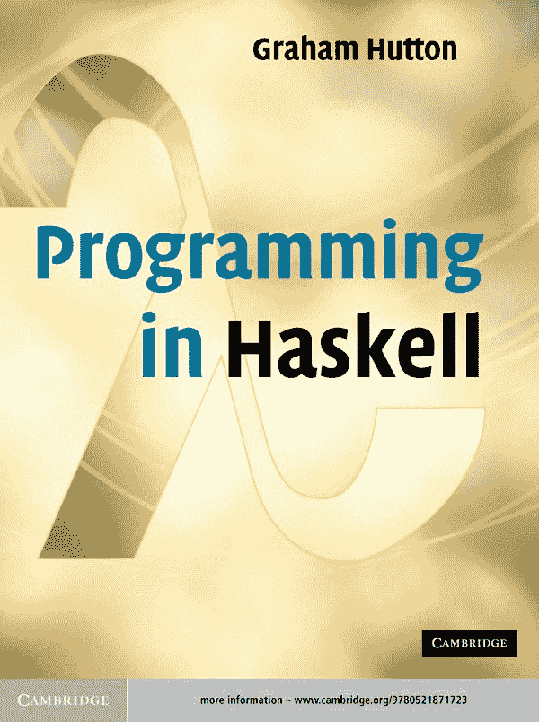

Haskell 是教授函数式编程的领先语言之一，使学生能够编写更简单整洁的代码，并学习如何构建和对程序进行推理。

本入门教程非常适合初学者：它不需要任何编程经验，所有概念都在精心挑选的示例帮助下从第一性原理进行解释。每一章都包含一系列练习，范围从基础练习到扩展项目不等，并提供了关于更高级主题的进一步阅读建议。其内容清晰明了，并受益于多年来的完善和课堂测试。

## 特性

- 书籍网站为讲师和学生免费提供每个章节的 Powerpoint 幻灯片
- 讲师可以获得练习题答案以及考试题（附答案）
- 书中的所有代码均完全符合 Haskell 的最新版本，并可从网上下载
- 由领先的 Haskell 研究人员和讲师编写，他以教学技巧而闻名
- 可用于课程，也可作为自学的独立教材

Graham Hutton 曾在四个领先的函数式编程研究与教学中心工作过。他拥有超过 15 年的函数式编程研究经验，在此期间发表了 30 多篇研究论文，担任过 Haskell 工作研讨会主席，并编辑了《函数式编程杂志》的 Haskell 特刊。他还有超过 10 年的 Haskell 教学经验，并在课程中推广函数式编程的使用。

*诺丁汉大学*

剑桥、纽约、墨尔本、马德里、开普敦、新加坡、圣保罗、德里、墨西哥城

* *

- 9.1 交互

## 12.9 练习

## 13.8 章节备注

## A.7 列表

## A.9 输入/输出

诺丁汉大学的编程基础（Foundations of Programming）小组是一个进行函数式编程研究和教学的卓越环境。感谢大学提供假期让我编写这本书；感谢我`Haskell`课程的所有学生和导师提供的反馈；并感谢`FOP`组的`Thorsten Altenkirch`、`Neil Ghani`、`Mark Jones`（现任波特兰德州大学）、`Conor McBride`和`Henrik Nilsson`在函数式理念以及如何展示这些理念方面的多次讨论。

我感谢`David Tranah`和`Dawn Preston`在剑桥大学出版社的编辑工作；感谢`Mark Jones`提供的用于 Haskell 的`Hugs`解释器；`Ralf Hinze`和`Andres Löh`提供的用于`Haskell`排版的`lhs2TeX`系统；`Rik van Geldrop`和`Jaap van der Woude`对使用书初稿的反馈；`Kees van den Broek`、`Frank Heitmann`和`Bill Tonkin`指出的错误；`Ian Bayley`和匿名评审者的宝贵意见；以及`Joel Wright`为倒计时程序计时。

Graham Hutton

### 2.2 标准预定义

# 示例 – `drop`

作为一个更具体的例子，我们现在展示如何使用这五步法来构建之前为库函数`drop`的定义，该函数是从列表开头删除指定数量的元素。

## 第 1 步：定义类型

让我们从一个类型开始，该类型表示`drop`接收一个整数和一个某种类型`a`的值列表，并产生另一个包含此类值的列表：

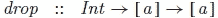

注意，我们在定义该类型时做出了四个决定：为了简单化，使用了整数而不是更通用的数值类型；为了灵活性，使用了柯里化而不是将参数作为元组（参见第 3.6 节）；为了可读性，将整数参数放在列表参数之前（`drop n xs`可以读作“从`xs`中删除`n`个元素”）；以及最后，为了通用性，使函数在列表元素类型上是多态的。

## 第 2 步：列举情况

由于整数参数有两种标准情况（`0`和`n + 1`），列表参数有两种情况（`[]`和`x : xs`），使用模式匹配编写骨架定义总共需要四种情况：

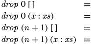

## 第 3 步：定义简单情况

根据定义，从任何列表开头删除零元素将得到相同的列表，因此定义前两种情况是非常直接的：

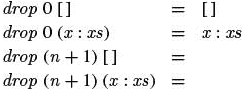

尝试从空列表删除一个或多个元素是无效的，因此可以省略第三种情况，如果发生这种情况，将产生一个错误。但在实践中，我们选择通过在这种情况下返回空列表来避免错误的产生：

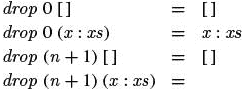

## 第 4 步：定义其他情况

我们如何从非空列表中删除一个或多个元素呢？只需从列表尾部少删除一个元素即可：

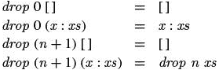

## 第 5 步：泛化和简化

由于函数`drop`不依赖于所适用的精确整数类型，其类型可以泛化为任何整数类型，其中`Int`和`Integer`是标准实例：

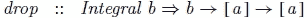

然而，出于效率考虑，这种泛化实际上并没有在标准 prelude 中实现，如第 3.9 节所示。在简化方面，`drop`的前两个方程可以合并为一个方程，表示从任何列表删除零元素将得到相同的列表：

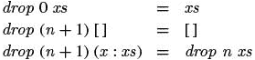

此外，最后一个方程中的变量`x`可以被通配符模式`_`替换，因为该变量在方程体中没有被使用：

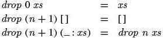

我们可能同样期望第二个方程中的`n`被替换为`_`，但这将使定义失效，因为形式为`n + k`的模式要求`n`必须是一个变量。这种约束可以通过将第二个方程中的整个模式`n + 1`替换为`_`来避免，但这将改变函数的行为。例如，评估`drop (-1) []`将产生空列表，而它目前产生一个错误，因为`_`可以匹配任何整数，而`n + 1`仅匹配大于等于 1 的整数。

结论，我们对`drop`的最终定义如下，这与附录 A 中标准 prelude 中的定义完全一致：

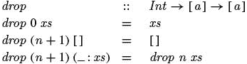

# 示例 – `init`

作为最后一个例子，让我们考虑如何构建库函数`init`的定义，该函数是从非空列表中删除最后一个元素。

## 第 1 步：定义类型

我们从一个类型开始，该类型表示`init`接收一个某种类型`a`的值列表，并产生另一个此类值的列表：

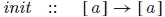

## 第 2 步：列举情况

由于空列表不是`init`的有效参数，使用模式匹配编写骨架定义只需要一种情况：

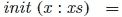

## 第 3 步：定义简单情况

虽然在前两个例子中这一步是直接的，但对于`init`函数需要更多的思考。根据定义，从只有一个元素的列表中删除最后一个元素将得到空列表，因此我们可以引入一个守卫来处理这个简单情况：

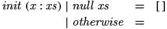

记得库函数`null`用于判断列表是否为空。

## 第 4 步：定义其他情况

我们如何从包含至少两个元素的列表中删除最后一个元素呢？只需保留头部并从尾部删除最后一个元素：

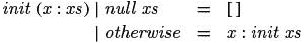

## 第 5 步：泛化和简化

`init`的类型已经尽可能通用了，但现在可以通过使用模式匹配而不是守卫，以及在第一个方程中使用通配符模式而不是变量来简化定义本身：

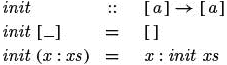

再次，这与 prelude 中的定义完全一致。

## 6.7 章记

本章提出的递归定义强调了清晰性，但许多定义可以在效率方面进行改进，参考[10]。定义的五步法基于[13]。

# 第 7 章

## 高阶函数

在本章中，我们引入高阶函数，它允许将编程模式封装为函数。我们首先解释什么是高阶函数以及它们为什么有用，然后介绍若干用于处理列表的标准高阶函数，考虑函数组合，并通过开发一个字符串传输器结束本章。

### 7.1 基本概念

正如我们在前面的章节中所看到的，Haskell 中具有多个参数的函数通常是通过柯里化（currying）的概念定义的。也就是说，利用函数可以返回函数作为结果这一事实，一个接一个接收参数。例如，该定义

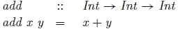

意味着

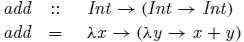

表示`add`是一个接收整数`x`并返回一个函数，该函数反过来接收另一个整数`y`并返回它们的和`x + y`。在 Haskell 中，定义接受函数作为参数的函数也是允许的。例如，一个接受函数和一个值，并返回将该函数两次应用于该值之结果的函数，可以定义如下：

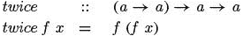

例如：

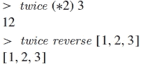

此外，由于`twice`是一个柯里化函数，可以通过仅一个参数对其进行部分应用，以构建其他有用函数。例如，将数字乘以四倍的函数由`twice (2)`提供，而两次反转（有限）列表没有影响这一事实通过等式`twice reverse = id`捕捉，其中`id`是由`id x = x`定义的恒等函数。

正式地说，接受函数作为参数或返回函数作为结果的函数被称为高阶函数（higher-order）。但在实践中，由于“柯里化”一词已用于返回函数作为结果，“高阶”一词通常仅用于接受函数作为参数。后者的这种解释正是本章的主题。

使用高阶函数大大增强了 Haskell 的能力，因为它允许常见的编程模式被封装为语言内部的函数。更广泛地说，高阶函数可以用于在 Haskell 中定义“领域特定”语言。例如，在本章中，我们介绍了一种处理列表的简单语言，并在第 8 章和第 9 章中为构建解析器和交互式程序做了同样的工作。

## 7.2 处理列表

标准 prelude 定义了许多处理列表的有用高阶函数。例如，`map`函数将一个函数应用于列表的所有元素，可以使用列表推导式定义如下：

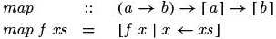

也就是说，`map f xs`返回所有值`f x`的列表，其中`x`是列表`xs`中的一个元素。例如，我们有：

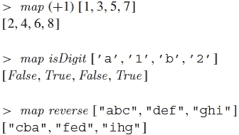

关于`map`还有三点需要注意。首先，它是一个多态函数，可以应用于任何类型的列表，就像大多数针对列表的高阶函数一样。其次，它可以应用于其自身以处理嵌套列表。例如，函数`map (map (+1))`会将数字列表中的每个数字加 1，如下方的计算所示：

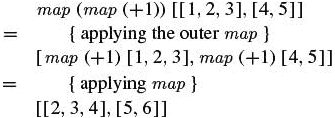

最后，`map`函数也可以使用递归定义：

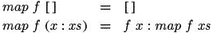

也就是说，将函数应用于空列表的所有元素会得到空列表，而对于非空列表，该函数简单地应用于列表的头部，然后我们继续将函数应用于尾部的所有元素。使用列表推导式的`map`原始定义更为简单，但为了推理起见，递归定义更为优越（参见第 13 章）。

另一个常用的库函数是`filter`，它选择列表中所有满足谓词的元素，其中谓词（predicate，或属性）是一个返回逻辑值的函数。与`map`一样，`filter`函数也有一个使用列表推导式的简单定义：

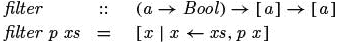

也就是说，`filter p xs`返回所有值`x`的列表，其中`x`是列表`xs`中的一个元素且`p x`的值为`True`。例如：

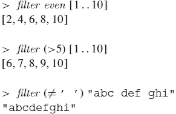

与`map`一样，`filter`函数可以应用于任何类型的列表，并为了推理之目的可以使用递归定义：

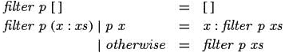

也就是说，从空列表中选择所有满足谓词的元素会得到空列表，而对于非空列表，结果取决于头部是否满足谓词。如果满足则保留头部，然后我们继续过滤列表尾部的元素；否则，丢弃头部，我们简单地过滤尾部的元素。

`map`和`filter`函数在程序中经常一起使用，其中`filter`用于从列表中选择某些元素，每个元素随后通过`map`进行转换。例如，一个返回列表中偶数整数平方和的函数可以定义如下：

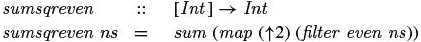

我们通过阐述在标准 prelude 中定义的其他若干处理列表的高阶函数来结束本节的介绍。

- 判定列表所有元素是否都满足谓词：

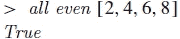

- 判定列表是否任一元素满足谓词：

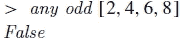

- 在元素满足谓词时从列表中选择元素：

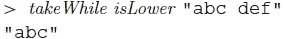

- 在元素满足谓词时从列表中移除元素：

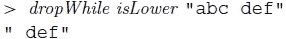

## 7.3 `foldr`函数

许多接受列表作为参数的函数可以使用以下递归模式定义：

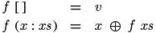

也就是说，该函数将空列表映射到值`v`，将任何非空列表映射到运算符`⊕`应用于头部和递归处理的尾部。例如，许多常见的列表函数可以使用此模式：

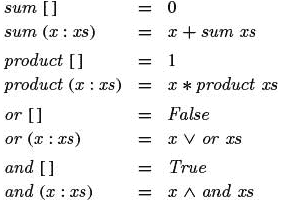

高阶库函数`foldr`（fold right 的缩写）封装了这种定义列表递归模式，并将运算符`⊕`和值`v`作为参数。例如，使用`foldr`上述定义可以更简洁地重写为：

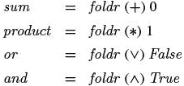

（记得作为参数时必须加括号。）这些新定义也可以包含显式的列表参数，例如`sum xs = foldr (+) 0 xs`，但我们更喜欢上述参数隐式的定义。

`foldr`函数本身使用递归定义：

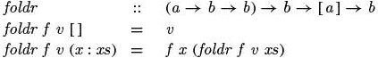

也就是说，`foldr f v`将空列表映射到值`v`，将任何非空列表映射到函数`f`应用于头部和递归的尾部。但在实践中，最好以非递归的方式思考`foldr f v`的行为，即简单地将列表中的每个构造单元替换为函数`f`，并将最后的空列表替换为值`v`。例如，将函数`foldr (+) 0`应用于列表

得到结果

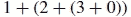

其中`:`和`[]`分别被替换为`+`和`0`。因此，定义`sum = foldr (+) 0`表示数字列表的和等于将每个构造替换为加法并将空列表替换为零。

尽管`foldr`封装了一个简单的递归模式，但它可以定义的函数比预想要多得多。首先，回顾库函数`length`的以下定义：

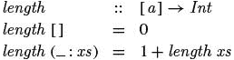

例如，将`length`应用于列表

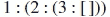

得到结果

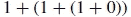

也就是说，计算列表的长度等于将每个`cons`替换为对其第二个参数加 1 的函数，并将空列表替换为零。因此，`length`的定义可以使用`foldr`重写：

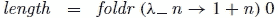

现在让我们考虑反转列表的库函数，它可以使用显式递归定义如下：

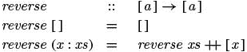

例如，对列表应用`reverse`：

得到结果

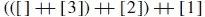

从定义或示例中，可能无法立即看出如何使用`foldr`来定义`reverse`。然而，如果我们定义一个函数`snoc x xs = xs ++ [x]`，它将新元素添加到列表的末尾而不是开头（“`snoc`”是`cons`的反过来写），那么`reverse`就可以被重新定义为

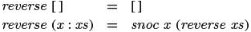

由此可以直接得到一个使用`foldr`的定义：

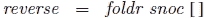

也就是说，反转列表等于将每个`cons`替换为`snoc`，并将空列表替换为自身。定义`snoc`时使用的连接运算符`++`本身可以使用特别紧凑的方式通过`foldr`定义：

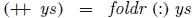

也就是说，将`ys`追加到列表末尾等于将列表中的每个`cons`替换为自身，并将末尾的空列表替换为`ys`。

我们在本节最后指出，名称 fold *right*（右折）反映了假设从右结合的运算符的使用。例如，计算`foldr (+) 0 [1, 2, 3]`得到结果`1 + (2 + (3 + 0))`，其中括号指定了这里的加法被假设为右结合。更通地说，`foldr`的行为可以总结如下：

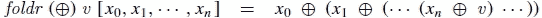

## 7.4 `foldl`函数

也可以使用假设从左结合的运算符在列表上定义递归函数。例如，函数`sum`可以通过这种方式使用辅助函数`sum'`重新定义，该函数接受一个额外的参数`v`，用于累积最终结果：

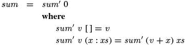

例如：

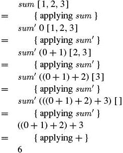

计算中的括号指定了现在加法被假设为左结合。但在实践中，在这种情况下结合的顺序不会影响结果的值，因为加法是*结合律*的。也就是说，对于任何数字`x`、`y`和`z`，`x + (y + z) = (x + y) + z`。

从`sum`示例推广，许多列表函数可以使用以下简单的递归模式定义：

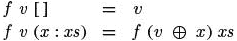

也就是说，该函数将空列表映射到累加器值`v`，并将非空列表映射到递归处理尾部的结果，结果是通过将运算符`⊕`应用于当前值和列表头部获取的新累加器值得到的。高阶库函数`foldl`（“fold left”左折的缩写）封装了这种递归模式，并将运算符`⊕`和累加器`v`作为参数。例如，使用`foldl`可以将上述`sum`的定义更紧凑地重写如下：

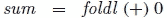

类似的，我们还有：

上一节中的其他`foldr`示例也可以通过提供相应的运算符使用`foldl`重新定义：

例如，使用这些新定义：

当一个函数既可以使用`foldr`使用`foldl`定义时（如上面的示例所示），哪种定义更优的选择通常是出于效率考虑，并且需要仔细考虑 Haskell 底层的评估机制，这在第 12 章中有所讨论。

`foldl`函数本身是通过递归定义的：

但在实践中，与`foldr`一样，最好以非递归的方式来思考`foldl`的行为，即通过一个假设从左结合的运算符`⊕`，如下式所示：

## 7.5 复合运算符

高阶库运算符将两个函数的复合返回为单个函数，并可以定义如下：

也就是说，`f . g`（读作“`f`复合`g`”）是一个接受参数`x`、将函数`g`应用于该参数，并将函数`f`应用于该结果的函数。该运算符也可以通过(`f . g) x` = `f (g x)`来定义。

## 7.6 字符串传输

我们用一个扩展示例结束本章。考虑使用 0 和 1 来模拟字符串的问题。更准确地说，我们寻求定义一个将字符串转换为 0 和 1 列表的函数，并带有一个执行相反转换的函数。

### 二进制数

由于有十根手指，人们通常认为使用十进制（*decimal*）表示法的数字最为方便。十进制是 0 到 9 之间的数字序列，其中最右侧的数字权重为 1，随着数字向左移动，其权重按十倍增加。例如，十进制数 2345 可以从这些角度这样理解：

也就是说，2345 代表权重 1000,100,10,1 与数字 2,3,4,5 的积之和，其结果为整数 2345。

相比之下，计算机通常认为使用更原始的二进制（*binary*）表示法的数字更为方便。二进制数是 0 和 1 的序列，称为二进制位或*位*（bits），随着这些位向左移动，其权重按两倍增加。例如，二进制数 1101 可以这样理解：

也就是说，1101 代表权重 8,4,2,1 与位 1,1,0,1 的积之和，其结果为整数 13。

为了简化某些函数的定义，在本示例的剩余部分，我们假设二进制数是以与正常的*反*顺序写入的。例如，1101 现在被写为 1011，随着我们向右移动，连续的位权重以 2 的倍增加：

### 进制转换

为了使我们定义的函数类型更具意义，我们为位（bits）声明了一个类型，作为整数类型的别名：

一个表示为位列表的二进制数，可以通过简单计算所需的加权和来转换为整数：

高阶库函数`iterate`通过对一个值不断增加次数地应用一个函数来产生列表：

因此，在`bin2int`定义中使用的表达式`iterate (*2) 1`产生了权重列表`[1, 2, 4, 8, · · ·]`。这个列表在概念上是无限的，但在第 12 章所讨论的惰性求值下，只会产生其所在上下文所需的元素——在这种情况下是与位列表进行 zip 操作时。例如：

然而，有一种更简单的方法来定义`bin2int`，可以通过一点代数揭示。考虑一个任意的四位二进制数`[a, b, c, d]`。对此列表应用`bin2int`将产生加权和：

它可以被重构如下：

最终结果显示，将位列表`[a, b, c, d]`转换为整数等同于将每个`cons`替换为将其第一个参数与其第二个参数的两倍相加的函数，并将空列表替换为零。更通地说，我们得出`bin2int`可以使用`foldr`重写：

现在让我们考虑相反的转换，从非负整数转换为二进制数。这可以通过反复将整数除以 2 并取余来实现，直到整数变为零。例如，从整数 13 开始，我们如下操作：

余数序列 1011 提供了整数 13 的二进制表示。使用递归实现此过程很容易：

例如：

我们将通过使用函数`make8`来确保我们所有的二进制数具有相同的长度（即八位），该函数会根据需要截断或扩展二进制数，使其恰好为八位：

库函数`repeat`产生一个包含值副本的无限列表，但再次，惰性求值确保了实际产生的元素只有上下文所需的。例如：

### 传输

我们现在可以定义一个函数，将字符字符串编码为位列表，方法是将每个字符转换为 Unicode 数字，将将每个此类数字转换为八位二进制数，并将这些数字拼接在一起产生位列表。使用高阶函数`map`和组合，这种转换可以实现如下：

例如：

为了解码使用`encode`产生的位列表，我们首先定义一个函数`chop8`，将此类列表切割成八位二进制数：

现在很容易定义一个函数，将位列表解码为字符字符串，方法是切割列表，并将每个生成的二进制数转换为 Unicode 数字，然后转换为字符：

例如：

最后，我们定义一个函数`transmit`来模拟字符字符串作为位列表的传输，使用通过恒等函数建模的完美信道：

例如：

## 7.7 章后

高阶函数的进一步应用，包括计算机音乐、财务合同、图形图像、硬件描述、逻辑程序和漂亮化打印程序，可以在*编程的乐趣* (7) 中找到。关于`foldr`的更深入的教程见 (14)。

## 7.8 练习

**1.** 显示如何使用高阶函数`map`和`filter`重新表达列表推导式`[f x | x <- xs, p x]`。

**2.** 在不看标准 prelude 中定义的情况下，定义高阶函数`all`、`any`、`takeWhile`和`dropWhile`。

**3.** 使用`foldr`重新定义函数`map`和`filter`。

**4.** 使用`foldl`定义函数`dec2int :: [Int] -> Int`，将十进制数转换为整数。例如：

**5.** 解释为什么以下定义是无效的：

**6.** 不看标准，定义高阶函数`curry`将对转换为函数，相反，定义`uncurry`将转换函数转换为对。提示：首先写下函数的类型。

**7.** 一个封装产生列表简单模式的高阶函数`unfold`可以定义如下：

即，`unfold p h t`当谓词`p`为真时产生空列表，否则通过应用函数`h`生成头，通过函数`t`生成尾。例如，函数`int2bin`使用`unfold`可以紧凑地重写为：

使用`unfold`重新定义函数`chop8`、`map`和`iterate`。

**8.** 修改字符串传输程序以使用校验位检测简单的传输错误。也就是说，编码期间每个八位二进制数扩展一个校验位，如果 1 个数奇设置为 1，否则设置为 0。反之，解码期间每个的生成的九位二进制数都会检查其校验位是否正确，如果是则丢弃校验位，否则报告校验错误。提示：库函数`error :: String -> a`终止求值并将给定字符串作为错误消息。

**9.** 使用忘记第一位的故障信道测试你上一个练习中的新字符串传输程序，该信道可以使用位列表的`tail`函数建模。

# 第 8 章

在本章中，我们展示如何使用 Haskell 编写简单的解析器。我们首先解释什么是解析器以及它们为什么有用，展示解析器如何自然地被视为函数，定义一系列基本解析器以及各种方式组合解析器的高阶函数，并最后开发一个算术表达式的解析器。

## 8.1 解析器

*解析器*是一个接收字符字符串并产生某种形式的树的程序，该树显了字符串的语法结构。例如，对于字符串 2 * 3 + 4，表达式解析器可能会产生如下形式的树，其中数字出现在树的叶子上，运算符出现在分支上：

该树的结构显了 + 和 * 是具有两个参数的运算符，并且 * 的优先级比 + 高。

解析器是计算领域中一个重要课题，因为大多数现实程序都会使用解析器来对其输入进行预处理。例如，计算器程序在评估数值表达式之前会对其进行解析，Hugs 系统在执行 Haskell 程序之前会对其解析，而网页浏览器在显示超文本文档之前会对其解析。在每种情况下，将输入的结构显式化都能极地简化后续的处理。例如，一旦数值表达式被解析为树结构（如上例所示），评估该表达式就变得非常简单。

## 8.2 解析器类型

在 Haskell 中，解析器可以自然地直接视为一个接受字符串并产生树的函数。因此，给定一个合适的树类型`Tree`，解析器的概念可以表示为类型为`String` → `Tree`的函数，我们通过以下声明将其简写为`Parser`：

然而，通常情况下，解析器并不总是消耗其整个参数字符串。例如，数字解析器可能会被应用于一个由数字后面跟着单词组成的字符串。因此，我们泛化了解析器的类型，使其也返回参数字符串中任何未被消耗的部分：

同样地，解析器并不总是成功的。例如，数字解析器可能会被应用于一个由单词组成的字符串。为了处理这种情况，我们进一步泛化了解析器的类型，使其返回一个结果列表，按照约定，空列表表示失败，单元素列表表示成功：

返回列表也开启了返回多个结果的可能性，如果参数字符串可以以多种一种方式被解析。然而，为了简单起 way，我们只考虑最多返回一个结果的解析器。

最后，不同的解析器可能会返回不同类型的树，或者更通地说，返回任何类型的值。例如，数字解析器可能会返回一个整数值。因此，从结果值的特定类型`Tree`中抽象出来并将其作为`Parser`类型的一个参数是有用的：

总结，该声明说明类型为`a`的解析器是一个接受输入字符串并产生结果列表的函数，每个结果都是由一个类型为`a`的结果值和一个输出字符串组成的对对。或者，解析器类型也可以读作苏斯风格的韵律诗！

*一个用于事物的解析器*

*是从字符串到函数*

*到对列表*

*包含事物和字符串*

## 8.3 基本解析器

我们现在定义三个基础解析器，它们将作为所有其他解析器的构建模块。首先，解析器`return v`总是以结果值`v`成功，而不消耗输入字符串的任何部分：

该函数同样可以用`return v inp` = [`(`v`, `inp`)`]来定义。然而，我们更倾向于上面的定义，其中第二个参数`inp`使用 lambda 表达式移动到定义体中，因为这显式地表明`return`是一个接受单个参数并返回解析器的函数，正如类型`a` → `Parser a`所表示的那样。

虽然`return v`总是成功的，对立的解析器`failure`无论输入字符串的内容总是失败的：

我们最后一个基础解析器是`item`，它如果输入字符串为空则失败，否则以第一个字符作为结果值成功：

此定义中使用的 Haskell 的`case`机制允许在定义体中使用模式匹配，在本例中，通过将字符串`inp`与两个模式进行匹配来在两个可能的结果之间选择。`case`机制在书中并不经常使用，但有时是有有用的。

因为解析器是函数，它们可以使用普通的函数应用应用于字符串，但我们更倾向于通过定义自己的应用函数来抽象解析器的表示：

使用`parse`，我们通过一些示例结束本节，这些示例说明了上面三个基础解析器的行为：

## 8.4 排序

组合两个解析器最简单的方法可能是顺序应用它们，其中第一个解析器返回的输出字符串成为第二个解析器的输入字符串。但应该如何处理来自两个解析器的结果值？一种方法是使用解析器的序列运算符将两个值组合为一个对，其类型如下：

但在实践中，事实证明通过如下定义的序列运算符`>>=`（读作“然后”）将解析器的排序与其结果值的处理结合起来被证明更加方便：

也就是说，如果解析器`p`应用于输入字符串失败，则`p`>>=` `f`失败；否则将函数`f`应用于结果值得到第二个解析器，然后将该解析器应用于输出字符串以得到最终结果。通过这种方式，第一个解析器产生的结果值可以直接供第二个解析器处理。

使用`>>=`构建的典型解析器具有以下结构：

即，应用解析器`p1`并调用其结果值`v1`；然后应用解析器`p2`并调用其结果值`v2`；应用解析器`pn`并调用其结果值`vn`；最后，通过函数`f`将所有结果合并为一个单一值。

与列表推导式一样，表达式`vi` ← `pi`被称为生成器。Haskell 为此类解析器提供了特殊语法，允许它们以以下更吸引人的形式表示：

同样注意，布局规则也适用于排序解析器的 **do** 记法，即序列中的每个解析器都必须在同一列开始。

例如，一个消耗三个字符、丢弃第二个并将第一个和第三个作为对的解析器现在可以定义如下：

注意`p`只有当定义序列中的每个解析器都成功时才成功，这要求输入字符串至少有三个字符：

## 8.5 选择

另一种组合两个解析器的方法是将第一个解析器应用于输入字符串，如果失败则应用第二个。这种选择运算符`+++`（读作“否则”）可以定义如下：

例如：

## 8.6 派生原语

使用三个基础解析器结合排序和选择，我们现在可以定义许多其他实用的原语。首先，我们定义了一个满足谓词`p`的单个字符解析器`sat p`：

使用`sat`和标准库中适当的谓词，我们可以定义用于单个数字、小写字母、大写字母、任意字母、字母数字以及特定字符的解析器：

例如：

反之，使用`char`我们可以定义一个用于字符串`xs`的解析器`string xs`，并将字符串本身作为结果值返回：

注意`string`是通过递归定义的，并且只有在整个目标字符串被完全消耗时才会成功。基础情况规定，空字符串总是可以被解析。递归情况规定，非空字符串可以通过解析第一个字符、解析剩余字符并返回整个字符串作为结果值来完成解析。例如：

我们接下来的两个解析器`many p`和`many1 p`会尽可能多次应用解析器`p`直到其失败，每次成功应用`p`得到的结果值将被组合成列表。这两个重复原语之间的区别在于，`many`允许`p`被零次或多次应用，而`many1`要求至少要成功应用一次：

注意`many`和`many1`是通过互递归定义的。特别是，`many p`的定义规定`p`只要至少应用一次，也可以不应用，而`many1 p`的定义规定`p`可以应用一次，然后是零次或多次。例如：

使用`many`和`many1`，我们可以为`identifiers`（变量名）定义解析器，它由一个小写字母后跟零或多个字母数字组成；`numbers`（自然数）由一个或多个数字组成；`spacing`（间距）由零或多个空格、制表符和换行符组成：

例如：

注意`space`返回空元组`()`作为占位结果值，反映了间距的细节通常并不重要。

## 8.7 处理间距

大多数现实中的解析器允许在输入字符串的各个`tokens`周围自由使用间距。例如，`1+2`和`1 + 2`字符串在 Hugs 中以相同的方式解析。为了处理这种间距，我们定义了一个新的原语，它在应用标记的解析器之前和之后忽略任何空格：

使用`token`，现在可以很容易地定义忽略标识符、自然数和特殊符号周围间距的解析器：

例如，一个忽略标记周围间距的非空自然数列表解析器可以定义如下：

该定义规定，这样的列表以左方括号和一个自然数开始，后面跟着零或多个逗号和自然数，并以右方括号结束。注意`p`只有在消耗了完全符合这种格式的完整列表时才会成功：

## 8.8 算术表达式

我们用一个扩展示例来结束本章。考虑一种由自然数通过加法、乘法和括号构建的简单算术表达式。我们假设加法和乘法是右结合的，并且乘法的优先级高于加法。例如，`2 + 3 + 4`意味着`2 + (3 + 4)`，而`2 * 3 + 4`意味着`(2 * 3) + 4`。

语言的语法结构可以使用数学概念`grammar`（语法）来形式化，它是一组描述如何构造语言字符串的规则。例如，我们算术表达式语言的语法可以通过以下两条规则定义：

第一条规则规定，表达式可以是两个表达式的加法或乘法、一个带括号的表达式，或者一个自然数。相应的，第二条规则规定自然数可以是零、一、二等。例如，使用该语法，表达式`2 * 3 + 4`的构建可以用下面的`parse tree`（解析树）表示，其中表达式中的标记出现在叶子节点上，而用于构造表达式的语法规则产生了分支结构：

该树的结构显式地表明`2 * 3 + 4`可以由两个表达式的加法构建，第一个由另外两个表达式的乘法给出（这两个表达式又由数字二和三给出），第二个表达式由数字四给出。然而，语法也允许该示例有另一种可能的解析树，这对应于将表达式错误解释为`2 * (3 + 4)`：

问题在于，我们的表达式语法没有考虑到乘法的优先级高于加法这一事实。然而，可以通过修改语法为每个优先级级别设置单独的规则来轻松修复，其中加法处于最低优先级级别，乘法处于中间级别，括号和数字处于最高级别：

使用这个新语法，`2 * 3 + 4`确实只有一个解析树，它对应于表达式的正确解释`(2 * 3) + 4`：

我们现在处理了优先级问题，但我们的语法还没有考虑到加法和乘法是右结合的。例如，表达式`2 + 3 + 4`目前有两种可能的解析树，分别对应于`(2 + 3) + 4`和`2 + (3 + 4)`。然而，这可以通过修改加法和乘法的语法使其在右参数上递归来轻松修复：

使用这些新规则，`2 + 3 + 4`现在只有一个解析树，对应于对表达式的正确解释`2 + (3 + 4)`：

事实上，我们的表达式语法现在是无歧义的，意味着每个良好的表达式都有仅一个解析树。

我们对语法的最后一次修改是简化。例如，考虑规则`expr ::= term + expr | term`，它规定表达式可以是 term 和表达式的加法，或者是 term。换句话说，表达式总是从 term 开始，然后可以跟表达式的加法或为空。因此，表达式的规则可以简化为`expr ::= term (+ expr | ))`，其中符号``表示空字符串。以类似的方式简化 term 的规则得到了我们最终的算术表达式语法：

现在可以将此语法翻译为表达式的解析器，只需使用我们的解析原语重写规则即可。事实上，我们选择让解析器本身对被解析的表达式求整数值，而不是返回某种形式的树：

例如，解析器`expr`首先解析值为`t`的 term，然后解析一个加号和值为`e`的表达式并返回值`t + e`，否则不再继续解析并直接返回值`t`。`term`和`factor`解析器可以类似地读取。

最后，使用`expr`我们定义了一个函数`eval :: String -> Int`，将算术表达式求值为整数值。为了处理未消耗和无效输入的情况，我们使用库函数`error :: String -> a`，它会显示错误消息然后终止程序：

例如：

一个包含本章解析原语的库文件可以从书籍网站获取。由于关于解析器单态性质（monadic nature）的技术原因，该库中的一些基本定义与此处给出的略有不同。更多细节可参见 (16; 17)，本章正是基于这些编写的。关于语法的更多信息可以在 (27) 中找到，而在 Haskell 中构建解析器的更高级方法请参阅 (22; 9)。将解析器类型读作一个韵律是归功于 Fritz Ruehr。

### 8.10 练习

**1.** 库文件还定义了一个用于整数的解析器`int` :: `Parser Int`。在不看该定义的情况下，定义`int`。提示：整数要么是一个负号后跟一个自然数，要么是一个自然数。

**2.** 定义一个解析器`comment` :: `Parser` ()，用于处理普通的 Haskell 注释，该注释以符号`--`开始，并延伸到当前行的行尾（行尾由控制字符`'\n'`表示）。

**3.** 使用我们用于算术表达式的第二个语法法，画出表达式`2 + 3 + 4`的两种可能的解析树。

**4.** 使用我们用于算术表达式的第三个语法，画出表达式`2 + 3`、`2 * 3 * 4`和`(2 + 3) + 4`的解析树。

**5.** 解释为什么算术表达式语法的最终简化对结果解析器的效率有巨大影响。提示：先考虑如果没有进行这一步，一个由单个数字组成的表达式将如何被解析。

**6.** 根据以下对语法的扩展，扩展算术表达式的解析器以支持减法和除法：

**7.** 进一步扩展算术表达式的语法和解析器以支持幂运算，假设幂运算是右结合的，优先级高于乘法和除法，但低于括号和数字。例如，`2 ↑ 3 * 4`意味着`(2 ↑ 3) * 4`。提示：新的优先级需要在语法中引入一个新的规则。

**8.** 考虑使用减法运算符从自然数构建的表达式，该运算符被假设是左结合的。

**(a)** 为此类表达式定义一个自然语法。

**(b)** 将此语法翻译为解析器`expr` :: `Parser Int`。

**(c)** 这个解析器存在什么问题？

**(d)** 展示如何修复它。提示：使用重复原语`many`和库函数`foldl`重写解析器。

# 第 9 章

## 交互式程序

在本章中，我们将展示如何使用 Haskell 编写交互式程序。我们首先开始解释什么是交互式程序，展示此类程序如何自然地被视为函数，定义了一些基础交互式程序以及用于组合交互式程序的高阶函数，并通过开发一个计算器和生命游戏作为结束。

### 9.1 交互

`batch`（批处理）程序是指在运行时不与用户交互的程序。在计算机早期，大多数程序都是批处理程序，它们独立于用户运行，以最大限度地增加计算机执行有用工作的时间。例如，一个路线规划程序可能接受起点和终点作为输入，静地执行大量计算，然后生成推荐的路线作为输出。

到本书为止，我们已经考虑了如何使用 Haskell 编写批处理程序。在 Haskell 中，此类程序（更广泛地说是所有程序）被建模为`pure`（纯）函数，接受所有输入作为显式参数并将所有输出产生显式结果。例如，路线规划器可以被建模为一个类型为`(Point, Point) → Route`的函数，接受一对点并产生它们之间的路线。

此相反，`interactive`（交互式）程序是在程序运行时可以从用户获取额外的输入，并为用户产生额外的输出。在现代计算时代，大多数程序都是交互式程序，通过与用户对话的方式运行，以提供更大的灵活性。例如，计算器程序可能允许用户使用键盘交互式地输入数值表达式，并立即在屏幕上显示这些表达式的值。

初一看，将交互式程序建模为纯函数似乎是不可行的，因为此类程序从本质上要求在程序运行时获取额外输入和产生额外输出的`side effects`（副作用）。例如，上述计算器程序如何被视为一个从参数到结果的纯函数呢？

多年来，针对将纯函数概念与副作用概念相结合的问题已经有了许多解决方案。在本章的剩余部分，我们将介绍 Haskell 采用的解决方案，该方案基于一种新类型结合少量原语的使用。正如我们将看到的，这种方法与上一章介绍的解析器方法有很多共同之处。

### 9.2 输入/输出类型

在 Haskell 中，交互式程序被视为一个纯函数，它将当前的“世界状态”作为参数，产生一个修改后的世界作为结果，其中修改后的世界反映了程序执行的任何副作用。因此，给定一个合适的类型`World`，其值代表世界的当前状态，交互式程序的概念可以用一个类型为`World → World`的函数表示，我们简写为`IO`（“input/output”的缩写），如下：

然而，通常交互式程序在执行副作用之外还可以返回一个结果值。例如，一个从键盘读取字符的程序可能会返回所读取的字符。因此，我们将交互式程序的类型泛化为也返回结果值，这些值的类型是`IO`的参数：

类型为`IO a`的表达式被称为`actions`（动作）。例如，`IO Char`是返回字符的动作类型，而`IO ()`是返回空元组`()`作为虚拟结果值的动作类型。后者的动作可以被认为是不返回结果值的纯副作用动作，在编写交互式程序时经常使用。

除了返回结果值，交互式程序可能还需要参数值。然而，没有必要将动作类型泛化以考虑这一点，因为这种行为可以通过柯里化（currying）来实现。例如，一个接受字符并返回整数的交互式程序类型为`Char → IO Int`，它是柯里化函数类型`Char → World → (Int, World)`的简写。

此时，读者可能会担心在使用动作编程时传递整个世界状态的可行性。实际上，Haskell 系统（如 Hugs）实现动作的方式比描述的更高效，但为了理解动作的行为，这种抽象视图就足够了。

### 9.3 基础动作

我们现在引入构建交互式程序的三个基础动作。首先，动作`getChar`从键盘读取一个字符，将其回显到屏幕上，并将该字符作为结果值返回：

`getChar`的实际定义是内置在 Hugs 系统中的，无法在 Haskell 内部定义。如果键盘上没有等待读取的字符，`getChar`将等待用户输入。

双重操作`putChar c`将字符`c`写入屏幕，并且不返回结果值，用空元组表示：

我们最后一个基础操作是`return v`，它只是简单地返回结果值`v`，而不执行任何交互：

`return`函数提供了一个从无副作用的纯表达式设置到具有副作用的不纯操作设置的桥梁。然而，关键的一点是，这里没有回回去的桥梁——一旦我们进入了不纯状态，我们就永远都是不纯的，没有任何救回的可能！因此，我们可能怀疑不纯性会迅速渗透整个程序，但在实践中通常并非如此。对于大多数 Haskell 程序来说，绝大多数函数都不涉及交互，这些由最外层相对少量的交互函数来处理。

在本节的结束处，我们注意到在 Hugs 中求值一个操作会执行其副作用并丢弃产生的值。例如，求值`putChar ’a’`会将字符’a’写入屏幕，丢弃该操作的结果值，然后终止：

## 9.4 序列化

与解析器一样，组合两个操作的自然方式是顺序执行它们，其中第一个操作返回的修改后的世界成为第二个操作的当前世界，通过序列化运算符`>>=`（读作“then”）实现，其定义如下：

也就是说，我们将操作`f`应用于当前世界，然后将函数`g`应用于结果值以得到第二个操作，然后将该操作应用于修改后的世界以得到最终结果。在实践中，与上一章的解析器一样，通常使用`do`记法以更具吸引力的形式表达使用`>>=`定义的操作。

例如，使用`do`记法，原语操作`getChar`可以分解为：从键盘读取字符、将其回显到屏幕上以及将字符作为结果返回的操作：

不回显即读取字符的操作`getCh`不是标准预定义（prelude）的一部分，而是作为 Hugs 的扩展提供的，并且可以通过包含以下特殊行在任何脚本中可用：

## 9.5 派生原语

通过结合三个基本操作和序列化，我们现在可以定义许多其他用的操作原语。首先，我们定义了一个操作`getLine`，它从键盘读取一个字符字符串：

（符号`'\n’`代表换行符。）相应地，我们定义了`putStr`和`putStrLn`操作，它们将字符串写入屏幕，后者操作在之后还会移动到新行：

例如，使用这些原语，我们现在可以定义一个操作，提示用户从键盘输入一个字符串，然后显示其长度：

例如：

除了上述定义的库原语外，为了本章剩余部分的示例之，定义一些其他原语也是有用的。首先，我们通过显示相应的控制字符定义了发出蜂声和清屏的操作：

按照惯例，屏幕上每个字符的位置由正整数对`(x, y)`给出，其中 (1, 1) 是左上角。通过显示相应的控制字符，我们定义了屏幕上每个字符的位置：

通过控制字符，我们定义了在给定位置显示字符的操作：

相应地，我们定义了显示当前字符串的操作：

最后，我们定义了求值一个操作并丢弃产生的值：

例如，使用`seqn`，上述操作可以紧凑地重写为：

## 9.6 计算器

在本章的最后，我们开发了一个计算器，它显示当前字符串，并从键盘读取一个字符而不回显。我们现在扩展它以处理加法、减法、乘法、除法和括号以及整数。首先，我们定义了计算器的界面：

计算器本身由一个函数`calc`控制，它显示当前字符串，然后从键盘读取一个字符而不回显。如果该字符是有效的按钮，对其进行处理；否则我们发出蜂声表示错误并保持原有字符串：

`process`函数接收有效字符和当前字符串，根据字符执行相应的操作：

我们现在考虑五种可能的操作：

- 退出将光标移动到计算器框下方并终止：

- 删除如果当前字符串为空则没有影响，否则从字符串中删除最后一个字符：

- 评估显示解析和求值当前字符串的结果，如果此过程失败则发出蜂声：

- 清除显示将当前字符串重置为空：

- 任何其他字符都追加到字符串的末尾：

最后，我们定义了一个函数来运行计算器，它通过清空屏幕、显示框框并从空显示开始：

## 9.7 生命之游戏

我们通过第二个扩展示例来结束本章，该示例涉及`生命游戏`（game of life）。这个游戏模拟了一个简单的进化系统，并在二维棋盘上进行。棋盘上的每个方格要么是空的，要么包含一个活细胞，如下所示：

棋盘上的每个内部方格都有八个相邻邻居：

为了统一，棋盘边缘的每个方格也被视为具有八个邻居，假设棋盘是从上到下、从左到右环绕的。也就是说，我们可以将棋盘看作是一个环面，它可以被看作是一个三维甜甜圈形状对象的表面。

给定棋盘的初始配置，通过对所有方格同时应用以下规则来得到下一代`generation`（代）：

- 如果一个活细胞恰好有两个或三个相邻方格包含活细胞，则它存活；否则死亡（变为空格）；
- 如果一个空方格恰好有三个邻居包含活细胞，则它产生一个活细胞；否则保持为空。

例如，将上述规则应用于上方棋盘可以得到：

通过对新棋盘重复此过程，可以产生无限的代序列。通过对初始配置的仔细设计，可以在序列中观察到许多有趣的行为模式。例如，上述细胞排列被称为`glider`（滑翔者），它会在连续的代中沿棋盘对角线移动。

尽管生命游戏非常简单，但它在计算上实际上是完备的，这意味着任何计算过程都可以通过适当编码在其中进行模拟。在本节的剩余部分中，我们将展示如何在 Haskell 中实现生命游戏。

为了能够方便地修改棋盘的大小，我们定义两个整数值来确定棋盘在方格数上的宽度和高度：

我们将棋盘表示为包含活细胞的 (*x*, *y*) 位置的列表，使用与屏幕相同的坐标表示法：

例如，上面的初始示例棋盘将表示为：

使用这种棋盘表示法，很容易在屏幕上显示活细胞，并判断给定位置是活着的还是空的：

接下来，我们定义一个返回位置之邻居的函数：

辅助函数`wrap`考虑了棋盘边缘的环绕，它通过从给定位置的每个分量减一，除以棋盘的宽度和高度取余，然后再次为每个分量加一：

使用函数组合，我们现在可以定义一个计算给定位置活邻居数量的函数，其方法是产生其邻居列表，保留活的邻居并计数：

使用该函数，可以很容易地产生棋盘中恰好有两个或三个活邻居的活位置列表，因此它们能生存到下一代：

反之，也可以如下所示产生棋盘中恰好有三个活邻居的空位置列表，因此它们会产生新细胞：

然而，这种定义考虑了棋盘上的所有可能位置。一种更精细的方法（对于较大的棋盘可能更高）是只考虑棋盘上活细胞的邻居，因为只有这些位置才可能产生新的生命。使用这种方法，函数`births`可以重写为如下：

辅助函数`rmdups`删除列表中的重复项，在上面被用于确保每个潜在的新细胞只被考虑一次：

现在只需简单地附加幸存者列表和新出生细胞列表，即可产生棋盘的下一代：

最后，我们定义了一个`life`函数来实现生命游戏本身，其过程为：清除屏幕、显示当前棋盘中的活细胞、等待片刻，然后继续下一代：

`wait`函数用于将游戏减慢到合理的速度，可以通过执行给定数量的虚假动作来实现：

为了好玩，你可能喜欢用`glider`示例尝试`life`函数，并实验一些你自己的模式。

## 9.8 章节备注

使用`IO`类型执行其他形式的副作用（包括读写文件和处理异常事件）在 Haskell Report (25) 中有所讨论。输入/输出以及其他形式副作用的正式含义见于 (24)。Haskell 主页 `[www.haskell.org](http://www.haskell.org)` 提供了多种用于图形交互的库。生命游戏由 Conway 发明，并在 1970 年 10 月的《科学美国人》中普及。

## 9.9 练习

1. 定义动作 `readLine :: IO String`，其行为与 `getLine` 相同，但允许使用删除键删除字符。提示：删除字符是 `\DEL`，光标后移一个字符的控制字符串是 `\ESC[1D`。
2. 修改计算器程序，通过使用返回的未消耗字符串来指示错误的大致位置，而不是仅仅报警。
3. 在某些系统上生命游戏可能会闪烁，因为每代都会清除屏幕。修改游戏以只显示状态改变的位置来避免这种闪烁。
4. 一个编辑器，允许用户交互地创建和修改生命游戏棋盘的内容。
5. 使用来自 `[www.haskell.org](http://www.haskell.org)` 的图形库制作计算器和生命游戏的图形版本。
6. （nim）是一种在多行星星上玩的游戏。两个玩家轮流从单行的末尾移除一个或多个星星。移除最后一颗或几颗星星的玩家获胜。在 Haskell 中实现它。提示：将棋盘表示为每行剩余星星数量的列表，初始棋盘为 `[5, 4, 3, 2, 1]`。

正如本例所示，新类型的名称必须大大字母开头。类型声明是可以嵌套的，这意味着一个类型可以基于另一个类型进行声明。例如，在上一章中，棋盘（boards）类型是基于位置（positions）类型声明的：

然而，出于技术原因，类型声明不能是递归的。例如，考虑以下错误声明：

也就是说，树是一个包含一个整数和一个子树列表的元组。虽然这个声明非常合理（空子树列表构成了递归的基底情况），但在 Haskell 中是不被允许的，因为它是递归的。如果需要，可以使用更强大的 `data` 机制来声明递归类型，该机制稍后会介绍。

类型声明还可以由其他类型参数化。例如，在之前的两个章节中，我们根据类型参数声明了用于解析器（parsers）和交互式程序的以下类型：

允许具有多个类型参数的声明。例如，一个将一种类型的键与另一种类型的值关联的查找表类型，可以声明为 (key, value) 对的列表：

使用该类型，可以定义如下函数，返回表中与给定键关联的第一个值：

## 10.2 数据声明

通过使用 Haskell 的 `data` 机制指定其值，可以声明一个完全新的类型，而不是现有类型的别名。例如，标准库中的以下声明指出，`Bool` 类型由两个新值组成，分别名为 `False` 和 `True`：

在此类声明中，符号 `|` 被读作“或”（or），该类型的新值被称为*构造函数*（constructors）。与新类型本身一样，新构造函数的名称必须以大写字母开头。此外，同一个构造函数名称不能在多个类型中使用。

请注意，赋予新类型和构造函数的名称对 Hugs 系统本身没有固有意义。例如，上述声明也可以同样写成 `data` `A` = `B | C`，因为名称的精确细节并不重要，只要它们之前没有被使用过。`Bool`、`False` 和 `True` 等名称的意义是由程序员通过他们在新类型上定义的函数来赋值的。

新类型的值的使用方式与内置类型完全相同。特别是，它们可以自由地作为参数传递给函数、作为函数的返回结果、存储在列表等数据结构中，并用于模式匹配。例如，给定声明：

将移动应用到位置的（注意位置是相对于屏幕左上角的）、将一系列移动应用到位置的、以及翻转移动方向的函数，可以定义如下：

数据声明中的构造函数也可以带有参数。例如，一种由给定半径的圆形和给定尺寸的矩形组成的形状类型，可以通过以下方式声明：

也就是说，类型 `Shape` 具有形式为 `Circle r` 的值（其中 `r` 是浮点数）和 `Rect x y` 的值（其中 `x` 和 `y` 是浮点数）。这些构造函数可以被用于定义关于形状的函数，例如生成给定尺寸的正方形，以及计算形状的面积：

由于使用了参数，构造函数 `Circle` 和 `Rect` 实际上是构造函数，它们从 `Float` 类型的参数产生 `Shape` 类型的结果，这可以通过在 Hugs 中进行演示：

普通函数和构造函数之间的区别在于，后者没有定义方程，仅存在于构建数据片段的目的。例如，虽然表达式 `negate` 1.0 可以应用 `negate` 的定义求值得到 −1.0，但表达式 `Circle` 1.0 已经是完全求值的了，因此无法进一步简化，因为没有用于 `Circle` 的定义方程。相反，表达式 `Circle` 1.0 仅仅是一段数据，就像 1.0 本身只是数据一样。

并不意外的是，数据声明本身也可以被参数化。例如，标准库声明了以下类型：

也就是说，类型 `Maybe a` 的值要么是 `Nothing`，要么是某个类型 `a` 的值 `x` 的形式 `Just x`。我们将 `Maybe a` 类型的值视为可能失败的 `a` 类型的值，其中 `Nothing` 代表失败，`Just` 代表成功。例如，使用这种类型我们可以定义库函数 `div` 和 `head` 的安全版本，它们在参数无效时返回 `Nothing` 而产生错误：

## 10.3 递归类型

使用 data 机制声明的类型也可以是递归的。通过一个简单的示例，考虑以下类型：

也就是说，类型 `Nat` 的值要么是 `Zero`，要么是某个类型 `Nat` 的值 `n` 的形式 `Succ n`。因此，该声明产生无限序列，从 `Zero` 开始，通过对前面的值应用构造函数 `Succ` 来继续：

正如名称所示，`Nat` 类型的值可以认为是自然数（非负整数），其中 `Zero` 代表 0，`Succ` 代表后继函数 1+。更正式地，我们可以定义以下转换函数：

例如，使用这些函数，两个自然数的和可以通过将它们转换为整数、相加后再将结果转换为自然数来实现：

然而，使用递归重新定义 `add` 函数不需要这种转换，因此更加高效：

该定义形式化了这样思想：两个自然数的和可以通过复制第一个数字的 `Succ` 构造直到它们耗尽，此时末尾的 `Zero` 被第二个数字替换。例如，显示 2 + 1 = 3 的过程如下：

另一个示例，可以使用 data 机制声明我们自己的内置列表类型，由任意类型参数化：

也就是说，类型 `List a` 的值要么是代表空列表的 `Nil`，要么是某些类型 `a` 的值 `x` 和 `List a` 类型 `xs` 的形式 `Cons x xs` 代表非空列表。使用该类型，我们还可以定义我们自己的列表库函数版本，例如计算列表的长度：

虽然列表可能是计算中最常用的数据结构，但通常将数据存储在双向分支结构（即二叉树）中也有用，如下例所示：

在这个示例中，数字 1, 4, 6, 9 出现在树的外部叶子上，而数字 5, 3, 7 出现在内部节点上。使用递归，可以声明用于表示此类树的合适类型：

为了简单起见，我们将值的类型固定为整型，但通过对声明进行参数化可以轻松地扩展。使用这种类型，上图所示的树如下：

我们现在考虑在类树上的若干函数。首先，我们定义一个函数来判断给定的整数是否出现在树中：

也就是说，如果一个整数与叶子节点的值匹配，则它出现在叶子节点中；如果它要么与节点的值匹配，要么出现在左子树中，要么出现在右子树中，则它出现在该节点中。需要注意的是，在惰性求值下，如果节点情况下的前两个条件之一任一为 `True`，则将返回结果 `True`，无需求值剩余条件。

然而，在最坏的情况下，函数 `occurs` 可能仍然遍历整个树，特别是当给定的整数不在树中时。现在考虑一个将树平铺为列表的函数：

如果应用此函数得到一个有序列表，那么树本身就被称为 `search tree`。例如，我们的示例树就是一个搜索树，因为：

搜索树具有一个重要属性：当尝试判断给定的整数是否出现在树中时，始终可以确定它可能出现在节点的两个子树中的哪一个。特别是，如果该整数小于节点的值，那么它只可能出现在左子树中；如果它大于该值，则只可能出现在右子树中。因此，对于搜索树，`occurs` 函数可以重写为：

这个定义比之前的版本更高效，因为它只遍历树向下的一条路径，而不是可能遍历整个树。

我们在本节末尾指出，正如在自然界中一样，计算中的树有许多不同的形式。例如，我们可以为树声明类型，其仅在叶子节点中有数据、仅在节点中有数据、叶子和节点中都有数据（如上所示），或者拥有一个子树列表：

哪种形式的树最合适取决于具体情况。注意，在最后一个示例中，没有叶子的构造函数，因为一个带有空子树列表的节点可以充当叶子。

## 10.4 永真式检查器

在实践中，树类型通常作为某种语言的表示。在本节中，我们将展示一个关于此类类型的扩展示例，通过开发一个函数来判断简单的逻辑命题是否恒真。这样的命题被称为 `tautologies`（永真式）。

考虑一种使用基本值（`False`, `True`）和变量（`A`, `B`, · · ·, `Z`）否定（¬）、与（∧）、蕴含（⇒）和括号构建命题语言。例如，以下都是命题：

逻辑运算符的含义可以使用 `truth tables`（真值表）定义，它给出了每个参数值组合的结果：

例如，与逻辑的真值表规定，当 `A` 和 `B` 均为 `True` 时，`A` ∧ `B` 返回 `True`，否则返回 `False`。（为了节省此类表格的空间，我们将基本值缩写为 `F` 和 `T`）。使用这些定义，随后可以构造任何命题的真值表。在我们四个示例命题的情况下，结果表格如下所示：

这些表显示第二个和第四个命题是永真式，因为它们的结果值始终为 `True`；而第一个和第三个不是永真式，因为它们在至少一种情况下结果为 `False`。

定义一个判断命题是否为永真式的函数的第一步，是为命题声明一种类型，并为命题可能具有五种形式中的每种提供一个构造函数：

注意，不需要括号的显式构造函数，因为 Haskell 内部的括号可以用于表示分组。例如，上面的四个命题可以表示如下：

为了将一个命题求值为逻辑值，我们需要知道其每个变量的值。为此，我们定义 `substitution`（替换表）为一个查找表，它使用在本章开头引入的 `Assoc` 类型将变量映射到逻辑值：

例如，替换 `[(’A’, *False*), (’B’, *True*)]` 将变量 `A` 赋值为 `False`，将 `B` 赋值为 `True`。现在可以定义一个给定变量替换来求命题值的函数，该函数通过对命题可能具有五种形式进行模式匹配：

例如，常量命题的值简单就是常量本身，变量的值通过在替换表中查找其值获得，与逻辑的值通过取两个参数命题值的与值来给出。注意，逻辑蕴含 ⇒ 是通过 `≤` 运算符实现的。为了判断一个命题是否为永真式，我们将考虑变量的所有可能替换。首先，我们定义一个返回变量的函数：

 (注：此处原文逻辑似乎有跳跃，已按要求翻译内容)

(注：根据提供的原始文本，后半部分存在部分重复或逻辑混乱，翻译已严格遵循原文行对应)

最后，我们定义了一个函数来判断一个命题是否为永真式，其方法是检查它在所有可能的替换下是否都为 `True`：

例如：

## 10.5 抽象机器

作为第二个扩展示例，考虑一种使用加法运算符从整数构建的简单算术表达式类型，并带有一个将此类表达式求值为整数结果的函数：

例如，表达式 `(2 + 3) + 4` 的求值如下：

注意，`value`函数的定义并没有规定加法的左参数应该在右参数之前求值，或者更通俗地说，在任何一点求值的下一步应该是什么。相反地，求值顺序是由 Haskell 决定的。然而，如果需要，可以通过为表达式定义一个`抽象机器`来使这种控制信息显式化，该机器指定了它们求值的逐步处理过程。

为此，我们首先为抽象机器声明一种`控制栈`类型，它包含了一系列机器在完成当前求值后需要执行的操作列表：

这两个操作的含义稍后会解释。我们现在定义一个在控制栈上下文中求值表达式的函数：

也就是说，如果表达式是一个整数，则它已经完全求值了，我们开始执行控制栈。如果表达式是一个加法，我们求值第一个参数 `x`，并将操作 `EVAL y` 置于控制栈顶部，表示在第一个参数的求值完成后，应该求值第二个参数 `y`。相应地，我们定义了在整数参数上下文中执行控制栈的函数：

也就是说，如果栈为空，我们返回整数参数作为执行的结果。如果栈顶是一个操作 `EVAL y`，我们求值表达式 `y`，并将指令 `ADD n` 置于剩余栈的顶部，表示在完成此操作后，将当前的整数参数 `n` 与求值 `y` 的结果相加。最后，如果栈顶是一个操作 `ADD n`，则加法的两个参数的求值现在完成，我们在两个结果整数值之和的上下文中执行剩余的控制栈。

最后，我们通过使用给定表达式和空控制栈调用 `eval`，定义了一个将表达式求值为整数的函数：

我们的抽象机器使用了两个互递归的函数 `eval` 和 `exec`，这一事实反映了它有两个状态，取决于它是由表达式的结构还是控制栈驱动的。为了说明这台机器，这里是它如何求值 `(2 + 3) + 4` 的：

注意 `eval` 如何向下处理表达式中最左侧的整数，并在控制栈上维持一条待处理的右侧表达式的轨迹。随后，`exec` 沿着该轨迹向上移动，将控制权交还给 `eval` 并在适当的情况下执行加法。

## 10.6 类和实例声明

我们现在将注意力从类型转向类。在 Haskell 中，可以使用 `class` 机制声明一个新类。例如，相等性类型的 `Eq` 类在标准库中的声明如下：

我们现在可以使用 `class` 机制声明新类。例如：

`Eq` 类在类中的声明如下：

这种声明说明，要使类型 `a` 成为 `Eq` 的实例，必须支持相等运算符。事实上，由于已经包含了 `==` 的定义，声明 `Bool` 为 `Eq` 的实例只需要不等运算符：

此外，如果需要，可以通过扩展类来形成新的类。例如：

由于技术原因，只有使用 `data` 声明的类型才能成为实例。例如，`Bool` 的声明如下：

因此，`Eq` 类的所有成员函数都可以用于逻辑值。例如：

### 派生实例

当声明新类型时，通常会让它们成为内置类的实例。Haskell 提供了一种简单的机制，自动使新类型成为 `Eq`、`Ord`、`Show` 和 `Read` 的实例，通过 `deriving` 机制。例如，`Bool` 类型在标准库中的声明如下：

在带有参数的情况下，这些参数的类型也必须是派生类的实例。例如，回顾本章之前的声明：

派生 `Shape` 为相等类型需要类型 `Float` 也是相等类型，事实确实如此。同样，派生 `Maybe a` 为相等类型需要类型 `a` 也是这种类型，这便变成了该参数的类约束。与列表和元组一样，使用构造函数构建的值是字典顺序排序的。例如，如果 `Shape` 被派生为有序类型，那么我们得到：

### 单子类型

我们在本章结束时再次回到解析器和交互式程序，这是前两个章节的主题。读者可能记得，`return` 和 `>>=` 函数已经定义于解析器：

以及交互式程序：

使用相同的函数名和类似的类型并非巧合。特别是，从 `Parser` 和 `IO` 的特定情况推广到任意参数化类型，就得到了单子（monad）的概念，这在 Haskell 中通过以下类声明来捕捉：

也就是说，单子是一个支持指定类型的 `return` 和 `>>=` 函数的参数化类型 `m`。`m` 必须是一个参数化类型而非简单类型，这一事实是从它在函数类型中的用法推断出来的。使用此声明，解析器和交互式程序就可以成为单子类型类的实例，只需以适当的方式定义这两个成员函数：

正是因为这些声明，`do` 记法可以用于对解析器和交互式程序进行排序。更通俗地说，Haskell 支持对任何单子类型（monadic type）使用这种记法，使得形式如

的表达式可以写成：

## 10.7 抽象机示例源自 (19)，示例中使用的控制栈类型是遍历递归类型值的拉链（zipper）数据结构的一个特例 (12)。*monad*（单态）一词源于数学中的一个分支——畴论 (23)。关于单态在函数式编程中的理论和应用的更多细节，请参见 (31; 24)。除了本章引入的声明新类型和类的基本机制外，Hugs 系统还支持许多更先进和实验性的类型特性；请参见 *[www.haskell.org/hugs](http://www.haskell.org/hugs)*。

## 10.8 练习

**1.** 使用递归和函数 `add` 为自然数定义一个乘法函数 `mult` :: `Nat` → `Nat` → `Nat`。

**2.** 虽然未包含在附录 A 中，标准库定义了

以及一个函数

判断有序类型中的一个值是否小于 (`LT`)、等于 (`EQ`) 或大于 (`GT`) 另一个此类值。使用该函数，为搜索树重新定义函数 `occurs` :: `Int` → `Tree` → `Bool`。为什么这个新定义比原始版本更高效？

**3.** 考虑以下类型的二叉树：

我们假设，如果一棵树每个节点的左右子树的叶子节点数量差最多为一个，且叶子节点本身是显然平衡的，则称这棵树是*平衡的*。定义一个函数 `balanced` :: `Tree` → `Bool` 来判断树是否平衡。提示：首先定义一个返回树中叶子节点数量的函数。

**4.** 定义一个函数 `balance` :: `[Int]` → `Tree`，将非空整数列表转换为平衡树。提示：首先定义一个函数，将列表分割为长度差最多为一个两个半部分。

**5.** 扩展同真式检查器，以支持在命题中使用逻辑析或 (∨) 和等价关系 (⇔)。

**6.** 使用函数 `isTaut` 结合前两章的解析和交互库，定义一个交互式同真式检查器，允许以用户友好的语法从键盘输入命题。提示：通过修改 第 8 章 中给出的算术表达式解析器，为命题构建解析器。

**7.** 扩展抽象机以支持乘法的使用。

**8.** 完成以下实例声明：

在此范围内，`[]` 表示不带参数的列表类型 `[a]`。提示：首先写下每个实例的 `return` 和 `>>=` 的类型。

# 第 11 章

## 倒计时问题

在本章中，我们将展示如何使用 Haskell 解决倒计时问题（countdown），这是一个数字游戏，目标是构造满足特定约束的数值表达式。我们首先在 Haskell 中形式化该问题的规则，然后给出一个简单但低效的程序来解决问题，随后通过两个阶段提高其效率。

## 11.1 引言

Countdown 是一个受欢迎的问答节目，自 1982 年以来一直在英国电视上播出，包含一个我们将称之为*倒计时问题*的数字游戏。问题的本质如下：

给定一个数字序列和一个目标数字，尝试通过加法、减法、乘法、除法和括号组合序列中的一个或多个数字，构造出一个数值等于目标的表达式。

序列中的每个数字在表达式中只能使用一次，且涉及的所有数字（包括中间值）必须是正自然数（1, 2, 3*, . . .*）。特别，不允许使用负数、零以及如 2 ÷ 3 这样的真分数。

例如，假设我们给定序列 1, 3, 7, 10, 25, 50 和目标值 765。那么一种可能的解是表达式 (1 + 50) * (25 − 10)，如下所示的简单计算所示：

事实上，对于这个例子，可以证明有 780 种不同的解。另一方面，保持相同序列但将目标改为 831，则可以证明没有解。

在倒计时问题的电视节目中，采用了一些额外的规则，以使问题适用于问答节目中的人类玩家。特别是，总是从序列 1 *. . .* 10, 1 *. . .* 10, 25, 50, 75, 100 中选择六个数字，目标始终在 999 范围内，并且有 30 秒的时间限制。在开发计算机程序时，从这些约束中进行抽象是自然的。然而，如果我们从正自然数扩展到更丰富的领域（如整数或有理数），将从根本上改变问题的复杂性。

## 11.2 问题的形式化

我们首先为四个运算符定义一个类型：

使用该类型，我们定义一个函数 `valid` 来判断运算符应用于两个自然数是否得到另一个正自然数，以及一个实际执行该应用的函数 `apply`：

例如，`Sub 2 3` 是无效的，因为 2 − 3 是负数；而 `Div 2 3` 是无效的，因为 2 ÷ 3 是有理数。随后，我们定义一个表达式类型，它可以是一个整数值，或者是运算符应用于两个表达式：

使用该类型，我们定义一个返回表达式中 `values` 列表的函数，以及一个返回表达式整体值的 `eval` 函数，前提该值为正自然数：

注意，`eval` 的失败可以通过返回列表来处理，约定单元列表表示成功，空列表表示失败。例如，对于 `2 + 3` 和 `2 - 3`，我们有：

`eval` 的失败也可以通过使用 *Maybe* 类型来处理，但在这种情况下我们倾向于使用列表类型，因为推导式符号为定义 `eval` 函数提供了一种方便的方法。

我们现在定义了一些返回满足特定属性的组合函数。`subs` 返回列表的所有子序列，由对每个元素排除或包含的所有组合给出；`interleave` 返回将新元素插入列表的所有可能方式；而 `perms` 返回列表的所有排列，由元素的所有可能的重新排序给出：

例如：

反之，一个返回列表所有 `choices` 的函数（即以任何顺序选择零或多个元素的所有可能方式）可以简单地通过考虑所有子序列的排列来定义：

例如：

最后，我们现在可以定义一个函数 `solution` 来形式化解决倒计时问题实例的含义：

也就是说，如果一个表达式中的值列表是从给定的数字列表中选择的，并且该表达式成功求值为目标值，那么该表达式就是给定数字列表和目标的一个解。例如，如果 `e` :: `Expr` 代表表达式 `(1 + 50) * (25 - 10)`，那么我们有：

通过使用函数 `isChoice` 可以提高 `solution` 的效率，该函数可以直接判断一个列表是否是从另一个列表中选择的，而不是使用返回从列表中所有可能选择的 `choices` 函数来间接地进行判断。然而，在现阶段，效率并不重要，而且 `choices` 本身也被用于定义本章中的许多其他函数。

### 11.3 暴力破解法

我们解决倒计时问题（countdown problem）的第一种方法是暴力破解，使用对给定数字列表生成所有可能的表达式的想法。我们首先定义一个函数 `split`，它返回将列表分为两个非空列表的所有可能方式，这两个列表拼接后恰得到原始列表：

例如：

使用 `split`，我们就可以定义关键函数 `exprs`，它返回所有值列表恰好为给定列表的所有可能表达式：

也就是说，对于空数字列表，没有可能的表达式；而对于单个数字，则有一个由该数字组成的单个表达式。否则，对于两个或多个数字的列表，我们首先产生该列表的所有拆分，然后递归地计算这些每个列表的所有可能表达式，最后使用四种数值运算符中的每一种来对每对表达式进行组合，并使用如下文所示的辅助函数：

最后，我们现在定义一个函数 `solutions`，它返回所有解决倒计时问题实例的可能表达式，其方法是首先对给定数字列表的每种选择生成所有表达式，然后选择那些成功求值得到目标值的表达式：

为了在这一章中测试我们的程序，Hugs 的性能有些有限，因此我们改用格拉斯哥 Haskell 编译器（GHC）。例如，在频率为 1.2GHz 的 Pentium M 笔记本电脑上使用 GHC 6.4.1 版本，`solutions [1, 3, 7, 10, 25, 50] 765` 在 0.36 秒内返回第一个解，并在 43.98 秒内返回所有 780 个解；而如果目标改为 831，则会在 44.42 秒内返回空列表。

### 11.4 结合生成与求值

函数 `solutions` 生成了给定数字的所有可能表达式，但在实践中，许多这些表达式将无法求值，因为减法和除法对于正整数并不总是有效的。例如，可以证明对于数字 1, 3, 7, 10, 25, 50 共有 33,665, 406 种可能的表达式，但其中只有 4,672, 540 个表达式成功求值，这仅低于 14%。

基于这一观察，我们解决倒计时问题的第二种方法是通过结合表达式的生成与其求值来改进我们的暴力破解程序，使得两项任务同时执行。这样一来，无法求值的表达式会在更早的阶段被拒绝，更重要的是，它们不会被用于生成后续的此类表达式。我们首先声明一个类型 `Result`，它表示成功求值的表达式及其总值的配对：

使用该类型，我们接着定义一个函数 `results`，它返回所有由值列表恰好为给定列表的表达式组成的可能结果：

也就是说，对于空列表，没有可能的结果；而对于单个数字，只要该数字本身是正整数，就有一个由该数字构成的单个结果。否则，对于两个或多个数字，我们首先产生该列表的所有拆分，然后递归地计算这些每个列表的所有可能结果，最后使用有效的四种数值运算符中的每一种来对每对结果进行组合：

使用 `results`，我们现在可以定义一个新函数 `solutions'`，它返回所有解决倒计时问题实例的可能表达式，其方法是首先对给定数字的每种选择生成所有结果，然后选择那些值为目标值的表达式：

在性能方面，`solutions' [1, 3, 7, 10, 25, 50] 765` 在 0.04 秒内返回第一个解（比 `solutions` 快 9 倍），并在 3.47 秒内返回所有解（快 12 倍），而如果目标改为 831，则会在 3.28 秒内返回空列表（快 13 倍）。

### 11.5 利用代数性质

函数 `solutions'` 生成了给定数字上所有求值成功的可能表达式，但在实践中，许多这些表达式在本质上是相同的，因为数值运算符具有代数性质。例如，表达式 `2 + 3` 和 `3 + 2` 本质上是相同的，因为加法结果取决于参数顺序；而 `2 ÷ 1` 和 `2` 本质上也是相同的，因为任何数字除以 1 对该数字没有影响。

基于这一观察，我们解决倒计时问题的最后一种方法是通过利用此类性质来改进第二个程序，以减少表达式的数量。特别是，我们利用了以下交换律单位律：

我们首先回顾函数`valid`，它判断两个正整数应用运算符是否得到了另一个整数：

该定义可以修改为利用加法和乘法的交换律，只需要求参数顺序（`x <= y`），以及乘法和除法的单位律，只需要求相应的参数非单位元（`!= 1`）：

例如，使用这种新定义，`Add 3 2`现在是无效的，因为它在加法交换律下与`Add 2 3`相同；而`Div 2 1`现在是无效的，因为它在本质上与数字`2`相同。

使用新版本的`valid`得到了`solutions'`函数的新版本，我们将其写为`solutions''`。使用这个新函数可以显著减少表达式的数量和解的数量。例如，`solutions'' [1, 3, 7, 10, 25, 50] 765`仅生成了`245,644`个表达式，其中仅有`49`个是解，这分别略高于`solutions'`使用数字的`5%`和`6%`。

至于性能，`solutions'' [1, 3, 7, 10, 25, 50] 765`现在在`0.02`秒内返回第一个解（比`solutions'`快一倍），并在`0.44`秒内返回所有解（快`7`倍），而对于目标数字`831`，空列表也会在`0.44`秒内返回。更通地说，对于来自电视版倒计时问题的任何数字，我们的最终程序`solutions''`通常在一秒钟内返回所有解。

### 11.6 章结语

倒计时游戏（Countdown）基于法国电视节目的一个原版版本，名为“Des Chiffres et des Lettres”，而倒计时问题本身则与名为“krypto”和“four fours”的儿童算术游戏有关。本章基于 (15)，其中还包含了对生成的三个程序的正确性证明。Bird 和 Mu (2) 探索了解决倒计时问题的若干更高级的方法。函数`subs`、`interleave`和`perms`的定义源于 Bird 和 Wadler (3)。

### 11.7 练习

1. 使用列表推导式（list comprehension）重新定义组合函数`choices`，而不是使用库函数`concat`和`map`。

2. 定义一个递归函数`isChoice :: Eq a => [a] -> [a] -> Bool`，用于判断一个列表是否是从另一个列表中被选出的，且不使用组合函数`perms`和`subs`。提示：从定义一个从列表中删除值第一次出现值的函数开始。

3. 将函数`split`泛化为也返回包含空列表的对，会对`solutions`的行为产生什么影响？

4. 使用`choices`、`exprs`和`eval`，验证对于数字`1, 3, 7, 10, 25, 50`，有`33,665`种可能的表达式，且只有`4,672,540`个表达式可以成功求值。

5. 同样，验证如果数值域泛化为任意整数，成功求值的表达式数量将增加到`10,839,369`。提示：修改`valid`的定义。

6. 修改最终程序：

   (a) 允许在表达式中使用幂运算；

   (b) 在没有精确解的情况下产生最接近的解；

   (c) 使用合适的简单性标准对解进行排序。

# 第 12 章 惰性求

在本章中，我们介绍了惰性求（lazy evaluation），这是 Haskell 用于求表达式的机制。我们首先回顾求的概念，然后考虑求策略及其属性，讨论无限结构和模块化编程，并以一种可以提高程序空间性能的特殊函数应用形式结束。

### 12.1 引言

正如我们在本书中所看到的，Haskell 的基本计算方法是将函数应用于参数。例如，假设我们定义了一个增加整数的函数：

那么表达式`inc (2 * 3)`可以按如下方式进行求值：

或者，也可以通过相反 own 执行前两次函数应用得到相同的结果：

改变函数应用的顺序不会影响最终结果，这一事实并非此类简单示例所有，而是 Haskell 中函数应用的一个重要通用属性。更正式地说，在 Haskell 中，只要任何求值相同表达式的两种不同方式都能终止，它们将始终产生相同的最终值。我们将在章的稍后部分讨论终止问题。

请注意，上述属性并不适用于大多数命令式编程语言，在这些语言中，基本的计算方法是改变存储的值。例如，考虑命令式表达式`n + (n := 1)`，它将变量`n`的当前值与其值更改为一后的结果相加，假设`n`初始值为零。该表达式可以通过先执行加法的左侧来求值：

或者通过先执行右侧：

两种情况下最终值是不同的。这个示例说明的通用问题是：在命令式语言中执行赋值的精确时间可能会影响计算结果。相比之下，在 Haskell 中将函数应用于参数的时间永远不会影响计算结果。尽管如此，正如我们在本章的剩余部分将看到的，关于求的顺序和性质存在重要的实际问题。

### 12.2 求策略

一个形式为函数应用于一个或多个参数、且可以通过执行该应用来“归约”的表达式被称为归约表达式（reducible expression），简称为`redex`。正如前句中使用引号所示，此类归约并不一定会减小表达式的大小，尽管在实践中通常如此。

举例，假设我们定义了一个函数`mult`，它接收一个整数对并返回它们的乘积：

现在考虑表达式`mult (1 + 2, 2 + 3)`。该表达式包含三个 redex，即子表达式`1 + 2`和`2 + 3`（它们具有函数`+`应用于两个参数的形式），以及整个表达式`mult (1 + 2, 2 + 3)`本身（它具有函数`mult`应用于一对参数的形式）。执行相应的归约得到表达式`mult (3, 2 + 3)`、`mult (1 + 2, 5)`和`5`。

在求值表达式时，应该按什么顺序执行归约？一种常见的策略被称为内层求（innermost evaluation），它始终选择一个最内层的 redex，即它不包含其他 redex。如果存在多个内层 redex，根据惯例选择从左侧开始的那个。

例如，`1 + 2`和`2 + 3`都不包含其他 redex，因此在表达式`mult (1 + 2, 2 + 3)`中都是内层的，其中`1 + 2`从左侧开始。更通用地说，我们的示例表达式使用内层求求值如下：

内层求还可以根据参数如何传递给函数来描述。特别是，使用这种策略确保函数的参数在应用本身之前总是被求值。也就是说，参数按值传递（by value）。例如，如所示，使用内层求处理`mult (1 + 2, 2 + 3)`是先求参数表达式`1 + 2`和`2 + 3`，然后应用函数`mult`。始终选择最左侧内层 redex 的事实确保了第一个参数在第二个参数之前求值。

另一种常见的表达式求策略（与内层求对立）是始终选择一个最外层的 redex（outermost），即不包含在任何其他 redex 中。如果存在多个此类 redex，我们之前之前选择从左侧开始的那个。并不意外，这种求策略被称为外层求（outermost evaluation）。

例如，表达式`mult (1 + 2, 2 + 3)`不在任何其他 redex 中，因此在其内部是最外层的。更通用地说，使用外层求处理该表达式如下：

从参数如何传递给函数来看，使用外层求允许在求值参数之前应用函数。出于此原因，我们说参数按名传递（by name）。例如，如所示，使用外层求处理`mult (1 + 2, 2 + 3)`是先将函数`mult`应用于两个未求值的参数`1 + 2`和`2 + 3`，然后轮流求值这两个表达式。

然而，请注意，许多内置函数在应用之前需要对其参数进行求值，即使在使用最外层求值也是如此。例如上面的计算所示，内置算术运算符如`*`和`+`在它们的两个参数被求值为数字之前无法应用。具有这种属性的函数被称为严格函数（strict），我们将在本章末尾进行详细讨论。

## Lambda 表达式

现在让我们定义一个`mult`的柯里化版本，它一次接受一个参数，并使用 Lambda 表达式使柯里化的使用更加显式：

然后使用最内层求值（innermost evaluation），例如我们有：

这意味着两个参数现在被逐个替换到函数`mult`的体内，正如我们在使用柯里化时预期的那样，而不是像上一节那样同时替换。这种行为是因为在表达式`mult 3 (2 + 3)`中，`mult 3`是左侧的最内层归约式（redex），而不是表达式`mult (3, 2 + 3)`中的`2 + 3`。在上述计算的第二步中对`mult 3`执行归约得到了 Lambda 表达式`(λy → 3 * y)`，它等待第二个参数的求值结果。

需要注意的是，在 Haskell 中，禁止在 Lambda 表达式内部选择归约式。不“在 Lambda 之下进行归约”的原因是，函数被视为黑盒，我们不允许查看其内部。更正式地说，对函数可以执行的唯一操作将其应用于一个参数。因此，只有在函数被应用后，才允许在函数体内进行归约。例如，Lambda 表达式`λx → 1 + 2`被认为已经完全求值了，尽管它的体内包含归约式`1 + 2`，但一旦此函数应用到参数上，该归约式的求值就可以进行：

使用最内层求值和最外层求值但不在 Lambda 内部进行，通常分别被称为*按值调用*（call-by-value）和*按名调用*（call-by-name）求值。在接下来的两个节中，我们将探讨这两种求值策略在两个重要属性上的比较，即它们的终止行为和所需的归约步骤。

## 12.3 终止

考虑以下递归定义：

也就是说，整数`inf`（“infinity”的缩写）被定义为自身的后继。无论使用何种求值策略，求值`inf`都会产生越来越大的表达式，因此不会终止：

实践中，使用 Hugs 求值`inf`会迅速耗尽可用内存并产生错误。现在考虑表达式`fst (0, inf)`，其中`fst`是选择二元组第一个组件的库函数，定义为`fst (x, y) = x`。对该表达式使用按值调用求值也会类似地导致不终止：

相比之下，使用按名调用求值只需一步即可终止，因为它通过立即应用`fst`的定义，从而避免了对非终止表达式`inf`的求值：

这个简单的例子说明，当按值调用评估无法终止时，按名调用评估可能会产生结果。更通地说，我们有以下重要属性：如果对于给表达式存在任何可以终止的求值序列，那么按名调用评估对该表达式也会终止，并产生相同的最终结果。

总结，为了尽可能确保求值终止，按名调用评估比按值调用求值更好。

## 12.4 归约次数

现在考虑以下定义：

例如，使用按值调用求值，我们有：

相比之下，对同一表达式使用按名调用求值需要额外的一个归约步骤，这是因为在应用函数`square`时，`1 + 2`被复制了，因此必须求值两次：

这个例子说明，按名调用求值可能比按值调用求值需要更多步骤，特别是当参数在函数体内被使用多次时。更通地说，我们有以下属性：参数在按值调用求值时精确地求值一次，但在按名调用时可能会求值多次。

幸运的是，上述按名调用评估的效率问题可以通过使用指针来指示求值过程中表达式的共享（sharing）轻松解决。如果一个参数在函数体内被多次使用，我们不必物理上复制参数，而是只保留参数的一个拷贝并创建指向它的多个指针。通过这种方式，对参数进行的任何归约都在指向该参数的每个指针之间共享。例如，使用这种策略，我们有：

也就是说，在第一步应用定义`square n = n * n`时，我们保留参数`1 + 2`的单个拷贝，并向它创建了两个指针。这样，当表达式`1 + 2`在第二步中归约时，两个指针都共享该结果。

结合共享使用的按名调用评估被称为*惰性求值*（lazy evaluation）。这是 Haskell 使用的求值策略，结果 Haskell 被称为惰性语言。基于按名调用评估，惰性求值具有确保求值尽可能终止的属性。此外，使用共享确保了惰性求值的步骤永远不会多于按值调用。“惰性”一词的使用稍后会解释。

## 12.5 无限结构

按名调用评估（以及惰性求值）的一个额外属性是，它允许初看似不可能的事情：使用无限结构进行编程。我们在在本章开头已经见过此的一个简单例子，即求值`fst (0, inf)`避免了产生由`inf`定义的无限结构`1 + (1 + (1 + · ·))`。当我们考虑无限列表时，会发生更有趣的行为。例如，考虑以下递归定义：

也就是说，列表`ones`被定义为一个 one 后跟自身。与`inf`一样，无论使用何种策略，求值`ones`都不会终止：

实践中，使用 Hugs 求值`ones`会产生一个无限的 1 列表，直到用户最终决定终止这一过程：

现在考虑表达式`head ones`，它尝试选择这个无限 11 列表的第一个元素。对该表达式使用按值调用求值也会导致不终止：

相比之下，使用惰性求值（或按名调用评估，本例不需要共享）只需一步即可终止：

这种行为是因为惰性求值正如其名所示以惰性的方式进行，仅在产生结果严格需要时对参数进行求值。例如，在选择列表第一个元素时，不需要列表的剩余，因此在`head (1 : ones)`中避免了对无限列表`ones`的进一步求值。更通地说，我们有以下属性：使用惰性求值，表达式仅根据其所在上下文的需要进行求值。

利用这个思想，我们现在可以看到在惰性求值下，`ones`并不是一个意义上的无限列表，而是一个潜在的无限列表，它仅根据上下文的需要进行求值。这个思想并不局限于列表，同样适用于 Haskell 中的任何形式的数据结构。例如，本章的最后一个练习涉及潜在的无限树。

## 12.6 模块化编程

惰性求值允许我们在计算中将控制与数据分离。例如，通过选择无限列表`ones`（数据）的前三个元素（控制），可以可以产生一个包含三个`1`的列表：

使用标准预定义 prelude 中`take`的定义：

这种行为通过如下惰性求值产生：

也就是说，数据只根据控制部分的需要进行求值，这两部分交替执行归约。如果没有惰性求值，控制部分和数据部分需要合并成单个函数来生成一个包含`n`个相同元素的列表，例如：

通过将程序拆分为逻辑上不同的部分来实现模块化是编程中的一个重要目标，而将控制与数据分离是惰性求值最重要的优点之一。

注意，在使用无限列表进行编程时仍需小心，以避免非终止。例如，表达式

（其中`[n . ..]`生成从`n`开始的无限整数列表）将产生整数`1, 2, 3, 4, 5`，然后无限循环，因为函数`filter (≤ 5)`会不断测试无限列表中的元素，徒劳地寻找另一个小于或等于五的元素。相比之下，表达式

将产生相同的整数然后终止，因为`takeWhile (≤ 5)`在发现列表中第一个大于五的元素时就会停止。

我们用一个关于质数的示例来结束本节。在第 5 章 中，我们写了一个函数来生成到给定限制的质数。这里有一个生成所有质数无限序列的简单步骤，而不是该序列的某个有限前缀：

* 写下无限序列`2, 3, 4, 5, 6, · · ·`；

* 将序列中的第一个数`p`标记为质数；

* 从序列中删除所有`p`的倍数；

* 返回第二步。

注意，第一步和第三步需要无限的工作量，因此在实践中，这些步骤必须是交替进行的。该过程的前几次迭代如下所示：

每一行对应一次迭代，第一行是初始序列（第一步），每行的第一个数字用**加粗**表示以指示其质性（第二步），该数的所有倍数都带有<u>下划线</u>，以表示在下一次迭代之前它们被删除（第三步）。通过这种方式，我们可以想象数字序列向下掉落，某些数字在每个阶段通过下划线被筛掉，而加粗数字构成了质数的无限序列。

上述生成质数的方法被称为“埃拉托尼筛法”，命名源于第一个描述它的希腊数学家。这个过程可以直接翻译为 Haskell：

也就是说，从无限列表 `[2 .. ..]` 开始（第一步），我们应用 `sieve` 函数，该函数将第一个数 `p` 保留为质数（第二步），然后递归调用自身，并传入通过从列表中过滤掉所有 `p` 的倍数而获得的新列表（第三步和第四步）。惰性求值确保了该程序确实生成了所有质数的无限列表：

通过将质数的生成从有限性的限制中解放出来，我们获得了一个模块化的程序，可以在不同情况下使用不同的控制部分。例如，前十个质数以及小于十的质数可以如下所示生成：

## 12.7 严格应用

Haskell 默认使用惰性求值，但也提供了一种特殊的 `strict` 版本函数应用，写做 `$!`，这有时是有用的。通俗地说，形式为 `f $! x` 的表达式行为与普通应用 `f x` 相同，不同是在应用函数 `f` 之前强制对参数表达式 `x` 进行顶层求值。

例如，如果参数具有基本类型，如 `Int` 或 `Bool`，那么顶层求值就是完全求值。另一方面，对于如 `(Int, Bool)` 这样的对类型，求值将执行到获得一对表达式为止，不再继续。同样，对于列表类型，求值将执行到获得空列表或两个表达式的构造（cons）为止。

更正式地说，形式为 `f $! x` 的表达式只有在使用标准惰性求值对参数 `x` 的求值达到结果不是未定义的点时，才是一个归约式（redex）。

利用这个思想，我们现在看到在惰性求值下，`ones` 并不是一个意义上的无限列表，而是一个潜在的无限列表，它仅根据上下文的需要进行求值。这个思想并不局限于列表，同样适用于 Haskell 中的任何形式的数据结构。例如，本章的最后一个练习涉及潜在的无限树。

## 12.6 模块化编程

惰性求值允许我们在计算中将控制与数据分离。例如，通过选择无限列表 `ones`（数据）的前三个元素（控制），可以产生一个包含三个 `1` 的列表：

使用标准预定义 prelude 中 `take` 的定义：

这种行为通过如下惰性求值产生：

也就是说，数据只根据控制部分的需要进行求值，这两部分交替执行归约。如果没有惰性求值，控制部分和数据部分需要合并成单个函数来生成一个包含 `n` 个相同元素的列表，例如：

通过将程序拆分为逻辑上不同的部分来实现模块化是编程中的一个重要目标，而将控制与数据分离是惰性求值最重要的优点之一。

注意，在使用无限列表进行编程时仍需小心，以避免非终止。例如，表达式

（其中 `[n . ..]` 生成从 `n` 开始的无限整数列表）将产生整数 1, 2, 3, 4, 5，然后无限循环，因为函数 `filter (≤ 5)` 会不断测试无限列表中的元素，徒劳地寻找另一个小于或等于五的元素。相比之下，表达式

将产生相同的整数然后终止，因为 `takeWhile (≤ 5)` 在发现列表中第一个大于五的元素时就会停止。

我们用一个关于质数的示例来结束本节。在第 5 章 中，我们写了一个函数来生成到给定限制的质数。这里有一个生成所有质数无限序列的简单步骤，而不是该序列的某个有限前缀：

* 写下无限序列 2, 3, 4, 5, 6, · · ·；

* 将序列中的第一个数 `p` 标记为质数；

* 从序列中删除所有 `p` 的倍数；

* 返回第二步。

注意，第一步和第三步需要无限的工作量，因此在实践中，这些步骤必须是交替进行的。该过程的前几次迭代如下所示：

每一行对应一次迭代，第一行是初始序列（第一步），每行的第一个数用**加粗**表示以指示其质性（第二步），该数的所有倍数都带有<u>下划线</u>，以表示在下一次迭代之前它们被删除（第三步）。通过这种方式，我们可以想象数字序列向下掉落，某些数字在每个阶段通过下划线被筛掉，而加粗数字构成了质数的无限序列：

上述生成质数的方法被称为“埃拉托尼筛法”，命名源于第一个描述它的希腊数学家。这个过程可以直接翻译为 Haskell：

也就是说，从无限列表 `[2 .. ..]` 开始（第一步），我们应用 `sieve` 函数，该函数将第一个数 `p` 保留为质数（第二步），然后递归调用自身，并传入通过从列表中过滤掉所有 `p` 的倍数而获得的新列表（第三步和第四步）。惰性求值确保了该程序确实生成了所有质数的无限列表：

通过将质数的生成从有限性的限制中解放出来，我们获得了一个模块化的程序，可以在不同情况下使用不同的控制部分。例如，前十个质数以及小于十的质数可以如下所示生成：

## 12.7 严格应用

Haskell 默认使用惰性求值，但也提供了一种特殊的 `strict` 版本函数应用，写做 `$!`，这有时是有用的。通俗地说，形式为 `f $! x` 的表达式行为与普通应用 `f x` 相同，不同是在应用函数 `f` 之前强制对参数表达式 `x` 进行顶层求值。

例如，如果参数具有基本类型，如 `Int` 或 `Bool`，那么顶层求值就是完全求值。另一方面，对于如 `(Int, Bool)` 这样的对类型，求值将执行到获得一对表达式为止，不再继续。同样，对于列表类型，求值将执行到获得空列表或两个表达式的构造（cons）为止。

更正式地说，形式为 `f $! x` 的表达式只有在使用标准惰性求值对参数 `x` 的求值达到结果不是未定义的点时，才是一个归约式（redex）。

当与多参数的柯里化函数一起使用时，严格应用可用于强制对任何参数进行顶层求值。例如，如果 `f` 是一个具有两个参数的柯里化函数，则形式为 `f x y` 的应用可以被修改为具有三种不同的行为：

在 Haskell 中，严格应用主要用于改善程序的空间性能。例如，考虑一个使用累加器计算列表总和的函数 `sumwith`：

然后使用惰性求值，我们有：

注意，整个求和 `((0 + 1) + 2) + 3` 在任何加法执行之前就被构造了。更一般地，`sumwith` 将构造一个大小与原始列表中整数数量成比例的求和。例如，使用 Hugs 评估 `sumwith 0 [1 .. 10000]` 将很快耗尽可用内存并产生错误消息。在实践中，最好在每次引入加法时立即执行，以避免以这种方式耗尽内存。

这种行为可以通过使用严格应用重新定义 `sumwith` 来实现，以强制评估其累加器值：

例如，我们现在有：

这种评估比以前需要更多步骤，因为使用严格应用有额外的开销，但现在每次引入加法时立即执行，而不是构造一个大的求和。例如，使用 Hugs 评估 `sumwith 0 [1 .. 10000]` 现在给出正确结果，而不是像以前那样产生错误。

从上述例子推广，人们可能希望定义高阶库函数 `foldl` 的严格版本，在处理列表尾部之前强制评估其累加器：

例如，我们现在可以定义 `sumwith` = `foldl` (+)。然而，需要注意的是，严格应用（strict application）并不是一种自动改进 Haskell 程序空间行为的“万灵药”。即使对于相对简单的例子，使用严格应用也是一门专门课题，需要仔细考虑惰性求值的行为。

## 12.8 章备注

关于求值顺序及其属性的更多细节可以参见 (28)，在经典著作《为什么函数式编程很重要》(Why Functional Programming Matters)(13) 中可以看到更多使用惰性求值进行模块化编程的示例。惰性求值的正式含义见 (21)，关于惰性求值高效实现的全面教程见 (26)。

## 12.9 练习题

**1.** 识别以下表达式中的归约（redexes），并确定每个归约是内层的、外层的、两者都不是还是两者都是：

**2.** 说明为什么在评估表达式 `fst(1 + 2, 2 + 3)` 时，外层求值比内层求值更好。

**3.** 给定定义 `mult` = `λx λy → x y`，展示 `mult 3 4` 的评估如何分解为四个独立的步骤。

**4.** 使用列表推导式定义一个表达式 `fibs :: [*Integer]`，生成无限的斐波那契数列：

使用以下简单的步骤：

-– 前两个数是 0 和 1；

-– 下一个是是前两个数的和；

-– 返回第二步。

提示：利用库函数 `zip` 和 `tail`。注意斐波那契数列中的数字会迅速变大，因此使用了上述任意精度整数类型 `Integer`。

**5.** 使用 `fibs` 定义一个函数 `fib :: Int → Integer`，返回第 `n` 个斐波那契数（从零开始计数），以及一个计算大于一千的第一个斐波那契数的表达式。

**6.** 为以下类型的二叉树定义适当的库函数：

# 第 13 章

### 程序推理

在最后这一章中，我们引入了对 Haskell 程序进行推理的观点。我们首先回顾等式推理（equational reasoning）的概念，然后考虑如何在 Haskell 中应用它，引入重要的归纳法技术，展示如何使用归纳法来消除对 append 运算符的使用，并以证明一个简单编译器的正确性作为结束。

### 13.1 等式推理

在学校里，我们学习了数的的基本代数性质，例如乘法交换律、加法结合律，以及乘法在左右两边对加法的分配律：

例如，利用这些性质，我们可以证明形式为 `(x + a) (x + b)` 的积可以展开为和 `x² + (a + b) x + a b`：

注意，在这一计算中，我们遵循了通常的做法，即隐式地利用结合律属性——在这种情况下，当连续使用多个加法时，通过省略括号来利用加法的结合律。

代数性质本身很有趣，它们也具有计算意义。例如，表达式`x (y + z)`需要两个操作（一次乘法和一次加法），而等价的表达式`x y + x z`需要三个操作（两次乘法和一次加法）。因此，尽管这两个表达式在代数上是相等的，从效率角度来看，前者优于后者。

### 13.2 Haskell 的推理

同样的等式推理风格也可以用于 Haskell。例如，在这种背景下，方程`x * y = y * x`意味着对于任何相同数值类型的表达式`x`和`y`，`x * y`和`y * x`的评估将始终产生相同的数值。注意，在陈述此类属性时，并不使用 Haskell 内部提供的相等运算符`==`（如`x * y == y * x`中），因为我们的目标是使用数学作为一种语言来对 Haskell 进行推理，而不是使用 Haskell 作为一种语言对其自身进行推理，那样将是循环论证。

在推理 Haskell 时，我们不仅使用语言内置操作（如加法和乘法）的属性，还使用构建用户定义函数的方程。例如，考虑以下这个将整数翻倍的函数：

除了被视为函数的定义外，该方程也可以被看作推理该函数时可以使用的属性。特别是，作为一种逻辑属性，上述方程表示对于任何整数表达式`x`，表达式`double x`可以自由替换为`x + x`，反之，表达式`x + x`也可以自由替换为`double x`。这种方式，在推理程序时，函数定义可以从左到右应用，也可以从右到左取消应用。

然而，在推理使用多个方程定义的函数时，需要小心。例如，考虑一个判断整数是否为零的函数，它使用两个方程定义：

第一个方程`isZero 0 = True`可以自由地视为可以双向应用的逻辑属性。然而，第二个方程`isZero n = False`并非如此。特别是，由于方程的编写顺序很重要，形式为`isZero n`的表达式只有在`n ≠ 0`时才能替换为`False`，因为当`n = 0`时，第一个方程生效。同样，只有在`n ≠ 0`时，取消方程`isZero n = False`并将`False`替换为形式为`isZero n`的表达式才是有效的。

更通地说，当函数使用多个方程定义时，这些方程不能孤立地视为逻辑属性，而需要根据模式匹配的顺序来解释。因此，最好以不依赖于编写顺序的方式来定义函数。例如，如果我们使用守卫（guard）重写上面的定义：

那么现在明确了，只有在满足守卫`n ≠ 0`时，`isZero n`才能替换为`False`，反之，`False`才能替换为`isZero n`。不依赖于匹配顺序的模式被称为*不交的*（disjoint）或*非重叠的*（non-overlapping）。为了简化程序推理过程，尽可能使用非重叠模式是一种良好的做法。例如，附录 A 给出的标准库中的大多数函数都是这种方式定义的。

### 13.3 简单示例

作为 Haskell 等式推理的一个简单示例，回顾以下反转列表库函数的定义：

使用这个定义，我们可以证明`reverse`对单元素列表没有影响，即对于任何元素`x`，`reverse [x] = [x]`：

因此，程序中任何形式为`reverse [x]`的表达式都可以自由替换为`[x]`而不改变含义，但通过避免应用`reverse`函数来提高效率。

等式推理通常与某种形式的分类分析相结合。例如，考虑逻辑取反函数：

由于此函数是通过模式匹配定义的，因此`¬`的属性通常通过对其参数进行分类讨论来证明。例如，`¬`是其自身的逆运算符，即对于所有逻辑值`b`，`¬ (¬ b) = b`，可以通过对`b`的两个可能的值进行分类讨论来证明。例如，下面验证了`b` = `False`的情况，`b` = `True`的情况也类似：

## 13.4 数字的归纳

大多数有趣的函数程序都涉及某种形式的递归。对这类程序的推理通常使用简单但强大的*归纳法*技术。让我们先从回顾递归类型的最简单示例开始，即自然数类型：

该声明表示`Zero`是`Nat`类型的一个值（基准情况），并且如果`n`是`Nat`类型的一个值，那么`Succ n`也是（递归情况）。该声明中隐含的实是：`Zero`和`Succ`是类型`Nat`的唯一构造器。因此，`Nat`的值可以枚举如下：

为了简单起见，我们只考虑有限自然数，这些数是通过从`Zero`开始有限次应用`Succ`得到的。特别是，我们不考虑由`inf = Succ inf`定义的无穷。类似的注释也适用于在本章中考虑的所有其他递归类型。

现在假设我们想要证明某个属性（假设为`p`）适用于所有（有限）自然数。那么归纳原理规定，证明`p`对于`Zero`成立（称为*基准情况*），并且`p`被`Succ`保持（称为*归纳情况*）就足够了。更准确地说，在归纳情况中，需要证明如果属性`p`对于任何自然数`n`（称为*归纳假设*）成立，那么它对于`Succ n`也成立。

为什么归纳法足以证明`p`对于所有自然数都成立？例如，这如何推导出`p`对于`Succ (Succ Zero)`成立呢？从`p`对于`Zero`成立的基准情况开始，我们可以应用一次归纳情况，通过取`n = Zero`结论`p`对于`Succ Zero`成立，然后再次应用归纳情况，通过取`n = Succ Zero`结论`p`对于`Succ (Succ Zero)`成立。类似地，可以建立`p`对于任何自然数都成立。

与“多骨牌效应”进行类比是有用的。假设有一排竖立的多骨牌，你知道第一块骨牌会倒下，并且每当有一块骨牌倒下时，它的邻居也会倒下。那么，通过应用第一个事实来启动过程，并重复应用第二个事实来保持进行，显然所有的骨牌都会倒下。归纳法也存在同样的推理模式：我们首先验证`Zero`满足所需的属性（第一块骨牌倒下），然后验证该属性被`Succ`保持（如果任何骨牌倒下，它的邻居也会倒下），得出该属性适用于所有自然数（所有骨牌都倒下）。

作为一个具体的例子，考虑一个接受两个自然数并将它们相加的递归函数的定义：

从第一个方程可以立即看出，对于任何自然数`m`，`add Zero m = m`都成立。现在让我们证明对立属性`add n Zero = n`（我们简写为`p`）也适用于所有自然数`n`。我们通过对`n`进行归纳来进行证明。基准情况证明`p Zero`成立，等同于证明`add Zero Zero = Zero`，这是显而易见的：

对于归纳情况，我们必须证明如果`p`对于任何自然数`n`成立，那么`p (Succ n)`也成立。也就是说，使用归纳假设`add n Zero = n`作为假设，我们必须证明`add (Succ n) Zero = Succ n`，这可以通过以下计算验证：

由于归纳证明通常涉及多次计算，因此显式地指示证明的结束是有用的。为此，我们在右侧页边距中使用一个方框 ，如上所示。

作为另一个例子，现在让我们展示自然数的加法具有结合律。也就是说，对于所有自然数`x`、`y`和`z`，`add x (add y z) = add (add x y) z`。有三个参数可选，应该对哪个进行归纳呢？注意`add`函数是通过对其第一个参数进行模式匹配定义的，因此尝试对`x`进行归纳是自然的，`x`在结合律方程中出现了两次作为`add`的第一个参数，而`y`只出现一次，`z`则从未出现。通过对`x`使用归纳，`add`结合律的证明如下。

### 基准情况：

### 归纳情况：

## 13.5 列表的归纳

归纳法不仅限于自然数，也可以用于推理其他递归类型，例如列表。正如自然数通过应用后继函数从零递归地构建一样，列表也是通过应用 cons 算子从空列表构建的。

假设我们想要证明某个属性`p`适用于所有列表。那么列表的归纳原理规定，证明`p`对于空列表`[ ]`（基准情况）成立，并且如果`p`对于任何列表`xs`成立，那么它对于任何元素`x`的`x : xs`也成立（归纳情况），就足够了。当然，元素`x`和列表`xs`必须具有相应的类型。

作为一个例子，让我们通过对`xs`进行归纳，证明在本章早些定义的`reverse`函数是其自身的逆运算符，`reverse (reverse xs) = xs`。基准情况通过简单应用`reverse`的定义即可验证：

对于归纳情况，利用假设`reverse (reverse xs) = xs`，我们如下证明`reverse (reverse (x : xs)) = x : xs`：

该计算使用了函数`reverse`的两个辅助属性，即我们之前的结论：`reverse`保持单元素列表，`reverse [x] = [x]`，以及一个新结果：`reverse`分布在连接（append）上，只不过两个参数列表的顺序被交换了：

从技术上来说，我们称这种分布是反变的。由于连接操作符`++`是通过对其第一个参数进行模式匹配定义的，因此自然地尝试通过对`xs`进行归纳来验证这一属性。

### 基础情况

### 归纳情况

该计算反过来利用了`++`结合律这一事实，这可以通过类似于我们之前证明`add`结合律的方法通过归纳来验证（参见本章的练习 5）。

## 13.6 使连接消失

许多递归函数自然地使用列表的连接操作符`++`定义，但该操作符在递归使用时会带来巨大的效率代价。在本节中，我们将展示如何利用归纳法来消除此类对连接的使用，从而使函数更高效。作为第一个例子，再次考虑以下定义：

`reverse`的效率如何？首先，很容易证明评估`xs ++ ys`所需的归约步骤比`xs`的长度多一（假设`xs`和`ys`已经经过完全求值）。因此，我们说`++`消耗的时间与其第一个参数的长度呈线性关系。相应，对于长度为`n`的列表，`reverse xs`所需的步骤数可以是从 1 到`n + 1`的整数之和，即`(n + 1)(n + 2)/2`。使用在本章开头验证的方程展开括号，得到`(n² + 3n + 2)/2`，根据结果，我们说`reverse`消耗的时间与其参数的长度呈平方关系。

平方级时间是非常糟糕的。例如，反转一个包含一万个元素的列表大约需要五千万次归约步骤。幸运的是，通过使用归纳法，很容易消除`reverse`定义中对连接的使用，从而提高其效率。

诀窍在于尝试定义一个更通用的函数，该函数结合了`reverse`和`++`的行为。特别是，我们寻求定义一个满足以下方程的递归函数`reverse′`：

也就是说，对两个列表应用`reverse′`应该得到第一个列表反转后与第二个列表连接在一起的结果。如果我们能定义这样的函数，就可以利用空列表是连接的恒元的这一事实，将`reverse`重新定义为`reverse xs = reverse′ xs []`。

与其给出`reverse′`的定义然后证明它满足上述方程，我们实际上可以使用该方程作为构建定义本身的驱动力。特别是，我们只需尝试通过对`xs`进行归纳来验证这个方程。基础情况产生一个给出`reverse′ [] ys`定义的方程，而归纳情况产生一个给出`reverse′ (x : xs) ys`定义的方程。

### 基础情况

### 归纳情况

我们从这个证明得出结论，定义

足以通过归纳证明`reverse′ xs ys = reverse xs ++ ys`。注意，`reverse′`的定义并没有引用原始的`reverse`函数或连接操作。因此，`reverse`本身现在可以重新定义如下：

例如，我们有：

也就是说，列表是通过使用一个额外的参数来累积最终结果来实现反转的。`reverse`的新定义可能比原始版本不清晰，但效率高得多。特别是，使用新定义对于长度为`n`的列表，评估`reverse xs`所需的归约步骤仅为`n + 2`，因此`reverse`现在消耗的时间与其参数的长度呈线性关系。例如，反转一个包含一万个元素的列表现在大约需要一万步，而原始定义则需要大约五千万步——这是一个巨大的改进！

注意，我们已经在第 7 章和第 12 章中的高阶库函数`foldl`中见过使用累加来提高函数效率。例如，`reverse`的累加版本也可以通过定义`reverse = foldl (\acc x -> x : acc) []`来获得。然而，通过归纳获得类似的行为是有启发性的。

## 13.7 编译器正确性

我们用一个扩展示例结束本章。回想在第 10 章中，我们定义了一种通过加法运算符构建的整数算术表达式类型，以及一个（此处称为`eval`）直接将表达式求值为整数的函数：

此类表达式也可以间接地评估，通过使用栈执行的代码。在这种语境下，栈简单是一个整数列表，而代码由一系列对栈的推（push）和加（add）操作组成：

此类代码的含义通过定义一个使用初始栈执行一段代码并给出最终栈的函数给出：

也就是说，`push`操作将一个新整数放在栈顶，而`add`则将栈顶的两个整数替换为它们的和。使用这些操作，现在定义一个将表达式编译为代码的函数变得非常直观了。整数值通过简单推入该值来编译，而加法运算则通过先编译两个参数表达式`x`和`y`，然后将栈上产生的两个整数相加来编译：

注意，当执行`add`操作时，表达式`y`的值将位于栈顶，而`x`的值将位于次顶，因此在`exec`的定义中这两个值的位置是交换的。

为了说明上述定义的三个函数的行为，如果`e :: Expr`代表表达式`(2 + 3) + 4`，那么我们：

从这个例子中推广，我们对表达式编译器的正确性可以用以下方程表示：

也就是说，编译一个表达式并使用空初始栈执行生成的代码，与求值表达式后将产生的整数转换为单元素栈的结果得到相同的最终栈。然而，为了证明这一结果，我们看到有必要从空初始栈推广到任意初始栈：

对类型`Expr`使用归纳法（这与上一节中对类型`Tree`的归纳相同，只是构造函数的名称不同），编译器的正确性方程可以如下验证。

### 基础情况

### 归纳情况

注意，由于未将结果推广到任意栈，第二个归纳假设步骤将无法适用，因为此时栈已经变得非空。在归纳情况中使用的分配律指出，执行两段连接在一起的代码得到的结果与顺序执行这两段代码的结果相同：

该属性的证明通过对代码`c`进行归纳进行，其中归纳情况分为两个独立的情况，取决于代码中的第一个操作是`push`还是`add`。

### 基础情况

### 归纳情况

### 归纳情况

在第二个归纳情况下栈不符合假设的形式对应于栈溢错误。在实践中，这种情况永远发生，因为编译器的结构确保了在执行`add`操作时栈始终至少包含两个整数。

然而，通过应用上一节的技术消除对`append`的使用，可以完全避免分配律及其随之而来的溢出问题。特别是，我们寻求定义一个具有以下属性的通用函数`comp′`：

通过对`e`进行归纳，我们可以构造出定义

由此推导出我们可以通过`comp e = comp′ e []`恢复原始定义。反之，新版本编译器相对于我们的语义的正确性现在可以表述如下：

也就是说，编译一个表达式并将生成的代码与任意额外代码一起执行，与在原始栈顶部带有表达式值执行额外代码的结果相同。这一结果的证明是基于表达式`e`的归纳。

### 基础情况

### 归纳情况

注意，当`s = c = []`时，这个新结果简化为`exec (comp e) [] = [eval e]`，即我们原始的正确性陈述。除了避免正确性证明中的栈溢问题，累加器版本的编译器还有两个优点。首先，它避免了使用`++`，因此效率更高。其次，新证明的长度小于之前两个证明总长度的一半。正如形式化推理中常见的情况一样，以适当的方式推广结果可以显著简化其证明。数学是引导开发具有简单证明的高效程序的极佳工具！

## 13.8 章结记

对函数式程序的推理本身就可以作为一本书的内容，我们在这里只触及皮角。进一步阅读的主题包括关于部分和无限结构的推理 (5; 8)、关系和无点方法 (1)、属性的自动化测试 (4)、关于副作用的推理 (24) 以及避免归纳的技术 (14)。编译器示例改编自 (18)，“让`append`消失”这一短语灵感来自 (30)。

## 13.9 习题

**1.** 给出一个标准库（standard prelude）中函数的示例。

**2.** 证明`add n m = m n`，对`n`使用归纳。

**3.** 使用此属性证明`add 0 = n`，对`n`使用归纳。

**4.** 使用以下定义

通过证明它产生相同的列表来完成`replicate`的证明，对`n`使用归纳。

**5.** 使用定义

对`xs`使用归纳验证以下两个属性：

提示：证明方法与`add`函数相似。

**6.** `reverse [] = []`也可以通过单个辅助结果`reverse xs`来证明，该结果本身可以通过对`xs`使用归纳来验证。为什么使用本章中的三个辅助结果会被认为更好？

**7.** 使用定义

对`xs`使用归纳证明`map f (map f xs) = f xs`。

**8.** 结合上述`++`的定义，对整数`n ≥ 0`和列表`xs`使用同步归证明`take n xs ++ drop n xs = xs`。提示：根据`take`和`drop`的定义三种情况。

**9.** 给定类型声明

通过树的归纳证明此类树的叶子数量始终大于节点数量。提示：从定义计算树中叶子和节点数量的函数开始。

**10.** 给定方程`comp′ e c = comp e ++ c`，通过`e`的归纳构造`comp′`的递归定义。

## 附录 A

**标准库**

在附录中，我们介绍了标准库中一些常用的定义。为了清晰起见，许多定义相对于 Haskell Report (25) 中的定义进行了简化或修改。

### A.1 类

相等性类型：

有序类型：

显示类型：

可读类型：

数值类型：

整数类型：

分数类型：

单子类型：

## A.2 逻辑值

类型声明：

逻辑与：

逻辑或：

逻辑非：

始终为真的的守卫：

## A.3 字符与字符串

类型声明：

判断字符是否为小写字母：

判断字符是否为大写字母：

判断字符是否为字母：

判断字符是否为数字：

判断字符是否为字母数字：

判断字符是否为空格：

将字符转换为 Unicode 编码：

将 Unicode 编码转换为字符：

将数字转换为整数：

将整数转换为数字：

将字母转换为小写：

将字母转换为大写：

## A.4 数字

类型声明：

判断整数是否为偶数：

判断整数是否为奇数：

幂运算：

## A.5 元组

类型声明：

选择对中的第一个组件：

选择对中的第二个组件：

## A.6 Maybe

类型声明：

## A.7 列表

类型声明：

判断列表是否为空：

判断某个值是否为列表的元素：

判断列表中的所有逻辑值是否为`True`：

 

判断列表中的任一逻辑值是否为`True`：

判断列表中所有元素是否满足某个谓词：

判断列表中是否有任一元素满足某个谓词：

选择非空列表的第一个元素：

选择非空列表的最后一个元素：

选择非空列表的第`n`个元素：

选择列表的前`n`个元素：

选择列表中满足某个谓词的所有元素：

在满足某个谓词时选择列表的元素：

从非空列表中删除第一个元素：

从非空列表中删除最后一个元素：

从列表中删除前`n`个元素：

在满足某个谓词时从列表中删除元素：

在第`n`个元素处拆分列表：

使用谓词拆分列表：

使用右结合的操作处理列表：

使用右结合的操作处理非空列表：

使用左结合的操作处理列表：

使用左结合的操作处理非空列表：

生成具有相同元素的无限列表：

生成具有`n`个相同元素的列表：

通过对一个值迭代生成无限列表：

从列表对中生成列表：

计算列表的长度：

计算数字列表的和：

计算数字列表的积：

计算非空列表的最小值：

计算非空列表的最大值：

合并两个列表：

连接一个列表列表：

反转列表：

对列表的所有元素应用一个函数：

## A.8 函数

类型声明：

恒等函数：

函数复合：

常量函数：

严格应用：

将对的函数转换为柯里函数：

将柯里函数转换为对的函数：

## A.9 输入/输出

类型声明：

从键盘读取字符：

从键盘读取字符串：

从键盘读取一个值：

向屏幕写入字符：

向屏幕写入字符串：

向屏幕写入字符串并换行：

向屏幕写入一个值：

显示错误信息并终止程序：

## Appendix B

## 符号表

在本附录中，我们提供了一个表格，总结了书中使用的每个 Haskell 特殊符号的含义，并展示了如何使用普通键盘输入这些符号。

## 参考文献

1. Richard Bird and Oege de Moor. *Algebra of Programming*. Prentice Hall, 1997.

2. Richard Bird and Shin-Cheng Mu. *Countdown: A Case Study in Origami Programming*. University of Oxford, 2005.

3. Richard Bird and Philip Wadler. *An Introduction to Functional Programming*. Prentice Hall, 1988.

4. Koen Claessen and John Hughes. *QuickCheck: A Lightweight Tool for Random Testing of Haskell Programs*. In *Proceedings of the Fifth ACM SIGPLAN International Conference on Functional Programming*, Montreal, Canada, September 2000.

5. Nils Anders Danielsson and Patrik Jansson. *Chasing Bottoms: A Case Study in Program Verification in the Presense of Partial and Infinite Values*. In *Proceedings of the 7th International Conference on Mathematics of Program Construction*, volume 3125 of *Lecture Notes in Computer Science*, Stirling, Scotland, Springer, 2004.

6. Karl-Filip Faxén. *A Static Semantics for Haskell*. In Graham Hutton, editor, *Journal of Functional Programming, Special Double Issue on Haskell*, **12**(4&5). Cambridge University Press, 2002.

7. Jeremy Gibbons and Oege de Moor, eds. *The Fun of Programming*. Palgrave, 2003.

8. Jeremy Gibbons and Graham Hutton. *Proof Methods for Corecursive Programs*. *Fundamenta Informaticae: Special Issue on Program Transformation*, **66**(4): 353–366, 2005.

9. Andy Gill and Simon Marlow. *Happy: A Parser Generator for Haskell*. Available on the web from: `www.haskell.org/happy`

10. Hugh Glaser, Pieter Hartel, and Paul Garratt. *Programming by Numbers: A Programming Method for Novices*. *The Computer Journal*, **43**(4), 2000.

11. Paul Hudak. 函数式编程语言的概念、演化与应用。*Communications of the ACM*, **21**(3): 359–411, 1989.

12. Gerard Huet. 组合链（Zipper）。*Journal of Functional Programming*, **7**(5): 549–554, 1997 年 9 月。

13. John Hughes. 为什么函数式编程很重要。*The Computer Journal*, **32**(2): 98–107, 1989.

14. Graham Hutton. Fold 的通用性与表达能力的教程。*Journal of Functional Programming*, **9**(4): 355–372, 1999.

15. Graham Hutton. 倒计时问题。*Journal of Functional Programming*, **12**(6): 609–616, 2002.

16. Graham Hutton and Erik Meijer. 单单解析器组合。技术报告 NOTTCS-TR-96-4, 诺丁汉大学计算机科学系, 1996.

17. Graham Hutton and Erik Meijer. Haskell 中的单单 adic 解析。*Journal of Functional Programming*, **8**(4): 437–444, 1998.

18. Graham Hutton and Joel Wright. 正确地编译异常。于*第 7 届国际程序构造数学会议论文集*，*计算机科学讲义录*（Lecture Notes in Computer Science）第 3125 卷，苏格兰斯蒂林格。Springer, 2004.

19. Graham Hutton and Joel Wright. 计算一个异常机器。收于 Hans-Wolfgang Loidl 编，*函数式编程趋势，第 5 卷*：Intellect, 2006 年 2 月。2004 年 11 月慕尼黑第五届函数式编程趋势研讨会入选论文。

20. Mark P. Jones. 在 Haskell 中类型化 Haskell。收于*1999 年 Haskell 工作会论文集*，法国巴黎，1999.

21. John Launchbury. 惰性求值的自然语义。收于*第 20 届 ACM SIGPLAN-SIGACT 编程语言原理研讨会*，第 144–154 页，南罗来来纳州查尔斯顿，1993 年 1 月。

22. Daan Leijen. Parsec: 一个用于 Haskell 的解析库。网址：[www.haskell.org/parsec](http://www.haskell.org/parsec)

23. Saunders MacLane. *范畴论*。*数学研究生教材*系列第 5 册。Springer-Verlag, 1971.

24. Simon Peyton Jones. 对付棘手问题：Haskell 中的单单 adic 输入/输出、并发、异常和外语言调用。收于 Tony Hoare, Manfred Broy, 和 Ralf Steinbruggen 编，*软件构造的工程理论*，第 47–96 页。IOS Press, 2001. 发表于 2000 年 Marktoberdorf 夏季学校报告。

25. Simon Peyton Jones. *Haskell 98 语言与库：修订报告*。剑桥大学出版社，2003。亦可通过网址 [www.haskell.org/definition](http://www.haskell.org/definition) 获取。

26. Simon Peyton Jones and David Lester. *实现函数式语言：教程*。Prentice Hall, 1992.

27. V.J. Rayward-Smith. *形式语言理论初级课程*，*Pitman 数学研究笔记*第 234 卷。Blackwell Scientific Publications, 1983.

28. John C. Reynolds. *编程语言理论*。剑桥大学出版社，1998.

29. Simon Singh. *密码本：密码与破译的秘密历史*。Fourth Estate, 1999.

30. Philip Wadler. 拼接。格拉斯哥大学，1989.

31. Philip Wadler. 函数式编程中的 Monads。收于 Manfred Broy 编，*Marktoberdorf 程序设计会议*。Springer, 1992.

## 索引

`()`, 20, 81, 88, 160

`[]`, 20, 75, 118, 160

`$!`, 134, 164

`⇒`, 23, 166

`_`, 32, 39, 50, 57, 59

`>>=`, 77, 89, 113, 157, 166

`≥`, 25, 156, 166

`λ`, 35, 68, 76, 127, 166

`←`, 38, 77, 90, 166

`≤`, 25, 156, 166

`*`, 10, 27, 157

`+`, 10, 27, 157

`−`, 10, 27, 157

`/*`, 28, 44, 157

`::`, 17

`:`, 33, 160

`<`, 25, 156

`>`, 25, 156

`◦`, 68, 76, 127, 166

`↑`, 10

`==`, 24, 156

`∨`, 157, 166

`∧`, 32, 157, 166

`|`, 31, 38, 90

`¬`, 32, 157, 166

`≠`, 24, 156, 166

`++`, 12, 51, 66, 67, 163, 166

`!!`, 11

`→`, 21, 164, 166

`abs`, 27, 31, 157

absolute value, *参见* `abs`

- `append`, *参见* `++`

- `application`, 1, 12, 17, 22, 134

- *partial*, 22, 62, 65

- *strict*, *参见* `$!`

- `assignment`, 3, 125

- `associativity`, 11, 66, 140

- *for addition*, 67, 82, 139, 143

- *for append*, 146

- *for application*, 22

- *for composition*, 68

- *for cons*, 33

- *for function types*, 22

- *for multiplication*, 82

- `binary trees`, 103

- *Bool*, 17, 18, 157

- `case`, 76

- `category theory`, 114

- *Char*, 18, 158

- *characters*, *参见* *Char*

- *chr*, 43, 158

- `class`, 111

- `classes`, 24, 111, 156

- *constraints*, 23, 111

- *default definitions*, 111

- *derived instances*, 112

- *instances*, 24, 111

- *methods*, 24

- `clearing the screen`, 91

- `comments`, 15

- `commutativity`, 122

- *for addition*, 122, 154

- *for multiplication*, 122, 139

- *composition*, *参见* `◦`

- *list*, 4, 38

- *set*, 38, 46

- *string*, 42

- *concat*, 39, 163

- `concatenation`, *参见* *concat*

- `conditions`, 31

- `conjunction`, *参见* `∧`, *and*

- `cons`, *参见* `[:]`

- *const*, 35, 164

- `control characters`, 19, 91

- *curry*, 164

- `cursor`, 91

- `dangling else`, 31

- `data`, 100

- `deriving`, 112

- *digitToInt*, 158

- `disjunction`, *参见* `∨`, *or*

- `distributivity`, 139, 146, 152

- *div*, 10, 14, 27, 71, 157

- `division`, *参见* *div*, */*

- `do`, 77, 89, 114

- `domain-specific languages`, 5, 62

- `domino effect`, 143

- Dr Seuss, 75

- *drop*, 1, 53, 56, 162

- *dropWhile*, 64, 162

- *elem*, 160

- *Eq*, 24, 40, 156

- `equality`, *参见* `==`

- `equational reasoning`, 5, 139

- *error*, 84, 165

- `error messages`, 12, *参见* *error*

- `evaluation`, 10, 17, 84, 17, 124

- *call-by-name*, 127, 128

- *call-by-value*, 126, 128

- *innermost*, 126

- *lazy*, 5, 20, 32, 40, 70, 130

- *outermost*, 126

- `top-level*, 134

- *even*, 30, 53, 159

### examples

- *abstract machine*, 109

- *base conversion*, 70

- *Caesar cipher*, 42

- *calculator*, 91

- *chi-square*, 45

- *compiler*, 150

- *countdown*, 116

- *expression parser*, 82

- *factorial*, 14, 48

- *fast reverse*, 147

- *Fibonacci sequence*, 53, 137

- *game of life*, 94

- *insertion sort*, 52

- *permutations*, 118

- *prime numbers*, 40, 133

- *quicksort*, 7, 53

- *sieve of Eratosthenes*, 134

- `string transmitter`, 69

- `subsequences`, 118

- `tautology checker`, 105

- `exception handling`, 97

- `exponentiation`, 参见 `↑`

# 表达式

- `expressions`, 1

    - 表达式的子类型：

    - `arithmetic`, 82, 109, 116, 150

    - `conditional`, 参见 `if`

    - `impure`, 89

    - `lambda`, 参见 `λ`

    - `logical`, 105

    - `pure`, 89

    - `reducible`, 125

- `False`, 17, 18

- `file handling`, 97

- `filter`, 63, 161

- `Float`, 19, 44, 159

- `foldl`, 56, 67, 136, 162

- `foldl1`, 162

- `foldr`, 56, 64, 72, 162

- `foldr1`, 162

# FP (函数式编程)

- `FP`, 6

- `Fractional`, 28, 157

- `fromInt`, 44

- `fst`, 33, 160

- `functions`, 1, 12, 21, 164

    - 函数的类型和属性：

    - `combinatorial`, 118

    - `composite`, 参见 `◦`

    - `constant`, 参见 `const`

    - `constructor`, 101

    - `curried`, 22, 35, 61, 127, 135

    - `higher-order`, 5, 62

    - `identity`, 参见 `id`

    - `nameless`, 参见 `λ`

    - `overloaded`, 4, 24

    - `polymorphic`, 4, 23, 42, 62

    - `recursive`, 7, 48

    - `strict`, 127, 134

    - `total`, 21

    - `generators`, 参见 `←`

    - `getCh`, 90

    - `getChar`, 88, 90, 165

    - `getLine`, 90, 165

- `GHC`, 10, 120

- `grammars`, 82

    - `ambiguous`, 84

    - `guards`, 5, 31, 39, 58

    - `head`, 11, 34, 161

- `Hugs`, 10, 13

- `commands`, 14

- `id`, 69, 164

- `identifiers`, 14, 80

- `identities`, 122

    - `for addition`, 7

    - `for append`, 147

    - `for composition`, 68

    - `for division`, 122

    - `for multiplication`, 49, 55, 122

- `if`, 18, 31

- `indentation`, 4, 参见 layout rule

- `induction`, 5, 42

- `hypothesis`, 42

    - `on expressions`, 151

    - `on lists`, 145

    - `on numbers`, 144

    - `on trees`, 149

- `inequality`, 参见 `≠`

- `infix notation`, 6, 58

- `input/output`, 参见 `IO`

- `instance`, 11

- `Int`, 19

- `Integer`, 19, 37

- `intTo`, 57

- `IO`, 90, 164

- `isAlpha`, 78, 157

- `isAlphaNum`, 78, 157

- `isDigit`, 30, 78, 157

- `isLower`, 78, 157

- `isSpace`, 80, 157

- `isUpper`, 78, 157

- `ISWIM`, 6

- `iterate`, 70, 163

- `keywords`, 4, 15

- `lambda calculus`, 6, 36

- `layout rule`, 15, 77

- `length`, 12, 39, 50, 65, 67, 163

- `lexicographic ordering`, 25

Lisp, 6

列表, 4, 6, 11, 20, 38, 160

> , 20, 33

> 空列表, *参见* `[]`

> 索引, *参见* `!!`

> 无限, 5, 20, 70, 131

> 长度, 20

> 单例, 20, 75, 118

> 排序, 7, 41, 51, 53, 60

逻辑

> 运算符, *参见* `∧`, `∨`, `¬`

> 题, 105

> 永真式, 105

> 值, *参见* *Bool*

查找表, 40, 100

`map`, 62, 164

`max`, 25, 156

`maximum`, 163

`Maybe`, 101, 160

`min`, 25, 156

`minimum`, 163

Miranda, 6

ML, 6

`mod`, 27, 39, 43, 71, 134, 157

`Monad`, 113, 157

`monads`, 5, *参见* `Monad`

> 移动光标, 91

> 乘法, *参见* `#`, `product`

> 命名, 14, 99, 100

`negate`, 27, 157

> 否定, *参见* `¬`, `negate`

`null`, 34, 58, 160

`Num`, 7, 24, 27, 56, 157

, 数字, 159

> 二进制, 69

> 十进制, 69

> 浮点数, *参见* `Float`

> 整数, *参见* `Int`, `Integer`

> 自然数, 80, 82, 102, 142

> 完美, 46

> 质数, 40, 133

> Unicode, 43, 71, 158

`odd`, 53, 68, 159

operators, 10, 36, 64, 66, 117

`or`, 64, 67, 161

`Ord`, 9, 25, 41, 51, 156

`ord`, 43, 158

`otherwise`, 31, 157

`overloading`, 24

parse trees, 82, parsers, 74

pattern matching, 5, 32, 55, 141

patterns, 32

> disjoint, 141

> integer, *参见* `n + k`

> list, 33, 49

> `n + k`, 34, 48, 58

> tuple, 33

> wildcard, *参见* `_`

polymorphism, 23

predecessor, 34, 48, 54

`predicates`, 63, 78

`print`, 165

`priorities`, 11, 13, 82

`product`, 12, 49, 55, 64, 67, 163

编程

> 批处理, 87

> 函数式, 2

> 命令式, 3, 125

> 交互式, 10, 87

> 模块化, 5, 133

`putChar`, 89, 165

`putStr`, 90, 165

`putStrLn`, 90, 165

`Read`, 26, 156

`read`, 26, 156

`readLn`, 165

`recip`, 28, 30, 157

倒数, 36, *参见* `recip`

递归, 5, 48

> 多重, 53

> 互斥, 53, 80, 110

`redex`, 125

归约, 125

> 在 lambda 之下, 127

余数，查看 `mod`

重复, 71, 163

复制, 144, 163

保留字, 15

返回, 75, 89, 113, 157

反转, 12, 50, 65, 67, 145, 147, 164

舍入误差, 19

标量积, 47

脚本, 13

章节, 36, 65

序列化，查看 `>>=`

共享, 130

`Show`, 26, 156

`show`, 26, 156

副作用, 5, 87

符号，查看 `signum`

符号函数, 27, 31, 157

`snd`, 33, 160

排序

> 插入排序, 52

> 归并排序, 60

> 快速排序, 7, 53

蜂鸣声, 91

间距, 81

跨度, 162

`splitAt`, 30, 162

栈, 150

> 控制, 109

> 下溢出, 153

标准前言, 10, 156

世界状态, 88

`String`, 19, 158

字符串，查看 `String`

减法，查看 `−`

后继, 36, 102, 128

求和, 6, 12, 64, 66, 67, 163

符号表, 166

`tail`, 11, 34, 161

`take`, 11, 132, 161

`takeWhile`, 64, 161

终止, 2, 5, 128, 131

标记, 81

`toLower`, 159

`toUpper`, 159

`True`, 17, 18

真值表, 105

元组, 20, 160

> 阶度, 20, 33

> 组件, 20, 33

> 空，查看 `()`

> 对组, 20, 38, 41, 160

> 三元组, 20, 160

> 构造函数, 100

> 声明, 99, 100

> 错误, 18

> 推导, 4, 7, 17

> 参数, 100, 101

> 安全, 18

> 变量, 23

类型

> 可读的，查看 `Read`

> 递归, 102

> 可显示性，查看 `Show`

> 树, 103, 138, 149

> 元组, 20

解包, 164

展开, 73

位于, 15

压缩, 40, 52, 163

树形, 114
