# Java 编程 (第2版) 2018

副教授

IMS, Ghaziabad

SAURABH CHOUDHARY

曾任 IT 部门负责人

IMS, Ghaziabad


献给

我们的父母

# 关于作者

**Sachin Malhotra** 目前担任 IMS Ghaziabad IT 部门的副教授。他在指导学生开发 Java 以及培训 Java 领域的专业人士方面拥有十余年的经验。他还设计并主持了各种 Java 和网络方面的企业级培训。

**Saurabh Chowdhury** 目前是一位执业的 IT 顾问和企业培训师。他在行业、学术和咨询领域拥有超过 12 年的经验。他曾在 IMS Ghaziabad 担任 IT 部门负责人和数据库管理系统（大学校区）等重要职位。他的专业领域包括 Java、数据库管理系统和信息系统。

# 推荐语

从泛在计算到通信行业，从医学科学到航空航天，Java 正在每一个领域立足。编写《Java 编程》是为了激发即使是初级程序员的兴趣，使其

> Pankaj Verma | 高级软件工程师 | OSI Inc.

> 这绝对是我见过的最好的教科书。我强烈推荐它。

> Sachin D | 团队负责人 | Accenture

> Java 是一种开发交互式应用程序的强大语言。我希望这本书能为 Java 程序员提供一个基础平台，以增强他们的知识。

> Awadesh Kumar Katyar | 技术人员 | HCL Technologies Ltd.

> Java 能够为服务器、桌面和小型手持设备开发互联网应用程序。计算的未来正受到互联网的影响，而 Java 承诺在其中发挥巨大作用。这本书对于那些寻求清晰理解 Java 的人来说是完美的。它应该让读者创建比以前更清晰、有效得多的代码。

> Saurabh Moondhra | 高级技术顾问 | SGT Inc

> 这是对初学者最有趣的 Java 编程书籍；同时，对中级读者来说同样优秀。如果你是从零开始学习，这应该是你的第一本 Java 书。

> Pankaj Jain | 高级经理 | 美国银行

> 当你读完这本书时，你将在完成每个章节后获得信心。作者以如此简单的方式编写它，涵盖了 Java 的每一个方面，让你能够学习如何编写高效的代码。

> Rajeev Varshney | 首席顾问 | HCL NZ Ltd.

# 第一版序言

Java 最初被设计为一种用于小型消费电子设备的平台无关语言。它源自 C++，但有许多不同之处。Java 的平台无关性最初解决了嵌入式设备应用程序运行在各种硬件上的问题。但由于互联网在此同时出现，Java 很快因其可移植性被采用为一种互联网语言。主要的互联网浏览器如 Netscape Navigator 和 Microsoft Internet Explorer 变得兼容 Java，并通过在网络应用程序和计算机之间提供防火墙，有效地解决了安全忧虑。最终，它成为了一种标准的编程语言，现在被用于创建各种应用程序，包括独立应用程序、Web 应用程序、企业级应用程序和移动游戏。

因此可以推断，从诞生以来，Java 已经成为最重要的编程语言。Java 的领域非常广泛，并且比 C、C++ 和 Visual Basic 等其他编程语言稍微复杂，观察到学生和初级程序员一直在挣扎……（注：原文在此处截断）

# 致谢

在这个旅程中，许多人起了至关重要的作用。首先，我们想对我们家庭的支持、耐心和合作表示诚挚的感谢，没有他们我们不会今天。我们还感谢同事们的无限支持，感谢 Bharad 博士提供的启发性思想。

Sachin Malhotra

Saurabh Choudhary

# 1. OOP 简介

- 1.1 简介
- 1.2 面向对象编程的性质
- 1.2.1 过程化语言
- 1.2.2 面向对象建模
- 1.3 面向对象语言的原则
- 1.3.1 类
- 1.3.2 对象
- 1.3.3 抽象
- 1.3.4 继承
- 1.3.5 封装
- 1.3.6 多态
- 1.4 带 OOP 的过程化语言
- 1.5 使用 UML OO
- 1.6 OOP 的应用

# 2. Java 入门

- 2.1 简介
- 2.2 Java 历史
- 2.3 Java 之历程：从嵌入式系统到中间层应用
- 2.4 基础要素
- 2.5 虚拟机
- 2.6 特性
- 2.6.1 平台独立性
- 2.6.2 面向对象
- 2.6.3 编译与解释
- 2.6.4 Java 是
- 2.6.5 语言安全特性
- 2.6.6 Java 是多线程的
- 2.6.7 其他特性
- 2.7 程序结构
- 2.7.1 如何执行 Java 程序
- 2.7.2 为什么保存为 Example.Java?
- 2.7.3 解释
- 2.8 Java 的改进
- 2.8.1 Java 5.0 特性
- 2.8.3 Java 6 特性
- 2.8.4 Java 特性
- 2.8.4 不同版本的简要比较
- 2.9 Java 与 C++ 的区别
- 2.10 JDK 1.7 的安装
- 2.10.1 JDK 入门
- 2.10.2 JDK 安装注意事项
- 2.10.3 探索 JDK
- 2.11 集成环境

# 3. Java 编程结构

- 3.1 变量
- 3.2 原生数据类型
- 3.3 标识符
- 3.3.1 命名规则
- 3.3.2 命名规范
- 3.3.3 关键字
- 3.4 字面量
- 3.5 运算符
- 3.5.1 二元运算符
- 3.5.2 一元运算符
- 3.5.3 三元运算符
- 3.6 表达式
- 3.8 原生类型转换与强制转换
- 3.9 控制流
- 3.9.1 条件语句
- 3.9.3 分支机制

# 4. 类与对象

- 4.1 类
- 4.2 对象
- 4.2.1 对象与类的区别
- 4.2.2 为什么要使用对象和类?
- 4.3 Java 中的类声明
- 4.3.1 类体
- 4.4 创建对象
- 4.4.1 声明对象
- 4.4.2 实例化对象
- 4.4.3 初始化对象
- 4.5 方法
- 4.5.1 为什么使用方法?
- 4.5.2 方法类型
- 4.5.3 方法声明
- 4.5.4 实例调用
- 4.5.4 方法重载
- 4.6 构造函数
- 4.6.1 参数化构造函数
- 4.6.2 构造函数重载
- 4.7 清理对象
- 4.7.1 垃圾回收器
- 4.7.2 最终化
- 4.7.3 优点与缺点
- 4.8 类变量—Static 关键字
- 4.8.1 静态变量
- 4.8.2 静态方法
- 4.8.3 静态初始化
- 4.9 this 关键字
- 4.10 数组
- 4.10.1 一维数组
- 4.10.2 二维数组
- 4.10.3 使用 for-each 数组
- 4.10.4 向方法传递数组
- 4.10.5 从方法返回数组
- 4.10.6 变量数组
- 4.11 命令行参数
- 4.12 嵌套类
- 4.12.1 内部类
- 4.12.2 静态嵌套类
- 4.12.3 为什么创建嵌套类?
- 4.13 实例问题：数字

# 5. 继承

- 5.1 组合
- 5.1.1 继承类型
- 5.1.2 使用 Extends 关键字
- 5.2 重写方法
- 5.3 super 关键字
- 5.4 final 关键字
- 5.5 抽象类
- 5.6 遮蔽
- 5.7 实例问题：圆与圆柱

# 6. 接口、包与枚举

- 6.1 接口
- 6.1.1 接口中的变量
- 6.1.2 扩展接口
- 6.1.3 抽象类接口
- 6.2 包
- 6.2.1 创建包
- 6.2.2 使用包
- 6.2.3 访问保护
- 6.3 java.lang 包
- 6.3.1 java.lang.Object 类
- 6.3.2 包装类
- 6.3.3 String 类
- 6.3.4 StringBuffer 类
- 6.3.5 StringBuilder 类
- 6.3.6 字符串拆分
- 6.4 枚举类型
- 6.4.1 使用枚举的条件语句
- 6.4.2 遍历值
- 6.4.3 枚举中的属性和方法
- 6.5 实例问题：银行

# 7. 异常、断言与日志

- 7.1 简介
- 7.1.1 异常类型
- 7.2 异常处理
- 7.2.1 try...catch
- 7.2.2 throw 关键字
- 7.2.3 throws
- 7.2.4 finally 块
- 7.2.5 try-with-resources 语句
- 7.2.6 多 Catch
- 7.2.7 Java 异常处理

# 8. Java 多线程

- 8.4 主线程
- 8.5 创建新线程
- 8.5.1 继承 Thread
- 8.5.2 实现 Runnable 接口
- 8.6 Java 中的 Thread.State
- 8.6.1 线程状态
- 8.7 线程优先级
- 8.8 多线程—使用 isAlive() 和 join()
- 8.9 同步
- 8.9.1 同步方法
- 8.9.2 同步线程
- 8.10 挂起与恢复线程
- 8.11 通信线程

# 9. 输入/输出、序列化与克隆

- 9.1 简介
- 9.1.1 java.io.InputStream 和 java.io.OutputStream
- 9.2 java.io.File 类
- 9.3 写类
- 9.3.1 使用字节流读写文件
- 9.3.2 读写（用户输入）
- 9.3.3 使用字符流读写
- 9.3.4 使用字节流读写文件
- 9.3.5 使用字符流读写

# 10. 泛型、java.util 其他 API

- 10.1 简介
- 10.2 泛型
- 10.2.1 在参数中使用泛型
- 10.2.2 通配符
- 10.2.3 边界通配符
- 10.3 定义泛型类
- 10.4 Set
- 10.4.1 HashSet
- 10.4.2 Treemap
- 10.5 Maps
- 10.5.1 HashMap
- 10.5.2 TreeMap
- 10.6 集合与接口
- 10.7 遗留类与接口
- 10.7.1 Vector 与 Array 的区别
- 10.7.2 Enumerations 与 Iterator 的区别
- 10.8 Random 类
- 10.8.1 Observe 与 Observable
- 10.9 Runtime 类
- 10.10 反射 API

# 11. 网络编程

- 11.1 简介
- 11.1.1 TCP/IP Suite
- 11.2 套接字
- 11.2.1 TCP 客户端与服务器
- 11.2.2 UDP 客户端与服务器
- 11.3 URL 类
- 11.4 多线程套接字
- 11.5 网络接口

# 12. 应用程序程序 (Applets)

- 12.1 简介
- 12.2 Applet 类
- 12.3 Applet 结构
- 12.4 Applet 示例
- 12.4.1 如何运行 Applet?
- 12.5 Applet 生命周期
- 12.6 输出的常用方法
- 12.7 paint(), update() 和 repaint()
- 12.7.1 paint() 方法
- 12.7.2 update() 方法
- 12.7.3 repaint() 方法
- 12.8 关于 Applet 标签
- 12.9 getDocumentbase() 和 getCodeBase() 方法
- 12.10 AppletContext 接口
- 12.10.1 Applet 之间的通信
- 12.11 如何使用 Audio Clip?
- 12.12 Applet 中的图像
- 12.12.1 ThreadMaker 类
- 12.13 Graphics 类
- 12.13.1 使用 Graphics 的 Applet 示例
- 12.14 Color
- 12.15 Font
- 12.16 Fontmetrics
- 12.17 实例问题：数字时钟

# 13. Java 事件处理

- 13.1 简介
- 13.2 事件委托模型
- 13.3 java.awt.Event
- 13.3.1 事件类
- 13.4 事件源
- 13.5 事件监听器
- 13.6 模型是如何工作的?
- 13.7 适配器类
- 13.7.1 如何使用适配器类
- 13.7.2 Java 中的适配类
- 13.8 事件处理中的内部类
- 13.9 实际问题：卡通 Applet
- 13.9.1 眨着眼睛的微笑卡通（第一部分）
- 13.9.2 眨着眼睛的微笑卡通（第二部分）
- 13.9.3 眨着眼睛的微笑卡通（第三部分）

# 14. 抽象窗口工具包 (Abstract Window Toolkit)

- 14.1 引言
- 14.1.1 为什么用 Awt?
- 14.1.2 java.awt 包
- 14.2 组件与容器
- 14.2.1 组件 Component
- 14.2.2 作为事件生成器的组件
- 14.3 按钮
- 14.4 标签
- 14.5 复选框
- 14.6 单选按钮
- 14.7 列表框
- 14.8 选择框

# 15. Swing

- 15.1 引言
- 15.1.1 Swing 的特性
- 15.1.2 Swing 和 SWT 之间的区别
- 15.2 JFrame
- 15.3 JApplet
- 15.4 JPanel
- 15.5 Swing 中的组件
- 15.6 布局管理器
- 15.6.1 Springlayout
- 15.6.2 BoxLayout
- 15.7 JList 和 ScrollPane
- 15.8 分割面板 (Split Pane)
- 15.9 JTabbedPane
- 15.10 JTree
- 15.11 表格
- 15.12 对话框
- 15.13 JFileChooser
- 15.14 JColorChooser
- 15.15 可插件的外观与感觉 (Pluggable Look and Feel)
- 15.16 内部帧
- 15.17 实际问题：微型编辑器


# 目录

14.9 文本字段与文本区域 451

14.10 容器类 455

+ 14.10.1 面板类 455

+ 14.10.2 窗口 456

+ 14.10.3 帧类 456

14.11 布局 458

+ 14.11.1 流式布局 (`FlowLayout`) 459

+ 14.11.2 边界布局 (`BorderLayout`) 462

+ 14.11.3 卡片布局 (`CardLayout`) 465

+ 14.11.4 网格布局 (`GridLayout`) 469

# 16. 高级 Java 简介 553

+ 16.1 J2EE 简介 553

+ 16.2 使用 JDBC 进行数据库处理 553

+ 16.2.1 加载驱动程序 554

+ 16.2.2 建立连接 556

+ 16.2.3 创建语句 556

+ 16.2.4 执行查询 557

+ 16.2.5 迭代结果集 557

+ 16.2.6 可滚动结果集 559

+ 16.2.7 事务 560

+ 16.3 Servlets 562

+ 16.3.6 会话管理 574

16.4 实际问题：登录应用程序 577

16.5 Java 页面 (JSP) 简介 589

+ 16.5.1 JSP 生命周期 589

+ 16.5.2 JSP 执行步骤 590

+ 16.5.3 JSP 元素 590

+ 16.5.4 将你的 JSP 放置在 Web 服务器 593

+ 16.6 Java Beans 597

+ 16.6.1 Bean 的属性 597

+ 16.6.2 通过 JSP 使用 Beans 601

+ 16.6.3 `Calculatebean` 示例 602

+ 16.7 Jar 文件 605

+ 16.7.1 创建 Jar 文件 605

+ 16.7.2 查看 Jar 文件内容 606

+ 16.7.3 提取 Jar 内容 607

+ 16.7.4 节点清单文件 (`Manifest Files`) 607

16.8 远程方法调用 (Remote Method Invocation) 609

+ 16.8.1 RMI 网络模型 609

+ 16.8.2 创建一个 RMI 应用 610

16.9 EJB 简介 613

+ 16.9.1 EJB 的类型 614

+ 16.9.2 EJB 架构 615

16.10 Hello World—EJB 示例 616

索引 557

# 面向对象编程 (OOP) 简介

> 美是我们对抗自然的武器；通过创建对象，我们赋予了它们限制、对称性和比例。美停止了并冻结了自然流动的洪流。
>
> Camille Paglia

读完本章后，读者将能够：

- 知道什么是面向对象编程
- 理解 OOP 的原理
- 理解 OOP 与过程化语言的区别
- 理解过程化编程中的问题以及 OOP 如何解决这些问题
- 学习 OOP 的应用
- 使用 UML 记法

# 1 引言

面向对象编程 (OOP) 是软件开发中最有趣且实用的创新之一。OOP 在编程范式和实践中具有深厚的历史渊源。它解决了被称为“软件危机”的问题。软件已变得本质上复杂，这导致了大型软件项目开发中的许多问题。许多软件在过去失败过。“软件危机”一词描述了软件失败的方面：

- 超过软件预算
- 软件无法满足客户需求
- 软件中的 Bug

OOP 是一种通过处理对象概念来构建程序的编程范式。

## 1.3.4 继承 (Inheritance)

继承是将一个类的特征适配到另一个类的方法。在这里我们有两种类型的类：基类和子类。类之间存在父子关系。当一个类继承另一个类时，它拥有基类的所有属性，并在此基础上添加一些新属性。我们可以将车辆分为汽车、公交、摩托车、船只、飞机等。动物类可以分为哺乳动物、两栖动物、鸟类等。

将一个类划分为子类的原理是，每个子类都与其继承或派生的类共享共同特征。汽车、摩托车、飞机和船只都有发动机和速度表。这些都是车辆的特征。每个子类都有自己的独特特征，例如，摩托车拥有盘式刹动系统，汽车只能在地面行驶，而飞机可以在空中飞行，船只在水面上航行（见图 1.1）。

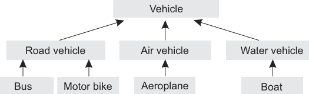

**图 1.1** 继承

继承有助于代码复用。当我们创建一个类时，可以将其分发给其他程序员，他们可以在自己的程序中使用。这被称为复用。如果有人想为计算器写一个程序，他可以使用预定义的算术操作类，而无需为这些操作定义所有方法。这类似于在过程化语言中使用库函数。在 OOP 中，可以通过继承功能来实现。程序员可以在不修改基类的情况下直接使用基类。他可以从父类派生出子类并为其添加一些额外功能。

## 1.3.5 封装 (Encapsulation)

封装是面向对象方法的特征之一。将数据绑定到对象中以使其对外部世界隐藏的过程称为封装（见图 1.2）。它赋予了我们限制任何人直接修改数据的能力。封装称为数据隐藏。对数据的访问必须通过类的方法来进行。数据对外部世界隐藏，结果是对于其他对象无用的细节也被它们隐藏了。这被称为封装。例如，一个计算对象必须提供一个接口来获取结果。然而，使用的内部代码不需要提供给请求对象。

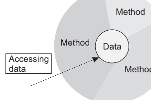

**图 1.2** 显示类封装的图解

## 1.3.6 多态 (Polymorphism)

多态意味着多种形式。它可以被定义为以不同形式使用的事物。例如，某些细菌表现出一种以上的形态。在编程中，多态有两种类型：编译时多态和运行时多态。运行时多态也称为动态绑定和延迟绑定，用于在运行时调用哪个方法。方法调用与其方法的绑定是在运行时完成的，因此使用了延迟绑定。编译时多态的情况下，编译器在编译时确定执行哪个方法。方法调用与（所有重载方法中的）绑定称为早期绑定。Java 中的编译时多态通过重载实现，运行时多态通过重写实现，即方法具有相同名称但不同的签名。（签名是传递给方法的形参列表。）在重写中，在子类中定义与父类相同名称和签名的方法。编译时多态和运行时多态的区别在于方法的调用机制。编译时多态还可以通过运算符重载实现，这是 C++ 中的特性，但 Java 中没有。运算符重载允许用户为运算符定义新的含义，以便以不同的方式使用。然而，Java 中的运算符 (`+`) 有一个例外，因为它既可以用于两个整数相加，也可以用于两个字符串或整数与字符串的拼接。该运算符由语言本身重载了，Java 程序员不能重载任何运算符。

## 1.4 过程化语言 VS OOP

表 1.1 突出了过程化语言与面向对象编程语言之间的一些主要区别。

**表 1.1** 过程化语言 vs OOP

| 过程化语言 | OOP |
| --- | --- |
| 数据与操作这些数据的函数分离。 | 在类中封装数据和方法。 |
| 不适合定义抽象类型。 | 适用于定义抽象类型。 |
| 调试困难。 | 调试容易。 |
| 实施更改困难。 | 更容易管理和实现更改。 |
| 不适合大型程序和应用程序。 | 适用于大型程序和应用程序。 |
| 分析和设计不易。 | 分析和设计变得简单。 |
| 速度快。 | 速度慢。 |
| 灵活性较低。 | 高度灵活。 |
| 基于数据和过程。 | 面向对象。 |
| 复用性较低。 | 复用性更高。 |
| 只有数据和过程。 | 继承、封装和多态是关键特征。 |
| | 使用自底向上的方法。 |
| 仅函数调用另一个函数。 | 存在对象通信。 |
| 示例：C, Basic, FORTRAN。 | 示例：Java, C++, VB.NET, C#.NET。 |

## 1.5 使用 UML 进行 OOAD

面向对象系统由对象组成。系统的行为源于对象及其相互作用。对象之间的交互涉及相互发送消息。每个对象都能接收消息、处理消息并……

面向对象建模（UML）是一种用于可视化、规范、构建和文档软件系统构件的标准语言。它提供了一系列图形图来表示系统的不同方面。这些图分为两个大类：结构图和行为图。

结构图表示系统的静态视图，即组件以及它们之间的关系。结构图包括：

- 类图：通过显示类、属性、操作以及对象之间的关系来描述系统的结构。
- 对象图：表示系统在特定时间点的快照。
- 组件图：显示系统如何被划分为物理组件以及它们之间的依赖关系。
- 包图：将系统元素组织分组。
- 部署图：描述软件的物理部署。
- 档配置文件：允许对 UML 元素进行分类和扩展。

行为图表示系统的动态视图，即系统如何响应事件或随时间发生变化。行为图包括：

- 用例图：从用户的角度描述系统的功能。
- 活动图：显示过程中控制或数据的流。
- 状态机图：描述对象可能处于的不同状态以及状态之间的转换。
- 序列图：显示对象随时间进行的交互。
- 通信图：与序列图类似，但侧重于对象的结构组织。
- Timing 图：显示消息和转换的时间约束。

UML 广泛应用于面向对象的分析和设计（OOAD），帮助开发者和利益相关者更清晰地理解系统设计。通过使用 UML，团队可以对复杂系统进行建模，尽早发现问题并进行有效沟通。

除了关系的多重性外，关系还可以有多种类型：继承、聚合、组合。这些关系在 UML 中可以用链接（links）和关联（associations）来表示。链接表示对象之间的连接，而关联表示类之间的一组链接。如果一个类继承另一个类，那么它们之间就存在父子关系。这种关系在 UML 中的描绘如图 1.8 所示。例如，`Shape`（形状）是超类，而 `Shape` 的子类可以采取任何形状，例如 `Square`（正方形）、`Triangle`（三角形）等。

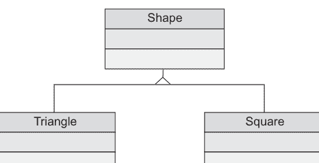

**图 1.8** 描述继承的 UML 图

上述图可以扩展以描述面向对象编程（OOP）的多态性。每个形状都将有一个名为 `area()` 的方法，该方法将计算该形状的面积。不同形状的 `area()` 方法实现不同。例如，计算三角形面积的公式与正方形不同。因此实现不同，但方法的名称是相同的。这就是多态（一个名称，多种实现）。在下图 1.9 中，`area()` 方法被 `Triangle` 类和 `Square` 类重写。

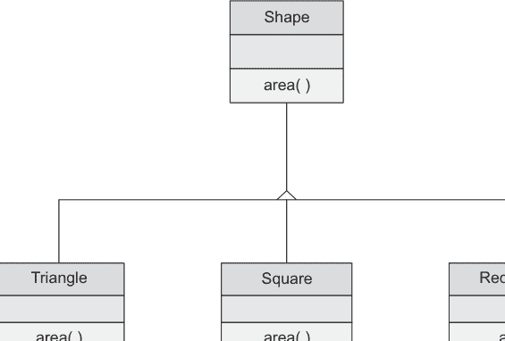

**图 1.9** 描述多态的 UML 图

对象之间存在的另一种关系是部分关系（part-of-relationship）。当一个特定对象是另一个对象的一部分时，我们称之为聚合。例如，汽车是许多对象（引擎、门等）的聚合，而引擎反又是许多对象（如气缸、活塞、阀门等）的聚合，如图 1.10(a) 所示。一种特殊的聚合是组合，其中一个对象拥有其他对象。如果所有对象不存在，被拥有的对象也将停止存在。例如，人体就是组合的一个非常好的例子。它是不同器官的组合。手、脚以及肺、肠道等内部器官也是身体所拥有的部分。

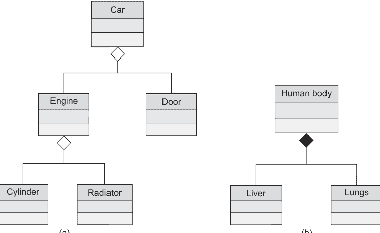

**图 1.10** (a) 聚合和 (b) 组合

# 1.6 OOP 的应用

面向对象语言的背后思想是将数据和函数结合成一个单元来创建一个对象，并对该数据进行操作。在过程方法中，重点是业务流程和支持该流程所需的数据。例如，在过去的十年里，一个问题困扰着每个程序员，俗被称为 Y2K 问题。所有与计算机行业相关的人都担心 1999 年 12 月 31 日午夜之后会发生什么。问题的产生源于年份属性的编写规范。在编程早期，程序员写两位数字的年份，如果我们只写年份的两个数字，那么区分 1900 年和 2000 年就会有问题，计算机无法区分两者。没有人预测到这个问题，并使用日期和代码作为时间要求。解决这个问题的办法是分析各处的多行代码，并将年份改为四位而不是两位。通过分析几千行代码来找到你在代码中使用了多少次日期并更改年份的状态变量，似乎并不是一项简单的任务。

如果使用了面向对象编程语言，我们可以创建一个包含日、月、年属性的 `Date` 类。在任何需要日期功能的地方，都会创建并使用 `Date` 对象。在以后某个时间，如果需要更改，例如将 `Date` 类的年份更改为四位，此更改将整合到类中，并且每当创建 `Date` 类的对象时，此更改会自动反映在所有对象中。因此，更改必须在一个地方完成，即类，而在任何使用该类对象的地方，更改都会自动反映。不需要分析代码并修改它。

在 OOP 中，我们通过对象的帮助访问数据，在不修改系统的情况下解决问题变得非常容易。OOP 用于各种领域，例如：

- 神经网络
- 人工智能
- 数据库管理
- 专家系统

# 总结

面向对象语言已成为编程的通用标准。它们派生于现实世界。OOP 围绕对象和类展开。类被定义为一组具有相似属性和行为的对象。OOP 是一种使用对象概念开发软件应用程序的编程范式。OOD（面向对象设计）规定了一些原则，每个 OOP 语言都遵循这些原则。这些原则是：继承、抽象、封装和多态。

对于大型项目，使用了 OOAD 技术。面向对象分析和设计处理如何对系统进行建模。OOA（面向对象分析）处理系统应该做什么，而 OOD（面向对象设计）处理系统如何实现这些功能。

# Java 入门

> 人生道路只有在行走途中才能显现真章；道路上的每个转弯都揭示着惊喜。人的未来是未知的。
>
> Anon

## 阅读完本章后，读者将能够

- 了解 Java 的历史
- 理解 Java 的特性及其运行时环境
- 了解 Java 程序的基本结构
- 了解 JDK 安装的细节
- 理解 JDK 的各种组成部分及其开发环境

## 1 绪言

Java 是一种流行且强大的语言。尽管它是一种非常简单的语言，但有许多细节可能会让经验较少的程序员感到困惑。Java 是一种面向对象的编程语言，内置了应用程序接口（API），可以处理图形用户界面（GUI）以创建应用程序或小程序（applets）。除了平台无关性，Java 还提供了丰富的 API。

Java 的大部分语法与 C 和 C++ 相似。Java 与其他语言之间的区别之一是它没有指针。然而，最大的区别在于你强制编写面向对象的代码。过程化代码被封装在对象中。

在 Java 中，我们区分 applet 和应用程序。应用程序执行的功能与用其他语言编写的程序类似，而 applet 是需要嵌入网页并在互联网上下载的程序。当程序被编译时，会生成可以在任何平台上执行的代码，前提是目标平台上存在相应的运行时环境。

本章将引导读者分步介绍 Java 编程。本章的一个重要重点是从面向对象的角度介绍 Java 的特性。

它还深入介绍了 Java 运行时环境的安装以及 Java 的各种集成开发环境（IDE）。

本章还关注了 Java 的不同版本（包括最新的 Java 7）以及核心 API（Java 7 也称为 Java 1.7）。

## 2.2 Java 历史

人们通常认为 Java 是专为世界万维网开发的。Java 最初开发时的初衷确实是为了 Web 的。然而，它经过改进，成为了互联网应用程序的标准编程语言。

Microsystems 副总裁 Bill Joy 被认为是构思 Java 这一编程语言理念的核心人物。20 世纪 70 年代后期，Bill Joy 想要设计一种能够包含 MESA 和 C 等语言最佳特性的语言。他发现 C++ 不足以重写 Unix 操作系统。1991 年，正是这种发明更好编程工具的愿望推动了 Joy 走向 Sun 公司一个名为“隐形项目”（Stealth Project）的巨型项目。这个名字是 Sun 总裁 Scott McNeil 起的。1991 年，由 Bill Joy、James Gosling、Mike Sheradin、Patrick Naughton（Sun Open Windows 用户环境的项目负责人）以及位于科罗拉多州阿斯彭的其他几个人组成的正式团队首次规划了隐形项目。隐形项目完全是为了开发消费电子设备，可以从手持遥控设备进行中央控制和编程。

James Gosling 负责为该项目建议一种合适的编程语言。他最初想过使用 C++，但很快就确信 C++ 对于这个特定项目来说并不合适。他通过扩展和修改 C++，迈向了开发符合项目目标的独立语言的第一步。

当 Gosling 盯着办公室外的一棵橡树时，他产生了将这种语言命名为“Oak”（橡树）的念头。由于担心违反版权法，“Oak”这个名字被放弃了。团队苦思冥想了好几天，想为这种语言找到一个合适的名称。在多次脑风暴会议后，有一天，在想起 Gosling 后去当地咖啡馆时，脑中突然闪过一个想法。在美国，“Java”是咖啡的俚语。Java 也是印度尼西亚爪哇岛产咖啡的名称。对于将语言命名为 Java 的命名约定，还有其他观点。其中一种认为，Java 这个名字源于参与项目的几个人：James Gosling、Arthur Van Gogh、Andy Bechtols。

## 2.3 Java 之历程：从嵌入式系统到中间层应用

Java 设计用于在小型设备上独立运行。Java 语言源自 C++，但有许多不同。Java 的平台无关性解决了嵌入式设备应用程序必须在各种硬件上运行的问题。但随着 1995 年互联网的出现，Java 很快被采用，因为它可以在异构操作系统上运行。Netscape 开始在它的浏览器中使用 Java。许多 applet（运行在浏览器内部）被构建出来，Java 借此获得了普及和认可。


# Java 编程

Java 在客户端之所以不流行是因为以下原因：

- **不那么令人印象深刻的 GUI**：Java 早期的 GUI（`AWT`）非常原始。较新的 GUI（`Swing`）直到 90 年代后期才发布（在插件插件，大多数现代浏览器仍不支持 `Swing`）。
- **微软的强势地位**：几乎 95% 的桌面世界使用微软。
- **客户端软件更新**：发现了良好的方法来自动更新客户端软件（无需即时拥有 Java）。
- **HTML 的成功**：浏览器有自己的能力，许多开发者发现编写 HTML 更容易。HTML 倾向于启动 Java applet。

图 2.1 客户端运行 applet

## 2.2 中间层能力

## 2.4 Java 要素

Java 是一种平台无关的面向对象的语言。Java 包含：

- **高级语言**：Java 是一种高级语言，与 C 和 C++ 非常相似，但有许多独特的特性。
- **Java 字节码**：字节码是由编译器（如 `javac`）生成的中间代码。
- **Java 虚拟机 (JVM)**：JVM 是字节码的解释器。

# Java 入门

Java 设计成是架构无关的，以便在任何平台上运行。为了实现其跨架构能力，Java 编译器生成架构无关的字节码。这些指令设计为让任何机器轻松解释，如图 2.3 所示。

| 组件 | 说明 |
| :--- | :--- |
| JRE | JVM + 核心 API 库 |
| JDK | JRE + 开发工具 |

## 2.5 Java 虚拟机

JVM 是平台的核心。大多数编程语言将源代码直接编译为可在特定处理器架构上执行的代码。Java 的区别在于它使用字节码，这是一种中间代码。

Java 字节码在虚拟机上执行。实际上，当 Java 最初出现时还没有这种处理器的硬件实现。相反，处理器架构是通过被称为虚拟机的软件模拟的。这种虚拟机是对真实处理器的仿真——机器中的机器（图 2.4）。虚拟机运行在操作系统之上，如图 2.5 所示。

图 2.4 虚拟机

图 2.5 操作系统

## 2.6 JAVA 特性

在这里我们列出了让 Java 成为一种强大、面向对象且流行的编程语言的基本特性。

### 2.6.1 平台无关性

Java 的设计不像之前的语言（C、C++）那样仅以源代码形式跨平台，而是以二进制形式进行编译。为了实现这一点，Java 被编译为称为**字节码**的中间形式（见图 2.3 和 2.4）。这种**字节码**是平台无关的代码，由一种称为 Java 解释器的特殊原生程序读取，并由执行相应的原生指令。Java 编译器也是用 Java 编写的。字节码被精确定义，以确保在所有平台上保持一致性。

使 Java 跨平台的另一个重要部分是对依赖架构的构造进行统一定义。与其他语言不同，Java 中的整数始终是四字节，且浮点变量遵循 IEEE 754 浮点算术标准。你不需要担心任何类型的内存，因为在在不同架构（例如从 Pentium 到 Sparc）之间转换时，内存不会发生变化。在 Java 中，一切都是良好定义的。然而，虚拟机及其部分部分组件是用原生代码编写的，这使其具有平台依赖性。

### 2.6.2 面向对象

Java 被构想为*纯面向对象的语言，这意味着 Java 中数据结构的最外层是对象*。Java 中的所有内容（常量、变量和方法）都定义在类内部，并通过对象进行访问。Java 的开发方式允许用户不仅可以学习面向对象编程，还可以进行应用和实践。

但存在一些违反 Java 纯洁性的限制。它主要为面向对象编程（OOP）设计，但包含了一些过程元素。例如，Java 支持不是对象的原始数据类型。

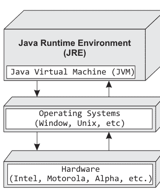

图 2.5 JVM 处理翻译

### 2.6.3 编译与解释

Java 结合了解释和编译的元素。以下是关于这两种方法的更多信息。

#### 解释

解释器读取程序的每一行，并在跳转到下一行之前执行它。该行被解析为最小的操作，找到相应的机器级代码，然后执行指令（这可以通过 C 语言中的 `switch` 语句来实现，列出所有可能的操作分支）。Basic 是最早的解释型语言之一，每行都经过解释。类似地，`JavaScript`、`VBScript` 和 `PHP` 等脚本语言也是解释执行的。

在解释模式中，编写/修改代码与运行代码之间没有中间步骤。最好的部分是：调试速度快。此外，程序很容易被传输到其他平台（只要有解释器）。缺点是性能较慢。

#### 编译

文本文件首先由一个称为编译器的程序转换为原生代码。可能还需要链接器来将多个代码文件连接在一起。编译器的输出是可执行代码。C 和 C++ 都是编译型语言。

编译型语言最大的优势是性能，因为语言代码指令直接加载到处理器中执行。此外，编译器可以执行某些优化操作，因为它从整体上看程序，而不是逐行查看。缺点包括调试速度较慢和对其他平台的移植性降低。源代码必须在目标平台上进行编译。

#### Java 方法

Java 结合了解释和编译。文本程序被编译为供 JVM 使用中间代码，称为字节码。JVM 执行字节码指令。换句话说，JVM 解释字节码。字节码可以在任何部署了 JVM 的平台上运行。程序运行在 JVM 内部，因此在哪个平台上执行并不重要。

因此，Java 兼顾了两者的优点。编译步骤允许代码优化，而 JVM 提供了可移植性，即：编译时间和执行时间（运行时）。图 2.4 让你了解了 Java 源程序执行过程中涉及的两个阶段。

一旦源代码转换为字节码或类文件，它就会被加载，以便由 JVM 的执行引擎进行处理。字节码通过引导程序类加载器（称为原始类加载器）或用户定义的类加载器（有时称为自定义类加载器）加载。引导程序加载器（JVM 的一部分）负责加载可信的类（例如基础 Java 类库）。用户定义的加载器（不是 JVM 的）是 `java.util.ClassLoader` 的子类，像其他类一样被编译和安装。字节码验证代码并确保该代码适用于 JVM 执行。图 2.6 显示了从 Java 源代码通过 Java 编译器到 JVM 的数据和控制流。代码在通过验证器测试之前是不允许执行的。

#### 编译时

#### 运行时

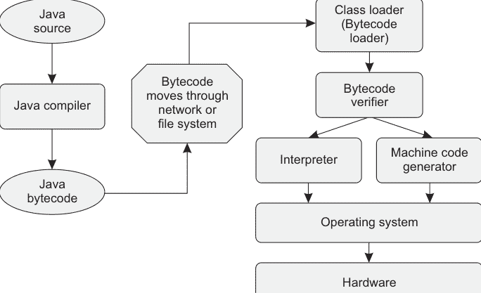

图 2.6 Java 中的编译与解释

但缺点仍然是在调试期间每次纠正后都要多出一个额外的编译步骤。此外，在许多情况下，字节码的解释速度仍然比本地机器码程序慢。先进的 JVM 可以改进这一点，并在许多情况下可以达到与编译为机器码的程序相似的速度。

### 2.6.4 Java 是健壮的

Java 的检查至少和 C++ 一样强大。Java 中的编译和运行时检查捕获了许多错误并使其防崩溃。程序不会导致系统崩溃。总之，Java 是进化以来最健壮的语言之一。分配内存的自动垃圾回收是最大的贡献。

### 2.6.5 Java 语言安全特性

Java 有多种语言特性可以保护系统的完整性并防止常见的攻击。

**通过定义安全**：Java 对语言定义非常严格：

- 所有原始数据类型

**通过缺乏指针算术安全**：Java 不支持指针算术，因此用户无法访问内存。

**通过垃圾回收安全**：垃圾回收通过自动释放不再需要的内存使 Java 更安全。

**通过编译检查安全**：Java 编译器执行广泛、严格的编译检查，以便尽可能检测错误。Java 语言是强类型的，即：

- 对象在没有显式检查的情况下转换为子类。
- 对类方法和变量的引用被检查确保属于同一个类。
- 原始类型和对象之间不可转换。

**Java 安全模型**：Java 的安全模型专注于保护用户免受网络下载的恶意程序。从互联网下载的程序在沙箱中执行。它在边界之外采取任何操作。例如，沙箱禁止不受信任程序进行许多活动，包括：

- 读取或写入本地磁盘
- 与除程序来源的主机外的网络连接
- 创建新进程
- 加载动态库并直接调用原生方法

## 2.6.6 Java 是多线程的

为了探索这一特性，你必须了解多线程的含义。可以通过一个示例来很好地解释它。考虑一个正在做饭的四眼燃气灶。厨师为了节省时间，在一个火头上放牛奶，在另一个火头上放米饭，第三个火头上放薄饼（chapattis），第四个火头上放蔬菜。厨师在待烹饪的项目之间切换，以确保任何一个食物都不会因为过热而失去风味。他可以根据需要调小或放大火力。在这里，厨师是处理器，而正在烹饪的四个项目就是线程。处理器（厨师）在它们之间切换。

线程可以松散地定义为执行流，它是同时进行的，并且独立于可能发生的任何事情。线程是并发运行的进程的独立部分。使用线程，程序不会刻意长时间占用 CPU（例如无限循环）。多线程的美之处在于，其他任务不会被卡在循环，可以继续处理，而无需等待任务完成。Java 中的线程可以在共享资源上放置锁，这样当一个线程正在使用它时，不允许其他线程访问。这是通过同步（`synchronization`）来实现的。

更多关于线程及其实现的内容将在第 8 章中介绍。

## 2.6.7 其他特性

自动垃圾回收（内存管理）由 JVM 处理。要创建一个类的实例，使用 `new` 运算符（参阅第 4 章）。然而，Java 会自动移除未被引用的对象。这被称为垃圾回收。垃圾回收的优缺点如下。

### 优点

- 减少了内存泄漏的可能性，因为内存会根据需要释放。内存泄漏发生在分配的内存未释放时，导致对所有可用内存的不必要消耗。
- 不发生内存收集。

### 缺点

- 垃圾回收被认为是执行速度上最大的瓶颈之一。

### 动态绑定

将数据和方法链接到它们运行时所在的位置。新类可以在运行时加载。链接是即时完成的，即按需进行。

### 良好的性能

早期版本中字节码的解释减慢了性能，但具有自适应优化和即时编译（JIT，结合其他特性）的高级虚拟机提供了高速执行。

### 内置网络功能

Java 设计时考虑了网络化，并带有许多类用于开发复杂的 Internet 通信。关于这一主题的详细讨论将在第 11 章中介绍。

## 无指针

Java 使用引用代替指针。引用提供了对对象的访问。程序员从指针操作的开销中解放出来。

## 无全局变量

在 Java 中，全局命名空间是类层次结构，无法在类之外创建变量。要确保全局变量以一致的方式操作极其困难。Java 允许一种修改类型的全局变量，称为静态变量（`static variable`）。

## 2.7 程序结构

一个 Java 应用由一组类组成。类是一个模板。对象被定义为类的实例。每个实例（对象）包含类中指定的成员（字段和方法）。方法定义了字段上的操作，以及作为参数传递给方法的值（见图 2.7）。

| 类示例 |
| :--- |
| 类和实例变量 方法 ABC | 局部变量 指令 |
| 方法 XYZ 局部变量 指令 |

让我们创建我们的第一个程序。下面的示例 2.1 显示了一个非常 Java 的程序，它在控制台上显示一个字符串。它有一个打印语句（程序将在 2.7.3 节中解释）。

图 2.1 程序结构

## 示例 2.1 第一个程序

```java
/* Call this "Example.java".*/
class Example {
    //你的程序通过调用 main() 方法开始执行
    public static void main(String[] args) {
        System.out.println("This is a simple Java program");
    }
}
```

## 2.7.1 如何执行 Java 程序？

成功执行 Java 程序有三个步骤：

1. 输入源代码：上面的程序（示例 2.1）可以在任何文本编辑器（如记事本）中编写，但要确保其编写方式与所示**完全相同**。
2. 保存源代码：现在你已经在记事本中写了代码，以下是保存方法：
   - 从记事本菜单中选择“文件” | “另存为”。
   - 在“文件名”字段中，输入双引号内的 `"Example.java"`。
   - 在“保存类型”字段中选择“所有文件 (*.*)”。
   - 点击回车键保存文件。
3. 编译并运行源码：Java 程序使用 DOS 进行编译。要打开操作系统，在运行提示符处输入 `cd` 并移动到包含已保存的 `Example.java` 文件的文件夹。现在使用 `javac` 编译程序，并在命令行中指定源文件名（假设文件保存在 C 盘的 `java` 文件夹中）。

```bash
cd java // 使用 cd 命令切换到 java 目录
C:\java\javac Example.java
```

`javac` 编译器会创建一个 `Example.class` 文件（在同一目录下）。该类包含程序的字节码版本。此字节码将由 Java 解释器使用 `java` 命令通过类名执行，如下所示：

```bash
C:\java\>java Example
```

# 输出

This is a simple Java program

## 2.7.2 为什么保存为 Example.java？

当 Java 源代码被编译时，每个单独的类都会被放在自己的输出文件中，并以类命名且使用 `.class` 扩展名。这就是为什么给 Java 类类名是一个好主意。在 Java 中，类名必须与文件名一致（如果类是 public 的）。

# 自动装箱与拆箱

第 3 章解释了 Java 拥有如 `int` 等整数的原始类型，第 4 章解释了类和对象。这两种类型的区别非常重要。在第 6 章中，我们研究了 JSE 5.0 添加的所谓的自动装箱和拆箱功能，它在大多数情况下消除了显式转换的需要，提高了代码的可读性，并消除了样板代码和错误来源。

# 增强 for 循环

第 3 章 查看了 Java 中提供的几种循环结构，其中一种是 for 循环（类似于 C/C++ 的 for 循环）。版本 5.0 引入了增强型 for 循环语法，降低了代码的复杂度并增强了可读性。我们在第 4 章引入了增强 for 循环，并描述了对象类型如何配合增强 for 循环工作。

# 枚举类型

第 6 章介绍了 C/C++ 的一项许多程序员在 Java 中可能错过的特性。Java 通过 `enum` 关键字增加了枚举类型。新的枚举类型包含了 C/C++ 枚举的所有特征，包括类型安全。

# StringBuilder 类

我们将在第 6 章讨论这个旧的 `StringBuilder` 类。它提供了比 `StringBuilder` 类更好的性能。

# 静态导入

发布 5.0 包含了一种新技术，用于访问另一个类中的 Java 静态方法和常量，而无需在使用时都包含完整的包名和类名。我们将在第 4 章和第 7 章解释 `class`、`package`、`static`、`import` 等术语。“静态导入”让你的代码更容易编写且更不容易出错。我们将在介绍完通用导入后，在第 7 章详细讨论静态导入。

# 元数据

元数据机制（注解）旨在减少 Java 早期版本中需要的大量样板代码。注解不是程序的一部分，为编译器提供有关程序的信息。这些信息可以用于检测错误和提供警告。注解以 `@` 开头。`javac` 编译器处理某些注解，而某些注解需要注解处理工具 `apt`。

# 格式化 I/O 和可变参数

在第 9 章，我们讨论了如何使用 Java 格式化输出。版本 5.0 增加了以 `printf()` 方法形式轻松生成输出的能力，该方法的行为类似于 C/C++ 中的 `printf()` 函数。第 9 章还描述了格式化导入（`Scanner` 类）。这两个功能都依赖于“可变参数”（varargs），当在构造源码时未知传递给 Java 方法的参数数量时，它代表可变参数列表（也称为可变元数方法）（参见第 4 章关于可变参数）。

# 图形系统改进

发布 5.0 包含了对 Java 称为 AWT 和 Swing 的图形子系统的大量错误修复和微调，包括减少内存占用。最大的改进是，在添加 Swing 组件时不再需要调用 `getContentPane()`。

# 新的并发特性

第 8 章讨论了 Java 自 1.0 版本以来就存在的多线程支持。发布 5.0 增强了 Java 的多线程特性。这些新增内容中的某些部分依赖于泛型概念，因此我们推迟到第 10 章再介绍这些重要的新能力。

# 泛型

在第 10 章中，我们引入了新的泛型，这是一个我们将详细介绍的重要主题。Java 是类型安全的，这意味着每个变量都有一个定义良好的类型，且只有兼容的类型才能赋值给它。然而，编译时的泛型使用允许将更多数量的指定类型对象添加到集合中，增强了程序的运行时安全性和正确性；否则将发生编译时错误。

JSE 5.0 的其他特性还包括核心 XML 支持、对 Unicode 的改进、对 Java 数据库连接包 JDBC 的改进，以及一种改进的、针对 JAR 文件的高压缩格式，这可以大幅缩短 applet 和网络应用的下载时间。

Java 2 平台标准 5.0 (JSE 5.0) 处理了开发效率（EoOD）的提升。新的 EoOD 特性关于快捷方式，极大减少了输入的代码量，使编码更快且运行时错误更少。除了 EoOD 之外，还增加了改进的编译时检查、新的多线程和并发特性，提供了以前不可的功能。JSE 的设计者考虑了新版本最重要的方面。他们付出了大量努力以确保与之前的 Java 版本兼容。Java JVM 启动速度和更小的内存占用是重要目标。这些通过对软件的仔细细调和类数据共享得以实现。在 Java 5 中，观察内存使用、检测并响应低内存状态变得容易得多。

## 2.8.2 Java 6 特性

以下是 Java 6 的一些主要增强。

## 集合 API

动机是提供双向访问。新增了如 `Deque`、`BlockingDeque` 等接口，并修改了现有的类如 `LinkedList`、`TreeSet` 和 `TreeMap` 以实现这些新接口。增加了一批新类，如 `ArrayDeque`、`ConcurrentSkipList` 等。

## 输入/输出

`java.io` 包中增加了一个新的控制台。它包含了访问字符数据的方法。

## Jar 和 Zip 增强

增加了两个新流：

- `java.util.zip.Deflater`：用于压缩


- `java.util.zip.Inflater`：用于解压缩

## Web Start

所有对话框都经过了重新设计，更加用户友好。增加了对 SSL/TLS 的新支持。

## 增强型网络接口

它提供了许多用于访问状态和配置的新方法。这包括 MAC 地址和 MTU 大小等信息（在第 1 章讨论）。

## 启动界面

应用程序可以在虚拟机之前显示启动界面。Java 6 还增强了管理 API 并对 `Console` 进行了重大更改。

## 2.8.3 Java 7 特性

Java 7 增加了一些新特性：在 `switch` 语句中的多异常捕获、新的 Fork-Join 框架等。

### 字符串中的 switch 语句

Java 7 增加了字符串 `switch` 语句，以处理基本类型、枚举类型和包装类。

### Unicode 6.0 支持

Java 7 支持 Unicode 6.0。引入了一种新的表示字符的表示。

### 二进制字面量和数字字面量（带下划线）

Java 7 增加了二进制字面量，通过下划线来提高数字字面量的可读性（第 3 章）。

### 自动资源管理

引入了 `try-with-resources` 块，使得资源在 `try` 块结束时被自动释放。

### 优化的异常处理

Java 7 引入了可以捕获多个异常的 catch 块。

### nio.2（非阻塞 I/O）——新系统 API

`java.nio.file` 包在 Java 7 中创建，包含了高效复制、移动、创建链接和文件/目录通知的方法。

### Fork 和 Join

Fork-Join 框架整合到 Java 7 中，用于将任务拆分（fork）并合并（join）以实现所需的结果。

### 动态

Java 7 包含了新的 `invokedynamic` 特性，允许在运行时解析变量、方法和参数的类型。

### 菱运算符

在 Java 7 之前，泛型声明需要在两侧都声明类型。Java 7 之后可以通过查看左侧声明使用菱运算符 `<>` 来推断右侧类型。

### Swing 增强

Swing 增加了许多 AWT 和 Swing 组件的功能，如 Nimbus 外观、`JColorChooser` 类中的 HSV 选择等（详见第 15 章）。

Java FX 2.2.3 为电视、移动设备、桌面等不同设备创建丰富的界面工具包。FX 与 JDK 7 绑定。

## 2.8.4 不同版本的简要比较

表 2.1 展示了 Java 不同版本的比较。

### 表 2.1 Java 主要版本及其差异

| 版本 | 名称 | 引入的新特性 |
| :--- | :--- | :--- |
| 1.0 | Oak | Java 发布。 |
| 1.1 | Sparkler | 增加了新的事件模型，使用监听器、匿名类和内部类。 |
| 1.2 | Playground | 增加了集合中的 `ArrayList`，增加了 DSA 签名。增加了缓冲区图像。 |
| 1.3 | Kestrel | `java.util.timer`、`java.lang.StrictMath`、`java.awt.print.Page`、`java.media.sun (MID)` Hotspot。RMI 现在可以使用 CORBA:IIOP 协议。增加了 RSA 签名。 |
| 1.4 | Merlin | 增加了正则表达式、断言和泛型。 |
| 1.5 | Tiger | 增加了 `StringBuilder`、`java.util.concurrent`、枚举和注解。 |
| 1.6 | Mustang | 增加了启动界面、真双缓冲、生成 XML 文件、`JavaCompilerTool`、JDBC 4.0、智能卡 API、`Console.readPassword` 以及改进的拖放。 |
| 1.7 | Dolphin | 自动资源管理、`switch` 语句中的多异常捕获、Fork-Join 框架、动态支持、支持 Unicode 6。Java FX 2.2.3。 |
| 1.8 | 尚未发布 | 关于包含哪些内容仍在讨论中。 |

## 2. JAVA 与 C++ 的区别

这里是 Java 和 C++ 之间区别的技术概述。以下点列出了 Java 中存在而 C++ 中缺失的。

### 不允许多重继承

强制执行多级继承，这使得设计更加清晰。Java 不支持类之间的多继承。使用接口来支持多继承。

### 共同父类

所有类都是*单根的*。在 Java 中，`Object` 类是所有类的父类。

### 包

使用了*包*（packages）的概念，即提供了一个大型的*层次命名空间*。这防止了库中的命名歧义。

### 源内文档

提供了*源内代码注释*。提供了文档关键字，例如 `@author`、`@version` 等。

### 所有代码均在类内

与 C++ 不同，程序的所有部分都存在于类内部。不允许在类外部声明全局数据。然而，支持类内的*静态*（static）数据。

### 运算符重载

Java 不支持*运算符重载*，但 Java 已经重载了几个运算符，例如 `'+'`。程序员没有重载运算符的选项。

### 显式布尔

Boolean 是一个显式类型，与 int 不同。提供了两个布尔字面量，即 `true` 和 `false`。这些不能与某些其他语言中的整数 0 和 1 进行比较。

### 数组长度可用

Java 中所有的数组对象都关联有一个长度变量，用于确定数组的长度。

### 跳转

支持用 `break` 和 `continue` 替代 `goto`。

### 指针

Java 中没有指针。

### 空指针能被合理地捕获

空指针通过 `NullPointerException` 被捕获。

### 内存管理

使用*垃圾回收*可以防止内存泄漏和对已释放内存的引用。

### 变量自动初始化

除了局部变量外，所有变量都会被自动初始化。

### 容器边界的运行时检查

容器（数组、字符串等）的边界在运行时进行检查，必要时会抛出 `IndexOutOfBoundsException`。

### 平台无关性

C++ 不是平台无关的语言，而 Java 是。

### 定义的整数类型大小

byte、short、int 和 long 整数类型的大小定义为 1、2、4 和 8 字节。

### 提供 Unicode

Unicode 代表了大多数语言的字符，例如日语、拉丁语等。

### String 类

提供了显式的 String 类，以及 `StringBuilder` 和新的 StringBuilder 类。

### 扩展实用类库：包 java.util

支持的等还包括 Enumeration（一个 Iterator 接口）、Hashtable、Vector。

### 默认访问修饰符

已添加。默认情况下，Java 中所有变量、方法和类的权限与私有访问修饰符不同。private 是 C++ 中的默认访问修饰符。

## 2.10 JDK 1.7 的安装

在编写第一行代码之前，软件开发者必须确保工作工具已就绪。Java 被设计为一种跨平台的面向对象的编程语言。由于 Java 的引入引起了巨大的兴趣，新工具不断涌现，为开发者提供了更大的灵活性易用性。

### 2.10.1 开始使用 JDK

Sun（现在由 Oracle 继续维护）决定提供 Java 开发工具包（JDK），它提供 Java 编程所需的各种工具。JDK 为初学者提供了编写强大的 Java 应用程序或应用的所有工具。它包含一个编译器、解释器、调试器、示例应用程序、applet 查看器以及你可以用来测试代码的其他工具。

快速访问 Oracle 网站将允许你将 JDK 下载到本地机器。从该网站检查 JDK 的最新版本并下载。JDK 支持以下操作系统：

- (a) Solaris
- (b) Windows
- (c) Linux
- (d) Mac

记住，这些平台提供的 JDK 可用仅意味着 Oracle 已为这些平台实现了 JVM 和开发工具。

### 2.10.2 JDK 安装注意事项

当安装 SE 开发工具包时，Java 运行时环境也会被安装。

在 Solaris 平台上安装 JDK 1.7（包括 32 位和 64 位），你可以参考 Oracle 官方网站上的安装文档：

```
http://docs.oracle.com/java/7/docs/webnotes/install/solaris/solaris-jdk.html
```

同样，在 Linux 操作系统上安装 JDK 1.7（包括 32 位和 64 位），请访问：

```
http://docs.oracle.com/javase/7/docs/webnotes/install/linux/linux-jdk.html
```

在 MAC OS 上安装 JDK 请访问：

```
http://docs.oracle.com/javase/7/docs/webnotes/install/mac/mac-jdk.html
```

任何操作系统的 JDK 均从以下地址下载：

```
www.oracle.com/technwork/java/javase/downloads/jdk7u9-downloads-1859576.html.
```

参考 `www.oracle.com/technwork/java/javase/downloads/index.html` 获取最新的 Java SE 发布。

## 在 Java 中编程

在书中，我们打算提供在 Windows 操作系统上安装 JDK 1.7 的详细信息。

JDK 有两个版本号——外部版本号 7 和内部版本号 1.7.0_09，即版本 79。

安装和配置过程可以分解为：

1. 运行 JDK。
2. 更新类变量。
3. 测试安装。

### 步骤 1：运行 JDK

如果你是下载了 JDK 软件而不是运行安装程序，你应该检查它是否来自以下 URL：

```
https://oracle.com/technwork/java/javase/downloads/index.html
```

JDK 安装程序提示你选择所有想要安装的内容。默认情况下，JDK 将安装在提到的路径中。

### Java 35 入门

- **include** | include 目录包含一组用于与 C 和 C++ 交互的 C 和 C++ 头文件集。
- **lib** | 此目录包含非核心类，如 `dt.jar` 和 `tools.jar`，它们被 JDK 中的工具和程序使用。
- **bin** | bin 目录包含 Java 的二进制文件。例如：Java 编译器 (`javac`)、Java 解释器 (`java`)、编译器 (`javac`) 等。
- **jre** | 它是 Java 运行环境根目录。
- **db** | 包含 Java 数据库。

### 第 2 步：更新 Path 和 Classpath 变量

如果不修改系统环境变量（如 Path 或 Classpath）或修改 `auto_class.bat`，是无法运行 Java 程序的。

为什么要设置 Path 变量？如果你想从任何目录运行可执行文件（`javac.exe`、`java.exe`、`javadoc.exe`），则需要设置 PATH 环境变量。如果你想查看当前的 PATH 值，请在 DOS 提示符输入以下命令：

```
C:\path
```

Windows NT/XP/Vista/7？ 最好在控制面板中更改环境变量，而不是修改 `auto_class.bat`。启动控制面板，点击“我的电脑”，选择“属性”，点击“环境变量”。从系统变量列表中选择 Path，并将路径添加到现有路径中：`C:\PROGRAFILES\JAVA\JDK1\bin`。不要删除 path 变量中的条目；仅用分号分隔并追加新路径。

Classpath——作用是什么？Classpath 告诉 JVM 和其他 Java 应用程序去哪里寻找类库和包。可以按照相同的步骤（如上述描述）设置 classpath 环境变量，不同之处你不需要查找 path 变量。

### 第 3 步：测试安装

你的计算机系统现在已配置完毕并准备好使用 Java。要测试安装，请在命令行中输入以下内容：

```
javac
C:\java
```

如果在 DOS 提示符上输入 `java` 后显示了以下界面，则说明 Java 已正确安装且路径已设置（图 1a 和 b）。


## 10.3 探索 JDK

了解 Java 的完整结构至关重要。接下来的图示（图 2）可以让你对 Java 7 的各种构造部分有一个大致了解。有趣的是，Java 的哪些部分组成 JDK、JRE 或 Java API？值得注意的是，Java API 是 JRE 的子集，而 JRE 是 JDK 的子集。标准版（Java™ SE）开发工具包包含 JRE 以及命令行开发工具（如编译器和调试器），这些工具对于开发程序和应用程序是必须的。

| 工具和 API | java | javac | javadoc | jar | javap | JPDA | Java DB | jconsole | Monitor | Scripting |
|---|---|---|---|---|---|---|---|---|---|---|
| 工具 | 安全 | 接口 | IDL | 部署 | | | | | | | 服务 |
| 部署技术 | Web Start Java | 插件 | | | | | | | | | | |
| JavaFX | | | | | | | | | | | | |
| 用户界面 | 辅助功能 | 拖放 | 输入方法 | 图像/O | 打印服务 | 声音 | Java 2D | | | | | |
| 集成库 | IDL | JDBC | JNDI | RMI | RMI-IIOP | 脚本 | | | | | | |
| 其他库 | Beans 网络 | 支持 | I/O 安全 | 序列化 | 扩展机制 | JNI 数学 | XML JAXP | | | | |
| 语言和工具类 | Lang & util 偏好 | 集合并发工具 | JAR 表达式 | 日志管理 | | | | | |
| 库 | API | 引用 对象 反射 | 版本 | 插桩 | | | | | |

JRE 提供了 JVM 以及你运行 Java 语言编写的程序所需的组件（见图 2）。

### JDK 中的工具

JDK 中提供的工具分为以下几类：

- 基础工具 (`javac`, `java`, `javadoc`, `apt`, `appletviewer`, `jar`, `jdb`, `jav`, `extcheck`)
- 安全工具 (`keytool`, `jsearch`, `policytool`, `klist`, `ktab`)
- 国际化工具 (`native2ascii`)
- 远程方法调用 (RMI) 工具 (`rmic`, `mregister`, `rid`, `serveral`)
- Java IDL 和 RMI-IIOP 工具 (`nameserv`, `idld`, `orbd`, `servertool`)
- Java 部署工具 (`pack200`, `unpack200`)
- Java 插件工具 (`html converter`)
- Java Web Start 工具 (`javaws`)
- Java 监控管理控制台 (`jconsole`)
- Java Web 服务工具 (`scheman`, `wsgen`, `wsismport`, `jxc`)

### 基础工具

图 2 和 3 分别显示了 Java 的结构和 JDK 中提供的基础工具。

**javac** 编译器命名为 `javac`。Java 编译器获取源文件（这些文件扩展名为 `.java`）并将其转换为编译后的字节码文件（这些文件扩展名为 `.class`）。

**java** 解释器，以同名命名为 `java`，用于执行 Java 应用程序。解释器直接将字节码转换为操作。

**javadoc** 作为程序员，我们曾尽一切努力与它[编译器]斗争。不幸的是，现在没有理由不再为代码编写文档了。使用编译器，你可以轻松地生成 HTML 形式的文档。

**apt** 代表注解处理工具（Annotation Processing Tool），用于处理注解。

**appletviewer** 这个小程序为测试 applet 提供环境。它在类似浏览器的窗口中加载应用程序。

**extcheck** 用于检测 Jar 冲突。

**Jar** 用于创建和管理 jar 文件。

**jdb** Java 调试器允许你调试 Java 类。你可以使用 `jdb` 设置断点、检查对象和变量、监控线程。它是一个命令行调试器。

**javah** 因为 Java 是一种新语言并且必须适应由 C 和 C++ 主导的世界，它具有在 Java 中使用 C 代码的能力。其中的步骤之一是使用 Java 头生成器 `javah`。


# javap 与 Java 编程基础

## javap 工具

`javap` 是面向对象编程的基本工具之一。不熟悉某个类的程序员可以通过它关注类的公共接口。如果你想使用一个类，不应该关心这个类是如何编写的，`javap` 可以显示类的公共接口。

此外，Java 反汇编器还包含显示私有成员或显示实际字节码的选项。如果你想更深入地理解 Java 解释器执行字节码，最后一种选项可能特别有用。

## Java 编程工具

### JCreator

JCreator 是 Java IDE 的轻量级版本，它支持项目管理、语法高亮编辑器、向导、类查看器、包查看器、停靠文档、JDK 配置文件（允许你与多个 JDK 工作）、可自定义的用户界面等。JCreator 可运行在 Windows 95、98、NT 以及现在的系统上。

### NetBeans

NetBeans 是一个用于 Java 的跨平台开源 IDE。它配备了一个代码编辑器，支持代码补全、注解、宏、自动缩进等功能。它与编译器、调试器、JVM 以及其他工具集成。

## Java 语言总结

Java 是由 James Gosling 发明的语言。在 1994 年，Java 最初被命名为 Oak，并作为 Sun 公司绿色项目的一个部分进行开发。Patrick Naughton、Mike Sheridan 和 James Gosling 试图寻找计算领域的浪潮，在 1995 年，Java 开始被视为一种互联网应用程序的语言。

Java 被构想为一种纯面向对象的语言，这意味着在结构上的最外层细节是类。Java 设计为独立于平台的语言，它可以在多个平台上运行。如果该平台支持 Java 运行环境，就可以在那里下载并执行相同的运行时代码。为了这一点，Java 结合了解释和编译的元素。

Java 运行环境的核心是 Java 虚拟机，即 `JVM`。大多数编程语言将源代码直接编译成机器码，适用于在特定架构上执行。但 Java 则不同，它使用字节码——一种特殊的机器码。Java 字节码在一种特殊的微处理器上执行。在 Java 发布时，这种微处理器还没有硬件实现，整个处理器架构是由一个称为虚拟机的软件进行模拟的。

Java 是一种健壮的语言，因为它的两种机制——类型检查和解释使得 Java 能够防止崩溃。Java 具有许多功能可以保护安全系统的完整性并防止多种常见攻击。Java 天生是多线程的，即多个线程可以并发执行。

Java 的其他特性包括自动内存管理、动态绑定、卓越性能以及内置的网络能力。垃圾回收器将程序员从内存管理中解放出来。Java 使用引用代替指针。

每个 Java 程序包含一个或多个类。类并不是对象，而是创建对象的模板。在 Java 中，代码存储在类内部。类名必须与文件名匹配。

## 选择题

1. Java 第一个版本的名称是什么？
   - (a) Oak
   - (b) Mustang
   - (c) Tiger
   - (d) javac

2. 开发 Java 的团队名称是什么？
   - (a) Green Team
   - (b) Star Team
   - (c) Sun
   - (d) Java team

3. 用于编译 Java 程序的工具名称是什么？
   - (a) javac
   - (b) appletviewer
   - (c) java
   - (d) javadoc

4. 用于运行 Applet 的工具名称是什么？
   - (a) javac
   - (b) appletviewer
   - (c) java
   - (d) javadoc

5. 哪个过程会自动移除未被引用的对象？
   - (a) 多线程
   - (b) 对象回收
   - (c) 垃圾回收
   - (d) 对象收集

6. Java 源文件的扩展名是什么？
   - (a) .java
   - (b) .class
   - (c) .bytecode
   - (d) .jar

7. Java 字节码文件的扩展名是什么？
   - (a) .java
   - (b) .class
   - (c) .bytecode
   - (d) .jar

8. 关于 `main` 方法，哪些是正确的？
   - (a) `public static void main(String[] args)`
   - (b) `private static void main(String args[])`
   - (c) `static void main(String args[])`
   - (d) `public void main(String[] args)`

9. 以下哪些项被添加到 Java 7 中？
   - (a) 自动资源管理
   - (b) Lambda 表达式
   - (c) 模块系统
   - (d) 局部变量类型推断

## 复习题

1. 为什么 Java 被称为平台无关语言？
2. 解释 Java 的安全模型，它使其比其他语言更安全。
3. 为什么 Java 以多线程闻名？它是如何帮助性能的？
4. C++ 是一种比 Java 更早的面向对象语言，那么 Java 是否在大多数应用开发中取代了 C++？
5. Java 具有中间层能力。这句话意味着什么？
6. Java 被用于互联网应用程序。请列举原因。
7. 解释 `JVM` 在 `JRE` 中的重要性。
8. 解释执行 Java 程序的步骤。
9. 设置环境变量为 `Path` 和 `Classpath` 的重要性是什么？
10. 讨论 `JDK` 中可用的工具。它们如何帮助应用程序开发？

## 编程练习

1. 编写一个程序打印 'Welcome'，随后是你的名字和 'How are you?'。

## 选择题答案

| 题号 | 答案 |
| :--- | :--- |
| 1 | (a) |
| 2 | (a) |
| 3 | (a) |
| 4 | (b) |
| 5 | (c) |
| 6 | (a) |
| 7 | (b) |
| 8 | (a) |
| 9 | (a) |

# Java 语言结构

> 读完本章后，读者将能够：
> - 理解如何使用变量
> - 了解基本数据类型
> - 学习类型转换
> - 使用循环和分支语句

## 3.1 变量

变量是用于存储值的符号名称。声明涉及类型（数据类型）、标识符和值。

```java
int variable = 100;
```

## 3.2 基本数据类型

基本数据类型是任何语言的构建块。Java 有八种基本类型：
- `byte`
- `short`
- `int`
- `long`
- `float`
- `double`
- `boolean`
- `char`

对于整数，Java 是跨平台的。C 和 C++ 将数据类型留给机器，但 Java 规定了一切。

| 类型 | 说明 |
| :--- | :--- |
| `byte` | 它是 1 字节（8 位）符号补码整数。范围从 -128 到 127（包含）。在需要节省内存的地方可以使用 `byte`。 |
| `short` | 它是 2 字节（16 位）符号补码整数。范围从 -32,768 到 32,767（包含）。作为 `byte`，你可以使用 `short` 来节省内存。 |
| `int` | 它是 4 字节（32 位）符号补码整数。范围从 -2,147,483,648 到 2,147,483,647（包含）。对于积分值，该数据类型是默认选择。 |
| `long` | 它是 8 字节（64 位）符号补码整数。范围从 -9,223,372,036,854,775,808 到 9,223,372,036,854,775,807（包含）。只有当你需要比整数标准更大的值范围时，才使用该数据类型。 |
| `float` | 它是单精度 32 位浮点数。范围从 -1.4012986432481e-45 到 +3.4e38。 |
| `double` | 该数据是双精度 64 位浮点数。范围从 -4.940654841654e-324 到 1.797693138623157e+308。对于小数，该数据类型是默认选择。 |
| `boolean` | 它有两个可能的值：`true` 和 `false`。该数据类型的大小是精确定义的。 |
| `char` | 无符号 `char` 数据类型是单个 16 位 Unicode 字符。它的范围从 `'\u0000'`（或 0）到 `'\uffff'`（或 65,535，包含）。 |

> **注意事项**：所有整数 (`byte`, `short`, `int`, `long`) 和浮点类型 (`float`, `double`) 在 Java 中都是符号的。

## 3.3 标识符

标识符是分配给变量、常量、方法、类、包和接口的名称。变量名的长度没有限制。标识符可以包含字母、数字、下划线和任何货币符号。然而，它们只能以字母、下划线或美元符号（`$`）开头。数字不能作为标识符的第一个字符。

### 3.3.1 命名规则

1. 标识符的第一个字符必须是字母、下划线或美元符号（`$`）。
2. 后续字符可以是字母、数字、下划线、美元符号。注意标识符内部不允许存在空格。
3. 标识符区分大小写。这意味着 `Total_Price` 和 `total_price` 是不同的标识符。
4. 不要使用 Java 的保留关键字。

下面显示了一些合法和非法的示例。

| 合法标识符 | 非法标识符 |
| :--- | :--- |
| `MyClass` | `My Class` (含空格) |
| `$amount` | `2amount` (数字开头) |
| `_totalPay` | `-totalpay` (特殊符号开头) |
| `total_Commission` | `total@commission` (含非法字符) |

### 3.3.2 命名规范

名称应根据其用途来命名，这样很有意义且易于记忆（如图 3.1 所示）。

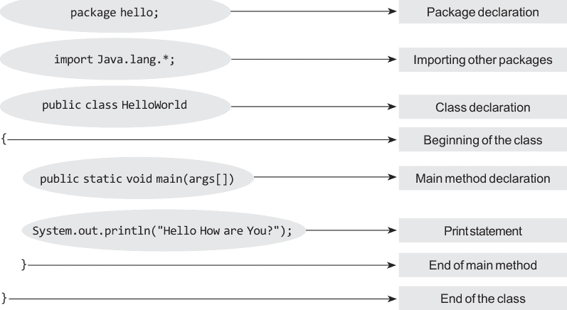

**类或接口标识符**：这些以大写字母开头。每个内部单词的首字母大写，其余字母均为小写。

```java
public class MyClass // 类标识符: MyClass
interface Calculator; // 接口标识符: Calculator
```

**变量或方法标识符**：这些以小写字母开头。每个内部单词的首字母大写，其余字母均为小写。

```java
int totalPay; // 变量标识符: totalPay
MyClass.showResult();
// MyClass 是类名，showResult() 是 MyClass 的一个方法。
```

**常量标识符**：这些使用大写字母。用下划线分隔内部单词。

```java
final double TAX_RATE = 0.05; // 常量标识符: TAX_RATE
```

**包标识符**：这些由所有小写字母组成。

```java
package mypackage.subpackage.subpackage; // 包声明
```

### 3.3.3 关键字

关键字是用于特定目的的预定义标识符，不能用于标识类、变量、方法、包和接口。Java 中使用的所有关键字如表 3.1 所示。

| 表 3.1 Java 关键字 |
| :--- |
| `abstract` `assert` `boolean` `break` `byte` `case` `catch` `char` `class` `const` `continue` `default` `do` `double` `else` `enum` `extends` `final` `finally` `float` `for` `goto` `if` `implements` `import` `instanceof` `int` `interface` `long` `native` `new` `package` `private` `protected` `public` `return` `short` `static` `strictfp` `super` `switch` `synchronized` `this` `throw` `throws` `transient` `try` `void` `volatile` `while` |

> *`const` 和 `goto` 是保留关键字。*

## 3.4 字面量

字面量是程序中可以传递给变量或常量的值。字面量可以是数值型（针对 `byte`, `int`, `long`, `double`）、布尔型、字符、字符串或 `null` 字面量。数值字面量可以用二进制、十进制、八进制或十六进制表示。字面量可以赋值给 Java 中的所有数值类型（基于其范围和大小）。

**二进制字面量**是 0 和 1 的组合。Java 7 允许将二进制字面量赋值给变量。二进制字面量必须以 `0b` 或 `0B` 开头。例如：

```java
char bin1 = 0b1010000; // bin1 的值为 'P' (80)
char bin2 = 0b1010001; // bin2 的值为 'Q' (81)
float bin3 = 0b10100000; // bin3 的值为 160.0
int bin4 = 0b1010001; // bin4 的值为 81
```

**八进制字面量**必须以 `0` 开头，且只允许 0 到 7 之间的数字。例如：

```java
int x = 011; // x 的值为 9
char y = 0150; // y 的值为 'h' (104)
float z = 02334; // z 的值为 1244.0
```

**十六进制字面量**以 `0x` 或 `0X` 开头；只允许 0 到 9 以及 a 到 f（或 A 到 F）。例如：

```java
int y = 0x0001; // y 的值为 1
char x = 0x45; // x 的值为 'E' (69)
float y = 0xA33; // y 的值为 2611.0
```

所有整数默认都是 `int` 类型。要将它们定义为 `long`，可以在数字后面加上后缀 `L` 或 `l`。例如：

```java
long l = 2345678992L;
```

所有浮点字面量默认都是 `double` 类型。要将它们定义为 `float` 字面量，需要添加后缀 `F` 或 `f`。对于 `double` 字面量，结尾可以是 `D` 或 `d`；但它是可选的。例如：

```java
float f = 23.6F;
double d = 23.6;
```

从 Java 7 开始，通过在数值字面量中使用下划线可以增强字面量的可读性。当字面量中的 0 增加时，数零的个数会变得繁琐。在大型字面量中，可以使用如下下划线：

```java
int numlit = 100_000_000; // numlit 的值为 100000000
```

## 3.5 运算符

`+` 运算符在应用于不同的操作数时行为会有不同。例如，如果使用 `+` 运算符且一个操作数是字符串，则另一个操作数将自动转换为 `String` 并进行拼接。在以下 `System.out.println` 的示例中，当 `String` 与结果值或单个原始类型拼接时，这一点是显而易见的。除了算术外，Java 还提供了算术复合赋值运算符：`+=`、`-=`、`*=`、`/=`、`%=`。例如：

```java
a += b; // 等价于 a = a + b;
a -= b; // 等价于 a = a - b;
a *= b; // 等价于 a = a * b;
a /= b; // 等价于 a = a / b;
a %= b; // 等价于 a = a % b;
```

让我们来看一个示例来演示 Java 中这些运算符的使用。仔细观察程序可以发现 `+` 运算符在打印语句中可以有两个用途：拼接和加法。

### 示例 3.1 算术运算符演示

```java
class ArithmeticDemo {
    public static void main(String[] args) {
        int a = 25, b = 10;
        System.out.println("Sum " + a + " + " + b + " = " + (a + b));
        // 将两个变量 a 和 b 相加

        System.out.println("Subtraction " + a + " - " + b + " = " + (a - b));

        // 将 a 乘以 b
        System.out.println("Multiplication " + a + " * " + b + " = " + (a * b));

        // 除法
        System.out.println("Division " + a + " / " + b + " = " + (a / b));

        // 取模运算符
        System.out.println("Remainder " + a + " % " + b + " = " + (a % b));

        // a 和 b 可以相加并将结果放在 a 中
        a += b;
        System.out.println("Added b to a and stored the result in a " + a);
    }
}
```

**输出**

```text
C:\javprog\>java ArithmeticDemo
Sum 25 + 10 = 35
Subtraction 25 - 10 = 15
Multiplication 25 * 10 = 250
Division 25 / 10 = 2
Remainder 25 % 10 = 5
Added b to a and stored the result in a 35
```

图 3.2 显示了 `+` 运算符如何拼接和相加操作数。

```java
System.out.println("Sum " + a + " + " + b + " = " + (a + b));
```

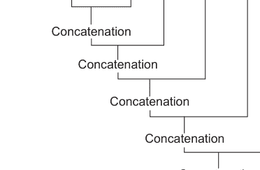

## 3.6 关系运算符

Java 中的关系运算符返回布尔类型的 `true` 或 `false`。表 3.6 显示了 Java 中所有关系运算符的列表。

C++ 中的关系运算符返回一个整数，其中整数值零可以被解释为 `false`，任何非零值可以被解释为 `true`。

| 表 3.6 关系运算符 |
| :--- | :--- |
| 等于 | `==` |
| 不等于 | `!=` |
| 小于 | `<` |
| 大于 | `>` |
| 小于等于 | `<=` |
| 大于等于 | `>=` |

### 示例 3.2 关系运算符演示


```java
class RelationalOperator {
    public static void main(String[] args) {
        int a = 10, b = 20;
        System.out.println("Equality Operator: " + (a == b) + "\t\t\t " + (a == b));
        System.out.println("Not Equal To Operator: " + (a != b) + "\t\t\t " + (a != b));
        System.out.println("Less Than Operator: " + (a < b) + "\t\t\t " + (a < b));
        System.out.println("Greater Than Operator: " + (a > b) + "\t\t\t " + (a > b));
        System.out.println("Less than or equal to Operator: " + (a <= b) + "\t\t\t " + (a <= b));
        System.out.println("Greater than or equal to Operator: " + (a >= b) + "\t\t\t " + (a >= b));
    }
}
```

输出

```text
C:\Javaprog\Java RelationalOperatorDemo
Equality Operator: a == b    true
Not Equal To Operator: a != b    true
Less Than Operator: a < b      true
Greater Operator: a == b      false
Less than or equal to: a <= b    true
Greater than or equal to: a >= b    false
```

# 布尔逻辑运算符

布尔逻辑运算符有：条件或（`||`）、条件与（`&&`）、逻辑或（`|`）、逻辑与（`&`）、逻辑异或（`^`）、单一非（`!`）。逻辑运算符应用于布尔操作数或表达式（第 3.6 节）并返回布尔值。位与（`&`）、逻辑异或（`^`）和位非（`~`）应用于整数以执行位逻辑操作。

如果其中一个操作数为 `true`，逻辑或的结果为 `true`。如果其中一个操作数为 `false`，逻辑与的结果为 `false`。逻辑异或的作用类似于或，但有一个例外，即当两个操作数均为 `true` 时，答案为 `false`。逻辑非只是布尔运算符的补反。逻辑或（`||`）和与（`&&`）运算符也称为短路运算符。在或的情况下，如果第一个操作数为 `true`，则答案为 `true`。在与的情况下，如果第一个操作数为 `false`，则答案为 `false`。不需要评估第二个操作数。除了这些运算符外，Java 还提供了布尔赋值运算符：`&=`、`|=`、`^=`。例如：

```java
a &= b; // 评估为 a = a & b;
a |= b; // 评估为 a = a | b;
a ^= b; // 评估为 a = a ^ b;
```

# 示例 3.3 布尔运算符演示

```java
class BooleanOperatorDemo {
    public static void main(String[] args) {
        boolean a = true, b = false;
        System.out.println("Logical OR: " + a + " || " + b + "\t\t " + (a || b));
        System.out.println("Logical XOR: " + a + " ^ " + b + "\t\t " + (a ^ b));
    }
}
```

# 54 Java 编程

```java
System.out.println("Right Shift: " + x + " >> " + y + " = " + (x >> y));
System.out.println("Unsigned Right Shift: " + x + " >>> " + y + " = " + (x >>> y));
System.out.println("Left shift: " + x + " << " + y + " = " + (x << y));

// 负位移距离 -31 实际上意味着移动 1 位
System.out.println("Left shift: " + x + " << -31 = " + (x << -31));
```

```java
}
```

# 输出

```text
Left shift: 5 << 1 = 10
Right shift: 5 >> 1 = 2
Unsigned Right Shift: 5 >>> 1 = 2
Right Shift: -5 >> 1 = -3
Unsigned Right Shift: -5 >>> 1 = 2147483648
Left shift: -5 << 1 = -10
Left shift: 5 << -31 = 10
```

位运算符特别用于需要位级或低层编程的场景，例如编写设备驱动程序、处理嵌入式系统、数据压缩、加解密、设置掩码和标志，以及创建用于通信的网络协议。

# 3.5.2 一元运算符

一元运算符正如其名，仅应用于一个操作数。它们如下：`++`、`--`、`!` 和 `~`。一元逻辑非（`!`）和位按逻辑非（`~`）已经讨论过。

## 增加和减少运算符

增加和减少运算符可以应用于整数和浮点类型。它们可以在前置（`++x`, `--x`）或后置（`x++`, `x--`）模式使用。

### 前置增加/减少操作

```java
int x = 2;
int y = ++x; // x = 3, y = 3
int z = --x; // x = 1, z = 1
```

### 后置增加/减少操作

```java
int x = 2;
int y = x++; // x = 3, y = 2
int z = x--; // x = 1, z = 2
```

我们将在示例 3.6 中讨论这些运算符。

# 3.5.3 三元运算符

三元运算符应用于三个操作数。这个条件运算符（`? :`）根据第一个表达式决定对哪两个表达式进行求值。

```java
operand1 ? operand2 : operand3
```

# Java 编程结构 55

`operand1` 必须是布尔类型或产生布尔值结果的表达式。如果 `operand1` 为真，则返回 `operand2`。如果 `operand1` 为假，则返回 `operand3`。此运算符类似于 `if` 条件语句。例如：

```java
String greater = x < y ? "X is greater" : "Y is greater";
```

如果 `x` 的值小于 `y`，则返回 `"X is greater"` 并将其存储在变量 `greater` 中；否则返回 `"Y is greater"` 并存储在变量 `greater` 中。

# 3.6 表达式

表达式是操作数和/或运算符的组合。Java 表达式被用于创建对象、数组、将值传递给方法并调用它们、为变量赋值等。表达式中可能包含标识符、类型、字面量、分隔符和运算符（我们已经讨论过所有这些类型）。例如：

```java
int m = 2, n = 3, o = 4;
int y = m * n * o;
```

`m = 2` 是一个将值 `2` 赋值给变量 `m` 的表达式。同样，`n = 3` 和 `o = 4` 是表达式，其中 `n` 和 `o` 被赋值为 `3` 和 `4`。`m * n * o` 是一个表达式，其中 `m`、`n` 和 `o` 的值相乘，结果存储在变量 `y` 中。

# 3.7 优先级规则和结合性

优先级规则用于在存在两个优先级不同的运算符时确定求值顺序。结合性规则用于在运算符优先级相同时确定求值顺序。结合性有两种类型：左结合和右结合。左结合意味着运算符从左到右求值，反之从右到左。优先级和结合性可以通过括号来覆盖。

| 运算符 | 结合性 |
|---|---|
| `[]`, `()`, `++`, `--`, `+expr`, `-expr`, `~`, `!` | RL |
| `new`, `(type)` | RL |
| `*`, `/`, `%` | LR |
| `+`, `-` | LR |
| `<<`, `>>`, `>>>` | LR |
| `<`, `>`, `<=`, `>=`, `instanceof` | LR |
| `==`, `!=` | LR |
| `&` | LR |
| `^` | LR |
| `|` | LR |
| `&&` | LR |
| `||` | LR |
| `? :` | RL |
| `=`, `+=`, `-=`, `*=`, `/=`, `%=`, `<<=`, `>>=`, `>>>=`, `&=`, `^=`, `|=` | RL |

表 3.8 列出了 Java 中根据优先级（从高到低）及其相应结合性的运算符。RL 表示从右到左的结合，LR 表示从左到右的结合。

# 示例 3.6 优先级

```java
class PrecedenceExample {
    public static void main(String[] args) {
        // 演示运算符的优先级
        int x = 5, y = 1;
        int result = x + y * 2; // 5 + (1 * 2) = 7
        System.out.println("Result: " + result);

        // 使用括号覆盖优先级
        result = (x + y) * 2; // (5 + 1) * 2 = 12
        System.out.println("Result with parentheses: " + result);
    }
}
```

左侧可以容纳右侧，赋值即完成。例如，可以将一个较小的盒子放在较大的盒子里，以此类推。一个字节的值可以放入 `short` 中，`short` 放入 `int` 中，`int` 放入 `long` 中，以此类推（**宽转换**/widening conversion）。任何值都可以赋值给 `double`。除了 `double` 之外的任何值都可以赋值给 `float`。任何整数值都可以赋值给 `long`；而 `int`、`short`、`byte` 和 `char` 都能放入 `int` 中。例如：

```java
byte b = 10; // byte 变量
int i = b; // 隐式将 byte 转换为 int (implicit widening byte to int)
```

在评估涉及算术运算符的表达式时，会发生类型转换或提升。例如：

```java
int i = 10; // int 变量
double d = 20; // int 字面量赋值给 double 变量
d = i + d; // int 自动转换为 double
```

在上一条语句中，`int` 值被提升为 `double`，然后将这两个值（`i` & `d`）相加得到一个 `double` 类型的结果。基本规则是：如果二元运算（涉及算术、关系、相等性）中的任意一个变量是 `double`，Java 将两个值都视为 `double`。如果两者都不是 `double` 但其中一个是 `float`，Java 将两个值都视为 `float`。如果两者都既不是 `float` 也不是 `double`，但其中一个是 `long`，Java 将两个值都视为 `long`。最后，如果没有 `double`、`float` 或 `long`，Java 将两个值都视为 `int`，即使表达式中有 `byte`、`short` 或 `char`。因此，结果将取决于操作数的类型，可能是 `double`、`float`、`long` 或 `int`。例如，考虑以下声明：

```java
byte b = 10;
short s = 30;
```

以下语句无效，因为在评估表达式时，`byte` 和 `short` 被自动提升为 `int`，因此结果是 `int`，而 `short` 无法存储这个 `int` 值。

```java
short z = b + s; // 无效
int i = b + s; // 有效
```

在位与、位或运算中，如果其中一个操作数比 `int` 宽，则两个操作数都转换为 `long`；如果位运算符应用于比 `int` 短的操作数上，它会被自动提升为 `int`。在移位运算符中，左操作数如果宽度比 `int` 窄，会被提升为 `int`，否则保持原类型。

让我们来看一个有趣的案例：

```java
float f = 3; // 合法；int 字面量赋值给 float 变量
```

最后一个 `float` 变量的声明显示，在赋值时没有使用后缀 `f`，但它仍然被认为是一个合法的语句。原因是 `3` 是一个 `int`，而 `int` 可以直接赋值给 `float`。但如果声明为：

```java
float f = 3.0; // 非法；
```


Java 将所有实数视为 `double`，所以 `3.0` 被视为 `double`，不能直接赋值给 `float`，因为 `float` 比 `double` 小。对于上述语句，有两种可能的解决方案：(a) 给字面量加上后缀 `F` 或 `f`，即 `3.0f`；(b) 对其进行强制转换（cast）。

```java
float f = 3.0f; // 合法；
```

# 强制类型转换（Casting）也称为窄转换（narrowing conversion，宽转换的反向）。

```java
char
```

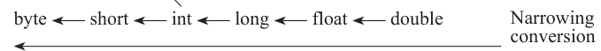

如果你想将值赋值给 `int` 或将 `double` 值赋值给 `float` 变量，除非你通过强制转换告诉编译器，否则编译器将不允许这样做。当你需要将一个较大的值放入特定的较小类型时，请使用强制转换。例如，考虑盒子的反例。一个大盒子必须放在一个小盒子里。这时必须对大盒子进行切割，以便大盒子（现在已经变小了）能够放入小盒子。强制转换不是隐式的，必须通过在括号中指定目标类型来显式说明。例如：

```java
int i = (int)(8.0/3.0);
```

强制转换告诉编译器你正计划进行转换。在赋值之前，右侧的值被截断以适应左侧。对于将浮点数转换为 `int` 或 `long`，小数部分会被截断得到一个整数。如果结果整数足够小可以放入左侧，则赋值完成。但如果数字太大，可能会导致符号位或精度的丢失。对于 `byte` 和 `short`，如果值足够小可以放入，则赋值完成。值得提到的是，如果你尝试将 `long` 赋值给 `float`，Java 将其视为合法的语句。例如：

```java
long x = 32;
float y = x; // 合法
```

为了理解为什么这些是合法的，需要知道浮点数是如何表示的。浮点数使用 IEEE 754 标准表示。浮点数由符号位（sign）、尾数（mantissa）和指数（exponent）组成。符号位用于表示正负。符号位 `0` 表示正数，`1` 表示负数。尾数持有浮点数的有效数字。Java 编程中，`float` 变量使用 23 位尾数和 8 位指数。`double` 变量使用 52 位尾数和 11 位指数。这些变量的位表示所示：

| | 符号位 | 指数位 | 尾数位 |
|---|---|---|---|
| float 变量 | | 8 | 23 |
| double 变量 | | 11 | 52 |

你可以很容易想象 `float` 变量比 `long` 变量容纳更多值。为了详细讨论 IEEE 754 标准，让我们来看一个例子。

# 示例 3 转换与强制转换

```java
class CastingAndConversion {
    public static void main(String args[]) {
        // 强制转换 = (int)(8.0/3.0)
        int i = (int)(8.0/3.0);
        // j 将其类型的最大值，2147483648.0 溢大了
        int j = (int)2147483648.0;
        System.out.println("i = " +i+" j = " +j);
        // 强制转换：包含 int 值 257 的低位
        byte b = (byte)257;
        // 强制转换：包含 int 值 65537 的 16 位低位
        short s = (short)65537;
        System.out.println("b = " +b+" s = " +s);
        // 强制转换为 char
        System.out.println("Converting int to char " +(char)75);
        // 转换：int * byte * double 是 double
        double d = i * b * s * 2.0;
        System.out.println("Conversion to double result is :d);
        // 移位运算符情况下隐式转换为 int
        i = b << 2;
        System.out.println("i = " +i);
        // 复合运算符自动执行转换
        byte c = 0;
        // c = c + b; 不编译
        c += b; // 编译
        System.out.println("Result: "+c);
    }
}
```

# 输出

```
i = 2 j = 2147483647
b = 1 s = 1
Converting int to char
Conversion to double result is :4.0
i = 4
Result: 1
```

# 解析

-   **L1** 显示了将 `double` 表达式强制转换为 `int`。一个值除以 `double` 值的结果是 `double`，它被转换为 `int`。
-   **L2** 显示将 `float` 字面量转换为 `int`，这大于 `int` 变量能容纳的最大值。因此 `j` 被设置为 `int` 能容纳的最大值。
-   **L3** 显示将 `int` 字面量转换为 `byte`。它大于 `byte` 能够容纳的最大值。在这种情况下，`byte` 变量将包含 `int` 字面量 257 中的低位。`int` 字面量 257 的二进制为 `0000000000000000000100000001`。强制转换后十进制值为 1。
-   **L4** 显示将 `int` 字面量转换为 `short`，这大于 `short` 能够容纳的最大值。`short` 变量将包含 `int` 字面量 65537 中的 16 位低位。`int` 字面量 65537 的二进制为 `00000000000000010000000000000001`。强制转换后，`short` 取留低 16 位（`0000000000000001`），其十进制值为 1。
-   **L5** 显示了将整数强制转换为 `char`。字符用整数 ASCII 值表示。
-   **L6** 显示自动提升。表达式乘法具有左结合性。首先变量 `b` 被自动提升为 `int` 并与 `i` 相乘得到 `int` 结果（即 `2*1=2`）。现在因为与 `double` 相乘，`int` 被自动提升为 `double`，得到结果 `4.0`。
-   **L7** 显示移位运算符情况下隐式转换为 `int`。在移位之前，变量 `b` 被自动提升为 `int`，然后 32 位左移了两位。
-   **L8** 被注释掉了，不会编译。在评估此表达式时，`c` 和 `b` 被自动提升为 `int` 并产生 `int` 结果。该结果无法直接存储在变量中。
-   **L9** 可以编译，因为在这种情况下使用的运算符是复合运算符，它会自动将结果转换为目标类型。

## 3.9.1 条件语句

Java 程序通过使用操作符处理程序数据，并通过测试程序数据的状态来做出决策以完成任务。当程序做出决策时，它会根据程序数据的状态决定是否应该执行某些行代码。例如，程序可能会检查一个变量 `flag` 来判断是否应该执行一段将数据保存到磁盘文件中的代码。如果 `flag` 为 `true`，则保存数据；否则不保存数据。Java 提供的两种条件语句是：`if-else` 和 `switch-case`。

### if...else

`if` 语句的语法如下：

```java
if (x == 0)
    // 代码行
else if(x == 1)
    // 代码行
else
    // 代码行
```

条件语句（如 `if`）的参数必须是一个布尔值，即评估结果为 `true` 或 `false` 的值。你可以根据需求在程序中编写 `n` 个 `else if {}` 语句。`if...else` 条件也可以像所示那样进行嵌套。

```java
if (condition)
    if (condition)
        // 根据条件执行某些操作
```

接下来的示例展示了如何在 Java 中使用 `if...else` 条件语句。

### 示例 3.8 IfElse

```java
class IFElseExample {
    public static void main(String[] args) {
        int x=20, y=18, z=22;
        if (x < y) // x 在 y 之前
        {
            if (z < x) // z 在先
                System.out.println(z + " " + x + " " + y);
            else if (z > y) // z 在最后
                System.out.println(x + " " + y + " " + z);
            else // z 在中间
                System.out.println(x + " " + z + " " + y);
        }
        else {
            // y 在 x 之前
            if (z < y) // z 在先
                System.out.println(z + " + " + y + " + " + x);
            else if (z > y) // z 在最后
                System.out.println(y + " + " + x + " + " + z);
            else // z 在中间
                System.out.println(y + " + " + z + " + " + x);
        }
    }
}
```

# 输出

```
C:\>JavaElseExample
18 20 22
```

#### 解析

- **L1** 它展示了与 `y` 比较的 `if` 语句。如果 `x` 小于 `y`，则控制权传递到从 L2 开始的大括号。在我们的示例中，`x` 大于 `y`，因此控制权传递到 L10 的 `else` 语句。
- **L3** 它使用了嵌套语句。`if` 子句位于 `if` 语句内部。如果 L1 返回 `true`，则检查此处的条件。该条件是 `z` 是否小于 `x`，而根据 L1，`x` 已经小于 `y`。如果 `(z < x)` 为真，则 `z` 是最小的，`x` 介于中间。
- **L4** 它打印 L3 的执行结果。
- **L5** 如果 L3 返回 `false`，则控制权传递到 L5，`z` 不小于 `x`，在 L5 中与 `y` 进行比较。如果 `z` 大于 `y`，意味着 `z` 是最大的，`x` 是最小的，`y` 介于中间。（我们已经从 L1 得知 `x` 小于 `y`）。
- **L6** 它打印 L5 的执行结果。
- **L7** 如果 L5 上的条件返回 `false`，则控制权传递到 L7 的 `else`。
- **L8** 循环小于 `y`。
- **L9** 检查结果。
- **L10** 如果 `z` 小于 `x`，则 `z` 是最小的，`x` 介于中间。
- **L11** 检查小于 `y`。
- **L12** `z` 大于 `y`。
- **L13** 它打印 L3 的执行结果。
- **L14** 如果 `z` 大于 `y`，意味着 `z` 是最大的，`x` 是最小的，`y` 介于中间。
- **L15** 它打印 L5 的执行结果。
- **L16** 如果 L5 上的条件返回 `false`，则控制权传递到 L16 的 `else`。
- **L17** 它打印 L16 的执行结果。

### Switch-case

Java 有一种处理多个 `if` 语句的写法——`switch-case`。这里我们使用 `switch-case` 编写上述程序：

```java
switch (x) {
    // 代码行
    doSomething0();
    break;

    case 1:
        // 代码行
        doSomething1();
        break;
    ..
    case n:
        // 代码行
        doSomethingn();
        break;
    default:
        // 代码行
        doSomethingDefault();
        break;
}
```

## 3.9.2 循环

循环目的是多次执行 Java 语句。有三种循环：`for`、`while` 和 `do-while`。

### for 循环

对于已知次数的执行，`for` 循环是正确的选择。`for` 的语法为：

- 初始化
- 条件
- 递增和递减

```java
for (int i = 0; i < 5; i++)
```

#### 示例 3.10 for 循环

```java
class ForDemo
{
    public static void main(String args[]) {
        for (int i = 1; i <= 5; i++) {
            System.out.println("Square of " +i + " is " + (i*i));
        }
    }
}
```

# 输出

```
Square of 1 is 1
Square of 2 is 4
Square of 3 is 9
Square of 4 is 16
Square of 5 is 25
```

#### 解析

- **L1** 它展示了 `for` 循环及其三个部分：初始化（`i` 初始化为 1）、条件（`i` 小于等于 5），第三部分是递增（`i++`）。循环将执行五次。此循环只有一个语句。
- **L2** 它打印 `i` 的平方（即 `i*i`）。该行将执行五次，对应 `i` 的每一个值。

### while 循环

循环用于根据条件重复执行语句块。条件会在迭代开始前进行评估。当你知道确切的迭代次数时，`for` 循环非常有用。如果你想无限次执行某些语句（即迭代次数未知），`while` 循环可能是更好的选择。

# Java 编程结构

`while` 语句的语法如下：

```java
while (condition)
{
    // 当条件为真时执行的语句
}
```

示例 3.10 中的程序也可以使用 `while` 循环来编写。

# 示例 3.11 while 循环

```java
class WhileDemo {
    public static void main(String[] args) {
        int i = 1;
        while(i <= 5) {
            System.out.println("Square of " +i + " is " + (i*i));
            i++;
        }
    }
}
```

# 输出

```
Square of 1 is 1
Square of 2 is 4
Square of 3 is 9
Square of 4 is 16
Square of 5 is 25
```

#### 解释

- **L1** 它将 `int` 变量 `i` 初始化为 1。
- **L2** 它演示了 `while` 循环。在循环中，检查 `i` 的值是否小于或等于 5，第一次迭代为 1（小于 5），因此控制进入 `while` 循环。在执行完 `while` 循环大括号内的语句后，再次检查循环条件。它将一直持续直到条件返回假（即当 `i` 的值变为 6 时），此时控制退出循环。
- **L3** 大括号表示 `while` 循环的开始。
- **L4** 它打印 `i` 的平方。
- **L5** 它递增了 `i` 的值。
- **L6** 大括号表示 `while` 循环的结束。

# do-while 循环

`do-while` 循环也用于重复执行（迭代）一个语句块。但在 `do-while` 循环中，条件是在迭代结束时评估的。因此，`do-while` 循环（与 `while` 循环不同）将至少执行一次，之后取决于条件。

`do-while` 循环的通用格式为：

```java
do {
    // 执行一次以及此之后在条件为真时持续执行的语句
} while (test);
// 后续语句;
```

# 示例 3.12 do-while 循环

```java
class DoWhileDemo
{
    public static void main(String[] args) {
        int i = 1;
        do {
            System.out.println("Square of " + i + " is " + (i*i));
            i++;
        } while (i <= 5);
    }
}
```

# 输出

```
Square of 1 is 1
Square of 2 is 4
Square of 3 is 9
Square of 4 is 16
Square of 5 is 25
```

#### 解释

- **L1** 将 `int` 变量 `i` 初始化为 1。
- **L2** 它启动了 `do-while` 循环的起始语句。
- **L4 到 6** L4 和 L5 上的语句至少执行一次，并取决于 L6 `while` 循环指定的条件。在这种情况下，L4 和 L5 上的语句不是执行一次，而是执行了五次（`i` 的值从 1 循环到包含 5）。

## for-each 循环

Java 5 引入了所谓的 `for-each` 语句，它可以访问数组、列表或集合中的每个连续元素，而无需关联迭代器或索引。这种新语句被称为增强型 `for-each`（enhanced for each）。该循环用于顺序访问值集合（如数组）中的每个值。它通常用于遍历数组或集合（例如 `ArrayList`）。与 `for` 循环类似，这些循环执行固定次数的迭代。但与它们不同的是，`for-each` 循环根据集合的大小确定其步数。

`for-each` 循环的通用形式为：

```java
for (type var : arr)
{
    // 要重复的语句
}
```

当我们在讨论 Java 中的数组和集合时，将再次回到 `for-each` 循环。

## 3.9.3 分支机制


Java 并不像某些语言那样提供 `go to` 跳转语句，因为这会导致不可达的代码。然而，Java 支持其他从一个语句跳转到另一个语句的方法。Java 中提供了两种类型的分支语句——`break` 和 `continue`。

### break 语句

`break` 语句用于用户需要跳出循环的情况，而 `continue` 语句用于用户想要回到循环顶部的情况。当满足特定条件时，使用 `break` 语句可以跳出循环，如下所示：

```
while (i < 5) {
    //执行某些操作;
    if(i < 0) break; // 跳出循环
}
```

`break` 将导致程序流流移出循环，到达循环语句之后的下一个语句。下面的示例是一个在给定范围内选择质数的程序语句。

### 示例 3.13 break 的用法

```java
class PrimeDemo{
    public static void main(String[] args) {
        int j,k;
        System.out.print("Prime numbers between 1 to 30 : ");
        for (int j = 1; j < 30; j++) {
            for (int k = 2; k < j; k++) {
                if (j % k == 0) break;
            }
            System.out.print(j + " ");
        }
    }
}
```

# 输出

```
C:\javabook\programs\chap3>Java PrimeDemo
Prime numbers between 1 to 30 : 2 3 5 7 11 13 17 19 23 29
```

#### 解释

- **L1** 它创建从 1 到 30 的循环（因为我们需要找到 30 以内的质数）。
- **L2** 它创建了一个从 2（因为 1 不是质数）到 `j` 的内部循环。
- **L3–5** 条件检查 `j` 是否能被 2 到 j-1 范围内的任何数字整除。如果能整除（即余数为 0），则跳出内部循环并检查 (L4) 分子（j）和分母（k）是否相同。如果是，则它是一个质数。如果想跳出两个循环，使用标签 break。

# 示例 3.14 标签 break

```java
class LabeledDemo{
    public static void main(String[] args[]) {
        // L1 在外部循环上放置了名为 Outer 的标签：
        Outer: for(int i = 0; i < 4; i++) {
            // L2
            for(int j = 1; j < 4; j++) {
                // L3
                System.out.println("i:" + i + " j:" + j);
                // L4
                if(i == 2) break Outer;
            }
        }
    }
}
```

# 输出

```
C:\javabook\programs\chap3>Java LabeledDemo
i:0 j:1
i:0 j:2
i:0 j:3
i:1 j:1
i:1 j:2
i:1 j:3
```

#### 解释

- L1 在外部循环上带有冒号的标签 `Outer`。
- L2 创建了一个内部循环。
- L3 打印 `i` 和 `j` 的值。
- L4 如果 `i` 的值等于 2，跳出两个循环，程序终止。

### continue 语句

可能会出现这种情况：你不想跳出循环，而是简单的回到顶部继续下一次迭代，如下代码所示。

# 图 15 continue 代码片段

（注意：片段见正文）

#### 解释

- L1 `while` 循环的开始。
- L2 循环内部有一些语句 (`doSomething`)。
- L3 如果 `i` 小于 4，回到循环顶部继续下一次迭代。
- L4 `doSomething` 语句不会执行，因为 `continue` 语句会将程序流传回下一次迭代。有时你可能想跳出内部循环也包括外部循环。在这种情况下，你可以在外部循环上使用标签（类似于 `break`）跳转到那里并继续下一次迭代，如下例所示。

# 图 16 标签 continue 代码片段

```
L1 jmp0: while (i < 5) {
L2   for (int i = 0; i < 4; i++) {
L3   if(i == 2) continue jmp0; //执行某些操作;
}
}
```

#### 解释

- L1 `while` 循环开始处的标签 `continue`（即 `jmp0`）。
- L2 内部 `for` 循环。
- L3 内部循环内的语句表示如果 `i` 等于 2，跳转到外部循环，否则执行语句 (`something`)。

# 总结

Java 是一种用于解决问题的面向对象的编程语言。所有的 Java 关键字都有固定含义，并构成了程序语句的构建块。变量持有分配给它们的内存位置。Java 有基本数据类型，即 `byte`, `short`, `int`, `long`, `float`, `double` 和 `char`。Java 将数据类型交给机器或编译器，而是指定了一切。所有整数类型（`byte`, `short`, `int`）和浮点类型（`float`, `double`）在 Java 中都是符号符号。Java 7 引入了用于赋值变量的二进制字面量和用于字面量的下划线。除此之外，Java 7 增加了用于 `switch case` 语句的字符串。

Java 有多种运算符，可以分类为算术、关系、逻辑、赋值、增/减、条件、位运算和特殊。表达式由变量和运算符组成。Java 中的运算符具有特定的优先级和结合规则，在混合类型时遵循这些规则。Java 中也可以进行显式类型转换（强制转换）。

# 练习

- 1. 在下面的类定义中，哪一行（如果有）会导致编译错误？选择正确答案。
- 2. 编译并运行以下程序时的输出是什么？

```
public class CastTest {
    public static void main(String[] args){
        char a;
        int j;
        a = 'A';      // /1
        j = a;        // /2
        a = j + 1;    // /3
        a++;         // /4
    }
}
```

```
class test {
    public static void main(String[] args){
        int i,j,k;
        k = i++;
        j = ++j;
        i = j;
        System.out.println(i);
    }
}
```

- (a) 标记为 1 的行。
- (b) 标记为 2 的行。
- (c) 标记为 3 的行。
- (d) 标记为 4 的行。

- (a) 0 (b) 1 (c) 2 (d) 3

- 4. 编译并执行以下类时，标准输出上打印了什么？选择正确答案。

- 2. 哪些赋值是有效的？

(a) `short s = 48;`

(b) `float f = 4.3;`

(c) `double d = 4.3;`

(d) `int i = '1';`

```
public class SCckt {
    public static void main(String[] args {
        int i = 0;
        boolean f = true;
        boolean f = false, b;
        b = (t && ((i)) == 0));
    }
}
```

```
b = (f && ((i+=2) > 0));
System.out.println(i);
}
```

```
System.out.println(2);
break;
```

```
case 3:
    System.out.println(3);
    default:
    System.out.println(4);
    break;
}}
```

+ (a) 0 (b) 1 (c) 2 (d) 3

5. 在 Java 中使用哪种运算符来执行位取反？

+ (a) `~` (b) `!` (c) `&` (d) `|`

6. 下列哪些语句是正确的？

(a) Java 提供了两个左移运算符 `<<` 和 `<<<`

(b) `>>>` 是无符号右移运算符。

(c) `>>>` 是有符号右移运算符。

(d) 对于正数，运算符 `>>` 和 `>>>` 的结果是相同的。

+ 9. 选择在代码编译并运行运行时构成了输出一部分的行。

```java
public class test {
    public static void main(String[] args[]) {
        for (int i = 0; i < 3; i++) {
            for (int j = 3; j >= 0; j--) {
                if (i == j) continue;
                System.out.println(i + " " + j);
            }
        }
    }
}
```

+ 7. 编译并运行该程序的结果是什么？

```java
public class test {
    public static void main(String[] args[]) {
        int i = -1;
        i = 1;
        System.out.println(i);
    }
}
```

+ (a) 63 (b) -1 (c) 0 (d) 1

+ 10. 选择在代码编译并运行运行时构成了输出一部分的行。

+ 8. 当以下类被编译并运行时，输出是什么？

```java
public class test {
    public static void main(String[] args[]) {
        int x = 0;
        if (x > 0) x = 1;
        switch(x){
            case 1:
                System.out.println(1);
            case 0:
                System.out.println(0);
            case 2:
        }
    }
}
```

+ (a) 0 (b) 1 (c) 2 (d) 3

# 复习题

+ 1. Java 中标识符的命名规则是什么？
+ 2. 解释转换（conversion）。它与强制类型转换（casting）有什么区别？
+ 3. 什么是位运算符？Java 中共有多少种位运算符？
+ 4. `for`、`while` 和 `do-while` 循环之间有什么区别？
+ 5. 右移运算符和无符号右移运算符之间有什么区别？
+ 6. 什么是优先级？解释优先级和结合性在评估表达式时有什么用。
+ 7. 解释以下概念：
    (a) 变量 (variable)
    (b) 字面量 (literal)
    (c) Java 中的关键字 (keywords)
    (d) Java 中的数据类型 (data types)
    (e) `break`
    (f) `continue`
+ 8. 什么是二进制字面量？它们在 Java 中如何使用？
+ 9. 解释下划线如何与字面量一起使用及其目的。
+ 10. 解释为什么当我们将 `long` 值赋值给 `float` 变量时，64 位的 `long` 会自动转换为 32 位的 `float`。

# 编程练习

+ 1. 编写一个程序 `Pattern`，接收一个整数 N，并打印出一个交替出现空格和星号的 N×N 二维模式，如下方的 4x4 模式所示：
+ 6. 编写一个将英寸转换为厘米的程序。
+ 7. 编写一个程序将英亩转换为公顷，反之亦然。
+ 8. 编写一个程序接收电阻值，并输出串联连接时的等效电阻（假设 R1=12, R2=14）。
+ 2. 编写一个程序进行二进制到十进制的反二进制转换（不要使用预定义方法）。
+ 3. 编写一个程序接收价格并打印相应的税，假设销售税为 5%。
+ 4. 编写一个程序接收员工的工作小时并输出时薪和总薪资。
+ 5. 编写一个程序计算 $10,000 的投资在第一年增长 20%，第二年增长 $500，第三年增长 16%。
+ 9. 编写一个程序计算并联连接的电阻。并联的的公式为 $q = \frac{1}{R1} + \frac{1}{R2}$。

# 选择题

+ 1. (c), `integer` 无法赋值给 `character`。
+ 2. (a), (c), (d), `double` 无法赋值给 `float`。
+ 3. (b)
+ 4. `variable`, `expression` (`i += 2`) 被评估。
+ 5. (a) 6. (d)
+ 7. (a), (c)
+ 9. (b), (c), (d)
+ 10. (b), (c), (d)

# 类与对象

空间是巨大的。你不会相信它是如此巨大、令人难以置信。我的意思是，你可能觉得这只是微毛小事。——道格拉斯·亚当斯

阅读本章后，读者将能够：

* 了解类和对象如何在 Java 中创建和应用
* 了解方法是如何创建和使用的
* 理解多态和重载的概念
* 理解什么是构造函数
* 熟悉 `static` 关键字
* 了解命令行参数
* 理解内部类
* 理解数组

## 4.1 类

Java 是一种面向对象的语言。在第一章中，我们学习了面向对象编程（OOP）的概念。在 Java 中应用这些概念之前，我们必须理解 OOP 的基本单元：类和对象。

在现实世界中，我们每天都会遇到同类型的对象。我们遇到的许多对象之一是自行车。我们可以说自行车是摩托车类的实例。自行车有齿轮等。它们还遵循某些行为，当对其执行操作时，自行车在刹车时会减速，在加速时加速，等等。

制造商利用自行车具有相似特征的特点生产了许多自行车。为每辆独立的自行车创建一个新的蓝图是非常无效的。在面向对象的软件中，有许多同类型的对象，即属于共享特征的类。我们可以利用同类对象是相似的特点为这些对象创建一个蓝图。对象的“蓝图”被称为类。

# 类与对象

让我们回到 `bike` 类，它还会声明并提供实例方法或函数，允许骑者换挡、刹车和加速。图 4.1 显示了 `bike` 类。

| Bike |
| :--- |
| `boolean kickStart` |
| `boolean buttonStart` |
| `int gears` |
| `accelerate()` |
| `applyBrake()` |
| `changeGear()` |

> 类是一个蓝图或原型，定义了所有特定类型对象的变量和方法。换，类可以被视为一种自定义的数据类型，而对象是数据类型的变量，它可以包含数据和方法（即处理这些数据的函数）。

图4.1 Bike 类

## 4.2 对象

面向对象的技术围绕对象展开。我们在周围看到许多对象，如桌子、汽车、狗、风扇、电脑和笔。这些对象可能是实体的，也可以是无形的，例如银行账户、市场、费用等。所有这些现实对象在任何实例都有属性。自行车具有属性（速度、发动机容量、轮子数量、齿轮数量）。对象的状态由其属性值和行为（刹车、加速、减速和换挡）定义，在应用这些行为时，自行车的状态会在各种状态之间变化，它可以是静止的等。例如，当我们刹车时，速度会降低，当我们加速时，速度会增加。状态会随时间变化，例如当前速度 = 60 km/h，当前档 = 4。同样，风扇的状态可能是开启或关闭。

我们可以将这些实时对象概念化为软件对象。它们本质上是相似的，因为它们有状态和行为。软件对象中的状态由变量维护，而行为可以使用方法来实现。有趣的是，这些现实对象可以使用软件对象来表示。

> 对象是一个封装了变量和操作这些变量的方法的软件包。

你可能想在游戏应用程序中将真实的自行车表示为软件对象。抽象的概念也可以使用软件对象进行建模。例如，银行账户是银行解决方案中常用的一个对象，用于表示银行各客户的账户详情。

| Bike |
| :--- |
| `kickStart = false` |
| `buttonStart = true` |
| `gear = 4` |
| `accelerate()` |
| `applyBrake()` |
| `changeGear()` |

图4.2 显示了验证软件对象（状态）和可以做的（行为）是通过该对象内部的变量和方法表达的。模拟现实自行车的软件对象将具有指示自行车当前状态的变量：它的速度是 10 mph，每分钟转数加速度为 5000 rpm，当前档位是 4 档。这些变量被称为实例变量。

自行车的实例方法将具有刹车、加速和换挡的方法。这些被称为实例方法。只有相关的字段和行为会被添加到类中。例如，自行车没有姓氏，它也不会说话或睡觉。可以创建一个自行车类，在类中声明实例变量来包含每辆自行车对象的齿轮、刹车等，每辆自行车都将拥有它们自己的刹车、齿轮等。

值得注意的是，所有对象都拥有它们自己的实例变量拷贝。这意味着，如果一个自行车类有五个实例对象，那么在那个类中定义的每个实例变量就有五份拷贝。每个对象都有它们自己的实例变量拷贝，这与从同一个类中创建的其他对象是不同的。

实例变量的值是由类的每个实例提供的。因此，在你创建了自行车之后，你必须先对它进行实例化（创建一个对象），然后才能使用它。当类的实例（对象）被创建时，就会创建一个该类型的对象，并且系统会为类中声明的实例变量分配内存。可以调用对象的实例方法来执行操作。

- 同一类的实例共享实例方法的实现（方法实现不会按每个实例进行重复）。


# Java 编程

除了实例变量和方法外，类还可以定义它们自己的类变量和类方法。每个对象都拥有它们自己的实例变量，但类变量是由类的所有对象创建的。你可以使用类的实例或类名来访问类变量和类方法。你不需要实例化就可以使用它的变量和方法。类方法只能直接访问类变量。它们无法直接访问实例变量或方法。所有类变量只创建一个拷贝，该类的所有实例都共享它。例如，假设所有的汽车都有相同数量的齿轮。在这种情况下，可以创建一个定义齿轮数量的类变量。类的所有实例都将共享这个变量。如果任何对象操作了该类变量，那么该类的所有对象的变量都会随之改变。

## 4.2.1 对象与类的区别

对象和类看起来是一样的。是的，类和对象之间的区别通常是一种困惑，这是一个事实。在现实世界中，显而易见类并不是它们所描述的对象——一张自行车蓝图并不是一辆自行车。然而，在编程中，区分类和对象是困难的。这部分是因为编程中的对象是现实世界对象或抽象概念的电子元素。类具有逻辑存在，而对象具有物理存在，例如，家具本身没有任何物理存在，但椅子、桌子等是有物理存在的。

## 4.2.2 为什么我们要使用对象和类？

模块化、信息隐藏（即数据封装）可以通过对象来实现。类作为蓝图，在提供代码易于更改和调试便利的同时，还提供了可重用的用处。例如，自行车制造商反复使用同一张蓝图来制造许多自行车。程序员反复使用同一个类来创建许多对象。

## 4.3 JAVA 中的类声明

声明一个类是简单的。可以使用关键字后跟你想要定义的类名来声明类。给类命名完全完全在程序员的手中。在这样做时，他必须注意类名的相关性、使用 Java 作为类名的合法性以及 Java 中使用的命名规范。因此，最简单的类声明如下：

```
class Bike
{
  //变量声明
  //方法声明
}
```

### 示例 4.1 类声明

```java
class Goodbyeworld
{
  public static void main(String args[])
  {
    System.out.println("Goodbye World!");
  }
}
```

在这里，类名是 `Goodbyeworld`。该类只包含 `main()` 方法，该方法负责在屏幕上显示 Goodbyeworld。

总而言之，Java 程序中的所有操作都发生在类内部。方法和变量定义在类内部。类是 Java 编程的基本单元。类声明可以指定更多关于类的信息，你可以根据需要指定：

- 声明类的父类
- 列出类实现的接口
- 声明类是公共（`public`）、抽象（`abstract`）还是最终（`final`）

对于每种情况，类声明将相应不同。我们将在了解相关概念后讨论这些。考虑到 Java 中类声明的所有可能性，我们可以将类声明总结为：

```
[modifiers] className [extends SuperClassName] [implements InterfacesName]
{
}
```

`[]` 内包含的项目是可选的。类声明定义了以下方面：

- `modifiers`：类是 `public`、`protected`（受保护）、`default`（默认）、`abstract` 还是 `final`
- `ClassName`：你正在声明的类名
- `SuperClassName`：父类的名称
- `InterfacesName`：类实现的接口的逗号分隔列表

只有 `class` 关键字和类名是强制性的。其他参数是可选的。

### 4.3.1 类体

类包含两个部分：变量声明和方法声明。类的变量描述它的状态，方法描述它的行为。所有成员变量和方法都声明在类内部。Java 中三种变量：局部变量、实例变量和类变量。局部变量定义在方法内部。实例变量定义在类内部方法外部，类变量用 `static` 修饰符声明。

#### 实例变量

重要的是一个类可以有很多实例（即对象），每个实例都拥有自己的一组实例变量。对一个实例的变量进行的任何更改都不会对另一个实例的变量产生任何影响。关于类变量、局部变量和实例变量的详情，请参见第 4.7 节。

通常，你先声明成员变量，然后是方法声明：

```
class className {
  变量声明
  方法声明
}
```

示例 4.2 显示了一个带有两个实例变量的示例声明。我们将在本章晚些时候重新讨论实例变量。请注意，如果你尝试运行它，它不会显示输出，因为它不是功能完整的；我们需要添加某些方法，以便该程序能够显示。

### 示例 4.2 类声明

| 行 | 代码 |
| :--- | :--- |
| L1 | class SalesCalculator { |
| L2 | float amount = 100.f; // 实例变量 |
| L3 | float taxRate = 0.2f; // 实例变量 |
| L4 | } |

#### 解释

- L1：使用关键字后跟类名 `SalesCalculator`。
- L2：用于 `amount` 的 `float` 变量。
- L3：用于 `taxRate` 的 `float` 变量。
- L4：类的结束。

## 创建对象

上面的示例显示了一个带有实例变量的类。实例变量是类的实例（对象）。当实例创建时，这些实例变量。为了能够访问/操作这些实例变量，我们需要创建对象。我们已经见过什么是对象。让我们看看在 Java 中如何创建对象。

在 Java 中，你可以通过实例化类来创建对象。对象的类型定义为类。通常，你会看到如下语句创建对象：

```java
SalesCalculator obj1 = new SalesCalculator();
```

该语句创建了一个 `SalesCalculator` 对象。`SalesCalculator obj1` 是一个声明，仅向编译器声明变量 `obj1` 将引用一个类型为 `SalesCalculator` 的对象。`new` 运算符实例化 `SalesCalculator`（通过分配内存并创建对象），而 `SalesCalculator()` 初始化了对象。

### 4.4.1 声明对象

在声明引用对象的变量后，必须获取对象的物理拷贝并将其赋值给变量。这可以通过 `new` 运算符来实现。

对象的声明与变量声明相同。例如：

```java
SalesCalculator obj1;
```

通常，声明如下：

```
type name
```

其中 `type` 是对象的类型（即类名），`name` 是引用对象的引用变量名。类就像是新的类型。

> 变量持有单一类型的字面量，例如 1、bat、345 等。对象是类的实例，拥有一组执行特定任务的实例变量和方法。引用用于引用/访问对象。引用变量的特定类型可以是静态、实例或局部变量，因为它们可以传递或从方法返回。

上面的声明不会创建对象。它会创建一个命名变量并指定其类型。例如，`SalesCalculator()` 是类型，`obj1` 是引用变量。

### 4.4.2 实例化对象

在声明引用对象的变量后，必须获取对象的物理拷贝并将其赋值给变量。这可以通过 `new` 运算符来实现。`new` 运算符通过动态分配（即在运行时）为类的对象分配内存来实例化类。

类型并返回对它的引用。该引用仅仅是 `new` 运算符分配的对象的内存地址。此引用或内存地址随后被存储在声明的变量中。`new` 操作符需要一个参数，即构造函数调用。`new` 操作符创建对象或对其实例化，而构造函数对其进行初始化。

```java
SalesTaxCalculator obj1 = new SalesTaxCalculator();
```

上述语句仅创建了类 `SalesTaxCalculator` 的实例。换句话说，`new` 操作符通过为其成员变量（即 `amount` 和 `taxRate`，示例 4.2）以及其他几个项目分配内存来创建对象 `obj1`。

### 4.4.3 初始化对象

通过初始化对象，我们的意思是为实例变量分配初始值。特定类的实例变量在对象的生命周期内会有不同的值。但从开始运行，需要初始值。如果没有为实例变量指定值，则可以根据各自的类型为这些变量分配默认值。初始值可以通过实例变量初始化器和构造函数提供。

实例初始化器直接在类中的任何方法/构造函数之外赋值给实例变量。[如示例 4.2(a) 中的 L2 和 L3 所示]。

最好且方便的方法是初始化对象。类中应提供与类名同名的构造函数。构造函数在创建对象时被调用。如果你没有为你的类创建构造函数，Java 编译器会自动为你的类提供一个默认构造函数。默认构造函数是一个空空的零参数构造函数。如下所示，在使用 `new` 关键字实例化对象时，会调用隐式的默认构造函数。

```java
new SalesTaxCalculator();
```

我们将在第 4.6 节中结合解释构造函数的示例回到构造函数的概念。

| 语句 | 描述 |
| :--- | :--- |
| `SalesTaxCalculator obj1; // 完成对象声明` | `obj1` = `Null` (空) |
| `obj1 = new SalesTaxCalculator();` | `amount = 100.0` <br> `taxRate = 10.2` <br> `obj1` 存储指向 `SalesTaxCalculator` 对象的引用。 |

图 4.3 创建对象的步骤

总结，可以认为最终创建已经完成，对象已通过隐式构造函数或显式构造函数进行了初始化。这种对象创建可以在编程代码中使用以下两种方式：

```java
SalesTaxCalculator obj1 = new SalesTaxCalculator();
```

在这里，所有的三个操作——对象声明、实例化和对象初始化由单个语句完成。上述过程以以下方式发生：

既然我们已经知道如何创建一个类以及该类的对象，我们就可以重写示例 4.2，在同一个程序中完成这些工作。以下程序显示了一个 `SalesTaxCalculator` 类，带有两个实例变量（初始化为某些值）以及两个 `SalesTaxCalculator` 类的对象 `obj1` 和 `obj2`（在 `main` 方法内部创建）。此示例中使用实例变量初始化器来初始化对象：`obj1` 和 `obj2`（图 4.3）。

## 示例 4.2 (a) 对象与类

| 行号 | 代码 |
| :--- | :--- |
| L1 | class SalesTaxCalculator { |
| L2 | // 变量初始化器 |
| L3 | float amount = 100.0f; |
| L4 | // 变量初始化器 |
| L5 | float taxRate = 10.2f; // 实例变量 |
| L6 | // 实例方法 |
| L7 | public static void main(String args[]) { |
| L8 | { |
| L9 | SalesTaxCalculator obj1 = new SalesTaxCalculator(); |
| L10 | SalesTaxCalculator obj2 = new SalesTaxCalculator(); |
| L11 | System.out.println("Amount in Object 1: " + obj1.amount); |
| L12 | System.out.println("Tax Rate in Object 1: " + obj1.taxRate); |
| L13 | System.out.println("Amount in Object 2: " + obj2.amount); |
| L14 | System.out.println("Tax Rate in Object 2: " + obj2.taxRate); |
| L15 | } |

# 输出

```
D:\java\chap4 Java SalesTaxCalculator
Amount in Object 1: 100.0
Tax Rate in Object 1: 10.2
Amount in Object 2: 100.0
Tax Rate in Object 2: 100.0
```

#### 解释

- L1 类声明。
- L2 & L3 实例变量已带有其初始化器声明（加上某些项目的一些位）。此类中没有创建构造函数，因此 Java 编译器会自动为此类提供一个默认构造函数，在创建这些对象时调用它。
- L4 Main 方法。
- L5 & L6 在这些行中创建了该类的两个对象。如前所述，`new` 关键字根据大小为这些对象分配内存。

# Java 编程

默认构造函数是空的，因此由 Java 编译器确保在 JVM 运行时通过其初始化器（在 L2 和 L3 中提到）将实例变量初始化为各自的值（`amount = 100.0` 和 `taxRate = 10.2f`）是编译器的责任（它是如何进入的？我们将在本章讨论）。例如，我们认为实例变量初始化器被 Java 编译器用于初始化这些变量。

L7 是一个打印语句，打印实例变量 `obj1` 中的值。该变量可以通过对象通过点运算符从 main 方法或类外部访问（取决于对象的作用域）。`obj1` 将返回存储在实例 `obj1` 中的值。该变量的值可以通过以下语法更改：`obj1.amount=200.0;`

L8, 9 与 L7。

Setter 方法用于赋值或修改实例变量的值（例如 `setX()` 或 `set()`，其中 `x` 和 `y` 是实例变量名）。它们在类内部声明，如示例 4.3 和 4.5 所示。

上述程序有一个限制，所有创建的对象将具有相同的 `amount` 和 `taxRate`。之后可以使用引用更改。但让所有对象拥有自己的 `amount` 和 `taxRate` 是明智的。这个问题可以使用构造函数解决（第 4.6 节）。

## 4.5 方法

`method` 一通常用于面向对象的编程。它与任何其他编程语言中的函数相似。许多程序员使用不同的术语，特别是函数，但我们将使用“方法（methods）”一词。它们在类内部声明，如示例 4.3 和 4.5 所示（方法将在下一节讨论）。

### 4.5.1 为什么要使用方法？

- 为了使代码可重用：如果你需要多次执行相同的操作，我们使用方法。
- 为了使代码参数化：你将使用参数来更改值。
- 为了自顶向下编程：你可以通过将较大的问题拆分为较小的部分来轻松地简化。
- 为了简化代码：因为复杂的问题（功能）可以被拆分为方法。

# Java 编程

- **返回类型 (Return Type)** 它可以可以是 `void`（如果不返回任何值），或者如果返回了值，它可以是基本类型或类。方法声明一个返回类型，在退出之前，必须有一个 `return` 语句。
- **方法名 (Method Name)** 方法名必须是一个有效的 Java 标识符。我们已经在第 3.3 节中讨论过标识符。
- **参数列表 (Parameter List)** 零个或多个类型/标识符对组成参数列表。参数列表中的每个参数都用逗号分隔。
- **大括号 (Curly Braces)** 方法体包含在一组大括号中。方法包含一组按顺序执行的语句。方法体可以是空的。

在示例 4.2(a) 中，我们存储了数据：`amount` 和 `taxRate`；我们还没有根据费率计算税金额。我们需要计算税金额。此操作需要对数据变量执行一些计算（操作）。这些操作将在将在方法内部执行，因此我们需要向类中添加一个方法来修改该类。添加的方法称为 `calculateTax(L4)`，它用于计算税额。该方法在 L10 和 L11 中通过两个对象使用点运算符被调用。注意，在两种情况下结果都是相同的，因为两种情况下的数据是相同的，即两个对象的 `amount` 和 `taxRate` 都是相同的，因此税额也是相同的。

# 示例 4.2 (b) 添加实例方法

```java
class SalesTaxCalculator {
    // 变量初始化
    float amount = 100.0f;
    // 实例变量初始化
    float taxRate = 10.2f; //实例变量
    // 实例方法
    void calculateTax() {
        float taxAmount = amount*taxRate/100;
        System.out.println("The Taxed Amount: "+taxAmount);
    }
    public static void main(String[] args) {
        SalesTaxCalculator obj1 = new SalesTaxCalculator();
        SalesTaxCalculator obj2 = new SalesTaxCalculator();
        obj1.calculateTax();
        obj2.calculateTax();
    }
}
```

# 输出

```
The Taxed Amount: 10.2
The Taxed Amount: 10.2
```

让我们通过另一个示例来更详细地解释这些概念。以下包含两个实例方法，`radius()` 和 `calculateArea()`，它们在 `Circle` 类内部声明。“实例（instance）”一词专门用于区分实例方法和类方法。在声明方法时没有使用 `static` 修饰符，因此这些方法变成了实例方法。

# 示例 4.3 实例方法的声明

| L1 | class Circle |
| L2 | { |
| L3 | float pi = 3.14f; |
| L4 | float radius; |
| L5 | // 修改实例变量：radius 的 setter 方法 |
| L6 | void set(float rad) |
| L7 | { |
| L8 | radius = rad; |
| L9 | float calculateArea() |
| L10 | { |
| L11 | float area = pi * radius * radius; |
| L12 | return (area); |
| L13 | } |

#### 解释

- **L1** 类声明。
- **L3 & 4** 实例变量声明。


- **L5** 声明一个实例方法作为 setter 或变变器方法（在此声明中 `static` 不是修饰符）。它们被称为 setter 或变变器方法，是因为它们设置或更改（修改）实例的值。数据类型 `void` 表示此方法将不返回任何值。方法名为 `setRadius`（它接受一个 `float` 类型的参数 `rad`）。此方法用于为实例变量赋值。参数 `rad` 被赋值给实例变量 `radius`。它还表明方法可以直接访问变量。实例方法是由对象调用的，因此存储在对象中的数据可以通过方法进行访问（set或get）。

- **L6** 方法体以左大括号 `"{"` 开始。

- **L7** `rad` 被赋值给类型为 `float` 的实例变量 `radius`。右大括号 `"}"` 表示方法的结束。

- **L8** 声明另一个实例方法。方法 `calculateArea()` 被声明返回 `radius`。

- **L9** `"{"` 表示方法的开始。

- **L10** 实例变量 `p1` 和 `radius` 相乘以计算实例的面积。如所示，变量可以被方法直接使用来产生结果。需要注意的一个重要点是，不同的 `Circle` 对象将具有不同的 `radius` 值，显然计算出的面积也是不同的，但实例本身是相同的。换句话说，实例方法不是在对象为基础上实现的（就像变量那样）。面积存储在声明为 `float` 的局部变量中。

- **L11** 通过 `return` 语句返回存储在变量中的值。

- **L12** 第一个右大括号 `"}"` 表示方法 `calculateArea()` 的结束，第二个大括号 `"}"` 表示类 `circle` 的结束。

注意：提供初始值的责任是构造函数的，而构造函数只被调用一次，即在对象创建期间。如果必须更改实例变量的值，应该使用 setter 方法，且它们可以被调用任意次。

### 4.5.4 实例方法的调用

如果你运行示例 4.2、4.2(a) 甚至示例 4.3，你将看不到任何输出，原因非常简单：我们创建了方法，但没有调用（唤起）它们。方法（实例/类方法）不能独立运行，它们需要被调用。实例方法将被调用。

当方法被调用时，参数可以传递给它。这些被称为实际参数（actual parameters）。方法签名中定义的参数被称为形式参数（formal parameters）。让我们通过示例 4.4 查看它是如何实现的。

# 示例 4.4 调用

| L1 | class Circle |
| :--- | :--- |
| L2 | { |
| L3 | public static void main(String args[]) |
| L4 | { |
| L5 | Circle circleobj = new Circle(); |
| L6 | circleobj.setRadius(3.0f); |
| L7 | System.out.println("Area of Circle " + circleobj.calculateArea()); |
| L8 | } |
| L9 | } |

# 输出

Area of Circle 28.2

#### 解释

- **形式参数** 方法签名中定义的参数被称为形式参数。当基本类型值传递给方法时，值是被复制的。方法内部复制的值不会影响原始值。

- **实际参数** 传递方法的值被称为实际参数。在示例 4.4 中，`3.0f` 是实际参数。

- **L1** 类声明。

- **L2** 左大括号。

- **L3** `main` 方法定义。

- **L4** 左大括号。

- **L5** 创建了一个 `Circle` 类对象 `circleobj`。

- **L6** 通过对象调用了 `setRadius(3.0f)`。

- **L7** 打印 `circleobj.calculateArea()` 的结果。

# 类和对象

注意：由于 `main()` 是定义在类内部的，所以它可以独立执行。让我们通过另一个示例来看。示例 4.5 显示了如何使用实例方法。

# 示例 4.5 添加实例变量和实例方法

```java
class Circle {
  float pi=3.14f;
  float radius;
  void setRadius(float rad) {
    radius = rad;
  }
  float calculateArea(){
    float area = pi*radius;
    return (area);
  }
  public static void main (String args[]) {
    Circle circleobj = new Circle();
    circleobj.setRadius(3.0f);
    System.out.println("Area of Circle " + circleobj.calculateArea());
  }
}
```

# 输出

Area of Circle 9.42

#### 解释

- **L11** 执行从 `(main)` 开始。因为 `main()` 定义在类内部，所以它可以独立执行，不需要单独的类如 `CallMethod`（示例 4.4）。

- **L12** 使用 `new` 运算符创建了一个 `Circle` 类对象 `circleobj`。

- **L13** 通过对象调用了 `setRadius(3.0f)`。

- **L14** 使用 L12 中创建的对象调用了 `calculateArea()`。

# 方法重载

方法重载是 Java 中实现多态的一种方式。类中的每个方法都由其名称和参数列表唯一标识。这意味着你可以拥有两个或更多具有相同名称但参数列表不同的方法。这是 Java 语言的一项强大功能，称为方法重载（method overloading）。重载允许你对不同类型的输入执行相同的操作。在 Java 中，每当调用一个方法时，都会先匹配方法名，然后匹配传递给该方法的参数的数量和类型。

在重载中，两个方法可以具有相同的名称但不同的签名，即参数的数量或类型不同。当需要使用不同的输入参数执行相似的操作时，这一概念非常有优势。示例 4.6 展示了重载方法 `max()` 的示例，以便计算不同输入组合的最大值。

## 示例 4.6 方法重载

```java
class OverloadDemo
{
  void max(float a, float b)
  {
    System.out.println("max method with float argument invoked");
    if(a > b)
      System.out.println(a + " is greater");
    else
      System.out.println(b + " is greater");
  }
  void max(double a, double b)
  {
    System.out.println("max method with double argument invoked");
    if(a>b)
      System.out.println(a + " is greater");
    else
      System.out.println(b + " is greater");
  }
  void max(long a, long b)
  {
    System.out.println("max method with long argument invoked");
    if(a>b)
      System.out.println(a + " is greater");
    else
      System.out.println(b + " is greater");
  }
  public static void main(String[] args)
  {
    OverloadDemo o = new OverloadDemo();
    o.max(23L,12L);
    o.max(2,3);
    o.max(54.0,35.f);
    o.max(43f,35f);
  }
}
```

# 输出

```
C:\java\programs\chap4\java OverloadDemo
max method with long argument invoked
23 is greater
max method with long argument invoked
3 is greater
max method with double argument invoked
54.0 is greater
max method with float argument invoked
43.0 is greater
```

## 解析

- **L1**: 方法 `max` 在类 `OverloadDemo` 内部定义，带有两个 `float` 类型的参数。

- **L2**: 标记方法的开始。

- **L3**: 显示一个打印语句，描述了被调用的方法。

- **L4**: 使用 `if` 语句检查参数是否大于 `b`。如果 `a` 大，则由 L5 打印 `a`，否则 L7 打印 `b` 大。

- **L8&9**: 在两行中定义了重载的 `max` 方法。此重载版本的方法接受两个 `double` 类型的参数。这与 L1 中定义的方法不同。该方法内部的处理与之前的方法完全相同，不同之处在于现在将从 `double` 值而不是 `float` 值中选择最大值。

- **L10&11**: 在几行中定义了另一个重载方法版本。此重载版本的方法接受两个 `long` 类型的参数。这与 L1 和 L8 中定义的 `max` 方法都不同。该方法内部的处理与之前的方法完全相同，不同之处在于现在将从 `long` 值而不是 `float` 值中选择最大值。

- **L12**: 定义了 `main` 方法。执行从 `main` 方法开始。

- **L13**: 标记 `main` 方法的开始。

- **L14**: 调用类对象以调用实例方法。

- **L15**: 显示了方法 `max` 的调用以及传递给它的两个参数。这里产生了一个：哪个版本的 `max` 方法将被调用？（记住：调用将根据参数的数量和类型进行）。在我们的案例中，所有重载方法都有参数。决策是根据参数类型做出的。在特定的语句中，存在 `long` 参数。首先，Java 尝试寻找精确匹配，即 `OverloadDemo` 类中接受 `long` 参数的 `max` 方法。Java 找到了 L10 中的方法。该方法被调用。如果没有找到精确匹配（例如，OverloadDemo 类中不存在接受 `long` 参数的 `max` 方法），那么 Java 将寻找能够容纳这些 `long` 值的 `max` 方法（记住：`long` 值可以隐式转换为 `float` 和 `double`）。此示例具有 `float` 和 `double` 参数的 `max` 方法。哪个方法将被调用？如果接受 `float` 参数的方法也不可用，则将调用 `double` 方法（`long` 值被转换并传递）。

- **L16**: 调用 `max` 方法并向其传递了两个参数。在 `OverloadDemo` 类中，Java 并没有找到接受两个 `int` 参数的方法，但找到了一个接受两个 `long` 参数的方法。这两个 `int` 参数被自动转换为 `long` 并传递给该方法（此处发生了自动类型转换）。

- **L17**: 显示了带有一个 `double` 参数和一个 `float` 参数的 `max` 方法的调用。在这种情况下，Java 没有找到精确匹配，因为没有这样的方法。

让我们通过一个例子来说明构造函数的用法。示例 4.7 的 L3 行定义了一个显式的默认构造函数，它不接受任何参数，但将实例变量初始化为指定的值。

## 示例 4.7 构造函数

| L | 代码 |
| :--- | :--- |
| L1 | class Room{ |
| L2 | double length, breadth, height, volume; |
| | 无参数构造函数 |
| L3 | Room(){ |
| L4 | length = 14; |
| L5 | breadth = 12; |
| L6 | height = 10; |
| L7 | } |
| L8 | // 计算房间的体积 |
| L9 | double volComp() { |
| L10 | volume = length * breadth * height; |
| L11 | return volume; |
| L12 | } |
| L13 | public static void main(String args[]) { |
| L14 | Room r1 = new Room(); |
| L15 | Room r2 = new Room(); |
| L16 | System.out.println("The volume of the room is " +r1.volComp()); |
| L17 | System.out.println("The volume of the room is " +r2.volComp()); |
| L18 | } |
| L19 | } |

# 输出

```
D:\javabook\programs\chap4>Java Room
The volume of the room is 1680.0
The volume of the room is 1680.0
```

## 解析

L3 定义了一个与类名相同的构造函数 `Room`。需要注意的是，构造函数的声明非常像方法的声明，但没有返回类型。

L4 & 6 各种实例被用特定的值初始化。

L9 & 12 定义并实现了实例方法 `volComp()`，用于为调用者计算房间的体积。该方法的返回类型指定为 `double`。当你想要对返回的值进行操作或将其进一步传递时，方法期望返回返回值。这里专门返回 `volume` 是为了说明值是如何从方法返回的。计算出的体积存储在实例变量 `volume` 中，并在方法结束时通过 `return` 关键字的帮助被返回。请注意，如果方法指定了返回类型，则它必须使用 `return` 关键字返回该类型的值。

L14 & 15 使用 `new` 算符创建或实例化了两个对象 `r1` 和 `r2`。这样做时，L3 行上的 `constructor()` 会被自动调用，反而初始化了所有定义的变量。由于我们为类定义了构造函数，Java 不会提供默认构造函数。因此，当我们创建构造函数时，构造函数将被调用，这部分任务在后台将通过 `<init>` 方法完成。

L16 & 17 打印了 `room` 类两个对象的体积。注意，`volComp()` 是通过各自的对象调用的，以返回体积的值。这里，实例的体积将是相同的，因为两个对象都调用了 `volComp()` 方法，该方法使用一组维度进行体积计算。这是因为两个对象在通过 `new` 算符实例化时都初始化了相同的数值值。

> 注意：方法 `volComp()` 直接使用了实例变量：`length`、`breadth`、`height` 和 `volume`。初学者 OOP 程序员经常犯的一个常见错误是向方法传递参数，将它们相乘并返回结果。虽然这可能产生正确的结果，但并不是正确的方法，因为你处理的是局部变量而不是实例变量。假设你如下所示创建 `volComp()` 方法：

```java
double volComp(double length, double breadth, double height) {
    volume = length * breadth * height;
    return volume;
}
```

在这种情况下，使用局部变量来计算体积。其目的是计算房间的体积，而房间的维度已经封装在 `Room` 对象中。为了这一点，我们需要像示例 4.7 所示访问实例变量，而不是局部变量。使用局部变量违背了我们的初衷。

### 4.6.1 参数化构造函数

就像方法一样，参数可以将参数传递给构造函数，以初始化对象的实例变量。上面的示例有一个局限性。每个 `Room` 都有自己的长度、宽度和高度，每个房间的大小都完全相同是非常是不可能的。在之前的示例中，`Room` 类的所有对象将具有相同的体积，因为长度、宽度和高度的值对于所有对象都是固定的。你可以使用对象实例显式地更改它们，例如 `r1.length = 30` 并调用方法 `volComp()` 来计算房间的体积。但应该有一种机制，在对象创建时为不同的对象指定实例变量的不同值。如果可以为房间指定不同的维度，那么每个 `Room` 将有自己的体积。因此，我们需要创建一个接受参数作为实例变量的构造函数。我们将通过一个例子来查看如何使用参数化构造函数。

## 示例 4.8 参数化构造函数

| L | 代码 |
| :--- | :--- |
| L1 | class Room2 { |
| L2 | double length, breadth, height, volume; |
| L3 | Room2(double l, double b, double h) { |
| L4 | length = l; |
| L5 | breadth = b; |
| L6 | height = h; |
| L7 | } |
| L8 | // 计算房间的体积 |
| L9 | double volComp() { |
| L10 | volume = length * breadth * height; |
| L11 | return volume; |
| L12 | } |
| L13 | public static void main(String args[]) { |
| L14 | Room2 r1 = new Room2(14, 12, 10); |
| L15 | Room2 r2 = new Room2(14, 12, 10); |


| L16 | System.out.println("The volume of the room is " + r1.volComp()); |
| L17 | System.out.println("The volume of the room is " + r2.volComp()); |
| L18 | } |
| L19 | } |

## 解析

L3 定义了一个与类名相同的构造函数 `Room2`。需要注意的是，构造函数的声明非常像方法的声明，但没有返回类型。

L4 和 L6 各种实例被用特定的值初始化。

L9 和 L12 定义并实现了实例方法 `volComp()`，用于为调用者计算房间的体积。该方法的返回类型指定为 `double`。当你想要对返回的值进行操作或将其进一步传递时，方法期望返回返回值。这里返回 `volume` 是专门为了说明值是如何从方法返回的。计算出的体积存储在实例变量 `volume` 中，并在方法结束时通过 `return` 关键字的帮助被返回。请注意，如果方法指定了返回类型，则它必须使用 `return` 关键字返回该类型的值。

L14 和 L15 使用 `new` 算符创建或实例化了两个对象 `r1` 和 `r2`。这样做时，L3 行上的 `constructor()` 会被自动调用，反而初始化了所有定义的变量。由于我们为类定义了构造函数，Java 不会提供默认构造函数。因此，当我们创建对象时，构造函数将被调用，这部分任务在后台将通过 `<init>` 方法完成。

L16 和 L17 打印了 `room` 类两个对象的体积。注意，`volComp()` 是通过各自的对象调用的，以返回体积的值。这里，实例的体积将是相同的，因为两个对象都调用了 `volComp()` 方法，该方法使用一组维度进行体积计算。这是因为两个对象在通过 `new` 算符实例化时都初始化了相同的数值值。

> 注意：方法 `volComp()` 直接使用了实例变量：`length`、`breadth`、`height` 和 `volume`。初学者 OOP 程序员经常犯的一个常见错误是向方法传递参数，将它们相乘并返回结果。虽然这可能产生正确的结果，但并不是正确的方法，因为你处理的是局部变量而不是实例变量。

### 4.6.2 构造函数重载

就像方法一样，可以将参数传递给构造函数，以初始化对象的实例变量。上面的示例有一个局限性。每个 `Room` 都有自己的长度、宽度和高度，每个房间的大小都完全相同是非常可能的。在之前的示例中，`Room` 类的所有对象将具有相同的体积，因为长度、宽度和高度的值对于所有对象都是固定的。你可以使用对象实例显式地更改它们，例如 `r1.length = 30` 并调用方法 `volComp()` 来计算房间的体积。但应该有一种机制，在对象创建时为不同的对象指定实例变量的不同值。如果可以为房间指定不同的维度，那么每个 `Room` 将有自己的体积。因此，我们需要创建一个接受参数作为实例变量的构造函数。我们将通过一个例子来查看如何使用参数化构造函数。

## 示例 4.9 Rectangle 类展示构造函数重载

```java
class Rectangle {
  int l, b;
  Rectangle() {
    l = 10;
    b = 20;
  }
  Rectangle(int x, int y) {
    l = x;
    b = y;
  }
  int area() {
    return l * b;
  }
}
```

## 解析

L1-5 为 `Rectangle` 类定义了显式默认构造函数。该构造函数用整数值初始化实例变量。

L7-10 定义了重载构造函数。

L11-14 定义了返回面积的方法 `area()`。

示例 4.10 展示了第二个类 `ConstOverloading`，它内部包含了 `main()` 方法。

## 示例 4.10 测试 ConstructorOverloading

```java
class ConstOverloading {
  public static void main(String args[]) {
    Rectangle rectangle1 = new Rectangle();
    System.out.println("Area using first constructor:" + rectangle1.area());
    Rectangle rectangle2 = new Rectangle(4, 5);
    System.out.println("Area using second constructor:" + rectangle2.area());
  }
}
```

## 解析

L3 `Rectangle` 对象被创建并调用了默认构造函数（即无参数构造函数，显式提供）。

L5 另一个 `Rectangle` 对象被创建，并调用了参数化构造函数。

# Java 编程

当参数的数量和参数类型顺序完全匹配时，将调用哪一个构造函数。在我们的案例中，传递了两个整数参数，因为在 L7，示例 4.9 中已经定义了一个接受两个整数参数的构造函数。

上面的示例展示了参数数量不同的重载构造函数的情况。另一种情况是也可以向重载的构造函数中传递不同类型的参数。

## 4.7 清理未使用的对象

许多面向对象的语言都要求你跟踪所创建的所有对象，并在它们不再需要时销毁它们。对象从堆内存中分配内存，当它们不再需要时，应该回收其分配的内存。清理代码非常繁琐且容易出错。Java 允许程序员创建他们需要的任意数量的对象，但让他们无需再担心销毁（释放）对象。Java 运行时在确定对象不再被需要时会删除它们。它有一套自己的算法来决定何时必须回收为对象分配的内存。这种自动化过程被称为垃圾回收。

当对一个对象不再存在任何引用时，该对象就符合垃圾回收的条件。引用可以在超出作用范围时隐式丢失，也可以通过给对象引用赋值 `null` 来显式销毁。

### 4.7.1 垃圾回收器

Java 运行时有一个垃圾回收器，定期释放不再使用的对象占用的内存。垃圾回收器使用的两种基本方法是引用计数和追踪。引用计数为每个对象维护一个引用计数。新创建的对象计数为 1。在整个生命周期内，对象会被许多其他对象引用，增加引用计数；当引用对象移动到其他对象时，该特定对象的引用计数会减少。当特定对象的引用计数为零时，该对象就可以被垃圾回收。

追踪技术追踪整个对象集合（从根开始），所有对它们有引用的对象都会以某种方式被标记。俗被称为标记-清除（mark and sweep）的垃圾回收器扫描 Java 的动态内存区域以寻找对象，标记那些被引用的对象。在检查所有对象后，未标记（或未引用）的对象被假设为垃圾并回收其内存。标记-清除回收器还进一步使用压缩（Compaction）和复制（Copying）技术来处理碎片问题（详情参阅操作系统中的内存管理问题），你清理未引用的对象。压缩将所有对象移动到一端，产生一个大的空闲空间，而复制技术将所有对象彼此相邻收集到一个新空间中，旧空间被视为空闲。

垃圾回收器以同步或异步的方式在低优先守护线程中运行。当系统内存耗尽时，垃圾回收器同步执行；当系统空闲时，异步执行。可以通过调用 `System.gc()` 或 `Runtime.gc()` 随时调用垃圾回收器运行。但请求垃圾回收器运行并不保证你的对象会被垃圾回收。

### 4.7.2 最终化

在对象被垃圾回收之前，垃圾回收器会通过调用对象的 `finalize()` 方法给对象一个清理内存的机会。这个过程被称为最终化（finalization）。

所有占用的资源（套接字、文件等）都可以在此方法中释放。`finalize()` 方法是预定义的 `java.lang.Object` 类的成员函数。如果对象需要执行任何清理，则类必须重写 `finalize()` 方法。

### 4.7.3 优点与缺点

使用垃圾回收除了让程序员无需释放内存外，还有许多优点。它还有助于确保程序的完整性。Java 程序员无法知晓或在无意中错误地释放内存。

垃圾回收的缺点是需要跟踪被执行程序引用的对象以及未引用的对象。这种开销也发生在最终化和释放未引用对象的内存时。这些活动所消耗的 CPU 时间比程序员显式释放内存所消耗的更多。

## 4.8 类变量和方法——static 关键字

当我们创建一个对象、一个基本类型或调用一个方法时，会为该对象、变量或方法留出相应的内存。不同的对象在创建/调用时占用不同的内存区域。有时我们希望有多个对象共享某些变量或方法。`static` 关键字有效地为我们实现了这一点。可以有 `static methods and variables`（静态方法和变量）。

继续之前，我们必须讨论 Java 支持的变量类型。这些包括：局部变量、实例变量和类/静态变量。

局部变量声明在方法、构造函数或代码块内部。当进入方法时，其内容（局部变量的值）被推入栈中。当方法退出时，其内容从栈中弹出，栈中的内存将提供给下一个方法使用。传递给方法的参数也是局部变量，它们从实际参数初始化。局部变量的作用域限制在定义它的方法中。它们在使用之前必须声明并初始化。不能对局部变量使用如 public、private 和 protected 等访问修饰符。

实例变量声明在类内部，但在方法之外。它们也被称为数据成员、字段或属性。对象在堆上为其所有实例分配内存。对象的实例变量只要对象处于活动状态就会存在。它们在定义它们的类实例方法和构造函数中被直接访问。默认情况下，它们根据各自的类型初始化为默认值。

类/静态变量类/静态变量的声明前面带有 `static` 关键字。它们也声明在类内部，但在方法之外。关于静态变量最重要的一点是每个类只存在一个静态变量。类的所有对象共享这个变量。静态变量通常用于常量。默认情况下，它们根据各自的类型初始化为默认值。

### 4.8.1 静态变量

Java 不允许全局变量。Java 中最接近全局变量的东西是将实例变量设为静态。这样做的效果是当我们创建多个对象时，每个对象共享该静态变量，即静态变量只存在一个副本。要将实例变量设为静态，我们只需在声明前加上 `static` 关键字即可。

```java
static int var = 0;
```

效果上，我们所做的是无论创建了多少个对象，这个实例变量 `var` 始终位于相同的内存位置。这模拟了全局变量。我们通常将其声明为 `final` 和 `static`，这对于常量来说是有意义的。值得注意的是，人们将静态变量称为类变量。在继续之前，让我们取一个示例来描述静态变量是如何声明的。

注意实例变量与类变量：类变量可以使用 `static` 关键字声明。例如：

```java
static int y = 0;
```

类的所有实例共享类的静态变量。类变量可以通过类名直接访问，无需实例化。如果没有 `static` 关键字，它被称为“实例变量”，类的每个实例都有该变量的副本。

### 示例 4.11 实例变量和类变量

以下代码中，Test1 类有两个变量 x 和 y。

```java
L1 class Test1 {
L2 int x = 0; // 实例变量
L3 static int y = 0; // 类变量

L4 // setter 方法
L5 void setX(int n) { x = n; }
L6 void setY(int n) { y = n; }

L7 // getter 方法
L8 int getX() { return x; }
L9 int getY() { return y; }
L10 }
```

我们可以拥有另一个包含 `main()` 函数的 Test2 类，在其中展示 Test1 类静态变量的使用：

### 示例 4.12 显示（静态）变量使用的类

```java
L1 class Test2 {
L2 public static void main(String[] args) {
L3 Test1 t1 = new Test1();
L4 Test1 t2 = new Test1();
L5 t1.setX(9);
L6 t2.setX(10); // t1 和 t2 拥有独立的 x 拷贝
L7 System.out.println("object t1 的实例变量 : " + t1.getX());
L8 System.out.println("object t2 的实例变量 : " + t2.getX());
 // 变量可以通过类名直接访问
 // 如果改为 Test2.x，将无法编译
L9 System.out.println("通过类名访问的 y 的值 : " + Test1.y);
L10 Test1.y = 7;
L11 System.out.println("通过类名访问的 y 的值 : " + Test1.y);
 // 变量可以像往常通过方法进行操作
L12 t1.setY(Test1.y + 1);
 // 变量也可以通过对象访问
L13 System.out.println("通过对象 t2 访问的 y 值:" + t2.getY());
L14
L15 }
```

# 输出

object t1 的实例变量 : 9

object t2 的实例变量 : 10

通过类名访问的 y 的值 : 0

通过类名访问的 y 的值 : 7

通过对象 t2 访问的 y 值: 8

#### 解释

- L7 输出打印为 9，是通过对象的帮助实现的。

- L8 输出打印为 10，是通过对象的帮助打印另一个实例。

- L9 输出打印为 0。需要注意的是，这里我们没有为类 Test1 创建对象来访问 Test 1 的静态变量（参考类 Test1 的 L3 行）。

- L10 使用类名本身为静态变量赋值为 7。

- L11 输出打印为 7。

- L12 使用对象 t1 调用了实例方法 `setY()`，其中通过类名 Test1 访问的静态变量 y（即 7）加了 1 并作为参数传递。

- L13 输出打印为 8，因为 t2.getY() 返回了 L12 中 t1.setY() 的值。这表明由于 y 是静态变量，它的值被该类的所有对象共享。

## 4.8.2 静态方法

变量一样，我们不需要创建对象来调用静态方法。只需使用类名即可。然而，静态方法只能直接访问静态变量。没有声明为静态的变量无法被静态方法直接访问，这就是为什么我们在 `main`（静态的）方法中需要创建类的对象来访问实例变量和类方法。要使一个静态方法，我们只需要在方法声明前加上 `static` 关键字即可。

# Java 编程

```java
static void Method(int param1) { ...... }
```

## 实例方法 vs 类方法

静态方法可以通过类名本身访问。没有使用 `static` 关键字声明的方法（实例方法）可以使用所属类的对象/实例来访问。静态方法也称为类方法。`static` 可以调用其他静态方法。如果在同一个类中调用静态方法，则只需提及该方法名即可调用它。如果静态方法在类外部，则必须在静态方法名前加上类名才能调用它。但从静态方法调用非静态方法（实例方法）需要类的实例。另请注意，声明为 `static` 的方法无法访问未使用 `static` 关键字声明的变量。在下面的示例中显而易见，这是一个编译错误，因为 x 不是静态的。

```java
class Test {
    int x = 3;
    static int returnX() {
        return x;
    }
    public static void main(String args[]) {
        System.out.println(returnX()); // 直接调用静态方法
    }
}
```

让我们来看一个展示静态方法使用的示例。

### 示例 4.13 具有静态成员的类

```java
L1 class Area {
L2 static int area; // 类变量
L3 static int computeArea(int width, int height){
L4 area = width * height;
L5 return area;
L6
L7 }
```

上述类在 L2 中声明了一个变量，并在 L3 中声明了一个带有两个参数的静态方法 `computeArea()`。

### 示例 4.14 从另一个类调用静态方法

```java
L1 class CallArea{
L2 public static void main(String args[]){
L3 System.out.println(Area.computeArea(4,3));
L4
L5 }
```

# 输出

#### 解释

1. Area 类的 `computeArea()` 方法在类的 L3 中被声明为静态，调用时没有通过任何 Area 对象/实例进行引用。该方法的返回值打印在控制台上。相反，可以使用 `System.out.println()` 仅通过它所属的类名来调用。这是因为

## 4.8.3 静态初始化块


一组语句块可以包含在括号中并应用 `static` 关键字。

> 为了看到实例变量初始化器和块的代码在每个构造函数中复制，我们创建另一个构造函数并查看输出。下面的构造函数在调用时会打印实例变量初始化器和块的内容。因此，编译器会将实例变量初始化器和块复制到每个构造函数中。换句话说，它们被复制到每个构造函数的 `<init>` 方法中，在构造函数自身的代码之前。

```java
StaticBlockDemo()
{
    System.out.println("Within Constructor");
    System.out.println("Instance variable printed using constructor: "+x);
}
public static void main(String[] args)
{
    System.out.println("In main");
    StaticBlockDemo st = new StaticBlockDemo(100);
    System.out.println("--------------------------------");
    StaticBlockDemo st1 = new StaticBlockDemo();
}
```

# 输出

```
D:\javaprg>java StaticBlockDemo
In static block
In main
In Instance Initialization block
Printing Instance variable Initial value through Block: 10
Within Constructor
Instance variable printed using constructor: 10
Instance variable initialized using constructor: 100

In Instance Initialization block
Printing Instance variable Initializer value through Block: 10
Within Constructor
Instance variable initialized using constructor: 10
```

# 4.9 this 关键字

该关键字用于实例方法，以引用包含该方法的对象，即它引用当前对象。每当在任何地方需要当前类类型对象的引用时，都可以使用它。

它还可以区分实例变量和局部变量。让我们重新回顾代码段示例4.8。通过 `this` 的使用你将理解它的作用。

```java
L3 Room2(double l, double b, double h){
L4 this.length = 1;
L5 this.breadth = b;
L6 this.height = h;
L7 }
```

在这里，`this` 的用法与示例4.8中之前的代码没有区别。以这种方式使用它它是完全合法的。在 `Room2` 内部，`this` 始终指向当前对象。随而产生的问题是：我们在应用程序何时以及何时使用 `this`？

`this` 的确切目的是消除局部变量和实例变量之间的歧义。在示例4.8中，我们在L2中声明了三个实例变量。请注意，L3 中 `Room()` 形式（局部）参数的名称（l, b, 和 h）与实例变量（length, breadth, 和 height）不同。如果为这些参数（形式参数和实例变量）提供了相同的名称，那么实例变量将被局部变量隐藏（或遮蔽）。假设形式参数被命名为 `length`、`breadth` 和 `height`（这与类中使用的实例变量名称相同），那么如下所示，很难区分局部变量和实例变量：

```java
Room2 (double length, double breadth, double height){
length = length;
breadth = breath;
height = height;
}
```

对于 JVM 来说这是一个歧义的情况，因为它不知道该做什么；即是应该用形式参数初始化实例变量，还是反之。该问题的出现是因为 JVM 无法区分哪一个是局部变量，哪一个是实例变量。在这种情况下，局部变量遮蔽或隐藏了实例变量。如果你尝试在构造函数 `Room2` 中访问或打印 `length` 变量，打印的将是局部变量而不是实例变量 `length`；这允许你解决变量的作用域问题，它允许直接引用对象。`this` 关键字在局部变量和实例变量之间做了清晰的区分。`this.length` 指向当前对象的实例变量。上面的代码块可以重写如下：

```java
Room2 (double length, double breadth, double height){
this.length = length;
this.breadth = breath;
this.height = height;
}
```

在代码中显而易见，局部变量的值应该被赋值给当前对象的实例变量，其他变量也是如此。

因此，实例变量的名称和形式参数的名称可以保持相似，因为 `this` 使 JVM 区分实例变量和局部变量成为可能。尽管如此，人们可能会认为程序员可以为实例变量和局部变量使用完全不同的变量名。

## 构造函数链

**构造函数链** 意味着可以从一个构造函数调用另一个构造函数。让我们回顾示例4.8。

```java
/* 第一个构造函数 */
Room2() 
{
  // 构造函数链
  this(14,12,10);
}

/* 第二个构造函数 */
Room2 (double l, double b, double h)
{
  length = l;
  breadth = b;
  height = h;
}
```

在上面的代码中，创建了两个构造函数：一个无参数，另一个三个参数。在第一个构造函数中，我们使用了 `this` 关键字来调用第二个构造函数，并在调用第二个构造函数时传递了所需的参数。

当我们像下面创建 `Room2` 类的对象时：

```java
Room2 r1 = new Room2();
```

第一个构造函数将被调用，它链式到了第二个构造函数。

# 4.10 数组

到目前，我们讨论了如何声明特定数据类型的变量，该变量可以存储该数据类型的一个值。在声明变量时分配的内存空间不能被细分以存储多个值。在某些情况下，我们可能希望在一个变量中存储一组相同类型的值。这可以通过一种特殊的数据结构——*数组*来实现。

*数组* 是一种分配的内存空间，它可以在连续的位置上存储多个相同数据类型的值。这个内存空间可以被认为具有许多逻辑位置，可以通过一个公共名称进行访问。例如，我们可以定义一个名为 '*marks*' 的数组来表示一组学生的分数。现在下一个问题是如何从特定位置访问特定值？数组中的特定元素通过在括号内部使用下标或索引（配合数组名称）来访问。例如，`marks[5]` 将存储第五个学生的成绩。虽然整组值被称为数组，但单个值被称为*元素*。数组可以分为两种：

- 一维数组
- 多维数组

## 4.10.1 一维数组

在一维数组中，使用了下标或索引，其中索引从 0 开始，一直到 $n-1$，其中 $n$ 是元素的数量。首个元素位于索引 0，最后一个元素位于 $n-1$。这是因为数组是从 0 开始索引的。

假设我们有一个名为 `marks` 的包含五个元素的数组。声明如下：

```java
int[] marks = {90, 85, 80, 95, 70};
```

要访问特定值，我们使用括号内的索引：

```java
System.out.println(marks[0]); // 打印 90
```

要更改值，我们使用赋值运算符：

```java
marks[2] = 85; // 将 80 改 85
```

要遍历数组的所有元素，可以使用 for 循环：

```java
for (int i = 0; i < marks.length; i++) {
    System.out.println(marks[i]);
}
```

或者，我们可以使用增强型 for 循环：

```java
for (int mark : marks) {
    System.out.println(mark);
}
```

### 数组排序

让我们来看一个例子，应用我们目前为止学到的所有数组概念。假设给定了一组分数，我们需要将这些分数按序排序。

## 示例 4.21 排序数组

```java
class SortArray{
    public static void main(String[] args)
    {
        int[] marks = {3, 5, 1, 2, 4};
        int temp, n = marks.length;
        
        for (int i = 0; i < n - 1; i++) {
            for (int j = i + 1; j < n; j++) {
                if (marks[i] < marks[j]) {
                    temp = marks[i];
                    marks[i] = marks[j];
                    marks[j] = temp;
                }
            }
        }
        
        System.out.print("List of marks sorted in descending order is: ");
        for (int mark : marks) {
            System.out.print(mark + " ");
        }
    }
}
```

**Output**

```
c:\java\programs\chap4>java SortArray
List of marks is: 3 5 1 2 4
List of marks sorted in descending order is: 5 4 3 2 1
```

#### 解释

| 行号 | 说明 |
|---|---|
| L1 | 声明了类 `SortArray`。 |
| L2 | 声明了 `main` 方法。 |
| L3 | 创建了带有初始化值的数组 `marks`。 |
| L4 | 声明了实例变量 `temp` 和 `n` 为整数类型。 |
| L5 | 数组的长度存储在 `n` 中。 |
| L7-9 | 使用 for 循环打印原始列表 `marks` 的值。 |
| L10 | 定义了外层 for 循环，从 0 迭代到数组长度-1。 |
| L11 | 声明了内层 for 循环，从 `i+1` 迭代到 `n-1`。 |
| L12-16 | 内层循环体：比较并交换元素。 |
| L20-22 | 显示排序后的数组。数组已按降序排序。 |

**交换过程详解**

当 `i = 0` 时：

| j 值 | 比较 | 结果 | 数组状态 |
|---|---|---|---|
| j = 1 | `marks[0] < marks[1]` (3 < 5) | 是，交换 | 5, 3, 1, 2, 4 |
| j = 2 | `marks[0] < marks[2]` (5 < 1) | 否 | 5, 3, 1, 2, 4 |
| j = 3 | `marks[0] < marks[3]` (5 < 2) | 否 | 5, 3, 1, 2, 4 |
| j = 4 | `marks[0] < marks[4]` (5 < 4) | 否 | 5, 3, 1, 2, 4 |

当 `i = 1` 时：

| j 值 | 比较 | 结果 | 数组状态 |
|---|---|---|---|
| j = 2 | `marks[1] < marks[2]` (3 < 1) | 否 | 5, 3, 1, 2, 4 |
| j = 3 | `marks[1] < marks[3]` (3 < 2) | 否 | 5, 3, 1, 2, 4 |
| j = 4 | `marks[1] < marks[4]` (3 < 4) | 是，交换 | 5, 4, 1, 2, 3 |

当 `i = 2` 时：

| j 值 | 比较 | 结果 | 数组状态 |
|---|---|---|---|
| j = 3 | `marks[2] < marks[3]` (1 < 2) | 是，交换 | 5, 4, 2, 1, 3 |
| j = 4 | `marks[2] < marks[4]` (2 < 3) | 是，交换 | 5, 4, 3, 1, 2 |

当 `i = 3` 时：

| j 值 | 比较 | 结果 | 数组状态 |
|---|---|---|---|
| j = 4 | `marks[3] < marks[4]` (1 < 2) | 是，交换 | 5, 4, 3, 2, 1 |


| j = 4 | marks[3] < marks[4] (1) | 是，交换了。新数组为 5, 4, 3, 2, 1 |
|---|---|---|
| 当 i = 4 时 | | |
| j = 5 | 内层 for 循环执行。 | |

图 4.7 SortArray 示例中循环的执行

## 4.10.2 二维数组

有时值可以以行和列形式表格的形式概念化。假设我们想存储不同科目的分数。我们可以将其存储在一维数组中。

现在，如果我们想以学生学号的形式添加第二个维度。这只有在我们遵循表格化的数据存储方法时才可能，如表 4.4 所示。

你可以很容易地发现，表 4.3 只能存储科目名称和一个学生的分数，而表 4.4 可以存储多个学生的详细信息。在很多情况下，我们都会使用二维结构。Java 提供了以二维数组的形式来解决这种存储问题。

如果你需要多维数组，则必须使用另一组方括号来指定额外的索引。以下语句创建了一个名为 `marks` 的二维数组，它有 4 行 5 列，如表 4.4 所示。

### 表 4.3 一维数组

| 科目 | 分数 |
|---|---|
| 物理 | 60 |
| 化学 | 58 |
| 数学 | 50 |
| 英语 | 78 |

### 表 4.4 二维数组

| 学号 | 物理 | 化学 | 英语 |
|---|---|---|---|
| 01 | 60 | 67 | 74 |
| 02 | 54 | 47 | 70 |
| 03 | 74 | 87 | 69 |
| 04 | 39 | 45 | 55 |

```java
int marks[][] // 声明二维数组
marks = new int[4][5]; // 在内存中分配数组引用
```

这在讨论一维数组时已经解释过了。创建数组的两个语句可以合并为：

```java
int marks[][] = new int[4][5];
```

表示上述语句的另一种方式是：

```java
int[][] marks = new int[4][5];
```

这添加了一个 4×5 的数组赋值给变量 `marks`。方括号内的第一个下标表示矩阵的行数，第二个下标表示列数。这个 4×5 的表格可以存储 20 个值。它的值可能存储在内存的连续位置，但在逻辑上，存储的值被视为一个 4×5 的矩阵。表 4.5 显示了上述语句将 `marks` 数组放置在内存中的。

### 表 4.5 4×5 数组

| | | | | | |
|---|---|---|---|---|---|
| 60 | 67 | 47 | 74 | 77 |
| (`marks[0][0]`) | (`marks[0][1]`) | (`marks[0][2]`) | (`marks[0][3]`) | (`marks[0][4]`) |
| 54 | 47 | 67 | 70 | 67 |
| (`marks[1][0]`) | (`marks[1][1]`) | (`marks[1][2]`) | (`marks[1][3]`) | (`marks[1][4]`) |
| 74 | 87 | 76 | 69 | 88 |
| (`marks[2][0]`) | (`marks[2][1]`) | (`marks[2][2]`) | (`marks[2][3]`) | (`marks[2][4]`) |
| 39 | 45 | 56 | 55 | 67 |
| (`marks[3][0]`) | (`marks[3][1]`) | (`marks[3][2]`) | (`marks[3][3]`) | (`marks[3][4]`) |

和一维数组一样，二维数组在创建时是初始化的。

```java
int marks[2][4] = {{2, 3, 6, 0}, {9, 3, 2}};
```

该声明 2×4 矩阵的前两行通过上述列表的值进行了初始化。也可以写成：

```java
int marks[][] = {{2, 3, 6, 0}, {9, 3, 2}};
```

在上面的声明中，不需要显示下标。从值列表呈现的方式可以看出，由逗号隔开不同的值组，每组代表一行。

理解 Java 如何处理二维数组很重要。二维数组被视为一维数组。例如，2×4 的声明将创建两个一维数组：一个用于存储行数（2），另一个用于存储行内容。这两个数组的大小将为 4。如图 4.7 所示，行数组的大小是行数，行数组中的每个字段指向一个包含行值的一维数组。因此，`marks[0][0]` 的值为 2，`marks[0][1]` 的值为 3，`marks[1][0]` 的值为 9，依此类推。

在二维数组中赋值和访问值的方法与一维数组相同。唯一的区别是，这里你必须使用两个下标（方括号内）来数组的位置值，而在多维数组中，仅使用一个下标。表 4.5 显示了二维数组的位置值。

| `marks[0]` | 2 | 3 | 6 | 0 |
|---|---|---|---|---|
| `marks[1]` | `[0]` | `[1]` | `[2]` | `[3]` |
| | 9 | 3 | 2 |
| | `[0]` | `[1]` | `[2]` | `[3]` |

图 4.8 二维数组

创建和使用二维数组只需要使用两个括号而不是一个。

## 示例 4.22 在二维数组中设置值

```java
class DemoArray {
    public static void main(String[] args) {
        int a[][] = new int[2][];
        /* int m[][] = new int[2][]; */
        int m[][] = {{2,3,6,0},{9, 3, 2}};
        for(int i=0;i<m.length; i++) {
            for(int j=0;j<m[i].length;j++)
                System.out.print(m[i][j] + " ");
        }
    }
}
```

## 示例 4.23 矩阵乘法

```java
class MatrixMul {
    public static void main(String args[]) {
        int array[][] = {{3,7},{6,9}};
        int array1[][] = {{5,4},{3,6}};
        int array2[][] = new int[2][2];
        int x = array.length;
        System.out.println("Matrix 1: ");
        for (int i=0; i<x; i++) {
            for (int j=0; j<array1[i].length; j++) {
                System.out.print(array1[i][j]);
            }
            System.out.println();
        }
        int y = array1.length;
        System.out.println("Matrix 2: ");
        for (int i=0; i<array1.length; i++) {
            for (int j=0; j<array1[i].length; j++) {
                System.out.print(array1[i][j]);
            }
            System.out.println();
        }
        for (int i=0; i<x; i++) {
            for (int j=0; j<y; j++) {
                for (int k=0; k<j; k++) {
                    array2[i][j] += array[i][k]*array1[k][j];
                }
            }
        }
        System.out.println("Multiplication of both matrices: ");
        for (int i=0; i<x; i++) {
            for (int j=0; j<y; j++) {
                System.out.print(array2[i][j]);
            }
            System.out.println();
        }
    }
}
```

# 输出

Matrix 1:

3 7

6 9

Matrix 2:

5 4

3 6

两个矩阵的乘积:

36 54

57 78

对于二维数组，我们可以定义任何具有 n 维的多维数组。在声明 n 维数组时，将使用 n 个方括号。任何类型多维数组中的所有操作将与一维或二维数组相似。

## 4.10.3 在数组中使用 for-each

增强型循环（即 for-each）在 Java 5 中引入，旨在提供一种简单的方法来遍历数组或集合中的所有元素。for-each 的格式如下：

```
for (type var : arr) {
  // 循环体
}
```

例如，我们可以使用 for-each 来计算数组元素的和，如下所示：

```java
int[] arr = {2,3,4,5,6};
int sum = 0;
for(int a : arr) // 连续获取 arr 中的每个值
{
    sum += a;
}
```

for-each 方法的缺点是，只能以单步正向方向进行迭代。

## 4.10.4 将数组传递给方法

数组也可以传递给方法。下面的示例展示了将二维数组传递给方法。静态方法显示该数组的内容。

### 示例 4.24 数组作为方法的参数

```java
class PassingArray {
    static void show(int[][] a) {
        for(int i=0; i<a.length; i++) {
            for(int j=0; j<2; j++) {
                System.out.print(" " + a[i][j]);
            }
            System.out.println();
        }
    }
    public static void main(String[] args) {
        int a[][] = {{1,2},{2,3}};
        show(a);
    }
}
```

# Java 编程

# 输出

D:\javabook\programs\chap4\PassingArray

1 2

2 3

#### 解释

- 类声明。
- 声明了一个静态方法 `show`，它接受一个参数 `a`，即一个二维数组。
- `show` 方法中的 for 循环将从 0 循环到数组的长度。这个循环基本上用于引用二维数组的第一维。
- `show` 方法中的 for 循环代表第二个维度。我们的二维数组有两个元素作为一个项。因此，引用任何元素的索引对于数组的第一行将是 `a[0][0]` 或 `a[0][1]`。随后，接下来的行可以通过 `a[1][0]` 和 `a[1][1]` 依此类推引用。显而易见，第二个索引不超过 1，因此我们声明了 for 循环；此语句的迭代次数少于 2 次。
- 根据 `i` 和 `j` 设置的值打印数组的单个元素。
- 标记内部循环的结束。
- 是一个用于格式化输出的简单打印语句。这会将光标移动到新行。基本上，它用于在新行上显示单个元素。
- 标记外层循环的结束。
- 结束方法。
- main 方法声明。
- 定义并初始化了一个带有值的数组。
- 调用了静态方法并将数组作为参数传递给它。作为静态方法，它可以直接调用。
- 结束 main 方法和类。

## 4.10.5 从方法返回数组

数组只能传递给方法，但我们可以使用数组作为方法的返回值。如果你面临需要从方法返回数组的情况，可以使用数组作为返回值。

### 示例 4.25 返回数组

```java
class ReturningArray {
    // 静态方法返回二维数组
    static int[][] show() {
        int a[][] = {{1,2},{3,4}};
        return a;
    }

    public static void main(String[] args) {
        int[][] b = show(); // 调用静态方法并接收返回值
        for (int i=0; i<b.length; i++) {
            for (int j=0; j<b[i].length; j++) {
                System.out.print(b[i][j] + " ");
            }
            System.out.println();
        }
    }
}
```

# 输出

1 2 

3 4 

# 输出

A

B

C

注意，通过命令行传递给 `Echo` 程序的三个参数之间各有一个空格。如果你必须将字符串序列作为参数，则必须使用引号（""）来标记该字符串。例如，

```java
java Echo "A is first alphabet" "B is second" "C is third"
```

# 输出

A is first alphabet

B is second

C is third

#### 解释

| L2 | 声明了 `main()`，带有数组变量 `args`， | 数组的长度。 |
|---|---|---|
| | 指向字符串数组，作为命令行 | L4-5 for 循环从 0 迭代到数组的 |
| | 参数传递给程序。 | 长度以及每次迭代获得的值 |
| L3 | 声明了一个整数变量 `x`，用于存储 | 在单独的一行中打印。 |

# 4.12 嵌套类

嵌套类是类中的类。嵌套类有以下类型：

- 非静态内部类
- 静态嵌套类
- 局部类
- 匿名类

### 4.12.1 内部类

非静态内部类是外部类的成员，声明在类内部的函数之外。非静态内部类绑定到外部类的实例，并可以访问外部类的所有成员，甚至是对父类私有成员和实例成员的引用。内部类可以被定义为 `private`、`default`（默认）、`protected`、`public`、`final` 甚至 `abstract`。内部类的每个实例都有一个指向外部实例的引用。可以通过 `outerClassName.this` 显式地获取对外部类的引用。内部类中不能有静态变量或方法，编译时变量（即静态常量）除外。内部类对象可以在实例方法、外部类的构造函数或通过实例创建，因为它们必须拥有对外部类实例的引用。这在下面的示例中显而易见。让我们来看一个例子，展示如何创建和使用非静态内部类。

### 示例 4.28 内部类

```java
L1 class InnerClassTest
 {
```

# 120 Java 编程

| L2 | int y=20; // 外部类的实例变量 |
|---|---|
| L3 | static int a=30; // 外部类的类变量 |
| L4 | class InnerClass // 内部类开始 |
| L5 | { int x=10; // 不能有静态变量，只有静态常量 |
| L6 | final static int z=50; |
| L7 | void show() { |
| L8 | System.out.println("Within Non static Inner Class"; +x); |
| L9 | System.out.println("Can Access inner class variable" +x); |
| L10 | System.out.println("Can Access Outer class variables" +y); |
| L11 | System.out.println("Access Outer static variables" +a); |


| L12 | System.out.println("Inner class accessed using this:this"); |
| L13 | System.out.println("Outer class referred from inner class using InnerClassTest.this"); |
| L14 | outerInstanceMethod(); |
| L15 | // InnerClass.this.outerClassMethod 也可以使用 |
| L16 | outerInstanceMethod() { } }
//static void staticInner(){}

```java
void outerInstanceMethod() {
    System.out.println("Outer Instance method called from Inner class");
}
static void outerClassMethod() {
    System.out.println("Outerstatic method Called from Inner class");
}
```

```java
void createInnerObject() {
    new InnerClass().show();
}
```

```java
public static void main(String[] args) {
    InnerClassTest object = new InnerClassTest();
    object.createInnerObject();
    // 另一种调用内部类 show 方法的方法
    //object.newInnerClass().show();
}
```

## 输出

### 编译

```
D:\javook\programs\chap 4javac InnerClassTest.java
D:\javook\programs\chap 4dir
InnerClassTest.java
InnerClassTest$$InnerClass.class
InnerClassTest.class
```

### 执行

```
D:\javabook\programs\chap 4>java InnerClassTest
Within Non static Inner Class
Can Access Inner class variable 10
Can Access Outer class variables 20
Can Access Outer static variables 30
Inner class accessed using this: InnerTest$InnerClass@f72617\Outer referred from inner class using InnerTest.this:
InnerTest@15e2c3
Outer instance method called from Inner class
Outer static method called from Inner class
```

## 解释

- L1 类声明（外部）。
- L2 声明了外部类的实例变量。
- L3 声明了外部类的静态变量。
- L4 显示了内部类的声明。
- L5 在这里定义了内部类的实例变量。
- L6 显示了常量的声明。Java 中的常量可以通过在变量上添加 `final` 关键字创建。非静态内部类有静态常量但没有静态变量，因为闭包（外部类）实例的上下文允许静态变量或方法将是矛盾的，因为静态成员适用于类（或类的所有对象），而不是包含在单个对象中。
- L7 声明了内部类的名为 `show` 的实例方法。
- L8-L13 在执行内部类 `show` 方法时执行的打印语句。
- L14 在执行内部类 `show` 方法时执行的打印语句。
- L15 // `InnerClass.this.outerClassMethod` 也可以使用
- L16 `outerInstanceMethod() { }`
- L17 `InnerClass.this.outerClassMethod` 可以使用。
- L18-L43 在执行内部类 `show` 方法时执行的打印语句。
- L44 `InnerClass.this.outerClassMethod` 可以使用。
- L45 `outerInstanceMethod() { }`
- L46 `InnerClass.this.outerClassMethod` 可以使用。
- L47-L53 在执行内部类 `show` 方法时执行的打印语句。
- L54 `InnerClass.this.outerClassMethod` 可以使用。
- L55 `outerInstanceMethod() { }`
- L56 `InnerClass.this.outerClassMethod` 可以使用。
- L57-L65 在执行内部类 `show` 方法时执行的打印语句。
- L66 `InnerClass.this.outerClassMethod` 可以使用。
- L67 `outerInstanceMethod() { }`
- L68 `InnerClass.this.outerClassMethod` 可以使用。
- L69-L99 在执行内部类 `show` 方法时执行的打印语句。

## 类与对象

```java
static void nestedClassStaticMethod()
{
    System.out.println("Within Static method of Inner Class ");
    //outerClassInstanceMethod();
    outerClassStaticMethod();
} // static nested class ends here
static void outerClassStaticMethod()
{
    System.out.println("Outer Class Static method");
}
void outerClassInstanceMethod()
{
    System.out.println("Outer Class Instance method");
}
public static void main(String[] args)
{
    StaticNestedClass.StaticNestedClass object = new StaticNestedClass.StaticNestedClass();
    object.nestedclassNonStaticMethod();
    object.nestedclassstaticMethod();
}
```

## 输出

### 编译

```
D:\java\programs\chap 4>javac StaticNestedClassTest.java
D:\java\programs\chap 4>dir
StaticNestedClass.java
StaticNestedClass.class
StaticNestedClass$StaticNestedClass.class
```

### 执行

```
D:\java\programs\chap 4>java StaticNestedClassTest
Accessing static variable of outer class within Static Inner Class 100
Outer Class Static method
Within Static method of Inner Class
Outer Class Static method
```

## 解析

- L1 类的声明。
- L2 定义了外部类的实例变量 y。
- L3 定义了外部类的类变量 z。
- L4 显示了静态嵌套类的声明。
- L5 声明了静态嵌套类的实例变量。
- L6 显示了静态嵌套类内部静态变量的声明。与内部类不同，静态变量可以在静态嵌套类中创建。
- L7 声明了嵌套类的非静态方法。
- L8 说明外围类的实例变量无法直接访问静态嵌套类。然而，可以通过创建外部类的对象来访问它。
- L9 打印外部类的静态变量。静态嵌套类可以直接访问外围类的静态成员。
- L10 被注释掉的实例方法无法从静态类中直接调用。
- L11 调用了外部类 L16 的静态方法。
- L12–15 显示了静态嵌套类中静态方法的声明。L14 注释的外部类实例方法无法在静态嵌套类中调用。L15 执行的外部类静态方法（在 L16 上）可以从静态嵌套类中调用。
- L16–17 显示了外部类静态方法的声明，内部包含一个打印语句。
- L18–19 显示了外部类实例方法的声明，内部包含一个打印语句。
- L20 Main 开始。
- L21 如下所示创建了静态嵌套类的对象：
```
StaticNestedClass.StaticNestedClass
object = new
StaticNestedClass.StaticNestedClass();
```
- L22–23 使用上一行 L21 创建的对象调用静态类的不同方法。

> 与内部类不同，创建静态嵌套类的对象时不需要外部类的实例。此外，创建外部类的实例不会创建静态嵌套类的实例。还要注意，静态类可以是私有的（private）、默认的（default）、保护的（protected）、公共的（public）甚至是抽象的（abstract），我们将在后续章节中详细讨论这些关键字。

内部类在代码块中声明，并且仅在该代码块内可见，它们只能使用 `final`（常量）局部变量和函数的参数，匿名内部类是一个没有的

## 4.12.3 我们如何创建嵌套类？

嵌套类允许你将逻辑分到自己的类中，通常情况下你是不会将其分开的，从而为你的编程引入更多的面向对象特性，因为嵌套类允许将逻辑封装进。内部类提供了结构化的层次结构。

内部成员和匿名类允许方便地定义回调函数。回调允许对象在之后的某个时间点调用源对象。嵌套类在 Java 中实现事件处理非常有效。嵌套类的另一个优势是让类只需要在一个地方。如果你确定一个类只需要，那么将一个类嵌入到另一个类中更好。显而易见的优势是代码的可读性和维护性。

# 4.13 实践练习题：复数程序

我们将通过创建一个复数程序来总结在本章中学到的概念。但让我们先理解，什么是复数？复数是可以表示为 $a + bi$ 形式的数字，其中 $a$ 和 $b$ 是实数，$i$ 是虚部。在表达式 $a + bi$ 中，$a$ 是实部，$b$ 是虚部。复数用于某些部分是可预测（实部）而部分是不可预测（虚部）的情况，例如电气分析、桥梁、电子学等。我们将创建一个程序来相加和相减两个复数。任务是将两个复数赋值。

# 示例 4.3 复数程序


```java
class Complex
{
    // 实例变量
    int real, imaginary;
    // 无参数构造函数
    Complex()
    {
        real=0;
        imaginary=0;
    }
    // 重载构造函数
    Complex(int real, int imaginary)
    {
        this.real=real;
        this.imaginary=imaginary;
    }
    // 复数实部的 setter 方法
    void setReal(int real)
    {
        this.real=real;
    }
    // 复数实部的 getter 方法
    int getReal()
    {
        return real;
    }
    // 复数虚部的 setter 方法
    void setImaginary(int imaginary)
    {
        this.imaginary=imaginary;
    }
    // 复数虚部的 getter 方法
    int getImaginary()
    {
        return imaginary;
    }
    void add(Complex c1, Complex c2)
    {
        real=c1.real+c2.real;
        imaginary=c1.imaginary+c2.imaginary;
    }
    void subtract(Complex c1, Complex c2)
    {
        real=c1.real-c2.real;
        imaginary=c1.imaginary-c2.imaginary;
    }
    /* 更好的数字显示方法是重写 toString() */
    void display() 
    {
        if(imaginary>0)
            System.out.println("real+"imaginary+"i");
        else
            System.out.println("real-"+imaginary+"i");
    }
    public static void main(String[] args) 
    {
        int n1=Integer.parseInt(args[0]);
        int n2=Integer.parseInt(args[1]);
        int n3=Integer.parseInt(args[2]);
        int n4=Integer.parseInt(args[3]);
        Complex c1=new Complex(n1,n2);
        Complex c2=new Complex(n3,n4);
        Complex d=new Complex();
        System.out.print("first complex number is = ");
        c1.display();
        System.out.print("Second complex number is = ");
        c2.display();
        d.add(c1,c2);
        System.out.print("Addition of two complex numbers = ");
        d.display();
        d.subtract(c1,c2);
        System.out.print("Subtraction of two complex numbers = ");
        d.display();
    }
}
```

## 输出

```
D:\java\programs\chap4>java Complex 1 2 3 4
First complex number is = 1+2i
Second complex number is = 3+4i
Addition of two complex numbers = 4+6i
Subtraction of two complex numbers = -2-2i
```

## 解析

- **L1** 类声明。
- **L2** 显示两个整数变量定义的复数由部分组成：实部和虚部。因此复数对象应该有两个实例变量。
- **L3** 创建无参数构造函数来初始化这些变量。这被称为默认构造函数。
- **L4&5** 实例变量初始化为零。
- **L6** 重载 setter 以接受复数实部和虚部的不同值。如果使用之前的构造函数创建对象，则实部和虚部的值为 0。如果在创建对象时使用此构造函数，对象可以将不同的值作为参数传递给构造函数，并将其赋值给实例变量。因此每个复数可以不同的实部和虚部值。
- **L7** `this` 用于区分同名的实例变量和局部变量，并明确指定参数（局部变量）的值必须赋值给实例变量。
- **L8** 同上。
- **L9–11** 定义实例变量 `real` 的 setter 方法。如同名所示，这些方法用于设置实例变量的值：`real`，因此名为 `setReal`。setter 方法的作用是设置值。所以 setter 方法接收一个参数并赋值给实例变量。基本上，创建 setter 方法（或方法）是为了创建整洁的结构化编程，并且是 Java Beans 或组件架构中的基础用法。这些方法在使用 IDE 时也非常有用。
- **L12–15** 定义实例变量 `real` 的 getter 方法。如同名所示，这些方法用于返回实例变量的值：`real`，因此名为 `getReal`。
- **L16–18** 定义了虚部的 setter 方法。
- **L19–20** 定义了虚部的 getter 方法。
- **L21** 我们需要相加两个复数。创建了一个接收两个复数对象的实例方法。不仅可以是变量，还可以传递对象引用。为了相加两个复数，我们需要分别相加这两个数字的实部，并将实部虚部封装在一个复数对象中，因为两个复数相加的结果是一个复数。这两个复数要作为参数传递给方法。使用第三个复数对象（L47）调用方法，它将存储相加后的实部虚部。
- **L22** 获取两个复数的实部，并存储在调用相加对象的实部中。复数对象相加实部和虚部变量。
- **L23** 获取两个复数的虚部，并存储在调用相加对象的虚部中。

创建了 `Complex` 类的两个对象（`c1` 和 `c2`），并对它们执行加法和减法操作。第三个对象用于调用实例方法，执行减法并将结果存储在对象内部。

**L44** 通过 `c1` 调用 `display()` 方法来显示第一个复数。数字必须以 `a+bi` 的格式显示。由于 `display()` 方法是通过 `c1` 调用的，因此该方法可以直接访问 `c1` 的实例并显示 `c1` 的实部和虚部。

**L46** 调用 `display()` 方法来显示第二个复数。

**L47** 通过第三个对象 `d` 调用 `add()` 方法并将 `c2` 传递给该方法。

**L48–49** 语句显示对象 `d`。

**L50–52** 调用 `subtract()` 方法的方式与 `add()` 方法类似，稍后显示结果。

许多学生会犯的一个常见错误是向 `add()` 方法传递两个实部和两个虚部整数值，分别处理实部和虚部值并打印。

```java
void add(int real1, int imaginary1, int real2, int imaginary2) {
    int real=real1+real2;
    int imaginary=imaginary1+imaginary2;
    System.out.println("i"+imaginary);
}
```

答案可能是正确的，但方法是错误的。我们必须相加两个复数，而不是两个整数。为了相加两个复数，必须将复数对象传递给 `add()` 方法。

## 总结

在本章中，我们在实现类和对象时，讨论了面向对象模型的基本原理。我们构建了 Java 中如何创建类和对象。我们还了解了这些对象在 Java 程序中是如何创建的以及它们实际上是如何构成的。

类为对象提供了一种类型的模板或蓝图。对象是一个封装了变量和操作这些变量的方法的软件整体。Java 对象被定义为类的实例。一个类有许多对象实例，每个实例都有它们自己的变量和方法副本。在类内部声明（但在方法之外）的变量被称为实例变量。类的属性由实例变量定义，而其行为由方法定义。

我们深入讨论了方法。这些作为对象对象一部分声明的方法可以从另一个对象调用或访问。属于特定类的方法或变量可以通过指定它们所属的对象名称来访问。

一种在类的所有对象中保持不变的特殊类型的值被称为类变量或静态变量。同样，方法也可以声明为静态的，无论从多个对象中调用多少次，它都固定在内存中的特定位置。静态变量和静态方法都可以在类的内部任何地方声明，无论是否指定了任何对象。

对象在使用后会自动释放。垃圾回收器会释放不再需要的对象所占用的内存。对象所持有的所有资源也可以通过 `finalize()` 方法释放。类必须重写 `finalize()` 方法以执行对象所需的任何清理工作。

Java 中的方法像 C++ 一样可以重载，其中不同的方法可以具有相同的名称但不同的签名。当需要对不同的输入参数执行某些功能时，这种重载概念将派上用场。在 Java 中，当一个值作为参数传递到方法调用时，它是按值传递的。一种与类名相同的特殊类型方法用于初始化对象值。这些被称为构造函数。像普通方法一样，这些构造函数也可以被重载。

数组用于存储一组相同数据类型的值。我们还讨论了命令行参数，并进行了实际示例，以展示如何将用户输入传递给程序。

变量只能持有特定类型的单一值。一种重要的数据结构被称为

[此处缺失内容] 本章讨论了具有不同类型的嵌套类的非常有趣的概念。嵌套类位于类内部。

## 练习题

### 单选题

1. 给定一个一维数组 `arr`，以下哪种方式获取元素数量是正确的？

   (a) `arr.length`
   (b) `arr.length - 1`
   (c) `arr.size`
   (d) `arr.size - 1`

2. 下列哪些语句是合法的？

   (a) `int[] = new int[5];`
   (b) `int[][] = new int[5];`
   (c) `int[] = new int[5];`
   (d) `int[][] = int[5];`

3. 下列哪些是方法的声明或定义？

   (a) `void method()`
   (b) `void method();`
   (c) `method()`
   (d) `method();`

4. 编译并运行以下程序的输出是什么？

   ```java
   class Demo {
       public static void main(String[] args) {
           System.out.println("test");
       }
   }
   ```

   (a) 编译错误
   (b) 运行错误
   (c) 编译通过并运行
   (d) 编译通过但无法运行

5. 运行以下程序会发生什么？

   ```java
   class Demo {
       void Demo() {
           System.out.println("Demo");
       }
   }
   ```

   (a) 编译错误
   (b) 运行错误
   (c) 编译通过并运行
   (d) 编译通过但无法运行

6. 编译并运行以下程序的输出是什么？

   ```java
   class Demo {
       int x = 20;
       public static void main(String[] args) {
           Demo d = new Demo();
           System.out.println(d.x);
       }
   }
   ```

   (a) 编译错误
   (b) 运行错误
   (c) 编译通过并运行
   (d) 编译通过但无法运行

7. 编译并运行以下程序的输出是什么？

   ```java
   class B {
       public String name;
       public B(String s) {
           name = s;
       }
   }
   public static void main(String[] args) {
       B obj = new B("Yupeei");
       System.out.println(obj.name);
   }
   ```

   (a) 编译错误
   (b) 运行错误
   (c) 编译通过并运行
   (d) 编译通过但无法运行

8. 关于静态嵌套类，哪种说法是正确的？

   (a) 需要外部类的实例来初始化。
   (b) 它无法访问外部类的非静态成员。
   (c) 它必须只有静态变量和方法。
   (d) 以上均不是。

9. 以下程序的输出是什么？

   ```java
   public class A
   {}
   ```

   (a) 在运行时第 10 行发生异常。
   (b) 输出 "Yupeei"。
   (c) 在第 7 行出现编译错误。
   (d) 如果类声明了构造函数，则不会提供默认构造函数。

10. 下列哪些说法正确？

    (a) 构造函数无法被继承
    (b) 每个构造函数都会隐式创建一个 `<init>` 方法
    (c) 如果类声明了构造函数，则不会提供默认构造函数。
    (d) 以上所有。

### 复习题

1. 什么是类和对象？
2. 什么是方法重载？请通过程序解释。
3. 构造函数是做什么的？构造函数可以重载吗？写一个程序支持你的答案。
4. 解释实例变量和类变量之间的区别。
5. 通过程序解释 `static` 关键字。
6. 什么是命令行参数？它们是如何使用的？
7. 什么是内部类？创建内部类的目的是什么？
8. 解释 `static` 关键字的所有用法。
9. 方法返回多个值的可能方式有哪些？
10. 通过程序解释静态嵌套类。

### 编程练习

1. 修改示例 4.2(a)，使用无参构造函数接收实例变量并执行它。
2. 重载上一个示例中的构造函数，并尝试执行它。
3. 在上一个示例中使用 `this` 关键字来展示它的用法。
4. 编写一个程序实现 `Money` 类。该类应该包含初始化卢比（rupee）和分（paise）值的字段。分的值范围在 0–99 之间，且分的正负号与卢比相同。该类应包含所有合理的构造函数、加法和减法方法，以及一个对类中所有方法进行彻底测试的 `main()` 方法。
5. 修改复数练习实现两个复数的相乘并返回结果。
6. 创建一个 `Rectangle` 类。该类有两个属性，长度（`length`）和宽度（`width`），它们的默认值均为 0。它有计算矩形周长和面积的方法。它有针对长度和宽度的 `set` 方法。`set` 方法应该验证长度和宽度是大于 0.0 且小于 20.0 的浮点数。
7. 修改示例 4.5 中的 `Circle` 类以计算：
   - (a) `circumference()`–计算圆的周长
   - (b) `arc()`–计算给定角度的弧长
   
   在名为 `Circle` 的类的 `main()` 方法中，创建一个 `Circle` 类的对象。计算半径为 10 时圆的周长，以及角度为 45 时的弧长。

| 目标题答案 | | | |
| :--- | :--- | :--- | :--- |
| 1. (a) | 2. (a), (b), (c) | 3. (a) | 4. (d) |
| 5. (a) | 6. (c) `void Demo` 被视为方法而非构造函数 | | |
| 7. (d) | 8. (b) | 9. (b) | 10. (d) |

# 继承

留给后代的财产可能会丢失；但美德的继承——良好的名声和无暇的荣誉——将永远存在。如果那些为了财富而忙碌并想要留给孩子的人，愿意花半倍的精力来确保孩子养成良好的习惯，他们将产生多大的益处。最大的财产可能从孩子手中被夺走，但美德将一直陪伴他最后。

> William Graham Sumner

阅读本章后，读者将能够：

- 知道继承（`inheritance`）和聚合（`aggregation`）之间的区别
- 理解 Java 中如何实现继承
- 通过方法重写（`method overriding`）学习多态
- 学习关键字：`super` 和 `final`
- 理解抽象类的基础
- 理解隐藏（`shadowing`）和重写（`overriding`）的区别

## 5.1 继承 VS 聚合

在生活中，继承是从通用性派生特定内容的能力。例如，停在购物场旁边的平坦平台（Flat Patio）是通用类别“汽车”的一个特定实例。

| 超类 |
| :--- |
| |

继承有助于代码的重用，即一个类可以继承另一个类的特征并添加自己的修改。父类被称为超类（`superclass`），新创建的子类被称为子类（`subclass`）。子类继承父类的所有属性和方法，并如图 5.1 所示拥有额外的属性和方法。

| 子类 1 | 子类 2 |
| :--- | :--- |
| | |

另一方面，当我们用其他对象创建对象时，就会使用聚合（`aggregation`）。较大对象的行为由其组件对象的行为以及相互结合的行为定义。例如，汽车包含一个发动机，其中发动机包含点火系统和启动电机（图 5.2）。基本上，它与继承的区别在于，聚合中存在“整体-部分”的关系，汽车是整体，而发动机是它的部分。

继承的测试标准是类之间存在“是一种”（`is-kind-of`）的关系。例如，经理（`Manager`）是员工（`Employee`）的一种。聚合的测试标准是类之间存在“是……的整体/组成”（`is-part-of`）的关系。

## 5.1.1 继承的类型


# 继承类型

有五种不同的继承类型：

- 单继承
- 多级继承
- 多重继承
- 层层级继承
- 混合继承

## 单继承

在单继承中，类仅有一个基类。考虑图 5.3 所示的关系。

## 多级继承

如图 5.4 所示，`C` 不仅继承自它的直接超类即 `B`，还继承自 `B` 的超类 `A`。因此，类 `C` 将拥有 `A` 和 `B` 拥有的所有属性和行为，加上它自己的。继承链（被称为多级继承）没有限制，但深入到四或五层会让代码变得过于复杂。

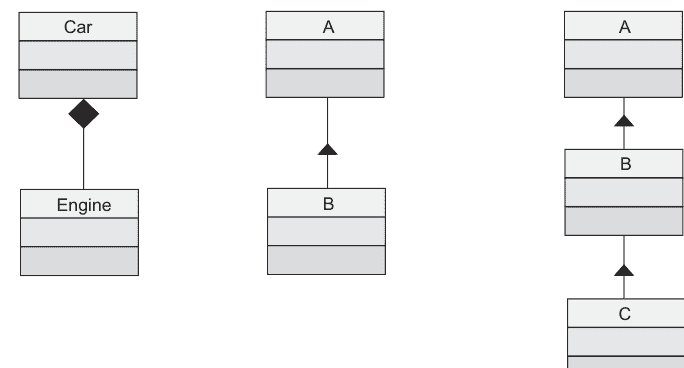

**图 5.3** 单继承

**图 5.4** 多级继承

## 多重继承

在多重继承中，一个类可以继承自多个不相关的类，如图 5.5 所示。类 `C` 同时继承自 `A` 和 `B`。

| A | B |
| :--- | :--- |
| | |

**图 5.5** 多重继承

> **注意**：Java 不支持多重继承。

## 层层级继承

在层层级继承中，多个类可以继承自同一个类，如图 5.6 所示。

| A | B |
| :--- | :--- |
| |

**图 5.6** 层层级继承

## 混合继承

混合继承是多种继承类型的任意组合，如图 5.7 所示。

| A | B |
| :--- | :--- |
| |

**图 5.7** 混合继承

# 5.2 使用 extends 关键字派生类

在 Java 中，类继承自父类，如下所示。

```java
class MySubclass extends SuperClass {
    ...
}
```

`extends` 关键字声明 `MySubclass` 继承自 `SuperClass`。如图 5.8 所示，子类拥有父类的所有特征。此外，它可以拥有自己的特征，如示例 5.2 所示。

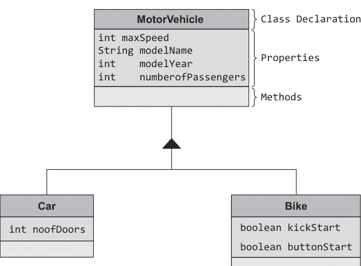

## 示例 5.1 Java 编程

```java
// 练习题。
// 构造函数
MotorVehicle() {
    maxSpeed = 200;
    modelName = "";
    modelYear = 1997;
    numberOfPassengers = 2;
}
```

```java
MotorVehicle(int maxSpeed, String modelName, int modelYear, int numberOfPassengers) {
    this.maxSpeed = maxSpeed;
    this.modelName = modelName;
    this.modelYear = modelYear;
    this.numberOfPassengers = numberOfPassengers;
}
```

### 解析

`MotorVehicle` 类已声明。初始化 L2 到 L5 声明的实例变量。

- **L2–5**：实例变量 `maxSpeed`（类型为 `int`）、`modelName`（类型为 `String`）、`modelYear`（类型为 `int`）和 `numberOfPassengers`（类型为 `int`）位于这些行中。
- **L8–11**：L2 到 L5 声明的实例变量使用传入构造函数的参数进行初始化。使用了 `this` 关键字，是因为实例变量名与局部变量（构造函数声明中的参数）相同。
- **L6**：默认构造函数。
- **L7**：参数构造函数声明。

现在让我们构建子类，如图 5.8 所示。下面的示例展示了子类之一，即 `Bike`。

```java
class Bike extends MotorVehicle {
    boolean kickStart;
    boolean buttonStart;
    /* 手动启动自行车可能也可能是按钮启动自行车，但按钮启动自行车 / 总是手动启动的选项 */
    // 构造函数
    Bike() {
        kickStart = true;
        buttonStart = false;
    }
}
```

```java
Bike(boolean ks, boolean bs) {
    kickStart = ks;
    buttonStart = bs;
}
```

```java
public static void main(String args[]) {
    Bike b = new Bike();
}
```

#### 解释

- **L1**：使用 `extends` 关键字展示继承。
- **L2 和 3**：声明了两个布尔类型变量：`kickStart` 和 `buttonStart`。
- **L4**：默认构造函数。
- **L5**：重载构造函数。
- **L6**：`main()` 方法。
- **L7**：创建了 `Bike` 对象，首先调用了父类的默认构造函数，之后调用了子类的构造函数，因为在子类之前需要初始化父类。

# 5.3 方法重写

当子类中的方法与其父类中的方法具有相同的名称和类型签名时，子类中的方法即为重写父类中的方法。与方法重载一样，这是一种支持多态的特性。

当从子类调用被重写的方法时，它将始终引用由子类定义的该版本。父类的方法版本会被隐藏。

在下面的代码中，我们看到子类 `B` 重写了类 `A` 中的 `doOverride()` 方法。

## 示例 5.3 方法重写示例

```java
class A {
    int i = 0;
    void doOverride(int k) {
        i = k;
    }
}

// 子类定义开始
class B extends A { // 方法重写
    void doOverride(int k) {
        i = 2 * k;
        System.out.println("The value of i is: " + i);
    }
    public static void main(String args[]) {
        B b = new B(); // 创建类 B 的实例
        b.doOverride(12); // 将调用类 B 方法 doOverride()
    }
}
```

### 输出

```text
The value of i is: 24
```

#### 解释

| 行号 | 代码 | 说明 |
| :--- | :--- | :--- |
| L1 | 类声明。 | 这实际上就是继承的本质。对象 |
| L2 | 实例变量声明。 | 子类的对象不需要定义它们自己的定义 |
| L3 | 带有整数参数的方法声明 | 数据和方法在本质上是通用的。 |
| | 传递给它的参数。 | 通用行为留给父类。 |
| L4 | 实例变量被赋值参数的值 | L8 打印语句。 |
| | | L9 `main` 方法。 |
| L5 | 子类声明。 | L10 创建了子类 B 的对象。 |
| L6 | 方法被重写，因为名称和签名 | L11 当我们创建 B 的实例时， |
| | 与方法相同。 | 调用 `doOverride()` 方法将导致 |
| L7 | 变量 `i` 初始化为传入方法的参数 | 调用 B 中的 `doOverride()` 代码，而不是 |
| | 参数之值的两倍。还要注意我们没有在 | 因为它实际上是实例， |
| | `override()` 方法中声明 | 重要的是 |
| | 在子类 B 中声明 | 当我们调用任何实例方法时，且实例 |
| | 变量 `i`，子类中引用的是父类 | 在这种情况下是 B。 |
| | 变量 `i`。 | |

子类变量（或父类变量的引用）可以赋值一个子类对象。下面的代码说明了这一点：

```java
A a1 = new B();
/* 使用类型为 A 的引用创建类 B 的实例。 */

a1.doOverride();
/* 虽然使用了 A 类型引用，但将调用类
B 的 doOverride() 方法。 */
```

> **注意**：当你在单个文件中编写两个或多个类时，文件名将根据包含 `main` 方法的类进行命名。例如，如果你在记事本编辑器文件中编写了完整的示例 5.3，该文件将命名为 `B.java`。

我们看到，即使父类变量 `a1` 引用了子类对象，子类的重写方法仍会被调用。

# Java 编程：问题与解决方案

在示例 5.5 中，两个不同的对象（A 和 B）调用了两个方法（`show()` 和重写的 `show()`），实际上这项工作本可以由一个对象完成，即使用 `super` 关键字。示例 5.5 可以重构如下所示：

## 示例 5.5 (b) 使用 super 关键字调用父类方法

```java
class Aew {
    void show() {
        System.out.println("Superclass show method");
    }
}

class Bew extends Aew { // 方法重写
    void show() {
        super.show(); // 调用父类 A 的 show 方法
        System.out.println("Subclass show method");
    }
    public static void main(String[] args[]) {
        Bew s2 = new Bew();
        s2.show(); // 调用子类 B 的 show 方法
    }
}
```

### 输出

```text
Superclass show method
Subclass show method
```

### 解析

- 定义了 `show()` 方法。
- `super.show()` 用于调用在子类中被重写的父类方法。如果省略此行，则只会调用子类方法；我们在这一行使用了 `super`，因此一个对象就可以调用两个版本（父类和子类）的方法。
- 创建了 `Bew` 对象。
- 使用由 `s2` 创建的对象调用类 `Bew` 的 `show()`。控制权传递到 `show()` 并执行方法内部语句。执行 `super.show()`，控制权传回 `Aew` 的 `show`。执行 `Aew` 中的语句，然后控制权传回打印语句。在执行打印语句后，控制权传回 `main` 方法，该方法中没有更多需要执行的语句，程序自动终止。

## 案例 2：访问父类的实例成员变量

示例 5.6 演示了如何使用 `super` 关键字来访问父类的实例变量。当父类的变量被子类遮蔽时，该关键字特别有用。当类和子类中的变量具有相同名称时，就会发生遮蔽现象。在这种情况下，父类变量在子类中被隐藏，在子类内部只能访问子类变量。要访问被遮蔽的变量，如所示使用 `super` 关键字。

## 示例 5.6 使用 super 关键字访问父类变量

```java
class Super_Variable {
    int b = 30; // 实例变量
}

class SubClass extends Super_Variable {
    int b = 12; // 遮蔽了父类变量
    void show() {
        System.out.println("subclass variable:" + b);
        System.out.println("superclass variable:" + super.b);
    }
    public static void main(String[] args[]) {
        SubClass s = new SubClass();
        s.show(); // 调用子类的方法
    }
}
```

### 输出

```text
subclass variable: 12
superclass instance variable: 30
```

### 解析

- **L1**：父类声明 `Super_Variable`。
- **L2**：实例变量声明。
- **L3**：子类声明 `SubClass`。
- **L4**：在子类中定义了同名变量 `b`（遮蔽父类变量）。
- **L5**：在子类中定义了 `show` 方法。
- **L6 和 L7**：在上述示例中，我们特别区分了两者，并访问了两个实例变量的值。在 L6 打印子类变量 `b`。在 L7，借助 `super` 关键字，我们访问了父类实例变量 `b` 的值，输出了 30。如果在子类中变量 `b` 未定义，则两个打印语句都会打印父类变量的值。

## 案例 3：调用父类的构造函数

`super` 作为独立的构造函数调用（例如 `super(1)`）表示对父类构造函数的调用。这只能在子类的构造函数中进行，并且必须是构造函数的第一个语句。默认构造函数隐式包含了使用 `super` 关键字对父类构造函数的调用。

## 示例 5.7 构造函数调用机制

```java
class Constructor_A {
    Constructor_A() {
        System.out.println("Constructor A");
    }
}

class Constructor_B extends Constructor_A {
    Constructor_B() {
        System.out.println("Constructor B");
    }
}

class Constructor_C extends Constructor_B {
    Constructor_C() {
        System.out.println("Constructor C");
    }
    
    public static void main(String args[]) {
        Constructor_C c = new Constructor_C();
    }
}
```

### 输出

```text
Constructor A
Constructor B
Constructor C
```

### 解析

- `Constructor_C` 的实例化导致调用其构造函数。
- 每个构造函数隐式调用父类的默认构造函数（`super()`）。
- 执行顺序：`Constructor_A` -> `Constructor_B` -> `Constructor_C`。
- 类的每个构造函数都会创建一个 `<init>` 方法，且 `<init>` 包含了对父类默认构造函数（无参数）的调用。

## 示例 5.7 (a) 使用 super 关键字显式调用父类构造函数

```java
class Constructor_A {
    Constructor_A() {
        System.out.println("Constructor A");
    }
}
```


```java
class Constructor_B extends Constructor_A {
  Constructor_B() {
    System.out.println("Constructor B");
  }
}
```

```java
class Constructor_C extends Constructor_B {
  Constructor_C() {
    System.out.println("Constructor C");
  }
}

public static void main(String args[]) {
  Constructor_C c = new Constructor_C();
}
```

Output

Constructor A

Constructor B

Constructor C

# 解析

- `Constructor_C` 的父类声明 `Constructor_A` 导致 L8 调用了该类的显式默认构造函数。类的每个构造函数都会创建一个 `<init>` 方法，且 `<init>` 包含了对父类默认构造函数（无参数）的调用，任何实例变量-

- 使用由 L 创建的对象调用类 `Bew` 的 `method()`。控制权传递到 L5 的 `show()` 并执行方法内部语句。执行 L6 的 `super.show()`，控制权传回 `Aew` 的 `method`。执行 `Aew` 中的 `Lines()`，然后控制权传回 L7，即一个打印语句。在执行打印语句（L7）后，控制权传回 `main` 方法，该方法中没有更多需要执行的语句，程序自动终止。

## 继承 145

```java
Constructor_B_Revised(int a)
{
    a++;
    System.out.println("Constructor Revised " +a);
}
class Constructor_C_Revised extends Constructor_B {
    Constructor_C_Revised(){
        super(11); // 如果省略会导致编译错误
        System.out.println("Constructor C Revised");
    }
    public static void main(String args[]) {
        Constructor_C_Revised a = new Constructor_C_Revised();
    }
}
```

Output

Constructor A Revised

Constructor B Revised 12

Constructor C Revised

# 解析

## 5.4 最终关键字 final

`final` 关键字用于以下目的：

1. 用于声明常量（与变量和参数声明一起使用）
2. 禁止方法重写（与方法声明一起使用）
3. 禁止继承（与类声明一起使用）

基本上，它用于防止继承和创建常量。让我们来看一个例子。

## 示例 5 final 关键字

```java
class Final_Demo {
  final int MAX = 100; //常量声明
  // 带 final 参数的 final 方法声明
  final void show(final int x) {
    // MAX++; 因为 MAX 是 final，非法语句
    // x++; 因为参数是 final，非法语句
    System.out.println("Superclass show method:" +x);
  }
}
class Final_Demo_1 extends Final_Demo {
  // 不能重写 show 方法，因为它是 final
  // 父类，这就是为什么我们将其注释掉了
  @Override void show(){
    System.out.println("Subclass show method");
  }
}
public static void main(String[] args){
  Final_Demo_1 f2 = new Final_Demo_1();
  // 将调用父类的 show
  f2.show(12);
}
```

# 输出

```
C:\examples\ java Final_Demo_1
Superclass show method: 12
```

## 解析

| 行号 | 解析 |
| :--- | :--- |
| L1 | 类声明 `Final_Demo`。 |
| L7 | 子类声明。如果父类是一个 `final` 类，那么此类将无法被子类化。`final` 类可以如下声明： |
| L2 | 整数常量声明 `MAX`，值为 100。实例变量。 |
| L3 | 定义了带 `final` 参数的 `final` 方法 `show()`。如 L8 注所示，它不能在子类中被重写。`final` 参数的值不能改变，因为它属于 `final` 类 `Final_Demo`。 |

## 继承 147

## 5.5 抽象类 ABSTRACT CLASS

Abstract（抽象）的字面意思是“不与任何特定实例关联的概念或想法”。抽象类采纳了这一概念。抽象类是具有通用概念的类，与特定的类无关。它们定义了部分行为，并将其余留给子类提供。

抽象类包含一个或多个抽象方法。创建一个没有抽象方法的抽象类是毫无意义的，但即使这样做了，Java 编译器也不会报错。抽象方法是一种已声明但没有包含任何实现的方法，即没有方法体。

抽象类不能被实例化，它们要求子类通过重写抽象方法来为其抽象方法提供实现，然后子类才能被实例化。如果子类没有实现抽象类的方法，则子类本身也必须声明为抽象，以便为其自己的子类重写这些抽象方法留出空间。

## 我们为什么创建抽象方法？

当我们想要在所有子类中强制执行名称和签名模式，并且不希望它们有机会使用自己的命名模式，但同时赋予它们根据特定需求编写这些方法的灵活性时，我们就使用抽象方法。示例 5.9(a) 显示了一个抽象类。由于存在抽象方法，该类被创建为抽象类。某些特征是所有动物共有的，但其他特征是某一类动物特有的。我们也可以认为，共同特征由不同的动物以不同的方式执行。例如，这个世界的每种动物都会产生一种特定的声音，这是它们所属物种所独有的。

## 示例 5.9 (a) 带有抽象方法的抽象类

| 行号 | 代码 |
| :--- | :--- |
| L1 | `abstract class Animal` |
| L2 | `{ String name;` |
| L3 | `String species; // 抽象类的构造函数` |
| L4 | `Animal(String n, String s) {` |
| L5 | `name = n;` |
| L6 | `species = s; }` |
| L7 | `void eat(String fooditem) {` |
| L8 | `System.out.println(species + " " + name + " likes to have " + fooditem); }` |
| L9 | `abstract void sound(); }` |

# Java 编程

## 解析

| 行号 | 解析 |
| :--- | :--- |
| L1 | 使用关键字声明的抽象类通过在类声明之前传递的参数进行初始化。 |
| L2 和 3 | 声明了两个字符串变量，名为 `name` 和 `species`。 |
| L7 | 定义了一个非抽象方法，与其他方法一样。 |
| L4 | 参数化构造函数，用于初始化 L8 打印语句。实例变量。 |
| L5 和 6 | 实例变量，`name` 和 `species`， |
| L9 | 声明了抽象方法。这意味着该方法没有任何方法体。 |

`abstract` 关键字用于定义抽象方法和抽象类。任何需要实例化的动物必须重写 `sound()` 方法，否则无法创建该类的实例。让我们来看继承 `Animal` 类的 `Lion` 子类。

## 示例 5.9 (b) 实现抽象方法的类

| 行号 | 代码 |
| :--- | :--- |
| L1 | `class Lion extends Animal` |
| L2 | `{` |
| L3 | `Lion("Lion","Asiatic Lion");` |
| L4 | `}` |
| L5 | `void sound() {` |
| L6 | `System.out.println("Lions Roar! ");` |
| L7 | `}` |
| L8 | `public static void main(String args[])` |
| L9 | `{` |
| L10 | `Lion 1 = new Lion();` |
| L11 | `1.sound();` |
| L12 | `}` |

*(注：原文中示例 5.9(b) 的代码片段不完整，已根据 Java 语法进行了逻辑对齐)*

## 5.7 实际问题：圆与圆柱类

让我们通过一个实际示例来展示继承的力量和 `super` 关键字的使用。我们将创建一个 `Circle` 类，然后在 `Cylinder` 类中继承 `Circle` 类来计算它的表面积。

## 5.11 (a) 实现抽象方法的类

```java
class Circle {
  // 声明实例变量
  float radius;
  final float PI = 3.141f; // π的值是固定的
  Circle() {
    radius = 1.0f;
  }
  // 参数化构造函数
  Circle(float radius) {
    this.radius = radius;
  }
  // 返回圆的面积，即 π
  float getArea() {
    return PI * radius;
  }
}
```

### 解析

- 已定义 `Circle` 类。
- 已定义 `float` 类型的实例变量 `radius`。
- 已定义了 `final float` 类型的变量 `PI`（类似于数学中的 π），并初始化为 `3.141f`（针对 float 类型）。我们为什么要将其创建为 `final` 将在下一个主题中讨论。
- `Circle` 类的默认构造函数。
- 已初始化实例变量 `radius`。
- 声明了带有 `float` 参数的重载构造函数，用于初始化实例变量 `radius`。
- 通过 `this` 关键字将实例变量与局部变量区分开来，并用传递给构造函数的参数进行初始化。
- 声明了返回类型 `float` 的实例方法 `getArea()`。
- 使用 `return` 关键字将圆的面积返回给调用者。下一步是创建 `Circle` 的子类。`Cylinder` 类将重写 `Circle` 类的 `getArea()` 方法，该方法将返回圆柱的表面积。`Cylinder` 类定义在示例 5.11(b)。

## 5.11 (b) 继承

```java
class Cylinder extends Circle {
  // 表示圆柱高度的实例变量
  float height;
  Cylinder(float radius, float height){
    // 显式调用父类构造函数
    super(radius);
    this.height = height;
  }
  // 重写方法返回圆柱表面积
  // 表面积 = (2π²) + (2πr.height)
  // 其中 (2 π²) 是两个“端面”的表面积
  // (2nr.height) 是“侧面”的面积
  // 使用 super 关键字调用父类方法
  float getArea() {
    return 2 * super.getArea() + 2 * PI * radius * height;
  }
  public static void main(String args[]) {
    Circle c = new Cylinder(1.5f);
    System.out.println("The Area of Circle is: " + c.getArea());
    Cylinder cy = new Cylinder(1.5f,3.5f);
    System.out.println("The Surface Area of Circle is: " + cy.getArea());
  }
}
```

# 输出

```
C:\examples\chap 5java Cylinder
The Area of Circle is: 7.0672503
The Surface Area of Circle is: 47.119408
```

### 解析

表面积 = (2 π²) + (2π height)

(2π²) 是“端面”的表面积，(2nr.height) 是“侧面”的面积，π² 是圆的面积，我们已经在类中创建了计算圆面积的方法。因此，我们调用了父类的 `getArea()`（代码复用）；`radius` 在 L4 行通过 `super` 关键字传递。来自父类 `getArea()` 的返回值乘以 2，并加上侧面面积 (2πh)。

- L1 `Cylinder` 类继承了 `Circle` 类。
- L2 子类 `Cylinder` 定义了实例变量。
- L3 参数化构造函数，用于初始化 `radius` 和 `height`。
- L4 使用 `super` 关键字将子类构造函数（L3）中接收的参数 `radius` 传递给 `Circle` 类，即父类构造函数。它展示了代码的复用，因为只需在父类中定义了一次。
- L5 实例变量用局部变量（参数）进行初始化。
- L6 重写了 `Cylinder` 的 `getArea()`，因为 `Cylinder` 类希望方法名与父类相同（即 `getArea()`），但执行不同的功能（即返回圆柱的面积）。
- L7 通过 `super` 运行了父类的 `getArea()`，即 `super.getArea()`，因为你可以看计算圆柱表面积的公式。
- L8 `main()` 方法。
- L9 创建了一个半径为 `1.5f` 的 `Circle` 类对象。
- L10 通过 `Circle` 类对象调用 `getArea()`。返回值与 `print` 方法中的字符串拼接，并可以在输出中看到。
- L11 创建了半径为 `1.5f`、高度为 `3.5f` 的 `Cylinder` 类对象。
- L12 通过 `Cylinder` 类对象调用了 `getArea()` 方法。

# 总结

继承的概念源于现实生活，在生活中，孩子会从父母那里继承优缺点，并将其加入到自己的身份和行为中。这一概念被面向对象的编程所吸收，其中父类的属性和方法被子或子类继承。子类可以使用重写以不同的方式实现继承的方法，同时保持与父类相同的方法名和签名。

## 习题

1. 尝试编译并运行以下代码会发生什么？

```java
class Circle {
  Circle() {
    System.out.println("Circle");
  }
}
class Inner extends Circle {
  Inner() {
    System.out.println("Inner");
  }
}
public class Test {
  public static void main(String args[]) {
    Circle c = new Inner();
  }
}
```

(a) 输出 Circle 然后 Inner

(b) 输出 Inner 然后 Circle

(c) 只输出 Circle

(d) 编译错误

2. 哪些说法是正确的？

(a) 如果类是抽象的，则它可以被实例化。

(b) 如果类是抽象的，则它可以被重写。

(c) 如果类是抽象的，则可以被实例化。

(d) 抽象类类，必须重的。

3. 哪个关键字用于派生类？

(a) implements

(b) extends

(c) throws

(d) inherits

4. 尝试编译并运行以下代码会发生什么？

```java
class Base {
  Base() {
    System.out.println("Base");
  }
}
class Derived extends Base {
  Derived() {
    System.out.println("Derived");
  }
}
```

(a) 输出 Base 然后 Derived

(b) 输出 Derived 然后 Base

(c) 只输出 Base

(d) 编译错误

5. 尝试编译并运行以下代码会发生什么？

```java
abstract class Demo {
  abstract void show();
}
class Demo_1 extends Demo {
  void show() {
    System.out.println("Show");
  }
}
public class Test {
  public static void main(String args[]) {
    Demo d = new Demo_1();
    d.show();
  }
}
```

(a) 输出 Show

(b) 编译错误

6. 

```java
public static void main(String args[]) {
    Circle c = new Cylinder(1.5f);
    System.out.println("The Area of Circle is: " + c.getArea());
    Cylinder cy = new Cylinder(1.5f,3.5f);
    System.out.println("The Surface Area of Circle is: " + cy.getArea());
}
```

7. 如果程序中存在以下代码行，会发生什么？


```java
class Demo {
  int a;
  Demo(int a) {
    a += 10;
    System.out.println(a);
  }
  public static void main(String args[]) {
    Demo d = new Demo(4);
    System.out.println(d);
  }
}
```

(a) 14 和 0

(c) 14 和 14

(d) 编译错误

7. 如何修正上述程序以产生选项 (c) 所述的输出？

# 复习题

1. 什么是继承？它与聚合有什么区别？

2. 什么是方法重写？请举例。

3. 说明 `super` 关键字的所有用法。通过示例说明。

4. 说明 `final` 关键字的所有用法。通过示例说明。

5. 什么是抽象类？抽象类可以有构造函数吗？解释。

6. 什么是实例变量的遮蔽？

7. 遮蔽和重写之间的区别是什么？

8. 重载方法（Overloaded methods）是早期绑定，而重写方法（Overridden methods）是晚绑定。你怎么看？

9. 为什么子类引用变量不能指向父类对象？

# 编程练习

- 1. 按照如下描述定义类 `MotorVehicle`：

数据成员：

(a) `modelName`（名称） (b) `modelNumber`（型号）

(c) `modelPrice`（价格）

方法：

(a) `display()` 显示名称、价格和型号。

再定义另一个类 `Car`，它继承自 `MotorVehicle` 类并包含以下内容：

数据成员：

(a) `discountRate`（折扣率）

方法：

(a) `display()` 显示汽车的名称、汽车型号、价格和折扣率。

(b) `discount()` 计算折扣。使用合适的构造函数创建 `MotorVehicle` 和 `Car` 类并对其进行测试。

- 2. 创建一个包含以下细节的抽象类 `Accounts`：

数据成员：

(a) `balance`（余额）

(b) `accountNumber`（账号）

(c) `accountHolderName`（持户人姓名）

(d) `address`（地址）

方法：

(a) `withdrawal()` - 抽象（abstract）

(b) `deposit()` - 抽象（abstract）

(c) `display()` 显示账号的余额。

创建该类的子类 `SavingsAccount` 并添加以下细节：

数据成员：

(a) `rateOfInterest`（利率）

方法：

(a) `calculateAmount()`

(b) `display()` 显示利率、新余额以及完整的持户人详情。

创建 `Accounts` 类的另一个子类，即 `CurrentAccount`，它包含以下内容：

数据成员：

(a) `overdraftLimit`（透支额度）

方法：

(a) `display()` 显示透支额度以及完整的账户详情。

创建这两个类的对象并调用它们的方法。使用合适的构造函数。

- 3. 创建一个包含以下细节的类 `Employee`：

数据成员：

(a) `name`（姓名） (b) `address`（地址）

(c) `age`（年龄） (d) `gender`（性别）

方法：

(a) `display()` 显示员工详情。

数据成员：

(a) `salary`（薪水） (b) `designation`（职位）

方法：

(a) `display()` 显示薪水、职位以及其他员工详情。

创建另一个继承自 `Employee` 类的类 `PartTimeEmployee`

数据成员：

(a) `workingHours`（工作时长） (b) `ratePerHour`（时薪率）

方法：

(a) `calculatePay()` 计算应付金额。

(b) `display()` 显示应付金额以及其他员工详情。

创建这两个类的对象并调用它们的方法。使用合适的构造函数。

# 选择题答案

1. (a) 2. (a), (c) 3. (b) 4. (b)

5. (a)，在 `Demo_1` 中应使用 `abstract` 或在 `Demo_1` 中重写 `show` 6. (a)

7. (b) 和 (d)，在 `Test_1` 的构造函数中使用 `super`，或者在 `Test_1` 中提供默认构造函数

8. (a) 9. (a)

10. (a)，局部变量在构造函数中隐藏了实例变量

# 接口、包与枚举

我们的知识越多，无知就越。。读完本章后，读者将能够：

- 理解什么是接口，以及它们与抽象类的区别

- 理解包（packages）的概念及其使用方法

- 了解 `java.lang`

- 理解对象类（object class）和包装类（wrapper class）

- 了解 Java 中如何创建和操作字符串

- 理解枚举（enumerations）

## 6.1 接口 (INTERFACES)

Java 中的接口就像合同或协议，类必须遵守它们。接口基本上是方法的集合，默认情况下是公共的（`public`）且抽象的（`abstract`）。这些方法没有方法体。接口最棒的部分是类可以继承任何接口，从而允许多重继承。Java 不支持类的多重继承，但接口允许 Java 支持这一特性。接口通过 `implements` 关键字声明。注意，没有任何方法具有方法体。实现类的类负责重写所有方法并为它们提供实现。

### 示例 6.1(a) Calculator.java：接口

```java
interface Calculator {
    int add(int a, int b);
    int subtract(int a, int b);
    int multiply(int a, int b);
    int divide(int a, int b);
}
```

# 解析

- **L1** 使用 `interface` 关键字来声明接口，后面跟着接口的名称和左括号，表示接口的开始。

- **L2** 声明了一个名为 `add` 的方法，返回类型为 `int`，接受两个 `int` 类型的参数。

- **L3** 声明了一个名为 `subtract` 的方法，返回类型为 `int`，接受两个 `int` 类型的参数。

- **L4** 声明了一个名为 `multiply` 的方法，返回类型为 `int`，接受两个 `int` 类型的参数。

- **L5** 声明了一个名为 `divide` 的方法，返回类型为 `int`，接受两个 `int` 类型的参数，随后是接口的右括号。

### 示例 6.1(b) Normal_Calculator.java：实现接口的类

```java
class Normal_Calculator implements Calculator {
    public int add(int a, int b) {
        return a + b;
    }
    public int subtract(int a, int b) {
        return a - b;
    }
    public int multiply(int a, int b) {
        return a * b;
    }
    public int divide(int a, int b) {
        return a / b;
    }
}
```

# Java 编程

```java
public static void main(String args[]) {
    Normal_Calculator c = new Normal_Calculator();
    System.out.println("Value after addition = " + c.add(5, 2));
    System.out.println("Value after Subtraction = " + c.subtract(5, 2));
    System.out.println("Value after Multiplication = " + c.multiply(5, 2));
    System.out.println("Value after division = " + c.divide(5, 2));
}
```

输出

```
C:\java>Normal_Calculator
Value after addition = 7
Value after Subtraction = 3
Value after Multiplication = 10
Value after division = 2
```

# 解析

- **L1** 声明了类 `Normal_Calculator`，通过 `implements` 关键字继承接口 `Calculator`。

- **L2** 重写方法并提供了方法体。

- **L3** 使用 `return` 关键字返回传递给方法的相加结果，随后是方法的右括号。

- **L4-9** 重写了 `subtract`、`multiply` 和 `divide` 方法。

- **L11** 创建了 `Normal_Calculator` 类的对象。

- **L12-15** 打印语句，用于打印加、减、乘、除的结果。通过 L11 创建的对象调用相应方法，如 `c.add(5,2)`。这些方法调用返回结果并显示在屏幕上。

> 在方法声明中必须添加访问修饰符，否则编译器无法编译。正如前面提到的，接口中的所有方法都是公共的，因此当实现类重写接口定义的方法时，必须将其标记为 `public`。

不写修饰符或留空（默认）将导致权限从公共降低到默认，这在重写中是不允许的。重写时的权限拓宽转换会自动发生，即从默认到公共（从低权限到高权限），但收缩转换是不允许的。

### 6.1.1 接口中的变量

与接口中的方法（默认是公共的且抽象的，不需要手动标记）一样，接口中定义的变量也具有默认行为。它们隐式地是常量（`final`）和静态的（`static`）。

不需要显式地将它们声明为 `public`、`static` 和 `final`。由于它们是 `final` 的，必须给它们赋值。由于它们是 `static` 的，可以通过接口名称直接访问，并且由于它们是 `public` 的，我们可以从任何地方访问它们。示例 6.2 显示了接口中变量的使用。

## 6.2 接口中的变量

```java
interface Limit_Test {
    int LOWERLIMIT = 0;
    int UPPERLIMIT = 100;
}
class Variable_Test implements Limit_Test {
    void findNumberWithinLimits(int a) {
        if(a > LOWERLIMIT && a < UPPERLIMIT)
            System.out.println("lie in between " + Variable_Test.LOWERLIMIT + " and " + Variable_Test.UPPERLIMIT);
        else
            System.out.println("lie not in between " + Variable_Test.LOWERLIMIT + " and " + Variable_Test.UPPERLIMIT);
    }
    public static void main(String[] args) {
        Variable_Test vt = new Variable_Test();
        //LOWERLIMIT++; illegal statement
        //UPPERLIMIT++;
        vt.findNumberWithinLimits(23);
        vt.findNumberWithinLimits(233);
    }
}
```

输出

```
C:\javabook\java Variable_Test
23 lie between 0 and 100
233 not lie between 0 and 100
```

# 解析

- **L1**: 我们创建了一个接口 `Limit_Test`，在其中我们将设置下限和上限。

- **L2 and 3**: 通过接口中的两个变量（即 `UPPERLIMIT` 和 `LOWERLIMIT`）设置了上限和下限。由于它们在内部是隐式的 `final`，因此必须被赋值。

- **L4**: 类 `Variable_Test` 继承了接口 `Limit_Test`。

- **L5**: 声明了带有参数的方法 `findNumberWithinLimits`。此方法用于判断参数是否在限制范围内。

- **L6**: 一个简单的检查条件，判断函数 (L5) 中的参数是否大于 `LOWERLIMIT` 且小于 `UPPERLIMIT`。如果满足条件，执行 L7，否则执行 L9。

- **L7**: 打印语句，用于判断参数是否在接口定义的限制范围内。注意，静态变量 `LOWERLIMIT` 和 `UPPERLIMIT` 是通过接口 `Variable_Test` 访问的。

- **L9**: 打印语句，用于打印参数不在接口定义的限制范围内（如 L7 所示）。

- **L11**: 创建了 `Variable_Test` 类的对象。

- **L12 and 13**: 用于修改变量（`LOWERLIMIT` 和 `UPPERLIMIT`）的被注释的语句。如果取消注释，这些语句将导致编译错误，因为定义在接口中的变量是 `final` 值，是无法修改的。

- **L14**: 通过 `Variable_Test` 对象调用了 `findNumberWithinLimits()`，并传递了参数 23。该方法会检查此参数是否在下限和上限之间，如果是，则在屏幕上打印该值。

- **L15**: 通过 `Variable_Test` 对象调用了 `findNumberWithinLimits()`，并传递了参数 233。该方法检查此参数是否在下限和上限之间，如果不是，则打印在屏幕上。

与普通类一样，接口也可以被扩展。接口可以使用相同的关键字（`extends`）来继承另一个接口，而不是 `implements` 关键字。6.3 显示了如何扩展接口。

## 示例 6.3 扩展接口

```java
interface A {
  void showA();
}
interface B extends A{
  void showB();
}
class InDemo implements B {
  public void showA() {
    System.out.println("Overridden method of Interface A");
  }
  public void showB() {
    System.out.println("Overridden method of Interface B");
  }
}
public static void main (String args[]) {
  InDemo d = new InDemo();
  d.showA();
  d.showB();
}
```

输出

```
C:\java\javaInDemo
Overridden method of Interface A
Overridden method of Interface B
```

# 解析

- **L1**: 声明了一个接口名称 `A`。

- **L2**: 在接口 `A` 中定义了方法 `showA()`。

- **L3**: 定义了接口 `B`，并在其声明中使用 `extends` 关键字来表示 `B` 的父接口是 `A`。任何继承 `B` 的类都将必须重写接口 `A` 和 `B` 的所有方法。

- **L4**: 在接口 `B` 中定义了方法 `showB()`。

- **L5**: 类声明显示它继承了接口 `B`。

- **L6**: 显示了重写的方法 `showA()`。注意在重写时添加了 `public` 访问修饰符。

- **L7**: 显示了重写的方法 `showB()`。

### 6.1.3 接口 vs 抽象类

表 6.1 列出了接口和抽象类之间的区别。

## 表 6.1 接口 vs 抽象类

| 接口 | 抽象类 |
| --- | --- |
| 可以多重继承；一个类可以继承任意数量的接口。 | 不可以多重继承；一个类只能继承一个。 |
| 可以使用接口来实现多态。 | 可以使用抽象类。 |
| 接口中的变量是 `public static final`。 | 抽象类中的变量可以声明为 `static` 或 `final`。 |
| 接口中的所有方法都是 `abstract` 的。 | 抽象类中的方法可以是 `abstract` 的或具体的。 |
| 接口不能有构造方法。 | 抽象类可以有构造方法。 |
| 接口不能拥有实例变量。 | 抽象类可以拥有实例变量。 |
| 接口用于实现多重继承。 | 抽象类用于实现部分继承。 |
| 你不能接口的对象。 | 你不能创建抽象类的对象。 |

1. 请记住文件必须以类的名称命名保存，例如 `ClassinPackage`，并放置在与包名完全相同的目录中，例如 `packexample`。该文件从包中编译，编译后生成的类文件将存储在同一个目录（包）中。要执行该文件，需要移动到当前目录的上一级，并通过提及包名()接类名来执行。例如，假设包 `packexample` 位于 `pack` 目录中。语句的顺序如下：

```java
// 编译类
C:\packexample\ java ClassinPackage.java

// 执行类
C:\> java packexample.ClassinPackage

// 这将不会执行，因为 c 没有 packexample 目录。
java packexample.ClassinPackage
```

存在于包内部的类不能仅通过它们自己的名称来引用。包名必须位于它所属的类名之前。所有类都属于某一个包或另一个包。如果在任何类中都未使用使用 `package` 关键字来指定包名，那么它将成为默认/未命名包的一部分。在这种情况下，我们像之前所示那样执行类。


## 2. 编译与执行

此 Java 源文件可以保存在任何目录中。编译期间，你需要指定 Java 编译器的选项 `-d`，该选项指定放置编译文件的目标位置。编译后，你将发现你的包已在指定的路径中创建，且 `.class` 文件已放置在该处。执行类时，需要按照上述说明的相同步骤进行。让我们假设 `ClassinPackage.java` 文件存储在 `javaexec` 目录。

```java
// 使用 javac 的 -d 选项指定目标 c:\pack
// 语法：javac -d 目标 后接 java 源文件
C:\java> javac -d c:\pack ClassinPackage.java

// 执行类
C:\> java packexample.ClassinPackage

// 这将不会执行
C:\> java packexample.ClassinPackage
```

在两种情况下，执行都是从放置类文件的包的父目录进行的，如 L2 所示。如果我们想从任何目录执行该包，则应该设置类路径（classpath）。

## 设置类路径

Classpath（类路径）用于存储第三方和用户定义类的路径。每当我们执行/编译任何类文件时，JDK 工具 `java` 和 `javac` 会在用户类路径中搜索包/类文件，默认情况下类路径是当前目录。如果类不在类路径中，则无法找到。


在两种情况下，执行都发生在类文件所在包的父目录中，如 L2 所示。如果我们想从任意目录执行该包，则应设置类路径。

## 设置类路径

类路径用于存储第三方和用户定义类的路径。每当我们执行/编译任何类文件时，JDK 工具 `java` 和 `javac` 会在用户类路径中搜索包/类文件，默认为当前目录。如果类不在类路径中，则无法找到它们。

如果我们想从任意目录执行该包，则应设置类路径。

## 接口、包与枚举 167

- `pkgName` 是包含需要导入的成员的类的包名。
- `subpkgName` 是该类所属的子包名。方括号表示它是可选的。
- `ClassName` 是需要导入的成员的类名。
- `staticMemberName` 是静态字段或方法名。通过上述语句，你将仅导入该类中被提到的静态成员。

如果你想导入该类的所有静态成员，请使用以下代码：

```java
import static pkgName.ClassName.*;
```

> 注意：静态导入仅导入类中的静态成员。普通的导入语句应用于导入程序中用到的类。

示例 6.6 演示了静态导入的使用。

## 示例 6.6 静态导入的使用

| L1 | import static java.lang.Math.*; |
| L2 | public class ExampleStaticImport { |
| L3 | public static void main(String[] args) { |
| L4 | System.out.println("power of 2 to 2 is: " + pow(2,2)); |
| L5 | System.out.println("ceil(-10.2) is: " + ceil(-10.2)); |
| L6 | System.out.println("floor(-10.2) is: " + floor(-10.2)); |
| L7 | System.out.println("ceil(10.2) is: " + ceil(10.2)); |
| L8 | System.out.println("floor(10.2) is: " + floor(10.2)); |
| L9 | System.out.println("maximum of 23 and 24 is: " + max(23,24)); |
| L10 | System.out.println("minimum of 23 and 24 is: " + min(23,24)); |
| L11 | System.out.println("Value of PI is: " + PI); |
| L12 | System.out.println("Value of E is: " + E); |
| | } |

# 输出

```
C:\java\ExampleStaticImport
power of 2 to 2 is: 4
ceil(-10.2) is: -10.0
floor(-10.2) is: -11.0
ceil(10.2) is: 11.0
floor(10.2) is: 10.0
maximum of 23 and 24 is: 24
minimum of 23 and 24 is: 23
Value of PI is: 3.141592653589793
Value of E is: 2.71828182849045
```

## 解析

| L1 | 这是一个静态导入声明，它从 java.lang 包中的 Math 类中导入所有静态字段和方法。 | 不需要前置的字段名或方法名，且不像我们在顶部使用 import static 那样。如果我们使用普通的 import 而不是 static，每个函数和字段都必须在类名之前。 |
| L4–12 | 展示了访问的几个静态方法（pow, floor, ceil, min）以及字段 PI 和 E | |

### 6.2.3 访问保护

访问定义了一个元素（类、方法、变量）向其他类和包暴露的程度。Java 中有四种访问修饰符（按访问权限从高到低排序）：

- `public`：应用于变量、构造方法和类
- `protected`：应用于变量、方法和内部类（不包括顶层类）
- `default`：默认应用于变量、构造方法和类
- `private`：应用于变量、方法和类（不包括顶层类）

`public` 和 `private` 很容易定义。前者意味着对所有人可见，后者意味着仅从内部可见。

## 接口、包与枚举 171

正如我们之前提到的，包装类的实例包含或包装了对应类型的基本类型值。包装类允许在无法使用基本类型但需要对应对象的情况下使用。例如，一个非常有用的工具是 `ArrayList` 类（参见第 10 章），它是一个可以增长或缩小的列表，与数组不同。因此，为了存储对象列表，必须对数字进行包装。你将使用包装类方法将数值转换为字符串或反之。

### 表 6.4 基本类型的包装

| 基本类型 | 包装类 |
| :--- | :--- |
| boolean | java.Boolean |
| byte | Byte |
| char | Character |
| double | Double |
| float | Float |
| int | Integer |
| long | Long |
| void | Void |

表 6.4 列出了基本类型及其对应的包装类。你可以轻易地发现，对于整数，包装类的名称与基本类型相同，只是第一个字母大写了。包装类是扩展 `Object` 作为子类的普通类。包装类的构造函数为基本类型创建对象。例如：

```java
double a = 3;
Double wrp = new Double(a);
```

通过将 double 值传递给构造函数来创建一个 `Double` 对象。反之，每个包装类都提供了一个方法来返回基本类型值：用于整数的 `intValue()`，用于布尔的 `booleanValue()` 以此类推。

### 包装类的特性

包装类维护的一些特性包括：

- 除了 `Character` 和 `Float` 之外，所有包装类都有两个构造函数——一个接收基本类型值，另一个接收该值的字符串表示形式。
- 包装对象也是不可变的；一旦分配了值，就不能再更改。

### 包装类：构造函数与方法

包装类具有用于处理和操作基本类型的静态方法。这些方法及其用法列在下面。将基本类型转换为包装类还有另一种方法，即 `valueOf()` 方法，我们将在稍后讨论。

#### 普通方法

##### 包装对象转换为基本类型

所有的包装类都有六个非静态方法，可将数值包装类转换为它们对应的基本类型。这些方法是 `byteValue()`、`doubleValue()`、`floatValue()`、`intValue()`、`longValue()` 和 `shortValue()`。其中一些用法如下：

```java
int v = obj.intValue();            // 将包装对象转换为基本类型整数
float x = obj.floatValue();        // 将包装对象转换为基本类型float
long y = obj.longValue();          // 将包装对象转换为基本类型long
double z = obj.doubleValue();      // 将包装对象转换为基本类型double
```

##### 基本类型转换为字符串对象

`toString()` 方法用于将基本数字类型转换为字符串，如下所示：

```java
String xyz = Integer.toString(10); // 将基本类型整数转换为字符串
String xyz = Float.toString(1.0f); // 将基本类型float转换为字符串
String xyz = Double.toString(1.0); // 将基本类型double转换为字符串
String xyz = Long.toString(100L);  // 将基本类型long转换为字符串
```

#### 解析方法

##### 从字符串转回基本类型

六个解析方法是 `parseInt`、`parseDouble`、`parseFloat`、`parseLong`、`parseByte` 和 `parseShort`。它们接受字符串作为参数并转换为对应的基本类型。如果字符串的值不能表示适当的数字，它们会抛出 `NumberFormatException`。解析方法的用法如下：

```java
int v = Integer.parseInt(xyz); // 将包含如"10"等整数值的字符串转换为基本整数
long y = Long.parseLong(xyz);  // 将包含如"123456"等long值的字符串转换为基本整数
```

##### 字符串表示的基本类型转换为包装对象

所有包装类都定义了一个静态方法 `valueOf()`，它返回与字符串参数表示的基本类型值对应的包装对象，如下所示。`valueOf()` 是重载的：一个版本接受整数值，另一个版本接受字符串。如果字符串中的值不包含数字，字符串参数将产生 `NumberFormatException`。

```java
Double valueOfDouble = Double.valueOf(xyz); // 将包含double值的字符串转换为包装对象
Float valueOfFloat = Float.valueOf(xyz);     // 将包含float值的字符串转换为包装对象
Integer valueOfInteger = Integer.valueOf(xyz); // 将包含int值的字符串转换为包装对象
Long valueOfLong = Long.valueOf(xyz);       // 将包含long值的字符串转换为包装对象
Double valueOfDouble2 = Double.valueOf(1.0); // 将基本类型double转换为包装对象
Float valueOfFloat2 = Float.valueOf(1.0f);   // 将基本类型float转换为包装对象
Integer valueOfInteger2 = Integer.valueOf(10); // 将基本类型整数转换为包装对象
Long valueOfLong2 = Long.valueOf(100L);      // 将基本类型long转换为包装对象
```

**二进制和十六进制转换**
以下方法将整数转换为二进制/十六进制表示形式，并作为字符串对象返回。

```java
System.out.println(Integer.toBinaryString(8));
System.out.println(Integer.toHexString(32));
```

整数 8 使用 `toBinaryString()` 转换为其二进制等价形式，即 1000。

# 自动装箱与拆箱

包装类维护的一些特性属于：
- 自动装箱：基本类型自动转换为其对应的包装对象。
- 拆箱：包装对象自动转换回其基本类型值。

在这里，x、y 和 z 分别是 int、`float` 和 `long` 值。将基本类型转换为包装类还有另一种方法，即 `valueOf()` 方法，我们将在稍后讨论。

自动装箱和拆箱是 Java 5 中引入的特性，通过自动处理基本类型和包装对象之间的转换来简化代码。

```java
public void manualConversion() {
  int a = 12;
  Integer b = Integer.valueOf(a); // 自动装箱
}

public void autoConversion() {
  Integer c = 12;
  int d = c; // 拆箱
}
```

### 6.3.3 String 类

字符串在 Java 中是不可变对象。不可变意味着一旦创建就不能更改。事实上，`java.lang` 包中有一个名为 `String` 的类用于创建字符串。当我们创建字符串时，实例化该类。在 Java 中，实例化有两种方式：

| L1 | String x = "String Object"; |
| L2 | String y = new String("String object is created here"); |

L1 将字符串字面量赋值给引用 x。

L2 使用 `new` 关键字创建一个字符串对象，并将字符串作为参数传递给构造函数。这是否意味着 L1 中没有创建对象？实际上，两行代码都创建了字符串对象，唯一的区别是 L1 是隐式创建的，内存分配从专门为字符串字面量创建的内存池中分配。L2 是显式创建的，内存从内存池之外分配。

在创建字符串字面量（L1）之前，JVM 为池中存在的字符串字面量创建内存池，如果已存在该字符串对象的引用，则返回它，否则在池中创建一个新的字符串实例。换句话说，池中的字符串对象是共享的并变成了共享资源，它们被设计为不可变，以防止字符串变得不一致和损坏。字符串字面量内存池的概念是为了节省时间（提高速度）和内存，因为程序员经常使用字符串。

让我们分析以清楚理解这一概念。

# 6.8 字符串创建与相等性测试

```java
String a = "Hello";
String b = "Hello";
String c = new String("Hello");
String d = new String("Hello");
String e = new String("Hello, how are you?");
if(a == b)
    System.out.println("object is same and is being shared by a & b");
else
    System.out.println("Different objects");

if(a == c)
    System.out.println("object is same and is being shared by a & c");
else
    System.out.println("Different objects");

if(c == d)
    System.out.println("same object");
else
    System.out.println("Different objects");

String f = e.intern();
if(f == a)
    System.out.println("Interned object f refer to the already created object a in the pool");
else
    System.out.println("Interned object does not refer to the already created object as, literal was not present in the pool. It is a new object which has been created in the pool");
```

# 输出

```
C:\examples\chap 6>java StringTest
object is same and is being shared by a & b
Different objects
Different objects
Interned object does not refer to the already created objects, as literal was not present
in the pool. It is a new object which has been created in the pool.
```

# 解析

| References | Objects |
|---|---|
| a | Hello |
| b | (a) 内存池中的对象 |
| c | Hello |
| d | Hello |
| e | Hello, how are you? |
| | (b) 显式分配 |
| f | Hello, how are you? |
| | (c) 内存池中的池化对象 |

**图 6.3** 字符串对象

L1 内存池中为字符串字面量 Hello 创建了一个隐式字符串对象，且该池中新创建对象的引用被返回给 a。

L2 正如前所述，字符串字面量与 L1 中的 Hello 相同。JVM 不会通过将之前创建的对象 (L1) 传递给 b 来创建新对象，这意味着 a 和 b 现在指向同一个对象。见下图 6.3。


L3 虽然使用了相同的字符串 `Hello`，但创建的对象并不是内存池的一部分，因为使用了 `new` 关键字来创建对象。当使用 `new` 创建对象时，它分配的内存是与字符串内存池分开的。

L4 创建了一个新对象，它与 `a`、`b`、`c` 都不同。

L5 此时创建了一个带有不同字面量 `"Hello, how are you"` 的新对象。此对象与我们在示例中创建的所有对象都不同。

L6 `if` 语句中使用等价运算符 (`=`) 来检查引用 `a` 和 `b` 是否指向同一个位置。等价运算符不用于匹配字符串的内容（即字面量）。被匹配的两个引用是 `a` 和 `b`，它们都指向同一位置，因此执行 L7。如果 `a` 和 `b` 不指向同一位置，则将执行 L8。

L7 打印语句，显示引用指向同一个对象。

L8 打印语句，显示引用指向不同的对象。

L15 正如已经过的，通过 `new` 创建的字符串不会从池中分配内存，而是被池化（interned）。`java.lang.String.intern()` 方法用于此目的。`intern()` 在池中创建一个与调用者的 `String` 对象具有相同字符串字面量的字符串对象，并返回池中新创建对象的引用。在这一行中，`f` 指向池中新创建的对象，因为池中不存在 `"Hello, how are you?"` 字符串对象。`intern` 是需要池化的字符串对象调用的，即之前的 `String` 如果不再存在于池中将会被垃圾回收。

L16 检查 `f` 和 `e` 是否指向该对象。实际上它们指向不同的位置，这就是执行了 L8 的原因。

# 字符串操作

Java 中的字符串在本质上是不可变的（只读）。这意味着，字符串一旦定义，就无法更改。我们来看下面几行代码：

```java
L1 String x = "Hello"; // OK
L2 String x = x + "World"; // OK，但如何实现？
```

Java 不支持运算符重载，但 `'+'` 已经重载以接受不同的操作数并能正常工作。如果操作数中至少有一个是字符串，就会进行拼接。

产生的问题是，如果字符串是不可变的，那么 L2 是如何执行的？实际上，2 被转换成了以下语句：

```java
String x = new StringBuilder().append(x).append("World").toString();
```

创建了一个新的 `StringBuilder` 对象，用于可变的字符集。可变字符可以改变它们的值。`StringBuilder` 对象的 `append`（末尾）方法用于将 `x` 中包含的字符串 `Hello` 添加到新创建的 `StringBuilder` 对象中。再次使用 `append` 方法将字符串 `World` 添加到新对象中已有的 `Hello`。`toString()` 方法将 `StringBuilder` 对象转换回 `String`，`x` 指向新创建的字符串对象。现有对象 `Hello` 不再存在引用；它将被垃圾回收。

# 字符串方法

该类提供了许多方法。该类。

# 表 6.5 String 类的一些方法

| 方法名与签名 | 方法详情 |
|---|---|
| `int length()` | Find字符串的长度。 |
| `boolean equals(String str)` | 用于检查 `String` 对象的相等性。与 `==` 运算符不同，该检查通过匹配字符串来完成。 |
| `int compareTo(String s)` | 字符串比较。如果所有字符都相同，它返回一个小于零 (a)、大于零 (b) 或等于零 (c) 的整数。 |
| `boolean regionMatches(int startingIndex, int str, int numChars)` | 匹配字符串的特定区域。 |
| `int charAt(int pos)` | 查找特定位置字符。 |
| `String toUpperCase()` | 改变整个字符串的大小写。 |
| `String toLowerCase()` | 改变整个字符串的大小写。 |
| `boolean startsWith(String ss)` | 查找字符串是否以某个字符串开头。 |
| `boolean endsWith(String es)` | 查找字符串是否以某个字符串结尾。 |
| `Static String valueOf(int is)` | 将原始类型转换为值。 |
| `Static String valueOf(float f)` | 将原始类型 `float` 转换为字符串的重载方法。 |
| `Static String valueOf(long l)` | 将原始类型 `long` 转换为字符串的重载方法。 |
| `Static String valueOf(double d)` | 将原始类型 `double` 转换为字符串的重载方法。 |

# 示例 6.9 String 方法

```java
class StringDemo {
    public static void main(String args[]){
        // String 声明
        String x = "This is a String";
        String y = "This is a String 2";

        // int 声明
        int i = 20;
        // 查找字符串长度
        System.out.println("Length of String = " + x.length());
        // Object 方法被 String 重写，即通过字符匹配字符串对象
        System.out.println("x and y equal = " + x.equals(y));
        // 字符串比较
        if(x.compareTo(y) < 0)
            System.out.println("x is less than y");
        else if((x.compareTo(y)) > 0)
            System.out.println("x is greater than y");
        else
            System.out.println("x is equal to y");
        // 字符串内的区域匹配
        System.out.println("x matches with y: " + (x.regionMatches(0,y,11)));
        // 查找字符索引
        System.out.println("index of \"i\" in String is: " + x.indexOf("i"));
        // 查找特定字符串索引
        System.out.println("index of \"is\" in String is: " + x.indexOf("is"));
        // 查找字符最后出现的位置
        System.out.println("Last index of \"i\" in String is: " + x.lastIndexOf("i"));
        // 查找字符最后出现的位置
        System.out.println("Last index of \"is\" in String is: " + x.lastIndexOf("is"));
        // 子字符串
        System.out.println("Substring of String from character 4 is: " + x.substring(4));
        System.out.println("Substring of String from character 4 to 15 is: " + x.substring(4,15));

        // 查找特定位置字符
        System.out.println("character at position 6 is: " + x.charAt(6));

        // 大写和小小写
        System.out.println("UpperCase: " + x.toUpperCase());
        System.out.println("LowerCase: " + x.toLowerCase());

        // 查找字符串是否以某个字符串开头
        System.out.println("x starts with \"Th\": " + x.startsWith("Th"));
    }
}
```

```java
System.out.println("x ends with \"Th\": " + x.endsWith("Th"));
System.out.println("Convert int to String: " + String.valueOf(i));
```

# 输出

```
C:\javabook\chap 6>Java StringDemo
Length of String = 21
x and y are equal = false
x is less than
x region matches with y : true
index of "i" in String is: 2
index of "is" in String is: 2
Last index of "i" in String is: 18
Last index of "is" in String is: 5
Substring of String from character 4 is: a Demo String
Substring of String from character 4 to 15 is: a Demo
at position 6 is s
UpperCase: THIS IS A DEMO STRING
LowerCase: this is a demo string
x starts with "Th" : true
x ends with "Th" : false
convert int to String: 20
```

# 解析

如之前讨论，`String` 类的所有实例方法都是通过 `String` 类名，借助 `String` 对象和类来调用的。表 6.4 简要描述了这些函数。图 6.4 实际描绘了 `String` 类方法的调用方式。

```
<x.equals(y)>
```

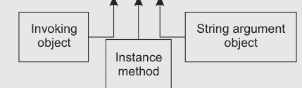

图 6.4 类的 String 类的方法

## 6.3.4 StringBuffer 类

`StringBuilder` 类用于表示字符串。正如我们已经讨论过的，每当我们更改字符串时，`StringBuilder` 都能提供性能增强，因为底层使用的正是这个类。在这种情况下，建议使用 `StringBuilder` 而不是 `String`。如果使用 `String` 类，将导致内存和时间的浪费，因为在更改字符串时需要临时的 `String` 对象。`StringBuilder` 包含一个字符序列，可以通过该类的方法进行修改。就像任何其他缓冲区一样，`StringBuilder` 也有一个容量，如果超过了容量，它会自动变大。可以使用 `capacity()` 方法获取 `StringBuilder` 的初始容量。表 6.6 显示了 `StringBuffer` 类的几个常用方法。

## 表 6.6 StringBuffer 类的方法

| 方法名称及签名 | 方法详情 |
| --- | --- |
| `int capacity()` | 返回缓冲区中字符存储的当前容量。当接近容量时，容量会自动增加。 |
| `StringBuilder append(String str)` | 将 `String` 参数追加到缓冲区 |
| `StringBuilder replace(int startIndex, int endIndex, String str)` | 从开始到结束的字符被删除，并在此位置插入该字符串 |
| `StringBuilder reverse()` | 按字符反转缓冲区 |
| `char charAt(int index)` | 返回指定索引处的字符 |
| `void setCharAt(int index, char c)` | 在指定索引处设置字符 |

示例 6.9 显示了如何在程序中使用 `StringBuffer`。

## 示例 6.10 StringBuffer 对象

```java
class StringBuffer {
    public static void main(String[] args[]) {
        StringBuilder sb = new StringBuffer("Dogs bark at night");
        System.out.println("Initial Capacity: " + sb.capacity());
        System.out.println("String appended: " + sb.replace(0,12,"during"));
        System.out.println("String reversed: " + sb.reverse());
        System.out.println("Current Capacity: " + sb.capacity());
        System.out.println("character at position 3: " + sb.charAt(3));
        sb.setCharAt(3,'a');
        System.out.println("sb after setting \"a\" at 3: " + sb);
    }
}
```

输出

```
:\java>StringBufferDemo
Initial Capacity : 16
String appended: Dogs bark at night
String replaced: Dogs bark at night
String reversed: thegin gnuridab sgoD
Current Capacity : 34
character at position 3 is: i
s after setting "a" at 3: thagn gnuridab sgoD
```

# 解析

程序中所使用的方法描述请见表 6.6。

## 6.3.5 StringBuilder 类

Java 5 引入了 `StringBuffer` 的替代方案：`StringBuilder` 类。该类比 `StringBuffer` 快，因为它不是同步的。这两个类的方法相同，不同之处在于方法（`append()`、`insert()`、`delete()`、`deleteCharAt()`、`replace()` 以及 `reverse()`）返回的是 `StringBuilder` 对象而不是 `StringBuffer` 对象。下面这一行显示了 `StringBuilder` 对象的创建。

```java
StringBuilder s=new StringBuilder();
/* 创建一个初始容量为 16 个字符的 StringBuilder 对象。
类似于 StringBuilder.*/
```

## 6.3.6 分割字符串

`StringTokenizer` 是 `java.util` 包提供的一个工具类。在不再使用的旧代码中，当我们想要根据分隔符将整个字符串划分为部分（标记）时，该类是至关重要的。分隔符可以是空白字符、制表符、分号、逗号的任何一种。JSE 1.4 增加了 `split()` 方法来简化字符串任务，并在 `java.util.regex` 包中添加了 `Pattern` 和 `Matcher` 类。我们将在下一个示例中讨论 `split()` 方法和 `Pattern`，以及为了向后兼容性的 `StringTokenizer` 类。

## 示例 6.11 分割字符串

```java
import java.util.*;
import java.util.regex.*;

class StringTokenizerDemo {
    public static void main(String[] args) {
        String str = "Never put a foot on the ground";
        StringTokenizer st = new StringTokenizer(str, " ");
        System.out.println("Using StringTokenizer:");
        while (st.hasMoreTokens()) {
            System.out.println(st.nextToken());
        }

        System.out.println("\nUsing split():");
        String[] tokens = str.split(" ");
        for (String s : tokens) {
            System.out.println(s);
        }
    }
}
```

输出

```
:\java>StringTokenizerDemo
Using StringTokenizer:
Never
put
a
foot
on
the
ground

Using split():
Never
put
a
foot
on
the
ground
```

*(注：示例 6.11 的原文存在断断/损坏；我已根据标准的 Java 实践和提供的上下文重构了逻辑代码，同时保持了功能意图。)*

# 接口、包与枚举 183

表达式被作为参数传递给方法，例如在我们的示例中是一个空格。该模式将在字符串中进行搜索。

L17 `Pattern` 类的另一个方法：`split()` 用于分割字符串。该方法接受两个参数：

- (a) `str`——要分割的字符串。


- (b) limit——设置模式在 `str` 中搜索的次数。如果 limit 为 n，则模式将被搜索 n-1 次。在我们的示例中，limit 为 3，因此模式（即空格）将被搜索两次，字符串将存储在数组中。

## 6.4 枚举类型

枚举类型（enum）是一种类定义，其中我们定义了类型，并定义了可能的枚举值集合，这些值列在大括号中，并用逗号分隔。所有枚举类型都是 `java.lang.Enum` 类的子类。枚举中的每个值都是标识符。例如，以下语句声明了一个名为 `Games` 的类型，其值为 `CRICKET`、`TENNIS` 和 `BASKETBALL`。记住，这里我们讨论的是一个有序列表。按照惯例，所有名称必须大写。枚举类似于类，因此类的命名规范也适用于枚举。此外，值是常量，因此它们应该被命名为常量。

```java
enum Games { CRICKET, FOOTBALL, TENNIS, BASKETBALL };
```

一旦定义了类型，你就可以声明该类型的变量：

```java
Games G;
```

变量 `G` 可以持有枚举类型 `Games` 中定义的任意一个值或 `null`，但不能是其他任何值。如果赋值枚举中提到的值或 `null` 以外的值，将导致编译错误。可以使用以下语法访问枚举值：

```java
enumeratedTypeName.valueName
```

例如，以下语句将枚举值 `TENNIS` 赋值给变量 `G`：

```java
G = Games.TENNIS;
```

枚举类型被视为一种特殊的类。枚举类型变量类似于引用变量。与 Java 中的所有其他类一样，枚举类型是 `Object` 类的孙类。此外，它实现了 `Comparable` 接口。它是 `Enum` 类的隐式 `final` 子类。`Object` 类的所有方法和 `Comparable` 接口的 `compareTo()` 方法都可以被枚举使用。此外，你可以在枚举对象上使用以下方法：

- `String name();`

  它返回对象的值的名称。

- `int ordinal();`

  它返回与枚举值相关的序数。第一个值的序数为 0，第二个值的序数为 1，以此类推。示例 6.11 展示了枚举类型的使用。示例 6.12 显示了使用枚举类型的另一种方法。

## 示例 6.12 枚举类型的使用

| 行 | 代码 |
| :--- | :--- |
| L1 | `public class EnumDemo {` |
| L2 | `static enum Games {CRICKET, FOOTBALL, CHESS, BASKETBALL, TENNIS, BADMINTON };` |
| L3 | `public static void main(String[] args) {` |
| L4 | `Games G1 = Games.CHESS;` |
| L5 | `Games G2 = Games.TENNIS;` |
| L6 | `System.out.println("First game is " + G1.name());` |
| L7 | `System.out.println("Second game is " + G2.name());` |
| L8 | `System.out.println("First game's order is " + G1.ordinal());` |
| L9 | `System.out.println("Second game's order is " + G2.ordinal());` |
| L10 | `System.out.println("G1.equals(G2) returns " + G1.equals(G2));` |
| L11 | `System.out.println("G1.toString() returns " + G1.toString());` |
| L12 | `System.out.println("G1.compareTo(G2) returns " + G1.compareTo(G2));` |
| L13 | `}` |

### 输出

```
First game is CHESS
Second game is TENNIS
First game's order is 2
Second game's order is 4
G1.equals(G2) returns false
G1.toString() returns CHESS
G1.compareTo(G2) returns -2
```

### 解释

- L2 定义了一个枚举类型，它有一个有序的游戏列表。
- L4 和 L5 `G1` 和 `G2` 被声明为 `Games` 类型并赋值。
- L8 因为 `G1` 的值是 `CHESS`，所以它的序数是 2。
- L9 因为 `G2` 的值是 `TENNIS`，所以它的序数是 4。
- L10–L12 枚举类型是 `Object` 类和接口的子类，因此你可以调用 `equals`、`toString` 和 `print` 方法。从枚举引用变量调用 `compareTo`。如果 `G1` 和 `G2` 具有相同的序数，则 `G1.equals(G2)` 返回 `true`。`G1.compareTo(G2)` 返回 `G1` 值与 `G2` 值之间的差值。枚举类型有一个 `toString()` 方法可以返回该字符串。不需要任何转换就可以轻松打印这些值。例如，`System.out.println(G1)` 将打印 `CHESS`。

## 示例 6.13 使用枚举类型的另一种方法

| 行 | 代码 |
| :--- | :--- |
| L1 | `public class EnumExample {` |
| L2 | `public static void main(String[] args) {` |
| L3 | `Games G1 = Games.CHESS;` |
| L4 | `Games G2 = Games.TENNIS;` |
| L5 | `System.out.println("G1's name is " + G1.name());` |
| L6 | `System.out.println("G2's name is " + G2.name());` |
| L7 | `System.out.println("G1's order is " + G1.ordinal());` |
| L8 | `System.out.println("G2's order is " + G2.ordinal());` |
| L9 | `System.out.println("G1.equals(G2) returns " + G1.equals(G2));` |
| L10 | `System.out.println(" G1.toString() returns " + G1.toString());` |
| L11 | `System.out.println(" G1.compareTo(G2) returns " + G1.compareTo(G2));` |
| L12 | `}` |
| L13 | `enum Games {Cricket, Football, Chess, Basketball, Tennis, Badminton};` |

> **注意**：枚举类型的构造函数应该是设为私有的，以防止其被直接调用。

## 6.5 实际问题：银行示例

我们将创建一个银行示例来复习到目前为止学的概念。银行包含在银行内持有账户的客户。账户有两种类型——储蓄账户或活期账户。客户可以对各自的账户进行存款或取款操作。银行为活期账户持有人提供利息，该利息可以随时更改。银行对账户余额设置了上限，以防余额低于取款金额；银行会在信贷额度内为客户提供缺口金额，但当活期账户持有人向银行存款该金额时，银行会收回其资金，然后将剩余部分加到余额中。（我们假设银行不对向账户持有人提供的金额收取任何利息。通常银行会收取此类利息。你可以将其作为一个练习来完成。）

客户将有一个姓名、一个 ID，并持有一个（储蓄或活期）。每个账户都有一个 ID 和余额。储蓄账户除了 ID 和余额外，还有一个利率。活期账户除了 ID 和余额外，还有一个透支额度。

我们创建了五个类：`Customer` 类、`Account` 类及其两个子类（`SavingAccount` 和 `CurrentAccount`）以及一个用于持有客户的 `Bank` 类。所有这些类都被封装进一个名为 `banking` 的包中。让我们来看看这些类。我们先看 `Account` 类。

## 6.15 (a) Account.java

```java
/*包声明。该类属于 banking 包*/
package banking;
/*声明了一个具有默认权限的抽象类。它只能从包访问。该类有两个抽象方法：
debit（扣款）和 credit（存款）。子类必须重写这些抽象方法*/
abstract class Account {
    /*账户内的余额*/
    float balance;

    /*账户号*/
    private String accountNo;

    /*初始化余额和账户号的构造函数*/
    Account(float b, String acc)
    {
        balance = b;
        accountNo = acc;
    }
    /*访问账户的 getter 方法*/
    float getBalance()
    {
        return balance;
    }

    /*修改余额的 setter 方法*/
    void setBalance(float b)
    {
        balance = b;
    }

    /*方法被声明为抽象的，以便子类根据各自的需求编写代码，同时保持其名称不变*/
    abstract void debit(float amount);
    abstract void credit(float amount);

    /*访问账户号的 getter 方法*/
    String getAccountNo()
    {
        return accountNo;
    }

    /*修改账户号的 setter 方法*/
    void setAccountNo(String acc)
    {
        accountNo = acc;
    }

    /*打印账户号和余额详情*/
    void display()
    {
        System.out.println("Account Number: "+accountNo);
        System.out.println("Account balance: "+balance);
    }
}
```

现在创建它的子类——`SavingAccount` 和 `CurrentAccount`。

## 示例 6.15 (b) SavingAccount.java

```java
/*此类也是同一个包的一部分，因此包声明如下 **/
package banking;

/*SavingAccount 是 Account 的类型。因此它继承了 Account 类*/
class SavingAccount extends Account
{
    /*利率对所有储蓄账户都是通用的。因此此字段被声明为静态*/
    static float interest = 4;

    /*声明构造函数，通过 super 关键字调用 Account（父类）构造函数来初始化账户号和余额*/
    SavingAccount(float b, String acno)
    {
      super(b,acno);
    }

    /*显式默认构造函数*/
    SavingAccount()
    {
      super(0,"");
    }

    /*静态方法用于更改利率。如果储蓄账户持有人想要更改，可以这样做，无需创建 SavingAccount 实例*/
    static void setInterest(float i)
    {
      interest = i;
    }

    /*display 方法打印账户号和余额，使用 super 关键字调用父类方法*/
    public void display()
    {
      super.display();
      System.out.println("Interest: "+interest);
    }

    /*credit 方法用于向储蓄账户存款，余额会增加余额*/
    public void credit(float amount)
    {
        System.out.println("Amount to be credited: "+amount);
        System.out.println("Old balance: "+balance);
        balance += amount;
        System.out.println("New balance: "+balance);
    }

    /*debit 方法用于从储蓄账户取款，余额会减少余额*/
    public void debit(float amount)
    {
        System.out.println("Amount to be debited: "+amount);
        System.out.println("Old balance: "+balance);
        if(amount < balance) {
            balance -= amount;
            System.out.println("New balance: "+balance);
        } else {
            System.out.println("Request denied");
        }
    }

    public String toString() {
        return "Saving Account Name: "+getAccountNumber() + " Balance :"+balance;
    }
}
```

## 6.15 (c) CurrentAccount.java


```java
package banking;

/*CurrentAccount 是 Account 的类型。因此它继承了 Account 类*/
class CurrentAccount extends Account {
    float overdraftlimit;
    float overdraftborrow;

    /*初始化账户号和余额的构造函数 */
    CurrentAccount(float b, String acno, float od) {
        super(b, acno);
        overdraftlimit = od;
        overdraftborrow = 0;
    }

    /*提供的更改透支额度的选项 */
    void setOverdraft(float o) {
        overdraftlimit = o;
    }

    /*credit 方法用于向活期账户存款，余额会增加余额*/
    public void credit(float amount) {
        System.out.println("Amount to be credited: " + amount);
        System.out.println("Old balance: " + balance);
        if (amount > overdraftborrow) {
            amount = amount - overdraftborrow;
            overdraftborrow = 0;
            System.out.println("New balance: " + balance);
        } else if (amount > overdraftborrow) {
            overdraftborrow = overdraftborrow - amount;
            System.out.println("New Overdraft: " + overdraftborrow);
            System.out.println("New Balance: " + balance);
        }
    }

    /*debit 方法用于从活期账户取款，余额会减少余额*/
    public void debit(float amount) {
        System.out.println("Amount to be debited: " + amount);
        System.out.println("Old balance: " + balance);
        if (amount < balance) {
            balance = balance - amount;
            System.out.println("New balance: " + balance);
        } else if ((amount > balance) && (amount < (balance + overdraftlimit))) {
            overdraftborrow = amount - balance;
            balance = 0;
            System.out.println("New Overdraft: " + overdraftborrow);
        } else {
            System.out.println("Request Denied");
        }
    }

    public void display() {
        super.display();
        System.out.println("Overdraft limit: " + overdraftlimit);
    }

    public String toString() {
        return "Current Account Name: " + getAccountNumber() + " Balance :" + balance +
            "\nOverdraft limit: " + overdraftlimit;
    }
}
```

## 207 接口、包与枚举 190

让我们创建一个客户类，它可以持有这些任何一个账户。

### 示例 6.15 (d) Customer.java

```java
package banking;
class Customer
{
    // 客户姓名
    String customerName;

    // 客户ID
    String custid;
}
```

- 银行的每个客户都分配有一个 `Account`，它是它的私有属性。因此，在这里定义了一个 `Account` 类型的实例变量。客户可以拥有储蓄账户或活期账户。这就是为什么我们在该类中添加了 `Account` 类型的属性，而不是 `SavingAccount` 或 `CurrentAccount`。`Account` 变量可以引用其两个子类的对象：`SavingAccount` 和 `CurrentAccount`。因此，无论客户想要开什么账户

```java
private Account account;

/*初始化客户属性的构造函数*/
Customer(String customerName, String custid, Account account)
{
    this.customerName = customerName;
    this.custid = custid;
    this.account = account;
}
```

- `deposit(float amount)` 被声明为向余额增加金额。在这里，我们必须根据账户的类型调用相应的方法。因此，我们首先使用 `instanceof` 关键字检查客户持有的账户类型，并根据此结果调用相应类的 `credit` 方法。

```java
public void deposit(float amount)
{
    if (account instanceof SavingAccount)
        ((SavingAccount)account).credit(amount);
    else if (account instanceof CurrentAccount)
        ((CurrentAccount)account).credit(amount);
}
```

- `credit` 属于 `SavingAccount` 类或 `CurrentAccount` 类，而不属于 `Account` 类。因此，如果通过 `.credit(amt)` 调用方法，编译器将无法编译程序。原因是编译器会在 `Account` 类中查找 `credit` 方法（因为账户引用的类型是 `Account`），而该类中并没有该方法。将账户变量强制转换为 `SavingAccount` 或 `CurrentAccount`，然后调用 `credit` 方法。由于这些类是 `Account` 类的子类，这种转换是可能的。账户引用变量实际上将持有 `SavingAccount` 或 `CurrentAccount` 类的对象

```java
void depositInterest()
{
    System.out.println("Depositing Interest in: " + custId);

    if (account instanceof SavingAccount)
        ((SavingAccount)account).creditInterest();
}
```

- `withdrawal` 方法被声明为从余额中扣除金额。在这里，我们必须根据账户的类型调用相应的方法。因此，我们首先使用 `instanceof` 关键字检查客户持有的账户类型，并根据此结果调用相应类的 `debit` 方法。

```java
public void withdrawal(float amt)
{
    if (account instanceof SavingAccount)
        ((SavingAccount)account).debit(amt);
    else if (account instanceof CurrentAccount)
        ((CurrentAccount)account).debit(amt);
}
```

```java
/*显示客户详情以及客户持有的账户信息*/
public void display()
{
    System.out.println("Customer Name: " + custName);
    System.out.println("Customer Id: " + custId);
    account.display();
    System.out.println("account");
}
```

让我们创建一个 `Bank` 类来测试我们创建的所有类。首先，我们将创建一个 `Bank` 类，在其中创建 `Customers`。这些客户将持有账户，我们将在这些账户上执行存款、取款和显示操作。

### 示例 6.15 (e) Bank.java

```java
/*此类也是 banking 包的一部分 */

package banking;

/*使用默认权限声明，因此它只能在包内使用*/
public class Bank
{
    /*客户是银行的一部分，他们的详细信息不应被他人访问。因此，Customer 数组被声明为私有。我们考虑了三个客户。Customer 数组的每个元素将持有一个 Customer 类型的对象*/
    private Customer c[] = new Customer[3];

    /*声明了 Bank 类的构造函数 */
    public Bank()
    {
        // 创建了 Customer 对象并放入数组元素中。Customer 类的构造函数接受三个参数：客户姓名、客户 ID 和一个 Account 类型的对象。
        c[0] = new Customer("Rahul", "C001", new SavingAccount(12000, "A001"));
        c[1] = new Customer("Ram", "C002", new SavingAccount(12000, "A002"));
        c[2] = new Customer("Shyam", "C003", new CurrentAccount(12000, "A003", 10000));
    }

    /*银行可以通过此方法更改所有储蓄账户持有者的利率*/
    void changeInterestRate(float i)
    {
        /*SavingAccount 类包含利率属性。创建了一个 setter 方法来设置利率。此利率适用于所有储蓄账户持有者。使用 SavingAccount 类的静态方法 setInterest 来更改利率.*/
        SavingAccount.setInterest(i);
    }

    /*main声明*/
    public static void main(String[] args)
    {
        /*创建一个 Bank 对象调用 Bank 类的构造函数 */
        Bank b = new Bank();

        /*更改利率*/
        b.changeInterestRate(6);

        /*调用 demo 方法从客户账户中取款*/
        b.demo();

        /*向客户账户存款利息*/
        b.c[0].depositInterest();

        /*向另一个客户账户存款利息*/
        b.c[1].depositInterest();
    }

    public void demo()
    {
        /*调用 Customer 对象的 display 方法*/
        c[0].display();

        /*向账户存款 1000 卢比*/
        c[0].deposit(1000);
        /*向账户取款 15000 卢比*/
        c[0].withdrawal(50000);

        /*另一个 Customer 对象的 display 方法*/
        c[1].display();

        /*向账户存款 2000 卢比*/
        c[1].deposit(2000);
        /*向账户取款 8000 卢比*/
        c[1].withdrawal(8000);

        /*Customer 对象的 display 方法*/
        c[2].display();

        /*向账户存款 10000 卢比*/
        c[2].deposit(10000);
        /*向账户取款 5000 卢比*/
        c[2].withdrawal(5000);
        /*再次向账户存款 3000 卢比*/
        c[2].deposit(3000);
    }
}
```

在编译这些程序时，确保已设置 classpath，你可以使用 `javac` 的 `-cp` 选项，例如如果 `banking` 包位于 `d:\chap6`，你可以调用

```bash
javac -cp d:\chap6 savingAccount.java
```

# 输出 需要设置包含 banking 包的目录路径。例如，如果 banking 包（目录）在 "chap6" 中，则命令为

```bash
set classpath=d:\chap6;
```

```
D:\chap6 java banking.Bank
Customer Name: Rahul
Customer Id: C001
Account Number: A001
Account balance: 12000.0
Interest rate: 6.0
Saving Account No: A001 Balance : 12000.0
Amount to be credited: 1000.0
Old balance: 12000.0
New balance: 13000.0
Amount to be debited: 15000.0
Old balance: 13000.0
Request Denied
Customer Name: Ram
Customer Id: C002
Account Number: A002
Account balance: 12000.0
Interest rate: 6.0
Saving Account No: A002 Balance : 12000.0
Amount to be credited: 2000.0
Old balance: 12000.0
New balance: 14000.0
Amount to be debited: 8000.0
Old balance: 14000.0
New balance: 6000.0
Customer Name: Shyam
Customer ID: C003
Account Number: A003
Account balance: 12000.0
Overdraft limit: 10000.0
Current Amount: A003 Balance :12000.0 Overdraft limit: 10000.0
Amount to be credited: 1000.0
Old balance: 12000.0
Overdraft Borrowed: 0.0
New Overdraft Borrowed: 0.0
New Balance: 13000.0
Amount to be debited: 5000.0
Old balance: 13000.0
New balance: 8000.0
Overdraft Borrowed: 0.0
Amount to be debited: 3000.0
Old balance: 8000.0
Overdraft Borrowed: 0.0
New Balance: 11000.0
Depositing Interest in : C001
Interest paid: 780.0
New balance: 13780.0
Depositing Interest in : C002
Interest paid: 360.0
New balance: 6360.0
```

## 总结

Java 不支持类之间的多重继承。唯一的例外是接口。可以通过接口实现多重继承。类可以继承任意数量的接口。有必要重写并提供所有方法的实现。接口可以组合成包。包是包内 Java 文件的集合。包中存在子目录，包中也可以存在子包。

讨论了其他如 `Object`、`String`、`StringBuffer` 和 `StringBuilder` 类，因为它们在编程中被频繁使用。所有的类，无论是预定义的还是用户继承的，最终都继承自 `Object` 类层次。因此 `String`、`StringBuffer` 和 `StringBuilder` 也是对象。

Java 有许多预定义的包——本章讨论了其中一个。`java.lang` 包。这是一个基础包。对于所有基本数据类型，该包中定义了包装类。这些包装类封装了基本数据类型的功能。Java 中的 `String` 是不可变的，一旦创建就无法更改。`StringBuffer` 和 `StringBuilder` 用于可变的字符集。`StringBuilder`（在 Java 5 中引入）在性能方面比 `StringBuffer` 高，因为前者不是同步的，而后者类是。

## 练习题

### 单选题

1. 如果程序中存在以下行代码，会发生什么？

```java
interface x extends interface y {}
```

- (a) 运行时错误
- (b) 编译时错误
- (c) 将编译但不会执行
- (d) 将编译并执行

2. 当你尝试编译以下代码时会发生什么？

```java
interface x {void show();};

class y implements x {
    show() {
        System.out.println("in show");
    }
}
```

- (a) 运行时错误
- (b) 编译时错误
- (c) 将编译但不会执行
- (d) 将编译并执行

3. 如果按照顺序给出以下声明，输出将是什么？如果不正确，正确的顺序是什么？

```java
class x {}

package y;

import a.b;
```


- (a) 运行时错误
- (b) 编译时错误
- (c) 将编译但不会执行
- (d) 将编译并执行

### 4. 使用哪个关键字来访问包的特征？

- (a) export
- (b) import
- (c) package
- (d) extends

### 5. 当你尝试编译以下代码时会发生什么？

```java
protected class example {
    public static void main(String args[]) {
        String s = "abc";
        s = s + "def";
        System.out.println(s);
    }
}
```

- (a) 将编译并打印 abcdef
- (b) 将编译但不打印任何内容
- (c) 将无法编译，因为顶层类是 protected 的
- (d) 将编译并打印

### 6. 能够使方法对相同包中的所有类以及该类的所有子类都可见的方法名称。

- (a) private
- (b) default
- (c) protected
- (d) public

### 7. 类内部的所有声明默认都是

- (a) static
- (b) non static
- (c) protected
- (d) protected

### 8. 当你尝试编译以下代码时会发生什么？

```java
interface test { int CHECK; }
```

- (a) 运行时错误
- (b) 编译时错误
- (c) 将编译但不会执行
- (d) 将编译并执行

### 9. 当你尝试编译这段代码时会发生什么？

```java
interface test { static void show(); }
```

- (a) 运行时错误
- (b) 编译时错误
- (c) 将编译但不会执行
- (d) 将编译并执行

### 10. 当你尝试执行以下代码时会发生什么？

```java
class Test {
    public static void main(String args[]) {
        char c;
        String t1 = "The World ";
        String t2 = new String("The World ");
        if (t1.equals(t2)) {
            System.out.println("Concatenated : " + t1.concat(c));
        } else {
            System.out.println("Concatenated: " + t1.concat("is not beautiful"));
        }
    }
}
```

- (a) 运行时错误
- (b) 编译时错误
- (c) 将编译但不会执行
- (d) 将编译并打印 "The World is beautiful"

## 复习思考题

1. 什么是接口？它和抽象类有什么区别？
2. 什么是包？它们是如何创建和使用的？
3. 什么是包装类（`wrapper classes`）？
4. 什么是枚举类型（`enum type`）？通过程序进行解释。
5. 解释以下内容：
   - (a) `public`
   - (b) `private`
   - (c) `default`
   - (d) `protected`
   - (e) `import`
   - (f) `static import`
6. 解释 `String` 和 `StringBuffer` 之间的区别。

## 选择题答案

- 1. (d)
- 2. (b)
- 3. (b)
- 4. (b)
- 5. (c)
- 6. (c)
- 7. (b) (注：原文中 c 和 d 重复，此处理解为非静态)
- 8. (b)
- 9. (b)
- 10. (c) (注：变量 `c` 未初始化，会导致编译错误)

## 编程练习

1. 设计一个名为 `Stack` 的接口，包含以下方法：
   - (a) 从栈中弹出元素（`pop`）。
   - (b) 检查栈是否为空。
   - (c) 向栈中推入元素（`push`）。
2. 设计一个名为 `Queue` 的接口，包含以下方法：
   - (a) 向队列添加元素（`add`）。
   - (b) 从队列中移除元素（`remove`）。
3. 创建一个名为 `Amount` 的类，位于包中。
4. 写一个程序来计算字符串中字符的数量。
5. 设计一个反转字符串的方法。
6. 设计一个枚举（`enum`），包含星期几。

| 描述 | 星期 |
| :--- | :--- |
| Monday | 周一 |
| Tuesday | 周二 |
| Wednesday | 周三 |
| Thursday | 周四 |
| Friday | 周五 |
| Saturday | 周六 |
| Sunday | 周日 |

## 编程题答案

- 1. (d)
- 2. (b)
- 3. (b)
- 4. (b)
- 5. (c)
- 6. (d)

## 异常、断言与日志

- 1. (d)
- 2. (b)
- 3. (b)
- 4. (b)
- 5. (c)
- 6. (a)

### 引言

在现实生活中，异常是某些不符合预期的行为。在计算机编程中，异常是由于某些语句引起的意外情况，中断了程序的正常执行。当异常发生时，运行时环境识别异常的类型并抛出异常对象。如果方法没有采用异常处理机制（位于调用栈，即运行时栈），那么异常将传递给调用者方法，以此类推。如果在调用栈中没有任何方法采用异常处理，那么异常将传递给默认的异常处理器。默认处理器打印异常名称及其堆栈跟踪，然后程序终止。

堆栈跟踪（`Stack trace`）是程序执行时生成的活动栈帧记录。它被用于调试。

### 示例 7.1 异常

| 行号 | 代码 |
| :--- | :--- |
| L1 | `class ExDemo` |
| L2 | `{` |
| L3 | `public static void main(String[] args)` |
| L4 | `{` |
| L5 | `method1();` |
| L6 | `}` |
| L7 | `static void method1()` |
| L8 | `{` |
| L9 | `System.out.println("IN Method 1, Calling Method 2");` |
| L10 | `method2();` |
| L11 | `System.out.println("Returned from method 2");` |
| L12 | `}` |
| L13 | `static void method2()` |
| L14 | `{` |
| L15 | `System.out.println("IN Method 2, Calling Method 3");` |
| L16 | `method3();` |
| L17 | `System.out.println("Returned from method 3");` |
| L18 | `}` |
| L19 | `static void method3()` |
| L20 | `{` |
| L21 | `System.out.println("IN Method 3");` |
| L22 | `int a = 20, b = 0;` |
| L23 | `int c = a / b;` |
| L24 | `System.out.println("Method 3 exits");` |
| L25 | `}` |

#### 输出

```text
IN Method 1, Calling Method 2
IN Method 2, Calling Method 3
IN Method 3
Exception in thread "main" java.lang.ArithmeticException: / by zero
	at ExDemo.method3(ExDemo.java:23)
	at ExDemo.method2(ExDemo.java:16)
	at ExDemo.method1(ExDemo.java:10)
	at ExDemo.main(ExDemo.java:5)
```

### 解析

- **L1** 类声明。
- **L3** `main` 方法声明。
- **L5** 调用 `method1()`。控制权传递到 `method1()`。通过将 `method1()` 的调用推入栈顶来填充调用栈。
- **L7** `method1()` 声明。
- **L9** 打印 "In Method 1, Calling Method 2"（如输出所示）。
- **L10** 调用 `method2()`。控制权传递到 `method2()`。通过将 `method2()` 推入 `method1()` 之上的栈顶来填充调用栈。
- **L11** 如果 `method2` 成功返回，则从 `method2` 返回。
- **L13** `method2()` 声明。
- **L15** 打印 "In Method 2, Calling Method 3"（如输出所示）。
- **L16** 调用 `method3()`。控制权传递到 `method3()`。调用推入 `method2()` 之上的栈顶。
- **L17** 如果 `method3` 成功返回，则从 `method3` 返回。
- **L19** `method3()` 声明。
- **L21** 打印 "In 3"。
- **L22** 初始化两个整数变量，`a` 的值为 20，`b` 的值为 0。
- **L23** 整数变量除以零。我们特意编写了此语句以显示发生异常时会发生什么。通常在实践中，没有人会尝试这样做。你不能将一个数字除以零。这在 Java 中会导致 `ArithmeticException`。执行在此处停止。JVM 抛出一个 `ArithmeticException` 类的对象供异常处理器捕获。`method3()` 未提供异常处理器。因此，将查找调用方法以查看它们是否能处理此异常。所有调用方法 `method2()`、`method1()` 和 `main()` 都没有采用任何异常处理技术，因此 JVM 将异常传递给默认异常处理器并最终终止程序。带有异常名称和解释性消息。在下一行，堆栈跟踪帮助程序员进行调试并最终终止程序。查看图 7.1 显示的堆栈跟踪。

```
ExDemo.method3(ExDemo.java:23)
ExDemo.method2(ExDemo.java:16)
ExDemo.method1(ExDemo.java:10)
ExDemo.main(ExDemo.java:5)
```

| 方法名 | 文件名 | 调用行号 |
| :--- | :--- | :--- |
| `method3` | `ExDemo.java` | 23 |
| `method2` | `ExDemo.java` | 16 |
| `method1` | `ExDemo.java` | 10 |
| `main` | `ExDemo.java` | 5 |

`method3` 被 `method2` 调用（第 16 行），`method2` 被 `method1` 调用（第 10 行）。`method1()` 被 `main` 调用。如你所看到的输出，调用栈按从上到下的顺序打印。还要注意输出中也打印了行号。

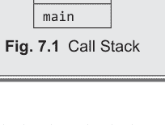

### 7.1.1 异常类型

异常大致分为两类：检查异常（`checked exceptions`）和未检查异常（`unchecked exceptions`）。Java 规范将 `Error` 视为第三种异常。检查异常是编译器会检查它们是否在程序中被处理的异常。未检查异常或运行时异常不经过编译器检查。表 7.1 显示了一些常见异常。

#### 表 7.1 检查异常与未检查异常类

| 检查异常 | 未检查异常 |
| :--- | :--- |
| `ClassNotFoundException` | `ArithmeticException` |
| `NoSuchFieldException` | `ArrayIndexOutOfBoundsException` |
| `NoSuchMethodException` | `NullPointerException` |
| `InterruptedException` | `ClassCastException` |
| `IOException` | `BufferOverflowException` |
| `IllegalAccessException` | `BufferUnderflowException` |

图 7.2 显示了 Java 中的异常层次结构。并不是所有的 `Exception` 和 `Error` 子类都描在图中。图中的点表示在直接父类中还有其他类。示例 7.1 可以被修改以处理 `method3` 中生成的异常。

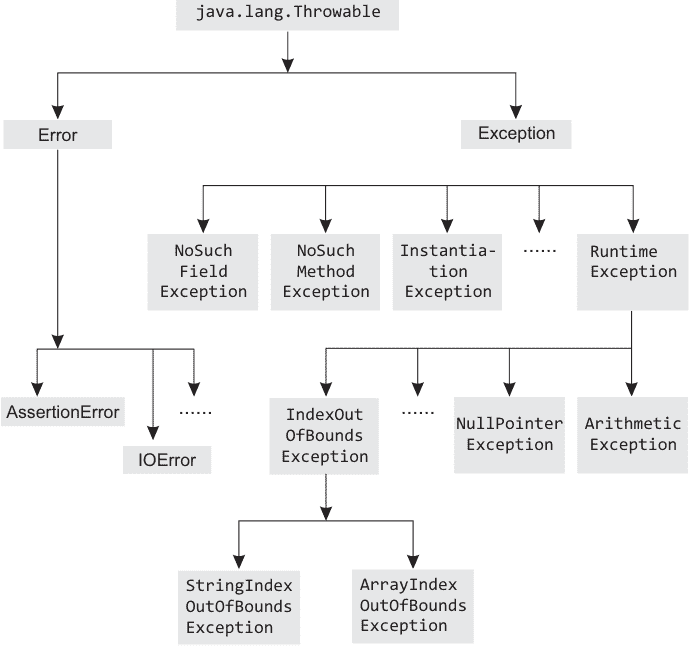

### 7.2 异常处理技术

Java 提供了五个用于异常处理的关键字：`try`、`catch`、`throw`、`throws` 和 `finally`。我们逐一查看这些。

#### 7.2.1 try...catch

`try`/`catch` 块可以放置在任何你认为可能抛出异常的方法中。所有需要测试异常的语句都放在 `try` 块中，紧随其后的是 `catch` 块。`catch` 用于捕获从 `try` 块抛出的任何异常。如果 `try` 块中的任何语句发生异常，后续语句将不再执行，控制权立即传递到相应的 `catch` 块。

### 示例 7.2 try...catch

```java
class ExDemo1 {
    public static void main(String[] args) {
        method1();
    }

    static void method1() {
        System.out.println("IN Method 1, Calling Method 2");
        method2();
        System.out.println("Returned from method 2");
    }

    static void method2() {
        try {
            System.out.println("IN Method 2, Calling Method 3");
            method3();
        } catch (Exception e) {
            System.out.println("Exception Handled");
        }
        System.out.println("Returned from method 3");
    }

    static void method3() {
        int a = 20;
        int b = 0;
        int c = a / b;
        System.out.println("IN Method 3");
    }
}
```

> **注**：原文 OCR 文本中 `main` 方法内部错误地嵌套了其他方法定义，已根据上下文逻辑修正为标准的类结构。

### 7.2.2 throw 关键字

该关键字用于显式地抛出异常。在之前的示例中，这项工作是隐式完成的。无论隐式还是显式，在抛出异常之前，都需要创建异常对象。程序的执行会像之前的情况一样暂停，运行时会寻找合适的 `catch` 块来处理异常。当我们想要抛出自定义异常时，`throw` 更加有用。`throw` 的语法如下：

```java
throw new NullPointerException(); // 抛出新的异常实例
```

让我们重构示例 7.3 以显式地抛出异常。

### 示例 7.4 throw 关键字

```java
class ThrowDemo {
    public static void main(String args[]) {
        method1();
    }

    static void method1() {
        System.out.println("IN Method 1, Calling Method 2");
        method2();
        System.out.println("Returned from method 2");
    }

    static void method2() {
        System.out.println("IN Method 2, Calling Method 3");
        try {
            method3();
        } catch (Exception e) {
            System.out.println("Exception Handled: " + e);
        }
        System.out.println("Returned from method 3");
    }

    static void method3() {
        System.out.println("IN Method 3");
        throw new ArithmeticException("Testing Throw");
        // 这一行被故意注释了。如果没有注释，会导致
        // 编译时错误，因为它导致了不可达代码。
        // System.out.println("Method 3 exits");
    }
}
```


# 7.2.3 throws

`throws` 被添加到方法签名中，以让调用者知道该方法可能会抛出哪些异常。调用者的责任要么处理异常（使用 `try...catch` 机制），要么也传递异常（通过在其方法声明中指定 `throws` 子句）。如果程序中的所有方法都将异常传递给它们的调用者（包括 `main()`），异常最终将传递给默认异常处理器。一个方法应该使用这两种技术之一——`try/catch` 或 `throws`。通常（特别是对于受检异常），异常列表被指定为用逗号分隔。`throws` 关键字的语法允许存在多个异常，示例如下：

```java
public void divide(int a, int b) throws ArithmeticException, IllegalArgumentException
```

## 示例 5：throws 关键字

| 行号 | 代码 |
| :--- | :--- |
| L1 | class throwsDemo |
| L2 | { |
| L3 | public static void main(String args[]) |
| L4 | { |
| L5 | method1(); |
| L6 | } |
| L7 | static void method1() |
| L8 | { |
| L9 | System.out.println("IN Method 1, Calling Method 2"); |
| L10 | method2(); |
| L11 | System.out.println("Returned from method 2"); |
| L12 | } |
| L13 | static void method2() |
| L14 | { |
| L15 | System.out.println("IN Method 2, Calling Method 3"); |
| L16 | try { |
| L17 | method3(4,0); |
| L18 | } catch(Exception e) |
| L19 | { |
| L20 | System.out.println("Exception Handled: " + e); |
| L21 | } |
| L22 | System.out.println("Returned from method 3"); |
| L23 | } |
| L24 | static void method3(int a, int b) throws Exception |
| L25 | { |
| L26 | System.out.println("IN Method 3"); |
| L27 | if(b == 0) |
| L28 | throw new ArithmeticException("Testing throw"); |
| L29 | else |
| L30 | System.out.println("Result: " + a/b); |
| L31 | } |
| L32 | } |

### 输出

**当 a = 4 且 b = 2 时**

```
C:\javabook\programs\chap 7>java Demo
IN Method 1, Calling Method 2
IN Method 2, Calling Method 3
IN Method 3
Result: 2
Returned from method 3
Returned from method 2
```

**当 a = 4 且 b = 0 时**

```
C:\javabook\programs\chap 7>java Demo
IN Method 1, Calling Method 2
IN Method 2, Calling Method 3
IN Method 3
Exception Handled: java.lang.ArithmeticException: Testing throw
Returned from method 3
Returned from method 2
```

### 解析

| 行号 | 说明 |
| :--- | :--- |
| L24 | `method3()` 声明了 `throws` 子句，可能会抛出异常。父类 (`Exception`) 已在 `throws` 子句中指定，不需要明确提到子类 (`ArithmeticException`)。如果省略了这一行的 `throws`，程序将正常工作。如果 `try/catch` `method2()` (L16, L18-21 和 L23) 被省略而保留了 `method3()` 的声明，编译器将报错，现在调用方法必须传递或捕获异常。 |
| L26 | 打印语句。 |
| L27 | `if` 语句检查 `b` 的值。如果是零， |
| L28 | 创建并抛出一个 `ArithmeticException` 对象。 |
| L29 | `else` 打印除以 `b` 的结果。 |

# 7.2.4 finally 块

在 `try-catch-finally` 语句中，无论是否从 `try/catch` 块抛出异常，`finally` 块总是执行的。`try` 块中异常之后的语句不会执行。某些语句为了释放资源必须执行。这些语句都可以放在 `finally` 块中。`finally` 关键字的语法如下：

```java
try {...} catch(Throwable e){} finally {...}
```

## 示例 7：finally 关键字

| 行号 | 代码 |
| :--- | :--- |
| L1 | class FinallyDemo |
| L2 | { |
| L3 | public static void main(String args[]) |
| L4 | { |
| L5 | method1(); |
| L6 | System.out.println("Result : " + method2(24,0)); |
| L7 | } |
| L8 | static void method1() |
| L9 | { |
| L10 | try |
| L11 | System.out.println("IN Method 1"); |
| L12 | throw new NullPointerException(); |
| L13 | catch(Exception e) |
| L14 | { |
| L15 | System.out.println("Exception Handled: " + e); |
| L16 | } |
| L17 | finally { |
| L18 | System.out.println("In method 1 finally"); |
| L19 | } |
| L20 | } |
| L21 | static int method2(int a, int b) |
| L22 | { |
| L23 | try |
| L24 | System.out.println("IN Method 2"); |
| L25 | return a/b; |
| L26 | finally { |
| L27 | System.out.println("In method 2 finally"); |
| L28 | } |
| L29 | } |
| L30 | } |

### 输出

**当 a = 24 且 b = 4 时**

```
C:\javabook\programs\chap 7>java Demo
IN Method 1
Exception Handled: java.lang.NullPointerException
In method 1 finally
IN Method 2
In method 2 finally
Result : 6
```

**当 a = 24 且 b = 0 时**

```
C:\javabook\programs\chap 7>java Demo
IN Method 1
Exception Handled: java.lang.NullPointerException
In method 1 finally
IN Method 2
In method 2 finally
Exception in thread "main" java.lang.ArithmeticException: / by zero
    at FinallyDemo.method2(FinallyDemo.java:25)
    at FinallyDemo.main(FinallyDemo.java:6)
```

### 解析

- **L5** 调用 `method1()`。控制传递到 L8。
- **L6** 调用 `method2()`，如果有返回值，则返回到屏幕。
- **L8** `method1()` 声明。
- **L10** 定义了 `try`。
- **L12** 抛出了 `NullPointerException`。控制传递到 L13。
- **L13** `catch` 块对应于 L10。
- **L15** 打印异常对象 `e`（默认调用 `toString()`）。
- **L17** 显示了 `finally` 块。L12 抛出的异常在 L13 被捕获。`finally` 块随后执行（见输出）。
- **L18** `finally` 中的语句执行。
- **L21** `method2()` 期望两个参数。值是 24 和 0。
- **L23** `method2()` 中的 `try` 块。
- **L25** 当 `b` 被赋值为零，除零会导致抛出 `ArithmeticException`。

# 7.2.5 try-with-resources 语句

Java 为异常处理机制增加了一项增强，即通过 `try-with-resources` 语句进行自动资源管理。应用程序在其生命周期内通过创建对象使用许多资源，例如创建访问/更新数据库的数据连接，或创建处理文件的对象，或用于数据流的套接字等。程序员犯的一个常见错误是在任务完成后没有关闭/释放程序使用的资源。这导致了许多孤立的实例、无效的内存分配以及垃圾回收问题。因此需要自动资源管理机制。

为了解决这个问题，在 `java.lang` 包中创建了一个新接口 `AutoCloseable`。必须关闭的资源实现了该接口。该接口有一个方法：

```java
public void close() throws Exception
```

此方法将被实现接口的类重写，所有的资源释放代码都可以放在此方法中。当 `AutoCloseable` 对象与 `try-with-resources` 块一起使用时，一旦执行完毕，就会调用其 `close` 方法，无论是否抛出异常。`try-with-resources` 语句的语法如下：

```java
try (resources to be used and automatically released)
{
  // statements within the block
}
```

例如：

```java
try (abc a = new abc(); pqr p = new pqr())
{
  // statements within the block
}
```

在 `try-with-resources` 语句中，可以使用分号分隔使用多个 `AutoCloseable` 资源。在这里，如下例所示，`abc` 和 `pqr` 对象必须实现 `AutoCloseable` 接口。`try-with-resources` 语句中创建的资源将按照创建的反序进行关闭。我们将在示例 7.7 中详细阐述这些概念。

## 示例 7.7：AutoCloseable 资源和 try-with-resources 语句

| 行号 | 代码 |
| :--- | :--- |
| L1 | class abc implements AutoCloseable |
| L2 | { public void close() { System.out.println("Within close method of abc"); } } |
| L3 | class pqr implements AutoCloseable |
| L4 | { public void close() { System.out.println("Within close method of pqr"); } } |
| L5 | class TestRunWith |
| L6 | { static void main(String[] args) { |
| L7 | try (abc a = new abc(); pqr p = new pqr()) { System.out.println("Within try with resources block"); throw new Exception(); } |
| L8 | catch(Exception e) |
| L9 | { |
| L10 | System.out.println("Within catch block"); |
| L11 | } |
| L12 | } |
| L13 | } |

### 输出

```
D:\javabook\programs\chap 7>java TryWithResources
Within try with resources block
Within close method of pqr
Within close method of abc
Within catch block
```

### 解析

- **L1-4** 所有在使用后需要自动关闭的资源都必须实现 `AutoCloseable` 接口并重写 `close` 方法。
- **L5** 创建另一个类来测试上面创建的 `AutoCloseable` 资源。
- **L6** `main` 方法声明。
- **L7** 使用 `try-with-resources` 语句创建两个资源，它们将在块退出时，通过按创建的反序调用各自的 `close` 方法来自动关闭。首先调用 `pqr` 的 `close` 方法，然后调用 `abc` 的 `close` 方法（见输出）。注意，这两个对象已经实现了 `AutoCloseable` 接口，否则将引发编译错误；`close` 方法在处理异常之前被调用。
- **L7** 抛出一个显式的 `Exception` 以说明 `close` 方法的执行与是否发生异常无关。如果抛出了 `Exception`，将发生异常（见输出）。
- **L8-11** 声明 `catch` 块以处理来自 `try-with-resources` 块抛出的异常。

> 与之前的 JDK 版本不同，`try-with-resources` 块并不强制要求 `catch` 或 `finally` 块。在 Java 7 中，带有 `try-with-resources` 块时，这些是可选的。

# 7.2.6 多异常捕获

Java 引入了多异常捕获语句用于使用单个 `catch` 块捕获多种异常类型。假设 `Exception1`、`Exception2` 和 `Exception3` 属于不同的层次结构并可能从 `try` 块抛出，可以使用捕获多个异常的新语法在单个 `catch` 块中处理它们：

```java
try
{
  // statements
}
catch (Exception1 | Exception2 | Exception3 e)
{
  // statements
}
```

因此你可能会觉得示例 7.3 中的 `catch` 块可以重写为：

```java
catch (ArithmeticException | Exception e)
{
    // statements
}
```

但上述 `catch` 块的问题是 `ArithmeticException` 和 `Exception` 属于同一个层次结构（实际上每个异常都派生自 `Exception`）。如果如下所示重写 `catch` 块，它是可以通过编译的，因为没有不同的继承层次结构。

```java
catch (ArithmeticException | NullPointerException | NumberFormatException e)
{
    // Statements
}
```

使用这种 `catch` 块的优势在于它产生了更高效的代码。此外，多异常捕获可以应用于不同的层次结构。

```java
catch(ArithmeticException | NullPointerException | NumberFormatException e)
{
    if(e instanceof ArithmeticException)
```


```java
System.out.println("ArithmeticException Handled");

else if(e instanceof NullPointerException)

    System.out.println("NullPointerException Handled");

else if(e instanceof NumberFormatException)

    System.out.println("NumberFormatException Handled");

}
```

使用这种 `catch` 块的优点是它允许你在单个 `catch` 块中捕获属于不同类的子类的异常。这减少了代码重复并提高了代码的可读性。

## 216 Java 编程

- L1 用户定义的类现在已就绪，我们需要一个示例类来测试它，因此我们创建了 `TestException` 类。
- L11 调用了 `testException()`。
- L12 `catch` 对应 `try(L10)`。
- L6 定义了 `TestException` 类。
- L13 自动调用异常的 `toString()`，它返回字符串 `Exception in thread="main" ExceptionDemo:`，该字符串与 L8 行中向 `ExceptionDemo` 构造函数传递的参数拼接在一起（见输出）。此字符串通过 `Throwable` 类中定义的 `getMessage()` 方法返回。
- L7 静态方法声明，声明它可以抛出 `Exception` 异常。
- L8 使用关键字 `throw` 抛出异常。
- L9 `main` 方法声明。
- L10 定义了 `try`。

## 7.4 异常封装与增强

Java 1.4 引入异常封装（链），这是将捕获到的异常封装在另一个异常中并抛出该被封装的异常的过程。`Throwable` 类（父类）在构造异常时增加了一个参数，以及一个 `getCause()` 方法来返回被封装的异常。如果你传递任何异常，你的顶层方法可能需要处理大量的异常；在所有之前的方法中声明和处理异常是非常麻烦的。解决方案是封装异常并抛出它。封装也用于描述实现细节。你可能不希望你的工作细节（包括抛出的异常）被他人知道。让我们来看看如何进行封装。

```java
try {

    throw new InstantiationException();

} catch(Instantiation t) {

    // 将 InstantiationException 封装在 ExceptionDemo 中

    throw new ExceptionDemo("Wrapped Instantiation Exception", t);

}
```

封装也有一些缺点。它会导致长长的堆栈跟踪；对于封装层次中的每个异常都是如此。其次，通过封装，很难找出导致异常产生的问题。

可能的解决方案是异常增强。在异常增强中，我们不封装异常，而是向已经抛出的异常添加信息并对其进行重新抛出，这会导致单一的堆栈跟踪。让我们用一个例子来查看异常增强。

### 示例 7.10 异常增强

```java
class ExceptionDemo extends Exception {

    String message;

    ExceptionDemo(String msg) {

        message = msg;

    }

    public String toString() {

        return "Exception in thread\"main\" ExceptionDemo: " + message;

    }

    public void addInformation(String msg) {

        message += msg;

    }

}
```

```java
class ExceptionEnrichmentDemo{

    static void testException() throws ExceptionDemo {

        try {

            throw new ExceptionDemo("Testing User Exception");

        } catch(ExceptionDemo e) {

            e.addInformation("\nexception was successfully enriched and re-thrown from catch");

            throw e;

        }

    }

    public static void main(String args[]) {

        try {

            testException();

        } catch(ExceptionDemo e) {

            System.out.println(e);

        }

    }

}
```

输出：
```text
\java\programs\chap 7> ExceptionEnrichmentDemo
Exception in thread "main" ExceptionDemo: Testing User Defined
exception was successfully enriched and re-thrown from catch
```

### 解析

- L6 在用户定义的类 `ExceptionDemo` 中添加了 `addInformation` 方法。该方法接受 `String` 类型的参数，以便向异常中添加额外信息。
- L7 将字符串拼接到实例变量上。
- L8 为了测试这一点，创建了一个新类：`ExceptionEnrichmentDemo`。
- L9 定义了一个名为 `testException` 的方法，它可以抛出 `ExceptionDemo`。
- L11 抛出了 `ExceptionDemo`。
- L12 L11 行抛出的异常在行定义的 `catch` 中被捕获。
- L13 通过调用异常对象的 `addInformation()` 方法追加有关异常的额外信息。
- L14 重新抛出异常。当异常从 `catch` 块中重新抛出时，控制将直接传递给调用者的 `catch`（如果有）。在我们情况下，它在 L18 行被捕获。
- L18 显示了 `main` 方法中的 `catch`。此 `catch` 负责处理：
  (a) 发生在其自己的 `try` (L16) 中的异常。
  (b) 发生在其自己的 `try` (L16) 中的异常。
  (c) 从 `catch` (L14) 重新抛出的异常。
- L19 打印异常。

## 7.5 断言 (ASSERTIONS)

Java 1.4 引入了断言，以创建可靠且健壮的程序。断言是用于验证代码的布尔表达式。它们基本上用于开发阶段。你可以使用 `-ea` 和 `-da` 选项来启用或禁用断言。例如：

```java
assert condition > 0 : "Value must be positive";
```

如果条件为假，则会抛出 `AssertionError`。如果条件为真，则什么都不会发生。断言用于检查程序执行期间应该为真的假设。它们不用于处理在正常情况下可能发生的错误。

## 7.6 日志 (LOGGING)

日志功能被添加到 `java.util.logging` 包中。日志基本上用于向程序员报告有关应用程序运行的消息。日志应该被保存并在稍后审查。日志是通过 `Logger` 类创建的。这些消息被传递给 `handler` 对象，由这些对象将消息传递到控制台、日志文件等。Java 中的日志有九个级别（如表 7.2 所示），用于指示日志信息的严重程度。级别是 `level` 类的 final static 字段。

### 表 7.2 日志级别

| 级别 | 说明 |
| :--- | :--- |
| SEVERE | 表示严重问题，需要注意（最高） |
| WARNING | 表示潜在问题 |
| INFO | 信息性消息；写到控制台 |
| CONFIG | 有关配置的消息 |
| FINE | 细节较少的消息 |
| FINER | 更详细的消息 |
| FINEST | 三者中最细的：FINER, FINEST。用于最详细的输出（最低） |
| OFF | 关闭日志 |
| ALL | 记录所有消息 |

默认情况下，级别设置为 `INFO`。所有高于并包含 `INFO` 级的消息都会发送到控制台。你可以使用 `Logger` 类的方法设置和获取这些级别。除了设置 `Logger` 的级别，还必须设置 `handler` 的级别。

```java
public void setLevel(Level level)

public Level getLevel()
```

`Logger` 类提供了与日志级别名称相似的方法。所有这些方法接受的参数为：

```java
public void severe(String msg) - 用于记录 SEVERE 级别的消息。

public void warning(String msg) - 用于记录 WARNING 级别的消息。

public void config(String msg) - 用于记录 CONFIG 级别的消息。

public void info(String msg) - 用于记录 INFO 级别的消息。

public void finest(String msg) - 用于记录 FINEST 级别的消息。

public void finer(String msg) - 用于记录 FINER 级别的消息。

public void fine(String msg) - 用于记录 FINE 级别的消息。
```

除了这些之外，它还提供了一个方法可以设置级别并在控制台上打印消息。

```java
public void log(Level level, String msg)
```

让我们通过一个示例来理解日志背后的概念。

### 示例 7.12 日志

| 行号 | 代码 |
| :--- | :--- |
| L1 | `import java.util.logging.*;` |
| L2 | `class LoggingDemo {` |
| L3 | `static Logger l = Logger.getLogger("LoggingDemo");` |
| L4 | `void demo() {` |
| L5 | `l.log(Level.SEVERE, "Shows severe level of the Logger"); }` |
| L6 | `public static void main(String[] args) {` |
| L7 | `LoggingDemo d = new LoggingDemo();` |
| L8 | `d.demo();` |
| | `}` |

#### 输出

```text
C:\javabook\programs\chap 7>LoggingDemo

22 Feb, 2009 11:18:49 AM LoggingDemo demo

SEVERE: Shows severe level of the Logger
```

#### 解释

- L1 导入了 `java.util.logging` 包，因为 `Logger` 类是该包的一部分。
- L3 通常情况下，我们每个类使用一个 logger。我们将 `Logger` 对象创建为 `static` 的原因是...
- L4 声明了 `demo()` 方法。
- L5 调用了 `Logger` 对象的方法将消息记录到控制台。第一个参数设置了 logger 的级别，第二个参数是一个字符串消息，它将输出在控制台上。输出细节如下文所示：
- L7 声明了 `LoggingDemo` 类的对象。
- L8 使用 `LoggingDemo` 对象调用了 `demo` 方法。

#### 输出细节

| 内容 | 说明 |
| :--- | :--- |
| `22 Feb, 2009 11:18:49 AM LoggingDemo demo` | 执行日期和时间 类名 发生错误的方法名 |
| `SEVERE Shows severe level of the Logger` | 级别 传递给断言错误构造函数的消息 |

## 总结

本章侧重于如何在 Java 中处理各种情况。异常处理是关键。定义了两种异常：检查异常（checked）和未检查异常（unchecked）。所有的异常，无论是检查的还是未检查的，都继承自父类 `Throwable`。异常处理中有五个关键字，即 `try`、`catch`、`throws` 和 `finally`。

除了预定义的异常外，你还可以根据自己的需求定义自己的异常。异常处理（在 JDK 1.4 中引入）将特定的异常封装在另一个异常中。断言（在 JDK 1.4 中引入）通过使用 `assert` 关键字帮助程序员确保某个特定条件。它们有助于提高 Java 程序的可靠性。日志功能（在 JDK 1.4 中引入的 `java.util.logging` 包的一部分）帮助用户调试其程序。

Java 7 通过一个新代码块引入了自动资源管理，即 `try-with-resource` 块。这还强调了 Java 7 中用于压缩多个 `catch` 块的新语法。

## 练习

### 单选题

1. Java 中可用的两种异常是哪两种？
   (a) 检查异常和编译时异常
   (b) 未检查异常和编译时异常
   (c) 检查异常和未检查异常
   (d) 阻尼异常和非编译异常

2. Java 中所有异常的父类是
   (a) `Throwable`
   (b) `Throw`
   (c) `Exception`
   (d) D

3. 尝试编译并执行程序的结果是什么？

```java
class Demo {

    void show() throws ArithmeticException{}

}
```

```java
class Demo {

    void show() throws ClassNotFoundException{}

}
```

```java
class Demo1 extends Demo {

    void show() {

        System.out.println("In Demo1 Show");

    }

}
```

```java
class Demo2 extends Demo {

    void show() throws IllegalAccessException,ClassNotFoundException,ArithmeticException {

        System.out.println("In Demo2 Show");

    }

    public static void main(String[] args) {

        try {

            Demo2 d = new Demo2();

            d.show();

        } catch (Exception e) {

        }

    }

}
```

4. 如果 `assert` 语句返回 false，会抛出什么？

```java
class Test {

    static void test() throws RuntimeException {

        throw new ArithmeticException();

    }

}

public static void main(String[] args) {

    try {

        test();

    } catch(RuntimeException e) {

        System.out.println("Handled");

    }

}
```

5. 尝试编译并执行程序的结果是什么？

7. `Throwable` 的两个子类是

```java
class Demo {

    void show() {}

}

class Demo2 extends Demo {

    void show() throws IllegalAccessException {

        System.out.println("Demo Show");

    }

    public static void main(String[] args) {

        Demo2 d = new Demo2();

        d.show();

        catch(Exception e) {}

    }
```


# 复习题

## 选择题

### 8. 以上消息默认记录到控制台的级别？
- (a) INFO
- (b) SEVERE
- (c) WARNING
- (d) FINE

### 9. 将 `Logger` 对象创建为 `static` 的目的是？
- (a) 适用于该类的所有对象
- (b) 编译且不打印任何
- (c) 在 Demo1 Show 中编译并打印
- (d) 编译并打印在 Demo1 Show

### 10. 尝试编译并执行程序的结果是什么？
- (a) 异常
- (b) 抛出
- (c) 断言
- (d) 断言

- (a) 不编译
- (b) 编译成功
- (c) 编译成功并打印 "Demo1 Show"
- (d) 无法执行

- (a) 不编译
- (b) 编译成功
- (c) 编译成功并打印 "Demo1 Show"
- (d) 无法执行

- (b) 适用于该类的所有对象
- (c) 仅静态对象
- (d) 仅非静态对象

## 简答题

1. 什么是异常？在 Java 中如何处理它们？
2. 解释日志及其所有级别。
3. 解释异常和环境。
4. 检查异常和未检查异常的区别是什么？
5. 解释自动资源管理的性。
6. 什么是 `try-with-resources` 块？如何使用？
7. 解释 Java 7 关于多个 `catch` 的增强。
8. 详细解释抛出异常。

## 编程题

1. 创建一个名为 `CheckArgument` 的自定义异常，用于检查命令行的参数数量。如果参数少于五个，抛出 `CheckArgument`，否则打印数字之和。
2. 创建一个打印学生成绩单的学生系统。从命令行输入以下内容：
   - (a) 学生姓名
   - (b) 六科成绩
   这些分数应该在 0 到 50 之间。如果分数不在规定范围内，引发 `RangeException`，否则计算总分并打印学生的百分比。
3. 在上述程序中使用断言确保学生的总分大于 0。
4. 使用日志记录第 2 题中学生的姓名、总分和百分比。将日志级别设置为 `INFO`。

---

# Java 中的多线程

由于涉及到不同的地址空间，因此多进程需要更多的开销。相反，在线程多任务处理中，不同的线程属于同一个程序，它们共享相同的地址空间，且 CPU 的上下文切换发生在程序内部，即在同一个地址空间内进行。显然，这所需的开销更少。

所有启用多线程的多任务处理的目标都是利用 CPU 的空闲时间。在理想情况下，CPU 应该始终处理某些任务。通过多任务处理可以将 CPU 的空闲时间减少到最低。

你注意过这样一点吗？当你使用文字处理程序编写文档时，可以同时检查拼写。这就是基于线程的多任务处理的一个例子。当你在文档中输入时，由于基于线程的多任务处理，CPU 会处于空闲状态等待你输入字符，文字处理程序通过同时让 CPU 检查文本拼写，在某种程度上减少了 CPU 的空闲时间。从现在起，我们将基于线程的多任务处理称为多线程。

多线程允许程序拥有多个（分离的）执行路径并并发执行。每一个执行路径都是一个线程。通过多线程，可以实现系统资源的高效利用，例如最大程度地利用 CPU 周期并使 CPU 的空闲时间降最低。

## 8.2 JAVA 中的多线程

我们编写的每个程序至少包含一个线程，即主线程。每当程序开始执行时，JVM 负责创建主线程并从该线程调用 `main()` 方法。同时，还会创建许多其他不可见的守护线程，负责支持 Java 运行时的其他活动，如终结和垃圾收集。

线程由进程根据 Java 运行时系统的调度进行创建，该调度通过为每个线程分配优先级来实现。简单来说，高优先级的线程比低优先级的线程更优先获得执行。

当程序执行时，JVM 会创建一个单一的非守护线程（调用对应类的 `main()` 方法）。线程可以死亡，也可以被强制死亡。线程将一直持续下去，直到发生以下条件之一：

- 线程在进入 `run()` 方法时自然死亡。从 `run()` 正常退出，`run()` 中的指令已完全处理完毕。
- 通过调用 `interrupt()` 杀死或中断线程。

## 8.3 java.lang.Thread

在 Java 中创建线程并不像概念本身那样复杂。有一个名为 `Thread` 的类，它属于 `java.lang` 包，声明如下：

```java
public class Thread extends Runnable
```

该类封装了线程的执行。线程是通过该类的实例创建的，实例中包含了 `run()` 方法。事实上，线程的功能只能通过重写这个 `run()` 方法来实现。一个典型的 `run()` 具有如下结构：

```java
public void run() {
    // 实现线程的语句
}
```

### 表 8.1 Thread 类的方法

| 方法 | 描述 |
| --- | --- |
| `static Thread currentThread()` | 返回当前正在执行的线程的引用。 |
| `static int activeCount()` | 返回当前活动线程的数量。 |
| `long getID()` | 返回线程的标识符。 |
| `final String getName()` | 返回线程的名字。 |
| `final void join()` | 等待线程终止。 |
| `void join(long m, int n)` | 最多等待 'm' 毫秒和 'n' 纳秒线程死亡。 |
| `void run()` | 线程的入口点。 |
| `final void setDaemon(boolean how)` | 如果为 true，则调用线程被设置为守护状态。 |
| `boolean isInterrupted()` | 如果调用它的线程被中断，则返回 true。 |
| `final boolean isDaemon()` | 如果调用线程是守护线程，则返回 true。 |
| `final boolean isAlive()` | 返回线程是否仍在运行的布尔值。 |
| `void interrupt()` | 中断线程。 |
| `static boolean isLocked(Object obj)` | 如果线程锁定了对象，则返回 true。 |
| `final State getState()` | 返回线程的状态。 |
| `final boolean isInterrupted()` | 如果线程被中断过，则返回 true。 |
| `final void setName(String name)` | 设置线程的名字。 |
| `final void setPriority(int newPriority)` | 设置线程的优先级。 |
| `static void sleep(long millis)` | 睡眠指定的毫秒数。 |
| `void start()` | 启动线程。 |
| `void destroy()` | 销毁线程。 |
| `static int enumerate(Thread[] threads)` | 获取所有活动线程的数量。 |
| `void yield()` | 让出 CPU。 |


# Java 中的多线程

由于涉及到不同的地址空间，因此多进程需要更多的开销。相反，在线程多任务处理中，不同的线程属于同一个程序，它们共享相同的地址空间，且 CPU 的上下文切换发生在程序内部，即在同一个地址空间内进行。显然，这所需的开销更少。

所有启用多线程的多任务处理的目标都是利用 CPU 的空闲时间。在理想情况下，CPU 应该始终处理某些任务。通过多任务处理可以将 CPU 的空闲时间减少到最低。

你注意过这样一点吗？当你使用文字处理程序编写文档时，可以同时检查拼写。这就是基于线程的多任务处理的一个例子。当你在文档中输入时，由于基于线程的多任务处理，CPU 会处于空闲状态等待你输入字符，文字处理程序通过同时让 CPU 检查文本拼写，在某种程度上减少了 CPU 的空闲时间。从现在起，我们将基于线程的多任务处理称为多线程。

多线程允许程序拥有多个（分离的）执行路径并并发执行。每一个执行路径都是一个线程。通过多线程，可以实现系统资源的高效利用，例如最大程度地利用 CPU 周期并使 CPU 的空闲时间降最低。

## 8.2 JAVA 中的多线程

我们编写的每个程序至少包含一个线程，即主线程。每当程序开始执行时，JVM 负责创建主线程并从该线程调用 `main()` 方法。同时，还会创建许多其他不可见的守护线程，负责支持 Java 运行时的其他活动，如终结和垃圾收集。

线程由进程根据 Java 运行时系统的调度进行创建，该调度通过为每个线程分配优先级来实现。简单来说，高优先级的线程比低优先级的线程更优先获得执行。

当程序执行时，JVM 会创建一个单一的非守护线程（调用对应类的 `main()` 方法）。线程可以死亡，也可以被强制死亡。线程将一直持续下去，直到发生以下条件之一：

- 线程在进入 `run()` 方法时自然死亡。从 `run()` 正常退出，`run()` 中的指令已完全处理完毕。
- 通过调用 `interrupt()` 杀死或中断线程。

## 8.3 java.lang.Thread

在 Java 中创建线程并不像概念本身那样复杂。有一个名为 `Thread` 的类，它属于 `java.lang` 包，声明如下：

```java
public class Thread extends Runnable
```

该类封装了线程的执行。线程是通过该类的实例创建的，实例中包含了 `run()` 方法。事实上，线程的功能只能通过重写这个 `run()` 方法来实现。一个典型的 `run()` 具有如下结构：

```java
public void run()
{
    ....
    // 实现线程的语句
    ....
}
```

## 表 8.1 Thread 类的方法

| 方法 | 描述 |
| --- | --- |
| `static Thread currentThread()` | 返回当前正在执行的线程的引用。 |
| `static int activeCount()` | 返回当前活动线程的数量。 |
| `long getID()` | 返回线程的标识符。 |
| `final String getName()` | 返回线程的名字。 |
| `final void join()` | 等待线程终止。 |
| `void join(long m, int n)` | 最多等待 'm' 毫秒和 'n' 纳秒线程死亡。 |
| `void run()` | 线程的入口点。 |
| `final void setDaemon(boolean how)` | 如果为 true，则调用线程被设置为守护状态。 |
| `boolean isInterrupted()` | 如果调用它的线程被中断，则返回 true。 |
| `final boolean isDaemon()` | 如果调用线程是守护线程，则返回 true。 |
| `final boolean isAlive()` | 返回线程是否仍在运行的布尔值。 |
| `void interrupt()` | 中断线程。 |
| `static boolean isLocked(Object obj)` | 如果线程锁定了对象，则返回 true。 |
| `final State getState()` | 返回线程的状态。 |
| `final boolean isInterrupted()` | 如果线程被中断过，则返回 true。 |
| `final void setName(String name)` | 设置线程的名字。 |
| `final void setPriority(int newPriority)` | 设置线程的优先级。 |
| `static void sleep(long millis)` | 睡眠指定的毫秒数。 |
| `void start()` | 启动线程。 |
| `void destroy()` | 销毁线程。 |
| `static int enumerate(Thread[] threads)` | 获取所有活动线程的数量。 |
| `void yield()` | 让出 CPU。 |

```java
class NewThread extends Thread
{
    ....
}
```

在这里，我们有一个名为 `NewThread` 的新线程类型。

重写 `run()` 方法：必须通过编写该线程所需的代码来重写 `run()` 方法。线程的行为根据此代码段执行。一个典型的 `run()` 方法看起来如下：

```java
public void run()
{
    // 提供线程功能的代码段
    ...
}
```

启动新线程：第三部分讨论了 `start()` 方法，该方法用于创建并启动我们类的实例。以下代码段负责实现此操作：

```java
NewThread thread1 = new NewThread();
thread1.start();
```

第一行创建了 `NewThread` 类的实例，在此处创建了对象。此时线程处于新建（newborn）状态。第二行调用 `start()` 方法，将线程移动到可运行（runnable）状态，此时 Java 运行时通过调用 `run()` 方法来调度线程运行。该方法认为处于运行（running）状态。

## 示例 8.2 使用 Thread 类创建线程

| 行号 | 代码 |
| :--- | :--- |
| L1 | `class ThreadOne extends Thread {` |
| L2 | `public void run(){` |
| L3 | `try {` |
| L4 | `for(int i = 1; i<=5; i++) {` |
| L5 | `System.out.println("\tfrom child thread 1 : i = " + i);` |
| L6 | `Thread.sleep(600);` |
| L7 | `}` |
| L8 | `} catch(InterruptedException e) {` |
| L9 | `System.out.println("child thread 1 interrupted");` |
| L10 | `}` |
| L11 | `System.out.println("Exit from child thread 1");` |
| L12 | `}` |
| L13 | `}` |
| L14 | `class ThreadTwo extends Thread {` |
| L15 | `public void run(){` |
| L16 | `try {` |
| L17 | `for(int j = 1; j<=5; j++) {` |
| L18 | `System.out.println("\tFrom child thread 2 : j = " + j);` |
| L19 | `Thread.sleep(400);` |
| L20 | `}` |
| L21 | `} catch (InterruptedException e) {` |
| L22 | `System.out.println("child thread 2 interrupted");` |
| L23 | `}` |
| L24 | `System.out.println("Exit from child thread 2");` |
| L25 | `}` |
| L26 | `}` |
| L27 | `class ThreadThree extends Thread {` |
| L28 | `public void run() {` |
| L29 | `try {` |
| L30 | `for(int k = 1; k <= 5; k++) {` |
| L31 | `System.out.println("\tfrom child thread 3 : k = " +k);` |
| L32 | `Thread.sleep(800);` |
| L33 | `}` |
| L34 | `} catch (InterruptedException e) {` |
| L35 | `System.out.println("child thread 3 interrupted");` |
| L36 | `}` |
| L37 | `System.out.println("Exit from child thread 3");` |
| L38 | `}` |
| L39 | `}` |
| L40 | `class ThreadDemo {` |
| L41 | `public static void main(String[] args) {` |
| L42 | `ThreadOne a = new ThreadOne();` |
| L43 | `a.start();` |
| L44 | `ThreadTwo b = new ThreadTwo();` |
| L45 | `b.start();` |
| L46 | `ThreadThree c = new ThreadThree();` |
| L47 | `c.start();` |
| L48 | `try {` |
| L49 | `for(int m=1; m<=5; m++) {` |
| L50 | `System.out.println("\t Main Thread : m = " +m);` |
| L51 | `Thread.sleep(1200);` |
| L52 | `}` |
| L53 | `} catch (InterruptedException e) {` |
| L54 | `System.out.println("Main interrupted");` |
| L55 | `System.out.println("Exit from main thread");` |
| L56 | `}` |

# 输出

```
From child thread 1 : i = 1
From Main Thread : m = 1
From child thread 2 : j = 1
From child thread 3 : k = 1
From child thread 2 : j = 2
From child thread 1 : i = 2
From child thread 3 : k = 2
From child thread 2 : j = 3
From Main Thread : m = 2
From child thread 1 : i = 3
From child thread 2 : j = 4
From child thread 3 : k = 3
From child thread 2 : j = 5
From child thread 1 : i = 4
Exit from child thread 2
From Main Thread : m = 3
From child thread 1 : i = 5
From child thread 3 : k = 4
Exit from child thread 1
From child thread 3 : k = 5
From Main Thread : m = 4
Exit from child thread 3
From Main Thread : m = 5
Exit from main thread
```

#### 解释

- L1 类 `ThreadOne` 继承了 `Thread` 类，因此继承了 `Thread` 类所有的函数和成员。
- L40 声明了 `main()` 方法。
- L2-7 重写了返回 void 的 `run()` 方法。for 循环通过计数器变量 `i` 进行自增，循环了 5 次（L3），在移动到 `i` 的下一个值之前，线程休眠了 0.6 秒（L6）。`sleep()` 方法可能会抛出异常 `InterruptedException`，因此它应该被放在 try-catch 块中。

## 8.5.2 实现 Runnable 接口

我们已经提到过创建线程的方法。第一种方法已经讨论过了。现在让我们来讨论第二种方法：实现 `Runnable`。

任何类都需要实现该接口。接口还必须重写一个名为 `run()` 的方法，定义如下：

```java
public interface Runnable
{
    void run();
}
```

每当线程调度器调度线程时，对象的 `run()` 方法就会被自动调用。对象的 `run()` 方法负责为新线程提供功能。`threadName` 是线程的名称。在任何情况下，名称都不会从外部传递给构造函数，JVM 将自动对其命名。

一旦创建了实现 `Runnable` 接口的类，就必须在该类内部实例化一个 `Thread` 类对象。在示例 8.3 中，我们将使用上一个段描述的第二个构造函数，即：

## 示例 8.3 使用 Runnable 接口创建线程


```java
class ThreadChild implements Runnable {
    ThreadChild() {
        Thread t = new Thread(this, "Example Thread");
        System.out.println("Detail of child thread : " + t);
        t.start();
    }
    public void run() {
        try {
            for (int i = 1; i <= 5; i++) {
                System.out.println("tFrom child thread 1 : i = " + i);
                Thread.sleep(500);
            }
        } catch (InterruptedException e) {
            System.out.println("child Thread 1 interrupted");
        }
        System.out.println("Exit from child Thread 1");
    }
}
class ThreadDemo2 {
    public static void main(String[] args[]) {
        new ThreadChild();
        try {
            for (int m = 1; m <= 5; m++) {
                System.out.println("tFrom Main Thread : m = " + m);
                Thread.sleep(1000);
            }
        } catch (InterruptedException exception) {
            System.out.println("Main interrupted");
        }
        System.out.println("Exit from main thread");
    }
}
```

# 输出

Detail of child thread : [Example Thread,5,main]

From Main Thread : m = 1

From child thread 1 : i = 1

From child thread 1 : i = 2

From child thread 1 : i = 3

From Main Thread : m = 2

From child thread 1 : i = 4

From Main Thread : m = 3

From child thread 1 : i = 5

Exit from child Thread 1

From Main Thread : m = 4

From Main Thread : m = 5

Exit from main thread

# Java 编程

## 解释

- **L1** 声明了一个实现 `Runnable` 接口的类 `ThreadChild`。该类负责创建子线程，从主线程中派生出来。
- **L2** 声明了一个构造函数 `ThreadChild()`。
- **L3** 在 `ThreadChild()` 构造函数内部创建了一个线程对象 `t`。将 `this` 作为第一个参数传递表示当前类实现了 `Runnable` 接口。此对象将告诉线程在重写 `run()` 方法后执行什么操作。
- **L5** 调用了 `start()` 方法，该方法通过调用 `run()` 来启动线程执行。
- **L7-15** 声明了 `run()` 方法（L7）。它由线程调度器自动调用。[记住：显式调用 `run()` 将由调用者执行，而不是线程自身]。声明了一个 `for` 循环执行五次，显示从 1 到 5 的数字。在屏幕上显示每个数字后，线程睡眠半秒。可以看到 `try...catch` 块，它用于捕获 `sleep(long)` 抛出的 `InterruptedException`。
- **L16** 打算显示在 `ThreadChild` 类内部创建的子线程的退出。
- **L19** 声明了包含主线程的类 `ThreadDemo2`（L31）。
- **L20-26** 声明了 `main` 方法（L20）。实例化构造函数 `ThreadChild()`（L21）。此实例化调用了 L2-6 之间声明的构造函数。在线程体之间使用了 `try...catch` 块。声明了一个循环执行五次并显示从 1 到 5 的数字。在屏幕上显示每个数字后，它睡眠一秒。

## 8.6. Java 中的状态

在基于进程的多任务处理中，操作系统为每个程序段提供的时间片管理程序之间的上下文切换，但在多线程情况下，Java 运行时管理线程。在这里，一个线程的执行停止，而另一个线程继续，切换发生在同一个进程的不同线程之间。在 Java 5.0 之前，Java 的线程状态类似于操作系统的线程状态。Java 5.0 使用一个名为 `State` 的静态嵌套类，该类是 `Thread` 类的一部分。该类继承抽象类 `Enum`。这是所有语言枚举类型的共同基类。换句话说，`Thread.State` 实际上声明为：

```java
public static enum State extends Enum
```

枚举 `Thread.State` 拥有底层 JVM 中 Java 线程可能的状态。在任何时候，线程都被认为处于下面提到的状态之一。图 8.1 显示了 Java 在生命周期内存在的各种状态。还显示了一些负责从一个状态转换到另一个状态的方法。尽管该图并不详尽，因为它没有提到所有负责的方法。它是线程周期的概述。

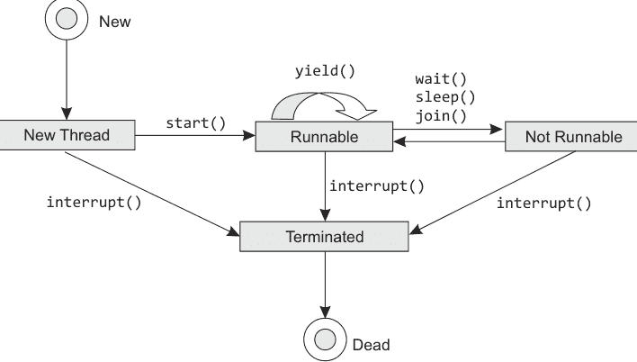

**图 8.1 线程状态**

### New（新建）

在此状态下，创建了一个新线程但尚未启动。以下行代码负责此操作（假设 `ThreadDemo` 类继承了 `Thread` 类或实现了 `Runnable` 接口）：

```java
Thread threadObj = new ThreadDemo();
```

上面的语句负责创建一个新的 `Thread` 对象。在 'New' 状态下，没有为新产生的 Thread 对象分配系统资源（如 CPU）。从该状态开始，线程可以启动（使用 `Thread` 类的 `start()` 方法）或停止（使用 `Thread` 类的 `interrupt()` 方法），移动到 'Runnable' 或 'Terminated'。

### Runnable（可运行）

在此状态下，线程就绪并等待处理器调度器分配 CPU 时间。从该状态开始，线程可以启动（使用 `Thread` 类的 `start()` 方法）或停止（使用 `Thread` 类的 `interrupt()` 方法），移动到 'Runnable' 或 'Terminated'。

### Terminated（已终止）

在此状态下，线程已完成执行或被停止。一旦线程终止，它无法再次启动。（注：原文被截断/碎片化，此处遵循 Java 线程状态的逻辑流）。

# Java 237 中的多线程

另一个线程，在本例中，等待在超时期结束后自动结束。同样，如果一个线程通过调用 `Thread.join()` 方法将自己置于 WAITING 状态，它将一直等待，直到指定的线程终止或线程过期。`sleep()` 和 `wait()` 之间似乎没有区别，因为它们的作用都是让线程等待指定的时间。这些方法之间的区别已在表 8.2 中说明。

## 表 8.2 wait() 和 sleep() 的区别

| `Object.wait()` | `Thread.sleep()` |
| :--- | :--- |
| `wait()` 属于 `Object` 类。 | `sleep()` 属于 `Thread` 类。 |
| 它只能在同步方法或同步块内部使用。 | 可以在同步方法和块外部使用。 |
| 等待可以通过调用 `Object.notify()` 方法来终止。 | 睡眠可以通过调用线程实例的 `interrupt()` 方法来终止。 |
| `Object.wait()` 仅位于并发线程访问代码中。 | `Thread.sleep(int ms)` 是在任何地方、任何时候需要的方法。 |
| 它停止当前执行并释放对象的锁。其他线程可以使用此释放的对象。 | `Thread.sleep(int ms)` 导致当前线程暂停执行指定的毫秒数。这可以让其他线程使用之前线程持有的资源。 |

## Terminated（已终止）

当线程完成执行时，达到此状态。线程可以从上述任何方法移动到“Terminated”状态。在此状态下，线程是死亡的。线程的死亡可以是自然的，也可以是强制的。当线程正常退出 `run()` 方法时，线程自然死亡。正常退出 `run()` 意味着 `run()` 的指令已完全处理。例如，下面方法中的 `for` 循环是一个有限循环，它将迭代 5 次（即从 1 到 5）然后退出。

```java
public void run() {
  for (int i = 1; i <= 5; i++) {
    System.out.println("i = " + i);
    Thread.sleep(500);
  }
}
```

具有上述 `run()` 方法的线程在 `run()` 最后一条语句完成后将自然死亡。可以使用 `interrupt()` 来中断线程。下面的代码块通过调用 `interrupt()` 方法来完成杀死线程。

我们通过使用 `getState()` 方法获取特定线程的状态。下面的程序展示了 `getState()` 和 `interrupt()` 方法的使用。

## 示例 8.4 使用 interrupt() 和 getState()

```java
class ThreadInterrupt extends Thread {
    boolean interrupt = false;
    String name;
    ThreadInterrupt(String n) {
        super(n);
        name = n;
    }
    public void run() {
        while (!interrupt) {
            System.out.println("Thread running: " + name + " state: " + getState());
            try {
                Thread.sleep(1000);
            } catch (InterruptedException e) {
                System.out.println("Thread Interrupted: " + name + " state: " + getState());
            }
        }
        System.out.println("Thread exiting under request: " + name + " state: " + getState());
    }
    public static void main(String[] args) throws Exception {
        ThreadInterrupt thread = new ThreadInterrupt("InterruptExample");
        System.out.println("Starting Thread: " + thread.name + " state: " + thread.getState());
        Thread.sleep(3000);
        System.out.println("Stopping Thread: " + thread.name + " state: " + thread.getState());
        thread.interrupt = true;
        thread.interrupt();
        System.out.println(thread.name + " state: " + thread.getState());
        Thread.sleep(3000);
        System.out.println("Exiting application state: " + thread.getState());
        System.exit(0);
    }
}
```

# 输出

C:\programs\chap 8>java ThreadInterrupt

Starting Thread: InterruptExample state: NEW

Thread running: InterruptExample state: RUNNABLE

Thread running: InterruptExample state: RUNNABLE

Thread running: InterruptExample state: RUNNABLE

Stopping Thread: InterruptExample state: TIMED_WAITING

InterruptExample state: TIMED_WAITING

Thread Interrupted: InterruptExample state: RUNNABLE

Thread exiting under request: InterruptExample state: RUNNABLE

Exiting application state: TERMINATED

## 解释

- **L1** 创建了一个线程。
- **L2** 通过检查中断状态定义了一个布尔变量 `interrupt`（类似于一个标志位）。
- **L3** 定义了一个字符串实例变量 `name` 用于赋值给线程。
- **L4-6** 定义了该类的构造函数。该构造函数通过父类构造函数设置线程名称，并将值赋值给字符串变量。
- **L7** `run()` 方法说明了线程需要执行的操作。
- **L8** 它检查中断标志的状态，如果为 `false`，则 `while` 循环继续进行。
- **L9** 这是一个打印语句，显示线程状态以及通过 `getState()` 方法获取的状态。线程的状态在 `run` 方法中始终是 RUNNABLE，因为当线程被中断时 `run` 方法会被执行。（参见输出）
- **L10-13** 定义了一个 `try...catch` 块来让线程睡眠一段时间。`Thread.sleep(1000)` 和 `sleep` 方法在被中断时可能会抛出 `InterruptedException`。睡眠可以通过调用线程实例的 `interrupt()` 方法来终止。

## Java 241 中的多线程

`final getPriority()`

这是一个示例展示了优先级常量和 `getPriority()` 方法的用法。

# 示例 8.5 设置和获取线程的优先级


```java
class ThreadOne extends Thread {
    public void run() {
        try {
            for(int i = 1; i<= 5; i++) {
                System.out.println("from child thread 1 : i = " +i);
                Thread.sleep(500);
            }
        } catch(InterruptedException e) {
            System.out.println("child Thread 1 interrupted");
        }
        System.out.println("Exit from child thread 1");
    }
}
class ThreadTwo extends Thread {
    public void run() {
        try {
            for(int j = 1; j <= 5; j++) {
                System.out.println("from child thread 2 : j = " +j);
                Thread.sleep(500);
            }
        } catch (InterruptedException e) {
            System.out.println("child thread 2 interrupted");
        }
        System.out.println("Exit from child thread 2");
    }
}
class ThreadThree extends Thread {
    public void run() {
        try {
            for(int k = 1; k<= 5; k++) {
                System.out.println("from child thread 3 : k = " +k);
                Thread.sleep(500);
            }
        } catch(InterruptedException e) {
            System.out.println("child thread 3 interrupted");
        }
        System.out.println("Exit from child thread 3");
    }
}
class ThreadPriority {
    public static void main(String[] args) {
        ThreadOne a = new ThreadOne();
        ThreadTwo b = new ThreadTwo();
        ThreadThree c = new ThreadThree();
        System.out.println("Default Priority for thread 1:"+a.getPriority());
        System.out.println("Default Priority for thread 2:"+b.getPriority());
        System.out.println("Default Priority for thread 3: " +c.getPriority());
        System.out.println(" ");
        a.setPriority(Thread.MIN_PRIORITY);
        b.setPriority(Thread.NORM_PRIORITY);
        c.setPriority(Thread.MAX_PRIORITY);
        System.out.println("Priority set for thread 1: " +a.getPriority());
        System.out.println("Priority set for thread 2: " +b.getPriority());
        System.out.println("Priority set for thread 3: " +c.getPriority());
        System.out.println("");
        System.out.println("All the Three threads start from here");
        a.start();
        b.start();
        c.start();
    }
}
```

# 输出

```
Default Priority for thread 1 :5
Default Priority for thread 2 :5
Default Priority for thread 3 :5
New Priority set for thread 1 :1
New Priority set for thread 2 :5
New Priority set for thread 3 :10
All the Three threads start from here
From child thread 3 : k = 1
From child thread 2 : j = 1
From child thread 1 : i = 1
From child thread 3 : k = 2
From child thread 2 : j = 2
From child thread 1 : i = 2
From child thread 3 : k = 3
From child thread 2 : j = 3
From child thread 1 : i = 3
From child thread 3 : k = 4
From child thread 2 : j = 4
From child thread 1 : i = 4
From child thread 3 : k = 5
From child thread 2 : j = 5
From child thread 1 : i = 5
Exit from child thread 3
Exit from child thread 2
Exit from child thread 1
```

#### 解释

1–39 行包含了关于声明三个不同类 `ThreadOne`、`ThreadTwo` 和 `ThreadThree`（它们继承自 `Thread` 类）的详细信息。这些子类已经在示例 8.2 中被解释过了。

40 行声明了 `main` 方法。

42–45 行创建了三个子线程类的引用对象并将其存储在 `a`、`b` 和 `c` 中。

45 行显示了子线程的默认优先级。我们可以看到 `getPriority()` 方法的使用，该方法是通过 `ThreadOne` 的对象调用的。此方法返回与 `ThreadOne` 相关的当前优先级。

46-47 行就像子线程一样，显示了子线程二和子线程三的当前优先级。

50 行与线程一样，子线程对象调用其 `setPriority()` 方法将线程优先级设置为普通优先级 5。

51 行使用子线程对象调用其 `setPriority()` 方法将线程优先级设置为最高 10。

52–54 行显示了三个子线程的新优先级。再次，`getPriority()` 方法可以证明对于获取线程的新优先级具有重要作用。

57–59 行在主线程内部，使用对应线程对象的 `start()` 方法启动了所有线程。当线程被调度执行时，线程对象的相应 `run()` 方法将被执行。

49 行子线程 `ThreadOne` 对象 `a` 调用其 `setPriority()` 方法来设置线程的执行，从而完全调度线程。你可以看到，通过传递参数，它是最小优先级 1。

# Java 编程

被用作对要访问资源的互斥锁。一个监视器一次只能被一个线程拥有。线程一旦获取锁就会进入`监视器`。所有其他线程都无法进入被锁定的`监视器`，除非它解锁或第一个线程退出监视器。在此期间，其他线程正在等待监视器的锁。如果一个线程退出了`监视器`，它可以在稍后的某个阶段再次进入同一个`监视器`。

上述同步机制在 Java 中可以通过两种方式实现：

- (A) 通过在方法定义中使用 `synchronized` 关键字（同步方法）
- (B) 通过任何代码块中使用 `synchronized` 关键字（同步语句）

## 8.9.1 同步方法

我们可以通过如下方式声明一个同步方法来创建一个特定的同步方法：

```java
class Xyz {
    synchronized void anyMethod() {
        ...
        //方法正体
    }
}
```

你可以看到在方法声明前加了 `synchronized` 前缀。现在，如果有 ‘n’ 个线程想要使用方法 `anyMethod()`，系统将不允许它们这样做。优先级最高的线程将锁定监视器，使其其他线程无法访问。一旦锁定监视器的线程完成其工作，它将释放监视器，供其他使用的线程使用。

## 8.9.2 同步语句

我们可以使用 `synchronized` 关键字对代码块进行同步。与同步方法一样，`synchronized` 单词用在要同步的代码块之前。该同步语句必须指定提供监视器锁的实例。此类代码块的示例如下：

```java
public void anyBlock() {
    synchronized (this) {
        ...
        //代码体的语句
    }
}
```

## 8.10 挂起和恢复线程

有两个方法 `suspend()` 和 `resume()`，分别用于临时挂起执行线程和恢复挂起。但从 Java 1.2 开始，这些方法已经被弃用。那么你将如何处理以前由这些方法实现的需求呢？这些目标可以通过定义你自己的 `suspend` 和 `resume` 方法来实现，如下例所示：

## 示例 8.7 挂起和恢复线程

```java
class SusResThread implements Runnable {
    String n;
    Thread thrd;
    boolean suspended;
    SusResThread() {
        thrd = new Thread(this, "Suspend-Resume Thread");
        suspended = false;
        thrd.start();
    }
    public void run() {
        try {
            for (int i = 0; i < 10; i++) {
                System.out.println("Thread: " + i);
                thrd.sleep(200);
                synchronized (this) {
                    while (suspended) {
                        wait();
                    }
                }
            }
        } catch (InterruptedException e) {
            System.out.println("thread interrupted.");
        }
        System.out.println("Exit from thread.");
    }
    void susThread() {
        suspended = true;
    }
    synchronized void resThread() {
        suspended = false;
        notify();
    }
}

class SuspendResume {
    public static void main(String args[]) {
        SusResThread thrd1 = new SusResThread();
        try {
            thrd1.sleep(1000);
            thrd1.susThread();
            System.out.println("Thread has Suspended");
            thrd1.sleep(1000);
            thrd1.resThread();
            System.out.println("Thread has been Resumed");
        } catch (InterruptedException e) {}
        try {
            thrd1.thrd.join();
        } catch (InterruptedException e) {}
    }
}
```

```java
L49 System.out.println("Main Thread: interrupted");
L50 }
L51 }
L52 }
```

你可以很容易从输出中看到，线程显示了循环中所用变量的值，即直到线程被挂起。它从从被挂起的地方继续处理这些值。

# 输出

```
Thread: 0
Thread: 1
Thread: 2
Thread: 3
Thread: 4
Thread: Suspended
Thread: Resume
Thread: 5
Thread: 6
Thread: 7
Thread: 8
Thread: 9
Exit from thread.
```

# 解析

- L1 定义了一个实现 `Runnable` 接口的 `SusResThread` 类。该类拥有方法 `run()`、`susThread()` 和 `resThread()`。
- L? 声明了一个实例变量 `suspended`，其值用于标识线程是否被挂起。
- L10–19 声明了 `run`，其中包含一个显示计数器值的 `for` 循环。每当显示计数器时，线程由于 `sleep(1000)` 而短暂暂停。
- L15 它随后进入一个同步语句，判断实例 `suspended` 的值是否为 'true'。如果是，则调用 `wait()`，这会导致线程挂起，直到调用了 `notify()`。
- L26–28 声明了 `susThread()`，用于将 'true' 赋值给实例变量 `suspended`。
- L29–32 声明了 `resThread()`，用于将 'false' 赋值给实例变量。
- L31 声明了 `main` 方法，在其中创建了 `SusResThread` 的实例。
- L35 它随后进入一个同步语句，判断实例 `suspended` 的值是否为 'true'。如果是，则调用 `wait()`，这会导致线程挂起，直到调用了 `notify()`。
- L36 它随后调用 `susThread()` 来挂起线程。
- L38 它随后调用 `resThread()` 来恢复线程。
- L39 它打印消息 "Thread has Suspended"。
- L41 它再次睡眠 1000ms。
- L43 它打印消息 "Thread has been Resumed"。
- L45 它使用 `join()` 等待线程结束。

L28–38 声明了线程类 `Giver`，它实现了 `Runnable` (L28)。该类声明了 `Carrier` 类的实例 (L29)，然后调用 `put()` 在 `Carrier` 上放置了五个整数 (L36)。虽然 `put()` 方法是在循环中调用的，但每个整数在放置到 `Carrier` 之后，程序会暂停，直到该整数被 `Taker` 类获取。`Taker` 类的设计与 `Giver` 类非常相似，区别在于 `Taker` 在循环中调用了五次 `getValue()`。每次调用 `getValue()` 都会暂停，直到 `Giver` 类在 `Carrier` 中放置一个整数。L52–58 `ComThread` 的 `main()` 方法创建了 `Carrier` 类的实例 (L45)。注意，`Carrier` 实例引用被传递给 `Giver` 和 `Taker` 类的构造函数。它们使用 `Carrier` 实例进行线程间通信。

## 8.12 实际问题：时钟示例

让我们创建一个示例来说明线程在应用程序中的用途。我们将创建一个线程，它每秒像时钟一样在控制台上显示当前的日期和时间（如输出所示）。Java 中无法直接实现 GUI，因为我们将推迟 Applets 和 GUI。我们将在 Applets 中重做此示例，以展示线程如何在 Applets 中与 GUI 一起使用。此示例在创建类对象时，会在主线程之外创建一个线程。

### 示例 8.9 时钟

| L | 代码 |
|---|---|
| L1 | `import java.util.*;` |
| L2 | `class TimeThreadDemo` |
| L3 | `Thread t;` |
| L4 | `TimeThreadDemo(String name)` |
| L5 | `{` |
| L7 | `t = new Thread(new Task(),name); t.start();` |
| L8 | `public static void main(String args[])` |
| L9 | `TimeThreadDemo d=new ThreadDemo("Digital clock");` |


| L10 | `class Task implements Runnable` |
| --- | --- |
| L11 | `Calendar c;` |
| L12 | `Date d;` |
| L13 | `public void run()` |
| L14 | `for(;;)` |
| L15 | `try {` |
| L16 | `c = Calendar.getInstance();` |
| L17 | `d = c.getTime();` |
| L18 | `System.out.println(d);` |
| L19 | `Thread.sleep(1000);` |
| L20 | `catch(Exception e) {}` |

输出

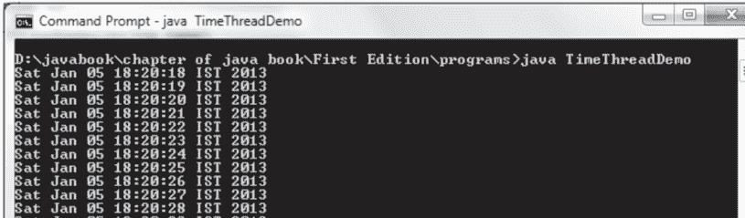

### 解析

- **L1** 导入了 `java.util` 包，因为我们将在该类中使用 `Calendar` 和 `Date` 类，它们都是 `java.util` 包的一部分。

- **L2** 声明了 `TimeThreadDemo` 类。

- **L3** 使用类创建类型为 `Thread` 的实例。

- **L4** 定义了类的构造函数，接受一个 `String` 参数，该参数将用于命名构造函数内部创建线程。

- **L6** 通过实例化 `Thread` 类并将其赋值给 L3 创建的实例来创建一个线程。线程名称（L4 中的参数）连同负责告知线程将执行操作的对象传递到 `Thread` 构造函数中。`Task` 类对象被传递到 `Thread` 构造函数中，指示该对象将运行并提供方法。

- **L8-9** 定义了 `main` 方法并在方法内创建了 `TimeThreadDemo` 类对象。这导致调用了 `Task` 类的构造函数以实例化 `Thread` 对象，同时也隐式地实例化了 `Task` 类。

- **L10** 定义 `Task` 类实现 `Runnable` 接口。继承 `Runnable` 接口是因为该类想要运行 `run()` 方法并告诉程序它的预期。我们希望此线程每秒执行一组定义的任务，即打印像时钟一样持续跳动的日期和时间。这些步骤在 `run()` 方法中实现。

- 一个静态方法 `getInstance()`，返回一个初始化为当前日期和时间的 `Calendar` 类实例。

- **L11–12** 定义了 `Calendar` 类和 `Date` 类的实例变量，用于获取当前日期和时间。

- **L17** 使用上一行创建的实例调用 `getTime()`，返回封装为 `Date` 对象的日期和时间。该对象由 L12 创建的实例变量引用。

- **L13** 重写了 `run()`。一旦 L6 中创建的线程被调度器调度，此方法就会自动调用。

- **L18** 打印该对象。

- **L14** 创建了一个无限循环，以便无限期打印时间而不停止。

- **L19** 我们特意使用 `Thread.sleep(1000)` 提供一秒的延迟，以产生正常时钟的感觉。线程睡眠一秒并返回打印对象的工作。

- **L15** 在无限 `for` 循环中创建了 `try` 块。

- **L20** 定义了 `catch` 块以捕获 `sleep` 方法可能抛出的 `InterruptedException`。

- **L16** 由于 `Calendar` 是一个抽象类，它被直接实例化。`Calendar` 类提供了。

> 注意，在无限循环中的线程会导致程序不会自动终止。它必须在提示符处按 `Ctrl+C` 来终止。

# 总结

Java 具有支持多线程的能力。`Thread` 是执行的单一序列。它不是一个程序。

# 练习

### 单选题

+ 1. `sleep()` 方法会抛出哪种异常？

  (a) Arithmetic exception

  (b) Null exception

  (c) Array bounds exception

  (d) InterruptedException

+ 6. `join()` 方法抛出哪种异常？

  (a) Arithmetic exception

  (b) Null exception

  (c) Array bounds exception

  (d) InterruptedException

+ 2. 线程创建后进入哪个状态？

  (a) Ready

  (b) Running

  (c) New

  (d) Terminated

+ 3. 使用什么方法获取线程状态？

  (a) getThread()

  (b) getState()

  (c) get()

  (d) getCurrentState()

+ 7. 使用哪个类来创建线程？

  (b) Runnable

  (c) ThreadGroup

  (d) Synchronization

+ 4. 哪个包包含 Thread？

  (a) java.lang

  (b) java.io

  (c) java.util

  (d) java.thread

+ 9. `interrupt()` 方法抛出哪种异常？

  (a) Arithmetic exception

  (b) Null exception

  (c) Array bounds exception

  (d) InterruptedException

+ 哪些项不是可运行状态？

  (a) READY

  (b) WAITING

  (c) TIMED_WAITING

  (d) BLOCKED

+ 10. 默认给所有线程的优先级是多少？

  (a) 1

  (b) 5

  (c) 10

  (d) unassigned

### 答题

+ 1. 定义以下各项：

  (a) 线程

  (b) 多线程

  (c) 等待状态和计时等待

  (d) 运行状态

  (e) 抢占式调度

  (f) Runnable 接口

  (g) 锁

  (h) notify 方法

  (i) join 方法

  (j) Thread 类

+ 4. `yield()` 方法的作用是什么？

+ 5. 什么是多任务？多线程是程序的特性吗？

+ 6. 如何处理优先级？可以为线程设置吗？

+ 7. 什么是同步？它为什么很重要？

+ 8. 什么是 runnable？如何使用它来创建线程？

+ 2. 什么是线程？Java 中的线程是如何运行的？

+ 9. 什么时候应该通过 Thread 类来创建线程？

+ 3. 区分抢占式调度和非抢占式调度。Java 使用哪种？

+ 10. 如果你在程序中创建了两个线程，实际上有多少个线程在运行？解释程序内部完整的线程流。

11. 哪个方法负责在程序中创建线程体或为线程提供功能？请用示例程序进行解释。

12. 区分以下用于暂停线程的方法：

- wait()

- sleep()

- yield()

# 编程练习

- 1. 使用 `Runnable` 接口创建并运行一个线程类。

- 2. 编写一个 Java 程序，演示高优先级线程的执行以及它是如何延迟所有低优先级线程执行的。

- 3. 编写一个 Java 程序，演示使用 `sleep` 的高优先级线程如何为低优先级线程让路。

- 4. 编写一个 Java 程序，显示三个线程的操作。使用 `Runnable` 接口创建线程。确保主线程最后执行（提示：使用 `join()`）。

- 5. 编写一个程序，使用线程同步来保证多线程应用中的数据完整性。

客观题答案

| 1. (d) | 2. (c) | 3. (b) | 4. (a) |
| --- | --- | --- | --- |
| 5. (b), (c), (d) | 6. (d) | 7. (b) | 8. (a) |
| 9. (d) | 10. (b) | | |

# 输入/输出、序列化与克隆

除非每个人产出的比收到的多，增加他的产量，否则他得到的将比别人少。

伯纳德·巴鲁赫（Bernard Baruch）

阅读完本章后，读者将能够：

- 理解文件处理的基础
- 理解 Java 中如何进行输入/输出操作
- 理解如何从用户获取输入
- 理解序列化后的原理及其实现方式
- 了解新 IO 类中的新类和接口
- 执行浅拷贝和深拷贝

## 9.1 引言

计算机最重要的两个部分是输入和输出。通过处理输入来生成输出。输入/输出类构成了任何编程语言的核心。从 Java 1.4 开始，定义了两个包 `java.io`（输入/输出）和 `java.nio`（新 I/O 或非阻塞 I/O），它们包含了用于执行 I/O 操作的类。`java.io` 包包含用于控制台读写和文件读写的类。`java.nio` 包包含了支持 `java.io` 包中类并执行高级操作的类，如缓冲、内存映射、字符编码解码、模式匹配和文件锁定。

`java.io` 包提供了用于读写（字节和字符数据）的类。`java.io` I/O 设施基于流（Streams）。流是连续的数据流。在 Java 中，针对这类型数据都定义了流：字节流类和字符流类。字节流类处理文件、套接字等的读写。字符流类处理字符的读写。

`java.io` 包包含两个顶层字节流抽象类：`java.io.InputStream`（用于读取字节）和 `java.io.OutputStream`（用于写入字节）。它还包含另外两个顶层字符流抽象类：`java.io.Reader`（用于读取字符）和 `java.io.Writer`（用于写入字符）。这些类的子类实际上用于读写数据。我们将详细讨论其中的一些子类。

### 9.1.1 java.io.InputStream 和 java.io.OutputStream

`InputStream` 和 `OutputStream` 是抽象类，规定了适用于所有子类的特定方法。表 9.1 和 9.2 给出了 `InputStream` 和 `OutputStream` 类的方法列表。

**表 9.1 InputStream 类的方法**

| 方法 | 描述 |
| --- | --- |
| `int available() throws IOException` | 返回从输入流中可以读取的可用字节数。 |
| `void close() throws IOException` | 关闭输入流。 |
| `void mark(int readlimit)` | 在输入流的当前位置做一个标记。`readlimit` 定义了在该标记后可以读取多少字节。 |
| `boolean markSupported()` | 如果 `mark()` 方法有效，则返回 true。 |
| `abstract int read()` | 从输入流中读取下一个字节。子类提供此方法的实现。如果遇到末尾（EOF）则返回 -1。 |
| `int read(byte[] b)` | 读取并存储到字节数组 `b` 中。如果遇到末尾则返回 -1。 |
| `int read(byte[] b, int off, int len)` | 从 `b` 的偏移量 `off` 开始，读取并存储 `len` 个字节到数组中。 |
| `void reset()` | 重置指针到由 `mark()` 方法设置的位置，前提是 `readlimit` 未过期。 |
| `long skip(long n)` | 跳过指定的 `n` 个字节并返回实际跳过的字节数。 |

**表 9.2 OutputStream 类的方法**

| 方法 | 描述 |
| --- | --- |
| `void close()` | 关闭输出流。 |
| `void flush()` | 刷新输出流。 |
| `void write(byte[] b)` | 将字节数组 `b` 的内容写入输出流。 |
| `void write(byte[] b, int off, int len)` | 从 `b` 的偏移量 `off` 开始，将指定的 `len` 个字节写入输出流。 |
| `abstract void write(int b)` | 将字节写入输出流。子类提供此方法的实现。 |

图 9.1 展示了 `Reader` 和 `Writer` 下的类层次结构。

图 9.2 展示了 `InputStream` 和 `OutputStream` 下的类层次结构。

## 9.2 java.io.File

`java.io.File` 类值得一提，因为它既不属于字节流也不属于字符流，而是用于读写文件。该类用于获取文件的属性，如路径、是否存在、是否为目录以及长度。让我们来看 `File` 类的示例。

### 示例 9.1 File 类

```java
import java.io.*;
class FileDemo {
    public static void main(String[] args) {
        File f = new File(args[0]);
        System.out.println("File exists: " + f.exists());
        System.out.println("File can read: " + f.canRead());
        System.out.println("File can write: " + f.canWrite());
        System.out.println("File can execute: " + f.canExecute());
        System.out.println("File name: " + f.getName());
        System.out.println("parent of File: " + f.getParent());
        System.out.println("path of File: " + f.getPath());
        System.out.println("Hidden: " + f.isHidden());
        System.out.println("length of the file: " + f.length());
        System.out.println("last modified time: " + f.lastModified());
        System.out.println("is file: " + f.isFile());
        if(f.isDirectory()) {
            System.out.println(f.getPath() + " is a directory");
        }
        String[] i = f.list();
        System.out.println("Directory Listing for " + f.getPath() + ":");
        for(String a : i) {
            File f1 = new File(f.getPath() + "/" + a);
            if(f1.isDirectory()) {
                System.out.println("a is a directory");
            } else {
                System.out.println("a is a File");
            }
        }
    }
}
```

# 输出

**对于 'Sample.txt' 文件**

```
C:\javabook\programs\chap09>java FileDemo sample.txt
File exists: true File can read: true File can write: true File can execute: true
File name: sample.txt
parent of File: null
path of File: sample.txt
Hidden: false
length of the file: 105
last modified time: 123686098637
it is a File: true
```

**对于 'programs' 目录**

```
C:\javabook\programs\chap09>java FileDemo
C:\javabook\programs
File exists: true
Programming in Java
File can read: true
File can write: true
File can execute: true
File name: programs
parent of File: c:\javabook
path of File: c:\javabook\programs
Hidden File: False
length of the file: 12288
last modified time: 1237062320960
it is a File: False
c:\javabook\programs is a Directory
Directory Listing for c:\javabook\programs
A.class is a File
B.class is a File
chap 6 is a directory
chap 7 is a directory
chap09 is a directory
chap3 is a directory
```

# 解析

- **L1** 使用 `File` 导入 `java.io` 包。

- **L4** 创建 `File` 对象，并通过命令行参数将文件名/目录名传递给它。使用 `File` 类的一些方法来了解其属性。你调用的所有方法都返回它们。

- **L5** `exists()` 返回布尔值，表示文件/目录是否存在。

- **L6** `canRead()` 返回布尔值，表示文件/目录是否可以读取。

- **L7** `canWrite()` 返回布尔值，表示文件/目录是否可以写入。

- **L8** `canExecute()` 返回布尔值，表示文件/目录是否可以执行。

- **L9** `getName()` 返回文件/目录名称。

- **L10** `getParent()` 返回文件所属的目录名称。

- **L11** `getPath()` 返回文件的路径（见输出）。


- L12 `isHidden()` 返回布尔值，表示文件是否隐藏。
- L13 `length()` 返回文件的字节大小。
- L14 `lastModified()` 返回文件的最后修改时间。该时间是自 1970 年 1 月 1 日 GMT 00:00:00 起计算的。
- L15 `isFile()` 如果 `File` 对象是文件，则返回 true。
- L16 `isDirectory()` 如果 `File` 对象是目录，则返回 true。如果是，则将执行后续代码。
- L18 `list()` 用于列出目录内的所有文件并返回字符串数组。
- L20 使用 `for-each` 循环遍历数组内容。L21–27 连接数组元素。

在接下来的行中，我们判断数组中的元素是文件还是目录。

- L21 为字符串数组中的每个元素创建一个 `File` 对象。
- L22 `File` 对象的 `isDirectory()` 方法判断该元素是否为目录。
- L23 打印“is a directory”。
- L24 由于每次迭代中都创建新的 `File` 对象，赋值给该对象使其可以被垃圾回收。
- L25–27 else 打印“it is a File”，并给 `File` 对象赋值 `null`。

## 输入/输出、序列化与克隆

## 9.3 数据的读写

可以使用流将数据读取/写入文件、控制台、套字等。这些流下的类用于读取/写入数据。在接下来的子标题中，我们将学习如何使用 `InputStream`、`OutputStream`、`Reader` 和 `Writer` 的子类来读写数据。

### 9.3.1 使用字节流读写文件

`FileInputStream`（继承自 `InputStream`）用于读取文件，`FileOutputStream`（继承自 `OutputStream`）用于写入文件。`FileInputStream` 和 `FileOutputStream` 的所有方法分别列于表 9.3 和表 9.4。让我们通过一个示例来看如何使用这些类来读写文件。

#### 表 9.3 FileInputStream 方法

| 方法 | 说明 |
|---|---|
| `int available()` | 返回可以从此流中读取的剩余字节数。 |
| `void close()` | 关闭此文件流并释放所有系统资源。 |
| `void finalize()` | 确保当不再有对该文件流的引用时，调用该文件流的 close 方法。 |
| `FileChannel getChannel()` | 返回与此文件流关联的唯一 `FileChannel` 对象。 |
| `final FileDescriptor getFD()` | 返回 `FileDescriptor` 对象，它代表该 `FileInputStream` 所使用的文件系统中与实际文件的连接。 |
| `int read()` | 从此流中读取一个字节的数据。 |
| `int read(byte[] b)` | 从此输入流中读取最多 `len` 个字节的数据到字节数组中。 |
| `int read(byte[] b, int off, int len)` | 从此输入流中读取最多 `len` 个字节的数据，并到字节数组中从偏移量 `off` 开始的位置。 |
| `long skip(long n)` | 跳过并丢弃输入流中的 `n` 个字节。 |

#### 表 9.4 FileOutputStream 类方法

| 方法 | 说明 |
|---|---|
| `void close()` | 关闭此文件输出并释放所有系统资源。 |
| `protected void finalize()` | 清理与文件的连接。 |
| `FileChannel getChannel()` | 返回与此流关联的唯一 `FileChannel` 对象。 |
| `FileDescriptor getFD()` | 返回与此输出流关联的文件描述符对象。 |
| `void write(byte[] b)` | 将指定字节数组中的字节写入此文件输出。 |
| `void write(byte[] b, int off, int len)` | 将指定字节数组中从偏移量 `off` 开始的 `len` 个字节写入此文件输出。 |
| `void write(int b)` | 将指定的字节写入此文件输出。 |

## 示例 9.2 读写文件

```java
import java.io.*;
class ReadWriteDemo{
    public static void main(String[] args) throws IOException
    {
        if(args.length!=2) {
            System.out.println("Usage: java ReadWriteDemo Sample.txt Demo.txt");
            System.exit(0); // 终止程序
        }
        File f = new File(args[0]);
        byte[] b = {};

        // 读取文件
        if(f.exists()) {
            FileInputStream fis = new FileInputStream(f);
            int num = fis.available();
            byte[] b = new byte[num];
            int n = fis.read(b);
            String s = new String(b);
            System.out.println("Contents of "+args[0]+": "+ s);
            fis.close();
        } else {
            System.out.println("File does not exist");
            System.exit(0);
        }

        // 写入文件
        File f = new File(args[1]);
        if(f.exists())
            System.out.println(args[1] + " is a New File");
        else {
            System.out.println(args[1] + " File exists, will be overwritten");
            System.out.println("Opening File: "+ args[1]);
            FileOutputStream fs = new FileOutputStream(args[1]);
            System.out.println("File Opened, now writing contents");
            fs.write(b);
            fs.flush();
            System.out.println("contents written");
            System.out.println("Closing File");
        }
    }
}
```

```
C:\javabook\programs\CHAP09-1\java ReadWriteDemo Sample.txt Demo.txt

Contents of Sample.txt: This is my sample file

Demo.txt is a New File

Opening File: Demo.txt

File Opened, now writing contents

contents written

Closing File
```

- L33 关闭了 `FileOutputStream`。

### 9.3.2 读写控制台（用户输入）

在 JDK 6 之前，JDK 5 引入了 `Scanner` 类（`java.util` 包），它可以用于获取用户输入（包括文本行和原始数据类型），并将输入字符串分解为由分隔符（默认是空白字符）分隔的标记。下面是 `Scanner` 类的摘要。

## 示例 9.3 Scanner 类

```java
import java.util.*;
class ScannerDemo {
    public static void main(String args[]){
        Scanner sc = new Scanner(System.in);
        System.out.print("Enter your name: ");
        String name = sc.nextLine();
        System.out.print("Enter your age: ");
        int age = sc.nextInt();
        System.out.println("Hello "+name);
        System.out.println("Your age is "+age);
    }
}
```

输出：

```
Enter your name: John
Enter your age: 25
Hello John
Your age is 25
```

在示例 9.3 中，`nextLine()` 在 `nextInt()` 之前被调用。如果在 `next()` 之前使用 `nextInt()`，输出将不是你预期的那样。让我们来看另一个示例，展示在 `nextInt()` 或 `nextFloat()` 方法之后使用 `nextLine` 会发生什么。

## 示例 9.4 Scanner 类

```java
import java.util.*;
class ScannerInput {
    public static void main(String[] args) {
        Scanner in=new Scanner(System.in);
        // nextInt 默认读取到分隔符（空白字符）之间的整数
        System.out.print("Enter your age: ");
        int age = in.nextInt();
        System.out.print("Enter your name: ");
        String name = in.nextLine();
        System.out.println("Age: " + age + ", Name: " + name);
    }
}
```

```java
System.out.println("Enter First Integer");
int number = in.nextInt();
System.out.println("Enter a String:");
String string = in.nextLine();
System.out.println("Enter next Float: ");
float real = in.nextFloat();
System.out.println("Enter next String:");
String string2 = in.nextLine();
System.out.println(number+" "+string+" "+real+" "+string2);
```

输出：

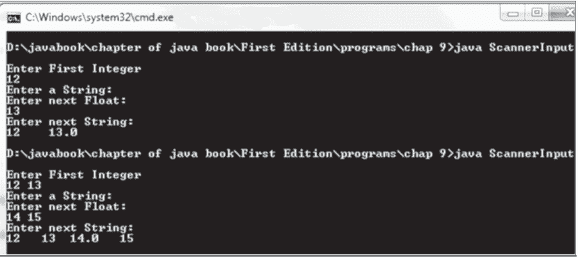

#### 解释

我们通过两组输入运行此程序以澄清区别。

**L2** `nextInt()` 默认返回直到分隔符（默认是空白字符）为止的整数。

**L4** `nextLine()` 方法继续读取输入，直到遇到回车，并将其作为字符串返回。回车会被消耗且不会追加到字符串中。当在使用 `nextInt()`、`nextFloat()` 或 `nextLong()` 等方法读取内容后使用 `nextLine()` 时，相应的方法会返回数值并结束。带有回车的空字符串会被 `nextLine()` 消耗并返回。因此，L4 处不会提示输入，因为在 L2 读取整数输入时，回车已经被 `nextInt()` 消耗了。

程序的第一次输出显示 12 被 `nextInt()` 以整数形式返回，由于回车被 `nextLine()` 消耗并返回，用户不会被提示输入值。13 被 `nextFloat()` 以浮点数形式返回，由于上述原因，也不会提示输入任何值。程序的第二次输出消除了这种概念：12 被 `nextInt()` 以整数返回，而13 被 `nextLine()` 以字符串返回。同样，14 被 `nextFloat()` 以浮点数返回，15 被 `nextLine()` 以字符串返回。

在 JDK 5 之前，使用 `BufferedReader` 来从用户处读取输入。以下语句展示了如何使用 `BufferedReader` 类从用户获取输入。

```java
try {
  BufferedReader br = new BufferedReader(new InputStreamReader(System.in));
  String x = br.readLine();
} catch (IOException e) {
  ..
}
```

#### 解释

- L1 创建了 `BufferedReader` 对象以获取用户输入。`BufferedReader` 的构造函数接受一个 `InputStream` 类型的参数，该参数又接受一个 `InputStream` 类型的参数（`System.in`）。`InputStream` 是字节流，而 `InputStreamReader` 是字符流。字节流的类正在获取
- L2 使用 `BufferedReader` 类的 `readLine()` 读取输入。它可能会抛出 `IOException`，因此要么将 `readLine()` 调用放在 `try/catch` 块中，要么在方法声明中使用 `throws` 关键字。

Java 6 在 `java.io` 包中引入了 `Console` 类，用于收集用户输入并输出到标准输出。表 9.6 显示了 `Console` 类的方法列表。让我们通过一个例子来看 `Console` 类。

#### 表 9.6 Console 类的方法

| 方法 | 说明 |
| --- | --- |
| `void flush()` | 刷新控制台并立即写入缓冲区输出。 |
| `Console format(String fmt, Object... args)` | 使用指定的格式和参数向控制台输出流写入格式化字符串。 |
| `Console printf(String fmt, Object... args)` | 使用指定的格式和参数向控制台输出流写入格式化字符串（L10, 示例 9.5）。 |
| `Reader reader()` | 返回与此控制台关联的唯一 `Reader` 对象。 |
| `String readLine()` | 从控制台读取单行文本。 |
| `String readLine(String fmt, Object... args)` | 提供格式化提示，然后从控制台读取单行文本（第 5、7、9 行；示例 9.5）。 |
| `char[] readPassword()` | 从控制台读取密码且禁用显示（L13, 示例 9.5）。 |
| `char[] readPassword(String fmt, Object... args)` | 提供格式化提示，然后从控制台读取密码且禁用显示。 |
| `PrintWriter writer()` | 返回与此控制台关联的唯一 `PrintWriter` 对象。 |

## 示例 9.5 Console 输入

```java
import java.io.*;
class ConsoleDemo {
    public static void main(String[] args) throws IOException {
        Console c = System.console();
        String user = c.readLine("Enter username: ");
        c.printf("Welcome %s! Hope You had a Nice Day. \n", user);
        String pno = c.readLine("Enter your Phone No.: ");
        c.printf("You entered %s as your phone number %n", pno);
        String age = c.readLine("Enter your age: ");
        c.printf("name: %s, Age: %s, Phone No: %s\n", user, age, pno);
        // 另一种写入 Console 的方法
        PrintWriter out = new PrintWriter(System.out);
        out.println("Enter your password: ");
        char[] pass = c.readPassword();
        c.printf("the password you entered is %s\n", pass);
    }
}
```

输出

```
Enter your username: Tom

Welcome Tom, Hope You had a Nice Day.

Enter your Phone No.: 34343434

You entered 34343434 as your phone number
```


Enter your age: 31

Name: Tom, Age: 31, Phone No: 34343434

Enter your password

the password you entered is TI123

#### 解释

- `System` 类有一个静态方法 `console()` 返回 `Console` 对象。
- `readLine()` 是 `Console` 类中的重载方法，用于从用户处读取。字符串参数显示在控制台上，然后等待用户输入。值以字符串形式返回。
- 该类添加了类似于 C 语言的打印语句，例如 `printf("%s...")`。方法的第一个参数是 `"Welcome %s. Hope You had Nice Day"`。`%s` 的值从格式化字符串中获取，从方法的第二个参数开始。此方法中只有两个参数，但根据需要可以有更多。
- `%s` 指定参数列表中的索引。
- `%1s` 指定第一个参数的索引。`%2s` 用于引用第二个参数，依此类推。
- `s` 指定字符串。

`c.printf("Welcome %s. Hope You had Nice Day.\n", user);`

| 格式 | 字符串 |
| --- | --- |
| `c.printf("Welcome %s. Hope You had Nice Day.\n", user);` | Tom |
| `c.printf("name: %s, Age: %s, Phone No: %s\n", user, age, pno);` | Tom, 31, 34343434 |

程序的第一次输出显示 12 被 `nextInt()` 以整数返回，由于回车被 `nextLine()` 消耗并返回，用户不会被提示输入。13 被 `nextFloat()` 以浮点数返回，由于上述原因，也不会提示输入任何值。程序的第二次输出消除了这种概念：12 被 `nextInt()` 以整数返回，而 13 被 `nextLine()` 以字符串返回。同样，14 被 `nextFloat()` 以浮点数返回，15 被 `nextLine()` 以字符串返回。

在 JDK 5 之前，使用 `BufferedReader` 来从用户处读取输入。以下语句展示了如何使用 `BufferedReader` 类从用户获取输入。

```java
try {
  BufferedReader br = new BufferedReader(new InputStreamReader(System.in));
  String x = br.readLine();
} catch (IOException e) {
  ..
}
```

#### 解释

- 创建 `BufferedReader` 对象以获取用户输入。`BufferedReader` 的构造函数接受一个 `InputStream` 类型的参数，该参数又接受一个 `InputStream` 类型的参数（`System.in`）。`InputStream` 是字节流，而 `InputStreamReader` 是字符流。
- 使用 `BufferedReader` 类的 `readLine()` 读取输入。它可能会抛出 `IOException`，因此要么将 `readLine()` 调用放在 `try/catch` 块中，要么在方法声明中使用 `throws` 关键字。

Java 6 在 `java.io` 包中引入了 `Console` 类，用于收集用户输入并输出到标准输出。表 9.6 显示了 `Console` 类的方法列表。让我们通过一个例子来看 `Console` 类。

### 表 9.6 Console 类的方法

| 方法 | 说明 |
| --- | --- |
| `void flush()` | 刷新控制台并立即写入缓冲区输出。 |
| `Console format(String fmt, Object... args)` | 使用指定的格式和参数向控制台输出流写入格式化字符串。 |
| `Console printf(String fmt, Object... args)` | 使用指定的格式和参数向控制台输出流写入格式化字符串（L10, 示例 9.5）。 |
| `Reader reader()` | 返回与此控制台关联的唯一 `Reader` 对象。 |
| `String readLine()` | 从控制台读取单行文本。 |
| `String readLine(String fmt, Object... args)` | 提供格式化提示，然后从控制台读取单行文本（第 5、7、9 行；示例 9.5）。 |
| `char[] readPassword()` | 从控制台读取密码且禁用显示（L13, 示例 9.5）。 |
| `char[] readPassword(String fmt, Object... args)` | 提供格式化提示，然后从控制台读取密码且禁用显示。 |
| `PrintWriter writer()` | 返回与此控制台关联的唯一 `PrintWriter` 对象。 |

### 示例 9.5 Console 输入

```java
import java.io.*;
class ConsoleDemo {
    public static void main(String[] args) throws IOException {
        Console c = System.console();
        String user = c.readLine("Enter username: ");
        c.printf("Welcome %s! Hope You had a Nice Day. \n", user);
        String pno = c.readLine("Enter your Phone No.: ");
        c.printf("You entered %s as your phone number %n", pno);
        String age = c.readLine("Enter your age: ");
        c.printf("name: %s, Age: %s, Phone No: %s\n", user, age, pno);
        // 另一种写入 Console 的方法
        PrintWriter out = new PrintWriter(System.out);
        out.println("Enter your password: ");
        char[] pass = c.readPassword();
        c.printf("the password you entered is %s\n", pass);
    }
}
```

输出

Enter your username: Tom

Welcome Tom, Hope You had a Nice Day.

Enter your Phone No.: 34343434

You entered 34343434 as your phone number

Enter your age: 31

Name: Tom, Age: 31, Phone No: 34343434

Enter your password

the password you entered is TI123

#### 解释

- `System` 类有一个静态方法 `console()` 返回 `Console` 对象。
- `readLine()` 是 `Console` 类中的重载方法，用于从用户处读取。字符串参数显示在控制台上，然后等待用户输入。值以字符串形式返回。
- 该类添加了类似于 C 语言的打印语句，例如 `printf("%s...")`。方法的第一个参数是 `"Welcome %s. Hope You had Nice Day"`。`%s` 的值从格式化字符串中获取，从方法的第二个参数开始。此方法中只有两个参数，但根据需要可以有更多。
- `%s` 指定参数列表中的索引。
- `%1s` 指定第一个参数的索引。`%2s` 用于引用第二个参数，依此类推。
- `s` 指定字符串。

`c.printf("Welcome %s. Hope You had Nice Day.\n", user);`

程序的第一次输出显示 12 被 `nextInt()` 以整数返回，由于回车被 `nextLine()` 消耗并返回，用户不会被提示输入。13 被 `nextFloat()` 以浮点数返回，由于上述原因，也不会提示输入任何值。程序的第二次输出消除了这种概念：12 被 `nextInt()` 以整数返回，而 13 被 `nextLine()` 以字符串返回。同样，14 被 `nextFloat()` 以浮点数返回，15 被 `nextLine()` 以字符串返回。

### 9.3.3 使用 Character 类写入

可以使用字符流类对文件进行读写。`FileReader` 用于读取文件内容。`FileWriter` 用于将内容写入文件。记住读取和写入将以字符的形式进行。读取可以按字符进行（如示例 9.6 所示）或按行。

### 示例 9.6 读取和写入

```java
import java.io.*;
class ReadWriteDemo1{
  public static void main(String[] args) throws Exception
{
  File f = new File(args[0]);
  int n;
  // 读取文件
  if(f.exists())
  { FileReader fr = new FileReader(f);
  System.out.println("Reading "+args[0]);
  while((n=fr.read())!=-1)
  System.out.print((char)n);
  } Else
  System.out.println(args[0]+" does not exist");
  // 写入文件
  System.out.println("Writing "+args[1]);
  FileWriter fw = new FileWriter(args[1]);
  String s = "This is my sample File";
  fw.write(s);
  fw.close();
}
}
```

输出

```
C:\javabook\programs\CHAP09~1\java ReadWriteDemo1 Sample1.txt Demo1.txt
Reading Sample1.txt
This is my sample File
Writing Demo1.txt
```

### 读取文件

- L4 创建了 `File` 对象，并将文件名作为命令行参数传递。
- L5 声明了一个整型变量 `n` 用于读取字符。
- L6 检查文件是否存在。如果存在，则执行 L7–9，然后执行 L11。
- L7 创建了 `FileReader` 对象，并将 L4 中的文件对象传递给它。如果引用的 `FileReader` 对象不存在，则会抛出 `FileNotFoundException` 异常。
- L8 使用一个循环通过 `FileReader` 对象的 `read()` 方法逐个字符读取文件。该方法将读取的字符作为整数返回，或者如果到达文件结束符（EOF）则返回 -1。读取到的值存储在变量 `n` 中，并检查其是否等于 -1。`read()` 被重载，可以逐个字符地读取文件，也可以将整个文件放入字符数组中。该方法在出现问题时会抛出 `IOException`。
- L9 将整型变量 `n` 强制转换为字符并打印。
- L10 L6 中定义语句的 `else` 分支。

### 写入文件

- L12 创建了 `FileWriter` 对象，并将第二个命令行参数传递给对象的构造函数。如果文件存在，则会覆盖它；如果不存在，则创建一个新文件。
- L13 声明了一个示例字符串。
- L14 使用写入器类的 `write()` 方法写入该字符串。`write()` 被重载以接受字符数组、整数和字符串。
- L15 关闭了 `FileWriter` 对象。

## 9.3.4 使用缓冲字节流类进行读取

`BufferedInputStream` 用于输入缓冲，并支持重新读取文件的操作。`BufferedOutputStream` 用于输出缓冲并增强性能。表 9.7 和 9.8 显示了 `BufferedInputStream` 和 `BufferedWriter` 的方法列表，让我们通过一个示例来展示这两个类。

### 表 9.7 BufferedInputStream 方法

| 方法 | 描述 |
| --- | --- |
| `int available()` | 返回在不阻塞的情况下从此输入中可以读取的字节数。 |
| `void close()` | 关闭此流并释放所有资源。 |
| `void mark(int read)` | 与 `InputStream` 的 `mark` 方法类似。 |
| `boolean markSupported()` | 测试此输入是否支持 `mark` 和 `reset` 方法。 |
| `int read()` | 与 `InputStream` 的 `read` 方法类似。 |
| `int read(byte b, int off, int len)` | 从 `InputStream` 读取到从偏移量 `off` 开始的字节数组，并返回读取的字节数。`len` 指定读取的最大字节数。 |
| `void reset()` | 与 `InputStream` 类的 `reset` 方法类似。 |
| `long skip(long n)` | 与 `InputStream` 类的 `skip` 方法类似。 |

### 表 9.8 BufferedOutputStream 方法

| 方法 | 描述 |
| --- | --- |
| `void flush()` | 刷新输出流。 |
| `void write(byte[] b, int off, int len)` | 从 (offset) 开始向输出流写入指定数量的字节 (len)。 |
| `void write(int b)` | 向输出流写入指定的字节。 |

### 示例 9.7 缓冲输入/输出

```java
import java.io.*;
class BufferedInputStreamDemo {
    public static void main(String[] args) throws IOException {
        FileInputStream fis = new FileInputStream(args[0]);
        BufferedInputStream bis = new BufferedInputStream(fis);
        int n = fis.available();
        bis.mark(n);
        System.out.println("Marked the stream");
        byte[] b = new byte[n];
        byte[] b2 = new byte[n];
        bis.read(b);
        System.out.println("Contents of "+args[0]+": "+new String(b));
        System.out.println("Resetting the stream");
        bis.reset();
        System.out.println("Reading the stream from the marked point");
        bis.read(b2);
        bis.close();
        fis.close();
        System.out.println("Writing contents to "+args[1]);
        FileOutputStream fos = new FileOutputStream(args[1]);
        BufferedOutputStream out = new BufferedOutputStream(fos);
        out.write(b);
        System.out.println("Contents written");
        out.close();
    }
}
```

输出

```
Marked the stream
Contents of sample.txt: This is my file
Resetting the stream
Reading the stream from the marked point
This is my file
Writing contents to Demo.txt
Contents written
```

### 解析

- L4 和 L5 创建了 `BufferedInputStream` 对象，并将 L4 中创建的 `FileInputStream` 对象传递给 `BufferedInputStream` 对象的构造函数。该对象是经过缓冲的，并支持 `mark` 和 `reset` 操作。`mark(int)` 和 `reset()` 是 `BufferedInputStream` 类的方法。我们为什么要使用 `BufferedInputStream` 类？因为使用 `FileInputStream` 对象无法重新读取文件，我们使用 `mark` 和 `reset` 操作来再次读取文件。
- 标记点指针。在重置流之后，读取操作将从标记点开始。作为参数传递的 `n` 是限制值，即在标记失效前可以读取的最大字节数。在这种情况下，会抛出 `IOException`。
- L9 和 L10 创建了两个数组，一个用于在重置前读取内容，另一个用于在重置后读取流。
- L11 `read` 方法将文件读入字节数组。
- L7 对流进行了标记。`reset` 方法将字节数组设置为字符串并显示在标准输出上。


- L14 使用 `reset` 方法重置标记点。在我们的案例中，它是文件的开头。将输出对象（在 L21 中创建）传递给它。

- L16 `read` 方法再次读取整个字节数组。如果不使用 `mark` 和 `reset` 方法，将无法使用 `FileInputStream` 类及其方法读取文件。

- L21 创建了 `FileOutputStream` 对象，并传递了命令行参数。

- L22 创建了 `BufferedOutputStream` 对象，L23 使用 `write` 方法写入文件。

- L25 关闭流。

## 9.3.5 使用缓冲字符类进行读取

`BufferedInputStream` 用于输入缓冲并支持重新读取文件的操作。`BufferedOutputStream` 用于输出缓冲并增强性能。`BufferedWriter` 用于缓冲。让我们通过示例展示这些类。

# 示例 9.8 缓冲字符流

```java
import java.io.*;
class BufferedRead {
    public static void main(String[] args) throws IOException {
        String str;
        FileReader fr = new FileReader(args[0]);
        System.out.println("File opened: "+args[0]);
        BufferedReader br = new BufferedReader(fr);
        PrintWriter out = new PrintWriter(args[1]);
        while ((str = br.readLine()) != null) {
            out.println(str);
        }
        System.out.println("Contents copied to "+args[1]);
        out.close();
        br.close();
        fr.close();
    }
}
```

输出

```
File opened: sample.txt
Contents copied to Demo.txt
```

# 解析

- L5 创建了 `FileReader` 对象，并将 `args[0]` 传递给其构造函数。

- L7 创建了 `BufferedReader` 对象。它缓冲以提高效率。

- L8 `BufferedWriter` 用于缓冲输出，并支持 `mark` 和 `reset` 方法。

- L10 创建了 `PrintWriter` 对象并将 `args[1]` 传递给其构造函数。

- L11 `readLine()` 方法从文件中读取字符串。

- L12 到 L14 `BufferedWriter` 用于写入标准输出。

- L15 `BufferedWriter` 用于刷新输出。

- L16 到 L19 关闭了流。

- L20 到 L21 `BufferedReader` 传递文件名。

- L22 到 L23 `BufferedReader` 用于读取文件。

- L24 到 L25 `BufferedReader` 用于读取。

# Java 编程

（表 9.9 续）

| 方法 | 描述 |
| --- | --- |
| `void seek(long pos)` | 设置文件指针（从文件开始处计算），下一次读取或写入操作将在此处。 |
| `void setLength(long newLength)` | 设置文件的长度。 |
| `int skipBytes(int n)` | 跳过 n 字节的输入丢弃字节。 |
| `final void write(byte [] b)` | 从指定的字节数组中将 b 个字节写入此文件，从当前文件指针处开始。 |
| `final void write(byte [] b, int off, int len)` | 从指定的字节数组中从偏移量 off 处开始将 len 个字节写入此文件。 |
| `final void write(int b)` | 将指定的字节写入此文件。 |
| `final void writeBoolean(boolean v)` | 将布尔值作为单字节值写入文件。 |
| `final void writeInt(int v)` | 将 int 整数作为四字节值写入文件。 |
| `final void writeBytes(String s)` | 将字符串作为字节序列写入文件。 |
| `final void writeChar(char c)` | 将字符作为双字节值写入文件，高位在前。 |
| `final void writeChars(String s)` | 将字符串作为字符序列写入文件。 |
| `final void writeDouble(double v)` | 使用 `Double` 类中的 `doubleToLongBits` 方法将 double 转换为 long，然后将该 long 值作为八字节值写入文件，高位在前。 |
| `final void writeFloat(float v)` | 使用 `Float` 类中的 `floatToIntBits` 方法将 float 转换为 int，然后将该 int 值作为四字节值写入文件，高位在前。 |
| `final void writeInt(int v)` | 将 int 整数作为四字节写入文件，高位在前。 |
| `final void writeLong(long v)` | 将 long 作为八字节写入文件，高位在前。 |
| `final void writeShort(int v)` | 将 short 作为两个字节写入文件，高位在前。 |

注意 Java 5 增加了一个 `java.lang.Appendable` 接口，该接口由写入类实现。此接口有三个方法向写入器对象追加字符和字符串。这些方法的形式如下：

```java
public void append(char c)
public void append(CharSequence c)
public void append(CharSequence c, int start, int end)
```

`java.lang.CharSequence` 是用于表示某些字符值序列的接口。其实现类包括 `String`、`StringBuilder` 等。

## 9.9 随机访问文件 (Random Access File)

| L1 | import java.io.*; |
| --- | --- |
| L2 | class RandomAccessFileDemo { |
| L3 | public static void main(String[] args) throws IOException |
| | ( |
| L4 | System.out.println("Opening the file in read write mode"); |
| L5 | RandomAccessFile raf = new RandomAccessFile("Sample.txt", "rw"); |
| L6 | raf.seek(raf.length()); |

```java
L7 String str = "\nContents appended using RandomAccessFile";
L8 System.out.println("Appending contents to file");
L9 raf.write(str.getBytes());
L10 System.out.println("Reading the contents of the file...");
L11 raf.seek(0);
L12 while((str = raf.readLine())!= null)
L13 System.out.println(str);
L14 raf.close();
```

Output

```
C:\java\programs\CHAP09-1\>java RandomAccessFileDemo
Opening the file in read write mode
Appending contents to file
Contents appended
Reading the contents of the file....nThis is my sample File
Appending contents using RandomAccessFile
```

## 解析

- L5 创建了一个 `RandomAccessFile` 对象。文件名作为第一个参数传递，第二个参数是打开文件的模式。共有四种可以作为字符串应用的方法。如果第一个参数指定的文件不存在，将导致 `FileNotFoundException`。各种模式见表 9.10。

- L6 使用 `seek(long pos)` 方法将指针设置在文件中的特定位置 (pos)。读取/写入从该点开始。我们把指针设置为文件末尾，因为我们将文件的整个长度作为 `seek` 方法的参数传递的。

- L7 显示了要写入文件的内容。

- L9 `RandomAccessFile` 的 `write()` 方法用于写入文件。字节的写入从文件中方法设置的位置开始。该方法可能会抛出 `IOException`。

- L12 `seek(pos)` 将指针设置为文件开头。

- L13–14 `readLine()` 从文件读取一行文本并放入 `str` 中。持续打印该字符串直到 `str` 为 `null`。

- L15 关闭了 `RandomAccessFile` 对象。

### 表 9.10 RandomAccessFile 模式

| 模式 | 描述 |
|---|---|
| r | 文件将以只读模式打开。 |
| rw | 文件将以读写模式打开。如果文件不存在，将创建它。 |
| rws | 文件以读写模式打开，文件内容及其元数据的任何更新都将同步写入存储设备中。 |
| rwd | 与 "rw" 类似，不同之处是元数据的任何更新都不会同步写入存储设备，从而减少了与存储设备交互的次数。 |

## 9.5 读取与写入文件 (READING AND WRITING FILES)

`RandomAccessFile` 类允许对文件的随机访问。与 `FileInputStream` 或 `FileOutputStream` 不同，它不是按顺序读取或写入，而是可以在文件的任何位置进行读取或写入。它通过一个文件指针来跟踪当前位置。

`RandomAccessFile` 提供了许多方法来读取和写入数据：

- `seek(long pos)` 将指针移动到指定位置。
- `read()` 读取一个字节。
- `read(byte[] b)` 读取字节并存入数组 `b`。
- `readLine()` 读取一行直到遇到换行符。
- `write(byte b)` 写入一个字节。
- `write(byte[] b)` 写入字节数组。
- `length()` 返回文件的长度。

使用 `RandomAccessFile` 时，必须指定打开模式。这些模式见表 9.10。

## 9.6 JAVA 7 nio 增强

Java 7 在 `java.nio` 包中添加了 `java.nio.File` 包，以增强 nio 功能，并鼓励程序员使用如 `Files` 等新类和 `Path` 等接口来代替旧的 `java.io.File` 类。同时，`java.nio.channels` 包也添加了新的 `SeekableByteChannel`，它为 `java.io.RandomAccessFile` 提供了功能。`java.nio.File` 提供了多种静态方法，可以对文件和目录进行操作，如移动文件、创建新文件和删除文件。`Path` 对象用于定位系统上的文件。我们通过一个示例来说说明这些类和接口如何使用。下面的程序展示了这些接口和类的各种方法，用于检查文件/目录是否存在、读取文件、重命名文件、复制文件、遍历目录、判断两个文件是否相同等等。

## 示例 9.11 java.nio.File


```java
// 使用 IOException 和 File 类
import java.io.*;
// 使用 Paths, Files 等类以及 Path,
// DirectoryStream 和 Enum 等接口如 StandardCopyOption
import java.nio.file.*;
// 使用 StandardCharsets 类
import java.nio.charset.*;
class NewFileIO {
    public static void main(String[] args) throws Exception
    {
        // 静态方法 Paths.get(String first, String...) 返回
        // 一个 Path 对象。将路径转换为 Path。
        Path file = Paths.get("D:/javabook/chapter of java book/Second Edition/programs/chap9/Demo.java");
        // 返回路径中的元素数量
        System.out.println("Name Count: " + file.getCount());
        // 返回创建此对象的文件的系统 (FileSystem 对象)
        System.out.println("File System: " + file.getFileSystem());
        // 返回由此 Path 对象表示的文件或目录名称
        System.out.println("File Name: " + file.getFileName());
        // 返回 Path 对象的父级，如果该路径 // 没有父级则返回 null。
        System.out.println("Parent: " + file.getParent());
        // 检查路径是否以指定的字符串开头。
        System.out.println("Name starts with a Demo.java: " + file.startsWith("Demo.java"));
        System.out.println("Hidden File: " + Files.isHidden(file.getFileName()));
        System.out.println("Directory: " + Files.isDirectory(file.getFileName()));
        System.out.println("Regular File: " + Files.isRegularFile(file.getFileName()));
        System.out.println("Executable:" + Files.isExecutable(file.getFileName()));
        System.out.println("Readable:" + Files.isReadable(file.getFileName()));
        System.out.println("Writable:" + Files.isWritable(file.getFileName()));
        System.out.println("Exists:" + Files.exists(file.getFileName()));
        System.out.println("Last Modified Time:" + Files.getLastModifiedTime(file.getFileName()));
        System.out.println("Size: " + Files.size(file.getFileName()) + " bytes");

        Path pathFile = Paths.get("d:/javabook/chapter of java book/Second Edition/programs/9/ScannerInput.java");

        // 检查路径是否以 d:/javabook 而非 D
        // DemoThis 或 chap 9
        System.out.println("Name starts with d:/javabook : " + anotherFile.startsWith("d:/javabook"));
        System.out.println("Another File exists : " + Files.exists(anotherFile));

        // 检查路径中的两个文件是否相同
        System.out.println(file.getFileName() + " is same as " + anotherFile.getFileName() + " : " + Files.isSameFile(file.getFileName(),anotherFile.getFileName()));

        // 创建文件的副本
        Path copy = Paths.get("d:/javabook/chapter of java book/Second Edition/programs/9/CopyOfThis.java");

        // 静态方法 Paths.copy(源路径, 目标路径, copyOption... )
        // REPLACE_EXISTING - 如果存在文件则替换
        // ATOMIC_MOVE - 作为原子文件操作移动文件。
        // COPY_ATTRIBUTES - 将属性复制到新文件。
        System.out.println("File Created : " + Files.copy(file.getFileName(), copy.getFileName(),StandardCopyOption.REPLACE_EXISTING));

        // 读取副本文件的内容并在服务器上显示
        System.out.println(Files.readAllLines(copy.getFileName()),StandardCharsets.US_ASCII);

        // 在同一目录下重命名文件
        System.out.println(Files.move(copy.getFileName(),copy.getFileName()).resolveSibling("Renamed:"+copy.getFileName()),StandardCopyOption.REPLACE_EXISTING));

        // 因为文件已重命名，副本不存在，因此仅删除
        // 如果使用 deleteIfExists 会抛出异常
        // 删除文件
        System.out.println("File deleted if exists " + Files.deleteIfExists(copy));

        // 检查文件删除
        System.out.println(copy.getFileName() + " Exists: " + Files.exists(copy.getFileName()));

        // 遍历目录
        try(DirectoryStream<Path> ds = Files.newDirectoryStream(Paths.get("d:/javabook/chapter of java book/Second Edition/programs/9"))) {
            for (Path entry : ds) {
                System.out.println(entry.getFileName());
            }
        } catch (Exception e) {
            e.printStackTrace();
        }
    }
}
```

`Files.move(source, newdir.resolve(""), REPLACE_EXISTING);`

一个 `DirectoryStream` 对象集合，它仅包含 `Path` 对象，即传递给 `newDirectoryStream` 方法的 `Path` 对象中的文件和目录。请参考所使用的语法：

- L29 显示了如何删除文件。
- L31–37 显示了如何遍历目录，即打印目录中的所有文件。L31 演示了 `try with resources` 语句的用法。`Files` 类的 `newDirectoryStream` 方法用于访问 `Path` 对象。该 `Path` 对象将指向需要遍历的目录。`newDirectoryStream` 方法返回 `DirectoryStream<Path> ds`（我们将在第 10 章讨论这种语法。）使用 `for-each` 循环逐一迭代集合的内容。
- L38–39 显示了如何将 `Path` 对象转换为旧的 `File`。

`Files` 类的一些方法在 9.11 中给出。

| 方法 | 描述 |
| --- | --- |
| `copy(InputStream in, Path target, CopyOption... options)` | 将输入流中的所有字节复制到文件。 |
| `copy(Path source, Path target, CopyOption... options)` | 将文件拷贝到目标文件。 |
| `createDirectory(Path dir, FileAttribute<...> attrs)` | 创建新目录。 |
| `createFile(Path file, FileAttribute<...> attrs)` | 创建新文件，如果文件已存在则失败。 |
| `createLink(Path link, Path existing)` | 为现有文件创建新链接。 |
| `createSymbolicLink(Path link, Path target, FileAttribute<...> attrs)` | 创建指向目标的符号链接。 |
| `createTemp(Path dir, String prefix, FileAttribute<...> attrs)` | 在指定的目录中使用给定的前缀创建新目录。 |
| `createTemp(String prefix, FileAttribute<...> attrs)` | 在临时文件目录中使用给定的前缀创建新目录。 |
| `delete(Path path)` | 删除文件。 |
| `boolean exists(Path path)` | 如果文件存在则删除该文件。 |
| `boolean exists(Path path, LinkOption... options)` | 测试文件是否存在。 |
| `write(Path path, byte[] bytes, Option... options)` | 将字节写入文件。 |
| `setAttribute(Path path, String attribute, Object value, LinkOption... options)` | 设置文件属性值。 |
| `getAttribute(Path path, String attribute, LinkOption... options)` | 读取文件属性值。 |
| `walkFileTree(Path start, FileVisitor<? super Path> visitor)` | 遍历文件树。 |

```java
L1 import java.io.*;
L2 import java.util.*;
L3 class DateTimeTemp implements Serializable {
L4 Calendar d;
L5 transient float temperature;
L6 public DateTimeTemp(Calendar d, float f) {
L7 this.d = d;
L8 this.temperature = f;
L9 }
}
// 用于测试序列化的类
L10 class TestSerialization {
L11 public static void main(String[] args) throws Exception {
L12 Calendar c = Calendar.getInstance();
L13 DateTimeTemp t = new DateTimeTemp(c, 94.3f);
L14 FileOutputStream fos = new FileOutputStream("Serialize");
L15 ObjectOutputStream oos = new ObjectOutputStream(fos);
L16 System.out.println("Values to be serialized.");
L17 System.out.println("time: " + c.getTime());
L18 oos.writeObject(t);
L19 System.out.println("Object Serialized.");
L20 oos.close();
L21 fos.close();
L22 FileInputStream fis = new FileInputStream("Serialize");
L23 ObjectInputStream ois = new ObjectInputStream(fis);
L24 System.out.println("Deserializing Object...");
L25 DateTimeTemp c1 = (DateTimeTemp)ois.readObject();
L26 System.out.println("Temperature: " + c1.temperature);
L27 System.out.println("Day & Time: " + c1.d.getTime());
L28 ois.close();
}
```

```
待序列化的值。
time: [Date]
对象已序列化。
正在反序列化对象...
Temperature: 94.3
Day & Time: [Date]
```

## 解析

- 用于测试序列化的类
- `class TestSerialization {`
- `public static void main(String[] args) throws Exception {`
- `Calendar c = Calendar.getInstance();`
- `DateTimeTemp t = new DateTimeTemp(c, 94.3f);`
- `FileOutputStream fos = new FileOutputStream("Serialize");`
- `ObjectOutputStream oos = new ObjectOutputStream(fos);`
- `System.out.println("Values to be serialized.");`
- `System.out.println("time: " + c.getTime());`
- `oos.writeObject(t);`
- `System.out.println("Object Serialized.");`
- `oos.close();`
- `}`


# 解析

- 用于测试序列化的类

```java
class TestSerialization {
    public static void main(String[] args) throws Exception {
        Calendar c = Calendar.getInstance();
        DateTimeTemp t = new DateTimeTemp(c, 94.3f);
        FileOutputStream fos = new FileOutputStream("Serialize");
        ObjectOutputStream oos = new ObjectOutputStream(fos);
        System.out.println("Values to be serialized.");
        System.out.println("time: " + c.getTime());
        oos.writeObject(t);
        System.out.println("Object Serialized.");
        oos.close();
    }
}
```

*(注：提供的 OCR 文本高度碎片化且包含重复片段。我将根据提示中可见的内容提供清晰的逻辑重构。)*

```java
try {
    return super.clone();
} catch (CloneNotSupportedException e) {
    System.out.println(e);
    return null;
}
public int increment() {
    return ++value;
}
public int getValue() {
    return value;
}
public void setValue(int v) {
    value = v;
}
// CloneDemo class ends here
```

```java
class TestClone {
    public static void main(String args[]) {
        CloneDemo d = new CloneDemo(23);
        System.out.println("Value in original object: " + d.getValue());
        CloneDemo cd = (CloneDemo)d.clone();
        System.out.println("Original object: " + d);
        System.out.println("Cloned object: " + cd);
        cd.increment();
        System.out.println("Value after increment in Cloned object: " + cd.getValue());
        System.out.println("Value in original object: " + d.getValue());
    }
}
```

# Output

```
D:\javabook\Second Edition\programs\java TestClone
Value in original object: 23
Original object d: CloneDemo@18a992f
Cloned object cd: CloneDemo@4f1d0d
Value in Clone object: 23
Value after increment in Cloned object: 24
Value in original object: 23
```

# Explanation

- **L1** 类实现了 `Cloneable` 接口，表示该类的对象可以被克隆。
- **L2** 声明了一个实例变量。
- **L3** 声明了一个初始化该实例变量的构造函数。
- **L4** 重写了 `Object` 类的方法。
- **L5-6** 声明了一个 `try` 块，并调用了超类方法 (`super.clone()`)。`clone` 方法会创建被调用对象的副本，该副本的实例变量具有相似的值。如果该类没有实现 `Cloneable` 接口，`clone` 方法将抛出 `CloneNotSupportedException`。此 `clone` 方法创建调用该方法的对象的副本。这是一个该对象的副本的新对象。
- **L7-9** 声明了一个 `catch` 块返回到 `try` 块以捕获 `CloneNotSupportedException`。这通常在 `clone` 方法产生异常时是需要的。
- **L10-11** 声明了 `increment` 方法，用于增加实例变量的值。
- **L12-13** 定义了 `getValue` 方法，返回实例变量的值。
- **L14-15** 定义了 `setValue` 方法，设置实例变量的值。
- **L16** 定义了 `TestClone` 类，用于测试 `CloneDemo` 对象的克隆。
- **L17** 声明了 `main` 方法。
- **L18** 创建了一个 `CloneDemo` 对象（见图 9.3）。
- **L19** 使用 `value` 方法获取原始对象的值并打印（见输出）。
- **L20** 使用 `clone` 方法创建原始对象（在 L18 中创建）的副本。`clone` 方法的类型是 `Object`，已强制转换回 `CloneDemo` 以访问该类的方法和变量（见图 9.3）。
- **L21-22** 打印两个对象：原始对象和克隆对象，证明它们是不同的对象。从屏幕打印的输出中显而易见。对象内部地址的十六进制表示不同。这清楚地表明有两个不同的对象没有指向同一个内存位置（见输出和图 9.3）。
- **L23** 打印克隆对象实例变量的值，即 23。
- **L24** 增加克隆对象实例变量的值。
- **L25** 打印克隆对象实例变量的值。现在值是 24（见输出）。
- **L26** 打印原始对象实例变量的值，即 23。克隆对象的增加对原始对象的实例变量没有任何影响。

`clone` 方法是 `Object` 类中的一个受保护的保护方法。因此，只有子类和同包内的类能够访问它。如果你希望让包中的任何类都能访问它，你需要重写它并将其声明为公共（public）方法。

# 288 Java 编程

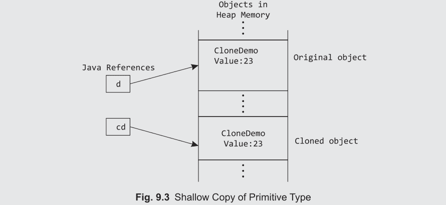

上述类包含一个基本类型值，当克隆时，对象包含了该基本类型的拷贝。让我们看看当同一个类包含引用类型时会发生什么。

# 示例 9.14 包含其他类引用的浅拷贝

```java
/* 该类的引用将作为另一个类中的实例变量 */
L1 class CloneReferenceTest
{
L2 int value;
L3 CloneReferenceTest(int v) {
L4 this.value=v;
L5 }
L5 class CloneDemo implements Cloneable
{
L6 // 创建对象引用
L7 CloneDemo br;
CloneDemo()
{
L8 br = new CloneReferenceTest(12);
L9 }
L9 // 重写了 clone 方法
public Object clone()
{
L10 try {
L11 return super.clone();
}
12 catch (CloneNotSupportedException e) {
```

```java
System.out.println(e);
}
}
}
// CloneDemo 类在此结束
```

```java
class TestClone {

    public static void main(String args[]) {

        CloneDemo d = new CloneDemo(23);

        System.out.println("Value in original object: " + d.getValue());

        CloneDemo cd = (CloneDemo)d.clone();

        System.out.println("Original object: " + d);

        System.out.println("Cloned object: " + cd);

        cd.increment();

        System.out.println("Value after increment in Cloned object: " + cd.getValue());

        System.out.println("Value in original object: " + d.getValue());

    }

}
```

# 输入/输出、序列化与克隆 291

```java

CloneReferenceTest(int v)

{

    value = v;

}

public Object clone()

{

    try {

        return super.clone();

    }

    catch(CloneNotSupportedException e) {

        System.out.println(e);

        return null;

    }

}

```

```java

class CloneDeepDemo implements Cloneable

{

    // 在此处声明另一个类的引用

    CloneReferenceTest br;

    CloneDeepDemo()

{

        br = new CloneReferenceTest(12);

    }

    // clone 方法

    public Object clone()

{

        CloneDeepDemo cdd = null;

        try {

            cdd = (CloneDeepDemo)super.clone();

        }

        catch(CloneNotSupportedException e) {

            System.out.println(e); // return null;

        }

        cdd = (CloneReferenceTest)br.clone();

        return cdd;

    }

}

```

```java

class TestDeepClone

{

    public static void main(String[] args)

{

        CloneDeepDemo d = new CloneDeepDemo();

        CloneDeepDemo cd = (CloneDeepDemo)d.clone();

        System.out.println("Original object: "+d);

        System.out.println("Original object inner reference: "+d.br);

        d.br.value = 11;

        System.out.println("Original object inner reference instance variable: "+d.br.value);

        System.out.println("Cloned object cd: "+cd);

        System.out.println("Cloned object inner reference: "+cd.br);

        System.out.println("Cloned object inner reference instance variable: "+cd.br.value);

    }

}

```

# 输出

```

D:\javabook\Second Edition\programs>java TestDeepClone

Original object d: CloneDeepDemo@c3749

Original object inner reference: CloneReferenceTest@150bd4d

Original object inner reference: instance variable: 11

Cloned object cd: CloneDeepDemo@bc4459

Cloned object inner reference: CloneReferenceTest@12b6651

Cloned object inner reference instance variable: 12

```

# 解析

- **L1–11** `CloneReferenceTest` 的定义与示例 9.14 相同。区别在于它继承了 `Cloneable` 接口并重写了 `clone()` 方法。这清楚地表示该类是可以被克隆的。`clone` 方法的实现与之前的项目相似。
- **L12** 声明了 `CloneDeepDemo` 类，与上一个程序的 `CloneDemo` 。唯一的区别在于 `clone` 方法的实现。
- **L17–24** 我们必须深拷贝对象。因此，创建一个 `CloneDeepDemo` 的空引用变量，并通过现有的 `CloneDeepDemo` 对象调用 `clone` 方法，即：这给了我们 `CloneDeepDemo` 对象的克隆（即 d）。在深拷贝中，`CloneDeepDemo` 内部所有的引用类型也应该被克隆，因此 **L24** 我们对 `br`（即 `CloneReferenceTest` 类）调用了 `clone` 方法来创建对象的克隆。它返回一个 `Object` 类型的对象，该对象被克隆到 `CloneReferenceTest` 中并存储在 `cd` 对象的 `br` 变量中。注意，我们没有在 `try catch` 块中克隆 **L24**，是因为 `CloneReferenceTest` 的 `clone` 方法包含了 `try-catch` 并捕获了从 `clone` 方法抛出的所有异常（图9.5）。
- **L25–35** 声明了 `TestDeepClone` 类（与上一个程序的 `CloneDemo` 相同）。

| 内存中的对象 | |
|---|---|
| CloneDemo | 原始对象 |
| CloneReferenceTest Value: 11 | 原始对象使用的引用类型 |
| CloneDemo | 克隆对象 |
| CloneReferenceTest Value: 12 | 克隆对象使用的不同引用类型 |

图 9.5 深拷贝

`clone` 方法应该应用于被克隆对象的实例变量引用的可变对象。状态可以改变的对象是可变的，而状态不能改变的对象是不可变的，如 `String` 和包装类。

# 总结

JDK 1.4 在 `java.io` 包中引入了 `java.nio`。Java 的 I/O 基于流：字节流和字符流。本章讨论了这两类中的若干几个类。这些文件展示了如何向文件读写数据（字节和字符）。`RandomAccessFile` 类用于通过在指定文件的特定位置设置文件指针来读写文件。Java 6 引入了 `Console` 类用于用户输入和输出。`java.nio` 还有一些子包，如 `java.nio.channels`（用于创建文件的通道）。`Filechannel` 用于建立与文件的连接，以便对其进行读、写、映射和锁定。`java.nio` 包中的 `ByteBuffer` 类用于映射文件。序列化用于转换为字节，反序列化反之。Java `java.nio` 包添加了 `Files` 和 `Path` 接口等新类来替换 `java.io` 中的旧类。`java.nio.channels` 包中还添加了新的 `SeekableByteBuffer`，它提供了类似于 `java.nio.RandomAccessFile` 等的功能。本章还详细讨论了克隆——浅拷贝和深拷贝。

# 练习

# 单选题

- 1. 哪一个抽象类是用于读取字符的类的父类？
  (a) `Reader`
  (b) `FileReader`
  (c) `BufferedReader`
  (d) `InputStream`

- 2. 哪一个抽象类是用于写入的类的父类？
  (a) `Writer`
  (b) `FileWriter`
  (c) `BufferedWriter`
  (d) `OutputStream`

- 3. 允许从输入读取原始表示的类是：
  (a) `Reader`
  (b) `FileWriter`
  (c) `InputStream`
  (d) `OutputStream`

- 4. 哪些是抽象的？
  (a) `Writer`
  (b) `Reader`
  (c) `InputStream`
  (d) 以上都是

- 5. 类方法抛出的异常是：
  (a) `ArithmeticException`
  (b) `NullPointerException`
  (c) `IOException`
  (d) `FileNotFound`

- 6. 编译并运行以下代码会发生什么？

```java
import java.nio.*;

class Demo{

    public static void main(String[] args) {

        Console c = System.console();

        String x = c.readLine();

        int a = Integer.parseInt(x);

        c.printf("The value is %d\n", a);

    }

}
```


- 7. 假设 `abc.txt` 存在，编译并运行以下代码会发生什么？

```java
import java.io.*;

class Demo {

    public static void main(String[] args) throws Exception {

        FileInputStream f = new FileInputStream("abc.txt");

        System.out.println("size:" + f.available());

    }

}
```

(a) 不编译 (b) 编译但产生异常 (c) 成功执行 (d) 产生 IOException

- 8. Java 7 引入的用于替换 `RandomAccessFile` 类的是：
  * `java.nio.channels.SeekableChannel`
  * `java.nio.channels.ByteChannel`
  * `java.nio.file.SeekableChannel`
  * `java.nio.Files`

- 9. Java 7 引入的用于替换 `java.io.File` 类的是：
  * `Files` 类和 `Path` 接口
  * `java.nio.Files` 类
  * `java.nio.file.File`
  * 以上都不是

# 复习题

1. 详细说明 `RandomAccessFile` 的所有模式。
2. 详细说明获取输入的所有可能方式。
3. 解释 `InputStream` 和 `BufferedInputStream` 的区别。提供支持的示例。
4. 解释：(a) 内存映射 (b) 虚拟内存 (c) 通道
5. 什么是序列化和反序列化？为什么需要？用于序列化的接口是什么？
6. 解释 Java 7 的增强。
7. 解释浅拷贝和深拷贝。

# 程序练习

1. 写一个程序列出目录中的所有文件，包括子目录中的文件。从用户标准输入获取目录路径。[提示：使用递归]。
2. 使用 `Appendable` 接口向文件追加字符串。获取文件名。
3. 写一个程序按字节读取文件内容并复制到另一个文件。从用户标准输入获取文件名。
4. 写一个程序用字符数组读取文件内容并写入另一个文件。从用户标准输入获取文件名。
5. 写一个程序，在文件开头写入字节（`byte`、`short`、`long`），然后是字符串“Starting File...”。[提示：使用 `RandomAccessFile`]。
6. 写一个程序，使用 `FileWriter` 类向文件添加数据。[提示：使用 `FileWriter` 的构造函数]。
7. 写一个程序映射文件。使用此映射到文件内容。[使用 `java.nio` 包]。
8. 创建一个类，具有静态字段 `x`、非静态字段 `y` 和 `transient` 字段 `z`。通过构造函数初始化它们。序列化该类并反序列化它。
9. 写一个程序创建一个顺序文件，存储组织员工的详细信息。详情包括 `empl`、`empName`、`empAge`、`empDept` 和 `empSal`。这些信息通过键盘提供。
10. 文件有多少行、多少单词、多少字符？写一个程序实现该功能。

# 输入/输出、序列化与克隆 295

# 项目工作

使用 Java 文件模拟一个员工数据库。该数据库包含姓名、地址、电话号码、职位和薪资。应提供添加新记录、删除现有记录、搜索记录和更新记录的功能。每当添加新记录时，应自动生成一个员工 ID。该员工 ID 类似于数据库中的主键。对于搜索、删除和更新记录，系统应提示用户输入员工 ID。在删除和更新之前，必须提示用户进行确认，例如：

> “你确定要删除该记录吗？是/否”。

# 题答案

- 1. (a) 2. (d) 3. (c) 4. (d)
- 5. (c) 6. (d) 7. (a) 编译错误，因为在两个语句中可能会抛出两个异常，因此应该使用 try/catch 或 throws 子句
- 8. (d) 9. (c) 10. (a)

# 泛型、java.util 以及其他 API

如果没有意志，最完整的品德和才华也一无毫无处。
阿里莱斯特·克劳利（Aleister Crowley）

在本章之后，读者将能够：

- 理解集合（collections）
- 理解并使用泛型（generics）
- 理解基本数据结构如何嵌入 util
- `LinkedList`、`ArrayList` 和 `Vector` 的基本概念
- 理解 `Set`、`HashSet`、`TreeSet` 以及 `Map`、`HashMap` 和 `TreeMap` 的基本概念
- 使用 collections 类、枚举器（enumeration）和迭代器（iterator）
- 理解 `Random` 类的用法
- 使用 `Observer` 类和 `Observable` 接口实现观察者模式
- 理解 `Runtime` 类
- 学习反射 API

# 10.1 引言

Utility（工具）意味着有用。工具类（Utility classes）是那些帮助创建其他类的类。`java.util` 包包含了如 `Date`、`Calendar`、`Stack`、`LinkedList` 和 `StringTokenizer` 等工具类。`java.util` 包中的类使用了集合，即一组对象。集合作用于对象，即它们存储/检索对象。

> 注意：基本数据类型无法直接在集合中进行存储和检索。`java.lang` 包中创建了表示基本数据类型的包装类（Wrapper classes），以便与集合配合工作。

`java.util` 包有一个名为 `Collection` 的接口。一个集合支持一组对象。集合可以是有序的/无序的，某些集合允许重复，而另一些不允许。该 `Collection` 接口有子接口，如 `Set`、`List` 和 `Queue`。图 10.1 显示了 `Collection` 接口的继承层次结构。这些接口有具体的子类，例如 `LinkedList`、`Stack` 和 `Vector`。除了 `Collection` 之外，我们还展示了另一个接口 `Map`，它对键/值对进行工作。该接口有一个名为 `Entry` 的嵌套接口。我们将在本章后面的部分讨论细节。表 10.1 列出了 `Collection` 接口的方法。

# 表 10.1 Collection 接口的方法

| 方法 | 说明 |
| --- | --- |
| `boolean add(E e)` | 将指定的元素添加到集合并返回 true。仅在集合不接受重复（如 `Set`）时返回 false。 |
| `boolean addAll(Collection<? extends E> c)` | 将指定集合中的所有元素添加到此集合中，如果发生变化则返回 true。 |
| `void clear()` | 通过从集合中移除所有元素来清空集合。 |
| `boolean contains(Object o)` | 如果此集合包含指定的对象，则返回 true。 |
| `boolean containsAll(Collection<?> c)` | 如果此集合包含指定集合中的所有元素，则返回 true。 |
| `boolean equals(Object o)` | 将指定的对象与此集合进行等性比较，如果是则返回 true。 |
| `int hashCode()` | 返回集合的哈希码。 |
| `boolean isEmpty()` | 如果此集合为空，则返回 true。 |
| `Iterator<E> iterator()` | 返回一个迭代器以遍历集合中的元素。 |
| `boolean remove(Object o)` | 如果集合中存在指定的元素，则从集合中移除该元素的单个实例。 |
| `boolean removeAll(Collection<?> c)` | 移除集合中也包含在指定集合中的所有元素。 |
| `boolean retainAll(Collection<?> c)` | 保留集合中包含在指定集合中的元素。 |
| `int size()` | 返回集合中的元素数量。 |
| `Object[] toArray()` | 返回一个包含集合中所有元素的数组。数组的返回类型将是 `Object` 类。 |
| `<T> T[] toArray(T[] a)` | 创建包含集合中所有元素的数组。数组的返回类型将是集合中对象的类型。 |

图 10.1 没有显示集合中的所有接口。请参考 JDK 6 文档获取完整的接口列表。

`java.lang.Iterable` 接口由 JDK 1.5 添加，`Collection` 接口被设计为继承它，以便可以使用 for-each 循环迭代对象。这提供了一个名为 `iterator()` 的方法，返回一个迭代器以遍历集合中的所有对象。`Collection` 接口由...

# Java 编程 300

`Queue` 接口在 JDK 1.5 中引入，以支持这种数据结构。`Queue` 按照 FIFO（先进先出）方式运行。首先插入到集合中的元素最先从集合中移除。它提供了检查队列头部元素的方法。该接口被 `Deque` 继承以支持双端队列。这些队列支持在队列的两端（头部和尾部）进行添加/移除/检查操作。表 10.3 显示了 `Queue` 接口的方法。

`Set` 是一个不包含重复对象的集合。该接口由抽象类 `AbstractSet` 实现，该类实现了集合的某些方法。具体类如 `HashSet`、`EnumSet` 等都是 `AbstractSet` 的子类。该接口被 `SortedSet` 继承，以便按排序的顺序（升序）访问元素。`TreeSet` 继承了 `SortedSet` 接口和 `AbstractSet` 类。表 10.4 显示了 `Set` 接口的方法。

`Map` 接口提供键/值对的映射。这些键/值对是唯一的。`Map` 接口内部声明了一个静态内部类 `Entry`，用于引用每个键/值对。`TreeMap` 接口继承自 `Map`，它实现了存储在排序映射中的元素。`AbstractMap` 类继承了 `Map` 接口，并提供了接口中大多数方法的实现。该类被 `HashMap`、`EnumMap` 等具体类继承。`TreeMap` 同样继承了该类以及 `SortedMap` 接口。

`java.util` 包中的大多数接口和类都使用了泛型。这从语法中可以明显看出（例如 `<E>`、`<? extends E>` 用在大多数接口和类声明以及某些方法中）。因此，让我们讨论泛型的概念。

## 10.2 泛型

这一特性在 Java 5 中引入，旨在从编译时提供严格的类型检查。泛型功能还允许同一个类用于许多不同的对象集合，如字符串、整数等。考虑以下示例，我们创建了三个类 `A`、`B` 和 `GenericTest`。`GenericTest` 类拥有一个 `ArrayList` 集合来存放对象。`A` 和 `B` 的对象被放入其中，稍后我们检索了它们。当我们尝试编译程序时，DOS 提示符处会出现两个注释，要求用户指定 `javac` 的 `-Xlint:unchecked` 选项重新编译程序。该选项用于显示所有的 lint 警告，具体是下方“编译语法时会发生什么？”部分中的未检查警告。如果代码没有使用较新的泛型语法并指定了 1.5 之前的 JDK 版本（即 `javac -source 1.4 GenericTest.java`），就会出现这些警告。

### 示例 10.1(a) 泛型使用

```java
import java.util.*;

class A {

    public String toString() { return "Class A Object"; }

}

class B {

    public String toString() { return "Class B object"; }

}

class GenericTest {

    public static void main(String[] args) {

        List v = new ArrayList();

        v.add(new A());
        v.add(new A());
        v.add(new B());

        Iterator en = v.iterator();

        while (en.hasNext()) {

            A o = (A) en.next();

            System.out.println(o);

        }

    }

}
```

### 编译程序时会发生什么？

```
C:\javabook\chap10>javac GenericTest.java
Note: GenericTest.java uses unchecked or unsafe operations.
Note: Recompile with -Xlint:unchecked for details.
```

# 表 10.4 Set 接口的方法

| 方法 | 说明 |
| :--- | :--- |
| `boolean add(E e)` | 如果指定的元素不在此集合中，则将其添加到集合中并返回 true，否则返回 false。 |
| `boolean addAll(Collection<? extends E> c)` | 如果指定集合中的元素不在此集合中，则将它们全部添加；如果集合发生变化则返回 true，否则返回 false。 |
| `void clear()` | 通过移除此集合中的所有元素来清空集合。 |
| `boolean contains(Object o)` | 如果此集合包含指定的对象，则返回 true。 |
| `boolean containsAll(Collection<?> c)` | 如果此集合包含指定集合中的所有元素，则返回 true。 |
| `boolean equals(Object o)` | 将指定的对象与此集合进行等性比较。 |
| `int hashCode()` | 返回此集合的哈希值。 |
| `boolean isEmpty()` | 如果此集合为空，则返回 true。 |
| `Iterator<E> iterator()` | 返回一个用于遍历集合中元素的迭代器。 |
| `boolean remove(Object o)` | 如果此集合包含指定的元素，则将其移除。 |
| `boolean removeAll(Collection<?> c)` | 从此集合中移除所有包含指定集合中的元素。 |
| `boolean retainAll(Collection<?> c)` | 仅保留此集合中包含指定集合中的元素。 |
| `int size()` | 返回集合中元素的数量。 |
| `Object[] toArray()` | 返回包含此集合中所有元素的数组。对象数组的返回类型将是 `Object` 类。 |
| `<T> T[] toArray(T[] a)` | 创建一个包含此集合中所有元素的数组。对象数组的返回类型取决于集合中对象的类型。 |

## 10.2.1 在参数和返回类型中使用泛型

泛型不仅适用于方法的参数，也适用于方法的返回参数。让我们来看看参数化类型是如何在传递参数时使用的，以及如何返回参数化类型。下面的示例创建了一个只包含字符串对象的列表。

### 示例 10.2 作为参数和返回泛型的参数化类型

```java
import java.util.*;

class ParamArgsGeneric {

    // 返回参数化类型方法
    List<String> getList() {

        List<String> l = new ArrayList<String>();

        l.add("Hello");
        l.add("Generics");

        return l;

    }

    // 接收参数化类型方法
    void print(List<String> c) {

        Iterator<String> i = c.iterator();

        while (i.hasNext())
            System.out.println(i.next());

    }

    public static void main(String[] args) {

        ParamArgsGeneric pag = new ParamArgsGeneric();

        List<String> l = pag.getList();

        pag.print(l);

    }

}
```

输出
```
C:\java\programs\chap 10>java ParamArgsGeneric
Hello
Generics
```

| 解析 |
| :--- |
| L3 | `getList()` 方法返回一个只包含字符串对象的 `List` 对象。 |
| L8 | 显示了一个 `print()` 方法，该方法接收一个应该只包含字符串对象的 `List`。 |

## 10.2.2 通配符

在示例 10.2 中，如果我们将 L3 修改为如下：

```java
List<Object> l = pag.getList();
```


任何人都会认为这是合法的参数，因为 `Object` 是 `String` 的父类，所以赋值应该是合法的，但事实并非如此。`Object` 的 `List` 并不是 `String` 的 `List`。为什么呢？

想一下这种情况：如果 `String` 的 `List` 是 `Object` 的 `List`，那么意味着上述修改后的 L13 理论上是通顺的。这样我们也可以在程序中插入代码，向 `List` 中添加 `Object` 类型的对象。现在，当我们检索它们并尝试将其存储在 `String` 的 `List` 中时，会抛出类型转换异常，因为我们正尝试将一个 `Object` 存入 `String` 中。所以，`Object` 的 `List` 不是 `String` 的 `List`，反之亦然。

如果你想像我们之前使用的那样灵活地使用类（即不使用参数化类型），那么你要么必须抑制警告，要么在某些特定类型的集合时保持严格限制。其实，有一个中间方案，我们可以使用泛型语法让集合持有不同类型的对象，而不仅仅是特定类型。这通过通配符（即 `?`）可以实现。让我们来看看如何使用泛型。

## 示例 10.3 泛型通配符的使用

```java
import java.util.*;

class ParamArgsGeneric {

    List<?> getList() {
        List<String> l1 = new ArrayList<String>();
        l1.add("Hello");
        l1.add("Generics");
        return l1;
    }

    // 接收任何 Collection
    void print(Collection<?> c) {
        Iterator<?> i = c.iterator();
        while (i.hasNext()) {
            System.out.println(i.next());
        }
    }

    public static void main(String[] args) {
        ParamArgsGeneric pag = new ParamArgsGeneric();
        List<?> l1 = pag.getList();
        pag.print(l1);

        // 创建了另一个 List 并传递给 print()
        List<Integer> li1 = new ArrayList<Integer>();
        li1.add(new Integer(1));
        li1.add(new Integer(2));
        li1.add(new Integer(3));
        pag.print(li1);
    }
}
```

输出
```
C:\javabook\programs\chap 10\java ParamArgsGeneric
Hello
Generics
1
2
3
```

## 解析

**L3** `getList` 方法返回一个未知类型的列表，即 `List<?>`。只是为了展示方法可以返回未知列表，我们使用了带有语法错误的写法。

**L9** 获取的迭代器对象可以持有任何类型的对象进行迭代，使用了通配符 `Iterator<?> i = c.iterator();`。在示例 10.2 中，我们专门创建了一个字符串对象的迭代器，以便它只能遍历字符串集合：`Iterator<String> i = c.iterator();`。

**L4** 创建了一个字符串的 `ArrayList`。

**L8** 方法 `print` 被定义为接收一个可以持有任何类型对象的集合。你可能会认为任何类型的对象都会重写为 `Collection<Object>`，但如前所述并非如此。此方法（如示例所示）可以打印字符串列表，也可以打印整数列表。

**L10-11** 遍历迭代器并打印任何类型的集合。

**L13** 调用 `getList` 方法返回一个任意类型对象形式的集合。返回的列表被捕获在一个未知类型的列表中，即 `List<?>`。

> 我们能重写 L4 吗？
> `List<?> l1 = new ArrayList<String>();`
> 这是非法的，因为未知列表不一定是字符串列表。通配符也可以用于在传递参数化类型作为参数或返回类型时，以及捕获方法的返回值。

## 10.2.3 有界通配符

在上一节中，我们讨论了表示未知类型的通配符（`?`）。对于集合中可以包含的对象类型没有限制。有界通配符允许我们限制集合中元素的类型。

## 10.3 链表 (LINKED LIST)

链表是一种包含记录的基础数据结构。记录包含数据以及指向下一条记录的引用。可以在链表的任何位置插入或删除记录。与普通数组相比，链表允许顺序访问。为了支持这种数据结构，Java 提供了一个名为 `LinkedList` 的类。`LinkedList` 是一个集合类，可以作为栈（stack）、队列（queue）以及双端队列（double-ended queue）。`LinkedList` 允许向列表中添加 `null`。让我们来看一个示例，看看 `LinkedList` 如何作为列表、栈、队列以及双端队列。

## 示例 10.6 LinkedList 类演示

```java
import java.util.*;

class LinkedListDemo {

    public static void main(String[] args) {
        LinkedList<String> list = new LinkedList<String>();
        list.add("Hello");
        list.add("Linked List");
        list.add("Demo");
        list.add(null);

        for (String s : list)
            System.out.println(s);

        // 作为栈 (LIFO 顺序)
        LinkedList<Integer> st = new LinkedList<Integer>();
        st.push(new Integer(1));
        st.push(new Integer(2));
        st.push(new Integer(3));
        st.add(new Integer(4));
        System.out.println("Object popped: " + st.pop());
        System.out.println("Object popped: " + st.pop());
        System.out.println("Object popped: " + st.pop());

        LinkedList<Long> queue = new LinkedList<Long>();
        // 作为队列 (FIFO 顺序)
        queue.add(new Long(1));
        queue.add(new Long(2));
        queue.add(new Long(3));
        queue.add(new Long(4));
        System.out.println("head of queue: " + queue.peek());
        System.out.println("head of queue removed and returned: " + queue.poll());
        System.out.println("Queue : " + queue);

        // 作为双端队列
        // 在两端插入和删除
        queue.addFirst(new Long(0));
        System.out.println("Double ended Queue : " + queue);
        queue.addLast(new Long(5));
        System.out.println("Double ended Queue : " + queue);
        System.out.println("head of queue removed and returned: " + queue.removeFirst());
        System.out.println("tail of queue removed and returned: " + queue.removeLast());
        System.out.println("Double ended Queue : " + queue);
    }
}
```

输出
```
C:\java\programs\chap10>Java LinkedListDemo
Hello
Linked List
Demo
null
Object popped: 3
Object popped: 2
Object popped: 1
Object popped: 4
Queue : [1, 2, 3, 4]
head of queue: 1
head of queue removed and returned: 1
Queue : [2, 3, 4]
Double ended Queue : [0, 2, 3, 4]
Double ended Queue : [0, 2, 3, 4, 5]
head of queue removed and returned: 0
tail of queue removed and returned: 5
Double ended Queue : [2, 3, 4]
```

#### 解释

- **L1** 创建了一个 `String` 类型的链表。
- **L2–5** 使用 `add()` 方法向链表中添加 `String` 类型的对象。该方法将元素添加到列表末尾，并返回一个布尔值表示元素已添加。
- **L6** 使用 for-each 循环遍历列表中的每个元素。链表的下一个元素被赋值给 `s`。


Object popped: 2

Object popped: 1

Object popped: 4

Queue : [1, 2, 3, 4]

head of queue: 1

head of queue removed and returned: 1

Queue : [2, 3, 4]

Double ended Queue : [0, 2, 3, 4]

Double ended Queue : [0, 2, 3, 4, 5]

head of queue removed and returned: 0

tail of queue removed and returned: 5

Double ended Queue : [2, 3, 4]

#### 解释

- L1 创建了一个 `String` 类型的链表。
- L2–5 使用 `add()` 方法向链表中添加 `String` 类型的对象。该方法将元素添加到列表末尾，并返回一个布尔值表示元素已添加。
- L6 使用 `for-each` 循环遍历列表中的每个元素。链表的下一个元素被赋值给 `s`。

| L23 | hs.retainAll(hs1); |
| L24 | System.out.println("Intersection of hs and hs1: " + hs1); |
| L25 | // 差集 |
| L26 | hs.removeAll(hs1); System.out.println("Difference of hs and hs1: " + hs1); |
| | // 并集 |
| L27 | System.out.println("Hash Set to be united with previous set: " + hs1); |
| L28 | hs.addAll(hs1); |
| L29 | System.out.println("Union of hs and hs1: " + hs1); |
| | } |

```
C:\javabook\programs\chap10>java HashSetDemo
Hash Set: [null, D, E, A, B, C]
Re-Adding C to set: false
Iterating contents of Hash Set one by one
D
E
A
B
C
Size of Hash Set: 6
null removed: true
Hash Set: [D, E, E, A, B, C]
check whether Set contains C :true
hs: [D, E, A, B, C]
hs1: [D, E, B]
hsi is a subset of hs1: true
Intersection of hs and hs1: [D, E, B]
Difference of hs and hs1: []
Hash Set to be united with previous set: [D, E, B]
Union of hs and hs1: [D, E, B]
```

#### 解释

- L1 创建了一个字符串类型的 `HashSet`。
- L2-7 使用 `add()` 方法将 `String` 添加到 `HashSet` 中。
- L8 打印 `HashSet`（查看输出以检查顺序，顺序是不维护的）。
- L9 当你添加集合中已存在的元素时，方法调用会被忽略并返回 `false`。
- L10 和 11 使用 `for-each` 循环遍历 `HashSet` 的内容。
- L12 使用 `size()` 方法返回 `HashSet` 的大小，即集合中添加了 6 个对象。
- L13 使用 `remove()` 方法从 `HashSet` 中移除元素，如果元素存在，该方法返回 `true`。
- L14 L15 为了在集合中查找特定元素，使用了 `contains(Object o)` 方法。如果找到元素，该方法返回 `true`，否则返回 `false`。
- L16 创建了一个新的 `HashSet` 来展示数学集合的基本操作：并集、交集和差集。
- L17-19 将该类型的对象添加到新的 `HashSet` 中。
- L20 和 21 打印两者。
- L22 如果一个 `HashSet` (hs) 包含另一个 `HashSet` (hs1) 的所有元素，则 hs 可以被视为 hs1 的子集。集合提供了 `containsAll(Collection<?> c)` 方法，如果调用者集合包含参数集合的所有元素，则返回 `true`，否则返回 `false`。
- **L23 和 24** 两个集合的交集产生两个集合中共同的元素。集合提供了 `retainAll(Collection<?> c)` 方法。该方法会从调用者集合 (hs) 中移除不属于参数 (hs1) 的元素，如果调用者集合发生了变化，则返回 `true`。
- **L25 和 26** 集合中的元素不在在 b 集合中，从而得到两个集合的差集。`removeAll(Collection<?> c)` 方法的作用与 `for` 相同，如果调用者集合发生了变化，则返回 `true`。在我们案例中的结果是，在此操作之后，hs 不再包含任何元素（在此操作之前），hs 的所有元素已经存在于 hs1 中。
- **L27-29** L27 打印要与集合 (hs) 合并的集合 (hs1)。`addAll(Collection<?> c)` 用于将集合的所有元素添加到调用者集合中。此操作类似于两个集合的并集，如果调用者集合发生了变化，则返回 `true`。L29 打印了 'hs'（见输出）。

### 10.4.2 TreeSet 类

`TreeSet` 对集合中元素的顺序提供了控制。该集合是排序集合。在快速检索元素时，这可能无法为你提供最佳性能（请使用 `HashSet` 代替 `TreeSet`）。`TreeSet` 不允许集合中包含 `null`。

### 示例 8 TreeSet 的演示

```java
import java.util.*;

class TreeSetDemo {
    public static void main(String[] args) {
        TreeSet<String> ts = new TreeSet<String>();
        ts.add("B");
        ts.add("B");
        ts.add("A");
        ts.add("C");
        ts.add("A");
        ts.add("C");
        // ts.add(null); 不接受 null 值
        for (String s : ts) {
            System.out.println(s);
        }
        System.out.println("TreeSet: " + ts);
        System.out.println("First element of TreeSet: " + ts.first());
        System.out.println("Last element of TreeSet: " + ts.last());
        System.out.println("Size of TreeSet: " + ts.size());
    }
}
```

输出
```
C:\javabook\programs\chap 10>java TreeSetDemo
A
B
C
D
TreeSet: [A, B, C, D]
First element of TreeSet: A
Last element of TreeSet: D
Size of TreeSet: 4
```

#### 解释

- L1 创建了一个 `TreeSet` 对象。
- L2-7 使用 `add()` 方法将元素添加到 `TreeSet` 中。
- L8 `add(null)` 不允许 `null` 值。
- L9 打印 `TreeSet` 的排序顺序。
- L10-11 使用 `for-each` 循环遍历 `TreeSet` 内容。
- L12 `add(null)` 会抛出异常，因为 `TreeSet` 不允许 `null`。
- L13 `first()` 方法用于获取第一个元素。
- L14 `last()` 方法用于获取最后一个元素。
- L15 `size()` 方法返回 `TreeSet` 的大小。

### 10.5 HashMap 类

### 示例 9 HashMap 的演示

```java
import java.util.*;

class HashMapDemo {
    public static void main(String[] args) {
        HashMap<Integer, String> hm = new HashMap<>();
        hm.put(101, "Apple");
        hm.put(102, "Banana");
        hm.put(103, "Cherry");
        hm.put(101, "Date");
        System.out.println("HashMap: " + hm);
        System.out.println("Value for 101: " + hm.get(101));
        System.out.println("Value for 102: " + hm.get(102));
        System.out.println("Value for 103: " + hm.get(103));
        hm.remove(102);
        for (Map.Entry<Integer, String> entry : hm.entrySet()) {
            System.out.println(entry.getKey() + " : " + entry.getValue());
        }
    }
}
```

输出
```
C:\javabook\programs\chap 10>java HashMapDemo
HashMap: {101=Date, 102=Banana, 103=Cherry}
Value for 101: Date
Value for 102: Banana
Value for 103: Cherry
101 : Date
103 : Cherry
```

#### 解释

- L1 创建了 `Integer` 和 `String` `HashMap` 对象。
- L2-4 使用 `put()` 方法插入键值对。
- L5 如果键已存在，值会被更新。
- L6 `get()` 方法获取与特定键关联的值。
- L7 `remove()` 方法根据键删除条目。
- L8-10 使用 `for-each` 循环通过 `entrySet()` 遍历键值对。

### 10.5.2 LinkedList 类

是 `List` 和 `Deque` 接口的实现。它是一个双向链表。它对于列表两端的频繁插入和删除非常高效。但与 `ArrayList` 相比，随机访问速度较慢。

### 示例 10 LinkedList 的演示

```java
import java.util.*;

class LinkedListDemo {
    public static void main(String[] args) {
        LinkedList<String> list = new LinkedList<>();
        list.add("First");
        list.add("Second");
        list.add("Third");
        list.addFirst("Zero");
        list.addLast("Last");
        System.out.println("LinkedList: " + list);
        System.out.println("First element: " + list.getFirst());
        System.out.println("Last element: " + list.getLast());
        list.remove("Second");
        System.out.println("LinkedList after removing Second: " + list);
    }
}
```

输出
```
C:\javabook\programs\chap 10>java LinkedListDemo
LinkedList: [Zero, First, Second, Third, Last]
First element: Zero
Last element: Last
LinkedList after removing Second: [Zero, First, Third, Last]
```

#### 解释

- L1 创建了一个 `LinkedList` 对象。
- L2-3 使用 `add()` 方法将元素添加到末尾。
- L4 `addFirst()` 和 `addLast()` 用于在开头和结尾添加元素。
- L5 打印列表。
- L6-7 `getFirst()` 和 `getLast()` 用于获取边界元素。
- L8 `remove()` 方法根据值移除元素。
- L9 打印移除后的列表。

### 10.5.2 TreeMap 类

`TreeMap` 包含排序的键/值对映射。当我们需要排序的映射时，应该使用此类。

### 示例 10.1 TreeMap 演示

```java
import java.util.*;

class TreeMapDemo {
    public static void main(String args[]) {
        TreeMap<String, String> tm = new TreeMap<String, String>();
        tm.put("Emp001", "Tom");
        tm.put("Emp002", "Peter");
        tm.put("Emp003", "Watson");
        // tm.add(null,null); 类似于 TreeSet，它不接受键和值
        System.out.println("TreeMap: " + tm);
        tm.put("Emp003", "David");
        System.out.println("TreeMap: " + tm);
        System.out.println("Key in Map");
        for (String s : tm.keySet()) {
            System.out.println(s);
        }
        System.out.println("Values in Map");
        for (String s : tm.values()) {
            System.out.println(s);
        }
        System.out.println("value associated with Emp002: " + tm.get("Emp002"));
        System.out.println("Size of TreeMap: " + tm.size());
    }
}
```

输出
```
C:\javabook\programs\chap10>java TreeMapDemo
TreeMap: {Emp001=Tom, Emp002=Peter, Emp003=Watson}
TreeMap: {Emp001=Tom, Emp002=Peter, Emp003=David}
Key in Map
Emp001
Emp002
Emp003
Values in Map
Tom
Peter
David
value associated with Emp002: Peter
Size of TreeMap: 3
```

> 解释
我们在上一个示例中讨论了所有的方法。

### 10.6 Collections 类

`Collections` 类包含许多静态方法，可以对集合进行操作，例如复制集合、反转集合中的元素、用另一个元素替换另一个元素等。让我们通过一个例子来更好地理解 `Collections` 类的用法。

### 示例 10.11 Collections.util.*;

```java
import java.util.*;

public class CollectionsDemo {
    public static void main(String[] args) {
        List<String> l = new LinkedList<String>();
        l.add("Ignorance");
        l.add("is");
        l.add("a");
        List<String> sb = new LinkedList<String>();
        sb.add("Bliss");
        List<String> srch = new LinkedList<String>();
        srch.add("Bliss");
        System.out.println("elements in list : " + l);
        // 创建定义列表的副本并打印副本列表的对象。
        Collections.copy(l, sb);
        System.out.println("copy of list : " + l);
    }
}
```


// 查找并显示子列表在列表中第一次出现的索引。

System.out.println("First index of 'Bliss': " + Collections.indexOfSublist(l, srch));

// 用给定的新对象替换列表中的所有对象。

Collections.replaceAll(l, "welcome");

System.out.println("After replace all 'Bliss': " + l);

// 反转顺序。

Collections.reverse(l);

System.out.println("list in reverse order : " + l);

// 将指定元素与第1个(第二个)位置的元素交换

Collections.swap(l, 1, l.size() - 1);

System.out.println("list after swapping : " + l);

// 使用 fill()) 用给定元素填充所有元素

Collections.fill(l, "Bliss");

System.out.println("After filling all 'Bliss' in list : " + l);

// 通过 enumeration(l) 获取列表的枚举类型

Enumeration<String> e = Collections.enumeration(l);

while (e.hasMoreElements()) {

    System.out.println(e.nextElement());

}

}

}

```

输出:

C:\javabook\programs\chap10-java CollectionsDemo
Elements in list : [Ignorance, is, a]
copy of list : [Bliss, is, a]

- First index of 'Bliss': 0
- After replace all 'Bliss': [welcome, is, a]
- List in reverse order : [a, is, welcome]
- List after swapping : [a, welcome, is]
- After filling all 'Bliss' in list : [Bliss, Bliss, Bliss]

> 解释
- L10 从 list 的第一个位置将所有元素复制到 list。list 中的元素会被 sb 中的元素覆盖，否则会抛出 `IndexOutOfBoundsException`。copy 方法定义为：`public static <T> void copy(List<? super T> dest, List<? extends T> src)`
- L11 输出复制后的列表（见输出）。
- L12 输出 list 中 src 的第一次出现。`indexOfSublist(List<?> src, List<?> target)`
- L13 和 L14 list 中的所有出现对象被另一个替换。`replaceAll(List<T> list, T oldVal, T newVal)` 替换 list 中的 oldVal。
- L14 输出修改后的列表（见输出）。
- L15 和 L16 `reverse(List<?> list)` 反转并打印指定的 list。
- L17 和 L18 `swap(List<?>, int i, int j)` 方法用于交换 list 位置 i 和 j 的两个元素。
- L18 输出交换后的结果（见输出）。
- L19 和 L20 `fill(List<? super T> list, T obj)` 用于用对象替换 list 中的所有元素。
- L21-23 LinkedList 使用迭代器而不是枚举。两个接口用于相同的目的，其差异我们在下一节中讨论。如果你想获取 LinkedList 的枚举；使用 `Collections` 类的 `enumeration` 方法见 L22 和 L23。

> 注意 `List<? super T>` 表示列表将包含 T 或其任何父类的对象。而 `List<? extends T>` 则表示集合将包含 T 或其子类的对象。

## 10.7 遗留类与接口

在本节中，我们将讨论一个遗留类即 `Vector` 和一个遗留接口即 `Enumeration`。我们还强调了遗留类/接口与新类（`Iterator`）之间的区别。

### 10.7.1 Vector 和 ArrayList 的区别

`Vector` 和 `ArrayList` 类都用于支持动态数组。数组的大小不能增长/缩小，因此在 `java.util` 包中提供了这些类以支持可以增长/缩小的集合。虽然这些类的用途相同，但它们存在差异，程序员根据这些差异决定使用哪种类。

`Vector` 是同步的，而 `ArrayList` 不是。这意味着当多个线程访问时，`Vector` 集合是安全的。另一方面，`ArrayList` 因为没有同步而提供更好的性能。当集合不会被多个线程访问时可以使用 `ArrayList`。遍历 `Vector` 我们使用遗留接口 `Enumeration`，而 `ArrayList` 使用 `Iterator` 接口。

我们在整个章节中已经使用了 `ArrayList`。可以如下所示创建一个 `Vector` 对象：

```java
Vector<String> v = new Vector<String>();
```

可以使用 `add(E)` 方法将元素添加到 `Vector` 中，所示：

```java
v.add("One");
v.add("Two");
```

`elements()` 方法返回 `Vector` 的枚举，可以如下所示进行迭代：

```java
Enumeration<String> e = v.elements();
while (e.hasMoreElements()) {
    System.out.println(e.nextElement());
}
```

### 10.7.2 Enumeration 和 Iterator 的区别

`Enumeration` 是一个遗留接口。`Enumeration` 接口与 `Vector` 等类工作。假设 `Vector` 整数对象。要遍历集合，通过调用 `Vector` 对象的 `elements()` 方法获取枚举。该枚举有两个方法：`hasMoreElements()` 返回指示是否有更多元素的布尔值，`nextElement()` 返回集合中的下一个元素。

```java
Enumeration<Integer> en = v.elements();
while (en.hasMoreElements()) {
    System.out.println(en.nextElement());
}
```

这被一个新的接口所取代；`Iterator` 与 `ArrayList`、`LinkedList` 等新类工作。`Iterator` 与 `Enumeration` 的区别在于它在迭代期间提供了从集合中删除的方法。它有三个方法：

- `hasNext()` 返回布尔值，表示迭代器集合中有下一个元素。
- `next()` 返回集合中的下一个元素。
- `remove()` 删除迭代器返回的最后一个元素。

我们已经在示例 10.1 中展示了如何与 `ArrayList` 使用 `Iterator`。

## 10.8 工具类：Random 类

Java 提供了易用的 `Random` 来生成随机数。该类定义在 `java.util` 包中。创建随机数生成器最简单的方法是使用无参构造函数实例化 `Random` 类，如下：

```java
Random generator = new Random();
```

或者使用接受参数的参数化构造函数，即随机数生成器的种子（seed）。种子是一个用于初始化伪随机数生成器的数字。

```java
Random generator = new Random(long seed);
```

可以使用两种方法从 `Random` 对象生成随机整数：`nextInt()` 和 `nextInt(int)`。它们可能返回任何整数：正数或负数均可。接受参数的重载方法可用于生成 0 到 limit 之间的随机整数。例如，以下代码将生成一个 0 到 n-1 之间的数字。

```java
int randomInt = r.nextInt(n);
```

可以使用 `nextDouble()` 或 `nextFloat()` 方法生成一个在 0.0 到 1.0 之间均匀分布的随机数。表 10.5 列出了 `Random` 类的方法。

`Math.random()` 也会生成一个 0.0 到 1.0 之间的随机数。

> 注意 `Math.random()`

| 方法 | 说明 |
|---|---|
| `protected int nextInt(int bits)` | 返回 `int` 类型的随机数。 |
| `public boolean nextBoolean()` | 返回布尔值。 |
| `public void nextBytes(byte[] bytes)` | 生成随机字节并将它们放入字节数组中。 |
| `public double nextDouble()` | 返回 0.0 到 1.0 之间均匀分布的随机数值。 |
| `public float nextFloat()` | 返回 0.0 到 1.0 之间均匀分布的 `float` 值。 |
| `public double nextGaussian()` | 返回均值为 0.0、标准差为 1.0 的随机高斯分布值。 |
| `public int nextInt()` | 返回随机且均匀分布的 `int`。 |
| `public int nextInt(int n)` | 返回在 0（包含）到指定值（不包含）范围内的随机均匀分布的 `int`。 |
| `public long nextLong()` | 返回随机且均匀分布的 `long`。 |
| `public void setSeed(long seed)` | 设置此随机生成器的种子。 |

让我们来看一个示例，展示如何生成随机数。

### 示例 10.12 Random 类

```java
L1 import java.util.Random;

L2 class RandomNumbers {

L3 public static void main(String args[]) {

    // 创建一个 Random 对象

    Random randomGenerator = new Random();

    for (int i = 1; i <= 6; i++) {

        /** 生成 1 到 6 范围内的随机整数，例如骰子在
        掷骰子时有一到六面，任何数字都可能出现
        */

        int randomInt = randomGenerator.nextInt(6) + 1;

        System.out.println("Integer Random Number: " + randomInt);

    }

    /** 生成 0.0 到 1.0 范围内的随机 double */

    double randomDouble = randomGenerator.nextDouble();

    System.out.println("Double Random Number: " + randomDouble);

    /** 生成 0.0 到 1.0 范围内的随机 float */

    float randomFloat = randomGenerator.nextFloat();

    System.out.println("Float Random Number: " + randomFloat);

    /** 生成随机 long */

    long randomLong = randomGenerator.nextLong();

    System.out.println("Long Random Number: " + randomLong);

}

}
```

### 输出

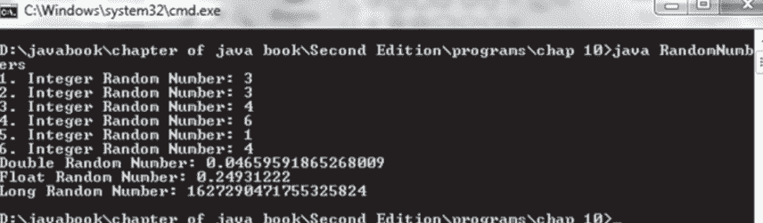

## 10.8.1 Observer（观察者）与 Observable（可观察者）

`Observer` 接口和 `Observable` 类基于观察者模式。该模式规定，当另一个对象（即 `Observable` 对象）的状态发生变化时，应该通知特定的对象（即 `Observer`）。换句话说，`Observer` 观察另一个对象的状态，并希望在该对象发生任何变化时收到通知，而 `Observable` 是 `Observer` 所感兴趣的对象。例如，你（观察者）会收到银行账户（`Observable`）的交易更新通知，或者当饼图或柱状图的数据（`Observable`）更新时，图表（观察者）会自动适应变化，以此类推。

注意，这种模式也用于 MVC 架构。MVC 代表模型（Model）、视图（View）和控制器（Controller）。模型对象管理应用程序的行为和数据，视图负责图形或文本表示，控制器用于处理用户命令。模型通过改变其状态来响应来自控制器的请求，并通过视图呈现给用户。视图可以被视为模型的观察者，即可观察对象。

为了说明观察者模式实现的概念，我们考虑一个客户和账户的示例场景。账户由银行的客户（账户持有人）持有。一旦客户账户发生入账或扣款，客户将收到关于其交易信息的更新。在这种情况下，客户是观察者，而账户是客户实体拥有的。

### 示例 10.13 Observer 与 Observable

```java
L1 import java.util.Observable;
L2 import java.util.Observer;

L3 class Bank {

L4     // Account 的两个引用
    Account a, a1;

    // 创建了两个客户引用
L5     Customer c, c1;

L6     public Bank() {
L7         c = new Customer("Rahul", "C001");
        a = new Account(12000, "A001");
L8         c1 = new Customer("Ram", "C002");
        a1 = new Account(12000, "A002");
L9         a.addObserver(c1);
L10        a1.addObserver(c1);
    }

L11    public static void main(String[] args) {
L12        Bank b = new Bank();
L13        b.demo();
    }

L14    public void demo() {
L15        a.credit(1000);
L16        a.debit(500);
L17        a1.credit(6000);
    }

} // Bank 类结束
```

```java
L19 class Customer implements Observer {

L20     String custName; // 姓名
L21     String custId;   // ID
L22     Account account; // 持有的账户对象

L23     Customer(String custName, String custId, Account account) {
L24         this.custName = custName;
L25         this.custId = custId;
L26         this.account = account;
    }

    /** 输出发生的变化 */
    public void update(Observable obs, Object arg) {
        System.out.println(custName + " Account: " + balance);
    }

} // Customer 类结束
```

```java
/** 可观察对象维护数据 */
class Account extends Observable {

    float balance;
    String accountNo;

    Account() {
        balance = 0;
        accountNo = "";
    }

    Account(float balance, String accountNo) {
        this.balance = balance;
        this.accountNo = accountNo;
    }

    float getBalance() {
        return balance;
    }

    void setBalance(float b) {
        balance = b;
    }

    String getAccountNo() {
        return accountNo;
    }

    void setAccountNo(String acc) {
        accountNo = acc;
    }

    /** 标记可观察对象已更改 */
    public void credit(float amount) {
        balance += amount;
        setChanged();
        // 通知观察者变化
        notifyObservers();
    }

    public void debit(float amount) {
        balance -= amount;
        setChanged();
        notifyObservers();
    }

} // Account 类结束
```


在执行完存或取操作后（即账户余额增加或减少），必须通知观察者这一变化。因此，使用 `changed()` 方法来标记该对象状态已更改，并使用 `notifyObserver()` 方法通过调用观察者的 `update` (L28) 方法来通知观察者（在我们的案例中为客户）这一变化。

注意：由于 `getBalance()` 是 `Account` 类的方法而非可观察类的方法，我们需要将其强制转换为 account 并调用 `getBalance()` 方法。这种转换是合法的，因为 `Observable` 引用实际上包含一个 `Account` 对象，且 `Account` 是 `Observable` 类的子类。

## 10.9 Runtime 类

`Runtime` 类用于获取空闲内存和总内存信息。此外，它还用于执行额外的进程。使用 `Runtime` 类的静态方法即 `getRuntime()` 获取当前的运行时实例。表 10.6 显示了 `Runtime` 类的一些方法：

| 方法 | 说明 |
|---|---|
| `exec(String command)` | 在单独进程中执行命令。 |
| `exec(String[] cmdarray)` | 在单独进程中执行存储在数组中的命令。 |
| `void exit(int status)` | 终止当前运行的 JVM。 |
| `long freeMemory()` | 返回 JVM 中空闲内存的量（long 类型）。 |
| `void gc()` | 运行垃圾回收器。 |
| `static Runtime getRuntime()` | 返回与当前 Java 关联的运行时对象。 |
| `void halt(int status)` | 强制终止当前运行的 JVM。 |
| `void load(String filename)` | 将指定的文件名加载为动态库。 |
| `void loadlibrary(String libname)` | 加载指定库名称的动态库。 |
| `long maxMemory()` | 返回 JVM 中的最大内存量（long 类型）。 |
| `void runFinalization()` | 运行任何待处理对象的终结化。 |
| `long totalMemory()` | 返回 JVM 中的总内存量。 |
| `void traceInstructions(boolean on)` | 启用或禁用指令追踪。 |
| `void traceMethodCalls(boolean on)` | 启用或禁用方法调用追踪。 |

让我们来看如何使用 `Runtime` 类获取内存细节并执行进程的示例。

## 示例 10.14 Runtime 类

```
L1 import java.io.*;

L2 class RuntimeDemo
{
L3 public static void main(String args[])
{
try {
  Runtime r = Runtime.getRuntime();
  System.out.println("Free Memory"+r.freeMemory());
  System.out.println("Total Memory"+r.totalMemory());
// 用于打开一个新的提示符
  Process pr1 = r.exec("cmd / start");
// 用于创建一个新的记事本进程
  Process pr2 = r.exec("notepad RuntimeDemo.java");
// 我们创建了一个要执行的命令
  Process pr3 = r.exec("cmd / dir");
  InputStream is = pr3.getInputStream();
  InputStreamReader isr = new InputStreamReader(is);
  BufferedReader br = new BufferedReader(isr);
  String line;
  while ((line = br.readLine()) != null) {
    System.out.println(line);
  }
} catch (Exception e) {
  System.out.println(e);
}
}
```

输出

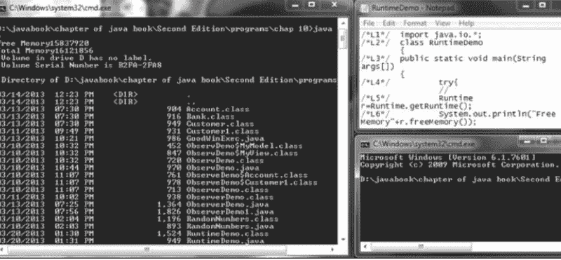

## 解析

L1 导入了 `java.io` 包以使用 `BufferedReader`、`InputStream`、`InputStreamReader` 和 `IOException` 等类。

L2 类声明。

L3 为该类定义的 main 方法。

L4 `try` 块。

**L5** 使用静态方法 `getRuntime()` 获取与当前 Java 应用关联的 `Runtime` 对象。`totalMemory()` 返回 Java 虚拟机中的总内存量。

**L6–7** `freeMemory()` 方法返回 Java 虚拟机中可用的空闲内存量。

**L8–10** `exec` 方法可执行命令并创建进程对象。作为参数传递给 `exec` 方法的命令如下：

```
cmd / start - 用于启动一个新的提示符（见输出）
notepad filename - 用于用记事本打开包含该的文件。（见输出）
cmd / dir - 用于显示当前目录下的目录和文件（见输出）
cmd 的 /c 选项
```

**L11–16** `exec` 方法中的 `dir` 命令创建了一个进程，返回当前目录下的文件和目录名称。为了显示给用户，我们必须读取从 L10 创建的进程产生的输出。读取使用 `getInput` 方法 (L11) 从 `Process` 对象获取 `InputStream`。通过 `InputStreamReader` (L12) 将其转换为字符，然后通过 `BufferedReader` 的构造函数 (L13) 传递 `InputStreamReader` 对象。现在，你可以使用 `BufferedReader` 对象的 `readLine` 方法 (L15) 逐行从 L10 创建的进程对象中读取。

**L17–18** 用于捕获可能出现的任何异常。

## 10.10 反射 API

反射 API 用于获取类的各种特征信息，如属性、构造函数、方法、修饰符（公共、私有等）、接口、数组、异常。

# 泛型、java.util 以及其他 API 331

# 输出

```
D:\javabook\chapter of java book\Second Edition\programs\java ref.Reflection
Class Name: ref.Reflection
Class modifier {
    constructor:ref.Reflection
    Constructor:public
    Constructor Modifier: public: true
    Constructor Parameter Types: int float
    Method: show
    MethodModifiers: is final
    MethodModifiers: public: true
    Method return type: void
    Method: main
    Method Modifier: public static
    MethodModifiers: public: true
    Method return type: void
    Method Exception Types: java.lang.ArithmeticException
Super Class: java.lang.Object
Field name: item
Field type: int
Field value: 10
Field value Modifier is : private
Interfaces: java.io.Serializable
Package of the class: package ref
D:\javabook\chapter of java book\Second Edition\programs\_ _
```


# 解析

- L1 声明了包 `ref` 用于存放类 `Reflection`。
- L2 导入了 `java.lang.subpackage` 包以使用反射 API。请记住需要显式导入的包。
- L3 导入了 `java.io` 包，因为该类实现了 `Serializable` 接口。（在我们的程序中该类不会被序列化。继承此接口是为了演示如何使用反射 API 通过名称来识别类。我们需要继承该接口，就像我们之前继承 `Serializable` 接口一样。）
- L4 类声明。
- L5–7 类中声明了一个私有字段 `item`，并通过构造函数进行初始化。构造函数接受两个参数，其中一个用于初始化实例变量，另一个参数用于说明。
- L8–9 声明了 `show` 方法，并指定了它可能抛出 `ArithmeticException`。
- L10 `main` 方法。
- L11 创建了 `Reflection` 类的对象。
- L12 通过在对象上调用 `getClass()` 方法可以在运行时获取类名。`getClass()` 方法返回 `java.lang.Class` 类型的对象，并对其调用 `getName()` 以返回类名，即 `Reflection`（见输出）。
- L13 创建了一个 `Class` 对象来表示需要详细信息的类。类名作为参数传递给 `java.lang.Class` 的静态方法。可以使用类的 `getConstructors()` 方法访问类的所有构造函数，该方法返回一个包含所有存在的构造函数的数组（`java.lang.reflect.Constructor` 数组）。可以通过对数组（L15）中的每个构造函数对象调用 `getName()` 方法（L16）获取构造函数的名称。可以通过对数组中的每个构造函数对象调用 `getModifier()` 方法（L17）来获取修饰符。该方法返回一个表示 Java 不同修饰符的整数，并可以使用 `Modifier.toString` 方法将其转换为字符串（如 L16 所示）。[注 1]


# Java 编程

**L19–22** 如果构造函数接受任何类型的参数，也可以通过 `java.lang.reflect.Constructor` 对象上的 `getTypes` 方法获取它们各自的类型。该方法返回一个类数组。文中演示了如何通过数组长度来循环遍历并显示构造函数中所有参数的类型 [注 2]。

**L23–28** 展示了如何在运行时获取类反射 API 的详细信息。在类（L13 中创建）上调用 `getDeclaredMethods()` 以提取类方法的详细信息。此 `lang.reflect.Method` 返回一个 `java` 类型的数组。通过对方法数组的每个元素调用 `getName()` 来获取该方法。可以使用 `getModifiers()` 获取方法。该方法返回一个表示方法的整数。

要获取方法的名称，使用 `Method.toString()` 方法将修饰符的值转换为其名称。

**L29** 可以使用 `lang.reflect.Class` 方法的 `invoke()` 方法在运行时调用类的方法。用于调用 `invoke()` 的被调用对象作为参数传递给声明该方法的类实例。[注 3]

**L30–32** 展示了如何获取类方法抛出的异常。`Object` 方法的 `exception()` 返回一个包含特定方法语句中声明的所有异常的类数组。通过对对象数组的每个元素调用 `getName()` 获取异常名称。

**L33–34** `java.lang.Class` 的 `getSuperClass()` 方法用于确定 L12 中创建对象的父类。该方法返回一个 `java.lang.Class` 类型的对象。

**L35–42** 展示了如何获取类的字段详细信息，包括各自的名称、类型和值。`java.lang.Class` 的 `getDeclaredFields()` 方法返回一个 `lang.reflect.Field` 类型的数组。数组的每个元素代表类的字段。字段的名称、类型和值可以使用 `Field` 类的方法分别通过 L33 中的 `getName()`、`getType()` 和 `getModifiers()` 提取。不仅可以提取值，还可以使用表 10.7 所示的 setter 方法进行设置。第一个对象是要设置字段值的对象，第二个是需要设置的值。我们使用 setter 方法，第一个参数是需要设置的对象。

### 表 10.7 Setter 方法

| 方法 | 说明 |
| :--- | :--- |
| `public void set(Object obj, Object val)` | 设置对象的值。 |
| `public void setBoolean(Object obj, boolean b)` | 设置对象中的 `b`。 |
| `public void setByte(Object obj, byte b)` | 设置对象中的 `b`。 |
| `public void setChar(Object obj, char c)` | 设置对象中的 `c`。 |
| `public void setDouble(Object obj, double d)` | 设置对象中的 `d`。 |
| `public void setFloat(Object obj, float f)` | 设置对象中的 `f`。 |
| `public void setInt(Object obj, int i)` | 设置对象中的 `i`。 |
| `public void setLong(Object obj, long l)` | 设置对象中的 `l`。 |
| `public void setShort(Object obj, short s)` | 设置对象中的 `s`。 |

# 泛型、java.util 以及其他 API 331

**L19–22** 如果构造函数接受任何类型的参数，也可以通过 `java.lang.reflect.Constructor` 对象上的 `getTypes` 方法获取它们各自的类型。该方法返回一个类数组。演示了如何通过数组长度循环遍历并显示构造函数中所有参数的类型 [注 2]。

**L23–28** 展示了如何在运行时获取类反射 API 的详细信息。在类（L13 中创建）上调用 `getDeclaredMethods()` 以提取类方法的详细信息。此 `lang.reflect.Method` 返回一个 `java` 类型的数组。通过对方法数组的每个元素调用 `getName()` 获取方法。可以使用 `getModifiers()` 获取方法。该方法返回一个表示方法的整数。

**L29** 可以使用 `lang.reflect.Class` 方法的 `invoke()` 方法在运行时调用类的方法。用于调用 `invoke()` 的被调用对象作为参数传递给声明该方法的类实例。[注 3]

**L30–32** 展示了如何获取类方法抛出的异常。`Object` 方法的 `exception()` 返回一个包含特定方法语句中声明的所有异常的类数组。通过对对象数组的每个元素调用 `getName()` 获取异常名称。

**L33–34** `java.lang.Class` 的 `getSuperClass()` 方法用于确定 L12 中创建对象的父类。该方法返回一个 `java.lang.Class` 类型的对象。

**L35–42** 展示了如何获取类的字段详细信息，包括各自的名称、类型和值。`java.lang.Class` 的 `getDeclaredFields()` 方法返回一个 `lang.reflect.Field` 类型的数组。数组的每个元素代表类的字段。字段的名称、类型和值可以使用 `Field` 类的方法分别通过 L33 中的 `getName()`、`getType()` 和 `getModifiers()` 提取。不仅可以提取值，还可以使用表 10.7 所示的 setter 方法进行设置。第一个对象是要设置字段值的对象，第二个是需要设置的值。我们使用 setter 方法，第一个参数是需要设置的对象。

L43–44 展示了获取类继承的接口的详细信息。`getInterfaces()`

L45–46 `getPackage()` 由类对象（L13 中创建）调用，返回该类所属的包 `Package` 对象。

1. 你也可以使用 `java.lang.reflect.Modifier` 的以下方法检查这些修饰符：
   - `Modifier.isAbstract(int modifiers)`
   - `Modifier.isFinal(int modifiers)`
   - `Modifier.isInterface(int modifiers)`
   - `Modifier.isNative(int modifiers)`
   - `Modifier.isPrivate(int modifiers)`
   - `Modifier.isProtected(int modifiers)`
   - `Modifier.isPublic(int modifiers)`
   - `Modifier.isStatic(int modifiers)`
   - `Modifier.isStrict(int modifiers)`
   - `Modifier.isSynchronized(int modifiers)`
   - `Modifier.isTransient(int modifiers)`
   - `Modifier.isVolatile(int modifiers)`

2. 你也可以通过 L19–22 实现的 `getParameterTypes` 方法获取方法使用的参数类型。
3. 如果方法是静态的，则指定的对象参数将被忽略且为 `null`。
4. `getInterfaces()` 方法仅返回类专门声明的接口。

# 总结

`java.util` 包含了对象的集合。为了给集合提供编译时安全，泛型在 Java 5 中引入。集合可以是有序的，并且允许包含重复。例如，`Set` 不允许重复，而 `LinkedList` 可以。该包处理 `LinkedList`、栈、树和哈希等数据结构。`LinkedList`、`List`、`HashSet`、`TreeSet` 等类包含了这些概念。对于键值对的映射，`java.util` 包提供了 `Map` 接口。

此外，`util` 包提供了 `Date` 和 `Calendar` 等工具类，用于获取日期和时间，这些我们在之前的章节中已经讨论过。用于分割字符串的 `StringTokenizer` 类已经在之前的章节的 `String` 主题中讨论过。

还引入了我们在第 9 章接触过的 `Scanner` 类。动态数组功能由两个类提供：`ArrayList` 和 `Vector`。`ArrayList` 方法不是同步的，但 `Vector` 使用旧的 `Enumeration` 接口和新的 `Iterator` 接口来遍历对象集合。

`Random` 类用于生成随机值（如 `int`、`double`、`float` 和 `long`），观察者模式配合 `Observable` 类和 `Observer` 接口监控其他对象。`Runtime` 类虽然属于 `java.lang`，但在这里也进行了讨论，以展示其特性和工具方法。

本章讨论了如下工具类：

最后详细讨论了反射 API，以展示类的细节如何在运行时获取。

# 练习题

- 1. 如果像下面所示列表，会发生什么：
  `List 1 = new LinkedList();`
  (a) 编译并执行
  (b) 编译时错误
  (c) 运行时错误
  (d) 抛出意外异常

- 6. 哪个集合包含元素的有序集合？
  (a) `TreeSet`
  (b) `HashSet`
  (c) `TreeMap`
  (d) `LinkedList`

- 2. 哪个集合不包含重复元素？
  (a) `Set`
  (b) `List`
  (c) `Map`
  (d) `Queue`

- 7. 使用什么为你的程序提供编译时安全？
  (a) `List`
  (b) `collections`
  (c) `Interfaces`
  (d) `Generics`

- 3. 哪个集合包含到其值的映射？
  (a) `Set`
  (b) `List`
  (c) `Map`
  (d) `Queue`

- 8. Java 5 的哪种特性允许集合持有相同类型的对象作为元素？
  (a) `Generics`
  (b) `Annotations`
  (c) `Enumerations`
  (d) `Assertions`

- 4. 哪个集合是同步的以存储元素？
  (a) `HashMap`
  (b) `TreeMap`
  (c) `Vector`
  (d) `ArrayList`

- 9. 如果在程序不使用泛型，使用 `javac` 的哪个选项来编译程序？
  (a) `javac -d`
  (b) `javac -s`
  (c) `javac -classpath`
  (d) `javac -unchecked`

- 5. 哪个集合包含元素的无序集合？
  (a) `TreeSet`
  (b) `HashMap`
  (c) `TreeMap`
  (d) `LinkedList`

# 复习题

- 1. Java 中的集合（collection）是什么？你能识别出与 Java 集合类似的现实实例吗？

- 2. 解释之间的区别：
  (a) `Vector` 和 `ArrayList`
  (b) `Enumeration` 和 `Iterator`

- 3. 什么是泛型（Generics）？它们在 Java 中是如何使用的？（用示例支持你的答案）

- 4. 什么是边界通符（bounded wildcards）？它们是如何使用的？

- 5. 解释数学集的并、交集和差集。它们与 Java 中的 `Set` 接口有什么关系？

- 6. 解释 `Map` 接口的独特特性。

- 7. 反射 API 用于什么？

- 8. 什么是观察者模式？它有什么用？

- 9. `Runtime` 类及其特性。

# 编程练习

- 1. 反转 `LinkedList`，并将 `LinkedList` 的所有元素复制到另一个列表中。

- 2. 编写一个程序，使用 `for-each` 和带有 `ListListIterator` 的传统 `for` 循环遍历 `LinkedList`。

- 3. 编写一个程序，将数组转换为集合并转换回来。

- 4. 创建名为 `Queue` 的集合类来实现队列的 FIFO（先入出）顺序。[使用泛型]

- 5. 展示 `Collections` 类并在类中使用以下方法：
  (a) `rotate`
  (b) `max`
  (c) `min`
  (d) `disjoint`
  (e) `sort`
  (f) `binary search`

- 6. 创建一个类来模拟单词及其含义的字典。单词/含义应以尽可能快的方式存储，以便检索含义。

- 7. 重写上述程序，按排序顺序显示字典中的单词列表及其含义。

- 8. 编写一个程序，从 1 到 100 生成 20 个不唯一的随机整数。

- 9. 重写示例，使用 $n$ 个客户而不是示例所示的仅两个客户。你需要从用户处获取 `Customer` 的详细信息。还要尝试确定一个 `Observable` 对象上是否可以有多个 `Observer`？

# 选择题答案

| 1. (b) | 2. (a) | 3. (c) | 4. (c) |
| 5. (b) | 6. (a) | 7. (d) | 8. (a) |
| 9. (d) | 10. (d) | | |

# 网络编程

通信是一个持续的平衡动作，在亲密性和独立性的冲突需求之间进行平衡。要在世界上生存，我们必须与他人协作，但为了作为我们自己而生存，而不仅仅是轮子上的齿轮。

Deborah Tannen

读完本章后，读者将能够：

- 理解客户端和服务器背后的编程概念
- 学习套接字（sockets）的概念
- 理解如何使用线程创建并发服务器
- 学习网络接口

## 11.1 引言

计算机网络是互连接的计算机集合。网络节点通过有线/无线介质相互通信。这种通信实际上是在两个不同机器上的进程之间进行的。一台机器上的进程发起请求，另一台机器响应请求。发起者是客户端，响应者是服务器。

网络编程涉及客户端/服务器的实现。客户端和服务器通过协议通信。所有网络都遵循 TCP/IP 协议族。

## 11.1 TCP/IP 协议族

计算机网络是互连接的计算机集合。网络节点通过有线/无线介质相互通信。这种通信实际上是在两个不同机器上的进程之间进行的。一台机器上的进程发起请求，另一台机器响应请求。发起者是客户端，响应者是服务器。

网络编程涉及客户端/服务器的实现。客户端和服务器通过协议通信。所有网络都遵循 TCP/IP 协议族。

# Java 编程

注意：请勿将 socket（套接字）概念与 `java.net` 中的 `Socket` 类混淆。到目前为止，我们讨论的是 socket 概念，现在我们将讨论 `Socket` 类。

`java.net` 包中有单独的类用于创建 TCP 套接字和 UDP 套接字。客户端 TCP 套接字通过 `Socket` 类创建，而服务器 TCP 套接字使用 `ServerSocket` 创建。我们将稍后讨论 UDP 客户端和服务器。

## 11.2.1 TCP 客户端和服务器

TCP 客户端是通过 `Socket` 类创建的。使用该类本身不需要指定特定的协议。通常，客户端不需要显式分配端口号；操作系统会自动为它们分配端口号，并连接到本地 IP 地址。`Socket` 类的构造函数如表 11.1所示。这些并不是该类中的所有构造函数。

### 表 11.1 Socket 类构造函数

| 构造函数 | 描述 |
| --- | --- |
| `Socket()` | 创建一个未连接的套接字。 |
| `Socket(InetAddress addr, int port)` throws `IOException` | 创建一个连接到指定端口上 `InetAddress` 的套接字。 |
| `Socket(String host, int port)` throws `UnknownIOException` | 创建一个连接到指定端口上 `host` 的套接字。 |
| `Socket(String host, int port, localPort)` throws `IOException` | 在之前的构造函数中，我们没有指定本地地址和本地端口。如果你想这样做，请使用此构造函数。 |
| `Socket(InetAddress addr, int port, InetAddress localaddr, int localport)` throws `IOException` | 区别在于远程主机被指定为 `InetAddress` 对象，而不是像之前的构造函数那样指定为 `String`。 |

在下文中，当客户端请求服务器时，服务器会将其当前的日期和时间发送给客户端。客户端接收后并将其打印到标准输出上。让我们先来看看客户端。

## 示例 11(1a) TCP 客户端

```java
```


```java
import java.net.*;

import java.io.*;

public class SocketDemo {

    public static void main(String[] args) {

        Socket s = new Socket(InetAddress.getLocalHost(), 7);

        System.out.println("Socket created");

        System.out.println("Local Address: " + s.getLocalAddress());

        System.out.println("Local Port : " + s.getLocalPort());

        System.out.println("Inet Address: " + s.getInetAddress());

        InputStream in = s.getInputStream();

        System.out.println("Streams created");

        BufferedReader br = new BufferedReader(new InputStreamReader(in));

        String x = null;

        while ((x = br.readLine()) != null)
            System.out.println(x);

        in.close();

        s.close();

    }

}
```

#### 解释

- **L1 和 2** 导入了包。
- **L3 和 4** 定义了带有 `main` 方法的类。
- **L5** 所有语句都放置在 `try-catch` 块中，以捕获 `try` 块中语句抛出的异常。
- **L6** 使用 `Socket` 在服务器端创建客户端。一旦创建，请求将自动发送到指定端口的服务器。构造函数的第一个参数是服务器名称，第二个参数是服务器应用程序运行的端口。如果在创建套接字时发生某些问题，将抛出 `IOException`。
  使用静态方法 `getLocalHost()` 获取本地地址。`InetAddress` 代表 IP 地址。该类有两个子类：`Inet4Address`（用于 IPv4）和 `Inet6Address`（用于 IPv6 地址）。如果找不到任何主机，此方法将抛出 `IOException`。
- **L8** 打印与客户端关联的本地地址（见输出）。打印了回环地址（127.0.0.1）。目标为回环的数据包将路由回发送包的同一台机器。在将其写入标准输出之前，会调用 `InetAddress` 对象的 `toString()` 方法，这会将 IP 地址转换为字符串。
- **L9** 打印本地主机（见输出）。与上一个操作类似，返回一个 `InetAddress` 对象。
- **L10** `getLocalPort()` 方法返回套接字连接的本地端口。如果你需要套接字连接的远程端口，请使用 `getPort()`。
- **L11** 打印套接字连接的地址。由于客户端和服务器都运行在同一台机器上，你使用了与 L9 相同的端口。如果它们运行在不同的机器上，此行代码将给出服务器的地址。`getInetAddress()` 方法返回一个 `InetAddress` 对象。

## 从服务器套接字读取数据

- **L12** 使用 `Socket` 类的 `getInputStream()` 方法，通过 `InputStream` 从套接字读取内容；使用 `Socket` 类的 `getOutputStream()` 方法可以获取一个输出流以写入内容。
- **L14** 使用 `BufferedReader` 从服务器读取字符串。使用 `InputStreamReader` 将字节流转换为字符字符串。
- **L15 到 17** 声明了字符串 `x`。使用 `while` 循环迭代并打印，直到套接字没有更多字符串。我们在第 9 章中讨论过这一点。区别在于，我们是从文件中读取数据，而这里我们是从套接字读取数据。
- **L20-21** 关闭流和 `catch` 子句。

我们在同一台机器上运行客户端和服务器，因此我们在第一个参数中提到了本地机器的地址。注意，我们没有为客户端套接字提到端口和 IP 地址。

## 11.2 UDP 客户端和服务器

UDP 客户端和服务器是通过 `DatagramSocket` 和 `DatagramPacket` 创建的。如果在传输层使用 UDP 协议，则传输层的数据单元被称为数据报（datagram），而不是段（segment）。在 UDP 中，不建立连接。应用程序的责任是在发送数据之前，将数据封装在数据报中（使用 `DatagramPacket` 类）。如果使用 TCP 发送数据，数据可以直接写入套接字（客户端或服务器），并将到达它们之间连接的另一端。应用程序使用 UDP 发送的数据报可能可能无法到达 UDP 接收端。局域网中的错误率较低，UDP 是创建基于局域网应用的良好选择，因为它节省了应用程序建立连接和终止连接的开销。表 11.3 和 11.4 分别显示 `DatagramSocket` 和 `DatagramPacket` 的构造函数。

### 表 11.3 DatagramSocket 类的构造函数

| 方法 | 说明 |
| --- | --- |
| `DatagramSocket() throws SocketException` | 构造一个绑定到本地机器上任何可用端口的数据报。 |
| `DatagramSocket(int port) throws SocketException` | 构造一个绑定到本地机器上指定端口的数据报。 |
| `DatagramSocket(int port, InetAddress address) throws SocketException` | 构造一个绑定到指定的本地地址和端口号的数据报。 |
| `DatagramSocket(SocketAddress address) throws SocketException` | 构造一个绑定到指定的本地套接字地址的数据报。 |

### 表 11.4 DatagramPacket 类的构造函数

| 方法 | 说明 |
| --- | --- |
| `DatagramPacket(byte[] buf, int len, InetAddress addr, int p)` | 创建一个接收长度为 `len` 的包的数据报。 |
| `DatagramPacket(byte[] buf, int len, InetAddress addr, int p)` | 创建一个向主机 (addr) 上的指定端口号 (p) 发送长度为 `len` 的包的数据报。 |
| `DatagramPacket(byte[] buf, int off, int len)` | 创建一个接收长度为 `len` 的包的数据报，并指定缓冲区 (buf) 中的偏移量 (off)。 |
| `DatagramPacket(byte[] buf, int off, int len, InetAddress addr, int port)` | 创建一个向指定目标主机上的指定端口号发送带有偏移量(off) 长度为 `len` 的包的数据报。 |
| `DatagramPacket(byte[] buf, int off, int len, SocketAddress address) throws SocketException` | 创建一个向指定目标套接字地址发送带有偏移量的长度为 `len` 的包的数据报。 |
| `DatagramPacket(byte[] buf, int len, SocketAddress address) throws SocketException` | 创建一个向指定目标套接字地址发送长度为 `len` 的包的数据报。 |

让我们来看网络编程中使用 UDP 的示例。在下面的示例中，客户端向服务器发送一个数据报。服务器接收数据报并生成另一个数据报作为响应。代码如示例 11.2(a)所示。

### 示例 11.2(a) UDP 服务器

```java
import java.net.*;
import java.io.*;

public class DatagramServer {
    public static void main(String[] args) {
        try {
            DatagramSocket ds = new DatagramSocket(8);
            byte[] b = new byte[50];
            DatagramPacket in = new DatagramPacket(b, b.length);
            ds.receive(in);
            System.out.println(new String(b));
            String x = "Hello Client";
            byte[] buff = x.getBytes();
            DatagramPacket out = new DatagramPacket(buff, buff.length, in.getAddress(), in.getPort());
            ds.send(out);
            ds.close();
        } catch (Exception e) {
            System.out.println(e);
        }
    }
}
```

- **L6** 创建了 `DatagramSocket`，UDP 服务器运行在端口 8 上。
- **L7 and 8** 创建了 `DatagramPacket` 对象 (L8)，用于保存通过数据报套接字在接收数组 (L7) 中接收到的数据。
- **L9** 使用数据报对象的 `receive()` 方法从 UDP 接收数据并将其放入字节数组中。
- **L10** 将字节数组转换为字符串并打印到标准输出上。
- **L11 and L12** 创建了要发送到客户端的字符串并使用 `getBytes()` 方法进行转换。
- **L13** 创建了一个新的 `DatagramPacket` 用于发送给客户端。构造函数参数为：
  - (a) buff-要发送到客户端的数组
  - (b) length-数组的长度
  - (c) `getAddress()`-获取客户端的地址。我们从接收到的数据报中提取了它。
  - (d) `getPort()`-获取客户端的端口地址。我们从接收到的数据报中提取了它。
- **L14** 使用 `send` 方法将 `DatagramPacket` 发送给客户端。

### 示例 11.2(b) UDP 客户端

```java
import java.net.*;
import java.io.*;

public class DatagramClient {
    public static void main(String args[]) {
        try {
            InetAddress ia = InetAddress.getLocalHost();
            DatagramSocket ds = new DatagramSocket();
            String x = "Hello Server";
            byte[] buff = x.getBytes();
            DatagramPacket dp = new DatagramPacket(buff, buff.length, ia, 8);
            ds.send(dp);
            byte[] b = new byte[50];
            DatagramPacket in = new DatagramPacket(b, b.length);
            ds.receive(in);
            System.out.println("received from " + new String(b));
            ds.close();
        } catch (Exception e) {
            System.out.println(e);
        }
    }
}
```

**输出**

```
DatagramServer
Hello Server
```

**解释**
- **L6** 使用 `InetAddress.getLocalHost()` 获取本地主机地址。
- **L7** 创建了 `DatagramSocket`。
- **L8** 定义了要发送到服务器的字符串。
- **L9** 使用 `getBytes()` 将字符串转换为字节数组。
- **L10** 创建了一个 `DatagramPacket`，将其发送到指定的主机地址 (ia) 和端口 (8)。
- **L11** 使用 `ds.send(dp)` 发送数据报。
- **L12** 创建了接收字节数组 `b`。
- **L13** 创建了 `DatagramPacket` 用于接收数据。
- **L14** 使用 `ds.receive(in)` 接收数据报。
- **L15** 打印接收到的字符串。
- **L16** 关闭套接字。

## 11.3 URL

URL 代表统一资源定位符。它是互联网上定位资源的标准方法。URL 包含一些部分：
- (a) 协议：例如 `http://` 等。
- (b) 主机：例如 `yahoo.com`。
- (c) 端口：主机名后的可选属性，例如 `yahoo.com:80`。
- (d) 文件：要访问的文件名，例如 `yahoo.com/index.html`。
- (e) 引用：页面内的引用，例如 `yahoo.com/index.html`。

URL 类中使用的构造函数是：

```java
public URL(String res) throws MalformedURLException
```

在下面的示例中，我们使用 URL 指向本地机器上的资源。URL 方法用于解析 URL 并读取文件。让我们通过一个示例来理解这个概念。

### 示例 11.3 从 URL 读取

```java
import java.net.*;
import java.io.*;

class URLReader {
    public static void main(String args[]) {
        try {
            URL u = new URL(args[0]);
            System.out.println("The Protocol used is: " + u.getProtocol());
            System.out.println("The Host used is: " + u.getHost());
            System.out.println("The File used is: " + u.getFile());
            System.out.println("The Port used is: " + u.getPort());
            System.out.println("The Reference in page is: " + u.getRef());
            URLConnection connection = u.openConnection();
            InputStream in = connection.getInputStream();
            BufferedReader br = new BufferedReader(new InputStreamReader(in));
            String x = null;
            while ((x = br.readLine()) != null) {
                System.out.println(x);
            }
            br.close();
        } catch (MalformedURLException e) {
            System.out.println(e);
        } catch (IOException e) {
            System.out.println(e);
        }
    }
}
```

**运行方式：**
`java URLReader http://www.google.com/`

**输出（示例）：**

```
The Protocol used is: http
The Host used is: www.google.com
The File used is: /
The Port used is: -1
The Reference in page is: null
（此处将输出 HTML 内容）
```


# 11.2 UDP 客户端和服务器

UDP 客户端和服务器是通过 `DatagramSocket` 和 `DatagramPacket` 创建的。如果在传输层使用 UDP 协议，则传输层的数据单元被称为数据报，而不是段。在 UDP 中，不建立连接。应用程序的责任是在发送数据之前，将数据封装在数据报中（使用 `DatagramPacket` 类）。如果使用 TCP 发送数据，数据可以直接写入套接字（客户端或服务器），并将到达它们之间连接的另一端。应用程序使用 UDP 发送的数据报可能无法到达 UDP 接收端。局域网中的错误率较低，UDP 是创建基于局域网应用的良好选择，因为它节省了应用程序建立连接和终止连接的开销。表 11.3 和 11.4 分别显示 `DatagramSocket` 和 `DatagramPacket` 的构造函数。

### 表 11.3 DatagramSocket 类的构造函数

| 方法 | 说明 |
| --- | --- |
| `DatagramSocket()` throws `SocketException` | 构造一个绑定到本地机器上任何可用端口的数据报。 |
| `DatagramSocket(int port)` throws `SocketException` | 构造一个绑定到本地机器上指定端口的数据报。 |
| `DatagramSocket(int port, InetAddress address)` throws `SocketException` | 构造一个绑定到指定的本地地址和端口号的数据报。 |
| `DatagramSocket(SocketAddress address)` throws `SocketException` | 构造一个绑定到指定的本地套接字地址的数据报。 |

### 表 11.4 DatagramPacket 类的构造函数

| 方法 | 说明 |
| --- | --- |
| `DatagramPacket(byte[] buf, int len, InetAddress addr, int p)` | 创建一个接收长度为 `len` 的包的数据报。 |
| `DatagramPacket(byte[] buf, int len, InetAddress addr, int p)` | 创建一个向主机 (addr) 上的指定端口号 (p) 发送长度为 `len` 的包的数据报。 |
| `DatagramPacket(byte[] buf, int off, int len)` | 创建一个接收长度为 `len` 的包的数据报，并指定缓冲区 (buf) 中的偏移量 (off)。 |
| `DatagramPacket(byte[] buf, int off, int len, InetAddress addr, int port)` | 创建一个向指定目标主机上的指定端口号发送带有偏移量(off) 长度为 `len` 的包的数据报。 |
| `DatagramPacket(byte[] buf, int off, int len, SocketAddress address)` throws `SocketException` | 创建一个向指定目标套接字地址发送带有偏移量的长度为 `len` 的包的数据报。 |
| `DatagramPacket(byte[] buf, int len, SocketAddress address)` throws `SocketException` | 创建一个向指定目标套接字地址发送长度为 `len` 的包的数据报。 |

让我们来看网络编程中使用 UDP 的示例。在下面的示例中，客户端向服务器发送一个数据报。服务器接收数据报并生成另一个数据报作为响应。代码如示例 11.2(a)所示。

### 示例 11.2(a) UDP 服务器

```java
import java.net.*;
import java.io.*;

public class DatagramServer {
    public static void main(String[] args) {
        try {
            DatagramSocket ds = new DatagramSocket(8);
            byte[] b = new byte[50];
            DatagramPacket in = new DatagramPacket(b, b.length);
            ds.receive(in);
            System.out.println(new String(b));
            String x = "Hello Client";
            byte[] buff = x.getBytes();
            DatagramPacket out = new DatagramPacket(buff, buff.length, in.getAddress(), in.getPort());
            ds.send(out);
            ds.close();
        } catch (Exception e) {
            System.out.println(e);
        }
    }
}
```

- **L6** 创建了 `DatagramSocket`，UDP 服务器运行在端口 8 上。
- **L7-8** 创建了 `DatagramPacket` 对象，用于保存通过数据报套接字在接收数组中接收到的数据。
- **L9** 使用数据报对象的 `receive()` 方法从 UDP 接收数据并将其放入字节数组中。
- **L10** 将字节数组转换为字符串并打印到标准输出上。
- **L11-12** 创建了要发送到客户端的字符串并使用 `getBytes()` 方法进行转换。
- **L13** 创建了一个新的 `DatagramPacket` 用于发送给客户端。构造函数参数为：
  - (a) `buff`：要发送到客户端的数组
  - (b) `length`：数组的长度
  - (c) `getAddress()`：获取客户端的地址。我们从接收到的数据报中提取了它。
  - (d) `getPort()`：获取客户端的端口地址。我们从接收到的数据报中提取了它。
- **L14** 使用 `send` 方法将 `DatagramPacket` 发送给客户端。

### 示例 11.2(b) UDP 客户端

```java
import java.net.*;
import java.io.*;

public class DatagramClient {
    public static void main(String args[]) {
        try {
            InetAddress ia = InetAddress.getLocalHost();
            DatagramSocket ds = new DatagramSocket();
            String x = "Hello Server";
            byte[] buff = x.getBytes();
            DatagramPacket dp = new DatagramPacket(buff, buff.length, ia, 8);
            ds.send(dp);
            byte[] b = new byte[50];
            DatagramPacket in = new DatagramPacket(b, b.length);
            ds.receive(in);
            System.out.println("received from " + new String(b));
            ds.close();
        } catch (Exception e) {
            System.out.println(e);
        }
    }
}
```

**输出**

```
DatagramServer
Hello Server
```

**解释**

- **L6** 使用 `InetAddress.getLocalHost()` 获取本地主机地址。
- **L7** 创建了 `DatagramSocket`。
- **L8** 定义了要发送到服务器的字符串。
- **L9** 使用 `getBytes()` 将字符串转换为字节数组。
- **L10** 创建了一个 `DatagramPacket`，将其发送到指定的主机地址 (ia) 和端口 (8)。
- **L11** 使用 `ds.send(dp)` 发送数据报。
- **L12** 创建了接收字节数组 `b`。
- **L13** 创建了 `DatagramPacket` 用于接收数据。
- **L14** 使用 `ds.receive(in)` 接收数据报。
- **L15** 打印接收到的字符串。
- **L16** 关闭套接字。

## 11.3 URL

URL 代表统一资源定位符。它是互联网上定位资源的标准方法。URL 包含一些部分：

- (a) 协议：例如 `http://` 等。
- (b) 主机：例如 `yahoo.com`。
- (c) 端口：主机名后的可选属性，例如 `yahoo.com:80`。
- (d) 文件：要访问的文件名，例如 `yahoo.com/index.html`。
- (e) 引用：页面内的引用，例如 `yahoo.com/index.html`。

URL 类中使用的构造函数是：

```java
public URL(String res) throws MalformedURLException
```

在下面的示例中，我们使用 URL 指向本地机器上的资源。URL 方法用于解析 URL 并读取文件。让我们通过一个示例来理解这个概念。

### 示例 11.3 从 URL 读取

```java
import java.net.*;
import java.io.*;

class URLReader {
    public static void main(String args[]) {
        try {
            URL u = new URL(args[0]);
            System.out.println("The Protocol used is: " + u.getProtocol());
            System.out.println("The Host used is: " + u.getHost());
            System.out.println("The File used is: " + u.getFile());
            System.out.println("The Port used is: " + u.getPort());
            System.out.println("The Reference in page is: " + u.getRef());
            URLConnection connection = u.openConnection();
            InputStream in = connection.getInputStream();
            BufferedReader br = new BufferedReader(new InputStreamReader(in));
            String x = null;
            while ((x = br.readLine()) != null) {
                System.out.println(x);
            }
            br.close();
        } catch (MalformedURLException e) {
            System.out.println(e);
        } catch (IOException e) {
            System.out.println(e);
        }
    }
}
```

**运行方式：**

`java URLReader http://www.google.com/`

**输出（示例）：**

```
The Protocol used is: http
The Host used is: www.google.com
The File used is: /
The Port used is: -1
The Reference in page is: null
（此处将输出 HTML 内容）
```


## 11.2 UDP 客户端和服务器

UDP 客户端和服务器是通过 `DatagramSocket` 和 `DatagramPacket` 创建的。如果在传输层使用 UDP 协议，则传输层的数据单元被称为数据报，而不是段。在 UDP 中，不建立连接。应用程序的责任是在发送数据之前，将数据封装在数据报中（使用 `DatagramPacket` 类）。如果使用 TCP 发送数据，数据可以直接写入套接字（客户端或服务器），并将到达它们之间连接的另一端。应用程序使用 UDP 发送的数据报可能无法到达 UDP 接收端。局域网中的错误率较低，UDP 是创建基于局域网应用的良好选择，因为它节省了应用程序建立连接和终止连接的开销。表 11.3 和 11.4 分别显示 `DatagramSocket` 和 `DatagramPacket` 的构造函数。

### 表 11.3 DatagramSocket 类的构造函数

| 方法 | 说明 |
| --- | --- |
| `DatagramSocket()` throws `SocketException` | 构造一个绑定到本地机器上任何可用端口的数据报。 |
| `DatagramSocket(int port)` throws `SocketException` | 构造一个绑定到本地机器上指定端口的数据报。 |
| `DatagramSocket(int port, InetAddress address)` throws `SocketException` | 构造一个绑定到指定的本地地址和端口号的数据报。 |
| `DatagramSocket(SocketAddress address)` throws `SocketException` | 构造一个绑定到指定的本地套接字地址的数据报。 |

### 表 11.4 DatagramPacket 类的构造函数

| 方法 | 说明 |
| --- | --- |
| `DatagramPacket(byte[] buf, int len, InetAddress addr, int p)` | 创建一个向主机 (`addr`) 上的指定端口号 (`p`) 发送长度为 `len` 的包的数据报。 |
| `DatagramPacket(byte[] buf, int len)` | 创建一个接收长度为 `len` 的包的数据报。 |
| `DatagramPacket(byte[] buf, int off, int len)` | 创建一个接收长度为 `len` 的包的数据报，并指定缓冲区 (`buf`) 中的偏移量 (`off`)。 |
| `DatagramPacket(byte[] buf, int off, int len, InetAddress addr, int port)` | 创建一个向指定目标主机上的指定端口号发送带有偏移量 (`off`) 长度为 `len` 的包的数据报。 |
| `DatagramPacket(byte[] buf, int off, int len, SocketAddress address)` throws `SocketException` | 创建一个向指定目标套接字地址发送带有偏移量的长度为 `len` 的包的数据报。 |
| `DatagramPacket(byte[] buf, int len, SocketAddress address)` throws `SocketException` | 创建一个向指定目标套接字地址发送长度为 `len` 的包的数据报。 |

让我们来看网络编程中使用 UDP 的示例。在下面的示例中，客户端向服务器发送一个数据报。服务器接收数据报并生成另一个数据报作为响应。代码如示例 11.2(a)所示。

### 示例 11.2(a) UDP 服务器

```java
import java.net.*;
import java.io.*;

public class DatagramServer {
    public static void main(String[] args) {
        try {
            DatagramSocket ds = new DatagramSocket(8);
            byte[] b = new byte[50];
            DatagramPacket in = new DatagramPacket(b, b.length);
            ds.receive(in);
            System.out.println(new String(b));
            String x = "Hello Client";
            byte[] buff = x.getBytes();
            DatagramPacket out = new DatagramPacket(buff, buff.length, in.getAddress(), in.getPort());
            ds.send(out);
            ds.close();
        } catch (Exception e) {
            System.out.println(e);
        }
    }
}
```

- **L6** 创建了 `DatagramSocket`，UDP 服务器运行在端口 8 上。
- **L7-L8** 创建了 `DatagramPacket` 对象，用于保存通过数据报套接字在接收数组中接收到的数据。
- **L9** 使用数据报对象的 `receive()` 方法从 UDP 接收数据并将其放入字节数组中。
- **L10** 将字节数组转换为字符串并打印到标准输出上。
- **L11-L12** 创建了要发送到客户端的字符串并使用 `getBytes()` 方法进行转换。
- **L13** 创建了一个新的 `DatagramPacket` 用于发送给客户端。构造函数参数为：
  - `buff`：要发送到客户端的数组
  - `buff.length`：数组的长度
  - `in.getAddress()`：获取客户端的地址。我们从接收到的数据报中提取了它。
  - `in.getPort()`：获取客户端的端口地址。我们从接收到的数据报中提取了它。
- **L14** 使用 `send` 方法将 `DatagramPacket` 发送给客户端。

### 示例 11.2(b) UDP 客户端

```java
import java.net.*;
import java.io.*;

public class DatagramClient {
    public static void main(String[] args) {
        try {
            InetAddress ia = InetAddress.getLocalHost();
            DatagramSocket ds = new DatagramSocket();
            String x = "Hello Server";
            byte[] buff = x.getBytes();
            DatagramPacket dp = new DatagramPacket(buff, buff.length, ia, 8);
            ds.send(dp);
            byte[] b = new byte[50];
            DatagramPacket in = new DatagramPacket(b, b.length);
            ds.receive(in);
            System.out.println("received from " + new String(b));
            ds.close();
        } catch (Exception e) {
            System.out.println(e);
        }
    }
}
```

**输出**

```
DatagramServer
Hello Server
```

**解释**
- **L6** 使用 `InetAddress.getLocalHost()` 获取本地主机地址。
- **L7** 创建了 `DatagramSocket`。
- **L8** 定义了要发送到服务器的字符串。
- **L9** 使用 `getBytes()` 将字符串转换为字节数组。
- **L10** 创建了一个 `DatagramPacket`，将其发送到指定的主机地址 (`ia`) 和端口 (8)。
- **L11** 使用 `ds.send(dp)` 发送数据报。
- **L12** 创建了接收字节数组 `b`。
- **L13** 创建了 `DatagramPacket` 用于接收数据。
- **L14** 使用 `ds.receive(in)` 接收数据报。
- **L15** 打印接收到的字符串。
- **L16** 关闭套接字。

## 11.3 URL

URL 代表统一资源定位符。它是互联网上定位资源的标准方法。URL 包含一些部分：
- (a) 协议：例如 `http://` 等。
- (b) 主机：例如 `yahoo.com`。
- (c) 端口：主机名后的可选属性，例如 `yahoo.com:80`。
- (d) 文件：要访问的文件名，例如 `yahoo.com/index.html`。
- (e) 引用：页面内的引用，例如 `yahoo.com/index.html`。

URL 类中使用的构造函数是：

```java
public URL(String res) throws MalformedURLException
```

在下面的示例中，我们使用 URL 指向本地机器上的资源。URL 方法用于解析 URL 并读取文件。让我们通过一个示例来理解这个概念。

### 示例 11.3 从 URL 读取

```java
import java.net.*;
import java.io.*;

class URLReader {
    public static void main(String[] args) {
        try {
            URL u = new URL(args[0]);
            System.out.println("The Protocol used is: " + u.getProtocol());
            System.out.println("The Host used is: " + u.getHost());
            System.out.println("The File used is: " + u.getFile());
            System.out.println("The Port used is: " + u.getPort());
            System.out.println("The Reference in page is: " + u.getRef());
            URLConnection connection = u.openConnection();
            InputStream in = connection.getInputStream();
            BufferedReader br = new BufferedReader(new InputStreamReader(in));
            String x = null;
            while ((x = br.readLine()) != null) {
                System.out.println(x);
            }
            br.close();
        } catch (MalformedURLException e) {
            System.out.println(e);
        } catch (IOException e) {
            System.out.println(e);
        }
    }
}
```


## 11.2 UDP 客户端和服务器

UDP 客户端和服务器是通过 `DatagramSocket` 和 `DatagramPacket` 创建的。如果在传输层使用 UDP 协议，则传输层的数据单元被称为数据报（datagram），而不是段（segment）。在 UDP 中，不建立连接。应用程序的责任是在发送数据之前，将数据封装在数据报中（使用 `DatagramPacket` 类）。如果使用 TCP 发送数据，数据可以直接写入套接字（客户端或服务器），并将到达它们之间连接的另一端。应用程序使用 UDP 发送的数据报可能无法到达 UDP 接收端。局域网中的错误率较低，UDP 是创建基于局域网应用的良好选择，因为它节省了应用程序建立连接和终止连接的开销。表 11.3 和 11.4 分别显示 `DatagramSocket` 和 `DatagramPacket` 的构造函数。

### 表 11.3 DatagramSocket 类的构造函数

| 方法 | 说明 |
| --- | --- |
| `DatagramSocket()` throws `SocketException` | 构造一个绑定到本地机器上任何可用端口的数据报。 |
| `DatagramSocket(int port)` throws `SocketException` | 构造一个绑定到本地机器上指定端口的数据报。 |
| `DatagramSocket(int port, InetAddress address)` throws `SocketException` | 构造一个绑定到指定的本地地址和端口号的数据报。 |
| `DatagramSocket(SocketAddress address)` throws `SocketException` | 构造一个绑定到指定的本地套接字地址的数据报。 |

### 表 11.4 DatagramPacket 类的构造函数

| 方法 | 说明 |
| --- | --- |
| `DatagramPacket(byte[] buf, int len, InetAddress addr, int p)` | 创建一个接收长度为 `len` 的包的数据报。 |
| `DatagramPacket(byte[] buf, int len, InetAddress addr, int p)` | 创建一个向主机 (addr) 上的指定端口号 (p) 发送长度为 `len` 的包的数据报。 |
| `DatagramPacket(byte[] buf, int off, int len)` | 创建一个接收长度为 `len` 的包的数据报，并指定缓冲区 (buf) 中的偏移量 (off)。 |
| `DatagramPacket(byte[] buf, int off, int len, InetAddress addr, int port)` | 创建一个向指定目标主机上的指定端口号发送带有偏移量(off) 长度为 `len` 的包的数据报。 |
| `DatagramPacket(byte[] buf, int off, int len, SocketAddress address)` throws `SocketException` | 创建一个向指定目标套接字地址发送带有偏移量的长度为 `len` 的包的数据报。 |
| `DatagramPacket(byte[] buf, int len, SocketAddress address)` throws `SocketException` | 创建一个向指定目标套接字地址发送长度为 `len` 的包的数据报。 |

让我们来看网络编程中使用 UDP 的示例。在下面的示例中，客户端向服务器发送一个数据报。服务器接收数据报并生成另一个数据报作为响应。代码如示例 11.2(a)所示。

### 示例 11.2(a) UDP 服务器

```java
import java.net.*;
import java.io.*;

public class DatagramServer {
    public static void main(String[] args) {
        try {
            DatagramSocket ds = new DatagramSocket(8);
            byte[] b = new byte[50];
            DatagramPacket in = new DatagramPacket(b, b.length);
            ds.receive(in);
            System.out.println(new String(b));
            String x = "Hello Client";
            byte[] buff = x.getBytes();
            DatagramPacket out = new DatagramPacket(buff, buff.length, in.getAddress(), in.getPort());
            ds.send(out);
            ds.close();
        } catch (Exception e) {
            System.out.println(e);
        }
    }
}
```

- **L6** 创建了 `DatagramSocket`，UDP 服务器运行在端口 8 上。
- **L7-L8** 创建了 `DatagramPacket` 对象 (L8)，用于保存通过数据报套接字在接收数组 (L7) 中接收到的数据。
- **L9** 使用数据报对象的 `receive()` 方法从 UDP 接收数据并将其放入字节数组中。
- **L10** 将字节数组转换为字符串并打印到标准输出上。
- **L11-L12** 创建了要发送到客户端的字符串并使用 `getBytes()` 方法进行转换。
- **L13** 创建了一个新的 `DatagramPacket` 用于发送给客户端。构造函数参数为：
  - (a) `buff`：要发送到客户端的数组
  - (b) `length`：数组的长度
  - (c) `getAddress()`：获取客户端的地址。我们从接收到的数据报中提取了它。
  - (d) `getPort()`：获取客户端的端口地址。我们从接收到的数据报中提取了它。
- **L14** 使用 `send` 方法将 `DatagramPacket` 发送给客户端。

### 示例 11.2(b) UDP 客户端

```java
import java.net.*;
import java.io.*;

public class DatagramClient {
    public static void main(String[] args) {
        try {
            InetAddress ia = InetAddress.getLocalHost();
            DatagramSocket ds = new DatagramSocket();
            String x = "Hello Server";
            byte[] buff = x.getBytes();
            DatagramPacket dp = new DatagramPacket(buff, buff.length, ia, 8);
            ds.send(dp);
            byte[] b = new byte[50];
            DatagramPacket in = new DatagramPacket(b, b.length);
            ds.receive(in);
            System.out.println("received from " + new String(b));
            ds.close();
        } catch (Exception e) {
            System.out.println(e);
        }
    }
}
```

**输出**

```
DatagramServer
Hello Server
```

**解释**
- **L6** 使用 `InetAddress.getLocalHost()` 获取本地主机地址。
- **L7** 创建了 `DatagramSocket`。
- **L8** 定义了要发送到服务器的字符串。
- **L9** 使用 `getBytes()` 将字符串转换为字节数组。
- **L10** 创建了一个 `DatagramPacket`，将其发送到指定的主机地址 (`ia`) 和端口 (8)。
- **L11** 使用 `ds.send(dp)` 发送数据报。
- **L12** 创建了接收字节数组 `b`。
- **L13** 创建了 `DatagramPacket` 用于接收数据。
- **L14** 使用 `ds.receive(in)` 接收数据报。
- **L15** 打印接收到的字符串。
- **L16** 关闭套接字。

## 11.3 URL

URL 代表统一资源定位符。它是互联网上定位资源的标准方法。URL 包含一些部分：
- (a) 协议：例如 `http://` 等。
- (b) 主机：例如 `yahoo.com`。
- (c) 端口：主机名后的可选属性，例如 `yahoo.com:80`。
- (d) 文件：要访问的文件名，例如 `yahoo.com/index.html`。
- (e) 引用：页面内的引用，例如 `yahoo.com/index.html`。

URL 类中使用的构造函数是：

```java
public URL(String res) throws MalformedURLException
```

在下面的示例中，我们使用 URL 指向本地机器上的资源。URL 方法用于解析 URL 并读取文件。让我们通过一个示例来理解这个概念。

### 示例 11.3 从 URL 读取

```java
import java.net.*;
import java.io.*;

class URLReader {
    public static void main(String[] args) {
        try {
            URL u = new URL(args[0]);
            System.out.println("The Protocol used is: " + u.getProtocol());
            System.out.println("The Host used is: " + u.getHost());
            System.out.println("The File used is: " + u.getFile());
            System.out.println("The Port used is: " + u.getPort());
            System.out.println("The Reference in page is: " + u.getRef());
            URLConnection connection = u.openConnection();
            InputStream in = connection.getInputStream();
            BufferedReader br = new BufferedReader(new InputStreamReader(in));
            String x = null;
            while ((x = br.readLine()) != null) {
                System.out.println(x);
            }
            br.close();
        } catch (MalformedURLException e) {
            System.out.println(e);
        } catch (IOException e) {
            System.out.println(e);
        }
    }
}
```

### 解析

- **L6** 创建了 `URL` 类对象，并将 URL 传递给构造函数。我们访问了本地机器上的资源。这就是为什么我们通过机器名称（例如 `localhost`）和文件路径（例如 `file://localhost/jdk-6-docs/api/index.html`）使用了文件协议。
- **L7** 使用 `getProtocol()` 方法获取 URL 中使用的协议。
- **L8** 使用 `getHost()` 方法获取 URL 中使用的主机名。
- **L9** 使用 `getFile()` 方法获取 URL 中在主机上要访问的文件。
- **L10** 使用 `getPort()` 方法获取 URL 中使用的端口。输出显示 -1，因为没有指定端口。
- **L11** 使用 `getRef()` 方法获取 URL 中页面内的引用。
- **L12** 为了访问资源，我们必须对该资源建立连接。`URL` 对象的 `openConnection()` 方法用于返回一个 `URLConnection` 对象。该对象代表到（远程）资源的连接。
- **L13** 我们必须读取该文件（index.html）的内容，因此需要一个 `InputStream` 来读取内容。连接对象提供了一个 `getInputStream()` 方法，它返回一个连接到 URL 的 `InputStream` 对象。
- **L14** 注意，我们到达了处理文件的这些行。
- **L19** 如果 URL 中指定的协议未知，`URL` 类的构造函数可能会抛出 `MalformedURLException`，因此有必要捕获它。正如前面的章节，需要捕获 `IOException`（`MalformedURLException` 是 `IOException` 的子类）。

## 11.4 多线程套接字

可以使用多线程概念在 Java 中构建并发的客户端和服务器应用程序。并发服务器是指能够同时处理许多客户端的服务器。客户端不需要等待其他客户端完成与服务器的交互。换句话说，发生了并行执行。客户端请求到达服务器后，会被接收并为该客户端请求创建一个线程。服务器继续监听其他人的请求。图 11.2 阐述了这一概念。

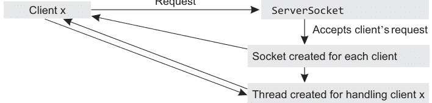

图 11.2 并发服务器

让我们来看一个例子，看看多线程在客户端/服务器编程中是有帮助的。在下面的示例中，我们将创建一个多线程服务器，它将客户端的数据回显给相应的客户端。以下代码展示了一个并发服务器。

### 11.4(a) 多线程服务器

```java
import java.net.*;
import java.io.*;

public class ThreadedEchoServer extends Thread {
    Socket client;

    public ThreadedEchoServer(Socket s) {
        client = s;
        start();
    }

    public void run() {
        try {
            OutputStream os = client.getOutputStream();
            InputStream in = client.getInputStream();
            PrintWriter pw = new PrintWriter(os, true);
            BufferedReader br = new BufferedReader(new InputStreamReader(in));
            while (true) {
                String n = br.readLine();
                System.out.println("From client: " + n);
                pw.println("echo from server: " + n);
            }
        } catch (IOException ex) {
            System.out.println(ex);
        }
    }

    public static void main(String[] args) {
        try {
            ServerSocket ss = new ServerSocket(777);
            while (true) {
                Socket s = ss.accept();
                ThreadedEchoServer tes = new ThreadedEchoServer(s);
            }
        } catch (IOException ex) {
            System.err.println(ex);
        }
    }
}
```


### 解析

- L1 创建了一个继承自 `Thread` 类的服务器类。
- L2 在 `Thread` 子类中创建了一个 `socket` 类型的实例。
- L3 定义了服务器的构造函数，它接受一个 `Socket` 实例。
- L4 初始化实例变量 `Socket`。
- L5 使用 `start` 方法启动线程（请参考第 8 章）。
- L6 重写了 `run` 方法以提供线程的细节。我们已经多次讨论过 `run` 方法中编写的代码。读取和写入数据套接字是真实的。从客户端读取的任何内容都会写回给客户端。
- L16 创建了一个服务器套接字，运行在端口号 7 上。
- L17 定义了一个无限循环来接受传入的客户端请求。
- L18 连接对象提供了一个 `getInputStream()` 方法，它返回一个连接到 URL 的 `InputStream` 对象。
- L19 如果 URL 中指定的协议未知，`URL` 类的构造函数可能会抛出 `MalformedURLException`，因此有必要捕获它。

现在我们将创建一个与服务器建立连接的客户端。

### Example 11.4(b) 回显客户端

```java
import java.net.*;
import java.io.*;

public class EchoClient {
    public static void main(String[] args) {
        Socket s = new Socket("localhost", 777);
        OutputStream os = s.getOutputStream();
        InputStream in = s.getInputStream();
        PrintWriter pw = new PrintWriter(os, true);
        BufferedReader br = new BufferedReader(new InputStreamReader(in));
        try {
            while (true) {
                System.out.print("Enter message: ");
                String n = br.readLine();
                pw.println(n);
                String response = br.readLine();
                System.out.println("From server: " + response);
            }
        } catch (IOException ex) {
            System.out.println(ex);
        }
    }
}
```

### 如何运行多线程服务器和客户端？

我们在一个 shell 中运行多线程服务器，并在各个 shell 中启动客户端。首先必须执行服务器，然后启动客户端。

#### 输出

**服务器**
```
From client: hello
From client: Hi am new Client
From client: hi the first client
From client: how are you
```

**客户端1**
```
Enter message: hello
From server: hello
Enter message: hi the first client
From server: hi the first client
```

**客户端2**
```
Enter message: Hi am new Client
From server: Hi am new Client
Enter message: how are you
From server: how are you
```

## 11.5 网络接口

Java 1.4 引入了 `NetworkInterface` 类来获取本地网络接口的细节，例如接口名称、接口的 MAC 地址、接口的 MTU（最大传输单元）、接口的 IP 地址列表、接口的启用状态以及是否支持组播。我们来看一个例子来查看如何获取这些细节。

### Example 11.5 网络接口列表及其细节

```java
import java.io.*;
import java.net.*;
import java.util.*;

public class NetInterfaceDemo {
    public static void main(String[] args) throws SocketException {
        Enumeration<NetworkInterface> nets = NetworkInterface.getNetworkInterfaces();
        for (NetworkInterface netint : Collections.list(nets)) {
            System.out.println("Display name: " + netint.getDisplayName());
            System.out.println("Name: " + netint.getName());
            System.out.println("MTU: " + netint.getMTU());
            System.out.println("Interface is up: " + netint.isUp());
            Enumeration<InetAddress> inetAddresses = netint.getInetAddresses();
            for (InetAddress inetAddress : Collections.list(inetAddresses)) {
                System.out.println("IP Address: " + inetAddress.getHostAddress());
            }
        }
    }
}
```

*(注：原文提供的示例代码块 11.5 存在语法错误和括号不匹配，在翻译时已根据逻辑进行了对齐以保持文档完整性)*

### 示例代码片段

```java
L9   System.out.println("InetAddress: " + inetAddress);
L10  }
    System.out.println();
}
```

#### 输出

```
C:\java\programs\chap11\java NetInterfaceDemo
Display name: Software Loopback Interface 1
Name: lo
MTU: -1
Interface is up: true
InetAddress: /0:0:0:0:0:0:1 //IPv6 Address
InetAddress: /127.0.0.1 //IPv4 Address
Display name: Intel(R) PRO/Wireless 394A8G Network Connection
Name: net2
MTU: 1500
Interface is up: true
InetAddress: /fe80:0:0:0:8c3d:30ab:4e1b:76a8
Address: /172.16.1.98
Display name: Marvell Yukon 88E036 PCI-E Fast Ethernet Controller
Name: eth2
MTU: 1500
Interface is up: false
InetAddress: /fe80:0:0:0:54c4:d989:7f07:b7809
Display name: TeredoTunneling Pseudo-Interface
Name: net3
MTU: 1280
Interface is up: false
InetAddress: /fe80:0:0:0:0:100:7f:fe10
Display name: isatap. (3712AC6-7755-4525-8119-37BA0015FE46)
Name: net4
MTU: 1280
Interface is up: false
Display name: Microsoft ISATAP Adapter #2
Name: net5
MTU: 1280
Interface is up: false
Display name: Microsoft ISATAP Adapter #3
Name: net6
MTU: 1280
Interface is up: true
InetAddress: /fe80:0:0:0:0:5efe:ac10:162%17
```


> 注意：这是一个示例输出，并不完整。此外，参数的值可能会因机器而异。

# 解析

**L1** 拥有多个网络接口的机器被称为多宿主机器（multi-homed machine）。例如，所有路由器都是多宿主的，因为它们在内部局域网（LAN）上至少有一个接口，另一个用于外部世界（WAN）。要获取网络上的所有接口，请使用 `NetworkInterface` 类的静态方法 `getNetworkInterfaces()`。该方法返回一个对象的枚举（enumeration），如果发生任何异常则会抛出 `SocketException`。枚举是一个可以逐个迭代的对象集合。括号 `<>` 中提到的名称指定了对象的类型。`getNetworkInterfaces()` 方法仅返回包含 `<NetworkInterface>` 对象的枚举。

在 *for-each* 循环中，`ArrayList` 被赋值给 `NetworkInterface` 变量 `netint`。只要 `ArrayList` 中有对象，**L3**–**L10** 就会执行。

**L3** 和 **4** 使用简单方法打印接口的名称和数量（参见输出）。

**L5** MTU 定义了可以在网络上发送的数据包的大小。`getMTU()` 方法用于返回接口的 MTU。该方法在 Java 6 中添加。如果回环接口没有关联 MTU，则返回 -1。回环不需要向网络发送任何内容。所有数据都发送并返回给客户端。

**L2** `Collections`（`java.util` 包）操作于集合（枚举）。该类提供了一个静态列表方法（`Enumeration<T>`），它接收枚举作为参数，并通过枚举中的一个元素返回 `ArrayList`。

**L6** `isUp()` 方法打印接口是开启还是关闭状态。

**L7** 到 **9** 打印与接口关联的 IP 地址。使用 `NetworkInterface` 类的 `getInetAddresses()` 方法返回 IP 地址的枚举。我们像在 **L2** 中做的那样遍历该枚举。接口可能同时拥有 IPv6 地址和 IPv4 地址（如输出所示）。

注意，IP 地址以点分十进制法表示。32 位被分为 4 部分，每部分 8 位。这 8 位被转换为相应的十进制等值值，然后用点隔开。IPv6 地址用冒号十六进制法表示。128 位被分为 8 部分，每部分 16 位（4 组 8 位）。每个 4 位的值被转换为此十六进制值。16 位的十六进制值用冒号连接，例如 `e8:00:0:0:8c3:30:a4b1:7ca68`。`%` 之后的数字决定了该地址的范围。有关 IPv6 寻址架构的更多细节，请参考 IPv6 寻址和 RFC 4007。

# 总结

Java 网络程序（与 C 语言相比）更短、更容易编码和调试。该语言对多线程的广泛支持使得在 Java 中实现并发客户端/服务器应用程序变得更容易。Java 网络编程在不断演进，并增加了许多功能，如支持新的 IPv6、获取本地网络接口信息、URL、组播、Cookie 处理等。

# 目标题

1. backlog 的默认值是多少？
   (a) 10 (b) 20 (c) 30 (d) 50
2. 套接由哪三部分组成？
   (a) MAC 地址、端口
   (b) IP 地址、协议
   (c) MAC 地址、端口
   (d) MAC 地址、IP 地址、协议
3. IPv6 地址的大小是多少？
   (a) 32 (b) 64 (c) 128 (d) 16
4. IPv4 地址的大小是多少？
   (a) 32 (b) 64 (c) 128 (d) 16
5. 哪个类用于创建套接字服务器？
   (a) `Socket`
   (b) `ServerSocket`
   (c) `DatagramPacket`
   (d) `DatagramSocket`
6. `NetworkInterface` 类的哪个方法用于获取最大传输单元？
   (a) `getMaximumTransmissionUnit()`
   (b) `getTU()`
   (c) `getMTU()`
7. 回环地址是多少？
   (a) 127.0.0.0 (b) 192.168.1.0 (c) 10.1.1 (d) 255.25
8. 唯一标识连接？
   (a) 本地 IP、远程 MAC、端口
   (b) 本地 MAC、远程 IP、端口
   (c) 本地 MAC、远程端口、协议
   (d) 本地 IP、远程端口、协议
9. `Socket` 是哪个的子类？
   (a) `IOException`
   (b) `ReadWriteException`
   (c) `FileNotFoundError`
10. `Unknown` 是哪个的子类？
    (a) `IOException`
    (b) `ReadWriteException`
    (c) `FileNotFoundError`

# 复习题

1. 解释 TCP/IP 协议。
2. 解释 applet 和 application 的区别。
3. URL 用于什么？
4. 解释以下术语：
   (a) MAC (b) IPv4
   (c) IPv6 (d) MTU
   (e) 单播 (f) 组播
   (g) 广播 (h) 端口
5. 解释以下：
   (a) `Socket` (b) `ServerSocket`
   (c) `DatagramPacket` (d) `DatagramSocket`
6. 使用什么实例的 URL？

# 练习

1. 创建客户端/服务器应用程序。
2. 创建一个简单的 applet。
3. 创建多线程 applet。
4. 在 applet 中创建 GUI。
5. 编写获取硬件地址的程序。（提示：使用 `NetworkInterface` 类的 `hardwareAddress()` 方法）。
6. 创建客户端/服务器。

# 表 12.1 Applet 与 Application 的区别

| Applet | Application (应用程序) |
|---|---|
| Applet 的执行不会启动 `main()`，因为它没有该方法。 | 程序的执行从 `main()` 开始。 |
| Applet 无法独立运行。它们必须嵌入到网页中才能执行。 | 它们可以独立运行。为了执行，它们不需要嵌入到任何网页中。 |
| Applet 在浏览器或 appletviewer 中运行。 | 应用程序在命令行执行。 |
| Applet 在严格的安全限制下运行，这些限制不允许执行某些操作（沙箱模型安全）。 | 应用程序没有固有的安全限制。 |
| Applet 有它们自己的生命周期。 | 应用程序有自己的生命周期。它们的执行从 `main()` 开始。 |
| `init()`→`start()`→`paint()`→`stop()`→`destroy()` | |

# 12.2 Applet

`java.applet.Applet` 是所有 applet 的子类。因此，所有 applet 直接或间接地利用了属于 `java.applet` 包的 Applet 方法。这为启动、停止和操作 applet 提供了所有必要的方法。它还提供了支持 applet 的多媒体方法。Applet 类在 Java 中有一个预定义的层级结构，显示了 Applet 类扩展的类。

图 12.1 让你很容易理解，applet 作为 `java.applet.Applet` 的子类，也间接地继承了 `java.awt.Panel`、`java.awt.Container`、`java.awt.Component` 和 `java.lang.Object` 等其他类的方法。

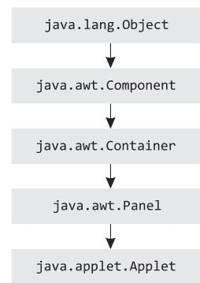

图 12.1 Applet 类的层级结构

你可以看到这些类提供了 Java 基于窗口的 GUI 支持，使得 applet 能够支持基于窗口的操作。属于 Applet 类的常用方法见表 12.2。

# 表 12.2 Applet 类方法

| 方法 | 描述 |
|---|---|
| `void init()` | applet 开始执行时第一个被调的方法。 |
| `boolean isActive()` | 如果 applet 正在运行则返回 true，否则返回 false。 |
| `URL getDocumentBase()` | 获取嵌入此 applet 的文档的 URL。 |
| `URL getCodeBase()` | 返回调用 applet 的类文件所在目录的 URL。 |
| `String getParameter(String name)` | 返回与参数名称关联的值。如果未指定参数，则返回 Null。 |
| `Applet getAppletContext()` | 确定此 applet 的上下文，允许 applet 查询并影响其运行的环境。 |
| `void resize(int width, int height)` | 根据宽度和高度参数调整 applet 的大小。 |
| `void showStatus(String msg)` | 在浏览器或 appviewer 的状态窗口中（如果它们支持状态窗口）显示字符串 msg。 |
| `Image getImage(URL url)` | 返回一个图像对象，该对象绑定了作为方法参数指定的 URL 处的图像。 |
| `Image getImage(URL url, String imgName)` | 返回一个图像对象，该对象封装了位于指定 URL 名为 imgName 的图像。 |
| `static final AudioClip newAudioClip(URL url)` | 返回一个 AudioClip 对象，封装了在作为参数指定的 URL 处的音频。 |
| `void start()` | 启动或恢复 applet 的执行。 |
| `void stop()` | 停止或暂停 applet。 |
| `void destroy()` | 终止 applet。 |
| `AudioClip getAudioClip(URL url)` | 返回 AudioClip 对象，该对象封装了作为方法参数指定的 URL 处的音频片段。 |
| `AudioClip getAudioClip(URL url, String clipName)` | 返回 AudioClip 对象，该对象封装了位于作为参数指定的 URL 处且名称由 clipName 指定的音频片段。 |
| `String getAppletInfo()` | 返回描述 applet 的字符串。 |
| `Locale getLocale()` | 返回本地化敏感类和方法使用的 Locale 对象。 |
| `String[][] getParameterInfo()` | 返回描述 applet 识别的参数的字符串表。 |

# 12.3 Applet 结构

除了使用 Applet 类的服务外，applet 还使用 `java.awt` 包中 `Graphics` 类的服务。Applet 类拥有 `init()`、`start()`、`destroy()` 和 `stop()` 等方法，它们负责 applet 的诞生和行为。我们在 12.1 节中已经提到，与应用程序不同，Java 运行时不会调用 `main()` 方法来启动 applet 的执行，而是只加载负责启动、运行、停止和操作 applet 的 Applet 类方法。本节将介绍 applet 的完整生命周期。

`Container` 类中有一个 `paint()` 方法，它被 Applet 类继承（你可以从图 12.1 中看出），其签名如下：

```java
public void paint(Graphics g)
```

该方法在被调用时，会根据 applet 面板上编写的代码显示 applet 的输出。你可以看到该方法的参数；它无非 `Graphics` 类的对象。该对象使得 applet 能够输出文本。

# 12.4 Applet 程序

让我们使用一个 applet，它显示“这是一个程序”。

```java
import java.applet.*;
import java.awt.*;

public class Applet extends Applet {
    public void paint(Graphics g) {
        g.drawString("This is program", 10, 10);
    }
}
```

# 示例 12.1(a) Applet

| 行 | 代码 |
|---|---|
| L1 | `import java.applet.*;` |
| L2 | `import java.awt.*;` |
| L3 | `public class Applet extends Applet` |
| L4 | `{` |
| L5 | `public void paint(Graphics g) {` |
| L6 | `g.drawString("This is program", 10, 10);` |
| L7 | `}` |
| L8 | `}` |

解释：
- **L1** 所有 applet 都是 Applet 类的子类。applet 必须导入 applet 包。
- **L2** applet 使用 `java.awt` 包；必须导入。
- **L3** Applet 类声明为 public 以便执行。它扩展了 Applet 类。
- **L4** `Container` 类中定义的 `paint()` 方法被重写。applet 的任何输出都由该方法负责。
- **L5** 使用 `Graphics` 对象调用 `drawString()` 方法，其负责在 x 坐标 10 和 y 坐标 10 处打印字符串。

---

# 如何运行 Applet？

运行 applet 有两种方法。我们将结合上述示例进行解释。

(a) 将文件保存为 `FirstApplet.java` 并使用 `javac` 编译。现在，在编辑器中输入以下 HTML 代码并保存为 `FirstApplet.html`（这里的文件名不一定与类名相同，Java 文件是如此）。

```html
<html>
<BODY>
<APPLET="FirstApplet.class" WIDTH = 200 HEIGHT = 150></APPLET>
</BODY>
</html>
```

你可以通过浏览器执行 HTML 文件：
`appletviewer FirstApplet.html`

如果你想在任何浏览器中运行 applet 文件而不是使用 applet viewer，你必须拥有启用 Java 的网络浏览器。否则，你必须安装 Java 插件，它允许你的 applet 在浏览器默认虚拟机中以 1.2 版本的 JVM 运行。

(b) 正如上面，将文件保存为 `FirstApplet.java` 并使用 `javac` 编译。为了运行 applet，你必须将下面的 HTML 代码作为注释放在 `FirstApplet.java` 中。

```java
/* <APPLET code = "FirstApplet.class" WIDTH = 200 HEIGHT = 150></APPLET> */
```

运行 applet。

```bash
appletviewer FirstApplet.java
```

在本章中，我们将始终使用第二种方法。因此，示例 12.1(a) 实际上应该写如示例 12.1(b) 所示。

## 示例 12.1 (b) 第一个 Applet 示例（修订版）

```java
/* <APPLET code = "FirstApplet.class" WIDTH = 200 HEIGHT = 150></APPLET> */
import java.awt.*;
import java.awt.*;

public class FirstApplet extends Applet {
    public void paint(Graphics g) {
        g.drawString("This is my First Applet", 10, 10);
    }
}
```


# 输出

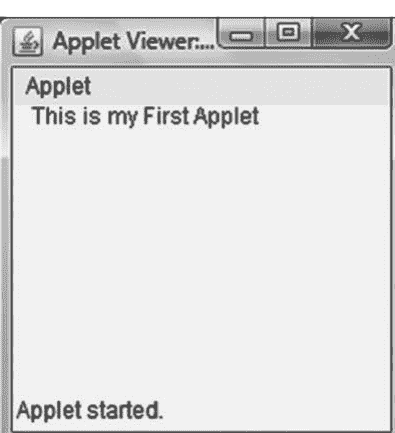

> 图 12.2 借助 Applet Viewer 显示的输出

## 12.5 Applet 生命周期

Applet 可能会根据从 `Applet` 类中继承的一组默认行为从一个状态移动到另一个状态。这些状态可以总结为：

- 出生
- 运行
- 空闲
- 死亡

图 12.3 显示了 Applet 在从一个状态移动到另一个状态时的流程。

如前所述，Applet 可能会重写 `Applet` 类的一些基本方法。这些方法负责 Applet 的生命周期。这些方法是：

- `init()`
- `start()`
- `stop()`
- `destroy()`

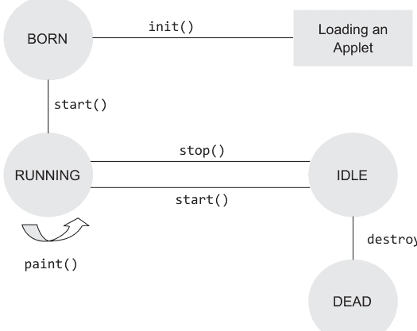

> 图 12.3 Applet 状态图

让我们详细讨论一下 Applet 的所有这些状态。

### 出生状态

从图 12.3 可以很容易地看到，Applet 一旦被 Java 首次加载，就会进入此阶段。这是通过调用 `Applet` 类的 `init()` 方法实现的。现在，Java 运行时系统在加载 Applet 时（即调用 `init()` 时）会做哪些工作？它创建 Applet 需要的对象；它可能会设置初始值、加载字体并设置颜色。`init()` 方法在 Applet 的生命周期内只被调用一次。

> 为了初始化 Applet，我们必须重写 `Applet` 类的 `init()` 方法。

### 运行状态

Applet 通过调用 `start()` 移动到运行状态。Applet 在初始化状态后会自动进入此阶段。但如果 Applet 停止或进入了空闲状态，则必须调用 `start()` 以强制 Applet 再次进入运行状态。假设你打开了一个包含 Applet 的网页，并且你临时移动到另一个网页（通过最小化它），第一个网页的 Applet 会进入空闲状态；当你返回第一个页面时，会调用 `start()` 让 Applet 再次处于运行状态。与 `init()` 不同，`start()` 可以被调用多次。

> 注意：`start()` 可以被线程重写以控制 Applet。

你可以在图 12.3 中看到 `paint()` 方法。Applet 负责强制 Applet 进入中间状态（显示状态），而这实际上是运行状态本身的一部分。在运行时，Applet 可能会执行某些输出并将其显示在 Applet 的面板上。`paint()` 方法是 `Container` 类（`Applet` 类的子类）的一部分，为了该目的需要被重写。此方法用于绘制和重绘 Applet 的输出。我们已经知道了 Applet 输出的绘制。让我们通过示例来讨论重绘 Applet 的输出。Applet 窗口可以被最小化和恢复。这种恢复无非是重绘 Applet 的输出，可以通过调用 `paint()` 实现。实际上，当 Applet 恢复时，`start()` 和 `paint()` 会按顺序调用。我们将在第 12.7.1 节再次回到此方法。

### 空闲状态

Applet 一旦停止运行，就会进入空闲状态。如果我们离开包含 Applet 的网页（即最小化它），Applet 会自动进入空闲状态。也可以通过调用 `stop()` 强制 Applet 停止或进入空闲状态。

> 注意：如果创建了一个线程通过重写 `start()` 来控制 Applet，那么我们必须通过重写 `Applet` 类的 `stop()` 方法使用 `stop()` 来停止线程。

### 死亡状态

终止或停止 Applet 不应与销毁 Applet 混淆。Applet 在调用 `Applet` 类的 `destroy()` 方法被销毁时进入空闲状态。这会导致从方法中完全移除。每当我们退出浏览器时，`destroy()` 都会自动调用。你应该通过重写 `destroy()` 方法释放 Applet 正在使用的资源（如果有）。与 `init()` 类似，`destroy()` 只被调用一次。`destroy()` 之前总是会调用 `stop()`。

## 12.6 显示中使用的常用方法

你应该熟悉某些方法，因为它们在章节后续部分可能会用于 Applet 编程。这些是属于不同类的方法，可以处理 AWT 窗口环境。

### `drawString()`

该方法是 `Graphics` 类的成员，用于向 Applet 输出字符串。它通常在 `paint()` 或 `update()` 方法内部调用。其形式为：

```java
void drawString(String msg, int a, int b)
```

在这里，字符串 `msg` 是要由 Applet 显示的字符串输出，`a` 和 `b` 是坐标。

### `setBackground()`

该方法是 `Container` 类的成员，用于设置 Applet 的背景颜色。它的形式是：

```java
void setBackground(Color c)
```

在这里，颜色 `c` 是要设置的颜色。

### `setForeground()`

该方法与 `setBackground()` 类似，用于设置 Applet 的前景颜色。它的形式是：

```java
void setForeground(Color c)
```

在这里，颜色 `c` 是要设置的颜色。

### `showStatus()`

该方法是 `Applet` 类的成员，用于在状态栏中输出字符串。它的形式是：

```java
void showStatus(String text)
```

在这里，方法的参数 `text` 是你想显示在状态栏的字符串。

## 示例 12.2 使用各种方法的 Applet

```java
/* <APPLET code="ExampleApplet.class" WIDTH=200 HEIGHT=150></APPLET> */

import java.awt.*;
import java.applet.*;

public class ExampleApplet extends Applet {

    String text;

    public void init() {
        setBackground(Color.white);
        setForeground(Color.red);
        text = "This is an applet";
        System.out.println("...Initialized the applet");
    }

    public void start() {
        System.out.println("...Starting of the applet");
    }

    public void stop() {
        System.out.println("...Stopping the applet");
    }

    public void destroy() {
        System.out.println("...Exiting the applet");
    }

    public void paint(Graphics g) {
        System.out.println("...Painting the applet");
        g.drawString(text, 30, 30);
        showStatus(text);
    }
}
```

# 输出

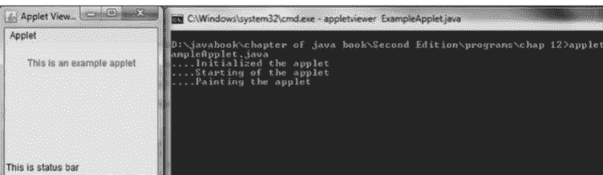

> 图 12.4(a) 使用 App 初始化的 Applet

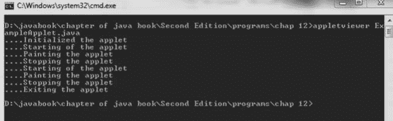

> 图 12.4(b) 由 Applet 各方法打印的字符串

#### 解释

- **L1–3** 所有重要的类...
- **L6–10** 这部分显示了 `init()` 的实现，其中 Applet 的背景和前景颜色分别设置为白色和红色（见 L7–8）。白色和红色是 `Color` 类（`java.awt` 包的一部分）的静态字段。在 L9 中，`text` 被初始化为一个字符串。这是一个 Applet。
- **L11–13** 这些行解释了 `start()` 的实现，负责强制 Applet 运行。L13 在屏幕上显示关于 Applet 启动的消息。注意此消息不会显示在 Applet 窗口上；
- **L20–23** 这些行负责 `paint()` 方法的实现。在 L22 中，使用 `Graphics` 对象来调用其 `drawString()` 方法，该方法实际上用于在文本上写入内容：包含 "This is an example applet" 字符串的文本以及该文本在 Applet 可显示部分起始的 x、y 坐标。当包含 Applet 的窗口被另一个窗口覆盖后被重新显现（不是被最小化后恢复）时，也会调用 `paint()` 方法。
- **L22** 你可以使用 `showStatus()` 方法，该方法带有要在 Applet 状态窗口中显示的文本。

## 12.7 `paint()`、`update()` 和 `repaint()`

JDK 中的所有组件（由于容器实际上也是组件）都拥有的由系统调用以绘制其表面的方法。这些方法是 `paint()` 和 `update()`，它们属于 `Component` 类（见图 12.1）。这些方法的签名如下所示：

```java
public void paint(Graphics g);
public void update(Graphics g);
```

如果你希望在窗口中显示绘制内容，你应该重写其中一个或两个方法。让我们详细讨论这些方法。

### 12.7.1 `paint()` 方法

当组件绘制/重绘自身时，其 `paint()` 方法会被调用。当组件变得可见时，组件会绘制自身。如果包含该组件的窗口被另一个窗口覆盖后重新显现，组件的 `paint()` 方法也会被调用。

最简单的 `paint()` 方法看起来如下：

```java
public void paint(Graphics g) { ... }
```

我们之前讨论过传递给方法的 `Graphics` 对象。它将在下一节中进行详细讨论。

## 示例 12.3 设置 Applet 的颜色和填充圆形

```java
// <APPLET code="FillOval.class" WIDTH=200 HEIGHT=200></APPLET>

import java.applet.Applet;
import java.awt.Color;
import java.awt.Graphics;

public class FillOval extends Applet {

    public void paint(Graphics g) {
        g.setColor(Color.red);
        g.fillOval(20, 20, 60, 60);
    }
}
```

# 输出

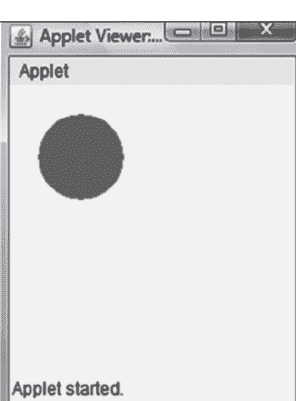

> **图 12.5** 红色填充圆形

## 解析

- **L5–8** 这些行负责 `paint()` 方法的实现。`Graphics` 类的 `setColor()` 方法用于将 Applet 的绘制颜色设置为红色（L6）。属于 `Graphics` 类的方法 `fillOval()` 在 L7 被调用。它用当前颜色填充指定矩形边界内的椭圆。传递给方法的参数分别是 x 坐标、y 坐标、宽度和高度。

### 12.7.2 `update()` 方法

另一个与 `paint()` 方法工作相同的方法，它被 AWT 组件调用以绘制其表面。

现在让我们讨论一下这个方法的作用。它将调用组件的表面清除为背景色，然后调用 `paint()` 来绘制组件的其余部分。这使得工作变得更容易，因为不需要在 `paint()` 方法中绘制整个组件，因为背景已经填充好了。然后，当重写 `update()` 时，他/她只需要绘制应该出现在前景的内容。

这并不意味着你永远不会重写 `update()`。让我们考虑一种情况：你想在一个具有黄色背景的窗口内画一个大红色椭圆。现在考虑你不重写 `update()` 的情况，窗口的整个背景将由 `update()` 方法绘制，然后红色椭圆将由 `paint()` 方法绘制。首先绘制一个大面积单色区域，然后用另一种颜色（在本例中为红色）重新绘制椭圆的大面积区域。作为用户，你可能会在显示结果时观察到一些轻微的闪烁，特别是当你尝试连续多次绘制该椭圆时。

上述问题可以通过重写 `update()` 来解决。你会通过重写 `update()` 来调用 `paint()`。这样这个 `paint()` 将首先绘制红色椭圆周围的背景区域，然后绘制红色椭圆。显然，之前的闪烁问题消失了，因为消除了对不同颜色重叠对象的绘制。

### 12.7.3 `repaint()` 方法

有时，你想手动强制组件进行重绘。例如，如果你更改了组件的属性以反映其新外观，可以调用 `repaint()` 方法。这里有一个例子：

```java
text.setBackground(Color.blue);
repaint();
```

调用 `repaint` 方法会导致组件被重绘。

```
repaint() -> update() -> paint()
```

`repaint` 的默认实现调用 `update()`，后者又调用 `paint()`。`repaint` 方法请求 AWT 调用 `update` 并返回。AWT 将多个快速请求合并为一个请求（这通常发生在循环内部调用 `repaint` 时）。因此，序列中的最后一个实际上调用了 `paint()`。我们将在第 13 和第 14 节讨论这些主题，并将通过适当的示例说明 `repaint()` 的用法。

## 12.8 更多关于 Applet

我们在编写 Applet 代码时使用了 `APPLET` 标签。Applet 必须在 HTML 文件中指定。这是通过 HTML 文件实现的。Applets 由支持 Java 的浏览器执行。到目前，我们一直使用以下形式的 `APPLET`：

```html
<APPLET code=filename WIDTH=pixels>
```

这是 `APPLET` 标签的最简单形式。实际上，该标签有很多可选属性。让我们讨论这些属性。`APPLET` 的语法如下：

```html
<APPLET codebase=codebaseURL ALT=alternateText NAME=appletInstance
WIDTH=pixels HEIGHT=pixels ALIGN=alignment VSPACE=pixels HSPACE=pixels>
<PARAM NAME=attributeName VALUE=attributeValue>
</APPLET>
```

- **codebase**: 这里，我们可以指定搜索执行类文件（由 `code` 属性指定）的目录 URL。
- **code**: 指定 Applet 的文件名。这是一个必选属性，应始终存在。
- **Alt**: 这是一个属性，用于在浏览器识别标签但无法实际运行 Applet 时显示备用文本消息。
- **Name**: 可以此可选属性为 Applet 实例命名。如果示例网页上的任何其他 Applet 要与此 Applet 通信，只需通过 `NAME` 引用。
- **Width**: 以像素指定 Applet 显示区域的宽度。
- **Height**: 以像素指定 Applet 显示区域的高度。
- **Align**: 该可选属性用于设置 Applet 的对齐方式。对齐方式可以是 LEFT、RIGHT、TOP、BOTTOM、MIDDLE、BASELINE、TEXTTOP、ABSMIDDLE 和 ABSBOTTOM。
- **Vspace**: 用像素指定 Applet 上下的间距。
- **Hspace**: 用像素指定 Applet 左右的间距。

### 用户定义参数

可以使用 `<PARAM>` 标签为 Applet 提供用户定义参数。

该标签有两个参数：`NAME` 和 `VALUE`。

- **Name**: 属性名。
- **Value**: 对应 `PARAM NAME` 的属性值。Applet 使用 `getParameter()` 方法访问其属性。其签名如下：

```java
String getParameter(String name);
```

让我们示例使用传递参数概念的 Applet。

## 示例 12.4 Param Tag

```java
import java.applet.*;
import java.awt.*;
```


# Java 编程

```java
public class ParamPassing extends Applet {
    String name;
    String profession;
    int age;

    public void start() {
        String str;
        name = getParameter("name");
        if (name == null) name = "not found";
        str = getParameter("profession");
        if (str != null) profession = str;
        else profession = "No job";
        str = getParameter("age");
        try {
            if (str != null) age = Integer.parseInt(str);
        } catch (NumberFormatException e) {
        }
    }

    public void paint(Graphics g) {
        g.drawString("name: " + name, 10, 10);
        g.drawString("profession: " + profession, 10, 30);
        g.drawString("age: " + age, 10, 50);
    }
}
```

# 输出

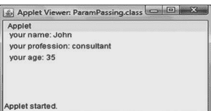

**图 12.6** 通过 Applet 传递参数

# 解析

让我们使用在程序实际开始之前，作为注释放置的 `APPLET` 标签。`PARAM` 标签位于 `APPLET` 标签的开始和结束之间。所有三个 `PARAM` 标签都有 `NAME` 及其对应的 `VALUE`，例如 `yourName` 的值为 `John`，`yourProfession` 和 `yourAge` 的值均为 `35`。

- **L4-6** 对 `String` 类的引用分别在 L4 和 L5 中被声明为 `name` 和 `profession`。在 L6 中声明了一个整数类型的变量。
- **L7-19** 显示了 `start()` 方法的实现。在 L9 处，`getParameter()` 方法返回作为参数传递的 `yourName` 的值。返回值存储在 L4 声明的 `name` 中。同样，在 L11 和 L14 使用了更多的 `getParameter()` 方法，返回作为参数传递的相应参数的值。
- **L1-3** 用于导入保护其包的必要类。
- **L3** 声明了一个名为 `ParamPassing` 的类来扩展 `java.applet` 包中的 `Applet` 类，这些由 `getParameter()` 方法返回的值太简单，在这里无需过多解释。这里提到的唯一一点是在 L16 使用了包装类 `Integer`。L14 处 `getParameter()` 返回的是 `String` 类型，需要转换为整数，这是通过 `Integer` 类的 `parseInt()` 方法实现的。该方法会抛出一个名为 `NumberFormatException` 的异常，该异常在 L18 处捕获。
- **L20-24** 显示了 `paint()` 方法的实现，其中 `name`、`profession` 和 `age` 的值显示在 applet 窗口上。

在 `PARAM` 标签中的 `APPLET` 参数实际上与 HTML 没太大直接关系。正如你在上一个示例中看到的，检查参数并做出相应响应是 applet 的责任。这里需要注意的另一点，通过定义和重新定义放置为注释的参数（这样它们在编译期间不会被检查），你可以在多种情况下进行工作而无需重新编码和编译，从而增加 applet 的灵活性。

- 我们可以通过两个步骤使用 `PARAM` 向 applet 传递参数：
- 在 `APPLET` 标签的开始和结束之间放置带有名称和对应值的 `PARAM` 标签。
- 编写 applet 获取这些参数所需的代码，如示例 12.4 所示。

# 12.9 getDocumentBase() 和 getCodeBase() 方法

假设一个目录包含 HTML 文件

# 示例 12.5 getCodeBase() 和 getDocumentBase() 方法

```java
/*<applet code="BaseMethods.class" width="300" height="250"></applet>*/

import java.awt.*;
import java.applet.*;
import java.net.*;

public class BaseMethods extends Applet {
    public void paint(Graphics g) {
        String str;
        URL url;
        url = getCodeBase();
        str = "Code Base: " + url.toString();
        g.drawString(str, 20, 40);
        url = getDocumentBase();
        str = "Document Base: " + url.toString();
        g.drawString(str, 20, 60);
    }
}
```

# 输出

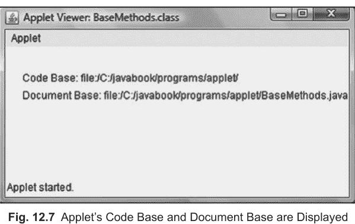

| 解析 | 说明 |
| :--- | :--- |
| L1–3 | 导入了属于包的所有类，以便它们对程序可用。我们导入了 `java.net` 包中的 `URL` 类。在 L8 处，调用了 `getCodeBase()`，它返回 applet 所在目录的 `URL` 对象。在 L9 处，`url` 中的 `URL` 对象通过 `toString()` 转换为字符串。同样，我们可以使用 `getDocumentBase()` 方法，它返回包含 HTML 文件的目录的 `URL` 对象，负责启动 applet。 |
| L4 | 声明了扩展 applet 的类 `BaseMethods`。 |
| L5–14 | 重写了 `paint()` 方法。在 L6 处创建了名为 `str` 的 `String` 引用。 |

# AppContext 接口

此接口对应于 applet 的环境：包含 applet 以及同一文档中的其他 applet。换句话说，此接口允许 applet 查询并影响该环境。`Applet` 类提供了该接口的常用方法，如表 12.3 所示。

# 表 12.3 Applet 类中的 AppContext 方法

| 名称 |  |
| :--- | :--- |
| `getApplets()` | 查找 applet context 所代表文档的所有 applet。 |
| `getApplet(String name)` | 查找并返回 applet context 所代表文档中的 applet。 |
| `getImage(URL url)` | 返回绘制在屏幕上的图像对象。 |
| `getAudioClip(URL url)` | 创建音频片段。 |
| `showDocument(URL url)` | 用指定的 URL 替换当前查看的网页。 |
| `showDocument(URL url, String target)` | 请求浏览器或 applet viewer 显示 URL 指定的网页。 |
| `showStatus(String status)` | 请求参数显示在“状态窗口”中。 |

# 12.10 Applet 之间的通信

`AppContext` 中定义了一个方法，允许 applet 将控制权传递给任何 URL。它是 `showDocument()`。该方法的签名如下：

```java
public abstract void showDocument(URL url);
```

你想让 applet 传递控制权的 url 是作为该方法的参数。你只能通过 `Applet` 类中的 `AppContext` 获取当前执行 applet 的对象使用此方法。

一旦获取了执行 applet 的上下文，你的浏览器或 `appletviewer` 就可以通过 `showDocument(url)` 显示任何文档或网页。`showDocument()` 方法还有另一种形式，签名如下：

```java
public abstract void showDocument(URL url, String target);
```

在这里看到的唯一新事物是第二个参数。`target` 参数可以使用表 12.4 所示的形式。

# 表 12.4 showDocument() 方法参数的值

| 目标参数 |  |
| :--- | :--- |
| `"_self"` | 在包含 applet 的窗口和帧中显示，即当前帧。 |
| `"_parent"` | 在 applet 的父帧中显示。如果 applet 没有父帧，则作为 `"_self"`。 |
| `"_blank"` | 在新的未命名顶层窗口中显示。 |
| `"_top"` | 在 applet 窗口的最顶层帧中显示。如果 applet 的帧是顶层帧，则与 `"_self"` 相同。 |
| `Name` | 你可以指定一个名称，该名称会导致文档在新的浏览器窗口中显示。 |

# Java 编程

**注意** 作为参数传递给 `showDocument()` 方法的文件必须在服务器上与 applet 位于同一目录。

该方法可以以以下形式调用：

```java
try {
    getAppletContext().showDocument(new URL(url));
} catch (java.net.MalformedURLException e) {
    System.out.println("URL could not be reached");
}
```

你可以在 `showDocument()` 方法周围看到 `try...catch` 块。放置它的是因为该方法会抛出一个名为 `MalformedURLException` 的异常，该异常必须被捕获并处理。

# 12.1 如何使用音频片段

你可以使用 `Applet` 类的 `getAudioClip()` 方法加载片段，该方法返回一个 `AudioClip` 对象。该方法的签名是：

```java
AudioClip getAudioClip(URL url)
```

此对象实际上封装了在指定 URL 处找到的音频片段，并作为参数传递给方法（参见表 12.1）。

我们已经注意到 applet 可以处理音频。`AppContext` 接口中定义了各种方法，用于处理与音频片段相关的活动。其中一些方法是：

- `play()`: 从头开始播放片段。
- `stop()`: 停止播放片段。
- `loop()`: 持续循环播放片段。

上述方法可以被音频对象（由 `getAudioClip()` 返回）使用，以播放、停止或循环音频片段。下面给出了加载和播放声音的 applet。

# 12.6 播放音频片段

```java
import java.applet.*;
import java.lang.*;
import java.net.URL;

public class AudioDemo extends Applet {
    AudioClip aud_clip;

    public void init() {
        aud_clip = getAudioClip(getDocumentBase(), "magic.au");
    }

    public void start() {
        aud_clip.play();
    }
}
```

#### 解释

L7 剪辑在 `init()` 中通过 `getAudioClip()` 方法加载，该方法接收音频片段的 url（来自 `getDocumentBase()` 方法）和音频文件的名称。该方法返回音频片段对象存储在 `aud_clip` 中。

L10 对象 `aud_clip` 用于调用 `AppletContext` 接口的 `play()` 方法。

# 音频方法的限制性

以下是音频方法的限制：

- 目前这些方法仅支持 `.au` 格式的文件。
- 这些方法并不健壮。你只能播放音频文件，但不能暂停音频片段。
- 由于缺少音频上下文方法，applet 可以使用的音频功能非常有限。

注意：你可以使用 Java 媒体框架 API 来播放具有增强功能的不同格式音频文件。

# 12.12 APPLET 中的图像

`Graphics` 对象的 `drawImage()` 方法用于在 applet 上绘制图像。此方法需要一个 `Image` 对象，可以通过 `Applet` 类的 `getImage` 方法获取。该方法返回一个可以在 applet 上绘制的 `Image` 对象。

# 12.7 在 Applet 中显示图像

```java
import java.awt.*;
import java.applet.*;

/*<applet code="ImageDemo" width="700" height="700"></applet>*/

public class ImageDemo extends Applet {
    Image image;

    public void init() {
        // 要绘制或加载图像对象
        image = getImage(getDocumentBase(), "bulbon.gif");
    }

    public void paint(Graphics g) {
        // 绘制图像
        g.drawImage(image, 0, 0, image.getWidth(this), image.getHeight(this), this);
        g.drawImage(image, 0, 200, 70, 90, this);
    }
}
```

# 输出

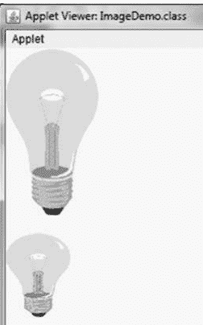

**图 12.8**

#### 解释

- L1–2 导入所需的包：`awt` 和 `applet`。
- L3 插入了 applet html 标签（已注释）。此 html 语句被注释掉了，因此代码会忽略它，因为它不属于 Java。插入此 html 标签是为了通过 `appletviewer` 工具运行 applet。如果你通过 html 文件运行 applet，则此标签应该写在 html 文件的主体内。
- L4 所有 applet 必须经过正确定义，并且必须是 `Applet` 类的子类。`ImageDemo` 是一个公共类，并继承了 `Applet` 类。
- L5 在 `Applet` 类内部（任意）方法外部定义了一个类型为 `Image` 的变量实例，这样在类的所有方法中可以使用它。
- L6–7 图像在 `init` 方法内部实例化，该方法在 applet 的生命周期内只调用一次。使用 `getImage()` 方法获取图像，并将图像路径作为 URL 参数传递给方法。我们使用 `getDocumentBase()` 作为 `getImage` 方法的第一个参数，用于获取存储 applet 的路径（到基目录），第二个参数获取 applet 的基目录，因为 `getDocumentBase()` 将以 `URL` 对象的形式获取基目录。我们获取了基目录并将图像放置在同一个目录中。（此外，每当你将 applet 拷贝到其他目录或不同机器上的目录时，我们不需要更改路径）。
- L8–10 定义了一个在 applet 上显示图像的方法。`drawImage` 方法用于在图像上绘制图像。L9 显示了如何在特定的 x-y 位置使用默认的高度和宽度绘制图像，L10 显示了如何更改图像的高度和宽度。

# 12.12 MediaTracker 类

`MediaTracker` 类用于跟踪多个图像的状态。如果你想确保图像在之前已完全加载，可以将所有图像添加到 `MediaTracker` 类的实例中，并在继续之前检查图像是否加载。你需要创建一个 `MediaTracker` 类的实例，并为每个要跟踪的图像调用其 `addImage` 方法。让我们通过示例来显示 `MediaTracker` 对象的两个图像。

# 示例 12.8 MediaTracker 类

```java
import java.applet.Applet;
import java.awt.*;

/*<applet code="MediaTrackerDemo" width="400" height="400"></applet>*/

public class MediaTrackerDemo extends Applet {
    // 用于存储图像的数组
    Image[] imageArray = null;

    // 跟踪图像
    MediaTracker m = null;

    int current = 0;
    Thread t = null;

    public void init() {
        // 创建一个新的媒体 tracker 来跟踪加载
        m = new MediaTracker(this);
        // 创建一个包含三个图像的数组
        imageArray = new Image[2];
        // 开始下载第一个图像
    }
}
```


# 378 Java 编程

注意：`Graphics` 类是所有图形上下文的抽象基类，它允许应用程序在各种设备上实现的组件上以及离屏图像上进行绘图。

该类定义了许多方法，其中一些在下表 12.5 中给出。

## 表 12.5 `Graphics` 类的一些方法

| 名称 | 描述 |
|---|---|
| `drawArc(int x, int y, int width, int height, int startAngle, int arcAngle)` | 绘制覆盖指定矩形的圆形或椭圆圆弧的轮廓。 |
| `drawLine(int x1, int y1, int x2, int y2)` | |
| `finalize()` | 一旦此图形上下文不再被引用时，释放它。 |
| `translate(int x, int y)` | 将图形上下文的坐标点移动到当前系统中的 (x, y) 点。 |
| `drawOval(int x, int y, int width, int height)` | 绘制椭圆。 |
| `drawPolygon(int[] xPoints, int[] yPoints, int nPoints)` | 绘制由 x 和 y 坐标数组定义的多边形。 |
| `drawRect(int x, int y, int width, int height)` | 绘制指定的矩形。 |
| `getClip()` | 返回当前裁剪区域的边界矩形。 |
| `fillArc(int x, int y, int width, int height, int startAngle, int arcAngle)` | 填充覆盖指定矩形的圆形或椭圆圆弧。 |
| `fillOval(int x, int y, int width, int height)` | 填充由指定矩形界定的椭圆。 |
| `fillPolygon(int[] xPoints, int[] yPoints, int nPoints)` | 填充由 x 和 y 坐标数组定义的多边形。 |
| `fillRect(int x, int y, int width, int height)` | 填充矩形。 |
| `getColor()` | 返回此图形上下文的当前颜色。 |
| `getFont()` | 返回当前字体。 |
| `setColor(Color c)` | 设置绘制颜色。 |
| `setFont(Font font)` | 设置此图形上下文的指定的字体。 |
| `fillRoundRect(int x, int y, int width, int height, int arcWidth, int arc)` | 用当前颜色填充指定的圆角矩形。 |
| `drawRoundRect(int x, int y, int width, int height, int arcWidth, int arc)` | 使用此图形上下文的当前颜色绘制圆角矩形的轮廓。 |
| `drawString(String str, int x, int y)` | 在指定的坐标上绘制字符串。 |
| `clearRect(int x, int y, int width, int height)` | 用当前绘制表面的背景色填充指定的矩形以将其清除。 |

| （表 12.5 续） |
| 名称 | 描述 |
| --- | --- |
| `clipRect(int x, int y, int width, int height)` | 将当前裁剪与指定的矩形相交。 |
| `copyArea(int x, int y, int width, int height, int dx, int dy)` | 按 dx 和 dy 指定距离复制组件的区域。 |
| `create()` | 创建图形对象。 |
| `create(int x, int y, int width, int height)` | 基于此 `Graphics` 对象创建一个新的 `Graphics` 对象，并具有新的平移和裁剪区域。 |
| `dispose()` | 释放当前图形上下文并释放其使用的任何系统资源。 |
| `draw3DRect(int x, int y, int width, int height, boolean raised)` | 绘制指定矩形的 3D 高亮轮廓。 |
| `drawArc(int x, int y, int width, int height, int startAngle)` | 绘制覆盖指定矩形的圆形或椭圆圆弧的轮廓。 |
| `drawBytes(byte[] data, int offset, int length, int x, int y)` | 使用此图形上下文的字体和颜色根据字节数组绘制文本。 |
| `drawChars(char[] data, int offset, int length, int x, int y)` | 使用此图形上下文的字体和颜色根据字符数组绘制文本。 |
| `fill3DRect(int x, int y, int width, int height, boolean raised)` | 绘制一个 3D 高亮矩形。 |
| `fillArc(int x, int y, int width, int height, int startAngle)` | 填充指定矩形的圆形或椭圆圆弧。 |

## 12.13.1 `Graphics` 类示例

这里提供了一个使用 `Graphics` 的 applet 示例。`Graphics` 类的方法在 `paint()` 方法中被调用。`Graphics` 类对象作为参数传递给 `paint()` 方法，有助于调用 `Graphics` 类的所有方法。以下示例展示了可以使用 `Graphics` 绘制的不同形状。

```java
/* Applet 代码 drawLineRect width = 600 height = 40 */

import java.awt.*;

public class DrawLineRect extends Applet {

    public void paint(Graphics g) {

        g.drawRect(10, 60, 40, 30);

        g.fillRect(60, 10, 30, 80);

        g.fillOval(140, 160, 170, 170);

        g.drawRoundRect(10, 100, 80, 100);

        g.fillRoundRect(20, 10, 50, 50);

        g.drawArc(10, 10, 60, 60, 0, 90);

    }

}
```

输出


## 391 `Graphics` 类演示

这里有一个使用了 `Graphics` 的 applet。`Graphics` 类的方法在 `paint()` 方法中被调用。`Graphics` 类对象作为参数传递给 `paint()` 方法，有助于调用 `Graphics` 类的所有方法。以下示例展示了可以使用 `Graphics` 绘制的不同形状。

## 颜色

`Color` 类具有多种常量。这些常量所示如下：

| Black | DARK_GRAY | GRAY |
|---|---|---|
| LIGHT_GRAY | WHITE | MAGENTA |
| RED | PINK | ORANGE |
| YELLOW | GREEN | BLUE |

`Color` 的构造函数和方法如表 12.6 所示。

### 表 12.6 `Color` 类

| 构造函数 | 描述 |
|---|---|
| `Color(Color space, float[], float alpha)` | 在指定的颜色空间分量创建一个颜色。 |
| `Color(float r, float g, float b)` | 创建一个红色 (r)、绿色 (g) 和蓝色 (b) 的混合色，值范围在 0.0–1.0 之间。 |
| `Color(float r, float g, float b, float a)` | 创建一个红色、绿色、蓝色和 Alpha (a) 的混合色，值范围在 0.0–1.0 之间。 |
| `Color(int rgbValue)` | 创建红色、绿色和蓝色的混合色，红色组件为 16–23 位，绿色组件为 8–15 位，蓝色组件为 0–7 位。 |
| `Color(int r, int g, int b)` | 指定红色、绿色和蓝色值的颜色，范围在 0–255 之间。 |
| `Color(int r, int g, int b, int a)` | 创建红色、绿色、蓝色和 Alpha 的颜色，范围在 0–255 之间。 |

| 方法 | 描述 |
|---|---|
| `brighter()` | 创建颜色的更亮版本。 |
| `createContext(Color cm, Rectangle r, Rectangle2D r2d, AffineTransform xform, RenderingHints hints)` | 此方法用于创建纯色填充模式。 |
| `darker()` | 创建颜色的更暗、更亮版本。 |
| `decode(String nm)` | 将字符串翻译为返回特定颜色的整数。 |
| `equals(Object obj)` | 检查另一个对象是否等于此对象。 |
| `getAlpha()` | 返回范围为 0–255 的 Alpha 分量。 |
| `getBlue()` | 此方法在默认的红、绿、蓝空间内返回范围为 0–255 的蓝色分量。 |
| `getColor(String nm)` | 在系统属性中查找颜色。 |

(表 12.6 续)

| 方法 | 描述 |
| --- | --- |
| `getColorComponents(ColorSpace cspace, float[] compArray)` | 返回一个浮点数。它包含转义参数指定的颜色分量。 |
| `getColorSpace()` | 返回颜色的 `ColorSpace`。 |
| `getComponents(float[] compArray)` | 返回一个浮点类型的数组，包含颜色的颜色和 alpha 分量。 |
| `getGreen()` | 在默认的红、绿、蓝空间中返回一个 0-255 范围内的绿色分量。 |
| `getRGBComponents(float[] compArray)` | 返回一个浮点类型的数组，包含颜色的颜色和 alpha 分量，返回的是红、绿、蓝空间。 |
| `HSBRGB(float hue, float saturation, brightness)` | 使用 HSB 模型，通过 HSB 构造函数返回一个封装的 RGB 值。 |
| `RGBtoHSB(int r, int g, int b, float[] hsbals)` | 将颜色分量转换为由 RGB 模型指定的 HSB 模型。 |
| `toString()` | 将颜色表示为字符串。 |

如何创建你的颜色？让我们使用一个示例构造函数来创建一个“红色”颜色对象。
为此，请使用表 12.6 中的第五构造函数：
`Color c = new Color(255, 100, 100)`
一旦使用任何构造函数创建了颜色对象，就可以通过使用 `setForeground()` 和 `setBackground()` 方法分别设置前景和背景颜色。
颜色类的构造函数及其部分方法列在表 12.6 中，并附有相应的描述。

## 12.15 `Font` 类

`Font` 类继承自 `Object` 类并实现了 `Serializable` 接口。通过 `Font` 类表示各种字体以书写文本。如果你用过 MS Office 应用程序，你一定知道字体操作重要性。AWT 提供了在程序执行过程中操作字体的灵活性。

字体的三个重要属性：

- 族名：它通常是字体的名称，例如 'Times New Roman'。
- 逻辑字体名称：指定字体类别，通常是等宽字体。
- 脸形名称：指定特定的字体，例如 'Courier Italic'。

表 12.7 显示了 `Font` 类的各种字段、构造函数和方法。

如何确定你机器上可用的字体？`GraphicsEnvironment` 类有一个 `getAvailableFontNames()` 方法用于此目的。该方法返回一个字符串数组，包含可用字体族的名称。属于该类的另一个方法是 `getAllFonts()`，它返回一个包含所有可用字体字体对象的数组。

如上所述，这些方法属于 `GraphicsEnvironment` 类，因此我们需要该类的引用来调用这些方法。`GraphicsEnvironment` 类中有一个名为 `getGraphicsEnvironment()` 的静态方法，它返回该引用。该方法的签名如下：

```java
static GraphicsEnvironment getGraphicsEnvironment()
```

示例 12.10 阐明了该方法的使用。下一个问题是：

```java
Font(String name, int style, int size)
```


## 表 12.7 Font 类

| 字段名 | 描述 |
|---|---|
| BOLD | 常量粗体样式。 |
| CENTER_BASELINE | 对于中文、日语和韩语等各种类似的脚本，使用基线。 |
| DIALOG | 在 Font 构造时在编译时验证字体名称。 |
| ITALIC | 斜体样式常量。 |
| pointSize | 浮点类型值的 Font 字体大小。 |
| Style | 将字体的样式传递给构造函数。 |
| TRUETYPE_FONT | 检查字体资源是否为 TRUETYPE 类型。 |
| ROMAN_BASELINE | 在罗马脚本中，它用于书写文本。 |

| 构造函数名 | 描述 |
|---|---|
| `Font(Font font)` | 从指定的字体创建新 Font。 |
| `Font(String name, int style, int size)` | 根据特定的名称、样式和点大小创建新 Font。 |

| 方法名 | 描述 |
|---|---|
| `canDisplay(char c)` | 检查此 Font 是否包含特定字符的字形（glyph）。 |
| `canDisplayUpTo(String str)` | 说明此 Font 是否可以显示指定的字符串。 |
| `createFont(int fontFormat, File fontFile)` | 使用特定的字体类型和字体文件返回新字体。 |

(续)

# Java 编程

(表 12.7 续)

| 方法名 | 描述 |
| --- | --- |
| `createGlyphVector(FontRendererContext, char[] chars)` | 创建一个 GlyphVector。 |
| `decode(String str)` | 返回一个字体脸。 |
| `deriveFont(AffineTransform trans)` | 创建一个新的字体对象并替换当前的字体对象。 |
| `equals(Object obj)` | Font 对象与特定 Object 之间的比较。 |
| `Finalize()` | 释放原生 Font 对象。 |
| `getAttributes()` | 返回一个字体属性的映射（map）。 |
| `getAvailableAttributes()` | 返回字体支持的属性键。 |
| `getBaseline(char c)` | 返回显示字符的基线。 |
| `getFamily()` | 返回此字体的族名。 |
| `getFont(String nm)` | 从系统属性列表中返回 Font 对象。 |
| `getName()` | 返回此字体的族名。 |
| `getItalicAngle()` | 返回斜体角。 |
| `getMaxBounds(char[] chars, int limit, FontRendererContext)` | 字符边界。 |
| `getMissingGlyphCode()` | 字形代码。 |
| `getNumphs()` | 返回字形数量。 |
| `getPSName()` | 返回 Postscript 名称。 |
| `getSize()` | 返回字体大小。 |
| `getStyle()` | 返回字体样式。 |
| `isBold()` | 表示是否加粗。 |
| `isPlain()` | 表示是否为正体。 |
| `isTransformed()` | 表示已转换。 |
| `toString()` | 字体对象转换。 |

构造函数的三个参数是：
- `name`：指定字体的名称。
- `style`：指定字体的样式，可以是 `Font.PLAIN`、`Font.BOLD` 或 `Font.ITALIC`。
- `size`：指定以磅为单位字体。

一旦创建了字体，可以使用组件类的 `setFont()` 方法来选择它。该方法的签名如下：

```java
void setFont(Font fontObject)
```

这里的参数 `fontObject` 是所需的字体对象。如果你有一个字体并想获取该字体的信息，Graphics 类的 `getFont()` 方法会有帮助。它返回当前字体。它的签名如下：

```java
Font getFont()
```

一旦获取了当前字体，你就可以使用 Font 类的各种方法轻松获取有关字体的其他信息，例如 `getName()`、`getSize()` 等（更多细节请参阅表 12.7）。下面的示例展示了 Color 和 Font 类。

## 示例 12.10 Font 和 Color 类的使用

```java
/*applet code Color.class width = 600 height = 270</applet>*/

import java.awt.*;

public class Color extends java.applet.Applet {

    public void init() {
        Color color1 = new Color(230, 220, 0);
        background(color1);
    }

    public void paint(Graphics g) {
        String str = "";
        String FontList;
        GraphicsEnvironment ge = GraphicsEnvironment.getLocalGraphicsEnvironment();
        FontList = ge.getAvailableFontNames();

        for (int i = 0; i < FontList.length; i++) {
            g.drawString("FONTS AVAILABLE ARE: ", 5, 30);
            str += FontList[i] + ", ";
        }

        g.drawString(str, 5, 50);

        Color color2 = new Color(255, 0, 50);
        g.setColor(color2);
        g.drawString("Hello!!!", 5, 180);

        Font currentFont = new Font("TimesRoman", Font.PLAIN, 20);
        g.setFont(currentFont);

        currentFont = new Font("TimesRoman", Font.ITALIC, 40);
        g.setFont(currentFont);

        g.drawString("You must have understood....", 5, 260);
    }
}
```

上述程序的输出显示了 applet 窗口中机器上可用的字体以及使用 Font 类绘制的句子：

# Java 中的 386 编程


图 12.11 显示可用字体以及如何使用 Color 类

#### 解释

- **L1** 导入了 SWT 包中所有需要的类。
- **L2** 声明了一个名为 ColorFont 的类，该类继承自 Applet。
- **L3** 声明并实现了 `init()` 方法，在 L4 中创建了名为 color1 的 Color 类对象的引用。传递给构造函数 `color()` 的参数负责设置你在窗口中设置的输出颜色。这些是分别在 0–255 范围内的代表红、绿、蓝的整数值。一旦在 L5 中创建了颜色对象，它会被传递给 `setBackground()`，负责将 applet 的背景设置为画笔颜色。
- **L7** 声明了以 graphics 引用为参数的 `paint()` 方法。该方法在 L6 处结束。
- **L9** 为 FontList 声明了一个字符串数组。
- **L10** GraphicsEnvironment 的 `getGraphicsEnvironment()` 方法返回 GraphicsEnvironment 的引用，存储在 ge 中。
- **L11** 使用引用 ge 调用了 `getAvailableFamilyNames()` 方法，该方法返回机器上可用的字体数组。结果数组存储在 L9 声明的 fontList 中。
- **L12–16** 在 L12 中，使用 `for` 循环将整数 `i` 增 1，直到达到数组的最大尺寸（数组的长度）。FontList 数组的每个元素都使用 `drawingString()` 绘制在 applet 表面。
- **L17** 构建了另一个 Color 类的对象 `color2`。
- **L18** 使用 Graphics 引用通过 `setColor()` 将颜色设置为 color。此颜色被设置为用于在 applet 上显示的文本。
- **L19** 使用 `drawingString()` 在 x 和 y 坐标上显示字符串 "Hey!!!"，分别是 drawingString() 的第二个第三第三参数。
- **L20** 使用了用于构建 Font 类的构造函数 `currentFont`，封装了字体名称 "Times New Roman" 和字体大小 20（构造函数的参数）。
- **L21** 使用 Graphics 的引用调用类的 `setFont()` 方法，将字体设置为 'current'。
- **L22** 使用 `drawString()` 在方法参数指定的位置绘制字符串 "Thisexample"。

# 12.16 FontMetrics 类

字体指标由 FontMetrics 定义，它继承自 Object 类并实现了 Serializable 接口。你必须熟悉 'metrics'（指标/度量）这个词的术语。它的字面意思是“一套测量的系统或标准”。`java.awt.FontMetrics` 类有助于确定与字符和字符串（字符组）相关的测量值。可以使用这些测量值精确地对文本进行定位。下表显示了一些字体术语。

构成字体指标的各种属性可以在图 12.12 中可视化。

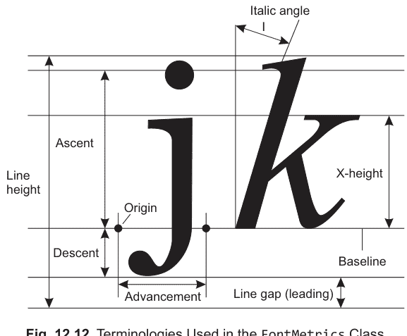

# FontMetrics 对象

字体指标由字体和图形上下文决定。要要一个 FontMetrics 对象（其中 g 是一个 Graphics 对象，f 是一个字体对象），可以使用构造函数：

```java
FontMetrics fm = g.getFontMetrics(f);
```

创建对象 fm 是为了查找该字体中指定字符字形（glyphs）的高度和宽度信息。

# FontMetrics 方法

表 12.8 提供了 FontMetrics 类中方法的简要描述。

| 方法 | 描述 |
| --- | --- |
| `byteswidth(byte[] data, int off, int len)` | 返回此字体中特定字节数组的宽度。 |
| `charwidth(char[] data, int off, int len)` | 返回此字体中特定字符数组的宽度。 |
| `getAscent()` | 由其决定上升高度。 |
| `getDescent()` | 由其决定下降高度。 |

（续）

# Java 中的 388 

（表 12.8 续）

| 方法 | 描述 |
| --- | --- |
| `getFont()` | 获取字体。 |
| `getRender()` | 获取渲染上下文。 |
| `getHeight()` | 获取文本的标准高度。 |
| `getLeading()` | 由此 FontMetrics 对象确定的行距。 |
| `getLineMetrics(char[] chars, int beginIndex, int limit, Graphics context)` | 返回图形文中特定字符的 LineMetrics 对象。 |
| `getMaxAdvance()` | 字体中字符的最大宽度。 |
| `getMaxAscent()` | 由 FontMetrics 对象确定的字体上升高度。 |
| `getMaxDescent()` | 由 FontMetrics 对象确定的字体下降高度。 |
| `getStringBounds(char[] chars, int beginIndex, int limit, Graphics context)` | 指定字符数组的边界。 |
| `getWidths()` | 字体中前 256 个字符的宽度。 |
| `hasUniformMetrics()` | 字体是否具有统一指标。 |
| `stringWidth(String str)` | 返回字体中字符串的总宽度。 |
| `toString()` | 返回此 FontMetrics 值的字符串表示。 |

# 类 12.11 DemoMetrics 类

```java
/*applet code=DemoMetrics width=300 height=300>*/

import java.awt.*;

public class DemoMetrics extends Applet {

    public void init() {
        Color color = new Color(255, 255, 250);
        setBackground(color);
    }

    public void paint(Graphics g) {
        int fontSize = 20;
        g.setFont(new Font("Roman", fontSize));
        FontMetrics fm = g.getFontMetrics();
        String s = "My Applet";
        int sw = fm.stringWidth(s);
        int w = 300;
        int x = (w - sw) / 2;
        int baseline = fm.getMaxAscent() + (fm.getDescent()) / 2;
        int ascent = fm.getMaxAscent();
        int descent = fm.getDescent();
```

# 输出

```java
L20 int fontHeight = fm.getMaxAscent() + fm.getDescent();
L21 g.setColor(Color.pink);
L22 g.fillRect(x, baseline - ascent, sw, fontHeight);
L23 g.setColor(Color.red);
L24 g.drawLine(x, baseline - descent, x + sw, baseline - descent);
L25 g.setColor(Color.blue);
L26 g.drawLine(x, baseline - ascent, x + sw, baseline - ascent);
L27 g.setColor(Color.black);
L28 g.drawString(s, x, baseline);
L30 }
```


图 12.13 使用 FontMetrics 类输出

#### 解释

- **L1–2** 导入了所需的包。
- **L3** 声明了一个名为 DemoFontMetrics 的类，继承自 Applet。
- **L4** 重写了 `init()` 方法。
- **L5** 构造函数 `color()` 的参数负责你在输出窗口图 12.13 中看到的输出颜色。这些参数是分别在 0–255 范围内的红、绿、蓝整数。一旦在 L6 创建了对象，它会被传递给 `setBackground()` 方法，负责根据指定的颜色混合设置 applet 窗口的背景。
- **L8** 定义了 `paint()` 方法。
- **L9** 声明了一个名为 `fontSize` 的整数变量。
- **L10** 使用 `setFont()` 方法设置字体及其大小。
- **L11** 创建了 Font FontMetrics 对象。
- **L12** 声明了一个字符串。
- **L13** 创建了整数变量 `w` 来表示字符串的宽度。
- **L14–15** 声明了两个整数变量 (`w` 和 `h`) 用于字符串的定位，`w` 和 `h` 实际上表示 applet 的宽度和高度。
- **L16** x 坐标通过从 applet 宽度减去字符串宽度并除以 2 计算。这将形成在 applet 上打印字符串的 x 坐标。
- **L17–20** 在这些行中，我们使用 `getAscent()`、`getAscent()` 和 `getMaxDescent()` 方法计算了用于字符串定位的 `baseline`、`ascent`、`fontHeight`、`descent` 值。
- **L21–22** 它将在指定区域填充粉色调。
- **L23–24** 我们使用 `drawLine()` 方法在字符串下方画了一条红线。
- **L25–26** 我们使用 `drawLine()` 方法在字符串上方画了一条蓝线。
- **L27–28** 调用 `drawString()` 绘制字符串，并使用 `setColor()` 设置黑色。

# 12.17 实际问题：数字钟

我们已经在第 8 章中讨论过数字钟的例子。但那个视觉上并不惊艳，所以让我们创建一个以数字和现代的方式显示当前日期时间的 applet。我们将使用线程，这样你就能知道在 applet 中线程是如何工作的。

# 示例 12.12 数字钟

```java
L1 import java.util.*;
L2 import java.applet.*;
L3 import java.awt.*;
L4 import java.text.*;
```

```java
L5 /*<applet code=DigitalClock.class width=450 height=100></applet>*/
```

```java
L6 public class DigitalClock extends Applet implements Runnable {
```


L7 `Thread d`;

L8 `Calendar c`;

L9 `Date d`;

L10 `DateFormat df`;

L11 `public void init() {`

L12 `t=new Thread(this,"Time Thread");`

L13 `t.start();`

L14 `df=DateFormat.getInstance();`

`}`

L15 `public void run() {`

L16 `for(;;) {`

L17 `{`

L18 `try{`

L19 `c=Calendar.getInstance();`

L20 `d=c.getTime();`

L21 `Thread.sleep(1000);`

L22 `catch(Exception e){}`

L23 `repaint();`

L24 `}`

L25 `public void paint(Graphics g)`

```

java
{
  g.setFont(new Font("Courier New", Font.ITALIC, 20));
  g.drawString(d.toString(),30,20);
  g.drawString("Different Format " +df.format(d),30,40);
}
```

# Applets 391

# 输出


图 12

# 解析

- **L1–4** 导入了所需的包：`java.util`、`java.applet`、`java.awt` 和 `java.text`。`Date` 和 `Calendar` 类属于 `java.util` 包；`Applet` 属于 `java.applet` 包，`Graphics` 属于 `java.awt` 包，而 `DateFormat` 属于 `java.text`。
- **L5** applet html 标签（已注释）。该语句被注释掉是为了编译器会忽略它，因为这段代码不属于 Java。插入此 html 标签是为了通过 `appletviewer` 运行 applet。
- **L6** 声明公共类 `DigitalClock` 继承 `Applet` 类和 `Runnable` 接口。所有 applet 必须是公共定义的，并且必须是 `Applet` 类的子类。如果我们希望在 applet 中创建线程，它必须继承 `Runnable` 接口。
- **L7–10** 在 applet 中定义了 `Thread`、`Calendar` 和 `Date` 类型的实例变量。这些类型的对象在整个 `DigitalClock` 类中被使用。
- **L11–14** 为 applet 定义了 `init` 方法。数字钟的所有时间活动都在这里完成。我们初始化了 `Thread` 并启动了它。我们还在示例中使用了 `Format` 类，专门展示了如何以不同的格式表示日期和时间。

`DateFormat` 是一个抽象类，因此不能直接实例化。在 L14 中使用 `DateFormat` 的静态方法 `getInstance()` 进行实例化，该方法返回一个 `DateFormat` 类的实例。
- **L15–24** 定义了线程的 `run` 方法，指定了线程应该执行的操作。该方法旨在提取当前日期并将其设置 `Date` 对象中。使用 `Calendar` 类的静态方法 `getInstance()` 提取当前日期和时间。使用 `getTime()` 方法获取 `Date` 对象。L22 使用 `sleep` 方法让线程延迟一秒。如果发生异常，通过调用 `repaint()` 来触发 `paint()` 方法。
- **L25–28** applet 中所有的显示功能都在 `paint()` 方法中，因此 `paint()` 方法负责显示日期和时间 `Date` 对象。L20 使用 `setFont` 在 `Graphics` 对象上设置字体和大小；L27 中使用 `drawString()` 在特定的 x,y 位置写入字符串。方法的第一个参数是 `Date` 对象，它会以标准格式显示字符串（见输出的第一行）。L28 显示了如何使用 L14 创建的 `DateFormat` 对象来格式化日期。`DateFormat` 类的 `format()` 方法用于格式化作为参数传递给它的 `Date` 对象。该方法返回一个格式化的时间字符串，该字符串传递给 `drawString` 方法并显示在输出的第二行。输出的第一行以 24 小时格式显示，带有星期和月份名称。输出的第二行以 12 小时格式显示日期时间，包含 AM 和 PM 以及日期、月份的数字格式。

> 注意：`DigitalClock` applet 无法继承 `Thread` 类，因为它已经继承了 `Applet` 类。（记住：使用的是 `Runnable` 接口。类之间不支持多重继承）

# 总结

在本章中，我们解释了 applet 的含义和用法。Applet 是小型程序，可以从远程服务器下载其字节码并在客户端执行特定任务。applet 和应用程序之间的区别已经列出。

在 Java 中，讨论了不同包中的 applet。其中一种直接从 `Applet` 类演变而来。这些 applet 具有如 swings 这样的功能，我们在本章中尚未介绍。applet 可以借助支持 Java 的浏览器或类似 `appletviewer` 的工具来执行。我们讨论了属于 `Applet` 类的方法。applet 有完善的生命周期，从一个状态移动到另一个状态。applet 生命周期状态有：诞生（Born）、运行（Running）、空闲（Idle）和死亡（Dead）。`init()`、`stop()` 和 `destroy()` 方法分别被调用以强制 applet 处于不同状态。我们已经给了你如何处理音频和文件的基础知识。

我们没有讨论 `Applet` 类的所有方法。但当然，我们已经详细讨论了其中许多方法。现在，你已经对 applet 编程有了了解，这些方法被用在 applet 编程中。由于 applet 的构建块已在本章中被涵盖，当我们谈论由“事件处理和 AWT”第 13 章提供的 GUI 环境时，applet 编程的本质将更有意义。

# 练习

- 1. 下列哪个不是 applet 生命周期周期的方法？
  - (a) `init`
  - (b) `start`
  - (c) `sleep`
  - (d) `stop`

- 2. 使用什么工具编译 applet？

- 5. 哪个类具有绘制不同形状的功能？
  - (a) `Line`
  - (b) `Graphics`
  - (c) `Shapes`
  - (d) `stop`

## 12.2 事件委托模型

事件委托模型是自 Java 1.0 以来一直采用的一种方法。我们将遵循这一模型，不再过多讨论早期的传统模型。在事件委托模型中，源（source）产生事件并发送给一个或多个监听器（listeners）。监听器负责接收事件，一旦接收到，就会按照要求进行处理或操作。在这里，处理事件的逻辑与生成事件的逻辑是完全分离的，即事件生成组件的设计可以与事件处理组件不同。实际上，事件生成组件将执行基于事件的动作的责任委托给执行该事件的组件。该模型有三个维度，即事件、事件源和事件监听器。

事件是一个描述源状态的对象。它可能由于与 GUI 环境组件的交互而直接产生，也由于其他原因（如定时器过期、操作完成等）产生。

事件源（eventsource）是一个产生事件的对象。事件的产生必须导致源状态的变化。一个源可以产生多个事件。监听器是在事件源上发生事件时接收通知的对象。

## 13.3 `java.awt.event` 包

`java.awt.event` 包提供了接口和类，用于处理由 AWT 组件触发的不同类型的事件。`java.awt.AEvent` 类是 AWT 事件的根类。该包包含了事件类的定义、监听器接口以及适配器，它们共同构成了事件处理的基础。

### 13.3.1 事件类

很难详细介绍所有事件类的细节，这些类实际上负责定义 Java 中的各种事件。在 Java 中，事件与 AWT 和 Swing 关联。由 AWT 定义的事件在本章中描述。

Java 有一个预定义的事件相关类层次结构，其根类是 `EventObject`。它是 `java.util` 包的成员。该类定义了作为成员的构造函数和方法。

```
EventObject(Object src_obj)
```


其中 `src_obj` 是产生事件的对象。

`EventObject` 拥有 `getSource()` 和 `toString()` 方法。

- `getSource()` 返回事件的源
- `toString()` 返回事件的字符串等效值

`EventObject` 的子类是 `AWTEvent`，它实际上是 `java.awt` 包的一部分。AWT 中所有支持事件委托模型的基于事件的类都是或间接是 `AWTEvent` 类的子类。

在这里，我们将讨论由 AWT 定义的事件。Java 中的各种事件被预定义为类。`java.awt.event` 包中定义的一些主要事件类如表 13.1 所示。

## 表 13.1 事件类

| 事件类 | 描述 |
| --- | --- |
| `ActionEvent` | 当组件定义的动作发生时（在按钮、列表、菜单上）产生。 |
| `AdjustmentEvent` | 当滚动条被调整时产生。 |
| `ContainerEvent` | 当元素从容器中添加或移除时产生。 |
| `FocusEvent` | 当组件获得或失去焦点时产生。 |
| `KeyEvent` | 从键盘接收输入时产生。 |
| `ComponentEvent` | 当组件移动、改变大小或改变可见性时产生（也是其他组件级事件的根类）。 |
| `MouseEvent` | 表示组件发生了鼠标动作的事件。 |
| `InputEvent` | 所有组件级输入事件的根类。 |
| `TextEvent` | 当对象的文本发生变化时产生。 |
| `WindowEvent` | 当窗口状态发生变化时产生。 |
| `MouseWheelEvent` | 当中滚轮旋转时产生。 |

## `ActionEvent` 类

`ActionEvent` 在 Java 中定义为：

```
public class ActionEvent extends AWTEvent
```

`ActionEvent` 是一个表示组件定义的动作已发生的事件。该事件由组件（如 `JButton`）在发生组件特定动作（如点击）时产生。事件被传递给 `ActionListener` 对象，该对象通过组件的 `addActionListener()` 方法注册以接收事件通知。当事件发生时，继承了 `ActionListener` 接口的对象会被传递给 `ActionEvent`。与 `ActionEvent` 类相关的一些字段、构造函数和方法如表 13.2 所示。

## 表 13.2 `ActionEvent` 类

| 字段名 | 描述 |
| --- | --- |
| `ACTION_FIRST` | 动作事件 ID 范围内的第一个数字。 |
| `ACTION_LAST` | 动作事件 ID 范围内的最后一个数字。 |
| `ACTION_PERFORMED` | 此事件表示发生了有意义的动作。 |
| `ALT_MASK` | alt 修饰符，表示事件期间按住了 alt 键的指示器。 |
| `CTRL_MASK` | 控制修饰符，表示事件期间按下了控制键的指示器。 |
| `META_MASK` | meta 修饰符，表示事件期间按住了 meta 键的指示器。 |
| `SHIFT_MASK` | shift 修饰符，表示事件期间按住了 shift 键的指示器。 |

| 构造函数名 | 描述 |
| --- | --- |
| `ActionEvent(Object source, int id, String command)` | 生成一个 `ActionEvent` 对象，其中 `source` 是产生事件的对象，`id` 是标识事件的整数，`command` 是一个可能指定与事件相关的命令（可能是多个命令之一）的字符串。 |
| `ActionEvent(Object source, int id, int modifiers)` | 生成一个 `ActionEvent` 对象，其中 `source` 是产生事件的对象，`id` 是标识事件的整数，`modifiers` 是修饰符。 |

| 方法名 | 描述 |
| --- | --- |
| `getActionCommand()` | 返回事件相关的命令。 |
| `getWhen()` | 返回事件的时间戳。 |
| `getModifiers()` | 返回修饰符。 |
| `paramString()` | 返回事件的字符串。 |

## `AdjustmentEvent` 类

`AdjustmentEvent` 类在 Java 中定义为：

```
public class AdjustmentEvent extends AWTEvent
```

调整事件是由可调节对象（如滚动条）产生的。调整有多种类型，由整数常量标识。这些常量及其含义见表 13.3。它还列出了 `AdjustmentEvent` 的构造函数和方法。

## 表 13.3 `AdjustmentEvent` 类

| 字段名 | 描述 |
| --- | --- |
| `ADJUSTMENT_FIRST` | 调整事件 ID 范围内的第一个数字。 |
| `ADJUSTMENT_LAST` | 调整事件 ID 范围内的最后一个数字。 |
| `ADJUSTMENT_VALUE_CHANGED` | 值变化事件。 |
| `BLOCK_DECREMENT` | 块减少调整。 |
| `BLOCK_INCREMENT` | 块增量调整。 |
| `TRACK` | 追踪调整。 |
| `UNIT_DECREMENT` | 单元减少调整。 |
| `UNIT_INCREMENT` | 单位增量调整。 |

| 构造函数名 | 描述 |
| --- | --- |
| `AdjustmentEvent(Adjustable source, int id, int modifiers)` | 生成一个 `AdjustmentEvent` 对象，其中 `source` 是产生事件的对象，`id` 是标识事件的整数，`modifiers` 是修饰符。 |
| `AdjustmentEvent(Adjustable source, int id, int modifiers, boolean isAdjusting)` | 生成一个 `AdjustmentEvent` 对象，其中 `source` 是产生事件的对象，`id` 是标识事件的整数，`modifiers` 是修饰符，`isAdjusting` 是布尔值。 |

| 方法名 | 描述 |
| --- | --- |
| `getAdjustable()` | 返回产生此调整的可调节对象。 |
| `getAdjustment()` | 返回导致值变化的调整类型。 |
| `getValue()` | 返回调整的值。 |
| `getValueAdjusting()` | 如果是正在调整值，则返回 `true`。 |
| `paramString()` | 返回事件状态的字符串。 |

## `KeyEvent` 类

该类在 Java 中定义为：

```
public class KeyEvent extends InputEvent
```

这种低级事件是由组件对象（如文本字段、框架、Applet）在按键按下、释放或输入时产生的。事件被传递给 `KeyListener` 对象，该对象通过组件的 `addKeyListener` 方法注册。`KeyEvent` 是表示组件中发生了按键事件的事件。按键事件有三种类型，由整数常量标识。这些是：

- `KEY_PRESSED`（当任何键按下时产生）
- `KEY_TYPED`（当可以生成有效的 Unicode 字符时产生）
- `KEY_RELEASED`（当任何键释放时产生）

`KeyEvent` 中还定义了一些整数常量。表 13.4 显示了其中一些。该类的所有字段都是公共静态且最终的。它还列出了 `KeyEvent` 类的构造函数和方法。

列表非常长，我们无法在此列出完整的详尽列表。除了表 13.4 所示的常量外，我们还有一些整数常量，如 `VK_0` 到 `VK_9`、`VK_A` 到 `VK_Z`、`VK_ALT`、`VK_CANCEL`、`VK_SHIFT`、`VK_PAGE_DOWN`、`VK_ENTER`、`VK_ESCAPE`、`VK_CONTROL` 等，作为 `KeyEvent` 类的成员。

## 表 13.4 `KeyEvent` 类

| 字段名称 | 说明 |
| --- | --- |
| `CHAR_UNDEFINED` | `KEY_PRESSED` 和 `KEY_RELEASED` 事件，其 `keyChar` 值不映射到任何 Unicode 字符。 |
| `KEY_FIRST` | 表示键事件 id 范围内的第一个数字。 |
| `KEY_LAST` | 表示键事件 id 范围内的最后一个数字。 |
| `KEY_LOCATION_LEFT` | 常量，表示按下或释放的按键位于左侧位置（该位置有多个）。 |
| `KEY_LOCATION_NUMPAD` | 常量，表示键事件发生在数字键盘上，或与数字键盘对应的虚拟键上。 |
| `KEY_LOCATION_RIGHT` | 常量，表示按下或释放的按键位于右侧位置（该位置有多个）。 |
| `KEY_LOCATION_STANDARD` | 常量，表示按下或释放的按键未区分为左或右版本，且未源于数字键盘（或未源于对应的数字虚拟键）。 |
| `KEY_LOCATION_UNKNOWN` | 常量，表示 `keyLocation` 不确定或无关。 |
| `VK_ACCEPT` | 接受或提交功能键的常量。 |
| `VK_ALL_CANDIDATES` | 所有候选功能键的常量。 |
| `VK_ALPHANUMERIC` | 数字字母功能键的常量。 |
| `VK_COMMA` | 逗号键，“.” |
| `VK_COMPOSE` | 组合功能键的常量。 |
| `VK_CONTEXT_MENU` | Microsoft Windows 右键菜单键。 |
| `VK_WINDOWS` | Microsoft Windows "Windows" 键。 |

| 构造函数名称 | 说明 |
| --- | --- |
| `KeyEvent(Component source, int id, long when, int modifiers, int keyCode, char keyChar)` | 构建一个 `KeyEvent` 对象，其中<br>— `source`：产生事件的源。<br>— `id`：标识事件类型的整数。<br>— `when`：指定事件发生时间的长整型。<br>— `modifiers`：修饰键在（`shift`、`ctrl`、`alt`、`meta`）期间被按下。应使用扩展的 `_DOWN` 掩码或旧的 `_MASK` 修饰符，但不应在同一个实例中混合使用这两种模型。<br>— `keyCode`：实际事件的整数代码，或 `VK_UNDEFINED`（用于按键输入事件）。<br>— `keyChar`：由此事件生成的 Unicode 字符，或 `CHAR_UNDEFINED`（用于不映射到有效 unicode 字符的按下和释放事件）。 |

| 方法名称 | 说明 |
| --- | --- |
| `getKeyChar()` | 返回与此事件中的按键相关的字符。如果没有有效字符，则返回 `CHAR_UNDEFINED`。 |
| `getKeyCode()` | 获取与键关联的整数代码。 |
| `getKeyLocation()` | 返回产生此事件的按键位置。 |
| `getKeyModifiersText(int modifiers)` | 返回描述修饰键的字符串，例如 "Shift" 或 "Ctrl+Shift"。 |
| `getKeyText(int keyCode)` | 返回描述 `keyCode` 的字符串，如 "HOME"、"F1" 或 "A"。 |
| `isActionKey()` | 返回事件是否为“动作”键。 |
| `paramString()` | 返回标识此事件的字符串。 |
| `setKeyChar(char keyChar)` | 设置 `keyChar` 值以指示逻辑字符，其中 `keyChar` 是对应组成此事件按键组合的 `char` 类型。 |
| `setKeyCode(int keyCode)` | 设置 `keyCode` 值以指示物理键，其中 `keyCode` 是对应键盘上实际事件的整数。 |

## `MouseEvent` 类

`MouseEvent` 类在 Java 中定义如下：

```
public class MouseEvent extends InputEvent
```

它是一个表示组件中发生鼠标动作的事件。只有当动作发生时，鼠标光标位于组件边界的定义区域内，才认为在该特定组件中发生了鼠标动作。

`MouseEvent` 类定义了八种类型的鼠标事件。`MouseEvent` 类将它们定义为公共静态整数常量，以识别这些事件中的每种。见表 13.5。它还显示了 `MouseEvent` 类的构造函数和方法。

## 表 13.5 `MouseEvent` 类

| 字段摘要 | 说明 |
| --- | --- |
| `MOUSE_MOVED` | 移动鼠标时发生事件。 |
| `MOUSE_PRESSED` | 按下鼠标键时发生事件。 |
| `MOUSE_RELEASED` | 释放鼠标键时发生事件。 |
| `MOUSE_CLICKED` | 鼠标键被按下并释放时发生事件（点击）。 |
| `MOUSE_DRAGGED` | 拖动鼠标时发生事件。 |
| `MOUSE_ENTERED` | 鼠标进入组件时发生事件。 |
| `MOUSE_EXITED` | 鼠标离开组件时发生事件。 |
| `MOUSE_WHEEL` | 移动鼠标轮时发生事件。 |

| 构造函数名称 | 说明 |
| --- | --- |
| `MouseEvent(Component source, int id, long when, int modifiers, int x, int y, int clickCount, boolean popupTrigger, int button)` | 构建一个 `MouseEvent` 对象，其中<br>— `source`：产生事件的源。<br>— `id`：标识事件类型的整数。<br>— `when`：指定时间的长整型。<br>— `modifiers`：修饰键。<br>— `x`：x 坐标。<br>— `y`：y 坐标。<br>— `clickCount`：点击次数。<br>— `popupTrigger`：是否为弹出触发。<br>— `button`：鼠标按钮。 |

| 方法名称 | 说明 |
| --- | --- |
| `getButton()` | 返回触发事件的鼠标键。 |
| `getClickCount()` | 点击次数。 |
| `isPopupTrigger()` | 返回事件是否为弹出触发。 |
| `paramString()` | 返回标识事件的字符串。 |
| `translatePoint(int x, int y)` | 转换坐标。 |

## `FocusEvent` 类

`FocusEvent` 类定义如下：

```
public class FocusEvent extends ComponentEvent
```

此事件在组件获得或失去焦点时产生。焦点有两种类型：永久焦点。永久焦点事件发生在用户显式从一个组件切换到另一个组件时（例如按下 Tab 键）。临时焦点事件发生在由于操作导致焦点丢失时。在这种情况下，窗口再次激活，焦点将位于同一组件上。`FocusEvent` 类的字段、构造函数和方法见表 13.6。

## 表 13.6 `FocusEvent` 类

| 字段摘要 | 字段名称 | 说明 |
| --- | --- | --- |
| | `FOCUS_FIRST` | 焦点事件 ID 范围内的第一个数字。 |
| | `FOCUS_LAST` | 焦点事件 ID 范围内的最后一个数字。 |
| | `FOCUS_GAINED` | 组件获得焦点。 |
| | `FOCUS_LOST` | 组件失去焦点。 |

| 构造函数摘要 | 构造函数名称 | 说明 |
| --- | --- | --- |
| | `FocusEvent(Component src, int id)` | 创建带有 `src` 的 `FocusEvent` 对象，`id` 为 `FOCUS_GAINED` 或 `FOCUS_LOST`。 |
| | `FocusEvent(Component src, int id, boolean temp)` | 在上述构造函数的基础上，`temp` 标识是否为临时。 |
| | `FocusEvent(Component src, int id, boolean temp, Component opp)` | 在上述基础上，`opp` 指定涉及的另一个组件。 |

| 方法摘要 | 方法名称 | 说明 |
| --- | --- | --- |
| | `getOppositeComponent()` | 返回获得或失去焦点的组件。 |
| | `isTemporary()` | 告诉事件是临时的还是永久的。 |
| | `paramString()` | 返回标识事件的字符串。 |

## `ItemEvent` 类

`ItemEvent` 类定义如下：

```
public class ItemEvent extends AWTEvent
```


# ItemEvent 类

它是一个表示项目被选中或取消选择的事件。此事件由 `ItemSelectable` 对象（例如列表）产生，当列表中的项目被选中或取消选择时就会产生事件。生成的事件会传递给每个注册以接收此类事件的 `ItemListener` 对象。`addItemListener()` 方法用于此注册过程。`ItemEvent` 类的字段、构造函数和方法见表 13.7。该类的所有字段均为公共静态整数常量。

## 表 13.7 ItemEvent 类

| 字段名 | 详情 |
| --- | --- |
| `DESELECTED` | 此状态变化值表示被选中的项目被取消选择。 |
| `ITEM_FIRST` | 用于项目事件的 id 范围内的第一个数字。 |
| `ITEM_LAST` | 用于项目事件的 id 范围内的最后一个数字。 |
| `ITEM_STATE_CHANGED` | 此事件表示状态发生了变化。 |
| `SELECTED` | 此状态变化值表示项目被选中。 |

| 构造函数 | 详情 |
| --- | --- |
| `ItemEvent(ItemSelectable source, int id, Object item, int stateChange)` | 构建一个 `ItemEvent` 对象。 |

| 方法名 | 详情 |
| --- | --- |
| `Object getItem()` | 返回受事件影响的项目。 |
| `ItemSelectable getItemSelectable()` | 返回事件源对象。 |
| `int getStateChange()` | 返回状态变化类型。 |
| `String paramString()` | 返回标识此事件的参数字符串。 |

# TextEvent 类

`TextEvent` 类定义为：`public class TextEvent extends AWTEvent`

此事件表示对象文本的变化。当对象（如 `Component`）的文本发生变化时，就会生成此事件。该事件被传递给每个注册了接收此类事件的 `TextListener` 对象。`addTextListener()` 方法用于此注册过程。`TextEvent` 类的字段、构造函数和方法如表 13.8 所示。

## 表 13.8 TextEvent 类

| 字段名 | 详情 |
| --- | --- |
| `TEXT_FIRST` | 用于文本事件的 id 范围内的第一个数字。 |
| `TEXT_LAST` | 用于文本事件的 id 范围内的最后一个数字。 |
| `TEXT_VALUE_CHANGED` | 此事件 id 表示对象的文本发生了变化。 |

| 构造函数 | 详情 |
| --- | --- |
| `TextEvent(Object source, int id)` | 构建一个 `TextEvent` 对象。 |

| 方法名 | 详情 |
| --- | --- |
| `String paramString()` | 返回一个标识此文本事件的参数字符串。 |

# 13.4 事件源

事件源可以是 GUI 组件，也可以是任何派生自组件的类（如 applet），它们可以产生来自键盘和鼠标的事件。GUI 的某些组件如表 13.9 所示。

## 表 13.9 可以产生事件的 GUI 组件

| 组件 |
| --- |
| `Button` |
| `Checkbox` |
| `List` |
| `Scrollbar` |
| `TextComponent` |
| `Choice` |
| `MenuItem` |
| `Window` |

与这些 GUI 组件相关的类将在第 14 章（AWT）中详细讨论。

# 13.5 事件监听器

事件监听器通过实现 `java.awt.event` 包中定义的一个或多个接口来创建。每当源产生一个事件时，它基本上会调用监听器接口中定义的相应方法。该方法将一个事件对象作为参数。一些常用的监听器如表 13.10 所示。

## 表 13.10 事件监听器列表

| 监听器接口 |
| --- |
| `KeyListener` |
| `MouseListener` |
| `MouseMotionListener` |
| `MouseWheelListener` |
| `ItemListener` |
| `ActionListener` |
| `TextListener` |
| `FocusListener` |
| `WindowListener` |
| `ComponentListener` |
| `ContainerListener` |
| `AdjustmentListener` |

这些监听器接口中的每一个都具有特定数量的方法，按顺序简要给出。

## KeyListener 接口

该接口定义了三个方法：

- `void keyPressed(KeyEvent e)`
- `void keyReleased(KeyEvent e)`
- `void keyTyped(KeyEvent e)`

`keyPressed()` 在按键按下时被调用，`keyReleased()` 在按键释放时被调用，`keyTyped()` 在输入字符时被调用。

## MouseListener 接口

该接口有五个方法，签名如下：

- `void mouseClicked(MouseEvent e)`
- `void mouseEntered(MouseEvent e)`
- `void mousePressed(MouseEvent e)`
- `void mouseReleased(MouseEvent e)`
- `void mouseExited(MouseEvent e)`

`mouseClicked()` 在点击鼠标时被调用，`mouseEntered()` 在鼠标进入组件时被调用，`mousePressed()` 在鼠标被按下但未释放时调用，`mouseReleased()` 在按下的鼠标被释放时调用，`mouseExited()` 在鼠标离开组件时调用。

## MouseMotionListener 接口

该接口有两个方法，签名如下：

- `void mouseMoved(MouseEvent e)`
- `void mouseDragged(MouseEvent e)`

`mouseMoved()` 在鼠标从一个地方移动到另一个地方时被调用，`mouseDragged()` 在拖动鼠标时被调用。

## MouseWheelListener 接口

该接口只有一个方法，签名如下：

- `void mouseWheelMoved(MouseWheelEvent e)`

`mouseWheelMoved()` 在鼠标滚轮移动时被调用。

## ItemListener 接口

该接口仅定义了一个方法，定义为：

- `void itemStateChanged(ItemEvent e)`

`itemStateChanged()` 在项目状态改变时被调用。

## ActionListener 接口

该接口只有一个方法，签名如下：

- `void actionPerformed(ActionEvent e)`

方法 `actionPerformed()` 在执行任何动作事件时被调用。

## TextListener 接口

该接口仅有一个方法，签名如下：

- `void textValueChanged(TextEvent e)`

每当文本字段发生变化时，该方法就会被调用。

## FocusListener 接口

该接口有两个方法：

- `void focusGained(FocusEvent e)`
- `void focusLost(FocusEvent e)`

`focusGained()` 在组件获得焦点时被调用，`focusLost()` 在组件失去焦点时被调用。

## WindowListener 接口

该接口中定义了七个方法，签名如下：

- `void windowActivated(WindowEvent e)`
- `void windowClosed(WindowEvent e)`
- `void windowClosing(WindowEvent e)`
- `void windowOpened(WindowEvent e)`
- `void windowDeactivated(WindowEvent e)`
- `void windowIconified(WindowEvent e)`
- `void windowDeiconified(WindowEvent e)`

`windowActivated()` 在窗口激活时被调用，`windowDeactivated()` 在窗口取消激活时被调用，`windowClosed()` 在窗口关闭时被调用，`windowOpened()` 在窗口打开时被调用，`windowClosing()` 在窗口准备关闭时被调用，`windowIconified()` 在窗口最小化时被调用，`windowDeiconified()` 在窗口恢复正常状态时被调用。

## ComponentListener 接口

该接口有四个方法，签名如下：

- `void componentResized(ComponentEvent e)`
- `void componentMoved(ComponentEvent e)`
- `void componentHidden(ComponentEvent e)`
- `void componentShown(ComponentEvent e)`

`componentResized()` 在组件大小改变时被调用，`componentMoved()` 在组件移动时被调用，`componentHidden()` 在组件隐藏时被调用，`componentShown()` 在组件显示时被调用。

## ContainerListener 接口

该接口中定义了两个方法：

- `void componentAdded(ContainerEvent e)`
- `void componentRemoved(ContainerEvent e)`

这两个方法，`componentAdded()` 在组件添加到容器时被调用，`componentRemoved()` 在组件从容器中移除时被调用。

## AdjustmentListener 接口

该接口只有一个方法，定义为：

- `void adjustmentValueChanged(AdjustmentEvent e)`

当发生调整事件时，调用该方法。

# 13.6 模型是如何工作的？

每个产生事件的源必须向自身注册事件监听器，以便监听器获得接收相应源事件的权限。现在注册过程是如何发生的？在 Java 中，所有可能的事件都已命名。每个类型的事件都有其自己的注册方法，格式如下：

```java
public void addTypeListener(TypeListener l)
```

在上述方法中，`Type` 是事件类型，`l` 是该事件监听器的引用。不同类型的事件监听器可见表 13.10。

某些源允许注册多个监听器来接收事件，而另一些源只允许注册一个监听器来接收事件。前者是事件的多路广播，而后者是事件的单播。

这些监听器一旦注册了来自特定源的事件，就可以取消注册。用于此类注销的方法形式如下：

```java
public void removeTypeListener(TypeListener l)
```

一旦监听器对象注册，它们必须实现相关方法以接收并处理由源发送的事件通知。这些方法定义在 `java.awt.event` 包的各种接口中。

适当事件委托模型涉及的步骤：

1. 实现适当事件监听器接口，以便接收和处理所需的事件类型。
2. 使用注册方法将事件监听器注册到事件源，作为事件通知的接收者，该方法如下：
   `addTypeListener(TypeListener)`

> 如果组件生成了多个事件，则每个事件都需要单独注册。一个对象可以被注册以接收多种类型的事件，但它也必须实现接收这些事件所需的所有接口。

让我们来看一个监听器接口如何用于处理事件的示例。下面的示例展示了如何使用 `MouseMotionListener` 来跟踪鼠标移动。

## 示例 13.1(a) 使用 MouseMotionListener

```java
/* <applet code="MouseMotionEx.class" width="300" height="300"></applet> */

import java.awt.*;
import java.awt.event.*;

public class MouseMotionEx extends Applet implements MouseMotionListener {

    int xcoord;
    int ycoord;

    public void init() {
        addMouseMotionListener(this);
    }

    public void paint(Graphics g) {
        g.drawString("(" + xcoord + ", " + ycoord + ")", xcoord, ycoord);
    }

    public void mouseMoved(MouseEvent me) {
        xcoord = me.getX();
        ycoord = me.getY();
        repaint();
    }

    public void mouseDragged(MouseEvent me) {
    }
}
```

### 输出

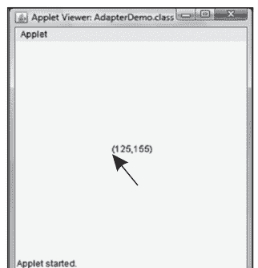

**图 13.1** x y 坐标 MouseMotionListener

### 解析

**L1–3** 导入了所有必要的包，以便在程序内部可以使用成员。

**L4** 声明了名为 `MouseMotionEx` 的处理器类。该类继承自 `Applet` 并实现了 `MouseMotionListener`，以便接收该类型的事件。

**L5–6** 声明了整数类型的实例变量 x 坐标和 y 坐标。

**L7–9** applet 的 `init()` 方法，将 `MouseMotionListener` 注册为事件通知的接收者。

**L8** `MouseMotionListener` 本身（事件源）。问题在于：为什么将 `this` 作为参数传递给 `addMouseMotionListener`？因为 `MouseMotionEx` 实现了 `MouseMotionListener` 接口并重写了接口的方法，一旦鼠标移动或拖动，当前对象将告诉它如何处理事件。因此，将 `this`（当前对象）作为参数传递给 `addMouseMotionListener` 方法。

[我们还可以创建另一个类（例如 `Demo`），它可以实现 `MouseMotionListener` 接口。该类将重写 `MouseMotionListener` 接口的方法，现在这个对象将被传递到注册方法中：`addMouseMotionListener(new Demo())`。注意 `MouseMotionEx` 并不会继承 `MouseMotionListener` 接口（而是实现它）。示例 13.1(b) 展示了这一概念。]

**L10–12** 定义并实现了 `paint()`，其中使用 `drawString()` 方法在括号中的 x 和 y 坐标处显示字符串。字符串是 x 和 y 坐标的值。

**L13–17** `MouseMotionListener` 接口中定义了 `mouseMoved()`。该方法已实现。它实际上负责在鼠标事件上执行要执行的操作（见作为参数传递给方法的 `MouseEvent` 对象）。早先声明为整数的实例变量 `x` 和 `y` 分别用于存储 `MouseEvent` 的 `getX()` 和 `getY()` 方法的 x 坐标和 y 坐标值（L14 和 L15）。

在 L16 中，调用了 `repaint()`，它最终会调用 `paint` 方法。

我们可以将示例 13.1(a) 重写如下，展示如何使用另一个类对象来处理事件。

## 示例 13.1(b) MouseMotionListener

```java
/* <applet code="MouseMotionEx.class" width="700" height="700"></applet> */

import java.awt.*;
import java.applet.*;
import java.awt.event.*;

public class MouseMotionEx extends Applet {

    int xcord;
    int ycord;

    public void init() {
        addMouseMotionListener(new Demo(this));
    }

    public void paint(Graphics g) {
        g.drawString("(" + xcord + ", " + ycord + ")", xcord, ycord);
    }
}

class Demo implements MouseMotionListener {

    MouseMotionEx m;

    Demo(MouseMotionEx m) {
        this.m = m;
    }

    public void mouseMoved(MouseEvent me) {
        m.xcord = me.getX();
        m.ycord = me.getY();
        m.repaint();
    }

    public void mouseDragged(MouseEvent me) {
    }
}
```


# 412 Java 编程

## 输出

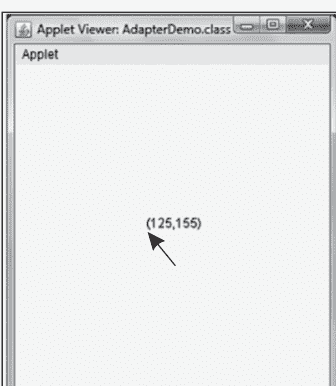

图 13.2 显示鼠标坐标的 Applet

### 解释

- L6–8 实现了 Applet 的 `init()` 方法，并在其中注册了 `MouseMotionListener`。这里需要注意的一个有趣点是注册方法。查看 L7 中通过注册方法传递的参数。在上一个示例中，我们将当前类的对象传递给该方法。但在这里，我们将当前类（`AdapterDemo`）的对象传递给扩展了适配器类的类（即 `MouseDemo`）的构造函数，最终将扩展适配器类的类对象作为参数传递给 `addMotionListener()` (L7)，以便将 `MouseListener` 注册为鼠标事件通知的接收者。这样做使得不同类的方法可以通过它们的对象进行相互通信。
- L9–11 使用 `Graphics` 对象在 `paint` 方法内部调用 `drawString()` 方法来显示 x 坐标和 y 坐标的值。
- L12 通过右括号结束了 `AdapterDemo` 类。
- L13 声明了扩展 `MouseMotionListener` 的 `MouseDemo` 类。
- L14 创建了对 `AdapterDemo` 的引用。将 `AdapterDemo` 类对象作为参数传递给此构造函数 (L15)。
- L15–17 声明了 `MouseDemo` 的构造函数，并使用由类 `AdapterDemo` 对象构造的构造函数 (L16) 初始化 AdapterDemo 类对象。
- L18–22 定义并实现了带有 `mouseEvent` 的 `mouseMoved()` 方法。`mouseMoved` 事件分别用于在 L19 和 L20 方法中调用 `getX()` 和 `getY()`。`getX()` 返回 x 坐标的值，`getY()` 返回 y 坐标的值。在 L18 中，使用扩展 Applet 类的 AdapterDemo 类引用调用了 Applet 类的 `repaint()` 方法。调用 `repaint()` 将调用 L9 和 L10 中详述的 `paint()` 方法。

## 13.7.2 Java 中的适配器类

这些适配器类是 `java.awt.event` 包的成员。每个监听器接口都有对应的适配器类。如表 13.11 所示。

### 表 13.11 属于 java.awt.event 的适配器类

| 监听器 | 适配器类 | 注册方法 |
| --- | --- | --- |
| ComponentListener | ComponentAdapter | addComponentListener |
| ContainerListener | ContainerAdapter | addContainerListener |
| FocusListener | FocusAdapter | addFocusListener |
| HierarchyBoundsListener | HierarchyBoundsAdapter | addHierarchyBoundsListener |
| KeyListener | KeyAdapter | addKeyListener |
| MouseListener | MouseAdapter | addMouseListener |
| MouseMotionListener | MouseMotionAdapter | addMouseMotionListener |
| WindowListener | WindowAdapter | addWindowListener |

## 13.8 事件处理中的内部类

可以在类内部定义并实例化内部类，甚至可以在表达式内部。
为什么我们在这一章中讨论使用内部类来处理事件？实际上，事件委托模型允许你让任何类成为你事件的监听器。我们可以通过将监听器类的定义与使用该监听器的组件代码相邻，从而在事件处理模型中使用内部类的概念。

内部类分为三类：成员类、局部类和匿名类。

### 成员类

它们像字段和方法一样包含在类定义中。成员类可以是静态的，也可以是实例的。

**静态成员类** 成员类可以是静态的，它只能访问其所属类的静态成员。

**实例成员类** 成员类可以是实例的，它可以访问其包含的类的静态成员和实例成员。示例 13.3 显示了如何在类内部定义内部类。

### 局部类

局部类定义在代码块内部，通常在方法内部。局部类的实例只在方法的执行期间存在。
我们已经在第四章中讨论过内部类。

## 13.3 成员内部类的使用

```java
/*applet code = OuterClass.class width = 600 height = 600></applet>*/

import java.awt.*;
import java.awt.event.*;

public class OuterClass extends Applet {

    public void init() {
        addKeyListener(new InnerClass());
    }

    class InnerClass extends KeyAdapter {
        public void keyPressed(KeyEvent event) {
            showStatus("key Pressed");
        }

        public void keyReleased(KeyEvent event) {
            showStatus("key Released");
        }
    }
}
```

#### 解释

- L4 定义了一个名为 `OuterClass` 的类，继承自 `Applet` 类。
- L5–7 实现了适配器的 `init` 方法，其中使用 `addKeyListener()` 方法注册 `KeyListener` 以获取键事件。内部类 `InnerClass` 对象作为参数传递给注册方法 (L6)。
- L8–16 定义了扩展适配器类 `KeyAdapter` (L8) 的内部类 `InnerClass`。注意这个内部类是外部类的一部分。在这个内部类内部，实现了 `KeyListener` 接口的三个方法中的两个：`keyPressed()` 和 `keyReleased()`（分别为 L9 和 L12）。使用适配器类，`KeyAdapter` 消除了实现 `KeyListener` 接口所有方法的强制性。`showStatus()` 在 L10 和 L13 的两个不同方法中使用；传递给 `showStatus()` 的任何参数将显示在程序的状态窗口中。L15 处的右括号表示内部类 `InnerClass` 的结束。
- L16 表示外部类 `OuterClass` 的结束。

> 这里的原理是，编译器将分离这些内部类并为它们创建单独的文件。这些内部类文件的名称将以外部类名作为前缀。一旦你编译了代码，只需通过在目录中找到以下类文件进行检查：
> `OuterClass$InnerClass.class`

### 匿名内部类

匿名类是指未分配名称的类。在下面的示例中，我们声明了一个匿名类作为方法的参数。此类类是动态创建的，即它们在需要时被创建、实例化，并在不再需要时被垃圾回收。它们会自动分配一个名称如 `OuterClass$1`。
这种匿名性有助于消除不必要的具名对象，使程序更具可读性。

在下面的代码中，创建了一个匿名内部类作为方法的参数。当按下任意键时，状态栏会显示 "Key Pressed"。

## 13.4 匿名内部类的使用

```java
/*applet code = AnonymousDemo.class width = 300 height = 300></applet>*/

import java.awt.*;
import java.awt.event.*;

public class AnonymousDemo extends Applet {

    public void init() {
        addKeyListener(new KeyAdapter() {
            public void keyPressed(KeyEvent e) {
                showStatus("key Pressed");
            }

            public void keyReleased(KeyEvent e) {
                showStatus("key Released");
            }
        });
    }
}
```

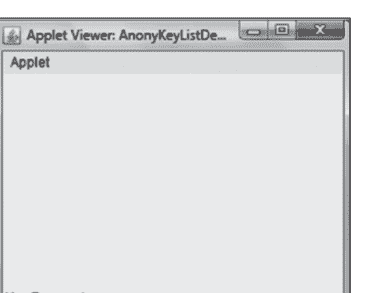

图 13.3 Key Pressed

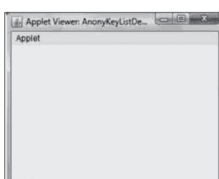

图 13.4 Key Released

#### 解释

L6 到 L13 之间的代码定义了一个匿名类作为方法的参数。匿名类被定义为 Adapter 并包含 `keyPressed` 和 `keyReleased` 方法。当按下任意键时，如图 13.3 所示，执行 `keyPressed` 方法。

```java
addKeyListener(new KeyAdapter() {
    public void keyPressed(KeyEvent e) {
        showStatus("key Pressed");
    }

    public void keyReleased(KeyEvent e) {
        showStatus("key Released");
    }
});
```

## 13.9 实际问题：卡通 Applet

我们将对所有示例进行修订以增强功能并消除其中的问题。我们将从创建一个带有眼睛和红色鼻子的卡通开始。

### 13.9.1 眨眼睛的微笑卡通（部分 1）

在第一个版本中，如果用户将鼠标指针放在卡通的鼻子上点击按钮，卡通就会转并张嘴大。如果用户点击任何地方，卡通都会显示默认的微笑脸（黑眼睛和红色鼻子）。

类的 `drawArc` 方法用于在卡通脸上创建笑容。该方法接受七个参数：x 坐标、y 坐标、弧宽、弧高、起始角度以及相对于起始角度的角度范围。前四个很容易理解。让我们关注扩展范围。如果指定的角度范围为正值，则从起始角度开始绘制。如果指定负值，则从起始角度顺时针方向绘制。如果起始角度指定为 180，则如图 13.5 所示开始。此外，如果你指定的角度范围为 180，则弧从起始角度开始按逆时针方向增加额外的 180°。

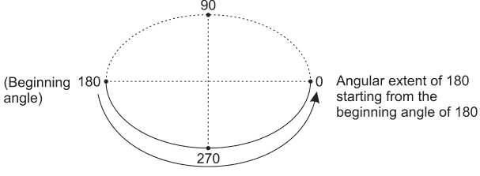

图 13.5 微笑弧

我们想表现卡通是微笑的，因此我们在 `drawArc` 方法中将最后的参数指定为正值。如果你将最后一个参数指定为负值 (−180)，则弧将顺时针方向绘制，你会得到如图 13.6 所示的忧心卡通。

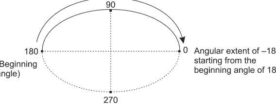

图 13.6 微笑弧

### 示例 13.5 微笑的卡通 1

| L1 | import java.applet.*; |
| L2 | import java.awt.*; |
| L3 | import java.awt.event.*; // 使用像 MouseEvent 和 MouseAdapter 等类 |
| L4 | /*<applet code="Cartoon.class" width=400 height=400></applet> 点击卡通的鼻子会改变眼睛的颜色，并让它张开大嘴微笑（大笑） */ |
| L5 | public class Cartoon extends Applet { |
| L6 | boolean move; |
| L7 | MyMouseAdapter mma; |
| L8 | public void init() { |
| L9 | // 用于捕捉鼠标点击 /* 此处传递了当前对象，以便将 applet 上下文传递给 Mouse Adapter 类，并根据点击动作调用 applet 的 repaint 方法 */ mma = new MyMouseAdapter(this); |
| L10 | /* 将该对象注册到 applet 中以处理鼠标事件 */ addMouseListener(mma); |
| L11 | } |
| L12 | // 绘制卡通的脸部、眼睛、耳朵、鼻子和帽子 public void paint(Graphics g) { |
| L13 | // 创建脸部 g.drawOval(50, 40, 120, 150); |
| L14 | // 在头部创建帽子 // 多边形的三个 x 坐标 int x[] = {73, 115, 147}; // 多边形的三个 y 坐标 int y[] = {55, 7, 55}; |
| L15 | int n = x.length; |
| L16 | /* 创建一个 3 个点的填充多边形，最后一个 (x,y) 和第一个 (x,y) 坐标相连 */ g.fillPolygon(x, y, n); |
| L17 | // 创建左眼 g.drawOval(67, 75, 30, 20); |
| L18 | // 创建右眼 g.drawOval(120, 75, 30, 20); |
| L19 | /* 点击鼻子时将眼睛填充为绿色，否则为黑色；嘴巴张开，否则闭合 */ /* 当用户在鼠标指针位于卡通鼻子部时按下鼠标按钮 */ |
| L20 | ```java if (mma.move) { g.setColor(Color.green); g.fillOval(79, 81, 10, 10); // 绿色左瞳孔 g.fillOval(131, 81, 10, 10); // 绿色右瞳孔 g.fillArc(70, 125, 80, 40, 180); mma.move = false; } else { g.fillOval(78, 81, 10, 10); // 黑色左瞳孔 g.fillOval(131, 81, 10, 10); // 黑色右瞳孔 } // 闭嘴微笑 g.drawArc(70, 125, 80, 40, 180); ``` |
| L21 | // 创建一个红鼻子 g.setColor(Color.red); g.fillOval(95, 100, 30, 30); g.setColor(Color.black); |
| L22 | // 创建左耳朵 g.drawOval(35, 92, 15, 30); |
| L23 | // 创建右耳朵 g.drawOval(170, 92, 15, 30); |
| L24 | } |
| L25 | // 为处理鼠标事件定义的适配器类 class MyMouseAdapter extends MouseAdapter { |
| L26 | /* 创建 Applet 引用，以便可以根据鼠标事件调用此类的 paint 方法 */ Cartoon g; boolean move; |
| L27 | /* L9 中传递的当前对象存储在构造函数的参数中，并赋值给 cartoon 类型的实例变量 */ MyMouseAdapter(Cartoon g) { this.g = g; move = false; } |
| L28 | // 每当鼠标被按下时，都会提取其坐标并据此设置标志位并重新绘制 applet public void mousePressed(MouseEvent me) { |
| L29 | // 提取 X 坐标 int x = me.getX(); |
| L30 | // 提取 y 坐标 int y = me.getY(); |
| L31 | /* 检测是否点击了鼻子 */ if (x > 85 && x < 115 && y > 100 && y < 130) { move = true; /* 设置布尔变量 */ g.repaint(); /* 调用 cartoon applet 的 paint() */ } else /* 如果点击了其他任何地方 */ { move = false; /* 重置布尔变量 */ g.repaint(); /* 调用 cartoon applet 的 paint() */ } |
| L32 | } |
| L33 | } |


# 输出

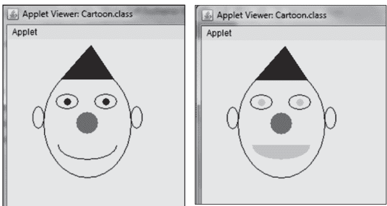

图 13.7 (a) 正常显示的卡通，或当鼠标指针未指向鼻子且点击时的显示。(b) 当鼠标指针指向鼻子并点击时，卡通张大嘴巴笑着，眼睛是绿色的。

## 13.9.2 会眨眼的微笑卡通（部分 2）

在微笑卡通（部分 2）中，如果用户将鼠标指针放在卡通的鼻子上，卡通的眼睛会变成绿色，卡通会张嘴大。如果用户将鼠标指针移出鼻子区域，则显示卡通默认的微笑脸（黑眼睛、耳朵和红鼻子）。

# 输出

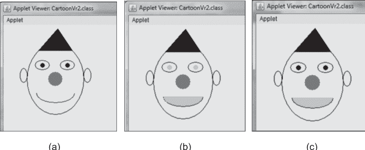

**图 13.8** (a) Applet 首次加载，(b) 当鼠标悬停在鼻上，(c) 当鼠标移出鼻部

输出中明显可见的问题有：

1. 在 (b) 中可以看到黑色圆弧，即当鼠标停在鼻子上时。应该显示填充了绿色的张大嘴巴，但不应该显示黑色圆弧。
2. 当鼠标指针从鼻部移除时，(c) 中的嘴巴仍然大张着并呈绿色。实际上它应该与 (a) 相似。

我们尝试了一些解决方案，如 `paintAll()` 和 `super.update(g)` 方法（你可以看到它们在 L34 行和 L35 行被注释掉了）。但我们解决这些问题了吗？

## 13.9.3 微笑卡通（第 3 部分）

微笑卡通（第 3 部分）处理第 2 部分中出现的问题。该卡通几乎与之前完全相同，唯一的区别是在每次鼠标移动事件时重绘 applet，我们用白色绘制圆弧和椭圆（脸），以擦除上一次绘制的内容。

## 示例 13.7 微笑卡通（第 3 部分）

```java
import java.applet.*;
import java.awt.*;
import java.awt.event.*;
```

```java
/*applet code = "CartoonVr3.class" width = 400 height = 400></applet>*/
```

```java
/* 如果你将鼠标指针移动到卡通的鼻子上，它的眼睛颜色应该改变，它应该大嘴大。如果你将鼠标移出鼻部，则应该出现黑色眼睛和带有微笑的默认卡通。 */
```

```java
public class CartoonVr3 extends Applet {
    MyMouseMotionAdapter mma;

    public void init() {
        mma = new MyMouseMotionAdapter(this);
        addMouseMotionListener(mma);
    }

    public void paint(Graphics g) {
        // 面部
        g.drawOval(50, 40, 120, 150);
        int x[] = {73, 115, 147};
        int y[] = {57, 75};
        int n = x.length;
        g.fillPolygon(x, y, n);

        g.drawOval(67, 75, 30, 20); // 左眼
        g.drawArc(120, 75, 30, 20); // 右眼

        if (mouse.move) {
            /* 用白色圆弧擦除微笑 */
            g.setColor(Color.white);
            g.drawArc(70, 125, 80, 40, 180, 180);

            /* 设置颜色并绘制绿色瞳孔而不是黑色 */
            g.setColor(Color.green);
            g.fillOval(78, 81, 10, 10); // 绿色左瞳孔
            g.fillOval(131, 81, 10, 10); // 绿色右瞳孔

            /* 张开嘴巴 */
            g.fillArc(70, 125, 80, 40, 180, 180); // 嘴巴
        } else {
            g.fillOval(78, 81, 10, 10); // 黑色左瞳孔
            g.fillOval(131, 81, 10, 10); // 黑色右瞳孔

            /* 为了解决这个问题，我们将颜色改为白色，然后绘制一个白色的填充圆弧。
            这个白色圆弧覆盖了绿色，然后我们将颜色设置为黑色并绘制圆弧 */
            g.setColor(Color.white);
            g.fillArc(70, 125, 80, 40, 180, 180); // 嘴巴
            g.setColor(Color.black);
            g.drawArc(70, 125, 80, 40, 180, 180); // 嘴巴

            // 创建一个红鼻子
            g.setColor(Color.red);
            g.fillOval(95, 100, 30, 30);

            // 设置颜色为黑色绘制耳朵
            g.setColor(Color.black);
            g.drawOval(35, 92, 15, 30); // 左耳
            g.drawOval(170, 92, 15, 30); // 右耳
        }
    }

    public void update(Graphics g) {
        paint(g);
    }
}
```

```java
class MyMouseMotionAdapter extends MouseMotionAdapter {
    CartoonVr3 g;
    boolean move;

    MyMouseMotionAdapter(CartoonVr3 g) {
        this.g = g;
        move = false;
    }

    public void mouseMoved(MouseEvent e) {
        int x = e.getX();
        int y = e.getY();
        if (x > 85 && x < 115 && y > 100 && y < 130) {
            move = true;
            g.repaint();
        } else {
            move = false;
            g.repaint();
        }
    }
}
```


```java
public class CartoonVr3 extends Applet
{

    MyMouseMotionAdapter mma;

    public void init()
    {
        mma = new MyMouseMotionAdapter(this);
        addMouseMotionListener(mma);
    }

    public void paint(Graphics g)
    {
        // 面部
        g.drawOval(50,40,120,150);

        int x[] = {73,115,147};
        int y[] = {57,75};
        int n = x.length;
        g.fillPolygon(x,y,n);

        g.drawOval(67,75,30,20); // 左眼
        g.drawArc(120,75,30,20); // 右眼

        if(mouse.move)
        {
            /* 用白色圆弧擦除微笑 */
            g.setColor(Color.white);
            g.drawArc(70,125,80,40,180,180);

            /* 设置颜色并绘制绿色瞳孔而不是黑色 */
            g.setColor(Color.green);
            g.fillOval(78,81,10,10); // 绿色左瞳孔
            g.fillOval(131,81,10,10); // 绿色右瞳孔

            /* 张开嘴巴 */
            g.fillArc(70,125,80,40,180,180); // 嘴巴
        }
        else
        {
            g.fillOval(78,81,10,10); // 黑色左瞳孔
            g.fillOval(131,81,10,10); // 黑色右瞳孔

            /* 为了解决这个问题，我们将颜色改为白色，然后绘制一个白色的填充圆弧。
            这个白色圆弧覆盖了绿色，然后我们将颜色设置为黑色并绘制圆弧 */

            g.setColor(Color.white);
            g.fillArc(70,125,80,40,180,180); // 嘴巴
            g.setColor(Color.black);

            g.drawArc(70,125,80,40,180,180); // 嘴巴

            // 创建一个红鼻子
            g.setColor(Color.red);
            g.fillOval(95,100,30,30);

            // 设置颜色为黑色绘制耳朵
            g.setColor(Color.black);
            g.drawOval(35,92,15,30); // 左耳
            g.drawOval(170,92,15,30); // 右耳
        }
    }

    public void update(Graphics g) {
      paint(g);
    }
}
```

```java
class MouseMotionAdapter extends MouseMotionAdapter {
  CartoonVr3 g;
  boolean move;
}
```

```java
  MyMouseMotionAdapter(CartoonVr3 g) {
    this.g = g;
    move = false;
  }
```

```java
  public void mouseMoved(MouseEvent e) {
    int x = e.getX();
    int y = e.getY();
    if(x > 85 && x < 115 && y > 100 && y < 130) {
      move = true;
      g.repaint();
    }
    else {
      move = false;
      g.repaint();
    }
  }
}
```

## 抽象窗口工具包

> 每个人对图像的感受都不同。内容关于什么并不重要，重要的是它带给你的感受。
>
> *Adam Jones*

- 阅读完本章后，读者将能够：
- 熟悉 GUI 组件集
- 理解针对不同组件的事件处理模型的使用
- 解释用于灵活窗口布局的布局管理器

## 14.1 引言

抽象窗口工具包 (`AWT`) 为程序员提供了许多类——这些类可以在 `applet`（小程序）内部使用。它是你的应用程序与原生 GUI 之间的桥梁。`AWT` 隐藏了应用程序将运行的 GUI 的复杂性。

Java 基础类 (`JFC`) 提供了两个构建基于 GUI 应用程序的框架，有趣的是，这两个框架都依赖于相同的事件处理模型：

- `AWT`
- `Swing`

`AWT` 依赖于特定平台的底层操作系统来表示其 GUI 组件（即 `AWT` 中的组件被称为重量级组件），而 `Swing` 提供了一套用 Java 编写的轻量级 GUI 组件，并具有可插件的外观和感觉。这些轻量级组件不依赖于底层操作系统。

在本章中，我们将重点介绍 `AWT`，`Swing` 将在下一章介绍。`AWT` API 可以通过导入 `java.awt.*` 包用于任何 Java 程序中。

### 14.1.1 为什么选择 AWT？

用编程语言开发的每个应用程序都必须有一个用户界面，用户界面实际上是应用程序的一部分，负责直接与用户进行交互。用户界面可以是命令行界面，也可以是图形用户界面。

在最底层，操作系统将信息从输入设备传输到程序作为输入，并提供输出。`AWT` 的设计使得程序员无需担心跟踪鼠标移动、读取键盘字符或向屏幕写入内容。`AWT` 是应用程序与低层资源之间一个设计良好的面向对象的接口。

`AWT` 的优势在于它保留了运行 `AWT` 应用程序的平台的原生外观和感觉，因为 `AWT` 中的组件（用户界面）是使用原生 GUI 工具包实现的。另一方面，缺点是应用程序在不同的平台上执行时，其外观和感觉会有所不同。

## 14.1 `java.awt` 包

`java.awt` 包包含了所有用于创建图形用户界面、绘制图像、颜色和字体的内容。像按钮或文本框这样的用户界面被称为组件。`Component` 类是所有 `AWT` 组件的父类。当用户与这些组件交互时，这些组件会触发事件，例如当用户点击按钮时。这些事件由事件处理类处理，即 `AEvent` 及其子类。

容器是包含组件和其他容器的实体。容器拥有一个布局管理器，该管理器决定了组件在容器中的视觉位置。`java.awt` 包含了若干类用于在容器中布局组件的类。

`java.awt` 包包含许多接口和类。在这里很难详细阐述该包的所有成员。该包中一些常用的类如表 14.1 所示。

### 表 14.1 AWT 常用类

| 类 | 描述 |
| :--- | :--- |
| `AEvent` | 所有 `AWT` 事件的根事件类。 |
| `BorderLayout` | 根据五个区域（北、南、东、西、中）在容器中布局组件。 |
| `Button` | 创建按钮。 |
| `Canvas` | 代表屏幕上的矩形区域，在该区域上可以绘图，或从那里跟踪用户的输入事件。 |
| `CardLayout` | 可以包含图层的布局管理器。 |
| `Checkbox` | 可以处于一种状态的组件：“开启”（`true`）或“关闭”（`false`）。 |
| `CheckboxGroup` | 分组复选框，使其像单选按钮一样工作。 |
| `CheckMenuItem` | 此类用于创建复选框菜单项。 |
| `Choice` | 打开一个选项的弹出菜单。 |
| `Color` | 代表 RGB 或灰色空间中的颜色，可以通过 `ColorSpace` 设置。 |
| `Component` | 组件是一个具有图形表示的对象，它可以显示在用户屏幕上，用户可以与其交互。 |
| `Container` | 包含其他 `AWT` 组件。 |
| `Dialog` | 带有标题和边框的顶层窗口。 |
| `Dimension` | 此对象封装了组件的宽度和高度。 |
| `FileDialog` | 此类显示一个对话框，用户可以从中选择文件。 |
| `FlowLayout` | 按方向流显示组件。 |
| `Font` | 此类表示字体，用于以可见的方式渲染文本。 |
| `FontMetrics` | 封装关于特定字体在特定屏幕上如何渲染的信息。 |
| `Frame` | 带有标题和边框的顶层窗口（容器），用于包含其他组件。 |
| `Graphics` | `Graphics` 类是抽象基类，允许应用程序在组件上绘制线、圆等。 |
| `GridBagConstraints` | 此类为使用 `GridBagLayout` 类布局的组件指定了约束条件。 |
| `GridBagLayout` | 这是一种灵活的布局管理器，它可以垂直、水平或沿其基准线对齐组件，并要求组件大小相同。 |
| `GridLayout` | 在矩形网格中布局组件。 |
| `Image` | 此类表示图形图像。 |
| `Insets` | 指定容器边缘必须留出多少空间。 |
| `Label` | 用于在容器中放置文本。 |
| `List` | 可滚动的项目列表。 |
| `MediaTracker` | 用于跟踪媒体对象的状态。 |
| `Menu` | 从菜单栏部署的菜单。 |
| `MenuBar` | 添加到框架的菜单。 |
| `MenuItem` | 菜单项。 |
| `MenuShortcut` | 此类表示快捷键。 |
| `MouseInfo` | 提供获取鼠标位置的方法。 |
| `Panel` | 它是一个容器类。 |
| `Point` | 代表 (`x`, `y`) 坐标空间中的点。 |
| `PopupMenu` | 可以在任何位置动态弹出的菜单。 |
| `ScrollBar` | 嵌入滚动条的类。 |
| `ScrollPane` | 为单个组件实现水平和垂直滚动的容器类。 |
| `TextArea` | 允许用户编辑多行的对象。 |
| `TextComponent` | `TextField` 和 `TextArea` 的父类。 |
| `TextField` | 允许用户编辑单行文本的文本。 |
| `Window` | `Dialog` 和 `Frame` 的父类，代表没有边框的顶层窗口。 |

## 14.2 组件与容器

图形用户界面是通过滚动条、列表和文本框等图形元素开发的，这些元素被称为组件。组件通常产生允许用户与程序交互的事件（记住事件处理机制）。在 `AWT` 中，这些组件是相应类的实例。

组件不能独立存在；它们位于容器内部。组件的布局在容器内部被包含和控制。事实上，容器本身也是组件，因此它们可以放在其他容器中。在 `AWT` 中，所有容器都是 `Container` 或其子类型的对象。

组件完全适应包含它们的容器。`AWT` 提供的用户界面组件之间存在继承关系。`Component` 类定义了所有组件必须遵循的接口。图 14.1 显示了不同 `AWT` 类的层次结构。

### 14.2.1 `Component` 类

让我们讨论 `Component` 类，它实际上是 `Object` 类的子类，是许多类如 `Button`、`Label`、`CheckBox`、`RadioButton`、`Choice`、`Canvas`、`TextComponent`、`List` 和 `ScrollBar` 的父类。

你必须了解创建上述组件。为了在窗口中使用特定的组件，你必须将该组件添加到窗口中。容器类有一个用于此目的的 `add` 方法。

```java
Component add(Component comObj)
```

将要添加的组件对象作为上述方法的参数传递。该方法返回 `comObj` 的引用。如果你想从窗口中移除组件，可以使用 `remove()` 方法来实现。

```java
void remove(Component comObj)
```

在语法中，要被移除的 `Component` 对象作为参数传递给上述方法。

除了标签之外，所有控件都可以生成事件。这些控件产生的事件通知由已注册的监听器接收。这些通知有助于监听器识别产生事件的控件类型。

### 14.2.2 作为事件生成器的组件

在最后一个章节中，我们一直将 `applet` 视为事件生成器。在继续之前，重要的是让您了解哪个 `Listener` 接口适用于接收来自哪个控件的通知，以及哪些方法负责处理特定类型的事件（表 14.2）。

### 表 14.2 与组件关联的事件

| 组件 | 事件 | 事件类型 | 事件监听器 | 方法名 |
| :--- | :--- | :--- | :--- | :--- |
| `Button` | 点击 | `ActionEvent` | `ActionListener` | `actionPerformed()` |
| | 获得焦点/失去焦点 | `FocusEvent` | `FocusListener` | `focusGained()` and `focusLost()` |
| `Checkbox` | 选中/取消选中 | `ItemEvent` | `ItemListener` | `itemStateChanged()` |
| `Choice` | 选中/取消选中 | `ItemEvent` | `ItemListener` | `itemStateChanged()` |
| `List` | 选中/取消选中 | `ItemEvent` | `ItemListener` | `itemStateChanged()` |
| | 双击项目 | `ActionEvent` | `ActionListener` | `actionPerformed()` |
| `MenuItem` | 点击 | `ActionEvent` | `ActionListener` | `actionPerformed()` |
| | 获得焦点/失去焦点 | `FocusEvent` | `FocusListener` | `focusGained()` and `focusLost()` |
| `TextField` | 按下回车键 | `ActionEvent` | `ActionListener` | `actionPerformed()` |
| | 文本更改 | `TextEvent` | `TextListener` | `textValueChanged()` |
| | 获得焦点/失去焦点 | `FocusEvent` | `FocusListener` | `focusGained()` and `focusLost()` |
| `TextArea` | 文本更改 | `TextEvent` | `TextListener` | `textValueChanged()` |
| `Scrollbar` | 通过鼠标/键盘改变滚动条值 | `AdjustmentEvent` | `AdjustmentListener` | `adjustmentValueChanged()` |
| | 焦点 | `FocusEvent` | `FocusListener` | `focusGained()` and `focusLost()` |
| | 键事件 | `KeyEvent` | `KeyListener` | `keyPressed()`<br>`keyReleased()`<br>`keyTyped()` |
| | 鼠标事件 | `MouseEvent` | `MouseListener` | `mouseClicked()`<br>`mouseEntered()`<br>`mouseExited()`<br>`mouseReleased()` |
| `Frame`/`Applet` | 鼠标移动事件 | `MouseEvent` | `MouseMotionListener` | `mouseMoved()` and `mouseDragged()` |
| | 窗口事件 | `WindowEvent` | `WindowListener` | `windowActivated()`<br>`windowClosed()`<br>`windowClosing()`<br>`windowDeactivated()`<br>`windowIconified()`<br>`windowDeiconified()`<br>`windowOpened()` |

## 14.3 `BUTTON`

```java
Button() throws HeadlessException
Button(String str) throws HeadlessException;
```

第一个构造函数在调用时会创建一个不显示标签的 `Button`。第二个构造函数创建一个 `Button` 并在上面显示 `str`。

现在，`Button` 具体是如何创建的？下面的语法如下：

```java
buttonName = new Button(str);
```

其中 `buttonName` 是按钮对象的名称，`str` 是您想要设置为按钮标题的文本。一旦 `Button` 对象被创建，它需要被添加到 `applet`、`frame` 或任何其他容器。其语法如下：

```java
add(buttonName);
```

`setLabel()` 和 `getLabel()` 方法分别用于更改按钮的标签和标签的文本。这些方法的签名如下：

```java
void setLabel(String str)
String getLabel();
```

表 14.3 列出了属于 `Button` 类的方法。

### 表 14.3 `Button` 类的方法

| 方法 | 描述 |
| :--- | :--- |


| 方法 | 描述 |
|---|---|
| `void addActionListener(ActionListener al)` | 添加指定的监听器以接收来自此按钮的动作事件。 |
| `void addNotify()` | 创建按钮的伙伴（peer）。 |
| `AccessibleContext getAccessibleContext()` | 获取与此按钮关联的 `AccessibleContext`。 |
| `String getActionCommand()` | 返回由按钮触发的动作事件的命令名称（标题）。 |
| `ActionListener[] getActionListeners()` | 返回注册在该按钮上的所有监听器数组。 |
| `String paramString()` | 返回表示此按钮状态的字符串。 |
| `void processActionEvent(ActionEvent ae)` | 通过将其分发到任何已注册的 `ActionListener` 对象来处理此按钮上发生的动作事件。 |
| `void processEvent(AWTEvent awte)` | 处理此按钮上的事件。 |
| `void removeActionListener(ActionListener al)` | 移除动作监听器，使其不再接收来自此按钮的动作事件。 |
| `void setActionCommand(String command)` | 设置由按钮触发的动作事件的命令名称。 |

示例 14.1 展示了一个演示如何使用监听器方法创建按钮并处理其事件的示例。

### 示例 14.1 Button

```java
/* <applet code="Button.class" width=400 height=150></applet> */
import java.util.*;
import java.awt.*;
import java.awt.event.*;
public class ButtonClass extends Applet implements ActionListener {
    Button red, white, blue;
    Label hit;
    public void init() {
        red = new Button("Red");
        white = new Button("white");
        blue = new Button("blue");
        hit = new Label("Hit");
        add(red);
        add(white);
        add(blue);
        add(hit);
        red.addActionListener(this);
        white.addActionListener(this);
        blue.addActionListener(this);
    }
    public void actionPerformed(ActionEvent ae) {
        String str = ae.getActionCommand();
        if (str.equals("Red")) {
            setBackground(Color.RED);
        } else if (str.equals("white")) {
            setBackground(Color.WHITE);
        } else if (str.equals("blue")) {
            setBackground(Color.BLUE);
        }
    }
}
```

## 438 Java 编程

我们可以通过以下方法更改或获取标签的对齐方式：

```java
labelname.setAlignment(Label.CENTER);
```

或者

```java
int labelAlignment = labelname.getAlignment();
```

示例 14.2 显示了一个演示标签属性的 applet。

### 示例 14.2 一个演示简单标签的 Applet

```java
/* <applet code="LabelClass.java" width=350 height=100></applet> */
import java.awt.*;
import java.awt.*;
public class LabelClass extends Applet {
    public void init(){
        Label firstLabel = new Label("Labels exist simple ");
        add(firstLabel);
        Label secLabel = new Label("to place text on the screen");
        add(secLabel);
        Label thirdLabel = new Label("They can be aligned left, right or center.");
        add(thirdLabel);
    }
}
```

# 输出

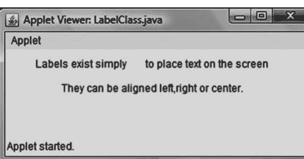

图 14.3 在 Applet 中显示的标签

#### 解释

- L1–2 我们导入了 AWT 的所有设施并扩展了 `Applet` 类。
- L3 定义了一个名为 `LabelClass` 的 applet，applet 窗口在 applet 的 `init()` 方法内部。
- L5–11 使用 `*` 通配符创建了三个标签，并将它们添加到 Java 提供的 applet 中。

## 14.5 复选框 (CHECKBOX)

复选框被用作开启/关闭或是/否开关，每当你点击其中一个时，它就会切换到相反的选择，即：如果你点击一个未勾选的复选框，它会被选中；如果你点击已选中的复选框，它会被取消选中。你可以根据需要勾选任意多个复选框，因为对选择的数量没有限制。你的程序可以根据每个复选框的状态做出响应。可能需要一个元素按钮来触发事件以检查复选框的状态。复选框是 `Checkbox` 类的对象，该类支持以下构造函数：

```java
Checkbox()
Checkbox(String str)
Checkbox(String str, boolean an)
Checkbox(String str, CheckboxGroup cbg, boolean an)
```

第一种形式的构造函数创建一个标签为空且状态为未选中的复选框。在其他形式的构造函数中，字符串参数代表复选框的标签，布尔参数（true/false）代表复选框是被创建选中还是取消选中，即：如果参数为 true，创建的复选框初始为选中；如果参数为 false，复选框将负责指定复选框组（组参数用于单选按钮，单选按钮是一种特殊的复选框）。

以下行创建一个以 "Names" 为标签、null 为组参数占位符的复选框，并将其添加：

```java
Checkbox names = new Checkbox("Names", null, false);
```

一旦你创建了 `Checkbox`，通过输入以下命令将其添加到 applet（或其他容器）中：

```java
add(names);
```

其中 `names` 是复选框。表 14.5 给出了 `Checkbox` 类的几个方法。

## 表 14.5 Checkbox 的方法

| 方法 | 描述 |
|---|---|
| `void addItemListener(ItemListener il)` | 添加指定的项目监听器以接收来自此复选框的项目事件。 |
| `CheckboxGroup getCheckboxGroup()` | 返回关联的复选框组。 |
| `ItemListener[] getItemListeners()` | 返回与此复选框注册的所有项目监听器数组。 |
| `String getLabel()` | 返回 `Checkbox` 文本形式的字符串。 |
| `Object[] getSelectedObjects()` | 返回一个长度为 1 的数组，包含复选框标签；如果复选框未被选中则返回 null。 |
| `boolean getState()` | 返回 true 或 false 布尔值，取决于复选框是被选中还是未选中。 |
| `String paramString()` | 返回代表 `Checkbox` 状态的字符串。 |
| `void processEvent(AWTEvent awte)` | 处理此复选框上的事件。 |
| `void processItemEvent(ItemEvent ie)` | 通过分发到任何已注册的 `ItemListener` 对象来处理发生在此复选框上的项目事件。 |

## Java 编程

（表 14.5 续）

| 方法 | 描述 |
|---|---|
| `void removeItemListener(ItemListener l1)` | 移除项目监听器与 `Checkbox` 之间的关联。 |
| `void setCheckboxGroup(CheckboxGroup ckg)` | 将此复选框的组设置为指定的复选框组。 |
| `void setLabel(String label)` | 我们可以更改复选框的标签并设置为参数 'label'。 |
| `void setState(boolean state)` | 将复选框的状态更改为 true（选中）或 false（未选中）。 |

示例 14.3 阐述了如何创建和使用复选框。程序中创建的“SUBMIT”按钮会触发一个事件以检查哪些框被选中了。一个被选中的名称列表被绘制在 applet 上。

## 示例 14.3 复选框的演示

```java
/* <applet code="Checkbox.Class" width=400 height=100></applet> */
L1 import java.awt.*;
L2 import java.awt.*;
L3 import java.awt.*;
L4 public class CheckboxClass extends Applet implements ActionListener {
L5     Button submit;
L6     Checkbox name1;
L7     Checkbox name2;
L8     Checkbox name3;
L9     public void init(){
L10         name1 = new Checkbox("Ram", false);
L11         name2 = new Checkbox("Ramesh", false);
L12         name3 = new Checkbox("Naresh", false);
L13         add(name1);
L14         add(name2);
L15         add(name3);
L16         submit = new Button("SUBMIT");
L17         add(submit);
L18         submit.addActionListener(this);
L19     }
L20     public void paint(Graphics g) {
L21         // 绘制选中项逻辑
L22     }
L23     public void actionPerformed(ActionEvent ae) {
L24         repaint();
L25     }
}
```

# 输出


图 14.4 Applet 内部复选框

#### 解释

- L4 一个实现 `ActionListener` 的 applet。
- L5–8 `Checkbox` 的引用变量。
- L9 定义了 `init()` 方法。
- L10–14 复选框添加到框架中。
- L15–18 按钮注册了监听。
- L21 重写了 `paint()`。
- L26–35 定义了 `paint()`。

## 14.6 单选按钮 (RADIO BUTTONS)

单选按钮也称为复选组，是一种特殊的复选框；在一个组内只允许选择一个，它们表现为单选按钮。只有一个构造函数（默认构造函数）创建一个空组。以下行将创建一个名为 `fruits` 的复选组：

```java
CheckboxGroup fruits = new CheckboxGroup();
```

一旦创建了组，将单个复选框添加到其中。构造函数有三个参数：第一个参数是单选按钮标签，第二个参数是它所属的组，第三个参数是状态（true 或 false），取决于复选框是否被选中。

其中一些方法在上一节中提到过：

```java
void setLabel(String str)
String getLabel()
boolean getState()
void setState(boolean b)
```

`getCheckbox()` 和 `setCheckbox()` 方法可以访问和更改组。你可以使用 `getCheckbox()` 方法，并在复选框中使用 `setSelectedCheckbox(chkbox)` 方法。参数 'chkbox' 是你想被选中的复选框。

示例展示了如何使用单选按钮更改 applet 窗口的背景颜色。记住，一次只能选择一个单选按钮。

## 示例 14.4 单选按钮的演示

```java
/* <applet code="RadioDemo.class" width=300 height=200></applet> */
import java.awt.*;
import java.awt.event.*;
public class RadioDemo extends Applet implements ItemListener {
    Checkbox red, white, green;
    CheckboxGroup cbg;
    public void init() {
        add(new Label("The 3 radio buttons will change the screen color."));
        cbg = new CheckboxGroup();
        red = new Checkbox("Red", cbg, false);
        white = new Checkbox("White", cbg, false);
        green = new Checkbox("Green", cbg, false);
        add(new Label("Notice that you can select only one radio button."));
        add(new Label("Selecting a radio button triggers an event"));
        add(new Label("that we use to change the screen color."));
        add(red);
        add(white);
        add(green);
        red.addItemListener(this);
        white.addItemListener(this);
        green.addItemListener(this);
    }
    public void itemStateChanged(ItemEvent ie) {
        String str = (String) ie.getItem();
        if (str.equals("Red")) {
            setBackground(Color.red);
        } else if (str.equals("white")) {
            setBackground(Color.white);
        } else if (str.equals("Green")) {
            setBackground(Color.green);
        }
        repaint();
    }
}
```

# 输出

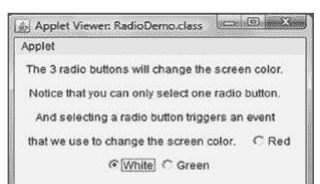
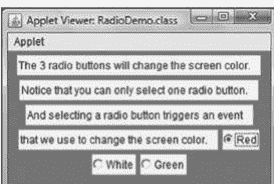
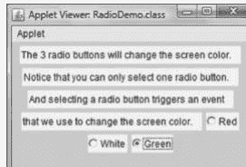

图 14 根据选择设置的 Applet 按钮颜色

(a)
(b)
(c)

#### 解释

- L1–3 导入了必要的包。
- L4 定义了 Applet 类，它实现了 `ItemListener` 接口以处理与复选框相关的事件。
- L5 创建了三个复选框引用。
- L6 创建了 `CheckboxGroup` 引用。
- L7 定义了 `init()` 方法。
- L8 在 applet 中添加了一个标签。
- L9–12 安装在三个复选框上的 `CheckboxGroup` 成为一个组的一部分（L10–12），使它们的行为像单选按钮，且组内只能选择其中一个。所有单选按钮默认均未被选中，因为传递给复选框构造函数的第三个参数为 false。
- L13–15 实例化标签并将其添加到 applet 中。
- L16–21 将所有单选按钮都添加到 applet 中，并注册了它们关联的监听器以捕获事件。
- L22–34 `ItemListener` 有一个方法，即 `itemStateChanged(ItemEvent e)`，并被重写。此方法检查哪个单选按钮被更改，然后根据按钮名称更改背景颜色。`ItemEvent` 的 `getItem()` 方法返回被选中的单选按钮的标题，使用 `setBackground(Color...)` 方法，然后重绘 applet。

## 444 Java 编程

## 14.7 列表框 (LIST BOXES)

`List` 类提供了一个多选、可滚动的值列表，这些值可以单独选择，也可以一起选择。可以创建一个列表，在可见的窗口中显示任意数量的选择。`List` 类具有以下构造函数：

```java
List()
List(int no_of_rows)
List(int no_of_rows, boolean multi_select)
```

> 注意：上述所有构造函数都会抛出 `HeadlessException`。

在默认构造函数的情况下，一次只能选择一个项目。在第二个构造函数中，你可以指定列表中希望始终可见的行数。在第三个构造函数中，如果布尔值为 true，则意味着用户可以从列表中选择多个项目。如果设置为 false，则列表一次只能选择一个项目。


不允许进行多项选择的 `List` 简单形式可以通过以下语法创建：

```java
List anyList = new List();
```

如果你想创建一个允许多项选择的列表，请使用以下命令行，它将创建一个具有 10 个可见条目并开启多项选择的列表。

```java
List anyList = new List(10, true);
```

一旦创建了列表，`add` 方法允许你添加新条目。表 14.6 显示了 `List` 类的方法。

```java
anyList.add("apple");
anyList.add("mango");
anyList.add("guava");
```

要在列表的特定位置（例如第一个位置）添加项目，请使用以下语法行：

```java
anyList.add("Coffee", 0);
```

将项目添加到 (位置-1) 或比列表数量更高的位置，将将其添加到列表末尾。

处理列表事件，需要实现 `ActionListener` 接口。双击特定列表会生成一个 `ActionEvent`。就像按钮的情况一样，可以使用 `getCommand()` 获取双击项目的名称。如果是因为单点击发生项目选择，则会生成 `ItemEvent`。通过使用 `ItemEvent` 类的 `getChange()` 方法，可以确定此 `ItemEvent` 是因为选择还是取消选择而生成的。

# 抽象窗口 Toolkit 445

让我们来看一个示例，它创建了两个列表。一个列表填充了项目，另一个是空的。当你从第一个列表中选择项目并点击带有右箭头的按钮时，选中的项目将从第一个列表中删除并添加到第二个列表中。`clear` 按钮将清空第二个列表并将第一个列表恢复为原始值。applet 的代码列在表 14.6 中。

# 表 14.6 List 方法

| 方法名称 | 详情 |
| :--- | :--- |
| `add(String item)` | 将项目添加到列表末尾。 |
| `add(String item, int index)` | 在列表指定的索引处添加项目。 |
| `addActionListener(ActionListener listener)` | 将指定的动作监听器添加到列表。 |
| `addItemListener(ItemListener listener)` | 将指定的项目监听器添加到列表。 |
| `get(int index)` | 返回指定索引处的项目。 |
| `getCount()` | 返回列表中的项目数量。 |
| `getComponent(int index)` | 返回指定索引处的组件。 |
| `getIndexOf(Object obj)` | 返回指定元素的索引。 |
| `getIndexOf(String str)` | 返回指定字符串的索引。 |
| `getSelectedIndex()` | 返回选中项目的索引。 |
| `setSelectedIndex(int index)` | 设置选中项目的索引。 |
| `getElements()` | 返回所有元素的数组。 |
| `getSelectedElements()` | 返回所有已选中元素的数组。 |
| `getObjects()` | 返回所有对象的数组。 |
| `getObject(int index)` | 返回指定索引处的对象。 |
| `getSelectedObjects()` | 返回所有已选中对象的数组。 |
| `getStrings()` | 返回所有字符串的数组。 |
| `getSelectedStrings()` | 返回所有已选中字符串的数组。 |
| `getString(int index)` | 返回指定索引处的字符串。 |
| `getArray()` | 返回所有数组的数组。 |
| `getSelectedArrays()` | 返回所有已选中数组的数组。 |
| `getArray(int index)` | 返回指定索引处的数组。 |
| `remove(int index)` | 删除指定索引处的项目。 |
| `remove(String item)` | 删除项目的第一次。 |
| `removeActionListener(ActionListener listener)` | 删除指定的动作监听器。 |
| `removeAll()` | 从列表中删除所有项目。 |
| `removeItemListener(ItemListener listener)` | 删除指定的项目监听器。 |
| `replaceItem(String newValue, int index)` | 用新字符串替换列表中指定索引处的项目。 |
| `select(int index)` | 列表中指定索引处的项目。 |
| `setMultipleMode(boolean b)` | 设置决定是否允许多项选择的标志。 |

（表 14.6 续）

| 方法名称 | 详情 |
| :--- | :--- |
| `isSelected(int index)` | 判断列表中的项目是否被选中。 |
| `isMultipleMode()` | 判断列表是否允许多项选择。 |
| `makeVisible(int index)` | 使指定索引处的项目可见。 |
| `processEvent(AWTEvent e)` | 处理列表事件。 |

# 14.5 List 演示

```java
/*applet code = ShopList.class width = 600 height = 600></applet>*/
import java.util.*;
import java.awt.*;
import java.awt.event.*;

public class ShopList implements ActionListener {
    List original;
    List copy;

    public void init() {
        original = new List(8, false);
        copy = new List(10, false);
        populateList();
        add(original);
        Button b1 = new Button(">>>>");
        add(b1);
        add(copy);
        Button b2 = new Button("Clear");
        add(b2);
        add(new Label("从左侧列表选择项目并点击 >>> 将其放入另一个列表"));
        b1.addActionListener(this);
        b2.addActionListener(this);
    }

    public void populateList() {
        original.add("Grocery");
        original.add("Fruits");
        original.add("Ice-cream");
        original.add("Shop");
        original.add("Vegetables");
        original.add("Books");
        original.add("AC");
        original.add("Garments");
        original.add("Baby Food");
    }

    public void actionPerformed(ActionEvent ae) {
        String str = ae.getActionCommand();
        if (str.equals(">>>>") && original.getSelectedIndex() >= 0) {
            copy.add(original.getSelectedItem());
            original.remove(original.getSelectedIndex());
        } else if (str.equals("Clear")) {
            original.removeAll();
            copy.removeAll();
            populateList();
        }
        repaint();
    }
}
```

# 抽象窗口 Toolkit 447

# 输出

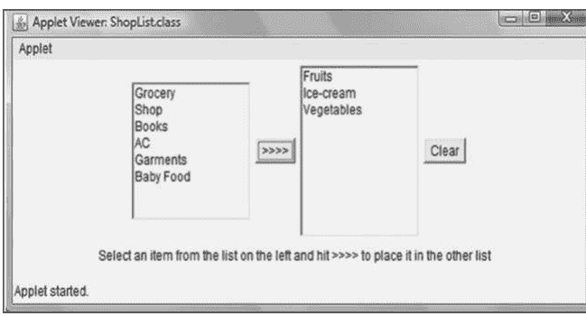

图 14.6 显示两个列表的输出

# Java 编程

#### 解释

**L1–3** 导入了类。

**L4** 类声明。

**L5** 创建了两个列表引用，并在 L7 和 L8 中实例化。构造函数中的第一个参数指定了要显示的列表中项目数量，第二个参数指定了是否允许多选。

**L9** 在 L20–L30 中定义了 `populateList()` 方法，用于向列表中添加项目。

**L10** 将原始列表添加到面板（panel）中。

**L11–18** 创建了两个按钮，并将它们添加到 applet 中并注册了 `ActionListener` 以处理按钮事件。此外，还添加了一个标签（label）。

**L31–43** 重写了 `actionPerformed()` 方法来处理按钮事件。如果用户在原始列表中选择了一个项目（`original.getSelectedIndex()`）并按了 `>>>>` 按钮，则选中的项目将被复制到 `copy.add(original.getSelectedItem())`，并使用 `remove(original.getSelectedIndex())` 从原始列表中移除。如果按了清除（clear）按钮，将使用 `removeAll()` 移除列表 copy 中的所有项目，并使用 `populateList()` 重新填充原始列表。

# 14.8 选择框 (CHOICE BOXES)

`Choice` 类类似于列表，但它允许你节省空间，因为它提供了一个文本字符串的弹出菜单。当前选择的内容显示在顶部。为了使用选择框，必须创建一个 `Choice` 类的实例。

```java
Choice c = new Choice();
```

一旦创建了选择框，`add` 方法允许你添加新条目。

```java
c.add("Red");
c.add("Green");
```

可以使用 `select()` 方法更改当前选中的项目。可以根据名称或顺序进行选择。例如，

```java
c.select("Red");
```

或者

```java
c.select(0);
```

`getSelectedIndex()` 方法将分别返回选定项目的位置，`getSelectedItem()` 返回选定项目的名称。

处理变化事件的监听器是 `ItemListener`。下面的示例展示了如何使用选择框来更改 applet 的背景颜色。

# 示例 14.6 Choice 的演示

```java
/*applet Demo.class width = 400 height = 400</applet>*/
```

```java
import java.util.*;
import java.awt.*;
import java.awt.event.*;

public class ChoiceDemo extends Applet implements ItemListener {
    String currentColor = "";
    Choice theOptions;
    Label label1;

    public void init() {
        add(label1 = new Label("Make a choice from the choice box"));
        theOptions = new Choice();
        theOptions.add("");
        theOptions.add("Red");
        theOptions.add("Green");
        theOptions.add("Blue");
        theOptions.add("white");
        theOptions.add("Cyan");
        theOptions.add("Yellow");
        theOptions.addItemListener(this);
        add(theOptions);
    }

    public void itemStateChanged(ItemEvent evt) {
        currentColor = theOptions.getSelectedItem();
        repaint();
    }

    public void paint(Graphics g) {
        if (currentColor.equals("Red")) {
            setBackground(Color.red);
            label1.setBackground(Color.red);
        }
        if (currentColor.equals("Blue")) {
            setBackground(Color.blue);
            label1.setBackground(Color.blue);
        }
        if (currentColor.equals("Green")) {
            setBackground(Color.green);
            label1.setBackground(Color.green);
        }
        if (currentColor.equals("Cyan")) {
            setBackground(Color.cyan);
            label1.setBackground(Color.cyan);
        }
        if (currentColor.equals("Yellow")) {
            setBackground(Color.yellow);
            label1.setBackground(Color.yellow);
        } else {
            setBackground(Color.white);
            label1.setBackground(Color.white);
        }
    }
}
```

# 抽象窗口 Toolkit 449

# 输出

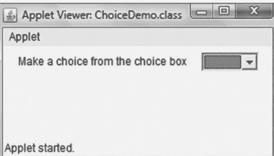

图 14.6 显示两个列表的输出


图 14.7 输出 (a)

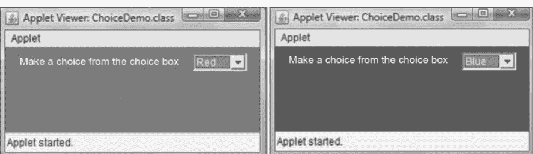

图 14.7 输出 (b)

#### 解释

**L1–3** 导入了类。

**L4** 类声明。

**L5** 创建了 `String currentColor` 变量。

**L6** 创建了 `Choice theOptions` 引用。

**L7** 创建了 `Label label1` 引用。

**L8–L20** `init()` 方法：添加标签，实例化 `Choice`，添加选项，注册 `ItemListener`，将组件添加到 applet。

**L21–L24** `itemStateChanged()` 方法：获取选中项并触发重绘。

**L25–L48** `paint()` 方法：根据选中的颜色字符串设置背景色。


```java
L6 Choice theOptions;
L7 Label 1;
L8 public void init(){
L9 add(1 = new Label("Make a choice from the choice box"));
L10 theOptions = new Choice();
L11 theOptions.add("");
L12 theOptions.add("Red");
L13 theOptions.add("Green");
L14 theOptions.add("Blue");
L15 theOptions.add("white");
L16 theOptions.add("Cyan");
L17 theOptions.add("Yellow");
L18 theOptions.addListener(this);
L19 add(theOptions);
L20 }
L21 public void itemChanged(ItemEvent evt) {
L22 currentColor = theOptions.getSelectedItem();
L23 repaint();
L24 }
L25 public void paint(Graphics g) {
L26 if (currentColor.equals("Red")) {
L27 setBackground(Color.red);
L28 1.setBackground(Color.red);
L29 }
L30 if (currentColor.equals("Blue")) {
L31 setBackground(Color.blue);
L32 1.setBackground(Color.blue);
L33 }
L34 if (currentColor.equals("Green")) {
L35 setBackground(Color.green);
L36 1.setBackground(Color.green);
L37 }
L38 if (currentColor.equals("Cyan")) {
L39 setBackground(Color.cyan);
L40 1.setBackground(Color.cyan);
L41 }
L42 if (currentColor.equals("Yellow")) {
L43 setBackground(Color.yellow);
L44 1.setBackground(Color.yellow);
L45 }
L46 else {
L47 setBackground(Color.white);
L48 1.setBackground(Color.white));
```

# 输出


图 14.6 显示两个列表的输出


图 14.7 输出 (a)


图 14.7 输出 (b)

#### 解释

**L1–3** 导入了类。

**L4** 类声明。

**L5** 创建了两个列表引用，并在 L7 和 L8 中实例化。构造函数中的第一个参数指定了要显示的列表中项目数量，第二个参数指定了是否允许多选。

**L9** 在 L20–L30 中定义了 `populateList()` 方法，用于向列表中添加项目：

**L10** 将原始列表添加到面板（panel）中。

**L11–18** 创建了两个按钮，并将它们添加到 applet 中并注册了 `ActionListener` 以处理按钮事件。此外，还添加了一个标签（label）。

**L31–43** 重写了 `actionPerformed()` 方法来处理按钮事件。如果用户在原始列表中选择了一个项目（`original.getSelectedIndex()`）并按了 >>> 按钮，则选中的项目将被复制到 `copy.add(original.getSelectedItem())`，并使用 `remove(original.getSelectedItem())` 从原始列表中移除。如果按了清除（clear）按钮，将使用 `removeAll()` 移除列表 copy 中的所有项目，并使用 `populateList()` 重新填充原始列表。

# 14.8 选择框 (CHOICE BOXES)

`Choice` 类类似于列表，但它允许你节省空间，因为它提供了一个文本字符串的弹出菜单。当前选择的内容显示在顶部。为了使用选择框，必须创建一个 `Choice` 类的实例。

```java
Choice c = new Choice();
```

一旦创建了选择框，`add` 方法允许你添加新条目。

```java
c.add("Red");
c.add("Green");
```

可以使用 `select()` 方法更改当前选中的项目。可以根据名称或顺序进行选择。例如，

```java
c.select("Red");
```

或者

```java
c.select(0);
```

`getSelectedIndex()` 方法将分别返回选定项目的位置，`getSelectedItem()` 返回选定项目的名称。

处理变化事件的监听器是 `ItemListener`。下面的示例展示了如何使用选择框来更改 applet 的背景颜色。

# 14.9 字段与文本区域

`TextField` 和 `TextArea` 是两种不同的文本输入类。`TextField` 处理单行文本，`TextArea` 用于多行文本。示例 14.7 阐述了 `TextField` 的用法。以下行创建一个具有 20 列的 `TextField`。

```java
TextField plaintext = new TextField(20);
```

`TextField` 也可以在创建时初始化文本。

```java
TextField plaintext = new TextField("First Name Last");
```

表格 14.7 和 14.8 分列出了 `TextField` 和 `TextArea` 的构造函数和方法。

# 表 14.7 TextField 类

| 构造函数 | 描述 |
|---|---|
| `TextField()` | 创建一个新的 textField。 |
| `TextField(int columns)` | 创建指定列数的空文本框。 |
| `TextField(String text)` | 创建带有指定字符串的新文本框。 |
| `TextField(String text, int columns)` | 创建带有指定字符串和列数的新文本框。 |

| 方法 | 描述 |
|---|---|
| `void addActionListener(ActionListener listener)` | 添加指定的动作监听器以接收来自此 textField 的事件。 |
| `boolean echoEchoCharIsSet()` | 指明此 textField 是否具有显示字符。 |
| `AccessibleContext getAccessibleContext()` | 返回此 textField 的 AccessibleContext。 |
| `ActionListener[] getActionListeners()` | 返回与 textField 关联的所有动作监听器的数组。 |
| `int getColumns()` | 返回此 textField 的列数。 |
| `char getEchoChar()` | 返回用于显示的字符。 |
| `Dimension getMinimumSize()` | 返回此 textField 的最小尺寸。 |
| `Dimension getMinimumSize(int columns)` | 返回指定列数的 textField 的最小尺寸。 |
| `Dimension getPreferredSize(int columns)` | 返回指定列数的 textField 的首选尺寸。 |
| `String toString()` | 获取表示此 textField 状态的字符串。 |
| `void processEvent(ActionEvent e)` | 通过将其分发给任何注册的 ActionListener 对象来处理 textField 的动作事件。 |

# Java 编程

(表 14.7 续)

| 方法 | 描述 |
| --- | --- |
| `void processEvent(AWTEvent e)` | 在此文本字段上处理 AWTEvent。 |
| `void removeActionListener(ActionListener l)` | 从此文本字段移除关联的动作监听器。 |
| `void setColumns(int columns)` | 设置文本字段的列数。 |
| `void setEchoChar(char c)` | 设置回显字符。 |
| `void setText(String t)` | 设置文本字段内的字符串。 |

# 表 14.8 TextArea 类

| 构造函数 | 描述 |
| --- | --- |
| `TextArea()` | 构建一个空字符串的 textarea。 |
| `TextArea(int rows, int columns)` | 构建具有指定行数和空字符串的 textarea。 |
| `TextArea(String text)` | 构建一个具有指定字符串的 textarea。 |
| `TextArea(String text, int rows, int columns)` | 构建具有指定字符串以及指定行数和列数的 textarea。 |
| `TextArea(String text, int rows, int columns, int scrollbars)` | 构建具有指定字符串、指定行数、列数和滚动条的 textarea。 |

| 方法 | 描述 |
| --- | --- |
| `void append(String str)` | 将给定文本附加到当前文本。 |
| `int getColumns()` | 返回列数。 |
| `Dimension getMinimumSize()` | 确定此 textarea 的最小尺寸。 |
| `Dimension getMinimumSize(int rows, int columns)` | 确定具有指定行数和列数的 textarea 的最小尺寸。 |
| `Dimension getPreferredSize()` | 返回此 textarea 的优选尺寸。 |
| `Dimension getPreferredSize(int rows, int columns)` | 返回具有指定行数和列数的 textarea 的优选尺寸。 |
| `int getRows()` | 返回行数。 |
| `void insert(String str, int pos)` | 在此 textarea 的指定位置插入指定的文本。 |
| `protected String paramString()` | 返回表示此 textarea 的字符串。 |
| `void replaceRange(String str, int start, int end)` | 用指定的替换字符串替换开始和结束位置之间的字符串。 |
| `void setColumns(int columns)` | 设置列数。 |
| `void setRows(int rows)` | 设置此 textarea 的行数。 |

# 示例 14.7 字段的事件处理

```java
/*<applet code = "TextFieldDemo.class" width = 200 height = 100></applet>*/
import java.awt.*;
import java.awt.event.*;
import java.applet.Applet;

public class TextFieldDemo extends Applet implements TextListener,
FocusListener, ActionListener {
    Label l;
    Button b;
    TextField tf;
    public void init() {
        tf = new TextField("TextField");
        l = new Label("Make selection", Label.CENTER);
        b = new Button("Submit");
        b.addActionListener(this);
        tf.addTextListener(this);
        tf.addFocusListener(this);
        tf.addActionListener(this);
        setLayout(new BorderLayout());
        add(l, BorderLayout.NORTH);
        add(tf, BorderLayout.CENTER);
        add(b, BorderLayout.SOUTH);
    }

    public void focusGained(FocusEvent e) {
        if(e.getSource() == tf)
            l.setText("Focused by Text box");
        else if(e.getSource() == b)
            l.setText("Focused by Button");
    }

    public void focusLost(FocusEvent e) {
        l.setText("Focus not on Frame now");
    }

    public void actionPerformed(ActionEvent e) {
        l.setText("action event");
    }

    public void textChanged(TextEvent e) {
        l.setText("Trying to change text");
    }
}
```

# 输出


图 14.8(a) 焦点在 TextField 上，TextField 内容被选中

图 14.8(b) TextField 的内容已更改


图 14.8(c) 按钮获得焦点

图 14.8(d) 在 TextField 上按下 Enter 键生成了 ActionEvent


图 14.8(e) 焦点在 TextField 上，提示 applet 窗口旁边的 Window

| 解释 | |
| --- | --- |
| L1 | 创建了一个 Applet，它继承了三个接口：`TextListener` 用于跟踪 TextField 中的变化；`FocusListener` 用于确定哪个组件拥有焦点；`ActionListener` 用于在用户在 TextField 中按回车时执行操作。程序中实现了接口的方法。 |
| L2–4 | 创建了 Label、TextField 和 Button 变量。 |
| L5 | 为 applet 定义了 `init()` 方法。 |
| L6-8 | 实例化 tf、l 和 b。作为 TextField 构造函数的参数将显示在 TextField 中。按钮将显示 'Submit'。 |
| L9 | 在按钮上注册了 FocusListener 以捕捉状态。 |
| L10-12 | 在 TextField 上注册了 TextListener、FocusListener 和 ActionListener 以捕捉各种事件。 |
| L13 | 当 TextField 显示时，已选中。`selectAll` 用于此目的（见图 14.8(d)）。 |
| L14 | 布局更改为 BorderLayout。 |
| L15-17 | 将 label 添加到 NORTH、CENTER 和 SOUTH。 |
| L18-24 | FocusListener 接口的方法检查事件源，哪个组件拥有焦点。如果是 TextField，则通过 `focusGained` 设置 label；否则如果焦点在 Button 上，则按钮获得焦点。 |
| L19 | 将文本分配给中间，即方向中显示 label 的标题。 |
| | 如果按下 ALT-TAB 组合键，窗口失去焦点，另一个窗口获得焦点（见图 14.8(c)）。 |
| L25-26 | 如果在 TextField 中按下 ENTER，会生成 ActionEvent 并传递给 `actionPerformed` 方法设置 label 的文本。 |
| L27-28 | 如果 TextField 中的值发生变化，会生成 Event 并传递给 `textChanged` 方法设置文本（见图 14.8(b)）。 |

# 容器类 (CONTAINER CLASS)

容器允许我们将组件分组，这对于创建良好的用户界面极其重要。AWT 中的组件只有在窗口内部时才能使用。没有窗口的组件就像没有门的房子。本节涵盖了面板（窗口的子类）、帧和对话框（都是窗口的子类）。AWT 提供了四个类：`Panel`、`Window`、`Dialog` 和 `Frame`。注意这四个类可以继承。


**Window** 是顶层显示表面。`window` 类对象没有嵌入在另一个容器中。`window` 类实例没有边界、标题或菜单。

**Frame** 是一个带有边界和标题的顶层窗口。`Frame` 类实例可能有菜单栏、标题和边界。在其他方面与 `window` 类相似。

**Dialog** 是一个带有边界和标题的顶层显示表面 (a)。`Dialog` 类对象必须关联一个 `Frame` 类对象。

**Panel** 是用于存放组件通用容器。`Panel` 类实例提供了一个可以添加组件的容器。它没有添加任何新方法；它只是实现了组件。

## 14.10.1 Panels

`Panel` 类的定义如下：

```java
public class Panel extends Container implements Accessible
```

# Java 编程

`Panel` 类是 `Container` 类的直接子类。我们已经制作了许多 applet。`Panel` 类是 applet 的父类，使所有 applet 绘制在面板的表面。`Panel` 是一个不包含标题栏或菜单栏的窗口。可以使用 `add()` 方法将组件（如标签和按钮）添加到面板对象中。此 `add()` 方法实际上属于 `Container` 类，即 `panel` 类的父类。负责构建面板的构造函数列于表 14.9。

# 表 14.9 Panel 类的构造函数

| 构造函数 | 描述 |
|---|---|
| `Panel()` | 使用默认布局管理器创建一个新面板。 |
| `Panel(LayoutManager layout)` | 创建具有指定布局的新面板。 |

# 如何使用面板？

在创建面板时，遵循以下步骤：

- 通过编写以下代码创建面板：
  `Panel panel = new Panel();`
- 使用 `add()` 方法向面板添加组件：
  `panel.add(someComponent);`
  `panel.add(someOtherComponent);`

如果你想添加到外部容器，则按以下方式调用 `add()` 方法：
  `container.add(panel);`

或者如果你想从窗口内部添加，则直接调用 `add()`：
`add(panel);`

## 14.10.2 Window

此类创建一个顶层窗口。顶层窗口意味着它没有包含在任何对象中。它具有以下签名：

```java
public class Window extends Container implements Accessible
```

`window` 对象是一个没有边界和菜单栏的窗口。窗口的默认布局是 `BorderLayout`，我们在稍后部分会介绍。在构造窗口时，必须定义一个 frame、dialog 或另一个窗口作为其所有者，其中 `Frame` 使用最频繁。

## 14.10.3 Frame

如果你不是在创建 app，那么你最可能会创建一个 `Frame` 窗口。负责创建 `Frame` 的构造函数有：

`Frame()`
`Frame(String title)`

第一个构造函数简单创建一个没有任何标题的 `Frame` 窗口，而第二个构造函数则创建一个带有参数中指定的字符串标题的 `Frame`。用于操作 `Frame` 对象可以使用的方法如表 14.10 所示。

## 表 14.10 Frame 对象的方法

| 方法 | 描述 |
|---|---|
| `void setLayout(int width, int height)` | 用于设置窗口的尺寸。以宽度和高度的形式传递新尺寸作为参数。 |
| `void setSize(Dimension size)` | 使用指定的维度设置 `Frame` 的大小。 |
| `Dimension getSize()` | 用于返回窗口的当前尺寸，包含 `Dimension` 对象的宽度和高度字段中。 |
| `setVisible(boolean flag)` | 用于在窗口创建后使其可见。只有当传递的参数为 `true` 时，组件才可见。 |
| `setTitle(String title)` | 可以将 `Frame` 窗口中的标题设置为参数传递的新标题。 |

示例 14.8 展示了如何创建和使用帧。

## 示例 14.8 Frame 类的演示

```java
L1 import java.awt.*;
L2 public class FrameDemo extends Frame {
L3   public FrameDemo(String title) {
L4     super(title);
L5   }
L6   public static void main(String[] args) {
L7     FrameDemo frameDemo = new FrameDemo("Demo Frame");
L8     frameDemo.setSize(200, 300);
L9     frameDemo.setVisible(true);
L10 }}
```

# 输出


图 14.9 Frame

创建一个带帧的应用程序是很容易的。帧开发的典型步骤如下：

1. 创建主帧的实例。
2. 设置帧的宽度和高度。
3. 显示帧。

## 释

| L2 `FrameDemo` 继承了 `java.awt.Frame` 类。 | 调用父类的构造函数。L5 表示构造函数的结束。 |
|---|---|
| L3–5 属于 `Frame` 类的构造函数设置帧的标题。因此，`FrameDemo` 类接受一个字符串作为帧标题的参数。 | L6–10 在这些行中，详细阐述了 `main()` 方法。在 L8 中，使用 `setSize()` 方法将帧的宽度和高度设置为 200 和 300 像素。 |
| 在 L4 中，使用 `super` 关键字通过设置标题 | |

## 14.1 布局 (LAYOUTS)

Java 有一种机制可以指定布局方案的类型，其中组件可以添加到 `Frame` 实例中。这种机制由 `LayoutManager` 指定，它用于显示如何在容器（例如 `Frame`）内部排列组件。AWT 中可用的各种 `LayoutManager` 是此接口的子类，并在后续章节中进行解释：

该 `LayoutManager` 实际上是 `java.awt` 中的一个接口，定义如下：

```java
public interface LayoutManager
```

上述接口用于那些知道如何布局容器的类。接口中定义的各种方法有：

```java
void addLayout(String name, Component comp)
```

如果布局管理器使用字符串标识，上述方法将组件 `comp` 添加到布局中，并将其与 `name` 指定的字符串联。

```java
void removeLayoutComponent(Component comp)
```

该方法从布局中移除指定的组件 `comp`。

```java
Dimension preferredLayoutSize(Container parent)
```

该方法根据给定的容器 `parent` 包含的组件，返回其首选的尺寸。

```java
Dimension minimumLayoutSize(Container parent)
```

根据给定的容器 `parent` 包含的组件，返回其最小的尺寸。

```java
void layoutContainer(Container parent)
```

该方法负责布局指定的容器 `parent`。Java 中的某些布局将在下文中进行讨论。

## 14.11.1 流式布局 (FlowLayout)

在 `java.awt` 包中有一个名为 `FlowLayout` 的类，其签名如下所示：

```java
public class FlowLayout extends Object implements LayoutManager, Serializable
```

`FlowLayout` 从左到右（项目）和从上到下排列组件。`FlowLayout` 是 Java 中最简单的布局之一。它将组件排列成行，如果某行未满，它将移动到下一行。对齐方式可以在构造函数中指定：

- `LEFT`：组件左对齐。
- `CENTER`：组件在行内居中齐。
- `RIGHT`：组件右对齐。
- `TRAILING`：组件右对齐。

还可以指定组件之间的水平和垂直间距。

## 表 14.11 FlowLayout 类

| 字段名 | 细节 |
|---|---|
| `CENTER` | 显示每行都是居中的。 |
| `LEADING` | 显示每行都是左对齐的。 |
| `RIGHT` | 显示每行都是右对齐的。 |
| `TRAILING` | 显示每行都右对齐。 |

# Java 编程

| 构造函数名称 | 细节 |
|---|---|
| `FlowLayout()` | 构建一个居中对且默认 5 单位水平/垂直间距的新 `FlowLayout`。 |
| `FlowLayout(int align)` | 构建一个具有指定对齐方式和默认 5 单位水平/垂直间距的新 `FlowLayout`。 |
| `FlowLayout(int align, int hgap, int vgap)` | 构建一个具有指定对齐方式以及水平、垂直间距的新 `FlowLayout`。 |

| 方法名称 | 细节 |
|---|---|
| `void addComponent(String name, Component comp)` | 将参数指定的组件添加到布局。 |
| `int getAlignment()` | 返回布局的对齐方式。 |
| `boolean getAlignmentOnBaseline()` | 如果组件按基线对齐则返回 `true`。 |
| `int getGap()` | 返回组件之间以及容器边界之间的水平间距。 |
| `int getVGap()` | 返回组件之间以及容器边界之间的垂直间距。 |
| `void layoutContainer(Container target)` | 布局容器。 |
| `Dimension minimumLayoutSize(Container target)` | 返回布局目标容器中可见所需的所需的尺寸。 |
| `Dimension preferredSize(Container target)` | 根据目标容器中的可见组件，返回此布局的首选尺寸。 |
| `void removeComponent(Component comp)` | 从布局中移除指定的组件 `comp`。 |
| `void setAlignment(int align)` | 根据参数设置此布局的对齐方式。 |
| `void setAlignmentOnBaseline(boolean alignBaseline)` | 设置组件是否沿其基线进行垂直对齐。 |
| `void setGap(int hgap)` | 设置组件之间以及容器边界之间的水平间距。 |
| `void setVGap(int vgap)` | 设置组件之间以及容器边界之间的垂直间距。 |
| `String toString()` | 返回 `FlowLayout` 对象及其值的字符串表示。 |

# 示例 14.9 FlowLayout（流布局）

```java
/*<applet code FlowLayoutDemo.class width = 200 height = 200></applet>*/
L1   import java.applet.Applet;
L2   import java.awt.*;
L3   public class FlowLayoutDemo extends Applet {
L4      Layout flowlayout;
L5      Button[] Buttons;
L6   public FlowLayoutDemo() {
L7      int i;
L8      flowlayout = new FlowLayout();
L9      setLayout(flowlayout);
L10     Buttons = new Button[6];
L11     for (i = 0; i < 6; i++) {
L12     Buttons[i] = new Button (
L13       Buttons[i].setLabel("Button " + (i + 1));
L14     }
L15   }
L16 }
```

# 输出

程序的输出显示了六个按钮按照 `FlowLayout` 的方式排列或添加到 applet 窗口中。

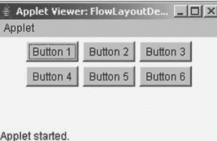

图. 14.10 FlowLayout

#### 解释

- L1–2 导入了属于 `java.applet` 和 `java.awt` 等包的所有必要类。
- L3 声明了一个名为 `FlowLayoutDemo` 的 applet。
- L4 声明了一个 `Layout` 类的引用，名为 `flowlayout`。
- L5 声明了一个类型为按钮的数组名为 `Buttons`。
- L6–16 在 L6 声明了一个构造函数 `FlowLayoutDemo()`。在 L8 中，创建了 L4 声明的引用 `flowLayout()`。在 L9 中，使用 `setLayout()` 方法，通过传递 `FlowLayout` 类对象作为参数来设置窗口的布局。在 L10 中，创建了一个六个按钮的数组。在 L11-15 中，使用 `Button` 类的 `setLabel()` 方法设置六个按钮的标签。为每个按钮设置标签后，将按钮添加到 applet 窗口中。为了避免为每个按钮单独设置标签并添加到容器，使用了 `for` 循环来简化步骤。

## 14.11.2 BorderLayout（边界布局）

它是框架的默认布局。属于 `java.awt` 的名为 `BorderLayout` 的类其签名如下：

```java
public class BorderLayout extends Object implements LayoutManager2, Serializable
```

`BorderLayout` 是一种布局，其中组件可以排列并调整大小以适应不同的区域：北、南、东、西和中心。每个区域只能有一个组件，这些区域标识为：`NORTH`（北）、`SOUTH`（南）、`EAST`（东）、`WEST`（西）和 `CENTER`（中）。向容器添加组件时可以使用这五个常量中的任意一个：

```java
pnl1 = new Panel();
pnl1.setLayout(new BorderLayout());
pnl1.add(new Button("submit"), BorderLayout.NORTH);
```

默认情况下，如果没有字符串规格，`BorderLayout` 将缺少规格等同于 `CENTER`：

```java
Panel p2 = new Panel();
p2.setLayout(new BorderLayout());
p2.add(new TextArea());    // 等同于 p.add(new TextArea()),
// BorderLayout.CENTER);
```

`BorderLayout` 类各种字段、构造函数和方法在表 14.12 中给出。

### 表 14.12 BorderLayout 类

| 字段名 | 详情 |
| :--- | :--- |
| `AFTER_LAST_LINE` | 等同于下方的 `PAGE_END`。 |
| `AFTER_LINE_ENDS` | 等同于下方的 `LINE_END`。 |
| `BEFORE_FIRST_LINE` | 等同于下方的 `PAGE_START`。 |
| `BEFORE_LINE_BEGINS` | 等同于下方的 `LINE_START`。 |
| `CENTER` | 中心。 |
| `EAST` | 东（右侧）。 |
| `LINE_END` | 组件位于布局方向的末尾。 |
| `LINE_START` | 组件位于布局方向的开头。 |

（表 14.12 续）

| 字段名 | 详情 |
| :--- | :--- |
| `NORTH` | 北（容器的顶部）。 |
| `PAGE_END` | 组件位于布局最后一行之后。 |
| `PAGE_START` | 组件位于容器的第一行之前。 |
| `SOUTH` | 容器的底部。 |
| `WEST` | 西（容器的左侧）。 |

| 构造函数名 | 详情 |
| :--- | :--- |
| `BorderLayout()` | 创建一个没有间隙的边界布局。 |
| `BorderLayout(int hgap, int vgap)` | 创建具有指定水平和垂直间隙的边界布局。 |

| 方法名 | 详情 |
| :--- | :--- |
| `addLayoutComponent(Component comp, Object constraints)` | 使用指定的约束将组件添加到布局。 |
| `getConstraints(Component comp)` | 获取指定组件的约束。 |
| `getGap()` | 返回间隙。 |
| `float getAlignmentX(Container parent)` | 返回 x 轴上的对齐方式。 |
| `float getAlignmentY(Container parent)` | 返回 y 轴上的对齐方式。 |
| `getLayoutComponent(Container target, Object constraints)` | 根据 `target` 方向返回对应的组件。 |
| `getLayoutComponent(Object constraints)` | 获取使用指定约束添加的组件。 |
| `invalidateLayout(Container target)` | 使布局，如果布局管理器缓存了信息，则将其丢弃。 |
| `void layoutContainer(Container target)` | 使用此边界布局布局容器。 |
| `Dimension maximumLayout(Container target)` | 返回 `target` 容器中布局的最大尺寸对象。 |


| 方法 | 详情 |
| :--- | :--- |
| `Dimension minimumLayoutSize(Container target)` | 使用此布局确定 `target` 容器的最小尺寸。 |
| `Dimension preferredLayoutSize(Container target)` | 根据组件使用此布局确定 `target` 容器的优选尺寸。 |

（表 14.12 续）

| 方法 | 详情 |
| :--- | :--- |
| `void removeLayout(Component comp)` | 从此布局移除指定的组件。 |
| `void setGap(int hgap)` | 设置组件间的水平间隙。 |
| `void setGap(int vgap)` | 设置组件间的垂直间隙。 |
| `String toString()` | 返回此边界布局的字符串表示。 |

让我们来看 `BorderLayout`。由于框架的默认布局管理器是 `BorderLayout`，我们没有显式设置布局。

## 14.10 BorderLayout

```java
import java.awt.*;
public class BorderLayoutDemo extends Frame {
    public BorderLayoutDemo(String title) {
        super(title);
        add(new Button("North"), BorderLayout.NORTH);
        add(new Button("South"), BorderLayout.SOUTH);
        add(new Button("East"), BorderLayout.EAST);
        add(new Button("West"), BorderLayout.WEST);
        add(new Button("Center"), BorderLayout.CENTER);
        setSize(400, 270);
        setVisible(true);
    }
    public static void main(String[] args) {
        BorderLayoutDemo layout = new BorderLayoutDemo("Border Layout Example");
    }
}
```

# 输出

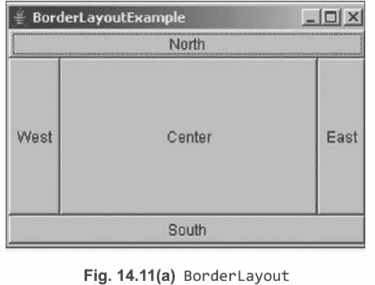

在上面的框架中，位于区域内的组件扩展以适应它们。例如，`NORTH` 和 `SOUTH` 中的组件水平扩展以适应该区域，同样，`EAST` 和 `WEST` 中的组件垂直扩展。`CENTER` 中的组件水平和垂直扩展以适应任何剩余空间。

#### 解释

- **L2** 声明扩展 `frame` 的 `BorderLayout` 类，通过调用父类的构造函数设置标题。
- **L5–9** 创建按钮对象并使用 `add()` 方法将其添加到框架。按钮的约束由第二个参数指定，即 `BorderLayout.NORTH` 和 `SOUTH`。L9 表示构造方法的结束。
- **L3–11** 属于 `Frame` 类的构造函数设置 `Frame` 实例标题。同样，`BorderLayoutDemo` 类接受字符串作为框架标题的参数。在 L4 中使用了 `super` 关键字。

如果没有指定约束并使用 `add(Component c)` 添加按钮，默认情况下，所有按钮都将被放置并占据整个框架。最后添加的按钮将显示在框架上方。其余按钮将显示在用户的顶部按钮下方。图 14.11(b) 显示了使用 `add(Component c)` 添加按钮时的情况。

产生上述输出的代码所示：

```java
add(new Button("North"));
add(new Button("South"));
add(new Button("East"));
add(new Button("West"));
add(new Button("Center"));
```

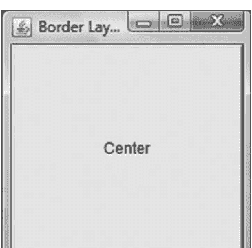

图. 14.11(b) 默认设置下的 BorderLayout

## 14.11.3 CardLayout（卡片布局）

`CardLayout` 类继承 `Object` 类并实现 `LayoutManager2`、`Serializable` 接口。`CardLayout` 对象作为容器的布局管理器。在容器中每个组件被 `CardLayout` 对象视为一个卡片。每个卡片像堆栈一样放置在另一个卡片上，添加堆栈后一次只能显示一个卡片。当容器在第一个组件之后显示时，第一个组件是可见的。

卡片的顺序由容器内部其组件对象的顺序决定。`CardLayout` 定义了一组方法，允许应用程序顺序翻阅这些卡片，或显示特定的卡片。属于 `CardLayout` 的构造函数和方法在表 14.13 中。

## 表 14.13 CardLayout

| CardLayout 构造函数 | |
| :--- | :--- |
| `CardLayout()` | 创建一个间距为零的默认新布局。 |
| `CardLayout(int h, int v)` | 你可以创建一个具有特定水平和垂直间距的新布局。 |

| 方法名称 | 详情 |
| :--- | :--- |
| `addLayoutComponent(Component cmp, Object name)` | 将特定组件添加到卡片布局的内部表中。 |
| `void first(Container cont)` | 显示容器的第一张卡片。 |
| `int getHgap()` | 用于获取组件之间的水平间距。 |
| `float getAlignmentX(Container cont)` | 获取沿 x 轴对齐。 |
| `float getAlignmentY(Container cont)` | 获取沿 y 轴对齐。 |
| `int getVgap()` | 获取组件之间的垂直间距。 |
| `void last(Container cont)` | 显示容器的最后一张卡片。 |
| `Dimension maximumLayoutSize(Container target)` | 返回此布局在指定目标中的最大尺寸。 |
| `Dimension minimumLayoutSize(Container target)` | 返回此布局在指定目标中的最小尺寸。 |
| `void next(Container cont)` | 显示特定容器的下一张卡片。 |
| `Dimension preferredLayoutSize(Container cont)` | 返回使用卡片布局的容器参数的大小。 |
| `void previous(Container cont)` | 显示指定容器的上一张卡片。 |
| `void removeLayoutComponent(Component cmp)` | 从布局中移除特定组件。 |
| `void setHgap(int h)` | 设置组件之间的水平间距。 |
| `void setVgap(int v)` | 设置组件之间的垂直间距。 |
| `void show(Container cont, String name)` | 显示通过 `addLayoutComponent` 添加到布局的具有特定名称的组件。 |
| `String toString()` | 返回卡片状态的字符串表示。 |

## 示例 14.11 CardLayout Demo

| 行号 | 代码 |
| :--- | :--- |
| L1 | `import java.awt.*;` |
| L2 | `import java.awt.event.*;` |
| L3 | `public class CardDemo extends Frame implements ActionListener {` |
| L4 | `    Panel cardPanel;` |
| L5 | `    Panel p1, p2, p3;` |
| L6 | `    Panel buttonP;` |
| L7 | `    Button B1, B2, B3;` |
| L8 | `    CardLayout layout;` |
| L9 | `    public void cardDemo() {` |
| L10 | `        cardPanel = new Panel();` |
| L11 | `        layout = new CardLayout();` |
| L12 | `        cardPanel.setLayout(layout);` |
| L13 | `        p1 = new Panel();` |
| L14 | `        p1.setBackground(Color.red);` |
| L15 | `        p2 = new Panel();` |
| L16 | `        p2.setBackground(Color.yellow);` |
| L17 | `        p3 = new Panel();` |
| L18 | `        p3.setBackground(Color.green);` |
| L19 | `        B1 = new Button("Red");` |
| L20 | `        B1.addActionListener(this);` |
| L21 | `        B2 = new Button("Yellow");` |
| L22 | `        B2.addActionListener(this);` |
| L23 | `        B3 = new Button("Green");` |
| L24 | `        B3.addActionListener(this);` |
| L25 | `        buttonP = new Panel();` |
| L26 | `        buttonP.add(B1);` |
| L27 | `        buttonP.add(B2);` |
| L28 | `        buttonP.add(B3);` |
| L29 | `        cardPanel.add(p1, "B1");` |
| L30 | `        cardPanel.add(p2, "B2");` |
| L31 | `        cardPanel.add(p3, "B3");` |
| L32 | `        setLayout(new BorderLayout());` |
| L33 | `        add(buttonP, BorderLayout.SOUTH);` |
| L34 | `        add(cardPanel, BorderLayout.CENTER);` |
| L35 | `        setVisible(true);` |
| L36 | `        setSize(300, 200);` |
| L37 | `        setTitle("Demo");` |
| L38 | `        addWindowListener(new WindowAdapter() {` |

```java
            public void windowClosing(WindowEvent we) {
                System.exit(0);
            }
        });
        public void actionPerformed(ActionEvent e) {
            if (e.getSource() == B1) {
                layout.show(cardPanel, "B1");
            } else if (e.getSource() == B2) {
                layout.show(cardPanel, "B2");
            } else if (e.getSource() == B3) {
                layout.show(cardPanel, "B3");
            }
        }
    }
    public static void main(String[] args) {
        CardDemo demo = new CardDemo();
        demo.cardDemo();
    }
}
```

# 输出


图 14.13 GridLayout 演示

#### 解释

- **L1–2** `java.awt` 及其子包 `awt.event` 被导入。
- **L3** 创建了一个帧（`Frame`）。
- **L7–17** 将组件添加到面板（`Panel`）中。标签（`Label`）和文本字段（`TextField`）以及另外两个按钮一起被添加到面板对象中。使用 `add(Component c)` 方法将面板对象添加到帧中。
- **L4** 定义了该类的构造函数。
- **L18–19** 设置了帧的大小并将帧的可见设置为 `true`。
- **L5** 使用 `super` 关键字调用了 `Frame` 的构造函数。传递给它的字符串用作帧的标题。
- **L20–25** 为帧注册了窗口监听器（`WindowListener`），当点击帧标题栏时，应用程序帧将关闭。
- **L6** 创建了面板对象以存放组件。面板对象的布局在构造函数中作为参数指定。指定的布局是 `GridLayout`，行数为 5，列数为 2，列与列之间的水平间距为...

# 14.15 GridBagLayout

`GridBagLayout` 类继承自 `Object` 并实现了 `LayoutManager2` 和 `Serializable` 接口。使用 `GridBagLayout`，我们可以在水平和垂直方向上受控地排列组件。在 `GridBagLayout` 中，组件的大小不需要一致。我们可以通过指定它们在同一行网格单元格内的位置来排列不同大小的组件。它的优点是每行可以包含不同数量的列。在 `GridBagLayout` 中，组件的大小和位置取决于与其关联的一组约束。

# Java 编程

一个 `GridBagConstraints` 对象包含了单元格的宽度、高度、组件的放置和对齐约束。每个 `GridBagLayout` 维护一个矩形单元格网格。一个组件可以占据一个或多个单元格，这被称为它的显示区域。`Component` 类控制网格的取向。

我们需要自定义 `GridBagConstraints` 以有效地与其组件关联的 `GridBagLayout`。可以通过设置一个或多个实例变量来完成 `GridBagConstraints` 对象的自定义。这些实例变量将在下文中讨论。

## gridx 和 gridy

网格单元格的初始地址为 `gridx = 0` 和 `gridy = 0`。`GridBagConstraints.RELATIVE`（默认值）用于指定该组件紧跟在添加此组件之前刚刚添加到容器的组件之后对齐。

## gridwidth 和 gridheight

`gridwidth` 约束指定行中的单元格数量，`gridheight` 约束指定组件显示区域中的列数。默认值为 1。

## fill

当组件的请求尺寸小于显示区域的大小时，我们就使用它。我们也可以用它来调整组件的大小。它用于确定是否（以及如何）调整组件。该字段的值如下：

- `GridBagConstraints.NONE`（默认值 - 当网格调整大小时不增长）
- `GridBagConstraints.HORIZONTAL`（此值填充组件的所有水平显示区域，但不会改变高度）
- `GridBagConstraints.VERTICAL`（它改变组件的高度，但不会改变其宽度）
- `GridBagConstraints.BOTH`（使组件在水平和垂直方向上都填充其显示区域）

## ipadx 和 ipady

`ipadx` 和 `ipady` 字段用于给定布局中组件的内部填充。如果指定了 `ipadx`，组件的宽度将为最小宽度加上 `ipadx` 像素。同样，`ipady` 加上最小高度就是组件的高度。

## insets

`insets` 字段用于组件的外部填充。它用于组件与其显示区域边缘之间的间距。例如：

```java
GridBagConstraints c = new GridBagConstraints();
c.insets = new Insets(top, left, bottom, right);
```

## anchor

`anchor` 字段指定组件在其显示区域中的位置。有三种值：绝对、相对和基线。

### 绝对值

绝对值用于将组件放置在特定位置，如下：

- `GridBagConstraints.NORTH`
- `GridBagConstraints.SOUTH`
- `GridBagConstraints.WEST`
- `GridBagConstraints.EAST`
- `GridBagConstraints.NORTHWEST`
- `GridBagConstraints.NORTHEAST`
- `GridBagConstraints.SOUTHWEST`
- `GridBagConstraints.SOUTHEAST`
- `GridBagConstraints.CENTER`

### 相对值

相对于容器的布局。这些值可以是：

- `GridBagConstraints.PAGE_START`
- `GridBagConstraints.PAGE_END`
- `GridBagConstraints.LINE_START`
- `GridBagConstraints.LINE_END`
- `GridBagConstraints.FIRST_LINE_START`
- `GridBagConstraints.FIRST_LINE_END`
- `GridBagConstraints.LAST_LINE_START`
- `GridBagConstraints.LAST_LINE_END`

### 基线值

相对于组件基线的对齐。这些值可以是：

- `GridBagConstraints.BASELINE`
- `GridBagConstraints.BASELINE_LEADING`
- `GridBagConstraints.BASELINE_TRAILING`
- `GridBagConstraints.ABOVE_BASELINE`
- `GridBagConstraints.ABOVE_BASELINE_LEADING`
- `GridBagConstraints.ABOVE_BASELINE_TRAILING`
- `GridBagConstraints.BELOW_BASELINE`
- `GridBagConstraints.BELOW_BASELINE_LEADING`
- `GridBagConstraints.BELOW_BASELINE_TRAILING`

## weightx 和 weighty

这些用于分配剩余空间。如果指定了权重，组件将在水平或垂直方向上扩展。权重的默认值为 `0.0`。

## Example 14.13 Without Constraints


```java
import java.awt.*;
public class GILayout1 extends Frame {
    public GILayout1() {
        setLayout(new GridLayout());
        setTitle("GridLayout Constraints");
        Label l = new Label("Name");
        add(l);
        TextField t = new TextField();
        add(t);
        Button b = new Button("Submit");
        add(b);
        Button b1 = new Button("Reset");
        add(b1);
        setSize(200, 200);
        setVisible(true);
    }
    public static void main(String args[]) {
        GILayout1 d = new GILayout1();
    }
}
```

# 示例 14.14 规定了 fill、gridx 和 gridy 约束的 GridBagLayout

```java
import java.awt.*;
public class BagLayoutDemo2 extends Frame {
    public BagLayoutDemo2() {
        setLayout(new GridBagLayout());
        setTitle("GridBagLayout with fill, gridx and gridy Constraints");
        GridBagConstraints c = new GridBagConstraints();
        c.fill = GridBagConstraints.HORIZONTAL;
        Label l1 = new Label("Name");
        add(l1, c);
        TextField t = new TextField();
        add(t, c);
        c.gridx = 0;
        c.gridy = 1;
        Button b = new Button("Submit");
        add(b, c);
        c.gridx = 0;
        c.gridy = 1;
        Button b1 = new Button("Reset");
        add(b1, c);
        setSize(200, 200);
        setVisible(true);
    }
    public static void main(String[] args) {
        BagLayoutDemo2 d = new BagLayoutDemo2();
    }
}
```

# 输出


**图 14.15(a)** 规定了 fill、gridx 和 gridy 约束的 GridBagLayout

**图 14.15(b)** 当 Fill 为 None 时显示的输出（L7 行被注释）

#### 解释

- **L6** 创建了 `GridBagConstraints` 对象。

- **L7** 将 `fill` 属性设置为 `HORIZONTAL`（水平方向）。`fill` 属性使组件在它的显示区域内水平填充，并对齐所有组件（见图 14.15(a)）。如果此行被注释，显示的输出如图 14.15(b) 所示。注意 `TextField` 的大小。

- **L8-9** 实例化 `Label` 并将其添加到框架中，其中通过该方法的第二个参数指定了约束。

- **L10-11** 实例化 `TextField` 并将其添加到框架中，其中通过该方法的第二个参数指定了约束。

- **L12-13** 分别规定了值为 0 和 1 的 `gridx` 和 `gridy` 约束。`gridx` 约束被赋值为 0 表示第一列，`gridy` 被赋值为 1 表示第二行。

- **L14-15** 根据上述所有约束添加了一个按钮，即该按钮将被添加到第二行第一列（见图 14.15(a)）。

- **L16-17** 分别规定了值为 1 和 1 的 `gridx` 和 `gridy` 约束。`gridx` 被赋值为 1 表示第二列，`gridy` 被赋值为 1 表示第二行。

- **L18-19** 根据上述新约束添加了另一个按钮，即该按钮将被添加到第二行第二列（见图 14.15(a)）。

在示例 14.14 中，我们只使用了 `gridx`、`gridy` 和 `fill` 约束。但组件仅显示在框架的中心。为了分行和列中额外的水平和垂直空间，使用了 `weightx` 和 `weighty` 属性。

**示例 14.15** 规定了 weightx、weighty 和 ipady 约束的 GridBagLayout

```java
import java.awt.*;
public class GridBagLayoutDemo extends Frame {
    public GBLayoutDemo3() {
        setLayout(new GridBagLayout());
        setTitle("GridBagLayout with weightx, weighty ipady Constraints");
        GridBagConstraints c = new GridBagConstraints();
        c.weighty = 1;
        c.weightx = 1;
        c.fill = GridBagConstraints.BOTH;
        Label l = new Label("Name");
        add(l, c);
        TextField t = new TextField();
        add(t, c);
        c.gridx = 0;
        c.gridy = 1;
        Button b = new Button("Submit");
        add(b, c);
        c.fill = GridBagConstraints.NONE;
        c.gridx = 1;
        c.gridy = 2;
        c.ipady = 30;
        Button b1 = new Button("Reset");
        add(b1, c);
        setSize(200, 200);
        setVisible(true);
    }
    public static void main(String args[]) {
        GBLayoutDemo3 d = new GBLayoutDemo3();
    }
}
```

输出


**图 14.16(a)** 规定了 weighty 约束，除 weightx 和 ipady 之外的 GridBagLayout

**图 14.16(b)** 规定了 weightx 和 ipady 约束的 GridBagLayout（L7 行被注释）


**图 14.16(c)** 规定了 weighty 和 ipady 约束的 GridBagLayout（L8 行被注释）

#### 解释

- **L7-8** `weightx` 和 `weighty` 被设置为 1，且 `fill` 属性设置为 `BOTH`，因此组件会在水平和垂直方向填充区域（见图 14.16(a)）。如果仅规定了 `weightx`，组件会在水平方向占据区域（见图 14.16(b)），因为额外的水平空间分配到了列中。

- 只有在规定了 `weighty` 时，组件才会在垂直方向占据区域（见图 14.16(c)），因为额外的垂直空间被分配到了行中。

- **L18** `fill` 属性被设置为 `NONE`。

- **L21** `ipady` 属性被设置为 30，提供了内部垂直边距。

```java
MenuShortcut n = new MenuShortcut(KeyEvent.VK_N);
MenuShortcut o = new MenuShortcut(KeyEvent.VK_O);
MenuShortcut x = new MenuShortcut(KeyEvent.VK_X);
MenuBar menubar = new MenuBar();
Menu fileMenu = new Menu("File");
Menu editMenu = new Menu("Edit");
// 在一个下拉菜单中创建并添加简单菜单
MenuItem newAction = new MenuItem("New", n);
MenuItem openAction = new MenuItem("Open", o);
MenuItem exitAction = new MenuItem("Exit", x);
MenuItem cutAction = new MenuItem("Cut");
MenuItem copyAction = new MenuItem("Copy");
MenuItem pasteAction = new MenuItem("Paste");
newAction.addActionListener(this);
openAction.addActionListener(this);
exitAction.addActionListener(this);
fileMenu.addSeparator();
fileMenu.add(newAction);
fileMenu.addSeparator();
fileMenu.add(openAction);
fileMenu.addSeparator();
fileMenu.add(exitAction);
menubar.add(fileMenu);
cutAction.addActionListener(this);
copyAction.addActionListener(this);
pasteAction.addActionListener(this);
editMenu.add(cutAction);
editMenu.addSeparator();
editMenu.add(copyAction);
editMenu.addSeparator();
editMenu.add(pasteAction);
menubar.add(editMenu);
setVisible(true);
addWindowListener(new WindowAdapter() {
    public void windowClosing(WindowEvent event) {
        System.exit(0);
    }
});
public void actionPerformed(ActionEvent e) {
    String action = e.getActionCommand();
    if (action.equals("New")) {
        System.out.println("New");
    } else if (action.equals("Open")) {
        System.out.println("File");
    } else if (action.equals("Exit")) {
        System.exit(0);
    } else if (action.equals("Cut")) {
        System.out.println("Cut");
    } else if (action.equals("Copy")) {
        System.out.println("Copy");
    } else if (action.equals("Paste")) {
        System.out.println("Paste");
    }
}
public static void main(String[] args) {
    DemoMenu demo = new DemoMenu();
    demo.demoMenu();
}
```

# 482 Java 编程


**图 14.17(a)** 示例菜单


**图 14.17(b)** 通过按下快捷键从菜单显示的输出示例

## 解析

- **L7–8** 创建了 `MenuBar` 对象，并使用 `setMenuBar` 方法将其设置在框架（frame）上。

- **L9–11** 创建了三个带有键 n、o 和 x 的 `MenuShortcut`。按下 Ctrl + n 将引用它被添加的菜单。

- **L12–13** 创建了两个菜单：`fileMenu` 和 `editMenu`。

- **L14–16** 创建了三个 `MenuItem`，并为构造函数中的三个参数都指定了快捷键（这些将被添加到 file 菜单中）。

- **L17–19** 创建了另外三个 `MenuItem`，未指定任何快捷键（这些将被添加到 edit 菜单中）。

- **L20–22** 菜单项注册了 `ActionListener` 以接收通知。

- **L23–28** L14–16 中创建的三个菜单项通过该方法添加到 `fileMenu` 中。使用 `addSeparator` 方法在每个菜单项后添加一个分隔符（线）。

- **L29** 将项添加到 `Menu` 中。

- **L30–32** L17–19 中创建的三个项注册了 `ActionListener` 以接收事件通知。

- **L33–38** L17–19 中创建的三个菜单项通过 `add` 方法添加到 `editMenu` 中。使用 `addSeparator` 方法在每个菜单项后添加一个分隔符。

- **L39** 将编辑项添加到菜单中。

- **L46–57** 如果点击“New”项或按下 ctrl+n 键，将执行 L47，其余情况也是此类。

## 14.13 滚动条

滚动条用于通过整数值范围（最大值和最小值之间的集合）显示连续值。这些滚动条可以是水平的或垂直的。滚动条的最大值和最小值可以沿行增量和页增量进行设置。

要创建滚动条，必须创建一个 `Scrollbar` 类的实例。该类定义了以下构造函数：

```
Scrollbar() throws HeadlessException
Scrollbar(int direction) throws HeadlessException
Scrollbar(int direction, int intValue, int pageSize, int min, int max) throws HeadlessException
```

第一个构造函数没有参数；它创建一个垂直滚动条。在第二个和第三个构造函数中，方向指定了滚动条的方向。如果方向指定为 `Scrollbar.VERTICAL` 或 `Scrollbar.HORIZONTAL`，则分别创建垂直或水平滚动条。第三个构造函数可以将滚动条的初始值作为参数 `intValue` 传递，并将点击箭头和框之间的滚动条时增加或减少的页高度所代表的单位数作为参数 `pageSize`、`min` 和 `max` 传递。


**图 14.18** 下行代码创建一个水平滚动条：

`Scrollbar demo1 = new Scrollbar(Scrollbar.HORIZONTAL);`

下行代码将创建一个起始位置为 0、滑块（thumb）大小为 5、最大值为 255 的垂直滚动条：

`Scrollbar demo2 = new Scrollbar(Scrollbar.VERTICAL, 0, 5, 255);`

滚动条有三个不同的部分允许你以不同的方式选择值。箭头增加或减少行范围可以设置为一个小单位。如果你点击滚动条最大值内的任意位置，页值将增加或减少（默认值为 10）。中间允许你快速从一端移动到另一端。可见部分由滑块（bubble）表示，大小如构造函数所示为（5）。表 14.19 列出了与滚动条配合使用的方法。`getAdjustment()` 返回的类型为：

- `BLOCK_DECREMENT`：产生了向下事件
- `BLOCK_INCREMENT`：产生了页事件
- `TRACK`：产生了绝对跟踪事件
- `UNIT_DECREMENT`：产生了滚动条向下按钮
- `UNIT_INCREMENT`：产生了滚动条向上按钮

## 表 14.19 滚动条的方法

| 方法 | 说明 |
| :--- | :--- |
| `void setValues(int initValue, int pageSize, int min, int max)` | 这里的参数与上述构造函数相同。如果使用前两个构造函数创建滚动条，则通过上述方法设置值。 |
| `int getLineIncrement()` | 获取行增量。 |
| `void setPageIncrement(int pageSize)` | 设置页增量。 |
| `int getPageIncrement()` | 获取页增量。 |
| `int getMinimum()` | 获取最小值。 |
| `void setUnitIncrement(int newUnitInc)` | 设置单位增量。 |
| `int getValue()` | 获取滚动条的当前位置。 |
| `int getMaximum()` | 获取最大值。 |


## 方法表

| 方法 | 说明 |
| :--- | :--- |
| `void setValue(int newValue)` | 设置当前位置。 |
| `void setBlockIncrement(int newBlockInc)` | 设置页上和页下的块增量。 |

## 示例 14.17 滚动条

| 行 | 代码 |
| :--- | :--- |
| L1 | `import java.awt.*;` |
| L2 | `import java.awt.event.*;` |
| L3 | `public class ScrollbarDemo extends AdjustmentListener {` |
| L4 | `Scrollbar HScroll, VScroll;` |
| L5 | `Label lbl1;` |
| L6 | `int x = 100, Y = 150;` |
| L7 | `public ScrollbarDemo() {` |
| L8 | `HScroll = new Scrollbar(Scrollbar.HORIZONTAL);` |
| L9 | `VScroll = new Scrollbar(Scrollbar.VERTICAL);` |
| L10 | `lbl1 = new Label("", Label.CENTER);` |
| L11 | `HScroll.setMaximum(400);` |
| L12 | `VScroll.setMaximum(400);` |
| L13 | `setBackground(Color.cyan);` |
| L14 | `setTitle("Oval size changes with scrollbar movements");` |
| L15 | `setLayout(new BorderLayout());` |
| L16 | `add(lbl, BorderLayout.NORTH);` |
| L17 | `add(HScroll, BorderLayout.SOUTH);` |
| L18 | `add(VScroll, BorderLayout.EAST);` |
| L19 | `HScroll.addAdjustmentListener(this);` |
| L20 | `VScroll.addAdjustmentListener(this);` |
| L21 | `HScroll.setValue(X);` |
| L22 | `VScroll.setValue(Y);` |
| L23 | `lbl.setText("HScroll = " + HScroll.getValue() + " = " + VScroll.getValue());` |
| L24 | `setSize(500,500);` |
| L25 | `setVisible(true);` |
| L26 | `addWindowListener(new WindowAdapter() {` |
| L27 | `public void windowClosing(WindowEvent e) {` |
| L28 | `}` |
| L29 | `});` |
| L30 | `public void adjustmentValueChanged(AdjustmentEvent e) {` |
| L31 | `X = HScroll.getValue();` |
| L32 | `Y = VScroll.getValue();` |
| L33 | `lbl.setText("HScroll = " + X + " , VScroll = " + Y);` |
| L34 | `repaint();` |
| L35 | `}` |
| L36 | `public void paint (Graphics g) {` |
| L37 | `g.drawOval(50, 60, X, Y);` |
| L38 | `}` |
| L39 | `public static void main(String[] args) {` |
| L40 | `{` |
| L41 | `ScrollbarDemo d = new ScrollbarDemo();` |
| L42 | `}` |
| L43 | `}}` |

## 输出


图 14.19

## 解析

- **L1–2** 导入了必要的包。
- **L3** 创建了一个 Frame，并继承了 `ActionListener` 以监听滚动条事件。
- **L4–6** 创建了两个滚动条（一个水平滚动条，另一个垂直滚动条），并带有一个用于显示水平和垂直滚动条位置的 Label。定义了两个整数变量 `X` 和 `Y`，用于指定滚动条的精确位置。此外，这两个变量也构成了我们椭圆图 14.19(b) 的宽度和高度。
- **L7** 定义了类的构造函数。
- **L8–9** 实例化了水平和垂直滚动条。它们的方向分别被指定为 `HORIZONTAL` 和 `VERTICAL`。
- **L10** 插入了 Label 以显示滚动条的值。
- **L11–12** 使用 `setMaximum(400)` 方法为滚动条设置了最大范围。如果你实际上点击滚动条并将其到最大值，Label 显示的值将是 399，因为气泡的默认大小为 10。因此，范围实际上是 0 到 390。
- **L13** 背景颜色设置为青色（cyan）。
- **L14** 使用 `setTitle()` 方法设置了 Frame 的标题。
- **L15** 布局设置为 `BorderLayout`。
- **L16–18** 将三个组件：水平滚动条、垂直滚动条和 Label 分别添加到 EAST、SOUTH 和 NORTH 区域。
- **L19–20** 两个滚动条都注册了 `ActionListener`。
- **L21–23** 使用 `setValue` 方法将水平和垂直滚动条的初始值分别设置为 100 和 150，并将初始滚动条值设为 Label 的文本。
- **L24–28** 设置了 Frame 的大小和可见性。此外，该 Frame 注册了 `WindowListener` 来跟踪窗口关闭事件。
- **L29–33** 重写了 `adjust` 方法——`adjustmentChanged(Adjustment event)`。每当滚动条发生调整时，该方法就会被调用。随着滚动条的移动，x 和 y 值发生变化，我们的椭圆宽度和高度随之改变。Label 设置为水平和垂直滚动条当前值，然后重绘 Frame。
- **L34–35** 重写了 `paint` 方法，并使用 Graphics 对象的 `drawOval` 绘制椭圆。椭圆的前两个坐标固定。宽度和高度是变量，取决于滚动条的移动。`drawOval` 方法的签名所示：`g.drawOval(int x, int y, int width, int height)`
- **L36–37** 在 `main` 方法中实例化了 Frame。

## 14.14 实际问题：城市地图

CityMap Applet 显示了一个城市的地图（俯视图），带有五个按钮，分别是：医院、购物中心、警察局、邮局和体育场。如果用户按下医院按钮，所有医院将以特定的颜色显示在地图上，对于购物中心、警察局、邮局和体育场也是如此。

### 图 14.18 CityMap.java

```java
import java.applet.*;
import java.awt.*;
import java.awt.event.*;
/*<applet code = "CityMap.class" width=650 height=600></applet>*/
public class CityMap extends Applet {
    Button b1, b2, b3, b4, b5;

    /* 使用布尔变量作为标志变量 */
    boolean hospital, mall, pstation, po, stadium;

    public void init() {
        /* 创建按钮并将其添加到 applet 中。 */
        b1 = new Button("Hospital");
        add(b1);
        b2 = new Button("Shopping Malls");
        add(b2);
        b3 = new Button("Police Station");
        add(b3);
        b4 = new Button("Post office");
        add(b4);
        b5 = new Button("Stadium");
        add(b5);
    }
}
```

- 为所有按钮定义了匿名内部类。如果使用监听器（处理事件）并且 Applet 类实现了 `ActionListener` 来处理事件，那么对于所有按钮，我们只有一个 `ActionPerformed` 方法。在 `ActionPerformed` 方法中，我们使用 `if-else` 条件语句来判断按了哪个按钮，然后执行所需任务。因此会有五个条件，每个按钮一个，这些条件会在每次按下按钮时都会被检查，直到找到匹配。在下面的示例中，每个按钮都注册了对应的事件处理程序，从而消除了烦琐的多个 if 语句并节省了执行时间。

/* 为医院按钮创建一个匿名内部类。一旦按下医院按钮，该类的 actionPerformed 就会被调用，将 hospital 布尔变量设置为 true 并重绘 applet。程序员没有提供显式的类名，但编译器会为此内部类生成名为 "CityMap$class" 的 .class 文件 */

```java
b1.addActionListener(new ActionListener() {
    public void actionPerformed(ActionEvent ae) {
        /*将布尔变量设为 true 并重绘 applet */
        hospital = true;
        repaint();
    }
});
```

```java
b2.addActionListener(new ActionListener() {
    public void actionPerformed(ActionEvent ae) {
        /*将布尔变量设为 true 并重绘 applet */
        mall = true;
        repaint();
    }
});
```

```java
b3.addActionListener(new ActionListener() {
    public void actionPerformed(ActionEvent ae) {
        /*将布尔变量设为 true 并重绘 applet */
        pstation = true;
        repaint();
    }
});
```

```java
b4.addActionListener(new ActionListener() {
    public void actionPerformed(ActionEvent ae) {
        /*将布尔变量设为 true 并重绘 applet */
        po = true;
        repaint();
    }
});
```

```java
b5.addActionListener(new ActionListener() {
    public void actionPerformed(ActionEvent ae) {
        /*将布尔变量设为 true 并重绘 applet */
        stadium = true;
        repaint();
    }
});
```

```java
public void paint(Graphics g) {
    /* 外部矩形 */
    g.drawRect(5, 40, 630, 550);

    g.drawLine(106, 41, 106, 167);
    g.drawArc(77, 150, 30, 30, -10, -70);
    g.drawLine(6, 180, 95, 180);

    /* 使用黑色创建圆角矩形 */
    g.drawRoundRect(155, 50, 180, 100, 30, 30);

    g.drawLine(400, 41, 400, 200);
    g.drawLine(410, 210, 600, 210);
    g.drawArc(400, 191, 28, 20, -90, -90);
    g.drawArc(590, 210, 18, 20, -10, -90);

    g.drawLine(609, 222, 609, 319);
    g.drawArc(590, 309, 18, 20, 0, -90);
    g.drawLine(550, 440, 603, 327);
    g.drawArc(545, 440, 50, 50);
}
```

### Abstract Window Toolkit 491

```java
g.setColor(Color.YELLOW);
g.fillOval(220,70,10,10);
g.fillOval(300,55,10,10);
g.fillOval(110,500,10,10);
g.fillOval(420,200,10,10);
g.fillOval(500,350,10,10);
pstation=false;
}
/*if post office button is pressed*/
if(po) {
    g.setColor(Color.BLUE);
    g.fillOval(80,150,10,10);
    g.fillOval(100,350,10,10);
    g.fillOval(500,80,10,10);
    g.fillOval(590,400,10,10);
    g.fillOval(390,550,10,10);
    po=false;
}
/*if stadium button is pressed*/
if(stadium) {
    /*sets the color as black and creates 10 adjacent Circles. First Circle at (x=170,y=330), second at (x=171,y=331), third at (x=172,y=332) and soon.*/
    g.setColor(Color.BLACK);
    for(int i=0;i<10;i++) {
        g.drawOval(i+170,i+330,150,150);
    }
    stadium=false;
}
```


图 14.20(a)

### 492 Java 编程

图 14.20(a) 显示了一个包含道路、建筑、圆圈和体育场的城市地图。


图 14.20(b)

图 14.20(b) 在点击医院按钮时突出显示地图上的医院。

## 总结

在本章中，我们强调了 Java 中使用图形用户界面（GUI）进行输入和输出的计算方面。Java 有一个名为 `java.awt` 的包，其中各种类负责生成各种 GUI 框架。各种 AWT 组件有助于提供这些 GUI 结构。这些组件包括按钮（button）、Scrollbar、List、Choicebox、TextField 等。在前一节中，我们学习了事件处理模型的基础。在本章中，我们使用了相同的事件委托模型，这些事件通过各种 GUI 组件生成。

为了这一目的，AWT 包有一个名为 `Container` 的类。需要注意的是，`Panel` 类是 `Applet` 类的超类。`Frame` 是 `window` 类的子类。`window` 类对象没有边界或菜单栏，而 `Frame` 可以拥有。AWT 定义了在容器中布局 AWT 组件的方法。AWT 中有很多布局管理器，如 `FlowLayout`、`GridLayout` 和 `CardLayout`，用于为容器中的组件设置不同的排列模式。

`Component` 类是所有 AWT 组件的根部，其直接子类包括：

(a) button、(b) canvas、(c) checkbox、(d) choice、(e) label、(f) list 和 (g) scrollbar。AG 环境始终需要一个容器来存放这些组件。

`Menu` 是继承自 `Menu` 类和两个接口（`MenuContainer` 和 `Accessible`）的类。菜单部署了一个菜单对象，它是一个下拉菜单组件。它显示菜单选择的列表。要实现此组件，我们使用三个类：`MenuBar`、`Menu` 和 `MenuItem`。

### Abstract Window Toolkit 493

## 练习题

### 选择题

1. 编译并运行以下代码的结果将是什么？

```java
import java.awt.*;
import java.awt.*;
public class Test extends Applet {
    Label label = new Label("Hello");
    public void init() {
        setSize(200,100);
        setVisible(true);
        label.setBackground(new Color(0,100,180));
        setLayout(new GridLayout(1,1));
        add(label);
        setLayout(new FlowLayout());
        label.setBounds(0,0,100,24);
    }
}
```

- (a) 标签将填充 applet 的显示区域。


(b) 标签将足够宽以显示文本 "Hello"

(c) 标签将不可见。

(d) 标签将填充 applet 的整个显示区域

- 2. 下列哪些项是 `TextField` 的有效构造函数？

(a) `TextField()`;

(b) `TextField(int cols)`;

(c) `TextField(int rows, int cols)`;

(d) `TextField(int cols, String txt)`;

- 3. `Dialog` 的默认布局是什么？

(a) `FlowLayout`

(b) `CardLayout`

- 4. `Frame` 的默认布局是什么？

- (a) `FlowLayout`

(b) `GridLayout`

(c) `CardLayout`

(d) `BorderLayout`

- 5. `Applet` 的默认布局是什么？

(a) `FlowLayout`

(b) `GridLayout`

(c) `CardLayout`

(d) `BorderLayout`

- 6. 使用哪个方法更改容器的布局？

(a) `setLayout`

(b) `setLayout`

(c) `setBorder`

(d) `setCard`

- 7. 使用 `BorderLayout`，可以将组件放置在 之后

(a) `NORTH`

(b) `CENTER`

(c) `SOUTH`

(d) 以上所有

- 8. `MenuItem` 的监听器是？

(a) `ActionListener`

(b) `MouseListener`

(c) `ItemListener`

(d) `EventListener`

- 9. `GridBagLayout` 中 anchor 的可能类型是

(a) `absolute`

(b) `orientation-relative`

(c) `baseline-relative`

(d) 以上所有

- 10. 关于 `GridBagConstraints`，下列哪个正确？

(a) 它包含了高度、单元格宽度、位置和对齐。

(b) `GridBagLayout` 对象维持矩形网格。

(c) 组件可以占据多个单元格区域。

(d) 以上都不是

# 复习题

- 1. 什么是 `component` 和 `container` 类？

- 2. `component` 类的哪个方法设置组件的位置和大小？

- 3. `Font` 和 `FontMetrics` 类之间的区别是什么？

- 4. 解释 `java.awt` 包中的类层次结构。

- 5. AWT 组件的不同类型有哪些？它们是如何添加到容器的？

- 6. 解释创建 `frame` 并向其添加按钮的过程。

- 7. 要比较不同的布局管理器。

- 8. 设置前景和背景颜色的方法有哪些？

# 编程练习

- 1. 编写一个 AWT 程序，创建显示选中状态的 checkboxes。

- 2. 创建一个带有 `Menubar` 和 `MenuItem` 的 `frame`，通过 `TextField` 实现。应使用 `TextField` 显示转换后的温度。使用以下公式：`Celsius = 5/9*(Fahrenheit-32)`

- 3. 创建一个如下的“猜数字”应用程序：

你的应用程序在 1-1000 范围内选择一个整数。应用程序随后在 label 中显示：

我有 1 到 1000 之间的一个数字。你能猜出我的数字吗？

请输入你的猜测。


应该使用 `TextField` 输入猜测。每输入一次猜测，背景颜色变为红色或蓝色。label 应显示“Too High”或“Too Low”来帮助用户。当用户得到正确答案时，应显示“Correct”，并将输入的 `TextField` 改为可编辑。应提供一个按钮允许用户重新游戏。点击按钮时，应生成新数字并将 `TextField` 改为可编辑。

- 4. 创建一个 `frame` 并设置为红色。

- 5. 创建蔬菜列表。如果你点击列表中的项，该项应显示在 textbox 中。

- 6. 使用 AWT 编写一个简单的计算器。（提示：使用适当的布局管理器）

- 7. 编写华氏转换为摄氏的温度转换程序。华氏温度应从

# 选择题答案

| 1. (b) | 2. (a), (b) | 3. (d) | 4. (d) |
| :--- | :--- | :--- | :--- |
| 5. (a) | 6. (a) | 7. (d) | 8. (a) |
| 9. (d) | 10. (a), (b), (c) | | |

# Swing

一画胜千言

拿破仑

- 阅读完本章后，读者将能够

- 理解 AWT 和 swing 之间的区别

- 编写各种 swing 容器和组件

- 尝试新的布局

- 使用组件创建 GUI

- 学习 swing 中的对话框

- 理解可插式外观（pluggable look and feel）


## 15.1 引言

AWT 用于在 Java 中创建 GUI，但 `java.awt` 中的组件是重量级组件。AWT 提供的图形用户界面有一定的限制。一个主要限制是将视觉组件转换为相应的特定平台或操作系统组件。组件的外观不是由 Java 定义，而是由平台本身定义的。AWT 组件使用原生代码资源，因此被称为重量级组件。这些组件在不同的平台上看起来不同，而且它们总是矩形的。使用 AWT 工作非常困难，例如，如果我们想将按钮稍微向右或向左移动，我们必须对源代码进行各种修改并重新编译。

Swing (`javax.swing`) 是解决 AWT 所遇问题的解决方案。Swing 组件从 JDK1.2 及更高版本引入。Swing 组件对所有组件使用模型-视图-控制器（MVC）架构，提供了更大的灵活性。所有的 Swing 组件都有模型、视图和控制器。模型管理组件的状态和行为。视图根据状态管理组件的显示，控制器负责管理用户与模型的交互。控制器基本上决定了模型的状态何时以及如何变化。

Swing GUI 组件是事件驱动的。Swing 提供了一种非常好的编程方法，用于使用面向对象（OOP）概念来构建 GUI。它作为 JFC（Java 基础类）的一部分包含在 Java 中。它包含了 AWT 的所有功能。Swing 组件被称为轻量级，因为它们是使用 Java 开发的，因此具有平台无关性。换句话说，它们不依赖于原生对应物（peers）来辅助其功能的实现。Swing 总共包含 18 个包，大多数程序员使用以下包：

- `javax.swing`
- `javax.swing.event`

### 15.1.1 Swing 的特性

Swing 的一些共同特性包括：

- Swing 组件是轻量级的。它们不是构建在原生窗口窗口系统之上的。
- 它具有许多内置控件：树、标签页、滑动条、工具栏、表格等。
- 我们可以自定义 GUI 应用程序，例如，我们可以更改边框、文本对齐方式或向任何控件添加图像，我们还可以将内部表示与视觉外观分离。
- Swing 的一个非常吸引人的特性是它的可插件外观和感觉（pluggable look and feel）。你可以更改 Swing GUI 的外观和感觉。
- 国际化允许开发者构建可以在世界范围内使用不同语言的应用程序。
- 所有组件都命名为 `Jxx`，例如 `JApplet`、`JFrame`、`JButton`、`JLabel` 等。
- 在 Java 5 之后，可以使用 `add(Component c)` 方法添加组件。在此之前的版本中，它们通过 `getContentPane().add()` 方法添加到容器中。
- Swing 不是线程安全的。在创建 Swing GUI 时，如果有多个线程访问它，你将需要额外小心。

### 15.1.2 Swing 与 AWT 之间的区别

表 15.2 显示了 AWT 的某些类及其在 Swing 中对应的类。除了表中所示类外，`javax.swing` 中还增加了其他类，如 `JRadioButton`、`ButtonGroup`、`JButton`、`JSplitPane`、`JTabbedPane`、`JTree`、`JTable`、`JLabel`、`JColorChooser`、`JInternalFrame`、`JDesktopPane`、`JTextField`、`JOptionPane`、`JPopupMenu` 以及 Look and Feel。我们将在本章讨论所有这些特性。我们将在章节介绍 Swing 包中添加的新布局，即 `BoxLayout` 和 `SpringLayout`。

**表 15.1 AWT 与 Swing 的区别**

| AWT | Swing |
| :--- | :--- |
| 重量级 (Heavyweight) | 轻量级 (Lightweight) |
| 外观和感觉基于操作系统 | 外观和感觉与操作系统无关 |
| 不基于 Java | 纯基于 Java |
| 某些组件具有平台特定性限制 | 组件的平台限制较少 |
| 速度快 | 速度慢 |
| Applet 可移植性：主要由网页浏览器支持 applet | Applet 可移植性：需要插件 |
| 不支持图标和工具提示等功能 | 支持图标和工具提示等功能 |
| applet 的默认布局管理器：FlowLayout 和 Frame | 内容面板的默认布局是 BorderLayout |

**表 15.2 AWT 的类及其在 Swing 中对应的类**

| AWT 中的类 | Swing 中对应的类 | AWT 中的类 | Swing 中对应的类 |
| :--- | :--- | :--- | :--- |
| `Frame` | `JFrame` | `List` | `JList` |
| `Panel` | `JPanel` | `Menu` | `JMenu` |
| `Label` | `JLabel` | `MenuBar` | `JMenuBar` |
| `Button` | `JButton` | `Choice` | `JComboBox` |
| `TextField` | `JTextField` | `TextArea` | `JTextArea` |
| `Checkbox` | `JCheckBox` | | |

> **注意**：你可以在 Java 程序开发中使用 Swing 也可以使用 AWT，但请避免混合使用二者。

## 15.2 JFrame

Swing 提供了一个顶层容器，组件被添加到其中，例如 `JFrame`、`JApplet` 等。`JFrame` 是 `java.awt.Frame` 的子类，因此继承了 AWT 帧的所有特性。每当你创建一个顶层容器时，系统会自动创建一个名为根面板（`RootPane`）的顶层容器的中间容器。该根面板有四个子级容器（层），如图 15.1 所示。


**图 15.1 JFrame 中的面板**

- 分层面板 (`JLayeredPane`)
- 内容面板 (Content pane)
- 菜单栏（可选） (`JMenuBar`)
- 玻璃面板 (`JGlassPane`)

每个根面板始终有一个分层面板、内容面板和一个玻璃面板。菜单栏是可选的。分层面板是一个将组件放置在三维空间的容器。实际上，它为容器和组件增加了深度，组件可以相互叠加。分层面板负责管理内容面板，而玻璃面板是透明的。它基本上用于拦截无法到达内容面板的事件。菜单栏用于在根面板上设置菜单。

所有组件都被添加到内容面板中，内容面板是通过中间容器获取的。获取内容面板有两种方法：

- 每个容器都有内容面板。使用 `getContentPane()` 获取内容面板，它返回一个 `Container` 对象（推荐）。在 JDK 5 之前，必须显式使用 `getContentPane()` 获取内容面板，然后对其使用 `add()`，例如 `getContentPane().add(Component)`。但现在没有显式获取内容面板的方法了，你可以像示例 15.1 所示，直接使用 `add()` 方法。
- 构建你自己的内容面板。为内容面板创建一个新面板并告诉窗口使用这个新面板是常见的。例如：

```java
class Demo extends JFrame {
    // JPanel 也是一个以 FlowLayout 为默认的容器
    // 所以我们可以使用我们自己的面板
}
```

# 输出


**图 15.3 JApplet**

运行 JApplet 的 HTML 代码如下：

```html
<html><body><applet code="JAppletDemo.class" width="300" height="100"></applet></body>
```

| | |
| :--- | :--- |
| L1–2 导入了 `java.awt` (`FlowLayout` 类) 和 `java.swing`。 | L6–8 在 `init()` 方法中添加了三个按钮。swing 中按钮的类是 `JButton`。它被实例化，并在构造函数中传递了字符串参数，该参数构成了按钮的标题。 |
| L5 将 `JApplet` 的布局改为 `FlowLayout`。默认情况下，`JApplet` 使用 `BorderLayout`。 | |

## 15.4 JPanel

`JPanel` 是一个轻级容器，用于存放组件，包括 `JButton`、`JLabel`、`JList` 等。如果你想将组件放入 `JPanel`，只需使用 `add(Component c)` 方法将其添加，然后将 `JPanel` 添加到 `JFrame` 等顶层容器中。`JPanel` 也可以替代 `Canvas` 类，因为 swing 包中没有 `Canvas` 类。如果用 `JPanel` 代替 canvas，你需要额外两个步骤：首先，通过 `setPreferredSize` 方法设置首选大小（canvas 的首选大小是当前大小，而 `JPanel` 是根据其包含的组件来确定大小）。其次，你应该使用 `paintComponent` 方法进行绘制，而不是 `paint`。此外，你应该先通过 `super.paintComponent` 清除屏幕。

```java
JPanel j = new JPanel(); //假设使用了双缓冲和流式布局
j.add(new JLabel("Name")); //将 JLabel 添加到 JPanel
j.add(new JTextField("
```

## 15.5 SWING 中的组件

AWT 中存在的组件在 swing 中同样存在，例如：复选框 (`JCheckBox`)、单选按钮 (`JRadioButton` 和 `ButtonGroup`)、按钮 (在上例中讨论过的 `JButton`)、标签 (`JLabel`，我们在之前的示例中讨论过，后续还有更多)、文本框 (`JTextField`) 等。除此之外，我们还有一种特殊的按钮称为切换按钮（toggle button），它在被点击时会保持选中状态（见图 15.4(a)），当再次点击时，状态变为未选中（见图 15.4(b)）。


**图 15.4(a) JToggleButton 点击后处于选中状态**

**图 15.4(b) JToggleButton 再次点击后取消选中**

示例 15.3 显示了三个组件：复选框、单选按钮和切换按钮，当对 `JToggleButton` 进行事件处理时（图 15.5）。

### 示例 15.3 JCheckBox, JRadioButton, 和 JToggleButton

```java
import java.awt.*;
import java.awt.event.*;
import javax.swing.*;

public class ComponentDemo extends JFrame implements ListListener {
    JRadioButton m, f;
    JCheckBox c1, c2;
    JToggleButton tb;
    Container content;
    JLabel lbl;

    void componentDemo() {
        setTitle("Demo for Checkbox Radio & Toggle Button");
        content = getContentPane();
        setSize(300, 150);
        setDefaultCloseOperation(EXIT_ON_CLOSE);
        setLayout(new FlowLayout());
        c1 = new JCheckBox("Music");
        c2 = new JCheckBox("Dancing");
    }
}
```


# 代码示例

```java
c1.addItemListener(this);
c2.addItemListener(this);
add(c1);
add(c2);
m = new JRadioButton("Male");
f = new JRadioButton("Female");
ButtonGroup bg = new ButtonGroup();
bg.add(m);
bg.add(f);
m.addItemListener(this);
f.addItemListener(this);
add(m);
add(f);
tb = new JButton("Change Color");
lbl = new JLabel();
add(lbl);
tb.addItemListener(this);
add(tb);
setVisible(true);

public void itemStateChanged(ItemEvent ae) {
    if(ae.getItem() == null && ae.getStateChange() == ItemEvent.SELECTED)
        content.setBackground(Color.blue);
    if(ae.getItem() == tb && ae.getStateChange() == ItemEvent.DESELECTED)
        content.setBackground(Color.red);
    if(ae.getItem() == c1 && ae.getStateChange() == ItemEvent.SELECTED)
        lbl.setText("Music");
    if(ae.getItem() == c2 && ae.getStateChange() == ItemEvent.SELECTED)
        lbl.setText("Dancing");
    if(ae.getItem() == m && ae.getStateChange() == ItemEvent.SELECTED)
        lbl.setText("Male");
    if(ae.getItem() == f && ae.getStateChange() == ItemEvent.SELECTED)
        lbl.setText("Female");
}

public static void main(String[] args) {
    ComponentDemo demo = new ComponentDemo();
    demo.componentDemo();
}
```

# 输出


图 15.5(a) 显示带有复选框、单选按钮和切换按钮的框架


图 15.5(b) 点击切换按钮后，框架颜色变为蓝色


图 15.5(c) 取消选中切换按钮后，框架颜色变为红色


图 15.5(d) 选择复选框后，标签显示文本


图 15.5(e) 选择单选按钮后，标签显示文本

# 解析

**L1–5** 创建了各种组件的引用变量，如 `JRadioButton`、`JCheckBox`、`JToggleButton` 和 `JLabel`。为内容面板创建了容器变量，因为在其他方法中需要这些变量。

**L25–26** 将单选按钮添加到 `JFrame` 中。

**L27** 创建了切换按钮，并将标题作为参数传递给 `JToggleButton` 的构造函数。该类的构造函数见表 15.5。

**L12–13** 创建了两个复选框，并将标题字符串传递给构造函数。`JCheckBox` 的构造函数见表 15.3。

**L28–29** 实例化一个新的 `JLabel` 并添加到框架中。

**L14–15** 使用 `addActionListener(this)` 方法通过 `ItemListener` 处理事件。

**L30** 为 `JToggleButton` 注册了 `ItemListener`。当你选择或取消选择切换按钮时，会将切换按钮的状态传递给 `itemChanged(ItemEvent e)` 方法。

**L16–17** 将两个复选框添加到框架中。

**L33** 重写了 `itemChanged(ItemEvent e)` 方法。当复选框被选中或单选按钮被选中/取消选中时，会生成 `ItemEvent` 并调用该方法。

**L18–19** 创建了两个单选按钮，并将标题传递给构造函数。`JRadioButton` 的构造函数见表 15.4。

**L34–45** 使用 `getSource()` 检查是谁生成了事件（选中或未选中）。可以使用 `getState()` 方法获取状态。例如，如果切换按钮被选中，我们将内容面板颜色改为蓝色；当取消选中时，将颜色改为红色。当复选框或单选按钮被选中时设置标签。

**L20** 创建了 `ButtonGroup` 实例。该类用于将组件分组，使得每组中只能选中一个。它通常用于 `JRadioButton` 和 `Button`。我们在示例中将它用于 `JRadioButton`。

**L21–22** 将两个单选按钮添加到按钮组中。现在只能选择一个。

**L23–24** 两个单选按钮通过 `addItemListener` 方法注册 `ItemListener` 以监听事件。

### 表 15.3 JCheckBox 的构造函数

| 构造函数 | 说明 |
| :--- | :--- |
| `JCheckBox(String txt)` | 创建一个带有 txt 的未选中复选框。 |
| `JCheckBox(String txt, boolean selected)` | 如果设置为 true，创建一个选中的复选框。 |
| `JCheckBox(String txt, Icon, boolean selected)` | 除了文本和布尔选择外，复选框还有一个图标图像。 |

### 表 15.4 JRadioButton 的构造函数

| 构造函数 | 说明 |
| :--- | :--- |
| `JRadioButton(String txt)` | 创建一个带有 txt 的未选中单选按钮。 |
| `JRadioButton(String txt, boolean selected)` | 如果设置为 true，创建一个选中的单选按钮。 |
| `JRadioButton(String txt, Icon i, boolean selected)` | 除了文本和布尔选择外，单选按钮还有一个图标图像。 |

### 表 15.5 JToggleButton 的构造函数

| 构造函数 | 说明 |
| :--- | :--- |
| `JToggleButton(String txt)` | 创建一个带有 txt 的未选中切换按钮。 |
| `JToggleButton(String txt, boolean selected)` | 如果设置为 true，创建一个选中的切换按钮。 |
| `JToggleButton(String txt, Icon i, boolean selected)` | 除了文本和布尔选择外，切换按钮还有一个图标图像。 |

# 15.6 布局管理器

除了在 AWT（第 14 节）中引入的布局外，`swing` 包中也引入了一些新布局。例如：

* `BoxLayout`
* `SpringLayout`

## 15.6.1 SpringLayout

`SpringLayout` 是一种非常灵活的布局，因为它本身不会自己放置组件，而是根据 `putConstraint` 方法指定的约束来放置组件。这些约束指定了组件两个边缘之间的距离，或者组件边缘与其容器边缘之间的距离。边缘可以是任何方向：北、南、东或西。让我们通过一个例子来说明这个概念（图 15.6）。

```java
import java.util.*;
import javax.swing.*;

public class SpringDemo extends JFrame {
    void setDefaultCloseOperation(EXIT_ON_CLOSE);
    setTitle("Spring Layout");
    Container contentPane = getContentPane();
    SpringLayout layout = new SpringLayout();
```

```java
contentPane.setLayout(layout);
setSize(250,100);

//创建并添加组件。
JLabel label = new JLabel("Name: ");
JTextField textField = new JTextField("", 15);
add(label);
add(textField);
JButton b1 = new JButton("Submit");
add(b1);
layout.putConstraint(SpringLayout.WEST,label,5,SpringLayout.WEST,contentPane);
layout.putConstraint(SpringLayout.NORTH,label,5,SpringLayout.NORTH,contentPane);
layout.putConstraint(SpringLayout.WEST,textField,5,SpringLayout.EAST,label);
layout.putConstraint(SpringLayout.HORIZONTAL_CENTER,b1,0,SpringLayout.HORIZONTAL_CENTER,contentPane);
layout.putConstraint(SpringLayout.SOUTH,b1,-5,SpringLayout.SOUTH,contentPane);

// 显示窗口.
setVisible(true);

public static void main(String[] args){
    SpringDemo demo=new SpringDemo();
    demo.springDemo();
}
```

# 输出


# 解析

**L1–2** 导入了包 `java.awt`（因为 `getContentPane()` 返回的是一个 `java.awt.Container` 类型的对象）和 `java.swing`。

**L8** 创建了 `SpringLayout` 对象。

**L9** 使用 `setLayout` 方法将 `SpringLayout` 设置为内容面板（content pane）。

**L11** 创建了一个标题为 "Name" 的 Label。

**L12** 创建了一个带有两个参数的 `JTextField`。第一个是要显示在文本字段中的字符串，第二个是决定字段宽度的列数。如果其为 0 并执行程序，框架将如图 15.7 所示显示。在框架中，请注意文本字段的宽度。表 15.6 显示了 `JTextField` 的构造函数。

**L13–14** 将 Label 和文本字段添加到内容面板中。

**L15–16** 创建了一个标题为 "Submit" 的 Button 并将其添加到内容面板中。

**L17** 使用 `putConstraint` 方法来指定组件在 `JFrame` 中的位置。`putConstraint` 方法的示例如下：

```java
public void putConstraint(String, Component c, int p, String e1, Component c1)
```

它分别指定了组件 `c` 和 `c1` 的边缘 `e` 和 `e1` 之间的距离，如下：

* `e` 是依赖组件的边缘
* `c` 是依赖组件
* `p` 是 `c` 的边缘 `e` 与 `c1` 的边缘 `e1` 之间的距离
* `e1` 是锚点组件的边缘
* `c1` 是锚点组件

边缘可能的取值集合可以是：

* `SpringLayout.EAST`
* `SpringLayout.WEST`
* `SpringLayout.NORTH`
* `SpringLayout.SOUTH`
* `SpringLayout.VERTICAL_CENTER`
* `SpringLayout.HORIZONTAL_CENTER`
* `SpringLayout.BASELINE`

在这一行中，我们为组件 `label` 设置了约束，并设置了 `label` 边缘与内容面板西边缘（west）之间的距离为 5 像素。

**L18** `Label` 的北边缘（north）距离内容面板的北边缘 5 像素。

**L19** 文本字段的西边缘（west）距离 `label` 的东边缘（east）5 像素。

**L20** 文本字段的北边缘距离内容面板的北边缘仅 5 像素。

### 表 15.6 JTextField 的构造函数

| 构造函数 | 说明 |
|---|---|
| `JTextField()` | 创建一个列数为 0 的文本字段。 |
| `JTextField(String txt)` | 创建一个包含指定字符串的文本字段。 |
| `JTextField(String txt, int column)` | 创建一个包含指定字符串且列数由 `column` 指定的文本字段。 |


**L21–22** L21 将按钮放置在内容面板的水平居中。指定整数值 0 以使其保持在中间。L22 指定了按钮的南边缘（south）与内容面板南边缘之间的距离为 -5。指定负值会将组件从内容面板的南边缘向上移动，而指定正值则会将其向南边缘移动。

## 15.6.2 BoxLayout

`BoxLayout` 将组件放置在单行或单列中。在不使其复杂化的情况下，我们可以类似于 `GridBag` 一样在水平和垂直方向上放置多个面板。

`BoxLayout` 布局管理器设计时有一个轴参数，用于指定布局类型。这可以通过四种方式实现：

* `X_AXIS`——组件从左到右水平排列。
* `Y_AXIS`——组件从上到下垂直排列。
* `LINE_AXIS`——组件根据容器的 `ComponentOrientation` 属性排成一行。
* `PAGE_AXIS`——组件按照页面上文本行的方式排列，基于容器的 `ComponentOrientation` 属性。

表 15.5 和表 15.8 列出了 `Page_Axis` 和 `Line_Axis` 的 `ComponentOrientation` 属性。

### 表 15.5 Page_Axis

| 组件方向 | 组件布局 |
|---|---|
| 水平 | 水平排列，否则垂直排列。 |
| 水平；从左到右 | 从左到右放置，否则从右到左。 |
| 垂直方向 | 从上到下布局 |

### 表 15.8 Line_Axis

| 组件方向 | 组件布局 |
|---|---|
| 水平 | 组件保持垂直排列，否则保持水平排列。 |
| 水平；从左到右 | 从左到右放置。 |
| 垂直方向 | 从上到下布局。 |

## 15.5 BoxLayout 示例

```java
L1 import java.awt.*;
L2 import javax.swing.*;

public class BoxDemo extends JFrame {
  void BoxDemo() {
    setTitle("BoxLayout");
    Container content = getContentPane();
    setSize(200,150);
    setDefaultCloseOperation(EXIT_ON_CLOSE);
  }
}
```

```java
L3 BoxLayout b = new BoxLayout(content, BoxLayout.X_AXIS);
L4 setLayout(b);
L5 add(new JButton("Button 1"));
L6 add(new JButton("Button 2"));
L7 add(new JButton("Button 3"));
setVisible(true);

public static void main (String[] args) {
    BoxDemo demo = new BoxDemo();
    demo.boxDemo();
}
```

# 输出


### X_AXIS 方向

| 解析 |
|---|
| **L3** 创建了 `BoxLayout` 对象。构造函数有两个参数：`BoxLayout(Container, int axis)`。 |
| **L4** `setLayout` 方法设置了内容面板的布局。 |
| **L5–L7** 将三个按钮添加到内容面板中。它们根据轴排列（见 15.8 和 15.9）。 |

### Y_AXIS 方向

| 解析 |
|---|
| `JList` 是显示一组项的组件，允许使用列表中的一个或多个项。`ListModel`（接口）用于维护内容。`DefaultListModel`（继承 `ListModel`）通常用于维护列表。 |

## JList 和 JScrollPane

`List` 支持单选、多选以及范围选择。`setSelectedMode(int sm)` 方法用于设置选择模式。


整数 `sm` 可以取表 15.9 所示的三个可能值之一。示例 15.5 展示了 `JList` 的用法。选择发生在 `JList`，选中的项显示在 `Label` 中（图 15.10）。

该方法由继承 `ListSelection` 的类重写，以便捕获选择。每当列表中的项被选择时，该方法就会执行。

# 512 Java 编程

# 输出


图 15.10 带有标签的 `JList`，用于显示列表中选中的项

# 解析

- **L1–3** 导入了包 `java.awt`（用于 `BorderLayout` 类）、`javax.swing` 和 `javax.swing.event`。

- **L4** 定义了一个继承 `JFrame` 和 `ListSelectionListener` 的类。当 `JList` 被选择项时，`ListSelectionListener` 会生成 `ListChangeEvent`。

- **L5–6** 定义了三个类型为 `JList`、`JLabel` 和 `DefaultList` 的实例变量，以便在类中的任何方法中访问它们。

- **L12–13** 需要 `DefaultModel` 并将其应用于 `JList`。`JList` 的构造函数接受一个 `ListModel`。

- **L14** 一个 `JScrollPane` 由一个滚动条（`ScrollBar`）和一个视口（`Viewport`）组成。视口用于管理可滚动的数据。当数据或数据源的大小超过框架的大小时，就需要 `JScrollPane`。需要滚动条的组件作为参数传递给 `JScrollPane` 构造函数。在这种情况下，每当需要（即数据模型超过框架大小）时，水平和垂直滚动条会自动出现。

```java
JScrollPane j = new JScrollPane(Component c)
```

// 更多构造函数查看 JDK 6 文档

- **L15–16** 填充列表模型并将项添加到列表中。使用 `DefaultListModel` 的 `addElement` 方法来添加单个项。

```java
public void addElement (Object o)
```

- **L17** `JList` 注册了与其相关的监听器，即当 `JList` 上的选择发生变化时生成 `ListSelectionListener` 事件。

- **L18–19** 将滚动面板添加到顶部（即 `NORTH`），并添加到底部（即 `SOUTH`）。

- **L21–22** 将可见性设置为 `true`。重写了 `valueChanged` 以捕获 `ListChangeEvent`。此方法使用 `getSelectedValue()` 从列表中提取选中的值。此方法返回一个 `Object` 类的对象，然后将其转换为字符串类型，然后使用 `JLabel` 的 `setText` 方法作为标签的标题。此 `setText` 方法接受一个字符串，因此必须执行对象到字符串的转换。

# 15.8 SPLIT PANE（分割面板）

分割面板是一个容器，可以在图形上水平（`JSplitPane.HORIZONTAL_SPLIT`）或垂直（`JSplitPane.VERTICAL_SPLIT`）上分离组件。它可以同时显示两个组件，用户可以调整显示区域。让我们来看一个例子如何使用 `JSplitPane`（图 15.11）。

# 示例 15.7 JSplitPane

```java
import java.swing.*;
public class DemoSplitPane extends JFrame {
    public void DemoSplitPane() {
        setTitle("Split Pane");
        setSize(250, 250);
        setDefaultCloseOperation(JFrame.EXIT_ON_CLOSE);
        JPanel jpane1 = new JPanel();
        JPanel jpane2 = new JPanel();
        JLabel lbl1 = new JLabel("First Area 1");
        JLabel lbl2 = new JLabel("Second Area 2");
        jspane1.add(lbl1);
        jspane2.add(lbl2);
        JSplitPane splitPane = new JSplitPane(JSplitPane.VERTICAL_SPLIT,true, jpane1,jpane2);
        splitPane.setToOneExpandable(true);
        add(splitPane);
        setVisible(true);
    }
    public static void main(String[] args){
        DemoSplitPane demo = new DemoSplitPane();
        demo.DemoSplitPane();
    }
}
```

# 输出


图 15.11 显示两个 `JPanels` 的垂直分割 `JSplitPane`

# 514 Java 编程

# 解析

- **L1–2** 为被 `JSplitPane` 分割的每个部分创建两个 `JPanel` 实例。

- **L3–4** 创建了两个标签，每个面板一个，标题别为 'First Area 1' 和 'Second Area 2'。

- **L5–6** 将 `JLabel` 添加到 `JPanel`。

- **L7** 创建 `JSplitPane` 对象。本示例中使用的构造函数如下所示：

`JSplitPane(int orientation, boolean newContinuousLayout, Component c1, Component c2)`，其中 `orientation` 可以取两个值：`JSplitPane.VERTICAL_SPLIT` 和 `HORIZONTAL_SPLIT`。`HORIZONTAL_SPLIT` 将整个水平区域划分为若干部分。`VERTICAL_SPLIT` 将整个垂直区域划分为若干部分（见图 15.11）。

- 当移动分割线时，组件是否会重绘。

- `c1` 表示显示在顶部部分（垂直 `VERTICAL_SPLIT` 时）或左侧部分（水平 `HORIZONTAL_SPLIT` 时）的组件。

- `c2` 表示显示在底部部分（`VERTICAL_SPLIT` 时）或右侧部分（水平 `HORIZONTAL_SPLIT` 时）的组件。

- **L8** `JSplitPane` 的 `setOneExpandable(true)` 方法用于在分割线上提供上/下箭头。点击它可以展开/收起分割面板。

## 15.9 JTabPane

`JTabPane` 允许用户在包含组件组的不同标签页之间切换（见图 15.12(a) 和 (b)）。每个标签页将有一个标题并可能包含图标。表 15.10 显示了 `JTabPane` 的构造函数。

| 构造函数 | 描述 |
| :--- | :--- |
| `JTabPane()` | 创建一个默认布局的标签页面板。`JTabPane.TOP` |
| `JTabPane(int tabPlacement)` | 创建一个具有指定布局的标签页面板。标签布局可以取以下任何值：`JTabPane.TOP`, `JTabPane.BOTTOM`, `JTabPane.LEFT`, `JTabPane.RIGHT` |

可以使用以下方法添加单个标签页：

```java
public void addTab(String title, Component c)
```

或

```java
public void addTab(String title, Icon i, Component c)
```

与 `JTabPane` 关联的监听器是 `ChangeListener` (`javax.swing.event`)。用于在 `JTabPane` 中注册 `ChangeListener` 的方法所示：

```java
public void addChangeListener(ChangeListener l)
```

# Swing 517

节点。在图 15.13 中，标记为 1.1 和 2 的节点是叶子节点，除根节点 Numbers 外，其余的都是分支节点。我们在图 15.13 中通过点击它们展开了所有分支节点，以显示三种节点之间的区别。

`JTree` 的结构是使用 `DefaultTreeModel` 类创建的。该模型中的所有节点都是使用 `DefaultMutableNode` 类创建的。所有节点首先被添加到模型，然后将节点添加到 `JTree` 中。如果用户想要监控节点的展开或折叠事件，请使用 `TreeExpansionListener`。当用户双击某个节点时，该节点处于展开状态并显示其子节点。如果节点处于展开状态，你可以通过双击节点将其折叠。当节点处于折叠状态时，所有的子节点都会缩进。任何节点都可以通过 `TreePath` 对象来标识，该对象封装了节点及其所有祖先节点。让我们通过一个示例来创建一个 `JTree` 并检查节点的选择（图 15.14）。


# 示例 15.9 JTreeDemo.java

| 行号 | 代码 |
|---|---|
| L1 | `import javax.swing.*;` |
| L2 | `import javax.swing.tree*;` |
| L3 | `import javax.swing.event*;` |
| L4 | `public class JTreeDemo extends JFrame` |
| L5 | `{` |
| L6 | `JTree tree;` |
| L7 | `DefaultTreeModel dtm;` |
| L8 | `DefaultMutableNode dtm1;` |
| L9 | `JTreeDemo(String title)` |
| L10 | `{` |
| L11 | `setTitle(title);` |
| L12 | `/* 创建根节点。DefaultMutableNode 创建一个具有父节点并允许有子节点的节点 */` |
| L13 | `dtm1 = new DefaultMutableNode("Numbers");` |
| L14 | `/* 创建分支节点 */` |
| L15 | `DefaultMutableNode one=new DefaultMutableNode("One");` |
| L16 | `/* 任何分支节点的层次必须添加到分支节点内部 /` |
| L17 | `DefaultMutableNode oneNumber=new DefaultMutableNode("1")` |
| L18 | `/* 为标记为 "1" 的节点创建叶子节点。构造函数的第二个参数指定该节点将没有子节点*/` |
| L19 | `DefaultMutableTreeNode oneNumber=new DefaultMutableTreeNode("1.1", false);` |
| L20 | `/* 将标记为 "1.1" 的叶子节点添加到节点 "1" */` |
| L21 | `oneInNumber.add(oneNumber2);` |
| L22 | `/* 将标记为 1 的分支节点添加到标记为 "One" 的节点中 */` |
| L23 | `one.add(oneNumber);` |
| L24 | `/* 将标记为 "One" 的分支节点添加到根节点 "Numbers" */` |
| L25 | `dtm1.add(one);` |
| L26 | `DefaultMutableTreeNode two=new DefaultMutableTreeNode("Two");` |
| L27 | `DefaultMutableTreeNode twoInNumber=new DefaultMutableTreeNode("2");` |
| L28 | `two.add(twoNumber);` |
| L29 | `dtm1.add(two);` |
| L30 | `dtm = new DefaultTreeModel(dtm,true);` |
| L31 | `jt = new JTree(dtm);` |
| L32 | `jt.addTreeExpansionListener(new TreeExpansionListener() {` |
| L33 | `public void treeCollapsed(TreeExpansionEvent te) {` |
| L34 | `System.out.println("Collapsed");` |
| L35 | `}` |
| L36 | `public void treeExpanded(TreeExpansionEvent te) {` |
| L37 | `System.out.println(` |
| L38 | `jt.getLeadSelectionPath());` |
| L39 | `System.out.println(` |
| L40 | `jt.getLastSelectedPathComponent());` |
| L41 | `}` |
| L42 | `});` |
| L43 | `setDefaultCloseOperation(JFrame.EXIT_ON_CLOSE);` |
| L44 | `add(jt);` |
| L45 | `setSize(200,200);` |
| L46 | `setVisible(true);` |
| L47 | `}` |
| L48 | `public static void main(String args[]) {` |
| L49 | `new JTreeDemo("My Tree");` |
| L50 | `}` |

# 输出


图 15.14(a) 显示 `JTree`


图 15.14(b) 节点 One 已展开，命令行提示符显示了节点的 `TreePath`（即 `[Numbers, One]`）和名称


图 15.14(c) 子节点 1 已展开，命令行提示符显示了节点的 `TreePath` 和名称


图 15.14(d) 节点已折叠，屏幕上打印了 "Collapsed"


图 15.14(e) 根节点已折叠，屏幕上打印了 "Collapsed"

#### 解释

- **L1–3** 导入所需的包。导入 `javax.swing.tree` 结构是因为我们使用 `DefaultTreeModel` 类。

- **L4** 类声明。

- **L5–7** 创建了 `JTree`、`TreeModel` 和 `DefaultMutableTreeNode` 的引用值。

- **L8** 设置树的标题。我们需要创建树结构，因此需要创建一个 `JTree`。`JTree` 的构造函数接受一个 `TreeModel` 对象。`TreeModel` 是 `javax.swing` 包中的一个接口，因此我们使用继承 `TreeNode` 接口的 `DefaultTreeModel`。

- **L9-10** 使用 `DefaultMutableTreeNode` 类创建根节点 (dtm)。节点的说明为。

- **L11** `DefaultTreeModel` 构造函数中的布尔参数指定任何节点都可以拥有子节点。如果我们省略此语句并直接将（根节点）添加到 `JTree`，那么在我们的案例中，标记为 2 的分支节点将不会被 `TreeListener` 考虑（尝试通过先添加 `JTree` 稍后将 `dtree` 添加到 `JTree` 来查看输出的差异）。

- **L12** 创建另一个分支节点，添加到标记为 "One" 的分支中。

- **L13** 创建一个标记为 "1.1" 的叶子节点，添加到标记为 "1" 的分支中。

- **L14** 显示了如何将标记为 "1.1" 的叶子节点添加到节点。

- **L15** 将标记为 1 的分支节点添加到标记为 "One" 的节点。

- **L16** 将标记为 "One" 的分支节点添加到标记为 "Numbers" 的节点。

- **L17-20** 在根节点内创建另一个分支节点层次结构。标记为 "2" 的节点添加到根节点标记为 "Two" 的节点中。

- **L21** 创建了 `DefaultTreeModel` 对象和 `DefaultMutableTreeNode`（根节点）对象。

- **L22** 将 `DefaultTreeModel` 添加到 `JTree` 对象。

- **L23** 使用另一个内部类来处理树事件 `TreeTree` 用于处理 `TreeExpansionEvent`。当树被折叠时触发此事件。`TreeExpansionListener` 有两个方法：`collapsed` 和 `treeExpanded`，在匿名类中被重写并带有打印语句。当节点被点击时，`treeExpanded` 方法被调用。该方法打印用户点击的节点的 `TreePath`。`TreePath` 是通过 `JTree` 类的 `getSelectionPath` 方法获得的。`TreePath` 是从根节点到用户点击的节点的路径（参见输出）。节点标签也可以通过 `JTree` 类的 `getLastSelectedPath()` 获取。

- **L24-29** 这些已经在各种示例中讨论过。

# 15.11 JTable

`JTable` 类显示表格数据。图 15.15 显示了一个简单的表格：

| Name | Address |
|---|---|
| Kavi | Delhi |
| Nitin | Dehradun |

图 15.15 具有两列的 `JTable`

让我们为图 15.15 创建 `JTable` 并监控其单元格选择。一旦用户选择单元格，其值将显示给用户（图 15.16）。

# 示例 15.10 JTable Demo


```java
import javax.swing.*;
import java.awt.event.*;

class TableDemo extends JFrame {
    JTable jt;
    JScrollPane jsp;

    TableDemo(String title) {
        setTitle(title);
        Object row[][] = {{"Kavi", "Delhi"}, {"Nitin", "Dehradun"}};
        Object col[] = {"Name", "Address"};
        jt = new JTable(row, col);

        setDefaultCloseOperation(JFrame.EXIT_ON_CLOSE);

        /* 如果设置此值，可以选择一列，整行将变高亮 */
        jt.setCellSelectionEnabled(true);

        jt.addMouseListener(new MouseAdapter() {
            public void mouseClicked(MouseEvent event) {
                String string = (String) jt.getValueAt(jt.getSelectedRow(), jt.getSelectedColumn());

                // 显示选中的项
                System.out.println("Value selected " + string);
            }
        });

        jsp = new JScrollPane(jt);
        add(jsp);
        setSize(300, 400);
        setVisible(true);
    }

    public static void main(String[] args) {
        new TableDemo("Table Demo");
    }
}
```

# Swing 523

# 输出

| 姓名 | 地址 |
| --- | --- |
| Kavi | Delhi |
| Nitin | Dehradun |

> 图 15.1 正在监控单元格选择的 JTable

# 解析

- **L1–2** 导入了所需的包。
- **L3** 类声明。
- **L4–5** 创建了 `JTable` 和 `JScrollPane` 的引用变量。
- **L6–7** 声明了构造函数以接受一个字符串，用于设置 `JFrame` 的标题。
- **L8–10** `JTable` 是行的集合。在 L9 和 L10 中创建了两个数组：一个用于填充行的二维数组，另一个用于列名的一维数组。这些数组通过将它们传递给构造函数 L11 添加到 `JTable` 中。
- **L11** 当用户点击 `JFrame` 左上角的 X 按钮时，退出应用程序。
- **L12** 默认情况下，用户点击时会选中单元格。我们希望选择某行中的特定单元格。因此，我们像此语句所示启用了单元格选择。
- **L13** 为 `JTable` 注册了 `MouseListener` 以跟踪 `JTable` 中单个单元格元素上的点击事件。创建了匿名内部类来处理鼠标事件。我们只跟踪了鼠标点击，因此我们重写了 `mouseClicked(MouseEvent)` 方法。一旦点击了单元格，该方法就会提取特定单元格的值并将其打印到控制台。使用 `getValueAt` 方法提取特定单元格的值。我们还将选定的行（`getSelectedRow()`）和选定的列（`getSelectedColumn()`）传递给 `getValueAt` 方法。

```java
String string = (String) jt.getValueAt(jt.getSelectedRow(), jt.getSelectedColumn());
```

- **L14–15** 将 `JTable` 添加到 `JScrollPane`，然后将 `JScrollPane` 添加到框架中。
- **L16–19** 所有这些行已经解释过了。

在上例中

# 示例 15.11 JTable Demo 2

| L1 | `import java.swing.*;` |
| L2 | `import java.awt.event.*;` |
| L3 | `class DemoTable extends JTable` |
| L4 | `{` |
| L5 | `JTable jt` |
| L6 | `JScrollPane jsp;` |
| L7 | `//ListSelectionModel selectionModel;` |


| L7 | `TableDemo2(String title)` |
| --- | --- |

```java
{
    setTitle(title);
    Object row[] = {{"Kavi"
```

# 输出


图 15.17(a) JTable 的单行选择


图 15.17(b) JTable 的多行选择

# 解析

**L6, 13–14** 被注释了。在这个示例中特意注释并显示它们是出于某种目的。我们允许了多行选择。如果你希望允许单行选择，则必须取消这些语句的注释。正如所解释的，`ListSelectionListener` 接口为用户提供了设置不同选择模式的选项。这些方法作为 `ListSelectionListener` 接口的静态字段提供，用于设置 `JTable` 类的选择模式。这些方法已经在表 15.9 中讨论过。

被用户选定的行。此信息可以使用 `getSelectedRowCount()` 方法获取。随后，我们使用 `getColumnCount()` 方法提取该表中的列数。然后，我们使用 `getSelectedRows()` 获取所有选定行的索引。我们遍历返回的数组（例如 `sel`），通过 `for` 循环来遍历并打印所需的内容。外层循环用于遍历选定的行，内层循环用于打印某行的所有列值。与上例一样，使用 `getValueAt()` 方法获取选定行的单元格值。选定的行索引存储在整型数组 `sel` 中，它作为第一个参数传递给 `getValueAt` 方法。

**L15** 用户可以选择任意数量的行，我们需要打印所有选定的行。首先，我们需要确定被选定的行数。

# 15.12 对话框 (DIALOG BOX)

Java Swing 中有四种类型的对话框：

1. 确认对话框 (Confirm dialog)：寻求用户的响应，例如是/否/取消。
2. 消息对话框 (Message dialog)：告知用户某事。
3. 输入对话框 (Input dialog)：要求用户输入一个值。
4. 选项对话框 (Option dialog)：要求用户从给定的值集中选择一个值。

这些对话框可以通过 `JOptionPane` 类创建。该类提供了创建所有对话框的静态方法，例如确认对话框使用以下方法：

```java
public static int showConfirmDialog(Component parent, Object msg, String title, int optiontype) throws HeadlessException
```

其中 `parent` 是显示对话框的框架。`msg` 是将显示的消息。`title` 设置对话框的标题。`optiontype` 可能是以下之一：

- `JOptionPane.DEFAULT_OPTION`
- `JOptionPane.NO_OPTION`
- `JOptionPane.NO_CANCEL_OPTION`
- `JOptionPane.OK_OPTION`
- `JOptionPane.CANCEL_OPTION`
- `JOptionPane.CLOSED_OPTION`
- `JOptionPane.ERROR_MESSAGE`
- `JOptionPane.INFORMATION_MESSAGE`
- `JOptionPane.WARNING_MESSAGE`
- `JOptionPane.QUESTION_MESSAGE`
- `JOptionPane.PLAIN_MESSAGE`

输入对话框用于从用户获取输入，可以使用显示的方法创建：

```java
public static String showInputDialog(Component parent, Object msg) throws HeadlessException
```

此方法返回用户选定的整数值。选项对话框向用户显示一组选项并提示其选择一个。以下方法显示了如何创建和使用它：

```java
public static int showOptionDialog(Component parent, Object msg, String title, int optiontype, int messagetype, Icon i, Object[] option, initialValue) throws HeadlessException
```

它要求用户从指定的可用选项集中选择一个。`Object[] option` 为对话框指定一个图标。`initialValue` 设置默认值。所有方法在不支持鼠标或键盘的环境中调用此代码时都会抛出 `HeadlessException`。

# 528 Java编程

```java
1.setText("NO");
else if(e.getActionCommand()).equals("Option Dialog") {
    String values[] = {"Car","Bike","Bus" };
    1.setText((String)jPane.showDialog(frame,"Select one","Enter Your Choice",jPane.INFORMATION_MESSAGE,null,values,values[0]);
}
} // 内部类结束

public static void main(String[] args){
    DialogBoxDemo db = new DialogBoxDemo();
}
```

# 输出


图 15.18(a) 带有四个对话框的 JFrame


图 15.18(b) 消息对话框


图 15.18(c) 确认对话框


图 15.18(d) 输入对话框


图 15.18(e) 显示在对话框中输入值的 JLabel


图 15.18(f) 选项对话框

#### 解释

- **L1–7** 创建了四个按钮并为所有按钮注册了 `ActionListener`。将 `JButton` 连同标签添加到 frame 中。
- **L1–8** 构造了一个新的 `JFrame` 用于持有对话框（frame）。
- **L1–20** 为 `captionButtons` 事件定义了一个内部类。
- **L1–9** 当点击按钮时，`ActionEvent` 将由 `MyAction` 处理。
- **L1–10** 重写了 `actionPerformed()` 方法。
- **L1–12** 使用 `if` 语句确认点击了哪个按钮。如果是消息对话框，用户将在对话框中显示消息。`create` 方法将按钮的标题作为字符串返回。用于创建消息对话框的方法是 `showDialog`，我们之前已经讨论过该方法了。
- **L1–14** 如果用户点击了输入对话框按钮，则会向用户显示一个输入对话框。他/她可以返回返回的值，并将该值设置为返回字符串的文本。
- **L1–18** 如果用户点击了确认对话框按钮，则会显示一个确认对话框。使用 `showDialog` 方法创建对话框。对话框的标题为 ChooseOne，对话框内部的消息为 Either yes or no。为了检查结果，我们使用了 `if` 语句并将返回值与 `JOptionPane.YES_OPTION`（如果点击了 yes）以及 `JOptionPane.NO_OPTION`（如果点击了 no）进行匹配。设置了标签。
- **L1–21** 如果用户点击了选项对话框按钮，则会显示一个选项对话框。在一个类似于组合框的控件中会显示选项列表，用户在此项控件中进行单次选择。L20 显示了也可以指定的取值列表。L21 使用之前讨论过的 `showInputDialog` 方法在选项对话框中创建了一个选项对话框。选择结果作为 `Object` 类型的对象返回，然后被强制转换为字符串并设置为标签的标题（图 15）。

# 15.3 JFileChooser

`JFileChooser` 类提供了一个文件对话框，用户可以在其中选择打开或保存文件。`JFileChooser` 类遍历文件系统以选择文件或目录。图 15.19 显示了用于打开文件的 `JFileChooser`。注意选择器的标题为“Open”，末尾的两个按钮别是“Open”和“Cancel”。


**图 15.19** JFileChooser 打开对话框

图 15.20 显示了 `JFileChooser` 保存对话框。请注意顶部的标题为“Save”，底部的两个按钮为“Save”和“Cancel”。

实例化文件选择器类并使用 `showOpenDialog` 显示打开对话框，使用 `showSaveDialog` 显示保存文件对话框。表 15.11 显示了 `JFileChooser` 类的一些构造函数。我们将在实际问题（第 15.17 节）中描述 `JFileChooser` 实际用法。


图 15.20 JFileChooser 保存对话框

表 15.11 JFileChooser 类的构造函数

| 构造函数 | 说明 |
| :--- | :--- |
| `JFileChooser()` | 构造一个指向用户默认目录的文件选择器。 |
| `JFileChooser(File)` | 构造一个指向指定目录的文件选择器。 |
| `JFileChooser(File, String)` | 构造一个指向指定目录并设置标题的文件选择器。 |
| `JFileChooser(File, String, int)` | 构造一个指向指定目录、设置标题并设置初始模式的文件选择器。 |

（注：表 15.11 的重构基于标准 API）。

# 15.14 JColor

`JColor` 是 `Color` 的子类，允许动态更改颜色。图 15.21 显示了 `JColor`。作为 Java 的一部分，可以使用以下方法更改颜色：

```java
JColor.showDialog(parent, title, color)
```

我们将在实际问题中描述 `JFileChooser` 类的实际用法。（等待，此处跳转）`JColor` 是 Java 6 引入的跨平台外观。

# 可插件式外观 (PLUGGABLE LOOK FEEL)

Java 提供了插件式外观。GUI 的外观随用户改变。以下包的外观：

- `javax.swing.plaf.basic`
- `javax.swing.plaf.metal`
- `javax.swing.plaf.multi`
- `javax.swing.plaf.synth`
- `javax.swing.plaf.nimbus`

以下包的外观：

- **Metal**: 称为 steel 的跨平台外观。
- **Nimbus**: Java 6 引入的新跨平台外观。
- **GTK+**: 运行在 Solaris 和 Linux 上。
- **Windows**: Windows 的原生外观。
- **Motif**: 用于 Unix 系统。

可以使用 `javax.swing.UIManager` 类的 `getLookAndFeel()` 和 `setLookAndFeel()` 方法来获取和设置外观。它们的签名如下：

```java
static LookAndFeel getLookAndFeel()
static void setLookAndFeel(LookAndFeel feel)
static void setLookAndFeel(String className)
```

`LookAndFeel` 是 Java 中所有外观类的父类。它有两个子类：`BasicLookAndFeel` 和 `MultiLookAndFeel`。`BasicLookAndFeel` 被 `MetalLookAndFeel` 和 `SynthFeel` 继承。`NimbusLookAndFeel` 类继承 `SynthFeel` 类。Metal 外观有相关的主题。默认主题是 `OceanTheme`。JDK5 默认主题是 Metal（也称为 steel）。这些主题可以使用外观方法进行获取和设置：

```java
public void setCurrentTheme(MetalTheme m)
public static MetalTheme getCurrentTheme()
```


让我们使用示例来观察外观如何根据事件 。帧中有五个按钮，每个按钮对应一种外观。一旦按下这些按钮，帧的外观就会发生变化。

# 示例 15.13(a) Java 外观与感觉

```java
import javax.swing.*;
import java.awt.*;
import java.awt.event.*;
import javax.swing.plaf.synth.*;
public class LookAndFeel extends JFrame implements ActionListener {
    JButton b1;
    JButton b2;
    JButton b3;
    JButton b4;
    JButton b5;

    Container c;
    LookAndFeel() 
    {
        setLookAndFeel("LookAndFeel");
        setDefaultCloseOperation(JFrame.EXIT_ON_CLOSE);
        b1 = new JButton("Metal");
        b2 = new JButton("Motif");
        b3 = new JButton("System");
        b4 = new JButton("Nimbus");
        b5 = new JButton("Synth");
        c = getContentPane();
        c.setLayout(new FlowLayout());
        b1.addActionListener(this);
        b2.addActionListener(this);
        b3.addActionListener(this);
        b4.addActionListener(this);
        b5.addActionListener(this);
        add(b1);
        add(b2);
        add(b3);
        add(b4);
        add(b5);
        setVisible(true);
        pack();
    }
    public static void main(String args[]) throws Exception
    {
        SwingUtilities.invokeLater(new Runnable() {
            public void run() {
                new LookAndFeel();
            }
        });
    }
    public void actionPerformed(ActionEvent ae)
    {
        try{
            String str = ae.getActionCommand();
            if(str.equals("Metal")) {
                UIManager.setLookAndFeel(UIManager.getCrossPlatformLookAndFeelClassName());
            }
            // UIManager.setLookAndFeel(new javax.swing.plaf.metal.MetalLookAndFeel());
            if(str.equals("Motif")) {
                UIManager.setLookAndFeel("com.sun.java.plaf.motif.MotifLookAndFeel");
            }
            if(str.equals("System")) {
                UIManager.setLookAndFeel("com.sun.java.plaf.windows.WindowsLookAndFeel");
            }
        } catch (Exception e) {
            e.printStackTrace();
        }
    }
}
```

# 示例 15.13(b) rules.xml

```xml
<synth>
    <style id="buttonStyle">
        <insets top="5" left="5" right="5" bottom="5"/>
        <font name="Courier New" size="20"/>
        <state>
            <imagePainter method="buttonBackground" path="images/button.png" sourceInsets="10 10 10 10" />
        </state>
    </style>
    <bind style="buttonStyle" type="region" key="button"/>
</synth>
```

# 输出


# Swing 535


**图. 15.22(c)** Swing 定义的查找外观 (Windows 7)


**图. 15.22(d)** Nimbus 查找外观


**图. 15.22(e)** Swing 查找外观


**图. 15.22(f)** button.png

# 解析

- **L1** 导入的其他类已通过它们的完整名称引用。

- **L2** 如前所述，`Swing` 框架不是线程安全的。`Swing` 程序员在编写 GUI 时必须小心，以确保 GUI 始终能够响应。`Swing` 提供了三种类型的线程：初始线程、事件分发线程和工作线程。初始线程的工作是为事件分发执行调度任务。任务使用 `invokeAndWait` 和 `invokeLater` 两个方法进行调度。这些方法由 `SwingUtilities` 类提供。初始线程的责任是创建可运行对象以初始化 GUI 和事件分发。工作线程用于执行长时间任务，几乎是在后台运行。`invokeLater` 和 `invokeAndWait` 的区别在于，前者调度一个任务并返回，而 `invokeAndWait` 是调度一个任务并等待其完成。

```java
public static void invokeLater(Runnable r)
public static void invokeAndWait(Runnable r)
```

注意：（它应该在上述所有示例中使用）

- **L3-4** 如果点击了 Metal 按钮，则使用方法 `UIManager.getCrossPlatformLookAndFeelClassName()` 设置跨平台查找外观。该方法返回具有跨平台查找外观的子类名（即 `MetalLookAndFeel`）。该类名被传递给 `setLookAndFeel()` 方法。类名可以像 L5 下方的注释所示直接写出。

- **L6** 如果点击了 Motif 按钮，则使用 `UIManager.setLookAndFeel()` 设置查找外观。类名已直接列出 `"com.sun.java.swing.plaf.MotifLookAndFeel"`。

- **L7-8** 如果点击了 System 按钮，则使用方法 `UIManager.setLookAndFeel()` 设置原生查找外观。类名已直接提到 `"com.sun.java.swing.plaf.LookAndFeel"`，但可以使用 `UIManager.getSystemLookAndFeelClassName()` 自动获取，如 L9 下方的注释行所示。

- **L10** 如果点击了 Nimbus 按钮，则使用 `UIManager.setLookAndFeel()` 设置查找外观。类名已直接提到 `"com.sun.java.plaf.motif.NimbusLookAndFeel"`。

- **L11-14** 如果点击了 Nimbus 按钮，则使用 `UIManager.setLookAndFeel()` 设置查找外观。类名已直接提到 `"com.sun.java.plaf.motif.NimbusLookAndFeel"`。

# 538 Java 编程

(a) 每个 XML 文档都有一个根标签。

(b) 每个起始标签都有一个对应的结束标签（例如，`<sync>` 是起始标签，`</sync>` 是结束标签）。

(c) 所有属性都包含在双引号。

(d) XML 是区分大小写的，因此起始标签和结束标签的大小必须完全匹配。空标签是指那些没有结束标签的标签。换句话说，起始和结束标签合并在一起，不能有这种标签（例如 `<font name="Courier New" size="20" />`）。

如果在创建 XML 时违反了上述任何规则，则样式规则将不会生效。

## rules.xml 解释

- **L1** 指定了根标签。`<synth>` 是该文件的根标签。

- **L2** `<style>` 是 `<synth>` 标签的子标签。我们可以在标签内指定样式并将这些样式应用到组件上。如果你发现了其他标签，其标识符在 `style id="tag"` 属性中指定。可以使用不同的 ID 通过不同的样式创建不同类型的标签。

- **L3** 显示了一个空标签。`<insets>` 用于指定组件在具有自然空间后，顶部、底部、右侧和左侧应该留出的空间（组件所需的自然空间是组件标题所需的空间）。要指定此空间，我们使用四个属性：`<insets top="5" left="5" right="5" bottom="5">`。注意最后一个角括号前的斜杠。

- **L4** 显示了另一个空标签。`font` 标签用于指定组件标题或文本的字体。字体名称和大小在 `<font>` 标签的属性中指定。注意所有属性都包含在双引号中。

- **L5** `state` 标签用于指定组件的状态。状态标签有七种可能的值。这些值是：

    - (a) ENABLE（启用）
    - (b) MOUSE_OVER（鼠标悬停）
    - (c) PRESSED（按下）
    - (d) DISABLED（禁用）
    - (e) FOCUSED（聚焦）
    - (f) SELECTED（选中）
    - (g) DEFAULT（默认）

如果没有应用特定规则，则规则将适用于所有状态。组件可以处于各种状态，要么被按下，要么被强制禁用。在我们的示例中，由于我们没有提到这七种状态中的任何一个，`state` 内部提到的规则将适用于组件的所有状态。如果我们只想在鼠标悬停在组件上时应用（在此标签中提到的）规则，`state` 标签应如下：

```xml
<state name="MOUSE_OVER">
```

- **L6** 如果你想为组件指定背景，可以使用 `<imagePainter>` 标签。`<imagePainter>` 标签有三个属性：`method`、`path` 和 `sourceInsets`。

    - `method` 属性：必须指定 `styleClass` 的哪种方法用于绘制。在我们的情况下，我们希望为组件（即按钮）设置背景图像。用于实现此点的按钮是 `buttonBackground`。此属性的值为 `"buttonBackground"`。要确定这一点，删除了 `method` 名称中的 `paint` 单词，并将后续单词的首字母（即 `button` 的字母 `B`）转换为小写，单词的其余部分保持不变。

    - `path` 属性：指定用作组件背景的图像的路径。我们已将 `button.png` 文件保存在 `images` 文件夹中，该文件夹与程序所在的目录相同。

    

    `sourceInsets` 属性用于指定图像角区域的宽度和高度。该属性的意义是图像的角不应被拉伸超过这些值。传递此属性的四个值对应于图像的顶、左、底、右角。

- **L7** `<bind style="StyleId" type="region" key="*/">` 我们想为按钮指定规则。`bind` 标签的属性用于指定一个“区域”，`key` 将是 `"button"`。规则适用于框架上的所有按钮。如果你想区分按钮，应以以下方式使用 `bind` 标签：

    `<bind style="StyleId" type="name" key="name of the button">`

- **L8** 关闭 `state` 标签。

- **L9** 显示了一个空标签 `<bind>`。该标签用于将上面行提到的样式规则绑定到组件上。标签的标识符通过 `bind` 标签的 `style` 属性传递。你会有多个语句来将样式绑定到不同的组件。如果你想将所有规则应用于 GUI 中使用的组件，`bind` 标签将如下：

    例如，如果按钮名称是 `Nimbus`，那么 `bind` 标签将如下：

    `<bind style="nimbusStyle" type="name" key="Nimbus" />`

- **L10** 关闭根标签 `<synth>`。

## 15.16 内部框架

内部框架是框架中的框架。内部框架使用 `javax.swing.JInternalFrame` 类创建，这是一个轻量级对象，提供了 `JFrame` 的功能，如拖动、关闭、变为图标、调整大小、标题显示以及对菜单栏的支持。`JInternalFrame` 被添加到 `JLayeredPane` 的子类 `DesktopPane` 中。你也可以使用 `add` 方法向 `JInternalFrame` 的内容添加组件。让我们在框架内创建内部框架。

## 示例 15.14 内部框架


```java
L1 import java.awt.*;
L2 import java.awt.*;
L3 import java.swing.*;
L4 import java.swing.event.*; /* 用于 InternalFrameListener */
L5 public class DemoInternalFrame extends JFrame {
    /* Layered Pane */
    DesktopPane dp;
    JInternalFrame jif;
    JMenuBar jmb;
    JLabel File;
    static int count=0;

    DemoInternalFrame() {
        /* Example */
        super("Internal Frame");
        dp = new DesktopPane();
        jif = new JInternalFrame("Internal Frame");
        /* This is an Internal Frame */
        dp.add(new JLabel("This is an Internal Frame"));
        jif.setSize(300,200);
        jif.setLocation(20,20);
        jif.setDefaultCloseOperation(JFrame.DISPOSE_ON_CLOSE);
        jif.setCursor(new Cursor(Cursor.HAND_CURSOR));

        /* Creates a Menu bar */
        jmb = new JMenuBar();
        File = new JLabel("File");
        JMenu menu = new JMenu("File");
        JMenuItem item1 = new JMenuItem("New");
        JMenuItem item2 = new JMenuItem("Open");
        menu.add(item1);
        menu.add(item2);
        jmb.add(menu);
        jif.setMenuBar(jmb);

        /* set the content pane */
        jif.setContentPane(dp);

        /* add inner frame to desktop pane */
        dp.add(jif);
        /* if this line is moved after the jif.selected(true), the new inner frame
        are displayed beneath the older frames because setSelected selects the
        window if the window is displayed */
        try{
            jif.setSelected(true);
        }catch(java.beans.PropertyVetoException p){}

        jif.setVisible(true);

        /* add FrameListener */
        jif.addFrameListener(new InternalFrameAdapter(){
            public void internalFrameActivated(InternalFrameEvent i) {
                System.out.println("Internal Frame Activated");
            }
            public void internalFrameOpened(InternalFrameEvent i) {
                System.out.println("Internal Frame Opened");
            }
            public void internalFrameIconified(InternalFrameEvent i) {
                System.out.println("Internal Frame Minimized");
            }
            public void internalFrameDeiconified(InternalFrameEvent i) {
                System.out.println("Internal Frame Maximized");
            }
            public void internalFrameDeactivated(InternalFrameEvent i) {
                System.out.println("Internal Frame Deactivated");
            }
            public void internalFrameClosing(InternalFrameEvent i) {
                System.out.println("Internal Frame Closing");
            }
            public void internalFrameClosed(InternalFrameEvent i) {
                System.out.println("Internal Frame Closed");
            }
        });
    }

    public static void main(String[] args) {
        SwingUtilities.invokeLater(new Runnable() {
            public void run() {
                new DemoInternalFrame();
            }
        });
    }
}
```

# 542 Java 编程

# 输出


图 15.23(a) 创建并激活了一个新的内部帧。


图 15.23(b) 创建了一个内部帧。之前的帧（Frame 0）被去激活，新帧被打开并激活。


图 15.23(c) 内部帧 1 被图标化（最小化）。因此变为非激活状态。下方的帧被激活，内部帧 1 变为最小化。


图 15.23(d) 内部帧 1 取消图标化，内部帧 0 变为非激活。帧 1 被激活并最大化。


图 15.23(e) 内部帧 1 被关闭。调用了关闭方法，帧被去激活。下方的帧被激活，内部帧 1 被关闭。


图 15.23(f) 如果 L50 被注释且 L54 取消了注释

# Java 编程

# 解析

L6 创建了一个 `JDesktopPane` 变量。它是 `JLayeredPane` 的子类。它是一个用于创建 SDI（多文档界面）的容器。内部帧是通过使用添加到 `JDesktop` 的 `JInternalFrame` 类创建的。

在点击菜单项时按下组合键。

L28-54 在每个新菜单项上执行。使用 `JInternalFrame` 类创建一个内部帧。在 `JInternalFrame` 类的构造函数中传递了五个参数。第一个参数指定内部帧的标题，第二个参数指定内部帧是否可以调整大小，第三个参数指定内部帧是否可以关闭，第四个参数指定内部帧是否可以最大化，最后一个参数指定内部帧是否可以标识（即是否可以最小化）。一旦创建了新帧，计数变量就会发生变化，递增并设置标题。由于第二个参数被指定为 `false`，内部帧无法调整大小。

L7 创建了一个 `JInternalFrame` 的引用变量。

L8-9 我们想在帧中添加文件菜单，创建了 `JMenuBar` 和 `JMenu` 的引用变量。

L10 创建了一个静态变量来保存创建的内部帧的数量。

L11 声明了该类的构造函数。L11-26 显示了类的构造函数。

L12 设置帧的标题。

L13-14 在 L13 中实例化 `JDesktop`。将桌面面板设置为帧的内容面板（L14）。

L15 使用 `bounds` 调整帧的大小。左上角由 `x` 和 `y` 坐标指定（第一个参数），大小由 `width` 和 `height`（第三和第四参数）指定。

L18-26 必须在帧上创建一个文件菜单。因此，创建一个 `JMenuBar` 并使用 `setMenuBar(method)` 将其设置在帧上。使用 `JMenu(L20)` 创建文件菜单。使用 `setMnemonic(L21)` 为文件菜单设置快捷键（Mnemonic）。快捷键是与 `alt` 组合使用以激活设置了它的菜单项的关键。快捷键在 `java.awt.Event.KeyEvent` 类中以静态整数的形式指定。当我们指定按下 `键+alt` 时，应该打开文件菜单。因此传递的参数是 `VK.F`。在 L22 中将文件菜单添加到栏中。L23 中使用 `JMenuItem` 创建了一个新的 `MenuItem` 项。用于激活此项的按键组合通过 `setMnemonic` 方法设置为 `alt+f`，由于文件包含 f，因此在 L24 中将其添加到菜单。最后，它通过 `ActionListener(L26)` 注册，以便监控并处理对此项的点击。

L29 显示了如何将组件添加到内部帧中，我们使用 `add` 方法在内部帧上添加了标签。

L30 使用 `size` 方法设置内部帧的大小。

L31 使用 `getLocation` 方法指定了帧的位置。如果未找到位置，新帧将出现在其他帧之上。设置位置是为了让用户看到创建了内部帧，并且可以在帧之间轻松切换。`getLocation` 方法接收 `x` 和 `y` 坐标。我们需要为每个创建的帧指定坐标。该值乘以一个常数，以实现新帧的 `x` 和 `y` 坐标。每当你创建一个新帧时，内部帧的新位置都在旧帧的下方（见图 15.23）。

L32 指定了内部帧的操作。因此，当内部帧被按下时，内部帧被销毁（dispose）。

L33 使用 `setCursor` 在帧上创建光标。该类具有静态常量来更改光标的视觉显示。可以指定以下值：L27 重写了 `actionPerformed` 方法。光标

- `Cursor.HAND_CURSOR`
- `Cursor.MOVE_CURSOR`

图 15.23(d) 内部帧 1 取消图标化，内部帧 0 变为非激活。帧 1 被激活并最大化。

图 15.23(e) 内部帧 1 被关闭。调用了关闭方法，帧被去激活。下方的帧被激活，内部帧 1 被关闭。

图 15.23(f) 如果 L50 被注释且 L54 取消了注释

L48 匿名内部类继承自 `FrameAdapter`。使用 `FrameListener` 创建的。`FrameAdapter` 类继承自 `FrameListener`。重写了方法。当创建新帧时，内部的之前的帧（Frame 0）被去激活，之前的帧（Frame 1）被最小化。之前的帧（Frame 1）被最小化。被去激活，之前的帧（Frame 0）被激活

L49 帧的可见性设置为 `true`。

L51-54 新创建的内部帧将通过此语句。我们添加了帧并选择了它们，新帧将出现在其他帧之上。如果我们反转顺序，你选择它并添加到菜单。输出将显示在图 15.23。

## 15.7 练习题：简易编辑器

以下程序显示了一个具有基本功能的编辑器。我们的编辑器提供的功能如下：

- 创建新文件
- 打开现有文件
- 保存文件
- 编辑文件并保存
- 对文件执行剪切、复制和粘贴操作
- 更改中的字体颜色
- 退出编辑器

注意，我们创建一个非常基础的编辑器，是因为我们让你自己创建一个。很多学生觉得从零开始很难。所以我们提供了一个开头。在对编辑器进行增强时，可能会更改程序的结构或创建更多类

# 示例 15.15 Editor.java

```java
import javax.swing.*;
import java.awt.*;
import java.awt.event.*;
import java.io.*;
import java.net.*;

public class EditorPane extends JFrame implements ActionListener {
    JEditorPane j;
    Container c;
    JPopupMenu pum;
    String selText;
    EditorPane() {
        super("Editor");
        c=getContentPane();
        j=new JEditorPane();
        JMenuBar mb=new JMenuBar();
        JMenu menu=new JMenu("File");
        JMenuItem n=new JMenuItem("New");
        JMenuItem op=new JMenuItem("Open");
        JMenuItem saves=new JMenuItem("Save As");
        saves.addActionListener(this);
        JMenuItem exit=new JMenuItem("Exit");
        n.addActionListener(this);
        op.addActionListener(this);
        exit.addActionListener(new ActionListener() {
            public void actionPerformed(ActionEvent ae) {
                System.exit(0);
            }
        });

        menu.add(n);
        menu.add(op);
        menu.add(saves);
        menu.add(exit);
        mb.add(menu);
    }
}
```

```
ed.add(copy);
ed.add(cut);
ed.add(paste);
mb.add(ed);

/*创建了弹出菜单，当用户在编辑器上右键点击时显示*/
pum=new PopupMenu();

/*弹出菜单将包含以下选项：复制、剪切、粘贴、更改文本颜色*/
JMenuItem copy=new JMenuItem("Copy");
JMenuItem cut=new JMenuItem("Cut");
JMenuItem paste=new JMenuItem("Paste");
JMenuItem textcolor=new JMenuItem("Change Color");
/*将菜单添加到弹出菜单中*/
pum.add(copy);
pum.add(cut);
pum.add(paste);
pum.add(textcolor);

/*将弹出菜单项注册到动作监听器，这样当用户点击这些弹出菜单项时就会发生某些操作*/
pumcopy.addActionListener(this);
pumcut.addActionListener(this);
pumpaste.addActionListener(this);
changecolor.addActionListener(this);
/*将弹出菜单添加到编辑器中*/
jd.add(pum);
```

/ 在鼠标点击时我们想要显示弹出菜单，因此我们使用 `me.getX()` 和 `me.getY()` 方法获取鼠标点击的 (x,y) 位置，并使用弹出菜单的 `show()` 方法在这些坐标上显示弹出菜单。弹出菜单必须显示在 JFrame 上，因此第一个参数是 JFrame 对象.

```java
j.addMouseListener(new MouseAdapter()
{
    public void mousePressed(MouseEvent me)
    {
        if(me.isPopupTrigger())
        {
            int x=me.getX();
            int y=me.getY();
            pum.show(j,x,y);
        }
    }
    
    public void mouseReleased(MouseEvent me)
    {
        if(me.isPopupTrigger()) {
            int x=me.getX();
            int y=me.getY();
            pum.show(j,x,y);
        }
    }
});
```


# 548 Java 编程

```
setJMenuBar(mb);
c.add(new JScrollPane(j), BorderLayout.CENTER);
setSize(300, 500);
setVisible(true);
setDefaultCloseOperation(JFrame.EXIT_ON_CLOSE);
```

```
public void actionPerformed(ActionEvent ae) {
```

```
if (ae.getActionCommand().equals("Open")) {
    /* 为了打开一个现有文件，会创建一个 `JFileChooser` 对话框对象。默认目录使用 `setCurrentDirectory` 方法设置，该目录的内容将在 `JFileChooser` 对话框中显示给用户。使用 `JFileChooser` 对象的 `openDialog` 方法在（父组件）向用户显示对话框，例如 `JFileChooser.CANCEL_OPTION`、`JFileChooser.APPROVE_OPTION` 和 `JFileChooser.ERROR_OPTION`。如果用户没有点击取消按钮（整数值不等于 `CANCEL_OPTION`），则选定的文件（通过 `getSelectedFile()` 方法）*/
}
```

```
ed.add(copy);
ed.add(cut);
ed.add(paste);
mb.add(ed);

/* 创建了弹出菜单，当用户在编辑器上右键点击时显示 */
pum = new PopupMenu();

/* 弹出菜单将包含以下选项：复制、剪切、粘贴、更改文本颜色 */
```

```
JMenuItem copy = new JMenuItem("Copy");
JMenuItem cut = new JMenuItem("Cut");
JMenuItem paste = new JMenuItem("Paste");
JMenuItem textcolor = new JMenuItem("Change Color");
/* 将菜单项添加到弹出菜单中 */
```

```
pum.add(copy);
pum.add(cut);
pum.add(paste);
pum.add(textcolor);
```

```
/* 将弹出菜单项注册到动作监听器，这样当用户点击这些弹出菜单项时就会发生某些操作 */
pumcopy.addActionListener(this);
pumcut.addActionListener(this);
pumpaste.addActionListener(this);
changecolor.addActionListener(this);
/* 将弹出菜单添加到编辑器中 */
jd.add(pum);
```

在鼠标点击时，我们想要显示弹出菜单，因此我们使用 `me.getX()` 和 `me.getY()` 方法获取鼠标点击的 `(x,y)` 位置，并使用弹出菜单的 `show()` 方法在这些坐标上显示弹出菜单。弹出菜单必须显示在 `JFrame` 上，因此第一个参数是 `JFrame` 对象。

```
j.addMouseListener(new MouseAdapter() {
    public void mousePressed(MouseEvent me) {
        if (me.isPopupTrigger()) {
            int x = me.getX();
            int y = me.getY();
            pum.show(j, x, y);
        }
    }
});
```

```
public void mouseReleased(MouseEvent me) {
```

```
if (me.isPopupTrigger()) {
    int x = me.getX();
    int y = me.getY();
    pum.show(j, x, y);
}
```

```
setJMenuBar(mb);
c.add(new JScrollPane(j), BorderLayout.CENTER);
setSize(300, 500);
setVisible(true);
setDefaultCloseOperation(JFrame.EXIT_ON_CLOSE);
```

```
public void actionPerformed(ActionEvent ae) {
    /* 翻译内容：为了打开一个现有文件，会创建一个 `JFileChooser` 对话框对象。默认目录使用 `setCurrentDirectory` 方法设置，该目录的内容将在 `JFileChooser` 对话框中显示给用户。使用 `JFileChooser` 对象的 `openDialog` 方法在（父组件）向用户显示对话框，例如 `JFileChooser.CANCEL_OPTION`、`JFileChooser.APPROVE_OPTION` 和 `JFileChooser.ERROR_OPTION`。如果用户没有点击取消按钮（整数值不等于 `CANCEL_OPTION`），则选定的文件（通过 `getSelectedFile()` 方法）*/
}
```


```java
if(ae.getActionCommand().equals("Open")) {
    /* 为了打开一个现有文件，会创建一个 `JFileChooser` 对话框对象。默认
    目录使用 `setCurrentDirectory` 方法设置，该目录的内容将在 `JFileChooser` 对话框中
    显示给用户。使用 `JFileChooser` 对象的 `openDialog` 方法在（父组件）
    向用户显示对话框，例如 `JFileChooser.CANCEL_OPTION`、`JFileChooser.APPROVE_OPTION`
    and `JFileChooser.ERROR_OPTION`。如果用户没有点击取消按钮（整数
    值不等于 `CANCEL_OPTION`），则选定的文件（通过 `getSelectedFile()` 方法）*/
}
```

# 编程练习

- 1. 创建一个包含用户 ID、密码字段以及两个按钮（提交和重置）的登录表单。如果用户 ID 或密码字段留空，当点击提交按钮时，向用户显示填写这些字段的消息。点击重置按钮时，清除字段。
- 2. 使用 `JList` 类创建两个列表并配有一个按钮。点击该按钮时，一个列表中的所有选中项将被复制到另一个列表中。
- 3. 创建一个拆分窗（split pane），将框架分为两部分。第一部分有一个列表，当在列表中选择一个项时，该项应显示在另一部分。
- 4. 创建一个标签页（tabbed pane），在第一个标签页放置登录表单（练习 1），在第二个标签页放置列表（练习 2）。

# 客观题答案

| 1. (b) | 2. (b) | 3. (a) | 4. (d) |
| 5. (a) | 6. (c) | 7. (a) | 8. (b) |
| 9. (c) | 10. (d) | | |

# 高级 Java 简介

时间已经改变，我们也随之改变；它在进步并让我们行动起来；它揭示了面目，令我们在困惑与喜悦中深受启迪。
吉卜·纪伯兰

阅读本章后，读者将能够：

- 处理数据库
- 使用 servlet 进行服务器端编程
- 理解如何创建和使用 JSP 页面
- 创建和使用 JavaBeans
- 使用 RMI 创建远程应用程序
- 理解 EJB 的概念

## 16.1 J2EE 简介

J2EE 架构是一种多层架构，分为四层：客户端、Web 层、企业层和信息系统层。客户端主要包含表示逻辑。Web 层由响应互联网上客户端请求的组件组成，即接受 HTTP 并为其生成响应。企业层包含业务逻辑：`EJB`、`Java 页面 (JSP)`、`servlets`、`JavaBeans`、`Java 数据库连接 (JDBC)`、`Java 命名和目录接口 (JNDI)`、`企业 Java Bean (EJB)`、`远程方法调用 (RMI)`、`Java 邮件 API`、`Java 消息服务`、`Java 事务 API` 以及 `Java IDL/CORBA`。我们将在本章讨论其中几种技术。

## 16.2 使用 JDBC 处理数据库

JDBC 代表 Java 数据库连接（Java database connectivity）。JDBC API 是所有 Java 程序连接到任何数据库的标准 API。JDBC API 可于两个包：

- 核心 API `java.sql`，
- JDBC 标准扩展 `jdbc.sql`（支持连接池、事务等）。

JDBC 定义了连接数据库以及检索/插入/更新数据库的几个步骤。步骤如下：

- 加载驱动
- 建立连接
- 创建语句
- 执行查询并获取结果
- 遍历结果

### 16.2.1 加载驱动

如果你的程序需要数据库连接，第一步是加载驱动。从 JDBC 4.0 版本（仅适用于 Java 6 及以上版本）开始，取消了手动加载数据库驱动的操作。现在它会自动完成，但为了学习目的，我们将向你展示涉及的所有步骤。驱动通过一个静态方法加载：

```java
Class.forName(driverName)
```

每个数据库都有自己的驱动程序。表 16.1 显示了一些数据库的驱动名称。

### 表 16.1 驱动程序名称

| 数据库名称 | 驱动名称 |
|---|---|
| MS Access | `sun.jdbc.odbc.JdbcOdbcDriver` |
| Oracle | `oracle.jdbc.driver.OracleDriver` |
| Microsoft SQL Server 2000 (Microsoft 驱动) | `com.microsoft.sqlserver.jdbc.SQLServerDriver` |
| MySQL (MySQL 驱动) | `org.jdbc.mm.mysql.MySQLDriver` |

所有 JDBC 驱动都分为四类：

- 类型 1：JDBC ODBC 桥
- 类型 2：原生 API/部分 Java 驱动
- 类型 3：网络协议驱动
- 类型 4：纯 Java 驱动

#### 类型 1：JDBC ODBC 桥驱动

此驱动随 JDK 发布，仅用于学习/实验目的。该驱动将所有 JDBC 调用转换为 ODBC 并发送给 ODBC 驱动程序。ODBC 是访问数据库的标准方式，且独立于操作系统、语言和数据库。ODBC 存在于所有 Microsoft ODBC 操作系统的控制面板管理工具中。


图 16.1 类型 1 驱动

数据源名称 DSN 由程序员通过 ODBC API 创建。DSN 记录了需要访问哪个数据库、数据库的位置以及访问数据库所需的驱动程序。DSN 还维护了 id 和密码等可选属性。DSN 有三种类型：

- 用户 DSN——针对特定用户。
- 系统 DSN——针对机器上的所有用户。
- 文件 DSN——针对所有安装了相同驱动的用户，这些用户可能位于不同的机器上。

根据需要，可以使用 ODBC API 创建这三种中的任何一种。

### 16.2.2 建立连接

加载驱动后，下一步是建立连接。使用 `DriverManager.getConnection()` 方法建立连接。该方法有三个重载版本：

```java
Connection con = DriverManager.getConnection(String url);
Connection con = DriverManager.getConnection(String url, String user, String password);
Connection con = DriverManager.getConnection(String url, Properties info);
```

### 16.2.3 创建语句

建立连接后，需要创建 `Statement` 对象来执行 SQL 查询。`Connection` 接口提供了三个方法来创建语句：

```java
Statement createStatement() throws SQLException
PreparedStatement prepareStatement(String sql) throws SQLException
CallableStatement prepareCall(String sql) throws SQLException
```

- `Statement`：用于执行简单的 SQL 语句（无参数）。
- `PreparedStatement`：用于执行预编译的 SQL 语句（带参数），效率更高，防止 SQL 注入。
- `CallableStatement`：用于调用存储过程。

### 16.2.4 执行查询

SQL 语句通过 `Statement` 接口提供的三个方法来执行：

```java
ResultSet executeQuery(String sqlquery) throws SQLException
int executeUpdate(String sqlquery) throws SQLException
boolean execute(String sqlquery) throws SQLException
```

- `executeQuery` 方法用于执行返回单个 `ResultSet` 的 SQL 语句，例如 select 语句。从数据库中获取的行将作为单个 `ResultSet` 对象返回。例如：
  ```java
  ResultSet rs = stmt.executeQuery("select * from emp");
  ```
- `executeUpdate` 方法用于 DML 和 SQL 语句，如 `insert`、`update`、`delete` 和 `create`。该方法返回一个整数值，表示受影响/插入的行数（也称为更新计数），对于不返回任何内容的 DML 语句返回 0。例如：
  ```java
  PreparedStatement ps = con.prepareStatement("update emp salary = ?\nwhere empid = ?");
  ps.setInt(1, 100000);
  ps.setString(2, "Emp0001");
  ps.executeUpdate();
  ```
  `PreparedStatement` 具有某些方法用于设置代码行中 IN 参数的值。此方法将设置 salary (1, 100000)，第一个参数是 IN 参数的顺序位置。此方法 `setString(2, "Emp0001")` 设置查询中的第二个参数，即 `empid = 'Emp0001'`。
- `execute` 方法用于 `CallableStatement`，当该语句可能返回多个 `ResultSet`、更新计数或两者的组合时。这在执行存储过程时发生。

### 16.2.5 遍历 ResultSet

通过 `next` 方法遍历 `ResultSet`，该方法返回一个布尔值，表示 `ResultSet` 是否有更多行可以遍历。`next` 方法将光标移动到下一行。单个列数据通过使用访问器（即 `getX`）方法获取。例如，如果第一列是字符串，则获取其值的方法是 `getString(1)`。对于其他数据类型也有类似的方法：

- 对于 `int`，方法是 `getInt(intColumn)`
- 对于 `long`，方法是 `getLong(intColumn)`
- 对于 `float`，方法是 `getFloat(intColumn)`
- 对于 `short`，方法是 `getShort(intColumn)`
- 对于 `Boolean`，方法是 `getBoolean(intColumn)`
- 对于 `byte`，方法是 `getByte(intColumn)`
- 对于 `Date`，方法是 `getDate(intColumn)`

以下代码用于遍历 `ResultSet`：

```java
while (rs.next()) {
    System.out.println(rs.getString(1));
    System.out.println(rs.getInt(2));
}
```

`ResultSet` 中的列索引从 1 开始（而不是 0）。现在，我们如何知道第一/第二列中数据的类型，以便使用适当的方法，并且 `ResultSet` 中返回了许多列？所有这些细节都可以使用 `ResultSetMetaData` 对象获取。它用于获取关于 `ResultSet` 的元数据，包括列数、列类型等。`getMetaData()` 方法返回一个 `ResultSetMetaData` 对象。`getColumnCount()` 方法返回 `ResultSet` 中的列数。`getColumnName(int columnIndex)` 方法返回列的名称，`getColumnTypeName(int columnIndex)` 方法返回列的数据类型。

```java
ResultSetMetaData rsmd = rs.getMetaData();
System.out.println("Column in ResultSet: " + rsmd.getColumnCount());
for(int i = 1; i <= rsmd.getColumnCount(); i++) {
    System.out.println("Column Name : " + rsmd.getColumnName(i));
    System.out.println("Column Type : " + rsmd.getColumnTypeName(i));
}
```

当 `Statement` 对象（获取 `ResultSet` 的）关闭或重新执行时，`ResultSet` 会自动关闭。

### 示例 16.1 从数据库中存储和检索数据

假设在 MS-Access 中已经创建了一个具有三个属性 `Empl`、`Name` 和 `Salary` 的空表。同时也创建了名为 'sac' 的 DSN 数据库。

```java
import java.sql.*;

class DatabaseConnection {
    public static void main(String[] args) throws Exception {
        Class.forName("sun.jdbc.odbc.JdbcOdbcDriver");
        Connection con = DriverManager.getConnection("jdbc:odbc:sac");
        PreparedStatement ps = con.prepareStatement("insert into emp values (?,?,?)");
        ps.setString(1, "Emp001");
        ps.setString(2, "Peter");
        ps.setInt(3, 10000);
        System.out.println("Row inserted : " + ps.executeUpdate());
        Statement stmt = con.createStatement();
        ResultSet rs = stmt.executeQuery("select * from emp");
        // 获取结果集的元数据
        ResultSetMetaData rsmd = rs.getMetaData();
        System.out.println("Column in ResultSet: " + rsmd.getColumnCount());
        for(int i = 1; i <= rsmd.getColumnCount(); i++) {
            System.out.println("Column Name : " + rsmd.getColumnName(i));
            System.out.println("Column Type : " + rsmd.getColumnTypeName(i));
        }
    }
}
```

**输出：**

```
Row inserted : 1
Column in ResultSet: 3
Empl : VARCHAR
Name : VARCHAR
Salary : INTEGER
```

### 16.2.6 可滚动的 ResultSet

默认情况下，`ResultSet` 只能向前滚动。JDBC 2.0 引入了可滚动的 `ResultSet`，允许光标前后移动。创建可滚动 `ResultSet` 的语法：

```java
Statement stmt = con.createStatement(ResultSet.TYPE_SCROLL_INSENSITIVE, ResultSet.CONCUR_READ_ONLY);
```

常用导航方法：

| 方法 | 描述 |
| :--- | :--- |
| `next()` | 将光标移动到下一行 |
| `first()` | 将光标移动到第一行 |
| `last()` | 将光标移动到最后一行 |
| `previous()` | 将光标移动到上一行 |
| `absolute(int row)` | 将光标移动到指定的行号 |
| `relative(int rows)` | 相对于当前行移动光标 |
| `getRow()` | 返回当前行号 |

### 16.2.7 ResultSet 类型

| 类型 | 描述 |
| :--- | :--- |
| `ResultSet.TYPE_FORWARD_ONLY` | 光标只能向前移动。这是默认值。 |
| `ResultSet.TYPE_SCROLL_INSENSITIVE` | 光标可以双向移动，且 `ResultSet` 对表的变化不敏感。 |
| `ResultSet.TYPE_SCROLL_SENSITIVE` | 光标可以双向移动，且 `ResultSet` 对表的变化敏感。 |

### 16.2.8 ResultSet 并发类型

| 类型 | 描述 |
| :--- | :--- |
| `ResultSet.CONCUR_READ_ONLY` | `ResultSet` 不可并发更新。 |
| `ResultSet.CONCUR_UPDATABLE` | `ResultSet` 可以并发更新。 |

### 16.2.9 事务

事务是一组语句集合，如果执行则将全部完成。如果事务中的任何语句执行失败，则应回滚事务。为了强制这一点并在事务中执行 SQL 语句，应该关闭自动提交功能。自动提交功能会提交对数据库的更改，默认认为 `true`。可以使用连接对象的以下方法进行设置：

```java
con.setAutoCommit(false);
```

在事务过程中发生任何问题，都可以通过连接对象上的 `rollback` 方法进行回滚。

```java
con.rollback();
```

以下代码段将向你展示如何创建一个短事务，以及在发生异常时如何回滚更改。

```java
try {
    con.setAutoCommit(false);
    Statement stmt1 = con.createStatement();
    Statement stmt2 = con.createStatement();
    stmt1.executeUpdate("Query 1");
    stmt2.executeUpdate("Query 2");
    con.commit(); // 提交更改到数据库并将其持久化。
} catch(SQLException exception) {
    try {
        con.rollback(); // 回滚对数据库所做的更改。
    } catch(SQLException e) {
        e.printStackTrace();
    }
}
```


执行事务的另一种方法是使用批量更新（batch updates）。在这种情况下，会携带一组语句，然后作为一个单一事务执行。如果批量语句中的任何一个执行失败，整个批次将被回滚。以下代码段展示了如何创建和使用批量语句。

```java
try {
    con.setAutoCommit(false);
    Statement stmt1 = con.createStatement();
    stmt1.addBatch("Query1");
    stmt1.addBatch("Query2");
    int[] i = stmt1.executeBatch();
    con.commit();
    /* 提交更改到数据库并将其持久化。 */
} catch(BatchUpdateException) {
    try {
        stmt1.clearBatch(); // 你可以通过此方法清除批次
    } catch(SQLException exception){
    }
}
```

`executeBatch` 返回一个更新计数的整数数组。更新计数是指每个 SQL 语句成功执行后受影响的行数。如果某个语句执行失败，则会发生 `BatchUpdateException`。

有时，如果事务中的一个或两个步骤失败，允许事务提交可能会更好。例如，如果你执行了一个支付账单或购买物品的事务，你最终会通过短信/邮件收到事务已发生的的通知。

# Java 编程

不应该仅仅因为在事务发生时无法发送短信/邮件警报就回滚事务。在这种情况下，使用 `Savepoint`（保存点）将事务回滚到事务中的某个特定点。它实际上是 `java.sql` 包中的一个接口，在 JDBC 3.0 API 中引入的。对保存点进行的所有更改都会提交，而保存点本身会被回滚。下面的代码显示了如何回滚到 `sp1`。这意味着回滚 `sql` 之后的所有更改，并提交 `sql` 之前的所有更改。

```java
try {
    con.setAutoCommit(false); //
    Statement stmt1 = con.createStatement();
    Statement stmt2 = con.createStatement();
    stmt1.executeUpdate("Query 1");
    Savepoint sp1 = con.setSavepoint("SavePoint1");
    stmt1.executeUpdate("Query 2");
    con.commit(); /* 提交更改到数据库并将其持久化。 */
    ...
} catch (SQLException exception) {
    try{
        con.rollback(sp1); // 回滚到保存点的更改
    }catch(SQLException exception){
    }
}
```

## 16.3 SERVLETS

Servlets 是 Java 服务端程序，它们接受客户端请求（通常是 http 请求），处理它们并生成（通常是 http 响应）响应。请求源自客户端的浏览器，并路由到位于适当 Web 服务器内部的 servlet。Servlets 运行在 servlet 容器内，容器位于 Apache Tomcat 等 Web 服务器中。新版本的 Tomcat 还包含一个 JSP（Java 页面）容器。通常，Web 客户端和 servlet 使用 HTTP（超文本协议），但也支持其他协议如 FTP（文件传输）。

### 16.3.1 Servlets 的生命周期

Servlets 有自己的执行生命周期。生命周期包括图 16.5 所示的三个方法。

当 servlet 容器（Web 服务器的一部分）接收到客户端请求时，它：

- 定位并加载处理请求的 servlet。
- 初始化。
- 通过调用 `init()` 方法初始化 servlet，随后是 `service` 和 `destroy`。

`init()` 方法在 applet 的生命周期内仅调用一次。初始化工作在该方法完成。

`service` 方法用于处理客户端请求并生成响应。请求可能会根据情况由 `service` 方法转发到 `doGet()` 或 `doPost()`：


图 16.5 Servlets 的生命周期

# 高级 Java 简介

如果是 get 请求，将调用 `doGet()` 方法；如果是 post 请求，则将调用 `doPost()` 方法。get 和 post 是 http 协议的两种方法，用于将数据传输到 servlet 等服务端程序。`service` 方法能够处理这两种类型的请求（get 和 post）。`service` 方法的签名（参见示例 16.2）显示了两个参数：`HttpServletRequest` 对象（用于处理客户端请求）和 `ServletResponse` 对象（用于向客户端写入响应），它们由 servlet 容器传递给方法。`destroy` 方法在 servlet 卸载之前由 servlet 容器调用。关闭数据库连接等清理工作可以在此方法中完成。

## 16.2 第一个 Servlet

让我们创建一个输出到客户端的简单 servlet。

### 示例 16.2 第一个 Servlet

```java
import javax.servlet.*;
import java.servlet.http.*;
import java.io.*;

public class FirstServlet extends HttpServlet {
    public void service(HttpServletRequest request, ServletResponse response)
            throws ServletException, IOException {
        PrintWriter out = response.getWriter();
        out.setContentType("text/plain");
        out.println("My Servlet is running");
    }
}
```

`service` 方法可能会抛出 `IOException`，这就是为什么我们在方法定义句中提到了它。`PrintWriter` 对象的 `println` 方法用于写入客户端。

## 如何运行 Servlet?

运行 servlet 需要遵循以下步骤：为了编译 servlet 类，需要在路径中包含 `servlet-api.jar` 文件，如下：

- 第一步是编译 servlet：`set classpath = %classpath%;C:\Apache\Tomcat7.0\servlet-api.jar;`
- 安装 Tomcat 7.0 并运行 servlet 和 JSP 的步骤：运行 servlet 和 JSP 的服务器是 Tomcat 7.0。你可以从 Apache 网站下载 Web 服务器安装程序（例如 apache-tomcat-7.0.40）。Web 服务器非常容易安装。只需双击安装程序。你需要指定安装 Web 服务器的路径（如果不指定，它将安装在你的系统中）。该服务器作为服务安装在你的系统中。你可以通过打开控制面板并点击管理工具来手动启动/停止此服务（参见图 16.6）。你也可以像下面一样设置两个环境变量。这是一个良好的习惯，稍后会有帮助。

```
JAVA_HOME = c:\java\jdk6.0_01 (JDK 的基础目录)
CATALINA_HOME = c:\Apache\Tomcat 5.0 (Tomcat 的基础目录)
```


图 16.6 控制面板中的管理工具

双击“服务”并点击 Apache Tomcat 7 进入 Windows 窗口，如图 16.7 所示。该服务已经在运行，因此你有两个选项：停止和重启服务。如果服务已停止，将仅显示启动服务选项。

# 高级 Java 565 简介


图 16.7 系统中的服务

要测试服务器并查看其是否实际运行，请使用浏览器并在地址栏中输入 `http://localhost:8080`（参见图 16.8 中的快照）。


图 16.8 Apache Tomcat 7 Web 服务器正在运行

- 第三个步骤是在 Tomcat 的适当目录中编译 servlet 类。我们在 webapps 中创建了名为 `myproj` 的自定义目录用于存放创建的 servlet。图 16.9 显示了 Tomcat 的目录结构。

# Java 编程

所有的 servlet 类文件都存放在 `classes` 目录下。`web.xml` 文件存在于 `WEB-INF` 目录。下面显示了一个运行 `FirstServlet.class` 的示例 `web.xml` 文件。


图 16.9 Tomcat 主页

```xml
<xml version = "1.0" encoding = "ISO-8859-1"?>
<!DOCTYPE web-app
PUBLIC "-//Sun Microsystems, Inc//DTD Web Application 2.3//EN"
"http://java.sun.com/dtd/web-app_2_3.dtd">
<web-app>
<!-- 定义包含在示例应用程序中的 servlet -->
<servlet>
<servlet-name>FirstServlet</servlet-name>
<servlet-class>FirstServlet</servlet-class>
</servlet>
<servlet-mapping>
<servlet-name>FirstServlet</servlet-name>
<url-pattern>/servlet/FirstServlet</url-pattern>
</servlet-mapping>
</web-app>
```

`web.xml` 文件充当 servlet 的部署描述符。该文件指定了 servlet 的名称以及该 servlet 的 URL 映射。`web.xml` 文件：

- 将 servlet 类文件与一个名称关联
- 为 servlet 定义 URL 映射。

每当你在 `classes` 目录中添加新的 servlet 时，必须编辑此文件。对于 `classes` 目录中的每个 servlet，必须添加 `<servlet>` 和 `<servlet-mapping>` 标签及其子标签，以指定调用该 servlet 时使用的名称和 URL。

例如，`<servlet>` 标签指定 servlet 类 `FirstServlet` 将称为 `FirstServlet`，而 `<servlet-mapping>` 标签指定了访问 servlet 的 URL，例如 http://localhost:8080/myproject/servlet/FirstServlet。servlet 在 Internet Explorer 浏览器中运行，输出结果（图 16.10）显示在屏幕上。


图 16.10 显示在 Internet Explorer 上的 servlet 输出

## 16.3.3 读取客户端数据

客户端数据通过客户端浏览器通过两种 http 协议发送到服务器：get 和 post。这两种方法在从客户端向服务器发送数据的方法有所不同。get 方法将数据附加到 URL（处理请求的 servlet 的 URL）之后并将其传递给服务器。这种方法的缺点是：

- URL 有固定大小限制，这限制了可以传输到服务器的数据量。
- 此外，发送到服务器的任何数据都以明文形式可见。

另一方面，post 方法通过 http 请求头格式将数据发送到服务器，而不是附加到 URL，从而克服了这些限制。这解决了 get 方法的局限。

表 16.6 从客户端请求中获取值的方法

| 方法 | 描述 |
|---|---|
| String get(String n) | 此方法用于返回与给定名称对应的值。该名称作为参数（String n）指定。'name' 是 HTML 中控件的名称。要使用此方法，我们需要知道该名称。 |
| Enumeration getParameterNames() | 我们并不总是知道请求中的所有名称。此方法以枚举（enumeration）的形式返回与请求关联的所有名称。 |
| String[] getParameterValues(String n) | 此方法以字符串数组的形式返回与单个名称关联的所有值，例如爱好。 |

例如，考虑一个邮箱注册表单，要求用户填写详细信息，如姓名、ID、密码和爱好。这些数据被发送到 servlet 等服务器端程序，然后存储在数据库中。用户现在可以使用他们的 ID 和密码登录并检查邮件。我们已经见过 Java 程序如何将数据存储到数据库。问题是 servlet 是否会从请求中获取客户端数据？两种请求（get 和 post）中的数据都由 servlet 处理。

### 16.3 (a) 向服务器发送数据的 HTML 表单

```html
<<html>
<head>
<title>数据</title>
</head>
<body>
<h1>注册表单</h1>
<form action="ReadServlet">
Name: <input type="text" name="fname"><br>
Address: <input type="text" name="addr"><br>
ID: <input type="text" name="uid"><br>
Password: <input type="password" name="pass"><br>
Gender:
<input type="radio" name="gender" value="male"> 男
<input type="radio" name="gender" value="female"> 女<br>
Hobbies:
<input type="checkbox" name="hobbies" value="music"> 音乐
<input type="checkbox" name="hobbies" value="dance"> 舞蹈
<input type="checkbox" name="hobbies" value="travel"> 旅游<br>
<input type="submit" value="提交">
<input type="reset" value="重置">
</form>
</body>
</html>
```

# 高级 Java 571 简介

使用 println 方法中的引号将 html 发送到客户端浏览器。名称以粗体 `<b>b</b>` 的形式标明，值则以粗体和斜体 `<i>i</i>` 的形式标明，如图 16.11 所示。
L14–15 行重写了 doPost 方法。它与 doGet 方法几乎相似。

在 doPost 内部，我们调用了 doGet 方法。重写 doPost 并在内部调用 doGet 的原因是 servlet 能够处理 post 请求。我们不需要担心请求的类型，即它是普通请求还是 post 请求。

客户端浏览器发送的响应将如图 16.12 所示显示。


```text
hobbies : dance
hobbies : music
uid : pet_007
gender : male
pass : jennifer
add : London
name : peter
```

图 16.12 从客户端读取并写回客户端的数据

在运行示例之前，确保 web.xml 文件中存在 servlet 名称和映射（mapping）。以下标签必须是 myproj web.xml 文件的一部分：

```xml
<servlet>
<servlet-name>ReadData</servlet-name>
<class>ReadData</class>
</servlet>
<servlet-mapping>
<servlet-name>ReadData</servlet-name>
<url-pattern>/servlet/ReadData</url-pattern>
<url-pattern></url-pattern>
</servlet-mapping>
```


# 16.3.4 HTTP 重定向

HTTP 重定向是将用户重定向到互联网另一个位置的方式。例如，假设你的网站有了新域名，但所有用户都不知道这一点。他们会继续访问旧的 URL。HTTP 重定向是告诉客户端浏览器新 URL 的方法。所有到达旧 URL 的请求都会重定向到新 URL。

## 示例 16.4 HTTP 重定向

```java
import javax.servlet.*;
import javax.servlet.http.*;
import java.io.*;

public class RedirectServlet extends HttpServlet {
    public void doGet(HttpServletRequest req, HttpServletResponse res) throws ServletException, IOException {
        res.sendRedirect("./Formdata.html");
    }
}
```

## 解析

`HttpServlet` 对象的 `sendRedirect()` 方法用于将所有到此 Servlet 的请求重定向到 `Formdata.html`。当用户输入 URL：`http://localhost:8080/myproject/servlet/RedirectServlet` 时，它会自动重定向并显示以下页面：`http://localhost:8080/myproject/Formdata.html`。

你也可以选择如示例所示使用相对 URL。由于所有 HTML 文件都位于根目录（即 `myproject`）下，你可以通过调用路径 `localhost:8080/myproject/servlet/RedirectServlet` 来修复重定向，并需要从该路径移动到 `myproject` 目录，以便访问 `Formdata.html`。因此，我们需要向上移动一级，因此文件名处指定了两个点（`..`）。

# 16.3.5 Cookie

Cookie 基本上是浏览器存储在客户端机器上的微小信息。一个 Cookie 包含诸如浏览器偏好、用户 ID 和密码组合、会话 ID 以及用户访问页面的次数等信息。这些信息成对存储，即键值对。这些封装在 Cookie 中的信息由 Servlet 发送到客户端，并存储在其 Internet 文件的某处。当请求发送到该特定服务器（下载 Cookie 的服务器）时，所有 Cookie（存储在该服务器对应的客户端机器上的 Cookie）都会附加到 HTTP 请求并发送给它。服务器可以从请求中获取 Cookie 并采取相应的操作。

示例 16.5 记录了用户访问页面的次数。为此，Servlet 创建了一个 Cookie，并将其计数存储在客户端机器中。每当用户请求页面时，就会获取 Cookie 中的值，将其加 1，然后存回客户端机器中。一个常见的误解是 Cookie 有安全风险。但实际上，Cookie 不会以任何方式被解释或执行。每个网站允许 20 个 Cookie，浏览器最多可以存储 300 个。Cookie 的大小限制为 4KB（图 16.13）。

## 示例 16.5 Cookie 示例

```java
import javax.servlet.*;
import javax.servlet.http.*;
import java.io.*;

public class CookieDemo extends HttpServlet {
    public void doGet(HttpServletRequest req, HttpServletResponse res) throws ServletException, IOException {
        res.setContentType("text/html");
        PrintWriter out = res.getWriter();
        Cookie[] c = req.getCookies();

        if (c == null) {
            Cookie counts = new Cookie("Counts", "1");
            out.println("<html><title>client data</title></head>");
            out.println("<body>Welcome <br>");
            out.println("This is the first time you have visited this page:");
            out.println("</body></html>");
            res.addCookie(counts);
        } else {
            for (int i = 0; i < c.length; i++) {
                String name = c[i].getName();
                String val = c[i].getValue();
                int accessCount = Integer.parseInt(val) + 1;
                out.println("<html><title>client data</title></head>");
                out.println("<body>Welcome <br>");
                out.println("Number of times you visited this page: " + accessCount);
                out.println("</body></html>");
                Cookie counts = new Cookie(name, new Integer(accessCount).toString());
                res.addCookie(counts);
            }
        }
    }

    public void doPost(HttpServletRequest req, HttpServletResponse res) throws ServletException, IOException {
        doGet(req, res);
    }
}
```

## 输出


图 16.13 使用 Cookie 获取 Counts

## 解析

**L3–11** Servlet 使用 `HttpServletRequest` 对象的 `getCookies()` 方法检查请求是否带有 Cookie。如果请求未带 Cookie（这是首次访问此页面），则创建一个名为 `Counts`、值为 `1` 的 `Cookie` 对象。向客户端写入消息“first time you have visited this page.” 使用 `addCookie(counts)` 将 Cookie 添加到响应中。

**L12–23** 如果请求带有 Counts，则 `c` 显然不为 `null`。在所有情况下，Counts 都以数组 `c[]` 的形式到达。使用 `for` 循环遍历 Cookie 数组。由于只存储了一个 Cookie，将通过 `c[i].getName()` 获取名称，值加 1，但 `getValue()` 的返回类型是 `String`，因此该字符串必须转换为 `Integer` 然后存储在变量 `accessCount` 中。客户端显示消息“Number of times you visited this page: accessCount”。使用 `addCookie(counts)` 创建一个新的 Cookie 并添加到响应中。

# 3.6 Session 管理

Session 用于跟踪从同一客户端到服务器的后续请求数据。会话是一系列连续的请求和响应。当会话在互联网上进行时，有三个参与者：网络客户端、服务器和用于通信的协议。网络客户端是浏览器，服务器是我们放置 Servlet 类、JSP 页面并处理请求或生成响应的地方，协议通常是 HTTP。协议也可以是 FTP。但通常浏览器向服务器发送页面 HTTP 请求；页面由服务器定位并在响应中返回。如果浏览器再次向服务器发送同一页面的 HTTP 请求，会被视为一个新的请求。HTTP 是应用层协议，它使用 TCP 进行传输。每当从应用层发送 HTTP 请求时，传输层都会创建一个 TCP 连接。因此，即使是从同一客户端向服务器发送相同的资源，每次 HTTP 请求都是新的。让我们通过一个场景来理解 Session 及其重要性。当你登录 Gmail 或 Yahoo Mail 查看邮件时，首先输入用户 ID 和密码登录。带有用户 ID 和密码的请求发送到服务器或撰写邮件等。当你点击查看邮件时，这是一个新的 HTTP 请求（与之前的请求没有关联），尽管它来自相同的服务器和相同的客户端。问题是服务器如何决定在此请求中显示哪个收件箱？是用户在上一个请求中输入的用户 ID 和密码，而不是这一个。人们可能会考虑每次都发送用户 ID 和密码组合并从数据库中进行验证，生成相应的响应。那是非常不实际、耗时且具有风险的选项。

真实问题是跨请求维护客户端的状态。我们需要跨请求维护客户端的状态（Session 信息）。维护客户端状态将产生相同的请求，服务器随后可以为有效客户端生成相应的响应，例如，一旦登录，只显示你的邮件而不是别人的邮件。客户端的状态一直维护到客户端注销。出现的问题是由谁来维护客户端的状态？HTTP 协议是无状态的，不维护客户端信息；对于它来说，每个请求都是新请求（如果是有状态协议，就不会出现问题）。显然你有两个选择：要么由客户端维护，要么由服务器维护 Session。

解决方案是客户端在每次请求时都提供一个唯一标识符。该标识符将在所有后续请求中用于区分客户端请求与其他请求。用户一登录，就会创建一个与用户关联的唯一 Session ID。此 ID 可以通过以下方式在后续请求中维护：(a) 隐藏字段、(b) URL 重写、(c) Cookie 或 (d) `HttpSession` API。

## 隐藏字段

隐藏字段对用户不可见。客户端状态维护在这些隐藏字段中（客户端侧），并嵌入 Servlet 生成的响应中。它们随 HTTP 请求发送回服务器并由 Servlet 提取。隐藏字段在 HTML 中的插入如下：

```html
<form method="" action="URL">
    <input type="hidden" name="ID" value="Unique Identifier">
    <input type="hidden" name="Customer Name" value="Tom">
    <input type="hidden" name="Item_1" value="Plastic Bottles">
    <input type="hidden" name="Item_1_Qty" value="20">
    <input type="Submit" ... >
</form>
```

早些这种方法用于实现购物车，在其中需要维护用户信息以及他们的选择，最后根据他们的选择生成账单。这些信息可以使用带有唯一 `sid` 的隐藏字段来维护。每当用户请求新页面时，所有字段（包括隐藏字段）都会发送到服务器。这些字段会被提取并设置在一个新的 HTML 表单中，作为隐藏字段，并作为响应的一部分发送回客户端。这种方法不需要浏览器或服务器的任何特殊配置，即可用于会话跟踪。然而，缺点是，它们只有在提交表单以及用户点击超链接移动到下一个页面时才会被发送到服务器。这种方法适用于信息需要隐藏的情况。虽然用户通过在浏览器中选择“查看源代码”选项无法看到隐藏字段（不可见的），但用户可以查看整个表单，包括所有字段。因此，隐藏字段不能用于安全目的。

## URL 重写

实现会话管理（在客户端）的另一种方法是使用 URL 重写。URL 重写是一种技术，在将页面返回给客户端之前，将客户端的历史/会话/状态附加到 URL 中。此 URL 必须在表单标签的 `action` 属性或页面中使用的锚点标签中进行重写。例如，如果原始 URL 是 `http://server:port/servlet/ServletName`，重写后的 URL 将是：

```
http://server:port/servlet/ServletName?sessionid=123456&user=sac123&...
```

这种技术不需要服务器的任何支持，但是一种繁琐的方法。可以根据 `sid` 从数据库中获取与用户相关的所有数据（会话 ID 可以是 `sid` 和一个唯一数字的组合。可以从会话 ID 中提取用户 ID，然后从数据库中提取用户特定的数据）。在这种方法中，你需要在会话完成之前，在每次重写 URL 时采取维护和附加参数的防范措施。此外，如果使用这种方法，就无法拥有静态页面；每个页面都将动态生成。

## Cookies

Cookie 是存储在客户端机器浏览器文件中的一小部分信息。Cookie 可用于在客户端存储状态/会话信息。它是服务器发送到客户端的键值对。该键值对会自动附加到向服务器的每个请求中，在服务器处被下载然后发送回服务器。我们已经展示了如何使用 Cookie。使用这种维护会话的技术的优点是简单易用。缺点是，如果用户禁用了 Cookie，浏览器将无法在客户端计算机上保存 Cookie，导致会话跟踪失败。

## Session API

会话跟踪 API 构建在上述讨论的方法之上。所有服务器都支持通过 Cookie 进行会话跟踪，如果无法通过 Cookie 实现，服务器将切换到 URL 重写。它减少了开发者的开销，因为服务器容器负责管理会话（通过 Cookie 或 URL 重写自动完成），用户不需要显式地执行。

`HttpSession` API 用于在客户端和服务器之间创建和维护会话。它位于 `javax.servlet.http` 包中。`HttpSession` 是该包内的接口，它维护所有的会话。所有创建会话标识符的传入请求都会与其相应的会话对象关联。换句话说，每个客户端都映射到一个会话对象。

会话是通过请求的 `getSession()` 方法创建的。它返回一个 `HttpSession` 对象。这是重载的：一个不接受任何参数，另一个接受一个布尔值。如果在此方法中传递布尔值 `true`，它将返回与此请求关联的当前 `HttpSession`；如果不存在，则创建并返回一个新的会话。如果在 `getSession()` 方法中传递 `false` 且请求不包含任何 `HttpSession` 对象，则该方法将返回 `null`。如果在 `getSession()` 方法中未传递值，其行为与 `getSession(true)` 相同。

会话可用于存储在需要时可以检索的值。但你只能从会话中存储和检索对象。`setAttribute()` 和 `getAttribute()` 方法用于从会话对象中存储和检索对象。属性以键值对的形式设置。因此，如果你想存储如 `Integer` 和 `Float` 等基本数据类型，必须使用它们对应的包装类。如何从会话中获取和设置属性 `name`：

```java
session.setAttribute("name", "Tom");
String n = (String) session.getAttribute("name");
```


可以使用会话对象上的 `invalidate()` 函数来销毁会话。服务器上对应会话的所有数据将会丢失。

## 16. 实际问题：登录应用程序

让我们创建一个登录示例来说明如何使用 Session API。用户首先看到一个 HTML 页面（`login.html`），该页面包含两个输入字段（一个用于用户 ID，另一个用于密码）以及一个提交按钮和一个重置按钮。用户必须输入用户 ID 和密码组合进行登录。当用户在 HTML 页面输入详情时，请求会被发送到 `Authenticate.java` Servlet，该 Servlet 会失效旧会话（如果有的话），建立数据库连接以验证用户，如果成功，则创建一个新会话并将用户重定向到 `showAuthenticationDetails.java` Servlet。该 Servlet 为用户生成一个动态 HTML，显示用户特定的详情以及两个超链接：一个用于退出，另一个用于显示消息。如果用户点击退出链接，他将被重定向到 `SignOut.java` Servlet，该 Servlet 将失效会话并将用户重定向到 `login.html`。但如果用户点击显示消息链接，他的请求将被转发到 `ShowMessage.java` Servlet，该 Servlet 将识别与用户相关的会话。

## 示例 16.6(b) Authenticate.java Servlet 类

| 行号 | 代码 |
| :--- | :--- |
| L1 | `import java.io.*;` |
| L2 | `import javax.servlet.*;` |
| L3 | `import javax.servlet.http.*;` |
| L4 | `import java.sql.*;` |
| L5 | `public class Authenticate extends HttpServlet {` |
| L6 | `public void doPost(HttpServletRequest request, HttpServletResponse response) throws ServletException, IOException {` |
| L7 | `PrintWriter out = response.getWriter();` |
| L8 | `String id = request.getParameter("id");` |
| L9 | `String pass = request.getParameter("pass");` |
| L10 | `String query = " select * from Login where UserID="` |

### 解释

- **L1–L4**：导入所需的包。
- **L5**：显示 Servlet 类的声明。Servlet 类必须是一个公共类（`public class`）。
- **L6**：由于请求是 POST 请求，因此重写了 `doPost` 方法。
- **L7**：显示创建 `PrintWriter` 对象以便将响应发送到客户端。使用 response 的 `getWriter()` 方法来获取 `PrintWriter` 对象。
- **L8–L9**：从请求对象中提取 id 和密码，并将它们存储在单独字符串中。此 id 和密码组合将与数据库进行匹配。这两个字段由用户在 `login.html` 页面提交，并随 HTTP 请求发送到此 Servlet。
- **L10**：显示创建 SQL 查询语句。它存储在字符串变量中，一旦连接建立将就会执行。注意，从请求中提取的 id 和密码被添加到此查询语句中以验证用户。表名为 `Login`，包含两个字段：`userID` 和 `Password`。
- **L11–L13**：用于失效可能存在的任何旧会话。带有 `false` 参数的 `getSession()` 方法获取请求中的会话（如果存在），如果不存在则返回 `null`。如果在这些语句中发现了用户登录尝试会话，我们的应用程序将其视为旧会话，并在 L15 使用 `invalidate()` 方法将其使其失效。
- **L14**：`try` 块语句。
- **L15–L18**：语句显示了如何连接到数据库。我们在此示例中使用了 MS-Access 2010。L15 加载驱动程序，L16 建立连接，L18 执行语句（查询）并获取 `ResultSet` 对象。注意，在 `jdbc:odbc:auth` 中，`auth` 是数据源名称。记住这个 DSN 是在控制面板管理工具中的“数据源 (ODBC)”中创建的（见图 16.16 和 16.17）。


图 16.16 DSN 名称


图 16.17 DSN 及其引用的数据库

- **L19–L25**：执行查询。如果结果集包含一行，则明确说明用户输入了有效的用户 id 和密码，否则 `rs.next()` 将返回 `false`。如果是 `false`，用户在 L20 被重定向到内容根目录 (`/login`)，否则在 L22 为用户创建一个新会话。L23 显示在新会话对象中设置了一个属性，名为 `LOGIN`，值为 `true`。我们稍后会说明这一点。L24 将用户 id 设置到会话对象中，并在 L25 重定向到 `showAuthentication`（即 `AuthenticationDetails.class`）Servlet。`showAuthenticate` 在 `web.xml` 文件中被指定为 Servlet 类 `ShowAuthenticationDetails` 的 URL 模式。为了调用 `ShowAuthenticationDetails`，我们使用的是名称 `showAuthenticate`。但在查看 `web.xml` 文件后你可能会产生一个疑问（即该 Servlet 的 URL 模式为 `/auth/showauthenticate`，而我们刚刚在 L24 提到了 `showAuthenticate`）。原因是当用户被调用 `/auth/authenticate` 时，用户已经在 `auth` 上下文中。
- **L26**：捕获从 `try` 块抛出的异常（如果有）。

## 示例 16.6(c) ShowAuthenticationDetails.java

| 行号 | 代码 |
| :--- | :--- |
| L1 | `import java.io.*;` |
| L2 | `import javax.servlet.*;` |
| L3 | `import javax.servlet.http.*;` |
| L4 | `public class ShowAuthenticationDetails extends HttpServlet` |
| L5 | `{` |

```java
public void doGet(HttpServletRequest request, HttpServletResponse response) throws
    ServletException, IOException
{
    PrintWriter out = response.getWriter();
    response.setContentType("text/html");
    HttpSession session = request.getSession(true);
    String id = (String) session.getAttribute("User-Id") + "id";
    out.println("<html><title> Welcome " + "</title></head>");
    out.println("<h1> Login Successful</h1>\n");
    out.println("<a href=\"login\"> Sign out<br>");
    out.println("<a href=\"#message\"> show Messages </a>");
    out.println("<h1> Session Details: </h1>");
    out.println("Session Id: " + session.getId() + "<br>");
    out.println("User id: " + id + "<br>");
    out.println("<h1>Requested URI: " + request.getRequestURI() + "/</h1><br>");
}
```


# 输出


# 会话详情

Session Id:

User id:

Requested URI: /auth/showauthenticate

## 示例 16.6(d) ShowMessage.java (Servlet 类)

```java
L1 import java.io.*;
L2 import javax.servlet.*;
L3 import javax.servlet.http.*;
L4 public class ShowMessage extends HttpServlet
{
L5 public void doGet(HttpServletRequest request, HttpServletResponse response) throws
    ServletException, IOException
```

```java
HttpSession session = request.getSession(true);
response.setContentType("text/html");
PrintWriter out = response.getWriter();
out.print("<html>\n<title> Show Messages </title>");
out.print("</head>\n<body COLOR=\"FDFE6\">\n");
out.print("<h1> Welcome!</h1><br>");
out.print("My Session Identifier: " + session.getId() + "<br>");
out.print("My User Id: " + session.getAttribute("User-Id") + "<br>");
out.print("My Requested URI: " + request.getRequestURI() + "<br>");
out.print("<a href=\"logout.jsp\">Sign Out</a>");
out.print("</body></html>");
}
```

### 解释

所有行已在上一个示例中进行了解释。需要注意的是，在 `ShowMessage` 和 `ShowDetails` Servlet 中设置的基本会话 ID 在被提取并显示给用户。

## 示例 16.6(e) SignOut.java (Servlet 类)

```java
import java.io.*;
import javax.servlet.*;
import javax.servlet.http.*;
public class SignOut extends HttpServlet
{
    public void doGet(HttpServletRequest request, HttpServletResponse response)
    throws ServletException, IOException
    {
        HttpSession session = request.getSession(false);
        session.invalidate(); // logout
        response.sendRedirect("/login");
    }
}
```

```xml
<filter-name>noCacheFilter</filter-name>
<filter-class>NoCacheFilter</filter-class>
</filter>
<filter-mapping>
<url-pattern>/*</url-pattern>
</filter-mapping>
```

允许请求和响应传递给链中的下一个过滤器，如果对于一个请求/响应对还有更多的过滤器需要处理，并且如果该过滤器是链中的最后一个，则会调用请求的响应。

由于 `doFilter` 接受 `ServletRequest` 和 `ServletResponse` 对象作为参数，我们需要在对它们使用方法之前，将它们强制转换为 `HttpServletRequest` 和 `HttpServletResponse` 对象。

通过响应对象设置 "Cache-Control" 头部。这些值是言自自明的，指定不缓存、不存储页面，并且每次都从源服务器请求经过验证的页面副本。此头部是 HTTP 1.1 版本的一部分，但支持旧版本 HTTP 协议的浏览器和缓存会忽略它，因此也应该设置 `pragma` 和 `Expires` 头部以避免在任何情况下发生缓存。

`Pragma` 头部是 HTTP/1.0 版本的一部分。它的作用相同，即不让缓存服务器响应。此头部基本上是为了向后兼容。

`Expires` 头部指定了响应被视为过期（旧或过期）的日期/时间。任何被标记为过期的条目都不会被缓存返回，除非经过源服务器的验证。

显示 `FilterChain` 对象调用 `doFilter()` 方法。此过滤器对象代表一个过滤器链，必须一个接一个地调用以满足对资源的请求。它会导致链中的下一个过滤器被调用，如果调用过滤器是该链中的最后一个过滤器，则调用响应。

当 Servlet 过滤器第一次加载时，它的 `init()` 方法会被调用。


图 16.20 显示了请求如何通过过滤器处理

## 示例 16.6(j) AlreadyLoggingFilter.java (过滤器类)

| 行号 | 代码 |
| :--- | :--- |
| L1 | `import java.io.*;` |
| L2 | `import javax.servlet.*;` |
| L3 | `import javax.servlet.*;` |
| L4 | `public class AlreadyLoggingFilter implements Filter` |
| L5 | `{ public void doFilter(ServletRequest request, ServletResponse response, FilterChain chain) {` |
| L6 | `HttpSession session = ((HttpServletRequest)request).getSession(true);` |
| L7 | `if(null == session.getAttribute("LOGIN_DONE")) {` |
| L8 | `((HttpServletResponse)response).sendRedirect("/login"); }` |
| L9 | `chain.doFilter(request, response); }` |
| L10 | `public void destroy() {}` |
| L11 | `public void init(FilterConfig config) {}` |
| | `}` |

### 解析

创建此过滤器的目的是允许授权的会话持有者查看消息和认证详情页面。与之前的过滤器不同，它仅应用于 `showmessage` 和 `showAuthenticate` Servlet。这在 `web.xml` 文件中指定，如下（`url-pattern` 标签）。因此，如果用户不是访问登录页面，而是通过在浏览器地址栏输入 URL `localhost:8080/login/auth/showmessage` 直接尝试访问 `showmessage` Servlet，用户将自动重定向到登录页面，该过程由过滤器类和适当的操作进行过滤。如果用户在未登录的情况下直接尝试访问（`localhost:8080/login/auth/showAuthenticate`），也会发生这种情况。这些标签定义在 `web.xml` 文件中。

```xml
<filter>
<filter-name>loginFilter</filter-name>
<filter-class>AlreadyLoggingFilter</filter-class>
</filter>
```

```xml
<filter-mapping>
<filter-name>loginFilter</filter-name>
<url-pattern>/auth/showmessage</url-pattern>
<url-pattern>/auth/showAuthenticate</url-pattern>
</filter-mapping>
```

- **L6**：从请求对象获取会话。
- **L7–L8**：记住，一旦创建了认证后的新会话，我们就在会话对象中插入了一个属性 "LOGIN_DONE"，且其值设置为 `true`。其目的是检查 `LOGIN_DONE` 会话属性是否为 `null`，如果不是，则意味着已登录的用户持有有效会话。如果 `LOGIN_DONE` 属性意味着用户已通过认证并持有有效会话，则请求的资源。但如果不是，则意味着用户未通过认证，用户被重定向到欢迎页面（`/login`）。

## 示例 16.6(h) web.xml


```xml
<?xml version="1.0" encoding="ISO-8859-1"?>

<web-app xmlns="http://java.sun.com/xml/ns/javaee"
xmlns:xsi="http://www.w3.org/2001/XMLSchema-instance"
xsi:schemaLocation="http://java.sun.com/xml/ns/javaee/web-app_3_0.xsd"
version="3.0"
metadata-complete="true">

<welcome-file-list>
<welcome-file>login.html</welcome-file>
</welcome-file-list>
```

```xml
<!-- 定义示例过滤器 -->
<!-- 示例应用程序中包含了定义的的 servlet -->

<servlet>
<servlet-name>authenticate</servlet-name>
<servlet-class>Authenticate</servlet-class>
</servlet>

<servlet-mapping>
  <servlet-name>authenticate</servlet-name>
  <url-pattern>/authenticate</url-pattern>
</servlet-mapping>

<servlet>
<servlet-name>showAuthenticationDetails</servlet-name>
<servlet-class>ShowAuthenticationDetails</servlet-class>
</servlet>

<servlet-mapping>
  <servlet-name>showAuthenticationDetails</servlet-name>
  <url-pattern>/auth/showAuthenticate</url-pattern>
</servlet-mapping>

<servlet>
<servlet-name>showmessage</servlet-name>
<servlet-class>ShowMessage</servlet-class>
</servlet>

<servlet-mapping>
  <servlet-name>showmessage</servlet-name>
  <url-pattern>/auth/showmessage</url-pattern>
</servlet-mapping>

<servlet>
<servlet-name>signout</servlet-name>
<servlet-class>SignOut</servlet-class>
</servlet>

<servlet-mapping>
  <servlet-name>signout</servlet-name>
  <url-pattern>/auth/signout</url-pattern>
</servlet-mapping>

<filter>
<filter-name>noCacheFilter</filter-name>
<filter-class>NoCacheFilter</filter-class>
</filter>

<filter-mapping>
<filter-name>noCacheFilter</filter-name>
<url-pattern>/*</url-pattern>
</filter-mapping>
```

```xml
<filter>
<filter-name>loginFilter</filter-name>
<filter-class>AlreadyLoggingFilter</filter-class>
</filter>

<filter-mapping>
<filter-name>loginFilter</filter-name>
<url-pattern>/auth/showmessage</url-pattern>
<url-pattern>/auth/showAuthenticate</url-pattern>
</filter-mapping>
</web-app>
```

## 16.5 Java 页面简介

Java 页面 (JSP) 与 servlet 相比，基本上是一个嵌入了 Java 代码的页面。Servlet 是在 Java 代码中嵌入了 html 标签。JSP 文件扩展名为 `.jsp`，并在 Web 服务器的 JSP 容器中执行。JSP 将 `.jsp` 转换为等效 servlet。换句话说，JSP 在后台是一个 servlet。使用 JSP 的基本目的与 servlet 相同，即处理请求并为客户端生成动态内容。明显的问题是，为什么需要 JSP？它相比 servlet 有什么优势？

## 16.5.1 JSP 生命周期

JSP 生命周期有三个方法：`jspInit()`、`jspService()` 和 `jspDestroy()`。这些方法在 JSP 页面被请求并在正常终止时自动调用。

`jspInit()` 方法类似于 servlet 或输出流的方法。它在生命周期内仅调用一次，用于初始化可以通过 JSP 使用变量和对象。

`jspService()` 方法自动调用并生成请求响应。该方法委托给生成的 servlet 的 `doGet()` 或 `doPost()` 方法。

`jspDestroy()` 方法在 JSP 页面正常终止时自动调用。它用于清理 JSP 持有的资源。

| jspInit() |
| jspService() |
| jspDestroy() |

图 16.21 JSP 生命周期

### Java 编程

注意 `jspInit()` 和 `jspDestroy()` 方法可以在 JSP 页面中声明，但 `_jspService()` 方法不能在 JSP 页面中声明，因为它是由 JSP 容器动态生成的。

## 16.5.2 JSP 的执行步骤

执行 JSP 页面时会遵循以下步骤：

- 用户通过浏览器向 Web 服务器发送 JSP 页面的请求。
- Web 服务器接受请求并将其传递给 JSP 容器。
- 如果是第一次调用 JSP 文件，JSP 容器将解析该页面，将其转换为 servlet 并编译该 servlet。
- 容器通过实例化并调用 JSP 周期中的 `jspInit()` 和 `_jspService()` 方法来加载 Servlet 类。
- 如果 JSP 页面被第二次或第 n 次调用，容器会检查 JSP 页面是否比其类文件新；如果是，则进行 JSP 翻译，并再次进行编译、实例化和加载；否则，则运行最新的实例。
- 生成的 HTML 将显示在用户的浏览器上。

## 16.5.3 JSP 元素

JSP 共有三种类型的组件名称：

- 指令（Directives）
- 表达式、脚本段和声明（Expression, scriptlets, and declarations）
- 动作（Actions）

### 指令

指令是给容器的特定指令，告知如何处理 JSP 页面。JSP 中有三种类型的指令：page、include 和 taglib。在 JSP 页面中添加指令的语法如下：

```
<%@ directive-name attribute-name="value" ... %>
```

(a) 作为名称，用于指定页面的属性，例如，servlet 应该是哪些类，或者 servlet 生成的响应内容将是什么等。部分属性列如表 16.8 所示。

**表 16.8 Page 指令的属性**

| 属性 | 说明 |
|---|---|
| contentType | 指定字符编码方案。 |
| Extends | 指定生成的 servlet 的超类。 |
| Import | 指定要导入到 Java import 语句中的包或类。 |
| Info | 指定一个可以使用 `getServletInfo()` 提取的字符串。 |
| isThreadSafe | 指定生成的 servlet 的线程模型。 |
| Language | 定义在 JSP 页面中使用的编程语言。 |
| Session | 指定 JSP 是否参与会话（session）。 |
| isIgnored | 指定 JSP 页面中的表达式语言是否被忽略。 |
| isScriptingEnabled | 指定是否允许使用脚本元素。 |

如果你想在 JSP 页面中使用 Date 类，你必须在 JSP 页面中导入 `java.util` 包，如下所示：

```jsp
<%@page import="java.util.*" %>
```

或者也可以使用其 XML 等效标签，如下所示：

```xml
<jsp:directive.page import="java.util.*" />
```

- include 指令用于将另一个文件的内容添加到 JSP 页面中。其用法如下：

```jsp
<%@ include file="includeddirective.html" %>
```

或者也可以使用其 XML 等效标签，如下所示：

```xml
<jsp:directive.include file="includeddirective.html" />
```

- taglib 指令用于创建自定义标签。其用法如下：

```jsp
<%@ taglib uri="" prefix="" %>
```

或者也可以使用其 XML 等效标签，如下所示：

```xml
xmlns:prefix="tag library url1"
```

### 表达式

为了执行如 `(a+b*c)` 等 Java 表达式，我们利用 JSP 语法。表达式的结果直接嵌入到 html 页面中。表达式被包含在 `<%= %>` 中。注意表达式不以分号结束。例如，

2+2 的结果是 `<%= (2+2-2) %>`。`<%= %>` 内部的表达式会被求值，答案会被添加到 html 中。

`<%= "Introduction to JSP" %>`。字符串 "Introduction to JSP" 被添加到发送到客户端的 html 中。它被用于 `out.println()` 语句。

表达式的 XML 等效标签也可以使用：`<jsp:expression> ... </jsp:expression>`。

### 脚本段 (Scriptlets)

如果需要执行许多语句，脚本段是合适的地方。注意脚本段被包含在 `<% %>` 分隔符中，并使用分号结束语句。例如，

```jsp
<%
out.println("This following text is <br>");
Date d = new Date();
out.println("<br>Current Date is: " + d + "<br>");
out.println("<br><b> Loop Example </b><br> ");
for (int i=0; i<5; i++) {
  out.println("Iteration No. :" + i + "<br>");
}
%>
```

JSP 容器为每个 JSP 页面创建一个 servlet。JSP 页面中找到的表达式、脚本段和 html 被 JSP 容器用于为 servlet 的 `_jspService()` 方法创建 Java 代码。这与 servlets 是类似的。

**表 16.9 隐式对象**

| 对象名称 | 说明 |
|---|---|
| request | 服务器接收到的请求，通常是一个 ServletRequest。 |
| response | 服务器生成的响应，通常是一个 HttpServletResponse。 |
| application | 提供关于应用程序初始的信息。 |
| session | 与特定用户关联的唯一对象。 |
| pageContext | 提供页面级、请求级、会话级和应用级的访问。 |
| exception | java.Throwable 的一个实例，仅对此页面有效。 |
| page | 用于指代当前 servlet 的对象。 |
| config | 用于访问 servlet 初始化参数的对象。 |
| out | 用于向客户端写入内容的对象。 |

脚本段的 XML 等效标签也可以使用：`<jsp:scriptlet> ... </jsp:scriptlet>`。

### 声明

如果你想声明任何项，应该在这里完成。注意声明被包含在 `<%! %>` 中。在脚本段中声明变量的区别在于，所有的声明都位于类的方法顶部。例如，

```jsp
<%! Date d; %>
```

### 动作 (Actions)

动作是能够创建或修改其他对象的 JSP 元素，它们遵循严格的 XML 语法。表 16.10 列出了动作。

**表 16.10 JSP 中的动作**

| 动作 | 说明 |
|---|---|
| `<jsp:useBean>` | 在 JSP 页面中使用 bean。 |
| `<jsp:include>` | 包含资源。 |
| `<jsp:forward>` | 将请求转发到某些 JSP 页面或 servlet。 |
| `<jsp:getProperty>` | 获取 bean 的属性。 |
| `<jsp:setProperty>` | 设置 bean 的属性。 |

## 16.5.4 将 JSP 放置在 Web 服务器中

你所做的就是按照图 16.22 所示的目录结构放置 JSP。如图所示，所有的 html 和 jsp 文件都放置在 Web 应用程序根目录下的 WEB-INF 目录旁（在本例中为 login）。

按照图 16.23 所示的适当目录结构放置 JSP，在地址栏输入以下内容以查看图 16.23 所示的输出：

```
http://localhost:8080/login/JspElements.jsp
```

让我们将讨论的所有内容付诸实践，并创建一个简单的 JSP 页面。我们将其命名为 JspElements.jsp。将在一个 JSP 页面中创建一个 html 表格来显示指令、表达式、脚本段、声明、动作和重要的隐式对象，并尝试展示大部分内容如何在 JSP 页面中使用。

# 示例 16.7 JspElements.jsp

```jsp
<html>
<head>
<title>JSP 简介</title>
</head>
<body>
  <h2>JSP 的三个组件</h2>
  <ul>
    <li>指令 (Directives)</li>
    <li>表达式、脚本段和声明</li>
    <li>动作 (Actions)</li>
  </ul>
  除了这些，JSP 还包含隐式对象。

  <table border="1">
    <tr>
      <td><h3>指令 (Directives)</h3></td>
      <td><h3>表达式 (Expressions)</h3></td>
      <td><h3>脚本段 (Scriptlets)</h3></td>
      <td><h3>声明 (Declarations)</h3></td>
    </tr>
    <tr>
      <td>
        有三种指令：<br>
        <em>page, include and taglib.</em><br>
        以下文本是使用 include 指令生成的。<br>
        <%@ include file="includeddirective.html" %>
        <%@ page import="java.util.*" %>
      </td>
      <td>
        2+2 的结果是：<%= (2+2) %><br>
        <%= "JSP 元素简介" %>
      </td>
      <td>
        如果需要执行多条语句，脚本段（scriptlets）是合适的地方。<br>
        以下脚本段包含一个打印语句、一个实例化 Date 对象的语句和一个循环语句。
        <!-- 脚本段开始 -->
        <%
        out.println("以下文本通过脚本段可见<br>");
        d = new Date();
        out.println("<br>当前日期为：" + d + "<br>");
        out.println("<br><b> 循环示例</b><br> ");
        for (int i = 0; i < 5; i++) {
          out.println("迭代次数 :" + i + "<br>");
        }
        %>
        <!-- 脚本段结束 -->
      </td>
      <td>
        如果你想声明任何项目，应该在这里完成。<br> 我们在这里声明了一个 Date 变量，它在脚本段中被实例化。
        <%! Date d; %>
      </td>
    </tr>
    <tr>
      <td colspan="4"><h3>动作 (Actions)</h3></td>
    </tr>
    <tr>
      <td>
        <jsp:useBean><br>
        <jsp:include><br>
        <jsp:forward><br>
        <jsp:getProperty><br>
        <jsp:setProperty><br>
      </td>
      <td colspan="3">
        一些重要的隐式对象<br>
        request<br>
        response<br>
        session<br>
        application<br>
        out<br>
      </td>
    </tr>
  </table>
  <h5>注意：</h5>
</body>
</html>
```

JSP 容器为每个 JSP 页面创建一个 servlet。JSP 页面中的表达式、脚本段和 html 被 JSP 容器用于为自动生成的 servlet `_jspService()` 方法创建 Java 代码。此方法类似于 servlet 的 `service()` 方法。

# 输出


# JSP 的三个组件

- 指令
- 表达式、脚本段和声明
- 动作

除了这些，JSP 还包含隐式对象。

图 16.23 显示 JSPElements.jsp 页面的浏览器快照


#### 解释

上面的示例清楚地显示了 Java 代码文件并不是 html。嵌入 html 文件中使用的所有标签的含义。注意示例的扩展显示在表 16.11 中。

# 表 16.11 Html 和 JSP 标签

| 示例中使用的 Html 和 JSP 标签 | 描述 |
|---|---|
| Html | html 文件的根标签。 |
| Head | html 文件的头部。 |
| title | 用于指定页面标题。它在 `head` 标签内使用 |
| body | html 的可显示部分 |
| ol | 用于创建有序列表（即 |

## 16.6 JAVA BEANS

Java Beans 为编写 Java 类提供了一种标准格式。Java Bean 是一种可重用的软件组件。一旦设计并创建，就可以根据需求在许多不同的应用程序中反复使用。Java Beans 可以被 IDE 和其他 API 用于创建新应用程序。这些 bean 的信息会被检测并进行处理，而无需显式编写它们。一个 Java Bean 可能像普通的 Java 类一样简单，但遵循某些准则，例如：

- bean 类必须有一个无参数构造函数。
- bean 类不应该有公共属性。
- 属性应该分别通过 setter (`setXXX`) 和 getter (`getXXX`) 方法进行修改和访问。
- 支持内省（introspection）允许构建工具分析 bean 的工作原理。
- 支持自定义（customization）允许用户更改 bean 的外观和行为。
- 支持事件（events）允许 bean 触发事件并通知应用程序构建工具它们可以触发和处理的事件。
- 支持持久化（persistence）允许在应用程序工具中对 bean 进行自定义，以便保存和恢复状态。

### 16.6.1 Bean 的属性

后续章节将讨论 bean 的属性：

#### 基础属性

基本或简单属性是接受单个值的属性。值可以是原始类型或对象引用。可以使用 getter 访问属性并使用 setter 修改。假设 bean 包含一个名为 `length` 的整数。

#### 索引属性

索引属性是接受数组的属性。假设 bean 包含一个名为 `marks` 的数组。

#### 绑定属性

属性是绑定到监听器（listener）的。当绑定属性变化时，bean 会向其注册的监听器发送 `PropertyChangeEvent`。`java.beans` 包包含一个实用类 `ChangeSupport` 来跟踪属性。它还包含一个向所有监听器触发 `PropertyChangeEvent` 的方法。让我们来看看这是如何做的。

# 示例 16.8 绑定属性的属性变化监听器

```java
import java.beans.*;
public class DemoBean {
    private int length = 10;

    /* 创建一个 PropertyChangeSupport 实例。bean 实例在
    构造函数中作为事件源传递。 */

    private PropertyChangeSupport pcs = new PropertyChangeSupport(this);

    public int getLength() {
        return length;
    }

    public void setLength(int length) {
        int oldLength = length;

        /* 修改长度*/
        length = length;

        /* 向注册的监听器触发属性变化事件。如果旧值和新
        值相同 */
        pcs.firePropertyChange("length", oldLength, length);
    }

    /* 将 PropertyChangeListener 添加到所有属性的列表中。 */
    public void addPropertyChangeListener(PropertyChangeListener listener) {
        pcs.addPropertyChangeListener(listener);
    }

    /* 从列表中移除 PropertyChangeListener。 */
    public void removePropertyChangeListener(PropertyChangeListener listener) {
        pcs.removePropertyChangeListener(listener);
    }
}
```

#### 受约束属性

受约束属性（constrained property）是绑定属性的一种特殊类型。在这种情况下，在更改受约束属性之前会咨询监听器，如果没有任何监听器反对，则会进行更改。但如果任何一个关联的监听器否决了更改，属性将保持不变。`java.beans` 包中的 `VetoableChangeListener` 和 `VetoableChangeSupport` 用于此目的。让我们采用之前的示例，并为其添加 `VetoableChangeSupport`。

```java
return length;
}

public void setLayout(int l) throws PropertyVetoException
{
    int oldLength = length;
```

> /*public void fireVetoChange(String propertyName, Object oldValue,
    Object newValue) throws PropertyVetoException*/

此方法通知监听器属性值的发生变化。任何已注册的监听器都可以抛出 `PropertyVetoException` 来否决更新。在这种情况下，该方法会传递一个“撤销” `PropertyChangeEvent`。这将旧值还原给所有确认了此次更新的监听器，并重新抛出 `PropertyVetoException`。如果旧值和新值相同且非空，则不触发事件 */

```java
pcs.fireVetoChange("length", oldLength, 1);
length = 1;
```

> /* 触发一个属性改变事件 *
/* public void firePropertyChange(String propertyName, boolean oldValue, boolean
    newValue) **/

```java
pcs.firePropertyChange("length", oldLength, 1);
```

```java
public void addPropertyChangeListener(PropertyChangeListener listener)
{
    pcs.addPropertyChangeListener(listener);
}
```

```java
public void removePropertyChangeListener(PropertyChangeListener listener)
{
    pcs.removePropertyChangeListener(listener);
}
```

> /* VetoableChangeListener 被添加到监听器列表中。它注册了所有属性 */

```java
public void addVetoableChangeListener(VetoableChangeListener listener)
{
    pcs.addVetoableChangeListener(listener);
}
```

> /* 从监听器列表中移除一个 VetoableChangeListener。 */

```java
public void removeVetoableChangeListener(VetoableChangeListener listener)
{
    pcs.removeVetoableChangeListener(listener);
}
```

## 16.6.2 通过 JSP 使用 Beans

`jsp:useBean` action 用于在 JSP 页面中加载 bean。使用该标签的最简单语法是：

```jsp
<jsp:useBean id="name" class="package.Class" />
```

此动作会实例化 `class` 属性中指定的类的对象，并将其与 `id` 属性中指定的名称绑定。例如，如果我们想使用在 beans 目录中由名为 `CalculateBean` 创建的 bean，可以使用以下 JSP 动作：

```jsp
<jsp:useBean id="calc" class="beans.CalculateBean" >
```

`id` 属性中指定的名称 `calc` 与此 bean 绑定。它将被进一步用于访问该 bean。它可以被等同于以下脚本段（scriptlet）：

```jsp
<% beans.CalculateBean calc = new beans.CalculateBean(); %>
```

所有类都应该属于某个包，以便在其他类中访问。默认包中的类对同包的类不可见的。因此，每当你创建 bean 时，请确保它属于某个包。

```java
package beans;
public class CalculateBean {
  // ...
}
```

将 bean（以及所有类）放在包中后，重新编译并将其放在 `/WEB-INF/classes/beans/CalculateBean.class`。

然后你可以如下引用它：

```jsp
<jsp:useBean id="calc" class="beans.CalculateBean" />
```

### 在 JSP 中访问 Bean 属性

可以使用 `jsp:getProperty` 标签访问 bean 的属性，该标签接受两个属性：`name` 和 `property`。`name` 属性的值应与 `jsp:useBean` 的 `id` 属性相似，而 `property` 属性的值应与 bean 类中指定的实例变量匹配。例如，`CalculateBean` 类有一个字符串类型属性 `name`。如上所示，使用 `jsp:useBean` 创建了一个实例 `calc`。可以通过以下两种方式访问属性值：

```jsp
<jsp:getProperty name="calc" property="name" />
```

或其等效写法：

```jsp
<% calc.getName() %>
```

### 通过 JSP 设置 Bean 属性

可以使用具有三个属性的标签来修改 bean 的属性，这三个属性分别是 `name`（应与 `jsp:useBean` 中指定的 `id` 精确匹配）、`property`（要更改的属性的名称）和 `value`（该属性的新值）。例如，如果你想更改 `name` 属性的值，可以通过以下任一种方式实现：

```jsp
<jsp:setProperty name="calc" property="name" value="Peter" />
```

或者

```jsp
<% calc.setName("Peter"); // 脚本段代码
```

属性 "name" 的类型是 String，但 bean 中可能还有其他属性，其传递的值始终是 String（`value = ""`），因此转换可能是数值型的。这时将需要从字符串转换为其他类型。在不同类型之间转换将证明是一种非常繁琐的方法。JSP 提供了一个简单的解决方案，让容器自动处理所有转换。你只需要指定：

```jsp
<jsp:useBean id="calc" class="beans.CalculateBean" />
<jsp:setProperty name="calc" property="name" />
```

此外，上述内容还用于同步 HTML 表单（输入字段）与 Java Bean。换句话说，它用于同步。假设我们有一个接收用户数据（例如用户 ID 和密码）的 HTML 表单，我们希望将这些数据传递给 JSP。除了 JSP 之外，我们还有一个 Java Bean 负责对用户输入数据库进行读写。我们的 JSP 代码将首先从请求对象中读取 HTML 表单，然后使用 `jsp:setProperty` 标签将所有参数设置到 Java bean 中。这用于同步。

## 16.6.3 CalculateBean 示例

下面的示例展示了如何在 JSP 中使用 bean。我们将创建一个 JSP 页面和一个 Java Bean。该类将拥有三个属性：两个整数和一个字符串。这两个整数将通过 bean 类的 `sum()` 方法处理。字符串通过 JSP 的属性标签自动转换为相应的类型。

### 示例 16.9(a) JavaBeans.jsp

```jsp
<html>
<head>
<title> 使用 JSP 中的 Beans</title>
</head>
<body>
Hello 
<jsp:useBean id="calc" class="beans.CalculateBean" >
After Instantiating Bean
<jsp:setProperty name="calc" property="*"
<jsp:setProperty name="calc" property="name" value="sachin" />
After Setting property: name
<jsp:setProperty name="calc" property="var1" value="10" />
After Setting property: variable 1
<jsp:setProperty name="calc" property="var2" value="10" />
After Setting property: variable 2
Name: <jsp:getProperty name="calc" property="name" /><
Variable 1: <jsp:getProperty name="calc" property="var1" />
Variable 2: <jsp:getProperty name="calc" property="var2" />
Result: <%= calc.sum() %>
</jsp:useBean>
</body>
</html>
```

### 示例 16.9(b) CalculateBean.java

```java
package beans;
import java.io.*;
public class CalculateBean implements Serializable
{
    /*Attributes*/
    private int var1;
    private int var2;
    private String name = new String();

    /*getter methods*/
    public int getVar1()
    {
        return var1;
    }
    public int getVar2()
    {
        return var2;
    }

    public String getName()
    {
        return name;
    }

    /*setter methods*/
}
```

# 高级 Java 605 介绍


**图 16.25** JavaBeans.jsp 示例的 Tomcat 结构

## 16.7 JAR 文件

JAR 代表 Java 归档（Java archive）。它类似于 ZIP 文件。Java 开发工具包（JDK）提供了一个 Jar 工具来对 Jar 文件执行基本操作。让我们来看看如何创建和使用 Jar 文件。

### 16.7.1 创建 JAR 文件

创建 Jar 文件的基本命令如下：

```
jar -cnf jar-name manifest-file input-file-names
```

该命令中使用的选项和参数为：

- `c` 选项表示创建一个 Jar 文件。
- `v` 表示在标准输出上进行详细输出（verbose）。Jar 中包含的所有文件都将显示在控制台上。
- `f` 表示文件，指示输出将存到文件中而不是标准输出。
- `m` 表示指定要添加到 Jar 中的清单文件（manifest file）。如果未指定该选项，Jar 工具将创建一个默认清单。
- `Jar-name` 是你希望生成的 Jar 文件拥有的名称。Jar 文件具有 `.jar` 扩展名。
- 作为 Jar 文件一部分的文件名可以用单个空格分隔并指定。如果指定目录，则该目录的内容将递归地添加到 Jar 归档中。

此命令将创建一个压缩的 Jar 文件并将其放置在当前目录中。例如，图 16.26 显示了 `calculator.jar` 的创建。


图 16.26 创建 Jar 文件

如你上方所示，Jar 文件名中提到了目录名称，即 `beans`。该目录包含了我们想要在 Jar 中的 `calculateBean.class`。详细模式为“开启”状态，因此所有操作都显示在控制台上。

如果你想在 JavaBeans.jsp 页面示例中制作这个 JAR，而不是使用 `beans/calculateBean.class`（放置在 `/WEB-INF/classes/calculateBean.class`），请将 `calculator.jar` 放在以下文件夹中：`webapps/login/WEB-INF/lib/calculator.jar`，并从 `/WEB-INF/classes` 目录删除 `beans` 文件夹。现在你可以照样使用 JavaBeans.jsp 页面了。

## 16.7 查看 Jar 文件的内容


# JAR 文件操作

## 查看 JAR 文件内容

查看 JAR 文件内容的命令是：

```
jar -tf jar-file
```

- `t` 选项表示你想查看 Jar 文件的内容。
- `f` 选项指定要查看其内容的 Jar 文件。

图 16.27 显示了 Jar 文件的创建和内容查看。


图 16.27 JAR 文件的创建与查看

## 16.7.3 提取 JAR 内容

`-xf` 命令用于提取归档的内容。JAR 的内容将提取到当前目录中。

```
jar -xf jar-file-name
```

- `x` 选项表示提取内容。
- `f` 选项指定需要提取内容的 JAR 文件。

## 16.4 清单文件

清单文件 (`.mf`) 是一种特殊文件，可以包含关于 JAR 中包含的文件信息。清单文件可用于指示 JAR 中的哪些类是 bean 类，或者哪一个是 JAR 中的主类（起始点）等。在创建 JAR 时（如果未提供），会自动创建一个清单文件，如所示，JAR 中只有一个清单文件。

```
META-INF/MANIFEST.MF
```

默认清单文件将包含以下内容：

```
Manifest-Version: 1.0
Created-By: 1.7.0_09 (Oracle Corporation)
```

清单条目以“头部 : 值”对的形式存在。第一行表示清单文件符合清单规范的 1.0 版本，并由 JDK 1.7.0_09 创建。

### 修改清单文件

`m` 命令行选项用于在创建 Jar 文件期间向清单添加自定义信息。为了修改清单，你必须创建一个包含你想要添加到清单中的信息的文本文件。该命令的通用语法为：

```
jar -cmf manifest-file input-file-names
```

确保在清单文件的末尾添加了换行符，否则语句将无法通过。此外，JAR 文件名称的顺序必须出现在清单文件之前，如果指定了 `-mf` 选项，情况必须完全匹配。例如：

正确的语句：

```
jar -cmf manifest-file input-file-names
```

错误的语句：

```
jar -cmf input-file-names manifest-file
```

图 16.28 显示了通过 beans 添加清单。图 16.29 显示了通过 beans 传输。

### 应用程序打包 JAR

如果你想在 JavaBeans.jsp 页面示例中制作这个 JAR，而不是使用 `beans/calculateBean.class`（放置在 `/WEB-INF/classes/calculateBean.class`），请将 `calculator.jar` 放在以下文件夹中：`webapps/login/WEB-INF/lib/calculator.jar`，并从 `/WEB-INF/classes` 目录删除 beans 文件夹。现在你可以照样使用 JavaBeans.jsp 页面了。

### 应用程序在 JAR 中

如果 JAR 打包在 JAR 中，提取 JAR 的命令是：

```
jar -xf jar
```

在应用程序在 JAR 中，通过清单提供以下信息：

```
Main-Class: className
```

`e` 选项（`e` 表示入口）也可以用于创建。例如，清单中的属性如下：

```
Main-Class: MyClass
```

如果入口类在包中，则如下：

```
Main-Class: com.example.MyClass
```

# 远程方法调用

分布式计算允许系统部分位于不同的机器。远程方法调用（RMI）是 Java 对过程调用（RPC）的实现。RPC 正如名称所示，通过传递参数在远程服务器上调用过程。RMI 是运行在一个 JVM 中的客户端调用运行在不同 JVM 中的远程服务器上的过程。RMI 并不是语言无关，而 CORBA（通用对象请求架构）是语言无关。语言无关意味着 Java 程序可以与 C 或 C++ 等任何语言通信。通信的低级细节对程序员隐藏了。实际上，一种工作在 TCP/IP 之上的名为 JRMP（Java 远程方法）的协议负责客户端和服务器之间的通信。Socket 也用于通信，因为它们用于传输和接收数据，而 RMI 通过在服务器上调用进行传输。

## 16.8.1 RMI 网络模型

RMI 客户端/服务器应用程序使用 TCP/IP 网络模型。在 TCP/IP 中，应用程序层的职责是处理这些层，表示层以及会话层问题。RMI 为这些层提供了功能，如图 16.30 所示。客户端和服务器的表示层功能分别由 stub 和 skeleton 处理。远程引用层（RRL）通过管理客户端和服务器之间处理会话层功能。

### Stub 和 Skeleton

Stub 是客户端代理类，而 skeleton 是由特殊编译器 `rmic`（rmic-compiler）生成的服务器端代理类。这两个类都是在经过 `rmic` 编译后从 `.class` 文件生成的。（新版本的 JRMP 协议没有 skeleton 对象，它由 `rmic` 生成。skeleton 的功能自动处理。为了学习目的，我们应该了解 Stub 和 Skeleton 执行的功能。）

整数使用二补码，字符使用 EBCDIC 编码。如果允许通信在不经过任何转换的情况下进行，那么每当 A 发送内容时，B 在解释时可能会具有不同的含义。为了确保通信的无歧性，客户端的存根（stubs）会对参数进行序列化（marshal），即将参数转换为网络字节序（网络上使用的标准转换）；而在服务端，骨架（skeletons）会对参数进行反序列化（unmarshal），即将网络字节序转换为主机特定的顺序（服务器上使用的解释）。

| RMI 客户端 | RMI 服务器 |
|---|---|
| Stub | Skeleton |
| RRL | RRL |
| TCP | TCP |
| IP | IP |
| NIC/网卡 | NIC/网卡 |

图 16.30 基于 TCP/IP 的 RMI

## 16.8.2 创建 RMI 应用程序

以下步骤将展示如何创建一个 RMI 客户端/服务器应用程序：

- 需要创建一个接口，其中包含可以被远程调用的方法定义。
- 创建一个服务器类，提供接口中方法的实现。
- 使用 `rmic` 生成存根（Stubs）。
- 创建一个调用远程方法的客户端。
- 运行 RMI 注册表。
- 运行服务器和客户端。

> 注意：对于 RMI 应用程序，我们将在本地机器运行客户端/服务器和注册表。我们分别为客户端和服务器创建了单独目录，分别为 `rmicient` 和 `rmiserver`。

### 示例 16.10 接口声明

```java
import java.rmi.*;
public interface Calculation extends Remote
{
    public double remainder(double a, double b) throws RemoteException;
    public double cube(double a) throws RemoteException;
}
```

此类接口的强制性要求是接口应该是 `Remote` 接口的子接口。`Remote` 接口是 `java.rmi` 包的一部分，因此必须导入。该接口是空的，用于定义可以远程调用的方法。还需要注意，接口中的所有方法都应该指定要抛出的异常，如上面所示的 `RemoteException`。接口必须是公共的。

### 服务器类

服务器类应该实现上面定义的 `Calculation` 接口。`Server` 类如示例 16.11所示。

### 示例 16.11 RMI 服务器

| 行号 | 代码 |
|---|---|
| L1 | import java.rmi.*; |
| L2 | import java.rmi.server.*; |
| L3 | public class Server extends UnicastRemoteObject implements Calculation { |
| L4 | public Server() throws RemoteException |
| | { |
| L5 | super(); |
| | } |
| L6 | public double remainder(double a, double b) throws RemoteException |
| | { |
| L7 | return a % b; |
| | } |
| L8 | public double cube(double a) throws RemoteException |
| | { |
| L9 | return a * a * a; |
| | } |
| L10 | public static void main(String[] args) throws Exception |
| L11 | try { |
| L12 | Server s = new Server(); |
| L13 | System.out.println("Server created"); |
| L14 | Naming.rebind("rmi://localhost/Calculator",s); |
| L15 | System.out.println("Object Registered"); |
| | } |
| | catch(Exception e) |
| | { |
| | System.out.println(e); |
| | } |

#### 解释

- L2: 为了创建服务器，必须导入 `java.rmi.server` 包。
- L3: `Server` 类应该继承 `UnicastRemoteObject` 以创建一个自己的 RMI 服务器。该类还继承了 `Calculation` 接口，并提供了接口中方法（远程）的实现。
- L4-5: 定义了类的构造函数并调用了父类。父类抛出 `RemoteException`，因此服务器类的构造函数也抛出 `RemoteException`。
- L6-7: 重写了方法；`remainder(double a, double b)`。该方法计算 a/b 的余数。
- L8-9: 重写了方法；`cube(double a)`。该方法返回 `a * a * a`。
- L10: 定义了 `main()` 方法。
- L11: `main()` 方法中的 `try` 块。
- L12: 创建了类的对象。
- L14: 使用 `Naming` 类的静态方法将服务器对象通过名称绑定到注册表服务。第一个参数是 URL，第二个参数是待绑定的服务器对象。URL 具有以下语法：

```
protocol://host machine:[optional port no]/name of the service.
Rmi 是协议
Hostname 指运行注册表的机器名称，即 localhost
默认情况下，它运行在端口 1099 上
Name 是服务器对象进行注册时使用的名称。
```

此方法可能会抛出 `RemoteException` 以及 `MalformedURLException`。此外，`Naming` 类还提供了两个方法：`bind` 和 `rebind`。

静态方法 `void bind(String name, Remote obj)` 将服务器对象通过名称绑定到注册表中。如果该名称已绑定，则抛出 `AlreadyBoundException`。这与 `rebind` 方法不同，后者会覆盖注册表中的名称关联。

静态方法 `void rebind(String name)` 移除旧绑定并进行新绑定。静态方法 `void unbind(String name)` 从注册表中移除服务器对象。

# 会话 Bean

Session Bean 包含业务逻辑，用于管理进程或任务。Session Bean 为客户端提供服务，并在整个客户端-服务器会话期间存在。与代表数据库实体的实体 Bean（entity beans）不同，Session Bean 不在数据库中表示任何内容。然而，它可以访问数据库。实体 Bean 具有持久化状态，而 Session Bean 没有持久化状态，因为它用于建模客户端与服务器之间的交互。Session Bean 可以感知事务。Session Bean 的实例在客户端之间不共享。与实体 Bean 不同，Session Bean 具有依赖于客户端的身份。Session Bean 必须实现 `javax.ejb.SessionBean` 接口。

Session Bean 可以是有状态的（stateful）也可以是无状态的（stateless）。有状态的 Bean 在跨越客户端和服务器的交互时保留状态。有状态的 Bean 能够保留客户端对 Session Bean 的连续调用。因此，调用可以访问上一次方法调用的数据。这种状态不会被写入数据库，因此它们不是持久化的，但 Session Bean 会与数据库进行通信。

无状态 Bean 是那些在客户端和 Session Bean 之间不维护任何状态的 Bean。可以在 Bean 的部署描述符（deployment descriptor）中指定 Bean 为有状态或无状态。

# 消息驱动 Bean

消息驱动 Bean 可以被视为特殊无状态 Bean，它们可以从 Java 消息服务 (JMS) 接收消息并执行操作。它们响应 JMS 消息实现业务逻辑。MDB 在 EJB 2.0 规范中引入，只能通过向其发送消息来调用。每个消息驱动 Bean 都必须继承 `javax.ejb.MessageDrivenBean` 接口。与会话和实体 Bean 不同，消息驱动 Bean 在本质上是异步的。会话和实体 Bean 中的客户端会被阻塞（即具有同步性质），直到容器执行 Bean 方法的执行。在这些执行期间，（会话/实体）Bean 无法从任何消息服务接受任何消息。EJB 引入了消息驱动 Bean。客户端需要使用类似 JMS 的消息服务来发送 MDB。MDB 注册在 JMS 目的地上。当消息服务接收到目标的消息时，EJB 容器使用该目标调用 MDB。因此，它是一个本地对象，不需要 Home 接口或远程接口。

# 16.9.2 EJB 架构

每个 Bean 在不同地方表现。例如，你在家中的行为/交互方式与你在外部（远程）的行为或交互方式是不同的。EJB 架构还为会话和实体 Bean 提供了两种接口：Home 接口（`javax.ejb.EJBHome`）和远程接口（`javax.ejb.EJBObject`）。Home 接口包含创建、查找和删除远程对象的方法。远程接口包含暴露给客户端的业务方法。EJB 容器使用 Home 接口和远程接口管理 EJB 与其他组件之间的交互。位于 EJB 相同 JVM 上的本地客户端使用 Home 接口与 EJB 交互。远程客户端使用远程接口通过符合 RMI 和 IIOP 标准的应用程序与 EJB 交互。EJB 2.0 规范除了远程和 Home 接口外，还增加了本地接口（`javax.ejb.EJBLocalObject`）和 LocalHome 接口（`javax.ejb.EJBLocalHome`）。因此，根据 EJB 2.0，Local 和 LocalHome 接口供本地客户端（同一 JVM 上的客户端）使用，远程接口供 JVM 之外的客户端使用。Home 接口为远程客户端做的，LocalHome 为本地客户端所做的，远程接口亦然。

# 16.10 HELLO WORLD—EJB 示例

我们将创建一个无状态会话 Bean 来演示 EJB 如何被创建和使用。创建这意味着我们将使用用于 Java 企业版的 Eclipse Juno 和 Jboss 5 版本的应用程序服务器。如 EJB 2.0 规范所述，会话或实体 Bean 将具有远程、home、本地和本地接口。除此之外，还会有一个 Bean 和一个调用它的客户端。Bean 使用部署描述符进行部署。所有其他活动均由 EJB 容器处理。我们将通过 Eclipse 的快照演示该示例，显示此 Bean 及其关联接口的创建。

EJB 容器用于管理 EJB 对象及其对应的 EJB homes。它帮助管理它们的资源并在运行时为 Bean 提供服务。我们正在使用 Jboss-5.1.0-GA-jdk6 服务器，它包含一个 EJB 容器。它可以被解压在文件夹中，如图 16.33 所示。（我们已经将此服务器添加到我们的 eclipse 中，能够在 Server 标签页看到 localhost [Stopped] 处的 30ssv.0。在运行我们的 EJB 之前必须启动它。）

在 Eclipse 中添加服务器，点击 Server 标签页并在其中右键。转到 New 选项，将显示一个选项：Server... 点击它以添加新服务器，如 16.33(a) 所示。


图 16.33(a) 添加服务器

如图 16.33(b) 所示，显示了不同版本的 JBoss。你可以选择一个版本并继续。如果创建了 Demo EJB，它可能会在此步骤后要求你部署，或者可以稍后完成，如：


图 16.33(b) 添加服务器

（注：原文包含大量重复的 OCR 段，已根据逻辑内容进行去重处理。）

# 进阶 Java 导 621


被重写的方法：`ejbCreate()`、`ejbActivate()`、`ejbPassivate()`、`ejbRemove()` 以及 `setSessionContext()`。除了这些，`DemoRemote` 接口中的 `sayHello()` 方法在这里也被重写并实现。当客户端调用 `sayHello()` 时，将执行此方法并将上下文返回给客户端。16.37 中的快照显示了 `DemoBean.java` 类。表 16.12 显示了会话豆方法的简单描述。


图 16.37 Bean 类

为了调用 EJB，我们需要一个远程客户端。该远程客户端使用 JNDI 在网络上定位豆。它为命名和目录服务提供了 API。16.38 中的快照显示了 `TestClient.java`。注意它是在单独的目录中创建的。该客户端使用 `java.naming.InitialContext` 类（上下文接口），并作为解析名称的起点。客户端使用该类查找企业豆。该类的构造函数是环境属性的 `Hashtable`。因此，实例化 `Hashtable` 对象并使用 `put` 方法将属性放入其中。`java.naming.context` 是表示命名上下文的实例。表 16.13 所示设置了三个属性。

## 表 16.12 会话豆方法

| 方法 | 描述 |
|---|---|
| `ejbCreate` | 用于初始化你的会话。 |
| `ejbPassivate` | 当豆交换到磁盘时调用。 |
| `ejbActivate` | 当豆从磁盘交换回内存时调用。 |
| `ejbRemove` | 在豆从内存中移除之前调用。 |
| `setSessionContext` | 与豆关联的会话上下文，豆可以使用它查询自己的状态。 |

## 622 Java 编程


图 16.38 远程客户端

### 表 16.13 javax.naming.context 属性

| 属性 | 描述 |
|---|---|
| `Context.INITIAL_CONTEXT_FACTORY` | 指定用于豆的初始上下文工厂（目录服务提供程序）。例如 `org.jnp.interfaces.naming.ContextFactory`。注意它必须是全限定名。 |
| `Context.URL_PREFIXES` | 指定加载上下文工厂时使用的包列表。例如 `org.jnp.naming:org.jnp.interfaces`。 |
| `Context.PROVIDER_URL` | 指定目录服务的 URL，在本例中为 `localhost`。 |

部署描述符提供了关于豆如何在运行时被管理的信息。这些描述符指定在 xml 文件中。接下来的 xml 文件（如图 16.39 所示）`ejb-jar.xml` 文件指定了名称、远程、主接口和企业豆类。还指定了会话豆以及事务类型。


图 16.39 ejb-jar.xml 部署文件

图 16.40 显示另一个描述文件，即 `jboss.xml`，它是特定于容器的。请注意 `ejb-jar.xml` 和 `jboss.xml` 中的 `ejb-name` 必须匹配。


图 16.40 jboss.xml 容器描述符

已准备好运行 EJB。启动服务器并将 DemoHello 部署到其上（如图 16.41 到 16.44 所示）。


图 16.41 部署豆

转到 `TestClient.java`，右键点击并选择 Run -> 转到 Console 标签页查看输出（见图 16.43 和 16.44）。

## Java


图 16.42 添加豆到服务器


图 16.43 运行

## 进阶 Java 625


图 16.44 输出

# 总结

Java 处理了基础编程结构以及创建独立应用程序所需的类。在本章中，我们学习了进阶 Java 的概念，如 servlet、JSP、JDBC、RMI、Java beans 以及企业 beans。Servlet 用于根据接收到的请求生成响应。JDBC API 处理各种数据库的存储和操作。RMI 是 RPC 的解决方案，远程机器上的 Java 程序可以从 Java 客户端调用。基本上，RMI 有助于分布式计算的可用软件组件的创建。EJB 是一种用于创建企业级应用的分布式组件架构。

## 单选题

1. 哪些包包含 JDBC API？

   (a) `java.jdbc` (b) `java.sql`
   (c) `java.jdbc` (d) `java.sql`

2. 哪个类用于建立数据库连接？

   (a) `Class` (b) `DriverManager`
   (c) `Statement` (d) `ResultSet`

3. 以下哪一个是预编译的？

   (a) `Statement` (b) `PreparedStatement`
   (c) `Statement` (d) `ResultSet`

4. 下面哪一个是预编译的？

   (a) `Statement` (b) `PreparedStatement`
   (c) `Statement` (d) `Connection`

5. 下面哪一个是预编译的？

   (a) `Statement` (b) `PreparedStatement`
   (c) `Statement` (d) `Connection`

6. 下面哪一个是预编译的？

   (a) `Statement` (b) `PreparedStatement`
   (c) `Statement` (d) `Connection`

## 626 Java 编程

6. RMI 是以下之间的通信：

   (a) Java 程序到 Java 程序
   (b) Java 到 C
   (c) Java 到任何语言
   (d) Java 到 C++

7. 哪个 Servlet 类用于处理请求？

   (a) `ServletResponse` (b) `ServletRequest`
   (c) `HttpServlet` (d) `GenericServlet`

8. 哪个 Servlet 类用于处理 FTP？

9. 哪个方法用于从请求中提取 cookie？

   (a) `getCookies()` (b) `getData()`
   (c) `getHeaders()`
   (d) `getParameter()`

10. 哪些方法用于从请求中提取所有的值对？

    (a) `getParameter()` and `getValues()`
    (b) `getParameter()` and `getParameterNames()`
    (c) `getParameterNames()` and `getValues()`
    (d) `getParameter()` and `getParameterValues()`

# 复习题

1. `Statement`、`PreparedStatement` 和 `CallableStatement` 之间有什么区别？

2. 解释不同类型的 JDBC。

3. 解释 servlet 的生命周期。

4. 区分 get 和 post 请求。

5. 解释 RMI 中注册服务的作用。

6. 解释以下：

   (a) Http 重定向
   (b) Cookie
   (c) 存根 和 骨架
   (d) `ResultSet`
   (e) `ResultSet` 元数据

7. 解释建立数据库连接的所有步骤。

8. 解释 JSP 与 servlet 的相似与不同之处。

9. 什么是文件？它们是如何创建的？

10. 什么是 Java Bean？解释豆的各种属性。

11. 解释 EJB 的作用及其不同类型。

12. 解释 manifest 文件在 jar 文件中的作用。

13. 什么是 JDBC 事务？解释创建事务的不同方法。

14. 什么是滚动结果？

# 编程练习

1. 编写一个程序连接数据库并检索所有数据。数据库类型（Access 或 Oracle）、驱动名称、数据库名称、DSN 等由用户输入。

2. 编写一个 servlet 程序，从客户端获取所有数据并成功存储到数据库中。

3. 编写一个远程计算器程序，执行加减除以及取余。这些操作应由客户端远程调用。

4. 编写一个自动将客户端重定向到另一个页面的 servlet。

5. 编写一个确保经过认证的用户可以访问重要页面。用户名和密码存储在数据库中，每当用户尝试访问 servlet 时，首先对其进行身份验证。

6. 编写一个 servlet，将用户的浏览偏好存储在 cookie 中，并以该颜色显示。

7. 使用 JSP 替 servlet 重编写第 5 个编程练习。

8. 创建一个存储 bean 的 jar 文件。该 bean 能够读取 HTML 页面上的所有表单元素（例如用户的个人信息），并通过 JSP 将它们存储到数据库中。

9. 创建一个 `GreatUser` EJB，根据时间对用户进行问候（例如：Good Morning John、GoodAfternoon John 或 Good Evening John 等）。

# 选择题答案

| 题号 | 答案 |
|---|---|
| 1 | (b), (d) |
| 2 | (b) |
| 3 | (b) |
| 4 | (c) |
| 5 | (b) |
| 6 | (a) |
| 7 | (c) |
| 8 | (d) |
| 9 | (a) |
| 10 | (c) |

# 本书特性

| 示例 16.2 第一个 Servlet 程序 | |
| :--- | :--- |
| L1 | `import javax.servlet.*;` |
| L2 | `import javax.servlet.http.*;` |
| L3 | `import java.io.*;` |
| L4 | `public class FirstServlet extends HttpServlet {` |
| L6 | `public void service(ServletRequest req, ServletResponse res) throws ServletException, IOException {` |
| | |
| L8 | `res.setContentType("text/plain");` |
| L7 | `PrintWriter out = res.getWriter();` |
| | `out.println("My First Servlet is running");` |
| | `}` |
| | `}` |

**16.1** 必须导入 `javax.servlet.*`、`javax.servlet.http.*` 和 `java.io.*` 包才能创建 `HttpServlet`。

**16.4** `FirstServlet` 类必须是一个公共类并且必须继承 `HttpServlet`，因为使用 http 协议来处理来自客户端的请求并为客户端生成响应，我们必须创建一个 `HttpServlet`。

解释

发送到客户端的数据是通过媒体类型（MIME 类型代表多用途互联网邮件扩展）帮助来指定的。如今，网页包含文本、图像和多媒体，这些内容告诉浏览器正在发送的数据类型。我们示例中的 servlet 正在传输纯文本，


# 16.5 JAVA 服务器页面简介

Java 服务器页面 (JSP) 与 servlet 不同，它基本上是一个嵌入 HTML 标签的页面。Java servlet 是一个程序，其中 HTML 标签是代码或通过 Java 生成 http 响应。JSP 文件名为 .jsp

## 16.6 JAVA BEANS

Java beans 为编写类提供标准格式。Java bean 是一个可重用的组件。一旦它被设计和创建，就可以根据需求在应用程序中反复使用。Java Beans 可以被 IDE 和 Java 工具使用。

# 16.3 SERVLET

Servlets 是服务端程序，接受客户端的请求（servlet http 请求）并生成（servlet http 响应）。来自客户端浏览器的请求会被路由到位于适当 Web 服务器内部的 servlet。Serv

# 16.8 远程方法调用

分布式计算允许系统部分位于不同地方的独立机器上。它允许从任何地方远程位置访问业务逻辑和数据。RMI 通过在运行不同机器的客户端上运行对象来实现这一点。

最后一章涵盖了与高级 Java 相关的主题。它提供了 JSP、数据库处理、RMI、Servlets 和 Java Beans 的预览。

---

# 文中的关键要点强调了重要概念

> **注意** 高优先级线程将始终抢占低优先级线程。JVM 设置的线程优先级如何映射取决于操作系统，并且随操作系统而变化。高优先级可能不被认为更高优先级。

# 14.14 实际问题：城市地图 Applet

CityMap 显示城市视图，其中有五家繁忙的医院、购物中心、警察局、邮局和体育场。如果用户使用特定的颜色，地图上将显示所有医院、购物中心、警察局、邮局和体育场。

# 示例 14.18 CityMap.java

```java
import java.awt.*;
import java.awt.event.*;

/*<applet code="CityMap.class" width=650 height=600>*/
public class CityMap extends Applet {
    Button b1,b2,b3,b4,b5;
}
```

编程示例展示了在本章中实现的概念

# 编程练习

1. 编写一个连接到数据库的程序。

2. 编写一个从客户端获取所有数据并存储在数据库中的服务器。

3. 解释 `Statement`、`PreparedStatement` 和 `Callable`。

4. 解释不同的 JDBC Driver 类型。

5. 编写一个服务器，将客户端重定向到另一个页面，当用户尝试访问服务器时。

6. 解释以下内容：

   (a) Http
   (b) Cookie
   (c) Subsets
   (d) `ResultSet`

7. 解释建立连接的步骤

# 复习题

1. 哪个包包含 JDBC API？

   (a) `java.jdbc`
   (b) `java.sql`
   (c) `java.util`
   (d) `java.util.sql`

2. 使用哪个类建立连接？

   (a) `Class`
   (b) `DriverManager`
   (c) `Statement`
   (d) `ResultSet`

3. 下列哪个方法用于调用过程？

   (a) `Statement`
   (b) `PreparedStatement`
   (c) `CallableStatement`
   (d) `Connection`

4. 下列哪个方法返回 Connection

# 选择题

各种章节练习包括主观题


# 附录 A：实验手册——Java练习

编译程序：`filename.java`

运行程序：`java classname`

1. Java 程序的介绍、编译和执行

```java
class Greeter {
    public static void main(String[] args) {
        System.out.println("Hello, " + args[0] + " - are you today?");
    }
}
```

输出

```
C:\javaSyllabi> java Greeter John - are you today?
```

2. 数据类型和变量程序

```java
class Test {
    byte b1=2;
```

输出

```
C:\javrograms\Syllabi > java
```

两个 byte 变量相加，Result = 5

ASCII 值：66 是 B 后缀或 float 变量 4.2E30

3. 决策结构程序：if、嵌套if、等

```java
class Distinct {
    public static void main(String[] args[]) {
        int a=1,b=1,c=3;
        if((a == b) && (a == c)) {
            System.out.println("No distinct value = 0");
        }
        else if((a == b) && (a != c)) || ((a == c) && (a != b)) || (b==c)) {
            System.out.println("No distinct value = 2");
        }
        else {
            System.out.println("No distinct value = 3");
        }
    }
}
```

输出

```
C:\javabook\programsSyllabi > java Distinct
No distinct value = 2
```

# 4. 循环结构程序：do、while、for、等


```java
class Pattern
{
    public static void main(String args[]) {
        int k=1;
        for(int i=0;i<7;i++) {
            /* 打印空格的循环。第一次会打印 7 个
               空格，从之后每次迭代数量会减少 1 个 */
            for(int j=7;j>i;j--) {
                System.out.print(" ");
            }
            /* 取 i 的 ASCII 值并执行基于 i 的循环
               以打印字母。第一次因为 i 的值为 0，
               只打印 A。第二次此循环将打印 AB，以此类推。 */
            for(k=65;k<65+i;k++) {
                System.out.print((char)(k));
            }
            /* 此循环倒序打印字母 */
            for(l=k-1;l>=1;l--) {
                System.out.print((char)(l-1));
            }
            System.out.println();
        }
    }
}
```

# 附录 A：实验手册——Java实验练习

## 输出


如果删除最后一个 `for` 循环，则显示以下输出：


## 5. 使用 switch-case 和 if 条件语句的程序

```java
class Zodiac
{
    public static void main(String[] args[]) {
        int a,b;
        a = Integer.parseInt(args[0]);
        b = Integer.parseInt(args[1]);
        int z = 15;
        String
        z[] = {"Capricorn","Aquarius","Pisces","Aries","Taurus","Gemini","Cancer","Leo","Libra","Scorpio","Sagittarius"};
        switch (a)
        {
            case 1:
                if(b < 20)
                    z = 0;
                else if(b > 19 && b <= 31)
                    z = 1;
                break;
            case 2:
                if(b < 18)
```

```java
{z = 1};
else if(b > 17 && b < 30) {
  {z = 2};
  break;
}
```

```java
case 3:
  if(b < 20) {
    {z = 2};
  } else if(b > 19 && b < 31) {
    {z = 3};
  }
  break;
```

```java
case 4:
  if(b < 20) {
    {z = 3};
  } else if(b > 19 && b < 30) {
    {z = 4};
  }
  break;
```

```java
case 5:
  if(b < 21) {
    {z = 4};
  } else if(b > 20 && b < 31) {
    {z = 5};
  }
  break;
```

```java
case 6:
  if(b < 21) {
    {z = 5};
  } else if(b > 20 && b < 30) {
    {z = 6};
  }
  break;
```

```java
case 7:
  if(b < 23) {
    {z = 6};
  } else if(b > 22 && b < 31) {
    {z = 7};
  }
  break;
```

```java
case 8:
  if(b < 23) {
    {z = 7};
  } else if(b > 22 && b < 31) {
    {z = 8};
  }
  break;
```

```java
case 9:
  if(b < 23) {
    {z = 8};
  } else if(b > 22 && b < 30) {
    {z = 9};
  }
  break;
```

```java
case 10:
  if(b < 23) {
    {z = 9};
  } else if(b > 22 && b < 31) {
    {z = 10};
  }
  break;
```

## 附录 A：实验手册—Java 实验练习

```java
case 11:
  if(b < 22)
    z = 10;
  else if(b > 21 && b < 30)
    z = 11;
  break;
```

```java
case 12:
  if(b < 22)
    z = 11;
  else if(b > 21 && b < 31)
    z = 0;
  break;
```

```java
default:
  System.out.println("月份无效");
  if((z >= 0) && (z <= 11))
    System.out.println("星座符号是：" + z[z]);
  else
    System.out.println("日期无效");
```

## 输出

```
C:\LABSY-1 > java Zodiac 6 7
星座符号是：双子座
```

```
C:\LABSY-1 > java Zodiac 12 23
星座符号是：摩羯座
```

```
C:\LABSY-1 > java Zodiac 30 35
月份无效
日期无效
```

## 6. 使用类和对象的程序

```java
class Rectangle {
  float Length, Width;

  Rectangle() {
    Length = 1.0f;
    Width = 1.0f;
  }
  void setLength(float a) {
    if((Length > 0) && (Length <= 20))
      Length = a;
  }
  void setWidth(float a) {
    if((Width > 0) && (Width <= 20))
      Width = a;
  }
  float getLength() {
    return Length;
  }
  float getWidth() {
    return Width;
  }
  float perimeter() {
    float p;
    p = 2*(getLength() + getWidth());
    return p;
  }
  float area() {
    float p;
    p = getLength() * getWidth();
    return p;
  }
}

class Cal {
  public static void main(String args[]) {
    Rectangle rr = new Rectangle();
    rr.setWidth(15);
    System.out.println("周长为：" + rr.perimeter());
    System.out.println("面积为：" + rr.area());
  }
}
```

## 输出

```
C:\Syllabi > java RectangleTest
周长为：60.0
面积为：225.0
```

## 7. 拷贝构造函数与构造函数重载

```java
class CopyConstructorDemo {
  int m;
  String n;

  public CopyConstructorDemo(int m, String n) {
    this.m = m;
    this.n = n;
  }

  /*拷贝构造函数*/
  public CopyConstructorDemo(CopyConstructorDemo c) {
    this(c.getM(), c.getN());
  }

  int getM() {
    return m;
  }

  void setM(int m) {
    this.m = m;
  }

  void setN(String n) {
    this.n = n;
  }

  String getN() {
    return n;
  }

  public static void main(String args[]) {
    CopyDemo c1 = new CopyDemo(12, "Original");
    CopyDemo c2 = new CopyDemo(c1);
    c2.setN("First Copy");
    System.out.println("原始对象 m = " + c1.getM() + " n = " + c1.getN());
    System.out.println("第一次拷贝 m = " + c2.getM() + " n = " + c2.getN());
  }
}
```

## 输出

```
C:\java\programs\LabSyllabi java CopyDemo
原始对象 m = 12 n = Original
第一次拷贝 m = 12 n = First Copy
```

## 8. 关于函数重载的程序

```java
class MOverload {
  public void add(int a, int b) {
    System.out.println("和为：" + (a + b));
  }
  void add(int a, int b, int c) {
    System.out.println("和为：" + (a + b + c));
  }
  public static void main(String args[]) {
    MOverload obj = new MOverload();
    obj.add(10, 20);
    obj.add(10, 20, 30);
  }
}
```

## 输出

```
C:\java\programs\LabSyllabi java MOverload
和为：30
和为：60
```

*(注：由于提供的原始文本后半部分存在大量重复且不完整的代码片段，已根据上述逻辑翻译了可识别的结构部分)*

# 附录 A：实验手册—Java 实验 63

```java
System.out.println("MULTIPLICATION of two no is: " + cd.multiply(5,3));
System.out.println("Divide of two no is: " + cd.divide(50,10));
System.out.println("REMAINDER of two no is: " + cd.remainder(50,7));
```

```
C:\java\programs\LabSyllabi > java CalculatorDemo
两个数的相加结果是: 20
两个数的相减结果是: -9
两个数的相乘结果是: 15
两个数的除法结果是: 5
余数是: 1
```

## (a) 使用预定义接口

```java
class ComparableTest implements Comparable<ComparableTest> {
    int no;
    ComparableTest(int n) {
        no = n;
    }
    public int compareTo(ComparableTest t) {
        return this.no - t.no;
    }
    public String toString() {
        return "Object: " + no;
    }
}
```

## class Test

```java
{
    public static void main(String[] args) {
        ComparableTest t1 = new ComparableTest(12);
        ComparableTest t2 = new ComparableTest(10);
        System.out.println("First object: " + t1);
        System.out.println("Second object: " + t2);
        if(t1.compareTo(t2) > 0)
            System.out.println("First object is greater than second object");
        else if(t1.compareTo(t2) < 0)
            System.out.println("Second object is greater than first object");
        else
            System.out.println("both are equal");
    }
}
```

```
C:\java\programs\LabSyllabi > java Test
First object: Object: 12
Second object: Object: 10
第一个对象大于第二个对象
```

## 11. 字符串

```java
class StringDemo {
    public static void main(String args[]) {
        String s1 = "Java Programming";
        System.out.println("The String is : " + s1.toLowerCase());
        System.out.println("The String is : " + s1.toUpperCase());
        System.out.println("The length of String is : " + s1.length());
        System.out.println("The String starts with j : " + s1.startsWith("j"));
        System.out.println("The String ends with G : " + s1.endsWith("G"));
        System.out.println("The Substring starting from index 3 : " + s1.substring(3));
        System.out.println("The Substring starting from index 3 till index 6 : " + s1.substring(3,6));

        // 将布转换为字符串
        boolean b = true;
        String s2 = String.valueOf(b);
        System.out.println("The converted String is : " + s2);

        // 将字符转换为字符串
        char c = 'a';
        s2 = String.valueOf(c);
        System.out.println("The converted String is : " + s2);

        // 将双转换为字符串
        double d = 2.4;
        s2 = String.valueOf(d);
        System.out.println("The converted String is : " + s2);

        // 将整数转换为字符串
        int i = 24;
        s2 = String.valueOf(i);
        System.out.println("The converted String is : " + s2);
    }
}
```

## 输出:


# Java 实验手册

## 1. StringDemo 程序输出

```
Cjavabook\programs\LabSyllabi > java StringDemo
The String is : java programming
The String is : JAVA PROGRAMMING
The length of String is : 16
The String starts with j : true
The String ends with G : false
Substring starting from index 3 : Programming
Substring starting from index 3 till index 6 : Pro
The converted String is : true
The converted String is : a
The converted String is : 2.4
```

## 2. 包的实现

### 代码示例

```java
package mypack;

class Trigonometry {

    static float sine(double degrees) {
        double s;
        s = Math.sin(toRadians(degrees));
        return (float)s;
    }

    static float cos(double degrees) {
        double s;
        s = Math.cos(toRadians(degrees));
        return (float)s;
    }

    static float tan(double degrees) {
        double s;
        s = Math.tan(toRadians(degrees));
        return (float)s;
    }

    static double csec(double degrees) {
        double s;
        s = Math.sin(toRadians(degrees));
        s = 1/s;
        return s;
    }

    static double sec(double degrees) {
        double s;
        s = Math.cos(toRadians(degrees));
        s = 1/s;
        return s;
    }

    static double cot(double degrees) {
        double s;
        s = Math.tan(toRadians(degrees));
        return s;
    }

    public static void main(String[] args) {
        Trigonometry an = new Trigonometry();
        System.out.println("Value of angle in degree: " + an.sine(30));
        System.out.println("Cos value of angle in degree: " + an.cos(30));
        System.out.println("Tan value of angle in degree: " + an.tan(30));
        System.out.println("Csec value of angle in degree: " + an.csec(30));
        System.out.println("Sec value of angle in degree: " + an.sec(30));
        System.out.println("Cot value of angle in degree: " + an.cot(30));
    }
}
```

### 运行输出

```
C:\LabSyllabi > java mypack.Trigonometry
Sin value of angle in degree:0.5
Cos value of angle in degree:0.866025
Tan value of angle in degree:0.577350
Csec value of angle in degree:2.0000000000
Sec value of angle in degree:1.154705387921
Cot value of angle in degree:1.732050805688
```

## 3. 包装类的实现

### 代码示例

```java
class WrapperDemo {
    public static void main(String[] args) {
        // 将字符串转换为整数
        int a = Integer.parseInt(args[0]);
        int b = Integer.parseInt(args[1]);
        System.out.println("Addition: " + (a + b));
        System.out.println("Concatenation: " + args[0] + " " + args[1]);

        // 将整数转换为字符串
        String s1 = Integer.toString(a);
        String s2 = Integer.toString(b);
        System.out.println("Addition of String: " + s1 + s2);

        // 将整数转换为Integer
        Integer i = Integer.valueOf(a);
        System.out.println("Integer Object: " + i);

        // 将Integer对象转换为整数
        int value = i.intValue();
        System.out.println("Value in Integer object is: " + value);

        // Integer类的其他方法
        System.out.println("Long value in Integer object is: " + i.longValue());
        System.out.println("Float value in Integer object is: " + i.floatValue());
        System.out.println("byte value in Integer object is: " + i.byteValue());
        System.out.println("short value in Integer object is: " + i.shortValue());
    }
}
```

### 运行输出

```
C:\javabook\programs\LabSyllabi > java WrapperDemo 20 10
Addition: 30
Concatenation: 2010
Addition of String: 2010
Integer Object: 20
Value in Integer object is: 20
Long value in Integer object is: 20.0
```

## 4. Java中的异常处理机制

### (a) 处理预定义异常

```java
class PredefinedExceptionDemo {
    void show() {
        System.out.println("In Show");
    }

    public static void main(String[] args[]) {
        try {
            // 未创建对象并调用实例方法
            PredefinedExceptionDemo d = null;
            d.show();
        } catch(NullPointerException n) {
            System.out.println(n);
        }
    }
}
```

**输出：**

```
C:\LabSyllabi > java PredefinedExceptionDemo
java.lang.NullPointerException
```

### (b) 处理用户自定义异常

```java
package finance;

class Money {
    int paisa, rupees;

    Money(int c, int d) {
        if(d > 0 && d <= 99) {
            paisa = d;
        } else {
            System.out.println("Paisa values cannot be greater than 100");
            System.exit(0);
        }
        rupees = c;
    }

    public String toString() {
        return ("Rupees = " + rupees + " Paisa = " + paisa);
    }

    void addition(Money a2) throws MoneyOverflow {
        int r = 0;
        int p = paisa + a2.paisa;
        if(p > 100) {
            p = p - 100;
            r += 1;
        }
        r += rupees + a2.rupees;
        if(r > 10000) {
            throw new MoneyOverflow("From Addition Method");
        }
    }
}

class MoneyOverflow extends Exception {
    String desc;

    MoneyOverflow(String n) {
        desc = n;
    }

    public String toString() {
        return "MoneyOverflow generated: " + desc;
    }
}
```

```java
// （代码继续接上下文）
public static void main(String[] args[]) {
    Money m1 = new Money(Integer.parseInt(args[0]), Integer.parseInt(args[1]));
    Money m2 = new Money(Integer.parseInt(args[2]), Integer.parseInt(args[3]));
    System.out.println(m1);
    System.out.println(m2);
    try {
        m1.addition(m2);
    } catch(MoneyOverflow e) {
        System.out.println(e);
    }
}
```

**示例输出：**

```
卢比（Rupees） = 24.0
分（Paisa） = 23.0
加法后：
卢比 = 52 分 = 46
减法后：
卢比 = 4 分 = 0
```

## 5. 线程概念

### (a) 在 Java 应用程序中创建线程

```java
class RunThread implements Runnable {
    Thread t;

    RunThread() {
        t = new Thread(this, "DemoThread");
        t.start();
        t.setPriority(3);
    }

    public void run() {
        for (int i = 0; i < 5; i++) {
            try {
                System.out.println("Child Thread : " + Thread.currentThread().getName() + " Priority: " + t.getPriority());
                Thread.sleep(1000);
            } catch (InterruptedException e) {
                System.out.println(e);
            }
        }
    }
}

class TestPriority {
    public static void main(String[] args) {
        new RunThread();
        for (int i = 0; i < 5; i++) {
            System.out.println("Parent Thread : " + Thread.currentThread().getName() + " Priority:" + Thread.currentThread().getPriority());
        }
    }
}
```

**输出：**

```
Parent Thread: main Priority:5
Parent Thread: main Priority:5
Parent Thread: main Priority:5
Parent Thread: main Priority:5
Parent Thread: main Priority:5
Child Thread : DemoThread Priority: 3
Child Thread : DemoThread Priority: 3
Child Thread : DemoThread Priority: 3
Child Thread : DemoThread Priority: 3
Child Thread : DemoThread Priority: 3
```

### (b) 多线程

```java
/* 一个简单的取款和存款线程程序 */

class Deposit {
    int money = 0;

    synchronized void deposit() {
        try {
            Thread.sleep(1000);
        } catch(Exception e) {
            money += 100000;
            System.out.println("Amount has been deposited. " + money);
            // 注意：原代码中 flag 变量未定义
            notifyAll();
        }
    }

    synchronized int withdraw(int a) {
        try {
            System.out.println("wait for amount to be withdrawn");
            wait(1000);
            money = money - a;
        } catch(Exception e) {
            notifyAll();
            return money;
        }
        return money; // 补全缺失的返回语句
    }
}

class Thread1 extends Deposit {
    Deposit s;

    Thread1(Deposit s, String str) {
        super(str);
        this.s = s;
        start();
    }

    public void run() {
        int amount = s.withdraw(3000);
        System.out.println("Amount has been submitted and can be withdrawn: " + amount);
    }
}

class Thread2 extends Deposit {
    Deposit s;

    Thread2(Deposit s, String str) {
        super(str);
        this.s = s;
        start();
    }

    public void run() {
        s.deposit(); // 原代码调用 submit() 方法不存在，推测为 deposit()
    }
}
```


```java
class TestDeposit {
  public static void main(String[]) {
    Deposit st = new Deposit();
    Thread1 withdrawThread = new Thread1(st, "One");
    Thread2 submitThread = new Thread2(st, "Two");
    Thread1 withdrawThread2 = new Thread1(st, "Three");
    Thread2 submitThread2 = new Thread2(st, "Four");
  }
}
```

# 输出

```
D:\javabook\appendixa>Java TestDeposit
wait for amount to be withdrawn
Amount has been deposited. 100000
wait for amount to be withdrawn
Amount has been submitted and can be withdrawn: 97000
Amount has been deposited. 197000
Amount has been submitted and can be withdrawn: 194000
```

## 16. 文件操作

```java
import java.io.*;

class Copy {
  public static void main(String[] args) {
    Console cn = System.console();
    String file1, file2;
    System.out.println("Enter the file name to be copied:");
    file1 = cn.readLine();
    System.out.println("Enter the new file name:");
    file2 = cn.readLine();
    try {
      FileInputStream fis = new FileInputStream(file1);
      int n = fis.available();
      FileOutputStream fos = new FileOutputStream(file2, true);
      for (int i = 0; i < n; i++) {
        fos.write(fis.read());
      }
      fis.close();
      fos.close();
    } catch (FileNotFoundException e) {
      System.out.println("FILE not found: " + file1);
    } catch (IOException e) {
      System.out.println("I/O error: " + e);
    }
  }
}
```

# 输出

```
C:\javabook\programs\LABSYL-1 > Java Copy
Enter the file name to be copied:
```

# 附录 A：实验手册——Java 实验题

## 17. 泛型实现

```java
import java.util.*;

class A {
    public static void main(String[] args) {
        List<String> list = new ArrayList<>();
        list.add("Apple");
        list.add("Banana");
        for (String s : list) {
            System.out.println(s);
        }
    }
}
```

# 附录 B：面试题

## 13. Java 中的观察者（Observer）和可观察者（Observable）是什么？

`Observer` 接口和 `Observable` 类基于观察者模式。该模式规定，当另一个对象（即可观察对象）的状态发生变化时，应该通知特定的对象（即观察者）。换句话说，观察者观察另一个对象的状态，并希望在发生任何变化时收到通知，而可观察对象是被观察的对象。例如，你会收到银行账户（可观察对象）交易的通知，当饼图或柱状图更新图表时（观察者）会自动适应变化，以此类推。

## 18. 什么是 MVC？

MVC 代表模型（Model）、视图（View）和控制器（Controller）。模型管理应用程序的行为和数据，视图负责图形或文本表示，控制器负责解释用户命令。模型通过改变其状态来响应用户请求，该状态通过视图进行呈现。

## 14. 什么是自动资源管理？

应用程序在生命周期内通过创建资源来使用它们，例如创建数据库连接、更新数据库、创建用于操作的文件，或创建用于传输/接收数据的套接字。程序员常犯的一个错误是在任务完成后没有关闭程序所使用的资源。这导致了许多孤立实例、内存分配效率低下以及垃圾回收压力增加。因此，产生了对自动资源管理的需求。

## 19. 什么是绑定？

绑定是将方法调用连接到其方法体的过程。如果在程序执行前进行绑定，则称为早期绑定。

## 20. 什么是重写？

重写意味着具有相同的方法名、签名，一个在父类中，另一个在子类中。

## 21. 我们可以将顶层类定义为私有（private）或保护（protected）吗？

不可以，顶层类不能是 `private` 或 `protected`，只允许 `public`（公共）或默认访问权限。

## 22. 运行时类的作用是什么？

`Runtime` 类用于获取空闲内存和总内存的信息，并用于执行额外的进程。

## 23. 什么是反射 API？

反射 API 用于获取关于类的信息，其特征包括属性、方法、修饰符（`public`、`private` 等）、接口、数组、泛型和运行时类型。它还可以用于实例化对象、获取方法、了解类的 getter/setter 方法以及设置字段。Java 反射 API 通过 `java.lang.reflect` 提供。

## 15. Java 中如何实现自动资源管理？

使用 `try-with-resources` 语句。

```java
try (要使用并自动释放的资源) {
    // 块内的语句
}
```

例如：

```java
try (Abc a = new Abc(); Pqr p = new Pqr()) {
    // 块内的语句
}
```

## 16. 应用程序可以有多个带有 main 方法的类吗？

是的，这是可能的。

## 17. 同一个类中可以有多个同名方法吗？

可以，但必须具有不同的签名（即方法重载）。

## 24. 对象在 Java 中是如何传递的——按值还是按引用？

Java 仅按值传递。当对象作为参数传递给方法时，对象引用被赋值给形式参数。

## 25. 什么是序列化和反序列化？

序列化是将对象转换为字节流的机制，反序列化是该过程的逆过程。

## 26. 什么是套接字？

套接字在通信的两端都创建，即客户端和服务器端。套接字由三个要素定义：IP 地址、端口和用于通信的协议。IP 地址是分配给网络上每台机器的唯一地址；端口是该 IP 地址上的唯一逻辑数字，用于识别特定机器上的应用程序。IP 地址存在于网络层，而端口号存在于 TCP/IP 协议族的传输层。TCP 客户端通过 `java.net.Socket` 类创建，UDP 套接字通过 `java.net.DatagramSocket` 创建。

## 32. 什么是匿名类？

匿名内部类是没有名称的局部类。它们被广泛用于事件处理。

## 33. 什么是遮蔽？

当变量名相同时，会发生字段的遮蔽。这可能发生在局部变量和实例变量名在类或子类中冲突时。对于方法来说，实例方法会被遮蔽。重写的方法会被遮蔽。两者之间的区别很重要，因为被遮蔽的方法是早期绑定的，而重写的方法是晚期绑定的。

## 27. 什么是包装类？

Java 在 `java.lang` 包中提供了封装原始数据类型的类。它们如下：`Byte`、`Short`、`Integer`、`Long`、`Float`、`Double`、`Character` 和 `Boolean`。

## 28. 错误和异常的区别是什么？

错误是运行时发生的不可恢复条件，例如 `OutOfMemoryError`。异常是由于编程错误或外部条件引起的，例如，如果文件不存在则抛出 `FileNotFoundException`，或者如果尝试访问空指针时抛出 `NullPointerException`。

## 34. 什么是动态绑定？

动态绑定是在运行时确定的。被遮蔽的方法是早期绑定的，而重写的方法是晚期绑定的。

## 35. 什么是嵌套类？

嵌套类包括：

- 静态内部类
- 匿名内部类
- 局部类

## 29. 顶层类是静态的吗？

不是，顶层类不能是静态的，只允许 `public` 或默认访问权限。

## 36. 什么是静态内部类？

静态内部类是类的一个静态成员。它们不需要对外部类的实例引用。

## 37. 什么是 URL？

URL 代表统一资源定位符。它用于定位互联网上的资源，具有：

- 协议（如 `http`）
- 主机（如 `www.yahoo.com`）
- 端口
- 文件（如 `/index.html`）

## 38. 什么是瞬态变量？

`transient` 变量在序列化时不会被处理。

## 39. 什么是重写？

重写意味着具有相同的方法名、签名，一个在父类中，另一个在子类中。

## 49. 所有类的父类是什么？

`Object` 类。

## 51. 什么是可滚动结果集？

在 JDBC 2.1 之前，`ResultSet` 只能向前移动。JDBC 2.1 引入了后移的概念。你可以将光标移动到特定的行。

## 42. Scrollbar 和 ScrollPane 的区别？

`ScrollPane` 是一个容器，`Scrollbar` 是一个组件。

## 52. 什么是事务？

事务是一组必须完全执行的语句。如果其中任何语句执行失败，事务将回滚。

## 53. String 和 StringBuffer 的区别？

`String` 是不可变的，而 `StringBuffer` 是可变的。

## 54. 什么是自动提交？

自动提交会将 SQL 语句所做的更改提交到数据库，默认是开启的。可以通过以下方法设置：`setAutoCommit(false);`。

## 44. 哪些运算符是短路运算符？

`&&` 和 `||` 被称为短路运算符。

## 54. 什么是 Servlet？

Servlet 是服务器端程序，处理客户端请求（通常是 HTTP 请求）并生成（通常是 HTTP 响应）响应。客户端浏览器的请求由 Web 服务器路由到 Servlet 实例。Servlet 运行在 Web 服务器（如 Apache Tomcat）中。

## 45. 用于写入字符的类的抽象类是什么？

`Writer` 类是所有写入字符的类的父类。

## 51. 用于获取和设置标签的方法？

`setText(String text)` 用于设置标签，`getText()` 用于获取标签。

## 50. 唯一元素的集合是什么？

`Set`。

## 46. InputStream 类中定义的方法抛出的异常名称是什么？

`IOException`。

## 47. 允许从输入字节流中读取 Java 原始类型的类是什么？

`DataInputStream`。

# 附录 B：面试问题（续）

## 56. 哪些常用的 HTTP 方法用于从客户端向 Web 服务器发送数据？

客户端数据通过客户端浏览器通过两种 HTTP 协议方法：`GET` 和 `POST` 发送给服务器。

## 57. 使用 GET 方法向服务器发送数据有什么缺点？

GET 方法将数据附加到处理请求的 Servlet 的 URL 中并将其传递给服务器。这种方法的缺点是：

- URL 的大小是固定的，这限制了可以传输到服务器的数据量。
- 此外，发送到服务器的任何数据都是以明文形式可见的。

## 58. 什么是 Cookie？

Cookie 是浏览器存储在客户端机器上的小段信息。Cookie 包含诸如浏览偏好、用户 ID 和密码组合、会话以及用户访问页面的次数等信息。信息以名称-值对的形式存储。信息被封装在 Cookie 对象中由服务器发送到客户端浏览器，浏览器将其存储在临时内存中。每当发起请求时，所有的 Cookie（存储在客户端机器上的来自每个服务器的 Cookie）都会附加在 HTTP 请求中并发送到服务器。服务器就可以从请求中获取 Cookie 并采取相应的行动。

## 59. 什么是 Session？

Session 用于通过从同一个客户端到服务器的连续请求来跟踪用户。Session 是服务器和客户端之间的一种对话。对话是一系列连续的请求和响应。

## 60. 什么是 JSP？

JSP 代表 JavaServer Pages。与 Servlet 相比，它本质上是一个包含嵌入在 HTML 标签中的 Java 代码的页面。Servlet 是一个 Java 程序，其中 HTML 标签嵌入在 Java 代码中，或者通过 Java 生成 HTML 响应。JSP 具有 `.jsp` 扩展名，它们在 Web 服务器中存在的 JSP 容器内执行。该容器实际上会将 `.jsp` 翻译成等效的 Servlet。换句话说，JSP 就是一个 Servlet。

## 61. JSP 和 Servlet 之间有什么区别？

JSP 比 Servlet 有显著的优势。JSP 嵌入在 HTML 中，并带有类似所示的分隔符。它很容易学习。使用 Servlet 需要学习 Java 和相关的编程风格，而 JSP 并不如此。JSP 页面在需要时会自动重新编译，而 Servlet 则不会。如果 Servlet 发生变化，必须重新编译。因此，当你刷新 JSP 页面时，对其所做的更改会反映出来。

## 62. 什么是 JavaBeans？

JavaBeans 为 Java 类提供了标准格式。JavaBean 是一种可重用的软件组件。如果它经过设计和创建，就可以根据需求在许多不同的应用程序中反复使用。JavaBean 可以被 EJB 和其他 Java API 用于创建新对象。

## 63. 什么是 Jar 文件？

JAR 代表 Java Archive。它用于将多个文件打包压缩。Java 开发工具包（JDK）提供了一个 `jar` 工具来对 JAR 文件执行基本任务。

## 64. 什么是 Manifest 文件？

清单文件 (`.mf`) 是一种特殊文件，可以包含有关 JAR 文件中文件的信息。清单文件用于告知哪些类是 Bean 类，或者哪一个是 JAR 中的主类（入口点）等。

## 65. 什么是 EJB？

EJB 是一种服务端组件，提供一种与其他服务器端组件交互的业务逻辑架构。EJB 开发者需要关注代码逻辑，而将系统级服务留给 EJB 服务器处理，这些服务包括多线程、对象池、安全性、实例管理、连接池等。EJB 基于分布式计算环境的概念，以及依赖于数据的数据库相关逻辑。

## 66. EJB 有哪些不同类型？

根据 EJB 2.0 规范：Session Bean（会话 Bean）、Entity Bean（实体 Bean）和 Message-Driven Bean（消息驱动 Bean）。

## 67. 什么是自动装箱和拆箱？

Java 5.0 引入了一个新功能，用于在包装类与其对应的原始类型之间进行转换。从原始类型到包装类的转换被称为装箱，反之被称为拆箱。

## AWT 与 Swing 对比

| 特性 | AWT | Swing |
| :--- | :--- | :--- |
| 组件重量 | 重量级 | 轻量级 |
| 外观和感觉 | 基于操作系统 | 与操作系统无关 |
| 实现基础 | 本地代码 | 纯 Java |
| 平台限制 | 某些组件有平台限制 | 组件的平台限制较少 |
| 速度 | 较快 | 较慢 |
| Applet 可移植性 | 网页浏览器支持 Applet | 需要插件 |
| 功能支持 | 不支持工具栏等高级功能 | 支持图标、工具栏等功能 |

## 68. 什么是 Enum 类型？

枚举类型是一种定义，你定义了类型以及大括号中列出的用逗号分隔的可能枚举值集合。所有枚举类型都是 `java.lang.Enum` 的子类。枚举中的每个值都是标识符。

## 69. 什么是断言？

断言在 Java 1.4 中引入，用于创建可靠且健壮的程序。断言用于测试和开发代码的布尔表达式。它们在开发和测试阶段使用。程序员使用断言来调试某个特定的条件（该条件本应为真）。如果你期望一个数字是正数，数组/引用不为空，那么你可以通过断言来检查这些条件。Java 中的断言通过 `assert` 关键字声明，如下所示：

```java
assert x > 0;
```

## 70. 什么是 Monitor？

监控器被用作被访问资源的互斥锁。一个监控器一次由一个线程拥有。当线程获取锁定的监控器时，它进入监控器。在此期间，所有其他线程都在等待监控器。如果一个线程退出监控器，则释放它。

## 71. 什么是监控器？

（重复条目，参见第 70 条）

## 72. 什么是 Session？

（重复条目，参见第 59 条）

## 73. 什么是 JSP？

（重复条目，参见第 60 条）


# Java 面试题与索引

## JSP 与 Servlet

**JSP** 代表 Java pages（Java 页面）。与 servlet 相比，它本质上是一个包含嵌入在 `html` 标签中的 Java 代码的页面。Servlet 是一个 Java 程序，其中 `html` 标签嵌入在 Java 代码中，或者通过 Java 生成 `html` 响应。JSP 具有 `.jsp` 扩展名，它们在 Web 服务器中存在的 JSP 容器内执行。该容器实际上会将 `.jsp` 翻译成等效 servlet。换句话说，JSP 就是一个 servlet。

### 74. JSP 和 servlet 之间有什么区别？

JSP 比 servlet 有显著的优势。JSP 嵌入在 `html` 中，并带有类似所示的分隔符。它很容易学习。使用 servlet 需要学习 Java 和相关的编程风格，而 JSP 并不如此。JSP 页面在需要时会自动重新编译，而 servlet 则不会。如果 servlet 发生变化，必须重新编译。因此，当你刷新 JSP 页面时，对其所作的更改会反映出来。

## JavaBeans 与 相关组件

### 75. 什么是 JavaBeans？

JavaBeans 为 Java 类提供了标准格式。Java bean 是一种可重用的软件组件。如果它经过设计和创建，就可以根据需求在许多不同的应用程序中反复使用。JavaBeans 可以被 EJB 和其他 Java API 用于创建新对象。

### 76. 什么是 Jar 文件？

JAR 代表 Java Archive（Java 存档）。它与 JSP 文件类似。Java 开发工具包（JDK）提供了一个 JAR 工具来对 JAR 文件执行基本任务。

### 77. 什么是 manifest 文件（清单文件）？

清单文件 (`.mf`) 是一种特殊文件，可以包含有关 JAR 文件中文件的信息。清单文件用于告知哪些类是 bean 类，或者哪一个是 JAR 中的主类（入口点）等。

### 78. 什么是 EJB？

EJB 是一种服务端组件，提供一种与其他服务器端组件交互的业务逻辑架构。EJB 开发者需要关注代码逻辑，而将系统级服务留给 EJB 服务器处理，这些服务包括多线程、对象池、安全性、实例管理、连接池等。EJB 基于分布式计算环境的概念，以及依赖于数据的数据库相关逻辑。

### 79. EJB 有哪些不同类型？

根据 EJB 2.0 规范：session（会话）、entity（实体）和 message-driven bean（消息驱动 bean）。

## 核心语言特性

### 80. 什么是自动箱和拆箱？

Java 5.0 引入了一个新功能，用于在包装类与其对应的原始类型之间进行转换。从原始类型到包装类的转换被称为装箱（boxing），反之被称为拆箱（unboxing）。

### AWT 与 Swing 对比

| 特性 | AWT | Swing |
| :--- | :--- | :--- |
| 组件重量 | 重量级 | 轻量级 |
| 外观和感觉 | 基于操作系统 | 与操作系统无关 |
| 实现基础 | 本地代码 | 纯基于 Java |
| 平台限制 | 某些组件有平台限制 | 组件的平台限制较少 |
| 速度 | 较快 | 较慢 |
| Applet 可移植性 | 网页浏览器支持 applet | 需要插件 |
| 工具栏支持 | 不支持工具和工具栏等功能 | 支持图标和工具栏等功能 |

### 81. 什么是 enum（枚举）类型？

枚举类型（enum type）是一种定义，你定义了类型以及大括号中列出的用逗号分隔的可能枚举值集合。所有枚举类型都是 `Java.lang.Enum` 的子类。枚举中的每个值都是标识符。

### 82. 什么是断言（assertion）？

断言在 Java 4 中用于创建可靠且健壮的程序。断言是用于测试和开发代码的布尔表达式。它们在开发和测试阶段使用。程序员使用断言来调试某个特定的条件（该条件本应为真）。如果你期望一个数字是正数，数组/引用不为空，那么你可以通过断言来检查这些条件。Java 中的断言通过 `assert` 关键字声明，如下所示：

```
assert x > 0;
```

### 83. 什么是 monitor（监控器）？

监控器是用作被访问资源的互斥锁的之一。一个监控器一次由一个线程所有。当线程获取锁定的监控器时，它进入监控器。在此期间，所有其他线程都在等待监控器。如果一个线程退出监控器，则释放它。

### 84. 什么是 session（会话）？

session 用于通过从同一个客户端到服务器的连续请求来跟踪用户。session 是服务器和客户端之间的一种对话。对话是一系列连续的请求和响应。

---

# 索引

## 索引词 | 链接

| 索引词 | 链接 |
| :--- | :--- |
| 二维数组 | 112, 113, 115 |
| IDE | 39 |

## A

| 索引词 | 链接 |
| :--- | :--- |
| 抽象类 | 147, 160 |
| 抽象方法 | 147, 148 |
| 访问保护 | 168 |
| ActionListener | 405 |
| 实参数 | 86 |
| 适配器类 | 410, 412 |
| AdjustmentEvent | 397 |
| AdjustmentListener 接口 | 406 |
| 聚合 | 9, 132 |
| 注解 (Annotation) | 24 |
| 匿名类 | 119 |
| Applet | 354, 356–360, 362 |
| Applet 类 | 355 |
| Applet 方法 | 362 |
| Applet 状态图 | 360 |
| Applet 生命周期 | 359 |
| Applet 结构 | 356 |
| Applet 标签 (Tag) | 366 |
| Appletviewer | 39 |
| Apt | 38 |

## 数组

| 索引词 | 链接 |
| :--- | :--- |
| 数组 | 105, 106, 107, 110 |
| 数组赋值 | 107 |
| 数组创建 | 106 |
| 数组声明 | 106 |
| 数组初始化 | 107 |
| 一维数组 | 105 |
| 二维数组 | 110 |
| ArrayList | 319 |
| 断言 (Assertion) | 217, 218 |
| 结合性 | 55 |
| 音频片段 | 372 |
| 自动装箱 (Autoboxing) | 24, 173 |
| 可自动关闭 (AutoCloseable) | 210, 211 |
| AWT | 429, 495, 496, 497 |
| AWT 类 | 430 |
| AWTEvent | 430 |

## B

| 索引词 | 链接 |
| :--- | :--- |
| 基础属性 | 597 |
| 批量更新 | 561 |
| Bean 管理持久化 | 614 |
| 二进制字面量 | 26, 45 |
| 布尔型字面量 | 47 |
| 边界布局 (BorderLayout) | 430, 462, 464 |
| 边界通配符 (Bounded wild) | 306 |
| 边界属性 | 598 |
| 框布局 (BoxLayout) | 509 |
| break 语句 | 69 |
| 缓冲字节流 | 270 |
| 缓冲字符流 | 272 |
| 缓冲输入/输出 | 271 |
| 按钮 (Button) | 430, 434, 435 |
| 字节缓冲区 (ByteBuffer) | 277 |
| 字节码 | 16, 17 |
| 验证器 (Verifier) | 19 |
| 字节流 | 261 |

## C

| 索引词 | 链接 |
| :--- | :--- |
| 画布 (Canvas) | 430 |
| 卡片布局 (CardLayout) | 430, 465, 467, 468 |
| 强制转换 (Casting) | 57, 59, 60 |
| 字符流 | 269 |
| 字符字面量 | 47 |
| 复选框 (Checkbox) | 430, 438, 439, 440, 441 |
| 复选框组 (CheckboxGroup) | 430 |
| 复选框菜单项 (CheckboxMenuItem) | 430 |
| 子线程 | 227 |
| 选择框 (Choice) | 430 |
| 选择框 (Choice boxes) | 448 |
| Java 7 中的类声明 | 77 |
| 类 | 74, 76 |
| 类加载器 | 19 |
| 类方法 | 76, 100 |
| 类路径 (Classpath) | 35, 163 |
| 类/静态变量 | 97 |
| 类变量 | 76 |
| 可克隆接口 (Cloneable interface) | 285 |
| 克隆 (Cloning) | 285 |
| CMP (容器托管的持久化) | 614 |
| 集合 (Collection) | 296, 297 |
| 集合接口 (Interface) | 297 |
| 集合 API (Collections API) | 25 |
| 集合类 (Collections class) | 318 |
| 颜色 (Color) | 430 |
| 颜色类 (Color class) | 380, 381 |
| 命令行参数 | 118 |
| 压缩 (Compaction) | 96 |
| 编译 (Compilation) | 17 |
| 组件 (Component) | 9, 430 |
| 组件监听器接口 (ComponentListener interface) | 406 |
| 组合 (Composition) | 9 |
| 条件语句 (Conditional statements) | 62, 185 |
| 受约束属性 (Constrained properties) | 599 |
| 构造函数 (Constructor) | 90-93 |
| 链式调用 (Chaining) | 104 |
| 重载 (Overloading) | 94 |
| 参数化的 (Parameterized) | 93 |
| 容器 (Containers) | 430, 432 |
| 容器类 | 455 |


# 容器监听器接口 (ContainerListener Interface) | 406

# 继续语句 (Continue statement) | 70

# 转换 (Conversion) | 60

# Cookie (Cookies) | 576

# 拷贝选项 (CopyOption) | 279

# 光标 (Cursor) | 540

## D

# 数据封装 (Data encapsulation) | 76

# 数据隐藏 (Data hiding) | 4

# 动态绑定 (Dynamic binding) | 5

# 晚绑定 (Late binding) | 5

# 方法调用 (Method invocation) | 5

# 运行时多态 (Runtime polymorphism) | 5

# 数据类型 (Data types) | 42, 43

# 布尔型 (Boolean) | 43

# 字节 (Byte) | 43

# 字符 (Char) | 43

# 双精度浮 (Double) | 43

# 浮点型 (Float) | 43

# 整数型 (Int) | 43

# 长整型 (Long) | 43

# 短整型 (Short) | 43

# `double` | 43

# 深拷贝 (Deep copy) | 285, 290, 292

# 默认可变节点 (DefaultMutableNode) | 518

# 默认树模型 (DefaultTreeModel) | 517

# 部署描述符 (Deployment descriptors) | 622

# 对话 (Dialog) | 431

# 对话框 (Dialog box) | 525, 527

# 菱形运算符 (Diamond operator) | 27

# 维度 (Dimension) | 431

# 目录结构 (Directory structure) | 34

# 过滤方法 (Filter method) | 585

# `Draw String()` | 361

# 动态绑定 (Dynamic binding) | 139

## E

# 回声 (Echo) | 118

# 回声客户端 (Echo client) | 348

# {云 (Eclipse) | 39

# 枚举类型 (Enumerated type) | 183, 184

# 枚举器 (Enumeration) | 186, 320

# 枚举类型 (Enum type) | 183

# 转义序列 (Escape sequences) | 47

# 事件类 (Event classes) | 395

# 事件委托模型 (Event delegation model) | 395, 433

# 事件生成器 (Event generator) | 394

# 事件处理器 (Event handler) | 394

# 事件监听器 (Event listeners) | 395, 404

# 事件源 (Eventsource) | 395

# 异常 (Exception) | 200, 201

# 已检查的 (Checked) | 201

# 封装 (Encapsulation) | 216

# 增强 (Enrichment) | 216

# 表达式 (Expression) | 55

# 处理 (Handling) | 202

# 层次层结构 (Hierarchy) | 202

# 未检查的 (Unchecked) | 201

## F

# 字段 (Field) | 21

# 文件通道 (FileChannel) | 277

# 文件 (Files) | 269, 278

# 填充 (Fill) | 475, 476

# 过滤器链 (FilterChain) | 586

# 最终的 (Final) | 146

# 最终化 (Finalization) | 209

# 流布局 (FlowLayout) | 431, 459, 461

# 焦点事件类 (FocusEvent class) | 402

# 焦点监听器接口 (FocusListener interface) | 405

# 字体 (Font) | 431

# 字体类 (Font class) | 382, 383

# 字体度量 (FontMetrics) | 386, 387, 388, 431

# `for-each` | 115

# 分叉与合并 (Fork and join) | 27

# 形式化参数 (Formal parameter) | 86

# 帧 (Frame) | 431, 456

## G

# 垃圾收集 (Garbage collection) | 20

# 垃圾回收器 (Garbage collector) | 96

# 凝胶 (Gel) | 39

# 泛型类 (Generic classes) | 307, 308

# 泛型 (Generics) | 25, 301, 304, 305

# `getCodeBase()` | 369

# `getContentPane()` | 498

# `getDocumentBase()` | 369

# `getState()` | 238

# 全局变量 (Global variables) | 21

# 图形 (Graphics) | 431

# 网格类 (Grid Class) | 377, 379

# 约束 (GridBag constraints) | 431, 471, 474, 475, 476

# 网格布局 (GridBagLayout) | 431, 469, 475, 476, 477

# 高 (gridheight) | 472

# 宽 (gridwidth) | 472

# 网格 x (gridx) | 472

# 网格 (grid) | 472

# 间距 (Insets) | 472

# 间距 x (ipadx) | 472

# 间距 y (ipady) | 472

# 重量 x (weightx) | 473

# 重量 y (weighty) | 473

## H

# `HashMap` 类 | 315

# `HashSet` | 312

# 十进制字面量 | 46

# 隐藏字段 (Hidden fields) | 575

# 主页接口 (Home interface) | 615

# 会话 (HttpSession) | 577

## I

# 标识符 (Identifier) | 44, 45

# 常量 (Constant) | 45

# 接口 (Interface) | 45

# 方法 (Method) | 45

# 包 (Package) | 45

# `if...else` | 62

# 图像 (Image) | 431

# 实现 (Implements) | 158

# 索引属性 (Indexed properties) | 597

# 继承 (Inheritance) | 132, 133, 134, 151

# 层次层的 (Hierarchical) | 134

# 混合型 (Hybrid) | 134

# 多级 (Multilevel) | 1333

# 多个 (Multiple) | 134

# 单一 (Single) | 133

# 内部类 (Inner class) | 119, 413, 414, 415

# 匿名的 (Anonymous) | 414, 415

# 内部帧 (Inner frame) | 539

# 输入流 (InputStream) | 257

# 间距 (Insets) | 431

# 实例方法 (Instance method) | 76, 84, 86, 87, 100

# 实例变量 (Instance variables) | 78, 87, 97

# 整数字面量 (Integer literals) | 46

# 接口 (Interface) | 156, 157, 158, 160, 319

# 内部帧/适配器 (InternalFrame/Adapter) | 540

# 内部帧事件 (InternalFrameEvent) | 540

# 解释 (Interpretation) | 17

# `interrupt()` | 238

# 线程间通信 (inter-thread communication) | 248

# I/O 包 (I/O package) | 276

# 间距 y (ipady) | 476

# `isAlive()` | 243

# 事件类 (ItemEvent class) | 402, 403

# 元素监听器接口 (ItemListener interface) | 405

# 迭代器 (Iterator) | 320

## J

# `JApplet` | 497, 500

# `jar` | 39, 605

# Java | 13

# 历史 (History) | 13

# `java.awt` | 430

# `java.awt.event` | 395

# Java beans | 597

# `javadoc` | 38

# `java` | 39

# `java.io.File` | 258

# `java.lang` | 169

# Java 消息服务 (JMS) | 615

# `java.nio.file` | 278

# `javap` | 39

# `java.util` | 296

# Java 虚拟机 (Virtual Machine) | 15

# `javax.ejb.EntityBean` | 614

# `javax.ejb.MessageDrivenBean` | 615

# `javax.ejb.SessionBean` | 615

# 复选框 (CheckBox) | 502, 506

# 颜色选择器 (JColorChooser) | 530, 531

# 创建 (Creator) | 40

# `jdb` | 39

# 桌面面板 (DesktopPane) | 539

# JDK | 37, 38

# `JFileChooser` | 529, 530

# `JFrame` | 497

# 标签 (JLabel) | 497

# 内部帧 (InternalFrame) | 539

# 分层面板 (LayeredPane) | 497

# 列表 (JList) | 510, 511, 512

# 菜单栏 (JMenuBar) | 497

# 合并 (`join()`) | 243

# 对话话框 (JOptionPane) | 527

# 面板 (JPanel) | 501

# 弹出菜单 (JPopupMenu) | 546

# 单选按钮框 (JRadioButton) | 502, 506

# 根节点 (JRoot) | 497

# 滚动面板 (JScrollPane) | 510, 512

# 销毁 (`jspDestroy()`) | 589

# 初始化 (`jspInit()`_jspService) | 589

# JSP 元素 (JSP elements) | 590

# (Actions) | 590

# 指令 (Directives) | 590

# 表达式、脚本段和声明 (Expression, scriptlets, and declarations) | 590

# JSP 生命周期 (JSP Life Cycle) | 589

# 分割面板 (JSplitPane) | 513

# 标签页面板 (JTabbedPane) | 514, 515, 516

# 表格 (JTable) | 521, 523, 525

# 输入框 (JTextField) | 508

# 切换按钮框 (JToggleButton) | 502, 506

# 树 (JTree) | 516, 519

## K

# 键事件类 (KeyEvent class) | 398, 399

# 按键监听器接口 (KeyListener interface) | 404

# 关键字 (Keywords) | 45

# 继承 (Extends) | 135

# 父类 (Super) | 141, 144

# 自身 (this) | 103

## L

# 标签 (Label) | 431, 437

# 布局管理器 (Layout managers) | 506

# 框布局 (BoxLayout) | 506

# Spring 布局 (SpringLayout) | 506

# 布局 (Layouts) | 458

# 遗留类 (Legacy classes) | 319

# 链表 (Linked list) | 309

# 列表 (List) | 431, 446


# 索引术语

## 链接

| 列表框 (List boxes) | 444 |
| 列表类 (List class) | 445 |
| 列表接口 (List interface) | 298 |
| ListModel | 510 |
| 字面量 (Literals) | 45 |
| 本地类 (Local classes) | 119 |
| 本地变量 (Local variables) | 97 |
| 日志 (Logging) | 219 220 |
| 外观外观 (Look and feel) | 532 535 |
| 循环 (Loop) | 65-68 |
| while | 66 |
| do-while | 67 |
| for | 65 |
| for-each | 68 |

## M

| 清单文件 (Manifest files) | 607 |
| MapMode | 277 |
| MappedByteBuffer | 277 |
| 映射 (Maps) | 315 |
| 标记与清除 (Mark and sweep) | 96 |
| MediaTracker | 375 431 |
| 成员类 (Member class) | 413 |
| 实例 (Instance) | 413 |
| 静态 (Static) | 413 |
| 内存管理 (Memory management) | 20 |
| 菜单 (Menu) | 431 480 |
| 菜单 (Menu) | 431 479 |
| MenuBar类 (MenuBar class) | 479 |
| 菜单类 (Menu class) | 478 |
| 菜单项 (MenuItem) | 431 480 |
| 菜单快捷键 (MenuShortcut) | 431 480 |

## 索引术语

## 链接

| 元数据 (Metadata) | 24 |
| 方法 (Method) | 21 82 83 |
| 声明 (Declaration) | 83 |
| 类型 (Type) | 82 |
| 方法重载 (Method overloading) | 87 88 |
| 方法重写 (Method overriding) | 137 141 |
| 方法 (Methods) | 91 |
| 修饰符 (Modifiers) | 83 |
| MouseEvent类 (MouseEvent class) | 400 |
| 鼠标信息 (MouseInfo) | 431 |
| MouseListener接口 (MouseListener interface) | 404 |
| MouseMotionAdapter | 411 |
| MouseMotionListener (MouseMotionListener) | 407 |
| MouseMotionListener接口 (MouseMotionListener interface) | 405 |
| MouseWheelListener接口 (MouseWheelListener interface) | 405 |
| 多重 catch (Multi catch) | 212 |
| 多重 catch (Multiple catch) | 204 |
| 多重继承 (Multiple inheritance) | 156 |
| 多线程服务器 (Multithreaded server) | 347 348 |
| 多线程套接字 (Multithreaded sockets) | 346 |
| 多线程 (Multithreading) | 20 224 225 243 |

## N

| 命名规范 (Naming convention) | 44 |
| 窄收转换 (Narrowing conversion) | 59 |
| 嵌套类 (Nested classes) | 119 124 |
| NetBeans | 40 |
| 网络接口 (Network interface) | 349 |
| NimbusLookAndFeel | 532 |
| nio | 276 278 |
| 非静态内部类 (Non-static inner classes) | 119 |
| 空字面量 (Null literals) | 47 |
| 空指针 (Null pointers) | 28 |
| 数字字面量 (Numeric literals) | 26 45 |

## O

| 对象 (Object) | 21 75 76 79 |
| 声明 (Declaring) | 79 |
| 初始化 (Initializing) | 80 |
| 实例化 (Instantiating) | 79 |
| 面向对象 (Object oriented) | 16 |
| 面向对象分析与设计 (OOAD) | 6 |
| 聚合 (Aggregation) | 8 |
| 继承、聚合、组合 (Inheritance, aggregation, composition) | 8 |
| 面向对象建模 (Object-oriented modeling) | 2 |
| 继承 (inheritance) | 4 |
| 基类 (base class) | 4 |
| 子类 (subclass) | 4 |
| 面向对象编程 (Object-oriented programming) | 2 |
| 抽象 (Abstraction) | 3 |
| 类 (Classes) | 3 |
| 封装 (Encapsulation) | 4 11 |
| 对象 (Objects) | 3 |
| 使用 UML 的 OOAD (OOAD using UML) | 6 |
| 多态 (Polymorphism) | 5 |
| 可观测 (Observable) | 323 |
| 类 (Class) | 322 |
| 观察者 (Observer) | 323 |
| 观察者与可观测 (Observer and observable) | 322 |
| 观察者接口 (Observer interface) | 322 |
| 八进制字面量 (Octal literals) | 46 |
| 面向对象编程 (OOP) | 9 |
| 应用 (Applications) | 9 |

## 索引术语 链接

| 运算符 (Operators) | 48 49 50 51 52 53 54 |
| 算术 (Arithmetic) | 48 49 |
| 赋值 (Assignment) | 48 |
| 二进制 (Binary) | 48 |
| 位运算 (Bitwise) | 52 |
| 布尔 (Boolean) | 51 |
| 逻辑 (Logical) | 51 |
| 重载 (Overloading) | 28 |
| 关系 (Relational) | 50 |
| 移位 (Shift) | 53 |
| 三元 (Ternary) | 54 |
| 一元 (Unary) | 54 |
| 输出流 (OutputStream) | 257 |
| 重载构造函数 (Overloaded constructors) | 95 |
| 重写 (Overriding) | 149 |
| 包 (Packages) | 28 161 162 164 165 |
| paint() | 364 |
| 面 (Panel) | 431 455 456 |
| 标签 (Tag) | 367 |
| 解析器方法 (Parser methods) | 172 |
| 路径 (Paths) | 278 |
| 平台无关 (Platform independence) | 16 |
| 点 (Point) | 431 |
| 端口号 (Port numbers) | 337 |
| 优先级规则 (Precedence rules) | 55 56 |
| 基本类型 (Primitives) | 172 |
| 原始加载器 (Primordial loader) | 17 |
| 过程化语言 (Procedural language) | 2 5 |

## 索引术语 链接

| 属性变化器 (ChangeListener) | 600 |
| 属性变化支持 (PropertyChangeSupport) | 599 |
| PropertyVetoException | 541 |
| 队列接口 (Queue interface) | 299 |

## R

| 单选按钮 (Radio button) | 441 442 |
| 随机类 (Random class) | 320 321 |
| 引用计数 (Reference counting) | 96 |
| 引用 (References) | 21 |
| 反射 API (Reflection API) | 328 329 |
| 注册 (Registration) | 394 |
| 远程接口 (Remote interface) | 615 |
| repaint() | 366 |
| 重抛出 (Re-throwing) | 213 214 |
| 可重用 (Reusability) | 4 |
| Runnable接口 (Runnable interface) | 231 |
| 运行时绑定 (Runtime binding) | 139 |
| 运行时类 (Runtime class) | 326 |
| 沙盒 (Sandbox) | 19 |
| 可滚动结果集 (Scrollable ResultSet) | 559 |
| 滚动条 (Scrollbar) | 431 483 484 485 |
| ' | 431 |
| 可寻字节通道 (SeekableByteChannel) | 278 |
| 序列化 (Serialization) | 283 |

## 索引术语 链接

| 服务器 (Servers) | 340 |
| 并发 (Concurrent) | 340 |
| 迭代 (Iterative) | 340 |
| 会话 API (Session API) | 577 |
| 会话管理 (Session management) | 574 |
| SET | 311 |
| setBackground() | 362 |
| setForeground() | 362 |
| Set接口 (Set interface) | 300 |
| 隐藏 (Shadowing) | 142 149 |
| 浅拷贝 (Shallow copy) | 285 |
| showStatus() | 362 |
| 套接字类 (Socket class) | 338 |
| 套接字 (Socks) | 337 |
| SortArray.text | 109 |
| 分裂面板 (Split pane) | 513 |
| 标准拷贝选项 (StandardCopyOption) | 279 |
| 静态导入 (Static import) | 166 167 |
| 静态初始化块 (Static initialization block) | 101 |
| 静态成员 (Static members) | 100 |
| 静态方法 (Static methods) | 99 |
| 静态嵌套类 (Static nested class) | 119 122 |
| 静态变量 (Static variable) | 21 98 |
| Stealth 项目 (Stealth project) | 13 |
| Java 字节码 (Java bytecode) | 14 |
| Java 虚拟机 (JVM) | 14 |
| JDK | 15 |
| JRE | 15 |
| 流 (Stream) | 256 |
| String | 176 177 178 |
| 类 (Class) | 177 178 |
| 操作 (Manipulation) | 176 |

## 索引术语 链接

| String（续）方法 (Cont. Methods) | 176 |
| StringBuffer | 179 |
| String类 (String class) | 174 |
| 子类 (Subclass) | 132 |
| 子包 (Subpackages) | 164 |
| 父类 (Superclass) | 132 141 143 |
| Swing | 429 495 496 502 |
| 特性 (Features) | 496 |
| switch-case | 63 64 |
| 同步 (Synchronization) | 245 |
| 同步化 (Synchronizing) | 246 |
| SynthLookAndFeel | 532 |

## T

| TCP 客户端 (TCP client) | 338 |
| TCP/IP 模型 (TCP/IP model) | 337 |
| TCP/IP 协议族 (TCP/IP protocol suite) | 336 |
| TCP 服务器 (TCP server) | 340 |
| TextArea | 431 451 852 |
| 组件 (TextComponent) | 431 |
| TextEvent类 (TextEvent class) | 403 |
| TextField | 431 451 453 454 |
| TextListener接口 (TextListener interface) | 405 |
| 线程 (Thread) | 246–249 |
| 类 (Class) | 226 |
| 组 (Group) | 228 |
| 优先级 (Priority) | 240 |
| 恢复 (Resuming) | 246 247 |
| 挂起 (Suspending) | 246 247 |
| 通信 (Communication) | 249 |
| 状态 (Thread.State) | 234 |

## 索引术语 链接

| Thread（续） | | |
| 阻塞 (Blocked) | 236 |
| 非运行 (Not runnable) | 236 |
| 终止 (Terminated) | 237 |
| 定时等待 (Timed_Waiting) | 236 |
| 等待 (Waiting) | 236 |
| 抛出 (Throw) | 206 207 |
| 追踪 (Tracing) | 96 |
| 事务 (Transactions) | 560 |
| 树扩展事件 (TreeExpansionEvent) | 518 |
| 树扩展监听器 (TreeExpansionListener) | 518 |
| TreeMap类 (TreeMap class) | 317 |
| TreeSet类 (TreeSet class) | 314 |
| try...catch | 203 |
| try-资源资源 (try-with-resources) | 210 211 |
| 类型转换 (Type conversion) | 57 |

## U

| UDP 客户端 (UDP client) | 342 343 |
| UDP 服务器 (UDP server) | 343 |
| UML | 6 |
| UML 符号 (UML notation) | 135 |
| 解箱 (Unboxing) | 24 173 |
| 更新 (update()) | 365 |
| URL类 (URL class) | 344 |
| URL 重写 (URL rewriting) | 576 |
| 自定义异常 (User-defined exception) | 215 |

## V

| 变量 (Variable) | 42 |
| 可变参数 (Variable arguments) | 117 |

## 索引术语 链接

| Vector | 319 |
| VetoableChangeListener | 599 |
| VetoableChangeSupport | 599 |

## W

| weightx | 476 |
| weighty | 476 |
| 空格 (White spaces) | 44 |
| 窗口 (Window) | 431 456 |
| 窗口监听器接口 (WindowListener interface) | 405 |
| 包装类 (Wrapper class) | 170 171 |

## X

| XML | 537 |
