# Java 编程指南（第2版）

副教授

IMS, Ghaziabad

曾任

IT 部门主管

IMS, Ghaziabad

| Sunderland 学习中心 | 714.77 |
| :--- | :--- |
| 订单号 | L4/572 |
| 添加日期 | 3/2014 |
| 登录号 | 003811 |
| 订购者 | Mary Pansoge |

献给父母

# 本书特点

## 示例 16.2 第一个 Servlet 程序

```java
import javax.servlet.*;
import javax.servlet.http.*;
import java.io.*;
public class FirstServlet extends HttpServlet {
    public void service(ServletRequest req, ServletResponse res) 
    throws ServletException, IOException {
        res.setContentType("text/plain");
        PrintWriter out = res.getWriter();
        out.println("My First Servlet is running");
    }
}
```

### 解释

- I-1 创建 servlet 必须导入 `javax.servlet.*` 和 `java.io.*` 包。servlet 必须是一个公共类，并且必须继承 `HttpServlet`，因为客户端和服务器之间的通信使用了 http 协议。为了处理来自客户端的 http 请求并为客户端生成 http 响应，我们必须创建一个 servlet。通过 `res.setContentType("text/plain")` 向客户端发送数据。换句话说，使用 MIME 类型 (text/plain) 来设置响应。如今，网页包含文本、图像和多媒体。servlet 告知浏览器它将要发送什么类型的数据。在我们的案例中，servlet 传输纯文本，因此程序后面附带了逐行的解释，以提供对整个程序的深入理解。

# 16.5 JAVA 服务页面简介

Java 页面 (JSP) 与 servlet 不同，它基本上是一个嵌入在 html 标签中的页面。Servlet 是一个 Java 程序，通过 Java 生成 html 代码或 html 响应。JSP 文件的扩展名为 .jsp。

# 16.6 JAVA BEANS

Java beans 为编写 Java 类提供了标准格式。Java bean 是一个可重用的组件。一旦设计并创建，就可以在许多应用程序中重复。Java beans 可以被 IDE 和其他

# 16.7 SERVLETS

Servlets 是服务器端程序，接受客户端的请求（通常是 http 请求）。这些来自客户端浏览器的请求被路由到位于适当 Web 服务器内部的 servlet。Servlets

# 16.8 远程方法调用

分布式计算允许系统部分储留在不同的地方。它允许任何人从远程位置访问业务逻辑和数据。RMI 通过允许不同机器访问对象来实现这一点。最后一章涵盖了与高级 Java 相关的话题。它提供了高级 Java 的一览。

## PRACTICAL MAP

```java
import javax.servlet.*;
import javax.servlet.http.*;
import java.io.*;
public class FirstServlet extends HttpServlet {
    public void service(ServletRequest req, ServletResponse res) 
    throws ServletException, IOException {
        res.setContentType("text/plain");
        PrintWriter out = res.getWriter();
        out.println("My First Servlet is running");
    }
}
```


```java
import javax.servlet.*;
import java.awt.*;
import java.awt.event.*;

class CityMap extends Applet {
    int width = 650, height = 600;
}
```

# 练习

1. 编写一个程序连接数据库并获取所有数据。
2. 解释 JDBC 的不同驱动程序。
3. 解释 servlet 的生命周期。
4. 区分 get 和 post 请求。
5. 解释 RMI 的作用。
6. 编写一个 servlet 自动重定向到另一个。

# 复习题

1. `Statement`、`PreparedStatement` 和 `CallableStatement` 的区别是什么？
2. JDBC API 包含哪些包？
   - `java.jdbc`
   - `java.sql`
3. 哪一个类用于建立数据库连接？
   - `Class`
   - `DriverManager`
   - `Statement`
4. 下面哪一个用于调用存储过程？
   - `Statement`
   - `PreparedStatement`
   - `CallableStatement`
5. 下面哪一个返回 `Connection`？

# 单选择题

1. JDBC API 包含哪些包？
   - `java.jdbc`
   - `java.sql`
2. 哪一个类用于建立数据库连接？
   - `Class`
   - `DriverManager`
   - `Statement`
3. 下面哪一个用于调用存储过程？
   - `Statement`
   - `PreparedStatement`
   - `CallableStatement`
4. 下面哪一个返回 `Connection`？

# 附录

附录 B 包含了更多面试问题，帮助学生准备面试。

# 第二版序言

- 在介绍 Java 概念之前，对面向对象编程概念进行了回顾
- 提供了大量易于使用的程序，并在适当的位置设置了关键注释，以突出重要概念
- 提供了各种章末练习题，包括主观题和客观题

# 扩展章节内容

第二版包含以下变化：

- **第 1 章，OOP 简介**：增强了对 UML 及其在 OOP 概念图示表示中应用的涵盖。
- **第 2 章，Java 入门**：关于 Java 7 特性以及如何安装 JDK 1.7 的新章节。
- **第 3 章，Java 编程结构**：带有下划线的数字字面量、二进制字面量，以及如何在 `switch` 语句中使用字符串。
- **第 4 章，类与对象**：新话题，如内部类、作为方法返回值的变长数组，以及作为方法的参数和返回类型的对象。包含一个关于复数的实际问题，用于演示如何实践 OOP 概念。
- **第 5 章，继承**：新章节，强调了遮蔽（`shadowing`）与重写（`overriding`）之间的区别。章节末尾有一个关于圆和圆柱类的实际编程示例。
- **第 6 章，接口、包与枚举**：关于银行概念的实际问题，用于演示包在创建应用程序中的用法。
- **第 7 章，断言与日志**：资源可用 `try`（`try-with-resources`）和捕获多个异常的功能，这些是 Java 7 的增强特性。
- **第 8 章，Java 多线程**：具体的实际示例，展示线程在应用程序中的用法。
- **第 9 章，输入/输出、序列化与克隆**：`java.io` 包中包含的新类以及如何执行对象的克隆。
- **第 10 章，泛型、java.util 及其他 API**：如 `Random`、`Runtime` 观察者模式和反射 API 等工具类。
- **第 12 章，小程序（Applets）**：如何在小程序中使用线程和图像。章节末尾的实际问题解释了如何显示数字时钟。
- **第 13 章，Java 事件处理**：实际编程示例，解释了如何创建小程序并执行其事件处理。这实际上是一系列示例，每个示例都经过了逐步修订，以增强其功能并消除其缺点。
- **第 14 章，抽象窗口工具包（AWT）**：类似 `CityMap` 小程序的微项目编程示例。该程序展示了俯视角的城市地图，带有五个按钮，即：医院、商场、警察局、邮局和体育馆。如果用户按下医院按钮，所有医院将以特定颜色显示，商场、警察局、邮局和体育馆也是如此。
- **第 15 章，Swing**：新类的扩展并带有示例，还包含一个创建文本编辑器的实际编程示例。
- **第 16 章，高级 Java 简介**：关于 JSP、Java Beans、Jar 和条目的介绍章节，并使用 servlet 和 JDBC 增强了涵盖。本章还包含使用 servlet 和数据库构建的登录应用程序，以演示如何创建和使用网络应用程序。

# 内容与结构

本书包含 16 章和两个附录。每章的简要大纲如下：

## 第 1 章
关注面向对象的概念和原则。它提供了概念和原则的现实映射，并以图示形式进行描述。此外，本章介绍了统一建模语言（UML），这是一种用于显示类、对象及其与其他对象之间关系的建模语言。

## 第 2 章
介绍了 Java 及其从当前状态开始的演变。在介绍 Java 特性的同时，还介绍了 JDK（Java 开发工具包）的结构以及 Java 在最新版本中对其进行的增强。它描述了如何安装和运行执行 Java 程序所需的 JDK。

## 第 3 章
描述了 Java 中使用的基本编程结构，如变量、数据类型、标识符等。本章还描绘了 Java 关键字。作用于变量的运算符（算术、关系、布尔等）也在本章中得到了解释。对于每组运算符，我们都提供了充分的示例及其解释和输出。从变量和对象出发，本章关注 Java 中可用的 `if` 语句和其他循环（`for`、`while`、`do...` 和 `for...each`）。

## 第 4 章
涉及类和对象。本章讨论了许多实际问题及其解决方案。它从如何定义类、对象和创建方法开始。还讨论了方法重载。随后，它强调了实例变量/方法与类变量/方法之间的区别。最后，还提供了关于数组、`this` 关键字和命令行参数的讨论。

## 第 5 章
关注继承及其用途。本章讨论了它如何在 Java 中实现。此之后，通过方法重写和 `super` 关键字视觉化了多态概念。如何通过 `super` 关键字解决实际编程问题是本章的主要部分。章节末尾，还讨论了抽象类等相关概念。

## 第 6 章
涵盖了接口、包和枚举。它强调了抽象类和接口之间的区别以及它们的实际用法。还讨论了 Java 中包的作用及其创建。本章包含了对预定义包 `lang` 的深度涵盖，包括 `String`、`StringBuilder` 和 Wrapper 类等一些著名类。

## 第 7 章
详细讨论了异常。除了解释处理异常的五个关键字（`try`、`catch`、`throws` 和 `finally`）之外，它还讨论了我们如何创建自己的异常并处理它们。异常、封装和富化等概念在本章中也得到了解释。此外，还讨论了 Java 提供的断言和日志等新功能。

## 第 8 章
涵盖了多线程概念、状态、优先级等。它还详细讨论了线程间通信和同步结构。还讨论了 `wait()`、`notify()` 和 `notifyAll()` 等方法。

## 第 9 章
强调输入/输出、序列化和克隆。`java.io` 包中包含的新类以及如何执行对象的克隆。

## 第 10 章
泛型、`java.util` 及其他 API：如 `Random`、`Runtime` 观察者和反射 API 等工具类。

## 第 12 章
小程序：如何在小程序中使用线程和图像。章节末尾的实际问题解释了如何显示数字时钟。

## 第 13 章
Java 事件处理：实际编程示例，解释了如何创建小程序并执行其事件处理。这实际上是一系列示例，每个示例都经过了逐步修订，以增强其功能并消除其缺点。

## 第 14 章
抽象窗口工具包：类似 `CityMap` 小程序的微项目编程示例。该程序展示了俯视角的城市地图，带有五个按钮，即：医院、商场、警察局、邮局和体育馆。如果用户按下医院按钮，所有医院将以特定颜色显示，商场、警察局、邮局和体育馆也是如此。

## 第 15 章
Swing：新类的扩展并带有示例，还包含一个创建文本编辑器的实际编程示例。

## 第 16 章
高级 Java 简介：关于 JSP、Java Beans、Jar 和条目的介绍章节，并使用 servlet 和 JDBC 增强了涵盖。本章还包含使用 servlet 和数据库构建的登录应用程序，以演示如何创建和使用网络应用程序。

# 第一版序言

Java 的设计初衷主要是作为一种用于小型消费电子设备的平台无关语言。它源自 C++，但有许多不同。Java 的平台无关性最初是为了解决嵌入式设备应用程序必须在各种硬件上运行的问题。但由于互联网在此同时兴起，Java 因其可移植性很快被采用为互联网语言。主流互联网浏览器（如 Netscape Navigator 和 Microsoft Internet Explorer）都支持 Java，因为它通过在 Web 应用程序和计算机之间提供防火墙，有效地解决了安全方面的担忧。最终，它成为了一门标准的编程语言，现在被用于创建各种应用程序，包括独立应用程序、Web 应用程序、企业级应用程序和移动游戏。

因此可以推断，自诞生以来，Java 已经成为最重要的编程语言之一。由于 Java 的领域非常广阔，且比 C、C++ 和 Visual Basic 等其他编程语言稍微复杂，可以发现学生和初学者都在努力理解其核心概念。因此，在该领域需要一本既简洁又简单的书籍是很有必要的。

# 关于本书

本书涵盖了 Java 最新版本（即 Java 6）的概念，包含了课程要求和行业预期的全面内容。它对于计算机科学和信息技术专业的本科及研究生学生，以及各个层次的讲师都有用处。

本书提供了对对象编程原则基本概念的深入理解，并逐渐过渡到 Java 的高级概念。它包含了大量的示例、示例的逐行描述、图表、概念解释和关键要点。章末包含复习题和编程练习，以评估学习成果。书中的每个主题都有示例支持，并附有输出和解释。它还提供了一个关于通用面试题的附录，让学生洞察当前的行业需求并使他们充分做好准备。

本书的主要特征包括：

- 对 Java 特性的详尽覆盖，如运算符、类、对象、继承、包和异常处理
- 对 Java 最新特性的全面讨论，如枚举、泛型、日志 API、`console` 类、`StringBuilder` 类、`NetworkInterface` 类和断言
- 最新特性与核心概念的结合，如多线程、applets、AWT 和 swings
- Java 高级概念的介绍，如 servlets、RMI 和 JDBC

# 致谢

在这段疲惫但奇妙的旅程中，许多人都发挥了关键作用。首先，我们对自己的家人表示诚挚的感谢，没有他们的支持、耐心和配合，这一切将是不可能的，我们也不会有今天的成就。我们非常感谢我们机构的负责人 R. K. Bharadwaj 博士，他的启发性思想培养了我们编写这本书的紧迫感。我们还感谢同事们在整个写作过程中提供的无尽支持和建议。

Sachin Malhotra
Saurabh Choudhary

# 目录

# 1. OOP 简介

## 1.1 引言

## 1.2 面向对象编程的必要性
### 1.2.1 过程化语言
### 1.2.2 面向对象建模

## 1.3 面向对象语言的原则
### 1.3.1 类
### 1.3.2 对象
### 1.3.3 抽象
### 1.3.4 继承
### 1.3.5 封装
### 1.3.6 多态

## 1.4 过程化语言 VS OOP

## 1.5 使用 UML 进行 OOAD

## 1.6 OOP 的应用

# 2. Java 入门

## 2.1 引言

## 2.2 Java 历史
## 2.3 从嵌入式系统到中间层应用
## 2.4 基础
## 2.5 Java 虚拟机
## 2.6 Java 特性
### 2.6.1 平台无关性
### 2.6.2 面向对象
### 2.6.3 编译与解释并存
### 2.6.4 Java 的健壮性
### 2.6.5 安全性
### 2.6.6 多线程支持
### 2.6.7 其他特性
## 2.7 程序结构
### 2.7.1 如何执行 Java 程序
### 2.7.2 为什么使用示例？
### 2.7.3 解释
## 2.8 Java 的改进
### 2.8.1 Java 5 特性
### 2.8.3 Java 6 特性
### 2.8.4 Java 7 特性
### 2.8.5 不同版本的比较
## 2.9 Java 与 C++ 的区别
## 2.10 安装 JDK
### 2.10.1 开始使用 JDK
### 2.10.2 安装说明
### 2.10.3 探索 JDK
## 2.11 集成开发环境

# 3. Java 编程结构

## 3.1 变量
## 3.2 原生数据类型
## 3.3 标识符
### 3.3.1 命名规则
### 3.3.2 命名规范
### 3.3.3 关键字
## 3.4 字面量
## 3.5 运算符
### 3.5.1 二元运算符
### 3.5.2 一元运算符
### 3.5.3 三元运算符
## 3.6 表达式
## 3.7 优先级规则与结合性
## 3.8 原生类型转换与强制转换
## 3.9 控制流
### 3.9.1 条件语句
### 3.9.2 循环
### 3.9.3 分支机制

# 4. 类与对象

## 4.1 类
## 4.2 对象
### 4.2.1 对象与类的区别
### 4.2.2 为什么使用对象和类
## 4.3 Java 中的类声明
### 4.3.1 类体
## 4.4 创建对象
### 4.4.1 声明对象
### 4.4.2 实例化
### 4.4.3 初始化对象
## 4.5 方法
### 4.5.1 为什么用方法？
### 4.5.2 方法类型
### 4.5.3 方法声明
### 4.5.4 实例调用
### 4.5.5 方法重载
## 4.6 构造函数
### 4.6.1 参数化构造函数
### 4.6.2 构造函数重载
## 4.7 清理未使用的对象
### 4.7.1 垃圾回收器
### 4.7.2 终结
### 4.7.3 优缺点
## 4.8 类变量和方法——static 关键字
### 4.8.1 静态变量
### 4.8.2 静态方法
### 4.8.3 静态初始化块
## 4.9 this 关键字
## 4.10 数组
### 4.10.1 一维数组
### 4.10.2 二维数组
### 4.10.3 使用 for-each
### 4.10.4 向方法传递数组
### 4.10.5 从方法返回数组
### 4.10.6 可变参数
## 4.11 命令行参数
## 4.12 嵌套类
### 4.12.1 内部类
### 4.12.2 静态嵌套类
### 4.12.3 为什么创建类？
### 4.13 实际问题：复数程序

# 5. 继承

## 5.1 继承 vs 聚合
### 5.1.1 继承的类型
### 5.1.2 派生类 extends 关键字
## 5.2 重写方法
## 5.3 super 关键字
## 5.4 final 关键字
## 5.5 抽象类
## 5.6 隐藏与重写
### 5.7 实际问题：圆与圆柱类

# 6. 接口、包和枚举

## 6.1 接口
### 6.1.1 接口中的变量
### 6.1.2 扩展接口
### 6.1.3 接口与抽象类
## 6.2 包
### 6.2.1 创建包
### 6.2.2 使用包
### 6.2.3 访问保护
## 6.3 java.lang 包
- 6.3.1 `java.lang.Object` 类
- 6.3.2 Java 包装类
- 6.3.3 `String` 类
- 6.3.4 `StringBuffer` 类
- 6.3.5 `StringBuilder`
- 6.3.6 字符串分割
## 6.4 枚举类型
- 6.4.1 在枚举变量中使用条件语句
- 6.4.2 使用 for 循环访问值
- 6.4.3 枚举内部属性和方法
## 6.5 实际问题：银行示例

# 7. 异常、断言与日志
- 7.1 引言
- 7.2 异常处理技术
- 7.2.1 `try...catch`
- 7.2.2 `throw` 关键字
- 7.2.3 `throws` `finally`
- 7.2.5 `try-with-resources` 语句
- 7.2.6 多异常捕获
- 7.2.7 Java 中改进的异常处理
## 7.3 自定义异常
## 7.4 异常的封装与增强
## 7.5 断言
## 7.6 日志

# 8. Java 多线程
- 8.1 引言
- 8.2 Java 中的多线程
- 8.3 `java.lang.Thread`
- 8.4 主线程
- 8.5 创建新线程
- 8.5.1 继承 `Thread` 类
- 8.5.2 实现 `Runnable` 接口
- 8.6 Java 中的线程状态
- 8.6.1 线程状态
- 8.7 线程优先级
- 8.8 多线程——使用 `isAlive()` 和 `join()`
- 8.9 同步
- 8.9.1 同步方法
- 8.9.2 同步线程
- 8.10 启动与恢复线程
- 8.11 线程间的通信
- 8.12 实际问题：时钟示例

# 9. 输入/输出、序列化与克隆
- 9.1 引言
- 9.1.1 `java.io.InputStream` 和 `java.io.OutputStream`
- 9.2 `java.io.File` 类
- 9.3 读取/写入数据
- 9.3.1 使用字节流读/写文件
- 9.3.2 读取/写入控制台（用户输入）
- 9.3.3 字符流读/写文件
- 9.3.4 缓冲字节流类
- 9.3.5 缓冲字符流类
- 9.4 随机访问文件
- 9.5 使用 I/O 包读/写文件
- 9.6 Java 7 Nio 增强
- 9.7 序列化
- 9.8 克隆

# 10. 泛型、java.util 及其他 API
- 10.1 引言
- 10.2 泛型
- 10.2.1 在参数和返回值中使用泛型
- 10.2.2 通配符
- 10.2.3 边界通配符
- 10.2.4 定义你自己的泛型类
- 10.3 链表
- 10.4 Set
- 10.4.1 `Hashset` 类
- 10.4.2 `TreeSet` 类
- 10.5 映射
- 10.5.1 `HashMap` 类
- 10.5.2 `Treemap` 类
- 10.6 `Collections` 类
- 10.7 遗留类与接口
- 10.7.1 `Vector` 和 `Array` 的区别
- 10.7.2 `Enumerations` 和 `Iterator` 的区别
- 10.8 工具类：`Random` 类
- 10.8.1 `Observer` 和 `Observable`
- 10.9 `Runtime` 类
- 10.10 反射 API

# 11. 网络程序编程
- 11.1 引言
- 11.1.1 TCP/IP 协议族
- 11.2 Sockets
- 11.2.1 TCP 客户端与服务器
- 11.2.2 UDP 客户端与服务器
- 11.3 `URL` 类
- 11.4 多线程 Socket
- 11.5 网络接口

# 12. Applets
- 12.1 引言
- 12.2 `Applet` 类
- 12.3 Applet 结构
- 12.4 Applet 程序
- 12.4.1 如何运行一个 Applet
- 12.5 Applet 生命周期
- 12.6 输出中的常用方法
- 12.7 `paint()`、`update()` 和 `repaint()`
- 12.7.1 `paint()` 方法
- 12.7.2 `update()` 方法
- 12.7.3 `repaint()` 方法
- 12.8 关于 Applet
- 12.9 `get()` 和 `getCode()`
- 12.10 `AppletContext`
- 12.10.1 Applets 之间的通信
- 12.11 如何使用 Audio
- 12.12 Applet 中的 Images
- 12.12.1 `Metrics` 类
- 12.13 `Graphics` 类
- 12.13.1 使用 `Graphics` 的 Applet
- 12.14 `Color`
- 12.15 `Font`
- 12.16 `Fontmetrics`
- 12.17 实际问题：数字时钟

# 13. Java 中的事件处理
- 13.1 引言
- 13.2 事件委托模型
- 13.3 `java.awt.Event` 说明
- 13.3.1 自定义事件
- 13.4 事件源
- 13.5 事件监听器
- 13.6 它是如何工作的？
- 13.7 `Adapter` 类
- 13.7.1 如何使用 `Adapter` 类
- 13.7.2 Java 中的 `Adapter` 类
- 13.8 事件处理中的内部类
- 13.9 实际问题：卡通 Applet
- 13.9.1 卡通 Applet（第1部分）
- 13.9.2 卡通 Applet（第2部分）
- 13.9.3 卡通 Applet（第3部分）

# 14. 抽象窗口工具包
- 14.1 引言
- 14.1.1 为什么？
- 14.1.2 `java.awt` 包
- 14.2 组件与容器
- 14.2.1 `Component`
- 14.2.2 作为事件生成器的组件
- 14.3 `Button`
- 14.4 `Label`
- 14.5 `Checkbox`
- 14.6 `Radio Buttons`
- 14.7 `List Boxes`
- 14.8 `Choice Boxes`
- 14.9 `TextField` 和 `Textarea`
- 14.10 `Container` 类
- 14.10.1 `Panels`
- 14.10.2 `Window`
- 14.10.3 `Frame`
- 14.11 布局
- 14.11.1 `FlowLayout`
- 14.11.2 `BorderLayout`
- 14.11.3 `CardLayout`
- 14.11.4 `GridLayout`
- 14.11.5 `GridbagLayout`
- 14.12 `Menu`
- 14.13 `Scrollbar`
- 14.14 实际问题：城市地图

# 15. Swing
- 15.1 引言
- 15.1.1 Swing 的特性
- 15.1.2 Swing 和 AWT 的区别
- 15.2 `JFrame`
- 15.3 `JApplet`
- 15.4 `JPanel`
- 15.5 Swing 中的组件
- 15.6 布局管理器
- 15.6.1 `Springlayout`
- 15.6.2 `BoxLayout`
- 15.7 `JList` 和 `JScrollPane`
- 15.8 `SplitPane`
- 15.9 `JTabbedPane`
- 15.10 `JTree`
- 15.11 `JTable`
- 15.12 对话框
- 15.13 `JFileChooser`
- 15.14 `JColorChooser`
- 15.15 可插件式外观
- 15.16 内部帧
- 15.17 实际问题：小型编辑器

# 16. 进阶 Java 引言
- 16.1 JEE 引言
- 16.2 使用 JDBC 处理数据库
- 16.2.1 加载驱动程序
- 16.2.2 建立连接
- 16.2.3 创建语句
- 16.2.4 执行查询
- 16.2.5 遍历结果集
- 16.2.6 可滚动结果集
- 16.2.7 会话管理
- 16.3 Servlets
- 16.3.1 Servlets 的生命周期
- 16.3.2 第一个 Servlet

# 面向对象编程（OOP）简介

## 1.2 面向对象编程的必要性

早期的编程方法存在某些局限性，为了克服这些局限性，需要新的编程方法。我们首先需要知道这些局限性是什么：

### 1.2.1 过程化语言

在过程化语言（如 C、FORTRAN、PASCAL）中，程序是指令列表。程序员创建一个指令列表来编写非常小的程序。随着程序长度的增加，其复杂性增加，导致大型程序难以维护。在结构化编程中，可以通过将大程序划分为不同的函数或模块来克服这个问题，但这带来了其他问题。大型程序仍然变得越来越复杂。过程化语言有两个主要问题——（i）函数对全局数据的访问不受限制，（ii）它们与真实世界的映射很差。

这是过程化语言中的其他问题。计算机语言通常具有内置数据类型：整数、字符、浮点数等。创建一个新的数据类型或用户定义的数据类型非常困难。使用内置类型变得非常困难。创建自己的数据类型是一种称为**扩展性**的特性：我们可以扩展语言的能力。过程化语言是不可扩展的。在传统语言中，编写和维护复杂的程序很困难。

### 1.2.2 面向对象建模

在物理世界中，我们处理的是人、飞机或汽车等对象。这些对象不像数据和函数。在复杂的现实世界中，我们拥有具有某些属性和行为的对象。在 OOP 中，我们处理相似的对象。对象由其唯一标识、状态和行为定义。状态由属性的值识别，行为由方法识别。

#### 属性

属性定义了对象的数据。每个对象都有一些属性。不同类型的对象包含不同的属性或特征。例如，学生对象的属性是姓名、学号和科目；汽车对象的属性将是颜色、引擎功率、座椅数等。这些属性将具有特定的值，例如 Peter（对应姓名）或 23（对应学号）。

#### 行为

对象受到刺激的响应被称为它的行为。行为定义了对象可以做什么，并可能操作对象的属性。例如，如果经理命令员工执行某项任务，那么他通过执行或不执行来做出响应。只有当风扇开启时，扇叶才会开始移动。行为实际上决定了对象如何与其他对象相互作用。我们可以说行为等同于函数或方法：例如，`Employee` 类将具有诸如添加员工、更新员工详情等函数。

如果我们尝试用 OOP 术语来表示计算机的 CPU，那么 CPU 就是对象。CPU 负责获取指令并执行它们。因此，获取和执行是 CPU 的两个可能的函数（方法或行为）。CPU 存储获取的指令、值和执行结果（寄存器）的地方（属性）将是 CPU 的属性。

## 1.3 面向对象语言的原则

OOP 语言遵循某些原则，如类、对象、抽象。这些原则与真实世界的对应非常紧密。

### 1.3.1 类

类被定义为对象的蓝图。它作为一种计划或模板。对许多相似对象的描述也被称为类。对象并不是仅仅通过定义类就创建的。它必须显式地创建。类在本质上是逻辑性的。例如，家具本身并不存在，但桌子和椅子是存在的。类也被定义为一种新的数据类型，一种包含两个东西的用户定义类型：数据成员和方法。

### 1.3.2 对象

对象被定义为类的实例，例如桌子、椅子都是 `Furniture` 类的实例。类的对象将具有在该类中定义的相同属性和行为。对象之间的唯一区别在于属性的值，这些值可能是变化的。对象（在现实生活中和编程中）可以是物理的、概念的或软件的。对象具有唯一的标识、状态和行为。可能有几种类型的对象：

- 创建者对象：人类、员工、学生、动物
- 物理对象：汽车、公交、飞机
- 计算机系统中的对象：显示器、键盘、鼠标、CPU、内存

### 1.3.3 抽象

你能对以下内容分类吗？

- 大象
- CD 播放器
- 电视
- 椅子
- 桌子
- 老虎

你在这里识别出了几个类？任何人都会得出的明显答案是三个，即：动物、家具和电器。但你是如何得出这个结论的呢？嗯，我们将大象和老虎等归类，关注通用特征而不是特定特征。这被称为**抽象**。这个世界上的一切都可以归类为生物或非生物，那就是最高级别的抽象。

抽象的另一个著名类比是汽车。我们开车时并不知道引擎如何工作的内部细节以及汽车如何通过刹车停下。我们对我们提供的抽象感到满意，例如刹车、转向等等，并与之交互。在现实生活中，人类通过抽象细节来管理复杂性。在编程中，我们通过专注于本质特征并抑制实现细节来管理复杂性。

### 1.3.4 继承

继承是将一个类的特征采用到另一个类中的方法。这里有两种类型的类：基类和子类。类之间存在父子关系。当一个类继承另一个类时，它拥有基类的所有属性并添加了一些新属性。我们可以将车辆分类为汽车、公交、自行车、飞机。动物类可以划分为哺乳动物、两栖动物、鸟类等。将类分为子类的原则是子类与其派生自的类共享共同特征。汽车、自行车、飞机和船都有引擎和速度表。每个子类都有自己的特征，例如，摩托车拥有碟刹系统，而飞机拥有液压刹车系统。汽车只能在表面运行，而飞机在空中飞行，船在水上行驶（见图 1.1）。


图 1.1 继承

继承有助于重用性。当我们创建一个类时，可以将其分发给其他程序员，他们可以在程序中使用。这被称为重用性。假设有人想为计算器制作程序，他可以使用预定义的算术运算类，然后他不需要这些操作的所有方法。这类似于过程化语言中的库函数。在 OOP 中，可以通过继承特性来实现。程序员可以使用基类，也可以修改它。他可以从父类派生子类，并为自己的类添加一些额外功能。

### 1.3.5 封装

封装是面向对象方法的一个特性之一。将数据绑定到对象中使其对外部世界隐藏的过程被称为封装（见图 1.2）。它赋予了我们限制任何人直接修改数据的力量。封装也被称为**数据隐藏**。对数据的访问必须通过类的方法进行。数据对外部世界隐藏，结果它得到了保护。对其他对象有用的细节应该对它们隐藏。这被称为封装。例如，一个进行计算的对象必须提供一个接口来获取结果。然而，用于计算的内部代码不供请求对象可见。


图 1.2 用于显示封装的类示意图

### 1.3.6 多态

多态简单来说意味着多种形式。例如，某些细菌会表现出一种以上的形态学形态。在编程中，多态分为两种类型：编译时多态和运行时多态。运行时多态也称为动态绑定或晚绑定，用于在运行时确定调用哪种方法。方法调用到其实现的绑定是在运行时完成的，因此被称为晚绑定。在编译时多态的情况下，编译器决定将执行（从所有重载方法中）哪一个方法。方法调用的绑定在编译时完成。因此，决策得早，因此被称为早绑定。Java 中的编译时多态通过方法重载（`overloading`）实现，而运行时多态通过方法重写（`overriding`）实现。在重载中，方法具有相同的名称但不同的签名。（签名是传递给方法的参数列表。）在重写中，在子类中定义了与父类相同名称和相同签名的方法。编译时多态与运行时多态之间的区别在于方法调用的机制。编译时多态还可以通过运算符重载实现，这是 C++ 的特性，但 Java 中没有。运算符重载允许用户为运算符定义新含义，以便以不同的方式使用。然而，Java 中的运算符 `+` 是一个例外，因为它被用于两个整数的相加以及两个字符串或一个整数与字符串的拼接。该运算符本身被重载，Java 程序员无法重载任何运算符。

## 1.4 过程化语言 VS OOP

表 1.1 显示了过程化语言与面向对象语言之间的一些主要区别。

### 表 1.1 过程化语言 vs OOP

| 过程化语言 | OOP |
|---|---|
| • 将数据与操作数据的函数分离。 | • 将数据和方法封装在类中。 |
| • 不适用于定义抽象类型。 | • 适用于定义抽象类型 |
| • 调试困难。 | • 调试更容易。 |
| • 难以实现变更。 | • 更容易管理和实现变更。 |
| • 不适用于大型程序和应用程序。 | • 适用于大型程序和应用程序。 |
| • 分析和设计不太容易。 | • 分析和设计变得更容易。 |
| • 速度更快。 | • 速度较慢。 |
| • 灵活性较低。 | • 高度灵活。 |
| • 基于数据和过程。 | • 面向对象。 |
| • 可重用性较低。 | • 可重用性更高。 |
| • 只有数据和过程。 | • 继承、封装、多态是关键特性。 |
| • 使用自顶向下方法。 | • 使用自底向上方法。 |
| • 仅一个函数调用另一个函数。 | • 存在对象间的通信。 |
| • 示例：C, Basic, FORTRAN。 | • 示例：JAVA, C++, VB.NET, C#。 |

## 1.5 使用 UML 进行 OOAD

面向对象系统由对象组成。系统的行为取决于对象及其相互作用。对象之间的交互涉及相互发送消息。每个对象都能接收消息、处理消息并发送给其他对象。

### 面向对象的分析与设计 (OOAD)

这是将软件建模为一组交互对象的方法。模型是对我们打算构建的系统的描述。每个对象以其类为特征，类具有它自己的状态（属性）和行为。面向对象的分析（OOA）分析系统的功能需求，并关注系统应该做什么。面向对象的设计（OOD）关注系统如何实现它。OOAD 最流行的建模语言是统一建模语言（UML）。

UML 是 OOAD 的标准语言。它包含了面向对象语言中使用的所有实体（类、对象等）的图形表示符号，以及它们之间存在的关系。这些符号用于创建模型。UML 有助于系统的视觉化，从而降低复杂性并提高软件质量。用于类和对象的符号如图 1.3 所示。例如，考虑一个具有 `name`、`designation`、`salary` 等属性的 `Employee` 类，以及 `addEmployee`、`deleteEmployee` 和 `searchEmployee` 等操作。

类及其对象的符号如下：

| Employee | Class (类) |
| :--- | :--- |
| name | Attributes (属性) |
| address | |
| designation | |
| salary | |
| addEmployee | Behavior (行为) |
| deleteEmployee | |
| searchEmployee | |

图 1.3 类的 UML 符号

对象的符号与类的符号非常相似。下划线的类名后跟冒号表示一个对象（图 1.4）。

| Employee | Object (对象) |
| :--- | :--- |
| name=peter | |
| address=NY | Attributes (属性) |
| designation=manager | |
| salary=10000 | |
| addEmployee | |
| deleteEmployee | |
| searchEmployee | |

图 1.4 对象的 UML 符号

### OOP 简介

类的实例可以与其他类的任意数量实例相关，这种关系被称为关系的多重性（`multiplicity`）。一对一、一对多和多对多是对象之间存在的不同多重性。多重性及其示例和相应的符号如下所示。图 1.5(a) 展示了面向对象分析与设计中多重性的通用符号。一对一映射显示为两个类之间的一条直线。图 1.5(b) 显示了演示一对一映射的 UML 符号。直线（两端）上标注的 `1..1` 多重性表示类的单个实例与另一个类的单个实例相关。

| Country (国家) | President (总统) |
| --- | --- |
| 1..1 | |

图 1.5 (a)

| Country | President |
| --- | --- |
| | 1..1 |

图 1.5 (b)

一对多映射显示为两个类之间的直线。图 1.6(a) 展示了面向对象分析与设计中多重性的通用符号。一对多映射显示为 country 和 states 之间的关系。图 1.6(b) 显示一对多映射符号。在 country 端放置 `1..1`，在 states 端放置 `1..*`。

| Country | States |
| --- | --- |
| 1..1 | |

图 1.6 (a)

| Country | States |
| --- | --- |
| | 1..* |

图 1.6 (b)

让我们通过另一个例子来解释多对多关系。老师教授学生，学生可以被许多老师教授。它们之间存在多对多关系。多对多关系（OOAD 中的通用符号）通过在直线两端放置实心点来表示，如图 1.7(a) 所示。图 1.7(b) 显示两端使用 `1..*` 来表示多对多关系。

| Teacher | Student |
| --- | --- |
| 1..* | 1..* |

图 1.7 (a)

| Teacher | Student |
| --- | --- |
| * | * |

图 1.7 (b)

## Java 编程

除了关系的多重性外，关系可以是多种类型：继承、聚合、组合。这些关系可以用 UML 中的链路（`links`）和关联（`associations`）来表示。链路表示对象之间的连接，关联表示类组。如果一个类继承另一个类，那么它们之间存在父子关系。这种关系如图 1.8 所示在 UML 中表示。例如，`Shape` 是父类，`Shape` 的子类可以是任何形状，例如 `Square`、`Triangle` 等。

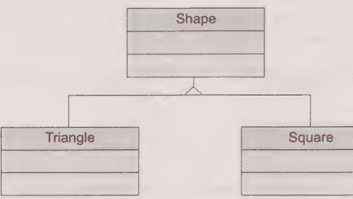

图 1.8 继承 UML 图

上面的图可以扩展以描述 OOP 的多态原则。每个形状将有一个名为 `area()` 的方法，用于计算该形状的面积。不同形状的 `area()` 方法不同。例如，计算三角形面积的公式与方形不同。因此实现不同，但方法名称相同。这就是多态（一个名称多个实现）。在图 1.9 中，`area()` 方法被 `Triangle` 和 `Square` 类重写。

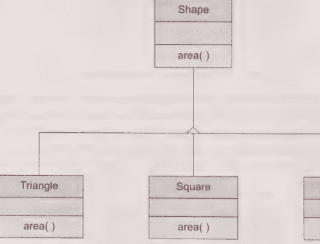

图 1.9 多态 UML 图

对象之间存在的另一种关系是“部分整体”关系（`part-of-relationship`）。当一个特定对象是另一个对象的一部分时，我们说它是聚合（`aggregation`）。例如，汽车是许多对象的聚合：引擎、门等，而引擎反过来又是许多对象的聚合，例如气缸、活塞、阀门，如图 1.10(a) 所示。一种特殊的聚合类型是组合（`composition`），其中一个对象拥有其他对象。如果所有者对象不存在，所拥有的对象也将停止存在。例如，人体就是组合的一个非常好的例子。它是由不同的器官构成的。手、脚以及肺、肠道等内脏也是身体所拥有的一部分。

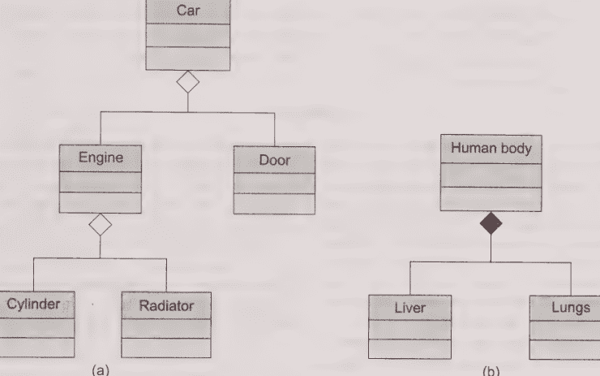

图 1.10 (a) 聚合和 (b) 组合

## 1.6 OOP 的应用

面向对象语言的基本思想是将数据和函数结合为一个单一单元来创建一个对象，然后对该数据进行操作。在过程化方法中，重点是业务流程和支持该流程所需的数据。例如，在过去的十年里，一个困扰着每位程序员的问题就是著名的 2000 年问题（Y2K 问题）。所有与计算机行业相关的人都害怕 1999 年 12 月 31 日午夜会发生什么。这个问题源于年份属性的编写规范。在编程早期，程序员用两位数写年份，因此如果我们只写年份的最后两位，就会出现问题无法区分 1900 年和 2000 年，计算机无法区分这两者。没有人意识到这个问题，并在需要时仍使用日期和年份代码，从而加剧了问题。该问题的解决方案是分析各处的多行代码，并将年份改为四位而不是两位。改变年份的状态变量看起来很简单，但要通过分析数千行代码来找到你在代码中使用了多少次 `date`，这并不是一项易事的任务。

如果使用了面向对象编程语言，我们可以创建一个具有月、日、年属性的 `Date` 类。在任何需要日期功能的地方，都会创建并使用一个 `Date` 对象。在随后的某个时间，如果需要更改，例如，`Date` 类的年份需要改为四位数，那么这种更改只需在类中体现，每当 `Date` 类的对象被创建和使用时，该更改就会自动反映在所有对象中。因此，更改只需在一个地方完成，即类本身，而在任何使用该类对象的地方，更改都会自动反映。无需分析整个代码并对其进行修改。

在 OOP 中，我们通过对象获取数据，在不修改系统的情况下解决问题非常容易。同样，OOP 被应用于各个领域，例如：

- 实时系统
- 人工智能
- 专家系统

# 总结

面向对象语言已成为编程的无处不在的标准。它们源自现实世界。OOP 围绕对象和类展开。类被定义为一组具有相似属性和行为的对象。OOP 是一种通过处理对象概念来开发软件应用的编程范式。OOP 规定了一些原则，每个 OOP 语言都遵循这些原则。这些原则是：继承、抽象、封装和多态。

本文介绍了过程化语言和面向对象语言的详细比较。对于构建大型项目，使用了一种名为 OOAD（面向对象分析与设计）的技术。面向对象分析与设计处理如何对系统建模。OOA 处理系统应该做什么，而 OOD 处理系统如何实现 OOA 所指定的任务。

OOAD 是借助 UML 之类的语言实现的。UML 代表统一建模语言；是一种用于软件可视化的标准语言。使用 UML 提供的图形表示法为软件创建一个抽象模型。

# 练习题

1. 在对象模型中，以下哪项是正确的？
   (a) 抽象、封装和多任务是主要原则
   (b) 层次结构、并发和类型是主要原则
   (c) 抽象、封装和多态是主要原则
   (d) 类型是主要原则
2. 下面哪项不是面向对象的语言？
   (a) Simple
   (b) Java
   (c) C++
   (d) C
3. 在接口后隐藏许多不同实现的能力是。
   (a) 抽象
   (b) 继承
4. 下面哪个术语必须与多态有关？
   (a) 静态分配
   (b) 静态类型
   (c) 动态绑定
   (d) 动态分配
5. 仅通过成员函数为对象提供访问，并保持细节私有，这称为
   (a) 信息隐藏
   (b) 封装
   (c) 模块化
   (d) 继承
6. 派生类的概念涉及
   (a) 继承
   (b) 封装
   (c) 数据隐藏
   (d) 抽象数据类型
7. 继承是一种方法
   (a) 组织数据
   (b) 向类对象传递参数
   (c) 在不重写现有类的情况下为其添加新功能
   (d) 改进数据隐藏和封装
8. UML 用于
   (a) 创建模型
   (b) 图示表示类、对象及其关系
   (c) 降低复杂性并提高软件质量
   (d) 以上所有
9. 关于类，以下哪项是正确的？
   (a) 类拥有数据和方法
   (b) 类在本质上是物理的
   (c) (a) 和 (c)
10. 关于过程化，以下哪项是正确的？
    (a) 调试更容易
    (b) 分析和设计很轻松
    (c) 较少
    (d) 实施困难

# 面向对象编程简介

1. 在对象模型中，以下哪项是正确的？
   (a) 抽象、封装和多任务是主要原则
   (b) 层次结构、并发和类型是主要原则
   (c) 抽象、封装和多态是主要原则
   (d) 类型是主要原则
2. 下面哪项不是面向对象的语言？
   (a) Simple
   (b) Java
   (c) C++
   (d) C
3. 在接口后隐藏许多不同实现的能力是。
   (a) 抽象
   (b) 继承
4. 下面哪个术语必须与多态有关？
   (a) 静态分配
   (b) 静态类型
   (c) 动态绑定
   (d) 动态分配
5. 仅通过成员函数为对象提供访问，并保持细节私有，这称为
   (a) 信息隐藏
   (b) 封装
   (c) 模块化
   (d) 继承
6. 派生类的概念涉及
   (a) 继承
   (b) 封装
   (c) 数据隐藏
   (d) 抽象数据类型
7. 继承是一种方法
   (a) 组织数据
   (b) 向类对象传递参数
   (c) 在不重写现有类的情况下为其添加新功能
   (d) 改进数据隐藏和封装
8. UML 用于
   (a) 创建模型
   (b) 图示表示类、对象及其关系
   (c) 降低复杂性并提高软件质量
   (d) 以上所有
9. 关于类，以下哪项是正确的？
   (a) 类拥有数据和方法
   (b) 类在本质上是物理的
   (c) (a) 和 (c)
10. 关于过程化，以下哪项是正确的？
    (a) 调试更容易
    (b) 分析和设计很轻松
    (c) 较少
    (d) 实施困难

# 复习题

1. 解释面向对象语言的重要性。
2. 解释类和对象的区别。
3. 区分过程化和面向对象的语言。
4. 简述：a) 继承、b) 多态、c) 抽象、d) 封装

# 练习

1. 请根据以下属性识别类：一家部门商店需要维护物品名称、类别、价格、购买日期和序列号。
2. 请根据以下规范识别类：一家医院想要跟踪患者的预约情况。

# 选择题答案

1. (c)
2. (d)
3. (c)
4. (c)
5. (b)
6. (a)
7. (c)
8. (d)
9. (d)
10. (c) 和 (d)

# 开始学习 Java

> 人生的道路只有在行走时才能显现；道路上的每一个转折都充满了惊喜。
> 匿名

读完本章后，读者将能够

* 了解 Java 的历史
* 理解 Java 的特性及其运行时环境
* 了解 Java 程序的基本结构
* 了解 JDK 安装的细节

## 2.1 引言

Java 是一种流行且强大的语言。尽管它是一种非常简单的语言，但有很多微妙之处会让初学者感到困惑。Java 是一种面向对象的语言，内置了应用程序编程接口（API），用于处理图形界面（GUI）以创建应用程序或小程序。Java 提供了一套丰富的平台无关 API。

Java 的语法与 C 和 C++ 非常相似。Java 与其他语言的一个主要区别是它没有指针。然而，最大的区别在于你被强制编写面向对象的代码。过程化代码被嵌入在对象中。

在 Java 中，我们区分应用程序和小程序，应用程序是执行功能与其他语言编写的程序，而小程序是嵌入网页并从互联网下载的程序。当程序被编译时，会生成字节码，只要目标平台存在运行时环境，就可以在该平台上执行。

本章将引导读者逐步介绍 Java 编程。本章的一个重点是从面向对象的角度涵盖 Java 的特性。

它还介绍了 Java 运行时环境的安装以及各种 Java 集成开发环境（IDE）。

本章还关注了 Java 的不同版本（包括最新的 Java 7）以及核心 API（Java 7 也称为 Java 1.7）。

## 2.2 JAVA 的历史

人们通常认为 Java 是专门为万维网开发的。Java 在最初开发时确实是为 Web 设计的。然而，它经过改进，成为了互联网应用程序的标准编程语言。

Sun 微系统公司（Sun Microsystems）副总裁 Bill Joy 被认为是后来成为 Java 的编程语言想法的主要构思。20 世纪 70 年代后期，Bill Joy 想要设计一种能够包含 MESA 和 C 等语言最佳特性的语言。他发现 C++ 在重写 Unix 操作系统方面效率低下。1991 年，正是这种发明更好编程语言的愿望推动 Joy 加入了 Sun 公司的一项名为“秘密项目”（Stealth Project）的巨大工程。这个名字是由 Sun 总裁 Scott McNeally 起的。1991 年，由 Bill Joy、James Gosling、Mike Sheradin、Patrick Naughton（曾是 Sun Open Windows 用户环境的项目负责人）以及其他几个人组成的正式团队在科罗拉多州的阿斯彭（Aspen）首次会合，启动秘密项目。

James Gosling 负责为项目建议一种合适的编程语言。起初他考虑使用 C++，但很快就意识到 C++ 对于这一特定项目是不够的。他通过扩展和修改 C++，迈出了开发一种符合项目目标的独立语言的第一步。

Gosling 在盯着办公室窗外的一棵橡树时，脑海中产生了将语言命名为“Oak”（橡树）的念头。遗憾的是，这个名字已经被其他编程语言申请了专利。由于版权顾虑，“Oak”这个名字被弃用了。团队苦苦为这种语言寻找一个合适的名称。在多次头脑风暴会议后，有一天 Gosling 在去当地咖啡馆时，这个想法进入了他的脑海。在美国，“Java”一词通常是咖啡的俚语。Java 也是在印度尼西亚产的咖啡名称。还有一些关于将语言命名为 Java 的观点，推测这个名字源于参与项目的几个人：James Gosling、Arthur Van、Andy Becholm。

## 2.3 JAVA 的历程：从嵌入式系统到中间层应用

Java 的开发是为了在小型设备上运行。Java 语言源自 C++ 但有许多不同之处。Java 的平台无关性解决了嵌入式设备应用程序必须在各种硬件上运行的问题。但随着 1995 年互联网的出现，Java 被采纳，因为它可以在异构的操作系统上运行。Netscape Navigator 在其浏览器中使用 Java。许多 Applet（运行在浏览器内部）非常合适，Java 获得了普及和认可。

Microsoft 在 Internet Explorer 中开发了自己的虚拟机，这与既定的规范不同。因此，Sun 和 Microsoft 之间发生了争议，后来得到了解决。Sun 看到了 Java 在浏览器之外的潜力（见图 2.1）。

# Java 中的编程


图 2.1 在客户端运行 Java Applet

Java 并不流行是因为以下原因：

- **GUI 不佳**：Java 早期的 GUI（AWT）是原始的。较新的 GUI（Swing）直到 90 年代后期才发布（且大多数现代浏览器不再支持 Swing）。
- **Microsoft 的强势地位**：几乎 95% 的桌面世界都在使用 Microsoft。
- **客户端软件升级**：发现了良好的替代方法自动更新客户端软件（无需每次下载 Java 代码）。
- **DHTML 的成功**：浏览器拥有自己的动态能力，许多开发者发现使用 DHTML 编码更简单。此外，DHTML 页面的启动速度比 Java Applet 快。

图 2 显示了 Java 如何作为数据库和客户端之间的中间层服务。1997 年，Sun 开发了开发者，以便 Java 可以根据客户端请求生成动态内容。1999 年，Sun 发布了 Java 2 企业版（J2EE）。

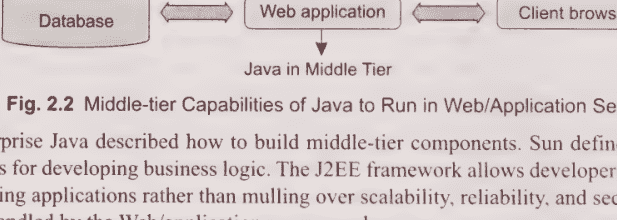

图 2.2 在 Web/应用程序服务器运行 Java 的中间层能力

Java 描述了如何构建中间层组件。Sun 定义了 Enterprise Beans 用于开发业务逻辑。J2EE 框架允许开发者专注于构建应用程序，而不是考虑扩展性、可靠性和安全问题，这些问题由 Web/应用程序供应商处理。

## 2.4 JAVA 基础

Java 是一种平台无关的面向对象的编程语言。Java 包含以下特性：

- **高级语言**：Java 是一种高级语言，看起来与 C 和 C++ 非常相似，但提供了许多独特的特性。
- **Java 字节码**：Java 中的字节码是由编译器（如 Sun 的 `javac`）生成的中间代码，由 JVM 执行。
- **Java 虚拟机 (JVM)**：JVM 充当字节码的解释器，将字节码作为输入并像物理进程执行代码一样执行它。

Java 的设计是架构中立的，因此可以在多个平台上运行。相同的运行时代码可以在任何支持 Java 的平台上运行。为了实现其跨架构能力，Java 编译器生成架构中立的字节码。这些指令被设计在任何机器上都能被解释，如图 2.3 所示。

JVM 是一个大系统 JRE 的一部分。JRE 包含了 JVM、类库和其他支持文件。

- JRE = JVM + Java 类库
- JDK = JRE + 开发工具（如编译器）


源代码类似于 C++ 但更易开发


相同的字节码在任何 JVM 上运行（即跨多个平台），因此被称为“一次编写，随处运行”（WORA）


所有主要平台都有 JVM。每个 JVM 都会实时将字节码解释为机器码。

图 2.3 Java 运行时环境

如 `javac`（编译器）、`java`（解释器）等工具包含在一个包中提供，该包俗称为 Java 开发工具包（JDK）。JDK 有多个版本（每个版本都经过增强），并且针对不同平台。运行时包也作为 JDK 的一部分提供（通常称为 Java 运行时环境）。

## 2.5 JAVA 虚拟机

Java 平台的核心是 JVM。大多数编程语言直接将源代码编译为机器码，适用于特定的处理器架构。Java 的不同之处在于它使用字节码，这是一种中间代码。

Java 字节码在虚拟机上执行。实际上，在 Java 最初发布时，还没有这种处理器的硬件实现。相反，处理器架构是通过软件作为虚拟机来实现的。这种虚拟机是真实 Java 处理器的仿真——机器中的机器（图 2.4）。虚拟机运行在操作系统之上，如图 2.5 所示。

JVM 负责解释 Java 字节码，将其翻译为操作或操作系统调用。JVM 负责处理不同平台和架构之间的差异，使开发者无需操心。如果给定环境没有 JRE，则无法运行 Java 软件。


图 2.4 在物理 CPU 上运行 JVM 仿真

## 2.6 JAVA 特性

在这里我们列出了让 Java 成为一种强大、面向对象且受欢迎的编程语言的基本特性。

### 2.6.1 平台无关性

Java 的设计不仅在源代码形式上是跨平台的（类似于之前的语言 C、C++），在编译后的二进制形式上也是跨平台的。为了实现这一点，Java 被编译为任何平台，因为它被编译为一种称为字节码（`bytecode`）的中间形式（见图 2.3 和 2.4）。这种字节码是一种与平台无关的代码，由一个特殊的原生程序读取，该 Java 解释器随后执行相应的原生指令。Java 编译器也是用 Java 编写的。字节码经过了精确定义，以确保在所有平台上的统一性。

使 Java 跨平台的第二个重要部分是对架构相关性构造的统一定义。与其他语言不同，Java 中的整数始终是 4 字节长度，浮点型变量遵循 IEEE 浮点算术 754 标准。你不需要担心任何类型的含义，因为当你在不同架构之间切换（例如从 Pentium 切换到 Sparc 架构）时，它的含义不会改变。在 Java 中，一切都是被良好定义的。然而，虚拟机及其部分组件必须用原生代码编写，这使得它具有平台相关性。

### 2.6.2 面向对象

Java 被认为是一种纯的面向对象的语言，这意味着 Java 中数据结构的最外层级是对象。Java 中的所有内容（常量、变量和方法）都定义在类内部，并通过对象进行访问。Java 的开发方式允许用户不仅要学习面向对象编程，而且能够应用和实践它。

但存在一些违反了 Java 纯洁性的限制。它主要设计用于面向对象编程（OOP），但包含了一些过程化元素。例如，Java 支持不是对象的基本数据类型。

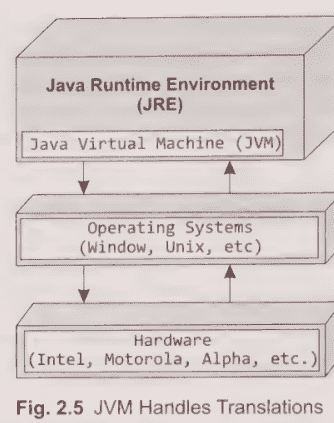

### 2.6.3 编译与解释并存

Java 结合了解释和编译的元素。以下是关于这两种方法的更多信息。

#### 解释

解释器读取程序的一行，并在跳转到下一行之前执行它。该行被解析为最小的操作，找到对应的机器级代码，然后执行该指令（这可以通过 C 语言中的 `switch` 语句来实现，列出所有可能的操作-分支）。Basic 是最早的解释型语言之一，每一行都经过解释执行。同样，JavaScript、VBScript 和 PHP 等脚本语言也是被解释的。

在解释模式下，编写/修改代码与运行代码之间没有中间步骤。最好的部分是：*调试*。此外，程序很容易传输到其他平台（只要有解释器可用）。缺点是其性能较慢。

#### 编译

程序文本首先由称为编译器的程序转换为原生机器码。可能还需要一个链接器将多个代码文件连接在一起。编译器的输出是可执行代码。C 和 C++ 都是编译型语言。

编译型语言最大的优势是执行速度快，因为机器指令直接加载到处理器中并执行。此外，编译器可以执行某些优化操作，因为它从整体上查看程序，而不是逐行查看。缺点包括调试速度较慢以及到其他平台的移植性降低。源代码必须在目标平台上重新编译。

#### Java 方案

Java 结合了解释和编译。文本程序被编译为适用于 JVM 的中间代码——*字节码*。JVM 执行字节码指令。换句话说，JVM 解释了字节码。字节码可以在任何部署了 JVM 的平台上运行。程序在 JVM 内部运行，因此它不在乎正在哪个平台上执行。

因此，Java 提供了两者之长。编译步骤允许代码优化，而 JVM 使你避免了执行 Java 源码程序时涉及的两个阶段：*编译时间*和*执行时间（运行时）*。

### 2.6.6 Java 是多线程的

为了探索这一特性，你必须了解多线程的含义。可以通过例子来很好地解释。想象有一个四个炉头的灶台，上面正在做饭。厨师为了节省时间，在一个炉灶上煮牛奶，在另一个炉灶上煮饭，在第三个炉台上烤饼（chapattis），在第四个炉台上炒菜。他在所有待处理的食物之间切换，以确保任何食物都不会因为过热而失去风味。它可以根据需要调小或增大火力。在这里，厨师是处理器，正在烹饪的四种食物是线程。处理器（厨师）在不同的线程之间切换。

线程可以粗略地定义为独立的执行流，它同时发生并与可能发生的任何事情保持独立。线程是并发运行的进程独立部分。使用线程，程序就不会刻意长时间占用 CPU（例如无限循环）。多线程的优点在于，其他任务不会被卡在循环中，可以继续处理，而无需等待栈执行完成。Java 中的线程可以在共享资源上加锁，这样当一个线程正在使用它时，不允许其他线程访问。这是通过同步机制实现的。

更多关于线程及其实现的内容将在第 8 章介绍。

### 2.6.7 其他特性

#### 自动内存管理

垃圾回收（内存管理）由 JVM 处理。要创建一个类的实例，使用 `new` 运算符（参考第 4 章）。然而，Java 会自动移除未被引用的对象。这被称为垃圾回收。垃圾回收的优缺点如下。

**优点**

- 减少了内存泄漏的可能性，因为内存会根据需要释放。当分配的内存没有释放时，就会发生内存泄漏，导致所有可用内存被浪费。
- 不发生内存损坏。

**缺点**

- 垃圾回收被认为是执行速度最大的瓶颈之一。

#### 动态绑定

数据和方法与其所在位置的链接是在运行时完成的。可以动态加载新类，即按需加载。

#### 良好的性能

早期版本对字节码的解释降低了性能，但具有自适应优化和即时编译（结合其他特性）的高级虚拟机提供了高速的代码执行能力。

#### 内置网络功能

Java 在设计时考虑了网络因素，并带有许多类用于开发复杂的 Internet 通信。关于此主题的详细讨论将在第 11 章进行。

#### 无指针

Java 使用引用代替指针。引用提供了对对象的访问。程序员从指针操作的开销中解脱出来。

#### 无全局变量

在 Java 中，全局命名空间是类层次结构，因此不能在类之外创建变量。要确保以一致的方式操作全局变量是非常困难的。Java 允许一种修改后的全局变量，称为静态变量（`static variable`）。

| 类和实例变量 | 2.7 程序结构 |
|---|---|
| 方法 ABC | |
| 局部变量 Instruction | |
| 方法 XYZ | |
| 局部变量 Instruction | |

图 2.7 程序结构

## 示例 2.1 第一个 Java 程序


L1  /*将此文件命名为 "Example.java"*/

L2  class Example {

L3      //程序通过调用 main() 开始执行

L4      public static void main(String args[]) {

L5          System.out.println("This is a simple Java program");

L6      }

L7  }

### 2.7.1 如何执行 Java 程序？

成功执行 Java 程序有三个简单步骤：

1. **输入源代码**：上面的程序（示例 2.1）可以在任何文本编辑器（如记事本）中编写，但请确保其编写方式与所示完全一致。
2. **保存源代码**：现在你已经已经在记事本中写了代码，保存方法如下：
    - 从记事本菜单中选择“文件” | “另存为”。
    - 在“文件名”类型中，输入双引号 "Example.java"。
    - 在“保存类型”中选择“所有文件 (*.*)”。
    - 点击回车键保存文件。
3. **编译并运行源码**：Java 程序使用 DOS 进行编译。要打开操作系统，在运行提示符中输入 `cmd` 并移动到包含保存的 Example.java 文件的文件夹。现在使用 `javac` 编译程序，并在命令行中指定源文件名，如下。（假设文件保存在名为 'java' 的文件夹中）。

```
C:\cd java // 使用 cd 命令切换到 java 目录

C:\java\>javac Example.java
```

`javac` 编译器会创建一个 Example.class 文件（在同一目录下）。该类包含程序的字节码版本。此字节码将通过 Java 解释器使用 `java` 后跟类名来执行，如下：

```
C:\java\>java Example
```

### 输出

这是一个简单的 Java 程序

### 2.7.2 为什么要保存为 Example.java？

当源代码被编译时，每个类都会被放在一个以类命名的输出文件中，并使用 .class 扩展。这就是为什么将 Java 源文件命名为与其包含的类相同是一个好主意。

### 2.7.3 解释

让我们简单查看 main() 的属性。`public` 是一个访问修饰符，指定可以从任何地方调用。`main()` 被声明为 public，因为它是在类之外被调用的。`static` 被声明为静态，允许在不实例化类的情况下调用 `main()`。`void` 不返回值。`void` 关键字只是告诉编译器 `main()` 不向调用者（即 JVM）返回任何内容。`String args[]` 它持有通过命令行传递给类的可选命令行参数。

# 自动装箱与拆箱

第 3 章解释了 Java 具有用于整数的 `int` 等基本类型，第 4 章解释了类和对象。这两种类型之间的差异非常重要。在第 6 章中，我们将研究 J2SE 5.0 添加的所谓的自动装箱（autoboxing）和拆箱（unboxing）功能，它大多数情况下消除了显式转换的需求，提高了代码可读性，并消除了模板代码和错误来源。

# 增强型 for 循环

第 3 章介绍了 Java 中提供的几种循环结构，其中之一是 for 循环（类似于 C/C++ 的 for 循环）。5.0 版本引入了增强型 for 循环语法，降低了代码复杂度并增强了可读性。我们在第 4 章中介绍增强型 for 循环，并描述了适用于该循环的对象类型。

# 枚举类型

第 6 章介绍了 C/C++ 的一个许多程序员在 Java 中错过的特性。Java 通过 `enum` 关键字添加了枚举类型。新的枚举类型包含了 C/C++ 枚举的所有特性，包括类型安全。

# StringBuilder 类

我们将在第 6 章讨论这个类，以及另一个 StringBuilder 类。它提供了比 `StringBuilder` 类更好的性能。

# 静态导入

5.0 版本包含了一种新技术，用于访问另一个类中的 Java 静态方法和常量，而无需每次在使用时都包含完整的包名和类名。我们将在第 4 章和第 7 章中解释 `class`、`package`、`static`、`import` 等术语。静态导入功能让你的代码更容易且更不容易出错。在讨论完通用的 `import` 后，我们将在第 7 章详细讨论静态导入。

# 元数据

元数据机制（注解）旨在减少 Java 早期版本中需要的大量模板代码。注解虽然不是程序的一部分，但它们为编译器提供了有关程序的信息。这些信息可以用于检测错误和提供警告。注解以 `@` 开头。Java 编译器处理某些注解，而某些需要注解处理工具 `apt`。

# 格式化 I/O 和变长参数

在第 9 章中，我们将讨论如何使用 Java 对数值输出进行格式化。5.0 版本增加了通过 `printf()` 方法轻松生成格式化输出的能力，该方法的行为类似于 C/C++ 中的 `printf` 函数。第 9 章还讨论了格式化输入机制（`scanner` 类）。这两个功能都依赖于“变长参数”（varargs），它代表可变参数列表，即在构造源码时，传递给 Java 方法的参数数量是未知的（也称为变长长度方法）（参见第 4 章关于变长参数）。

# 图形系统改进

5.0 版本对 Java 称为 AWT 和 Swing 的图形子系统包含了大量的错误修复和微调，包括减少内存用用。最大的改进是，在添加 Swing 组件时不再需要调用 `getContent()`。

# 新的并发特性

第 8 章讨论了 Java 自 1.0 版本以来就存在的多线程支持。5.0 版本增强了 Java 的多线程特性。这些新增内容中的某些依赖于泛型（generics）概念，因此我们等到第 10 章再介绍这些重要的能力。

# 泛型

在第 10 章中，我们引入了泛型特性，这是一个我们将详细介绍的重要主题。Java 是类型安全的，这简单意味着每个变量都有定义良好的类型，且只有兼容的类型才能相互赋值。然而，泛型的使用为 Java 语言增加了更多的编译时安全性。泛型使用允许仅将指定类型的对象赋值给集合，从而增强了程序的运行时安全性和正确性；否则会发生编译时错误。

J2SE 5.0 的其他特性包括核心 XML 支持、对 Unicode 的改进、对 Java 数据库连接包（如 JDBC）的改进，以及改进的 JAR 文件高压缩格式，可以大大缩短 applet 和其他网络应用程序的下载时间。Java 平台标准版 5.0 (J2SE 5.0) 处理了开发便利性方面的改进。

## 2.9 JAVA 与 C++ 的区别

这里是 Java 和 C++ 区别的技术概述。以下点列出了 Java 中存在而 C++ 中不存在的方面。

- **不允许多继承** 强制执行多级继承，这使得设计更加清晰。Java 不支持类之间的多级继承。使用接口来支持多继承。
- **共同父类** 所有类都是单根的。在 Java 中，类对象是所有类的父类。
- **包 (Packages)** 使用了包的概念，即提供了一个大型的分层次命名空间。这防止了库中的命名冲突。
- **源内文档** 提供了源代码中的注释。提供了文档关键字，例如 `@author` 等。
- **所有代码均在类内** 与 C++ 不同，Java 程序的所有部分都位于类内部。不允许声明全局数据数据的类。然而，支持类内部的静态数据。
- **运算符重载** Java 不支持运算符重载，但 Java 已经重载了一些操作符，例如 `'+'`。程序员没有重载运算符的选项。
- **显式布尔值** `boolean` 是一个显式类型，不同于 `int`。仅提供两个布尔字面量，即 `true` 和 `false`。它们不能像某些语言那样与整数 0 和 1 比较。
- **数组长度可见** Java 中所有的数组对象都关联了一个 `length` 变量，用于确定数组的长度。
- **go** 支持用 `break` 和 `continue` 替代 `goto`。
- **指针** Java 中没有指针。
- **空指针可被合理捕获** 空指针由 `NullPointerException` 捕获。
- **内存管理** 使用垃圾回收机制防止内存泄漏和引用已释放的内存。
- **自动变量初始化** 除了局部变量外，所有变量都会自动初始化。
- **容器边界的运行时检查** 容器（数组、字符串等）的边界在运行时进行检查，必要时会抛出 `IndexOutOfBoundsException`。
- **平台无关性** C++ 不是平台无关的语言，而 Java 是。
- **定义的整数类型大小** `byte`、`short`、`int` 和 `long` 整数类型的大小被定义为 1、2、4 和 8 字节。
- **提供 Unicode** Unicode 代表大多数语言的字符，例如日语、拉丁语等。
- **String 类** 提供了一个显式的预定义 `String` 类，以及 `StringBuilder` 和 `new StringBuilder`。

## 扩展实用类库：包 java.util 支持包括 `Enumeration`（一个 Iterator 接口）、`Hashtable`、`Vector`。

**默认访问修饰符** 已添加。默认情况下，Java 中所有变量、方法和类的权限于 `private` 访问修饰符。`private` 是 C++ 中的默认访问修饰符。

## 2.10 JDK 1.7 的安装

在编写第一行代码之前，软件开发者必须首先确保手头有最合适的工具。Java 被设计为一种跨平台、面向对象的编程语言。由于 Java 的引入引起了巨大的兴趣，新工具不断被推出，为开发者提供更大的灵活性和易用性。

### 2.10.1 开始使用 JDK

Sun（现在是 Oracle）决定赠送一个 Java 开发工具包（JDK），该包将提供 Java 编程所需的基础知识。JDK 为初学者提供了编写强大的 Java 应用或警报所需的所有工具。它包含编译器、解释器、调试器、示例应用程序、应用查看器以及其他你可以用来测试代码的工具。

快速访问 Oracle 网站将允许你将 JDK 下载到本地机器。检查 JDK 的最新版本并从该网站下载。JDK 支持以下操作系统：

- (a) Oracle Solaris (b) Windows (c) Linux (d) Mac

记住，这些平台可用 JDK 仅意味着 Oracle 已经为这些平台实现了 JVM 和开发工具。

### 2.10.2 JDK 安装注意事项

当安装 SE 开发工具包时，Java SE 运行时环境随之安装。

在 Solaris 平台上安装 JDK 1.7（包括 32 位和 64 位），你可以参考 Oracle 网站上的安装文档：

```
http://docs.oracle.com/javase/7/docs/webnotes/install/solaris/solaris-jdk.html
```

同样，对于在 Linux 操作系统上安装 JDK 1.7（包括 32 位和 64 位），请访问：

```
http://docs.oracle.com/javase/7/docs/webnotes/install/linux/linux-jdk.html
```

在 MAC OS 上安装 JDK 请访问：

```
http://docs.oracle.com/javase/7/docs/webnotes/install/mac/mac-jdk.html
```

任何操作系统的 JDK 都可以从此处下载：

```
www.oracle.com/technet/java/javase/downloads/jdk7u9-downloads-1859576.html.
```

参考 www.oracle.com/technetwork/java/javase/downloads/index.html 获取最新的 Java SE 发布。

## 30 Java 编程

在书中，我们打算提供在 Windows 操作系统上安装 JDK 1.7 的详细信息。

JDK 有两个版本号——外部版本 7 和内部版本号 1.7.0_9，即版本 7 更新 9。

安装和配置过程可以拆分为为以下步骤：

1. 运行 JDK 安装程序。
2. 更新环境变量。
3. 测试安装。

### 第 1 步：运行 JDK 安装程序

如果你从 Oracle 网站下载了 JDK 而不是安装程序，请通过以下链接确认你已下载 JDK：

```
www.oracle.com/technet/java/javase/downloads/index.html
```

JDK 的安装包如下：

```
jdk7u9-downloads-1859576.html
```

### 第 2 步：更新环境变量

更新 `Path` 和 `Classpath` 变量。

### 第 3 步：测试安装

JDK 成功安装，如下所示。

## 开始使用 Java

- `include\` 该目录包含一组用于与 C 和 C++ 交互的 C 和 C++ 头文件集。
- `lib\` 此目录包含 JDK 中工具程序使用的非核心类，如 dt.jar 和 tools.jar。
- `bin\` 该目录包含 Java 的二进制可执行文件。例如：Java 编译器 (`javac`)、Java 解释器 (`java`)、远程方法调用器 (`rmic`) 等。
- `jre\` 这是 Java 运行环境的根目录。
- `db\` 包含 Java 数据库。

## 第 2 步：更新 Path 和 Classpath 变量

在不修改系统环境变量（如 Path 或 Classpath）或修改 autexec.bat 的情况下，无法运行 Java 程序。

为什么要设置 Path 变量？如果你想从任何目录运行可执行文件（`javac.exe`, `java.exe`, `javadoc.exe` 等），则需要设置 PATH 环境变量。如果你想查看 PATH 的当前值，可以在 DOS 提示符中输入以下命令：

```
C:\path
```

Windows NT/XP/Vista/7 可以在控制面板中进行以下环境变量更改。打开控制面板，选择“系统”，然后编辑环境变量。对于其他版本的 Windows，右键点击“我的电脑”图标并选择“属性”，点击“环境变量”。会出现系统属性。从变量列表中选择 Path，并将以下路径添加到现有路径之后：C:\PROGRA-1\JAVA\JDK1\bin（'bin' 的完整路径）。

> 不要删除路径系统变量中的现有路径；仅用分号分隔并添加新路径。

Classpath——它的作用是什么？Classpath 告诉 JVM 和其他 Java 程序哪里寻找类库和用户定义的类。你需要设置 classpath 来定位类库、用户定义的类和包。

## 设置 Classpath

可以按照相同的步骤（如上所述）设置 classpath 环境变量，不同在于你查找不是 path 变量而是 classpath 变量。

## 第 3 步：测试安装

你的计算机系统现在已配置好并可以使用 JDK。Java 工具没有图形界面 (GUI)，因为它们都是从 DOS 命令行运行的。要测试安装，请在命令行输入以下命令：

```
C:\javac and C:\java
```


如果在 DOS 提示符上输入 `java` 命令后显示了以下截图，则说明 Java 已正确安装且路径已设置（图 2.10(a) 和 (b)）。

## 36 Java 编程

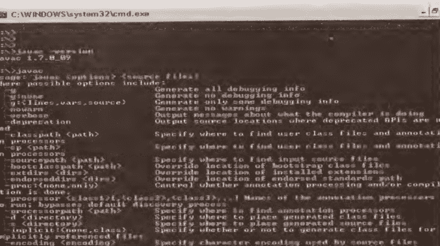

图 2.10(a)

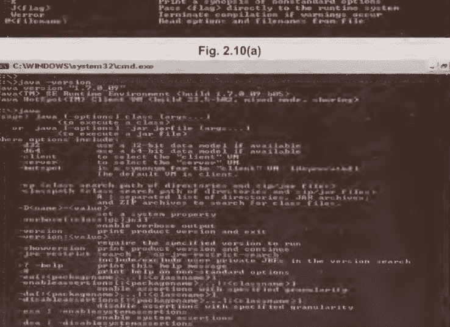

图 2.10(b)

### 2.10.3 探索 JDK

了解 Java 7 的完整结构非常重要。接下来的图示（图 2.11）可以让你了解 Java 7 构成的各种构造。它还展示了每个构造所负责的各种组件。

了解 Java 7 的哪些部分将编译 JDK、JRE 或 Java API 是很有趣的。下面的表示回答了这一问题。需要注意的是，Java API 是 JRE 的子集，而 JRE 是 JDK 的子集。

Java 标准版 (Java SE) 开发工具包包含 JRE 以及开发 applet 和应用程序所需的命令行工具（如编译器和调试器）。

| 工具和工具 API | Java javac Javadoc jar Javap JPDA Java DB jconsole | 监控 | 故障排除 | 脚本 | JVM T1 | Web 服务 |
| --- | --- | --- | --- | --- | --- | --- | --- | --- | --- | --- | --- |
| 部署安全 | 国际 | RMI | IDL | 部署 | | | | | | | | |
| 部署技术 | | Web Start Java | | | | | | | | | 插件 |
| | | JavaFX | | | | | | | | | | | |
| 用户界面工具包 | AWT | Swing | Java 2D | | | | | | | | | | |
| | 可访问性 | 拖放 | 输入法 | I/O | 打印服务 | 音频 | | | | | | |
| 集成库 | IDL | JDBC | JNDI | RMI | -IIOP | 脚本 | | | | | | |
| 其他基础库 | Beans | 国际支持 | I/O | JMX | JNI | 数学 | | | | | | |
| | 网络 | 覆盖机制 | 安全 | 序列化 | 扩展机制 | XML JAXP | | | | | | |
| Lang 和 util 基础库 | Lang & util Collections | 并发工具 | 日志 | 管理 | | | | | | | |
| | Preferences API | 引用对象 | 反射 | 正则表达式 | 版本控制 | Zip | 仪器 | | | | | |

Java 虚拟机

> 图 2.11 Java 7 结构

JRE 提供了 JVM 以及运行 Java 编程语言编写的 applet 和应用程序所需的其它组件（见图 2.12）。

## JDK 中的工具

JDK 中的可用工具分为以下几类：

- 基础工具 (`javac`, `java`, `javadoc`, `app`, `appletviewer`, `jdb`, `jav`, `extcheck`)
- 安全工具 (`keytool`, `jarsigner`, `policykit`, `klist`, `ktab`)
- 国际化工具 (`native`)
- 远程方法调用 (`rmic`)
- Java 运行环境 (`jre`)
- Java 数据库 (`db`)

## 第 3 章：测试安装

你的计算机系统现在已配置好可以使用 JDK。Java 工具没有图形界面 (GUI)，因为它们都是从 DOS 命令行运行的。要测试安装，请在命令行输入：

```
C:\javac and C:\java
```

如果在 DOS 提示符上输入 `java` 命令后显示了以下截图，则说明 Java 已正确安装且路径已设置（图 2.10(a) 和 (b)）。

## 36 Java 编程


图 2.10(a)


图 2.10(b)

### 2.10.3 探索 JDK

了解 Java 7 的完整结构非常重要。接下来的图示（图 2.11）可以让你了解 Java 7 构成的各种构造。它还展示了每个构造所负责的各种组件。

了解 Java 7 的哪些部分将编译 JDK、JRE 或 Java API 是很有趣的。下面的表示回答了这一问题。需要注意的是，Java API 是 JRE 的子集，而 JRE 是 JDK 的子集。

Java 标准版 (Java SE) 开发工具包包含 JRE 以及开发 applet 和应用程序所需的命令行工具（如编译器和调试器）。

| 工具和工具 API | Java javac Javadoc jar Javap JPDA Java DB jconsole | 监控 | 故障排除 | 脚本 | JVM T1 | Web 服务 |
| --- | --- | --- | --- | --- | --- | --- | --- | --- | --- | --- | --- |
| 部署安全 | 国际 | RMI | IDL | 部署 | | | | | | | | |
| 部署技术 | | Web Start Java | | | | | | | | | 插件 |
| | | JavaFX | | | | | | | | | | | |
| 用户界面工具包 | AWT | Swing | Java 2D | | | | | | | | | | |
| | 可访问性 | 拖放 | 输入法 | I/O | 打印服务 | 音频 | | | | | | |
| 集成库 | IDL | JDBC | JNDI | RMI | -IIOP | 脚本 | | | | | | |
| 其他基础库 | Beans | 国际支持 | I/O | JMX | JNI | 数学 | | | | | | |
| | 网络 | 覆盖机制 | 安全 | 序列化 | 扩展机制 | XML JAXP | | | | | | |
| Lang 和 util 基础库 | Lang & util Collections | 并发工具 | 日志 | 管理 | | | | | | | |
| | Preferences API | 引用对象 | 反射 | 正则表达式 | 版本控制 | Zip | 仪器 | | | | | |

Java 虚拟机

> 图 2.11 Java 7 结构

JRE 提供了 JVM 以及运行 Java 编程语言编写的 applet 和应用程序所需的其它组件（见图 2.12）。

## JDK 中的工具

JDK 中的可用工具分为以下几类：

- 基础工具 (`javac`, `java`, `javadoc`, `app`, `appletviewer`, `jdb`, `jav`, `extcheck`)
- 安全工具 (`keytool`, `jarsigner`, `policykit`, `klist`, `ktab`)
- 国际化工具 (`native`)
- 远程方法调用 (`rmic`)
- Java 运行环境 (`jre`)
- Java 数据库 (`db`)

## JCreator

这款 Java IDE 的轻量版本支持项目管理、语法高亮编辑器、向导、类查看器、包查看器、标签页文档。JDK 配置文件（允许你与多个 JDK 工作）、可自定义的用户界面等。JCreator 可运行在 Windows 95、98、NT 和 2000 上。

NetBeans 是一个 Java 的跨平台开源 IDE。它带有一个支持代码补全、注释、宏、自动缩进的代码编辑器。它与编译器、调试器、JVM 以及其他工具集成。

# 总结

Java 是由 James Gosling 等人于 1994 年发明的编程语言。Java 最初命名为 Oak，是作为 Sun 公司绿色项目（Green Project）的一部分而开发的。Patrick Naughton、Mike Sheridan 和 James Gosling 试图弄清楚计算的下一波潮流，而在 1995 年，Java 开始被视为一种用于内核应用的语言。

Java 被认为是一门纯面向对象的语言，这意味着 Java 中数据结构的最外层级是对象。Java 设计为与平台无关，因此它可以在多个平台上运行。只要该平台支持 Java 运行环境，就可以在任何平台上下载相同的运行时代码并在其执行。为了这一点，Java 结合了解释和编译的元素。

Java 运行环境（JRE）的核心是 Java 虚拟机或 JVM。大多数编程语言将源代码编译成机器码，适用于在特定的微处理器架构上执行。但 Java 有些不同，因为它使用字节码——一种特殊的机器码。Java 字节码在一种特殊的微处理器上执行。在 Java 最初发布时还没有这种微处理器的硬件实现，完整的处理器架构是通过被称为虚拟机的软件内核启用的。

Java 是一门健壮的语言，它具有自己的特性，强检查和解释使得 Java 程序防止崩溃。Java 还有许多其他功能可以保护安全系统的完整性并防止多种常见攻击。Java 本身是多线程的，即在语言中开发的多个线程可以并发执行。

Java 的其他特性包括自动内存管理、动态绑定、优化性能、内置网络功能等。垃圾回收器从内存位置回收程序员的对象。Java 使用引用代替指针。

每个 Java 程序由一个或多个类组成。类不是创建对象的模板。在 Java 中，代码存在于类内部。类名必须与文件名匹配。

# 练习题

## 单选题

- 1. Java 第版本的名称（什么？
  - (a) Oak
  - (b) Mustang
  - (c) Tiger
  - (d) Playground
- 2. 开发 Java 的团队名称是什么？
  - (a) Green Team
  - (b) Star Team
  - (c) Sun
  - (d) Java team
- 3. 用于编译 Java 程序的工具名称是什么？
- 4. 用于解释 Java 程序的工具名称是什么？
  - (a) java
  - (b) java
  - (c) javah
  - (d) javac
- 5. 哪种过程会自动移除未被引用的对象？
  - (a) 多线程
  - (b) 对象回收
  - (c) 垃圾收集
  - (d) 对象收集
- 6. 用于运行 Applet 的工具名称是什么？
  - (a) java
  - (b) javac
  - (c) java
  - (d) appletviewer
- 7. Java 源文件的扩展名是什么？
  - (a) jav
  - (b) java
  - (c) bytecode
  - (d) .class
- 8. Java 字节码文件的扩展名是什么？
  - (a) jav
  - (b) java
  - (c) .class
  - (d) bytecode
- 9. 关于 main 方法哪些都是正确的？
  - (a) public static void main(String args[])
  - (b) private static void main(String args[])
  - (c) static void main(String args[])
  - (d) public static void main(String a[])
- 10. 下列哪些被添加到 Java 7 中？
  - (a) switch case 中的 String
  - (b) 元数据
  - (c) 注释
  - (d) 自动资源管理

# 复习题

1. 为什么 Java 被称为平台无关的语言？
2. 解释 Java 的安全模型，它如何使其比其他语言更安全。
3. 为什么说 Java 是多线程的？它如何帮助 Java 提高性能？
4. C++ 是一种比 Java 历史老的面向对象语言，为什么 Java 在大多数应用开发中取代了 C++？
5. Java 具有中间层能力。这一语句意味着什么？
6. Java 被用于互联网应用。请说明原因。
7. 解释 JVM 在 JRE 中的重要性。
8. 解释 Java 程序的结构。
9. 解释执行 Java 程序的步骤。
10. 设置环境变量为 Path 和 Classpath 的重要性是什么？
11. 讨论 JDK 中提供的工具。它们如何帮助应用开发？

## 编程练习

- 1. 编写一个程序，用你的名字打印 'Welcome' 和 'How are you?'

### 单选题答案

- 1. (a)
- 2. (a)
- 3. (d)
- 4. (b)
- 5. (c)
- 6. (d)
- 7. (b)
- 8. (c)
- 9. (a) 和 (d)
- 10. (a) 和 (d)

# 开始学习 Java

## 3.1 变量

阅读本章后，你将：
- 理解如何使用
- 了解基础知识
- 理解转换
- 了解循环
- 理解分支

| 数据类型 | 标识符 | 字面量 | 
|---|---|---|
| int | | |

## 3.2 基本数据类型

基本数据类型是任何语言的构建块。共有八种基本类型，如下：

```
byte
short
int
long
float
double
char
boolean
```

## 3.3 标识符

标识符是分配给变量、常量、方法、类、包和接口的名称。变量名的长度没有规定限制。标识符可以包含字母、数字、下划线和任何货币符号。然而，它们只能以字母、下划线或美元符号（$）开头。数字不能作为标识符的第一个字符。

### 3.3.1 命名规则

- 1. 标识符的第一个字符必须是字母、下划线或美元符号 ($)。
- 2. 后续字符可以是字母、下划线、美元符号或数字。注意标识符内部不允许出现空格。
- 3. 标识符是区分大小写的。这意味着 `Total_Price` 和 `total_price` 是不同的标识符。

不要使用 Java 的保留关键字。下面显示了一些合法和非法标识符的示例。

| 合法标识符 | 非法标识符 |
|---|---|
| MyClass | My Class |
| $amount | 23amount |
| _totalPay | -totalpay |
| total_commission | total@comission |

### 3.3.2 命名规范

名称应根据其用途来命名，如图 3.1 所示，这样既有意义又易于记忆。

- package hello; -> 包声明
- import java.lang.*; -> 导入其他包
- public class HelloWorld -> 类声明
- -> 类开始
- public static void main(args[]) -> 主方法声明
- -> 主方法结束
- -> 类结束

图 3.1 Java 中使用的命名规范

# Java 编程结构

类或接口标识符：这些标识符以大写字母开头。每个内部单词的首字母大写，所有其他字母均为小写。

```java
public class MyClass // 类标识符: MyClass

interface Calculator; // 接口标识符: Calculator
```

变量或方法标识符：这些以小写字母开头。每个内部单词的首字母大写，所有其他字母均为小写。

```java
int totalPay; // 变量标识符: totalPay

MyClass.showResult();

// MyClass 是类名，showResult() 是 MyClass 的一个方法。
```

常量标识符：这些使用大写字母。使用下划线分隔内部单词。

```java
final double TAX_RATE = 0.05; // 常量标识符: TAX_RATE
```

包标识符：这些由所有小写字母组成。

```java
package mypackage.subpackage.subpackage; // 包声明
```


### 3.3.3 关键字

关键字是用于特定目的预定义标识符，不能用于标识定义的类、变量、方法、包和接口。所有关键字均为小写。表 3.1 列出了 Java 中的关键字。

#### 表 3.1 Java 中的关键字

| abstract | assert | boolean | break | byte |
|---|---|---|---|---|
| case | catch | char | class | continue |
| default | do | double | else | enum |
| extends | final | finally | float | for |
| if | implements | import | instanceof | int |
| interface | long | native | new | package |
| private | protected | public | return | short |
| static | strict | super | switch | synchronized |
| this | throw | throws | transient | try |
| void | volatile | while | const* | goto* |
| *const 和 goto 是保留关键字。 | | | | |

### 3.4 字面量

字面量是可以传递给程序中变量或常量的值。字面量可以是数值（用于 `byte`, `short`, `int`, `long`, `double`）、字符、字符串表示或空字面量。数值字面量可以用二进制、十进制、八进制或十六进制表示。字面量可以赋值给 Java 中的所有数值类型，包括 `char`（根据各自的范围和大小）。

二进制字面量是 `0` 和 `1` 的组合。在 Java 7 中可以将二进制字面量赋值给变量。二进制字面量必须以 `0b` 或 `0B` 为前缀。例如，

```java
char bin1 = 0b0110000; // bin1 的值是 P
char bin2 = 0b0110001; // bin2 的值是 Q
float bin3 = 0b1010000; // bin3 的值是 80.0
int int4 = 0b1010001; // int4 的值是 81
```

如果必须指定八进制字面量，则值必须以零为前缀，且仅允许 `0` 到 `7` 的数字。例如，

```java
int x = 0111; // x 的值是 9
char y = 0150; // y 的值是 h
float z = 0o234; // z 的值是 156.0
```

十六进制字面量以 `0x` 或 `0X` 为前缀；允许数字 `0` 到 `9` 以及 `a` 到 `f`（或 `A` 到 `F`）。例如，

```java
int y = 0x00001; // y 的值是 1
char x = 0x45; // x 的值是 E
float y = 0xA3; // y 的值是 163.0
```

所有的整数字面量都是 `int` 类型。要将它们定义为 `long`，可以在末尾加上 `L`。要将它们定义为 `float`，可以在末尾加上 `F` 或 `f`。要将它们定义为 `double`，可以在末尾加上 `D` 或 `d`。

浮点数字面量通过小数点或指数来指定。例如：

```java
float pi = 3.14f;
double distance = 1.5e10;
```

字符串字面量是包含在双引号中的字符序列。

```java
String s = "Hello World";
```

空字面量用于表示空引用。

```java
Object obj = null;
```

#### 表 3.4 数据类型：大小、默认值和范围

| 数据类型 | 默认值 | 大小 | 范围 |
|---|---|---|---|
| byte | 0 | 8 | -128 到 127（包含） |
| short | 0 | 16 | -32,768 到 32,767（包含） |
| int | 0 | 32 | -2,147,483,648 到 2,147,483,647（包含） |
| long | 0 | 64 | -9,223,372,036,854,775,807 到 9,223,372,036,854,775,807 |
| float | 0.0F | 32 | 1.40129846324817e-45 到 3.4028234763852886e+38 |
| double | 0.0D | 64 | 4.940656481246544e-324 到 1.7976931486231570e+308 |
| char | '\u0000' | 0 到 65535 | |
| boolean | false | 未定义 | true 或 false |

#### 表 3.5 保留字面量

| true | null |
|---|---|

### 3.5 运算符

运算符对一个或多个操作数执行操作。对一个操作数执行操作的运算符称为*一元运算符* (`+`, `-`, `++`, `--`)。对两个操作数执行操作的运算符称为*二元运算符* (`+`, `-`, `*`, `/`)，而对三个操作数执行操作的运算符称为*三元运算符* (`?:`)。Java 提供了所有三种运算符。让我们从二元运算符开始讨论。

#### 3.5.1 二元运算符

Java 提供了算术、关系、位移、条件、位和成员访问运算符。

##### 赋值运算符

它将变量（或表达式）的值设置为新值。赋值运算符将右侧操作数的值赋给左侧操作数。赋值运算符 `a = b = 0;` 将 `0` 赋值给 `b`，再赋值给 `a`。Java 支持以下快捷或复合赋值运算符列表：

```
+= -= *= %= &= |= <<= >>>=
```

这些运算符允许你将两个操作合并为一个：一个固定为赋值加上另一个操作。稍后将通过对应的关系解释这些运算符。

##### 算术运算符

算术运算符用于加 (`+`)、减 (`-`)、乘 (`*`)、除 (`/`) 以及求余数 (`%`)。

Java 不支持运算符重载。某些像 C++ 这样的语言允许程序员更改运算符的含义，使其根据操作数的不同表现出不同的行为。但某些运算符被 Java 自身重载了，例如在应用于不同操作数时表现得不同的运算符。例如，如果使用了 `+` 运算符且其中一个操作数是字符串，那么另一个操作数将自动转换为字符串并拼接。在以下 `System.out.println` 语句的示例中，这一点显而易见，引号中的字符串与结果或单个原始类型的值在了一起。对于这些运算符，Java 还提供了算术复合赋值运算符：`+=`, `-=`, `/=`, `*=`, `%=`。例如，

```
a += b; // 评估为 a = a + b
a -= b; // 评估为 a = a - b
a *= b; // 评估为 a = a * b
a /= b; // 评估为 a = a / b
a %= b; // 评估为 a = a % b
```

让我们举一个例子来演示 Java 中这些运算符的使用。仔细观察程序会发现 `+` 运算符在打印语句中可以用于两个用途：拼接和加法。

##### 示例 3.1 算术运算符的演示

```java
class ArithmeticDemo {
    public static void main(String args[]) {
        int a = 25, b = 10;
        System.out.println("Sum " + a + " + " + b + " = " + (a + b)); // 将两个变量 a 和 b 相加
        System.out.println("Subtraction " + a + " - " + b + " = " + (a - b)); // a 减去 b
        System.out.println("Multiplication " + a + " * " + b + " = " + (a * b)); // a 乘以 b
        System.out.println("Division " + a + " / " + b + " = " + (a / b)); // 除法
        System.out.println("Remainder " + a + " % " + b + " = " + (a % b)); // 取余运算符
        // 让我们看看
        a += b;
        System.out.println("Added b to stored the result in a " + a);
    }
}
```

##### 输出

```
ArithmeticDemo
Sum 25 + 10 = 35
Subtraction 25 - 10 = 15
Multiplication 25 * 10 = 250
Division 25 / 10 = 2
Remainder 25 % 10 = 5
Added b to stored the result in a 35
```

图 3.2 显示了 `+` 运算符如何在 Java 中用于拼接和相加操作数。

##### 关系运算符

Java 中的关系运算符返回 `true` 或 `false`。表 3.6 显示了 Java 中所有的运算符。C++ 中的关系运算符返回整数，其中零值解释为 `false`，非零值解释为 `true`。

#### 表 3.6 关系运算符

| 等于 | == |
| 不等于 | != |
| 小于 | < |
| 大于 | > |
| 小于等于 | <= |
| 大于等于 | >= |

##### 示例 3.2 关系运算符的演示

```java
class RelationalOperatorDemo {
    public static void main(String args[]) {
        int a = 10, b = 20;
        System.out.println("Equality Operator: a == " + (a == b));
        System.out.println("Not Equal Operator: a != " + (a != b));
        System.out.println("Less Than Operator: a < " + (a < b));
        System.out.println("Greater Than Operator: a > " + (a > b));
        System.out.println("Less than equal to Operator: a <= " + (a <= b));
        System.out.println("Greater than equal to Operator: a >= " + (a >= b));
    }
}
```

##### 输出

```
RelationalOperatorDemo
Equality Operator: a == false
Not Equal Operator: a != true
Less Than Operator: a < true
Greater Than Operator: a > false
Less than equal to Operator: a <= true
Greater than equal to Operator: a >= false
```

##### 布尔逻辑运算符（逻辑运算符）

布尔逻辑运算符有：条件或 (`||`)、条件与 (`&&`)、逻辑或 (`|`)、逻辑与 (`&`)、逻辑异或 (`^`)、一元非 (`!`)，应用于布尔操作数或表达式（3.6 节）并返回布尔值。逻辑与 (`&`)、逻辑或 (`|`) 和逻辑非 (`!`) 也应用于整数以执行位逻辑操作。逻辑或在其中一个操作数为 `true` 时，结果为 `true`。逻辑与在其中一个操作数为 `false` 时，结果为 `false`。逻辑异或的作用类似于或，即当异或的两个操作数都为 `true` 时，结果为 `false`。逻辑非就是布尔操作数的取反。条件或 (`||`) 和与 (`&&`) 运算符也称为短路运算符，它们会评估第二个操作数。在或的情况下，如果第一个操作数为 `true`，无论第二个是什么，结果都是 `true`。在与的情况下，如果第一个操作数为 `false`，无论第二个是什么，结果都是 `false`。因此不需要评估第二个操作数。

除了这些运算符外：

```
a &= b;           // 评估为 a = a & b;
a |= b;           // 评估为 a = a | b;
a ^= b;           // 评估为 a = a ^ b;
```

##### 示例 3.3 布尔运算符的演示

```java
class BooleanLogicalOperatorDemo {
    public static void main(String[] args[]) {
        boolean a = true, b = false;
        System.out.println("Logical OR: " + a + " | " + b + ": " + (a|b));
        System.out.println("Logical XOR: " + a + " ^ " + b + ": " + (a^b));
        System.out.println("Logical AND: " + a + " & " + b + ": " + (a&b));
        System.out.println("Logical NOT: " + a + ": " + (!a));
        System.out.println("Conditional OR: " + a + " || " + b + ": " + (a||b));
        System.out.println("Conditional AND: " + a + " && " + b + ": " + (a&&b));
        // 快捷运算符
        a |= b;
        System.out.println("Shortcut OR: " + a + " | " + b + ": " + (a|b));
    }
}
```

##### 位运算符

位运算符包括与、或、异或、非、右移、左移和无符号右移。在 Java 中，位运算符对 `int` 和 `long` 值进行操作。如果任何操作数比 `int` 短，则在执行操作之前会自动提升为 `int`（见 3.8 节）。表 3.7 列出了位运算符。

理解整数如何在二进制中表示非常重要。例如，十进制数字 `4` 在二进制中表示为 `100`，`5` 表示为 `101`。负整数始终以补码的形式表示。例如，`-4` 是 `1111 1111 1111 1111 1111 1100`。

位快捷运算符的使用方式与布尔运算符相同。位快捷运算符包括：

- 与：`&=`
- 或：`|=`
- 异或：`^=`
- 位移运算符：`>>=`, `<<=`, `>>>=`

#### 表 3.7 位运算符

| 运算符 | 说明 |
|---|---|
| a & b | 如果两个位都是 1 |
| a \| b | 如果任意一位为 1 |
| a ^ b | 如果两个位不同 |
| ~a | 取反位。 |
| a << b | 向左移 b 位。从低位侧补 0。从高位侧丢弃。 |
| a >> b | 向右移 b 位。从高位侧复制符号位。从高位侧丢弃。 |
| a >>> b | 向右移 b 位。从高位侧补 0。从高位侧丢弃。 |

##### 示例 3.4 位运算符的演示

```java
class BitwiseOperatorDemo {
    public static void main(String[] args) {
        int x = 2, y = 3;
        System.out.println("Bitwise AND: " + x + " & " + y + " = " + (x & y));
        System.out.println("Bitwise OR : " + x + " | " + y + " = " + (x | y));
        System.out.println("Bitwise XOR: " + x + " ^ " + y + " = " + (x ^ y));
        System.out.println("Bitwise NOT: ~" + x + " = " + (~x));
    }
}
```

##### 输出

```
按位与: 2 & 3 = 2
按位或 : 2 | 3 = 3
按位异或: 2 ^ 3 = 1
按位非: ~2 = -3
```

移位运算符根据操作符的类型移动位。左移运算符将指定的位数向左移动。左侧的位会被丢弃，右侧填充的位的值为 `0`。右移运算符将指定的位数向右移动。右侧的位会被丢弃，左侧填充的位的值的值为符号位的值。无符号右移运算符将指定的位数向右移动。右侧的位会被丢弃，左侧填充的位的值为 `0`。例如，假设 `x=4` 且此 `x` 移动距离为 `1`。

```java
int y = x << 1;
// y 的值为 8，每次连续的左移都会翻倍
// 00000000 00000000 00000000 00010000 << 1
// 00000000 00000000 00000000 00100000 (即 32，原文示例有误)
```

```java
int y = x >> 1;
// y 的值为 2，每次连续的右移都会减半
// 00000000 00000000 00000000 00010000 >> 1
// 00000000 00000000 00000000 00001000 (即 8)
```

```java
int y = x >>> 1; // 对于正数，与右移相同。
```

如果我们提供一个负数进行左移或右移，负数将用补码表示。然后，如果我们像下面的示例所示提供一个 `int` 类型的负移位距离，第一个负移位距离将与掩码 `11111`（即 `31`）进行与运算，结果即为新的移位距离。如果我们像下面的示例所示提供一个 `long` 类型的负移位距离，首先负移位距离将与掩码 `111111`（即 `63`）进行与运算，其结果即为新的移位距离。

##### 示例 3.5 移位运算符

```java
class ShiftOperatorDemo {
    // 后续代码省略
}
```


```java
public static void main(String[] args) {

    int x = 5, y = 1;

    System.out.println("Left shift: " + x + "<<" + y + "=" + (x << y));

    System.out.println("Right shift: " + x + " >> " + y + "=" + (x >> y));

    System.out.println("Unsigned Right Shift: " + x + " >>> " + y + "=" + (x >>> y));

}

// 负数 *带有*

System.out.println("Right Shift: ");

}
```

# 输出

左移: 5 << 1 = 10
右移: 5 >> 1 = 2
无符号右移: 5 >>> 1 = 2
右移: -5 << 1 = -3
无符号右移: -5 >>> 1 = 2147483643
左移: -5 << 1 = -10
左移: -5 << -31 = 10

按位运算符特别用于需要位级或低级编程的场景，例如编写设备驱动程序、处理嵌入式系统、数据压缩、加密解密、设置掩码和标志，以及为通信创建网络协议。

### 3.5.2 一元运算符

一元运算符顾其实名，仅应用于一个操作数。它们如下：`++`、`--`、`!` 和 `~`。一元布尔逻辑非 (`!`) 和按位逻辑非 (`~`) 已经讨论过了。

#### 递增和递减运算符

递增/递减运算符可以应用于所有整数和浮点类型。它们可以在前缀 (`-x`, `++x`) 或后置 (`x--`, `x++`) 模式下使用。

##### 前缀增/减操作

```java
int x = 2;

int y = ++x; // x = 3, y = 3

int z = --x; // x = 1, z = 1
```

##### 后置增/减操作

```java
int x = 2;

int y = x++; // x = 3, y = 2

int z = x--; // x = 1, z = 2
```

我们将在示例 3.6 中讨论这些运算符。

### 3.5.3 三元运算符

三元运算符应用于三个操作数。这种条件运算符 (`? :`) 根据第一个表达式来决定求值两个表达式中的哪一个。

```java
operand1 ? operand2 : operand3
```

操作数必须是布尔类型或产生布尔结果的表达式。如果 `operand1` 为真，则返回 `operand2`。如果 `operand1` 为假，则返回 `operand3`。该运算符类似于 `if` 条件语句。例如，

`String greater = x < y ? "Y is greater" : "X is greater";`

如果 `x` 的值小于 `y`，返回 `"Y is greater"` 并存储在变量中，否则返回 `"X is greater"` 并存储在变量中。

## 3.6 表达式

表达式是运算符的组合，Java 表达式用于创建对象、数组、向方法传递值以及为变量赋值。表达式可能包含标识符、字面量、变量、分隔符和运算符（我们已经讨论过这些）。例如，

```java
int m = 2, n = 3, o = 4;

int y = m * o;
```

`m=2` 是一个赋值表达式。同样，`n=3` 和 `o=4` 是表达式，其中 `n` 和 `o` 被赋值 3 和 4。`m * o` 也是一个表达式，其中 `m`、`n` 和 `o` 的值相乘，结果存储在 `y` 中。

## 3.7 优先级和结合性

优先级规则用于确定不同运算符之间的求值顺序。结合性规则用于确定相同优先级的求值顺序。左结合意味着运算符从左到右评估，右结合意味着从右到左评估。优先级可以通过括号覆盖。

| 运算符 | 结合性 |
| :--- | :--- |
| `(args)`, `i++` | LR |
| `++`, `--`, `+`, `-` | RL |
| `new`, `(type)` | LR |
| `*`, `%` | LR |
| `+`, `>>>` | LR |
| `<`, `<=`, `!=` | 无结合性 |
| `=` | LR |
| `&` | LR |
| `^` | LR |
| `? :` | RL |
| `+=`, `-=`, `/=`, `<=`, `>=`, `^=`, `|=` | RL |

表 3.8 列出了 Java 中根据优先级（从高到低）和相应结合性的运算符。相同优先级的运算符。

### 示例 3.6 优先级规则

```java
class AssociativityAndPrecedenceTest {

    public static void main(String[] args) {

        // * 的优先级高于 +
        System.out.println("2 + 3 * 2 = \t" + (2 * 3 * 2));

        // 优先级相同时的结合性。以下是左结合性的情况
        System.out.println("2 * 5 / 3 = \t" + (2 * 5 / 3));

        // 括号覆盖优先级
        System.out.println("(2 + 3) * 2 = \t" + ((2 + 3) * 2));

        int x;
        int y = 3;
        int z = 1;

        // 从右到左赋值
        x = y = z;
        System.out.println("x = y: \t" + x);

        // + 和 - 具有左结合性
        System.out.println("3 - 2 + 1 = \t" + (3 - 2 + 1));

        // 评估表达式检查优先级和结合性
        int i = 10;
        int j = 0;
        int result = 0;

        result = i-- + i / 2 - ++i + ++j;
        System.out.println("i: " + i + " j: " + j + " result: " + result);

        // 具有左到右结合性
        System.out.println("Hello" + 12);

        // 前两个数字相加，相加的结果与字符串 "Hello" 拼接
        System.out.println(1 + 2 + " Hello");
    }
}
```

# 输出

```
C:\Javabook\programs\chap3>Java AssociativityAndPreTest
2 + 3 * 2 = 8

2 * 5 / 3 = 3

(2 + 3) * 2 = 10

x = y = z: 1

3 - 2 + 1 = 2

i: 10 j 2 result: 6

Hello 12

Hello 3
```

# 解析

- L1: 显示 `*` 的优先级高于 `+`，这就是为什么 3 与 2 相乘，然后将结果 (6) 加 2 并打印。
- L2: 显示两个优先级相同的运算符 `*` 和 `/`。在这种情况下，结合性在优先级之外起作用。正如表 3.9 所示，`*` 具有左结合性，运算符将从左侧评估。这就是为什么先将 2 与 5 相乘，然后将结果 (10) 除以 3 整数商 3 并打印。
- L3: 显示括号的优先级高于 `*`（括号内的任何其他运算符首先执行），即先将 2 加 3，然后将结果 (5) 乘以 2 得到 10，然后打印。注意，如果 L1 中没有使用括号，答案是 8。
- L4: 显示赋值运算符是右结合，所以首先将 `z` 的值赋值给 `y`，然后将 `y` 的值赋值给 `x`。
- L6: 描述了相同优先级的情况，因此在表达式表中使用了结合性。表 3.9 显示 `+` 和 `-` 具有左结合性，所以先从 3 中减去 2，然后将结果 (1) 加到 1 输出中。
- L7: 在此表达式 `i-- + i / 2 - ++i + ++j` 中，在评估子表达式 `i/2` 时，`i` 的递减值将反映出来，即 `--i` 将评估为 `10 + 9/2`（子表达式的结果为 14）。此时 `i` 的值为 9。在对 `i` 的值进行增加并进行相加时，`i` 的值变为 10（此时表达式的结果为 14）。现在将 `j` 的值（即 0）先加到表达式，然后 `j` 的值为 1。在最后一个子表达式 `++j` 中，`j` 的值（即 1）先增加，然后加到表达式（此时 `j` 的值为 2）。
- L8 & 9: 显示在不同操作数之间使用 `+` 运算符。重要的是结合性而不是优先级。`+` 运算符的结合性是从左到右的，所以拼接字符串。在 L9 中，数字先相加，然后将和与字符串拼接。

# Java 编程

符号位 * 尾数 * 2^指数
Java 使用 2 进制。`float` 变量有 23 位尾数和 8 位指数。`double` 变量使用 52 位尾数和 11 位指数。这些变量的位表示法如下表所示：

| 符号位 | 8 位指数位 | 23 位尾数位 |
| :--- | :--- | :--- |
| float 变量 | | |
| 符号位 | 11 位指数位 | 52 位尾数位 |
| double 变量 | | |

所以你可以很容易地想象，由于表示方式和格式的不同，`float` 变量可以包含的值比 `long` 变量多得多。关于浮点数标准的更详细讨论，请参阅 IEEE 754 浮点数标准。
让我们通过一个例子来理解这些概念。

### 示例 3.7 转换与强制转换

```java
class CastingAndConversionExample {

    public static void main(String[] args[]) {

        // 强制转换
        int i = (int)(8.0 / 3.0);

        // j 将拥有其类型的最大值，因为 2147483648.0 太大了
        int j = (int)2147483648.0;

        System.out.println("i = " + i + " j = " + j);

        // 强制转换：答案将包含 257 的 int 值的低 8 位
        byte b = (byte)257;

        // 强制转换：答案将包含 65537 的 int 值的低 16 位
        short s = (short)65537;

        System.out.println("b = " + b + " s =" + s);

        // 强制转换为 int
        System.out.println("Converting to int " + (char)75);

        // 转换：int * b * short * double 的结果是 double
        double d = i * b * s * 2.0;

        System.out.println("Conversion to double result is : " + d);

        // 在移位运算符的情况下隐式转换为 int
        i = b << 2;

        System.out.println("i = " + i);

        // 复合运算符自动执行强制转换
        byte c = 0;

        // c = c + b;      不通过编译
        c += b;               // 通过编译

        System.out.println("Result: " + c);
    }
}
```

# 输出

```
i = 2 j = 2147483647
b = 1 s = 1
Converting int to char double result is : 4.0
i = 4
Result: 1
```

# 解释

- L1: 它展示了将一个 `double` 表达式强制转换为 `int`。将一个 `double` 值除以一个 `double` 值的结果是 `double`，它被强制转换为 `int`。
- L2: 它展示了将一个 `float` 字面量强制转换为 `int`，该值大于 `int` 能够容纳的最大值。因此，`j` 被设置为 `int` 能够容纳的最大值。
- L3: 它展示了将一个 `int` 字面量强制转换为 `byte`。它大于 `byte` 能够容纳的最大值。`byte` 变量将包含 `int` 字面量 257 的第 8 个低位的值。`int` 字面量 257 的二进制值为 `00000000 00000000 00000001`。强制转换后，`byte` 将拥有低 8 位（`00000001`），其十进制值为 1。
- L4: 它展示了将一个 `int` 字面量强制转换为 `short`，该值大于 `short` 能够容纳的最大值。`short` 变量将包含 `int` 字面量 65537 的第 16 个低位的值。`int` 字面量 65537 的二进制值为 `00000000 00000001 00000000 00000000`。强制转换后，`short` 将拥有低 16 位（`00000000 00000001`），其十进制值为 1。
- L5: 它展示了将一个整数转换为 `char`。字符用整数 ASCII 值表示，它们不能直接强制转换为 `char`。整数变量可以存储字符，例如 `int x ='K'`。这是一个自动提升的情况；在这里 `x` 将被提升为 `int` 并给出一个 `int` 结果（`x*=2`）。值 75 是字符 `'K'` 的 ASCII 值。
- L6: 表达式乘法是左结合的。首先，通过乘法将 `b` 自动提升为 `int` 并相乘得到一个 `int` 结果。然后 `short` 自动提升并与之前的 `int` 结果相乘得到一个新的 `int` 结果。现在 `int` 结果自动提升为 `double` 字面量（`2.0`），得到一个值为 4.0 的 `double`。
- L7: 它是表达式 `b << 2` 中的位左移。在移位之前，`byte` 变量自动提升为 `int`，且 32 位向左移了两位。
- L8: 该行被注释掉了，因为它无法通过编译。在计算此表达式期间，`c` 和 `b` 被自动提升为 `int` 并相加产生一个 `int` 结果。该结果不能直接存储在 `byte` 变量中。
- L9: 它通过编译，因为该处使用的运算符是复合运算符，它会自动将结果强制转换为目标类型。

## 3.9 控制流

### 3.9.1 条件语句

Java 程序通过使用操作符处理程序数据，并通过测试程序数据的状态来做决策以完成任务。当程序做出决策时，它会根据程序数据的状态决定是否执行某些行代码。例如，程序可能会检查一个变量 `flag`，以确定是否应该执行一段将数据保存到磁盘文件中的代码。如果 `flag` 为 `true`，则保存数据；否则不保存数据。Java 提供的两种条件语句是：`if ... else` 和 `switch-case`。

#### if...else

`if` 语句的语法如下：

```java
if (x == 0)
  // 代码
else if (x == 1)
  // 代码
```

#### else

像 `if` 这样的条件语句的参数必须是布尔值，即评估为 `true` 或 `false` 的值。你可以根据需要在程序中使用任意数量的 `else if {}` 语句。`if...else` 条件也可以嵌套。

```java
if (condition) {
  if (condition)
    // 根据条件执行某些操作
}
```

下面的示例展示了如何在 Java 中使用 `if...else` 条件语句。

### 示例 3.8 if...else

```java
class IFElseExample {
  public static void main(String[] args) {
    int x = 20, y = 18, z = 22;

    if (x < y) { // x 在 y 之前
      if (z < x) // z 先
        System.out.println(z + " " + x + " " + y);
    } else if (z > y) { // z 最后
    } else { // z 在中间
      System.out.println(x + " " + z + " " + y);
    }
  }
}

```java
{ // y 在 x 之前
    if (z < y) // z 先
        System.out.println(z + " " + y + " " + x);
    } else if (z > x) // z 最后
        System.out.println(y + " " + x + " " + z);
    } else // z 在中间
        System.out.println(y + " " + z + " " + x);
    }
}
```

# 输出

```
C:\>Java IFElseExample
18 20 22
```


# 解析

- L1: 它展示了 `if` 语句比较 `x` 和 `y`。如果 `x` 小于 `y`，控制传递到从 L2 开始的括号。但在我们的示例中，`x` 大于 `y`，所以控制传递到 L10 的 `else` 语句。
- L3: 它使用了嵌套的 `if` 语句。该语句位于 L1 `else` 语句内部。如果 L1 的条件返回 `true`，则检查此处条件。该条件检查 `z` 是否小于 `x`（根据 L1 `x` 已经小于 `y` 了）。如果 `(z < x)` 为 `true`，则 `z` 是三者中最小的，`y` 是最大的，`x` 位于中间。
- L4: 它打印 L3 的结果。
- L5: 如果 L3 返回 `false`，控制传递到 L1，这意味着 `z` 不小于 `x`，在 L5 中，`z` 与 `y` 比较。如果 `z` 大于 `y`，它是最大的，`x` 是最小的（我们已经从 L1 知道 `x` 小于 `y`）。
- L6: 它打印 L5 的结果。
- L7: 如果 L5 的条件返回 `false`，控制传递到 L7 的 `else`，这意味着 `x` 小于 `y` (L1)，且 `z` 不小于 `x` (L3) 也不大于 `y` (L5)。所以 `x` 是最小的，`y` 是最大的，`z` 位于中间。
- L8: 它打印 L7 的结果。
- L10: L1 `if` 的 `else`。如果 L1 返回 `false`，控制传递到此处 `else if`，这意味着 `x` 不小于 `y`。
- L11: `else` 的起始括号。
- L12: 它检查 `z` 是否小于 `y`。如果为 `true`，则 `z` 在先，然后 `x` 是最大的。
- L13: 它打印 L12 的结果。
- L14: 它检查 `z` 是否大于 `x`。如果为 `true`，则 `x` 和 `z` 是最大的。在我们的示例中，执行了此情况，因为 `x` 的值为 20，`y` 为 18，`z` 为 22。
- L15: 它打印 L14 的结果。
- L16: 如果 `z` 不小于 (L12) 且不大于 `x`，即 `z` 在中间，`y` 是最小的，`x` 是最大的。
- L17: 它打印 L16 的结果。

# Switch-case

Java 有一种多个 `if` 语句的简写——`switch-case` 语句。以下是如何使用 `switch-case` 编写自己的程序：

```java
switch (x) {
    case 0:
        // 代码
        doSomething0();
        break;
    case 1:
        // 代码
        doSomething1();
        break;
    case n:
        // 代码
        doSomethingN();
        break;
    default:
        doSomethingElse();
}
```

`switch-case` 适用于 `byte`、`int`、`short`、`char` 和 `Integer` 原始类型（注：原文此处可能将基本类型与包装类混淆，此处按语意翻译）。`switch-case` 的工作方式如下……（此处原文描述逻辑较乱，保留核心逻辑翻译）：`switch-case` 适用于 `byte`、`int`、`short`、`char` 和 `int` 原始类型。

（省略此处原文部分重复且混乱的描述描述，以确保翻译核心）

## 示例 3.11 while 循环

`while` 语句具有如下语法：

```text
while (condition) {
    当条件为真时执行的语句
}
```

示例 3.10 中的程序也可以使用 `while` 循环来编写。

```java
class WhileDemo {
    public static void main(String args[]) {
        int i = 1;
        while(i <= 5) {
            System.out.println("Square of " + i + " is " + (i*i));
            i++;
        }
    }
}
```

# 输出

```text
Square of 1 is 1
Square of 2 is 4
Square of 3 is 9
Square of 4 is 16
Square of 5 is 25
```

# 解析

- L1: 它初始化一个 `int` 变量 `i` 为 1。检查循环。它会继续进行，直到条件在
- L2: 它演示了 `while` 循环。在这个循环中，`while` 循环返回 `false`（即当 `i` 的值变为
- L3: 检查 `i` 的值是否小于或等于 6，如果是，则控制将跳出循环。
- L4: 5，通过第一次迭代的值是 1（小于 5），大括号表示 `while` 循环的开始。
- L5: 所以控制进入循环。L4 它打印 `i` 的平方。
- L6: 闭合括号内的语句 L5 它增加了 `i` 的值。`while` 循环的，再次在条件之后。Curly 大括号表示 `while` 循环的结束。

## do-while 循环

`do-while` 循环也用于重复执行（迭代）语句块。但在 `do` 循环中，条件是在迭代结束时评估的。`do-while` 循环（与 `while` 循环不同）至少执行一次，这取决于条件。
`do-while` 循环的通用形式为：

```text
do {
    执行一次以及此后条件为真时继续执行的语句
} while (test);

下一条语句;
```

## 示例 3.12 do-while 循环

```java
class DowhileDemo {
    L1    public static void main(String args[]) {
    L2        int i = 1;
    L3        do
    L4            {
    L5                System.out.println("Square of " +i + " is " + (i*i));
    L6                i++;
    L7        } while (i <= 5);
    }
}
```

# 输出

```text
Square of 1 is 1
Square of 2 is 4
Square of 3 is 9
Square of 4 is 16
Square of 5 is 25
```

# 解析

- L1: 它初始化一个 `int` 变量 `i` 为 1。
- L2: 它显示了 `do-while` 循环的起始 `do` 语句。
- L4 到 6: L4 和 L5 上的语句至少执行一次，随后取决于 L6 `while` 循环中指定的条件。在这种情况下，语句不仅执行一次，而是执行五次（`i` 的值从 1 循环到包含）。

## for-each 循环

Java 5 引入了有时被称为 `for-each` 的语句，它可以访问数组、列表或集合中的每个连续元素，而无需与迭代器或索引关联。这种新语句被称为增强型 `for-each`。这种循环用于连续访问值集合（如数组）中的每个值。它通常用于遍历数组或集合类（例如 `ArrayList`）。与循环一样，这些循环执行固定次数的迭代。但与不同的是，`for-each` 循环根据集合决定其步数。
`for-each` 循环的通用形式为：

```text
for (type var : arr) {
    // 重复的语句
}
```

我们在讨论 Java 中的数组和集合时会回到 `for-each` 循环。

### 3.9.3 分支机制

Java 不提供某些其他语言那样的 `goto` 类型语句，因为会导致不可达的代码。然而，Java 支持其他从一个语句跳转到另一个语句的方法。Java 提供两种类型的分支语句——`break` 和 `continue`。

## break 语句

`break` 语句用于用户需要跳出循环的情况，而 `continue` 语句用于用户想要返回循环顶部的情况。当发生特定条件使用 `break` 语句跳出循环，如下：

```java
while (i < 5) {
    // 执行某些操作;
    if(i < 0) break; // 跳出循环
}
```

`break` 将导致程序流移出循环，到达循环语句之后的下一语句。接下来的示例是一个在给定范围内选择质数的程序语句。

## 示例 3.13 break 的用法

```java
class PrimeDemo {
    public static void main(String[] args) {
        int j, k;
        System.out.print("Prime numbers between 1 and 30: ");
        for (j = 1; j < 30; j++) {
            for (k = 2; k < j; k++) {
                if(j % k == 0) break;
            }
            System.out.print("" + j + " ");
        }
    }
}
```

# 输出

```text
C:\Java\programs\chap3\Java PrimeDemo
Prime numbers between 1 to 30: 2 3 5 7 11 13 17 19 29
```

# 解析

- L1: 它创建了一个 `for` 循环，范围从 1 到 30（我们需要找到 1 和 30 之间的质数）。
- L2: 它创建了一个从 2 开始的内部循环（因为 1 不是质数）直到 `j`。
- L3–5: 判断 `j` 是否被 2 到 `j-1` 范围内的任何数整除。如果它能被该范围内的任何数整除（在 L4），跳出内部循环并检查分子（`j`）和分母（`k`）是否相等（如果相等，它是一个质数）。如果不是，你想让流跳出两个循环，请使用标签 `break`，如所示。

## 示例 3.14 标签 break

```java
class LabeledBreak {
    public static void main(String[] args[]) {
        Outer: for(int i = 0; i < 4; i++) {
            for(int j = 1; j < 4; j++) {
                System.out.println(":i" + i + ":" + j);
                if(i == 2) break Outer;
            }
        }
    }
}
```

# 输出

```text
C:\Jabook\programs\chap3\Java LabeledBreak
i:0:1
i:0:2
i:0:3
i:1:1
i:1:2
i:1:3
i:2:1
i:2
```

# 解析

- L1: 在外部循环上放置了一个名为 `outer` 的标签，后面跟着冒号。
- L2: 创建了一个内部循环。
- L4: 如果 `i` 的值等于 2，控制跳出两个循环并程序终止。

## continue 语句

可能会出现这样的情况：你不想跳出循环，而是停止当前迭代并返回顶部继续下一次迭代，如下所示。

## 示例 3.15 continue 代码片段

```java
while(i < 5) {
    for (int i = 0; i < 4; i++) {
        // 操作1;
        if(i < 4) continue;
        // 操作2;
    }
}
```

# 解析

- L1: `while` 循环开头将程序流返回到循环的下一次迭代。
- L2: 循环内部有一些语句（操作1）。你可能不仅跳出内部循环，也跳出外部循环。在这种情况下，你可以在外部循环上放置一个标签（类似于 `break`）并跳转到下一次迭代，如此示例。
- L3: 如果 `i` 小于 4，继续迭代。
- L4: 操作2 语句不会执行，因为 `continue` 语句。

## 示例 3.16 标签 continue 代码片段

```java
jmp0: while (i < 5) {
    for (int i = 0; i < 4; i++) {
        if(i == 2) continue jmp0; // 操作;
    }
}
```

# 解析

- L1: 在 `while` 循环开头放置了标签 `continue`（即 `jmp`）。
- L2: 内部 `for` 循环。
- L3: 内部 `for` 循环内的 `if` 语句如果 `i` 等于 2 跳转到外部循环，否则执行语句（操作）。

# 总结

Java 是一种可以解决问题的面向对象的编程语言。所有的 Java 关键字都有固定含义，并构成程序语句的基础。

变量存储在分配给它们的内存位置。Java 有基本类型，即 `byte`、`short`、`int`、`long`、`float`、`double`、`boolean` 和 `char`。Java 是可移植的，不数据类型交给机器和编译器，它指定了一切。整数（`byte`、`short`、`int`、`long`）和浮点类型（`float`、`double`）在 Java 中是有符号的。Java 7 引入了用于给数值变量赋值的二进制字面量和用于字面量的下划线。除此之外，Java 7 增加了用于 `switch` 语句的字符串。

Java 中有多种运算符，可以分类为算术、关系、逻辑、赋值、增减、条件、位运算和三元运算符。操作通过各种操作数表示。Java 中的运算符具有特定的优先级和结合规则，在评估表达式时遵循这些规则。在混合类型的表达式中，根据一组规则进行自动类型转换。Java 中也可以进行显式类型转换（强制类型转换）。

# 练习题

## 单选题

- 1. 在接下来的类定义中，哪一行（任意一行）导致了编译错误？选择正确答案。

```java
public class CastTest {
    public static void main(String args[]) {
        char a;
        int j;
        a = 'A'; //1
        j =; //2
        a = j + 1; //3
        a++; //4
    }
}
```

- 3. 当编译并运行以下程序时，输出是什么？

```java
class test {
    public static void main(String args[]) {
        int i, j, k, l = 0;
        k++;
        j = ++;
        i = ++;
        System.out.println(i);
    }
}
```

- (a) 标记为 1 的行。
- (b) 标记为 2 的行。
- (c) 标记为 3 的行。
- (d) 标记为 4 的行。
- 2. 这些赋值中哪些是有效的？
- 4. 当编译并执行以下类时，标准输出上的输出是什么？选择正确答案。

- (a) `short s = 48;`
- (b) `float f = 4.3;`
- (c) `double d = 4.3;`
- (d) `int l = '1';`

```java
public class SCKT {
    public static void main(String args[]) {
        int i = 0;
        boolean t = true;
        boolean f = false, b;
        b = (t && ((i++)) == 0));
    }
}
```

```java
b = (f & ((i+=2) > 0));
System.out.println(i);
}
```

```java
System.out.println(2);
break;
case 3:
continue;
```

- (a) 0 (b) 1 (c) 2 (d) 3

```java
System.out.println(3);
System.out.println(4);
break;
```

- 5. Java 中使用哪个运算符来执行位取反？
- (a) `~` (b) `!` (c) `&` (d) `|`

- 6. 下述语句哪一个是正确的？
- (a) Java 提供了两个左移运算符 -`<<` 和 `<<`，
- (b) `>>>` 是无符号右移运算符。
- (c) `>>` 是有符号右移运算符。
- (d) 对于正数，`>>>` 和 `>>` 的结果是相同的。

- 7. 编译并运行以下程序的结果是什么？

```java
public class test {
    public static void main(String[] args) {
        int i = -1;
        i >>= 1;
        System.out.println(i);
    }
}
```

```java
public class test {
    public static void main(String[] args) {
        for(int i = 0; j >= 0; j--) {
            if(i == j) continue;
            System.out.println(i + " " + j);
        }
    }
}
```

- (a) 0 (b) 1 (c) 2 (d) 3

- 8. 当以下类被编译并运行时，输出是什么？

```java
public class example {
    public static void main(String[] args) {
        int x = 0;
        if(x > 0) x = 1;
        switch(x) {
            case 1:
                System.out.println(1);
            case 0:
                System.out.println(0);
            case 2:
        }
    }
}
```

```java
public class test {
    public static void main(String[] args) {
        for(int i = 0; i < 3; i++) {
```


# Java 编程

自行车还具有刹车、加速和换挡的方法。这些被称为**实例方法**。只有相关的字段和行为会被添加到类中。例如，自行车没有姓氏，它也不会说话或睡觉。可以创建一个 `Bike` 类，其中声明实例变量来为每个自行车对象包含齿轮、刹车等，并且每辆自行车都将有自己的刹车、齿轮等。

值得注意的是，所有对象实例都拥有它们自己的实例变量副本。这意味着，如果一个 `Bike` 类有五个对象实例，那么该类中定义的每个实例变量就有五份拷贝。每个对象都有属于自己的实例变量副本，这与从同一类创建的其他对象是不同的。

实例变量的值是由类的每个实例提供的。因此，在创建了 `Bike` 类之后，你必须对其进行实例化（创建它的对象）才能使用它。当一个类的实例被创建时，会创建一个该类型的对象，系统会为类中声明的实例变量分配内存。然后，就可以调用对象的实例方法来执行操作了。

> 同一类的实例之间，其实例方法的实现不会以每个对象为基础进行复制。

除了实例变量和方法外，类还可以定义自己的类变量和类方法。每个对象都会有自己的实例变量，但类变量将由类的所有对象共享。你可以使用类的实例或类名来访问类变量和方法。你不需要实例化类就可以使用它的类变量和方法。方法只能直接访问类变量，它们无法直接访问实例变量或方法。所有类变量只创建一个副本，该类的所有实例都共享该副本。例如，假设所有的自行车都有相同数量的齿轮。在这种情况下，可以创建一个定义齿轮数量的类变量。类的所有实例将共享此变量。如果任何对象操作了该类变量，那么该类所有对象的变量都会随之改变。

### 4.2.1 对象与类的区别

对象和类看起来是一样的。类和对象之间的区别往往是困惑之源这是一个事实。在现实世界中，显而易见的是类本身并不是它们所描述的对象——一辆自行车的蓝图并不是自行车。然而，在编程中区分类和对象是很困难的。这部分是因为对象仅仅是现实世界对象或抽象概念的电子模型。类具有逻辑存在，而对象具有物理存在，例如，家具没有物理存在，但椅子、桌子等是有。

### 4.2.2 为什么要使用对象和类？

模块化、信息隐藏（即数据封装）可以通过对象来实现。类作为蓝图，还提供了可重用性的优势，并具有修改和调试代码的便利性。例如，自行车制造商反复重用同一张蓝图来制造许多自行车。程序员则重复使用同一个类来创建许多对象。

## 4.3 Java 中的类声明

声明一个类非常简单。可以使用 `class` 关键字后跟你想定义的类名来声明一个类。给类命名完全在程序员的手中。但在这样做时，他必须注意类名的相关性、作为类名的 Java 标识符的合法性以及 Java 的命名规范。因此，最简单的类声明如下：

```java
class Bike {

    // 变量声明

    // 方法的声明

}
```

### 示例 4.1 类声明

```java
class HelloWorld {

    public static void main(String args[])

    {

        System.out.println("Goodbye World!");

    }

}
```

该类的名是 `HelloWorld`。该类只包含 `main()` 方法，该方法负责在屏幕上显示 `HelloWorld`。

总之，Java 程序中的所有动作都发生在类内部。方法和变量都定义在类内部。类是 Java 编程的基本单元。类声明可以指定更多关于类的信息，你可以：

- 声明类的父类
- 列出该类实现的接口
- 声明类为 `public`、`abstract` 或 `final`

对于上述每种情况，类声明将相应不同。我们将在涵盖相关概念时讨论这些。考虑到 Java 中类声明的所有可能性，将类声明语法总结如下：

```java
[modifiers] class ClassName [extends SuperClassName] [implements InterfaceNames]

{ . . }
```

`[ ]` 中包含的项目是可选的。类声明定义了类的以下方面：

- `modifiers`（修饰符）声明类是 `public`、`protected`、默认（default）、`abstract` 还是 `final`
- `ClassName` 设置你正在声明的类名
- `SuperClassName` 是 `ClassName` 的父类的名称
- `InterfaceNames`（接口名称）是 `ClassName` 实现的接口的逗号分隔列表

只有 `class` 关键字和类名是强制的。其他参数是可选的。

注意：如果未显式指定未实现任何接口，Java 编译器假设该类是非 `final`、非 `public`、非 `abstract` 的 `Object` 子类（将在第 6 节中讨论）。

上述语法中的某些术语，如修饰符、扩展父类和实现接口，目前尚不熟悉，将在随后的章节中讨论。

### 4.3.1 类体

类包含两个不同部分：变量声明和方法声明。类的变量描述其状态，方法描述其行为。所有成员变量都声明在类内部。Java 中有三种变量：局部变量、实例变量和类变量。局部变量定义在方法内部。实例变量定义在类内部但在方法之外，类变量用 `static` 修饰符声明。现在我们关注实例变量。

### 实例变量

重要的是，一个类可以有很多实例（即对象），每个实例都有自己的一组实例变量。对特定实例变量的任何更改都不会对另一个实例变量产生影响。关于类变量、局部变量和实例变量的详细信息，请参见第 4.7 节。

通常，你先声明成员变量，然后是方法声明。

```java
classDeclaration

{

  memberVariableDeclarations

  methodDeclarations

}
```

让我们看看如何在类中声明实例变量。示例 4.2 显示了一个带有两个实例变量的类声明。我们将在本章节后面讨论实例变量。请注意，如果你尝试运行它，它不会显示任何输出，因为还没有完全功能，我们需要添加某些语句/方法以便该程序显示任何输出，这些将在本章节后面介绍。

### 示例 4.2 类声明

| 行 | 代码 |
| :--- | :--- |
| L1 | class SalesTaxCalculator { |
| L2 | float amount = 10.0f; // 实例变量 |
| L3 | float taxRate = 10.2f; // 实例变量 |
| L4 | } |

### 解释

- L1 使用 `class` 关键字后跟类名 `SalesTaxCalculator`。
- L2 声明了一个实例变量表示计算销售税的金额。
- L3 声明了一个 `float` 实例变量 `taxRate` 来表示销售金额的税率。
- L4 类结束。

## 类与对象

上面的示例展示了一个包含两个实例变量的类。实例变量是类实例（即对象）的一部分。这些实例变量会在创建实例时被创建。为了访问/操作这些实例变量，我们需要创建该类的对象。我们已经了解了什么是对象。让我们看看在 Java 中如何创建和使用对象。

## 4.4 创建对象

在 Java 中，你通过创建类的实例来创建对象，换句话说，就是实例化类（`instantiating a class`）。Java 对象被定义为类的实例。对象的类型就是类本身。通常，你会看到通过类似下面的语句创建 Java 对象：

```java
SalesTaxCalculator obj1 = new SalesTaxCalculator();
```

这条语句创建了一个新的 `SalesTaxCalculator` 对象。这一个条语句完成了对象的声明、实例化和初始化。`SalesTaxCalculator obj1` 是一个引用变量的声明，它简单地告诉编译器变量 `obj1` 将用于引用一个类型为 `SalesTaxCalculator` 的对象。`new` 运算符实例化 `SalesTaxCalculator` 类（从而分配内存并创建一个新的 `SalesTaxCalculator` 对象），并初始化该对象。

### 4.4.1 声明对象

对象的声明与变量声明相同。例如：

```java
SalesTaxCalculator obj1;
```

通常，声明格式如下：

```java
type name
```

其中 `type` 是对象的类型（即类名），`name` 是用于引用对象的引用变量名。类类似于数据类型。因此，`type` 可以是任何类，例如 `SalesTaxCalculator` 类或接口名。

变量持有单一类型的字面量，例如 `1`、`bat`、`345` 等。对象被定义为类的实例，拥有一组实例变量和方法，这些方法根据其用途执行相应的任务。引用变量用于引用/访问对象。引用变量具有特定类型，类名就是它的类型。与普通变量不同，引用变量可以是静态变量、实例变量或局部变量，也可以传递给方法或从方法返回。

上面的声明不会创建对象。它会创建一个命名变量并指定其类型。例如，`SalesTaxCalculator` 是类型，而 `obj1` 是引用变量。

### 4.4.2 实例化对象

在声明了指向对象的变量后，必须获取对象的实际物理拷贝并赋值给它。这可以通过 `new` 运算符实现。`new` 运算符通过为该类类型的对象动态分配（即在运行时）内存来实例化类，并返回其引用。该引用无非是 `new` 分配的对象在内存中的地址。该引用或内存地址随后被存储在所声明的变量中。`new` 运算符需要一个参数，即构造函数调用。`new` 运算符创建对象或实例化对象并初始化它。

```java
SalesTaxCalculator obj1 = new SalesTaxCalculator();
```

上面的语句仅仅创建了 `SalesTaxCalculator` 类的实例。换句话说，`new` 运算符通过为其成员变量（即 `amount` 和 `taxRate`，见示例 4.2）以及其他项目分配内存，创建了对象 `obj1`。

### 4.4.3 初始化对象

初始化对象是指为实例变量分配初始值。特定实例变量在生命周期内会有不同的值。但从开始，需要初始值。如果没有为实例变量指定值，则将根据各自的类型为这些变量分配默认值。初始值可以通过实例变量初始化器和构造函数提供。

实例变量初始化器是直接赋值给类内任何方法/构造函数之外的实例变量的值。[如示例 4.2(a) 中的 L2 和 L3 所示]。

最好且方便的方法是创建自己的构造函数。类中应该提供构造函数以初始化对象。构造函数的名称与类名相同。对象一旦创建，就会调用构造函数。如果你没有为类创建构造函数，Java 编译器会自动为你的类提供一个默认构造函数。默认构造函数是一个体空的零参数构造函数。隐式创建的默认构造函数会在如下使用 `new` 关键字实例化对象时立即被调用。

```java
new SalesTaxCalculator();
```

我们将在 4.6 节中结合解释这些示例详细讨论构造函数的概念。

| 语句 | 结果 |
| :--- | :--- |
| `SalesTaxCalculator obj1;` // 完成对象声明 | |
| `obj1` | `Null` |
| `obj1 = new SalesTaxCalculator();` | |

| 变量 | 值 | 描述 |
| :--- | :--- | :--- |
| `obj1` | `amount = 100.0` | `obj1` 存储指向 `SalesTaxCalculator` 对象的引用 |
| | `taxRate = 10.2` | |

图 4.3 对象创建步骤

总结示例，当对象通过隐式构造函数或显式构造函数初始化时，最终的对象创建就可以认为完成了。这种对象创建可以用两种方式用于编程代码中：

```java
SalesTaxCalculator obj1 = new SalesTaxCalculator();
```

在这里，所有三个操作——对象声明、对象实例化和对象初始化都由一条语句完成。上述过程按以下方式进行：

既然我们已经知道如何创建类和对象，我们就可以重写示例 4.2，在同一个程序中完成这些工作。以下程序展示了一个 `SalesTaxCalculator` 类，我们在一个程序中完成了这些工作。

```java
class SalesTaxCalculator {

    float amount;

    float taxRate;

    SalesTaxCalculator() {

        amount = 100.0f;

        taxRate = 10.2f;

    }

    public static void main(String[] args) {

        SalesTaxCalculator obj1 = new SalesTaxCalculator();

        System.out.println("Amount: " + obj1.amount);

        System.out.println("TaxRate: " + obj1.taxRate);

    }

}
```

输出：
```
Amount: 100.0
TaxRate: 10.2
```

## 解释

```java
class SalesTaxCalculator {

    float amount;

    float taxRate;

    SalesTaxCalculator() {

        amount = 100.0f;

        taxRate = 10.2f;

    }

    public static void main(String[] args) {

        SalesTaxCalculator obj1 = new SalesTaxCalculator();

        System.out.println("Amount: " + obj1.amount);

        System.out.println("TaxRate: " + obj1.taxRate);

    }

}
```

方法可以访问/操作类变量，但除非它们使用对象来实现该目的，否则无法访问实例变量。

### 4.5.3 方法声明

类中每个方法的名称和参数列表组合必须是唯一的。参数的唯一性根据参数的数量以及参数的顺序来决定。因此，

```java
int method(int x, String y)
```

区别于

```java
int method(String y, int x).
```

让我们来看一下方法声明的通用语法：

```java
[modifiers] return_type method_name(parameter_list)

[throws_clause]

  [statement_list]
```


方括号 `[]` 内的参数是可选的。方括号不是代码的一部分；包含它们是为了指示可选项目。我们只讨论目前需要的部分，其余部分留给后面的章节。方法声明包括：

- **修饰符** - 如果你仔细观察方法定义的语法，它有一个可选部分，即修饰符。有若干修饰符（可选）可以用于方法声明。它们列在表 4.1 中。

### 表 4.1 声明方法时使用的可选修饰符

| Modifier | Description |
| :--- | :--- |
| `public`, `protected`, `default` or `private` | 可以是这些值之一。定义了作用范围——哪个类可以调用哪个方法？ |
| `static` | 用于声明类方法和变量。可以在不创建类实例的情况下在类上调用该方法。 |
| `abstract` | 类必须被扩展，且抽象方法必须在子类中被重写。 |
| `final` | 方法不能在子类中被重写。 |
| `native` | 方法在另一种语言中实现（超出本书的范围）。 |
| `synchronized` | 方法要求在执行方法之前通过调用代码获取一个监视器（锁）。 |
| `throws` | 从此方法抛出的异常列表。 |

- **返回值类型** 它可以是 `void`（如果没有返回值），或者如果返回了值，它可以是原始类型或一个类。如果方法声明了返回值类型，那么在退出之前必须有一个 `return` 语句。

- **方法名** 方法名必须是一个有效的 Java 标识符。我们已经在第 3.3 节中讨论过标识符。

- **参数列表** 零个或多个类型/标识符对组成参数列表。参数列表中的每个参数都用逗号分隔。

- **大括号** 方法体包含在一组大括号中。方法包含一组按顺序执行的语句。方法体可以是空的。

在示例 4.2(a) 中，我们存储了数据：`amount` 和 `taxRate`，但我们还没有根据税率计算税额。我们需要计算税额。此操作需要对数据变量执行一些计算（操作）。这些操作将在方法内部执行，因此我们需要向该类添加一个方法。添加的方法是 `calculateTax()` (L4)，它负责计算税额。该方法在 L10 中通过两个对象使用点运算符被调用。注意，两种情况下的答案是相同的，因为两种情况中的数据是相同的，即两个对象的 `amount` 和 `tax rate` 相同，因此税额也相同。

### 示例 4.2 (b) 添加的实例方法

| Line | Code |
| :--- | :--- |
| L1 | `class SalesTaxCalculator {` |
| L2 | `// instance variable initializer` |
| | `float amount = 100.0f;` |
| | `// instance variable` |
| L3 | `float taxRate = 10.2f; //instance variable` |
| L4 | `// instance method` |
| L5 | `void calculateTax() {` |
| L6 | `float taxAmt = amount*taxRate/100;` |
| | `System.out.println("The Taxed Amount is: "+taxAmt);` |
| | `}` |
| L7 | `public static void main(String[] args) {` |
| | `{` |
| L8 | `SalesTaxCalculator obj1 = new SalesTaxCalculator();` |
| L9 | `SalesTaxCalculator obj2 = new SalesTaxCalculator();` |
| L10 | `obj1.calculateTax();` |
| L11 | `obj2.calculateTax();` |
| | `} }` |

### 输出

```
The Taxed Amount is: 10.2
The Taxed Amount is: 10.2
```

让我们通过另一个示例来更详细地解释这些概念。以下示例在 `Circle` 类内部声明了两个实例方法：`setRadius()` 和 `calculateArea()`。“instance”（实例）一词被特别用来区分实例方法和类方法。在声明方法时没有使用 `static` 修饰符，因此这些方法变成了实例方法。

### 示例 4.3 实例方法声明

```java
L1 class Circle
L2 {
L3 float pi = 3.14f;
L4 float radius;
L5 //setter method to change the instance variable: radius
L6 void setRadius(float rad)
L7 {
L8 radius = rad;
L9 }
L10 float calculateArea()
L11 {
L12 float area = pi * radius * radius;
L13 return (area);
L14 } }
```

### 解释

- L1 类声明。
- L3 & 4 实例变量声明。
- L5 声明了一个通常被称为 setter 或 mutator（修改器）的实例方法（注意此声明中没有 `static` 修饰符）。它们被称为 setter 或 mutator 是因为它们改变了值。
- L6 `void setRadius(float rad)`
- L7 `{`
- L8 `radius = rad;`
- L9 `}`
- L10 `float calculateArea()`
- L11 `{`
- L12 `float area = pi * radius * radius;`
- L13 `return (area);`
- L14 `} }`

*(注：由于原文中存在大量重复的 OCR 内容，译文已根据核心逻辑进行了整合和去重，以确保可读性)*

方法的实际参数和形式参数的数量及类型应当相同。另请注意，Java 解释器会首先执行包含 `main()` 方法的类。

在示例 4.3 中，我们创建了一个类（`Circle`）以及该类中的两个方法。示例 4.4 显示了如何从另一个类（即 `CallMethod`）调用 `Circle` 类（示例 4.3）的方法。这些方法也可以在类内部被调用，如示例 4.5 所示。

### 示例 4.5 添加实例变量和实例方法

```java
class Circle {
    float pi = 3.14f;
    float radius;
    void setRadius(float rad){
        radius = rad;
    }
    float calculateArea(){
        float area = pi*radius*radius; // 修正：原文此处漏写 area 变量声明及 radius 平方
        return (area);
    }
    public static void main(String args[]) {
        Circle circleobj = new Circle();
        circleobj.setRadius(3.0f);
        System.out.println("Area of Circle = " + circleobj.calculateArea());
        // The two lines below can be compressed to one, i.e.
        // System.out.println(circleobj.setRadius(3.0f).calculateArea()); // 此行原文有误，setRadius 返回 void 无法链式调用，故注释
    }
}
```

### 解释

该示例本质上与示例 4.3 直到 L11 行相同（输出结果与上一个程序基本相同）。

L11 执行从 `main()` 开始。由于 `main()` 定义在此类中，它可以独立执行，因此不需要单独的 `CallMethod` 类（示例 4.4）来调用 `Circle` 类的方法。从该类中的 `main` 方法被提取出来并插入到 `Circle` 类中，如第 11-15 行所示。

L12 使用 `new` 运算符创建了一个名为 `circleobj` 的 `Circle` 类对象。L13 通过 `Circle` 类对象调用 `setRadius()`，并传递了一个 `float` 参数。

L14 使用 L12 中的对象调用了 `calculateArea()`。

在 Java 中，所有值都通过值传递。这与其他允许将内存地址指针传递给方法的语言不同。当基本类型值传递给方法时，该值会被复制。如果方法内部修改了被复制的值，则不会影响原始值。当传递对象时，只复制对象的引用。通过一个引用对对象所做的更改将在通过其他引用访问对象时反映出来。

### 4.5.5 方法重载

方法重载是 Java 中实现多态的一种方式。类中的每个方法都通过其名称和参数列表唯一标识。这意味着你可以拥有两个或多个同名的方法，但每个方法具有不同的参数列表。这是 Java 语言的一项强大特性，称为方法重载。重载允许你对不同类型的输入执行相同的操作。在 Java 中，每当调用方法时，都会先匹配方法名，然后匹配传递给该方法的参数的数量和类型。

在方法重载中，两个方法可以具有相同的名称但具有不同的签名（即参数的数量或类型不同）。在需要执行相似活动但输入参数不同的情况下，这一概念是非常有利的。示例 4.6 展示了重载 `max()` 方法的示例，以便计算不同输入组合的最大值。

### 示例 4.6 方法重载

```java
class OverloadDemo
{
    // L1
    void max(float a, float b)
    {
        // L2
        System.out.println("max method with float argument invoked");
        // L3
        if(a > b)
            // L4
            System.out.println(a + " is greater");
        // L5
        else
            // L6
            System.out.println(b + " is greater");
        // L7
    }
    // L8
    void max(double a, double b)
    {
        System.out.println("max method with double argument invoked");
        if(a>b)
            System.out.println(a + " is greater");
        else
            System.out.println(b + " is greater");
        // L9
    }
    // L10
    void max(long a, long b)
    {
        System.out.println("max method with long argument invoked");
        if(a>b)
            System.out.println(a + " is greater");
        else
            System.out.println(b + " is greater");
        // L11
    }
    // L12
    public static void main(String[] args)
    {
        // L13
        OverloadDemo o = new OverloadDemo();
        // L14
        o.max(23L, 12L);
        // L15
        o.max(2, 3);
        // L16
        o.max(54.0, 35f);
        // L17
        o.max(43f, 35f);
        // L18
    }
}
```

### 输出

```
C:\javabook\programs\chap4\java OverloadDemo
max method with long argument invoked
23 is greater
max method with long argument invoked
3 is greater
max method with double argument invoked
54.0 is greater
max method with float argument invoked
3.0 is greater
```

### 解释

- L1 `max` 方法定义在 `OverloadDemo` 类内部，带有两个 `float` 类型的参数。
- L2 标记方法的开始。
- L3 显示了一个打印语句，描述被调用的方法。
- L4 `if` 语句用于检查 `float` 参数 `a` 是否大于 `b`。如果是，则打印 "a is greater"。
- L6 `else` 则打印 "b is greater"。

---

# 类与对象

在之前的示例中，没有显式提供构造函数，因此 Java 为它们提供了一个默认构造函数。但如果你在类内部定义了自己的构造函数（示例 4.7），则 Java 将不再提供默认构造函数。在这种情况下，将调用类内部定义的构造函数。

由 Java 编译器提供的默认构造函数是一个体体空的无参构造函数。现在产生的问题是，如果默认构造函数是一个空构造函数，变量是如何初始化为用户特定的值或默认值的呢？这种机制有效吗？例如，在示例 4.2、4.2(a) 和 4.2(b) 中，当使用了实例变量初始化器且 `SalesTaxCalculator` 类中没有定义构造函数时，`obj1` 和 `obj2` 如何用实例变量初始化器中指定的值初始化的，因为默认构造函数是一个空构造函数。后台发生的情况是，Java 编译器为类中指定的每个构造函数都创建一个名为 `<init>` 的特殊方法。构造函数中的显式代码被放置在 `<init>` 方法中，位于某些操作之后，这些包括调用父类构造函数、实例变量初始化器和实例初始化块，按照它们在源代码中出现的顺序执行。当没有指定构造函数时，Java 编译器会创建一个默认构造函数和一个用于该构造函数的 `<init>` 方法。该方法还将包含对父类的调用，以及实例变量初始化器和初始化块（如果在类中提到过的话，并按照源代码中提到的顺序）。当既没有指定构造函数也没有实例初始化器或块时，Java 编译器会创建一个默认构造函数和一个用于构造函数的 `<init>` 方法，该方法用各自的默认值初始化实例变量。

`<init>` 是一个特殊方法，旨在供 JVM（初始化对象）而不是程序员使用。你不能在程序中创建一个同名的方法。还要注意，该方法的参数将与构造函数的参数相同，返回类型为 `void`。在 Java 中创建 `init` 机制是为了确保分配的内存被正确初始化，并且避免像 C 和 C++ 等其他语言那样由于内存中的垃圾值而产生错误。

表 4.2 提供了构造函数与方法的对比。

### 表 4.2 构造函数对比方法

| 构造函数 | 方法 |
|--- |--- |
| 无任何返回类型（即使是 `void`） | 有返回类型 |
| 名称与类名相同 | 可以有任何名称，甚至是类名（尽管不应这样使用） |
| 在对象创建时调用，之后不再调用 | 在对象创建后调用（实例方法），此后可以调用任意次数 |
| 构造函数不能被继承 | 方法可以被继承 |
| 构造函数可以重载 | 方法也可以重载 |
| 构造函数可以是 `private`、`protected`、`default` 或 `public` | 方法也可以 `private`、`protected`、`default` 或 `public` |
| 构造函数的作用是初始化对象 | 方法的作用是执行操作 |
| 构造函数不能是 `abstract`、`final`、`static` 或 `synchronized` | 方法可以是 `abstract`、`final`、`static` 或 `synchronized` |

让我们通过一个示例来阐明构造函数的用法。示例 4.7 的 L3 定义了一个显式的默认构造函数，它不接受任何参数，但将实例变量初始化为指定的值。

### 示例 4.7 构造函数

```java
class Room {
    double length, breadth, height, volume;
    // 无参构造函数
    Room() {
        length = 14;
        breadth = 12;
        height = 10;
    }
    // 计算房间体积
    double volComp() {
        volume = length * breadth * height;
        return volume;
    }
    public static void main(String[] args) {
        Room r1 = new Room();
        Room r2 = new Room();
        System.out.println("volume of the room is " + r1.volComp());
        System.out.println("volume of the room is " + r2.volComp());
    }
}
```

### 输出

```
D:\javabook\programs\chap 4> Room
volume of the room is 1680.0
volume of the room is 1680.0
```


# 解释

定义了一个与类同名的构造函数。需要注意的是，构造函数的声明非常像方法的声明，但没有返回类型。

通过 `return` 关键字返回方法的结果。请注意，如果方法指定了返回类型，则它必须使用 `return` 关键字返回该类型的值。

各种实例变量被用特定的值初始化。

使用 `new` 操作符创建或实例化了两个对象 `r1` 和 `r2`。一旦完成，构造函数 `Room()` L3 就会自动被调用，继而初始化它定义的所有变量。由于我们为类定义了构造函数，因此 Java 将不再提供默认构造函数。当我们创建对象时，我们定义的构造函数将被调用以初始化对象。显然，在后台，这项任务将通过对象的 `<init>` 方法来实现。

定义并实现了实例方法 `volComp()`，用于计算并返回房间的体积。方法的返回类型指定为 `double`。当你想要对返回的值执行更多操作或想将它们进一步传递时，期望从方法获取返回值。这里 `return` 特别用于表示值是如何从方法返回的。计算出的体积存储在实例变量 `volume` 中，并在最后

`room` 类两个对象的体积都是。注意，`volComp()` 是通过各自的对象调用的，以便返回。在这里，体积将是相同的，因为两个对象都调用 `volComp()`，使用了相同的维度。`volComp()` 直接使用了实例变量长度、宽度和高度。许多初学者犯的一个非常常见的错误是向方法传递参数、进行相乘并返回结果。虽然这可能产生正确的结果，但从面向对象编程（OOP）的角度来看是不正确的，因为你操作的是局部变量而不是实例变量。假设你如下所示创建 `volComp()` 方法：

```java
double volComp(double length, double breadth, double height) {
```

在这种情况下，你使用的是局部变量来计算体积。目的是计算已经封装在 `Room` 对象中的房间的体积。因此，我们需要访问实例变量而不是局部变量。使用局部变量违背了你的目的。

# 类与对象

## 4.6 参数化构造函数

就像方法一样，可以向构造函数传递参数，以初始化对象的变量。上面的示例有一个局限性。每个 `Room` 都有自己的长度、宽度和高度，不太可能每个房间都相同。在之前的示例中，`Room` 类的所有对象的体积都是相同的，因为长度、宽度和高度对于所有对象都是固定的。你可以使用对象实例显式地更改它们，例如：

```java
r1.length = 30
```

然后调用方法来计算房间的体积。但应该有一种机制，在对象创建时为类的不同对象指定实例变量的不同值。例如，如果为 `Room` 指定不同的维度，那么 `Room` 将有自己的体积。为了这一点，必须为类的不同对象为实例变量分配一组不同的值。我们需要创建一个接受参数的参数化构造函数，用参数初始化实例变量。让我们通过一个示例来看如何使用参数化构造函数。

### 示例 4.8 参数化构造函数

```java
class Room2 {
    double length, breadth, height, volume;

    Room2(double l1, double b, double h) {
        length = l1;
        breadth = b;
        height = h;
    }
}
```

```java
L10    volume = length * breadth * height;
L11    return volume;
L12    }
L13    public static void main(String args[]) {
L14        Room2 r1 = new Room2(14, 12, 10);
L15        Room2 r2 = new Room2(16, 15, 11);
L16        System.out.println("The volume of the room is " + r1.volComp());
L17        System.out.println("The volume of the room is " + r2.volComp());
L18    }
```

# 输出

The volume of the room is 1680.0
The volume of the room is 2640.0

# 解释

在这里我们将解释上面示例类中相关的行。
L3–7 定义了构造函数 `Room2`，它具有三个 `double` 参数：l、b 和 h。这些参数分别赋值给实例变量 `length`、`breadth` 和 `height`。
L13 创建了 `Room2` 类的实例 `r1`。参数值被传递给 L3 中的构造函数，调用了显式构造。

L14 创建了 `Room2` 类的第二个实例 `r2`。另一组参数值被传递给 L3 中的构造函数，调用了显式构造。
L15 & L16 打印了两个实例的体积。你可以在输出中看到体积是不同的，因为使用了不同的参数组来计算体积。

> 在上述程序中，我们创建了一个参数化构造函数。如果我们像下面所示创建一个：

```java
Room2 r3 = new Room2();
```

而不是

```java
Room2 r1 = new Room2(14, 12, 10);
```

编译器将无法编译此程序。显然原因是我们在该类中创建了参数化构造函数，而我们正尝试调用默认构造函数。Java 规定，如果你为类提供了构造函数，则不会为该类提供（自动创建的）默认构造，在这里我们调用的无参构造函数既没有在我们的类中创建，也不会被 Java 自动生成。

### 4.6.2 构造函数重载

与方法一样，构造函数也可以被重载。构造函数的声明方式与声明方法相同，区别在于构造函数没有返回类型。类的构造函数名可以与类名相同，但它们可以有不同的签名，即具有不同类型的参数或不同数量的参数。

这样的构造函数可以被称为重载构造函数，每个构造函数接收的参数数量都不同。

在下面的示例中，我们使用了两个重载构造函数，每个具有不同数量的参数，以便 JVM 区分不同的构造函数。

这里有两个不同的类：`Rectangle` 和 `ConstOverloading`。`Rectangle` 类有两个构造函数，它们的名称相同，但签名不同。每个构造函数都用于初始化实例变量。

### 示例 4.9 展示构造函数重载的 Rectangle 类

```java
class Rectangle {
    int l, b;

    Rectangle() {
        l = 10;
        b = 20;
    }

    Rectangle(int x, int y) {
        l = x;
        b = y;
    }

    int area() {
        return l * b;
    }
}
```

# 解释

- L1–5 为 `Rectangle` 类定义了显式构造函数，它接受整数值来初始化两个实例变量。该构造函数用整数值初始化 `Rectangle` 类的实例。
- L11–14 定义了方法 `area()` 以返回矩形的面积。
- L7–10 定义了一个重载构造函数来返回矩形的面积。

示例 4.10 展示了第二个类 `ConstOverloading`，它内部包含 `main()` 方法。在创建 `Rectangle` 类的不同实例时，会调用该类不同的重载构造函数，并传递了不同数量的参数。通过不同构造函数传递的值用于初始化 `Rectangle` 类的不同实例。

### 示例 4.10 测试重载构造函数

```java
class ConstOverloading {
    public static void main(String args[]) {
        Rectangle rectangle1 = new Rectangle();
        System.out.println("Area using first constructor: " + rectangle1.area());
        Rectangle rectangle2 = new Rectangle(4, 5);
        System.out.println("Area using second constructor: " + rectangle2.area());
    }
}
```

# 输出

Area using first constructor: 200
Area using second constructor: 20

# 解释

- L3 创建了 `Rectangle` 对象并调用了默认构造函数（即显式提供的无参构造函数）。
- L5 创建了另一个 `Rectangle` 对象并调用了参数化构造函数。如果类中存在多个参数化构造函数，那么使用哪一个构造函数将取决于参数数量和参数类型的顺序精确匹配。在我们的案例中，传递了两个整数参数，因此会搜索检查两个整数参数的构造函数，该构造已经在示例 4.9 的 L7 中定义过了。

上面的示例展示了参数数量不同的重载构造函数的情况。另一种情况是也可以向重载构造函数传递不同类型的参数。

## 4.7 清理已使用的对象

许多其他面向对象的语言要求你对对象进行跟踪。Java 有一个自动垃圾回收器，它可以管理不再需要的对象的内存。这防止了程序员必须手动释放内存，因为这样做很容易出错。垃圾回收器识别不再被程序访问的对象并释放它们的内存。这一过程由 Java 虚拟机处理。

> **注意** 任何变量都可以有未定义的值。实例变量或类变量会被隐式初始化为各自的默认值，而局部变量不会被隐式初始化为默认值，在 Java 中必须显式初始化。

### 4.8.1 静态变量

Java 不允许全局变量。在 Java 中，我们能得到的接近全局变量的方法是将类中的实例变量声明为 `static`。这样做的效果是，当我们创建该类的多个对象时，每个对象都共享该静态变量，也就是说声明为 `static` 的变量只有一份拷贝。要使实例变量变为静态的，我们只需要在声明前面加上 `static` 关键字即可。

```java
static int var = 0;
```

实际上，我们真正做的是让实例变量 `var` 无论创建了多少对象，始终驻留在相同的内存地址中，无论属于哪个对象。这便模拟了一个“全局变量”。我们通常将变量声明为 `final` 和 `static`，因为对于常量来说只有一个实例是有意义的。值得注意的是，人们将静态实例变量称为“类变量”。在继续之前，让我们来看静态变量是如何声明的示例。

> **注意** 实例变量 vs 类变量
类变量可以使用 `static` 关键字声明。例如，

```java
static int y = 0;
```

类的所有实例都共享类的静态变量。可以直接通过类名访问类变量，而无需创建实例。如果没有 `static` 关键字，它被称为“实例变量”，类的每个实例都拥有该变量的独立拷贝。

#### 示例 4.11 实例变量和类变量

在以下代码中，类 `Test1` 有两个变量 `x` 和 `y`。

```java
class Test1 {
    int x = 0;              // 实例变量
    static int y = 0;      // 类变量

    // setter 方法
    void setX(int n) { x = n; }
    void setY(int n) { y = n; }

    // getter 方法
    int getX() { return x; }
    int getY() { return y; }
}
```

我们可以有另一个类 `Test2`，它包含 `main()` 函数，其中可以展示类 `Test1` 中声明的静态变量的使用：

#### 示例 4.12 展示类（静态）变量使用的类

```java
class Test2 {
    public static void main(String[] args) {
        Test1 t1 = new Test1();
        Test1 t2 = new Test1();
        t1.setX(9); // 对象 t1；t1 和 t2 拥有独立的 x 拷贝
        t2.setX(10); // 对象 t2
        System.out.println("object t1 的实例变量： " + t1.getX());
        System.out.println("object t2 的实例变量： " + t2.getX());
        // 静态变量可以通过类名直接访问
        // (如果改为 Test2.x，将无法通过编译)
        System.out.println("通过类名访问的 y 值： " + Test1.y);
        Test1.y = 7;
        System.out.println("通过类名访问的 y 修改后的值： " + Test1.y);
        // 类变量可以像往一样通过方法进行操作
        t1.setY(Test1.y + 1);
        // 类变量也可以通过对象访问
        System.out.println("通过对象 t2 访问的 y 值：" + t2.getY());
    }
}
```

# 输出

object t1 的实例变量：9
object t2 的实例变量：10
通过类名访问的 y 值：0
通过类名访问的 y 修改后的值：7
通过对象 t2 访问的 y 值：8

# 解释

- 输出打印为 9，即在通过对象的帮助下打印了实例变量。
- 输出打印为 10，在通过对象的帮助下打印了另一个实例变量。
- 输出打印为 0。需要注意的是，在这里，我们没有通过类 `Test1` 来访问 `Test1` 的静态变量（参考类 `Test1` 的 L3 行）。
- 使用类本身为静态变量赋值为 7。
- 输出打印为 7。
- 使用对象 `t1` 调用了实例方法 `setY()`，在该方法中，静态变量 `y`（即 7）通过类名 `Test1` 访问并作为参数递加了 1。
- 输出打印为 8，因为 `t2.getY()` 返回了在 L12 行由 `t1.setY()` 设置的值。这样做是为了说明 `y` 的值被该类的所有对象共享，因为它是一个静态变量。

### 4.8.2 静态方法

与静态变量一样，我们不需要创建对象就可以调用静态方法。只需使用类名即可。然而，静态方法只能直接访问静态变量。没有声明为 `static` 的变量无法被静态方法直接访问，这就是为什么我们要在 `main`（是静态的）方法中创建类的对象来访问实例变量和实例方法。要使一个方法变为静态的，我们只需要在方法声明前面加上 `static` 关键字即可。

```java
static void method(int param) { ... }
```

> 注意 实例方法 vs 类方法
静态方法可以使用类名调用。实际上，它们也可以通过对象引用调用，但不建议这样做。静态方法只能访问静态变量和静态方法。要访问实例成员，必须创建一个对象。

```java
class Test {
    int x = 3;
    static int returnX() {
        return 12; // 这是一个示例
    }
}
```

让我们来看一个展示静态方法使用的示例。

#### 示例 4.13 拥有静态成员的类

```java
class Area {
    static int area; // 类变量
    static int computeArea(int width) {
        ...
    }
}
```

#### 示例 4.14 从另一个类调用静态方法

```java
class CallArea {
    public static void main(String args[]) {
        System.out.println(Area.computeArea(4));
    }
}
```

# 输出

12

# 解释

无需引用对象即可调用类的 `computeArea()` 方法。这是因为该方法已声明为静态。

### 4.8.3 静态初始化块

语句块可以包含括号并应用 `static` 关键字。该语句块用于初始化静态或类变量。如果初始化逻辑简单，可以直接为类变量赋值，但在赋值时需要某些逻辑的情况下，可以使用静态块。

```java
static {
    ...
}
```

静态块在类加载时就会执行，甚至在 JVM 执行 `main` 方法之前。类中可以有任意数量的静态块，它们将按照它们在源代码中出现的顺序执行。

> 注意 如果此块中去掉 `static` 关键字，它就变成了实例初始化块，并且此块内的所有代码都将存放在构造函数内部。实际上，实例初始化块的代码被放置在 `<init>` 方法中，该方法由编译器为每个构造函数创建，位于程序员编写的代码之前。

让我们来看一个示例查看静态块、实例初始化块、实例变量初始化和构造函数的执行情况。程序清楚地显示了静态块在 `main` 方法之前执行。该程序还包含了实例变量初始化块和构造函数。一旦创建对象，静态块和构造函数代码都会被调用。为什么？正如前面，初始化块的代码由 Java 编译器放在构造函数内部，位于构造函数自身的代码之前。从输出结果可以看出，实例初始化块中的打印语句在构造函数的语句之前执行。

#### 示例 4.15 静态初始化块、实例初始化块和构造函数

```java
class StaticBlockDemo {
    int x = 10; // 实例变量初始化

    /* 静态初始化块 */
    static {
        int z = 10; // 局部变量
        System.out.println("In static block");
    }

    // 实例初始化块
    {
```


```java
System.out.println("In Instance Initialization block");

System.out.println("Printing Instance variable Initializer value through Block: "+x);

}

// 构造函数

StaticBlockDemo(int y)

{

    System.out.println("Within Constructor");

    System.out.println("Instance variable printed using constructor: "+x);

    x=y;

    System.out.println("Instance variable initialized using constructor: "+x);

}

```

> * 为了观察实例变量初始化器和块是否被复制到我们创建的每个构造函数，我们创建了另一个构造函数并查看输出。调用下面的构造函数也会打印实例变量初始化器和块的内容。因此，编译器会将实例变量初始化器和块复制到每个构造函数。也就是说，它们在每个构造函数创建的每个 `<init>` 方法中，于构造函数自身的代码之前被复制。*

```java

StaticBlockDemo()

{

    System.out.println("Within Constructor");

    System.out.println("Instance variable printed using constructor: "+x);

}

public static void main(String[] args)

{

    System.out.println("In main");

    StaticBlockDemo st = new StaticBlockDemo(100);

    System.out.println("--------------------------------");

    StaticBlockDemo st1 = new StaticBlockDemo();

}

```

# 类与对象 103

# 输出

```
D:\javaprg\java StaticBlockDemo

In static block

In main

In Instance Initialization block

Printing Instance variable Initializer value through Block: 10

Within Constructor

Instance variable printed using constructor: 10

Instance variable initialized using constructor: 100

--------------------------------------

In Initialization block

Printing Instance variable Initializer value through Block: 10

Within Constructor

Instance variable printed using constructor: 10
```

## 4.9 this 关键字

关键字 `this` 用于实例方法，用以引用包含该方法的对象，即它引用当前对象。每当使用当前类类型的对象引用时，都可以使用 `this`。
它还可以区分实例变量和局部变量。让我们重新回顾示例 4.8 的代码段。在这里，使用 `this` 将帮助你理解它的作用。

- L3 `Room2(double l, double b, double h)`
- L4 `this.length = l;`
- L5 `this.breadth = b;`
- L6 `this.height = h;`
- L7 `}`

在这里，`this` 的用法与示例 4.8 中之前的代码相比并没有产生任何不同。使用它是完全合法的。在 `Room2` 内部，`this` 将始终指向 `Room2` 的当前对象。显而易见的问题是，在应用中何时以及为什么要使用 `this` 呢？

`this` 的准确目的是消除局部变量和实例变量之间的歧义。在示例 4.8 中，我们在 L2 中声明了三个实例变量。仔细看，L3 中 `Room2()` 的形式参数（局部变量）名称（l, b, 和 h）与实例变量（length, breadth, 和 height）不同。这些形式参数的值被传递给实例变量。如果为参数（形式参数和实例变量）都提供了相同的名称，那么实例变量将被局部变量隐藏（或遮蔽）。假设形式参数被命名为 length、breadth 和 height，这些名称与类中使用的实例变量名称相同，那么如下所示，很难区分局部变量和实例变量：

# 104 Java 编程

```java

Room2 (double length, double breath, double height){

    length = length;

    breath = breath;

    height = height;

}

```

对于 JVM 来说，这是一个歧义的情况，因为它不知道该做什么；是应该用形式参数初始化实例变量，还是反之。问题的产生是因为 JVM 无法区分哪一个是局部变量，哪一个是实例变量。在这种情况下，局部变量会遮蔽或隐藏实例变量。如果你尝试在构造函数 `Room2` 中访问或打印 `length` 变量，打印将是局部变量而不是实例变量 `length`；这允许你解决变量的作用域问题，因为它让你直接引用对象。`this` 关键字在局部变量和实例变量之间做了清晰的区分。`this.length` 指向当前对象的实例变量。上面的代码块可以重写如下。

```java

Room2 (double length, double breath, double height){

    this.length = length;

    this.breath = breath;

    this.height = height;

}

```

在上面的代码中，显而易见局部变量的值应该赋值给当前对象的实例变量 `length` 以及其他变量。
因此，实例变量的名称和形式参数的名称可以保持相似，因为这使得 JVM 区分实例和局部变量成为可能。尽管如此，人们可能会认为程序员可以使用实例和局部变量使用完全不同的变量名。

**构造函数链（Constructor Chaining）** 意味着构造函数可以从另一个构造函数调用。让我们重新回顾示例 4.8。

```java

/* 第一个构造函数 */

Room2()

{

    // 构造函数链

    this(14,12,10);

}

/* 第二个构造函数 */

Room2 (double l1, double b, double h)

{

    length = l1;

    breadth = b;

    height = h;

}

```

在上面的代码中，我们使用了 `this()` 来调用另一个构造函数。

```java

class Array{

    public static void main(String[] args) {

        int[] marks = new int[5];

    }

}

```

给数组初始化/赋值值：对数组进行赋值（也称为数组的初始化）可以通过以下方式完成：

```
Arrayname[index] = value;
```

我们刚刚讨论了如何创建一个用于赋值给数组的参数列表。4.16 显示了如何为包含 5 个分数的数组设置值（见图 4.6）。

引用 int 类型的 marks 数组

| marks[0] |
| marks[1] |
| marks[2] |
| marks[3] |
| marks[4] |

图 4.6 数组的

## 示例 4.16 在数组中设置值

```java

class Array {

    public static void main(String[] args){

    int[] marks = new int[5];

    marks[0] = 60;

    marks[1] = 58;

    marks[2] = 50;

    marks[3] = 78;

    marks[4] = 89;

    }

}

```

数组可以像变量一样交替地赋值或以相同的方式初始化，即在声明本身的时候。其语法如下：

```
type arrayname[] = {list of values};
```

例如，`int marks[] = {60, 58, 50, 78, 89}`
在这里，marks 数组在创建数组时就已经初始化了。上述语句的作用与示例 4.16 中 L3 到 8 之间的代码相同。下面是一个数组创建和初始化的示例。

## 示例 4.17 数组的创建和初始化

```java

class Array {

    public static void main(String[] args){

    int[] marks = {60, 58, 50, 78, 89};

    }

}

```

## 如何在数组中使用 for 循环？

for 循环可以用于给数组赋值，也可以访问值。要获取数组中值的个数（即数组的长度），我们使用数组名后跟点运算符和长度变量。此长度属性与 Java 中的所有数组相关。例如，

```java

System.out.println("There are " + marks.length + " in the array");

```

将输出 marks 数组中的元素个数，即 5。示例 4.18 显示了如何使用 for 循环将数组的所有值设置为 0，如你所见，这比单独将所有值设置为 0 要简单得多。

## 示例 4.18 使用 for 循环在数组中设置值

| L1 | class Array { |
| L2 | public static void main(String[] args) { |
| L3 | int[] marks = new int[5]; |
| L4 | for (int i = 0; i<marks.length; i++) |
| L5 | marks[i] = 0; |
| L6 | } |
| L7 | } |

## 解析

- L3 创建了一个 marks 数组，具有五个位置，并按 1 迭代到数组的最后一个位置，存储五个元素。
- L4 表示数组的下标，下标始终是整数类型。for 循环从数组的第一个位置开始，即第 0 个下标。也可以对数组的值执行各种操作，然后再次赋值给数组。例如，以下代码将类中所有的 marks 增加了 5。

## 示例 4.19 增加数组中数据元素的值

```java

for (int i = 0; i<grades.length; i++) {

grades[i] = marks[i] + 5;

}

```

> 要访问数组中的特定值，我们使用数组名，后跟一个左括号，紧跟一个给出索引的表达式，然后是右括号。例如，这里有一段简单的代码可以打印上面定义的 marks 数组中所有的分数。

## 示例 4.20 打印数组数据元素的值

```java

for (int i = 0; i<marks.length; i++) {

System.out.println(marks[i]);

}

```

## 数组排序让我们来看一个例子，应用我们目前为止所学的所有数组概念。如果我们得到一组分数，并且必须将分数按升序排序。

## 4.21 数组排序

```java

class SortArray{

    public static void main(String[] args) {

        int[] marks = {3, 5, 1, 2, 4};

        int temp, n;

        n = marks.length;

        System.out.print("The list of marks is: ");

        for(int i = 0; i < n; i++) {

            System.out.print(marks[i] + " ");

        }

        for (int i = 0; i < n; i++) {

            for (int j = i+1; j < n; j++) {

                if (marks[i] < marks[j]) {

                    temp = marks[i];

                    marks[i] = marks[j];

                    marks[j] = temp;

                }

            }

        }

        System.out.print("\nList of marks sorted in descending order: ");

        for (int i = 0; i < n; i++) {

            System.out.print(marks[i] + " ");

        }

    }
```


## 输出

```
c:\abook\programs
List of marks is: 3 5 1 2 4
List of marks sorted in descending order: 5 4 3 2 1
```

## 解析

| 行号 | 说明 |
|---|---|
| L1 | 声明 `SortArray` 类 |
| L2 | `main()` 方法开始于 `{` |
| L3 | 创建了带有初始值的 `marks` 数组 |
| L4 | 实例变量 `temp` 和 `n` 定义为整数类型 |
| L5 | 数组的长度存储在 `n` 中 |
| L7-9 | `for` 循环用于打印原始列表，即 `marks` |
| L10 | 定义从 0 到数组长度的循环 |
| L11 | 嵌套循环从 `i+1` 迭代到 `n-1` |
| L12-16 | 内层循环的一部分，这些语句在每个 `i` 从 0 到 `n-1` 以及 `j` 从 0 到 `n-1` 时执行 |

图 4.7 展示了外层和内层循环如何为每个 `i` 和 `j` 执行。在第一次迭代中，`i` 是 0，`j` 是 1。比较第 0 个索引和第 1 个索引。如果第 0 个索引的值小于第 1 个索引，则交换。为了交换，创建了一个临时变量 `temp` (L13)。`marks[0]` 被赋值给 `temp` (L14)。`marks[1]` 被赋值给 `marks[0]` (L15)。`temp` 被赋值给 `marks[1]` (L16)。

### 当 i = 0

| j | 条件 | 结果 |
|---|---|---|
| j = 1 | `marks[0] < marks[1]` (3 < 5) | 是，所以交换，数组变为 5, 3, 1, 2, 4 |
| j = 2 | `marks[0] < marks[2]` (5 < 1) | 否，未交换，数组是 5, 3, 1, 2, 4 |
| j = 3 | `marks[0] < marks[3]` (5 < 2) | 否，未交换，数组是 5, 3, 1, 2, 4 |
| j = 4 | `marks[0] < marks[4]` (5 < 4) | 否，未交换，数组是 5, 3, 1, 2, 4 |

### 当 i = 1

| j | 条件 | 结果 |
|---|---|---|
| j = 2 | `marks[1] < marks[2]` (3 < 1) | 否，未交换，数组是 5, 3, 1, 2, 4 |
| j = 3 | `marks[1] < marks[3]` (3 < 2) | 否，未交换，数组是 5, 3, 1, 2, 4 |
| j = 4 | `marks[1] < marks[4]` (3 < 4) | 是，交换，数组变为 5, 4, 1, 2, 3 |

### 当 i = 2

| j | 条件 | 结果 |
|---|---|---|
| j = 3 | `marks[2] < marks[3]` (1 < 2) | 是，交换，数组变为 5, 4, 2, 1, 3 |
| j = 4 | `marks[2] < marks[4]` (2 < 3) | 是，交换，数组变为 5, 4, 3, 1, 2 |

### 当 i = 3

| j | 条件 | 结果 |
|---|---|---|
| j = 4 | `marks[3] < marks[4]` (1 < 2) | 是，交换，数组变为 5, 4, 3, 2, 1 |
| j = 5 | 内层 `for` 循环不执行 |

`i = 5` 时，外层 `for` 循环退出。

图 4.7 `SortArray` 示例中循环的执行

### 4.10.2 二维数组

有时值可以概念化为行列形式的表格。假设我们想存储不同科目的分数。我们可以将其存储在一个一维数组中。

现在，如果我们想以学生学号的形式添加第二个维度。只有当我们遵循表 4.4 所示的表格数据存储方法时，这是可能的。

你可以很容易地发现表 4.3 只能存储一个学生的科目名称和分数，而表 4.4 可以存储多个学生的详细信息。在许多情况下，可以使用二维结构。Java 提供了以二维数组形式存储此类结构的解决方案。

如果你需要多维数组，必须使用另一组方括号指定额外的索引。以下语句创建了一个名为 `marks` 的二维数组，它将有 4 行 5 列，如表 4.4 所示。

#### 表 4.3 一维数组

| 学科 | 分数 |
|---|---|
| 物理 | 60 |
| 化学 | 58 |
| 数学 | 50 |
| 英语 | 78 |
| 生物 | 89 |

#### 表 4.4 二维数组

| 学号 | 物理 | 化学 | 数学 | 英语 | 生物 |
|---|---|---|---|---|---|
| 01 | 60 | 67 | 47 | 74 | 78 |
| 02 | 54 | 47 | 67 | 70 | 67 |
| 03 | 74 | 87 | 76 | 69 | 88 |
| 04 | 39 | 45 | 56 | 55 | 67 |

#### 表 4.5 4 × 5 分数数组

| 值 | 值 | 值 | 值 | 值 |
|---|---|---|---|---|
| 60 | 67 | 47 | 74 | 77 |
| (`marks[0][0]`) | (`marks[0][1]`) | (`marks[0][2]`) | (`marks[0][3]`) | (`marks[0][4]`) |
| 54 | 47 | 67 | 70 | 67 |
| (`marks[1][0]`) | (`marks[1][1]`) | (`marks[1][2]`) | (`marks[1][3]`) | (`marks[1][4]`) |
| 74 | 87 | 76 | 69 | 67 |
| (`marks[2][0]`) | (`marks[2][1]`) | (`marks[2][2]`) | (`marks[2][3]`) | (`marks[2][4]`) |
| 39 | 45 | 56 | 55 | 67 |
| (`marks[3][0]`) | (`marks[3][1]`) | (`marks[3][2]`) | (`marks[3][3]`) | (`marks[3][4]`) |

类似于一维数组，二维数组可以在创建时用值进行初始化。

```java
int marks[2][4] = {2, 3, 6, 0, 9, 3, 2, 2};
```

该声明显示 2 × 4 矩阵的前几行已通过列表中的值进行初始化。它也可以写为：

```java
int marks[][] = {{2, 3, 6, 0}, {9, 3, 2, 2}};
```

在上述声明中，不需要显示下标，因为从所提供的值列表中显而易见。在这里，值列出了两组值，用逗号分隔，每组代表一行。

理解 Java 如何处理二维数组是非常重要的。二维数组被视为一维数组的数组。例如，上述 2 × 4 数组的声明将创建一个一维数组。其中一个数组用于存储行数（即 2），另外两个数组将用于存储行的内容。这两个数组的大小为 4。如图 4.8 所示，行数组的大小是行数，每个字段指向一个包含行值的一维数组。因此，`marks[0][0]` 的值为 2，`marks[0][1]` 的值为 3，`marks[1][0]` 的值为 9，依此类推。

为二维数组赋值的方法与一维数组相同。唯一的区别在于，这里你必须使用两个下标（显示在方括号中）来处理数组的位置值，而在一维数组中，仅仅使用一个下标。表 4.5 显示了二维数组的位置值。

| 数组引用 | 索引 0 | 索引 1 | 索引 2 | 索引 3 |
|---|---|---|---|---|
| `marks[0]` | 2 | 3 | 6 | 0 |
| `marks[1]` | 9 | 3 | 2 | 2 |

图 4.8 二维数组内存结构

创建和使用二维数组需要做的只是使用两个方括号而不是一个。

### 示例 4.22 在二维数组中赋值

```java
L1 class DemoArray {
L2     public static void main(String[] args) {
L3         int a[][] = new int[2][];
L4         /* int a[][] = new int[][2]; */
L5         int m[][] = {{2,3,6,0},{9, 3, 2, 2}};
L6         for(int i=0; i<m.length; i++) {
L7             for(int j=0; j<m[i].length; j++) {
L8                 System.out.print(m[i][j] + " ");
L9             }
L10         }
L11     }
L12 }
```

#### 输出

```
C:\javabook\programs\chap4>java DemoArray
2 3 6 0
9 3 2 2
```

#### 解释

- **L3–L4** 显示了一个具有两行的二维整数数组的声明。未指定列数，但如 L4 所示，反向声明是非法的。
- **L5** 显示了一个分配了值的二维数组声明。在数组 `m` 的行和列方括号中没有指定数字。行和列根据传递给数组的值确定。`m` 具有 2 行 4 列。内部大括号（左和右）的数量决定了行数（行数组），而特定大括号中单个值的数量决定了每行的列数（为每行将创建一个单独的一维数组）。行数组中的每个索引将指向一个列数组。
- **L6** 使用循环来遍历行数组，因此它从 0 迭代到数组的长度。
- **L7** 创建了一个内部循环用于遍历行中的列。内部循环从 0 迭代到行数组中指定的 `m[i].length`。
- **L8** 打印所有行列组合的数组各个元素。

让我们来看一个更复杂的矩阵乘法示例，需要具有相同行和列数的数组。

### 示例 4.23 矩阵乘法

```java
class MatrixMul {
    public static void main(String args[]) {
        int array1[][] = {{3,7},{6,9}};
        int array2[][] = {{5,4},{3,6}};
        int array3[][] = new int[2][2];
        int x = array1.length;
        System.out.println("Matrix 1: ");
        for (int i=0; i<array1.length; i++) {
            for (int j=0; j<array1.length; j++) {
                System.out.print(array1[i][j] + " ");
            }
            System.out.println();
        }
        int y = array2.length;
        System.out.println("Matrix 2: ");
        for (int i=0; i<x; i++) {
            for (int j=0; j<y; j++) {
                System.out.print(array2[i][j] + " ");
            }
            System.out.println();
        }
        for (int i=0; i<x; i++) {
            for (int j=0; j<y; j++) {
                for (int k=0; k<y; k++) {
                    array3[i][j] += array1[i][k] * array2[k][j];
                }
            }
        }
        System.out.println("Multiplication of both matrices: ");
        for (int i=0; i<x; i++) {
            for (int j=0; j<y; j++) {
                System.out.print(array3[i][j] + " ");
            }
            System.out.println();
        }
    }
}
```

#### 输出

```
Matrix 1:
3 7
6 9
Matrix 2:
5 4
3 6
Multiplication of both matrices:
36 54
57 78
```

### 示例 4.24 将数组传递给方法

```java
class PassingArray {
    static void show(int[][] a) {
        for(int i=0; i<a.length; i++) {
            for(int j=0; j<2; j++) {
                System.out.print(" " + a[i][j]);
            }
        }
        System.out.println();
    }
    public static void main(String[] args) {
        int a[][] = {{1,2},{2,3}};
        show(a);
    }
}
```

#### 输出

```
D:\javabook\programs\chap4\PassingArray
1 2
2 3
```

#### 解释

- **L1** 类声明。
- **L3** 声明了一个静态方法 `show`，它接受一个参数，即二维数组。
- **L5** 显示了一个从 0 到数组长度的循环。此循环基本上用于引用二维数组的第一维度。
- **L6** 标记 L5 中定义的循环开始。
- **L7** 显示了另一个表示第二个维度的循环。我们的二维数组每个数组有两个元素。引用行的索引为 `a[0][0]` 或 `a[0][1]`。随后的行可以用 `a[1][0]` 和 `a[1][1]` 依此类推。显而易见，第二个索引没有超过 1，因此我们声明了一个迭代小于 2 次的循环。
- **L9** 根据 `i` 和 `j` 的值打印数组的各个元素。
- **L10** 标记内部循环的结束。
- **L11** 是用于格式化输出的简单打印语句。它将光标移动到新行。基本上用于在新行显示数组的各个元素。
- **L12** 标记外部循环的结束。
- **L14** 主方法声明。
- **L16** 声明并初始化了一个 `int` 数组。
- **L17** 调用静态方法 `show` 并将其作为参数传递。由于它是静态方法，它可以直接调用。
- **L18 & 19** 结束主方法和类。

### 4.10.5 从方法返回数组

数组不仅可以传递给方法，我们还可以使用数组作为方法的返回值。如果你面临需要从方法返回多个值的情况，可以将所有值封装在数组中并返回。下面的示例显示了如何从方法返回二维数组。主方法显示该数组的内容。

```java
class ReturningAnArray {
    // 声明一个返回二维数组的静态方法
    static int[][] show(){
        int a[][] = {{1,2},{2,3}};
        return a;
    }
    public static void main(String[] args) {
        int a[][] = show(); // 返回值捕获在二维数组中
        for(int i=0; i<a.length; i++) {
            for(int j=0; j<a[i].length; j++) {
                System.out.print(" " + a[i][j]);
            }
        }
    }
}
```

#### 输出

```
D:\javabook\programs\chap4\ReturningAnArray
1 2
2 3
```

#### 解析

此程序与之前的程序几乎相同。不同在于 `show` 方法现在返回一个二维数组。遍历二维数组的逻辑步骤与之前的程序相同，区别在于：现在这些步骤属于 `main` 方法而不是 `show` 方法。

### 4.10.6 变长参数

当想要传递给方法的参数数量不固定时，可以使用变长参数。每当调用时，方法可以接受相同类型的不同数量参数。这种表示法的通用语法为：

```java
returntype methodName(datatype... arrayname)
```

让我们通过一个例子来展示如何实现。

### 示例 4.26 变长参数

```java
class VarArgs {
    // add 方法中使用的整型变长参数
    static void add(int... a) {
        int sum = 0;
        for(int i=0; i<a.length; i++)
            sum += a[i];
        System.out.println("SUM = " + sum);
    }
    // main 方法中使用的变长参数语法
    public static void main(String... args) {
        // 向 add 方法传递了四个参数
        add(2,3,4,5);
        // 向同一个 add 方法传递了三个参数
        add(2,3,4);
    }
}
```

#### 输出

```
D:\javabook\programs\chap4\java VarArgs
SUM = 14
SUM = 9
```

## 4.11 命令行参数

你必须了解基本的 DOS 命令。你是否用过命令将文件从一个位置移动到另一个位置，例如将 `abc.txt` 从 `C:\` 移动到 `D:\`：`Move C:\abc.txt D:\`。在这里，`Move` 是负责移动文件的程序或应用程序，而 `C:\abc.txt` 和 `D:\` 可以被称为命令行参数，它们在调用程序时传递给 `Move` 程序。由于应用程序是从命令行调用的，且参数也是通过命令行本身传递给应用程序的，因此这些被称为命令行参数。就像 C++ 一样，用 Java 编写程序也可以接受命令行参数。

```java
public static void main(String args[]){
    // main() 方法的主体
}
```


在这种情况下，名为 `args` 的数组中的每个元素（包括位置为零的元素）都是一个命令行参数的引用，每个参数都是一个字符串对象。

假设你有一个名为 `sort` 的 Java 应用程序，它可以对名为 `Sort` 的文件进行排序。你会通过 `java Sort Example.txt` 调用 `Sort` 应用程序。

当应用程序被调用时，运行时系统通过字符串数组将命令行参数传递给应用程序的 `main()` 方法。在上面的语句中，传递给 `Sort` 应用程序的命令行参数包含单个字符串，即 `Example.txt`。该字符串被传递给 `main()` 方法并编码在 `args` 中。

你可能好奇可以通过命令行提供多少参数。正如我们在第 4.10 节中讨论的，数组的元素数量可以通过数组的 `length` 属性获取。因此，在 `main()` 的签名中，没有必要传递一个指定参数数量的参数。示例 4.27 解释了命令行参数的使用。

## 示例 4.27 Echo 应用程序

| 行号 | 代码 |
| :--- | :--- |
| L1 | class Echo { |
| L2 | public static void main(String args[]){ |
| L3 | int x = args.length; |
| L4 | for (int i = 0; i < x; i++) { |
| L5 | System.out.println(args[i]); |
| L6 | } |
| L7 | } |

编译程序后，在执行它时，你可以如下所示传递命令行参数：

```
java Echo A B C
```

```
A
B
C
```

注意，通过命令行传递给 `Echo` 应用程序的三个参数之间各有一个空格。如果你必须传递字符字符串作为参数，必须使用引号（""）来标记该字符串。例如：

```
java Echo "A is first alphabet" "B is second" "C is third"
```

```
A is first alphabet
B is second
C is third
```

### 解析

- L2 声明了 `main()`，带有一个数组变量 `args`，该数组的长度指向作为命令行的字符串数组。
- L4–5 `for` 循环从 0 迭代到程序参数的长度。每次迭代获得的值都会单独成行打印。
- L3 声明了一个整型变量 `x` 来存储长度。

## 4.12 嵌套类 (NESTED CLASSES)

嵌套类是类内部的类。嵌套类有以下类型：
- 非静态内部类 (Non-static inner classes)
- 静态嵌套类 (Static nested classes)
- 局部类 (Local classes)
- 匿名类 (Anonymous classes)

### 4.12.1 内部类 (Inner Class)

非静态内部类是类在类内部函数外部声明的成员。非静态内部类绑定到外部类的实例，即使通过该引用和私有成员，也可以访问外部类的所有成员。内部类可以定义为 `private`、`default`、`protected`、`public` 甚至 `abstract`。内部类的每个实例都可以访问外部类的任何成员。这是因为非静态内部类与外部类的实例紧密相关。例如，`show` 方法可以访问外部类的变量。

#### 示例 4.28 内部类

```java
class InnerTest {

    int x = 20;
    int y = 30;

    class InnerClass {
        int z = 50;

        void show() {
            System.out.println(x);
            System.out.println(y);
            System.out.println(z);
        }
    }

    public static void main(String args[]) {
        InnerTest it = new InnerTest();
        InnerTest.InnerClass ic = it.new InnerClass();
        ic.show();
    }
}
```

#### 解析

- L15 在内部类的 `show` 方法中使用的 `this` 指向内部类的实例。`InnerClassTest` 指向外部类的实例。因此，L14 展示了调用外部类方法的另一种方式。此行代码被刻意注释掉，因为它展示了实现与 L13 相同输出的另一种方法。
- L21 在此实例方法（L20）中创建了内部类对象，并调用了内部类的 `show` 方法。请注意，内部类对象只能在外部类的内部类（L20）内部被创建，或者像 L24 所示通过外部类的实例来创建。因为，正如已经解释的那样，每个非静态类的实例都存在于外部类内部（或封装在外部类内部）。此外请注意，单个外部类实例可以与多个内部类关联。
- L16 显示可以从内部类（在 L19）调用外部类的方法。
- L17 内部类不能像静态变量那样拥有静态方法。这是因为内部类是在特定外部类实例的上下文中运行的。创建静态方法没有意义，因为静态方法适用于该类的所有实例。
- L22 `main` 方法声明。
- L23 创建了外部类 `InnerClass` 的对象。
- L18 定义了外部类的实例方法。
- L24 使用外部类实例调用了外部类的 `createInnerObject(L20)` 方法。
- L19 定义了外部类的类方法。
- L20 创建了外部类的另一个名为 `createInnerObject` 的实例方法。
- L25 展示了在外部类实例上使用 `new` 关键字创建内部类并同时调用内部类方法的另一种方式。

### 4.12.2 静态嵌套类

嵌套类是类的一个静态成员，就像任何类的普通静态成员一样。它们具有访问其所在父类所有静态方法的权限。静态嵌套类不能直接引用外部类的实例变量和方法，这与任何类的静态部分相似。它们只能通过外部类的对象来操作。与内部类不同，静态嵌套类拥有静态方法。

在类中定义的静态类被称为静态嵌套类而不是内部类，因为内部类具有实例作用域，而静态嵌套类具有类作用域。

#### 示例 4.29 静态嵌套类

```java
class StaticNestedClassTest {
    int y; // 实例变量
    static int z = 100; // 类变量

    // 静态内部类在此开始
    static class StaticNestedClass {
        int x;
        static int staticinner = 200;

        void nestedNonStaticMethod() {
            // 此不能引用 y
            System.out.println("Accessing static variable of outer class within Static Inner Class " + z);
            // outerClassClassNameMethod();
            outerClassStaticNestedMethod();
        }

        static void nestedClassStaticMethod() {
            System.out.println("Within Static method of Inner Class ");
            // outerClassInstanceMethod();
            outerClassStaticMethod();
        }
    } // 静态嵌套类结束

    static void outerClassStaticMethod() {
        System.out.println("Outer Class Static method");
    }

    void outerClassInstanceMethod() {
        System.out.println("Outer Class Instance method");
    }

    public static void main(String[] args) {
        StaticNestedClassTest.StaticNestedClass object = new StaticNestedClassTest.StaticNestedClass();
        object.nestedNonStaticMethod();
        object.nestedClassStaticMethod();
    }
}
```

```
D:\javabook\programs\chap 4>javac StaticNestedClassTest.java
D:\javabook\programs\chap 4>dir
StaticNestedClassTest.java
StaticNestedClassTest.class
StaticNestedClassTest$StaticNestedClass.class

D:\javabook\programs\chap 4>java StaticNestedClassTest
Accessing static variable of outer class within Static Inner Class 100
Outer Class Static method
Within Static method of Inner Class
Outer Class Static method
```

#### 解析

| 行号 | 说明 |
| :--- | :--- |
| L1 | 外部类声明。 |
| L2 | 定义了外部类的实例变量 y。 |
| L3 | 定义了外部类的类变量 z。 |
| L4 | 显示了静态嵌套类的声明。 |
| L5 | 命名为 `StaticNestedClass`。声明了静态嵌套类的实例变量。 |
| L6 | 显示了嵌套类内部静态变量的声明。静态变量与内部类不同，可以在静态类中创建。可以从静态类内部被调用。 |
| L7 | 定义了嵌套类的非静态方法。 |
| L8 | 注释说明在静态嵌套类内部无法访问所在外部类的实例变量。然而，可以通过创建外部类的对象来访问它们。 |
| L9 | 打印外部类的静态变量。静态嵌套类可以直接访问其所在类的静态成员。 |
| L10 | 注释，因为不能从静态嵌套类中直接调用实例方法。 |
| L11 | 调用外部类的静态方法。 |
| L12–15 | 显示了嵌套类的静态方法声明。 |
| L16 | 显示了外部类静态方法的声明，其内部包含一个打印语句。 |
| L18–19 | 显示了外部类实例方法的声明，其内部包含一个打印语句。 |
| L21 | 如下所示创建了静态嵌套类的对象：`StaticNestedClass object = new StaticNestedClass();` |
| L22–23 | 调用外部类的静态方法。 |

与内部类不同，静态嵌套类拥有静态方法。

### 4.12.3 为什么要创建嵌套类？

内部类和匿名类可以方便地定义回调。嵌套类在 Java 事件处理中非常有效。

嵌套类的另一个优势是将相关的类组合在一起。如果你确定一个类对另一个类有用，最好将一个类嵌套到另一个类中。

明显的优势是代码的可读性和易维护性。

## 4.13 实际问题：复数程序

我们将通过复数程序来总结在本章中学习的大部分概念。但在之前让我们先理解什么是复数？

复数是一个可以表示为 $a + bi$ 形式的数，其中 $a$ 和 $b$ 是实数，$i$ 是虚部。在 $a + bi$ 表达式中，$a$ 是复数的实部，$b$ 是虚部。复数用于某些部分可预测（实部）、另一部分不可预测（虚部——假设如此）的情况。复数广泛应用于诸如电气分析、桥梁和建筑应力分析、电子等领域。我们将创建一个程序来加减两个复数。复数乘法的第一个任务留给你们完成。

### 示例 4.30 复数程序

```java
class Complex {
    // 实例变量
    int real, imaginary;

    // 无参数构造函数
    Complex() {
        real = 0;
        imaginary = 0;
    }

    // 重载构造函数
    Complex(int real, int imaginary) {
        this.real = real;
        this.imaginary = imaginary;
    }

    // 实部的 setter 方法
    void setReal(int real) {
        this.real = real;
    }

    // 实部的 getter 方法
    int getReal() {
        return real;
    }

    // 虚部的 setter 方法
    void setImaginary(int imaginary) {
        this.imaginary = imaginary;
    }

    // 虚部的 getter 方法
    int getImaginary() {
        return imaginary;
    }

    void add(Complex c1, Complex c2) {
        real = c1.real + c2.real;
        imaginary = c1.imaginary + c2.imaginary;
    }

    void subtract(Complex c1, Complex c2) {
        real = c1.real - c2.real;
        imaginary = c1.imaginary - c2.imaginary;
    }

    /* A better way of displaying complex number object is to override toString() */
    void display() {
        if (imaginary > 0)
            System.out.println(real + "+" + imaginary + "i");
        else
            System.out.println(real + "+" + imaginary + "i");
    }

    public static void main(String[] args) {
        // command line arguments for First Complex Number
        int n1 = Integer.parseInt(args[0]);
        int n2 = Integer.parseInt(args[1]);

        // command line arguments for Second Complex Number
        int n3 = Integer.parseInt(args[2]);
        int n4 = Integer.parseInt(args[3]);

        Complex c1 = new Complex(n1, n2);
        Complex c2 = new Complex(n3, n4);
        Complex d = new Complex();

        System.out.print("First complex number is = ");
        c1.display();

        System.out.print("Second complex number is = ");
        c2.display();

        d.add(c1, c2);
        System.out.print("Addition of two complex numbers = ");
        d.display();

        d.subtract(c1, c2);
        System.out.print("Subtraction of two complex numbers = ");
        d.display();
    }
}
```


# 输出

```
D:\javabook\programs\chap 4>java Complex 1 2 3 4
First complex number is = 1+2i
Second complex number is = 3+4i
Addition of two complex numbers = 4+6i
Subtraction of two complex numbers = -2-2i
```

# 解析

- L1 类声明。
- L2 显式定义了两个实例变量。复数由两个部分组成：实部和虚部。因此，复数对象应该拥有实例变量。
- L3 创建了一个无参构造函数来初始化这些变量。这可以被称为显式的默认构造函数。
- L4-5 实例变量被初始化为零。
- L6 重载了构造函数以接受复数实部和虚部的不同值。如果在创建对象时使用之前的构造函数，实部和虚部的值将为 0。如果在创建对象时使用此构造函数，可以将值作为参数传递给构造函数，并赋值给实例变量。因此，每个复数都可以具有实部和虚部值。
- L7 `this` 关键字用于区分实例变量和局部变量，因为两者的名称相同，并明确指定了要将参数（局部）的值赋值给实例。
- L8 与前面的方法相同。
- L9-11 为实例变量 `real` 定义了 setter 方法（set方法）。如名所示，这些方法用于设置实例变量 `real` 的值，因此命名为 `setReal`。setter 方法的目的是赋值。因此，setter 方法接受一个参数并赋值给实例变量。基本上，创建 setter 方法（或 getter）是为了实现整洁的代码，以及在 Java Beans 或组件架构中使用。这些方法在配合 IDE 使用时也非常有用。
- L12-15 为实例变量 `real` 定义了 getter 方法（get方法）。如名所示，这些方法用于返回实例变量 `real` 的值，因此命名为 `getReal`。
- L16-18 定义了虚部的 setter 方法。
- L19-20 定义了虚部的 getter 方法。
- L21 我们对两个复数相加。创建了一个实例方法，它接收两个复数对象。不仅可以是变量，引用也可以作为参数传递给方法。对于两个复数的相加，我们需要分别将这两个数的实部和虚部进行相加，并将结果的实部和虚部封装在一个复数对象中，因为两个复数相加的结果将是一个复数。这两个复数将作为参数传递给 `add` 方法。使用第三个复数对象（L47）调用 `add` 方法，该对象将存储相加后的实部和虚部。
- L22 访问两个复数对象的实部，相加并存储在调用 `add` 方法对象的实部中。调用 `add` 方法的复数对象也将拥有实部和虚部实例变量。
- L23 访问两个复数对象的虚部，并存储在调用 `add` 方法对象的虚部中。
- L24-26 我们需要相减复数。创建了实例方法 `subtract`，它接收两个复数对象。要相减的两个复数作为参数传递给 `subtract` 方法。使用第三个复数对象（L50）调用 `subtract` 方法，该对象将存储相减后的实部和虚部。
- L27-31 创建了 `display` 方法以 `a+b` 的格式显示复数。
- L32 `main` 方法。
- L35-39 使用命令行参数来获取两个复数的实部和虚部。这些数字将存储在 `main` 方法的 String 数组中。通过命令行输入的数字是字符串。它们需要进行加/减运算，因此必须转换为整数，我们使用 `Integer` 类的预静态方法：

```java
Integer.parseInt(args[0]);
```

- L40-42 创建了三个复数对象（`c1`、`c2`、`d`）。

# 类与对象 129

作为方法调用的参数时，它是通过值传递的。一种与类同名的特殊类型方法用于初始化对象的值。这些被称为构造函数。与普通方法不同，这些构造函数可以重载。

数组用于存储一组相同数据类型的数据。本文讨论了命令行参数，并进行了实际示例，以展示如何将用户输入传递给程序。

一个变量只能持有特定类型的单一值。一种名为数组的重要数据结构被用于存储……

本章讨论了跨不同类型的**嵌套类**这一非常有趣的概念。嵌套类是类内部的类。

# 练习题

1. 给定一维数组，获取其元素数量的正确方法是什么？
   - (a) `arr.length`
   - (b) `arr.length - 1`
   - (c) `arr.size`
   - (d) `arr.size - 1`

2. 下述哪些是合法的？
   - (a) `int[][][] arr = new int[5];`
   - (b) `int[][] arr = new int[5][5];`
   - (c) `int[] arr = new int[5][5];`
   - (d) `int[] arr = new int[5][];`

3. 下述哪些语句是方法的合法声明和定义？
   - (a) `void method() {}`
   - (b) `void method(void v); {}`
   - (c) `method(); {}`
   - (d) `method(void v); {}`

4. 编译并运行以下类的结果是什么？
   ```java
   class Demo {
       public static void main() {
           System.out.println("Demo");
       }
   }
   ```
   - (a) 程序未编译，因为没有定义方法
   - (b) 程序编译并运行，输出为 "test"
   - (c) 程序编译并运行，但不产生任何输出
   - (d) 程序编译但不运行

5. 使用命令 `java Demo` 编译并执行以下程序会发生什么？
   ```java
   class Demo {
       public static void main(String args[]) {
           if (args.length > 0) {
               System.out.println(args.length);
           }
       }
   }
   ```
   - (a) 程序编译但不打印任何内容
   - (b) 程序编译并运行 0
   - (c) 程序编译并运行 1
   - (d) 程序编译并运行 2

6. 当你尝试编译并运行以下代码时，输出是什么？
   ```java
   class Demo {
       void Demo() {
           System.out.println("In Demo");
       }
       public static void main(String args[]) {
           Demo d = new Demo();
       }
   }
   ```
   - (a) 编译时错误：非法构造函数声明
   - (b) 运行时错误
   - (c) 编译并打印 "In Demo"
   - (d) 以上都不是

7. 当你尝试编译并运行以下代码时，输出是什么？
   ```java
   class Demo {
       int x = 20;
       Demo() {
           x = 40;
       }
       public static void main(String args[]) {
           Demo d = new Demo();
           System.out.println(d.x);
       }
   }
   ```
   - (a) 编译错误
   - (b) 运行错误
   - (c) 编译并打印 "20"
   - (d) 编译并打印 "40"

8. 关于静态嵌套类，哪个陈述是正确的？
   - (a) 需要外部类的实例来实例化它。
   - (b) 它无法访问外部类的非静态成员。
   - (c) 它必须只包含静态变量和方法。
   - (d) 以上都不是

9. 程序的输出是什么？
   ```java
   public class A {}
   ```
   - (a) 运行时第 10 行发生异常。
   - (b) 它打印 "Yupee"
   - (c) 因为第 7 行的错误导致编译失败。
   - (d) 因为第 13 行的错误导致编译失败。

10. 下述哪些语句是正确的？
    - (a) 构造函数不能继承。
    - (b) 每个构造函数都会隐式地创建一个 `<init>` 方法
    - (c) 如果类为自己声明了构造函数，则不会提供默认构造函数。
    - (d) 以上都是

# 复习题

1. 什么是类和对象？
2. 什么是方法重载？请通过程序解释。
3. 构造函数是做什么用的？构造函数可以重载吗？写一个程序支持你的答案。
4. 解释实例变量和类变量之间的区别。
5. 请通过程序解释 `this` 关键字。
6. 什么是命令行参数？它们是如何使用的？
7. 什么是内部类？创建内部类的需求是什么？
8. 解释 `static` 关键字及其所有的用法。
9. 方法返回多个值的可能方法有哪些？
10. 请通过程序解释静态嵌套类。

## 编程练习

1. 修改示例 4.2(a)，使用无参数构造函数接收实例变量值并执行它。
2. 修改示例 4.2(b)，使用带参数的构造函数接收实例变量值并执行它。

---

## 多继承

在多继承中，一个类可以继承自多个不相关的类，如图 5.5 所示。类 C 同时继承了 A 和 B。

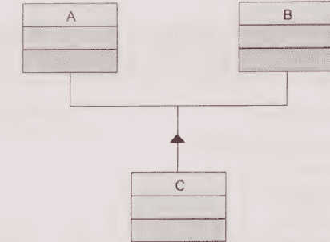

**图 5.5 多继承**

> 注意：Java 不支持类之间的多继承。但可以通过接口来实现。

## 层级继承

在层级继承中，多个类可以继承自同一个类，如图 5.6 所示。类 B 和 C 同时继承了 A。

## 混合继承

混合继承是上述定义继承方式的任何组合，如图 5.7 所示。

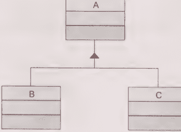
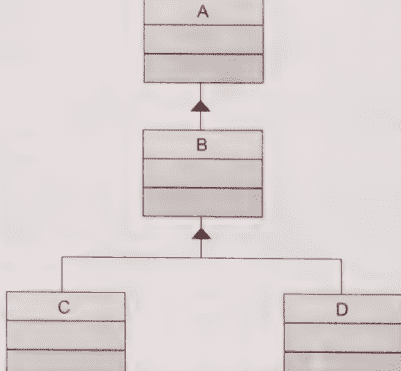

**图 5.6 层级继承**
**图 5.7 混合继承**

## 5.1.2 使用关键字派生类

在 Java 中，通过在类定义中声明来继承其他类，如下所示。

```java
class MySubClass extends MySuperClass {
}
```

在上面的定义中，`extends` 关键字声明 `MySubClass` 继承父类 `MySuperClass`。

现在假设你需要一个自行车或汽车的类。自行车或汽车将拥有型号名称、型号年份、最高速度、重量、价格和其他特征，但这两者在某些方面会有不同，例如汽车拥有车门，而自行车没有。相似的属性可以抽象出来并放在一个具有共同行为的通用类中。该通用类将成为这两个类的父类，如图 5.8 所示。

| 机动车辆 (MotorVehicle) | 类声明 |
| :--- | :--- |
| `int maxSpeed` | |
| `String modelName` | 属性 |
| `int modelYear` | |
| `int numberPassengers` | 方法 |


| 汽车 (Car) | 自行车 (Bike) |
| :--- | :--- |
| `int noDoors` | `boolean kickStart` |
| | `boolean buttonStart` |

> **图 5.8 汽车和自行车类的 UML 表示法及其父类机动车辆**

现在让我们为上述图表构建类，并查看 Java 中实际上是如何实现继承的。首先，我们构建父类 `MotorVehicle`，如示例 5.1 所示。

## 示例 5.1 父类 MotorVehicle

```java
class MotorVehicle { // 每小时英里
    int maxSpeed; // 例如 "Fiat"
    String modelName; // 例如 2006, 2008
    int modelYear;
    int numberPassengers; // 2, 4, 6
    // 我们可以像上面那样，添加一些属性，比如
    // 引擎排量等，但我们会把这留给你们作为练习题。
    // 构造函数
    MotorVehicle() {
        maxSpeed = 200;
        modelName = "";
        modelYear = 1997;
        numberOfPassengers = 2;
    }
    MotorVehicle(int maxSpeed, String modelName, int modelYear, int numberOfPassengers) {
        this.maxSpeed = maxSpeed;
        this.modelName = modelName;
        this.modelYear = modelYear;
        this.numberOfPassengers = numberOfPassengers;
    }
}
```

**136 Java 编程**

## 解析

- L1 声明了类 `MotorVehicle`。
- L2–5 在这些行中声明了实例变量 `maxSpeed`（`int` 类型）、`modelName`（`String` 类型）、`modelYear`（`int` 类型）和 `numberPassengers`（`int` 类型）。
- L6 默认构造函数。
- L7 参构造函数（带参数构造函数）声明，用于初始化 L2 到 L5 中声明的实例变量。
- L8–11 L2 到 L5 中声明的实例变量正在通过传入构造函数的参数进行初始化。使用了 `this` 关键字，因为实例变量名和局部变量（构造函数声明中的参数）名相同。

现在让我们构建子类，如图 5.8 所示。下面的示例显示了一个子类，即 `Bike`。子类将拥有其父类拥有的所有特征。此外，它还可以拥有自己的特征，如示例 5.2 所示。

## 示例 5.2 子类 Bike

```java
class Bike extends MotorVehicle {
    L2 boolean kickStart;
    L3 boolean buttonStart;
    /* 自行车可以脚启动，也可以不是按钮启动，但按钮启动的自行车会有脚启动的选项 */
    // 构造函数
    L4 Bike() {
        kickStart = true;
        buttonStart = false;
    }
    L5 Bike(boolean ks, boolean bs) {
        kickStart = ks;
        buttonStart = bs;
    }
    public static void main(String args[]) {
        Bike b = new Bike();
    }
}
```

## 解析

- L1 使用 `extends` 关键字显式继承。
- L2 和 3 声明了两个 `boolean` 类型变量：`kickStart` 和 `buttonStart`。
- L4 默认构造函数。
- L5 参构造函数。
- L6 `main` 方法。
- L7 创建了 `Bike` 对象。

## 方法重写 (Overriding)

当子类中的方法与其父类的方法具有相同的名称和类型签名时，认为它重写了父类的方法。重写是一种支持多态的特性。当从子类调用方法时，它将始终引用子类定义的方法。父类的方法被隐藏。在下面的代码中，我们看到子类 B 重写了类 A 的 `doOverride`。

## 示例 5.3 重写方法

```java
class A {
    int i = 0;
    void doOverride(int k) {
        i = k;
    }
}
// 子类定义开始
class B extends A { // 重写
    void doOverride(int k) {
        i = k;
        System.out.println("i 的值为: " + i);
    }
    public static void main(String args[]) {
        B b = new B();
        b.doOverride(2);
    }
}
```

**输出**

```
i 的值为 2
```

## 解析

| 行号 | 说明 | 备注 |
| :--- | :--- | :--- |
| L1 | 类声明。 | 这实际上是继承的意义。子类对象定义了它们的通用数据和方法。 |
| L2 | 实例变量声明。 | |
| L3 | 带整数参数的方法声明。 | |
| L4 | 实例变量被赋予参数的值。 | |
| L5 | 子类声明。 | 创建了子类对象。 |
| L6 | 方法重写，具有父类方法的名称和签名。 | 当我们创建类 B 的实例时，调用方法将导致调用 B 中的 `doOverride()` 而不是 A，因为实例是 B 时这很重要。另外注意我们没有在子类中声明变量 `i`，引用的是父类变量 `i`。 |
| L7 | 变量 `i` 初始化为参数的值。 | |

子类引用变量可以赋值子类对象。这由以下代码所示：

```java
A a1 = new B();
/* 创建 B 的实例但使用 A 类型的引用 */
a1.doOverride();
/* 虽然使用了 A 类型引用，但将调用类 B 的 `doOverride()` 方法。 */
```


## 解释

假设 `A` 是类 `B` 和 `C` 的子类。
L1 定义了一个大小为两个元素的超类 `A` 数组。

L2 数组的第一个元素被赋值为类 `B` 的对象。`int` 数组包含整数；字符数组在它的各个元素中包含字符，依此类推。超类 `A` 数组将包含类型为 `A` 或其子类的类型对象，因为子类变量可以引用子类对象。基本上，它是一个对象数组。

L3 数组的第二个元素包含类 `C` 的对象。
L4 使用 `for` 循环来遍历各种元素。`i` 的值将从 0 变化到 `a.length`，其长度为 2。

L5 在第一次迭代中，`i` 的值为 0，因此 `a[0]` 指向 `B` 类对象，所以即使数组是超类 `A`，也将执行 `B` 的 `override()` 方法，用于 `override()` 方法的代码将是所引用的实际对象的，而不是基类 `A` 中的方法。第二次迭代也是如此。唯一的区别是该对象将是 `C` 类。之所以调用了子类方法，是因为这些方法被重写了，而被重写的方法是动态绑定的。
动态绑定发生在运行时，并根据调用它的对象来调用方法。

绑定是将方法调用连接到其方法体的过程。当在程序执行之前进行绑定时，它是早期绑定。当一个类中存在多个同名方法时（即方法重载的情况），将执行哪一个方法取决于传递给方法的参数（参数的名称、类型或参数顺序）。因此，这种绑定是由编译器（在编译时）解决的，因此重载方法是早期绑定。

当超类和子类中都存在具有相同名称和签名的方法时（即方法重写的情况），将执行哪一个方法（超类版本或子类版本）将取决于调用它的对象的类型（见示例 5.3），因此无法由编译器完成。对象存在于运行时，晚期绑定是由 JVM 在运行时完成的，用于解析将执行哪个被重写的方法。它也被称为动态绑定或运行时绑定。

子类引用变量可以引用子类对象，但反之是不可能的，因为一个子类可能有许多子类，而所有这些子类都可能拥有超类及其同级类中不存在的额外（不同）成员（字段和方法）。因此，子类类型的变量可以暴露更多细节，并执行比超类类型变量更多的操作。每个超类都可以引用其子类对象，但不是每个子类都可以引用其子类对象。桌子和椅子。我们可以说每个桌子或椅子都是家具，但无法确定所有的家具都是桌子或椅子。考虑动物及其子类的另一个例子，如大象、狗、猫等。老虎是动物，大象是动物，但我们不能说动物是老虎或大象，因为在所有情况下都不是如此。让我们来看一个当使用子类引用变量引用子类对象时是如何访问字段的。

## Java 编程

## 示例 5.4 超类可以引用子类对象

```java
L1 class SuperClass {
L2   int instanceVariable = 10;
L3   static int classVariable = 20;
}
L4 class SubClass extends SuperClass {
L5   int instanceVariable = 12;
L6   static int classVariable = 25;
L7   public static void main(String args[]) {
L8     SubClass s = new SubClass();
L9     System.out.println("Superclass Instance variable: " + s.instanceVariable);
L10     System.out.println("Superclass static variable: " + s.classVariable);
L11     SubClass st = new SubClass();
L12     System.out.println("Subclass Instance variable: " + st.instanceVariable);
L13     System.out.println("Subclass static variable: " + st.classVariable);
  }
}
```

## 输出

```text
D:\javook\programs\chap4>java SubClass
Superclass Instance variable: 10
Superclass static variable: 20
Subclass Instance variable: 10
Subclass static variable: 25
```

## 解释

- L1 类声明。
- L2 定义了实例变量。
- L3 定义了类变量。
- L4 类声明。
- L5 声明了子类的实例变量，其名称与超类的相同（隐藏）。
- L6 声明了子类的类变量，其名称与超类的相同（隐藏）。
- L7 `main` 方法。
- L8 声明了一个超类引用 `s` 来持有一个子类对象。
- L9 打印了实例变量 `s`（在 L8 中创建）。打印出的值（见输出）将是子类的，因为引用是子类的。
- 这种绑定是通过编译时检查的，检查实例变量是否属于访问它的类 `SuperClass`，如果是，那么无论它引用哪个对象，都会进行绑定。
- L10 与 L9 相同。唯一的区别是针对类变量的。
- L11 声明了一个子类引用 `st` 来持有一个子类对象。
- L12 打印了实例变量 `st`（在 L11 中创建）。打印出的值（见输出）将是子类的，因为引用是子类的。如所述，这种绑定是由编译器在编译时完成的，检查实例变量是否属于访问它的类 `SubClass`，如果是，就会进行绑定，无论它引用哪个对象。
- L13 与 L12 相同。唯一的区别是针对类变量的。

在接下来的主题中，我们将重新讨论 `super` 关键字。

## 关键字

`super` 关键字用于以下用途：
1. 调用超类的方法。
2. 访问超类的成员变量。
3. 调用构造函数。

### 情况 1：调用超类

`super` 关键字代表对超类的调用。当子类重写方法时，这特别是必要的。

#### 示例 5.5(a) 显示重写的简单示例

```java
class ANew {
  void show() {
    System.out.println("Superclass show method");
  }
}

class BNew extends ANew { // 方法重写
  void show() {
    super.show(); // 调用父类方法
    System.out.println("Subclass show method");
  }
  public static void main(String[] args) {
    BNew s2 = new BNew();
    s2.show(); // 调用子类
  }
}
```

#### 输出

```text
Superclass show method
Subclass show method
```

#### 解释

- 定义了 `show` 方法。
- 执行 L5 中的 `show()` 以及方法内部的语句。
- 显示了如何使用 `super` 调用被子类重写的父类方法。
- 执行 L6 的 `super.show()`。如果省略此行，将调用子类方法；我们在这一行使用了 `super`，以便可以通过一个对象调用父类和子类的版本方法。
- 执行 `ANew` 中的 `show()` 代码，然后返回 L7，这是一条打印语句。
- 创建了 `BNew` 对象。使用 L9 中创建的对象调用 `BNew` 的 `show` 方法。
- 正如之前在 5.3 中讨论的，方法将根据调用它的对象来调用。
- L9 显示对象的创建。
- L10 被调用对象是 `B`。

### 情况 2：访问超类的实例成员变量

示例 5.6 展示了如何使用 `super` 关键字访问超类的实例变量。当超类变量被子类变量隐藏时，该关键字特别有用。当父类和子类中的变量名称相同时，就会发生隐藏的概念。在这种情况下，超类变量将在子类中隐藏，子类内只能访问子类变量。要访问隐藏的超类变量，如下所示使用 `super` 关键字。

## 示例 5.6 使用 super 关键字访问父类变量

```java
L1 class Super_Variable {
L2   int b = 30; // 实例变量
}
L3 class Subclass extends Super_Variable {
L4   int b = 12; // 遮蔽了父类变量
L5   void show() {
L6     System.out.println("subclass class variable:" + b);
L7     System.out.println("superclass instance variable:" + super.b);
  }
L8   public static void main(String args[]) {
L9     Subclass s = new SubClass();
L10     s.show(); // 调用 Subclass B 的方法
  }
}
```

## 输出

```text
subclass class variable: 12
superclass instance variable: 30
```

## 解释

- L1 父类声明 `Super_Variable`。
- L2 实例变量声明并赋值。
- L3 子类声明 `SubClass`。
- L4 子类内部的实例变量 `b`（即 L4 中定义的与 `b` 同名的）遮蔽了父类变量。
- L5 在子类中定义的 `show()` 方法。
- L6 和 L7 在上面的示例中，具体来说我们区分了这两者并访问了保留的两个实例变量名。对于父类变量的值，我们使用了 `super` 关键字，通过直接写 `b` 打印 `b` 的值。

### 情况 3：调用父类的构造函数

作为独立语句的 `super`（即 `super()`）表示对父类构造函数的调用。这只能在子类的构造函数中进行，而且必须是构造函数的第一条语句。默认构造函数隐式地包含了使用 `super` 关键字对父类构造函数的调用。

## 示例 5.7 构造函数调用机制

```java
class Constructor_A {
  Constructor_A() {
    System.out.println("Constructor A");
  }
}

class Constructor_B extends Constructor_A {
  Constructor_B() {
    System.out.println("Constructor B");
  }
}

class Constructor_C extends Constructor_B {
  Constructor_C() {
    System.out.println("Constructor C");
  }
}

public static void main(String args[]) {
  Constructor_C a = new Constructor_C();
}
```

## 输出

```text
Constructor A
Constructor B
Constructor C
```

## 解释

- L1 父/父类声明 `Constructor_A`。
- L2 `Constructor_A` 类的默认构造函数。
- L4 L1 中定义的类的子类声明 `Constructor_B`。
- L5 `Constructor_B` 类的默认构造函数。
- L7 L4 中定义的类的子类声明 `Constructor_C`。
- L8 显式声明了 `Constructor_C` 类的默认构造函数。
- L10 方法声明。
- L11 在这里创建了 `Constructor_C` 类的对象。如果类没有提供任何构造函数，在创建类对象时会隐式调用默认构造函数（无参数构造函数）。所有三个类都定义了各自的构造函数。`Constructor_C` 类的对象创建会导致 L8 上调用该类的显式默认构造函数。类的每个构造函数都会创建一个 `<init>` 方法，此 `<init>` 包含了对父类默认（无参数）构造函数的调用。实例化 `Constructor_C` 类的任何实例时会自动调用父类构造函数。此外，它的父类即 `Constructor_B` 需要在子类初始化和实例化之前初始化。`Constructor_B` 也是如此，因为它继承自 `Constructor_A`。因此，首先执行 `Constructor_A` 的构造函数，然后是 `Constructor_B`，最后是 `Constructor_C`。

## 示例 5.7 (a) 使用 super 关键字调用父类构造函数

```java
L1 class Constructor_A_Revised {
L2   Constructor_A_Revised() {
      System.out.println("Constructor A Revised");
  }
}
L4 class Constructor_B_Revised extends Constructor_A_Revised {
  // 此构造函数被注释了
  /* Constructor_B_Revised() {
       System.out.println("Constructor B");
     }
  */
  Constructor_B_Revised(int a) {
    a++;
    System.out.println("Constructor B Revised " + a);
  }
}

class Constructor_C_Revised extends Constructor_B_Revised {
  Constructor_C_Revised() {
    super(11); // 如果省略会导致编译时错误
    System.out.println("Constructor C Revised");
  }
}

public static void main(String args[]) {
  Constructor_C_Revised a = new Constructor_C_Revised();
}
```

## 输出

```text
Constructor A Revised
Constructor B Revised 12
Constructor C Revised
```

## 解释

`Constructor A Revised`（仅显示了更改）。调用了 `Constructor_A_Revised` 类的构造函数。构造函数中的 `super` 语句是构造函数的第一条语句。由于父类在子类初始化之前必须初始化，在子类初始化之前必须显式调用父类。

## 5.4 final 关键字

`final` 关键字用于以下目的：

- 1. 声明常量（用于变量和参数声明）
- 2. 禁止方法重写（用于方法声明）
- 3. 禁止继承（用于类声明）

基本上，它用于防止继承和创建常量。让我们来看例子。

## 示例 5.8 Final

```java
class Final_Demo {
  final int MAX = 100; // 常量声明

  // 带有 final 参数的 final 方法
  final void show(final int x) {
    // MAX++ 非法，因为 MAX 是 final
    // x++ 非法，因为参数 x 是 final
    System.out.println("Superclass show method: " + x);
  }
}

class Final_Demo_1 extends Final_Demo {
  // 不能重写方法，因为它在父类中是 final
  // 这就是为什么我们注释掉了
  /* void show() {
       System.out.println("Subclass show method");
     }
  */

  public static void main(String args[]) {
    Final_Demo_1 f2 = new Final_Demo_1();
    // 调用父类的 show 方法
    f2.show(12);
  }
}
```

## 输出

```text
C:\examples\ java Final_Demo_1
Superclass show method: 12
```


# 解释

| 行号 | 说明 |
| :--- | :--- |
| L1 | 类声明 `Final_Demo`。 |
| L2 | 整数常量 `MAX` 值为 100。 |
| L3 | `final` 方法 `show()` 带有 `final` 参数定义。此方法不能在子类中被重写，如 L8 注释所示。`final` 参数的值不能更改，因为它已经是常量。 |
| L7 | 子类声明。如果父类是一个 `final` 类，那么这个类就不能被子类化。`final` 类可以如下声明：`final class Final_Demo` |

## 5.5 抽象类

Abstract（抽象）的字面意思是“不与任何特定实例相关的概念或构想”。抽象类采纳了这一概念。抽象类是具有通用概念的类，与特定的类无关。它们定义了部分行为，并将其余部分留给子类提供。

抽象类包含一个或多个抽象方法。在没有抽象方法的情况下创建抽象类是没有意义的，但如果确实这样做，Java 编译器不会对其进行报错。抽象方法是一种被声明但未包含任何实现的方法，即没有方法体。

抽象类不能被实例化，它们要求子类通过重写（overriding）来为它们的抽象方法提供实现，然后子类才能被实例化。如果子类没有实现抽象类的方法，那么子类必须将自己标记为抽象类，以便为其自己的后代子类重写这些抽象方法留出空间。

## 为什么要创建抽象方法？

当我们希望强制所有子类都具有相同的方法名称和签名模式，并且不希望它们有机会使用自己的命名模式，但同时又赋予它们根据自己的特定需求编写这些方法的灵活性时，我们就使用抽象方法。5.9(a) 展示了一个抽象的 `Animal` 类。该类由于内部存在抽象方法，因此被专门创建为了一个抽象类。某些特征是所有动物共有的，但另一些特征是某一类动物特有的。我们也可以认为，共同特征由不同的动物以不同的方式执行。例如，这个世界的每种动物都会产生一种特定的声音，这种声音与其自身的物种所独特。

## 示例 5.9 (a) 带有抽象方法的抽象类

| 行 | 代码 |
| :--- | :--- |
| L1 | `abstract class Animal {` |
| L2 | `String name;` |
| L3 | `String species;` |
| L4 | `// 抽象类的构造函数` |
| L5 | `Animal(String n, String s) {` |
| L6 | `name = n;` |
| L7 | `species = s; }` |
| L8 | `void eat(String fooditem) {` |
| L9 | `System.out.println(species + " " + name + " likes to have " + fooditem); }` |
| L10 | `abstract void sound(); }` |

## Java 编程

### 解析

- L1 使用 `abstract` 关键字在类声明之前声明了抽象类。
- L2 和 L3 声明了 String 变量，命名为 `name` 和 `species`。
- L4 用于初始化实例变量的带参构造函数。
- L8 定义了一个非抽象方法，与其他普通方法一样。
- L9 打印语句。
- L5 和 L6 初始化实例变量 `name` 和 `species`。
- L10 声明了抽象方法。注意，此方法没有任何方法体。

`abstract` 关键字同时用于定义抽象方法和抽象类。任何想要被实例化的动物必须重写 `sound()` 方法，否则无法创建该类的实例。让我们来看继承自 `Animal` 类的 `Lion` 子类。

## 示例 5.9 (b) 实现抽象方法的类

```java
class Lion extends Animal {
    Lion() {
        super("Lion", "Asiatic Lion");
    }
    void sound() {
        System.out.println("Lions Roar! Roar!");
    }
    public static void main(String[] args) {
        Lion l1 = new Lion();
        l1.eat("flesh");
        l1.sound();
    }
}
```

## 输出

```text
Asiatic Lion likes to have flesh
Lions Roar! Roar!
```

### 解析

- L1 抽象类 `Animal` 的子类声明。
- L2 为 `Lion` 类创建了默认构造函数。
- L3 使用 `super` 关键字调用父类的构造函数。
- L4 重写了 `sound()` 方法，因为父类中该方法是抽象的。
- L7 通过创建的对象调用了父类的 `eat()` 方法（示例 5.9(a)）。
- L8 抽象方法被声明在父类中。

## 5.6 隐藏（SHADOWING）与重写（OVERRIDING）

隐藏发生在局部变量与变量名称冲突时。在方法的情况下，实例方法被重写，而静态方法被隐藏。两者之间的区别很重要，因为隐藏的方法是早期绑定的，而实例方法是动态（晚）绑定的。下面的示例说明了这种区别。

## 示例 5.10 隐藏与重写

```java
class Shadowing {
    static void display() {
        System.out.println("In Static Method of Superclass");
    }
    void instanceMethod() {
        System.out.println("In instance Method of Super Class");
    }
}

class ShadowingTest extends Shadowing {
    // 静态方法
    static void display() {
        System.out.println("In Static Method of Superclass");
    }
    // 实例方法
    void instanceMethod() {
        System.out.println("In instance Method of Super Class");
    }
    public static void main(String[] args) {
        ShadowingTest st = new ShadowingTest();
        st.display();
        st.instanceMethod();
    }
}
```

## 5.7 实际问题：圆与圆柱

让我们通过一个实际示例展示继承的力量和 `super` 关键字的使用。我们将创建一个圆类，然后在圆柱类中继承圆类来计算其面积。

### 示例 5.11 (a) Circle 类

```java
class Circle {
    // 声明实例变量
    float radius;
    final float PI = 3.141f; // pi 值是固定的

    Circle() {
        radius = 1.0f;
    }

    // 带参数构造函数
    Circle(float radius) {
        this.radius = radius;
    }

    // 返回圆的面积，即 πr²
    float getArea() {
        return PI * radius * radius;
    }
}
```

### 示例 5.11 (b) 继承

```java
class Cylinder extends Circle {
    // 表示圆柱高度的实例变量
    float height;

    Cylinder(float radius, float height) {
        // 显式调用 super 构造函数
        super(radius);
        this.height = height;
    }

    // 重写的方法返回圆柱的表面积
    // 表面积 = (2πr²) + (2πr.height)
    // 其中 (2πr²) 是“端面”的面积
    // (2πr.height) 是“侧面”的面积
    // 使用 super 关键字调用父类方法
    float getArea() {
        return 2 * super.getArea() + 2 * PI * radius * height;
    }

    public static void main(String args[]) {
        Circle c = new Circle(1.5f);
        System.out.println("The Area of Circle is: " + c.getArea());
        Cylinder cy = new Cylinder(1.5f, 3.5f);
        System.out.println("The Surface Area of Cylinder is: " + cy.getArea());
    }
}
```

## 输出

```text
C:\examples\chap5java Cylinder
The Area of Circle is: 7.0672503
The Surface Area of Cylinder is: 47.14998
```

## 解析

- `Cylinder` 类继承自 `Circle` 类。
- 实例变量 `height` 已由子类 `Cylinder` 定义。
- 使用带参数的构造函数初始化 `radius` 和 `height`。
- 使用 `this` 关键字将子类构造函数中接收的参数 `radius` 传递给 `Circle` 类，即父类构造函数。这显示了代码的重用，因为 `radius` 只被定义了一次，并供子类使用。
- 实例变量 `height` 使用局部变量（参数）进行初始化。
- 类的 `getArea()` 方法被重写了，因为 `Cylinder` 类希望该方法的名称与父类相同（即 `getArea()`），但执行的是不同的功能（即返回圆柱的表面积）。
- 通过 `super` 调用了父类的 `getArea()`，即 `super.getArea()`，因为查看圆柱表面积的计算公式可以发现：
  - 表面积 = (2πr²) + (2πr.height)
  - (2πr²) 是“端面”的面积，(2πr.height) 是“侧面”的面积，πr² 是圆的面积，我们已经在父类中创建了计算圆面积的方法。因此，我们调用了父类方法 `getArea()`（代码重用）。`radius` 已经通过父类传递了进来。
- 父类 `getArea()` 的返回值乘以 2，并加上侧面面积（2πr.height）。
- `main()` 方法。
- 创建了一个半径为 1.5f 的 `Circle` 类对象。
- 通过 `Circle` 类对象调用 `getArea()`。返回值与 `println` 方法中的字符串拼接，并打印在屏幕上，正如我们在输出中所所示。
- 创建了一个半径为 1.5f、高度为 3.5 的 `Cylinder` 类对象。
- 通过 `Cylinder` 类对象调用了该方法。

# 总结

继承的概念源于现实生活，在现实生活中，孩子会继承父母的优点或缺点，并在此基础上建立自己的身份和行为。这一概念被面向对象的编程所吸收，其中父类的属性和方法被子类或子类继承。子类可以通过重写（overriding）以不同的方式实现方法，同时保持方法名和签名与父类一致。

抽象类用于强制子类重写抽象方法并为它们提供方法体代码。文中还通过示例讨论了重写（overriding）和隐藏（shadowing）之间的区别。被隐藏的方法由编译器绑定，而重写的方法由 JVM 动态绑定。

`super` 关键字可以用于访问被重写的方法、变量甚至构造函数。

`final` 关键字用于创建常量并禁止继承。`abstract` 和 `final` 关键字不能共存，因为 `final` 用于防止继承，而 `abstract` 用于允许子类继承它并重写方法。

# 练习

## 单选题

### 1. 当你尝试编译并运行以下类时，会发生什么？

```java
class Demo {
    Demo(int i) {
        System.out.println("Demo");
    }
}

class Inner extends Demo {
    public static void main(String args[]) {
        Inner s = new Inner();
    }
    void Inner() {
        System.out.println("Inner");
    }
}
```

- (a) 编译并在运行时输出字符串 "Inner"
- (b) 编译时错误
- (c) 编译但在运行时没有输出
- (d) 编译并输出字符串 "Demo"

### 2. 下面哪些说法是正确的？

- (a) 如果抽象类有抽象方法，它必须被声明为抽象的。
- (b) 如果抽象方法没有被重写，子类不需要声明为抽象的。
- (c) `final` 类不能作为子类。
- (d) 抽象类中的所有方法必须声明为抽象的。

### 3. 哪个关键字是用于派生类的？

- (a) implements
- (b) extends
- (c) throws
- (d) inherits

### 4. 当你尝试编译并运行以下类时，会发生什么？

```java
class Base {
    void Base() {
        System.out.println("In Base");
    }
    Base(int i) {
        System.out.println("In Base: " + i);
    }
}
```

- (a) 编译错误
- (b) 编译通过但运行时错误
- (c) 编译并成功执行但不显示输出
- (d) 编译并打印 "In Base"

### 5. 当你尝试编译并运行以下类时，会发生什么？

```java
abstract class Demo {
    abstract void show();
}

class Demo_1 extends Demo {
    Demo_1() {
        System.out.println("Demo");
    }
    public static void main(String args[]) {
        Demo_1 d = new Demo_1();
    }
}
```

- (a) 编译错误
- (b) 编译通过但运行时错误
- (c) 编译并成功执行但不显示输出
- (d) 编译并打印 "Demo"

### 6. 当你尝试编译并运行以下类时，会发生什么？

```java
class Test {
    Test(int a) {
        System.out.println("Test " + a);
    }
}

class Test_1 extends Test {
    Test_1(int a) {
        System.out.println("Test_1");
    }
    public static void main(String args[]) {
        Test t = new Test_1(10);
    }
}
```

- (a) 在子类中使用 `super` 调用方法
- (b) 在子类中使用 `super` 调用构造函数
- (c) 将父类设为抽象
- (d) 在 `Test` 中提供默认构造函数。

### 7. 当你尝试编译并运行以下类时，会发生什么？（原文编号为 8，此处按顺序调整）

```java
// 题目代码缺失，原文跳至第 8 题选项
```

### 8. 哪个关键字用于防止继承？

- (a) final
- (b) super
- (c) this
- (d) Final

### 9. 如果程序中存在以下行，会发生什么？

```java
abstract class Demo {
    int a;
    Demo(int a) {
        a = a + 10;
        System.out.println(a);
    }
}
```
（注：抽象类可以有构造函数）。

### 10. 当你尝试编译并运行程序时，输出是什么？

```java
public static void main(String args[]) {
    Demo d = new Demo(20);
    System.out.println(d.a);
}
```


- (a) 编译错误
- (b) 编译通过但运行时错误
- (c) 编译并打印 Test 10 然后是 Test_1
- (d) 20 和 10（注：关于隐藏）

- 7. 如何修正上述程序以输出选项 (c)？

# 复习题

- 1. 什么是继承？它与聚合有什么区别？
- 2. 什么是重写？请解释。
- 3. 解释 `super` 关键字及其用途。用程序说明。
- 4. 解释 `final` 关键字及其用途。用程序说明。
- 5. 什么是抽象类？抽象类可以有构造函数吗？
- 6. 实例变量的隐藏是什么？
- 7. 隐藏和重写的区别是什么？
- 8. 重载方法是早期绑定的，而重写方法是后期绑定的。评论？
- 9. 为什么子类引用变量不能指向父类对象？

## 编程练习

- 1. 定义如下 `Vehicle` 类：
  成员：
  - (a) `modelName`
  - (b) `modelNumber`
  - (c) `modelPrice`
  方法：
  - (a) `display()` 显示名称、价格和型号。
  定义另一个继承 `MotorVehicle` 类的 `Car` 类，具有如下：
  成员：
  - (a) `discountRate`
  方法：
  - (a) `display()` 显示 Car 名称、价格和折扣率。
  - (b) `discount()` 方法计算折扣。
  使用合适的构造函数创建 `MotorVehicle` 类并测试。

- 2. 创建一个如下的抽象类 `Accounts`：
  成员：
  - (a) `balance`
  - (b) `accountNumber`
  - (c) `accountHolderName`
  - (d) `address`
  方法：
  - (a) `withdraw()` - 抽象
  - (b) `deposit()` - 抽象
  - (c) `display()` 显示账户余额。
  创建该类的子类 `SavingsAccount`，并添加以下细节：
  成员：
  - (a) `rateOfInterest`
  方法：
  - (a) `calculateAmount()`
  - (b) `display()` 显示利率、新余额和完整的持有人信息。
  创建 `Accounts` 类的另一个子类 `CurrentAccount`，如下：
  成员：
  - (a) `overdraftLimit`
  方法：
  - (a) `display()` 显示透支额度和完整的持有人信息。
  创建这两个类的对象并调用它们的方法。使用适当的构造函数。

# 接口、包与枚举

> 我们的知识越增长，我们的无知就越扩张
> —约翰·F·肯尼迪

- 在读完本章后，读者将能够：
- 理解什么是接口以及它们与抽象类的区别
- 理解包的概念以及如何使用它们
- 了解 `java.lang` 包
- 理解对象类（object class）和包装类（wrapper class）
- 了解 Java 中如何创建、操作和分割字符串
- 理解枚举（enumerations）

## 6.1 接口

Java 中的接口像是一份合同或协议，类必须遵守它。接口本质上是一组默认公有且抽象的方法集合。这些方法没有方法体。实现对象必须重写接口的所有方法，并为所有这些方法提供实现。接口的任何方法都没有关联代码。最棒的一点是，类可以继承任意数量的接口，从而在 Java 中实现多继承，前提是类必须重写它所继承的所有的所有方法。Java 不支持类之间的多继承，但接口允许 Java 支持这一特性。

接口使用 `interface` 关键字声明。注意，没有任何方法具有方法体。重写方法并为这些方法提供实现是实现类的责任。

```java
interface interfename {

    retntype methodname(argumentlist);

    ...

}

class classname implements interfename() {}
```

## 示例 6.1 (a) Calculator.java：接口定义

示例 6.1(a) 显示了一个非常简单的计算器程序。对于任何计算器，都有几个基本操作都不会改变：无论是普通、科学计算器还是可编程计算器。基本操作（加、减、除、乘）可以从实现类中提取出来并放入接口中。现在，所有实现对象都必须保持与接口定义的完全相同的名称和签名，这就是我们创建接口的原因，这也是我们实际上希望所有子类遵循的规则。我们不希望类遵循自己的规则（如它们自己创建的方法及其签名）。我们希望类遵循接口设定的规则，这会对它们构成一种约束。也就是说，对象必须在重写的方法中根据自己的要求编写代码。为了简单起见，我们创建了一个名为 `calculator` 的接口，并在定义了四个方法来表示计算器的四个基本操作，这些方法仅对整数执行操作。你以后可以扩展此程序以接受不同类型的参数，如 `double`、`float` 和 `byte`。

类在继承其他类时使用 `extends` 关键字；而继承接口时使用 `implements` 关键字，如示例 6.1(b) 所示。

```java
interface Calculator {

    int add(int a, int b);

    int subtract(int a, int b);

    int multiply(int a, int b);

    int divide(int a, int b);

}
```

## 解析

- L1 使用 `interface` 关键字声明接口，后面跟着接口名称和左大括号表示接口的开始。
- L2 声明了 `add` 方法，返回类型为 `int`，接受两个 `int` 类型的参数。
- L3 声明了 `subtract` 方法，返回类型为 `int`，接受两个 `int` 类型的参数。
- L4 声明了 `multiply` 方法，返回类型为 `int`，接受两个 `int` 类型的参数。
- L5 声明了 `divide` 方法，返回类型为 `int`，接受两个 `int` 类型的参数，由接口的右大括号结束。

## 示例 6.1 (b) Normal_Calculator.java：实现 Calculator 接口的类

```java
class Normal_Calculator implements Calculator {

    public int add(int a, int b) {

        return a + b;

    }

    public int subtract(int a, int b) {

        return a - b;

    }

    public int multiply(int a, int b) {

        return a * b;

    }

    public int divide(int a, int b) {

        return a / b;

    }

    public static void main(String[] args) {

        Normal_Calculator c = new Normal_Calculator();

        System.out.println("Value after addition = " + c.add(5, 2));

        System.out.println("Value after Subtraction = " + c.subtract(5, 2));

        System.out.println("Value after Multiplication = " + c.multiply(5, 2));

        System.out.println("Value after division = " + c.divide(5, 2));

    }

}
```

# 输出

```
C:\java>Normal_Calculator
Value after addition = 7
Value after Subtraction = 3
Value after Multiplication= 25
Value after division = 2
```

# 解析

- L1 创建了 `Normal_Calculator` 类的对象，并通过 `implements` 关键字继承了接口 `Calculator`。
- L2 重写了 `add` 方法并提供了方法体。
- L3 使用 `return` 关键字返回传递给 `add` 方法的两个参数相加的结果（给调用者），随后是大括号。
- L4–9 重写了 `subtract`、`multiply` 和 `divide` 方法并返回结果。
- L12–15 是打印加/减/乘/除结果的打印语句。这些行中，使用创建的对象调用了相应的方法。

## 示例 6.2 接口中的变量

```java
interface Limit_Test {

    int LOWERLIMIT = 0;

    int UPPERLIMIT = 100;

}

class Variable_Test implements Limit_Test {

    void findNumberLimits(int a) {

        if (a > LOWERLIMIT && a < UPPERLIMIT) {

            System.out.println(a + " lie between " + LOWERLIMIT + " and " + UPPERLIMIT);

        } else {

            System.out.println(a + " does not lie between " + LOWERLIMIT + " and " + UPPERLIMIT);

        }

    }

    public static void main(String args[]) {

        Variable_Test vt = new Variable_Test();

        vt.findNumberLimits(23);

        vt.findNumberLimits(233);

    }

}
```

# 输出

```
23 lie between 0 and 100
233 does not lie between 0 and 100
```

# 160 Java 编程

被传递了。该方法会检查此参数是否在下限和上限之间，如果是，则将该值打印在屏幕上。通过 `Variable_Test` 对象调用 `findNumberWithLimits()`，并传递了参数 233。该方法会检查此参数是否在下限和上限之间，如果不是，则打印在屏幕上。

### 6.1.2 扩展接口

普通类一样，接口也可以被扩展。接口可以使用相同的关键字 `extends` 继承另一个接口，而不是使用 `implements` 关键字。示例 6.3 显示了如何扩展接口。

```java
interface A {

    void showA();

}

interface B extends A {

    void showB();

}

class InDemo implements B {

    public void showA() {

        System.out.println("Overridden method of Interface A");

    }

    public void showB() {

        System.out.println("Overridden method of Interface B");

    }

    public static void main(String args[]) {

        InDemo d = new InDemo();

        d.showA();

        d.showB();

    }

}
```

## 输出

```
C:\javook\java InDemo
Overridden method of Interface A
Overridden method of Interface B
```

| | | | |
|---|---|---|---|
| L1 | 定义了一个名为 A 的接口。 | L4 | 在接口 B 中定义了方法 showB()。 |
| L2 | 在接口 A 中定义了方法 showA()。 | L5 | 类声明显示它继承了接口 B。 |
| L3 | 定义了接口 B，我们在其声明中使用 `extends` 来指明 B 的父接口是 A。任何继承 B 的类都必须重写接口 A 以及 B 的所有方法。 | L6 | 显示了重写的方法 showA()。注意在重写时添加了 `public` 访问修饰符。 |
| | | L7 | 显示了重写的方法 showB()。 |

## 6.1.3 接口 vs 抽象类

表 6.1 列出了接口和抽象类之间的区别。

## 表 6.1 接口 vs 抽象类

| 接口 | 抽象类 |
| --- | --- |
| 支持多继承；一个类可以继承任意数量的接口。 | 不支持多继承；一个类只能继承一个类。 |
| 使用 `implements` 关键字继承接口。 | 使用 `extends` 关键字继承类。 |
| 默认情况下，接口中的所有方法都是 `public` 且 `abstract` 的；不需要标记为 `public` 或 `abstract`。 | 方法必须标记为 `public` 或 `abstract`，或者根据需要标记。 |
| 接口没有实现。 | 抽象类具有部分实现。 |
| 接口中的所有方法都需要重写。 | 只有抽象方法需要重写。 |
| 接口中声明的所有变量默认都是 `public`、`static` 或 `final`。 | 变量如果需要，必须声明为 `public`、`static` 或 `final`。 |
| 接口没有构造方法。 | 抽象类有构造方法。 |
| 接口中的方法不能是 `static` 的。 | 非抽象方法可以是 `static` 的。 |

接口和抽象类并非完全不同，它们也有一些相似之处。

- 1. 两者都不能实例化，即不能为它们创建对象。
- 2. 两者都可以拥有引用变量，指向其实现类的对象。例如，如果 X 是一个接口，其实现类名是 Y，那么我们不能编写代码：
- 3. 接口中永远无法创建 `static/final` 方法，它们也无法与抽象方法一起使用。

```java
X x = new X(); // 非法代码
Y x = new Y(); // 合法代码
```

## 6.2 包 (PACKAGES)

你可能遇到过这种情况：尝试在文件夹/目录和子目录中组织许多文件。同样，如果你有许多类可供，就需要某种分组。Java 包是将 Java 类组织成组的机制之一。事实上，包确实是存放 Java 文件的目录。Java 有许多此类预定义包，可以在程序中使用。Java 的一些预定义包包括 `applet`、`lang`、`util`、`event`、`io`、`swing` 等。程序员允许开发自己的包，以组织属于同一类别或相似功能的类。

> 包可以定义为根据其功能将各种类和接口进行分组的集合。

隐藏这些包也是可能的，因为它们可以存储在称为 JAR 文件的压缩文件中（JAR 文件或 Java 归档用于将许多文件汇聚为一个），允许类作为一个组进行下载，比一个一个下载更快。

包声明位于 Java 源文件的顶部。所有放置在包中的源文件都有一个共同的包名。

- 包为其包含的类提供了一个唯一的命名空间。
- 包可以包含以下内容：
  - 类
  - 接口
  - 枚举类型 (Enumerated types)
  - 注解（Java 5 中引入的元素元数据机制）

不同包中的两个类可以具有相同的名称，如果不使用包机制，这是不可能的。

包提供了一种机制，可以隐藏其类不被程序或属于其他类的包所使用。

### 6.2.1 创建包

到目前，我们已经学习了包是什么以及为什么要使用它们。Java 中的包分为两种：预定义的 Java API 包和用户定义的包。Java 6 API 拥有大量的类和接口。一些预定义包列在表 6.2“常用预定义包”中。

| 包 | 功能 |
|---|---|
| java.lang | 基础 |
| java.util | 工具类 |
| java.io | 文件处理 |
| java.math | 任意精度 |
| java.net | 网络编程 |
| java.sql | 数据库连接 (JDBC) |
| java.awt | 窗口工具包 |
| javax.swing | 轻量级 GUI 组件 |

问题在于——我们如何创建包？包声明位于 Java 源文件的顶部。所有放置在包中的源文件都有一个共同的包名。为了创建一个包，我们首先创建一个与包同名的目录。在这个目录内部，我们创建类文件。因此，我们可以这样定义类：

```java
package example;

public class ClassPackage {

    // 类体

}
```

## 保存、编译和执行包

保存、编译和执行包有两种方法：

1. 记住文件必须以类名保存，即 `packexample`，并放置在与其相同的目录中。在目录内部进行编译。执行文件时，移动到当前目录，并通过指定包名来执行文件。

```
C:\packexample>javac ClassPackage.java
```

```
C:\pack> java packexample.ClassPackage
```

```
C:\> java packexample.ClassPackage
```

2. 此 Java 源文件可以保存在任何目录。在编译期间，你需要指定 Java 编译器的选项 `-d`，它指定了你想放置生成文件的地方。编译完成后，你会发现包已经创建在你的路径中，且 .class 文件已放置在该包中。执行类时，需要按照上述相同的步骤操作。

```
C:\javaexample>javac -d c:\pack ClassPackage.java
```

```
C:\pack> java packexample.ClassPackage
```


C:\pack> java packexample.ClassPackage

## 类路径 (Classpath)

路径 用于存储第三方和自定义类的路径。当我们执行/编译任何类文件时，jdk 工具 `javac` 和 `java` 会在用户路径中搜索包/类文件，默认情况下是当前目录。如果类不在当前目录，则我们需要设置路径。

## 164 Java 编程

类路径（classpath）可以是一个环境变量，可以使用控制面板中的系统实用程序或如所示的 DOS 提示符进行设置。

- 1. 它是一个环境变量，可以使用控制面板中的系统实用程序进行设置

```
Set CLSPATH = %CLASPATH%;c:\pack;
```

`%Classpath%` 用于保持现有路径完整，并将我们的新路径附加其后。现在，上述用例的第 L3 行将执行。

在 DOS 提示符处设置类路径每次打开 DOS 提示符时都要进行，因为关闭提示符会将类路径重置为原始值。要使更改永久生效，请在控制面板中编辑环境变量。不要删除现有的类路径，通过编辑变量将您的类路径添加到环境变量中。

- 2. 使用 `javac`/`java` 工具的类路径选项 `-cp` 来覆盖用户定义的类路径，并找到 Java 源文件中用户定义的特定包/类。

```
//syntax: javac -cp java 源文件中使用的目录/包路径，后面跟上 java 源文件名
c:\packexample> javac -cp c:javaeg DemoClass.java
```

`-cp` 指定了 `DemoClass.java` 中使用的用户定义包/类将在 `c:javaeg` 找到。

## 子包

子包是按层次结构设计的，即一个包可以是另一个包的一部分。这可以通过在层次结构的各个层级指定多个包名（并用点分隔）来实现。例如，

```
package rootpackage.subpackage1;
```

由于相关的类可以被收集在一个包中，相关的包也可以被收集在一个更大的包中。在上面的语句中，`subpackage1` 被设计为 `rootpackage` 的一部分。当然，这些包必须存储在目录和子目录的层次结构结构中。例如，上述包 `subpackage1`（作为 `rootpackage` 的一部分）将存储在目录 `rootpackage` 内部。

包名和目录名必须相同，且使用的名称应仔细选择。

### 6.2.2 使用包

在 Java 中，在各个包内部定义的类名始终可以通过指定这些类所属的对应包名来引用。例如，属于 `java.awt` 包的 `Rectangle` 类可以通过以下方式引用

```
java.awt.Rectangle
```

但 Java 提供了一种导入机制，可以使用该机制，且在不为所属的包名加名前缀的情况下使用类。这里值得注意的是，类 `Rectangle` 是通过在它前面加上包名 `java.awt` 来引用的。诚然，这是一个繁琐的过程。下面给出的语句是上述语句的一种方便形式。

```
Rectangle box = new Rectangle (5, 10, 20, 30);
```

此语句只有在预先导入该类的情况下（即在程序本身开始时）才有效。现在问题是，如何导入属于各个包的类。`java.lang` 包中的类是自动导入的。对于所有其他类，你必须提供 `import` 语句来导入特定的类

```
import java.awt.Rectangle;
```

或者使用通配符符号导入包中的所有类。

```
import java.awt.*;
```

让我们尝试实现一下到为止讨论的内容。在下面的示例中，我们创建了两个包 `packexample` 和 `packexample1`。该包中有一个类 `ImportExample`，它将在另一个包 `packexample1` 的类 `ImportExample` 中使用。

## 示例 6.4 在包中递归计算阶乘的程序

```
L1 package packexample;

L2 public class ImportExample{

L3 public int fact(int a){

L4 if(a == 1)

L5 return 1;

L6 else

L7 return a*fact(a-1);

}}
```

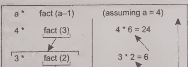

解释
L1 声明了名为 `packexample` 的包。
L2 在包 `packexample` 内部声明了公有类 `ImportExample`。
L3 定义了公共方法 `fact`。
L4 和 5 如果 `a` 的值为 1，则返回 1。
L6 和 7 否则返回 `a` 乘以参数为 `a-1` 的 `fact` 方法的调用。从内部调用函数，即递归。图 6.1 显示了该递归函数的执行序列。

## 示例 6.5 在另一个包中使用包并调用递归阶乘方法

| | |
|---|---|
| L1 | package packexample1; |
| L2 | import packexample.*; |
| L3 | class UseImportExample{ |
| L4 | public static void main(String[] args) { |
| L5 | int a = 4; |
| L6 | ImportExample i = new ImportExample(); |
| L7 | System.out.println("Factorial of " + a + " is " + i.fact(a)); |
| | } |

# 输出

```
factorial of 4 is 24
```

# 解释

- L1 定义了包 `packexample1`。类 `ImportExample` 的，即 `packexample`。
- L2 我们想访问类 `ImportExample`，但没有在我们的类中使用编译器语句，因此我们需要导入。
- 静态导入仅导入类的静态成员。

### 6.2.3 访问保护

访问保护定义了一个元素（类、方法、变量）暴露给其他类和包的程度。Java 中提供了四种访问修饰符（按访问权限从高到低排序）。

- `public` 应用于变量、构造方法、方法和类
- `protected` 应用于变量、构造方法、方法和内部类（不包括顶层类）
- `default`（默认访问）应用于变量、构造方法、方法和类
- `private` 应用于变量、构造方法、方法和内部类

`public` 和 `private` 很容易定义。前者意味着对所有类可见，后者意味着仅对类内部可见。讨论的重点在于两个访问修饰符：`protected` 和 `default`。`default`（空白）访问修饰符仅在包内部可见，但对于包外部的子类也是可见的。让我们通过一个例子来理解访问修饰符。假设

- `x` `y` 是两个包
- `A` 是包 `x` 中的一个 `public` 类
- `B` 是包 `x` 中的另一个类
- `C` 是包 `x` 中 `A` 的子类
- `D` 是包 `y` 中 `A` 的子类
- `E` 是包 `y` 中的一个类
- `abc()` 是类 `A` 中具有默认访问权限的方法
- `xyz()` 是类 `A` 中具有 `protected` 访问修饰符的方法
- `pqr()` 是类 `A` 中具有 `public` 权限的方法

| public class A |
| --- |
| void abc() |
| protected void xyz() |
| public void pqr() |
| B | C继承 A | C 可以访问 `abc()`, `xyz()`, 和 `pqr()` |
| D 继承 A | 可以访问 `xyz()`, `pqr()`, 但不能访问 `abc()` |
| y | E | E 只能访问类 `A` 的 `pqr()` |

`B` 可以访问 `abc()`, `xyz()`, 和 `pqr()`

图 6.2 包和类的 UML 表示，用于展示访问保护

此方法 `abc()` 可以从 `A`、`B` 和 `C` 访问，但无法从 `D` 或 `E` 访问。`protected` 方法也可以包外部访问，但仅限于该包的子类。例如，方法 `xyz()` 可以从类 `A`、`B`、`C`、`D` 访问，但不能从 `E` 访问。这在图 6.2 中形象地所示。`pqr()` 方法可以从所有类访问，因为它是公共类中的一个公共方法。

任何元素（如变量和方法）的访问也受其容器（Container）的。例如，假设一个默认访问级别的类有一个公共方法。该方法对包内的所有类可用，但在包外无效，因为定义方法的类在包外部是不可访问的。

## 6.3 java.lang 包

`java.lang` 是一个特殊的包，因为它在我们创建的所有类中都被默认导入。不需要显式地导入 `lang` 包。它包含了构成 Java 基本构建模块的类。

记住，我们从本书的第一个示例开始一直使用 `String` 和 `System` 类，但我们没有为使用这些类而导入任何包，因为这两个类都位于 `lang` 包中。`lang` 包中有许多类，无法讨论所有的类，但我们将讨论其中一些重要的类。

### 6.3.1 java.lang.Object 类

`Object` 类是 Java 中所有类（预定义和用户定义）的父类。对于我们目前为止创建或将来将创建的所有类，`Object` 类默认都是父类，不需要显式地继承 `Object` 类。`Object` 类的方法可以被所有对象和数组使用。`toString()` 和 `equals()` 方法已经被许多预定义类重写。我们已经看到过尝试打印对象时会发生什么。当打印任何类的对象时，`toString()` 方法会被隐式地调用。如果类没有提供 `toString()` 方法，则会调用父类的 `toString()`。如果层次结构中的任何类都没有提供 `toString` 方法的实现，则调用 `Object` 类的 `toString`，打印 `类名@对象哈希值的十六进制表示`。如果你希望在尝试打印对象时返回你为对象自定义的内容，那么你必须重写 `toString()` 方法并为对象返回你自己的字符串（表 6.3）。

### 表 6.3 java.lang.Object 类的方法

| 方法 | 描述 |
| --- | --- |
| `Object clone()` | 创建并返回对象的副本 |
| `boolean equals(object o)` | 检查一个对象是否与另一个对象相等。如果两个引用都指向同一个对象，则它们相等，否则不相等。 |
| `void finalize()` | 类借此释放其占用的资源 |
| `final Class getClass()` | 返回对象的类 |
| `int hashCode()` | 返回对象的哈希码 |
| `final void notify()` | 线程用于唤醒处于等待状态的线程 |
| `final void notifyAll()` | 线程用于唤醒所有处于等待状态的线程 |
| `String toString()` | 返回对象的字符串定义 |
| `final void wait()` | 将当前线程置于等待状态 |
| `final void wait(long time)` | 将当前线程进入指定的等待时间 |

### 示例 6.7 Object 类的 toString() 方法

| L1 | class Demo { |
| L2 | public String toString() |
| | { |
| L3 | return "My Demo"; |
| L4 | public static void main(String args[]) |
| | { |
| L5 | System.out.println(new Demo()); |
| | } |

输出:
```
My Demo
```

### 6.3.2 Java 包装类 (Wrapper Classes)

Java 基本类型不是对象，但在某些无法使用基本类型而需要对应对象的情况下。例如，非常有用的工具是 `ArrayList` 类（第 10 章），它是一个可以增长或缩小的列表，与数组不同。因此，如果想使用 `ArrayList` 存储数字列表，这些数字必须包装在 `Integer` 中。大多数情况下你会使用包装方法将数值转换为字符串。

### 表 6.4 基本类型的包装类

| 基本类型 | 包装类 |
| --- | --- |
| `int` | `Integer` |
| `float` | `Float` |
| `double` | `Double` |
| `long` | `Long` |
| `boolean` | `Boolean` |
| `char` | `Character` |
| `byte` | `Byte` |

### 包装类的特征

包装类的一些良好特性包括：

- 除了 `Character` 和 `Float` 之外，所有的包装类都有构造函数——一个接收基本值，另一个接收该值的字符串表示。`Character` 有一个构造函数，而 `float` 有三个。
- 就像字符串一样，包装对象也是不可变的，即一旦赋值就无法更改。

### 包装类：构造函数和方法

包装类有许多静态方法用于处理和操作基本类型和对象。这些方法及其用法如下：

#### 构造函数

将基本类型转换为包装对象。

```
Integer IntegerValueInt = new Integer(v) // 基本类型整数转换为整数对象

Float ValueOfFloat = new Float(x) // 基本类型浮点数转换为浮点数对象

Double MyHomePageDouble = new Double(y) // 基本类型双精度浮点数转换为其对象

Long ValueOfLong = new Long(z) // 基本类型长型转换为长型对象
```

这里，`v`、`x`、`y` 和 `z` 分别是 `int`、`float`、`double` 和 `long` 类型的值。还有一种将原始值转换为包装类的方法，即 `valueOf()` 方法，我们将在稍后讨论它。

#### 普通方法

##### 将包装对象转换为原始类型

所有的数值包装类都有六个非静态方法，用于将数值包装类转换为其对应的原始数值类型。这些方法是 `byteValue()`、`doubleValue()`、`floatValue()`、`intValue()`、`longValue()` 和 `shortValue()`。其中一些用法如下：

```
int v = v.intValue(); // 将包装对象转换为原始整数

float x = x.floatValue(); // 将包装对象转换为原始浮点数

long y = y.longValue(); // 将包装对象转换为原始长型

double z = z.doubleValue(); // 将包装对象转换为原始双精度
```

##### 将原始类型转换为 String 对象

`toString()` 方法用于将原始数据类型转换为 String，显示如下：

```java
String xyz = Integer.toString(v); // 将原始整数转换为 String

String xyz = Float.toString(x); // 将原始浮点数转换为 String

String xyz = Double.toString(z); // 将原始双精度转换为 String

String xyz = Long.toString(y); // 将原始长型转换为 String
```

#### 解析器方法

##### 从 String 对象转换回原始类型

六个解析方法是 `parseInt()`、`parseDouble()`、`parseFloat()`、`parseLong()`、`parseByte()` 和 `parseShort()`。它们接受一个字符串作为参数并转换为对应的原始类型。如果 String 的值不能表示适当的数字，它们将抛出 `NumberFormatException`。解析方法的使用如下所示：

```java
int v = Integer.parseInt(xyz); // 将包含整数值 "10" 的 String 转换为原始整数

long y = Long.parseLong(xyz); // 将包含长型值 "123456" 的 String 转换为原始整数
```

##### 将 String 对象表示的原始值为包装对象

所有的包装类都定义了一个静态方法 `valueOf()`，它返回与字符串参数所表示的原始值对应的包装对象，如下所示。`valueOf()` 是重载的：一个版本接受整数值，另一个版本接受 String。如果 String 参数不包含数字，则会产生 `NumberFormatException`。

```java
Double ValueOfDouble = Double.valueOf(xyz); // 将包含双精度值的 String 转换为包装对象

Float ValueOfFloat = Float.valueOf(xyz); // 将包含浮点值的 String 转换为包装对象

Integer ValueOfInteger = Integer.valueOf(xyz); // 将包含整数值的 String 转换为包装对象

Long ValueOfLong = Long.valueOf(xyz); // 将长型 String 转换为包装对象

Double ValueOfDouble = Double.valueOf(xyz); // 将原始双精度转换为包装对象

Float ValueOfFloat = Float.valueOf(xyz); // 将原始浮点数转换为包装对象

Integer ValueOfInteger = Integer.valueOf(xyz); // 将整数转换为包装对象

Long ValueOfLong = Long.valueOf(xyz); // 将长型转换为包装对象
```

#### 二进制和十六进制转换

以下方法将整数转换为其二进制/十六进制等效值，并作为 String 对象返回。

```java
System.out.println(Integer.toBinaryString(8));

System.out.println(Integer.toHexString(32));
```


整数 8 使用 `BinaryString()` 转换为其二进制等效值，即 1000，而 32 转换为其十六进制等效值，即 20。

# 包装类的装箱和拆箱

Java 5.0 引入了一种新功能，用于包装类与其对应的原始类型之间相互转换。从原始类型到包装类的转换被称为装箱（boxing），而反向过程被称为拆箱（unboxing）。

在上一节中，我们已经看到通过使用某些笨拙的代码强制装箱和拆箱。在 J2SE 1.5 之前，Java 拥有带有包装的原始数据类型，因此程序员必须通过程序地从一种类型转换为另一种类型。

```java
public void manualConversion() {
  int a = 12;
  Integer b = Integer.valueOf(a);
  int c = b.intValue();
}
```

如果你处理大量的包装类实例和转换，你需要处理大量的方法调用。原始类型和包装类之间的 to 和 for 转换通过自动装箱和拆箱得到了简化。在背后，编译器会创建代码为你隐式创建对象。

```java
public void autoboboxing() {
  int a = 12;
  Integer b = a; // 装箱
  int c = b; // 拆箱
}
```

在这里，装箱是自动完成的。不需要显式地调用整数构造函数。自动装箱意味着原始值被自动转换为包装对象。反向过程，即从包装对象自动转换回原始值，被称为拆箱。

为了总结自动装箱和拆箱的完整本质，我们来看这段代码：

```java
Integer wrap_int = 5; // 原始值 5 装箱为 Integer 对象
int prim_int = wrap_int; // Integer 自动拆箱为 int
```

有一点你必须记住：对过多的值进行装箱和拆箱给垃圾收集器带来过度压力。

# String 类

字符串在 Java 中基本上是不可变对象。不可变意味着一旦创建，字符串就无法更改。事实上，`java.lang` 包中有一个名为 `String` 的类用于创建字符串。当我们创建字符串时，实例化的就是这个类。在 Java 中，字符串可以通过两种方式实例化：

```java
String x = "String Literal Object";
String y = "String Literal Object";
```

L4 创建了一个新对象，它与 a、b 和 c 都不同。

L5 创建了一个具有不同字面量 "Hello, how are you" 的新对象。该对象与我们在示例中之前创建的所有对象都不同。

L6 语句中使用等性运算符 (`==`) 来检查引用 a 和 b 是否指向同一个位置。等性运算符不用于匹配字符串的内容（即字面量）。被匹配的两个引用是 a 和 b，由于它们都指向同一个位置，因此执行 L7。如果 a 和 b 不指向同一个位置，则会执行 L8。

L7 打印语句，显示引用指向同一个对象。

L8 打印语句，显示引用指向不同的对象。

L15 正如之前讨论过的，通过 `new` 创建的 String 不会从池（pool）中分配内存，而是进行 intern 化处理（interned）。`java.lang.String.intern()` 方法便用于此目的。`intern()` 方法会在池中创建一个与调用 String 对象具有相同字面量的字符串对象，并返回池中新创建对象的引用，因为池中不存在字符串字面量 Hello, how are you。`intern()` 方法是从需要 intern 的字符串对象上调用的，即之前的 String 对象由于不再被引用，将会被垃圾回收。

L16 检查 f 和 e 是否指向池中的同一个对象。它们实际上指向不同的位置，这就是为什么执行了 L18 的。

## 字符串操作

Java 中的 String 本质上是不可变的（只读）。这意味着 String 的内容不能被修改。让我们来看以下代码行：

```java
String x = "Hello"; // 正确
String x = x + "World"; // 正确，但如何实现的？
```

Java 不支持运算符重载，`'+'` 运算符已经重载以接受不同的操作数并据此运行。只要操作数中至少有一个字符串，它就会进行拼接。产生的问题是，如果字符串是不可变的，那么 L2 将转换为以下语句：

```java
String x = new StringBuilder().append(x).append("World").toString();
```

会创建一个新的 `StringBuilder` 对象，用于可变的字符集。可变字符可以改变它们的值。`StringBuilder` 的 `append`（末尾添加）方法用于将 `x` 中包含的字符串 Hello 添加到新创建的对象中。再次使用 `append` 方法将字符串 world 添加到新对象中现有的 Hello。`toString()` 方法将 `StringBuilder` 转回 `String`，`x` 指向这个新的 String 对象。现有的对象 Hello 不存在引用，它将被垃圾回收。

## 字符串方法

String 类提供了一系列方法。表 6.5 列出了 String 类的一些常用方法。

### 表 6.5 String 类的一些方法

| 方法名及签名 | 方法详情 |
|---|---|
| `int length()` | 查找字符串的长度。 |
| `boolean equals(String str)` | 用于检查 String 对象的等值性。与 `==` 运算符不同，它是逐字符进行检查的。如果两个字符串中的所有字符相同，则返回 true，否则返回 false。 |
| `int compareTo(String s)` | 用于查找调用的 String 是否大于、小于或等于字符串参数。在以下情况下它返回一个整数值：<br>(a) 调用字符串小于字符串参数<br>(b) 调用字符串大于字符串参数<br>(c) 调用字符串与字符串相等 |
| `boolean regionMatches(int startingIdx, String str, int strStartingIdx, int numChars)` | 将字符串的特定区域与调用字符串的特定区域匹配。参数详情：<br>`startingIdx`—指定调用字符串的区域。<br>`str`—要匹配的第二个字符串。<br>`strStartingIdx`—指定要与调用字符串进行匹配的字符串的区域。<br>`numChars`—指定从两个字符串各自的索引开始要匹配的字符数。 |
| `int indexOf(char c)` | 查找字符在调用字符串中的索引。 |
| `int indexOf(String s)` | 重载方法，用于在调用的 String 对象中查找字符串参数的起始索引。 |
| `int lastIndexOf(char c)` | 查找字符在调用字符串中最后出现的位置。 |
| `int lastIndexOf(String s)` | 重载方法，用于在调用的 String 对象中查找字符串参数最后出现的位置。 |
| `String substring(int s)` | 从调用 String 对象从索引到字符串末尾提取字符串。 |
| `String substring(int startingIndex, int endingIndex)` | 重载方法，从调用 String 对象从起始索引到结束索引提取字符串。 |
| `int charAt(int pos)` | 查找特定位置 (`pos`) 处的字符。 |
| `String toUpperCase()` | 将整个字符串的大小转换为大写字母。 |
| `String toLowerCase()` | 将整个字符串的大小转换为小写字母。 |
| `boolean startsWith(String ss)` | 查找调用的字符串是否以字符串参数开头。 |
| `boolean endsWith(String ss)` | 查找调用的字符串是否以字符串参数结尾。 |
| `static String valueOf(int is)` | 将基本类型 int 值转换为字符串。 |
| `static String valueOf(float f)` | 重载静态方法，将基本类型 float 值转换为字符串。 |
| `static String valueOf(long l)` | 将基本类型 long 值转换为字符串。 |

### 表 6.6 StringBuffer 类的方法

| 方法名及签名 | 方法详情 |
| --- | --- |
| `int capacity()` | 返回缓冲区中可存储字符的当前容量。当接近容量限制时，容量会自动增加。 |
| `StringBuilder append(String str)` | 将字符串参数追加到缓冲区中 |
| `StringBuilder replace(int startIndex, int endIndex, String str)` | 删除从开始到结束的字符，并在该位置插入字符串 |
| `StringBuilder reverse()` | 逐字符反转缓冲区 |
| `char charAt(int index)` | 返回指定索引处的字符 |
| `void setCharAt(int index, char c)` | 设置指定索引处的字符 |

示例 6.9 显示了如何在程序中使用 StringBuffer 类。

## 示例 6.10 StringBuffer 对象

```java
class StringBufferDemo {
  public static void main(String args[]) {
    StringBuilder sb = new StringBuffer();
    System.out.println("Initial Capacity : " + sb.capacity());
    System.out.println("String appended : " + sb.append("Dogs bark at night"));
    System.out.println("String replaced : " + sb.replace(10, 12, "during"));
    System.out.println("String reversed : " + sb.reverse());
    System.out.println("Current Capacity : " + sb.capacity());
    System.out.println("character at position 3 is: " + sb.charAt(3));
    sb.setCharAt(3, 'a');
    System.out.println("sb after setting \"a\" at 3: " + sb);
  }
}
```

```
C:\java\java StringBufferDemo
Initial Capacity : 16
String appended : Dogs bark at night
String replaced : Dogs bark during night
String reversed : thgin gnurid krab sgoD
Current Capacity : 34
character at position 3 is : i
sb after setting "a" at 3: thgin gnurid krab sgoD
```

## 解释

程序中所使用的方法描述请参考表 6.6。

### StringBuilder 类

Java 5 引入了 StringBuilder 作为替代品：它比 StringBuffer 更快，因为它不是同步的。这两个类的方法相同，区别在于这些方法（`append()`、`insert()`、`delete()`、`deleteCharAt()`、`replace()` 和 `reverse()`）返回的是 `StringBuilder` 对象而不是 `StringBuffer` 对象。下行代码显示了 StringBuilder 对象的创建。

```java
StringBuilder s = new StringBuilder();
/* 创建一个初始容量为 16 个字符的 StringBuilder 对象。 */
```

### 字符串分割

Tokenizer 是 `java.util` 包提供的一个工具类。虽然现在它是一项遗留代码，但当我们想要根据分隔符将整个字符串划分为部分（标记）时，该类曾具有至重要的性。分隔符可以是任何空白字符、制表符、分号、逗号等。J2SE 1.4 为该类添加了 `split()` 方法以简化分割字符串的任务，并在 `java.util.regex` 包中添加了 `Pattern` 和 `Matcher` 类。我们将在下一个示例中讨论 `split()` 方法和 `Pattern`，以及为了向后兼容的 `StringTokenizer` 类。

## 示例 6.11 字符串分割

```java
import java.util.*;
import java.util.regex.*;

class StringTokenizerDemo {
    public static void main(String[] args) {
        int i = 1;
        String str = "Never look down on anybody unless you're helping up";
        System.out.println("Splitting String Using StringTokenizer");
        StringTokenizer tr = new StringTokenizer(str, " ");
        while (tr.hasMoreTokens()) {
            System.out.print("Token " + i + " : ");
            System.out.println(tr.nextToken());
        }
    }
}

// 另一种分割字符串的方法
```

```java
System.out.println("Splitting String Using split()");
String[] tk = str.split(" ");
for (String tokens : tk) {
    System.out.println(tokens);
}

// 使用 Pattern 类
System.out.println("Splitting String Using Pattern class");
Pattern p = Pattern.compile(" ");
tk = p.split(str, 3);
for (String tokens : tk) {
    System.out.println(tokens);
}
```

## 输出

```
C:\javabook>java StringTokenizerDemo
Splitting String Using StringTokenizer class
Token 1 :Never
Token 2 :look
Token 3 :down
Token 4 :on
Token 5 :anybody
Token 6 :unless
Token 7 :you're
Token 8 :helping
Token 9 :him
Token 10 :up
Splitting String Using split() method
```

## 解释

- L1 导入包 `java.util.*` 是强制的，因为 `StringTokenizer` 是该包的一部分。
- L2 导入子包 `java.util.regex.*` 是强制的，因为 `Pattern` 类是该子包的一部分。需要注意的一个重要点是，导入任何包并不意味着子包也会被包含。子包需要显式导入。
- L5 `Integer` 声明并初始化为 1。
- L6 创建了用于分割 `StringTokenizer` 的字符串。
- L7 构造函数接受两个参数：(a) str 和 (b) 分隔符，即我们示例中的空白字符。字符串 str 在每遇到空白字符的地方被切分为标记，标记存储在 `StringTokenizer` 对象 tr 中。该对象用于检索标记。
- L8 `hasMoreTokens()` 检查是否还有标记。
- L9 打印 "Token" 标记。
- L10 `nextToken()` 获取标记。
- L11 循环处理。
- L12 使用 `split()` 方法分割字符串。
- L13 使用 `Pattern` 类分割字符串。

（注：原文中“解释”部分存在大量重复和 OCR 乱码，此处已根据逻辑进行了清理和翻译）

# 示例 6.12 枚举类型用法

```java
public class DemoEnum {
    static enum Games {CRICKET, FOOTBALL, CHESS, BASKETBALL, TENNIS, BADINTON};
    public static void main(String[] args) {
        Games G1 = Games.CHESS;
        Games G2 = Games.TENNIS;
        System.out.println("First game is " + G1.name());
        System.out.println("Second game is " + G2.name());
        System.out.println("First game's ordinal is " + G1.ordinal());
    }
}
```


```java
System.out.println("Second game's ordinal is " + G2.ordinal());

System.out.println("G1.equals(G2) returns " + G1.equals(G2));

System.out.println("G1.toString() returns " + G1.toString());

System.out.println("G1.compareTo(G2) returns " + G1.compareTo(G2));

}
}
```

# 输出

First game is CHESS
Second game is TENNIS
First game's ordinal is 2
second game's ordinal is 4
G1.equals(G2) returns false
G1.toString() returns CHESS
G1.compareTo(G2) returns -2

# 解析

定义了一个枚举类型，它有一个有序的游戏列表。变量 `G1` 和 `G2` 被声明为 `Games` 类型并被赋值了枚举值。由于 `G1` 的值是 `CHESS`，它的序数（ordinal value）是 2。由于 `G2` 的值是 `Tennis`，它的序数是 4。枚举类型是 `Object` 类的子类并实现了 `Comparable` 接口，因此你可以从枚举对象引用中调用 `equals()`、`toString()` 和 `compareTo()` 方法。如果 `G1` 和 `G2` 具有相同的值，则 `G1.equals(G2)` 返回 true。`G1.compareTo(G2)` 返回 `G1` 的序数与 `G2` 的序数之间的差值。枚举类型有一个 `toString()` 方法，可以返回字符串值。因此，不需要任何特殊的转换就可以轻松打印这些值。例如，`System.out.println(G1)` 将打印 `CHESS`。

# 示例 6.13 枚举类型的另一种用法

```java
public class Enum {

    public static void main(String[] args) {

        Games G1 = Games.Chess;

        Games G2 = Games.Tennis;

        System.out.println("G1's name is " + G1.name());

        System.out.println("G2's name is " + G2.name());

        System.out.println("G1's ordinal is " + G1.ordinal());

        System.out.println("G2's ordinal is " + G2.ordinal());

        System.out.println("G1.equals(G2) returns " + G1.equals(G2));

        System.out.println("G1.toString() returns " + G1.toString());

        System.out.println("G1.compareTo(G2) returns " + G1.compareTo(G2));

    }

    enum Games {Cricket, Football, Chess, Basketball, Tennis, Badminton};

}
```

```
C:\javabook\PROGRA~1>java EnumExample

G1's name is Chess

G2's name is Tennis

G1's ordinal is 2

G2's ordinal is 4

G1.equals(G2) returns false

G1.toString() returns Chess

G1.compareTo(G2) returns -2
```

在类内部定义的枚举类型表现得像内部类，如示例 6.11 的 L2 行所示；或者以独立形式存在，如示例 6.12 的 L13 行所示。当在类内部声明枚举类型时，它是类的成员，且不能在方法内部声明。枚举类型始终是静态的（`static`）。因此，示例 6.11 中 L2 行的 `static` 关键字可以省略。示例 6.11 编译后，会创建一个名为 `EnumDemo$class` 的类。示例 6.12 编译后，会创建一个名为 `Games.class` 的类。

## 6.4.1 结合枚举变量使用条件语句

枚举类型持有一组值。如果你需要根据值执行特定操作，那么可以对类使用 `if` 或 `switch-case`。如果值是 `Games.CRICKET`，则买票；如果值是 `Games.FOOTBALL`，则旷课；以此类推。你可以使用 `if` 语句或 `switch` 语句测试变量中的值，如下所示。

### If 语句

```java
if (G1.equals(Games.CRICKET)) {

    // 要执行的操作

} else if (G1.equals(Games.FOOTBALL)) {

    // 要执行的操作

} else
    //...
```

### Switch 语句

```java
switch (Games){

    case CRICKET: // 注意这里是 CRICKET 而不是 Games.CRICKET

        // 要执行的操作;

    case FOOTBALL:

        // 要执行的操作;

}
```

## 6.4.2 使用 for 循环访问值

每个枚举类型都关联有一个静态方法 `values()`，该方法返回一个包含该类型所有值的数组。例如：

```java
Games[] G = Games.values();
```

你可以使用 `for` 循环来处理数组中的所有值。

```java
for (int i = 0; i < G.length; i++) {

    System.out.println(G[i]);

}
```

## 6.4.3 枚举中的属性与方法

在类内部定义的枚举类型表现得像内部类，如示例 6.11 的 L2 行所示；或者以独立形式存在，如示例 6.12 的 L13 行所示。当在类内部声明枚举类型时，它是类的成员，且不能在方法内部声明。枚举类型始终是静态的。因此，示例 6.11 中 L2 行的 `static` 关键字可以省略。示例 6.11 编译后，会创建一个名为 `EnumDemo$class` 的类。示例 6.12 编译后，会创建一个名为 `Games.class` 的类。

### 带属性的枚举类型

```java
public enum Desc {

    CRICKET("Sachin"), CHESS("Viswanathan"), TENNIS("Sania Mirza");

    private String description;

    Desc(String description){

        this.description = description;

    }

    public String getDesc(){

        System.out.print("Indian Delight: ");

        return description;

    }

}
```

# 解析

定义了一个枚举类型，它有一个有序的游戏列表。变量 `G1` 和 `G2` 被声明为 `Games` 类型并被赋值了枚举值。由于 `G1` 的值是 `CHESS`，它的序数是 2。由于 `G2` 的值是 `Tennis`，它的序数是 4。枚举类型是 `Object` 类的子类并实现了 `Comparable` 接口，因此你可以从枚举对象引用中调用 `equals()`、`toString()` 和 `compareTo()` 方法。如果 `G1` 和 `G2` 具有相同的值，则 `G1.equals(G2)` 返回 true。`G1.compareTo(G2)` 返回 `G1` 的序数与 `G2` 的序数之间的差值。枚举类型有一个 `toString()` 方法，可以返回字符串值。因此，不需要任何特殊的转换就可以轻松打印这些值。例如，`System.out.println(G1)` 将打印 `CHESS`。

# 示例

```java
public class UseDesc {

    public static void main(String[] args) {

        Desc player = Desc.TENNIS;

        System.out.println(player.getDesc());

    }

}
```

# 输出

```
Indian Delight: Sania Mirza
```

接口、包与枚举 206

> **注意** 枚举类型的构造函数应该是私有的，以防止被直接调用。

## 6.5 实际问题：银行示例

我们将创建一个银行示例来复习目前学习的概念。银行包含持有账户的客户。账户可以是两种：储蓄账户或活期账户。客户可以在各自的账户上进行存款或取款操作。银行为储蓄账户提供利息，可以随时更改。当账户金额小于取款金额时，银行在额度内为客户提供缺口资金，但银行会先收回资金，然后将剩余金额添加到余额。（我们假设银行不向活期账户持有者提供的资金收取利息。通常银行会收取利息。你可以把部分作为练习。）

客户将有一个姓名、一个 ID 并持有一个账户（储蓄或活跃）。每个账户都有 ID 和余额。储蓄账户除了 ID 和余额外还有利率。活期账户除了 ID 和余额外还有透支额度。

### 示例 6.15 (a) Account.java

```java
/*包声明。该类属于 banking 包*/
package banking;

/*带有默认权限的抽象类。它只能在包内访问。该类有两个抽象方法，子类将重写这些抽象方法*/
public abstract class Account {

    /*账户内的余额*/
    float balance;

    /*账户账号*/
    private String accountNo;

    /*初始化余额和账号的构造函数*/
    Account(float b, String acc) {
        balance = b;
        accountNo = acc;
    }

    /*访问余额的 getter 方法*/
    float getBalance() {
        return balance;
    }

    /*修改余额的 setter 方法*/
    void setBalance(float b) {
        balance = b;
    }

    /*方法被声明为抽象的，以便子类可以根据各自的需求对其进行实现，同时保持名称不变*/
    public abstract void debit(float amount);
    public abstract void credit(float amount);

    /*访问账户号的 getter 方法*/
    String getAccountNo() {
        return accountNo;
    }

    /*修改账户号的 setter 方法*/
    void setAccountNo(String acc) {
        accountNo = acc;
    }

    /*打印账户号和余额详情*/
    void display() {
        System.out.println("Account Number: " + accountNo);
        System.out.println("Account balance: " + balance);
    }
}
```

现在创建它的子类——储蓄账户（`SavingAccount`）和活期账户（`CurrentAccount`）。

### 示例 6.15 (b) SavingAccount.java

```java
/*该类也是同一个包的一部分，因此有包声明 */
package banking;

/*SavingAccount 是 Account 的一种类型。因此此类继承自 Account 类*/
class SavingAccount extends Account {

    /*利率对所有储蓄账户都是通用的。因此该字段被声明为静态*/
    static float interest = 4;

    /*声明构造函数通过使用 super 关键字调用 Account（父类）构造函数来初始化账户号和余额*/
    SavingAccount(float b, String acno) {
        super(b, acno);
    }

    /*显式默认构造函数*/
    SavingAccount() {
        super(0, "");
    }

    /*创建一个静态方法来更改利率。如果银行想要更改利率，可以在创建 SavingAccount 类实例的情况下进行*/
    static void setInterest(float i) {
        interest = i;
    }

    /*display 方法用于打印账户号、余额和利率。父类的 display 方法已经打印了账户号和余额，因此使用 super 关键字调用它*/
    public void display() {
        super.display();
        System.out.println("Interest rate: " + interest);
    }

    /*账户存入金额。余额根据此方法传递的金额而增加*/
    public void credit(float amount) {
        System.out.println("Amount to be credited: " + amount);
        System.out.println("Old balance: " + balance);
        balance = balance + amount;
        System.out.println("New balance: " + balance);
    }

    /*账户扣除金额*/
    public void debit(float amount) {
        System.out.println("Amount to be debited: " + amount);
        System.out.println("Old balance: " + balance);

        /*如果取出的金额小于余额，则按该金额减少，否则请求被拒绝*/
        if (amount < balance) {
            balance = balance - amount;
            System.out.println("New balance: " + balance);
        } else {
            System.out.println("Request Denied");
        }
    }

    /*SavingAccount 根据余额产生利息。此方法在调用时会计算余额的利息并将其加入余额*/
    public void creditInterest() {
        float temp = balance * interest / 100;
        System.out.println("Interest paid: " + temp);
        balance = balance + temp;
        System.out.println("New Balance: " + balance);
    }
}
```

### 示例 6.15 (c) CurrentAccount.java

```java
/*该类也是同一个包的一部分，因此包声明显示该包为 banking */
package banking;

class CurrentAccount extends Account {

    /*借款金额，不能超过限制 */
    float overdrafted;

    /*最大信用额度 */
    float overdraftlimit;

    /*构造函数用于初始化当前账户。每个账户持有者都有不同的透支额度，因此在创建当前账户对象时必须传递额度*/
    CurrentAccount(float b, String acno, float od) {
        super(b, acno);
        overdraftlimit = od;
    }

    /*额度会随时间变化，因此提供了更改额度的选项*/
    void setOverdraft(float o) {
        overdraftlimit = o;
    }

    /*credit 方法用于向当前账户存款。如果客户从银行借了某些金额，则首先将借款金额还给银行，然后将其加入余额*/
    public void credit(float amount) {
        System.out.println("Amount to be credited: " + amount);
```


# 接口、包和枚举

```java
System.out.println("Old Balance: " + balance);
System.out.println("Overdraft Borrowed: " + overdrafted);
```

```java
/* 如果存款的金额大于透支额度，则按该金额减少透支额度，否则请求被拒绝 */
if (amount > overdrafted) {
    overdrafted = 0;
    balance = balance + (amount - overdrafted);
} else {
    overdrafted -= amount;
}
```

**取款方法声明用于从余额中扣款。在这里，我们需要根据账户的类型调用相应的方法。因此，我们首先使用 `instanceof` 关键字检查客户持有的账户类型，并据此调用相应类的 `debit` 方法。**

```java
public void withdraw(Float amt) {
    if (account instanceof SavingAccount) {
        ((SavingAccount) account).debit(amt);
    } else if (account instanceof CurrentAccount) {
        ((CurrentAccount) account).debit(amt);
    }
}
```

*显示客户详情以及客户持有的账户*

```java
public void display() {
    System.out.println("Customer Name: " + custName);
    System.out.println("Customer Id: " + custId);
    account.display();
    System.out.println(account);
}
```

现在让我们创建一个 `Bank` 类来测试我们创建的所有类。在这里，我们创建一个 `Bank` 类，在其中创建客户。这些客户将持有账户，我们在账户上执行存款、取款和显示操作。

## 6.15 (e) Bank.java

*此类也是 `banking` 包的一部分*

```java
package banking;

/* 类被声明为默认权限，因此只能在包内使用 */

public class Bank {

    /* 客户是银行的一部分，他们的详情不应被他人访问。因此，Customer 数组被声明为私有。我们只考虑了三个客户。Customer 数组的每个元素将持有一个 Customer 类型的对象。 */
    private Customer c[] = new Customer[3];

    /* Bank 类的构造函数 */
    public Bank() {
        /* 创建 Customer 对象并放入各个数组元素中。
        Customer 类的构造函数接受三个参数：客户姓名、客户 ID 和一个 Account 类型的对象. */
        c[0] = new Customer("Rahul", "C001", new SavingAccount(12000, "A001"));
        c[1] = new Customer("Ram", "C002", new SavingAccount(12000, "A002"));
        c[2] = new Customer("Shyam", "C003", new CurrentAccount(12000, "A003"));
    }

    /* 银行可以通过调用此方法更改所有储蓄账户持有者的利率 */
    void changeInterestRate(float i) {
        /* SavingAccount 类包含利率属性。创建了一个 setter 方法来设置利率。此利率适用于所有银行账户持有者。使用 SavingAccount 类的静态方法 'setInterest' 来更改利率。 */
        SavingAccount.setInterest(i);
    }

    /* main 方法声明 */
    public static void main(String[] args) {
        /* 创建一个 Bank 类的对象，它调用了 Bank 类的构造函数。 */
        Bank b = new Bank();

        /* 银行更改其利率 */
        b.changeInterestRate(6);

        /* 调用其 demo 方法 - 对客户账户进行存款和取款 */
        b.demo();

        /* 银行向其客户账户存款利息 */
        b.c[0].depositInterest();

        /* 银行向另一个客户账户存款利息 */
        b.c[1].depositInterest();
    }

    public void demo() {
        /* 调用 Customer 对象的 display 方法 */
        c[0].display();

        /* 客户账户存款 1000 元 */
        c[0].deposit(1000);

        /* 客户账户取出 5000 元 */
        c[0].withdrawal(5000);

        /* 调用另一个 Customer 对象的 display 方法 */
        c[1].display();

        /* 客户账户存款 2000 元 */
        c[1].deposit(2000);

        /* 客户账户取出 8000 元 */
        c[1].withdrawal(8000);

        /* 调用 Customer 对象的 display 方法 */
        c[2].display();

        /* 客户账户存款 1000 元 */
        c[2].deposit(1000);

        /* 客户账户取出 5000 元 */
        c[2].withdrawal(5000);

        /* 客户再次存款 3000 元 */
        c[2].deposit(3000);
    }
}
```

## 编译

在编译这些程序时，确保设置了 classpath，或者你可以使用 `javac` 的 `-cp` 选项。例如，如果 `banking` 包位于 `d:\chap6`，你可以这样编译：

```bash
javac -cp d:\chap6 savingAccount.java
```

## 输出

运行示例需要设置包含 `banking` 包的目录的 classpath。例如，如果 `banking` 包（目录）在 "chap 6" 中，设置 classpath 的命令为：

```bash
set classpath=%classpath%;d:\chap 6

D:\chap 6>java banking.Bank
Customer Name: Rahul
Customer Id: C001
Account Number: A001
Account balance: 12000.0
Interest rate: 6.0
Saving Account No: A001 Balance : 12000.0
Amount to be credited: 1000.0
Old balance: 12000.0
Amount to debited: 15000.0
Old balance: 13000.0
Request Denied
Customer Name: Ram
Customer Id: C002
Account Number: A002
Account balance: 12000.0
Interest rate: 6.0
Saving Account No: A002 Balance : 12000.0
Amount to be credited: 2000.0
Old balance: 12000.0
New balance: 14000.0
Amount to debited: 8000.0
Old balance: 14000.0
New balance: 6000.0
Customer Name: Shyam
Customer Id: C003
Account Number: A003
Account balance: 12000.0
Overdraft limit: 10000.0
Current Account No: A003 Balance : 12000.0
Amount to be credited: 3000.0
Old balance: 10000.0
New balance: 13000.0
Amount to debited: 5000.0
Old balance: 13000.0
New balance: 8000.0
```

# 总结

Java 不支持类之间的多继承。唯一的例外是接口。可以使用接口实现多继承。类可以继承任意数量的接口。类遵循的唯一事实是它必须重写并实现它所继承的所有方法。此类类可以分组形成包。包是 Java 文件的集合，类似于目录。目录中存在子目录，包中可以存在子包。

Java 中有很多预定义的包——本章讨论了其中一个：`java.lang` 包。这是一个基础包。对于所有原始数据类型，该包中定义了包装类（wrappers）。这些包装类封装了原始数据类型的功能。还讨论了其他类，如 `Object`、`String` 和 `StringBuilder` 类，这些在编程中经常使用。所有类，无论是预定义的还是用户定义的，最终都隐含地继承自 `Object` 类。因此，`String`、`StringBuffer` 和 `StringBuilder` 的父类也是 `Object`。

Java 中的字符串是不可变的，也就是说，一旦定义了字符串就无法更改。`StringBuffer` 和 `StringBuilder` 都用于可变的字符集。与 `StringBuffer` 类相比，`StringBuilder`（Java 5 中添加）在性能方面要高效得多。在章节结束时，我们将讨论枚举（enumeration）。`Enum` 是类的一种，当我们知道类的类型以及该类型中可能的值集合时，它基本上非常有用。

## 练习题

### 选择题

1. 如果程序中存在以下行，会发生什么？

   `interface x extends interface {}`

   (a) 运行时错误
   (b) 编译时错误
   (c) 可以编译但不执行
   (d) 可以编译并执行

2. 当尝试编译以下代码时会发生什么？

   `interface x {void show();};\class y implements x { void show() { System.out.println("in show"); }`

   (a) 运行时错误
   (b) 编译时错误
   (c) 可以编译但不执行
   (d) 可以编译并执行

3. 如果按照以下顺序声明，输出将是什么？如果不正确，正确的顺序是什么？

   `class x{ package y; import a.b; }`

   (a) 运行时错误
   (b) 编译时错误
   (c) 可以编译但不执行
   (d) 可以编译并执行

4. 哪个关键字用于访问包的功能？

   (a) export
   (b) import
   (c) package
   (d) extends

5. 当尝试编译以下代码时会发生什么？

   ```java
   class Test {
       public static void main(String args[]) {
           char c;
           String t1 = " The World ";
           String t2 = new String(" The World ");
           if(t1.equals(t2)) {
               System.out.println("String Concatenated = " + t1.concat(" is beautiful!"));
           else
               System.out.println("String Concatenated:" + t1.concat("is not beautiful"));
           }
       }
   }
   ```

   (a) 运行时错误
   (b) 编译时错误
   (c) 可以编译但不会执行
   (d) 可以编译并打印 "The World is beautiful"

6. 哪个修饰符使方法对同一包中的所有类以及该类的子类可见？

   (a) private
   (b) default
   (c) protected
   (d) public

7. 类内部声明的所有枚举默认都是

   (a) static
   (b) non static
   (c) default
   (d) protected

8. 当尝试编译以下代码时会发生什么？

   `interface test{int CHECK};`

   (a) 运行时错误
   (b) 编译时错误
   (c) 可以编译但不执行
   (d) 可以编译并执行

9. 当尝试编译以下代码时会发生什么？

   `interface test {static void show();};`

   (a) 运行时错误
   (b) 编译时错误
   (c) 可以编译但不执行
   (d) 可以编译并执行

10. 当尝试编译以下代码时会发生什么？

    ```java
    protected class example {
        public static void main(String args[]) {
            String s = "abc";
            s = s + "def";
            System.out.println(s);
        }
    }
    ```

    (a) 运行时错误
    (b) 编译时错误
    (c) 可以编译但不执行
    (d) 可以编译并执行

### 复习题

1. 什么是接口？它与抽象类有什么区别？
2. 什么是包？它们是如何创建和使用的？
3. 什么是包装类？
4. 什么是枚举类型？请通过一个程序进行解释。
5. 解释以下内容：
   (a) public
   (b) private
   (c) default
   (d) protected
   (e) import
   (f) static import
6. 解释 `String` 和 `StringBuffer` 之间的区别。

### 编程练习

1. 设计一个名为 `Stack` 的接口，包含以下方法：
   (a) 从栈中推入和弹出元素。
   (b) 检查栈是否为空。使用数组实现栈，如果数组大小太小无法容纳元素，则创建一个新数组。在其子类 `Stack.java` 中继承并测试此接口。

2. 设计一个名为 `Queue` 的接口，包含以下方法：
   (a) 从队列中添加和移除元素。
   (b) 检查队列是否为空。使用数组实现队列，如果数组大小太小无法容纳元素，则创建一个新数组。在其子类 `Queue.java` 中继承并测试此接口。

3. 在此包 "AmountWords" 中创建一个类，将金额转换为单词。（考虑金额不超过 100000）。

4. 编写一个程序统计字符串中的单词数和字符数。

5. 为星期设计一个枚举，并根据传统规则打印它们对应的描述：

   | 描述 | 星期 |
   |---|---|
   | Sun | 周日 |
   | Moon | 周一 |
   | Mars | 周二 |
   | Mercury | 周三 |
   | Jupiter | 周四 |
   | Venus | 周五 |
   | Saturn | 周六 |

6. 设计一个带有 `reversal` 方法的接口。该方法接受字符串作为输入并返回反转后的字符串。创建一个类 `StringReversal` 实现该方法 [不要使用预定义方法]。

### 选择题答案

1. (d)
2. (b)，它将无法编译，因为 `public` 没有应用于类 `y` 中重写的 `show` 方法。
3. (b)，正确答案是 `package y; import a.b; class {}`
4. (b)
5. (c)，类无法编译，因为顶层类不能被设置为 `protected`。
6. (c)
7. (a)
8. (b)，编译时错误，因为该变量没有赋值。
9. (b)，它无法编译，因为 `static` 不能应用于接口中定义的方法（注：Java 8+ 接口支持 static 方法，此处可能指旧版本语境）。
10. (d)

# 异常、断言与日志

> 当想象力和意志力发生冲突、相互对立时，总是想象力获胜，没有任何例外。
>
> —— Emile Cou

读完本章后，读者将能够：

- 理解异常处理的概念和应用
- 理解所有用于异常处理的关键字
- 创建自定义异常
- 了解什么是断言以及如何使用它们
- 了解日志的基础知识

## 7.1 引言

现实生活中的异常是罕见的，通常用于表示不符合标准规则的异常情况。例如，亚伯罕·林肯就是一个例外，尽管生活中充满了重重障碍，但他成为了美国第十六任总统。在计算机编程中，异常是由于某些语句中出现意外行为而引起的事件，破坏了程序的正常执行。

异常可能由多种情况引起，例如：

- 当数组仅包含 10 个元素时，尝试访问第 11 个元素 (`ArrayIndexOutOfBoundsException`)
- 除以零 (`ArithmeticException`)
- 访问不存在的文件 (`FileNotFoundException`)
- I/O 操作失败 (`IOException`)
- 非法使用 Null (`NullPointerException`)


对于代表每种情况的所有异常类型都有预定义的类（如括号所示）。层次结构顶部的类是 `java.lang.Throwable`。该类有两个直接子类：`Error` 和 `Exception`。所有表示异常条件的类都是 `Exception` 类的子类。每当方法中发生异常时，运行时环境会识别异常类型并抛出该对象。如果方法没有采用任何异常处理机制（将在后续部分讨论），则异常将传递给调用方法，依此类推。如果在任何调用栈（也称为运行时栈，即从当前方法到主方法的调用序列）中都没有采用异常处理机制，运行时环境会将异常对象传递给自带的默认异常处理器。默认处理器会打印异常名称以及解释性消息，随后是异常发生时的堆栈跟踪，然后程序终止。

> 注意：堆栈跟踪是程序执行时生成的活动栈帧记录。它用于调试。

# 示例 7.1 异常

```java
L1 Class ExDemo
L2 {
L3 public static void main(String args[])
L4 {
L5 method1();
L6 }
L7 static void method1()
L8 {
L9 System.out.println("IN Method 1, Calling Method 2")
L10 method2();
L11 }
L12 static void method2()
L13 {
L14 System.out.println("IN Method 2, Calling Method 3")
L15 method3();
L16 }
L17 static void method3()
L18 {
L19 int a = 20;
L20 int b = 0;
L21 int c = a / b;
L22 }
}
```

```
Output
IN Method 1, Calling Method 2
IN Method 2, Calling Method 3
Exception in thread "main" java.lang.ArithmeticException: / zero
at ExDemo.method3(ExDemo.java:21)
at ExDemo.method2(ExDemo.java:15)
at ExDemo.method1(ExDemo.java:5)
at ExDemo.main(ExDemo.java:3)
```

# 异常、断言与日志

等待，当想象力和意志力发生冲突、相互对立时，总是想象力获胜，没有任何例外。

Emile Cou

读完本章后，读者将能够：

- 理解异常处理的概念和应用
- 理解所有用于异常处理的关键字
- 创建自定义异常
- 了解什么是断言以及如何使用它们
- 了解日志的基础知识

## 7.1 引言

现实生活中的异常是罕见的，通常用于表示不符合标准规则的异常情况。例如，亚伯罕·林肯就是一个例外，尽管生活中充满了重重障碍，但他成为了美国第十六任总统。在计算机编程中，异常由于某些语句中出现意外行为而引起的事件，破坏了程序的正常执行。

异常可能由多种情况引起，例如：

- 当数组仅包含10个元素时，尝试访问第11个元素 (`ArrayOutOfBoundsException`)
- 除以零 (`ArithmeticException`)
- 访问不存在的文件 (`FileNotFoundException`)
- I/O 操作失败 (`IOException`)
- 非法使用 Null (`NullPointerException`)

对于代表每种情况的所有异常类型都有预定义的类（如括号所示）。层次结构顶部的类是 `java.lang.Throwable`。该类有两个直接子类：`Error` 和 `Exception`。所有表示异常条件的类都是 `Exception` 类的子类。每当方法中发生异常时，运行时环境会识别异常类型并抛出该对象。如果方法没有采用任何异常处理机制（将在后续部分讨论），则异常将传递给调用方法，依此类推。如果在任何调用栈（也称为运行时栈，即从当前方法到主方法的调用序列）中都没有采用异常处理机制，运行时环境会将异常对象传递给自带的默认异常处理器。默认处理器会打印异常名称以及解释性消息，随后是异常发生时的堆栈跟踪，然后程序终止。

> 注意：堆栈跟踪是程序执行时生成的活动栈帧记录。它用于调试。

# 示例 7.1 异常

```java
L1 Class ExDemo
L2 {
L3 public static void main(String args[])
L4 {
L5 method1();
L6 }
L7 static void method1()
L8 {
L9 System.out.println("IN Method 1, Calling Method 2")
L10 method2();
L11 }
L12 static void method2()
L13 {
L14 System.out.println("IN Method 2, Calling Method 3")
L15 method3();
L16 }
L17 static void method3()
L18 {
L19 int a = 20;
L20 int b = 0;
L21 int c = a / b;
L22 }
}
```

```
Output
IN Method 1, Calling Method 2
IN Method 2, Calling Method 3
Exception in thread "main" java.lang.ArithmeticException: / zero
at ExDemo.method3(ExDemo.java:21)
at ExDemo.method2(ExDemo.java:15)
at ExDemo.method1(ExDemo.java:5)
at ExDemo.main(ExDemo.java:3)
```

# 表 7.1 检查异常与未检查异常类

| 检查异常 (Checked Exceptions) | 未检查异常 (Unchecked Exceptions) |
| :--- | :--- |
| ClassNotFoundException | ArithmeticException |
| NoSuchFieldException | ArrayIndexOutOfBoundsException |
| NoSuchMethodException | NullPointerException |
| InterruptedException | ClassCastException |
| IOException | BufferOverflowException |
| IllegalAccessException | BufferUnderflowException |

图 7.2 显示了 Java 中的异常层次结构。图中并不是所有的 `Exception` 和 `Error` 子类都已描绘。图中的点表示在直接父类中还有其他类。示例 7.1 可以被修改以处理在 `method3` 中生成的异常。

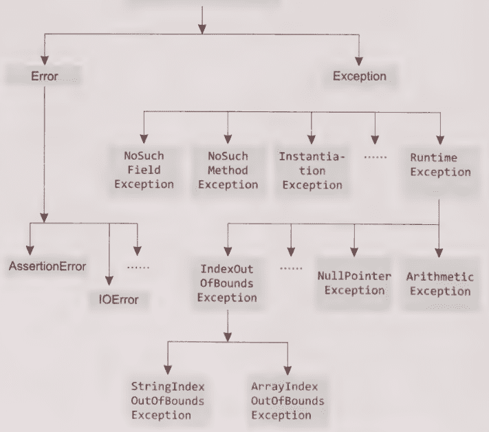

图 7.2 异常层次结构

## 7.2 异常处理技术

Java 提供了五个用于异常处理的关键字：`try`、`catch`、`throw`、`throws` 和 `finally`。让我们逐一查看这些关键字。

### 7.2.1 try...catch

`try/catch` 块可以放在任何你认为可能会抛出异常的方法中。所有需要尝试异常的语句都放在 `try` 块中，紧随 `try` 之后的是 `catch` 块。`catch` 用于捕获从 `try` 块抛出的任何异常。如果 `try` 块中的任何语句发生异常，随后的语句将不再执行，并立即传递到对应的 `catch` 块。

# 示例 7.2 try...catch

```java
class ExDemo1
{
    public static void main(String args[]) {
        method1();
        System.out.println("IN Method 1, Calling Method 2");
        method2();
        System.out.println("Returned from method 2");
    }
    static void method2() {
        System.out.println("IN Method 2, Calling Method 3");
        try{
            method3();
        } catch(Exception e) {
            System.out.println("Exception Handled");
        }
        System.out.println("Returned from method 3");
    }
    static void method3() {
        System.out.println("IN Method 3");
        int a = 20,b = 0;
        int c = a/b;
        System.out.println("Method 3 exits");
    }
}
```

输出:

```
\javabook\programs\chap7>ExDemo1
IN Method 1, Calling Method 2
IN Method 2, Calling Method 3
IN Method 3
Exception Handled
Returned from method 3
Returned from method 3
```

# 解释

| 行号 | 说明 |
|---|---|
| L28 | 发生了异常。`method3()` 中没有处理机制，因此控制权传递到 `method2()` 中的 `try...catch` 块。 |

在 `try` 块中遇到异常时，发生异常语句之后的语句将不会执行。运行时环境创建一个表示该异常的类对象并将其抛出。控制权传递到适当的 `catch` 块（如果存在多个 `catch` 子句，则通过第一个对应的），抛出的对象在该处被捕获并赋值给它，即 `Exception` 引用变量。

L29 它没有执行，因为异常发生后的语句不会被执行。

L16 声明了 `try` 块。要监控异常的语句应该放在方法内的 `try` 块中。

L17 对 `method3()` 的调用被放置在 `try` 块中。

L18 定义了带有 `Exception` 类型（父类）参数的 `catch` 子句，这样就可以在这里捕获来自 `try` 块的异常对象。父类引用变量可以引用子类对象。`try` 块之后是一个 `catch` 块。一旦发生异常

L20 打印 `ExceptionHandled`。

L22 打印 `Returned from method3()`。在异常被捕获后（实现了 `try...catch` 机制），执行将恢复正常。这在示例 7.1 中是不可能的。此后，控制权返回到调用 `method2()` 的 `method1()`，并执行 L11（见下文）。

单个 `try` 可以有多个 `catch` 子句，用于捕获特定的异常。一旦抛出异常，就会找到负责处理该异常的第一个 `catch` 子句并将异常传递给它。通过“第一个适当的 `catch` 子句”，意味着如果生成了 `ArrayIndexOutOfBoundsException`，则控制权将传递到第一个匹配 `ArrayIndexOutOfBoundsException` 或其父类 `IndexOutOfBoundsException` 的 `catch` 子句。所有异常都可以通过 `Exception` 子句捕获。示例 7.3 显示了如何在程序中结合多个 `catch` 子句。

# 示例 7.3 多个 catch 子句

```java
L1 class Multiple_Catch
L2 {
L3 public static void main(String[] args)
L4 {
L5 method1();
L6 }
L7 static void method1()
L8 {
L9 System.out.println("IN Method 1, Calling Method 2");
L10 method2();
L11 System.out.println("Returned from method 2");
L12 }
L13 static void method2()
L14 {
L15 System.out.println("IN Method 2, Calling Method 3");
L16 try {
L17 method3();
L18 } catch(ArithmeticException ae) {
L19     System.out.println("Arithmetic Exception Handled: " + ae);
L20 } catch(Exception e) {
L21     System.out.println("Exception Handled");
L22 }
L23     System.out.println("Returned from method3");
L24 }
L25 static void method3() {
L26     System.out.println("IN Method 3");
L27     int a = 20, b = 0;
L28     int c = a/b;
L29     System.out.println("Method 3 exits");
L30 }
}
```

输出:

```
\javabook\programs\chap7>java Multiple_Catch
IN Method 1, Calling Method 2
IN Method 2, Calling Method 3
IN Method 3
Exception Handled: java.lang.ArithmeticException: / zero
Returned from method 3
Returned from 2
```

L16 定义了 `try` 块。

L17 调用 `method3()`。

L18 定义带有 `ArithmeticException` 参数的 `catch` 子句。

L20 定义带有 `Exception` 类型的 `catch` 子句。在使用多个 `catch` 子句时，作为 `Exception` 类型的 `catch` 子句应该是最后一个。这是因为如果带有 `Exception` 引用变量的 `catch` 子句放在顶部，那么从 `try` 块抛出的所有异常将在该 `catch` 中被捕获，而不会进入后续 `catch` 块。Java 编译器可以轻松识别不可达代码并对其进行警告。例如，如果示例 7.3 中的 `catch` 子句反过来所示，程序将无法编译。

### 7.2.2 throw 关键字

`throw` 关键字用于显式地抛出异常。在之前的示例中，这项工作是隐式完成的。无论是隐式还是显式，在抛出之前都需要创建异常对象。程序的执行像之前的情况一样暂停，运行时环境寻找适当的 `catch` 来处理异常。当我们想要抛出自定义异常时，`throw` 非常有用。`throw` 的语法如下：

```java
throw new NullPointerException(); // throw Instance
```

让我们重构示例 7.3 以显式抛出异常。

# 示例 7.4 throw 关键字

```java
class ThrowDemo {
    public static void main(String args[]) {
        method1();
        System.out.println("IN Method 1, Calling Method 2");
        method2();
        System.out.println("Returned from method 2");
    }
    static void method2() {
        System.out.println("IN Method 2, Calling Method 3");
        try {
            method3();
        } catch(Exception e) {
            System.out.println("Exception Handled: " + e);
        }
        System.out.println("Returned from method 3");
    }
    static void method3() {
        System.out.println("IN Method 3");
        throw new ArithmeticException("Testing Throw");
        // 这一行被特意注释掉了。如果不注释，会导致
        // 编译错误，因为它导致了不可达代码。
        System.out.println("Method 3 exits");
    }
}
```

输出:

```
\javabook\programs\chap7>java ThrowDemo
IN Method 1, Calling Method 2
IN Method 2, Calling Method 3
IN Method 3
Exception Handled: java.lang.ArithmeticException: Testing Throw
Returned from method 3
```


# 解释

L28 我们没有使用导致运行时环境抛出异常的表达式，而是使用了 `throw` 关键字来手动抛出异常。就像运行时环境一样，我们也需要创建一个对象来抛出异常。因此，我们通过 `new` 关键字创建了一个 `ArithmeticException` 对象，并将一个参数传递给它的构造函数。当我们捕获此异常并打印异常对象（输出）时，该参数会通过 `ArithmeticException` 类的 `toString()` 方法打印到控制台上。

也可以使用 `ArithmeticException` 类的 `getMessage()` 方法单独打印该参数。

```java
// 它被注释掉了。如果没有注释，编译器将报错提示“不可触及的代码 (Unreachable Code)”。特别在这个程序中，控制将始终在 `throws` 子句之后移动以寻找处理程序，因此这一行永远不会被执行。Java 编译器足够智能可以理解这一点并引发错误。
```

L29 在 L18–21 中。其余逻辑与之前的示例相似。

> 此异常在类似于之前示例的 `catch` 块中被捕获并打印。

# 7.2.3 throws

`throws` 被添加到方法签名中，以让调用者知道被调用的方法可能会抛出哪些异常。调用者的责任是处理异常（使用 `try...catch` 机制），要么也传递异常（通过在其方法声明中指定 `throws` 子句）。如果程序中的所有方法都将异常传递给调用者，则该方法应该使用这两种技术之一——`try/catch` 或 `throws`。通常（特别是对于已捕获的异常），使用的是 `catch` 或指定机制。一个方法可以抛出多个异常；异常列表指定为用逗号分隔。`throws` 关键字的语法如下所示：

```java
public void divide(int a, int b) throws ArithmeticException, IllegalArgumentException
```

让我们来看下面的示例。

# 示例 7.5 throws 关键字

```java
L1 class ThrowsDemo
L2 {
L3 public static void main(String args[])
L4 {
L5 method1();
L6 }
L7 static void method1()
L8 {
L9 System.out.println("IN Method 1, Calling Method 2");
L10 method2();
L11 System.out.println("Returned from method 2");
L12 }
L13 static void method2()
L14 {
L15 System.out.println("IN Method 2, Calling Method 3");
L16 try{
L17 method3(4,0);
L18 catch(Exception e)
L19 {
L20 System.out.println("Exception Handled: " + e);
L21 }
L22 System.out.println("Returned from method 3");
L23 }
L24 static void method3(int a, int b) throws Exception
L25 {
L26 System.out.println("IN Method 3");
L27 if(b == 0)
L28 throw new ArithmeticException("Testing throw");
L29 else
L30 System.out.println("Result: "+a/b);
L31 }
```

# 输出

当 a = 4且 b = 2 时

```text
C:\javabook\programs\chap 7>java ThrowsDemo
IN Method 1, Calling Method 2
IN Method 2, Calling Method 3
IN Method 3
Result: 2
Returned from method 3
Returned from method 2
```

当 a = 4  b = 0 时

```text
C:\javabook\programs\chap 7>java ThrowsDemo
IN Method 1, Calling Method 2
IN Method 2, Calling Method 3
IN Method 3
Exception Handled: java.lang.ArithmeticException: Testing throw
Returned from method 3
Returned from method 2
```

# 解释

L24 `method3()` 声明指定了可能会抛出异常。子句中指定了父类 `Exception`，不需要显式提到子类名 `ArithmeticException`。如果在此行省略了 `throws`，程序将正常工作。`method2()` 中的 `try/catch` (L16, L18-21 和 L23) 被省略而 `method3()` 声明中的 `throws` 被保留，编译器将无法编译程序，因为现在调用方法必须传递或捕获异常。

L26 打印语句。

L27 `if` 语句检查 b 的值。如果是零，则执行 L28，否则执行 L29。

L28 创建并抛出一个 `ArithmeticException` 对象。

L29 `else` 打印 a 除以 b 的结果。

# 7.2.4 finally 块

在 `try-catch-finally` 语句中，`finally` 块始终执行，无论 `try/catch` 块内部是否抛出了异常。`try` 块之后的语句不会执行。某些语句是必须执行的，例如释放资源的语句。这些语句都可以放在 `finally` 块中。`finally` 关键字的语法如下：

```java
try {...} catch(Throwable e){} finally {...}
```

让我们通过一个示例来更好地理解。

# 示例 7.6 finally 关键字

```java
L1 class FinallyDemo
L2 {
L3 public static void main(String args[])
L4 {
L5 method1();
L6 System.out.println("Result : "+method2(24,0));
L7 }
L8 static void method1()
L9 {
L10 try {
L11 System.out.println("IN method 1"); }
L12 throw new NullPointerException();
L13 catch(Exception e)
L14 {
L15 System.out.println("Exception Handled: " + e);
L16 }
L17 finally {
L18 System.out.println("method finally"); }
L19 }
L20 static int method2(int a, int b)
L21 {
L22 try{
L23 System.out.println("method 2");
L24 return a/b;
L25 }
L26 finally {
L27 System.out.println("method finally");
L28 }
L29 }
```

# 输出

当 a = 24且 b = 0 时

```text
C:\javabook\programs\chap 7>java FinallyDemo
IN method 1
Exception Handled: java.lang.NullPointerException
method finally
IN method 2
method finally
Exception in thread "main" java.lang.ArithmeticException: / by zero
at FinallyDemo.method2(FinallyDemo:22)
at FinallyDemo.main(FinallyDemo:4)
```

当 a = 24且b = 4 时

```text
C:\javabook\programs\chap 7>java FinallyDemo
IN method 1
Exception Handled: java.lang.NullPointerException
method finally
IN method 2
method finally
Result : 6
```

# 解释

L5 调用 `method1()`。控制传递到 L7。

L6 调用 `method2(24,0)`，如果有返回值，则将其打印在屏幕上。

L7 `method(1)` 声明。

L9 `try` 块。

L11 抛出 `NullPointerException`。控制传递到 L12。

L12 `catch` 块对应于 L9。

L14 打印异常对象。

L16 `finally` 块。L1 抛出的异常在 L12 处捕获，`finally` 块执行（见输出）。

L17 `finally` 语句执行。

L18 `method(2)` 声明了两个整数参数。参数为 24 和 0。

L20 `try` 块位于 `method(2)` 内部。

L22 `return a/b;`。

L23 如所述，b 的值。

# 7.2.5 try-with-resources 语句

Java 7 为异常处理机制增加了一项增强，即通过 `try-with-resources` 语句进行自动资源管理。应用程序在其生命周期内通过创建对象使用许多资源，例如用于访问/更新数据库的数据库连接、用于处理的文件或用于传输/接收数据的套接字。程序员犯的一个常见错误是，在任务完成后经常没有关闭/释放程序使用的资源。这导致了孤立实例、内存分配低下以及垃圾回收问题。因此产生了自动资源管理的需求。

为了解决这个问题，在 `java.lang` 包中引入了一个新接口。需要关闭的资源必须实现该接口。该接口有一个方法：

```java
public void close() throws Exception
```

此 `close` 方法将由实现接口的类重写，所有的资源释放代码都可以放在此方法中。当 `AutoCloseable` 对象与 try-with-resources 语句一起使用使用时，一旦 try-resources 块执行完毕，无论是否抛出异常，都会自动调用其 close 方法。try-with-resources 语句的语法如下：

```java
try (要使用并自动释放的资源)
{
    // 块内的语句
}
```

例如：

```java
try (abc a=new abc(); pqr p=new pqr())
{
    // 块内的语句
}
```

`try-with-resources` 语句可以使用分号分隔使用多个 `AutoCloseable` 资源。因此，`abc` 和 `pqr` 对象必须像下面示例所示实现 `AutoCloseable` 接口。`try-with-resources` 语句中创建的资源将按照创建的反顺序关闭。我们将在示例 7.7 中详细说明这些概念。

# 示例 7.7 AutoCloseable 资源与 try-with-resource 语句

```java
L1 class abc implements AutoCloseable
L2 {
L3 public void close() { System.out.println("Within close method of abc"); }
L4 }
L5 class pqr implements AutoCloseable
L6 {
L7 public void close() { System.out.println("Within close method of pqr"); }
L8 }
L9 class TestTryWithResources
L10 {
L11 public static void main(String[] args)
L12 {
L13 try (abc a=new abc(); pqr p=new pqr()) { System.out.println("Within try with resources block"); throw new Exception(); }
L14 }
L15 catch(Exception e)
L16 {
L17 System.out.println("Within catch block");
L18 }
```

# 输出

```text
D:\javabook\programs\chap 7\java TryWithResources
Within try with resources block
Within close method of pqr
Within close method of abc
Within catch block
```

# 解释

- L1-4 所有在使用后需要自动关闭的资源都实现了 `AutoCloseable` 接口并重写了 `close` 方法。
- L5 创建了另一个类来测试上面创建的 `AutoCloseable` 资源。
- L6 创建 `main` 方法。
- L7 使用 `try-with-resources` 语句创建了两个资源，这两个资源会在块退出时通过按创建的反顺序调用各自的 `close` 方法自动关闭。首先调用 `pqr` 的 `close` 方法，然后调用 `abc` 的 `close` 方法（见输出）。注意这两个对象已经继承了 `AutoCloseable` 接口，否则将引发编译错误。
- L8 抛出一个式的 `Exception` 以显示无论是否发生异常都会调用 `close` 方法。如果抛出异常，会在处理异常之前调用 `close` 方法（见输出）。
- L9 声明 `catch` 块以处理从 `try-with-resource` 块抛出的异常。

`try-with-resource` 块并不强制像之前的 JDK 版本那样必须有 `catch` 或 `finally` 块。在 Java 7 中，这些块对于 `try-with-resource` 块是可选的。

# 7.2.6 多异常捕获 (Multi catch)

Java 7 引入了多异常语句，以便用单个 `catch` 块捕获多种异常类型。示例 7.3 显示了使用独立 `catch` 块捕获多个异常的老方法。假设 `Exception1`、`Exception2` 和 `Exception3` 属于不同的层次结构并可能从 `try` 块抛出，可以使用较新的捕获异常语法在单个 `catch` 块中处理它们：

```java
try
{
    // 语句
}
catch (Exception1 | Exception2 | Exception3 e)
{
    // 语句
}
```

因此你可能会觉得示例 7.3 中的 `catch` 块可以重写为：

```java
catch (ArithmeticException | Exception e)
{
    // 语句
}
```

但上述 `catch` 块的问题是，`ArithmeticException` 和 `Exception` 属于同一个层次（实际上每个异常都是如此）。如果 `catch` 块如下所示重写，它将可以通过编译，因为异常属于不同的层次结构：

```java
catch (ArithmeticException | NullPointerException)
{
    // 语句
}
```

使用多异常捕获的用处是它产生了更高效的代码，因为你只有一个 `catch` 块（在上面的情况下则有多个）。此外，相同的处理方法可以应用于不同层次的异常。使用多异常捕获应用不同处理方法的方法是如下面所示使用 `instanceof` 运算符。`instanceof` 运算符检查一个实例是否属于特定类，并返回 true 或 false：

```java
catch (ArithmeticException | NumberFormatException e) {
    if(e instanceof ArithmeticException)
        System.out.println("ArithmeticException Handled: " + e);
    else if(e instanceof NumberFormatException)
        System.out.println("NumberFormatException Handled: " + e);
    else
        System.out.println("Exception Handled:");
}
```

在多异常捕获语法中，参数 `e` 是隐式的 `final`。

# 7.2.7 Java 中改进的异常处理

在 Java 7 之前，一个方法在 `throws` 子句中只能指定那些在从 `catch` 块中重新抛出时已经指定的异常。但从 Java 7 开始，`throws` 可以指定更精细的异常进行重新抛出。假设有两个用户定义的异常 `Exception1` 和 `Exception2`，可以从方法的 `catch` 块中重新抛出。在 Java 7 之前，只有 `catch` 块中指定的异常才能作为 `throws` 关键字的参数。让我们通过示例来展示这一点。

# 示例 7.8(a) 重新抛出异常


```java
class Exception1 extends Exception { }
class Exception2 extends Exception { }
class DemoException{
    void throwException(int a, int b) throws Exception {
        try {
            if (a<b)
                throw new Exception1();
            else
                throw new Exception2();
        } catch (Exception e) {
            throw e;
        }
    }
    public static void main(String[] args) throws Exception {
        new DemoException().throwException(4,0);
    }
}
```

# 214 Java 编程

上面的 `throwException` 方法可以根据 `a` 或 `b` 的值抛出 `Exception1` (L2) 或 `Exception2` (L3)。在 Java 7 之前，无法在 `throwException` 方法声明的 `throws` 子句 (L1) 中指定这些异常类型。异常 `e` 从 `catch` 块重新抛出 (L5)，由于 `e` 是 `Exception` 类型，因此在 L1 方法声明的 `throws` 子句中仅指定了 `Exception`。

从 Java 7 开始，你可以在 `throws` 子句中指定 `Exception1` 和 `Exception2`。`e` 从 `catch` 块重新抛出 (L5)，由于 `e` 是 `Exception` 类型，因此 L1 方法声明中仅指定了 `Exception`。编译器推断出抛出的异常可能是 `Exception1` 或 `Exception2`。让我们重新表述方法。

# 示例 7.8(b) 重新抛出异常

```java
class DemoException{
    void throwException(int a, int b) throws Exception1, Exception2 {
        try {
            if (a<b)
                throw new Exception1();
            else
                throw new Exception2();
        } catch (Exception e) {
            throw e;
        }
    }
    public static void main(String[] args) throws Exception {
        new DemoException().throwException(4,0);
    }
}
```

换句话说，Java 7 开始你可以在 `throws` 子句中指定 `Exception` 的任何（在本例中）子类型（即 `Exception1` 和 `Exception2`）。

## 7.3 自定义异常

Java 提供了让你创建自己的异常的机会，即自定义异常。强制性要求该类必须是 `Exception` 类的子类。我们将创建一个示例异常，并在另一个类中使用，在特定条件下抛出该异常。

# 示例 7.9 自定义异常

```java
class ExcDemo extends Exception {
    ExcDemo(String msg) {
        super(msg);
    }
    public String toString() {
        return "Exception in thread \"main\" " + ExcDemo Exception ":" +getMessage();
    }
}
class TestException {
    static void testException() throws ExcDemo {
        throw new ExcDemo("Testing User Defined Exception");
    }
    public static void main(String[] args) {
        try {
            testException();
        } catch(ExcDemo e) {
            System.out.println(e);
        }
    }
}
```

# 输出

```text
c:\javook\chap7>java TestException
Exception in thread "main" ExcDemo: Testing User Defined Exception
```

# 解释

- L1 要创建自己的异常，你的类必须如所示扩展 `Exception` 类。
- L2 定义了异常子类的构造函数，接收 `String` 参数。
- L3 使用 `super` 将 `String` 参数传递给父类构造函数。该参数可以通过父类的方法（即 `getMessage()`）获取。
- L4 重写了 `toString` 方法。打印异常子类对象时，它会被自动调用。
- L5 返回与 `getMessage()` 函数输出拼接的字符串。它返回传递给父类构造函数的字符串。

# 216 Java 编程

用户定义的类已经就绪，现在我们需要一个示例类来测试它，因此我们创建了 TestException 类。

L11 调用了 `testException()` 方法。
L12 捕获异常 (L10)。
L13 打印异常。`toString()` 被自动调用，它返回字符串 String-Exception- "main" ExceptionDemo: 并与 L8 中 ExceptionDemo 类构造函数中的参数连接在一起（参见输出）。此字符串通过 `Throwable` 类中定义的 `getMessage()` 方法返回。
L6 定义了 `TestException` 类。
L7 静态方法，声明它可以抛出 ExceptionDemo。
L8 使用关键字 `throw` 抛出异常。
L9 主方法（main）声明。
L10 定义了 `try` 块。

## 7.4 异常封装与增强

Java 1.4 引入了异常封装（链式），这是将捕获到的异常包装在不同的异常中，并包含该被包装的异常的过程。`Throwable` 类（父类）在其构造函数中添加了 `cause` 参数，用于被包装的异常；如果你传递了所有异常，你的顶层方法可能需要处理大量的异常；在所有之前的方法中声明或处理处理器是一项繁琐的任务。解决方案是封装异常并抛出。封装也用于抽象实现细节。你可能不希望你的工作细节（包括抛出的异常）被他人知晓。让我们看看如何进行封装。

```java
try{
    throw new InstantiationException();
} catch(Instantiation t) {
    // 将 Instantiation 封装在 ExceptDemo 中
    throw new ExceptDemo("Wrapped Instantiation Exception",t);
}
```

封装也有一些缺点。它会导致长长的堆栈跟踪；封装层次中的每个异常都会产生一个堆栈跟踪。其次，通过封装，很难找出导致异常产生的问题。

可能的解决方案是异常增强。在异常增强中，你并不封装异常，而是向已经抛出的异常添加信息并对其进行重新思考，这会导致单一的堆栈跟踪。让我们通过一个例子来看异常增强。

# 示例 7.10 异常增强

```java
L1 class ExceptDemo extends Exception{
L2 String message;
L3 ExceptDemo(String msg){
L4 message = msg;
L5 public String toString(){
L6 return "In thread \main\ ExceptDemo Exception:"+message;
L7 }
L8 public void addInformation(String msg) {
L9 message += msg;
}
```


```java
class ExceptionEnrichmentDemo{
L9   static void testException() throws ExcepDemo
L10  try {
L11    throw new ExcepDemo("Testing User Defined Exception");
L12  } catch(ExceptionDemo e) 
L13 {
L13    e.addInformation("\nexception was successfully enriched\nre-thrown from catch");
L14  }
  }
L15  public static void main(String[] args) {
L16  try {
L17    testException();
L18  } catch(ExceptionDemo e) {
L19    System.out.println(e);
  }}
}
```

输出：

```text
:\javabook\programs\chap 7>"main" ExceptionEnrichmentDemo
Exception thread: Testing User Defined
Exception was successfully enriched and re-thrown from catch
```

# 解释

L6 添加了 `addInformation` 方法，并且正在调用用户定义异常类 `ExceptionDemo` 的 `addInformation()` 方法。这是 `Exception` 对象的一个方法。它接受一个 `String` 类型的参数，以便向异常对象添加有关异常的额外信息。

L14 重新抛出异常。当异常从 `catch` 块中重新抛出时，控制将直接传递给调用者的 `catch` 块（如果有的话）。在我们的情况下，它存在于 L18。

L7 字符串被连接到实例变量 `message` 上。

L8 为了测试这一点，创建了一个新类：`ExceptionEnrichmentDemo`。

L18 它显示了 main 方法中的 catch。此 catch 负责处理。

L9 命名为 `testException` 的方法定义了它可以抛出 `ExceptionDemo`。

L11 抛出了 `ExceptionDemo`。

L12 L11 中抛出的异常在这一行定义的 catch 中被捕获。

L13 关于异常的附加信息是：

- (a) 在其自身的 try (L16) 中发生的异常。
- (b) 发生于此 catch 对应的从 try 块 (L16) 用的方法中的异常。
- (c) 从你的 try (L14) 调用的其他方法的 catch 重新抛出的异常。

L19 打印异常对象。

## 7.5 断言 (ASSERTIONS)

断言在 Java 1.4 中引入，用于创建正确且健壮的可靠程序。断言是用于测试/验证代码的布尔表达式。它们主要用于测试和开发阶段。程序员使用断言来双重确认他们认为是真实的特定条件。诸如数字是正是负、数组/引用是否为空等条件，可以通过断言它们来检查。Java 中的断言是通过 `assert` 关键字声明的，如下所示：

```java
assert expression1;
```

其中 `expression1` 是条件。在任何情况下，如果值为 false，则会抛出一个 `AssertionError`。字符串被传递给 `AssertionError` 对象的构造函数。断言必须显式启用；默认是禁用的。

```java
assert expression1;
```

# 示例 7.11 断言

| L1 | class AssertDemo { |
| L2 | static void check(int i) { |
| L3 |   assert i > 0; |
| L4 |   System.out.println("Value: "+i); |
| L5 | } |
| L6 | public static void main(String[] args) { |
| L7 |   check(10); |
| L8 |   check(-5); |
| L9 | } |
| L10| } |

输出：

```text
:\javabook\programs\chap 7>java AssertDemo
Value: 10
Exception in thread "main" java.lang.AssertionError: assertion failed
    at AssertDemo.check(AssertDemo.java:3)
    at AssertDemo.main(AssertDemo.java:7)
```

# 解释

L3 `assert` 关键字用于检查条件。如果条件为 false，则抛出 `AssertionError`。字符串被传递给 `AssertionError` 对象的构造函数。L4 `System.out.println` 打印值。

L7 它显示了 main 方法中的 catch。
L8 它显示了负值的 catch。

## 7.12 日志 (Logging)

```java
import java.util.logging.*;
class LoggingDemo {
    static Logger l1 = Logger.getLogger("LoggingDemo");
    void demo() {
        l1.log(Level.SEVERE,"Shows Severe level of the Logger");
    }

    public static void main(String[] args) {
        LoggingDemo d = new LoggingDemo();
        d.demo();
    }
}
```

输出：

```text
:\javabook\programs\chap 7>java LoggingDemo
[Date] [Time] LoggingDemo
[Date] [Time] LoggingDemo
SEVERE: Shows Severe level of the Logger
```

# 解释

L1 导入了 `java.util.logging`，因为日志器是该包的一部分。
L3 通常，每个类使用一个日志器。我们将 Logger 对象创建为静态的原因是。L4 定义了 `demo()` 方法。
L5 调用 Logger 对象的 `log` 方法将消息记录到控制台。第一个参数设置日志级别，第二个参数是输出在控制台上的 String 消息。

## 异常、断言与日志 221

Java 程序的可靠性。日志功能（JDK 1.4 引入的 `java.util.logging` 包的一部分）帮助用户调试程序。Java 7 通过一个新的 try 块（即 `try-with-resource` 块）引入了自动资源管理。本章还强调了 Java 7 中用于压缩多个 catch 块的新语法。

# 练习题

# 选择题

- 1. Java 中共有哪两种类型的异常？
  - (a) 检查异常 (Checked) 和 编译异常 (Compiled)
  - (b) 未检查异常 (Unchecked) 和 编译异常 (Compiled)
  - (c) 检查异常和未检查异常
  - (d) 编译异常和非编译异常

- 2. Java 中所有异常的父类是
  - (a) Throwable
  - (b) Throw
  - (c) Exception
  - (d) Throws

- 3. 尝试编译并执行该程序的结果是什么？

```java
class Demo {
  void show() throws ArithmeticException {
}
class Demo1 extends Demo {
  void show() {
    System.out.println("In Demo Show");
  }
}
public static void main(String args[]) {
  Demo1 d = new Demo1();
  d.show();
}
```

  - (a) 无法编译
  - (b) 编译成功
  - (c) 编译成功并打印 "In Demo1 Show"
  - (d) 编译通过但不执行

- 4. 尝试编译并执行该程序的结果是什么？

```java
class Demo {
  void show() throws ClassNotFoundException {
}
class Demo2 extends Demo {
  void show() throws IllegalAccessException, ClassNotFoundException, ArithmeticException {
    System.out.println("In Demo Show");
  }
}
public static void main(String args[]) {
try {
  Demo2 d = new Demo2();
  d.show();
} catch (Exception e) {
}
}
```

  - (a) 无法编译
  - (b) 编译成功
  - (c) 编译成功并打印 "In Demo1 Show"
  - (d) 编译通过但不执行

- 5. 断言错误的类是什么？
  - (a) Exception (异常)
  - (b) Assert (断言关键字)
  - (c) Assertion (断言)
  - (d) AssertionError (断言错误)

- 6. 尝试编译并执行该程序的结果是什么？


```java
class Test {
  static void test() throws RuntimeException {
    throw new ArithmeticException();
  }
  public static void main(String args[]) {
    try {
      test();
    }
    catch(RuntimeException re) {
      System.out.println("Exception Handled");
    }
  }
}
```

- 4. 如果 `assert` 语句返回 `false`，会抛出什么异常？

```java
class Demo {
  void show() {}
}
class Demo2 extends Demo {
  void show() throws IllegalAccessException, ArithmeticException {
    System.out.println("In Demo1 Show");
  }
  public static void main(String[] args) {
    Demo2 d = new Demo2();
    d.show();
  }
}
```

- 7. `Throwable` 的两个子类

  (a) `Error` 和 `AssertionError`
  (b) `Error` 和 `Exception`
  (c) 检查异常和未检查异常
  (d) `Error` 和 `RuntimeException`

- 8. 默认情况下，什么级别以上的日志会打印到控制台？

  (a) `INFO`
  (b) `SEVERE`
  (c) `WARNING`
  (d) `FINE`

- 9. 将 `Logger` 对象创建为静态目的是什么？

  (a) 适用于类的所有对象
  (b) 适用于该类的每个单独对象
  (c) 仅适用于静态对象
  (d) 仅适用于非静态对象

- 10. 尝试编译并执行该程序的结果是什么？

  (a) 生成了检查异常
  (b) 无法编译
  (c) 打印 "Exception Handled"，因为 `RuntimeException` 是 `ArithmeticException` 的父类
  (d) 类编译通过但控制台没有打印任何内容

- (a) 编译成功但抛出 `RuntimeException`
  (b) 编译通过但不打印内容
  (c) 编译通过并打印 "Demo1 Show"
  (d) 无法编译

# 复习题

- 1. 什么是异常？Java 是如何处理异常的？
- 2. 解释 Java 日志及其所有的级别。
- 3. 解释异常转换和环境。编写程序支持你的答案。
- 4. 检查异常和未检查异常有什么区别？
- 5. 解释自动资源管理的性质。
- 6. 什么是 `try-with-resources` 块？它是如何使用的？
- 7. 解释 Java 7 关于多个 `catch` 语句的增强。
- 8. 详细解释 Java 7 关于重新抛异常的增强。

## 编程练习

- 1. 创建一个自定义异常 `CheckArgument`，用于检查通过命令行传递的数量。如果参数少于五个，则抛出 `CheckArgument` 异常，打印五个数字之和。
- 2. 考虑一个打印学生成绩单的学生数据库系统。从命令行输入以下内容：
  (a) 学生姓名
  (b) 六门科目的成绩
  这些分数应该在 0 到 50 之间。如果分数不在指定范围内，抛出 `RangeException`，否则计算总分并打印学生的百分比。
- 3. 在上述程序中使用断言（`Assertions`）来确保...

# 226 Java 编程

```java
public void run() {
    ....
    // 实现线程的语句
    ....
}
```

## 表 8.1 Thread 类方法描述

| 方法 | 描述 |
| --- | --- |
| `static Thread currentThread()` | 返回当前执行线程的引用。 |
| `static int activeCount()` | 返回当前活动线程的数量。 |
| `long getId()` | 返回线程的标识。 |
| `final String getName()` | 返回线程的名字。 |
| `final void join()` | 等待线程终止。 |
| `void join(long m)` | 等待线程死亡最多 'm' 毫秒。 |
| `void join(long m, int n)` | 等待线程死亡最多 'm' 毫秒和 'n' 纳秒。 |
| `void run()` | 线程的入口点。 |
| `final void setDaemon(boolean how)` | 如果 `how` 为真，则将调用线程设置为守护线程状态。 |
| `boolean isInterrupted()` | 如果该线程被中断，则返回 `true`。 |
| `final boolean isDaemon()` | 如果调用线程是守护线程，则返回 `true`。 |
| `final boolean isAlive()` | 返回线程是否仍在运行的布尔值。 |
| `void interrupt()` | 中断一个线程。 |
| `static boolean holdsLock(Object anyObj)` | 如果调用线程持有 `anyObj` 的锁，则返回 `true`。 |
| `Thread.State getState()` | 返回线程当前的状态。 |
| `final int getPriority()` | 返回线程的优先级。 |
| `static boolean interrupted()` | 如果调用线程被中断，则返回 `true`。 |
| `final void setName(String thrdName)` | 将线程的名字设置为 `thrdName`。 |
| `final void setPriority(int newPriority)` | 将线程的优先级设置为 `newPriority`。 |
| `static void sleep(long milliseconds)` | 挂起线程指定的毫秒数。 |
| `void start()` | 通过调用其 `run()` 方法启动线程。 |
| `void destroy()` | 销毁线程，不进行任何清理。 |
| `static int enumerate(Thread[] thrdArray)` | 将线程组及其子组中的每个线程复制到指定的数组中。 |
| `static void yield()` | 导致当前执行暂停并允许其他线程执行。 |

当线程对象创建并使用 `start()` 方法启动时，会自动调用此方法。`Thread` 类中属于某些有助于操作线程实例的方法已在表 8.1 中所示。

除了这些，`Thread` 类中还定义了一些构造函数。这些构造函数可以分为两个不同的类别。我们在这里讨论一类，另一类将在下一节讨论 `Runnable` 接口时进行。负责创建线程的构造函数是：

1. `Thread()`
2. `Thread(String threadName)`
3. `Thread(ThreadGroup threadGroup, String threadName)`

在第一个构造函数中，你可以看到没有参数，这简单意味着它使用默认的名字和线程组。在第二个构造函数中，可以指定 `String` 类型的构造函数名字。而在第三个中，你可以指定线程组和线程名。

## 8.4 主线程

即使线程不是由程序员创建的，每个 Java 程序都有主线程。当普通的 Java 程序开始执行时，JVM 会创建主线程并从该线程调用程序的 `main()` 方法。除了这些，JVM 还会创建不可见的线程，这些线程对于内部管理任务至关重要，例如负责垃圾回收的线程和负责对象最终化的线程。主线程产生其他线程。这些产生的线程被称为子线程。主线程始终是最后一个完成执行的，因为它负责释放程序执行期间使用的资源，例如网络连接。

作为程序员，你可以始终控制主线程（或任何其他线程）。为了这一点，使用静态方法 `currentThread()` 来返回当前线程的引用。主线程只能通过此引用进行控制。

现在让我们通过创建主线程的引用来付诸实践。我们还可以将主线程的名字从 `main` 改为任何新名字。下面的代码可以为此目的。

## 8.1 重命名线程

| 行号 | 代码 |
| --- | --- |
| L1 | `class MainThread {` |
| L2 | `public static void main(String args[]) {` |
| L3 | `Thread threadObj = Thread.currentThread();` |
| L4 | `System.out.println("Current thread: " + threadObj);` |
| L5 | `threadObj.setName("New Thread");` |
| L6 | `System.out.println("Renamed Thread: " + threadObj);` |
| L7 | `}` |
| L8 | `}` |

## 输出

```text
Current thread: thread[main, 5]
Renamed Thread: thread[New Thread, 5, main]
```

## 解释

**L1** 声明了 `MainThread` 类。

**L2** 声明了 `main` 方法。

**L3** 返回当前 `Thread` 的引用并存储在 `threadObj` 中。这里当前线程是主线程。引用是通过指定类的类名（在本例中为 `Thread` 类）后跟引用的名字来声明的，如代码行所示：

```java
Thread.currentThread()
```

当前线程对象（即 `main`）的引用由 `currentThread()` 方法返回并存储在之前声明的引用中。

**L4** `System.out.println("Current thread: " + threadObj);`

**L5** `threadObj.setName("New Thread");`

**L6** `System.out.println("Renamed Thread: " + threadObj);`


# 8.4 主线程

即使线程不是程序员创建的，每个 Java 程序都有主线程。当普通的 Java 程序开始执行时，JVM 会创建主线程并从该线程调用程序的 `main()` 方法。除了这些，JVM 还会创建不可见的线程，这些线程对于内部管理任务至关重要，例如负责垃圾回收的线程和负责对象最终化的线程。主线程产生其他线程。这些产生的线程被称为子线程。主线程始终是最后一个完成执行的，因为它负责释放程序执行期间使用的资源，例如网络连接。

作为程序员，你可以始终控制主线程（或任何其他线程）。为了这一点，使用静态方法 `currentThread()` 来返回当前线程的引用。主线程只能通过此引用进行控制。

现在让我们通过创建主线程的引用来付诸实践。我们还可以将主线程的名字从 `main` 改为任何新名字。下面的代码可以为此目的。

## 8.1 重命名线程

| 行号 | 代码 |
| --- | --- |
| L1 | `class MainThread {` |
| L2 | `public static void main(String args[]) {` |
| L3 | `Thread threadObj = Thread.currentThread();` |
| L4 | `System.out.println("Current thread: " + threadObj);` |
| L5 | `threadObj.setName("New Thread");` |
| L6 | `System.out.println("Renamed Thread: " + threadObj);` |
| L7 | `}` |
| L8 | `}` |

## 输出

```
Current thread: thread[main, 5]
Renamed Thread: thread[New Thread, 5, main]
```

## 解释

L1 声明了 `MainThread` 类。

L2 声明了 `main` 方法。

L3 返回当前 `Thread` 的引用并存储在 `threadObj` 中。这里当前线程是主线程。引用是通过指定类的类名（在本例中为 `Thread` 类）后跟引用的名字来声明的，如代码行所示：

```java
Thread.currentThread()
```

当前线程对象（即 `main`）的引用由 `currentThread()` 方法返回并存储在之前声明的引用中。

L4 `System.out.println("Current thread: " + threadObj);`

L5 `threadObj.setName("New Thread");`

L6 `System.out.println("Renamed Thread: " + threadObj);`

此方法在线程对象创建并使用 `start()` 方法启动时会自动调用。`Thread` 类中某些有助于操作线程实例的方法已在 8.1 节中所示。

除了这些，`Thread` 类中还定义了一些构造函数。这些构造函数可以分为两个不同的类别。我们在这里讨论一类，另一类将在下一节讨论 `Runnable` 接口时进行。负责创建线程的构造函数是：

1. `Thread()`
2. `Thread(String threadName)`
3. `Thread(ThreadGroup threadGroup, String threadName)`

在第一个构造函数中，你可以看到没有参数，这简单意味着它使用默认的名字和线程组。在第二个构造函数中，可以指定 `String` 类型的构造函数名字。而在第三个中，你可以指定线程组和线程名。

# 8.5 创建新线程

一旦我们提到了一些方法和构造函数，就可以关注创建线程的不同方式：

- 通过继承 `Thread` 类
- 通过实现 `Runnable` 接口

## 8.5.1 通过继承 Thread 类

线程可以通过继承 `java.lang.Thread` 类来创建。由于继承，类中所有的线程方法都可以在程序中使用。

创建线程需要遵循的步骤：

- 将你的类声明为扩展 `Thread`。
- 重写 `run()` 方法。
- 创建线程对象并使用 `start()` 方法启动线程。

### 示例 8.2 通过继承创建线程

```java
class ThreadOne extends Thread {
    public void run() {
        try {
            for (int i = 1; i <= 5; i++) {
                System.out.println("From child thread 1 i = " + i);
                Thread.sleep(600);
            }
        } catch (InterruptedException e) {
            System.out.println("child thread 1 interrupted");
        }
        System.out.println("Exit from child thread 1");
    }
}

class ThreadTwo extends Thread {
    public void run() {
        try {
            for (int j = 1; j <= 5; j++) {
                System.out.println("From child thread 2 j = " + j);
                Thread.sleep(400);
            }
        } catch (InterruptedException e) {
            System.out.println("child thread 2 interrupted");
        }
        System.out.println("Exit from child thread 2");
    }
}

class ThreadThree extends Thread {
    public void run() {
        try {
            for (int k = 1; k <= 5; k++) {
                System.out.println("From child thread 3 k = " + k);
                Thread.sleep(800);
            }
        } catch (InterruptedException e) {
            System.out.println("child thread 3 interrupted");
        }
        System.out.println("Exit from child thread 3");
    }
}

class ThreadDemo {
    public static void main(String[] args) {
        ThreadOne a = new ThreadOne();
        a.start();
        ThreadTwo b = new ThreadTwo();
        b.start();
        ThreadThree c = new ThreadThree();
        c.start();
        try {
            for (int m = 1; m <= 5; m++) {
                System.out.println("From Main Thread : m = " + m);
                Thread.sleep(1200);
            }
        } catch (InterruptedException e) {
            System.out.println("Main thread interrupted");
        }
        System.out.println("Exit from main thread");
    }
}
```

## 输出

```
子线程 1 : i = 1
主线程 : m = 1
子线程 2 : j = 1
子线程 3 : k = 1
子线程 2 : j = 2
子线程 1 : i = 2
子线程 3 : k = 2
子线程 2 : j = 3
主线程 : m = 2
子线程 1 : i = 3
子线程 2 : j = 4
子线程 3 : k = 3
子线程 2 : j = 5
子线程 1 : i = 4
退出子线程 2
主线程 : m = 3
子线程 1 : i = 5
子线程 3 : k = 4
退出子线程 1
子线程 3 : k = 5
主线程 : m = 4
退出子线程 3
主线程 : m = 5
退出主线程
```

## 解析

- L1 类 `ThreadOne` 继承了 `Thread` 类，因此继承了 `Thread` 类的所有函数和成员。
- L40 声明了 `main()` 方法。
- L2–7 重写了返回 `void` 的 `run()` 方法。计数器变量 `i` 的循环执行了5次 (L3)。`i` 的每个值都会显示在屏幕上 (L4)，并在移动到 `i` 的下一个值之前，线程睡眠 0.6 秒 (L6)。`Thread.sleep()` 方法会抛出异常 `InterruptedException`，因此它应该位于 `try...catch` 块中。
- L41 创建并存储了 `ThreadOne` 类的引用 `a`。
- L42 在线程对象上调用了 `start()` 方法。该方法将线程放入就绪执行状态。一旦线程调度器为线程分配了 CPU，该线程的 `run()` 方法就会被自动调用。正如示例所示，`run()` 方法并没有被显式调用。
- L14 就像 `ThreadOne` 类一样，声明了一个继承 `Thread` 类的新类 `ThreadTwo`。L15–20 重写了负责该类线程功能的 `run()` 方法。该方法的代码与上一段中解释的 `run()` 方法相似。
- L43–46 就像为 `ThreadOne` 创建对象一样，我们创建了 `ThreadTwo` 和 `ThreadThree` 的对象，并分别存储在 `b` 和 `c` 中。L44 负责启动第二个线程 `ThreadTwo`，L46 负责启动第三个线程 `ThreadThree`，从而调用了相应的 `run()` 方法。
- L27 声明了继承 `Thread` 类的 `ThreadThree` 类。
- L47–55 主线程内部也提供了与上述子线程类似的功能。主线程被设置为睡眠 1.2 秒 (L50)，这个时间比三个子线程都长，以确保主线程最后完成执行，否则系统可能会挂起。
- L28–36 实现了第三个类的 `run()` 方法，这与之前解释的 `run()` 方法类似。
- L39 声明了封装 `main()` 方法的类声明。该类作为主线程，负责派生其他子线程。

## 8.5.2 实现 Runnable 接口

我们已经提到实现线程有两种方法。第一种方法在上一节中已经讨论。现在我们将讨论第二种方法，即通过实现 `Runnable` 接口。在采用实现 `Runnable` 接口的第二种方法之前，我们必须了解该接口的细节。它实际上是由 `java.lang` 包中的 `Thread` 类实现的。该接口公共声明如下：

```java
public interface Runnable
```

任何想要由线程执行实例的类都必须实现该接口。实现类还必须重写名为 `run()` 的方法，该方法是 `Runnable` 接口中唯一的方法，定义如下：

```java
public void run() {
    ...
}
```

每当线程调度器调度该线程时，就会调用对象的 `run()` 方法。正如示例所示，`run()` 方法并没有被显式调用。

### 示例 8.3 使用接口创建线程

```java
class ThreadChild implements Runnable {
    ThreadChild() {
        Thread t = new Thread(this, "Example Thread");
        System.out.println("Detail of child thread : " + t);
        t.start();
    }

    public void run() {
        try {
            for (int i = 1; i <= 5; i++) {
                System.out.println("\tFrom thread 1 i = " + i);
                Thread.sleep(500);
            }
        } catch (InterruptedException e) {
            System.out.println("child Thread 1 interrupted");
        }
        System.out.println("Exit from child Thread 1");
    }
}

class ThreadDemo2 {
    public static void main(String[] args) {
        new ThreadChild();
        try {
            for (int m = 1; m < 5; m++) {
                System.out.println("\tFrom Main Thread : m = " + m);
                Thread.sleep(1000);
            }
        } catch (InterruptedException e) {
            System.out.println("Main interrupted");
        }
        System.out.println("Exit from main thread");
    }
}
```

## 解析

- L1 声明了一个实现 `Runnable` 接口的类 `ThreadChild`。该类负责从主线程中派生子线程。
- 循环五次以显示从 1 到 5 的数字。在屏幕上显示每个数字后，线程睡眠半秒。你可以看到 `try...catch` 块，它的放置是为了捕获由 `run()` 方法抛出的 `InterruptedException`。
- L2 声明了一个构造函数 `ThreadChild()`。


- L3 在 `ThreadChild()` 构造函数内部，创建了一个线程对象 `t`。将其作为第一个参数表明当前类继承了 `Runnable` 接口。是该类的对象将告诉线程将执行，因为它重写了 `run()` 方法。
- L16 我们想要显示在 `ThreadChild` 类内部创建的子线程的退出。
- L5 调用了 `start()` 方法通过调用 `run()` 来启动线程的执行。
- L7-15 声明了 `run()` (L7)。每当被线程调度器调度时，它就会被自动调用。[记住：显式调用 `run()` 将从调用者处执行，而不是其自身的线程。] 声明了 for 循环以
- L19 声明了包含主线程的类 `ThreadDemo2` (L31)。
- L20-26 声明了 `main` 方法 (L20)。实例化了构造函数 `ThreadChild()` (L21)。此实例化调用了在 L2–6 之间定义的构造函数。`try...catch` 块构成了主线程体。声明了一个 `for` 循环执行五次并显示从 1 到 5 的每个数字。在屏幕上显示每个数字后，它睡眠一秒。

## 8.6 Java 中的 Thread.State

基于进程的多任务处理中，操作系统通过为每个程序段提供的时间片管理程序之间的上下文切换，但在多线程的情况下，Java 运行时管理线程。在这里，一个线程的执行停止而其他线程继续，因为切换发生在同一个程序内的不同线程之间。在 Java 5.0 之前，Java 具有与操作系统线程状态类似的线程状态。Java 5.0 使用一个名为 `State` 的静态线程，它是 `Thread` 类的一部分。该类被创建是为了继承抽象类 `Enum`。换句话说，`Thread.State` 实际上是如下声明的枚举类型：

```java
public static enum Thread.State extends Enum
```

枚举 `Thread.State` 拥有底层 JVM 中 Java 线程可能的状态。在任何时候，线程都被认为处于下面提到的状态之一。图 8.1 显示了线程在其生命周期内存在的各种状态。还显示了一些负责从一个状态转换到另一个状态的方法。显然，该图并不是详尽的，因为它没有提到所有此类方法。它只是线程生命的一个概述。

### New

在此状态下，线程被创建但尚未启动。下一行代码负责相同的操作（假设 `ThreadDemo` 类继承了 `Thread` 类或 `Runnable` 接口）：

```java
Thread threadobj = new ThreadDemo();
```

# Java 多线程 235

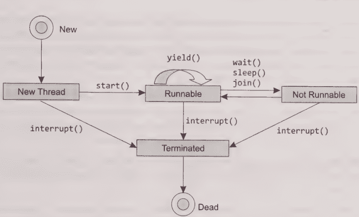

图 8.1 线程状态

上述语句负责创建一个新的 `Thread` 对象。在 'New' 状态下，没有为新出生的线程对象分配系统资源（如 CPU）。从此状态开始，线程可以启动（使用 `Thread` 类的 `start()`）或停止（使用 `Thread` 类的 `interrupt()`），分别移动到 'Runnable' 或 'Terminated' 状态。除了 `start()` 和 `interrupt()` 之外，无法从此状态调用其他方法，如果尝试这样做，将导致异常 `IllegalThreadStateException`。

### Runnable

在此状态下，线程已准备好由 JVM 执行。它代表线程的运行状态作为。线程的就绪状态可以定义为它已准备好执行，但可能在队列中等待操作系统提供所需的资源，如处理器。一旦线程被处理器实际执行，它被称为 'Running'。从 'New' 状态开始，通过执行以下语句线程可能会移动到 'Runnable' 状态：

```java
Thread threadObj = new ThreadDemo();
threadObj.start();
```

一旦调用 `start()`，线程将根据 Java 运行环境调度分配系统资源。现在线程进入了可运行状态。在图 8.1 中，运行线程和可运行线程之间没有区别。即使是运行线程也属于可运行状态的一部分。但两者之间存在差异。运行线程是由处理器执行的。可运行线程是那些没有实际在运行，但在队列中等待获取处理器的线程。可运行线程优先共享处理器的方案是由 Java 运行时实现的。然而，当线程从 ‘Runnable’ 移动到 ‘Running’ 时，`run()` 方法的指令顺序执行。在此阶段，处理器可以被强制放弃控制，从而通过使用 `yield()` 方法再次进入队列，如图 8.1 所示。从 Runnable 状态开始，线程可能会移动到不可运行状态，如图 8.1 所示。这种状态是用来用于分类 Java 三种有效状态的。这三个状态是 **WAITING**、**TIMED_WAITING** 和 **BLOCKED**。

### WAITING

在此状态下，线程无限等待另一个线程执行特定操作。线程可以通过调用以下任一方法进入此状态：`Object.wait()`（超时）或 `Thread.join()`（无超时）。

### TIMED_WAITING

在此状态下，线程等待直到指定的时间。线程可以通过调用以下任一方法进入此状态：`Thread.sleep()`、`Object.wait()` 和 `Thread.join()`（已指定时间）。

### BLOCKED

在此状态下，资源无法被访问，因为它被另一个线程使用。

在继续之前，我们必须讨论 Java 中的监视器（monitors）概念。监视器是对资源的互斥锁。一个监视器只能由一个线程所有。当线程调用 `Object.wait()` 时，它释放获取的所有监视器并进入 WAITING 状态，直到另一个线程进入同一个监视器并调用 `notify()`。这两个方法的区别在于，如果使用 `notify()`，只有一个线程（由 JVM 调度器选择）获得监视器，所有其他线程进入 BLOCKED 状态；而如果你使用 `notifyAll()`，则会唤醒在同一对象上等待的所有线程。可以执行的线程开始执行，其余的进入就绪状态。上述三个方法是 Object 的 final 方法，所有类都拥有它们：指定的指定等待时间的 `wait()` 形式，它将线程处于 TIMED_WAITING 状态。我们可以很容易判断出 WAITING 状态的线程总是依赖于其他线程执行的操作，而 TIMED_WAITING 状态的线程并不完全依赖其他线程执行的操作，因为在这种情况下，等待在超时后结束。同样，如果线程通过调用 `join()` 方法让自己放入 WAITING 状态，它将一直等待直到指定的线程终止或指定的时间过期。`sleep()` 和 `wait()` 之间似乎没有区别，因为它们都执行让线程等待指定时间的工作。方法之间的差异见表。

| Object.wait() | Thread.sleep() |
| :--- | :--- |
| wait() 属于 Object 类 | sleep() 属于 Thread 类。 |
| 它只能在同步方法或语句中使用。 | 它可以在同步方法和语句之外使用。 |
| 等待状态可以通过调用 Object.notify() 方法终止。 | 睡眠状态可以通过调用线程实例的 interrupt() 方法终止。 |
| Object.wait() 仅用于并发线程访问代码。 | sleep(int) 在任何需要的地方和时候使用。 |
| 它停止当前线程执行并释放对象锁。其他线程可以使用代替。 | sleep(int) 导致当前线程暂停执行指定的毫秒数。这可以让其他线程使用之前线程持有的资源 |

### Terminated

当线程完成执行时到达此状态。线程可以从上述任何一个状态移动到 ‘Terminated’ 状态。在此状态下，线程是死亡的。线程的死亡可以是自然的，也可以是强制的。当线程正常退出 `run()` 时，线程自然死亡。从 `run()` 正常退出意味着 `run()` 的指令已被完全处理。例如，方法中的 `for` 循环是一个有限循环，它会迭代 5 次（即从 1 到 5）然后结束。

```java
public void run() {
  for(int i = 1; i<=5; i++) {
    System.out.println("=" + i);
    Thread.sleep(500);
  }
}
```

具有上述 `run()` 方法的线程将在 `run()` 的最后一条语句完成后自然死亡。线程始终可以通过调用 `interrupt()` 来中断。以下代码块负责通过调用 `interrupt()` 来杀死线程的工作。

我们通过使用 `getState()` 方法获取特定线程的状态。以下程序展示了 `getState()` 和 `interrupt()` 方法的用法。

# 示例 8.4 使用 interrupt() 和 getState()

```java
class ThreadInterrupt extends Thread {
  boolean interrupt = false;
  String name;
  ThreadInterrupt(String n) {
    super(n);
    name = n;
  }
  public void run() {
    while (!interrupt()) {
      System.out.println("Thread running: " + name + " state: " + getState());
      try {
        Thread.sleep(1000);
      } catch (InterruptedException e) {
        System.out.println("Thread Interrupted: " + name + " state: " + getState());
      }
    }
    System.out.println("Thread exiting under request: " + name + " state: " + getState());
  }
}
```

```
C:\javabook\programs\chap 8>java ThreadInterrupt

Starting Thread: InterruptExample state: NEW

Thread running: InterruptExample state: RUNNABLE

Thread running: InterruptExample state: RUNNABLE

Thread running: InterruptExample state: RUNNABLE

Stopping Thread: InterruptExample state: TIMED_WAITING

InterruptExample state: TIMED_WAITING

Thread Interrupted: InterruptExample state: RUNNABLE

Thread exiting under request: InterruptExample state: RUNNABLE

Exiting application state: TERMINATED
```

# Java 中的多线程 (239)

# 解析

- L1 创建了一个线程类。
- L2 定义了一个布尔变量 `interrupt`（类似于一个标志位），用于检查线程是否被中断的状态。
- L3 定义了一个字符串实例变量 `name`，用于为线程命名。
- L4-6 定义了该类的构造函数。该构造函数通过调用 `super` 构造函数来设置线程名称，并将参数值赋值给字符串变量。
- L7 重写了 `run()` 方法，该方法规定了线程需要执行的任务。
- L8 检查中断标志的状态，如果为 `false`，`while` 循环继续执行。
- L9 是一个打印语句，显示线程名称及其状态。线程在 `run` 方法中被中断后的当前状态将是 `RUNNABLE`，因为它只有在执行时才会被中断。（参见输出）
- L10-13 定义了一个 `try...catch` 块，因为线程通过 `Thread.sleep(1000)` 睡眠一秒，如果被中断，该方法可能会抛出 `InterruptedException`。因此必须捕获它。`run` 方法（`Runnable` 接口）不能重写关键字，方法定义中没有包含任何子句。因此，在重写时不能更改该方法。如果产生异常，将由 L12 的 `catch` 捕获，并在 L13 执行，显示“Thread Interrupted:”后跟线程名称及其状态（即 `RUNNABLE`）。
- L14 是 `run` 方法中的第一个打印语句，显示线程正在退出，随后是线程名称及其状态，即 `RUNNABLE`。这将在 `while` 循环退出后执行。
- L15 定义了程序执行的起点，即 `main` 方法。
- L16 创建了一个新线程，并将该线程作为参数传递给线程的构造函数。
- L17 显示了一个打印语句，显示“Starting Thread”后跟线程名称及其状态。线程刚刚被创建，所以它的状态将是 `NEW`。
- L18 通过在 L16 创建的新线程实例上使用 `start()` 方法来启动线程。由于线程会被调度（L7），该线程的 `run` 方法将被自动调用。中断标志初始为 `false`，`run` 方法中的循环将继续执行，L9 将持续运行。
- L19 让主线程睡眠 3 秒。另一个线程 `Example` 将继续执行并睡眠（1 秒）。
- L20 显示了一个打印语句，显示“Stopping:”后跟线程名称及其状态。如果你看到输出，所显示的的线程状态为 `WAITING`，因为此时 `InterruptedExample` 正在睡眠 1 秒，而主线程在这一刻正处于执行。
- L21-22 将 `interrupt` 变量设置为 `true` 并在 `InterruptedExample` 睡眠时将其中断。注意，如果线程被中断，则会抛出 `InterruptedException`。此异常将由 L12 的 `catch` 捕获，当线程创建 CPU 或被调度器调度时，该块将执行。
- L23 显示一个打印语句，显示线程名称及其状态。如果你看到输出，线程状态仍然是 `STILL WAITING`，因为此时不允许 `InterruptedExample` 执行该方法。
- L24 主线程被故意允许另一个线程执行。在这一阶段，控制权传递到 L12 的 `catch` 块，然后 `run` 方法退出。
- L25 显示一个打印语句，显示“Application”后跟子线程（从 `main` 创建）的状态，即 `InterruptedExample`。该线程的 `run` 方法已经退出，所以它的状态现在是 `TERMINATED`（参见输出）。
- L26 使用 `System` 类的 `exit` 方法终止应用程序。

# 240 Java 编程

还有一个方法是 `stop()`，它现在已被废弃，用于终止线程。废弃它的原因是它会向线程抛出一个 `ThreadDeath` 对象以杀死它的所有操作。除此，调用 `stop()` 方法会导致线程的 `run()` 方法突然终止，这可能导致线程实现的结果不一致。

# 8.7 线程优先级

每个线程都有优先级，这有助于调度器决定执行顺序。要记住 Java 遵循抢占式调度，类似于先来后服务的原则。相反，高优先级线程在准备就绪时会抢占低优先级线程，直到低优先级线程放弃控制权。如果没有外部分配优先级，它被设置为 `NORM_PRIORITY`。

表 8.3 优先级常量

| 常量 | 值 | 含义 |
| :--- | :--- | :--- |
| MIN_PRIORITY | 1 | 线程的最小优先级 |
| NORM_PRIORITY | 5 | 默认优先级 |
| MAX_PRIORITY | 10 | 线程的最大优先级 |

# 示例 8.5 设置和线程优先级

这是一个展示优先级常量和 `getPriority()` 方法使用的示例。


```java
class ThreadOne extends Thread {
  public void run() {
    try {
      for(int i = 1; i<= 5; i++) {
        System.out.println("\tfrom thread 1 : i = " + i);
        Thread.sleep(500);
      }
    } catch (InterruptedException e) {
      System.out.println("thread 1 interrupted");
    }
    System.out.println("Exit from thread 1");
  }
}

class ThreadTwo extends Thread {
  public void run() {
    try {
      for(int j = 1; j <= 5; j++) {
        System.out.println("\tfrom thread 2 : j = " + j);
        Thread.sleep(500);
      }
    } catch (InterruptedException e) {
      System.out.println("thread 2 interrupted");
    }
    System.out.println("Exit from thread 2");
  }
}

class ThreadThree extends Thread {
  public void run() {
    try {
      for(int k = 1; k <= 5; k++) {
        System.out.println("\tfrom thread 3 : k = " + k);
        Thread.sleep(500);
      }
    } catch (InterruptedException e) {
      System.out.println("thread 3 interrupted");
    }
    System.out.println("Exit from thread 3");
  }
}

class ThreadPriority {
  public static void main(String args[]) {
    ThreadOne a = new ThreadOne();
    ThreadTwo b = new ThreadTwo();
    ThreadThree c = new ThreadThree();
    System.out.println("Default Priority for thread 1:"+a.getPriority());
    System.out.println("Default Priority for thread 2:"+b.getPriority());
    System.out.println("Default Priority for thread 3:"+c.getPriority());
  }
}
```

## 242 Java 编程

| 行 | 代码 |
| :--- | :--- |
| L47 | `System.out.println("Default Priority for thread 3:" +c.getPriority());` |
| L48 | `System.out.println(" ");` |
| L49 | `a.setPriority(Thread.MIN_PRIORITY);` |
| L50 | `b.setPriority(Thread.NORM_PRIORITY);` |
| L51 | `c.setPriority(Thread.MAX_PRIORITY);` |
| L52 | `System.out.println("Priority set for thread 1 :" +a.getPriority());` |
| L53 | `System.out.println("Priority set for thread 2 :" +b.getPriority());` |
| L54 | `System.out.println("Priority set for thread 3 :" +c.getPriority());` |
| L55 | `System.out.println(" ");` |
| L56 | `System.out.println("All the Three threads start from here");` |
| L57 | `a.start();` |
| L58 | `b.start();` |
| L59 | `c.start();` |
| L60 | `{` |
| L61 | `}` |

## 输出

```
Default Priority for thread 1 :5
Default Priority for thread 2 :5
Default Priority for thread 3 :5
New Priority set for thread 1 :1
New Priority set for thread 2 :5
New Priority set for thread 3 :10
All the Three threads start
from here From child thread
3 : k = 1 From child thread
2 : j = 1 From child thread
1 : i = 1 From child thread
3 : k = 2 From child thread
2 : j = 2 From child thread
1 : i = 2 From child thread
3 : k = 3 From child thread
2 : j = 3 From child thread
1 : i = 3 From child thread
3 : k = 4 From child thread
2 : j = 4 From child thread
1 : i = 4 From child thread
3 : k = 5 From child thread
2 : j = 5 From child thread
1 : i = 5
Exit from child thread 3
Exit from child thread 2
Exit from child thread 1
```

## 解析

| 行 | 描述 |
| :--- | :--- |
| L1-39 | 这些行包含了声明三个不同类的详细信息。`ThreadOne`、`ThreadTwo` 和 `ThreadThree`，它们都扩展了 `Thread` 类。这些子线程类每一个已经在示例 8.2 中解释过。 |
| L40 | 声明了主类 `threadPriority`。 |
| L41 | 声明了 `main()` 方法。 |
| L42-45 | 创建了三个子线程类的引用对象并存储在 `a`、`b` 和 `c` 中。 |
| L45 | 显示子线程的默认优先级。你可以看到对 `getPriority()` 方法的使用，它是通过使用 `ThreadOne` 类的对象被调用的。该方法返回与 `ThreadOne` 类相关的线程优先级。 |
| L49 | 子线程类对象 `ThreadOne` 调用其 `setPriority()` 方法来设置线程的执行，以便在外部对线程进行调度。你可以看到，通过将其作为参数传递给 `setPriority()`，线程一的优先级为最低优先级，即 1。 |
| L50 | 与线程一类似，子线程对象调用其 `setPriority()` 方法将线程优先级设置为普通优先级，即 5。 |
| L46-47 | 与子线程一一样，显示了子线程二和子线程三的当前优先级。 |
| L51 | 使用子线程三的对象调用其 `setPriority()` 方法将线程优先级设置为最高优先级，即 10。 |
| L52-54 | 显示了三个子线程的新优先级。再次，`getPriority()` 方法可以证明它是获取线程新设置优先级的得力工具。 |
| L57-59 | 在主线程内部，使用与线程对象对应的 `start()` 方法启动了所有线程。线程对象相应的 `run()` 方法将在线程被调度执行时执行。 |

## 8.8 多线程——`isAlive()` 和 `join()`

主线程始终应该是最后一个结束的线程，也就是说，在使用 `Thread.sleep()` 延长主线程执行之前，所有由主线程派生的子线程都应该已经结束。主线程应该睡眠的时间无法精确估算，子线程执行所需的时间难以估计。如果我们的估算不足，子线程将在主线程终止后终止，这并不是我们想要的。这就是与睡眠技术相关的缺陷。

可以使用其他通常协同工作的方法来解决上述危机：`isAlive()` 和 `join()`。表 8.1 中提到的两个方法都是 `Thread` 类的一部分。`isAlive()` 返回一个布尔值。如果线程是活跃的（即它已经启动且未停止），则返回 `true`。如果返回 `false`，则该线程可能是新线程或死线程。换句话说，如果 `isAlive()` 返回 `true`，可以将线程理解为处于“可运行”（Runnable）或“不可运行”（Not Runable）状态，否则它处于“死亡”（Dead）状态。`isAlive()` 方法可以检查线程是否正在运行。`Thread` 类中定义的方法如下：

```java
final boolean isAlive()
```

至于 `join()` 方法，它会等待直到它所在的线程终止。它等待子线程终止然后连接主线程。此外，`join()` 方法还可以用于指定你想要子线程的时间。

## 8.9 同步

存在两个或多个线程访问公共资源、公共数据或文件的情况。为了保持一致性，确保资源一次只有一个线程可用是至关重要的。例如，有两个线程，一个负责写入文件（一种资源），另一个负责从同一个文件中读取。如果两个线程同时启动，它们都会尝试同时访问该文件。显然，如果第一个线程没有完全写入值，第二个线程读取的值将是不一致的。Java 有内置机制，允许一次只有一个线程使用资源，被称为同步。通常，操作系统会提供这种机制，但 Java 对此提供了独特的语言级支持。

它是如何工作的？你们中的许多人拥有操作系统的知识，可能知道什么是信号量。类似的，我们在这里有监视器（monitor）的概念。监视器是一个对象，它被用作对要访问资源的互斥锁。一个监视器（monitor）一次只能被一个线程拥有。线程一旦获取锁，就会进入监视器。所有其他线程无法进入被锁的监视器，除非它被解锁或第一个线程退出监视器。在此期间，其他线程将等待监视器的锁。如果线程退出了监视器，它稍后可以进入同一个监视器。

上述同步机制在 Java 中可以通过两种方式实现：

- (a) 在方法定义处使用 `synchronized` 关键字（同步方法）
- (b) 在任何代码块处使用 `synchronized` 关键字（同步语句）

### 8.9.1 同步方法

我们可以通过如下声明来使特定方法变为同步方法：

```java
class XYZ {
    synchronized anyMethod() {
        // method body
    }
}
```

你可以看到在方法声明前使用了 `synchronized` 前缀。现在，如果有 `n` 个线程想要使用方法 `anyMethod()`，系统将不允许它们这样做。优先级最高的线程将锁定该方法的监视器，使其其他线程无法访问。一旦锁定监视器的线程完成其工作，它将释放监视器以供其他线程使用。

### 8.9.2 同步语句

我们可以使用 `synchronized` 关键字对代码块进行同步。与同步方法类似，这里 `synchronized` 单词被用在需要同步的代码块之前。该同步语句必须指定提供监视器锁的对象。下面是此类代码块的示例：

```java
public void anyBlock() {
    synchronized (this) {
        // statement for the body of block
    }
}
```

## 8.10 挂起和恢复线程

有两个方法 `suspend()` 和 `resume()`，分别用于临时挂起执行中的线程和恢复挂起。但从 Java 1.2 开始，这些方法已经过弃用（deprecated）。那么，你将如何处理以前由这些方法完成的需求呢？这些目标可以通过定义自己的 `suspend` 和 `resume` 方法来实现，如下例所示：

### 示例 8.7 挂起和恢复线程

```java
L1 class SusResThread implements Runnable {
L2 String n;
L3 Thread thread;
L4 boolean suspended;
L5 SusResThread() {
L6 thrd = new Thread(this, "Suspend-Resume Thread");
L7 suspended = false;
L8 thrd.start();
L9 }
L10 public void run() {
L11 try {
L12 for (int i = 0; i < 10; i++){
L13 System.out.println("Thread: " + i);
L14 Thread.sleep(200);
L15 synchronized (this) {
L16 while (suspended) {
L17 wait();
L18 }
L19 }
L20 }
L21 catch (InterruptedException e) {
L22 System.out.println("thread interrupted.");
L23 }
L24 System.out.println("Exit from thread.");
L25 }
L26 void susThread() {
L27 suspended = true;
L28 }
L29 synchronized void resThread() {
L30 suspended = false;
L31 notify();
L32 }
L33 }
L34 class SusResume {
L35 public static void main (String args []) {
L36 SusResThread thrd1 = new SusResThread();
L37 try{
L38 Thread.sleep(1000);
L39 thrd1.susThread();
L40 System.out.println("Thread has been Suspended");
L41 Thread.sleep(1000);
L42 thrd1.resThread();
L43 System.out.println("Thread has been Resumed");
L44 }
L45 catch (InterruptedException e) {
L46 }
L47 try {
L48 thrd1.thrd.join();
L49 }
L50 catch (InterruptedException e){}
L51 System.out.println("Main Thread: interrupted");
L52 }
L53 }
```

你可以很容易地从下面的输出中看到，线程显示了循环中变量的值，直到线程被挂起。它从被挂起的地方继续其显示值的工作。

### 输出

```
Thread: 0
Thread: 1
Thread: 2
Thread: 3
Thread: 4
Thread: Suspended
Thread: Resume
Thread: 5
Thread: 6
Thread: 7
Thread: 8
Thread: 9
Exit from thread.
```

### 解释

- L1 定义了一个实现 `Runnable` 接口的 `SusResThread` 类。该类有三个方法：`run()`、`susThread()` 和 `resThread()`。
- L4 声明了一个实例变量 `suspended`，其值用于指示线程是否被挂起。
- L10–19 声明了 `run()`，它包含一个 `for` 循环，用于显示计数器变量的值。每当显示计数器时，线程因为 `sleep(200)` 方法短暂暂停。
- L15 进入一个同步语句，以确定实例变量 `suspended` 的值是否为 `true`。如果是，则调用 `wait()`，这会导致线程挂起，直到调用 `notify()`。

## Java 多线程 251

L28–38 声明了线程类 `Giver`，它实现了 `Runnable` (L28)。该类声明了 `Carrier` 类的实例 (L29)，然后调用 `putvalue()` 将五个整数放入 `Carrier` 中 (L36)。尽管 `putvalue()` 方法是在循环中被调用的，但每个整数在放入 `Carrier` 后，都会有一个暂停，直到该整数被 `Taker` 类获取。`Taker` 类的设计与 `Giver` 类非常相似，区别在于 `Taker` 类在 `for` 循环内部调用了五次 `getValue()`。每次调用 `getValue()` 都会暂停，直到 `Giver` 类在 `Carrier` 中放入整数。L52–58 `CommThread` 类的 `main()` 方法创建了 `Carrier` 类的实例 (L45)。注意，`Carrier` 类实例的引用被传递给 `Giver` 类和 `Taker` 类的构造函数。它们使用 `Carrier` 类实例进行线程间通信。

## 8.12 实际问题：时钟示例


让我们创建一个具体的示例，来说明线程在应用程序中的用处。我们将创建一个线程，它每秒跳动一次，像钟一样在控制台上显示当前的日期和时间（如输出所示）。此示例无法实现 GUI，因此我们将在 DOS 提示符处打印时间。我们尚未处理 Java 图形，因此将把那部分推迟到 Applets 和 GUI。我们将在 Applets 中重写此示例，展示如何在带有 GUI 的 Applets 中使用线程。此示例在创建类对象时会在主线程之外创建一个额外的线程。

## 示例 8.9 时钟

```java
L1 import java.util.*;
L2 class TimeThreadDemo{
3 Thread t;
4 TimeThreadDemo(String name)
5 {
6 t = new Thread(new Task(),name);
7 t.start();
}
L8 public static void main(String args[]) {
L9 TimeThreadDemo d=new TimeThreadDemo("Digital clock");
}
L10 class Task implements Runnable{
L11 Calendar c;
L12 Date d;
L13 public void run()
L14 for(;;)
L15 try {
L16 c = Calendar.getInstance();
L17 d = c.getTime(); }
L18 System.out.println(d);
L19 Thread.sleep(1000);
    }
L20 catch(Exception e){
    }
}
}
```

## 输出

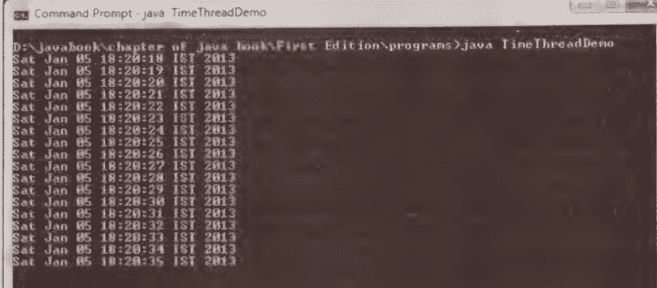

## 解析

- **L1** 导入了 `java.util` 包，因为我们将使用该包中的 `Calendar` 和 `Date` 类。
- **L2** 声明了类 `TimeThreadDemo`。
- **L3** 在类内部创建了 `Thread` 类型的实例。
- **L4** 定义了类的构造函数，接受一个 `String` 参数，该参数将用于命名构造函数内部创建的线程。
- **L6-7** 通过实例化 `Thread` 类并将其赋值给 L3 创建的实例变量创建一个线程。线程（L4 中的字符串参数）在构造函数内部传递，并包含了负责告知线程将执行操作的对象。`Task` 类的对象被传递到 `Thread` 构造函数中，指示该对象将重写 `run` 方法并为线程提供实现。线程将执行的操作将由 `Task` 类的对象实现。在我们之前的示例中，我们使用了 `this` 关键字，是因为在那些情况下当前对象为 `run()` 提供了实现并为线程了设置。在线程上调用 `start()` 方法将其置于就绪状态，以便由调度器进行调度。请注意，这现在是一个与主类分离的独立线程。
- **L8-9** 定义了 `main` 方法，并在方法内部创建了 `TimeThreadDemo` 类对象。这导致了对类构造函数的调用，以及隐式的对 `Thread` 对象的实例化。
- **L10** 定义 `Task` 实现 `Runnable` 接口。继承 `Runnable` 接口是因为我们希望该类重写 `run()` 并告诉程序对它的要求。我们希望这个线程每秒执行一组预定义的任务，即打印像时钟一样持续跳动的日期和时间。这些步骤在 `run()` 内部实现。
- **L11–12** 定义了 `Calendar` 类和 `Date` 类的实例变量，用于获取当前的日期和时间。
- **L17** 使用上一行创建的实例，调用 `getTime()` 返回封装为 `Date` 对象的日期和时间。该 `Date` 对象由 L12 创建的实例变量引用。
- **L13** 重写了 `run()` 方法。一旦 L6 中创建的线程被调度器调度，该方法就会自动被调用。
- **L18** 打印对象。
- **L19** 我们刻意使用 `Thread.sleep(1000)` 方法提供一秒钟的延迟，以获得正常时钟的感觉。线程睡眠一秒，然后返回其写入 `Date` 对象的工作。
- **L14** 创建了一个无限循环，以便每秒无期地打印时间。
- **L20** 定义了 `catch` 块，以捕获 `sleep` 方法可能抛出的 `InterruptedException`。
- **L15** 定义了 `try` 块。
- **L16** 一个静态方法 `getInstance()`，它返回一个初始化为当前日期和时间的 `Calendar` 类实例。

## 总结

Java 具有支持多线程的能力。这允许程序同时执行多个任务，从而提高了应用程序的效率和性能。线程是执行的轻量级进程。在 Java 中，使用 `Thread` 类或 `Runnable` 接口创建线程。线程可以启动、暂停、恢复和合并。JVM 还提供了同步机制，以确保多个线程不会同时访问共享资源。

- 11. 哪个方法负责为程序中的线程创建主体或提供功能？请用一个示例程序进行解释。
- 12. 区分以下暂停线程的手段：
  - `wait()`
  - `sleep()`
  - `yield()`

## 编程练习题

- 1. 使用 `Runnable` 接口创建并运行一个线程类。
- 2. 编写一个 Java 程序，演示高优先级线程的执行以及它是如何延迟所有低优先级线程执行的。
- 3. 编写一个 Java 程序，演示使用 `sleep` 的高优先级线程如何为低优先级线程执行让路。
- 4. 编写一个 Java 程序，显示三个线程的操作。使用 `runnable` 接口创建线程。确保主线程最后执行（提示：使用 `join()`）。
- 5. 编写一个使用线程同步来保证多线程应用中数据完整性的程序。

## 客观题答案

- 1. (d) 2. (c) 3. (b) 4. (a)
- 5. (b), (c), (d) 6. (d) 7. (b) 8. (a)
- 9. (d) 10. (b)

## 输入输出、序列化与克隆

> 除非每个人产生的比收到的多，增加他的产量，否则他得到的将比其他人少。
>
> —— 伯纳德·巴鲁奇

- 在读完本章后，读者将能够：
  - 理解文件处理的基础
  - 理解 Java 中如何进行输入输出操作
  - 理解如何从用户获取输入
  - 理解序列化后的原理以及如何实现
  - 了解新 IO 包中的新类和接口
  - 执行浅拷贝和深拷贝

### 9.1 导论

计算机最重要的部分是输入和输出。通过处理输入来生成输出。输入输出类是任何编程语言的核心。从 Java 1.4 开始，有两个预定义的包，分别被命名为 `io`（输入/输出）和 `nio`（新 I/O 或非阻塞 I/O），它们包含了执行 I/O 操作的类。`java.io` 包处理如向控制台读/写以及写入文件等操作。`java.nio` 包包含了支持 `java.io` 包中类的，并执行高级操作，如缓冲、内存映射、字符编码与解码、模式匹配以及文件锁定。

`java.io` 包提供了几个用于读写数据（字节数据和字符数据）的类。`java.io` 是连续的数据流。在 Java 中，两种类型的数据都定义了流：字节流类和字符流类。字节流类处理对文件、套字的字节读写。字符流类处理对文件、套字的字符读写。

`java.io` 包包含两个顶层流抽象类：`java.io.InputStream`（用于读取字节）和 `java.io.OutputStream`（用于写入字节）。它还包含两个顶层字符流抽象类：`java.io.Reader`（用于读取字符）和 `java.io.Writer`（用于写入字符）。这些类的子类实际上用于读写数据。我们将讨论一些子类。

#### 9.1.1 java.io.InputStream 和 java.io.OutputStream

`InputStream` 和 `OutputStream` 是抽象类，规定了适用于其所有子类的特定方法。表 9.1 和表 9.2 给出了 `InputStream` 和 `OutputStream` 类的方法列表。

**表 9.1 InputStream 类的方法**

| 方法 | 说明 |
| :--- | :--- |
| `int available() throws IOException` | 返回从输入流中可以读取的可用字节数。 |
| `void close() throws IOException` | 关闭输入流。 |
| `void mark(int readlimit)` | 在输入流的当前位置设置一个标记。`readlimit` 定义了读取多少字节后该标记将失效。 |
| `boolean markSupported()` | 如果此方法返回 `true`，则 `mark()` 有效。 |
| `abstract int read()` | 从输入流中读取下一个字节。子类提供该方法的实现。返回该字节，如果遇到 EOF 则返回 -1。 |
| `int read(byte[] b)` | 读取字节并将其存储在字节数组 `b` 中。返回读入数组的字节数，如果遇到 EOF 则返回 -1。 |
| `int read(byte[] b, int off, int len)` | 从 `b` 中的偏移量 `off` 开始，读取最多长度为 `len` 的字节并存储在字节数组 `b` 中。 |
| `void reset()` | 仅当 `readlimit` 未到期时，将当前指针重置为 `mark()` 方法设置的标记。 |
| `long skip(long n)` | 跳过指定数量的字节 (n) 并返回实际跳过的字节数。 |

**表 9.2 OutputStream 类的方法**

| 方法 | 说明 |
| :--- | :--- |
| `void close()` | 关闭输出流。 |
| `void flush()` | 刷新输出流。 |
| `void write(byte[] b)` | 将字节数组的内容写入输出流。 |
| `void write(byte b[], int off, int len)` | 从 `b` 中的偏移量 `off` 开始，向输出流写入指定数量的字节 (len)。 |
| `abstract void write(int b)` | 向输出流写入字节的抽象方法。子类提供实现。 |

图 9.1 和 9.2 显示了类之间的层级结构（在输入流/输出流之下），以及它们所继承的 `java.io` 包中的接口。这些图表没有显示 `java.io` 包中的**所有**类。对于所有类，请参考 JDK 文档。

### 9.2 java.io.File 类

`java.io.File` 类值得注意的是，它并不属于字节流或字符流，它是为了了解文件的属性，并且它可以代表路径是文件还是目录。

#### 示例 9.1 File 类

```java
import java.io.*;
class FileDemo {
    public static void main(String[] args[]) {
        File f = new File(args[0]);
        System.out.println("是否存在: " + f.exists());
        System.out.println("可读: " + f.canRead());
        System.out.println("可写: " + f.canWrite());
        System.out.println("可执行: " + f.canExecute());
        System.out.println("文件名: " + f.getName());
        System.out.println("路径: " + f.getParent());
        System.out.println("路径: " + f.getPath());
        System.out.println("是否隐藏: " + f.isHidden());
        System.out.println("长度: " + f.length());
        System.out.println("最后修改时间: " + f.lastModified());
        System.out.println("是否为文件: " + f.isFile());
        if(f.isDirectory()) {
            System.out.println("目录列表: " + f.getPath());
            String[] i = f.list();
            for(String a : i) {
                if(a.isDirectory()) {
                    System.out.println(a + " 是目录");
                } else {
                    System.out.println(a + " 是文件");
                }
            }
        }
    }
}
```

#### 输出

**对于 'Sample.txt'**

是否存在: true
可读: true
可写: true
可执行: true
文件名: Sample.txt
路径: null
路径: Sample.txt
是否隐藏: false
长度: 105
最后修改时间: 1236860637
是否为文件: true

**对于 'programs'**

java FileDemo programs: \programs
是否存在: true
可读: true
可写: true
可执行: true
文件名: programs
路径: \programs
路径: \programs
是否隐藏: false
长度: 12288
最后修改时间: 123706232096
是否为文件: false
目录列表: \programs:
A.class 是文件
B.class 是文件
chap6 是目录
chap09 是目录

#### 解释

- 使用 `File` 类需要导入 `java.io.*` 包。
- 创建 `File` 对象并通过命令行参数将文件名/目录名传递给它。使用 `File` 类的一些方法来了解文件的属性。
- `exists()` 返回布尔值，表示文件/目录是否存在。
- `canRead()` 返回布尔值，表示文件/目录是否可读。
- `canWrite()` 返回布尔值，表示文件/目录是否可写。
- `canExecute()` 返回布尔值，表示文件/目录是否可执行。
- `getName()` 返回目录的名字。
- `getParent()` 返回文件所属的目录名称。
- `getPath()` 返回完整路径（见输出）。
- `isHidden()` 返回布尔值，表示文件是否隐藏。
- `length()` 返回 long 类型表示长度。
- `lastModified()` 返回文件最后修改的时间。该时间是自 1970 年 1 月 GMT 00:00:00 以计算的毫秒数。
- `isFile()` 如果 `File` 对象参数是文件则返回 `true`。
- `isDirectory()` 如果 `File` 对象参数是目录则返回 `true`。如果是，则执行后续行。
- `list()` 用于列出目录中所有的目录和文件，并以字符串数组的形式返回。
- for-each 循环用于遍历数组的内容。L21–27 针对数组的每个元素执行。
- 在后续几行中，我们发现数组是文件还是目录，并相应地打印。
- `f1 = null;`
- 因为我们在迭代中创建了新的 `File` 对象，为文件对象赋值 `null` 使其可以被垃圾回收。

### 9.3 数据的读取与写入

可以使用这些流将数据读取/写入文件、控制台、套接字等。这些流下的类用于读取/写入数据。在接下来的子标题中，我们将看到如何使用 `InputStream`、`OutputStream`、`Reader` 和 `Writer` 的子类来读写数据。

#### 9.3.1 使用字节流读写文件

`FileInputStream` 类（继承 `InputStream`）用于读取文件，`FileOutputStream`（继承 `OutputStream`）用于写入文件。`FileInputStream` 和 `FileOutputStream` 的所有方法列表分别如表 9.3 和表 9.4 所示。让我们通过一个示例来看如何使用这些类来读写文件。

**表 9.3 FileInputStream 类的方法**

| 方法 | 说明 |
| :--- | :--- |
| `int available()` | 返回从此输入流可以读取的剩余字节数。 |
| `void close()` | 关闭此文件输入流并释放所有系统资源。 |
| `void finalize()` | 确保在没有更多对该文件输入流的引用时，调用该类的方法。 |
| `FileChannel getChannel()` | 返回与此文件流关联的唯一 `FileChannel` 对象。 |
| `final FileDescriptor getFD()` | 返回代表 `FileInputStream` 所使用的文件系统中的实际文件连接的 `FileDescriptor` 对象。 |
| `int read()` | 从此输入流中读取一个字节的数据。 |
| `int read(byte[] b)` | 从此输入流中读取最多 `length` 个字节的数据到字节数组 `b` 中。 |

**表 9.4 FileOutputStream 类的方法**

| 方法 | 说明 |
| :--- | :--- |
| `void close()` | 关闭此文件输出流并释放所有系统资源。 |
| `protected void finalize()` | 清理与文件的连接。 |
| `FileChannel getChannel()` | 返回与此流关联的唯一 `FileChannel` 对象。 |
| `FileDescriptor getFD()` | 返回与此输出流关联的文件描述符。 |


| 方法 | 描述 |
| :--- | :--- |
| `void write(byte[] b)` | 将指定字节数组中的字节写入此文件输出。 |
| `void write(byte[] b, int off, int len)` | 将指定字节数组中从偏移量 `off` 开始的 `len` 个字节写入此文件输出流。 |
| `void write(int b)` | 将指定的字节写入此文件输出流。 |

## 示例 9.2 读写文件

```java
import java.io.*;
class ReadWriteDemo {
    public static void main(String[] args) throws IOException {
        if (args.length != 2) {
            System.out.println("Usage: java ReadWriteDemo Sample.txt Demo.txt");
            System.exit(0); // terminate the program
        }
        File f = new File(args[0]);
        byte[] b = {};

        // Reading a file
        if (f.exists()) {
            FileInputStream f1 = new FileInputStream(f);
            int num = f1.available();
            b = new byte[num];
            int n = f1.read(b);
            String s = new String(b);
            System.out.println("Contents of " + args[0] + ": " + s);
            f1.close();
        } else {
            System.out.println("File does not exist");
            System.exit(0);
        }

        // Writing to file
        f = new File(args[1]);
        if (!f.exists()) {
            System.out.println(args[1] + " is a New File");
        } else {
            System.out.println(args[1] + " File exists, will be overwritten");
        }
        FileOutputStream fs = new FileOutputStream(f);
        System.out.println("Opening File: " + args[1]);
        fs.write(b);
        fs.flush();
        System.out.println("contents written");
        System.out.println("Closing File");
        fs.close();
    }
}
```

## 输出

```
C:\java\programs\CHAP09\> java ReadWriteDemo Sample.txt Demo.txt
Contents of Sample.txt: this is my sample file
Demo.txt is a New File
Opening File: Demo.txt
contents written
Closing File
```

```
C:\javabook\programs\CHAP09-1\> java ReadWriteDemo Sample.txt Demo.txt
Contents of Sample.txt: this is my sample file
Demo.txt File exists, will be overwritten
Opening File: Demo.txt
contents written
Closing File
```

## 解释

### 读取文件

- L4-6 的 `if` 语句检查命令行参数的数量是否等于 2。如果条件求值为真，它会打印程序的用法并终止程序。
- L7 创建了 `File` 类对象，并将第一个命令行参数（`args[0]`，即 `Sample.txt`）作为参数传递给构造函数。我们只提到了文件名，因为文件存在于当前工作目录中。如果您想将文件存储在其他目录，请指定文件的完整路径。
- L8 创建了一个空字节数组。由于我们使用字节流类，数据将以字节的形式写入。文件内容将被读取到此数组中，稍后字节数组的内容将写入不同的文件。
- L9 使用 `File` 对象的 `exists()` 方法检查文件（由 `args[0]` 指定）是否存在。如果文件存在，则执行 L10–17。
- L10-17 创建了 `FileInputStream` `f1`。`num` 是文件的可用字节数。创建大小为 `num` 的字节数组 `b`。`f1.read(b)` 将数据读到 `b` 中。将 `b` 转换为字符串 `s` 并打印。`f1.close()` 关闭流。
- 如果文件不存在，打印“File does not exist”并终止程序。

### 写入文件

- 创建了 `args[1]` 对应的 `File` 对象 `f`。如果文件不存在，打印“`args[1] is a New File`”。
- 如果文件存在，打印“`args[1] File exists, will be overwritten`”。
- 创建 `FileOutputStream` `fs`。打印“Opening File”。将字节数组 `b` 写入。`fs.flush()` 刷新缓冲区。打印“contents written”。打印“Closing File”。`fs.close()` 关闭流。

### 9.3.2 读写控制台（用户输入）

在 JDK 6 之前，JDK 5 引入了 `Scanner` 类（`java.util` 包），它可以根据分隔符获取输入行以及原始类型。默认分隔符是空白符。

## 示例 9.3 Scanner 类

```java
import java.util.*;
class ScannerDemo {
    public static void main(String[] args) {
        Scanner sc = new Scanner(System.in);
        System.out.print("Enter your name: ");
        String name = sc.nextLine();
        System.out.print("Enter your age: ");
        int age = sc.nextInt();
        System.out.println("you entered " + name + " as your name");
        System.out.println("you entered " + age + " as your age");
    }
}
```

## 输出

```
C:\javabook\chap_09\> java ScannerDemo
Enter your name: Tom
Enter your age: 31
you entered Tom as your name
you entered 31 as your age
```

## 解释

- L1 导入了 `java.util` 包，因为 `Scanner` 类属于它。
- L4 创建了 `Scanner` 类的对象，并将 `System.in` 传递给对象的构造函数。
- L6 使用 `Scanner` 类的 `nextLine()` 方法从用户输入并返回字符串。`nextLine()` 会一直获取输入直到用户按下回车。
- L7 打印语句要求用户输入年龄。
- L8 使用 `Scanner` 类，我们可以直接从用户处读取原始值。此行显示了 `nextInt()`，它可以直接从用户处读取 `int`。同样，如果需要，可以使用 `nextByte()`、`nextDouble()`、`nextFloat()`、`nextBoolean()` 等。

`System` 是 `java.lang` 包中的一个类。该类有三个预定义的变量：`in`、`out` 和 `err`。`in` 指标准输入流，具体为键盘输入。它们提供一个 `InputStream` 类型的对象。`System.out` 指标准输出流，具体为显示设备。它们共同提供一个 `PrintStream` 类型的对象，其中包含 `println()` 方法。我们在第一个示例中一直使用这个方法（`System.out.println()`）。`System.err` 指标准错误流，具体为显示设备。它们共同提供一个 `PrintStream` 类型的对象。

## 表 9.5 Scanner 类方法

| 方法 | 描述 |
| :--- | :--- |
| `void close()` | 关闭此扫描器。 |
| `boolean hasNext()` | 如果此扫描器还有另一个标记，则返回 true，否则返回 false。 |
| `boolean hasNext(Pattern p)` | 如果下一个标记匹配指定的模式 (`p`)，则返回 true。 |
| `boolean hasNext(String p)` | 如果下一个标记匹配指定字符串 (`p`) 中的模式，则返回 true。 |
| `boolean hasNextBoolean()` | 如果此输入中的下一个标记可以被解释为布尔值，则返回 true。 |
| `boolean hasNextByte()` | 如果此输入中的下一个标记可以被解释为字节值，则返回 true。 |
| `boolean hasNextDouble()` | 如果此输入中的下一个标记可以被解释为双精度浮点数，则返回 true。 |
| `boolean hasNextFloat()` | 如果此输入中的下一个标记可以被解释为浮点型值，则返回 true。 |
| `boolean hasNextInt()` | 如果此输入中的下一个标记可以被解释为整数值，则返回 true。 |
| `boolean hasNextLine()` | 如果输入中还有另一行，则返回 true。 |
| `boolean hasNextLong()` | 如果此扫描器输入中的下一个标记可以被解释为长型值，则返回 true。 |
| `boolean hasNextShort()` | 如果此扫描器输入中的下一个标记可以被解释为短型值，则返回 true。 |

在示例 9.3 中，`nextLine()` 在 `nextInt()` 之前被使用。如果在 `nextLine()` 之前使用 `nextInt()`，输出结果将不符合你的预期。让我们来看另一个示例，展示在任何 `nextInt` 或 `nextFloat` 方法之后使用 `nextLine` 会发生什么。

## 示例 9.4 Scanner 类

```java
import java.util.*;
class ScannerInput {
    public static void main(String[] args) {
        Scanner in = new Scanner(System.in);
        // nextInt 读取下一个整数，直到遇到分隔符（默认为空格）
        System.out.println("Enter First Integer:");
        int number = in.nextInt();
        System.out.println("Enter a String:");
        String string = in.nextLine();
        System.out.println("Enter next Float: ");
        float real = in.nextFloat();
        System.out.println("Enter next String:");
        String string2 = in.nextLine();
        System.out.println("number: " + number + " " + real + " " + string2);
    }
}
```

## 输出

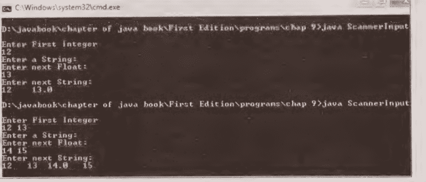

## 解释

我们用两组输入运行此示例以阐明区别。

- L2 `nextInt()` 返回输入到分隔符（默认为空格）为止的类型整数值。
- L4 `nextLine()` 方法继续读取输入直到遇到回车符，并将其作为字符串返回。回车符会被消耗且不会追加到字符串中。因此，当在使用 `nextInt()`、`nextFloat()` 或 `nextLong()` 等方法读取数字后使用 `nextLine()` 时，相应方法会返回数字并留下回车符。该回车符被 `nextLine()` 消耗，因此它不会在 L4 提示输入，因为在 L2 读取整数输入时输入的回车符被 `nextLine()` 消耗了。

> 程序的第一次输出显示 12 被 `nextInt()` 作为整数返回，且用户没有被提示输入值，因为回车符被 `nextLine()` 消耗并返回了空字符串。同样，13 被 `nextFloat()` 作为浮点数返回，由于上述原因，用户没有被提示输入任何值。程序的第二次输出澄清了这一概念：12 被 `nextInt()` 作为整数返回，13 被 `nextLine()` 作为字符串返回。同样，14 被 `nextFloat()` 作为浮点数返回，15 被 `nextLine()` 作为字符串返回。

## 输入/输出、序列化

```java
try {
    BufferedReader br = new BufferedReader(new InputStreamReader(System.in));
    String x = br.readLine();
} catch (IOException e) {
}
```

## 解释

- `BufferedReader` 对象用于获取输入。
- Java 6 引入了 `Console` 类来获取输入。
- `System` 类有一个静态方法 `console()` 返回 `Console` 对象。
- `readLine()` 是 `BufferedReader` 类中的重载方法，用于从用户处读取输入。
- 分隔符。

## 表 9.6 Console 类方法

| 方法 | 描述 |
| :--- | :--- |
| `void flush()` | 刷新控制台。 |
| `void format(String fmt, Object... args)` | 输出格式化字符串。 |
| `void printf(String fmt, Object... args)` | 输出格式化字符串。 |
| `Reader reader()` | 返回与控制台关联的 `Reader` 对象。 |
| `String readLine()` | 读取单行文本。 |
| `String readLine(String fmt, Object... args)` | 读取单行文本。 |
| `char[] readPassword()` | 读取单行文本（不显示）。 |
| `PrintWriter writer()` | 返回唯一的 `PrintWriter` 对象。 |

## 示例 9.5 Console 输入

```java
import java.io.*;
class ConsoleDemo {
    public static void main(String args[]) throws IOException {
        Console c = System.console();
        if (c != null) {
            String user = c.readLine("Enter username: ");
            String pno = c.readLine("Enter Phone No: ");
            String age = c.readLine("Enter age: ");
            char[] pass = c.readPassword("Enter password: ");
            System.out.printf("Welcome %s.\n", user);
            System.out.printf("Name: %s, Age: %s, Phone No: %s\n", user, age, pno);
            System.out.printf("The password you entered %s\n", new String(pass));
        }
    }
}
```

## 输出

```
Enter username: Tom
Welcome Tom.
Enter Phone No: 34343434
Enter age: 31
Name: Tom, Age: 31, Phone No: 34343434
Enter password: 
The password you entered 
```

## 解释

- L4 `System` 类有一个静态方法 `console()` 返回 `Console` 对象。


- L5 `readLine()` 是 `Console` 类中的重载方法，用于从用户处读取输入。字符串参数显示在控制台上。用户输入的值作为字符串返回。

- L6 `printf` 与 C 语言类似，在此类中添加了 `"\n"`，即 `printf()`。方法的第一个参数是 `"Welcome %s. Hope you had Day."`。`%1s` 的值从第二个参数开始的格式字符串中提取。

- `s` 指定字符串。

- `n` 指定参数索引。1 是第一个参数的索引。2 用于引用第二个参数，以此类推。

- 所以在 `%1s` 处，字符串 `user` 中的值（即 Tom）被放置并显示在控制台上（见输出）。

- L7 与 L5 类似。`n` 放在字符串开头以便在新行打印。

- L10 我们添加了这一行，并更改了参数列表中的参数顺序，以便你理解。

此行展示了另一种写入控制台的方法。你可以通过 `Console` 类的 `writer()` 方法获取 `PrintWriter` 对象。

L12 `PrintWriter` 的 `println()` 用于写入控制台，提示用户输入密码。

L13 `Console` 类提供了一个独特的方法 `readPassword()`，用于读取密码。

L14 与之前的 `print` 语句相似。但在这里，我们有一个要显示在屏幕上的字符数组。为了显示该字符数组，我们将数组传递给 `String` 类，然后进行显示。

注意 `readLine()` 方法返回一个字符串。如果我们需要数值输入，在这种情况下，可以使用 `java.lang` 包中包装类的某些静态方法将返回的字符串转换为相应的数值值。

```
int using Integer.parseInt()
float using Float.parseFloat()
double using Double.parseDouble()
long using Long.parseLong()
byte using Byte.parseByte()
short using Short.parseShort()
```

## 9.3.3 使用字符流读写文件

文件也是通过字符流进行读取和写的。`FileReader` 类用于读取文件内容。`FileWriter` 类用于向文件写入字符。读取和写入将以字符的形式进行。读取可以按字符进行（如示例 9.6 所示），也可以逐行进行。

## 示例 9.6 读取和写入文件

```java
L1 import java.io.*;
L2 class ReadWriteDemo1 {
L3 public static void main(String args[]) throws IOException {
  L4 File f = new File(args[0]);
  L5 int n;
  //读取文件
  L6 if(f.exists()) {
  L7 FileReader fr = new FileReader(f);
  System.out.println("Reading" +args[0]);
  L8 while((n = fr.read()) != -1)
  L9 System.out.print((char)n);
  L10 } else {
  L11 System.out.println(args[0]+ +"does not exist");
  //写入文件
  System.out.println("\nWriting" +args[1]);
  L12 FileWriter fw = new FileWriter(args[1]);
  L13 String s = "This is my sample File";
  L14 fw.write(s);
  L15 fw.close(); 
  }
}
```

```
Output
c:\javabook\programs\CHAP09~1>java ReadWriteDemo1 Sample1.txt Demo1.txt
Reading Sample1.txt
This is my sample File
Writing Demo1.txt
```

## 解释

### 读取文件

**L.4** 创建了 `File` 对象，并将名称作为命令行参数传递。

**L.5** 声明了整型变量 `n` 用于读取字符。

**L.6** 检查文件是否存在。如果存在，则执行 L7–9，否则执行 L11。

**L.7** 创建了 `FileReader` 对象，并将 L4 中引用的 `File` 对象传递给它。如果 `FileReader` 引用的文件不存在，将抛出 `FileNotFoundException`。

**L.8** 使用 `while` 循环通过 `FileReader` 的 `read()` 方法逐字符地读取文件。该方法将读取的字符作为整数返回，或者在到达文件末尾（EOF）时返回。该值存放在变量 `n` 中并检查是否等于 -1。`read()` 方法被重载，用于逐字符读取文件或将整个文件放入字符数组中。该方法在出现问题时抛出 `IOException`。

**L.9** 将整型变量 `n` 强制转换为字符并打印。

**L.10** L6 中定义的 `else` 分子句。

### 写入文件

**L.12** 创建了 `FileWriter` 对象，并将第二个命令行参数传递给对象的构造函数。如果文件已存在，它会被重写并创建一个新文件。

**L.13** 一个示例字符串。使用 `writer` 类的 `write()` 方法将字符串写入文件。`write()` 方法被重载，以接受字符数组、整数和字符串。

**L.15** 关闭 `FileWriter` 对象。

## 9.3.4 使用缓冲流类进行读写

`BufferedInputStream` 类用于输入缓冲，并支持重新读取文件的操作。`BufferedOutputStream` 用于输出缓冲并提高性能。在表 9.7 和表 9.8 分别列出了 `BufferedInputStream` 和 `BufferedOutputStream` 的方法列表。让我们举一个例子来展示这两个类。

### 表 9.7 `BufferedInputStream` 类的方法

| 方法 | 描述 |
| :--- | :--- |
| `int available()` | 返回可以在不阻塞的情况下从此输入读取的字节数。 |
| `void close()` | 关闭此输入流并释放资源。 |
| `void mark(int readlimit)` | 与 `InputStream` 的 `mark` 方法相似。 |
| `boolean markSupported()` | 测试输入流是否支持 `mark` 和 `reset` 方法。 |
| `int read()` | 与 `InputStream` 类相似。 |
| `int read(byte[] b, int off, int len)` | 从 `InputStream` 读取字节到从 off 开始的字节数组中，并返回读取的字节数。`len` 指定读取的最大字节数。 |
| `void reset()` | 与 `InputStream` 类的 `reset` 方法相似。 |
| `long skip(long n)` | 与 `InputStream` 类的 `skip` 方法相似。 |

### 表 9.8 `BufferedOutputStream` 类的方法

| 方法 | 描述 |
| :--- | :--- |
| `void flush()` | 刷新输出流。 |
| `void write(byte[] b, int off, int len)` | 将指定的字节数 (len) 写入从偏移量 (off) 开始的输出流。 |
| `void write(int b)` | 将指定的字节写入输出流。 |

## 解析

- L5 创建了 `FileReader` 对象，并将文件名作为参数传递给该类的构造函数。

- L7 创建了 `BufferedReader` 对象，并将 `FileReader` 对象传递给它。`BufferedReader` 对象为了效率起见对字符进行缓冲，它还支持 `mark` 和 `reset` 方法。

- L8 创建了 `PrintWriter` 对象以将内容写入到标准输出（`system.out`）。构造函数中指定的 `true` 是为了自动冲刷输出缓冲区。

- L10 和 11 创建了 `BufferedWriter` 对象，并将 `BufferedWriter` 对象传递到 `BufferedReader` 对象的构造函数中。

- L12 到 14 使用 `BufferedWriter` 的 `read()` 方法来从创建 `FileReader` 对象时指定的文件名读取字符串。返回值存储在 `str` 中，并检查其是否为 `null`。循环一直持续，直到 `str` 为 `null`（文件结束符 EOF）。`while` 循环按行打印文件（L13），然后使用 `BufferedWriter` 对象将其写入另一个文件（L14）。

## 9.4 文件的随机访问

`RandomAccessFile` 提供了从特定位置读取或写入文件的机会。该类有一个名为 `seek(long pos)` 的方法，它可以将文件指针设置为指定的位置（`pos`）。现在，对文件进行的任何读/写操作都将从此标记的位置开始。`RandomAccessFile` 方法的完整列表如表 9.9。在示例中，我们使用 `seek()` 将文件指针设置为文件末尾（EOF），然后将内容写入文件。换句话说，我们正在对文件进行追加。

### 表 9.9 `RandomAccessFile` 类的方法

| 方法 | 描述 |
| --- | --- |
| `void close()` | 关闭此随机访问文件流。 |
| `final FileChannel getChannel()` | 返回与此文件关联的唯一 `FileChannel` 对象。 |
| `long getFilePointer()` | 返回文件中当前的偏移量。 |
| `long length()` | 返回文件的长度。 |
| `int read()` | 从文件中读取一个字节的数据。 |
| `int read(byte[] b)` | 从文件中读取最多 `b.length` 个字节的数据到字节数组中。 |
| `int read(byte[] b, int off, int len)` | 从文件中读取最多 `len` 个字节的数据到字节数组中从偏移量 `off` 开始的位置。 |
| `final boolean readBoolean()` | 从文件中读取一个布尔值。 |
| `byte readByte()` | 从文件中读取一个有符号的八位值。 |
| `final char readChar()` | 从文件中读取一个字符。 |
| `final double readDouble()` | 从文件中读取一个 double 类型。 |
| `final float readFloat()` | 从文件中读取一个 float 类型。 |
| `int readInt()` | 从文件中读取一个有符号的 32 位整数。 |
| `final String readLine()` | 从此文件中读取文本的下一行。 |
| `final long readLong()` | 从文件中读取一个有符号的 64 位整数。 |
| `final short readShort()` | 从文件中读取一个有符号的 16 位数字。 |
| `void seek(long pos)` | 设置文件指针（从文件开始计算），下一次读或写操作将发生的位置。 |
| `void setLength(long newLength)` | 设置此文件的长度。 |
| `int skipBytes(int n)` | 跳过 n 个字节输入并丢弃跳过的字节。 |
| `final void write(byte[] b)` | 从指定的字节数组将 `b.length` 的字节写入文件，从当前文件指针开始。 |
| `final void write(byte[] b, int off, int len)` | 从指定的字节数组从偏移量 `off` 开始将 `len` 个字节写入文件。 |
| `final void write(int b)` | 将指定的字节写入文件。 |
| `final void write(boolean v)` | 将布尔值作为单字节值写入文件。 |
| `final void write(int v)` | 将字节作为单字节值写入文件。 |
| `final void write(String s)` | 将字符串作为字节序列写入文件。 |
| `final void writeChar(int v)` | 将字符作为双字节值写入文件，高字节在前。 |
| `final void writeChars(String s)` | 将字符串作为字符序列写入文件。 |
| `final void writeDouble(double v)` | 使用 `doubleToLong` 方法将 double 参数转换为 long，然后将该 long 值作为八字节数量写入文件，高字节在前。 |
| `final void writeFloat(float v)` | 使用 `floatToInt` 方法将 float 参数转换为 int，然后将该 int 值作为四字节数量写入文件，高字节在前。 |
| `final void writeInt(int v)` | 将 int 作为四字节写入文件，高字节在前。 |
| `final void writeLong(long v)` | 将 long 作为八字节写入文件，高字节在前。 |
| `final void writeShort(int v)` | 将 short 作为两个字节写入文件，高字节在前。 |

`java.lang.Appendable` 添加了一个由 `Writer` 类实现的接口。该接口有三个方法可以向写入器追加字符和字符串。这些方法的形式如下：

- `Writer append(char c)`
- `Writer append(CharSequence c)`
- `Writer append(CharSequence c, int start, int end)`

`java.lang.CharSequence` 是另一个表示字符值序列的接口。它的实现类有 `String`、`StringBuilder` 等。

## 9.9 随机访问文件

```java
import java.io.*;
class RandomAccessDemo {
  public static void main(String[] args) throws IOException {
    RandomAccessFile raf = new RandomAccessFile("Sample.txt", "rw");
    System.out.println("Opening the file");
    raf.seek(raf.length());
    System.out.println("Appending to file");
    String str;
    while ((str = raf.readLine()) != null) {
      System.out.println(str);
    }
    raf.close();
  }
}
```

## 输出

```
Opening the file
Appending to file
```


# 解析

- L5 创建了 `FileReader` 对象，并将文件名作为参数传递给该类的构造函数。
- L7 创建了 `BufferedReader` 对象，并将 `FileReader` 对象传递给它。`BufferedReader` 对象为了效率起见对字符进行缓冲，它还支持 `mark` 和 `reset` 方法。
- L8 创建了 `PrintWriter` 对象以将内容写入到标准输出（`System.out`）。构造函数中指定的 `true` 是为了自动冲刷输出缓冲区。
- L10 和 11 创建了 `BufferedWriter` 对象，并将 `BufferedWriter` 对象传递到 `BufferedReader` 对象的构造函数中。
- L12 到 14 使用 `BufferedWriter` 的 `read()` 方法来从创建 `FileReader` 对象时指定的文件名读取字符串。返回值存储在 `str` 中，并检查其是否为 `null`。循环一直持续，直到 `str` 为 `null`（文件结束符 EOF）。`while` 循环按行打印文件（L13），然后使用 `BufferedWriter` 对象将其写入另一个文件（L14）。

# 9.4 文件的随机访问

`RandomAccessFile` 提供了从特定位置读取或写入文件的机会。该类有一个名为 `seek(long pos)` 的方法，它可以将文件指针设置为指定的位置（`pos`）。现在，对文件进行的任何读/写操作都将从此标记的位置开始。`RandomAccessFile` 方法的完整列表如表 9.9。在示例中，我们使用 `seek()` 将文件指针设置为文件末尾（EOF），然后将内容写入文件。换句话说，我们正在对文件进行追加。

## 表 9.9 RandomAccessFile 方法列表（上）

| 方法 | 描述 |
| --- | --- |
| `void close()` | 关闭此随机访问文件流。 |
| `final FileChannel getChannel()` | 返回与此文件关联的唯一 `FileChannel` 对象。 |
| `long getFilePointer()` | 返回文件中当前的偏移量。 |
| `long length()` | 返回文件的长度。 |
| `int read()` | 从文件中读取一个字节的数据。 |
| `int read(byte[] b)` | 从文件中读取最多 `b.length` 个字节的数据到字节数组中。 |
| `int read(byte[] b, int off, int len)` | 从文件中读取最多 `len` 个字节的数据到字节数组中从偏移量 `off` 开始的位置。 |
| `final boolean readBoolean()` | 从文件中读取一个布尔值。 |
| `byte readByte()` | 从文件中读取一个有符号的八位值。 |
| `final char readChar()` | 从文件中读取一个字符。 |
| `final double readDouble()` | 从文件中读取一个 double 类型。 |
| `final float readFloat()` | 从文件中读取一个 float 类型。 |
| `int readInt()` | 从文件中读取一个有符号的 32 位整数。 |
| `final String readLine()` | 从此文件中读取文本的下一行。 |
| `final long readLong()` | 从文件中读取一个有符号的 64 位整数。 |
| `final short readShort()` | 从文件中读取一个有符号的 16 位数字。 |

# Java 编程

## 表 9.9 RandomAccessFile 方法列表（下）

| 方法 | 描述 |
| --- | --- |
| `void seek(long pos)` | 设置文件指针（从文件开始计算），下一次读或写操作将发生的位置。 |
| `void setLength(long newLength)` | 设置此文件的长度。 |
| `int skipBytes(int n)` | 跳过 n 个字节输入并丢弃跳过的字节。 |
| `final void write(byte[] b)` | 从指定的字节数组将 `b.length` 的字节写入文件，从当前文件指针开始。 |
| `final void write(byte[] b, int off, int len)` | 从指定的字节数组从偏移量 `off` 开始将 `len` 个字节写入文件。 |
| `final void write(int b)` | 将指定的字节写入文件。 |
| `final void write(boolean v)` | 将布尔值作为单字节值写入文件。 |
| `final void write(int v)` | 将字节作为单字节值写入文件。 |
| `final void write(String s)` | 将字符串作为字节序列写入文件。 |
| `final void writeChar(int v)` | 将字符作为双字节值写入文件，高字节在前。 |
| `final void writeChars(String s)` | 将字符串作为字符序列写入文件。 |
| `final void writeDouble(double v)` | 使用 `doubleToLongBits` 方法将 double 参数转换为 long，然后将该 long 值作为八字节数量写入文件，高字节在前。 |
| `final void writeFloat(float v)` | 使用 `floatToIntBits` 方法将 float 参数转换为 int，然后将该 int 值作为四字节数量写入文件，高字节在前。 |
| `final void writeInt(int v)` | 将 int 作为四字节写入文件，高字节在前。 |
| `final void writeLong(long v)` | 将 long 作为八字节写入文件，高字节在前。 |
| `final void writeShort(int v)` | 将 short 作为两个字节写入文件，高字节在前。 |

`java.lang.Appendable` 添加了一个由 `Writer` 类实现的接口。该接口有三个方法可以向写入器追加字符和字符串。这些方法的形式如下：
- `Writer append(char c)`
- `Writer append(CharSequence c)`
- `Writer append(CharSequence c, int start, int end)`

`java.lang.CharSequence` 是另一个表示字符值序列的接口。它的实现类有 `String`、`StringBuilder` 等。

# 9.9 随机访问文件

```java
import java.io.*;

class RandomAccessDemo {

  public static void main(String[] args) throws IOException {

    RandomAccessFile raf = new RandomAccessFile("Sample.txt", "rw");

    System.out.println("Opening the file");

    raf.seek(raf.length());

    System.out.println("Appending to file");

    String str;

    while ((str = raf.readLine()) != null) {

      System.out.println(str);

    }

    raf.close();

  }

}
```

# 输出

```
Opening the file
Appending to file
```

# 输入/输出、序列化与克隆 277

```java
L23 fcl1.close();
L24 fos.close();
} catch (Exception e) {
  System.out.println(e);
}}
```

# 输出

```
C:\javabook\programs\chap09\java ReadWriteUsingNIO
This is my sample File
C:\javabook\programs\chap09\edit samplenio.txt
welcome, writing to file using nio package
```

# 解析

- L1–3 显示了包的导入。导入了 `java.nio` 和 `java.nio.channels` 包。`ByteBuffer` 和 `MappedByteBuffer` 类属于 `java.nio` 包，而 `FileChannel` 属于 `java.nio.channels` 包。
- L7 和 8 使用 `FileOutputStream` 的 `getChannel()` 方法获取一个 `FileChannel` 对象。现在，该通道实际上代表了与文件（Sample.txt）的连接。一个 `FileChannel` 对象除了读写文件（a）之外，还可以（b) 将文件映射到内存 (c) 锁定文件 (d) 在指定位置读写文件 (e) 你可以强制文件通道写入存储设备。
- L9 `size` 返回文件的大小。使用 `FileChannel` 类的静态方法获取一个 `MappedByteBuffer` 对象。`MappedByteBuffer` 是一个字节缓冲区，其内容定义了映射的文件。`map` 方法接受三个参数：
  - 映射在文件中开始的位置。此值不能为负数。
  - 映射的大小。此值不能为负数。
- L11 和 14 使用 `for` 循环通过 `get` 方法从映射缓冲区中提取字符。`get` 方法返回读取的字节并移动位置指针。将字节值转换为字符并打印。
- L13 和 14 关闭了 `FileChannel` 和 `OutputStream` 对象。

# 向文件写入字符串

- L15 声明了 `String`。
- L16 和 17 与 L7 和 8 相同。区别在于，这里使用 `FileOutputStream` 来获取 `FileChannel` 对象。
- L18 `java.nio` 包包含一个 `ByteBuffer` 类。`ByteBuffer` 有一个静态方法用于创建缓冲区。该方法接受一个参数来设置缓冲器的大小。
- L19 使用 `String` 类的 `getBytes()` 方法将字符串转换为字节数组。
- L20 使用 `put` 方法将字节从数组传输到 `ByteBuffer`。
- L21 使用 `flip` 方法将位置设置为缓冲区的开头。在执行 `put` 操作后，该方法为写操作准备好缓冲区。
- L22 将 `ByteBuffer` 写入连接到 `FileOutputStream` 的 `FileChannel`。
- L23 和 24 关闭了 `FileChannel` 对象和 `OutputStream` 对象。

1. 提供了三种映射模式可用。
   - (a) 只读映射 (`FileChannel.MapMode.READ_ONLY`)
   - (b) 读写 (`FileChannel.MapMode.READ_WRITE`)。如果对缓冲区的内容进行操作，则它们会被写入映射的文件。
   - (c) 私有 - 缓冲区操作将不会写入文件。

`MapMode` 是 `FileChannel` 类中的一个静态内部类。`READ_ONLY`、`READ_WRITE`、`PRIVATE` 是该类中的静态字段。

# 9.6 JAVA 7 nio

Java 7 在 `java.nio` 包中增加了 `java.nio.file` 包，以增强 nio 功能并激励程序员使用新类如 `Files` 和接口如 `Path`，来代替 `java.io.File` 等旧类。此外还引入了一个新接口 `SeekableByteChannel`。

# 解析

- L1-3 导入了相关的包，以便可以使用 `java.io` 和 `java.nio` 中的新类和接口。
- L6 `Paths` 类的 `get` 方法用于指定需要访问属性的文件路径，并创建一个 `Path` 对象。在这个 `Path` 对象上可以使用一些基本方法，也可以将其传递给其他某些方法，正如我们将看到的。
- L7-11 展示了 `Path` 对象各种方法的用法，用于提取路径信息，例如：
  - `getNameCount()`——用于提取路径中存在的名称数量。
  - `getFileSystem()`——获取文件创建所在的文件系统。
  - `getFileName()`——获取文件名。
  - `getParent()`——获取路径对象（文件）的父路径。
  - `startsWith()`——返回一个布尔值，表示路径是否以方法的字符串参数开头。该路径以 `Demo.java` 开头，而不是以 `D` 或 `De`（参见输出）。
- L12-20 展示了 `Files` 类的静态方法的用法，用于提取文件信息，例如：
  - `Files.isHidden()`——返回一个布尔值，表示文件是否隐藏。
  - `Files.isDirectory()`——返回一个布尔值，表示路径是否指向目录。
  - `Files.isRegularFile()`——返回一个布尔值，表示文件是否为普通文件。
  - `Files.isExecutable()`——返回一个布尔值，表示文件是否可执行。
  - `Files.isReadable()`——返回一个布尔值，表示文件是否可读。
  - `Files.isWritable()`——返回一个布尔值，表示文件是否可写。
  - `Files.exists()`——返回一个布尔值，表示文件是否存在。
  - `Files.getLastModifiedTime()`——返回一个 `FileTime` 对象以识别最后修改时间。
  - `Files.size()`——返回一个 `long` 值，表示以字节为单位的文件大小。
  以上方法都接受一个参数，即作为 `Path` 对象的文件名。
- L21 创建另一个 `Path` 对象。
- L22 与 L11 相同。
- L23 检查已讨论过的文件是否存在。
- L24 检查两个文件是否使用了 `Files` 类中相同的静态方法 `isSameFile(Path, Path)`。这两个文件作为 `Path` 参数传递给该方法。
- L25-26 展示了如何创建文件的副本。`Files.copy` 方法将文件的内容复制到另一个文件中。`copy` 方法的通用符号为：
  ```
  Files.copy(Path source, Path target, CopyOption... options)
  ```
  前两个参数是作为 `Path` 对象的源路径和目标路径，最后一个是 `CopyOption` 对象。`CopyOption` 接口继承了枚举 `StandardCopyOption`，它包含三个枚举常量。这些常量可以作为最后一个参数指定。
  - `REPLACE_EXISTING`——替换现有文件。
  - `ATOMIC_MOVE`——原子性移动文件系统操作。
  - `COPY_ATTRIBUTES`——将属性复制到新文件。
- L27 `Files` 类的 `readAllLines` 方法用于读取 `Path` 对象的所有行内容。
- L28 展示了如何重命名文件。该方法需要三个参数：源、目标和复制选项。源和目标都是 `Path` 对象。如果你想重命名文件并让其保持在同一个程序中，可以使用如下所示的方法。目标 `Path` 对象（可以在其中指定文件名）可以通过源对象上的 `resolve` 方法来指定。如果将文件移动到新目录（作为 `Path` 对象的 `newdir`），则可以通过在新目录 `Path` 对象上使用 `resolve` 方法获取目标 `Path` 对象并保留文件名，如下所示：
  ```
  Files.move(source, newdir.resolve(source.getFileName()), REPLACE_EXISTING);
  ```
  或者指定任何名称。
  `Files.move(source, newdir.resolve(""))`
- L29 展示了如何删除文件。
- L31-37 展示了如何遍历目录，即打印目录内的所有文件。L31 演示了 `try-with-resources` 语句的使用。`Files` 类的 `newDirectoryStream` 方法用于访问 `Path` 对象。该 `Path` 对象将指向需要遍历的目录。`newDirectoryStream` 方法返回 `DirectoryStream<Path> ds`（我们将在第10章讨论此）。使用 `for-each` 循环逐个迭代集合的内容。
- L38-39 展示了如何将 `Path` 对象转换为旧的 `File` 对象。

`Files` 类的其他一些方法在表 9.11 中给出。

## 表 9.11 Files 类的部分方法

| 方法 | 说明 |
| --- | --- |
| `copy(InputStream in, Path target, CopyOption... options)` | 从输入流复制所有字节到文件。 |
| `copy(Path source, Path target, CopyOption... options)` | 将文件复制到目标文件。 |
| `createDirectory(Path dir, FileAttribute<?>... attrs)` | 创建一个新目录。 |
| `createFile(Path path, FileAttribute<?>... attrs)` | 创建一个新的空文件，如果文件已存在则失败。 |
| `createLink(Path link, Path existing)` | 为现有文件创建新链接。 |
| `createSymbolicLink(Path link, Path target, FileAttribute<?>... attrs)` | 创建指向目标的符号链接。 |
| `createTempDirectory(String prefix, FileAttribute<?>... attrs)` | 创建一个临时目录。 |
| `delete(Path path)` | 删除文件。 |


| 方法 | 说明 |
| --- | --- |
| `deleteIfExists(Path path)` | 如果文件存在则删除它。 |
| `exists(Path path, LinkOption... options)` | 测试文件是否存在。 |
| `write(Path path, byte[], OpenOption... options)` | 写入文件。 |
| `setAttribute(Path path, String attribute, Object value, LinkOption... options)` | 设置文件属性。 |
| `getAttribute(Path path, String attribute, LinkOption... options)` | 读取文件属性。 |
| `walkFileTree(Path path, FileVisitor<? super Path> visitor)` | 遍历文件树。 |

## 输入输出、序列化与克隆

| 方法 | 说明 |
| --- | --- |
| `newInputStream(Path path, OpenOption... options)` | 打开文件并返回输入流。 |
| `newOutputStream(Path path, OpenOption... options)` | 打开或创建文件，返回用于写入字节的输出流。 |
| `newByteChannel(Path path, OpenOption... options)` | 打开或创建文件，返回一个可寻字节通道。 |

## 9.7 序列化

序列化是将对象转换为字节的过程，以便使其能够持久化。通过写入文件来实现持久化。反序列化是序列化的逆过程，是将字节转换回对象。

问题出现了：为什么对象需要持久化？对象的状态由其属性（实例变量的值）定义。通常我们创建对象，处理它们，并在工作完成后由垃圾回收器自动处理。假设我们在以后某个时间点需要实例变量的值，这些值将不可用。这时，具有序列化对象的类必须实现 `Serializable` 接口。该接口是空的，不包含任何方法。类实现该接口是为了告知该类的对象是可以序列化的。那些我们不希望序列化的属性标记为 `transient`，例如温度。默认情况下，类的静态变量也不会被序列化。

### 示例代码

```java
L21 fos.close();
L22 FileInputStream fis = new FileInputStream("Serialize");
L23 ObjectInputStream ois = new ObjectInputStream(fis);
L24 System.out.println("Deserializing Object...");
L25 DateTimeTemp c1 = (DateTime)ois.readObject();
L26 System.out.println("Temperature: " +c1.temperature);
L27 System.out.println("Date, & Time: " +c1.d.getTime());
L28 ois.close();
L29 fis.close();
}}
```

### 输出

```
C:\javabook\programs\CHAP09-1>java TestSerialization
Serializing Object...
Values to be serialized...
Time: Thu Mar 12 20:46:12 IST 2009
ObjectSerialized...
Deserializing Object...
Temperature: 0.0
Date, & Time: Thu Mar 12 20:46:12 IST 2009
```

### 解释

- L1 导入了 package 包。
- L2 导入了 util 包，因为 calendar 类属于该包。
- L3 类继承了 `Serializable` 接口。
- L4 创建了 `Calendar` 类的引用变量。`transient` 字段（L5 float）中的值在序列化过程中不会被写入。
- L6 定义了该类的构造函数，它接受两个参数：`Calendar` 对象和代表温度的 float 值。
- L7 和 L8 使用传递给构造函数的值初始化了实例。
- L9 创建了 `Test` 类，用于序列化之前视图中的 `DateTime` 类。
- L11 由于 `Calendar` 是一个抽象类，无法直接实例化。因此，使用 `Calendar` 类的静态方法来获取日历实例。
- L12 创建了 `DateTimeTemp` 对象，并将其同一个作为温度的 float 值一并传递给它。该对象将被序列化。
- L13 为了序列化，我们需要一个可以写入文件的字节流类。创建了 `FileOutputStream` 并使用它打开 'serialize' 文件。如果文件已存在，将会被覆盖；如果不存在，则将创建一个新文件。
- L14 现在需要一个可以将对象写入 `OutputStream` 的类。因此，创建了 `ObjectOutputStream` 对象，并将 `FileOutputStream` 对象（L13）传递给 `ObjectOutputStream` 对象的构造函数。
- L15 打印 "Serializing Object..."。
- L16 打印 "Values to be serialized..."。
- L17 使用 `Calendar` 类的 `getTime()` 方法返回 `Date` 对象。打印这个 `Date` 对象时，会调用 `Date` 类的 `toString()` 方法。`Date` 类的 `toString()` 方法返回一个表示当前星期（日）、月份（March）、日期（15）、时间（HH:MM:SS 格式）、时区（IST）和年份（2009）的字符串（见输出）。
- L18 使用 `writeObject(t)` 方法将 `DateTime` 对象写入连接到它的 `FileOutputStream`。
- L19 打印 "ObjectSerialized..."。
- L20 和 L21 我们必须将存储在文件（serialize）中的字节转换回对象。为了这个目的，我们首先需要打开文件读取字节。这就是为什么创建了 `FileInputStream` 对象，并将文件名传递给该对象的构造函数。
- L23 `InputStream` 用于对象的反序列化。创建了它的对象并将 `FileInputStream` 对象（L23）传递给它。
- L24 打印 "Deserializing Object........."。
- L25 `readObject()` 方法用于从 `InputStream` 读取对象。该方法返回一个类型为 `Object` 的对象，并强制转换为你定义的类类型，即 `DayTemp`。如果不进行强制转换，尝试访问 `DayTempValue` 的变量将导致编译错误，因为这些变量不属于 `Object` 类。
- L27 打印反序列化对象中的温度，由于它是 `transient` 字段，结果为 0.0（见输出）。
- L28 与 L17 相同，在此行中，对象用于反序列化。
- L29 关闭 `InputStream`。

## 9.8 克隆 (Cloning)

克隆本质上是创建现有对象的副本。克隆有两种类型：浅拷贝（shallow copy）和深拷贝（deep copy）。浅拷贝创建类的新实例，并将所有字段复制到新实例并返回。如果类包含引用，在浅拷贝时，这些引用在原始对象和克隆对象之间共享。在深拷贝中，原始对象中的对象引用被递归地复制。注意，序列化也可以作为深拷贝的替代方案，因为序列化包含了深拷贝。Java 创建对象有两种方式，除了 `new` 运算符外还有 `clone()` 和 `newInstance()`。`newInstance()` 是 `java.lang.Class` 的方法，通常由类加载器动态扩展。`clone()` 方法是 `Object` 类的成员，用于复制对象。让我们详细讨论 `clone()` 方法。如果你想创建一个现有对象的副本，可以调用 `clone` 方法。`Cloneable` 接口是一个空接口。想要克隆对象的类必须实现 `Cloneable` 接口。如果对未实现接口的类调用 clone，将抛出 `CloneNotSupportedException`。它返回对象的精确副本。下面的示例说明了浅拷贝。

### 示例 9.1 浅拷贝

```java
class CloneDemo implements Cloneable {
  // 实例变量
  private int value;
  // 构造函数
  CloneDemo(int v) {
    value=v;
  }
  public Object clone() {
    try {
      return super.clone();
    } catch (CloneNotSupportedException e) {
      System.out.println(e);
      return null;
    }
  }
  public int increment() {
    return ++value;
  }
  public int getValue() {
    return value;
  }
  public void setValue(int v) {
    value=v;
  }
} // CloneDemo 类结束

class TestClone {
  public static void main(String[] args) {
    CloneDemo d=new CloneDemo(23);
    System.out.println("Value in original object: "+d.getValue());
    CloneDemo cd=(CloneDemo)d.clone();
    System.out.println("Original object: "+d);
    System.out.println("Cloned object: "+cd);
    System.out.println("Value in cloned object: "+cd.getValue());
    cd.increment();
    System.out.println("Value after increment in cloned object: "+cd.getValue());
    System.out.println("Value in original object: "+d.getValue());
  }
}
```

### 输出

```
D:\javabook\Second Edition\programs>java TestClone
Value in original object: 23
Original object: CloneDemo@18a92f
Cloned object: CloneDemo@4f1d0d
Value in cloned object: 23
Value after increment in cloned object: 24
Value in original object: 23
```

### 解释

- L1 类实现了 `Cloneable` 接口，表示该类的对象可以克隆。
- L2 声明了一个实例变量。
- L3 定义了一个构造函数来初始化实例变量。
- L4 重写了 `Object` 类的 `clone()` 方法。
- L5-6 声明了一个 `try` 块并调用 `super.clone()`。该方法创建被调用对象的副本，其实例成员具有相似的值。如果类没有实现 `Cloneable` 接口，`clone()` 方法可能会抛出 `CloneNotSupportedException`。该方法创建被调用对象的副本。这个副本是对象的一个复制品。
- L7-9 声明了一个 `catch` 块来捕获 `CloneNotSupportedException`。如果 `clone` 方法产生异常，则返回 `null`。
- L10-11 声明了 `increment()` 返回实例变量的值。
- L12-13 定义了 `getValue()` 返回实例变量的值。
- L14-15 定义了 `setValue()` 来设置实例变量的值。
- L16 定义了 `TestClone` 类来测试 `CloneDemo` 对象的克隆。
- L17 声明了 `main()` 方法。
- L18 创建了一个 `CloneDemo` 对象（见图 9.3）。
- L19 使用 `getValue()` 方法获取并打印创建的对象的值（见输出）。
- L20 使用 `clone()` 方法创建原始对象（L18 中）的克隆。`clone()` 方法的返回类型是 `Object`，必须转换回 `CloneDemo` 才能访问类的方法和变量（见图 9.3）。
- L21-22 打印两个对象（原始对象和克隆对象）以显示它们是不同的对象。从屏幕打印的输出显而易见。对象内部地址的十六进制表示并不相同。这清楚地表明有两个不同的对象指向同一个内存位置（见输出和图 9.3）。
- L23 打印克隆对象的实例变量的值，即 23。
- L24 增加克隆对象的实例变量的值。
- L25 打印克隆对象的实例变量的值。现在值是 24（见输出）。
- L26 打印原始对象的实例变量的值，即 23。对克隆对象的增加对原始对象的实例变量没有影响。

> `clone()` 方法是 `Object` 类中的一个受保护的方法。因此，子类和包内的类可以访问它。如果你希望访问任何包中的任何类，那么你需要重写并将其声明为公共方法。

### 示例 9.14 包含其他类引用的类的浅拷贝

```java
/* 该类的引用将作为另一个类的实例变量使用 */
class CloneReferenceTest
{
    int value;
    CloneReferenceTest(int v)
    {
        this.value=v;
    }
}
class CloneDemo implements Cloneable
{
    // 创建了对象引用
    CloneReferenceTest br;
    CloneDemo()
    {
        br = new CloneReferenceTest(12);
    }
    // 重写了 clone 方法
    public Object clone()
    {
        try {
            return super.clone();
        }
        catch(CloneNotSupportedException e)
        {
            System.out.println(e);
            return null;
        }
    }
}
// 为测试克隆声明的类
class TestClone {
    public static void main(String[] args) {
        CloneDemo d = new CloneDemo();
        CloneDemo cd = (CloneDemo)d.clone();
        System.out.println("Original object: " + d);
        System.out.println("Original object inner reference: " + cd.br);
        d.br.value = 11;
        System.out.println("Original object inner reference variable: " + d.br.value);

        System.out.println("Cloned object: " +cd);
        System.out.println("Cloned object inner reference: " +cd.br);
        System.out.println("Cloned object inner reference variable: " +cd.br.value);
    }
}
```

### 输出

```
D:\javabook\Second Edition\programs\java TestClone
Original object d: CloneDemo@3c749
Original object inner reference: CloneReferenceTest@150bd4d
Original object inner reference instance variable: 11
Cloned object cd: CloneDemo@1bc4459
Cloned object inner reference: CloneReferenceTest@150bd4d
Cloned object inner reference instance variable: 11
```

### 解析

- L1–4 声明了一个类，即 `CloneReferenceTest`，它将在 `CloneDemo` 类中使用。早些时候我们使用基本类型作为实例变量。在例例中，我们解释了为什么将 `CloneReferenceTest` 的引用变量作为 `CloneDemo` 的实例变量。该引用变量在 `CloneReferenceTest` 的构造函数中实例化。
- L7–8 声明了 `CloneDemo` 的构造函数。该构造函数初始化了类的实例变量。因此，引用变量（L6）通过创建 `CloneReferenceTest` 对象并将其赋值给该引用变量来初始化。


- L5 定义了类 `CloneDemo`。该类继承了 `Cloneable` 接口，因为我们要创建该类的克隆。

- L9–14 在上一个示例中重写并实现了 `clone` 方法。

- L6 定义了类的实例变量。它基本上是一个类型为 `CloneReferenceTest` 的引用变量。

- L15 测试并克隆创建的对象，我们在上一个示例中创建了一个 `TestClone` 类。

- L16 主方法声明。

- L17–18 创建了 `CloneDemo` 类的对象及其克隆。创建 `CloneDemo` 对象会导致在 `CloneDemo` 类构造函数内部程序化地创建一个 `CloneReferenceTest` 对象。`CloneReferenceTest` 构造函数初始化其值实例字段为 12。`clone` 方法的返回类型为 `Object`，因此它返回克隆对象的拷贝作为对象，并被强制转换回 `CloneDemo` 以访问该类的方法和变量。

- L23–24 打印克隆对象及其正在使用的对象引用（作为其实例变量）。原始对象和克隆对象内部地址的十六进制表示不同。这清楚地表明它们是两个不同的对象。但这些对象使用的对象引用（它们各自变量）的内部地址十六进制表示是相同的。这意味着原始和克隆对象的实例变量对象引用指向同一个内存位置。位置实例变量（值）的变化将在使用克隆对象（`cd`）访问实例变量时反映出来（见图 9.4）。

- L19–20 打印原始对象及其使用的对象引用（作为其实例变量）。

- L21 原始对象中的实例变量减一。该变量包含在 `CloneReferenceTest` 类中。要访问该变量我们使用 `d.br`，其中 `br` 作为 `d` 的实例成员可以通过点运算符访问，`value` 实例变量也是如此。

- L22 打印减一后的实例变量值：`value`。

- L25 使用克隆对象打印实例变量值。由于上述原因，此值与使用原始对象时的值相似。

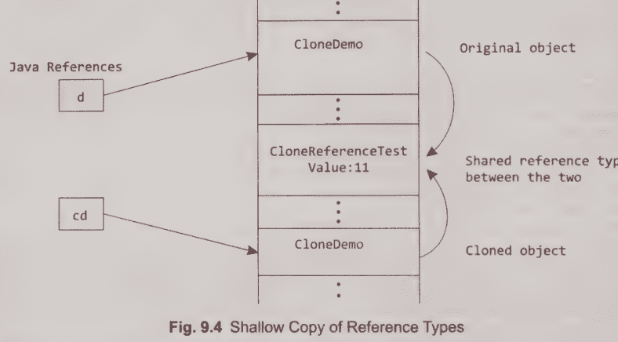

正如我们在示例 9.13 中看到的，如果我们想深拷贝对象，`CloneDemo` 中的所有引用类型也应该被克隆。

## 示例 9.15 深拷贝

```java
// 输入/输出，序列化和克隆
class CloneReferenceTest
{
    int value;
    CloneReferenceTest(int v)
    {
        this.value = v;
    }
}
class CloneDemo implements Cloneable
{
    // 创建了对象引用
    CloneReferenceTest br;
    CloneDemo()
    {
        br = new CloneReferenceTest(12);
    }
    // 重写了 clone 方法
    public Object clone()
    {
        try {
            return super.clone();
        }
        catch (CloneNotSupportedException e)
        {
            System.out.println(e);
            return null;
        }
    }
}
// 为测试克隆声明的类
class TestClone {
    public static void main(String[] args) {
        CloneDemo d = new CloneDemo();
        CloneDemo cd = (CloneDemo)d.clone();
        System.out.println("Original object: " + d);
        System.out.println("Original object inner reference: " + cd.br);
        d.br.value = 11;
        System.out.println("Original object inner reference variable: " + d.br.value);

        System.out.println("Cloned object: " +cd);
        System.out.println("Cloned object inner reference: " +cd.br);
        System.out.println("Cloned object inner reference variable: " +cd.br.value);
    }
}
```

# 总结

JDK 1.4 在 `java.io` 包之外还引入了 `java.nio` 包。Java 的 I/O 基于流：字节流和字符流。本章已经讨论了这两者中的几个类。这些文件展示了如何读取和写入数据（字节和字符）。`RandomAccessFile` 类用于通过在指定文件的特定点设置文件位置来随机读写文件。Java 6 引入了 `Console` 类用于与用户进行输入输出。`java.nio` 还有一些子包，如 `java.nio.channels`（用于创建通道等）。`FileChannel` 用于建立与文件的连接，以便对其进行读取、写入、映射和锁定。`java.nio` 包中的 `ByteBuffer` 类用于映射文件。序列化用于将对象转换为字节流，而反序列化则执行反向操作。Java 7 重新引入了 `java.nio` 包并添加了新类如 `File` 和接口 `Path`，以替换如 `java.io` 等旧有类。`java.nio.channels` 包中添加了一个新接口 `SeekableByteChannel`，它提供了类似于 `java.io.RandomAccessFile` 的功能。本章还详细讨论了浅拷贝和深拷贝。

# 练习题

- 1. 用于读取字符的所有类的父类是哪一个？

  (a) `Reader`

  (b) `FileReader`

  (c) `BufferedReader`

  (d) `InputStream`

- 2. 用于写入字节的类的父类是哪个抽象类？

  (a) `Writer`

  (b) `FileWriter`

  (c) `CharWriter`

  (d) `OutputStream`

- 3. 写出允许从输入流读取 Java 原始数据类型的二进制表示的类。

  (a) `DataWriter`

  (b) `FileWriter`

  (c) `DataInputStream`

  (d) `DataOutputStream`

- 4. 下列类中哪些是抽象类？

  (a) `FilterWriter`

  (b) `Reader`

  (c) `InputStream`

  (d) 以上所有

- 5. 写出 `InputStream` 类中定义的 `read` 方法抛出的异常。

  (a) `ArithmeticException`

  (b) `NullPointerException`

  (c) `IOException`

  (d) `IllegalAccessException`

- 6. 当你尝试编译并运行代码并在用户提示符处输入以下内容--"MyValue"时，会发生什么？

```java
import java.io.*;
class Demo6 {
    public static void main(String args[]) {
        Console c = System.console();
        String x = c.readLine("Enter value:");
        int a = Integer.parseInt(x)+10;
        c.printf("the value is %d\n", a);
    }
}
```

- 7. 当你尝试编译并运行代码时，会发生什么？（假设当前目录下存在 `abc.txt`）

```java
import java.io.*;
class Demo6 {
    public static void main(String args[]) {
        FileInputStream fis = new FileInputStream("abc.txt");
        System.out.println("size:"+fis.available());
    }
}
```

  (a) 无法编译

  (b) 编译成功但在运行时产生异常。

  (c) 执行成功

  (d) 在读取文件中可用字节时产生 `IOException`

- 8. 当你尝试编译并运行代码且 `.txt` 文件不存在时，会发生什么？

  (a) 抛出 `ArithmeticException`

  (b) 抛出 `NullPointerException`

  (c) 抛出 `IOException`

  (d) 抛出 `FileNotFoundException`

- 9. 下列哪是在 Java 7 中引入以替换 `RandomAccessFile` 的？

```java
import java.io.*;
class Demo6 {
    public static void main(String[] args) {
        throws Exception {
            FileInputStream fis = new FileInputStream("abc.txt");
            System.out.println("size:"
                +fis.available());
        }
    }
}
```

  (a) `java.nio.SeekableByteChannel`

  (b) `java.nio.channels.ByteChannel`

  (c) `java.nio.channels.SeekableByteChannel`

- 10. 下列哪个在 Java 7 中引入以替换 `RandomAccessFile`？（注：此处题目与第9题重复，已翻译原文）

  (a) `java.nio.File` class

  (b) `File` class

  (c) `java.nio.File`

  (d) 以上所有

# 复习题

- 1. 用于读取字符的所有类的父类是哪一个？

- 2. 用于写入字节的类的父类是哪个抽象类？

- 3. 写出允许从输入流读取 Java 原始数据类型的二进制表示的类。

- 4. 下列类中哪些是抽象类？

- 5. 写出 `InputStream` 类中定义的 `read` 方法抛出的异常。

- 6. 当你尝试编译并运行代码并在用户提示符处输入以下内容--"MyValue"时，会发生什么？

- 7. 当你尝试编译并运行代码时，会发生什么？（假设当前目录下存在 `abc.txt`）

- 8. 当你尝试编译并运行代码且 `.txt` 文件不存在时，会发生什么？

- 9. 下列哪是在 Java 7 中引入以替换 `RandomAccessFile` 的？

- 10. 下列哪个在 Java 7 中引入以替换 `RandomAccessFile`？

- 1. 解释序列化和 `RandomAccessFile` 类的用途。

- 2. 详细说明所有输入方式。

- 3. 解释 `FileInputStream` 和 `BufferedInputStream` 的区别。

- 4. 解释术语：

  (a) 内存映射

  (b) 虚拟内存

  (c) 文件通道

- 5. 什么是序列化？为什么？

- 6. 解释 Java 7 的增强。

- 7. 解释浅拷贝和深拷贝。

## 编程练习

- 1. 写一个程序列出目录中的所有文件，包括子目录中的文件。使用递归。

- 2. 使用 `Appendable` 接口向文件追加数据。从用户处获取目录路径。

- 3. 写一个程序以字节形式读取文件内容并复制到另一个文件。从用户处获取文件名。

- 4. 写一个程序以字符数组读取文件内容并写入另一个文件。从用户处获取。

- 5. 写一个程序将原始数据类型（`byte`、`short`、`int`、`long`）写入（使用 `RandomAccessFile`）。

- 6. 使用 `FileWriter` 类向文件追加数据（使用 `File` 类）。

- 7. 写一个程序映射文件到（使用 `java.nio` 包）。

- 8. 创建一个具有静态字段 `x` 和瞬态字段 `z` 的类。通过构造函数初始化它们。序列化该类并进行反序列化。

- 9. 写一个程序创建一个存储员工信息的顺序文件。信息包括 `empName`、`empAge`、`empDept` 和 `empSal`。使用集合。

- 10. 文件有多少行、单词和字符？编写一个程序来实现。

# 项目工作

使用 Java 文件模拟员工数据库。该数据库包含姓名、地址、电话号码、职位和薪水。提供添加新记录、删除记录、搜索记录和更新记录的功能。当添加新记录时，应自动生成员工 ID。该员工 ID 将类似于数据库中的主键。在删除和更新之前，必须提示用户确认，例如：“确定要删除该记录吗？是/否”。

# 型、java.util 以及其他 API

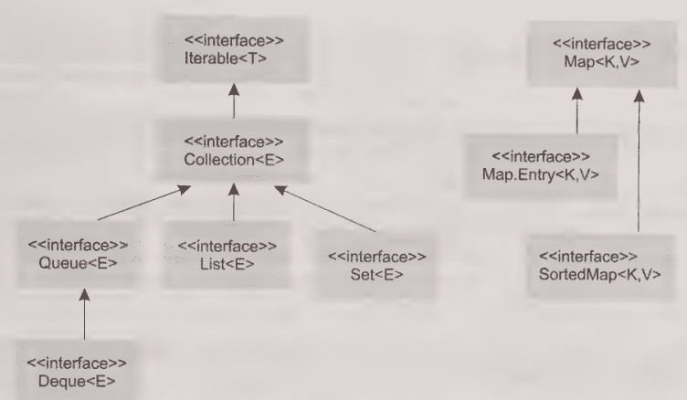

图 10.1 集合继承层次结构

例如 `LinkedList`、`Stack` 和 `Vector`。除了 collection 之外，我们还展示了另一个处理对（即键/值对）的 `Map`。该接口有一个嵌套的接口 `entry`。我们将在本章中讨论详细细节。表 10.1 列出了 collection 接口的方法。

# 表 10.1 collection 接口的方法

| 方法 | 描述 |

|---|---|

| `boolean add(E e)` | 将指定的元素添加到集合并返回 true。只有在集合不接受重复项（如 `Set`）时才返回 false。 |

| `boolean addAll(Collection<? extends E> c)` | 将指定集合中的所有元素添加到此集合中，如果集合发生变化则返回 true。 |

| `void clear()` | 通过移除此集合中的所有元素来清空集合。 |

| `boolean contains(Object o)` | 如果此集合包含指定的对象，则返回 true。 |

| `boolean containsAll(Collection<?> c)` | 如果此集合包含指定集合中的所有元素，则返回 true。 |

| `boolean equals(Object o)` | 将指定的对象与此集合进行等值比较，如果相等则返回 true。 |

| `int hashCode()` | 返回集合的哈希值。 |

| `boolean isEmpty()` | 如果此集合为空，则返回 true。 |

| `Iterator<E> iterator()` | 返回一个用于遍历此集合中元素的迭代器。 |

| `boolean remove(Object o)` | 如果此集合中存在指定的元素，则从集合中移除该元素的实例。 |

（续）

# 298 Java 编程

（表 10.1 续）

| 方法 | 描述 |

| --- | --- |

| `boolean removeAll(Collection<?> c)` | 移除此集合中所有包含在指定集合中的元素。 |

| `boolean retainAll(Collection<?> c)` | 保留此集合中仅包含在指定集合中的元素。 |

| `int size()` | 返回集合中元素的数量。 |

| `Object[] toArray()` | 返回一个包含此集合中所有元素的数组。对象的返回类型将是 `Object` 类型。 |

| `<T> T[] toArray(T[] c)` | 创建一个包含此集合中所有元素的数组。对象的类型将根据集合中对象的类型。 |

> 图 10.1 未显示集合中的所有接口。请参阅 JDK 6 文档获取完整的接口列表。

`java.lang.Iterable` 接口由 JDK 1.5 添加，`Collection` 接口被设计为继承，以便可以使用 for-each 循环遍历对象。该接口提供了一个名为 `iterator()` 的方法，返回一个用于遍历集合中所有对象的迭代器。`Collection` 接口由抽象类 `AbstractCollection` 实现，它是所有集合类的父类，并实现了 `Collection` 接口的几乎所有方法。

`List` 指的是一个有序但允许重复的对象的集合。将 `List` 视为有序，是因为用户可以完全控制对象插入到列表的顺序。`List` 接口的顶层是一个抽象类 `AbstractList`（它是 `AbstractCollection` 的子类）。`AbstractList` 实现了 `List` 接口的所有方法（如表 10.2 所示），并有三个子类 `AbstractSequentialList`、`ArrayList` 和 `Vector`。`LinkedList` 是 `AbstractSequentialList` 的子类，其定义在 JDK 1.6 中被修改以实现 `Queue` 接口。`Queue` 接口的方法列在表 10.3 中。`Stack` 是 `Vector` 类的子类。

# 表 10.2 List 接口的方法

| 方法 | 描述 |

| --- | --- |

| `boolean add(E e)` | 将指定的元素添加到列表末尾。 |

| `void add(int index, E element)` | 在列表的指定位置插入指定的元素。 |

| `boolean addAll(Collection<? extends E> c)` | 按照指定迭代器返回的顺序，将指定集合中的所有元素添加到此列表的末尾。 |

| `boolean addAll(int index, Collection<? extends E> c)` | 将指定集合中的所有元素插入列表的指定位置。 |

| `void clear()` | 通过移除列表中的所有元素来清空。 |


| 方法 | 描述 |
|---|---|
| boolean contains(Object o) | 如果此列表包含指定的元素，则返回 true。 |

（续）

## 表 10.2（续） List 接口的方法

| 方法 | 描述 |
|---|---|
| boolean containsAll(Collection<? extends E> c) | 如果此列表包含指定集合的所有元素，则返回 true。 |
| boolean equals(Object o) | 将指定的对象与此列表进行等值比较。 |
| E get(int index) | 返回列表指定位置上的元素。 |
| int hashCode() | 返回此列表的哈希值。 |
| int indexOf(Object o) | 返回指定元素在列表中第一次出现的索引，如果列表不包含该元素，则返回 -1。 |
| boolean isEmpty() | 如果此列表不包含元素，则返回 true。 |
| Iterator<E> iterator() | 返回一个用于遍历此集合中元素的迭代器。 |
| int lastIndexOf(Object o) | 返回指定元素在列表中最后一次出现的索引，如果列表不包含该元素，则返回 -1。 |
| ListIterator<E> listIterator() | 返回一个用于遍历元素的列表迭代器。 |
| E set(int index, E element) | 设置指定位置的元素。 |
| boolean remove(Object o) | 如果此列表中存在指定的元素，则从列表中移除。 |
| boolean removeAll(Collection<?> c) | 移除此列表中所有包含在指定集合中的元素。 |
| boolean retainAll(Collection<?> c) | 保留此列表中仅包含在指定集合中的元素。 |
| int size() | 返回集合中元素的数量。 |
| List<E> subList(int fromIndex, int toIndex) | 返回指定索引之间的列表视图。 |
| Object[] toArray() | 返回一个包含此集合中所有元素的数组。 |
| <T> T[] toArray(T[] a) | 创建包含此集合中所有元素的数组。 |

## 表 10.3 Queue 接口的方法

| 方法 | 描述 |
|---|---|
| boolean add(E e) | 将指定的元素添加到队列，如果成功则返回 true。 |
| boolean offer(E e) | 将指定的元素插入队列，如果成功返回 true，否则返回 false。 |
| E element() | 获取但不移除队列头部；如果为空则抛出异常。 |
| E poll() | 获取并移除队列头部，如果为空则返回 null。 |
| E peek() | 获取但不移除队列头部，如果为空则返回 null。 |

`java.lang.Iterable` 接口由 JDK 1.5 添加，`Collection` 接口被设计为继承，以便可以使用 for-each 循环遍历对象。该接口提供了一个名为 `iterator()` 的方法，返回一个用于遍历集合中所有对象的迭代器。`Collection` 接口由抽象类 `AbstractCollection` 实现，它是所有集合类的父类，并实现了 `Collection` 接口的几乎所有方法。

`List` 指的是一个有序但允许重复的对象的集合。将 `List` 视为有序，是因为用户可以完全控制对象插入到列表的顺序。`List` 接口的顶层是一个抽象类 `AbstractList`（它是 `AbstractCollection` 的子类）。`AbstractList` 实现了 `List` 接口的所有方法（如表 10.2 所示），并有三个子类 `AbstractSequentialList`、`ArrayList` 和 `Vector`。`LinkedList` 是 `AbstractSequentialList` 的子类，其定义在 JDK 1.6 中被修改以实现 `Queue` 接口。`Queue` 接口的方法列在表 10.3 中。`Stack` 是 `Vector` 类的子类。我们将在本章后面讨论这些类。

`Queue` 是一种用于在处理之前存储元素的集合。队列通常支持先进先出（FIFO）操作，但某些类型可能支持后进先出（LIFO）或基于优先级的排序。`Queue` 接口提供了插入、移除和检查头部的方法。

`Set` 是一个不包含重复元素的集合。`Set` 接口基于数学集合抽象建模。`Set` 接口有多种实现方式，例如 `HashSet`、`LinkedHashSet` 和 `TreeSet`。它们在性能和排序方面具有不同的特性。

`Map` 是一个将键映射到值的对象。`Map` 不能包含重复的键；每个键可以精确映射到一个值。`Map` 接口提供了放入、获取以及检查键和值的方法。常见的实现包括 `HashMap`、`LinkedHashMap` 和 `TreeMap`。

`AbstractMap` 类实现了 `Map` 接口中的泛型、`java.util` 以及其他 API 方法。此类被 `HashMap`、`EnumMap` 等具体类继承。`TreeMap` 也继承了此类以及 `SortedMap` 接口。

`java.util` 包中的大多数接口和类都使用了泛型。这从大多数接口和类声明以及某些方法使用的语法（例如 `<E>, <? extends E>`）中可以明显看出。因此，让我们先讨论泛型背后的概念。

# 10.2 泛型

这一特性是在 Java 5 中引入的，目的是在编译时提供严格的类型检查。泛型功能还允许同一个类被许多对象集合（如字符串、整数和 `Generic`）使用。考虑以下示例，我们创建了三个名称 A、B 和 `GenericTest`。`GenericTest` 类有一个 `ArrayList` 集合来存放对象。A 和 B 的对象被放在其中，稍后我们尝试检索它们。当我们编译程序时，DOS 提示符处会出现两条注释，要求用户指定 `javac` 的 `-Xlint:unchecked` 选项重新编译程序。该选项用于显示所有警告，特别是未检查的警告（如“编译程序时发生了什么？”章节所示）。如果我们使用 `-source` 选项编译程序并指定 1.5 之前的 JDK 版本（即 `javac -source 1.4 GenericTest.java`），则这些警告可以被抑制。

## 示例 10.1(a) 泛型的使用

```java
import java.util.*;
class A {
    public String toString() {return "Class A Object";}
}
class B {
    public String toString() {return "Class B object";}
}
class GenericTest {
    public static void main(String args[]) {
        List v = new ArrayList();
        v.add(new A());
        v.add(new B());
        Iterator en = v.iterator();
        while(en.hasNext()) {
            A o = (A)en.next();
            System.out.println(o);
        }
    }
}
```

### 编译程序时发生了什么？

```
C:\javabook\programs\chap10>javac GenericTest.java
Note: GenericTest.java 使用了未检查或不安全的操作。
Note: 请使用 -Xlint:unchecked 重新编译以获取详情。
```

```
C:\javabook\programs\chap10>javac -Xlint:unchecked GenericTest.java
GenericTest.java:14: warning: [unchecked] unchecked call to add(E) as a member of the raw type List
v.add(new A()));
^
  where E is a type-variable:
    E extends Object declared in interface List
GenericTest.java:15: warning: [unchecked] unchecked call to add(E) as a member of the raw type List
v.add(new B()));
^
  where E is a type-variable:
    E extends Object declared in interface List
GenericTest.java:16: warning: [unchecked] unchecked call to add(E) as a member of the raw type List
v.add(new B()));
^
  where E is a type-variable:
    E extends Object declared in interface List
3 warnings
```

### 输出

```
C:\javabook\programs\chap10>java GenericTest
Class A Object
Class A Object
Exception in thread "main" java.lang.ClassCastException: B cannot be cast to A
    at GenericTest.main(GenericTest.java:21)
```

### 解释

- **L1** 导入 `java.util` 包。
- **L2–5** 定义了两个类 `A` 和 `B`，它们有自己的 `toString()` 方法。
- **L6** 定义了类 `GenericTest`。
- **L7** 内部定义了 `main` 方法。
- **L8** 创建了一个 `ArrayList` 对象。该对象将作为对象的容器。`ArrayList` 显示了动态数组的功能。数组的局限性是无法增大或缩小大小，而对象可以根据需要增大或缩小。
- **L9–11** 使用 `add` 方法将对象添加到 `ArrayList` 中。集合中添加了两个 `A` 对象和一个 `B` 对象。
- **L12** 使用 `iterator()` 获取一个 `Iterator` 对象以逐个遍历集合。
- **L13–15** 使用 `while` 循环逐个遍历集合。`hasNext()` 方法告诉集合是否还有更多元素。循环将持续到集合中没有更多元素可以迭代。`next()` 的返回类型返回集合中的下一个对象。这是一个 `Object` 对象（父类）。该对象是 `A` 并被打印出来。当你运行程序进行前两次迭代时，强制转换是合法的，因为检索的对象是 `A`。但在第三次迭代中，检索的对象类型是 `B`，因此强制转换是非法的。为什么输出中显示了 `ClassCastException`（正因为这个原因，我们在编译程序时收到了未检查的警告）。

> 问题的发生是因为对放入集合的类型没有限制。在较早的示例中，我们在集合中既有 `A` 对象也有 `B` 对象，并且我们将所有对象强制转换为 `A`，这在运行时触发了报警。在编译时检查进入集合的内容会更好，这样在运行时就不会发生异常了。

如果我们能确保集合中只进入 `A` 对象，那么问题就可以解决，这正是泛型提供帮助的地方。大多数接口、类以及方法都已修改为使用泛型语法。`List` 的泛型声明如下：

```java
List<E> v = new ArrayList<E>();
// 正如所示，这个 E 已替换为 A。通常使用单个大写
// 字符表示泛型形式参数。
```

## 泛型、java.util 以及其他 API

考虑这种情况：如果一个 `List<String>` 是一个 `List<Object>`，这意味着上述修改后的 L13 似乎是有效的。那么我们也可以在程序中插入代码来向该 `List` 添加任意类型的对象。现在，当我们检索它们并尝试将其存储在 `List<String>` 中，它会抛出类型转换异常，因为我们正尝试将一个 `Object` 存储到字符串中。因此，`List<Object>` 并不是 `List<String>`，反之亦然。

如果你想像以前那样灵活地使用这些类（即不使用参数化类型），那么你要么必须抑制警告，要么在类型特定类型的集合时保持刻板。其实，有一个中间地带，我们可以使用泛型语法使用集合来持有不同类型的对象，而不仅仅是特定类型。这通过通配符（即 `?`）的帮助来实现。让我们来看看如何使用通配符。

## 示例 10.3 泛型通配符的使用

```java
import java.util.*;
class ParamArgsGeneric {
    List<?> getList() {
        List<String> li = new ArrayList<String>();
        li.add("Hello");
        li.add("Generics");
        return li;
    }
    // 接受任何 Collection
    void print(Collection<?> c) {
        Iterator<?> i = c.iterator();
        while(i.hasNext())
            System.out.println(i.next());
    }
    public static void main(String args[]) {
        ParamArgsGeneric pag = new ParamArgsGeneric();
        List<?> li = pag.getList();
        pag.print(li);
        // 创建另一个 List 并传递给 print(
        List<Integer> li2 = new ArrayList<Integer>();
        li2.add(new Integer(1));
        li2.add(new Integer(2));
        li2.add(new Integer(3));
        pag.print(li2);
    }
}
```

### 输出

```
C:\javabook\programs\chap10>java ParamArgsGeneric
Hello
Generics
1
2
3
```

### 解释

- **L3** `getList` 返回一个未知类型的列表，即 `List<?>`。为了向你展示从方法可以返回未知类型的列表，我们在这里使用了这种语法。
- **L9** 获得的迭代器对象可以根据指定的通配符持有任何类型的对象。`Iterator<?> i = c.iterator();`。在示例 10 中，我们专门创建了一个字符串对象的迭代器，以便它仅能对在字符串的集合上进行迭代。`Iterator<String> i = c.iterator();`。
- **L4** 创建了一个字符串的 `ArrayList`。
- **L8** 方法 `print` 被定义为接受一个可以持有任何类型对象的集合。你可能认为持有任何类型对象的集合也会被重写为 `Collection<...>`，但正如之前解释的，情况并非如此。此方法（如示例所示）可以打印字符串列表也可以打印整数列表。
- **L10–11** 遍历迭代器并打印任何类型的集合。
- **L13** 调用 `getList` 方法返回一个以任意类型对象列表形式存在的集合。返回的列表被捕获在一个未知类型的列表中，即 `List<?>`。

> 我们可以重写 L4 吗：
> `List<?> l = new ArrayList<String>();`
> 这是非法的，因为未知类型的列表必须是字符串列表。通配符也可以用于传递参数化类型作为参数或返回类型，以及用于捕获方法的返回值。

## 10.2.3 边界通配符

在上一节中，我们讨论了代表未知类型的通配符（`?`）。对于集合中可以包含的对象类型没有限制。边界通配符对集合可以持有的类型施加了某些限制。例如 `extends X`。在下面的示例中，我们创建了三个类 `A`、`B` 和 `C`。类 `B` 继承自 `A`。现在让我们看看边界通配符如何限制集合的对象。

## 示例 10.4 边界泛型通配符

```java
import java.util.*;
class A {
    public String toString() {return "class A";}
}
class B extends A {
    public String toString() {return "class B";}
}
class C {
    public String toString() {return "class C";}
}
class BoundedWildcard { // 边界通配符
    void print(List<? extends A> c) {
        Iterator<?> i = c.iterator();
        while(i.hasNext())
            System.out.println(i.next());
    }
    public static void main(String args[]) {
        BoundedWildcard pag = new BoundedWildcard();
        List<B> li = new ArrayList<B>();
        li.add(new B());
        li.add(new B());
        pag.print(li);
        List<A> la = new ArrayList<A>();
        la.add(new A());
        la.add(new A());
        pag.print(la);
        List<C> lc = new ArrayList<C>();
        lc.add(new C());
        lc.add(new C());
        pag.print(lc); // 传递 C 类列表给 print 方法是非法的，因为它只接受 A 类或子类的对象
    }
}
```

### 输出

```
C:\javabook\programs\chap10>java BoundedWildcard
class B
class B
class A
class A
```

### 解释


**L6** 显示了一个方法 `print` 接受任意未知类型（`?`）的对象，限制其必须是 `A` 类或子类。使用 `add` 方法并将列表传递给 `print` 方法。该方法接受 `B` 类。

**L13–16** 创建了一个只持有 `B` 对象的列表。使用 `add` 方法添加 `B` 对象并将列表传递给 `print` 方法。该方法接受 `B` 类。

**L21–24** 创建了另一个持有 `C` 对象的列表。添加了 `C` 对象并将其传递给 `print` 方法，这是非法的。现在如果你重新查看，你会发现接口中的许多方法返回并接受泛型类型。

## 10.2.4 定义你的类

你可以使用泛型语法创建你自己的类。在类中使用泛型语法时，应该遵循标准的命名约定来指定参数化类型。命名约定使用单个大写字母来指定参数化类型。例如，`T` 用于任意类型。在 Java API 中，`E` 被广泛用于元素。在 `Map` 中，`K` 用于键，`V` 用于值。让我们通过一个示例来看看如何在自定义类中使用泛型。在下面的示例中，我们将创建一个持有特定类型对象的类，我们可以获取并设置（修改）该对象。

## 示例 10.5 自定义的泛型类

```java
class A<T> {
    private T var;
    public A() {
        var = null;
    }
    public A(T a) {
        var = a;
    }
    public T getVar() {
        return var;
    }
    public void setVar(T a) {
        var = a;
    }
}
class TestGeneric {
    public static void main(String[] args) {
        System.out.println("The User Generic class holds Integer Object");
        A<Integer> v = new A<Integer>(new Integer(1));
        System.out.println("Value: " + v.getVar());
        v.setVar(new Integer(3));
        System.out.println("Value: " + v.getVar());
        System.out.println("The User Generic class holds String Object");
        A<String> s = new A<String>("User Defined Generics");
        System.out.println("Value: " + s.getVar());
    }
}
```

## 输出

```
C:\javabook\chap\10-java TestGeneric
The User Generic class holds Integer Object
Value: 1
New Value: 3
The User Generic class holds String Object
Value: User Defined Generics
```

## 解释

- 我们创建了一个接受参数化类型 `T` 的类 `A`。该类只持有特定类型 'T' 的对象。
- 此类中定义了一个实例变量 `var`，该变量的类型将由参数化类型决定。
- 定义了类的构造函数，将 `null` 赋值给 `var`。
- L5 和 6 定义了参数化构造函数，它接受类型为 `T` 的参数并将其赋值给 `var`。
- 7 和 8 定义了 `getVar()` 方法来返回实例变量 `var`。由于 `var` 的类型仍然未知，方法的返回类型必须是 `T`。
- L9 和 10 定义了 `setVar(T a)` 方法来设置和修改 `var` 的值。该方法接受类型为 `T` 的参数。
- L11 我们创建了 `A` 的对象并指定 `A` 将持有的类型为 `integer`（`T` 现在自动变为 `integer`）。`var` 的类型现在是 `integer`。`getVar()` 的返回类型是 `integer`，且 `setVar(Integer a)` 方法现在接受 `Integer` 类型的参数。

# 310 Java 编程

```java
L13 System.out.println("Object popped: " + st.pop());
L14 System.out.println("Object popped: " + st.pop());
L15 System.out.println("Object popped: " + st.pop());
L16 LinkedList<Long> l = new LinkedList<Long>();
// 作为队列（FIFO 顺序）
L17 l.add(new Long(1));
L18 l.add(new Long(2));
L19 l.add(new Long(3));
L20 l.add(new Long(4));
L21 System.out.println("Queue : " + l.peek());
L22 System.out.println("head of queue : " + l.peek());
L23 System.out.println("head of queue removed and returned: " + l.poll());
L24 System.out.println("Queue : " + l);
// 作为双端插入和删除
L25 l.addFirst(new Long(0));
L26 System.out.println("Double ended Queue : " + l);
L27 l.addLast(new Long(5));
L28 System.out.println("head of queue removed and returned: " + l.removeFirst());
L29 System.out.println("tail of queue removed and returned: " + l.removeLast());
L30 System.out.println("Double ended Queue : " + l);
L31 }}
```

# 输出

```
C:\java\programs\chap 10>java LinkedListDemo
Hello
Linked List
Demo
null
Object popped: 3
Object popped: 2
Object popped: 1
Object popped: 4
Queue : [1, 2, 3, 4]
head of queue : 1
head of queue removed and returned: 1
Queue : [2, 3, 4]
Double ended Queue : [0, 2, 3, 4]
Double ended Queue : [0, 2, 3, 4, 5]
head of queue removed and returned: 0
tail of queue removed and returned: 5
Double ended Queue : [2, 3, 4]
```

# 解析

L1 创建了一个存储 `String` 类型的链表。

L2–5 使用 `add()` 方法向链表中添加 `String` 类型的对象。该方法将元素添加到列表末尾，并返回一个布尔值表示元素是否已添加到列表中。

L6 使用 `for-each` 循环遍历链表中的每个元素。在每次迭代中，链表的下一个元素被赋值给 `s` 并进行打印。

L7–15 展示了链表如何作为栈（Stack）使用。

L7 创建了一个持有 `Integer` 对象的新链表。

L8-10 使用 `push` 方法在列表头部添加元素。（`push` 方法用于将内容推入数组。现在栈顶是 3，栈底是 1）。

L11 使用 `add` 方法向列表末尾添加内容。因此，现在的栈底是 4。

L12-15 使用 `pop` 操作移除栈顶。第一次 `pop` 操作移除 3，第二次移除 2，第三次最后的 `pop` 结果是 4（见输出）。

L16-31 展示了链表如何用作队列（Queue）和双端队列（Double-ended queue）。

L16 创建了一个持有 `Long` 对象的新链表。

L17-20 使用 `add` 方法在列表末尾添加元素。

L21 打印列表。

L22 通过 `peek` 方法返回列表的第一个元素（但不会从列表中移除该元素）。

L23 使用 `poll` 方法返回并移除列表的第一个元素。

L24 打印列表（见输出）。

L25-31 展示了 `LinkedList` 如何作为双端队列。双端队列支持从两端进行添加和删除。

L25 `addFirst()` 方法将元素添加到列表头部。

L26 打印列表（见输出）。

L27 `addLast` 方法在列表末尾添加元素。

L28 打印列表（见输出）。

L29 `removeFirst()` 移除列表头部的元素。

L30 `removeLast()` 移除列表末尾的元素。

L31 打印列表（见输出）。

# 10.4 SET（集合）

Set 是一个不重复的集合。`java.util` 中的 `Set` 集合模型了数学中的集合。集合的并集、交集和差的概念在 `Set` 接口可用并由其子类支持。我们将讨论该接口中的两个类，即 `HashSet` 和 `TreeSet`。`TreeSet` 是一个有序集合，因为它继承自 `SortedSet`，而 `HashSet` 不是有序集合。`HashSet` 使用哈希概念。

> 哈希是一种快速从集合中查找和移除元素的技术。当我们拥有一个单词目录并需要查找特定单词时，这种技术非常有用。目录可能包含成千上万个单词。如果我们想搜索一个单词，将每个单词与目标单词进行匹配将消耗大量时间。

哈希以快速检索数据的方式存储数据。它使用一个函数（哈希函数）来创建索引（哈希码），并使用该索引来缩小搜索范围。这些索引维护在哈希表中，如图 10 所示。

# 314 Java 编程

作为 hs 的子集。该集合提供了一个 `containsAll(Collection<?> c)` 方法，如果调用的集合包含参数集合中的所有元素，则返回 `true`，否则返回 `false`。

方法 `removeAll(Collection<?> c)` 的目的相同，如果调用的集合发生了变化，则返回 `true`。在我们的情况下，结果是在此操作后，hs 不包含任何元素，因为（在此操作之前）所有元素已经存在于 hs 中了。

L23 和 24 两个集合的交集产生两个集合中的共同元素。提供的方法是 `retainAll(Collection<?> c)`。该方法从调用的集合 (hs) 中删除所有不属于参数 (hs1) 的元素，如果调用的集合发生了变化，则返回 `true`。

L27-29 L27 打印集合 (hs)。`addAll(Collection<?> c)` 用于将集合的所有元素添加到调用的集合中。此操作类似于两个集合的并集，如果调用的集合发生了变化，则返回 `true`。L29 打印 'hs'（见输出）。

L25 和 26 集合 A 中不包含在集合 B 中的元素即两个集合的差集。

## 10.4.2 TreeSet 类

TreeSet 对集合元素的顺序提供了严格的控制。该集合是一个排序集合。但在检索元素方面，这可能无法为你提供最佳性能（使用 HashSet 代替 TreeSet）。TreeSet 不允许集合中包含 `null`。

## 示例 10.8 TreeSet 的演示

```java
import java.util.*;
class TreeSetDemo {
    public static void main(String args[]) {
        TreeSet<String> ts = new TreeSet<String>();
        ts.add("D");
        ts.add("B");
        ts.add("A");
        ts.add("C");
        ts.add("A");
        ts.add("C");
        //ts.add(null); 不接受 null 值
        for (String s : ts) {
            System.out.println(s);
        }
        System.out.println("TreeSet: " + ts);
        System.out.println("First element of TreeSet: " + ts.first());
        System.out.println("Last element of TreeSet: " + ts.last());
        System.out.println("Size of TreeSet: " + ts.size());
    }
}
```

## 输出

```
C:\javabook\programs\chap 10\java TreeSetDemo
A
B
C
D
TreeSet: [A, B, C, D]
First element of TreeSet: A
Last element of TreeSet: D
Size of TreeSet: 4
```

## 解析

- L1 创建了一个 String 类型的 TreeSet。
- L2-7 使用 `add` 方法添加 String 对象。这些对象是随机顺序添加的。重复项如 `(null)`（我们已经讨论过）会被忽略，`add` 方法返回 `false`。
- L8 使用 for-each 循环遍历 TreeSet 的内容。
- L9 打印 TreeSet。
- L10 和 11 可以使用 TreeSet 对象的 `first()` 和 `last()` 方法获取 TreeSet 的第一个和最后一个元素。
- L12 打印 TreeSet 的大小，即 4。

## 10.5 MAP

Map 允许添加唯一的键/值对。要从集合中搜索一个元素，你需要一个与要搜索元素的精确副本，但通常我们没有精确副本。我们只有关于该元素的一些键信息。我们需要一种方法通过该键来查找元素。Map 集合在这些情况下很有帮助，因为它存储了键及其关联的值。Map 中的这些键是唯一的。Map 不允许 `null` 键和值。我们将讨论 Map 接口的两个子类，即 HashMap 和 TreeMap。

## 10.5.1 HashMap 类

HashMap 像 HashSet 一样，使用哈希技术来存储键/值对，可以根据键高效地搜索值。HashMap 不保证其顺序。HashMap 不允许存储键和 `null` 值对。

## 示例 10.9 HashMap 的演示

```java
import java.util.*;
class HashMapDemo {
    public static void main(String args[]) {
        HashMap<String, String> hm = new HashMap<String, String>();
        hm.put("Emp001", "Tom");
        hm.put("Emp002", "Peter");
        hm.put("Emp003", "Watson");
        //add(null,null); 与 HashSet 不同，它不接受 null 值
        System.out.println("HashMap: " + hm);
        System.out.println(hm.put("Emp003", "David"));
        System.out.println("Key in Map");
        System.out.println(hm.keySet());
        for (String s : hm.keySet()) {
            System.out.println(s);
        }
        System.out.println("Values in Map");
        for (String s : hm.values()) {
            System.out.println(s);
        }
        System.out.println("value associated with Emp002: " + hm.get("Emp002"));
        System.out.println("Size of HashMap: " + hm.size());
        System.out.println("remove mapping associated with Emp002: " + hm.remove("Emp002"));
        System.out.println();
    }
}
```

## 输出

```
C:\javabook\programs\chap 10\java HashMapDemo
HashMap: {Emp001=Tom, Emp002=Peter, Emp003=Watson}
David
HashMap: {Emp001=Tom, Emp002=Peter, Emp003=David}
Key in Map
Emp001
Emp002
Emp003
Values in Map
Tom
Peter
David
value associated with Emp002: Peter
Size of HashMap: 3
remove mapping associated with Emp002: Peter
```

## 解析

- L1 创建了一个 HashMap 对象来存储键/值。
- L2-4 使用 `put` 方法添加键/值对。输出显示。


## 10.5.2 TreeMap 类

`TreeMap` 包含排序的键/值对。在我们需要获取排序映射时，应该使用此类。

## 示例 10.10 TreeMap 的演示

```java
import java.util.*;
class TreeMapDemo {
    public static void main(String args[]) {
        TreeMap<String, String> tm = new TreeMap<String, String>();
        tm.put("Emp001", "Tom");
        tm.put("Emp002", "Peter");
        tm.put("Emp003", "Watson");
        // tm.add(null,null); 与 TreeSet 类似，它不接受 null 键
        System.out.println("TreeMap: " + tm);
        tm.put("Emp003", "David");
        System.out.println("Key in Map");
        for (String s : tm.keySet()) {
            System.out.println(s);
        }
        System.out.println("Values in Map");
        for (String s : tm.values()) {
            System.out.println(s);
        }
        System.out.println("value associated with Emp002: " + tm.get("Emp002"));
        System.out.println("Size of TreeMap: " + tm.size());
    }
}
```

### 输出

```
C:\javabook\programs\chap 10>java TreeMapDemo
TreeMap: {Emp001=Tom, Emp002=Peter, Emp003=Watson}
TreeMap: {Emp001=Tom, Emp002=Peter, Emp003=David}
Key in Map
Emp001
Emp002
Emp003
Values in Map
Tom
Peter
David
value associated with Emp002: Peter
Size of TreeMap: 3
```

### 解析

我们已经在上一个示例中讨论了所有方法。

## 10.6 Collections 类

`Collections` 类包含许多静态方法，这些方法对 `Collection` 进行操作，例如复制、反转集合的元素、用另一个元素替换某个元素等。让我们通过一个示例来更好地理解 `Collections` 类的用法。

## 示例 10.11 Collections 类

```java
import java.util.*;
public class CollectionsDemo {
    public static void main(String[] args) {
        List<String> l = new LinkedList<String>();
        l.add("Ignorance");
        l.add("is");
        l.add("a");
        List<String> sb = new LinkedList<String>();
        sb.add("Bliss");
        List<String> srch = new LinkedList<String>();
        srch.add("Bliss");
        System.out.println("Elements in list : " + l);
        // 创建定义列表的副本并打印拷贝列表的对象。
        Collections.copy(l, sb);
        System.out.println("Copy of list : " + l);
        // 查找并显示子列表在列表中第一次出现的索引。
        System.out.println("First index of 'Bliss':" + Collections.indexOfSubList(l, srch));
        // 用一个新的泛型对象替换列表中的所有对象。
        Collections.replaceAll(l, "Bliss", "welcome");
        System.out.println("After replace all : " + l);
        // 反转排序。
        Collections.reverse(l);
        System.out.println("List in reverse order : " + l);
        // 将指定元素与第1(第2)位置的元素交换
        Collections.swap(l, 1, l.size() - 1);
        System.out.println("List after swapping : " + l);
        // 使用 fill() 用给定元素替换所有元素
        Collections.fill(l, "Bliss");
        System.out.println("After filling 'Bliss' in list : " + l);
        // 通过枚举获取指定列表的枚举类型。
        Enumeration<String> e = Collections.enumeration(l);
        while (e.hasMoreElements()) {
            System.out.println(e.nextElement());
        }
    }
}
```

### 输出

```
C:\javabook\programs\chap10>java CollectionsDemo
Elements in list : [Ignorance, is, a]
Copy of list : [Bliss, is, a]
First index of Bliss: 0
After replace all 'Bliss': [welcome, is, a]
List in reverse order: [a, is, welcome]
List after swapping: [a, welcome, is]
After filling all 'Bliss' in list : [Bliss, Bliss, Bliss]
Bliss
Bliss
Bliss
```

### 解释

- **L10**：列表 `sb` 中的所有元素都从列表 `l` 的第一个位置开始复制到列表 `l`。`l` 中的元素将被 `sb` 中的元素覆盖。唯一的要求是目标列表必须与源列表一样长以容纳元素，否则将抛出 `IndexOutOfBoundsException`。`copy` 方法的签名如下：

```java
public static <T> void copy(List<? super T> dest, List<? extends T> src)
```

- **L11**：打印列表拷贝（见输出）。
- **L12**：打印列表 `l` 中 `srch` 的拷贝。该方法签名为：

```java
indexOfSubList(List<?> source, List<?> target)
```

- **L13 和 L14**：在给定的列表中，给定对象的所有出现处都将被另一个对象替换。`replaceAll(List<T> list, T oldVal, T newVal)` 方法替换列表中的 `oldVal` 并打印列表（见输出）。注意：`List<? super T>` 意味着列表将持有 `T` 或其任何父类的对象。与 `extends T` 相对，后者意味着集合将持有 `T` 或其子类的对象。
- **L15 和 16**：`reverse(List<?>)` 反转指定的列表 `l` 并打印它。
- **L17 和 18**：`swap` 方法用于交换列表 `l` 中位置 `i` 和 `j` 的两个元素。`swap` 方法的用法为 `swap(List<?> list, int i, int j)`。L18 打印交换后的列表（见输出）。
- **L19 和 20**：`fill(List<? super T> list, T obj)` 方法用于用给定对象替换集合列表中的所有元素。
- **L21-23**：带有枚举的 `LinkedList`。枚举和迭代器都用于同一个目的，即遍历集合元素，但它们之间存在差异，将在下一节讨论。如果你想获取 `LinkedList` 的枚举；使用 `Collections.enumeration()`。此方法接受集合（`List`）并返回一个枚举。你可以使用枚举的方法遍历列表的元素。

## 10.7 遗留类和接口

在本节中，我们将讨论一个遗留类，即 `Vector`，以及一个接口，即 `Enumeration`。我们还强调了遗留类/接口与较新类（`ArrayList`）之间的区别。

### 10.7.1 Vector 和 ArrayList 的区别

`Vector` 和 `ArrayList` 类都用于支持大小可增长/收缩的动态数组的功能。这些类在 `java.util` 包中提供以支持可以增长/收缩的集合。根据这些差异，程序员可以决定使用哪个类。`Vector` 是同步的，而 `ArrayList` 不是。这意味着 `Vector` 在被多个线程访问时是线程安全的。另一方面，由于 `ArrayList` 没有同步，所以 `ArrayList` 提供了更好的性能。要遍历 `Vector`，我们使用遗留接口 `Enumeration`，而对于 `ArrayList`，我们使用 `Iterator` 接口。我们已经在示例 10.1 中与 `ArrayList` 使用过 `Iterator`。

### 10.7.2 Enumeration 和 Iterator 的区别

`Enumeration` 是一个遗留接口。`Enumeration` 接口与 `Vector` 等类配合。假设 `Vector` 包含整数对象。为了遍历集合，我们通过调用 `Vector` 对象的 `elements()` 方法获取枚举。该枚举有两个方法：`hasMoreElements()` 返回一个布尔值，表示集合还有更多值，而 `nextElement()` 返回集合中的下一个元素。

```java
Enumeration<Integer> en = v.elements();
while (en.hasMoreElements())
    System.out.println(en.nextElement());
```

此枚举被较新的 `Iterator` 取代：`Iterator` 与 `ArrayList`、`LinkedList` 等新类配合工作。`Iterator` 与 `Enumeration` 的区别在于它提供了一个在迭代过程中从集合中删除元素的方法。它有三个方法：

- `hasNext()` 返回布尔值，表示迭代器是否有下一个元素。
- `next()` 返回集合中的下一个元素。
- `remove()` 移除迭代器返回的最后一个元素。

我们已经在示例 10.1 中向你展示了如何与 `ArrayList` 使用 `Iterator`。

## 10.8 工具类：Random 类

Java 易于使用 `Random` 类生成随机数。该类定义在 `java.util` 包中。创建随机数的简单方法是使用无参数构造函数，如下所示：

```java
Random r = new Random();
```

使用接受参数的构造函数，即 `seed` 随机生成器。`seed` 用于初始化伪随机生成器：

```java
Random r = new Random(long seed);
```

可以通过两种方法 `nextInt()` 和 `nextInt(n)` 从 `Random` 对象生成随机整数。它们返回任何正负整数。接受参数的重载方法可以生成 0 到 n 之间的整数。

```java
int randomInt = r.nextInt(n);
```

0.0 到 1.0 之间的随机实数可以使用 `nextDouble()` 或 `nextFloat()` 方法生成。表 10.5 列出了 `Random` 类的方法。

注意：`Math.random()` 也生成 0.0 到 1.0 之间的随机数。

### 表 10.5 Random 类的方法

| 方法 | 说明 |
| :--- | :--- |
| `protected int next(int bits)` | 返回随机整数。 |
| `public boolean nextBoolean()` | 返回布尔值。 |
| `public void nextBytes(byte[] bytes)` | 生成随机字节并放入数组。 |
| `public double nextDouble()` | 返回 0.0 到 1.0 之间的随机均匀分布值。 |
| `public float nextFloat()` | 返回 0.0 到 1.0 之间的随机均匀分布浮点值。 |
| `public double nextGaussian()` | 返回均值为 0.0、标准差为 1.0 的随机高斯分布值。 |
| `public int nextInt()` | 返回均匀分布的整数。 |
| `public int nextInt(int n)` | 返回 0（包含）到用户指定值 n（不包含）之间的随机均匀分布整数。 |
| `public long nextLong()` | 返回均匀分布的长整型。 |
| `public void setSeed(long seed)` | 设置此随机生成器的种子。 |

## 示例 10.12 Random 类演示

| Line | Code |
| :--- | :--- |
| L6 | `int randomInt = randomGenerator.nextInt(6) + 1;` |
| L7 | `System.out.println("Integer Random Number: " + randomInt);` |
| | `}` |
| L7 | `/** 生成 0.0 到 1.0 之间的随机 double */` |
| | `double randomDouble = randomGenerator.nextDouble();` |
| L8 | `System.out.println("Double Random Number: " + randomDouble);` |
| L9 | `/** 生成 0.0 到 1.0 之间的随机 float **/` |
| | `float randomFloat = randomGenerator.nextFloat();` |
| L10 | `System.out.println("Float Random Number: " + randomFloat);` |
| L11 | `/** 生成随机 long **/` |
| | `long randomLong = randomGenerator.nextLong();` |
| L12 | `System.out.println("Long Random Number: " + randomLong);` |
| | `}` |

### 输出

```
C:\Windows\system32\cmd.exe
D:\javabook\chapter8 Second Edition\programs\chap10>java RandomNumber
1. Integer Random Number: 3
2. Integer Random Number: 2
3. Integer Random Number: 4
4. Integer Random Number: 6
5. Integer Random Number: 1
6. Integer Random Number: 5
Double Random Number: 0.84655918652688097
Float Random Number: 0.24931222
Long Random Number: 162729042175532824
D:\javabook\chapter8 Second Edition\programs\chap10>_
```

## 10.8.1 Observer（观察者）和 Observable（可观察者）

`Observer` 接口和 `Observable` 类基于观察者模式。该模式规定，当另一个对象（即 `Observable` 对象）的状态发生变化时，应该通知一个特定的对象（即 `Observer`）。换句话说，观察者观察另一个对象的状态，并希望在该对象发生任何变化时得到通知，而该对象正是观察者所感兴趣的对象。例如，你（观察者）会收到关于你的银行账户（可观察者）交易更新的通知；一旦与饼图或柱状图的数据（可观察者）更新，图表（观察者）就会自动调整以适应变化，此类推。

这种模式也用于 MVC 架构。MVC 代表模型-视图-控制器。模型对象管理应用程序的行为和数据，视图负责图形或文本表示，而控制器用于解释用户命令。模型通过改变其状态来响应来自控制器的用户请求，并通过视图呈现给用户。视图可以被视为模型的观察者，即可观察对象。

为了说明观察者模式的实现，我们考虑一个客户和账户的示例情况。账户由银行客户（账户持有者）持有。一旦客户账户余额发生存入或取款，客户就会收到其交易信息的更新。在这种情况下，客户是观察者，而客户拥有的实体是可观察实体。

## 示例 10.13 Observer 和 Observable


# Java 观察者模式示例

```java
L1 import java.util.Observable;
L2 import java.util.Observer;
L3 class Bank {
  // 两个 Account 引用
L4 Account a, a1;
  // 创建了两个客户引用
L5 Customer c, c1;
L6 public Bank() {
L7 c = new Customer("Rahul", "C001", a = new Account(12000, "A001"));
L8 c1 = new Customer("Ram", "C002", a1 = new Account(12000, "A002"));
L9 a.addObserver(c);
L10 a1.addObserver(c1);
}
L11 public static void main(String[] args) {
L12 Bank b = new Bank();
L13 b.demo();
}

L14 public void demo() {
L15 a.credit(1000);
L16 a.debit(500);
L17 a1.debit(2000);
L18 a1.credit(6000);
}
} // Bank 类在此结束
```

```java
L19 class Customer implements Observer {
L20 String custName; // 客户姓名
L21 String custId; // 客户 ID
L22 Account account; // 客户持有的账户对象
L23 Customer(String custName, String custId, Account account) {
L24 this.custName = custName;
L25 this.custId = custId;
L26 this.account = account;
}
```

```java
/** 打印被通知的事实。 */
public void update(Observable obs, Object x) {
    System.out.println(custName + " Account Update" + ": " + ((Account)obs).getBalance());
}

// Customer 类在此结束

/** 可观察实体即 Account 维护数据 */
class Account extends Observable {
    float balance;
    String accountNo;
    Account(float b, String acc) {
        balance = b;
        accountNo = acc;
    }
    Account() {
        balance = 0;
        accountNo = "";
    }
    float getBalance() {
        return balance;
    }
    void setBalance(float b) {
        balance = b;
    }
    String getAccountNo() {
        return accountNo;
    }
    void setAccountNo(String acc) {
        accountNo = acc;
    }
    public void credit(float amount) {
        balance = balance + amount;
        /* 标记可观察对象已更改*/
        setChanged();
        // 通知观察者
        notifyObservers(this);
    }
    public void debit(float amount) {
        balance = balance - amount;
        setChanged();
        // 通知观察者
        notifyObservers();
    }
} // Account 类在此结束
```

# 输出

```
C:\Windows\system32\cmd.exe

D:\javabook\chapter8 Second Edition\programs\chap10>java Bank

Rahul Account Update: 13000.0

Rahul Account Update: 12500.0

Ram Account Update: 10500.0

Ram Account Update: 16000.0

D:\javabook\chapter8 Second Edition\programs\chap10>
```

# 代码解释

- **L1–L2**：实现 `Observer` 接口和 `Observable` 类。
- **L3**：定义了 `Bank` 类。
- **L4–L5**：`Bank` 有许多客户，客户拥有一个账户。为了简单起见，我们假设一个客户只有一个账户（可以通过创建客户数组来适应任意数量的客户）。因此，在 `Bank` 构造函数的 **L7** 和 **L8** 中实例化了两个客户。
- **L9–L10**：我们希望当客户账户进行存入或取款时，应该通知客户。因此客户是账户（即可观察实体）的观察者。使用 `addObserver` 方法将客户 `c` 和 `c1` 添加到账户。
- **L11–L13**：`main` 方法。
- **L14–L18**：创建了 `demo` 方法。使用账户类的两个方法对余额进行存入和取款。
- **L19–L26**：定义了客户类的实例变量，由客户类的构造函数初始化。
- **L27**：重写了 `update` 方法。当可观察实体发生变化时，就会调用 `notifyObservers` 方法。该方法接受两个参数：第一个是被观察的 `Observable` 对象，第二个是传递给 `notifyObservers()` 的对象。
- **L28**：打印更新后的余额。使用账户类的 `getBalance()` 方法获取更新后的余额。
- **L29**：`Account` 继承 `Observable` 类，以表示其对象将被观察。
- **L30–L31**：`Account` 有一个数字和余额。
- **L32–L37**：定义了用于初始化实例变量的重载构造函数。
- **L38–L45**：定义了返回和设置账户类实例字段的方法。
- **L46–L53**：`credit()` 和 `debit()` 方法修改余额并调用 `setChanged()` 与 `notifyObservers()` 通知观察者。

# Runtime 类

`Runtime` 类用于获取可用内存和总内存信息。此外，它还用于执行额外的进程。通过 `Runtime` 类的静态方法 `getRuntime()` 获取当前的 `Runtime` 实例。表 10.6 显示了 `Runtime` 类的方法。

## 表 10.6 Runtime 类的方法

| Method | Description |
|---|---|
| `Process exec(String command)` | 在单独进程中执行命令 |
| `Process exec(String[] cmdarray)` | 在单独进程中执行存储在数组中的命令 |
| `void exit(int status)` | 终止当前运行的 JVM |
| `long freeMemory()` | 返回 JVM 中的可用内存 |
| `void gc()` | 运行垃圾回收器 |
| `static Runtime getRuntime()` | 返回与当前 Java 关联的运行时对象 |
| `void halt(int status)` | 强制终止当前运行的 JVM |
| `void load(String filename)` | 将指定的文件作为动态库加载 |
| `void loadLibrary(String lib)` | 加载指定库名称的动态库 |
| `long maxMemory()` | 返回 JVM 中的最大内存 |
| `void runFinalization()` | 运行任何等待最终化的对象的 `finalization` 方法 |
| `long totalMemory()` | 返回 JVM 中的总内存 |
| `void traceInstructions(boolean on)` | 启用或禁用指令跟踪 |
| `void traceMethodCalls(boolean on)` | 启用或禁用方法调用跟踪 |

# 示例 10.14 Runtime 类

```java
L1 import java.io.*;

L2 class RuntimeDemo {

L3 public static void main(String args[]) {

L4     try {
          // Runtime r = Runtime.getRuntime();
          System.out.println("Free Memory" + r.freeMemory());
          System.out.println("Total Memory" + r.totalMemory());
       }

       // 用于开启新进程
       Process pr1 = r.exec("cmd /c start");

       // 用于创建一个新的记事本进程
       Process pr2 = r.exec("notepad RuntimeDemo.java");

       // 创建一个新的待执行的命令
       Process pr3 = r.exec("cmd /c dir");
       InputStream is = pr3.getInputStream();
       BufferedReader br = new BufferedReader(new InputStreamReader(is));
       String line;
       while ((line = br.readLine()) != null) {
           System.out.println(line);
       }
    } catch (Exception e) {
       System.out.println(e);
    }
}
```

# 输出


# 解析

- **L1**：`java.io` 包用于使用类如 `BufferedReader`, `InputStream`, `InputStreamReader`, 以及 `IOException`。
- **L2**：类声明。
- **L3**：为该类定义的 `main` 方法。
- **L4**：`try` 块开始。
- **L5**：使用静态方法 `getRuntime()` 获取与当前 Java 应用程序关联的 `Runtime` 对象。
- **L6–L7**：`freeMemory()` 方法返回 Java 虚拟机中可用的空闲内存量，而 `totalMemory()` 返回 Java 虚拟机中的总内存量。
- **L8–L10**：`exec` 方法可用于执行命令并创建进程对象。作为参数传递给 `exec` 方法的命令包括：
  - `cmd /c start`：一个新的 DOS 提示符（参见输出）
  - `notepad filename`：用于用记事本打开该文件（参见输出）
  - `cmd /c dir`：显示当前目录下的所有目录和文件（参见输出）
  - `/c`：`cmd` 的选项，执行指定的命令并终止
- **L11–L16**：使用 `exec` 方法的 `dir` 命令会创建一个进程，该进程将返回当前目录下的文件名和目录名。为了向用户显示这些内容，我们必须从创建的 `Process` 对象读取输出。为了读取，使用的 `getInputStream()` 从 `Process` 对象获取 `InputStream` 对象，并通过 `InputStreamReader` 对象转换为字符流，并在 `BufferedReader` 的构造函数中传递 `InputStreamReader` 对象。现在你可以使用 `BufferedReader` 的 `readLine()` 方法逐行从创建的 `Process` 对象读取。
- **L17–L18**：用于捕捉可能出现的任何异常。

# 10.10 反射 API (REFLECTION API)

反射 API 用于在运行时获取有关类的各种信息，如属性、构造函数、方法、修饰符（公共、私有等）、接口、数组、异常和泛型。它还可以用于实例化新对象、调用方法、了解类的 setter/getter 方法以及设置字段。Java 反射 API 通过 `java.lang.reflect` 包提供。在对类使用反射 API 获取其 `java.lang.Class` 对象之前，可以通过两种方式获取 `Class` 对象：

- **(a)** `Class cl = MyClass.class;`；其中 `MyClass` 是类名
- **(b)** `Class cl = Class.forName(cn);`；其中 `cn` 是作为字符串传递的类名。`forName` 会导致 `cn` 代表的类被初始化并返回 `Class` 对象。如果运行时找不到该类，可能会抛出 `ClassNotFoundException`。

> 使用 `Class.forName()` 必须指定包含所有包名的全限定类名。此全限定名可以通过 `cl.getName()` 方法获取（该方法在下例中被广泛使用）。如果只需要类名，可以通过 `cl.getSimpleName()` 方法获取。

我们不仅可以知道类的名称，还可以获取有关的细节：
- (a) 类的父类。
- (b) 类的构造函数。
- (c) 类的字段。
- (d) 类所属的包。
- (e) 类的方法及其修饰符、方法抛出的异常。
- (f) 类继承的接口以及更多。

让我们通过一个例子来展示如何操作。

# 示例 10.15 反射 API

```java
L1 package ref;

L2 import java.lang.reflect.*;

L3 import java.io.*;

L4 class Reflection implements Serializable {

L5     private int demo;

L6     public Reflection(int d, float b) {

L7         demo = d;

L8     }

L9     public final void show() throws ArithmeticException {

L10        System.out.println("Within show method of Reflection class");

L11    }

L12    public static void main(String[] args) throws Exception {

L13        Reflection r = new Reflection(10, 20);

L14        System.out.println("Class Name: " + r.getClass().getName());

L15        // 构造函数
L16        Class c = Class.forName("ref.Reflection");

L17        System.out.println("class modifier is : " + Modifier.toString(c.getModifiers()));

L18        Constructor[] cs = c.getDeclaredConstructors();

L19        System.out.println("Constructor: " + cs[0].getName());

L20        System.out.println("Constructor Modifier: " + Modifier.toString(cs[0].getModifiers()));

L21        System.out.println("Constructor is: " + Modifier.isPublic(cs[0]));

L22    }

L23    // 构造函数中的参数类型
L24    Class[] pt = cs[0].getParameterTypes();

L25    System.out.print("Constructor Parameter Types: " + " ");

L26    for (int i = 0; i < pt.length; i++) {

L27        System.out.print(pt[i] + " ");

L28    }

L29    System.out.println();

L30    // 方法
L31    Method[] m = c.getDeclaredMethods();

L32    for (int i = 0; i < m.length; i++) {

L33        System.out.println("Method: " + m[i].getName());

L34        System.out.println("Method Modifiers is : " + Modifier.toString(m[i].getModifiers()));

L35        System.out.println("Method public: " + Modifier.isPublic(m[i]));

L36        System.out.println("Method return type: " + m[i].getReturnType());

L37        m[0].invoke(r);

L38    }

L39    // 方法声明抛出的异常
L40    Class[] et = m[0].getExceptionTypes();

L41    for (int i = 0; i < et.length; i++) {

L42        System.out.println("Exception Types: " + et[i].getName());

L43    }

L44    // 父类信息
L45    Class s = c.getSuperclass();

L46    System.out.println("Super Class Name: " + s.getName());

L47    // 字段及其值
```


```java
L35 Field f[] = c.getDeclaredFields();
L36 for(int i = 0;i<f.length;i++) {
L37     System.out.println("Field name: "+f[i].getName());
L38     System.out.println("Field Type: "+f[i].getType());
L39     System.out.println("Field value: "+f[i].get(r));
L40     System.out.println("Field value Mod "+Modifier.toString(f[i].getModifiers()));
L41     f[i].set(r,5);
L42     System.out.println("New Field value: "+f[i].get(r));
}
```

### 接口

```java
L43 Class[] in=c.getInterfaces();
L44 System.out.println("Interfaces: "+in[0].getName());
```

### 包

```java
L45 Package pkg=c.getPackage();
L46 System.out.println("Package of the class: "+pkg);
```

### 泛型、java.util 以及其他 API

### 输出

### 命令行提示符

```
D:\javabook\java_books\SecondEdition\programs\java.ref.Reflection
Class Name: Reflection
class modifier is:
Constructor-ref: Reflection
Constructor Modifier is public: true
Constructor Parameter Types: int, Float
Method: is f final
Method Modifier is public: tran
Method return Type: void
Method: main
Method Modifier is public: static
Method return type: void
Method Exception type: Reflection
Super Class Name: java.lang.Object
Field Name: 
Field Type: int
Field value is: private
New field value: 0
Interfaces: java.io.Serializable
Package of the class package: ref
D:\javabooks\java_books\SecondEdition\programs\java.ref.Reflection
```

### 解析

+ **L1** 声明包 `ref` 以包含类 `Reflection`。
+ **L2** 导入 `java.lang.reflect` 子包以使用反射 API。请记住包必须显式导入。
+ **L3** 导入 `io` 包实现了 `Serializable`。（该类在程序中不会被序列化。继承此接口是为了演示如何使用反射 API 获取类继承的接口。我们需要继承一个接口以及我们是如何继承 `Serializable` 接口的）。
+ **L4** 类声明。
+ **L5-7** 类内部声明了一个私有字段，并通过构造函数初始化。构造函数接受两个参数，一个用于初始化实例变量 `demo`，另一个参数用于说明。
+ **L8-9** 声明了 `show` 方法，并指定它可能抛出 `ArithmeticException`。
+ **L10** `main` 方法。
+ **L11** 创建了 `Reflection` 类的对象。
+ **L12** 在运行时可以通过调用对象上的 `getClass()` 方法获取类名。`getClass()` 方法返回 `java.lang.Class` 类型的对象，并在该对象上调用 `getName()` 以返回类名，即 `ref.Reflection`（参见输出）。
+ **L13-18** 创建一个对象来表示所需的类细节。类名作为参数传递给 `java.lang.Class` 的 `forName` 方法。可以使用 `Class` 对象的 `getDeclaredConstructors()` 方法访问所有构造函数，它返回一个包含所有构造函数的数组（`java.lang.reflect.Constructor` 数组）。可以通过对数组中的单个构造函数对象调用 `getName()` (L16) 获取名称。可以通过对数组中存在的单个构造函数对象调用 `getModifiers()` (L17) 获取构造函数中的修饰符。该方法返回一个表示 Java 不同修饰符的整数，可以使用 `Modifier.toString` 将其转换为字符串（如 L16 所示）。
+ **L19–22** 如果构造函数接受任何类型的参数，可以使用 `java.lang.reflect.Constructor` 对象的 `getParameterTypes()` 方法获取相应的类型。该方法返回一个 `Class` 数组。通过确定数组长度来遍历并显示构造函数内部所有参数的类型。[注释 2]
+ **L23–28** 展示了如何在运行时使用反射 API 获取类方法的详细信息。在类（在 L13 中创建）上调用 `getDeclaredMethods()` 以提取类方法的详细信息。该方法返回一个 `java.lang.reflect.Method` 类型的数组。通过在 `Method` 对象的每个元素上调用 `getName()` 来获取方法名。可以使用 `getModifiers()` 获取修饰符。该方法返回一个表示修饰符的 `int`。要获取修饰符的名称，我们使用 `Modifier.toString(int modifier)` 转换修饰符的值。
+ **L30–32** 展示了如何获取类方法抛出的异常详细信息。`Method` 对象的 `getExceptions()` 方法返回一个 `Class` 类型的数组，包含特定方法 `throws` 子句中声明的所有异常。通过在数组对象的每个元素上调用 `getName()` 来获取异常名称。
+ **L33–34** 使用 `java.lang.Class` 类的 `getSuperclass()` 方法来确定 L12 中声明的类对象的父类。该方法返回一个 `java.lang.Class` 类型的对象。
+ **L35–42** 展示了如何确定类及其相应的名称、类型和值。`java.lang.Class` 的 `getDeclaredFields()` 方法返回一个 `java.lang.reflect.Field` 类型的数组。`Field` 的每个元素代表类的字段。可以使用该类的方法，如 `getName()`、`getType()`、`get(Object)`（用于提取该字段的值）和 `getModifiers()` 提取字段的名称、类型和修饰符。不仅可以提取值，还可以使用表 10.7 所示的 setter 方法进行设置。第一个参数是要设置值的对象，第二个是待设置的值。此时可能会出现的问题：

#### 表 10.7 `java.lang.reflect.Field` 类的 set 方法

| 方法 | 说明 |
| :--- | :--- |
| `public void set(Object obj, Object val)` | 将对象 `obj` 上由此 `Field` 代表的字段值更改为第二个参数中的新值。 |
| `public void setBoolean(Object obj, boolean b)` | 设置对象 `obj` 中布尔字段的布尔值 (b)。 |
| `public void setByte(Object obj, byte b)` | 设置对象 `obj` 中字节字段的字节值 (b)。 |
| `public void setChar(Object obj, char c)` | 设置对象 `obj` 中字符字段的字符 (c)。 |
| `public void setDouble(Object obj, double d)` | 设置对象 `obj` 中双精度型字段的双精度值 (d)。 |
| `public void setFloat(Object obj, float f)` | 设置对象 `obj` 中浮点型字段的浮点值 (f)。 |
| `public void setInt(Object obj, int i)` | 设置对象 `obj` 中整数字段的整数值 (i)。 |
| `public void setLong(Object obj, long l)` | 设置对象 `obj` 中长整型字段的长整型值 (l)。 |
| `public void setShort(Object obj, short s)` | 设置对象 `obj` 中短整型字段的短整型值 (s)。 |

+ **L29** 使用 `java.lang.reflect.Method` 的 `invoke()` 方法可以在运行时调用类的方法。使用方法对象来调用 `invoke`，而要调用该方法的对象作为 `invoke` 方法的参数传递（也就是说，声明方法的类的实例）。[注释 3] 注意：`set` 方法的第二个参数是 `Object` 类型，尽管我们在方法中传递了一个 `int` 值，但仍然可以编译和执行。为什么？答案是因为 Java 的自动装箱特性，你可以直接将值传递给 `Object`。你也可以使用 `setInt` 实现相同的操作。
+ **L43–44** 展示了获取类继承的接口详细信息。`java.lang.Class` 类的 `getInterfaces()` 方法用于返回类继承的接口数组。使用 `getName()` 方法打印接口名称。[注释 4]
+ **L45** 通过 `Class` 对象（在 L13 中创建）调用 `getPackage()`，将该类所属的包作为 `Package` 对象返回。

### 泛型、java.util 以及其他 API

#### 注释

1. 你可以使用 `java.lang.reflect.Modifier` 类的以下方法检查这些修饰符：
   - `Modifier.isAbstract(int modifiers)`
   - `Modifier.isFinal(int modifiers)`
   - `Modifier.isInterface(int modifiers)`
   - `Modifier.isNative(int modifiers)`
   - `Modifier.isPrivate(int modifiers)`
   - `Modifier.isProtected(int modifiers)`
   - `Modifier.isPublic(int modifiers)`
   - `Modifier.isStatic(int modifiers)`
   - `Modifier.isStrict(int modifiers)`
   - `Modifier.isSynchronized(int modifiers)`
   - `Modifier.isTransient(int modifiers)`
   - `Modifier.isVolatile(int modifiers)`

2. 你可以使用 L19–22 中解释的 `getParameterTypes()` 方法获取方法使用的参数类型。

3. 如果方法是静态的，则指定的对象参数将被忽略。

4. 如果方法是静态的，则指定的对象参数将被忽略。

#### 总结

泛型为集合提供了编译时的类型安全。它们是在 Java 5 中引入的。在泛型出现之前，我们必须将对象转换为所需的类型，这可能会导致运行时错误。泛型允许我们指定集合可以包含的对象的类型，使得代码更加整洁且更不易出错。本章还涵盖了如何使用反射在运行时检查和操作类。

反射 API 是一个强大的工具，允许 Java 程序在运行时检查或修改应用程序的行为。它可以用于构建框架、工具和其他泛型库。然而，应该谨慎使用反射，因为它可能会产生性能影响并可能破坏安全封装。

- 解释数学集合的并集、交集和差集。它们与 Java 中的 `Set` 接口有什么关系？
- 解释 `Map` 接口的独特特性。
- 反射 API 是用来做什么的？
- 什么是观察者模式？它有什么用？
- 解释 `Runtime` 类及其特性。

### 编程练习题

- 1. 反转 `LinkedList`，然后将 `LinkedList` 的所有元素复制到另一个列表中。
- 2. 编写一个程序，使用 `for-each` 和带有 `ListIterator` 的传统 `for` 循环遍历 `LinkedList`。
- 3. 编写一个程序将数组转换为集合再转换回来。
- 4. 创建名为 Queue 的集合来实现队列的先入出（FIFO）顺序。[使用泛型]
- 5. 演示 `Collections` 类并在该类中使用以下方法：
    - (a) rotate
    - (b) max
    - (c) min
    - (d) disjoint
    - (e) sort
    - (f) binary search
- 6. 创建一个类来模拟单词及其含义的字典。单词/含义的存储方式应使得检索含义尽可能快。
- 7. 重写上述程序，以排序顺序显示字典中的单词列表及其含义。
- 8. 编写一个程序从 1 到 100 生成 20 个不唯一的随机整数。
- 9. 重写观察者示例，使用 n 个客户而不是示例所示的两个客户。你需要从用户处获取客户的详细信息。此外，尝试判断 `Observable` 对象上是否可以有多个观察者？

### 选择题答案

| 1. (b) | 2. (a) | 3. (c) | 4. (c) |
| :--- | :--- | :--- | :--- |
| 5. (b) | 6. (a) | 7. (d) | 8. (a) |
| 9. (d) | 10. (d) | | |

# 网络编程

> 通信是一场持续的平衡，在亲密性与独立性的冲突需求之间进行权衡。在这个世界上生存，我们必须与他人协作；但为了作为自己而不仅仅是轮子上的齿轮而生存，我们必须独立行动。
>
> —— Deborah Tannen

读完本章后，读者将能够：

- 理解客户端和服务器背后的编程概念
- 学习套接字的概念
- 理解如何使用线程创建并发服务器
- 学习网络接口

## 11.1 引言

计算机网络是相互连接的计算机集合。网络节点之间通过有线/无线介质进行通信。这种通信实际上是在位于两个不同机器的两个进程之间进行的。一个机器上的进程发起请求，另一个响应请求。发起者是客户端，响应者是服务器。

网络编程涉及客户端/服务器概念的实现。客户端和服务器通过协议通信。包括互联网在内的所有网络都遵循 TCP/IP 协议族。协议是为了通信而遵循的一系列规则和规定。

### 11.1.1 TCP/IP 协议族

TCP/IP 协议族包含许多协议。它是网络遵循的四层模型。互联网也遵循相同的模型。图 11.1 显示了 TCP/IP 模型。

客户端和服务器应用程序位于用户应用创建。它们使用套接字 API（即 `java.net` 包中的类）与传输层交互。传输层从应用层（发送端）获取数据并将其拆分成段，在数据上附加应用程序使用的端口号，然后将其传递给网络层。

根据使用的协议，在传输层建立连接（TCP）或不建立连接（UDP）。

| 层级 | 说明 |
| :--- | :--- |
| 应用层 | 包含 ftp, http, smtp 等协议。 |
| 传输层 | 包含 TCP 和 UDP。由操作系统提供。执行端口定位 |
| 网络层 | 包含 IP。由操作系统提供。执行 IP 定位 |
| 链路层 | 通常称为网卡/NIC/以太网。Mac 地址 |

**图 11.1 TCP/IP 模型**

用于这些目的的两种协议是 TCP 和 UDP。客户端和服务器都使用相同的协议。TCP 是面向连接的协议，而 UDP 是无连接的协议。面向连接的协议确保了可靠交付、数据顺序以及对发送数据的确认。另一方面，无连接协议既不保证交付，也不保证顺序或确认。所有标准应用程序都运行在标准端口号（也称为已知端口 0-1023）上，例如 HTTP (80)、FTP (20/21)、DAYTIME (13)、ECHO (7)、TELNET (23)、SMTP (25) 等。大多数服务器应用程序使用已知端口号。客户端应用程序使用从 1024 开始的临时端口号（即短寿命端口）。

网络层通过将段封装到自己的头部格式中来创建数据包，附加源 IP 和目的 IP 地址并将其传递给链路层。IP 协议是一种无连接的路由协议。`java.net` 包支持两个版本的 IP 协议（IPv4 和 IPv6）。IPv4 地址为 32 位，IPv6 地址为 128 位。链路层将从网络层接收到的数据帧化为自己的格式，将数据转换为位，随后，信号通过电线发送到另一端。另一端执行相同的步骤，但顺序相反，在每一层对数据进行解封装。

## 11.2 套接字

网络编程围绕套接字的概念展开。套接字是通信的端点。套接字创建在通信的两端，即客户端和服务器。套接字由三个要素定义：IP 地址、端口以及使用的协议。注意不要将套接字概念与 `java.net` 包中的类混淆。到目前我们涵盖了套接字概念，现在我们将讨论类。

`java.net` 包中有用于创建 TCP 套接字和 UDP 套接字的类。客户端套接字通过 `Socket` 创建，服务器套接字通过 `ServerSocket` 创建。我们将讨论 UDP 客户端和服务器。

### 11.2.1 TCP 客户端和服务器

TCP 客户端通过 `Socket` 类创建。使用该类意味着指定了协议。通常，客户端套接字不需要显式分配端口号；它们由操作系统自动分配端口并连接到本地 IP 地址。`Socket` 的构造函数如表 11.1。这些并不是类的全部构造函数。

#### 表 11.1 `Socket` 的构造函数

| 构造函数 | 说明 |
| :--- | :--- |
| `Socket(InetAddress addr, int port)` | 创建未连接的 socket。 |
| `Socket(String host, int port)` | 创建连接到指定端口 socket。 |


| Socket (String host, int port, InetAddress addr, int localPort) | 在之前的构造函数中，我们没有指定地址和本地端口。如果你想这样做，请使用此构造函数。 |
|---|---|
| Socket (InetAddress addr, int port, InetAddress localaddr) | 区别是将远程主机地址指定为 `InetAddress` 对象，而不是像之前的构造函数那样使用字符串。 |

在下面的示例中，一旦客户端向服务器发送请求，服务器就会将其当前日期和时间发送给客户端。客户端接收并将其打印到标准输出。让我们看看第一个客户端。

# 示例 11.1(a) TCP 客户端

```java
import java.net.*;
import java.io.*;

public class SocketDemo {
    public static void main(String[] args) {
        try {
            Socket s = new Socket(InetAddress.getLocalHost(), 77);
            System.out.println("Socket created");
            System.out.println("Local Address: " + s.getLocalAddress());
            System.out.println("Local Port: " + s.getLocalPort());
            System.out.println("Inet Address: " + s.getInetAddress());
            InputStream in = s.getInputStream();
            System.out.println("Streams created");
            BufferedReader br = new BufferedReader(new InputStreamReader(in));
            String x = null;
            while ((x = br.readLine()) != null)
                System.out.println(x);
            in.close();
            s.close();
        } catch (Exception e) {
            System.out.println(e);
        }
    }
}
```

# 网络编程 339

# 解析

- **L1 和 2** 导入了必要的包。
- **L3 和 4** 定义了类，其中包含 `main()` 方法。
- **L5** 所有语句都放置在 `try-catch` 块中，以捕获 `try` 块中语句抛出的必要异常。
- **L6** 使用 `Socket` 在客户端创建套接字。一旦对象创建，请求就会自动发送到指定端口的指定服务器。构造函数的第一个参数是服务器名称，第二个是服务器应用程序运行的端口。如果在创建套接字时发生问题，将抛出 `IOException`。

  使用 `InetAddress` 类的静态方法 `getHost()` 获取本地地址。`InetAddress` 返回一个 IP 地址。该类有两个子类 `Inet4Address`（用于 IPv4 地址）和 `Inet6Address`（用于 IPv6 地址）。如果找不到主机，此方法将抛出 `UnknownHostException`。

- **L8** 打印与客户端套接字关联的机器地址（见输出）。打印了回环地址（127.0.0.1）。发往回环地址的数据包将路由回其发送的同一台机器。`getLocalAddress()` 方法返回一个 `InetAddress` 对象并将其打印。在将其写入标准输出之前，会调用 `InetAddress` 对象的 `toString()` 方法，该方法将 IP 地址连接到字符串上。
- **L9** 打印本地主机（见输出）。该方法与上一个方法一样，返回一个 `InetAddress` 对象。
- **L10** `getPort()` 方法打印套接字连接的本地端口。如果你想获取套接字连接的远程端口，请使用 `getPort()`。
- **L11** 打印已连接的套接字地址。如果你看到输出，这行代码说明客户端和服务器运行在同一台机器上。如果它们运行在不同的机器上，这行代码将给你服务器的地址。`getInput` 方法返回一个 `InetAddress` 对象。

## 从服务器套接字读取数据

- **L12** 使用 `Socket` 类的 `getInputStream()` 方法获取一个 `InputStream` 以从套接字读取内容，并使用 `Socket` 类的 `getOutputStream()` 方法将字符串输出到套接字。
- **L14** 创建了 `BufferedReader` 以从套接字中读取字符串。使用 `InputStreamReader` 对象将字节流转换为字符字符串。
- **L15 到 17** 创建了字符串 `x`。使用循环进行迭代并打印，直到套接字没有更多可读的字符串为止。我们在第 9 章中讨论过这一点。唯一的区别是，我们之前是从文件中读取数据，而这里我们是从套接字读取数据。
- **L18–19** 关闭流和套接字。
- **L20–21** `catch` 子句。

我们在同一台机器上运行客户端和服务器，因此我们没有在第一个参数中提到本地机器的地址。请注意，我们提到了客户端套接字的端口和 IP 地址。这些将自动绑定到客户端套接字上。如果你想手动这样做，可以使用 `Socket` 类的其他构造函数。

> **注意**
> 示例 11.1(a) 中客户端的服务器程序如下所示。服务器程序旨在一直运行并同时服务多个客户端。此服务器程序（示例 11.1(b)）无法同时服务于多个客户端。服务器有两种类型：迭代式和并发式。迭代式服务器一次只处理一个请求，因此其他客户端请求必须等待。并发式服务器可以处理多个请求。这种套接字是第 11.2 节中介绍的套接字构造方法。

# 示例 11.1(b) 服务器

```java
import java.net.*;
import java.io.*;
import java.util.*;

class Server {
    public static void main(String[] args) {
        try {
            ServerSocket ss = new ServerSocket(7);
            while (true) {
                Socket client = ss.accept();
                System.out.println("client address: " + client.getInetAddress());
                System.out.println("client port: " + client.getPort());
                OutputStream output = client.getOutputStream();
                BufferedReader in = new BufferedReader(new InputStreamReader(client.getInputStream()));
                PrintWriter pw = new PrintWriter(output, true);
                String x;
                while ((x = in.readLine()) != null) {
                    System.out.println("Hello, " + x);
                    pw.println("time: " + new Date().getTime());
                }
                client.close();
            }
        } catch (Exception e) {
            System.out.println(e);
        }
    }
}
```

| 构造方法 | 说明 |
|---|---|
| `Socket()` | 创建一个新的套接字。 |
| `Socket(int port)` | 创建连接到本地端口的套接字。 |
| `Socket(String host, int port)` | 连接到指定主机和端口的套接字。 |
| `Socket(InetAddress address, int port)` | 连接到指定 IP 地址和端口的套接字。 |
| `Socket(String host, int port, InetAddress localAddress, int localPort)` | 连接到指定主机和端口，并指定本地地址和端口。 |
| `Socket(InetAddress address, int port, InetAddress localAddress, int localPort)` | 连接到指定 IP 地址和端口，并指定本地地址和端口。 |
| `Socket(Socket socket)` | 根据另一个套接字创建一个新的套接字。 |

## 如何运行客户端和服务器

在同一台机器上运行客户端和服务器。

## 输出

```
client address: 127.0.0.1
client port: 54321
Hello, Alice
time: 1628765432100
Hello, Bob
time: 1628765433000
```

## 11.2(a) UDP 服务器

```java
import java.net.*;
import java.io.*;

public class DatagramServer {
    public static void main(String[] args[]) {
        try {
            DatagramSocket ds = new DatagramSocket(8);
            byte[] b = new byte[50];
            DatagramPacket in = new DatagramPacket(b, b.length);
            ds.receive(in);
            System.out.println(new String(b));
            String x = "Hello client";
            byte[] buff = x.getBytes();
            DatagramPacket out = new DatagramPacket(buff, buff.length, in.getAddress(), in.getPort());
            ds.send(out);
        } catch (Exception e) {
            System.out.println(e);
        }
    }
}
```

## 解释

- 创建了 `DatagramSocket`，其 UDP 服务器运行在端口号 8 上。
- 创建了一个新的 `DatagramPacket` 用于发送给客户端。构造函数参数为：
    - `buff` - 要发送到客户端的数组
    - 数组的长度 `buff.length`
- 创建 `DatagramPacket` 对象 (L8)，通过数据报套接字持有字节数组 (L7) 中的数据。
- 使用 `in.getAddress()` 获取客户端的地址。我们从客户端接收到的数据包中提取了它。
- 使用数据报套接字方法的 `receive(in)` 方法从 UDP 客户端接收数据并将其放入字节数组中。
- 使用 `in.getPort()` 获取客户端的端口地址。我们从客户端接收到的数据包中提取了它。
- 数组转换为字符串并打印给客户端，字符串是通过使用 `getBytes()` 方法创建并转换的。
- 使用 `send` 方法将 `DatagramPacket` 发送给客户端。

## 11.2(b) UDP 客户端

```java
import java.net.*;
import java.io.*;

public class DatagramClient {
    public static void main(String[] args[]) {
        try {
            InetAddress ia = InetAddress.getLocalHost();
            DatagramSocket ds = new DatagramSocket(1024);
            String x = "Hello Server";
            byte[] b = x.getBytes();
            DatagramPacket dp = new DatagramPacket(b, b.length, ia, 8);
            ds.send(dp);
            System.out.println("sending to: " + (new String(b)));
            byte[] buff = new byte[50];
            DatagramPacket in = new DatagramPacket(buff, buff.length);
            ds.receive(in);
            System.out.println("received from server: " + (new String(buff)));
            ds.close();
        } catch (SocketException se) {
            System.out.println(se);
        } catch (IOException ie) {
            System.out.println(ie);
        }
    }
}
```

## 输出

### 服务器

```
C:\javabook\programs\chap11\java DatagramServer
Hello Server
```

### 客户端

```
C:\javabook\programs\chap11\java DatagramClient
sending to server: Hello Server
received from server: Hello client
```

## 解释

- **L6 和 7**: 创建了 `DatagramSocket` 对象以为 UDP 客户端创建一个套接字。由于客户端和服务器都运行在同一机器上，我们使用 `InetAddress` 类的 `getLocalHost()` 静态方法传递本地地址。如果找不到主机，该方法将抛出 `UnknownHostException`。它是 `IOException` 类的子类，因此如果抛出此异常，将通过 `IOException` 类的引用被捕获。
- **L8 到 16**: 创建并发送了一个数据包（即 `dp`）到服务器。作为响应，服务器也发送了一个数据包，该数据包被客户端接收。

# 网络编程 347

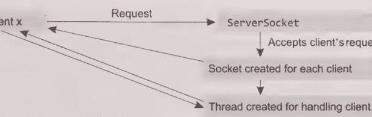

# 图 11.2 并发服务器

让我们通过一个例子来看多线程在客户端/服务器编程中是有帮助的。在下面的示例中，我们将创建一个多线程服务器，它会将客户端的数据回显（echo）给相应的客户端。以下代码显示了一个并发服务器。

## 示例 11.4(a) 多线程服务器


```java
import java.net.*;
import java.io.*;
public class ThreadedEchoServer extends Thread {
    Socket client;
    public ThreadedEchoServer(Socket s) {
        client = s;
    }
    public void run() {
        try {
            OutputStream os = client.getOutputStream();
            InputStream in = client.getInputStream();
            PrintWriter pw = new PrintWriter(os, true);
            BufferedReader br = new BufferedReader(new InputStreamReader(in));
            while (true) {
                String n = br.readLine();
                System.out.println("From client: "+n);
                pw.println("echo from server: "+n);
            }
        } catch (IOException ex) {
            System.out.println(ex);
        }
    }
    public static void main(String[] args) {
        try {
            ServerSocket ss = new ServerSocket(7);
            while (true) {
                Socket s = ss.accept();
                ThreadedEchoServer tes = new ThreadedEchoServer(s);
            }
        } catch (IOException ex) {
            System.err.println(ex);
        }
    }
}
```

## 解析

- L1 创建了一个继承自 `Thread` 类的服务器类。
- L2 在 `Thread` 子类中创建了一个 `Socket` 类型的实例变量。
- L3 定义了服务器的构造函数，它接受一个 `Socket` 实例。
- L4 初始化 `Socket` 变量。
- L5 使用静态方法启动线程（参考第 8 章）。
- L6 到 14 重写了 `run` 方法以提供线程提供细节。我们已经多次讨论过 `run` 方法中编写的代码。它实际上的作用是运行并向 socket 写入数据。从客户端读取的任何内容都会写回客户端。
- L16 创建了一个运行在端口号 7 的服务器套接字。
- L17 到 19 定义了一个无限循环来接受不断进入的客户端请求。当接收到客户端请求时，它会被接受（通过 L18 中的 `accept()` 方法）并返回一个 socket 实例 (s)（用于客户端）。创建一个线程 (L19)并将 socket 实例 (L18) 传递给线程（作为 `ThreadedEchoServer` 构造函数的参数）。该 Socket 实例被分配给 `ThreadedEchoServer` 构造函数中的 `client` 实例变量 (L4)。

现在我们创建一个类，与服务器建立连接并写入内容，这些内容将由服务器回显。

## 示例 11.4(b) 回显客户端

```java
import java.net.*;
import java.io.*;
public class EchoClient {
    static void main(String[] args) {
        Socket s = new Socket(InetAddress.getLocalHost(),7);
        OutputStream os = s.getOutputStream();
        InputStream in = s.getInputStream();
        PrintWriter pw = new PrintWriter(os,true);
        BufferedReader br = new BufferedReader(new InputStreamReader(System.in));
        BufferedReader brs = new BufferedReader(new InputStreamReader(in));
        while (true) {
            String n = br.readLine();
            pw.println(n);
            System.out.println(brs.readLine());
        }
        } catch (IOException ex) {
            System.err.println(ex);
        }
    }
}
```

## 如何运行多线程服务器和客户端？

我们一个 DOS 窗口中运行多线程服务器，并在单独的 DOS 窗口中启动客户端。首先，必须在 DOS 提示符处执行服务器，然后在另一个提示符处启动客户端。第一个客户端（client1）输入内容“Hello”，该输入会被回显给 client1。同时，从另一个 DOS 提示符执行 client2，client2 输入“Hi am new Client”；该输入会被回显给 client2。

## 输出

```
C:\javabook\programs\chap11>java ThreadedEchoServer
From client: hello
From client: Hi I am new Client
From client: hi i am the First Client
From client: how are you
```

## Client1

```
C:\javabook\programs\chap11>java EchoClient
hello
echo from server: hello
hi i am the first client
echo from server: hi i am the first client
```

## Client2

```
C:\javabook\programs\chap11>java EchoClient
Hi I am new Client
echo from server: Hi I am new Client
how are you
echo from server: how are you
```

## 11.5 网络接口

Java 1.4 引入了 `NetworkInterface` 类来获取本地网络接口的细节，例如接口名称、接口的 MAC 地址、接口的 MTU（最大传输单元）、附加到接口的 IP 地址列表、接口是启用还是禁用状态以及它是否支持多播。让我们通过一个例子来看如何获取这些细节。

### 示例 11.5 网络接口列表及其细节

```java
import java.io.*;
import java.net.*;
import java.util.*;
public class NetInterfaceDemo {
    public static void main(String[] args) throws SQLException {
        Enumeration<NetworkInterface> nets = NetworkInterface.getInterfaces();
        for (NetworkInterface netint : nets) {
            System.out.println("Display name: " + netint.getDisplayName());
            System.out.println("Name: " + netint.getName());
            System.out.println("MTU: " + netint.getMTU());
            System.out.println("Interface up: " + netint.isUp());
            Enumeration<InetAddress> inetAddresses = netint.getInetAddresses();
            for (InetAddress inetAddress : inetAddresses) {
                System.out.println(inetAddress);
            }
        }
    }
}
```

## 输出

```
C:\javabook\programs\chap11>java NetInterfaceDemo
Display name: Loopback
Name: lo
MTU: -1
Interface up: true
/127.0.0.1
/0:0
Display name: Intel Connection
Name: eth0
MTU: 1500
Interface up: true
/192.168.1.5
/fe80::2a5:fffe...
Display name: Marvell Controller
Name: eth1
MTU: 1500
Interface up: true
/192.168.1.10
/fe80::2a5:fffe...
Display name: Tunneling Interface
Name: tun0
MTU: 1500
Interface up: true
/10.0.0.1
/fe80::...
Display name: Wireless Adapter
Name: wlan0
MTU: 1500
Interface up: true
/192.168.1.15
/fe80::...
Display name: Microsoft ISAP Adapter
Name: isap0
MTU: 1500
Interface up: false
Display name: Microsoft ISAP Adapter
Name: isap1
MTU: 1500
Interface up: false
Display name: Microsoft ISAP Adapter
Name: isap2
MTU: 1500
Interface up: false
Display name: Microsoft ISAP Adapter
Name: isap3
MTU: 1500
Interface up: false
Display name: Microsoft ISAP Adapter
Name: isap4
MTU: 1500
Interface up: false
Display name: Microsoft ISAP Adapter
Name: isap5
MTU: 1500
Interface up: false
Display name: Microsoft ISAP Adapter
Name: isap6
MTU: 1500
Interface up: false
Display name: Microsoft ISAP Adapter
Name: isap7
MTU: 1500
Interface up: false
Display name: Microsoft ISAP Adapter
Name: isap8
MTU: 1500
Interface up: false
Display name: Microsoft ISAP Adapter
Name: isap9
MTU: 1500
Interface up: false
Display name: Microsoft ISAP Adapter
Name: isap10
MTU: 1500
Interface up: false
Display name: Microsoft ISAP Adapter
Name: isap11
MTU: 1500
Interface up: false
```

## 解析

拥有多个网络接口的机器被称为多宿主机（multihomed machine）。例如，路由器至少有一个局域网（LAN）和一个外网（WAN）。为了获取所有接口，我们使用 `NetworkInterface` 的静态方法 `getInterfaces()`。它返回一个枚举，并在发生问题时抛出 `SQLException`。枚举包含 `<NetworkInterface>` 对象。

在 for-each 循环中，将 ArrayList 分配给 `NetworkInterface` 变量 `netint`。

L3 到 L10 只要 ArrayList 中还有对象就会执行。

L3 和 4 使用简单方法打印接口的显示名称和名称。MTU 定义了可以在网络上发送的数据包的大小。`getMTU()` 方法是在 Java 中添加的。如果接口没有关联 MTU（如环回接口），则返回 -1。环回接口不需要向网络发送任何内容。发送到环回的数据会返回给客户端。

L6 `isUp()` 方法打印接口是否启用。

L2 `collections` 类（`java.util` 包）操作集合（如枚举）。该类提供静态方法 `Enumeration<T>` 接受枚举作为参数并返回一个包含枚举元素的 `ArrayList`。逐一处理枚举中的元素。

L7 到 9 打印与接口相关的 IPv4 地址。`NetworkInterface` 类的 `getInetAddresses()` 方法用于返回 IPv4 地址的枚举。我们像之前在 L2 中那样遍历该枚举。一个接口可能同时关联了 IPv6 地址和 IPv4 地址（如输出所示）。

IPv4 地址使用点分十进制表示。32 位被分为 4 部分，每部分 8 位。这 8 位转换为相应的十进制值并用点连接。

IPv6 地址使用冒号十六进制表示。128 位被分为 8 部分，每部分 16 位。这些 16 位被分组（每 4 位一组）。每个 4 位的值被转换为相应的十六进制值。这 16 位用冒号分隔开，例如 `fe80:0:0:0:8c3d:4e1b:7a6#`。跟在 `%` 后面的数字决定了该地址的范围。

# 352 Java 编程

# 练习题

## 单选题

- 1. loopback（回环）的默认值是多少？

(a) 10 (b) 20 (c) 30 (d) 50

2. 套接字（socket）由3个标识符组成。它们是什么？

(a) MAC 地址、端口和协议

(b) IP 地址、端口、协议

(c) MAC 地址、IP 地址和端口号

(d) MAC 地址、IP 和协议

3. IPv6 地址的大小是多少？

(a) 32 (b) 64 (c) 128 (d) 16

4. IPv4 地址的大小是多少？

(a) 32 (b) 64 (c) 128 (d) 16

5. 使用哪个类在服务器端创建 TCP 套接字？

(a) Socket

(b) ServerSocket

(c) DatagramPacket

(d) DatagramSocket

6. NetworkInterface 类的哪个方法用于获取最大传输单元（MTU）？

(a) getMaximumTransmissionUnit()

(b) getMTU()

(c) getMTU()

(d) getMaxTU()

- 7. 回环地址的地址是什么？

(a) 127.0.0.1 (b) 10.1.1.1

(c) 192.168.10.1 (d) 126.255.255.255

8. 哪五个参数唯一标识一个连接？

(a) 本地 IP、远程 IP、本地 MAC、远程 MAC 和协议

(b) 本地端口、远程 MAC、远程端口和协议

(c) 本地 MAC、本地端口、远程 MAC、远程端口和协议

(d) 本地 IP、远程 IP、远程端口和协议

9. SocketException 是哪个类的子类

(a) IOException

(b) ReadWriteException

(c) FileNotFoundException

(d) NullPointerException

- 10. UnknownHostException 是哪个类的子类

(a) IOException

(b) ReadWriteException

(c) FileNotFoundException

(d) NullPointerException

# 习题

- 1. 解释 TCP/IP 协议族。

2. 解释 TCP 和 UDP 之间的区别。在解释中使用现实生活中的来描述这些差异。

3. 解释什么是 URL 及其所有部分。URL 类的哪些方法用于获取 URL 的各个部分？

4. 解释以下术语：

(a) MAC 地址 (b) IPv4

(c) IPv6 (d) MTU

(e) 单播 (f) 多组播

(g) 广播 (h) 端口地址

5. 解释以下类的作用：

(a) Socket (b) ServerSocket

(c) DatagramPacket (d) DatagramSocket

6. URL 类用于什么？如何从 URL 对象中获取它的实例？请进行说明。

## 编程练习

- 1. 创建一个 UDP 回显客户端/服务器应用程序，其中任何写入 UDP 服务器的内容都会写回给客户端。

2. 创建一个示例 TCP 聊天应用程序，客户端和服务器可以互相聊天。

3. 在上一个示例中使用多线程使其成为一个多线程聊天应用程序。


- 4. 创建一个 Java 程序，实现一个简单的客户端/服务器应用程序。客户端将数据发送到服务器。服务器使用数据产生结果，然后将结果发回客户端。客户端在控制台上显示结果。例如，从客户端发送的数据是圆的半径，服务器产生的结果是圆面积。

- 5. 编写一个程序返回你机器的硬件地址。

  [提示：使用 Java 6 引入的 `NetworkInterface` 类的 `getHardwareAddress()` 方法]

- 6. 创建一个客户端/服务器应用程序，客户端请求服务器上的特定文件。如果服务器上存在该文件，则将文件内容写入客户端。

# 单选题答案

- 1. (d) 2. (b) 3. (c) 4. (a)
- 5. (b) 6. (c) 7. (a) 8. (d)
- 9. (a) 10. (a)

# Applet（小程序）

> 理念尽管多么迷人，但除非它们嵌入到能够证实它们的日常体验中，否则无法塑造感知和行为的整体结构。
>
> —— 克里斯托弗·拉斯奇（Christopher Lasch）

阅读本章后，读者将能够：

- 理解 applet 和应用程序（application）之间的区别
- 理解 applet 的生命周期
- 学习 applet 是如何创建和执行的
- 在 applet 中创建 GUI

## 12.1 引言

你们许多人可能遇到过“Applet”这个词。什么是 applet？Applet 基本上是微小的 Java 程序，可以很容易地通过网络从一台计算机传输到另一台计算机。这就是为什么 applet 被用于互联网应用程序，这些 applet（即小型 Java 程序）嵌入在 html 页面中，可以从服务器下载并在客户端上运行，以完成特定类型的工作。这些 applet 具有显示图形、播放声音、创建动画以及执行其他可以通过简单应用程序程序完成的工作的能力。要在客户端上执行这些 applet，客户端必须拥有启用 Java 的浏览器或 `appletviewer`（作为 JDK 的一部分）。

如果我们能开发简单的 Java 独立运行程序，为什么还需要 applet 呢？实际上，applet 并不是功能全的程序，它们通常是为了完成小任务或作为大任务的一部分。在继续学习之前，你必须理解 applet 和应用程序之间的区别。表 12.1 展示了 applet 和应用程序之间的区别。

在 Java 中，可以用两种方式处理 applet。一种是传统的 applet，它们直接派生自 `Applet` 类。这些 applet 使用抽象窗口工具（AWT）获取 GUI 特性。另一种 applet 是基于 swing 类的 `JApplet`。我们在本章中讨论基于 AWT 的 applet，而基于 swing 的 applet 将在第 15 章讨论。

## 表 12.1 Applet 与应用程序的区别

| Applet | 应用程序 |
|---|---|
| Applet 的执行不从 `main()` 开始，因为它没有该方法。 | 应用程序的执行从 `main()` 开始。 |
| Applet 无法独立运行。它们必须嵌入网页中才能运行。 | 它们可以独立运行。 |
| Applet 仅在浏览器内部运行。 | 应用程序在命令行运行。 |
| Applet 有安全限制。 | 它们没有限制。 |

## 12.2 Applet 程序结构

在第 12.1 节中提到，与应用程序不同，Java 运行时系统不会调用 `main()` 方法来启动 applet 的执行，而是直接加载 applet 类中的方法，这些方法负责启动、运行、停止和操作 applet。applet 的完整生命周期将在下一节中介绍。

容器类中有一个方法 `paint()`，它被 `Applet` 类继承（如你从图 12.1 中可以所示），其签名如下：

```java
public void paint(Graphics g)
```

该方法被调用时，会根据在 applet 面板上编写的代码显示 applet 的输出。你可以使用它的参数；它无非 `Graphics` 类的对象。该对象使得 applet 能够输出文本、图形、声音等。你必须记住的一点是，除非导入了它所属的包（即 `java.awt`），否则无法调用 `Graphics` 类的服务。applet 的输出操作需要 `Graphics` 类包含的方法，这就是为什么将其 `Graphics` 对象作为参数传递给 `paint()`。现在既然你已经了解了 applet 内部的一些细节，我们就可以讨论 applet 的程序结构。

当 applet 首次加载时，Java 运行时系统会创建主类的实例，在本例中为 `FirstApplet`。然后，通过该对象调用属于 `Applet` 类的方法。

## 12.3 示例 Applet 程序

让我们使用一个示例 applet，它显示语句“This is my first applet program.”。

### Applet 程序结构

```java
import java.awt.*;
// 以使 Graphics 类可用

import java.applet.*;
// 以使 Applet 类可用

public class NewApplet extends Applet
// 声明了一个名为 NewApplet 的新 applet
{
    public void paint(Graphics g)
    // 重写（overridden）了 Applet 类的 paint() 方法以包含输出操作
    {}
}
```

### 示例 12.1(a) 第一个 Applet 示例

```java
L1 import java.applet.*;
L2 import java.awt.*;
L3 public class FirstApplet extends Applet
    {
L4     public void paint(Graphics g) {
L5         g.drawString("This is my First Applet"
```

### 解析

- **L1** 所有 applet 都是 `Applet` 类的子类。所有 applet 必须导入 `java.applet` 包。
- **L2** 该类使用了 `java.awt` 包的方法；必须导入它。
- **L3** `FirstApplet` 类被声明为 `public`，这样执行 applet 的程序（一个支持 Java 的浏览器或 applet 查看器，它可能不在程序的本地）就可以访问它。该类扩展了 `java.applet` 包中的 `Applet` 类，因此继承了 `Applet` 的特性。
- **L4** 重写了 AWT `Container` 类中定义的 `paint()` 方法。applet 要显示的任何输出都必须由此方法处理。因为一个 `Graphics` 类的对象被作为参数传递给此方法。
- **L5** `Graphics` 类的对象用于调用 `drawString()` 方法，该方法负责在 x 坐标 10 和 y 坐标处打印字符串（"This is my First Applet"）。

#### 12.3.1 如何运行 Applet？

运行 applet 有两种方法。我们将结合上面的示例解释这些方法。

**方法一：**

将文件保存为 `FirstApplet.java` 并使用 `javac` 编译它。现在，在你的编辑器中输入以下 HTML 代码并将文件保存为 `FirstApplet.html`（此处，文件名不一定与类名相同，就像 java 文件那样）。

```html
<BODY>
<APPLET code="FirstApplet.class" WIDTH = 200 HEIGHT = 150></APPLET>
</BODY>
```

你可以通过运行 `appletviewer FirstApplet.html` 来执行 HTML 文件。

如果你在任何网络浏览器中运行上述 HTML 文件，而不是使用 applet viewer，你必须拥有支持 Java 的网络浏览器。否则，你必须安装 Java 插件，它让你的 applet 在 JVM 1.2 版本下作为网页运行，而不是在浏览器的虚拟机中运行。

**方法二：**

和之前一样，将文件保存为 `FirstApplet.java` 并使用 `javac` 编译它。要运行 applet，你必须将下面的 HTML 代码作为注释放在 `FirstApplet.java` 中。

```java
/* <APPLET code="FirstApplet.class" WIDTH = 200 HEIGHT = 150></APPLET> */
```

执行 applet 命令：

```bash
appletviewer FirstApplet.java
```

在本章中，我们将使用第二种方法。因此示例 12.1(a) 应该如示例 12.1(b) 所示。

### 示例 12.1 (b) 第一个 Applet 示例（修订版）

```java
/* <APPLET code="FirstApplet.class" WIDTH = 200 HEIGHT = 150></APPLET>
import java.applet.*;
import java.awt.*;
public class FirstApplet extends Applet {
    public void paint(Graphics g) {
        g.drawString("This is my First Applet",10,10);
    }
}
```

输出 

**图 12.2** 输出

## 12.4 Applet 生命周期

applet 的生命周期如图 12.3 所示：

- 诞生（Born）
- 运行（Running）
- 空闲（Idle）
- 死亡（Dead）

在第 12.1 节中提到，与应用程序不同，Java 运行时系统不会调用 `main()` 方法来启动 applet 的执行，而是直接加载 applet 类中的方法，这些方法负责启动、运行、停止和操作 applet。

### 诞生（Born）

当 applet 首次加载时，Java 运行时系统会创建主类的实例，在本例中为 `FirstApplet`。然后，通过该对象调用属于 `Applet` 类的方法。你可以从图 12.3 看到，当 applet 加载时进入此状态，通过 `init()` 方法实现。applet 的输出操作需要 `Graphics` 类包含的方法，这就是为什么将其 `Graphics` 对象作为参数传递给 `paint()`。

### 运行（Running）

applet 移动到运行状态通过调用 `start()` 方法。applet 要显示的任何输出都必须由此方法处理。实际上，当 applet 恢复到状态时，`start()` 会被调用。

### 空闲（Idle）

当 applet 停止运行时，它进入空闲状态。如果我们离开包含 applet 的网页（即将其最小化），applet 会进入空闲状态。applet 也可以通过调用 `stop()` 强制进入空闲状态。

### 死亡（Dead）

停止 applet 与销毁 applet 不要混淆。当 applet 通过调用 `destroy()` 方法时，它进入死亡状态。这会导致 applet 从内存中完全移除。每当我们使用浏览器时，`destroy()` 都会被调用。现在既然你已经了解了 applet 内部的一些细节，我们就可以讨论 applet 的程序结构。

## 12.5 Applet 常用方法

在这里，字符串 `msg` 是要由 applet 显示的字符串输出，`a`、`b` 是窗口的 x、y 坐标，即输出必须显示的位置。

### `setBackground()`

该方法属于 `Component`（组件）类。用于设置 applet 窗口的背景颜色。其形式为：

```java
void setBackground(Color anyColor)
```

上述方法接受要设置的背景颜色作为参数。`Color` 类为每种颜色预定义了常量，例如 `Color.red`、`Color.blue`、`Color.green` 和 `Color.pink`。

### `setForeground()`

该方法与 `setBackground` 方法类似，但用于设置 applet 窗口前景显示的文本颜色。其形式为：

```java
void setForeground(Color anyColor)
```

`Component` 类还有两个方法 `getBackground()` 和 `getForeground()`，其形式如下：

- `getBackground()`
- `getForeground()`

你可以很好地验证这些方法返回了 `Color` 的当前状态，分别显示背景颜色和前景颜色。

### `showStatus()`

该方法是 `Applet` 类的一个成员。用于在浏览器或 appletviewer 的状态窗口中显示任何字符串。其形式为：

```java
void showStatus(String text)
```

在这里，方法的参数基本上是你想在状态窗口中显示的字符串。

在继续之前，我们最好来看一个使用了目前讨论过的这些方法的示例。

## 示例 12.2 Applet 方法

```java
/* <APPLET code = "ExampleApplet.class" WIDTH = 200 HEIGHT = 150></APPLET> */
L1 import java.applet.Applet;
L2 import java.awt.Color;
L3 import java.awt.Graphics;
L4 public class ExampleApplet extends Applet{
L5     String text;
L6     public void init() {
L7         setBackground(Color.white);
L8         setForeground(Color.red);
L9         text = "This is an example applet";
L10         System.out.println("...Initialized the applet");
L11     }
L12 
L13     public void start() {
L14         System.out.println("....Starting of the applet");
L15     }
L16     public void stop() {
L17         System.out.println("....Stopping the applet");
L18     }
L19     public void destroy() {
L20         System.out.println("....Exiting the applet");
L21     }
L22     public void paint(Graphics g) {
L23         System.out.println("....Painting the applet");
L24         g.drawString(text, 30, 30);
L25         showStatus("This is status bar");
L26     }
}
```

输出


**图 12.4(a)** 使用 Applet Viewer 初始 Applet


**图 12.4(b)** Applet 各种方法打印的字符串

### 解释

- **L1–3** 导入了所有在 applet 中将使用的成员的重要类（属于它们各自的包）。
- **L6–11** 这部分展示了 `init()` 的实现，其中 applet 的背景和前景分别设置为白色和红色（参见 **L7–8**）。白色和红色是 `Color`（`java.awt` 包的一部分）的静态字段。在 L9 中，文本由一个字符串初始化，这是一个示例 applet。
- **L13–15** 这些行负责 `start()` 的实现，负责强制 applet 处于运行状态。L14 在屏幕上显示关于 applet 启动的消息。注意，此消息不会显示在 applet 窗口中；它将像你之前在章节中所做的那样显示（通过使用 `System.out.println`）。
- **L16–18** 这些行负责 `stop()` 的实现。L17 显示关于停止 applet 的消息。根据你显示 applet 的次数，它出现在屏幕上。你可以直观地看到最小化 applet 窗口会停止或强制 applet 进入空闲状态。如果从最小化后恢复，它将调用 `start()` 和 `paint()`。
- **L22–26** 这些行负责 `paint()` 方法的实现。在 L24 中，使用 `Graphics` 对象 `g` 来调用 `drawString()` 方法，该方法实际上用于在 applet 窗口上写入。参见传递给此方法的参数：`text` 包含字符串“This is an applet”，以及从 applet 可显示部分开始绘图的 `x`、`y` 坐标。当窗口被另一个窗口覆盖稍后又取消覆盖（不是被最小化后恢复）时，也会调用 `paint()`。
- **L19–21** 这些行负责 `destroy()` 的实现。关闭 applet 窗口，你将看到消息“Exiting the applet”（L20）。在这里，这意味着 applet 被销毁或已移动死亡状态（dead state）。
- **L25** 你可以看到 `showStatus()` 方法，它接受必须在 applet 窗口中显示的文本 `text` 作为参数。

## 12.6 `paint()`、`update()` 和 `repaint()`

JDK 中的所有组件和容器（因为容器实际上是组件）都有两个被调用的方法。除了这些用于设置 applet 窗口前景显示的文本颜色外，这些方法与 `setBackground` 方法类似。其形式为：

```java
void setForeground(Color anyColor)
```

`Component` 类还有两个方法 `getBackground()` 和 `getForeground()`，具有以下形式：

- `getBackground()`
- `getForeground()`


## 方法概述

- `getForeground()`

你可以很好地验证这些方法返回了 `Color` 的当前状态，分别显示背景颜色和前景颜色。

### showStatus()

该方法是 `Applet` 类的一个成员。用于在浏览器或 appletviewer 的状态窗口中显示任何字符串。其形式为：

```
void showStatus(String text)
```

在这里，方法的参数基本上是你想在状态窗口中显示的字符串。

---

## 示例 12.2 Applet 方法

（此处代码块已保留，未翻译）

### 输出

（图片部分已保留）

### 解释

- **L1–3** 导入了所有在 applet 中将使用的成员的重要类（属于它们各自的包）。
- **L6–10** 这部分展示了 `init()` 的实现，其中 applet 的背景和前景分别设置为白色和红色（参见 **L7–8**）。白色和红色是 `Color`（`java.awt` 包的一部分）的静态字段。在 L9 中，文本由一个字符串初始化，这是一个示例 applet。
- **L11–13** 这些行负责 `start()` 的实现，负责强制 applet 处于运行状态。L13 在屏幕上显示关于 applet 启动的消息。注意，此消息不会显示在 applet 窗口中；它将像你之前在章节中所做的那样显示（通过使用 `System.out.println`）。
- **L14–16** 这些行负责 `stop()` 的实现。L16 显示关于停止 applet 的消息。根据你显示 applet 的次数，它出现在屏幕上。你可以直观地看到最小化 applet 窗口会停止或强制 applet 进入空闲状态。如果从最小化后恢复，它将调用 `start()` 和 `paint()`。
- **L20–23** 这些行负责 `paint()` 方法的实现。在 L22 中，使用 `Graphics` 对象 `g` 来调用 `drawString()` 方法，该方法实际上用于在 applet 窗口上写入。参见传递给此方法的参数：`text` 包含字符串“This is an applet”，以及从 applet 可显示部分开始绘图的 `x`、`y` 坐标。当窗口被另一个窗口覆盖稍后又取消覆盖（不是被最小化后恢复）时，也会调用 `paint()`。
- **L17–19** 这些行负责 `destroy()` 的实现。关闭 applet 窗口，你将看到消息“Exiting the applet”（L19）。在这里，这意味着 applet 被销毁或已移动死亡状态。
- **L22** 你可以看到 `showStatus()` 方法，它接受必须在 applet 窗口中显示的文本 `text` 作为参数。

---

## 12.7 paint(), update(), and repaint()

JDK 中的所有组件和容器（因为容器实际上是组件）都有两个被调用的方法。除了这些用于设置 applet 窗口前景显示的文本颜色外，这些方法与 `setBackground` 方法类似。其形式为：

```
void setForeground(Color anyColor)
```

`Component` 类还有两个方法 `getBackground()` 和 `getForeground()`，具有以下形式：

- `getBackground()`
- `getForeground()`

你可以很好地验证这些方法返回了 `Color` 的当前状态，分别显示背景颜色和前景颜色。

### showStatus()

该方法是 `Applet` 类的一个成员。用于在浏览器或 appletviewer 的状态窗口中显示任何字符串。其形式为：

```
void showStatus(String text)
```

在这里，方法的参数基本上是你想在状态窗口中显示的字符串。

在继续之前，我们最好来看一个使用了目前讨论过的这些方法的示例。

---

## 示例 12.4 Param 标签

```
/*APPLET CODE = ParamPassing.class WIDTH = 250 >
<param NAME = yourName VALUE = John>
<param NAME = yourProfession VALUE = consultant>
<param NAME = yourAge VALUE = 35>
</applet>*/
```

```
import java.awt.*;
import java.applet.*;
```

---

## 12.8 关于 APPLET 标签更多

我们在编写 applet 代码时使用了 APPLET 标签。applet 必须在 HTML 文件中指定。这是通过在 HTML 文件中使用 APPLET 标签完成的。Applet 由支持 Java 的浏览器执行，当它遇到 HTML 文件中的 APPLET 标签时。如果你想使用 JDK 的 applet viewer 查看并测试 applet，只需在实际 applet 代码上方包含一个带有 APPLET 标签的注释。我们已经讨论过如何这样做了。

现在我们将使用以下格式的 APPLET 标签：

```
<APPLET CODE = filename WIDTH = pixels HEIGHT = pixels>
```

这是 applet 标签的最简单形式，只有强制字段作为属性。实际上，这个 applet 标签有许多可选属性，但值得讨论。APPLET BASE= 的完整语法所示：

```
<APPLET [CODE=codebaseURL]
CODE = appletFile [ALT alternateText] [NAME = appletName] WIDTH
pixels HEIGHT = pixels [ALIGN = alignment] [VSPACE = pixels]
HSPACE = pixels]
[PARAM NAME = attributeName VALUE = attributeValue]
[PARAM NAME = attributeName VALUE = attributeValue]
--------------------------
</APPLET> * NMI.*
```

在上述语法中，放在大括号内的属性是可选的。让我们详细讨论一下这些属性的使用。

### Codebase

在此处，我们可以指定搜索 applet 可执行类文件（由 `CODE` 属性指定）的目录 URL。

### Code

它给包含 applet 编译后的类文件命名。这是一个强制性属性，它应该始终存在于 `APPLET` 标签中。

### Alt

这是一个属性，用于指定当浏览器识别 HTML 标签但由于某种原因无法实际运行 applet 时应显示的备用短文本消息。

### Name

可以此可选属性为 applet 实例命名。如果同一网页上的任何其他 applet 想要与此 applet 通信，则仅通过其 `NAME` 进行引用。

### Width

它以像素为单位给出 applet 显示区域的宽度。

### Height

它以像素为单位给出 applet 显示区域的高度。

### Align

此可选属性用于设置 applet 的对齐方式。对齐方式可以设置为 LEFT, RIGHT, TOP, BOTTOM, MIDDLE, BASELINE, TEXTTOP, ABSMIDDLE 和 ABSBOTTOM。

### Vspace

这些用于指定 applet 上方和下方的间距（像素单位）。

### Hspace

这些用于指定 applet 左右两侧的间距（像素单位）。

可以在 `<APPLET>` 和 `</APPLET>` 标签之间使用 `PARAM` 标签为 Java applet 提供参数信息或参数。`<PARAM>` 标签很简单——它为 Java applet 运行所需的参数命名（`NAME`），并为其提供一个值（`VALUE`）。

- 使用 `<PARAM......>` 标签为 applet 提供自定义参数。

这有两个参数：NAME 和 VALUE。

- Name 属性。
- 由对应 `PARAM NAME` 命名的属性值。

applet 使用 `getParameter()` 方法访问其属性。其签名如下：

```
String getParameter(String name);
```

让我们使用一个使用参数传递的示例 applet。


```java
L3 public class ParamPassing extends Applet {
L4 String name;
L5 String profession;
L6 int age;
L7 public void start() {
L8 String str;
L9 name = getParameter("userName");
L10 if (name == null) name = "not found";
L11 str = getParameter("profession");
L12 if (str != null) profession = str;
L13 else profession = "No job";
L14 str = getParameter("age");
L15 try {
L16 if (str != null) age = Integer.parseInt(str);
L17 else age = 0;
L18 } catch (NumberFormatException e) {
L19 }
L20 public void paint(Graphics g) {
L21 g.drawString("your name: " + name, 10, 10);
L22 g.drawString("your profession: " + profession, 10, 30);
L23 g.drawString("your age: " + age, 10, 50);
L24 }
}
```

# 输出

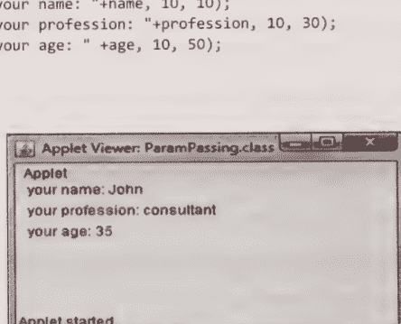

图 12.6 通过 Applets 参数

# 解释

让我们从在程序实际代码之前作为注释放置的 `APPLET` 标签开始。`PARAM` 标签位于 `APPLET` 标签的开始和结束之间。所有三个 `PARAM` 标签都具有 `NAME` 及其对应的值，例如，你的 `userName` 值为 john，你的 `yourProfession` 值为 consultant，你的 `yourage` 值为 35。

- L4-6 对 `String` 类的引用分别在 L4 和 L5 中被声明为 `name` 和 `profession`。在 L6 中声明了一个整数类型的变量 `age`。

- L7-19 显示了 `start()` 方法的实现。在 L9 处，`getParameter()` 方法返回作为参数传递的参数名 `userName` 的值。返回的值存储在 L4 定义的 `name` 中。同样，在 L11 和 L14 处使用了另外两个 `getParameter()` 方法，返回作为参数传递的相应参数名的值。

- L1-2 从各自的包导入必要的类。

- L3 声明了一个名为 `ParamPassing` 的类，继承 `java.applet` 包中的 `Applet` 类。

这些值是由 `Integer` 类的 `getParameter()` 方法返回的。这个方法在这里解释太简单了。唯一值得注意的是在 L16 处使用了包装类 `Integer` 以及一个名为 `NumberFormatException` 的异常。在 L18 处捕获 `getParameter()` 返回的值。L14 是 `String` 类型，需要转换为整数，这是通过使用 `parseInt()` 完成的。L20–22 显示了 `paint()` 方法的实现，其中 applet 显示了 name、profession 和 age。

# 372 Java 编程

注意：作为 `showDocument()` 方法参数传递的文件必须位于服务器上与 applet 相同的目录下。

可以通过以下方式调用该方法：

```java
try {
    getAppletContext().showDocument(new URL(url));
} catch (java.net.MalformedURLException e) {
    System.out.println("URL could not be reached");
}
```

你可以在 `showDocument()` 方法周围看到 `try...catch` 块。这样做是因为该方法会抛出一个名为 `MalformedURLException` 的异常，该异常必须被捕获并处理。

## 12.11 如何使用音频片段

你可以使用 `Applet` 类的 `getAudioClip()` 方法加载片段，该方法返回一个 `AudioClip` 对象。该方法的签名如下：

```java
AudioClip getAudioClip(URL url)
```

该对象封装了在指定 URL 上的音频片段，该 URL 作为方法的参数传递（参见表 12.1）。

我们已经提到 applet 也可以处理音频。`AppletContext` 接口中定义了多种方法，用于处理与音频片段相关的活动。其中几个方法是：

- `play()`: 从头开始播放片段
- `stop()`: 停止播放片段
- `loop()`: 持续循环播放片段

上述方法可以被 `AudioClip` 对象（由 `getAudioClip()` 返回）使用，用于播放、停止或循环音频片段。下面是一个加载和播放声音文件的示例。

## 示例 12.6 播放音频片段

| 行号 | 代码 |
| :--- | :--- |
| L1 | `import java.app.*;` |
| L2 | `import java.lang.*;` |
| L3 | `import java.net.URL;` |
| L4 | `public class AudioDemo extends Applet {` |
| L5 | `AudioClip clip;` |
| L6 | `public void init() {` |
| L7 | `clip = getAudioClip(getDocumentBase(), "magic.au");` |
| L8 | `}` |
| L9 | `public void start() {` |
| L10 | `clip.play();` |
| L11 | `}}` |

### 解释

L7: 片段在 `init()` 期间使用 `getAudioClip()` 方法加载，该方法接收音频片段的 url（来自 `getDocumentBase()` 方法）和音频文件的名称。方法返回的音频片段对象存储在 `clip` 中。

L8: 对象 `clip` 用于调用 Applet 接口的 `play()` 方法。

## 音频方法的局限性

以下是音频方法的局限性：

- 目前这些方法仅支持 `.au` 格式的音频文件。
- 这些方法并不健壮。你只能播放声音片段，但不能暂停声音片段。
- 由于缺少音频上下文方法，applet 可以使用的音频功能非常有限。

注意：你可以使用 Java 媒体框架 API 来播放具有增强功能的不同格式的音频文件。

## 12.12 APPLET 中的图像

`Graphics` 对象的 `drawImage()` 方法被用于在 applet 上绘制图像。该方法需要一个 `Image` 对象，可以通过 `Applet` 类的 `getImage` 方法获取。该方法返回一个可以在 applet 上绘制的 `Image` 对象。

## 示例 12.7 在 Applet 中显示图像

```java
import java.awt.*;
import java.applet.*;
<applet code=ImageDemo.class width=700 height=700></applet>
public class ImageDemo extends Applet {
    Image image;
    public void init() {
        // 获取用于绘制的 Image 对象或加载图像
        image = getImage(getDocumentBase(), "bulbon.gif");
    }
    public void paint(Graphics g) {
        // 绘制图像
        drawImage(Image img, int x, int y, int width, int height, ImageObserver observer)
        g.drawImage(image, 0, 0, image.getWidth(this), image.getHeight(this), this);
        g.drawImage(image, 0, 200, 70, 90, this);
    }
}
```

# 输出

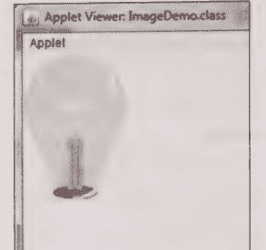

图 12.8

### 解释

L1–2: 导入所需的包；awt 和 applet。

L3: 插入了 applet 标签（已注释）。此 html 语句被注释掉，以便编译器会忽略它，因为这段代码不属于 Java。插入此 html 标签是为了通过 appletviewer 实用程序运行 applet。如果你通过 html 文件运行 applet，此标签应该写在 html 文件的 body 标签内。

L4: 所有 applet 必须是公共定义的，并且它们必须是 `Applet` 类的子类。`ImageDemo` 是一个公共类，并继承了 `Applet` 类。

L5: 在 `Applet` 类内部、任何方法外部定义了一个类型为 `Image` 的实例变量，这样它就可以在类的所有方法中使用。

6–7: 图像在 `init` 方法内部实例化，该方法在 applet 的生命周期内只调用一次。使用 `getImage()` 方法获取图像，并将图像文件的路径作为 URL 参数传递给方法。我们使用 `getDocumentBase()` 作为 `getImage` 方法的第一个参数来检索图像。

## 12.12 MediaTracker 类

`MediaTracker` 类用于跟踪图像。如果你想确保所有图像已完全加载，你需要创建一个 `MediaTracker` 实例并为每个图像调用 `addImage`。让我们来看例子。

## 示例 12.8 MediaTracker 类

```java
import java.applet.Applet;
import java.awt.*;

/*<applet code="MediaDemo" width=400 height=400></applet>*/
public class MediaDemo extends Applet implements Runnable {
    // 用于存储
    Image[] imageArray = null;

    // 用于跟踪
    MediaTracker m = null;
    int current = 0;
    Thread t = null;

    public void init() {
        // 创建一个新的媒体跟踪
        m = new MediaTracker(this);

        // 创建图像数组
        imageArray = new Image[2];

        // 开始下载第一张图像
        imageArray[0] = getImage(getDocumentBase(), "bulboff.gif");

        // 将其注册到媒体跟踪
        m.addImage(imageArray[0], 0);

        // 第二张图像
        imageArray[1] = getImage(getDocumentBase(), "bulbon.gif");
        m.addImage(imageArray[1], 1);

        // 启动线程开始闪烁
        t = new Thread(this);
        t.start();
    }

    public void paint(Graphics g) {
        // 设置背景为白色
        g.setColor(Color.white);
        g.fillRect(0, 0, 400, 400);
        // 设置颜色为黑色，以便写入的文字将是黑色的
        g.setColor(Color.black);
        // 检查图像是否加载
        if (m.checkAll()) {
            g.drawImage(imageArray[current++], 0, 0, this);
            if (current >= imageArray.length)
                current = 0;
        } else // 仍在加载
        {
            g.drawString("Images are still loading...", 20, 20);
        }
    }

    public void run() {
        try {
            // 等待所有图像完成加载
            m.waitForAll();
            for (;;) {
                // 重绘图像
                repaint();
                Thread.sleep(2000);
            }
        } catch (InterruptedException ie) {
        }
    }
}
```

# 输出

Applet 从灯泡“关闭”图像开始，然后切换到灯泡“开启”图像，并不断重复。

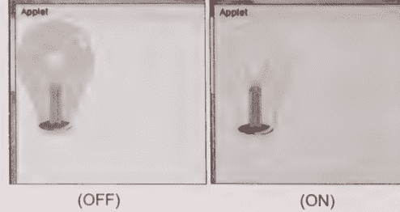

图 12.9

# Applets

# 解释

- L1–2 导入了 `awt` 和 `applet` 包。

- L3 注释了 `html APPLET` 标签，以便通过 `applet viewer` 实用程序运行程序。

- L4 声明公共类 `MediaDemo` 继承自 `Applet`。

- L5–8 创建了 `Image` 数组、`MediaTracker` 以及用于更改图像的 `int` 变量实例。`MediaTracker` 实例将跟踪存储在图像数组中的图像状态。需要一个 `Thread` 来更改图像，并作为计数器来决定使用哪个。

- L18–21 声明的 `paint` 方法。L19 将颜色设置为白色。L20 用白色填充矩形（即整个 applet），这样在每次绘制尝试时，它都会擦除 applet 上的所有内容，并在 L21 恢复黑色。（最好对 applet 进行涂白，以防止图像重叠）。

- L22 检查所有 applet 是否已加载，如果是，则使用 L23 中的 `drawImage` 方法在 applet 上绘制图像，并在 L27 显示提及的字符串。我们在上面讨论过 `draw` 方法。

- L9–15 为 applet 定义了 `init` 方法。所有一次性初始化都在此方法中完成。L10 创建了一个 `MediaTracker` 对象并将其作为参数传递给构造函数，以指定绘制图像的组件。L11 创建了一个包含两个图像的图像。在 L12 和 L14 中使用 `getImage` 方法为图像填充了两个图像。我们已经在上面的示例中讨论过该方法。使用 L13 和 L15 中的实例方法将这些图像添加到 `MediaTracker` 中。第一个参数是图像，第二个是整数 `id`，用于跟踪图像。

- L24–25 显示如何更改图像。我们使用 `current` 变量作为图像数组的索引，通过对其递增来更改图像。检查 `current` 变量的值与图像数组的长度（以显示图像数组中的所有内容），并将其重置为 0。

- L28 定义了 `run` 方法，告知线程应该执行的操作。

- L30–33 使用 `waitForAll()` 方法来捕获异常对象，以等待所有图像加载完成，然后执行无限循环（L31）进行重绘（L32）。在 L33 中让线程睡眠以引入延迟效果。

- L16–17 实例化线程并启动。记住这个 `this` 对象被传递到 `Thread` 类的构造函数中，以指定其 `run` 方法的对象（在我们案例中即为 applet）。

- L34 捕获由 `sleep` 方法抛出的异常。

## 12.13 Graphics 类

你现在已经了解了 Java 中的 applet。这些 applet 如果没有绘制图形的能力将是不完整的。你可以编写 Java applet，它可以绘制线条、不同形状的图形、图像以及不同字体、样式和颜色的文本。每个 applet 在屏幕上都有称为 `canvas`（画布）的区域，它实际上是显示区域。要创建此显示区域，你必须掌握 Java 坐标系。该系统的原点 (0, 0) 位于左上角。正 x 值向右，正 y 值向下。(x, y) 的值单位是像素。

现在让我们讨论一下在 Java 中使用图形的类。如果是属于 `java.awt` 包的 `Graphics` 类，定义如下：

```java
public abstract class Graphics extends Object
```

注意：`Graphics` 类是所有图形上下文的抽象基类，允许应用程序在各种设备上实现的组件上绘制，也可以在离屏图像上绘制。

该类定义了许多方法，其中一些在下表 12.5 中列出。

### 表 12.5 Graphics 类的一些方法

| 名称 | 描述 |
|---|---|
| `drawArc(int x, int y, int width, int height, int startAngle, int arcAngle)` | 绘制覆盖指定矩形的圆形或椭圆弧轮廓。 |
| `drawLine(int x1, int y1, int x2, int y2)` | 绘制一条线。 |
| `finalize()` | 如果不被引用，则释放此图形上下文。 |


| 方法 | 描述 |
|---|---|
| `translate(int x, int y)` | 将图形上下文的原点平移到当前坐标系中的点 (x, y)。 |
| `drawOval(int x, int y, int width, int height)` | 绘制椭圆。 |
| `drawPolygon(int[] xPoints, int[] yPoints, int nPoints)` | 绘制由 x 和 y 坐标数组定义的多边形。 |
| `drawRect(int x, int y, int width, int height)` | 绘制指定的矩形。 |
| `getClip()` | 返回当前裁剪区域的边界矩形。 |
| `fillArc(int x, int y, int width, int height, int startAngle, int arcAngle)` | 填充指定矩形的圆形或椭圆弧。 |
| `fillOval(int x, int y, int width, int height)` | 用当前颜色填充指定矩形的椭圆。 |
| `fillPolygon(int[] xPoints, int[] yPoints, int nPoints)` | 填充由 x 和 y 坐标数组定义的封闭多边形。 |
| `fillRect(int x, int y, int width, int height)` | 填充矩形。 |
| `getColor()` | 返回此图形上下文的当前颜色。 |
| `getFont()` | 返回当前字体。 |
| `setColor(Color c)` | 设置颜色。 |
| `setFont(Font font)` | 设置字体。 |
| `fillRoundRect(int x, int y, int width, int height, int arcWidth, int arcHeight)` | 填充圆形矩形。 |
| `drawRoundRect(int x, int y, int width, int height, int arcWidth, int arcHeight)` | 绘制圆形矩形。 |
| `drawString(String str, int x, int y)` | 绘制字符串。 |
| `clearRect(int x, int y, int width, int height)` | 清除矩形。 |

### 表 12.5 续

| 名称 | 描述 |
|---|---|
| `clipRect(int x, int y, int width, int height)` | 将当前裁剪与指定的矩形相交。 |
| `copyArea(int x, int y, int width, int height, int dx, int dy)` | 通过 dx 和 dy 复制组件区域。 |
| `create()` | 创建一个新的 `Graphics` 对象。 |
| `create(int x, int y, int width, int height)` | 根据当前 `Graphics` 对象创建一个新的 `Graphics` 对象。 |
| `dispose()` | 释放图形上下文释放其使用的资源。 |
| `draw3D(int x, int y, int width, int height, boolean raised)` | 绘制 3D 高亮矩形。 |
| `drawBytes(byte[] data, int offset, int length, int x, int y)` | 由字节数组绘制文本。 |
| `drawChars(char[] char, int offset, int length, int x, int y)` | 由字符数组绘制文本。 |
| `fill3D(int x, int y, int width, int height, boolean raised)` | 填充颜色的 3D 高亮矩形。 |

## 12.13.1 使用 Graphics 的示例 Applet

这里我们给出一个使用图形的示例 applet。`Graphics` 类的方法在 `paint` 方法中被调用。注意 `Graphics` 对象被作为参数传递给 `paint` 方法。

```java
/* Applet code=DrawLineRect width = 600 height=400</Applet>*/
import java.awt.*;
import java.awt.*;
public class DrawLineRect extends Applet {
    public void paint(Graphics g){
        g.drawRect(10,60,40,30);
        g.fillRect(60,10,30,80);
        g.fillOval(140,160,170,170);
        g.drawRoundRect(10,100,80,50,10);
        g.fillRoundRect(20,110,60,30,5,5);
    }
}
```

```java
L8 g.drawLine(100, 10, 230, 140);
L9 g.drawLine(100, 140, 230, 10);
}
```

# 输出

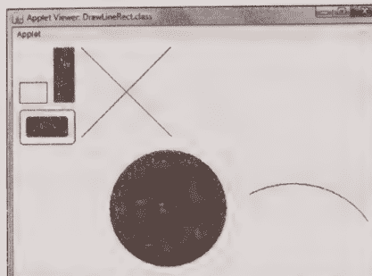

图 12.10 显示 Graphics 类方法演示的 Applet

在这里，我们将仅关注 `paint()` 方法，因为 `Graphics` 类的所有方法都仅在该方法内部使用。这些方法的描述见表 12.5。

# 解释

- L2 `drawRect` 方法用于绘制矩形。前两个参数指定 x 和 y 坐标，随后的参数指定矩形的宽度和高度。
- L3 `fillRect` 方法用于绘制填充了颜色的矩形。默认颜色为黑色。你可以随时使用 `setColor` 方法更改颜色。
- L4 `fillOval` 方法用于绘制填充默认颜色的椭圆。前两个参数指定 x 和 y 坐标，随后的参数指定椭圆的宽度和高度。
- L5 和 6 `drawRoundRect` 方法用于绘制带圆角的矩形。额外的参数是弧的宽度（即 10）和弧的高度（即 10）。
- `fillRoundRect` 与 `drawRect` 相同。唯一的区别是，在这种情况下圆矩形被填充了颜色。
- L7 `drawArc` 方法用于绘制弧（如输出所示）。第一个参数是待绘制弧的左上角的 x 坐标。第二个参数是待绘制弧的左上角的 y 坐标。第三和第四个参数指定弧的宽度和高度。第五个参数是弧的起始角度。弧从起始角度开始延伸到最后一个参数所指定的弧角。
- L8 和 9 `drawLine` 用于在点 x1, y1 和 x2, y2 之间画线（这些点作为该方法的四个参数被指定）。

## 12.14 Color 类

`Color` 是一个继承自 `Object` 类并实现 `Paint` 和 `Serializable` 接口的类。我们将 RGB 颜色作为显示器和电视屏幕的默认颜色。在 Java 中，颜色是可移植且与机器无关的。使用 `Color` 类，你可以在 Java 中指定任何颜色。除了指定特定颜色，你还可以在 Java 中创建自己的颜色。这是一个令人惊讶的事实；你可以在 Java 中创建多达 22400 万种不同的颜色。`Color` 类有各种常量，指定了一些常用颜色。这些常量所示：

| 常量 | 常量 | 常量 |
|---|---|---|
| `Color.BLACK` | `Color.DARK_GRAY` | `Color.GRAY` |
| `Color.LIGHT_GRAY` | `Color.WHITE` | `Color.MAGENTA` |
| `Color.RED` | `Color.PINK` | `Color.ORANGE` |
| `Color.YELLOW` | `Color.GREEN` | `Color.BLUE` |

`Color` 类的某些构造函数和方法见表 12.6。

### 表 12.6 Color 类

| 构造函数 | 描述 |
|---|---|
| `Color(ColorSpace cspace, float[] components, float alpha)` | 在特定的 `ColorSpace` 中使用指定的颜色分创建颜色 |
| `Color(float r, float g, float b)` | 创建红 (r)、绿 (g) 和蓝 (b) 的混合色，值范围在 (0.0–1.0) 之间 |
| `Color(float r, float g, float b, float a)` | 创建红、绿、蓝和 alpha (α) 值的混合，范围在 (0.0–1.0) 之间 |
| `Color(int rgbValue)` | 创建红、绿、蓝的混合，其中红色组件位为 16–23，绿色组件位为 8–15，蓝色组件位为 0–7。 |
| `Color(int r, int g, int b)` | 指定范围在 (0–255) 之间的红、绿、蓝混合值的颜色 |
| `Color(int r, int g, int b, int a)` | 创建范围在 0–255 之间的红、绿、蓝颜色和 alpha 值的混合色。 |

#### Color 类的方法

| 方法 | 描述 |
|---|---|
| `brighter()` | 创建颜色的亮版本。 |
| `createContext(ColorModel cm, Rectangle r, Rectangle2D, AffineTransform xform, RenderingHints hints)` | 此方法用于创建纯色图案。 |
| `darker()` | 创建颜色的更暗版本。 |
| `decode(String nm)` | 将字符串转换为整数并返回特定的 `Color`。 |
| `equals(Object obj)` | 检查另一个对象是否等于此 `Color`。 |
| `getAlpha()` | 返回范围为 0–255 的 alpha 分量。 |
| `getBlue()` | 此方法在默认红绿蓝空间返回 0–255 范围内的蓝色组件。 |
| `getColor(String nm)` | 在系统属性中查找颜色。 |
| `getColorComponents(ColorSpace cspace, float[] compArray)` | 返回一个 float 数组。包含由转义参数指定的颜色分量。 |
| `getColorSpace()` | 返回颜色的 `ColorSpace`。 |
| `getComponents(float[] compArray)` | 返回一个 float 数组。包含由转义参数指定的颜色分量。 |
| `getGreen()` | 返回范围为 0–255 的绿色组件。 |
| `getRed()` | 返回范围为 0–255 的红色组件。 |
| `getRGB()` | 返回红、绿、蓝混合的 RGB 值。 |
| `getHSB(float hue, float saturation, float brightness)` | 返回 HSB 颜色值。 |
| `RGBtoHSB(int r, int g, int b)` | 将 RGB 值转换为 HSB 值。 |
| `HSBtoRGB(float h, float s, float b)` | 将 HSB 值转换为 RGB 值。 |
| `toString()` | 返回颜色的字符串表示。 |

如何创建自己的颜色？这是一个令人惊讶的事实；你可以在 Java 中创建多达 2400 万种不同的颜色。

一旦创建了颜色对象，你可以使用 `setColor` 方法来设置颜色。

## 12.15 Font 类

`Font` 是一个继承自 `Object` 类并实现 `Paint` 和 `Serializable` 接口的类。

用于此构造函数的三个参数是所需的字体。

- `name` 指定了所需字体名称。
- `style` 指定了所需字体的样式，可以是三个常量中的一个或多个：`Font.PLAIN`、`Font.BOLD` 和 `Font.ITALIC`。如果你想结合两种样式，可以这样做，例如 `Font.ITALIC | Font.BOLD`。这仅意味着字体同时具有斜体（ITALIC）和粗体（BOLD）样式。
- `size` 指定了以磅（points）为单位的字体大小。

字体一旦创建，可以使用组件类的 `setFont()` 方法来选择它。该方法的签名如下：

```java
void setFont(Font fontObject)
```

在这里，参数 `fontObject` 是包含所需字体的对象。

如果你有一个字体并想获取有关该字体的信息，`Graphics` 类的 `getFont()` 方法将非常有帮助。它返回当前字体。其签名如下：

```java
Font getFont()
```

一旦获取了当前字体，你可以使用 `Font` 类的各种方法轻松获取关于字体的其他相关信息，如 `getName()`、`getStyle()`、`getSize()`、`getFamily()` 等（详情请参见表 12.7）。下面的示例展示了 Color 和 Font 类的用法。

### 表 12.7 Font 类（续）

| 方法名 | 描述 |
|---|---|
| `createGlyphVector(FontRenderContext rc, char[] chars)` | 创建一个 GlyphVector。 |
| `decode(String str)` | 返回一个字体（Font）。 |
| `deriveFont(AffineTransform trans)` | 创建一个新的字体对象并替换当前的字体对象。 |
| `equals(Object obj)` | Font 对象与特定 Object 之间的比较。 |
| `finalize()` | 释放原生 Font 对象。 |
| `getAttributes()` | 返回字体属性的映射（map）。 |
| `getAvailableAttributes()` | 返回字体支持的属性键。 |
| `getBaselineFor(char c)` | 返回用于显示字符的基线位置。 |
| `getFamily()` | 返回此 Font 的字体族名称。 |
| `getFont(String nm)` | 从系统属性列表中返回字体对象。 |
| `getFontName()` | 返回此 Font 的字面（Font face）名称。 |
| `getItalicAngle()` | 返回斜体角度。 |
| `getMaxCharBounds(FontRenderContext frc)` | 返回字符的边界。 |
| `getMissingGlyphCode()` | 返回字形代码（glyphCode）。 |
| `getName()` | 返回 Font 的逻辑名称。 |
| `getNumGlyphs()` | 返回字形数量。 |
| `getPSName()` | 返回此 Font 的 Postscript 名称。 |
| `getSize()` | 返回此 Font 的字号，并舍入为整数。 |
| `getStringBounds(char[] chars, int beginIndex, int limit, FontRenderContext frc)` | 返回特定字符数组的逻辑边界。 |
| `getStyle()` | 返回字体的样式。 |
| `isBold()` | 表示此 Font 对象的样式为粗体（Bold）。 |
| `isPlain()` | 表示 Font 对象的样式为普通（PLAIN）或非此样式。 |
| `isTransformed()` | 表示其尺寸受变换影响。 |
| `toString()` | 将字体对象转换为字符串表示。 |

# 示例 12.10 Font 和 Color 类的用法


```
/*servlet code = ColorFont.class width = 600 height = 270></applet>*
import java.awt.*;
public class ColorFont extends java.awt.Applet
{
    public void init() {
        Color color1 = new Color(230, 220, 0);
        setBackground(color1);
    }
    public void paint(Graphics g) {
        String str = ""
        String fontList[];
        GraphicsEnvironment ge = GraphicsEnvironment.getLocalGraphicsEnvironment();
        fontList = ge.getAvailableFontNames();
        for (int i = 0; i < fontList.length; i++) {
            g.drawString("FONTS AVAILABLE ARE: ", 5, 30);
            str += fontList[i] + " ";
            g.drawString(str, 5, 50);
        }
        Color color2 = new Color(235, 50, 50);
        g.setColor(color2);
        g.drawString("Hey Look!!!", 5, 180);
        Font currentFont = new Font("TimesRoman", Font.PLAIN, 20);
        g.setFont(currentFont);
        g.drawString("This is an example", 5, 220);
        currentFont=new Font("TimesRoman", Font.ITALIC, 40);
        g.setFont(currentFont);
        g.drawString("You must have understood....", 5, 260);
    }
}
```

## 输出

上述程序的输出显示了机器上可用的字体，以及使用 `Font` 类在 applet 窗口上打印的一些句子：

## Java 编程


**图 12.11** 输出可用字体以及如何使用 Color 类

## 解释

- L1 导入了 AWT 包中所有需要的类。
- L2 使用 `setBackground()` 创建了字体。
- L3 使用 `drawString()` 显示了字符串。
- L4 使用 `setFont()` 设置了字体。
- L5 使用 `setColor()` 设置了颜色。
- L6 使用构造函数创建了字体。
- L7 使用 `drawString()` 显示了文本。
- L8 使用 `setFont()` 设置了字体。
- L9 使用 `getAvailableFontNames()` 获取了字体名称。
- L10 使用 `drawString()` 显示了字符串。
- L11 使用 `GraphicsEnvironment` 获取了字体名称。
- L12 使用循环遍历字体。
- L13 使用 `drawString()` 显示了字符串。
- L14 使用 `setFont()` 设置了字体。
- L15 使用 `drawString()` 显示了文本。
- L16 使用构造函数创建了字体。
- L17 使用 `drawString()` 显示了文本。
- L18 使用 `drawString()` 显示了字符串。
- L19 在构造函数中指定了字体大小。
- L20 使用 `setFont()` 设置了字体。
- L21 使用 `drawString()` 显示了文本。

## 12.6 FontMetrics 类

字体对象由 `FontMetrics` 类定义，该类继承自 `Object` 并实现了 `Serializable` 接口。你必须了解“metrics”（测量值）这个术语。它的意思是“测量的系统或标准”。`java.awt.FontMetrics` 类有助于确定与字符和字符串（字符组）相关的测量值。文本可以使用这些测量值进行精确定位。下表显示了一些术语。

构成字体测量值的各种属性可以在图 12.12 中可视化。


**图 12.12** FontMetrics 类中使用的术语

## FontMetrics 对象

字体测量由字体和图形上下文决定。要创建 `FontMetrics` 对象，其中 `g` 是 `Graphics` 对象，`f` 是字体对象，可以使用以下构造函数：

```
FontMetrics fm = g.getFontMetrics(f);
```

创建对象 `fm` 用于获取指定字体以及该字体特定字符形状的高度和宽度信息。

## FontMetrics 方法

表 12.8 提供了 `FontMetrics` 类方法的简要描述。

### 表 12.8 FontMetrics 类的方法

| 方法 | 描述 |
| --- | --- |
| `bytesWidth(byte[] data, int off, int len)` | 返回此字体中特定字节数组的宽度。 |
| `charsWidth(char[] data, int off, int len)` | 返回此字体中特定字符数组的宽度。 |
| `getAscent()` | 由它决定字体升部（Ascent）。 |
| `getDescent()` | 由它决定字体降部（Descent）。 |
| `getFont()` | 获取 `Font`。 |
| `getFontRenderContext()` | 获取 `FontRenderContext`。 |
| `getHeight()` | 获取文本行的标准高度。 |
| `getLeading()` | 确定由此 Metrics 对象描述的字体的标准行距。 |
| `getLineMetrics(char[] chars, int beginIndex, int limit, Graphics context)` | 返回图形上下文中特定字符数组的 `LineMetrics` 对象。 |
| `getMaxAdvance()` | 获取此字体中字符的最大推进宽度。 |
| `getMaxAscent()` | 获取此 `FontMetrics` 对象解释的字体的最大升部（Ascent）。 |
| `getMaxDescent()` | 获取此 `FontMetrics` 对象描述的字体的最大降部（Descent）。 |
| `getStringBounds(char[] chars, int beginIndex, int limit, Graphics context)` | 返回指定字符数组的边界。 |
| `getWidths()` | 获取字体中前 256 个字符的推进宽度。 |
| `hasUniformMetrics()` | 检查字体是否具有统一的行度度。 |
| `stringWidth(String str)` | 返回此字体中指定字符串的总推进宽度。 |
| `toString()` | 返回此 `FontMetrics` 对象值的字符串表示形式。 |

## 示例 12.11 展示 FontMetrics 类的类

```java
/*applet code = DemoFontMetrics.class width = 300 height = 300></applet>*
import java.awt.*;
import java.awt.*;
public class DemoFontMetrics extends Applet {
    public void init() {
        Color color1 = new Color(255, 255, 250);
        setBackground(color1);
    }
    public void paint(Graphics g) {
        int fontSize = 20;
        g.setFont(new Font("TimesRoman", Font.PLAIN, fontSize));
        FontMetrics fm = g.getFontMetrics();
        String s = "Its Applet";
        int sw = fm.stringWidth(s);
        int h = 300;
        int x = (w - sw) / 2;
        int baseline = fm.getMaxAscent() + (h - fm.getAscent() + fm.getMaxDescent())/2;
        int ascent = fm.getMaxAscent();
        int descent = fm.getMaxDescent();
        int fontHeight = fm.getMaxAscent() + fm.getMaxDescent();
        g.setColor(Color.pink);
        g.fillRect(x, baseline-ascent, sw, fontHeight);
        g.setColor(Color.red);
        g.drawLine(x, baseline+descent, x+sw, baseline+descent);
        g.setColor(Color.blue);
        g.drawLine(x, baseline-ascent, x+sw, baseline-ascent);
        g.setColor(Color.black);
        g.drawString(s, x, baseline);
    }
}
```

## 输出

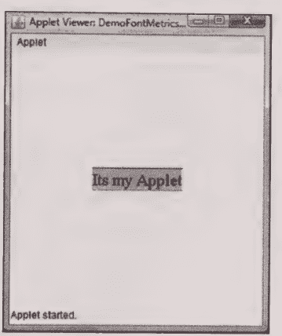

**图 12.13** 使用 FontMetrics 类产生的输出

## 解释

- L1–2 导入了所需的包。
- L3 声明了一个名为 `DemoFontMetrics` 继承 `Applet` 的类。
- L4 重写了 `init()` 方法。
- L5 传递给构造函数 `Color()` 的参数负责输出颜色，即你在图 12.13 输出窗口中看到的颜色。这些参数是表示红、绿、蓝颜色的整数值（范围为 0-255）。一旦在 L6 中创建了 `Color` 对象，它被传递给 `setBackground()` 方法，该方法负责将 applet 的背景设置为数字指定的颜色混合色。
- L8 定义了 `paint()` 方法。
- L9 声明了一个名为 `fontSize` 的整数变量。
- L10 使用名为 `setFont()` 的方法设置字体及其大小。
- L11 创建了一个 `FontMetrics` 对象 `fm`。
- L12 声明了一个字符串。
- L13 创建了一个整数变量来定义字符串的宽度。
- L14–15 声明了两个整数变量（`w` 和 `h`）用于字符串的定位，`w` 和 `h` 实际上代表 applet 的宽度和高度。
- L16 通过从 applet 宽度减去字符串宽度并除以 2 来计算 `x` 坐标。这将形成在 applet 上打印字符串的 `x` 坐标。
- L17–20 在这些行中，我们使用 `getMaxAscent()`、`getAscent()` 和 `getMaxDescent()` 方法计算了用于字符串定位的基线、升部、字体高度和降部的值。
- L21–22 它将在指定区域填充粉红色。
- L23–24 我们使用 `drawLine()` 方法在字符串下方画了一条红线。
- L25–26 我们使用 `drawLine()` 方法在字符串上方画了一条蓝线。
- L27–28 调用 `drawString()` 方法绘制字符串，并使用 `setColor()` 设置为黑色。

## 练习题：数字钟

我们已经在第 8 章讨论过数字钟的示例。但让我们创建一个以数字和美观方式显示当前时间的 applet。这个 applet 将使用线程，你将学会如何在 applet 中使用线程。

## 示例 12.12 数字钟

```java
L1 import java.util.*;
L2 import java.applet.*;
L3 import java.awt.*;
L4 import java.text.*;

L5 /*applet code=DigitalClock.class width=450 height=100></applet*/
L6 public class DigitalClock extends Applet implements Runnable
{
L7 Thread t;
L8 Calendar c;
L9 Date d;
L10 df;
L11 void init()
{
L12 t=new Thread(this,"Time");
L13 t.start();
L14 df=DateFormat.getInstance();
}
L15 void run()
{
L16 for(;;)
{
L17 try{
L18 c=Calendar.getInstance();
L19 d=c.getTime();
L20 Thread.sleep(1000);
L21 catch(Exception e){}
L22 repaint();
}
}
L25 void paint(Graphics g)
{
L26 g.setFont(new Font("Courier New", Font.ITALIC, 20));
L27 g.drawString(d.toString(),30,20);
L28 g.drawString("Date: " +df.format(d),30,40);
}
```


**图 12.14** 解释

- L1–4 导入了所需的包：`java.util`, `applet`, `java.awt` 和 `text` 属于 `util` 包；`Applet` 类属于 `applet` 包；`Graphics` 类属于 `java.awt`；`DateFormat` 属于 `text` 包。`DateFormat` 是抽象类，因此不能直接实例化。在 L14 中使用 `DateFormat` 类的静态方法 `getInstance()` 进行实例化，它返回 `Date` 类的实例。
- L5 插入了被注释的 applet 标签，编译器会忽略此 html 语句。通过 appviewer 运行 applet 插入了 html 标签。
- L15–24 定义了线程的 `run` 方法，指定了线程应该执行什么。该方法负责提取当前日期时间并设置在 `Date` 对象中。使用 `Calendar` 类的静态方法 `getInstance()` 创建当前日期和时间。L21 使用 `sleep` 方法让线程延迟一秒。即使发生异常，通过 `repaint()` 调用 `paint()` 方法。
- L6 声明公共类 `DigitalClock` 继承 `Applet` 类并实现 `Runnable` 接口。所有 applet 必须公定义并且必须是 `Applet` 类的子类。如果你想在 applet 中创建线程，必须继承 `Runnable` 接口。
- L17–0 在 applet 内定义了 `Thread`、`Calendar` 和 `Date` 类型的实例。这些类型的对象将用于 `DigitalClock` 类。
- L25–28 applet 中的所有显示功能都在 `paint()` 方法中，因此 `paint()` 方法负责显示存储在 `Date` 对象中的日期和时间。L26 使用 `setFont` 设置字体及其大小。L27 使用 `drawString()` 在 applet 的特定 x,y 位置写入字符串。该方法的目的是 `Date` 对象，它以标准格式显示日期（见输出的第一行）。L28 显示了如何格式化日期。
- L11–14 在这里可以完成数字钟的所有一次性活动。因此我们初始化了线程并启动了它。我们还在示例中使用了 `DateFormat` 类，专门展示如何用不同格式表示日期和时间。

## 392 使用 L14 创建的 dateFormat 对象进行 Java 编程

`dateFormat` 类的 `format()` 方法用于格式化作为参数传递给它的 `Date` 对象。该方法返回一个格式化的时间字符串，该字符串被传递给 `draw` 方法，因此显示在 applet 上（见输出的第二行）。输出的第一行是24小时格式的时间，带有星期几和月份名称。输出的第二行显示12小时格式的日期和时间，带有 AM 和 PM 以及数字格式的日期、月份和年份。

> **注意** `DigitalClock` applet 不能继承 `Thread` 类因为它已经继承了 `Applet` 类。因此使用了 `Runnable` 接口。（记住：Java不支持类之间的多重继承）

## 总结

我们解释了 applet 的含义和用途。applet 是可以从远程服务器下载并在客户端执行以完成特定任务的小程序。applet 和应用程序之间的差异已清楚列出。applet 生命周期的状态为：诞生、运行、空闲和死亡。分别调用不同的方法如 `init()`、`start()`、`stop()` 和 `destroy()` 来强制 applet 启动。我们提供了如何处理图像和音频文件的洞察，并对图形有了基本的理解。


在 Java 中，applet 在两个不同的包中被讨论。一个是传统的 applet，直接从 `Applet` 演变而来。另一个使用 swing，这是我们在本章中没有涉及的。这些 applet 可以在启用 Java 的浏览器或名为 `appviewer` 的工具（作为 JDK 的一部分）上执行。我们讨论了 `Applet` 类的许多方法。到目前你已经对 applet 编程和使用的方法有了见解。既然本章已经涵盖了 applet 的构建模块，当我们讨论通过事件处理和 AWT 的 GUI 环境时，applet 编程的本质将变得更有意义，第13章。

# 练习题

- 1. 下面哪个不是 applet 生命周期的方法？
  - (a) `init`
  - (b) `start`
  - (c) `sleep`
  - (d) `stop`

- 2. 哪种工具用于编译 applet？
  - (a) `java`
  - (b) `javac`
  - (c) `appviewer`
  - (d) `applet`

- 3. 哪种工具用于执行 applet？
  - (a) `java`
  - (b) `javac`
  - (c) `appviewer`
  - (d) `applet`

- 4. 哪个方法会隐式地调用 applet 的 `paint`？
  - (a) `paint`
  - (b) `repaint`
  - (c) `start`
  - (d) `callPaint`

- 5. 哪个类提供了绘制不同形状的功能？
  - (a) `Line`
  - (b) `Graphics`
  - (c) `Shapes`
  - (d) `Graph`

- 6. 哪种方法用于获取加载 Applet 的源目录名？
  - (a) `getBase()`
  - (b) `getDocumentBase()`
  - (c) `getClassName()`
  - (d) `getAppletLoadClass()`

- 7. `setMethod` 属于以下类中的哪个？
  - (a) `Component`
  - (b) `Object`
  - (c) `Thread`
  - (d) `Font`

- 8. 下列哪种方法与 `paint` 方法的作用相同？
  - (a) `init`
  - (b) `update`
  - (c) `stop`
  - (d) `destroy`

- 9. applet 加载后立即会调用哪些方法？
  - (a) `init`, `start`
  - (b) `init`, `start`
  - (c) `init`
  - (d) `start`, `stop`

- 10. `AppletContext` 接口的哪种方法允许你的 applet 将控制权转移到任何其他 URL？
  - (a) `showPage()`
  - (b) `showDocument()`
  - (c) `displayDocument()`
  - (d) `show()`

# 复习习题

- 1. 什么是 applet？它们与应用程序（application）的区别是什么？
- 2. 列述退出 applet 的不同方法。
- 3. `Applet` 类在创建 applet 中有什么意义？请解释 `Applet` 类的层次结构。
- 4. 描述 applet 的完整生命周期。
- 5. 解释在 applet 中重写以下方法的用途：
  - `init()`
  - `start()`
  - `stop()`
  - `destroy()`
  - `paint()`
- 6. 区分 `update()` 和 `repaint()` 方法。
- 7. 如何将 HTML 页面的消息传递给 applet？
- 8. 解释 `APPLET` 标签的不同参数。
- 9. 写出下列方法所属的类名。并解释这些方法的用途：
  - `showStatus()`
  - `drawing()`
  - `getCodeBase()`
  - `getComponent()`
  - `getBackground()`
  - `getForeground()`
  - `setBackground()`
  - `setForeground()`
  - `getParameter()`

## 编程练习

- 1. 写一个程序，在 applet viewer 中显示运行 applet 的截图。该 applet 应显示你的名字。
- 2. 写一个 applet，在 applet 的可见区域放置随机大小和颜色的矩形、圆矩形、3D 矩形和填充矩形。
- 3. 创建一个背景为黑色、前景为白色的 applet。
- 4. 写一个 applet 获取上述 applet 的前景和背景颜色。
- 5. 写一个程序显示包含你的 `.class` 和 `.html` 文件的目录的 URL。
- 6. 写一个 applet，从 `PARAM` 标签中读取无限数量的字符串并绘制它们。
- 7. 写一个 applet，在 applet 的可见区域绘制一个圆、一条线、一个弧和一个多边形。

# 选择题答案

| 题号 | 答案 |
| --- | --- |
| 1 | (c) |
| 2 | (b) |
| 3 | (c) |
| 4 | (b) |
| 5 | (b) |
| 6 | (a) |
| 7 | (a) |
| 8 | (b) |
| 9 | (a) |
| 10 | (b) |

# Java 中的事件处理

> 失败并不是单一的、灾难性的事件。你不会一夜之间失败。相反，失败是每天重复的几次判断错误。
>
> —— 吉姆·罗恩 (Jim Rohn)

- 在阅读完本章后，读者将能够：
  - 理解事件委托模型
  - 理解什么是事件、源和监听器
  - 了解它们的事件类以及关联的监听器
  - 理解如何处理基本事件（在 applet 中）
  - 学习处理事件的三种方法：监听器、适配器和内部类

# 13.1 引言

我们在之前的章节中学习了对象和类。对象存在于特定的状态中，直到它被切换到另一个状态。这种转换是由事件引起的。

例如，我们希望对象在产生动作时调用一个函数，例如，按下键盘上的键、移动鼠标、点击按钮等。产生事件的对象，即事件的源（source），被称为事件生成器（event generator）。如果为了操作按下按钮，按钮就是事件生成器。在事件发生时负责执行任务的对象被称为事件处理器（event handler）。一个事件生成器可能有多个事件处理器；每个事件处理器负责根据该特定事件执行唯一的活动。现在的问题是，这些处理器如何知道特定事件已经发生，从而执行它们的活动呢？为此，有一个注册过程，由事件对象为其每个事件处理器进行注册。这种注册涉及事件处理器简单地要求事件生成器通知事件的发生。通过注册，事件生成器能够跟踪所有已注册的事件处理器。

本章涉及 Java 的事件处理机制。没有这些概念，进入 GUI 编程的世界将是不可能的。

# 13.2 事件委托模型

事件委托模型自 Java 1.0 以来一直采用的一种方法。我们将坚持这一模型，不再过多讨论早期的传统模型。在事件委托模型中，源产生事件并发送给一个或多个监听器。监听器负责接收事件，一旦接收，就会按要求进行处理或操作。在这里，用于处理事件的处理逻辑与产生事件的逻辑是完全分离的，即事件生成组件的设计可以与事件处理组件不同。实际上，事件生成组件将执行基于事件的动作的责任委托给一个独立的执行事件的组件。该模型有三个维度，即事件、源和事件监听器。

事件是一个描述源中状态的对象。它可能直接由于与 GUI 环境组件的交互或由于任何其他原因（如定时器过期、操作完成等）而产生。

源是产生事件的对象。监听器是接收事件的对象。

# 13.3 java.event

`java.event` 包提供了处理不同类型事件的接口和类。事件委托模型基于这些类。

# 13.3.1 事件类

事件是一个描述源中状态的对象。它可能直接由于与 GUI 环境组件的交互或由于任何其他原因（如定时器过期、操作完成等）而产生。

源是产生事件的对象。监听器是接收事件的对象。

`EventObject` 是所有事件的基类。它是 `java.lang.Object` 的子类。它具有如 `getSource()` 和 `toString()` 等方法。

```java
public class EventObject {
    protected Object source;
    public EventObject(Object src) {
        this.source = src;
    }
    public Object getSource() {
        return source;
    }
}
```

## Java 中的事件处理

(表 13.2 续)

| 字段名称 | 描述 |
| --- | --- |
| `META_MASK` | 元修饰符，表示在事件发生期间按下 Meta 键的指示。 |
| `SHIFT_MASK` | Shift 修饰符，表示在事件发生期间按下 Shift 键的指示。 |
| 构造函数名称 | 描述 |
| --- | --- |
| `ActionEvent(Object source, int id, String command)` | 生成一个 `ActionEvent` 对象，其中 `source` 是产生事件的对象，`id` 是标识事件的整数，`command` 是可能指定与事件相关的命令（可能是多个命令之一）的字符串。 |
| `ActionEvent(Object source, int id, String command, int modifiers)` | 生成一个 `ActionEvent` 对象。这里是在此操作期间按住的修饰键。 |
| `ActionEvent(Object source, int id, String command, long when, int modifiers)` | 生成带有指定修饰键和时间戳的 `ActionEvent` 对象。这里 `when` 是事件发生的时间，`modifiers` 是在此操作期间按住的修饰键。 |
| 方法名称 | 描述 |
| --- | --- |
| `String getActionCommand()` | 返回与此操作相关的命令字符串。 |
| `long getWhen()` | 返回发生事件的时间戳。 |
| `int getModifiers()` | 返回在此操作事件期间按住的修饰键。 |
| `String paramString()` | 返回标识此操作事件的参数字符串。 |

## AdjustmentEvent 类

`AdjustmentEvent` 类在 Java 中定义为：

```java
public class AdjustmentEvent extends AWTEvent
```

调整事件是由滚动条等可调整对象生成的。`AdjustmentEvent` 类定义了一些调整事件，通过相应的整数常量进行标识。这些常量及其含义如表 13.3 所示。该表还列出了 `AdjustmentEvent` 类的构造函数和方法。

## 表 13.3 AdjustmentEvent 类

| 字段名称 | 描述 |
| --- | --- |
| `ADJUSTMENT_FIRST` | 标记调整事件 id 范围内的第一个整数。 |
| `ADJUSTMENT_LAST` | 标记调整事件 id 范围内的最后一个整数。 |
| `ADJUSTMENT_VALUE_CHANGED` | 调整值改变事件。 |
| `BLOCK_DECREMENT` | 块递减调整类型。 |
| `BLOCK_INCREMENT` | 块递增调整类型。 |
| `TRACK` | 绝对跟踪调整类型。 |
| `UNIT_DECREMENT` | 单元递减调整类型。 |
| `UNIT_INCREMENT` | 单元递增调整类型。 |
| 方法名称 | 描述 |
| --- | --- |
| `Adjustable getAdjustable()` | 返回产生此事件的可调整对象。 |
| `int getAdjustmentType()` | 返回导致值改变事件的调整类型。它可能是 `UNIT_INCREMENT`, `UNIT_DECREMENT`, `BLOCK_INCREMENT`, `BLOCK_DECREMENT`, `TRACK`。 |
| `int getValue()` | 返回调整事件中的当前值。 |
| `boolean getValueAdjusting()` | 如果是多个调整事件之一，则返回 true。 |
| `String paramString()` | 返回表示事件状态的字符串。 |
| 构造函数名称 | 描述 |
| --- | --- |
| `AdjustmentEvent(Adjustable source, int id, int value)` | 使用指定的调整源、事件类型、调整类型和值构造一个 `AdjustmentEvent` 对象。 |
| `AdjustmentEvent(Adjustable source, int id, int value, boolean isAdjusting)` | 使用指定的调整源、事件类型、调整类型和值构造一个 `AdjustmentEvent` 对象。 |

## KeyEvent 类

该类在 Java 中定义为：

```java
public class KeyEvent extends InputEvent
```

这种低级事件是由组件对象（如文本字段、`Applet`、帧）在按键被按下、释放或输入时生成的。事件被传递给 `KeyListener` 对象，该对象通过组件的 `addKeyListener` 方法注册以接收事件通知。`KeyEvent` 是表示组件中发生了按键动作的事件。共有三种按键事件，通过整数常量进行标识。这些是：

- `KEY_PRESSED`（在任何按键被按下时生成）
- `KEY_TYPED`（当可以生成有效的 Unicode 字符时生成）
- `KEY_RELEASED`（在任何按键被释放时生成）

`KeyEvent` 类中还定义了一些更多的整数常量。表 13.4 显示了其中几个。该类的所有成员都是 `public static` 且 `final`。它还列出了 `KeyEvent` 类的构造函数和方法。

列表非常长，我们无法在此处包含完整的枚举列表。除了表 13.4 所示的常量外，我们作为 `KeyEvent` 类成员的还有整数常量，例如 `VK_0` 到 `VK_9`、`VK_A` 到 `VK_Z`、`VK_ALT`、`VK_Cancel`、`VK_SHIFT`、`VK_PAGE_DOWN`、`VK_ENTER`、`VK_ESCAPE`、`VK_CONTROL` 等。

## 表 13.4 KeyEvent 类

| 字段名称 | 描述 |
| --- | --- |
| `char CHAR_UNDEFINED` | `KEY_PRESSED` 和 `KEY_RELEASED` 事件，但这些事件对于该 `keyChar` 值没有映射到有效的 Unicode 字符。 |
| `int KEY_FIRST` | 表示按键事件 id 范围内的第一个数字。 |
| `int KEY_LAST` | 表示按键事件 id 范围内的最后一个数字。 |
| `int KEY_LOCATION_LEFT` | 键在此事件中的位置。 |
| `int KEY_LOCATION_RIGHT` | 键在此事件中的位置。 |
| `int KEY_LOCATION_STANDARD` | 键在此事件中的位置。 |
| `int KEY_LOCATION_UNKNOWN` | 键在此事件中的位置。 |
| `int VK_ACCEPT` | 接受。 |
| `int VK_ALL_ALPHUMERIC` | 所有数字字母。 |
| `int VK_COMPOSE` | 组合。 |
| `int VK_CONTEXT_MENU` | 上下菜单。 |
| `int VK_SHIFT` | Shift。 |
| `int VK_WINDOWS` | 窗口。 |
| 构造函数名称 | 描述 |
| --- | --- |
| `KeyEvent(Component source, int id, long when, int modifiers, int keyCode, char keyChar)` | 构造一个 `KeyEvent` 对象，其中 `source` 是产生事件的组件；`id` 是标识事件类型的整数；`when` 指定事件发生的时间；`modifiers` 是事件期间的修饰键；`keyCode` 是实际键的整数代码；`keyChar` 是对应按键组合的字符。 |
| 方法名称 | 描述 |
| --- | --- |
| `char getKeyChar()` | 返回与事件中的键相关的字符。如果没有有效的字符，则返回 `CHAR_UNDEFINED`。 |
| `int getKeyCode()` | 获取与键相关的整数代码。 |
| `int getKeyLocation()` | 返回产生此事件的键的位置。 |
| `static String getKeyModifiersText(int modifiers)` | 返回描述修饰键的字符串，例如 "Shift" 或 "Ctrl+Shift"。 |
| `static String getKeyText(int keyCode)` | 返回描述 `keyCode` 的字符串，例如 "HOME"、"F1" 或 "A"。 |
| `boolean isActionKey()` | 返回事件中的键是否为“动作键”。 |
| `String paramString()` | 返回标识此事件的字符串。 |
| `void setKeyChar(char keyChar)` | 设置键值以指示逻辑字符，其中 `keyChar` 是对应按键组合的字符。 |
| `void setKeyCode(int keyCode)` | 设置 `keyCode` 以指示物理键，其中 `keyCode` 是对应实际键的整数。 |

## MouseEvent 类

`MouseEvent` 类在 Java 中定义为：

```java
public class MouseEvent extends InputEvent
```

它是表示组件中发生了鼠标动作的事件。鼠标动作发生在特定的组件中，并且仅当动作发生时鼠标光标位于组件边界的定义部分时。

`MouseEvent` 类定义了八种类型的鼠标事件。`MouseEvent` 类将它们定义为公共静态整数常量，以标识这些事件。这些如表 13.5 所示。该表还显示了 `MouseEvent` 类的构造函数和方法。

## 表 13.5 MouseEvent 类

| 字段摘要 | 描述 |
| --- | --- |
| `MOUSE_MOVED` | 鼠标移动时发生事件。 |
| `MOUSE_PRESSED` | 当鼠标按钮被按下时发生事件。 |


# MouseEvent 类

| 常量名称 | 描述 |
| --- | --- |
| `MOUSE_RELEASED` | 当鼠标按钮被释放时发生事件。 |
| `MOUSE_CLICKED` | 当鼠标按钮被按下并释放时发生事件。 |
| `MOUSE_DRAGGED` | 当鼠标被拖动时发生事件。 |
| `MOUSE_ENTERED` | 当鼠标进入组件内部时发生事件。 |
| `MOUSE_EXITED` | 当鼠标离开组件内部时发生事件。 |
| `MOUSE_WHEEL` | 当鼠标轮被滚动时发生事件。 |

| 构造函数名称 | 描述 |
| --- | --- |
| `MouseEvent(Component source, int id, long when, int modifiers, int x, int y, int clickCount, boolean popupTrigger)` | 使用指定的源组件、类型、修饰符、坐标和点击次数构造一个 `MouseEvent` 对象。 |
| `MouseEvent(Component source, int id, long when, int modifiers, int x, int y, int xAbs, int yAbs, int clickCount, boolean popupTrigger, button)` | 使用指定的源组件、修饰符、绝对坐标和点击次数构造一个 `MouseEvent` 对象。 |

| 方法名称 | 描述 |
| --- | --- |
| `int getButton()` | 返回导致事件的哪个鼠标按钮（如果有）。 |
| `int getClickCount()` | 获取鼠标点击次数。 |
| `Point getLocationOnScreen()` | 返回事件的绝对 x, y 位置。 |
| `String getMouseModifiersText(int modifiers)` | 返回一个描述事件发生期间按下的修饰键和按钮的字符串，例如 "Shift" 或 "Ctrl+Shift"。 |
| `Point getPoint()` | 获取事件相对于源组件的 x 和 y 位置。 |
| `int getX()` | 获取事件相对于源组件的水平位置（x）。 |
| `int getXOnScreen()` | 返回事件的绝对水平 x 位置。 |
| `int getY()` | 获取事件相对于源组件的垂直位置（y）。 |
| `int getYOnScreen()` | 返回事件的绝对垂直 y 位置。 |
| `boolean isPopupTrigger()` | 返回此鼠标是否为弹出菜单的触发事件。 |
| `String paramString()` | 返回一个标识此事件的字符串。 |
| `void translatePoint(int x, int y)` | 通过增加指定的 x（水平）和 y（垂直）偏移量将事件的坐标转换为新位置。 |

## FocusEvent 类

`FocusEvent` 类定义如下：

```java
public class FocusEvent extends ComponentEvent
```

该事件在组件获得或失去焦点时发生。焦点事件有两种类型：永久和临时的。当用户显式地将焦点从一个组件转移到另一个组件时（例如通过按下 tab 键），发生永久焦点事件。当由于窗口失效等操作导致焦点时，发生临时焦点事件。在这种情况下，当窗口再次激活时，焦点将位于同一个组件上。`FocusEvent` 类的字段、构造函数和方法如表 13.6 所示。`FocusEvent` 类的所有字段都是公共静态整数常量。

### 表 13.6 FocusEvent 类

| 字段名称 | 描述 |
| --- | --- |
| `FOCUS_FIRST` | 第一个获得焦点的。 |
| `FOCUS_LAST` | 最后一个获得焦点的。 |
| `FOCUS_GAINED` | 组件获得焦点。 |
| `FOCUS_LOST` | 组件失去焦点。 |

| 构造函数名称 | 描述 |
| --- | --- |
| `FocusEvent(Component src, int id)` | 创建一个 `FocusEvent`，`src` 指定事件源，`id` 类似于 `FOCUS_GAINED` 或 `FOCUS_LOST`。 |
| `FocusEvent(Component src, int id, boolean temp)` | 除构造函数外，`temp` 标识变化是否是临时的。 |
| `FocusEvent(Component src, int id, boolean temp, Component opp)` | 在上述基础上，`opp` 标识参与该变化的另一个组件。 |

| 方法名称 | 描述 |
| --- | --- |
| `Component getOppositeComponent()` | 返回获得焦点或失去焦点的组件。 |
| `boolean isTemporary()` | 告知事件是临时的还是永久的。 |
| `String paramString()` | 返回一个标识事件的字符串。 |

## ItemEvent 类

`ItemEvent` 类定义如下：

```java
public class ItemEvent extends AWTEvent
```

这是一个显示项目是否被选中或取消选择的事件。该事件由 `ItemSelectable` 对象（如列表）生成，当列表中的某项被选中或取消选择时，就会生成该事件。生成的事件会被传递给每个注册接收此类事件的 `ItemListener`。使用 `addItemListener` 用于此注册过程。`ItemEvent` 类的字段、构造函数和方法如表 13.7 所示。该类的所有字段都是公共静态整数常量。

### 表 13.7 ItemEvent 类

| 字段名称 | 详细说明 |
| --- | --- |
| `DESELECTED` | 此状态变化值表示被选中的项目被取消选择。 |
| `ITEM_FIRST` | 用于项目事件的 id 范围内的第一个数字。 |
| `ITEM_LAST` | 用于项目事件的 id 范围内的最后一个数字。 |
| `ITEM_STATE_CHANGED` | 此事件 id 表示项目的状态发生了变化。 |
| `SELECTED` | 此状态变化值表示项目被选中。 |

| 构造函数摘要 | |
| --- | --- |
| `ItemEvent(ItemSelectable source, int id, Object item)` | 构造一个 `ItemEvent` 对象。 |

## TextEvent 类

`TextEvent` 类定义如下：

```java
public class TextEvent extends AWTEvent
```

该事件表示对象的文本变化。当对象（如组件）改变文本时，就会生成该事件。生成的事件会被传递给每个注册接收此类事件的 `TextListener`。使用 `addListener` 用于此注册过程。`TextEvent` 类的字段、构造函数和方法如表 13.8 所示。

### 表 13.8 TextEvent 类

| 字段名称 | 详细说明 |
| --- | --- |
| `TEXT_FIRST` | 用于文本事件的 id 范围内的第一个数字。 |
| `TEXT_LAST` | 用于文本事件的 id 范围内的最后一个数字。 |
| `TEXT_VALUE_CHANGED` | 此事件 id 表示对象发生了变化。 |

| 构造函数摘要 | |
| --- | --- |
| `TextEvent(Object source, int id)` | 构造一个 `TextEvent` 对象。 |

| 方法摘要 | |
| --- | --- |
| `String paramString()` | 返回一个标识事件的字符串。 |

## 13.4 事件源

事件可以是 GUI 组件或任何类（如应用程序），它可以产生键盘和鼠标事件。某些 GUI 组件如表 13.9 所示。

### 表 13.9 可产生事件的 GUI 组件

| 按钮 | 选择框 | 菜单项 |
| --- | --- | --- |
| 复选框 | 列表 | 窗口 |
| 滚动条 | | 文本组件 |

这些 GUI 组件的类将在第14章（AWT）中详细讨论。

## 13.5 事件监听器

事件监听器通过实现 `java.awt` 包定义的接口来创建。当源产生事件时，它基本上会调用监听器接口中定义的方法。该方法将一个事件对象作为参数传递。一些常用的监听器如表 13.10 所示。

### 表 13.10 事件监听器列表

| KeyListener | ItemListener | WindowListener |
| --- | --- | --- |
| MouseListener | ActionListener | ComponentListener |
| MouseMotionListener | TextListener | ContainerListener |
| MouseWheelListener | FocusListener | AdjustmentListener |

这些监听器接口都有一定数量的方法，简述如下。

### KeyListener 接口

该接口内部定义了三个方法：

- `void keyPressed(KeyEvent e)`
- `void keyReleased(KeyEvent e)`
- `void keyTyped(KeyEvent e)`

`keyPressed()` 在键被按下时调用，`keyReleased()` 在键被释放时调用，`keyTyped()` 在输入字符时调用。

### MouseListener 接口

该接口有五个方法，签名如下：

- `void mouseClicked(MouseEvent)`
- `void mouseEntered(MouseEvent)`
- `void mousePressed(MouseEvent)`
- `void mouseReleased(MouseEvent)`
- `void mouseExited(MouseEvent)`

`mouseClicked()` 在鼠标被点击时调用，`mouseEntered()` 在鼠标进入组件时调用，`mousePressed()` 在鼠标被按下但未释放时调用，`mouseReleased()` 在被按下的鼠标被释放时调用，而 `mouseExited()` 在鼠标离开组件时调用。

### MouseMotionListener 接口

此接口具有两个签名如下的方法：

- `void mouseMoved(MouseEvent e)`
- `void mouseDragged(MouseEvent e)`

`mouseMoved()` 在鼠标从一个地方移动到另一个地方时调用，`mouseDragged()` 在鼠标被拖动时调用。

### MouseWheelListener 接口

此接口只有一个方法，其签名如下：

- `void mouseWheelMoved(MouseEvent e)`

`mouseWheelMoved()` 在鼠标滚轮移动时调用。

### ItemListener 接口

此接口定义了一个方法，定义为：

- `void itemStateChanged(ItemEvent e)`

`itemStateChanged()` 在项目状态发生变化时调用。

### ActionListener 接口

此接口有一个签名如下的方法：

- `void actionPerformed(ActionEvent e)`

方法 `actionPerformed()` 在执行任何动作事件时调用。

### TextListener 接口

此接口有一个签名如下的方法：

- `void textChanged(TextEvent e)`

当文本字段或文本区域发生变化时，该方法就会被调用。

### FocusListener 接口

此接口有两个方法：

- `void focusGained(FocusEvent e)`
- `void focusLost(FocusEvent e)`

`focusGained()` 在组件获得键盘焦点时调用，`focusLost()` 在组件失去键盘焦点时调用。

### WindowListener 接口

此接口定义了七个方法，签名如下：

- `void windowActivated(WindowEvent e)`
- `void windowClosed(WindowEvent e)`
- `void windowClosing(WindowEvent e)`
- `void windowOpened(WindowEvent e)`
- `void windowDeactivated(WindowEvent e)`
- `void windowIconified(WindowEvent e)`
- `void windowDeiconified(WindowEvent e)`

`windowActivated()` 在窗口激活时调用，`windowDeactivated()` 在窗口取消激活时调用，`windowClosed()` 在窗口关闭时调用，`windowOpened()` 在窗口打开时调用，`windowClosing()` 在窗口正在关闭时调用，`windowIconified()` 在窗口图标化（最小化）时调用，而 `windowDeiconified()` 在窗口状态从最小化恢复到正常状态时调用。

### ComponentListener 接口

此接口有四个方法，签名如下：

- `void componentResized(ComponentEvent e)`
- `void componentMoved(ComponentEvent e)`
- `void componentHidden(ComponentEvent e)`
- `void componentShown(ComponentEvent e)`

`componentResized()` 在组件的尺寸被改变时调用，`componentMoved()` 在组件被移动时调用，`componentHidden()` 在组件被隐藏时调用，`componentShown()` 在组件被显示时调用。

### ContainerListener 接口

此接口定义了两个方法。它们是：

- `void componentAdded(ContainerEvent e)`
- `void componentRemoved(ContainerEvent e)`

上述两个方法中，`componentAdded()` 在组件被添加到容器时调用，`componentRemoved()` 在组件从容器中移除时调用。

### AdjustmentListener 接口

该接口只有一个方法，定义为：

- `void adjustmentValueChanged(AdjustmentEvent e)`

当发生调整事件时，调用该方法。

## 13.6 模型是如何工作的？

每个产生事件的源必须向自身注册事件监听器，以便监听器拥有接收来自相应源的事件的权限。那么，注册过程是如何实现的呢？在 Java 中，所有可能的事件都被赋予了名称。每种类型的事件都有自己的注册方法，格式如下：

```java
public void addTypeListener(EventListener l)
```

在上述方法中，`Type` 是事件的类型，`l` 是指向该特定事件的监听器的引用。Java 中可用的不同类型的监听器见表 13.10。

## Java 中的事件处理

某些源允许注册多个监听器来接收事件，而另一些源只允许注册一个监听器来接收事件。前者是事件的多播，后者是单播。

这些监听器一旦注册了特定源的事件，就可以取消注册。用于此取消注册过程的方法格式如下：

```java
public void removeTypeListener(EventListener l)
```

一旦监听器对象注册，它们必须实现相关方法来接收并处理来自源的事件通知。这些方法定义在 `java.awt` 包的各种接口中。

使用事件委托模型涉及的步骤：

1. 实现相应的事件监听器接口，以便接收并处理所需的事件类型。
2. 使用格式如下的注册方法 `addTypeListener(EventListener)`，将事件监听器作为事件通知的接收者向事件源注册。

> 如果组件产生多个事件，每个事件都需要单独注册。一个对象可以注册接收多种类型的事件，但它也必须实现接收这些事件所需的所有接口。

让我们举一个例子展示如何使用监听器接口来处理事件。该示例展示了如何使用 `MouseMotionListener` 来跟踪鼠标移动。

### 示例 13.1(a) MouseMotionListener 的使用

```java
/* <applet code="MouseMotionEx.class" width=300 height=300></applet> */
import java.awt.*;
import java.awt.event.*;

public class MouseMotionEx extends Applet implements MouseMotionListener {
    int xcoord;
    int ycoord;

    public void init() {
        addMouseMotionListener(this);
    }

    public void paint(Graphics g) {
        g.drawString(xcoord + "," + ycoord, 20, 20);
    }

    public void mouseMoved(MouseEvent e) {
        xcoord = e.getX();
        ycoord = e.getY();
        repaint();
    }

    public void mouseDragged(MouseEvent e) {
    }
}
```

### 示例 13.1(b) MouseMotionListener

```java
/* <applet code="MouseMotionEx.class" width=700 height=700></applet> */
import java.awt.*;
import java.applet.*;
```


```java
import java.awt.event.*;

public class MouseMotionEx extends Applet {

    int xcord;
    int ycord;

    public void init() {
        addMouseMotionListener(new Demo(this));
    }

    public void paint(Graphics g) {
        g.drawString("(" + xcord + ", " + ycord + ")", xcord, ycord);
    }
}

class Demo implements MouseMotionListener {

    MouseMotionEx m;

    Demo(MouseMotionEx m) {
        this.m = m;
    }

    public void mouseMoved(MouseEvent me) {
        m.xcord = me.getX();
        m.ycord = me.getY();
        m.repaint();
    }

    public void mouseDragged(MouseEvent me) {
    }
}
```

## 解析

需要注意的一点是，虽然 `Demo` 的对象已经注册了事件通知，但当前对象（即 `MouseMotionEx` 对象）已传递给了 `Demo` 对象。其原因是我们需要根据目前 `Demo` 对象正在追踪的鼠标移动来绘制 applet（即 `MouseMotionEx` 对象）。`MouseMotionEx` 的坐标需要根据鼠标移动进行设置，稍后 `MouseMotionEx` 需要重新重绘。因此，我们需要一个 `MouseMotionEx` 的引用来执行此任务，这就是为什么 `MouseMotionEx` 的对象（由 `this` 关键字表示）被传递到了 `Demo` 的构造函数中。

## 410 Java 编程 (Programming in Java)

## 13.7 适配器类 (ADAPTER CLASSES)

接口只包含抽象方法，它的实现要求对所有方法都进行实现，即在实现类中用具体方法进行重写。对于监听器接口也是如此；同样，如果你正在实现特定的监听器接口，你必须实现该接口中定义的所有方法。这在有时可能非常烦人，因为你必须实现监听器接口的所有方法，而这些方法可能实际上并不会被使用。为了简化操作，Java 提出了适配器类的概念。

对于包含多个处理方法的监听器接口，JDK 定义了相应的适配器类。例如，对于 `MouseListener` 接口，有一个适配器类 `MouseMotionAdapter`。适配器为其对应的监听器接口的所有方法提供了空定义。这意味着 `MouseAdapter` 类固有实现了 `MouseListener`。

那么 `MouseListener` 接口是由 Java 定义的吗？众所周知，该接口定义了两个方法：

```java
public interface MouseListener {
    public void mouseDragged(MouseEvent e);
    public void mouseMoved(MouseEvent e);
}
```

相应的适配器类，即 `MouseMotionAdapter` 在 Java 中预定义如下：

```java
public class MouseMotionAdapter implements MouseListener {
    public void mouseDragged(MouseEvent e) {}
    public void mouseMoved(MouseEvent e) {}
}
```

请注意上述两个方法后的空括号，它们仅仅显示了待实现方法的方法体。

### 13.7.1 如何使用适配器类？

如果你不使用适配器类，你的事件处理器类需要如下所示实现监听器接口：

```java
public class HandlerClass implements MouseListener {
}
```

正如前面提到的，处理器类（在这里命名为 `HandlerClass`）必须实现该 `MouseListener` 内部的所有方法（如示例 13.1 (a) 所示）。

现在如果你使用适配器类，处理器类将通过扩展适配器类来继承它。

```java
public class HandlerClass extends MouseMotionAdapter {
}
```

由于继承，`MouseAdapter` 类的所有方法在我们的 `HandlerClass` 中都可用。由于适配器类已经提供了带有空体的定义，你不需要再次为所有方法提供实现。这意味着我们只需要重写我们感兴趣的方法。让我们看看示例 13.1(a)，在示例中我们必须在处理器类中重写 `MouseMotionListener` 的所有方法。为了实现与示例 13.1(a) 相同的目标，我们现在展示适配器类的用法以及它是如何使代码编写变得简单的。请注意，在接下来的适配器类示例中，并没有强制重写 `MouseMotionListener` 的所有方法；只重写了其中一个方法（这里是 `mouseMoved()`）。

## Example 13.2 MouseMotionAdapter 的使用

```java
/*applet code = "AdapterDemo.class" width = 300 height = 300></applet>*/

import java.awt.*;
import java.awt.event.*;
import java.applet.*;

public class AdapterDemo extends Applet {
    int xcord, ycord;

    public void init() {
        addMouseMotionListener(new MouseDemo(this));
    }

    public void paint(Graphics g) {
        g.drawString("" + xcord + ", " + ycord + "", xcord, ycord);
    }

    class MouseDemo extends MouseMotionAdapter {
        AdapterDemo d;

        MouseDemo(AdapterDemo d) {
            this.d = d;
        }

        public void mouseMoved(MouseEvent me) {
            d.xcord = me.getX();
            d.ycord = me.getY();
            d.repaint();
        }
    }
}
```

## 412 Java 编程 (Programming in Java)

## 输出

需要注意的一点是，虽然 `Demo` 的对象已经注册了事件通知，但当前对象（即 `MouseMotionEx` 对象）已传递给了 `Demo` 对象。其原因是我们需要根据目前 `Demo` 对象正在追踪的鼠标移动来绘制 applet（即 `MouseMotionEx` 对象）。`MouseMotionEx` 的坐标需要根据鼠标移动进行设置，稍后 `MouseMotionEx` 需要重新重绘。因此，我们需要一个 `MouseMotionEx` 的引用来执行此任务，这就是为什么 `MouseMotionEx` 的对象（由 `this` 关键字表示）被传递到了 `Demo` 的构造函数中。


## 13. 内部类 (INNER CLASSES)

内部类可以定义在类内部，甚至定义在表达式中。为什么我们在处理事件的章节中讨论内部类？实际上，事件委托模型允许你让任何类成为事件的监听器。我们可以通过将监听器类的定义放在使用它的组件相邻来使用内部类的概念。

### 13.7.2 Java 中的适配器类

这些类是 `java.awt` 的成员。对于八个监听器接口有一个适配器类。它们列在表 13.11 中。

| 监听器 | 适配器类 | 注册方法 |
|---|---|---|
| ComponentListener | ComponentAdapter | addComponentListener |
| ContainerListener | ContainerAdapter | addContainerListener |
| FocusListener | FocusAdapter | addFocusListener |
| HierarchyBoundsListener | HierarchyBoundsAdapter | addHierarchyBoundsListener |
| KeyListener | KeyAdapter | addKeyListener |
| MouseListener | MouseAdapter | addMouseListener |
| MouseMotionListener | MouseMotionAdapter | addMouseMotionListener |
| WindowListener | WindowAdapter | addWindowListener |

#### 成员类

这些类像字段和方法一样包含在类定义中。成员类可以是静态的，也可以是实例的。

静态成员类：成员类可以是静态的，只能访问其所属类的静态成员。

实例成员类：成员类可以是实例的，可以访问其所包含的类的静态和实例成员。示例 13.3 展示了如何在类内部定义内部类。

#### 局部类

局部类定义在代码块中，通常是在方法内部。局部类的实例只在方法执行期间存在。

我们之前已经在第 4 章中详细讨论过内部类的细节。

## 414 Java 编程

```java
L6  addKeyListener(new InnerClass());
L7  }
L8  class InnerClass extends KeyAdapter {
L9    public void keyPressed(KeyEvent e) {
L10     showStatus("key Pressed");
L11 }
L12  public void keyReleased(KeyEvent e) {
L13     showStatus("key Released");
L14 }
L15  }
L16 }
```

## 解析

名为 `OuterClass` 的类继承自 `Applet` 类。实现了 `KeyListener` 接口（分别在 L9 和 L12）。使用适配器类，`KeyAdapter` 消除了实现 `KeyListener` 接口所有方法的强制性。`showStatus()` 在 L10 和 L13 的不同方法中使用；传递给 `showStatus()` 参数的任何内容将显示在 applet 的状态窗口中。L15 标志着内部类 `InnerClass` 的结束。

L5–7 实现了 Applet 的 `init()` 方法，其中使用 `addKeyListener()` 方法注册 `KeyListener` 以获取按键事件。内部类 `InnerClass` 的对象作为参数传递给注册方法 (L6)。

L8–15 定义了一个名为 `InnerClass` 的内部类来扩展适配器类 `KeyAdapter` (L8)。注意，这个内部类是外部类本身的一部分。在这个内部类内部有两个属于 `KeyListener` 的方法：`keyPressed()` 和 `keyReleased()`。

L16 它标志着外部类 `OuterClass` 的结束。

神奇之处在于，编译器将分离这些内部类并为它们创建单独的类文件。这些内部类文件的名称将以外部类名开头。一旦编译了上述代码，只需通过在目录中查找类文件即可检查。

`OuterClass$InnerClass.class`

## 匿名内部类

匿名类是指没有指定名称类。在示例中，我们声明了一个匿名类作为方法的参数。此类类是随用创建的，也就是说，它们被创建、实例化、使用并在完成后被垃圾回收。由于它们会被自动分配一个名称，格式为 `Outerclassname$`。

这种匿名性有助于消除不必要的具名对象。此外，它使得程序更具可读性。

在下面的代码中，创建了一个匿名内部类作为 `addKeyListener` 方法的参数，用于捕获键事件。按下任何键时，状态栏显示 "Key Pressed"，在释放该键时，状态栏显示 "Key Released"。示例 13.4 已重写，以展示如何使用匿名类。

## 示例 13.4 匿名内部类的使用

```java
/*applet code="AnonyKeyListenerDemo.class" width = 300 height = 300</applet>*/

import java.awt.*;
import java.awt.event.*;
import java.awt.applet.*;

public class AnonyKeyListenerDemo extends Applet {
    public void init() {
        addKeyListener(new KeyAdapter() {
            public void keyPressed(KeyEvent ke) {
                showStatus("Key Pressed");
            }
            public void keyReleased(KeyEvent event) {
                showStatus("Key Released");
            }
        });
    }
}
```

输出


图 13.3 按键事件

图 13.4 释放键事件

| 解析 | |
| :--- | :--- |
| 程序中最令人惊讶的代码是 L6 到 L13 的 `addKeyListener(new KeyAdapter() { public void keyPressed(KeyEvent ke){ showStatus("Key Pressed"); } public void keyReleased(KeyEvent event){ showStatus("Key Released"); } });` | L6 匿名类被定义为 `addKeyListener` 方法的参数。该匿名类将继承自 `KeyAdapter` 类，并在括号内部有两个方法 `keyPressed` 和 `keyReleased`。如图 13.3 所示，当按下任何键时执行 `keyPressed`，并如图 13.4 所示调用 `keyReleased` 方法。 |

## 13.9 实际问题：卡通 Applet

我们将创建一系列示例，并在每个示例中进行修订以增强功能，然后消除其中的问题。我们将从创建一个卡通形象开始，它有眼睛、耳朵和一个红色的鼻子，头上戴着一顶黑帽子。

### 13.9.1 眨眼睛的微笑卡通（部分 1）

在第一个版本中，如果用户将鼠标指针放在卡通的鼻上并按下鼠标按钮，卡通会变成绿色并大嘴大笑。如果用户在其他地方按下鼠标按钮，卡通将显示默认的微笑脸（黑眼睛、耳朵和红鼻子鼻子）。

`Graphics` 类的 `drawArc` 方法被用于在卡通脸上画出微笑。该方法接受六个参数：x 坐标、y 坐标、弧的宽度、弧的高度、起始角度以及相对于起始角度的弧跨度。前四个很容易理解。如果指定的角度跨度为正值，则弧将从起始角度逆时针方向绘制。如果指定为负值，则弧将从起始角度顺时针绘制。如果起始角度为 180，则弧将从 180° 开始，如图 13.5 所示。此外，如果指定的角度跨度为正值，则弧将从起始角度逆时针方向绘制。如果指定了负值，则弧将从起始角度顺时针绘制。我们想让卡通看起来在微笑，因此使用了 `drawArc` 方法在卡通脸上画出微笑。


13.5 微笑弧

```java
import java.awt.*;
import java.awt.event.*;
import java.awt.applet.*;

public class Cartoon extends Applet {
    boolean move;
    MouseAdapter mma;
    int x[] = {73, 115, 147};
    int y[] = {55, 7, 55};
    int n;

    public void init() {
        addKeyListener(new KeyAdapter() {
            public void keyPressed(KeyEvent ke) {
                move = true;
                repaint();
            }
            public void keyReleased(KeyEvent event) {
                move = false;
                repaint();
            }
        });

        mma = new MouseAdapter() {
            public void mousePressed(MouseEvent e) {
                move = true;
```


# Java 中的事件处理

## 示例 13.6 微笑动画（第 2 部分）

```java
import java.applet.*;
import java.awt.*;
import java.awt.event.*;

/*applet code = "CartoonVr2.class" Width = 400</applet>*/
/* 如果你将鼠标指针移动到动画的鼻子上，它的眼睛颜色应该改变并大嘴微笑。如果你将鼠标移出带有黑眼睛的默认动画鼻子，则应该出现微笑。 */

public class CartoonVr2 extends Applet {

    /* 为了跟踪鼠标移动，我们使用新的 MouseMotionListener 或 MouseAdapter */
    /* 由于上一个程序解释的原因我们使用适配器方法 */
    MyMouseMotionAdapter mma;

    public void init() {
        // 实例化 MouseMotionAdapter
        mma = new MyMouseMotionAdapter(this);
        // 在 Applet 中注册 MouseMotionListener
        addMouseMotionListener(mma);
    }

    public void paint(Graphics g) {
        // 创建脸
        g.drawOval(50, 40, 120, 150);

        // 头部上的帽子
        int x[] = {73, 115, 147};
        int y[] = {55, 7, 55};
        int n = x.length;
        g.fillPolygon(x, y, n);

        g.drawOval(67, 75, 30, 20);    // 左眼
        g.drawOval(120, 75, 30, 20);    // 右眼

        /* 当鼠标在鼻子上时，用绿色填充眼球，否则为黑色
        且大嘴微笑时眼睛是黑色的，闭眼时也是黑色的 */
        if (mma.move) {
            g.setColor(Color.green);
            g.fillOval(78, 81, 30, 10);    // 绿色左瞳
            g.fillOval(131, 81, 30, 10);    // 绿色右瞳
            g.fillArc(70, 125, 80, 40, 180);    // 嘴巴
        } else {
            g.fillOval(78, 81, 30, 10);    // 黑色左瞳
            g.fillOval(131, 81, 30, 10);    // 黑色右瞳
        }

        /* 使用 drawArc 方法；弧线用黑色绘制，但一旦指针移开鼻子，它总是被填充为绿色。这是因为
        自上一次 paint 方法调用以来绿色就在那里了，因为我们使用了 update 来
        消除闪烁效果。我们用使用的颜色填充背景，
        然后只绘制变化部分。背景不会被清除。如果我们想在鼠标移出鼻子时重新显示弧线，
        可以在 update 方法中调用 paintAll 方法，或从 update 方法中调用 super.update(g)。
        但这两种方法都会给动画带回闪烁效果，从而违背了添加 update 方法的目的 */
        g.drawArc(70, 125, 80, 40, 180);    // 嘴巴

        // 创建红色的鼻子
        g.setColor(Color.red);
        g.fillOval(95, 100, 30, 30);

        // 为耳朵设置颜色为黑色
        g.setColor(Color.black);
        g.drawOval(35, 92, 15, 30);    // 左耳
        g.drawOval(170, 92, 15, 30);    // 右耳
    }

    // 为了在鼠标快速在 applet 上移动时减少闪烁效果，
    // update 方法被重写并在内部调用 paint
    public void update(Graphics g) {
        paint(g);
        /* 使用 paintAll 解决了鼠标不在鼻子时显示绿色填充弧的问题，
        它绘制了整个 applet 但增加了闪烁效果 */
        // paintAll(g);
        /* 调用 applet 的 update 增加了闪烁效果。
        我们能解决这个问题吗？ */
        // super.update(g);
    }
}

class MyMouseMotionAdapter extends MouseMotionAdapter {
    CartoonVr2 g;
    boolean move;

    MyMouseMotionAdapter(CartoonVr2 g) {
        this.g = g;
        move = false;
    }

    /* 每当鼠标移动时，都会提取其坐标并根据坐标
    设置标志位并重新绘制 applet */
    public void mouseMoved(MouseEvent me) {
        int x = me.getX();
        int y = me.getY();
        if (x > 85 && x < 115 && y > 100 && y < 130) {
            move = true;      /* 设置布尔变量 */
            g.repaint();      /* 调用 applet 的 paint() */
        } else {
            move = false;     /* 重置布尔变量 */
            g.repaint();      /* 调用 applet 的 paint() */
        }
    }
}
```

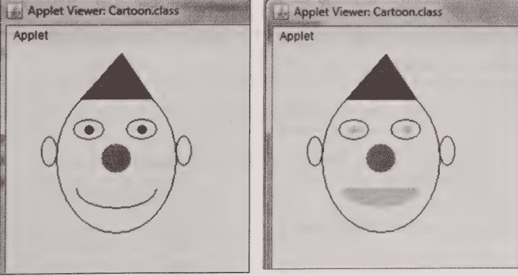

**图 13.7** (a) 动画角色正常显示，或当鼠标未指向鼻子且未点击时。(b) 当鼠标指向鼻子并点击时，动画角色正大嘴微笑，眼睛是绿色的。

## 13.9.2 会眨眼睛的微笑动画（第 2 部分）

在微笑动画（第 2 部分）中，如果用户将鼠标指针放置在角色的鼻子上，角色的眼睛会变成绿色，角色会大嘴微笑。如果用户将指针移出鼻子区域，则显示角色的默认微笑脸（黑眼睛、耳朵和红色鼻子）。这不需要像上一个例子那样点击鼻子。因此，我们使用了适配器，因为我们需要跟踪鼠标的移动而不是点击。但使用 `MouseMotionEvent` 并重写 `mouseMoved` 方法会导致一些复杂性。当鼠标移动时，`mouseMoved` 方法被调用并绘制 applet。问题是 `paint` 方法被调用了多次，导致用户能明显看到闪烁。通过重写 `update` 方法可以克服闪烁，但这引入了一个新问题。让我们看看问题是什么以及可能的解决方案有哪些。

## 示例 13.7 微笑动画（第 3 部分）

```java
import java.applet.*;
import java.awt.*;
import java.awt.event.*;

/*applet code = "CartoonVr3.class" Width = 400 Height = 400</applet>*/
/* 如果你将鼠标指针移动到动画的鼻子上，它的眼睛颜色应该改变并大嘴微笑。如果你将鼠标移出带有黑眼睛的默认动画鼻子，则应该出现微笑。 */

public class CartoonVr3 extends Applet {
    MyMouseMotionAdapter mma;

    public void init() {
        mma = new MyMouseMotionAdapter(this);
        addMouseMotionListener(mma);
    }

    public void paint(Graphics g) {
        // 创建脸
        g.drawOval(50, 40, 120, 150);

        // 头部上的帽子
        int x[] = {73, 115, 147};
        int y[] = {55, 7, 55};
        int n = x.length;
        g.fillPolygon(x, y, n);

        g.drawOval(67, 75, 30, 20);    // 左眼
        g.drawOval(120, 75, 30, 20);    // 右眼

        if (mma.move) {
            g.setColor(Color.green);
            g.fillOval(78, 81, 30, 10);    // 绿色左瞳
            g.fillOval(131, 81, 30, 10);    // 绿色右瞳
            g.fillArc(70, 125, 80, 40, 180, 180);    // 嘴巴
        } else {
            g.fillOval(78, 81, 30, 10);    // 黑色左瞳
            g.fillOval(131, 81, 30, 10);    // 黑色右瞳
            g.drawArc(70, 125, 80, 40, 180, 180);    // 嘴巴
        }

        // 创建红色的鼻子
        g.setColor(Color.red);
        g.fillOval(95, 100, 30, 30);

        // 设置颜色为黑色绘制耳朵
        g.setColor(Color.black);
        g.drawOval(35, 92, 15, 30);    // 左耳
        g.drawOval(170, 92, 15, 30);   // 右耳
    }

    public void update(Graphics g) {
        paint(g);
    }
}

class MyMouseMotionAdapter extends MouseMotionAdapter {
    CartoonVr3 g;
    boolean move;

    MyMouseMotionAdapter(CartoonVr3 g) {
        this.g = g;
        move = false;
    }

    public void mouseMoved(MouseEvent me) {
        int x = me.getX();
        int y = me.getY();
        if (x > 85 && x < 115 && y > 100 && y < 130) {
            move = true;
            g.repaint();
        } else {
            move = false;
            g.repaint();
        }
    }
}
```


# 426 Java 编程

## 输出

| Applet Viewer: CartoonVr3.class | Applet Viewer: CartoonVr3.class | Applet Viewer: CartoonVr3.class |
| --- | --- | --- |
| Applet | Applet | Applet |
| (a) | (b) | (c) |

**图 13.9** (a) 首先加载 applet，(b) 当鼠标指针悬停在鼻子上时，(c) 当鼠标指针移出鼻子区域时。

# 总结

在本章中，我们强调了通过使用事件处理增强 Java GUI 能力的特性。在转向 Java 的 AWT 组件之前，必须讨论 Java 的事件处理模型，因为如果不学习这个模型，关于 applet 和其他 GUI 的使用知识就是不完整的。实际上，applet 是事件驱动程序，它们使用 GUI 与用户交互。事件处理的现代方法使用事件委托模型，其中源产生事件，事件被发送给一个或多个监听器。这些监听器接收事件通知，并根据事件类不同方法的要求进行处理。

# 练习题

- 1. 下面哪些陈述是正确的？
   (a) 所有事件将按照监听器添加的顺序被处理
   (b) 使用适配器方法处理事件意味着为所有事件方法创建空白的方法体
   (c) 一个组件可以与多个监听器关联
   (d) 监听器在一旦添加后可以被移除
- 2. 下面哪些是正确的事件处理方法？
   (a) `mousePressed(MouseEvent e){}`
   (b) `mousePressed(MouseClick e){}`
   (c) `functionKey(KeyPress k){}`
   (d) `componentAdded(ContainerEvent e){}`
- 3. 当你尝试编译并运行以下代码时会发生什么？

```java
import java.awt.*;
import java.awt.event.*;

public class Demo extends Applet implements MouseListener {
    public static void main(String[] args) {
        Demo demo = new Demo();
    }

    Demo() {
        this.addMouseListener(this);
    }
}
```

## Java 中的事件处理

```java
public void mouseClicked(MouseEvent e) {
    System.out.println(e.getWhen());
}

public class Click extends Frame implements MouseListener {
    public static void main(String args[]) {
        Click s = new Click();
    }

    Click() {
        this.addMouseListener(this);
    }
}
```

- (a) 编译错误
- (b) 运行时错误
- (c) 编译并在运行时输出每次点击的日期和时间
- (d) 编译并在运行时为每次点击输出时间戳

- 4. 关于事件处理，下面哪些陈述是正确的？
   (a) 1.1 事件模型与 1.0 事件模型向后兼容
   (b) 为 1.0 事件处理编写的代码将运行在 1.1 版本的 JVM 上
   (c) 1.1 事件模型特别适用于 GUI 构建工具
   (d) 拖放事件处理器是在 1.1 版本事件处理中添加的。

- 5. 下面哪些陈述是正确的？
   (a) 对于给定的组件，事件将按照监听器添加的顺序被处理
   (b) 使用适配器方法处理事件意味着为所有事件方法创建空白的方法体
   (c) 一个组件可以与多个监听器关联
   (d) 监听器在一次后可以被移除

- 6. 下面哪些是正确的事件处理方法？
   (a) `mousePressed(MouseEvent e){}`
   (b) `mousePressed(Mouse e){}`
   (c) `functionKey(Key k){}`
   (d) `componentAdded(Container e){}`

- 7. 当你尝试编译并运行以下代码时会发生什么？

```java
import java.awt.*;
import java.awt.event.*;

public class Demo extends Applet implements MouseListener {
    public static void main(String[] args) {
        Demo demo = new Demo();
    }

    Demo() {
        this.addMouseListener(this);
    }
}
```

- 8. 下面哪个是调用 `paint()` 的正确顺序？
   (a) `update()` -> `repaint()`
   (b) `repaint()` -> `update()`
   (c) `repaint()` -> `update()`
   (d) 都不

- 9. 下面哪个是调用 `paint()` 的正确顺序？
   (a) `update()` -> `repaint()`
   (b) `repaint()` -> `update()`
   (c) `repaint()` -> `update()`
   (d) 都不

- 10. 关于适配器，下面哪些陈述是正确的？
   (a) 你需要重写所有的方法
   (b) 你只需要重写必要的方法
   (c) 所有的
   (d) 都不

# 复习题

- 1. 什么是事件委托模型？
- 2. 对象是如何注册事件的？
- 3. 使用适配器的优点是什么？
- 4. 内部类是如何使用的？
- 5. 匿名类的优点是什么？

## 编程练习

- 1. 当获得焦点时 applet 显示 "Focus"。
- 2. 创建一个识别按键并显示与按键关联的字符的 applet。
- 3. 创建一个继承 `MouseListener` 并为每个方法显示相应消息的 applet。
- 4. 在上一个练习中使用适配器概念。
- 5. 创建一个用于处理的匿名内部类。

## 选择题答案

- 1. (c) 和 (d)
- 2. (a) 和 (d)
- 3. (a) 和 (c)
- 4. (未提供答案)
- 5. (c) 和 (d)
- 6. (a) 和 (d)
- 7. (a)，监听器接口的每个方法应在类中重写。
- 8. (b)
- 9. (a)
- 10. (b)

# 抽象窗口工具

每个人对图像的感受不同。内容并不，重要的是它给你的感觉。
Adam Jones

阅读本章后，读者将能够

- 了解 GUI 组件集
- 理解不同组件事件处理的使用
- 解释用于灵活布局的布局管理器

## 14.1 引言

抽象窗口工具（AWT）提供了许多类——这些甚至可以在 applet 中——它是应用程序与原生 GUI 之间的连接。AWT 隐藏了你的应用程序将运行的 GUI 的复杂性。

Java 基础类（JFC）提供了两种构建 GUI 应用程序的框架，有趣的是它们依赖于相同的事件处理模型：

- AWT
- Swing

AWT 依赖于特定平台的底层操作系统来表示其 GUI 组件（即 AWT 中的组件被称为重量级组件），而 Swing 实现了一套用 Java 编写的轻量级 GUI 组件以及插件式外观。这些轻量级 GUI 组件不依赖于底层窗口系统。在本章中，我们将重点关注 AWT，而 Swing 将在以后介绍。通过导入 `java.awt.*` 包，可以在任何 Java 程序中使用 AWT API。

### 14.1.1 为什么选择 AWT?

在最底层，操作系统将信息从输入设备传输到程序作为输入，并提供输出。AWT 的设计初衷是让程序员无需担心跟踪鼠标移动、读取键盘字符或向屏幕写入内容。AWT 是应用程序与底层资源之间一个设计良好的面向对象的接口。

AWT 的优势在于它保留了运行 AWT 应用程序的平台的原生外观和感受，因为 AWT 中的组件（用户界面）是使用原生 GUI 工具包实现的。另一方面，它的缺点是应用程序在不同平台上执行时将具有不同的外观和感受。

## 14.2 java.awt 包

`java.awt` 包包含了所有用于创建图形用户界面、绘制图像、颜色和字体的类。一个 AWT 元素（如按钮或文本框）被称为组件（Component）。`Component` 类是所有 AWT 组件的父类。当用户与这些组件交互时，组件会触发事件，例如用户点击按钮时。这些事件由事件类处理，即 `EventListener` 及其子类。

容器（Container）是包含组件和其他容器的容器。容器具有一个布局管理器（layout manager），它决定了组件在容器中的视觉位置。`java.awt` 包包含了几个用于在容器中布局组件的类。

`java.awt` 包包含许多接口和类。很难详述该包中的所有成员。该包中最常用的类如表 14.1 所示。

表 14.1 AWT 类
| 类名 | 描述 |
|---|---|
| `AWTEvent` | 所有 AWT 事件的根事件类。 |
| `BorderLayout` | 根据五个区域（北、南、东、西、中）布局容器中的组件。 |
| `Button` | 创建一个按钮。 |
| `Canvas` | 代表屏幕上的一个空白矩形区域，可以在其上进行绘制，或从那里捕获来自用户的输入事件。 |
| `CardLayout` | 可以包含其他布局的布局管理器。 |
| `Checkbox` | 一种可以处于两种状态之一的组件：“开启”（true）或“关闭”（false）状态。 |
| `CheckboxGroup` | 将一组复选框分组，使其像单选按钮一样工作。 |
| `CheckboxMenuItem` | 此类用于创建已勾选的菜单项。 |
| `Choice` | 打开一个选项弹出菜单。 |
| `Color` | 代表 RGB 或由 `ColorSpace` 标识的任意颜色空间中的颜色。 |
| `Component` | 组件具有图形表示的对象，可以显示在用户屏幕上，用户可以与其交互。 |
| `Container` | 包含其他 AWT 组件。 |

（表 14.1 继续）
| 类名 | 描述 |
| --- | --- |
| `Dialog` | 带有标题和边框的顶级窗口。 |
| `Dimension` | 此对象封装了组件的宽度和高度。 |
| `FileDialog` | 此类显示一个对话窗口，用户可以从中选择文件。 |
| `FlowLayout` | 按方向流显示组件。 |
| `Font` | 此类表示字体，用于以可见的方式渲染文本。 |
| `FontMetrics` | 封装关于特定字体在特定区域如何渲染的信息。 |
| `Frame` | 带有标题和边框的顶级窗口（容器），用于包含其他组件。 |
| `Graphics` | `Graphics` 类是抽象基类，允许应用程序在组件上绘图，如画线、圆等。 |
| `GridBagConstraints` | 此类为使用 `GridBagLayout` 类布局的组件指定约束条件。 |
| `GridLayout` | 这是一种灵活的布局管理器，将组件垂直、水平或沿其基线对齐，要求组件具有相同大小。 |
| `GridLayout` | 在矩形网格中布局组件。 |
| `Image` | 抽象表示图形图像。 |
| `Insets` | 指定容器所有边缘必须留出的空间。 |
| `Label` | 用于在容器中放置文本。 |
| `List` | 字符串项的可滚动列表。 |
| `MediaTracker` | 用于跟踪多个媒体对象的状态。 |
| `Menu` | 从菜单栏部署的拉取式菜单。 |
| `MenuBar` | 菜单被添加到附加到框架的 `Menu` 上。 |
| `MenuItem` | 菜单中的所有项都是 `MenuItem`。 |
| `Shortcut` | 此类表示 `MenuItem` 的键盘快捷键。 |
| `MouseInfo` | 提供获取鼠标位置等信息的方法。 |
| `Panel` | 它是一个容器类。 |
| `Point` | 代表 (x, y) 坐标空间中的位置。 |
| `PopupMenu` | 可以在组件内任何指定位置动态弹出的菜单。 |
| `Scrollbar` | `Scrollbar` 类嵌入了垂直或水平的滚动条。 |
| `ScrollPane` | 实现单个组件自动水平和/或垂直滚动的容器类。 |
| `TextArea` | 允许允许用户输入/编辑多行输入的对象。 |
| `TextComponent` | `TextField` 和 `TextArea` 的父类。 |
| `TextField` | 它是一种允许用户输入/编辑单行文本的组件。 |
| `Window` | 它是 `Dialog` 和 `Frame` 的父类，代表没有边框和菜单栏的顶级窗口。 |

## 14.2 组件与容器

图形用户界面是在按钮、滚动条、列表和文本框等图形元素的帮助下开发的。这些元素被称为组件。这些组件通常是允许用户交互的事件源。

图 14.1 显示了 Java 中不同 AWT 类的层次结构。


### 14.2.1 Component 类

让我们讨论 `Component` 类，它是 `Object` 的子类，是 `Button`、`Label`、`CheckBox`、`RadioButton`、`Choice`、`Canvas`、`List` 和 `Scroll` 等多个类的父类。你必须了解创建上述组件的想法。为了在窗口中使用特定的组件，你必须将组件添加到窗口。`Container` 类有一个用于此目的的 `add()` 方法。

```java
Component add(ComponentObj)
```


要添加的组件对象作为参数传递给上述方法。如果你想从窗口删除组件，可以使用 `remove()`。

### 14.2.2 组件作为事件源

除了 `label` 之外的所有控件都可以生成事件。这些控件产生的事件通知由注册的监听器接收。这种通知有助于监听器识别生成事件的控件类型。在上一章中，我们一直在处理 applet 作为事件源。现在我们将处理其他事件源，例如组件。在继续之前，重要的是让你了解哪种 `Listener` 接口适用于接收哪个控件的通知，以及哪些方法负责处理特定类型的事件（表 14.2）。

表 14.2 与组件相关的事件
| 组件 | 事件 | 事件类型 | 事件监听器 | 方法名 |
|---|---|---|---|---|
| Button | 点击 | Action | ActionListener | `actionPerformed()` |
| | 获得焦点/失去焦点 | FocusEvent | FocusListener | `focusGained()` and `focusLost()` |
| Checkbox | 选中/取消选中 | ItemEvent | ItemListener | `itemStateChanged()` |
| Choice | 选中/取消选中 | ItemEvent | ItemListener | `itemStateChanged()` |
| List | 选中/取消选中 | ItemEvent | ItemListener | `itemStateChanged()` |
| | 双击项目 | ActionEvent | ActionListener | `actionPerformed()` |
| MenuItem | 点击 | ActionEvent | ActionListener | `actionPerformed()` |
| | 获得焦点/失去焦点 | FocusEvent | FocusListener | `focusGained()` and `focusLost()` |
| TextField | 按下回车键 | ActionEvent | ActionListener | `actionPerformed()` |
| | 改变 | TextEvent | TextListener | `textValueChanged()` |
| TextArea | 获得焦点/失去焦点 | FocusEvent | FocusListener | `focusGained()` and `focusLost()` |
| Scrollbar | 通过鼠标/键盘改变滚动条的值 | AdjustmentEvent | AdjustmentListener | `adjustmentValueChanged()` |
| | 焦点 | FocusEvent | FocusListener | `focusGained()` and `focusLost()` |
| | 击键事件 | KeyEvent | KeyListener | `keyPressed()`, `keyReleased()`, `keyTyped()` |
| | 鼠标事件 | MouseEvent | MouseListener | `mouseClicked()`, `mouseEntered()`, `mouseExited()`, `mousePressed()`, `mouseReleased()` |
| Frame/ Applet | 鼠标移动事件 | MouseEvent | MouseMotionListener | `mouseMoved()` and `mouseDragged()` |
| | 窗口事件 | WindowEvent | WindowListener | `windowActivated()`, `windowClosed()`, `windowClosing()`, `windowDeactivated()`, `windowIconified()`, `windowDeiconified()`, `windowOpened()` |

### 14.3 按钮 (BUTTON)

```
Button() throws HeadlessException
Button(String str) throws HeadlessException;
```

第一个构造函数在调用时，会创建一个没有显示标签的 `Button`。第二个构造函数会创建一个 `Button`，并在上面显示字符串 `str`。现在，按钮实际上是如何创建的？参见下面的语法：

```
Button buttonName = new Button(str);
```

其中 `buttonName` 是按钮对象的名称，`str` 是你想要设置的按钮标题的文本。一旦创建了 `Button` 对象，就需要将其添加到 applet、frame 或任何其他容器中。其语法如下：

```
add(buttonName);
```

`setLabel()` 和 `getLabel()` 方法分别用于更改按钮的标签和获取标签的文本。这些方法的签名如下：

```
void setLabel(String str)
String getLabel();
```

表 14.3 列出了属于 `Button` 类的其他方法。

#### 表 14.3 Button 类的方法

| 方法 | 描述 |
| --- | --- |
| `void addActionListener(ActionListener al)` | 添加指定的动作监听器，以接收来自此按钮的动作事件。 |
| `void addNotify()` | 创建此按钮的对等体（peer）。 |
| `AccessibleContext getAccessibleContext()` | 获取与此按钮关联的 `AccessibleContext`。 |
| `String getActionCommand()` | 返回此按钮触发的事件的命令名称（按钮标题）。 |
| `ActionListener[] getEventListeners()` | 返回注册在此按钮上的所有动作监听器的数组。 |
| `String paramString()` | 返回一个表示按钮状态的字符串。 |
| `void processActionEvent(ActionEvent ae)` | 通过将事件分发到任何注册的 `ActionListener` 对象来处理此按钮上发生的动作事件。 |
| `void processEvent(AWTEvent event)` | 处理此按钮上的事件。 |
| `void removeActionListener(ActionListener al)` | 移除指定的动作监听器，使其不再接收来自此按钮的动作事件。 |
| `void setActionCommand(String command)` | 设置此按钮触发的动作事件的命令名称。 |

示例 14.1 展示了一个示例，演示了如何使用监听器方法创建按钮并处理事件。

#### 示例 14.1 按钮演示

```
/*<applet code = "ButtonClass.class" width = 400 height = 150></applet>*/
import java.applet.*;
import java.awt.*;
import java.awt.event.*;
import java.*;

public class ButtonClass extends Applet implements ActionListener {
    Button red, white, blue;
    Label hit;

    public void init() {
        red = new Button("Red");
        white = new Button("white");
        blue = new Button("blue");
        hit = new Label("Hit a Button to change the screen color");
        add(red);
        add(white);
        add(blue);
        add(hit);
        red.addActionListener(this);
        white.addActionListener(this);
        blue.addActionListener(this);
    }

    public void actionPerformed(ActionEvent ae) {
        String str = ae.getActionCommand();
        if (str.equals("Red"))
            setBackground(Color.red);
        else if (str.equals("white")) {
            setBackground(Color.white);
        }
        else if (str.equals("blue")) {
            setBackground(Color.blue);
        }
        repaint();
    }
}
```

输出

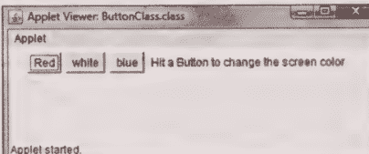
图 14.2(a) 首次显示或点击白色按钮时背景为白色的 Applet

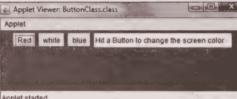
图 14.2(b) 点击红色按钮时背景为红色的 Applet

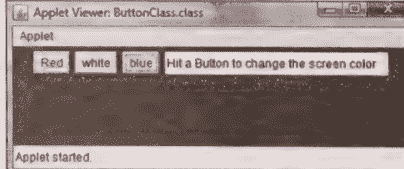
图 14.2(c) 点击蓝色按钮时背景为蓝色的 Applet

### 14.4 标签 (LABEL)

`Label` 是 AWT 中最简单的组件。

#### 表 14.4 创建标签的构造函数

| 构造函数 | 描述 |
| --- | --- |
| `Label()` | 创建空标签。 |
| `Label(String str)` | 创建带有指定字符串的新标签。 |
| `Label(String str, int alignment)` | 创建带有指定字符串和对齐方式的新标签。 |

示例 14.2 展示了一个演示标签属性的 applet。

#### 示例 14.2 演示标签的 Applet

```
/*<applet code = "LabelClass.java" width = 350 height = 100></applet>*/
import java.applet.*;
import java.awt.*;

public class LabelClass extends Applet {
    public void init() {
        Label firstLabel = new Label("Labels exist simply");
        add(firstLabel);
        Label label = new Label("to place text on the screen");
        add(label);
        Label thirdLabel = new Label("They can be aligned left, right or center.");
        add(thirdLabel);
    }
}
```

可以通过以下方式更改标签的对齐方式：

```
labelName.setAlignment(Label.CENTER);
```

除了设置标签文本，我们还可以使用以下方法获取标签的文本：

```
String labelText = labelName.getText();
```

可以通过以下方法更改标签的文本：

```
labelName.setText("This is new text.");
```

以下行将创建一个右对齐的标签：

```
labelName = new Label("This is for demonstration.", Label.RIGHT);
```

输出

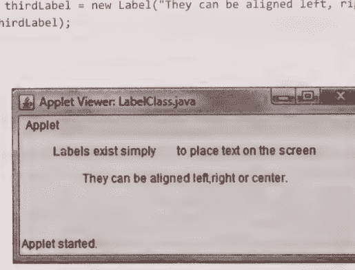
图 14.3 在 Applet 中显示的标签

### 14.5 复选框 (CHECKBOX)

复选框用作开启/关闭开关，因为每次点击它都会切换到相反的选择，即如果你点击一个未选中的复选框，它会被选中；当你点击选中的复选框时，它会被取消勾选。你可以根据需要勾选任意数量的复选框，因为对选择的数量没有限制。你的程序可以根据每个复选框的状态做出响应。可能需要一个类似按钮的元素来触发事件以检查复选框的状态。复选框是 `Checkbox` 类的对象，该类支持以下构造函数：

```
Checkbox()
Checkbox(String str)
Checkbox(String str, boolean state)
Checkbox(String str, CheckboxGroup cbg, boolean on)
```

第一种构造函数形式创建一个标签为空且状态为未选中的复选框。在其他构造函数形式中，字符串参数对应复选框的标签，布尔参数（`true`/`false`）表示复选框是创建选中还是未选中，即如果传递了 `true`，则创建的复选框初始为选中；否则如果参数为 `false`，则复选框初始为未选中；`CheckboxGroup` 参数用于指定复选框组（该组用于单选按钮，单选按钮是一种特殊的复选框）。

以下行将创建一个以 "Names" 为标签、以 `null` 作为组参数占位符、并以 `false` 表示未选中的复选框：

```
Checkbox names = new Checkbox("Names", null, false);
```

一旦创建了复选框，只需通过以下命令将其添加到 applet（或其他容器）：

```
add(names);
```

其中 `names` 是复选框的名称。表 14.5 给出了属于 `Checkbox` 类的几个方法。

#### 表 14.5 Checkbox 方法

| 方法 | 说明 |
| --- | --- |
| `void addItemListener(ItemListener il)` | 添加指定的项监听器以接收来自此复选框的项事件。 |
| `CheckboxGroup getCheckboxGroup()` | 返回关联的复选框组。 |
| `ItemListener[] getItemListeners()` | 返回注册到此复选框的所有项监听器的数组。 |
| `String getLabel()` | 返回 `Checkbox` 文本形式的字符串。 |
| `Object[] getSelectedObjects()` | 返回一个长度为 1 的数组，包含 `Checkbox` 标签；如果复选框未选中则返回 `null`。 |
| `boolean getState()` | 返回 `true` 或 `false` 形式的布尔值，取决于 `Checkbox` 是否被选中。 |
| `String paramString()` | 返回表示 `Checkbox` 状态的字符串。 |
| `void processEvent(AWTEvent awte)` | 处理此复选框上的事件。 |
| `void processItemEvent(ItemEvent ie)` | 通过分发到任何注册的 `ItemListener` 对象来处理此复选框上发生的项事件。 |
| `void removeItemListener(ItemListener l)` | 移除项监听器与 `Checkbox` 之间的关联。 |
| `void setCheckboxGroup(CheckboxGroup cbg)` | 设置复选框组。 |
| `void setLabel(String label)` | 我们可以更改复选框标签并设置为参数 `label`。 |
| `void setState(boolean state)` | 将复选框的状态更改为 `true`（选中）或 `false`（未选中）。 |

示例 14.3 展示了如何创建和使用复选框。程序中创建的“SUBMIT”按钮会触发一个事件以检查哪些框被选中。然后，选中的名称列表将绘制在 applet 窗口上。

#### 示例 14.3 复选框演示

```
/*<applet code = "CheckboxClass.class" width = 400 height = 100></applet>*/
import java.applet.*;
import java.awt.*;
import java.awt.event.*;

public class CheckboxClass extends Applet implements ActionListener {
    Button submit;
    Checkbox name1;
    Checkbox name2;
    Checkbox name3;
    Font f;

    public void init() {
```


# 示例代码

```java
name1 = new Checkbox("Ram", null, false);
name2 = new Checkbox("Ramesh", null, false);
name3 = new Checkbox("Naresh", null, false);
f = new Font("Arial", Font.ITALIC, 14);
submit = new Button("SUBMIT");
add(name1);
add(name2);
add(name3);
add(submit);
submit.addActionListener(this);
}

public void actionPerformed(ActionEvent ae) {
    String str = ae.getActionCommand();
    if (str.equals("SUBMIT"))
        repaint();
}

public void paint(Graphics g) {
    if (name1.getState())
        g.drawString("Ram", 50, 60);
    if (name2.getState())
        g.drawString("Ramesh", 50, 80);
    if (name3.getState())
        g.drawString("Naresh", 50, 100);
}
```

# 输出

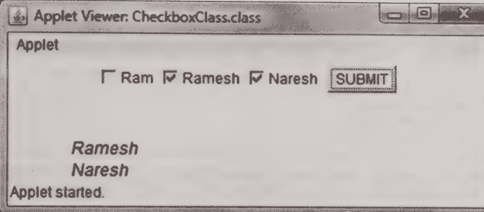

**图 14.4** Applet 内部的复选框

# 解析

- L4 创建了一个实现了 `ActionListener` 的名为 `CheckboxClass` 的 applet。
- L5–8 创建了 `Button`、复选框和 `Font` 的引用变量。
- L9 定义了字体的 `init()` 方法。
- L10–14 实例化复选框和按钮。
- L15–18 添加了复选框和按钮。
- L19 在按钮上注册了 `ActionListener`。
- L21–24 重写了 `actionPerformed()`。
- L26–35 定义了 `paint()`。
- L31 `if (name2.getState())`
- L32 `g.drawString("Ramesh", 50, 80);`
- L33 `if (name3.getState())`
- L34 `g.drawString("Naresh", 50, 100);`

# 14.6 单选按钮

单选按钮也称为复选框组，是一种特殊的复选框，在一个组内允许只有一个选择。复选框是 `Checkbox` 类的对象。有一个构造函数（默认构造函数）创建一个空组。一旦你创建了复选框组，将复选框添加到其中。构造函数中有三个参数需要指定：第一个参数是单选按钮标签，第二个参数是它所属的组，第三个参数是状态（`true` 或 `false`，取决于复选框是否被选中）。

```java
add(new Checkbox("mango", fruits, false));
add(new Checkbox("papaya", fruits, false));
add(new Checkbox("guava", fruits, false));
add(new Checkbox("apple", fruits, true));
```

上一节中提到的复选框方法也可以用于组中的单选按钮。其中一些方法是：

```java
void setLabel(String str)
String getLabel()
boolean getState()
void setState(boolean b)
```

`getCheckboxGroup()` 和 `setCheckboxGroup()` 可访问和更改给定复选框组。对于当前选中的复选框，可以使用 `getSelectedCheckbox()` 方法；为了选择一个复选框，可以使用 `setSelectedCheckbox(chkbox)` 方法。参数 `chkbox` 是你想选中的复选框。

示例展示了如何使用单选按钮来更改 applet 的背景颜色。记住，一次只能选择一个单选按钮。

# 示例 14.4 单选按钮演示

```java
/*<applet code = "RadioDemo.class" width = 300 height = 200></applet>*/
import java.applet.*;
import java.awt.*;
import java.awt.event.*;

public class RadioDemo extends Applet implements ItemListener {
    Checkbox red, white, green;
    CheckboxGroup cbg;

    public void init() {
        addLabel("这三个单选按钮将改变屏幕颜色.");
        cbg = new CheckboxGroup();
        red = new Checkbox("Red", cbg, false);
        white = new Checkbox("White", cbg, false);
        green = new Checkbox("Green", cbg, false);
        addLabel("注意你只能选择一个单选按钮.");
        addLabel("并且选择单选按钮会触发事件");
        add(red);
        add(white);
        add(green);
        red.addItemListener(this);
        white.addItemListener(this);
        green.addItemListener(this);
    }

    public void itemStateChanged(ItemEvent ie) {
        String str = (String) ie.getItem();
        if (str.equals("Red")) {
            setBackground(Color.red);
        } else if (str.equals("White")) {
            setBackground(Color.white);
        } else if (str.equals("Green")) {
            setBackground(Color.green);
        }
        repaint();
    }
}
```

# 输出

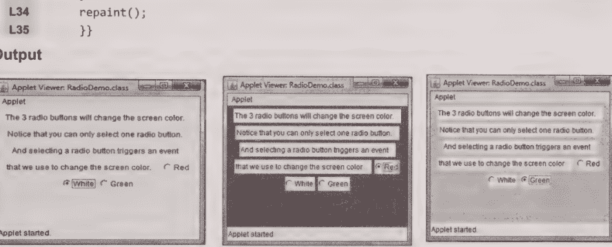

**图 14.5** Applet 的颜色根据选择改变

# 解析

- L1–3 导入了必要的包。
- L4 定义了 Applet 类，它实现了 `ItemListener` 接口以处理与复选框相关的事件。
- L5 创建了三个引用。
- L6 创建了 `CheckboxGroup` 引用。
- L7 定义了 `init()` 方法。
- L8 添加了一个标签。
- L9–12 实例化 `CheckboxGroup` 并关联三个复选框。复选框被作为一个组的一部分（L10–12），以便它们像单选按钮一样工作，组内只能选择一个。所有单选按钮默认未被选中，因为传递给复选框构造函数的第三个参数为 `false`。
- L13–15 实例化标签并将其添加到 applet 中。
- L16–21 将所有单选按钮添加到 applet 中，并注册了关联的监听器以捕获事件。
- L23–34 `ItemListener` 接口有一个方法，即 `itemStateChanged(ItemEvent e)`，它被重写。该方法被调用并根据单选按钮名称更改背景颜色。`ItemEvent` 的 `getItem()` 方法返回背景中选中的单选按钮的标题，使用 `setBackground(Color...)` 返回一个 `Object` 类型的对象，然后将其强制转换为 `String`。基于此，我们更改颜色方法，然后重绘 applet。

# 14.7 列表框

`List` 类提供了一个多选的可滚动值列表，这些值可以单独选择或一起选择。可以创建一个列表，在可见窗口中显示任意数量的选项。`List` 类具有以下构造函数：

```java
List()
List(int no_of_rows)
List(int no_of_rows, boolean multi_select)
```

所有构造函数都会抛出 `HeadlessException`。

在默认构造函数的情况下，每次只能选择一个项目。在第二个构造函数中，你可以指定列表中希望始终可见的行数。在第三个构造函数中，如果布尔值设置为 `true`，则意味着用户可以从列表中一次选择多个项目。如果设置为 `false`，则每次只能从列表中选择列表中的一个项目。

通过以下语法可以创建一个不允许多选的简单形式的 `List`：

```java
ArrayList = new List();
```

如果你想创建一个允许多选的列表，请使用以下命令行（代码行），它会创建一个具有 10 个可见条目并开启多选功能的列表。

```java
ArrayList = new List(10, true);
```

一旦创建了列表，`add` 方法就可以允许你添加新条目。表 14.6 显示了 `List` 类的方法。

```java
arrayList.add("apple");
arrayList.add("mango");
arrayList.add("guava");
```

要在列表的特定位置（例如第一个位置）添加项目，请使用以下语法行：

```java
arrayList.add("Coffee", 0);
```

将项目添加到 `(position-1)` 或比列表上数字更高的位置，则会将其添加到列表末尾。
必须实现 `ActionListener` 接口以处理列表事件。双击某个特定的列表项会生成一个事件对象。与按钮的情况类似，可以使用 `getActionCommand()` 获取双击项目的名称。如果由于单点击而触发了项目选择，则会生成一个 `ItemEvent`。此 `ItemEvent` 是由选择产生还是取消选择产生，可以通过 `ItemEvent` 类的 `getStateChange()` 方法来确定。

# 示例 14.5 List Demo

```java
/*<applet code = ShopList.class width = 600 height = 600></applet>*/
L1 import java.applet.*;
L2 import java.awt.*;
L3 import java.awt.event.*;
L4 public class ShopList extends Applet implements ActionListener {
L5 List original; List copy;
L6 public void init() {
L7 original = new List(8, false);
L8 copy = new List(10, false);
L9 populateList();
L10 add(original);
L11 Button b1 = new Button(">>>>>");
L12 add(b1);
L13 add(copy);
L14 Button b2 = new Button("Clear");
L15 add(b2);
L16 add(new Label("从左侧列表选择一个项目并点击 >>> 将其放入另一个列表中"));
L17 b1.addActionListener(this);
```

# 表 14.6 List 类的方法

| 方法名 | 描述 |
| --- | --- |
| `void add(String item)` | 将指定的项目添加到滚动列表的末尾。 |
| `void add(String item, int index)` | 在索引指定的位置向滚动列表添加指定的项目。 |
| `void addActionListener(ActionListener l)` | 添加指定的动作监听器以接收来自此列表的动作事件。 |
| `void addItemListener(ItemListener l)` | 添加指定的项目监听器以接收来自此列表的项目事件。 |
| `void deselect(int index)` | 取消指定索引的项目选择。 |
| `AccessibleContext getAccessibleContext()` | 获取 `AccessibleContext`。 |
| `ActionListener[] getActionListeners()` | 获取动作监听器数组。 |
| `String getItem(int index)` | 获取指定索引的项目。 |
| `int getItemCount()` | 获取项目总数。 |
| `String[] getItems()` | 获取所有项目数组。 |
| `int getMinimumSize()` | 获取最小尺寸。 |
| `int getMinimumSize(int rows)` | 获取指定行数的最小尺寸。 |
| `int getPreferredSize()` | 获取首选尺寸。 |
| `int getPreferredSize(int rows)` | 获取指定行数的首选尺寸。 |
| `int getRows()` | 获取行数。 |
| `int getSelectedIndex()` | 获取选中项的索引。 |
| `int[] getSelectedIndexes()` | 获取选中项的索引数组。 |
| `String getSelectedItem()` | 获取选中的项目。 |
| `String[] getSelectedItems()` | 获取选中的项目数组。 |
| `Object[] getSelectedObjects()` | 获取选中的对象数组。 |
| `int getVisibleIndex()` | 获取可见项的索引。 |

# 表 14.6 续

| 方法名 | 细节 |
|---|---|
| `boolean isSelected(int index)` | 判断列表中指定的项目是否被选中。 |
| `boolean isMultipleMode()` | 判断列表是否允许多选。 |
| `void makeVisible(int index)` | 使指定索引的项目可见。 |
| `void processEvent(WindowEvent e)` | 处理列表上的事件。 |
| `void remove(int position)` | 从列表中移除指定位置的项目。 |
| `void remove(String item)` | 从列表中移除指定的项目。 |
| `void removeActionListener(ActionListener listener)` | 移除指定的动作监听器，不再接收来自此列表的动作事件。 |
| `void removeAll()` | 从列表中移除所有项目。 |
| `void removeItemListener(ItemListener listener)` | 移除指定的项目监听器，不再接收来自此列表的项目事件。 |
| `void replaceItem(String newValue, int index)` | 用新字符串替换滚动列表中指定索引的项目。 |
| `void select(int index)` | 选中列表中指定索引的项目。 |
| `void setMultipleMode(boolean b)` | 设置决定列表是否允许多选的标志。 |


# Java 编程

## 解释

- L1–3 导入了包。
- L4 类声明。
- L5 创建了两个列表，并在 L7 和 L8 中实例化。构造函数中的第一个参数指定了要显示的列表中项目数量，第二个参数指定了是否允许多项选择。
- L9 在 L20–30 中定义了 `populateList()` 方法，用于向原始列表添加项目：
- L10 列表被添加到 applet 中。
- L11–18 创建了两个按钮，将它们添加到 applet 中并注册了 `ActionListener` 以处理按钮事件。除此，还添加了一个标签。
- L31–43 重写了 `actionPerformed()` 方法来处理按钮事件。如果用户在原始列表中选择了一个项目（`original.getSelectedIndex()` 并按了按钮 `>>>`），则通过 `add(original.getSelectedItem())` 将选中的项目复制到 `copy` 列表，并通过 `original.remove(original.getSelectedIndex())` 从原始列表中移除。如果点击了清除按钮，则使用 `removeAll()` `copy` 列表和原始列表中的所有项目，并使用 `populateList()` 方法重新填充原始列表。

## 4.8 选择框 (CHOICE BOXES)

`Choice` 类非常列表，但它允许你节省空间，因为它提供了一个文本字符串的弹出菜单。当前选择的内容显示在顶部。为了使用选择框，必须创建一个 `Choice` 类的实例。

```java
Choice c = new Choice();
```

一旦创建了选择框，`add` 方法就可以允许你添加新条目。

```java
c.add("Red");
c.add("Green");
```

可以使用 `select()` 方法更改当前选中的项目。可以选择基于名称或索引。例如，

```java
c.select("Red");
```

`select(0)` 分别返回所中文项目的位置，而 `getSelectedItem()` 返回所中文项目的名称。

处理 `Choice` 更改事件的监听器是 `ItemListener`。下面的示例展示了如何使用选择框来更改 applet 的背景颜色。

### 示例 14.6 选择演示

```java
/*ChoiceDemo.class width = 400 height = 400*/
<applet>
L1 import java.applet.*;
L2 import java.awt.*;
L3 import java.awt.event.*;
L4 public class ChoiceDemo extends Applet implements ItemListener {
L5 String currentColor = " ";
```

# 抽象窗口工具 (Abstract Window Toolkit)

L6 Choice theOptions;

L7 Label l1;

L8 public void init(){

```java
add(l1 = new Label("Make a choice from the choice box"));
```

L10 theOptions = new Choice();

```java
L11 theOptions.add(" ");
```

```java
L12 theOptions.add("Red");
```

```java
L13 theOptions.add("Green");
```

```java
L14 theOptions.add("Blue");
```

```java
L15 theOptions.add("White");
```

```java
L16 theOptions.add("Cyan");
```

```java
L17 theOptions.add("Yellow");
```

```java
L18 theOptions.addItemListener(this);
```

```java
L19 add(theOptions);
```

L20 }

L21 public void itemStateChanged(Item evt){

```java
L22 currentColor = theOptions.getSelectedItem();
```

```java
L23 repaint();
```

L24 }

L25 public void paint(Graphics g){

```java
L26 if (currentColor.equals("Red")) {
```

```java
L27 setBackground(Color.red);
```

```java
L28 l1.setBackground(Color.red);
```

L29 }

L30 else if (currentColor.equals("Blue")) {

```java
L31 setBackground(Color.blue);
```

```java
L32 l1.setBackground(Color.blue);
```

L33 }

L34 else if (currentColor.equals("Green")) {

```java
L35 setBackground(Color.green);
```

```java
L36 l1.setBackground(Color.green);
```

L37 }

L38 else if (currentColor.equals("Cyan")) {

```java
L39 setBackground(Color.cyan);
```

```java
L40 l1.setBackground(Color.cyan);
```

L41 }

L42 else if (currentColor.equals("Yellow")) {

```java
L43 setBackground(Color.yellow);
```

```java
L44 l1.setBackground(Color.yellow);
```

L45 }

L46 else {

```java
L47 setBackground(Color.white);
```

```java
L48 l1.setBackground(Color.white);
```

L49 }

## 输出

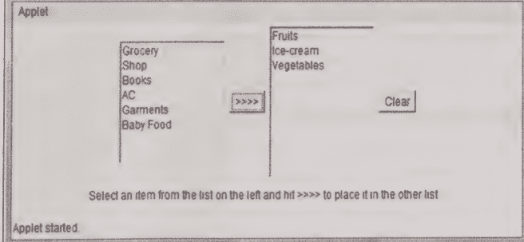

图 14.6 显示两个列表的输出


图 14.7 选择 (a)


图 14.7 选择 (b)

## 解释

- L1–3 导入了包。
- L4 类声明。
- L5 创建了两个列表，并在 L7 和 L8 中实例化。构造函数中的第一个参数指定了要显示的列表中项目数量，第二个参数指定了是否允许多项选择。
- L9 在 L20–30 中定义了 `populateList()` 方法，用于向原始列表添加项目：
- L10 列表被添加到 applet 中。
- L11–18 创建了两个按钮，将它们添加到 applet 中并注册了 `ActionListener` 以处理按钮事件。除此，还添加了一个标签。
- L31–43 重写了 `actionPerformed()` 方法来处理按钮事件。如果用户在原始列表中选择了一个项目（`original.getSelectedIndex()` 并按了按钮 `>>>`），则通过 `add(original.getSelectedItem())` 将选中的项目复制到 `copy` 列表，并通过 `original.remove(original.getSelectedIndex())` 从原始列表中移除。如果点击了清除按钮，则使用 `removeAll()` `copy` 列表和原始列表中的所有项目，并使用 `populateList()` 方法重新填充原始列表。

## 14.9 文本域与文本区域 (TEXTFIELD AND TEXTAREA)

`TextField` 和 `TextArea` 类是输入数据的不同类。`TextField` 处理单行文本，而 `TextArea` 用于多行文本。示例 14.7 演示了 `TextField` 的用法。

以下行将创建一个 20 列的 `TextField`。

```java
TextField plaintext = new TextField(20);
```

`TextField` 在创建时也可以初始化某些文本。

```java
TextField plaintext = new TextField("First Name Name");
```

表格 14.7 和 14.8 列出了 `TextField` 和 `TextArea` 的构造函数。

### 表格 14.7 TextField 类

| 构造函数 | 描述 |
| --- | --- |
| TextField() | 创建一个新的文本框。 |


| 构造函数 | 描述 |
| --- | --- |
| `TextField(int columns)` | 创建一个具有指定列数的空文本框。 |
| `TextField(String text)` | 创建一个带有指定字符串的文本框。 |
| `TextField(String text, int columns)` | 创建带有指定字符串和指定列数的文本框。 |

| 方法 | 描述 |
| --- | --- |
| `void addActionListener(ActionListener listener)` | 添加指定的监听器以接收来自此文本框的动作事件。 |
| `boolean echoIsSet()` | 表示此文本框是否设置了显示字符。 |
| `AccessibleContext getAccessibleContext()` | 返回与文本框关联的 `AccessibleContext`。 |
| `ActionListener[] getActionListeners()` | 返回与文本框关联的所有监听器的数组。 |
| `int getColumns()` | 返回文本框的列数。 |
| `char getEchoChar()` | 返回用于显示的字符。 |
| `Dimension getMinimumSize()` | 返回此文本框的最小尺寸。 |
| `Dimension getMinimumSize(int columns)` | 返回指定列数的文本框的最小尺寸。 |
| `Dimension getPreferredSize(int columns)` | 返回指定列数的文本框的优选尺寸。 |
| `String paramString()` | 获取表示此文本框状态的字符串。 |
| `void processActionEvent(ActionEvent e)` | 通过将其分发给任何注册的 `ActionListener` 对象来处理文本框的动作事件。 |

# 452 Java 编程

(表 14.7 续)

| 方法 | 描述 |
| --- | --- |
| `void processActionEvent(AWTEvent e)` | 在此文本字段上处理 `AWTEvent`。 |
| `void removeActionListener(ActionListener l)` | 从此文本字段移除关联的动作监听器。 |
| `void setColumns(int columns)` | 设置文本字段的列数。 |
| `void setEchoChar(char c)` | 设置文本字段的回显字符。 |
| `void setText(String t)` | 设置文本字段内的字符串。 |

### 表 14.8 TextArea 类

| 构造函数 | 描述 |
| --- | --- |
| `TextArea()` | 构建一个带有空字符串的新 textarea。 |
| `TextArea(int rows, int columns)` | 构建一个具有指定行数和空字符串的 textarea。 |
| `TextArea(String text)` | 构建一个带有指定字符串的 textarea。 |
| `TextArea(String text, int rows, int columns)` | 构建一个具有指定字符串以及指定行数和列数的 textarea。 |
| `TextArea(String text, int rows, int columns, int scrollbars)` | 构建一个具有指定字符串以及指定行数、列数和滚动条的 textarea。 |

| 方法 | 描述 |
| --- | --- |
| `void append(String str)` | 将给定文本附加到 textarea 当前文本之后。 |
| `int getColumns()` | 返回列数。 |
| `Dimension getMinimumSize()` | 确定此 textarea 的最小尺寸。 |
| `Dimension getMinimumSize(int rows, int columns)` | 确定具有指定行数和列数的 textarea 的最小尺寸。 |
| `Dimension getPreferredSize()` | 返回此 textarea 的理想尺寸。 |
| `Dimension getPreferredSize(int rows, int columns)` | 返回具有指定行数和列数的 textarea 的尺寸。 |
| `int getRows()` | 返回行数。 |
| `void insert(String str, int pos)` | 在此 textarea 的指定位置插入指定的文本。 |
| `protected String paramString(String str)` | 返回表示此 textarea 状态的字符串。 |
| `void replaceRange(String str, int start, int end)` | 用指定的替换字符串替换 start 和 end 位置之间的字符串。 |
| `void setColumns(int columns)` | 设置列数。 |
| `void setRows(int rows)` | 设置此 textarea 的行数。 |

# 示例 14.7 字段的事件处理

```java
<applet code="TextFieldDemo.class" width=200 height=100></applet>
import java.awt.*;
import java.awt.event.*;
import java.applet.Applet;

public class TextFieldDemo extends Applet implements TextListener, FocusListener, ActionListener {
    Label l;
    Button b;
    TextField tf;

    public void init() {
        tf = new TextField("TextField");
        l = new Label("Make selection", Label.CENTER);
        b = new Button("Submit");
        b.addFocusListener(this);
        tf.addFocusListener(this);
        tf.addActionListener(this);
        tf.selectAll();
        setLayout(new BorderLayout());
        add(l, BorderLayout.NORTH);
        add(tf, BorderLayout.CENTER);
        add(b, BorderLayout.SOUTH);
    }

    public void focusGained(FocusEvent e) {
        if (e.getSource() == tf)
            tf.setText("Focus Gained by Text box");
        else if (e.getSource() == b)
            tf.setText("Focus Gained by Button");
    }

    public void focusLost(FocusEvent e) {
        tf.setText("Focus not on Frame now");
    }

    public void actionPerformed(ActionEvent e) {
        tf.setText("action event");
    }

    public void textValueChanged(TextEvent e) {
        tf.setText("Trying to change text");
    }
}
```

# 输出

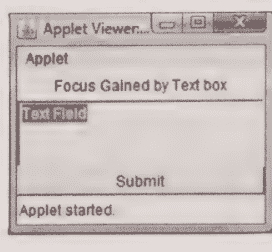
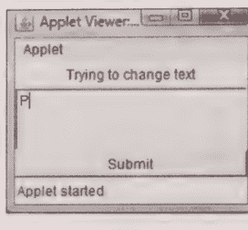

图 14.8(a) 聚焦于文本字段并选中文本字段内容
图 14.8(b) 文本字段内容已更改

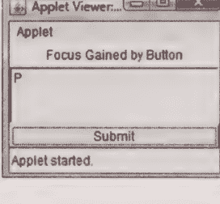
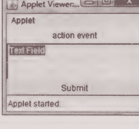

图 14.8(c) 按钮获得焦点
图 14.8(d) 在聚焦于文本字段时按下回车键产生 `ActionEvent`


图 14.8(e) 窗口旁的文本字段聚焦

# 解析

- 创建了一个 `Applet`，它实现了三个接口：用于跟踪 `TextField` 动作事件的 `ActionListener`、用于确定哪个组件拥有焦点的 `FocusListener`，以及用于用户在 `TextField` 中输入时执行操作的 `TextListener`（注：原文此处重复写了 `ActionListener`）。
- 接口的方法在后文中得到了实现。`Label`、`Button`、`TextField`。
- `Applet` 方法：初始化、标签、布局、`BorderLayout`、`NORTH`、`CENTER`、`SOUTH`。
- 焦点获得、焦点丢失、动作事件、文本值改变。
- 文本框、按钮、提交。
- 焦点获得、文本框、按钮。
- 焦点现在不在框架上。
- 动作事件。
- 尝试更改文本。

第一个构造函数简单地创建一个没有标题的 `Frame`，而第二个构造函数则创建一个带有参数中指定的字符串标题的 `Frame`。在操作 `Frame` 对象时可以使用的一些方法如表 14.10 所示。

## 表 14.10 Frame 对象的方法

| 方法 | 描述 |
| --- | --- |
| `void setSize(int width, int height)` | 用于设置窗口的尺寸。以宽度和高度的形式的新尺寸作为参数传递。 |
| `void setSize(Dimension size)` | 使用指定的维度设置帧的大小。 |
| `Dimension getSize()` | 用于返回窗口的当前尺寸，包含在 `Dimension` 对象的宽度高度字段中。 |
| `void setVisible(boolean flag)` | 用于在创建后使窗口可见。只有当传递的参数为 `true` 时，组件才可见。 |
| `void setTitle(String title)` | `Frame` 窗口中的标题可以被设置为作为参数传递的新标题。 |

# 示例 14.8 Frame 类演示

```java
import java.awt.*;

public class FrameDemo extends Frame {
    public FrameDemo(String title) {
        super(title);
    }

    public static void main(String[] args) {
        FrameDemo frameDemo = new FrameDemo("Demo Frame");
        frameDemo.setSize(200, 300);
        frameDemo.setVisible(true);
    }
}
```


图 14.9 Frame

创建一个带框的应用程序是简单的。帧开发的典型步骤如下：

1. 创建主帧的实例。
2. 设置帧的宽度和高度。
3. 显示帧。

## 解释

- L2 `FrameDemo` 类继承自 `java.awt.Frame` 并调用了父类的构造函数。L5 表示类。构造方法的结束。
- L3–5 属于 `Frame` 类的构造函数设置了帧标题。因此，`FrameDemo` 类接受一个字符串作为帧标题的参数。在 L4 中，使用 `super` 关键字来设置标题。
- L6–10 在这些行中，详细阐述了 `main()` 方法。在 L8 中，使用 `setSize()` 方法将帧的宽度和高度设置为 200 和 300 像素。

# 14.11 布局

Java 有机制可以指定布局方案的类型，其中组件可以添加到 `Frame` 实例中。这种机制由 `LayoutManager` 指定，它用于指定组件如何在容器（例如 `Frame`）内部排列。AWT 中可用的各种 `LayoutManager` 都是此接口的实现类，并在后续章节中解释：此 `LayoutManager` 实际上是 `java.awt` 中的一个接口，定义如下：

```java
public interface LayoutManager
```

上述接口用于知道如何布局容器的类。接口中定义的各种方法有：

```java
void addLayoutComponent(String name, Component comp)
```

如果管理器为每个组件使用字符串，则上述方法将组件 `comp` 添加到布局中，并将其与 `name` 指定的字符串关联。

```java
void removeLayoutComponent(Component comp)
```

该方法从布局中移除指定的组件 `comp`。

```java
Dimension preferredLayoutSize(Container parent)
```

该方法根据指定容器 `parent` 所包含的组件，返回其首选的尺寸。

```java
Dimension minimumLayoutSize(Container parent)
```

根据指定容器 `parent` 所包含的组件，返回其最小的尺寸。

```java
void layoutContainer(Container parent)
```

该方法负责对指定的容器 `parent` 进行布局。Java 中一些著名的布局在下文中讨论。

## 14.11.1 流式布局

`java.awt` 包中有一个名为 `FlowLayout` 的类，其签名如下：

```java
public class FlowLayout extends Object implements LayoutManager, Serializable
```

`awt.FlowLayout` 从左到右（项目）和从上到下（行）排列组件，并在水平方向上居中组件。在此布局中，排列的组件之间有 5 像素的间隙。每当容器发生调整大小时，`FlowLayout` 会根据提供的约束为组件重新计算位置。更改容器大小的示例是调整窗口大小。这是 `Applet` 的默认布局。

流式布局类似于文本段落中的行，以方向流的方式排列组件。流的方向由容器的 `componentOrientation` 属性决定。该属性的值可以是以下两者之一：

- `ComponentOrientation.LEFT_TO_RIGHT`：项目从左向右运行，行从上向下，例如英语、法语等。
- `ComponentOrientation.RIGHT_TO_LEFT`：项目从右向左运行，行从上向下，例如阿拉伯语、希伯来语等。

此外，流式布局用于以水平方式将按钮放在面板上，直到同一行无法容纳更多按钮为止。这些按钮行可以使用 `align` 属性进行对齐，该属性可以是以下任意一个值：

- `RIGHT`
- `CENTER`
- `LEFT`
- `TRAILING`
- `LEADING`

流式布局是 Java 中最简单的布局之一。表 14.11 给出了属于 `FlowLayout` 的字段、构造函数和方法。

## 表 14.11 FlowLayout 类

| 字段名称 | 详情 |
| --- | --- |
| `static int CENTER` | 该值使每行居中。 |
| `static int LEADING` | 该值使每行对齐到容器的起始边缘，例如从右到左布局中的右侧。 |
| `static int LEFT` | 该值使每行左对齐。 |
| `static int RIGHT` | 该值使每行右对齐。 |
| `static int TRAILING` | 该值使每行对齐到容器的末尾边缘，例如从右到左布局中的左侧。 |

| 构造函数 | 描述 |
| --- | --- |
| `FlowLayout()` | 创建一个具有居中对齐和默认 5 像素水平垂直间隙的 `FlowLayout`。 |
| `FlowLayout(int align)` | 创建一个具有指定参数指定的对齐方式和默认 5 像素水平垂直间隙的 `FlowLayout`。 |
| `FlowLayout(int align, int hgap, int vgap)` | 创建一个具有指定的对齐方式和指定的水平垂直间隙的 `FlowLayout`。 |

| 方法 | 描述 |
| --- | --- |
| `void addLayoutComponent(String name, Component comp)` | 将作为参数的组件添加到布局中。 |
| `int getAlignment()` | 返回布局的对齐方式。 |
| `boolean getAlignOnBaseline()` | 在组件沿基线垂直对齐时返回 `true`。 |
| `int getHgap()` | 返回组件之间以及组件与容器之间的水平间隙。 |
| `int getVgap()` | 返回组件之间以及组件与容器之间的垂直间隙。 |
| `void layoutContainer(Container target)` | 对容器进行布局。 |
| `Dimension minimumLayoutSize(Container target)` | 返回布局目标容器可见组件所需的最小尺寸。 |
| `Dimension preferredLayoutSize(Container target)` | 根据目标容器中的可见组件返回此布局的首选尺寸。 |
| `void removeLayoutComponent(Component comp)` | 从布局中移除指定的参数 `comp` 组件。 |
| `void setAlignment(int align)` | 根据参数设置此布局的对齐方式。 |


- `void setAlignOnBaseline(boolean alignOnBaseline)` 设置组件是否沿其基线垂直对齐。
- `void setHgap(int hgap)` 设置组件之间以及组件与容器之间的水平间隙。
- `void setVgap(int vgap)` 设置组件之间以及组件与容器之间的垂直间隙。
- `String toString()` 返回 `FlowLayout` 对象及其值的字符串表示。

# 示例 14.9 FlowLayout

```java
/*<applet code = FlowLayoutDemo.class width = 200 height = 200></applet>*/
import java.applet.Applet;
import java.awt.*;
public class FlowLayoutDemo extends Applet {
    LayoutManager flowLayout;
    Button[] Buttons;
    public FlowLayoutDemo() {
        int i;
        flowLayout = new FlowLayout();
        setLayout(flowLayout);
        Buttons = new Button[6];
        for (i = 0; i < 6; i++) {
            Buttons[i] = new Button("Button " + (i + 1));
            Buttons[i].setLabel("Button");
            add(Buttons[i]);
        }
    }
}
```

# 输出

程序的输出显示了六个按钮以 `FlowLayout` 方式排列或添加到 applet 窗口中。

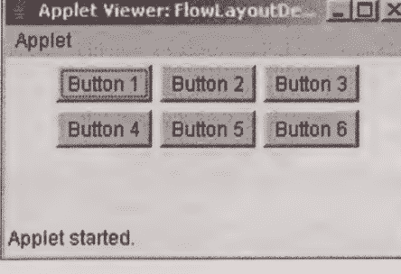

图. 14.10 FlowLayout

# 解析

- L1–2 导入了所有属于 `java.applet` 和 `java.awt` 等包的必要类。
- L3 声明了一个名为 `FlowLayoutDemo` 的 applet。
- L4 声明了一个指向 `LayoutManager` 类的引用，命名为 `flowLayout`。
- L5 声明了一个名为 `Buttons` 的 `Button` 类型按钮数组。
- L6–16 在 L6 处声明了一个构造函数 `FlowLayoutDemo()`。在 L8 中，创建了 L4 处声明的引用 `flowLayout`。在 L9 中，使用 `setLayout()` 方法，通过传递 `FlowLayout` 类的对象作为参数来设置窗口的布局。在 L10 中，创建了一个按钮数组。在 L11–15 中，使用 `Button` 类的 `setLabel()` 方法设置了六个按钮的标签。在为每个按钮设置标签后，将按钮添加到 applet 窗口中。为了避免为每个按钮单独设置标签并将其添加到容器，使用了循环来简化操作。

## 14.1.2 BorderLayout

它是框架的布局。属于 `java.awt` 的名为 `BorderLayout` 的类具有以下签名：

```java
public class BorderLayout extends Object implements LayoutManager2, Serializable
```

`BorderLayout` 是一种布局，其中组件可以排列并调整大小以适应不同的区域：北、南、东、西和中心。每个区域只能有一个组件，这些区域被识别为常量：`NORTH`、`SOUTH`、`EAST`、`WEST` 和 `CENTER`。例如：

默认情况下，如果你没有提到字符串规范，`BorderLayout` 将字符串规范解释为与常量 `CENTER` 相同：

```java
Panel p2 = new Panel();
p2.setLayout(new BorderLayout());
p2.add(new TextArea()); // 等于 p.add(new TextArea),
                    // BorderLayout.CENTER;
```

属于 `BorderLayout` 类的各种字段、构造函数和方法在表 14.12 中。

# 表 14.12 BorderLayout 类

| 字段名 | 详情 |
|---|---|
| `String AFTER_LAST_LINE` | 等于下方的 `PAGE_END`。 |
| `String AFTER_LINE_ENDS` | 等于下方的 `LINE_END`。 |
| `String BEFORE_LINE_FIRST` | 等于下方的 `PAGE_START`。 |
| `String BEFORE_LINE_BEGINS` | 等于下方的 `LINE_START`。 |
| `String CENTER` | 容器的中间。 |
| `String EAST` | 东部布局约束（容器的右侧）。 |
| `String LINE_END` | 组件位于布局行方向的末尾。 |
| `String LINE_START` | 组件位于布局行方向的开头。 |
| `String NORTH` | 北部布局约束（容器的顶部）。 |
| `String PAGE_END` | 组件位于布局内容最后一行之后。 |
| `String PAGE_START` | 组件位于布局内容第一行之前。 |
| `String SOUTH` | 容器的底部。 |
| `String WEST` | 西部布局约束（容器的左侧）。 |

| 构造函数名 | 详情 |
|---|---|
| `BorderLayout()` | 构建一个组件之间没有间隙的边框布局。 |
| `BorderLayout(int hgap, int vgap)` | 构建一个组件之间有指定水平和垂直间隙的边框布局。 |

| 方法名 | 详情 |
|---|---|
| `void addLayoutComponent(Component comp, Object constraints)` | 使用指定的约束对象将指定的组件添加到布局中。 |
| `Object getConstraints(Component comp)`<br>`int getHgap()` | 获取指定组件的约束。返回组件之间的水平间隙。 |
| `float getLayoutAlignmentX(Container parent)` | 返回沿 x 轴的对齐方式。 |
| `float getLayoutAlignmentY(Container parent)` | 返回沿 y 轴的对齐方式。 |
| `Component getLayoutComponent(Container target, Object constraints)` | 根据目标容器的组件方向返回与给定约束位置对应的组件。 |
| `Component getLayoutComponent(Object constraints)` | 获取使用给定约束添加的组件。 |
| `int getVgap()` | 返回组件之间的垂直间隙。 |
| `void invalidateLayout(Container target)` | 失效布局，表示如果布局管理器缓存了信息，应将其丢弃。 |
| `void layoutContainer(Container target)` | 使用此边框布局布局容器参数。 |
| `Dimension maximumLayoutSize(Container target)` | 返回指定目标容器中此布局的最大尺寸（维度对象）。 |
| `Dimension minimumLayoutSize(Container target)` | 使用此布局管理器确定目标容器的最小尺寸。 |
| `Dimension preferredLayoutSize(Container target)` | 根据容器中的组件，使用此布局管理器确定目标容器的优选尺寸。 |
| `void removeLayoutComponent(Component comp)` | 从此边框布局中移除指定的组件。 |
| `void setHgap(int hgap)` | 设置组件之间的水平间隙。 |
| `void setVgap(int vgap)` | 设置组件之间的垂直间隙。 |
| `String toString()` | 返回此边框布局的字符串表示。 |

## 示例 14.10 BorderLayout

```java
import java.awt.*;
public class BorderLayoutDemo extends Frame {
    public BorderLayoutDemo(String title) {
        super(title);
        add(new Button("North"), BorderLayout.NORTH);
        add(new Button("South"), BorderLayout.SOUTH);
        add(new Button("East"), BorderLayout.EAST);
        add(new Button("West"), BorderLayout.WEST);
        add(new Button("Center"), BorderLayout.CENTER);
        setSize(400, 270);
        setVisible(true);
    }
    public static void main(String[] args) {
        BorderLayoutDemo playout = new BorderLayoutDemo("Border Layout");
    }
}
```

# 输出

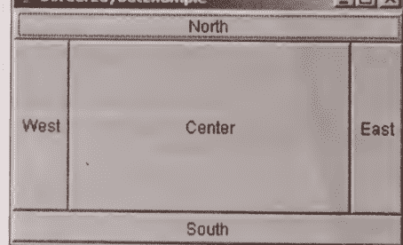

图. 14.11(a) BorderLayout

在上述框架中，放置在区域内的组件扩展以适应它们。例如，`NORTH` 和 `SOUTH` 组件水平方向扩展以适应该区域，同样，`EAST` 和 `WEST` 组件垂直方向扩展。`CENTER` 组件则在水平和垂直方向上填充剩余空间。

# 解析

- L2 声明 `BorderLayoutDemo` 类扩展 `Frame`。通过调用父类的构造函数来设置标题。
- L5–9，创建按钮对象并使用 `add()` 方法添加到框架中。
- L3–11 属于 `Frame` 类的构造函数设置 `Frame` 实例标题。同样，按钮的约束是第二个参数，即 `BorderLayout.NORTH` 等。
- L9 `BorderLayoutDemo` 类接受一个字符串作为框架的标题。
- 如果没有指定约束并使用 `add(Component c)` 添加按钮，则默认情况下所有按钮将位于中心并占据整个框架。最后添加的按钮将显示在框架上方。其余按钮将显示在用户看到的按钮下方。图 14.11(b) 显示了使用 `add(Component c)` 添加按钮的情况。

产生上述输出的代码所示：

```java
add(new Button("North"));
add(new Button("South"));
add(new Button("East"));
add(new Button("West"));
add(new Button("Center"));
```

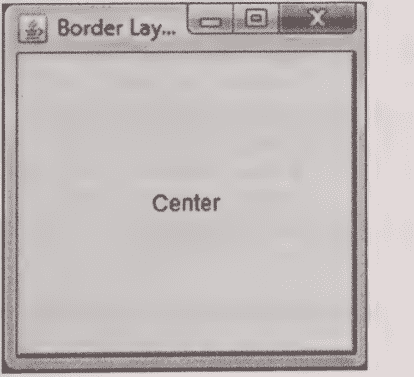

图 14.11(b) 默认设置下的 BorderLayout

## 14.1.3 CardLayout

`CardLayout` 继承 `Object` 类并实现 `LayoutManager2`、`Serializable` 接口。`CardLayout` 对象作为容器的布局管理器。在容器中每个组件都被 `CardLayout` 对象视为一个卡片。每张卡片都像栈一样放在另一个卡片上，并且只有一张卡片可见。当容器在添加第一个组件后显示时，第一个组件是可见的。

卡片的顺序由容器内部其组件对象的顺序决定。`CardLayout` 定义了一系列方法，允许应用程序按顺序切换这些卡片，或显示特定的卡片。属于 `CardLayout` 类的各种构造函数和方法在表 14.13 中。

# 表 14.13 CardLayout

| 构造函数名称 | 详情 |
|---|---|
| `CardLayout()` | 创建一个间距为零的新默认卡片布局。 |
| `CardLayout(int h, int v)` | 创建一个具有特定水平和垂直间距的新卡片布局。 |

| 方法名称 | 详情 |
|---|---|
| `void addLayoutComponent(Component comp, Object constraints)` | 将特定组件添加到卡片布局的内部表中。 |
| `void first(Container cont)` | 显示容器的第一张卡片。 |
| `int getHgap()` | 用于获取组件之间的水平间距。 |
| `float getLayoutAlignmentX(Container cont)` | 用于获取沿 x 轴的对齐。 |
| `float getLayoutAlignmentY(Container cont)` | 用于获取沿 y 轴的对齐。 |
| `int getVgap()` | 获取组件之间的垂直间距。 |
| `void last(Container cont)` | 显示容器的最后一张卡片。 |
| `Dimension maximumLayoutSize(Container target)` | 根据指定 target 中的组件返回此布局的最大尺寸。 |
| `Dimension minimumLayoutSize(Container target)` | 根据指定 target 中的组件返回此布局的最小尺寸。 |
| `void next(Container cont)` | 显示特定容器的下一张卡片。 |
| `Dimension preferredLayoutSize(Container cont)` | 返回使用卡片布局的容器参数的尺寸。 |
| `void previous(Container cont)` | 显示指定容器的上一张卡片。 |
| `void removeLayoutComponent(Component comp)` | 从布局中移除特定组件。 |
| `void setHgap(int h)` | 设置组件之间的水平间距。 |
| `void setVgap(int v)` | 设置组件之间的垂直间距。 |
| `void show(Container cont, String name)` | 显示使用 `addLayoutComponent` 添加到布局的具有特定名称的组件。 |
| `String toString()` | 返回字符串表示的卡片布局状态。 |

# 示例 14.11 CardLayout 演示

```java
import java.awt.*;
import java.awt.event.*;
public class CardDemo extends Frame implements ActionListener {
    Panel cardPanel;
    Panel p1, p2, p3;
    Panel buttonP;
    Button B1, B2, B3;
    CardLayout layout;
    public CardDemo() {
        cardPanel = new Panel();
        layout = new CardLayout();
        cardPanel.setLayout(layout);
        p1 = new Panel();
        p1.setBackground(Color.red);
        p2 = new Panel();
        p2.setBackground(Color.yellow);
        p3 = new Panel();
        p3.setBackground(Color.green);
        B1 = new Button("Red");
        B1.addActionListener(this);
        B2 = new Button("Yellow");
        B2.addActionListener(this);
        B3 = new Button("Green");
        B3.addActionListener(this);
        buttonP = new Panel();
        buttonP.add(B1);
        buttonP.add(B2);
        buttonP.add(B3);
        cardPanel.add(p1, "B1");
        cardPanel.add(p2, "B2");
        cardPanel.add(p3, "B3");
        setLayout(new BorderLayout());
        add(buttonP, BorderLayout.SOUTH);
        add(cardPanel, BorderLayout.CENTER);
        setVisible(true);
        setSize(300, 200);
        setTitle("DemoCard");
        addWindowListener(new WindowAdapter() {
            public void windowClosing(WindowEvent we) {
                System.exit(0);
            }
        });
    }
    public void actionPerformed(ActionEvent e) {
        if (e.getSource() == B1)
            layout.show(cardPanel, "B1");
        else if (e.getSource() == B2)
            layout.show(cardPanel, "B2");
        else if (e.getSource() == B3)
            layout.show(cardPanel, "B3");
    }
    public static void main(String[] args) {
        new CardDemo();
    }
}
```


# CardLayout 示例代码

```java
clayout.show(cardPanel, "B1");

if (e.getSource() == B2)
    clayout.show(cardPanel, "B2");

if (e.getSource() == B3)
    clayout.show(cardPanel, "B3");
}

public static void main(String a[]) {
    CardDemo demo = new CardDemo();
    demo.cardDemo();
}
```

## 输出

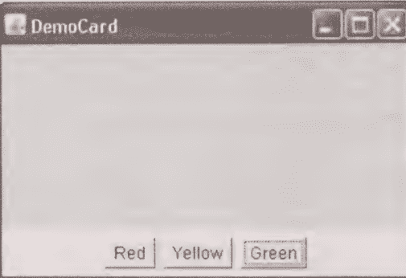

图 14.12 CardLayout

## 解释

此示例展示了 `CardLayout` 管理器。点击三个按钮中的任意一个将显示不同的“卡片”。

- **L4-8** 在这些行中，我们为面板创建了变量，`cardPanel` 将显示不同的内容。
- **L9** 方法声明。
- **L10-11** 在这些行中，我们创建了一个名为 `layout` 的 `CardLayout` 对象。
- **L12-18** 将 `cardPanel` 的布局设置为 `CardLayout`。
- **L19-24** 在这些行中，我们创建了三个按钮并添加了它们。
- **L25-28** 创建了一个面板 (`buttonP`) 并添加了。
- **L29-31** 将三个面板 (`p2`, `p3`) 添加到中。
- **L32** 将框架的布局设置为 `BorderLayout`。
- **L33-34** 两个面板、按钮 (`buttonP`)、`cardPanel` 都被添加到了中。
- **L38** 当点击交叉处时关闭窗口
- **40-45** 如果按钮被点击，将显示红色背景。

# GridLayout

`GridLayout` 类属于 `java.awt`，其签名如下：

```java
public class GridLayout extends Object
```

`GridLayout` 是一种布局管理器，可以用于按行和列排列组件。`GridLayout` 按行和列中排列组件，当容器被划分为等大小的矩形时，每个组件填充其相应的单元格。`GridLayout` 描述了方法。

## 表 14.14 GridLayout

| 构造函数名称 | 详情 |
| --- | --- |
| `GridLayout()` | 创建每列一个组件的网格 |
| `GridLayout(int row, int cols)` | 创建指定行数和列数的网格 |
| `GridLayout(int row, int cols, int hgap, int vgap)` | 创建指定行数、列数以及水平和垂直间距的网格 |

| 方法名称 | 详情 |
| --- | --- |
| `addLayoutComponent(String name, Component comp)` | 将指定名称组件添加到布局 |
| `int getColumns()` | 获取此布局的列数 |
| `int getGap()` | 返回组件之间的水平间距 |
| `int getRows()` | 获取此布局的行数 |
| `int getGap()` | 返回组件之间的垂直间距 |
| `void layoutContainer(Container parent)` | 使用此布局布局指定的容器 |

## 示例代码

```java
L1  import java.awt.*;
L2  import java.awt.event.*;
L3  class GridLayoutDemo extends Frame {
L4  public GridLayoutDemo() {
L5    super("Laying Out Components using GridLayout");
```

## 输出

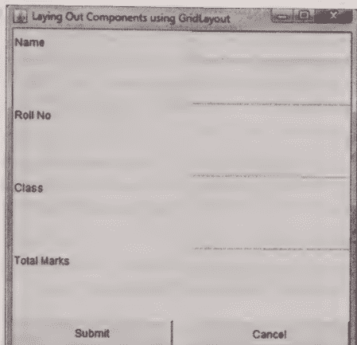

## 解释

- **L1–2** 导入 `java.awt` 及其子包 `awt.event`。
- **L7–17** 向面板中添加组件。标签和文本字段被添加到面板对象中，另外两个按钮。指定为 20，垂直间距指定为 50。
- **L18–19** 设置框架的大小并将可见性设置为 true。
- **L20–21** 为框架注册窗口监听器，以便当点击框架标题栏上的交叉处时，应用程序框架会关闭。

# GridBagLayout

一个名为 `GridBagConstraints` 的对象包含了组件的高度、宽度、位置和对齐方式的约束条件。每个 `GridBagLayout` 维护一个矩形单元格网格。一个组件可以占据一个或多个单元格，这就是它的显示区域。`ComponentOrientation` 类控制网格的取向。

我们需要自定义 `GridBagConstraints` 对象，以便有效地与其组件关联的 `GridBagLayout`。可以通过设置一个或多个实例变量来自定义 `GridBagConstraints`。下面将这些实例变量。

## gridx and gridy

网格单元格的初始地址为 `gridx = 0` 和 `gridy = 0`。`GridBagConstraints.RELATIVE`（默认值）用于指定该组件应紧邻在该组件之前添加到容器的组件进行对齐。

## gridwidth and gridheight

`gridwidth` 约束指定一行中单元格的数量，`gridheight` 指定组件显示区域中的列数。默认值为 1。

## fill

当组件的请求尺寸小于显示区域的大小时，我们使用此属性。我们也可以用它来调整组件的大小。它用于确定是否（以及如何）调整组件的大小。其值如下：

- `GridBagConstraints.NONE`（默认值 - 当窗口缩大时不增长）
- `GridBagConstraints.HORIZONTAL`（此值填充组件的所有水平方向显示区域，不改变高度）
- `GridBagConstraints.VERTICAL`（改变组件的高度，但不改变其宽度）
- `GridBagConstraints.BOTH`（使组件在水平和垂直方向上填充其显示区域）

## ipdx and ipady

`ipadx` 和 `ipady` 字段用于给定布局中组件的内部内边。如果指定了 `ipadx`，组件的宽度将是最小宽度加上 `ipadx` 像素。同样，`ipady` 加上最小高度是组件的高度。

## insets

`Insets` 字段用于组件的外部内边。它用于组件与其显示区域边缘之间的间距。例如：

```java
GridBagConstraints c = new GridBagConstraints();
c.insets = new Insets(int top, int left, int bottom, int right);
```

## anchor

`anchor` 字段指定组件在其显示区域中的位置。有三种可能的值：绝对值、相对于取向和相对于基准线。

### 绝对值

绝对值用于将组件放置在特定位置。这些绝对值可以是以下任何一个：

- `GridBagConstraints.NORTH`
- `GridBagConstraints.SOUTH`
- `GridBagConstraints.WEST`
- `GridBagConstraints.EAST`
- `GridBagConstraints.NORTHWEST`
- `GridBagConstraints.NORTHEAST`
- `GridBagConstraints.SOUTHWEST`
- `GridBagConstraints.SOUTHEAST`
- `GridBagConstraints.CENTER`（默认）

### 相对于取向的值

相对于取向的值相对于容器的取向。这些可以是以下任何一个：

- `GridBagConstraints.PAGE_START`
- `GridBagConstraints.PAGE_END`
- `GridBagConstraints.LINE_START`
- `GridBagConstraints.LINE_END`
- `GridBagConstraints.FIRST_LINE_START`
- `GridBagConstraints.FIRST_LINE_END`
- `GridBagConstraints.LAST_LINE_START`
- `GridBagConstraints.LAST_LINE_END`

### 相对于基准线的值

相对于基准线的值是由 JDK 6 添加的。通过这些值的帮助，你可以相对于行的基准线垂直放置组件。可能的值如下：

- `GridBagConstraints.BASELINE`
- `GridBagConstraints.BASELINE_LEADING`
- `GridBagConstraints.BASELINE_TRAILING`
- `GridBagConstraints.ABOVE_BASELINE`
- `GridBagConstraints.ABOVE_BASELINE_LEADING`
- `GridBagConstraints.ABOVE_BASELINE_TRAILING`
- `GridBagConstraints.BELOW_BASELINE`
- `GridBagConstraints.BELOW_BASELINE_LEADING`
- `GridBagConstraints.BELOW_BASELINE_TRAILING`

## weightx and weighty

这些用于分配空间（水平和垂直）。如果指定两个权重，所有组件将聚集在容器中心。权重的值在 0.0 到 1.0 之间。`GridBagLayout` 对象的权重默认为零。下面的示例显示了在未指定指定约束的情况下，如何使用 `GridBagLayout` 显示组件。

## 示例 14.13 无约束的 GridBagLayout

```java
L1 import java.awt.*;
L2 public class GBagLayoutDemo1 extends Frame {
L3 public GBagLayoutDemo1() {
L4 setLayout(new GridBagLayout());
L5 setTitle("GridBagLayout Without Constraints");
L6 Label l=new Label("Name");
L7 add(l);
L8 TextField t = new TextField();
L9 add(t);
L10 Button b = new Button("Submit");
L11 add(b);
L12 Button b1 = new Button("Reset");
L13 add(b1);
L14 setSize(200,200);
L15 setVisible(true);
}
L16 public static void main(String args[]){
L17 GBagLayoutDemo1 d = new GBagLayoutDemo1();
}}
```

## 输出

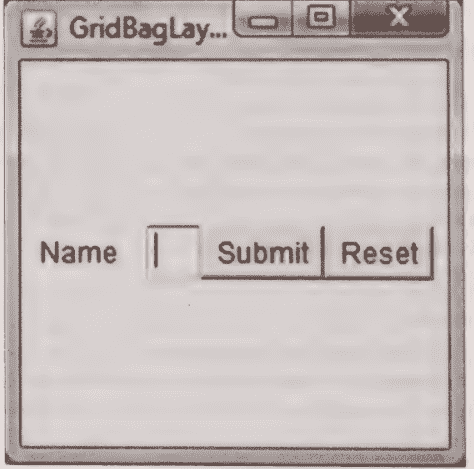

图. 14.14 未指定约束的 GridBagLayout

## 解释

| 行号 | 说明 |
| --- | --- |
| L1 | 导入 `java.awt` 包。 |
| L2 | 类定义开始。 |
| L3 | 定义了构造函数。 |
| L4 | 布局设置为 `GridBagLayout()`。 |
| L5 | 使用 `setTitle` 方法设置标题。 |
| L6–13 | 创建 `Label`、`TextField` 和两个 `Button` 并添加到框架。 |
| L14 | `setSize(200,200);` |
| L15 | `setVisible(true);` |
| L16 | `public static void main(String args[]){` |
| L17 | `GBagLayoutDemo1 d = new GBagLayoutDemo1();` |

*注：由于提供的 OCR 文本存在混乱，表格已根据逻辑进行了重新处理。*

## 示例：带 weightx、weighty 和 ipady 约束的 GridBagLayout

```java
public GBLayoutDemo3() {
    setLayout(new GridBagLayout());
    setTitle("GridBagLayout with weightx, weighty and ipady Constraints");
    GridBagConstraints c = new GridBagConstraints();
    c.weightx = 1;
    c.weighty = 1;
    c.fill = GridBagConstraints.BOTH;
    Label l = new Label("Name");
    add(l,c);
    TextField t = new TextField();
    add(t,c);
    c.gridx = 0;
    c.gridy = 1;
    Button b = new Button("Submit");
    add(b,c);
    c.fill = GridBagConstraints.NONE;
    c.gridx = 1;
    c.gridy = 2;
    c.ipady = 30;
    Button b1 = new Button("Reset");
    add(b1,c);
    setSize(200,200);
    setVisible(true);
}

public static void main(String args[]) {
    GBLayoutDemo3 d = new GBLayoutDemo3();
}
```


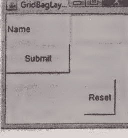

图 14.16(a) 除了 `weightx` 和 `ipady` 外，还指定了 `weighty` 的 `GridBagLayout`

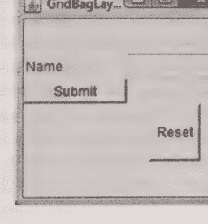

图 14.16(b) 指定了 `weightx` 和 `ipady` 约束的 `GridBagLayout` (L7 已注释)

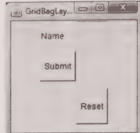

图 14.16(c) 指定了 `weight` 和 `ipady` 约束的 `GridBagLayout` (L8 已注释)

# Java 编程

# 解释

L7–8 `weightx` 和 `weighty` 被指定为 1，且 `fill` 属性指定为 `BOTH`，因此组件在水平和垂直方向上填充区域（见图 14.16(a)）。如果只指定 `weightx`，则组件在水平方向占据区域（见图 14.16(b)），因为额外的水平空间分配在列之间。

如果只指定 `weighty`，则组件在垂直方向占据区域（见图 14.16(c)），因为额外的垂直空间分配在行之间。

L18 重置按钮的 `fill` 属性被指定为 `none`。

L21 `ipady` 属性用于指定重置按钮的垂直内边距。注意图 14.16(a) 中重置按钮的大小。

# 14.2 菜单

`Menu` 是继承自 `MenuItem` 并实现两个接口（`MenuContainer` 和 `Accessible`）的类。`MenuBar` 将菜单对象部署为下拉菜单组件。它显示一个菜单项列表。为了实现这一概念，我们使用了三个类：`MenuBar`、`Menu` 和 `MenuItem`。`Menu` 类的各种字段、构造函数和方法在表 14.15 中。

一个菜单可以包含多个 `menu` 对象，每个 `menu` 对象包含若干个 `MenuItem` 对象。`CheckboxMenuItem` 也可以作为菜单选项。`MenuComponent` 是继承自 `Object` 类并实现 `Serializable` 接口的抽象类。所有菜单类基本上都是 `MenuComponent` 的子类，因此它们放置在容器中的方式与其他组件（例如按钮、标签等）不同。`Frame` 类的 `setMenuBar()` 方法用于在帧上设置菜单栏。`Menu` 不能放置在 applet 上，因为它们不是 `Frame` 的子类，也没有继承 `setMenuBar()` 方法，因此无法在 applet 上放置菜单栏。菜单可以包含某些菜单项的快捷键。一个菜单项可以有一个 `Shortcut` 实例。`Menu` 子类重写了方法，在选择其中一个子项之前，它不会向帧发送任何事件。`setMenuBar()` 方法用于将菜单栏与帧关联。`MenuBar` 类的构造函数和方法在表 14.16 中。

# 表 14.15 Menu 类

| 构造函数 | 说明 |
|---|--|
| `Menu()` | 创建一个新菜单。 |
| `Menu(String label)` | 创建一个带有标签的新菜单。 |
| `Menu(String label, boolean tearOff)` | 创建一个带有标签的新菜单，指示该菜单是否可以被拆下。 |

| 方法 | 说明 |
|---|--|
| `add(MenuItem m)` | 向菜单添加指定的菜单项。 |
| `add(String label)` | 向菜单添加一个带有指定标签的项。 |

| 方法 | 说明 |
|---|--|
| `deleteShortcut(MenuShortcut s)` | 用于删除菜单快捷键。 |
| `getAccessibleContext()` | 获取与此菜单关联的 `AccessibleContext`。 |
| `getItemCount()` | 获取菜单中项的数量。 |
| `getItemIndex(int index)` | 获取菜单中位于给定索引处的项。 |
| `removeAll()` | 从菜单中移除所有项。 |

# 表 14.16 MenuBar 类

| 构造函数 | 说明 |
|---|--|
| `MenuBar()` | 创建一个新的菜单栏。 |

| 方法 | 说明 |
|---|--|
| `add(MenuItem m)` | 向栏上添加指定的菜单。 |
| `deleteShortcut(MenuShortcut s)` | 用于删除菜单快捷键。 |
| `getAccessibleContext()` | 获取与此菜单关联的 `AccessibleContext`。 |
| `getItemCount()` | 获取菜单中项的数量。 |
| `getItemIndex(int index)` | 获取菜单中位于给定索引处的项。 |
| `removeAll()` | 从菜单中移除所有项。 |

# 添加菜单

```java
L1 import java.awt.*;

L2 import java.awt.*;

L3 public class DemoMenu extends Frame implements ActionListener {

L4 void demoMenu() {

L5 setTitle("MenuDemo");

L6 getSize(250,150);

L7 MenuBar menubar = new MenuBar();

L8 setMenuBar(menubar);

L9 MenuShortcut n = new MenuShortcut(KeyEvent.VK_N);
```

# 示例 14.16

```java
MenuShortcut o = new MenuShortcut(KeyEvent.VK_0);

MenuShortcut x = new MenuShortcut(KeyEvent.VK_X);

Menu fileMenu = new Menu("File");

Menu editMenu = new Menu("Edit");

// 创建并添加简单菜单到下拉菜单

JMenuItem newItem = new MenuItem("New",n);

JMenuItem openAction = new MenuItem("Open",o);

JMenuItem exitAction = new MenuItem("Exit",x);

JMenuItem cutAction = new MenuItem("Cut");

JMenuItem copyAction = new MenuItem("Copy");

JMenuItem pasteAction = new MenuItem("Paste");

newItem.addActionListener(this);

openAction.addActionListener(this);

exitAction.addActionListener(this);

fileMenu.addSeparator();

fileMenu.add(newItem);

fileMenu.addSeparator();

fileMenu.add(openAction);

fileMenu.addSeparator();

fileMenu.add(exitAction);

menubar.add(fileMenu);

cutAction.addActionListener(this);

copyAction.addActionListener(this);

pasteAction.addActionListener(this);

editMenu.add(cutAction);

editMenu.addSeparator();

editMenu.add(copyAction);

editMenu.addSeparator();

editMenu.add(pasteAction);

editMenu.addSeparator();

menubar.add(editMenu);

setVisible(true);

addWindowListener(new WindowAdapter(){

public void windowClosing(WindowEvent we) {

System.exit(0);

}

});

public void actionPerformed(ActionEvent e) {

String action = e.getActionCommand();

if(action.equals("New")) {

System.out.println("New");

}

else if(action.equals("File")) {

System.out.println("File");

}

else if(action.equals("Exit")) {

System.out.println("Exit");

}

}

}
```

# 482 Java 编程

```java
L51 System.exit(0);

L52 else if(action.equals("Cut")){

L53 System.out.println("Cut");

 }

L54 else if(action.equals("Copy")){

L55 System.out.println("Copy");

 }

L56 else if(action.equals("Paste")){

L57 System.out.println("Paste");

 }

L58 public static void main(String[] args) {

L59   DemoMenu demo=new DemoMenu();

L60   demo.demoMenu();

 }
```

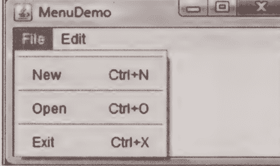

图 14.17(a) 示例菜单

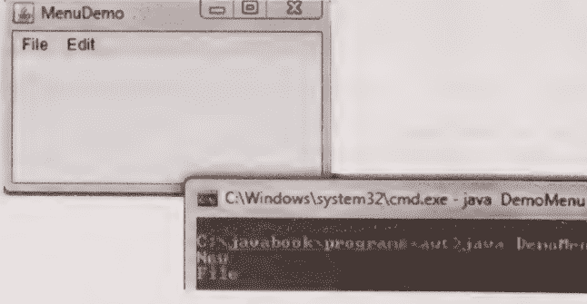

图 14.17(b) 通过按下快捷键显示的菜单输出示例

# 解析

L7–8 创建了 `MenuBar` 对象并使用 `setMenuBar` 方法将其设置在框架上。

L9–11 创建了三个具有按键 n、o 和 x 的 `MenuShortcut`。按下 `Ctrl + n` 将将引用到添加了该快捷键的菜单。

L12–13 创建了两个菜单：`fileMenu` 和 `editMenu`。

L14–16 创建了三个 `Menulet` 并为构造函数中的三个参数都指定了快捷键（这些将被添加到 `fileMenu` 菜单中）。

L17–19 创建了其他没有任何快捷键的 `MenuItem`（这些将被添加到 `editMenu` 菜单中）。

L20–22 菜单项注册了 `ActionListener` 以接收通知。

L23–28 在 L14–16 中创建的三个菜单项通过 `add` 方法添加到 `fileMenu` 中。使用 `addSeparator` 方法在每个菜单项后添加一个分隔符（线）。

L 29 将 `fileMenu` 添加到 `Menu` 中。

L30–33 三个菜单项（在 L17–19 中创建）注册了 `ActionListener` 以接收事件通知。

L33–38 在 L17–19 中创建的三个菜单项通过 `add` 方法添加到 `editMenu` 中。使用 `addSeparator` 方法在每个菜单项后添加一个分隔符（线）。

L39 将 `editMenu` 添加到菜单栏。
46–57 如果点击了新项目或按下 ctrl+n 键，则执行 L47，其余情况亦此类推。

# 14.13 滚动条 (SCROLLBAR)

滚动条用于通过整数值范围（最小值和最大值之间的范围）选择连续值。这些滚动条可以水平或垂直设置。滚动条的最大值和最小值沿行增量和页增量进行设置。

要创建滚动条，你需要创建一个 `Scrollbar` 类的实例。该类定义了以下构造函数：

```
Scrollbar() throws HeadlessException

Scrollbar(int direction) throws HeadlessException

Scrollbar(int direction, int intValue, int pageSize, int min, int max) throws HeadlessException
```

第二个和第三个构造函数没有参数；默认情况下，它指定滚动条的方向。如果方向可以指定为 `Scrollbar.VERTICAL` 或 `Scrollbar.HORIZONTAL`，则分别创建垂直或水平滚动条。第三个构造函数可以将滚动条的初始值作为参数 `intValue` 传递，将在箭头和滚动框之间点击滚动条时增加或减少的页高度代表的单位数作为参数 `pageSize` 传递，并将滚动条的最小值和值作为参数 'min' 和 'max' 传递。


图 14.18

以下行将创建一个水平滚动条：

```
Scrollbar demoScroll1 = new Scrollbar(Scrollbar.HORIZONTAL);
```

以下行将创建一个垂直滚动条，其起始位置为 0，滑块（气泡）大小为 5，最小值为 0，最大值为 255：

```
Scrollbar demoScroll2 =new Scrollbar(Scrollbar.VERTICAL, 0, 5, 255);
```

滚动条有三个不同的部分，允许你以不同的方式在最大值和最小值之间选择值。随着行更新而递增或减少的方式，这可以设置为较小的单位。其默认值为 1。如果你点击滚动条上最小和最大值范围内的任何位置，页值将增加或减少值 10（默认值）。中间的气泡允许你通过点击并拖动它来快速从一端跨越到另一端。可见部分由气泡（滚动条中的框）表示。气泡的大小由构造函数所示的第三个参数（5）表示。表 14.19 列出了可以与滚动条一起使用的的方法。

与滚动条的交互会生成一个 `Adjustment` 对象。`AdjustmentEvent` 类的 `getAdjustment()` 方法用于确定调整类型。此方法可以返回的类型：

- `BLOCK_DECREMENT` 意味着“已生成翻页事件”
- `BLOCK_DECREMENT` 意味着“已生成页事件”
- `TRACK` 意味着“已生成绝对跟踪事件”
- `UNIT_DECREMENT` 意味着“滚动条中的向下按钮已触发”
- `UNIT_INCREMENT` 意味着“滚动条中的向上按钮已触发”

# 表 14.19 滚动条的方法

| 方法 | 描述 |
| :--- | :--- |
| `void setValues(int initValue, int pageSize, int min, int max)` | 这里的参数含义与上述第三个构造函数中的相同。如果你使用前两个构造函数之一来创建滚动条，可以通过上述方法设置值，以便上述值被设置。 |
| `int getLineIncrement()` | 确定行增量值。 |
| `void setPageIncrement(int pageSize)` | 设置页增量。 |
| `int getPageIncrement()` | 确定页增量值。 |
| `int getMinimum()` | 确定最小值。 |
| `void setUnitIncrement(int newUnitInc)` | 通过新值设置单位增量。 |
| `int getValue()` | 确定滚动条按值的值的当前位置。 |
| `int getMaximum()` | 确定最大值。 |
| `void setValue(int newValue)` | 设置当前位置。 |
| `void setBlockIncrement(int blockInc)` | 设置块增量（用于向上或向下滚动）。 |

# 示例 14.17 滚动条

```java
import java.awt.*;

import java.awt.event.*;

public class ScrollbarDemo implements AdjustmentListener {

    Scrollbar HScroll, VScroll;

    Label lbl;

    int X = 100,Y = 150;

    public ScrollbarDemo() {

        HScroll = new Scrollbar(Scrollbar.HORIZONTAL);

        VScroll = new Scrollbar(Scrollbar.VERTICAL);

        lbl = new Label("Oval size with scrollbar");

        HScroll.setMaximum(400);

        VScroll.setMaximum(400);

        setBackground(Color.cyan);

        setLayout(new BorderLayout());

        add(lbl,BorderLayout.NORTH);

        add(HScroll,BorderLayout.SOUTH);

        add(VScroll,BorderLayout.EAST);

        HScroll.addAdjustmentListener(this);

        VScroll.addAdjustmentListener(this);

        setSize(500,500);

        setVisible(true);

        addWindowListener(new WindowAdapter() {

            public void windowClosing(WindowEvent e) {

                System.exit(0);

            }

        });

    }
```


## 抽象窗口工具包 (Abstract Window Toolkit)

### 代码示例：滚动条演示

```java
public void adjustmentChanged(Adjustment e) {
    X = HScroll.getValue();
    Y = VScroll.getValue();
    lbl.setText("HScroll = " + X + ", VScroll = " + Y);
    repaint();
}

public void paint(Graphics g) {
    g.drawOval(50, 60, X, Y);
}

public static void main(String[] args) {
    ScrollbarDemo d = new ScrollbarDemo();
}
```

宽度和高度是变量，它们取决于滚动条的移动。`drawOval` 方法的签名如下：

```java
g.drawOval(int x, int y, int width, int height)
```

第 36–37 行在 `main` 方法中，实例化了帧（frame）。

### 14.14 实际问题：城市地图程序

`CityMap` 程序显示一个城市的地图（俯视图），带有五个按钮，分别是医院、商场、警察局、邮局和体育场。如果用户按下医院按钮，所有的医院将以特定的颜色显示在地图上，商场、警察局、邮局、体育场也是如此。

#### 示例 14.18 CityMap.java

```java
import java.applet.*;
import java.awt.*;
import java.awt.event.*;
```

```html
<applet code="CityMap.class" width=650 height=600></applet>
```

```java
public class CityMap extends Applet {
    Button b1, b2, b3, b4, b5;
    /* 用作标志变量的布尔变量 */
    boolean hospital, mall, pstation, po, stadium;

    public void init() {
        /* 在 applet 上创建并添加按钮。 */
        b1 = new Button("Hospital");
        add(b1);
        b2 = new Button("Shopping Malls");
        add(b2);
        b3 = new Button("Police Station");
        add(b3);
        b4 = new Button("Post office");
        add(b4);
        b5 = new Button("Stadium");
        add(b5);
    }
}
```

所有按钮都定义了匿名内部类。如果使用监听器方法（用于事件处理）并且 `Applet` 类实现了 `ActionListener` 来处理按钮事件，那么对于所有五个按钮，我们都有同一个 `actionPerformed` 方法。在 `actionPerformed` 中，我们使用 `if...else` 条件语句来判断哪个按钮被按下了，并在其中执行所需的任务。因此，每个按钮都有相应的 `if` 条件，这些条件会在每次按钮被按下时进行检查，直到找到匹配项。在我们下方的示例中，每个按钮都注册了自己的事件处理器，从而消除了繁琐的多个语句并节省了执行时间。

/* 为医院按钮创建了一个匿名内部类。一旦医院按钮被按下，该类的 `actionPerformed` 就会被调用，它将 `hospital` 布尔变量设置为 true 并重绘 applet。程序员没有提供显式的类名，但编译器会为这个内部类生成一个名为 `CityMap$1.class` 的 .class 文件 */

```java
b1.addActionListener(new ActionListener() {
    public void actionPerformed(ActionEvent ae) {
        /* 将布尔变量设置为 true 并重绘 applet */
        hospital = true;
        repaint();
    }
});
```

```java
b2.addActionListener(new ActionListener() {
    public void actionPerformed(ActionEvent ae) {
        /* 将布尔变量设置为 true 并重绘 applet */
        mall = true;
        repaint();
    }
});
```

```java
b3.addActionListener(new ActionListener() {
    public void actionPerformed(ActionEvent ae) {
        /* 将布尔变量设置为 true 并重绘 applet */
        pstation = true;
        repaint();
    }
});
```

```java
b4.addActionListener(new ActionListener() {
    public void actionPerformed(ActionEvent ae) {
        /* 将布尔变量设置为 true 并重绘 applet */
        po = true;
        repaint();
    }
});
```

```java
b5.addActionListener(new ActionListener() {
    public void actionPerformed(ActionEvent ae) {
        /* 将布尔变量设置为 true 并重绘 applet */
        stadium = true;
    }
});
repaint();
}
}
```

```java
public void paint(Graphics g) {
    /* 外层黑色矩形 */
    g.drawRect(5, 40, 630, 550);
    g.drawLine(106, 41, 106, 167);
    g.drawArc(77, 150, 30, 30, -10, -70);
    g.drawLine(6, 180, 95, 180);
    /* 使用黑色创建一个圆角矩形 */
    g.drawLine(400, 41, 400, 200);
    g.drawLine(410, 210, 600, 210);
    g.drawArc(400, 191, 18, 20, -90, -90);
    g.drawArc(590, 210, 18, 20, -10, 90);
    g.drawLine(609, 222, 609, 319);
    g.drawArc(590, 309, 18, 20, 0, -90);
    g.drawLine(550, 400, 603, 327);
    g.drawLine(545, 400, 20, 20, 110, 90);
    g.drawLine(545, 407, 55, 54, 541);
    g.drawLine(220, 555, 538, 550);
    g.drawArc(213, 550, 20, 20, 30, 90);
    g.drawArc(524, 530, 20, 20, 0, -90);
    g.drawLine(170, 180, 250, 180);
    g.drawArc(160, 180, 20, 20, 90);
    g.drawArc(240, 180, 20, 20, -90);
    g.drawLine(260, 190, 260, 230);
    g.drawLine(260, 220, 260, 280);
    g.drawLine(270, 241, 270, 241);
    g.drawArc(307, 241, 20, 20, -90);
    g.drawLine(327, 252, 327, 283);
    g.setColor(Color.GREEN);
    /* drawOval 方法创建一个宽度和高度为 50 的圆，创建一个绿色的填充圆 */
    g.fillOval(305, 165, 60, 60);
    g.setColor(Color.WHITE);
    /* 在上方创建一个黑色的空心圆 */
    g.drawOval(310, 170, 50, 50);
    g.setColor(Color.BLACK);
    g.drawOval(330, 190, 10, 10);
    g.drawArc(306, 273, 20, 20, -90);
    g.drawLine(170, 293, 315, 293);
    g.drawLine(160, 190, 160, 283);
    g.drawArc(160, 272, 20, 20, -180);
    g.drawLine(400, 240, 546, 240);
    g.drawArc(532, 240, 20, 20, 90);
    g.drawLine(552, 250, 552, 315);
    g.drawArc(531, 305, 20, 20, -70);
    g.drawLine(500, 400, 548, 323);
    g.drawArc(497, 398, 10, 10, 130);
    g.drawLine(498, 408, 498, 510);
    g.drawArc(477, 498, 20, 20, -90);
    g.drawLine(400, 519, 488, 519);
    g.drawArc(390, 498, 20, 20, -90);
    g.drawLine(390, 250, 390, 510);
    g.drawArc(390, 239, 20, 20, 90);
    g.drawRoundRect(6, 200, 115, 230, 20);
    g.drawLine(6, 480, 112, 480);
    g.drawArc(98, 480, 20, 20, 90);
    g.drawLine(116, 486, 150, 570);
    g.drawLine(212, 561, 220, 580);
    g.drawOval(170, 330, 150, 150);
    g.setColor(Color.BLACK);
    g.fillOval(100, 100, 10, 10);
    g.fillOval(250, 250, 10, 10);
    g.fillOval(120, 500, 10, 10);
    g.fillOval(400, 200, 10, 10);
    g.fillOval(450, 400, 10, 10);
    hospital = false;

    /* 如果商场按钮被按下 */
    if (mall) {
        g.setColor(Color.PINK);
        g.fillOval(200, 70, 10, 10);
        g.fillOval(450, 100, 10, 10);
        g.fillOval(110, 300, 10, 10);
        g.fillOval(400, 300, 10, 10);
        g.fillOval(250, 550, 10, 10);
        mall = false;
    }

    /* 如果警察局按钮被按下 */
    if (pstation) {
        g.setColor(Color.YELLOW);
        g.fillOval(220, 70, 10, 10);
        g.fillOval(300, 550, 10, 10);
        g.fillOval(110, 500, 10, 10);
        g.fillOval(420, 200, 10, 10);
        pstation = false;
    }
}
```

## 练习

### 选择题

1. 编译并运行以下代码的结果将是什么？

```java
import java.awt.*;

public class Test extends App {
    Label l = new Label("Hello");

    public void init() {
        setSize(200, 100);
        setVisible(true);
        l.setBackground(new Color(0, 100, 180));
        setLayout(new GridLayout(1, 1));
        add(l);
        setLayout(new FlowLayout());
        l.setBounds(0, 0, 100, 24);
    }
}
```


# 选择题

1. 标签将填充 applet 的显示区域。
2. 标签的宽度足够显示文本 "Hello"。
3. 标签将不可见。
4. 标签将填充 applet 的整个显示区域。

2. 下面中哪些是 `TextField` 的有效构造函数？
   - (a) `TextField()`
   - (b) `TextField(int cols)`
   - (c) `TextField(int rows, int cols)`
   - (d) `TextField(int cols, String txt)`

3. `Dialog` 的默认布局是什么？
   - (a) `FlowLayout`
   - (b) `GridLayout`
   - (c) `CardLayout`
   - (d) `BorderLayout`

4. `Frame` 的默认布局是什么？
   - (a) `FlowLayout`
   - (b) `GridLayout`
   - (c) `CardLayout`
   - (d) `BorderLayout`

5. `Applet` 的默认布局是什么？
   - (a) `FlowLayout`
   - (b) `GridLayout`
   - (c) `CardLayout`
   - (d) `BorderLayout`

6. 使用哪个方法来更改容器的布局？
   - (a) `setLayout`
   - (b) `setFlow`
   - (c) `setBorder`
   - (d) `setCard`

7. 使用 `BorderLayout`，你可以沿以下哪个方向放置组件？
   - (a) `NORTH`
   - (b) `CENTER`
   - (c) `SOUTH`
   - (d) 以上所有

8. 与 `MenuItem` 类关联的是哪种监听器？
   - (a) `ActionListener`
   - (b) `MouseListener`
   - (c) `ItemListener`
   - (d) `ActionListener`

9. `GridBagLayout` 中锚点字段（anchor field）的可能值类型有哪些？
   - (a) absolute（绝对）
   - (b) orientation-relative（相对于方向）
   - (c) baseline-relative（相对于基线）
   - (d) 以上所有

10. 关于 `GridBagLayoutconstraints`，以下哪项是正确的？
    - (a) 它包含了包含单元格的高度、宽度、组件的位置和对齐方式的约束条件。
    - (b) `GridBagLayout` 对象维护一个矩形单元格网格。
    - (c) 组件可以占据一个或多个单元格，这被称为它的显示区域。
    - (d) 以上都不是。

# 复习题

1. 什么是组件类（component）和容器类（container）？
2. 哪个方法类用于设置组件的位置和大小？
3. `Font` 类和 `FontMetrics` 类有什么区别？
4. 解释 `java.awt` 包中类的层次结构。
5. AWT 组件有哪些不同类型？这些组件是如何添加到容器中的？
6. 解释创建一个 frame 并向其添加按钮的过程。
7. 简要比较不同的布局管理器。
8. 使用哪些方法来设置前景颜色和背景颜色？

## 编程练习

1. 编写一个 AWT 程序，为大学的不同课程创建复选框，选中的课程将显示出来。
2. 创建一个带有菜单栏（`Menubar`）和附加其菜单项（`MenuItems`）的 frame。
3. 创建一个 frame 并将 frame 的颜色设置为红色。
4. 创建一个蔬菜列表。如果你点击列表中的某一项，该项应显示在文本框中。
5. 使用 AWT 编写一个程序创建一个简单的计算器。（提示：使用适当布局管理器）
6. 编写一个温度转换程序，将华氏度转换为摄氏度。华氏度应从键盘（通过 `TextField`）输入。应使用 `TextField` 来显示转换后的温度。转换公式如下：
   `Celsius = 5/9 * (Fahrenheit - 32)`
7. 编写一个玩“猜数字”游戏的应用，如下：
   你的应用程序通过在 1-1000 范围内随机选择一个整数来选择数字。应用程序在 label 中显示以下内容：
   > 我有一个 1 到 1000 之间的数字。你能猜出我的数字吗？
   > 请输入你的第一次猜测。
   
   应使用 `TextField` 输入猜测。每猜一次，背景颜色应变为红色或蓝色。label 应该显示“太高”或“太低”以帮助用户缩小范围。当用户得到正确答案时，应显示“正确”，且用于输入的 `TextField` 应变为不可编辑。提供一个按钮允许用户重新游戏。当点击按钮时，应生成一个新的随机数，并将输入 `TextField` 改为可编辑状态。

# 菜单栏示例

| 文件 | 编辑 | 查看 |
|---|---|---|
| 新建... | | |
| 打开... | | |
| 关闭 | | |
| 保存 | | |
| 另存为... | | |

# 选择题答案

| 1. (b) | 2. (a), (b) | 3. (d) | 4. (d) |
| 5. (a) | 6. (a) | 7. (d) | 8. (a) |
| 9. (d) | 10. (a), (b), (c) | | |

# Swing

> 一图胜于千言
> —— 拿破仑

- 阅读本章后，读者将：
  - 理解 AWT 和 Swing 之间的区别
  - 理解各种组件
  - 使用新的布局
  - 创建 GUI
  - 熟悉 Swing
  - 学习插件式外观（Look and Feel）

## 15.1 引言

AWT 用于创建 GUI，但组件是重量级的。AWT 提供的图形界面存在限制。Swing 组件是轻量级的，因为它们是使用 Java 开发的。Swing (`javax.swing`) 是 AWT 问题的解决方案。它采用模型-视图-控制器架构。模型管理状态，视图管理组件的显示，控制器管理用户与模型的交互。

### Java 编程

Swing GUI 组件是事件驱动的。Swing 提供了使用面向对象概念构建 GUI 的良好方法。它包含了 JFC 基础类。包含了 AWT 的所有功能，但 Swing 组件是轻量级的，因为它们不是构建在原生系统上的。总之，大多数程序员使用以下包：

- 它具有内置控件：树、标签页、滑块、工具栏、表格等。
- 我们可以自定义 GUI 应用，例如国际化允许开发者构建在全球范围内使用不同语言的应用程序。
- 所有组件都命名为 `Jxx`，例如 `JApplet`、`JFrame`、`JButton`、`JLabel` 等。
- 在 Java 5 之后，组件可以使用 `add(Component c)` 方法添加。早期它们通过 `getContentPane().add()` 方法添加到容器中。
- 所有的绘制都在 `paint` 中完成。
- Swing 不是线程安全的。创建 GUI 时，如果多个线程访问它，需要注意。

#### 15.1.1 Swing 的特性

**表 15.1 Swing 与 AWT 的差异**

| 特性 | AWT (重量级) | Swing |
|---|---|---|
| 外观 | 基于操作系统 | 与操作系统无关 |
| 实现 | 非基于 Java | 纯 Java 开发 |
| 平台限制 | 某些组件有平台特定限制 | 组件的平台限制较少 |
| 速度 | 快 | 较慢 |
| Applet 可移植性 | 大多数网页浏览器支持 applet | 需要插件 |
| 图标和工具提示 | 不支持 | 支持 |
| 默认布局管理器 | Applet: `FlowLayout`；Frame: `BorderLayout` | 内容面板: `BorderLayout` |

**表 15.2 AWT 类及其在 Swing 中对应的类**

| AWT 中的类 | Swing 中对应的类 | AWT 中的类 | Swing 中对应的类 |
|---|---|---|---|
| `Frame` | `JFrame` | `List` | `JList` |
| `Applet` | `JApplet` | `Menu` | `JMenu` |
| `Panel` | `JPanel` | `MenuBar` | `JMenuBar` |
| `Label` | `JLabel` | `MenuItem` | `JMenuItem` |
| `Button` | `JButton` | `Choice` | `JComboBox` |
| `TextField` | `JTextField` | `TextArea` | `JTextArea` |
| `Checkbox` | `JCheckBox` | | |

> **注意**：在开发 Java 程序时，可以使用 Swing 或 AWT，但要避免混合使用两者。

## 15.2 JFrame

Swing 提供了一个顶层容器，组件可以添加到其中，例如 `JFrame`、`JApplet` 等。`JFrame` 是 `java.awt.Frame` 的子类，因此它继承了 AWT frame 的所有特性。每当你创建一个顶层容器时，系统会自动创建一个名为根面板（`RootPane`）的顶层容器的中间容器。该根面板有四个子级容器（层），如图 15.1 所示。

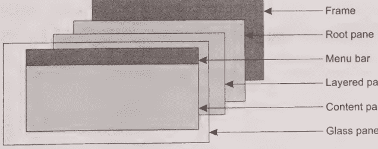

**图 15.1 JFrame 中的面板**

- 层级面板 (`JLayeredPane`)
- 内容面板 (Content pane)
- 菜单栏（可选） (`JMenuBar`)
- 玻璃面板 (`JGlassPane`)

### Java 编程

每个根面板始终包含一个层级面板、内容面板和一个玻璃面板。菜单栏是可选的。层级面板是一个将组件放置在三维空间中的容器。实际上，它为容器和组件添加了深度，组件可以相互叠放。层级面板负责管理内容面板和菜单栏。玻璃面板是透明的。它基本上用于拦截事件，使其无法到达内容区域。菜单栏用于在根面板上设置菜单。

所有组件都添加到内容面板中，内容面板是一个中间容器。获取内容面板有两种方法：

1. **使用默认内容面板**：每个容器都有一个内容面板。使用 `getContentPane()` 获取内容面板，它会返回一个 `Container` 对象（推荐）。在 JDK 5 之前，必须显式地通过 `getContentPane()` 获取内容面板，然后在其上使用 `add()`，例如 `getContentPane().add(Component)`。但现在不需要显式获取内容面板了。你可以像示例 15.1 所示，直接使用 `add()` 方法。

2. **构建你自己的内容面板**：通常会为内容面板创建一个新面板，并告诉程序使用这个新面板作为其内容面板。例如：

```java
class Demo extends JFrame {
    ...
    // JPanel 也是一个以 FlowLayout 为默认布局的容器
    // 所以我们可以将其作为我们自己的内容面板并向其中添加内容。
    JPanel panel = new JPanel();
    panel.add(...);
    panel.add(...);
    panel.setOpaque(true);
    setContentPane(panel); // 将 JPanel 设置为 JFrame 的内容面板
    ...
}
```

### 示例 15.1 打印消息框架

| 行号 | 代码 |
|---|---|
| L1 | `import javax.swing.*;` |
| L2 | `public class DemoSwing extends JFrame` |
| L3 | `void demoSwing() {` |
| L4 | `setTitle("First Swing Program");` |
| L5 | `// 窗口大小` |
| L6 | `setSize(300, 200);` |
| L7 | `setDefaultCloseOperation(JFrame.EXIT_ON_CLOSE);` |
| L8 | `JLabel label = new JLabel("Hello Swing");` |
| L9 | `add(label);` |
| L10 | `// 自动适应容器中的组件` |
| L11 | `// pack();` |
| L12 | `// 显示窗口。` |
| L13 | `setVisible(true);` |
| L14 | `}` |
| L15 | `public static void main(String[] args) {` |
| L16 | `DemoSwing demo = new DemoSwing();` |
| L17 | `demo.demoSwing();` |
| L18 | `}` |

#### 输出

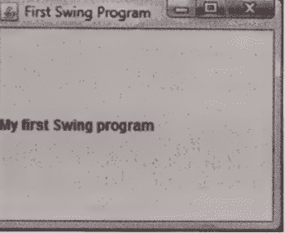

**图 15.2(a) 如果注释了 Pack 方法并使用 SetSize 的输出**


**图 15.2(b) 如果执行 Pack 方法 (L11) 的输出**

#### 代码解释

- **L1**：为了创建 GUI Swing，我们必须导入 `javax.swing.*` 包。
- **L2**：类继承自 `JFrame` 成为 `JFrame` 的子类，以便使用 Swing 创建框架。（注意，`JFrame` 是 `javax.swing` 包中存在的四个重量级类之一。另外三个是 `JApplet`、`JDialog` 和 `JWindow`。）
- **L3**：已定义方法 `demoSwing`。
- **L4**：方法 `setTitle("First Swing Program")` 将框架标题设置为 "First Swing Program"，如图 15.2(a) 所示。
- **L6**：`setSize(300, 200)` 方法设置窗口大小。300 是宽度，200 是高度。
- **L7**：`setDefaultCloseOperation(int)` 指定了关闭框架时执行的操作。当用户关闭框架时，可以传递以下值：
  - `NOTHING_ON_CLOSE`：什么都不做。
  - `HIDE_ON_CLOSE`：隐藏框架。
  - `DISPOSE_ON_CLOSE`：释放资源。
  - `EXIT_ON_CLOSE`：退出应用程序。
- **L8-9**：创建标签并添加到框架。
- **L11**：`pack()` 方法根据组件的大小调整窗口。
- **L13**：`setVisible(true)` 设置窗口为可见。
- **L15-17**：主方法创建实例并调用演示方法。


# 输出


图 15.2(a) 如果注释了 `Pack` 方法并使用 `SetSize` 的输出


图 15.2(b) 如果执行 `Pack` 方法 (L9) 的输出

## 1.3 JApplet

`JApplet` 是 Swing 中创建 applet 类。`JApplet` 包含了 AWT 的所有特性。在 Swing 中，applet 使用 `paint` 方法，如图 15.3 所示。

### 示例 15.2 JApplet

```java
import java.awt.*;
import javax.swing.*;

/* <applet code="JApplet.class" width="300" height="100"></applet>*/
public class JApplet extends JApplet {
    public void init() {
        setLayout(new FlowLayout());
        add(new JButton("Button 1"));
        add(new JButton("Button 2"));
        add(new JButton("Button 3"));
    }
}
```


图 15.3 JApplet

运行 `JApplet` 的 HTML 代码如下：

```html
<html><body>
<applet code="JApplet.class" width="300" height="100"></applet>
</body>
</html>
```

## 解释

- L1–2: 导入了 `java.awt`（用于 `FlowLayout` 类）和 `javax.swing`。
- L5: `JApplet` 的布局更改为 `FlowLayout`。默认情况下，`JApplet` 使用 `BorderLayout`。
- L6–8: 在 `init()` 方法中添加了三个按钮。Swing 中按钮的类是 `JButton`。它已经实例化，并在构造函数中传递了字符串参数，这构成了按钮的标签。

## 组件演示示例

```java
import java.awt.*;
import java.awt.event.*;
import javax.swing.*;

public class ComponentDemo extends JFrame implements ActionListener {
    JRadioButton m, f;
    JCheckBox c1, c2;
    JToggleButton tb;
    Container content;
    JLabel lbl;

    void ComponentDemo() {
        setTitle("复选单框与切换按钮演示");
        content = getContentPane();
        setSize(300, 150);
        setDefaultCloseOperation(EXIT_ON_CLOSE);
        setLayout(new FlowLayout());
        c1 = new JCheckBox("音乐");
        c2 = new JCheckBox("舞蹈");
        c1.addItemListener(this);
        c2.addItemListener(this);
        add(c1);
        add(c2);
        m = new JRadioButton("男");
        f = new JRadioButton("女");
        ButtonGroup bg = new ButtonGroup();
        bg.add(m);
        bg.add(f);
        m.addItemListener(this);
        f.addItemListener(this);
        add(m);
        add(f);
        tb = new JToggleButton("改变颜色");
        lbl = new JLabel();
        add(lbl);
        tb.addItemListener(this);
        add(tb);
        setVisible(true);
    }

    public void itemStateChanged(ItemEvent ae) {
        if (ae.getItem() == tb && ae.getStateChange() == ItemEvent.SELECTED)
            content.setBackground(Color.blue);
        if (ae.getItem() == tb && ae.getStateChange() == ItemEvent.DESELECTED)
            content.setBackground(Color.red);
        if (ae.getItem() == c1 && ae.getStateChange() == ItemEvent.SELECTED)
            lbl.setText("音乐");
        if (ae.getItem() == c2 && ae.getStateChange() == ItemEvent.SELECTED)
            lbl.setText("舞蹈");
        if (ae.getItem() == m && ae.getStateChange() == ItemEvent.SELECTED)
            lbl.setText("男");
        if (ae.getItem() == f && ae.getStateChange() == ItemEvent.SELECTED)
            lbl.setText("女");
    }

    public static void main(String[] args) {
        ComponentDemo demo = new ComponentDemo();
        demo.ComponentDemo();
    }
}
```

## 输出

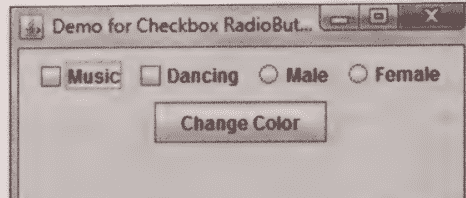

**图 15.5(a)** 显示复选框、单选按钮和切换按钮的框架

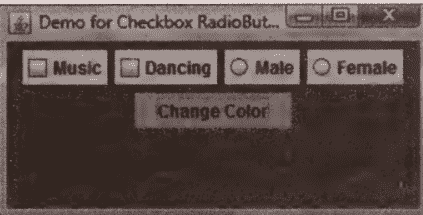


**图 15.5(b)** 选中切换按钮时，框架的颜色变为蓝色

**图 15.5(c)** 取消切换切换按钮时，框架的颜色变为红色


**图 15.5(d)** 选中复选框时，标签被设置为相应的文本


**图 15.5(e)** 选中单选按钮时，标签被设置为相应的文本

## 解析

- L1-5: 创建了各种组件的引用变量，如 `JRadioButton`、`JCheckBox`、`JToggleButton` 和 `JLabel`。还为内容面板创建了容器的引用变量。变量声明在方法外部，是因为在其他方法也需要这些实例。
- L12-13: 创建了两个复选框，其标题传递给 `JCheckBox` 构造函数的方式如表 15.3。
- L14-15: 两个复选框都注册了监听器。
- L16-17: 两个复选框添加到框架中。
- L18-19: 创建单选按钮。
- L20-22: 创建 `ButtonGroup` 并添加单选按钮。
- L23-24: 单选按钮注册监听器。
- L25-26: 单选按钮被添加到 `JFrame` 中。
- L27: 创建切换按钮，并将标题作为参数传递给 `JToggleButton` 的构造函数。该类的构造函数如表 15.5。
- L28-29: 实例化了一个新的 `JLabel` 并将其添加到框架中。
- L30: 为 `JToggleButton` 注册了 `ItemListener`。当你选择或取消选择切换按钮时，切换按钮的状态会生成一个事件，并传递给 `itemStateChanged(ItemEvent)` 方法。
- L31: 切换按钮添加到 `JFrame`。
- L33-47: `itemStateChanged` 方法处理各组件的状态改变事件。
- L48-51: `main` 方法创建实例并启动程序。

# 布局管理器

除了 AWT 中引入的布局（第14章），Swing 包中也引入了一些新的布局。例如：

- `BoxLayout`
- `SpringLayout`

## 15.6.1 SpringLayout

`SpringLayout` 是一种非常灵活的布局，因为它并不直接放置组件，而是根据 `putConstraint` 方法指定的约束来放置。两个边缘之间的距离，或者组件与其容器边缘之间的距离，可以是任何方向：北、南、东或西。让我们通过一个例子来阐述这一概念（图 15.6）。

### 示例 15.4 SpringLayout

```java
import java.awt.*;
import javax.swing.*;

public class SpringDemo extends JFrame {
    void springDemo() {
        setDefaultCloseOperation(EXIT_ON_CLOSE);
        setTitle("Spring Layout");
        Container contentPane = getContentPane();
        SpringLayout layout = new SpringLayout();
        contentPane.setLayout(layout);
        setSize(250, 100);

        layout.putConstraint(SpringLayout.WEST, 5, SpringLayout.WEST, contentPane);
        layout.putConstraint(SpringLayout.NORTH, 5, SpringLayout.NORTH, contentPane);
        layout.putConstraint(SpringLayout.WEST, textField, 5, SpringLayout.EAST, label);
        layout.putConstraint(SpringLayout.NORTH, textField, 5, SpringLayout.SOUTH);
        layout.putConstraint(SpringLayout.HORIZONTAL_CENTER, b1, 0, SpringLayout.HORIZONTAL_CENTER, contentPane);
        layout.putConstraint(SpringLayout.SOUTH, b1, -5, SpringLayout.SOUTH, contentPane);

        // 显示窗口。
        setVisible(true);
    }

    public static void main(String[] args) {
        SpringDemo demo = new SpringDemo();
        demo.springDemo();
    }
}
```


# Java 编程

## 表 15.6 JTextField 的构造函数

| 构造函数 | 说明 |
|---|---|
| `JTextField()` | 创建一个列数为0的文本框。 |
| `JTextField(String txt)` | 创建一个指定字符串 txt 的文本框。 |


| `JTextField(String txt, int column)` | 创建一个指定字符串且列数为 column 的文本框。 |

L21–22 L21 将按钮放置在内容面板的水平中心。指定整数值 0 以使其保持在中心位置。L22 指定按钮的南部边缘与内容面板南部边缘之间的距离为 -5。指定负值会将组件从内容面板的南部边缘向上移动，指定正值则会将其向南部边缘移动。

## 15.6.2 BoxLayout

`BoxLayout` 将所有组件放置在单行或单列中。在不增加其复杂性的情况下，我们可以在水平和垂直方向上放置多个面板，类似于 `GridBagLayout`。`BoxLayout` 布局器在设计时有一个 `axis` 参数，用于指定布局类型。这可以通过四种方式实现：

- `X_AXIS`——组件从左到右水平排列。
- `Y_AXIS`——组件从上到下垂直排列。
- `LINE_AXIS`——组件根据容器的 `ComponentOrientation` 属性并成直线排列。
- `PAGE_AXIS`——组件根据容器的 `ComponentOrientation` 属性，按照文本行在页面上的书写方式排列。

表 15.7 和表 15.8 列出了 `PAGE_AXIS` 和 `LINE_AXIS` 的 `ComponentOrientation` 属性。

### 表 15.7 Page_Axis

| 组件方向 | 组件布局 |
|---|---|
| Horizontal | 水平放置，否则垂直放置。 |
| Horizontal;left to right | 从左到右放置，否则从右到左放置。 |
| Vertical orientations | 从上到下排列 |

### 表 15.8 Line_Axis

| 组件方向 | 组件布局 |
|---|---|
| Horizontal | 组件保持垂直方向，否则保持水平方向。 |
| Horizontal;left to right | 从左到右放置，否则从右到左放置。 |
| Vertical orientations | 从上到下排列 |

## 示例 15.5 BoxLayout

```java
L1 import java.awt.*;
L2 import javax.swing.*;

public class BoxDemo extends JFrame {
    void BoxDemo() {
        Container content = getContentPane();
        setSize(200, 150);
        setDefaultCloseOperation(EXIT_ON_CLOSE);

        L3 BoxLayout b = new BoxLayout(content, BoxLayout.X_AXIS);
        L4 setLayout(b);
        L5 add(new JButton("Button 1"));
        L6 add(new JButton("Button 2"));
        L7 add(new JButton("Button 3"));

        setVisible(true);
    }

    public static void main(String[] args) {
        BoxDemo demo = new BoxDemo();
        demo.boxLayout();
    }
}
```

## 输出


## 解析

L3 创建了 `BoxLayout` 对象。构造函数有两个参数：

```java
public BoxLayout(Container target, int axis)
```

L4 `setLayout` 方法显示内容面板的布局。

L5-7 向内容面板添加了三个按钮。它们根据其轴进行显示（参见图 15.8 和图 15.9）。

## 15.7 JList 和 JScrollPane

`JList` 是一个向用户显示一组项的组件，并允许他/她从列表中选择一个或多个项。使用 `ListModel`（接口）来维护列表内容。通常使用 `DefaultListModel` 类（继承自 `ListModel`）来维护列表。该类提供了添加、删除元素或特定元素、查找元素索引等方法。`setModel(ListModel l)` 方法为列表设置模型。`JList` 上的选择变化（导致产生 `ListSelectionEvent`）由另一个 `ListSelectionModel` 管理，并由 `ListSelectionListener`（`javax.swing.event` 包的一部分）进行跟踪。`ListSelectionListener` 只有一个方法，即：

```java
public void valueChanged(ListSelectionEvent event)
```

选择方法由继承自 `ListSelectionListener` 并想要捕获 `ListSelectionEvent` 的类重写。每当列表中的项被选中时，该方法就会执行。

`JList` 支持单次选择、多次选择以及多个间隔范围选择。`setSelectionMode(int sm)` 方法用于设置选择模式。整数 `sm` 可以取表 15.9 所示的三个可能值之一。示例 15.6 说明了 `JList` 的用法。在 `JList` 上进行选择，选中的项显示在 `JLabel` 中（图 15.10）。

### 表 15.9 ListSelectionModel 字段

| 常量 | 说明 |
|---|---|
| `ListSelectionModel.SINGLE_SELECTION` | 用于一次仅选择一个项。 |
| `ListSelectionModel.SINGLE_INTERVAL_SELECTION` | 用于一次选择一个连续范围的项。 |
| `ListSelectionModel.MULTIPLE_INTERVAL_SELECTION` | 用于一次选择任意数量的连续范围的项。 |

## 示例 15.6 JList

```java
import java.awt.*;
import javax.swing.*;
import javax.swing.event.*;

public class JListDemo extends JFrame implements ListSelectionListener {

    JList list;
    JLabel label;
    DefaultListModel model;

    public JListDemo() {
        setTitle("JList Demo");
        setSize(200, 200);
        setDefaultCloseOperation(EXIT_ON_CLOSE);

        model = new DefaultListModel();
        list = new JList(model);

        for (int i = 0; i < 10; i++) {
            model.addElement("Item " + i);
        }

        JScrollPane pane = new JScrollPane(list);
        add(pane, BorderLayout.NORTH);
        add(label, BorderLayout.SOUTH);

        list.addListSelectionListener(this);
        setVisible(true);
    }

    public void valueChanged(ListSelectionEvent e) {
        label.setText("Selected: " + (String) list.getSelectedValue());
    }

    public static void main(String[] args) {
        new JListDemo();
    }
}
```

## 输出


## 解析

L1-3 导入了 `java.awt`、`javax.swing` 和 `javax.swing.event`。
L4-5 `JListDemo` 类继承自 `JFrame` 并实现 `ListSelectionListener`。
L6-7 定义了 `DefaultListModel`、`JList` 和 `JLabel` 变量。
L8-10 构造函数设置了标题、大小和关闭操作。
L11-12 初始化了 `DefaultListModel` 和 `JList`。
L13-15 循环向模型中添加项。
L16-17 使用 `list` 创建了 `JScrollPane`。
L18 将 `pane` 和 `label` 添加到框架中。
L19 添加了 `ListSelectionListener`。
L20-22 `valueChanged` 方法更新标签的选中项。
L23-25 `main` 方法创建了 `JListDemo` 实例。

```java
JScrollPane j = new JScrollPane();
```

## 15.8 JSplitPane

`JSplitPane` 是一种用于分割组件的容器，可以是水平（`JSplitPane.HORIZONTAL_SPLIT`）或垂直（`JSplitPane.VERTICAL_SPLIT`）。它可以同时显示两个组件，用户可以调整显示区域。让我们来看使用 `JSplitPane` 的示例（图 15.11）。

## 示例 15.7 JSplitPane

```java
import javax.swing.*;

public class DemoSplitPane extends JFrame {

    public DemoSplitPane() {
        setTitle("Split Pane");
        setSize(250, 250);
        setDefaultCloseOperation(JFrame.EXIT_ON_CLOSE);

        JPanel jpane1 = new JPanel();
        JPanel jpane2 = new JPanel();

        JLabel jbl1 = new JLabel("First Area 1");
        JLabel jbl2 = new JLabel("Second Area 2");

        jpane1.add(jbl1);
        jpane2.add(jbl2);

        JSplitPane splitPane = new JSplitPane(JSplitPane.VERTICAL_SPLIT, true, jpane1, jpane2);
        splitPane.setOneTouchExpandable(true);
        add(splitPane);
        setVisible(true);
    }

    public static void main(String[] args) {
        DemoSplitPane demo = new DemoSplitPane();
        // demo.demoSplitPane(); // 原代码中此方法不存在，构造函数已完成初始化
    }
}
```


图 15.11 垂直分割的 `JSplitPane` 显示两个 `JPanel` 对象

## 解释

- L1-2 为每个被 `JSplitPane` 拆分的区域创建了两个 `JPanel` 实例。
- L3-4 创建了两个标签，分别为每个面板创建标题为 'First Area 1' 和 'Second Area 2' 的标签。
- L5-6 将 `JLabel` 添加到 `JPanel` 中。
- L7 创建了 `JSplitPane` 对象。示例中使用的构造函数所示：
  `JSplitPane(int orientation, boolean newContinuousLayout, Component c1, Component c2)` 其中 `orientation` 可以取两个值：`JSplitPane.HORIZONTAL_SPLIT` 和 `JSplitPane.VERTICAL_SPLIT`。`HORIZONTAL_SPLIT` 将整个水平区域划分为若干部分。`VERTICAL_SPLIT` 将垂直区域划分为若干部分（见图 15.11）。
- `ContinuousLayout` 是一个布尔值，表示在移动拆分器时组件是否会重新重绘。
- `c1` 表示组件将显示在顶部部分（在 `VERTICAL_SPLIT` 的情况下）或左侧部分（在 `HORIZONTAL_SPLIT` 的情况下）。
- `c2` 表示组件将显示在底部部分（在 `VERTICAL_SPLIT` 的情况下）或右侧部分（在 `HORIZONTAL_SPLIT` 的情况下）。
- L8 `JSplitPane` 的 `setOneTouchExpandable(true)` 方法用于为拆分器提供向上/向下的箭头。点击箭头可以展开/缩小面板。

## 15.9 JTabbedPane

`JTabbedPane` 允许用户在不同的标签之间切换，这些标签包含组件或组件组（见图 15.12(a) 和 (b)）。单个标签将有一个标题，并可能包含图标。表 15.10 显示了 `JTabbedPane` 的构造函数。

### 表 15.10 JTabbedPane 的构造函数

| 构造函数 | 说明 |
|---|---|
| `JTabbedPane()` | 创建一个具有默认标签位置的标签面板，即 `JTabbedPane.TOP` |
| `JTabbedPane(int tabPlacement)` | 创建一个具有指定标签位置的标签面板。标签位置可以取以下值之一：`JTabbedPane.TOP`、`JTabbedPane.BOTTOM`、`JTabbedPane.LEFT`、`JTabbedPane.RIGHT` |

可以使用以下方法添加单个标签：

```java
public void addTab(String title, Component c)
```
或
```java
public void addTab(String title, Icon i, Component c)
```

与 `JTabbedPane` 关联的监听器是 `ChangeListener` (`javax.swing.event`)。用于 `JTabbedPane` 注册 `ChangeListener` 的方法所示：

```java
public void addChangeListener(ChangeListener l)
```

`ChangeListener` 接口有一个方法 `public void stateChanged(ChangeEvent e)`，用于处理标签被选中时发生的事件。

让我们通过一个例子来理解 `JTabbedPane` 以及如何在其上使用 `ChangeListener`。在下面的程序中，创建了两个标签。两个标签都包含 `JPanel`。标签页中的 `JPanel` 包含一个标签，而另一个 `JPanel` 包含一个切换按钮。当选择标签时，会在 `JFrame` 中显示当前选中的标签索引。

## 示例 15.8 JTabbedPane

```java
import java.awt.*;
import javax.swing.*;
import javax.swing.event.*;

public class JTabbedPaneDemo extends JFrame {

    JLabel lbl1;
    JToggleButton jb;
    JTabbedPane jt;

    public JTabbedPaneDemo() {
        setTitle("JTabbedPane");
        setDefaultCloseOperation(EXIT_ON_CLOSE);

        lbl1 = new JLabel("Label in Tab 1");
        JPanel panel1 = new JPanel();
        panel1.add(lbl1);

        JPanel panel2 = new JPanel();
        jb = new JToggleButton("Change Color");
        panel2.add(jb);

        jt = new JTabbedPane();
        jt.addTab("Tab 1", panel1);
        jt.addTab("Tab 2", panel2);
        jt.setToolTipTextAt(0, "Tab 1");
        jt.setToolTipTextAt(1, "Tab 2");

        add(jt, BorderLayout.NORTH);

        JLabel txt = new JLabel();
        add(txt, BorderLayout.CENTER);

        setSize(300, 200);
        setVisible(true);

        jt.addChangeListener(new ChangeListener() {
            public void stateChanged(ChangeEvent e) {
                txt.setText("Tab selected: " + jt.getSelectedIndex());
            }
        });
    }

    public static void main(String[] args) {
        new JTabbedPaneDemo();
    }
}
```


# 516 Java 编程

## 输出


**图 15.12(a)** `JTabbedPane` 在 Tab 2 被选中时显示 ToolText 和索引，以及 Tab 2 中的切换按钮

**图 15.12(b)** `JTabbedPane` 在 Tab 1 被选中时显示 ToolTip 和索引，以及 Tab 1 中的 `JLabel`

## 解释

- **L7–9** 创建了带有文本 "Label in Tab1" 的 `JLabel` 并将其添加到 `JPanel` 中。
- **L10–12** 创建了 `JJButton` 并添加到 `JPanel` 中。
- **L13** 创建了具有默认位置的 `JTabbedPane`。
- **L14–15** 使用 `addTab` 方法添加单个标签。
- **L16–17** 使用的提示方法：

```
void setToolTip(int index, String text)
String getToolTip(int index)
```

- **L18–20** 与 `JTabbedPane` 关联的监听器是 `ChangeListener`。用于 `JTabbedPane` 注册 `ChangeListener` 的方法所示：

```
void addChangeListener(ChangeListener l)
```

# 518 Java 编程

```java
L13    DefaultMutableTreeNode oneInNumber=new DefaultMutableTreeNode("1.1", false);
       /* 将标签为 "1.1" 的叶子节点添加到节点 "1" */
       oneInNumber.add(oneInNumber);
L14    /*将标签为 1 的分支节点添加到标签为 "One" 的节点*/
L15    one.add(oneInNumber);
       /* 将标签为 "One" 的分支节点添加到根节点 "Numbers" */
L16    dtm1.add(one);
L17    DefaultMutableTreeNode two=new DefaultMutableTreeNode("Two");
L18    DefaultMutableTreeNode twoInNumber=new DefaultMutableTreeNode("2");
L19    two.add(twoInNumber);
L20    dtm1.add(two);
L21    dtm = new DefaultTreeModel(dtm1,true);
L22    jt = new JTree(dtm1);
L23    jt.addTreeExpansionListener(new TreeExpansionListener(
       {
           public void treeCollapsed(TreeExpansionEvent te)
           {
               System.out.println("Collapsed");
           }
           public void treeExpanded(TreeExpansionEvent te)
           {
               System.out.println(jt.getLeadSelectionPath());
               System.out.println(jt.getLastSelectedComponent());
           }
       }));
L24    setDefaultCloseOperation(JFrame.EXIT_ON_CLOSE);
L25    add(jt);
L26    setSize(200,200);
L27    setVisible(true);
       }
L28    public static void main(String args[])
       {
           new JTreeDemo("My Tree");
       }
```

## 输出


图. 15.14(a) 显示了 `JTree`，节点 One 已展开，且节点的 `TreePath`（即 `[Numbers, One]`）和 Name 显示在命令提示符上


图. 15.14(c) 子节点 1 已展开，且节点的 `TreePath` 和 Name 显示在命令提示符上

# 520 Java 编程


图. 15.14(d) 节点 One 已折叠，屏幕上打印 "Collapsed"


图. 15.14(e) 根节点已折叠，屏幕上打印 "Collapsed"

## 解析

- **L1–3** 导入所需的包。导入 `javax.swing.tree` 子包是因为我们想在程序中使用 `DefaultTreeModel` 和 `DefaultMutableTreeNode`。
- **L4** 类声明。
- **L5–7** 创建 `JTree` 和 `DefaultMutableTreeNode` 的引用值。
- **L8** 构造函数声明。
- **L9** 设置框架的标题。

我们需要创建树结构，因此需要创建一个 `TreeModel`。`JTree` 的构造函数接受一个 `TreeModel` 对象。`TreeModel` 是 `java.swing.tree` 包中的一个接口，因此我们使用继承 `TreeModel` 接口的 `DefaultTreeModel` 类。我们在 `JTree` 中传递了 `DefaultTreeModel` 对象。`TreeModel` 构造函数创建节点。`DefaultTreeModel` 接受 `TreeNode` 对象（它是 `java.swing.tree` 包中的一个接口）。为了创建 `JTree` 的节点，我们使用 `DefaultMutableTreeNode` 类（继承自 `TreeNode` 接口）。节点的标签通过 `DefaultMutableTreeNode` 的构造函数传递。

首先，使用 `DefaultMutableTreeNode` 类创建根节点 (dtm)。分支节点及其子节点也使用 `DefaultMutableTreeNode` 类创建，并添加到各自的父节点中。分支节点被添加到根节点。最后，根节点添加到 `DefaultTreeModel` 对象 (dtm) 中，该对象被传递给 `JTree` 的构造函数。

使用 `DefaultMutableTreeNode` 类语句创建第一个节点（根，即 dtm），创建一个标签为“Numbers”的节点，没有父节点也没有孩子，但允许有子节点。

使用 `DefaultMutableTreeNode` 类创建一个分支节点（即 one）。该语句创建一个标签为“One”的节点，没有父节点也没有孩子，但允许有子节点。这是根节点内部的一个分支，因此它将在 L16 被添加到根节点。

- **L12** 创建另一个分支节点，添加到标签为 "One" 的分支节点内部。

（注：代码保持不变）

- **L13** 创建一个标签为 "1.1" 的叶子节点，添加到标签为 "1" 的分支节点内部。构造函数的第二个参数 (`false`) 指定该节点将没有子节点。

```java
DefaultMutableTreeNode one2=new DefaultMutableTreeNode("1.2", false);
```

- **L14** 显示如何将标签为 "1.1" 的叶子节点添加到标签为 "1" 的分支节点。
- **L15** 将标签为 "1" 的分支节点添加到标签为 "One" 的节点。
- **L16** 将标签为 "One" 的分支节点添加到根节点 "Numbers"。
- **L17–20** 在根节点内部创建另一个分支节点。标签为 "2" 的节点被添加到 "Two"。
- **L21** 创建 `DefaultTreeModel` 对象并将 `DefaultMutableTreeNode`（根节点）对象传递给 `JTree` 的构造函数。`DefaultTreeModel` 构造函数中的布尔参数指定任何节点都可以有孩子。如果我们直接将 `dtm`（根节点）添加到 `JTree`，标签为 2 的节点将被 `TreeExpansionListener` 考虑。
- **L22** 将 `DefaultTreeModel` 添加到 `JTree`。
- **L23** 使用匿名类处理事件。`TreeExpansionListener` 用于处理 `TreeExpansionEvent`。当 `JTree` 展开或折叠时，会触发此事件。`TreeExpansionListener` 有两个方法：在匿名类中被重写。当节点被双击时，会调用 `treeExpanded` 方法。该方法打印被双击节点的 `TreePath`。使用 `JTree` 的 `getSelectionPath()` 获取 `TreePath`。这是用户双击节点的 `TreePath`（输出）。可以使用 `JTree` 的 `getLastSelectedComponent()` 获取节点标签。
- **L24–29** 这些已经在示例中讨论过

# 15 JTable

`Table` 类允许你显示表格。图 15 显示了一个简单的表格：

| Name | Address |
| :--- | :--- |
| Kavi | Delhi |
| Nitin | Dehradun |

图 15.15 具有两列的 `JTable`

为图 15.15 创建 `JTable` 并监控其单元格选择。当用户选择一个单元格时，其值将显示给用户（图 15.16）。

## 示例 15.10 Table Demo

```java
import javax.swing.*;
import java.awt.event.*;

class TableDemo extends JFrame {
    JTable jt;
    ScrollPane jsp;

    TableDemo(String title) {
        setTitle(title);
        Object row[]={{"Kavi","Delhi"},{"Nitin","Dehradun"}};
        Object col[]={{"Name","Address"}};
        jt = new JTable(row,col);
        setDefaultCloseOperation(JFrame.EXIT_ON_CLOSE);
        /*如果设置了这个值，可以选择单元格，否则将高亮整行.*/
        jt.setSelectionEnabled(true);
        jt.addMouseListener(new MouseAdapter() {
            public void mouseClicked(MouseEvent me) {
                String string = (String)jt.getValueAt(jt.getSelectedRow(), jt.getSelectedColumn());
                // 显示选中的项
                System.out.println("Value selected = " + string);
            }
        });
        jsp=new ScrollPane(jt);
        add(jsp);
        setSize(300,400);
        setVisible(true);
    }

    public static void main(String[] args) {
        new TableDemo("Table Demo");
    }
}
```

## Swing 523

## 输出

| Name | Address |
| :--- | :--- |
| Kav | Delhi |
| Bin | Dehradun |

图. 15.16 监控单元格选择的 `JTable`

## 解析

- **L1–2** 导入所需的包。
- **L3** 类声明。
- **L4–5** 创建引用变量 `JTable` 和 `ScrollPane`。
- **L6–7** 声明构造函数接受一个字符串，用于设置 `JFrame` 的标题。在 L9 和 L10 创建了两个数组：填充行的二维数组和用于列名的一维数组。这些在 L11 中通过传递给构造函数添加到 `JTable`。
- **L11** 当用户点击 `JFrame` 左上角的 X 按钮时，退出应用程序。
- **L12** 默认情况下，点击时会选中整行。我们希望选择任意行中的特定单元格。因此我们在此语句中启用了单元格选择。
- **L13** 为 `JTable` 注册 `MouseListener` 以跟踪对 `JTable` 单个单元格元素的鼠标点击。创建匿名类来处理鼠标事件。我们想要跟踪 `MouseClicked` 方法。当鼠标点击单元格时，该方法提取该单元格的值并将其打印到控制台上。这里使用 `JTable` 的 `getValue` 方法来提取特定单元格的值。我们需要获取所选单元格的值，因此我们在 `getValueAt` 方法中传递了所选行的索引 (`getSelectedRow()`) 和所选列的索引 (`getSelectedColumn()`)。

```java
String string = (String)jt.getValueAt(jt.getSelectedRow(), jt.getSelectedColumn());
```

- **L14–15** 将 `JTable` 添加到 `ScrollPane`，将其添加到框架中。
- **L16–19** 所有这些行都解释过了。

在上一个示例中，我们只监控了单元格选择。在接下来的示例中，我们将监控整行甚至多行的选择。让我们创建另一个 `JTable` 并监控其行选择（见图 15.17）。

## 示例 15.11 Table Demo 2

```java
L1 import javax.swing.*;
L2 import java.awt.event.*;
L3 class TableDemo2 extends JFrame
{
L4 JTable jt;
L5 JScrollPane jsp;
L6 //ListSelectionModel selectionModel;
L7 TableDemo2(String title)
{
L8 setTitle(title);
L9 Object row[]={{"Kavi","Delhi"},{"Nitin","Dehradun"}};
L10 Object col[]={{"Name","Address"}};
L11 jt=new JTable(row,col);
L12 setDefaultCloseOperation(JFrame.EXIT_ON_CLOSE);
L13 /*selectionModel=jt.selectionModel();/*
L14 /*selectionModel.setSelection(ListSelectionModel.SINGLE_SELECTION*/
L15 jt.addMouseListener(new MouseAdapter(){
    public void mouseClicked(MouseEvent event) {
        int rowcount=jt.getSelectedRow();
        int colcount=jt.getColumnCount();
        String string=null;
        /*获取所有被选行的索引*/
        int[] sel=jt.getSelectedRows();
        /*确定并打印所选的项 */
        for(int i=0;i<rowcount;i++)
            for(int j=0;j<colcount;j++)
                string=(String)jt.getValueAt(sel[i],j);
        // 显示所选的项
        System.out.println("Value selected = " + rowcount + "," + colcount + ":"+ string);
    }
});
}
L17 jsp=new JScrollPane(jt);
L18 add(jsp);
L19 setSize(300,400);
L20 setVisible(true);
}
L21 public static void main(String[] args) {
L22     new TableDemo2("Table Demo2");
}
}
```


# 输出

| Name | Address |
|---|---|
| Kavi | Delhi |
| Nitin | Dehradun |

图 15.17(a) JTable 的单行选择

| Name | Address |
|---|---|
| Kavi | Delhi |
| Nitin | Dehradun |

图 15.17(b) JTable 的多行选择

# 解释

L6, 13–14 被注释了。在本示例中，特意注释并显示它们是为了某种目的。我们允许了多行选择。如果您希望允许单行选择，则必须取消这些注释语句。正如之前解释的，`ListSelectionModel` 接口为用户提供了设置不同选择模式的选项。这些模式作为 `ListSelectionModel` 接口的静态字段提供，并使用这些模式来设置 `JTable` 类的 `selectionMode` 字段。这些模式在表 15.9 中已经讨论过。

L15 用户可以选择任意数量的行，我们需要选取所有被选的行。因此，首先我们需要确定用户选择的行数。此信息可以通过 `getSelectedRowCount()` 方法获取。随后，我们使用 `getColumnCount()` 方法获取该表中的列数。然后使用 `getSelectedRows()` 方法获取所有被选行的索引。该方法返回一个整数数组 `{sel[]}`。为了遍历并打印所选行，创建了一个嵌套循环。外层循环用于遍历被选行，内层循环用于打印所选行的所有列值。与之前的示例一样，使用 `getValueAt()` 方法获取所选单元格的值。所有被选行索引存储在整数数组 `sel` 中，并作为第一个参数传递给 `getValueAt` 方法。

# 15.12 对话框

Java Swing 中提供了四种类型的对话框：

1. 确认对话框：寻求用户的响应，例如：是/否/取消。
2. 消息对话框：告知用户某些信息。
3. 输入对话框：要求用户输入一个值。
4. 选项对话框：要求用户从给定的值集中选择一个值。

这些对话框可以通过 `JOptionPane` 类来创建。该类提供了用于创建所有这些对话的静态方法，例如，创建确认对话框时使用以下方法：

```java
public static int showDialog(Component parent, Object msg, String title, int optiontype) throws HeadlessException
```

其中 `parent` 是显示对话框的框架。对话框标题设置对话框的标题。`optiontype` 可能是以下之一：

- `JOptionPane.DEFAULT_OPTION`
- `JOptionPane.YES_NO_OPTION`
- `JOptionPane.YES_NO_CANCEL_OPTION`
- `JOptionPane.OK_CANCEL_OPTION`

该方法返回一个表示用户选择选项的整数值。可能的返回值可以是以下之一：`YES_OPTION`, `NO_OPTION`, `CANCEL_OPTION`, `OK_OPTION`, `CLOSED_OPTION`。

消息对话框向用户显示消息。可以使用以下方法创建：

```java
public static void showDialog(Component parent, Object msg) throws HeadlessException // 创建信息消息对话框
```

或

```java
public static void showDialog(Component parent, Object msg, String title, int messagetype) throws HeadlessException
```

其中 `messagetype` 可能是以下之一：

- `JOptionPane.ERROR_MESSAGE`
- `JOptionPane.INFORMATION_MESSAGE`
- `JOptionPane.WARNING_MESSAGE`
- `JOptionPane.QUESTION_MESSAGE`
- `JOptionPane.PLAIN_MESSAGE`

输入对话框用于从用户处获取输入，可以使用下方显示的方法创建：

```java
public static String showInputDialog(Component parent, Object msg) throws HeadlessException
```

它向用户寻求输入并将其作为字符串返回。或者：

```java
public static String showInputDialog(Component parent, Object msg, String title, int messagetype) throws HeadlessException
```

输入对话框向用户显示选项列表并提示其选择。以下方法显示了如何创建：

```java
public static int showOptionDialog(Component parent, Object msg, String title, int optiontype, int messagetype, Object[] option, initialValue) throws HeadlessException
```

它要求从 `Object[] option` 指定集中选择一个选项。`initialValue` 指定默认值。当此代码在不支持鼠标或键盘的环境中调用时，会发生 `HeadlessException`。

# 示例 15.12 使用 JOptionPane 的对话框

```java
import javax.swing.*;
import java.awt.event.*;
import java.awt.*;

public class DialogBox extends JFrame {
    JFrame frame;
    JLabel label1;

    public DialogBox() {
        JButton b1 = new JButton("Message Dialog");
        JButton b2 = new JButton("Confirm Dialog");
        JButton b3 = new JButton("Input Dialog");
        JButton b4 = new JButton("Option Dialog");

        getContentPane().setLayout(new FlowLayout());

        b1.addActionListener(new MyAction());
        b2.addActionListener(new MyAction());
        b3.addActionListener(new MyAction());
        b4.addActionListener(new MyAction());

        label1 = new JLabel("1");

        add(b1);
        add(b2);
        add(b3);
        add(b4);

        setSize(350, 200);
        setVisible(true);
        setDefaultCloseOperation(JFrame.EXIT_ON_CLOSE);

        frame = new JFrame("Message Dialog");
    }

    // 处理 ActionEvent 的内部类
    class MyAction implements ActionListener {
        public void actionPerformed(ActionEvent e) {
            if (e.getActionCommand().equals("Message Dialog"))
                JOptionPane.showMessageDialog(frame, "Dialog Box");
            else if (e.getActionCommand().equals("Input Dialog"))
                label1.setText(JOptionPane.showInputDialog(frame, "Enter a value"));
            else if (e.getActionCommand().equals("Confirm Dialog")) {
                int i = JOptionPane.showConfirmDialog(frame, "Choose", "One", JOptionPane.YES_NO_OPTION);
                if (i == JOptionPane.YES_OPTION)
                    label1.setText("YES");
                else if (i == JOptionPane.NO_OPTION)
                    label1.setText("NO");
            } else if (e.getActionCommand().equals("Option Dialog")) {
                String[] values = {"Car", "Bike", "Bus"};
                label1.setText((String) JOptionPane.showOptionDialog(frame, "Select one", "Enter Your Choice", JOptionPane.INFORMATION_MESSAGE, null, values, values[0]));
            }
        }

        public static void main(String[] args) {
            DialogBox db = new DialogBox();
        }
    }
}
```

# 输出


# 解释

L1–7 创建了四个按钮，并为它们都注册了 `ActionListener`。`JButton` 与标签一起被添加到框架中。

L15–18 如果用户点击确认对话框，则显示一个确认对话框。使用 `showConfirmDialog` 方法创建确认对话框。对话框的标题为 ChooseOne，内部的消息为 Choose。用户点击“是”或“否”。为了检查用户的响应，我们使用了 `if` 语句，并将返回值与 `JOptionPane.YES_OPTION`（点击是）和 `JOptionPane.NO_OPTION`（点击否）进行匹配。相应的设置标签。

L8 构建了一个新的 `JFrame` 来存放对话框（框架）。

L9–20 定义了一个内部类来捕获按钮事件。

L9 当按钮被点击时，Action 由 `MyAction` 对象处理。

L10 重写了 `actionPerformed` 方法。

L11–12 用它确认点击了哪个按钮。如果是消息对话框按钮，则在消息对话框中显示用户。`getActionCommand` 方法以字符串的形式返回按钮的标题。用于创建消息对话框的方法是已经讨论过的 `showMessageDialog`。

L19–21 如果用户点击选项对话框按钮，则显示一个选项对话框。一组选项将在一个类似于框的控件中显示，用户在该控件中进行单次选择。也可以指定默认值。L20 显示了将插入选项对话框的所有值列表。L21 如前所述，创建一个选项对话框。选择结果作为 `Object` 类型的对象返回，然后被转换为字符串并设置为标签的标题（图 15.18）。

# Java 编程

图 15.20 显示了 `JFileChooser` 保存对话框。请注意顶部的标题为“保存（Save）”，底部的两个按钮为“保存（Save）”和“取消（Cancel）”。

实例化 `JFileChooser` 类并使用 `showOpenDialog` 方法显示打开文件对话框，使用 `showSaveDialog` 方法显示保存文件对话框。表 15.11 显示了 `JFileChooser` 类的某些构造函数。我们将在实际问题（第 15.17 节）中描述 `JFileChooser` 类的实际用法。


**图 15.20** JFileChooser 保存对话框

**表 15.11** JFileChooser 类的构造函数

| 构造函数 | 说明 |
|---|---|
| `JFileChooser()` | 构建一个指向用户默认目录的文件选择器。 |
| `JFileChooser(File directory)` | 构建一个指向 `File` 对象所指目录的文件选择器。如果 `File` 对象未引用任何目录（即为 null），则文件选择器将显示用户默认目录。 |
| `JFileChooser(String directoryPath)` | 构建一个指向给定路径的文件选择器。 |

## 15.14 JColorChooser

`JColorChooser` 是一个选项页控件，用于操作和选择颜色。图 15.21 显示了 `JColorChooser`。一旦选择了某种颜色，它就会被添加到“最近（Recent）”列表中（参见图 15.21），并且前一个面板中示例文本的颜色会根据用户选择的颜色发生变化。

可以使用该类的静态方法 `showDialog` 创建 `JColorChooser`。该方法会在容器顶部显示对话框，你可以在其中选择你喜欢的颜色。点击 OK 按钮后，所选的颜色将作为 `Color` 对象返回。

```java
JColorChooser.showDialog(parent component, title, default color)
```

我们将在实际问题（第 15.17 节）中描述 `JFileChooser` 类的实际用法。

## 15.15 可插拔的外观与感觉


Java 提供了可插拔的外观与感觉。你可以更改显示给用户的 GUI 外观和感觉。外观与感觉由以下包及其子包提供：

- `javax.swing.plaf`
- `javax.swing.plaf.basic`
- `javax.swing.plaf.metal`
- `javax.swing.plaf.multi`
- `javax.swing.plaf.synth`
- `javax.swing.plaf.nimbus`（在 Java 6 update 10 中引入）

虽然不是 Java API 的一部分，但以下外观与感觉包随 Java SDK 一起发布：

- `com.sun.java.swing.plaf.gtk.GTKLookAndFeel`（用于 Solaris/Linux）
- `com.sun.java.swing.plaf.motif.MotifLookAndFeel`（运行在任何平台上）
- `com.sun.java.swing.plaf.windows.WindowsLookAndFeel`（仅限 Windows）

Java 提供了以下外观与感觉：

- 跨平台外观与感觉（也称为 Metal）是 Java 的默认外观与感觉。这种外观的优美之处在于它在所有平台上看起来都是一致的（`javax.swing.plaf.metal.MetalLookAndFeel`）。
- 系统定义（原生）外观与感觉根据原生系统的外观和感觉显示 GUI。
- Synth 使用此方法，你可以创建你自己的外观与感觉（`javax.swing.plaf.synth.SynthLookAndFeel`）。
- Multiplex 多路复用同时委托给不同的外观与感觉（`javax.swing.plaf.multi.MultiLookAndFeel`）。
- Nimbus Java 6 update 10 引入的新型跨平台外观与感觉（`javax.swing.plaf.nimbus.NimbusLookAndFeel`）。
- GTK+ 这种外观与感觉运行在安装了 GTK+ 2.2 或更高版本的 Solaris 和 Linux 操作系统上。没有安装 GTK+ 或安装旧版本的 Solaris 和 Linux 系统将具有 Motif 外观与感觉。
- IBM Unix、HP Unix 和 Macintosh 提供它们自己的外观与感觉。

可以使用 `javax.swing.UIManager` 类的 `getLookAndFeel()` 和 `setLookAndFeel()` 方法获取和设置外观与感觉。它们的签名如下：

```java
static LookAndFeel getLookAndFeel()
static void setLookAndFeel(LookAndFeel in)
static void setLookAndFeel(String className)
```


# LookAndFeel 类层级结构

`LookAndFeel` 是 Java 中所有外观与感觉类的父类。它有两个子类：`BasicLookAndFeel` 和 `MultilangAndFeel`。`BasicLookAndFeel` 被 `MetalLookAndFeel` 和 `SynthLookAndFeel` 继承。`NimbusLookAndFeel` 继承自 `SynthLookAndFeel` 类。

Metal 外观与感觉具有这些关联主题。默认主题是 `OceanTheme`。在 JDK5 之前，默认主题是 `DefaultMetalTheme`（也称为 steel）。这些主题可以使用 `MetalLookAndFeel` 方法进行获取/设置。

## 示例 15.13(a) Java 外观与感觉

让我们来看一个示例，看看外观与感觉如何根据事件变化。框架中有五个按钮；每个按钮对应一种外观与感觉。按下这些按钮时，框架的外观与感觉就会改变。

```java
import javax.swing.*;
import java.awt.*;
import java.awt.event.*;
import javax.swing.plaf.synth.*;

public class LookAndFeel extends JFrame implements ActionListener {

    JButton b1;
    JButton b2;
    JButton b3;
    JButton b4;
    JButton b5;
    Container c;

    public LookAndFeel() {
        setTitle("LookAndFeel");
        setDefaultCloseOperation(JFrame.EXIT_ON_CLOSE);
        c = getContentPane();
        c.setLayout(new FlowLayout());

        b1 = new JButton("Metal");
        b2 = new JButton("Motif");
        b3 = new JButton("System");
        b4 = new JButton("Nimbus");
        b5 = new JButton("Synth");

        b1.addActionListener(this);
        b2.addActionListener(this);
        b3.addActionListener(this);
        b4.addActionListener(this);
        b5.addActionListener(this);

        add(b1);
        add(b2);
        add(b3);
        add(b4);
        add(b5);

        pack();
        setVisible(true);
    }

    public static void main(String args[]) {
        SwingUtilities.invokeLater(() -> {
            new LookAndFeel();
        });
    }

    @Override
    public void actionPerformed(ActionEvent ae) {
        try {
            String str = ae.getActionCommand();

            if (str.equals("Metal")) {
                UIManager.setLookAndFeel(UIManager.getCrossPlatformLookFeelClassName());
            } else if (str.equals("Motif")) {
                UIManager.setLookAndFeel("com.sun.java.swing.plaf.motif.MotifLookAndFeel");
            } else if (str.equals("System")) {
                UIManager.setLookAndFeel("com.sun.java.swing.plaf.windows.WindowsLookAndFeel");
            } else if (str.equals("Nimbus")) {
                UIManager.setLookAndFeel("com.sun.java.swing.plaf.nimbus.NimbusLookAndFeel");
            } else if (str.equals("Synth")) {
                UIManager.setLookAndFeel("javax.swing.plaf.synth.SynthLookAndFeel");
            }

            SwingUtilities.updateUI(c);
        } catch (Exception e) {
            e.printStackTrace();
        }
    }
}
```

# 536 Java 编程

## Synth 区域与样式

定义了与其关联的区域（Region）。区域是标识组件全部或部分的方法。通常，一个组件关联一个区域，但某些组件关联多个区域，例如拆分面板（split pane）、标签页面板（tab pane）和滚动条（scrollbar）。各种组件在 `javax.swing.plaf.Synth` 类中定义。表 15.2 显示了一些常见的区域。规则使用 `SynthStyle` 指定。通过 `SynthStyle`，你可以指定影响尺寸、布局、字体、颜色等的样式。你甚至可以为组件指定背景图像。`SynthStyle` 最重要的部分是可以为不同的组件指定不同的样式。这些样式通过 `SynthFactory` 获取。所有组件都连接 `SynthStyleFactory` 以获取所有区域的样式。`SynthStyleFactory` 可以通过创建 XML 文件或类来定义。我们将使用第一种方法，即创建一个包含所有样式的 XML 文件。将样式规则存放在 XML 文件中的用处是，如果你想更改任何或所有组件的外观，只需更改 XML 文件中的规则，你的 GUI 外观就会自动发生变化。此外，不需要反复编译程序。样式规则（`.xml` 文件）与你的程序分离。

XML 文件使用 `LookAndFeel` 类的 `load` 方法在程序中加载。`load` 方法（L13）接受一个 `InputStream` 类型的对象（指向 XML 文件）以及资源基础（即文件本身）。XML 文件由类读取，我们有一个指向 xml 文件的 `InputStream` 实例。`InputStream` 通过 `java.lang.Class` 的 `getResourceAsStream` 方法获取。`getResourceAsStream` 方法用于引用外部资源 XML 配置和属性等，并返回 `InputStream` 实例。你可以使用绝对路径和相对路径引用文件。绝对路径以斜杠开头（例如 `/chap 15/rules.xml`），而相对路径不以斜杠开头，名称相对于调用该方法的位置（例如 `rules.xml`）（见图 15.22）。

每当外观发生变化时，所有的 Swing 组件都必须更新以反映外观的变化。用于此目的的方法如下所示：

```java
SwingUtilities.updateComponentTree(c);
```

传递的参数是内容面板，以便面板中的所有组件都能反映新的外观。

## 表 15.12 Region 类中定义的一些常量

| 常量 | 说明 |
|---|---|
| `BUTTON` | Region 区域 |
| `CHECK_BOX` | 复选框区域 |
| `CHECK_BOX_MENU_ITEM` | 复选框菜单项区域 |
| `COLOR_CHOOSER` | 颜色选择器区域 |
| `COMBO_PANE` | 组合面板区域 |
| `DESKTOP_PANE` | 桌面区域 |
| `EDITOR_PANE` | 编辑面板区域 |
| `FILE_CHOOSER` | 文件选择器区域 |
| `LABEL` | 标签区域 |
| `LIST` | 列表区域 |
| `MENU` | 菜单区域 |
| `MENU_BAR` | 菜单栏区域 |
| `MENU_ITEM` | 菜单项区域 |
| `RADIO_BUTTON` | 单选按钮区域 |
| `RADIO_BUTTON_MENU_ITEM` | 单选按钮菜单项区域 |
| `SCROLL_BAR` | 滚动条区域 |
| `SCROLL_BAR_THUMB` | 滚动条的滑块 |
| `SCROLL_BAR_TRACK` | 滚动条轨道 |
| `SCROLL_PANE` | 滚动面板区域 |
| `SPLIT_PANE` | 拆分面板区域 |
| `SPLIT_PANE_DIVIDER` | 拆分面板的分割线 |
| `TABBED_PANE` | 标签页面板区域 |
| `TABBED_PANE_CONTENT` | 包含内容的标签页面板区域 |
| `TABBED_PANE_TAB` | 单个标签页的标签页面板区域 |
| `TABBED_PANE_TAB_AREA` | 包含标签的标签页面板区域 |
| `TABLE` | 表区域 |
| `TABLE_HEADER` | 表头区域 |
| `TEXT_AREA` | 文本区域区域 |
| `TEXT_FIELD` | 文本字段区域 |
| `TEXT_PANE` | 文本面板区域 |
| `TOGGLE_BUTTON` | 切换按钮区域 |
| `TREE` | 树区域 |
| `TREE_CELL` | 树中单个单元的区域 |

## XML 概述

为了理解 XML 文件，我们首先需要理解 XML 及其结构和创建规则。因此，让我们概述一下 XML。

XML 代表可扩展标记语言。XML 文件扩展名为 `.xml`，可以在任何编辑器（如记事本）中编写。XML 是一种大小敏感的语言。与 HTML 不同，XML 提供了内容与呈现的清晰分离，并且本质上是层次结构。XML 文件包含用户定义的标签。这些标签符合 DTD（文档类型定义）中指定的某些规则，例如：

- (a) 根标签的定义。
- (b) 哪些标签将具有属性？
- (c) 属性的名称将是什么？
- (d) 这些属性的可能值是什么？
- (e) 哪些标签将具有文本或子标签或两者的结合等。

我们将遵循一个预定义的 DTD 结构，因此我们要在 xml 文件中使用的标签已经定义好了。在创建 XML 文件之前，我们应该知道某些特定规则：

- (a) 每个 XML 文档都有一个根标签。
- (b) 每个起始标签都有一个结束标签（例如，`<synth>` 是起始标签，`</synth>` 是结束标签）。
- (c) 所有的属性值都用双引号括起。
- (d) XML 是大小写敏感的。


传递的参数是内容面板，以便面板中的所有组件都能反映新的外观。

## XML 概述

为了理解 XML 文件，我们首先需要理解 XML 及其结构和创建规则。因此，让我们概述一下 XML。

XML 代表可扩展标记语言。XML 文件扩展名为 `.xml`，可以在任何编辑器（如记事本）中编写。XML 是一种大小敏感的语言。与 HTML 不同，XML 提供了内容与呈现的清晰分离，并且本质上是层次结构。XML 文件包含用户定义的标签。这些标签符合 DTD（文档类型定义）中指定的某些规则，例如：

- (a) 根标签的。
- (b) 哪些标签将具有属性？
- (c) 属性的名称将是什么？
- (d) 这些属性的可能值是什么？
- (e) 哪些标签将具有文本或子标签或两者的结合等。

我们将遵循一个预定义的 DTD 结构，因此我们要在 xml 文件中使用的标签已经定义好了。在创建 XML 文件之前，我们应该知道某些特定规则：

- (a) 每个 XML 文档都有一个根标签。
- (b) 每个起始标签都有一个结束标签（例如，`<synth>` 是起始标签，`</synth>` 是结束标签）。
- (c) 所有的属性值都用双引号括。
- (d) XML 是大小写敏感的。

样式规则（`.xml` 文件）与你的程序分离。XML 文件使用 `LookAndFeel` 类的 `load` 方法在程序中加载。`load` 方法（L13）接受一个 `InputStream` 类型的对象（指向 XML 文件）以及资源基础（即文件本身）。XML 文件由类读取，我们有一个指向 xml 文件的 `InputStream` 实例。`InputStream` 通过 `java.lang.Class` 的 `getResourceAsStream` 方法获取。`getResourceAsStream` 方法用于引用外部资源 XML 配置和属性等，并返回 `InputStream` 实例。你可以使用绝对路径和相对路径引用文件。绝对路径以斜杠开头（例如 `/chap 15/rules.xml`），而相对路径不以斜杠开头，名称相对于调用该方法的位置（例如 `rules.xml`）（见图 15.22）。

每当外观发生变化时，所有的 Swing 组件都必须更新以反映外观的变化。用于此目的的方法如下所示：

```java
SwingUtilities.updateComponentTree(c);
```

传递的参数是内容面板，以便面板中的所有组件都能反映新的外观。

## 表 15.12 Region 类中定义的一些常量

| 常量 | 说明 |
|---|---|
| `BUTTON` | Region 区域 |
| `CHECK_BOX` | 复选框区域 |
| `CHECK_BOX_MENU_ITEM` | 复选框菜单项区域 |
| `COLOR_CHOOSER` | 颜色选择器区域 |
| `COMBO_PANE` | 组合面板区域 |
| `DESKTOP_PANE` | 桌面区域 |
| `EDITOR_PANE` | 编辑面板区域 |
| `FILE_CHOOSER` | 文件选择器区域 |
| `LABEL` | 标签区域 |
| `LIST` | 列表区域 |
| `MENU` | 菜单区域 |
| `MENU_BAR` | 菜单栏区域 |
| `MENU_ITEM` | 菜单项区域 |
| `RADIO_BUTTON` | 单选按钮区域 |
| `RADIO_BUTTON_MENU_ITEM` | 单选按钮菜单项区域。 |
| `SCROLL_BAR` | 滚动条区域。 |
| `SCROLL_BAR_THUMB` | 滚动条的滑块。 |
| `SCROLL_BAR_TRACK` | 滚动条轨道。 |
| `SCROLL_PANE` | 滚动面板区域。 |
| `SPLIT_PANE` | 拆分面板区域。 |
| `SPLIT_PANE_DIVIDER` | 拆分面板的分割线。 |
| `TABBED_PANE` | 标签页面板区域。 |
| `TABBED_PANE_CONTENT` | 包含内容的标签页面板区域。 |
| `TABBED_PANE_TAB` | 单个标签页的标签页面板区域。 |
| `TABBED_PANE_TAB_AREA` | 包含标签的标签页面板区域。 |
| `TABLE` | 表区域。 |
| `TABLE_HEADER` | 表头区域。 |
| `TEXT_AREA` | 文本区域区域。 |
| `TEXT_FIELD` | 文本字段区域。 |
| `TEXT_PANE` | 文本面板区域。 |
| `TOGGLE_BUTTON` | 切换按钮区域。 |
| `TREE` | 树区域。 |
| `TREE_CELL` | 树中单个单元的区域。 |

## XML 概述

为了理解 XML 文件，我们首先需要理解 XML 及其结构和创建规则。因此，让我们概述一下 XML。

XML 代表可扩展标记语言。XML 文件扩展名为 `.xml`，可以在任何编辑器（如记事本）中编写。XML 是一种大小敏感的语言。与 HTML 不同，XML 提供了内容与呈现的清晰分离，并且本质上是层次结构。XML 文件包含用户定义的标签。这些标签符合 DTD（文档类型定义）中指定的某些规则，例如：

- (a) 根标签的。
- (b) 哪些标签将具有属性？
- (c) 属性的名称将是什么？
- (d) 这些属性的可能值是什么？
- (e) 哪些标签将具有文本或子标签或两者的结合等。

我们将遵循一个预定义的 DTD 结构，因此我们要在 xml 文件中使用的标签已经定义好了。在创建 XML 文件之前，我们应该知道某些特定规则：

- (a) 每个 XML 文档都有一个根标签。
- (b) 每个起始标签都有一个结束标签（例如，`<synth>` 是起始标签，`</synth>` 是结束标签）。
- (c) 所有的属性值都用双引号括。
- (d) XML 是大小写敏感的。

样式规则（`.xml` 文件）与你的程序分离。XML 文件使用 `LookAndFeel` 类的 `load` 方法在程序中加载。`load` 方法（L13）接受一个 `InputStream` 类型的对象（指向 XML 文件）以及资源基础（即文件本身）。XML 文件由类读取，我们有一个指向 xml 文件的 `InputStream` 实例。`InputStream` 通过 `java.lang.Class` 的 `getResourceAsStream` 方法获取。`getResourceAsStream` 方法用于引用外部资源 XML 配置和属性等，并返回 `InputStream` 实例。你可以使用绝对路径和相对路径引用文件。绝对路径以斜杠开头（例如 `/chap 15/rules.xml`），而相对路径不以斜杠开头，名称相对于调用该方法的位置（例如 `rules.xml`）（见图 15.22）。

## 内部框架

内部框架是框架内的框架。内部框架使用 `javax.swing.JInternalFrame` 类创建。它是一个轻量级对象，拥有 `JFrame` 的许多功能，如拖动、关闭、图标化、调整大小、标题显示以及对菜单栏的支持。内部框架是 `JDesktopPane`，它是 `JLayeredPane` 的子类。你也可以通过 `add` 方法将组件添加到内容面板。让我们在框架内创建内部框架。

## 示例 15.14 内部框架

```java
L1 import java.awt.event.*;

L2 import java.awt.*;

L3 import javax.swing.*;

L4 import javax.swing.event.*; /* 用于 InternalFrameListener */

L5 public class DemoInternalFrame extends JFrame implements ActionListener {

    /* Layered Pane 的子类 */
    JDesktopPane dp;
    JInternalFrame jif;
    JMenuBar jmb;
    JMenu File;
    static int count = 0;

    DemoInternalFrame() {
        super("Inner Frame Example");
        dp = new JDesktopPane();

        /* 将桌面面板设置为内容面板 */
        setContentPane(dp);

        /* public void setBounds(int x,int y,int width,int height) */
        setBounds(100, 100, 600, 600);
        setVisible(true);
        setDefaultCloseOperation(JFrame.EXIT_ON_CLOSE);

        /* 创建一个菜单栏 */
        jmb = new JMenuBar();
        setJMenuBar(jmb);
        File = new JMenu("File");
        File.setMnemonic(KeyEvent.VK_F);
        jmb.add(File);
        JMenuItem newItem = new JMenuItem("New");
        newItem.setMnemonic(KeyEvent.VK_N);
        File.add(newItem);
        newItem.addActionListener(this);
    }

    public void actionPerformed(ActionEvent ae) {
        /* (title, resizable, closable, maximizable, iconifiable) */
        jif = new JInternalFrame("Internal Frame" + count++, false, true, true, true);
        jif.add(new JLabel("This an an Frame"));
        jif.setSize(300, 200);
        jif.setLocation(20 * count, 20 * count);
        jif.setDefaultCloseOperation(JInternalFrame.DISPOSE_ON_CLOSE);
        jif.setCursor(new Cursor(Cursor.HAND_CURSOR));
        jif.addInternalFrameListener(new InternalFrameAdapter() {
            public void internalFrameActivated(InternalFrameEvent i) {
                System.out.println("Internal Frame Activated");
            }

            public void internalFrameOpened(InternalFrameEvent i) {
                System.out.println("New Internal Frame Opened");
            }

            public void internalFrameIconified(InternalFrameEvent e) {
                System.out.println(" Internal Frame Minimized ");
            }

            public void internalFrameDeiconified(InternalFrameEvent e) {
                System.out.println(" Internal Frame Maximized ");
            }

            public void internalFrameDeactivated(InternalFrameEvent e) {
                System.out.println(" Internal Frame Deactivated ");
            }

            public void internalFrameClosing(InternalFrameEvent e) {
                System.out.println(" Internal Frame Closing ");
            }

            public void internalFrameClosed(InternalFrameEvent e) {
                System.out.println(" Internal Frame Closed ");
            }
        });

        jif.setVisible(true);

        /* 将内部帧添加到桌面面板 */
        dp.add(jif);

        /* 如果此行移动到 jif.setSelected(true) 之后，新的内部帧
           将显示在旧帧之下，因为 setSelected 方法会在窗口显示时
           选择该窗口 */
        try {
            jif.setSelected(true);
        } catch (java.beans.PropertyVetoException p) {
            /* dp.add(jif); */
        }
    }

    public static void main(String[] args) {
        SwingUtilities.invokeLater(new Runnable() {
            public void run() {
                new DemoInternalFrame();
            }
        });
    }
}
```


# Java 542

输出


图 15.23(a) 创建并激活了一个新的内部帧


图 15.23(b) 创建了另一个内部帧。之前的帧（Frame 0）被取消激活，新帧被打开并激活


图 15.23(c) 内部帧 1 被最小化。因此它被取消激活。下方的帧变为激活，且内部帧 1 被最小化


图 15.23(d) 内部帧 1 被还原。内部帧 0 被取消激活。帧 1 被激活并最大化


图 15.23(e) 内部帧 1 被关闭。关闭方法被调用，帧被取消激活。下方的帧变为激活，内部帧 1 被关闭


图 15.23(f) 如果 L50 被注释 L54 取消注释

## Java 编程

### 解释

- L6 创建了 `JDesktop` 的引用变量。它是 `LayeredPane` 的子类，用于创建多个内部帧的容器。使用 `JInternalFrame` 创建内部帧并添加到 `JDesktop` 菜单上。
- L28-54 点击 New 菜单项时执行。
- L28 在 `JInternalFrame` 类的构造函数中使用 `JInternalFrame` 创建内部帧。第一个参数指定内部帧类型，第二个参数指定内部帧是否可以调整大小，第三个参数指定是否可以关闭，第四个参数指定是否可以最大化，最后指定内部帧是否可以被识别（即是否最小化）。一旦创建新帧，`count` 增加并进行设置。内部帧不可调整大小，参数指定为 `false`。
- L7 创建了 `JInternalFrame` 的引用变量。
- L8-9 我们想在帧上添加菜单，创建了 `JMenuBar` 和 `JMenu` 的引用变量。
- L10 创建静态变量来跟踪创建的内部帧数量。
- L11 声明类的构造函数。L11-26 显示类的构造函数。
- L12 设置帧的标题。
- L13-14 在 L13 实例化 `JDesktop`。桌面面板设置为帧的内容面板 (L14)。
- L15 使用 `Bounds` 调整帧。左上角由 x y 坐标（前两个参数）指定，大小由宽度和高度（第三、第四参数）指定。
- L18-26 我们创建了一个菜单。因此创建了 `JMenuBar` 并使用 `JMenuBar()` 设置在帧上 (L19)。使用 `JMenu` 创建文件菜单 (L20)。快捷键指定为 `java.awt.KeyEvent` 类中的静态整数。当按下 alt+f 时，应该打开菜单。传递的参数是 `F`。菜单添加到栏 L22。使用 `JMenuBar` 创建一个新菜单 (L23)。在 L24 设置 New 项的快捷键。激活此菜单项的键组合是 alt+n，设置参数为 `VK_N`，作为菜单的一部分 (L25)。
- L27 `actionPerformed` 被重写。当用户点击新菜单或快捷键时，事件传递给此方法。
- L29 显示如何将组件添加到内部帧，我们使用 `add` 方法向内部帧添加了标签。
- L30 使用 `setSize` 方法设置内部帧的大小。
- L31 使用 `getLocation` 方法指定内部帧的位置。如果不指定位置，内部帧一旦创建就会出现在旧帧之上。它们将完全覆盖外部帧。因此设置位置是为了让用户创建内部帧并在帧之间轻松切换。`location` 方法接收每个内部帧的新坐标。每次创建内部帧时 `count` 值都会增加。此值乘以常量以获得新帧的 x 和 y 坐标。每当你创建一个新帧时，内部帧都在旧帧下方（见图 15.23）。
- L33 使用 `cursor` 方法更改内部帧上的光标。`Cursor` 类有常量来更改光标的视觉显示。指定了以下值：

```java
Cursor.HAND_CURSOR
```

```java
Cursor.CROSSHAIR_CURSOR
```

```java
Cursor.MOVE_CURSOR
```

帧 1 上激活并调用 `internalFrameIconified(InternalFrameEvent)`（见图。更多细节见 Java 文档中的 `Cursor` 类）。
- L38-44 为每个创建的内部帧注册 `InternalFrameListener`。创建一个继承 `InternalFrameAdapter` 类的匿名内部类，该类实现 `InternalFrameListener` 接口。虽然不是必须，但我们重写了接口的所有方法以显示方法的调用顺序。当创建一个新的内部帧时，调用 `internalFrameOpened(InternalFrameEvent)`，然后调用 `internalFrameActivated(InternalFrameEvent)`（见图 15.23(a)）。如果创建了另一个帧；首先打开新帧，取消一个帧的激活，然后激活这个新帧（见图 15.23(b)）。当这个激活的内部帧 (Frame 1) 被最小化时，首先它被取消激活，之前的内部帧 (Frame 0)。

## 15.17 实际问题：小型编辑器

以下程序显示了一个功能简单的菜单编辑器。我们的编辑器提供的功能如下：

- (a) 创建新文件
- (b) 打开现有文件
- (c) 保存文件
- (d) 编辑文件-更改文件内容并保存
- (e) 对文件执行剪切、复制和粘贴操作
- (f) 更改编辑器中的文字颜色
- (g) 退出编辑器

注意，我们创建了一个非常基础的编辑器。我们刻意没有创建整个编辑器，因为我们希望你自己创建。许多学生发现从项目开始是很困难的。因此，我们提供了一个起点。在增强此编辑器时，你可能会更改程序的结构或创建更多类来支持你的编辑器。

## 示例 15.15 Editor.java

```java
import javax.swing.*;
import java.awt.*;
import java.awt.event.*;
import java.io.*;
import java.net.*;
```

```java
public class Editor extends JFrame implements ActionListener {

    JEditorPane j;
    Container c;
    JPopupMenu pum;
    String selText;

    Editor() {
        super("Editor");
        c = getContentPane();
        j = new JEditorPane();
        JMenuBar bar = new JMenuBar();
        JMenu menu = new JMenu("File");
        JMenuItem n = new JMenuItem("New");
        JMenuItem op = new JMenuItem("Open");
        JMenuItem saves = new JMenuItem("Save As");
        saves.addActionListener(this);
        JMenuItem exit = new JMenuItem("Exit");
        n.addActionListener(this);
        op.addActionListener(this);
        exit.addActionListener(new ActionListener() {
            public void actionPerformed(ActionEvent ae) {
                System.exit(0);
            }
        });

        menu.add(n);
        menu.add(op);
        menu.add(saves);
        menu.add(exit);
        bar.add(menu);

        JMenu ed = new JMenu("Edit");
        JMenuItem copy = new JMenuItem("Copy");
        JMenuItem cut = new JMenuItem("Cut");
        JMenuItem paste = new JMenuItem("Paste");

        copy.addActionListener(this);
        cut.addActionListener(this);
        paste.addActionListener(this);

        ed.add(copy);
        ed.add(cut);
        ed.add(paste);

        /* 创建了弹出菜单，当用户在编辑器上右键点击时显示 */
        pum = new JPopupMenu();

        /* 弹出菜单将包含以下选项：复制、剪切、粘贴、更改文本颜色 */
        JMenuItem pumcopy = new JMenuItem("Copy");
        JMenuItem pumcut = new JMenuItem("Cut");
        JMenuItem pumaste = new JMenuItem("Paste");
        JMenuItem changcolor = new JMenuItem("Change Color");

        /* 将菜单项添加到弹出菜单中 */
        pum.add(pumcopy);
        pum.add(pumcut);
        pum.add(pumaste);
        pum.add(changcolor);

        /* 为弹出菜单项注册动作监听器，以便当用户点击这些弹出菜单项时会发生某些操作 */
        pumcopy.addActionListener(this);
        pumcut.addActionListener(this);
        pumaste.addActionListener(this);
        changcolor.addActionListener(this);

        /* 将弹出菜单添加到编辑器 */
        j.add(pum);

        /* 在鼠标点击时我们想要显示弹出菜单，因此使用 me.getX() 和 me.getY() 方法获取鼠标点击的 (x,y) 位置，并使用弹出菜单的 show() 方法在该坐标上显示弹出菜单。弹出菜单必须在 JEditor 上显示，因此第一个参数是 JEditor 对象。 */
        j.addMouseListener(new MouseAdapter() {
            public void mousePressed(MouseEvent me) {
                if (me.isPopupTrigger()) {
                    int x = me.getX();
                    int y = me.getY();
                    pum.show(j, x, y);
                }
            }

            public void mouseReleased(MouseEvent me) {
                if (me.isPopupTrigger()) {
                    int x = me.getX();
                    int y = me.getY();
                    pum.show(j, x, y);
                }
            }
        });

        setJMenuBar(bar);
        c.add(new JScrollPane(j), BorderLayout.CENTER);
        setSize(300, 500);
        setVisible(true);
        setDefaultCloseOperation(JFrame.EXIT_ON_CLOSE);
    }

    public void actionPerformed(ActionEvent ae) {
        if (ae.getActionCommand().equals("Open")) {
            /* 为了打开一个现有文件，会创建一个 JFileChooser 对象。使用 setCurrentDirectory 方法设置默认目录，该目录的内容将在 FileChooser 对话框中显示给用户。使用 FileChooser 对象的 showInputDialog 方法在编辑器（父组件）上向用户显示该对话框。该方法返回一个与 FileChooser 对象状态对应的 int 值，例如 JFileChooser.CANCEL_OPTION、JFileChooser.APPROVE_OPTION 和 JFileChooser.ERROR_OPTION。如果用户没有按下取消按钮（int 值不等于 CANCEL_OPTION），则获取选定的文件（getSelectedFile 方法）并将文件显示在 JEditorPane 上。 */
            JFileChooser chooser = new JFileChooser();
            chooser.setCurrentDirectory(new File("d:/javabook/programs"));
            if (chooser.showDialog(this) != JFileChooser.CANCEL_OPTION) {
                try {
                    /* file 类的 toURL 已弃用，因此为了将其转换为 URL，我们首先必须转换为 URI，然后将 URI 对象转换为 URL */
                    URL u = chooser.getSelectedFile().toURI().toURL();
                    j.setPage(u);
                } catch (MalformedURLException e) {
                } catch (IOException e) {
                }
            }
        } else if (ae.getActionCommand().equals("New")) {
            j.setText("");
        } else if (ae.getActionCommand().equals("Save As")) {
            JFileChooser chooser = new JFileChooser();
            chooser.setCurrentDirectory(new File("d:/javabook/programs"));
            if (chooser.showDialog(this) != JFileChooser.CANCEL_OPTION) {
                try {
                    FileWriter fw = new FileWriter(chooser.getSelectedFile());
                    fw.write(j.getText());
                    fw.close();
                } catch (IOException e) {
                }
            }
        } else if (ae.getActionCommand().equals("Copy")) {
            // 复制逻辑实现
        } else if (ae.getActionCommand().equals("Cut")) {
            // 剪切逻辑实现
        } else if (ae.getActionCommand().equals("Paste")) {
            // 粘贴逻辑实现
        } else if (ae.getActionCommand().equals("Change Color")) {
            // 更改颜色逻辑实现
        }
    }
}
```


# 示例 15.15 Editor.java

...（代码部分保持不变，不翻译）...

/* 创建了弹出菜单，当用户在编辑器上右键点击时显示 */

/* 弹出菜单将包含以下选项：复制、剪切、粘贴、更改文本颜色 */

...（中间代码部分保持不变，不翻译）...

/* 为弹出菜单项注册动作监听器，以便当用户点击这些弹出菜单项时会发生某些操作 */
/* 将弹出菜单添加到编辑器 */

/* 在鼠标点击时我们想要显示弹出菜单，因此使用 `me.getX()` 和 `me.getY()` 方法获取鼠标点击的 (x,y) 位置，并使用弹出菜单的 `show()` 方法在该坐标上显示弹出菜单。弹出菜单必须在 `JEditor` 上显示，因此第一个参数是 `JEditor` 对象。 */

...（后续代码部分保持不变，不翻译）...

/* 为了打开一个现有文件，会创建一个 `JFileChooser` 对象。使用 `setCurrentDirectory` 方法设置默认目录，该目录的内容将在 FileChooser 对话框中显示给用户。使用 FileChooser 对象的 `showInputDialog` 方法在编辑器（父组件）上向用户显示该对话框。该方法返回一个与 FileChooser 对象状态对应的 `int` 值，例如 `JFileChooser.CANCEL_OPTION`、`JFileChooser.APPROVE_OPTION` 和 `JFileChooser.ERROR_OPTION`。如果用户没有按下取消按钮（`int` 值不等于 `CANCEL_OPTION`），则获取选定的文件（`getSelectedFile` 方法）并将文件显示在 `JEditorPane` 上。 */

...（后续代码及注释翻译按此逻辑）...

## 编程练习

1. 创建一个登录表单，包含用户 ID、密码字段以及两个按钮（提交和重置）。如果用户 ID 或密码字段为空，在点击提交按钮时，向用户显示消息要求填写字段。点击重置按钮时，清空字段。
2. 使用 `JList` 类创建两个列表并带按钮。点击该按钮时，将一个列表中所有选中的项目复制到另一个列表中。
3. 创建一个拆分窗格将框架分为两个部分。第一部分拥有一个列表，当在列表中选择一个项目时，该项目应在另一部分显示。
4. 创建一个标签页，并将登录表单（练习 1）放在第一个标签页，将列表（练习 2）放在第二个标签页。

# 客观题答案

1. (b) 2. (b) 3. (a) 4. (d)
5. (a) 6. (c) 7. (a) 8. (b)
9. (c) 10. (d)

# 高级 Java 导论

> 时间在流变，我们也在改变；它在进步并让我们行动起来；它揭示了自己的面目，令我们在困惑与喜悦中深受灵感。
> 吉卜尔·纪卜兰

读完本章后，读者将能够：
* 处理数据库
* 使用 servlet 进行服务器端编程
* 理解如何创建和使用 JSP 页面
* 创建和使用 JavaBeans
* 使用 RMI 创建远程应用程序服务
* 理解 EJB 的概念

# 16.1 J2EE 简介

J2EE 架构是一种四层体系架构：客户端层、Web 层、企业层和信息系统层。客户端层主要由表现逻辑组成。Web 层包含响应通过 Internet 响应客户端请求的组件，即处理 HTTP 请求并为它们生成响应。企业层包含如 EJB 等业务逻辑，信息系统层包含数据库。J2EE 包含以下技术：Java 节点页面 (JSP)、servlet、JavaBeans、Java 数据库连接 (JDBC)、Java 命名和目录接口 (JNDI)、企业 JavaBeans (EJB)、远程方法调用 (RMI)、Java Mail API、Java 消息服务、事务 API 以及 Java IDL-CORBA。我们将在本章中讨论其中几种技术。

# 16.2 使用 JDBC 处理数据库

JDBC 代表 Java 数据库连接（Java database connectivity）。它是所有 Java 程序连接任何数据库的标准 API。JDBC API 包含两个包：

* 核心 API `java.sql`。
* JDBC API 标准扩展 `javax.sql`（支持连接池、事务等）。

JDBC 定义了连接数据库以及检索/插入/更新数据库的步骤。步骤如下：

- 加载驱动程序
- 建立连接
- 创建语句
- 执行查询并获取结果
- 遍历结果

## 16.2.1 加载驱动

如果你的程序需要数据库连接，第一步是加载驱动程序。从 JDBC 4.0 版本（仅适用于 Java 6 及以上）开始，手动加载数据库驱动程序被取消了。现在它是自动完成的，但为了学习，我们将向你展示涉及的所有步骤。驱动程序是通过静态方法加载的。

```
Class.forName(drivername)
```

每个数据库都有其自己的驱动程序。表 16.1 显示了一些数据库的驱动程序名称。

### 表 16.1 驱动程序名称

| 数据库名称 | 驱动程序名称 |
|---|---|
| MS Access | `sun.jdbc.odbc.JdbcOdbcDriver` |
| Oracle | `oracle.jdbc.driver.OracleDriver` |
| Microsoft SQL Server 2000 (Microsoft Driver) | `com.microsoft.sqlserver.jdbc.SQLServerDriver` |
| MySQL (MM.MySQL Driver) | `org.gjt.mm.mysql.Driver` |


所有 JDBC 驱动程序都被分为四类：
- 类型 1：JDBC ODBC 桥驱动
- 类型 2：原生 API/部分 Java 驱动
- 类型 3：网络协议驱动
- 类型 4：纯 Java 驱动

此驱动程序随 SDK 分发，仅用于学习/实验目的。该驱动程序将所有 JDBC 调用转换为 ODBC 并发送给 ODBC 驱动程序。ODBC 是访问数据库的标准方式，且独立于操作系统、编程语言和数据库。ODBC API 在所有微软操作系统中可用。图 16.1 解释了这一概念。

数据源名称（DSN）是由程序员通过 ODBC API 创建的。DSN 记录了需要访问哪个数据库、数据库的位置以及访问该数据库所需的驱动程序。用户 ID 和密码等可选属性也维护在 DSN 中。DSN 有三种类型：

* 用户 DSN——针对特定用户。
* 系统 DSN——针对机器上的所有用户。
* 文件 DSN——针对所有安装了相同驱动程序的用户，这些用户可以在不同的机器上。

根据需要，可以使用 ODBC API 创建这三种中的任何一种。使用这种类型驱动程序的优点是随处可用。然而，它有以下缺点：

- 类型 1：JDBC ODBC 桥驱动
- 类型 2：原生 API/部分 Java 驱动
- 类型 3：网络协议驱动
- 类型 4：纯 Java 驱动

此驱动程序随 SDK 分发，仅用于学习/实验目的。该驱动程序将所有 JDBC 调用转换为 ODBC 并发送给 ODBC 驱动程序。ODBC 是访问数据库的标准方式，且独立于操作系统、编程语言和数据库。ODBC API 在所有微软操作系统中可用。图 16.1 解释了这一概念。

### 类型 2：原生 API/部分 Java 驱动

在类型 2 驱动中，JDBC 调用通过原生 API 调用数据库。如图 16.2 所示。使用这种方法的优点是它比类型 1 性能更好，但它具有以下缺点：

- 需要在客户端上安装库。
- 不适用于 Web 应用程序。
- 不独立。

### 类型 3：网络协议驱动

类型 3 驱动完全用 Java 编写（三层架构）。请求被路由到中间层，并将 JDBC 调用转换为特定的数据库调用。如图 16.3 所示。


### 类型 4：纯 Java 驱动

类型 4 驱动是纯 Java 驱动（类似于类型 3），直接连接数据库。图 16.4 展示了这一点。使用类型 4 驱动的优点如下：

- 它是平台独立的。
- 尽管性能非常好，但每个数据库都需要不同的驱动程序。


# 高级 Java 导论 55

# 554

# Java 编程

使用这种方法的优点是：

- 客户端与数据库隔离。
- 可以用于 Web 应用程序。

这种驱动程序的缺点是必须将特定数据库的代码嵌入到中间层。

## 16.2.2 建立连接

使用 `DriverManager` 类的静态方法 `getConnection(databaseUrl)` 建立数据库连接。数据库 URL 的格式为 `jdbc:subprotocol:subname`。如果在访问数据库期间发生任何问题，将生成 `SQLException`，否则将返回一个指向数据库连接的对象。`Connection` 实际上是 `java.sql` 包中的一个接口。

```
Connection con = DriverManager.getConnection(databaseUrl);
```

表 16.2 显示了各种数据库的数据库 URL。

### 表 16.2 少量数据库 URL

| 数据库 | 数据库 URL |
|---|---|
| MS Access | `jdbc:odbc:<DSN>` |
| Oracle | `jdbc:oracle:thin:<HOST>:<PORT>:<SID>` |
| Microsoft SQL Server 2000 | `jdbc:microsoft:sqlserver://<HOST>:<PORT>;DatabaseName=<DB>` |

## 16.2.3 创建语句

连接（建立后）用于向数据库发送 SQL 语句。`java.sql` 包中有三个用于向数据库发送 SQL 语句的接口，即 `Statement` 及其两个子接口 `PreparedStatement` 和 `CallableStatement`。`Connection` 对象的三个方法用于返回这些语句的对象。

`Statement` 对象用于向数据库发送无参数的简单 SQL 语句。其对象是通过使用连接对象的 `createStatement()` 方法返回的。

```
Statement stmt = con.createStatement();
```

`PreparedStatement` 对象用于向数据库发送带有或不带 IN 参数的预编译语句。通常，我们使用插入 SQL 语句向数据库插入行。对于每次插入，我们都编写一条发送到数据库的插入语句。如果需要插入 n 行，则同一个语句会被编译 n 次。它消耗了大量时间。为了提高效率，我们使用预编译的 `PreparedStatement`。在这种情况下，只有需要插入的值会被反复发送到数据库。

```
PreparedStatement ps = con.prepareStatement(String query);
```

`CallableStatement` 对象用于调用存储过程。它通过使用 `prepareCall` 方法创建。

```
CallableStatement cs = con.prepareCall(String query);
```

### 16.2.4 执行查询

SQL 语句通过 `Statement` 接口提供的三个方法来执行：

```
ResultSet executeQuery(String sqlQuery) throws SQLException
int executeUpdate(String sqlQuery) throws SQLException
boolean execute(String sqlQuery) throws SQLException
```

`executeQuery` 方法用于执行返回单个 `ResultSet` 的 SQL 语句，例如 `select` 语句。从数据库获取的行作为单个 `ResultSet` 对象返回。例如：

```
ResultSet rs = stmt.executeQuery("select * from emp");
```

`executeUpdate` 方法用于 DDL 和 DML 语句，如 `insert`、`update` 和 `delete`。该方法为 DML 返回一个整数值，表示受影响/插入的行数（也称为更新计数），对于不返回任何内容的 DDL 语句则返回 0。例如：

```
PreparedStatement ps = con.prepareStatement("update emp set salary = ?\nwhere empid = ?");
```

语句被发送到数据库并准备执行，仅发送要传输的 `IN` 参数的值。

```
ps.setInt(1, 100000)
ps.setString(2, "Emp001")
ps.executeUpdate();
```

`PreparedStatement` 具有某些方法，可为上述代码中的 `IN` 参数设置值。在 `setInt(1, 100000)` 中，第一个参数是 `IN` 参数的序数位置。此方法将设置 `salary = 100000`，而 `setString(2, "Emp001")` 方法设置查询中的第二个 `IN` 参数，即 `where empid = "Emp001"`。

`execute` 方法用于可调用语句，当该语句可能返回多个 `ResultSet` 或更新计数以及两者的组合时。这在执行存储过程时发生。

### 16.2.5 遍历 ResultSet

通过 `next` 方法遍历 `ResultSet`，该方法返回一个布尔值，表示 `ResultSet` 是否更多行可遍历。`next` 方法将光标移动到下一行。使用访问器（即 `getX`）方法获取单独列的数据。例如，如果第一列是字符串，则获取其值的方法是 `getString(1)`。其他数据类型也有类似的方法：

- 对于 `int`，方法是 `getInt(int columnIndex)`
- 对于 `long`，方法是 `getLong(int columnIndex)`
- 对于 `float`，方法是 `getFloat(int columnIndex)`
- 对于 `short`，方法是 `getShort(int columnIndex)`
- 对于 `boolean`，方法是 `getBoolean(int columnIndex)`
- 对于 `byte`，方法是 `getByte(int columnIndex)`
- 对于 `Date`，方法是 `getDate(int columnIndex)`

以下代码用于遍历 `ResultSet`：

```
while (rs.next()) {
    System.out.println(rs.getString(1));
    System.out.println(rs.getInt(2));
}
```

`ResultSet` 中的列索引从 1 开始，而不是 0。现在我们如何知道第一/第二列中数据的类型以便使用适当的方法，以及 `ResultSet` 中返回了多少列？所有这些细节都可以使用 `ResultSetMetaData` 对象获取。该对象用于获取有关 `ResultSet` 的元数据，包括列数、列类型等。`getMetaData()` 方法用于返回 `ResultSetMetaData` 对象。`getColumnCount()` 方法返回 `ResultSet` 中的列数。`getColumnTypeName()` 方法返回列所有的类型。

```
ResultSetMetaData rsmd = rs.getMetaData();
System.out.println("Column Name : " + rsmd.getColumnName(i));
for (int i = 1; i <= rsmd.getColumnCount(); i++) {
    System.out.println("Column Name : " + rsmd.getColumnName(i));
    System.out.println("Column Type : " + rsmd.getColumnTypeName(i));
}
```

> 注意：当 `Statement` 对象（获取 `ResultSet` 的对象）关闭或重新执行时，`ResultSet` 会自动关闭。

示例 16.1 显示了一个演示如何从数据库中存储和检索数据的程序。假设在 MS-Access 中创建了一个具有三个属性的空表：`EmpId`、`Name` 和 `Salary`。还创建了名为 'sac' 的 dsn 数据库。

## 示例 16.1 从数据库中存储和检索数据

```
import java.sql.*;

class DatabaseConnection {
    public static void main(String args[]) throws Exception {
        Connection conn = DriverManager.getConnection("jdbc:odbc:sac");
        PreparedStatement ps = conn.prepareStatement("insert into emp values(?,?,?)");
        ps.setString(1, "Emp001");
        ps.setString(2, "Peter");
        ps.setInt(3, 10000);
        System.out.println("Row inserted : " + ps.executeUpdate());
        Statement stmt = conn.createStatement();
        ResultSet rs = stmt.executeQuery("select * from emp");
        // 获取结果集的元数据
    }
}
```


ResultSetMetaData rsmd = rs.getMetaData();

int cc = rsmd.getColumnCount();

System.out.println("Number of columns:"+cc);

for (int i = 1; i <= cc; i++) {

    System.out.println("Column Name : " + rsmd.getColumnName(i));

    System.out.println("Column Type : " + rsmd.getColumnTypeName(i));

}

## 16.2.6 可滚动 ResultSet

`ResultSet` 在 JDBC 之前只能向前移动。为了使用这些方法，必须获取可滚动的 `ResultSet`。在创建时通过下表 16.3 指定。

### 表 16.3 ResultSet 方法

| 方法 | 描述 |
| :--- | :--- |
| `first()` | 将光标移动到第一行 |
| `last()` | 将光标移动到最后一行 |
| `previous()` | 将光标移动到上一行 |
| `absolute(int row)` | 将光标移动到指定的行 |
| `relative(int row)` | 相对于当前行移动。指定负值可以后移 |
| `getRow()` | 返回当前行号 |

### 表 16.4 ResultSet 类型

| 类型 | 描述 |
| :--- | :--- |
| `ResultSet.TYPE_FORWARD_ONLY` | 光标只能向前移动。这是默认类型。 |
| `ResultSet.TYPE_SCROLL_INSENSITIVE` | 光标可以双向移动，且 ResultSet 对表的变化不敏感。 |
| `ResultSet.TYPE_SCROLL_SENSITIVE` | 光标可以双向移动，且 ResultSet 对表的变化敏感。 |

### 表 16.5 ResultSet 并发性

| 类型 | 描述 |
| :--- | :--- |
| `ResultSet.CONCUR_READ_ONLY` | ResultSet 不更新 |
| `ResultSet.CONCUR_UPDATABLE` | ResultSet 可以更新 |

例如，可以如下所示创建一个并发只读模式的可滚动结果集的 `Statement` 对象：

```java
Statement stmt = con.createStatement(ResultSet.TYPE_SCROLL_INSENSITIVE, ResultSet.CONCUR_READ_ONLY);

DatabaseMetaData dbm = con.getMetaData();

System.out.println(dbm.supportsResultSet(ResultSet.TYPE_FORWARD_ONLY));

System.out.println(dbm.supportsResultSet(ResultSet.TYPE_SCROLL_INSENSITIVE));

System.out.println(dbm.supportsResultSet(ResultSet.TYPE_SCROLL_SENSITIVE));

System.out.println(dbm.supportsResultSetConcurrency(ResultSet.TYPE_SCROLL_SENSITIVE, ResultSet.CONCUR_READ_ONLY));
```

此功能可能不受 JDBC 驱动支持。可以从连接对象获取数据库元数据并查询驱动程序是否支持可滚动结果集，如下。`supportsResultSet` 方法返回布尔值，告知是否支持该 ResultSet。`supportsResultSetConcurrency` 方法也返回布尔值，告知是否支持该类型以及并发类型。

## 16.2.7 事务

事务是一组整体执行的语句。如果事务中的任何语句执行失败，整个事务都应该回滚。为了强制事务执行 SQL 语句，应该关闭自动提交功能。自动提交功能会将 SQL 语句的更改提交到数据库，默认值为 true。可以使用连接对象的以下方法进行设置：

```java
con.setAutoCommit(false);
```

如果在事务过程中发生任何问题，可以使用连接对象上的 `rollback` 方法回滚。

```java
con.rollback();
```

下面的代码段将向你展示如何创建一个短事务，以及在发生问题异常时如何回滚更改。

```java
try {

    con.setAutoCommit(false);

    Statement stmt1 = con.createStatement();

    Statement stmt2 = con.createStatement();

    stmt1.executeUpdate("Query 1");

    stmt2.executeUpdate("Query 2");

    con.commit(); /* 将更改提交到数据库并使其持久化。 */

    ...

} catch (SQLException se) {

    try {

        con.rollback(); // 回滚数据库中的更改。

    } catch (SQLException se) {}

}
```

执行事务的另一种方法是使用批量更新（batch updates），创建一组语句然后作为单个事务执行该批。如果批中的任何语句执行失败，则整个批都将回滚。下面的代码段展示了如何创建和使用批量语句。

```java
try {

    con.setAutoCommit(false);

    Statement stmt1 = con.createStatement();

    stmt1.addBatch("Query1");

    stmt1.addBatch("Query2");

    int[] i = stmt1.executeBatch();

    con.commit(); /* 将更改提交到数据库并使其持久化。 */

} catch (BatchUpdateException be) {

    try {

        stmt1.clearBatch(); // 你可以使用此方法清除批次

    } catch (SQLException se) {}

}
```

`executeBatch` 方法返回一个更新计数的整数数组。更新计数指的是成功执行每个 SQL 语句时受影响的行数。如果语句执行失败，则会抛出 `BatchUpdateException`。

有时，当事务的最后一步或两个步骤失败时，允许提交事务。例如，当你执行诸如支付账单或购买物品之类的事务时，最后你会通过短信/邮件收到事务已完成的通知。

不应仅仅因为事务发生时无法发送短信/邮件警报就回滚事务。在这种情况下，使用 `Savepoint`（保存点）将事务回滚到事务中的某个特定点。它实际上是 `java.sql` 包中的一个接口，在 JDBC 3.0 API 中引入。到保存点为止的所有更改都已提交，而保存点之后的将被回滚。下面的代码向你展示如何回滚到 `sp1`。这意味着回滚 `sp1` 之后的所有更改并提交 `sp1` 之前的所有更改。

```java
try {

    con.setAutoCommit(false); //

    Statement stmt1 = con.createStatement();

    Statement stmt2 = con.createStatement();

    stmt1.executeUpdate("Query 1");

    Savepoint sp1 = con.createSavepoint("Savepoint 2");

    stmt2.executeUpdate("Query 2");

    con.commit(); /* 将更改提交到数据库并使其持久化。 */

    ...

} catch (SQLException se) {

    try {

        con.rollback(sp1); // 回滚到保存点

    } catch (SQLException se) {}

}
```

## 16.3 Servlets

Servlets 是 Java 服务端程序，它们接受客户端的请求（通常是 http 请求），处理这些请求并生成（通常是 http 响应）响应。请求源于客户端浏览器，并路由到位于适当 Web 服务器内部的 Servlet。Servlets 在存在于 Apache Tomcat 等 Web 服务器的 Servlet 容器内执行。Tomcat 的新版本还包含一个 JSP（Java 页面）容器。通常，Web 客户端和 Servlet 之间使用 HTTP（超文本传输协议），也可以使用 FTP（文件传输协议）等其他协议。

### 16.3.1 Servlet 的生命周期

Servlet 有自己的执行生命周期。该生命周期包括图 16.5 所示的三个方法。

- 每当 Servlet 容器（Web 服务器的一部分）接收到客户端请求时，初始化处理请求的 Servlet 并加载它。
- 启动它。
- 通过调用 `init()` 方法初始化 Servlet，随后是 `service` 和 `destroy`。

`init()` 方法在 applet 的生命周期内仅被调用一次。一次性初始化在此方法中完成。

`service` 方法用于处理客户端请求并生成响应。根据 http 请求，请求由 `service` 方法转发到 `doGet()` 或 `doPost()`。


图 16.5 Servlet 的生命周期

如果是 get 请求，将调用 `doGet()` 方法；如果是 post 请求，则将调用 `doPost()` 方法。get 和 post 是 http 协议的两种方法，用于将数据传输到类似 servlets 的服务端程序。`service` 方法能够处理两种类型的请求（get 和 post）。在这种情况下，你需要在你的 Servlet 中重写 `service` 方法。`service` 方法的签名（参见示例 16.2）显示了两个参数：`ServletRequest` 对象（用于处理客户端请求）和 `ServletResponse` 对象（用于向客户端写入响应），它们被传递给 Servlet 容器。`destroy` 方法在 Servlet 卸载之前由 Servlet 容器调用。因此，可以在这里执行关闭连接等清理工作。

### 16.3.2 第一个 Servlet

让我们创建一个输出内容的简单 Servlet。


```java
import javax.servlet.*;

import javax.servlet.http.*;

import java.io.*;

public class FirstServlet extends HttpServlet {

    public void service(ServletRequest req, ServletResponse res) 
        throws ServletException, IOException {

        res.setContentType("text/plain");

        PrintWriter pw = res.getWriter();

        pw.println("My Servlet");

    }

}
```

### 解析

- `service` 方法用于处理客户端请求并生成响应。根据 http 请求，请求由 `service` 方法转发到 `doGet()` 或 `doPost()`。get 和 post 是 http 协议的两种方法，用于将数据传输到类似 servlets 的服务端程序。`service` 方法能够处理两种类型的请求（get 和 post）。在这种情况下，你需要在你的 Servlet 中重写 `service` 方法。`service` 方法的签名（参见示例 16.2）显示了两个参数：`ServletRequest` 对象（用于处理客户端请求）和 `ServletResponse` 对象（用于向客户端写入响应），它们被传递给 Servlet 容器。`destroy` 方法在 Servlet 卸载之前由 Servlet 容器调用。因此，可以在这里执行关闭连接等清理工作。
- `res.setContentType("text/plain")` 设置响应的内容类型。
- `res.getWriter()` 返回一个用于写入响应体的 `PrintWriter` 对象。
- `pw.println("My Servlet")` 向客户端打印消息。

### 如何运行 Servlet?

为了运行 Servlet，我们需要编译 Servlet。

1. 第一步是编译 Servlet，为了编译 Servlet，我们需要命令行提示符中包含 `servlet-api.jar` 文件，如下：
   `set classpath=%classpath%; C:\Tomcat7.0\lib\servlet-api.jar;`
   或者编辑环境变量。
2. 安装 Tomcat 7.0 并运行 servlets 和 JSP 的步骤。运行 servlets 和 JSP 的服务器是 Tomcat 7.0。你可以从 Apache Tomcat 网站下载安装程序（例如 apache-tomcat-7.0.40）。服务器非常容易使用。你只需双击安装程序即可开始。你需要指定安装 Web 服务器的路径（如果不指定，它将安装在机器的程序文件夹中）。该服务器作为服务安装在你的机器上。你可以通过打开控制面板并点击管理工具手动停止此服务（参见图 16.6）。你也可以像下面一样设置环境变量。这是一个良好的习惯，对以后很有帮助。

```
JAVA_HOME = c:\program files\jdk1.6.0_03 (JDK 的基本目录)

CATALINA_HOME = c:\Apache\Tomcat 5.0 (Tomcat 的基本目录)
```


图 16.6 控制面板中的管理工具

双击服务，并在 Windows 窗口（见图 16.7）中点击 `Apache Tomcat 7`。服务正在运行，因此有两个选项，即停止和重启服务。如果服务已停止，则将显示启动选项。

# 高级 Java 55 介绍

| 名称 | 描述 | 状态 | 启动类型 | 登录身份 |
| :--- | :--- | :--- | :--- | :--- |
| Active-X 安装程序 | 提供程序 U... | | 手动 | 本地系统 |
| 自适应亮度 | 监控一... | | 手动 | 本地服务 |
| Adobe Acrobat U... | Adobe Acro... | | 手动 | 本地系统 |
| Adobe Flash Play... | | | 手动 | 本地系统 |
| Apache Tomcat 7... | Apache To... | 已启动 | 手动 | 本地系统 |
| Application Exper... | 处理 a... | | 手动 | 本地系统 |
| Application Infor... | 促进... | | 手动 | 本地服务 |
| Application Layer... | 提供 us... | | 手动 | 本地系统 |
| Application Mana... | 处理 in... | 已启动 | 手动 | 本地服务 |
| Background Interfil... | | | | 自动 (D... | |
| Base Filtering En... | The Base Fil... | 已启动 | 自动 | 本地服务 |
| BitLocker Drive En... | BDESVC Ho... | | 手动 | 本地系统 |
| Brick Level Backups: | THE WI... | | | 手动 | 本地系统 |
| Bluetooth Support. | 此服务... | | 手动 | 网络 S... |
| BranchCache | | | 手动 | 本地系统 |
| Certificate Proper. | Copies with us | | 手动 | 本地系统 |

图 16.7 实际运行时使用的服务

要测试该服务并确认其实际运行，请打开浏览器并在地址栏中输入 `http://localhost:8080`（见图 16.8 中的快照）。


| 首页 文档 配置示例 Wiki 邮件列表 | | | | | | |
| :--- | :--- | :--- | :--- | :--- | :--- |
| Apache Tomcat/7.0.40 | | | | | | |
| 推荐阅读 | | | | | 服务器状态 |
| 安全考量：HOW-TO | | | | | 管理器 |
| 管理应用程序：HOW-TO | | | | | 下一个管理器 |
| 集群会话复制 HOW-TO | | | | | | |
| 开发者快速上手 | | | | | 示例 | |
| Tomcat 安装 | | | | | Tomcat 多功能性 |
| 第一个 Web 应用程序 | | | | | | |
| 管理 Tomcat | | | | | 获取帮助 |
| Tomcat 7.0.0 文档 | | | | | FAQ 和邮件列表 |
| Tomcat 7.0.8 配置 | | | | | Tomcat 安装位置 |
| Wiki 上的 Tomcat | | | | | | |

图 16.8 Apache Tomcat 7 WebServer 正在运行

3. 第三步是将编译后的 servlet 类放置在 Tomcat 中适当目录中。我们在 `webapps` 内部创建了名为 `myproject` 的目录，用于放置创建的 servlet。图 16.9 显示了 Tomcat 的目录结构。

所有的 servlet 类文件都放置在 `classes` 目录中。`web.xml` 文件存在于 `WEB-INF` 目录下。下面显示了运行 `FirstServlet.class` 的示例 `web.xml` 文件。


**图 16.9 Tomcat 目录结构**

```xml
<?xml version = "1.0" encoding = "ISO-8859-1"?>
<!DOCTYPE web-app
  PUBLIC "//Sun Microsystems, Inc.//DTD Web Application 2.3//EN"
  "http://java.sun.com/dtd/web-app_2_3.dtd">
<web-app>
  <!-- 定义包含在示例应用程序中的 servlets -->
  <servlet>
    <servlet-name>FirstServlet</servlet-name>
    <servlet-class>FirstServlet</servlet-class>
  </servlet>
  <servlet-mapping>
    <servlet-name>FirstServlet</servlet-name>
    <url-pattern>/FirstServlet</url-pattern>
  </servlet-mapping>
</web-app>
```

`web.xml` 文件作为 servlet 的部署描述符。该文件指定了 servlet 的名称和 servlet 的 URL 映射。`web.xml` 文件：

- 将 servlet 类文件与名称关联
- 为 servlet 定义 URL 映射。

每当你在目录中添加新的 servlet 类时，都必须编辑此文件。对于 `classes` 目录中的每个 servlet，都必须添加 `<servlet>` 和 `<servlet-mapping>` 标签及其子标签，以指定调用该 servlet 时使用的名称和 URL。

例如，`<servlet>` 标签指定 servlet 类 `FirstServlet.class` 将被称为 `FirstServlet`，而 `<servlet-mapping>` 标签指定了访问 servlet 的 URL，例如 `http://localhost:8080/myproject/servlet/FirstServlet`。servlet 在 Internet Explorer 浏览器中运行，最后显示输出（图 16.10）。


图 16.10 在 Internet Explorer 上显示的 servlet 输出

## 16.3.3 读取数据

客户端数据通过 http 协议的两种方法：`get` 和 `post`，从客户端浏览器发送到服务器。这两种方法在从客户端向服务器发送数据的方法上不同。`get` 方法将数据附加到 URL（处理请求的 servlet）上并将其传递给服务器。这种方法的缺点是：

- URL 有固定大小，这限制了可以传输到服务器的数据量。
- 此外，发送到服务器的任何数据都以明文可见。

另一方面，`post` 方法通过将数据作为 http header 部分发送到服务器，而不是附加到 URL 中，克服了这些限制。这克服了 `get` 方法的两个限制。

## 16.6 从客户端请求中获取值的方法

| 方法 | 描述 |
| :--- | :--- |
| `String getParameter(String n)` | 此方法用于返回与给定名称对应的值。名称作为参数指定（`String n`）。'name' 是 html 中控件的名称。要使用此方法，我们需要知道名称。 |
| `Enumeration getParameterNames()` | 我们并不总是知道名称。 |
| `String[] getParameterValues(String n)` | 此方法返回与给定名称关联的值数组。 |

# 示例 16.3 (b) 从客户端请求中提取数据

```java
import javax.servlet.*;
import javax.servlet.http.*;
import java.io.*;
import java.util.*;

public class ReadData extends HttpServlet {

    public void doGet(HttpServletRequest req, HttpServletResponse res) throws ServletException, IOException {

        res.setContentType("text/html");
        PrintWriter out = res.getWriter();
        Enumeration e = req.getParameterNames();

        while (e.hasMoreElements()) {
            String name = (String) e.nextElement();
            String[] values = req.getParameterValues(name);

            for (int i = 0; i < values.length; i++) {
                out.println("<html><head><title>client data</title></head>");
                out.println(name + " = " + values[i] + "<br>");
            }
        }
        out.println("</body></html>");
    }

    public void doPost(HttpServletRequest req, HttpServletResponse res) throws ServletException, IOException {
        doGet(req, res);
    }
}
```

# 解析

除了其他包外，还导入了 `java.util`。其原因将在下文解释中变得明朗。
创建了一个公共的 Servlet 类 `ReadData`。该类继承自 `HttpServlet` 类，因为我们正在处理 HTTP 请求和 HTTP 响应。
`doGet` 方法被重写，用于处理来自客户端的请求。此方法接受两个参数：`HttpServletRequest`（仅用于 HTTP 客户端请求）和 `HttpServletResponse`（用于向客户端发送 HTTP 响应）。与 `service` 方法类似，此方法也会抛出 `ServletException` 和 `IOException`。

通过 `req` 对象调用 `getParameterNames()`。此方法提取请求对象中所有的名称/值对，并将它们作为名称的 `Enumeration` 返回。`Enumeration` 是一个集合接口。该接口是 `java.util` 的一部分，我们在 L1 中导入了这个包。
- 对 `Enumeration` 中的每个名称重复此操作。
- 从 `Enumeration` 中提取下一个名称并将其存储在字符串变量中。
- `req.getParameterValues(name)` 返回与名称相关的所有值，格式为字符串数组。使用 `for` 循环遍历数组中的所有值。在 `println` 方法中使用带引号的 HTML 标签将 HTML 发送到客户端的浏览器。名称使用加粗标签 `<b>` 指定，值则使用斜体标签 `<i>` 指定，如图 16.11 所示。
- L14-15 `doPost` 方法被重写。它几乎与 `doGet` 方法完全相同。

在 `doPost` 中，我们调用了 `doGet` 方法。重写 `doPost` 并在内部调用 `doGet` 的原因是 Servlet 能够处理 GET 请求和 POST 请求。不需要担心请求是 GET 请求还是 POST 请求。

客户端发送到 Servlet 浏览器的响应将如图 16.12 所示。


图 16.12 从客户端读取并写回给客户端的数据

在运行示例之前，确保在 `web.xml` 文件中显示了 Servlet 的名称和映射。以下标签必须是 `myproject` Web 应用程序 `web.xml` 文件的一部分。

```xml
<servlet>
    <servlet-name>ReadData</servlet-name>
    <servlet-class>ReadData</servlet-class>
</servlet>
<servlet-mapping>
    <servlet-name>ReadData</servlet-name>
    <url-pattern>/servlet/ReadData</url-pattern>
</servlet-mapping>
```

# 16.3.4 HTTP 重定向

HTTP 重定向是将用户重定向到互联网上另一个位置的方法。例如，如果你的网站有一个新域名，但整个用户群尚未被通知。因此他们将继续访问旧的 URL。HTTP 重定向是告诉客户端浏览器新 URL 的方法。到达旧 URL 的所有请求将被重定向到新 URL。

# 示例 16.4 HTTP 重定向

| L1 | `import javax.servlet.*;` |
| :--- | :--- |
| L2 | `import javax.servlet.http.*;` |
| L3 | `import java.io.*;` |
| L4 | `public class RedirectServlet extends HttpServlet` |

```java
{
    public void doGet(HttpServletRequest req, HttpServletResponse res) throws
        ServletException, IOException
    {
        res.sendRedirect("../Formdata.html");
    }
}
```

# 解析

`HttpServletResponse` 对象的 `sendRedirect` 方法用于将向此 Servlet 的所有请求重定向到 `Formdata.html`。每当用户输入时，可以选择如示例所示的相对 URL。如你所知，所有 HTML 文件都位于根目录（即 `myproj`）中。你可以通过调用路径 `localhost:8080/myproj/RedirectServlet` 来触发 `RedirectServlet`，从这里你需要移动到 `myproj` 目录以便访问 `Formdata.html`。我们需要向上移动一级，因此指定了两个点 `..` 后跟文件名。

```
http://localhost:8080/myproj/servlet/RedirectServlet
```

用户将被自动重定向并显示以下页面：
`http://localhost:8080/myproj/Formdata.html`。

# 16.3.5 Cookies

Cookies 是浏览器存储在客户端机器上的小段信息。

```java
import javax.servlet.*;
import javax.servlet.http.*;
import java.io.*;

public class CookieDemo extends HttpServlet {

    public void doGet(HttpServletRequest req, HttpServletResponse res) throws
        ServletException, IOException
    {
        res.setContentType("text/html");
        PrintWriter out = res.getWriter();
        Cookie[] c = req.getCookies();

        if (c == null) {
            out.println("<html><head><title>client data</title></head>");
            out.println("This is the first time you have visited this page.");
            out.println("</body></html>");
        } else {
            for (int i = 0; i < c.length; i++) {
                String name = c[i].getName();
                String val = c[i].getValue();
                int accCount = Integer.parseInt(val) + 1;
```


```java
out.println("<html><head><title>client data</title></head>");

out.println(name + " = " + accCount);

}

out.println("</body></html>");

}

}

public void doPost(HttpServletRequest req, HttpServletResponse res) throws

    ServletException, IOException

{

    doGet(req,res);

}

}
```

# 16.3.6 会话管理

会话用于在来自客户端的连续请求之间跟踪用户。会话是服务器与客户端之间的一种对话。

# 高级 Java 575 简介

层。因此，每当从应用层发送 HTTP 请求时，传输层都会创建一个新的 TCP 连接。这就是为什么每发送一次 HTTP 请求，它都是一个新请求，即使是来自同一个客户端向同一个服务器请求同一个资源。

让我们通过一个场景来理解状态及其重要性。当你登录 Gmail 服务器或 Yahoo 邮件服务器查看邮件时，首先需要输入你的用户 ID 和密码进行登录。带有用户 ID 和密码的请求会发送到 Web 服务器，你的输入值将在那里通过验证。系统会向你显示邮箱箱，可以查看邮件或撰写消息等。当你点击它来查看邮件时，这是一个新的 HTTP 请求（与之前的请求没有关联），尽管它也是来自同一个服务器并发送到同一个客户端。问题是，服务器如何决定在这次请求中显示哪个收件箱呢？是用户在之前的请求中输入的用户 ID 和密码，而不是这一次请求。人们可能会认为每次请求时都发送用户 ID 和密码组合，并从数据库进行验证，然后生成相应的响应。这是一个非常不实际、繁琐、耗时且具有风险的选项。

真正的问题在于跨多个请求维护客户端的状态。我们需要在请求之间维护客户端的状态（会话信息），这样服务器就可以轻松地为有效客户端生成相应的响应，即：一旦你登录，我们只会显示你的邮件，而不是别人的。客户端的状态一直维持到客户端注销为止。现在产生的问题是，如何维护客户端的状态？HTTP 协议是无状态的，因此不维护客户端信息；每个请求都是一个新请求（如果是有状态协议，就不会出现问题了）。显然，你面临两个选择：由客户端或服务器来维护客户端状态。取决于选择哪种会话维护方法，由客户端或服务器之一来维护会话。

解决方案是，每当客户端发送请求时，都为其提供一个唯一标识符。此外，当用户登录时，会创建一个与该用户相关的唯一会话 ID。此 ID 可以通过以下方式在后续请求中维护：(a) 隐藏字段、(b) URL 重写、(c) Cookie 或 (d) `HttpSession` API。

# 隐藏字段

隐藏字段是用户不可见的 HTML 字段。客户端的状态维护在这些隐藏字段中（在客户端侧），并嵌入在 Servlet 生成的响应中。它们随 HTTP 请求发送回服务器并被提取。隐藏字段如下所示插入 HTML 中：

```html
<form method="URL">
....
<INPUT TYPE="hidden" NAME="Id" VALUE="Unique Identifier">
<INPUT TYPE="hidden" NAME="Customer Name" VALUE="Tom">
<INPUT TYPE="hidden" NAME="Item_1" VALUE="Plastic Bottles">
<INPUT TYPE="hidden" NAME="Item_1_Qty" VALUE="20">
<INPUT TYPE="Submit">
..
</form>
```

通常，当首次为用户显示页面时，没有隐藏字段。用户随后的请求将强制 Servlet 添加隐藏字段以维护客户端的历史/状态。一旦按下提交按钮，包括隐藏字段在内的所有数据都会发送到 `action` 属性中指定的 Servlet。这些信息可以被 Servlet 用于会话跟踪。每当 Servlet 被激活时，它除了其他操作外，还会为浏览器创建并发送一个 HTML 表单。该表单将包含新的项目以收集用户输入（如果需要），以及用户在上一页勾选的旧项目。

早期的这种解决方案在实现购物车时非常有用，在购物车中必须维护用户信息及其商品选择，并最终根据他们的选择生成账单。这些信息可以使用带有唯一会话 ID 的隐藏字段进行维护。每当用户请求新页面时，所有字段（包括隐藏字段）都会发送到服务器。这些字段由 Servlet 提取。

# URL 重写

另一种解决方案是让客户端在每次发送请求时都获得一个唯一标识符。此外，当用户登录时，会创建一个与该用户相关的唯一会话 ID。此 ID 可以通过以下方式在后续请求中维护：(a) 隐藏字段、(b) URL 重写、(c) Cookie 或 (d) `HttpSession` API。

# Cookie

Cookie 是存储在客户端上的一小部分信息。使用 Cookie 维护会话的优点是简单，缺点是如果用户禁用了 Cookie，会话跟踪将会失效。

# 会话 API

会话跟踪 API 构建在上述方法之上。它通过 Cookie 或 URL 重写来管理会话，用户无需显式操作。`HttpSession` API 是位于 `javax.servlet.http` 包中的接口，用于创建和维护会话。

还有一个指向“注销”的超链接。如果用户点击“注销”超链接，注销 Servlet 将失效用户会话并将用户重定向到 `Login.html`。

如果用户在任何时候点击浏览器的后退按钮，即使用户已经注销，上一个页的内容也会显示，因为服务器生成的 HTML 被浏览器缓存了。为了强制浏览器不缓存页面，我们创建了一个 `NoCacheFilter.java` 类，它实际上是一个 `Filter` 类。它强制浏览器不缓存页面，而是在每次请求 URL 时从服务器请求页面的最新副本。除了 `NoCacheFilter` 类外，我们还有一个 `AlreadyLogFilter.java` 类，它用于检查用户是否登录，如果未登录，所有请求都将重定向到 `Login.html` 页面。这基本上是为了阻止恶意用户的请求，他们可能会尝试在未登录的情况下直接在地址栏中输入 `showAuthenticate` 和 `showMessage` 等 servlet 的 URL。图 16.14 显示了应用程序的 Tomcat 目录结构。


**图. 16.14** 登录应用的 Tomcat 7.0 目录结构

## 示例 16.6(a) Login.html

```html
<html><head><title>Login Page</title></head>
<body>
<form method="post" action="auth/authenticate">
User id &nbsp;&nbsp;&nbsp;&nbsp;&nbsp;&nbsp;&nbsp;&nbsp;&nbsp; <input type="text" name="id"><br>
Password &nbsp;&nbsp;&nbsp;&nbsp;&nbsp; <input type="password" name="pass"><br>
<input type="submit" name="Submit">
<input type="reset" name="Reset"><br>
</form></body></html>
```

## 输出


图 16.15 Login.html 网页

## 解释

页面通过以下 URL 调用（启动 Web 服务器后）：`localhost:8080/login`，如图 16.13 所示。`/login` 是存放该网页的目录名称（即 `webapps` 目录下的上下文根）。值得注意的是，我们在调用 HTML 页面时没有提到文件名（即 `Login.html`），但仍然如上述 URL 标题所示可以显示。我们在 Web 服务器的 `web.xml` 文件中指定了 `welcome-file` 名称。因此，一旦调用上下文根（`/login`），就会显示该上下文的欢迎文件。请参见示例 16.6(h) 中的 `web.xml` 文件。

`body` 标签。它包含两个使用 `input` 标签创建的两个特殊按钮：`submit` 和 `reset`。其中一个 `input` 字段用于输入用户 ID（`type=text`），另一个用于输入密码（`type=password`）。提交（`type=submit`）和重置（`type=reset`）按钮也是使用 `input` 标签创建的。点击按钮时，表单数据将通过 `method` 指定的方法发送到表单 `action` 属性中提到的 Servlet 类，而不是作为 `action` 属性中提到的 URL 的数据，而是作为请求头的一部分发送。请注意，在 `action` 属性中，你必须指定 `web.xml` 文件中 `mapping` 标签指定的 `url-pattern` 来将请求发送到相应的 Servlet，且前面不要加斜杠。

`title` 标签设置页面的标题。你可以在浏览器顶部的蓝色栏上看到标题（login page）。`form` 标签用于在内部创建一个表单。

## 示例 16.6(b) Authenticate.java (Servlet 类)

```java
import java.io.*;
import javax.servlet.*;
import javax.servlet.http.*;
import java.sql.*;

public class Authenticate extends HttpServlet {
    public void doPost(HttpServletRequest request, HttpServletResponse response) throws SQLException, IOException {
        PrintWriter out = response.getWriter();
        String id = request.getParameter("id");
        String pass = request.getParameter("pass");
        String query="select * from Login where UserID='"+id+"' and Password='"+pass+"''";
        // 使旧会话失效
        HttpSession session=request.getSession(false);
        if(session==null)
            session.invalidate();
        try {
            Class.forName("sun.jdbc.odbc.JdbcOdbcDriver");
            Connection con=DriverManager.getConnection("jdbc:odbc:auth");
            Statement stmt=con.createStatement();
            ResultSet rs=stmt.executeQuery(query);
            if(rs.next()) {
                response.sendRedirect("/login");
            } else {
                session=request.getSession(true);
                session.setAttribute("LOGIN_DONE",true);
                session.setAttribute("User-Id",id);
                response.sendRedirect("showAuthenticate");
            }
        } catch (Exception e){out.println(e);
    }
}
```


## 解释

- L1-4 导入了所需的包。
- L1-5 显示 Servlet 类声明。Servlet 类必须是一个公共类。
- L1-6 由于请求是 post，因此重写了 `doPost` 方法。
- L1-7 显示了 `PrintWriter` 对象的创建，以便向客户端发送响应。使用 response 对象的 `getWriter` 方法。
- L1-8-9 从请求中提取 id 和密码。
- L1-10 显示了 SQL 查询语句。
- L1-11-13 显示了会话处理。
- L14-15 使会话失效。
- L16-18 执行查询。
- L19-20 引用结果。
- L21-23 设置了会话属性。
- L24-25 显示了 url-pattern。
- L26 捕获从 try 块抛出的异常。

## 输出


图 16.18 ShowAuthentication Servlet 生成的响应

## 解释

- L1–3 导入所需的包。
- L4 Servlet 类声明。
- L5 重写了 `doGet` 方法，因为该请求（即 get 请求）是通过超链接 URL 传过的。
- L7 将 contentType 设置为 text/html。
- L8 从请求对象获取会话详情。获取由 `Authenticate` Servlet 创建的会话。
- L9 提取用户 id 并存储在 String 变量中。
- L10 为客户端生成 html 并使用 `PrintWriter` 对象发送。

正如你在这一行中看到的，页面标题被设置为“Welcome”，并带有用户 id（见输出）。
- L11 向客户端发送了一个名为“Login Successful”的 h1 标题。
- L12–13 向客户端发送了两个超链接：SignOut 和 ShowMessage。点击任一超链接时都会调用相应的 servlet。
- L14 向客户端发送了一个名为“Session Details”的 h1 标题。
- L15–16 向客户端发送了 Session Id 和 User Id 用于显示。
- L17 获取请求的 URI 并发送到客户端。
- L18 关闭 html 文件。

我们在这个 servlet 中演示了如何确定此请求属于特定的会话，并向客户端传回一些详情和选项。

## 示例 16.6(d) ShowMessage.java (Servlet 类)

```java
L1 import java.io.*;

L2 import java.servlet.*;

L3 import java.servlet.http.*;

L4 public class ShowMessage extends HttpServlet
{
L5    public void doGet(HttpServletRequest request,HttpServletResponse response) throws ServletException, IOException
    {
```

## Java 编程

```java
L6 HttpSession session=request.getSession(true);

L7 response.setContentType("text/html");

L8 PrintWriter out = response.getWriter();

L9 out.println("<html>"+"<HEAD> Show Messages </TITLE>");

L10 out.println("</HEAD>"+"<BODY bgcolor="#FDF56\n");

L11 out.println("<h1> Welcome <br>");

L12 out.println("My Session Identifier: "+session.getId()+"<br>");

L13 out.println("My User Id: "+session.getAttribute("User-Id")+"<br>");

L14 out.println("Requested URI: "+ request.getRequestURI() + "<br>");

L15 out.println("<a href="login">Sign Out</a><br>");

L16 {
out.println("</body></html>");

L17 }
```

## 输出


图 16.19 ShowMessage Servlet 生成的 HTML

## 解释

所有类似的行已在上一个示例中解释过。`AuthenticationDetails` servlet 中的用户 id。需要注意的重要点是，`ShowMessage` 和 session 对象中的 session id 是相同的，在这里再次提取了 session 对象并显示给用户。

## 示例 16.6(e) SignOut.java (Servlet 类)

```java
L1 import java.io.*;

L2 import javax.servlet.*;

L3 import javax.servlet.http.*;

L4 public class SignOut extends HttpServlet
{
L5 public void doGet(HttpServletRequest request, HttpServletResponse response)
throws ServletException, IOException
{
L6 HttpSession session=request.getSession(false);

L7 session.invalidate(); //logout

L8 response.sendRedirect("/login");
}
}
```

## 解释

所有类似的行已在上一个示例中解释过。session 失效了，用户被重定向到。需要注意的重要点是 `Login.html` 页面。

### 示例 16.6(f) NoCacheFilter.java (Filter 类)

```java
L1 import java.io.*;

L2 import javax.servlet.*;

L3 import javax.servlet.http.*;

L4 public class NoCacheFilter implements Filter
L5 {
    public void doFilter(ServletRequest req, ServletResponse res, FilterChain chain)
    throws IOException {
        HttpServletResponse hsr = (HttpServletResponse) res;

        /* 防止浏览器缓存页面。 */

        hsr.setHeader("Cache-Control", "no-cache, no-store, must-revalidate");

        /* 用于 HTTP 1.1 */

        hsr.setHeader("Pragma", "no-cache");

        /* 用于 HTTP 1.0 */

        hsr.setHeader("Expires", "0");

        chain.doFilter(req, res);
    }

    L12 public void destroy() {}

    L13 public void init(FilterConfig f) {}
}
```

## 解释

为了防止浏览器缓存页面，我们使用了各种 HTTP 头部。`Cache-Control` 头部用于 HTTP 1.1。`Pragma` 头部用于 HTTP 1.0。`Expires` 头部指定了日期/时间之后响应被视为过期。标记为过期的条目除非经过源服务器验证，否则不会从缓存返回。

Servlet 2.3 引入的 `Filter` 接口有三个方法。容器每次处理请求时都会调用 `doFilter` 方法。`FilterChain` 对象表示必须一个调用的过滤器链。如果调用的过滤器是该链中的最后一个，则调用资源。

当 servlet 首次被加载时，会调用其 `init()` 方法。


图 16.20 请求通过过滤器的过程

| 示例 16.6(g) | AlreadyLoggingFilter.java (Filter 类) |

```java
L1 import java.io.*;

L2 import javax.servlet.*;

L3 import javax.servlet.http.*;

L4 public class AlreadyLoggingFilter implements Filter {
  {
L5    public void doFilter(ServletRequest request, ServletResponse response, FilterChain
      chain) throws IOException, ServletException {
L6    HttpSession session=((HttpServletRequest)request).getSession(true);

L7    if(null == session.getAttribute("LOGIN_DONE")) {
      {
L8        ((HttpServletResponse)response).sendRedirect("/login");
      }
L9      chain.doFilter(request, response);
    }
  }
  L10   public void destroy() {}
  L11   public void init(FilterConfig f) {}
}
```

## 说明

创建此过滤器的目的是允许经过授权的会话持有者查看消息和身份验证详情页。与之前的过滤器不同，它仅应用于 `showmessage` 和 `showAuthenticate` servlet。这在 `web.xml` 文件中指定，如下所示（参见下方的 url 标签）。因此，如果用户没有访问登录页面，而是尝试通过在浏览器地址栏输入 URL `localhost:8080/login/auth/showmessage` 来访问 `showmessage` servlet，用户将被自动重定向到登录页面。该请求会被此类类过滤，如果用户在未登录的情况下尝试访问 `showAuthenticate`（直接访问 `localhost:8080/login/auth/showAuthenticate`），则会发生相应的操作。需要在 `web.xml` 文件中插入以下标签。

```xml
<filter>
<filter-mapping>
<filter-name>checkLoginFilter</filter-name>
<url-pattern>/auth/showmessage/</url-pattern>
<url-pattern>/auth/showAuthenticate</url-pattern>
</filter-mapping>
</filter>
```

- I 从请求对象中获取会话（session）。
- II 记住我们在会话对象中插入了一个值为为 `true` 的属性 "LOGIN DONE"，表示用户已通过身份验证并创建了新的会话。其目的是检查持有有效会话的已登录用户。如果 LOGIN DONE 会话属性不为空，意味着用户已验证并持有有效会话，因此调用请求的资源。如果为空，则意味着用户未验证，用户将被重定向到欢迎页面 (`/login`)。

## 示例 16.6(h) web.xml

```xml
<?xml version="1.0" encoding="ISO-8859-1"?>
<web-app xmlns="http://java.sun.com/xml/ns/javaee"
xmlns:xsi="http://www.w3.org/2001/XMLSchema-instance"
xsi:schemaLocation="http://java.sun.com/xml/ns/javaee http://java.sun.com/xml/ns/javaee/web-app_3_0.xsd"
version="3.0"
metadata-complete="true">
<welcome-file-list>
<welcome-file>login.html</welcome-file>
</welcome-file-list>
<!-- 定义示例过滤器 -->
<!-- 定义包含在示例应用程序中的 servlet -->
<servlet>
<servlet-name>authenticate</servlet-name>
<servlet-class>Authenticate</servlet-class>
</servlet>
<servlet-mapping>
<servlet-name>authenticate</servlet-name>
<url-pattern>/auth/authenticate</url-pattern>
</servlet-mapping>
<servlet>
<servlet-name>showAuthenticationDetails</servlet-name>
<servlet-class>ShowAuthenticationDetails</servlet-class>
</servlet>
<servlet-mapping>
<servlet-name>showAuthenticationDetails</servlet-name>
<url-pattern>/auth/showAuthenticate</url-pattern>
</servlet-mapping>
<servlet>
<servlet-name>showmessage</servlet-name>
<servlet-class>ShowMessage</servlet-class>
</servlet>
<servlet-mapping>
<servlet-name>showmessage</servlet-name>
<url-pattern>/auth/showmessage</url-pattern>
</servlet-mapping>
<servlet>
<servlet-name>signout</servlet-name>
<servlet-class>SignOut</servlet-class>
</servlet>
<servlet-mapping>
<servlet-name>signout</servlet-name>
<url-pattern>/auth/signout</url-pattern>
</servlet-mapping>
<filter>
<filter-name>noCacheFilter</filter-name>
<filter-class>NoCacheFilter</filter-class>
</filter>
<filter-mapping>
<filter-name>noCacheFilter</filter-name>
<url-pattern>/*</url-pattern>
</filter-mapping>
```


# 16.5 Java 服务端页面简介

Java 服务端页面 (JSP) 与 servlet 不同，它本质上是一个在 html 标签中嵌入了 Java 代码的页面。Servlet 是一种 Java 程序，其中嵌入了 html 标签，或者通过 Java 生成 http 响应。JSP 文件的扩展名为 `.jsp`，它们在 Web 服务器的 JSP 容器中执行。该容器会将 `.jsp` 翻译成等效的 servlet。换句话说，JSP 在后台就是一个 servlet。使用 JSP 的基本目的与 servlet 相同，即处理请求并为客户端生成动态 Web 内容。而易见的问题是，为什么 JSP 是一个 servlet？它比 servlet 有什么优势吗？

JSP 比 servlet 具有显著优势。JSP 嵌入在 html 中，使用了类似于标签的特殊定界符。它很容易学习。要操作 servlet，你需要学习 Java 语言及其编程风格，而 JSP 并非如此。此外，JSP 页面在需要时会自动重新编译，而 servlet 则不会。如果 servlet 发生变化，必须重新编译。而你一刷新 JSP 页面，对其进行的更改就会立即生效。不需要在 `.xml` 文件中为 servlet 配置所需的 URL 映射。

## 16.5.1 JSP 生命周期

JSP 生命周期包含三个方法：`jspInit()`、`service()` 和 `jspDestroy()`。

- `jspInit()` 在整个生命周期中仅调用一次。
- `service()` 每次请求自动调用。
- `jspDestroy()` 在 JSP 页面终止时自动调用。

## 16.5.2 JSP 执行步骤

执行 JSP 时遵循以下步骤：

- 用户向 Web 服务器发送 JSP 页面的请求。
- Web 服务器接收请求并传递给 JSP 容器。
- 如果是首次调用 JSP 文件，JSP 容器解析页面、将其转换为 servlet 并编译。
- 容器通过实例化并调用 `jspInit()` 和 `service()` 方法来加载 servlet。如果 JSP 页面第二次或之后调用，容器会检查 JSP 页面是否有更新，如果是，则重新翻译、编译、实例化并加载；否则运行最新的实例。
- 生成的 HTML 显示在用户的浏览器中。

## 16.5.3 JSP 元素

JSP 有三种类型的组件，分别是：

- 指令 (Directives)
- 表达式、脚本段和声明
- 动作 (Actions)

### 指令

指令是对容器的特定指示，告知其如何处理 JSP 页面。指令有类型：`page`、`include` 和 `taglib`。在 JSP 页面中添加指令的语法为：

```jsp
<%@ directive-name attribute-name="value" ... %>
```

#### `page` 指令

`page` 指令正如其名，用于指定页面属性，例如为 servlet 导入的类，或者 servlet 生成响应的的内容类型等。部分属性见表 16.8。

**表 16.8 page 指令的属性**

| 属性 | 描述 |
|---|---|
| contentType | 指定字符编码方案。 |
| extends | 指定生成 servlet 的父类。 |
| import | 指定要导入的包或类，类似于 Java 的 import 语句。 |
| info | 指定可以通过 `servletInfo()` 提取的字符串。 |
| isThreadSafe | 指定生成 servlet 的线程模型。 |
| language | 定义 JSP 页面使用的编程语言。 |
| session | 指定 JSP 是否参与会话。 |
| isIgnored | 指定 JSP 中的表达式语言是否被忽略。 |
| isScriptingEnabled | 指定是否允许脚本元素。 |

如果你想在 JSP 页面中使用 `Date` 类，你需要在 JSP 页面中导入 `java.util.*` 包，如下所示：

```jsp
<%@ page import="java.util.*" %>
```

或者使用其 XML 等效标签，也如下所示：

```xml
<jsp:directive.page import="java.util.*" />
```

#### `include` 指令

`include` 指令（包含指令）用于将另一个文件的内容添加到 JSP 页面。用法如下所示：

```jsp
<%@ include file="includeddirective.html" %>
```

或者使用其 XML 等效标签，也如下所示：

```xml
<jsp:directive.include file="includeddirective.html" />
```

#### `taglib` 指令

`taglib` 指令（标签库指令）用于创建用户自定义标签。它的用法如下所示：

```jsp
<%@ taglib uri="prefix" %>
```

或者使用其 XML 等效标签，如下所示：

```xml
xmlns:prefix="tag library uri"
```

### 表达式 (Expressions)

为了执行 Java 表达式（如 `(a+b*)`），我们利用 JSP 表达式语法。表达式的结果将直接嵌入到 html 页面中。表达式被包含在 `<%= ... %>` 中。注意表达式不以分号结束。例如：

`2+22` 的结果是 `<%= (2+2-2) %>`。`<%= %>` 中的表达式会被求值，答案会被添加到 html 中。

`<%="Introduction to JSP" %>`。字符串 "Introduction to JSP" 被添加到发送给客户端的 html 中。它类似于 `out.println()` 语句。

> 表达式的 XML 等效也可以像：`<jsp:expression> ... </jsp:expression>`

### 脚本段 (Scriptlets)

如果需要执行多个语句，脚本段是正确的选择。注意，封装在 `<% %>` 分隔符内的脚本段和分号用于结束语句。例如：

```jsp
<%
out.println("This following text is visible through a Scriptlet <br>");
d=new Date();
out.println("<br>The Current Date is: "+Date()+"<br>");
out.println("<br><b>A Sample for Loop</b><br><br> ");
for (int i=0;i<5;i++)
    out.println("Iteration No : "+i+"<br>");
%>
```

上述代码使用了 `out` 对象，它是 JSP 中的一个预定义对象。`println` 和此 `out` 对象的方法负责将字符串发送到客户端。其他作为参数值传递给 print 方法的字符串会被添加到生成的 html 中。表 16.9 列出了所有的隐式对象。

**表 16.9 JSP 中的隐式对象**

| 对象名称 | 说明 |
| --- | --- |
| request | 服务器接收到的请求，通常是 `HttpServletRequest` |
| response | 服务器生成的响应，通常是 `HttpServletResponse` |
| application | 提供服务器版本、应用级初始化参数的信息；可用于日志：所有 session 对象通用；包含应用程序中使用的所有 servlet、JSP、html 和其他资源。 |
| session | 与特定用户关联的唯一对象。 |
| pageContext | 用于转发请求到其他资源或包含其他资源输出的对象。此外，它还用于维护四个层级的属性：页面级、请求级、会话级和应用级。 |
| exception | `java.lang.Throwable` 类的实例；仅当页面指令的 `isErrorPage` 属性设置为 true 时才有效。 |
| page | 用于引用当前 servlet 的对象（类似于 `this` 关键字）。 |
| config | 用于访问 servlet 映射的初始化参数的对象，除了 servlet context 和 servlet 名称。 |
| out | 用于将内容写回客户端的对象 |

> 注意：脚本段的 XML 等效也可以像这样：`<jsp:scriptlet> ... </jsp:scriptlet>`

### 声明 (Declarations)

如果你想声明任何项目，它应该放在这里。注意，声明被包含在 `<%! ... %>` 中。变量可以在脚本段中声明，也可以通过声明声明，这样所有的脚本段代码都会进入 JSP 页面的 `service` 方法（当它转换为 servlet 时），而所有的声明都位于该类中 `service` 方法的上方。在 JSP 页面中声明变量或对象时允许使用分号。例如：

```jsp
<%! d; %>
```

> 注意：JSP 容器为每个 JSP 页面自动创建一个 servlet。JSP 页面中发现的表达式、脚本段和 html 被 JSP 容器用于为自动生成的 servlet `jspService()` 方法创建 Java 代码。该方法类似于 servlet 的 `service()` 方法。

### 动作 (Actions)

动作是使用、创建或修改其他对象的 JSP 元素，它们遵循严格的 XML 语法。表 16.10 列出了 JSP 动作。

**表 16.10 JSP 中的动作**

| 动作 | 说明 |
|---|---|
| `<jsp:useBean>` | 在 JSP 页面中使用 beans。 |
| `<jsp:include>` | 类似于 include 指令。 |
| `<jsp:forward>` | 用于将请求转发到某些其他 JSP 页面或 servlet。 |
| `<jsp:getProperty>` | 用于获取 bean 的属性。 |
| `<jsp:setProperty>` | 用于设置 bean 的属性。 |

注意：我们稍后讨论 Java beans 时再讨论一些动作。

## 16.5.4 将你的 JSP 放置在 Web 服务器中

你唯一需要做的是根据图 16.22 所示的目录结构放置你的 JSP。如图所示，所有的 html 和 jsp 文件都放置在 Web 根目录（即 `login`）下 `WEB-INF` 目录的并级。

按照图 16.23 所示将你的 JSP 放置在适当的目录结构后，在地址栏输入以下内容以查看图 16.23 所示的输出：

```
http://localhost:8080/login/jspElements.jsp
```

让我们讨论过的付诸实践，创建一个简单的 JSP 页面。我们将将其命名为 `jspElements.jsp`。我们将创建一个表格在单个 JSP 页面中显示指令、脚本段、声明、动作和隐式对象，并尝试展示它们中如何在 JSP 页面中使用。


### 示例 16.7 JspElements.jsp

```jsp
<html>
<head><title>JSP 介绍</title></head>
<body>
<h2>JSP 的三个组件</h2>
<ol>
    <li>指令 (Directives)</li>
    <li>脚本段和声明 (Scriptlets and declarations)</li>
    <li>动作 (Actions)</li>
</ol>
JSP 还包含隐式对象。
<table border="1">
    <tr><td>指令</td><td>表达式</td><td>脚本段</td><td>声明</td></tr>
    <tr><td>动作</td><td>隐式对象</td><td></td><td></td></tr>
    <tr>
        <td>有三种指令：<em>page、include 和 taglib</em>。使用 include 指令成功包含了此文件。</td>
        <td><%@ include file="includeddirective.html" %></td>
        <td><%@ page import="java.util.*" %></td>
        <td>2+2 的结果是 <%= "Introduction to JSP" %></td>
    </tr>
    <tr>
        <td>如果需要执行多个语句，脚本段是正确的选择。以下脚本段包含：</td>
        <td colspan="3">
            <!-- 脚本段开始 -->
            <%
            out.println("以下文本可以通过脚本段可见 <br>");
            d=new Date();
            out.println("<br>当前日期是: "+Date()+"<br>");
            out.println("<br><b>一个循环示例</b><br><br> ");
            for (int i=0;i<5;i++)
                out.println("迭代次数 : "+i+"<br>");
            %>
            <!-- 脚本段结束 -->
        </td>
    </tr>
    <tr>
        <td></td>
        <td>如果你想声明任何项目，它应该在这里。我们在脚本段中声明日期。</td>
        <td><%! d; %></td>
        <td></td>
    </tr>
</table>
<jsp:include><br>
<jsp:forward><br>
<jsp:getProperty><br>
<jsp:setProperty><br>
<tr>
    <td>request</td>
    <td>response</td>
    <td>session</td>
    <td>application</td>
    <td>out</td>
</tr>
<tr>
    <td colspan="5">注意：JSP 容器为每个 JSP 页面自动创建一个 servlet。JSP 页面中发现的表达式、脚本段和 html 被 JSP 容器用于为自动生成的 servlet `jspService()` 方法创建 Java 代码。该方法类似于 servlet 的 `service()` 方法。</td>
</tr>
</body>
</html>
```

### 输出


## JSP 的三个组件

1. 指令
2. 表达式、脚本段和声明
3. 动作

JSP 还包含隐式对象。

| 指令 | 表达式/脚本段 | 声明 | 动作 | 隐式对象 |
|---|---|---|---|---|
| 有三种指令：<em>page、include 和 taglib</em>。 | 如果需要执行多个语句，脚本段是正确的选择。以下脚本包含一个打印语句、声明日期对象的语句以及一个循环。通过脚本段进行此测试。 | 如果你想声明任何变量，它应该在这里。我们在脚本段中声明日期。 | JavaBean | request |
| 使用 include 指令生成以下文本，这意味着你成功通过 include 指令包含了此文件。 | 2-2+3 的结果是 3 | | JavaBean | response |
| `<%@ include file="includeddirective.html" %>` | `<%@ page import="java.util.*" %>` | | | session |
| 2+2 的结果是 | `<%= (2+2) %>` | | | application |
| `<%="Introduction to JSP" %>` | | | | out |
| | 一个循环示例<br>迭代次数 0<br>迭代次数 1<br>迭代次数 2<br>迭代次数 3<br>迭代次数 4 | JSP.properties | applications | |

图 16.23 显示 JspElements.jsp 页面的截图

上述示例清晰地展示了嵌入 html 文件中的 Java 代码。注意扩展名不是 html。示例中使用的所有标签的含义如表 16.11 所示。

### 表 16.11 Html 和 JSP 标签

| 示例中使用的 Html 和 JSP 标签 | 描述 |
|---|---|
| Html | html 文件的根标签。 |
| Head | html 文件的头部。 |
| title | 用于指定页面标题。它位于 head 标签内。 |
| body | html 可显示部分。 |
| ol | 用于创建有序列表（即编号列表）（参见输出）。 |
| li | 用于创建有序列表 (ol) 或无序列表 (ul) 的列表条项（参见代码）。 |
| table | 用于以表格形式描绘数据。表格包含行和列。 |
| tr | 使用此标签创建表格的行。 |
| td | 使用此标签创建表格的列。 |
| br | 用于换行。 |
| em | 类似于斜体。 |
| `&lt;` | 用于在 html 中显示小于号（即 <）。 |
| `&gt;` | 用于在 html 中显示大于号（即 >）。 |
| h1, h2, h3, h4, h5, h6 | 用于标题。h1 最大，h6 最小。 |

```jsp
<%@ include file = "includedirect.html" %> JSP 指令用于将 includedirect.html 文件的内容包含在 JspElements.jsp 页面中。

<%@ page import = "java.util.*" %> JSP页面指令用于导入 util 包。

<%= (2+2-2) <br> JSP 表达式用于评估表达式并将结果嵌入在生成的 html 中发送给客户端。

<%="Introduction to JSP Elements" %> JSP 表达式用于将字符串嵌入在生成的 html 中发送给客户端。
```


<% out.println("This following text is visible through a Scriptlet<br>"); %> JSP 脚本段用于描述可以嵌入 html 中的多个语句。此脚本段中使用了预定义对象向客户端写入字符串。所有语句的输出是 `d=new Date();`

```
out.println("<br> The Current Date is:");
out.println("<br><br> A Sample for Loop/<br>");
for (int i=0;i<5;i++) {
    out.println("Iteration No : "+i+"<br>");
}
%>
```

# 16.6 JAVA BEANS

Java Beans 为编写 Java 类提供了一种标准格式。Java Bean 是一种可重用的软件组件。一旦设计并创建，就可以根据需求在许多不同的应用程序中反复使用。Java Beans 可以被 IDE 和 Java API 用于创建新应用程序。这些 beans 信息会被自动发现并进行处理，而无需显式地为它们编码。一个 Java Bean 可能像普通的 Java 类一样简单，并遵循某些准则，例如：

- bean 类必须有一个无参构造函数。
- bean 类不应有公有属性。
- 属性应分别通过 setter (`setXXX`) 和 getter (`getXXX`) 方法进行修改和访问。
- 支持内省（introspection），允许构建工具分析 bean 的工作原理。
- 支持自定义，从而允许用户更改 bean 的外观和行为。
- 支持事件，允许 beans 触发事件并通知应用程序构建工具关于它们可以触发和处理的事件。
- 支持持久化（persistence），允许在应用程序构建工具中对 bean 进行自定义，以便其状态被保存并在稍后恢复。

## 16.6.1 Bean 的属性

接下来的章节将讨论 bean 的属性：

### 基础属性

基本或简单属性是指接受单个值的属性。该值可以是任何原始类型或对象引用。可以使用 getter 方法访问这些属性，并使用 setter 方法修改它们。假设 bean 包含一个名为 `length` 的属性（变量或字段），该属性的 getter 和 setter 将为：

```java
public int getLength() // length 的 getter
{
    return length;
}

public void setLength(int length) // length 的 setter
{
    length=length;
}
```

特殊情况是类型为 `boolean` 的属性。在这种情况下，getter/访问方法使用 `is` 而不是 `get`。

```java
public boolean isAcceptable()
{
    return acceptable;
}
```

### 索引属性

索引属性是指接受值数组。假设 bean 包含一个名为 `marks` 的整数数组，该属性的 getter 和 setter 方法将：

```java
public int[] getMarks()    // marks 的 getter
{
    return marks;
}
```

```java
public void setMarks(int[] m)    // marks 的 setter
{
    marks=m;
}
```

Beans 必须提供获取和设置数组特定元素的方法。例如：

```java
public int getMarks(int index) // 获取索引处的特定元素
{
    return marks[index];
}
```

```java
public void setMarks(int index, int m) // 设置索引处的特定元素
{
    marks[index]=m;
}
```

### 绑定属性

绑定属性是绑定监听器的属性，每当该字段的值变化时，都会通知监听器。`java.beans` 包中的 `PropertyChangeListener` 和 `PropertyChangeEvent` 用于此目的。bean 包含一个 `PropertyChangeSupport` 类类来跟踪属性。该类的实例被声明为 bean 的成员字段，所有任务都委托给它。让我们看看是如何做的。

### 示例 绑定属性的更改监听器

```java
import java.beans.*;

public class DemoBean
{
    private int length = 10;

    /* 在构造函数中创建 PropertyChangeSupport 实例。bean 对象作为事件源传递。 */
    private PropertyChangeSupport pcs = new PropertyChangeSupport(this);

    public int getLength()
    {
        return length;
    }

    public void setLength(int length)
    {
        int oldLength = length;

        /* 修改 length */
        length = length;

        /* 向所有注册的监听器发送属性更改事件。如果旧值和新值相同，则不触发事件。 */
        public void firePropertyChange(String propertyName, boolean oldValue,
        boolean newValue)
        pcs.firePropertyChange("length",oldLength,1);
    }

    /* PropertyChangeListener 添加到所有属性的监听器列表中。 */
    public void addPropertyChangeListener(PropertyChangeListener listener)
    {
        pcs.addPropertyChangeListener(listener);
    }

    /* 从监听器列表中移除 PropertyChangeListener。 */
    public void removePropertyChangeListener(PropertyChangeListener listener)
    {
        pcs.removePropertyChangeListener(listener);
    }
}
```

### 约束属性

约束属性是一种特殊的绑定属性。在这种情况下，更改约束属性之前会咨询监听器，如果没有监听器反对，则进行更改。但如果有任何关联监听器抛出 `PropertyVetoException`，属性将保持不变。`java.beans` 包中的 `VetoChangeListener` 和 `VetoChangeSupport` 用于此目的。让我们采用之前的示例并添加 `VetoChangeSupport`。

```java
import java.beans.*;
public class DemoBean {
    private int length = 10;
    private PropertyChangeSupport pcs = new PropertyChangeSupport(this);
    private VetoableChangeSupport vcs = new VetoableChangeSupport(this);

    public int getLength()
    {
        return length;
    }

    public void setLength(int l) throws PropertyVetoException
    {
        int oldLength = length;

        /* 此方法通知监听器属性值的变化。任何注册的监听器都可以抛出 PropertyVetoException 来否决更新。在这种情况下，方法传递一个“撤销”的ChangeEvent。这将向确认此更新的所有监听器恢复旧值并重新抛出 PropertyVetoException。如果旧值和新值相同且非空，则不触发事件。 */
        /*public void fireVetoChange(String propertyName, Object oldValue,
        Object newValue) throws PropertyVetoException*/

        vcs.fireVetoChange("length", oldLength, l);

        length = l;

        /* 发送属性更改事件
        / public void firePropertyChange(String propertyName, boolean oldValue, boolean newValue) */

        pcs.firePropertyChange("length", oldLength, l);
    }

    public void addPropertyChangeListener(PropertyChangeListener listener)
    {
        pcs.addPropertyChangeListener(listener);
    }

    public void removePropertyChangeListener(PropertyChangeListener listener)
    {
        pcs.removePropertyChangeListener(listener);
    }

    /* VetoChangeListener 添加到监听器列表中。它注册用于所有属性 * */
    public void addVetoableChangeListener(VetoableChangeListener listener)
    {
        vcs.addVetoableChangeListener(listener);
    }

    /* 从监听器列表中移除 VetoableChangeListener。 */
    public void removeVetoableChangeListener(VetoableChangeListener listener)
    {
        vcs.removeVetoableChangeListener(listener);
    }
}
```

## 16.6.2 在 JSP 中使用 Beans

`jsp:useBean` 用于在 JSP 页面中加载 bean。使用此标签的最简单语法是：

```jsp
<jsp:useBean id="name" class="package.Class" />
```

这将实例化 `class` 属性中指定的类的对象，并将其与 `id` 属性中指定的名称绑定。例如，如果我们想使用位于 `beans` 目录下的名为 `CalculateBean.java` 创建的 bean，可以使用以下 JSP 动作：

```jsp
<jsp:useBean id="calc" class="beans.CalculateBean" />
```

在 `id` 属性中指定的名称 `calc` 与此 bean 绑定。它将被进一步用于访问该 bean。它可以被等同于以下脚本段（scriptlet）代码：

```jsp
<% beans.CalculateBean calc = new beans.CalculateBean(); %>
```

所有类都应该属于某个包，以便在其他类中访问。默认包中的类对相同包的类是不可见的。请确保它属于某个包。每当你创建 bean 类时：

```java
package beans;

public class CalculateBean {
    // ...
}
```

将 bean 类（以及所有类）放在包中，重新编译并将其放置在 `/WEB-INF/classes/beans/CalculateBean.class`

然后你可以如下所示引用它：

```jsp
<jsp:useBean id="calc" class="beans.CalculateBean" />
```

## 在 JSP 中访问 Bean 属性

可以使用 `jsp:getProperty` 标签访问 bean 的属性，该标签接受两个属性：`name` 和 `property`。`name` 属性的值应类似于 `jsp:useBean` 的 `id` 属性，`property` 属性的值应与 bean 类中指定的实例变量匹配。例如，`CalculateBean` 类有一个名为 `name` 的字符串属性。使用上述的 `jsp:useBean` 创建了一个实例 `calc`。可以通过以下两种方式之一访问 `name` 属性的值：

```jsp
<jsp:getProperty name="calc" property="name" />
```

或其等效写法：
```jsp
<% calc.getName() %>
```

## 通过 JSP 设置 Bean 属性

可以使用该标签修改 bean 的属性，该标签接受三个属性：`name`（应与 `jsp:useBean` 中指定的 `id` 完全匹配）、`property`（要更改的属性名称）和 `value`（属性的新值）。例如，如果你想更改 `name` 属性的值，可以通过以下任何方式实现：

```jsp
<jsp:setProperty name="calc" property="name" value="Peter" />
```

或者

```jsp
<% calc.setName("Peter"); %> // 脚本段代码
```

属性 "name" 的类型是 `String`，但传递的值始终是字符串（`value = ""`），因此可能需要从字符串到数字的类型转换。如果存在其他类型，则也需要转换。在不同类型之间转换时，这种方法会被证明是非常繁琐。JSP 提供了一个简单的解决方案，让容器自动处理所有转换。你只需要：

```jsp
<jsp:useBean id="calc" class="beans.CalculateBean" />
<jsp:setProperty name="calc" property="name" value="" />
```

此外，上述设置还用于同步 HTML 表单元素（输入字段）与 Java Bean。换句话说，它被用于同步，接收来自用户的某些数据（例如用户 ID 和密码），并且我们想将这些数据传递给 JSP。除此之外，我们还有一个 Java Bean，它根据用户输入的数据对数据库进行读写操作。我们的 JSP 代码将首先从 `request` 对象读取 HTML 表单数据，然后使用 `jsp:setProperty` 标签在 Java bean 中设置所有参数。这是完全正确的，但相对冗重复。表单同步允许 JSP 直接将 HTML 表单元素与 Java bean 同步。每个表单元素将与具有相同名称（区分大小写）的 Java Bean 属性同步。它们的值将直接传递给 bean，无需担心类型转换。

## 示例 16.9(a) JavaBeans.jsp

```jsp
<html>
<Head>
<title>在 JSP 中使用 Java Beans</title>
</Head>
<body>
    Hello
    <jsp:useBean id="calc" class="beans.CalculateBean" /> <!-- 实例化 Bean -->
    <jsp:setProperty name="calc" property="name" value="Hello" /> <!-- 设置属性 name -->
    <jsp:setProperty name="calc" property="var1" value="10" /> <!-- 设置属性 var1 -->
    <jsp:setProperty name="calc" property="var2" value="20" /> <!-- 设置属性 var2 -->
    <jsp:getProperty name="calc" property="name" /> <!-- 属性 -->
    <jsp:getProperty name="calc" property="var1" /> <!-- 变量 1 -->
    <jsp:getProperty name="calc" property="var2" /> <!-- 变量 2 -->
    <%= calc.sum() %> <!-- 结果 -->
</body>
</html>
```

## 示例 16.9(b) CalculateBean.java

```java
package beans;

import java.io.*;

public class CalculateBean implements Serializable {
    /* 属性 */
    private int var1;
    private int var2;
    private String name = new String();

    /* getter 方法 */
    public int getVar1() {
        return var1;
    }

    public int getVar2() {
        return var2;
    }

    public String getName() {
        return name;
    }

    /* setter 方法 */
    public void setName(String x) {
        name = x;
    }
}
```


```java
public void setVar1(int x) {
    var1 = x;
}

public void setVar2(int y) {
    var2 = y;
}

/* sum 方法 */

public int sum() {
    return var1 + var2;
}
```

## 示例目录结构

我们使用相同的 `login` 目录在 JSP页面中访问 beans。`login` 目录包含 `WEB-INF`，其中包含 `classes` 和 `lib` 目录。`WEB-INF` 的 `classes` 目录将包含 `beans` 目录。所有 JSP 页面位于 `login` 目录结构如图 16.25 所示。


**图 16.25** JavaBeans.jsp 的 Tomcat 目录结构

## 16.7 JAR 文件

JAR 代表 Archive，类似于 ZIP 文件。Java 开发工具包 (JDK) 提供了 `jar` 工具来执行对 Jar 文件的基本任务。让我们看看如何创建和使用 Jar 文件。

### 16.7.1 创建 JAR 文件

创建 Jar 文件的基本命令如下：

```
jar -cvmf jar-file-name manifest-file-name input-file-names
```

该命令使用的选项和参数有：

- `c` 表示创建 Jar 文件。
- `v` 表示详细输出。Jar 中的所有文件将显示在控制台上。
- `f` 表示文件，指示输出将存到文件而不是标准输出。
- `m` 指定要添加到 Jar 中的 manifest 文件。如果没有指定该选项，Jar 工具将创建一个默认的 manifest 文件。
- `jar-file-name` 是你希望生成的 Jar 文件的名称。Jar 文件具有 `.jar` 扩展名。
- 可以通过空格指定 Jar 文件的文件。如果指定了目录，则目录的内容将递归添加到 Jar 存档中。

此命令将创建一个压缩的 Jar 文件并将其置于当前目录。例如，图 16.26 显示了 `calculator.jar` 的创建。


**图 16.26** 创建 JAR 文件

如你所示，目录名称即 `beans` 在 Jar 文件中被提到。该目录包含了我们要包含在 Jar 中的 `calculateBean.class`。详细模式“开启”，因此所有操作都显示在控制台上。

如果你想制作这个 JAR 并在 JavaBeans.jsp 页面示例中使用代替 `beans/CalculateBean.class`（位于 `/WEB-INF/classes/beans/CalculateBean.class`），请使用以下文件夹中的 `webapps/login/WEB-INF/lib/Calculator.jar`，并从 `/WEB-INF/classes` 目录删除 `beans` 文件夹。现在你可以原样使用相同的 JavaBeans.jsp 页面。

### 16.7.2 查看 JAR 文件内容

查看 JAR 文件内容的命令是：

```
jar -tf jar-file
```

其中需要指定选项。

- `-t` 表示你想查看 Jar 文件的内容。
- `-f` 表示要指定内容的 Jar 文件。

图 16.27 同时显示了 Jar 文件的创建和查看。


### 16.7.3 提取 JAR 内容

`-xf` 命令用于提取归包的内容。JAR 的内容将被提取到当前目录。

```
jar -xf jar-file-name
```

- `-x` 选项代表提取内容。
- `-f` 表示指定需要提取内容的 JAR 文件。

## 16.7 Manifest 文件

Manifest 文件（.mf）是一种特殊文件，其中可以包含关于 Jar 文件中包含的文件的信息。manifest 文件可用于指定 JAR 中的哪些类是豆类（bean classes），或者是 JAR 中的主类（启动点）等。在创建 JAR 时，会自动创建一个 manifest 文件（如果未提供），如所示，JAR 中将只有一个 manifest 文件。

```
META-INF/MANIFEST.MF
```

默认的 manifest 文件将包含以下内容：

```
Manifest-Version: 1.0
Created-By: 1.7.0_09 (Oracle Corporation)
```

manifest 的条目以“头部:值”对的形式存在。第一行表示 manifest 文件符合 manifest 规范的 1.0 版本，由 1.7.0_09 版本的 JDK 创建。

## 修改 Manifest 文件

命令行选项用于在创建 Jar 文件期间向 manifest 中添加自定义信息。为了修改 manifest，你必须先创建一个文本文件，其中包含你想要添加到 manifest 中的信息。命令的通用语法如下：

```
jar cfm jar-file manifest-file input-file(s)
```

> 确保在 manifest 文件的末尾添加了回车或换行符，否则最后一个语句将无法传递。此外，`m` 和 `f` 选项及其参数的顺序必须完全匹配。如果选项是 `-fm`，则 JAR文件名必须出现在 manifest 文件之前；如果指定了 `-mf` 选项，则情况相反。例如，

正确的语句

```
jar -cvfm Calculator.jar manifest.txt beans
jar -cvmf manifest.txt Calculator.jar beans
```

错误的语句

```
jar -cvfm manifest.txt Calculator.jar beans
```

例如，图图 16.28 显示了如何将 manifest 文件添加到 jar 中。还要注意选项和参数的顺序。图 16.29 显示了一个示例 manifest.txt 文件。

## 封装在 JAR 中的应用程序

如果应用程序封装在 Jar 中，那么应该有一种方式来指示 JAR 文件中的哪个类是启动应用程序的主类。此信息通过在 manifest 文件中添加以下头部提供：

```
Main-Class: classname
```

`classname` 是包含 `public static void main(String args[])` 方法的类名，因为任何 Java 应用程序的执行都从 main 方法。一旦将此 manifest 添加到 JAR，JAR 中封装的应用程序就可以如下执行：

```
java -jar JAR-name
```

> 'e' 选项（e 代表入口点）也可以用于创建或覆盖 manifest 的 Main-Class 头部。它用于在不编辑或创建 manifest 文件的情况下指定应用程序的启动点。例如，此命令创建了 x.jar，其中 manifest 中的 Main-Class 属性值设置为 MyMain：

```
jar cfe x.jar MyMain MyMain.class
```

如果启动点或主类在包中，则可以调用以下命令。例如，App 是包含 MyMain.class 的包。

```
jar cfe x.jar App.MyMain App/MyMain.class
```

# 16.8 远程方法调用

分布式计算允许系统的部分位于不同位置的独立机器上。它允许随时从远程位置访问业务逻辑和数据。

## 16.8.1 RMI 网络模型

RMI 客户端/服务器应用程序用于 TCP/IP 网络模型上。在 TCP/IP 网络模型中，表示层为这些层提供功能，如图 16.30 所示。表示层分别由 stub 和 skeleton 处理。远程方法调用（RMI）是 Java 对分布式计算的远程过程调用（RPC）的实现。它基于客户端/服务器概念。RPC 正如其名，是指客户端通过传递参数并期望某些返回，在远程服务器上调用过程。RMI 是一个 Java 客户端（运行在一个 JVM 中）调用一个 Java 服务端（运行在相同/不同 JVM 中）的过程。RMI 不是语言无关的，而 CORBA 是语言无关的。语言无关性意味着 Java 程序可以与 C 或 C++ 等任何语言通信。底层通信由程序员处理的是一个名为 JRMP（Java 远程方法协议）的协议，该协议在 TCP/IP 上运行，负责客户端和服务器之间的通信。Socket 用于通信（用于传输和接收数据），而 RMI 则通过调用服务器上的过程来传输控制。

### Stub 和 Skeleton

Stub 是客户端代理，而 skeleton 是服务端代理。新版本的 JRMP 已经让 skeleton 过时，它不再由 `rmic` 生成。为了学习目的，我们应该知道 stub 和 skeleton 的功能。实际上 proxy 被用于客户端，stub 的功能包括：

- 序列化和反序列化返回值。
- 通知服务端应该调用过程。
- 通知服务端调用完成。

skeleton 的功能包括：

- 序列化和反序列化参数。
- 调用实际的对象实现。

参数序列化和反序列化处理如何将参数发送到服务器以及如何返回响应。实际上网络是异构的。异构意味着不同的制造类型、不同的架构和不同的协议。例如，机器 'A' 使用反码格式存储整数并使用 ASCII 存储字符，想要与机器 'B' 通信


使用补码存储整数并使用 EBCDIC 代码存储字符。如果允许通信在没有任何中间转换的情况下进行，那么 A 传输的任何内容在 B 解释时可能有其他含义。为了通信无歧义，客户端的 stub 序列化参数，即将参数转换为网络字节序（网络上使用的标准转换顺序），而在服务端，skeleton 反序列化参数，即将网络字节序转换为主机特定顺序（即服务器上使用的解释方式）。


**图 16.30** 基于 TCP/IP 的 RMI

## 16.8.2 创建 RMI 应用程序

以下步骤将显示如何创建一个 RMI 客户端/服务器应用程序：

- 需要创建一个接口，其中包含可以远程调用的方法的定义。
- 创建一个服务端类，提供接口中方法的实现。
- 使用 `rmic` 生成 Stub。
- 一个用于调用远程方法的客户端。
- 运行 RMI 注册表。
- 运行服务端和客户端。

> 注意：为了测试 RMI 应用程序，将在本地机器上运行客户端/服务端和注册表。我们分别为客户端和服务端创建了独立的目录，分别为 `rmicient` 和 `rmiserver`。

## 示例 16.10 接口声明

```java
import java.rmi.*;

public interface Calculation extends Remote {
    public double remainder(double a, double b) throws RemoteException;
    public double cube(double a) throws RemoteException;
}
```

## Server 类

Server 类应该实现上面定义的 Calculation 接口。Server 类在示例 16.11 中。

## 示例 16.11 RMI 服务端

```java
L1 import java.rmi.*;
L2 import java.rmi.server.*;
L3 public class Server extends UnicastRemoteObject implements Calculation {
L4     public Server() throws RemoteException {
L5         super();
L6     }
L7     public double remainder(double a, double b) throws RemoteException {
L8         return a % b;
L9     }
L10     public double cube(double a) throws RemoteException {
L11         return a * a * a;
L12     }
L13     public static void main(String[] args) throws Exception {
L14         try {
L15             Server s = new Server();
L16             System.out.println("Object created");
L17             Naming.rebind("rmi://localhost/Calculator", s);
L18             System.out.println("Object Registered");
L19         } catch (Exception e) {
L20             System.out.println(e);
L21         }
L22     }
}
```

## 解析

- **L2** 为了创建服务端，必须导入 `java.rmi.server` 包。
- **L3** Server 类应该继承 `UnicastRemoteObject` 类来创建自身。该 Server 类还继承了 Calculation 接口，并提供了接口中（远程可）方法的实现。
- **L4-5** 定义了类的构造函数并调用了父类构造函数。由于父类抛出 `RemoteException`，因此 Server 类的构造函数也抛出 `RemoteException`。
- **L6-7** 重写了方法 `remainder(double a, double b)`。这些方法计算返回余数。
- **L8-9** 重写了方法 `cube(double a)`。该方法返回 `a * a * a`。
- **L10** 定义了 `main()` 方法。
- **L11** 在 `main()` 中定义了 `try` 块。
- **L12** 创建了 Server 对象。
- **L14** 使用 `Naming` 类的静态方法将服务端对象通过名称绑定到注册服务。第一个参数是 URL，第二个参数是待绑定的服务端对象。URL 的语法如下：

```
protocol://host machine:[optional port no] of the service.
```

Protocol 是 rmi
Hostname 指运行注册表运行的机器名称，即 localhost
默认运行在端口 1099
Name 是服务端对象注册时使用的名称。


此方法可能会抛出 `RemoteException` 以及 `MalformedURLException`。为此，`Naming` 类还提供了另外两个方法：`bind` 和 `unbind`。

`static void bind(String name, Remote obj)` 方法将服务端对象通过名称绑定到注册表中。如果已经绑定，则会抛出 `AlreadyBoundException`。这与 `rebind` 不同，后者会覆盖注册表中的名称关联。

`static unbind(String name)` 移除注册服务中的名称关联。

RMI 注册表（RMI registry）帮助定位想要调用的其方法的远程对象。RMI 注册表是一种命名服务，它维护了简单名称与其对应的远程对象之间的关联。它运行与 RMI 服务端相同的同一台机器上。每个想要使用其方法的对象都必须在注册服务中通过名称进行注册。客户端在注册服务中查找注册名称并获取远程对象。

## Java 编程

## Session Beans（会话 Bean）

Session Bean 包含业务逻辑，用于管理进程或任务。Session Bean 为客户端提供服务，并在整个客户端-服务器生命周期内存在。与代表数据库实体的实体 Bean 不同，Session Bean 不在数据库中表示任何内容。然而，它可以访问数据库。实体 Bean（Entity Bean）具有持久状态，而 Session Bean 没有持久化状态，因为它用于建模客户端与服务器之间的交互。Session Bean 感知事务。Session Bean 的实例不在客户端之间共享。与实体 Bean 不同，Session Bean 具有依赖于客户端的标识。Session Bean 必须实现 `javax.ejb.SessionBean` 接口。

然而，Session Bean 可以是非状态的（stateless）也可以是有状态的（stateful）。有状态 Bean 在客户端和服务器的交互之间维持状态。有状态 Bean 能够保留客户端连续调用 Session Bean 之间的状态。因此，调用可以访问上一次方法调用的数据。这种状态不会被写入数据库，因此它们不是持久化的；但 Session Bean 可以与数据库通信。

无状态 Bean（Stateless beans）是指那些在客户端和 Session Bean 之间不维护任何状态的 Bean。可以在部署描述符中指定 Bean 是有状态还是无状态的。

## Message-driven Beans（消息驱动 Bean）

消息驱动 Bean 可以被视为特殊无状态会话 Bean，它可以接收来自 Java 消息服务（JMS）的消息并执行操作。MDB 在 EJB 2.0 规范中引入，只能通过向其发送消息来调用。每个消息驱动 Bean 都会继承 `javax.ejb.MessageDrivenBean`。与会话和实体 Bean 不同，消息驱动 Bean 在本质上是异步的。会话和实体 Bean 中的客户端会被阻塞（即具有同步性），直到容器完成 Bean 方法的执行。在执行期间，（会话/实体）Bean 无法从任何消息服务接收任何消息。每个 EJB 都引入了消息驱动 Bean。客户端需要使用如 JMS 等消息服务来向 MDB 发送消息。MDB 注册在 JMS 目标上。当消息服务接收到目标的消息时，EJB 会调用与目标相关的 MDB。然而，它是一个本地对象，不需要家（Home）接口或远程（Remote）接口。

## 16.9.2 EJB 架构

每个人在不同地方的行为都不同。例如，你在家中的行为/互动/房间方式将与你在办公室的行为或互动方式不同。因此，简单来说，你为家里和外部（远程）拥有两个接口。EJB 架构也为会话和实体 Bean 指定了两种接口：Home 接口（`javax.ejb.EJBHome`）和远程接口（`javax.ejb.EJBObject`）。Home 接口包含创建、查找和销毁远程对象的方法。远程接口包含暴露给客户端的业务方法。EJB 容器管理 EJB 与其他组件之间的交互。与 EJB 位于同一 JVM 的本地客户端使用 Home 接口与 EJB 交互。远程客户端通过符合 RMI 和 IIOP 标准的应用程序使用远程接口与 EJB 交互。EJB 2.0 规范除了远程接口和 Home 接口外，还增加了本地（`javax.ejb.LocalObject`）和 LocalHome（`javax.ejb.ELocalHome`）接口。因此，根据 EJB 2.0，Local 和 LocalHome 由本地客户端（即同一 JVM 客户端）使用，远程接口用于 JVM 之外的客户端。远程客户端使用什么接口？LocalHome 为本地客户端做什么？本地接口和远程接口也是如此。

## 16.10 HELLO WORLD—EJB 示例

我们将创建一个无状态会话 Bean 来演示 EJB 如何被创建和使用。为了创建这些 Bean，我们将使用 Eclipse Juno Java 企业版和 JBoss 5 版本应用程序服务器。正如 EJB 2.0 规范所述，会话或实体 Bean 将具有远程、home、本地和 local home 接口。除此之外，将有一个 Bean 和一个调用该 Bean 的客户端。Bean 使用部署描述符部署。所有其他活动都由 EJB 容器处理。我们将通过 Eclipse 的快照演示该示例，展示此 Bean 及其关联接口的创建。

EJB 容器用于管理 EJB 对象，EJB homes 用于 Bean。它还有助于管理它们的资源并在运行时为 Bean 提供服务。我们正在使用 Jboss-5.1.0.GA-jdk6 服务器，它包含一个 EJB 容器。它可以被解压到文件夹中，并如图 16.33 所示与 Eclipse 一起使用。（我们已经在 eclipse 添加了此服务器，能够在 Server 选项卡中的 localhost [Stopped] 添加 JBossv5.0。在运行我们的 EJB 之前必须启动它。）

在 Eclipse 中添加服务器，点击 Server 选项卡并在该选项卡中点击右键。转到 New，将显示一个选项：Server。点击它以添加新服务器，如图 16.33(a) 所示。


图 16.33(a) 添加服务器

如图 16.33(b) 所示，显示了不同版本的 JBoss。可以选择一个版本并继续。如果创建了 Demo EJB bean，它可能会在此步骤之后要求你部署该 bean，也可以稍后完成。


图 16.33(b) 添加服务器

被重写的方法：`ejbCreate()`、`ejbActivate()`、`ejbRemove()` 和 `setSessionContext()`。除了这些，`DemoRemote` 接口中定义的 `sayHello()` 方法在这里也被重写并实现。当客户端调用 `sayHello()` 时，将执行此方法并将内容返回给客户端。图 16.37 中的后续快照显示了 `DemoBean.java` 类。表 16.12 给出了会话 bean 方法的简要描述。


为了调用 EJB，请使用远程客户端（Remote client）。该远程客户端使用网络上的 bean。它为执行命名和目录服务提供了通用 API。图 16.37 中的后续快照显示了 `TestClient.java`。注意它是在单独的目录中创建的。该客户端使用了 `javax.naming.InitialContext` 类（自 Context 接口），并作为解析名称的起点。客户端使用该类查找企业 bean（enterprise bean）。该类的构造函数接受一个 Hashtable 环境属性。实例化一个 Hashtable 对象并使用 `put` 方法将属性放入其中。`javax.naming.context` 是表示命名上下文的接口。表 16.13 所示了其中的三个属性。

表 16.12 会话 Bean 方法
| 方法 | 描述 |
|---|---|
| ejbCreate | 用于初始化你的会话。 |
| ejbPassivate | 当 bean 被交换到磁盘时调用。 |
| ejbActivate | 当 bean 从磁盘交换回时调用。 |
| ejbRemove | 在 bean 从内存中移除之前调用。 |
| setSessionContext | 会话上下文与 bean 关联，bean 可以使用它来查询自己的状态。 |


图 16.38 远程客户端

表 16.13 javax.naming.context 属性
- `Context.INITIAL_CONTEXT_FACTORY` 指定用于该 bean 的初始上下文工厂（目录服务提供程序）。例如，`org.jnp.interfaces.naming.ContextFactory`。注意它必须是全限定名。
- `Context.URL_PKG_PREFIXES` 指定在加载上下文工厂时使用的包列表。例如，`org.jboss.naming.org.jnp.interfaces`。
- `Context.PROVIDER_URL` 指定目录服务的 URL，即我们示例中的 localhost。

部署描述符（Deployment descriptors）指定了关于运行时如何管理 bean 的信息。这些描述符定义在 xml 文件中。下面的 xml 文件（如图 16.39 所示）显示了 `ejb-jar.xml` 文件，指定了远程、本地、接口和企业 bean。会话 bean 基于事务类型来指定。


图 16.39 ejb-jar.xml 部署描述符文件

图 16.40 显示另一个描述符文件，即 `jboss.xml`，它是容器特定的。请注意 `ejb-jar.xml` 和 `jboss.xml` 中的 ejb-name 必须匹配。


图 16.40 容器的 jboss.xml 部署描述符

你已准备好运行 EJB。启动服务器并如图 16.41 到 16.44 所示将其部署 DemoHello。


图 16.41 部署 Bean

进入 `TestClient.java`，右键点击它并选择“Run As → Java application”。进入 Console（控制台）标签查看输出（见图 16.43 和 16.44）。


图 16.42 将 Bean 添加到服务器


图 16.43 运行 Bean


图 16.44 输出

# 总结

Core Java 处理独立应用程序所需的编程结构和类。在本章中，我们学习了高级 Java 的一些概念，如 servlets、JDBC、RMI 和企业 Java beans（EJB）。Servlets 用于根据收到的请求为客户端生成响应。JDBC API 处理各种数据库以操作其中的数据。RMI 是 RPC 的解决方案，远程机器上的 Java 程序可以从 Java 程序中调用。基本上，EJB 是分布式计算的解决方案。

# 练习

## 单选题

- 1. 哪些包包含 JDBC API？
  - a) java.jdbc
  - b) java.sql
  - c) javax.jdbc
  - d) javax.sql
- 2. 用于建立连接的类是？
  - a) Class
  - b) DriverManager
  - c) Statement
  - d) ResultSet
- 3. 哪些是预编译语句？
  - a) Statement
  - b) PreparedStatement
  - c) CallableStatement
  - d) Connection
- 4. 哪种类用于执行存储过程？
  - a) Statement
  - b) PreparedStatement
  - c) CallableStatement
  - d) Connection
- 5. 哪种方法返回连接对象？
  - a) getConnection()
  - b) getConnection(String url)
  - c) getConnect()
  - d) execute()
- 6. RMI 是之间的之间的通信
  - a) Java 程序到 Java 程序
  - b) Java 到 C
  - c) Java 到任何语言
  - d) Java 到 C++
- 7. 哪些 Servlet 类用于处理请求？
  - a) ServletResponse
  - b) ServletRequest
  - c) HttpServlet
  - d) GenericServlet
- 8. 哪些 Servlet 类用于处理 FTP？
- 9. 哪些方法用于从请求中提取 cookie？
  - a) getCookies()
  - b) getData()
  - c) getHeaders()
  - d) getParameter()
- 10. 哪些方法用于从 http 请求中提取键值对？
  - a) getParameter() 和 getValues()
  - b) getParameter() 和 getParameterNames()
  - c) getParameterNames() 和 get()
  - d) getParameter() 和 getValues()

## 答题

- 1. Statement、PreparedStatement 和 CallableStatement 之间的区别是什么？
- 2. 解释 JDBC 驱动类型。
- 3. 解释 servlet 的生命周期。
- 4. 区分 get 和 post 请求。
- 5. 解释 RMI 中注册服务的作用。
- 6. 解释以下：
  - a) HTTP 重定向
  - b) Cookie
  - c) 存根（stubs）和骨骼（skeletons）
  - d) ResultSet
  - e) ResultSet 元
- 7. 解释建立连接的所有步骤。
- 8. 解释 JSP 与 servlet 有何异同。
- 9. 什么是 Jar 文件？如何创建？
- 10. 什么是 Java Bean？解释 bean 的各种属性。
- 11. 解释 EJB 及其类型。
- 12. 解释 jar 文件中 manifest 文件的作用。
- 13. 什么是 JDBC 事务？解释 JDBC 中创建事务的各种方式。
- 14. 什么是滚动 ResultSet？

## 编程练习

- 1. 编写一个程序连接数据库并检索所有数据。数据库类型（Access 或 Oracle）、驱动名称、数据库名称、DSN 等由用户输入。
- 2. 编写一个 servlet 程序，从客户端获取所有数据并成功存储在数据库中。
- 3. 编写一个远程计算程序，可以加、减、乘、除并取余。这些操作通过客户端方法远程调用。
- 4. 编写一个自动重定向到另一个页面的 servlet。
- 5. 编写一个 servlet 确保经过验证的用户可以访问重要页面。当用户尝试访问 servlet 时，应将其用户名和密码存储在数据库中进行身份验证。
- 6. 编写一个 servlet 存储用户的浏览偏好（如颜色），并在 cookie 中以该颜色显示。
- 8. 创建一个存储 bean 的 jar 文件。此 bean 能够读取 HTML 页面上的所有表单元素（例如用户的个人详情），并通过 JSP 将它们存储到数据库中。
- 9. 创建一个 GreatUser EJB，它根据时间问候用户，例如：早上好 John，下午好 John 或晚上好 John 等。

# 选择题答案

- 1. (b), (d) 2. (b) 3. (b) 4. (c)
- 5. (b) 6. (a) 7. (c) 8. (d)
- 9. (a) 10. (c)

# 附录 A：实验手册—Java 实验题

编译程序：`javac filename.java`
运行程序：`java classname`

## 1. 简介、编译与执行 Java 程序

```java
class GreetUser {

    public static void main(String args[]) {

        System.out.println("Hello, " + args[0] + " - How are you today?");

    }

}
```

输出
```
C:\javabook\LabSyllabi> java GreetUser John
Hello, How Are you today?
```

## 2. 使用数据类型和变量的程序

```java
class Test {

    public static void main(String args[]) {

        byte b1=2,b2=3;

        /* byte b3 = b1 + b2; 无法编译*/

        int b3 = b1 + b2; // 可以编译

        System.out.println("Addition of two variables is an int, Result="+b3);

        int c = 66;
```


# Java 程序示例

## 1. 基础数据类型与输出

```java
System.out.println("Character at Ascii value: " + c + " is " + (char)c);

float f = 4.28f;

System.out.println("suffix for float variable " + f);

double d = 1e-30;

System.out.println("double variable: " + d);
```

输出
```
C:\javabook\LabSyllabi> java Test
Addition of two variables is an int, Result=5
Character at Ascii value: 66 is B
suffix for float variable 4.28
double variable: 1E-30
```

## 2. 使用决策结构的程序：if, 嵌套-if 等

```java
class Distinct {

    public static void main(String args[]) {

        int a = 1, b = 1, c = 3;

        if ((a == b && a == c)) {

            System.out.println("No distinct value = 0");

        } else if ((a == b && a != c) || (b == c)) {

            System.out.println("No distinct value = 2");

        } else {

            System.out.println("No distinct value = 3");

        }

    }

}
```

输出
```
C:\javabook\LabSyllabi> java Distinct
No distinct value = 2
```

## 3. 使用循环控制的程序：do, while, for

```java
class Pattern {

    public static void main(String args[]) {

        int k, l;

        for (int i = 0; i < 7; i++) {

            /* 用于打印空格的循环。第一次打印 7 个空白格，
               之后每次迭代的空格数减少 1 */
            for (int j = 7; j > i; j--) {

                System.out.print(" ");

            }

            /* 根据 i 的值取 ASCII 值，循环执行以打印字母。
               第一次由于 i 的值为 0，只打印一个 A。第二次此循环打印 AB，以此类推。 */
            for (k = 65; k < 65 + i; k++) {

                System.out.print((char) k);

            }

            /** 此循环倒序打印字母 */
            for (l = k - 1; l > 65; l--) {

                System.out.print((char) l);

            }

            System.out.println();

        }

    }

}
```

（后文为输出图像）

## 4. 使用 switch-case 和 if 条件语句的程序

```java
class Zodiac {

    public static void main(String[] args) {

        int a, b;

        a = Integer.parseInt(args[0]);

        b = Integer.parseInt(args[1]);

        int z = 15;

        String zodiac[] = {"Capricorn", "Aquarius", "Pisces", "Aries", "Taurus", "Gemini", "Cancer", "Leo", "Virgo", "Libra", "Scorpio", "Sagittarius"};

        switch (a) {

            case 1:
                if (b < 20) {
                    z = 0;
                } else if (b > 19 && b <= 31) {
                    z = 1;
                }
                break;

            case 2:
                if (b < 18) {
                    z = 1;
                } else if (b > 17 && b < 30) {
                    z = 2;
                }
                break;

            case 3:
                if (b < 20) {
                    z = 2;
                } else if (b > 19 && b < 31) {
                    z = 3;
                }
                break;

            case 4:
                if (b < 20) {
                    z = 3;
                } else if (b > 19 && b < 30) {
                    z = 4;
                }
                break;

            case 5:
                if (b < 21) {
                    z = 4;
                } else if (b > 20 && b < 31) {
                    z = 5;
                }
                break;

            case 6:
                if (b < 21) {
                    z = 5;
                } else if (b > 20 && b < 30) {
                    z = 6;
                }
                break;

            case 7:
                if (b < 23) {
                    z = 6;
                } else if (b > 22 && b < 31) {
                    z = 7;
                }
                break;

            case 8:
                if (b < 23) {
                    z = 7;
                } else if (b > 22 && b < 31) {
                    z = 8;
                }
                break;

            case 9:
                if (b < 23) {
                    z = 8;
                } else if (b > 22 && b < 31) {
                    z = 9;
                }
                break;

            case 10:
                if (b < 23) {
                    z = 9;
                } else if (b > 22 && b < 31) {
                    z = 10;
                }
                break;

            case 11:
                if (b < 22) {
                    z = 10;
                } else if (b > 21 && b < 31) {
                    z = 11;
                }
                break;

            case 12:
                if (b < 22) {
                    z = 11;
                } else if (b > 21 && b < 31) {
                    z = 12;
                }
                break;

            default:
                System.out.println("Zodiac sign: " + zodiac[a]);
                System.out.println("Date not valid");

        }

    }

}
```

## 5. 使用类和对象的程序

```java
class Rectangle {

    float Length, Width;

    Rectangle() {

        Length = 15f;

        Width = 15f;

    }

    void setLength(float a) {

        Length = a;

    }

    void setWidth(float a) {

        Width = a;

    }

    float getLength() {

        return Length;

    }

    float getWidth() {

        return Width;

    }

    float perimeter() {

        float p = 2 * (getLength() + getWidth());

        return p;

    }

    float area() {

        float p = getLength() * getWidth();

        return p;

    }

}

class Cal {

    public static void main(String args[]) {

        Rectangle rr = new Rectangle();

        rr.setLength(15);

        rr.setWidth(15);

        System.out.println("Perimeter is: " + rr.perimeter());

        System.out.println("Area is: " + rr.area());

    }

}
```

输出
```
C:\LabSyllabi> java Rectangle
Perimeter is:60.0
Area is:225.0
```

## 6. 拷贝构造函数和构造函数重载

```java
class CopyConDemo {

    int m;

    String n;

    public CopyConDemo(int m, String n) {

        this.m = m;

        this.n = n;

    }

    /* 拷贝构造函数 */
    public CopyConDemo(CopyConDemo c) {

        this(c.getM(), c.getN());

    }

    int getM() {

        return m;

    }

    void setM(int m) {

        this.m = m;

    }

    void setN(String n) {

        this.n = n;

    }

    String getN() {

        return n;

    }

    public static void main(String args[]) {

        CopyConDemo c1 = new CopyConDemo(12, "Original");

        CopyConDemo c2 = new CopyConDemo(c1);

        c2.setN("First Copy");

        System.out.println("Original Object m = " + c1.getM() + " n = " + c1.getN());

        System.out.println("First Copy m = " + c2.getM() + " n = " + c2.getN());

    }

}
```

输出
```
C:\javabook\programs\LabSyllabi > java CopyConDemo
Original Object m = 12 n = Original
First Copy m = 12 n = First Copy
```

## 7. 方法重载程序

```java
class MOverload {

    public void add(int a, int b) {

        int addition = a + b;

        System.out.println("addition of two numbers = " + addition);

    }

    void add(int a, int b, float c) {

        float addition = a + b + c;

        System.out.println("addition of three numbers = " + addition);

    }

    public static void main(String args[]) {

        MOverload o = new MOverload();

        double result;

        o.add(5, 6);

        o.add(5, 6, 7.5f);

    }

}
```

## 8. 继承示例

### (a) 单继承

输出
```
C:\javabook\programs\LabSyllabi > java Car
Model Name is is : Mercedes E series
Model Number is : 2000
Model Price is : 320000.0
The discount rate is : 10
The discount is : 320000.0
The Price after discount rate is : 2880000.0
```

### (b) 多重继承

Java 通过接口（`interfaces`）来实现多重继承。

### (c) 多级继承

```java
class A {

    int n;

    A(int n) {

        this.n = n;

    }

    void show() {

        System.out.println("class A variable n = " + n);

    }

}

class B extends A {

    B(int n) {

        super(n);

    }

    void show() {

        super.show();

        System.out.println("class B is a subclass of A");

    }

}

class C extends B {

    C(int n) {

        super(n);

    }

    void show() {

        super.show();

        System.out.println("class C is a subclass of B");

    }

}

final class D extends C {

    D(int n) {

        super(n);

    }

    void show() {

        super.show();

        System.out.println("final class D is a subclass of C");

    }

}
```


# 9. 多级继承测试

```java
class MultilevelInheritanceTest {

    public static void main(String args[]) {

        D d1 = new D(12);

        d1.show();

    }

}
```

## 输出

```
C:\javabook\LabSyllabi > java MultiLevelInheritanceTest

class A variable n=12

class B is a subclass of A

class C is a subclass of B

final class D is a subclass of C
```

# 10. 抽象类的使用

```java
abstract class Shape {

    abstract void numberOfSides();

}

class Trapezoid extends Shape {

    void numberOfSides() {

        System.out.println("The number of sides in a Trapezoid is four");

    }

}

class Triangle extends Shape {

    void numberOfSides() {

        System.out.println("The number of sides in a Triangle is three");

    }

}

class Hexagon extends Shape {

    void numberOfSides() {

        System.out.println("The number of sides in a Hexagon is six");

    }

}

class ShapeDemo {

    public static void main(String args[]) {

        Trapezoid tp = new Trapezoid();

        tp.numberOfSides();

        Triangle tr = new Triangle();

        tr.numberOfSides();

        Hexagon h = new Hexagon();

        h.numberOfSides();

    }

}
```

## 输出

```
C:\java\programs\LabSyllabi > java ShapeDemo

The number of sides in a Trapezoid is four

The number of sides in a Triangle is three

The number of sides in a Hexagon is six
```

# 11. 实现接口

## (a) 开发自定义接口及其实现

```java
interface Calculator {

    public int add(int x, int y);

    public int sub(int x, int y);

    public int multiply(int x, int y);

    public int divide(int x, int y);

    public int remainder(int x, int y);

}

class CalculatorDemo implements Calculator {

    public int add(int x, int y) {

        return (x + y);

    }

    public int sub(int x, int y) {

        return (x - y);

    }

    public int multiply(int x, int y) {

        return (x * y);

    }

    public int divide(int x, int y) {

        return (x / y);

    }

    public int remainder(int x, int y) {

        return (x % y);

    }

    public static void main(String[] args[]) {

        CalculatorDemo cd = new CalculatorDemo();

        System.out.println("ADD of two no is: " + cd.add(10,10));

        System.out.println("SUB of two no is: " + cd.sub(1,10));

        System.out.println("MULTIPLICATION of two no is: " + cd.multiply(5,3));

        System.out.println("Divide of two no is: " + cd.divide(10,2));

        System.out.println("REMAINDER of two no is: " + cd.remainder(10,3));

    }

}
```

## 输出

```
C:\java\programs\LabSyllabi > java CalculatorDemo

ADD of two no is: 20

SUB of two no is: -9

MULTIPLICATION of two no is: 15

Divide of two no is: 5

REMAINDER of two no is: 1
```

## (b) 定义接口的使用

```java
class ComparableTest implements Comparable<ComparableTest> {

    int no;

    ComparableTest(int n)

    {

        no = n;

    }

    public int compareTo(ComparableTest t)

    {

        return this.no - t.no;

    }

    public String toString()

    {

        return "Object: " + no;

    }

}

class Test

{

    public static void main(String args[]) {

        ComparableTest t1 = new ComparableTest(12);

        ComparableTest t2 = new ComparableTest(10);

        System.out.println(t1);

        System.out.println(t2);

        if(t1.compareTo(t2) > 0) {

            System.out.println("First object is greater than second");

        } else if(t1.compareTo(t2) < 0) {

            System.out.println("First object is less than second");

        } else {

            System.out.println("Both are equal");

        }

    }

}
```

## 输出

```
C:\java\programs\LabSyllabi > java Test

Object: 12

Object: 10

First object is greater than second
```

# 12. 处理字符串

```java
class StringDemo {

    public static void main(String args[]) {

        String s1 = "Java Programming";

        System.out.println("The String is: " + s1.toLowerCase());

        System.out.println("The String is: " + s1.toUpperCase());

        System.out.println("The length of String: " + s1.length());

        System.out.println("The String starts with j: " + s1.startsWith("j"));

        System.out.println("The String ends with G: " + s1.endsWith("G"));

        System.out.println("The SubString starting from index 3 is: " + s1.substring(3));

        System.out.println("The SubString starting from index 3 till index 6 is: " + s1.substring(3,6));

    }

}
```

## 输出

```
C:\java\programs\LabSyllabi > java StringDemo

The String is: java programming

The String is: JAVA PROGRAMMING

The length of String: 16

The String starts with j: true

The String ends with G: false

The SubString starting from index 3 is: Programming

The SubString starting from index 3 till index 6 is: Pro
```

# 13. 实现包

```java
package mypack;

class Trigonometry {

    static float sine(double degrees) {

        double s = Math.sin(Math.toRadians(degrees));

        return (float)s;

    }

    static float cos(double degrees) {

        double s = Math.cos(Math.toRadians(degrees));

        return (float)s;

    }

    static float tan(double degrees) {

        double s = Math.tan(Math.toRadians(degrees));

        return (float)s;

    }

    static double csec(double degrees) {

        double s = Math.sin(Math.toRadians(degrees));

        return 1/s;

    }

    static double sec(double degrees) {

        double s = Math.cos(Math.toRadians(degrees));

        return 1/s;

    }

    static double cot(double degrees) {

        double s = Math.tan(Math.toRadians(degrees));

        return 1/s;

    }

    public static void main(String[] args) {

        Trigonometry an = new Trigonometry();

        System.out.println("Sin value of given angle in degree is: " + an.sine(30));

        System.out.println("Cos value of given angle in degree is: " + an.cos(30));

        System.out.println("Tan value of given angle in degree is: " + an.tan(30));

        System.out.println("Csec value of given angle in degree is: " + an.csec(30));

        System.out.println("Sec value of given angle in degree is: " + an.sec(30));

        System.out.println("Cot value of given angle in degree is: " + an.cot(30));

    }

}
```

## 输出

```
double value in Integer object i is : 20

float value in Integer object i is : 20.0

byte value in Integer object i is : 20

short value in Integer object i is : 20
```

# 14. Java 中的异常处理机制

## (a) 处理预定义异常

```java
class PredefinedExceptionDemo {

    void show() {

        System.out.println("In Show");

    }

    public static void main(String[] args) {

        try {

            // 对象未创建并尝试调用实例方法

            PredefinedExceptionDemo d = null;

            d.show();

        } catch (NullPointerException n) {

            System.out.println(n);

        }

    }

}
```

## 输出

```
C:\LabSyllabi> java PredefinedDemo

java.lang.NullPointerException
```

## (b) 处理用户定义异常

```java
package finance;

class Money {

    int paisa, rupees;

    Money(int c, int d) {

        if (d > 0 && d <= 99) {

            paisa = d;

        } else {

            System.out.println("Paisa 值不能大于 100");

            System.exit(0);

        }

        rupees = c;

    }

    public String toString() {

        return ("Rupees = " + rupees + " Paisa = " + paisa);

    }

    void addition(Money a2) throws MoneyOverflowException {

        int r = 0;

        int p = paisa + a2.paisa;

        if (p >= 100) {

            p = p - 100;

            r += 1;

        }

        r += rupees + a2.rupees;

        if (r > 100000) {

            throw new MoneyOverflowException("From Addition Method");

        }

        System.out.println("After Addition : ");

        System.out.println("Rupees = " + r + "\t" + "Paisa = " + p);

    }

    // Money不能为负数

    void subtract(Money a2) {

        int p = 0, r = 0;

        if (rupees <= a2.rupees) {

            System.out.println("Money cannot be negative");

        } else {

            if (paisa > a2.paisa) {


# 附录 A：实验手册—Java 练习 645

```java
p = paisa - a2.paisa;
r = rupees - a2.rupees;
System.out.println("After Subtraction : ");
System.out.println("Rupees = " + r + "\t" + "Paisa = " + p);
} else {
p = paisa + 100 - a2.paisa;
r = rupees - 1 - a2.rupees;
System.out.println("After Subtraction : ");
System.out.println("Rupees = " + r + "\t" + "Paisa = " + p);
}
}
float getRupees() {
return rupees;
}
float getPaisa() {
return paisa;
}
}
```

```java
public static void main(String[] args[]) {
int n1 = Integer.parseInt(args[0]);
int n2 = Integer.parseInt(args[1]);
int n3 = Integer.parseInt(args[2]);
int n4 = Integer.parseInt(args[3]);
Money m1 = new Money(n1, n2);
Money m2 = new Money(n3, n4);
System.out.println("Rupees = " + m1.getRupees());
System.out.println("Paisa = " + m1.getPaisa());
System.out.println(m2);
System.out.println("Rupees = " + m2.getRupees());
System.out.println("Paisa = " + m2.getPaisa());
System.out.println();
try {
m1.add(m2);
} catch (MoneyOverflowException e) {
System.out.println(e);
}
m1.subtract(m2);
}
class MoneyOverflowException extends Exception {
String desc;
MoneyOverflowException(String n) {
desc = n;
}
public String toString() {
return "MoneyOverflowException generated: " + desc;
}
}
```

```
D:\java finance.Money 24 23 20 45
Rupees = 24 Paisa = 23
Rupees = 24.0
Paisa = 23.0
Rupees = 20 Paisa = 45
Rupees = 20.0
Paisa = 45.0
After Addition ::
Rupees = 44 Paisa = 68
After Subtraction ::
Rupees = 23 Paisa = 78
D:\java finance.Money 28 23 24 23
Rupees = 28 Paisa = 23
Rupees = 28.0
Paisa = 23.0
Rupees = 24 Paisa = 23
Rupees = 24.0
Paisa = 23.0
After Addition ::
Rupees = 52 Paisa = 46
After Subtraction ::
Rupees = 24 Paisa = 0
```

# 15. 线程概念

## (a) Java应用程序中的线程创建

```java
class RunThread implements Runnable {
Thread t;
RunThread() {
t = new Thread(this, "DemoThread");
t.start();
t.setPriority(3);
}
public void run() {
for (int i = 0; i < 5; i++) {
try {
System.out.println("Child Thread : " + t.getName() + " Priority: " + t.getPriority());
Thread.sleep(1000);
} catch (InterruptedException e) {
System.out.println(e);
}
}
}
}
class TestPriority {
public static void main(String[] args) {
new RunThread();
for (int i = 0; i < 5; i++) {
System.out.println("Parent Thread : " + Thread.currentThread().getName() + " Priority:" + Thread.currentThread().getPriority());
}
}
}
```

Output
```
Parent Thread: main Priority: 5
Parent Thread: main Priority: 5
Parent Thread: main Priority: 5
Parent Thread: main Priority: 5
Parent Thread: main Priority: 5
Child Thread: DemoThread Priority: 3
Child Thread: DemoThread Priority: 3
Child Thread: DemoThread Priority: 3
Child Thread: DemoThread Priority: 3
Child Thread: DemoThread Priority: 3
```

## (b) 多线程

```java
/* 简单的取款存款程序 */
class Deposit {
int money = 0;
synchronized void submit() {
try {
Thread.sleep(1000);
} catch (Exception e) {
money = money + 1000;
}
notifyAll();
}
synchronized int withdraw(int a) {
try {
System.out.println("wait for amount to be withdrawn");
wait(1000);
money = money - a;
} catch (Exception e) {
notifyAll();
}
return money;
}
}
class Thread1 extends Thread {
Deposit s;
Thread1(Deposit s, String str) {
super(str);
this.s = s;
start();
}
public void run() {
int amount = s.withdraw(3000);
System.out.println("Amount has submitted and can be withdrawn: " + amount);
}
}
class Thread2 extends Thread {
Deposit s;
Thread2(Deposit s, String str) {
super(str);
this.s = s;
start();
}
public void run() {
s.submit();
}
}
```

```java
class TestDeposit {
public static void main(String s[]) {
Deposit st = new Deposit();
Thread1 withdrawThread1 = new Thread1(st, "One");
Thread2 submitThread1 = new Thread2(st, "Two");
Thread1 withdrawThread2 = new Thread1(st, "Three");
Thread2 submitThread2 = new Thread2(st, "Four");
}
}
```

Output
```
D:\java\appendix\java TestDeposit
wait for amount to be withdrawn
Amount has been deposited. 100000
wait for amount to be withdrawn
Amount has submitted and can be withdrawn: 97000
Amount has been deposited. 197000
Amount has submitted and can be withdrawn: 194000
```

# 16. 文件操作

```java
import java.io.*;
class Copy {
public static void main(String[] args[]) {
Console cn = System.console();
String file1, file2;
System.out.println("Enter the file name to be copied:");
file1 = cn.readLine();
System.out.println("Enter the new file name:");
file2 = cn.readLine();
try {
InputStream fis = new FileInputStream(file1);
int n = fis.available();
FileOutputStream fos = new FileOutputStream(file2, true);
for (int i = 0; i < n; i++) {
fos.write(fis.read());
}
fis.close();
fos.close();
} catch (FileNotFoundException e) {
System.out.println("FILE not found: " + file1);
} catch (IOException e) {
System.out.println("I/O error:" + e);
}
}
}
```

Output
```
C:\java\programs\LABSYL~1 > java Copy
Enter the file name to be copied:
TestDeposit.java
Enter the new file name:
Test2.java
```

# 17. 实现泛型

```java
import java.util.*;
class A {
public String toString() { return "Class A Object"; }
}
class B {
public String toString() { return "Class B object"; }
}
class DemoGeneric {
public static void main(String[] args) {
List<A> v = new ArrayList<A>();
List<B> v1 = new ArrayList<B>();
v.add(new A());
v.add(new A());
v1.add(new B());
v1.add(new B());
Iterator<Object> en = v.iterator();
while (en.hasNext()) {
Object o = en.next();
System.out.println(o);
}
en = v1.iterator();
while (en.hasNext()) {
Object o = en.next();
System.out.println(o);
}
}
}
```

Output
```
Class A Object
Class A Object
Class B object
Class B object
```

## 附录 B：面试问题

- 1. 接口（`interface`）和抽象类之间有什么区别？

抽象类可以包含具体方法（描述行为），也可以包含抽象（无实现）的实例方法。接口只能声明常量，不能提供方法的实现。换句话说，接口中的所有方法都是隐式公共的且没有实现。所有差异请参阅表 6.1。

- 2. Java 中垃圾回收目的是目的是？

垃圾回收用于识别并丢弃程序不再需要的对象。当对对象的所有引用都为 `null` 时，分配给该对象的资源（例如内存）会被回收。

- 3. 什么是引用传递和值传递？

在引用传递中，传递的是变量的地址而不是它的值。值传递意味着传递的是值的拷贝，而引用传递则不创建拷贝，引用的是实际值。

- 4. 描述同步（`Synchronization`）。

线程同步用于维护多个线程对共享资源访问的一致性。当一个线程正在使用或修改同一结构（变量或数据结构）时，另一个线程可以修改共享资源。

- 5. Java 中创建线程的不同方式有哪些？

继承 `Runnable` 接口或 `Thread` 类。

- 6. 什么是克隆（`Cloning`）？

克隆基本上是创建现有对象的一个拷贝。

- 7. `Vector` 和 `ArrayList` 之间有什么区别？

`Vector` 类是同步的，而 `ArrayList` 类不是同步的。

- 8. 构造函数和方法之间有什么区别？

构造函数是类的一种特殊成员函数，用于初始化对象。它与类名相同，没有返回类型，并使用 `new` 操作符调用。

```java
class Demo {
Demo() // 构造函数
}
```

方法不会被遮蔽（`shadow`）。它有一个名称（虽然不推荐但可以与类相同）、一个返回类型（可以是 `void`），并使用点操作符调用。

```java
public void add(int a, int b)
```

如下所示：

```
objectName.add(4,5) // 实例方法
ClassName.add(4,5) // 静态方法
```


- 9. 解释 Java 中的 `static` 关键字。

静态成员可以在不创建类实例的情况下访问。静态成员不能被重写，因为它们是属于类而不是对象的。然而，静态方法可以在子类中被遮蔽。

- 10. 解释 Java 中的 `final` 关键字。

`final` 关键字可以用于三个级别：类、方法和变量。`final` 类不能被继承，`final` 方法不能被重写，你不能更改 `final` 变量的值（它是一个常量）。

- 11. 克隆对象的不同类型有哪些？

克隆对象的不同类型是深拷贝和浅拷贝。

- 12. 如果移除 `main` 方法中的 `static` 修饰符会怎样？

该方法将变成类的普通方法，而不是 JVM 执行方法所需的 `main` 方法。程序可以编译，但会有运行时错误。

## 13. Java 中的 observer（观察者）和 observable（可观察者）是什么？

`observer` 接口和 `observable` 类基于观察者模式。该模式规定，当另一个对象（即可观察对象）的状态发生时，应该通知特定的对象（即观察者）。换句话说，观察者观察另一个对象的状态，并希望被通知该对象的任何变化，可观察是我们感兴趣的对象。例如，你（观察者）会收到关于你的银行账户（可观察者）交易的通知，一旦与饼图或柱状图的数据（可观察者）更新，图表（观察者）会自动调整变化，以此类推。

## 14. 什么是自动资源管理？

应用程序在其生命周期内通过创建对象来使用资源，例如创建访问/更新数据库的基础连接，创建用于处理文件的文件对象，或创建用于传输/接收数据的套接字。程序员犯的一个错误是完成任务后没有关闭/释放程序占用的资源。这导致了许多孤立实例、低效的内存分配和垃圾回收。因此，产生了自动资源管理的需求。

## 15. Java 中如何实现自动资源管理？

使用 `try-with-resources` 语句

```java
try (要使用并将自动释放的资源) {
    // 块内的语句
}
```

例如，
```java
try (abc a = new abc(); pqr p = new pqr()) {
    // 块内的语句
}
```

## 16. 应用程序是否可以有多个带有 `main` 方法的类？

是的。

## 17. Java 中是否可以有多个 `main` 方法？

是的，这取决于方法重载。

## 18. 什么是 MVC？

MVC 代表模型（Model）、视图（View）和控制器（Controller）。模型处理数据，视图呈现状态，控制器响应用户请求。

## 19. 什么是早期绑定（Early Binding）？

早期绑定是在程序执行前对类进行的绑定。所以这种绑定是由编译器完成的。

## 20. 什么是重写（Overriding）？

重写意味着父类和子类具有相同的签名。

## 21. 我们可以将顶层类定义为 `protected` 吗？

可以。

## 22. 反射（Reflection）用于什么？

反射用于获取类信息。这发生在运行时。

## 23. 反射 API 是什么？

反射 API 用于获取类信息。这发生在运行时。

## 24. Java 中是如何传递对象的？

引用传递传递的是地址而不是它的值。

## 25. 什么是序列化（Serialization）和反序列化？

序列化是将对象的状态转换为字节流的机制。

## 26. 什么是套接字（Socket）？

套接字用于数据的传输/接收。

## 27. Java 中有哪些类？

Java 提供了特殊的类：
- `Byte`
- `Short`
- `Long`
- `Double`
- `Float`
- `Character`
- `Boolean`

## 28. 错误（Error）和异常（Exception）的区别是什么？

错误发生在运行时。异常是运行时条件。

## 29. `try` 块必须后跟 `catch` 块吗？

不是必须。`try` 块可以后跟 `catch` 块或 `finally` 块。

## 30. 重载方法遵循早期绑定。

当类中存在多个同名方法（即方法重载）时，执行哪个方法取决于传递给方法的参数（数量、类型或顺序）。

## 31. 什么是 URL？

URL 代表统一资源定位符。它是定位互联网资源的标准方式，例如，`www.yahoo.com`。URL 有一些基本部分：
- (a) 协议名称：`file` / `mailto` 等。
- (b) 主机：`www.yahoo.com`。
- (c) 端口：主机后的可选属性，例如，`www.yahoo.com`。
- (d) 要访问的文件名，例如，`www.yahoo.com/index.html`。

## 32. 什么是匿名类（Anonymous Classes）？

匿名类是没有名称的类。

## 33. 什么是遮蔽（Shadowing）？

遮蔽发生在父类和子类具有相同名称时。

## 34. 什么是动态绑定（Dynamic Binding）？

动态绑定是由 JVM 在运行时解析方法的。

## 35. 什么是嵌套类（Nested Classes）？

嵌套类是类内部类。嵌套类有以下类型：
- 非静态内部类
- 静态嵌套类
- 局部类
- 匿名类

## 36. 什么是非静态内部类？

非静态内部类是类在函数外部声明的成员。非静态内部类绑定到外部类的实例，并可以访问外部类的所有成员甚至是父类的私有成员。

## 37. 什么是二进制字面量（Binary Literals）？

二进制字面量是 0 和 1 的组合。从 Java 7 开始，你可以将二进制字面量赋值给变量。二进制字面量必须以 `0b` 或 `0B` 开头。例如：

```java
char bin1 = 0b1010000; // bin1的值将是 P
```

## 38. 什么是瞬态变量（Transient Variable）？

瞬态变量是那些不被序列化的变量。

## 39. 重写方法遵循后期绑定（Late Binding）。解释。

当父类中存在一个与子类同名且签名相同的方法时（即方法重写的情况），执行时将执行哪一个方法（父类版本还是子类版本）由调用它的对象类型决定，而无法由编译器完成。因此，它是在运行时执行的，这也是为什么这些方法由运行时环境绑定的原因。

## 附录 B：面试问题

- 49. 哪个抽象类是所有用于读取字节的类的父类？
`InputStream` 是所有用于读取字节的类的父类。

- 50. 用于维护唯一元素的集合接口名称是什么？
`Set`。

- 51. 什么是可滚动结果集（scrollable result set）？
在 JDBC 2.1 之前，`ResultSet` 只能向正方向滚动。JDBC 2.1 引入了向后移动光标的概念。你甚至可以认为 `ResultSet` 对象的光标置在特定的行。

- 40. 什么是静态嵌套类（static nested）？
静态嵌套类是类中的一个静态成员，就像任何类的普通静态方法一样。它们可以访问内部父类的所有的静态方法。静态嵌套类不能直接引用外部类的实例变量和方法，类似于任何类的静态部分。它们可以通过外部类的对象来操作。与内部类不同，静态嵌套类可以拥有静态成员。

- 52. 什么是事务（transaction）？
事务是一组语句，执行时必须完整执行。如果事务中的任何一条语句执行失败，则事务应该回滚。

- 41. 使用哪个方法来获取和设置显示在按钮上的标签？
`setText(String txt)` - 用于设置标签
`getText()` - 用于获取标签

- 53. 什么是自动提交（auto commit）？
自动提交将 SQL 语句的更改提交到数据库，并设置为 true。可以使用连接对象的以下方法进行设置：
`setAutoCommit(false);`

- 42. 滚动条（Scrollbar）和滚动面板（ScrollPane）之间的区别是什么？
`ScrollPane` 是一个容器，它包含一个组件的 `Scrollbar`。

- 43. String 和 StringBuffer 之间的区别是什么？
`String` 是不可变的，而 `StringBuffer` 是可变的。

- 44. 哪些运算符被称为短路运算符（short-circuit operators）？
`&&` 和 `||` 被称为短路运算符。

- 45. 哪个抽象类是所有用于写入字符的类的父类？
`Writer` 类是所有用于写入字符的类的父类。

- 46. `InputStream` 类中定义的 `read` 方法抛出的异常名称是什么？
`IOException`。

- 47. 允许从输入字节流中读取 Java 基本数据类型的类名称是什么？
`DataInputStream`

- 48. 写出 Java 中所有类的父类。
`Object` 类。

- 55. Servlet 的生命周期是怎样的？
`init()` 方法在对象的生命周期内只被调用一次。一次性初始化是在此中完成的。

`service` 方法用于处理客户端请求并生成响应。根据请求类型，`service` 方法可以将请求转发给 `doGet()` 或 `doPost()`。如果是 get 请求，将调用 `doGet()`；如果是 post 请求，将调用 `doPost()`。

`destroy` 方法在 servlet 卸载之前由 servlet 容器调用。因此，可以在此方法中关闭数据库连接。

- 56. 哪些常用的 http 方法用于从客户端发送数据到服务器？
客户端数据通过 http 协议的两种方法从浏览器发送到服务器：`get` 和 `post`。

- 61. JSP 和 servlet 之间的区别是什么？
JSP 比 servlet 有显著优势。JSP 嵌入在 html 中，带有一些类似于标签的特殊分隔符。它很容易学习。使用 servlet 需要学习 Java 以及相关的编程风格，这在 JSP 中并非如此。此外，JSP 页面在需要时会自动重新编译，而 servlet 则不会。如果 servlet 发生变化，则必须重新编译。你一刷新 JSP 页面，对所做的更改就会反映出来。

- 57. 使用 `get` 方法向服务器发送数据有什么缺点？
`get` 方法将数据附加到 URL（处理该 servlet 的 URL）中并将其传递给服务器。这种方法的缺点是：
- URL 的大小是固定的，限制了可以传输到服务器的数据量。
- 此外，发送到服务器的任何数据都是明文可见的。

- 62. 什么是 JavaBeans？
JavaBeans 为编写 Java 类提供了标准格式。Java bean 是一个可重启的软件组件。一旦设计并创建，就可以根据你的喜好在许多应用程序中反复使用。Java beans 可以被 IDE 和其他 Java API 用于创建新应用程序。

- 58. 什么是 cookie？
Cookies 基本上是浏览器存储在客户端机器上的信息片段。cookie 包含用户偏好、用户 ID 和密码 cookie、用户访问页面的次数等信息。这些信息存储在文件中，即键值对。封装在 cookie 对象中的信息由 servlet 发送给客户端，客户端将其存储在临时 Internet 文件的某处。当向特定服务器（下载 cookie 的那个服务器）发送请求时，cookies（从该服务器存储在客户端机器上的）会被附加到 http 请求中并发送到服务器。服务器随后可以获取 cookies 并采取相应的行动。

- 63. 什么是 Jar 文件？
JAR 代表归档包（archive）。它与 ZIP 文件类似。它是 Java 开发工具包（JDK）中的一个工具。

- 64. 什么是 manifest 文件？
Manifest 文件（`.mf`）是一个特殊文件，包含了关于 JAR 的信息。

- 59. 什么是 session（会话）？
session 是在客户端和服务器之间的一种连续请求。

- 60. 什么是 JSP？
JSP 代表 Java Pages。与 servlet 相比，JSP 是包含 Java 代码的页面，嵌入在其中。

- 65. 什么是 EJB？
EJB 是用于互斥访问资源的锁。EJB 架构包含了线程、池化、安全性。

- 66. EJB 有哪些类型？
根据 J2EE 规范，包括 session、entity 和消息驱动。

- 67. 什么是自动箱（autobox）和拆箱（unboxing）？
Java 5 引入了基本类型与对象之间的转换。将基本类型转换为对象称为 boxing，反之称为 unboxing。

- 68. 什么是枚举（Enum）？
枚举类型是一种类定义，其中定义了一组值。

- 69. 什么是断言（assertion）？
断言是 Java 1.4 引入的，用于确保程序的正确和健壮。如果你预期某个数字为正、负或引用不为空，可以使用断言来检查这些条件。断言通过 `assert` 关键字声明，如下：

```java
assert x > 0;
```

- 70. 什么是 monitor（监控）？
monitor 是作为访问资源的锁。监控一次只能由一个线程拥有。线程在获取锁后进入 monitor。在线程释放 monitor 之前，其他线程都无法进入 monitor。

- 71. Java 6 引入了哪个类用于读取用户输入？
`java.io.Console`。

- 72. 从 Java 7 开始，`switch` 语句可以传递什么？
`int`、`byte`、`short`、`char`、`enum`、`String` 或这四种包装类。

- 73. 写出 `javax.swing` 中的重量级类。
`JFrame`、`JApplet`、`JDialog` 和 `JWindow`。

- 74. AWT 和 swing 之间有什么区别？

| AWT | Swing |
|---|---|
| Applet 移植性：主要通过浏览器支持 | Applet 移植性：需要插件 |
| 不支持某些功能 | 支持图标和工具提示等功能 |

- 75. 什么是可插拔外观（pluggable look and feel）？
Java 允许更改显示给用户的 GUI 外观。这种外观由以下包及其子包提供：

```
javax.swing.laf.basic
javax.swing.laf.plaf
javax.swing.laf.metal
javax.swing.laf.multi
javax.swing.laf.nimbus（Java 6 update 10 引入）
```


# Java 编程
## 第二版

《Java 编程》第2版主要为计算机科学、信息技术和计算机应用专业的学生设计。此修订针对 Java 标准版 7 (Java SE 7) 进行了全面更新，在每一章中提供了更多的主题内容和编程示例。

本书从面向对象概念的基础开始，逐步过渡到 Java 的所有核心内容。涵盖的主题包括接口、包、枚举、异常处理、断言、多线程、泛型、Applet、事件处理、AWT 和 Swing。此外，最后一章还概述了 JDBC、Servlets、JavaBeans 和 EJB。

## 核心特性

- 在开始学习 Java 之前，提供了对面向对象编程概念的复习
- 包含了大量用户友好的程序，并附有逐行解释和注释，以鼓励自学
- 在需要的地方包含了关键点笔记
- 包含各种章末练习题，以强化所学的概念

## 第二版新内容

- 完全更新以涵盖最新的 Java SE 7
- 新增实战编程示例，展示 Java 在实际工作中的应用方式
- 增强了对工具类、Servlets、JDBC 包的覆盖，并介绍了 JSP、JavaBeans、jar 文件和企业级 Java

## 对第一版的评价

> 在书中，Java 概念以一种简单易懂的方式呈现，有助于初学者快速学习。
> — Vishal Bhatnagar 博士 | 副教授 | 新德里 Ambhishek 高级通信技术与研究所计算机科学系

> 这是一本非常适合初学者和中级学习者的佳书。它提供了一个快速且节奏明确 Java 介绍。第二版充满了真实世界的问题，示例易于理解。
> — Vishal Degweker | 高级业务分析师 | Cognizant Technology Solutions

Sachin Malhotra 目前担任 IMS Ghaziabad IT 部门的副教授。Saurabh Choudhary 目前是一名职业顾问和企业培训师。

# 常见面试问题

- **76. Java 中有 join 吗？**
  Java 中存在 `join()` 方法。`join` 方法的目的是等待线程（它被调用的线程）。

- **77. 重写接口方法是否有必要应用权限修饰符？**
  是的，接口中的方法是隐式的 `public`（公共）。

- **78. throw 关键字的基本作用是什么？**
  `throw` 关键字用于抛出异常。
  ```
  throw new MyException();
  ```

- **79. throws 关键字的基本作用是什么？**
  `throws` 用在方法签名中，用于通知调用者被调用方法抛出了哪些异常。调用者有责任处理异常（使用 `try...catch` 机制），或者它也传递异常（通过在自己的方法声明中指定 `throws` 子句）。

最终，异常将传递给默认异常处理器。

方法重载、方法覆盖和构造函数重载是 Java 中实现多态的不同方式。

- **80. 什么是平台无关性？**
  平台无关性意味着只要该平台存在 Java 运行时环境，编译后的 Java 代码就可以运行在任何平台上。

- **90. 什么是受检异常和未检异常？**
  受检异常由编译器监控，无论你是否在程序中处理了它们。未检异常（或运行时异常）不经过编译检查。

- **81. 什么是 Applet（小程序）？**
  Applet 是用于嵌入到网页中的 Java 程序。

- **91. 什么是线程？**
  线程是并发运行的进程的一部分。线程用于实现多任务处理。

- **82. repaint() 方法的作用是什么？**
  `repaint()` 方法用于重新绘制应用程序。换句话说，它在事件发生时会调用应用程序的 `paint` 方法。

- **92. 泛型有什么用？**
  泛型功能是在 Java 5 中引入的，旨在在编译时提供严格的类型检查。泛型还允许类被不同的对象集合（如字符串和整数）使用。检查集合要好得多，可以确保运行时不会发生异常；我们确保只有特定类型的对象才能让集合运行，这样大多数问题就得到了解决，这就是泛型的工作原理。

- **83. 什么是类？**
  类是具有相似属性和行为的对象集合。它也被定义为一种新类型或用户定义的类型。

- **93. 接口（interface）有什么用？**
  `Iterator` 接口用于对集合中的元素迭代。

- **84. 什么是对象？**
  对象是类的实例。

- **94. 构造函数可以指定子句吗？**
  可以

- **85. 什么是抽象？**
  在编程中，我们通过关注本质特征并抑制实现细节来管理复杂性。抽象侧重于本质特征而非细节。

- **95. switch_case 语句可以接受字符串吗？**
  可以，Java 7 及更高版本支持。

- **86. 什么是封装？**
  将数据绑定到对象中以使其对外部世界隐藏的过程称为封装。它赋予了我们限制任何人直接修改数据的能力。封装也被称为数据隐藏。

- **96. 什么是聚合（Aggregation）？**
  它是对象之间的“部分与整体的关系”。当一个特定对象是另一个对象的一部分时，我们称之为聚合。例如，汽车是许多对象的聚合：引擎等。

- **87. finalize() 方法的作用是什么？**
  在对象被回收之前，垃圾回收器会通过调用 `finalize()` 方法给对象一个清理自身内存的机会。这个过程被称为最终化（finalization）。所有占用的资源（套接字、文件等）都可以在此方法中释放。`finalize()` 是定义在 `java.lang.Object` 类中的成员函数。如果对象需要任何清理工作，该类必须重写此方法。

- **97. 接口可以继承另一个接口吗？**
  可以

- **88. 什么是多态？**
  多态意味着“多种形式”。基本上它意味着有多个实现方式。“一个名称，多个实现”是多态的核心思想。

- **98. 如果一个类没有覆盖接口的所有方法，应该如何声明？**
  `abstract`（抽象）

- **89. Java 中实现多态的不同方式有哪些？**
  方法重载、方法覆盖和构造函数重载是 Java 中实现多态的不同方式。

- **99. 哪个类是 Java 中所有错误和异常的超类？**
  `Throwable` 是 Java 中所有错误和异常的超类。

- **100. 什么是 RMI？**
  RMI 代表远程方法调用（remote method invocation）。RMI 是实现分布式计算的一种方式。RMI 的概念是由位于一个 JVM 中的对象调用位于另一个 JVM 中的对象。

# 附录 B：面试问题

# 索引

| 术语 | 页码 |
| :--- | :--- |
| 二维 数组 (2-D array) | 112, 113, 115 |
| IDE | 39 |
| 抽象类 (Abstract class) | 147, 160 |
| 抽象方法 (Abstract methods) | 147, 148 |
| 访问保护 (Access protection) | 168 |
| ActionListener 接口 | 405 |
| 实际参数 (Actual parameter) | 86 |
| 适配器类 (Adapter classes) | 410, 412 |
| AdjustmentEvent 类 | 397 |
| AdjustmentListener 接口 | 406 |
| 聚合 (Aggregation) | 9, 132 |
| 注解 (Annotation) | 24 |
| 匿名类 (Anonymous classes) | 119 |
| Applet | 354, 356–360, 362 |
| 类 (Class) | 355 |
| 方法 (Methods) | 362 |
| 状态图 (State diagram) | 360 |
| 结构 (Structure) | 356 |
| 标签 (Tag) | 366 |
| Appletviewer | 39 |
| Apt | 38 |
| 数组 (Array) | 105, 106, 107, 110 |
| 赋值 (Assigning values) | 107 |
| 创建 (Creation) | 106 |
| 声明 (Declaring) | 106 |
| 初始化 (Initialization) | 107 |
| 一维的 (One-dimensional) | 105 |
| 二维的 (Two-dimensional) | 110 |
| ArrayList | 319 |
| 断言 (Assertion) | 217, 218 |
| 结合性 (Associativity) | 55 |
| 音频片段 (Audio clips) | 372 |
| 自动装箱 (Autoboxing) | 24, 173 |
| 可关闭 (AutoCloseable) | 210, 211 |
| AWT | 429, 430, 495, 496, 497 |
| AWTEvent | 430 |
| 集合类 (Collections class) | 318 |
| 颜色 (Color) | 430 |
| 颜色类 (Color class) | 380, 381 |
| 命令行参数 (Command-line arguments) | 118 |
| 压缩 (Compaction) | 96 |
| 编译 (Compilation) | 17 |
| 组件 (Component) | 9, 430 |
| ComponentListener 接口 | 406 |
| 组合 (Composition) | 9 |
| 条件语句 (Conditional statements) | 62, 185 |
| 受约束的属性 (Constrained properties) | 599 |
| 构造函数 (Constructor) | 90, 93 |
| 链 (Chaining) | 104 |
| 重载 (Overloading) | 34 |
| 参数化的 (Parameterized) | 93 |
| 容器 (Containers) | 430, 432 |
| ContainerListener 接口 | 406 |
| 持续语句 (Continue statement) | 70 |
| Cookie (Cookies) | 576 |
| CopyOption | 279 |
| 数据加密 (Data encryption) | 76 |
| 数据隐藏 (Data hiding) | 44 |
| 动态绑定 (Dynamic binding) | 5, 139 |
| 运行时多态 (Runtime polymorphism) | 5 |
| 数据类型 (Data types) | 42, 43 |
| 布尔型 (Boolean) | 43 |
| 字节 (Byte) | 43 |
| 字符 (Char) | 43 |
| 双精度 (Double) | 43 |
| 浮点数型 (Float) | 43 |
| 整数 (Int) | 43 |
| 长整型 (Long) | 43 |
| 短整数 (Short) | 43 |
| 深拷贝 (Deep copy) | 285, 290, 292 |
| MutableNode | 518 |
| 基础属性 (Basic properties) | 597 |
| 批量更新 (Batch updates) | 561 |
| 默认树 (DefaultTree) | 517 |
| 部署描述符 (Deployment descriptors) | 622 |
| 对话框 (Dialog) | 431 |
| 对话框 (Dialog box) | 525, 527 |
| 菱形运算符 (Diamond operator) | 227 |
| 维度 (Dimension) | 431 |
| 目录结构 (Directory structure) | 384 |
| Draw String() | 361 |
| for-each | 115 |
| 分叉与合并 (Fork and join) | 27 |
| 形式参数 (Formal parameter) | 86 |
| 帧 (Frame) | 431, 456 |
| 垃圾收集 (Garbage collection) | 20 |
| 垃圾回收器 (Garbage collector) | 96 |
| Gel | 39 |
| 泛型类 (Generic classes) | 307, 308 |
| 泛型 (Generics) | 25, 301, 304, 305 |
| getCodeBase() | 369 |
| getContent() | 498 |
| getState() | 238 |
| 继承 (Inheritance) | 132, 133, 134, 151 |
| 分层次的 (Hierarchical) | 134 |
| 混合的 (Hybrid) | 134 |
| 多层级的 (Multilevel) | 133 |
| 多个 (Multiple) | 134 |
| 内部类 (Inner class) | 119, 413, 414, 415 |
| 匿名 (Anonymous) | 414, 415 |
| 内部帧 (Inner frame) | 239 |
| 输入流 (InputStream) | 257 |
| 间距 (Insets) | 431 |
| 实例方法 (Instance method) | 76, 84, 86, 100 |
| 实例变量 (Instance variables) | 78, 87, 97 |
| 整数 (Integer) | 46 |
| 回声 (Echo) | 118, 348 |
| 客户端 (Echo client) | 34 |
| Eclipse | 395 |
| 枚举类型 (Enumerated type) | 183, 184 |
| 枚举 (Enumeration) | 186, 320 |
| 枚举类型 (Enum type) | 183 |
| 转义序列 (Escapes sequences) | 47 |
| 事件选择模型 (Event selection model) | 395 |
| 事件生成器 (Event generator) | 394, 433 |
| 事件处理器 (Event handler) | 394 |
| 事件监听器 (Event listeners) | 395, 404 |
| 事件源 (Eventsource) | 395 |
| 异常 (Exception) | 200, 201 |
| 受检 (Checked) | 201 |
| 类 (Classes) | 202 |
| 封装 (Encapsulation) | 216 |
| 增强 (Enrichment) | 216 |
| 表达式 (Expression) | 355 |
| 处理 (Handling) | 202 |
| 层层次结构 (Hierarchy) | 202 |
| 未检 (Unchecked) | 201 |
| 全局变量 (Global variables) | 21 |
| 图形 (Graphics) | 431 |
| 类 (Class) | 377, 379 |
| 网格基 (Gridba) | 431 |
| 网格布局 (GridLayout) | 431, 471, 474, 475, 476, 477 |
| 锚点 (Anchor) | 472 |
| 填充 (Fill) | 472 |
| 网格高度 (gridheight) | 472 |
| 网格宽度 (gridwidth) | 472 |
| 网格纵坐标 (gridy) | 472 |
| 间距 (insets) | 472 |
| 水平边距 (padx) | 472 |
| 垂直边距 (pady) | 472 |
| 接口 (Interface) | 156, 157, 158, 160, 319 |
| InternalFrameAdapter | 540 |
| InternalFrameEvent | 540 |
| 解释 (Interpretation) | 177 |
| 线程间通信 (interthread communication) | 248 |
| IO 包 (IO package) | 276 |
| 垂直边距 (ipady) | 476 |
| isAlive() | 243 |
| ItemEvent 类 | 402, 403 |
| ItemListener 接口 | 405 |
| 迭代器 (Iterator) | 320 |
| JApplet | 497, 500 |
| jar | 369, 605 |
| Java | 133 |
| 历史 (History) | 173 |
| java.awt | 430 |
| java.awt.event | 395 |
| Java beans | 597 |
| javadoc | 368 |
| 字段 (Field) | 21 |
| 文件通道 (FileChannel) | 277 |
| 文件对话框 (FileDialog) | 529, 530 |
| 文件 (Files) | 269, 278 |
| 填充 (Fill) | 475, 476 |
| 过滤器 (Filter) | 585 |
| 过滤器链 (FilterChain) | 586 |
| 最终 (Final) | 146 |
| 最终化 (Finalization) | 97 |
| Finally 块 (Finally block) | 209 |
| 布局布局 (FlowLayout) | 431, 459, 461 |
| FocusEvent 类 | 402 |
| FocusListener 接口 | 405 |
| 字体 (Font) | 431 |
| 字体类 (Font class) | 382, 383 |
| 字体度 (FontMetrics) | 386, 387, 388, 431 |
| HashMap 类 | 315 |
| HashSet | 312 |
| 十六进制字面量 (Hexadecimal literals) | 463 |
| 隐藏字段 (Hidden fields) | 575 |
| 接口 (Home interface) | 615 |
| 会话 (HttpSession) | 577 |
| 标识符 (Identifier) | 445 |
| 常量 (Constant) | 45 |
| 接口 (Interface) | 45 |
| 方法 (Method) | 45 |
| 包 (Package) | 45 |
| if...else | 622 |
| Image (Image) | 431 |
| 实现 (implements) | 158 |
| 索引属性 (Indexed properties) | 597 |
| Java | 39 |
| java.io.file | 258, 278, 399 |
| java.lang | 169 |
| java.util | 296 |
| Java 虚拟机 (JVM) | 15 |
| jax.eb.EntityBean | 614 |
| jax.eb.MessageDriven | 615 |
| jax.eb.SessionBean | 615 |
| JCheck | 502, 505 |
| JColorChooser | 530, 531 |
| JCreator | 40 |
| JDesktopPane | 539 |
| JDK | 37, 38 |
| JFileChooser | 529, 530 |
| 帧 (Frame) | 497 |
| 内部帧 (InternalFrame) | 539 |
| JLayeredPane | 497 |
| 列表 (List) | 510, 512, 513, 514, 515, 516, 521, 523, 525 |
| JTextField | 508 |
| JToggleButton | 502, 506 |
| JTree | 516, 519 |
| 局部类 (Local classes) | 119 |
| 局部变量 (Local variables) | 97, 220 |
| 日志 (Logging) | 219, 220 |
| 视图外观 (Look and feel) | 532, 535 |
| 循环 (Loop) | 65, 68 |
| while | 66 |
| for | 65 |
| for-each | 68 |
| 清单文件 (Manifest files) | 607 |
| 模式 (MapMode) | 327 |
| MappedByteBuffer | 277 |
| 标记与寻求 (Mark and seek) | 396 |
| MediaTracker | 375, 431 |
| 成员类 (Member class) | 413 |
| 实例 (Instance) | 413 |
| 静态 (Static) | 413 |
| 内存 (memory) | 220 |
| 菜单 (Menu) | 431, 480, 479 |
| 菜单栏 (menubar) | 431, 479 |
| 菜单类 (Menu class) | 478 |
| 菜单项 (JMenuItem) | 431, 480 |
| 菜单快捷键 (MenuShortcut) | 431, 480 |
| 元数据 (Metadata) | 24 |
| 方法 (Method) | 21, 82, 83 |
| 声明 (Declaration) | 83 |
| 方法顺序 (Method ordering) | 87, 88, 137, 141 |
| 方法 (Methods) | 91 |
| 修饰符 (Modifiers) | 83 |
| MouseEvent 类 (MouseEvent class) | 400 |
| MouseInfo | 431 |
| MouseListener 接口 | 404, 405, 415 |
| MouseMotionAdapter | 411 |
| MouseMotion 接口 | 405 |
| 多次创建 (multiple create) | 204 |
| 多重继承 (multiple inheritance) | 156 |
| 多线程服务器 (Multithreaded server) | 347, 348 |
| 多线程 (Multithreading) | 24, 225, 443 |
| 套接字 (sockets) | 346 |
| 重载构造函数 | 95 |
| 重写 | 149 |
| 包 | 28, 161, 162, 164, 165 |
| paint | 364 |
| Panel | 431, 455, 456 |
| Param Tag | 367 |
| 解析器方法 | 172 |
| 路径 | 278 |
| 平台独立性 | 16 |
| Point | 431 |
| 端口号 | 337 |
| 优先级规则 | 55, 56 |
| 基本数据类型 | 172 |
| 原始类加载器 | 17 |
| 过程化语言 | 2, 5 |
| PropertyChangeListener | 600 |
| PropertyChangeSupport | 599 |
| PropertyVetoException | 541 |
| setBackground() | 362 |
| setForeground() | 362 |
| Set 接口 | 300 |
| set蔽 | 142, 149 |
| show copy | 285 |
| showStatus() | 362 |
| Socket 类 | 338 |
| Sockets | 337 |
| SortArraytest | 109 |
| Split plane | 513 |
| StandardCopyOption | 279 |
| 静态导入 | 166, 167 |
| 静态初始化块 | 101 |
| 静态成员 | 100 |
| 静态方法 | 99 |
| 静态嵌套类 | 119, 122 |
| 静态变量 | 21, 98 |
| Thread | 246-249 |
| Thread 类 | 226 |
| ThreadGroup | 228 |
| 优先级 | 240 |
| 恢复 | 246, 247 |
| 挂起 | 246, 247 |
| 通信 | 249 |
| Thread.State | 234 |
| 阻塞 | 236 |
| 不可运行 | 236 |
| 已终止 | 237 |
| Timed_Waiting | 236 |
| 追踪 | 96 |
| Queue 接口 | 299 |
| 单选按钮 | 441, 442 |
| Random 类 | 320, 321 |
| 引用计数 | 96 |
| 引用 | 21 |
| 反射 API | 328, 329 |
| 注册 | 394 |
| 远程接口 | 615 |
| Repaint() | 366 |
| 重线程 | 213, 214 |
| 可重用性 | 4 |
| Runnable 接口 | 231 |
| Runtime | 139 |
| Runtime 类 | 326 |
| Stream | 256 |
| String | 176, 177, 178 |
| String 类 | 177, 178 |
| 操作 | 176 |
| 方法 | 176 |
| StringBuffer | 179 |
| String 类 | 174 |
| 子类 | 132 |
| 子包 | 164 |
| 父类 | 132, 141, 143 |
| 特性 | 496 |
| switch-case | 63, 64 |
| 事务 | 560 |
| TreeExpansionEvent | 518 |
| TreeListener | 518 |
| TreeMap 类 | 317 |
| try-resources | 210, 211 |
| 类型转换 | 557 |
| UDP 客户端 | 342 |
| UDP 服务器 | 343 |
| UML | 6 |
| 拆箱 | 24, 173 |
| update() | 365 |
| Stealth 项目 | 123 |
| Java 字节码 | 194 |
| Java 虚拟机 (JVM) | 124 |
| JDK | 135 |
| JRE | 135 |
| 变量 | 42 |
| 可变参数 | 117 |
| Vector | 319 |
| VariableChangeListener | 599 |
| VariableChangeSupport | 599 |
| 同步 | 245 |
| 外观外观 | 532 |
| 沙盒 | 19 |
| ResultSet | 559 |
| Scrollable | 431, 483, 484 |
| ScrollPane | 431 |
| SeekableChannel | 278 |
| 序列化 | 283 |
| 服务器 | 340 |
| 并发 | 340 |
| 迭代 | 577 |
| Session API | 574 |
| 会话管理 | 311 |
| TCP 客户端 | 338 |
| TCP/IP 模型 | 337 |
| TCP/IP 套件 | 340 |
| TextArea | 431 |
| TextComponent | 431, 452 |
| TextField | 405 |
| EventListener 接口 | 405 |
| Wrapper 类 | 170 |
| XML | 537 |

# 目录

# 关于作者

Sachin Malhotra 目前在加尔兹巴德理工学院（IMS）担任教授。

Saurabh Chaudhary 目前在 IMS 担任顾问。他在行业、学术界拥有超过 10 年的经验。

# 证言

Java 是一门非常强大的语言。Pankaj Verma，Accenture 工程师。

我非常推荐这本关于 Java 的书。Awad Kumar，IMS 技术负责人。

这是对于初学者来说最好的书。Rajeev Varshney，HCL。

Java 能够帮助开发者应用程序。Saurabh Moondhra，IMS 的技术负责人。

Java 是一本非常有趣的书。Pankaj Jain，H 的技术经理。
