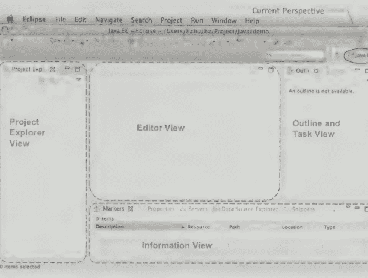
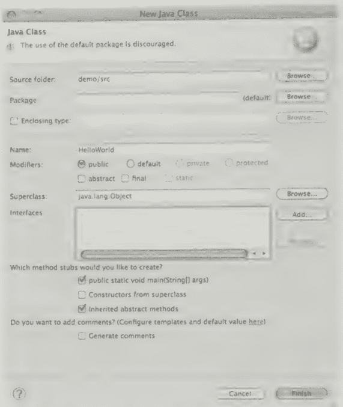
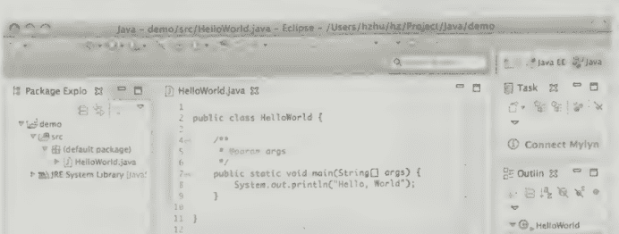
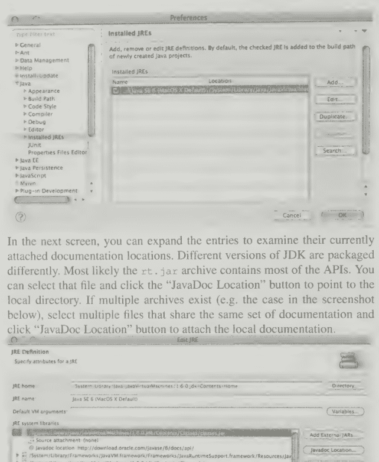
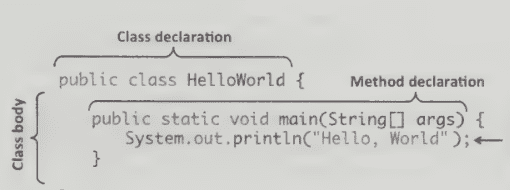
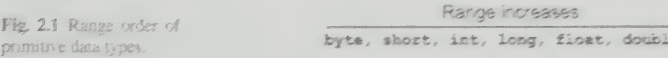
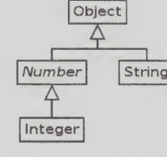
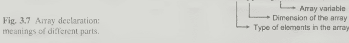
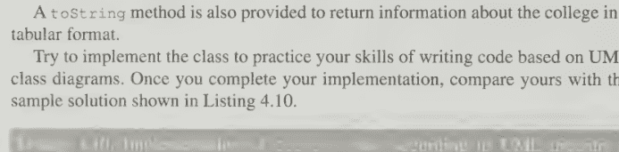
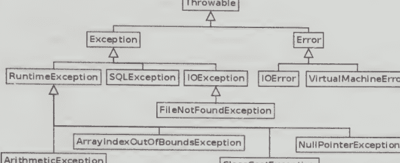

# Java 编程与金融素养


# 前言

> 金钱是你对独立的渴望，你永远无法拥有它。一个人在这个世界上唯一真正的安全感是知识的储备
>
> - 亨利·福特 (Henry Ford)

如果你正在为大学的财务挑战而挣扎，你并不孤单。在美国，每年三分之二的大四学生（约 180 万人）时带着巨债毕业。美国的学生贷款已超过了汽车贷款和信用卡债务，达到了 1 万亿美元。为了方便直观，2011 年美国的 GDP 为 15 万亿美元。

2007 年至 2009 年的大衰退影响了许多人的生活，包括大学学生。“有时我觉得上学是我做过最错误的决定，”一位负着 6 万美元债务的应届毕业生评论道。随着历史高位的失业率和不断攀升的学生债务违约率，这种对大学教育财务挑战的感触并不罕见。衰退也改变了我，我是一个向本科生教授编程和计算思维的教授。它让我相信，金融素养并不是只有银行家才需要的特殊知识。每一位公民都应该具备金融素养和必要的技能，以更好地应对财务挑战并管理个人财务。

这本书是我努力将个人金融素养整合到编程课程（计算机科学中通常被称为 CS）中的成果。本书涵盖了使用 Java 编程语言面向对象编程（OOP）的基础知识。不包含 OOP 的高级主题或软件工程。因此，它不适合作为参考书。个人财务被用作应用领域。编程练习和大多数示例都取自这一领域。

在学习编程基础的同时，你也有机会学习个人财务的有用概念。我希望你们能同时学习这两者，并产生浓厚的兴趣。

由于学习编程最好的方法是通过实践，书中包含了大量的练习，强烈建议读者完成这些练习。此外，每章末尾都包含了三类型的练习：关于编程概念的复习题、关于金融素养概念的问题、以及适合家庭作业的编程练习。每章还包含一个“金融素养”部分，用来说明编程练习所需的概念、原理和计算公式。

尽管旨在将金融素养整合到编程中，本书对金融素养主题的涵盖不足以替代对该主题进行系统处理的个人财务课程。至少，我希望这本书能帮助你学习编程基础，并对利用你的技术技能更好地管理个人财务产生兴趣。你可能不会因为读这本书而变得富有，但你会意识到自己的财务状况，并积极寻求更好地管理和增加你的财富。学习愉快。这是一份终身的喜悦。

朱洪伟

美国，马萨诸塞州

2013 年 1 月

# 索引

# 第 1 章 Java 编程准备工作

> 美国的未偿学生贷款债务超过 1 万亿美元。

## 主题

- 安装 Java 开发工具包 (JDK)
- 安装集成开发环境 (IDE)
- Java 编程基础

学习任何语言编程的最佳方法都是通过实践。为了进行有效的实践，你需要设置一个开发环境，以便在其中编写和测试你的程序。在本章中，我们将学习如何安装必要的软件。对于集成开发环境 (IDE)，我们将使用开源工具 Eclipse。我们还将通过两个简单的示例程序来理解 Java 编程的基础。

让你的计算机准备好进行 Java 编程有两个步骤：

- 安装 Java 开发工具包 (JDK) 标准版
- 安装 Eclipse

## 1.1 安装 Java 开发工具包

我们需要 Java 开发工具包 (JDK) 来开发和测试 Java 程序。JDK 有两个主要部分：(1) 一个完整的 Java 运行环境 (JRE)，它提供了 Java 虚拟机和 Java 应用程序接口 (APIs)，以及 (2) 一套软件开发工具，可以在命令行或通过像 Eclipse 这样用户友好的集成开发环境 (IDE) 使用。安装了 JRE 后，你可以在计算机上运行 Java 程序。许多计算机都预装了 JRE。要开发 Java 程序，你还需要第二个部分。计算机可以安装多个版本的 JRE 或整个 JDK。

在下载和安装 JDK 之前，你可能想检查计算机上是否已经安装了 JDK。在操作系统 (OS) 的命令行控制台中输入命令 `javac -version`。如果它执行并输出有意义的版本信息，说明你的系统已经有了 JDK。如果是较早的版本，你仍然可以安装最新版本，或者你可以跳过本节的其余部分进入下一节，安装 Eclipse。

```
$ javac -version
javac 1.6.0_35
```

输出显示版本 1.6.0_35。

> 'javac' 不是内部或命令，也不是可执行的程序。

这说明你的系统可能没有安装 JDK。

要下载 JDK，你可以在网络上搜索 "JDK"。或者你可以使用浏览器访问 Java 官网：https://www.oracle.com/java/technologies/downloads/

在该页面，点击下载按钮。然后根据你的操作系统选择文件。对于 Windows 和 Mac OS，可以使用下载的安装程序来安装 JDK。有关 Windows、Mac OS 和 Linux 的安装说明可以参考：

- www.oracle.com/java/technologies/javase/jdk-windows.html
- www.oracle.com/java/technologies/javase/jdk-mac.html
- www.oracle.com/java/technologies/javase/jdk-linux.html

在安装了 JDK 后，你可以使用纯文本编辑器和 JDK 自带的工具开始开发和测试 Java 程序。然而，我建议使用 IDE 工具会让许多任务变得更容易。在下一节中，你将学习如何安装 Eclipse，这是一个流行的 Java 编程 IDE。

## 1.2 安装 Eclipse

安装 Eclipse 有两种方案。一种是安装 Android 软件开发工具包 (SDK)，它包含了 Eclipse 以及开发 Android 所需的所有工具。通过此包，你可以开发普通的 Java 程序以及在 Android 设备上运行的程序。安装说明可以参考 http://developer.android.com/sdk/index.html

另一种是现在安装 Eclipse，等准备开发 Android 应用程序时单独添加 Android 软件开发。Eclipse 的安装文件可以在 www.eclipse.org 找到，每个操作系统都有多个版本。我们需要 "Eclipse IDE for Java Developers"。在剩余的讨论中，我假设使用第二种方案。如果你以后想单独安装 Android SDK，请参考之前提到的 Android SDK 网站。

Eclipse 软件以压缩包的形式提供。不同平台的安装说明可以在下载网站找到。通常情况下，你需要解压文件并将提取出的文件放入目录。该程序的执行文件是 "Eclipse"。你可能想为应用程序的执行文件创建一个快捷方式，以便方便启动。

### 1.2.1 Eclipse 概览

当你启动 Eclipse 时，会提示你选择工作空间 (Workspace)。见图 1.1。


图 1.1：选择或创建工作空间。

工作空间仅仅是一个存储项目文件的目录。你可以使用任何你喜欢的目录。如果你指定的目录不存在，点击 OK 按钮后将为你创建。如果这是你第一次使用该工作空间，将看到像图 1.2 这样的欢迎界面。


图 1.2 Eclipse 启动时空白的工作空间。

我建议你探索此欢迎界面提供的“概述”（Overview）和“教程”（Tutorials）。如果你以后想探索它们，可以关闭此界面（点击欢迎标签页上的 X）或隐藏它（点击工作台上的箭头）。你可以随时通过“帮助”（Help）菜单调出此界面。

关闭欢迎界面后，你将看到工作台（Workbench），它托管主界面并显示你工作空间的内容。默认配置在特定的视图（Perspective）下有许多视图（Views）。图 1.3 显示了 Java EE 视图下空工作台的截图。当前视图左侧的图标允许你切换不同的视图。现在，点击它并选择“Java 视图”。你会发现在该视图下，视图及其布局略有不同。例如，项目资源管理器（Project Explorer）被包管理器（Package Explorer）视图取代了。随着你对 Eclipse 经验的增加，你可以通过将视图拖放到所需位置以及添加或删除某些视图来自定义布局。

### 1.2.2 测试安装

现在，让我们创建一个简单的 HelloWorld 程序，以验证安装是否成功。

首先，我们需要创建一个 Java 项目。点击“文件”（File）菜单或在包资源管理器视图中右键点击，然后选择“新建”（New），再选择“Java 项目”。使用向导创建一个名为 `demo` 的 Java 项目。

然后，我们创建一个名为 `HelloWorld` 的 Java 类。在包资源管理器视图中，展开 `demo` 项目文件夹。右键点击 `src` 文件夹并选择“新建”，在 Name 框中输入名称并勾选 `public static void main(String[] args)` 复选框，这样向导就会为该主方法生成存根（stub）。见图 1.4。点击“完成”（Finish）。

向导将生成源代码，将其保存为名为 HelloWorld.java 的文件，并在编辑器中打开，如图 1.5 所示。



图 1.3：Java EE 视图下的空工作台。

到此时，实际上你已经创建了一个完全合法的 Java 程序，它可以执行但没有执行任何操作。稍后我们将编写代码在输出控制台上输出文本。在继续编写代码之前，让我对 IDE 和 Java 做几点说明。

### IDE 特性：

1. **行号**。如图 1.5 所示，行号显示在编辑器视图的左边距。它们在你调试或与他人讨论代码时非常有用。你可以通过右键点击编辑器视图左侧的灰色边距并选择“显示行号”（Show Line Numbers）来开启它。

2. **颜色编码**。使用不同的颜色区分不同类型的源代码。例如，Java 保留字（即关键字）为紫色（并**加粗**样式）。

3. **代码块**。代码被分为若干块，每个块都可以折叠和展开。例如，图 1.5 中的源代码显示了两个块：(1) 主方法之前的注释；(2) 主方法。点击块的第一行左侧的减号 (-) 符号将折叠该块并将符号改为加号 (+)。此功能在你尝试理解一个相对较大的程序时非常有用——你可以隐藏代码部分并关注需要注意的部分。

4. **源代码格式化**。如果源代码在某些编辑后不再整齐缩进，你可以使用工具纠正代码的缩进：选择源代码，在编辑器中右键点击，选择 `Source`（源），然后选择 `Correct Indentation`（修正缩进）。或者，你也可以在源代码的任何地方右键点击，选择 `Source`，然后选择 `Format`（格式）。这将修复缩进在内的所有格式问题。

5. **自动编译**。当保存源代码时，IDE 会尝试为你编译文件。此功能与其他许多功能一样，可以使用“首选项”（Preferences）菜单项进行更改。



图 1.4：使用向导创建 HelloWorld 类。勾选主方法复选框。

```java
public class HelloWorld {
    /**
     * @param args
     */
    public static void main(String[] args) {
        // T1000 Auto-generated method stub
    }
}
```

图 1.5：向导生成的源代码。它包含注释和方法存根。

### Java 特性：

1. **Java 文件**。Java 源代码保存在以 .java 为扩展名的源文件中。每个类必须保存在它自己的文件中，文件名与类名相同。同样，每个文件只能包含一个公共类。编译后的文件具有 .class 扩展名。示例程序的源代码是 HelloWorld.java（在 source 目录中），其编译后的可执行文件是 HelloWorld.class（在 bin 目录）。

2. **注释**。注释在编译时或运行时不被求值。它们的主要目的是记录代码。使用块注释，`/**` 和 `*/` 之间的任何内容会被注释。使用行内注释，`//` 之后的任何内容都会被注释。

3. **大小写敏感性**。Java 是大小写敏感的。

4. **主方法**。主方法是程序的入口。

### 为 Java 编程做好准备

现在，让我们在主方法体中添加以下代码：

```java
System.out.println("Hello, World");
```

它让程序在控制台上打印 "Hello, World"。完成后的程序如图 1.6 所示。



图 1.6：源代码和输出。

确保文件已保存且没有语法错误。如果有语法错误，IDE 会在左边距标记错误行并用波浪线划过错误的文本。图 1.7 显示了 IDE 如何指示语法错误。

```java
public static void main(String[] args) {
    System.out.println("Hello, World");
}
```

图 1.7：编辑代码时检测并标记语法错误。

你可以通过点击绿色箭头图标运行程序。注意：如果没有运行，你可以在包资源管理器中右键点击文件，选择“运行方式”（Run As），然后选择“Java 应用程序”（Java Application）。或者，你可以选择“运行配置...”（Run Configurations...）（而不是“Java 应用程序”）来启动配置界面，检查并指定所选程序的所有参数。程序运行结束后，你将在控制台输出中看到 "Hello, World"，这表明 JDK 和 IDE 在你的电脑上运行正常。

### JavaDoc 文档

1. 要使用 JavaDoc 格式文档你的代码，你需要学习 JavaDoc 语法。在线说明请访问：http://www.oracle.com/technetwork/java/java/documentation/index-137868.html。如果你的源代码使用了 JavaDoc 语法进行注释，你可以通过执行 `javadoc` 命令生成 html 文档。你也可以在 Eclipse 中运行该命令：点击 `File`（文件）菜单，选择 `Export`（导出），然后按照向导的说明操作。



在下一个屏幕中，你可以展开条目以检查它们当前关联的文档位置。不同版本的 JDK 打包方式不同。通常情况下，`rt.jar` 存档包含了大部分 API。你可以选择该文件并点击“JavaDoc Location”按钮以指向本地目录。如果截图中存在多个归档，请选择共享同一组文档的多个文件，并点击“JavaDoc Location”来关联本地位置。

点击底部的 Finish（完成）完成更新。下次当你使用 `Shift+F2` 时，你将访问文档的本地副本。

## 1.3 Java 基础

在离开本章之前，让我们通过两个示例程序学习更多关于 Java 编程的基础知识：之前看到的 `HelloWorld` 程序以及另一个即将要介绍的程序。

### 1.3.1 Java 程序的结构

Java 程序由一个或多个类组成。`HelloWorld` 程序只有一个名为 `HelloWorld` 的类。图 1.8 显示了 `HelloWorld` 类的不同部分。



**图 1.8：** `HelloWorld` 程序的结构。

**类声明** 使用 `class` 关键字后跟类名来声明类。`public` 关键字表示类的可访问性（也称为可见性）。`public` 类可以被所有其他类访问。`HelloWorld` 类的声明如下：

```java
public class HelloWorld
```

**类体** 紧随类声明之后的是类体，它包含在一对大括号中。类体可以包含方法和其他声明。`HelloWorld` 类体只包含一个名为 `main` 的方法，该方法会被自动调用以启动程序。

**方法声明** 方法的声明用于指示该方法的若干特征，其中必须包含返回数据类型、方法名和参数列表（也称为参数）；参数列表（可以为空）包含在一对括号中。`main` 方法的声明如下：

```java
public static void main(String[] args)
```

方法声明的不同部分如图 1.9 所示。

### 1.3.2 类、方法和数据类型

方法可以在任何地方调用，甚至从其他程序调用。静态方法是类的成员（稍后会详细介绍）。当返回数据类型为 `void` 时，方法不返回任何内容。参数列表是参数列表（也称为参数）；每个参数都使用数据类型后跟变量进行声明。`main` 方法有一个参数（命名为 `args`），其数据类型是 `String` 数组。

**方法体** 方法体包含在一对大括号中。方法的实现是为了执行特定任务。在 `HelloWorld` 示例中，`main` 方法向控制台打印一个字符串。

前面的讨论引入了许多概念。你可能会感到无从下手，但不要担心。这些概念将在后面得到进一步解释，而且在书剩余的内容中，你有充足的机会练习这些概念。


## 1.3 Java 基础

### 随机程序

随机程序是如何工作的。现在，让我们尝试理解这个随机程序是如何工作的。如果你没有完全理解下面的解释，不要担心。随着我们的不断进行，你会理解得更深。

`getNumber` 方法的体内只有一行代码：

```java
// 返回 [0, 1] 之间的 double 值
return (int)(java.lang.Math.random()) * 10 // 返回 [0, 10] 之间的 double 值
```

下划线部分调用了 Java API 提供的 `Math` 类中的 `random()` 方法（该方法没有参数）。该方法从 `[0, 1)` 范围内（即 0 到 1 之间，包含 0 但不包含 1）随机选择一个值。该值的数据类型是 `double`（具有双倍精度的浮点数）。然后将其乘以 10（`*` 是乘法运算符）。因此，高亮部分是一个表达式，其求值结果为 0 到 10 之间的某个值（不包括 10）。

`(int)` 是类型转换（也称为类型强制转换），它将 `double` 强制转换为 `int` 类型的整数值。它简单地取该值的整数部分（例如，19.9 被求值为 19）。然后，这个 `int` 值被返回给调用它的方法。

### squareNumber 方法

`squareNumber` 方法有一个 `int` 类型的参数：

```java
public static int squareNumber(int number) {
    return (int)Math.pow(number, 2);
}
```

当调用该方法时，会传入一个 `int` 类型的值，并将参数变量 `number` 绑定到该值。例如，当使用 `squareNumber(4)` 运行方法时，变量 `number` 的值为 4。在方法体内，该变量被作为第一个参数传递给 `Math` 类的方法。数字字面量 2（其类型为 `int`）是第二个参数。`pow` 方法返回第一个参数的第二个参数的幂的值。例如，`Math.pow(4, 0.5)` 返回 4 的平方根。在我们的代码中，我们使用它来返回 `number` 的平方。由于 `pow` 方法的返回类型是 `double`，而 `squareNumber` 的返回类型声明为 `int`，因此使用了类型转换将 `double` 值转换为 `int`。或者，也可以不使用下面的方法来实现该方法：

```java
public static int squareNumber(int number) {
    return number * number;
}
```

### show 方法

`show` 方法不返回任何内容（因此将其类型声明为 `void`）：

```java
public static void show(int number, int result) {
    System.out.println("Random Number\t" + number + "\n");
    System.out.println("Number Squared\t" + result + "\n");
}
```

它接收两个 `int` 类型的参数。当调用该方法时，每个参数变量都会被传递给 `println` 方法，该方法接收单个 `String` 类型的参数，并将字符串单独输出到输出控制台。该字符串是使用字符串拼接运算符 `+` 构建的。使用双引号来创建字符串。特殊字符被称为转义序列（`\t`）或换行（`\n`）。字符串拼接表达式中的数值会被转换为它们的字符串表示。

### main 方法

现在，让我们使用 `main` 方法，它也重现在下方：

```java
public static void main(String[] args) {
    int number = getNumber();
    int result = squareNumber(number);
    show(number, result);
}
```

它接收一个数组类型的参数，用于存储程序启动时传递的所有潜在参数。我们在这里没有使用任何参数，所以当程序带参数启动时，程序会简单地忽略它们。方法体内的第一行声明了 `int` 类型的变量 `number`。然后它为该变量赋值了 `getNumber()` 方法返回的值。注意 `=` 是赋值运算符，运算符右侧的表达式被赋值给运算符左侧的变量。同样，下一行声明了变量 `result` 并将其赋值为 `squareNumber()` 方法返回的值。最后，第三行调用了 `show()` 方法。输出如下：

```
Random Number	4
Number Squared	16
```

## 1.4 包

包是组织类、接口和注解的机制。使用包可以帮助避免命名冲突，并将相关的类组合在一起。在 Java 中，包可以使用 `package` 关键字来定义。包语句必须是文件的第一行。

```java
package com.example.project;
```

使用另一个包中的类可以使用 `import` 关键字。`import` 语句允许使用其他包中的类。

```java
import java.util.List;
import java.util.ArrayList;
```

如果你想导入包中的所有类，可以使用通配符 `*`：

```java
import java.util.*;
```

注意，`import` 语句并不会移动类，它只是告诉编译器去哪里找到类。如果你需要使用两个包中的同名类，可以使用完全限定名来区分：

```java
java.util.Date date = new java.util.Date();
java.sql.Date timestamp = new java.sql.Date();
```

包还可以是嵌套的。例如，`com.example.project` 是 `com.example` 包的子包，`com.example` 是 `com` 包的子包。包的结构通常与文件系统中的目录对应。

```
com/example/project/MyClass.java
```

包还可以控制访问可见性。Java 提供了访问修饰符来控制类和成员的可见性：`public`、`protected` 和 `private`。

```java
import java.util.List;
import java.util.ArrayList;
import java.util.*;

package com.example.project;

public class MyClass {
    public static void main(String[] args) {
        List<String> list = new ArrayList<>();
        list.add("Hello");
        System.out.println(list);
    }
}
```

## 1.5 金融素养

### 费用概览

获得助金和资援助的学生的百分比。

在 2010-11 学年，四年制公立大学的平均标价为 $6,672；对于四年制私立（非营利）大学，平均价格为 $22,047。四年制公立大学的平均净价为 $10,899。这个价格高于标价，因为标价仅针对州内学生，而净价包含了所有学生。私立大学的平均净价为 $19,403。

2,491 所四年制大学的分布如图 1.11 所示。这是一个箱线图，每个箱体表示从第 25 百分位数到第 75 百分位数的范围（称为四分位距，或 IQR）。中位数位于箱体内。须线（从箱两端延伸出的线）涵盖了距离箱边缘 1.5 倍 IQR 以内的极值。其他极值用圆圈表示。


> 图 1.11：2010–11 年美国四年制大学的标价和净价分布。数据来自教育部学院负担能力与透明中心。

平均而言，公立大学的费用比私立大学低，这并不意外。排除营利性大学，私立大学的数量是公立大学的两倍。私立大学的离散程度（从极值之间的差异和 IQR 的大小来看）也比公立大学大。

### 极值分析

查看极值是非常有趣的。2010-11 年标价最低的前 5 所公立大学和前 5 所（非营利）大学分别是：

| 大学 | 州份 | 标价 | 净价 |
| :--- | :--- | :--- | :--- |
| 宾夕法尼亚州立大学-主校区 | PA | $15,250 | $31,342 |
| 匹兹堡大学-主校区 | PA | $14,936 | $20,076 |
| 佛蒙特大学 | VT | $14,066 | $13,864 |
| 新罕布什尔大学-主校区 | NH | $13,672 | $18,439 |
| 马里兰州圣玛丽学院 | MD | $13,630 | $20,521 |
| 康涅狄格学院 | CT | $43,990 | $23,409 |
| 莎拉·劳伦斯学院 | NY | $43,564 | $26,965 |
| 纽约哥伦比亚大学 | NY | $43,304 | $19,073 |
| 瓦瑟学院 | NY | $43,190 | $18,438 |
| 华盛顿大学 | DC | $42,905 | $27,793 |

有四所公立大学的净价为负数：

| 大学 | 学费 | 净价 |
| :--- | :--- | :--- |
| 德克萨斯大学泛美亚分校 (TX) | $4,795 | -$95 |
| 南德克萨斯学院 (TX) | $2,364 | $85 |
| 贝利亚学院 (KY) | $910 | -$20,746 |
| 信仰家庭学院 (OK) | $5,130 | -$5,585 |

前两所是公立大学，另外两所是私立非营利大学。

虽然极端情况很有趣，但它们并不代表高等教育成本的整体水平。图 1.11 中的统计数据是更有意义的描述。事实上，人们正在许多努力让高等教育变得负担得起。提供更多的资援助。获得助金和资援助的学生百分比分布如图 1.12 所示（以直方图的形式）。

有些项目非常慷慨。例如，助金和资援助帮助马萨诸塞州的以下大学在 2010-11 年的平均净价低于其标价的一半左右：

| 大学 | 标价 | 净价 | 获得助金/援助百分比 |
| :--- | :--- | :--- | :--- |
| 阿姆斯特学院 | $40,862 | $17,574 | 52 |
| 哈佛大学 | $38,415 | $18,277 | 70 |
| 希腊学院学院-圣十字希腊神学院 | $19,503 | $6,738 | 100 |
| 马萨诸塞理工学院 | $39,212 | $20,660 | 65 |
| 圣约翰神学院 | $13,750 | $2,650 | 100 |
| 韦斯利学院 | $39,966 | $18,400 | 60 |
| 威廉姆斯学院 | $41,434 | $16,693 | 53 |

### 学费的历史趋势

图 1.13 显示了从 1976 年到 2010 年所有美国四年制大学的平均学费和杂费。

### 复习题

5. 有关于成本的故事。找到一些讨论。你从中学习到了什么？

## 编程复习

1. 你完成了 `HelloWorld` 类，保存了源代码并编译了它。哪个文件存储源代码？哪个文件存储编译后的程序？

2. 以下哪些标识符在语法上是有效的？（内容缺失）

3. 根据命名规范，对于关于资本资产的类，这个命名好吗？返回加速折旧率的方法命名为什么好？

4. 识别并修正以下方法中的语法错误：

```java
public static int doubleVal(x) {
    result = 2 * x;
}
```

5. 研究以下代码段。执行后，`a` 的值是多少，`b` 的值是多少？

```java
int a = 5, b = 6; // 可以在一条语句中声明并初始化相同类型的变量
a = b;
```

6. 当调用需要参数的方法时，你可以传递变量、字面量（例如 `2` 是数字字面量）和表达式（例如 `x + y` 和 `Math.pow(x, 3)` 是表达式）作为方法的参数。`Random` 程序的 `main` 方法复制如下。方法体的前两行引入了 `number` 和 `result` 变量。可以在不引入 `result` 的变量来实现代码。应该如何修改方法以消除中间变量 `result`？

```java
public static void main(String[] args) {
    int number = getNumber();
    int result = squareNumber(number);
    show(number, result);
}
```

7. 写出 `pow` 方法声明的不同部分。

```java
public static double pow(double a, double b)
```

8. 研究 `java.lang` 包中 `Math` 类的文档。你可以通过网络搜索或使用 Eclipse 找到文档（例如，在 `Random` 类中，将光标移动到使用 `Math` 的地方，然后按 `Shift+F2`）。除了使用 Google 外，`random()` 和 `pow()` 分别返回什么类型？类中定义了哪两个字段？研究该类中的其他方法。

9. 查找 `println` 方法的文档。你会如何从 Eclipse 中查找文档？你会看到该方法的多个版本。稍后你将学习这被称为**方法重载**。你认为在 `HelloWorld` 和 `Random` 示例中使用哪一个版本？

## 编程练习

1. 如果你有自己的电脑，请安装必要的软件并设置你的 Java 开发环境。
2. 实现并测试图 1.10 所示的 `Random` 示例程序。至少运行程序两次。输出值是什么？
3. 修改 `Random` 程序，使其在每次运行时都输出两个随机数及其平方。
4. 修改 `Random` 程序，添加另一个接受 `int` 类型参数的 `show` 方法。该方法将输出参数的值、它的平方和平方根。修改 `main` 程序，通过调用 `getNumber()` 方法获取随机数，然后调用这个单参数的 `show` 方法。

# 第 2 章 数据类型与运算符

> 那些不知道下一块钱从哪里来的人，通常也不知道上一块钱去哪儿了。

## 主题

- 基本数据类型
- 引用数据类型
- 运算符
- 格式化输出

Java 是一种强类型语言。在第 1 章中，我们在示例程序使用了 `int`、`double`、`String` 和数组数据类型。这些类型属于 Java 拥有的两类数据类型之一：(1) `primitive` 基本数据类型（例如 `int` 和 `double`），(2) `reference` 引用数据类型（例如 `String` 和数组）。直观地说，你可以将基本数据类型视为内置类型，大部分是数值类型。恰有八种基本数据类型。引用类型的变量作为对象的引用。每个 Java 类（或接口）都定义了一个引用数据类型。因此，引用数据类型的数量是无限的。

我们可以对数据进行操作，例如将两个数值相加拼接两个字符串。运算符用于执行各种操作。在本章中，我们将学习 Java 中可用的数据类型和运算符。我们还将学习如何使用 `print` 方法进行格式化打印。除了书籍之外，你可能还想利用许多在线资源，其中，我强烈推荐由 Java 创造者 Oracle 提供的“Java 教程”……（嗯，那是 Sun 公司，它在 2009 年以 74 亿美元被 Oracle 收购）。更多信息请参见“在线资源”框。

### 在线资源

学习 Java 编程语言的基础，你可能想看一眼 <http://docs.oracle.com/javase/tutorial/> 的 Java 教程。它被组织成不同的路径，每条路径包含若干主题。“涵盖基础的路径”是一个很好的起点。你还可以下载电子书文件——mobi 格式（用于 Amazon Kindle）和 ePub 格式（用于其他电子读写器）。

## 2.1 基本数据类型

Java 要求每个变量在使用之前必须声明其数据类型，且其类型之后不能更改——这被称为**静态类型**。看下面的示例：

```java
int i; // 声明 i — 可以赋值为 -> int i = 3; // 将 3 赋值给 i
```


在左侧，第一行声明了变量的数据类型（`int`）和名称（`i`）。在第二行中，变量被用于赋值操作，将 3 赋值给 `i` —— 变量持有值 3，或者说值 3 存储在变量 `i` 中。这两行代码可以简化为上面示例中右侧的一行。在这种情况下，我们还说 `i` 初始化为 3。

### 静态类型

Java 的变量类型机制称为静态类型：(1) 变量必须在使用之前声明；(2) 变量类型之后不能更改，也就是说，同一个变量在同一个作用域内只能声明一次。

八种预定义的基本数据类型总结在表 2.1 中。

| 表 2.1: 基本数据类型 |
| 类型 | 大小 (位) | 范围 |
|---|---|---|
| byte | 8 | -128 到 127 (即 -2⁷ 到 2⁷-1) |
| short | 16 | -32,768 到 32,767 (即 -2¹⁵ 到 2¹⁵-1) |
| int | 32 | -2,147,483,648 到 2,147,483,647 (即 -2³¹ 到 2³¹-1) |
| long | 64 | -9,223,372,036,854,775,807 到 9,223,372,036,854,775,807 (即 -2⁶³ 到 2⁶³-1) |
| float | 32 | ~/-3.4E38 (6-7 位有效数字) |
| double | 64 | ~/-1.8E308 (15 位有效数字) |
| boolean | - | true/false |
| char | 16 | Unicode 字符集 \u0000 到 \uFFFF |

## 2.1 基本数据类型

在大多数情况下，浮点计算的不精确结果是可以接受的。但在使用比较时你必须小心（例如，在 `if` 语句中测试变量是否大于某个阈值）。一种解决方法是放大变量、进行舍五入，然后使用整数比较。步骤是：(1) 放大（例如乘以 1000）；(2) 舍五入；(3) 使用除法缩小（例如将结果除以 1000）。

```java
System.out.println(Math.round(1000*(1-0.9)));
```

输出是 0.1。

由于基本 `double` 的效率和合理的精度，它通常用于涉及数值计算的程序。处理货币的程序有时使用 `java.math` 包中的 `BigDecimal` 类。以下代码也产生了精确的结果：

```java
BigDecimal bd = new BigDecimal("1");
System.out.println(bd.subtract(new BigDecimal("0.9")));
```

第一行包含一个值为 1 的 `BigDecimal` 对象。在第二行中，调用 `subtract` 方法减去 0.9（一个 `BigDecimal` 对象）。你可以指定 `BigDecimal` 的精度。Java 还有 `BigInteger` 类用于超出 `long` 范围的任意精度的整数。

`boolean` 类型有两个可能的值：`true` 和 `false`。它们都是 Java 中的关键字。例如，你可以使用以下方式声明并初始化 `boolean` 变量：

```java
boolean bankFee = false;
```

`char` 类型变量可以持有对应于字符的 Unicode 值。16 位的 Unicode 可以表示最多 65535 个语言的符号和字符。Unicode "\u0041" 代表大写字母 A。注意单引号用于字符字面量（而双引号用于字符串）。以下代码输出两个中文字，“你好”，代表 "Hello"：

```java
System.out.println("\u4f60"+"\u597d");
```

空字符串 `""` 是为了让表达式中的加号解释为字符串拼接而不是加法。如果没有空字符串，加号将被解释为加法（Unicode 字符首先转换为整数然后相加）。

### 2.1.1 字面量与数值字面量的数据类型

字面量是原始数据类型固定值的源码级表示形式。例如，`true` 和 `false` 是布尔值。`'a'` 是字符字面量。

回想一下，整数有四种，浮点数有两种。数值字面量取决于字面量的值和格式。整数字面量通常被认为是 `int` 类型。如果整数值在字节或短整数范围内，可以根据需要被解释为字节或短整数：

```java
byte i = 127; // 127 的类型是 byte
short j = -3268; // -3268 的类型是 short
```

如果你需要创建一个类型为 `long` 的整数字面量，你需要在字面量的末尾添加字母 L（或小写的 l），例如：

```java
long small = 127L; // L 是可选的，int 可以根据需要转换为 long
long large = 2147483648L; // 因为值超过了 int 的范围，所以需要 L
```

浮点字面量的类型是 `double`。例如，`1.0` 和 `78.5` 是 double 字面量。当你只有一个点和小数点时，该字面量（例如 `1.`）的类型是 `double`。如果你想让数值字面量变为 `double`，你需要在字面量的末尾添加字母 D（或 d）。例如，`30d`、`1d` 和 `12.5d` 都是 double 字面量。由于任何带有小数点的数值字面量都是 `double` 类型，如果你需要将其变为 `float`，则必须在小数值的末尾添加字母 F（或 f）。例如，`2.0F` 和 `2.5f` 的类型是 `float`。

## 2.2 引用数据类型

引用数据类型也被称为聚合数据类型。引用数据类型的变量引用一个对象。引用类型可以使用 Java `class`、Java `interface` 或数组来定义。每当你在 Java 中创建一个类时，该类就是一种数据类型。例如，你已经在第 1 章中看到了两个类：`HelloWorld` 和 `Random`。它们是两个引用数据类型；因此，你可以声明这些类型的变量，例如：

```java
HelloWorld var; // 声明类型为 HelloWorld 的变量 var
Random var2; // 声明类型为 Random 的变量 var2
```

接口是在第 5 章将讨论的特殊类。我们将在第 3 章查看数组。

引用数据类型的数量本质上是无限的，可以创建任意数量的类、接口和数组。

Java API 为每个原始数据类型提供了引用数据类型。这些类也被称为包装类（wrapper classes），位于 `java.lang` 包中，并使用有用的方法，例如在原始值和 String 表示形式之间进行转换。

请参考表 2.2 每个原始数据类型对应的包装类。例如，`Integer` 类可以用于创建一个封装了 `int` 值的对象；该类的 `intValue` 方法返回该 `int` 值。

表 2.2：原始数据类型的包装类
| 原始类型 | 包装类 | 原始类型 | 包装类 |
| --- | --- | --- | --- |
| byte | Byte | float | Float |
| short | Short | double | Double |
| int | Integer | boolean | Boolean |
| long | Long | char | Character |

## 2.3 运算符

运算符允许你对变量、字面量和表达式执行操作。运算符作用的对象被称为操作数。Java 具有作用于一个操作数的一元运算符、作用于两个操作数的二元运算符以及作用于三个操作数的三元运算符。我们将根据其功能查看这些运算符：算术运算、逻辑运算和位运算。

### 2.3.1 算术运算符

算术运算符总结在表 2.3 中。

这些运算符用于对数值操作数执行算术运算。除了布尔类型外，其他七种原始类型都可以用于期望数值类型的上下文，例如作为数值运算符的操作数。

#### 2.3.1.1 递增与递减

在所有运算符中，只有三个可以改变操作数的值：

- 递增运算符将操作数的值加 1。
- 递减运算符将操作数减 1。
- 赋值运算符将右侧表达式的结果赋值给左侧的操作数。

在这三个运算符中被更新的操作数必须是一个变量。这三个运算符的返回类型与变量相同。现在，让我们关注递增和递减。赋值运算符将在 2.3.4 节中解释。由于只有这两个运算符的区别是递增将操作数加 1，而递减将操作数减 1。我们使用递增来解释这种区别：

- 使用后置递增，操作数的当前值将用于评估的剩余部分；之后，操作数会递增。
- 使用前置递增，操作数先递增；然后操作数的结果将用于评估的剩余部分。例如：

```java
int x = 10;
int y = 10 + x++; // 等同于：y = 10 + x;
```

在上述后置递增的示例中，第二个语句等同于注释所示的两个语句。执行此语句后，`y` 变成 20，`x` 变成 11。相比之下，如果我们使用前置递增：

```java
int x = 10;
int y = 10 + ++x; // 等同于：++x; // x 变为 11
```

`x` 增加到 11，11 将被用于加法运算。在这种情况下，`y` 的值变为 21。

#### 2.3.1.2 算术运算符

其余算术运算符的工作方式与数学相同。它们中没有会改变操作数。正号（Java 文档中的加）不改变操作数的符号。取反运算符（Java 文档中的减）返回与操作数符号相反的值。例如：

```java
int i = -1;
int j = ++i; // j 是 0，i 仍然是 0
```

Java 区分整数除和浮点数除。当两个操作数都是整数类型时，除法运算符执行整数除并返回结果的整数部分。例如：

```java
System.out.println(3/4); // 输出 0
long value = 5/3; // value 为 1
```

操作数类型不同的情况将在下一节讨论。取余运算符 `%` 接收两个操作数并返回第一个除以第二个的余数。例如，`5%2` 返回 1。

尽管整数除没有提供精确的除法，但它在某些应用程序中很有用。例如，如果你被给出自某个时间点过的秒数，将该值除以 60（使用整数除）可以得到自该点过的分钟数。取余运算在某些应用程序中也很有用。在先前的示例中，如果你使用取余运算，你将能够以分钟和秒的形式表示经过的时间。

```java
int elapsed = 135; // 秒数
int minutes = elapsed/60; // 2 分
int seconds = elapsed%60; // 15 秒
```

### 2.3.1.3 隐式与显式类型转换

不同的数值数据类型具有不同的值范围。从表 2.1 可以知，范围按照图 2.1 所示的顺序从小到大增加。



隐式类型转换：在二元算术运算中，如果两个操作数的类型不同，则范围较窄的操作数将在执行操作前转换为另一个操作数的类型。这被称为自动隐式类型转换。在赋值运算符中，如果右侧操作数的类型比左侧操作数的类型窄，则右侧将转换为左侧操作数的类型。以下是执行隐式转换的三个示例：

```java
long x = 5 + 2; // x 被转换为 long
double y = 5 / 2; // y 被转换为 double
double z = 5 / 3; // z 被转换为 double
```

显式类型转换：由于 Java 会自动执行隐式转换，当隐式转换完全符合你的需求时，你不需要显式地转换类型。否则，你可以使用类型转换运算符显式地转换操作数的类型，该运算符是位于括号中的类型关键字。例如：

```java
double y = (double)5/2; // 转换为 double, y=2.5
```

由于 3 被显式转换为 double，因此 2/3 被隐式转换为 double。如果不进行强制转换，结果将是 1.0，因为 3/2 是整数除法。当求值为 1（一个整数）时，它会被隐式转换为 double。

在赋值运算符中，如果右侧的类型在范围上比左侧类型宽，则显式类型转换（也称为类型转换或强制转换）是强制的。这在图 2.2 中所示。

```text
<wide> var = <narrow>var // 隐式转换
type var = (narrow)wide // 显式类型转换
```

图 2.2

例如：

```java
double x = 3; // 隐式转换。
double y = (double)3; // OK，但强制转换是不必要的
int i = 3.0; // 语法错误。强制要求显式转换。
int i = (int)3.0; // 显式转换
```

### 2.3.2 逻辑运算符

#### 2.3.2.1 instanceof 运算符

```java
System.out.println(Il instanceof Object); // true
System.out.println(Il instanceof String); // 语法错误
```

第一行打印 true，因为 `Il` 是 `Integer` 类的一个实例。由于 `Object` 类是整个 Java 类型系统的根，所有其他类都是 `Object` 类的后代。因此，`Il` 也是 `Object` 的实例。最后一行有语法错误，因为 `Integer` 不属于 `String` 类的继承层次。如图 2-4 所示，`Integer` 类和 `String` 类位于从 `Object` 类出的不同分支。显然，你需要注释掉带有语法错误的这一行，你的测试程序才能运行。



图 2.4 `Integer` 和 `String` 类的继承层次。

#### 2.3.2.2 条件和布尔运算符

这些运算符总结在表 2.5 中。操作数必须是求值为布尔类型的表达式。逻辑取反 (`!`) 是一元运算符；表中的所有其他运算符都是二元运算符。

| 表 2.5：条件和布尔运算符 |
| 运算符 | 含义 | 示例与注意 |
| :--- | :--- | :--- |
| ! | 非，取反 | `!x` — 如果 x 为假则为真；如果 x 为真则为假 |
| && | 条件与 | `x && y` — 如果 x 和 y 都为真则为真，短路 |
| \|\| | 条件或 | `x \|\| y` — 如果 x、y 或两者为真则为真，短路 |
| & | 布尔与 | `x & y` — 与 `&&` 相同，但没有短路 |
| \| | 布尔或 | `x \| y` — 与 `\|\|` 相同，但没有短路 |
| ^ | 异或 | `x ^ y` — 仅当 x 或 y 仅有一个为真时为真，短路 |

这些运算符非常直观，除了异或和“短路”需要一些解释之外。

对于条件或（例如 `x \|\| y`），当其中一个或两个操作数为真时，表达式为真；当两个操作数都为假时，为假。相比之下，异或操作（例如 `x^y`）仅当操作数中恰有一个为真时返回真，当两个操作数都为真时返回假（这是它与条件或或两者都为假的不同之处）。

## 练习

判断以下每个表达式的真假值：

```java
true && (5>3)
true || (5>3)
true ^ (5>3)
(3<5) ^ (5>3)
```

逻辑与（包括条件和布尔）和或是从左到右求值的。条件操作和布尔操作的区别在于，Java 对条件运算符 `&&` 和 `\|\|` 使用“短路”，但对布尔运算符 `&` 和 `|` 不使用“短路”。有了短路机制，一旦发现表达式的结果，评估就会跳过剩余的操作数。Java 一旦发现第一个假操作数就会停止评估（因为无论剩余操作数如何，操作结果都必须为假）。对于 `\|\|`，Java 一旦发现第一个真操作数就会停止评估（因为无论剩余操作数如何，操作结果都必须为真）。然而，如前面提到的，Java 对 `&` 和 `|` 不使用短路。

让我们来看下面的例子：

```java
if (6<3 && 6/0 < 1) {
```


由于第一个操作数 `6<3` 是假的，且只要有一个操作数为假，操作就必须返回假，Java 跳过了对第二个操作数的评估。程序将运行而不会出现除以零的错误。如果你将运算符替换为布尔运算符 `&`，你将看到运行时错误：

> Exception in thread "main" java.lang.ArithmeticException: / by zero at HelloWorld.main(HelloWorld.java:66)

错误是在评估 `6/0` 时产生的。
记住：在很多情况下，错误信息是非常有用的。例如，上面的错误信息告诉我们错误的类型（在 Java 中称为 `Exception`）以及错误发生的位置（在我测试程序中的第 66 行）。所以，养成研究错误的习惯吧。

你可以通过组合多个操作数来构建一个逻辑表达式。例如，如果你有三个布尔变量 `x`、`y` 和 `z`，那么如果 `x` 或 `y` 或 `z` 为真，则 `x||y||z` 为真。根据分配律（“逻辑等价”框），它等价于 `(x||y)|(z)`。根据情况和个人偏好，这两种形式中的一种可能比另一种更容易理解。

### 逻辑等价

你可以在表达式中组合多个逻辑运算符。由于每个操作数都是一个命题（其求值为真或假），命题逻辑的定律可以帮助你理解涉及多个逻辑运算符的表达式。

## 2.3 运算符

这里只有寥寥几个定律（以下公式中的 `p, q, r`，`∨` 表示或，`∧` 表示与，`~` 表示取反）：

交换律：`p ∨ q = q ∨ p`，`p ∧ q = q ∧ p`
结合律：`(p ∨ q) ∨ r = p ∨ (q ∨ r)`，`(p ∧ q) ∧ r = p ∧ (q ∧ r)`
分配律：`p ∧ (q ∨ r) = (p ∧ q) ∨ (p ∧ r)`，`p ∨ (q ∧ r) = (p ∨ q) ∧ (p ∨ r)`
德·摩根律：`~(p ∧ q) = ~p ∨ ~q`，`~(p ∨ q) = ~p ∧ ~q`
双重否定律：`~~p = p`
矛盾律：`p ∧ ~p = 假`
排中律：`p ∨ ~p = 真`

### 2.3.2 三元运算符

Java 只有一个三元运算符，需要三个操作数。它的通用形式是 `<boolean_expr> ? <expr1> : <expr2>`，如果 `<boolean_expr>` 为真，则评估 `<expr1>`，否则评估 `<expr2>`。例如如下：

```java
String msg = grade>=60 ? "pass" : "fail";
```

上面的语句等于以下代码：

```java
String msg;

if (grade>=60) {
    msg="pass";
} else {
    msg="fail";
}
```

### 2.3.3 位运算符

我们将在书中简要介绍位运算符。它们作用于整数类型的值，二进制形式只有 0 或 1。见表 2.6 位运算符总结。取反运算符 `~` 是一元运算符；其余所有都是二元运算符。

### 表 2.6：位运算符

| 运算符 | 含义 | 示例与注意 |
| :--- | :--- | :--- |
| `~` | 取反 | `~x` — 翻转每一位，1→0，0→1 |
| `&` | 与 | `x & y` — x 的位与 y 的位与 |
| `\|` | 或 | `x \| y` — x 的位与 y 的位或 |
| `<<` | 左移 | `x << y` — 左移 y 位，右侧补0 |
| `>>` | 右移 | `x >> y` — 右移 y 位，左侧补符号 |
| `>>>` | 无符号右移 | `x >>> y` — 右移 y 位，左侧补0 |

### 2.3.4 赋值运算符

我们在第一章中讨论过赋值运算符 `=`。它是一个二元运算符，要求左侧操作数必须是一个变量，右侧操作数可以是任何与变量类型兼容的表达式。

除了简单的赋值运算符外，你还可以将算术运算符或位运算符组合形成复合运算符。例如：
`x += y;` 等价于 `x = x + y;`

当需要根据当前值更新变量时可以使用快捷形式，此时它出现在右侧，并带有一个运算符和一个表达式。

复合运算符包括：`+=`, `-=`, `*=`, `/=`, `%=`, `&=`, `\|=`, `^=`, `<<=`, `>>=`, `>>>=`。Java 会把快捷形式重写为等效的简单赋值形式。

| 练习 |
| --- |
| 使用简单赋值表示以下语句的代码是什么？`x *= 100;` |

### 2.3.5 优先级和结合律

多个运算符通常组合成表达式或语句。Java 语言的优先级和结合律用于确定包含多个运算符表达式的评估顺序。让我们先看一个例子：

```java
int x = 5 + 6 - 3 * 2;
```

表达式是一个按二元运算符从左到右求值的语句：`=`、`+`、`-` 以及其他。除了赋值运算符（任何复合赋值运算符）外，所有二元运算符的操作数都会求值。赋值运算符（复合赋值运算符）的操作数从右到左求值。

运算符的优先级决定了它相对于其他运算符的求值顺序。乘法（`*`）的优先级高于加法（`+`）和减法（`-`）。赋值运算符（简单或复合）优先级最低。根据这些优先级规则和操作数求值规则，我们知道乘运算符将首先计算；在它的操作数之间，数字字面量将先求值。

加法和减法具有相同的优先级。哪一个先求值？在这种情况下，结合性规则决定了计算顺序：一元运算符从右到左求值，所有其他运算符从左到右求值。因此，加法将在减法之前求值。四个运算符的求值顺序总结如下：

```java
int x = 5 + 6 - 2;
```

因此，结果 9（`5+6` 的结果）被赋值给变量 `x`。可以使用括号覆盖默认的结合性。例如：

```java
int x = 5 + (6 - 3) * 2;
```

表达式 `(6-3)` 将首先求值，因为在上述语句中乘法（`*`）的优先级最高。在这种情况下，`x` 的值为 11。表 2.7 列出了按降序排列的运算符优先级。当一行有多个运算符，它们的优先级相同（此时使用结合性规则来确定顺序）。现在让我们用另一个例子来帮助理解这些规则：

```java
int x = 1;
int y = 2; // 假设初始值，原文片段不完整，此处补充以使代码可运行
// 原文片段：int x = ++y; int y = x--; 顺序有误且变量重复声明，推测意图为演示前后缀自增自减
// 以下为修正后的演示逻辑：
int a = 1;
int b = a++ + ++a; // 示例演示
```

代码执行后，`x` 的值是多少，`y` 的值是多少？求值顺序如图 2.5 所示。后自增优先级最高；这里有两个这样的，且从左到右求值。第三个被求值的是前自增。然后是乘法。结果是：`x` 为 4，`y` 为 5。请在自己的程序中尝试这个示例。

### 表 2.7: 运算符优先级

| 操作 | 运算符 |
| :--- | :--- |
| 1 | 后置 | `expr++`, `expr--` |
| 2 | 一元 | `++expr`, `--expr`, `+expr`, `-expr`, `~`, `!` |
| 3 | 乘法 | `*`, `/`, `%` |
| 4 | 加法、减法 | `+`, `-` |
| 5 | 移位 | `<<`, `>>`, `>>>` |
| 6 | 关系 | `<`, `<=`, `>`, `>=`, `instanceof` |
| 7 | 等于 | `==`, `!=` |
| 8 | 按位与 | `&` |
| 9 | 按位异或 | `^` |
| 10 | 按位或 | `\|` |
| 11 | 逻辑与 | `&&` |
| 12 | 逻辑或 | `\|\|` |
| 13 | 三元 | `? :` |
| 14 | 赋值 | `=`, `+=`, `-=`, `*=`, `/=`, `%=`, `&=`, `\|=`, `^=`, `<<=`, `>>=`, `>>>=` |

```java
int x = 1;
int y = x++ + ++x + 2;
// x=1 -> x++(1) -> x=2 -> ++x(3) -> x=3
// y = 1 + 3 + 2 = 6
// 最终 x=3, y=6
```


## 2.4 格式化输出

在第 1 章中，我们学习了如何使用 `print` 和 `println` 方法产生控制台输出。在这里，我们将学习如何使用 `PrintStream` 类的 `printf` 方法（等同于 `format` 方法）来格式化输出。让我们先来看下面的示例：

```java
System.out.printf("PI=%8.6f\tE=%8.6f\n", Math.PI, Math.E);
```

你可以将 `format` 替换为 `printf`。代码产生如下输出：

```
PI=3.141593  E=2.71828
```

如上所示，该方法接受可变数量参数：第一个是格式化字符串，额外的参数数量与格式化字符串中指定符的数量匹配：

```java
System.out.format("PI=%8.6f\tE=%8.6f", Math.PI, Math.E);
```

`%8.6f` 是一个格式指定符。格式指定符以百分号（`%`）开头，以指示要格式化输出类型的转换字符结束：

- `f`: 浮点数
- `d`: 整数（也称为“十进制整数”）表示 10 进制
- `s`: 字符串

转换字符之间是可选的标志和其他规范。例如，这里的指定符输出将至少有 8 个字符宽，右对齐（如需左对齐，使用标志 `%-8.3f`），小数点后保留 6 位。正如在第 1 章中学习到的，`\t` 用于制表符，`\n` 产生新行。现在我们来看另一个示例：

```java
System.out.printf("%s is $%d and tax rate is %.2f%%.\n", "Romney", 22000000, 13);
```

其输出：

```
Romney's income is $22,000,000 and tax rate is 13.00%.
```

有三个格式指定符，因此在格式化字符串之后有三个额外的参数：

1. 第一个指定符是 `%s` —— 需要一个字符串参数。`Romney` 是该字符串参数。
2. 第二个指定符是 `%d` —— 需要一个整数参数。`22000000` 是整数组。指定符中的逗号标志（`,`）是用于特定区域分组字符的标志。如果系统是美国区域，逗号作为千分位分隔符，点号作为小数点。
3. 第三个指定符是 `%.2f` —— 需要一个浮点数，小数点后保留 2 位。注意 `%%` 有特殊含义，我们需要在格式化字符串中使用两个百分号来表示一个百分号。`java.util.Formatter` 类提供了格式输出的完整规范。更多示例可以访问：

```
http://docs.oracle.com/tutorial/data/numberformat.html
```

## 2.5 程序示例

在本节中，我们将使用两个示例来学习开发解决方案。第一个示例包含大学学费信息并计算平均值。第二个示例根据学费计算成本。

### 2.5.1 示例 1：汇总大学学费信息

假设你收集了一些大学的信息。对于每所大学，你想汇总其所在的州、类型（即公立或私立）、学费以及获得助学金和援助的学生百分比。你还想收集并输出这些大学的平均值。例如，你希望程序输出如下：

| 大学 | 州 | 类型 | 学费 | 百分比 (%) |
| --- | --- | --- | --- | --- |
| UML | MA | 公立 | $10,256.00 | 75.00 |
| BU | MA | 私立 | $39,864.00 | 57.00 |
| UVA | VA | 公立 | $10,828.00 | 33.00 |
| Average | | | $20,399.33 | 55.00 |

每个信息可以使用适当的数据类型表示：大学名称、州和类型使用 `String`，计算平均学费和平均百分比使用 `double`，我们还引入了两个存储累积总数的变量。引入了一个 `int` 变量来计算处理的大学数量。使用 `printf` 生成所需的格式非常直接。这些关于程序的初步想法可以使用伪代码描述，伪代码通常作为程序的非正式高级描述：

```
初始化大学名称、州、学费、pct、类型的变量；
初始化 total、totalP 和 n 为 0；
使用 printf 输出表头；
输出第一所大学的信息；
将其学费和百分比加到 total 和 totalP 中；
增加 n；
输出第二所大学的信息；
将其学费和百分比加到 total 和 totalP 中；
增加 n；
输出第三所大学的信息；
将其学费和百分比加到 total 和 totalP 中；
增加 n；
输出平均值；
```

该问题的示例解决方案在列表 2.1 中。

```java
public class Colleges {
    public static void main(String[] args) {
        String c1 = "UML", c2 = "BU", c3 = "UVA"; // 学院名称
        String s1 = "MA", s2 = "MA", s3 = "VA"; // 州
        String type1 = "Public", type2 = "Private", type3 = "Public"; // 类型
        double t1 = 10506, t2 = 39864, t3 = 10828; // 学费
        double p1 = 75, p2 = 57, p3 = 33; // 百分比

        double total = 0, totalP = 0;
        int n = 0;

        System.out.printf("%-10s%-10s%-10s%-10s%-10s\n", "College", "State", "Type", "Tuition", "Pct(%)");

        System.out.printf("%-10s%-10s%-10s$%-10.2f%-10.2f\n", c1, s1, type1, t1, p1);
        total += t1; totalP += p1; n++;

        System.out.printf("%-10s%-10s%-10s$%-10.2f%-10.2f\n", c2, s2, type2, t2, p2);
        total += t2; totalP += p2; n++;

        System.out.printf("%-10s%-10s%-10s$%-10.2f%-10.2f\n", c3, s3, type3, t3, p3);
        total += t3; totalP += p3; n++;

        System.out.printf("%-10s%-10s%-10s$%-10.2f%-10.2f\n", "Average", "", "", total/n, totalP/n);
    }
}
```

注意第 15 行有三个语句。第一条语句 `total+= t1` 使用复合运算符将 `t1` 加到 `total` 上并将结果赋值给 `total`。第二条语句更新了 `totalP` 变量。最后一条语句 `n++` 将 `n` 增 1。使用 `n++` 还是 `++n` 没有区别，因为它们都会增加 1。

同样注意，程序的后半部分似乎存在一些重复。这些重复包含几行使用相同格式化字符串的 `printf` 方法。这种重复看起来可能很糟糕，因为经常通过剪切粘贴很容易产生此类代码。然而，更改输出格式可能会非常繁琐：你必须更改格式化字符串的所有出现处。这既费时间又容易出错。良好的编程试图通过代码复用来避免这种情况。促进代码复用的一种方法是使用方法。可以在需要时调用该方法。我们随后可以使用一个方法来输出信息，从而修改实现。修改后的实现如列表 2.2 所示。

```java
public class Colleges2 {
    public static void main(String[] args) {
        String c1 = "UML", c2 = "BU", c3 = "UVA"; // 学院名称
        String s1 = "MA", s2 = "MA", s3 = "VA"; // 州
        String type1 = "Public", type2 = "Private", type3 = "Public"; // 类型
        double t1 = 10506, t2 = 39864, t3 = 10828; // 学费
        double p1 = 75, p2 = 57, p3 = 33; // 百分比

        double total = 0, totalP = 0;
        int n = 0;

        System.out.printf("%-10s%-10s%-10s%-10s%-10s\n", "College", "State", "Type", "Tuition", "Pct(%)");

        outputInfo(c1, s1, type1, t1, p1);
        total += t1; totalP += p1; n++;

        outputInfo(c2, s2, type2, t2, p2);
        total += t2; totalP += p2; n++;

        outputInfo(c3, s3, type3, t3, p3);
        total += t3; totalP += p3; n++;

        System.out.printf("%-10s%-10s%-10s$%-10.2f%-10.2f\n", "Average", "", "", total/n, totalP/n);
    }

    private static void outputInfo(String college, String state, String type, double tuition, double pct) {
        System.out.printf("%-10s%-10s%-10s$%-10.2f%-10.2f\n", college, state, type, tuition, pct);
    }
}
```

`outputInfo` 方法接收五个参数并使用 `printf` 方法打印它们。在 `main` 方法中，调用并使用了 `outputInfo` 方法。现在，格式化内容只出现在两个地方：头部和方法中的第 23 行。我们无法替换第 11 行来输出头部，因为头部使用了不同的格式化字符串。

### 2.5.2 示例 2：估算课程价格

你的大学购买“大学体验”，其中学术课程是很大一部分。对于这个例子，我们假设你的学费购买了听课的权利，以便我们可以估算每节课的“价格”。列表 2.3 中的程序假设学生每年上 10 节课，每门课持续 13 周，每周上两次课。


```java
public class Lecture {
    public static void main(String[] args) {
        double tUM = 10506, tMC = 31380, tTufts = 41598; // 三个学院的学费
        String um = "UMass Lowell", mc = "Merrimack College", tufts = "Tufts";

        int coursesPerYear = 10;
        int lecturesPerWeek = 2;
        int weeksPerSemester = 13;
        double total = 0; // 用于计算平均值

        System.out.printf("%-20s%-10s%-10s%-8s%n", "College", "Annual Cost", "Courses", "L/W", "Lecture Cost");

        System.out.printf("%-20s%-10.2f%-10d%-8d%-8.2f\n",
                um, tUM, coursesPerYear, lecturesPerWeek, tUM / coursesPerYear / lecturesPerWeek / weeksPerSemester);
        total += tUM / coursesPerYear / lecturesPerWeek / weeksPerSemester;

        System.out.printf("%-20s%-10.2f%-10d%-8d%-8.2f\n",
                mc, tMC, coursesPerYear, lecturesPerWeek, tMC / coursesPerYear / lecturesPerWeek / weeksPerSemester);
        total += tMC / coursesPerYear / lecturesPerWeek / weeksPerSemester;

        System.out.printf("%-20s%-10.2f%-10d%-8d%-8.2f\n",
                tufts, tTufts, coursesPerYear, lecturesPerWeek, tTufts / coursesPerYear / lecturesPerWeek / weeksPerSemester);
        total += tTufts / coursesPerYear / lecturesPerWeek / weeksPerSemester;

        System.out.printf("%-20s%-10s%-10s%-8s%-8.2f\n", "Average", "", "", "", total / 3);
    }
}
```


## 示例 1：学费成本分析

程序中使用的学费数据是 2010-2011 学年的，检索自教育部。程序产生以下输出：

| College | Annual Cost | # Courses | L/W | Lecture |
|---|---|---|---|---|
| UMass Lowell | 10,506 | 10 | 2 | 40.41 |
| Merrimack College | 31,380 | 10 | 2 | 120.69 |
| Tufts | 41,598 | 10 | 2 | 159.99 |
| Average | | | | 107.03 |

现在你知道，旷掉一节课不仅会让你课程落后，还会导致金钱损失——这就像是你买了一张演唱会或你喜欢的运动比赛的票，但直接把票扔了更划算。

> **练习**
> 与列表 2.1 中的程序类似，列表 2.3 中的程序存在某些重复。

## 2.6 财务素养

在本节中，我们将讨论财务规划的基础概念，如资产负债表、财务报表，这对管理财务非常重要。

### 2.6.1 财务规划

无论你面临任何财务挑战，财务规划都涉及以下五个步骤：

1.  **评估财务状况**：确定你的财务状况。
2.  **设定财务目标**：写下你的财务目标，并设定优先级。
3.  **制定预算**：制定你的预算，考虑到突发状况。
4.  **实施计划**：现在就开始行动！
5.  **审查进度**：监控进度，根据情况变化进行必要的调整。

### 2.6.2 资产负债表

资产负债表描述了个人或家庭的财务状况。它通过汇总你拥有的资产和债务（即负债）来衡量净值。

#### 资产

典型的资产包括：

1.  **货币资产**：也称为流动资产，可以很容易转化为现金。包括现金、银行账户。
2.  **投资**：为了积累财富的投资。包括股票、基金。
3.  **退休计划**：这些是为了退休的投资。
4.  **住房**：如果你拥有自有的住房，它的市场价值是一项资产，即使你对其还有抵押贷款。
5.  **个人财产**：这一类别包括你拥有的有形物品，例如汽车、摩托车等。
6.  **其他资产**：尚未计入的资产。

#### 负债

负债是你必须偿还的债务。根据时间期限分为两种：

1.  **流动负债**：在 12 个月内必须支付的债务。包括账单、信用卡债务。
2.  **长期负债**：在 12 个月后到期的债务。包括抵押贷款、房屋权益贷款、汽车贷款、大学债务。

以下是 Smith 夫妇 2012 年 12 月 31 日的资产负债表示例：

| 资产 | | 负债 | |
|---|---|---|---|
| 货币资产 | | 流动负债 | |
| 现金 | 300 | 账单 | 450 |
| 储蓄 | 2,000 | 信用卡债务 | 1,300 |
| 投资 | 9,000 | 长期负债 | 295,000 |
| 股票和债券 | 3,000 | 抵押贷款 | 15,000 |
| 共同基金 | 1,000 | 房屋权益贷款 | 800 |
| 退休计划 | 8,000 | 汽车贷款 | 25,000 |
| 住房 | | 大学贷款 | 0 |
| 主要住房 | 405,000 | 其他债务 | |
| 汽车 | | | |
| 汽车 1 | 2,500 | | |
| 汽车 2 | 7,500 | | |
| 个人财产 | | | |
| 其他资产 | 1,500 | | |
| 总资产 | 451,300 | 总负债 | 337,550 |
| 总净值 | 113,750 | | |

**图 2.6：示例资产负债表。**

#### 净资产

净资产衡量的是你在特定时间点的财富。从你的资产负债表来看，你相加所有资产得到总资产，相加所有负债得到总负债。你的净资产等于总资产减去总负债。

净资产分布往往由于少数超级富豪而偏斜。例如，该国前 5% 的富人财富占美国总财富的 60% 以上。尽管美国有超过 400 万亿万富翁，但平均净资产低于百万美元，中位数仅为二十五万美元。有一个著名的帕累托法则（也称为 80/20 法则）描述了这种偏斜分布：大约 80% 的结果来自 20% 的原因。例如，80% 的收入通常来自 20% 的客户，或者 80% 的 GDP 来自最富有的 20% 的国家。

### 2.6.3 个人收入表

与资产负债表（提供财务状况快照）不同，个人收入表描述了在某段时间内（如一个月、一个季度或一年）你的资金来源和去向。

一个人可能有多个收入来源，如薪水、利息和股息、版税、礼物和投资收益。估算所得税并计算税后收入通常很有用。

人有许多类型的支出，其中一些是按日、周、月、年循环的。年度支出包括教育、住房、食物、交通、电信、公用事业、保险、医疗、娱乐和个人护理。

**图 2.7 显示个人收入表的示例。**

希望你的总税后收入超过总支出。当为正数时，差额就是你可以储蓄或投资的金额。如果是负数，你就需要提取储蓄或积累债务。

### 2.6.4 财务比率

除了资产负债表和收入表，你还需要查看财务比率来评估你的财务状况。表 2.8 总结了五个常用的比率。这些比率使用资产负债表和收入表中的数据构建，让你了解自己是否有足够的流动性、债务是否过多以及储蓄是否足够。

现在，让我们根据之前史密斯夫妇的资产负债表和收入表中的数据，使用公式计算他们的比率。

流动比率 = $\frac{300+2000}{450+1300}$ = 1.31（小于 2，太低）。

#### 史密斯夫妇 2012 年年度收入表

| 收入 | | 支出 | |
|---|---|---|---|
| 工资和薪金 | $55,000 | 住房 | $0 |
| 利息、股息 | $150 | 租金 | $20,000 |
| 版税 | $200 | 房贷还款 | $3,000 |
| 礼物 | $3,000 | 税费 | $3,200 |
| 其他 | $1,000 | 公用事业、其他 | $26,200 |
| 总计 | | 食物 | $2,500 |
| 联邦 | | 杂货 | $500 |
| 州 | $1,000 | 食物总计 | $3,000 |
| 其他 | $100 | 汽车贷款还款 | $1,200 |
| 税后收入 | $49,350 | 停车、维修、公用事业 | $3,000 |
| | | 交通总计 | $4,200 |
| | | 保险 | $1,000 |
| | | 汽车 | $2,000 |
| | | 医疗 | $600 |
| | | 其他 | $0 |
| | | 保险总计 | $3,600 |
| | | 医疗 | $50 |
| | | 教育 | $8,000 |
| | | | $500 |
| | | 教育总计 | $8,500 |
| | | 个人护理 | |
| | | | $500 |
| | | | 个人 | $700 |
| | | 个人总计 | $2,000 |
| | | 娱乐与休闲 | $500 |
| | | 总支出 | $48,750 |

可用于储蓄和投资总额 $600

**图 2.7：收入表示例。**

支出覆盖率 = 337550 / 487512 = 0.57（在 [3, 6] 范围之外，太低）。
债务比率 = 451300 / 600000 = 0.75（小于 1，非常好）。
长期债务覆盖率 = 30000 / 12700 = 2.33（小于 2.5，但接近）。
储蓄率 = 600 / 49350 = 0.01（非常低）。

史密斯家庭有两笔长期债务还款：20,000 美元的房贷和 1,200 美元的汽车贷款。计算比率时使用了这些中的每一项。比率显示，尽管他们有足够的收入来支付支出和长期债务，但他们的现金储备很低。他们应对意外情况的能力非常有限。他们的储蓄率也很低——储蓄得不够。储蓄率也称为个人储蓄率。众所周知，美国人的储蓄不足（不同国家之间的比较可以在 `http://www.fgfm.com/tools/global-database/household-saving-rates.html` 找到）。美国经济局发布每月储蓄率。这些数据绘制在图 2.8 中。

**图 2.5：美国储蓄率，1959-01 到 2013-07。储蓄率也称为个人储蓄率。衰退通常会提高储蓄率。数据来自美国经济局。**

#### 表 2.8 比率与解释

| 比率名称 | 公式 | 理想标准 |
|---|---|---|
| 流动比率 | 流动资产 / 流动负债 | 大于 2 并呈上升趋势 |
| 月覆盖率 | 流动资产 / 月度支出 | 在 3 到 6 之间 |
| 债务比率 | 总负债 / 总资产 | 小于 1，且随年龄增长而下降 |
| 长期债务覆盖率 | 税后收入 / 长期债务还款 | 大于 2.5 |
| 储蓄率 | 可用于储蓄和投资 / 税后收入 | 越高越好 |

## 财务素养练习

在以下练习中，你可以使用纸笔、电子表格或文字处理软件。

1.  在你看来，史密斯夫妇应该做什么来改善状况？
2.  创建你今天的资产负债表。如果你之前没有创建过资产负债表，你可能想看一些在线示例（例如 `http://personalfinance.byu.edu/?q=node/27`）。
3.  创建你去年的收入表。如果你之前没有创建过收入表，你可能想看一些在线示例（例如 `http://personalfinance.byu.edu/?q=node/28`）。
4.  使用资产负债表和收入表计算五个财务比率。
5.  列出你未来 2 个月、5 年和 10 年的财务目标。

## 编程回顾

### 1. 识别并修正以下代码中的语法错误。

```java
int j;

int j=3;

int k=3.14;

int m=j/k;
```

### 2. 执行以下代码时，输出是什么？

```java
int c = 3;
int r = c++ + c;
System.out.format("c=%d r=%d\n", c, r);
```

### 3. 执行以下代码输出什么？

### 4. 我们已经知道 `Object` 是 Java API 中的一个类。以下代码做了什么，完全正确吗？

```java
Object bankAccount;
```

### 5. 执行以下代码输出什么？

```java
int k = 5;
System.out.println(++k); // 输出:
System.out.println(k);   // 输出:
System.out.println(k++);  // 输出:
System.out.println(k);   // 输出:
```

### 6. 你在银行每月支付固定的管理费。一年后，你发现账户里只有 85 美元。编写代码 (1) 使用两个变量表示这些值，(2) 计算你的收益率，即（当前值 - 初始值）。

### 7. 执行以下代码后 `wage` 的值是多少？

```java
double wage = 10;
wage *= 1.1;
```

### 8. 执行以下代码后 `y` 的值是多少？

```java
double y = 1 + 5 * 3 - 1;
```

### 9. 以下代码的输出像什么？

```java
System.out.printf("%10s:%8.2f\n", "Salary", 54321);
```

## 编程练习

### 1. 年度支出

得出最准确的方法是记录所有收入和支出。如果无法全年记录，财务顾问通常会要求你跟踪 2-3 个月的所有收入和支出记录，然后可以使用这些记录来估算你的年度支出。在没有任何记录的情况下，你仍然根据发生频率和每次支出的估计金额进行估算。然后你可以计算每个项目的年度总和以及所有支出的总和，这将产生类似于下所示的格式化输出。表中的支出项目仅用于说明；你应该利用机会创建一个尽可能完整的项目列表来反映你的支出。

| 项目 | 频率 | 金额 | 年度总计 |
|---|---|---|---|
| 咖啡 | 每日 | 5.50 | 2007.50 |
| 杂货 | 每周 | 120.00 | 5240.00 |
| 电话 | 每月 | 75.00 | 3900.00 |
| 学费 | 半年 | 6500.00 | 13000.00 |
| 总计 | | | 31408.50 |

> **提示**：对于左对齐，使用 `-` 标志。例如，`%-10s` 格式指定符使字符串左对齐；使用至少 10 个字符空间（填充空白或根据需要占用更多空间）。

### 2. 在上一个问题的基础上，制作你的收入表。然后计算并输出你的储蓄率。

### 3. 编写一个程序，以表格格式打印出你的个人资产负债表。计算并输出每月生活支出覆盖率、负债率和长期债务偿付率；根据需要使用损益表中的信息。

# 第 3 章：控制结构与数组

> 省一分钱就是赚一分钱。
> — 本杰明·富兰克林

## 主题

- 选择结构
  - `if`, `if...else`, `switch`
- 循环结构
  - `for`, `while`, `do...while`
- 分支语句
  - `continue`, `break`, `return`
- 数组
- 流程图

当你开始开发复杂的程序时，你会发现有需要控制代码中的执行流。例如，为了防止银行账户透支，你的代码需要检查取款是否会导致余额低于最低余额：如果是，则拒绝取款并提示解释性消息；否则，从现有余额中扣除取款金额并显示当前余额。在这种情况下，你的程序会根据某些条件执行不同的操作。在其他时候，你的程序需要重复执行某些操作，直到某个条件不再成立——这也被称为循环。Java 中的控制结构允许你完成选择和重复任务。你可能还需要更高效地处理一组相似的内容（例如数字和对象）的能力——实现这一点的简单方法就是使用数组。

在本章中，我们将学习控制结构和许多分支语句。我们还将学习数组并学会如何使用它们来存储一组相同类型的数据元素。你以前可能使用过流程图来记录过程。我们将查看如何使用流程图来描述程序的过程。

## 3.1 控制结构

Java 提供了三种控制结构：顺序、选择和重复。在顺序结构中，控制流是顺序的——代码按照源代码中语句出现的顺序逐条执行。到目前为止，我们一直在程序中使用这种控制结构。选择和重复控制结构修改了顺序关系，使你可以在程序中需要时创建分支和循环。

在早期的一些编程语言中，有一种 `GO TO` 语句，允许执行流跳转到任何标记点。这确实是一个方便的功能，但包含许多 `GO TO` 语句的代码将难以追踪和维护。后来，研究表明，编程语言可以通过顺序、选择和重复控制结构来消除 `GO TO`。Java 就是这样一种没有 `GO TO` 的语言。

## 3.2 选择结构

选择可以使用 `if`、`if...else` 和 `switch` 语句来实现。

### 3.2.1 `if` 和 `if...else` 语句

让我们先看一个例子。假设银行存款的利率通常为 1%，但对于任何余额在 20,000 美元或以上的账户，利率为 1.325%。现在你想写一个程序，要求用户输入余额，然后输出一条消息告知用户利率。该程序的源代码列在列表 3.1 中。

```java
import java.util.Scanner;

public class ControlStructure {
    public static void main(String[] args) {
        double interestRate = 0.01;
        Scanner input = new Scanner(System.in);
        System.out.println("Please input your balance: ");
        double balance = input.nextDouble();
        if (balance >= 20000) {
            interestRate = 0.01325;
        }
        System.out.printf("Your balance is %.2f\n", balance);
        System.out.printf("Your annual interest rate is $%.3f%%\n", interestRate * 100);
    }
}
```

在解释代码之前，让我们使用两个不同余额值的程序示例：100 和 20,000。它们的输出所示：

```
Please input your balance:
100
Your balance is 100.00
Your annual interest rate is 1.000%
Please input your balance:
20000
Your balance is 20000.00
Your annual interest rate is 1.325%
```

让我们通过伪代码查看程序是如何工作的：

```
initializeInterestRate to 0.01;
Read balance;
if balance >= 20000
    interestRate = 0.01325;
Output balance and interestRate
```

- 第 4 行声明利率。第 5 行创建了 `Scanner` 对象，从输入流获取。
- 第 6 行提示用户输入余额。
- 第 7 行声明并初始化余额。
- 第 8 行检查余额是否大于或等于 20000。
- 第 9 行将 `interestRate` 修改为 0.01325。
- 第 11 行和第 12 行输出余额和利率。

`if` 的语法为：

```
if (<boolean_expression>) {
    // code
}
```

### 流程图符号

控制流可以使用流程图描述，参见流程图符号。我们程序的流程图如图 3.1 所示。控制通常从上到下，带有分支：如果小于 20,000，利率为 1%，否则为 1.325%。

- 圆矩形：开始、结束
- 箭头：流
- 矩形：处理
- 平行四边形：输入、输出
- 菱形：决策点
- 双边矩形：子程序或方法

### 修改后的程序使用了 `if...else`，见列表 3.2。

```java
double interestRate = 0.01;
```


# 3 控制结构与数组

```java
Scanner input = new Scanner(System.in);

System.out.println("Please input your balance: ");

double balance = input.nextDouble();

if (balance < 20000) {
    interestRate = 0.01;
} else {
    interestRate = 0.01325;
}

System.out.printf("Your balance is %.2f\n", balance);
System.out.printf("Your annual interest rate is $%.3f%%\n", interestRate * 100);
```

在修改后的程序中，第 4 行仅声明了 `interestRate` 变量，在列表 3.1 中并没有初始化它。8-12 行引入了两个分支。相应的流程图如图 3.2 所示。

如果银行提供更高的利率，例如对于余额在 50,000 美元或以上的账户利率为 2.5% 如何？在 Java 中，你可以在 `else` 后面使用另一个 `if`，并可以链接任意 `if...else` 来创建程序所需的分支。我们的程序可以修改以包含另一个条件。列表 3.3 显示了如何更新列表 3.2 中的第 8-12 行。

```java
if (balance < 20000) {
    interestRate = 0.01;
} else if (balance < 50000) {
    interestRate = 0.01325;
} else {
    interestRate = 0.025;
}
```

相应的流程图如图 3.3 所示。

## 3.2 选择结构

### 3.2.1 嵌套 if 和 if...else

如前面提到的，实现一个程序通常有多种方法。可以使用某些标准来选择最佳实现方式。例如，效率和可读性是两个常用的标准。效率可以从执行时间和内存空间来评估——这个主题超出了本书的涉及范围；《算法》（Algorithms）一书中深入探讨了这一主题。可读性同样重要，因为易于理解的代码易于维护。

除了链式结构，Java 语言还支持嵌套。链式比嵌套更容易理解。将列表 3.3 中的代码与两种使用嵌套的替代方案进行比较。你更喜欢哪种实现方式？

```java
// alternative 1
if (balance < 20000) {
    interestRate = 0.01;
} else {
    if (balance < 50000) {
        interestRate = 0.0135;
    } else {
        interestRate = 0.025;
    }
}

// alternative 2
if (balance >= 20000) {
    if (balance < 50000) {
        interestRate = 0.025;
    }
}
```

现在，假设利率有更细粒度的层级，截断值分别为 $10,000、$20,000...到 $50,000。当链用许多 `...else` 时，会非常繁琐且难以追踪。Java 提供了一种更易使用和理解的替代方案——接下来我们将查看这种替代方案。

### 3.2.2 switch 语句

让我们看看列表 3.4 中的程序，它使用 `switch` 语句来实现上述需要多个分支的场景。

```java
// Listing 3.4 计算利率
double interestRate;
Scanner input = new Scanner(System.in);
System.out.println("Please input your balance: ");
double balance = input.nextDouble();
int balanceLevel = (int) balance / 10000;
switch (balanceLevel) {
    case 0:
        interestRate = 0.01;
        break;
    case 1:
        interestRate = 0.0102;
        break;
    case 2:
        interestRate = 0.01325;
        break;
    case 3:
        interestRate = 0.015;
        break;
    case 4:
        interestRate = 0.022;
        break;
    case 5:
        interestRate = 0.0225;
        break;
    default:
        interestRate = 0.025;
}
System.out.printf("Your balance is $%.2f\n", balance);
System.out.printf("Your annual interest rate is %5.3f%%\n", interestRate * 100);
```

`switch-case` 语句的流程图符号与编程结构中使用的其他符号并不统一。(1) 将 `case` 分支视为链式连接的决策点，或者 (2) 使用菱形或处理符号表示 `switch` 部分，并使用从其引出的标签分支作为 `case` 分支。图 3.4 和图 3.5 显示了列表 3.4 中的 `switch` 语句如何使用这些方法。底部的圆形符号是用于连接多个过程的可选符号。我们在此之前的流程图中未使用该符号。

![d4f751b92858346c816c21_74_0.png] 图 3.4 列表 3.4 中 switch 语句的流程图，链式方法。

![d4f751b92858346c816c21e31_74_1.png] 图 3.5 列表 3.4 中 switch 语句的流程图，标签方法。

第 8 行构造了一个 `int` 变量 `balanceLevel`，通过将 `balance` 转换为 `int` 并除以 10000 得到。因此，如果 `balance` 小于 10000，除法结果为 0；如果 `balance` 在于 10000（包含）和 20000（不包含）之间，除法结果为 1。（理解整数除法的简单方法是，你正在执行数学除法但只取整数部分。因此，对于 [0, 60000] 内的任何 `balance`，除法将是 [0, 1, 2, 3, 4, 5] 中的之一。）第 9-31 行是 `switch` 语句。`switch` 语句包含一个或多个代码块，每个块都有一个 `case` 标签；它可以包含一个 `default` 标签。`switch` 括号中的表达式（`balanceLevel`）的数据类型必须是以下类型之一：

- `byte`、`char`、`short` 和 `int` 原始数据类型
- 上述原始类型的包装类，即 `Byte`、`Character` 和 `Integer`
- `String` 类型
- `Enum` 类型（参见 http://docs.oracle.com/javase/tutorial/java/enum.html）

每个 `case` 标签都作为流程的潜在入口，取决于 `switch` 之后表达式的值。例如，在示例中，如果用户输入 `balance` 为 36000，流程进入标记为 `case 3` 的块（因为整数除法等于3），其中 `interestRate` 为 0.015。之后是一个 `break` 语句，它将流程直接发送到 `switch` 语句的结束，跳过语句内的其余代码。如果未使用第 21 行的 `break` 点会怎样？

#### 练习

1. 画出列表 3.4 的流程图。
2. 在类的 `main` 方法中实现列表 3.4 的程序。导入 `java.util.Scanner`。使用 36000 运行程序。该输入的利率应为 1.50%。你的程序输出的利率正确吗？
3. 现在，去掉列表 3.4 中 `case 3` 块中的 `break` 语句。保存文件并重新使用 36000 进行测试。你输出什么利率？

`switch` 语句中的标签用于识别流程的入口；一旦流程进入，它将持续直到遇到 `break` 语句或 `switch` 语句。如果你在每个 `case` 标记的代码块末尾包含 `break` 语句，执行将跳过所有剩余标签。因此，当遇到 `break` 语句（第 21 行）时，执行流程将继续到第 24 行。在这种情况下，`interestRate` 更新为 0.02（第 23 行），因此对于 30000（包含）到 50000（不包含）之间的任何 `balance`，程序将输出 2.000% 的利率。

按顺序搜索标签直到找到匹配的标签。如果没有找到，流程将进入标记为 `default` 的块；如果 `default` 不存在，`switch` 语句执行结束。在示例程序中，`default` 块会将任何 $60,000 余额的利率设置为 2.5%。

任何使用 `switch` 语句的程序都可以通过链式 `if...else` 实现，反之不然。当你都可以实现每个语句时，需要决定使用哪一种。以下是一些对你有用的指南：

- 通常，具有许多分支的 `switch` 语句比链式 `if...else` 语句更易读。
- 当 `case` 涉及范围且无法转换为有限的数据元素时，使用 `switch` 可能更好。

## 3.3 重复结构

记住，`switch` 适用于有限的数据类型。`if...else` 没有这种局限性——它适用于任何布尔表达式。

#### 练习

1. 使用负输入尝试列表 3.4 中的程序。它输出什么利率？
2. 使用 `if...else` 实现列表 3.4 中的程序。
3. 使用正数和负输入尝试你的程序。输出与 3.4 中程序产生的输出相比如何？

多个 `case` 标签可以用于标记同一个代码块。当其中一个标签匹配时，流程将进入该块。例如，如果银行为 $60,000 到 $80,000 之间的余额提供另一个档，利率为 2.625%，那么你可以将从 28 行开始的代码修改为：

```java
case 6:
case 7:
    interestRate = 0.02625;
    break;
default:
    interestRate = 0.0275;
    break;
```

使用 `String` 和 `Enum` 等类型的 `switch` 更多示例可以从 http://docs.oracle.com/javase/tutorial/nutsandbolts/switch 找到。

### 3.3.1 for 语句

再次，我们将使用示例来学习如何实现需要循环或更容易用循环编写的程序。示例计算计息银行账户的余额。如果你不单利和复利的概念，请阅读下方信息框中的背景信息。

#### 单利与复利

当你向储蓄账户存款时，你本质上是将钱借给银行。作为回报，银行向你支付利——自动存入你账户的额外资金。换句话说，你的初始存款为你赚钱。让我们考虑一个简单的情况，你用初始存款开设账户，既不存入额外的资金，也不取出资金。你获得的利息金额取决于若干因素：

- 初始存款，也称为本金。
- 你将资金留在账户中的持续时间。
- 银行支付给你的利率。
- 利息是单利还是复利，如果是复利，则复利的频率是多少。

**单利** 之前期间产生的利息在未来的期间内不再产生利息。因此，当前期的利息仅基于初始本金。

**复利** 之前期间产生的利息被视为本金并在未来的期间产生利息。因此，当前期的利息基于初始本金加上到目前为止的所有利息。复利操作会将利息转化为本金。这种操作通常按每月或每季度执行。两次复利操作之间的时间被称为复利周期，$t_c$。例如，当计算复利时，复利周期为一个月。利息也可以连续复利。

美国大多数银行提供复利。更广泛地说，当你通过其他工具进行投资时，投资（希望）会以特定的收益率逐增长，产生复利效应。

资金“增长”的速度被称为利率。在通用的投资背景下，它也称为收益率。有两个衡量资金增长情况的指标：

- 名义利率 ($r$)。它是不考虑周期的资金增长率。它以每个周期百分比的形式表示。例如，年化收益率（APR）是每年的名义利率。
- 有效利率 ($i$)。它是考虑复利后的资金增长率。它以每个周期百分比的形式表示。例如，年化收益率（APY）是每年的有效利率。它也称为“有效年利率”。

显然，对于单利来说，同一时期的名义利率和有效利率是相同的。

对于给定时间段的名义利率 $r_1$，找到任何时间段的等效名义利率 $r_2$ 是简单的。令 $m$ 为 $t_1$ 中包含 $t_2$ 的数量，公式为：

$$r_2 = \frac{r_1}{m} \quad (3.1)$$

例如，我们可以从 APR 获得名义月利率。在这种情况下，$r_1 = APR, t_1 = 1$ 年。对于月利率，$t_2 = 1$ 月。每年有 12 个月，因此 $m = 12$。将这些值代入方程 3.1，我们得到：

**名义月利率 = $\frac{APR}{12}$**

同样，假设一年有 365 天，名义日利率为 APR/365。

给定某个时间段的名义利率和复利周期，我们可以计算任何时间段的有效利率。让我们考虑两个简单的情况：

- 当有效利率周期等于复利周期（$t_c$）时，该周期也等于名义利率周期，则有效利率等于名义利率：
$$i_c = r_c \quad (3.2)$$

- 当利率周期 $t$ 包含 $m$ 个复利周期（即 $t = mt_c$）时，可以使用以下公式计算有效利率：
$$i_t = (1 + \frac{r_t}{m})^m - 1 \quad (3.3)$$

注意 $\frac{r}{m} = r_c = i_c$。从方程 3.3 中，我们可以推导出当利息按每月复利时，从 APR 计算 APY 的公式（即 $t_c = 1$ 月）：

$$APY = (1 + \frac{APR}{12})^{12} - 1 \quad (3.4)$$

假设初始投资为 $v_0$，在 $n$ 个利率周期后，投资的价值 $v_n$ 可以通过以下公式计算：

**单利：$v_n = v_0(1 + n \cdot r)$ (3.5)**

**复利：$v_n = v_0(1 + i)^n$ (3.6)**

假设有两个余额和 APR 相同的账户，一个按单利计，另一个每月复利。现在我们写一个程序来比较前 12 个月每个账户的余额。列表 3.5 中的程序可以完成此任务。

```java
public class ForLoop {
    public static void main(String[] args) {
        double apr = 5.0 / 100, v0 = 5000, vSimple, vCompound;
        double r = apr / 12;
        System.out.printf("%2s\t %8s\n", "n", "Simple", "Compound");
        for (int i = 1; i <= 12; i++) {
            vSimple = v0 + (i * r);
            System.out.printf("%2d\t%8f\n", i, vSimple, vCompound);
        }
    }
}
```

程序将在控制台打印以下内容：

| n | Simple | Compound |
|---|---|---|
| 1 | 5020.83 | 5020.83 |
| 2 | 5041.67 | 5041.75 |
| 3 | 5062.50 | 5062.76 |
| 4 | 5083.33 | 5083.86 |
| 5 | 5104.17 | 5105.04 |
| 6 | 5125.00 | 5126.31 |
| 7 | 5145.83 | 5147.37 |
| 8 | 5166.67 | 5169.12 |
| 9 | 5187.50 | 5190.66 |
| 10 | 5208.33 | 5221.28 |
| 11 | 5229.17 | 5234.00 |
| 12 | 5250.00 | 5255.81 |

第 3 行和第 4 行声明并初始化了计算所需的变量。第 5 行打印头部。6-10 行是 `for` 循环。

`for` 语句提供了一种方便的循环方法——只要满足某些条件，就会执行代码块。`for` 语句的语法为：

```text
for(<initialization>; <loopContinuation>; <actionsCurrentIteration>) {
    <statements>
}
```

关键字 `for` 后的括号中有三个用分号隔开的表达式：

- `initialization` — 该表达式在 `for` 语句内部引入变量。该表达式只计算一次。在我们的示例中，`i` 被初始化为 1。
- `loopContinuation` — 这必须是一个布尔表达式。当表达式为真时，执行 `for` 语句体并开始下一次迭代；否则循环终止（跳过语句体内容）。该表达式计算一次或多次。在我们的示例中，如果 `i` 小于或等于 12，循环继续；条件被计算了 13 次——在第 13 次计算时为假，循环结束。
- `actionsCurrentIteration` — 该表达式在执行语句执行之前计算。在我们的示例中，表达式是将 `i` 加 1。它计算了 12 次；在第 12 次计算后，`i` 变为 13。

从语法的角度来看，`for` 语句体可以包含零或多个语句。取决于初始化和循环继续，语句可以执行零次或多次。`for` 语句的流程图如图 3.6 所示。


在我们示例程序的 `for` 语句体中，第 7 行和第 8 行分别计算第 7 个月后的单利和复利余额。第 9 行输出结果。这些语句执行了 12 次。

在 `for` 语句括号的三个表达式中，`initialization` 和 `actionsCurrentIteration` 可以包含多个用逗号隔开的表达式。对于以下代码：

```java
for (int i = 1, j = 6; i < j; i++, j--) {
    System.out.println(i + j);
}
```


这初始化了两个变量；当前迭代后的操作增加一个变量并减少另一个。它将输出三次变量之和（和始终为 7）。当 `for` 语句体非常简单时，你甚至可以将体中的语句移动到第三个表达式中。以下代码等同于示例：

```java
for (int i=1, j=6; i<j; i++, j--) // 示例此处不完整
```

注意括号后面没有分号。

## 练习

以下程序计算单利和复利之间的差异。直观地说，对于相同的利率，复利账户在年底时的余额预计会比单利账户更高。数组将在本节后讨论。

```java
public class MonthlyVsDaily {

    public static void main(String[] args) {

        double apr=0.05, balance=5000.00;

        double rm=apr/12, rd=apr/365;

        int[] mdays={31,28,31,30,31,30,31,30,31,30,31};

        int days=0;

        double monthly;

        System.out.printf("%s\t%8s\n", "Monthly", "Daily");

    }

}
```

当程序运行时，它产生以下输出：

| Monthly | Daily |
|---|---|
| 1 | 5020.83 | 5021.28 |
| 2 | 5041.67 | 5040.57 |
| 3 | 5062.50 | 5062.02 |
| 4 | 5083.33 | 5082.87 |
| 5 | 5104.17 | 5104.49 |
| 6 | 5125.00 | 5125.51 |
| 7 | 5145.83 | 5147.32 |
| 8 | 5166.67 | 5169.23 |
| 9 | 5187.50 | 5190.51 |
| 10 | 5208.33 | 5212.60 |
| 11 | 5229.17 | 5234.06 |
| 12 | 5250.00 | 5256.34 |

- 实现该程序。
- 这个问题关于 `+=` 运算符。在 `days += mdays[i-1];` 中，`mdays` 返回数组中的第 `i-1` 个元素。在第一次迭代执行此行代码后，`days` 的值是多少？在第二次迭代中（即 `i` 为 2 时）又是多少？

## 3.3 重复结构

- 你是否注意到在第 2 个月，月复利账户的余额低于日复利账户？为什么？
- 到了年底，哪个账户的钱更多？在年化利率（APR）相同的情况下，哪种复利频率更好？
- 如果你有一个储蓄账户，请查看你获得的是什么类型的利。是日复利还是月复利？

### 3.3.2 while 和 do...while 语句

Java 还提供了两个语句来实现重复结构。

- `while` 语句首先检查 `loopContinuationCondition`；如果为真，则执行循环体，流返回再次检查条件。`while` 的语法如下：

```java
while (<loopContinuationCondition>) {

  <statements>;

}
```

`while` 语句的体可能会执行零次或多次。

- `do...while` 语句在执行循环体后检查 `loopContinuationCondition`；因此循环体会执行一次或多次。它的语法是：

```java
do {

  <statements>;

} while (<loopContinuationCondition>);
```

注意，末尾有一个分号。

## 练习

- 画出 `while` 和 `do...while` 的流程图。
- 两个流程图之间的主要区别是什么？

你不能总是将 `while` 循环或 `do...while` 循环转换为 `for` 循环，但你可以将 `for` 循环转换为 `while` 循环或 `do...while` 循环：

- for -> while:

```java
<initialization>;

while (<loopContinuationCondition>) {

  <statements>;

  <actionAfterCurrentIteration>;

}
```

- for -> do...while:

```java
<loop>;

if (<loopContinuationCondition>) { //先检查条件

do {

  <statements>;

  <actionAfterCurrentIteration>;

} while (<loopContinuationCondition>);

}
```

现在，`for` 循环与另外两种循环之间存在细微的区别：在 `for` 语句的 `<initialization>` 中声明的变量在语句外部是不可访问的。相比之下，在 `while` 或 `do...while` 语句的 `<initialization>` 中声明的变量在循环结束后仍然是可以访问的。我们将在第 4 章学习更多关于变量作用域的知识。

现在，让我们使用模板将列表 3.5 中的 `for` 循环（第 6-10 行）转换为 `while` 循环：

```java
int i=1; // 这是初始化

while (i<=12) {

  vSimple=v0+(i*r);

  vCompound=v0+Math.pow(1+r, i);

  System.out.printf("%2d$%.2f$%.2f\n", i, vSimple,

  vCompound);

  i++; // 当前迭代后

}
```

## 练习

- 为了验证关于初始化中变量作用域的讨论，尝试在 `for` 循环之后（且在循环体之外）输出变量 `i`。你是否得到了语法错误？
- 对 `while` 循环执行相同的操作。输出控制台中显示的 `i` 的值是多少？（应该是 13）。

## 3.4 分支语句

Java 提供了三个用于控制结构中的额外分支语句。这些语句的适用构造结构如表 3.1 所示。

表 3.1：控制结构中分支语句的适用性。

| 语句 | 序列 | 重复 |
|---|---|---|
| break | ✓ | |
| continue | | ✓ |
| return | ✓ | ✓ |

简而言之，所有分支语句都可以与重复结构一起使用，而 `return` 语句可以用任何类型的控制结构。`continue` 语句只能用于重复结构，而 `break` 可以用于选择结构（`switch` 语句内部）和重复结构。在使用这些语句时，必须通过避免在条件测试内部使用分支语句，或将其作为控制代码块的最后一个语句，来避免“无法到达的代码”错误。

`return` 语句使用起来简单：它简单地退出当前方法并返回到调用该方法的控制处。它有两种形式，取决于使用 `return` 的方法的返回类型：

- //如果返回类型为 void
- `return <expression>;` // `<expression>` 与返回类型兼容

我们已经见过 `break` 如何在 `switch` 语句中使用以防止意外的穿透（falling through）。它可以用于终止循环。例如：

```java
for (int i=1; i<=6; i++) {

    if (i==3) break;

    System.out.printf("%d ", i);

}
```

`continue` 语句将跳过循环的剩余部分。例如：

```java
for (int i=1; i<=6; i++) {

    if (i==3) continue;

    System.out.printf("%d ", i);

}
```

如果你想从内部循环影响外部循环怎么办？你需要带标签的 `break` 或 `continue`。你可以为外部循环标记标记并在语句中使用该标签。例如：

```java
my1:

  for (int i=1; i<=6; i++) {

    for (int j=1; j<=i; j++) {

      if (j==3) break my1;

      System.out.printf("%d ", j);

    }

    System.out.println("");

  }
```

当 `j` 达到 3 时，程序终止标记为 `my1` 的循环。这发生在外部循环的第三次迭代，内部循环的第二次之后。因此输出是：如果我们将 `break` 替换为 `continue` 会发生什么？
当 `i` 为 1 或 2 时，`j` 无法达到 3。因此前两行的输出与之前相同。
当 `i` 为 3 时，在内部循环的前两次迭代后，`j` 达到 3。第 3 行的 `continue my1` 语句将跳过内部循环和标记为 my1 的外部循环——因此，创建新行的第 6 行被跳过了。外部循环继续下一次迭代。从现在开始的输出都将在同一行：输出的第三行。

因此，使用标签 `continue` 语句的程序输出为：

1
2 4
3 6 4 8 5 10 6 12

## 3 控制结构与数组

- 声明数组
- 创建数组
- 访问数组中的元素
- 操作数组
- 使用多维数组工作

### 3.5.1 声明数组

数组的声明与变量声明相似，不同之处在于需要在类型或变量名后使用一对方括号。例如，为了声明一个名为 `daysMonth` 的数组，用于存储每个月的天数（`int` 类型），你可以使用以下声明之一：

```java
int[] daysMonth; // 类型[], 或

int daysMonth[] =
```

不同部分的含义如图 3.7 所示。



`daysMonth` 的数据类型是 `int[]` —— 一个存储 `int` 值的一维数组。它是一维的，因为只有一对方括号。数组中的所有元素都必须是 `int` 类型。正如本节开头提到的，`daysMonth` 的类型是一个引用类型，而不是基本类型。

当然，你也可以声明数组来存储引用类型的元素，例如 `String`、`Integer` 或你在自己的应用程序或正在使用的 API 中定义的任何引用类型。在这种情况下，引用类型的子类型的任何实例都可以存储在数组中——这将在第 5 章关于多态的话进行讨论。

### 3.5.2 创建数组

在创建数组时，必须使用 `new` 关键字并指定数组的大小。例如，以下语句创建了之前声明的 `daysMonth` 数组：

```java
daysMonth = new int[12];
```

在语句中，我们指明该数组具有存储 12 个 `int` 类型元素的容量。你可以将声明与初始化组合为一个赋值语句，如下：

```java
int[] daysMonth = new int[12];
```

该语句指示系统分配精确的内存来存储 12 个 `int` 值。数组的大小是数组创建后的一个属性。该属性的语法为 `arrayName.length`。例如，以下代码将输出：

```java
System.out.println(daysMonth.length);
```

创建数组后，每个元素都会被初始化为元素类型的默认值：

- 对于数值数据类型，默认值为 0
- 对于 `char`，默认值为 `'\u0000'`
- 对于 `boolean`，默认值为 false
- 对于引用类型，默认值为 null

因此，在创建数组 `daysMonth` 之后，其 12 个元素中的每一个都被自动初始化为 0。你也可以在声明时初始化数组元素：元素之间必须用逗号分隔，并包含在一在大括号内。例如，以下代码声明、创建并初始化了两个数组：


```java
String[] month = {"January", "February", "March", "April", "May", "June", "July", "August", "September", "October", "November", "December"};

int[] daysMonth = {31, 28, 31, 30, 31, 30, 31, 30, 31, 30, 31};
```

第一个数组初始化了 12 个 `String` 元素，第二个数组初始化了 12 个 `int` 元素。

一旦创建数组，其大小就不能更改。

### 3.5.3 访问和操作数组

如图 3.8 所示，你可以将数组想象成一块内存，通过数组变量引用。每个元素占用一个槽（或单元格），其位置由从 0 开始的索引引用。例如，`daysMonth[0]` 指向第一个元素，`daysMonth[11]` 指向第 12 个元素。

一旦创建了数组，就可以访问每个单元格来赋值或检索其中存储的元素。例如，如果你想将 `daysMonth` 中的第二个元素更新为 29，可以使用以下语句：

**3.8** 通过索引访问数组元素；第一个元素的索引为 0，最后一个元素的索引为数组长度减一。

| 索引 | 0 | 1 | 2 | 3 | ... | 10 | 11 |
|---|---|---|---|---|---|---|---|
| daysPerMonth | 28 | 31 | 31 | 30 | ... | 30 | 31 |
| daysPerMonth[0] | | | | | | | | |
| daysPerMonth[11] | | | | | | | | |

```java
daysPerMonth[1] = 29;
```

给定列表 3.10 中的数组 `daysPerMonth`，你如何计算总天数？

是的，你可以相加元素：`daysPerMonth[0]+daysPerMonth[11]`。虽然对于 12 个元素来说不算什么，但对于较大的数组（例如数百个），你需要编写大量的代码。更好的替代方案是使用 `for` 循环：

```java
int daysYear = 0;

for (int i = 0; i < daysPerMonth.length; i++) {

    daysYear += daysPerMonth[i];

}
```

### 3.5.4 多维数组

数组可以超过一个维度。例如，行列的表格可以用二维数组表示，使用对方括号进行声明。列表 3.11 中的程序演示了这种用法：

```java
public class TwoArray {

    public static void main(String[] args) {

        double b0=5000;

        double r=0.05;

        double[][] monthlyBalance = new double[12][2];

        for (int i = 0; i<monthlyBalance.length; i++) {

            monthlyBalance[i][0] = b0*(1+r);

            monthlyBalance[i][1] = b0*Math.pow(1,i);

        }

        System.out.printf("%2s %8s %8s\n", "Simple", "Compound");

        for (int i = 0; i<monthlyBalance.length; i++) {

            System.out.printf("%2d %%.2f %%.2f\n", i+1, monthlyBalance[i][0], monthlyBalance[i][1]);

        }

    }

}
```

# 3 控制结构与数组

你会如何使用备替的 `for` 循环语法来实现该程序？请查看信息框中的解决方案。


我们需要使用“数组的数组”这一概念——`monthlyBalance` 的每个第一个元素也是一个数组。以下提供了一个解决方案（用以下代码替换列表 3.11 中的两个 `for` 循环）：

```java
int i=1;

for (double[] row : monthlyBalance) {

    row[0] = b0+(1+i);

    row[1] = b0+Math.pow(1+r, i++);

}

System.out.printf("%2a\n%8s\n%n", n, "Simple",

i=0;

for (double[] row : monthlyBalance) {

    System.out.printf("%2a\n%8.2f$%8.2f\n", i+1,row[0],row[1]);

}
```

注意，在 `for` 循环的每次迭代中，参数 `row` 是一个一维数组。我们必须在第一个循环中使用计数器 `i` 来计算第 `i` 个月的值（这是所用公式的要求）。但计数器在第二个 `for` 循环中没有被使用。注意，当它在第一个 `for` 循环体体中使用时，它是后自增的。

你可以创建超过两个维度的数组。关键概念是“数组的数组”——第一维度上的每个元素都是一个二维数组。

对于多维数组，非原子元素并不需要具有相同的长度。让我们用一个例子来说说明这一点。假设你有两个存单（CD）账户——一个是 9 个月的，另一个是 12 个月的。你可以使用一个二维数组来存储这两个账户的月度余额。列表 3.12 中的代码显示了如何实现这一点。

```java
public class TwoDRuggedArray {

    public static void main(String[] args) {

        double[] apr = {.0100, 5./100};

        double[] b0 = {5000, 6000};
```


## 3.5 数组

```java
double[] r = {apr[0]/12, apr[1]/12};

double[][] monthlyBalance = new double[2][];

monthlyBalance[0] = new double[9]; // acct 1

monthlyBalance[1] = new double[12]; // acct 2
```

```java
for (int i=0; i<monthlyBalance.length; i++) // 循环两次
    for (int j=0; j<monthlyBalance[i].length; j++) {
        monthlyBalance[i][j] = b0[i]+Math.pow(r[i], 1+j);
    }
}

int j=0;

System.out.printf("%2s\t%2s\t%s\n", "Acct 1", "Acct 2");

for (int j =0; j < monthlyBalance[0].length; j++) { // 转置；方形部分
    System.out.printf("%2s\t%.2f\t%8.2f\n", j+1, monthlyBalance[0][j], monthlyBalance[1][j]);
}

for (int j =0; j < monthlyBalance[1].length; j++) { // 锯齿部分
    System.out.printf("%2s\t%.2f\t%8.2f\n", j+1, monthlyBalance[1][j]);
}
```

程序的输出所示所示。

| Acct 1 | Acct 2 |
| :--- | :--- |
| $ 5020.83 | $ 6027.50 |
| $ 5041.75 | $ 6055.13 |
| $ 5062.76 | $ 6082.86 |
| $ 5085.86 | $ 6110.74 |
| $ 5105.04 | $ 6138.77 |
| $ 5126.31 | $ 6166.90 |
| $ 5147.67 | $ 6195.17 |
| $ 5169.12 | $ 6223.56 |
| $ 5190.66 | $ 6252.09 |
| | $ 6280.74 |
| | $ 6309.53 |
| | $ 6338.45 |

在此实现中，我们使用三个一维数组来存储每个账户的基本信息：`apr`、`b0` 和 `r`。第 6 行创建了一个具有两行的二维数组，每行的大小尚未确定。第 7 行更新了第一个元素（`monthlyBalance[0]`），指向一个大小为 9 的数组，第 8 行更新了第二个元素（`monthlyBalance[1]`），指向一个大小为 12 的数组。换句话说，`monthlyBalance` 的第一行将用于存储账户 1 的数据，第二行将用于存储账户 2 的数据。该数组具有锯齿状形状。

第 9-13 行的嵌套循环计算每个账户在每个月的余额，并将结果填充到数组中。外层循环迭代两次，对应每个账户。内部循环的迭代次数取决于每行数组的大小。这部分实现是通用的——它适用于任何大小的二维数组。我们希望垂直地输出数据，每列代表一个账户。然而，我们按行存储数据，每行代表一个账户。对于输出，我们没有使用嵌套循环。第 16-19 行的循环沿着第二个维度迭代，以便在每次迭代中，两个账户的余额都显示在同一行上。由于我们知道第一个维度较短，我们使用它的长度来限制迭代次数。第 20-23 行的循环遍历第二维度的剩余列。

## 3.6 程序

我们将使用三个示例来说明如何使用到为止所学的概念来解决问题。

### 3.6.1 示例 1：确定大学类型

在这个示例中，我们将修改程序，使用代码来确定大学类型。在输出信息时，我们使用代码来表示类型；如果代码为 1，则是公立的；如果代码为 2，则是私立的。列表 13 显示了使用 `switch` 的实现。

```java
public class Colleges {

    public static void main(String[] args) {

        String[] college = {"UML", "BU"}; // names

        String[] state = new String[2]; // states

        state[0] = "MA"; state[1] = "VA";

        double[] apr = {.0100, 5./100}; // annual

        double[] b0 = {5000, 6000}; // balance

        double[] r = {apr[0]/12, apr[1]/12}; // rate

        double[][] monthlyBalance = new double[2][];

        monthlyBalance[0] = new double[9]; // acct 1

        monthlyBalance[1] = new double[12]; // acct 2

        for (int i=0; i<monthlyBalance.length; i++) { // 循环两次

            for (int j=0; j<monthlyBalance[i].length; j++) {

                monthlyBalance[i][j] = b0[i]+Math.pow(r[i], 1+j);

            }

        }

        int n=0;

        System.out.printf("%2s\t%2s\t%s\n", "Acct 1", "Acct 2");

        for (int j =0; j < monthlyBalance[0].length; j++) { // 转置；方形部分

            System.out.printf("%2s\t%.2f\t%8.2f\n", j+1, monthlyBalance[0][j], monthlyBalance[1][j]);

        }

        for (int j =0; j < monthlyBalance[1].length; j++) { // 锯齿部分

            System.out.printf("%2s\t%.2f\t%8.2f\n", j+1, monthlyBalance[1][j]);

        }

    }

    private static void outputInfo(String college, String state, int sector, double tuition, double pct) {

        String type; // 初始化

        switch (sector) {

            case 1:

                type = "Public"; break;

            case 2:

                type = "Private"; break;

            default:

                type = "";

        }

        System.out.printf("%s\t%s\t%s\t%.2f\n", college, state, type, tuition);

    }

}
```

### 3.6.2 示例 2：使用数组处理信息

我们已经知道数组是相同类型信息的分组，这使得程序更易于维护和扩展。在这个示例中，我们将重写上面的程序，使用数组来处理信息。通过数组，我们可以循环处理每个大学的信息。列表 14：

```java
public class CollegeArray {

    public static void main(String[] args) {

        String[] college = {"UML", "BU"}; // 名称

        String[] state = new String[2]; // 

        state[0] = "MA"; state[1] = "VA";

        double[] apr = {.0100, 5./100}; // 年利率

        double[] b0 = {5000, 6000}; // 余额

        double[] r = {apr[0]/12, apr[1]/12}; // 月利率

        double[][] monthlyBalance = new double[2][];

        monthlyBalance[0] = new double[9]; // 账户 1

        monthlyBalance[1] = new double[12]; // 账户 2

        // ... (省略计算逻辑，与上文一致)

        int n=0;

        System.out.printf("%2s\t%2s\t%s\n", "Acct 1", "Acct 2"); // 表头

        for (int j =0; j < monthlyBalance[0].length; j++) { // 转置；方形部分

            System.out.printf("%2s\t%.2f\t%8.2f\n", j+1, monthlyBalance[0][j], monthlyBalance[1][j]);

        }

        // ... (省略锯齿部分输出)

        System.out.printf("%s\t%s\t%s\t%.2f\n", "Average", "", "", 10.0 / monthlyBalance[0].length); // 示例占位

    }

    private static void outputInfo(String college, String state, int sector, double tuition, double pct) {

        // ... (输出逻辑)

    }

}
```

### 3.6.3 估算未来的学费成本

鉴于目前的利率，25 年后你需要多少钱送你的孩子去读四年的大学教育？这是一个非常有意义的假设性问题。如果学费每年以相同的速率增长，则可以使用公式 3.6 轻松估算未来的学费。只需计算并累加第 22 年到 25 年的学费即可。列表 15 提供了该简单情况的解决方案。

```java
public class FutureTuition {

    public static void main(String[] args) {

        double rate = 0.05; // 假设增长率为 5%

        double currentTuition = 20000;

        double totalCost = 0;

        for (int year = 22; year <= 25; year++) {

            double futureTuition = currentTuition * Math.pow(1 + rate, year);

            totalCost += futureTuition;

            System.out.printf("第 %d 年学费: $%.2f\n", year, futureTuition);

        }

        System.out.printf("预计总成本: $%.2f\n", totalCost);

    }

}
```

## 3.6 示例程序

```java
int YEAR = 25;

double rate = 5, currentTuition = 20000, total = 0;

for (int i=YEAR-3; i<=YEAR; i++) {

    total += currentTuition + Math.pow(1+rate/100, i);

}

System.out.printf("Cost will be: $%.2f\n", total);

}
```

该程序假设学费为 2 万美元，且每年增长 5%。该循环将迭代四次，以累加第 25 年的预计学费总和。计算结果为：

Cost will be: $252,164.79

如果我们想估计多所大学的学费，并让学费变化率在一定范围内每年波动，我们需要处理多所大学在多年间信息。二维数组非常适用于这种类型的信息。例如，我们可以用行表示年份，列表示大学。由于费率不是固定的，公式 3.6 不适用，我们必须想出一个新方法来估计每年的学费，即任何给定年份的学费年度变化。

已知任何给定年份的学费，我们可以通过该年的学费乘以（1 加上从当年到下年的增长率）来获得下一年的学费。这可以用公式表示：

> $t_i = t_{i-1} * (1 + r_{i-1})$

当学费存储在二维数组中（行表示年份，列表示大学）时，我们可以使用数组表示法来实现相同的思路，如下：

| t[i-1][j] |
| t[i-1][j]*(1+r[i-1]) |

对于第 $j$ 所大学，其当年的学费为 $t[i-1][j]$，$r[i-1]$（这两年之间的变化率）。

为了模拟可能的学费年度变化率，我们可以使用随机方法生成一系列在给定范围 [MIN, MAX] 之间均匀分布的费率：
`MIN + (MAX-MIN)*Math.random();`

现在，让我们实现一个使用二维数组存储五所大学 25 年学费数据的程序。我们将使用第一行来存储当年的学费。每列对应一所大学。使用了 2011-2012 学年五所大学的学费数据。列表 3.16 显示了程序的示例实现。

```java
public static void TuitionEstimation(String[] args) {

    // array, each row --> each col --> college

    // row 1 to contain current tuition of each college

    // assume same rate among colleges, varies by year

    int YEAR = 25+1;

    double[] rate = new double[YEAR];

    for (int i=0; i<rate.length; i++)

        rate[i] = MIN + (MAX-MIN)*Math.random();

    String[] college = {"BU", "BC", "Bentley", "Berklee", "Babson"};

    double[] tuition = new double[5];

    double totalB=0; // to calculate avg rate of change

    // 2011-2012 data ./

    tuition[0] = 41420;

    tuition[1] = 42204;

    tuition[2] = 38328;

    tuition[3] = 34680;

    tuition[4] = 40040;

    System.out.printf("%8s%9s%9s%9s%9s\n", "Year", "Rate", college[0],college[1],college[2],college[3],college[4]);

    for (int i=1; i<YEAR; i++) {

        System.out.printf("%8s%9f%%, 2211+i,,[i]);

        totalR rate

i];

        for (int j=0; j<5; j++) {

            tuition[j] = tuition[j]*(1+rate[i-1]);

        }

    }

    System.out.printf("%8s%9f%9f%9f%9f", "Total:", totalR/(YEAR-1), total[0], total[1], total[2]);
```


以下是程序的输出。注意，每次运行的结果都会不同，因为费率是从给定范围内随机取的。

| Year | Rate | BU | BC | Berklee | Babson |
|---|---|---|---|---|---|
| 2011 | 7.10% | 41420 | 42204 | 38328 | 34680 |
| 2012 | 4.44% | 44360 | 43970 | 41092 | 36224 |
| 2013 | 7.59% | 46158 | 45676 | 43711 | 38662 |
| 2014 | 8.04% | 49986 | 50812 | 47043 | 41753 |
| 2015 | 5.08% | 52523 | 53555 | 50453 | 43644 |
| 2016 | 3.12% | 56249 | 57314 | 52050 | 47096 |
| 2017 | 5.13% | 62467 | 63560 | 57884 | 50502 |
| 2018 | 7.68% | 65241 | 66476 | 63371 | 54625 |
| 2019 | 4.04% | 68674 | 69159 | 62607 | 56825 |
| 2020 | 7.59% | 72712 | 73878 | 69511 | 61181 |
| 2021 | 5.85% | 77228 | 78860 | 71463 | 66441 |
| 2022 | 8.79% | 84014 | 85660 | 77742 | 70343 |
| 2023 | 8.04% | 87627 | 89286 | 81098 | 73368 |
| 2024 | 8.23% | 94538 | 95933 | 88005 | 79620 |
| 2025 | 7.80% | 102158 | 103412 | 104495 | 95836 |
| 2026 | 9.55% | 112207 | 113412 | 103923 | 94032 |
| 2027 | 5.31% | 118273 | 120512 | 109494 | 99027 |
| 2028 | 9.24% | 125968 | 128469 | 122609 | 108222 |
| 2029 | 9.34% | 131428 | | | |

## 3.7 金融素养

利率周期 $t_1$ 包含 $m$ 个利率周期 $t_2$
$r_{t_2} = \frac{r_{t_1}}{m}$ (3.1)

利率周期等于复利周期 $t_c$
$i_{t_c} = r_{t_c}$ (3.2)

利率周期包含 $m$ 个复利周期
$i_t = (1 + \frac{r_t}{m})^m - 1$ (3.3)

利息按连续复利
$i_t = e^{r_t} - 1$ (3.7)

**示例 3.1.** 一家金融机构提供一种名义年利率为5%的投资产品，按季度复利。有效季度利率是多少？有效年利率是多少？如果利息按连续复利，有效季度利率是多少，有效年利率又是多少？

一年有四个季度。为了获得季度利率，我们设定 $m = 4$。根据公式 3.1，我们知道季度名义利率为 $r_{quarter} = \frac{0.05}{4} = 0.0125$。根据公式 3.2，我们知道有效季度利率也是 1.25%。我们可以使用公式 3.3 计算有效年利率：
$i_{year} = (1 + 0.0125)^4 - 1 = 0.0509 = 5.09\%$

如果利息按连续复利，我们可以使用公式 3.7 计算季度和年度利率：
季度：$i_{quarter} = e^{0.0125} - 1 = 0.0126 = 1.26\%$
年度：$i_{year} = e^{0.05} - 1 = 0.0513 = 5.13\%$

### 3.7.2 现金额的未来值

这些公式用于计算你今天投入一笔资金在未来将拥有的金额，例如开存 CD 账户或购买共同基金。这笔资金是初始值，$v_0$。在 $n$ 个利率周期后，其价值为 $v_n$：

- 定期复利：$v_n = v_0(1 + i)^n$ (3.6)
- 连续复利：$v_n = v_0 e^{nr}$ (3.7)

**示例 3.2.** 延续示例 3.1，如果你在入学大学时购买了价值 5000 美元的投资产品，四年后毕业时，这笔投资的价值是多少？如果利息按连续复利，你毕业时投资的价值是多少？

我们知道有效（以及名义）季度利率为 0.0125。使用公式 3.6，设定 $v_0 = 5000$ 且 $n = 16$（四年有 16 个季度），我们可以计算投资的价值：

$V_{16y} = 5000(1+0.0125)^{16} = 6099.45$

或者，我们也可以有效年利率进行计算：

$V_{4y} = 5000(1+0.0509)^4 = 6098.40$

这 1 美元的差距由于有效年利率的舍入误差引起，该利率约为 0.05094。事实上，我们可以证明使用年率必须得出以下结果：

$V_{4y} = 5000(1+i_{year})^4$
$= 5000(1+(1+0.0125)^4-1)^4$
$= 5000(1+0.0125)^{16}$ （注：此处原文公式表达似乎略有误，此处按原意翻译）
结果与之前推导的季度利率相同。

如果利息按连续复利，我们可以使用公式 3.8，设定 $n=4$，$r=0.05$：
$V_{4y} = 5000e^{4 \times 0.05} = 6107.01$

或者，我们可以使用季度利率 $r=0.0125$ 设定 $n=16$：
$V_{16y} = 5000e^{16 \times 0.0125} = 6107.01$

### 3.7.3 年金的未来值

年金是指在给定时间内，每个时期（$t_a$）支付的固定金额流。例如，如果你每个月向账户存入 100 美元，这就是一个 $A=\$100$ 且 $t_a=1$ 个月的年金。这些公式用于计算如果你每个时期（例如每月或每年）节省固定金额（$A$），在给定时期（例如二十年后）你将拥有的金额。

- 定期复利：$v_n = A \cdot \frac{(1+i)^n-1}{i}$ (3.9)
- 连续复利：$v_n = A \cdot \frac{e^{nr}-1}{r}$ (3.10)

在上述方程中，年金周期 $t_a$ 等于利率周期。如果两者不等，我们需要从 $t_a$ 推导利率。

**示例 3.3.** 假设决定每月节省 100 美元，并将其投入年收益率为 15% 的共同基金中。估计这项投资在 15 年后的价值。风险资产的年收益随时间波动。为了简化，假设收益是固定的且在年底实现。初始投入的总金额为 1200 美元。应用公式 3.9，设定 $A=1200$，$i=0.15$，$n=15$，我们得到：

$v_{15} = 1200 \cdot \frac{(1+0.15)^{15}-1}{0.15} = 57096$

这项投资在 15 年后的估计价值为 57,096 美元。

如果你用一笔资金（$v_0$）开始年金，那么 $n$ 个利率周期后的金额可以通过结合公式 3.6 和 3.9 得到（定期复利）：

$v_n = v_0(1+i)^n + A \cdot \frac{(1+i)^n-1}{i}$ (3.11)

同样，你可以使用公式 3.6 和 3.10 推导连续复利的情况。

### 3.7.4 未来金额的现值

这些公式用于计算未来 $n$ 个利率周期内款项的现值。例如，债券价格取决于价值和利率（在这种情况下也称为*折现率*）。

- 定期复利：$v_0 = v_n(1+i)^{-n}$ (3.12)
- 连续复利：$v_0 = v_n e^{-nr}$ (3.13)

### 3.7.5 年金的现值

这些公式用于计算年金的现值。例如，它们可以计算未来定期接收的一系列股息的现值。

- 定期复利：$v_0 = A \cdot \frac{1-(1+i)^{-n}}{i}$ (3.14)
- 连续复利：$v_0 = A \cdot \frac{1-e^{-nr}}{e^r-1}$ (3.15)

注意，在这些方程中，年金周期必须等于利率周期；在接下来两个关于永续金的方程中也假设了这一点。

### 3.7.6 永续金的现值

永续金是无限且恒定的相同现金流。这些公式用于计算未来无限次付款的现值。例如，使用这些公式可以计算当有人承诺永远每月支付 1 美元的总价值。

- 定期复利：$v_0 = \frac{A}{i}$ (3.16)
- 连续复利：$v_0 = \frac{A}{e^r-1}$ (3.17)

**示例 3.4.** 假设有人向你出售一种无限每年 1 美元的永续年金。你愿意为这种年金支付多少钱？如果是每天 1 美元呢？

我们可以使用公式 3.16 来估计年金的价格。假设年折现率为 5%。在此利率下，每年 1 美元无限流的现值为 20 美元，因为 $1/0.05 = 20$。每日支付年金价值 7,300 美元。

### 3.7.7 其他场景的公式

还有许多其他有用公式，大部分可以从前面的讨论中提出的公式推导出来。现在让我们看看其他场景的公式（假设定期复利）：

- 达到目标所需的时间：给定你目前的金额（$v_0$）和预期收益率（$i$），需要多少年达到目标金额（$v_n$）？
$n = \frac{\ln(v_n/v_0)}{\ln(1+i)}$ (3.18)

- 为大额储蓄：为了积累目标金额（$v_n$），你每月需要节省多少（$A$）？假设每月利率为 $i$。
$A = \frac{v_n \cdot i}{(1+i)^n-1}$ (3.19)

**示例 3.5.** 如果你估计孩子的教育费用在 20 年后达到五十万美元。现在你想每年节省固定金额，年收益率为7.5%。根据 IRS 定义，这是一个“由州或教育机构运营，具有优势和其他激励措施，便于为指定的受益人（如子女或孙辈）储蓄”的计划。你每年应该向该计划存多少？

应用公式 3.19：
$A = \frac{0.075 \cdot 500000}{(1+0.075)^{20}-1} = 11546$

因此，你每年需要向计划存入 11,546 美元。

- 贷款还款：在未来 $n$ 个月内还清 $v_0$ 美元的贷款，每月还款（$A$）是多少？假设每月利率为 $i$。
$A = \frac{iv_0}{1-(1+i)^{-n}}$ (3.20)

**示例 3.6.** 你刚毕业并找到了一不错的工作。你想通过买一辆梦想汽车来奖励自己（虽然以后为首套房子存钱是更好的主意）。入职奖金不足以买车，因此你需要申请一笔为期四年、金额20000美元的贷款，利率为5%。你的每月还款额是多少？

我们可以使用公式 3.20 来回答这个问题。贷款金额为 $v_0$。贷款通常按月复利。有效每月 $i$ 等于名义月利率，为 0.05/12。$n$ 为四年的 48。将这些值代入方程 3.20，我们得到每月还值为 $460.59。

- 4. APR 和 APY。APR（年化利率）是每年的名义利率，APY（年收益率）是每年的有效利率。当计利频率高于每年一次时，APY 大于 APR。两者之间转换的公式所示：将 $r$ 替换为 APR，将 $i$ 替换为 APY。如果按月计利，$m = 12$。

```
$i_t = (1 + \frac{r}{m})^m - 1$
```

```
$r_t = m((1 + i_t)^{1/m} - 1)$
```

## 金融素养练习

- 1. 找出你从银行获得的利率。你的计息账户的计利周期是什么？
- 2. 使用网络（例如 `Bankrate.com`）查找该国最佳储蓄利率。
- 3. 使用网络查找历史储蓄利率。最高利率是多少？
- 4. 使用网络查找标普 500 指数的历史年度收益率。使用电子表格创建一个图表，对比相同时期的收益率和利率。讨论哪种对你来说是更好的投资。

## 复习题

- 1. 尝试以下代码。注意初始化是在 `for` 语句之外完成的，`for` 语句中的初始化部分为空。你的程序可以运行吗？输出控制台打印了什么？

```java
int i=1;

for ( ; i<=6; i++) {

  if (i==3) break;

  System.out.print("i+" ");

}
```

- 2. 下面代码声明了一个数组变量 `apr`：`double[] apr;`
  变量 `apr` 的类型是：
  [] 基本数据类型 [ ] 引用类型
- 3. 在信用卡程序中，你需要根据信用评分决定是否批准申请。如果评分大于或等于 650，则批准；否则拒绝。假设评分存储在 `int` 变量 `creditScore` 中，并且已声明一个布尔值 `accept`。显示执行此决策的代码。画出你程序的流程图。

- 4. 当你申请贷款时，你获得的利率取决于你的信用评分。假设贷款人使用下表来确定利率：

| 信用评分 | 利率 |
|---|---|
| 500 到 599 | 5.0% |
| 600 到 699 | 4.5% |
| 700 到 749 | 4.0% |
| ≥750 | 3.5% |

假设评分存储在 `int` 变量 `creditScore` 中，并且声明了一个 `double` 变量 `interestRate`。显示执行此决策的代码。画出你程序的流程图。

- 5. 下列代码的作用是什么？

```java
double[] grades = new double[20];
```

- 6. 根据上述声明：
  - 以下代码会产生什么输出？
    `System.out.println(grades.length);`
    `System.out.println(grades[0]);`
  - 当执行以下代码时会发生什么？
    `System.out.println(grades[grades.length]);`

- 7. 首先，解释以下代码的作用。然后将代码转换为 `for` 循环。

```java
// 假设类型为 double[] 的 grades
// 已经创建并填充
int i=0;
double total=0;
while (i<grades.length) {
    total += grades[i++];
}
```

## 编程练习

- 1. 修改列表 3.5 中的程序，使其也输出每日计利和连续计利的每月余额。
  提示：对于连续计利，假设每个月为一年的 1/12。对于每日计利，你可以使用数组存储每个月的天数；假设 2 月有 28 天。在 `for` 循环体内部，使用另一个循环来计算第 $i$ 个月结束的天数。以下是伪代码：

```
daysPerMonth = {31, 28, ..., 31}
r = APR/365;
for (int i = 1; i <= 12; i++) {
    calculate bSimple;
    calculate bMonthlyCompound;
    int daysOfYear=0;
    for (int j = 0; j < i; j++) {
        daysOfYear += daysPerMonth[j];
    }
}
calculate bDailyCompound and bContinuous;
DailyCompound = v0*(1+r)^daysOfYear
Continuous = v0*e^(r*daysOfYear)
output_data;
```

- 2. 年度估算器——数组版本。在实现中，使用数组存储开支信息。一种解决方案是使用数组存储金额和频率（例如，如果你每天在咖啡上花 5 美元，则 20 年为 5.0，使用二维数组）。根据数组中的信息计算总额。你可以使用 `switch` 或 `if...else` 语句来确定频率的输出。另一种解决方案是使用多维数组：一个用于支出名称，另一个用于支出金额，第三个用于频率。你的程序应该产生类似于下面的格式化输出。

| 支出 | 频率 | 金额 | 总计 |
|---|---|---|---|
| 咖啡 | 每日 | 5 | 3650 |
| 房租 | 每月 | 1000 | 12000 |
| 购物 | 每周 | 50 | 2600 |
| 旅游 | 每年 | 2000 | 2000 |

## 4.1 类与对象的介绍

```java
System.out.printf("%25s%5.2f\n", n10, g10);
System.out.printf("%25s%5.2f\n", "Average Grade", avgGrade);
```

嗯，这有大量的代码。它在计算平均分时还硬编码了分数的数量。当学生人数发生变化时，会有多个地方需要更新。更重要的是，程序没有在逻辑上强制学生与成绩之间的对应关系，因此可能会发生错误（例如，当漏写了 `g10` 误写成 `g1` 时）。

你可能会说，如果我们使用数组，就可以大幅减少代码量。这里是一个使用数组的版本：

```java
// class and main method declarations are omitted
// 假设我们有10个学生
String[] names={"Alice Barton", ..., "Yvonne Zack"};
double[] grades={4.0, ..., 3.0};
double totalGrade=0;
for (int i=0; i<names.length; i++) {
    System.out.printf("%25s%5.2f\n", names[i], grades[i]);
    totalGrade+=grades[i];
}
System.out.printf("%25s%5.2f\n", "Average Grade", totalGrade/grades.length);
```

这减少了代码量，但程序仍然没有在逻辑上强制学生与成绩之间的对应关系。仍然可能发生潜在错误，例如成绩遗漏或重复时。当学生人数发生变化时，两个数组都需要更新。

这两种实现方式都采用了过程化方法。“学生”的概念以及每个学生拥有姓名和成绩的概念都没有在任何一种实现中得到直接反映：第一种使用变量，第二种则使用数组来表示信息。相比之下，OOP（面向对象编程）方法使用一种构造结构（即类）来表示学生，并克服了前面讨论的缺点。以下是 OOP 实现方式：


// 这里是 `Student` 类

```java
public class Student { // 类声明

    public String name; // 属性

    public double grade; // 属性

    public Student(String name, double grade) { // 构造函数

        this.name = name; // 初始化被引用的 name 属性

        this.grade = grade; // 初始化被引用的 grade 属性

    }

}
```

// `main` 方法

```java
public static void main(String[] args) {

    Student[] students = { // 并创建数组

        new Student("Alice Barton", 4.0), // 创建一个 Student

        new Student("Charles Doe", 3.0),

        new Student("Yvonne Zack", 3.0),

    };

    double totalGrade = 0;

    for (int i = 0; i < students.length; i++) {

        System.out.printf("%25s\t%.2f\n", students[i].name, students[i].grade);

        totalGrade += students[i].grade;

    }

    System.out.printf("%25s\t%.2f\n", "Average Grade:", totalGrade / students.length);

}
```

在 OOP 实现中，我们使用 `Student` 类来表示“学生”这一通用概念。该类有两个由变量表示的属性：`name` 和 `grade`。它有一个构造函数，构造函数是一种特殊的方法，在创建类的实例时使用。我们将学习更多关于构造函数以及 `this` 关键字的使用。在 `main` 方法中，我们创建了一个数组来存储 `Student` 类型。在循环的每次迭代中，我们获取数组中的对象并使用 `object.attribute` 语法访问其属性。你可能认为 OOP 实现存在某些开销，而且代码似乎比基于数组的过程化实现要多。但这种实现确实没有过程化方法的缺点。最重要的是，编程结构直接反映了我们思考世界的方式。这种实现和维护要容易得多，而且更不容易出错。例如，当我们有更多学生时，只需向数组中添加额外的实例即可。代码复用的价值在示例中没有直接体现，但我们一直在从中受益。例如，我们一直在复用 Java API 中实现的 `printf` 和 `println` 方法。我们将通过其他 OOP 机制学习更多代码复用的知识。

你可能已经注意到，尽管 Java 是一种 OOP 语言，但你可以使用过程化方法或 OOP 方法来实现程序。

## 4.2 UML 类图、构造函数、Getter 和 Setter

在分析和设计阶段，人们经常使用统一建模语言（UML）来记录设计。UML 有多种类型的图。在这里，我们将简要介绍 UML 类图，它可以用于描述类的静态特征及其与其他类之间的关系。在本章中，我们专注于单个类的设计。多个类之间的关系将在下一章中讨论。通过练习，你应该能够为给定的实现制作 UML 类图。反之，当你获得类图以及必要的描述时，你应该能够实现出这些类。

### 在线资源

你可能想参考维基百科上的“类图”条目，地址：
<http://en.wikipedia.org/wiki/Class_diagram>

### UML 软件工具

有很多创建 UML 图的软件工具。章中的图是使用开源工具 Dia 创建的。Microsoft Visio 有 UML 模板。还有可以集成到 Eclipse 中的工具。


*图 4.1：Student 的类图*

UML 中的类有三个部分：名称、属性和方法。属性也称为成员（members）。表示类的语法为：

```
<visibility><member>
```

符号用于指示成员的可见性：
- `+` public：随处可见
- `-` private：仅在类内部可见
- `#` protected：在类及其子类内部可见

在 `Student` 类中，如果我们将属性更改为 `public`，它们就可以从任何地方访问。如果将它们更改为 `private`，则它们只能从类内部访问。

## 4 类与对象

方法有两种类型：构造函数和非构造函数。这两种方法都有一个签名（signature），签名由方法名、参数数量和参数顺序决定。注意，方法的返回类型不是签名的一部分。

构造函数是一种特殊的方法，它的名称与类名相同，且没有返回类型（void）。非构造方法必须有返回类型。构造函数是在类的实例上被调用的。在大多数情况下，构造函数用于初始化类的属性。当类不包含构造函数时，Java 编译器会自动提供默认的无参构造函数；如果类包含了构造函数，则不再提供该构造函数。

表示构造函数的语法为：

```
<constructor><member>
```

如前所示 `<signature>` 是构造函数的签名。`Student` 示例仅包含一个有两个参数的构造函数。注意每个参数的数据类型必须声明。

此外，在实例化过程中未在构造函数显式初始化的属性将根据类型自动初始化为默认值：
- 对于原始数值数据类型，默认值为 `0`
- 对于 `char`，默认值为 `'\u0000'`
- 对于 `boolean`，默认值为 `false`
- 对于引用类型，默认值为 `null`

现在让我们来看另一个例子。这次我们从一个 UML 类图开始，然后学习如何在 Java 中实现该类。图如图 4.2 所示。该类有三个属性成员，它们都是私有的。回想，私有成员只能从类内部访问。如果该类在另一个类中使用，并且我们从该类想要查询并更改学生对象的状态怎么办？例如，在创建学生对象后，我们可能想要输出学生的姓名和专业等信息。当学生更换专业时，我们需要更新专业属性。

为了满足这些需求，该类包含了两组方法，称为 getter 和 setter，允许对每个私有属性进行查询和更新。Getter 方法名以“get”单词开头，后跟属性名称（单词首字母大写）的 getter 用于返回属性。以单词 "set" 开头后跟属性名称（单词首字母大写）的 setter 方法用于修改属性。Setter 通常有一个参数，表示该属性期望的新状态。该参数通常被赋值给属性变量。Getter 也称为存取器（accessors），而 setter 也称为变异器（mutators）。

这种设计与之前的示例不同，之前的示例中所有成员都是公共的，且没有使用 getter 或 setter。为什么要使用私有成员呢？诚然，将属性设为私有时需要更多的代码。但通过这种“代价”，我们获得了一个重要的好处：通过 setter，你可以保护属性，确保只为它们赋值有效值。例如，你可以实现代码来确保分数永远不低于 0。当尝试输入负值时，你的代码可以抛出警告（我们稍后将在第 6 章“异常处理”中学习）并拒绝该请求。通过这种设计，成员仅通过方法或 API 访问。这种特性在 OOP 术语中被称为封装（encapsulation）。

根据提供的类图和描述，你应该能够自己实现这个类。尝试一下吧。然后将你的代码与代码列表 4.2 和 4.3 进行比较。

| 练习题 |
| :--- |
| 实现图 4.2 所示的类。编写一个测试程序创建两个对象，输出每个对象的状态，更改其中一个对象的专业，然后输出对象的状态。 |

```java
public class Student {

    private String name, major;

    private double grade;

    public Student(String name, String major, double grade) {

        this.name = name;

        this.major = major;

        this.grade = grade;

    }

    public String getName() {

        return name;

    }

    public void setName(String name) {

        this.name = name;

    }

    public String getMajor() {

        return major;

    }

    public void setMajor(String major) {

        this.major = major;

    }

    public double getGrade() {

        return grade;

    }

    public void setGrade(double grade) {

        this.grade = grade;

    }

}
```

```java
public class StudentTest {

    public static void main(String[] args) {

        Student s1 = new Student("A. Barton", "IT", 4);

        Student s2 = new Student("B. Cabot", "CS", 3.5);

        outputInfo(s1); outputInfo(s2);

        s1.setMajor("MIS");

        outputInfo(s1); outputInfo(s2);

    }

    private static void outputInfo(Student s) {

        System.out.printf("%-15s%-5s\t%.2f\n", s.getName(), s.getMajor(), s.getGrade());

    }

}
```

将代码列表 4.2 中的源代码与图 4.2 中的 UML 类图进行比较。你能看到它是如何“忠实地”实现图 4.2 中的类的吗？唯一的区别是 getter 和 setter 的出现顺序不同，其他所有内容完全按照类图的规范实现。

在这个测试中，我们使用 `new` 关键字并调用构造函数来创建对象。然后我们输出了对象的信息。使用 `outputInfo` 方法来打印学生信息。第一个学生的专业被改为 "MIS"。更改后打印了信息。程序的输出如下所示。

| A. Barton | IT | 4.00 |
| B. Cabot | CS | 3.50 |
| A. Barton | MIS | 4.00 |
| B. Cabot | CS | 3.50 |

## 4.3 实例成员和类成员

如果你想确保分数是非负数怎么办？为了简单起见，如果尝试输入负值，可以将分数设置为 0。
在 `grade` 的 setter 中，我们可以将方法体替换为以下代码：

```java
this.grade = grade >= 0 ? grade : 0;
```

在这里我们使用三元运算符来测试 `grade` 是否大于或等于 0；如果是，则将其赋值给属性，否则将 0 赋值给属性。
此外，我们还需要将构造函数的最后一行（第 7 行）替换为如下内容，以确保构造出的分数是非负的：

```java
setGrade(grade);
```

当你有同一类的多个实例时，可以将它们存储在集合对象（如数组）中以便进一步处理。例如，一旦将 `Student` 实例存储在数组中，就可以轻松计算这些学生的平均分：

```java
Student[] students = {new Student("A. Barton", "IT", 3.3),
                    new Student("Y. Zimmer", "IS", 3.5)};

double total = 0;

for (int s = 0; s < students.length; s++) {

    total += students[s].getGrade();

}

double average = total / students.length;
```

| 练习题 |
| :--- |
| 修改代码列表 4.2 和 4.3 中的程序，以确保分数是非负数。 |

## 4.4 变量：作用域、值传递与引用传递

你可能已经注意到变量可以在多个地方引入：作为类的成员、作为方法的参数、或者在方法体内部。根据引入位置的不同，它们生效的范围也不同——这被称为变量的**作用域（scope）**。作为标识符，变量可以用来引用原始类型值和对象。当变量作为方法的参数时，这两种类型之间存在区别。在本节中，我们将介绍作用域以及变量如何作为方法的参数使用。

### 4.4.1 变量作用域

作为标识符，名称在其作用域内必须是唯一的。声明为类成员（即属性或字段）的变量具有**全局作用域**。这些变量可以从类的任何地方被访问。作为参数引入以及在方法内部代码块引入的变量具有**局部作用域**。在局部作用域内，允许变量拥有与作用域相同的名称，在这种情况下，我们称全局变量被局部变量**隐藏（shadowed）**了。

让我们看列表 4.4 中的示例。构造函数引入三个局部变量：`name`、`major` 和 `grade`。这些名称与属性的名称相同。它们隐藏了属性变量。但 Java 如何确定你指的是哪一个变量呢？

让我们看 `Student` 类构造函数中的以下语句：

```
this.name = name;
```

我们知道赋值是从右到左求值的。因此，Java 需要通过搜索不同的作用域来确定 `name` 变量。Java 总是从当前作用域（变量出现的作用域）开始搜索。如果在当前作用域内找到了变量声明，它将使用该变量；否则，它将继续在下一个作用域搜索。搜索一直持续找到声明为止。在这种情况下，Java 发现变量是在构造函数参数中定义的。因此，该变量指的是作为构造函数参数传入的变量。

我们的目的是将局部作用域中的变量赋值给全局作用域中的属性变量，但属性被局部变量隐藏了。在这种情况下，Java 中的 `this` 关键字允许我们从任何局部作用域引用被隐藏的全局变量。该关键字代表类的当前实例。要访问类变量，使用类名作为前缀（例如列表 4.4 中的第 15 行：`Student.school = school`）；

如果我们将代码改为：

```
name = name;
```

那么 `name` 属性将不受影响。这是因为赋值运算符的两个操作数指向同一个变量：即作为构造函数参数引入的局部变量。

在构造函数中，我们将参数名称更改为不同的名称，例如 `newName`，那么在构造函数体内，我们可以不使用 `this` 关键字将其赋值给属性变量：

```
name = newName;
```

这是可以的，因为在局部作用域中未找到变量名后，Java 将继续在外层作用域（即全局作用域）中搜索，并在那里找到了该变量。

只有全局变量可以被隐藏。在嵌套作用域中，变量在其作用域内必须是唯一的。图 4.3 中的示例说明了这一语法规则。

```java
private void test(int k) {

    for (int i = 0; i < 3; i++) {

        int i;

        int i;

    }

}
```

```java
private void test(int k) {

    for (int i = 0; i < 3; i++) {

        int i;

        int i;

    }

}
```

| k | k |
|---|---|
| i (for-loop) | i (for-loop) |
| i | i |
| | |

图 4.3：不同级别局部作用域中的变量必须是唯一的。

在图左侧，方法引入了 `k` 作为局部变量。它在整个方法范围内有效。在方法内部任何地方都没有再次声明 `k`。在方法内部引入具有与全局作用域相同的变量是允许的。在 `for` 循环引入的变量具有它们的作用域。

在图右侧，我们去除了大括号内的 `i` 声明。现在变量的作用域是从声明处到方法结束。当我们使用大括号引入变量时，会发生错误，因为在局部作用域内我们尝试再次声明 `i`。

### 4.4.2 方法参数：值传递与引用传递

在某些语言中，你可以将参数作为输入或输出。Java 允许从方法有一个显式的输出（返回值）。这似乎是有局限性的，但并非如此。这取决于编程的风格。例如，假设你需要一个方法返回一组值的最小值和最大值，但你受限于只能返回一个值；该如何返回两者呢？

| 练习 |
| :--- |
| 假设在图 4.3 右侧示例中将最后两个 `i` 的声明更改为：<br> `int i; int i;` <br> 这在语法上正确吗？ |

在这种情况下，传递给方法的是值的副本。因此，当方法将值翻倍时，值在方法内部翻倍了，但在方法外部的数组中并没有变。

```java
import java.util.Arrays;

public class PassValueReference {
```


## 代码示例

```java
public static void main(String[] args) {
    double[] tuples = {10, 20, 35};
    System.out.println("Values in tuples: " + Arrays.toString(tuples));
    doubling(tuples);
    System.out.println("Values in tuples: " + Arrays.toString(tuples));
}

public static void doubling(double arg) {
    // 这是值传递
    arg *= 2;
    System.out.println("arg within doubling: " + arg);
}

public static void doubling(double[] arg) {
    for (int i = 0; i < arg.length; i++) {
        arg[i] *= 2;
    }
    System.out.println("arg within doubling: " + Arrays.toString(arg));
}
```

## 练习

第二种翻倍方法，循环使用索引来访问数组的每个元素。因此，它可以更改每个元素。我们还学习了另一种方法，通过迭代将每个元素绑定到变量上。尝试按照如下方式将 `for` 循环替换为另一种循环方法：

```java
for (double elt : arg) elt *= 2;
```

翻倍方法是否仍然改变了数组的元素？

## 4.5 方法重载

一个类可以有多个同名但签名不同的方法；这被称为**方法重载**。记住，方法的签名是由方法名、参数个数以及参数数据类型的排列顺序的组合决定的；返回数据类型不是签名的一部分，类名也同样如此。任何方法都可以被重载；这包括类的构造函数。

### 匹配方法

在调用被重载的方法时，只有其中一个是匹配方法并会被调用。要找到匹配方法，Java 首先尝试在签名方面寻找精确匹配。如果找到了，则它就是匹配方法。否则，它将增量地扩大调用者的参数类型以找到匹配：对于基本类型，它将尝试根据第 33 页图 2.1 所示的顺序尝试下一个更宽类型；对于引用类型，它将尝试在继承层次结构尝试下一个超类（继承将在下一章中讨论）。

根据上述描述，你可能对某些概念还不完全清楚。因此，让我们用一个示例来说说明这些概念。下面的示例（列表 4.7 和 4.8）包含了 `Account` 类中重载的构造函数和重载方法。

```java
public class Account {
    private double balance;

    public Account(double balance) {
        this.balance = balance;
    }

    public Account() {
        this(20);
    }

    public void debit(double amount) {
        balance -= amount;
    }

    public void debit(String amount) {
        // 假设两种格式："20 USD", "20 GBP"
        double amt;
        String A = amount.toUpperCase();
        if (A.indexOf("GBP") >= 0) {
            amt = 2 * Double.parseDouble(
                amount.substring(0, A.indexOf("GBP")));
        } else {
            amt = Double.parseDouble(
                amount.substring(0, A.indexOf("USD")));
        }
        balance -= amt;
    }

    public double getBalance() {
        return balance;
    }

    public String toString() {
        return String.format("Balance: %.2f", balance);
    }
}
```


```java
public class AccountTest {
    public static void main(String[] args) {
        Account al = new Account(100);
        System.out.println(al.toString());
        al.debit(10);
        System.out.println(al); // 调用 toString
        al.debit("10GBP");
        System.out.println(al);
        Account a2 = new Account();
        System.out.println(a2);
    }
}
```

## 练习

本章的目标之一是可以在源代码和 UML 类图之间进行往返翻译——你应该能够根据提供的 UML 类图编写源代码，或者反之，为提供的源代码绘制 UML 类图。在本次练习中，学习列表 4.7 中的源代码，然后为 `Account` 类绘制你的 UML 类图。

`Account` 类有一个 `balance` 属性、一个重载的构造函数（我们将在本节末尾详细讨论它）以及一个重载的 `debit` 方法，该方法旨在从给定金额中扣除特定金额时更新 `balance` 属性。

## 储蓄

模拟一个典型的账户。储蓄侧重于定期存款（CD）账户，这类账户需要初始存款若干月数，且你的存款将以固定利率增长。利息每月复利。最好能够按每月余额查询账户余额或增长情况。你会如何关闭此类账户？在账户结束时你想要使用哪些方法？

对于任何给定的场景，通常会有多种设计。这里我们展示了其中一种设计的 UML 图；见图 4.4，它满足了要求。

| name | type |
| --- | --- |
| String | String |
| balance | double |
| length | int |
| interest | double |
| accounts | double |
| months | int |

图 4.4: 储蓄（CD）账户的 UML 图。

在这个设计中，该类有四个属性来表示账户名称、初始余额和年百分率（名义年利率）。我们不需要为任何其他属性设置余额属性，因为这可以通过每个账户的已知状态计算出来。我们不需要存储每月余额的属性，因为我们不存储可以从对象状态派生的信息；如果你这样做，将会拥有冗余属性（例如，当余额更新时，冗余属性会存储计算错误的结果并导致信息丢失）。

构造函数有四个参数，每个参数对应一个属性；属性有 getter（`get`）和 setter（`set`）；该类还有两个方法。`getBalance` 方法返回自初始存款起指定月数结束时的账户余额。`getMonthlyBalances` 方法返回一个存储自初始存款以来每月余额的数组。

## 4.6 建模与实现

你可能想在这里停一下并尝试实现该类。记住计算复利账户余额的公式是公式 3.6（第 69 页）。为了方便起见，我们在此重新列出，并替换为自解释的注释：

```
balance = initialBalance(1+i)^n
```

这里 $n$ 是自初始存款以来的第 $n$ 个周期（即月份），$i$ 是该期间的有效利率。
好了，我希望你完成了该类的实现。列表 4.9 给出了一个示例实现。

```java
public class Savings {
    private String name;
    private double initialBalance;
    private int length;
    private double apr;

    public Savings(String name, double initialBalance, int length) {
        this.name = name;
        this.initialBalance = initialBalance;
        this.apr = apr;
        this.length = length;
    }

    public double[] getBalanceAsOf(int month) {
        double[] data = new double[length];
        for (int i = 0; i < length; i++) {
            data[i] = getBalanceAsOf(i + 1); // 1 以偏移 0 索引
        }
        return data;
    }

    public String getName() {
        return name;
    }

    public void setName(String name) {
        this.name = name;
    }

    // 省略其他 getters 和 setters 以节省空间
}
```

如你所见，代码“忠实地”实现了 UML 类图中的规范，即它使用了图中指定的相同属性名称和方法签名。虽然使用不同的变量名不会影响程序的正确性，但与 UML 图保持一致是很有理想的，以避免混淆。为了节省空间，这里只显示了一组 getter 和 setter。

`getBalanceOf` 方法使用公式计算自初始存款起给定月数时的余额。在 `getMonthlyData` 方法中，我们创建了一个由 CD 账户长度决定容量的数据数组（如果是 9 个 CD，长度将为 9）。该数组使用 `for` 循环填充，并用 `getBalanceOf` 方法来获取从 1 到 `length` 范围内任何给定月份的余额（注意 `i` 从 0 到 `length-1`，因此 `i+1` 从 1 到 `length`）。我们正在类内重用 `getBalanceOf` 方法的代码。

有了这个类，我们就可以在应用程序中使用它。在在此之前，我们首先验证它是否运行正常。下面是创建实例并输出每月数据的代码段：

```java
Savings sl = new Savings("CI", 1000, 60, 0.03);
System.out.println("Monthly Balance Report for " + sl.getName());
System.out.println("Monthly Balance: $");
double[] data = sl.getMonthlyData();
for (int i = 0; i < data.length; i++) {
    System.out.printf("%d\$%.10.2f\n", i + 1, data[i]);
}
```

代码创建了一个初始存款为 $1000、期限为 60 个月、年利率为 3% 的账户。其输出摘要所示：

Monthly Balance Report for CI
Balance($)
1 1002.50
2 1005.01
3 1007.52
4 1010.04
5 1012.56
...
59 1158.72
60 1161.62

它显示在 60 个月后（即五年），初始的 $1000 存款将变成 $1161.62。

现在，让我们来看一个该类的示例。我们想比较不同利率的场景。比较显示了在利率从 3% 到 10% 之间，资金在五年内会变成什么样。如何使用 `Savings` 类来实现这一点？我们可以创建该类的实例，然后使用循环在每次迭代中更新实例的利率（通过以 1% 为间隔增加）。在循环内部，我们调用 `getBalanceOf` 方法来获取 CD 在 60 个月后到期时的余额。以下代码实现了此（使用之前创建的 `sl` 对象）：

```java
System.out.printf("%3s%10s\n", "APR", "Amount ($)");
for (int i = 3; i <= 10; i++) {
    System.out.printf("%2d%%%.10.2f\n", i, sl1.getBalanceOf(sl1.getLength()));
}
```

它产生了以下输出：

| APR | Amount($) |
| --- | --- |
| 3% | 1161.62 |
| 4% | 1221.00 |
| 5% | 1283.36 |
| 6% | 1348.85 |
| 7% | 1417.63 |
| 8% | 1489.85 |
| 9% | 1565.68 |
| 10% | 1645.31 |

注意随着利率的增加，五年后 $1000 将增长到 $1645.31。

## 4.7 示例程序

在本节中我们将查看两个示例。在第一个示例中，我们将以类的形式构建程序；在第二个示例中，我们将通过静态方法构建计算器。

### 4.7.1 示例 1：作为类的 College

除了上一节讨论的 `Savings` 示例外，让我们使用另一个示例来展示如何建模和实现类并利用 OOP 的优势。在这个示例中，我们将实例化来表示大学。这些实例将存储在数组中以便访问。

同样，我们将通过识别大学的属性和操作开始建模。所需的属性包括大学名称、所在地、部门（公立或私立）以及获得助学金比例。这一过程的产物是 UML 图，如图 4.5 所示。与列表 314 一，我们使用部门代码：1 代表公立，2 代表私立。每个属性都提供了 getter 和 setter。对于部门，getter 是重载的：一个不带参数并返回部门代码，另一个接收代码作为参数并返回对应的类型字符串。

## College

```
-name: String
-state: String
-sector: int
-tuition: double
-pct: double
<<constructor>> College(name:String, state:String, sector:int, tuition:double, pct:double)
+getName(): String
+setName(String name): void
+getState(): String
+setState(String state): void
+getSector(): int
+getSector(int sector): String
+setSector(int sector): void
+getTuition(): double
+setTuition(double tuition): void
+getPct(): double
+setPct(double pct): void
+toString(): String
```

图 4.5: College 类的 UML 图。注意 `getSector` 是重载的：一个没有参数并返回部门代码，另一个接收参数并返回对应的类型字符串。

还提供了一个 `toString` 方法以表格格式返回大学的信息。

尝试实现该类以练习根据 UML 类图编写代码。完成实现后，将你的代码与列表 4.10 中的示例解决方案进行对比。



```java
public class College {
    private String name, state;
    private double tuition, pct;
    private int sector;

    public College(String name, String state, int sector, double tuition, double pct) {
        this.name = name;
        this.state = state;
        this.tuition = tuition;
        this.pct = pct;
        this.sector = sector;
    }

    public String getName() {
        return name;
    }

    public void setName(String name) {
        this.name = name;
    }

    public String getState() {
        return state;
    }

    public void setState(String state) {
        this.state = state;
    }

    public int getSector() {
        return sector;
    }

    public String getSector(int sector) {
        if (sector == 1) return "public";
        else return "private";
    }

    public void setSector(int sector) {
        this.sector = sector; // 修正逻辑示例
    }

    public double getTuition() {
        return tuition;
    }
}
```


## 储蓄

模拟一个典型的账户。储蓄侧重于定期存款（CD）账户，这类账户需要初始存款若干月，且你的存款将以固定利率增长。利息每月复利。最好能够按每月余额查询账户或增长情况。你会如何关闭此类账户？在账户结束时你想要使用哪些方法？

对于任何给定的场景，通常会有多种设计。这里我们展示了其中一种设计的 UML 图；见图 4.4，它满足了要求。

| name | type |
| --- | --- |
| name | String |
| balance | double |
| length | int |
| interest | double |
| accounts | double |
| months | int |

图 4.4: 储蓄（CD）账户的 UML 图。

在这个设计中，该类有四个属性来表示账户名称、初始余额和年百分率（名义年利率）。我们不需要为任何其他属性设置余额属性，因为这可以通过每个账户的已知状态计算出来。我们不需要存储每月余额的属性，因为我们不存储可以从对象状态派生的信息；如果你这样做，将会拥有冗余属性（例如，当余额更新时，冗余属性会存储计算错误的结果并导致信息丢失）。

构造函数有四个参数，每个参数对应一个属性；属性有 getter（`get`）和 setter（`set`）；该类还有两个方法。`getBalance` 方法返回自初始存款起指定月数结束时的账户余额。`getMonthlyBalances` 方法返回一个存储自初始存款以来每月余额的数组。

## 4.6 建模与实现

你可能想在这里停一下并尝试实现该类。记住计算赚复利账户余额的公式是公式 3.6（第 69 页）。为了方便起见，我们在此重新列出，并替换为自解释的注释：

```
balance = initialBalance(1+i)^n
```

这里 $n$ 是自初始存款以来的第 $n$ 个周期（即月份），$i$ 是该期间的有效利率。
好了，我希望你完成了该类的实现。列表 4.9 给出了一个示例实现。

```java
public class Savings {

    private String name;

    private double initialBalance;

    private int length;

    private double apr;

    public Savings(String name, double initialBalance, int length) {

        this.name = name;

        this.initialBalance = initialBalance;

        this.apr = apr;

        this.length = length;

    }

    public double[] getBalanceAsOf(int month) {

        double[] data = new double[length];

        for (int i=0; i<length; i++) {

            data[i] = getBalanceAsOf(i+1);//1 以偏移 0 索引

        }

        return data;

    }

    public String getName() {

        return name;

    }

    public void setName(String name) {

        this.name = name;

    }

    // 省略其他 getters 和 setter 以节省空间

}
```

如你所见，代码“忠实地”实现了 UML 类图中的规范，即它使用了图中指定的相同属性名称和方法签名。虽然使用不同的变量名不会影响程序的正确性，但与 UML 图保持一致是很有理想的，以避免混淆。为了节省空间，这里只显示了一组 getter 和 setter。

`getBalanceOf` 方法使用公式计算自初始存款起给定月数时的余额。在 `getMonthlyData` 方法中，我们创建了一个由 CD 账户长度决定容量的数据数组（如果是 9 个 CD，长度将为 9）。该数组使用 `for` 循环填充，并用 `getBalanceOf` 方法来获取从 1 到 `length` 范围内任何给定月份的余额（注意 `i` 从 0 到 `length-1`，因此 `i` 从 1 到 `length`）。我们正在类内重用 `getBalanceOf` 方法的代码。

有了这个类，我们就可以在应用程序中使用它。在在此之前，我们首先验证它是否运行正常。下面是创建实例并输出每月数据的代码段：

```java
Savings sl = new Savings("CI", 1000, 60, 0.03);

System.out.println("Monthly Balance Report for " + sl.getName()
);

System.out.println("Monthly Balance: $");

double[] data = sl.getMonthlyData();

for (int i=0; i<data.length; i++) {

    System.out.printf("%d\$%.10.2f\n", i+1, data[i]);

}
```

代码创建了一个初始存款为 $1000、期限为 60 个月、年利率为 3% 的账户。其输出摘要所示：

Monthly Balance Report for CI

Balance($)
1 1002.50
2 1005.01
3 1007.52
4 1010.04
5 1012.56
...
59 1158.72
60 1161.62

它显示在 60 个月后（即五年），初始的 $1000 存款将变成 $1161.62。

现在，让我们来看一个该类的示例。我们想比较不同利率的场景。比较显示了在利率从 3% 到 10% 之间，资金在五年内会变成什么样。如何使用 `Savings` 类来实现这一点？我们可以创建该类的实例，然后使用循环在每次迭代中更新实例的利率（通过以 1% 为间隔增加）。在循环内部，我们调用 `getBalanceOf` 方法来获取 CD 在 60 个月后到期时的余额。以下代码实现了此（使用之前创建的 `sl` 对象）：

```java
System.out.printf("%3s%10s\n", "APR", "Amount ($)");

for (int i=3; i<=10; i++) {

    System.out.printf("%2d%%%.10.2f\n", i, sl1.getBalanceOf(sl1.getLength()));

}
```

它产生了以下输出：

| APR | Amount($) |
| --- | --- |
| 3% | 1161.62 |
| 4% | 1221.00 |
| 5% | 1283.36 |
| 6% | 1348.85 |
| 7% | 1417.63 |
| 8% | 1489.85 |
| 9% | 1565.68 |
| 10% | 1645.31 |

注意随着利率的增加，五年后 $1000 将增长到 $1645.31。

## 4.7 示例程序

在本节中我们将查看两个示例。在第一个示例中，我们将以类的形式构建程序；在第二个示例中，我们将通过静态方法构建计算器。

### 4.7.1 示例 1：作为类的 College

除了上一节讨论的 `Savings` 示例外，让我们使用另一个示例来展示如何建模和实现类并利用 OOP 的优势。在这个示例中，我们将实例化来表示大学。这些实例将存储在数组中以便访问。

同样，我们将通过识别大学的属性和操作开始建模。所需的属性包括大学名称、所在地、部门（公立或私立）以及获得助学金比例。这一过程的产物是 UML 图，如图 4.5 所示。与列表 3.14 一致，我们使用部门代码：1 代表公立，2 代表私立。

## College

```
-name: String
-state: String
-sector: int
-tuition: double
-pct: double

<<constructor>> College(name:String, state:String, sector:int, tuition:double, pct:double)
+getName(): String
+setName(String name): void
+getState(): String
+setState(String state): void
+getSector(): int
+setSector(int sector): String
+setSector(int sector): void
+getTuition(): double
+setTuition(double tuition): void
+getP(): double
+setPct(double pct): void
+toString(): String
```

图 4.5: College 类的 UML 图。注意 `getSector` 是重载的：一个不带参数并返回部门代码，另一个接收代码作为参数并返回对应的类型字符串。

还提供了一个 `toString` 方法以表格格式返回大学的信息。

尝试实现该类以练习根据 UML 类图编写代码。在完成实现后，将你的代码与列表 4.10 中的示例解决方案进行对比。

```java
public class College {

    private String name, state;

    private double tuition, pct;

    private int sector;

    public College(String name, String state, int sector, double tuition, double pct) {

        this.name = name;

        this.state = state;

        this.tuition = tuition;

        this.pct = pct;

        this.sector = sector;

    }

    public String getName() {

        return name;

    }

    public void setName(String name) {

        this.name = name;

    }

    public String getState() {

        return state;

    }

    public void setState(String state) {

        this.state = state;

    }

    public int getSector() {

        return sector;

    }

    public String getSector(int sector) {

        if (sector == 1) return "public";

        else return "private";

    }

    public void setSector(int sector) {

        this.sector = sector;

    }

    public double getTuition() {

        return tuition;

    }

    public void setTuition(double tuition) {

        this.tuition = tuition;

    }

    public double getPct() {

        return pct;

    }

    public void setPct(double pct) {

        this.pct = pct;

    }

    @Override

    public String toString() {

        return "Name: " + name + "\nState: " + state + "\nTuition: $" + tuition + "\nPct: " + pct + "%";

    }

}
```

## 4.7 示例程序

```java
this.name = name;

}

public String getState() {

    return state;

}

public void setState(String state) {

    this.state = state;

}

public int getSector() {

    return sector;

}

public String getString(int sector) {

    switch (sector) {

    case 1: return "Public";

    case 2: return "Private";

    default: return "";

    }

}

public void setSector(int sector) {

    this.sector = sector;

}

public double getTuition() {

    return tuition;

}

public void setTuition(double tuition) {

    this.tuition = tuition;

}

public double getPct() {

    return pct;

}

public void setPct(double pct) {

    this.pct = pct;

}

public String toString() {

    return String.format("%-12s %-6s %-6s \t %-8s \t $%-10.2f \t %.2f",

    name, state, getSector(sector), tuition, pct);

}

}
```

一旦类初始化，我们就可以用它来处理大学信息。列表 4.11 显示了使用 `College` 类的多种可能方法之一。它简单地复制了前一章节列表 3.14 中程序的功能。

```java
public class CollegeTest {

    public static void main(String[] args) {

        College[] colleges = new College[]{"UML", "MA", 1, 10500, 75,

                                           new College("BU", "MA", 2, 29864, 57),

                                           new College("UVA", "VA", 1, 10828, 33));

        System.out.printf("%-12s %-6s %-6s \t %-8s \t %8s\n",

            "College", "State", "Type", "Tuition", "Pct%");

        double totalT=0, totalP=0;

for (College c : colleges) {

    VA += c.getTuition();

    totalT += c.getTuition();

    totalP += c.getP();

}

}

}
```

```java
System.out.printf("%-12s %-6s \t %-8s $%-10.2f \t $%8.2f\n",
    "Average", totalT/colleges.length, totalP/colleges.length);
```


第 3-5 行创建大学实例并将其存储在数组中。循环简单地输出每个大学的信息（通过隐式调用 `toString()`）并统计了学费和百分比数据。然后，第 14–16 行输出总结信息。程序的输出所示：

| 大学 | 州 | 类型 | 学费 | 百分比 (%) |
|---|---|---|---|---|
| UML | MA | 公立 | $10,506.00 | 75.00 |
| BU | MA | 私立 | $39,864.00 | 57.00 |
| UVA | VA | 公立 | $10,828.00 | 33.00 |
| 平均 | | | | $20,399.33 |

**练习**

将此实现方式与上一章中的实现进行比较。主要区别是什么？这种方法相比于之前的方法有什么优势？

## 4.7.2 示例 2：使用静态方法实现财务计算器

我们知道 Java API 中的 `Math` 类提供了许多有用的函数（例如 `random` 和 `pow`）。这些函数接受零或多个输入参数并返回所需的结果。不需要创建 `Math` 实例；没有任何输入需要被作为实例的状态被“记住”。因此，这些方法被实现为静态方法。每当需要计算时，用户只需调用正确的方法并将所需的输入参数传递给它即可。

我们可以使用这种方法开发一个财务计算器，将有用的财务计算实现为静态方法。为了说明这一点，让我们实现第 3 章中的公式 3.18 和 3.19。公式复制如下：

> $n = \frac{\ln(V_n)}{\ln(1+i)}$ (3.18)

> $A = \frac{I_3}{1-(1+i)^{-n}}$ (3.19)

## 4.7 示例程序

回想第一个公式计算的是如果你目前在账户中投资了 $v_0$，且年收益率（或周期收益率）为 $i$，达到 $v_n$ 所需的年数（或周期）。第二个公式计算的是如果你想在 $n$ 年（或个周期）后拥有 $v_n$，你需要在收益率为 $i$ 的账户中每年（或每个周期）预留的金额。这些公式可以简单地实现为财务计算器类的静态方法。列表 4.12 显示了该实现。

```java
public class FinancialCalculator {
    public static double periodsToGoal(double current, double goal,
        double i) {
        return Math.log(goal/current)/Math.log(1+i);
    }
    public static double periodicAmount(double goal, double i,
        double n) {
        return i*goal/(Math.pow(1+i, n)-1);
    }
}
```

列表 4.13 展示了如何使用该计算器的有用结果。

```java
public class FinancialCalculatorTest {
    public static void main(String[] args) {
        double i=0.15,current=100000,goal=1000000,n=20;
        System.out.printf("%s, %s",
            FinancialCalculator.periodsToGoal(current, goal, i),
            FinancialCalculator.periodicAmount(goal, i, n));
    }
}
```

程序将产生以下输出：如果你有一个年收益率为 15% 的投资，达到 100 万将需要 48 年。如果你从零开始，要在 20 年内达到 100 万，你每年必须投资 $9,761.47。（注：原文存在重复文本，已根据要求处理）

[此处省略原文重复的描述部分]

## 4.8 财务素养

### 4.8.1 税收类型

你交多少税？这取决于许多因素：

1. 联邦所得税：税率采取阶进式。
2. 资本利得税：长期投资收益。
3. FICA 税：FICA 代表联邦保险法。
4. 州和地方所得税：州和城市对你的收入征税。
5. 非收入性税收
   - 财产税：对房地产和个人财产的征收。
   - 消费税：对某些物品征税，目的是减少其消费。
   - 销售税：税率在州和城市之间不同。
   - 赠与税和遗产税：对转移给他人的资金征收的税。

为了确定你的联邦所得税，你首先需要算出你的应纳税收入，你可以根据税率表来确定基础所得税。然后，你确定你符合条件的税收额免。你的总所得税是基础收入减去所有符合条件的额免。应纳税收入是通过从总收入中减去调整、扣除和免税获得的。你的总收入是所有来源应纳税收入之和。你可以选择使用标准扣除或逐项扣除，取决于哪种方法能让你减少更多的应纳税收入。例如，2012年单身个人和夫妻分开报税的标准扣除为5,950美元。如果你的总逐项扣除额（示例项目见图 4.6）少于标准扣除，你将使用简单方便的标准扣除。

| 总收入 | 搬迁费用 = 调整后总收入 (AGI) |
| :--- | :--- |
| 调整项 | 赡养费、退休金缴纳、学生贷款利息 |
| 扣除 | 超过 AGI 7.5% 的医疗和牙费用、州/地方所得税或州/地方销售税、房屋抵押贷款利息、资本损失、业务亏损、慈善捐赠、超过 AGI 10% 的意外损失和盗窃损失、超过 AGI 2% 的杂项，每由收入支持的人员 3700美元 |

应纳税收入 [税率表] → 基础所得税 - 额免 - 美国机会学免：本科教育最高2500美元，终身学习学免：高等教育每年最高2000美元，儿童及受养人照顾额免，所得额免：低收入纳税人的负所得税 = 总所得税

图 4.6：计算所得税的过程和有用概念。税法经常变化。这些数值以及符合条件的扣除和额免仅截至2012年准确。

如图 4.6 所示，你将在报税准备过程中计算调整后总收入 (AGI)。在美国，29个州和华特区使用你的 AGI 作为计算所得税的依据。它们通常会引入不同类型的扣除。

我们注意到，除了图 4.6 所示的常规税外，还有一个平行的系统称为替代性最低税 (AMT)。它是使用一套不同的调整、扣除和免税规则计算的。AMT 应纳税收入只有两个税率：前175,000美元的应纳税收入为26%，AMT 应纳税收入剩余部分为28%。你将支付常规税或 AMT 中的较高者。

### 4.8.3 税率表

现在让我们看看应纳税收入和税率表计算基础所得税的步骤。你的应纳税收入的不同部分按税率表中设置的不同税率征税。这些部分根据报税状态而异。表 4.2 列出了不同报税状态的2012年税率表。

表 4.2：美国联邦所得税率表

| 税率 | 单身 | 共同报税 | 夫妻分开报税 | 家庭主妇 |
| :--- | :--- | :--- | :--- | :--- |
| 10% | $0+ | $0+ | $0+ | |
| 15% | $8,700+ | $17,400+ | $8,700+ | $12,400+ |
| 25% | $35,350+ | $70,700+ | $35,350+ | $47,350+ |
| 28% | $85,650+ | $142,700+ | $71,350+ | $122,300+ |
| 33% | $178,650+ | $217,450+ | $108,725+ | $198,050+ |
| 35% | $388,350+ | $388,350+ | $194,175+ | $388,350+ |

让我们用示例来展示此表是如何工作的。假设 John 是一个单身个人，应纳税收入为 $35,000。前 $8,700 按 10% 征税；剩余金额（$35,000-$8,700=$26,300）按 15% 征税。因此，John 的基础收入为 $4,815 (=10% × 8,700 + 15% × 26,300)。他的平均税率为 13.757% (=4,815/$35,000)。他的边际税率（也称为边际税率阶），即他最后一个美元应纳税收入的税率为 15%。边际税率非常有用，因为它告诉你如果你增加额外收入，将支付多少钱。

表 4.2 中的税率表还揭示了从 28% 阶开始的所谓的“婚姻惩罚”。假设 Alex 是单身，应纳税收入为 $80,000。Becky 和 Charlie 是已婚并共同报税；每个人的应纳税收入也为 $80,000。以下是他们使用税率表计算的基础所得税：

Alex

```
10% × 8700 + 
15% × (35350 – 8700) +
25% × (80000 – 35350) = 4815
```

Becky and Charlie

```
10% × 8700 + 
15% × (17400 – 8700) +
25% × (80000 – 17400) = 1740
```

在这里我们看到，夫妻在总收入相同的情况下比单身人士缴纳更少的税。

### 练习题

- 让我们用示例来展示此表是如何工作的。假设 John 是一个单身个人，应纳税收入为 $35,000。
- 如果前 $8,700 按 10% 征税，John 的基础收入是多少？……
- 他的平均税率是多少？
- 他的边际税率是多少？
- 表 4.2 中的税率表还揭示了所谓的“婚姻惩罚”。
- 假设 Alex 是单身，应纳税收入为 $80,000。
- 如果 Becky 和 Charlie 是已婚并共同报税，他们的基础收入是多少？

## 复习题

- 税率表的三个部分是什么？
- 你如何在 UML 中表示以下方法？
- 学习以下程序：

```java
public void method1(int v) {
    System.out.println("Parameter v is " + v);
}
```

# 13.4 类与对象

d. 实现 `toString` 方法，将账户名称、初始余额、利率和到期余额信息以字符串形式返回，该字符串在打印时应以表格格式显示这些信息。

e. 按照要求为新添加的方法创建 UML 类图。

f. 编写一个测试程序来测试新添加的方法是否符合预期。在测试程序中，还要包含显示“早储蓄”的代码。假设一个人可以在 15 岁、20 岁、……到 40 岁时开始（即每隔 5 年一个间隔），一次性投入 1000 美元。该程序将比较当此人 60 岁时，这 1000 美元将变成多少钱，假设名义利率固定为 4%、6%、……到 16%（即每隔 2% 一个间隔）。输出结果应为表格格式，每行代表一个起始年龄，每列代表一个利率。应使用 `Savings` 类。

（提示：实现该程序有多种方法。例如，你可以选择创建多个 `Savings` 对象或只创建一个。无论何种情况，类和属性值最好在循环中初始化或设置。）

2. 建模一个支出项，我们称该类为 `ExpenseItem`。关于支出项的以下信息可以使用属性（`ExpenseItem` 类的实例变量）进行建模：

- name: 支出项的描述性名称
- amount: 支出金额
- frequency: 支出在一年内次数

这些属性应建模为类的私有成员。因此，应该为它们实现 getter 和 setter。还应该实现一个接受三个参数以初始化这些属性的构造函数。此外，该类还需要以下两个方法：

- annualTotal(): 返回该支出项的预估总支出，
- amount(): 返回一个 String
- toString(): 返回一个描述该支出项对象的 String

为该类绘制 UML 类图。实现该类；确保图表与类之间保持一致。使用该类来实现第 3 章中的“年度支出估算器”程序。你可以选择使用数组来存储 `ExpenseItems`。

3. 用类来建模大学的学费。包含大学名称、基础年份（当前年份）、学费、大学估计的年度费用（学费、杂费、食宿以及书本和用品）以及未来 25 年的预计年度增长率（作为一个数组）。你决定类所需的构造函数和方法。生成该类的 UML 类图。

然后，实现该类并使用该类编写一个程序，比较四所大学在未来 25 年的预计学费和年度费用。假设所有学校在同年以相同的速率增加学费和预计年度费用，但该速率每年随机变动于 4% 和 9% 之间。输出应为一个比较表。每行代表一年。第一列为年份，第二列为增长率，每所大学有两个列：分别代表学费和年度费用。

（提示：从给定范围获取随机值的一种简单方法是使用 `min+(max-min)*Math.random()`。在程序中，你可以创建一个数组，然后使用循环用所需范围内的随机速率填充数组。你将此数组传递给每个大学实例的属性。你可能有一个方法可以返回任意年份的学费（或年度费用）。该方法可能会让程序变得更容易。由于速率每年都在变化，该方法可能需要使用循环。）

4. 设计并实现一个税收类，以根据表 4.2所示的税率阶帮助计算税务。为了简单起见，仅选择一种申报状态。使用静态属性来表示表中的值。然后作为类成员设计并实现几个方法：

- 给定一个纳税收入，返回边际税率阶
- 给定一个纳税收入，返回平均税率
- 给定一个纳税收入，返回税
- 给定一个税后金额和利率，返回获得该税后金额所需的总收入金额

注意，最后一个方法非常直接：要返回的金额仅为税后金额除以 (1 - 税率)。

任务：

- 为该类绘制 UML 类图。
- 实现该类。
- 编写一个测试程序来演示方法的使用。在测试最后一个方法时，计算为了 20 年后支付预计的四年大学费用需要多少税后到手的资金。
- 在测试程序中，使用公式 3.19（第 95 页）计算每月必须储蓄多少以计算未来大学费的税后金额；列出不同利率的计算——年有效利率从 2% 到 15%，增量为 1%。

# 第 5 章

继承与多态

> 如果你认为没有人在乎你是否活着，试着欠几次车贷。
>
> — Earl Wilson

## 主题

- 继承
- 多态
- 抽象类
- 接口

在上一章中，我们开始通过将逻辑相关的属性和方法封装在“模块”中的类来体验代码复用的用处。像 Java 这样的 OOP 语言还有另外两种机制，通过大型系统的模块化实现促进代码复用和扩展性。在本章中，我们将介绍这两种机制：继承和多态。

## 5.1 继承

在本节中，我们将引入继承的概念，并学习如何实现它以及如何使用类图来表示它。

### 5.1.1 概念与动机

在现实世界或概念世界中，某些事物根据共同点和区别联系在一起。例如，我们有一个“学生”的概念来指代所有类型的学生，如访问学生和就读学位的大学生。所有学生的共同特征是他们都有名字。大学生是“学生”的一种更具体的类型。大学生的不同特征是他们还有一个专业。由于大学生也是学生，因此他们也有名字。我们把这种关系建模为“是一种”关系；更具体的概念（如大学生）继承了更通用的概念（如学生）。这种关系也称为继承。

在 OOD 和 OOP 中，我们将概念建模为具有属性和方法的类。对应通用概念的类被称为父类或超类。具体的概念被称为子类或派生类。这种关系可以超过一天，形成继承层次结构。例如，双专业的大学生是具有两个专业的特殊大学生。这些类有时被称为祖先类和派生类。超类也称为基类，子类也称为派生类。


# 继承与多态

## 5.1 继承

从建模的角度来看，后代继承其祖先类的所有属性和行为。它也可以选择具有额外的属性和行为。它也可以选择修改继承的行为。

好了，如果没有例子，这些概念都有些抽象。让我们用一个例子在编程语境下解释继承。

假设对于某个应用程序，创建一个 `Student` 类。它有一个属性 `name`、一个初始化该属性的构造函数、该属性的 getter 和 setter，以及一个简单的返回“Name: ”后跟实例名称属性的 `toString()` 方法。让我们假设这个简单的类满足该特定应用程序的需求。

### 练习

为上述的 `Student` 类创建 UML 类图并实现它。

另一个需求是 `Undergraduate` 类，它需要一个 `name` 属性和一个 `major` 属性。如果没有继承，我们必须从头开始并实现列表 5.1 所示的代码。

#### 列表 5.1

```java
public class Undergraduate {
    private String name;
    private String major;
    public Undergraduate(String name, String major) {
        this.name = name;
        this.major = major;
    }
    public String getName() { //Duplicate
        return name; //Duplicate
    } //Duplicate
    public void setName(String name) { //Duplicate
        this.name = name; //Duplicate
    } //Duplicate
    public String getMajor() {
        return major;
    }
    public void setMajor(String major) {
        this.major = major;
    }
    public String toString() {
        return "Name: " + name + " //Duplicate
               + "Major: " + major + ";
    }
}
```

在现有 `Student` 类中已经出现过的代码行在注释中标记为“Duplicate”（重复）。你可以想象，随着时间的推移，在一个包含许多相关类的大型系统中，你会发现到处都是大量的重复代码。你可以将现有代码复制并粘贴到 `Undergraduate` 类中。但更糟糕的是这种复制粘贴带来的一致性和维护噩梦。例如，如果 `Student` 类包含用于确保属性不为空且符合特定格式的验证代码，你将不得不将该代码复制粘贴到 `Undergraduate` 类中。如果以后更新父类中的代码以适应新方法或纠正由于实现错误引起的问题，你将不得不修改 `Undergraduate` 类中的实现。我们在概念上知道这两个类之间存在“是一个（is-a）”的关系，但这两个类的实现方式就像它们完全无关一样。

继承机制是为了解决这些问题而设计的。

### 5.1.2 在 Java 中实现继承

通过继承机制，我们可以从父类派生出子类。通常情况下，后代类继承其祖先类的所有属性；也就是说，你不需要重新引入祖先类已声明的属性。后代类将继承祖先类中声明的所有具有 `public` 和 `protected` 可见性的方法。如果后代类与某个祖先类在同一个包中，它还会继承没有可见性修饰符的方法（默认可见性）。后代可以包含新的属性和方法；也可以重新实现继承的方法。重新实现继承的方法也称为重写（overriding）。

在 Java 中，我们在类声明中使用 `extends` 关键字来为子类建立继承关系。

```java
public class Undergraduate extends Student
```

这声明 `Undergraduate` 是 `Student` 类的子类。Java 只支持单继承，这意味着一个子类只能使用 `extends` 关键字声明一个父类。然而，通过多层的继承层次结构，一个类可以有多个祖先类，每层一个。通过继承，可以消除列表 5.1 中标记的重复代码，如列表 5.2 中修改后的代码所示。

#### 列表 5.2

```java
public class Undergraduate extends Student {
    private String major;
    public Undergraduate(String name, String major) {
        super(name); // 调用父类的构造函数
        this.major = major;
    }
    public String getMajor() {
        return major;
    }
    public void setMajor(String major) {
        this.major = major;
    }
    // 重写父类的实现
    public String toString() {
        return super.toString() +
               "Major: " + major;
    }
}
```

注意，这种实现消除了所有所有的重复代码：`name` 属性及其 getter 和 setter 都消失了。它在构造函数和重写了继承方法的 `toString()` 方法中都复用了父类的实现。在构造函数中，第一语句使用 `super` 关键字调用父类构造函数，并将 `name` 参数传递给它。如果父类中实现了任何验证代码，我们通过将与该属性相关的所有工作交给父类来直接复用它。类似地，如果 `super` 用于调用父类的构造函数，它必须是第一条语句。

`toString()` 方法也是继承自父类的，但我们选择通过添加关于本科专业的额外信息来重写该实现。`super` 关键字也可以表示父类的实例，因此，它可以用于从子类调用父类。在第 15 行中，我们调用了 `toString()` 方法（即复用了它的实现）。

当你创建一个 `Undergraduate` 类的实例时，可以使用该对象调用 `name` 和 `major` 属性的 getter 和 setter。

### 5.1.3 在 UML 中表示继承

在 UML 中，继承关系使用一个从子类指向父类的空心箭头表示。按照惯例，父类通常位于子类上方。图 5.1 显示了带有两个类的 UML 图。

| Student |
| :--- |
| name: String |
| +constructor(name:String) |
| +getName(): String |
| +setName(name:String): void |
| +toString(): String |

| Undergraduate |
| :--- |
| major: String |
| +constructor(name:String, major:String) |
| +getMajor(): String |
| +setMajor(major:String): void |
| +toString(): String |

## 5.2 多态

多态允许通过将继承关系的对象视为由超类型定义的相同类型来编写程序。在运行时，每个对象根据其实际类型的实现来行为。这被称为动态绑定或动态派发。让我们来看一个简单的示例来说明这种机制。列表 5.3 中的程序使用了 `Student` 和 `Undergraduate` 类。

#### 列表 5.3

```java
public class PolymorphicStudent {
    public static void main(String[] args) {
        Student[] students = {new Student("Warren Buffett"),
            new Undergraduate("Bill Gates", "CS")};
        for (Student s : students) {
            System.out.println(s.toString());
        }
    }
}
```

第 3 行声明并创建了一个 `Student` 类型的学生数组。第一个元素是一个 `Student` 实例。第 4 行创建了第二个元素，其实际类型是 `Undergraduate`。由于 `Undergraduate` 是 `Student` 的子类型（`Undergraduate` 对象是一种特殊的 `Student` 对象），`Student` 类型的引用（变量或数组元素）可以用于指向一个 `Student` 对象或其任何后代类型的对象。

在循环的每次迭代中（第 5–7 行），类型为 `Student` 的变量 `s` 用于引用数组中的一个元素。第 6 行调用 `toString()` 方法来打印元素的信息。在第一次迭代中，使用了 `Student` 类中的 `toString()`。那么在第二次迭代中呢？

程序的输出结果将告诉我们答案，因为 `Undergraduate` 中的 `toString()` 不仅输出了对象的名称，还输出了它的专业。以下是输出：

Name: Warren Buffet
Name: Bill Gates Major: CS

输出显示使用了 `Undergraduate` 中的实现。这就是多态（动态绑定）在起作用。在开发和编译代码时，使用的是声明的类型。在运行时，使用的是实际类型的实现。这是一个强大的特性，允许对属于继承层次体系的对象进行更通用的处理。

当图中存在多个类且主要目的是显示类与类之间的关系时，可以隐藏所有或某些类的细节。图 5.2 展示了这样一个例子。

这里我们展示了一个具有两层和两个分支的层次结构。`Student` 类有三个后代，`Undergraduate` 和 `Graduate` 是兄弟类，并且都是 `Student` 类的直接子类。`Undergraduate` 类还有一个子类 `DoubleMajor`。

## 5.3 抽象类

我们目前为止看到的类是可以创建实例的。我们称这些类为具体类（concrete classes）。相反，存在无法实例化对象的抽象类（abstract classes）。Java 支持抽象类以增强使用多态进行编程的能力。

抽象类出现在继承层次体系的顶层，用于声明指向具体子类型对象的引用变量。通过抽象类，我们增强了“多态地”处理属于继承层次体系的对象的能力。

我们将继续使用这个示例来解释抽象类如何工作，假设一所大学聘用学生从事各种校园工作。本科生按小时率支付工资，而研究生按固定薪水支付。在月底，学生会拿到工资，我们需要计算出雇佣学生的总金额。我们将从一个全新的类设计开始，如图 5.3 中的 UML 类图所示。

在这里，`Student` 类是一个抽象类，如图中类名称的*斜体*样式所示。任何具有抽象方法（无论是在类内部声明还是从祖类继承）的类都是抽象类。在我们的案例中，它包含一个抽象方法 `payableAmount()`，在 UML 图中用斜体字体样式表示。抽象方法是指只有声明而没有任何实现的方法。

该抽象类有两个子类：`Undergraduate` 和 `Graduate`。每个类都有自己的属性以及相应的 getter 和 setter。它们都对继承的 `payableAmount()` 方法提供了实现。

### UML 类图 (图 5.3)

| Student |
| --- |
| -name: String |
| +constructor(Student(name:String)) |
| +getName(): String |
| +setName(String): void |
| +toString(): String |
| +payableAmount(): double |

| Undergraduate | Graduate |
| --- | --- |
| -major: String | -degreeProgram: String |
| -hourlyRate: double | -monthlySalary: double |
| -hoursWorked: double | |
| +constructor(Student(name:String, major:String, hourlyRate:double, hoursWorked:double)) | +constructor(Student(name:String, major:String, monthlySalary:double)) |
| +getMajor(): String | +getDegreeProgram(): String |
| +setMajor(major:String): void | +setDegreeProgram(degreeProgram:String): void |
| +getHourlyRate(): double | +setMonthlySalary(monthlySalary:double): void |
| +setHourlyRate(double): void | +toString(): String |
| +setHoursWorked(double): void | +payableAmount(): double |
| +toString(): String | |
| +payableAmount(): double | |

现在让我们来看如何在 Java 中实现抽象类。这三个类的源代码分别在代码列表 5.4、5.5 和 5.6 中。

#### 列表 5.4

```java
public abstract class Student {
    private String name;
    public Student(String name) {
        this.name = name;
    }

    public String getName() {
        return name;
    }

    public void setName(String name) {
        this.name = name;
    }

    public String toString() {
        return "Name: " + name;
    }

    public abstract double payableAmount();
}
```

#### 列表 5.5

```java
public class Undergraduate extends Student {
    private String major;
    private double hourlyRate, hoursWorked;
    public Undergraduate(String name, String major, double hourlyRate, double hoursWorked) {
        super(name);
        this.major = major;
        this.hourlyRate = hourlyRate;
        this.hoursWorked = hoursWorked;
    }
    // getters and setters are omitted
    public String toString() {
        return String.format("%s%s%.2f", super.toString(), "Major: %s", major, payableAmount());
    }
    public double payableAmount() {
        return hourlyRate * hoursWorked;
    }
}
```

#### 列表 5.6

```java
public class Graduate extends Student {
    private String degreeProgram;
    private double monthlySalary;
    public Graduate(String name, String degreeProgram, double monthlySalary) {
        super(name);
        this.degreeProgram = degreeProgram;
        this.monthlySalary = monthlySalary;
    }
    // getters and setters omitted
    public String toString() {
        return String.format("%s%s%.2f", super.toString(), "Degree: " + degreeProgram, payableAmount());
    }
    public double payableAmount() {
        return monthlySalary;
    }
}
```

`abstract` 关键字用于类和方法的声明。对于

```java
public abstract class Student { // 类声明
public abstract double payableAmount(); // 方法声明
```

注意抽象方法仅声明而不实现。因此不使用大括号，声明是一个语句，并以分号结束。抽象类可以有构造方法，尽管无法直接创建抽象类的实例。它的构造方法是由子类调用的。也就是说，当你创建一个后代类的实例时，可以通过 `super` 关键字调用抽象祖类的构造方法。

这两个具体类非常直观。它们都对继承自 `Student` 类的 `toString()` 方法提供了覆盖实现。它们还对 `payableAmount()` 方法提供了实现。


一旦准备好了这三个类，我们就可以写程序来测试它们。一个简单的测试程序如列表 5.7 所示。

### 列表 5.7 测试程序

```java
public class Test {
    public static void main(String[] args) {
        Student[] students = {
            new Undergraduate("John Smith", "CS", 10, 25, 55),
            new Graduate("Kate Tabor", "MS", 1500);
        };
        double total = 0;
        for (Student s : students) {
            total += s.payableAmount();
            System.out.printf("Total: \t\t\t%.2f%n", total);
        }
    }
}
```

可见成员，一个类通常为其他类在与该类交互时提供一个“接口”。抽象类机制允许我们在选定的继承层次级别指定我们想要的接口。这是通过声明必要的抽象方法来实现的，这些实现将在子类中提供。子类不需要实现所有的抽象方法；在这种情况下，该子类必须声明为抽象类。

Java 还有接口机制，用于定义一个可以被任何类实现的接口。它也是一种在某种程度上解决了多重继承需求的机制；因为一个类可以扩展一个父类，但它可以实现任意数量的接口。

## 5.4 接口

接口是另一种增强定义继承层次结构和实现多态能力的机制。接口只包含声明；接口中不允许有方法的实现。声明仅用于变量和方法。变量通常用于定义常量；它们是隐式的公有的、静态的且最终的（这意味着它们在实现接口的类中不能被更改）。接口中声明的所有方法都是抽象的；使用 `abstract` 关键字进行声明是可选的。

接口使用 `interface` 关键字声明：

```java
[public] interface InterfaceName
```

注意，我们使用方括号来表示可选部分。一个类可以实现一个或多个接口；它使用 `implements` 关键字，并且要实现的接口之间用逗号分隔：

```java
[public] [abstract] class ClassName [extends Class] implements Interface1, Interface2, ...
```

如所示，一个类可以在实现一个或多个接口的同时，作为另一个类的子类。当一个类实现一个接口时，它在类和接口之间建立了一种关系。这种关系在 UML 中用指向接口的空心箭头的虚线表示。

接口可以扩展其他接口。记住，一个类只能扩展另一个类。事实上，一个接口可以扩展多个接口：

```java
[public] interface InterfaceName extends AnotherInterface, AnotherInterface, ...
```

现在让我们用一个示例来说明如何使用接口来增加可扩展性和代码复用。

接上一个示例，假设应用程序需要获取不仅给学生，还要给供应商、教职员工和员工的总支付金额。我们希望用尽可能通用的解决方案处理这一需求。我们的解决方案是引入 `Payable` 接口，将抽象方法 `payableAmount()` 移动到接口中，让 `Student` 和其他类实现该接口。为了演示，包含了一个 `Vendor` 类。为了演示类可以同时扩展父类并实现一个或多个接口，我们让 `Graduate` 类实现一个包含抽象方法 `getOfficeHours()` 的 `Instructor` 接口。

修订后的设计的 UML 图如图 5.4 所示。

注意，`Student` 类实现了 `Payable` 接口，但没有对继承的抽象方法 `payableAmount()` 包含任何实现，它必须是一个抽象类，如类名使用的*斜体字体样式*所示。

通过这种设计，`Student` 类不需要任何更改：即指示它实现了 `Payable` 接口并注释掉 `payableAmount()` 方法声明（它已经在接口中声明了）。为了节省空间，我们在这里不显示修订后的源代码。

两个接口的源代码如列表 5.8 和 5.9 所示。

### 列表 5.8 Payable 接口

```java
public interface Payable {
    public abstract double payableAmount();
    // 上面的关键字是可选的
}
```

### 列表 5.9 Instructor 接口

```java
public interface Instructor {
    public String getOfficeHours();
}
```

在 `Payable` 接口中，我们显式指示该方法是抽象的。这是可选的。因此在 `Instructor` 接口中，我们选择省略这个关键字。

`Student` 和 `Vendor` 类都实现了 `Payable` 接口。如之前所述，`Student` 类是抽象的，与之前的实现相比进行了细小的更改。`Vendor` 类是具体类；它的源代码如列表 5.10 所示。

### 列表 5.10 Vendor 类

```java
public class Vendor implements Payable {
    private String name;
    private double invoiceAmount;
    public Vendor(String name, double invoiceAmount) {
        this.name = name;
        this.invoiceAmount = invoiceAmount;
    }
    public String getName() {
        return name;
    }
    public void setName(String name) {
        this.name = name;
    }
    public void setInvoiceAmount(double invoiceAmount) {
        this.invoiceAmount = invoiceAmount;
    }
    public double payableAmount() {
        return invoiceAmount;
    }
    public String toString() {
        return String.format("Vendor: %s\t%8.2f", name, invoiceAmount);
    }
}
```

> 注意，继承的 `payableAmount()` 方法在这里没有实现。它只是返回实例的 `invoiceAmount` 属性。`toString()` 方法同样返回字符串形式的名称和 `invoiceAmount`。

如所述，我们让 `Graduate` 类实现 `Instructor` 接口。为了演示，`getOfficeHours()` 方法在这里被实现，它始终返回 "24X7"。修订后的 `Graduate` 类代码如列表 5.11 所示。

### 列表 5.11 Graduate 类

```java
public class Graduate extends Student implements Instructor {
    private String degreeProgram;
    private double monthlySalary;
    public Graduate(String name, String degreeProgram, double monthlySalary) {
        super(name);
        this.degreeProgram = degreeProgram;
        this.monthlySalary = monthlySalary;
    }
    // 省略了 getters 和 setters
    public String toString() {
        return String.format("Degree: %s\t%8.2f", super.toString(), degreeProgram, payableAmount());
    }
}
```

```java
public double payableAmount() {
    return monthlySalary;
}

public String getOfficeHours() {
    return "24X7";
}
```

注意，这个修订版本与之前的实现（列表 5.6）之间的唯一区别在于两个地方：1) 第 1 行添加 `implements Instructor`；2) 在末尾添加了 `getOfficeHours()` 方法。我们还在之前测试程序的修改版本上创建了一个测试程序。其源代码如列表 5.12 所示。

### 列表 5.12 TestInterface 类

```java
public class TestInterface {
    public static void main(String[] args) {
        Payable[] payable = {
            new Student("John Smith", "CS", 563.75),
            new Student("Kate Tabor", "MS", 1500.00),
            new Vendor("Food Services, Inc.", 12000.00)
        };
        double total = 0;
        for (Payable s : payable) {
            total += s.payableAmount();
            if (s instanceof Instructor) {
                System.out.println("Office Hours: " + ((Instructor)s).getOfficeHours());
            }
        }
        System.out.printf("Total: %.2f%n", total);
    }
}
```

图 5.8 带有类和接口的 UML 类图。

## 5.2 学生贷款

学生贷款与其他类型的贷款不同，它即使提出破产申请也无法免除。一旦你申请了学生贷款，无论发生什么，你都有责任偿还。政府和私人借贷机构提供了许多类型的学生贷款。如果证明了有经济需求，你可能符合政府资助学生贷款的条件。对于资助贷款，不收取利息，即使在借款人仍在校期间，利息仍作为本金（即借款金额）的一部分。

学生贷款与其他类型的贷款不同，通常是安排分期付款来偿还的长期债务。通过分期还款，你每月支付相同的金额：其中一部分用于减少本金，其余部分支付给贷款人作为利息。这被称为摊销。在进入摊销计算的细节之前，让我们先讨论一下当你遇到财务困难无法按计划还款时你有哪些选择。你需要与贷款人讨论，看看他们是否提供以下选项：

- **延期**：在贷款还款期间临时推迟还款的时间。对于资助贷款，联邦可能会在延期期间支付你的贷款利息。

- **宽限**：一种安排，允许你在特定时期（最长 12 个月）停止付款或减少每月还款额。

请访问 `https://studentaid.gov/repay-loans/deferment-forbearance` 获取更多信息。你还想与贷款人讨论以探索其他选项。

## 5.5.3 摊销

通过摊销，你每次支付的金额是相同的，通常是每月一次。每次支付的利息和本金金额会随时间变化。如图 5.5 所示，本金金额随时间增加，而利息金额随时间减少。

每月的还款金额可以使用公式 3.20 计算：

```
A = \frac{IV0}{1-(1+i)^{-n}} (3.20)
```

其中 `IV0` 是贷款金额，`i` 是月利率，`n` 是还清贷款的月数。

第一笔付款支付的利息金额为 `Ai`，支付的本金金额为 `A(1-i)`；第一笔付款后，剩余本金变为 `V0-A(1-i)`。第二笔付款的利息金额根据此剩余本金计算。

## 5.5 财务素养


图 5.5 每次支付的利息和本金金额随时间的变化。

我们不会推导出计算每笔本金和利息金额的通用公式。相反，以下伪代码描述了如何迭代地完成此操作。

```
Initialize remainingPrincipal to principal
begin loop to count each month
  interest = remainingPrincipal * monthlyRate
  principal = monthlyPayment - interest;
  remainingPrincipal -= principal
  store or output the calculated values
end
```

## 财务素养练习

1. 有哪些类型的学生贷款？限制有哪些？提供哪些利率？

2. 找一个在线贷款计算器来计算学生贷款还款额。你可以使用自己估算的学生贷款金额或国家的平均学生贷款金额。使用任务 1 中找到典型利率。

3. 对于任务 1 中计算的每月还款额，相应的总收入金额是多少？假设典型大学毕业生的税率。

4. 使用网络查找当前的房贷利率。它们与学生贷款利率相比如何？为什么会有不同？

5. 使用网络查找学生贷款和房贷的历史利率。准备一张图表来比较这些利率。你从图表中发现了什么？

## 复习题

1. 对以下关于 Java 编程语言的每个语句判断对错：

   a. 当一个类继承父类时，它继承父类中定义的所有属性，包括私有属性（`private`）。

   b. 当一个类继承父类时，它继承父类中声明的所有方法，包括私有方法（`private`）。

   c. 当一个类实现接口时，它继承它的公共成员。

   d. 一个类可以继承多个类。

   e. 一个类可以实现多个接口。

   f. 一个接口可以实现另一个接口。

   g. 一个接口可以继承多个接口。

   h. 人可以实例化一个抽象类。

   i. 抽象类可以包含构造函数。

2. 以下带有两个类的代码可以正确编译吗？为什么？

```java
public class ParentClass {
    public final void printChecks() {}
}

public class ChildClass extends ParentClass {
    public void printChecks() {}
}
```

3. 一个名为 `A` 的类包含了两个抽象方法 `m1()` 和 `m2()` 的声明，且没有返回值。根据描述显示该类的源代码。

4. 类 `AbstractButton` 是抽象的。它是 `JComponent` 类的子类。它实现了两个名为 `ItemSelectable` 和 `SwingConstants` 的接口。根据此描述：

   - 显示类的声明（即类体开始标记之前的源代码）。
   - 绘制所示的 UML 类图，显示类相关的类和接口。忽略每个类和接口的细节。

## 编程练习题

1. 在此编程练习中，你将在现有类的基础上开发一个用以比较不同预算和储蓄方案的应用程序。

背景：假设你刚刚进入大学，并估算了未来四年的年度开支。你想知道通过削减某些开支可以节省多少钱。实际上，省下的每一分钱都比一美元更有价值，除非你把这些钱存在床垫下。你可以对这些钱进行投资以获得回报。最简单的投资是将钱放在有利息的储蓄账户中。

也许以下假设性示例将帮助你理解这一概念。假设你每月可以减少 50 美元的支出，并将其存入利率为 2.4% 的储蓄账户。四年后，该账户将拥有 2516.34 美元，而不是把钱放在床垫下（因为你的钱产生了利息）。如果你每月节省 50 美元并投资这些钱，两种预算计划之间的差异是 4916.34 美元。为什么比你节省的金额多出一倍？回顾负债和资产的概念。支出是负债的形式，储蓄是资产的形式。个人的净资产是总资产减去负债。当你节省并投资时，将其从负债类别转移到资产类别。这使得比转移的金额多出一倍。请看下表说明。

| 资产 | 负债 |
|---|---|
| 基础预算 | L |
| 新预算 | A+2516.34 | L-2400 |

示例中，`A` 和 `L` 分别代表基础情况（无开支）的资产和负债。新预算增加了资产（由于储蓄）并减少了负债（由于开支减少）。净资产的差异为：

```
((A + 2516.34) - (L - 2400)) - (A - L) = 4916.34
```

在假设示例中，当你有不同的预算和利率时，差异将会变化。你的作业任务是编写程序来比较这些不同的场景。

实现尝试复用创建的 `Savings` 和 `ExpenseItem` 类。程序将包含以下类：

- `Savings`: 复用现有实现
- `SavingsWithMonthlyDeposit`: `Savings` 的子类
- `ExpenseItem`: 复用现有实现
- `BudgetComparison`: 比较两种预算方案的程序

2. 实现一个 `Loan` 类，用于表示不同的贷款账户。使用属性表示贷款的基本信息：贷款金额、利率和贷款期限（即还清贷款的年数或月份）。使用方法返回有用信息，如还款金额、摊销表、还清时的总金额、特定时间的剩余本金等。继续第一个练习，假设大学期间的储蓄用于减少学生贷款。使用该类以及第一个练习中的类开发一个程序，计算这对每月贷款还款和总贷款还款有多少帮助。

# 第 6 章

异常处理

> 十月：这是一个投机股票特别危险的月份。其他月份还有七月、一月、九月、四月、十一月、五月、三月、六月、十二月、八月和二月。
>
> — 马·马克

- 使用 `try...catch...finally` 进行异常处理
- 终止模型
- 检查异常（`Checked Exceptions`）与非检查异常（`Unchecked Exceptions`）

当你进行编程练习时，你可能遇到过这样的情况：代码编译正常，但当你运行程序时，输出控制台中生成了一条错误信息。例如，当你处理数组时，你可能会看到类似下面的错误信息：


```
Exception in thread 'main' java.lang.ArrayIndexOutOfBoundsException: 3
at edu.mrzbu.demo.exception.main(Example.java:5)
```

这表明你的程序因为运行时遇到了问题而意外停止运行。像上面这样的错误信息对软件开发者很有用，但对最终用户来说可能意义不大。此外，程序在处理预期问题时需要具有足够的健壮性。当程序必须退出时，它应该更优雅地退出。这些可以通过错误处理来实现，在 Java 中通常称为异常处理。

在本章中，我们将学习如何处理异常以提高程序的健壮性。

## 6.1 异常处理

在本节中，我们将介绍异常处理的基础知识，并展示如何使用它来开发健壮的程序。

### 6.1.1 运行时异常示例

查看列表 6.1 中的示例程序。


```java
package com.demo.exception;
import java.util.Scanner;
public class Example {
    public static void main(String[] args) {
        Scanner in = new Scanner(System.in);
        System.out.print("Please input an integer: ");
        int divider = in.nextInt();
        int result = 8/divider;
        System.out.println("8/" + divider + " = " + result);
    }
}
```

该程序从用户处读取一个整数并将该整数作为除数。除非用户提供的输入可以解析为 `int` 且值不为 0，否则程序将正常运行。例如，当输入为 4 时，程序会在输出控制台中产生以下内容然后正常退出：

```
Please input an integer: 4
8/=2
```

然而，当给定“错误输入”时，程序将突然停止并打印出错误信息。例如，当提供一个双点数值时，它将停止并在输出控制台中显示以下消息：

```
Please input an integer: 4.0
Exception in thread "main" java.util.InputMismatchException
at java.util.Scanner.next(Scanner.java:840)
at java.util.Scanner.nextInt(Scanner.java:1463)
at java.util.Scanner.nextInt(Scanner.java:2091)
at com.demo.exception.Example.main(Example.java:7)
```

这是因为 4.0 是一个双精度浮字面量。`nextInt()` 方法抛出了异常，因为 double 无法自动转换为 int。如果你仔细阅读消息，你会发现在这种情况下异常的类型是 `InputMismatchException`。

这里显示的错误信息是典型的堆栈跟踪（stack trace）。许多编程语言中的方法调用使用栈（一种后进先出的数据结构）。堆栈跟踪显示了导致抛出异常的一系列方法调用。最后一行显示了问题发生的地方（程序的第 7 行）。当输入 0 时，程序将遇到另一种问题，并在输出控制台中输出以下内容：

```
Please input integer: 0
Exception in "main" java.lang.ArithmeticException: / by zero
at edu.mrzu.demo.exception.Example1.main(Example1.java:8)
```

这一次，异常的类型是 `ArithmeticException`。当我们编写程序时，需要预判可能发生的潜在问题并编写代码来处理这些“预期”问题。我们将在接下来学习如何做到这一点。

### 6.1.2 使用 try... catch... finally 进行异常处理

Java 中异常处理的方法是将可能产生异常的代码块放在 `try` 块中，然后使用一个或多个 `catch` 块来处理生成的异常类型。可以使用一个可选的 `finally` 块；无论是否实际生成了异常，该块中的代码都会执行。异常处理的语法具有以下模式：

```java
try {
  statements;
  catch (<TypeOfException1> <exVar>) {
    statements to process TypeOfException1 exception;
  } catch (<TypeOfException2> <exVar>) {
    statements to process TypeOfException2 exception;
  }
  finally {
    statements to be executed always;
  }
}
```

一次只生成（或如术语所说“抛出”）一个异常。当异常发生时，作为异常类型参数的块与抛出的异常类型相同，或者是抛出的异常的子类。异常以对象的形式表示，称为 `<exVar>`。如果没有异常，控制将转移到 `finally` 块。

让我们用一个例子来看它是如何工作的。修改后的程序位于列表 6.2 中。

```java
package com.demo.exception;
import java.util.InputMismatchException;
import java.util.Scanner;

public class Example2 {
    public static void main(String[] args) {
        Scanner in = new Scanner(System.in);
        try {
            System.out.println("Please input an integer: ");
            int integer = in.nextInt();
            System.out.println("8/" + integer + " = " + (8 / integer));
        } catch (InputMismatchException e) {
            System.out.println("Invalid input: " + e.getMessage());
        } catch (ArithmeticException e) {
            System.out.println("Arithmetic operation encountered: " + e.getMessage());
        } finally {
            System.out.println("finally block is always.");
        }
    }
}
```

在之前使用列表 6.2 的示例中，你是否注意到当抛出异常时，控制会转移到 `catch` 块，而不会返回到抛出异常的地方来修正问题？这被称为异常处理的**终止模型**（与恢复模型相对）。使用这种异常处理方法，在抛出异常后做什么什么取决于程序员的决定。例如，在通过输入文本框收集用户输入的图形用户界面（GUI）应用程序中，只需向用户提示问题即可；用户界面通常保持不变，以便用户纠正问题并重试。在基于文本的控制台应用程序中，可以使用循环不断要求输入，直到提供有效的输入为止。列表 6.3 中的示例演示了这一点。

### 6.1.3 循环中处理异常

```java
int result = 0 / divisor;
System.out.println("" + divisor + " = " + result);
flag = false; // 如果一切顺利，则关闭标记

catch (InputMismatchException e) {
    System.out.println("Invalid input.");
} catch (ArithmeticException e) {
    System.out.println("遇到非法算术操作.");
    System.out.println("错误是: " + e.getMessage());
}
如果发生错误，返回获取输入
```

在修改后的程序中，`get` 标记用于指示 `try` 块及其相关的 `catch` 块是否需要重复执行。如果一切顺利，标记会在第 14 行被关闭，从而结束循环。如果在到达此行之前抛出异常，标记将保持开启，这样在异常被捕获并处理后，控制流将返回循环的开头。示例运行的输出所示：

- 输入整数: 0
- 遇到非法算术操作。
- 输入整数: zero
- 输入整数: 4.0
- 留空
- 输入整数: 1234
- 0

用户第一次输入了 0，导致了异常。在处理异常后，系统提示用户再次输入。在收到输入 4.0 后，又抛出了另一个异常。然后系统第三次提示用户输入。最后，提供了一个“正确”的输入，打印了结果，并关闭了循环标记以停止循环。

**练习**

实现列表 6.3 中的程序，并尝试不同类型的输入。

## 6.2 检出异常与未检出异常

你已经在示例中看到有不同类型的异常，每种类型都实现为一种类。例如，`ArithmeticException`、`InputMismatchException` 和 `ArrayIndexOutOfBounds` 是定义并实现这些类型异常的类。这些类在继承层次结构中相关。该层次结构的通用结构如图 6.1 所示。



图 6.1：异常层次结构。

错误（Errors）和异常（exceptions）是 `Throwable` 的后代，它有两个直接子类：`Error` 和 `Exception`。错误通常是灾难性的，无法通过异常处理来恢复。图中展示了两种示例类型的错误。

所有可以使用 `try...catch...finally` 处理的异常都是 `Exception` 类型或其任何子类型。

Java 区分了检出异常（checked exceptions）和未检出异常（unchecked exceptions）：

- 检出异常（Checked Exception）——其确切类型为 `Throwable`、`Exception` 或任何继承自 `Exception` 但未继承自 `RuntimeException` 的类型的异常。
- 未检出异常（Unchecked Exception）——其确切类型为 `Error`、`RuntimeException` 或任何继承自 `Error` 或 `RuntimeException` 的异常。

如果异常是检出类型，编译器要求该异常必须很快满足“捕获或声明”（caught-or-declare）的要求。如果异常是未检出类型，编译器则不在乎异常是否被处理。

**练习**

在图 6.1 所示的类中，哪些是检出异常，哪些是未检出异常？

根据定义，我们知道 `SQLException`、`IOException` 和 `FileNotFoundException` 是检出异常；图 6.1 底部附近的 `Runtime` 的四个子类以及 `Error` 的所有子类都是未检出异常。

回列表 6.1 中的程序没有异常处理代码，但尽管它可能抛出异常，仍然可以通过编译。现在我们知道这些是未检出异常。图 6.1 显示 `ArithmeticException` 是未检出异常。从 Java API 文档可知 `InputMismatchException` 是 `RuntimeException` 的间接子类。因此它也是一个未检出异常。

### 6.2.1 捕获或声明检出异常

对于任何抛出检出异常的代码，这些异常必须被捕获（使用 `try ...catch`），或者封装该代码的方法必须声明抛出这些检出异常（使用 `throws`）。否则，程序将无法编译。让我们用示例来说明这一要求。

我们使用了 `Scanner` 构造函数使用输入控制台作为输入流创建对象。此构造函数不会抛出异常。该构造函数还有一个重载版本，可以将文件作为输入流。此版本可能会抛出 `FileNotFoundException`，这是一个检出异常。我们将使用带有此构造函数的示例来说明列表 6.4 中的捕获或声明要求。

```java
package edu.mrzhu.exception;
import java.io.File;
import java.io.FileNotFoundException;
import java.util.Scanner;
public class ReadText {
    public static void main(String[] args) {
        int count = 0;
        try {
            String file = System.getProperty("user.home")
                + System.getProperty("file.separator")
                + "testfile.txt";
            Scanner sc = new Scanner(new File(file));
            while (sc.hasNext()) {
                count++;
                sc.next();
            }
            System.out.println(count);
        } catch (FileNotFoundException e) {
            System.out.println("Error: "+e.LocalizedMessage());
        }
    }
}
```

当程序按列表 6.4 所示实现时（异常代码被注释掉），编译器将报告第 12 行存在关于未处理异常的错误。有两种替代方案可以使代码通过编译。方案 1 是取消行的注释以便捕获异常。方案 2 是声明 `main` 方法抛出 `FileNotFoundException`。列表 6.5 显示了第二种替代方案。

```java
package edu.mrzhu.exception;
import java.io.File;
import java.io.FileNotFoundException;
import java.util.Scanner;

public class Read2 {
    public static void main(String[] args) throws FileNotFoundException {
        int count = 0;
        String file = System.getProperty("user.home")
            + System.getProperty("file.separator")
            + "textfile.txt";

        Scanner sc = new Scanner(new File(file));
        while (sc.hasNext()) {
            count++;
            sc.next();
        }
        System.out.println(count);
    }
}
```

注意第 6 行的声明。为了使类型通过编译，声明的异常类型可以是该类型的任何子类型（例如 `IOException`）。然而，具体化说明异常的类型会更好。如果方法抛出多种类型的异常，可以声明多个类型（用逗号隔开）。

## 6.3 抛出异常

除了处理异常，你还可以在程序中抛出异常。有时需要通知方法的调用者发生了问题，并提供有关该问题的信息。你可以抛出检出异常或未检出异常。如果问题必须由调用组件处理，请考虑抛出检出异常。你可以通过派生 API 中异常相关的类来定义自己的异常。

让我们用一个示例来说明这个想法。回想第 4 章，列表 4.2（第 107 页）中 `Student` 类的 `grade` 属性应该是非负的。强制这一要求的一种方法是，当调用应用程序尝试给分赋一个负值时，抛出一个异常。我们可以针对这个问题定义一个特定的异常。有两种选择：我们可以通过派生 `Exception` 类使其成为检出异常，或者通过派生 `RuntimeException` 类使其成为未检出异常。让我们采用第一种方法，列表 6.6

```java
package edu.mzhu.demo.exception;
public class NegativeGradeException extends Exception {
    public String getMessage() {
        return "grade < 0, but it must be non-negative";
    }
}
```

在此实现中，我们选择重写 `getMessage()` 方法以返回一个解释问题的消息。

现在我们定义了一个异常类型。在需要时，我们该如何抛出这种类型的异常呢？

`<someThrowableObject>` 的语法如下：

```java
package edu.mzhu.demo.exception;
public class Student {
    private String name;
    private double grade;
    public Student(String name
```


# Java 编程并提高金融素养

Java 是一种广泛使用的编程语言。你可以用它开发几乎任何需要计算的解决方案。随着学生贷款突破 1 万亿美元，高等教育成本不断上升，学生毕业时尚未做好管理个人财务的充分准备，本书重点关注帮助人们学习编程，并利用它开发解决方案来回答个人财务问题，例如：通过关键财务指标衡量我的财务状况如何？我花了多少钱？20 年后的大学教育费用是多少？我需要定期投资多少才能让我的孩子无债地上大学？

作者拥有 MIT 博士学位，并一直是一名开发系统和软件产品的程序员。

## 注意事项

在此实现中，构造函数和 `setGrade` 方法都被声明为抛出 `NegativeGradeException`。这些声明是由于“捕获或声明”（catch-or-declare）的要求而存在的，而且我们不希望在该类中捕获并处理异常。同样注意，在构造函数中，我们没有直接将 `grade` 参数赋值给 `grade` 属性，而是将参数传递给 `setGrade()` 方法，在该方法中会检查参数的值，如果小于 0 则抛出异常（第 19 行）。调用默认的无参数构造函数来创建 `NegativeGradeException` 的匿名实例。

任何使用 `Student` 的构造函数和 `setGrade()` 方法的程序必须遵循“捕获或声明”的要求。列表 6.8 中的程序选择了捕获该异常。

```java
1 package edu.rhhu.demo.exception;
2 public class StudentTest {
3   public static void main(String[] args) {
4     try {
5       Student s = new Student("A. Positive", 3);
6       System.out.println(s);
7       s = new Student("B. Negative", -1);
8       System.out.println(s);
9     } catch (NegativeGradeException e) {
10      System.out.println("Error: " + e.getMessage());
11  }
12 }
13}
```

当程序运行时，第 5 行和第 6 行应该顺利运行（不抛出异常）并输出学生信息。第 7 行尝试创建一个具有负分数的 `Student` 实例。当运行这一行时，将抛出一个异常，匹配的 `catch` 块将打印出异常的消息。因此，程序将产生以下输出：

```
Student[name=A. Positive, grade=3.0]
Error: grade < 0, but it must be non-negative.
```

## 复习题

1. 你开发了一个作为 `RuntimeException` 子类的异常类。它是检查异常（checked exception）吗？
2. 解释检查异常的“捕获或声明”要求。

## 索引

### A

- abstract 145
- 抽象类 143
- 访问 107
- 数组 77
- 访问与操作 79
- 创建 78
- 声明 78
- 多维 81
- rugged 82
- 原始类型 26
- 溢出 27
- 原始类型 27
- 不精确 29
- 引用 33
- 类型转换 33
- 类型转换
  - 显式 33
  - 隐式 33
- 默认值 79, 106
- do...while 73

### B

- break
  - 标记的 77
- break 75

### E

- Eclipse
  - 缩进 6
  - 安装 3
  - 行号 5
  - 视角 4
  - 快速导览 3
  - 视图 4
  - 工作区 4
  - 工作空间 3
- 异常处理 158
  - 捕获或释放 164
  - 检查异常 163
  - 异常层次结构 162
  - 匹配的 catch 块 159
  - 堆栈跟踪 158
  - 终止模型 161
  - 抛出异常 165
  - 未检查异常 163

### C

- 类 12
  - 属性 13
  - 声明 11
  - 字段 13
  - 成员 13
  - 命名约定 12
  - 属性 13
- 块 7
  - 内联 7
- 构造函数 106
- continue
  - 标记的 77
- continue 75

### D

- 数据类型

### F

- final

### 金融素养

- 摊销 152
- 资产 48
- 平均税率 131
- 资产负债表 48
- 信用卡 151
- 债务管理 51
- 折扣 93
- 财务比例 50
- 有效 68
- 财务报表 50
- 负债 49
- 边际税率 131
- 净值 50
- 学生贷款 152
- 税率 128
- 时间价值 90
- 学费趋势 20

### 流程图

- 符号 60

### 循环

- for 69
- 格式 42

### M

- 成员 109
  - 实例 109
- 方法 14
  - 命名约定 14
  - 递归 14
- 方法重载 115
- 匹配的方法 116
- 修改器 107

### N

- 命名约定
  - 类 14

### O

- 运算符
  - 逻辑 38
  - 运算符 30
  - 递减 30
  - 递增 30
  - 整数除法 32
  - 余数 32
  - 赋值 40
  - 结合性 40
  - 位运算 32
  - 条件 37
  - 短路 37
  - 逻辑或 34
  - 短路 38
  - 优先级 40
  - 关系 34

### G

- getter 106

### I

- if 59
- 实现 147
- 继承 137
  - 扩展 140
  - 重载 140
  - 父类 140
- instanceof 36
- 接口 147

### J

- Javadoc
  - 安装 1

### L

- 字面量 29

### P

- 包 17
  - import 17
- 按引用传递 114
- 按值传递 114
- 多态 142
  - 动态数据绑定 142
- printf 42
- 伪代码 44

### R

- 字符串比较 36
- 引用类型 29
- 循环 73
  - for 69
  - while 73
- return 75

### S

- 作用域 112
  - 隐藏 112
- 选择 58
  - if 58
  - if...else 60
  - switch 63
- setter 106
- 签名 106
- 语句 14
- 静态见成员 106
- 静态类型 26

### T

- 线程 161
- throw 166
- throws 164
- toString 115
- 类型转换 33

### U

- UML 104
  - 抽象类 143
  - 抽象方法 143
  - 继承 141
  - 接口 147

### W

- while 73
