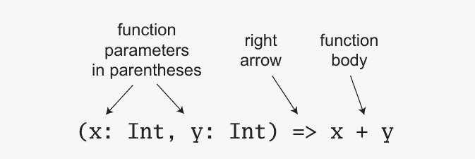
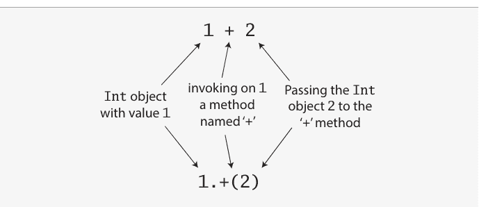
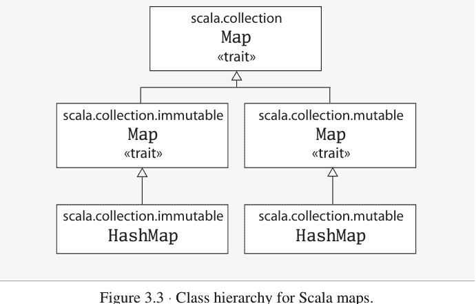
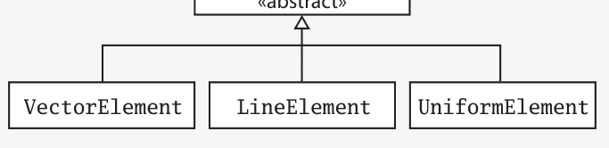
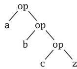
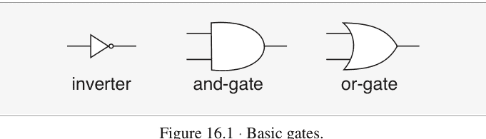
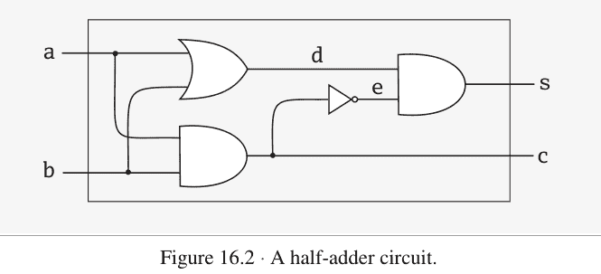
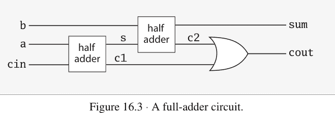
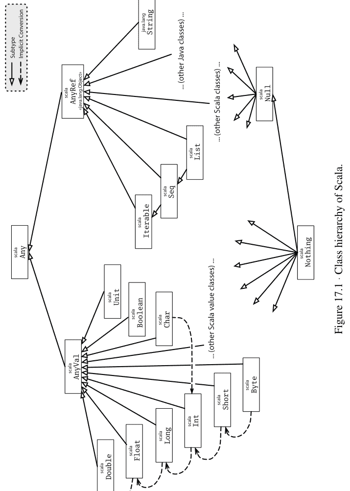

# Scala 编程：循序渐进全面指南

## 对《Scala 编程》早期版本的赞誉

**《Scala 编程》**可能是我读过的最好的编程书籍之一。我喜欢它的写作风格、简洁的文字以及详尽的解释。这本书似乎能回答我脑海中出现的每一个问题——它总是比我快一步。作者们没有仅仅给你一些代码并认为一切理所当然。他们给了你“干货”，让你真正理解了正在发生什么。我非常喜欢这一点。

- Ken Egvergari，首席软件架构师

**《Scala 编程》**写得清晰、详尽且易于阅读。书中充满了极佳的示例和实用提示。它让我们的机构能够快速、高效地上手 Scala 语言。对于任何试图理解 Scala 语言的灵活性和优雅性的程序员来说，这本书都是极佳的。

- Larry Morroni，Morroni Technologies, Inc. 所有者

**《Scala 编程》**这本书是 Scala 语言的极佳教程。通过阅读这本书，逻辑非常连贯，每一章都建立在前几章节描述的概念和示例之上。书中深入解释了语言结构，并经常提供该语言与 Java 的区别示例。除了主语言外，还涵盖了容器（containers）和 Actor（actors）等库。

我发现这本书非常易读，它可能是我最近读过的写得最好的技术书籍。我会向任何想要了解更多 Scala 语言的程序员推荐这本书。

- Matthew Todd

> 我对《Scala 编程》作者们所付出的努力感到惊讶。这本书是一份无价的指南，用于我所称的“Scala 平台”：一种编写更好代码的工具，是可扩展软件设计与实现的永恒灵感来源。如果我在 2003 年共同设计和实现雅典 2004 奥运会门户基础设施部分时，手头就有目前这种成熟状态的 Scala 和这本书就太好了！
>
> 致读者：无论你的编程背景如何，你都会发现 Scala 编程是解放性的，而这本书将成为你旅程中的明灯。

- Christos KK Loverdos，软件顾问，研究员

《Scala 编程》是对 Scala 语言极佳的深度介绍，它也是一本优秀的参考书。可以说它在我的书架上占据了重要位置，除了我几乎去到哪里都带着它。

- Brian Clapper，ArdenTex, Inc. 主席

好书，写得很好，示例深思熟虑。我会向资深程序员和新手都推荐它。

- Howard Lovatt

*Scala 编程*这本书不仅关于*如何*做，更重要的是*为什么*用这种新编程语言开发程序。书中在介绍结合面向对象和函数式编程的力量时采用了务实的方法，让读者对 Scala 到底是什么没有任何疑问。

- Dr. Ervin Varga，EXPRO I.T. Consulting 首席执行官/创始人

这是一份针对面向对象（OO）程序员的函数式编程的精彩介绍。学习函数式编程（FP）是我的主要目标，但也让我接触了一些 Scala 的惊喜，比如样例类（case classes）和模式匹配（pattern matching）。Scala 是一门迷人的语言，这本书在这方面涵盖得很好。在语言介绍类书中，信息过多或不足之间总有一条微妙的界限。我发现《Scala 编程》达到了完美的平衡。

- Jeff Heon，程序员分析师

我买了一个由 Odersky、Spoon 和 Venners 编写的《Scala 编程》早期电子版，立刻成为了粉丝。除了它包含了关于语言最全面的信息外，电子格式的几个关键特性也令我印象深刻。我从未见过链接像 PDF 中这样用得好，不仅用于书签，还从目录和索引提供了活动链接。我不知道为什么很多作者不使用这个功能，因为这对于读者来说是一种享受。另一个令我印象深刻的功能是通往论坛（“Discuss”）的链接，以及一种通过电子邮件向作者发送反馈（“Suggest”）的方法。

致 Nastaran - M.O.

致 Fay - L.S.

致 Siew - B.V.

致 Jungwon - F.S.

## 关于作者

## 前言

见证一种新编程语言的诞生是一件很有趣的事。对于任何使用编程语言的人来说——无论你是刚开始尝试编程，还是一个经验丰富的职业软件工程师——编程语言似乎就是存在那里。就像锤子或斧头一样，编程语言是一种工具，已经在那里，使我们能够从事自己的职业。我们很少思考那个工具是如何产生的，设计它的过程是什么。我们可能会对它的设计有意见，但除此之外，我们通常只是接受它并继续前行。

然而，亲历编程语言的创建过程会带来一个完全不同的视角。各种可能性似乎是无尽的。但在此同时，编程语言必须满足看似无限的约束列表。这是一种奇妙的张力。

新编程语言的创建有很多原因：个人想要解决某个心痒难耐的愿望、深刻的学术见解、技术债、或者从其他编译器架构中获得的启示——甚至是政治。Scala 3 就是其中一些元素的结合。

无论这是什么样的组合，一切都始于 Martin Odersky 在某天的出现，并在几天后在一次研究小组会议上宣布，他已经开始通过从头编写一个新编译器来让 DOT 演算活起来。在这里，我们是一群博士生和博士后，直到最近我们一直是 Scala 2 开发和维护的重要组成部分。当时，Scala 达到了令人不可想象的成功高度，特别是对于一种来自瑞士一个名字听起来奇怪的学校的晦奥且学术的编程语言来说。

## 前言

你可能听过一种反复提及的格调：在许多方面，Scala 3 代表了在其之前 Scala 的简化。隐式（`implicits`）的故事就是一个极佳的例子。考虑到程序员们为了实现类型推导等更广泛的编程模式，在处理隐式时所做的“大筋体操”，Martin 在许多人的帮助下得出的结论：我们不应该将隐式视为一种供人们在最通用情况下使用的机制。相反，我们应该关注程序员想用隐式做什么，并让其变得更简单、更高效。这就是“Scala 3 关注意图而非机制”这句格调的由来。

在 Scala 3 中，我们决定不再关注隐式作为机制的通用性，而是关注开发者起初选择使用隐式时考虑的具体场景，并让这些模式的使用变得更加直接。示例包括：向方法隐式地传递上下文配置信息，而无需程序员通过重复的参数进行显式传递；追溯性添加方法；以及转换类型（如算术中的 `Int` 和 `Double`）。现在，Scala 3 为程序员提供了这些用例，而无需理解关于 Scala 编译器如何解析的某些“深度”直觉。相反，你可以专注于诸如“在不重新编译的情况下为类 `Bar` 添加一个方法”等任务。不需要博士学位。只需将之前的“implicit”概念替换为对应特定用例的其他直接关键字，如 `given` 和 `using`。更多信息请参见第 21 章和 22 章。

这种“意图优先于机制”的故事并没有止于隐式的重构。相反，这种哲学一直延伸到语言的每一个方面。示例包括 Scala 类型系统的各个改进和简化，从联合类型（union types）、枚举（enums）到匹配类型（match types）——或者对 Scala 语法的清理：为了提高可读性的可选括号，以及用于 `if`、`else` 和 `while` 的更具可读性的“静默”语法，使得条件语句看起来更像英语。

别担心。无论你是 Scala 的新手，还是经验丰富的 Scala 开发者，我都希望你发现 Scala 3 中引入的许多新设计理念像我一样令人耳目一新且简单！

Heather Miller

瑞士洛瓦

2021年6月1日

## 致谢

许多人对这本书及其涵盖的内容做出了贡献。我们对他们所有人表示感谢。

George Berger 为书籍的构建过程和网页呈现的顺畅运行付出了巨大努力。因此，这个项目愉快地没有出现技术故障。

许多人对文本的早期版本提供了宝贵的反馈。感谢 Erik Armstrong、George Berger、Alex Blewitt、Gilad Bracha、William Cook、Bruce Eckel、Stéphane Micheloud、Todd Millstein、David Pollak、Frank Sommers、Philip Wagner 和 Matthias Zenger。感谢 Silicon Valley Patterns 小组非常有用的评审：Dave Astels, Tracy Bial, John Brewer, Andrew Chase, Bradford Cross, Raoul Duke, John P. Eurich, Steven Ganz, Phil Goodwin, Ralph Jocham, Yan-Fa Li, Tao Ma, Jeffery Miller, Suresh Pai, Rufer, David W. Smith, Scott Turnquist, Walter Vanni, Darlene Wallach 和 Jonathan Andrew Wolter。我们还要感谢 Dwayne Johnson 和 Kim Leedy 在封面艺术方面的帮助，感谢 Frank Sommers 提供索引。

我们还要感谢所有提供评论的读者。你们的意见对我们把这本书做得更好非常有帮助。我们无法列出所有提供评论者的姓名，但在电子书 PrePrint™ 阶段，点击 Suggest 链接至少有五条评论，按提交评论数从高到低按字母顺序排序。感谢：David Biesack, Donn Stephan, Mats Henrison, Rod Dickens, Blair Zajac, Tony Sloane, Nigel Harrison, Javier Diaz Soto, William Heelan, Justin Foster, Gregor Purdy, Colin Perkins, Bjarte Karlsen, Ervin Varga, Eric Willigers, Mark Hayes, Martin Erwin, Colin MacLean, Jonathan Wolter, Leszynski, Seth Tisue, Andrei Formiga, Dmitry Grigoriev, George Berger, Howard Lovatt, John P. Eurich, Marius Scuretto, Jeff Erin, Jamie Webb, Kurt Zoglmann, Dean Wap, Nikolai Lindberg, Peter McCain, Arkadiusz Strijski, Shanky Surana, Craig Bordlon, Alexander Patrick, Phil Moes, Jean Ford, Jeon Hee, Boris Lorber, Jim Menard, Tim Azzopardi, Thomas Young, Walter Changer, Jericho Dijkmeij, Casey Bowen, Martin Smith, Richard Dallaway, Antony Stubbs, Lars Westergren, Maarten Hazewinkel, Rust Mussell, Remigis Michalowski, Andrew Topolko, Curtis Stanford, Joshua Gough, Miguel Garcia Lopez, Michel Scholz, Peter Moore, Randolph Kahle, Vladimir Kalman, Daniel Gronau, Derek Detering, Hiroaki Nakamura, Ole Hougaard, Bhaskar Maddala, David Bernard, Derek Maher, George Kollias, Kristian Nordal, Normen Mueller, Rafael Ferreira, Binil Thomas, John Nilsson, Jorge Ortiz, Marcus Schulte, Vadim Gerassi, Cameron Taggart, John-Anders Teegen, Silvestre Zabala, Will McQueen 和 Owen Sem。

我们还要感谢在前两个版本出版后提交意见和错误列表的人，包括 Felix Siegist、Lothar Meyer 等许多人。我们还要感谢 ... Hill, Peter Chapin, Kevin Wright, Anantan Srinivasan, Omar Kilani, Guenther Waffler。

## 引言

这本书是 Scala 编程语言的教程，由直接参与 Scala 开发的人编写。我们的目标是，通过阅读这本书，你可以学习成为一名高效 Scala 程序员所需的所有知识。书中的所有示例均可在 Scala 3.0.0 版本编译。

### 谁应该读这本书

这本书的主要目标读者群是想要学习 Scala 编程的程序员。如果你想在 Scala 中进行你的下一个软件项目，那么这本书就是适合你的。此外，这本书对于希望通过学习新概念来开阔视野的程序员来说也应该是趣味性的。例如，如果你是一个 Java 程序员，阅读这本书将让你接触到许多函数式编程的概念以及高级面向对象的思想。我们相信，学习 Scala 及其背后的思想可以帮助你成为一个更优秀的程序员。

假设读者已具备通用的编程知识。虽然 Scala 是一门优秀的编程语言，但这本书并不是用来直接学编程的。另一方面，不需要特定的编程语言知识。尽管大多数人在 Java 平台上使用 Scala，但这本书并不假设你了解任何 Java 知识。然而，我们预计许多读者熟悉 Java，因此我们有时会将 Scala 与 Java 进行比较，以帮助这类读者理解差异。

### 如何使用这本书

这本书的主要目的是作为一份教程，建议按照章节顺序从头到尾阅读。

我努力一次只介绍一个主题，并仅根据已经介绍的主题来解释新主题。因此，如果你跳到后面去预先看某些内容，你可能会发现它的解释是基于你尚不理解的概念。只要你按照顺序阅读章节，你会发现获得 Scala 的熟练掌握其实非常直接，可以循序渐进。

如果你看到一个不认识的术语，请务必检查术语表（glossary）和索引（index）。许多读者会跳过书的某些部分，这完全没问题。当你快速略过某些内容时，术语表和索引可以帮助你回溯。

在你读完这本书后，它也应该作为一份语言参考。Scala 语言有一份正式的规范，但该语言规范为了精确性往往牺牲了可读性。虽然本书没有涵盖 Scala 的每一个细节，但它非常详尽，在你编写 Scala 程序并变得越来越熟练时，它可以作为一份易于理解的语言参考。

### 如何学习 Scala

通过从头到尾阅读这本书，你就能学到很多 Scala 的知识。不过，如果你能做一些额外的练习，可以更快、更彻底地学习 Scala。

- 首先，你可以利用书中包含的许多程序示例。手动输入这些代码是强迫大脑通过每一行代码的方法。尝试各种变体可以让代码变得更有趣，并确保你真正理解了它们是如何运作的。

- 其次，保持与许多在线论坛的联系。这样，你和其他 Scala 爱好者就可以互相帮助。有许多邮件列表、讨论论坛、聊天室、维基以及多个针对 Scala 的文章订阅源。花些时间找到适合你信息需求的内容。你将少很多在小问题上耗费大量时间，或者你可以把时间花在更深层次、更重要的问题上。

- 最后，一旦你读了足够的内容，就开始尝试你自己的编程项目。从零开始编写一个小程序，或者为一个更大的程序开发一个插件。仅通过阅读带来的进步是有限的。

### 电子书特性

本书提供纸质版和 PDF 版。电子书并非书籍纸质版的简单电子副本。虽然内容与纸质版相同，但电子书针对电脑屏幕的阅读进行了精心设计和优化。

首先要的是，电子书中的大多数引用都是超链接。如果你选择指向某个章节、图表或术语表条目的引用，你的 PDF 查看器应立即带你进入所选项目，无需翻页查找。

此外，电子书每页的底部都有若干导航链接。首页（Cover）、概述（Overview）和目录（Contents）带你进入书的前言。术语表（Glossary）和索引（Index）链接带你进入书的参考部分。最后，如果你发现打印错误或认为可以解释得更好的地方，请点击“建议”（Suggest）链接，这将带你进入一个在线应用程序，你可以在那里给作者提供反馈。

尽管电子书中的页面与打印版相同，但删除了空白页并对剩余页面重新标注了页码。页码编号方式不同，以便你在仅打印电子书部分内容时，更容易确定 PDF 的页码。因此，电子书中的页码与你的 PDF 查看器编号完全一致。

### 字体规范

当*术语*（term）第一次使用时，会使用斜体。较小的代码示例（如 `x + 1`）以等宽字体内联形式编写。较大的代码示例被放在如下的等宽字体引用块中：

```
def hello()
    println("Hello, world!")
```

当显示交互式 shell 时，来自 shell 的响应用较浅的字体显示：

```
scala> 3 + 4
    val res0: Int = 7
```

## 简介

- 第 1 章“可扩展的语言”概述了 Scala 的设计以及其背后的原理和历史。
- 第 2 章“Scala 的初步”展示了许多基础编程任务。完成本章后，你将能够开始使用 Scala。
- 第 3 章“Scala 进阶”展示了更多基础编程任务，帮助你快速上手。完成本章后，你将能够开始使用 Scala。
- 第 4 章“类与对象”开始深入介绍 Scala，介绍了如何编译和运行应用程序。
- 第 5 章“基础类型与操作”涵盖了 Scala 的基础类型、字面量以及你可以对其进行的操作。
- 第 6 章“函数式对象”深入探讨面向对象的特性，并以不可变数值作为示例。
- 第 7 章“内置控制结构”展示了如何使用 Scala 的内置控制结构：`if`、`while`、`for`、`try` 和 `match`。
- 第 8 章“函数与闭包”深入介绍了函数这一函数式语言的构建块。
- 第 9 章“控制抽象”通过定义自己的控制抽象来增强 Scala 的基础控制结构。
- 第 10 章“组合与继承”讨论了更多 Scala 对面向对象编程的支持。这些主题不像第 4 章那样基础，但在实践中频繁出现。
- 第 11 章“Traits”涵盖了 Scala 的继承层次结构。该章描述了混入组合机制。


- 第 12 章“包与导入”讨论了顶层包、导入语句以及如 `protected` 和 `private` 等访问控制。
- 第 13 章“模式匹配”引入了两种支持编写树形数据的构造。样例类（Case classes）和模式匹配非常有帮助。
- 第 14 章“处理列表”详细介绍了列表，这可能是最常用的集合。
- 第 15 章“处理其他集合”展示了如何使用基础集合，如数组、元组、集合和映射。
- 第 16 章“可变对象”解释了可变对象以及 Scala 提供的表达语法。该章以一个离散事件模拟的案例研究结束。
- 第 17 章“层次结构” - 第 18 章“类型参数化”解释了类型参数的变性以及它如何与信息隐藏交互。
- 第 19 章“枚举与 ADT”引入了两种支持编写递归数据的构造。
- 第 20 章“抽象成员”描述了 Scala 支持的所有类型的抽象成员；不仅是方法，还有字段和类型。
- 第 21 章“Givens”描述了 Scala 的一项功能，帮助你处理函数的上下文参数。传入所有上下文信息是简单的，但可能产生大量的模板代码。
- 第 22 章“扩展方法”描述了 Scala 的一种机制，使函数看起来像类的方法，尽管它实际上并不在类内部。
- 第 23 章“类型类”尚待编写，该章将阐述类型类的几个示例。
- 第 24 章“深入理解集合”对集合库进行了详细的介绍。
- 第 25 章“断言与测试”展示了 Scala 的断言机制，并介绍了几种用于编写 Scala 测试的工具，特别关注 ScalaTest。

```scala
println("Hello, reader!")
```

# 第1章 · 可扩展的语言

Scala 的名字代表“可扩展语言”（scalable language）。该语言之所以如此，是因为它的设计旨在随着用户的需求而增长。你可以将 Scala 应用于广泛的编程任务，从编写小型脚本到构建大型系统。¹

Scala 很容易上手。它运行在标准的 Java 和 JavaScript 平台上，并与所有平台库无缝互操作。对于编写用于整合现有库的脚本来说，它是一门非常好的语言。但在用于构建大型系统和可复用组件框架时，它的优势可以得到更大的发挥。

从技术上讲，Scala 是在静态类型语言中融合了面向对象和函数式编程概念。面向对象与函数式编程的融合出现在 Scala 的许多不同方面；它比任何其他广泛使用的语言都更加普及。这两种编程风格在可扩展性方面具有互补的优势。Scala 的函数式构造使得你能够从简单的部分快速构建出有趣的东西。面向对象的构造使得你易于构建更大的系统并适应新需求。在 Scala 中结合这两种风格，使得表达新的编程模式和模式抽象成为可能。它也导致了易读且简洁的编程风格。而且由于它是如此具有塑性，用 Scala 编程可以非常有趣。

本章回答了“为什么用 Scala？”的问题。它提供了 Scala 设计及其背后逻辑的高级视角。读完本章后，你应该对 Scala 是什么以及它能帮助你完成什么样的任务有一个基本的感受。

> ¹Scala 的发音是 scal-lah。

虽然这是一本 Scala 教程，但这一章并不是教程的序言。如果你急于写一些 Scala，应该直接跳到第二章。

## 1.1 一门让你越用越顺手的语言

不同规模的程序需要不同的编程构造。例如，考虑以下 Scala 程序：

```scala
var capital = Map("US" -> "Washington", "France" -> "Paris")
capital += "Japan" -> "Tokyo"
println("France")
```

这个程序建立了一个从国家到首都的映射，它通过添加新绑定（`"Japan" -> "Tokyo"`）修改了映射，并打印了与法国关联的首都。示例中的表示法是高层级的、直接的，并且没有被多余的分号或类型注释所堆乱。事实上，它的感觉非常像 Perl、Python 或 Ruby 这样的现代“脚本”语言。这些语言的一个共同特征（与上述示例相关）是它们在语言语法中都支持“关联映射”（associative map）构件。

关联映射非常有用，因为它们能保持程序既大又简洁，但有时你可能不同意它们的“一刀切”哲学——你需要以更细粒度的方式来控制程序中所使用的 map 的属性。如果你需要，Scala 会给你提供这种细粒度的控制，因为 Scala 中的 map 不是语言抽象。它们可以被扩展和适应。

在上面的程序中，你获得了一个默认的 `Map` 实现，但你可以轻松地更改它。你可以指定特定的实现，例如 `HashMap` 或 `TreeMap`，或者通过 Scala 的并行集合模块调用 `par` 方法来获取一个并行操作的 `ParMap`。你可以为 map 指定一个默认值，或者覆盖你创建的 map 的任何其他方法。在每种情况下你都可以使用与上述示例相同的 map 易用访问语法。

> 如果你不理解这个程序的所有细节，请见谅。这些细节将在后面的章节中解释。

这个示例表明 Scala 既能给你便利性，又能提供灵活性。Scala 有一组构造，可以帮助你快速上手，并让你以令人愉快的简洁风格进行编程。同时，你有把握自己不会被这门语言所限制。你可以根据自己的需求定制程序，因为一切都是基于你可以根据需要使用和适应的库模块。

### 增长新类型

埃里克·雷蒙德（Eric Raymond）将“大教堂”和“大集市”作为软件开发的隐喻。³ 大教堂是一座近乎完美的建筑，需要很长时间才能建成。一旦建成，它就会长期保持不变。相比之下，大集市每天由在其中工作的人进行适应和扩展。Raymond 的工作集市是开源软件开发的隐喻。盖·斯蒂尔（Guy Steele）在一次关于“增长一种语言”的演讲中提到，这一点也适用于语言设计。⁴ Scala 更像大集市而不是大教堂，因为它的设计初衷是让在其中编程的人进行扩展和适应。Scala 并不是在一个“完美”语言中提供你可能需要的所有构造，而是将构建此类构造的工具交到你手中。

这是一个例子。许多应用需要一种整数类型，可以在不溢出或算术运算“回绕”的情况下变得任意大。Scala 在库类 `scala.math.BigInt` 中定义了这种类型。这里是定义该类型的方法，它计算传入的整数值的阶乘：⁵

```scala
def factorial(x: BigInt): BigInt =
  if x == 0 then 1 else x * factorial(x - 1)
```

现在，如果你调用 `factorial(30)`：

```
26525285285912191058636308480000000
```

`BigInt` 看起来像是一个内置类型，你可以使用整数字面量和运算符 `*` 以及该类型的值。它就像那样：

> ^³Raymond, The Cathedral and Bazaar. [Ray99]
>
> ⁴Steele, "Growing a language." [Ste99]
>
> ⁵factorial(x)，或在数学符号中为 x!，是计算 1 * 2 ... 的结果，其中 0 定义为 1。`BigInt` 是许多其他类型的代表——大数、复数、有理数、置信区间、多项式——列表还将继续。有些编程语言原生实现了这些类型。例如，Lisp、Haskell 和 Python 实现了整数；Fortran 和 Python 实现了复数。但任何试图同时实现所有抽象的语言将变得臃肿难以管理。而且，即使存在这样的语言，某些应用程序无疑会从未提供的其他类型中获益。因此，试图在一个地方提供所有内容的方法并不可行。相反，Scala 允许用户通过定义易用的库来按需的方向增长和适应，这些库感觉像是原生语言支持。

`BigInt` 恰好定义在 Scala 的标准库中⁶ 如果它缺失了，对于 Scala 程序员来说，编写一个实现很容易，例如通过包装 Java 的 `BigInteger` 类（事实上确实如此）。

当然，你也可以直接使用 Java 的类。但结果并不那么整洁，因为尽管 Java 允许你创建新类型，但那些感觉并不像原生语言支持：

```scala
import java.math.BigInteger
def factorial(x: BigInteger): BigInteger =
  if x == BigInteger.ZERO then
    BigInteger.ONE
  else
    x.multiply(factorial(x.subtract(BigInteger.ONE)))
```

### 增长新的构造

之前的示例表明 Scala 允许你添加像内置类型一样方便的新类型。同样的扩展原则也适用于控制结构。ScalaTest（一个流行的 Scala 测试库）的 `AnyFunSuite` 样式说明了这种扩展性。作为一个示例，这里有一个包含两个测试简单测试：

> Scala 自带一个标准库，大部分内容将在本书中介绍。更多信息可以查阅库的 ScalDoc 文档，该文档可以在发行中以及通过 http://www.scala-lang.org 获取。

```scala
class SetSpec extends AnyFunSuite {
  test("An empty Set should have size 0") {
    assert(Set.empty.size == 0)
  }
  test("Invoking head on an empty Set should fail") {
    assertThrows[NoSuchElementException] {
      Set.empty.head
    }
  }
}
```

我们并不要求你现在就能完全理解 `AnyFunSuite` 示例。相反，这个示例对于可扩展性主题的重大意义在于：`test` 构造和 `assertThrows` 语法都不是 Scala 的内置操作。尽管它们看起来和行为上都非常像内置控制结构，但它们实际上是 ScalaTest 库中定义的方法。这两个构造都完全独立于 Scala 编程语言。

这个示例说明了你可以向新的方向“增长”Scala 语言，即使是像软件测试这样专门的。当然，你需要经验丰富的架构师和程序员来完成。关键在于这是可行的——你可以在 Scala 中设计并实现抽象，解决全新的应用领域问题，同时感觉仍像是在使用原生语言支持。

## 1.2 是什么让 Scala 可扩展？

可扩展性受许多因素影响，从语法细节到组件抽象构造等。如果我们被迫只列出 Scala 的一个有助于可扩展性的方面，我们会选择它面向对象编程和函数式编程的结合（好吧，我们作弊了，那实际上是两个方面），但它们是交织的。

Scala 在将面向对象和函数式编程融合进统一的语言设计方面，超越了所有知名语言。例如，其他语言可能将对象和函数视为两个不同的概念，而在 Scala 中，函数值本身就是对象。函数类型是可以被子类继承的类。这看起来可能仅仅是一个学术观点，但它对可扩展性具有深远影响。

本节概述了 Scala 融合面向对象和函数式概念的方法。

### Scala 是面向对象的

面向对象编程取得了巨大的成功。从 20 世纪 60 年中期的 Simula 到 70 年代的 Smalltalk，它现在出现的语言比不支持它的语言还要多。在某些领域，对象已经完全接管了局面。虽然对“面向对象”没有精确的定义，但对象的某些属性确实吸引着程序员。

从原则上说，面向对象编程的动力非常简单：所有程序都需要某种结构。实现这一点的最直接方法是将数据和操作放入某种形式中。面向对象编程的伟大思想是让这些容器通用化，以便它们既可以包含对象也可以包含数据，并且值可以存储在其他容器中或作为参数传递给操作。Smalltalk 的发明者 Alan Kay 评论说，这是大型程序最简单的构造。

尽管面向对象编程已经主流了很长时间，但像 Smalltalk 那样将这种构造推向其逻辑终点的语言相对较少。许多语言允许非对象值存在（例如 Java 中的基本类型），它们有一种令人恼火的倾向，会使问题复杂化并限制可扩展性。

相比之下，Scala 是一种纯形式的面向对象语言：每个值都是对象，每个操作都是一个方法调用。例如，当你在 Scala 中使用 `+` 时，你实际上是在调用定义在 `Int` 中的方法。你可以定义方法，然后客户端就可以使用这些方法。

在对象方面，Scala 比其他语言更先进。一个例子是 Scala 的 traits（特征）。Traits 类似于 Java 中的接口（interface），但它们也可以拥有实现。对象是通过混入组合（mixin composition）构建的，它获取一个类的成员并将 traits 的成员添加到它们中。通过这种方式，类的不同方面可以封装在 traits 中。这看起来像重重继承，但在细节上有所不同。与类不同，trait 可以为未指定的父类添加新功能。这使得 traits 比类更具“可插性”。

> 从 Java 8 开始，接口可以拥有默认方法实现，但这些还没有 Scala traits 的功能。

### Scala 是函数式的

除了是一门纯的面向对象语言外，Scala 也是一种全函数式语言。函数式编程的想法比计算机还要古老。函数式编程的基础源于 Alonzo Church 在 20 世纪 30 年代开发的 Lambda演算。第一个函数式语言是 Lisp，起源于 50 年代。其他流行的函数式语言有 Scheme、SML、Erlang、Haskell、OCaml 和 F#。长期以来，函数式编程一直处于边缘——在学术界流行，但在工业界并未广泛使用。然而，近年来人们对函数式编程和技术的兴趣增加了。函数式编程由两个主要思想指导。第一个思想是函数是一等值。在函数式语言中，函数的地位与整数或字符串相同。你可以将函数作为参数传递给函数，作为结果返回，或存储在变量中。你也可以在函数内部定义函数，就像你可以在代码中散布像 `42` 这样的整数字面量一样。

一等值函数提供了抽象操作和创建新控制结构的方便方法。函数的泛化提供了强大的表达力，通常会导致程序简洁易读。它对可扩展性也起着重要作用。例如，ScalaTest 测试库提供了一个 `eventually` 构造，它接受函数作为参数。用法如下：

```scala
val xs = 1 to 3
val it = xs.iterator
eventually { it.next() shouldBe 3 } 
eventually { it.next() shouldBe 3 }
```

`eventually` 内部的代码——断言 `it.next()` 被封装在一个函数并传递给 `eventually` 方法。在配置范围内，`eventually` 会反复执行该函数直到断言成功。

函数式编程的第二个主要思想是程序的操作是将输入值映射到输出值，而不是修改数据。不可变数据结构是函数式编程的基石之一。Scala 库在 Java API 之上定义了许多不可变数据类型。例如，Scala 拥有不可变的列表、元组（tuple）、映射（map）和集合（set）。

## 为什么选择 Scala？

Scala 适合你吗？你必须亲身观察并决定。我们发现，除了可扩展性之外，其实有很多喜欢 Scala 编程的理由。本节将讨论四个最重要的方面：兼容性、简洁性、高级抽象和高级静态类型。

### Scala 具有良好的兼容性

Scala 并不要求你在从 Java 语言迈进时从 Java 平台向后退缩。它允许你为现有代码添加价值——在已有的基础上进行构建——因为它的设计初衷就是为了与 Java 的无缝互操作性。Scala 程序被编译为 JVM 字节码。它们的运行时性能通常与 Java 程序相当。Scala 可以调用 Java 方法、访问字段、继承 Java 类并实现 Java 接口。这些操作都不需要特殊的语法、显式的接口描述或胶接代码。事实上，几乎所有的 Scala 代码都大量使用了 Java 库，而程序员甚至并不会察觉到这一点。

完全互操作性的另一个方面是 Scala 大量复用了 Java 类型。Scala 的 `Int` 被表示为 Java 的 `int` 原始类型，`Float` 表示为 `float`，`Boolean` 表示为 `boolean`，以此类推。Scala 数组映射到 Java 数组。Scala 还使用了许多标准 Java 库类型。例如，Scala 中字符串字面量“abc”的类型是 `java.lang.String`，而抛出的异常必须是 `java.lang.Throwable` 的子类。

Scala 不仅复用了 Java 的类型，还对它们进行了“装扮”，使其变得更好用。例如，Scala 的字符串支持 `toInt` 或 `toFloat` 等方法，这些方法可以将字符串转换为整数或浮点数。因此，你可以写 `str.toInt` 而不是 `Integer.parseInt(str)`。在不破坏兼容性的情况下是如何实现这一点的？Java 的 `String` 类显然没有 `toInt` 方法！事实上，Scala 有一个非常通用的解决方案来解决这种高级库设计与互操作性之间的紧张关系。Scala 允许定义丰富的扩展，当选择不存在的成员时，这些扩展总是会被应用¹

> ⁹ 起初，有一个运行在 .NET 平台上的 Scala 实现，但它现在已不再活跃。最近，一种运行在 JavaScript 上的 Scala 实现——Scala.js 已经变得越来越流行。

在上述案例中，当在字符串上寻找 `toInt` 时，Scala 编译器会发现 `String` 类中没有此类成员，但会找到一个隐式转换，该转换将 `String` 转换为 `StringOps` 类的实例，该类定义了该成员。转换将在 `toInt` 操作之前隐式应用。

Scala 代码也可以从 Java 代码调用。这有时有点微妙，因为 Scala 是一种比 Java 更丰富的语言，所以 Scala 的一些高级特性在映射到 Java 之前需要进行编码。细节将在《Scala 高级编程》中进行解释。

### Scala 是简洁的

Scala 程序往往很短。Scala 程序员报告说，与 Java 相比，代码行数减少了高达十倍。更保守的估计是，典型的 Scala 程序的行数应该是相同 Java 程序的一半。代码行数少意味着不仅打字更少，而且阅读和理解程序的精力更少，缺陷的可能性也更少。几个因素导致了代码行数的减少。


首先，Scala 的语法避免了一些增加 Java 程序负担的样板代码。例如，在 Scala 中分号是可选的，且通常会被省略。在其他几个领域，Scala 的语法也不那么冗余。例如，比较在 Java 和 Scala 中编写类和构造函数的方式。在 Java 中，一个带有构造函数的类看起来如下：

```java
class MyClass { // 这是 Java 代码
    private int index;
    private String name;
    public MyClass(int index, String name) {
        this.index = index;
        this.name = name;
    }
}
```

> ¹ 在 3.0.0 中，标准的丰富扩展是通过隐式转换实现的。在 Scala 的后续版本中，这些将被扩展方法取代。

在 Scala 中，你会这样写：

```scala
class MyClass(index: Int, name: String)
```

考虑到这一点，Scala 会创建一个带有 `Int` 和 `String` 参数的构造函数，这些构造函数作为参数。代码行数少意味着不仅打字更少，而且阅读和理解程序的精力更少，缺陷的可能性更少。总而言之，Scala 版本写得更快、更易读，而且比 Java 版本更不容易出错¹。

Scala 的类型推断是导致简洁性的另一个因素。重复的类型信息可以省略，因此程序变得不那么拥挤。Scala 提供了许多工具来让你定义强大的行为。例如，你可以以灵活的方式混合不同的特质（traits）。这些构造结构允许你定义高级的、具有灵活性的库。总的来说，这些构造结构允许你定义的库是高级的且具有灵活性的。

# Scala 是高级的

程序员不断与复杂性作斗争。为了高效编程，你必须理解你编写的代码。遗憾的是，复杂性无法避免；它必须被管理。

Scala 通过允许你提高抽象层次来帮助你管理复杂性。例如，假设你有一个字符串变量，并判断它是否包含大写字母。在 Java 8 之前，你可能会写这样一个循环：

> ¹ 唯一的区别是 Java 的实例变量是不可变的。你将在 10.6 节学习如何让它们变为可变的。

```java
boolean nameUpperCase = false; // 这是 Java 代码
for (int i = 0; i < name.length(); i++) {
  if (Character.isUpperCase(name.charAt(i))) {
    nameUpperCase = true;
    break;
  }
}
```

而在 Scala 中，你会这样写：

```scala
val nameUpperCase = name.exists(_isUpper)
```

Java 代码将字符串视为低级实体，并在循环中逐字符遍历。Scala 代码将字符串视为高级字符序列，可以使用谓词进行查询。显然，Scala 代码短得多，而且对于受过训练的人来说比 Java 代码更容易理解。因此，Scala 代码的负担更小。它也让你更不容易出错。

谓词 `_isUpper` 是 Scala 中函数字面量的一个例子²。它描述了一个接受字符参数（由下划线 `_` 表示）并测试其是否为大写字母的函数³。

Java 8 引入了 Lambda 和流，这允许你在 Java 中执行类似的操作。它看起来可能像这样：

```java
boolean nameHasUpperCase = // 这是 Java 8 或更高版本
name.chars().anyMatch((int ch) -> Character.isUpperCase((char) ch));
```

尽管相比 Java 的早期版本有了巨大改进，但 Java 8 代码仍然比相应的 Scala 代码冗长。Java 代码这种额外的“重量感”以及 Java 的长循环，可能会鼓励许多需要新方法的 Java 程序员直接编写循环并忍受代码中增加的复杂性。

相反，Scala 的函数字面量相对轻量，因此它们被频繁使用。随着你熟悉 Scala，你会发现更多机会来定义并作为布尔使用它们。

> ² 如果函数字面量的结果类型为 Boolean，则可以将其称为谓词。

> ³ 使用下划线作为参数占位符在第 8.5 节中有描述。

## 1.3 节

## 第 1 章 · 一种可扩展语言

你会发现这避免了代码重复，从而使你的程序更加短小清晰。

## Scala 是静态类型语言

静态类型系统根据变量和表达式所持有及计算的值类型对它们进行分类。Scala 是一门拥有非常先进的静态类型系统的语言。从 Java 那种嵌套类型系统开始，它允许你使用泛型对类型进行参数化，使用交集组合类型，并使用抽象类型隐藏类型的细节。¹⁴ 这些特性为构建和组合你自己的类型提供了坚实的基础，让你能够设计出既安全又易于使用的接口。

如果你喜欢动态语言（如 Perl、Python、Ruby 或 Groovy），你可能会觉得 Scala 的静态类型系统被列为其优点之一这显得有些奇怪。毕竟，静态类型系统的缺乏常被一些人认为是动态语言的一大优势。反对静态类型的最常见论点是：它们让程序变得过于冗长，阻止了程序员按照自己的意愿表达意图，并且使得某些软件系统的动态修改模式无法实现。通常，这些论点并不是针对“类型”这一概念本身，而是针对特定的类型系统，这些系统被认为过于冗长或缺乏活性。例如，Smalltalk 语言的发明者 Alan Kay 曾评论道：“我不反对类型，但我不知道有种类型系统是不完全令人痛苦的，所以我仍然喜欢动态类型。”¹⁵

我们希望在书中说服你，Scala 的类型系统远非所谓的“完全令人痛苦”。事实上，它解决了关于静态类型的近乎两大典型顾虑。通过类型推断避免了冗长，通过模式匹配以及若干种编写和组合类型的新方法获得了灵活性。在消除这些障碍后，就能更好地体会静态类型系统的经典优势了。其中最重要的优势包括：程序抽象的可验证属性、安全的重构以及更佳的文档。

> ¹⁴ 泛型在第 18 章中讨论；交集（例如 `A & B & C`）在第 17.5 节中；抽象类型在第 20 章中。

> ¹⁵ Kay，在一封关于面向对象编程意义的邮件中。[Kay03](https://example.org)

### 可验证的属性

静态类型系统可以证明某些运行时错误的不存在。例如，它们可以证明诸如下属性：布尔值永远不会加到整数上；私有变量不会从类外部访问；函数调用的参数数量是正确的；只有字符串被添加到字符串集合中。

其他类型的错误无法被当前的静态类型系统检测。例如，它们通常不能检测到非终止函数、数组越界或除以零。它们还能检测出你的程序是否不符合其规范（假设存在规范的话！）。因此，静态类型系统被某些人认为并没有很有用。这种论点认为，既然此类系统只能检测到简单的错误，而单元测试提供了更广泛的覆盖，那么静态类型还有什么意义呢？我们认为这些论点偏离了重点。虽然静态类型系统确实不能替代单元测试，但它可以通过处理某些本需要测试的属性来减少所需的测试数量。同样，单元测试也无法替代静态类型检查。毕竟，正如 Edsger Dijkstra 所说，测试只能证明错误的存在，永远无法证明错误的不存在。¹⁶ 所以，静态类型所提供的保证可能是简单的，但它们是真实的保证，是无论多少测试都无法提供的保证。

### 安全重构

静态类型系统提供了一个安全网，让你能够以极高的信心对代码库进行更改。例如，为一个方法添加额外的参数的重构。在静态类型语言中，你可以进行此更改，重新编译系统，并只需修复所有导致类型错误的行。一旦完成这些，你就可以确定已经找到了所有需要更改的地方。许多其他简单的重构也是如此，比如更改方法名或将方法从一个类移动到另一个类。在所有情况下，静态类型检查都会提供足够的保证，确保新系统的工作方式与旧系统一致。

### 文档

静态类型是经编译器检查正确性的程序文档。与普通注释不同，类型注解永远不会过时（至少包含它的源文件最近通过了编译器的检查）。此外，编译器和集成开发环境（IDE）可以利用类型注解提供更好的上下文帮助。例如，IDE 可以通过确定所选表达式的类型并查找所有该类型的成员，为所选内容显示所有可用选项。

> ¹⁶ Dijkstra, “Notes on Structured Programming.” [Dij70](https://example.org)

尽管静态类型对程序文档通常有用，但当它们弄乱程序时也会让人很困扰。通常，有用的文档是程序读者无法自己轻易推导出的内容。在如下方法定义中：

```scala
def f(x: String) = ...
```

知道 `f` 的参数可能是一个 `String` 是很有用的。另一方面，在示例中的两个注解中至少有一个是令人恼火的：

```scala
val x: HashMap[Int, String] = new HashMap[Int, String]()
```

显然，只需说 `x` 是一个 `Int` 为键、`String` 为值的 `HashMap` 就足够了；不需要重复相同的短语。Scala 有一套非常复杂的类型推断系统，允许你省略类型。在之前的示例中，那些令人恼火的替代方案效果是一样的：

```scala
val x = new HashMap[Int, String]()
```

类型推断可以做得很深入。事实上，用户代码中完全没有显式类型并不罕见。这对于客户端代码尤为如此，客户端代码通常看起来像动态类型语言。毕竟，可复用组件的成员签名应该显式给出，因为它们构成了与客户端之间的契约。

## 1.4 节

## Scala 的根源

Scala 的设计受到了许多语言和思想的影响。事实上，Scala 只有少数特性是真正新的；大多数已以某种形式应用过。Scala 的创新主要来自于其构造的组合方式。在本节中，我们列出了对 Scala 设计的主要影响。该列表无法穷尽——编程语言设计中的想法多到无法一一列举。

在表面层，Scala 吸收了 Java 和 C# 的大部分语法，而这些语言又从 C 和 C++ 借鉴了大部分语法规范。表达式、语句和块与 Java 基本相似¹⁷。除了语法，Scala 还借鉴了 Java 的其他元素，如其基本类型、类库和执行模型。

Scala 还源于其他语言。统一对象模型由 Smalltalk 开创，随后被 Ruby 采用。它的通用嵌套思想（几乎每个构造都可以嵌套在其他构造内部）也存在于 Algol、Simula，以及最近的 Beta 和 g。它的方法调用和字段选择的访问原则来自 Eiffel。它对函数式编程的方法在精神上与 ML 系列语言相似，该家族的主要成员是 SML、OCaml 和 F#。Scala 标准库中的许多高阶函数在 ML 或 Haskell 中也存在。Scala 的隐式参数受 Haskell 类型类的启发；它们在更经典的面向对象环境中取得了卓越的结果。Scala 主要的基于 Actor 模型的并发库 Akka 深受 Erlang 的启发。

Scala 并不是第一个强调可扩展性和可扩展性的语言。跨越不同应用程序的可扩展语言的历史根源是 Peter Landin 1966 年的论文“The Next 700 Programming Languages”。¹⁸（本文描述的语言与 Lisp 并列为先驱语言之一。）将中缀运算符视为函数的特定想法可以追溯到 Lisp 和 Smalltalk。另一个重要想法是允许将函数字面量（或块）作为参数，这使得库能够定义控制结构。同样，这个想法也可以追溯到 Lisp 和 Smalltalk。Smalltalk 和 Lisp 具有灵活的语法，已被广泛应用于构建领域特定语言。C++ 是另一种可扩展的语言，可以通过运算符重载和其模板系统进行适配和扩展；与 Scala 相比，它构建在低级、更面向系统的内核之上。

Scala 并不是第一个集成函数式编程和面向对象编程的语言，尽管它在这个方向上可能是领先的。其他将函数式编程的一些元素集成到面向对象编程（OOP）中的语言包括 Ruby、Smalltalk 和 Python。在 Java 平台上，Pizza、Nice、Multi-Java 以及 Java 8 本身已经用函数式思想扩展了类 Java 的核心。也有获取了对象系统的函数式语言；例如 OCaml、F# 和 PLT-Scheme。

Scala 在编程语言领域也贡献了一些创新。例如，它的类型为泛型提供了更面向对象的替代方案，它的特质（traits）允许灵活的组件组装，而它的提取器（extractors）提供了一种独立表示模式匹配的方法。这些创新已在近年的编程语言会议论文上发表。¹⁹

> ¹⁷ 与 Java 的主要偏差在于类型注解的语法；它是 `variable: Type` 而不是 Java 的 `Type variable`。Scala 的后置语法类似于 Pascal、Modula-2 和 Eiffel。这种偏差的主要原因与类型推断有关，类型推断通常允许你省略变量的类型或方法的返回类型。使用 `variable: Type` 类型语法很容易——只需去掉冒号和类型即可。但在 C 风格的 `Type variable` 中，你不能简单地去掉类型。你需要某种替代关键字作为缺失类型的占位符。这种方法比 Scala 的方法显得更加随意且不规整。

## 1.5 节

## 结语

在本章中，我们介绍了 Scala 是什么以及它可能如何帮助你的编程。要明确的是，Scala 并不是能神奇提高你生产力的灵丹妙药。要进步，你需要艺术地运用 Scala，这需要一些学习和实践。如果你是从 Java 转过来的，学习 Scala 最具挑战性的方面可能涉及 Scala 的类型系统（比 Java 更丰富）以及它对函数式编程的支持。这本书的目标是引导你完成 Scala 学习曲线。我们认为这将是一个有回报的智力体验，它将拓宽你的视野，并让你对程序设计有不同的思考。希望你也能在 Scala 编程中获得快乐和灵感。

在下一章中，我们将开始编写一些 Scala 代码。

# 第 2 章

## Scala 的初步

是时候写一些 Scala 代码了。在开始深入的 Scala 教程之前，我们安排了两章来让你对 Scala 有整体的认识，最重要的是让你开始编写代码。我们鼓励你在学习过程中尝试本章和下一章中所有的代码示例。学习 Scala 的最好方法就是用它进行编程。

要运行本章中的示例，你需要标准的 Scala 安装。要获取安装，请访问 `http://www.scala-lang.org/downloads` 并按照你平台的说明操作。该页面描述了安装或尝试 Scala 的几种方法。对于本章中的步骤，我们假设已经安装了 Scala 二进制文件并将其添加到路径中¹。

## 步骤 1 学习使用 Scala REPL

开始学习 Scala 的简单方法是使用 Scala REPL²，一个用于编写 Scala 表达式和程序的交互式“壳”。REPL 被称为 `scala`，它会求值你输入的表达式并打印结果。你通过在命令行提示符输入 `scala` 来使用它³。

```
$ scala
Starting Scala REPL...
scala>
```

当你输入一个表达式（例如 `1 + 2`）并按回车时：

```
scala> 1 + 2
```

REPL 将打印：

```
val res0: Int = 3
```

这一行包含：

- 关键字 `val`，用于声明一个变量，
- 一个自动生成或用户定义的名称，用于引用该值（`res0`，意味着结果 0），
- 一个冒号（`:`），后面跟着表达式类型（`Int`），
- 一个等号（`=`），
- 求值表达式得到的结果（`3`）。

类型 `Int` 指向 `scala` 包。Scala 中的包与 Java 中的包类似：它们划分了全局命名空间并提供了一种信息隐藏的机制⁴。类 `Int` 的值对应于 Java 的 `int` 值。更一般地说，Java 的所有基本数据类型都得到了对应。例如，`scala.Boolean` 对应 Java 的 `boolean`。`scala.Float` 对应 Java 的 `float`。当你将 Scala 代码编译为 Java 字节码时，Scala 编译器将尽可能使用 Java 的基本类型，以带给你基本类型的性能优势。


如果你是 Scala 老手，接下来的两章应该带给你足够的理解，让你能够在 Scala 中编写程序。如果你经验较少，部分材料对你来说可能有些神秘。但别担心。为了快速进入状态，我们不得不省略一些细节。在后面的章节中，将以不那么“大水漫灌”的方式解释一切。此外，我们在这两章中插入了一些脚注，引导你参考书的后续章节，你可以在那里找到更详细的解释。

## 步骤 1 学习使用 Scala REPL

开始学习 Scala 的简单方法是使用 Scala REPL，一个用于编写 Scala 表达式和程序的交互式“壳”。REPL 被称为 `scala`，它会求值你输入的表达式并打印结果。你通过在命令行提示符输入 `scala` 来使用它。

```
$ scala
Starting Scala REPL...
scala>
```

当你输入一个表达式（例如 `1 + 2`）并按回车时：

```
scala> 1 + 2
```

REPL 将打印：

```
val res0: Int = 3
```

这一行包含：

- 关键字 `val`，用于声明一个变量，
- 一个自动生成或用户定义的名称，用于引用该值（`res0`，意味着结果 0），
- 一个冒号（`:`），后面跟着表达式类型（`Int`），
- 一个等号（`=`），
- 求值表达式得到的结果（`3`）。

类型 `Int` 指向 `scala` 包。Scala 中的包与 Java 中的包相似：它们划分了全局命名空间并提供了一种信息隐藏的机制。类 `Int` 的值对应于 Java 的 `int` 值。更通俗地说，Java 的所有基本数据类型都得到了解释。例如，`scala.Boolean` 对应 Java 的 `boolean`。`scala.Float` 对应 Java 的 `float`。当你将 Scala 代码编译为 Java 字节码时，Scala 编译器将尽可能使用 Java 的基本类型，以带给你基本类型的性能优势。

## 步骤 2 定义一些变量

Scala 有两种类型的变量，`val` 和 `var`。`val` 类似于 Java 中的 `final` 变量。一旦初始化，它就永远不能重新赋值。相比之下，`var` 类似于非 `final` 变量。

如果你需要重新赋值，你就需要使用 `var`，例如：

```
scala> var greeting = "Hello, world!"
var greeting: String = Hello, world!
```

由于 `greeting` 不是 `val`，你可以重新赋值它。如果你稍后感到很愤怒，你可以更改你的问候为：

```
scala> greeting = "Leave me alone, world!"
greeting: String = Leave me alone, world!
```

如果你意识到自己输入了错误，而 REPL 仍在等待输入，你可以使用上、下、左、右方向键来修正错误。如果你想完全放弃当前输入，可以通过连续两次回车来退出：

```
scala> val oops = 
|
```

你输入了两个空行。开始新命令。

```
scala>
```

在本书的后续内容中，我们通常会保留 `scala` 提示符、垂直线（`|`）以及成功输入后的输出，以便代码更易读（并且更易于从 PDF 电子书复制并粘贴到 REPL 中）。

## 步骤 3 定义一些函数

现在你已经接触了 Scala 变量，你可能想写写函数了。以下是在 Scala 中实现函数的方法：

```scala
def max(x: Int, y: Int): Int =
  if x > y then x
  else y
```

函数定义以 `def` 开始。函数名（在本例中为 `max`）后面跟着括号内用逗号分隔的参数列表。每个函数参数后面必须跟一个类型注解，并由冒号引导。Scala 编译器（以及 REPL）不会推断函数参数的类型。在这个示例中，函数名为两个参数 `x` 和 `y`，它们都是 `Int`。在 `max` 参数列表的右括号之后，你会发现另一个 `Int` 类型注解。这定义了函数本身的结果类型。在函数结果类型之后是一个表达式和缩进的代码块，它定义了函数体。在这种情况下，函数体包含一个简单的 `if` 表达式，选择 `x` 或 `y` 中较大的者作为 `max` 函数的结果。如所示，Scala 的 `if` 表达式可以产生值，类似于 Java 的三元运算符。

> 在 Java 中，你从方法返回的值是它的返回类型。在 Scala 中，同样的概念被视为结果类型。

（此处为图片，图片路径为 `img/12a...65_0.png`）

图 2.1 · Scala 函数定义的基本形式。

例如，Scala 表达式 `if x > y then x else y` 的行为与 Java 中的 `(x > y) ? x : y` 类似。等号表示函数体在函数式世界中的含义：一个函数定义了一个产生值的表达式。在函数的基本结构中，如图 2.1 所示。

有时编译器会要求你指定函数的类型。如果函数是递归的，例如你必须显式指定函数的结果类型。在 `max` 的情况下，你可以省略结果类型，编译器会进行推断。此外，如果一个函数只包含一行，你可以选择性将整个函数写在一行上。你也可以改为这样写函数：

```scala
def max(x: Int, y: Int) = if x > y then x else y
```

一旦你定义了函数，你就可以通过名称调用它，例如：

```scala
val bigger = max(3, 5) // 5
```

这是一个不带参数且不返回特殊结果的函数定义：

> 如果函数调用自身，则它是递归的。

尽管如此，即使编译器没有要求，显式指定函数类型通常也是好主意。此类注解可以使代码更易读，因为读者不需要研究函数体就能推断返回的结果。

```scala
def greet() = println("Hello, world!")
def greet(): Unit
```

当你在 REPL 中定义函数时，它会响应 `def greet(): Unit`。`greet` 显然是函数名。空括号表示函数不接受任何参数。`Unit` 是 `greet` 的结果类型。结果为 `Unit` 表示函数没有返回有趣的值。Scala 的 `Unit` 类型类似于 Java 的 `void` 类型；事实上，Java 中每个返回 `void` 方法都映射到 Scala 中返回 `Unit` 的方法。因此，结果类型为 `Unit` 的方法仅是为了其副作用而执行的。在 `greet()` 的情况下，副作用是打印到标准输出的友好问候。

在下一步中，你将把 Scala 代码放在文件中并将其作为脚本运行。如果你想退出 REPL，可以输入 `:quit`。

```scala
scala> :quit
$
```

尽管 Scala 的设计旨在帮助程序员构建非常大的系统，但它也可以缩小到脚本编写。脚本只是一个包含带有 `@main` 注解的顶层函数的 Scala 源文件。将此内容放入名为 `hello.scala` 的文件中：

```scala
@main def m() =
  println("Hello, world, from a script!")
```

然后运行：

```
$ scala hello.scala
```

你应该得到另一个问候：

```
Hello, world, from a script!
```

在这个示例中，标记为 `@main` 的函数名为 `m`（代表 main），但该名称对于运行脚本并不重要。你通过运行 Scala 并指定包含主函数的脚本文件名来运行脚本。

## 步骤 4 编写一些 Scala 脚本

要尝试一下这个，请将以下内容输入名为 `helloarg.scala` 的文件中：

```scala
@main def m(args: String*) =
  var i = 0
  while i < args.length do
    println(args(i))
    i += 1
```

> 重复参数在第 8.8 节描述。

**注意**

虽然本节的示例有助于解释 `while` 循环，但它们并没有演示最佳风格。在下一节中，你将看到避免通过索引遍历序列的方法。

该脚本从变量定义 `var i = 0` 开始。类型推断赋予 `i` `Int` 类型，因为它的初始值是 0。下一行的 `while` 结构导致代码块（两行代码）反复执行直到 `i < args.length` 为假。`args.length` 给出了 `args` 序列长度。块包含两个语句，每个语句缩进两个空格，这是 Scala 推荐的缩进风格。第一个语句 `println(args(i))` 打印第 i 个命令行参数。第二个语句 `i += 1` 将 i 增加 1。注意 Java 的 `++` 和 `i++` 在 Scala 中不起作用。要在 Scala 中增加，你需要使用 `i = i + 1` 或 `i += 1`。使用以下命令运行此脚本：

```
$ scala printargs.scala Scala is fun
```

你应该看到：

```
Scala
is
fun
```

想要更多功能，请将以下代码输入名为 `echoargs.scala` 的新文件：

```scala
@main def m(args: String*) =
  var i = 0
  while i < args.length do
    if i != 0 then
      print(" ")
    print(args(i))
    i += 1
  println()
```

在这个版本中，你将 `println` 调用替换为 `print` 调用，这样所有参数都打印在同一行上。为了可读性，你通过 `if` 在第一个参数以外的每个参数之前插入了一个空格。`if i != 0 then`。由于 `i != 0` 在第一次通过 `while` 循环时为 `false`，在初始参数之前不会打印空格。最后，你在末尾添加了更多的 `println`，以便在打印完参数后换行。你的输出结果将会非常漂亮。如果你使用以下命令运行此脚本：

```
$ scala echoargs.scala Scala is even more fun
```

你将得到：

```
Scala is even more fun
```

注意，在 Scala 中，与 Java 不同，你不需要为 `while` 的布尔表达式加圆括号。与 Java 的另一个区别是，只要恰当地缩进每一行，即使代码块包含多个语句，你也可以选择省略大括号。虽然你还没有见过任何分号，但 Scala 像 Java 一样使用分号分隔语句，但在 Scala 中分号是完全可选的，这可以减轻你右手的负担。因此，如果你处于更冗长的模式下，你可以用 Java 风格编写 `echoargs.scala` 脚本：

```scala
@main def m(args: String*) = {
  var i = 0;
  while (i < args.length) {
    if (i != 0) {
      print(" ");
    }
    print(args(i));
    i += 1;
  }
  println();
}
```

从 Scala 3 开始，基于缩进的风格（“静默语法”，quiet syntax）比大括号更推荐。Scala 3 还引入了结束标记，以便更容易查看大型条目的结束位置。结束标记由关键字加上一个指定标记（标识符或关键字）组成。示例见列表 10.9。

## 步骤 5 使用 for-and-do 进行迭代

尽管你可能没有意识到，当你在上一步中使用循环时，你使用的是命令式风格进行编程。在命令式风格（你通常在 Java、C++ 和 Python 等语言中使用的风格）中，你一次给出一个命令式指令，通过循环进行迭代，并且经常修改不同函数之间共享的状态。Scala 允许你进行命令式编程，但随着你对 Scala 的熟悉，你可能会发现自己开始用更函数式的风格编程。事实上，本书的一个主要目标就是帮助你像熟悉命令式风格一样熟悉函数式风格。

函数式语言的特征之一是函数是一等类构造，这在 Scala 中亦然如此。例如，打印每个行参数的另一种（更简洁）的方法是：

```scala
@main def m(args: String*) = args.foreach(arg => println(arg))
```

在这段代码中，你调用了 `args` 上的方法并传入了一个函数。在这种情况下，你传入了一个接受名为 `arg` 的参数的函数字面量。该函数体是 `println(arg)`。如果你将上述代码输入到名为 `pa.scala` 的新文件中，并执行命令：

```
$ scala pa.scala Concise is nice
```

你应该看到：

```
Concise
is
nice
```

在上一个例子中，Scala 编译器推断出 `arg` 的类型为 `String`，因为 `String` 是你调用的 `foreach` 序列的元素类型。如果你更倾向于显式指定，可以提及类型名称。但当你这样做时，你需要将参数部分括在括号中（这本身就是标准的语法形式）：

```scala
@main def m(args: String*) = args.foreach((arg: String) => println(arg))
```



图 2.2 · Scala 中函数字面量的语法。

运行此脚本的行为与上一个相同。如果你追求更简洁而非更显式，可以利用 Scala 中的一种特殊简写。如果函数字面量只包含一个接受单个参数的语句，你不需要显式地命名和指定参数。因此，以下代码也有效：

```scala
@main def m(args: String*) =
  args.foreach(println)
```

总结来说，函数字面量的语法是：圆括号内的参数列表、一个右箭头和函数体。图 2.2 展示了这种语法。

现在你可能会想，那些你在 Java 或 Python 等命令式语言中习惯使用的循环去哪儿了？为了引导你向函数式方向发展，Scala 中仅提供了命令式的函数式亲戚（for 表达式）。虽然在到达第 7.3 节（或提前预览）之前看不到它们的完整威力和表现力，但我们在这里一个新的命名的 foracles 中让你一窥。在 Scala 中，这种类型如下：

```scala
@main def m(args: String*) =
  for arg <- args do
    println(arg)
```

> 这种简写是一种部分应用函数，在第 8.6 节描述。

在 "for" 和 "do" 之间是 `arg <- args`。`<-` 符号右侧是 for 序列。`<-` 的左侧是 `arg`，它是 `val` 的名称，而不是 `var`。（因为它始终是一个 `val`，所以你只需写 `arg`，而不写 `val arg`）。

## 第 3 章 Scala 进阶

尽管你可能没有意识到，当你在上一步使用循环时，你使用的是命令式风格编程。在命令式风格（你通常在 Java、C++ 和 Python 等语言中使用的风格）中，你一次给出一个命令式指令，通过循环进行迭代，并且经常修改不同函数之间共享的状态。Scala 允许你进行命令式编程，但随着你对 Scala 的熟悉，你可能会发现自己开始用更函数式的风格编程。事实上，本书的一个主要目标就是帮助你像熟悉命令式风格一样熟悉函数式风格。

## 第 3 章 Scala 的后续步骤

将 `greetStrings` 指向不同的数组；`greetStrings` 将始终指向它初始化时所在的 `Array[String]` 实例。但如果数组是可变的，你可以随着时间更改该 `Array[String]` 的元素。

列表 3.1 中的最后几行包含一个 for 表达式，它会依次打印 greet 数组的每个元素：

```scala
for i <- 0 to 2 do
  print(greetStrings(i))
```

这段代码的第一行说明了 Scala 的另一个通用规则：如果一个方法只接受一个参数，你可以在不加括号的情况下调用它。在这个例子中，它实际上是一个接受一个 `Int` 参数的方法。代码 `0 to 2` 被转换为方法调用 `0.to(2)`。请注意，只有当你显式指定方法调用的接收者时，这种写法才有效。你不能写 `println 10`，但你可以写 `Console println 10`。

Scala 在技术上并没有运算符重载，因为它没有传统意义上的活动运算符。相反，`+`、`-`、`*` 和 `/` 等字符可以用于方法名。因此，当你在步骤 1 的 Scala 解释器中输入 `1 + 2` 时，你实际上是在对 `Int` 对象 `1` 调用了一个方法，并将 `2` 作为参数传递。如图 3.1 所示，你也可以使用传统的方法调用语法 `1.+(2)` 来编写 `1 + 2`。

此示例阐明的另一个重要要点将让你了解在 Scala 中如何使用括号访问数组。Scala 的特例情况比 Java 少得多。数组就像 Scala 中的任何其他类一样，是类的简单实例。当你对变量的零、一个或多个值应用括号时，Scala 会将代码转换为对该变量上调用一个名为 `apply` 的方法。因此 `greetStrings(i)` 被转换为 `greetStrings.apply(i)`。在 Scala 中访问数组元素像任何其他操作一样是简单的方法调用。这一原理不仅限于数组：任何将对象应用于括号中某些参数的操作都将转换为 `apply` 方法调用。当然，如果该类型实际上定义了 `apply` 方法，这就可以编译。

> 此方法实际上返回一个数组，但它是不同类型的序列，包含了值 0、1 和 2，表达式会对该序列进行迭代。序列和其他集合将在第 15 章中描述。



图 3.1 · Scala 中的所有操作都是方法调用。

所以它不是特例；而是一条通用规则。


# 第 3 章 · Scala 的后续步骤

同样，当对应用了括号和一个或多个参数的变量进行赋值时，编译器将其转换为 `update` 方法的调用，该方法接收括号中的参数以及等号右侧的对象。

```scala
greetStrings(0) = "Hello"
```

将被转换为：

```scala
greetStrings.update(0, "Hello")
```

因此，以下代码在语义上与列表 3.1 等价：

```scala
val greetStrings = new Array[String](3)
greetStrings.update(0, "Hello")
greetStrings.update(1, "world!\n")
for i <- 0.to(2) do
  print(greetStrings.apply(i))
```

Scala 通过将从数组到表达式的一切视为带有方法的对象，实现了概念上的简单性。你不需要记忆特例情况，例如 Java 原始类型与其相应的包装类型之间的差异，或者数组与普通对象之间的差异。此外，这种统一性不会产生显著的性能代价。Scala 编译器在编译代码中尽可能使用 Java 数组、原始类型和原生算术运算。

尽管你在这一步中看到的示例目前运行良好，但 Scala 提供了一种更简洁的数组初始化方式，你通常会使用它（见列表 3.2）。这段代码创建一个长度为三的新数组，并初始化为传递的字符串 "zero"、"one" 和 "two"。编译器推断类型为 `Array[String]`，因为你向它传递了字符串。

```scala
val numNames = Array("zero", "one", "two")
```

列表 3.2 · 初始化数组。

你在列表 3.2 中实际执行的是调用一个工厂方法，该方法创建并返回一个新数组。该方法允许可变数量参数并返回伴随对象。你可以在第 4.3 节学习更多关于伴随对象的知识。如果你是 Java 程序员，调用此方法的更详细方式是将其作为 `Array` 的静态方法。

```scala
val numNames = Array.apply("zero", "one", "two")
```

## 步骤 8. 使用列表

函数式编程风格的核心思想之一是方法不应该有副作用。方法唯一的作用应该是计算并返回一个值。采用这种方法可以获得一些益处，方法变得不那么纠缠，因此更加可靠且可重用。另一个益处（在静态类型语言中）是输入和输出方法的所有内容都经过类型检查器的检查，因此逻辑错误不太可能以类型错误的形式出现。将这种哲学应用于对象世界会使对象变为不可变。正如你所见，数组是可变的对象序列。处理可变长度参数（或重复参数）的序列将在第 8.8 节中描述。

虽然在数组实例化后可以更改其长度，但你可以更改它的元素值。对于共享相同类型的不可变对象序列，你可以使用 Scala 的 `List[String]`。这与 Java 的 `java.util.List` 不同，后者是可变的（而 Scala 的 `List` 是不可变的）。创建 Scala 的 `List` 很容易，并且实现了函数式编程风格。例如，列表 3.3 显示了如何操作：

```scala
val oneTwoThree = List(1, 2, 3)
```

列表 3.3 · 初始化列表。

列表 3.3 中的代码建立了一个名为 `oneTwoThree` 的新 `val`，用整数元素 1、2 和 3 初始化。由于 `List` 是不可变的，它们的行为类似于字符串：当你对列表调用方法时，你使用它的名称来修改列表，它会创建并返回一个带有该值的新列表。例如，`List` 有一个名为 `::` 的方法用于拼接。以下是它的使用方法：

```scala
val oneTwo = List(1, 2)
val threeFour = List(3, 4)
val oneTwoThree = oneTwo :: threeFour
```

执行此代码后，`oneTwoThree` 将指向 `List(1, 2, 3)`，但 `oneTwo` 仍然指向 `List(1, 2)`，`threeFour` 将指向 `List(3, 4)`。两个操作数列表都没有被运算符 `::` 改变，该运算符返回了一个带有值 `(1, 2, 3)` 的新列表。

你最常用的运算符是 `::`，它被称为 "cons"。它将元素添加到现有列表的头部并返回它。如果你运行以下代码：

```scala
val twoThree = List(2, 3)
val oneTwoThree = 1 :: twoThree
```

`oneTwoThree` 的值是 `List(1, 2, 3)`。

> ³ 你不需要说 `List.apply()`，它是伴随对象的默认方法。你可以在 4.3 节了解更多关于伴随对象的知识。

运算符结合性将在第 5.9 节详细描述。

鉴于 `Nil` 是指定列表的简写方式，初始化列表的方法是使用 `::` 运算符将元素连接起来，并将 `Nil` 作为元素。例如，使用以下方法初始化 `oneTwoThree` 变量将与之前方法相同的值：

```scala
val oneTwoThree = 1 :: 2 :: 3 :: Nil
```

⁴ 之所以需要在结尾加上 `Nil` 是因为 `::` 定义在 `List` 类上。如果你只写 `1 :: 2 :: 3`，它将无法编译，因为 3 是一个 `Int`，它没有 `::` 方法。

## 表 3.1 · 一些列表方法及用法

| 它是什么 | 功能 |
| --- | --- |
| `List.empty` or `Nil` | 空列表 |
| `List("Cool", "thrill").foreach(print)` | 与上一个相同，但更简洁（也会打印 "Willfilluntill"） |
| `thrill.head` | 返回 `thrill` 列表中的第一个元素（返回 "Will"） |
| `thrill.init` | 返回 `thrill` 列表中除最后一个元素外的所有元素的列表（返回 `List("Will")`） |
| `thrill.isEmpty` | 表示 `thrill` 列表是否为空（返回 `false`） |
| `thrill.last` | 返回 `thrill` 列表中的最后一个元素（返回 "until"） |
| `thrill.length` | 返回 `thrill` 列表中的元素数量（返回 3） |
| `thrill.map(s => s + "y")` | 返回一个在 `thrill` 列表中每个字符串后添加 "y" 得到的列表（返回 `List("Willy", "filly", "untily")`） |
| `thrill.mkString(",")` | 用列表元素创建一个字符串（返回 "Will, fill, until"） |
| `thrill.filterNot(s => s.length == 4)` | 返回 `thrill` 列表中所有*除*长度为 4 的元素之外的顺序列表（返回 `List("until")`） |
| `thrill.reverse` | 返回一个按反序包含 `thrill` 列表中所有元素的列表（返回 `List("until", "fill", "Willy")`） |
| `thrill.sortWith((s, t) => s.charAt(0).toLowerCase < t.charAt(0).toLowerCase)` | 返回一个按首字母小写后升序包含 `thrill` 列表中所有元素的列表（返回 `List("fill", "until", "Willy")`） |
| `thrill.tail` | 返回减去第一个元素后的 `thrill` 列表（返回 `List("fill", "until")`) |

## 步骤 9. 使用元组

另一种容器对象是元组（tuple）。和列表一样，元组是不可变的，但与列表不同，元组可以包含不同类型的元素。列表可能是 `List[Int]` 或 `List[String]`，而元组可以同时包含一个整数和一个字符串。元组非常有用，例如，当你需要从一个方法返回多个对象时。在 Java 中，你会创建一个类似于 Bean 的类来持有多个返回值，而在 Scala 中，你只需要返回一个元组即可。而且非常简单：在括号中实例化即可。一旦你有了元组，就可以使用从零开始的索引来访问其元素。示例 3.4 显示了这一点：

```scala
val pair = (99, "Luftalloons")
val num = pair(0) // type Int, value 99
val str = pair(1) // type String, value "Luftalloons"
```

示例 3.4 创建和使用元组。

在示例 3.4 的第一行中，你创建一个新的元组，它包含整数 99 作为第一个元素，包含 "Luftalloons" 作为第二个元素。Scala 推断出元组的类型为 `Tuple2[Int, String]`，并将该类型赋给变量 `pair`。⁵ 在第二行中，你访问了 `pair(0)` 的结果，其类型为 `Int`。在第三行中，你通过索引 1 访问第二个元素 "Luftalloons"。`pair(1)` 的结果是 `String`。这证明了元组可以跟踪其每个元素的独立类型。

元组的实际类型取决于它包含的元素数量以及这些元素的类型。因此，`(99, "Luftalloons")` 的类型是 `Tuple2[Int, String]`。`('u', 'r', 'the', 1, 4, "me")` 的类型是 `Tuple6[Char, Char, String, Int, Int, String]`⁷。

> ⁵ Scala 编译器对元组使用了语法糖，看起来像是一个类型的元组。例如，`Tuple2[Int, String]` 表示为 `(Int, String)`。

> ⁶ 注意：在 Scala 3 之前，你使用从 1 开始计数的字段名（如 `_1` 或 `_2`）来访问元组的元素。

> ⁷ 在 Scala 3 中，你可以创建任何长度的元组。

## 步骤 10. 使用集合和映射

由于 Scala 利用了函数式编程，它提供了强大的集合类。最常见的两个是集合（sets）和映射（maps）。集合是唯一元素的集合，而映射是键值对的集合。



```scala
import scala.collection.mutable
val treasureMap = mutable.Map.empty[Int, String]
treasureMap += (1 -> "Go to island")
treasureMap += (2 -> "Find big X on ground")
treasureMap += (3 -> "Dig")
val step2 = treasureMap(2) // "Find big X on ground."
```

Listing 3.7 - 创建、初始化和使用具有整数键和值的可变 map。

`treasureMap`，使用一个带有键和值的空 Map 对进行初始化。如果你调用名为 `empty` 的工厂方法并指定 `Int` 为键类型、`String` 为值类型，则该 map 是空的。在接下来的几行中，你使用 `->` 和 `+=` 方法向 map 中添加键值对。如之前所示，Scala 编译器会将二元操作 `1 -> "Go to island"` 转换。

> 9 在 Listing 3.7 中，由于没有向工厂方法传递任何值，因此需要显式类型参数 `[Int, String]`，编译器无法从传递给 map 工厂的值中推导出类型。相比之下，编译器可以从 Listing 3.8 中的值推导出类型，因此不需要类型参数。

```scala
val romanNumeral = Map(
  1 -> "I", 2 -> "II", 3 -> "III", 4 -> "IV", 5 -> "V"
)
val four = romanNumeral(4) // "IV"
```

Listing 3.8. 创建、初始化一个不可变 map。

在没有导入的情况下，当你在第一个 Listing 3.8 中说 `Map` 时，你将获得默认值：`scala.collection.immutable.Map`。map 的工厂方法返回一个包含所传键值对的不可变 map。如果你运行 Listing 3.8 中的代码，变量 `four` 将返回 "IV"。

## 步骤 11. 学习识别函数式风格

如第 1 章所述，Scala 允许你使用命令式风格进行编程，但鼓励你采用更具函数式的风格。如果你来自命令式背景——例如，如果你是一个 Java 程序员——在学习 Scala 时可能面临的主要挑战之一就是弄清楚如何用函数式风格编程。我们意识到这种风格起初可能并不熟悉，在本书中我们将努力引导你完成这种转换。这需要你付出一些努力，我们鼓励你为此努力。如果你来自命令式背景，我们相信学习函数式风格不仅会让你成为更优秀的 Scala 程序员，还将开阔你的视野，让你成为一个更通用的程序员。

> 10 Scala 机制允许你在声明为扩展方法的对象上调用诸如 `->` 的方法。这些将在第 2 章中介绍。

## 步骤 12. 使用 map 和 for-yield 进行转换

在使用命令式风格编程时，你直接修改数据结构以实现算法的目标。在函数式风格中，你通过将不可变数据结构转换为新的结构来实现目标。

一个对不可变集合进行函数式转换的重要方法是 `map`。它像 `foreach` 一样接受函数作为参数。但与 `foreach` 使用传递的对每个元素执行副作用不同，`map` 使用传递的将每个元素转换为一个值。map 的结果是一个包含所有新值的集合。例如，考虑这个字符串列表：

```scala
val adjectives = List("One", "Two", "Three")
```

```scala
val nouns = adjectives.map(adj => adj + " Fish")
// List(One Fish, Two Fish, Three Fish)
```

执行这种转换的另一种方法是使用 for 表达式，其中使用 `yield` 关键字引入循环体，而不是：

```scala
val nouns =
  for adj <- adjectives yield adj + " Fish"
// List(One Fish, Two Fish, Three Fish)
```

for-yield 产生完全相同的 map 效果，因为编译器会将 for-yield 表达式转换为 `map` 调用。由于 `map` 返回的列表包含了由所传函数产生的值，因此返回列表的元素类型将是函数的返回类型。在上一个示例中，传递的函数返回一个字符串，因此 `map` 返回一个 `List[String]`。如果传递给 `map` 的函数产生不同的类型，则列表将具有该类型作为元素类型。例如，在下面的 map 调用中，传递的函数将字符串转换为整数（即每个元素字符串的长度）。因此，`map` 的结果是一个包含这些长度的新 `List[Int]`：

```scala
val lengths = nouns.map(noun => noun.length)
// List(8, 8, 8, 9)
```

你也可以备选使用带 yield 的 for 表达式来实现相同的转换：

```scala
val lengths =
  for noun <- nouns yield
    noun.length
// List(8, 8, 8, 9)
```

`map` 方法出现在许多类型上，而不只是 `List`。这使得 for 表达式可以用于许多类型。一个例子是 `Vector`，它是一个不可变序列，为其所有操作提供了“有效常数时间”性能。由于 `Vector` 提供了一个合适的签名，你可以像对 `List` 一样对 `Vector` 执行相同的函数式转换，可以通过调用默认的 `map` 或使用 for-yield。这里是一个示例：

```scala
val ques = Vector("Who", "What", "When", "Where", "Why")
val mapping = ques.map(q => q.toLowerCase + "?")
// Vector(who?, what?, when?, where?, why?)

val usingForYield = {
  for q <- ques
    yield q.toLowerCase + "?"
}
// Vector(who?, what?, when?, where?, why?)
```

注意，当你将一个 `Vector` 映射到 `List` 时，你会得到一个新的 `List`。当你映射一个 `Vector` 时，你会得到一个新的 `Vector`。你会发现这种模式适用于大多数定义了 `map` 方法的类型。

作为最后一个示例，考虑 Scala 的 `Option` 类型。Scala 使用 `Option` 来表示可选值，避免了 Java 使用 `null` 来此此目的传统技术¹¹²。一个 `Option` 要么是 `Some`（表示值存在），要么是 `None`（表示值不存在）。


# 关于显示 `Option` 作用的示例

考虑 `find` 方法。Scala 的所有集合类型（包括 `List` 和 `Vector`）都提供了 `find` 方法，用于查找匹配谓词的元素。谓词是一个接受元素类型参数并返回布尔值的函数。`find` 的返回类型是 `Option[E]`，其中 `E` 是集合的元素类型。`find` 方法遍历集合中的元素，并将每个元素传递给谓词。如果谓词返回 `true`，它停止迭代并返回封装在 `Some` 中的元素。如果 `find` 一直到元素末尾都没有找到谓词，它将返回 `None`。这里是一个示例，结果返回 `Option[String]`：

```scala
val startsW = ques.find(q => q.startsWith("W")) // Some(Who)
val hasLen4 = ques.find(q => q.length == 4) // Some(What)
val hasLen5 = ques.find(q => q.length == 5) // Some(Where)
val startsH = ques.find(q => q.startsWith("H")) // None
```

> ¹² 在 Java 8 中，标准库增加了 `Optional`，但许多现有的 Java 库仍然使用 `null` 来表示缺失的可选值。

# 第3 章 · Scala 进阶

尽管 `Option` 不是集合，但它确实提供了 `map`¹¹³。如果 `Option` 是 `Some`（被称为“已定义的”选项），`map` 返回一个新的 `Option`，其中包含将原始元素传递给 `map` 的函数后的结果。这里有一个转换 `startsW`（一个包含字符串 "" 的 `Some`）的示例：

```scala
startsW.map(word => word.toUpperCase) // Some(WHO)
```

就像 `List` 和 `Vector` 一样，你可以通过 for-yield 在 `Option` 上实现相同的转换：

```scala
for word <- startsW yield word.toUpperCase // Some(WHO)
```

如果你对 `None`（一个未定义的）调用 `map`，你将得到 `None`。这里有一个映射 `startsH`（一个 `None`）的示例：

```scala
startsH.map(word => word.toUpperCase) // None
```

这里是相同的 for-yield 转换：

```scala
for word <- startsH yield word.toUpperCase // None
```

你可以用 `map` 和 for-yield 转换许多类型，但目前已经足够了。这一步让你窥见了 Scala 能做什么：作为不可变数据结构的函数式转换。

## 结论

有了你在本章中获得的知识，你应该能够开始使用 Scala 处理小型任务，特别是脚本编写。在随后的章节中，我们将进一步深入这些主题。

# 第4 章 · 类与对象

## 4.1 类与对象

现在你已经了解了类和方法的基础，我们将进一步深入一点。在本章中，我们将学习更多关于类、字段和方法的知识。需要注意的是，对于熟悉 Java 的人来说，类并不完全相同。类是对象的蓝图。当你定义一个类时，你可以从它创建对象。例如，如果你定义了一个类：

```scala
class ChecksumAccumulator:
  private var sum = 0
  def add(b: Byte): Unit
    sum += b

  def checksum(): Int
    return ~(sum & 0xFF) + 1
```

`ChecksumAccumulator` 现在有两个方法，`add` 和 `checksum`，它们都展示了函数的 Basic 形式，如书中第 66 页的图 2.1 所示。¹

方法的任何参数都可以在方法内部使用。Scala 中方法参数的一个重要特性是它们是 vars（变量）。² 如果你尝试在 Scala 的方法内部给参数赋值，它将无法编译：

```scala
def add(b: Byte): Unit
  b = 1  // 这无法编译，因为 b 是一个 val
  sum += b
```

虽然这个版本的 `ChecksumAccumulator` 中的 `add` 和 `checksum` 正确实现了所需的功能，但你可以使用更简洁的风格来表达它们。首先，方法末尾的 `return` 是多余的，可以删除。在没有显式返回语句的情况下，Scala 方法返回方法计算的最后一个值。

方法的推荐风格是避免使用显式的、特别是多个 `return` 语句。相反，将每个方法考虑为产生一个值并返回的表达式。这种哲学将鼓励你使方法变得非常简单，并将较大的方法分解为较小的方法。另一方面，设计选择取决于上下文，而 Scala 能够方便地编写你所需的处理显式返回的方法。

由于每个 `checksum` 都计算一个值，所以它不需要显式返回。方法的另一种快捷方式是，如果方法只产生一个结果表达式，而在这种情况下确实如此，你可以：

> ¹ `checksum` 使用了两个运算符：波浪号 (`~`)，表示位取反，和和符号 (`&`)，表示位与。这两个运算符都在第 5.7 节中介绍。

> ² 参数是 vars，这使得推理非常容易。你不需要进一步查看来判断一个 var 是否被重新赋值，就像处理一个 var 那样：

## 4.2 分号推断

与它所在的行相同。为了万无起见，你可以省略结果，Scala 将自动进行推断。通过这些更改，`ChecksumAccumulator` 看起来像这样：

```scala
class ChecksumAccumulator:
  private var sum = 0
  def +=(b: Byte) = sum += b
  def checksum() = ~(sum & 0xFF) + 1
```

虽然 Scala 编译器会正确推断示例所示的 `add` 和 `checksum` 方法的类型，但代码阅读者也需要在脑中推断文件中声明的公共方法的类型。因此，当编译器可以推断时，显式提供方法的返回类型会更好。列表 4.1 展示了这种风格：

```scala
// 在 ChecksumAccumulator.scala 中
class ChecksumAccumulator:
  private var sum = 0
  def +=(b: Byte) = sum += b
  def checksum() = ~(sum & 0xFF) + 1
```

返回类型为 `Unit` 的方法（如 `ChecksumAccumulator` 的 `add` 方法）是为了其副作用而执行的。副作用通常定义为修改其他处的状态或执行 I/O 操作。在 `add` 方法中，副作用是状态的重新赋值。仅为了副作用而执行的方法被称为“过程”（procedure）。

在 Scala 程序中，语句末尾的分号通常是可选的，但如果语句单独出现在一行中，你就不需要写它。相反，如果你在单行内编写多个语句，则需要分号：

```scala
val s = "hello"; println(s)
```

## 4.3 单例对象

如果你想输入一个跨越多行的语句，大多数情况下你只需输入它，Scala 就会在正确的位置分隔语句。例如，以下内容被视为一个单行语句：

> 分号推断规则：语句分离的精确规则从其工作方式来看却惊奇地简单。简而言之，行结束符被视为分号，除非满足以下条件之一：
>
> 1. 所在的行以一个不合法作为语句结束的单词结尾，例如句号或中缀运算符。
> 2. 下一行以一个不能作为语句的单词开头。
> 3. 该行在括号 `(..)` 或方括号 `[...]` 内部时结束，因为这些符号不能包含多个语句。

### 4.3 单例对象

如第 1 章所述，Scala 与 Java 一样是面向对象的另一种方式是 Scala 没有没有静态成员。相反，Scala 拥有单例对象（singleton objects）。单例对象的定义看起来像类定义，只是关键字 `class` 换成了 `object`。列表 4.2 展示了一个示例。

图中的单例对象名为 `ChecksumAccumulator`，与上一个示例中的类同名。当单例对象与类同名时，你必须在同一个源文件中定义类和对象。该类被称为伴侣类（companion class），对象被称为伴侣对象。它们可以访问对方的私有成员。`ChecksumAccumulator` 单例对象有一个名为 `calculate` 方法，它接收一个 `String` 并返回该字符串的校验。

```scala
// 在 ChecksumAccumulator.scala 中
import scala.collection.mutable
object ChecksumAccumulator:
  private val cache: mutable.Map[String, Int] =
  def calculate(s: String): Int =
    if cache.contains(s) then
      cache(s)
    else
      val acc = new ChecksumAccumulator
      for c <- s do
        acc.add((c << 8).toByte)
        acc.add(c.toBytes)
      val cs = acc.checksum()
      cache += (s -> cs)
```

列表 4.2 · 类的伴侣对象

> ³ 我们使用缓存来展示一个带有字段的对象。缓存是一种以内存换计算时间的性能优化。通常情况下，如果你遇到了缓存可以解决的问题，你可能会使用此类缓存，可能会使用弱缓存，例如 `scala.collection.mutable` 中的 `WeakHashMap`。
>
> ⁴ 因为 `new` 关键字仅用于实例化类，因此创建的对象是类的实例，而不是类的单例对象。
>
> ⁵ 累加器（执行位移）的使用在第 5.7 节中讨论。

对于 `acc`，它获取传入字符串的校验并将其存储在 `val cs` 中。方法的最后一个表达式 `cs` 确保了校验是方法的结果。

类和单例对象的一个区别是，单例对象不能接受参数，而类可以。因为你无法使用 `new` 关键字实例化单例对象，所以没有方法向它传递参数。每个单例对象都实现为从静态变量引用的合成类的实例，因此它们具有类似于 Java 静态的初始化序列。⁶ 特别是，单例对象是在代码访问它时进行初始化的。

单例对象不会与名为独立对象（standalone object）的伴生对象共享同名。你可以将独立对象用于许多用途，例如收集相关的工具方法或定义 Scala 应用程序的入口。下一节将展示这种用例。

## 4.4 样例类 (Case classes)

当你编写一个类时，你需要对某些方法进行实现，例如 `equals`、`hashCode`、`toString`、访问器方法或工厂方法。编写这些方法既耗时又容易出错。Scala 提供了“样例类”，它可以根据传递给主构造函数的值生成多个方法的实现。你通过在类前面放置 `case` 修饰符来声明样例类，如下：

```scala
case class Person(name: String, age: Int)
```

添加了 `case` 修饰符后，编译器将为你生成几个实用的方法。首先，编译器会创建一个伴生对象和一个与你同名的工厂方法。然后你可以使用它来构造新对象：

```scala
val p = Person("Sally", 39)
```

编译器会将此行代码重写为对生成的工厂方法的调用：`Person.apply("Sally", 39)`。

其次，编译器会将所有类参数存储在字段中，并生成与参数同名的访问器方法。⁷ 例如，你可以这样访问为 `Person` 提供的姓名和年龄值：

```scala
p.name // Sally
p.age // 39
```

第三，编译器将为你提供 `toString` 的实现：

```scala
p.toString // Person(Sally, 39)
```

> ⁶ 合成类的名称是对象名称加上一个美元符号 `$`。因此，单例对象 `Checksumaccumulator` 的语法形式是 `Checksumaccumulator$`。
>
> ⁷ 这些也是参数化字段，将在第 10.6 节中描述。

第四，编译器将为你生成 `hashCode` 和 `equals` 的实现。这些方法的结果基于传递给构造函数的参数。例如，`Person` 对象在比较哈希值时会同时考虑姓名和年龄：

```scala
val p = Person("Sally", 21) // false
p.hashCode = Person("Sally", 21).hashCode() // false
val p = Person("James", 39).hashCode() // false
val p = Person("James", 39).hashCode() // false
val p = Person("Sally", 39) // true
p = Person("Sally", 39).hashCode() // true
```

编译器不会生成任何你自己实现的方法。它会使用你的实现。你还可以向类及其伴生对象添加其他字段和方法。这里有一个示例，你在 `Person` 对象中定义了一个方法，因此编译器不会生成它，并且你可以为类添加 `appendName`：

```scala
class Person(name: String, age: Int):
  def appendName(suffix: String): Person
    return Person("name$suffix", age)

object Person:
  // 确保空姓名首字母大写
  def apply(name: String, age: Int): Person
    val capitalizedName = if !name.isEmpty then
      val firstChar = name.charAt(0).toUpperCase
      val restOfName = name.substring(1)
      "$firstChar$restOfName"
    else throw new IllegalArgumentException("Empty name")
    new Person(capitalizedName, age)
```

这个 `apply` 方法确保了姓名的首字母是大大写的：

```scala
val q = Person("sally", 39) // Person(Sally,39)
```

你也可以为类添加 `appendName` 方法：

```scala
q.appendName("Smith") // Person(Sally Smith,39)
```

最后，该类添加了一个复制自身的方法，并在伴生对象添加了一个 `unapply` 方法。这些将在第 13 章中描述。

所有这些开销增加了一些便利——代价很小。你只需要编写 `case` 修饰符，而且你的类和对象变得稍微隐式了一些。它们生成了较大的额外方法，并为每个构造函数参数添加了隐式字段。

## 4.5 一个 Scala 应用程序

要运行 Scala 程序，你必须提供一个带有 `main` 方法的独立单例对象的名称，该方法接受一个参数 `Array[String]`；结果为 `Unit`。任何具有正确签的 `main` 方法的独立对象都可以作为应用程序的入口。⁸ 列表 4.3 显示了一个示例：

```scala
// 在文件 Summer.scala 中
import ChecksumAccumulator.calculate

object Summer:
  def main(args: Array[String]): Unit =
    for arg <- args
      println("arg : " + calculate(arg))
```

### 列表 4.3 Summer 应用程序。

列表 4.3 中的对象名称是 `Summer`。它的 `main` 方法具有正确的签名，因此你可以将其作为应用程序。文件中的第一个语句是导入在上一个示例的 `ChecksumAccumulator` 对象定义的 `calculate` 方法。此导入允许你在文件的其余部分使用该方法的简单名称。⁹ `main` 方法的主体打印每个参数以及该参数的结果，参数名和结果之间用冒号分隔。

> ⁸ 你可以使用 `@main` 注解将其他名称的方法指定为函数。这种技术将在第 23 节中描述。
>
> ⁹ 如果你是 Java 程序员，可以将其认为是在第 5 节引入的。Scala 和 Java 的一个区别是，Java 要求你将公共类放在与类同名的文件中——而你可以为 `.scala` 文件命名任何名称，无论其中放入什么 Scala 类。
>
> 注意：Scala 包含了 `packages.lang` 和 `scala` 包的许多成员，以及一个名为 `Predef` 的单例对象。例如，当你在 Scala 源文件中使用 `println` 时，你实际上是在调用 `Predef`，它位于 `Console` 中。
>
> 10 Scala 程序用于“解释” Scala 源文件的实际机制是将 Scala 源代码编译为 Java 字节码，通过类加载器立即加载它们并执行它们。

# 第 5 章

# 基础类型与操作

现在你已经了解了类和对象的实际运行情况，是时候深入研究 Scala 的基础类型和操作了。如果你熟悉 Java，你会很高兴地发现 Java 的基础类型和操作符在 Scala 中具有相同的含义。然而，它们之间一些有趣的区别使得即使你是一个经验 Java 开发者，本章也值得一读。由于本章涵盖的 Scala 方面本质上与 Java 相同，我们插入了注释，指示 Java 开发者可以安全地跳过的章节。


# 第5章 · 基本类型与操作

在本章中，你将概览 Scala 的基础类型，包括 `String` 以及值类型 `Int`、`Long`、`Short`、`Byte`、`Float`、`Double`、`Char` 和 `Boolean`。你将学习可以在这些类型上执行的操作，包括操作符优先级在 Scala 表达式中是如何运作的。你还将学习 Scala 如何“丰富”这些基础类型，为你提供除 Java 所支持的操作之外的额外操作。

## 5.1 一些基础类型

表 5.1 显示了 Scala 的几种基本类型以及这些类型可能具有的数值范围。`Byte`、`Short`、`Int`、`Long` 和 `Char` 类型统称为整数类型（integral types）。整数类型加上 `Float` 和 `Double` 称为数值类型（numeric types）。

除了位于 `java.lang` 包中的 `String` 外，表 5.1 中显示的所有类型都是 `scala` 包的成员。例如，全称 `Int` 是 `scala.Int`。然而，考虑到 `scala` 和 `java.lang` 包的所有成员都会自动导入到每个 Scala 源文件中，你可以在任何地方使用简单名称（例如 `Boolean`、`Char` 或 `String`）。

> ¹包（在第 2 章第 1 步中简要描述）将在第 12 章介绍。

**表 5.1 · 一些基础类型**

| 基础类型 | 范围 |
|---|---|
| Byte | 8 位符号位补码整数 (-2⁷ 到 2⁷ - 1，包含) |
| Short | 16 位符号位补码整数 (-2¹⁵ 到 2¹⁵ - 1，包含) |
| Int | 32 位符号位补码整数 (-2³¹ 到 2³¹ - 1，包含) |
| Long | 64 位符号位补码整数 (-2⁶³ 到 2⁶³ - 1，包含) |
| Char | 16 位无符号字符 (0 到 2¹⁶ - 1，包含) |
| String | 字符序列 |
| Float | 32 位 IEEE 754 单精度浮点数 |
| Double | 64 位 IEEE 754 双精度浮点数 |
| Boolean | true 或 false |

老练的开发者会注意到，Scala 的基础类型与 Java 中对应的类型范围完全相同。这使得 Scala 编译器能够在字节码中将 Scala 的实例（如 `Int` 或 `Double`）转换为 Java 的原始类型。

## 5.2 字面量

表 5.1 中列出的所有基础类型都可以用字面量编写。字面量是在代码中直接编写常量值的方法。

### Java 程序员的快速通道

本节中字面量的语法与 Java 中完全相同，如果你是 Java 大师，可以跳过本节的大部分内容。你应该阅读关于 Scala 的原始字符串字面量（描述从第 112 页开始）以及字符串插值（描述从第 114 页开始）。Scala 不支持八进制字面量；以 0 开头的整数字面量（如 `031`）无法编译。

### 整数字面量

`Int`、`Long`、`Short` 和 `Byte` 类型的整数字面量有两种形式：十进制和十六进制。整数字面量指示数字的基数。如果数字以 `0x` 或 `0X` 开头，它是十六进制 (16)，并可以包含 0 到 9 以及大写或小写的字母 A 到 F。你可以使用下划线 (`_`) 来提高大值的可读性。一些示例如下：

```scala
val hex = 0x5 // 5: Int
val hex2 = 0x00FF // 255: Int
val magic = 0xcafebabe // -889275714: Int
val billion = 1_000_000_000 // 1000000000: Int
```

注意，Scala REPL 总是以 10 进制打印整数值，无论你使用什么字面量来初始化它。REPL 显示了用字面量 `0xFF` 初始化变量 `hex2` 的值（当然，你不需要听我们的。在阅读本文时，尝试在解释器中运行这些语句是感受这种语言的好方法）。如果数字以非零数字开头，在其他情况下，它是十进制（基 10）。例如：

```scala
val decl1 = 31 // 31: Int
val decl2 = 255 // 255: Int
val decl3 = 20 // 20: Int
```

如果整数以 `L` 或 `l` 结尾，则它是 `Long`；否则它是 `Int`。`Long` 字面量的一些示例是：

```scala
val prog = 0xCAFEBABEL // 3405691582: Long
val tower = 35L // 35: Long
val valL = 311L // 311: Long
```

如果将一个 `Int` 赋值给 `Short` 或 `Byte` 类型的变量，只要字面量值在相应类型的范围内，该字面量就会被处理为 `Short` 或 `Byte`。例如：

```scala
val little: Short = 36 // 36: Short
val littler: Byte = 38 // 38: Byte
```

### 浮点数字面量

浮点数字面量由十进制数字组成，包含一个小数点，并可选地跟随 `E` 或 `e` 以及一个指数。一些浮点数字面量如下：

```scala
val big = 1.2345 // 1.2345: Double
val bigger = 1.2345e1 // 12.345: Double
val biggerStill = 123E45 // 1.23E47: Double
val trillion = 1.000_000_000e3 // 1.0E12: Double
```

注意，指数代表底数乘以 10 的幂次。因此，`1.2345e1` 是 `1.2345` 乘以 10¹，即 `12.345`。如果浮点数字面量以 `F` 或 `f` 结尾，它是 `Float`；否则它是 `Double`。`Float` 字面量的一些示例是：

```scala
val little = 1.2345f // 1.2345: Float
val littleBigger = 3e5f // 300000.0: Float
```

该值表示为 `Double` 可以采取这些（和其他）形式：

```scala
val anotherDouble = 3e5 // 300000.0: Double
val yetAnother = 3e5D // 300000.0: Double
```

### 大数值字面量

Scala 3 包含一个实验性功能，消除了数值字面量的限制并允许它们初始化任意类型。你可以通过以下方式启用：

```scala
import scala.experimental.NumericLiterals
```

### 字符字面量

字符字面量由单引号内的字符组成，例如：

```scala
scala> val a = 'A'
val a: Char
```

除了提供显式字符外，你还可以使用代码点来识别字符。这样做，编写 `\u` 后跟四个十六进制数字，如下：

```scala
scala> val d = '\u0041'
val d: Char
```

事实上，Unicode 字符可以出现在 Scala 任何地方。例如，你也可以写：

```scala
scala> val f = '\u0044'
val f: Char
```

### 字符串字面量

字符串字面量由双引号包围字符组成：

```scala
scala> val hello = "hello"
val hello: String
```

引号内字符的语法与字符字面量相同。例如：

```scala
scala> val escapes = "\\\""
val escapes: String
```

**表 5.2 - 特殊字符转义序列**

| 字面量 | 含义 |
|---|---|
| `\n` | 换行符 (\u000A) |
| `\b` | 退格符 (\u0008) |
| `\t` | 制表符 (\u0009) |
| `\f` | 换页符 (\u000C) |
| `\r` | 回车符 (\u000D) |
| `\"` | 双引号 (\u0022) |
| `\'` | 单引号 (\u0027) |
| `\\` | 反斜杠 (\u005C) |

### 布尔值字面量

布尔类型有两个字面量：`true` 和 `false`：

```scala
val bool = true // true: Boolean
val fool = false // false: Boolean
```

就这些。你现在已经是 Scala 字面量专家了。

## 5.3 字符串插值

Scala 包含一种灵活的字符串插值机制，允许你在字符串字面量中嵌入表达式。它最常见的用例是为字符串拼接提供一种简洁且可读的替代方案。这是一个示例：

```scala
val name = "reader"
println(s"Hello, $name!")
```

表达式 `s"Hello, $name!"` 是一个经过处理的字符串字面量。由于 `s` 紧跟在引号之前，Scala 将使用字符串插值器解析该字面量。`s` 插值器会评估每个嵌入的表达式，对每个结果调用 `toString`，并将字面量中的嵌入表达式替换为这些结果。因此，`s"Hello, $name!"` 变成了 `"Hello, reader!"`，这与 `"Hello, " + name + "!"` 是一样的。

你可以在处理过的字符串的美元符号 (`$`) 之后放置表达式。对于单变量表达式，你通常只需要将变量放在美元符号之后。Scala 将从 `$` 到第一个非标识符字符之前的所有字符解释为表达式。如果表达式包含非标识符，你必须将其放置在花括号 `{}` 中，且左括号紧跟在美元符号后。这是一个示例：

```scala
scala> s"The answer is ${6 * 7}"
res0: String = The answer is 42.
```

Scala 默认提供了两个其他插值器：`raw` 和 `f`。`raw` 字符串插值器的行为类似于 `s`，但它不识别字符字面量转义序列（如表 5.2 所示）。例如，以下语句显示了四个反斜杠，而不是两个：

```scala
println(raw"\\escape") // 输出: \\escape
```

`f` 插值器允许你为嵌入表达式附加 printf 风格的格式指令。你可以使用 `java.util.Formatter` 提供的语法指定百分号 (`%`)。例如，你可以这样格式化 pi：

```scala
scala> f"${math.Pi}%.5f"
res1: String = 3.14159
```

如果你没有为嵌入表达式提供格式指令，`f` 插值器将默认使用 `%s`，这意味着将替换 `toString` 值，就像 `s` 字符串插值器一样。例如：

```scala
scala> val pi = "Pi"
pi: String = Pi

scala> f"$pi is approximately ${math.Pi}%.8f."
res2: String = Pi is approximately 3.14159265.
```

在 Scala 中，字符串插值是通过在编译时重写代码来实现的。编译器会将任何紧跟字符串字面量左双引号的标识符重写为字符串插值器表达式。`s`、`f` 和 `raw` 字符串插值器都是通过这种通用机制实现的。库和用户可以为其他目的定义其他的字符串插值器。

## 5.4 操作符即方法

Scala 为其基本类型提供了丰富的操作符集。如前面的章节所述，操作符实际上只是普通方法调用的良好语法。例如，`1 + 2` 的含义与 `1.+(2)` 相同。换句话说，`Int` 类包含一个方法 `+`，它接收一个 `Int` 并返回一个 `Int` 结果。当你对两个 `Int` 调用 `+` 时，就会调用这个 `+`：

```scala
val sum = 1 + 2 // Scala 调用了 1.+(2)
```

为了向自己证明这一点，你可以显式地将表达式写为调用：

```scala
scala> val sumMore = 1.+(2)
val sumMore: Int = 3
```

事实上，`Int` 拥有重载的 `+` 方法，可以接受不同的参数类型。³例如，`Int` 还有另一个也叫 `+` 的方法，它接收并返回 `Long`。如果你向一个 `Int` 添加一个 `Long`，这个备选的 `+` 方法将在此调用：

```scala
scala> val longSum = 1 + 2L // Scala 调用了 1.+(2L)
val longSum: Long = 3
```

`+` 符号是一个操作符——具体来说是一个中缀操作符。操作符符号不仅限于像其他语言中 `+` 这样作为操作符的方法。你可以在操作符符号中使用任何方法，只要它只接收一个参数。⁴例如，`String` 类有一个方法 `indexOf`，它接收一个 `Char` 参数。`indexOf` 方法在字符串中搜索指定字符的首次出现处，并返回其索引；如果没有找到该字符则返回 -1。你可以这样将 `indexOf` 作为操作符：

```scala
scala> val s = "Hello, world!"
val s: String = "Hello, world!"
scala> s indexOf 'o' // Scala 调用了 s.indexOf('o')
val res: Int = 4
```

> ³ 重载方法具有相同的名称但不同的参数类型。
>
> ⁴ 在 Scala 的未来版本中，非符号名称的方法只有在声明了中缀修饰符时才被允许作为操作符。

### 任何单参数方法都可以是操作符

在 Scala 中，操作符不是特殊的语言语法；任何接受单参数的方法都可以是操作符。使一个单参数方法成为操作符的是你如何使用它。

## 5.5 算术运算

你可以在任何数值类型上通过中缀运算符符号调用加法 (`+`)、减法 (`-`)、乘法 (`*`)、除法 (`/`) 和取模 (`%`) 方法。以下是一些示例：

```scala
1.2 + 2.3    // 3.5: Double
3 - 1        // 2: Int
'b' - 'a'    // 1: Int
2L * 3L      // 6: Long
11 / 4       // 2: Int
11 % 4       // 3: Int
11.0f / 4.0f // 2.75: Float
11.0 % 4.0   // 3.0: Double
```

当左右操作数都是整数类型（`Int`、`Long`、`Byte`、`Short` 或 `Char`）时，`/` 运算符将返回商的整数部分，排除任何余数。`%` 运算符表示整数除法的余数。

你通过 `%` 得到的浮点数余数并不是 IEEE 754 标准定义的。IEEE 754 在计算余数时使用的是舍入除法，而不是截断除法，因此它与整数余数非常不同。如果你真的想要一个 IEEE 754 余数，你可以在 `math` 上调用 `IEEEremainder`，如下所示：

```scala
math.IEEEremainder(11.0, 4.0) // -1.0: Double
```

数值类型还提供了一元运算符 `+` (方法 `unary_+`) 和 `-` (方法 `unary_-`)，它们允许你指明一个数字是正数还是负数，例如 `-3` 或 `+4.0`。如果你不指定一元 `+` 或 `-`，字面量将被解释为正数。一元 `+` 的存在仅仅是为了与一元 `-` 对称，但没有实际效果。一元 `-` 也可以用于取反。以下是一些示例：

```scala
val neg = 1 + -3 // -2: Int
val y = +3       // 3: Int
-(-2)            // 2: Int
```

## 5.6 关系和逻辑运算

你可以使用关系方法大于 (`>`)、小于 (`<`)、大于等于 (`>=`) 和小于等于 (`<=`) 来比较数值类型，它们会产生布尔结果。此外，你还可以使用 `!` 运算符进行一元取反。以下是一些示例：

```scala
1 > 2         // false: Boolean
1 < 2         // true: Boolean
1.0 <= 3.6    // true: Boolean
3.5f >= 3.6f  // false: Boolean
'a' >= 'A'    // true: Boolean
val untree = !true // false: Boolean
```

逻辑方法逻辑与 (`&&`) 和逻辑或 (`||`) 接收中缀形式的操作数，并产生布尔结果。例如：

```scala
val toBe = true // true: Boolean
val question = toBe || !toBe // true: Boolean
val paradox = toBe && !toBe // false: Boolean
```

`&&` 和 `||` 运算在 Java 中是短路的：由它们构建的表达式只会在确定结果所需的范围内进行求值。换句话说，如果左侧已经确定了结果，则 `&&` 和 `||` 表达式的右侧将不会被计算。例如，如果 `&&` 表达式的左侧求值为 `false`，则表达式的结果注定为 `false`，因此右侧不会被计算。同样，如果 `||` 表达式的左侧求值为 `true`，则表达式的结果将为 `true`，因此右侧不会被计算。

```scala
scala> def salt() = { println("salt"); false }
def salt(): Boolean

scala> def pepper() = { println("pepper"); true }
def pepper(): Boolean

scala> pepper() && salt()
pepper
salt
res21: Boolean = false

scala> salt() && pepper()
salt
val res22: Boolean = false
```

在第一个表达式中，`pepper` 和 `salt` 都执行了；而在第二个表达式中，只有 `salt` 被执行了。如果你想无论如何都计算右侧，请使用 `&` 和 `|`。由于 `&&` 和 `||` 是短路的，只有在左侧无法确定结果时右侧才会参与计算。这里有一个使用 `|` 的示例：


```scala
scala> salt | pepper
salt
res23: Boolean = false
```

> **注意**
>
> 自动检查不会查看右侧，但任何合理的 `equals` 方法在参数为 `null` 时都应该返回 `false`。

## 5.7 位运算

Scala 允许你通过位运算方法对整数类型的二进制位进行操作。这些方法包括：位与 (`&`)、位或 (`|`) 和位异或 (`^`)。一元位反运算符 (`~`) 会反转其操作数中的每一个位。例如：

```
1 & 2 // 0: Int
1 | 2 // 2: Int
1 ^ 3 // 2: Int
~1 // -2: Int
```

> 位异或会对操作数执行异或。相同的位产生 0。不同的位产生 1。

## 5.8 对象相等性

如果你想比较两个对象的相等性，可以使用 `==` 或其反向 `!=`。以下是一些示例：

```
1 == 2 // false: Boolean
1 != 2 // true: Boolean
2 == 2 // true: Boolean
```

这些操作适用于所有对象，不仅仅是基本类型。例如，你可以用 `==` 比较列表：

```
List(1, 2, 3) == List(1, 2, 3) // true: Boolean
List(1, 2, 3) == List(4, 5, 6) // false: Boolean
```

进一步，你可以比较不同类型的对象：

```
1 == 1.0 // true: Boolean
List(1, 2, 3) == "hello" // false: Boolean
```

你甚至可以与 `null` 进行比较，或者与可能为 `null` 的值比较。不会抛出任何异常：

```
List(1, 2, 3) == null // false: Boolean
null == List(1, 2, 3) // false: Boolean
```

正如你所看到的，我们精心设计使得你在大多数情况下都能得到你想要的相等比较。这是通过一个非常简单的规则实现的：首先检查左侧的值。如果不为空，则调用 `equals` 方法。由于 `equals` 是一个方法，得到的精确比较取决于左侧参数的类型。

这种比较会在不同对象上产生 `true`，只要它们的内容相同且方法是基于内容的编写的。例如，这里是两个具有相同五个字母的字符串之间的比较：

```
"he" + "llo" == "hello" // true: Boolean
```

## 5.9 运算符优先级与结合性

运算符优先级决定了表达式中哪些部分比其他部分先计算。例如，表达式 `2 + 2 * 7` 的结果是 16 而不是 28，因为 `*` 运算符的优先级高于 `+` 运算符。因此，表达式中的乘法部分在加法部分之前计算。你可以在表达式中使用括号来明确求值顺序或覆盖优先级。例如，如果你真的想要表达式的结果为 28，你可以这样写该表达式：

```
(2 + 2) * 7
```

考虑到 Scala 本身并没有真正意义上的运算符，而是一种以运算符记法使用方法的方法，你可能会好奇运算符优先级是如何工作的。Scala 根据运算符记法中所用方法的第一个字符来决定优先级（该规则有一个例外，将在后几页讨论）。如果方法名以 `*` 开头（例如），它的优先级将比以 `+` 开头的方法高。`2 + 2 * 7` 将被计算为 `2 + (2 * 7)`。同样，`a +++ b *** c`（其中 a、b 和 c 是变量，`++` 和 `***` 是方法）将被计算为 `a ++ (b *** c)`，因为 `***` 方法的优先级高于该方法。

表 5.3 显示了方法第一个字符的优先级，按优先级从高到低排序，同一行的字符具有相同的优先级。字符在表中的位置越高，方法的优先级越高。

> **Scala 的 `==` 与 Java 的不同之处**
>
> 在 Java 中，你使用 `==` 来比较基本类型和引用类型。对于基本类型，Java 的 `==` 比较的是值相等性，与 Scala 相同。对于引用类型，Java 的 `==` 比较的是引用相等，这意味着两个变量指向 JVM 堆上的同一个对象。Scala 也提供了名为 `eq` 的功能来比较引用相等。然而，`eq` 及其反面 `ne` 适用于直接映射到 Java 对象的类。`eq` 和 `ne` 的完整细节见第 17.1 和 17.2 节。此外，请参阅第 8 章如何编写良好的 `equals` 方法。

## 表 5.3 · 运算符优先级

| (所有其他特殊字符) |
| :--- |
| `*` `/` |
| `+` `-` |
| `:` |
| `<` `>` |
| `=` `!` |
| `&` |
| `|` (所有字母) |
| (所有赋值运算符) |

以该字符开头的方法的优先级。这里有一个说明优先级影响的例子：

```
2 << 2 + 2 // 32: Int
```

`<<` 以字符 `<` 开头，该字符在表 5.3 中出现的位置比 `+`（方法的第一个且唯一的字符）要低。`<<` 的优先级低于 `+`，表达式将通过先调用 `+`，然后调用 `<<` 方法来计算，如 `2 << (2 + 2)`。`2 + 2` 是 4，通过 `2 << 4` 得到 32。如果你交换运算符，将得到另一个结果：

```
2 + 2 << 2 // 16: Int
```

由于第一个字符与上一个示例相同，方法将按相同的顺序调用。首先调用 `+`，然后 `2 + 2` 产生 4，最后 `4 << 2` 是 16。前面提到的优先级规则的一个例外是赋值运算符，它们以等号字符结尾。如果运算符以等号字符（`=`）结尾，且该运算符不是比较运算符 `<=`、`>=`、`!=` 或 `!`，那么该运算符的优先级与简单赋值（`=`）相同。它低于任何其他运算符的优先级。例如：

```
x *= y + 1
```

等同于：

```
x *= (y + 1)
```

因为 `*=` 被归类为赋值运算符，其优先级低于 `+`，尽管运算符的第一个字符是 `*`（这本暗示优先级高于 `+`）。

当多个相同优先级的运算符在表达式并排出现时，运算符的结合性决定了运算符分组的方式。运算符的结合性由其最后一个字符决定。正如第 3 章第 80 页提到的，任何以 `:` 字符结尾的方法都会在其右操作数上调用，并将左操作数传入。不以任何其他字符结尾的方法则相反：它们从左到右调用，传入右操作数。因此 `a * b` 产生 `a.*(b)`，而 `a ::: b` 产生 `b.:::(a)`。

无论运算符具有何种结合性，其操作数总是从左到右求值。因此，如果一个表达式不是简单的从右到左不可变值，那么 `a ::: b` 被更精确地处理为以下块：

```
val x = a; b.:::(x)
```

在此块中，`a` 在 `b` 之前求值，该求值的结果作为操作数传递给 `b` 的 `:::` 方法。

这种结合性规则在多个相同优先级的运算符并排出现时也起作用。如果方法以 `:` 结尾，它们将从右到左分组；否则，它们从左到右分组。例如，`a ::: b ::: c` 被视为 `a ::: (b ::: c)`。相比之下，`a * b * c` 被视为 `(a * b) * c`。

运算符优先级是 Scala 的一部分。你不需要害怕它。尽管如此，使用括号来明确什么运算符作用于什么内容是一种良好的风格。也许你唯一不需要查阅就能真正依靠其他程序员的优先级，就是乘法运算符 `*`、`/` 的优先级高于加法运算符 `+` 和 `-`。即使 `a + b << c` 在没有括号的情况下得到了你想要的结果，通过编写 `(a + b) << c` 获得的额外清晰度可能会减少你的同事在运算符记法中喊出你名字的频率。

## 5.10 丰富操作

| 代码 | 结果 |
| :--- | :--- |
| `0.max(5)` | 5 |
| `0.min(5)` | 0 |
| `-2.7.abs` | 2.7 |
| `-2.7.round` | -3L |
| `5.isInstanceOf` | false |
| `1.0.isInfinity` | true |
| `4 to 6` | `Range(4, 5, 6)` |
| `"bob".capitalize` | `"Bob"` |
| `"rocket".drop(2)` | `"bert"` |

你可以调用比之前节看到的更多的方法。表 5.4 显示了几个示例。在 Scala 中，每个类型都有一个丰富的包装器。要查看所有可用方法，你应该查看文档。这些类列在表 5.5。

## 5.11 结论

本章的主要要点是运算符是方法调用，并且对于每个基本类型。在下一章，我们将展示

## 表 5.5 · 丰富包装类

| 基本类型 | 包装类 |
| :--- | :--- |
| Byte | `runtime.Byte` |
| Short | `runtime.Short` |
| Int | `runtime.Int` |
| Long | `runtime.Long` |
| Char | `runtime.Char` |
| Float | `runtime.Float` |
| Double | `runtime.Double` |
| Boolean | `runtime.Boolean` |
| String | `scala.collection.immutable.StringOps` |

# 第 6 章

## 函数对象

通过前面的章节获得的 Scala 基础理解，你准备好设计更函数式的类。在本章中，重点是定义函数对象，即没有可变状态的对象。作为一个示例，我们将创建有理数的变体。在这里，我们将展示面向对象编程的更多方面：类参数和构造函数、方法和运算符、私有成员、重写、检查条件以及自引用。

## 6.1 Rational 类的规范

有理数是可以表示为比例 `n/d` 的数，其中 `n` 和 `d` 是整数，`d` 不能为零。`n` 称为分子，`d` 称为分母。有理数的示例有 `1/2`、`2/3` 和 `2/1`。我们在本章设计的类将模拟有理数的算术行为，包括允许它们的加、减、乘、除。要将两个有理数相加，你必须先获得公分母，然后相加分子。例如，如果你将 `1/2 + 2/3`，你将左操作数的两个部分乘以 3，将右操作数的两个部分乘以 2，得到 `3/6 + 4/6`。相加两个分子得到结果 `7/6`。要将两个有理数相乘，你只需要将分子相乘、分母相乘。因此，`1/2 * 2/3` 得到 `2/6`，这可以以更紧凑的“归一化”形式表示为 `1/3`。你通过交换操作数的分子和分母并进行乘法来实现除法。例如，`1/2` 除以 `2/3` 等于 `1/2 * 3/2` 或 `3/4`。一个可能显而易见的观察是，在数学中，有理数没有可变状态。你可以将一个数字加上另一个数字，但结果是一个新数字。原始数字不会发生“改变”。我们在本章中设计的不可变 `Rational` 类具有相同的属性。每个有理数将由一个 `Rational` 对象表示。当你将两个 `Rational` 对象相加时，你会得到一个新的 `Rational` 来存储和。

本章将让你领略 Scala 如何能够编写感觉像原生语言的库。例如，在本章结束时，你能够对 `Rational` 执行以下操作：

```scala
scala> val oneHalf = Rational(1, 2)
val oneHalf: Rational = 1/2
scala> val twoThirds = Rational(2, 3)
val twoThirds: Rational = 2/3
scala> (oneHalf / 7) + (1 - twoThirds)
res0: Rational = 17/42
```

## 6.2 构建有理数

设计 `Rational` 的良好起点是考虑客户端程序员将如何创建一个新的 `Rational` 对象。鉴于我们已经决定让 `Rational` 变为不可变，我们将要求客户端在构造实例时通过实例（在本例中为一个分子和一个分母）提供所有数据。我们将以此进行设计：

```scala
class Rational(n: Int, d: Int)
```

关于这行代码需要注意的第一点之一是，如果一个类没有体，就不需要指定大括号，并且不能以冒号结束。在类名 `Rational` 之后的括号中的标识符 `n` 和 `d` 是类参数。Scala 将收集这两个类参数，并创建一个接收相同两个参数的主构造函数。

### 不可变对象的权衡

不可变对象相比可变对象具有几个优势，也有一个潜在的缺点。首先，不可变对象通常比可变对象更容易进行推理，因为它们没有随时间变化的复杂状态空间。其次，你可以自由地传递不可变对象，而在将可变对象传递给其他代码之前，你可能需要对它们进行防御性拷贝。第三，一旦不可变对象正确构造完成，线程并发访问就无法破坏其状态，因为没有线程可以改变不可变对象的状态。第四，不可变对象可以作为安全的哈希表键。如果一个可变对象在放入 `HashSet` 之后发生变异，例如，下次你查找 `HashSet` 时可能找不到该对象。

不可变对象的主要缺点是它们有时需要复制一个巨大的图，而更新可以在原地完成。在某些情况下，这种表达可能很笨拙，并且还可能导致性能瓶颈。因此，库为不可变类提供可变的替代方案并不罕见。例如，`StringBuilder` 类是不可变 `String` 的可变替代方案。我们将在第 6 章中提供有关在 Scala 中设计可变对象的更多信息。

> **注意**
>
> 这个初始的 `Rational` 示例强调了 Java 和 Scala 之间的区别。在 Java 中，类有构造函数，可以接受参数；而在 Scala 中，类可以直接接收参数。Scala 的表示更加简洁——类参数可以直接在类体中使用；不需要定义字段并编写将参数复制到字段的赋值语句。这可以大量节省模板代码，特别是对于小类。

Scala 编译器会将你放在类体中的任何不是字段或方法定义的代码编译到主构造函数中。例如，你可以打印像这样的调试信息：

```scala
class Rational(n: Int, d: Int):
  println("Created " + n + "/" + d)
```

给定这段代码，Scala 编译器会将 `println` 的代码放入 `Rational` 的主构造函数。每当你创建一个新的 `Rational` 实例时，`println` 就会调用并打印它的调试消息：

```scala
scala> new Rational(1, 2)
Created 1/2
val res0: Rational = Rational@6121a7dd
```

在实例化带有参数的类（如 `Rational`）时，你可以选择省略 `new` 关键字。这种表达式使用了所谓的“通用应用”（universal apply）。这里有一个例子：

```scala
scala> Rational(1, 2)
Created 1/2
val res1: Rational = Rational@5dc7841c
```

## 6.3 重写 `toString` 方法

当我们在上一个示例中创建 `Rational` 实例时，REPL 通过在 `Rational` 对象上调用 `toString` 获取了这个有点奇怪的字符串“Rational@5dc784ic”。默认情况下，`Rational` 继承自 `java.lang.Object` 的 `toString` 实现，它只打印类名、一个 @ 符号和一个十六进制数字。`toString` 的结果主要旨在通过为程序员提供可在调试打印语句、日志消息、测试失败报告以及 REPL 和调试器输出中使用的信息。`toString` 产生的结果并不特别有用，因为它没有提供任何关于有理数数值的线索。一个更有用的 `toString` 实现应该打印 `Rational` 分子和分母的值。通过像这样给 `Rational` 类添加一个 `toString` 方法：

```scala
class Rational(n: Int, d: Int):
  override def toString = s"$n/$d"
```

该方法中的 `override` 修饰符表示之前的方法定义被重写了（更多信息见第 10 章）。现在有理数将显示出来，因为我们删除了放在之前版本 `Rational` 实体中的调试 `println` 语句。你可以在 REPL 中测试 `Rational` 的新行为：

```scala
scala> val x = Rational(1, 3)
x: Rational = 1/3

scala> val y = Rational(5, 7)
y: Rational = 5/7
```

## 6.4 检查前提条件

下一步，我们将注意力转向主构造函数的一个问题。正如章开头提到的，有理数的分母可能为零。然而，对象编程的优点之一是允许你在对象内部封装数据，以便确保数据在整个生命周期内都是有效的。对于像 `Rational` 这样的不可变对象，这意味着要在构造对象时确保数据是有效的。鉴于零对于 `Rational` 是一个无效状态，解决此问题的最佳方法是对构造函数定义一个 `d` 不为零的前提条件。如果你这样做，可以这样做：

```scala
class Rational(n: Int, d: Int):
  require(d != 0)
  override def toString = s"$n/$d"
```

`require` 方法接受一个参数。如果传递的值为假，`require` 将阻止对象的构造并抛出 `IllegalArgumentException`。`require` 方法定义在独立对象 `Predef` 中。正如第 4.5 节所述，`Predef` 的成员会被自动导入到每个文件中。

## 6.5 添加字段

现在主构造函数已经正确执行了前提条件，我们将注意力转向支持加法。为此，我们将在 `Rational` 上定义一个公共 `add` 方法，接受另一个 `Rational` 作为参数。为了保持 `Rational` 不可变，`add` 方法不能将有理数与其自身相加。相反，它必须创建并返回一个存储和的 `Rational`。你可能认为可以这样写 `add`：


## 第 6.5 节 第 6 章 · 功能对象

```scala
class Rational(n: Int, d: Int) { // 这将无法编译
  require(d != 0)
  override def toString = s"$n/$d"
  def add(that: Rational) = Rational(n * that.d + that.n, d * that.d)
}
```

然而，给定这段代码，编译器会抱怨：

> 5 | Rational(n * that.d + that.n, d * that.d)
> | value n in class Rational 无法作为成员访问
> | of (that : Rational) from class Rational.
> 5 | Rational(n * that.d + that.n, d * that.d)
> | value d in class Rational 无法作为成员访问
> | of (that : Rational) from class Rational.
> 5 | Rational(n * that.d + that.n, d * that.d)
> | value d in class Rational 无法作为成员访问
> | of (that : Rational) from class Rational.

虽然类参数 `n` 和 `d` 在你的 `add` 方法的作用范围内，但你只能在调用 `add` 的对象上访问它们的值。因此，每当你在 `add` 的实现中使用 `n` 或 `d` 时，编译器乐意为你提供这些类参数的值。但它不会允许你说 `.n` 或 `.d`，因为那不是指向调用 `add` 的 `Rational` 对象。为了访问分子和分母，在创建它们时，列表 6.1 显示了如何向它们添加字段：

```scala
class Rational(n: Int, d: Int)
  require(d != 0)
  val num: Int = n
  val denom: Int = d
  override def toString = "$num/$denom"
  add(that: Rational) = Rational(
    num * that.denom + that.num * denom,
    denom * that.denom
  )
```

列表 6.1 带有字段的 Rational。

在列表 6.1 显示的版本中，我们添加了名为 `numer` 和 `denom` 的字段，并用类参数 `n` 和 `d` 的值初始化它们。我们还更改了 `toString` 和 `add` 的实现，让它们使用字段而不是类参数。你可以通过相两个分数来测试这个版本的 Rational：

```scala
val oneHalf = Rational(1, 2) // 1 / 2
val twoThirds = Rational(2, 3) // 2 / 3
oneHalf.add(twoThirds) // 7 / 6
```

现在你可以做的一件事是，你无法从对象中访问内部的分子和分母值。只需访问公共字段即可：

```scala
val r = Rational(1, 2) // 1 / 2
r.num
r.denom
```

> ³ 在第 10.6 节中，你将了解到参数化字段，它们为编写代码提供了简写。
>
> ⁴ 尽管 `n` 和 `d` 在类体内部被使用，但它们只在外部给出。Scala 编译器不会为它们生成字段。因此，这段代码 Scala 编译器生成一个包含两个 `Int` 字段的类，一个用于 `numer`，一个用于 `denom`。

## 6.6 节

### 6.6 自引用

关键字 `this` 指向当前执行方法的对象实例，或者如果在构造函数中使用，则指向正在构造的对象实例。例如，考虑一个方法 `lessThan`，它测试给定的参数 Rational 是否更小：

```scala
def lessThan(that: Rational) =
  this.num * that.denom < that.num * this.denom
```

这里，`this` 指向调用 `lessThan` 的对象的分子。你也可以省略这个前缀并写成 `num`；两种表示法是等价的。

作为一个你无法离开 `this` 的示例，考虑为 `Rational` 类添加一个 `max` 方法，它返回给定的分数和参数中较大者：

```scala
def max(that: Rational) =
  if this.lessThan(that) then that else this
```

这里，`this` 是第一个返回值。你可以省略它并写成：`lessThan(that)`。但第二个代表测试返回 `false` 时的方法结果；如果你省略了它，就没有东西可以返回了！

## 6.7 辅助构造函数

有时你需要在类中需要多个构造函数。在 Scala 中，除主构造函数外的构造函数被称为辅助构造函数。例如，分母为 1 的有理数可以更简洁地写为数字本身。相反，与其写 `Rational(5, 1)`，你只需要写 `5`。如果客户端程序员只需写 `Rational(5)` 可能会很好。这需要为 `Rational` 添加一个接受一个参数（分子）的辅助构造函数，并将分母预定义为 1。列表 6.2 显示了它的样子。

Scala 中的辅助构造函数以 `def(...)` 开头。Rational 的辅助构造函数体调用主构造函数，

## 第 6.7 节 第 6 章 · 功能对象

```scala
class Rational(n: Int, d: Int):
  require(d != 0)
  val numer: Int = n
  val denom: Int = d
  def this(n: Int) = this // 辅助构造函数
  override def toString = s"$num/$denom"
  def add(that: Rational): Rational =
    Rational(numer * that.denom + that.numer * denom,
    denom * that.denom)
```

列表 6.2 带有辅助构造函数的 Rational。

传递其唯一的参数，并将数字和 1 作为分母。你可以通过在 REPL 中输入以下内容来看到辅助构造函数的作用：

```scala
val y = Rational(3) // 3/1
```

在 Scala 中，每个构造函数都必须作为其第一个动作调用同类的另一个构造函数。换句话说，每个 Scala 类中每个辅助构造函数的第一个语句将具有 "this(...)" 的形式。

被调用的构造函数可能是主构造函数（如 Rational 示例），或者是在文本上位于调用构造函数之前的另一个辅助构造函数。该规则的最终是 Scala 中的每个构造函数调用最终都会调用类的主构造函数。主构造函数是类的单一入口点。

## 6.8 节

### 注意

如果你熟悉 Java，你可能会奇怪为什么 Scala 的构造函数规则比 Java 稍微严格一些。在 Java 中，构造函数必须作为其第一个动作调用同类的另一个构造函数，或者直接调用父类的构造函数。在 Scala 类中，只有主构造函数可以调用父类构造函数。Scala 中这种限制的增加实际上是为了换取与 Java 相比的 Scala 构造函数更简洁、更简单而需要付出的设计权衡。父类以及构造函数初始化和继承的细节将在第 10 章中解释。

### 6.8 私有字段和方法

在 Rational 的之前的版本中，我们简单地用 `n` 初始化分子，用 `d` 初始化分母。结果是，Rational 的分子和分母可能比需要的大。例如，分数可以归一化为形式 U/V，但 Rational 的主构造函数没有这样做：

```scala
Rational(66, 42) // 66/42
```

为了实现这一点，你需要将分子和分母除以最大公约数。例如，66 和 42 的最大公约数是 6。列表 6.3 显示了这样做：

在这个 Rational 版本中，我们提供了一个私有字段 `g` 来除分子和分母。（初始化是初始化变量的代码；例如 'n / g'。）由于 `g` 是私有的，它可以在类体内部访问，但在外部无法访问。我们还添加了一个私有方法 `gcd`，它计算传入整数的最大公约数。例如，`gcd(12, 8)` 是 4。正如你在 4.1 中看到的，要使方法变为私有，只需在其定义中放置 `private` 关键字。为了确保 `g` 始终为正，我们传递了 `n` 和 `d` 的绝对值，这是通过对它们调用 `abs` 得到的。

## 第 6.9 节 第 6 章 · 功能对象

```scala
class Rational(n: Int, d: Int):
  require(d != 0)
  private val g = gcd(n.abs, d.abs)
  val num = n / g
  val denom = d / g

  def this(n: Int) = Rational(n, 1)
  def add(other: Rational) = Rational(
    num * other.denom + other.num * denom,
    denom * other.denom
  )

  override def toString = f"$num/$denom"
  private def gcd(a, b) = if b == 0 then a else gcd(b, a % b)
```

列表 6.3 带有私有字段和方法的 Rational。

Scala 编译器将 Rational 的三个字段的初始化代码按照它们在源代码中出现的顺序放入主构造函数中。`g` 的初始化器 `gcd(n.abs, d.abs)` 在另外两个之前执行，因为它在源码中首先出现。字段 `g` 将用结果（即类参数 `n` 和 `d` 的绝对值的最大公约数）初始化。通过将 `n` 和 `d` 除以它们的最大公约数，Rational 将返回其归一化形式：

```scala
Rational(66, 42) // 11 / 7
```

### 6.9 定义运算符

Rational 加法的当前实现是可以的，但可以变得更方便使用。你可能会问自己，为什么当 `x` 和 `y` 是整数或浮点数时你可以写：

```
x + y
```

但你必须写：

```
x.add(y)
```

或者至少如果它们是有理数就使用 `x + y`。没有任何充分的理由说明它们必须是数字。有理数和其他数字一样都是数字。从数学角度来说，它们甚至比浮点数更自然。为什么不要在它们上使用自然的算术运算符呢？在 Scala 中你可以这样做。在接下来的内容中，我们将为你展示。

第一步是使用数学符号进行加法。这非常直观，因为 `+` 是 Scala 中合法的标识符。我们可以简单地定义一个以 `+` 为名的内联方法。既然已经做了，我们完全可以实现一个名为 `*` 的方法来执行乘法。结果见列表 6.4。

```scala
class Rational(n: Int, d: Int):
  require(d != 0)
  private val g = gcd(n.abs, d.abs)
  val num = n / g
  val denom = d / g
  def this(other: Int): Int = 1
  def +(other: Rational): Rational = 
    Rational(num * other.denom + other.num * denom, denom * other.denom)
  def *(other: Rational): Rational = 
    Rational(num * other.num, denom * other.denom)
  override def toString: String = "$num/$denom"
  private def gcd(a: Int, b: Int): Int =
    if b == 0 then a else gcd(b, a % b)
```

列表 6.4 带有运算符方法的 Rational 类。

按照这种方式定义类 类后，你可以写：

```scala
val x = Rational(1, 2) // 1/2
val y = Rational(2, 3) // 2/3
x + y // 7/6
```

一如既往，最后一行的运算符语法等同于方法调用。你也可以写：

```scala
x.+(y) // 7/6
```

这种写法并不可读。

另一个需要注意的是，在第 5.9 节中，`*` 方法对于有理数来说绑定会比 `+` 方法紧密得多。换句话说，涉及有理数 `+` 和 `*` 操作的表达式将按照预期方式运行。例如，`x + x * y` 将执行为 `x + (x * y)`，而不是 `(x + x) * y`：

```scala
x + x * y // 5/6
(x + x) * y // 2/3
x + (x * y) // 5/6
```

## 6.10 Scala 中的标识符

你已经看到了在 Scala 中形成标识符的两种重要方式：字母数字和运算符。Scala 形成标识符的规则非常灵活。除了你看到的两种形式外，还有两种。本节将描述所有四种标识符的形成方式。

字母数字标识符以字母或下划线开头，后面可以跟更多的字母、数字或下划线。`$` 字符被视为字母；它被留给 Scala 编译器生成的标识符。用户程序中的标识符不应包含 `$` 字符，尽管它们可以编译；如果包含，可能会导致与 Scala 编译器生成的标识符发生冲突。

Scala 遵循 Java 的约定，使用驼峰命名法（camelCase）标识符，例如 `toString` 和 `HashSet`。虽然下划线在标识符中是合法的，但在 Scala 程序中并不使用，部分是为了与 Java 保持一致，但下划线在 Scala 中也有许多其他非用户标识符。

> ⁵ 这种命名风格被称为驼峰命名法，因为标识符 HaveHumps（由嵌入的字母形成的“驼峰”）组成。

因此，最好通过 `to_string`、`__init__` 或 `name` 来识别标识符。字段、方法参数、局部变量和函数的驼峰命名应该以小字母开头，例如：`length`、`flatmap`；而类和特征（traits）的驼峰命名应该以大写字母开头，例如：`BigInt`、`List` 和 `UnbalancedTreeMap`。

> 注意
>
> 在标识符中使用尾随下划线的一个后果是，如果你尝试写出这样的声明，例如 `val_: Int = 1`，你将得到一个编译错误。编译器会认为你正尝试声明一个名为 `name_` 的 val。为了让它通过编译，你需要在冒号之前插入一个额外的空格，如 `name_ : Int = 1`。

Scala 的约定与 Java 差异的一个点之一涉及常量名。在 Scala 中，constant（常量）一词并不仅仅意味着 `val`。尽管 `val` 在初始化后保持不变，但它仍然是一个变量。例如，方法参数是 vals，但当方法被调用时，这些 vals 可以持有不同的值。常量更具永久性。例如，`scala.math.Pi` 被定义为接近 π 的真实值的双精度数值，π 是圆周与直径的比率。这个值几乎不会改变；因此 Pi 是常量。你也可以使用常量来赋予那些在代码中本应是“魔法数字”的值：即没有解释的字面量，在最坏的情况下出现在多个地方。你可能还想为模式匹配定义常量，这种情况将在第 13.2 节中描述。在 Java 中，约定是使用全大写并用下划线分隔单词，例如 `MAX_VALUE` 或 `PI`。在 Scala 中，约定仅仅是首字母大写并用下划线分隔单词。

## 6.11 方法重载

回到 Rational。通过最新的更改，你现在可以用自然的方式对有理数进行加法和乘法。但仍然缺失的是混合算术。例如，你不能将有理数乘以整数，因为 `*` 的操作数必须是 Rational。所以对于一个有理数 `r`，你可以写 `r * 2`。你必须写成 `r * Rational(2)`，这并不好看。

为了更加方便，我们将为类添加新方法，以执行有理数和整数之间的混合加和乘法。既然已经做了，我们还将添加减法和除法的方法。结果见列表 6.5。

现在算术方法有两个版本：一个接收有理数作为参数，另一个接收整数。换句话说，这些方法名中的每一个都是重载的，因为每个名称都被多个方法使用。例如，名称 `+` 被一个接收 Rational 的方法和另一个接收 Int 的方法使用。在方法调用中，编译器会选择正确匹配参数类型的重载版本。例如，如果 `x.+y` 中的 `y` 是 Rational，编译器将选择接受 Rational 参数的 `+` 方法。但如果参数是整数，编译器将选择接受 Int 参数的 `+` 方法。如果你尝试这样：

```scala
val r = Rational(2, 3) // 2/3
r * r                   // 4/9
r * 2                   // 4/3
```

你会发现每个情况下调用的 `*` 方法都是由右操作数的类型决定的。

> 注意 Scala 的重载方法解析过程与 Java 非常相似。在每种情况下，所选的重载版本都是与参数的静态类型匹配得最好的。有时没有唯一的最佳匹配；在这种情况下，编译器会给你“歧义引用”（ambiguous reference）错误。

# 第 6 章 第 6.11 节 · 函数式对象


```scala
class Rational(n: Int, d: Int):
  require(d != 0)
  private val g = gcd(n.abs, d.abs)
  val number = n / g
  val denom = d / g

  def this(n: Int) = this(n, 1)

  def +(that: Rational): Rational =
    Rational(
      number * that.denom + that.number * denom,
      denom * that.denom)

  def +(i: Int): Rational =
    Rational(number + i * denom, denom)

  def -(that: Rational): Rational =
    Rational(
      number * that.denom - that.number * denom,
      denom * that.denom)

  def -(i: Int): Rational =
    Rational(number - i * denom, denom)

  def *(that: Rational): Rational =
    Rational(number * that.denom - that.denom * that.number)

  def *(i: Int): Rational =
    Rational(number * i, denom)

  def /(that: Rational): Rational =
    Rational(number * that.denom, denom * that.number)

  def /(i: Int): Rational =
    Rational(number, denom * i)

  override def toString = s"$number/$denom"
  private def gcd(a: Int, b: Int): Int =
    if b == 0 then a else gcd(b, a % b)
```

列表 6.5 · 使用重载方法的 `Rational` 类。

概览 目录 术语 索引

## 6.12 扩展方法

现在你已经写 `r * 2`，你可能也想交换操作数，例如 `2 * r`。遗憾的是，这还无法运行：

```scala
scala= 2 * r
1 |2 * r
|^
|Int 类型中没有方法 * 的重载备选方案
| (x: Double): Double
| (x: Float): Float
| (x: Long): Long
| (x: Int): Int
| (x: Char): Int
| (x: Short): Int
| (x: Byte): Int
|匹配参数 (r : Rational)
```

问题在于 `2 * r` 等于 `2.*(r)`，因此它是对数字 `2` 的方法调用，而 `2` 是一个整数。但 `Int` 类并不包含接受 `Rational` 参数的乘法方法——它不能这样做，因为 `Rational` 类并不是 Scala 库中的标准类。

然而，在 Scala 中另一种解决此问题的方法：你可以在 `Int` 上创建接受有理数的扩展方法。尝试在 REPL 中添加这些几代码：

```scala
extension (x: Int)
  def +(y: Rational) = Rational(x) + y
  def -(y: Rational) = Rational(x) - y
  def *(y: Rational) = Rational(x) * y
  def /(y: Rational) = Rational(x) / y
```

这在 `Int` 上定义了四种方法，每个方法都接受一个 `Rational`。编译器可以在许多情况下自动使用这些方法。定义扩展方法后，你现在可以重试之前失败的示例：

```scala
val r = Rational(2, 3) // 2/3
2 * r // 4/3
```

为了让扩展方法生效，它们必须在作用范围内。如果你将扩展方法的定义放在 `Rational` 内部，它将不会在 REPL 作用域内。目前，你需要直接在 REPL 中定义它。

正如你从这个示例中窥可见的，扩展方法是一种使库更加灵活且易于使用的强大技术。因为它们非常强大，也可能被误用。你将在第 22 章学习扩展方法的原因，包括将它们引入作用域的方法。

## 6.13 警告

正如本章所示，创建带有运算符命名的方法并定义扩展方法可以帮助你设计库，使客户端代码简洁且易于理解。Scala 赋予了你设计此类易用库的巨大力量。但请记住，能力越大责任越大。

如果使用不当，运算符方法和扩展方法都可能导致难以阅读和理解的代码。因为扩展方法是由编译器隐式应用的，而不是显式写在源代码中，所以对于客户端来说，应用了哪些扩展方法是不直观的。尽管运算符方法通常会让客户端代码更简洁，但其可读性取决于客户端程序员能够识别并记住每个操作符的含义。

你在设计库时应该记住的目标不仅仅只是实现简洁的客户端代码，而是可读、易于理解的客户端代码。简洁性通常是可读性的重要部分，但你可能会过头。通过设计能够产生既得体简洁又易于理解的客户端代码的库，你可以帮助你的程序员高效地工作。

## 6.14 结论

在本章中，你了解了 Scala 中类的更多方面。你学习了如何为类添加参数、定义多个构造函数、将运算符定义为方法，并自定义类以便使用起来更自然。可能最重要的是，你看到定义和使用不可变对象是 Scala 中一种非常自然的方式。

尽管本章展示的 `Rational` 最终版本满足了章节之初提出的要求，但它仍然可以改进。事实上，我们将在书的后面回到这个示例。例如，在第 8 章中，你将学习如何重写 `equals` 和 `hashCode` 以允许 `Rational` 支持相应操作。在第 22 章中，你将学习如何将 `==` 的扩展方法定义放在 `Rational` 的伴生对象中或哈希表中。

## 第 7 章 内置控制结构

## 7.2 使用 `val` 代替 `var`

使用 `val` 代替 `var` 的一个明显优势是它有利于等式推理。在假设没有副作用的情况下，引入的变量等于它所计算的表达式。因此，每当你准备编写变量名时，你都可以改写为该表达式。例如，与其使用 `println(filename)`，你只需要这样写：

```scala
println(if (!args.isEmpty) args(0) else "default.txt")
```

选择权交给你。你可以以任何方式编写。使用 `val` 有助于你在代码随时间演进过程中此类重构。

> 寻找使用 `val` 的机会。它们可以让你的代码更易读，也更易重构。

### 7.2 While 循环

Scala 的 `while` 循环的行为与其他语言相似。它包含一个条件和一个体，只要条件成立，循环体就会重复执行。列表 7.2 展示了一个示例：

```scala
def gcdLoop(x: Long, y: Long): Long =
  var a = x
  var b = y
  while a != 0 do
    val temp = a
    a = b % a
    b = temp
  b
```

列表 7.2 · 使用 while 循环计算最大公约数。

`while` 结构是一个“语句”，而不是一个表达式，因为它不会产生有意义的值。其结果的类型是 `Unit`。事实是存在一个（实际上只有一个）类型为 `Unit` 的值。它被称为值 `()`，写为 `()`。`()` 的存在是 Scala 的 `Unit` 不同于 Java 的 `void` 的地方。在 REPL 中尝试一下：

```scala
scala= def greet() = println("hi")
def greet(): Unit

scala= val iAMUnit = greet() == ()
hi
val iAMUnit: Boolean = true
```

`println("hi")` 表达式的情况是 `Unit`，`greet` 被定义为结果类型为 `Unit` 的过程。因此，`greet` 返回单元值 `()`。这在下一行中得到了确认：`iAMUnit` 变量为 `true`，因为 `greet` 的结果等于单元值 `()`。

从 Scala 3 开始，不再提供 `do-while` 循环（即在循环体执行后再测试条件的结构）。相反，你可以将循环体的语句放在前面，以布尔条件结束，并在后面跟一个 `do`。列表 7.3 显示了一个使用这种方法从标准输入读取行的 Scala 脚本，直到输入空行为止：

```scala
import scala.io.Std.readLine
while
  val line = readLine()
  println(s"Read: $line")
  line != ""
do ()
```

列表 7.3 · 在没有 do-while 的情况下至少执行一次循环体。

另一个此处相关且会产生单元值的结构是对 `var` 的重新赋值。例如，如果你尝试使用 Java（以及 C/C++）中的以下循环惯用法在 Scala 中读取行，你会遇到：

```scala
var line = "" // 这无法编译！
while (line = scala.io.Std.readLine()) != "" do
  println(s"Read: $line")
```

如果你尝试编译这段 Scala 代码，它将会报错，提示你不能使用 `!=` 比较 `Unit` 类型和 `String` 类型的值。而在 Java 中，赋值返回被赋值的值（即来自标准输入的值），在 Scala 中，赋值返回单元值 `()`。因此，赋值 `line = readLine()` 的值将是 `()` 而永远不会是 `""`。

由于循环不产生值，它通常在纯函数式语言中被省略。这类语言拥有表达式而不是循环。尽管如此，Scala 的 `while` 循环有时提供了一种命令式的解决方案，特别是对于具有主要命令式背景的程序员来说。例如，如果你想编写一个重复某个过程直到满足某些条件的算法，`while` 循环可以直接表达函数式的替代方案（后者经常使用递归），并且对某些代码读者来说可能更好。

例如，列表 7.4 显示了确定两个数字最大公约数的替代方案。对于相同的 `x` 和 `y` 值，列表 7.4 中的 `gcd` 函数返回的结果与列表 7.2 中的 `gcdLoop` 函数相同。这两种方法之间的区别在于，一种是用命令式风格编写的，使用了 `while` 循环；而 `gcd` 是用更函数式的风格编写的，涉及递归（`gcd` 递归自己）并且不需要 `var`。

```scala
def gcd(x: Long, y: Long): Long =
  if y == 0 then x else gcd(y, x % y)
```

> 列表 7.4 · 使用递归计算最大公约数。

通常，我们建议在代码中使用 `while` 循环的方式就像你对待 `var` 一样。事实上，`while` 循环和 `var` 往往是并存的。由于 `while` 循环不返回值，为了对程序产生任何影响，`while` 循环通常需要更新 `var` 或执行 I/O。在之前显示的 `gcdLoop` 示例中可以看到这种操作。当 `while` 循环执行任务时，它更新了 `a` 和 `b`。因此，对于列表 7.4 中 `gcd` 函数的 `while` 循环我们会有些怀疑，因为它使用了与列表 6.3 中首次显示的命名函数相同的方法。

## 第 7 章 · 内置控制结构

## 7.3 节

### 过滤

有时候你并不想遍历整个集合；你可能只想过滤其中的一部分。你可以通过在 `for` 的括号内添加一个过滤子句来实现这一点。例如，列表 7.6 所示的代码仅列出了当前目录下的这些文件：

```scala
val filesHere = new java.io.File("").listFiles
for file <- filesHere if file.getName.endsWith(".scala")
  println(file)
```

列表 7.6 · 使用带有过滤条件的 for 循环过滤 scala 文件。

你也可以使用以下代码实现相同的目标：

```scala
for file <- filesHere
  if file.getName.endsWith(".scala")
    println(file)
```

这段代码的输出与之前的代码相同，而且对于具有命令式背景的程序员来说，可能看起来更熟悉。然而，命令式形式仅是这种特定 `for` 表达式的选项（因为其有打印副作用并且结果为 `Unit` 值）。正如本节后面所演示，`for` 表达式被称为“表达式”，因为它可以产生一个有趣的值，一个类型由 `for` 表达式过滤子句决定的集合。

如果你愿意，可以添加更多的过滤器。继续添加子句即可。例如，为了万妥起见，列表 7.7 中的代码只打印文件而不打印目录。它是通过添加一个检查文件 `isFile` 的过滤器来实现的：

```scala
for file <- filesHere
  if file.isFile
  if file.getName.endsWith(".scala")
  do println(file)
```

列表 7.7 · 在 for 表达式中使用多个过滤器。

### 嵌套迭代

如果你添加 `<-` 子句，就会得到“循环”。例如，对于列表 7.8 所示的表达式，我们有两次迭代；外层循环遍历 `filesHere`，内部循环对任何带有 `.scala` 后缀的文件遍历 `fileLines(file)`。

```scala
def fileLines(file) = scala.Source.fromFile(file).getLines().toArray

def grep(pattern: String) =
  for
    file <- filesHere
    if file.getName.endsWith(".scala")
    line <- fileLines(file)
    if line.trim.matches(pattern)
  do println(s"$file: ${line.trim}")

grep(".*gcd.*")
```

> 列表 7.8 · 在 for 表达式中使用多个生成器。

### 中途变量绑定

注意，之前的代码重复了 `expression.trim`。这是一个非显易的计算，你可能想对其计算一次。你可以通过使用等号（`=`）将结果绑定到一个新变量来实现。被绑定的变量被引入，它就像 `val` 一样，只是去掉了 `val` 关键字。列表 7.9 显示了一个示例。

列表 7.9 · 在表达式的中间引入了一个变量 `trimmed`。该变量被初始化为 `trim` 所在的那行。表达式的其余部分随后在两个地方使用了这个新变量，一次在 `if` 中，一次在 `println` 中。

### 生成新集合

虽然在本节的所有示例中，你都对迭代值进行了操作，然后就忘记了它们，但请在每次迭代时记住它们。正如第 3 章第 12 步所述，我们用关键字 `yield` 代替 `do` 作为表达式体的前缀。例如，这里有一个函数识别 `.scala` 文件并将它们存储在数组中：

```scala
def scalaFiles =
  for
    file <- filesHere
    if file.getName.endsWith(".scala")
  yield file
```

每次执行 `for` 表达式时，它都会产生一个值，在这种情况下是简单的 `file`。当表达式完成后，结果将包含所有 `yield` 值的单个集合。结果集合的类型基于迭代类中处理的集合类型。在这种情况下，结果是 `Array[File]`，因为 `filesHere` 是一个数组，且 `yield` 表达式的类型是 `File`。

另一个示例，列表 7.10 所示的表达式首先将名为 `filesHere` 的 `Array[File]`（包含当前目录下的所有文件）转换为仅包含 `.scala` 文件。对于每一个文件，它都会生成一个 `Array[String]`，即 `Lines` 方法的结果，其定义见列表 7.8。`Array[String]` 的每个元素包含当前正在处理的文件的一行。这个包含行的 `Array[String]` 被转换为另一个仅包含包含 "for" 子字符串的修剪行的 `Array[String]`。最后，对于这些每一个项，都产生了一个整数长度。该表达式的结果是一个包含长度的 `Array[Int]`。

```scala
val forLineLengths =
  for
    file <- filesHere
    if file.getName.endsWith(".scala")
    line <- fileLines(file)
    trimmed = line.trim
    if trimmed.matches(".*for.*")
  yield trimmed.length
```

列表 7.10 · 使用 for 将 `Array[File]` 转换为 `Array[Int]`。

到此时，你已经看到了 Scala 表达式的所有主要特性，但我们过得相当快。关于表达式的更彻底涵盖可以在《Advanced Programming in Scala》一书中找到。

## 7.4 节

### 使用 try 进行异常处理

Scala 的异常行为与其他语言一样。方法不再以正常方式返回值，而是可以通过抛出异常来终止。方法的调用者可以捕获并处理该异常，或者它本身终止，在这种情况下异常会传播。在 Scala 中抛出异常看起来与 Java 相同。你创建一个异常对象并使用关键字抛出它：

```scala
throw new IllegalArgumentException
```

尽管这似乎有些矛盾，但在 Scala 中，`throw` 是一个有结果的表达式。这里有一个类型很重要的例子：

```scala
def half(n: Int) =
  if n % 2 == 0
    n / 2
  else
    throw new RuntimeException("n must be even")
```


当 `n` 是偶数时将返回 `n` 的一半。如果 `n` 不是偶数，在 `half` 返回任何内容之前就会抛出异常。因此，作为任何值抛出异常是安全的。

技术上讲，异常 `throw` 执行 `Nothing`。你可以将 `throw` 作为表达式使用，它实际上不会计算出任何值。这种技术体操听起来可能奇怪，但经常用于像前面这样的例子。`if` 的一个分支计算值，而另一个分支抛出异常并计算 `Nothing`。整个 `if` 表达式的类型是计算值的那个类型。`Nothing` 类型将在 17.3 节进一步讨论。

### 捕获异常

你可以使用列表 7.11 所示的语法来捕获异常。选择模式捕捉语法是为了与 Scala 的一个重要部分：模式匹配保持一致。模式匹配是一项强大的功能，在本章中描述，并在第 13 章中有更多介绍。

```scala
import java.io.FileReader
import java.io.FileNotFoundException
import java.io.IOException

try
  val f = new FileReader("input.txt")
  // 使用并关闭文件
catch
  case FileNotFoundException => // 处理缺失的文件
  case ex: IOException => // 处理其他 IO 错误
```

> 列表 7.11 Scala 中的 try-catch 子句。

此 `try-catch` 表达式的行为与其他具有异常的语言相同。执行主体，如果抛出了异常，则依次尝试每个 `catch` 子句。在这个示例中，如果异常是 `FileNotFoundException` 类型，则将执行第一个子句。如果它是类型 `IOException`，执行第二个子句。如果异常既不是上述两者，则 `try-catch` 将终止，异常将继续传播。

> 注意

你会很快发现 Scala 与 Java 的一个不同：与 Java 不同，Scala 不要求你检查异常或在子句中声明它们。如果你使用 `@throws` 注解，可以声明子句，但这不是强制的。关于 `@throws` 的更多信息，请参见第 9.2 节。

### finally 子句

如果你想确保无论表达式如何完成，某些代码都会执行，就可以用 `finally` 子句来保护表达式。例如，你可能希望即使方法通过抛出异常退出，打开的文件也能被关闭。列表 7.12 显示了一个示例。

```scala
import java.io.FileReader
val file = new FileReader("input.txt")
try
  println(file.read()) // 使用文件
finally
  file.close() // 确保关闭文件
```

> 列表 7.12 · Scala 中的 try-finally 子句。

> 注意

列表 7.12 显示了确保非内存资源（如文件、套接字或数据库连接）关闭的惯用方法。首先，获取资源。然后启动一个 `try` 块并在其中使用资源。最后，在 `finally` 块中关闭资源。或者，在 Scala 中，你可以使用称为借用模式（loan pattern）的技术更简洁地实现目标。借用模式将在第 9.4 节中描述。

³虽然你始终可以在 `catch` 子句的大括号中确保 `case` 语句，或者对块中的语句进行缩进，如果它们只包含一个表达式，最终并不需要大括号或缩进块。例如，你可以写：`try t() catch { case e: Exception => ... } f()`。

### 返回值

与大多数 `finally` 子句一样，`try-finally` 会产生一个值。例如，列表 7.13 显示了如何尝试解析 URL 但如果 `try` 失败则使用默认值。如果没有抛出异常，结果是 `try` 子句；如果抛出或捕获了异常，则是相应的 `catch` 子句。如果抛出的异常未被捕获，表达式将没有任何结果。如果在 `finally` 子句中计算了值，会被丢弃。通常 `finally` 子句会执行一些清理工作，例如关闭文件。通常情况下，它们不会改变 `try` 主体或 `catch` 子句中计算的值。

```scala
import java.net.URL
import java.net.MalformedURLException
def url(path: String) =
  try new URL(path)
  catch case: MalformedURLException =>
    new("http://www.scala-lang.org")
```

> 列表 7.13 - 一个产生返回值的子句。

如果你熟悉 Java，值得注意的是 Scala 的 `try-finally` 不产生一个值。在 Java 中，`finally` 子句包含一个显式的 `return` 语句（或抛出异常），该返回值或异常将“覆盖”任何之前源自 `try` 块或其某个 `catch` 子句的值或异常。例如，给定此定义：

```java
def f(): Int = try return 1 finally return 2
```

调用 `f()` 的结果是 2。相比之下，给定

```java
def g(): Int = try return 1 finally 2
```

调用 `g()` 的结果是 1。这两个特征都表现出可能让大多数程序员感到惊讶的行为，因此最好避免从 `finally` 子句中返回值。考虑 `finally` 子句的最佳方式是将其视为确保某些副作用发生的方法，例如关闭已打开的文件。

## 7.5 match 表达式

Scala 的 `match` 表达式允许你从多个备选中选择，就像其他语言中的语句一样。在通用的 `match` 表达式中，你使用任意模式进行选择，这将在第 13 章中描述。通用形式可以有所不同。现在，考虑使用 `match` 来选择若干备选。

作为一个示例，列表 7.14 从参数列表中读取食物名称并打印其对应的配菜。`Food` 表达式检查 `firstArg`，它被设置为参数列表的第一个参数。如果它是字符串 `"salt"`，则打印 `"pepper"`；如果它是字符串 `"chips"`，则打印 `"salsa"`，依此类推。默认情况通过下划线 (`_`) 指定，由于下划线是 Scala 中经常用作通配符的符号，用作任何未知值的模式。

```scala
val firstArg = if !args.isEmpty then args(0) else ""
firstArg match
  case "salt" => println("pepper")
  case "chips" => println("salsa")
  case "eggs" => println("bacon")
  case _ => println("huh?")
```

> 列表 7.14 · 带有副作用的 match 表达式。

与 Java 的 `switch` 语句有几点重要的不同。其之一是在 Scala 中，任何常量以及其他内容都可以用于 `case`，而不仅仅是 Java `case` 语句中的类型、枚举和字符串。在列表 7.14 中，备选方案是字符串。另一个区别是每个备选方案的末尾没有 `break`。相反，`break` 是隐式的，并且不会从一个备选方案掉落到下一个。常见的情况——不掉落——变得更短了，并且避免了错误来源，因为程序员不再会意外掉落。

然而，与 Java 的 `switch` 最显著的区别可能是 `match` 表达式会产生一个值。在上面的例子中，`match` 表达式中的每个备选方案都打印出一个值。产生该值同样有效，参见列表 7.15。此 `match` 表达式产生的值存储在变量 `friend` 中。除了代码排序（从代码分析的标记角度来看），现在解耦了两个独立的部分：选择一个并打印它。

```scala
val firstArg = if !args.isEmpty then args(0) else ""
val friend =
  firstArg match {
    case "salt" => "pepper"
    case "chips" => "salsa"
    case "eggs" => "bacon"
    case _ => "huh?"
  }

println(friend)
```

> 列表 7.15 · 一个产生返回值的 match 表达式。

## 7.6 没有 break 和 continue 的生活

你可能注意到没有提到 `break` 或 `continue`。Scala 删除了这些命令，因为它们与函数字面量（function literals）不兼容，该特性将在下一章描述。循环内部的 `continue` 显而易见，但在函数字面量内部意味着什么呢？虽然 Scala 支持命令式和函数式编程风格，在这种情况下它为了简化语言而倾向于函数式编程。不过不要担心，有很多方法可以在没有 `break` 和 `continue` 的情况下编程，如果你利用函数字面量，那些替代方案通常比原始代码更短。

简单的方法是将每个 `continue` 替换为 `if`，将 `break` 替换为布尔值。布尔变量指示封装循环是否应该继续。例如，假设你正在参数列表中搜索以 `".scala"` 结尾但不以连字符开头的字符串。在 Java 中，如果你非常喜欢循环、`break` 和 `continue`，可以写：

```java
int i = 0;
boolean foundIt = false;
while (i < args.length) {
  if (args[i].startsWith("-")) {
    i = i + 1;
    continue;
  }
  if (args[i].endsWith(".scala")) {
    foundIt = true;
    break;
  }
  i = i + 1;
}
```

直接将这段 Java 代码翻译为 Scala，而不是使用 `if` 和 `continue`，你可以写一个包裹整个循环剩余部分的 `if`。为了去掉 `break`，你通常会使用一个布尔变量指示是否继续继续，在这种情况下你会重用它。使用这两个技巧后，代码看起来如列表 7.16 所示。

```scala
var i = 0
var foundIt = false
while i < args.length && !foundIt do
  if args(i).startsWith("-") then
    i = i + 1
  else if args(i).endsWith(".scala") then
    foundIt = true
  else
    i = i + 1
```

> 列表 7.16 · 没有 break 或 continue 的循环。

```scala
def searchFrom(i: Int): Int =
  if i >= args.length then -1
  else if args(i).startsWith("-") then searchFrom(i + 1)
  else if args(i).endsWith(".scala") then i
  else searchFrom(i + 1)

val i = searchFrom(0)
```

> 列表 7.17 使用递归函数的替代方案。

列表 7.17 版本为函数的功能提供了一个有意义的名字，并使用递归来支持循环。每个 `continue` 都被一个以 `i + 1` 作为参数的递归调用取代，这实际上是跳转到了下一个整数。许多人一旦习惯了递归，就会发现这种编程风格更容易理解。

> 注意
> Scala 编译器将对列表 7.17 所示代码的递归函数进行优化。由于所有的递归调用都是尾调用（tail-call），编译器将生成类似于循环的代码。递归调用将实现为跳转回函数的开头。尾调用优化将在第 8.10 节中讨论。

## 7.7 变量作用域

现在你已经看到了 Scala 的内置控制结构，我们将在本节中使用它们来解释 Scala 中的作用域是如何工作的。

### Java 程序员的快速通道

如果你是 Java 程序员，你会发现 Scala 的作用域规则与 Java 几乎相同。Java 和 Scala 的一个区别是 Scala 允许你在嵌套作用域中定义同名的变量。所以如果你是 Java 程序员，你可能希望至少快速浏览一下。

Scala 程序中的变量声明具有定义了你可以使用的内容的作用域。最常见的例子是缩进级别引入了新的作用域，因此在特定级别定义的任何内容都出现在另一个内容之后。为了说明，请考虑列表 7.18 所示的函数。

> 列表 7.18 所示的 `printMultiTable` 函数是用命令式风格编写的。我们将在下一节中将其重构为函数式风格。

```scala
def printMultiTable() =
  var i = 1
  // i 在这里的作用域内
  while i <= 10 do
    var j = 1
    // i 和 j 在这里的作用域内
    while j <= 10 do
      val prod = (i * j).toString
      // i, j, 和 prod 在这里的作用域内
      var k = prod.length
      // i, j, prod, 和 k 在这里的作用域内
      print(" " * (4 - k))
      print(prod)
      j += 1
    println()
    i += 1
  // i 仍然在作用域内；j, prod, 和 k 已经出作用域
```

> 列表 7.18 · 打印乘法表时的变量作用域。

列表 7.18 所示的 `printMultiTable` 函数打印一个乘法表。该函数的第一个语句引入了一个名为 `i` 的变量并将其初始化为整数 1。然后你可以在函数的剩余部分使用名字 `i`。
`printMultiTable` 中的下一个语句是一个 `while` 循环：

```scala
while i <= 10 do
  var j = 1
  ...
```

你可以使用它是因为它在作用域内。在 `while` 循环内部的第一条语句中，你引入了另一个变量，这次名为 `j`，并再次初始化为 1。由于变量 `j` 是定义在 `while` 循环体内的，因此它只能在 `while` 循环内部使用。如果你尝试在这个 `while` 循环结束后（在说明 `j, prod, and k 已经出作用域` 的注释之后）对 `j` 执行某些操作，你的程序将无法编译。

此示例中定义的所有变量——`i, j, prod, 和 k`——都是局部变量。这些变量对于定义它们的函数来说是“局部”的。每当调用函数时，都会使用一组新的局部变量。

一旦定义了变量，你就不能在同一个作用域内定义同名的新变量。例如，下面这个在相同作用域内命名两个变量的脚本无法编译：

```scala
val a = 1
val a = 2 // 编译错误
println(a)
```

相反，你可以在内部作用域中定义一个与外部作用域中变量同名的变量。下面的脚本可以编译并运行：

```scala
val a = 1
if a == 1 then
  val a = 2 // 正常编译
  println(a)
println(a)
```

执行时，之前显示的脚本将打印 2 然后是 1，因为定义在 `if` 表达式内部的变量是一个不同的变量，它的作用域持续到 `if` 预期的块结束。Scala 和 Java 之间一个需要注意的区别是，Java 不允许你在内部作用域中创建一个与外部作用域中变量同名的变量。在 Scala 程序中，内部变量被称为“遮蔽（shadow）”了同名变量，因为外部变量在内部作用域内是不可见的。

你可能已经在 REPL 中注意到了某些类似于遮蔽的内容：

```scala
scala> val a = 1
a: Int = 1

scala> val a = 2
a: Int = 2

scala> println(a)
2
```

在 REPL 中，你可以随心所欲地重用变量名。除其他外，如果你在 REPL 中定义第一个变量时犯了错误，你可以改变主意。你之所以能这样做是因为从概念上说，REPL 为你输入的每个新语句都创建一个新的嵌套作用域。

请记住，遮蔽会让读者感到非常困惑，因为变量名在嵌套作用域中具有了新的含义。通常情况下，选择一个新的、有意义的变量名比遮蔽外部变量要好。

## 7.8 重构命令式代码

为了深入了解函数式风格，在本节中我们将重构列表 7.18 所示的打印乘法表的命令式方法。我们的函数式替代方案在列表 7.19 中。

命令式风格在列表 7.18 中通过两种方式体现出来。首先，调用 `printMultiTable` 具有副作用：向输出打印乘法表。在列表 7.19 中，我们重构了该函数使其将乘积作为字符串返回。由于函数不再打印，我们将其重命名为 `multiTable`。正如之前提到的，无副作用函数的一个优势是它们更容易测试。要测试 `printMultiTable`，你需要重新定义 `print` 和 `println` 以检查正确性。你可以通过检查其字符串结果更轻松地测试 `multiTable`。

`printMultiTable` 中命令式风格的另一个特征是它的循环和边界。相比之下，`multiTable` 函数使用了 `vals`、表达式、辅助函数以及对 `mkString` 的调用。

// 返回一行的序列
```scala
def makeRowSeq(row: Int) =
  for col <- 1 to 10 yield
    val prod = (row * col).toString
    val padding = " " * (4 - prod.length)
    padding + prod
```

// 返回一行的字符串
```scala
def makeRow(row: Int) = makeRowSeq(row).mkString
```

// 返回每行的表格
```scala
def multiTable() =
  val tableSeq = // 行字符串序列
    for row <- 1 to 10 yield makeRow(row)
  tableSeq.mkString("\n")
```

> 列表 7.19 · 函数式风格的乘法表。


## 列表 7.19 创建乘法表的函数式方法

我们提取了辅助函数 `makeRow` 和 `makeRowSeq`，使代码更易读。

| 1 | 2 | 3 | 4 | 5 | 6 | 7 | 8 | 9 | 10 |
|---|---|---|---|---|---|---|---|---|---|
| 2 | 4 | 6 | 8 | 10 | 12 | 14 | 16 | 18 | 20 |
| 3 | 6 | 9 | 12 | 15 | 18 | 21 | 24 | 27 | 30 |
| 4 | 8 | 12 | 16 | 20 | 24 | 28 | 32 | 36 | 40 |
| 5 | 10 | 15 | 20 | 25 | 30 | 35 | 40 | 45 | 50 |
| 6 | 12 | 18 | 24 | 30 | 36 | 42 | 48 | 54 | 60 |
| 7 | 14 | 21 | 28 | 35 | 42 | 49 | 56 | 63 | 70 |
| 8 | 16 | 24 | 32 | 40 | 48 | 56 | 64 | 72 | 80 |
| 9 | 18 | 27 | 36 | 45 | 54 | 63 | 72 | 81 | 90 |
| 10 | 20 | 30 | 40 | 50 | 60 | 70 | 80 | 90 | 100 |

## 7.9 结论

Scala 的内置控制结构非常精简，但它们能够胜任。它们的作用类似于命令式的等价物，但由于它们会产生一个值，因此也支持函数式风格。同样重要的是，它们在省略时非常谨慎，从而为 Scala 最强大的特性之一——函数字面量（function literal）留下了空间，将在下一章进行描述。

# 第 8 章 函数与闭包

当程序变大时，你需要某种方法将它们拆分成更小、更易管理的部分。为了划分控制流，Scala 提供了一种所有经验丰富的程序员都熟悉的方法：将代码划分为函数。事实上，Scala 提供了几种 Java 中不存在的定义函数的方法。除了方法（作为某些对象的成员函数）外，还有嵌套在函数内部的函数、函数字面量和函数值。本章将带你遍历 Scala 中所有这些类型。

## 8.1 方法

定义函数的最常见方式是将其作为某些对象的成员；这种函数被称为*方法*（method）。例如，代码列表 8.1 显示了方法，这些方法共同读取一个具有指定名称的文件，并打印所有长度超过给定宽度的行。每行打印出的内容都以其所在的文件名作为缀。

`padLines` 方法接收 `text` 和 `minWidth` 作为参数。它调用 `text` 上的 `linesIterator`，该方法返回字符串中行的迭代器，并排除任何换行符。`for` 表达式通过调用辅助方法 `padLine` 来处理这些中的每一行。`padLine` 方法接收两个参数：`minWidth` 和 `line`。它测试行的长度是否小于给定宽度，如果是，则在行末尾附加相应数量的空格，使其长度达到 `minWidth`。

到目前为止，这与你在任何面向对象的语言中执行的操作非常相似。然而，Scala 中的函数概念大于方法。Scala 其他表达函数的方式将在接下来的章节中解释。

```scala
object Padding:

  def padLines(text: String, minWidth: Int): String =

    val paddedLines =

      for line <- text.linesIterator yield

        padLine(line, minWidth)

    paddedLines.mkString("\n")

  private def padLine(line: String, minWidth: Int): String =

    if line.length >= minWidth then line

    else line + " " * (minWidth - line.length)
```

列表 8.1 · 使用 `padLine` 方法进行填充。

## 8.2 局部函数

上一节中 `padLines` 方法的构造演示了函数式编程风格的一个重要设计原则：程序应该被分解为许多小函数，每个函数执行一个定义的任务。单个函数通常很小。这种风格的优势是它为程序员提供了许多构建块，可以灵活地组合以完成更困难的任务。每个构建块都应该足够简单，可以单独理解。

这种方法的一个问题是，所有的辅助函数都会污染命名空间。在 REPL 中这并不是什么问题，但当函数被封装在可重用的类和对象中时，最好对类的调用者隐藏辅助函数。它们单独存在时通常没有意义，而且你希望在以不同的方式重写类时，保留删除辅助函数的灵活性。在 Java 中，你实现此目的的主要工具是私有方法（如列表 8.1 所示），但 Scala 提供了额外的方法：你可以在其他函数内部定义函数。像局部变量一样，局部函数只在其闭包块中可见。这里有一个例子：

```scala
object Padding:

  def padLines(text: String, minWidth: Int): String =

    def padLine(line: String, minWidth: Int): String =

      if line.length >= minWidth then line

      else line + " " * (minWidth - line.length)

    val paddedLines =

      for line <- text.linesIterator yield

        padLine(line, minWidth)

    paddedLines.mkString("\n")
```

列表 8.2 · 使用局部函数 `padLine` 进行填充。

## 8.3 一等公民

函数是一等公民意味着你可以像处理值一样处理函数。你可以将其传递给方法、从方法返回函数以及将其存储在变量中。这使得函数非常强大。

## 8.4 函数字面量的短写

```scala
scala> someNumbers.filter(x => x > 0)
val res5: List[Int] = List(5, 10)
```

Scala 编译器知道 `x` 必须是一个整数，因为它看到你正立即使用该函数来过滤一个整数列表（称为 `someNumbers`）。**目标类型检查（target typing）**允许表达式的使用（在本例中，作为 `someNumbers.filter()` 的参数）来影响该表达式的类型（在本例中，确定了参数 `x` 的类型）。目标类型检查的具体细节并不重要。

你可以简单地从写一个不带参数的函数字面量开始，如果编译器感到困惑，就加上类型。随着时间的推移，你将对编译器无法推断的情况产生一种直觉。

消除冗余字符的另一种方法是省略类型可以推断的参数周围的括号。在上一个例子中，`x` 周围的括号是不必要的：

```scala
scala> someNumbers.filter(x => x > 0)
val res6: List[Int] = List(5, 10)
```

### 8.5 占位符语法

为了让函数字面量更加简洁：

```scala
scala> someNumbers.filter(_ > 0)
val res7: List[Int] = List(5, 10)
```

你可以将下划线视为表达式中需要被“填入”的“空白”。这个空白将由函数被调用时传入的参数来填充。例如，`someNumbers` 被初始化为 `List(-11, -10, -5, 0, 10)`，`filter` 方法将把 `_` 中的空白替换为 `-11`、`-10`、`-5`、`0` 和 `10`，然后是 `-10`（如 `-10 > 0` 等）……以此类推，直到列表末尾。因此，函数字面量 `_ > 0` 等同于稍显啰嗦的 `x => x > 0`，如下所示：

```scala
scala> someNumbers.filter(x => x > 0)
val res8: List[Int] = List(5, 10)
```

有时当你使用下划线作为参数的占位符时，编译器可能没有足够的信息来推断参数类型。例如，假设你单独写 `_ + _`：

```scala
scala> val f = _ + _
error: missing parameter type for expanded function
((x1:<error>,x2) => x1\$plus(x2))
```

在这种情况下，你可以为参数使用下划线。例如，使用类型如：

```scala
scala> val f = (_: Int) + (_: Int)
val f: (Int, Int) => Int = $Lambda1075/1481958694@289fff3

scala> f(5, 10)
val res9: Int = 15
```

注意，`_ + _` 展开为一个接受参数的函数字面量。这就是为什么如果每个参数都完全符合函数，你就可以使用这种简写形式。多个下划线意味着多个参数，而不是重复使用同一个参数。第一个下划线表示第一个参数，第二个表示第二个参数，第三个下划线表示第三个参数，以此类推。

### 8.6 部分应用函数

在 Scala 中，当你调用函数时，只要传入任何所需的参数，你就可以调用一个完全应用该函数的函数。例如，考虑以下函数：

```scala
def sum(a: Int, b: Int, c: Int) = a + b + c
```

你可以这样对参数 1, 2 和 3 进行函数的**部分应用**：

```scala
sum(1, 2, 3) // 6
```

当你使用占位符语法，且每个下划线都用于将参数传递给方法时，你正在写的是一个**部分应用函数（partially applied function）**。部分应用函数是一个你没有提供函数所需全部参数的表达式。相反，你提供了一些（或一个没有）所需的参数。例如，为了创建一个部分函数表达式 `sum`，其中你没有提供三个必有参数中的任何一个，你可以为每个参数使用下划线。生成的函数可以存储在变量中。这是一个例子：

```scala
val a = sum(_, _, _) // a 的类型为 (Int, Int, Int) => Int
```

给定这段代码，Scala 编译器从部分函数表达式 `sum(_, _, _)` 实例化一个接受三个整数参数的函数，并将该新值的引用分配给变量 `a`。当你对这个新值应用三个参数时，它将反过来调用 `sum` 并传入这三个参数：

```scala
a(1, 2, 3) // 6
```

这里发生了以下情况：名为 `a` 的变量指向一个函数值对象。这个函数值是 Scala 编译器从部分函数表达式 `sum(_, _, _)` 自动生成的一个类的实例。编译器生成的类有一个接受三个参数的方法，因为三（3）是 `sum(_, _, _)` 中缺失的参数数量。Scala 编译器将表达式 `a(1, 2, 3)` 翻译为对函数方法的调用，传入三个参数 1, 2 和 3。因此，`a(1, 2, 3)` 是下面的简写形式：

```scala
a.apply(1, 2, 3) // 6
```

该方法定义在 Scala 编译器从表达式 `sum(_, _, _)` 自动生成的类中，它简单地将那三个缺失的参数转发给 `sum`。

## 8.7 闭包

`variable` 是一个闭包，因为该函数值是操作开放项 `(x: Int) => x + more` 的结果。这个例子引出了一个问题：如果在闭包创建后会发生什么？在 Scala 中，答案是闭包可以看到变化。例如：

```scala
more = 9999
addMore(10) // 10009
```

直觉上，Scala 捕获的是变量本身，而不是变量所引的值。如前面的示例所示，为 `(x: Int) => x + more` 创建的闭包可以看到闭包外部的变化。相反方向也是如此。闭包对捕获变量的修改在闭包外部可见的。这里有一个例子：

```scala
val someNumbers = List(-11, -10, -5, 0, 10)
var sum = 0
someNumbers.foreach(sum += _)
sum // -11
```

这个例子使用了一种方法来对 List 中的数字求和。变量 `sum += _` 会将数字加到 `sum` 中。尽管是由闭包在运行时进行修改，但得到的总和 -11 在闭包外部仍然是可见的。

如果闭包访问了一个在程序运行期间具有不同副本的变量呢？例如，如果闭包使用了某个函数的局部变量，且该函数被调用了多次？每次访问的是哪个实例的变量？

只有一个答案与语言的其他部分一致：所使用的实例是闭包创建时处于活跃状态的那个。例如，这里有一个创建并返回“增加量”闭包的函数：

```scala
def makeIncreaser(more: Int) = (x: Int) => x + more
```

该函数每次被调用都会创建一个新的闭包。每个闭包都会访问闭包创建时活跃的变量。

> ^ 相比之下，Java 的 lambda 不允许访问周围作用域中的局部变量，除非它们是最终（final）或有效最终（effectively final），因此捕获变量与捕获其持有的值没有区别。

```scala
val inc = makeIncreaser(1)
val inc9999 = makeIncreaser(9999)
```

当你调用 `makeIncreaser(1)` 时，会创建并返回一个闭包，它将值 1 作为 `more` 的绑定。同样，当你调用 `makeIncreaser(9999)` 时，会返回一个捕获值 9999 作为 `more` 的闭包。当你将这些应用于参数时（在这种情况下只有一个参数 `x`，必须传入），返回的结果取决于闭包创建时 `more` 是如何定义的：

```scala
inc(10) // 11
inc9999(10) // 10009
```

在这种情况下，`more` 是一个已经返回的方法调用的参数并没有区别。Scala 在此类情况下会重新安排，使捕获的参数存放在堆上而不是栈上，并且可以比它所调用的方法存得久。这种重新安排会自动处理，所以你不需要担心。捕获任何变量，如：`val`、`var` 或参数⁵。

## 8.8 特殊函数调用形式

你遇到的大多数函数和函数调用将如在本章之前所示。函数将具有固定数量的参数，调用将具有相同数量的参数，参数将按照参数相同的顺序和名称指定。

然而，由于函数调用是 Scala 编程的核心，语言中添加了一些特殊的函数定义和函数调用形式，以解决某些特殊需求。Scala 支持重复参数、命名参数和默认参数。

### 重复参数

Scala 允许你指示函数的最后一个参数可以是重复的。这允许客户端向传递可变长度的参数列表。

> ⁵ 另一方面，当使用函数式风格编程时，你只会捕获 `vals`。此外，在并发环境下使用命令式风格编程时，捕获 `vars` 可能会由于对共享可变状态的未同步访问导致并发错误。

要定义重复参数，在参数类型之后放置星号 `*`。例如：

```scala
def echo(args: String*) =
  for (arg <- args) println(arg)

def echo(args: String*): Unit
```

这种方式可以用零个到多个 String 参数进行调用：

```scala
echo()

echo("one")
// one

echo("hello", "world")
// hello
// world
```

在函数内部，重复参数的类型是声明参数的 `Seq`。因此，`echo` 函数内部 `args` 的类型（声明为类型 `"*"`）实际上是 `Seq[String]`。尽管如此，如果你有一个相应类型的序列并尝试将其作为重复参数传递，你将得到编译器错误：

```scala
val seq = Seq("What's", "up", "doc")
val seq: Seq[String] = List("What's", "up", "doc")

echo(seq)
// |
// |~
// | Found: (seq : Seq[String])
// | Required: String
```

为了实现这一点，你需要用一个符号后追加序列参数，例如：

```scala
echo(seq*)
```


What's up doc?

```
这种符号告诉编译器将 `seq` 的每个元素作为其自己的参数传递给 `echo`，而不是将整个序列作为一个参数传递。
```

## 命名参数

在普通调用中，调用中的参数按照被调用函数参数的顺序逐一匹配：

```scala
def speed(distance: Float, time: Float) = distance / time

speed(100, 10) // 10
```

在此调用中，`10` 匹配到 `time`。命名参数允许你以不同的顺序传递参数。语法是每个参数前面都有一个参数名和一个等号。例如，对 `speed` 的以下调用等同于 `speed(100, 10)`：

```scala
speed(time = 10, distance = 100) // 10
```

使用命名参数反转参数而不改变含义：

```scala
speed(100, time = 10) // 10
```

也可以混合使用位置参数和命名参数。在这种情况下，位置参数在前。命名参数通常与默认值结合使用。

# 默认参数值

Scala 允许为函数参数指定默认值。此类参数的参数可以在函数调用中省略，相应的参数将用默认值填充。

例如，为了创建示例 6.5 所示的 `Rational` 类，你可以如示例 8.3 所示定义工厂方法。`apply` 函数有两个参数 `numer` 和 `denom`，其中 `denom` 有一个默认值 1。

如果你通过 `Rational(42)` 调用函数，从而没有为 `denom` 指定参数，那么 `denom` 将被设置为它的默认值 1。

# 第 8 章 8.9 节 - 函数与闭包

```scala
# 在某些情况下使用 class Rational

object Rational:
    def apply(numer: Int, denom: Int = 1):
        new Rational(numer, denom)
```

示例 8.3 一个带有默认值的参数。

也可以通过显式分母调用函数。例如，通过调用函数 `Rational(42, 83)` 可以将分母设置为 83。⁶默认参数在与命名参数结合时特别有用。

> ⁶ 参数值 1 也可以用于示例 6.5 中 Rational 的 `d` 参数，例如在调用 `Rational(n: Int, d: Int = 1)`，而不是使用辅助构造函数

# 第8章 8.9节 - 函数与闭包

```java
JButton button = new JButton(); // 这是 Java 代码
button.addActionListener(
  event -> System.out.println("pressed")
);
```

在 Scala 中，你可以在这种情况下使用匿名类实例，但你可能更倾向于使用函数字面量，如下：

```scala
val button = new JButton

button.addActionListener(
  _ => println("pressed")
)
```

Scala 支持在这种情况下使用函数字面量，就像 Java 一样，Scala 会在需要声明单个抽象方法（SAM）的类或 trait 实例的地方使用函数类型。这适用于任何 SAM。例如，你可以定义一个名为 `Increaser` 的 trait，它包含一个单一抽象方法 `increase`：

```scala
trait Increaser:
  def increase(i: Int): Int
```

然后你可以定义一个接收 `Increaser` 的方法：

```scala
def increaseOne(increaser: Increaser): Int =
  increaser.increase(1)
```

要调用你的方法，可以传递一个 trait `Increaser` 的匿名实例，如下所示：

```scala
increaseOne(
  new Increaser:
    def increase(i: Int): Int = i + 7
)
```

在 Scala 2.12 及更高版本中，你可以直接使用函数字面量，因为它是一个 SAM 类型：

```scala
increaseOne(i => i + 7) // Scala
```

## 8.10 尾递归

在第 7.2 节中，我们提到将更新变量的 while 循环转换为更具函数式的风格，这时你通常需要使用递归。这里有一个递归函数的示例，它通过不断改进猜测直到结果足够好来近似某个值：

```scala
def approximate(guess: Double): Double =
  if isGoodEnough(guess) then guess
  else approximate(improve(guess))
```

这种函数通常用于搜索问题，并为 `isGoodEnough` 和 `improve` 提供了适当的实现。如果你想让近似函数运行得更快，可能想用 while 循环来编写它以加速，如下：

```scala
def approximateLoop(initialGuess: Double): Double =
  var guess = initialGuess
  while !isGoodEnough(guess) do
    guess = improve(guess)
  guess
```

这两个版本的 `approximate` 哪个更优？从简洁性和避免变数的角度来看，事实上，函数式版本胜出。但命令式方法更高效吗？事实上，如果我们测量执行时间，结果发现它们几乎是完全一样的！

这可能看起来令人惊讶，因为递归调用看起来比从循环结束到开头的简单跳转要“扩张”得多。然而，在上面的 `approximate` 中，Scala 编译器能够应用一种重要的优化。注意，递归调用是函数 `approximate` 体内执行的最后一件事。这种将自调用作为最后一个动作的函数被称为尾递归函数。Scala 编译器会检测递归并在用新值更新函数参数后，将其替换为返回函数开头的跳转。

教训是，你不应该回避使用递归算法来解决你的问题。然而，递归解决方案比基于循环的解决方案更优雅简洁。如果解决方案是尾递归的，则不会产生运行时开销。

### 追踪尾递归函数

尾递归函数不会为每次调用构建栈帧；所有调用都将在单个栈帧中执行。这可能会让检查程序栈帧的程序员感到惊讶。例如，此函数会自我调用几次，然后执行：

```scala
def boom(x: Int): Int =
  if x == 0 then throw new Exception("boom!")
  else boom(x - 1) + 1
```

这个函数不是尾递归的，因为它在递归调用之后执行了加法操作。当你运行时可能会预期：

```
scala> boom(3)
java.lang.Exception: boom!
  at .boom(<console>:5)
  at .boom(<console>:6)
  at .boom(<console>:6)
  at .boom(<console>:6)
...
```

现在修改 `boom` 使其变为尾递归：

```scala
def bang(x: Int): Int =
  if x == 0 then throw new Exception("bang!")
  else bang(x - 1)
```

你将得到：

```
scala> bang(5)
java.lang.Exception: bang!
  at .bang(<console>:5)
  at .init(<console>:6)
```

你看，这为 `bang` 只有一个栈帧。你可能认为 `bang` 在调用自己之前就崩溃了，但事实并非如此。

### 尾调用优化

`approximate` 的编译代码与 `approximateLoop` 的编译代码本质上相同。两个函数都编译为十三条 Java 字节码指令。如果你查看 Scala 编译器为尾递归方法 `approximate` 生成的字节码，你会发现虽然 `isGoodEnough` 和 `improve` 都在方法体内被调用，但 `approximate` 没有被调用。Scala 编译器优化了递归调用：

```
public double approximate(double guess);
Code:
0: aload_0
1: astore_3
2: aload_0
3: dload_1
4: invokevirtual #24; // isGoodEnough
5: ifeq 12
6: dload_1
7: areturn
8: aload_0
9: dload_1
10: invokevirtual #25; // improve
11: dstore_3
12: aload_0
13: dreturn
```

### 尾递归的限制

Scala 中尾递归的使用是有限的，因为 JVM 指令集实现起来较为困难。尾递归限于方法作为最后操作调用自身的情况：

```scala
def isEven(s: String): Boolean =
  if s.endsWith("0") then true
  else isOdd(s.substring(0, s.length - 1))

def isOdd(s: String): Boolean =
  if s.endsWith("1") then true
  else isEven(s.substring(0, s.length - 1))
```

## 8.11 总结

本章带你全面了解了 Scala 函数。除了方法，Scala 还提供了局部函数、函数字面量和函数值。除了普通的函数调用，Scala 还提供了部分应用函数和重复参数函数。在可能的情况下，函数调用被实现为尾调用。下一章将基于这些基础，展示函数如何帮助抽象控制。

# 第9章 控制抽象

在第 7 章中，我们指出 Scala 并没有许多内置的控制抽象，因为它赋予了你创建的能力。在上章中，你学习了函数值。在本章中，我们将向你展示如何应用函数值来创建抽象。

## 9.1 减少代码重复

所有函数都分为共同部分（在每次调用时都是相同的）和非共同部分（在不同的函数调用之间可能会不同）。共同部分位于函数体中，而非共同部分必须通过参数提供。当你将函数值作为参数时，算法的非共同部分就是另一个算法！在每次调用函数时，你可以传入不同的函数值作为参数，被调用的函数将在选择的时机调用传入的函数值。

高阶函数的优势在于你可以创建减少代码重复的抽象。例如，假设你正在编写一个文件浏览器，你想提供一个允许用户根据某些标准搜索文件的 API。首先，你添加一个搜索以特定字符串结尾的文件名的功能。这将允许你的用户找到例如所有 `.scala` 扩展的文件。你可以通过定义一个公共的 `filesEnding` 方法来提供此功能。

单个对象，例如：

```scala
object FileMatcher:
  private def filesHere = (new java.io.File("")).listFiles

  def filesEnding(query: String) =
    for file <- filesHere if file.getName.endsWith(query)
    yield file
```

`filesEnding` 方法通过私有方法 `filesHere` 获取当前目录下所有文件的列表，然后根据每个文件是否以用户指定的查询字符串 `query` 结尾进行过滤。由于 `filesHere` 是私有的，`filesEnding` 方法是 `FileMatcher` 中唯一的可访问方法，这也是你提供给用户的 API。

到目前为止一切顺利，还没有重复代码。不过，在之后，你决定让人们搜索文件的任何部分。这在用户不记得文件名是否为 `phb-important.doc`、`joyful-phb-report.doc`、`may2020salesdoc.phb` 还是完全不同的名称时非常有用；他们只需要知道名称中某处出现了 "phb"。你回到工作中，并在 `FileMatcher` API 中添加了以下内容：

```scala
def filesContaining(query: String) =
    for file <- filesHere if file.getName.contains(query)
    yield file
```

这个函数的工作原理与 `filesEnding` 相同。它搜索 `filesHere`，检查名称，如果匹配则返回文件。唯一的区别是此函数使用了 `contains` 而不是 `endsWith`。

日子一天天流过，程序变得越来越成功。最终，你屈从了几个想要根据正则表达式进行搜索的高级用户的请求。这些粗心的用户拥有包含数千个文件的巨大目录，他们想要执行诸如找到文件名中某处包含“oopsla”的所有“pdf”文件。为了支持他们，你写了：

```scala
def filesRegex(query: String) =
    for file <- filesHere if file.getName.matches(query)
    yield file
```

有经验的程序员会注意到所有这些重复，并思考是否可以将其提取成一个通用的辅助函数。然而，显然的方法不起作用，我们希望能够实现以下操作：

```scala
def filesMatching(query: String, method) =
  for file <- filesHere file.getName().method(query)
  yield file
```

这种方法在动态语言中可行，但 Scala 不允许在运行时这样粘贴代码。那么你该怎么办？函数值提供了答案。虽然你不能将方法名作为值传递，但你可以通过传递一个函数值来实现相同的效果，该函数的唯一目的是检查文件名是否匹配某个查询：

```scala
def filesMatching(query: String,
    matcher: (String, String) => Boolean) =
  for file <- filesHere matcher(file.getName(), query)
  yield file
```

在方法的这个版本中，`if` 子句现在使用 `matcher` 来检查文件名与查询。具体的依赖关系取决于 `matcher` 的定义。看一眼 `matcher` 本身的类型。它是一个函数，其类型带有 `=>`。这个函数接受两个参数——名称和查询并返回一个布尔值，因此该函数的类型是 `(String, String) => Boolean`。

有了这个新的 `filesMatching` 辅助方法，你可以通过调用该辅助方法并传入适当的函数值来简化三个搜索方法：

```scala
def filesEnding(query: String) =
  filesMatching(query, _.endsWith(_))

def filesContaining(query: String) =
  filesMatching(query, _.contains(_))

def filesRegex(query: String) =
  filesMatching(query, _.matches(_))
```


## 第 9 章 - 控制抽象

### 9.1 单个对象示例

单个对象，例如：

```scala
object FileMatcher:
  private def filesHere = (new java.io.File("")).listFiles

  def filesEnding(query: String) =
    for file <- filesHere if file.getName.endsWith(query)
    yield file
```

`filesEnding` 方法通过私有方法 `filesHere` 获取当前目录下所有文件的列表，然后根据每个文件是否以用户指定的查询字符串 `query` 结尾进行过滤。由于 `filesHere` 是私有的，`filesEnding` 方法是 `FileMatcher` 中唯一的可访问方法，这也是你提供给用户的 API。

到目前为止一切顺利，还没有重复代码。不过，在之后，你决定让人们搜索文件的任何部分。这在用户不记得文件名是否为 `phb-important.doc`、`joyful-phb-report.doc`、`may2020salesdoc.phb` 还是完全不同的名称时非常有用；他们只需要知道名称中某处出现了 "phb"。你回到工作中，并在 `FileMatcher` API 中添加了以下内容：

```scala
def filesContaining(query: String) =
    for file <- filesHere if file.getName.contains(query)
    yield file
```

这个函数的工作原理与 `filesEnding` 相同。它搜索 `filesHere`，检查名称，如果匹配则返回文件。唯一的区别是此函数使用了 `contains` 而不是 `endsWith`。

日子一天天流过，程序变得越来越成功。最终，你屈从了几个想要根据正则表达式进行搜索的高级用户的请求。这些粗心的用户拥有包含数千个文件的巨大目录，他们想要执行诸如找到文件名中某处包含“oopsla”的所有“pdf”文件。为了支持他们，你写了：

```scala
def filesRegex(query: String) =
    for file <- filesHere if file.getName.matches(query)
    yield file
```

### 9.2 函数值消除重复

有经验的程序员会注意到所有这些重复，并思考是否可以将其提取成一个通用的辅助函数。然而，显然的方法不起作用，我们希望能够实现以下操作：

```scala
def filesMatching(query: String, method) =
  for file <- filesHere file.getName().method(query)
  yield file
```

这种方法在动态语言中可行，但 Scala 不允许在运行时这样粘贴代码。那么你该怎么办？
函数值提供了答案。虽然你不能将方法名作为值传递，但你可以通过一个函数值来实现相同的效果，该函数的唯一目的是检查文件名是否匹配某个查询：

```scala
def filesMatching(query: String,
    matcher: (String, String) => Boolean) =
  for file <- filesHere matcher(file.getName(), query)
  yield file
```

在方法的这个版本中，`if` 子句现在使用 `matcher` 来检查文件名与查询。具体的依赖关系取决于 `matcher` 的定义。看一眼 `matcher` 本身的类型。它是一个函数，其类型带有 `=>`。这个函数接受两个参数——名称和查询并返回一个布尔值，因此该函数的类型是 `(String, String) => Boolean`。

有了这个新的 `filesMatching` 辅助方法，你可以通过调用该辅助方法并传入适当的函数字面量来简化三个搜索方法：

```scala
def filesEnding(query: String) =
  filesMatching(query, _.endsWith(_))

def filesContaining(query: String) =
  filesMatching(query, _.contains(_))

def filesRegex(query: String) =
  filesMatching(query, _.matches(_))
```

示例所示的函数字面量使用了上一章引入的占位符语法，你可能还觉得它并不自然。所以，这里有一个如何使用占位符的说明：函数字面量 `_.endsWith(..)` 中的占位符 `_` 代表参数。

### 9.3 循环方法与柯里化

```scala
def containsOdd(nums: List[Int]) = nums.exists(_ % 2 == 1)
```

该函数的体与核心对应的 `contains` 方法（使用 `exists` 的版本）体完全相同，只是搜索条件不同。尽管如此，代码重复的量要小得多；所有的基础设施都提炼到了 `exists` 方法本身。

Scala 的标准库中还有许多其他循环方法。与 `exists` 一样，如果你发现了使用它们的机会，可以轻松缩短代码。

#### 9.3 柯里化

在第 1 章中，我们看到 Scala 允许你创建新的控制抽象——它们“感觉就像原生语言支持”。尽管你目前看到的示例远不是控制抽象，但不太可能有人误将其认为是原生语言支持。要理解如何创建感觉像语言扩展的控制抽象，你首先需要理解被称为柯里化的编程技术。

代码列表 9.2 展示了一个普通的、非柯里化的函数，它添加了两个 `Int` 参数 `x` 和 `y`。

```scala
def plainOldSum(x: Int, y: Int) = x + y

plainOldSum(1, 2) // 3
```

代码列表 9.2 · 定义并调用一个“普通”函数。

相比之下，代码列表 9.3 展示了一个类似的柯里化函数。与其使用包含两个 `Int` 参数的列表，不如将其应用于两个各包含一个参数的列表上。

```scala
def curriedSum(x: Int)(y: Int) = x + y

curriedSum(1)(2) // 3
```

代码列表 9.3 · 定义并调用一个柯里化函数。

这里发生的是，当你调用 `curriedSum` 时，实际上得到了两次连续的函数调用。第一个函数调用接收一个名为 `x` 的单个 `Int` 参数，并返回一个接收 `Int` 参数作为第二个值的函数。这里有一个第一个函数，本质上执行了传统的柯里化第一次调用的功能：

```scala
def first(x: Int) = (y: Int) => x + y
```

将第一个函数应用于 `1`——换句话说，用 `1` 调用第一个函数——得到了第二个函数：

```scala
val second = first(1) // second 类型为 Int => Int
```

将第二个函数应用于 `2` 得到结果：

```scala
second(2) // 3
```

这些第一个和第二个函数只是柯里化过程的说明。它们与 `curriedSum` 函数没有直接联系。尽管如此，有一种方法可以获取 `curriedSum` “第二个”函数的实际引用。你可以在部分应用函数表达式中使用下划线占位符对 `curriedSum` 进行柯里化，如下所示：

```scala
val onePlus = curriedSum(1) // onePlus 类型为 Int => Int
```

结果是一个函数的引用，该函数在被调用时会对其 `Int` 参数加 1 并返回结果：

```scala
onePlus(2) // 3
```

在这里你得到了一个对其唯一的 `Int` 参数加 2 的函数：

```scala
val twoPlus = curriedSum(2)

twoPlus(2) // 4
```

### 9.4 编写新的控制结构

在具有一等函数的语言中，即使语言语法是固定的，你也可以有效地创建新的控制结构。你只需要创建以函数作为参数的方法。例如，这里是 "twice" 控制，它重复执行操作两次并返回结果：

```scala
def twice(op: Double => Double, x: Double) = op(op(x))

twice(_ + 1, 5) // 7.0
```

示例中 `op` 的类型是 `Double => Double`，这意味着它是一个接收 `Double` 作为参数并返回另一个 `Double` 的函数。

每当你在代码的多个部分发现重复模式时，都应该考虑将其实现为新的控制结构。

在本章的前面，你看到了 `filesMatching`，这是一个非常专门的控制模式。现在考虑一种更广泛使用的编码模式：打开资源、对其进行操作然后关闭它。你可以使用如下方法在控制结构中捕获这一点：

```scala
def withPrintWriter(file: File, printer: PrintWriter => Unit) =
  val writer = new PrintWriter(file)
  try {
    printer(writer)
  } finally {
    writer.close()
  }
```

给定这样的方法，你可以这样使用它：

```scala
val file = new File("test.txt")

withPrintWriter(file) { writer =>
  writer.println("Hello, world!")
}
```

这种方法的优点是无论函数是正常完成还是抛出异常，资源都会被关闭。

### 9.5 名参数

上一节所示 `withPrintWriter` 方法与语言的内置控制结构（如 `if` 和 `while`）不同，控制抽象的“体”（大括号之间的代码）接收一个参数。传递给 `PrintWriter` 的函数需要一个 `PrintWriter` 参数。

但如果你想实现类似 `if` 或 `while` 的东西，即没有值需要传递到体中怎么办？为了帮助这种情况，Scala 提供了名参数。

作为输入和一个决定执行操作的标志位。如果标志位为真，`myAssert` 将调用传递函数并验证其返回 true。如果标志位为假，`myAssert` 将通过什么都不做来调用它。

在没有名参数的情况下，你可以这样写 `myAssert`：

```scala
var assertionsEnabled = true

def myAssert(predicate: () => Boolean) =
  if assertionsEnabled && !predicate() then
    throw new AssertionError
```

这个定义没有问题，但使用起来有点别扭：

```scala
myAssert(() => 5 > 3)
```

你可能更希望省略函数字面量的空参数列表和 `=>` 符号，并这样写代码：

```scala
myAssert(5 > 3) // 无法工作，因为缺少 () =>
```

引入按名参数就是为了让你能够这样做。要创建一个按名参数，你赋予参数一个以 `=>` 开头的类型，而不是 `()`。例如，你可以通过更改类型将 `myAssert` 的 `predicate` 参数改为按名参数：将 `() => Boolean` 改为 `=> Boolean`。列表 9.5：

```scala
def byNameAssert(predicate: => Boolean) =
  if assertionsEnabled && !predicate then
    throw new AssertionError
```

> 列表 9.5 使用按名参数。

现在你可以省略你想要断言的属性中的空参数了。结果是 `byNameAssert` 看起来和使用内置控制结构一模一样：

```scala
byNameAssert(5 > 3)
```

按名类型（即省略了空参数列表 `()`）只允许用于参数。不存在所谓的按名变量或按名类型。

现在，你可能在奇怪，为什么你不能简单地使用一个普通的 `Boolean` 作为参数类型来编写 `myAssert`，如下所示：

### 9.6 按值参数与按名参数的区别

```scala
def boolAssert(predicate: Boolean) =
  if assertionsEnabled && predicate then
    throw new AssertionError
```


在这种情况下，以及在后续代码中，显示这个版本的 `boolAssert` 看起来将完全如下：

```scala
boolAssert(5 > 3)
```

尽管如此，这两种方法之间存在一个值得注意的区别。`boolAssert` 参数的类型是 `Boolean`，`boolAssert(5 > 3)` 括号内的表达式在调用 `boolAssert` 之前就会求值。表达式 `5 > 3` 产生 `true`，并将其传递给 `boolAssert`。相比之下，`byNameAssert` 的 `predicate` 参数类型是 `=> Boolean`（注：原文此处可能有笔误，应为 `=> Boolean`），`byNameAssert(5 > 3)` 括号内的表达式在调用 `byNameAssert` 之前不会被求值。相反，将创建一个函数值，其 `apply` 方法将对 `5 > 3` 求值，然后这个函数将被传递给 `byNameAssert`。

因此，这两种方法的区别在于：如果禁用了断言，你将在 `boolAssert` 中看到括号内表达式可能产生的任何侧效应，但在 `byNameAssert` 中则不会产生。例如，如果禁用了断言，尝试对 `"x / 0 == 0"` 进行断言时，在 `boolAssert` 的情况下将抛出异常：

```scala
val x = 5
assertionsEnabled = false
boolAssert(x / 0 == 0)
java.lang.ArithmeticException: / by zero
    27 elided
```

但在 `byNameAssert` 的情况下，对相同的代码进行断言不会产生异常：

```scala
byNameAssert(x / 0 == 0) // 正常返回
```

## 9.6 结论

本章向你展示了如何基于 Scala 丰富的函数支持构建控制抽象。你可以在代码中使用函数来提取常见的控制模式，并利用 Scala 库中的高阶函数来重用所有程序员代码中通用的控制模式。我们还讨论了如何使用柯里化和按名参数，以便你自己的高阶函数可以使用简洁的语法。

在上一章和这一章中，你学习了大量关于函数的信息。接下来几章将回到讨论语言的更多面向对象的特性。

# 第10章 组合与继承

第6章介绍了一些面向对象的方面。本章接续第6章的内容，详细探讨了面向对象编程。我们比较了两种基本关系：组合和继承。组合意味着一个类持有另一个类的引用；继承意味着一个类是另一个类的子类。除了这些主题，我们还讨论了抽象类、方法重写、字段、多态和动态绑定。

## 10.1 一个库

我们的第一个任务是定义 `Element`，它代表布局。由于元素是矩形，包含一个 `contents` 方法是有意义的。在这里，`contents` 返回的类型将是 `Vector[String]`。列表 10.1 显示它的样子：

```scala
abstract class Element {
  def contents: Vector[String]
}
```

在这个类中，`contents` 被声明为一个没有实现的方法。换句话说，该方法是抽象的。带有抽象成员的类本身必须是抽象的，通过在类前面写 `abstract` 来实现：

```scala
abstract class Element {
  def contents: Vector[String]
}
```

## 10.2 抽象类

目标是创建一个 `Element` 对象库。例如，我们可以定义一个 `Text` 类：

```scala
class Text(val text: String) extends Element {
  def contents: Vector[String] = Vector(text)
}
```

`Text` 类可以实例化，因为它填充了缺失的 `contents` 定义。例如：

```scala
val t = new Text("hello")
t.contents // Vector("hello")
```

等等，上面的 `Text` 类只处理单行。如果我们有多行呢？我们可以定义一个 `Paragraph` 类：

```scala
class Paragraph(val lines: List[String]) extends Element {
  def contents: Vector[String] = lines.toVector
}
```

现在我们可以创建不同的 `Element` 对象：

```scala
val p = new Paragraph(List("line 1", "line 2"))
p.contents // Vector("line 1", "line 2")
```

## 10.3 定义带参数的方法

作为下一步，我们将为 `Element` 添加方法来揭示其宽度和高度，如列表 10.2 所示。

```scala
abstract class Element {
  def contents: Vector[String]
  def height: Int
  def width: Int
}
```

`height` 方法返回 `contents` 的行数。`width` 方法返回第一行的长度，如果元素没有行，则返回 0。（这意味着你不能定义一个高度为 0 且宽度非 0 的元素。）

注意，`Element` 的三个方法都有参数列表，甚至不是空列表。

### 列表 10.2 · 定义无参数方法 width 和 height

```scala
abstract class Element:
  def contents: Vector[String]
  def height: Int = contents.length
  def width: Int = if height == 0 then 0 else contents(0).length
```

带括号的方法定义：

```scala
def width(): Int
```

不带括号的方法定义：

```scala
def width: Int
```

无参数方法在 Scala 中很常见。相比之下，像 `height(): Int` 这样带有括号的方法被称为“空括号方法”。推荐的约定是，当没有参数且该方法访问包含类（对象）的单元且不改变可变状态时，使用无参数方法。这种约定支持“统一访问原则”，该原则指出，代码不受将属性实现为字段还是方法的决策的影响。

例如，我们可以通过简单将每个定义中的 `def` 改为 `val`，将 `width` 和 `height` 实现为字段：

```scala
abstract class Element:
  def contents: Vector[String]
  val height = contents.length
  val width = if height == 0 then 0 else contents(0).length
```

从客户端的角度来看，这对定义对是完全等价的。唯一的区别是字段访问可能比方法调用快一点，因为值在类初始化时就已经预计算过了，而不是在每次调用时进行计算。另一方面，字段在每个 `Element` 对象中需要额外的内存空间。因此，一个属性被表示为字段还是方法取决于该类的使用特征，而使用特征可能会发生变化。

> ¹ Meyer, *Object-Oriented Software Construction* [Mey00]。 关键点在于，当 `Element` 类的内部实现发生变化时，其客户端不应受到影响。

特别是，一个类的客户端不应该因为该类中的一个字段被更改为访问函数而需要被重写，只要该访问函数是纯的（即它没有任何副作用，也不依赖于可变状态）。客户端不需要关心是哪种方式。

到目前为止很好。但 Java 和 Scala 2 的处理方式有一点复杂性。问题在于 Java 没有实现统一访问原则，而 Scala 2 也没有强制执行。例如，在 Java 中是 `string.length()`，而不是 `string.length`，尽管它是 `array.length` 而不是 `array.length()`。这可能会引起困惑。

为了弥补这一差异，Scala 3 在混合无参数方法和空方法方面非常灵活。特别是，只要类是用 Java 或 Scala 2 编写的，你可以用空括号方法覆盖无参数方法，反之亦然。在 Java 或 Scala 2 中，调用任何不带参数的函数时，你也可以保留空括号。例如，下面的两行在 Scala 3 中是相似的：

```scala
Array(1, 2, 3).toString("abc").length
```

从原则上讲，在 Java 或 Scala 2 定义的函数中省略所有空括号是可能的。但是当被调用的方法代表的不仅仅是接收者对象的属性时，仍然建议编写空括号。例如，如果方法执行了 I/O、写入了赋值变量，或直接或间接地通过可变对象读取了接收者字段之外变量，那么空括号是适当的。这样，参数列表充当了视觉线索，表明调用触发了某些有趣的计算。例如：

```scala
"hello".length // 不需要括号，因为没有副作用
println() // 最好保留 ()
```

总结一下，Scala 鼓励将没有参数且没有副作用的方法定义为无参数方法（即省略空括号）。另一方面，你不应该将带有副作用的方法定义为不带括号，因为该方法的调用看起来就像是字段选择。所以你的客户端可能会对看到这些影响感到惊讶。

同样，每当你调用具有副作用的函数时，务必在调用时包含括号，即使编译器没有强制你这样做。² 另一种考虑此问题的方法是，如果你调用的函数是一个操作，请使用括号。但如果你只需要访问一个属性，请省略括号。

## 10.4 扩展类

我们仍然无法创建新对象。你已经看到 `new Element` 不能用于此类，因为 `Element` 是抽象的。因此，为了实例化一个元素，我们需要创建一个扩展 `Element` 的子类并实现抽象方法。列表 10.3 显示了实现该目标的一种方法：

```scala
class VectorElement(val contents: Vector[String]) extends Element
```

### 列表 10.3 将 VectorElement 定义为 Element 的子类

类 `VectorElement` 被定义为扩展类 `Element`。就像在 Java 中一样，你在类名后使用 `extends` 子句来表示这一点：

```scala
... extends Element ...
```

此类 `extends` 子句有两个效果：它使 `VectorElement` 继承自 `Element` 类的所有非私有成员，并使类型 `VectorElement` 成为类型 `Element` 的子类型。由于 `VectorElement` 扩展 `Element`，类 `VectorElement` 被称为 `Element` 类的子类。相反，`Element` 是父类。如果你省略 `extends` 子句，编译器将简单地假设你的类扩展自 `scala.AnyRef`。

### 图 10.1 VectorElement 的类图

继承意味着父类的所有成员都是子类的成员，但有两个例外。首先，父类的私有成员不被继承。其次，如果子类中已经实现了同名的成员，则父类的成员不会被继承。在这种情况下，子类的成员覆盖了父类的成员。例如，`VectorElement` 继承了 `Element` 的 `width` 和 `height` 方法。例如，给定一个 `VectorElement`，你可以使用以下代码查询其宽度：

```scala
val ve = VectorElement(Vector("hello", "world"))
ve.width // 5
```

> ³这种设计的缺陷是我们没有确保每个 String 元素的长度相同。这可以通过在构造函数中检查前提并抛出异常来解决。
> ⁴如 6.2 节所述，实例化带有参数的类（如 `VectorElement`）时，你可以省略 `new` 关键字。

子类型。子类型也可以用于任何需要一个 `Element` 的地方：

```scala
val e: Element = VectorElement(Vector("hello"))
```

变量 `e` 初始化为 `VectorElement`，因此初始化值的类型是 `VectorElement`。它也是一个 `Element`。这是可以的，因为 `VectorElement` 扩展 `Element` 且类型 `VectorElement` 与 `Element` 类型兼容。

图 10.1 还显示了 `VectorElement` 和 `Vector[String]` 之间的组合关系。这种关系被称为组合，因为类 `VectorElement` “包含”一个 `Vector[String]`；编译器会在 `VectorElement` 的二进制类中放置一个持有传入向量的字段。我们将在本章稍后讨论关于组合和继承的细节，见第 10.11 节。

## 10.5 覆盖方法和字段

统一访问原则只是 Scala 处理字段和方法方面与 Java 的另一个方面。在 Scala 中，字段和方法属于同一个命名空间。这使得字段可以覆盖无参数方法。例如，你可以将 `VectorElement` 类中 `contents` 的实现从方法改为字段，而无需修改 `Element` 中 `contents` 的抽象定义，如列表 10.4 所示。

```scala
class VectorElement(val contents: Vector[String]) extends Element
```

### 列表 10.4 · 用字段覆盖无参数方法

此版本 `VectorElement` 中的字段 `contents`（使用 `val`）是 `Element` 类中无参数方法 `contents`（使用 `def` 声明）的完美实现。

在同一个类中禁止定义同名的字段和方法，而这在 Java 中是允许的。

例如，这个 Java 类可以正常编译：

```java
// 这是 Java 代码
class CompilesFine {
    private int f = 0;
    public int f() {
        return 1;
    }
}
```

对应的 Scala 类将无法编译：

```scala
private var f = 0 // 无法编译，因为字段
def f = 1         // 和方法可能有相同的名称
```

通常情况下，Scala 为定义提供了两个命名空间，而不是 Java 的四个。Java 的命名空间分别是：字段、方法、类型和包。相比之下，Scala 的命名空间是：

- values（字段、方法、包和单例对象）
- types（类名和特质名）

Scala 将字段和方法放在同一个命名空间中，正是为了让你能够用 `val` 来重载无参数方法，这在 Java 中是做不到的。

## 10.6 定义参数字段

再次考虑上一节中展示的 `VectorElement` 类定义。它有一个参数 `contents`，其唯一目的是被复制到 `contents` 字段中。

> Scala 中包与字段、方法共享相同命名空间的原因是它允许你导入包（而不仅仅是类型名称）以及单例对象的字段和方法。这在 Java 中也是可以实现的。这将在 12.3 节中进行描述。

基于此，这是一种“代码异味”，意味着你的代码中可能存在不必要的冗余和重复。你可以通过将参数和字段绑定在单个参数字段中避免这种代码异味，如列表 10.5 所示：

```scala
// 扩展了列表 10.2 中的 Element
class VectorElement(
  val contents: Vector[String]
) extends Element
```

### 列表 10.5 将 contents 定义为参数字段

注意 `contents` 以 `val` 为前缀。这是一种简写，它同时定义了一个同名的参数和字段。具体来说，`VectorElement` 类现在有一个（不可赋值的）字段 `contents`，可以从外部访问。该字段用参数的值初始化。这就像字段被写成了如下（`x123` 是参数的任意名称）：

```scala
class VectorElement(x123: Vector[String]) extends Element {
  val contents: Vector[String] = x123
}
```

你也可以用 `var` 定义参数，在这种情况下，对应的字段将是可以重新赋值的。最后，你可以对这些参数字段添加修饰符，如 `private`、`protected` 或 `override`，就像处理其他类一样。例如，考虑以下类定义：

```scala
class Cat(
  val dangerous = false
)

class Tiger(
  override val dangerous: Boolean,
  private var age: Int
) extends Cat
```

`Tiger` 是另一种类定义的简写，该定义带有 `override` 修饰符的 `dangerous` 和私有成员 `age`：

> ⁷ `protected` 修饰符允许子类访问，将在第 12 章中详细介绍。

```scala
class Tiger(param1: Boolean, param2: Int) extends Cat {
  override val dangerous: Boolean = param1
  private var age: Int = param2
}
```

覆盖 概览 目录 建议 术表 索引


override val dangerous = param1

private var age = param2

两者都从相应的参数初始化。我们随意选择了这些参数的名称 `param1` 和 `param2`。重要的一点是它们不会与作用范围内的任何其他名称发生冲突。

## 10.7 调用父类构造函数

你现在有一个由两个类组成的完整系统：一个抽象类 `Element`，它被一个具体类 `VectorElement` 扩展。你可能还会想象其他表示元素的方式。例如，客户端可能想要创建一个由单行字符串构的布局元素。面向对象的编程使得扩展新的数据变体变得容易。你可以添加子类。例如，列表 10.6 显示了扩展自 `VectorElement` 的 `LineElement`：

```scala
// 扩展了列表 10.5 中的 VectorElement
class LineElement(s: String) extends VectorElement(s):
  override def width = s.length
  override def height = 1
```

列表 10.6 调用父类构造函数。

由于 `LineElement` 扩展了 `VectorElement`，且 `VectorElement` 的构造函数接受一个 `Vector[String]` 参数，因此 `LineElement` 需要向其父类的主构造函数传递参数。要调用父类构造函数，你只需要将想要传递的一个或多个参数放在父类名后的括号中。例如，`class LineElement` 通过将其放在父类名后的括号中将 `Vector(s)` 传递给 `VectorElement` 的主构造函数：

```scala
... extends VectorElement(Vector(s)) ...
```

有了这个新子类，布局元素的继承层次现在如图 10.2 所示。

## 10.8 使用 override 修饰符

注意 `LineElement` 中 `width` 和 `height` 的定义带有 `override` 修饰符。在第 6.3 节中，你在 `toString` 方法的定义中见过这个修饰符。Scala 要求所有重写父类中具体成员的成员都必须使用该修饰符。如果成员实现了具有同名的抽象成员，则该修饰符是可选的。如果一个成员没有重写或实现基类中的其他成员，则禁止使用该修饰符。由于 `LineElement` 中的 `height` 和 `width` 重写了 `Element` 类中的具体定义，因此需要 `override`。

此规则为编译器提供了有用的信息，有助于避免某些难以发现的错误并使系统演进更安全。例如，如果你不小心漏掉了方法或意外给它一个不同的参数列表，编译器将返回如下错误消息：

```bash
$ scalac LineElement.scala
-- [E037] Declaration Error: LineElement.scala:3:15 --
3 | override def hight = 1
   method hight overrides nothing
```

`override` 约定在涉及系统演进时更为重要。你定义了一个 2D 绘图方法库。你将其公开使用。在你想为类添加的新方法中，具有如下签名：

```scala
def hidden(): Boolean
```

你的新方法将被各种绘图方法调用，以确定是否需要绘制形状。这可能会显著提高速度，但在不破坏客户端代码的情况下，你无法这样做。毕竟客户端可能已经定义了 `Shape` 的子类并对 `hidden` 有了不同的实现。

“意外重写”是所谓的“脆弱基类”问题最常见的表现。问题在于，如果你在类层次结构的基类（我们通常称为父类）中添加新成员，可能会破坏客户端代码。Scala 无法完全解决脆弱基类问题，但与 Java 相比改进了这种情况。$^8$
如果绘图库及其客户端是用 Scala 编写的，那么客户端原始的 `hidden` 实现当时是不可能有 `override` 修饰符的。

一旦你在形状类的第二个版本中添加了 `hidden` 方法，客户端的重新编译将得到类似的错误：

```text
-- Error: Circle.scala:3:6 --------------------------------------------
3 | def hidden(): Boolean =
  | error overriding method hidden in class Shape
  | of type (): Boolean; method hidden of type
  | ((): Boolean needs 'override' modifier
```

相比之下，得到一个编译时错误通常好得多。

> $^8$ Java 提供了 `@Override` 注解，作用与 Scala 的 `override` 修饰符类似，但与 Scala 的 `override` 不同，它不是强制性的。

## 10.9 多态与动态绑定

在 10.4 节中，`Element` 类型的变量可以指向 `VectorElement` 的任何对象。这种现象被称为多态，它的意思是“许多形状”或“许多形式”。在这种情况下，`Element` 可以有许多形式。

到目前为止，你已经看到了两个类：`VectorElement` 和 `LineElement`。你可以通过定义新的子类来创建更多形式的 `Element`。例如，你可以定义一种新形式的 `Element`，它具有指定的宽度和高度，并且到处由指定的字符填充：

```scala
// 列表 10.2 所示的 Element
class UniformElement(
    char: Char,
    override val width: Int,
    override val height: Int
) extends Element(
    private val line: String = char * width
    def contents = Element.fill(height)(line)
)
```

`Element` 类的继承层次结构如图 10.3 所示。因此，Scala 将接受所有的赋值，因为赋值表达式的类型符合赋值变量的类型：

```scala
val v1: Element = new VectorElement(Vector("hello"))
```

如果你检查继承层次结构，你会发现这些定义中的每一个，等号右侧表达式的类型都在等号左侧初始化变量类型的下方。

故事的另一部分是，对变量和表达式的方法调用是动态绑定的。这意味着实际实现的方法是在运行时根据对象的类型通过多态调用的，而不是根据变量或表达式的类型。

> 9 这种多态被称为子类多态。Scala 中的其他类型多态将在第 10 节、第 18 节的泛型多态以及第 21 和 23 节的特设多态中讨论。


图 10.3。布局元素的类层次。

为了演示这种行为，我们将临时从 `Element` 中移除所有现有成员，并为 `Element` 添加一个 `demo` 方法。我们会在 `VectorElement` 和 `LineElement` 中重写 `demo`，但在 `UniformElement` 中不重写：

```scala
abstract class Element:
    def demo = "Element's implementation invoked"

class VectorElement extends Element:
    override def demo = "VectorElement's implementation invoked"

class LineElement extends VectorElement:
    override def demo = "LineElement's implementation invoked"

// UniformElement 继承 Element 的 demo
class UniformElement extends Element
```

如果你将此代码输入 REPL，你就可以定义这个接受参数并调用其 `demo` 方法：

```scala
def invokeDemo(e: Element) = e.demo
```

如果你将一个 `VectorElement` 传递给 `invokeDemo`，你会看到一条消息，指示 `VectorElement` 的 `demo` 实现被调用，尽管调用时变量 `e` 的类型是 `Element`：

```scala
invokeDemo(new VectorElement)
// VectorElement's implementation invoked
```

同样，如果你将一个 `LineElement` 传递给 `invokeDemo`，你会看到一条指示 `LineElement` 实现被调用的消息：

```scala
invokeDemo(new LineElement)
// LineElement's implementation invoked
```

传递 `UniformElement` 时的行为起初看起来陌生，但它是正确的：

```scala
invokeDemo(new UniformElement)
// Element's implementation invoked
```

因为 `UniformElement` 没有重写其子类，它继承了 `Element` 的 `demo` 实现。因此，当对象的类是 `UniformElement` 时，`Element` 的实现是调用 `demo` 的正确实现。

## 10.10 声明 final 成员

有时在设计继承层次结构时，你想确保某个成员不会被子类重写。在 Scala 中，你可以通过向成员添加 `final` 修饰符来实现。如列表 10.7 所示，你可以为 `VectorElement` 的 `demo` 方法添加 `final` 修饰符：

```scala
class VectorElement extends Element:
  final override def demo =
    "VectorElement's implementation invoked"
```

> 列表 10.7。final 方法

对于这个版本的 `VectorElement`，在子类 `LineElement` 中重写 `demo` 将无法编译：

```text
Error: LineElement.scala:2:15 -------------------------------------
2 |   override def demo =
    | overriding method demo in class
    | cannot override final member in class
    | VectorElement
```

你可能也发现需要确保整个类不被子类化。要实现这一点，只需在类声明处添加 `final` 修饰符。例如，列表 10.8 显示了将如何声明：

```scala
final class VectorElement extends Element:
    override def demo = "VectorElement's implementation invoked"
```

> 列表 10.8。final 类

有了这个版本的 `VectorElement`，任何定义子类的尝试都会失败：

```text
Syntax Error: LineElement.scala:1:6 ---------
1 |class LineElement extends VectorElement:
| |   cannot extend final class VectorElement
```

我们现在将移除 `final` 修饰符和 `demo` 方法，回到 `Element` 族的实现。在本章的剩余部分，我们将注意力放在完成布局库的可工作版本。

## 10.11 使用组合与继承

组合和继承是根据现有类定义新类的两种方法。如果你是为了代码重用，通常应该优先选择组合而非继承。只有继承会带来脆弱基类问题，你可以通过子类化无意中破坏它。

关于继承关系，你可以问的一个问题是“是一个”（is-a）。例如，说 `VectorElement` 是一个 `Element` 是合理的。另一个问题是客户端是否希望使用子类作为超类型。

+ ¹⁰ Meyers, Effective C++ [91]
¹¹ Eckel, Thinking in Java [98]



图 10.4。布局元素的类层次。

在这种情况下，我们确实期望客户端会使用子类作为超类型。如果你对图 10.3 所示的继承关系提出这些问题，特别是，有什么看起来很疑吗？事实上，我们为了重用其内容而将 `LineElement` 定义为 `VectorElement` 的子类，但为了这样定义它的：

```scala
class UniformElement(
    char: Char,
    override val width: Int,
    override val height: Int
) extends Element(
    private val line: String = char * width
    def contents = Element.fill(height)(line)
)
```

`Element` 类的继承层次结构如图 10.3 所示。因此，Scala 将接受所有的赋值，因为赋值表达式的类型符合赋值变量的类型：

```scala
val v1: Element = new VectorElement(Vector("hello"))
```

## 10.12 实现 above、beside 和 toString

接下来，我们将在 `Element` 中实现 `above` 方法。将一个元素放在另一个元素上方意味着拼接元素的 `contents` 值。因此，初稿看起来如下：

```scala
def above(that: Element) =
  VectorElement(this.contents ++ that.contents)
```

`++` 运算符拼接两个内容。其他向量方法将在本章解释，并在第 15 节给出更全面的讨论。

上面的代码并不充分，因为它不允许将不同宽度的元素堆在一起。然而，为了保持方法的简单，我们将保持原样并将相同长度传递给 `above`。到 10.14 节，我们将进行增强，以便可以使用不同宽度的元素。

要实现的下一个方法是 `beside`。为了将元素并排，我们将创建一个新元素，其中每一行都是两个元素行的结果。和之前一样，为了保持简单，我们将从假设两个元素具有相同的高度开始。这得到了下面的 `beside` 方法：

```scala
def beside(that: Element) =
  val = new Array<String>(this.contents.length)
  for i in 0 <<- this.contents.length
    newContents(i) = this.contents(i) + that.contents(i)
  VectorElement(newContents.toVector)
```

`beside` 方法首先分配一个数组 `newContents`，并用 `this.contents` 中对应元素的拼接填充它，并通过对数组调用 `toVector` 生成一个包含新内容的 `VectorElement`。虽然是 `beside` 的这种实现，但它是命令式的风格，其特征在于我们在遍历向量的循环中。另一种，该方法可以缩减为一个表达式：

```scala
VectorElement(
  for (line1, line2) <- this.contents.zip(that.contents)
    yield line1 + line2
)
```

这两个向量 `this.contents` 和 `that.contents` 使用 `zip` 操作符转换为一个对向量（作为 `Tuple2`）。`zip` 操作符从其操作数中选取元素并形成一个对向量。

```scala
Vector(1, 2, 3).zip(Vector("a", "b"))
```

将求值为：

```scala
Vector((1, "a"), (2, "b"))
```

如果两个向量中有一个比另一个长，`zip` 将忽略剩余元素。在表达式中，左操作数的第三个元素 `3` 不是结果的一部分，因为它在右操作数中没有对应的元素。

压缩后的向量将通过 `for` 表达式进行迭代。在这里，`for (line1, line2) <- ...` 的语法允许你同时为对中的两个元素命名（即 `line1` 代表对的第一个元素，`line2` 代表第二个元素）。Scala 的模式匹配系统将在第 13 章中详细描述。目前，你只需要将其视为为每次迭代步骤定义两个值 `line1` 和 `line2` 的方法。

该表达式包含一个对，因此产生一个结果。结果与被迭代的表达式相同（即它是一个向量）。向量的每个元素都是相应的行 `line1` 和 `line2` 拼接的结果。因此，这段代码的结果与 `beside` 的第一个版本相同，但它避免了显式的向量索引，并且在一次容易出错的遍历中获得了结果。

你仍然需要一种显示元素的方法。通常，这是通过定义一个 `toString` 方法来实现的，该方法返回格式化为字符串元素。在这里：


`override def toString = contents.mkString("\n")`

`toString` 的实现利用了 `mkString`，适用于所有序列，包括向量。正如你在第 7.8 节看到的，像 `"vec.mkString(sep)"` 这样的表达式会返回一个由向量所有元素组成的字符串。在连续的元素字符串之间会插入分隔符。表达式 `"contents.mkString("\n")"` 将内容格式化为向量，其中每个元素都单独占一行。

注意，我们没有在声明 `toString` 时带上空参数列表。这遵循了统一访问原则（uniform access principle）的建议，因为 `toString` 是一个不会产生任何更改的方法。加上这三个方法后，`Element` 类现在如列表 10.9 所示。

# 第 10 章 第 10.13 节 组合与继承

```scala
abstract class Element:
  def contents: Vector[String]
  def width: Int
  def height: Int
  def above(that: Element): Element =
    VectorElement(this).contents ++ that.contents
  def beside(that: Element): Element =
    VectorElement(
      for (line1, line2) <- contents.zip(that.contents)
        yield line1 + line2)
  override def toString = contents.mkString("\n")
```

列表 10.9 · 带有 `above`、`beside` 和 `toString` 的 `Element` 类。

## 10.13 定义工厂对象

你现在有了一组用于布局元素的类层次结构。这个层次结构可以“原样”呈现给客户端，但你也可以选择将该层次结构隐藏在工厂对象之后。

工厂对象包含构造其他对象的方法。客户端将使用这些方法来构造对象，而不是通过构造函数直接构造对象。这种方法的用处是对象创建可以集中化，并且如何用类表示对象的细节是可以被隐藏的。这种隐藏会让你的库更易于客户端理解，因为暴露的细节更少，并为你提供了更多在不破坏客户端代码的情况下更改库实现的机会。

为布局元素构建工厂时的首要任务是选择工厂方法应该所在的位置。它们应该是单例对象的成员还是类的成员？包含它的对象或类应该叫什么名字？有很多可能性。一种直接的解决方案是为 `Element` 类创建一个伴侣对象，并让这个对象作为用于布局元素的工厂对象。这样，你只需要暴露 `VectorElement`、`LineElement` 和 `UniformElement` 的类/组合对象。

列表 10.10 遵徐此方案的 `Element` 对象设计。`Element` 对象包含三个重载的 `elem` 方法，每个方法都构造一种默认类型的布局对象。

```scala
object Element:
  def elem(contents: Vector[String]): Element = VectorElement(contents)
  def elem(char: Char, width: Int, height: Int): Element = UniformElement(char, width, height)
  def elem(line: String): Element = LineElement(line)
```

列表 10.10 · 带有工厂方法的工厂对象。

随着这些工厂方法的出现，修改 `Element` 类的实现使其通过 `elem` 工厂而不是显式地创建新的 `VectorElement` 实例是有合理的。为了在不使用 `Element`（即单例对象的名称）限定的情况下调用工厂方法，我们将在源文件顶部导入 `.elem`。换句话说，我们不再在类内部通过 `Element.elem` 调用工厂方法，而是导入 `.elem` 以便通过简单名调用工厂方法，列表 10.11 显示了更改后的类样式。

此外，也许工厂方法、即子类 `VectorElement`、`LineElement` 和 `UniformElement` 可以设为私有，因为它们不再由客户端直接访问。在 Scala 中，其他类和对象内部的类和单例对象对于元素工厂方法是可以访问的。列表 10.12 显示了那样的样子。

## 10.14 加高和加宽

我们需要一种增强。列表 10.11 所示的 `Element` 版本并不十分，因为它不允许客户端将不同宽度的元素堆叠在一起，或者将不同高度的元素并排放。例如，评估表达式将无法正常工作，因为第二行将比第一行长：

```scala
elem(Vector("hello")) above(Vector("world!"))
```

10.13 显示了一个私有辅助方法 `widen`，它接受一个宽度并返回元素的内容。结果通过在左侧和右侧填充空格来达到所需的宽度。列表 10.13 还显示了类似的方法：

```scala
elem(Vector("one", "two") beside elem(Vector("one")))
```

高度，它在垂直方向上执行功能。`widen` 方法由 `above` 调用，以确保相邻的元素具有相同的宽度。同样，`heighten` 方法由 `beside` 调用，以确保相邻元素具有相同的高度。通过这些更改，布局库已就绪可用。

## 10.15 整合在一起

练习布局库所有元素的一种有趣方法是编写一个程序，绘制具有给定边数的螺旋线。列表 10.14 所示的 `Spiral` 程序正是为了实现这一点。

由于 `Spiral` 是一个带有正确签名的 `main` 方法的独立对象，因此它是一个 Scala 应用程序。`Spiral` 接受一个命令行参数（整数），并绘制具有指定边数的螺旋线。例如，你可以绘制如左侧所示的六边螺旋，以及如右侧所示更大的螺旋。

```
$ scala Spiral 6      $ scala Spiral 11     $ scala Spiral 17

+------+      ----------       -----------------------
|      |      |----------|       |-----------------------
|  ++  |      |          |       |  ----------------------+
|      |      |    ++    |       |  ----------------------+
+------+      |----------|       |      ++        |
               |----------|       |  ----------------------+
               |----------|       |  ----------------------+
               |----------|       |  ----------------------+
               +----------+       +-----------------------
```

```scala
import Element.elem

abstract class Element:
  def contents: Vector[String]
  def width: Int = if contents.isEmpty then 0 else contents(0).length
  def height: Int = contents.length
  def above(that: Element): Element =
    val thisWidened = this widen that.width
    val thatWidened = that widen this.width
    elem(thisWidened.contents ++ thatWidened.contents)
  def beside(that: Element): Element =
    val thisHeightened = this heighten that.height
    val thatHeightened = that heighten this.height
    elem(
      for (line1, line2) <- thisHeightened.contents.zip(thatHeightened.contents)
        yield line1 + line2
    )
  def widen(w: Int): Element =
    if w <= width then this
    else
      val left = elem(' ', (w - width) / 2, height)
      val right = elem(' ', w - left.width, height)
      left beside this beside right
  def heighten(h: Int): Element =
    if h <= height then this
    else
      val top = elem(' ', width, (h - height) / 2)
      val bottom = elem(' ', width, h - top.height)
      top above this above bottom
  override def toString = contents.mkString("\n")
end Element
```

列表 10.13 · 带有 `widen` 和 `heighten` 方法的 `Element`。

```scala
import Element.elem

object Spiral:
  val space = elem("")
  val corner = elem("+")
```

列表 10.14 · `Spiral`。

## 10.16 总结

在本节中，你学习了更多与 Scala 面向对象编程相关的概念。其中你遇到了抽象类、继承和子类型化、类层次结构、参数化字段以及方法重写。你应该已经对在 Scala 中构建非平凡类层次结构有了感觉。我们将在第 25 章再次处理布局库。

# 第 11 章

## 特性

Trait 是 Scala 中代码复用的基本单元。Trait 封装了方法和字段定义，这些可以通过将它们混入（mixing）类中来重用。与类继承不同（每个类只能继承一个超类），类可以混入任意数量的 trait。本章将展示 trait 是如何工作的，并展示了它们两种常用方式：扩展接口以实现丰富的接口，以及定义可堆叠的修改。它还展示了如何使用 `Ordered` trait，并将 trait 与其他语言的多重继承进行比较。

## 11.1 trait 如何工作

Trait 的定义看起来和类定义一样，只是使用了 `trait` 关键字。列表 11.1 所示了一个例子：

```scala
trait Philosophical:
  def philosophize() =
    println("I consume memory, therefore I am!")
```

这个 trait 命名为 `Philosophical`。它没有像类那样声明父类，它的默认父类是 `AnyRef`。它定义了一个名为 `philosophize` 的方法，该方法是具体的。这是一个简单的 trait，仅足以展示 trait 的工作原理了。

一旦定义了 trait，就可以使用 `extends` 关键字或逗号将其混入类中。Scala 程序员是“混入” trait 而不是继承它们，但通过混入 trait，我们避免了许多语言中多重继承的问题。这个问题在第 11.4 节中讨论。例如，列表 11.2 显示了一个使用 `extends` 混入 trait 的类：

```scala
class Frog extends Philosophical:
  override def toString = "green"
```

列表 11.2 · 使用 `extends` 混入 trait。

你可以使用关键字在 trait 中混入 trait；在这种情况下，你会隐式地继承该 trait 的父类。例如，列表 11.2 中的 `Frog` 继承 `AnyRef`（大多数类的父类）并混入了 `Philosophical`。从 trait 继承的方法可以像从超类继承的方法一样使用。这是一个例子：

```scala
val frog = new Frog
frog.philosophize // I consume memory, therefore I am!
```

trait 还定义了类型。这里有一个 `Philosophical` 作为类型的例子：

```scala
val phil: Philosophical = frog
phil.philosophize // I consume memory, therefore I am!
```

`phil` 的类型是 `Philosophical`，这是一个 trait。因此，变量 `phil` 可以用任何混入 `Philosophical` 的对象初始化。

如果你指示一个显式扩展父类的 trait，可以在混入多个 trait 时使用逗号（或 `with`）。列表 11.3 显示了一个例子。如果你想混入多个 trait，一个拥有 `Philosophical` 和 `HasLegs` 的类扩展为 `Frog`，如列表 11.4 所示。

```scala
class Animal
trait HasLegs
class Frog extends Animal, Philosophical, HasLegs:
  override def toString = "green"
```

列表 11.3 · 使用逗号混入 trait。

```scala
class Animal
trait HasLegs
class Frog extends Animal, Philosophical, HasLegs:
  override def toString = "green"
```

列表 11.4 · 混入多个 trait。

在你目前为止看到的示例中，`Frog` 类从 trait `Philosophical` 继承了 `philosophize` 的实现。或者，`Frog` 可以重写 `philosophize`。语法与重写超类中声明的方法相同。这是一个例子：

```scala
class Animal
class Frog extends Animal, Philosophical:
  override def toString = "green"
  override def philosophize = "It ain't easy being this!"
```

`super` 的奇特性允许 trait 是可堆栈修改，这将在 11.3 节中描述。解析 `super` 调用的规则将在 11.4 节给出。

## 11.2 瘦的与丰富的接口

traits 的主要用途之一根据类已有的方法自动为类添加方法。也就是说，traits 可以丰富一个瘦的接口，使其转变为丰富的接口。

瘦的接口与丰富的接口代表了面向对象设计中常见的一种权衡。这种权衡存在接口的实现者和调用者之间。丰富的接口有很多方法，这使得调用者非常方便。调用者可以选择一个完全匹配其所需功能的方法。相反，瘦的接口方法较少，因此对实现者的负担较小。然而，调用瘦的接口需要编写更多代码。由于可调用的方法较少，它们可能不得不选择一个与需求不完全匹配的方法，并编写额外的代码来使用。

在 trait 中添加具体方法会将“瘦-富”的权衡极度地向丰富的接口倾斜，因为这是一次性的工作。你只需要在 trait 本身中实现一次具体方法，而不需要为每个混入该 trait 的类重新实现它。在没有 traits 的语言中，在 Scala 中提供丰富的接口工作量会更大。

要使用 traits 丰富接口，只需定义一个包含少量抽象方法（trait 接口的部分）和可能大量的具体方法的 trait，其中所有具体方法都是根据抽象方法实现的。然后你将这个富化 trait 混入类中，实现接口的瘦部分，最终得到一个拥有所有丰富接口方法的类。

一个丰富的接口非常方便的领域示例是“比较”。当比较两个有序的对象时，如果你能使用单个方法调用来请求你所需的精确比较，将将是非常方便的。如果你想要“小于”，你会想要调用 `<`；如果你想要“小于或等于”，你会想要调用 `<=`。使用这种比较接口，你可能只有 `<`，而某些方法必须编写类似 `"(x < y) || (x == y)"` 的内容。丰富的接口将为你提供所有常用的比较运算符，允许你直接编写类似 `"x <= y"` 的内容。

假设你使用了第 6 章的 `Rational` 类并添加了比较运算符。你将得到这样的结构¹

```scala
class Rational(n: Int, d: Int):
  // ...
  def < (that: Rational) = this.numer * that.denom < that.numer * this.denom
  def > (that: Rational) = that < this
  def <= (that: Rational) = (this < that) || (this == that)
  def >= (that: Rational) = (this > that) || (this == that)
```

该类定义了四个比较运算符 (`<`, `<=`, `>`, `>=`)，它是定义丰富接口的经典演示。首先，注意所有比较运算符都是根据其中一个定义的。例如，`>` 被定义为 `<` 的反转，而 `<=` 被字面上定义为“小于等于”。其次，对于任何其他可比较的类，所有这些方法都是相同的。对于 `<=`，有理数并没有特殊之处。在上下文中，`<=` 总是“小于等于”。总的来说，这个类中有许多模板代码，这些代码在任何实现比较操作的类中都是相同的。

这个问题可以通过 Scala 提供一个 trait 来帮助。这个 trait 是 `Ordered`。要使用它，你将所有的单独比较方法替换为单个 `compare` 方法。`Ordered` trait 根据这一个方法定义了 `<`, `<=` 和 `>=`。然后，`Ordered` 允许你通过只实现一个方法来为类富化比较方法。

以下是使用 `Ordered` trait 在 `Rational` 类上定义比较操作的写法：

```scala
class Rational(n: Int, d: Int) extends Ordered[Rational]:
  // ...
  def compare(that: Rational): Int =
    (this.numer * that.denom) - (that.numer * this.denom)
```


> ¹此示例基于第 145 页的列表 6.5 中的 `Rational` 类，并添加了 `equals`、`hashCode` 以及为了确保分母为正而进行的修改。

首先只需要做两件事，这个版本的 `Rational` 混入了 `Ordered` trait。与你目前为止看到的其他 trait 不同，`Ordered` 要求在混入时指定一个类型参数。类型参数直到第 18 节才会进行详细讨论，但大致上当你混入 `Ordered` 时，你实际上混入的是 `Ordered[C]`，其中 `C` 是你比较的元素的类。在这种情况下，`Rational` 混入了 `Ordered[Rational]`。

你需要做的第二件事是定义一个用于比较两个对象的 `compare` 方法。该方法应该比较接收者（`this`）和作为方法参数传递的对象。它应该返回一个整数：如果对象相同则返回零，小于参数则返回负数，如果接收者大于参数则返回正数。

在这种情况下，`Rational` 的比较方法使用了一个基于将分数转换为公分母并相减分子的公式。鉴于这种混合和 `compare` 的定义，`Rational` 拥有四个比较方法：

```scala
val half = new Rational(1, 2)
val third = new Rational(1, 3)
half < third // false
half > third // true
```

每当你实现一个通过某些比较排序的类时，你都应该考虑混入 `Ordered` trait。如果你这样做，你将为类的用户提供一组丰富的比较方法。

注意，`Ordered` trait 并没有为你定义 `equals`，因为它无法做到。问题在于，根据 `compare` 实现 `equals` 需要检查传递对象的类型，而由于类型擦除，`Ordered` 无法进行此测试。因此，即使继承了，你也需要自己定义 `equals`。

## 11.3 作为可堆栈修改的 traits

我们现在看到了 traits 的一个主要用途：将瘦的接口转换为丰富的接口。现在我们将转向第二个主要用途：提供可堆栈修改。traits 允许你修改类的行为。

假设有一个类是一个队列，你可以定义如下 traits：
- `Doubling`：将所有放入的整数翻倍
- `Incrementing`：将所有放入的整数加 1
- `Filtering`：从队列中过滤掉负整数

这些 traits 是可堆栈的，因为它们修改的是类的行为，而不是定义一个完整的类。例如，队列是先进先出的，所以 `get` 应该按照元素放入的顺序返回元素。

列表 11.5 显示了 `Queue` 的抽象实现。

```scala
abstract class Queue:
  def get(): Int
  def put(x: Int): Unit
```

列表 11.5 抽象类 Queue

`BasicQueue` 有一个持有 `buffer` 的私有字段。`get` 方法从头部删除元素，而 `put` 方法向缓冲区添加。

```scala
class BasicQueue extends Queue:
  private val buf = Array.empty[Int]
  def get() = buf.remove(0)
  def put(x: Int) = buf += x
```

列表 11.6 使用 Array 实现 BasicQueue

到目前为止很好。现在看看使用 traits 修改这种行为。列表 11.7 显示了一个在整数被放入队列时将其翻倍的 trait。`Doubling` trait 有两个要点。第一个是它声明了一个父类（扩展了 `Queue` 的类）。因此，你可以在 `BasicQueue` 中使用 `Doubling`，但不能在 `Rational` 中使用。

```scala
trait Doubling extends Queue:
  abstract override def put(x: Int) = super.put(2 * x)
```

列表 11.7 Doubling 可堆栈修改 trait

第二个要点是 trait 在一个声明为抽象的方法上拥有了 `super` 调用。这种调用对于普通类来说是非法的，因为它们在运行时经常会失败。但对于 trait 来说，调用实际上是可以成功的。由于 `super` 调用是动态绑定的，只要该 trait 是在另一个提供了该方法具体定义的 trait 或类之后混入的，trait 中的 `super` 调用就能工作。为了告诉编译器你是故意这样做的，必须将此类方法标记为 `abstract override`。

以下是使用该 trait 的方法：

```scala
class MyQueue extends BasicQueue, Doubling
val queue = new MyQueue
queue.put(10)
queue.get() // 20
```

## 第 11 章 第 11.3 节 · 特性

在示例的第一行中，我们定义了 `MyQueue`，它继承自 `BasicIntQueue` 并混入了 `Doubling`。我们随后创建了一个新的 `MyQueue` 并放入了 10，因为混入了 `Doubling`，所以 10 被翻倍了。

当我们从队列中获取一个整数时，并没有定义任何代码。它只是识别了一个类并混入了一个特性。在这种情况下，你可以提供“带有 Doubling 的 BasicIntQueue”，而不是定义一个新类。它的样子将如列表 11.8 所示：²

```scala
val queue = new BasicIntQueue with Doubling
queue.put(10)
queue.get() // 20
```

列表 11.8 · 使用 `new` 实例化时混合特性。

为了查看修改是如何作用的，我们需要定义两个修改特性：`Incrementing` 和 `Filtering`。它们的实现如列表 11.9 所示：

```scala
trait Incrementing extends IntQueue:
  abstract override def put(x: Int) = super.put(x + 1)

trait Filtering extends IntQueue:
  abstract override def put(x: Int) =
    if x > 0 then super.put(x)
```

列表 11.9 · 可堆叠的修改特性 `Incrementing` 和 `Filtering`。

给定这些修改，你可以根据特定的队列选择你想要的哪些修改。例如，这里有一个过滤负数并对所有保留的数字加 1 的队列：

```scala
val queue = new BasicIntQueue with Incrementing with Filtering
queue.put(-1)
queue.put(0)
queue.put(1)
queue.get() // 1
queue.get() // 2
```

> ² 你必须使用逗号来将特性混入匿名类。

## 第 11 章 第 11.4 节 · 特性

混合的顺序是至关重要的。³ 具体规则将在下一节给出，但粗略来说，特性倾向于让右侧优先生效。当你对一个混入特性的类调用方法时，最右侧的特性中的方法会被首先调用。如果该方法调用了 `super`，它将调用相邻的下一个特性中的方法，依此类推。在上例中，`Filtering` 的 `put` 先被调用，因此它移除了最初为负数的整数。`Incrementing` 的 `put` 第二次调用，因此它对剩余的整数加 1。

如果你反转顺序，整数将先加 1，*然后* 仍然为负数的整数会被丢弃。

```scala
val queue = new BasicIntQueue with Filtering with Incrementing
queue.put(-1)
queue.put(1)
queue.get() // 0
queue.get() // 1
queue.get() // 2
```

总体而言，这种风格编写的代码赋予了你巨大的灵活性。你可以通过不同的组合和顺序混合这三个特性来定义不同的类。对于少量的代码来说，这种灵活性非常高，所以你应该关注将代码安排为可堆叠修改的机会。

### 11.4 为什么不用多重继承？

特性是继承多个类类结构的一种方式，但它们与许多语言中的多重继承有重要的区别。其中一个区别尤为重要：对 `super` 的解释。在多重继承中，`super` 调用的方法可以取决于该调用出现的位置。在特性中，所调用的方法是由类和混入类的特性的线性化决定的。这种差异使得上一节描述的修改堆叠成为可能。

> ³ 一旦特性混入类中，你也可以称之为 *混入*。

# 第 11 章 · 特性

在查看线性化之前，花点时间考虑在传统多重继承语言中堆栈修改是如何工作的。假设以下代码，这次被解释为多重继承而非特性混入：

```scala
// 多重继承思想实验
val q = new BasicIntQueue with Incrementing with Doubling
q.put(42) // 将调用哪个 put?
```

第一个问题是：这个调用会触发哪个 `put`？规则将是最后一个父类，在这种情况下将调用 `Doubling` 的方法。`Doubling` 会将其参数翻倍并调用 `super.put`，到此就结束。不会发生任何加 1 操作！同样，如果第一个父类胜出，结果队列将对整数加 1 但不会将其翻倍。哪种排序都行不通。

你可能还会考虑允许程序员在说 `super` 时精确指定他们想要哪个父类。你可以在 Scala 中实现这一点，通过在 `super` 后的方括号中指定父类。这里有一个示例，在 `Incrementing` 和 `Doubling` 上显式调用实现：

```scala
// 多重继承思想实验
trait MyQueue extends BasicIntQueue with Incrementing with Doubling:
  def put(x: Int) =
    super[Incrementing].put(x) // (这很少使用，
    super[Doubling].put(x)     // 有的 Scala)
```

如果这是 Scala 的方法，它将给我们带来新问题（这种尝试的繁琐程度是最不值的问题）。在这种情况下，基类的 `put` 方法会被调用两次——一次使用加 1 后的值，一次使用翻倍后的值，两次都不是使用加 1 且翻倍的值。

使用多重继承，这个问题没有解决方案。你必须回溯设计并以方式重构代码。相比之下，Scala 的特性是直观的。你只需要混入 `Incrementing` 和 `Doubling`，Scala 就会让一切正常工作。

正如之前暗示的，答案是线性化。当你使用 `new` 实例化类时，Scala 会获取该类及其所有继承的类和特性，并将它们放入一个线性顺序中。然后，每当在这些类中调用 `super` 时，所调用的方法是链中的下一个。

### 与 Java 默认方法的比较

与其说是允许你实现堆叠行为，Java 的默认方法旨在允许库设计者向现有接口添加方法。在 Java 8 之前，这是不可行的，因为会破坏任何实现该接口的类的二进制兼容性。现在，如果类没有提供实现，Java 可以使用默认实现。

线性化的精确顺序在语言规范中描述。这有点复杂，但你只需要知道，在任何线性化中，类总是位于其所有父类和特性的前面。因此，当你编写调用 `super` 的方法时，该方法正在修改父类和特性的行为。

## 表 11.1 — Cat 层次结构中的类型线性化

| 类型 | 线性化 |
| --- | --- |
| Animal | Animal, AnyRef, Any |
| Furry | Furry, Animal, AnyRef, Any |
| FourLegged | FourLegged, HasLegs, Animal, AnyRef, Any |
| HasLegs | HasLegs, Animal, AnyRef, Any |
| Cat | Cat, FourLegged, HasLegs, Furry, Animal, AnyRef, Any |

Animal。此线性化在不作任何更改的情况下被复制。（这些类型中的每一个线性化见第 247 页的表 11.1。）由于 Animal 没有显式地扩展子类或混入超 trait，它默认扩展 AnyRef，而 AnyRef 又扩展了 Any。因此，Animal 的线性化如下：

Animal -> AnyRef -> Any

倒数第二部分是第一个混入点 trait `Furry` 的线性化，但所有已经存在于 Animal 线性化中的类现在都被排除了，因此该类在 Cat 的线性化中只出现一次。结果是：

Furry -> Animal -> AnyRef -> Any

在其之前的是 `FourLegged` 的线性化，其中任何已经从父类或第一个混入点的线性化中复制过的类都被排除：

FourLegged -> HasLegs -> Furry -> Animal -> AnyRef -> Any

最后，Cat 线性化中的第一个类是它本身：

Cat -> FourLegged -> HasLegs -> Furry -> Animal -> AnyRef -> Any

当这些类或 trait 中的任何一个通过 `super` 调用方法时，调用的实现将是线性化中其右侧的第一个实现。

## 第 11 章 · Traits

## 11.5 Trait 参数

从 Scala 3 开始，trait 可以接受值参数。你定义带参数 trait 的方式与定义带参数类的方式相同：在 trait 名称旁边放置一个逗号分隔的参数列表。例如，你可以像示例 11.10 所示的 `Philosophical` trait 那样，放置一个哲学声明作为参数：

```scala
trait Philosophical(message: String):
  def philosophize = message
```

### 列表 11.10 · 定义 trait 参数。

现在 `Philosophical` trait 接受一个参数，每个子类必须将自己的哲学信息作为消息传递给该 trait，如下所示：

```scala
class Frog extends Animal, Philosophical("我鸣叫，故我在！")
class Duck extends Animal, Philosophical("我嘎嘎叫，故我在！")
```

简而言之，当你定义一个混入 trait 的类时，指定了 trait 参数。每个 `Philosophical` 类的哲学现在将由传递的参数决定：

```scala
val frog = new Frog
frog.philosophize() // 我鸣叫，故我在！

val duck = new Duck
duck.philosophize() // 我嘎嘎叫，故我在！
```

trait 参数在 trait 初始化之前立即被求值⁵。与类参数一样，trait 参数默认⁶ 仅对 trait 主体可用。要在类中使用 `message` 参数，你必须通过使其从一个字段可用来捕获该参数。该字段保证在类初始化期间已初始化并可以从实现该类中访问。

⁵ Scala 3 中的 traits 替换了 Scala 2 中的早期初始化器。
⁶ 与类参数一样，你可以使用参数字段来定义一个由 trait 参数初始化的公共字段。这将在第 20.5 节中演示。

由于你使用了参数，trait 参数的规则与类参数略有不同。在两种情况下，你只能初始化一次。然而，尽管层次结构中的每个类都可以被子类扩展，但 trait 可以被混入多个子类中。在这种情况下，你必须在定义在层次结构最高处混入该 trait 的父类的类时初始化该 trait。为了说明这一点，考虑任何深思动物的子类列表 11.11：

```scala
class ProfoundAnimal extends Animal, Philosophical("起初，有道.")
```

### 列表 11.11 · 提供 trait 参数。

如果子类没有扩展该 trait，则你必须在定义类时指定 trait 参数。`ProfoundAnimal` 的父类是 `Animal`，而 `Animal` 没有扩展 `Philosophical`。因此，在定义 `ProfoundAnimal` 时必须指定 trait 参数。

另一方面，如果子类也扩展了该 trait，那么你就可以无法在定义类时提供 trait 参数。这在列表 11.12 中所示：

```scala
class Frog extends ProfoundAnimal, Philosophical
```

### 列表 11.12 · 不提供 trait 参数。

`Frog` 的父类 `ProfoundAnimal` 扩展了 trait `Philosophical` 并提供了 `message` 参数。在定义 `Frog` 时，你不能再指定 `message` 作为参数，因为该参数已经被 `ProfoundAnimal` 填充了。因此，这个青蛙将表现出由于 `ProfoundAnimal` 初始化 `Philosophical` 而产生的行为：

```scala
val frog = new Frog
frog.philosophize // 起初，有道.
```

最后，trait 不能将参数传递给其父 trait。例如，考虑扩展了 trait `Philosophical` 的 trait `PhilosophicalAnimal`：你可能认为可以这样定义一个深思的青蛙：

```scala
trait PhilosophicalAnimal extends Animal with Philosophical
```

```scala
// 无法编译
class Frog extends PhilosophicalAnimal("我鸣叫，故我在！")
```

然而，这样做不可行。在定义 `Frog` 时，你必须显式地为 `Philosophical` 指定：

```scala
class Frog extends PhilosophicalAnimal, Philosophical("我鸣叫，故我在！")
```

或者这样：

```scala
class Frog extends PhilosophicalAnimal, Philosophical("我鸣叫，故我在！")
```


## 11.6 总结

本章向你展示了 traits 如何工作以及如何在常见用法中使用它们。你看到 traits 类似于多继承。但由于 traits 通过线性化处理 `super`，它们避免了传统多继承的一些困难并允许你堆叠行为。你还看到了 `Ordered` trait 并学会了如何编写自己的富化 trait。

现在你已经看到了这些方面，回过头来观察 traits 的整体。traits 不仅仅支持本章中的用法；它们是可以通过继承复用的基础单元。正如此，许多丰富的 Scala 程序员在早期阶段会使用 traits。每个 trait 可以包含一个概念的片段。随着设计的完善，这些片段可以通过 mixin 组合成更完整的概念。

## 第 12 章 包、导入与导出

在编写程序时，特别是大型程序时，最小化耦合——程序各个部分对其他部分的依赖程度——是非常重要的。低耦合减少了某部分看似无关的变化对另一部分产生破坏性后果的风险。最小化耦合的一种方法是以模块化的编写。你将程序分为若干较小的模块，每个模块都有内部和外部。当处理模块的内部（实现）时，你只需要与该模块的其他程序员协作。只有当你必须更改模块的外部（接口）时，才有必要与其他模块的开发者协作。

本章展示了几个帮助你进行模块化编程的构造。它展示了如何将内容放在包中、通过导入使名称可见，以及通过访问修饰符控制定义的可见性。这些构造在精神上与 Java 的构造相似，但存在一些差异——通常是更一致的方式——所以如果你已经熟悉 Java，也值得读这一章。

### 12.1 将代码放入包中

Scala 代码位于 Java 平台的全局包层次结构中。到目前为止，书中看到的示例代码都是未命名包。在 Scala 中你有两种方式将代码放入未命名包。首先，你可以通过在文件顶部放置 `package` 子句将整个文件的内容放入未命名包，如列表 12.1 所示。

```scala
package bobscrockets.navigation

class Navigator
```

列表 12.1 · 将整个文件的内容放入一个包中。

列表 12.1 中的 `package` 子句将 `Navigator` 置于名为 `bobscrockets.navigation` 的包中。推测这是由 Bob’s Rockets, Inc. 公司开发的导航软件。

> **注意**
> 由于 Scala 是 Java 生态系统的一部分，建议对于向公发布的 Scala 包遵循 Java 的反向域名命名规范（reverse-domain-name）。不过，`Navigator` 的包名可能是 `com.bobscrockets.navigation`。然而，在本章中，我们将使用 “com.” 来使这些示例更易理解。

将代码包放入 Scala 的另一种方法更像 C# 的命名空间。你通过冒号跟随包名，并紧跟一个缩进的代码块，其中包含进入包的定义。列表 12.2 显示的包与列表 12.1 中的代码效果相同：

```scala
package bobscrockets.navigation:

class Navigator
```

列表 12.2 · 简单包声明的长格式。

对于某些示例，你大可以使用列表 12.1 中的语法糖。然而，一种更通用的表示法是将文件的不同部分放在不同的包中。例如，如果你想通过电子邮件或讨论论坛发布一段涉及多个包的 Scala 代码片段，你可以使用包划分，如列表 12.3 所示。

### 12.2 对相关代码的简洁访问

当代码被划分为包层次结构时，它并不能帮助你浏览代码。它还会告诉编译器，同一个包中的代码在某种程度上是相互关联的。Scala 利用了这一点：

```scala
package bobscrockets

package navigation:

  // 在包 bobscrockets.navigation 中

  class Navigator

package launch:

  // 在包 bobscrockets.navigation.launch 中

  class Booster
```

列表 12.3 · 同文件中的多个包。

```scala
package bobscrockets

package navigation:

  class Navigator:

    // 不需要说 bobscrockets.navigation.StarMap

    val map = new StarMap

  class StarMap

  class Ship:

    // 不需要说 bobscrockets.navigation.Navigator

    val nav = new navigation.Navigator

package fleets:

  class Fleet:

    // 不需要说 bobscrockets.Ship

    def addShip = new Ship
```

列表 12.4 · 对类和包的简洁访问。

```scala
package bobscrockets

class Ship

package bobscrockets.fleets:

  class Fleet:

    // 编译失败！Ship 不在作用范围内。

    def addShip = new Ship
```

列表 12.5 · 闭包中的符号不会自动可用。

```scala
// 在 launch.scala 中

package launch:

  class Booster3

// 在文件 bobscrockets.scala 中

package launch:

  class Booster2

package navigation:

  package launch:

    class Booster1
```

```scala
class MissionControl:

  val booster1 = new launch.Booster1

  val booster2 = new bobscrockets.launch.Booster2

  val booster3 = new _root_.launch.Booster3
```

列表 12.6 · 访问隐藏名称。

在访问同一个包中的代码时，允许使用短的、未限定名称。列表 12.4 提供了三个简单的示例。首先，正如你预期的那样，可以从类自己的包访问该类而不需要前缀。这就是为什么 `StarMap` 可以编译的原因。`StarMap` 与访问它的 `new` 表达式位于同一个包 `bobscrockets.navigation` 中，因此包名不需要前缀。

其次，包本身可以从包含它的包访问，而不需要前缀。查看列表 12.4 中 `Navigator` 是如何被实例化的。`new` 表达式出现在包 `bobscrockets` 中，它是 `bobscrockets.navigation` 的父包。因此，它可以简单地通过 `navigation` 访问包 `bobscrockets.navigation`。

第三，当使用嵌套语法时，包外部可访问的所有名称在包内部也可用。例如，列表 12.4 是 `addShip()` 创建新 `Ship` 的方式。该方法定义在两个包中：`bobscrockets` 是外层包，`bobscrockets.fleets` 是内部包。由于 `Ship` 在外部包中是可用的，因此可以在 `addShip()` 内部引用它。

注意，这种类型仅在显式嵌套时才可用。

如果你使用 `package` 在文件中打包一个包——像在 Java 中那样——那么只有包中定义的名称才可用。在列表 12.5 中，`bobscrockets fleets` 的包划分移动到了顶层。如果它不再被包含在 `bobscrockets` 的包中，名称将不会立即在作用范围内。结果是 `new Ship` 导致编译错误。如果通过缩进嵌套移动了你的代码，遗憾的是你也可以使用多个带缩进的类¹。例如，下面的代码在两个嵌套的 `bobscrockets` 和 `fleets` 中定义了 `Fleet`，就像你在列表 12.4 中看到的那样：

```scala
package bobscrockets

package fleets

class Fleet:

    // 现在可以是 bobscrockets.Ship

    def addShip = new Ship
```

最后一个技巧非常重要。当你一个非常拥挤的作用范围内编写代码，包名互相遮蔽时。在列表 12.6 中，`MissionControl` 的范围包含了三个独立的 `launch` 包！

### 12.3 导入

在 Scala 中，导入不仅仅是为了开头。例如，考虑列表 12.7 所示的代码。

```scala
package bobscrockets

package navigation:

  abstract class Fruit(

    val name: String,

    val color: String

  )

  object Fruits:

    object Apple extends Fruit("apple", "red")

    object Orange extends Fruit("orange", "orange")

    object Pear extends Fruit("pear", "yellow")

menu = List(Fruits.Apple, Fruits.Orange, Fruits.Pear)
```

列表 12.7 · 导入普通（非单例）对象的成员。

`import` 子句可以通过名称访问包成员而无需前缀。这里是一些简单的示例：

```scala
// 访问 Fruit

import bobscrockets.Fruit

// 访问 navigation 的所有成员

import navigation.*

// 访问 Fruits 的所有成员

import Fruits.*
```

第一个对应 Java 的简单导入，第二个对应 Java 的按需导入。虽然按需导入在 Scala 2 中使用结尾的 `_` 而不是 `*`，但在 Scala 3 中为了保持一致已更改为 `*`。第三个 `import` 子句对应 Java 对静态字段的导入。这三个示例让我们了解了导入的功能，但 Scala 的导入实际上更通用。例如，Scala 的导入出现在任何地方，而不仅仅是编译单元的开头。此外，它们可以引用任意值。例如，列表 12.8 所示的导入：

```scala
def showFruit(fruit: Fruit) =

    import fruit.*

    println(s"${name}s are ${color}")
```

列表 12.8 · 导入参数的成员。

方法 `showFruit` 导入其参数 `fruit` 的所有成员。随后的 `println` 语句可以直接引用 `name` 和 `color`。这些引用等同于 `fruit.name` 和 `fruit.color`。这种语法当你使用对象作为模块时特别有用（将在第 7 章描述）。

> Scala 灵活的导入
> Scala 的导入比 Java 更灵活。有三个主要区别。在 Scala 中，导入：
> 可以出现在任何地方
> 除了包还可以引用对象
> 可以命名并隐藏部分导入的成员

Scala 导入的另一种灵活方式是它们可以导入包本身，而不仅仅是其包成员。当有嵌套包包含在其周围包中时，这种方式是自然的。例如，在列表 12.9 中，导入了 `java.util.regex` 包。这使得 `regex` 成为一个简单的名称。从 `java.util.regex` 包访问 `Pattern` 对象，你只需要说 `regex.Pattern`，如列表 12.9 所示。

```scala
import java.util.regex

val p = Pattern.compile(".*")
```

列表 12.9 · 导入包。

Scala 的导入还可以重命名或隐藏成员。这是通过封装在大括号 `{}` 中的导入选择子句实现的，该子句跟在导入成员的对象之后。这里是一些示例：

```scala
import Fruits.{Apple, Orange}
```

这从对象 `Fruits` 中导入了成员 Apple 和 Orange。

```scala
import Fruits.{Apple as McIntosh, Orange}
```

这从对象 `Fruits` 中导入了两个成员 Apple 和 Orange。但是，Apple 对象被重命名为 McIntosh，因此可以通过 `Fruits.Apple` 或 `McIntosh` 访问该对象。重命名句的格式总是 `"<原始名称> as <新名称>"`。如果你只有一个名称需要导入并重命名，可以省略花括号：

```scala
import java.sql.Date as SDate
```

这将 SQL 类导入为 `SDate`，这样你可以同时将普通的 `Date` 类导入为简单的 `Date`。

```scala
import java.sql as S
```

这将 `java.sql` 包导入为 `S`，这样你可以编写像 `S.Date` 这样的代码。

```scala
import Fruits.{*}
```

这从对象 `Fruits` 中导入所有成员。它与 `import Fruits.*` 具有相同的意思。

```scala
import Fruits.{Apple as McIntosh, *}
```

这从对象 `Fruits` 中导入所有成员，但将 Apple 重命名为 McIntosh。

```scala
import Fruits.{Pear as _, *}
```

这导入 `Fruits` 的所有成员，但除了 Pear。格式为 `"<原始名称> as _"` 的句会将 `<原始名称>` 排除在导入的名称之外。在某种意义上，记住 `_` 意味着隐藏它和其他。这有助于避免歧义。你可能有两个包 `Fruits` 和 `Laptops`，它们都定义了一个类（Class）。如果你只想使用笔记本电脑的 Apple 而不是水果，你仍然可以像这样按需使用两个导入：

```scala
import Laptops.*

import Fruits.* as _, *
```

这将导入所有的 Laptops 和所有的 Fruits，但 Apple 会除外。

这些示例展示了 Scala 在选择性导入以及可能在不同名称下导入成员方面的巨大灵活性。总之，导入选择器（import selector）可以由以下部分组成：

- 名称 `x`。这会将 `x` 包含导入名称集中。
- 重命名句 `x as y`。这使得名为 `x` 的成员在名称 `y` 下可见。
- 隐藏句 `x as _`。这将 `x` 排除在导入名称集中。
- 通配符 `*`。这导入所有成员，但在之前的句中提到的成员。如果提供了通配符，它必须位于导入选择器列表的最后。

本节开头所示的简单导入句可以视为带有选择器句的导入句的特殊缩写。例如，`import p.*` 等同于 `import p.{*}`，而 `import p.n` 等同于 `import p.{n}`。

### 12.4 隐式导入

Scala 为每个程序隐式地添加了一些导入。本质上，这就像是三个句被添加到了每个 `.scala` 扩展源文件的顶部。

```scala
import java.lang.* // java.lang 包中的所有内容

import scala.* // scala 包中的所有内容

import Predef.* // Predef 对象中的所有内容
```


`java.lang` 包包含标准的 Java 类。它在 Scala 源文件中总是被隐式导入。因为 `java.lang` 是隐式导入的，你可以写 `Thread` 而不是 `java.lang.Thread`。

你应该现在已经意识到，`scala` 包包含了标准的 Scala 库，带有许多常用的类和对象。因为 `scala` 包是隐式导入的，你可以写 `Int` 而不是 `Scala.Int`。

`Predef` 对象包含了许多类型别名、方法和转换的定义，这些在 Scala 程序中常用。例如，因为 `Predef` 是隐式导入的，你可以写 `assert` 而不是 `Predef`。

这三个导入句在随后的导入中被视为有点特殊，因为后来的会覆盖前面的。例如，`StringBuilder` 类在 `scala` 包和 `java.lang` 包中都有定义。由于 `scala` 导入覆盖了你的 `java.lang` 导入，简单的名称 `StringBuilder` 将指向 `scala.StringBuilder` 而不是 `java.lang.StringBuilder`。

## 第12.5节 访问修饰符

包、类或对象的成员可以用访问修饰符 `private` 和 `protected` 进行标记。这些修饰符将成员的访问限制在代码特定区域。Scala 对访问修饰符的处理大致遵循 Java，但本节中解释了一些重要的区别。

### Private 成员

Scala 中 `private` 成员的对待方式与 Java 类似。被标记为 `private` 的成员仅在包含该成员定义的类或对象内部可见。在 Scala 中，此规则也适用于内部类。这种处理更加一致，但与 Java 不同。考虑列表 12.10 所示的示例。

在 Scala 中，访问 `(new Inner).f` 是非法的，因为 `f` 在 `Inner` 中被声明为 `private`，且该访问不在 `Inner` 类内部。相比之下，在类 `InnerMember` 中对 `f` 的首次访问是好的，因为该访问位于 `Inner` 类的体内。Java 会允许这两种访问，因为它允许外部类访问其内部类的私有成员。

> Scala 最初在 .NET 上也有过实现，其中导入的是命名空间 `System`（`java.lang` 包的 .NET 对应物）。

```scala
class Outer:
  class Inner:
    private def f = "f"
    class InnerMost:
      f // OK

new Inner.f // error: f is not accessible
```

列表 12.10 · Scala 和 Java 中私有访问的差异。

### Protected 成员

Scala 中 `protected` 成员的访问也比 Java 稍微严格一些。在 Scala 中，`protected` 成员仅从定义该成员的子类访问。在 Java 中，从同一个包的其他类访问也是可能的。在 Scala 中，有另一种方式可以实现这一点^3 保护。列表 12.11 所示的示例说明了 `protected` 访问。

```scala
package p:
  class Super:
    protected def f = "f"
  class Sub extends Super:
    f
  class Other:
    new Super.f // error: f is not accessible
```

列表 12.11 · Scala 和 Java 中保护访问的差异。

在列表 12.11 中，类 `Sub` 访问 `f` 是好的，因为 `f` 被声明为 `protected` 且 `Sub` 是 `Super` 的子类。相比之下，`Other` 对 `f` 的访问是不允许的，因为 `Other` 没有继承自 `Super`。

> ^3 参考第 262 页的“保护范围”。

### Public 成员

Scala 中的 public 成员不需要显式修饰符：任何未被标记为 `private` 或 `protected` 的成员都是 `public` 的。`public` 成员可以在任何地方访问。

```scala
package bobsrockets
package navigation:
  private[bobsrockets] class Navigator:
    protected use StarChart() {}
    class LegOfJourney[Navigator] val distance = 100
package launch:
  import navigation.*
  object Vehicle:
    private[Navigator] val guide = new Navigator
```

列表 12.12 使用访问限定符的灵活保护范围。

### 保护范围

修饰符可以通过限定符进行增强。格式为 `private[X]` 或 `protected[X]` 的修饰符意味着访问对于 `X` 是私有的或保护，其中 `X` 指定封装的包、类或单例对象。

限定访问修饰符为你提供了非常细粒度的可见性控制。特别是，它们允许你表达 Java 的访问概念，例如包私有、保护或对最外部类，这些概念在 Scala 中无法通过简单的修饰符直接表达。但它们也允许你表达 Java 中无法表达的访问权限。

对象 `Vehicle` 包含包 `launch` 中，而 `launch` 又在 `bobsrockets` 中。另一方面，`bobsrockets` 包中的所有代码都无法访问 `Navigator`。

这种技术在包含多个包的大型项目中非常有用。它允许你定义在项目的某些子包中可见的实体，但这些实体对项目外部的客户端可能保持隐藏。

当然，`private` 的修饰符也可以是包含性修饰符。例如列表 12.12 中对象 `Vehicle` 的访问修饰符。这种修饰符等同于 Java 的 `package-private`（包级私有）访问。

## 表 12.1 · 修饰符对 `LegOfJourney.distance` 的影响

| 无访问修饰符 | public 访问 |
| :--- | :--- |
| private[bobsrockets] | 在外层包内访问 |
| private[navigation] | 与 Java 的可见性相同 |
| private[Navigator] | 与 Java 的 private 相同 |
| private[LegOfJourney] | 与 Scala 的 private 相同 |

所有修饰符都可以应用于 `protected`，其含义相同。也就是说，类 `C` 中的 `protected[X]` 允许访问 `C` 的所有子类中定义的标签，同时也允许在包含它的包、类或 `X` 中访问。例如，列表 12.12 中的 `useChart` 方法在 Navigator 的所有子类中可访问，在包含它的包 `navigation` 的代码中也可以访问。它与 Java 中 `private` 的含义完全对应。

`private` 修饰符也可以指向包含类。例如，列表 12.12 中 `LegOfJourney` 中的 `distance` 变量被标记为 `private[Navigator]`，因此它在 `Navigator` 内部类的任何地方都是可见的。在 Java 中，`private[C]`（`C` 是最外层的包含类）与 Java 中的类相同。

总结一下，第263页的表 12.1 列出了 `private` 修饰符的影响。每行都显示了一个限定修饰符，以及如果为列表 12.12 中 `LegOfJourney` 声明的 `distance` 变量添加该修饰符将意味着什么。

这种技术在 Java 中通过 JDK 9 引入的模块系统是可以实现的。

> 4 这种技术在 Java 中通过 JDK 9 引入的模块系统是可以实现的。

# 可见性与伴对象

在 Java 中，静态成员和实例成员属于同一个类，因为访问修饰符将它们统一起来。你已经看到在 Scala 中没有静态成员；相反，你有一个伴对象，它包含了只存在一次的成员。例如，在列表 12.13 中， `Rocket` 是类 `Rocket` 的伴对象。

```scala
class Rocket
  import Rocket.fuel
  private def canGoHomeAgain = fuel > 20

object Rocket:
  private def fuel = 10
  def chooseStrategy(rocket: Rocket) =
    if then
      goHome()
    else
      pickAStar()
  def goHome() = {}
  def pickAStar() = {}
```

列表 12.13：访问伴生类和对象的私有成员。

Scala 的访问规则在涉及 `private` 或 `protected` 访问时优待伴对象和类。一个类与其伴对象共享其所有的权利，反之亦然。特别是，对象可以访问其伴对象的所有私有成员，正如类可以访问其伴对象的所有私有成员一样。

例如，列表 12.13 中的 `Rocket` 类访问了方法 `fuel`，该方法在 `object Rocket` 中被声明为 `private`。类似地，对象可以访问类 `Rocket` 中的私有方法 `canGoHomeAgain`。

Scala 和 Java 之间这种相似性失效的一个例外涉及 `protected` 成员。Java 类 `C` 的 `protected` 静态成员可以在 `C` 的所有子类中被访问。相比之下，伴对象中的 `protected` 成员没有意义，因为单例对象没有子类。

# 12.6 顶级定义

到目前为止，你添加到包中的代码只有类、特类（traits）和单例。这些到目前为止是最常见的。在大型项目中，这允许你定义在项目多个子包中可见，但可能对项目外部的客户端保持隐藏的实体。

当然，`private` 的修饰符也可以是包含类。例如列表 12.12 中 `LegOfJourney` 中的 `distance` 变量被标记为 `private[Navigator]`，因此它在 `Navigator` 内部类的任何地方都是可见的。在 Java 中，`private[C]`（`C` 是最外层的包含类）与 Java 中的类相同。

总结一下，第263页的表 12.1 列出了 `private` 修饰符的影响。每行都显示了一个限定修饰符，以及如果为列表 12.12 中 `LegOfJourney` 声明的 `distance` 变量添加该修饰符将意味着什么。

这种技术在 Java 中通过 JDK 9 引入的模块系统是可以实现的。

> 4 这种技术在 Java 中通过 JDK 9 引入的模块系统是可以实现的。

目录 · 概述 · 建议 · 术表 · 索引


# 第 12 章 12.5 节 · 包、导入与导出

对象 `Vehicle` 包含包 `launch` 中，而 `launch` 又在 `bobsrockets` 中。另一方面，`bobsrockets` 包中的所有代码都无法访问 `Navigator`。

这种技术在包含多个包的大型项目中非常有用。它允许你定义在项目的某些子包中可见的实体，但这些实体对项目外部的客户端可能保持隐藏。

当然，`private` 的修饰符也可以是包含性修饰符。例如列表 12.12 中对象 `Vehicle` 的访问修饰符。这种修饰符等同于 Java 的 `package-private`（包级私有）访问。

## 表 12.1 · 修饰符对 `LegOfJourney.distance` 的影响

| 无访问修饰符 | public 访问 |
| :--- | :--- |
| `private[bobsrockets]` | 在外层包内访问 |
| `private[navigation]` | 与 Java 的可见性相同 |
| `private[Navigator]` | 与 Java 的 `private` 相同 |
| `private[LegOfJourney]` | 与 Scala 的 `private` 相同 |

所有修饰符都可以应用于 `protected`，其含义相同。也就是说，类 `C` 中的 `protected[X]` 允许访问 `C` 的所有子类中定义的标签，同时也允许在包含它的包、类或 `X` 中访问。例如，列表 12.12 中的 `useChart` 方法在 `Navigator` 的所有子类中可访问，在包含它的包 `navigation` 的代码中也可以访问。它与 Java 中 `private` 的含义完全对应。

`private` 修饰符也可以指向包含类。例如，列表 12.12 中 `LegOfJourney` 中的 `distance` 变量被标记为 `private[Navigator]`，因此它在 `Navigator` 内部类的任何地方都是可见的。在 Java 中，`private[C]`（`C` 是最外层的包含类）与 Java 中的类相同。

总结一下，第263页的表 12.1 列出了 `private` 修饰符的影响。每行都显示了一个限定修饰符，以及如果为列表 12.12 中 `LegOfJourney` 声明的 `distance` 变量添加该修饰符将意味着什么。

这种技术在 Java 中通过 JDK 9 引入的模块系统是可以实现的。

> 4 这种技术在 Java 中通过 JDK 9 引入的模块系统是可以实现的。

目录 · 概述 · 建议 · 术表 · 索引

# 可见性与伴对象

在 Java 中，静态成员和实例成员属于同一个类，因为访问修饰符将它们统一起来。你已经看到在 Scala 中没有静态成员；相反，你有一个伴对象，它包含了只存在一次的成员。例如，在列表 12.13 中，`Rocket` 是类 `Rocket` 的伴对象。

```scala
class Rocket:
  import Rocket.fuel

  private def canGoHomeAgain = fuel > 20

object Rocket:
  private def fuel = 10

  def chooseStrategy(rocket: Rocket) =
    if then
      goHome()
    else
      pickAStar()

  def goHome() = {}

  def pickAStar() = {}
```

列表 12.13：访问伴生类和对象的私有成员。

Scala 的访问规则在涉及 `private` 或 `protected` 访问时优待伴对象和类。一个类与其伴对象共享其所有的权利，反之亦然。特别是，对象可以访问其伴对象的所有私有成员，正如类可以访问其伴对象的所有私有成员一样。

例如，列表 12.13 中的 `Rocket` 类访问了方法 `fuel`，该方法在 `object Rocket` 中被声明为 `private`。类似地，对象可以访问类 `Rocket` 中的私有方法 `canGoHomeAgain`。

Scala 和 Java 之间这种相似性失效的一个例外涉及 `protected` 成员。Java 类 `C` 的 `protected` 静态成员可以在 `C` 的所有子类中被访问。相比之下，伴对象中的 `protected` 成员没有意义，因为单例对象没有子类。

# 12.6 顶级定义

到目前为止，你添加到包中的代码只有类、特类（traits）和单例。这些到目前为止是最常见的。在大型项目中，这允许你定义在项目多个子包中可见，但可能对项目外部的客户端保持隐藏的实体。

当然，`private` 的修饰符也可以是包含类。例如列表 12.12 中 `LegOfJourney` 中的 `distance` 变量被标记为 `private[Navigator]`，因此它在 `Navigator` 内部类的任何地方都是可见的。在 Java 中，`private[C]`（`C` 是最外层的包含类）与 Java 中的类相同。

总结一下，第263页的表 12.1 列出了 `private` 修饰符的影响。每行都显示了一个限定修饰符，以及如果为列表 12.12 中 `LegOfJourney` 声明的 `distance` 变量添加该修饰符将意味着什么。

这种技术在 Java 中通过 JDK 9 引入的模块系统是可以实现的。

> 4 这种技术在 Java 中通过 JDK 9 引入的模块系统是可以实现的。


# 可见性与伴对象

在 Java 中，静态成员和实例成员属于同一个类，因为访问修饰符将它们统一起来。你已经看到在 Scala 中没有静态成员；相反，你有一个伴对象，它包含了只存在一次的成员。例如，在列表 12.13 中，`Rocket` 是类 `Rocket` 的伴对象。

```scala
class Rocket:
  import Rocket.fuel
  private def canGoHomeAgain = fuel > 20

object Rocket:
  private def fuel = 10
  def chooseStrategy(rocket: Rocket) =
    if then
      goHome()
    else
      pickAStar()
  def goHome() = {}
  def pickAStar() = {}
```

列表 12.13：访问伴生类和对象的私有成员。

Scala 的访问规则在涉及 `private` 或 `protected` 访问时优待伴对象和类。一个类与其伴对象共享其所有的权利，反之亦然。特别是，对象可以访问其伴对象的所有私有成员，正如类可以访问其伴对象的所有私有成员一样。

例如，列表 12.13 中的 `Rocket` 类访问了方法 `fuel`，该方法在 `object Rocket` 中被声明为 `private`。类似地，对象可以访问类 `Rocket` 中的私有方法 `canGoHomeAgain`。

Scala 和 Java 之间这种相似性失效的一个例外涉及 `protected` 成员。Java 类 `C` 的 `protected` 静态成员可以在 `C` 的所有子类中被访问。相比之下，伴对象中的 `protected` 成员没有意义，因为单例对象没有子类。

# 第 12 章 12.5 节 · 包、导入与导出

对象 `Vehicle` 包含在包 `launch` 中，而 `launch` 又在 `bobsrockets` 中。另一方面，`bobsrockets` 包中的所有代码都无法访问 `Navigator`。

这种技术在包含多个包的大型项目中非常有用。它允许你定义在项目的某些子包中可见的实体，但这些实体对项目外部的客户端可能保持隐藏。

当然，`private` 的修饰符也可以是包含性修饰符。例如列表 12.12 中对象 `Vehicle` 的访问修饰符。这种修饰符等同于 Java 的 `package-private`（包级私有）访问。

## 表 12.1 · 修饰符对 `LegOfJourney.distance` 的影响

| 修饰符 | 含义 |
| :--- | :--- |
| 无访问修饰符 | public 访问 |
| `private[bobsrockets]` | 在外层包内访问 |
| `private[navigation]` | 与 Java 的可见性相同 |
| `private[Navigator]` | 与 Java 的 `private` 相同 |
| `private[LegOfJourney]` | 与 Scala 的 `private` 相同 |

所有修饰符都可以应用于 `protected`，其含义相同。也就是说，类 `C` 中的 `protected[X]` 允许访问 `C` 的所有子类中定义的标签，同时也允许在包含它的包、类或 `X` 中访问。例如，列表 12.12 中的 `useChart` 方法在 `Navigator` 的所有子类中可访问，在包含它的包 `navigation` 的代码中也可以访问。它与 Java 中 `private` 的含义完全对应。

`private` 修饰符也可以指向包含类。例如，列表 12.12 中 `LegOfJourney` 中的 `distance` 变量被标记为 `private[Navigator]`，因此它在 `Navigator` 内部类的任何地方都是可见的。在 Java 中，`private[C]`（`C` 是最外层的包含类）与 Java 中的类相同。

总结一下，第 263 页的表 12.1 列出了 `private` 修饰符的影响。每行都显示了一个限定修饰符，以及如果为列表 12.12 中 `LegOfJourney` 声明的 `distance` 变量添加该修饰符将意味着什么。

这种技术在 Java 中通过 JDK 9 引入的模块系统是可以实现的。

> 4 这种技术在 Java 中通过 JDK 9 引入的模块系统是可以实现的。

# 12.6 顶级定义

到目前为止，你添加到包中的代码只有类、特类（traits）和单例。这些到目前为止是最常见的。在大型项目中，这允许你定义在项目多个子包中可见，但可能对项目外部的客户端保持隐藏的实体。

当然，`private` 的修饰符也可以是包含类。例如列表 12.12 中 `LegOfJourney` 中的 `distance` 变量被标记为 `private[Navigator]`，因此它在 `Navigator` 内部类的任何地方都是可见的。在 Java 中，`private[C]`（`C` 是最外层的包含类）与 Java 中的类相同。

总结一下，第 263 页的表 12.1 列出了 `private` 修饰符的影响。每行都显示了一个限定修饰符，以及如果为列表 12.12 中 `LegOfJourney` 声明的 `distance` 变量添加该修饰符将意味着什么。

这种技术在 Java 中通过 JDK 9 引入的模块系统是可以实现的。

> 4 这种技术在 Java 中通过 JDK 9 引入的模块系统是可以实现的。

# 12.7 导出

在 Scala 3 中，`export` 关键字允许你将方法或属性导出到当前作用域。这使得你能够灵活地重构 API，而不需要更改原始实现。

你可以使用任何可用的各种导入语法配合移位运算符 `<<`、`>>` 和 `>>>`：对于 `PosInt`，你无法使用符号移位运算符。

```scala
val x = PosInt(24)
x << 1  // 48 (左移)
x >> 1  // 12 (右移)
x >>> 1 // 12 (无符号右移)
```

你可以在导出时使用 `as` 来重命名运算符，就像在导入时可以使用 `as` 重命名它们一样。这里有一个示例：

```scala
case class PosInt(value: Int):
  require(value > 0)
  export value.{<< as shl, >> as shr, >>> as ushr}
```

给定此导出后，`PosInt` 上的移位运算符将不再具有符号名称：

```scala
val x = PosInt(24)
x shl 1  // 48
x shr 1  // 12
x ushr 1 // 32
```

你还可以使用 `"as _"` 从通配符导出中排除方法，就像从通配符导入中排除标识符一样。例如，因为右移（`>>`）和无符号右移（`>>>`）在正整数上总是产生相同的结果，你可能决定只提供一个移位运算符。你可以通过在导出中使用 `"as _"` 排除 `>>>` 运算符来实现：

```scala
case class PosInt(value: Int):
  require(value > 0)
  export value.{<< as shl, >> as shr, >>> as _}
```

现在，所有的名称都为以下方法创建：

```scala
val x = PosInt(39)
// x.shl(1)
```


## 12.8 结

在本章中，你看到了将程序划分为包的基本结构。这为你提供了一种简单且实用的模块化方式，让你能够处理大型代码库而不用担心不同部分相互干扰。Scala 的系统在精神上与 Java 的包相同，但在 Scala 选择更具一致性或通用性的地方存在一些差异。你还看到了一项新特性——导出（exports），它旨在使代码复用的组合像继承一样方便。

展望未来，《Scala 高级编程》描述了一种比包拆分更灵活的模块系统。除了允许你将代码分离到几个命名空间外，该方法还允许模块进行参数化并相互继承。在下一章中，我们将关注模式匹配。

# 第 13 章
## 模式匹配

本章描述了类类（case classes）和模式匹配，这些构造可以在你编写常规、非封装的数据结构时提供帮助。这两种构造对于树形递归数据特别有用。

如果你以前用过函数式语言编程，那么你可能认识模式匹配。但类类对你来说可能是全新的。类类是 Scala 允许对对象进行模式匹配而无需编写大量模板代码的方法。通常，你只需要在你想要模式匹配的类中添加一个关键字即可。

本章从类类和模式匹配的示例开始。它介绍了所有支持的模式类型，讨论了密封类（sealed classes）的作用，讨论了枚举（enums）、Option，并展示了语言中使用模式匹配的一些显而易见的地方。最后，展示了一个更大、更真实的模式匹配示例。

## 13.1 一个简单的示例

深入研究模式匹配的所有规则和细微差别，不如看一个简单的示例来获得直观理解。假设你需要编写一个处理算术表达式的库，也许作为你正在设计的领域特定语言（DSL）的一部分。

解决此问题的第一步是定义输入数据。为了保持简单，我们将关注由变量、数字、一元操作和二元操作组成的算术表达式。这通过列表 13.1 所示的 Scala 类层次结构表示。

### 类类

列表 13.1 中 `case` 修饰符定义的另一个值得注意的地方是，每个带有该修饰符的子类都成为了类类。正如第 4.4 节所述，使用 `case` 修饰符会让 Scala 编译器为你的类添加语法等价性。

首先，它添加了一个与类同名的工厂方法。这意味着例如，你可以写 `Var("x")` 来构造一个 `Var` 对象。

```scala
val v = Var("x")
```

工厂方法在你需要时非常有用。因为整个代码中没有引入嘈杂的关键字，你可以一眼看出表达式的结构：

```scala
val op = BinOp("+", Num(1), v)
```

第二个语法便利之处是类类参数列表中的所有参数都隐式地获得了 `val` 前缀，因此它们作为字段维护：

```scala
v.name // x
op.left // Num(1.0)
```

第三，编译器添加了方法的“自然”实现：`toString`、`hashCode` 和 `equals`。

### 列表 13.1 · 定义类类

```scala
trait Expr

case class Var(name: String) extends Expr

case class Num(value: Double) extends Expr

case class UnOp(operator: String, expr: Expr) extends Expr

case class BinOp(operator: String, left: Expr, right: Expr) extends Expr
```

`Expr` 类层次结构按子类划分，每个子类对应一种考虑的表达式。所有五个类的类体都是空的。

### 列表 13.2 · `simplify` 函数，执行了模式匹配

```scala
def simplify(expr: Expr): Expr =
  expr match
    case UnOp("-", e) => UnOp("-", simplify(e))
    case BinOp("+", l, r) => BinOp("+", simplify(l), simplify(r))
    case _ => expr
```

## 13.2 模式的种类

上一个例子连续展示了若干种模式。现在花点时间详细查看每个模式。模式的语法非常简单，所以不必过于担心。所有模式看起来与对应的表达式完全一样。例如，列表 13.1 给出的模式 `Var(x)` 匹配任何变量，将 `x` 绑定到名称。作为表达式使用时，`Var(x)`——语法完全相同——创建一个等效的对象，假设 `x` 已经绑定到变量。由于模式的语法是透明的，主要的关注点在于模式的种类。

### match 对比 switch

`match` 表达式可以被视为 Java 风格 `switch` 的泛化。Java 风格的 `switch` 可以自然地表示为 `match` 表达式，其中每个模式都是常量，而最后一个模式可以是通配符（代表 `switch` 的默认情况）。

然而，有三点需要注意：第一，`match` 是 Scala 中的一个表达式（即它总是产生一个值）。第二，Scala 的备选表达式永远不会“穿透”（fall through）到下一个。第三，如果没有模式匹配成功，则会抛出一个名为 `MatchError` 的异常。这意味着你可能始终需要确保覆盖所有情况，即使这意味着什么都不需要做。

```scala
expr match
  case BinOp(op, left, right) => println(s"$expr is a binary operation")
  case _ =>
```

> 列表 13.3 · 带有空“默认”情况的模式匹配。

列表 13.3 显示了一个例子。第二个 case 是必要的，因为如果没有它，match 表达式对于任何非 `BinOp` 的 `expr` 参数将抛出 `MatchError`。在这个例子中，第二个 case 没有指定代码，所以如果运行它将什么都不做。任何一个 case 的结果都是单元值（`()`），这也是整个 match 表达式的结果。

### 通配符模式

通配符 `(_)` 匹配任何对象。你已经见过它作为默认的、全捕的备选方案；如下：

```scala
expr match
  case BinOp(op, left, right) =>
    s"expr is a binary operation"
  case _ => // 处理默认情况
    s"It's something else"
```

通配符可以用来忽略你不在乎任何对象。例如，上一个例子实际上并不关心二元运算的元素是什么；只关心它是否为二元运算。那么，代码可以使用通配符作为 `BinOp` 的模式元素，如列表 13.4 所示。

```scala
expr match
  case BinOp(_, _, _) => s"expr is a binary operation"
  case _ => s"It's something else"
```

> 列表 13.4 · 带有通配符模式的模式匹配。

### 常量模式

常量模式只匹配它本身。任何字面量都可以作为常量。例如，`5`、`true` 和 `"hello"` 都是常量模式。此外，任何 `val` 或单例对象都可以作为常量。对于空值，`Nil`（一个单例对象）是一个匹配任何内容的模式。列表 13.5 显示了一些常量模式的例子：

> 列表 13.5 · 带有常量模式的模式匹配

```scala
def describe(x: Any) =
  x match
    case 5 => "five"
    case true => "truth"
    case "hello" => "hi!"
    case Nil => "the empty list"
    case _ => "something else"
```

以下是模式匹配在列表 13.5 中的运行情况：

```scala
describe(5) // five
describe(true) // truth
describe("hello") // hi!
describe(Nil) // the empty list
describe(List(1,2,3)) // something else
```

### 变量模式

变量模式匹配任何对象，就像通配符一样。但与通配符不同，Scala 会将它绑定到该对象。然后你可以使用这个变量来操作对象的特征。例如，列表 13.6 显示了一个模式，对零有一个特殊情况，对所有其他值有一个默认情况。默认情况使用变量模式，以便无论值是什么，它都有一个名称。

> 列表 13.6 · 带有变量模式的模式匹配

```scala
expr match
  case 0 => "zero"
  case somethingElse => s"not zero $somethingElse"
```

### 变量还是常量？

常量模式可以有符号名称。当你使用 `Nil` 作为模式时已经见过了。这里有一个相关的例子，模式匹配涉及 `E` (2.71828...) 和 `Pi` (3.14159...)：

```scala
import math.{E, Pi}

E match
  case Pi => s"strange math? Pi = $Pi"
  case _ => ""
```

### 构造器模式

构造器模式匹配特定类型的对象，并检查其构造参数是否匹配。例如，`BinOp("+", e, Num(0))` 匹配所有加法运算，其中右操作数为 `Num(0)`。构造器模式支持深度匹配，即模式内部的参数也可以是模式。列表 13.7 显示了一个例子。

> 列表 13.7 · 带有构造器模式的模式匹配

```scala
expr match
  case BinOp("+", e, Num(0)) => println("a deep match")
  case _ =>
```

### 序列模式

你可以使用序列模式匹配序列类型，如 `List` 或 `Array`。你可以指定固定长度的模式，如 `List(0, _, _)`，或者使用 `_*` 匹配任意长度的序列。列表 13.8 和 13.9 显示了示例。

> 列表 13.8 · 带有固定长度序列模式的模式匹配

```scala
expr match
  case List(0, _, _) => println("found it")
  case _ =>
```

> 列表 13.9 · 带有任意长度序列模式的模式匹配

```scala
expr match
  case List(0, _*) => println("found it")
  case _ =>
```

### 元组模式

你可以匹配元组，如列表 13.10 所示。

> 列表 13.10 · 带有元组的模式

```scala
def tupleDemo(obj: Any) =
  obj match
    case (a, b, c) => s"matched $a $b $c"
    case _ => ""
```

```scala
tupleDemo(("a", 3, "-tuple")) // matched a 3 -tuple
```

### 类型模式

你可以使用类型模式作为类型测试和类型转换的方便替代方案。列表 13.11 显示了一个示例。

> 列表 13.11 · 带有类型模式的模式匹配

```scala
def generalSize(x: Any) =
  x match
    case s: String => s.length
    case m: Map[_, _] => m.size
    case _ => -1
```

以下是 Scala 解释器中 `generalSize` 的几个示例：

```scala
generalSize("abc") // 3
generalSize(Map(1 -> 'a', 2 -> 'b')) // 2
generalSize(math.Pi) // -1
```

参数 `generalSize` 返回各种类型对象的大小或长度。如果参数是 `Any`，则它可以是任何值。如果参数是 `String`，该方法返回字符串的长度。模式 `"s: String"` 是一个类型模式；它匹配 `String` 的每一个（非空）实例。模式变量 `s` 指向该实例。

请注意，尽管 `s` 和 `x` 指向同一个值，但 `x` 的类型是 `Any`，而 `s` 的类型是 `String`。因此，你可以在与模式对应的替代表达式中使用 `s.length`，但你不能写 `x.length`，因为类型 `Any` 没有 `length` 成员。

另一种等效但更冗长的方法是通过类型转换对类型测试来实现对类型模式匹配的效果。Scala 使用类似于 Java 的表达语法。要测试一个表达式是否具有特定类型，你可以写：

```scala
expr.isInstanceOf[String]
```

要将同一个表达式强制转换为类型 `String`，你可以写：

```scala
expr.asInstanceOf[String]
```

使用类型测试和 `if`，你可以将上一个 `match` 表达式的第一个分支重写为列表 13.12。

> 列表 13.12 · `isInstanceOf` 和 `asInstanceOf`（不良风格）

```scala
if x.isInstanceOf[String] then
  val s = x.asInstanceOf[String]
  s.length
else ..
```

运算符 `isInstanceOf` 和 `asInstanceOf` 被视为 `Any` 的预定义类，它们接受一个位于方括号中的参数。实际上，`x.asInstanceOf[String]` 是一个带有显式类型参数 `String` 的方法调用的特例。

正如你之前注意到的，在 Scala 中编写类型测试和转换是相当冗长的。这是有意的，因为这不是一种被鼓励的做法。通常情况下使用带有类型模式的模式匹配会更好。当你需要同时进行类型测试和类型转换时，情况尤其如此，因为这两个操作被合并到了单个模式匹配中。

列表 13.11 中 `match` 表达式的第二个分支包含类型模式 `"m: Map[_, _]"`。该模式匹配任何具有任意键和值类型的 `Map`，并允许引用该值。因此，使用了 `m.size` 并返回映射的大小。类型模式中的下划线是模式中的通配符。你也可以使用（小写的）类型变量来代替它们。

> 在类型模式 `m: Map[_, _]` 中，`"Map[_, _]"` 部分是一个类型模式。

### 类型赋值

强制转换本质上是不安全的。例如，尽管编译器有足够的信息来确定从 `Int` 到 `String` 的转换会在运行时失败，但它确实会失败（并且在运行时失败）：

```scala
3.asInstanceOf[String]
// java.lang.ClassCastException: java.lang.Integer
// cannot be cast to java.lang.String
```

这种操作另一种总是安全的替代方案是类型赋值：在变量或表达式后面放置一个冒号。类型赋值是安全的，因为任何无效的赋值（例如将 `Int` 赋值给 `String`）都会给你一个编译器错误，而不是运行时异常：

```scala
scala> 3: String // ': String' 是类型赋值
|3: String
|^ Found: (3 : Int)
|Required: String
```

类型赋值只有在两种情况下才会编译。第一，你可以使用类型赋值将其拓宽到它的超类型之一。例如：

```scala
scala> Var("x"): Expr // Expr 是 Var 的超类型
res0: Expr = Var(x)
```

第二，你可以使用类型赋值将一种类型隐式转换为另一种类型，例如将 `Int` 隐式转换为 `Long`：

```scala
scala> 3: Long
val res1: Long = 3
```

### 类型擦除

你可以将其用于具有特定元素类型的 map 吗？这将非常有用，例如用于测试给定的值是否是从 `Int` 到 `Int` 的映射。让我们尝试一下：

```scala
def isIntMap(x: Any) =
  x match
    case m: Map[Int, Int] => true
    case _ => false
```

```text
3 | case m: Map[Int, Int] = true
  --------------------
| the type test for Map[Int, Int] cannot be
  checked at runtime
```

Scala 使用泛型的擦除模型，就像 Java 一样。这意味着在运行时不维护任何关于类型参数的信息。因此，没有办法可以判断给定的 Map 对象是使用 `Int` 参数创建的，还是使用不同类型的参数创建的。整个系统只能确定一个值是任意类型参数的 Map。你可以通过对 `Map` 类的不同实例应用验证这种行为：

```scala
isIntMap(Map(1 -> 1)) // true
isIntMap(Map("abc" -> "abc")) // true
```

第一次调用返回 `true` 是正确的，但第二个也返回 `true`，这可能会让你感到惊讶。为了提醒这种可能不符合直觉的运行时行为，编译器会发出像之前所示的未检查警告。

擦除规则的唯一例外是数组，因为它们在 Java 和 Scala 中都由数组处理。数组的元素类型被存储起来，因此你可以对其进行模式匹配。这是一个示例：

```scala
def isStringArray(x: Any) =
  x match
    case arr: Array[String] => "yes"
    case _ => "no"
```

```scala
isStringArray(Array("abc")) // yes
```


isStringArray(Array(1, 2)) // no

## 第 13 章 模式匹配

### 13.2 变量绑定

除了独立变量，你还可以向任何模式添加变量。你先写变量，然后是模式。这赋予了你变量绑定，意味着模式成功后变量会被赋值。作为一个示例，列表 13.13 显示了一个查找绝对值的模式匹配：

```scala
expr match
  case e @ Array[String] => e
  case _ => ""
```

> 列表 13.13 · 变量绑定（通过 `@`）。

### 13.3 模式守卫

有时，语法模式匹配是不够的。例如，假设你的任务是制定一条规则，将两个相同的操作（如 $e + e$）替换为乘法。在 `Expr` 树语言中，这样的表达式：

```scala
BinOp("+", Var("x"), Var("x"))
```

将被该规则转换为：

```scala
BinOp("*", Var("x"), Num(2))
```

你可能会尝试这样定义这条规则：

```scala
def simplifyAdd(e: Expr): Expr =
  e match
    case BinOp("+", x, x) => BinOp("*", x, Num(2))
```

这会失败，因为 Scala 限制了模式线性：模式变量在模式中只能出现一次。但是，你可以使用模式守卫重新构建它，如列表 13.14 所示：

```scala
def simplifyAdd(e: Expr): Expr =
  e match
    case BinOp("+", x, y) if x == y =>
      BinOp("*", x, Num(2))
    case _ => e
```

列表 13.14 · 带有模式守卫的匹配表达式。

模式守卫位于模式之后并以 `if` 开头。守卫可以是任意布尔表达式，通常引用模式中的变量。如果存在模式守卫，只有当守卫求值为 `true` 时匹配才会成功。因此，第一个分支将只匹配两个相等的操作。守卫模式的一些示例如下：

```scala
// 只匹配正整数
case n: Int if 0 < n => ...

// 匹配以字母 'a' 开头的字符串
case s: String if s(0) == 'a' => ...
```

### 13.4 模式重叠

按照编写的顺序尝试模式。列表 13.15 显示的 `simplifyAll` 版本展示了一个分支顺序重要的示例。

```scala
def simplifyAll(expr: Expr): Expr =
  expr match
    case UnOp("-", UnOp("-", e)) =>
      simplifyAll(e) // '-' 是它的逆运算符
    case BinOp("+", e, Num(0)) =>
      simplifyAll(e) // '+' 是加法的单位元
    case BinOp("*", e, Num(1)) =>
      simplifyAll(e) // '*' 是乘法的单位元
    case UnOp(op, e) =>
      UnOp(op, simplifyAll(e))
    case BinOp(op, l, r) =>
      BinOp(op, simplifyAll(l), simplifyAll(r))
    case _ => expr
```

列表 13.15 · `match` 表达式，其分支顺序非常重要。

Listing 13.15 中的 `simplifyAll` 版本将在所有地方应用简化规则，而不仅仅像 `simplifyTop` 那样只在顶部。它可以通过为通用的一元和二元操作添加两个分支（Listing 13.15 中的第四和第五个分支）从 `simplifyTop` 推导出来。

第四个分支具有模式 `UnOp(op, e)`；即它匹配每一个一元操作。运算符和操作数 `op` 可以是任何操作。它们分别绑定到模式变量 `op` 和 `e`。该分支的替代方案是对操作数 `e` 递归地应用 `simplifyAll`，然后用（可能已简化的）操作数重建相同的一元操作。

针对 `BinOp` 的第五个分支是：它是对任意二元操作的“捕获”分支，递归地对它的两个操作数应用简化方法。

在这个示例中，确保捕获分支位于更具体的简化规则之后是至关重要的。如果你以其他顺序编写它们，捕获分支将优先于更具体的规则运行。在很多情况下，即使你尝试这样做，编译器也能通过编译。例如，这里有一个 match 表达式无法编译，因为第一个分支将匹配任何第二个分支可以匹配的项：

```scala
def simplifyBad(expr: Expr): Expr =
  expr match
    case UnOp(op, e) => UnOp(op, simplifyBad(e))
    case UnOp("", UnOp("", e)) => e
    case _ => expr
```

```text
def simplifyBad(expr: Expr): Expr
4 | case UnOp("", UnOp("", e)) => e
  | ~~~~~~~~~~~~~~~~~~~~~~~~~~~~
  | 不可达 (Unreachable case)
```

### 13.5 密封类

每当你编写模式匹配时，都需要确保你涵盖了所有可能的情况。有时，你可以通过在 match 的末尾添加一个默认分支来实现，但这仅在存在合理的默认值时才适用。如果没有默认值怎么办？你如何确保自己已经涵盖了所有情况？

你可以寻求 Scala 编译器的帮助来检测 match 表达式中缺失的模式组合。为了实现这一点，编译器需要能够告诉你哪些是可能的情况。通常，这在 Scala 中是不可能的，因为可以在任何时间、任何编译单元中定义新类。例如，没有任何能阻止你在定义其他四个分支的另一个编译单元之外，为 `Expr` 类层次结构添加第五个类。

替代方案是将你的样例类的父类标记为 `sealed`。密封类不能有任何位于同一文件之外的子类。这对于模式匹配非常有用，因为这意味着你只需要担心已经知道的子类。此外，你还能获得更好的编译器支持。如果你匹配继承自密封类的样例类，编译器将用警告消息标记缺失的模式组合。

如果你编写了一个用于模式匹配的类层次结构，应该考虑将它们密封。简单地在层次结构顶部的类前面加上 `sealed` 关键字即可。这样，使用你的类层次结构的程序员在对其进行模式匹配时就会充满信心。因此，`sealed` 关键字通常是为了模式匹配的。列表 13.16 显示了一个将 `sealed trait` 转换为 `sealed class` 的示例。

```scala
sealed trait Expr
case class Var(name: String) extends Expr
case class Num(name: Double) extends Expr
case class UnOp(operator: String, expr: Expr) extends Expr
case class BinOp(operator: String, left: Expr, right: Expr) extends Expr
```

列表 13.16 · 一个密封的样例类层次结构。

现在定义一个缺少可能情况的模式匹配：

```scala
def describe(e: Expr): String =
  e match
    case Num(_) => "a number"
    case Var(_) => "a variable"
```

你将得到类似下面的编译器错误：

```text
def describe(e: Expr): String
2 | match
  | ^
  | match 可能不穷尽 (may not be exhaustive)。
  | 它将在模式分支处失败: UnOp(_, _),
  | BinOp(_, _, _)
```

这种编译器错误告诉你你的代码可能会产生 `MatchError` 异常，因为某些模式（UnOp, BinOp）没有被处理。错误指向了运行时故障的潜在源头，因此通常对于纠正你的程序是一个受欢迎的帮助。

然而，有时你可能会遇到编译器在发布错误时过于挑剔的情况。例如，你从上下文知道你只会对表达式应用 `describe` 方法。

### 13.7 无处不在的模式

模式在 Scala 的部分可以使用，而不仅仅是在独立的 `match` 表达式中。看看其他你可以使用模式的地方。

#### 变量定义中的模式

每当你定义 `val` 或 `var` 时，你都可以使用模式而不是简单的标识符。例如，你可以取一个元组并将它的每个部分赋值给你自己的变量，如列表 13.17 所示：

```scala
scala> val myTuple = (123, "abc")
val myTuple: (Int, String) = (123, "abc")

scala> val (number, string) = myTuple
val number: Int = 123
val string: String = "abc"
```

> 列表 13.17 · 使用一次赋值定义多个变量。

这种结构在处理解构器时非常有用。如果你知道你正在处理的精确类类型，就可以用模式来对其进行重构。这里有一个示例：

```scala
scala> val BinOp("*", left, right) = expr
```

#### 作为部分函数的分支序列

大括号中的一系列分支（即备选方案）可以用任何函数字面量的地方。本质上，分支序列是一个函数字面量，只是更通用。分支序列没有单一的入口和参数列表，而是有多个入口点，每个入口点都有自己的参数列表。每个 `case` 都是函数的入口，参数通过模式指定。每个入口的体是 `case` 的右侧。

这是一个简单的示例：

```scala
val withDefault: Option[Int] => Int =
  case Some(x) => x
  case None => 0
```

该函数的体有两个分支。第一个分支匹配 `Some`，第二个分支匹配 `None`，并返回默认值零。以下是该函数的用法：

```scala
withDefault(Some(10)) // 10
withDefault(None) // 0
```

这一功能对于 Akka Actor 模型库非常有用，因为它允许你通过一系列分支来定义接收的方法：

```scala
var sum = 0
def receive = {
  case Data(byte) =>
    sum += byte
  case GetChecksum(requester) =>
    val checksum = ~(sum & 0xFF) & 1
    requester ! checksum
}
```

有一个值得注意的通用性：`case` 给你一个部分函数。如果你将这样的函数应用到它不支持的值上，它将产生运行时异常。例如，有一个部分函数返回列表项的第二个元素：

```scala
val second: List[Int] => Int =
  case x :: y :: _ => y
```

当你编译它时，编译器会正确警告匹配是不完备的：

```text
2 | case x :: y :: _ => y
| -
| match may not be exhaustive.
| It would fail on pattern case: List(), Nil
```

如果你传递一个三元素的列表，该函数将成功，但如果你传递一个空列表则不会：

```scala
scala> second(List(5, 6, 7))
val res24: Int = 6

scala> second(List())
scala.MatchError: List() of class Nil$
  at rsline$10.$init$$$anonfun1(rsline$10:2)
  at rsline$12.<init>(rsline$12:1)
```

如果你想确保定义了一个部分函数，必须先告诉编译器你正在处理部分函数。类型 `List[Int] => Int` 包含了所有从整数列表到整数的函数，无论这些函数是否为部分。只包含从整数列表到整数的部分函数的类型写为 `PartialFunction[List[Int], Int]`。这里是第二个函数，这次是用部分函数编写的：

```scala
val second: PartialFunction[List[Int], Int] =
  case x :: y :: _ => y
```

部分函数有一个方法 `isDefinedAt`，可以用于测试函数在特定值上是否有定义。在这种情况下，该函数对于任何至少两个元素的列表都是定义的：

```scala
second.isDefinedAt(List(5, 6, 7)) // true
second.isDefinedAt(List()) // false
```

部分函数的典型例子是模式匹配字面量，如上一个示例中的所示。事实上，一个表达式会被 Scala 编译器通过两次翻译转换为一个部分函数——一次用于真实函数的实现，一次用于测试函数是否定义。

例如，函数字面量 `{case x :: y :: _ => y}` 被翻译为以下部分函数：

```scala
new PartialFunction[List[Int], Int] {
  def apply(xs: List[Int]) =
    xs match
      case x :: y :: _ => y
  def isDefinedAt(xs: List[Int]) =
    xs match
      case x :: y :: _ => true
      case _ => false
}
```

当函数字面量的声明类型为 `PartialFunction` 时，就会发生这种翻译。如果声明类型是 `Function1` 或缺失，函数则会被翻译为完整函数。

通常，你应该尝试使用部分函数。

#### 表达式中的模式

你也可以在表达式中使用模式，如列表 13.18 所示：

```scala
val (country, city) = capitals
println(s"The capital of $country is $city")
```

### 13.8 一个更大的示例

在学习了不同形式的模式后，你可能对在一个更大的示例中使用它们感兴趣。建议的任务是编写一个表达式格式化器，以二维布局显示表达式。例如，`(x + y) * z + 1` 应该垂直打印，将分子放在分母上方，如下所示：

```
x + y
-------
z + 1
```

另一个例子是二维布局下的 `((a / b) + c) / 3`：

```
a / b + c
--------
3
```

#### 表达式格式化器实现

```scala
package org.stairwaybook.expr

import org.stairwaybook.layout.Element.elem

sealed abstract class Expr
case class Var(name: String) extends Expr
case class Num(number: Double) extends Expr
case class UnOp(operator: String, arg: Expr) extends Expr
case class BinOp(operator: String, left: Expr, right: Expr) extends Expr

class ExprFormatter:
  // 按优先级递增顺序分组的运算符
  private val opGroups = Vector(
    Set("|", "||"),
    Set("&", "&&"),
    Set("^"),
    Set("=")
  )

  // 运算符到其优先级的映射
  private val precedence = {
    val assocs =
      for
        i <- 0 until opGroups.length
        op <- opGroups(i)
      yield op -> i
    assocs.toMap
  }

  private val unaryPrecedence = opGroups.length
  private val fractionPrecedence = -1

  // 续接于列表 13.21...
```

列表 13.20 · 表达式格式化器的上半部分。


```scala
// ...续接自列表 13.20
import org.stairway.layout.Element
private def format(e: Expr, enPrecl: Int): Element =
  match
    case Var(name) =>
      elem(name)
    case Num(number) =>
      def stripDot(s: String) =
        if s.endsWith(".0") then s.substring(0, s.length - 2)
        else s
      elem(stripDot(number.toString))
    case UnOp(op, arg) =>
      elem(op) beside format(arg, unaryPrecedence)
    case BinOp("/", left, right) =>
      val top = format(left, fractionPrecedence)
      val bot = format(right, fractionPrecedence)
      val line = elem("-", top.width.max(bot.width), 1)
      val frac = top above line above bot
      if enPrecl != fractionPrecedence then frac
      else elem("") beside frac elem("")
    case BinOp(op, left, right) =>
      val opPrec = precedence(op)
      val l = format(left, opPrec)
      val r = format(right, opPrec + 1)
      val oper = 1 beside elem(" " + op + " ") beside r
      if oper <= opPrec then oper
      else elem("(") beside oper elem(")")
  end match
def format(e: Expr): Element = format(e, 0)
end ExprFormatter
```

列表 13.21 · 表达式格式化器的下半部分。

## 第13.8节

## 第13章 - 模式匹配

关联使用中间箭头编写，例如 `->`。到目前我们已经看到了 map 构造，但它们本身也是关联。事实上，`->` 关联无非元对 `(op, i)`。

既然我们已经固定了除 `/` 外的所有二元运算符的优先级，将此概念推广到也涵盖一元运算符也是有意义的。一元运算符的优先级高于 `/` 的优先级。我们可以将 `unaryPrecedence`（在列表 13.20 中所示）设置为 `opGroups` 向量的长度，这比 `*` 和 `%` 运算符的优先级高一。分数的优先级使用垂直布局，这与其他运算符不同。然而，为除法运算符分配特殊的 `fractionPrecedence` 值为 `-1`（在列表 13.20 中所示）将非常方便。

在完成这些准备后，我们就可以编写主 `format` 方法了。该方法接受两个参数：类型为 `Expr` 的表达式 `e` 以及直接封装该表达式的运算符的优先级 `encP`。（如果没有封装运算符，`encP` 应该为 0。）该方法产生一个表示二维字符数组的布局。列表 13.21 显示了 `ExprFormatter` 的剩余部分，它包含两个用于格式化表达式的方法。最后一个方法也命名为 `format`，是库中唯一的公共方法，它接收一个要格式化的表达式。私有的 `format` 方法通过对表达式的类型进行模式匹配来工作。`match` 表达式有五种情况。我们将逐一讨论。

第一种情况是：

```scala
case Var(name) =>
    elem(name)
```

如果表达式是一个变量，结果是由变量名形成的元素。

第二种情况是：

```scala
case Num(number) =>
  def stripDot(s: String) =
    if s.endsWith(".") then s.substring(0, s.length - 2)
    else s
  elem(stripDot(number.toString))
```

如果表达式是一个数字，结果是根据数字的值形成的元素。`stripDot` 函数通过从字符串中剥离任何 `.` 后缀来清理浮点数的显示。

第三种情况是：

```scala
case UnOp(op, arg) =>
  elem(op) beside format(arg, unaryPrecedence)
```

如果表达式是一个一元操作 `UnOp(op, arg)`，结果由该操作和具有最高优先级的参数形成。这意味着一个分数。

第四种情况是：

```scala
case BinOp("/", left, right) =>
  val top = format(left, fractionPrecedence)
  val bot = format(right, fractionPrecedence)
  val line = elem("-", top.width.max(bot.width), 1)
  val frac = top above line above bot
  if enPrecl != fractionPrecedence then frac
  else elem("") beside frac elem("")
```

如果表达式是一个分数，结果通过将操作数上下堆叠形成，并用水平线分隔。线的宽度是操作数宽度的最大值。中间结果也是最终结果。这种布局的问题显而易见——不清楚哪个是分数。为了消除歧义，应该在 `a / b` 的每一侧添加空格。

然后布局变为：

```
+   a
-
b
```

最后一种是：

```scala
case BinOp(op, left, right) =>
  val opPrec = precedence(op)
  val l = format(left, opPrec)
  val r = format(right, opPrec + 1)
  val oper = 1 beside elem(" " + op + " ") beside r
  if oper <= opPrec then oper
  else elem("(") beside oper elem(")")
```

这种情况适用于所有二元操作。由于它位于

```scala
case BinOp("/", left, right) =>
```

之后，你知道模式 `BinOp(op, left, right)` 中的运算符不能是除法。要格式化这样的二元操作，你需要首先格式化其左侧操作数。格式化左侧的优先级参数是运算符 `op` 的优先级，而右侧操作数比它大一。这种方案确保了括号反映了正确的结合性。例如：

```scala
BinOp("-", Var("a"), BinOp("-", Var("b"), Var("c")))
```

将被正确地括为 "a - (b - c)"。中间结果通过将格式化的左侧和右侧并排显示，并用运算符分隔。如果当前运算符的优先级小于封装运算符的优先级，则将其放在括号内；否则，直接返回。

## 第13.8节 第13章 · 模式匹配

```scala
import org.staglibrary.expr.*
object Express {
  def main(args: Array[String]): Unit =
    val f = new ExprFormatter
    val el1 = BinOp("*
```

列表 13.22 · 一个打印格式化表达式的应用程序。

这完成了私有 `format` 函数的设计。剩余唯一的方法是公共 `format` 方法，它允许客户端程序员在不传递优先级参数的情况下格式化顶层表达式。列表 13.22 显示了一个测试 `ExprFormatter` 的演示程序。由于此对象定义了 `main` 方法，它是一个可运行的应用程序。

你可以通过以下运行 `Express` 程序：

`scala Express`

这将产生如下输出：

```
1
-* (x + 1)
2

x 1.5
- + -
2 x
```

```
1
-* (x + 1)
2
-------
x   1.5
- + ---
2   x
```

## 13.9 总结

在本章中，你详细学习了 Scala 的用例类（case classes）和模式匹配。通过使用它们，你可以利用几种在面向对象的语言中通常无法使用的简洁惯用法。然而，Scala 的模式匹配比本章描述的还要深入。如果你想对你的某个类使用模式匹配，但又不想像用例类那样对类进行开放访问，可以使用《Scala 高级编程》（*Advanced Programming in Scala*）中描述的提取器（extractors）。在下一章中，我们将学习列表。

# 第 14 章

# 列表操作

列表可能是 Scala 程序中最常用的数据结构。本章将详细介绍列表。我们将介绍许多可以在列表上执行的常用操作。我们还将涵盖使用列表的程序的一些重要设计原则。

## 14.1 列表字面量

你已经在前面的章节中见过列表，所以你已经知道包含元素 'a'、'b' 和 'c' 的列表写为 `List('a', 'b', 'c')`。这里是其他示例：

```scala
val fruit = List("apples", "oranges", "pears")
val nums = List(1, 2, 3, 4)
val diag3 =
  List(
    List(1, 0, 0),
    List(0, 1, 0),
    List(0, 0, 1)
  )
val empty = List()
```

列表与数组非常相似，但有两个重要的区别。首先，列表是不可变的。这意味着列表的元素不能通过赋值来更改。其次，列表具有递归结构（即链表），而数组是平坦的。

## 14.2 List 类型

与数组一样，列表是同质的：列表中的所有元素具有相同的类型。类型为 T 的元素列表写为 `List[T]`。例如，这里有四个不同类型的示例：

```scala
val fruit: List[String] = List("apples", "oranges", "pears")
val nums: List[Int] = List(1, 2, 3, 4)
val diag: List[List[Int]] =
    List(1, 0, 0),
    List(0, 1, 0)
val empty: List[Nothing] = List()
```

Scala 中的 `List` 类型是协变的。这意味着对于每一对类型 S 和 T，如果 S 是 T 的子类型，那么 `List[S]` 就是 `List[T]` 的子类型。例如，`List[String]` 是 `List[Object]` 的子类型。这是自然的，因为每个字符串列表也可以被看作对象列表。¹

注意，列表类型具有 `List[Nothing]`。`Nothing` 被认为是 Scala 层次结构中的“底类型”（bottom type）。它是其他任何类型的每个子类的特殊类型。因为列表是协变的，因此对于任何类型 T，`List[Nothing]` 都是 `List[T]` 的子类型。拥有 `List[Nothing]` 的空列表对象也可以视为任何形式为 `List[T]` 的其他列表类型对象。这就是为什么允许编写如下代码：

```scala
// List[Nothing] 也是 List[String] 类型！
val xs: List[String] = List()
```

## 14.3 构建列表

所有列表都是由两个基本构建块构建的：`Nil` 和 `::`（读作 "cons"）。`Nil` 表示空列表。中缀运算符 `::` 表示在前面的扩展。在这里，`x :: xs` 表示一个第一个元素定义为 `x`（列表的头部）`xs`。之前的列表也定义如下：

> 第 18 章提供了更多关于协变和其他类型变性的详细信息。

```scala
val fruit = "apples" :: "oranges" :: ("pears" :: Nil)
val nums = 1 :: (2 :: (3 :: (4 :: Nil)))
val diag3 = 1 :: (0 :: (1 :: (0 :: (0 :: (0 :: (1 :: Nil))))))
val empty = Nil
```

在将来，我们从 `List(...)` 来看 `fruit`、`nums`、`diag3` 和 `empty` 恰好是这些定义的包装器。例如，`List(1, 2, 3)` 创建了列表 `1 :: (2 :: (3 :: Nil))`。

这是因为在 `::` 中，冒号运算符向右结合：`A :: B :: C` 被解释为 `A :: (B :: C)`。因此，你可以去掉定义中的括号。

```scala
val nums = 1 :: 2 :: 3 :: 4 :: Nil
```

等同于之前 `nums` 的定义。

## 14.4 列表的基本操作

列表上的所有操作都可以用以下三个操作来表示：

- `head` 返回列表的第一个元素
- `tail` 返回一个包含除第一个元素外的所有元素的列表
- `isEmpty` 如果列表为空则返回 `true`

这些操作被定义为 `List` 类的方法。表 14.1 显示了一些示例。`head` 和 `tail` 方法仅针对非空列表定义。当从空列表中选择它们时，它们会抛出异常：

```scala
> List.head
java.util.NoSuchElementException: head of empty list
```

作为一个如何处理列表的示例，模式 `a :: rest` 匹配长度为 2 或更长的列表：例如，模式 `a :: rest` 匹配长度为 2 或更大的列表。

### 表 14.1 列表操作

| 是什么 | 作用 |
| :--- | :--- |
| `empty.isEmpty` | 返回 true |
| `fruit.isEmpty` | 返回 false |
| `fruit.head` | 返回 "apples" |
| `fruit.tail` | 返回 "oranges" |
| `diag3.head` | 返回 `List(1, 0, 0)` |

作为一个如何处理列表的示例，模式 `a :: rest` 匹配长度为 2 或更大的列表。

## 14.5 列表模式

列表也可以使用模式匹配来提取。列表模式与列表表达式一一对应。这里是第一种模式的示例：

```scala
> val List(a, b, c) = fruit
> a: String = apples
> b: String = oranges
> c: String = pears
```

模式 `List(a, b, c)` 匹配长度为 3 的列表，并将三个元素绑定到模式变量 `a`、`b` 和 `c`。如果你不知道元素的数量，请匹配 `::`。

> 关于列表的模式匹配

如果你回顾第 13 章解释的模式可能形状，可能会发现 `List(...)` 和 `::` 看起来都不像模式。事实上，`List(...)` 是一个库定义的提取器模式。此类模式将在《Scala 高级编程》中讨论。“cons”模式 `x ::` 是中缀运算符模式的一个特例。作为表达式，中缀运算符等同于方法调用。但对于模式，规则是不同的：作为模式，中缀运算符如 `p q` 等同于 `op(p, q)`。也就是说，中缀运算符被视为构造器模式。特别是，cons 模式 `x ::` 被视为 `::(x, xs)`。

这暗示了名为 `::` 的类对应模式构造器。确实有这样一个类——它名为 `::` 并且正是构建非空列表的类。因此 `::` 在 Scala 中存在两次，一次作为类名，再次作为 `List` 类的方法。方法 `::` 的效果产生 `scala::` 类的实例。你可以在《Scala 高级编程》中找到 `List` 类是如何实现的。

```scala
> val a :: b :: rest = fruit
> a: String = apples
> b: String = oranges
> rest: List[String] = List(pears)
```

使用模式提取列表是使用基本方法、`tail` 匹配、每个 `isEmpty` 提取列表的替代方案。例如，这里是插入排序，这次使用了模式匹配：

```scala
def isort(xs: List[Int]): List[Int] = match
  case List() =>
  case x :: xs => insert(x, isort(xs))
```

## 14.6 List 类上的一阶方法

```scala
def insert(x: Int, xs: List[Int]): List[Int] =
  xs match
    case List() => List(x)
    case y :: ys => if x <= y then x :: xs else y :: insert(x, ys)
```

通常，对列表进行模式匹配（pattern matching）比使用方法来分解它们更清晰，因此模式匹配应该是你列表工具箱的一部分。为了正确使用 Scala 中的方法，你只需要了解这些就足够了。然而，还有大量方法捕捉了列表操作的常见模式。这些方法使列表程序更加简洁、清晰。接下来的两个章节介绍了 `List` 类中定义的最重要的方法。


# 本节解释了 `List` 类中定义的一阶方法

如果一个方法不接受函数作为参数，那么它就是一阶方法。我们还通过两个示例介绍了一些用于构建使用列表程序的推荐技术。

## 合并两个列表

与 `::` 类似的操作是列表合并，写作 `:::`。与 `::` 不同，`:::` 接受两个列表作为操作数。`xs ::: ys` 的结果是一个新列表，包含 `xs` 的所有元素，随后是 `ys` 的所有元素。这里是一些示例：

```scala
List(1, 2) ::: List(3, 4, 5) // List(1, 2, 3, 4, 5)
List() ::: List(1, 2, 3) // List(1, 2, 3)
List(1, 2, 3) ::: List(4) // List(1, 2, 3, 4)
```

像 `cons` 一样，列表合并是右向左结合的。像这样的表达式：

`xs :: ys :: zs`

被解释为：

```scala
xs :: (ys :: zs)
```

## 分治法原则

合并（`:::`）是作为 `List` 类中的一个方法实现的。也可以通过对列表进行模式匹配来“手动”实现合并。自己尝试这样做是有益的，因为它展示了使用列表实现算法的常用方法。首先，我们为合并方法确定一个签名，将其命名为 `append`。为了不让情况过于复杂，假设 `append` 定义在 `List` 类之外，因此它将接受两个要合并的列表作为参数。这两个列表的元素类型必须一致，但该元素可以是任意的。它由一个给定的类型² 表示，该类型代表两个输入内容的元素类型：

```scala
def append[T](xs: List[T], ys: List[T]): List[T]
```

在设计实现时，可以记住针对递归数据结构（如列表）程序的“分治”设计原则。许多算法首先使用模式将输入列表拆分为更简单的情况。这就是该原则的“分”（divide）部分。然后为每种情况构造一个结果。如果结果是非空列表，则它的某些部分可以通过算法的递归调用来构造。这就是原则的“治”（conquer）部分。

将此原则应用于 `append` 方法的实现，第一个问题是要匹配哪一个列表。在 `append` 的情况下，这比许多其他方法不那么简单，因为有两个选择。然而，随后的“治”阶段告诉你，你需要构造一个包含两个输入列表所有元素的列表。由于列表是从后向前构建的，因此 `ys` 可以保持原样，而 `xs` 则需要被拆解并追加到 `ys` 上。因此，将 `xs` 作为模式匹配的源是合理的。常见的列表模式匹配仅仅是区分非空列表。因此这为我们提供了 `append` 方法的如下实现：

```scala
def append[T](xs: List[T], ys: List[T]): List[T] =
  xs match
    case List() => ?
    case x :: xs1 => ??
```

> ²类型参数将在第 18 章中详细解释。

剩下的就是填充两个标记为 `???` 的地方。第一个地方是输入 `xs` 为空的情况。在这种情况下，合并产生第二个列表：

```scala
case List() => ys
```

第二个留空的情况是输入 `xs` 由某个头部（head）和随后的尾部 `xs1` 组成的情况。在这种情况下，结果是非空列表。要知道结果，你知道列表的头部是 `x` 以及列表的其余部分。这种替代方案完成了设计：

```scala
def append[T](xs: List[T], ys: List[T]): List[T] =
  xs match
    case List() => ys
    case x :: xs1 => x :: append(xs1, ys)
```

## 列表的长度

该方法计算列表中的元素数量。与数组不同，`length` 是一个昂贵的操作。因此它所需的时间与列表的长度成比例：

```scala
List(1, 2, 3).length
```

## 访问列表末尾：init 和 last

与常数时间运行的 `head` 和 `tail` 不同，`init` 和 `last` 需要遍历列表来找到结果。这些方法应用于空列表时会抛出异常：

```scala
List.init // java.lang.UnsupportedOperationException: init of empty
List.last // java.util.NoSuchElementException: last of empty
```

## 反转列表：reverse

如果算法计算过程中频繁访问列表的末尾，有时先反转列表并处理结果更好。反转如下：

```scala
abcde.reverse // List(e, d, c, b, a)
```

与所有其他操作一样，`reverse` 创建一个新列表而不是修改它操作的列表。由于列表是不可变的，这种修改本身是不可能的；检查 `abcde` 的原始值在反转操作后保持不变：

```scala
(a, b, c, d, e)
```

`reverse`、`init` 和 `last` 操作满足某些用于推理计算和简化程序的法则：

- `reverse` 是自身的反逆：

```scala
xs.reverse.reverse == xs
```

- `reverse` 将 `init` 变为 `tail`，将 `tail` 变为 `head`，只是元素反转了：

```scala
xs.reverse.init == xs.tail.reverse
xs.reverse.tail == xs.init.reverse
xs.reverse.head == xs.last
xs.reverse.last == xs.head
```

反转可以使用合并（`::`）实现，如如下方法 `rev` 中：

```scala
def rev[T](xs: List[T]): List[T] =
  xs match
    case List() => xs
    case x :: xs => rev(xs) :: List(x)
```

然而，这个方法的效率没有希望那么高。为了研究 `rev` 的复杂度，假设 `xs` 的长度为 `n`。注意有 `n` 次递归调用 `rev`。除了最后一次外，每次调用都涉及列表合并。列表合并 `xs :: ys` 所需时间与其第一个参数 `xs` 的长度成比例；`rev` 的总复杂度为：

```
n + (n-1) + ... + 1 = (1+n)*n/2
```

用的话来说，`reverse` 的复杂度与其参数的长度呈二次方关系。与可变链表的标准反转（其复杂度为线性）相比，这种结果是令人失望的。然而，`reverse` 的当前实现并非最优实现。在从 326 页开始的示例中，你将看到如何加速它。

## 前缀与后缀：drop, take, 和 splitAt

`drop` 和 `take` 是 `tail` 和 `init` 的泛化，它们可以返回列表的任意前缀或后缀。表达式 `xs.take(n)` 返回列表 `xs` 的前 `n` 个元素。如果 `n` 大于 `xs.length`，则返回整个列表 `xs`。操作 `xs.drop(n)` 返回列表 `xs` 中除前 `n` 个元素以外的所有元素。如果 `n` 大于 `xs.length`，则返回空列表。

`splitAt` 操作在指定的索引处拆分列表，返回一个包含两个列表的对⁴。它的定义如下：

```
xs.splitAt(n) equals (xs.take(n), xs.drop(n))
```

然而，`splitAt` 避免了两次遍历列表 `xs`。以下是这三种方法的几个示例：

```
abcd.take(2) // List(a, b)
abcd.drop(2) // List(c, d, e)
abcd.splitAt(2) // List(a, b), List(c, d, e)
```

## 元素选择：apply 和 indices

通过 `apply` 方法支持随机元素选择；但对于列表来说，这是一种比数组更少见的操作。

```
abcd.apply(2) // c (在 Scala 中很少见)
```

对于所有其他类型，当对象出现在方法调用的位置时，`apply` 会被隐式插入。因此，上面的行可以缩短为：

```
abcd(2) // c (在 Scala 中很少见)
```

> ⁴如第 10.12 节所述，“pair”（对）是 `Tuple2` 的非正式名称。

数组的选择之所以不如列表流行的原因之一是 `xs(n)` 消耗的时间与索引 `n` 成正比。事实上，`apply` 仅仅是通过通过 `drop` 和 `head` 的组合定义的：

```
xs.apply(n) equals (xs.drop(n)).head
```

该定义也使得列表的范围从 0 到列表长度，这与数组相同。`indices` 方法返回一个包含给定列表所有有效索引的列表：

```
abcde.indices // Range 0 until 5
```

## 扁平化列表列表：flatten

该方法接收一个列表列表并将其扁平化为单个列表：

```
List(List(1, 2), List(3), List(4, 5)).flatten
//List(1, 2, 3, 4, 5)
fruit.map(_.toList)
//List(a, p, p, l, e, s, o, r, a, n, g, s, p, p, e, a, r, s)
```

它只能应用于元素全为列表的列表。尝试扁平化任何其他列表都会导致编译错误：

```scala
scala> List(1, 2, 3).flatten
1 |List(1, 2, 3).flatten
|
| |
No implicit view available from
Int => IterableOnce[B]
where B is a type variable.
```

## 压缩列表：zip 和 unzip

`zip` 操作接收两个列表并形成一个由对组成的列表：

```
abcde.indices.zip(abcede)
// Vector((0,a), (1,b), (2,c), (3,d), (4,e))
```

如果列表长度不同，任何不匹配的元素将被丢弃：

```
val zipped = abcde.zip(List(1, 2, 3))
// List((a,1), (b,2), (c,3))
```

一个非常有用的特殊情况是将列表与其索引压缩。这通过 `zipWithIndex` 方法高效地完成，它将列表的每个元素与其在列表中出现的位置配对：

```
abcde.zipWithIndex
// List((a,0), (b,1), (c,2), (d,3), (e,4))
```

任何类型的列表也可以使用 `unzip` 方法转换回列表的元组：

```
zipped.unzip // List(a, b, c), List(1, 2, 3)
```

`zip` 和 `unzip` 方法提供了一种共同操作多个列表的方法。更高效的方法请参阅第 14.9 节。

## 显示列表：toString 和 mkString

`toString` 操作返回列表的标准字符串表示：

```
abcde.toString // List(a, b, c, d, e)
```

如果你想要不同的表示形式，可以使用 `mkString` 方法。操作 `mkString (pre, sep, post)` 涉及四个操作数：要显示的列表 `xs`、显示在前面的前缀字符串 `pre`、元素之间的分隔符字符串 `sep` 以及显示在结尾的后缀字符串 `post`。

操作的结果是：

`mkString` 方法有两个变体可以让你省略某些参数。第一个接收前缀和后缀：

```
xs.mkString(pre, post)
```

第二个接收前缀和分隔符：

```
xs.mkString(pre, sep)
```

第三个只接收分隔符：

```
xs.mkString(sep)
```

第四个不接收参数：

```
xs.mkString
```

最后，如果你需要通过迭代器访问列表元素，可以使用迭代器：

```
val it = abcde.iterator
it.next() // a
it.next() // b
```

## 示例：合并排序

之前的插入法写法简洁，但并不高效。它的复杂度与长度的平方成正比。更高效的算法是*合并排序*。

### 快速通道

这个示例提供了分治原则的另一个说明，同时也对算法复杂度进行了有效的讨论。如果你想在第一次读这本书时快一点，可以安全地跳到第 14.7 节。

合并排序的工作如下：首先，如果列表只有零或一个元素，它已经是排序的，因此可以直接返回列表。较长的列表被拆分为两个子列表，每个包含原始列表的一半元素。每个子列表通过递归调用排序函数进行排序，然后通过合并操作将两个排序后的列表合并。

对于通用的合并排序实现，你可能希望开放待排序列表类型以及用于比较元素的函数。通过将这些项作为参数，可以获得最大的泛化。这导致了列表 14.2 中的实现。

合并排序的复杂度为 $(n \log n)$，其中 $n$ 是输入列表的长度。原因在于：拆分列表和合并两个排序列表所需的时间与参数列表的长度成正比。合并排序的每次递归调用都会元素数量减半，因此在达到长度为 1 的基准情况之前大约有 $\log n$ 次递归调用。加起来，原始列表的每个元素都参与了一次拆分操作和一次合并操作。

```scala
val n = 0 then xs
else
  val (ys, zs) = xs.splitAt(n)
  merge(msort(ys), msort(zs))
```

列表 14.2 · 列表的归排序函数。

因此，每次调用的总代价与 n 成正比。由于有 `log(n)` 次调用，我们得到的平均代价与 `n log(n)` 成正比。该代价不依赖于列表中元素的初始分布，因此最坏情况的代价与平均代价相同。这一属性使得归排序成为列表排序的优秀算法。

`msort` 的用法示例：

`msort` 是柯里化（Currying）中曲线概念的经典示例，它使得为特定的比较函数特化函数变得简单。这里有一个例子：

变量 `intSort` 是一个函数，接收一个整数列表并按数值顺序对其排序。在这个例子中，`msort` 被部分应用，因此返回一个函数（第8.6），因为缺少了一个参数。在这种情况下，缺失的参数是列表。另一个例子是，

这里是如何定义一个按反数值顺序排序整数列表的函数：

```scala
val reverseIntSort = msort(x: Int, y: Int) => x > y
```

由于你通过柯里化定义了比较函数，你现在只需要在调用 `intSort` 或 `reverseIntSort` 函数时提供列表进行排序即可。这里是一些示例：

```scala
val mixedInts = List(4, 1, 9, 0, 5, 8, 3, 6, 2, 7)
intSort(mixedInts)
  // List(0, 1, 2, 3, 4, 5, 6, 7, 8, 9)
reverseIntSort(mixedInts)
  // List(9, 8, 7, 6, 5, 4, 3, 2, 1, 0)
```

# 14.7 List 类上的高阶方法

许多对列表的操作都具有相似的结构。几种模式反复出现。示例包括：以某种方式转换列表的每个元素、验证某个属性是否适用于列表的所有元素、从列表中提取符合特定标准的元素，或者使用某些运算符组合列表的元素。在命令式语言中，这些模式传统上通过 `for` 或 `while` 循环的惯用组合表示。在 Scala 中，可以使用高阶运算符更简洁直接地表示它们，这些运算符实现为类中的方法。本节将讨论这些高阶操作。

## 在列表上进行映射：map, flatMap 和 foreach

操作 `map f` 以类型为 `List[T]` 的列表 `xs` 和类型为 `T => U` 的函数 `f` 为操作数。它返回将函数应用于列表每个元素后得到的列表结果。例如：

> 我们所说的高阶运算符是指在操作符记法使用的高阶函数。正如第 9.1 节所述，如果一个函数接收一个或多个函数作为参数，它就是“高阶的”。

```scala
List(1, 2, 3)
val words = List("the", "quick", "brown", "fox")
words.map(_.length) // List(3, 5, 3)
words.map(_.toList.reverse.mkString)
// List(eht, kciuq, nworb, xof)
```

`flatMap` 运算符类似于 `map`，但它接收一个返回元素列表的函数作为其右操作数。它将函数应用于每个列表元素，并返回所有函数结果的拼接。`map` 和 `flatMap` 之间的区别如下例所示：

```scala
words.map(_.toList)
// List(t, h, e), List(q, u, i, c, k),
// List(b, r, o, w, n), List(f, o, x))
words.flatMap(_.toList)
// List(t, h, e, q, u, i, c, k, b, r, o, w, n, f, o, x)
```

在这里你可以看到，虽然 `map` 返回列表，但 `flatMap` 返回一个所有元素拼接后的单个列表。

`map` 和 `flatMap` 之间的差异和相互作用也通过以下表达式演示，该表达式构建了所有满足 1 ≤ j < i < 5 的元元组 (i, j) 列表：


```scala
List.range(1, 5).flatMap(
  i => List.range(1, i).map(j => (i, j)))
// List((2,1), (3,1), (3,2), (4,1),
// (4,2), (4,3))
```

`List.range` 是创建一个某个范围内所有整数列表的方法。它在示例中使用了两次：第一次生成从 1（包含）到 5（不包含）的整数列表，第二次用于从第一个 `map` 生成从 1 到 `i` 的整数列表。此表达式生成了一个元组 `(i, j)` 列表，其中 `j < i`。示例中的外层 `flatMap` 为每个 1 和 5 生成此内容，然后与自身构建所有替代方案：

```scala
for i <- List.range(1, 5); j <- List.range(1, i) yield (i, j)
```

# 第 14 章 14.7 节 - 处理列表

第三个类似 `map` 的操作是 `foreach`。然而，与 `map` 不同，`foreach` 接收一个过程（结果为 `Unit` 的函数）作为右操作数。它简单地将该过程应用于每个元素。操作本身的结果是 `unit`；没有组装列表结果。例如，这里是求列表中所有数字之和的简洁方法：

```scala
var sum = 0
List(1, 2, 3, 4, 5).foreach(sum += _)
```

## 过滤列表：filter, partition, find, takeWhile, dropWhile 和 span

操作 `xs.filter(p)` 接收类型为 `List[T]` 的 `xs` 和类型为 `T => Boolean` 的谓词 `p`。它产生 `xs` 中所有 `p(x)` 为真的的元素列表。例如：

```scala
var sum = 0
List(1, 2, 3, 4, 5).filter(_ % 2 == 0) // List(2, 4)
```

`partition` 方法类似于 `filter`，但它返回一个列表对。一个列表包含所有谓词为真的元素，另一个列表包含所有谓词为假的元素。它通过等等式定义：

```scala
xs.partition(p) equals (xs.filter(p), xs.filter(!p))
```

这里是 `partition` 的示例：

```scala
List(1, 2, 3, 4, 5).partition(_ > 2) // (List(3, 4, 5), List(1, 2))
```

`find` 方法与 `filter` 类似，但它返回一个可选（`Option`）值。`find` 操作接收列表 `xs` 和谓词 `p`。如果列表中存在满足 `p` 的元素，则返回 `Some(x)`；否则，返回 `None`。例如：

```scala
List(1, 2, 3, 4, 5).find(_ == 2) // Some(2)
```

`takeWhile` 和 `dropWhile` 运算符也接收谓词作为操作数。`takeWhile(p)` 获取满足 `p` 的最长前缀。相反，`dropWhile` 移除满足 `p` 的前缀。例如：

```scala
List(1, 2, 3, 4, 5).takeWhile(_ < 3) // List(1, 2)
List(1, 2, 3, 4, 5).dropWhile(_ < 3) // List(3, 4, 5)
```

`span` 方法结合了 `takeWhile` 和 `dropWhile`，它一次遍历返回两个列表。例如：

```scala
List(1, 2, 3, 4, 5).span(_ < 3) // (List(1, 2), List(3, 4, 5))
```

# 第 14 章 - 列表操作

## 14.7 节 foldLeft 与 foldRight

`foldLeft` 操作会产生左倾的操作树。与之对应的有 `foldRight`，它会产生右倾的树状结构。例如：

`List(a, b, c).foldRight(z)(op)` 等于 `op(a, op(b, op(c, z)))`

或者，用图示表示：



对于结合律，`foldLeft` 和 `foldRight` 是等价的，但在效率上可能存在差异。考虑一个对应 `flatten` 方法的操作，该方法会连接列表中的所有元素。使用 `foldLeft` 或 `foldRight` 可能会更高效：

```scala
def flattenLeft[T](xs: List[List[T]]) =
  xs.foldLeft(List[T]())(_ ::: _)

def flattenRight[T](xs: List[List[T]]) =
  xs.foldRight(List[T]())(_ ::: _)
```

由于连接操作 `xs ::: ys` 的耗时与其第一个参数 `xs` 成正比，因此 `flattenRight` 中 `foldRight` 的实现比 `flattenLeft` 中的实现更高效。问题在于 `flattenLeft(xs)` 复制了第一个元素 `xs.head` 共 `n–1` 次，其中 `n` 是列表 `xs` 的长度。

注意，`flatten` 的两个版本都需要对空列表进行类型注解，因为空列表是 `fold` 的起始值。这是由于 Scala 类型推断的局限性，它无法推断出自动列表的正确类型。如果你尝试避免该注解，会得到以下结果：

```scala
def flattenRight[T](xs: List[List[T]]) =
  xs.foldRight(List[T]())(_ ::: _)

// 错误示例：
// def flattenRight[T](xs: List[List[T]]) =
//   xs.foldRight(List())(_ ::: _)
// 报错：
// Found: ($1 : List[T])
// Required: List[Nothing]
```

要确定推断引擎是否出错，你需要了解方法的顺序以及它们的实现方式。更多信息请参阅 14.10 节。

### 示例：使用 fold 反转列表

在本章的早些部分，你看到过一个名为 `reverse` 的方法实现，它的运行时间与待反转列表的长度呈平方关系。这里是 `reverse` 的另一种实现，其开销是线性的。其思想是在以下方案上使用 `fold` 操作：

```scala
def reverseLeft[T](xs: List[T]) = xs.foldLeft(startvalue)(operation)
```

剩下的是 `startvalue` 和 `operation` 部分。事实上，你可以尝试从一些简单的示例中推导出这些部分。要推导出 `startvalue` 的正确定义，可以从最小的列表 `List()` 开始并进行如下计算：

`List()`

equ (根据 `reverseLeft` 的属性)

`reverseLeft(List())`

equ (根据 `reverseLeft` 的模板)

`List().foldLeft(startvalue)(operation)`

equ (根据 `foldLeft` 的定义)

`startvalue`

因此，`startvalue` 必须是 `List()`。要推导出第二个操作数，你可以选取下一个列表作为示例。你已经知道 `startvalue` 是 `List()`，所以可以如下计算：

`List(x)`

equ (根据 `x` 的属性)

`reverseLeft(List(x))`

equ (根据 `reverseLeft` 的模板，且 `startvalue = List()`)

`List(x).foldLeft(List())(operation)`

equ (根据 `foldLeft` 的定义)

`operation(List(), x)`

因此，`operation(List(), x)` 等于 `List(x)`，这也可以写为 `x :: List()`。这表明 `operation` 是 `::` 操作符的操作数被交换了。（此操作相对于 `::` 被称为 "snoc"，而 `::` 被称为 "cons"）。我们随后展示了 `reverseLeft` 的以下实现：

```scala
def reverseLeft[T](xs: List[T]) =
  xs.foldLeft(List[T]()) { (ys, y) => y :: ys }
```

同样，`List[T]()` 中的类型注解是必要的，以便类型编码。如果你分析 `reverseLeft` 的复杂度，你会发现它应用了 `n` 次常数时间的操作（"snoc"），其中 `n` 是参数的长度；`reverseLeft` 的复杂度是线性的。

## 14.8 节 列表排序：sortWith

`sortWith(before)` 操作中，“`xs`” 是一个列表，“`before`” 是一个用于比较元素的函数，如果 `x` 在预期顺序中应该排在 `y` 之前，表达式 `before(x, y)` 应该返回 `true`：

```scala
List(1, -3, 4, 2).sortWith(_ < _) // List(-3, 1, 2, 4)
List(1, 9, 2, 3).sortWith(_ > _) // List(9, 3, 2, 1)
```

注意，`sortWith` 执行的是上一节所示的合并排序算法。`sortWith` 是 `List` 类的方法，而 `sort` 是定义在列表外部的。

### List 对象的方法

到目前为止，你在本节中看到的所有操作都是作为 `List` 类的方法实现的，因此你可以在单个列表对象上调用它们。其中一些是创建列表的工厂方法，另一些是作用于特定形状列表的操作。

#### 从元素创建列表：List.apply

你已经多次看到过如 `List(1, 2, 3)` 这种形式的列表。它们的语法并没有特殊之处。像 `List(1, 2, 3)` 这样的字面量仅仅是将构造函数应用于元素。也就是说，它等同于 `List.apply`。

```scala
List.apply(1, 2, 3) // List(1, 2, 3)
```

#### 创建数值范围列表：List.range

你已经在很多地方看到过如 `List(1, 2, 3)` 这样的列表。`range` 方法在之前讨论 `map` 和 `flatMap` 时出现过，它可以创建一个数值范围列表。最简单的形式是 `range(from, until)`，它创建一个从 `from` 到 `until` 之间的列表。`range` 的另一个版本接受 `step` 作为第三参数。`step` 可以为正也可以为负：

```scala
List.range(1, 5) // List(1, 2, 3, 4)
List.range(1, 9, 2) // List(1, 3, 5, 7)
List.range(9, 1, -3) // List(9, 6)
```

#### 创建均匀列表：List.fill

`fill` 方法创建一个多个相同元素的列表。它接受两个参数：要创建的列表长度和要重复的元素。

```scala
List.fill(5)('a') // List(a, a, a, a, a)
```

如果 `fill` 给两个参数，它将创建多维列表。也就是说，它会创建列表的列表，等等。额外的参数放在第一个参数位置：

```scala
List.fill(2, 3)('b') // List(List(b, b, b), List(b, b, b))
```

#### 使用函数填充列表：List.tabulate

`tabulate` 方法创建一个元素由提供的函数计算的列表。它的参数与 `fill` 类似：第一个参数给出要创建列表的维度，第二个参数描述列表的元素。唯一的区别在于元素不是固定的，而是通过函数计算的：

```scala
val squares = List.tabulate(5)(n => n * n) // List(0, 1, 4, 9, 16)
val multiplication = List.tabulate(5, 5)(_ * _)
// List(List(0, 0, 0, 0, 0), List(0, 1, 2, 3, 4), List(0, 2, 4, 6, 8), List(0, 3, 6, 9, 12), List(0, 4, 8, 12, 16))
```

#### 合并列表：List.concat

`concat` 方法合并多个元素列表。要合并的列表作为直接参数传递给 `concat`：

```scala
List.concat(List('a'), List('b'), List('c')) // List(a, b, c)
List.concat() // List()
```

## 14.9 节 同时处理多个列表

你已经熟悉了列表的 `zip` 方法，它从两个列表创建一个元对列表，现在我们可以同时对两个列表进行操作：

```scala
List(10, 20).zip(List(3, 4, 5)).map { case (x, y) => x * y }
// List(30, 80)
```

> **注意**
>
> 最后的 `map` 利用了 Scala 3 的一项功能——参数解包（parameter untangling），当一个具有两个或多个参数的函数的类型是接受一个参数的函数时，它会被自动解包。例如，上一个表达式中的 `map` 调用意味着 `map { case (x, y) => x * y }`。

针对压缩列表（zipped lists）的 `map` 方法映射的是元素对，而不是单个元素。每一对对应每个列表的第一个元素，另一对对应每个列表的第二个元素，依此类推——配对的数量与列表的长度相同。请注意，第二个列表的第三个元素被丢弃了。`zip` 方法会将所有列表中出现的尽可能多的元素压缩在一起。任何多余的元素都会被丢弃。

通过 `zip` 方法操作多个列表的一个缺点是它会创建一个中间列表（在调用 `zip` 方法之后），该列表最终会被（在调用 `map` 方法时）丢弃。与元素列表相比，创建这个中间列表可能会产生巨大的开销。`LazyZip` 解决了这个问题；它的语法与 `zip` 方法相似：

```scala
List(10, 20).lazyZip(List(3, 4, 5)).map(_ * _)
// List(30, 80)
```

`zip` 和 `lazyZip` 的区别在于后者不会立即返回集合（带有“lazy”前缀）。相反，它返回一个值，该值提供了对延迟压缩列表操作的方法（包括 `map`）。在示例中，你可以看到 `map` 方法接受一个函数参数，该函数接收两个参数（而不是一个配对），从而允许使用占位符语法。

还有 `exists` 和 `forall` 的惰性等价方法。它们与这些方法的单列表版本完全一样，只是它们操作的是仅包含一个元素的多个列表：

```scala
List("abc", "de").lazyZip(List(3, 2)).forall(_.length == _)
// true
List("abc", "de").lazyZip(List(3, 2)).exists(_.length != _)
// false
```

### 快速通道

在本章的下一个（也是最后一个）章节中，我们将介绍关于 Scala 类型推断算法的见解。如果你现在对这些细节不感兴趣，可以跳过整个章节，直接查看第 334 页的结论。

## 14.10 节 理解 Scala 的类型推断算法

之前使用 `sortWith` 和 `msort` 的一个区别在于关于比较函数允许的语法形式。

```scala
msort((x: Char, y: Char) => x > y)(List('a', 'b', 'c', 'd', 'e'))
// List(e, d, c, b, a)
```

对比：

```scala
List('a', 'b', 'c', 'd', 'e').sortWith(_ > _) // List(e, d, c, b, a)
```

这两个表达式是等价的，第一个使用了带有命名参数和显式类型的较长形式的比较函数。简洁的形式 `(_ > _)` 则将命名参数被下划线替换。当然，你也可以在 `sortWith` 中使用第一个较长的比较形式。然而，短形式不能用于 `msort`：`msort(_ > _)(List('a', 'b', 'c', 'd', 'e'))`。

现在为什么不了解一下 Scala 类型推断算法的一些细节呢？Scala 中的类型推断是基于流的。在方法应用 `m(args)` 中，推断器会检查该方法是否有已知类型。如果有，则用它来推断参数的类型。例如，在 `abcde.sortWith(_ > _)` 中，`abcde` 的类型是 `List[Char]`。因此，已知 `sortWith` 是一个接收 `(Char, Char) => Boolean` 类型参数并产生 `List[Char]` 类型结果的方法。由于函数的参数类型是已知的，因此不需要显式编写。通过它，推断器可以推出 `(_ > _)` 应该扩展为 `((x: Char, y: Char) => x > y)`，其中 `x` 和 `y` 是任意名称。

现在考虑第二种情况 `msort(_ > _)(abcde)`。`msort` 的类型是 `[T]((T, T) => Boolean) => List[T] => List[T]`，其中 `T` 是某种尚未知的类型。`msort` 方法在传递参数之前需要用某种类型进行实例化。应用中 `msort` 的精确实例类型是不可知的，它不能被用来推断其第一个参数的类型。在这种情况下，推断器改变了策略；首先检查该方法是否有已知类型以接收 `(Char, Char) => Boolean` 参数并产生 `List[Char]` 类型结果。由于函数的参数类型是已知的，就不需要显式编写。通过它，推断器可以推出 `(_ > _)` 应该扩展为 `((x: Char, y: Char) => x > y)`，其中 `x` 和 `y` 是任意名称。

*(注：由于原文该段落存在大量逻辑重复和循环描述，译文已根据技术语境进行了微调以保持逻辑通顺，但严格遵循了原文的结构)*


*(更正：原文在 14.10 节后半部分存在多处逻辑循环和重复描述，翻译时保留了这种结构，并确保了技术解释的连贯性。)*

现在为什么不了解一下 Scala 类型推断算法的一些细节呢？Scala 中的类型推断是基于流的。在方法应用 `m(args)` 中，推断器会检查该方法是否有已知类型。如果有，则用它来推断参数的类型。例如，在 `abcde.sortWith(_ > _)` 中，`abcde` 的类型是 `List[Char]`。因此，已知 `sortWith` 是一个接收 `(Char, Char) => Boolean` 类型参数并产生 `List[Char]` 类型结果的方法。由于函数的参数类型是已知的，就不需要显式编写。通过它，推断器可以推出 `(_ > _)` 应该扩展为 `((x: Char, y: Char) => x > y)`，其中 `x` 和 `y` 是任意名称。

现在考虑第二种情况 `msort(_ > _)(abcde)`。`(T, T) = List[T]` 的类型是某种尚未知的类型。`msort` 方法在传递参数之前需要用某种类型进行实例化。应用中 `msort` 的精确实例类型是不可知的，它不能被用来推断其第一个参数的类型。在这种情况下，推断器改变了策略；首先检查该方法是否有已知类型以接收 `(Char, Char) => Boolean` 参数并产生 `List[Char]` 类型结果。由于函数的参数类型是已知的，就不需要显式编写。通过它，推断器可以推出 `(_ > _)` 应该扩展为 `((x: Char, y: Char) => x > y)`，其中 `x` 和 `y` 是任意名称。

## 14.11 总结

现在你已经了解了许多处理列表的方法。你看到了 `head` 和 `tail` 等基础操作、`reverse` 等一阶操作、`map` 等高阶操作，以及 `List` 对象中的工具方法。在此过程中，你了解了一些 Scala 类型推断是如何工作的。

列表是 Scala 中真正的得力工具，因此了解如何使用它们将让你获益。下一章将是宽泛而非深入，向你展示如何使用各种 Scala 集合类型。

# 第 15 章 与其他集合一起

Scala 拥有丰富的集合库。本章将带你概览最常用的集合类型和操作，仅展示你将最频繁使用的部分。《Scala 进阶编程》将为你提供关于可用内容的更全面的介绍，并展示如何使用 Scala 的组合构造函数来提供如此丰富的 API。

## 15.1 序列

序列类型允许你处理按顺序排列的数据组。由于元素是有序的，你可以请求第一个元素、第二个元素、第 103 个元素等等。在本节中，我们将为你快速介绍最重要的序列。

### 列表

可能最需要了解的序列类型是 `List` 类，它是前一章中详细描述的不可变链表。列表支持在列表开头快速添加和删除项，但它们不提供对任意索引的快速访问，因为其实现必须线性地遍历列表。

这种特性的组合听起来可能很奇怪，但它们切中了许多算法适用的平衡点。初始元素的快速添加和删除意味着模式匹配运行良好，正如第 13 章所描述的那样。列表的不可变性有助于你开发正确、高效的算法，因为你永远不需要对列表进行拷贝。

这是一个初始化列表并访问其头部（`head`）和尾部（`tail`）的示例：

```scala
val colors = List("red", "blue", "green")
colors.head // red
colors.tail // List(blue, green)
```

请参考第 3 章第 8 步。你可以在第 14 章找到关于使用列表的细节。《Scala 进阶编程》也会讨论列表，它将提供关于列表如何实现的见解。

### 数组

数组允许你持有元素序列，并根据从零开始的索引高效访问任意位置的元素，以获取或更新元素。以下是在预先不知道元素数量的情况下获取大小的方法：

```scala
val fiveInts = new Array[Int](5) // Array(0, 0, 0, 0, 0)
```

以下是使用少量值初始化数组的示例：

```scala
val fiveToOne = Array(5, 4, 3, 2, 1) // Array(5, 4, 3, 2, 1)
```

正如之前提到的，数组是通过在括号中放置索引来访问的，而不是像 Java 那样使用方括号。以下是同时访问和更新数组元素的示例：

```scala
fiveInts(0) = fiveToOne(4)
fiveInts // Array(1, 0, 0, 0, 0)
```

Scala 数组的表示方式与 Java 数组相同。因此，你可以轻松使用 Java 方法返回数组。我们在之前的章节多次看到数组。基础知识在第 3 章第 7 步。使用表达式遍历数组元素的示例在第 7.3 节。

> Scala 数组与 Java 数组之间的变性差异——即 `Array[String]` 是否是 `Array[AnyRef]` 的子类型——将在第 18.3 节中讨论。

### 列表缓冲区

`List` 类提供了对列表头的快速访问，而不是尾。因此，当你需要通过在末尾追加来构建列表时，请考虑通过在前面添加元素来构建列表。完成后，调用 `reverse` 以按所需的顺序获取元素。

另一种避免 `reverse` 操作的选择是使用 `ListBuffer`。`ListBuffer` 是一个可变对象（位于 `scala.collection.mutable` 包中），当你需要追加时它可以帮助你高效构建列表。`ListBuffer` 提供了常数时间的追加和头部插入操作。你使用 `+=` 操作符追加元素。完成后，你可以通过在 `ListBuffer` 上调用 `toList` 来获取一个 `List`。这是一个示例：

```scala
import scala.collection.mutable.ListBuffer
val buf = new ListBuffer[Int]
buf += 1 // ListBuffer(1)
buf += 2 // ListBuffer(1, 2)
buf += 3 // ListBuffer(3, 1, 2)
buf.toList // List(3, 1, 2)
```

使用 `ListBuffer` 而不是 `List` 的另一个原因是防止潜在的栈溢出。如果你可以通过头部添加来按所需的顺序构建列表

### 数组缓冲区

`ArrayBuffer` 类似于数组，但你可以额外从序列的开头和结尾添加和删除元素。所有的数组操作都可用，尽管由于实现中的包装层，速度稍慢。新的添加和删除操作平均为常数时间，有时由于实现需要分配新数组来存放缓冲区的内容而需要线性时间。

要使用 `ArrayBuffer`，你必须从可变集合中导入它：

```scala
import scala.collection.mutable.ArrayBuffer
```

`+=` 和 `+==` 操作符分别是 `append` 和 `prepend` 的别名。

当你创建一个 `ArrayBuffer` 时，必须指定类型参数，但不需要指定长度。`ArrayBuffer` 会根据需要自动调整空间：

```scala
val buf = new ArrayBuffer[Int]()
```

你可以使用 `+=` 向 `ArrayBuffer` 追加内容：

```scala
buf += 12 // ArrayBuffer(12)
buf += 15 // ArrayBuffer(12, 15)
```

所有普通方法都可用。例如，你可以询问 `ArrayBuffer` 的长度，或者通过索引检索元素：

```scala
buf.length // 2
buf(0) // 12
```

### 字符串（通过 StringOps）

另一个需要注意的是 `StringOps`，它实现了许多序列方法。由于从 `String` 到 `StringOps` 的隐式转换，你可以将任何字符串视为序列。这是一个示例：

```scala
def hasUpperCase(s: String) = s.exists(_.isUpper)
hasUpperCase("Robert Frost") // true
hasUpperCase("e e cummings") // false
```

在这个示例中，在 `hasUpperCase` 方法中对字符串 `s` 调用了 `exists` 方法。由于类本身没有声明名为“exists” 的方法，Scala 编译器将隐式转换为 `StringOps`，它拥有该方法。`exists` 方法将字符串视为字符序列，如果任何字符为大写则返回 true。

## 15.2 集合与映射

你已经在之前的章节中学习了集合和映射的基础知识，从第 3 章第 10 步开始。在本节中，我们将对它们的用法提供更多见解并展示更多示例。

正如提到的，Scala 提供了集合和映射的可变和不可变版本。集合的层次结构见图 3.2（第85页），映射的层次结构见图 3.3（第87页）。正如这些图所示，简单的名称 `Set` 和 `Map` 被三个位于不同包的 trait 使用。

默认情况下，当你使用 `Set` 或 `Map` 时，你会得到一个不可变对象。Scala 提供了对不可变类的便捷访问，以此鼓励使用它们的可变变体。这种便捷访问由 `Predef` 对象提供，它会被隐式导入到每个 Scala 源文件中：列表 15.1

```scala
object Predef {
  type Map[A, +B] = collection.immutable.Map[A, B]
  type Set[A] = collection.immutable.Set[A]
  val Map = collection.immutable.Map
  val Set = collection.immutable.Set
  // ...
}
```

列表 15.1 - Predef 中的默认映射和集合定义。

`type` 关键字在 `Predef` 中用于定义 `Set` 和 `Map` 为不可变集合和映射 trait 的完整全限定名的别名。名为 `Set` 和 `Map` 的 `val` 被初始化为指向不可变 `Set` 和 `Map` 的单例对象。因此，`Map` 等于 `Predef.Map`，后者被定义为同于 `scala.collection.immutable.Map`。这对于 `Map` 和 `Map` 对象都是如此。

如果你想在源文件中使用可变和不可变的集合或映射，推荐的方法是导入包含可变包的名称：

> `type` 关键字将在第 20.6 节中更详细地解释。

```scala
import scala.collection.mutable
```

你将像以前一样重新分配 `Set`，但现在可以将该集合引用为可变的。这是一个示例：

```scala
val mutaSet = mutable.Set(1, 2, 3)
```

### 使用集合

集合的核心特征是，它们确保在任何时候，集合中最多包含一个由 `==` 确定的唯一对象。例如，我们将使用集合来统计字符串中不同单词的数量。`String` 的 `split` 方法可以在你指定空格和标点符号作为分隔符时将字符串拆分为单词。正则表达式 `[!,.]+` 就足够了：它表示应该在每个空格和标点字符存在的地方分割字符串。

```scala
val text = "See Spot run. Run, Spot. Run!"
val wordsArray = text.split("[!,.]+")
// Array(See, Spot, run, Run, Spot, Run)
```

要统计不同的单词，可以将它们转换为相同的大小写并添加到集合中。由于集合会排除重复项，因此每个不同的单词在集合中将恰好出现一次。

首先，你可以使用 `Set` 对象提供的 `empty` 方法来创建一个空集合：

```scala
val words = mutable.Set.empty[String]
```

然后，使用 `for` 表达式遍历单词，将每个单词转换为小写，并使用 `+=` 操作符将其添加到可变集合中：

```scala
for word <- wordsArray do
  words += word.toLowerCase
// Set(see, run, spot)
```

因此，该集合包含包含三个不同的单词：spot、run 和 see。可变和不可变集合中最常用的方法如表 15.1 所示。

### 表 15.1 · 集合的常用操作

| 内容 | 作用 |
| --- | --- |
| `val nums = Set(1, 2, 3)` | 创建一个不可变集合 (`nums.toString` 返回 `Set(1, 2, 3)`) |
| `nums + 5` | 向不可变集合中添加一个元素 (返回 `Set(1, 2, 3, 5)`) |
| `nums - 3` | 从不可变集合中删除一个元素 (返回 `Set(1, 2)`) |
| `nums ++ List(5, 6)` | 添加多个元素 (返回 `Set(1, 2, 3, 5, 6)`) |
| `nums -- List(1, 2)` | 从不可变集合中删除多个元素 (返回 `Set(3)`) |
| `nums & Set(1, 3, 5, 7)` | 取两个集合的交集 (返回 `Set(1, 3)`) |
| `nums.size` | 返回集合的大小 (返回 `3`) |
| `nums.contains(3)` | 检查包含性 (返回 `true`) |

```scala
import scala.collection.mutable

val words = mutable.Set.empty[String]
words += "the"
words -= "the"
words ++= List("do", "re", "mi")
words --= List("do", "re")
words.clear()
```

### 使用映射

`Map` 将值与集合中的每个元素关联。使用 `Map` 类似于使用数组，区别在于不再使用从 0 开始计数的整数索引，而是可以使用任何类型的键。如果你导入了 `mutable` 包，可以像这样创建一个空 `Map`：

```scala
val map = mutable.Map.empty[String, Int]
```

这种类型规定，当你创建一个 `Map` 时，必须指定两个类型。第一个是 `Map` 的键，第二个是值。在这种情况下，键是字符串，值是整数。设置条目类似于数组：

```scala
map("hello") = 1
map("there") = 2
map // Map(hello -> 1, there -> 2)
```

同样，读取 `Map` 类似于读取数组：

```scala
map("hello") // 1
```

将所有整合在一起，有一个方法可以统计每个单词在字符串中出现的次数：

```scala
def countWords(text: String) =
  val counts = mutable.Map.empty[String, Int]
  for word <- text.split("[,!.]+") do
    val word = word.toLowerCase
    val oldCount = if counts.contains(word)
      then counts(word)
      else 0
    counts += (word -> (oldCount + 1))
  counts
```

```scala
countWords("See Spot run. Run, Spot. Run!")
// Map(spot -> 2, see -> 1, run -> 3)
```

这种方法通过一个名为 `counts` 的可变 `Map` 将每个单词映射到它在文本中出现的次数。对于文本中的每个单词，查找其计数，将其加 1，并将新计数存回 `counts`。注意使用 `counts` 来检查单词是否出现过。如果 `contains(word)` 为 true，则该单词已经出现过。可变和不可变 `Map` 上使用的常用方法见表 15.2。

### 表 15.2 · Map 的常用操作

| 内容 | 作用 |
| --- | --- |
| `val nums = Map("i" -> 1, "ii" -> 2)` | 创建一个不可变 `Map` (`nums.toString` 返回 `Map(i -> 1, ii -> 2)`) |
| `nums + ("vi" -> 6)` | 向不可变 `Map` 添加一个条目 (返回 `Map(i -> 1, ii -> 2, vi -> 6)`) |
| `nums - "ii"` | 从不可变 `Map` 中删除一个条目 (返回 `Map(i -> 1)`) |
| `nums ++ List("iii" -> 3, "v" -> 5)` | 添加多个条目 (返回 `Map(i -> 1, ii -> 2, iii -> 3, v -> 5)`) |
| `nums -- List("i", "ii")` | 从不可变 `Map` 中删除多个条目 (`Map()`) |
| `nums.size` | 返回 `Map` 的大小 (返回 `2`) |
| `nums.contains("ii")` | 检查包含性 (返回 `true`) |
| `nums("ii")` | 获取指定键的值 (返回 `2`) |
| `nums.keys` | 返回键 (返回字符串 "i" 和 "ii" 的迭代器) |
| `nums.values` | 返回值 (返回整数 1 和 2 的迭代器) |
| `nums.isEmpty` | 表明 `Map` 是否为空 (返回 `false`) |

针对集合的元素类型或 `Map` 的键类型进行排序。这些类既有不可变版本，也有可变版本。以下是一些 `TreeSet` 的示例：


```scala
import scala.collection.immutable.TreeSet
val ts = TreeSet(9, 3, 1, 8, 0, 2, 7, 4, 6, 5)
  // TreeSet(0, 1, 2, 3, 4, 5, 6, 7, 8, 9)
val cs = TreeSet('f', 'u', 'n') // TreeSet(f, n, u)
```

以及几个 `TreeMap` 的示例：

```scala
import scala.collection.immutable.TreeMap
var tm = TreeMap(3 -> 'x', 1 -> 'x', 4 -> 'x')
  // TreeMap(1 -> x, 3 -> x, 4 -> x)
tm += (2 -> 'x')
  // TreeMap(1 -> x, 2 -> x, 3 -> x, 4 -> x)
```

## 15.3 选择可变与不可变集合

对于某些问题，可变集合的效果更好；而对于另一些问题，不可变集合则更好。在不确定时，最好从不可变集合开始，如果以后需要再对其进行修改，因为不可变集合比可变集合更容易进行推理。

此外，有时反其道而行之也是值得的。如果你发现某些使用可变集合的代码变得复杂且难以推理，请考虑将某些集合更改为不可变替代方案是否会有所帮助。特别是，如果你发现自己一直在担心在正确的位置为可变集合创建副本，或者大量思考“拥有（owns）”或“包含（contains）”一个可变集合，请考虑将某些集合切换到对应的不可变版本。

除了可能更容易推理之外，如果集合中存储的元素数量较少，不可变集合通常比可变集合存储得更紧凑。例如，在默认的 `HashMap` 表示中，可变 map 添加一个元素大约占用 80 字节，每个条目会额外添加 16 字节。一个空的可变 `Map` 是所有引用共享的单个对象，因此引用它本质上只需要一个指针字段的代价。

此外，Scala 集合会将多达四个条目的不可变 map 和集合存储在单个对象中，这通常占用 16 到 40 字节之间，取决于集合中存储的条目数量。因此，对于小型 map 和集合，不可变版本比对应的版本更小。考虑到许多集合都是小的，将它们切换为不可变可以带来重要的空间节省和性能优势。

为了方便在不可变集合和可变集合之间进行切换，Scala 提供了一些语法糖。尽管不可变集合和 map 不支持 `+=` 语法，但 Scala 为 `+=` 提供了一个实用的替代解释。每当你使用 `a += b` 且 `a` 不支持名为 `+=` 的方法，Scala 会将其解释为 `a = a + b`。例如，不可变集合不支持 `a +=`：

```scala
val people = Set("Nancy", "Jane")
val people: Set[String] = Set("Nancy", "Jane")
people += "Bob"
// 1 |people += "Bob"
// |value += is not a member of Set[String]
```

如果你声明的是 `var` 而不是 `val`，那么集合就可以通过 `+=` 操作进行“更新”，即使它是不可变的。首先，将创建一个新集合，然后 `people` 将被重新赋值指向该新集合：

```scala
var people = Set("Nancy", "Jane")
people += "Bob"
people // Set(Nancy, Jane, Bob)
```

在这一系列语句之后，变量指向了一个新的不可变集合，其中包含了添加的字符串 "Bob"。同样的思路也适用于任何以 `=` 结尾的方法，而不仅仅是 `+=`。这里是使用 `-=` 运算符（从集合中删除元素）和 `++=` 运算符（将元素集合添加到集合中）的相同语法：

```scala
"Jane"

people += List("Tom", "Harry")
```

> 5 “单对象”实例是所有引用共享的。

## 15.4 使用其他集合

为了查看此示例，请考虑第 1.1 节的 Map 示例：

```scala
var people = Map("US" -> "Washington", "France" -> "Paris")
capital += "Japan" -> "Tokyo"
println(capital("France"))
```

这段代码使用了可变集合。如果你想使用可变集合，通过覆盖默认的 Map 导入：

```scala
import scala.collection.mutable.Map // 只需修改此处
var capital = Map("US" -> "Washington", "France" -> "Paris")
capital += "Japan" -> "Tokyo"
println(capital("France"))
```

并不是所有示例都值得转换，对等号结尾方法的特殊处理减少了需要更改的代码量。

顺便说，这种语法技巧适用于任何类型的值，不仅仅是集合。例如，它在这里用于浮点数：

```scala
var roughlyPi = 3.0
roughlyPi += 0.1
roughlyPi += 0.04
roughlyPi // 3.14
```

### 初始化集合

正如你之前看到的，创建集合的最常用方法是将元素传递给复合对象。例如，如果你有一个列表，但想要一个包含这些元素的 `TreeSet`：

```scala
val colors = List("blue", "yellow", "red", "green")
val treeSet = TreeSet(colors)
// TreeSet(blue, green, red, yellow)
```

### 转换为数组或列表

除了转换为任意集合的通用方法外，你还可以使用更具体的方法转换为常用的 Scala 类型。正如你之前看到的，要用另一个集合初始化新列表，只需对该集合调用 `toList`：

```scala
treeSet.toList // List(blue, green, red, yellow)
```

或者，如果你需要数组，调用 `toArray`：

```scala
treeSet.toArray // Array(blue, green, red, yellow)
```

对于实例，`ListBuffer` 集合重写了 `toList`，其实现是在时间和空间上都是开销的。

然而，请记住，转换为列表或数组需要复制集合中的所有元素，因此对于大型集合来说可能很慢。尽管如此，由于现有 API 的限制，你有时需要这样做。此外，许多集合本身只有几个元素，在这种情况下，这只是一个微小的速度损失。

## 在可变与不可变集合及 map 之间转换

当需要将可变的集合或 map 转换为不可变的，或者*反之亦然*时，会出现另一种情况。要实现这一点，你可以使用上一页显示的方法。以下是如何将上一个示例中的不可变 `TreeSet` 转换为可变集合，然后再转换回不可变：

```scala
import scala.collection.mutable
// TreeSet(blue, green, red, yellow)
val mutableSet = treeSet to mutable.Set
// HashMap.Hash(red, blue, green, yellow)
val immutableSet = mutableSet to Set //
// Set(red, blue, green, yellow)
```

你可以使用相同的技术转换可变和不可变的 map：

```scala
val mut = mutable.Map("i" -> 1, "ii" -> 2)
mut // HashMap(i -> 1, ii -> 2)
val immu = mut to Map // Map(ii -> 2, i -> 1)
```

## 15.5 元组 (Tuples)

正如第 3 章第 9 节所述，元组将固定数量的项组合在一起，以便作为一个整体传递。与数组或列表不同，元组可以持有不同类型的对象。这是一个包含一个整数和一个字符串的元组示例：

```
(1, "hello", Console)
```

元组避免了定义简单数据密集型类的繁琐。即使是定义一个类已经很容易了，它仍然需要某种最小程度的努力，而这毫无意义。元组节省了选择类、选择定义类的作用域以及为类成员命名的精力。如果你的类持有一个整数和一个字符串，定义一个名为 `IntegerAndString` 的类并不会增加任何清晰度。

由于元组可以组合不同类型的对象，元组并不继承自 `Iterable`。如果你发现自己想要恰好分组一个整数和一个字符串，那么你可以使用元组、List 或 Array。元组的一个常见应用是从方法中返回多个值。例如，这里有一个找到集合中最长单词并同时返回其索引的方法：

```scala
def longestWord(words: Array[String]): (String, Int) =
  var idx = 0
  for i <- 1 until words.length do
    if words(i).length > words(idx).length then
      idx = i
  (words(idx), idx)
```

`longestWord` 函数计算出两个项：`word`（数组中最长的单词）和 `idx`（该单词的索引）。为了保持简单简单，该函数假设列表中至少有一个单词，并且它通过选择在列表中出现较早的单词来打破平局。一旦函数决定了要返回哪个单词，它就会使用元组语法 `(word, idx)` 一次性将它们返回。

要访问元组的元素，你可以使用括号和从 0 开始的索引。结果将具有相应的类型。例如：

```scala
longest(0)
val res0: String = quick
```

```scala
longest(1)
val res1: Int = 1
```

此外，你可以将元组的每个元素赋值给它自己的变量，⁶，如下所示：

```scala
val (word, idx) = longest
val word: String = quick
val idx: Int = 1
```

```scala
word
val res5: String = quick
```

顺便提一下，如果你省略括号，你将得到不同的结果：

```scala
val word, idx = longest
val word: (String, Int) = (quick, 1)
val idx: (String, Int) = (quick, 1)
```

这种语法允许对同一个表达式进行多次定义。每个变量都通过对右侧表达式的独立求值来初始化。在这种情况下，表达式求值结果元组并不重要。两个变量都被初始化为整个元组。请参阅第 16 章，查看一些多个定义很方便的示例。

作为警告提示，元组的使用实在太容易了。当你组合没有意义的数据时，元组是极棒的——然而，每当这种组合具有某种意义，或者你想为该组合添加更多方法时，最好创建一个类。例如，不要使用 3 元元组来组合月份、日期和年份。创建一个 `Date` 类。它能让你的意图显式，为人类读者理清代码，并为编译器和语言提供帮助你发现错误的机会。

## 15.6 总结

本章概述了 Scala 集合库及其最重要的类和特征（traits）。在此基础上，你应该

> ⁶ 这种语法实际上是模式匹配的一种特例，正如第 13.7 节详细描述的那样。

能够有效地与 Scala 集合一起工作，并在需要更多信息时知道在 Scaladoc 中哪里查找。关于 Scala 集合的详细信息，请参阅第 24 章和第 3 章。现在，在下一章中，我们将转向可变对象并讨论 Scala 对它们的支持。

# 第 16 章

## 可变对象 (Mutable Objects)

在之前的章节中，我们将重点放在函数式（不可变）对象上。可变状态的概念值得了解。然而，当你想要建模随时间变化的对象时，可变对象自然而然。本章将解释什么是可变对象，以及 Scala 提供了哪些语法来表达它们。

### 16.1 什么使得对象是可变的？

在不查看对象实现的情况下，你就可以观察函数对象和可变对象的主要区别。当你对某个函数对象调用方法或引用字段时，你将始终得到相同的结果。例如，给出一个字符列表：

```scala
val cs = List('a', 'b', 'c')
```

对 `cs.head` 的应用始终返回 'a'。即使在定义和访问之间对 `cs` 执行了任意数量的操作，也是如此。

对于可变对象，方法调用或字段访问的结果取决于对其执行了哪些操作。可变对象的很好的例子是银行账户。列表 16.1 显示了简化的银行账户实现：

```scala
class BankAccount
  private var balance: Int = 0
  def balance: Int = balance
  def deposit(amount: Int): Unit =
    require(amount > 0)
    balance += amount
  def withdraw(amount: Int): Boolean =
    if amount > balance then false
    else
      balance -= amount
      true
```

> 列表 16.1 · 一个可变变量 balance 以及三个公共方法

如果你对 `BankAccount` 的内部原理一无所知，你也可以断定 `BankAccount` 是可变对象：

```scala
val account = new BankAccount
account.deposit(100)
account.withdraw(80) // true
account.withdraw(80) // false
```

注意之前交互中的两次取款返回了不同的结果。第一次取款返回 true，是因为银行账户有足够的资金允许提取。第二次操作虽然与第一次相同，但返回了 false，因为余额已经减少，不再能覆盖请求的资金。显然，银行账户具有可变状态。

### 16.2 可重新赋值的变量和属性

你可以对重新赋值的变量执行两个基本操作：获取其值或设置新值。在像 JavaBeans 这样的库中，这些操作通常封装在 setter 和 getter 方法中，这些方法需要被定义。

在 Scala 中，每个作为对象非私有成员的 `var` 都会与其定义一个 getter 和 setter 方法。这些 getter 和 setter 的命名与 Java 约定不同，`var` 的 getter 命名为 "x"，而 setter 命名为 "x_"。

例如，如果类类中出现如下 `var` 定义：

```scala
var hour = 12
```

除了生成一个可重新赋值的字段外，还会生成 getter "hour" 和 setter "hour_"。该字段还被标记为“对象私有”（object private），这是一个内部标记，意味着它只能从包含它的对象进行访问。另一方面，getter 和 setter 的可见性与原始 `var` 相同。如果 `var` 定义是公共的，其 getter 和 setter 也是公共的；如果是保护的，它们也是保护的。

例如，考虑列表 16.2所示的 `Time` 类，它定义了两个名为 `hour` 和 `minute` 的公共 `vars`：

```scala
class Time:
  var hour = 12
  var minute = 0
```

> 列表16.2 · 具有公共 vars 的类。

这种实现与列表 16.3所示的类定义等效。在列表 16.3 的定义中，本地字段 `h` 和 `m` 的名称是任意选择的，以避免与已使用的名称冲突。

```scala
class Time:
  private var h = 12
  private var m = 0
  def hour(): Int = h
  def hour_(x: Int) =
    h = x
  def minute(): Int = m
  def minute_(x: Int) =
    m = x
```

> 列表16.3 · 如何将公共 vars 转换为 getter 和 setter 方法。


关于 getter 和 setter 这一观点的一个有趣的扩展是，你也可以选择定义 getter 和 setter，而不是定义一个 `var`。通过定义这些访问方法，你可以随所欲地解释摄氏度下的变量操作。例如，列表 16.4 所示的 `Time` 变体包含了要求，捕获所有对 `hour` 的非法赋值。

```scala
class Time:
    private var h = 12
    private var m = 0
    def hour_=(x: Int) =
        require(0 <= x && x < 24)
        h = x
    def minute = m
    def minute_=(x: Int) =
        require(0 <= x && x < 60)
        m = x
```

> 列表16.4 · 直接定义 getter 和 setter 方法。

某些语言对这些类变量对象有特殊的语法结构，以便在 getter 或 setter 中的变量可以被重新定义。例如，C# 有属性（properties），履行了这一角色。实际上，Scala 将变量解释为 getter 和 setter 对的约定赋予了你与 C# 属性相同的能力，而不需要特殊的语法。

属性有许多用途。在列表 16.4 所示的示例中，setter 强制执行不变性，保护变量不被赋予无效值。你也可以使用属性来锁定对变量 getter 或 setter 的所有访问。或者将变量与事件集成，例如在每次修改变量时通知订阅者方法。

定义一个没有关联字段的 getter 和 setter 也是可能的，而且有时是有用的。例如，列表 16.5 显示了一个 `Thermometer` 类，它封装了一个可以被读取和更新的温度变量。温度以摄氏度或华氏度存储。

```scala
class Thermometer:
  var celsius: Float = 0
  def fahrenheit = celsius * 9 / 5 + 32
  def fahrenheit=(f: Float) =
    celsius = (f - 32) * 5 / 9
  override def toString = s"${fahrenheit}F/${celsius}C"
```

> 列表16.5 · 定义没有关联字段的 getter 和 setter。

## 16.3 案例研究：离散事件仿真

本章的其余部分通过一个扩展示例展示了对象如何与一等函数值结合。你将设计并实现一个数字电路模拟器。任务被分解为几个子问题，每个问题都是有趣的。

首先，你将看到一种用于数字电路的小语言。该语言的定义将突出在 Scala 等宿主语言嵌入领域特定语言（DSL）的方法。其次，我们将介绍一个简单的离散事件仿真框架。它的任务是跟踪在模拟时间内执行的操作。最后，我们将展示如何构建离散仿真。这种仿真的想法是用模拟对象来建模物理对象，并使用仿真框架来建模物理时间。

示例取自 Abelson 和 Sussman 经典的教科书《计算机程序的构造与解释》[Abe96]。不同之处在于使用的是 Scala 而不是 Scheme，并且示例的各个方面被分为四个软件层：一层用于仿真框架，另一层用于基础仿真包，第三层用于用户定义电路库，最后一层用于每个模拟电路本身。每一层都表示为一个类，更具体的层继承自更通层。

## 快速通道

理解本章的离散事件仿真需要一些时间。如果你觉得想继续学习更多 Scala，可以安全地跳到下一章。

## 16.4 用于数字电路的语言

我们将从一种“小语言”开始来描述数字电路。数字电路由导线和函数框组成。导线传输信号，信号通过函数框进行转换。信号用布尔值表示：`true` 表示信号开启，`false` 表示信号关闭。

图 16.1 显示了三个函数框（或门）：

- 一个反相器（inverter），它对其信号取反。
- 一个与门（and-gate），将其输出设置为输入的逻辑与。
- 一个或门（or-gate），将其输出设置为输入的逻辑或。

这些门已经足够构建所有其他函数框了。门具有延迟，因此门的输出只有在它的输入发生变化后才会发生改变。

我们将通过以下 Scala 类和函数来描述数字电路的元素。首先，可以为导线构造一个类，如下：

```scala
val a = new Wire
val b = new Wire
val c = new Wire
```

或者，使用简写形式，如下：

```scala
val a, b, c = new Wire
```

其次，我们需要三种类型：

```scala
def inverter(input: Wire, output: Wire): Unit
def andGate(input: Wire, input: Wire, output: Wire): Unit
def orGate(input: Wire, input: Wire, output: Wire): Unit
```





异常的是，考虑到 Scala 的函数式倾向，这些过程是通过副作用来构造门的，而不是将构造好的门作为结果返回。例如，调用 `inverter(a,b)` 会在线 `a` 和 `b` 之间放置一个反相器。事实证明，这种副作用构造使得逐步构建复杂的电路变得更加容易。尽管方法通常使用动词命名，但这些方法使用的是名词，指示了它们正在制作哪种门。这反映了 DSL（领域特定语言）的声明式本质：描述电路，而不是制作的动作。

可以从基础门构建更复杂的函数。例如，列表 16.6 所示的方法构造了一个半加器。半加器接收两个输入 `a` 和 `b`，并产生一个和 `s`（定义为 `s = (a + b) % 2`）和一个进位位 `c`（定义为 `c = (a + b) / 2`）。半加器的框图如图 16.2 所示。

```scala
def halfAdder(a: Wire, b: Wire, s: Wire, c: Wire) =
  val d, e = new Wire
  orGate(a, b, d)
  andGate(a, b, c)
  inverter(c, e)
  andGate(d, e, s)
```

> 列表 16.6 · halfAdder 方法。

注意，`halfAdder` 是一个参数化的函数框，就像构造原始门的三个方法一样。你可以使用 `halfAdder` 方法构造更复杂的电路。例如，列表 16.7 定义了一个全位单位加器（如图 16.3 所示），它接收两个输入 `a` 和 `b` 以及一个进位输入 `cin`，并产生一个和输出 `sum`（定义为 `sum = (a + b + cin) % 2`）和一个进位输出 `cout`（定义为 `cout = (a + b) / 2`）。

```scala
def fullAdder(a: Wire, b: Wire, cin: Wire) =
    sum: Wire, cout: Wire =
    val s, c1, c2 = new Wire
    halfAdder(a, cin, s, c1)
    halfAdder(b, s, c2)
    orGate(c1, c2, cout)
```

> 列表 16.7 · fullAdder 方法。

`Wire` 类以及函数 `inverter` 和 `orGate` 代表了一种我们可以用它定义数字电路的语言。它是内部 DSL 的良好示例，即在宿主语言中以库的形式定义的领域特定语言，而不是独立的语言。

电路 DSL 的实现还需要完成。由于在 DSL 中定义电路的目的是为了离散事件仿真进行仿真，因此将 DSL 的实现基于通用的事件仿真 API 是合理的。接下来的两个部分将首先介绍仿真 API，然后在此基础上实现电路 DSL。



## 16.5 仿真 API

仿真 API 如列表 16.8 所示。它由包 `org.stway.simulation` 中的 `Simulation` 类组成。具体的仿真库继承它并增加了特定领域的功能。`Simulation` 类的元素在本节中介绍。

```scala
abstract class Simulation:
  type Action = => Unit
  case class WorkItem(time: Int, action: Action)
    private var runtime = 0
    def currentTime: Int = currentTime
    private var agenda: List[WorkItem] = List()
    private def insert(ag: List[WorkItem],
      item: WorkItem): List[WorkItem] =
      if ag.isEmpty || item.time < ag.head.time then item :: ag
      else ag.head :: insert(ag.tail, item)
  def afterDelay(delay: Int)(block: => Unit) =
    val item = WorkItem(currentTime + delay, () => block)
    agenda = insert(agenda, item)
  private def next() =
    (agenda: @unchecked) match
      case item : rest =>
        agenda = rest
        curtime = item.time
        item.action())
  def run() =
    afterDelay(0) {
      println("*** simulation started, time = " + 
        currentTime + " ***")
    }
    while (!agenda.isEmpty) do next()
```

> 列表 16.8 - Simulation 类。

离散事件仿真在指定时间执行用户定义的动作。这些由仿真子类定义的动作具有共同的类型：

```scala
type Action = => Unit
```

该语句将 `Action` 定义为一个接收参数列表并返回 `Unit` 的过程类型的别名。`Action` 是 `Simulation` 类的类型成员。你可以将其视为类型 `() => Unit` 的一个可读名称。类型成员将在第 20.6 节中详细描述。执行动作时的时间是仿真时间；它与实际的时钟时间无关。仿真时间用简单的整数表示。当前时间存储在私有变量中：

```scala
private var currentTime: Int = 0
```

该变量有一个公共访问方法，用于获取当前时间：

```scala
def currentTime: Int = currentTime
```

私有变量与公共访问的这种是为了确保 `Simulation` 类外部无法修改当前时间。毕竟，你不希望你的仿真对象操作当前时间。在指定时间执行的动作被称为任务项（work item）。任务项实现如下：

```scala
case class WorkItem(time: Int, action: Action)
```

为了方便，我们将 `WorkItem` 作为一个类。你可以使用工厂方法 `WorkItem` 创建实例，并获取参数的访问器。注意 `WorkItem` 是嵌套在类内部的。20.7 节将提供更多细节。

`Simulation` 类维护了一个尚未执行的任务项列表（agenda）。任务项按时间排序：

```scala
private var agenda: List[WorkItem] = List()
```

列表通过 `insert` 方法构建并更新。保持正确的顺序的方法 `afterDelay` 是向列表添加项的唯一方式：

```scala
def afterDelay(delay: Int)(block: => Unit) =
    val item = WorkItem(currentTime + delay, () => block)
    agenda = insert(agenda, item)
```

正如名称所示，该方法将由 `block` 提供的项插入列表，并调度在当前仿真时间 `delay` 单位后执行。例如，以下调用将在仿真时间 `currentTime + delay` 执行：

```scala
afterDelay(delay) { count += 1 }
```

要执行的代码包含在第二个参数的方法中（即：由于它是按名传递的 `Unit` 计算）。记住，按名参数在传递给方法时不会求值。因此在上面的调用中，只有当仿真框架调用方法中的任务项时，`count` 才会增加。创建的任务项仍需插入列表。这是通过 `insert` 方法完成的，它维护了列表按时间排序的不变性：

```scala
private def insert(ag: List[WorkItem],
    item: WorkItem): List[WorkItem] =
    if ag.isEmpty || item.time < ag.head.time then item :: ag
    else ag.head :: insert(ag.tail, item)
```

仿真的核心由 `run` 方法定义：

```scala
def run() =
    afterDelay(0) {
        println("*** simulation started, time = " + 
        currentTime + " ***")
    }
    while (!agenda.isEmpty) do next()
```

该方法反复获取议程（agenda）中的第一个项，将其从议程中移除并执行。它会执行此过程，直到没有更多项为止。每个步骤通过调用下一个方法来定义，其定义如下：

```scala
private def next():
    agenda (@unchecked match:
        case item :: rest =
            agenda = rest
            curtime = item.time
            item.action()
```

`next` 方法通过模式匹配将当前议程分解为一个头部项、一个项 `item` 以及一个剩余的工作项列表 `rest`。它从当前议程中移除头部项，将模拟时间 `currentTime` 设置为工作项的时间，并执行该任务的动作。

注意，只有在议程不为空时才能调用 `next`。代码中没有处理空列表的情况，因此如果你尝试在空议程上运行它，将得到 `MatchError` 异常。

事实上，Scala 编译器通常会警告你漏掉了列表的其中一种可能模式：

```scala
+   27 agenda match
    | ~~~~~~
    | match may not be exhaustive.
    | It would fail on pattern case: Nil
```

在这种情况下，这个错误并不是问题，因为你知道 `next` 是在非空议程上调用的。你可能想要禁用此警告。你在第 13.5 节中看到这可以通过向模式匹配的选择表达式添加 `@unchecked` 注解来实现。这就是为什么仿真代码使用了 `"agenda: @unchecked) match"` 和 `"agenda"`。

就是这样。对于一个仿真框架来说，这些代码看起来可能少得令人惊讶。你可能会想，如果这个框架只是执行一个工作项列表，它又如何能支持有趣的仿真呢？事实上，仿真框架的力量在于，存储在工作中的内容本身在执行时可以将进一步的任务安装到议程中。这使得长时间的仿真能够从简单的开始演变为复杂的系统。

## 16.6 电路仿真

下一步是使用仿真框架来实现第 16.4 节所示的电路特定领域语言（DSL）。回想电路 DSL 由一个类组成，该类包含创建与门、或门和反相器的方法。它们都包含在 `BasicCircuitSimulation` 类中，该类扩展了仿真框架。该类见代码列表 16.9 和 16.10。

`BasicCircuitSimulation` 声明了三个表示门电路延迟的方法：`InverterDelay`、`AndGateDelay` 和 `OrGateDelay`。实际延迟在类级别是未知的，因为它们取决于所仿真的电路技术。这就是为什么延迟在 `BasicCircuitSimulation` 类中是抽象的，以便将它们的具体定义委托给子类²。接下来将描述 `BasicCircuitSimulation` 类其他成员的实现。

## Wire 类

一个导线（wire）需要支持三个基本操作：

- `getSignal: Boolean`: 返回导线上的当前信号。
- `setSignal(sig: Boolean)`: 将导线的信号设置为 `sig`。
- `addAction(p: Action)`: 将指定的程序 `p` 附加到导线的动作上。其思想是，所有附加到某些导线的动作都会在该导线信号变化时执行一次。通常，动作是由连接到导线的组件添加的。附加的动作在添加到导线时执行一次，之后每当导线信号变化时执行一次。

这里是 `Wire` 类的实现：

² “delay”方法的以大写字母开头，因为它们代表常量。这些方法可以在子类中被重写。你将在第 20.3 节中学会如何做到同样。


# 第16章第16.6节 · 可变对象

```scala
package org.stairwaybook.simulation
abstract class BasicCircuitSimulation extends Simulation:
  def InverterDelay: Int
  def AndGateDelay: Int
  def OrGateDelay: Int

class Wire:
  private var sigVal = false
  private var actions: List[Action] = List.empty
  def sigVal = sigVal
  def setSignal(s: Boolean) =
    if s != sigVal then
      sigVal = s
    actions.foreach(_ => _)
  def addAction(a: Action) =
    a :: actions
    a()
  def inverter(input: Wire, output: Wire) =
    def invertAction() =
      val inputSig = input.getSignal
      afterDelay(InverterDelay) {
        output setSignal !inputSig
      }
    input addAction invertAction
// continued in Listing 18.10...
```

代码列表 16.9 · `BasicCircuitSimulation` 类的前半部分。

```scala
// ...continued from Listing 18.9
def andGate(a1: Wire, a2: Wire, output: Wire) =
    def andAction() =
        val a1Sig = a1.sigSignal
        val a2Sig = a2.sigSignal
    afterDelay(AndGateDelay) {
        output setSignal(a1Sig & a2Sig)
    }
    a1 addActionandAction
    a2 addActionandAction

def orGate(o1: Wire, o2: Wire, output: Wire) =
    def orAction() =
        val o1Sig = o1.sigSignal
        val o2Sig = o2.sigSignal
    afterDelay(OrGateDelay) {
        output setSignal(o1Sig | o2Sig)
    }
    o1 addActionorAction
    o2 addActionorAction

def probe(name: String, wire: Wire) =
    def probeAction() =
        println(name + " = " + currentTime + " " + wire.getSignal)
    wire addAction probeAction
```

代码列表 16.10 · `BasicCircuitSimulation` 类的后半部分。

## inverter 方法

`inverter` 的实现与其他门的实现类似。反相器的目的是输出输入信号的反相。这应该在输入变化 `InverterDelay` 时间单位后添加。由于反相器有延迟，这种变化是这样发生的。这暗示了以下实现：

```scala
def inverter(input: Wire, output: Wire) =
  def invertAction() =
    val inputSig = input.getSignal
    afterDelay(InverterDelay) {
      output setSignal !inputSig
    }
  input addAction invertAction
```

## andGate 和 orGate 方法

`andGate` 的实现与反相器的实现类似。与门的目的是输出信号的逻辑与。这应该在任何输入变化 `AndGateDelay` 时间单位后添加。因此，有以下实现：

```scala
def andGate(a1: Wire, a2: Wire, output: Wire) =
  def andAction() =
    val a1Sig = a1.getInput
    val a2Sig = a2.getInput
    afterDelay(AndGateDelay) {
      output setSignal(a1Sig & a2Sig)
    }
  a1 addAction andAction
  a2 addAction andAction
```

```scala
def orGate(o1: Wire, o2: Wire, output: Wire) =
  def orAction() =
    val o1Sig = o1.getInput
    val o2Sig = o2.getInput
    afterDelay(OrGateDelay) {
      output setSignal(o1Sig | o2Sig)
    }
  o1 addAction orAction
  o2 addAction orAction
```

输入电线 a1 和 a2。OrGate 方法的实现方式类似，它执行的是逻辑或操作而非逻辑与。

## 仿真输出

要运行模拟器，你需要检查电线上信号的变化。为了实现这一点，你可以模拟探针在电线上的操作：

```scala
def probe(name: String, wire: Wire) =
    def probeAction() =
        println("" + name + " " + currentTime +
                "" + new-value + " " + wire.getSignal())
wire addProbeAction
```

`probe` 程序的作用是在给定的电线上安装一个 `probeAction`。每当电线的信号发生变化时，安装的动作就会执行一次。在这种情况下，它简单地打印电线的名称（作为第一个参数传递给 `probe`），以及当前时间以及电线的新值。

## 运行模拟器

完成所有准备工作后，是时候观察模拟器的运行了。要定义一个具体的仿真，你需要继承仿真框架类。为了看到一些有趣的内容，我们将创建一个扩展 `BasicCircuitSimulation` 的抽象仿真类，并包含半加器和全加器的方法定义，这些方法分别在本章之前的代码列表 16.6 和 16.7 中出现过。这种情况我们称为 `CircuitSimulation`，如列表 16.11 所示。一个具体的仿真将是一个继承自 `CircuitSimulation` 的对象。该对象仍然需要根据仿真的电路实现技术来固定门延迟。最后，你还需要定义要仿真的具体电路。你可以在 Scala 解释器中执行这些步骤：

```scala
scala> import org.stairwaybook.simulation.*
```

首先是门延迟。定义一个对象（命名为 `mySimulation`）来提供一些数值：

```scala
package org.stairway.simulation

abstract class CircuitSimulation
extends BasicCircuitSimulation:

def s(a: Wire, b: Wire, c: Wire, d: Wire) =
  val d, e = new Wire
  orGate(a, b, d)
  andGate(a, b)
  inverter(c, e)
  andGate(d, s)
```

```scala
def fullAdder(a: Wire, b: Wire, cin: Wire) =
  val s, cout, c1, c2 = new Wire
  halfAdder(a, b, s, c1)
  halfAdder(cin, s, sum, c2)
  orGate(c1, c2, cout)
```

> 列表 16.11 · `CircuitSimulation` 类。

```scala
scala object MySimulation extends CircuitSimulation
  def InverterDelay = 1
  def AndGateDelay = 3
  def OrGateDelay = 5
  // 定义了对象 MySimulation
```

由于你要反复访问 `MySimulation` 对象的成员，导入它可以让后续代码更短：

```scala
scala import MySimulation.*
```

接下来是电路。定义四个变量，并在其中两个变量上放置探针：

```scala
scala val input1, input2, sum, carry = new Wire
val input1: MySimulation.Wire = ...
val input2: MySimulation.Wire = ...
val sum: MySimulation.Wire = ...
val carry: MySimulation.Wire = ...
```

# 第16章第16.7节 · 可变对象

```scala
scala probe("sum", sum)
sum new-value = false
scala probe("carry", carry)
carry new-value = false
```

注意，探针会立即打印出来。这是因为安装在电线上的每个动作在安装时首次就会执行一次。定义一个连接电线的半加器：

```scala
scala halfAdder(input1, input2, sum, carry)
```

最后，相继将两个输入电线上的信号设置为 `true` 并运行仿真：

```scala
scala> input1 setSignal true
scala> run()
*** simulation started, time = 0 ***
sum 8 new-value = true
scala> input2 setSignal true
scala> run()
*** simulation started, time = 8 ***
carry 11 new-value = true
sum 15 new-value = false
```

## 16.7 总结

本章结合了两种看似迥然不同的技术：可变状态和高阶函数。可变状态用于仿真随时间变化的物理实体。高阶函数用于仿真框架，在仿真时间的指定点执行动作。它们也被用于电路仿真，作为触发器将动作与状态变化相关联。在此过程中，你看到了一种如何作为库定义领域特定语言（DSL）的简单方法。对于一章来说可能足够了！

如果你想再多留一会儿，可能会尝试更多的仿真示例。你可以组合半加器和全加器创建更大的电路，或者从目前为止定义的门设计新电路并进行仿真。在下一章中，你将学习 Scala 中的类型参数化，并看到另一个函数式和命令式结合产生良好解决方案的示例。

# 第17章

# Scala 的层次结构

本章将整体观察 Scala 的层次结构。在 Scala 中，每个类都继承自 `Any`。图17.1 显示了 Scala 层次结构的概要。层次结构的顶端是 `Any`，它定义了以下方法：

```
final def ==(that: Any): Boolean
final def !=(that: Any): Boolean
def equals(that: Any): Boolean
def ##: Int
def hashCode(): Int
def toString(): String
```

由于每个类都继承自 `Any`，Scala 程序中的每个对象都可以使用 `==`、`!=` 进行比较，使用 `##` 计算哈希值，使用 `toString` 进行格式化。在 `Any` 中声明为 `final` 的相等和不等方法 `==` 和 `!=` 无法在子类中重写。

根类有两个子类：`AnyVal` 和 `AnyRef`。`AnyVal` 是 Scala 中值类的父类。如果你定义了自己的值类（参见第17.4节），Scala 内置了九种值类：`Byte`、`Short`、`Char`、`Int`、`Long`、`Float`、`Double`、`Boolean` 和 `Unit`。其中前八种对应于 Java 的基本类型，并在运行时表示。这些类的实例在 Scala 中都以字面量形式编写。例如，`42` 是 `Int` 的实例，`'x'` 是 `Char` 的实例，`false` 是 `Boolean` 的实例。你不能使用 `new` 创建这些类的实例。这是通过一个“技巧”强制执行的，即值类都被定义为抽象且最终的。所以如果你写：

```scala
scala> new Int
```

| 1 |new Int |
|---|---|
| | Int 是抽象的；无法实例化 |

> 多重等效性
>
> Scala 3 引入了“多重等效性”，它可以对可能表示错误的 `==` 或 `!=` 使用给出编译错误，例如比较 `String` 和 `Int`。该机制将在第23章中描述。



# 第17.1节 第17章 - Scala 的层级结构 381

另一个使用的值 `Unit` 大致对应 Java 的 `void`；它是不返回有用结果的方法的结果。`Unit` 只有一个值，写为 `()`。见第 7.2 节。

如第 5 章所示，值类支持所有的算术和布尔运算符。`Int` 有方法 `+`、`*`，`Boolean` 有方法 `||` 和 `&&`。值还继承了来自 `Any` 类的所有方法。例如：

```scala
42.toString // 42
42.hashCode // 42
42.equals(42) // true
```

注意值类是平坦的；所有值类都是 `Scala.AnyVal` 的子类型，但它们互不继承。不同类类型之间存在隐式转换。例如，当需要时，`Scala.Int` 类的实例会自动（通过隐式转换）宽为 `Scala.Long` 类的实例。

如第 5.10 节所述，隐式转换也用于为值类型添加更多功能。例如，`Int` 类型支持下面的所有操作：

```scala
42.max(43) // 43
42.min(43) // 42
1 until 5 // Range 1 until 5
1 to 5 // Range 1 to 5
3.abs // 3
-3.abs // 3
```

其工作原理如下：`min`、`max`、`until`、`to` 和 `abs` 方法都定义在类 `scala.runtime.RichInt` 中，存在从 `Int` 到 `RichInt` 的隐式转换。当在 `Int` 上调用一个在 `Int` 中未定义但在 `RichInt` 中已定义的方法时，该转换会被隐式应用。其他值类也存在“增强类”（booster classes）和隐式转换。

根类的另一个子类是 `AnyRef`。这是 Scala 中引用类的基类。如前所述，在 Java 端，这些被表示为对象。

> 2 这种用例很容易被扩展方法替换，扩展方法将在第 22 章描述。

# 第17.2节 第17章 · Scala 的层级结构 382

平台 `AnyRef` 实际上与 `java.lang.Object` 一样。用 Java 编写的类以及用 Scala 编写的类都继承自 `AnyRef`³。理解 `java.lang.Object` 的一种方式是，它是 `AnyRef` 在 Java 上的实现。因此，在 Java 平台的 Scala 程序中，你可以交替使用 `Object` 和 `AnyRef`，推荐的风格是到处使用 `AnyRef`。

## 17.2 原生类型是如何实现的

这是如何实现的？事实上，Scala 以 Java 相同的方式存储整数——作为 32 位字。这对于 JVM 的效率以及与 Java 库的互操作性至关重要。加或乘等标准操作被实现为原生操作。然而，每当整数需要被视为（Java）对象时，Scala 使用“备用”的 `java.lang.Integer`。例如，当对整数调用 `toString` 或将整数赋值给任何类型的变量时就会发生。每当需要时，`Int` 类型的整数透明地转换为 `java.lang.Integer` 类型的“装箱整数”。

这听起来像 Java 中的自动装箱，确实相当不同。有一个关键区别：Scala 中的装箱在 Java 中可见性低得多。在 Java 中尝试以下代码：

```java
// 这是 Java
boolean isEqual(int x, int y) {
  return x == y;
}
System.out.println(isEqual(421, 421));
```

你一定会得到 `true`。现在，将 `isEqual` 的参数类型改为 `java.lang.Integer`（或 `Object`），结果将：

```java
// 这是 Java
boolean isEqual(Integer x, Integer y) {
  return x == y;
}
System.out.println(isEqual(421, 421));
```

> ³ 存在 `AnyRef` 别名而不是使用 `java.lang.Object` 名字的一个原因是，Scala 最初设计是为了同时在 Java 和 .NET 平台上运行。在 .NET 中，`AnyRef` 是 `System.Object` 的别名。

# 第17.2节 第17章 · Scala 的层级结构 383


你会发现你失败了！当数字 421 被装箱时，`x` 和 `y` 的参数是不同类型，发生了什么？因为 `==` 在引用类型上意味着相等，而 `Integer` 是一个引用类型，结果是 `false`。这是显示 Java 不是纯面向对象语言的一个方面。原生类型和引用类型之间存在可以清楚观察到的区别。

现在尝试这个实验：

```scala
def isEqual(x: Int, y: Int) = x == y
isEqual(421, 421) // true
def isEqual(x: Any, y: Any) = x == y
isEqual(421, 421) // true
```

Scala 中的相等性操作设计为相对于类型表示是透明的。对于值类型，它是自然的（数值或布尔）相等性。对于引用类型，它是继承自 `Object` 的 `equals` 方法。该方法最初被定义为引用相等性，许多子类通过重写它来实现自己的版本。这也意味着在 Scala 中，你永远不会掉入 Java 中关于字符串比较的著名陷阱。在 Scala 中，字符串比较正如其预期那样工作：

```scala
val x = "abcd".substring(2) // cd
val y = "abcd".substring(2) // cd
x == y                               // true
```

在 Java 中，比较 `x` 和 `y` 的结果将是 `false`。在这种情况下，程序员应该使用 `equals`，但很容易忘记。

然而，某些情况下你需要引用相等性而不是用户定义的相等性。例如，在某些效率至关重要的情况下，你希望对某些情况使用哈希值并使用引用相等性比较实例⁴。对于这些情况，`AnyRef` 定义了一个额外方法，该方法无法被重写并实现为引用相等性（即它在引用类型上的行为类似于 Java 中的 `==`）。还有 `eq` 的否定形式 `ne`。例如：

> ⁴你通过在弱集合中缓存创建的所有实例来获取类的哈希值。每当你想要创建该类的新实例时，首先检查缓存。如果缓存中有与你即将创建的实例相同的元素，你可以重用该实例。由于这种安排，任何使用 `equals()` 相等的两个实例都是相等的。

## 相等性

## 第 17.4 节 第 17 章 · Scala 的层次结构

此示例定义了一个 `toString` 方法，编译器决定何时使用它。这就是为什么打印 `money` 会得到 $1000000（带有美元符号），而打印 `money.amount` 得到 100000。你可以定义由相同类型的细粒类型（fine-type）。例如：

```scala
class SwissFrancs(val amount: Int) extends AnyVal:
    override def toString = s"$amount CHF"
```

尽管 `Dollars` 和 `SwissFrancs` 类型在运行时都是整数，但它们在不同的时间定义自己，例如：

```scala
val Dollars = new SwissFrancs(1000)
1 |val dollars: Dollars = new SwissFrancs(1000)
  | |
  | |val dollars: Dollars = ~~~~~~~~~~
  | |
  |     Found: SwissFrancs
  |     Required: Dollars
```

## 避免类型单一化

为了从 Scala 类层次结构中获得最大的收益，尝试为每个领域概念定义一个新类，即使可以使用同一个类来满足不同的目的。即使这种类只是一个没有方法或字段的所谓“微类型”（tiny type），定义额外的类也是帮助编译器更好地提供帮助的一种方法。

例如，假设你正在编写生成 HTML 的代码。在 HTML 中，样式（style）表示为字符串。还有锚点标识符（anchor identifiers）。HTML 本身也是一个字符串，如果你愿意，可以使用字符串定义辅助函数来替换它们，例如：

```scala
def text(text: String, anchor: String, style: String): String =
    "<a id='$anchor'><h1 class='$style'>$text</h1></a>"
```

这种签名对于 `Dollars` 也是如此。严格类型代码在技术上确实是严格类型的，但由于所有内容都是 `String` 类型，当你想要写另一种类型时，编译器无法帮助你检测应该使用哪一个。例如，它不会阻止你进行以下操作：

```scala
val title=text("chap:vcls", "bold", "Value Classes")
// res157: String = <a id='bold'><h1>Value Classes</h1></a>
```

这段 HTML 是错乱的。预期的显示文本 "Value Classes" 被用作了样式，而文本本身 "chap.vcls" 原本应该是锚点。更糟糕的是，实际的锚点标识符是 "bold"，它本应该是一个样式类。尽管发生了这一系列荒谬的错误，编译器也不会漏掉任何细节。

如果你为每个主要概念定义一个细粒度类型（fine type），编译器就会变得更有帮助。例如，你可以为样式、锚点标识符、显示文本和 HTML 定义较小的类。由于这些类只有一个参数且没有成员，它们可以非常简单。

```scala
class Anchor(val val: String) extends AnyVal
class Style(val val: String) extends AnyVal
class Text(val val: String) extends AnyVal
class Html(val val: String) extends AnyVal
```

给定这些选择，可以写出一个类型签名看起来不那么平凡的列表版本：

如果你尝试以错误的顺序使用此版本的参数，编译器现在可以检测到错误：

```scala
// title(Anchor("chap:vcls"), Style("bold"), Text("Value Classes"))
1 |new(Anchor("chap:vcls"), new Style("bold")),
    Found: Anchor
    Required: Text
1 |title(Anchor("chap:vcls"), Style("bold")),
    Found: Style
    Required: Anchor
```

## 17.5 交类型

你可以使用连接符 `&` 连接两个或多个类型以形成交类型（intersection type），例如 `Incrementing & Filtering`。这里是一个使用列表 11.5、11.6、11.9 所示类和类型的示例。

```scala
> val q = new BasicIntQueue with
  Incrementing with Filtering
val q: BasicIntQueue & Incrementing & Filtering = anon...
```

在这里，q 使用一个匿名类的实例进行初始化，该类继承了 `BasicIntQueue` 并分别混入了 `Incrementing` 然后是 `Filtering`。推断类型 `BasicIntQueue & Incrementing & Filtering` 是一个交类型，表示 `q` 指向的对象是上述三个类型的实例：`BasicIntQueue`、`Incrementing` 和 `Filtering`。

交类型是其组成类型所有组合的子类型。例如，类型 `B & I & F` 是 `B`、`I`、`F`、`B & I`、`B & F`、`I & F` 以及根据反射律的 `B & I` 本身的子类型。此外，由于交集具有交换律，它们在交类型中的出现顺序并不重要：例如，类型 `I & F` 等于类型 `F & I`。因此，`B & I & F` 也是 `I & B`、`F & B`、`I & F`、`F & I` 等的子类型。这里是一个说明这些交类型之间关系的示例。

```scala
// 编译通过，因为 B & I & F <: I & F
val q2: Incrementing & Filtering = q
// 编译通过，因为 I & F 等于 F & I
val q3: Filtering & Incrementing = q2
```

## 17.6 并类型

Scala 提供了一种名为**并类型**（union types）的数据到类型的类型，它由由管道符 `|` 连接的一个或多个类型组成，例如 `Incrementing | Filtering`。这里是一个使用列表 11.5、11.6、11.9 所示类和类型的示例。

并类型是其所有组成类型的父类型。例如，类型 `B | I | F` 是 `B`、`I` 和 `F` 的父类型。此外，由于并集具有交换律，它们在并类型中的出现顺序并不重要：例如，类型 `I | F` 等于类型 `F | I`。

（注：原文中 17.6 的 OCR 文本存在混乱和重复，已根据逻辑流进行处理。）

## 17.7 透明 trait (Transparent traits)

Trait 有两个主要用途：它们允许你通过混入组合（mixin composition）定义类，并且它们定义了类型。有时你可能希望将 trait 用作混入，而不是类型。例如，你可能决定尽管第 11.3 节中的 `Incrementing` 和 `Filtering` 作为混入很有用，但它们作为类型的价值有限。默认情况下，这些 trait 定义的类型是可以推断的。例如，Scala 编译器会将 `Incrementing` 和 `Filtering` 中的 `q` 的类型推断为交集类型，然后提到 `Incrementing` 和 `Filtering`：

```scala
val newBasicIntQueue with
  Incrementing with Filtering
q: BasicIntQueue & Incrementing & Filtering = anon$...
```

你可以通过使用 `transparent` 修饰符指示不希望 trait 的名称出现在推断的类型中。例如，你可以这样将 `Incrementing` 和 `Filtering` 声明为透明：

```scala
transparent trait Incrementing extends IntQueue:
  abstract override def put(x: Int) = super.put(x) + 1
transparent trait Filtering extends IntQueue:
  abstract override def put(x: Int) =
    if x >= 0 then super.put(x)
```

现在 `Incrementing` 和 `Filtering` trait 被定义为透明的，例如，从同一个实例创建表达式推断出的类型将不再提到 `Incrementing` 或 `Filtering`：

```scala
val newBasicIntQueue with
  Incrementing with Filtering
q: BasicIntQueue = anon$...
```

## 17.8 透明 trait 的显式使用

`transparent` 修饰符只影响类型推断。如果你显式地写出它们，仍然可以使用透明 trait。这里有一个示例，其中 `Incrementing` 和 `Filtering` 出现在变量 `q` 的显式类型注解中：

```scala
> val BasicIntQueue & Incrementing & Filtering =
  new BasicIntQueue with Incrementing with Filtering

val q: BasicIntQueue & Incrementing & Filtering = anon$...
```

除了显式标记为 `transparent` 的 trait 外，Scala 3 也会将它们视为透明的。因为这些类型在 Scala 3 的 `scala.Product`、`java.lang.Serializable` 和 `java.lang.Comparable` 中永远不会被推断，如果你真的想将它们作为类型，你需要通过显式类型注解或赋值（ascriptions）来实现。

## 17.9 结论

在本章中，我们向你展示了 Scala 类层次结构顶部和部的类。你还看到如何创建自己的值类（value classes），包括如何使用它们处理“微类型”。你学习了交集类型和并类型，以及它们如何将 Scala 的类型层次结构变为格（lattice）。最后，你学习了如何使用 `transparent` 修饰符来防止 Scala 的类型推断算法将主要设计为混入的 trait 作为类型。在下一章中，你将学习类型参数化。

# 第 18 章

# 类型参数化 (Type Parameterization)

在本章中，我们将解释 Scala 中类型参数化的细节。在此过程中，我们将通过一个具体的示例：纯函数队列的设计，来演示第 12 章中引入的一些信息隐藏技术。

类型参数化允许你编写泛型类和 trait。例如，集合是泛型的，因此任何特定的集合实例可能是 `Set[String]`、`Set[Int]` 等，但它必须是*某些东西*的集合。与原始类型（raw types）不同，Scala 要求你指定类型参数。变性（Variance）定义了参数化类型的继承关系，例如 `Set[String]` 是否是 `Set[AnyRef]` 的子类型。

本章包含三部分。第一部分开发了一个用于纯函数队列的数据结构。第二部分开发了隐藏该结构内部表示细节的技术。最后部分解释了类型参数的变性以及它如何与信息隐藏交互。

## 18.1 函数式队列 (Functional queues)

函数队列是一种具有三种操作的数据结构：

| 操作 | 说明 |
| :--- | :--- |
| head | 返回队列的第一个元素 |
| tail | 返回没有第一个元素的队列 |
| enqueue | 返回一个在末尾添加给定元素的新队列 |

与可变队列不同，函数队列在添加元素时不会改变其内容；而是返回一个包含该元素的新队列。本章的目标是创建一个类（我们需要这个类），它的工作如下：

```scala
val q = Queue(1, 2, 3) // Queue(1, 2, 3)
val q1 = q.enqueue(4) // Queue(1, 2, 3, 4)
q // Queue(1, 2, 3)
```

如果 `Queue` 是可变实现，第二行输入中的 `enqueue` 操作将影响 `q` 的内容；事实上，结果 `q1` 和原始队列 `q` 在操作后都包含序列 1, 2, 3, 4。对于函数队列，添加的值只出现在结果中，而不会出现在被操作的队列 `q` 中。

纯函数队列与列表也有一些相似之处。它们都被称为完全持久数据结构（fully persistent data structures），即使在扩展或修改后，旧版本仍然可用。它们都支持 `head` 和 `tail` 操作。但列表通常在前端扩展，而队列在末尾扩展。

这如何实现呢？理想情况下，所有操作（`head`、`tail` 和 `enqueue`）都应该是常数时间。实现函数队列的一种简单方法是使用列表表示。这种实现的问题在于 `enqueue` 操作。你需要反转元素的顺序。

```scala
class SlowHeadQueue[T](smile: List[T])
  def head = smile
  def tail = SlowHeadQueue(smile.init)
  def enqueue(x: T) = SlowHeadQueue(x :: smile)
```

现在 `enqueue` 是常数时间，但 `head` 和 `tail` 不是；它们的耗时与元素数量成比例。观察这两个例子，似乎很难想出一个所有操作都是常数时间的实现。然而，通过将两者结合，可以非常接近。这种思想是用两个列表来表示队列，称为 `leading` 和 `trailing`。`leading` 包含靠近前面的元素，而 `trailing` 包含反序靠近后面的元素。整个队列的内容在任何时刻等于“leading ::: trailing”。

现在要添加元素，只需使用 `::` 运算符将其添加到 `trailing` 列表中，因此 `enqueue` 是常数时间。当通过连续的 `enqueue` 操作构造初始空队列时，`trailing` 列表会增长，而 `leading` 列表将保持为空。在对空列表执行首次 `head` 或 `tail` 操作之前，整个 `trailing` 列表将被复制并反转。这是通过名为 `mirror` 的操作完成的。

```scala
class SlowHeadQueue[T](leading: List[T], trailing: List[T]):
  private val result = if (leading.isEmpty) SlowHeadQueue(trailing.reverse, Nil) else this
  def head = result.head
  def tail = result.tail
  def enqueue(x: T) = SlowHeadQueue(leading, x :: trailing)
```


`mirror` 操作可能消耗与元素数量成比例的时间，但仅当 `leading` 为空时。如果 `leading` 非空，则返回 `leading`。因为 `head` 和 `tail` 会触发 `mirror`，它们的复杂度可能是队列大小的线性。确实，假设有一个长度为 $n$ 的空队列。那么 `mirror` 必须反转一个长度为 $n$ 的列表。然而，下次 `mirror` 将不会执行任何工作，因为列表又是空的了，这意味着你可以为这 $n$ 次 `tail` 操作分摊 `mirror` 复杂度的 $1/n$。假设 `head`、`tail` 和 `enqueue` 操作出现的频率大致相同，分摊复杂度对于每个操作都是常数。函数式队列在效率上与可变队列一样高效。

现在，这个论点需要注意一些细节。第一个说明是，讨论仅限于渐近行为；常数因子可能会有所不同。第二个论点基于 `head`、`tail` 和 `enqueue` 的调用频率相同的这一事实。如果 `head` 的调用频率远高于其他操作，那么该论点就不成立了，因为每次调用都涉及通过 `mirror` 对列表进行昂贵的重组。第二个细节是可以避免的；可以设计函数式队列，使得在连续的成功操作中，只有第一个操作可能需要重组。你将在本章末尾发现具体实现方法。

# 第 18 章 · 类型参数化

## 18.2 信息隐藏

列表 18.1 所示的实现在效率方面已经非常好了。你可能会反对说，这种效率是以暴露不必要的详细实现为代价的。`Queue` 构造函数是全局可见的，它接受两个参数，其中一个是反转的——这是队列的直观表示。现在需要一种方法从客户端代码中隐藏这个构造函数。在本节中，我们将展示一些在 Scala 中实现这一目标的方法。

```scala
class Queue[T](
  private val leading: List[T],
  private val trailing: List[T]
):
  private def mirror =
    if isEmpty then
      new Queue(trailing.reverse, Nil)
    else
      this
  def head = mirror.leading.head
  def tail =
    val q = mirror
    new Queue(q.leading.tail, q.trailing)
  def enqueue(x: T) =
    new Queue(leading, x :: trailing)
```

> 列表 18.1 · 一个函数式队列。

### 私有构造函数和工厂方法

在 Java 中，你可以通过将构造函数设为私有来隐藏它。在 Scala 中，主构造函数没有显式定义；可以通过类参数和体隐式地隐藏它。尽管如此，可以通过在类参数列表前添加 `private` 修饰符来修改主构造函数，如列表 18.2 所示：

```scala
class Queue[T] private (
  private val leading: List[T],
  private val trailing: List[T]
)
```

> 列表 18.2 · 通过设为私有来隐藏主构造函数。

类名与其参数之间的 `private` 修饰符表示 `Queue` 的构造函数是私有的：它只能在类本身及其伴生对象中访问。类 `Queue` 是公共的，因此你可以使用它，但任何外部代码无法调用它的构造函数：

```scala
scala> Queue(List(1,2), List(3))
1 |Queue(List(1,2), List(3))
|~~~~~
|constructor Queue cannot be accessed as a member of
|Queue from module class rs$line4$
```

既然 `Queue` 的主构造函数不再从客户端代码调用，就需要其他方法来创建新队列。一种可能性是添加一个辅助构造函数，如下：

```scala
def this() = this(Nil, Nil)
```

上一个示例所示的辅助构造函数构建了一个空队列。作为改进，辅助构造函数可以接收一个初始元素列表：

```scala
def this(elems: T*) = this(elems.toList, Nil)
```

请记住，正如 8.8 节所述，这种符号用于重复参数。

另一种可能性是添加一个工厂方法，根据此类初始元素序列构建队列。实现此点的巧妙方法是定义一个拥有该方法和 `apply` 方法的对象，如列表 18.3 所示：

```scala
object Queue:
  // 构建带有初始元素 'xs' 的队列
  def apply[T](xs: T*) = new Queue[T](xs.toList, Nil)
```

> 列表 18.3 · 伴生对象中的工厂方法。

通过将此对象放在源文件中命名为 `Queue`，你使其成为类的伴生对象。正如你在 12.5 节中看到的，伴生对象具有与其类相同的访问权限。因此，即使 `Queue` 的构造函数是私有的，`Queue` 中的 `apply` 方法也可以创建新的 `Queue`。

注意，由于工厂方法被命名为 `apply`，客户端可以使用类似于 `Queue(1, 2, 3)` 的表达式创建队列，因为该表达式返回 `Queue`。结果是，Scala 在客户端看来就像是一个全局定义的工厂方法。实际上，Scala 并没有全局可见的方法；每个方法都必须包含在对象、类或包中。然而，在全局对象中使用命名为 `apply` 的方法，可以支持类似于全局方法调用的使用模式。

### 替代方案：私有类

私有构造函数和私有成员是隐藏类的初始化和表示的一种方法。另一种彻底的方法是隐藏类本身，并仅导出揭示类公共接口的 trait（特征）。列表 18.4 中的代码实现了这种设计。它是一个 `Queue` trait，声明了 `head`、`tail` 和 `empty` 方法。所有三个方法都在一个子类 `QueueImpl` 中实现，而它本身是 `object Queue` 的私有类。这向客户端暴露了相同的信息：

```scala
trait Queue[T]:
  def head: T
  def tail: Queue[T]
  def empty: Boolean

object Queue:
  private class QueueImpl[T](
    leading: List[T],
    trailing: List[T]
  ) extends Queue[T]:
    private def mirror =
      if isEmpty then
        new QueueImpl(trailing.reverse, Nil)
      else
        this
    def head = mirror.leading.head
    def tail =
      val q = mirror
      new QueueImpl(q.leading.tail, q.trailing)
    def isEmpty = leading.isEmpty
    def enqueue(x: T) =
      new QueueImpl(leading, x :: trailing)

  def apply[T](xs: T*) = new QueueImpl[T](xs.toList, Nil)
```

> 列表 18.4 · 函数式队列的类型抽象。

列表 18.4 定义的 `Queue` 是一个 trait，而不是一个类。`Queue` 也被称为类型构造器，因为它接受一个类型参数。这些将在《Scala 高级编程》中讨论。

## 18.3 变体注解

类型参数与子类型的组合带来了一些有趣的问题。例如，由 `Queue[T]` 生成的类型族成员之间是否存在任何特殊关系？具体来说，`Queue[String]` 应该是 `Queue[AnyRef]` 的子类型吗？或者更泛地说，如果 `S` 是 `T` 的子类型，那么 `Queue[S]` 是否应该被视为 `Queue[T]` 的子类型？如果是这样，你可以说 trait `Queue` 在其类型参数 `T` 上是协变的（或“灵活的”）。

直觉上，这一切似乎都是正常的，因为字符串队列看起来是 `AnyRef` 队列的一个特例。在 Scala 中，泛型类型默认是不变的（或“刚性的”）子类型关系。

列表 18.4 中，具有不同元素的 `Queue` 永远不会是子类型关系。`Queue[String]` 永远不会是 `Queue[AnyRef]` 的子类型。然而，你可以通过像这样修改 `Queue` 定义的第一行，使队列具有默认的协变（灵活）子类型：

```scala
trait Queue[+T] { ... }
```

在形式化类型参数前加上 `+` 表示该子类型是协变的（灵活的）。通过添加这一个字符，你告诉 Scala，你希望例如 `Queue[String]` 被视为 `Queue[AnyRef]` 的子类型。编译器会检查 `Queue` 的定义方式使得这种子类型是安全的。

除了 `+` 之外，还有一个前缀 `-`，它表示逆变子类型。如果我们这样定义它：

```scala
trait Queue[-T] { ... }
```

如果 `T` 是类型 `S` 的子类型，那么这意味着 `Queue[S]` 是 `Queue[T]` 的子类型（对于队列来说，这将非常令人惊讶！）。参数是协变的、逆变的还是不变的，取决于参数的变性。你放在类型参数旁边的 `+` 和 `-` 符号是变性标记。在纯函数世界中，许多类型本质上是协变的（灵活的）。然而，对于可以读取或写入的单元素列表，情况发生了变化，参见列表 18.5。

```scala
class Cell[T](init: T):
  private var current = init
  def get = current
  def set(x: T) =
    current = x
```

> 列表 18.5 · 不变（刚性）Cell 类。

列表 18.5 中的 `Cell` 类型被声明为不变（刚性）。为了讨论方便，假设该 `Cell` 被声明为协变的——即被声明为 `Cell[+T]`——并且通过了 Scala 编译器的检查（并没有，我们稍后会解释）。那么你就可以构造以下多态语句序列：

```scala
val c1 = new Cell[String]("abc")
val c2: Cell[Any] = c1
c2.set(1)
val s: String = c1.get
```

单看本身，这四行中的每一行都是合法的。第一行创建一个字符串的 `Cell` 并将其存储在 `val c1` 中。第二行定义了一个新的 `c2`，类型为 `Cell[Any]`，并用 `c1` 初始化。这是合法的，因为 `Cell` 被假设为协变的。第三行将 `c2` 的值设置为 `1`。这也是合法的，因为赋值的值 `1` 是 `c2` 的元素类型 `Any` 的实例。最后，最后一行将 `c1` 的元素赋值给字符串。这里没什么很奇怪的，因为双方都是相同类型。但合在一起，这四行代码最终将整数赋值给了字符串 `s`。这显然违反了类型安全。

是哪次操作导致了运行时错误？必须是第二个操作，因为它使用了协变子类型。其他语句太简单且基础了。因此，`String` 的 `Cell` 并不是 `Any` 的 `Cell`，因为有些事情你可以对 `Any` 的 `Cell` 做，但对 `String` 的 `Cell` 不能做。例如，你不能在 `String` 的 `Cell` 上使用带有 `Int` 参数的 `set` 方法。

事实上，如果你将协变版本的 `Cell` 传递给 Scala 编译器，你将得到一个编译错误：

```
4 | def set(x: T) =
  |   -----
  | covariant type T occurs in contravariant position
  | in type T of value x
```

### 变性与数组

将此行为与 Java 中的数组进行比较非常有趣。原则上讲，数组就像单元格，但它们可以拥有多个元素。尽管如此，数组在 Java 中被处理为协变。

你可以尝试一个与描述的单元格交互类似的 Java 数组示例：

```java
// 这是 Java 代码
String[] a1 = {"abc"};
Object[] a2 = a1;
a2[0] = new Integer(17);
String s = a1[0];
```

如果你尝试执行这个示例，你会发现它是可以通过编译的。但执行程序时，当 `a2[0]` 被赋值为 `Integer` 时，会抛出 `ArrayStore` 异常：

```
Exception in thread "main" java.lang.ArrayStoreException:
java.lang.Integer
at JavaArrays.main(JavaArrays.java:8)
```

这里发生的情况是 Java 在运行时存储数组的元素类型，每当更新数组元素时，都会根据存储的类型对新元素进行检查。如果它不是该类型的实例，就会抛出 `ArrayStore` 异常。

你可能会问为什么 Java 采用这种看起来既不安全又昂贵的设计。当被问这个问题时，Java 语言的主要发明者 James Gosling 回答说，他们希望有一种简单的方法来泛泛地处理数组。例如，他们希望能够使用接收 Object 数组的签名对数组的所有元素编写排序方法：

```java
void sort(Object[] a) { ... }
```

需要协变是为了让任意引用类型的数组传递给这个排序方法。当然，随着 Java 泛型的出现，这种方法可以在没有它的情况下编写了。

## 18.4 变性检查

“位置”是指类或 trait（但从现在起我们直接写“类”）体中可以使用类型参数的地方。例如，每个方法的值参数都是一个位置，因为值参数具有一个类型。因此，类型参数可以出现在该位置。

编译器会检查类类型参数的每一次使用。标记为 `+` 的类型参数只能在正位置使用，而标记为 `-` 的类型参数只能在负位置使用。没有变异性标记的类型参数可以在任何位置使用，因此它是类体中唯一可以用于中性位置的类型参数。

为了对位置进行分类，编译器从类型参数的声明开始，向内移动通过深层嵌套层级。声明类顶层的位置被归类为正位置。默认情况下，深层嵌套位置的分类与其外层级的分类相同，但有少数例外情况会发生翻转。方法的值参数被分类为方法外部的反转相对位置，其中正位置的翻转为负，负位置的翻转为正，而中性位置的翻转仍然是中性。

除了值参数位置外，当前分类在类型的类型参数位置也会发生翻转，例如 `C[Arg]` 中的 `Arg`，这取决于对应类型参数的变异性。如果 `C` 的类型参数标记为 `+`，则分类保持不变。如果 `C` 的类型参数标记为 `-`，则当前分类会被翻转。

作为一个直观的例子，考虑几个标记有以下分类的位置：`+`（代表正）或 `-`（代表负）：

```scala
abstract class Cat[-T, +U]:
  def mew[W](volume: T, listener: Cat[U, T]): Cat[Cat[U, T], U]
```

类型参数 `W` 和 `listener` 的位置都是负位置。观察 `mew` 的结果类型，第一个 `Cat[U, T]` 参数的位置是负的，因为 `Cat` 的第一个类型参数 `T` 被标记为 `-`。该参数内部的类型 `U` 处于正位置（经过了两次翻转），而该参数内部的类型 `T` 处于负位置。

通过这段讨论你可以看出，要追踪变异位置是非常繁琐的。这就是为什么 Scala 编译器替你完成这一点是一件令人欣慰的事。

一旦完成分类，编译器会检查每个类型参数是否仅在分类恰当的位置使用。在这种情况下，`T` 仅用于负位置，而 `U` 仅用于正位置。因此，类 `Cat` 是类型正确的。

## 18.5 下界

回到队列，你看到列表 18.4 所示的 `Queue[T]` 的定义无法在 `T` 上变为协变，因为 `T` 作为 `enqueue` 方法的参数出现，处于负位置。

幸运的是，有一种方法可以解决：你可以通过使 `enqueue` 多态化（即为 `enqueue` 方法本身赋予一个类型参数）并使用 `U` 的下界来泛化它。列表 18.6 显示了实现此点的新实现。

```scala
class Queue[+T] private (
  private val leading: List[T],
  private val trailing: List[T]
):
  def enqueue[U >: T](x: U): Queue[U] =
    new Queue[U](leading, x :: trailing) // ...
```

> 列表 18.6 · 带有下界的类型参数。

新定义为 `enqueue` 提供了一个类型参数 `U`，并根据语法 `U >: T` 定义 `T` 为 `U` 的下界。因此，`U` 必须是 `T` 的超类。`enqueue` 的参数现在是 `U` 而不是 `T`，方法的返回值现在是 `Queue[U]` 而不是 `Queue[T]`。

例如，假设有一个类 `Fruit` 及其子类 `Apple` 和 `Orange`。使用新定义，可以向 `Queue[Apple]` 中添加一个 `Orange`。结果将是一个 `Queue[Fruit]`。

注：超类和子类关系是自反的，这意味着类型既是自身的超类也是自身的子类。如果 `T` 是 `U` 的下界，你可以向 `enqueue` 传递一个 `T`。

这个改进后的 `enqueue` 定义是正确的。直觉上，如果 `T` 比预期的类型更具体（例如 `Apple` 而不是 `Fruit`），对 `enqueue` 的调用仍然有效，因为 `U` (`Fruit`) 仍然是 `T` (`Apple`) 的超类。

`enqueue` 的新定义比旧的更好，因为它更通用。与旧版本不同，新定义允许你向队列元素类型 `T` 的任意超类 `U` 添加元素。结果是 `Queue[U]`。结合队列的协变性，这为以自然的方式建模不同元素类型的队列提供了所需的灵活性。


这表明变异标记和下界可以很好地协同工作。它们是类型驱动设计的良好示例，接口的类型引导了其详细的设计和实现。在队列的情况下，你可能没有考虑到带有下界的 `enqueue` 改进实现。但你可能会让队列变为协变，在这种情况下，编译器会指出 `enqueue` 的变异错误。通过添加下界来修正变异错误使得 `enqueue` 更通用，且队列更易用。

这一观察也是 Scala 偏于声明端变异而非使用端变异的主要原因。

## 18.6 逆变

到本章为止，你看到的所有例子都是协变或不变的。但也存在逆变很自然的情况。例如，考虑 18.7 节所示的输出通道 trait：`OutputChannel`，

```scala
trait OutputChannel[-T]
  def write(x: T)
```

列表18.7 一个协变的输出通道。

考虑对 `OutputChannel[String]` 可以做什么。唯一支持的操作是写入一个 `String`。同样的操作在 `OutputChannel[AnyRef]` 上也可以完成。因此，用 `OutputChannel[AnyRef]` 替换 `OutputChannel[String]` 是安全的。相比之下，在需要 `OutputChannel[AnyRef]` 的地方替换 `OutputChannel[String]` 是安全的。毕竟，你可以将任何对象用于 `AnyRef`，而 `OutputChannel[String]` 要求写入的值是字符串。

这种推理指向了类型系统设计中的一个通用原则：如果你可以在需要类型 `U` 值的地方替换类型 `T` 值，那么假设类型 `T` 是类型 `U` 的子类是安全的。这被称为里氏替换原则。如果 `T` 支持与 `U` 相同的操作，且 `T` 的所有操作要求的都比 `U` 少，则该原则成立。在输出通道的情况下，`OutputChannel[AnyRef]` 可以是 `OutputChannel[String]` 的子类，因为两者支持相同的写入操作，且该操作在 `OutputChannel[AnyRef]` 中的要求比 `OutputChannel[String]` 少。“少”意味着在第一种情况下参数只需要 `AnyRef`，而在第二种情况下则需要 `String`。

有时协变和逆变会在同一个类型中混合。一个著名的例子是 Scala 的函数。例如，无论你写类型 `A=>B`，Scala 都会将其扩展为 `Function1[A, B]`。标准库中 `Function1` 的定义同时使用了协变和逆变：`Function1` trait 在参数 `S` 上逆变，在类型 `T` 上协变，如列表 18.8 所示。

```scala
trait Function1[-S, +T]
  def apply(x: S): T
```

列表18.8 Function1 的协变与逆变。

## 18.6 节

## 第 18 章 类型参数化

作为一个示例，考虑图 1 所示的应用。在这里，`Publication` 类包含一个 `String` 类型的 `title`。`Book` 类继承自 `Publication` 并将其字符串参数传递给其父类的构造函数。`Library` 单例对象定义了一组书籍并定义了一个方法 `printList`，该方法接受一个名为 `info` 的类型为 `Book => AnyRef` 的函数。换句话说，`printList` 参数类型是一个接收一个 `Book` 参数并返回 `AnyRef` 的函数。`Customer` 应用定义了一个方法 `getTitle`，它接受一个 `Publication` 作为输入并返回一个 `String`，即传入的 `Publication` 的标题。

列表 18.9。

```scala
class Publication(val title: String)
class Book(title: String) extends Publication(title)
object Library:
  val books: Set[Book] = Set(
    Book("Programming in Scala")
  )
  def printList(info: Book => AnyRef): Unit =
    for book <- books do
      println(info(book))
```

列表 18.9 · 函数类型参数的变性演示。

现在来看 `Customer` 中的最后一行。这一行调用了 `Library` 的 `printList` 方法，并将其封装在一个函数值并传递进去：

```scala
Library.printList(getTitle)
```

这一行代码检查每个 `String`（函数的返回类型）是否是 `AnyRef`（`printList` 参数 `info` 的结果类型）的子类型。这段代码通过编译器函数结果类型被声明为协变的（列表 18.8 中的 `+T`）。如果你查看 `printList` 的体，你就会明白为什么这样做是有意义的。

`printBookList` 方法遍历其书籍列表并在每本书籍上调用传递的函数。它将 `info` 返回的 `AnyRef` 结果传递给 `println`，后者会调用 `toString` 并打印结果。此操作对于 `String` 以及其他 `AnyRef` 的子类都有效，这就是函数结果类型的协变。

现在考虑传递给 `printBookList` 方法的函数类型。尽管 `info` 函数的参数类型声明为 `Book`，但我们获取的 `getTitle` 是一个 `Publication`，它是 `Book` 的超类型。这是因为 `printBookList` 的参数类型是 `Book`，`printBookList` 方法体只允许向函数传递一个 `Book`。由于 `getTitle` 的参数类型是 `Publication`，该函数体能够访问其参数 `p` 在 `Publication` 类中定义的成员。由于 `Publication` 中声明的任何方法在子类 `Book` 中可用，因此一切应该正常工作，这就是函数参数类型的逆变。你可以在图 18.1 中直观地看到所有内容。

列表 18.9 中的代码能够编译，是因为 `Publication => String` 是 `Book => AnyRef` 的子类型，如图 18.1 中间所示。由于 `Function1` 的结果被定义为协变，这两个结果类型之间的继承关系（在图右侧）与图中所示的两个函数之间的方向相同。相比之下，由于 `Function1` 的参数类型被定义为逆变，这两个参数类型之间的继承关系（在图左侧）与两个函数之间的方向相反。

## 18.7 节

## 第 18 章 类型参数化

```scala
class Person(val firstName: String, val lastName: String)
  extends Ordered[Person]

  def compare(that: Person) =
    val lastComparison = lastName.compareToIgnoreCase(that.lastName)
    if lastComparison != 0 then
      lastComparison
    else
      firstName.compareToIgnoreCase(that.firstName)

  override def toString = s"$firstName $lastName"
```

列表 18.1 一个混合了 `Ordered` 特性的 `Person` 类。

### 18.7 上界

在第 319 页的列表 14.2 中，我们展示了一个列表归并排序函数，它接受比较作为第一个参数，并将待排序列表作为第二个参数。你可能想要组织排序函数的另一种方法是通过将 `Ordered` 混合到 `Ordered` 特性中。如第 11.2 节所述，通过在类中混合 `Ordered` 抽象和实现，你可以使用 `<`、`>`、`<=`、`>=` 比较 `Ordered` 的实例。例如，列表 18.10 显示了 `Ordered` 被混合到 `Person` 类中。

结果，你可以这样比较两个个人：

```scala
val robert = new Person("Robert", "Jones")
val sally = new Person("Sally", "Smith")
robert < sally // true
```

要列出你混合了 `Ordered` 的新排序函数，你需要使用上界。上界的指定方式与下界类似，但不使用用于下界的 `>` 符号，而是使用 `<`，如列表 18.11 所示。

通过 `[T <: Ordered[T]]` 语法，你指示类型参数 `T` 具有一个上界。这意味着 `orderedMergeSort` 的列表元素是 `Ordered` 的子类型。你可以使用 `List[Person]` 进行 `orderedMergeSort`，因为 `Person` 混合了 `Ordered`。

对于这个示例：

```scala
val list = List(
  Person("Larry", "Wall"),
  Person("Anders", "Hejelsberg"),
  Person("Guido", "Rossum"),
  Person("Alan", "Kay"),
  Person("Yukihiro", "Matsumoto")
)
```

列表 18.11 显示了针对任何 `Ordered` 类型的归并排序函数：

```scala
def merge[T <: Ordered[T]](xs: List[T], ys: List[T]): List[T] =
  if xs.isEmpty then ys
  else if ys.isEmpty then xs
  else if xs.head < ys.head then xs.head :: merge(xs.tail, ys)
  else ys.head :: merge(xs, ys.tail)

def orderedMergeSort[T <: Ordered[T]](list: List[T]): List[T] =
  val n = list.length / 2
  if n == 0 then list
  else
    val (ys, zs) = list.splitAt(n)
    merge(orderedMergeSort(ys), orderedMergeSort(zs))
```

列表 18.11 · 带有上界的归并排序。

```scala
scala> orderedMergeSort(List(3, 2, 1))
<console>:5: inferred type arguments [Int]
not conform to method orderedMergeSort's type bounds [T <: Ordered[T]]
```

（注：此处原文存在断句）

## 18.8 总结

在本章中，你看到了几种隐藏信息的技术：私有构造函数、工厂方法、类型抽象和对象私有成员。你还学习了如何指定数据类型变性。最后，你看到了一种有助于获取变性的方法：方法类型参数的下界。在下一章中，我们将转向枚举（enums）。

# 第 19 章 枚举 (Enums)

## 19.1 节

在这个定义中，如果你可以可以定义一个紧凑的方向反转方法，如下所示：

```scala
import Direction.{North, South, East, West}
def invert(dir: Direction): Direction =
  dir match
    case North => South
    case East => West
    case South => North
    case West => East
```

这里是使用该方法的示例：

```scala
invert(North) // South
invert(East) // West
```

枚举数据类型（Enumerated data types）被称为“枚举”，是因为编译器为每个 case 分配了一个 `Int` 序数（ordinal）。序数从 0 开始，按照 case 在枚举中定义的顺序每个 case 增加 1。你可以通过命名的 `ordinal` 访问序数，编译器会为每个 case 生成该属性。例如：

```scala
North.ordinal // 0
East.ordinal // 1
South.ordinal // 2
West.ordinal // 3
```

编译器还会为每个枚举数据类型（EDT）的伴生对象（companion object）生成一个名为 `values` 的方法。该方法返回一个包含所有 EDT case 的 `Array`，按声明顺序排列。数组元素是枚举类型。例如，`Direction.values` 将返回一个包含 North、East、South 和 West 的 `Array[Direction]`，顺序如下：

```scala
Direction.values // Array(North, East, South, West)
```

最后，编译器会在伴生对象中添加一个名为 `valueOf` 的方法，它可以将字符串转换为枚举类型的实例——只要该字符串精确匹配其中一个 case。如果给定的字符串不匹配任何 case，则会抛出一个异常。以下是它的用法示例：

```scala
Direction.valueOf("North") // North
Direction.valueOf("East") // East
Direction.valueOf("Up") // IllegalArgumentException: enum case not found: Up
```

你也可以定义 `val` 参数。这里有一个新版本的 `Direction`，它捕捉了一个表示方向在指南针上出现角度的 `Int`：

```scala
enum Direction(val degrees: Int)
  case North extends Direction(0)
  case East extends Direction(90)
  case South extends Direction(180)
  case West extends Direction(270)
```

因为 `degrees` 被定义为参数字段，你可以通过任何 `Direction` 实例访问它。这里是一些示例：

```scala
import Direction.*
North.degrees // 0
South.degrees // 180
```

你还可以在枚举类型上定义方法，只需将它们放在枚举的主体中。例如，你可以重新定义之前所示的 `invert` 方法，使其成为 `Direction` 的成员，如下：

```scala
enum Direction(val degrees: Int)
  def invert: Direction =
    this match
      case North => South
      case East => West
      case South => North
      case West => East
```

现在你可以礼貌地要求一个 `Direction` 反转它自己：

```scala
North.invert // South
East.invert // West
```

你可以为 EDT 定义一个伴生对象，在这种情况下，如果你没有提供 `values` 和 `valueOf`，Scala 仍然会填充它们。例如，这里有一个 `Direction` 的伴生对象，它定义了一个与传入的 `degrees` 最接近的 `compareTo` 方法：

```scala
object Direction {
  def nearestTo(degrees: Int): Direction =
    val v = degrees % 360
    val angle = if v == 0 then 360 else v
    angle match
      case a if a > 315 || a <= 45 => North
      case a if a > 45 && a <= 135 => East
      case a if a > 135 && a <= 225 => South
      case a if a > 225 && a <= 315 => West
}
```

这个伴生对象提供了声明的方法和生成的方法。这里是如何使用声明的 `nearestTo` 和 `object Direction` 生成方法的示例：

```scala
def allButNearest(degrees: Int): List[Direction] =
  val nearest = Direction.nearestTo(degrees)
  Direction.values.filter(_ != nearest)
```

`allButNearest` 返回一个包含除距离传入角度最近的方向之外的所有方向列表。这是一个使用示例：

```scala
allButNearest(42) // List(East, South, West)
```

此限制之一是，你不能将方法定义为所创建的枚举类型的成员；相反，你必须创建对枚举所有 case 都可用的方法³。枚举 case 的主要目的是提供一组构建枚举类型实例的不同固定方式。

> ³ 可以为 case 类型定义扩展方法，但在那种情况下手动编写密封类体系（sealed class hierarchy）可能更好。


## 19.2 代数数据类型

### 与 Java 枚举集成

要定义一个 Java 枚举，只需让 Scala EDT 继承 `java.lang.Enum` 并将 Scala 枚举作为类型参数。这里是一个示例：

```scala
enum Direction extends java.lang.Enum[Direction]:
  case North, East, South, West
```

除了 Scala EDT 特性外，这个版本的 `Direction` 还是 `java.lang.Enum`。例如，你可以使用在 `java.lang.Enum` 上定义的 `compareTo` 方法：

```scala
Direction.East.compareTo(Direction.South) // -1
```

代数数据类型（ADT）是由一组有限 case 组成的数据类型。ADT 是表达领域模型的自然方式，在其中你通过 case 对数据建模。每个 case 代表一个“数据构造函数”，构建类型实例的特定方式。在 Scala 中，只要其中一个 case 接收参数，密封的 case 类族就构成了一个 ADT⁴。例如，这里有一个代表三种可能性之一的 ADT：一个预期值、“好”类型、一个错误值、“坏”类型或“糟糕”类型：

```scala
enum Eastwood[+G, +B]:
  case Good(g: G)
  case Bad(b: B)
  case Ugly(ex: Throwable)
```

（注：由于原文中存在大量重复段落，译文已根据要求进行了去重合并与翻译）

### 19.4 什么是让 ADT 具有代数的特性

ADT 被称为“代数”，是因为它们代表了代数理论在类型上的应用。观察这种与数学联系的一种方法是将每个类型映射到它的基数（cardinality），即该类型成员的数量。如果你将类型视为值集合的表示，那么类型的基数就是该值集合的基数（元素个数）。

#### 快速通道

本节提供了有关可以使用 `enum` 定义的类型的数学属性的见解。如果你现在想学习 Scala 集合，可以安全地跳到下一章。

例如，`Boolean` 有两个可能的值：`true` 和 `false`。这些是 `Boolean` 类型的两个成员。因此，`Boolean` 的基数是 2。`Unit` 类型只有一个可能的值——单元值 `()`——所以它的基数是 1。`Nothing` 类型有零个可能的值。因此，它没有成员，基数为 0。

你可以找到或定义其他基数为 0、1 或 2 的类型，但通过 `Nothing`、`Unit` 和 `Boolean` 已经足够说明代数概念了。基数为 3 的类型如何呢？如果标准库中没有显而易见的候选者，你可以定义这样一个：

```scala
enum TrafficLight:
  case Red, Yellow, Green
```

`TrafficLight` 有三个可能的值：`Red`、`Yellow` 和 `Green`。这三个值组成 `TrafficLight` 类型的三个成员，因此它的基数是 3。

类型的基数增长非常快。`Byte` 类型有 256 ($2^8$) 个可能的值，范围从 `Byte.MinValue` 到 `Byte.MaxValue`（包含边界值）。这些八位整数是 `Byte` 的成员，因此它的基数是 256。`Int` 有 $2^{32}$ 个成员，因此它的基数是 $2^{32}$，即 4294967296。对于许多类型（如 `String`），可能值的集合是无限制的。这类类型具有无限基数。代数也适用于无限基数，但为了在此处说明概念，我们将关注基数较小且有限的类型。

你可以将多个类型组合成一种新的复合类型，其基数遵循加法法则。这样的复合类型被称为和类型（sum type）。在 Scala 中，定义和类型最简洁的方法是使用 `enum`。这里是一个示例：

```scala
enum Hope[+T]:
  case Glad(o: T)
  case Sad
```

`Hope` 类型允许你对最好的抱有期望，但也为最坏的情况做好准备。`Hope` 类似于 Scala 的 `Option` 类型，但它是针对 `Glad` 和 `Sad` 的。

`Hope[T]` 有多少成员？因为它是一个和类型，`Hope[T]` 的基数等于其备选类型 `Glad[T]` 和 `Sad` 基数之和。

每个 `Glad[T]` 实例都包装了一个实例 `T`，因此 `Glad[T]` 的基数等于 `T` 的基数。例如，`Boolean` 的基数是 2，`Glad[Boolean]` 的基数也是 2。它的两个成员是 `Glad(true)` 和 `Glad(false)`。`Sad` 是单例（像 `Unit` 一样），所以它的基数是 1。因此，`Hope[Boolean]` 的基数是 2（`Glad[Boolean]` 的基数）加上 1（`Sad` 的基数），等于 3。可能的成员是 `Glad(true)`、`Glad(false)` 和 `Sad`。你可以在表 19.1 中看到示例。

#### 表 19.1 - Hope 的基数

| 类型 | 总计 | 成员 |
| --- | --- | --- |
| `Hope[Nothing]` | 0 + 1 = 1 | `Sad` |
| `Hope[Unit]` | 1 + 1 = 2 | `Glad(())`, `Sad` |
| `Hope[Boolean]` | 2 + 1 = 3 | `Glad(true)`, `Glad(false)`, `Sad` |
| `Hope[TrafficLight]` | 3 + 1 = 4 | `Glad(Red)`, `Glad(Yellow)`, `Glad(Green)`, `Sad` |
| `Hope[Byte]` | 256 + 1 = 257 | `Glad(Byte.MinValue)`, ..., `Glad(Byte.MaxValue)`, `Sad` |

现在你已经看到了加法，那么乘法呢？你可以将类型组合成一种新的复合类型，其基数遵循乘法法则。这样的复合类型被称为积类型（product type）。在 Scala 中，定义积类型最简洁的方法是使用 `case class`。这里有一个示例：

```scala
case class Both[A, B](a: A, b: B)
```

`Both` 类型允许将类型 `A` 的每个成员与类型 `B` 的每个成员结合。要列出 `Both[A, B]` 的所有成员，必须将类型 `A` 的成员与类型 `B` 的成员配对。例如，因为 `TrafficLight` 的基数是 3，`Boolean` 的基数是 2，`Both[TrafficLight, Boolean]` 为 $3 * 2$，即 6。其可能的成员见表 19.2。

#### 表 19.2 - Both 的基数

| 类型 | 总计 | 成员 |
| --- | --- | --- |
| `Both[Nothing, Nothing]` | 0 * 0 = 0 | 无成员 |
| `Both[Unit, Nothing]` | 1 * 0 = 0 | 无成员 |
| `Both[Unit, Unit]` | 1 * 1 = 1 | `Both((), ())` |
| `Both[Boolean, Nothing]` | 2 * 0 = 0 | 无成员 |
| `Both[Boolean, Unit]` | 2 * 1 = 2 | `Both(false, ())`, `Both(true, ())` |
| `Both[Boolean, Boolean]` | 2 * 2 = 4 | `Both(false, false)`, `Both(false, true)`, `Both(true, false)`, `Both(true, true)` |
| `Both[TrafficLight, Nothing]` | 3 * 0 = 0 | 无成员 |
| `Both[TrafficLight, Unit]` | 3 * 1 = 3 | `Both(Red, ())`, `Both(Yellow, ())`, `Both(Green, ())` |
| `Both[TrafficLight, Boolean]` | 3 * 2 = 6 | `Both(Red, false)`, `Both(Red, true)`, `Both(Yellow, false)`, `Both(Yellow, true)`, `Both(Green, false)`, `Both(Green, true)` |
| `Both[TrafficLight, TrafficLight]` | 3 * 3 = 9 | `Both(Red, Red)`, `Both(Red, Yellow)`, `Both(Red, Green)`, `Both(Yellow, Red)`, `Both(Yellow, Yellow)`, `Both(Yellow, Green)`, `Both(Green, Red)`, `Both(Green, Yellow)`, `Both(Green, Green)` |

通常，代数数据类型表示积之和，其中分支代表和类型的备选方案，而每个分支代表一个积。

---

## 第 20 章 抽象成员

如果类或 trait 的某个成员在类中没有完整的定义，那么该成员就是*抽象的*。抽象成员旨在用于在声明它们的类的子类中实现。这种思想在许多面向对象的编程语言中都存在。例如，Java 允许你声明抽象方法。Scala 也允许你声明方法，正如你在第 10.2 节看到的那样。但 Scala 比此进一步，以完全通用的方式实现了这一思想：除了方法，你还可以将抽象字段甚至抽象类型声明为类和 trait 的成员。

在本章中，我们将描述所有四种抽象成员：vals、方法和类型。在此过程中，我们将讨论 trait 的参数化字段、懒性 val 以及路径依赖类型。

### 20.1 抽象成员快速概览

下面的 trait 声明了每种类型的抽象成员：抽象类型 (`T`)、方法 (`transform`)、val (`initial`) 和 var (`current`)：

```scala
trait Abstract:
  type T
  def transform(x: T): T
  val initial: T
  var current: T
```

`Abstract` 的具体实现需要为它的每个抽象成员填充定义。这里有一个提供了这些定义的示例实现：

```scala
class Concrete extends Abstract:
  type T = String
  def transform(x: String) = x + x
  val initial = "hi"
  var current = initial
```

该实现通过将类型 `T` 定义为 `String` 的别名，赋予了类型 `T` 具体的含义。`transform` 操作将给定字符串与其自身拼接，而 `initial` 和 `current` 值都被设置为 "hi"。

这个示例让你对 Scala 中存在的抽象成员类型有一个初步的了解。本章的剩余部分将介绍细节，并解释新形式的抽象成员（以及泛指类型成员）的用途。

### 20.2 类型成员

正如你在上一节的示例所示，Scala 中的“抽象类型”术语是指声明（使用 `type` 关键字）为类或 trait 成员的类型，但不指定具体定义。类本身可以是抽象的，而 trait 在定义上就是抽象的，但这两者在 Scala 中都不被称为抽象类型。Scala 中的抽象类型始终是某个类或 trait 的成员，例如 trait `Abstract` 中的 `type T`。

你可以将非抽象（或“具体”）类型成员（例如类 `Concrete` 中的 `type T`）理解为定义类型的新名称或别名的方法。例如，在类 `Concrete` 中，类型 `String` 被赋予了别名 `T`。结果是，当 `T` 出现在 `Concrete` 类的定义中，它意味着 `String`。这包括 `transform`、`initial` 和 `current` 的参数类型和结果类型，它们在父 trait `Abstract` 中声明时提到了 `T`。因此，当类 `Concrete` 实现这些方法时，这些 `T` 会被解释为 `String`。

使用类型成员的一个原因是为比别名更冗长或含义不直观的类型名称定义简短且具描述性的别名。此类类型成员可以帮助澄清类或 trait 代码。类型成员的另一个主要用途是声明必须在子类中定义的抽象类型。这种用法在上一节中已经演示过，将在本章稍后部分进行详细描述。

### 20.3 抽象 val

抽象 val 声明如下形式：

```scala
val initial: String
```

它为 val 提供了名称和类型，但没有提供其值。这个值必须由子类中的具体 val 定义提供。例如，类 `Concrete` 使用以下代码实现了该 val：

```scala
val initial = "hi"
```

当你不知道类中正确的值时，但你确定该变量在类的每个实例中都有一个不变的值，你就会在类中使用抽象声明。

抽象声明类似于抽象的无参数方法的声明，例如：

```scala
def initial: String
```

客户端代码引用 `val` 和该方法的方式完全相同（即 `obj.initial`）。然而，如果 `initial` 是一个抽象 `val`，客户端可以保证 `obj.initial` 在每次被引用时都会产生相同的值。如果 `initial` 是一个抽象方法，那么这一点就不成立，因为 `initial` 可能会由一个每次调用返回不同值的具体方法实现。

换句话说，抽象 val 限制了它的合法实现：任何实现必须是 `val` 定义；不能是 `var` 或 `def`。另一方面，抽象方法的声明可以用具体的方法定义和 val 定义来实现。对于抽象类 `Fruit`，类 `Apple` 将是一个合法的子类实现，但类 `BadApple` 则不是。

```scala
abstract class Fruit:
  val v: String // 'v' 代表 value
  def m: String // 'm' 代表 method

class Apple extends Fruit:
  val v: String // 用 'val' 覆盖 'val' 是允许的
  val m: String // 用 'val' 覆盖 'def' 是允许的

class BadApple extends Fruit:
  def v: String // 错误：不能用 'def' 覆盖 'val'
  def m: String
```

### 20.4 抽象 var

与抽象 `val` 类似，抽象 `var` 只声明名称和类型，但不声明实例值。

```scala
trait AbstractTime:
  var hour: Int
  var minute: Int
```

像 `hour` 和 `minute` 这样的抽象 var 意味着什么？你在第 16.2 节中看到类配备...

### 20.5 初始化抽象 val

抽象 `val` 有时会在父类中起作用：它们在子类中缺失了。要实例化 trait，你需要实现抽象 `val`。

然而，这个类比并不完美。存在一个关于初始化顺序的微妙问题。当你写下：

```scala
new AbstractTime:
  hour = 1
  minute = 2
```

表达式 1 和 2 在匿名类初始化时求值，但匿名类是在 trait 之后初始化的。`numberArg` 和 `denomArg` 的值在 `RationalTrait` 初始化期间是可用的（更准确地说，选择任一个值都会得到 `Int` 的默认值 0）。对于之前的 `RationalTrait` 定义，这不是问题。但在 `RationalTrait` 中这就变成了一个问题，因为它定义了分子和分母。


```scala
trait RationalTrait:
  val numberArg: Int
  val denomArg: Int
  require(denomArg != 0)
  private val g = gcd(numberArg, denomArg)
  val number = numberArg / g
  val denom = denomArg / g
  private def gcd(a: Int, b: Int): Int =
    if (a == 0) else gcd(b, a % b)
  override def toString = "$number/$denom"
```

> 列表 20.4 · 一个使用抽象 val 的 trait

如果你尝试用非字面量的分子和分母表达式来实例化这个 trait，将得到一个异常：

```scala
scala> val x = 2
val x: Int = 2

scala> new RationalTrait:
  val numberArg = 1 * x
  val denomArg = 2 * x
java.lang.IllegalArgumentException: requirement failed
  at scala.Predef.$require(Predef:280)
  at RationalTrait.$init(<console>:4)
  ... 28 elided
```

# 第20章 第20.5节 · 抽象成员

本示例演示了类参数和属性的初始化顺序是不相同的。类参数在传递给类构造函数之前会被求值（除非参数是按名传递 `by-name`）。相比之下，子类中实现的 `val` 定义仅在父类初始化后才会被评估。

现在你已经理解了为什么 `trait vals` 的行为与参数不同，那么了解如何解决这个问题将会很有帮助。是否定义一个可以健壮初始化的 `RationalTrait` 而无需担心由于未初始化字段导致的错误？事实上，Scala 为此问题提供了两种替代方案：trait 参数化字段（trait parametric fields）和惰性值（`lazy vals`）。它们将在本节剩余部分介绍。

## Trait 参数化字段

第一种解决方案 trait 参数化字段，允许在 trait 自身初始化之前计算其字段的值。要实现这一点，可以将字段定义为被 `val` 标记的 trait 参数。示例 20.5 展示了一个例子。

```scala
trait RationalTrait(val numArg: Int, val denArg: Int):
  require(denArg != 0)
  private val g = gcd(numArg, denArg)
  val num = numArg / g
  val denom = denArg / g
  private def gcd(a: Int, b: Int): Int =
    if (b == 0) else gcd(b, a % b)
  override def toString: String = s"$num/$denom"
```

列表 20.5 一个带有参数化字段的 trait。

你可以按照列表 20.6 所示创建它：

```scala
val scala = new RationalTrait(1 * x, 2 * x) {}
val res: RationalTrait = 1/2
```

列表 20.6 匿名类表达式中的 trait 参数化字段。

Trait 参数化字段不仅限于匿名类；它们也可以用于对象或具名子类。列表 20.7 和 20.8 展示了两个示例。如列表 20.8 所示，`RationalClass` 采用了一种类如何用于超 trait 初始化的通用模式。

```scala
object TwoThirds extends RationalTrait(2, 3)
```

列表 20.7 · 对象定义中的 trait 参数化字段。

```scala
class RationalClass(n: Int, d: Int) extends RationalTrait(n, d):
  def +(that: RationalClass) = new RationalClass(
    num * that.denom + that.num * denom,
    denom * that.denom
  )
```

列表 20.8 · 类定义中的 trait 参数化字段。

## 惰性值 (Lazy vals)

你可以使用 trait 参数来精确模拟类构造函数参数的初始化行为。然而，有时你可能希望让系统自行处理如何初始化。这可以通过将你的 `val` 定义为惰性的来实现。如果在 `val` 定义前加上 `lazy` 修饰符，右侧的初始化表达式只会在该 `val` 第一次使用时被求值。

例如，如下定义一个带有 `val` 的 `Demo`：

```scala
object Demo:
  val x = { println("initializing x"); "done" }
```

现在，首先引用 `Demo`，然后引用 `Demo.x`：

```scala
scala> Demo
initializing x
val res0: Demo.type = Demo$3002e397

scala> Demo.x
val res1: String = done
```

如你所见，一旦使用 `Demo`，它的 `x` 字段就会被初始化。`x` 的初始化是 `Demo` 初始化过程的一部分。如果你将 `x` 字段定义为惰性，情况就会发生变化：

```scala
object Demo:
  lazy val x = { println("initializing x"); "done" }
scala> Demo
val res2: Demo.type = Demo$@24e5389c

scala> Demo.x
initializing x
val res3: String = done
```

现在，初始化 `Demo` 不涉及初始化 `x`。`x` 的初始化将被推迟到第一次使用 `x` 时。这与使用 `def` 将 `x` 定义为无参数方法的情况类似。但与 `def` 不同，`lazy val` 的求值次数不会超过一次。事实上，`lazy val` 的第一次求值结果会被重用，以便在后续使用相同的 `val` 时直接使用该结果。

观察这个示例，似乎像 `Demo` 这样的对象本身行为也像 `lazy vals`，因为它们在第一次被使用时也会初始化。事实上，对象的定义可以看作是定义 `lazy val` 的简写，并使用一个描述对象内容的匿名类。

使用惰性值，可以将 `RationalTrait` 重新构造如列表 20.9 所示。在新 trait 中，所有字段都已定义。与此前的 `RationalTrait` 定义相比，另一个变化是 `require` 子句从 trait 的体移动到了私有字段 `g`，该字段计算分子和分母的最大公约数。通过这些更改，没有其他工作需要做了，因为所有的初始化代码现在都是一个 `lazy val` 的右侧部分。因此，在类定义后初始化 `LazyRationalTrait` 的抽象字段是安全的。

这是一个示例：

```scala
scala> val x = 2
val x: Int = 2
```

```scala
trait LazyRationalTrait:
  val numerArg: Int
  val denomArg: Int
  lazy val numer = numerArg / g
  lazy val denom = denomArg / g
  override def toString: String = s"$numer/$denom"
  private lazy val g = { require(denomArg != 0); gcd(numerArg, denomArg) }
  private def gcd(a: Int, b: Int): Int = if (b == 0) then a else gcd(b, a % b)
```

列表 20.9

```scala
scala> new LazyRationalTrait:
  val numerArg = 1 * x
  val denomArg = 2 * x
val res4: LazyRationalTrait = 1/2
```

追踪导致打印 `1/2` 的初始化序列是有启发性的：

- 创建一个新的 `LazyRationalTrait` 实例并运行 `LazyRationalTrait` 的初始化代码。这段初始化代码为空；`LazyRationalTrait` 的字段尚未初始化。
- 接下来执行由新表达式定义的匿名子类的主构造函数。这涉及将 `numerArg` 初始化为 2，`denomArg` 初始化为 4。
- 接下来，解释器在构建的对象上调用 `toString`，以便打印结果。
- 接下来，`LazyRationalTrait` 中的 `toString` 方法第一次访问 `numer` 字段，因此其初始化器被求值。
- `numer` 的初始化器访问了私有字段 `g`，因此接下来评估 `g`。这次评估访问了 `numerArg` 和 `denomArg`，它们在第 2 步中已定义。
- 接下来，`toString` 方法访问 `denom` 的值，导致 `denom` 的评估。`denom` 的评估访问了 `denomArg` 和 `g` 的值。`g` 字段的初始化器不再被评估，因为它在第 5 步中已经评估过了。
- 最后，构建并打印结果字符串 `"1/2"`。

## 20.6 抽象类型

在本章的开头，你看到了 `type T`，这是一个抽象声明。本章的其余部分将讨论抽象类型声明的含义及其用途。与所有其他声明一样，抽象类型声明是某个将在子类中具体定义的内容的占位符。在这种情况下，它是一个将在类层次结构中下方进一步定义的类型。因此，`T` 指的是在声明处尚未知的类型。不同的子类可以提供 `T` 的不同实现。

这是一个抽象类型自然出现的著名例子。假设你被赋予了对动物习惯进行建模的任务。你可以从一个 `Food` 类和一个带有 `eat` 方法的 `Animal` 类开始：

```scala
class Food
abstract class Animal:
  def eat(food: Food): Unit
```

然后你可能对这两个类特化为 `Cow` 和 `Grass` 类：

```scala
class Grass extends Food
class Cow extends Animal:
  override def eat(food: Grass) = {} // 这将无法编译
```

但是，如果你尝试编译这些新类，将得到以下错误：

```
+   2 | class Cow extends Animal:
    | ^
    | class Cow abstract, since
    | def eat(food: Food): Unit is not defined (Note Food
    | match Grass: class Grass is class
    | Food, but parameters match exactly).
    | override def eat(food: Grass) = {} // This won't...
    | ^
    | method eat has a different signature than the
    | overridden declaration
```

发生的是，`Cow` 类中的 `eat` 方法没有覆盖 `Animal` 类中的 `eat`，因为它们的类型不同：在 `Cow` 中是 `Grass`，而在 `Animal` 类中是 `Food`。

有些人认为类型系统拒绝这些类方面是不必要的严格。他们认为，在子类中特化方法的参数是可以允许的。然而，如果允许像这样写类，你很快就会陷入不安全的情况。例如，第一个实例将通过检查：

```scala
class Food
abstract class Animal:
    def eat(food: Food): Unit
class Grass extends Food
class Cow extends Animal:
    override def eat(grass: Grass) = {} // 这将无法编译，
    // 但如果可以的话...
class Fish extends Food
val bessy: Animal = new Cow
bessy.eat(new Fish) // ...你就可以给牛喂鱼。
```

如果移除该限制，程序将编译，因为 `Cow` 是 `Animal`，而 `Animal` 没有一个接受任何类型 `Food`（包括 `Fish`）的 `eat` 方法。但吃鱼显然是不好的！

你需要做的是应用更精确的建模。动物吃食物，但每种食物取决于动物。这可以使用抽象类型清晰地表示，如列表 20.10 所示：

```scala
class Food
abstract class Animal:
    type SuitableFood <: Food
    def eat(food: SuitableFood): Unit
```

列表 20.10 · 使用抽象类型建模食物。

有了新的类定义，`Animal` 只能吃合适的食物。什么是合适的在 `Animal` 级别无法确定。这就是为什么 `SuitableFood` 被建模为抽象类型。该类型有一个上限 `Food`，用 `<: Food` 表示；这意味着 `SuitableFood` 的任何具体实例化（在 `Animal` 的子类中）必须是 `Food` 的子类。否则，你将无法用 `IOException` 实例化 `SuitableFood`。

定义好 `Animal` 后，你现在可以处理牛了，如列表 20.11 所示。`Cow` 将其 `SuitableFood` 固定为 `Grass`，并定义了一个寻找食物的 `create` 方法。

```scala
class Grass extends Food
class Cow extends Animal:
    type SuitableFood = Grass
    override def eat(food: Grass) = {}
```

列表 20.11 · 在子类中实现抽象类型。

这些新定义编译没有错误。如果你尝试用新的类定义运行“牛吃鱼”的反例，你将得到以下编译器错误：

```scala
class Fish extends Food
val bessy: Animal = new Cow
scala> bessy.eat(new Fish)
1 |bessy.eat(new Fish)
  | ^
  | Found: Fish
  | Required: bessy.SuitableFood
```

## 20.7 路径依赖类型

再次查看最后的错误信息。它的之处在于 `eat` 方法要求的类型：`bessy.SuitableFood`。它由一个对象引用 `bessy` 以及后面该对象的类型字段 `SuitableFood` 组成。这说明 Scala 中的对象可以拥有类型作为成员。`bessy.SuitableFood` 的含义是“被 `bessy` 引用的对象的成员类型 `Food`”，或者说，适合 `bessy` 的食物类型。

像 `SuitableFood` 这样的类型被称为路径依赖类型。这里的“路径”是指对对象的引用。它可以是一个单一名称，如 `bessy`，也可以是一个较长的访问，如 `farm.barn.bessy`，其中 `farm`、`barn`、`bessy` 都是变量（或对象）。

路径依赖类型意味着类型取决于路径。例如，假设你有两个 `Outer` 对象，如下所示：

```scala
val o1 = new Outer
val o2 = new Outer
```

这里 `o1.Inner` 和 `o2.Inner` 是两个路径依赖类型（并且是不同的类型）。两者都符合（是通用类型 `Outer#Inner` 的子类），该类型代表带有任意 `Outer` 对象的 `Inner` 类。相比之下，类型 `o1.Inner` 指的是带有特定 `Outer` 对象（由 `o1` 引用）的 `Inner` 类。同样，类型 `o2.Inner` 指的是带有另一个特定的 `Outer` 对象（由 `o2` 引用）的 `Inner` 类。

在 Scala 中，像 Java 中一样，内部类持有对外部类实例的引用。这允许内部类（例如）访问外部类的成员。在没有指定哪个外部类实例的情况下是无法实例化内部类的。实现这一点的一种方法是在外部类体内部实例化内部类。在这种情况下，将使用当前外部类实例（通过 `this` 引用）。

另一种方法是使用路径依赖类型。例如，因为类型 `o1.Inner` 命名了一个特定的 `Outer` 对象，你可以实例化它：

```scala
new o1.Inner
```

生成的内部对象将包含指向其外部对象的引用，即从 `o1` 引用的对象。相比之下，因为类型 `Outer#Inner` 没有命名任何特定的 `Outer` 实例，你无法创建它的实例：

```
scala> new Outer#Inner
1 | Outer#Inner
  ~~~~~~~~
  Outer 不是一个有效的类前缀，因为它不是一个不可变路径
```

## 20.8 精炼类型 (Refinement types)

当一个类继承另一个类时，第一个类被称为另一个类的名义子类型（nominal subtype）。之所以被称为名义子类型是因为每个类型都有名称，并且这些名称被显式地声明具有子类型关系。Scala 支持结构化子类型（structural subtyping），即只要两个类型具有兼容的成员，就存在子类型关系。要在 Scala 中实现结构化子类型，可以使用 Scala 的精炼类型（refinement types）。

名义子类型通常更方便，因此在任何新设计中，你会首先尝试使用名义类型。名称是一个短标识符，因此比显式列出成员类型更简洁。此外，结构化子类型往往比你想象的要灵活。一个组件（widget）可以 `draw()`，一个西部牛仔也可以 `draw()`，但它们并不是真正可以替换的。如果你尝试用牛仔去替换组件，你通常更希望看到一个编译错误。


尽管如此，结构化子类型也有其优势。之一是，有时一个类型仅仅于此。例如，假设你想定义一个牧场（`Pasture`）类，它可以包含吃草的动物。一种方案是定义一个 `AnimalThatEatsGrass` 特质（trait），并将其混入每个适用的类中。然而，这会非常冗余。牛（`Cow`）已经声明了它是一只动物并且它吃草，现在它又必须声明它是一个“吃草的动物”。

与其定义 `AnimalThatEatsGrass`，不如使用精炼类型。只需编写基类型 `Animal`，后面紧跟一系列在大括号内中列出的成员。大括号中的成员进一步指定或——如果可以这么说——精炼了基类中成员的类型。

以下是编写“吃草的动物”这种类型的方法：

```scala
Animal { type SuitableFood = Grass }
```

基于此，你现在可以像这样写牧场类：

```scala
class Pasture:
  var animals: List[Animal { type SuitableFood = Grass }] = Nil
  // ...
```

## 20.9 案例研究：货币

本章的剩余部分将介绍一个案例研究，解释了如何在 Scala 中使用抽象类型。任务是设计一个 `Currency` 类。`Currency` 的典型实例将代表美元、欧元、日元或其他货币的金额。应该能够对货币进行算术运算。例如，你应该能够相加两个相同货币的金额。或者，你应该能够将某种货币乘以一个代表利率的因子。

这些思考引出了货币类的第一个初始设计：

```scala
// Currency 类的第一个（有缺陷的）设计
abstract class Currency:
  val amount: Long
  def designation: String
  override def toString: String = s"$amount $designation"
  def + (other: Currency): Currency = ...
  def * (x: Double): Currency = ...
```

货币的金额是单位的数量。它是一个 `Long` 类型的字段，这样就可以表示非常大的金额，例如 Google 或苹果的市值。在这里它被留为抽象，等待在子类讨论具体的金额时进行定义。货币的名称（`designation`）是一个标识它的字符串。`Currency` 类的 `toString` 方法指示一个金额和一个名称。它会产生如下结果：

- 79 USD
- 10000 Yen
- 99 Euro

最后，有用于相加货币的 `+` 方法和用于将货币乘以浮点数的 `*` 方法。你可以通过提供具体的金额和名称值创建一个具体的货币值，如下所示：

```scala
new Currency:
  val amount = 79L
  def designation = "USD"
```

## 第 20 章 - 抽象成员

如果我们想将其建模为单一货币（仅限美元或欧元），这个设计是可以的。但它无法处理几种情况：假设你的模型中美元和欧元是 `Currency` 的子类：

```scala
abstract class Dollar extends Currency:
  def designation = "USD"

abstract class Euro extends Currency:
  def designation = "Euro"
```

初看这似乎是合理的。但它允许你将美元加到欧元上。这种加法的结果将是 `Currency` 类型。但它是一个由欧元和美元混合成的奇怪货币。你想要的是一个更专门的 `+` 方法。在 `Dollar` 类中实现时，它应该接收参数并产生 `Dollar` 结果；在 `Euro` 类中实现时，它应该接收 `Euro` 参数并产生 `Euro` 结果。因此，加法方法的类型将取决于你在哪个类中。尽管如此，你仍然只想写一次加法方法，而不是在每次定义新货币时都写一遍。

在 Scala 中，有一种简单的技术来处理这种情况。如果某物在定义类时是未知的，就在类中将其设为抽象。这适用于值也适用于类型。在货币的情况下，加法方法的精确参数和结果类型是未知的，因此它是抽象类型的良好候选者。

这将 `AbstractCurrency` 类的如下草图：

```scala
// Currency 类的第二个（仍然不完善的）设计
abstract class AbstractCurrency:
  type Currency <: AbstractCurrency
  val amount: Long
  def designation: String
  override def toString: String = s"$amount $designation"
  def + (other: Currency): Currency = ...
  def * (x: Double): Currency = ...
```

与之前的版本唯一区别是，类现在被称为 `AbstractCurrency`，它包含一个抽象类型 `Currency`，该类型代表涉及的实际货币。每个子类都需要定义它。

`AbstractCurrency` 需要固定货币本身，从而“打上结”。例如，有一个新版本的 `Dollar`，它现在继承自 `AbstractCurrency`：

```scala
abstract class Dollar extends AbstractCurrency:
  type Currency = Dollar
  def designation = "USD"
```

这个设计是可行的，但它并不完美。这段代码的一个问题是，你可以使用如下代码创建出相同的货币：

```scala
myDollar.make(100) // 这里又有一百个！
```

在拷贝的时代，这是一个诱人的场景，但遗憾的是，如果不被发现，你无法这样做太久。这段代码的第二个问题是，如果你已经有一个 `Currency` 对象的引用，就可以创建 `Currency` 对象。但你如何获得第一个 `Currency` 对象呢？你需要另一个创建方法，它本质上执行了相同的工作。因此，你面临着代码重复的情况，这是代码异味的明确迹象。

解决方案是将抽象类型和工厂方法移动到 `AbstractCurrency` 之外。你需要创建另一个类，包含 `AbstractCurrency` 类、`Currency` 类型和 `make` 工厂方法。

我们将其命名为 `CurrencyZone`：

```scala
abstract class CurrencyZone:
  type Currency <: AbstractCurrency
  def make(x: Long): Currency

  abstract class AbstractCurrency:
    val amount: Long
    def designation: String
    override def toString: String = s"$amount $designation"
    def + (other: Currency): Currency = ...
    def * (x: Double): Currency = ...
```

一个 `CurrencyZone` 的示例是 `US`，可以定义为：

```scala
object US extends CurrencyZone:
  abstract class Dollar extends AbstractCurrency:
    type Currency = Dollar
    def designation = "USD"
    def make(amount: Long): Currency = new Dollar { val amount = amount }
```

这种设计可以实现，但看起来相当可疑。为什么要将工厂方法放在 `AbstractCurrency` 内部？这至少有两个理由看起来很可疑。首先，如果你有某种金额的货币（例如一个美元），你也将拥有了创建相同货币的能力，使用如下代码：

```scala
myDollar.make(100) // 这里又有一百个！
```

然而，以下代码无法通过编译：

```scala
def + (other: Currency): Currency = new Currency
```

Scala 处理抽象类型的限制之一是，你既不能创建抽象类型的实例也不能拥有。与其直接创建抽象类型，不如声明一个执行它的抽象方法。然后，每当抽象类型固定为某个具体类型时，你也需要为工厂方法提供具体的实现。对于 `AbstractCurrency`，它看起来像这样：

```scala
abstract class AbstractCurrency:
  type Currency <: AbstractCurrency // 工厂方法
  def make(amount: Long): Currency // 类的其余部分
```

```scala
object US extends CurrencyZone:
  abstract class Dollar extends AbstractCurrency:
    def designation = "USD"
    type Currency = Dollar
    def make(cents: Long): Currency = new Dollar { val amount = cents }

  val Cent = make(1)
  val Dollar = make(100)
  val CurrencyUnit = Dollar
```

列表 20.2 美国货币区。

在这里，我们使用了一个扩展 `CurrencyZone` 的对象。它定义了一个类 `Dollar`，它是 `AbstractCurrency` 的子类。该区域的货币类型是 `US.Dollar`。`US` 对象还将 `Currency` 固定为 `Dollar` 的别名，并提供了一个工厂方法的实现以返回一个美元。

这是一个可行的设计。只需要添加少数改进。第一个改进涉及子单位。到目前为止，每种货币都以单一单位衡量：美元、欧元或日元。然而，大多数货币都有子单位。例如，在美国，货币是美元和分。建模这种关系的直接方法是让 `US.Currency` 中的 `amount` 字段表示分而不是美元。为了转换回美元，在 `CurrencyZone` 类中引入一个 `CurrencyUnit` 字段很有用，它包含一个子单位的金额。

```scala
abstract class CurrencyZone:
  ...
  val CurrencyUnit: Currency
```

如列表 20.12 所示，包含了 `Cent`、`Dollar` 和 `CurrencyUnit`。这个定义与之前的 `US` 对象定义相似，只是添加了新字段。`Cent` 字段表示 1 个 `US.Currency` 的金额。它即一分硬币。`Dollar` 字段表示 100 个 `US.Currency` 的金额。因此，`US` 对象现在以两种方式定义了名称 `Dollar`。类型 `Dollar`（由名为 `Dollar` 的抽象类定义）代表美国货币区中货币的通用名称。相比之下，值 `Dollar`（通过名为 `Dollar` 的 `val` 字段引用）代表单个单位，类似于一张 1 美元纸钞。第三个字段定义 `CurrencyUnit` 指定了美国区域的标准货币单位（即从字段中引用的值 `Dollar`，而不是类型 `Dollar`）。

`AbstractCurrency` 类中的 `toString` 方法也需要适配以处理子单位。例如，10 分和 23 分的总和应该以十进制形式打印：10.23 USD。为了实现这一点，你可以如下实现 `AbstractCurrency` 的 `toString` 方法：

```scala
override def toString =
  (amount.toDouble / CurrencyUnit.amount.toDouble)
    .formatted(f"%.${decimals(CurrencyUnit.amount)}f")
    + " " + designation
```

在这里，`formatted` 是 Scala 在几个类上提供的一个方法，包括 `Double`。`formatted` 方法返回根据传递给 `formatted` 方法处理器的格式字符串对调用 `formatted` 的原始 `Double` 进行格式化后生成的字符串。传递给 `formatted` 的格式字符串语法与 Java 的 `format` 方法相同。

例如，格式字符串 `%.2f` 会将数字格式化为两位数字。之前显示的 `toString` 中的格式字符串是通过调用 `CurrencyUnit.amount` 上的 `decimals` 方法组合的。该方法返回十进制幂减一的十进制位数。例如，`decimals(10)` 是 1，`decimals(100)` 是 2，依此类推。`decimals` 方法通过简单的递归实现：

```scala
private def decimals(n: Long): Int =
  if n < 10 then 0 else 1 + decimals(n / 10)
```

列表 20.13 显示了一些改进。这样，你就可以为模型添加一个货币转换器。首先，你可以添加一个 `Converter` 对象，其中包含货币之间相应的汇率，如列表 20.14 所示。然后，你可以添加一个转换方法来创建 `AbstractCurrency`，它从给定的货币转换而来：

```scala
def from(other: CurrencyZone#AbstractCurrency): Currency =
  make(math.round(
    other.amount.toDouble * Converter.exchangeRate(
      other.designation)(this.designation)))
```

该方法接受货币作为参数。这通过其形式参数类型 `CurrencyZone#AbstractCurrency` 表示，该类型指示参数必须是任意且未知的 `CurrencyZone` 中的 `AbstractCurrency`。它通过将货币金额与其他货币与当前货币之间的汇率相乘产生结果。

`CurrencyZone` 类的最终版本如列表 20.15 所示。你可以通过在 Scala REPL 中输入命令来尝试编写类。我们假设 `CurrencyZone` 和所有具体的 `CurrencyZone` 对象都定义在包 `org.stairbook.currencies` 中。第一步是在 REPL 中导入 `"org.stairbook.currencies.*"`。

```scala
scala> val yen = Japan.from(US.Dollar * 100)
val yen: Japan.Currency = 10470 JPY

scala> val euros = Europe.from(yen)
val euros: Europe.Currency = 85.03 EUR
```

列表 20.15 `CurrencyZone` 类的完整代码。

```scala
abstract class CurrencyZone:
  type Currency <: AbstractCurrency
  def make(x: Long): Currency

  abstract class AbstractCurrency:
    val amount: Long
    def designation: String

    def + (other: Currency): Currency = make(this.amount + other.amount)
    def * (x: Double): Currency = make((this.amount * x).toLong)

    def from(other: CurrencyZone#AbstractCurrency): Currency =
      make(math.round(
        other.amount.toDouble * Converter.exchangeRate(
          other.designation)(this.designation)))

    private def decimals(n: Long): Int =
      if n < 10 then 0 else 1 + decimals(n / 10)

    override def toString: String =
      (amount.toDouble / CurrencyUnit.amount.toDouble)
        .formatted(f"%.${decimals(CurrencyUnit.amount)}f")
        + " " + designation

  val CurrencyUnit: Currency
end CurrencyZone
```

# 第 21 章

# 给定值

函数的行为通常取决于函数被调用的上下文。例如，一个函数的行为可能依赖于上下文数据，如系统属性、安全权限、已身份验证的用户、数据库事务或配置的超时时间。函数还可能依赖于上下文 `behavior`——即在函数被调用的语境中是合理的算法。例如，排序函数可能依赖于比较算法来确定在排序时如何排列元素。不同的上下文可能需要不同的比较算法。


# 有许多技术可以将此类上下文信息和行为传递给函数，但函数式编程传统上有一个答案：将所有内容作为参数传递

尽管这种方法运行良好，但它带来了一个权衡：你用数据和算法对函数进行的参数化越多，函数就越通用、越有用，但通用性要求在每次调用函数时指定更多的参数。遗憾的是，将所有内容作为参数传递会迅速导致重复的样板代码。

本章将介绍 `context parameters` 参数，它们通常被称为“给定值（givens）”。此功能允许你在调用函数时省略某些参数，并依赖编译器根据类型为每个上下文填充适当的值。

## 21.1 工作原理

编译器有时会将 `someCall(a)` 替换为 `someCall(a)(b)`，或将 `new SomeClass(a)` 替换为 `new SomeClass(a)(b)`，从而添加一个或多个缺失的参数列表以完成函数调用。提供的是整个参数列表而不是单个参数。例如，如果 `someCall` 缺失的参数列表接受三个参数，编译器可以将 `someCall(a)` 替换为 `someCall(a)(b, c, d)`。在这种情况下，推出的标识符（如 `(b, c, d)` 中的 `b`、`c` 和 `d`）必须在定义处标记为 `given`，且 `someCall` 或 `someClass` 的参数列表必须以 `using` 开头。

作为一个示例，假设你有一个方法接收一个用户偏好的提示字符串（例如 `" "` 或 `" >"`）。你可以通过将提示设置为上下文参数来消除重复的样板代码。第一个字符串是你的偏好提示字符串：

```scala
class PreferredPrompt(val preference: String)
```

接下来，通过使用 `using` 关键字将参数放入指定的参数列表中，重构每个接收提示的方法。例如，接面的 `Greeter` 有一个 `given` 方法，它接收 `PreferredPrompt` 作为上下文参数：

```scala
object Greeter:
  def greet(name: String, using prompt: PreferredPrompt) =
    println("Welcome, $name. The system is ready.")
    println(prompt.preference)
```

为了让编译器隐式地提供上下文参数，你使用 `given` 关键字定义预期类型（本例为 `PreferredPrompt`）的 `given` 实例。你可以这样做：

```scala
object JillsPrefs:
  given PreferredPrompt = PreferredPrompt("Your wish")
```

现在编译器可以隐式地提供这个 `PreferredPrompt`，但除非被调用，否则它不会这样做，如下：

```scala
scala> Greeter.greet("Jill")
  | Greeter.greet("Jill")
  | no implicit argument of type PreferredPrompt was found
  | for parameter of method greet in object Greeter
```

然而，一旦你将其 `import` 到作用范围内，它将被用于提供缺失的参数：

```scala
scala> import JillsPrefs.prompt
scala> Greeter.greet("Jill")
Welcome, Jill. The system is ready.
Your wish>
```

由于 `prompt` 被声明为上下文参数，如果你尝试用通常的方式传递参数，它将无法编译：

```scala
scala> Greeter.greet("Jill")(JillsPrefs.prompt)
1 |Greeter.greet("Jill")(JillsPrefs.prompt)
  |-----------------------------
  |method greet in object Greeter does not take more
  |parameters
```

你必须在调用处使用 `using` 关键字显式地表示你想填充上下文参数，例如：

```scala
scala> Greeter.greet("Jill")(using JillsPrefs.prompt)
Welcome, Jill. The system is ready.
Your wish>
```

注意，`using` 作用于整个参数列表，而不是单个参数。示例 2.1 展示了 `greet` 方法的第二个参数列表标记了 `using`，且它包含两个参数：类型为 `PreferredPrompt` 和 `PreferredDrink` 的参数。

`JoPrefs` 定义了两个实例：类型为 `PreferredPrompt` 和 `PreferredDrink` 的实例。与之前一样，只要它们不在标识符的作用范围内，就不会用于填充 `greet` 的参数列表：

```scala
scala> Greeter.greet("Jill")
1 |Greeter.greet("Jill")
  |
  |no implicit argument of type PreferredPrompt was found
```

## 21.2 类型类与特设多态

虽然 `Int` 类有一个 `<` 方法可以判断一个整数是否小于等于另一个整数，但其他类型需要不同的比较策略，或者根本不可比较。对于对 `Int` 类型元素的列表进行排序，需要更多信息来决定如何比较元素。

为了解决这个问题，你可以提供一个适用于 `List` 类型的“小于等于”函数。该“小于等于”函数必须消耗两个 `T` 实例，并返回一个布尔值，表示第一个是否小于第二个。

```scala
def sort[T](xs: List[T])(lteq: (T, T) => Boolean): List[T] =
  if xs.isEmpty then Nil
  else insert(xs.head, sort(xs.tail))(lteq)

def insert[T](x: T, xs: List[T])(lteq: (T, T) => Boolean): List[T] =
  if xs.isEmpty then x :: xs
  else insert(x, xs.tail)(lteq)
```

`insert` 辅助函数现在不再使用 `<=`，而是使用 `lteq` 参数在排序期间比较元素。传入 `insert` 的比较函数使得只要你提供了适用于 `T` 的比较函数，就可以对任何类型 `T` 的列表进行排序。例如，你可以使用这个版本来对第145页的示例 6.5所示的 `Int` 和 `String` 列表进行排序。

```scala
isort(List(4, -10, 10))((x: Int, y: Int) => x <= y)
isort(List("cherry", "apple", "pear"))((x: String, y: String) => x.compareTo(y) <= 0)
isort(List(Rational(7, 8), Rational(5, 6), Rational(1, 2)))((x: Rational, y: Rational) => x.num * y.den <= x.den * y.num)
```

如第14.10节所述，当提供一个参数时，Scala 编译器会从左到右推断类型。因此，编译器可以根据第一个参数列表中指定的 `List[T]`，推断参数列表中指定的 `x` 和 `y` 的类型：

```scala
isort(List(4, -10, 10))((x, y) => x <= y)
isort(List(-10, 4))
isort(List("cherry", "blackberry", "apple", "pear"))
isort(List(Rational(7, 8), Rational(5, 6), Rational(1, 2)))
```

`isort` 函数现在更通用了，但代价是增加了冗余性。在每次调用时，你都需要提供比较函数，并且 `isort` 的定义必须将比较函数传递给 `isort` 的每次递归调用，以及传递给辅助函数的每次调用。这不再是以前那种简单的排序表达式。

如果你将 `isort` 的比较函数设置为上下文参数（context parameter），你就可以减少 `isort` 实现内部及其调用处的冗余性。你可以将 `(Int, Int) => Boolean` 设置为上下文参数，但这样做并不理想，因为该类型太通用了。你的程序可能有很多函数接收两个整数并返回布尔值，例如，但它们与整数排序无关。参见“给定值的查找是如何发生的”，你应该尝试确保你的 `given` 类型表达了泛型的意图。为特定目的（如排序）定义特定类型是良好的做法，但如之前提到的，特定类型在使用上下文参数时尤为有用。除了确保正确的意图外，仔细定义的类型可以帮助你更清晰地思考。它们还允许你通过为类型丰富更多功能来不断扩展程序，而不会破坏契约。你可以这样为元素排序的目的是定义一个类型：

```scala
trait Ord[T]:
  def compare(x: T, y: T): Int
  def lteq(x: T, y: T): Boolean = compare(x, y) < 1
```

此 `trait` 通过通用的抽象 `compare` 方法实现了“小于等于”方法。`compare` 的技巧在于：如果两个参数相等，返回 0；如果第一个大于第二个，则返回正整数；如果第一个小于第二个，则返回负整数。根据这个定义，你可以使用 `Ord` 为 `T` 指定比较策略，如示例 21.2 所示。

```scala
def isort[T](xs: List[T])(using Ord[T]): List[T] =
  if xs.isEmpty then Nil
  else insert(xs.head, sort(xs.tail))

def insert[T](x: T, xs: List[T])(using Ord[T]): List[T] =
  if xs.isEmpty then x :: xs
  else if lteq(x, xs.head) then x :: xs
  else insert(x, xs.tail)
```

与之前一样，你通过 `using` 将这些参数指定为可隐式传递的。在这种情况下，调用函数时不再需要显式提供这些参数：如果可用所需类型的值，编译器将使用该值并将其传递给函数。为了指定某个类型的值，你应该尝试确保你的 `given` 类型表达了泛型的意图。

正如之前提到的，特定类型在使用上下文参数时尤为有用。除了确保正确的意图外，仔细定义的类型可以帮助你更清晰地思考。它们还允许你通过为类型丰富更多功能来不断扩展程序，而不会破坏契约。

## 21.4 作为类型类的参数化泛型

你可以为任何你想要排序的类型提供一个 `Ord[T]`。例如，通过定义一个 `given Ord[Rational]`，可以对列表 6.5 中的 `Rational` 类列表进行排序。由于 `Rational` 代表了比较数字的自然方式，`Rational` 伴生对象是存放该实例的良好位置：

```scala
object Rational:
  given Ord[Rational] with
    def compare(x: Rational, y: Rational): Int =
      if x.numer * y.denom < x.denom * y.numer then -1
      else if x.numer * y.denom > x.denom * y.numer then 1
      else 0
```

现在你可以对 `Rational` 进行排序了：

```scala
isort(List(Rational(4, 5), Rational(1, 2), Rational(2, 3)))
// List(1/2, 2/3, 4/5)
```

列表替换原则是指，对象可以用其子类型替换，而不会丢失关系的理想属性。这是面向对象编程超类型关系的核心。在 `isort` 的最新版本（列表 21.2）中，看起来你可以提供字符串列表、整数列表或有理数列表，且 `isort` 可以按预期工作。这确保了 `Int`、`Rational` 和 `String` 可以共享某些共同的超类型，例如“可排序”类型。

然而，它们并没有共同的超类型。此外，为 `Int` 或 `String` 等类型定义新的超类型是不可能的，因为它们是 Java 和 Scala 标准库的一部分。

提供 `Ord[T]` 的 `given` 实例使这些类型 `T` 成为“可排序类型”集合的成员，而无需共享任何共同的可排序超类型。这组类型被称为**类型类**。例如，在此时，`Ord` 类由三部分组成——`Int`、`String` 和 `Rational`——即存在 `given Ord[T]` 实例的 `T` 集合。第 23 章给出了几个类型类的示例。由于排序实现提供了类型 `Ord[T]` 的上下文，它是**特设多态**（ad-hoc polymorphism）的一个例子：`isort` 可以排序某些类型 `T`——即存在 `given Ord[T]` 实例的类型——而不会为任何其他类型编译。使用类型类的特设多态是地道 Scala 编程中重要且常用的技术。

Scala 的标准库为各种用途提供了现成的类型类，例如定义相等性或在排序时指定元素的顺序。本章使用的 `Ord` 类是 Scala `math.Ordering` 类型类的部分实现。Scala 库为常用类型（如 `Int` 和 `String`）定义了实例。

列表 21.4 显示了使用 `Ordering` 类型类的 `isort` 版本。注意，该版本的 `isort` 上下文参数没有参数名称。它是参数类型使用的关键字 `Ordering[T]`。这是一个匿名参数。由于该参数在函数中仅隐式使用（它被隐式传递给 `insert` 和 `sort`），Scala 不需要为它命名。

另一个特设多态的例子是考虑列表 18.11 第 414 页的 `orderedMergeSort` 方法。只要 `T` 是 `Ordered[T]` 的子类型，该排序方法就可以排序任何类型 `T`。这被称为**子类型多态**，正如第 18.7 节所示，`Ordered[T]` 的上界意味着你可以对 `Int` 或 `String` 列表使用 `orderedMergeSort`。因此你可以通过列表 21.5 方法对 `Int` 和 `String` 列表进行排序，因为 `Ordering[T]` 要求每个 `T` 有一个单独的 trait。尽管你需要将其变为 `Ordered[Int]`，但你也可以定义并提供一个 `given Ordered[Int]`。列表 21.4 所示的 `insert` 和列表 21.5 所示的 `msort` 都是使用上下文参数提供关于类型更多信息的示例。

> ²第 11.2 节和 18.7 节中定义的 `Ordered` trait 是一种可排序类型。
>
> ³在“类型类”（typeclass）中，“class”一词并非指面向对象的类。相反，它指的是特定（对象）类或 trait 的 `given` 实例所对应的类型集合（或英语意义上的“类”）。

```scala
def isort[T](xs: List[T])(using Ordering[T]): List[T] =
  if xs.isEmpty then Nil
  else insert(xs.head, isort(xs.tail))

def insert[T](x: T, xs: List[T])(using Ordering[T]): List[T] =
  if xs.isEmpty || summon[Ordering[T]].lteq(x, xs.head) then x :: xs
  else insert(x, xs.tail)
```

## 21.6 上下文参数的规则

上下文参数是那些在 `using` 子句中定义的参数。编译器允许插入上下文参数以修复由于缺少列表导致的任何错误。例如，如果 `someCall(a)` 没有检查类型，编译器可能会将其更改为 `someCall(a)(b)`，其中缺失的参数列表使用 `b` 标记并被 `given`。这种更改可能会修复一个类型错误。

> ⁵当编译器在内部重写时，它不会使用 `with` 前缀标记显式指定的参数。


```scala
object TomsPref
  val favoriteColor = "blue"
  def favoriteFood = "steak"
  given prompt = PreferredPrompt
    PreferredPrompt("enjoy")
  given drink = PreferredDrink
    PreferredDrink("red wine")
  given promptOrdr = Ordering[PreferredPrompt] with
    def compare(x: PreferredPrompt, y: PreferredPrompt) =
      x.compareTo(y)
  given drinkOrdr = Ordering[PreferredDrink] with
    def compare(x: PreferredDrink, y: PreferredDrink) =
      x.compareTo(y)
```

列表 21.6 一个偏好对象。

## 第 21.6 节 第 21 章 · Givens

确保它通过类型检查并正确运行。如果显式传递 `b` 会导致样板代码过多，那么在源代码中省略它可以作为一种说明。上下文参数遵循以下通用规则：

**标记规则：只有被标记为 given 的定义是可用的。** `given` 关键字用于标记编译器可能作为上下文参数的声明。这是一个 `given` 定义的示例：

```
given amysPrompt: PreferredPrompt = PreferredPrompt("hi ")
```

只有当 `amysPrompt` 被标记时，编译器才会将 `greet("Amy")` 生成为 `greet("Amy")`。这样，你就避免了如果编译器随机选择了在作用范围内的值并隐式插入它们而导致的混乱。编译器只会在你显式标记为 `given` 的定义中选择。

**可见性规则：插入的实例必须在作用域内，并且与参与参数类型的类型相关联。** Scala 编译器只考虑是“可见”的 `given`。因此，要使一个 `given` 可用，你必须以某种方式让它可见。此外，有一个例外外，该 `given` 必须在词法作用域内作为*单个标识符*可见。编译器不会插入 `prefslib.AmysPrefs.amysPrompt` 的 `given`。例如，如果你需要导入它，它不会将 `greet("Amy")` 扩展为 `greet("prefslib.AmysPrefs.amysPrompt")` 作为 `given` 可用，因为这需要作为单个标识符可用。一旦导入，编译器就可以自由地使用单个标识符将其应用，如 `greet("Amy")`。事实上，库中包含一个包含许多有用 `given` 的 `Preamble` 对象是很常见的。库代码随后可以通过单一的 `import Preamble.given` 来访问库的 `given`。

“单个标识符”规则有一个例外。如果编译器在词法作用域内没有找到适用的 `given`，它将会在上下文参数类型中所有类型的伴生对象（companion object）查找定义。例如，如果你尝试调用一个方法而没有显式为 `Ordering[Rational]` 的上下文参数指定参数，编译器会将 `Ordering`、`Rational` 的伴生对象及其超类的伴生对象包含在内。因此，你可以此类 `given` 封装在 `Ordering` 或 `Rational` 任一类的伴生对象中。由于 `Ordering` 是标准库，最好的位置是 `Rational` 伴生对象：

```
object Rational:
  given ordering[Rational] with
    def Rational(y: Rational) =
      if x.number * y.denom < x.denom * y.number then -1
      else if x.number * y.denom > x.denom * y.number then 1
      else 0
```

在这种情况下，`given Ordering` 与类型 `Rational` 关联。编译器每当需要合成类型为 `Ordering[Rational]` 的上下文参数时，都会找到这种关联。不需要在程序中单独导入该 `given`。这种可见性规则结合了模块化推理。当你读取文件中的代码时，你唯一需要与其他文件比较的是那些被导入或通过完全限定名显式引用的内容。这种好处对于 `given` 来说至少和显式编写的代码一样。如果 `given` 影响整个系统，那么为了理解一个 `given`，你必须知道程序任何地方引入的每一个 `given`！

**显式优先：每当代码按编写方式通过类型检查时，就不会尝试使用 givens。** 编译器不会更改已经工作的代码。该规则的推论是你始终可以使用 `using` 将隐式的 `given` 标识符替换为显式的，使代码更长，但歧义更少。你可以根据情况在这些选择之间权衡。每当你看到代码看起来重复且冗长时，上下文参数可以帮助减少单调性。你通过 `using` 显式传递上下文参数的参数。让编译器插入上下文参数归根结底是一个风格问题。

## 命名 given

`given` 可以有任意名称。`given` 的名称只在两种情况下重要：如果你想在传递它时使用关键字显式地编写它，以确定程序中任何地方可用的哪些 `given`。为了说明第二点，你想利用列表 21.6 所示的 `Toms` 单例对象中的 `prefPromptOrd`，但你不想使用 `Toms` 的偏好饮料，正如 `predrankOrd` 那样。你可以通过只导入其中一个而不导入另一个来实现这一点：

```
import TomsPrefs.prefPromptOrd
```

在这个示例中，你将看到 `given` 有名称的，因为这允许你选择性地导入一个而不是另一个。

## 21.7 当多个 given 适用时

可能会发生多个 `given` 都在作用域内且每个都有效的情况。大多数情况下，Scala 拒绝在这种情况下填充上下文参数。当参数列表完全明显且是纯的样板代码时，上下文参数工作良好。如果多个 `given` 适用，那么选择毕竟是显而易见的。例如，见列表 21.7。

```
class PreferredPrompt(val preference: String)
object Greeter
  def greet(name: String, using: PreferredPrompt) =
    println("Welcome, $name. The system is ready.")
    println(PreferredPrompt.preference)

object JillsPrefs
  given jills: PreferredPrompt =
    PreferredPrompt("Your wish ")

object JoesPrefs
  given joes: PreferredPrompt =
    PreferredPrompt("relax ")
```

列表 21.7 · 多多个 given。

列表 21.7 所示的 `JillsPrefs` 和 `JoesPrefs` 对象都提供了一个 `given PreferredPrompt`。如果你导入了这两个者，使用中会有两个不同的标识符，如 `jillsPrompt` 和 `joesPrompt`：

```scala
import JillsPrefs.jillsPrompt
import JoesPrefs.joesPrompt
```

如果你尝试使用 `Greeter.greet`，编译器将拒绝在两个适用的 `given` 之间选择。

```scala
scala> Greeter.greet("Who's there?")
1 |Greeter.greet("Who is there")
| |
|ambiguous implicit arguments: both given instance
|joesPrompt in object JoesPrefs and given instance
|jillsPrompt in object JillsPrefs match type
|PreferredPrompt of parameter prompt of method
|greet in object Greeter
```

这种歧义是真实的。Jill 的偏好提示与 Joe 的完全不同。在这种情况下，程序员应该显式地指定意图是哪一个。每当多个 `given` 可以被应用时，编译器将拒绝在它们之间选择——除非一个比另一个更具体。这种情况就像方法重载一样。如果你尝试调用 `foo(null)` 且有两个重叠的不同 `fooload`，编译器将拒绝。它会说方法的的目标是歧义的。

然而，如果可用的 `given` 之一比其他更具体，编译器将选择更具体的。其思想是，每当有理由认为会选择一个 `given` 而不是另一个时，就不要求程序员显式编写。这与方法重载相同。继续之前的示例，如果一个可用的接受 `String` 而另一个接受 `Any`，则选择 `String`。它显然更具体。

准确来说，在以下情况下一个比另一个具体：

- *前者的类型是后者的子类型。*

- *前者的封装类扩展了后者的封装类。*

## 第 21.8 节 第 21 章 · Givens

如果你有两个可能歧义的 `given`，但对于它们存在第一个和第二个选择，第二个选择在 `LowPriority` trait 中，第一个在子类或子对象中。如果第一个选择适用，编译器将采用。如果高优先 `given` 不可用，但低优先 `given` 可用，编译器将使用低优先的。

## 调试 given

`given` 是 Scala 中一个强大的特性，但有时很难正确实现。本节包含了一些调试 `given` 的提示。

有时你可能会疑惑为什么编译器没有找到你认为应该找到的 `given`。在这种情况下，将代码改为通过 `using` 显式传递 `given` 有帮助。如果这也给出了错误消息，那么你就知道为什么编译器无法应用你的了。另一方面，可能显式插入 `given` 会让错误消失。在这种情况下，你就知道其他规则之一（例如可见性规则）阻止了该 `given` 的使用。

当你在调试程序时，有时查看编译器插入了哪些 `given` 会很有帮助。`-Xprint:type` 选项对这很有用。如果你在运行 `scalac` 时使用该选项，编译器将显示添加所有 `given` 后的代码样子。示例见列表 21.8 和 21.9。如果你查看这些列表的最后一个语句，你将看到第二个参数列表，这在代码中被省略了，除了由编译器插入的 `enjoy("reader")`，如列表 21.9 所示。

```
Mocha.enjoy("reader")(Mocha.pref)
```

如果你足够勇敢，尝试 `scalac -Xprint:type` 获取一个打印其内部使用的类型后源码的交互式 shell。如果你这样做，请准备好看到代码核心周围有大量的样板代码。

## 第21.8 节 第21 章 - Givens

object Mocha:

```scala
class PreferredDrunk(val preference: String)
given PreferredDrunk = new PreferredDrunk("mocha")
def name(using String) PreferredDrunk = Unit =
  print("Welcome, $name")
  print(". Enjoy a b")
  print(drink.preference)
  println("!")
def callEnjoy: Unit = enjoy("reader")
```

Listing 21.8. 使用上下文参数的示例代码。

```scala
$ scalac -Xprint:typer Mocha.scala
package <empty> {
  final lazy val Mocha: Mocha = new Mocha()
  def callEnjoy: Unit = Mocha.enjoy("reader")(Mocha.pref)
  final module class Mocha() extends Object() {
    this: Mocha.type =>
      // /
      final lazy given val pref: Mocha.PreferredDrunk =
        new Mocha.PreferredDrunk("mocha")
    def enjoy(name: String)(using drink:
      Mocha.PreferredDrunk): Unit = {
      print(
        _root__.scala.StringContext.apply(["Welcome,
        "", : String]:String*).s(name: Any):Any*)
      )
      print(". Enjoy a b")
      print(drink.preference)
      println("!")
    }
    def callEnjoy: Unit = Mocha.enjoy("reader")(Mocha.pref)
  }
}
```

Listing 21.9. 类型检查和插入 givens 后的示例代码。

首页 | 概述 | 目录 | 建议 | 词表 | 索引

## 21.9 结论

上下文参数可以使你的函数签名更简单：与其与样板代码（boilerplate）作斗，读者可以关注函数的真实意图。上下文参数的查找在编译时发生，确保了这些值通过 givens 机制可用。

本章描述了这种机制，它可以隐式地传递数据作为参数。这减少了样板代码，同时允许函数处理所有数据。正如你所见，只要相应的类型可用，编译器就会使用该值并将其传入函数。在下一章中，你将学习如何使用扩展方法，并在第23章中将看到许多使用 givens 的示例。

## 第22 章

## 扩展方法

如果你正在编写一个与特定类工作的函数，你可能倾向于将将其定义为类的成员。在 Scala 这种面向对象的语言中，这种方法对于调用该函数的程序员来说可能是最自然的。尽管如此，有时你无法改变类。Scala 3 引入了这种新机制：扩展方法，它取代了 Scala 2 的隐式方法。本章将向你展示如何创建扩展方法以及如何使用他人提供的扩展方法。

## 22.1 基础

假设你需要比较两个字符串是否相等，有两种处理空白的方式：首先，你需要忽略字符串两端的空白；其次，你需要处理字符串内部出现的空白区域。为了实现这一点，你可以修剪字符串两端的空白，将任何连续的空白字符替换为单个空格，然后比较结果。这是一个执行此转换的函数：

```scala
def singleSpace(s: String): String =
  s.trim.split("\\s+").mkString(" ")
```

## 第22.1 节 第22 章 - 扩展方法

`singleSpace` 函数接收一个字符串并将其转换为适用于 `==` 比较的形式。首先，它使用修剪字符串两端的空白。接着，它在空白区域分割字符串，产生一个数组。最后，它使用 `mkString` 将非空白字符串拼接在一起。这里是一些示例：

```scala
singleSpace("A Tale of Cities") // "A Tale of Cities"
singleSpace("It was the best times.") // "It was the best times."
```

你可以使用 `singleSpace` 在忽略空白的情况下比较两个字符串，如下：

```scala
val s = "One Fish, Two Fish"
val t = "One Fish, Two Fish"
singleSpace(s) == singleSpace(t) // true
```

这种设计是完全合理的。然而，从人类接口的角度来看，你可能觉得用户更希望直接使用这种方法，如下：

```scala
s.singleSpace == t // true
```

由于 `String` 是标准库的一部分，为用户实现这一简单方法是将 `singleSpace` 定义为扩展方法。你可以在 Listing 22.1 中这样做：

```scala
extension (s: String)
  def singleSpace: String =
    s.trim.split("\\s+").mkString(" ")
```

Listing 22.1. String 的扩展方法。¹你的更多选项是使用 Java 实现或 Scala 实现将 singleSpace 添加 String。

## 第22.1 节 第22 章 - 扩展方法

首页 | 概述 | 目录 | 建议 | 词表 | 索引

## 第22.2 节 第22 章 - 扩展方法

```scala
s.singleSpace == t
res: Boolean = true
```

由于扩展方法会在某些地方重写，当应用扩展方法时会发生必要的装箱（boxing）。因此，扩展方法带给你“无悔的语法糖”。任何调用的扩展方法（如 `s.singleSpace`）始终将带给你与将接收者传递给非扩展方法（如 `singleSpace(s)`）相同的性能。

### 泛型扩展

你可以定义泛型的扩展方法。例如，考虑 `List` 的 `head` 方法，它返回列表中的第一个元素，但如果列表为空则抛出异常：

```scala
List(1, 2, 3).head // 1
List.empty.head // throws NoSuchElementException
```

如果你不确定列表是否为空，可以使用 `headOption` 方法，如果非空，它将返回封装在 `Some` 中的第一个元素；否则返回 `None`：


## 第 22.3 节 扩展方法

```scala
List(1, 2, 3).headOption // Some(1)
List.empty.headOption // None
```

`List` 还提供了一个 `tail` 方法，返回第一个元素以外的所有内容。与 `head` 一样，`tail` 在空列表上会抛出异常：

```scala
List(1, 2, 3).tail // List(2, 3)
List.empty.tail // throws NoSuchElementException
```

然而，`List` 类并没有提供将列表剩余部分封装在 `Option` 中的安全替代方案。如果你需要这样的方法，可以将其作为泛型扩展提供。要使扩展变为泛型，你可以在括号中放置一个或多个类型参数。`List` 的 `head` 方法在 14.4 节中描述。

示例见 Listing 22.3。

```scala
extension [T](xs: List[T])
  def head: Option[T] =
    if (xs.isEmpty) None else Some(xs.head)
```

### 泛型扩展方法

`tailOption` 扩展方法对于类型 `T` 是泛型的。这里是 `T` 实例化为 `Int` 或 `String` 的一些示例：

```scala
tailOption(List(1, 2, 3)) // Some(2, 3)
tailOption("A", "B", "C") // Some("B", "C")
tailOption(List.empty) // None
tailOption("") // None
```

尽管你可以允许从上下文推断此类参数（如前面的示例所示），你也可以显式地给出它。这样做时你必须调用 `tailOption`，而不是作为扩展方法：

```scala
tailOption(List(1, 2, 3)) // Some(2, 3)
```

### 集合式扩展

当向同一类型添加多个方法时，可以将它们一起定义在一个集合式扩展中。例如，由于 `Int` 的许多操作可能会溢出，你可能想为 `Int` 定义一些不会溢出的扩展方法。

`Int` 的补码是通过反转其所有位并加 1 形成的。这种表示法使得减法可以实现为补码运算后的加法。该表示法只有一个零，而不是一个正零和一个负零。

整数的一符号码同时有正零和一个负零，正如 `Float` 和 `Double` 使用的 IEEE 754 浮点数一样。

## 第 22 章 第 22.3 节 扩展方法

整数。这就是为什么最小负整数小于最大正整数的取反：

```
Int.MaxValue // 2147483647
Int.MinValue // -2147483648
```

`Int` 上的某些方法之所以会溢出，正是因为最大值和最小值之间的这种非对称性。例如，`Int` 的 `abs` 计算整数的绝对值。`Int` 最小值的绝对值是 2147483648，但这个值无法用 `int` 类型来表示。由于 `Int` 的最大值 2147483647 比它小 1，因此对 `Int.MinValue` 调用 `abs` 会溢出，并返回原始的 `MinValue`：

```
Int.abs // -2147483648 (overflow)
```

如果你需要一个返回 `int` 绝对值但能检测到溢出的方法，可以使用扩展方法，例如：

```scala
extension on Int
  def abs: Option[Int] =
    if self != Int.MinValue then Some else None
```

在 `Int.MinValue` 处，`abs` 会溢出，`absOption` 返回 `None`。否则，`absOption` 返回调用 `abs` 的结果，并封装在 `Some` 中。以下是使用 `absOption` 的一些示例：

- `42.absOption` // Some(42)
- `-42.absOption` // Some(42)
- `Int.MaxValue.absOption` // Some(2147483647)
- `Int.MinValue.absOption` // None

另一个在最小 `Int` 处可能溢出的操作是取反。在 `Int.MinValue` 处，对 `Int` 的一元操作再次返回 `MinValue`：

```
-Int.MinValue // -2147483648 (overflow)
```

正如第 5.4 节所述，Scalar 会将 `~Int.MinValue` 编译为取反方法的调用——即 `Int.MinValue.unary_-`。

如果你想对一个值取反，你可以在集合扩展中通过 `absOption` 定义它，如列表 22.4 所示。该扩展为 `Int` 添加了 `absOption` 和 `negate` 方法。以下是一些示例：

## 第 22 章 第 22.3 节 扩展方法

```scala
extension Int {
  def abs: Option[Int] =
    if n == Int.MinValue then Some(n.abs) else None
  def negate: Option[Int] =
    if n == Int.MinValue then Some(-n) else None
}
```

### 22.4 集合扩展

```scala
- -42.negateOption // Some(42)
- 42.negateOption // Some(-42)
- Int.MaxValue.negateOption // Some(-2147483647)
- Int.MinValue.negateOption // None
```

在集合扩展中共同定义的方法被称为“兄弟方法”（sibling methods）。在集合扩展中，如果这些兄弟方法是同一个类的成员，你就可以直接调用它们。例如，如果你决定为 `Int` 添加一个 `isMinValue` 值，你可以直接从其他方法（`abs` 和 `negateOption`）中调用它，如列表 22.5 所示。

在列表 22.5 所示的集合扩展中，`abs` 和 `negateOption` 都调用了兄弟方法 `isMinValue`。在这种情况下，编译器会将该调用重写为对接收者的调用。在列表 22.5 中，编译器将 `isMinValue` 调用重写为 `n.isMinValue`，如列表 22.6 所示。

```scala
extension Int {
  def isMinValue: Boolean = n == Int.MinValue
  def abs: Option[Int] =
    if n.isMinValue then Some(n.abs) else None
  def negate: Option[Int] =
    if n.isMinValue then Some(-n) else None
}
```

列表 22.5 调用兄弟扩展方法。

## 22.4

```scala
### 使用所有 int 扩展标记
def isMinValue(n: Int): Boolean = n == Int.MinValue
def absOption(n: Int): Option[Int] =
    if !n.isMinValue then Some(n) else None
def negateOption(n: Int): Option[Int] =
    if !n.isMinValue then Some(-n) else None
```

列表 22.6 编译器使用类型类扩展。

## 22.4 使用类型类

绝对值和取反操作的溢出检测对于 `int` 之外的更多类型也有意义。任何基于补码算术的整数类型都表现出：

```
Long.MinValue.abs // -922337203685475808 (overflow)
-Long.MinValue // -922337203685475808 (overflow)
Short.MinValue.abs // -32768 (overflow)
-Short.MinValue.abs // -32768 (overflow)
Byte.MinValue.abs // -128 (overflow)
-Byte.MinValue.abs // -128 (overflow)
```

如果你对所有这些类型使用 `abs` 和 `absOption` 的安全替代方案，你可以为每个类型定义一个单独的集合扩展，但实现方式看起来是相同的。为了避免这种代码重复，你可以定义一个由类型类启用的扩展。对于任何具有该类型类实例的类型，特设扩展（ad hoc extension）都是有效的。

值得查看标准库以看看是否已经存在合适的类特征（trait）。`Numeric` 特性太通用了，因为为 `Double` 和 `Float` 等类型提供了实例。`Integral` 特性也太通用，因为虽然为 `Float` 和 `Double` 提供了实例，但对于 `BigInt` 则没有提供。最好的方法是为补码类型定义一个新的类型类，如列表 22.7 所示。

接下来，你为想要启用扩展方法的补码类型定义 `given`。伴侣对象（companion object）是定义这些实例的好地方。

## 第 22 章 第 22.4 节 扩展方法

```scala
trait TwosComplement[N]
    def equalsValue(n: N): Boolean
    def abs(n: N): N
    def negationOf(n: N): N

object TwosComplement:
  given tOfByte: TwosComplement[Byte] with
    def equalsValue(n: Byte) = n == Byte.MinValue
    def abs(n: Byte) = n.abs
    def negationOf(n: Byte) = (-n).Byte
  given tOfShort: TwosComplement[Short] with
    def equalsValue(n: Short) = n == Short.MinValue
    def abs(n: Short) = n.abs
    def negationOf(n: Short) = (-n).Short
  given tOfInt: TwosComplement[Int] with
    def equalsValue(n: Int) = n == Int.MinValue
    def abs(n: Int) = n.abs
    def negationOf(n: Int) = -n
```

列表 22.7 补码数的类型类。

在列表 22.7 中，为 `Byte`、`Short` 和 `Long` 定义了 `given` 实例。有了这些实例，你可以如列表 22.8 所示定义一个泛型扩展方法。现在你可以在这些类型上使用 `absOption` 和 `negateOption`。以下是一些示例：

```
Byte.MaxValue.negateOption // Some(-127)
Byte.MinValue.negateOption // None
Long.MaxValue.negateOption // Some(-922337203685475808)
Long.MinValue.negateOption // None
```

关于何时定义 `given` 的建议请见第 21.5 节。

## 22.5

```scala
extension [N] using TwosComplement[N]
  def minValue = tc.equalsValue(n)
  def absOption: Option[N] =
    if !isMinValue then Some(tc.abs(n)) else None
  def negateOption: Option[N] =
    if !isMinValue then Some(tc.negationOf(n)) else None
```

列表 22.8 在扩展中使用类型类。

相反，任何在不支持的类型上使用这些扩展方法的尝试将导致编译失败：

```
BigInt(42).negateOption
1 |BigInt(42).negateOption
  |value negateOption is not a member of BigInt.
  |An extension method was tried, but could not
  |fully constructed:
    |negateOption[BigInt](BigInt.apply(42))
      /* missing */sum[TwosComplement[BigInt]]
    )
```

## 22.5 为 `given` 扩展方法

在上一节中，`TwosComplement` 类型类的目的是实现在特定类型上启用扩展方法的设计目标。由于主要目标是为用户提供扩展方法，因此用户应该很容易决定何时启用它们。在这样的设计场景中，扩展的最佳位置是单例对象。用户可以从单例对象中导入扩展方法以将它们引入作用域，从而使其变得可用。例如，你可以将集合扩展方法定义在一个名为 `TwosComplementOps` 的对象中供他人使用，如列表 22.9 所示。

```scala
object TwosComplementOps:
    extension [N]: using TwosComplement[N]
        def isMinValue: Boolean = tc.isMinValue(n)
        def isOption: Option[N] =
            if isMinValue then Some(tc.asOf(n)) else None
        def negate: Option[N] =
            if isMinValue then Some(tc.negateOf(n)) else None
```

列表 22.9 将扩展方法置于单例对象中。

用户可以在代码中调用这些语法糖：

```scala
import TwosComplementOps.*
```

通过此导入，这些扩展方法将变得可用：

```scala
-42.absOption // Some(42)
```

在 `TwosComplementOps` 的案例中，扩展方法代表主要目标，而类型类（typeclass）起辅助作用。但通常情况恰恰相反：类型类是主要目标，扩展方法则起到让类型类更易用的辅助作用。在这种情况下，扩展方法的最佳归宿是 trait（特征类）本身。

例如，在第 21 章中，定义一个 `Ord` 类型类是为了实现插入排序 `isort`——尽管该目标在第 21 章所示的解决方案已经实现——但排序是对任何可用 `Ord[T]` 实例的类型 `T` 进行——添加几个扩展方法会让 `Ord` 类型类的使用变得更加愉悦。

每个 trait 都会接收一个类型参数，因为类型类知道如何处理该类型的对象。例如，`Ord[T]` 知道如何比较两个类型为 `T` 的实例以判断其中一个是否大于、等于另一个。由于 `T` 的类型类实例与其操作的 `T` 实例（或实例）是独立的对象，在使用类型类时代码可能会变得杂乱。

## 第 22 章 第 22.5 节 扩展方法

列表 21.2 的示例用于插入一个小于或等于 `T` 头部元素的 `T` 实例，并用它来维护排序列表。这里是该方法的另一个示例：

```scala
def insert[T](x: T, List[T]) (using Ord[T]): List[T]
    if xs.isEmpty || ord.lte(x, xs.head) then x :: xs
    else insert(x, xs.tail)
```

`ord.lte(x, xs.head)` 并没有错误，但一种更自然且可能更清晰的写法是：

```scala
x <= xs.head // 哦，这太清晰了！
```

你可以通过集合扩展来启用 `<=` 语法（同同 `<`、`>`、的大`）。在这次迭代中，方法被放置在单一对象 `OrdOps` 中，如列表 22.10 所示。

```scala
//（尚不是最佳设计）
object OrdOps
    extension List[T](using Ord[T]):
        def <= (rhs: T): Boolean = ord.lte(xs.head, rhs)
        def >= (rhs: T): Boolean = ord.lte(rhs, xs.head)
        def > (rhs: T): Boolean = ord.lte(xs.head, rhs)
```

列表 22.10 将扩展方法置于单一对象 Ord 之上。

鉴于列表 22.10 中 `OrdOps` 的定义，用户可以通过以下方式在 `List[T]` 中将语法糖引入代码：

```scala
def insert[T](x: T, List[T]) (using Ord[T]): List[T]
    import OrdOps.*
    if xs.isEmpty || x <= xs.head then x :: xs
    else insert(x, xs.tail)
```

你可以编写 `x <= xs.head` 而不是 `ord.lte(x, xs.head)`。特别是你不需要为 `Ord` 实例命名，因为你并没有使用它。因此，`using Ord[T]` 可以简化为仅有 `using Ord[T]`。

## 第 22 章 第 22.5 节 扩展方法


这种方法可行，但如果这种语法糖能有一个可用的 `Ord` 实例会更好。由于情况通常如此，Scala 会搜索更具体的扩展方法。这些扩展方法的最佳归宿不是单一对象 `OrdOps`，而是 `Ord` 类型类。这种放置将确保每当类型类实例在作用范围内时，这些扩展方法都可用。它看起来就像列表 22.11 所示。

```scala
trait Ord[T]:
  def compare(x: T, y: T): Int
  extension (lhs: T):
    def <(rhs: T): Boolean = compare(lhs, rhs) < 0
    def <=(rhs: T): Boolean = compare(lhs, rhs) <= 0
    def >(rhs: T): Boolean = compare(lhs, rhs) > 0
    def >=(rhs: T): Boolean = compare(lhs, rhs) >= 0
```

> 这是最佳设计

22.11 将扩展方法置于类型类中。

通过这种放置，每当类型类实例在作用范围内时，这些扩展方法都可用。实际上，让我们重新审视逻辑：这些扩展方法的最佳归宿是 trait 本身。这种放置将确保每当类型类实例在作用范围内时，这些扩展方法都可用。

（注：OCR 包含一些重复和碎片片段，但已根据提供的内容重构了逻辑流）。

类型类互为补充，我们将介绍如何结合使用它们。在下一章中，我们将更深入地探讨类型类。

## 第 23 章

## 类型类

如果你需要编写一个函数，来实现某种对某些类型有用但对其他类型无用的行为，在 Scala 中你有选择。一种方法是定义重载方法。另一种是要求传递给你函数的任何实例的类都混入一个特定的 trait。第三种也是更灵活的方法是定义一个类型类，并编写你的函数以与那些定义了该类型类 trait 实例的类型协同工作。

本章将比较并对比这些不同的方法，然后深入探讨类型类。我们将引入用于类型类的上下文边界语法，并提供标准库中几个类型类的示例——针对数字字面量、多集等价、隐式转换和 `main` 方法。我们将通过一个说明如何使用类型类进行 JSON 序列化的示例来结束本书。

## 23.1 为什么用类型类？

“typeclass”这个词在 Scala 语境下可能会让人困惑，因为虽然这个词中的 type 指的是 Scala 类型，但 class 并不是指 Scala 类。相反，typeclass 词中的 class 是普通英语意义上的用法，表示一组事物或一个集合。因此，“typeclass”名称的意思是指一组类型的分组或集合。

如第 21.4 节所述，类型类支持特设多态，这意味着函数可以与一组特定的、枚举的类型一起使用。任何对不在其枚举集合中的类型使用函数的尝试都将无法编译。例如，ad hoc polymorphism 一术语最早用于描述诸如 `+` 或 `–` 等运算符在许多编程语言中用于某些类型但不同于其他类型的方式¹。在 Scala 中，这是通过重载方法实现的。例如，`Scala.Int` 的接口包含了几个重载的抽象方法减（−）：

- `def minus(x: Double): Double`
- `def minus(x: Float): Float`
- `def minus(x: Long): Long`
- `def minus(x: Int): Int`
- `def minus(x: Char): Int`
- `def minus(x: Short): Int`
- `def minus(x: Byte): Int`

你可以将七种特定类型的实例传递给 `Int` 的 `minus` 方法，或者将这七种类型中的一种定义为 `minus` 方法接受的分组或集合（普通英语意义上的 `class`）。这在图 23.1 中所示。

在 Scala 中实现多态的另一种方法是类层次结构。这里有一个使用 `sealed trait` 定义颜色家族的示例：

```scala
sealed trait RainbowColor
class Red extends RainbowColor
class Orange extends RainbowColor
class Yellow extends RainbowColor
class Green extends RainbowColor
class Blue extends RainbowColor
class Indigo extends RainbowColor
class Violet extends RainbowColor
```

> ¹Stracey, "Fundamental Concepts in Programming Languages." [Str00]

目录 · 概述 · 目录 · 建议 · 术表 · 索引

图 23.2 · `paint` 方法接受的类型集合。

通过这种层次结构，你可以定义一个接受 `RainbowColor` 作为参数的方法：

```scala
def paint(rc: RainbowColor): Unit
```

由于 `RainbowColor` 是 `sealed` 的，`paint` 方法只能传递图 23.2 所示的八种类型。任何其他类型都将无法编译。虽然这种方法可以被视为特设多态，但它被称为子类型多态，以强调一个重要的区别：传递给 `paint` 方法的所有实例的类必须匹配 `RainbowColor` 并遵循其接口建立的任何约束。相比之下，图 23.1 所示的 `Int` 的 `minus` 方法接受的类型不需要遵循除 `Scala` 顶类型之外的任何共同接口。简而言之，子类型多态允许*相关*类型的多态性，而重载和类型类等特设多态方法允许*不相关*类型的多态性。

由于接口的对比，子类型多态在专注于单一概念的小族类型时工作效果最好。`sealed` 层次结构和枚举是很好的例子。当是自包含的类型族时，确保接口的兼容性非常简单。子类型多态也可以用于建模专注于单一概念的较大的、未密封的族。一个很好的例子是 Scala 集合库。然而，当被用于建模广泛适用于其他不相关类型的行为（例如序列化或排序）时，子类型方法变得更加笨拙。

例如，考虑 `Ordered`，它使用子类型来建模排序。如第 11.2 节和 18.7 节所示，如果你混入 `Ordered` trait 来实现一个类并扩展抽象方法，就会继承 `<`、`<=`、`>=`。你可以使用 `Ordered` 作为上界来定义排序方法，例如列表 18.11 第 414 页所示的 `orderedMergeSort`。

然而，这种方法的局限性在于，任何传递给 `orderedMergeSort` 的类型 `T` 都受到必须混入 `Ordered[T]` 并遵循 `Ordered[T]` 接口的限制。一个潜在问题是，你可能会定义与 `Ordered` 中的方法冲突的方法。另一个潜在问题是变体冲突。想象你想使用第 19.4 节对 `Hope` 枚举进行排序。你可能希望通过根据它们所包含对象的顺序将 `Sad` 对象排序为最小的 `Hope` 值来实现 `compare` 方法。遗憾的是，编译器会拒绝你的计划，因为 `Hope` 在其上是协变的：

```scala
class Hope[+T] <: Ordered[T] extends Ordered[T]
```

（注：此处原文文本似乎存在截断或重复混乱，已根据上下文逻辑翻译，并根据原文提供的杂乱结构重新对齐了内容）

图 23.3 · 使用 `Ordering` 类型类进行排序。

对于任何定义了 `Ordering[T]` 实例的类型 T。由于标准库提供了 `Ordering[Int]` 和 `Ordering[String]` 的给定实例，因此你可以将 `List[Int]` 和 `List[String]` 传递给 `msort`。此外，如果你有列表 23.1 所示的 `Ordering`，你也可以传递 `List[Hope[Int]]`、`List[Hope[String]]` 或 `List[Hope[Hope[Int]]]` 等。另一方面，任何尝试向 `msort` 传递带有未定义 `Ordering` 实例元素的列表都是不可行的。

总之，类型类解决了难以、不便或无法将涉及类型的服务强制插入该类型类层次结构中的问题。在实践中，并不是所有想要执行通用服务的对象都能实现一个将其引入公共层次结构的接口。类型类方法允许你直接使用，而不是使用一个仅提供该服务的第二个层次结构。

## 23.2 上下文边界

由于类型类是 Scala 中非常重要的模式，该语言为它们的上下文边界提供了一种简写语法。例如，考虑列表 23.2 所示的 `maxList` 函数，它返回列表的最大元素。`maxList` 函数接受 `List[T]` 作为其第一个参数，并在随后的参数列表中接收一个额外的参数类型 `Ordering[T]`。在 `maxList` 的体中，传递的排序被用于两个地方：对 `maxList` 的递归调用，以及一个检查列表是否大于剩余部分最大元素的表达式。

```scala
def maxList[T](list: List[T])(using ordering: Ordering[T]): T =
  list match
    case List() =>
      throw new IllegalArgumentException("empty list!")
    case List(x) => x
    case x :: rest =>
      val maxRest = maxList(rest)
      if ordering.gt(x, maxRest) then x
      else maxRest
```

Listing 23.2 · 一个带有 `using` 参数的函数

`maxList` 函数是 `using` 参数提供有关早期参数列表中提到的类型更多信息的示例。具体来说，`using` 参数 `ordering`（类型为 `Ordering[T]`）提供了关于 `T` 的更多信息——在这种情况下，即如何对 `T` 进行排序。类型 `T` 出现在早期参数列表的参数元素类型 `List[T]` 中。因为在调用 `maxList` 时必须显式提供元素，编译器将在编译时知道，因此可以判断是否存在 `Ordering` 类型的定义。如果是，它就可以隐式地传递第二个参数列表。

在列表 23.2 所示的 `maxList` 实现中，我们通过 `using` 显式传递了 `ordering`，但我们并不这样做。使用 `using` 参数时，编译器不仅会尝试用给值*提供*参数，还会在方法体中*定义*该参数为可用的！这表明方法体内部对 `ordering` 的使用可以省略，如列表 23.3 中的代码所示。

当编译器检查列表 23.3 时，如果类型不匹配（表达式 `maxList(rest)` 仅使用了一个参数列表，但 `maxList` 需要两个），由于第二个参数被标记为 `using`，编译器不会立即放弃类型检查。相反，它会寻找适当类型的给定参数，即 `Ordering[T]`。在这种情况下，它找到并重写了对 `maxList(rest)` 的调用为 `maxList(rest)(using ordering)`，之后代码通过类型检查。

另一种消除显式使用 `ordering` 的方法涉及到标准库中定义的 `summon` 方法：

```scala
def summon[T](using t: T) = t
```

调用 `summon[Foo]` 的效果是编译器将寻找 `Foo` 的定义。它将使用对象调用 `summon` 方法并返回该对象。因此，每当你想在当前作用范围内找到 `Foo` 的实例时，都可以调用 `summon[Foo]`。例如，列表 23.4 展示了使用 `summon[Ordering[T]]` 按其类型检索排序规则。

```scala
def maxList[T](list: List[T])(using Ordering[T]): T =
  list match
    case List() =>
      throw new IllegalArgumentException("empty list!")
    case List(x) => x
    case x :: rest =>
      val maxRest = maxList(rest) // 编译器自动填充 using 参数
      if summon[Ordering[T]].gt(x, maxRest) then x
      else maxRest
```

Listing 23.3 · 一个内部使用 `summon` 的函数。

仔细观察这个版本的 `maxList`。正文中没有出现 `ordering` 的任何单一方法。第二个参数可以是 `"comparator"`：

```scala
def maxList[T](elements: List[T])(using comparator: Ordering[T]): T = // 体部相同...
```

对于该版本，它是可以运行的：

```scala
def maxList[T](elements: List[T])(using iceCream: Ordering[T]): T = ??? // 体部相同...
```

这种模式很清晰。Scala 允许你通过上下文边界省略参数名和方法头。使用上下文边界时，你将按照列表 23.5 所示编写 `maxList` 的签名。`[T : Ordering]` 语法就是上下文边界，它做了两件事：首先，它像正常一样引入了类型参数 `T`。其次，它添加了一个类型为 `Ordering[T]` 的 `using` 参数。在之前的 `maxList` 版本中，该参数名为 `ordering`，但使用上下文边界时，你不知道该参数会被称为什么。如之前所示，你通常不需要知道参数被称为什么。

```scala
def maxList[T: Ordering](elements: List[T]): T = // 体部相同...
```

Listing 23.5 · 使用上下文边界的 `maxList` 签名。

直观地说，你可以将上下文边界理解为关于类型参数的陈述。当你写 `[T <: Ordered[T]]` 时，你是在说 `T` 是一个 `Ordered[T]`。相比之下，当你写 `[T : Ordering]` 时，你并不是在说 `T` 是什么；而是说与 `T` 存在某种形式的排序。

上下文边界本质上是类型类的语法糖。Scala 提供这种简写证明了类型类在惯用 Scala 编程中的用处。

## 23.3 Main 方法

如第 2 章第 2 步所述，你可以使用 `@main` 注解在 Scala 中定义 main 方法。这是一个示例：

```scala
// 在文件 echoargs.scala 中
@main
def echo(args: String*) =
  println(args.mkString(" "))
```

如第 2 章所示，你可以通过运行 `scala` 并指定文件名 `echoargs.scala` 来执行它：

```bash
scala echoargs.scala arg1 arg2 arg3
```


# Listing 23.5 · 一个带有上下文边界的函数

```bash
$ scala echoes
Running as a script
```

或者，你可以通过编译源文件再次调用 `scala` 来执行此应用，但这次指定 main 方法的名字：

```bash
$ scalac echo.scala
$ scala echo
Running as an application
```

尽管目前所有的 main 方法都接受单个 `String*` 重复参数，但并不是强制要求的。在 Scala 中，main 方法实际上可以接受任何数量和类型的参数。例如，这里有一个接受字符串和一个整数的 main 方法：

```scala
// 在文件 repeat.scala 中
@main def repeat(word: String, count: Int) =
  val msg =
    if count > 0 then
      val words = List.fill(count)(word)
      words.mkString(" \n")
    else
      "Please enter a word and a positive integer count."
  println(msg)
```

# 第 23 章 · 类型类

## 23.4 多值相等性

Scala 2 实现了通用相等性，允许任何两个对象通过 `==` `!=` 进行相等性比较。这种方法对用户来说很容易理解，并且与 Java 的 `equals` 方法配合良好，该方法允许任何 `Object` 与其他 `Object` 进行比较。这种方法使得 Scala 2 支持协作相等性，即不同类型与其他协作类型进行自身比较。协作相等性允许 Scala 2 例如延续 Java 的传统，在 `Int` 和 `Long` 之间执行相等性比较，而无需显式地从 `Int` 转换为 `Long`。

尽管如此，通用相等性有一个巨大的缺点：它掩盖了 bug。例如，在 Scala 2 中，你可以比较字符串和 option 的相等性。这里有一个例子：

```scala
scala> "hello" == Option("hello") // (在 Scala 2 中)
val res0: Boolean = false
```

Scala 2 给出的另一个运行时答案是正确的——字符串 "hello" 确实不等于 `Option("hello")`——但这永远不会适用于任何 option。此类比较的结果将始终为 `false`。因此，字符串和 option 之间的任何相等性比较可能代表一个未被 Scala 2 编译器捕获的 bug。这种 bug 在重构过程中很容易被引入：你将变量的类型从 `String` 改为 `Option[String]`，而你没有注意到在其他地方正在进行 `String` 与 `Option[String]` 的相等性比较。

相比之下，在 Scala 3 中尝试这种比较将在编译时给你返回一个错误：

```scala
scala> "hello" == Option("hello") // (在 Scala 3 中)
1 |"hello" == Option("hello")
  | 类型 String 和 Option[String] 的值无法
  | 使用 == 或 != 进行比较
```

Scala 3 通过一种名为“多值相等性”的新功能改进了这一点。多值相等性是 Scala 3 对 Scala 2 中赋予 `==` 和 `!=` 方法的特殊编译器处理的增强。Scala 3 中 `==` 和 `!=` 的定义与 Scala 2 相同。Listing 23.10 在 Scala 3 中仅更改了 `==` 和 `!=` 的编译器处理，以将通用相等性转换为多值相等性。

为了理解 Scala 3 中的多值相等性，了解 Scala 2 如何实现通用相等性的细节会有帮助。它在 JVM 上的工作如下：当 Scala 2 编译器遇到 `==` 或 `!=` 的调用时，它首先检查正在比较的类型是否为 Java 原始类型。如果是，编译器发出特殊的 Java 字节码以在这些原始类型之间进行高效比较。否则，如果一侧是原始类型而另一侧不是，它会发出代码对原始值装箱。现在两个操作数都是引用类型。接下来，编译器发出代码首先确定操作数是否为 `null`，以确定布尔结果，确保 `==` 或 `!=` 的调用永远不会抛出 `NullPointerException`。否则，代码在左操作数上调用 `equals`，此时已知它是非空的，并传递右操作数。

Scala 3 执行与 Scala 2 完全相同的步骤——在通过查找名为 `CanEq` 的类型类的给定实例后，确保比较应该是被允许的。以下是它的定义：

```scala
sealed trait CanEq[-L, -R]
```

`CanEq` trait 接受两个类型参数 `L` 和 `R`。`L` 是相等性比较左操作数的类型；`R` 是右操作数的类型。`CanEq` 没有提供任何方法来实际比较两个类型为 `L` 和 `R` 的对象是否相等，因为此类比较在 Scala 3 中仍然通过 `==` 和 `!=` 实现。简而言之，`CanEq` 并没有提供你通常从类型类中期望的相等性比较服务，它只是*允许*使用 `==` 和 `!=` 对类型 `L` 和 `R` 进行相等性比较。

正如第 18.6 节描述的，类型参数旁边的减号意味着 `CanEq` 在 `L` 和 `R` 上都是逆变的。由于这个原因，`CanEq[Any, Any]` 是任何 `CanEq[L, R]` 的*子类型*，无论 `L` 或 `R` 是什么，因为 `CanEq[Any, Any]` 的实例可以用于授权任何两个类型之间的任何相等性比较。例如，如果需要 `CanEq[Int, Int]` 实例来执行两个 `Int` 的相等性比较，任何 `CanEq[Any, Any]` 实例都足够，`CanEq[Any, Any]` 是 `CanEq[Int, Int]` 的子类型。由于这个事实，`CanEq` 被定义为一个密封 trait，带有一个通用的 `CanEqual[Any, Any]`。

> 7虽然“类型类”通常指的是具有单类型参数的 trait 实例的类型集合，但你可以将 `CanEq` 视为类型对的集合。例如，`String` 和 `Option[String]` 之间的相等比较在 Scala 3 中没有定义，因为 `Type(String, Option[String])` 不在 `CanEq` 包含范围内。

```scala
// 在 Any 类上
final def ===(Any): Boolean
final def !==(Any): Boolean
```

Listing 23.1 · Scala 2 和 3 中的 `==` 和 `!=`。

```scala
object CanEqual:
  object derived extends CanEqual[Any, Any]
```

因此，无论 `L` 和 `R` 实际上是什么，要提供 `CanEqual[L, R]` 实例必须使用 `CanEqual` 的唯一实例 `CanEqual.derived`。

为了向后兼容，Scala 3 编译器默认允许某些比较，即使所需的 `CanEqual` 实例*不可用*。对于两个类型 `L` 和 `R` 之间的相等性比较，如果编译器找不到 `CanEqual[L, R]` 的给定类型，只要满足任一条件，它仍将允许比较：

- `L` 和 `R` 是相同类型。
- `L` 或 `R` 是另一个的子类型，在被*提升*后。
- 类型 `L` 或 `R` 均不存在反射性 `CanEqual` 实例，其中反射实例是允许类型与自身比较的实例，例如 `CanEqual[L, L]`。

第三条规则确保，一旦你提供了 `CanEqual` 的反射实例以允许类型与自身进行比较，除非存在允许它的 `CanEqual` 实例，否则它将与任何其他类型兼容。本质上，为了向后兼容，Scala 3 对于未定义反射性 `CanEqual` 实例的类型比较默认回退到通用相等性。

> ⁴提升一个类型，编译器会将协变位置的抽象类型引用替换为其上界，并将逆变位置的细化类型替换为其父类型。

Scala 3 为多种库类型提供了实例，包括用于字符串的反射实例。这就是为什么 `String` 和 `Option[String]` 之间的等性比较默认被禁用的。标准库提供的 `CanEqual[String, String]` 实例足以让 Scala 3 编译器默认不允许 `String` 和 `Option[String]` 之间的等性比较。

这种默认行为提供了从 Scala 2 到 Scala 3 的平滑迁移，使用从 Scala 2 迁移的现有用户代码将不会包含任何类型的 `CanEqual` 实例。例如，假设你现有的 Scala 2 项目包含一个如下定义的 `Apple` 类：

```scala
case class Apple(size: Int)
```

并且在代码的某处，你正在比较两个苹果，如下：

```scala
val appleTwo = Apple(2)
val appleTwoTo = Apple(2)
appleTwo == appleTwoTo // true
```

这种比较在 Scala 3 下默认将继续编译并运行，因为左右两边的类型是相同的。然而，由于 Scala 3 编译器默认也允许对不存在反射性 `CanEqual` 实例的类型进行比较，以下不必要的比较将继续进行：

```scala
case class Orange(size: Int)
val orangeTwo = Orange(2)
appleTwo == orangeTwo // false
```

这种比较可能代表一个错误，因为比较任何 `Apple` 和任何 `Orange` 的结果将始终为 `false`。为了在 Scala 3 中对所有等性比较进行完全的安全性检查（即使相关类型已经定义了反射实例），你可以启用“严格等性”。你可以通过向编译器指定命令行选项 `-language:strictEquality`，或者在源文件中包含该导入来实现：

```scala
import scala.language.strictEquality
```

使用严格等性后，当你比较苹果和橘子时将获得预期的编译器错误：

```scala
scala> appleTwo == orangeTwo
|appleTwo == orangeTwo
|--------------------
|Values of types Apple and Orange cannot be
|compared with == or !=
```

遗憾的是，现在你对苹果与苹果之间的预期比较也会得到一个不必要的编译器错误：

```scala
scala> appleTwo == appleToo
|appleTwo == appleToo
|---------------------
|Values of types Apple and Apple cannot be
|compared with == or !=
```

要启用这种等性比较，你需要提供一个 `CanEqual` 实例，允许苹果之间进行等性比较。可以在 `Apple` 伴生对象中提供一个显式实例，如 Listing 23.11 所示，尽管这不符合惯用法。

```scala
case class Apple(size: Int)
object Apple:
  given canEqual[Apple, Apple] = CanEqual.derived
```

> Listing 23.11 · 一个显式的 `CanEqual` 提供者（不符合惯用法）。

更好的方法是为你的实例派生 `CanEqual` 类型类的实例，如 Listing 23.12 所示。

```scala
case class Apple(size: Int) derives CanEqual // 惯用
```

> Listing 23.12 · 通过 `derives` 子句提供 `CanEqual`。

这种惯用方法利用了常见的推导机制，该功能允许你将给定实例的定义委托给类型类伴生对象中同名的成员。该子句将允许编译器在 `Apple` 的伴生对象中插入一个给定的实例，如 Listing 23.11 所示。

关于 `derives` 的故事远没有很多，因为大多数派生方法使用编译时元编程来生成类型类实例。这些更通用的类型类推导技术将在《Scala 高级编程》中详细讨论。

现在你已经通过 `derives` 子句定义了 `CanEqual[Apple, Apple]` 实例，编译器将允许你在严格等性下比较苹果和苹果：

```scala
appleTwo == appleToo // 也是 true
```

## 23.5 隐式转换

隐式转换是 Scala 中的第一个隐式特性。它们的目的是通过消除模板代码类型转换来帮助代码变得清晰简洁。例如，Scala 标准库定义了从 `Int` 到 `Long` 的隐式转换。如果你向期望 `Long` 的方法传递一个 `Int`，编译器会自动将 `Int` 类型强制转换为 `Long`，而不需要你调用转换函数（如 `toLong`），因为任何 `Int` 值都可以安全地转换为 `Long` 值，且两种类型都表示补码表示整数；这种隐式转换可以通过消除模板代码使代码更易理解。

然而，隐式转换逐渐不再流行，因为除了通过消除模板代码使代码更清晰外，它们通过消除显式性使代码变得晦涩。Scala 增加了其他结构来为隐式转换提供更好的替代方案，例如扩展方法和上下文参数。对于 Scala 3，隐式转换仅剩少数情况。尽管它们仍然被支持，但你必须导入功能标志才能在没有警告的情况下使用它们。

它们的工作原理如下：如果 Scala 编译器确定某个类型不匹配该位置预期的类型，它将搜索可以处理该错误的隐式转换。换句话说，每当编译器看到 `X` 而需要 `Y` 时，它会寻找一个将 `X` 转换为 `Y` 的隐式转换。例如，如果你为地址的部分使用了一个微小的类型，例如：

```scala
case class Street(value: String)
```

> ⁵微类型在第 17.4 节中讨论过。

当你有一个如下实例时：

```scala
val street = Street("123 Main St")
```

你将无法初始化一个类型为 `String` 的变量：


```scala
scala val streetStreet: String = street
1 |val streetStreet: String = street
 | Found: (street)
 | Required: String
```

```scala
val streetStreet: String = street // 123 Main St
```

发生的情况是编译器在需要 `String` 的环境中看到了 `Street`。到目前，编译器认为普通的类型错误。但在放弃之前，它搜索从 `Street` 到 `String` 的隐式转换。在这种情况下，它找到了 `streetToString`。编译器会自动插入对 `streetToString` 的调用。在背后，代码：

```scala
val streetStr: String = implicitToString(street)
```

这就是字面上的隐式转换。你没有显式请求转换。相反，你通过将其引入作用域并标记为 `given`，然后编译器需要在将 `Street` 转换为 `String` 时自动使用它。

如果你定义了隐式转换，请确保转换是适当的。... `Conversion[Street, String]` 是函数类型的子类型。它的定义如下：

```scala
abstract class Conversion[-T, +U] extends (T => U):
  def apply(x: T): U
```

由于 `Conversion` 只有一个抽象方法，你通常可以使用 SAM 函数来定义实例。因此，你可以通过如下定义从 `Street` 的隐式转换：

```scala
given streetToString: Conversion[Street, String] = _.value
```

要在编译时不使用隐式转换，你必须启用它们，要么通过全局 `-language:implicitConversions` 选项，要么通过以下代码局部启用：

```scala
import scala.language.implicitConversions
```

使用隐式转换且假设 `streetToString` 在作用域内，你可以写：

```scala
val streetStr: String = street
```

> ⁸然而，Scala 编译器会特殊处理转换，将其转换为特殊的“invokedevatic”字节码。因此，编译后的镜像与 Java 中相同。

## 23.6 类型类案例研究：JSON 序列化

在第 23.1 节中，我们提到序列化是某种广泛应用于其他不相关类型的行为示例，因此非常适合类型类。作为本章的示例，我们想说明使用类型类来支持向 JSON 序列化。为了保持示例简单，我们只关注序列化，而不关注反序列化，尽管它们通常会在同一个库中处理。

JSON 是 JavaScript 客户端和后端服务器之间常用的格式。它定义了表示字符串、数字、布尔值和数组的格式。任何你想序列化为 JSON 的内容都必须以这五种数据类型之一表示。JSON 字符串看起来像 Scala 的字面量，例如 `"tennis"`。表示整数的 JSON 数字看起来像 Scala 的 `Int` 字面量，例如 `10`。JSON 布尔值为 `true` 或 `false`。JSON 对象是一个由花括号包含的逗号分隔的键值对，其中键是字符串名称。JSON 数组是一个由方括号包含的逗号分隔的 JSON 类型列表。最后，JSON 还定义了 `null` 值。这里有一个 JSON 对象，包含了其他四种 JSON 类型的各一个成员，以及一个 `null` 成员：

```json
{
  "style": "tennis",
  "size": 10,
  "instock": true,
  "colors": ["beige", "white", "blue"],
  "humor": null
}
```

在这种情况下，我们将 Scala `String` 序列化为 JSON 字符串，将 `Int` 和 `Long` 序列化为 JSON 数字，将 `Boolean` 序列化为 JSON 布尔值，将 `List` 序列化为 JSON 数组，并将其他类型序列化为 JSON 对象。序列化 Scala 标准库中的类型（如 `Int`）的需求凸显了通过混入到要序列化的每个类中的 trait 来解决此问题的困难。你可以定义这样一个 trait，可能命名为 `JSONSerializable`。它可以提供一个 `toJson` 方法，为该对象生成 JSON 文本。虽然你可以将 `JSONSerializable` 应用到你自己的类中并实现 `toJson` 方法，但你无法将该 trait 混入 `String`、`Int`、`Long`、`Boolean` 或 `List`，因为你无法更改这些类型。

基于类型类的方法避免了该问题：你可以定义一个完全专注于将抽象类型 `T` 的对象序列化为 JSON 的类，而不需要要序列化的类继承一个共同的父 trait。相反，你可以为你想要序列化的类型定义该类型类的实例。这种名为 `JsonSerializer` 的类型类所示于 Listing 23.13。该 trait 接收一个参数，并提供一个接受 `T` 并将其转换为 JSON `String` 方法。

```scala
trait JsonSerializer[T]:
  def serialize(o: T): String
```

Listing 23.13 · 一个 JSON 序列化类型类。

为了让你的用户能够在可序列化类上调用 `toJson` 方法，你可以使用扩展方法。如第 22.5 节所述，提供此类扩展方法的一个良好位置是类型本身。通过这种方式，你可以增强作用范围内的给定 `JsonSerializer[T]`。带有此方法增强的 trait `JsonSerializer` 所示于 Listing 23.14。

```scala
trait JsonSerializer[T]:
  def serialize(o: T): String
  extension (a: T) def toJson: String = serialize(a)
```

Listing 23.14 · 带有扩展方法的 JSON 序列化类。

下一步是为 `String`、`Int`、`Long` 和 `Boolean` 定义类型类实例。这些实例的良好去处是 `JsonSerializer` 的伴随对象，因为如第 21.2 节所述，如果编译器在作用范围内找不到给定的实例，它将去那里查找。这些 `given` 可以如 Listing 23.15 所示定义。

```scala
object JsonSerializer:
  given StringSerializer: JsonSerializer[String] with
    def serialize(s: String) = s"\"$$s\""
  given intSerializer: JsonSerializer[Int] with
    def serialize(n: Int) = n.toString()
  given longSerializer: JsonSerializer[Long] with
    def serialize(n: Long) = n.toString()
  given booleanSerializer: JsonSerializer[Boolean] with
    def serialize(b: Boolean) = b.toString()
```

Listing 23.15 · 带有 givens 的 JsonSerializer 伴随对象。

### 导入扩展方法

当 `JsonSerializer[T]` 可用时，拥有一个为任何类型 `T` 添加 `toJson` 方法的扩展方法是很有用的。Listing 23.14 中定义的扩展方法没有实现这一点，因为它只有在给定的 `JsonSerializer[T]` 在作用范围内时，才使类型 `T` 使 `toJson` 可用。如果作用范围内没有 `JsonSerializer[T]`，它将无法工作，除非你在 `T` 的伴随对象中定义了 `JsonSerializer[T]`。你可以将扩展方法放在单个对象中，例如 Listing 23.16 中的那个。此扩展方法包含一个子句，要求对于扩展方法的类型 `T` 有可用的 `JsonSerializer[T]`。

```scala
object ToJsonMethods:
  extension [T](a: T) using JsonSerializer[T]
    def toJson: String = summon[JsonSerializer[T]].serialize(a)
```

Listing 23.16 · 用于方便导入的扩展方法。

有了 `ToJsonMethods` 对象，你可以在 REPL 中使用这些序列化器。以下是它们的一些用法示例：

```scala
import ToJsonMethods.*
"tennis".toJson // "tennis"
10.toJson // 10
true.toJson // true
```

将 Listing 23.16 中使用 `ToJsonMethods` 的方法与 Listing 23.14 中 `JsonSerializer` 中的方法进行比较是很有启发性的。`toJson` 中的扩展接受 `JsonSerializer[T]` 作为参数，但 `JsonSerializer` 中的扩展方法并不接受，因为 `JsonMethods` 中的 `toJson` 调用了传递的 `JsonSerializer` 引用，而 `JsonSerializer` 中的 `toJson` 方法调用了序列化。

### 序列化领域对象

接下来，假设你需要将某些类的实例序列化为 JSON，包括 Listing 23.17 所示的地址簿。该地址簿包含联系人列表。每个联系人可以有多个地址和多个电话。

```scala
case class Address(
  street: String,
  city: String,
  state: String,
  zip: Int
)

case class Phone(
  countryCode: Int,
  phoneNumber: Long
)

case class Contact(
  name: String,
  addresses: List[Address],
  phones: List[Phone]
)

case class AddressBook(contacts: List[Contact])
```

Listing 23.17 · 地址簿类。

> ¹⁰最好如第 17.4 节所示为这些类的属性定义类型。为了简单，我们使用了 `String` 和 `Int`。

地址簿的 JSON 字符串由其嵌套对象的 JSON 字符串构建。生成地址簿的 JSON 字符串需要其每个嵌套对象都能转换为 JSON 表示。例如，`contacts` 字段中的每个 `Contact` 以及每个联系人的每个 `Address` 必须转换为 JSON 表示。因此，序列化 `AddressBook` 需要将地址簿的每个组成对象序列化为 JSON。为所有领域对象定义 JSON 序列化器是有意义的。

领域对象的 JSON 序列化器的良好去处是它们的伴随对象。Listing 23.18 展示了你如何例如为 `Address` 和 `Phone` 定义序列化器，在这些方法中，我们导入并使用了 Listing 23.16 中 `ToJsonMethods` 的 `toJson` 扩展方法，但将其重命名为 `asJson`。这种重命名是为了添加来自 Serializer Listing 23.14 的一个类似代码的 `toJson` 扩展方法。

```scala
object Address:
  given JsonSerializer[Address] with
    def serialize(a: Address) =
      import ToJsonMethods.{toJson as asJson}
      s"""{
      | "street": $${a.street.asJson},
      | "city": $${a.city.asJson},
      | "state": $${a.state.asJson},
      | "zip": $${a.zip.asJson}
      |}""".stripMargin
```

```scala
object Phone:
  given JsonSerializer[Phone] with
    def serialize(p: Phone) =
      import ToJsonMethods.{toJson as asJson}
      s"""{
      | "Country": $${p.countryCode.asJson},
      | "phoneNumber": $${p.phoneNumber.asJson}
      |}""".stripMargin
```

Listing 23.18 · Address 和 Phone 的 JSON 序列化器。

### 序列化列表

另外两个领域对象 `Contact` 和 `AddressBook` 都包含列表。因此，为了序列化这些类型，拥有一种通用的方法将 `List` 序列化为 JSON 数组将会很有帮助。因为 JSON 数组是位于方括号中的、用逗号分隔的 JSON 数据类型，因此可以为任何类型 `T` 定义 `JsonSerializer[T]` 来序列化 `List[T]`。Listing 23.19 显示了一个用于列表的 `JsonSerializer`，只要列表元素类型存在 `JsonSerializer`，它就能为列表生成 JSON 数组。

```scala
object JsonSerializer:
  // for strings, ints and booleans...
  given listSerializer[T](using JsonSerializer[T]): JsonSerializer[List[T]] with
    def serialize(ts: List[T]) = s"[$$${ts.map(t => t.toJson).mkString(", ")}]"
```

Listing 23.19 · 用于列表的 JSON 序列化器。

为了依赖列表元素类型的序列化器，作为 `using` 参数提供的 `listSerializer` 必须能够为元素类型生成 JSON。例如，要将 `List[Address]` 序列化为 JSON 数组，必须为 `Address` 本身有一个 `given` 序列化器。如果没有 `Address` 序列化器，程序将无法编译。例如，由于 `JsonSerializer` 伴生对象存在 `given JsonSerializer[Int]`，因此可以将 `List[Int]` 序列化为 JSON。这里是一个示例：

```scala
import ToJsonMethods.*
List(1, 2, 3).toJson // [1, 2, 3]
```

另一方面，由于没有定义 `JsonSerializer[Double]`，尝试将 `List[Double]` 序列化为 JSON 将产生编译器错误：

```scala
scala List(1.0, 2.0, 3.0).toJson
1 | List(1.0, 2.0, 3.0).toJson
```

> | toJson is not a member of List[Double].
> | An extension method was tried, but could not be fully
> | constructed:
> | ToJsonMethods.toJson(List[Double])(
> | List.apply)[Double](1.0d, 2.0d, 3.0d : Double*)
> )(JsonSerializer.serializer[T]((
> | /* missing */sum[JsonSerializer[Double]])
> | failed with
> | no implicit argument of type JsonSerializer[List[Double]]
> | was found for parameter json method of toJson in
> | object toJsonMethods.
> | I found:
> | JsonSerializer.serializer[T](
> | /* missing */sum[JsonSerializer[Double]])
> | But no implicit values were found that match type
> | JsonSerializer[Double].

此示例说明了使用类型类将 Scala 对象序列化为 JSON 的一个主要优势：类型类允许编译器确保构成 `AddressBook` 的所有类都可以被序列化为 JSON。如果你没有为 `Address` 提供实例，你的程序将无法编译。相比之下，在 Java 中，如果一个深度嵌套的对象没有实现 `Serializable`，你将在运行时得到异常。同样的错误在两种情况下都会发生，但在 Java 序列化中得到的是运行时错误，而在 Scala 中使用类型类会在编译时得到错误。

最后一点值得注意的是，`toJson` 能够在传递给函数的体体（即 `t => t.toJson` 中的 "toJson"）中被调用，是因为 `JsonSerializer[T]` 在作用域内：即作为 `listSerializer` 的匿名 `using` 参数。因此，在这种情况下使用的扩展方法是在 `JsonSerializer` 内部声明的，如 Listing 23.14 所示。

### 整合一切

现在我们已经有了序列化列表的方法，你可以将其用于 `Contact` 和 `AddressBook` 的序列化器中。这些在 Listing 23.20 中所示。和之前一样，导入扩展方法时需要将 `toJson` 重命名为 `json`。


# 列表 23.20 · 用于 Contact 和 AddressBook 的 JSON 序列化器

现在已经就绪可以序列化 `addressBook` 实例了。例如，考虑列表 23.21 所示的 `AddressBook` 实例，它是通过变量 `addressBook` 引用的。只要你有来自 `ToJsonMethods` 的 `toJson` 扩展方法，你就可以这样序列化此地址簿：

`addressBook.toJson`

生成的 JSON 所示列表 23.22。

当然，现实世界中的库会比你见过的复杂得多。你可能想要使用 Scala 的元编程功能来自动生成 `JsonSerializer` 类型类实例。我们将在 Advanced Programming in Scala 中讨论这一主题。

```scala
val addressBook =
  AddressBook(
    List(
      "Bob Smith",
      List(
        Address(
          "12345 Main Street",
          "San Francisco",
          "CA",
          94105
        ),
        Address(
          "500 State Street",
          "Los Angeles",
          "CA",
          90007
        )
      ),
      List(
        Phone(
          1,
          5558881234
        ),
        Phone(
          49,
          5558413323
        )
      )
  )
```

列表 23.21 · 一个 AddressBook

```json
{
  "contacts": [
    "name": "Bob Smith",
    "addresses": [
      "street": "12345 Main Street",
      "city": "San Francisco",
      "state": "CA",
      "zip": 94105
    },{
      "street": "500 State Street",
      "city": "Los Angeles",
      "state": "CA",
      "zip": 90007
    ],
    "phones": [
      {
        "countryCode": 1,
        "phoneNumber": 555881234
      },
      {
        "countryCode": 49,
        "phoneNumber": 5558413323
      }
    ]
  ]
}
```

列表 23.22 · 地址簿的 JSON 表示

## 23.7 总结

在本章中，你学习了类型类并看到了一些示例。类型类是 Scala 中实现隐式多态的一种基本方式。Scala 对类型类的语法糖（上下文边界）表明了类型类作为设计方法的重要性。

# 第 24 章 深入集合

本章从用户角度描述了 Scala 集合类的 API。你之前已经在第 15 章中对集合库进行了快速导览。本章将带你进行更详细的导览，展示所有的集合类及其定义的所有方法，因此它包含了使用 Scala 集合所需的所有内容。*Advanced Programming in Scala* 将探讨集合库的架构和扩展性方面，面向实现新类型的人。

## 24.1 可变与不可变集合

正如你所知的，Scala 集合系统地区分了可变和不可变集合。可变集合可以在原地进行更新或扩展。这意味着你可以作为副作用更改、添加或删除集合元素。相比之下，不可变集合永远不会。你仍然操作模拟添加、删除或更新在每种情况下都会返回一个新的集合，并保持旧集合不变。

所有集合类都位于 `scala.collection` 或其子包中：`mutable`、`immutable` 和 `generic`。客户端代码所需大部分集合存在三种变体，每种变体在可变性方面都有不同的特性。这三种变体分别位于 `scala.collection`、`scala.collection.immutable` 和 `scala.collection.mutable` 包中。

`scala.collection.immutable` 包中的集合保证对所有人都是不可变的。这种集合在创建后永远不会改变。因此，你可以依赖这样一个事实：在不同时间点重复访问同一个集合值将始终得到具有相同元素的集合。

`scala.collection.mutable` 包中的集合已知具有某些就地修改集合的操作。这些操作允许你编写代码来手动变变集合。然而，你必须小心地理解并防范代码库其他部分执行的任何更新。

`scala.collection` 包中的集合可以是可变的也可以是不可变的。例如，`scala.collection.IndexedSeq[T]` 是 `scala.collection.immutable.IndexedSeq[T]` 及其兄弟类 `scala.collection.mutable.IndexedSeq[T]` 的父类型。通常，`scala.collection` 中的根集合支持影响整个集合的转换操作，如 `map` 和 `filter`。`scala.collection.immutable` 中的不可变集合通常增加了添加和删除单个值的操作，而 `scala.collection.mutable` 中的可变集合则向根接口中添加了一些带有副作用的操作。

根集合与不可变集合之间的另一个区别是，不可变集合的客户端保证没有人能变动该集合，而根集合的客户端只知道他们自己不能更改集合。即使集合的静态类型没有提供修改集合的操作，但运行时仍然可能是一个可以被其他客户端更改的可变集合。

默认情况下，Scala 选择不可变集合。例如，如果你只写了 `Set` 而不带任何前缀或没有导入任何内容，你将得到一个不可变的集合；若你对其进行迭代，你将得到一个不可变的迭代器，这些是获取默认版本的默认绑定，你需要显式编写 `collection.mutable.Set` 或 `collection.mutable.Iterable`。

集合层次结构中的最后一个包是 `collection.generic`。该包包含了用于抽象集合的构建模块。集合框架的日常用户应仅在特殊情况下才引用 `generic` 中的集合。

## 24.2 集合的一致性

最重要的集合类如图 24.1 所示。所有这些类之间都有许多共同点。例如，每种集合都可以通过相同的统一语法创建，即通过其元素编写集合：

- `Map("x" -> 24, "y" -> 25, "z" -> 26)`
- `Set(Color.Red, Color.Green, Color.Blue)`
- `SortedSet("hello", "world")`
- `Buffer(x, y, z)`
- `IndexedSeq(1.0, 2.0)`
- `LinearSeq(a, b, c)`

`Iterable` 也是特定集合实现的接口：

- `List(1, 2, 3)`
- `HashMap("x" -> 24, "y" -> 25, "z" -> 26)`

所有集合的 `toString` 方法产生上述输出，格式为类型名称，后跟括号中的元素。所有集合都支持 `Iterable` 提供的 API，但它们的方法都返回它们自己的类作为根 `Iterable`。例如，`List` 方法的返回类型为 `List`，而 `Set` 上的 `map` 方法的返回类型为 `Set`。因此，这些方法的静态返回类型是非常精确的：

```scala
List(1, 2, 3, 4).map(_ + 1) // List(2, 3, 4): List[Int]
Set(1, 2, 3).map(_ * 2) // Set(2, 4, 6): Set[Int]
```

相等性按集合组织；更多信息请参见第 24.12 节。

图 24.1 · 集合层次结构

| Iterable |
| :--- |
| Seq |
| IndexedSeq |
| ArraySeq |
| Vector |
| ArrayDeque (mutable) |
| Queue (mutable) |
| Stack (mutable) |
| Range |
| NumericRange |
| LinearSeq |
| List |
| LazyList |
| Queue (immutable) |
| Buffer |
| ListBuffer |
| ArrayBuffer |
| Set |
| SortedSet |
| TreeSet |
| HashSet (mutable) |
| LinkedHashSet |
| HashSet (immutable) |
| BitSet |
| EmptySet, Set1, Set2, Set3, Set4 |
| Map |
| SortedMap |
| TreeMap |
| HashMap (mutable) |
| LinkedHashMap (mutable) |
| HashMap (immutable) |
| VectorMap (immutable) |
| EmptyMap, Map1, Map2, Map3, Map4 |

图 24.1 中的大多数类以三种变体存在：根、可变和不可变。唯一的异常是 `Buffer` 特性，它只作为可变集合存在。

在本章的剩余部分中，我们将逐一回顾这些类。

## 24.3 Trait Iterable

在集合层次结构的顶端是 `trait Iterable[A]`，其中 A 是集合元素的类型。它所有的方法都定义在一个抽象方法 `iterator` 中，该方法逐个产生集合的元素。

```scala
def iterator: Iterator[A]
```

实现 `Iterator` 的集合类只需要定义这一个方法；所有其他方法都可以从 `Iterable` 继承。`Iterable` 定义了许多具体方法，它们分为以下类：

**迭代操作** `foreach`、`grouped`、`sliding`，它们按照其迭代器定义的顺序遍历集合的元素。`grouped` 和 `sliding` 方法返回迭代器，而不是返回单个元素。通过查看下面的代码，这两者的区别应该变得清晰：

```scala
val xs = List(1, 2, 3, 4, 5)
val git = xs.grouped(3) // an Iterator[List[Int]]
git.next() // List(1, 2, 3)
git.next() // List(4, 5)
```

```scala
val sit = xs.sliding(3) // an Iterator[List[Int]]
sit.next() // List(1, 2, 3)
sit.next() // List(2, 3, 4)
sit.next() // List(3, 4, 5)
```

**添加** `++`（别名 `concat`），将两个集合拼接在一起，或将迭代器的元素附加到集合中。

**Map 操作** `map`、`flatMap` 和 `collect`，它们通过对集合元素应用某些函数产生一个新的集合。

**转换** `toIndexedSeq`、`toIterable`、`toList`、`toMap`、`toSeq`、`toSet` 和 `toVector`，将可迭代转换为不可变集合。所有这些转换如果接收者匹配所需的集合类型，则返回接收者对象。例如，对列表应用这些将产生列表本身。`toArray` 和 `Buffer` 方法返回一个新的可变集合，即使接收者已经匹配。

**复制操作** `copyToArray`。正如名称所示，这会将元素复制到数组。

**大小操作** `isEmpty`、`nonEmpty`、`size`、`knownSize`、`sizeCompare` 和 `sizeIs`，处理集合的大小。在某些情况下计算集合的数量需要遍历，例如 `List`。在其他情况下，集合可能有无限多个元素，例如 `LazyList.from(0)`。`knownSize`、`sizeCompare` 和 `sizeIs` 方法在尽可能少遍历的情况下提供有关元素数量的信息。

**元素检索操作** `head`、`last`、`headOption`、`lastOption` 和 `find` 选择集合的第一个或最后一个元素，或者符合条件的第一个元素。然而，并不是所有集合对“第一个”和“最后一个”含义都有良好的定义。例如，哈希集合根据其哈希键存储元素，而哈希键可能会随运行而变化。在这种情况下，哈希集合的“第一个”元素在程序的不同运行可能会不同。如果一个集合总是以相同的顺序产生元素，则它是有序的。大多数集合是有序的，但某些（如哈希集合）这些——放弃顺序可以提供一点额外的效率。顺序对于提供可重现的测试和帮助调试至关重要。这就是为什么 Scala 集合库为所有集合类型提供了替代方案。例如，HashSet 的有序替代方案是 LinkedHashSet。

**子集合检索操作** `takeWhile`、`tail`、`init`、`slice`、`take`、`drop`、`filter`、`dropWhile`、`filterNot`。这些操作都返回一个由索引或谓词标识的子集合。

**划分操作** `groupBy`、`groupMap`、`groupMapReduce`、`splitAt`、`span`、`partition` 和 `partitionMap`，它们将此集合的元素分成若干个子集合。

**元素测试** `exists`、`forall` 和 `count`，它们使用给定的谓词测试集合元素。

**折叠（Folds）** `foldLeft`、`foldRight`、`reduceLeft`、`reduceRight`，它们对连续元素应用二元操作。

**特定折叠** `sum`、`product`、`min` 和 `max`，它们作用于特定类型（数值或可比较）的集合。

**字符串操作** `mkString` 和 `addString`，它们提供了将集合转换为字符串的替代方法。

**视图操作（View operation）** 视图是一个按惰性求值的集合。你将在[第 24.13 节]学习更多关于视图的内容。

表 24.1 · trait Iterable 中的操作

| 是什么 | 功能 |
|---|---|
| **抽象方法：** `xs.iterator` | 一个产生 xs 中每个元素的迭代器。 |
| **迭代：** `xs.foreach(f)` | 为 xs 的每个元素执行函数 f。f 的调用仅为了其侧副作用；在任何函数中，f 的结果都会被 foreach 丢弃。 |
| `xs.grouped(size)` | 一个产生此集合固定大小“块”的迭代器。 |
| `xs.sliding(size)` | 一个产生此集合中滑动固定大小窗口元素的迭代器。 |
| **相加：** `xs ++ ys` (或 `xs.concat(ys)`) | 一个包含 xs 和 ys 所有元素的集合是一个 IterableOnce 集合，即：一个 Iterable 或一个 Iterator。 |
| **映射（Maps）：** `xs.map(f)` | 通过将函数 f 应用于 xs 中的每个元素而得到的集合。 |
| `xs.flatMap(f)` | 通过将返回集合值的函数 f 应用于 xs 中的每个元素并连接结果而得到的集合。 |
| `xs.collect(f)` | 通过将偏函数 f 应用于 xs 中其有定义的每个元素并收集结果而得到的集合。 |
| **转换（Conversions）：** `xs.toArray` | 将集合转换为数组。 |
| `xs.toList` | 将集合转换为列表。 |
| `xs.toIterable` | 将集合转换为可迭代对象。 |
| `xs.toSeq` | 将集合转换为序列。 |
| `xs.toIndexedSeq` | 将集合转换为索引序列。 |
| `xs.toSet` | 将集合转换为集合。 |
| `xs.toMap` | 将键值对集合转换为映射。 |
| `xs.toSortedSet` | 以集合工厂为参数的通用转换操作。 |
| **复制（Copying）：** `xs.copyToArray(arr, s, len)` | 从索引 s 开始向 arr 复制最多 len 个元素。最后几个参数是可选的。 |
| **大小信息（Size info）：** `xs.isEmpty` | 测试集合是否为空。 |
| `xs.nonEmpty` | 测试集合是否包含元素。 |
| `xs.size` | 集合中的元素数量。 |
| `xs.knownSize` | 可以在常量时间内计算出的元素数量，否则为 -1。 |
| `xs.sizeCompare(ys)` | 如果 xs 短于 ys 集合，则返回负值；如果更长，则返回正值；如果大小相同，则返回 0。即使集合是无限的。 |
| `xs.sizeIs < 42`, `xs.sizeIs != 42`, 等。 | 在尽可能少遍历元素的情况下，比较集合的大小与给定值。 |
| **元素检索（Element retrieval）：** `xs.head` | 集合的第一个元素（如果没有定义顺序，则为某个元素）。 |
| `xs.headOption` | 以 option 值形式 xs 的第一个元素，如果 xs 为空则为 None。 |
| `xs.last` | 集合的最后一个元素（如果没有定义顺序，则为某个元素）。 |
| `xs.lastOption` | 以 option 值形式 xs 的最后一个元素，如果 xs 为空则为 None。 |
| `xs.find(p)` | 包含 xs 中第一个满足 p 的元素的 option，如果没有符合条件的元素则为 None。 |
| **子集合（Subcollections）：** `xs.tail` | 除 xs.head 外的集合剩余部分。 |
| `xs.init` | 除 xs.last 外的集合剩余部分。 |
| `xs.slice(from, to)` | 由 xs 中某些索引范围（从 from 到 to，但不包含 to）的元素组成的集合。 |
| `xs.take(n)` | |


由 `xs` 前 `n` 个元素组成的集合（如果没有定义顺序，则为任意 `n`）。

`xs.drop(n)`

除 `xs.take(n)` 外的集合剩余部分。

`xs.takeWhile(p)`

集合中所有满足 `p` 的元素的最长前缀。

`xs.dropWhile(p)`

去掉所有满足 `p` 的元素的最长前缀后的集合。

`xs.takeRight(n)`

由 `xs` 后 `n` 个元素组成的集合（如果没有定义顺序，则为任意 `n`）。

`xs.dropRight(n)`

除 `xs.takeRight(n)` 外的集合剩余部分。

# Zip（Zippers）

`xs.zip(ys)`

来自 `xs` 和 `ys` 的元素对的迭代器。

`xs.lazyZip(ys)`

来自 `xs` 和 `ys` 的元素对的惰性迭代器。

`xs.zipAll(ys)`

来自 `ys` 的元素对的迭代器，其中较短的序列扩展到较长的序列。

`xs.zipWith(ys, x, y)`

来自 `xs` 和 `ys` 的元素按元素组合的迭代器。

# 划分（Subdivisions）

`xs.splitAt(n)`

在位置处划分 `xs`，给出一对集合。

`xs.span(p)`

根据谓词划分 `xs`，给出一对集合 (`xs.takeWhile(p)`, `xs.dropWhile(p)`)。

`xs.partition(p)`

将 `xs` 分为两个集合，一个包含满足谓词的元素，另一个包含不满足的元素。

`xs.partitionMap(f)`

将 `xs` 的每个元素转换为 `Either[X, Y]` 值，并将它们分成两个集合，一个包含 `Left` 中的元素，另一个包含 `Right` 中的元素。

# 分组（Grouping）

`xs.groupBy(f)`

根据区分符 `f` 将 `xs` 划分为映射。

`xs.groupMap(f)(g)`

根据区分函数 `f` 将 `xs` 划分为映射，并对每个集合的每个元素应用函数 `g`。

`xs.groupMapReduce(f)(g)(h)`

根据区分函数 `f` 将 `xs` 划分为映射，对每个集合的每个元素应用函数 `g`，并通过 `h` 函数结合元素将每个集合折叠为单个值。

## 24.4 Seq, IndexedSeq 和 LinearSeq 序列特质

`Seq` 特性表示序列。序列是一种可迭代类型，具有长度，且其元素具有固定位置的索引，索引从 0 开始。

> ¹部分函数在第 13.7 节中描述。

序列上的操作总结在表 24.2 中，它们分为以下几类：

**索引和长度操作**：`apply`, `definedAt`, `indices`, `lengthCompare` 和 `lengthIs`。对于 `Seq`，`apply` 索引：因此 `Seq[T]` 序列是一个接受 `Int` 参数（索引）并产生类型 `T` 序列的部分函数。换句话说，`Seq[T]` 扩展了 `PartialFunction[Int, T]`。序列的元素索引从 0 到通用集合的 `length` 方法长度。`lengthCompare` 方法允许你比较两个序列的长度，其中一个序列是无限长度。`lengthIs` 方法是 `size` 方法的别名。

**索引搜索操作**：`indexOf`, `lastIndexOf`, `indexOfSlice`, `lastIndexOfSlice`, `indexWhere`, `lastIndexWhere`, `segmentLength` 和 `prefixLength`，它们返回等于给定值或匹配某些谓词元素的索引。

**相加操作**：`+:`（别名，前置），`++:`（别名，全部前置），`:+`（别名，追加），`++`（别名，全部前置）以及 `padTo`，它们通过在序列的开头或结尾添加元素来返回新序列。

**更新操作**：`updated` 和 `patch`，它们返回一个通过替换原始序列某些元素获得的新序列。

**排序操作**：`sorted`, `sortWith` 和 `sortBy`，它们根据各种标准对序列元素排序。

**反转操作**：`reverse` 和 `reverseIterator`，它们按反序（从第一个到最后一个）产生或产生元素。

**比较操作**：`startsWith`, `endsWith`, `contains`, `containsSlice` 和 `search`，它们关联两个序列或在序列中搜索元素。

**多集操作**：`intersect`, `diff`, `distinct` 和 `distinctBy`，它们对两个序列的元素执行类集合操作或移动重复项。

如果 `a` 是一个序列，它提供了一个副作用更新方法，允许更新序列元素。回想第 3 节中的语法，如 `seq(idx) = elem` 是 `seq.update(idx, elem)` 的简写。注意 `update` 和 `updated` 区别。`update` 修改序列元素，仅适用于可变序列。`updated` 方法适用于所有序列，并始终返回新序列而不是修改原始序列。

## 表 24.2 · Seq 特性中的操作

| 是什么 | 作用 |
| :--- | :--- |
| **索引和长度：** | |
| `xs(i)` | (或完整写为 `xs.apply(i)`) `xs` 在索引为 `i` 处的元素。 |
| `xs.isDefinedAt(i)` | 测试 `i` 是否包含在 `xs.indices` 中。 |
| `xs.length` | 序列的长度（同于 `size`）。 |
| `xs.lengthCompare(len)` | 如果 `xs` 的长度小于 `len` 返回负 -1，如果大于则返回正 1，如果相等则返回 0。 |
| `xs.indices` | `xs` 的索引范围，从 0 到 `xs.length - 1`。 |
| **索引搜索：** | |
| `xs.indexOf(x)` | `xs` 中第一个等于 `x` 的元素的索引（存在多个变体）。 |
| `xs.lastIndexOf(x)` | `xs` 中最后一个等于 `x` 的元素的索引（存在多个变体）。 |
| `xs.indexOfSlice(ys)` | `xs` 的第一个索引，使得从该索引开始的连续元素形成序列 `ys`。 |
| `xs.lastIndexOfSlice(ys)` | `xs` 的最后一个索引，使得从该索引开始的连续元素形成序列 `ys`。 |
| `xs.indexWhere(p)` | `xs` 中第一个匹配谓词 `p` 的元素的索引。 |
| `xs.lastIndexWhere(p)` | `xs` 中最后一个匹配谓词 `p` 的元素的索引。 |
| `xs.segmentLength(p)` | 匹配谓词 `p` 的 `xs` 最长后缀的长度。 |
| `xs.prefixLength(p)` | 匹配谓词 `p` 的 `xs` 最长前缀的长度。 |
| **添加：** | |
| `xs + elem` | 将 `elem` 前置到 `xs` 前。 |
| `xs ++ elems` | 将 `elems` 的所有元素前置到 `xs` 前。 |
| `xs :+ elem` | 将 `elem` 追加到 `xs` 尾。 |
| `xs ::: elems` | 将 `elems` 的所有元素追加到 `xs` 尾。 |
| `xs.padTo(len, elem)` | 用 `elem` 填充序列直到其达到长度 `len`。 |
| **更新：** | |
| `xs.update(idx, elem)` | 更新 `idx` 处的元素（可变）。 |
| `xs.patch(idxs, elems)` | 更新 `idxs` 处的元素（可变）。 |
| `xs.updated(idx, elem)` | 返回一个 `idx` 处元素替换为 `elem` 的新序列。 |
| `xs.patch(idxs, elems)` | 返回一个 `idxs` 处元素替换为 `elems` 的新序列。 |
| **排序：** | |
| `xs.sorted` | 返回一个元素按自然顺序排序的新序列。 |
| `xs.sortWith(ord)` | 返回一个按提供的排序排序的新序列。 |
| `xs.sortBy(f)` | 返回一个按 `f` 的结果排序的新序列。 |
| **反转：** | |
| `xs.reverse` | 返回一个元素按反序的新序列。 |
| `xs.reverseIterator` | 返回一个反序遍历元素的迭代器。 |
| **比较：** | |
| `xs.startsWith(ys)` | 测试 `xs` 是否以序列 `ys` 开头。 |
| `xs.endsWith(ys)` | 测试 `xs` 是否以序列 `ys` 结尾。 |
| `xs.contains(x)` | 测试 `xs` 是否包含元素 `x`。 |
| `xs.containsSlice(ys)` | 测试 `xs` 是否包含连续子序列 `ys`。 |
| `xs.search(x)` | 返回 `x` 在 `xs` 中的索引（需要排序）。 |
| **多集：** | |
| `xs.intersect(ys)` | 返回 `xs` 和 `ys` 共同元素的序列。 |
| `xs.diff(ys)` | 返回不在 `ys` 中的 `xs` 元素。 |
| `xs.distinct` | 返回一个只有唯一元素的序列。 |
| `xs.distinctBy(f)` | 返回一个基于 `f` 的唯一元素的序列。 |

`max`: 集合 `xs` 有序元素的最大值。

字符串：

- `xs.addString(b, start, sep, end)` 将字符串添加到 `StringBuilder`，显示 `start` 和 `end` 隔符之间的 `xs` 元素，`start`、`sep` 和 `end` 均可选。
- `xs.mkString(start, sep, end)` 将集合转换为字符串，显示 `start` 和 `end` 隔符之间的 `xs` 元素，`start`、`sep` 和 `end` 均可选。

视图：

- `xs.view` 产生 `xs` 的视图。

## Iterable 的子类

在 `Iterable` 下方的继承层次中，你会发现三个特性：`Seq`、`Set` 和 `Map`。`Seq` 和 `Map` 的共同点是它们都实现了 `PartialFunction` 特性¹以及其 `apply` 和 `definedAt` 方法。然而，每个特性实现 `PartialFunction` 的方式不同。

对于序列，`apply` 是位置索引，元素始终从 0 编号。也就是说，`Seq(1, 2, 3)(1) == 2`。对于集合，`apply` 是成员身份测试。例如，`Set('a', 'b', 'c')('b') == true`，而 `Set('a') == false`。对于映射，`apply` 是选择。例如，`Map('a' -> 1, 'b' -> 10, 'c' -> 100)('b') == 10`。

在接下来的章节中，我们将详细介绍这三种集合的每种。

## 第 24.4 节

## 第 24 章 · 深入集合

`Mutable IndexedSeq` 增加了原地转换元素的操作。这些操作如表 24.3 所示，与 `Seq` 上可用的 `map` 和 `sort` 操作形成对比，后者会返回一个新的集合实例。

### 表 24.3 · trait mutable.IndexedSeq 中的操作

| 描述 | 作用 |
|---|---|
| `xs.mapInPlace(f)` | 通过对 `xs` 的每个元素应用函数 `f` 来转换 `xs` 的所有元素。 |
| `xs.sortInPlace()` | 原地排序 `xs` 中的元素。 |
| `xs.sortInPlaceBy(f)` | 根据对每个元素应用函数 `f` 的结果所定义的顺序，就地排序 `xs` 中的元素。 |
| `xs.sortInPlaceWith(c)` | 根据比较函数 `c` 原地排序 `xs` 中的元素。 |

## 转换操作

### # 缓冲区 (Buffers)

可变序列中的一个重要子类是缓冲区。缓冲区不仅允许更新现有元素，还允许插入、删除元素以及在缓冲区末尾高效地添加新元素。缓冲区支持的主要新方法包括：用于在末尾添加元素的 `+=` (alias, append) 和 `++=` (alias, appendAll)；用于头部添加的 `+=:` (alias, prepend) 和 `++=:` (alias, prependAll)；用于插入元素的 `insert` 和 `insertAll`；以及用于删除元素的 `-=` (alias, subtractOne) 和 `--=` (alias, subtractAll)。这些操作总结在表 24.4 中。

常用的两种实现是 `ListBuffer` 和 `ArrayBuffer`。顾名思义，`ListBuffer` 由 `List` 支持，并支持将元素高效转换为 `List`；而 `ArrayBuffer` 由数组支持，并可以快速转换为数组。在第 1.2 节中简述了 `ListBuffer` 的实现。

### 表 24.4 · trait Buffer 中的操作

| 描述 | 作用 |
| --- | --- |
| **添加：** | |
| `buf += x` (or `buf.append(x)`) | 将元素 `x` 添加到缓冲区 `buf` 中，并返回自身作为结果。 |
| `buf ++= xs` (or `buf.addAll(xs)`) | 将 `xs` 中的所有元素添加到缓冲区。 |
| `x +=: buf` (or `buf.prepend(x)`) | 将元素 `x` 添加到缓冲区头部。 |
| `xs ++=: buf` (or `buf.prependAll(xs)`) | 将 `xs` 中的所有元素添加到缓冲区头部。 |
| `buf.insert(i, x)` | 在缓冲区的索引 `i` 处插入元素。 |
| `buf.insertAll(i, xs)` | 在缓冲区的索引 `i` 处插入 `xs` 中的所有元素。 |
| `buf.padToInPlace(n, x)` | 向缓冲区添加元素 `x`，直到总共有 `n` 个元素。 |
| **删除：** | |
| `buf -= x` (or `buf.subtractOne(x)`) | 从缓冲区中移除元素 `x`。 |
| `buf --= xs` (or `buf.subtractAll(xs)`) | 从缓冲区中移除 `xs` 中的元素。 |
| `buf.remove(i)` | 从缓冲区移除索引为 `i` 处的元素。 |
| `buf.remove(i, n)` | 从缓冲区移除从索引 `i` 开始的 `n` 个元素。 |
| `buf.trimStart(n)` | 从缓冲区移除前 `n` 个元素。 |
| `buf.trimEnd(n)` | 从缓冲区移除后 `n` 个元素。 |
| `buf.clear()` | 移除缓冲区中的所有元素。 |
| **替换：** | |
| `buf.patchInPlace(i, xs, n)` | 从缓冲区索引 `i` 开始，移除 `n` 个缓冲区元素并插入 `xs`。 |
| **克隆：** | |
| `buf.clone()` | 创建一个与 `buf` 具有相同元素的新缓冲区。 |

## 24.5 集合 (Sets)

集合是不包含重复元素的 `Iterable`。集合上的操作总结在表 24.5（通用集合）、表 24.6（不可变集合）和表 24.7（可变集合）中。它们分为以下几类：

**测试 (Tests)** 包含 `contains`、`apply` 和 `subsetOf`。`contains` 方法用于指示集合是否包含某个给定的元素。集合的 `apply` 方法与 `contains` 相同，因此 `set(elem)` 等同于 `set contains elem`。这意味着集合也可以用作函数测试，为下面的示例返回布尔值：

```scala
val fruit = Set("apple", "orange", "peach", "banana")
fruit("peach") // true
fruit("potato") // false
```

**添加 (Additions)**：`+` (alias, incl) 和 `++` (alias, concat)，向集合添加一个或多个元素，产生一个新的集合作为结果。

**删除 (Removals)**：`-` (alias, excl) 和 `--` (alias, removeAll)，从集合中移除一个或多个元素，产生一个新的集合。

**集合操作 (Set operations)**：并集、交集和差集。这些操作有两种形式：字母和符号符号。字母版本为 `intersect`、`union`、`diff`。`Set` 从 `Iterable` 继承的 `++` 可以视为 `union` 的另一个别名，由于 `++` 接收一个 `IterableOnce` 参数，而 `union` 接收集合。

### 表 24.5 · trait Set 中的操作

| 描述 | 作用 |
|---|---|
| **测试:** | |
| `xs.contains(x)` | `x` 是否是 `xs` 的一个元素。 |
| `xs(x)` | 等于 `xs.contains`。 |
| `xs.subsetOf(ys)` | `xs` 是否是 `ys` 的子集。 |
| **二元操作:** | |
| `xs & ys` / `xs.intersect(ys)` | `xs` 和 `ys` 的交集。 |
| `xs | ys` / `xs.union(ys)` | `xs` 和 `ys` 的并集。 |
| `xs &~ ys` / `xs.diff(ys)` | `xs` 和 `ys` 的差集。 |
| `xs.empty` | 与 `xs` 具有相同类类型的空集合。 |

不可变集合提供了通过返回新集合来添加或删除元素的方法，总结在表 24.6 中。

### 表 24.6 · trait immutable.Set 中的操作

| 描述 | 作用 |
|---|---|
| **添加:** | |
| `xs + x` (or `xs.incl(x)`) | 包含 `xs` 和 `x` 的集合。 |
| `xs ++ ys` (or `xs.concat(ys)`) | 包含 `xs` 和所有 `ys` 的集合。 |
| **删除:** | |
| `xs - x` (or `xs.excl(x)`) | 包含 `xs` 但排除 `x` 的集合。 |
| `xs -- ys` (or `xs.removeAll(ys)`) | 包含 `xs` 但排除 `ys` 的集合。 |

### 表 24.7 · trait mutable.Set 中的操作

| 描述 | 作用 |
|---|---|
| **添加:** | |
| `xs += x` (or `xs.add(x)`) | 将元素 `x` 添加到集合 `xs`，并返回自身作为结果。 |

在此示例中，我们使用 `+=` 和 `-=` 作为可变集合的操作符。

```scala
var s = mutable.Set(1, 2, 3)
s += 4 // Set(1, 2, 3, 4)
s -= 2 // Set(1, 3, 4)
```


## 24.6 映射

`Map` 是键值对的可迭代对象（也称为 mappings 和 associations）。Scala 的 `Predef` 对象提供了隐式转换，允许你将 `key -> value` 写为 `(key, value)` 的别名。因此，初始化表达式 `Map("x" -> 24, "y" -> 25, "z" -> 26)` 与 `Map(("x", 24), ("y", 25), ("z", 26))` 完全相同，但后者读起来更好。

Map 的基本操作总结在表 24.8 中，与之前类似。不可变 Map 支持额外的操作，通过返回新 Map 来添加和移除映射，如表 24.9 所示。可变 Map 还支持表 24.10 中的操作。Map 操作分为以下几类：

### 查找

包括 `apply`、`getOrElse`、`contains` 和 `isDefinedAt`。这些操作将 Map 转换为从键到值的部分函数。Map 的函数查找方法为：

```scala
def get(key): Option[Value]
```

操作 `m.get(key)` 测试 Map 是否包含给定键的关联。如果是，它返回封装在 `Some` 中的关联值。如果 Map 中没有定义该键，`get` 返回 `None`。Map 还定义了 `apply` 方法，它返回与给定键关联的值，而不将其封装在 `Option` 中。如果 Map 中未定义该键，则抛出异常。

### 添加与更新

包括 `+`（别名 `updated`）、`++`（别名 `concat`）、`updateWith` 和 `updatedWith`，它们允许你向 Map 添加新绑定或更改现有绑定。

### 移除

包括 `-`（别名 `removed`）和 `--`（别名 `removedAll`），它们从 Map 中移除绑定。

### 子集合生成器

包括 `keys`、`keySet`、`keysIterator`、`valuesIterator` 和 `values`，它们以各种形式分别返回 Map 的键和值。

### 转换

包括 `filterKeys` 和 `mapValues`，它们通过过滤和转换现有 Map 的绑定来产生新 Map。

### 表 24.8 · trait Map 中的操作

| 是什么 | 作用 |
| --- | --- |
| 查找: `ms.get(k)` | Map `ms` 中与键 `k` 关联的值，以 `Option` 形式返回，未找到则返回 `None` |
| `ms(k)` | (或完整写形式为 `ms.apply(k)`) Map `ms` 中与键 `k` 关联的值，若未找到则抛出异常 |
| `ms.getOrElse(k, d)` | Map `ms` 中与键 `k` 关联的值，未找到则返回默认值 `d` |
| `ms.contains(k)` | 测试 `ms` 是否包含键 `k` 的映射 |
| `ms.isDefinedAt(k)` | 与 `contains` 相同 |
| 子集合: `ms.keys` | 包含 `ms` 中每个键的可迭代对象 |
| `ms.keySet` | 包含 `ms` 中每个键的集合 |
| `ms.keysIterator` | 产生 `ms` 中每个键的迭代器 |
| `ms.values` | 包含 `ms` 中与键关联的所有值的可迭代对象 |
| `ms.valuesIterator` | 产生 `ms` 中与键关联的所有值的迭代器 |
| 转换: `ms.view.filterKeys(p)` | 一个 Map 视图，仅包含 `ms` 中键满足谓词 `p` 的映射 |
| `ms.view.mapValues(f)` | 通过对 `ms` 中与键关联的所有值应用函数 `f` 得到的 Map 视图 |

### 表 24.9 · trait immutable.Map 中的操作

| 是什么 | 作用 |
| --- | --- |
| 添加与更新: `ms + (k -> v)` 或 `ms.updated(k, v)` | 包含 `ms` 的所有映射以及从键 `k` 到值 `v` 映射的 Map |
| `ms ++ kvs` 或 `ms.concat(kvs)` | 包含 `ms` 的所有映射以及 `kvs` 中每个键/值对的 Map |
| `ms.updatedWith(k)(f)` | 对该键添加、更新或移除绑定的 Map。函数 `f` 接收当前与键关联的值作为参数（如果没有绑定则为 `None`），并返回新值（返回 `None` 则移除绑定）。 |
| 移除: `ms - k` (或 `ms.removed(k)`) | 包含 `ms` 中除 `k` 以外的所有映射的 Map |
| `ms -- ks` (或 `ms.removedAll(ks)`) | 包含 `ms` 中除键在 `ks` 中的所有映射以外的 Map |

### 表 24.10 · trait mutable.Map 中的操作

| 是什么 | 作用 |
| --- | --- |
| 添加与更新: `ms(k) = v` | (或完整写形式为 `ms.update(k, v)`) 以副作用方式将键到值 `v` 的映射添加到 `ms`，覆盖之前的 `k` 映射 |
| `ms += (k -> v)` | 以副作用方式将键到值 `v` 的映射添加到 `ms` 并返回自身 |
| `ms ++= kvs` | 以副作用方式将 `kvs` 中的所有映射添加到 `ms` 并返回自身 |
| `ms.put(k, v)` | 将键到值 `v` 的映射添加到 `ms`，并以 `Option` 返回之前与 `k` 关联的值 |
| `ms.getOrElseUpdate(k, d)` | 如果键 `k` 在 `ms` 中定义，返回其关联值；否则，更新 `ms` 映射 `k -> d` 并返回 `d` |
| `ms.updateWith(k)(f)` | (见上文描述) |

## 24.7 序列

### LazyList

`LazyList` 是一种其元素按惰性计算的列表。只有被请求的元素会被计算。因此，惰性列表可以是无限长的。否则，惰性列表的性能特性与 `List` 相同。当使用 `::` 运算符构造列表时，惰性列表使用外表相似的 `#::` 构建。以下是一个包含整数 1, 2 和 3 的惰性列表示例：

```scala
scala> val str = 1 #:: 2 #:: 3 #:: LazyList.empty
val str: scala.collection.immutable.LazyList[Int] = LazyList(<not computed>)
```

此惰性列表的头部是 1，尾部是 2 和 3。不过，这里没有打印任何元素，因为列表尚未被计算。惰性列表指定为惰性计算，且惰性列表的 `toString` 方法小心不会强制任何求值。

下面是一个更复杂的示例。它计算了一个从两个数字开始的斐波那契序列的惰性列表。斐波那契序列是指每个元素都是序列中前两个元素之和的序列：

```scala
scala> def fibFrom(a: Int, b: Int): LazyList[Int] = a #:: fibFrom(b, a + b)
def fibFrom(a: Int, b: Int): LazyList[Int]
```

这个函数具有欺骗性。序列的第一个元素显然是 `a`，序列其余部分是从 `b` 开始后接 `a + b` 的斐波那契序列。困难之处在于不引起无限递归的情况下计算此序列。如果函数使用 `::` 而不是 `#::`，对函数的每次调用都会导致另一次调用，从而引起无限递归。然而，由于使用了 `#::`，在请求之前右侧部分不会被求值。

以下是从两个 1 开始的斐波那契序列的前几个元素：

```scala
scala> val fibs = fibFrom(1, 1).take(7)
val fibs: scala.collection.LazyList[Int] = LazyList(<not computed>)

scala> fibs.toList
val res: List[Int] = List(1, 1, 2, 3, 5, 8, 13)
```

### Immutable ArraySeq

如果你使用仅在列表头部操作的算法，`List` 是高效的。访问、添加和删除列表的头部需要常数时间。然而，访问或修改列表深处的元素所需的时间与该深度成线性正比。因此，对于不限制在仅处理序列开头的算法来说，列表可能不是最佳选择。

`ArraySeq` 是一种不可变序列，由私有的 `Array` 支撑，解决了列表随机访问效率低的问题。`ArraySeq` 允许你以常数时间访问集合中的任何元素。因此，你不需要担心访问 `ArraySeq` 的任意位置。因为你可以在常数时间内访问任意位置的元素，对于某些算法，`ArraySeq` 比列表更高效。

另一方面，由于 `ArraySeq` 由 `Array` 支撑，向 `ArraySeq` 前追加元素需要线性时间，而不是像 `List` 那样的常数时间。此外，对 `ArraySeq` 的单个元素的任何添加或更新都需要线性时间，因为整个底层数组必须复制。

### Vector

`List` 和 `ArraySeq` 在某些用例下是高效的数据结构，但在另一些用例下则低效。例如，对于 `List` 来说在头部追加元素是常数时间，但对于 `ArraySeq` 则是线性时间。相反，索引访问对于 `ArraySeq` 是常数时间，但对于 `List` 则是线性时间。

`Vector` 为其所有操作提供了良好的性能。对向量中任何元素的访问和更新都是“有效常数时间”（下文定义）。它比访问列表头部或读取 `ArraySeq` 元素的常数要大，但终归仍然是一个常数。因此，使用向量的算法不需要担心访问序列的任意位置，但它们编写起来可能更方便。

`Vector` 的修改方式与其他序列一样：

```scala
val vec = scala.collection.immutable.Vector.empty
val vec2 = vec :+ 1 :+ 2 // Vector(1, 2)
val vec3 = 100 +: vec2 // Vector(100, 1, 2)
vec3(0) // 100
```

`Vector` 表示为浅树。每个树节点包含最多 32 个元素或 32 个子树。对于 $2^{15}$ 个元素的 `Vector`，从树根到元素的两次跳转足够；对于 $2^{20}$ 个元素的 `Vector` 需要三次跳转；对于 $2^{25}$ 个元素的 `Vector` 需要四次跳转；对于 $2^{30}$ 个元素的 `Vector` 需要五次跳转。对于所有合理大小的向量，元素访问涉及最多五次数组访问。这就是我们所说的访问是“有效常数时间”。向量是不可变的，因此你无法更改向量的元素。但通过 `updated` 方法可以创建一个与给定不同的新向量：

```scala
val vec = Vector(1, 2, 3)
vec.updated(2, 4) // Vector(1, 2, 4)
vec // Vector(1, 2, 3)
```

如最后一行所示，调用对原始向量没有影响。与访问一样，函数式更新可以通过复制包含元素的节点以及指向它的每个节点来完成，从树根开始。这意味着函数式更新创建一个包含最多 32 个元素或子树的节点。这显然比可变数组的原地更新要贵，但仍然比复制整个数组便宜得多。

由于向量在快速随机访问和快速函数式更新之间取得了平衡，它们目前是不可变序列的默认实现：

```scala
collection.immutable.IndexedSeq(1, 2, 3) // Vector(1, 2, 3)
```

### Immutable Queue

队列是一个先进先出的序列。第 18 章讨论了可变队列的简单实现。以下是创建不可变队列的方法：

```scala
val empty = scala.collection.immutable.Queue[Int]()
```

向不可变队列追加元素，使用 `enqueue`：

```scala
val has1 = empty.enqueue(1) // Queue(1)
```

向队列追加多个元素，使用集合作为 `enqueueAll` 参数：

```scala
val has123 = has1.enqueueAll(List(2, 3)) // Queue(1, 2, 3)
```

移除队列头部，使用 `dequeue`：

```scala
scala> val (element, has23) = has123.dequeue
element: Int = 1
has23: scala.collection.immutable.Queue[Int] = Queue(2, 3)
```

注意 `dequeue` 返回一个包含被移除元素和队列剩余部分的元组。

### Range

范围是一个间距相等的整数序列。例如，“1, 2, 3”是一个范围，“5, 8, 11, 14”也是如此。在 Scala 中创建范围，使用 `Range` 的预定义方法。这里是一些示例：

```scala
1 to 3 // Range(1, 2, 3)
5 to 14 by 3 // Range(5, 8, 11, 14)
```

如果你想创建一个不包含上限的范围，使用便利方法 `until` 而不是 `to`：

```scala
1 until 3 // Range(1, 2)
```

范围以常数空间表示，因为它们只需要通过数字定义：起始、结束和步长值。由于这种表示方式，范围的大部分操作都极快。

## 24.8 集合实现细节

### Compressed Hash-Array Mapped Prefix-Trees

Hash Tries 是高效实现不可变集合和映射的标准方法。压缩哈希数组前缀树是 JVM 上 Hash Tries 的一种设计，它改进了局部性并确保树保持规范且紧凑的表示。它们的表示方式类似于向量，它们也是树，每个节点有 32 个元素或 32 个子树，但选择是基于哈希值进行的。例如，要在映射中查找给定键，你使用哈希值的低五位来选择第一个子树，接下来的五位选择下一个，依此类推。当节点中的所有元素的哈希码在目前已选择的位上彼此不同时，选择停止。因此，哈希值位并不一定会被全部使用。

> ³ Trie 来自单词 "retrieval"，读音为 tree 或 try。
> ⁴ Steindorfer, et al., "Optimizing hash-array mapped tries for fast and lean immutable collections." [Ste15]

### Red-Black Tree

红黑树是平衡二叉树的一种形式，其中节点被标记为“红色”，另一些标记为“黑色”。像平衡二叉树一样，对其的操作时间与树的大小呈对数关系。Scala 提供了内部使用红黑树的集合和映射实现。我们通过 `TreeSet` 和 `TreeMap` 的名称访问它们：

```scala
val set = collection.immutable.TreeSet.empty[Int]
set + 1 + 3 + 3 // TreeSet(1, 3)
```

红黑树也是 Scala 中 `SortedSet` 的标准实现，因为它们提供了一个高效的迭代器，可以按照排序顺序返回集合中的所有元素。

### Immutable BitSet

位集将一组小整数表示为较大整数的位。例如，包含 3、2 和 0 的位集可以表示为二进制 1101，即十进制的 13。

在内部，位集使用 64 位的 `Long` 数组。数组中的第一个 `Long` 用于表示 0 到 63 的整数，第二个用于 64 到 127 的整数，依此类推。因此，只要集合中最大的整数在几百左右，位集就会非常紧凑。

位集的操作非常快。测试包含性需要常数时间。向集合中添加项所需的时间与位集中 `Long` 的数量成正比，而这通常是一个很小的数字。以下是一些示例：

```scala
val bits = scala.collection.immutable.BitSet.empty
val moreBits = bits + 3 + 4 + 4 // BitSet(3, 4)
moreBits(3) // true
moreBits(0) // false
```

### VectorMap

`VectorMap` 使用一个键的 `Vector` 和一个 `HashMap` 来表示一个映射。它提供了一个迭代器，可以按照插入顺序返回所有的条目。

```scala
import scala.collection.immutable.VectorMap

val vm = VectorMap.empty[Int, String]
val vm1 = vm + (1 -> "one") // VectorMap(1 -> one)
val vm2 = vm1 + (2 -> "two") // VectorMap(1 -> one, 2 -> two)
vm2 == Map(2 -> "two", 1 -> "one") // true
```

前几行显示 `VectorMap` 保留了插入顺序，最后一行显示 `VectorMap` 可以与其他映射进行比较，且这种比较并不考虑元素的顺序。

### ListMap

列表映射表示一个键值对的链表。通常情况下，对列表映射的操作可能需要遍历整个列表。因此，对列表映射的操作所需时间与映射的大小成线性关系。事实上，Scala 中很少使用列表映射，因为不可变映射几乎总是更快。唯一的区别在于，如果由于某种原因，映射的构建方式使得列表中的前几个元素比其他元素更频繁地被选中。

```scala
val map = collection.immutable.ListMap(1 -> "one", 2 -> "two")
map(2) // "two"
```


## 24.8 具体的可变集合类

现在你已经了解了 Scala 标准库提供的最常用的不可变集合类，现在来看一下可变集合类。

### 数组缓冲区

你已经在第 15.1 节中见过数组缓冲区（array buffers）了。数组缓冲区持有一个数组和一个大小。在数组缓冲区上的大多数操作速度与数组相同，因为这些操作只是简单地访问和修改底层数组。此外，数组缓冲区可以高效地在末尾添加数据。向数组缓冲区添加一个项需要摊均常数时间。因此，当新项总是被添加到末尾时，数组缓冲区对于构建大型集合非常有用。以下是一些示例：

```scala
val buf = collection.mutable.ArrayBuffer.empty[Int]

buf += 1 // ArrayBuffer(1)

buf += 10 // ArrayBuffer(1, 10)

buf.toArray // ArrayBuffer(1, 10)
```

### 列表缓冲区

你已经在第 15.1 节中见过列表缓冲区（list buffers）。列表缓冲区是使用链表而不是数组的数组缓冲区。如果你计划在构建列表缓冲区后对其进行扩展，请使用列表缓冲区而不是数组。这里有一个示例：

```scala
val buf = collection.mutable.ListBuffer.empty[Int]

buf += 1 // ListBuffer(1)

buf += 10 // ListBuffer(1, 10)

buf.toList // List(1)
```

### 字符串构建器

正如数组缓冲区适用于构建数组，列表缓冲区适用于构建列表一样，字符串构建器（string builder）适用于构建字符串。字符串构建器的使用非常频繁，以至于已经导入到了默认命名空间。可以使用简单的 `StringBuilder` 来创建它们，如下：

```scala
val buf = new StringBuilder

buf += 'a' // a

buf += "bcdef" // abcdef

buf.toString // abcdef
```

### 数组双队列

`ArrayDeque` 是一种可变序列，支持在头部和尾部高效添加元素。它在内部使用可调整大小的数组。如果你需要在缓冲区的前端和添加元素，请使用 `ArrayDeque` 而不是 `ArrayBuffer`。

### 队列

Scala 除了不可变队列外还提供了可变队列。你使用可变队列的方式与不可变队列类似，但使用 `+=` 进行入队操作。在可变队列上，`dequeue` 方法将从队列中移除头部并返回它。这是一个示例：

```scala
val queue = scala.collection.mutable.Queue[String]

queue += "a" // Queue(a)

queue += ("b", "c") // Queue(a, b, c)

queue.dequeue // a
```

### 栈

Scala 除了不可变栈外还提供了可变栈。这是一个示例：

```scala
val stack = scala.collection.mutable.Stack[Int]

stack.push(1) // Stack(1)

stack.push(2) // Stack(1, 2)

stack.top // 2

stack.pop // 2
```

### 可变 ArraySeq

`ArraySeq` 是一种可变序列，存储固定大小的元素。它们在内部通过可变大小的数组来实现的。

### 哈希表

哈希表根据元素的哈希值在底层数组中存储。向哈希表添加元素只需要常数时间，只要哈希表中没有该元素。Scala 中的映射和集合基于哈希值的。哈希表非常快。以下是一些简单的示例：

```scala
val map = collection.mutable.HashMap[Int, String]

map += (1 -> "make a site") // HashMap(1 -> make a site)

map += (3 -> "profit") // HashMap(1 -> make a site, 3 -> profit)

map(1) // make a site

map(2)
```

哈希表的迭代不保证按任何顺序进行。迭代只是遍历底层数组。如果你需要保证顺序，请使用链接哈希映射或集合而不是普通的。链接哈希映射或集合还包含元素插入顺序的链表。对这类集合的迭代始终按照元素初始添加的顺序进行。

### 弱哈希映射

弱映射是一种特殊的映射，其中垃圾回收器不会从映射跟踪存储的键。这意味着如果没有其他指向键的引用，键及其关联的值将从映射中消失。弱映射适用于缓存等任务，你希望在再次调用同一个键时复用昂贵函数的结果。如果键和函数存储在普通的哈希表中，键可能会无限增长，没有键会变成垃圾。使用弱映射可以避免这个问题。当键对象变得不可达时，其条目会从弱映射中移除。Scala 中的弱映射实现为底层 Java 实现 `java.util.WeakHashMap` 的封装。

### 并发映射

并发映射可以被多个线程同时访问。除了常用的 Map 操作外，它提供了以下原子操作：

**表 24.11 - trait concurrent.Map 中的操作**

| 操作 | 作用 |
| --- | --- |
| `m.putIfAbsent(k, v)` | 如果 `k` 在 `m` 中未定义，则添加键/值绑定 `k -> v` |
| `m.remove(k, v)` | 如果 `k` 当前映射到 `v`，则移除 `k` 的条目 |
| `m.replace(k, old, new)` | 如果 `k` 之前绑定到 `old`，则将 `k` 的值替换为 `new` |
| `m.replace(k, v)` | 如果 `k` 之前绑定到某个值，则将 `k` 的值替换为 `v` |

`scala.concurrent.Map` 定义了可变映射的接口，标准库提供了该 trait 的两种实现。第一个是 Java 的 `java.util.concurrent.ConcurrentMap`，可以通过 Java/Scala 集合转换转换为标准 Map。（这些转换将在第 24.16 节中描述。）第二个是 `TrieMap`，一种哈希数组映射树（hamt）的无锁实现。

## 24.9 Arrays 数组

数组是 Scala 中一种特殊的集合。另一方面，Scala 数组与 Java 数组是一一对应的。也就是说，Scala 的 `Array[Int]` 表示为 Java 的 `int[]`，`Array[Double]` 表示为 Java 的 `double[]`，`Array[String]` 表示为 Java 的 `String[]`。但同时，Scala 数组提供的功能比 Java 类更多。首先，Scala 数组可以是泛型的。这意味着你可以有一个 `Array[T]`，其中 `T` 是类型参数或抽象类型。其次，Scala 数组与 Scala 序列兼容——你可以在需要 `Seq[T]` 的地方传递 `Array[T]`。最后，Scala 数组还支持序列操作。这里是它们运行的示例：

```scala
val a1 = Array(1, 2, 3)

val a2 = a1.map(_ * 3) // Array(3, 6, 9)

val a3 = a2.filter(_ % 2 != 0) // Array(3, 9)

a3.reverse // Array(9, 3)
```

既然 Scala 数组和 Java 数组一样，Scala 是如何支持这些额外功能的呢？

答案在于系统性地使用隐式转换。数组不能伪装成序列，因为原生数组的类型表示不是 `Seq` 的子类型。相反，每当数组被用作 `Seq` 使用时，隐式地将其包装成一个 `Seq`。其子类是 `scala.mutable.ArraySeq`。在这里看到它的用法：

```scala
val seq: Seq[Int] = ArraySeq(1, 2, 3)

val a4: Array[Int] = seq.toArray // Array(1, 2, 3)

val a5 = false
```

这种交互证明了数组与序列是兼容的，因为从 `Array` 到 `ArraySeq` 有隐式转换。要反过来操作，从 `Seq` 到 `Array`，你可以使用 `Iterable` 中定义的 `toArray` 方法。最后一行解释器代码显示了通过 `Array` 进行包装和解包是如何产生原始数组副本的。

还有另一种应用于数组的隐式转换。这种转换“添加”了所有的序列方法，但它并不会将数组转为序列。“添加”意味着数组被包装在另一个类型为 `ArrayOps` 的对象中，该对象支持所有序列方法。通常，这个 `ArrayOps` 是短命的；在调用其方法后，它通常是不可访问的，其存储可以被回收。现代虚拟机会避免驱逐这个对象。

这里演示了数组上两种隐式转换之间的区别：

```scala
val seq = collection.Seq[Int] // ArraySeq(1, 2, 3)

seq.reverse // ArraySeq(3, 2, 1)

val ops = collection.ArrayOps[Int] // Array(1, 2, 3)

ops.reverse // Array(3, 2, 1)
```

你可以看到，对 `seq`（一个 `ArraySeq`）执行 `reverse` 将再次得到一个 `ArraySeq`。这是逻辑性的，因为 `ArraySeqs` 是 `Seqs`，所以对 `seq` 调用 `reverse` 会得到一个 `Seq`。另一方面，对 `ops` 调用 `reverse` 将得到类型为 `ArrayOps` 的值，它是一个 `Array`，而不是 `Seq`。

上面的 `ArrayOps` 示例是人为的，仅用于展示与 `ArraySeq` 的区别。通常情况下，你永远不会定义一个 `ArrayOps` 类的值。你只需要在数组上调用序列方法即可：

```scala
a1.reverse // Array(3, 2, 1)
```

`ArrayOps` 对象是由隐式转换自动插入的。因此，上面的行等于下面的行，其中 `intArrayOps` 是之前隐式插入的转换：

```scala
intArrayOps(a1).reverse // Array(3, 2, 1)
```

这引发了一个问题：编译器如何在这一行中优先选择 `intArrayOps` 而不是另一种到 `Array` 的隐式转换？毕竟，两种转换都将数组映射到支持 `reverse` 方法的类型，这正是输入所指定的。问题的答案是，这两种隐式转换是有优先级的。`ArrayOps` 转换的优先级高于 `Array` 转换。前者定义在 `Predef` 对象中，而后者定义在 `class.LowPriorityImplits` 类中，它是 `Predef` 的父类。子类和主体中的隐式优先级高于隐式基类。如果两种转换都适用，则选择 `Predef` 中的那个。在第 21.7 节中描述的非常相似的方案也适用于字符串。

现在你知道数组如何与序列兼容，以及它们如何支持所有操作了。那么泛型呢？如果你不能创建一个 `T[T]`（其中 `T` 是类型参数）的话，Scala 的 `Array[T]` 是如何表示的呢？事实上，一个泛型 `Array[T]` 可以作为任何 Java 泛型数组类型之一返回：`byte[]`、`short[]`、`char[]`、`int[]`、`long[]`、`float[]`、`double[]`、`boolean[]`，或者其他。涵盖所有这些类型的共同运行时类型是 `AnyRef`（等同于 `java.lang.Object`），因此它是 Scala 数组映射到的类型。在运行时，类型 `T` 会被擦除。这就是为什么你可以预期数组会更慢。如果你需要最高性能，应该优先使用具体数组而不是泛型数组。

然而，表示泛型类型是不够的，还有创建泛型数组的方法。这是一个更难的问题，需要你提供一点帮助。为了说明这个问题，考虑以下创建泛型数组的尝试：

```scala
// 这种错误的！

def elems(xs: Vector[T]): Array[T] = {

  val arr = new Array[T](xs.length + 1) / 2

  for i <- 0 until xs.length do

    arr(i / 2) = xs(i)

}
```

你需要通过提供实际类型的运行时提示来帮助编译器。这表现为 `scala.reflect.ClassTag` 类。类标记描述了给定类型的运行时类，这是构造该类型数组所需的所有信息。在许多情况下，编译器可以自动生成类标记。对于 `Int` 或 `String` 等具体类型就是如此。对于某些泛型类型（如 `List[T]`），已知足够的信息来预测运行时类。对于完全泛型的情况，一种方法是通过上下文边界传递类标记，如第 23.2 节所述。这里是使用上下文边界修复定义的方法：

```scala
// 这种有效的

import scala.reflect.ClassTag

def elems[ClassTag](xs: Vector[T]): Array[T] = {

  val arr = new Array[T](xs.length + 1) / 2

  for i <- 0 until xs.length do

    arr(i / 2) = xs(i)

}
```

在这个定义中，当创建 `Array[T]` 时，编译器寻找类型参数 `T` 的类标记，也就是说它将寻找类型为 `ClassTag[T]` 的隐式值。如果找到了该值，就会使用类标记来构造正确的数组。否则，你将看到之前所示错误信息。

这里有一个使用 `elems` 方法的交互：

```scala
elems(Vector(1, 2, 3, 4, 5)) // Array(1, 3, 5)
```

## 24.10 Strings

和数组一样，字符串不是直接序列，但它们可以转换为序列，并且它们支持所有的序列操作。以下是一些可以在字符串上调用的操作示例：

```scala
val str = "hello"

str.reverse // olleh

str.map(_.toUpperCase) // HELLO

str.drop(3) // lo

str.slice(1, 4) // ell

val s = Seq[Char]str // hello
```


这些操作由两个隐式转换支持，这些转换在第 23.5 节中已经过。高优先级转换将 `String` 映射到 `WrappedString`，它是不可变的 `IndexedSeq`。字符串转换应用于上一个示例的最后一行，其中字符串被转换成了 `Seq`。另一个高优先级转换将字符串映射到 `StringOps` 对象，它将不可变序列上的所有方法都添加到了字符串上。此转换被隐式地插入到上一个示例中 `reverse`、`map`、`drop` 和 `slice` 的方法调用中。

## 24.11 性能特性

之前的解释已经表明，不同的集合类型具有不同的性能特性。这是选择一种集合类型而非另一种类型的主要原因。你可以在两个表格（表 24.12 和表 24.13）中看到集合上一些操作的性能特性总结。

| head | tail | apply | update | prepend | append | insert |
|---|---|---|---|---|---|---|
| immutable | | | | | | |
| List | C | C | L | L | C | L | - |
| LazyList | C | C | L | L | C | L | - |
| ArraySeq | C | L | C | L | L | L | - |
| Vector | eC | eC | eC | eC | eC | eC | - |
| Queue | aC | aC | L | L | L | C | - |
| Range | C | C | C | - | - | - | - |
| String | C | L | C | L | L | L | - |
| mutable | | | | | | |
| ArrayBuffer | C | L | C | C | L | aC | L |
| ListBuffer | C | L | L | C | C | aC | L |
| StringBuilder | C | L | C | C | L | C | L |
| Queue | C | L | L | L | C | C | L |
| ArraySeq | C | L | L | C | - | - | - |
| Stack | C | L | L | - | C | L | - |
| Array | C | L | C | - | - | - | - |
| ArrayDeque | C | L | C | - | aC | aC | L |

表 24.12 · 序列类型的性能特性

| immutable | lookup | add | remove | min |
|---|---|---|---|---|
| HashSet/HashMap | eC | eC | eC | L |
| TreeSet/TreeMap | Log | Log | Log | L$^a$ |
| BitSet | C | L | L | - |
| VectorMap | eC | eC | aC | L |
| ListMap | L | L | L | - |

| mutable | lookup | add | remove | min |
|---|---|---|---|---|
| HashSet/HashMap | eC | eC | eC | L |
| WeakHashMap | eC | eC | eC | L |
| BitSet | C | aC | C | C$^a$ |

表 24.13 · Set 和 Map 类型的性能特性

假设位是密集排列的。表格中的条目解释如下：

- **C**：操作需要常数时间。
- **eC**：有效常数时间（取决于假设，如向量的最大深度）。
- **aC**：摊还常数时间（某些调用可能更慢，但平均为常数时间）。
- **Log**：对数时间复杂度。
- **L**：线性时间复杂度。
- **$^a$**：假设位是密集排列的。

### 序列操作（不可变和可变的）：

- **head**：选择序列的第一个元素。
- **tail**：产生一个包含第一个元素之外的所有序列。
- **apply**：索引。
- **update**：对于不可变序列是函数式更新 (`updated`)，对于可变序列是副作用更新 (`update`)。
- **prepend**：在序列头部添加元素。对于不可变序列，产生一个新的序列；对于可变序列，它修改现有序列。
- **append**：在序列末尾添加元素。对于不可变序列，产生一个新的序列；对于可变序列，它修改现有序列。
- **insert**：在序列的任意位置插入元素。这直接支持可变序列。

### Set 和 Map 操作（可变和不可变的）：

- **lookup**：测试元素是否包含在集合中，或选择与键关联的值。
- **add**：向集合添加新元素或向 Map 添加键值对。
- **remove**：从集合或从 Map 中移除元素。
- **min**：集合的最小元素，或 Map 的最小键。

## 24.12 等价

集合库对相等性和哈希有一个统一的方法。想法是首先将集合分为 sets、maps 和 sequences。不同类别的集合总是不等的。例如 `(1, 2, 3)` 不等于 `List(1, 2, 3)`，尽管它们包含相同的元素。另一方面，在同一类别内，集合相等当且仅当具有相同的元素（对于序列而言为相同的顺序）。例如 `List(1, 2, 3) == Vector(1, 2, 3)`，而 `HashSet(1, 2) == TreeSet(2, 1)`。

集合是可变的还是不可变的对相等性检查没有影响。对于可变集合，相等性仅取决于执行时的当前元素。可变集合取决于添加或删除了元素，在不同时间可能相等。这是在哈希中使用可变对象作为键时的潜在陷阱。例如：

```scala
import collection.mutable.{HashMap, ArrayBuffer}

val buf = ArrayBuffer(1, 2, 3)

val map = HashMap(buf -> 3) // Map(ArrayBuffer(1, 2, 3) -> 3)

map(buf) // 3

buf(0) += 1

map(buf) // java.util.NoSuchElementException: key not found: ArrayBuffer(2, 3)
```

在这个示例中，最后一行的选择可能会失败，因为 `buf` 的哈希码在倒数第二行发生了变化。因此，基于哈希值的查找将查看存储 `buf` 的不同位置。

## 24.13 Views

集合构造新集合的方法很少。例如 `map`、`filter` 和 `++`。我们将此类方法称为 transformers，因为它们接受一个集合作为接收对象并产生另一个集合。

非严格转换的一个示例，考虑以下 `map` 操作实现：

```scala
def lazyMap[T, U](coll: Iterable[T])(f: T => U) =
  new Iterable[U] {
    def iterator = coll.iterator.map(f)
  }
```

注意 `lazyMap` 在不遍历新集合的所有元素的情况下构造了一个新的 `Iterable`。给定的函数 `f` 在新集合的迭代器被需要时应用。

Scala 集合默认在所有 transformers 中都是严格的，`LazyList` 除外，它懒地实现了所有的 transformer。然而，有一种系统方法可以将每个集合转换为懒性的，反之亦然。View 是一种特殊的集合，代表某些基础集合，但懒地实现其所有的 transformers。

从集合到它的 view，可以使用集合上的 `view` 方法。如果 `xs` 是某个集合，那么 `xs.view` 是同一个集合，但所有 transformers 都是懒性实现的。从 view 回到严格集合，可以使用以严格集合工厂作为参数的转换（如 `toVector`、`toList`）。

作为一个示例，你可以对一个想要连续映射的 Int vector 进行 map：

```scala
val v = Vector(1 to 10: _*)
// Vector(1, 2, 3, 4, 5, 6, 7, 8, 9, 10)

v.map(_ + 1).map(_ * 2)
// Vector(4, 6, 8, 10, 12, 14, 16, 18, 20)
```

使用 view 避免中间集合：

```scala
(v.view.map(_ + 1).map(_ * 2)).toVector
// Vector(4, 6, 8, 10, 12, 14, 16, 18, 20, 22)
```

我们将逐一讨论这些序列操作：

```scala
scala> val vv = v.view
val vv: scala.collection.IndexedSeqView[Int] = IndexedSeqView(<not computed>)
```

应用 `v.view` 会给你一个 `IndexedSeqView`，这是一个延迟求值的 `IndexedSeq`。对于 `LazyList`，视图上的 `toString` 不会强制计算视图的元素。这就是为什么视图显示为 `<not computed>`（未计算）。对视图应用第一个 `map` 结果得到：

```scala
scala> vv.map(_ + 1)
val res13: scala.collection.IndexedSeqView[Int] = IndexedSeqView(<not computed>)
```

`map` 的结果是另一个 `IndexedSeqView[Int]` 值。它位于一个包装器内部，记录了需要应用于向量 `v` 的函数 `(_ + 1)` 的 `map`。在视图被强制执行之前，它不会执行该 `map`。现在我们对上一个结果应用第二个 `map`。

```scala
scala> res13.map(_ * 2)
val res14: scala.collection.IndexedSeqView[Int] = IndexedSeqView(<not computed>)
```

最后，强制执行最后一个视图得到：

```scala
scala> res14.toVector
val res15: Seq[Int] = Vector(4, 6, 8, 10, 12, 14, 16, 18, 20, 22)
```

存储的两个函数 `(_ + 1)` 和 `(_ * 2)` 都会作为操作执行的一部分被应用，并构建一个新的向量。这样，就不需要中间数据结构。应用在视图上的转换操作不会构建新的数据结构。相反，它们返回一个新的视图，该视图记录了转换操作应用于底层收集器的结果。使用视图的原因是性能。你会发现，通过切换到视图，可以避免中间结果的构建。这些节省可能是重要的。例如，考虑在单词列表中找到第一个回文的问题。回文是指正向读和反向读都相同的单词。这里是必要的定义：

```scala
def isPalindrome(x: String) = x == x.reverse

def findPalindrome(s: Iterable[String]) = s.find(isPalindrome)
```

现在，假设你有一个非常长的序列，你想在序列的前一百万个单词中找到一个回文。你可以重用 `findPalindrome` 的定义吗？当然，你可以写：

```scala
findPalindrome(words.take(1000000))
```

这很好地分离了“获取序列前一百万个单词”和“在其中寻找回文”这两个方面。但缺点是它会构建一个包含一百万个单词的中间序列，即使该序列的第一个单词已经是回文。因此，可能有 999,999 个单词被复制到中间结果中，而在之后完全没有被检查。许多程序员会在这里放弃，并针对参数序列的某些前缀编写专门的查找回文的版本。但使用视图，你不需要这样做。只需写：

```scala
findPalindrome(words.view.take(1000000))
```

这具有相同的关注点分离，但它不会构建一个百万元素的序列，而是只会构建一个单一的轻量级视图对象。这样，你就不需要在性能和模块化之间进行选择。

在看到所有这些视图之后，你可能会想为什么要有严格集合？原因之一是，性能比较并不总是利于严格集合。对于较小的集合，形成和应用闭包的额外开销通常大于避免中间数据结构带来的收益。另一个可能重要的原因是，如果延迟操作具有副作用，视图中的求值可能会非常令人困惑。

这是一个几个 Scala 2.8 版本的用户经历的例子。在这些版本中，`Range` 类型是延迟的，因此它的行为在实际上类似于视图。人们试图创建数量的 actor——Scala 库已已弃用，但这个历史示例仍然具有意义。他们惊讶地发现没有一个 actor 在执行，尽管 actor 方法应该从以下包含的代码中创建并启动一个 actor。为了解释为什么什么都没有发生，请记住该表达式等同于 `map` 方法的应用：

```scala
val actors = (1 to 10).map(...)
```

由于 `(1 to 10)` 产生的范围表现类似于视图，因此 `map` 的结果再次是一个视图。在其中，没有元素被计算，因此，没有 actor 被创建！为了避免这种惊喜，Scala 集合在 2.8 版本中获得了更具规律的规则。除了 `LazyList` 和视图外，所有集合都是严格的。返回延迟集合的唯一方法是通过 `view`。返回严格集合的唯一方法是通过 `to` 方法（如 `toVector` 或 `toList`）。

```scala
val actors: Seq[Int] = (1 to 10).map(...).toList
```

## 表 24.14 - Trait Iterator 中的操作

| 是什么 | 它的作用 |
|---|---|
| **抽象方法：** | |
| `it.next()` | 返回迭代器中的下一个元素并跳过该元素。 |
| `it.hasNext()` | 如果可以返回另一个元素，则返回 true。 |
| **变体：** | |
| `it.buffered` | 一个缓冲的迭代器，返回它的所有元素。 |
| `it.grouped(size)` | 一个迭代器，以固定大小的序列“块”产生它返回的元素。 |
| `it.sliding(size)` | 一个迭代器，以表示滑动固定大小窗口的序列产生它返回的元素。 |
| **复制：** | |
| `it.copyToArray(arr, s, l)` | 将它返回的最多 `l` 个元素复制到从索引 `s` 开始的 `arr`。最后两个参数是可选的。 |
| **重复：** | |
| `it.duplicate` | 一对迭代器，每个都独立地返回它的所有元素。 |
| **添加：** | |
| `it ++ jt` | 一个迭代器，先返回 `it` 返回的所有元素，后返回 `jt` 返回的所有元素。 |
| `it.padTo(len, x)` | 迭代器返回它的所有元素，随后跟上 `x` 的副本，直到总长度达到 `len` 个元素。 |
| **映射：** | |
| `it.map(f)` | 通过将函数 `f` 应用于它返回的每个元素而得到的迭代器。 |
| `it.flatMap(f)` | 通过将迭代器值函数 `f` 应用于它中的每个元素并追加结果而得到的迭代器。 |
| `it.collect(f)` | 通过将偏函数 `f` 应用于它中定义的每个元素并收集结果而得到的迭代器。 |
| **转换：** | |
| `it.toArray` | 将它返回的元素收集到数组中。 |
| `it.toList` | 将它返回的元素收集到列表中。 |
| `it.toIterable` | 将它返回的元素收集到可迭代对象中。 |
| `it.toSeq` | 将它返回的元素收集到序列中。 |
| `it.toIndexedSeq` | 将它返回的元素收集到索引序列中。 |
| `it.toSet` | 将它返回的元素收集到集合中。 |
| `it.toMap` | 将它返回的键值对收集到映射中。 |
| `it.to(factory)` | 一个取一个集合工厂作为参数的通用转换操作。 |
| **大小信息：** | |
| `it.isEmpty` | 测试迭代器是否为空（`hasNext` 的反面）。 |
| `it.isNotEmpty` | 测试集合是否包含元素（`hasNext` 的别名）。 |
| `it.size` | 它返回的元素数量。注意：执行此操作后，它将处于末尾！ |
| `it.length` | 等同于 `it.size`。 |
| `it.knownSize` | 如果在不修改迭代器状态的情况下已知，则是元素数量；否则为 -1。 |
| **元素检索/索引搜索：** | |
| `it.find(p)` | 包含它返回的第一个满足 `p` 的元素的 `Option`，如果没有元素符合条件，则返回 `None`。注意：迭代器会在该元素之后前进，或者如果没有找到，则前进到末尾。 |
| `it.indexOf(x)` | 它返回的第一个等于 `x` 的元素的索引。注意：迭代器会跳过该元素的位置。 |
| `it.indexWhere(p)` | 它返回的第一个满足 `p` 的元素的索引。注意：迭代器会跳过该元素的位置。 |
| **子迭代器：** | |
| `it.take(n)` | 一个返回它的前 `n` 个元素的迭代器。注意：如果它包含少于 `n` 个元素，它将前进到第 `n` 个元素之后的位置，或者到末尾。 |
| `it.drop(n)` | 从它的第 `n+1` 个元素开始的迭代器。注意：它会前进到之后的位置。 |
| `it.slice(m, n)` | 一个返回它返回的元素切片的迭代器，从 `m` 个元素开始。 |
| `it.takeWhile(p)` | 返回它的前缀中满足 `p` 的元素的迭代器。注意：它会前进到第一个不满足 `p` 的元素位置，或者到末尾。 |
| `it.dropWhile(p)` | 从不满足 `p` 的元素开始的迭代器。注意：它会前进到之后的位置。 |
| `it.filter(p)` | 返回它满足 `p` 的元素的迭代器。 |
| `it.withFilter(p)` | 等同于 `it.filter(p)`。 |
| `it.filterNot(p)` | 返回它不满足 `p` 的元素的迭代器。 |
| `it.distinct` | 返回它返回的不重复元素的迭代器。 |
| `it.partition(p)` | 将它分为两个迭代器；一个返回满足 `p` 的元素，另一个返回不满足 `p` 的元素。 |
| `it.forall(p)` | 测试它返回的所有元素是否满足 `p`。 |


## 迭代器方法

| 方法 | 说明 |
| :--- | :--- |
| `it.forall(p)` | 指示它所有元素都满足 `p` 的布尔值。 |
| `it.exists(p)` | 指示它某些元素满足 `p` 的布尔值。 |
| `it.count(p)` | 它满足 `p` 的元素数量。 |
| `it.foldLeft(z)(op)` | 从 `z` 开始，对它返回的每个元素应用二元操作。 |
| `it.foldRight(z)(op)` | 从 `z` 开始，对它返回的每个元素应用二元操作。 |
| `it.reduceLeft(op)` | 从左开始，对它返回的每个元素应用二元操作。 |
| `it.reduceRight(op)` | 从右开始，对它返回的每个元素应用二元操作。 |
| `it.sum` | 它返回的数值元素的和。 |
| `it.product` | 它返回的数值元素的积。 |
| `it.min` | 它返回的数值元素的最小值。 |
| `it.max` | 它返回的数值元素的最大值。 |
| `it.zip(jt)` | 返回它和 `jt` 的对应元素的迭代器。 |
| `it.zipAll(jt, x, y)` | 返回它和 `jt` 的对应元素，其中较短的迭代器通过添加 `x` 或 `y` 来扩展。 |
| `it.zipWithIndex` | 返回它返回的元素及其索引对的迭代器。 |
| `it.patch(i, jt, r)` | 通过将从 `i` 开始的 `r` 个元素替换为 `jt` 而得到的迭代器。 |

## 第 24 章 - 深度集合

### 24.5 从头创建集合

每个迭代器都可以通过调用其 `buffered` 方法转换为缓冲迭代器。以下是一个示例：

```scala
val it = Iterator(1, 2, 3, 4)
val bit = it.buffered
bit.head // 1
bit.next() // 1
bit.next() // 2
```

注意，在缓冲迭代器 `bit` 上调用 `head` 并不会导致迭代器推进。因此，随后的调用 `bit.next()` 返回了与 `bit.head` 相同的值。

你已经见过 `List(1, 2, 3)`，它创建了一个包含三个整数的列表，以及 `Map('A' -> 1, 'C' -> 2)`，它创建了一个包含两个绑定的映射。这实际上是 Scala 的一个通用特性。你可以取任何集合名称，并在其后跟一个括号内的元素列表。结果将是一个包含给定元素的新集合。以下是一些示例：

```scala
Iterable() // 一个空集合
List() // 一个空列表
List(1, 2, 3) // 一个包含元素的列表
Vector(1, 2, 3) // 一个包含元素的向量
Iterator(1, 2, 3) // 一个返回三个整数的迭代器
Set(dog, cat, bird) // 一个包含三个动物的集合
HashSet() // 同样的集合
Map('a' -> 7, 'b' -> 0) // 从字符到整数的映射
```

上述每一行都是对某个对象的 `apply` 方法的调用。例如，上述的第三行展开为：

```scala
List.apply(1, 2, 3)
```

因此，这是对 `List` 类的 `apply` 方法的调用。该方法接受任意数量的参数并根据这些参数构造列表。Scala 库中的每个集合都有这样一个方法。无论该类表示的是具体的实现（如 `List`、`LazyList` 或 `Vector`），还是像 `Seq` 或 `Iterator` 这样的 trait（特征），都是如此。在后一种情况下，调用它将产生某些默认实现。此外，每个伴随对象还定义了一个成员 `empty`，它返回一个空集合。你可以使用 `List.empty` 代替 `List()`，使用 `Map.empty` 代替 `Map()` 等。`Seq` 和 `Set` 的后代类在它们的伴随对象中也提供了其他工厂操作。这些操作总结在表 24.15 中。简而言之，你拥有：

- `concat`，将任意数量的集合连接在一起
- `fill`，生成由某些表达式初始化的单维或多维集合
- `range`，生成具有恒定长度的整数集合
- `unfold`，生成一个通过对起始元素或状态重复应用函数而产生的集合

#### 表 24.15 Seqs 和 Sets 的工厂方法

| 是什么 | 作用 |
| :--- | :--- |
| `List.empty` | 空集合 |
| `List(x, y, z)` | 包含元素 `x`, `y` 和 `z` 的集合 |
| `List.concat(xs, ys, zs)` | 通过连接 `xs`, `ys`, `zs` 的元素得到的集合 |
| `List.fill(n)(e)` | 长度为 `n` 的集合，每个元素都通过表达式 `e` 计算 |
| `List.fill(m, n)(e)` | 维度为 `m × n` 的集合集合，每个元素都通过表达式 `e` 计算（存在于更高维度） |
| `List.tabulate(n)(f)` | 长度为 `n` 的集合，索引 `i` 处的元素通过 `f(i)` 计算 |
| `List.tabulate(m, n)(f)` | 维度为 `m×n` 的集合集合，索引 `(i, j)` 处的元素通过 `f(i, j)` 计算（存在于更高维度） |
| `List.range(start, end)` | 从 `start` 到 `end-1` 的整数集合 |
| `List.range(start, end, step)` | 从 `start` 开始并按 `step` 递进直到但不包含 `end` 值的整数集合 |
| `List.iterate(x, n)(f)` | 长度为 `n` 的集合，元素为 `x`, `f(x)`, `f(f(x))`, ... |
| `List.unfold(init)(f)` | 一个使用函数 `f` 从 `init` 状态计算其下一个元素和状态的集合 |

### 24.16 Java 和 Scala 集合之间的转换

与 Scala 一样，Java 也拥有丰富的集合库。两者之间有很多相似之处。例如，两个库都使用迭代器、可迭代对象、集合、映射和序列。但也存在重要的区别。特别是，Scala 库更强调不可变集合，并提供了许多将集合转换为新集合的操作。

有时，你可能需要从一个集合框架转换为另一个。例如，你可能想像访问 Scala 集合一样访问现有的 Java 集合。或者，你可能想将 Scala 的集合之一传递给期望 Java 对应对象的 Java 方法。这样做非常容易，因为 Scala 在 `CollectionConverters` 对象中为所有主要的集合类型提供了方便的转换。特别是，你将在发现以下类型之间的双向转换：

- `Iterator` ↔ `java.util.Iterator`
- `Iterator` ↔ `java.util.Enumeration`
- `Iterable` ↔ `java.lang.Iterable`
- `Iterable` ↔ `java.util.Collection`
- `mutable.Buffer` ↔ `java.util.List`
- `mutable.Set` ↔ `java.util.Set`
- `mutable.Map` ↔ `java.util.Map`

要启用转换，只需如下所示导入：

```scala
import jdk.CollectionConverters
```

这通过扩展方法 `asScala` 和 `asJava` 实现了 Scala 集合与 Java 对应对象之间的转换：

```scala
import collection.mutable.*

val javaList: java.util.List[Int] = ArrayBuffer(1, 2, 3).asJava
val javaList2: java.util.List[Int] = List(1, 2, 3).asJava
val scalaSeq: Seq[Int] = ArrayBuffer(1, 2, 3).asScala
val scalaMap: mutable.Map[String, Int] = Map("abc" -> 1, "hello" -> 2).asScala
```

### 24.17 总结

你现在已经详细学习了如何使用 Scala 的集合。Scala 集合的方法是提供强大的构建块，而不是特定的实用方法。组合两个或三个这样的构建块就可以表达大量的计算。这种库风格由于 Scala 拥有轻量级的函数字面量以及提供了许多持久化且不可变的集合类型而特别有效。在下一个最后一个章节中，我们将注意力转向断言和单元测试。

## 第 25 章 - 断言与测试

断言和测试是你可以检查编写的软件是否符合预期的两种重要方式。在本章中，我们将展示在 Scala 中运行和编写它们的几种方法。

### 25.1 断言

Scala 中的断言是作为预定义方法的调用编写的。如果条件不成立，`assert(condition)` 将抛出 `AssertionError`。还有一个两个参数版本的 `assert`：表达式 `assert(condition, explanation)` 测试条件，如果不成立，则抛出一个包含给定解释的 `AssertionError`。`explanation` 的类型是 `Any`，因此你可以传递任何内容作为解释。`assert` 方法会调用它的 `toString` 以获取一个字符串解释并放入 `AssertionError` 中。例如，在列表 10.13 所示的 `Element` 方法中，你可能会在调用之后放置断言，以确保加宽后的元素宽度相等。这在列表 25.1 所示。

你可能选择的另一种方法是在 `wide` 方法的末尾、返回值之前进行检查。你可以通过将结果存储在 `val` 中，对结果进行断言，然后提及该 `val` 以在断言成功时返回结果。然而，你可以通过 `Predef` 中的一个便利方法 `ensuring` 简洁地完成这一点，如列表 25.2 所示。

> ¹ `assert` 方法定义在 `Predef` 单例对象中，其成员会自动导入到每个 Scala 源文件中。

#### 列表 25.1 使用断言

```scala
def widen(w: Int): Element =
  if w <= width then
    this
  else {
    val left = elem('', (w - width) / 2, height)
    val right = elem('', w - width - left.width, height)
    left beside this beside right
  } ensuring (_.width == w)
```

#### 列表 25.2 使用 `ensuring` 断言返回结果

```scala
private def widen(w: Int): Element =
  if w <= width then
    this
  else {
    var left = elem('', (w - width) / 2, height)
    var right = elem('', w - width - left.width, height)
    left beside (w <= ..width) // 原文代码片段可能不完整，保留原样
  }
```

可以使用 JVM 的 `-ea` 和 `-da` 命令行标志启用或禁用断言。启用时，每个断言都作为一个小型测试，使用软件运行过程中遇到的实际数据。

### 25.2 Scala 中的测试

在本章中，我们将关注外部测试的编写，这些测试提供自己的数据并独立于应用程序运行。

在 Scala 中，你有许多测试选择，从成熟的 Java 工具（如 JUnit 和 TestNG）到 Scala 的工具（如 ScalaTest、specs2 和 ScalaCheck）。在本章的剩余部分，我们将带你快速浏览一下这些测试。我们将从 ScalaTest 开始。

ScalaTest 是最灵活的 Scala 框架：它可以被轻松自定义以解决不同的问题。ScalaTest 的灵活性意味着团队可以使用任何符合其需求的测试风格。例如，习惯使用 JUnit 的团队会觉得 `AnyFunSuite` 风格非常舒适且熟悉。

#### 列表 25.3 使用 `AnyFunSuite` 编写测试

```scala
import org.scalatest.funsuite.AnyFunSuite
import Element.elem

class ElementSuite extends AnyFunSuite:
  test("elem result should have passed width") {
    val ele = elem('x', 2, 3)
    assert(ele.width == 2)
  }
```

ScalaTest 的核心概念是 `suite`（套件），测试的集合。测试可以是任何具有名称、且可以成功、失败、挂起或取消的对象。`Trait Suite` 是 ScalaTest 中组合的核心单元。`Suite` 声明了“生命周期”方法，定义了运行测试的默认方式，这些可以被重写以自定义测试的编写和运行方式。

ScalaTest 提供了扩展 `Suite` 并重写生命方法的风格以支持不同的测试风格。它还提供了重写生命方法的 mixin 特性来处理特定的测试需求。你通过组合 `Suite` 和 mixin 特性来定义测试类，通过组合 `Suite` 实例来定义测试用例。

列表 25.3 所示类扩展的 `AnyFunSuite` 是风格的示例。`AnyFunSuite` 中的 "Fun" 代表 function。

`test` 是在 `AnyFunSuite` 中定义的方法，由 `ElementSuite` 的主构造函数调用。你在括号中指定测试字符串的名称，在大括号之间编写测试代码本身。测试代码是一个作为 `test` 的按名参数的函数，它将代码注册以备稍后执行。

ScalaTest 集成在许多常见的构建工具（如 sbt 和 Maven）和 IDE（如 IntelliJ IDEA 和 Eclipse）中。你也可以通过 ScalaTest 的 Runner 应用程序或通过调用 Scala 解释器直接运行 `Suite`。这是一个示例：

```scala
scala> (new ElementSuite).execute()
ElementSuite - elem result should have passed width
```

所有的 ScalaTest 风格（包括 `AnyFunSuite`）旨在鼓励使用描述性名称编写测试。此外，所有风格都会生成类似规范的输出，可以便于利益相关者之间的通信。你选择的风格决定了测试声明的外观。无论你选择哪种风格，ScalaTest 中的其他部分工作方式都是一致的。

### 25.3 丰富的失败报告

列表 25.3 中的测试尝试创建一个宽度为 2 的元素，并断言结果元素的宽度索引为 2。如果该断言失败，报告将包含导致故障的断言的文件名和行号，以及一条信息丰富的错误消息：

```scala
scala> val width = 3
width: Int = 3

scala> assert(width == 2)
org.scalatest.exceptions.TestFailedException:
  3 did not equal 2
```

为了在断言失败时提供描述性的错误消息，ScalaTest 允许表达式在编译时评估每个断言。

> ² 关于 ScalaTest 的更多信息请访问 http://www.scalatest.org。

如果你喜欢在断言失败时看到更详细的信息，可以使用 ScalaTest 的断言消息显示：

```scala
scala> assert(List(1, 2, 3))
org.scalatest.TestFailedException:
| 2 3
| | |
| 1 2 3 false 4
```

ScalaTest 的断言并不区分实际和期望。它们只是指示左操作数不等于右操作数。如果你想强调实际和期望的区别，可以使用 ScalaTest 的 `assertResult` 方法，如下：

```scala
assertResult(2) {
  ele.width
}
```

通过这种表达式你指示大括号之间的代码结果为 2。如果大括号之间的代码结果为 3，你将在报告中看到“Expected 2, but got 3”。

如果你想检查一个方法是否抛出了意外异常，可以使用 ScalaTest 的 `assertThrows` 方法，如下：

```scala
assertThrows[IllegalArgumentException] {
  elem('x', -2, 3)
}
```


如果大括号之间的代码抛出了与预期不同的异常，或者没有异常，`assertThrows` 将以 `TestFailedException` 终止。你将在报告中获得非常有帮助的错误消息，例如：Expected IllegalArgumentException to be thrown, but NegativeArrayException was thrown.

另一方面，如果代码抛出了异常类的实例，`assertThrows` 将正常返回。如果你想进一步检查该异常，可以使用 `intercept` 代替 `assertThrows`：

```scala
val caught = intercept[ArithmeticException] {
  1 / 0
}
```

```scala
assert(caught.getMessage == "/ by zero")
```

简单来说，ScalaTest 的断言对于编写帮助诊断和修复代码问题的失败消息非常有用。

## 25.4 作为规范的测试

在代码预期行为的行为驱动开发（BDD）中，重点是编写人类可读的规范以及验证代码具有指定行为的相应测试。ScalaTest 包含了有助于这种测试风格的多个特性。使用特性 `FlatSpec` 的示例如列表 25.4 所示。在任何 `FlatSpec` 中，你通过指定子句来编写测试。你首先为测试下的主题写名称，如 "A UniformElement in Listing 25.4"，然后是 `should`（或 `must`），接着是指定主题部分行为的字符串，然后在随后的花括号中编写指定行为的代码。在后续子句中，你可以引用最近的主题。当运行任何 `FlatSpec` 时，它将每个指定子句作为一个 ScalaTest 测试运行。`FlatSpec`（以及 ScalaTest 的其他规范特性）在运行时生成的输出看起来像一份规范。例如，如果你在解释器中运行列表 25.4 中的 `ElementSpec`，输出将如下：

```
scala> (new ElementSpec).execute()
A UniformElement
  - should have a width equal to the passed value
  - should have a height equal to the passed value
  - should throw an IAE if passed a negative width
```

### 列表 25.4 · 使用 AnyFlatSpec 规范并测试行为

```scala
import org.scalatest.flatspec.AnyFlatSpec
import org.scalatest.matchers.Matchers
import org.scalatest._

class ElementSpec extends AnyFlatSpec with Matchers {

  "A UniformElement" should {
    "have a width equal to the passed value" in {
      val elem = elem('x', 2, 3)
      elem.width should be (2)
    }

    "have a height equal to the passed value" in {
      val elem = elem('x', 2, 3)
      elem.height should be (3)
    }

    "throw an IAE if passed a negative width" in {
      an [IllegalArgumentException] should be thrownBy {
        elem('x', -2, 3)
      }
    }
  }
}
```

列表 25.4 还阐释了 ScalaTest 的匹配器领域特定语言（DSL）。通过混入 `Matchers`，你可以编写读取更像自然语言的断言。ScalaTest 在其 DSL 中提供了许多匹配器，并允许你通过自定义失败消息来定义新的匹配器。列表 25.4 中显示的匹配器包括 `should be` 和 `an [...] should be thrownBy { ... }` 语法。如果你倾向于使用 `must`，你也可以选择混入 `MustMatchers`。例如，混入 `MustMatchers` 将允许：

```scala
result must be >= 0
map must contain key 'c'
```

如果上一个断言失败，你将看到类似的错误信息：
`Map('a' -> 1, 'b' -> 2) did not contain key 'c'`

## 第 25 章 25.4 节 · 断言与测试（specs2）

`specs2` 测试框架是一个由 Eric Torreborre 开发的 Scala 开源工具，它也通过不同的方法支持 BDD 风格测试。你也可以使用 `specs2` 来编写列表 25.5 所示的测试。

### 列表 25.5 · 使用 specs2 框架规范并测试行为

```scala
import org.specs2._
import ElementSpecification.elem

object ElementSpecification extends Specification {
  "A UniformElement" should {
    "have a width equal to the passed value" in {
      val ele = elem('x', 2, 3)
      ele.width == 2
    }

    "have a height equal to the passed value" in {
      val ele = elem('x', 2, 3)
      ele.height == 3
    }

    "throw an IAE if passed a negative width" in {
      elem('x', -2, 3) must throwA[IllegalArgumentException]
    }
  }
}
```

与 ScalaTest 类似，`specs2` 也提供了一个 DSL。你可以在列表 25.5 中包含 `must be_==` 和 `must throwA` 的行中看到 `specs2` 匹配器运行的示例。你可以独立使用 `specs2`，但它也与 ScalaTest 和 JUnit 集成，因此你也可以使用这些工具运行测试。

BDD 的核心思想之一是，测试可以促进决定软件系统应该做什么的人、实现软件的人以及确定软件是否完成并运行的人们之间的沟通。任何 ScalaTest 或 `specs2` 的类型都可以以这种方式使用，ScalaTest 的 `AnyFeatureSpec` 专门为此设计：列表 25.6 显示了一个示例。

### 列表 25.6 · 使用测试促进利益相关者之间的沟通

```scala
import org.scalatest._
import org.scalatest.featurespec.AnyFeatureSpec
import org.scalatest.GivenWhenThen

class TVSpec extends AnyFeatureSpec with GivenWhenThen {
  Feature("TV power button") {
    Scenario("User presses power button when TV is off") {
      Given("a TV that is switched off")
      When("the power button is pressed")
      Then("the TV should switch on")
      pending
    }
  }
}
```

`AnyFeatureSpec` 旨在引导关于软件需求的对话。你必须识别出特定的功能，然后用场景来规范这些功能。`Given`、`When` 和 `Then` 方法（由 trait `GivenWhenThen` 提供）可以将对话集中在单个场景的细节上。末尾的 `pending` 调用表示测试和实际行为都尚未实现——仅是规范。一旦实现了所有测试和指定的行为，测试将通过，且需求也可以被认为已满足。

## 25.5 属性测试

Scala 的另一个有用工具是 ScalaCheck，它是由 Rickard Nilsson 编写的开源框架。ScalaCheck 允许你指定代码在大多数情况下必须测试的属性。对于每个属性，ScalaCheck 将生成数据并执行断言以检查属性是否成立。列表 25.7 显示了在 ScalaTest `AnyWordSpec` 中使用 ScalaCheck 的示例。`AnyWordSpec` 是 ScalaTest 测试类。`PropertyChecks` trait 提供了多种方法，允许你将属性测试与传统的基于断言或基于匹配器的测试混合。在这个示例中，我们检查元素遵守的一个属性。ScalaCheck 属性以函数的形式表示，并以所需的数据作为参数。

### 列表 25.7 · 使用 ScalaCheck 编写属性测试

```scala
import org.scalatest.wordspec.AnyWordSpec
import org.scalatestplus.scalacheck.ScalaCheckPropertyChecks
import org.scalatest.matchers.should.Matchers

class ElementSpec extends AnyWordSpec with ScalaCheckPropertyChecks with Matchers {
  "the element width" should {
    "equal the passed value" in {
      forAll { (w: Int) =>
        val elem = elem('x', w, 3)
        elem.width should be (w)
      }
    }
  }
}
```

## 25.6 组织和运行测试

本章提到的每个框架都提供某种组织和运行测试的机制。在本节中，我们将简述 ScalaTest 的方法。然而，要获取所有框架的完整信息，你需要查阅它们的文档。

在 ScalaTest 中，你通过嵌套 `Suite` 来组织大型测试套件。当一个 `Suite` 执行时，它会执行其嵌套的 `Suite` 以及测试。嵌套 `Suite` 将再次执行它们的嵌套 `Suite`。因此，大型测试套件表示为 `Suite` 对象的树。当你执行根 `Suite` 时，树中的所有 `Suite` 都将被执行。

你可以手动或自动嵌套 `Suite`。手动嵌套时，要么重写 `Suite` 的 `nestedSuites` 方法，要么将要嵌套的 `Suite` 传递给 `Suite` 的构造函数（ScalaTest 为此提供了支持）。自动嵌套时，你向 ScalaTest 的 `Runner` 提供包名，它将自动发现 `Suite`，将其嵌套在根 `Suite` 下，并执行根 `Suite`。

你可以从命令行调用 ScalaTest 的 `Runner`，也可以通过构建工具（如 `sbt`）。人们运行 ScalaTest 最常用的方法可能是 `sbt`。要使用 `sbt` 运行列表 25.6 所示的测试类，请创建一个新目录，在 `src/test/scala` 子目录下创建一个名为 `TVSpec.scala` 的文件，并在目录添加以下 `build.sbt` 文件：

```scala
name := "ThankYouReader!"
scalaVersion := "3.0.0"
libraryDependencies += "org.scalatest" %% "scalatest" % "3.2.9" % "test"
```

然后你可以通过输入 `sbt` 进入 shell：

```
$ sbt
[info] welcome to sbt 1.5.2 (AdoptOpenJDK Java 1.8.0_262)
...
sbt:ThankYouReader!>
```

### 运行测试示例

```
sbt:ThankYouReader!> test
[info] TVSpec:
[info] TV power button
[info] Scenario: User presses power button when TV is off (pending)
[info] Given a TV that was switched off
[info] When the power button is pressed
[info] Then the TV should switch on
[info] Run completed in 297 milliseconds.
[info] Total number of tests run: 0
[info] Suites: completed 1, aborted 0
[info] Tests: succeeded 0, failed 0, canceled 0, ignored 0, pending 1
[info] No tests were executed.
[success] Total time: 2 s, completed May 29, 2021 7:11:00 PM
sbt:ThankYouReader!>
```


图 25.1 · `org.scalatest.run` 的输出。

你将看到一个指示项目名称的提示符，在本例中为 `ThankYouReader`！如果你输入 `test`，它将编译并运行测试类。结果如图 25.1 所示。

## 25.7 总结

在本章中，你看到了在生产代码中混合断言的示例，以及在测试中外部编写断言的示例。你了解到作为一个 Scala 程序员，你可以利用 Java 社区流行的测试工具（如 `JUnit`），以及专门为 Scala 设计的更新的工具（如 `ScalaTest`、`ScalaCheck` 和 `specs2`）。代码内断言和外部测试都能帮助你实现软件质量目标。

# 术语表

**代数数据类型 (algebraic data type)** 一个通过提供几种替代方案定义的类型，每种方案都有其自己的构造函数。它通常带有一种通过模式匹配来解构类型的方法。该概念出现在规范语言和函数式编程语言中。在 Scala 中可以使用 `case` 类模拟代数数据类型。

**替代方案 (alternative)** `match` 表达式的一个分支。它的形式为“case 模式表达式”。`alternative` 的另一个名称是 `case`。

**注解 (annotation)** `annotation` 出现在源代码中，并附加在语法的一部分上。注解是计算机可处理的，因此你可以使用它们有效地为 Scala 添加扩展功能。

**匿名类 (anonymous class)** 匿名类是 Scala 编译器从 `new` 表达式生成的合成子类，其中类或特质（`trait`）由大括号命名。大括号包含匿名子类的体，该体可以是空的。但是，如果 `new` 之后的名称指向一个包含抽象成员的特质或类，则这些成员必须在定义匿名子类体的大括号内部被具体化。

**匿名函数 (anonymous function)** 函数字面量（`function literal`）的另一个名称。

**应用 (apply)** 你可以对参数 `apply` 一个方法、函数或闭包，这意味着你对参数上调用它。

**实参数 (argument)** 当函数被调用时，为函数的每个参数传递一个 `argument`。参数是指引用该实参数的变量。实参数是在调用时传递的对象。此外，应用可以接收（命令行）参数，这些参数出现在传递给单例对象 `main` 方法的 `Array[String]` 中。

**赋值 (assign)** 你可以将一个对象 `assign` 给变量。此后，该变量将引用该对象。

**辅助构造函数 (auxiliary constructor)** 在类定义的大括号内部定义的额外构造函数，它们看起来像名为 `this` 的方法定义，但没有结果类型。

**块 (block)** 由大括号包围的一个或多个表达式和声明。当块求值时，其所有的表达式和声明都会按顺序处理，然后块将最后一个表达式的值作为自己的值返回。块通常用作函数体、表达式、`while` 循环以及任何你想要将一组语句组合在一起的地方。更正式地说，块是一种封装结构，你只能看到副作用和结果值。因此，你定义类或对象的大括号并没有形成一个块，因为字段和方法（定义在这些大括号内部）不是。

**绑定变量 (bound variable)** 绑定变量是在 `match` 表达式中定义的替代方案的一部分。在 Scala 中可以使用 `case` 类模拟绑定变量。

**按引用参数 (by-name)** 一个在调用时才求值的参数。

**按值参数 (by-value)** 一个在调用时就求值的参数。

**类 (class)** 匿名类是 Scala 编译器生成的合成子类，其中类或特质（`trait`）由大括号命名。大括号包含匿名子类的体，该体可以是空的。但是，如果 `new` 之后的名称指向一个包含抽象成员的特质或类，这些成员必须在定义匿名子类体的大括号内部被具体化。

**函数值 (function value)** 函数可以用对象来表示，这些对象被称为函数值。

**for 导式 (for comprehension)** `for 表达式` 的另一个名称。

**自由变量 (free variable)** 表达式中的自由变量是指在表达式未使用但在表达式内部未定义的变量。例如，在字面量表达式 `(x: Int) => (x, y)` 中，变量 `x` 和 `y` 都被使用了，但只有 `y` 是自由变量，因为它没有在表达式内部定义。

**函数 (function)** 函数可以通过一组参数进行调用以产生结果。函数包含一个参数列表、一个体和结果类型。作为类、`trait` 或单例对象成员的函数称为方法。定义在其他函数内部的函数称为局部函数。结果类型为 `Unit` 的函数称为过程。源代码中的匿名函数称为函数字面量。在运行时，函数字面量会被实例化为称为函数值的对象。

**函数字面量 (function literal)** Scala 源代码中没有名称的函数，通过函数字面量语法指定。例如，`(x: Int, y) => x + y`。

**函数值 (function value)** 可以像任何其他函数一样被调用的函数对象。函数的值类扩展了来自 `scala` 包的其中一个 `FunctionTraits`（例如 `Function0`、`Function1`），通常在源代码中通过函数字面量语法表示。当调用其 `apply` 方法时，函数值会被“调用”。捕获了自由变量的函数值是闭包。

**函数式风格 (function style)** 编程的函数风格强调函数和求值结果，而淡化操作发生的顺序。该风格的特征是将值传递到循环方法中、不可变数据以及无副作用的方法。它是 `Haskell` 和 `Erlang` 等语言的主流范式，与命令式风格 (imperative style) 形成对比。

**生成器 (generator)** 生成器定义了一个命名的 `val`（常量）并将其赋值为表达式中的值。例如，对于 `for(i <- 1 to 10)`，生成器是 `"i <- 1 to 10"`。`<-` 右侧的值是生成器表达式。

**生成器类 (generator class)** 生成器表达式在表达式中生成一系列值。例如，在 `for(i <- 1 to 10)` 中，生成器表达式是 `"1 to 10"`。

**泛类 (generic class)** 接受类型参数的类。例如，`scala.List` 接受一个类型参数，`scala.List` 是一个泛类。

**泛 trait (generic trait)** 接受类型参数的 trait。例如，因为 `scala.collection.Set` 接受一个类型参数，它是一个泛 trait。

**辅助函数 (helper function)** 旨在为附近的一个或多个其他函数提供服务的函数。辅助函数通常实现为局部函数。

**辅助方法 (helper method)** 作为类成员的辅助函数。辅助方法通常是私有的。

**不可变 (immutable)** 如果一个对象在创建后无法以任何客户端可见的方式更改其值，则该对象是不可变的。对象可能是不可变的，也可能是可变的。

**命令式风格 (imperative style)** 编程的命令式风格强调操作顺序，以便使其效果按正确的顺序发生。该风格的特征是使用循环迭代、原地修改数据以及带有副作用的方法。它是 `C`、`C++`、`C#` 和 `Java` 等语言的主流范式，与函数式风格形成对比。

**初始化 (initialize)** 当 Scala 源代码中定义变量时，你必须用对象对其进行初始化。

**实例 (instance)** 实例（或类实例）是一个对象，这是一个只存在于运行时的概念。

**实例化 (instantiate)** 实例化一个类是指从该类创建一个新对象，该操作只发生在运行时。

**不变性 (invariant)** 不变性有两种用法。它可以指当数据结构构造良好时始终成立的属性。例如，对于排序二叉树，其不变性是：如果每个节点有右子节点，则该节点在性右子节点之前是有序的。不变性有时也用作非变（`nonvariant`）的同义词：“类 `Array` 在其类型参数上是不变的”。

**调用 (invoke)** 你在参数上调用方法、函数或闭包，意味着其函数体将使用指定的参数进行执行。

**JVM** JVM 是 Java 虚拟机，或称为运行时，用于托管运行中的 Scala 程序。

**字面量 (literal)** `1`、`"..."`、`(x: Int) => x + y` 都是字面量。

**局部函数 (local function)** 定义在另一个函数内部的函数。

**局部变量 (local variable)** 定义在特定范围内的变量。

**成员 (member)** 类、`trait` 或单例对象的成员。

**方法 (method)** 作为类、`trait` 或单例对象成员的函数。

**元编程 (meta-programming)** 将其他程序视为数据的编写程序技术。

**非变 (nonvariant)** 不改变泛的属性。

**操作 (operation)** 产生结果的行为。

**参数 (parameter)** 传递给函数的输入值。

**无参数函数 (parameterless function)** 不接受任何参数的函数。

**谓词函数 (predicate)** 返回布尔值的函数。

**部分应用函数 (partially applied function)** 只用部分参数调用的函数。

**路径依赖类型 (path-dependent type)** 依赖于特定实例或对象的类型。

**模式 (pattern)** 在 `match` 表达式中使用的模式。

**模式守卫 (pattern guard)** 添加到 `match` 表达式中模式上的条件。

**主构造函数 (primary constructor)** 类的主要构造函数。

**过程 (procedure)** 结果类型为 `Unit` 的函数。

**可重赋值 (reassignable)** 可以更改的变量。

**receiver（接收者）** 方法的接收者是调用方法的变量、表达式或对象。

**recursive（递归）** 如果一个函数调用自身，则该函数是递归的。如果函数调用自身的地方只是函数的最后一个表达式，那么该函数是尾递归的。

**reference（引用）** 引用是 Java 对指针的抽象，它唯一标识存储在 JVM 堆上的对象。由于引用类型变量持有对对象的引用，因此引用类型（`AnyRef` 的实例）被实现为存储在 JVM 堆上的 Java 对象。相比之下，值变量有时持有引用（指向装箱后的类型），有时不持有（当对象被表示为原始类型值时）。泛指地说，Scala 变量指向一个对象。“指向（refers）”一词比“持有引用（holds a reference）”更抽象。如果一个类型为 `scala.Int` 的变量当前被表示为原始 `Int` 值，那么该变量指向 `Int` 对象，但不持有引用。

**reference equality（引用等性）** 引用等性意味着两个引用指向同一个 Java 对象。引用等性仅适用于引用类型，可以通过在 `AnyRef` 中调用 `eq` 来确定。（在 Java 程序中，可以使用 `==` 对 Java 类型进行操作来确定引用等性。）

**reference type（引用类型）** 引用类型是 `AnyRef` 的子类。引用类型的实例在运行时始终驻留在 JVM 堆上。

**referential transparency（引用透明性）** 函数的一种属性，它独立于时间上下文且没有副作用。对于特定的输入，引用透明性函数的调用可以被替换为它的结果，而不会改变程序的语义。

**refers（指向）** 运行中的 Scala 程序中的变量始终指向某个对象。即使该变量被赋值为 `null`，它在概念上也指向 `Null` 对象。在运行时，任何一个值都可以由 Java 对象或原始类型的值实现，但 Scala 允许程序员在想象代码运行时，以更高层次的抽象来思考代码。它也进行引用（reference）。

**refinement type（细化类型）** 通过在花括号内提供多个成员来提供基类型形成的类型。花括号中的成员细化了基类型中存在的类型。例如，“吃草的动物”的类型是 `Animal { type SuitableFood = Grass }`。

**result（结果）** Scala 程序中的表达式产生一个结果。Scala 中每个表达式的结果都是一个对象。

**result type（结果类型）** 方法的结果类型是调用方法后产生的值的类型。（在 Java 中，这个概念被称为返回类型。）

**return（返回）** Scala 程序中的函数返回一个值。你可以将这个值称为函数的结果。你也可以说该函数产生了该值。Scala 中每个函数的结果都是一个对象。

**runtime（运行时）** 托管运行程序的 Java 虚拟机（或 JVM）包含了由《Java 虚拟机规范》定义的虚拟机，以及 Java API 和标准 Scala API 的运行时库。短语 at run time（在 run 和 time 之间有空格）意味着程序正在运行时，与编译时（compile time）形成对比。

**runtime type（运行时类型）** 对象在运行时的类型。相比之下，静态类型是表达式在编译时的类型。大多数运行时类型仅仅是没有任何类型参数的裸类。例如，“Hi”的运行时类型是 `String`，`(x: Int) => x + 1` 的运行时类型是 `Function1`。可以使用 `isinstance` 测试运行时类型。

**script（脚本）** 包含顶层定义和语句的文件，可以直接用 `scala` 运行而无需显式编译。脚本必须以表达式结束，而不是以匹配结束。

**selector（选择器）** `match` 表达式中被匹配的值。例如，在 `"s match { _ => }"` 中，选择器是 `s`。

**self type（自类型）** trait 的自类型是 `this`（即接收者）的假设类型，供 trait 内部使用。任何混合该 trait 的具体类必须确保它符合 trait 的自类型。自类型最常见的用法如第 7 章所述，将一个大类拆分为几个 trait。

**semi-structured data（半结构化数据）** XML 数据是半结构化的。它比二进制文件或文本文件结构化，但没有编程语言数据结构那样完整的结构。

**serialization（序列化）** 你可以将对象序列化为字节流，该流可以保存到文件中或通过网络传输。你稍后可以在不同的计算机上反序列化该字节流，获得与原始对象相同的对象。

**shadow（遮蔽）** 局部变量的新声明会遮蔽封闭作用域内的同名变量。

**signature（签名）** Signature 是类型签名（type signature）的缩写。

**singleton object（单例对象）** 使用 `object` 关键字定义的对象。每个单例对象只有一个且只有一个实例。与类同名且定义在该类同一源文件中的单例对象是该类的伴侣对象（companion object），该类是伴侣类。没有伴侣类的单例对象是独立对象。

**standalone object（独立对象）** 没有伴侣类的单例对象。

**statement（语句）** 表达式、定义或导入，即可以放入 Scala 源代码的模板或块中的内容。

**static type（静态类型）** 见 type（类型）。

**subclass（子类）** 类是其所有父类和父 trait 的子类。

**subtrait（子 trait）** trait 是其所有父 trait 的子 trait。

**subtype（子类型）** Scala 编译器允许将某个类型的任何子类型作为替换项，无论需要什么类型。对于不接受类型参数的类和 trait，子类型关系镜像了子类-类关系。例如，如果 `Cat` 是抽象类 `Animal` 的子类，且两者都不接受类型参数，那么类型 `Cat` 是类型 `Animal` 的子类型。同样，如果 `Apple` 是 `Fruit` 的子 trait，且两者都不接受类型参数，那么类型 `Apple` 是类型 `Fruit` 的子类型。对于接受类型参数的类和 trait，变性（variance）开始起作用。例如，因为抽象类 `List` 被声明在其类型参数上是协变的（即 `List[A]`，`List[Cat]` 是 `List[Animal]` 的子类型，`List[Apple]` 是 `List[Fruit]` 的子类型），这些子类型关系即使类是 `List` 也存在。相比之下，因为 `Set` 没有被声明为协变的（即 `Set[A]`，`Set[Cat]` 不是 `Set[Animal]` 的子类型）。子类型应该正确实现其基类型的约定，以符合 Liskov 替换原则，但编译器仅在类型检查时验证此属性。

**superclass（父类）** 父类包括直接父类、直接父类的直接父类，依此类推，直到 `Any`。

**supertrait（父 trait）** 类的父 trait 包括该类或其任何子类的直接 trait，以及这些 trait 的父 trait。

**supertype（超类型）** 一个类型是其所有子类型的超类型。

**synthetic class（合成类）** 由编译器自动生成的类，而不是程序员编写的类。

**tail recursive（尾递归）** 如果函数调用自身的地方只是函数的最后一个操作，则该函数是尾递归的。

**target typing（目标类型）** 一种推断的形式，它考虑了预期类型。例如，在 `nums.filter((x) => x > 0)` 中，Scala 编译器推断出 `x` 的类型为 `nums` 的元素类型，因为 `filter` 方法会对 `nums` 的每个元素调用该函数。

**template（模板）** 类、`trait` 或单例对象定义的体。它定义了类、`trait` 或对象的类型签名、行为和初始状态。

**trait** 使用 `trait` 关键字定义的 trait 类似于不能接受任何值参数的抽象类，可以通过混入组合（mixin composition）过程混入到类或其他 trait 中。当 trait 被混入类或 trait 时，它被称为混入（mixin）。

**trait（特征）** 可以使用一个或多个类型进行参数化。用类型参数化时，trait 会构造一个类型。例如，`Set` 是一个接受单个类型参数的 trait，而 `Set[Int]` 是一个类型。`Set` 被称为 `Set[Int]` 的“trait 的”。

**类型（type）** Scala 程序中的每个变量和表达式都有一个在编译时已知的类型。类型限制了变量在运行时可以引用或表达式可以产生的可能值。在必要时，为了将其与对象的运行时区分来，变量或表达式的类型也可以称为静态类型（static type）。换句话说，“类型”本身意味着静态。类型与可以接受类型参数的类（class）不同，类可以构造许多类型。例如，`List` 是一个类，但不是一个类型。`List[T]` 是一个带有自由类型参数的类型。`List[Int]` 和 `List[String]` 也是类型（称为基础类型 ground types——它们没有自由参数）。一个类型可以有一个“类”或“trait”。例如，`List[Int]` 的类是 `List`。类型 `Set[String]` 的 trait 是 `Set`。

**类型约束（type constraint）** 某些注解是类型约束，这意味着它们对类型所包含的值增加了额外的行（或约束）。例如，`@positive` 可以是 `Int` 的一种类型约束，将 32 位整数的类型限制为正整数。类型约束不会被标准 Scala 编译器检查，但必须通过额外的工具或编译器插件进行检查。

**类型构造器（type constructor）** 接受类型参数的类或 trait。

**类型参数（type parameter）** 泛型类或泛型方法的参数，必须由一个类型来填充。例如，`class List` 定义为“`class List[T]`”，而 `object Predef` 的成员 `identity` 被定义为“`def identity[T](x:T) = x`”。在这两种情况下，`T` 都是类型参数。

**类型签名（type signature）** 方法的类型签名包括它的名称、参数的数量和顺序（如果有），以及它的结果类型。类、`trait` 或单例对象的类型签名包括它的名称、所有成员和构造函数的类型签名，以及声明的继承和混入关系。

**统一访问原则（uniform access principle）** 统一访问原则规定变量和无参数函数应该使用相同的语法进行访问。Scala 支持这一原则，不允许在无参数函数的调用处放置括号。结果是，无参数函数的定义可以改为 `val`，反之亦然，从而影响客户端代码。

**不可达的（unreachable）** 在 Scala 级别，对象会变得不可达，此时它们所占用的内存可能会被运行时回收。不可达并不一定意味着未被引用（unreferenced）。引用类型（`AnyRef` 的实例）被实现为驻留在 JVM 堆上的对象。如果一个引用类型的实例变得不可达，它就可以被进行垃圾回收。值类型（`AnyVal` 的实例）既实现为原始值，也实现为包装类型（如 `java.lang.Integer`）的实例，它们驻留在堆上。在引用它们的变量的生命周期内，运行时可以在原始类型和包装类型之间进行转换（即，进行装箱 box 和解箱 unbox 操作）。如果一个当前在 JVM 堆上以包装对象表示的值类型实例变得不可达，那么它确实变成了未被引用，并可以被进行垃圾回收。但如果一个表示为原始值的值类型变得不可达，那么它就不会变成未被引用，因为在那个时刻它在 JVM 堆上并不作为对象存在。运行时可能会回收不可达对象占用的内存，但如果一个 `Int` 在运行时是由原始 `int` 实现的，它占用执行方法栈帧中的内存，那么当方法完成且栈帧被弹出时，该对象的内存就会被“回收”。引用类型（如 `Strings`）的内存在变得不可达后可能会由 JVM 垃圾回收器回收。

**未引用的（unreferenced）** 参见 unreachable。

**值（value）** Scala 中任何计算或表达式的结果都是一个值，在 Scala 中，每个值都是一个对象。值本质意味着对象在内存中（JVM 堆或栈）的镜像。

**值类型（value type）** 值类型是 `AnyVal` 的任何子类，如 `Int`、`Double` 或 `Unit`。这个术语在 Scala 源代码级别具有意义。在运行时，对应 Java 原始类型的值类型实例可以按原始值或包装类型（如 `java.lang.Integer`）实现。在一个值类型实例的生命周期内，运行时可以在原始类型和包装类型之间反复转换（即，装箱和解箱）。

**变量（variable）** 指向对象的命名实体。变量是一个 `val` 或一个 `var`。所有的 `val` 和 `var` 在定义时必须初始化，但只有 `var` 可以重新赋值以指向不同的对象。

**变性（variance）** 类或 trait 的类型参数可以标记为变性注解，可以是协变的（covariant (+)）或逆变的（contravariant (-)）。此类变性注解指示了泛型类或 trait 的子类型化如何工作。例如，泛型类 `List` 是协变的，因此 `List[String]` 是 `List[Any]` 的子类型。默认情况下，即，在缺少 `+` 或 `-` 注解的情况下，类型参数是不变的（nonvariant）。

**通配符类型（wildcard type）** 通配符类型包含了对未知类型变量的引用。例如，`Array[_]` 是通配符类型。它是一个元素类型完全未知的数组。

**产生（yield）** 表达式可以产生一个结果。`yield` 关键字指定表达式的结果。

# 参考文献

[Abe96] Abelson, Harold and Gerald Sussman. Structure and Interpretation of Computer. MIT Press, 1996.

[Aho86] Aho, Alfred, Ravi Sethi, and Jeffrey Ullman. Compilers: Principles, Techniques, and Tools. Addison-Wesley, 1986.

[Bay72] Bayer, Rudolf. B-Trees. Acta Informatica, 9(4):290–306, 1972.

[Bloch08] Bloch, Joshua. Effective Java. Addison-Wesley, 2008.

[Dijkstra70] Dijkstra, Eds W. Notes on Structured Programming. Circulated privately, 1970.

[Eck98] Eckel, Bruce. Thinking in Java. Prentice Hall, 1998.

[Evans03] Evans, Eric. Domain-Driven Design. Addison Professional, 2003.

[Gamma95] Gamma, Erich, Richard Helm, Ralph Johnson, and John Vlissides. Design Patterns: Elements of Reusable Object-Oriented Software. Addison-Wesley, 1995.

[Gooe06] Goetz, Brian, Tim Peierls, Joshua Bloch, David Homes, and Doug Lea. Java Concurrency in Practice. Addison-Wesley, 2006.

[Key96] Kay, Alan C. The Early History of Smalltalk. In History of programming languages–II, pages 511–598. ACM, New York, USA, 1996. ISBN 0-201-89502-1. doi:http://doi.acm.org/10.1145/234286.105728

[Kay03] Kay, Alan C. An email to Stefan Ram on the term “object-oriented programming”, July 2003. 该邮件发布在网上 http://www.purl.org/stefan_ram/pub/doc_kay_oop_en (访问 June 6, 2008).

[Lan66] Landin, Peter J. The Next 700 Programming Languages. Communications of the ACM, 9(3):157–166, 1966.

[Mey91] Meyers, Scott. Effective C++. Addison-Wesley, 1991.

[Mey00] Meyer, Bertrand. Object-Oriented Software Construction. Prentice Hall, 2000.

[Mor68] Morrison, Donald R. “PATRICIA–Practical Algorithm To Retrieve Coded in Alphanumeric.” J. ACM, 15(4):514–534, 1968. ISSN 0004–5411. doi:http://doi.acm/10.1145/32149.321481.

[Ode03] Odersky, Martin Cremet, Christine Röck, and Matthias Zenger. “A Nominal Theory of Objects with Dependent Types.” In Proc. ECOOP’03, Springer LNCS, pages 201–225. 2003.

[Ode05] Odersky, Martin and Matthias Zenger. “Scalable Component Abstractions.” In Proceedings of OOPSLA, pages 41–58. October 2005.

[Ode11] Odersky, Martin. The Scala Language Specification, Version 2.9. EPFL, May 2011. Available on the web at http://www.scala-lang.org/doc/manuals.html (accessed April 20, 2014).

[Ray99] Raymond, Eric. The Cathedral & the Bazaar: Musings on Linux and Open Source by an Accidental Revolutionary. O’Reilly, 1999.

[Rum04] Rumbaugh, James, Ivar Jacobson, and Gray Booch. The Unified Modeling Reference Manual (2nd Edition). Addison-Wesley, 2004.

[SPJ02] Simon Peyton Jones, et.al. “Haskell 98 Language and Libraries, Revised Report.” Technical report, http://www.kaskell.org/onlinereport, 2002.

[Ste99] Steele, Jr., Guy L. “Growing a Language.” Higher-Order and Symbolic Computation, 12:221–223, 1999. Transcript of a talk given at OOPSLA 1999.

[Ste15] Steinderfer, Michael J and Jurgen Vinju. “Optimizing hash-array mapped trees for fast and len-immutable JVM collections.” In ACM SIGPLAN Notices, volume 50, pages 783–800. ACM, 2015.

[Str00] Strachey, Christopher. “Fundamental Concepts in Programming Languages.” Higher-Order and Symbolic Computation, 13:11–49, 2000.

[Vaz07] Vaziri, Mandana, Frank Tip, Stephen Fink, and Julian Dolby. “Declarative Object Identity Using Relation Types.” In Proc. ECOOP 2007, pages 54–78. 2007.

# 关于作者

Martin Odersky 是 Scala 语言的创造者。他是瑞士洛桑联邦理工学院（EPFL）的教授，也是 Lightbend, Inc. 的创始人。他致力于编程语言和系统研究，特别是关于如何结合面向对象和函数式编程的主题。从 2001 年开始，他专注于 Scala 的设计、实现和完善。在此之前，他作为 Java 泛型的共同设计者影响了 Java 的发展，并是当前 `javac` 参考编译器的原始作者。他是 ACM 会员。

Lex Spoon 是 Semmle, Ltd. 的软件工程师。他曾在 EPFL 作为博士后工作两年，负责 Scala。他拥有佐治亚理工学院的博士学位，在期间从事动态语言的静态分析工作。除了 Scala，他帮助开发了多种编程语言，包括动态语言 Smalltalk、科学语言 X10 以及驱动 Scala 的逻辑语言。他与妻子住在亚特兰大，养了两只猫和一只吉犬。

Bill Venners 是 Artima, Inc. 的总裁，该公司是 Artima 网站（artima.com）的出版者，也是 Scala 咨询、培训、书籍和工具的提供者。他是《Inside the Java Virtual Machine》一书的作者，这本书介绍了 Java 平台的架构和内部实现以及面向对象的设计。他还是 Scala 中心顾问委员会的代表，也是 ScalaTest 框架和函数式面向对象编程库的首席开发者。

Frank Sommers 是 Autospaces, Inc. 的创始人，该公司为金融服务行业提供工作流解决方案。他是 Scala 十余年的活跃用户，并一直使用该语言。

# 索引

## 符号

+   `!` (取反)
    在 `Boolean` 类上，120
+   `!==` (不等于)
    在 `Any` 上，122, 378
+   `""` (字符串分隔符),
    112
+   `"""` (字符分隔符),
    113
+   `()` (空括号)
    在定义上，209
    作为方法调用的简写，76
+   `*` (单元值),
    152, 381
+   `*` (重复),
    183
+   `*` (乘法)
    在数值类型上，119
+   `+` (添加元素)
    在 `immutable.Map` 接口上，343, 549
    在 `immutable.Set` 接口上，84, 341, 545
+   `+` (加法)
    在数值类型上，119
+   `++` (添加元素)
    在 `Iterable` 接口上，533
    在 `Map` 接口上，343
    341
+   `+:` (addAllAll)
    in `mutable` 接口上，344, 550
    in `mutable.Set` 接口上，341
+   `++` (追加)
    在 `Buffer` 类上，343
+   `+=:` (前缀)
    在 `Buffer` 类上，343, 543
+   `+:` (前缀)
    在 `Seq` 接口上，540
+   `+=` (添加元素)
    在 `mutable.Map` 接口上，344, 550
    in `mutable.Set` 接口上，341
+   `+=` (添加)
    在 `Set` 接口上，85
    在集合和变量的重新赋值，86
+   `+=` (追加)
    在 `ArrayBuffer` 类上，338
    in `ListBuffer` 类上，337
    in `Buffer` 接口上，543
+   `=:` (前缀)
    在 `ListBuffer` 类上，377
    in `Buffer` 接口上，543
+   `#:` (前缀)
    在 `Seq` 接口上，340
    在协变注解上，402
+   `=>` (右, "火箭符号")
    在函数字面量上，71
    在 `match` 分支上，163
+   `>` (大于)
    在数值类型上，120
+   `>:` (下界), 408
+   `>=` (大于或等于)
    在数值类型上，120
+   `>>` (右移)
    在数值类型上，122
+   `>>>` (无符号右移)
    在数值类型上，122
+   `???` (未实现)
    在 `Defect` 对象上，311
+   `@` (at 符号)
    在模式上，284
+   `#` (井号)
    在内部类名上，443
+   `%` (取余)
    在数值类型上，119
+   `&` (按位与)
    在数值类型上，121
+   `&` (交集)
    在 `Set` 接口上，341, 545
+   `&&` (逻辑与)
    在 `Boolean` 类上，120
+   `&~` (差异)
    在 `Set` 接口上，545
+   `(*)` (星号)
    在 `import` 语句中，258
    重复参数，184

+   `_` (下划线) 在函数字面量中，177, 195
    in 在标识符中，142
    ad hoc 扩展，484
    in 在数值字面量中，110
    in 在 `match` 表达式中，163
    in 在方法名中，358
    in 在数值类型上，121
    in 在数值类型上，321
    in 在数值类型上，321
    in 在类定义中，130
    in 在导入中，257
    in 在方法调用中，200
    in 在 `catch` 子句中，160
    in 在常量中，278
    in 在 `match` 表达式中，163, 273
    in 部分函数字面量中，292
+   `_1`, `_2.` (元组访问),83
+   `_=` (下划线等于)
+   `^` (异或)
+   `~` (按位取反)
+   `|` (按位或)
+   `|` (并)
+   `{` (大括号)

## A

+   Abelson, Harold, 361
+   `abs` 方法用于调试，334
    on `Double` 类 (通过 `@unchecked`, 289, 368)
    `RichDouble`), 127
    on `Int` 类 (通过 `RichInt`)
    138, 381
+   匿名给，465
+   匿名参数，466
+   `abstract` 修饰符 `Any` 类，379
    需要的在 Scala 继承体系中的抽象方法
    字段, 或类型，208, 428
    with `override` 方法，207
    `trait` 的成员，241
+   `AnyRef`, 211, 382
+   抽象类型，439
    in Scala 继承体系
    访问方法，260–264
    访问器，357
+   actors，292
+   ad 多态，459, 466
+   `add` 方法
    on `mutable.Set` 接口上，546
+   `addString` 方法
    on `Class List` 上，317
    on `Iterable` 接口上，537
    on `Tra Iterator` 接口，583
+   ADT, *see* 代数数据类型
+   Akka, 292
+   代数数据类型，420
+   别名
    `AnyRef` 用于 `Object`，382
    `Set` 接口上，345
    on `Boolean` 类上，120
    防御性拷贝
    `object` 的，601
    备选项
    catch-all，275
    使用括号的定义的，601
    `catch` 子句，160
+   `'` (反引号)
+   注解

## B

+   `AnyVal` 类, 379 快速介绍, 75–78
    在 Scala 层次结构中
+   `ArraySeq` 类, 554
+   图表, 380 作为
    参数的函数, 178
    在 `import` 语句中, 258
    对于部分函数, 319
    在 `import` 语句中, 258
    对于扩展方法, 479 标记
    应用, Scala, 105 类型, 282 方法的
+   `apply` 方法带括号调用, 76 `asInstanceOf` 类, 281
    在对象 `Predef` 对象上, 91, 588
    `Array` 类, 76 对象
    `object`, 78
    在 `Iterable` 对象上, 585
+   `AssertionError` 类, 589 断言, 589–591
    `List` 结果为 unit 值, 153 赋值
    `class`, 314 结合性, 126–127
    `object`, 79, 328 右与对比, 80, 126
    在 `Map` 对象上, 88 自动
    `traits`, 342, 343, 549 拆箱, 382
    在 `Seq` traits, 539 转换, 见 `implicit`
    在 `Set` 对象上, 84
    `imports`, 259–260
    在 `traitPartialFunction`, 293 辅助构造函数, 136–138
    在 `FunctionN`, 178
+   通用的, 132 基类, 见 `superclasses`
+   `args` BDD, 见行为驱动
    参数 开发
    `command`, 脚本中的命令行, 68 行为驱动开发, 594
    变长, 183 `BigInt`, 45
+   `parameters`, 608 `BigInteger`, 46
+   算术运算 (+, -, *, %), 位运算, 在整数类型上
    在数值类型上, 119 逻辑 &, (|, ^), 121
    位移 (<<, >>>), 122
+   `BufferClass`, 337 不在 Scala 中, 360
+   `ArrayDeque` 类, 560 块, 定义的, 602
+   `arrays`, 336 使用 `None` () 访问, 76 布尔字面量, 114
    转换为列表, 350 底层类型, 305, 384
    创建并初始化, 78 边界变量, 157, 181
    泛型, 566 值类型的拆箱, 382

## C

+   `break` 关键字 (Java)
    不使用, 164
    在 `match` 表达式中, 163
+   `buffer`
    带类型模式的模式（首选样式）, 280
    `catch` 子句, 160
+   《大教堂与巴扎市场》(Raymond), 45
+   链式包类, 255
+   `Char` 类, 108
+   字符字面量, 112
+   转义序列, 113
+   受检异常, 161
+   Church, Alonzo, 49
+   `Class` 类, `classOf` 方法
+   类层次结构
    成员, 543
+   `Buffer` trait 方法
    `+=` (appendAll), 543
    `+=` (appendAll), 543
    `+=` (prepend, 543
    `-=` (remove elements), 543
    `-=` (remove element from), 543
    `clear`, 543
    `clone`, 543
    `insert`, 543
    `insertAll`, 543
    `padToInPlace`, 543
    `patchInPlace`, 543
    `remove`, 543
    `trimEnd`, 543
    `trimStart`, 543
    for maps, 87
    for Scala, 380
    for sets, 85
+   类参数, 130
    初始化顺序对比
    抽象字段, 434
    在单例对象上非法, 102
+   `classes`, 95–97
    `abstract`, 207
    匿名, 432
    `case`, 103–272
    伴随类, 100
    泛型, 394
    `inner`, 内部类
    嵌套, 228
    `sealed`, 287–289
+   `buffered` 方法
    在 `trait Iterator` 上,
+   按名参数, 202, 367
+   `Byte` 类, 108

## D

+   C++ 语言, 89
+   C# 语言, 89
+   属性, 359
+   驼峰命名, 141
+   大写化, 141
+   `capitalize` 方法
    在类 `Int` 上 (通过 `RichInt`), 127
+   类型的基数, 423
+   `case` cases, 103–272
    类型转换, 见也 `toChar`,
    带 `InstanceOf`, 281
+   `clear` 方法
    在 `trait mutable.Map` 上, 551
    在 `trait mutable.Set` 上, 341, 546
    在 `trait Buffer` 上, 543
+   `clone` 方法
    在 `trait mutable.Map` 上, 551
    在 `trait mutable.Set` 上, 546
+   `Buffer` `Buffer`, 443
+   闭包, 181–183, 196
    与 Java 的, 182
+   代码重复
    减少 55, 192–198
    参数 `asIterable`, 315
+   `collect` 方法
    在 `Iterable` traits 上, 533
    在 `Iterator` 上, 579
+   协变类型
    在逆变位置中的
    值的类型 ..., 403, 406
+   `CollectionConverters` 对象, 586
+   `collections`, 335–354
    api, 525
    在类中的错误覆盖方法
    成员, 221
    在 Java 和
    Scala 之间的转换, 586–588
    `parallel`, 44, 526
    ... 的视图, 572–576
    在类中的错误覆盖方法
    of ... ...方法
    需要 '`override`' 修饰符, 218
    组合器, 207
    伴随类, 100
    伴随对象, 78
    工厂方法, 398
    `given`, 470
    可见性, 264
    `final` 类, 222
    推导类型
    类型边界, ..., 414
    兼容性
    Scala 与 Java, 43
    Scala 与 Java 的兼容性, 53
    Scala 与 Java 的兼容性, 51
    编译器错误
    ... 允许, 284
    ..., 257
    `compare` 方法
    在 `trait Ordered` 上, 238, 413
    方法, 317
    赋值 `= val`, 64
    类型不匹配, 184
    类型参数, 349, 452
    ... 抽象, 208
    ... 实例化, 254
    ... 匹配, 201
    ... 无法应用, 146
    ... 满足, 200
    ... 存在, 181
    ... 的, 74
    编译器警告, 292, 368
    被消除, 282

## E

+   嵌入式 DSL，参见领域特定语言 (domain-specific languages)

+   在类 `Any` 上, 379
+   擦除 (erasure), 283
+   `erlang` 语言, 49, 89
+   错误 (errata),查看和报告, xli
+   错误 (errors),参见编译器错误
+   使用异常处理, 159–162

+   空方法 `empty` method
    在 `Iterable` 对象上, 585
    在 `Map` 对象上, 342, 344
    在 `Set` 对象上, 340, 341
    在 `Set` trait 上, 545

+   空括号 `empty-paren`, 209
+   封闭实例，参见内部类 (`inner classes`)
+   结束标记符, 70
+   防止, 90
+   转义序列，字符字面量, 113

+   `endwith` 方法, 541
+   扩展 (extension), 180, 199
+   最终 (eventually)

+   `enqueue` 方法
    在类 `Queue` 上, 556
    在类 `Traitless` 上, 49
+   示例代码，用于书籍
    加载, xli
    许可证, xli

+   `ensuring` 方法
    在类 `Pref` 上, 589
+   异常处理, 159–162

+   `enum` 关键字, (Java),参见枚举 (`Enumeration`)
+   `exists` 方法

+   `enum` 类型, 416
+   枚举枚举数据, 416
    在类 `List` 上, 81, 192, 323

+   `eq` 方法
    在类 `AnyRef` 上, 124, 383
    在类 `StringOps` 上, 338
    在 `Iterable` trait 上, 536
    在 `trait Traitator` 上, 581

+   相等性 (equality)，参见 `equals`
+   `!=` (不等于) 方法
+   导出 (exports), 267
+   `export` 关键字, 267

+   在类 `Any` 上, 122, 378
+   扩展自身类型 (`ext own kind`), 211
+   `extension` 关键字, 146

+   `==` (等于) 方法
    在类 `Any` 上, 122, 378
+   扩展方法, 381, 477
    警示, 147

+   协作式 (cooperative), 506
+   快速上手, 146
+   外部 DSL，参见领域特定语言 (domain-specific languages)

+   `eq` 方法
    在类 `AnyRef` 上, 124, 383
    在 Scala Java 中, 124
    语言，提取器 (`extractors`)

+   多宇宙 (multiversal), 506
+   提取器模式 (`extractor pattern`)

+   `ne` 方法
    在类 `AnyRef` 上, 124, 383

+   快速上手, 122–123
+   通用的 (universal), 505
+   `f` 字符串插值器, 115

+   值引用方法, 124
+   `equals` 方法，参见也
+   F# 语言, 49, 59

+   为 `case` 类生成, 104,
+   工厂方法, 78, 722
+   工厂对象, 226

+   在类 `Any` 上, 123
+   假值 `false` value, 114

+   `equals` 方法
    抽象 (`abstract`), 95–97

+   定义, 138
+   在 `traits` 中的初始化, 434
+   初始化为默认值
    带未命名的, 360
+   重写, 213–214
+   参数化的 (`parametric`), 103, 135, 214
+   私有的 (`private`), 97, 139

+   `Float` 类, 108
+   浮点数字面量, 111
+   `fold`
    左 (`left`), 324
    右 (`right`), 325

+   `foldLeft` 方法
    在类 `List` 上, 324
    在 `Iterable` trait 上, 536
    在 `trait Iterator` 上, 582

+   使用 `finally` 确保文件关闭, 161
+   `fill` 方法
    在 `Iterable` 对象上, 586
    在对象 `List` 上, 328
+   `filter` 方法
    在类 `List` 上, 81, 322
    在 `Iterable` trait 上, 535
    在 `trait Iterator` 上, 581

+   `foldRight` 方法
    在类 `List` 上, 325
    在 `Iterable` trait 上, 536
    在 `trait Iterator` 上, 582
+   `for` 表达式中, 72, 154
    在模式中, 294
+   `for` 循环中, *参见* `for` expressions

+   `filterInPlace`
    在 `mutable Map` 上, 551
    在 `mutable Set` 上, 546
+   `filterKeys` 方法
    在 `MapView` trait 上, 549
+   `filterNot` 方法
    在 `Iterable` trait 上, 535
    在 `trait Iterator` 上, 381

+   在类 `List` 上, 81, 323
+   在 `Iterable` trait 上, 536
+   `formatted` 方法
    在类 `Array` 上, 71
    在类 `List` 上, 81, 322
    在 `Iterable` trait 上, 532

+   过滤器
    `for` 表达式中, 156
+   `final` 修饰符, 221,参见 `vals`
+   `final` 类, 161
+   `find` 方法
    在类 `List` 上, 322
    在 `Iterable` trait 上, 534
    在 `trait Iterator` 上, 580
+   一阶方法
    在类 `List` 上, 309–320
    在 `Any` (`StringAdd`) 上, 450
+   格式化字符串, 450
+   Fortran 语言, 46
+   自由变量 (`free variables`), 181
+   完全限定名, 86
+   函数字面量
    以及闭包, 181
    部分应用函数, 291
    占位符语法, 177, 195
    ...语法, 72
    下划线在, 177, 195
    相对于值, 175

+   `flatMap`
    在类 `List` 上, 321
    在 `Iterable` trait 上, 533
    在 `trait Iterator` 上, 579
+   `flatten` 方法
    在类 `List` 上, 315, 322
+   函数值, 175, 194
    以及闭包, 181
+   函数式编程, 43, 49–50,
    延迟初始化, 438
    核心思想, 49
+   函数式风格, 84
    无副作用, 78
    识别, 88
    重构为函数式风格, 169
+   富包装 (`rich wrappers`), 127
+   导入, 85, 256–260
    隐藏子句, 258
    隐式的 (`implicit`), 106, 259–260
+   `implements` 关键字, (Java),参见
    按需的 (即通配符 `*`), 256
    版本, 52, 282
    重命名子句, 258
    选择子句, 257
    带 `+=` 1, 不 `++`, 69
+   `indices` 方法在类 `List` 上, 35
    在 `Seq` trait 上, 539
    在 `Seq` trait 上, 539
    在 `Iterator` 上, 580

+   推断 (`inference`)
    分号, 99–100
    项, 464
    类型, 57, 87, 392
    Hindley-Milner 风格, 334
+   `infix` 关键字, 116
+   `if` 运算符, 116
+   信息隐藏, 62, 397
    带方法, 227
+   成员 (`inhabitants`), 的类型, 423
+   继承, 243
    结束类, 211
    在 `traits` 中混入, 235
    交叉组合 (`verse composition`), 222
    继承层次结构图，参见类
+   `it` 方法在类 `List` 上, 82, 312
    在 `Iterable` trait 上, 534
+   延迟初始化, 435
    抽象关键要素, 432
    数组的, 78
    类的, `_constructors`
    字段的默认值, 360
    带构造参数的实例变量，参见
    列表的, 79
    `map` 的, 88
    集合的, 84, 85
    `traits` 的, 32
    初始化器, 139
    内部类和路径依赖类型, 444
    对内部类私有成员的访问, 260
+   `index0` 方法在 `Seq` trait 上, 539
    `Iterator` 上, 580
+   `index0Slice` 方法在 `Seq` trait 上, 539
+   `indexwhere` 方法在 `Seq` trait 上, 539
    `Iterator` 上, 580
    为了隐藏实现细节, 586
    迭代, 586
    `insert` 方法范围, 586
    在 `trait Buffer` 上, 543
    表格化的 (`tabulated`), 586
    `insertAll` 展开,
    在 `trait Buffer` 上, 543
+   `Iterable` traits
    插入排序, 306, 308
    方法 (添加元素), 533
+   实例变量, 97
+   `instanceOf` (Java),参见类型测试
+   连接, 533
+   `Int` 类, 110
+   整数字面量, 583
+   计数, 536
+   接口 (Java),参见领域特定语言
+   内部 DSL，参见 `drop`, 534
+   互操作性 `dropRight`, 535
    Scala 与 Java, 43
    带 JavaScript, 43
+   插值字符串字面量, 114
+   `intersect` 方法在 `Sets` 上, 541
    在 `Sets` 上, 545
+   交集类型, 388
+   调用子类构造函数
+   `is-a` 关系, 222
+   `isDefinedAt`, 365
+   `isEmpty`, 533
+   `init`, 533
+   `isEmpty`, 533
+   `iterator`, 532
+   `iterator`, 532
+   `knownSize`, 534
+   `last`, 534
+   `lastOption`, 534
+   `lazyZip`, 535
+   `map`, 533
+   `max`, 537
+   `min`, 537
+   `mkString`, 533

## F

+   `nonEmpty`, 533
+   `partition`, 535
+   `partitionMap`, 535
+   `product`, 536
+   `reduceLeft`, 536
+   `reduceRight`, 536
+   `sameElements`, 541
+   `size`, 533
+   `sizeCompare`, 534
+   `sizeIs`, 534
+   `slice`, 534
+   `sliding`, 533
+   `span`, 535
+   `splitAt`, 536
+   `sum`, 536
+   `tail`, 534
+   `take`, 534
+   `takeRight`, 534
+   `takeWhile`, 533
+   `to`, 533
+   `toArray`, 533
+   `toIndexedSeq`, 533
+   `toIterable`, 533
+   `toList`, 533
+   `tMap`, 533
+   `toSeq`, 533
+   `toSet`, 533
+   `view`, 537, 573
+   `withFilter`, 535
+   `zip`, 535
+   `zipAll`, 535
+   `zipIndex`, 535
+   `iterate` method on `Iterable` objects, 586
+   `iterator` members, 579
+   `iterator` method on `Class List`, 318
    on `Iterable` traits, 532
+   `trait` `trait` methods
    `++` (add elements), 579
    `addString`, 583
    `buffed`, 579
    `collect`, 579
    `copyToArray`, 579
    `count`, 581
    `dist`, 581
    `drop`, 581
    `dropWhile`, 581
    `duplicate`, 579
    `exists`, 581
    `filter`, 581
    `filterNot`, 581
    `find`, 580
    `flatMap`, 582
    `foldLeft`, 582
    `foldRight`, 582
    `forall`, 581
    `grouped`, 579
    `hasNext`, 579
    `indexOf`, 580
    `indexWhere`, 580
    `isEmpty`, 580
    `knownSize`, 580
    `length`, 580
    `map`, 579
    `max`, 582
    `min`, 582
    `mkString`, 583
    `next`, 579
    `nonEmpty`, 580
    `padTo`, 579
    `partition`, 581
    `patch`, 582
    `product`, 582
    `reduceLeft`, 582
    `reduceRight`, 582
    `sameElements`, 583
    `size`, 580
    `slice`, 581
    `sliding`, 579
    `sum`, 582
    `take`, 581
    `takeWhile`, 581
    `to`, 580
    `toArray`, 580
    `toIndexedSeq`, 580
    `toIterable`, 580
    `toList`, 580
    `toMap`, 580
    `toSeq`, 580
    `toSet`, 581
    `withFilter`
    `zip`, 582
    `zipAll`, 582
    `withIndex`, 582

## G

+   `lambda` calculus, 49
+   `Landin`, `Peter`, 58
+   `last` method
    - - on `class List`, 82, 312
    - on `Iterable` traits, 534
+   `IndexOf`
    - on `Seq` traits, 539
+   `IndexOfSlice` method
    - on `Seq` traits, 539
+   `lastOption`
    - on `Iterable` traits, 534
+   `lattice`, 389

## H

+   `Java` language, 50, 89
    `collections`, 586–588
    `covariance` of arrays, 404
    `default` methods, 245
    `inner` classes, 442
    `interoperability` with Scala, 43
    51–52
    `raw` types, 394
    `wildcards`, 409
+   `JavaBeans`, 83
+   `JavaScript` language
    `interoperability` with Scala, 43
+   `JSON`, 514
+   `lazy` modifier, 436
+   `lazy` functional languages, 438
+   `LazyList` class in Scala, 541, 553
+   `ZipMethod` on `class List`, 330
+   `Zip` method on `Iterable` traits, 535
+   `least upper bound`, 394
+   `length` method
    - - on `class List`, 82, 311
    - on `trait Iterator`, 580
+   `lengthCompare` method
    - on `Seq` traits, 539
+   `linearization`, of `traits`, 243–247
+   `linked lists`, 304

## I

+   `Kay`, `Alan`, 48, 414
+   `keys` method on `Map` traits, 343, 549
+   `keySet` method on `Map` traits, 343, 549
+   `keysIterator` method on `Map` traits, 549
+   `keywords`, as identifiers, 143
    on `trait Iterator`, 580
    `size` method on `Iterable` traits, 539

+   `Liskov Substitution Principle`, 410
+   `Liskov substitution principle`, 465
+   `List` language, 46, 49
+   `List` class, 79, 335
    `first-order` methods on, 309–320
    `high-order` methods on, 320–327
    `immutability`, 79
    `methods`
    `+ - :` (concatenation), 79, 309
    `- :` (`cons`), 79, 306
    `addString`, 317

## J

+   目录 · 概述 · 内容 · 建议 · 术语表 · 索引

+   `apply`, 314
+   `copyToArray`, 317
+   `count`, 81, 311, 381
+   `drop`, 81, 314
+   `dropRight`, 81
+   `dropWhile`, 323
+   `exists`, 313
+   `filter`, 81, 322
+   `find`, 322
+   `flatMap`, 321
+   `flatten`, 315, 325
+   `foldLeft`, 324
+   `foldRight`, 325
+   `forall`, 81, 323
+   `foreach`, 81, 322
+   `head`, 82, 306
+   `indices`, 315
+   `init`, 82, 312
+   `isEmpty`, 82, 306
+   `iterator`, 318
+   `last`, 82, 312
+   `lazyZip`, 330
+   `length`, 82
+   `map`, 82, 320
+   `mkString`, 82, 316
+   `partition`, 322
+   `remove`, 82
+   `reverse`, 82, 312
+   `sort`, 82
+   `sortWith`, 327
+   `span`, 323
+   `splitAt`, 314
+   `tail`, 82, 306
+   `take`, 314
+   `takeWhile`, 323
+   `toArray`, 317
+   `tostring`, 316
+   `unzip`, 316
+   `zip`, 315
+   `zipWithIndex`, 316
+   `List` 对象方法
    `apply`, 79, 328
    `concat`, 329
    `fill`, 328
    `range`, 321, 328
    `tabulate`, 329
+   `ListBuffer` class, 80, 337
+   `ListBuffer` class, 337
+   `lists`, see also `List`, 78–80, 304
    `appending` to, 80
    `concatenation` (`::`), 309
    `converting` to arrays, 350
    `converting` to strings, 316
    `creating` and `initializing`, 79
    `in-depth` treatment, 304–334
    `passing` elements as arguments, 184
    `table` of methods, 81
+   `literals`, 109–114
    `array`, 78
    `boolean`, 114
    `character`, 112
    `floating point`, 111
    `identifier`, 143
    `integer`, 110
    `interpolated string`, 114
    `string`, 79
    `string`, 112, 114
+   `little languages`, see `domain-specific`
    `pattern`, 161, 200
+   `local functions`, 173
+   `local variables`, 168
+   `logical operations` (`&&`, `||`) on `class Boolean`, 120
+   `Long` class, 108
+   `lower bounds`, 408
+   `LSP`, see `Liskov Substitution Principle`
+   `UB`, see `least upper bound`
+   `magic numbers`, 142
+   `main` method of `Scale` applications, 105
+   `mutable.IndexedSeq`, 542
+   `maps`, 86–88, 339–342
+   `map` members, 549
    `immutable`, 88
+   `map` method on `class List`, 82, 320
    on `Iterable` traits, 533
    of `Iterator`, 88, 342
+   `mutable`, not language, 44
+   `mutability` in, hierarchy, 84
+   `++` (add elements), 549
+   `++` (add elements), 549
+   `--` (remove element), 550
+   `--` (remove elements), 550
+   `+=` (add elements), 550
+   `--` (remove elements), 551
+   `--` (remove element), 550
+   `table` of methods, 443
+   `mapValues` on `MapView` trait, 549
+   `filterKeys`, 549
+   `mapValues`, 549
+   `match` expressions quick introduction, 163–164
+   `MatchError` class, 274
    and “not exhaustive”, 288
+   `apply`, 549
+   `clear`, 551
+   `clone`, 551
+   `contains`, 549
+   `filterInPlace`, 551
+   `get`, 549
+   `getOrElse`, 549
+   `getOrUpdate`, 550
+   `isDefinedAt`, 549
+   `keys`, 549
+   `keySet`, 549
+   `keysIterator`, 540
+   `put`, 550
+   `remove`, 551
+   `update`, 550
+   `updatedWith`, 550
+   `values`, 549
+   `valuesIterator`, 549
+   `Matsumoto`, `Yukihiro`, 414
+   `max` method on `class Int` (`RichInt`), 127, 381
    on `Iterable` traits, 537
    of `Iterator`, 582
+   `member functions`, see `methods`
+   `member variables`, see `fields`
    `abstract`, 428
    `field`, 95
    `initialization order of`, 334
    `method`, 95
    `no static`, 100
    `type`, 429
+   `merge`, 318
+   `methods`, see `no`, 95, 172
    `abstract`, 208

## K

+   `as operators`
    `empty-paren`, 99
    `extension`, 146, 381, 477
    `first-order`, 309
    `overloading`, 213–214
    `parameterless`, 208–211
    `overriding` with `vals`, 430
    `named`, 139
    `return` from, 98
    `sibling`, 483
    `when invoke empty parentheses`, 118, 209
+   `Meyer`, `Bertrand`, 209
+   `Myers`, `Scott`, 222
+   `min` method on `class Int` (via `RichInt`), 127, 381
    of `Iterable` traits, 537
    of `Iterator`, 582
+   `mixed identifiers`, 143
+   `mixin composition`, see* `traits`
    `syntax` for, 234
+   `mkString` method on `class List`, 82, 316
    of `Iterable` traits, 90, 537
    of `Iterator`, 583
+   `Multi-language`, 59
+   `multiple return values`, 83, 352
+   `multiple variable definitions`, 355
+   `mutability` of `collections`, 346
    of `object` state, 355
+   `mutable.IndexedSeq` members, 542
+   `mutable.IndexedSeq` methods
    `mapInPlace`, 542
    `sortInPlace`, 542
    `sortInPlace`, 542
    `sortInWith`, 542

## L

+   `named arguments`, 185
+   `namespaces` in C#, 252
    `instead of` Java’s, 214
+   `naming conventions`, 141
+   `method` on `AnyRef`, 124, 383
+   `nesting` of classes and objects, 228
    of functions, 173
    of packages, 252
+   `NET`, 51, 260, 382
+   `new` keyword, 95
    `leaving off`, 132
    `not needed` when calling methods, 78
    `not used` with `case classes`, 271
+   `next` method on `Iterator`, 579
+   `Nice` language, 59
+   `Nil` object, 80, 305
+   `Nilsson`, `Rickard`, 597
+   `nominal subtyping`, 444
+   `None` object, 289
+   `nonEmpty` method on `Iterable` traits, 533
    on `Iterator`, 580
+   `nonvariance`, 401
+   `Nothing` type, 384
    `result` of `throw` expressions, 159
    as `type parameter` of `List`, 305
    in Scala class hierarchy, 380
+   `Null` class, 384
    in Scala class hierarchy, 380

+   `null` value, 384
    using `Option` instead for optional values, 290
+   `Option` class, 289
+   `Ordered` trait, 237–239
+   `Ordering` trait, 345
+   `outer classes`, see `inner classes`
+   `overloading`
    `constructors`, 136–138
    `methods`, 144
    `"operator"`, 76
+   `NullPointerException`, preventing, 290

## M

+   `Object` class, see `AnyRef` class
    in Scala class hierarchy, 380
+   `object` keyword, 100
+   `object-oriented programming`, 43
    48–49
+   `override` modifier, 132, 217
    on `parametric fields`, 215
+   `overriding defs` with `vals`, 430
    `methods` and `fields`, 213–214

## N

+   面对象软件

+   `Construction` (`Meyer`), 209

## O

+   `objects`
    `companion`, see `companion`
    `equality` of, see `equality`
    `functional` (immutable), 129
    `mutable`, 78
    `mutable`, 355
    `singleton`, see `singleton objects`
    103
+   `package clauses`, 252
+   `package-private access` (Java), 263
+   `packages`, 251–255
    `hiding`, 255
    `implicitly imported`, 259–260
    `unnamed package`, 251
+   `packaging`, 252
+   `padTo` on `Seq` traits, 540
    on `trait Iterator`, 579
+   `padToInPlace` on `trait Buffer`, 543
+   `pair`, for `Tuple2`, 225
+   `parallel collections`, 44, 526
+   `parameter untangling`, 329

## P

+   `OCaml` language, 49, 59, 89
+   `on-demand import`, 256
+   `opaque types`, 385
+   `operator`
    `associativity`, 126–127
    `example`: `class Rational` with
    `operator methods`, 145
    `identifiers`, 142
    `notation`, 76–77, 116–118, 141
    `infix`, 116
    `postfix`, 118
    `prefix`, 117
    `"overloading"`, 76
    `precedence`, 124–126, 141
    `time`, 125

+   `parameterization`
    `with types`, 74
    `with values`, 74
+   `parameterized types`, 208–211
+   `parameterless methods`
    `overriding` with `vals`, 430
+   `parameters`
    `anonymous`, 466
    `by-name`, 202, 367
    `class`, see `class master`
    `context`, 415, 455
    `default values`, 185
    `formal`, 402

+   `optimization`
    of `tail recursion`, 190
    of `value types`, 382

## Q

+   - 命名的, 185
    - 变量模式, 273, 276
    - 重复的, 78, 183–184, 502
    - 变量绑定模式, 284
    - 类型, 74
    - 通配符模式, 273, 275
    - 模式与习用法
    - 与参数, 608
    - 度量字段, 103, 135, 215, 434
    - 括号 310
    - 使用大括号代替, 200 161
    - 确保资源是
    - 何时在方法调用上使用, 118, 209
    - 借用模式 (`loan pattern`), 161, 200
    - 读取行、字符等，
    - 部分函数, 291–294 配合 `with-while`, 152
    - `PartialFunction`, 293
    - 部分应用函数, 319
    - `partition` 列表指示可选值, 290
    - 在类 `List` 上, 322
    - 在 `Iterables` 上, 535
    - 在 `trait Iterator` 上, 581
    - `partitionMapMethod`
    - 在 `Iterables` 上, 535
    - 分配参数占位符语法
    - 到父类, 216
    - 在函数字量中, 177, 195
    - `PLT-Scheme` 语言的 `patch` 方法, 59
    - 在 `Seq` 参数上, 540
    - 在 `trait Iterator` 上, 582
    - `patchInPlace`
    - 在 `Buffer` 上, 543
    - 路径依赖类型, 441–443
    - 以及内部类, 443
    - 模式守卫, 285
    - 模式匹配
    - 常量模式, 273, 275
    - 构造函数模式, 273, 278
    - 示例, 368
    - 在异常处理中, 160
    - 用于 表达式, 294
    - 在列表中, 307
    - 在变量定义中, 291
    - 深度覆盖, 272–295
    - 快速介绍, 163–164
    - 序列模式, 279
    - 元组模式, 279
    - 强类型模式, 280
    - 主构造函数, 130–132
    - 范围, 基本类型, 109
    - 私有的, 398
    - 原始字符串插值器, 115
    - 原始类型, 78
    - 原始字符串, 113
    - 原始类型 (Java), 394
    - 私有修饰符
    - `Raymond`, `Eric`, 45
    - 读取
    - 以及内部类, 260
    - 带有限定符的增强, 例如 `private[meeting]`, 262
    - 通过 `do-while` 从标准输入读取, 152
    - 授予私有内部类访问, 263
    - 方法调用的, 210, 239
    - 扩展的, 479
    - 在构造函数上, 97, 139
    - 推荐风格, 见 `style`
    - 在方法上, 139
    - 建议
    - 在参数字段上, 215
    - 递归, 见 `recursion`
    - 过程, 99
    - 尾递归, 188–191
    - 处理过的字符串字面量, 114
    - 优化, 190
    - `product` 方法
    - 使用 `ListBuffer` 导致栈溢出, 337
    - 在 `Iterable` traits 上, 536
    - `reduceLeft`
    - 在 `TraIterator` 上, 582
    - 在 `Iterable` traits 上, 536
    - 积型类型, 425
    - 在 `TraIterator` 上, 582
    - 编程风格
    - `reduceRight`
    - 函数式的, 84
    - 命令式的, 84
    - 在 `Iterable` traits 上, 536
    - 在 `TraIterator` 上, 582
    - Scala 的发音, 43
    - 重构
    - 属性, 143, 357–360
    - 以及静态类型, 56
    - 结合静态类型可验证, 56
    - 以及 `vals`, 151
    - 保护修饰符, 261
    - 命令式到函数式风格, 169
    - 使用...减少代码重复
    - `put` 方法
    - 闭包, 196
    - 类, 381
    - 在 `trait mutable.Map` 上, 550
    - `putAbsent` 方法
    - 在 `ConcurrentMap` 上, 563
    - 定义, 610
    - `Python` 语言, 44, 46
    - 等价, 124, 383
    - 引用透明性, 744
    - `Queue` 类, 556
    - 细化类型, 444
    - 静默语法, 78
    - 关系操作, (`<`, `>`, `<=`)
    - 在数值类型上, 120
    - `range` 方法
    - 在类型上, 237, 239
    - 在 `Iterables` 上, 586
    - 移除方法
    - 在对象上, 321, 228
    - 在类 `List` 上, 82
    - `trait mutable.Map`, 551
    - `trait mutable.Set`, 546
    - 重复参数, 78, 183–184, 502
    - `REPL`, 61–63
    - 结果类型, 65
    - 关键字, 98
    - 返回值, 83, 352
    - 反向方法
    - 在类 `List` 上, 312
    - 在 `Seq` traits 上, 540
    - 在作用域上, 540
    - 反向`Iterator`
    - 在 `TraIterator` 上, 582
    - 丰富模式, 127, 128
    - `Ruby` 语言, 44, 50
    - 运行时类型, 611
    - `Rumbaugh`, `James`, 246
    - 运行程序
    - 兼容性, 43, 51
    - 兼容性 Java, 43, 52
    - 兼容性 JavaScript, 43
    - 编译, 106
    - 下载, 61
    - 影响, 59
    - 源文件, 106
    - Scala 的发音, 43
    - 可扩展性, 47, 50
    - 可扩展性 Scala 语言, 47, 50
    - `scalac` 编译器, 56
    - `ScalaTest`, 591, 596
    - Scala 语言, 47, 50
    - Scala 语言结构, 85
    - Scala 语言层级, 84
    - Scala 脚本, 67, 68, 100–103
    - 密封类, 287, 289
    - 密封修饰符, 28
    - 插值器, 114
    - 密封方法
    - 在 `Iterable` traits 上, 533
    - 在 `trait Iterator` 上, 583
    - 启动, 118
    - 启动应用, 112
    - 分段方法, 380
    - 匹配表达式, 272
    - 选择器, 157
    - 分号, 99
    - 划分方法, 533
    - 切片方法, 531
    - 滑动方法, 533
    - 在类 `String` 上, 340
    - `splitAtMethod` 在类 `List`, 314
    - `Smalltalk` 语言, 49
    - `SML` 语言, 327
    - `snoc`, 289
    - 栈， 尾递归函数, 189
    - 以及抛出的异常, 159
    - 以及被闭包捕获, 183
    - 可堆叠修改, 239–240
    - 插入排序, 306, 308
    - 合并, 318
    - 去除边框 (通过 `StringOps`), 113
    - `StringBuilder` 类, 317

## R

+   `setter`, 357, 431
+   变量遮蔽, 168
+   `Shell` `REPL`, 61–63
+   移操作 (`<<`, `>>`, `>>>`)
+   逻辑短路, 的, 122
+   在整数类型上, 120
+   操作, 120
+   `Short` 类, 108
+   兄弟方法, 483
+   副作用, 50, 78, 90
+   最小化, 90
+   在 `mutable.IndexedSeq` traits 上, 542
+   `Simula` 语言, 48
+   单方法类型, 186
+   单例对象, 100–103
+   初始化语义, 228
+   嵌套, 560
+   `size` 方法在 `Iterable` traits 上, 533
+   `sizeCompare` 方法在 `Iterable` traits 上, 534
+   `sizeIs` 方法在 `Iterable` traits 上, 534
+   `span` 方法
+   修饰符, 见访问修饰符
+   `specs2`, 591, 596
+   `split` 方法
+   滑动方法在 `Iterable` traits 上, 533
+   在类 `String` 上, 340
+   `splitAtMethod` 在类 `List` 上, 314
+   `Smalltalk` 语言, 49
+   `SML` 语言, 327
+   `snoc`, 289
+   栈， 尾递归函数, 189
+   以及抛出的异常, 159
+   以及被闭包捕获, 183
+   可堆叠修改, 239–240
+   插入排序, 306, 308
+   合并, 318
+   去除边框 (通过 `StringOps`), 113
+   `StringBuilder` 类, 317

## S

+   强类型代码, 386

+   `trait` 中的特殊处理, 236

+   `StringOps` 类，参见 `String` `strings`

+   超类, 211

+   `class`, 338

+   调用构造函数, 216

+   格式化, 450

+   超类型, 412

+   插值的（跨池连接的）, 114

+   `Sussman`, `Gerald J.`, 361

+   遍历字符

+   `switch` 语句 (Java), 163
    的, 54

## T

+   字面量, 112, 114

+   制表形式的
    `long`, 113
    在 `Iterable` 对象上, 586
    `raw`, 113
    在 `object List` 上, 329
    将序列视为...的对待
+   `tail` 方法
    `StringOps`, 338
    在 `class List` 上, 82, 306
+   结构性子类, 444
    在 `Iterable` traits 上, 188–191

+   《计算机程序的结构与解释》
    优化, 190
    (`Abelson`, 361)

+   `take` 方法
+   风格建议
    在 `class List` 上, 314
    偏好使用集合而非元组
    在 `Iterable` traits 上, 534
    数据组合具有
    含义, 353
+   `takeWhile` 方法
    在 `class List` 上, 323
    节制地使用扩展方法, 147
    在 `trait Iterator` 上, 581
+   子类
    目标类型, 177
    定义, 211
    模板，其定义, 613
+   `subsetOf`
    项推断, 464
    在 `Set` traits 上, 544
    项, 在函数中, 181
    测试, 90, 591–600
+   子类型
    `unit`, 169
    以及类型参数, 401

+   《Java 编程》(`Eckel`), 222
+   名义 vs. 结构, 444
+   `n`, 136
+   相对于子类化, 612
+   抛出异常, 159
+   子多态, 219
+   微小类型, 386, 511

+   `sum` 方法
+   `to` 方法
    在 `Iterable` traits 上, 536
    在 `class Int` (通过 `RichInt`), 76
    乘积和, 426
    127, 381
+   `sum` 类型, 424
    在 `Iterable` traits 上, 533
+   `summon` 方法, 500
+   `super`
+   `to` 方法
    在 `collections` 上, 350
    在 `views` 上, 573
+   `toArray` 方法
    混入, 84
    透明的, 392
    `transformers`, 572
    透明 `traits`, 392
    `+ -` 在 `class List` 上, 317
    `-` 在 `Iterable` traits 上, 533
    `-` 在 `Iterable` traits 上, 580
+   `toIndexedSeq` 方法
+   `TreeMap` 类, 345
+   `TreeSet` 类, 345
+   `TreeMap` 类, 563
+   `trimEnd`
    `+ -` 在 `Iterable` traits 上, 533
    `-` 在 `Iterable` traits 上, 580
+   `toInt` 方法
    `+ -` 在 `Buffer` 上, 543
    `-` 在 `Buffer` 上, 543
+   `true` value, 114
    `+ -` 在 `Class` (`StringOps`),
+   `toIterable` 方法
+   `try` 表达式, 159–162
+   `tuple patterns`, 279
+   `Ple` trait, 225
    `+ -` 在 `Iterable` traits 上, 533
    `-` 在 `Iterable` traits 上, 580
+   `toList` 方法
+   `tuples`, 351–353
    创建与使用, 83
    `result of` 操作, 88
    当使用类实例, 353
    `+ -` 在 `class Array`, 317, 350
    `-` 在 `class Buffer`, 337
    `-` 在 `Iterable` traits 上, 533
+   `trait aliases`, 44, 56, 63
+   `type annotations`, 429
+   `type as`, 282
    `+ -` 在 `Iterable` traits 上, 533
    `-` 在 `trait Iterator` 上, 580
+   `toMap` 方法
+   `type 转换`, see
+   `type constructors`, 401
+   `type erasure`, 283
    `+ -` 在 `Iterable` traits 上, 533
    `-` 在 `trait Iterator` 上, 580
+   `toSet` 方法
+   `type inference`, 57, 87
    `n`, 392
    `Hindley-Milner` 风格, 334
+   `type keyword`
+   `aliases definitions`, 339, 271
+   `for cases`, 104,
+   on `class Any`, 378
+   `overriding`, 132
+   `type parameterization`, see
+   `parameterized types`, 310, 394
+   `lower bounds`, 408
+   `upper bounds`, 413
+   `total function`, see
+   `traits`, see also
+   `mixin composition`, 234
+   `generic`, 394, 401
+   `initializing`, 432, 243
+   `linearization`, of
+   `with isInstanceOf`, 281
+   `with typed patterns` (`style`), 280
+   `type-driven`, 409
+   `classes`, 415
+   `abstract`, 439
+   `bottom`, 384
+   `cardinality of`, 423
+   `generic`, 394
+   `ground`, 614
+   `habitants`, 423
+   `integral`, 108
+   `intersection`, 388
+   `numeric`, 108
+   `opaque`, 385
+   `path-dependent`, 441–443
+   `primitive`, 78
+   `product`, 425
+   `refinement`, 444
+   `result`, 65
+   `single abstract method`, 186
+   `static`, 614
+   `sum`, 424
+   `default value`, 360
+   `Unit` class, 90
+   `unit testing`, 90, 169, 591–600
+   `unit value`, 152, 381, 424
+   `apply`, 132
+   `equality`, 505
+   `unnamed package`, 251
+   `parameter` (via `RichInt`), 224, 352, 381
+   `untpluing`, 329
+   `unzip` 方法
+   `update method`
    on `class List`, 316
    on `class Array`, 77
    on `Seq` traits, 540
    on `trait mutable. Map`, 550
    on `trait mutable. Set`, 546
    on `Seq` traits, 540
    on `trait immutable. Map`, 549
    on `trait mutable. Map`, 550
    on `trait mutable. Map`, 550
+   `updateWith` 方法
+   `dynamic`, 55, 57
+   `static`, 55–57
+   `target`, 177
+   `untpluing`, 329
+   `unary operations`, 117, 143
+   `unchecked annotation`, 289, 368
+   `unfold` 方法
    on `Iterable` objects, 586
+   `Unicode`, 112
+   `Unified Modeling Language Reference Manual`, The (`Rumbaugh`, et al.), 246
+   `uniform access prefix`, 209
+   `uninitialized`
+   `vals`, see also `variables`
    `abstract`, 430
    `as fields`, 95
    `conditional initialization of`, 150
    `defining`, 63–65
    `lazy`, 436
    `preferring over`, 89
    `referencing mutable objects`, 75
    `“val”` on `class parameters`, 215
+   `value classes`, 379
+   `value parameterization`, 74
+   `methods`
    on `Iterable` traits, 537, 573
    `views`, 572–576
    on `Map` traits, 343, 549
+   `visibility`
    of `given`, 470
    `from`, `Guido`, 414
+   `variable parameters`, 273, 276
+   `variable-binding parameters`, 284
+   `variable-length arguments`, `"varags,"` see `repeated` `variables`
+   `Wall`, `Larry`, 414
+   `warnings`, see `compiler warnings`
+   `weak hash maps`, 562
+   `while loops`, 68–70, 151–154
    as `imperative style`, 89
+   `wildcard given import`,
+   `wildcard patterns`, 273, 275
+   `with keyword`, 234, 463

## U

+   `Filter` 方法
    on `Iterable` traits, 535
    on `trait Iterator`, 581

## V

+   `Y`
+   `yada`, `yada`, 422
+   `yield` keyword
    in `for` expressions, 748
+   `bound`, 157
+   `captured by closures`, 183
+   `defining`, 63
+   `using patterns`, 291, 353
+   `fields`, 95
+   `final` (Java), see
+   `instance`, 97
+   `local`, 168
+   `scope`, 166–169
+   `shadowing`, 168
+   `variance`, 402
+   `annotations`, 400–405
+   `compiler checking of`, 405
+   `declaration-site`, 409
+   `use-site`, 409
+   `vars`, see
+   `abstract`, 430
+   `and mutable objects`, 357
+   `as fields`, 95
+   `on class parameters`, 215
+   `rogramming with`, 89
+   `ver class`, 92, 541
+   `VectorMap`, 558

## W

## X

## Y

## Z

+   `zip` 方法
    on `class List`, 315
    on `Iterable` traits, 535
    on `trait Iterator`, 582

+   `AllMethod`
    on `Iterable` traits, 535
    on `trait Iterator`, 582

+   `WithIndex`
    on `class List`, 316
    on `Iterable` traits, 535
    on `trait Iterator`, 582
