# Kotlin 应用程序编程：Kotlin 构建移动端与服务端应用指南


# 关于作者

BRETT MCLAUGHIN 在技术领域工作和写作已超过 20 年。今天，Brett 的重点完全放在云计算和企业计算上。他迅速成为帮助公司执行云端迁移（特别是亚马逊 Web Services）的信赖专家——将混乱的云技术转化为执行层面的愿景。他每天致力于帮助需要开发团队的企业。他曾为 NASA 的地球科学计划和 RockCreek Group 的金融平台执行过大规模云迁移。Brett 目前是电子商务平台提供商 Volusion 的首席技术官。

# 关于技术编辑

JASON LEE 是一个快乐生活在美国中心地带的软件开发人员。他拥有超过 23 年的多种语言经验，编写运行在从移动设备到大型机上的软件。在过去的 15 多年里，他一直活跃在 Java/Jakarta EE 领域，开发应用程序服务器、框架和面向用户的应用程序。如今，他大部分时间担任后端工程师，主要使用 Kotlin，并使用 Quarkus 和 Spring Boot 等框架构建系统。他是《Java 9 Programming Blueprints》的作者，前 Java 用户组主席，偶尔担任会议演讲者，以及博客作者。在空闲时间里，他喜欢与妻子和两个儿子待在一起，阅读、弹贝斯器和跑步。你可以通过 Twitter (twitter.com/jasondlee) 找到他，或者通过他的博客 (jasondlee.ee) 找到他。

# 致谢

我以前经常看电影，并对结尾处滚过的数百个名字感到惊奇。一部电影怎么会有那么多个人参与呢？

后来，我写了一本书。现在，我认懂了。

Carole Jelen 是我在 Waterside 的经纪人，在我真正需要人帮助我步入出版领域时，她回复了邮件并接听了电话。我不胜感激。

在 Wiley 方面，Brad Jones 的耐心比他应该有的还要得多。感谢你，Brad！Barath Kumar Rajasekaran 处理了数百万个细微的细节，Pete Gaughan 和 Devon Lewis 确保了项目不偏离轨道。Christine O’Connor 负责制作，Jason Lee 捕捉了文本中那些你不希望被绊倒的技术性错误。说真的，Jason 特别用他敏锐的眼光让这本书变得好得多。

一如往常，付出最高代价的是作者的家人。漫长的日子、无数个周末和晚上，以及持续的支持支撑着我们前下去。我的妻子 Leigh 是最好的，我的孩子们 Dean 和 Robbie 总是让完成这样一本书成为一种乐事。

大家一起吃早午餐吧！米酒和早餐塔可由我请。

> —BRETT McLAHLIN

# 第 11 章：编写地道的 Kotlin

- `let` 提供一个上下文
- `let` 使用实例
- `let` 返回结果
- `let` 配合实例使用
- `with` 总是实例
- `with` 返回结果
- `with` 是用于...的作用函数
- `apply` 在实例上操作
- `apply` 返回上下文对象而不是值
- `apply` 在赋值前执行
- `also` 只是另一个作用函数
- `also` 给出实例
- 带有类的函数
- 在作用函数之上
- 你可以链式调用作用函数
- 在作用函数上嵌套
- 嵌套一个作用函数
- 选择作用函数是一个风格问题和函数

### 引言

几十年来，Java 编程语言一直是编译型语言中的主导力量。尽管有许多替代方案，但 Java 始终是从桌面端、服务端到移动端众多应用程序的核心。这在 Android 移动开发中尤为如此。

不过，现在终于有了一个至少可以与 Java 并肩的真正竞争者：Kotlin，一种由 JetBrains (www.jetbrains.com) 打造的现代编程语言。它不是 Java，但与 Java 完全互操作。Kotlin 感觉非常像 Java，对于已经熟悉 Java 语言的开发者来说，它会很容易上手，但它提供了许多出色的改进。

此外，Kotlin 是一门功能完备的编程语言。它不仅仅用于移动应用或专注于特定应用程序的视觉化语言。Kotlin 支持：

- 继承、接口、实现和类层次结构
- 简单和复杂的控制流结构
- Lambda 和作用域函数
- 在保留强类型的同时对泛型提供丰富支持
- 惯用性的开发方法，赋予了 Kotlin 独特的“感觉”

你还会发现 Kotlin 是一门新语言，但因为它构建在 Java 之上，它看起来并不特别新，也没有重复造轮子。相反，Kotlin 反映了成千上万程序员每天使用 Java（以及其他语言）的经验。Kotlin 吸了这些许多教训并将其语言化，强制类型检查和严格的编译器，这可能需要一些适应，但能产生更整洁、安全的代码。

Kotlin 中（因此在本书中）也强调了对继承的理解。无论你是使用第三方包、与 Kotlin 库协作，还是构建自己的程序，你都需要实地理解类是如何交互的、如何进行子类，以及如何使用抽象类配合接口来定义行为并确保行为被实现。当你读完这本书时，你将对类、对象和继承树感到非常自如。

Kotlin 官方网站 (kotlinlang.org) 将 Kotlin 描述为“一种让开发者感到快乐的现代编程语言”。通过 Kotlin 和这本书，你将在 Kotlin 编程中变得更加快乐且高效。

### 本书涵盖了什么？

本书采用全面的方法来教授 Kotlin 编程语言，从初学者带你成为自信、全面的 Kotlin 开发者。当你完成学习后，你将能够在各种场景下（从桌面端到服务端到移动端）编写 Kotlin 应用。

### 本书会教我用 Kotlin 编写移动应用吗？

是的，但要构建丰富的 Kotlin 移动应用，需要的不仅仅是这本书。Kotlin 是一门丰富的语言，虽然有很多关于构建移动语言所需的所有包的书籍，但从根本上说，这是一本从零开始学习的书。你将掌握 Kotlin 如何处理泛型、继承和 Lambda，这些对于移动编程都是至关重要的。

然后你可以获取这些概念并扩展到移动编程中。你可以轻松地将 Android 相关包的细节适配到你的 Kotlin 基础知识中，并比在没有基础知识时更有效地使用这些移动端包。

如果你急于尽早开始你的移动之旅，可以考虑选买一本专注于 Kotlin 移动编程的书，并交替阅读。阅读并完成本书的第 1 章，然后阅读那本专注于移动编程的书。你可能需要频繁切换，但你将在学习特定移动技术的同时学习基础知识。

本书涵盖了以下主题：

**第 1 章：对象贯穿** 这一章将带你从安装 Kotlin 到编写你的第一个程序。你从一开始就将学习函数，以及如何通过一个并不完全是“Hello, World!”应用程序与命令行交互。你还将立即看到对象和类在 Kotlin 中的作用，并完善你对类、对象和实例的理解。

**第 2 章：Kotlin 很难破坏** 这一章进入 Kotlin 区别特征之一：它对类型安全的强硬立场。你将学习 Kotlin 的类型以及如何为正确的任务选择正确的类型。你还将熟悉 `var` 和 `val` 以及 Kotlin 如何允许改变。

**第 3 章：Kotlin 非常类类** 就像任何面向对象的语言一样，你使用 Kotlin 的大部分工作都是编写类。这一章深入研究 Kotlin 中的类，并观察所有 Kotlin 对象的构建区块。你还将重写一些函数，并深入 Kotlin 最基础的函数：`equals()` 和 `hashCode()`。

**第 4 章：继承至关重要** 这一章开启了进入 Kotlin 继承的多部分之旅。你将学习 Kotlin 的构造函数以及相对独特的次要构造函数概念。你将更多地了解 `Any` 类，理解继承对于所有 Kotlin 编程都是至关重要的，并学习为什么编写良好的父类是你所有编程学习中可以培养的最重要技能之一。

**第 5 章：列表、集合和映射，天哪！** 这一章（短时间地）离开了类和继承，将 Kotlin 集合加入你的武器库。你将在编程中反复使用这些集合，因此理解 `Set` 与 `Map` 的区别，以及两者如何不同于 `List` 是至关重要的。你还将深入研究 Kotlin 的可变性和不可变性——数据何时可以以及何时不能改变——以及遍历类型集合的各种方法。

**第 6 章：未来（Kotlin 中的）泛型** 泛型是困难的，需要对语言如何构建有深层理解。这一章进入深层次，并为你构建可以在各种语文中使用的、无需泛型的类提供了更多灵活性。你还将学习协变、逆协变和不变性。

**第 7 章：飞速控制结构** 控制结构是大多数编程语言的基石。这一章拆解了你的 `if-else`、`when`、`for` 和 `while` 结构。在过程中，你将专注于控制应用程序的执行流。

**第 8 章：数据类** 这一章介绍了数据类，另一个非常酷的概念。虽然不仅限于 Kotlin，但你会发现数据类为更高效地表示数据提供了一个快速且灵活的选择。你还将学习构造函数、属性重写。

**第 9 章：函数** 在书中专门用一个专注于函数的章节似乎很奇怪。然而，在你掌握了大部分学科基础知识后，你必须回归基础。这一章确实深入探讨了函数实际上是如何运作的，以及 Kotlin 提供的许多选项。

**第 10 章：说地道的 Kotlin** Kotlin 就像所有编程语言一样，都有一些资深程序员经常使用的用法模式。这一章讨论了这些模式以及一些让你的程序感觉像 Kotlin 应有的样子的用法。

**第 11 章：继承，再一次，更有感觉** 是的，这真的是另一个关于继承的章节！这一章将你已经学过的关于抽象类和父类的知识，并将接口和实现混合进来。你还将学习委托模式，一种常见的 Kotlin 模式可以帮助你以比单纯继承更具灵活性的方式进一步推行继承。

**第 12 章：下一步** 没有任何一本书可以教你你所需的一切，这本书也非例外。在你的 Kotlin 编程之旅中，寻找下一步去是一些成熟的地方，这一章为你提供了许多继续学习 Kotlin 特定领域的切入点。

### 本章内容概览

- Kotlin 语法概览
- Kotlin 的简要历史
- Kotlin 与 Java 的相似之处及不同之处
- 准备编写和运行 Kotlin 的环境
- 你的第一个 Kotlin 程序
- 为什么对象很酷（以及为什么这很重要）

### KOTLIN：一种全新的编程语言

简单而言，Kotlin 只是另一种编程语言。如果你已经在进行编程和编写代码了，你会很快学会 Kotlin，因为它与你正在做的内容有许多共同点。如果你在使用面向对象的语言进行编程，情况更是如此；如果你在用 Java 编写代码，那么，Kotlin 会让你感到非常熟悉，尽管在某些非常棒的地方有所不同。

不过，如果你是 Kotlin 的初学者，它是一个非常棒的入门语言。它非常清晰，没有许多怪异的惯用写法（例如，Ruby 或者老天，保佑我们吧，LISP），而且组织良好。你会很快学会它，并很快发现用起来很舒服。

事实上，Kotlin 非常直观，以至于我们现在将搁很多解释和历史，而是直接开始看一些基础的 Kotlin 代码（查看列表 1.1）。

### 列表 1.1：使用类和列表的简单 Kotlin 程序

```kotlin
data class User(val firstName: String, val lastName: String)

fun main() {
    val brian = User("Brian", "Trubies")
    val rose = User("Rose", "Bushnell")

    val attendees: MutableList<User> = mutableListOf(brian, rose)

    attendees.forEach {
        user -> println("$user is attending!")
    }
}
```

花一两分钟读读这段代码。如果你以前从未看过一行 Kotlin 代码，你可能也能大概猜出在发生什么。首先，它定义了一个 `User` 类（实际上是一种特殊的类，数据类）；然后它定义了一个 `main` 函数，这是非常标准的写法。接下来是两个变量（`vals`），每个变量都获得了一个定义的 `User` 类的实例。然后创建了一个名为 `attendees` 的列表，并用创建的两个用户填充它。最后是遍历列表，对每个用户进行打印。

如果你运行这段代码，你会得到这个并不起眼的输出：

User(firstName=Brian, lastName=Trubies) is attending!

User(firstName=Rose, lastName=Bushnell) is attending!

显然，这对你来说可能看起来很奇怪，无论你是刚开始写代码的新手还是资深的 Java 专家。此外，你似乎完全不知道如何实际编译或运行这段代码。没关系，我们会讲解所有这些。

> 注意：重申一遍：你真的不需要理解列表 1.1 中的代码。本书假设你已经写过一点程序，确实，如果你有 Java 背景，理解 Kotlin 的速度会快一点——但只要你继续阅读并练习代码示例，你就能学会列表 1.1 中的所有内容（以及更多）。只需继续下去，你很快就能编写 Kotlin 程序了。

目前，重点是：Kotlin 真的非常容易上手，读起来很整洁，而且实际上是一种非常好用的语言。基于此，让我们先把基础部分解决掉，这样你就可以开始编写代码，而不仅仅是看着它。

### 什么是 KOTLIN？

Kotlin 是一种开源编程语言。它最显著的特点是**静态类型**和**面向对象**。静态类型意味着当你在编写代码并编译它时，变量具有类型，且这些类型是固定的。这同时也意味着 Kotlin 是经过编译的，事实也如此。面向对象意味着它拥有类和继承，使其对于 Java 和 C++ 开发者来说是一种很熟悉的语言。

Kotlin 实际上是由一组开发 JetBrains IDE 的开发者创建的，它感觉非常像 Java 的一种自然演进。它从 2011 年起就以早期形式存在，但在 2016 年正式发布。这意味着它是新的，这是好事，但也意味着它是新的，有时这可能会产生坏处。Kotlin 可以运行在 Java 虚拟机 (JVM) 内部，甚至可以编译为 JavaScript——它是一个多功能的工具。

## 第 1 章 面向对象

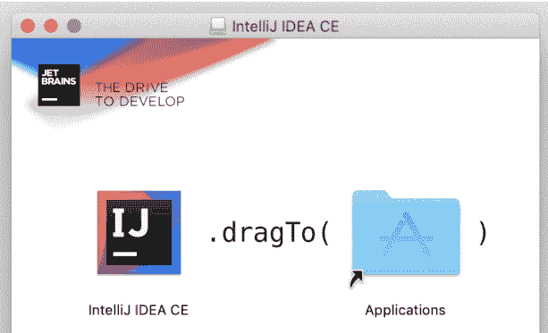

图 1.2：IntelliJ 预装了特定于系统的安装过程。

> Mac OS 上 IntelliJ 的“安装过程”非常简单：将软件包（以图标形式显示）拖入你的应用程序（Applications）文件夹即可。你需要找到并启动 IntelliJ，或者将图标拖入你的 Dock 栏，我就是这么做的。

对于 Windows，你下载可执行文件并运行它。如果你喜欢，可以在桌面上创建一个快捷方式。

在这两种情况下，你都可以使用 JetBrains Toolbox（随 JetBrains Kotlin 包一起提供）来保持你的安装为最新版本，并在有更新可用时添加更新。

你有大量的选项来设置你的 IDE。对于 IntelliJ，你需要选择一个 UI 主题（都是免费的）、一个启动脚本（我建议选择默认并创建该脚本）、默认插件以及一组特色插件。你可以快速点击这些选项，然后 IDE 将会重启。你会看到一个与图 1.3 类似的欢迎界面，你应该选择“创建新项目”（Create New Project）。

> 警告：如果你在 Mac OS X 上接受了默认位置，你可能需要高级权限来安装 IntelliJ 创建的启动脚本。

确保在创建项目时选择了 Kotlin/JVM 选项，如图 1.4 所示。


图 1.3：你通常是从零开始创建一个项目，或者从代码仓库（如 GitHub）导入一个项目。

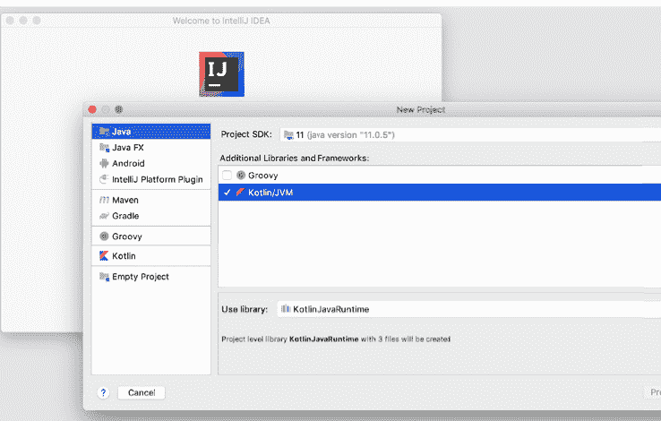

图 1.4：IntelliJ 让开始使用 Kotlin 变得简单，并在你创建新项目时提示你包含 Kotlin 库。

### 创建 Kotlin 程序

一旦你的项目运行起来，就创建一个新的 Kotlin 文件。在左侧导航窗中找到 `src/` 文件夹，右键点击该文件夹，并选择 New（新建） > Kotlin File/Class（Kotlin 文件/类）（参见图 1.5）。你可以输入列表 1.2 中的代码，它看起来会很漂亮，如图 1.6 所示（多亏了 IntelliJ！）。

> 注意：你的 IDE 配置可能与我的不完全一样。如果没有看到 `src/` 文件夹，你可能需要点击 IDE 左侧的 Project（项目）来显示各种文件夹，可能还需要再次点击项目名称。


图 1.5：在 src/ 文件夹中显示的 Kotlin 代码。

> 注意：从现在开始，代码通常不会显示在 IDE 中。也就是说，你可以使用你选择的 IDE（或命令行），因为你应该在不同的 IDE 中获得相同的结果。

### 间歇：设置你的 Kotlin 环境

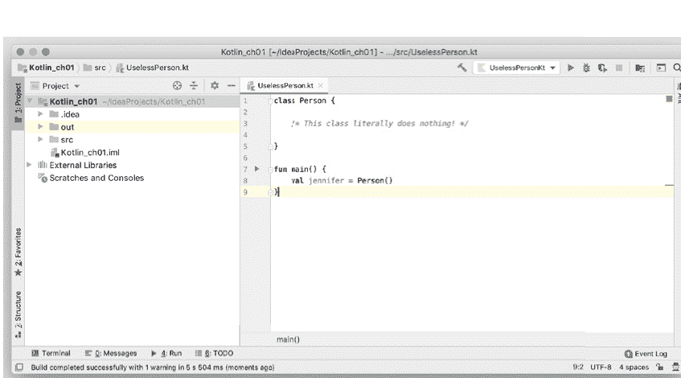


图 1.6：IntelliJ 会自动格式化代码并添加合理的语法高亮。

### 编译并运行你的 Kotlin 程序

现在剩下的就是你自己编译并运行程序了。这很简单，当你有一个定义了 `main()` 函数的 Kotlin 文件时，IntelliJ 会给你一个方便的绿色箭头进行点击。只需悬停在箭头上并点击（参见图 1.7）。然后你可以选择并运行你的文件名（命名为 "UselessPerson"）。你的程序将被编译并运行，输出将显示在底部的新窗格中。

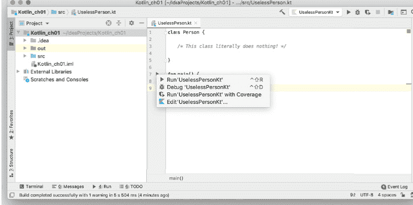

图 1.7：你可以点击绿色按钮并选择第一个选项来构建并运行你的代码。

## 第 1 章 面向对象

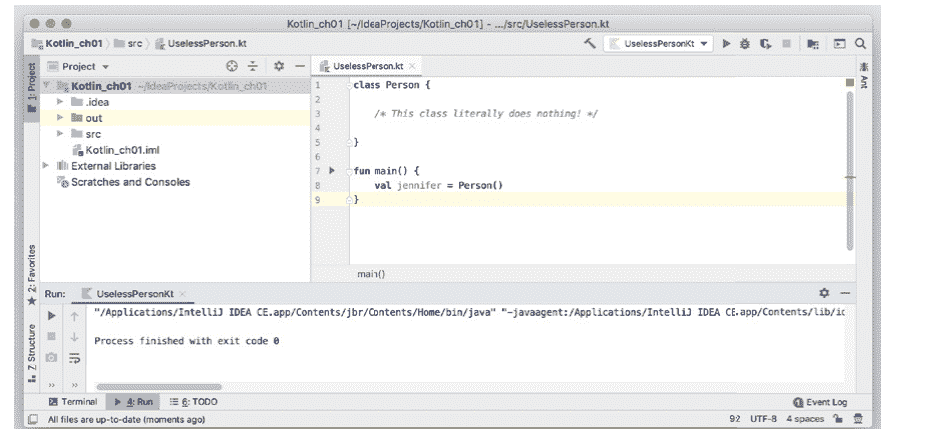

图 1.8：你的程序输出（将会为空）显示在窗口中。

### 修复任何出现的错误

在回到改进代码之前的最后一点说明：IntelliJ 和其他 IDE 在你的代码出现问题时非常擅长提供视觉指示。例如，当你尝试编译相同的程序时，图 1.9 输出窗口中会出现橙色指示。你可以修复错误并重新构建。

### 安装 Kotlin（并使用命令行）

对于高级用户，倾向于使用命令行处理一切。Kotlin 例外。因为它使用 JVM 运行，你可以不需要大量工作就达到目标。

### Windows 命令行 Kotlin

对于 Windows 用户，你需要一个 JDK。你可以从 Oracle 下载页面 `www.oracle.com/java/downloads/` 下载。那里有易于遵循的版本说明。一旦有了 Java，你需要从 GitHub 获取最新的 Kotlin。你可以在 `github.com/JetBrains/kotlin/releases/latest` （这将重定向到最新发布）。下载并遵循说明即可。

### 间歇：设置你的 Kotlin 环境

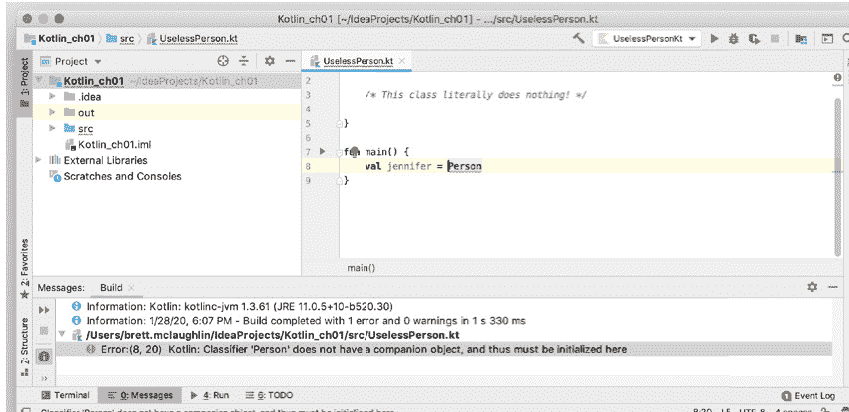

图 1.9：IDE 帮助你快速查找并修复错误。

> 注意：这些指令故意写得很简单。如果你使用命令行，可能不需要太多帮助。但对于其他人，使用 IDE 确实是最好的方法。作为额外，你还可以使用 IntelliJ 作为编译器的代理，这样你可以节省处理命令行的时间！

### Mac OS X 命令行 Kotlin

在 Mac OS X 上运行 Kotlin 最简单的方法是使用 Mac 上的包管理器之一：Homebrew (`brew.sh`) 或 MacPorts (`www.macports.org`)。

对于 MacPorts，只需运行以下命令：

```
sudo port install kotlin
```

这需要提升权限，但在运行之后你就设置好了。

对于 Homebrew，首先进行更新：

```
brew update
```

接下来安装 Kotlin：

```
brew install kotlin
```

### 基于 UNIX 的系统的命令行 Kotlin

如果你不是 Mac OS X 但拥有 Unix 类操作系统，可以使用 SDKMAN! (`sdkman.io`) 来安装 Kotlin。

> 准确地说，Mac OS X 是基于 Unix 的操作系统，所以你可以使用 Mac 的指令，而不是 Homebrew 或 MacPorts。

首先获取 SDKMAN：

```
curl -s https://get.sdkman.io | bash
```

完成后，你需要打开一个新的终端或 shell 窗口，或者按照安装末尾的指示 source 文件。

现在安装 Kotlin：

```
sdk install kotlin
```

### 验证你的命令行安装

无论你选择如何安装 Kotlin，完成后你都应该可以通过此命令验证你的安装：

```
kotlinc
```

> 警告：此时，你可能会被提示安装 Java 运行时。这应该让你的系统能够处理此问题，你可以放心地接受提示。找到你系统的 JDK 或 JRE，下载并运行它。然后再次尝试 `kotlinc`。

如果你的系统已正确配置了 Java，你应该得到类似的内容：

```
kotlinc
Java HotSpot (TM) 64-Bit Server VM running: Options -Xverify:none -noverify are deprecated in JDK 13 and will likely be removed in a future release.
Welcome to Kotlin version 1.3.61 (JRE 1.0.2+8)
Type :help for help, :quit for quit
>>>
```

这是 Kotlin REPL（读取-执行-打印循环），快速评估 Kotlin 语句的工具。我们稍后详细查看，但现在通过输入 `:quit` 退出 REPL。

你也可以通过以下命令验证你的 Kotlin 版本：

```
kotlin -version
```

```
Kotlin version 1.3.61-release-180 (JRE 1.0.2+8)
```

到此时，你准备好开始了！

### 创建有用的对象

有了可以运行的 Kotlin 环境，是时候让列表 1.2 中的那个 `Person` 类变得不那么空洞了。正如之前提的，对象应该模拟现实世界中的对象。具体来说，如果一个对象代表世界中的某个“事物”（在正式圈子里，你会记得对象是“名词”），那么它也应该具有该事物的属性或特征。

一个人的最基本的属性是名字，具体来说是名和姓（如果你喜欢，也可以叫姓氏）。这些可以表示为对象的属性。此外，这些是必要属性；你真的不想创建一个没有名和姓的人。

对于必要属性，最好的方法是在创建对象的新实例时要求这些属性。实例只是对象的一个特定版本；你可能有 `Person` 类的多个实例，每个实例都代表一个真实的人。

> 警告 你有时会听到将属性或属性值称为参数。这并没有错；参数通常是指传递给其他东西的东西；在这种情况下，是把某个东西（名和姓）传递给另一个东西（一个构造函数）。但一旦它们被赋值给对象实例，它们就不再是参数了。在那个时候，它们是对象的属性（更准确地说，是对象的属性值）。所以，从开始将其称为属性值更容易。

看到了吧？这些术语很令人困惑。不过，随着时间的推移你会熟悉的。继续坚持吧。

### 列表 1.3：Kotlin 中一个没那么无用的对象及其构造函数

```kotlin
class Person(firstName: String, lastName: String) {
    /* 这个类仍然没有做什么！ */
}

fun main() {
    val brian = Person("Brian", "Truesby")
}
```

现在这个类有了几个实用的属性，正如大多数开发者所知，代码中存在精简的倾向。人们通常倾向于少写代码而不是多写代码。（注意，这很少适用于书作者！）因此，列表 1.3 可以被压缩；你可以直接删掉构造函数，而功能运行完全相同。列表 1.4 显示了这种微小的压缩（也可以说是一种改进）。

### 列表 1.4：省略构造函数关键字

```kotlin
class Person(firstName: String, lastName: String) {
    /* 这个类仍然没有做什么！ */
}

fun main() {
    val brian = Person("Brian", "Truesby")
}
```

### 使用 toString() 打印对象

这绝对变得好一点了。但输出仍然是空的，类基本上还是没用。然而，Kotlin 免费送给你一些东西：最显著的是，目前每个类都会自动获得一个 `toString()` 方法。你可以通过创建类的实例（你已经这样做了）然后调用该方法来运行它，如下：

```kotlin
val brian = Person("Brian", "Truesby")
println(brian.toString())
```

将此添加到你的主函数中。创建一个新的 Person（给它任何你想要的名字），然后使用 `println` 打印对象实例，并将 `toString()` 的结果传递给 `println`。

> 注意 你可能在想这个 `toString()` 方法到底是从哪里来的（如果不知道，也没关系）。它似乎像魔法一样突然出现。但这不是魔术！它实际上是继承来的。继承与对象密切相关，我们将在第 3 章和第 5 章中详细讨论。

### 术语更新：函数和方法

再次关于一些术语的特定细节。函数是一段运行的代码。`main` 是函数的一个示例。方法基本上是一个附加到对象上的函数。换句话说，方法也是一段代码，但它不像函数那样是“孤立”且独立的。方法定义在对象上，并可以针对特定的实例对象运行。

> 在大部分 Kotlin 官方文档中，函数和方法之间没有明确的界限。然而，我选择了划分这种区别是因为它在通用的面向对象编程中很重要，而且如果你工作或熟悉任何其他基于对象的语言，你就会遇到这些术语。但你应该意识到，在“正统”的 Kotlin 中，所有方法都是函数。

最后句话很重要，所以你可能想再读一遍。它很重要是因为这意味着方法可以与对象实例进行交互。例如，方法可能想要使用对象实例的属性值，比如名和姓。考虑到这一点，回到你的代码中！

### 打印对象（并使用简写）

你可以在任何时候运行 `println`，只需传递它要打印的内容即可。所以你可以说：

```kotlin
println("How are you?")
```

然后你会在结果窗口中得到该输出。你也可以让它打印方法的结果，比如 `toString()`，这就是你之前所做的。但还有另一种快捷方法。如果你传递给 `println()` 的东西具有 `toString()` 方法，那么该方法就会自动运行。所以你可以将这段代码简化为：

```kotlin
println(brian.toString())
```

仅剩如下：

```kotlin
println(brian)
```

在后一种情况下，Kotlin 会为你处理它。

## 初始化对象并修改变量

对于入门来说，这还不错！在结束你的 Kotlin 首次之旅之前，还有一个最后一个细节需要处理。

假设你想对你的 `Person` 类进行一些尝试。尝试一下：更新你的代码以与列表 1.6 一致（其中某些内容可能会让你困惑，但你可能可以弄懂大部分发生的情况）。

### 列表 1.6：为 Person 创建新属性

```kotlin
class Person(val firstName: String, val lastName: String) {
    val fullName: String

    // 在实例化时设置全名
    init {
        fullName = "$firstName $lastName"
    }

    override fun toString(): String {
        return fullName
    }
}

fun main() {
    // 创建一个新的人
    var brian = Person("Brian", "Truesby")

    // 创建另一个人
    var rose = Person("Rose", "Bushnell")

    println(brian)
}
```

你在这里会看到很多新东西，但没有什么意外的。首先，在 `Person` 对象内部声明了一个新变量：`fullName`。这是你已经在 `main` 函数中做过的事情。但这次，因为你是在 `Person` 对象内部执行，它自动成为了每个 `Person` 实例的一部分。

另一个小变化是在 `main` 中添加了一个新的 `Person` 实例；这次是一个名为 `rose` 的变量。

然后，有一个关键字：`init`。这值得进一步讨论。

### 使用块初始化类

在大多数编程语言（包括 Java）中，构造函数接收值（就像在你 `Person` 类中那样）并可能执行一些逻辑。Kotlin 的处理方式不同；它引入了**初始化块**的概念。这个块——方便地用 `init` 关键字标识——是每次创建对象时都应该运行的代码。

这与你习惯的有所不同：数据通过构造函数传入，但它与初始化代码分离，而初始化代码位于初始化块中。

在这种情况下，初始化块使用了新的 `fullName` 变量，并通过类构造函数中的 `firstName` 和 `lastName` 属性来设置它：

```kotlin
// 在实例化时设置全名
init {
    fullName = "$firstName $lastName"
}
```

然后这个变量被用于 `toString()`：

```kotlin
override fun toString(): String {
    return fullName
}
```

> 警告 尽管本章介绍了这么多新材料，但你可能刚刚遇到了从长期来看你可能学到的最重要的事情。通过将 `toString()` 使用 `fullName` 而不是直接使用 `firstName` 和 `lastName` 变量，你正在实现一个名为 **DRY** 的原则：不要重复自己（Don’t Repeat Yourself）。在这种情况下，你没有重复姓和名字的组合，这已经在初始化块中完成了。你将该组合赋值给变量，从此以后，你应该使用该变量而不是它实际引用的内容。这一点稍后讨论，但请注意：这是一件大事！

### Kotlin 自动生成 Getter 和 Setter

目前，一切进展顺利。在你添加的所有内容中，另一个巨大的帮助是 Kotlin 在后台为你做了很多工作。它会自动为你运行（就像初始化块一样），并允许你重写方法。

它还在做其他事情：在你的类上自动生成一些额外的方法。因为你为 `firstName` 和 `lastName` 属性赋值（使用了 `val` 关键字），并且定义了 `fullName` 属性，Kotlin 为所有这些属性创建了 getter 和 setter。

### 术语更新：Getter, Setter, Mutator, Accessor

**Getter** 是一个允许你获取值的方法。例如，你可以将此内容添加到 `main` 函数中，它不仅可以运行，而且会打印 `brian` Person 实例的名：

```kotlin
// 创建一个新的人
val brian = Person("Brian", "Truesby")
println(brian.firstName)
```

这之所以起作用，是因为你为 `firstName` 拥有了一个 getter。你也可以对 `fullName` 和 `lastName` 执行同样的操作。这个（更正式地说）是一个 **accessor（访问器）**。它提供了对值的访问，Kotlin 自动为你创建了它。

Kotlin 还给了你一个 setter，或者（再次更正式地说）一个 **mutator（修改器）**。mutator 允许你修改一个值，这只需要改变它。所以你可以将其添加到程序中：

```kotlin
// 创建一个新的人
val brian = Person("Brian", "Truesby")
println(brian.firstName)

// 创建另一个人
val rose = Person("Rose", "Bushnell")
rose.lastName = "Bushnell"
```

正如你可以通过 accessor 获取数据一样，你也可以通过 mutators 更新数据。

> 警告 在大多数情况下，我会调用 setters 和调用 mutators。这不像 "getter" 或 "setter" 那么常见，但正如我的一位好朋友兼编辑告诉我的那样，setter 是有点复杂的；mutator 允许你更新类数据。这种差异——以及他生动的解释——已经在我脑海了 20 年。

现在，如果你已经编译了这段代码，你遇到了另一个错误，这是在结束你的 Kotlin 首次之旅之前最后一个需要解决的问题。

### 常量不可更改（某种）

这是导致问题的代码：

# 2

### Kotlin 很难被破坏

本章内容包括：

- 深入研究 Kotlin 类型和变量
- 更多关于可变性（mutability）的内容
- 创建自定义访问器（accessors）和修改器（mutators）
- 变量创建期间及之后的赋值
- 类型安全及其含义

### 提升你的 Kotlin 类技巧

你已经对 Kotlin 有了实实的介绍，包括构建了你的第一个对象。所以，我们将直接进入正题。那个关于人的姓氏显示不错误的困扰问题，在修复它之前，你已经准备好从预编译的角度提升你构建类的方法。

到目前为止，你一直使用单个文件来包含你的类（`Person`）和主函数（`main function`）。但这并不可扩展。不久之后，你会有很多类——而且是类，而不是类的实例。

> 快速回顾一下，类是一个定义。你有一个 `Person` 类，可能还会一个 `Car` 类或 `House` 类。类的实例是特定的内存块，其中持有一个对象的表示。在上一章中，当你创建 `brian` 或 `rose` 变量时，你分配了这些 `Person` 类的实例。

获取一个类的许多实例是很容易的，定义许多不同的类也是如此。在这些情况下，如果你只使用单个文件，事情就会变得混乱。

如果你把所有类都丢进一个文件，那个文件将变得一团糟。更好的做法是将每个类都分离到它们自己的文件中：每个类一个文件（通用做法），然后如果你有主函数，也给它一个单独的文件。

### 根据类名命名文件


# 去创建一个新的 Kotlin 项目吧

你可以叫它任何名字；如果需要建议，`Kotlin_ch02` 就可以。然后，在 `src/` 文件夹中，创建一个名为 `Person` 的新文件。你的 IDE 可能会自动为你添加 `.kt` 扩展。然后，将你在第 1 章中现有的 `Person` 代码放进去。为了起见，该代码在列表 2.1 中。

## 列表 2.1：第 1 章的 Person 代码

```kotlin
class Person(var firstName: String, var lastName: String) {
    var fullName: String

    // 在创建实例时设置全名
    init {
        fullName = "$firstName $lastName"
    }

    override fun toString(): String {
        return fullName
    }
}
```

现在在 `src/` 中也创建另一个文件，并命名为 `PersonApp`。你可以将现有的主函数放入其中。那段代码重新打印在列表 2.2 中。

## 列表 2.2：测试 Person 类的主函数

```kotlin
fun main() {
    // 创建一个新人
    val brian = Person("Brian", "Truesby")
    println(brian)

    // 创建另一个人
    val rose = Person("Rose", "Busnell")
    println(rose)

    // 修改 Rose 的姓
    rose.lastName = "Busnell-Truesby"
    println(rose)
}
```

此时，你应该能够像在第 1 章中那样运行 `PersonApp` 了。你的输出也应该是相同的。你可以在图 2.1 中看到 IntelliJ IDE，两个 Kotlin 文件作为标签页，输出在底部的面板中。

### 提升你的 Kotlin 类技巧

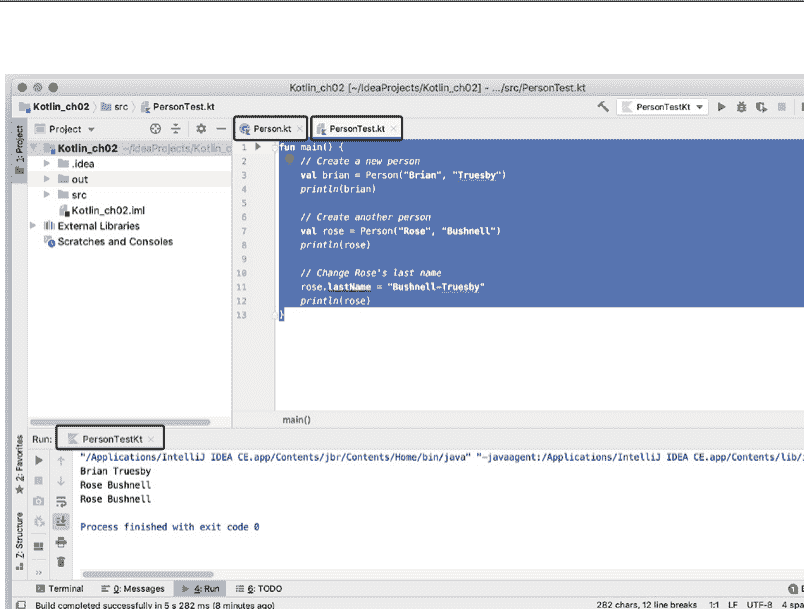

图 2.1：你的 IDE 应该让你轻松获取源码以及输出。

> **警告** 如果你收到任何警告，最可能的原因是你没有将 `Person` 和 `PersonApp` 文件创建在同一个目录中。确保两个文件都在 `src/` 目录下并进行尝试。

在此之后，你可以继续在 `src/` 目录中保留更多对象。但还有更好的方法！

### 使用包组织你的类

虽然你将 `Person` 与测试主函数分开很棒，但你仍然没有真正解决原始问题：类的组织。如果将所有类都放在一个文件中很痛苦，那么推此类推，将所有类都放在一个目录中也是同样的痛苦。

你真正想要的是按功能组织你的类。假设你需要 `Person` 类，但你以后可能还需要某些特定类型的人；也许是 `Mother` 类或 `Child` 类。例如，你正在编写一个软件来模拟家谱模型。

在这种情况下，你真的希望将与 `Person` 相关的类分在一起。你可能还有一些与客户相关的类，带有他们的账户信息：用户名、密码、电子邮件。这些不是 `Person` 的实例，它们（可能）是 `User` 的实例。你可能以后会有一个 `UserPreferences` 类，让你存储该用户的信息。所以它可能属于一组与 `User` 相关的类。

Kotlin 以及许多其他语言都使用“包”的概念来组织这种结构。包只是类的逻辑分组，具有特定的命名空间：一种通过前缀来标识类之间相互相关的方法。你可以有一个包含 `Person`、`Mother`、`Father` 等类的包，以及一个包含 `User`、`UserPreferences` 等类的用户包。

命名你的包很重要，所以有几项做法：

- 包应该以小写字母开头。使用 `person` 而不是 `Person`。（类以大写字母开头；包以小写字母开头。）
- 以点分隔的名字开始包，以标识组织机构，如 `org.wiley` 或 `com.myCodeShop`。

如果你使用 Kotlin 之外的其他语言，你可能还想将 `kotlin` 作为包名的一部分，以便将包与其他代码（如 Java）区分开来。

将所有这些整合在一起，并用点（`.`）分隔各个部分。对于本书，包通常会是 `org.wiley.kotlin.[general category]`。`Person` 将位于 `org.wiley.kotlin.person`，`User` 将位于 `org.wiley.kotlin.user`。

> **注意** 你并不总是需要让包的最后部分（如 `person`）与该包中的类（如 `Person`）匹配。你可能有一个 `org.wiley.kotlin.sport` 包，包含各种与运动相关的类，如足球、棒球、冰球和排球，但并没有一个真正的 `Sport` 类。这完全取决于自己的喜好和风格。

## Kotlin 拥有大量的类型

在完成这些更改后，你可以重新编译并运行你的程序。一切都应该运行得非常完美（尽管最后一个名字还是错的！）。

### 类：Kotlin 中的终极类型

在介绍 Kotlin 类型之前——本章接下来的大部分时间将花在类型上——值得说，类确实是 Kotlin 中的终极类型。类为你提供了一种收集数据并统一方式处理这些数据的方法，并对世界进行建模：句子、汽车或人等对象，以及无线电波或设备等抽象概念。

类还让你触及了 Kotlin 中至关重要的东西：**类型安全**是指编程语言防止你犯错误的程度，例如将一种类型（如数字）赋值给本应持有字母的变量。没有什么比把一个变量当成全都是字母，却导致程序崩溃更让人沮丧了——因为发现该变量实际上包含一个 `Person` 实例（或 `Car`、`User` 或其他不像字母的东西）。

这就是为什么类和对象对类型安全如此关键的原因。你的 `Person` 现在是强类型的；你不能创建一个整数并将其显示为字符串。更具体地说，你不能创建一个 `Car` 并将其显示为 `Person`。随着章节的进行，你将看到更多关于这的内容。目前，只需将对象视为一种非常强大的方式，以确保变量（通过 `val` 或 `var`）恰好拥有你世界中所需的内容。

> **注意** 如果你想知道 Kotlin 如何知道变量允许什么类型，请继续阅读。稍后会有更详细的介绍。

### Kotlin 中的数字

Kotlin 为整数提供了四种选择，主要取决于范围。这些在表 2.1 所示。

**表 2.1：Kotlin 整数类型（非小数）**

| 类型 | 尺寸（位） | 最小值 | 最大值 |
|---|---|---|---|
| Byte | 8 | -128 | 127 |
| Short | 16 | -32,678 | 32,678 |
| Int | 32 | -2,147,483,648 (-2³¹) | 2,147,483,647 (2³¹ – 1) |
| Long | 64 | -9,223,372,036,854,777,808 (-2⁶³) | 9,223,372,036,854,777,807 (2⁶³ – 1) |

## 第 2 章 很难“搞坏” Kotlin

当你没有显式声明类型时，Kotlin 很大程度上会自动处理应该使用哪种类型。在这方面，它会在你为变量赋值时查看值并做出一些假设。这是一个非常重要的概念，称为**类型推断**，我们将在第 6 章中详细讨论。

如果你创建一个变量并为其赋值一个类型为 `Int` 的数字，那么将使用 `Int`。如果数字超出了 `Int` 的范围，它将被用作 `Long` 使用：

```kotlin
val someInt = 20
val tooBig = 4532145678
```

所以在这里，`someInt` 将是一个 `Int`。`tooBig` 太大，无法放入 `Int`，因此它将是一个 `Long`。你也可以通过将值强制转换为 `L` 来强制变量为 `Long`：

```kotlin
val marketLong = 42L
```

Kotlin 同样为小数提供了两个选择，同样基于精度和大小。这些列在表 2.2 中。

**表 2.2：Kotlin 小数类型**

| 类型 | 尺寸（位） | 有效位 | 指数位 | 小数位数 |
|---|---|---|---|---|
| Float | 32 | 24 | 8 | 6–7 |
| Double | 64 | 53 | 11 | 15–16 |

这里的赋值方式有点出乎意料。除非你告诉 Kotlin 使用 `f` 或 `F` 后缀作为 `Float`，否则小数变量都是 `Double`：

```kotlin
val g = 9.8
val theyAllFloat = 9.8F
```

### 字母和其他

如果你想表示单个字符——包括反斜杠或回车等特殊字符——你使用 `Char` 类型：

```kotlin
val joker = 'j'
```

字符应该包含在单引号中。你也可以将特殊字符包含在引号中并在字符代码前加上反斜杠。例如制表符是 `\t`，换行是 `\n`，反斜杠本身是 `\\`：

```kotlin
val special = '\n'
```

> **注意** 反斜杠很特殊，因为它本身就是一个转义字符。要获得实际的反斜杠，你需要使用转义字符 (`\`) 然后另一个反斜杠 (`\`)，从而得到 `\\`。

对于字符序列，你可能想要 `String`。你可以创建一个包含双引号内文本的字符串：

```kotlin
val letters = "abcde"
```

非常简单！但注意，双引号中的单个字母是 `String`，而单引号中的单个字母是 `Char`。

### 你必须初始化属性

Kotlin 要求你初始化属性。如果你尝试编译列表 2.2 中的 `Person` 类，你会收到类似下面的错误：

```text
Error: Property must be initialized
```

让我们以后再处理。最简单的方法是更新 `Person` 类以要求所有内容：

```kotlin
package org.wiley.person

class Person(var firstName: String, var lastName: String,
    var height: Float, var age: Int, var hasPartner: Boolean) {
    var fullName: String

    // 在创建实例时设置全名
    init {
        fullName = "$firstName $lastName"
    }

    // 其他方法见
}
```

### 列表 2.4：填充你的 Person 实例

```kotlin
import org.wiley.kotlin.person.Person

fun main() {
    // 创建一个新的人
    val brian = Person("Brian", "Truesby", 68.2, 33, true)
    println(brian)

    // 创建另一个人
    val rose = Person("Rose", "Busnell", 56.8, 32, true)
    println(rose)

    // 修改 Rose 的姓
    rose.lastName = "Busnell-Truesby"
    println(rose)
}
```

你的运行结果与你预期的不符。你可能遇到了类似下面的错误：

```text
Error:(5, 44) Kotlin: The floating-point literal does not conform to the expected type Float
Error:(9, 43) Kotlin: The floating-point literal does not conform to the expected type Float
```

这到底是什么意思？如果你找到那行（括号中的第一个数字）以及该行上的位置（位置 44），你就会发现错误发生的地方：

```kotlin
val brian = Person("Brian", "Truesby", 68.2, 33, true)
```

你为身高传递了一个小数数——这看起来似乎是正确的。这里是 `Person` 类中的构造函数：

```kotlin
class Person(var firstName: String, var lastName: String,
var height: Float, var age: Int, var hasPartner: Boolean) {
```

那是怎么回事呢？问题在于 Kotlin 不会进行类型转换。实际上发生了几件事：

1. 你给了 Kotlin 一个值 `68.2`。Kotlin 看到一个小数并自动使用了 `Double` 类型。这非常重要！只要没有给小数指定显式类型，Kotlin 就会使用 `Double`。
2. 这个 `Double` 被传递到 `Person` 构造函数中。然而，`Person` 期望的是 `Float`。
3. Kotlin 不会尝试在这两个类型之间进行转换——尽管在这种情况下，它们是兼容的！相反，Kotlin 强制要求强类型，并抛出错误。

### 显式地告诉 Kotlin 使用什么类型

你有两种方法来修复这个问题。简单的方法是告诉 Kotlin 你传递的值应该被视为 `Float`；你可以通过在数字后面加一个 `F` 来实现这一点：

```kotlin
val brian = Person("Brian", "Truesby", 68.2F, 33, true)
println(brian)

// 创建另一个人
val rose = Person("Rose", "Busnell", 56.8F, 32, true)
println(rose)
```

在这种情况下，你向 `Person` 发了它想要的内容：一个 `Float`。这通过了类型检查，一切又正常了。

### 尝试预判类型将如何被使用

虽然解决方案有效，但它有点不够优雅。这将要求 `Person` 类的每个用户——包括你自己——在小数后加 `F`，或者在传递给构造函数的变量中使用 `Float` 类型。而且正如你学到的，Kotlin 使用 `Double` 作为默认的小数类型。

更好的解决方案是意识到，如果 Kotlin 默认使用 `Double`，也许你也应该这样做。（至少，除非你有非常充分的理由不这样做）。所以，修改你的 `Person` 构造函数，让它接收大多数用户传递的内容——即来自输入类型数字的 `Double`：

```kotlin
class Person(var firstName: String, var lastName: String,
var height: Double, var age: Int, hasPartner: Boolean) {
```

简单！而且，因为你预判了用户将如何创建 `Person` 的新实例，你会让你那些友好的开发者同事感到非常满意。

> **注意** 不要忘记删除 main 函数中两个数字的 `F`。如果你这样做，你将得到另一个错误——这次是因为尝试将 `Float` 传递给一个期望 `Double` 的构造函数。

## 弄坏 Kotlin 是很容易的（某种程度上）

这一章的标题是“很难弄坏 Kotlin”，这听起来可能与你所看到的相反。你没费吹灰之力就成功让 Kotlin 抛出了大量错误，而且 Kotlin 在帮助你进行类型转换方面保持着相当强的抵抗。

事实上，Kotlin 在你的代码在某些生产系统中运行、为移动应用提供 API、或在手机上运行或处理 Web 请求之前，就已经崩溃了。换句话说，Kotlin 让你在编译时（即在你写代码时）做一些额外工作，以避免程序在运行需要工作时出现潜在问题。

换句话，这一章的标题可能叫“当 Kotlin 在生产环境中运行时很难弄坏，因为它会在你进入生产环境之前迫使你在类型上变得非常具体”。当然，这真的不是一个任何人能通过编辑和校对的标题，所以我们就用“很难弄坏 Kotlin”吧，并相信你知道这意味着什么。

## 重写属性访问器和变更器

根据你对类型（特别是强类型）的了解，你终于准备好回到 `Person` 类中那个恼人的小细节了：如果你在 `Person` 构造函数之外设置姓，打印类实例时将是原始名称，而不是修改后的名称。作为复习，这里是相关的代码：

```kotlin
// 创建另一个人
val rose = Person("Rose", "Busnell", 56.8, 32, true)
print(rose)

// 修改 Rose 的姓
rose.lastName = "Busnell-Truesby"
println(rose)
```

结果是？这个：

- Rose Busnell
- Rose Busnell

这里真正需要发生什么呢？嗯，每当姓（或者名）更新时，该实例所代表的人的全名都需要更新。这看起来足够了，对吧？

噢，等一下，因为这很快就会变得相当复杂。你即将进入 Kotlin 中略显异常的变更器和访问器的世界。

### 自定义设置器无法在构造函数中

这真是一个绕口令！但是，事实是：我们无法在主构造函数中自定义访问器。你可能已经注意到“主构造函数”这个术语。

> **注意** 它是主构造函数中定义的。稍后你会看到 Kotlin 允许你定义多个构造函数。

### 将属性移出主构造函数

你实际上发现了 Kotlin 中一种非常标准的做法。回想：

```kotlin
class Person(firstName: String, lastName: String) {
```

然后，你为每个添加了 `var` 关键字：

```kotlin
class Person(var firstName: String, var lastName: String) {
```


这使得 `firstName` 和 `lastName` 属性有了访问器和变更器。问题是，由于你现在的版本，这意味着这一行代码无法工作：

```
rose.lastName = "Bushnell-Truesby"
```

所以这里出现了一个明显的冲突：

- 如果属性声明在类的构造函数中，你就无法自定义访问器或变更器。
- 如果属性没有在构造函数中声明且不在类的其他地方声明，你就不会获得自动访问器或变更器。

### 立即初始化属性

现在，为了让这一切变得更复杂，你还遇到了另一条规则：

为了记住它是如何显示的，在构造函数中定义所有属性，但这次你像处理 `lastName` 那样在构造函数下方定义：

```kotlin
class Person(firstName: String, lastName: String, height: Double, age: Int, hasPartner: Boolean) {
  var fullName: String
  var firstName: String
  var lastName: String
  var height: Double
  var age: Int
  var hasPartner: Boolean

  // 在创建实例时设置全名
  init {
    fullName = "$firstName$lastName"
  }
}
```

编译，运行你将得到另一个以前见过的错误，但这次是针对你所有的属性：

```
Error:(6, 5) Kotlin: Property must be initialized or be abstract
Error:(7, 5) Kotlin: Property must be initialized or be abstract
Error:(8, 5) Kotlin: Property must be initialized or be abstract
Error:(9, 5) Kotlin: Property must be initialized or be abstract
Error:(10, 5) Kotlin: Property must be initialized or be abstract
```

这个问题在 `firstName` 上出现过，我们通过在代码的 `init` 块中设置该值解决了它。我们需要在这里做一些类似的操作：我们需要给每个属性赋值，赋值是被传入构造函数。因此，属性 `firstName` 应该被赋值为传入 `Person` 构造函数的输入 `firstName` 的值。

> 注意：如果你觉得这个句子看起来很困惑，你并不孤单。这里有两个 `firstName` 信息在浮动：一个是传入构造函数的，另一个是属性名。这是一个我们很快就会解决的问题。

Kotlin 为你提供了一种这种赋值的方法，但它看起来会有点奇怪。基本上，进入构造函数的值在创建时对你的属性是可用的，你可以直接将它们赋值给这些属性。这比之前描述的要简单一点，请看列表 2.5 所示的新版本 `Person`。

### 列表 2.5：将构造函数信息赋值给属性

```kotlin
package org.wiley.kotlin.person

class Person(firstName: String, lastName: String, height: Double, age: Int, hasPartner: Boolean) {
    var fullName: String = firstName
    var lastName: String = lastName
    var height: Double = height
    var age: Int = age
    var hasPartner: Boolean = hasPartner

    // 在创建实例时设置全名
    init {
        fullName = "$firstName $lastName"
    }

    override fun toString(): String {
        return fullName
    }
}
```

只看处理这一行的代码：

```
var firstName: String = firstName
```

声明了一个属性，并且它是可读可写的，因为使用了 `var`。（记住，如果你想让它成为一个只读属性，你应该使用 `val`。）该属性被赋予了一个名称——`firstName`——然后是一个类型，`String`。然后，为这个新属性赋了一个值。在这种情况下，该值就是传入构造函数 `firstName` 的任何值。

你现在可以编译并运行代码了，它再次运行良好了！（尽管最后一个姓名的问题还需要解决。但你已经越来越接近了。）

### 尝试避免过度使用名称

尽管如此，这段代码仍然相当困惑。你拥有的与构造函数输入同名的属性，这虽然合法的，但理解和遵循起来很痛苦。一个简单的解决方案（也是 Kotlin 社区的常用方法）是为传入构造函数的非属性值名称使用下划线。列表 2.6 显示了这种变化；它纯粹是外观上的，但提升了类的可读性。

> 列表 2.6：明确属性名称和构造函数输入

```kotlin
package org.wiley.kotlin.person

class Person(_firstName: String, _lastName: String,
    _height: Double, _age: Int, _hasPartner: Boolean) {
    var fullName: String
    var firstName: String = _firstName
    var lastName: String = _lastName
    var height: Double = _height
    var age: Int = _age
    var hasPartner: Boolean = _hasPartner

    // 在创建实例时设置全名
    init {
        fullName = "$firstName $lastName"
    }

    override fun toString(): String {
        return fullName
    }
}
```

> 注意：由于 Kotlin 是强类型的并且具有如此独特的功能——多个构造函数、属性与方法输入的区别等——使用这些编码最佳实践将有助于将你的代码与那些经验不足且精通的人的代码区分开。

### 为某些属性重写修改器

你现在已经准备好完成我们的目标了：重写更改名字或姓氏的方式。首先，你需要查看一个典型的修改器是如何定义的。

这里是更多针对 Kotlin 的代码，定义了一个自定义的修改器；在这种情况下，它是针对 `firstName` 的：

```kotlin
var firstName: String = _firstName
set(value) {
    field = value
}
```

`set` 关键字告诉 Kotlin 这是一个修改器。此外，Kotlin 假设该修改器适用于刚刚定义的任何属性。

> 警告：Kotlin 使用文件中的属性定义行来确定，如果有自定义的修改器（或访问器），那么该定义就在紧随其后的行。这很重要，值得注意。

然后，`value` 代表进入修改器的值。因此在下面的示例中，`value` 将作为 "Bobby" 进入 `firstName` 修改器：

```kotlin
// Brian 的名字
brian.firstName = "Bobby"
```

现在事情看起来可能有点奇怪了。这里有这一行：

```
field = value
```

那里发生了什么？`field` 到底是什么？嗯，它是正在被修改的属性。它正在调用一个后台字段。因此，这里 `field` 引用属性 `firstName` 的后台字段（因为该属性刚刚被定义）。该后台字段被赋值为传入修改器的值——在我们的示例中，就是字符串 "Bobby"。

最后一部分是你不能写出类似这样的代码：

```kotlin
var firstName: String = _firstName
set(value) {
    firstName = value
}
```

这段代码实际上可以编译，但当你尝试运行并使用这个类时，它会给你一个糟糕的错误。问题在于 Kotlin 看到了这个：

```
firstName = value
```

它将其解释为“运行修改 `firstName` 的代码”。但那段代码已经在运行中了。所以它调用了自己——这种概念被称为递归——然后那行代码再次运行。又一遍。又一遍。然后……你明白意思了。

通过使用后台字段，你避免了这种递归，一切都运行得正常。去为 `firstName` 和 `lastName` 创建一个自定义修改器吧；完成后完成后应该像列表 2.7 那样。

### 列表 2.7：为 firstName 和 lastName 定义修改器

```kotlin
package org.wiley.kotlin.person

class Person(firstName: String, lastName: String,
    height: Double, age: Int, hasPartner: Boolean) {
    var fullName: String
    var firstName: String = _firstName
    set(value) {
        field = value
    }
    var lastName: String = _lastName
    set(value) {
        field = value
    }
    var height: Double = _height
    var age: Int = _age
    var hasPartner: Boolean = _hasPartner

    // 在创建实例时设置全名
    init {
        fullName = "$firstName $lastName"
    }

    override fun toString(): String {
        return fullName
    }
}
```

### 类可以拥有行为

我们需要的是一种定义行为的方式。具体来说，当名字或姓氏改变时，全名也应该改变。有了修改器，部分工作已经完成了。

### 在你的类上定义自定义方法

那么，我们需要一个新方法。让我们把它命名为 `updateName()`，并让它更新 `fullName` 属性。这里是你需要的代码：

```kotlin
fun updateName() {
    fullName = "$firstName $lastName"
}
```

这实际上是 `init` 块中已经的代码。但不再需要它了！你可以在 `init` 块中调用 `updateName()`。列表 2.8 显示了完成后 `Person` 应该的样子。

### 列表 2.8：创建一个更新 fullName 的新属性

```kotlin
package org.wiley.kotlin.person

class Person(_firstName: String, _lastName: String,
    _height: Double, _age: Int, _hasPartner: Boolean) {
    var fullName: String
    var firstName: String = _firstName
    set(value) {
        field = value
    }
    var lastName: String = _lastName
    set(value) {
        field = value
    }
    var height: Double = _height
    var age: Int = _age
    var hasPartner: Boolean = _hasPartner

    // 在创建实例时设置全名
    init {
        updateName()
    }

    fun updateName() {
        fullName = "$firstName $lastName"
    }

    override fun toString(): String {
        return fullName
    }
}
```

### 每个属性都必须初始化

这看起来没什么不同。然而，存在一个问题。编译这段代码你会得到一个错误，那个错误可能变得熟悉：

```
Error:(5, 5) Kotlin: Property must be initialized or abstract
```

这里发生了什么？嗯，这有点麻烦。记住，任何属性都*必须*在声明时赋予一个初始值（例如 `firstName` 和 `lastName`），或者在 `init` 块中赋值。

现在，看起来是会发生这种情况，但 Kotlin 并没有像你那样完全遵循你的代码。虽然可以看出当 `init` 调用 `updateName()` 时，`fullName` 会获得一个值，但 Kotlin 只是看到 `init` 中没有对 `fullName` 进行赋值，因此抛出了错误。

### 为未初始化的属性分配占位值

这里最修复方法其实非常……简单。你只需要在创建时分配一个空值，例如空字符串 `""`，就可以绕过 Kotlin 对属性初始化的强制要求。只需将它添加到你的类中即可：

```kotlin
class Person(firstName: String, lastName: String,
    height: Double, age: Int, hasPartner: Boolean) {
    var fullName: String = ""
}
```

Kotlin 不会再继续抱怨了！你已经初始化了 `fullName`，所以没问题。然而，这有点棘手。它违背了 Kotlin 检查的目的（我们稍后会回到这一点）。它还在你的代码中建立了一个隐藏的依赖。再次查看 `init` 方法：

```kotlin
// 在创建实例时设置全名
init {
    updateName()
}
```

即使如此，除了你对 `Person` 如何工作的记忆和理解——以及这一章之外，没有什么能提醒你需要在 `init` 中调用 `updateName()`。如果你没有，`fullName` 将不会被初始化，进而会搞乱 `toString()` 函数。坏消息！

如果你觉得这看起来不太可能，事实并非如此。当你编写代码时，你清楚它应该是什么样的。但过几周或几个月后，你就忘记了它是如何工作的，以及你为什么要那样写它！糟糕的是，同样可能的是，别人回来看到它时完全不知道它是如何工作的。

在这两种情况下，某个心怀好的维护者都可能忘记了在 `init` 中必须调用 `updateName()`，或者移动了它，导致问题随之而来。这真的是一个脆弱的解决方案。

### 告诉 Kotlin 你稍后会初始化属性

另一个简单的解决方案是告诉 Kotlin 你稍后会初始化属性。这有点等同于说：“看着，Kotlin，相信我。我会处理的。”要做到这一点，你可以在属性声明前加上 `lateinit` 关键字，这个关键字的意思正如其名——你将在稍后初始化该属性：

```kotlin
class Person(firstName: String, lastName: String,
    height: Double, age: Int, hasPartner: Boolean) {
    lateinit var fullName: String
}
```

移除对 `""` 的赋值并添加 `lateinit`。现在，你的类可以再次编译了！没问题。

> 警告：`lateinit` 有一些相当局限性。它适用于 `var` 而不适用于 `val`，且属性不能在构造函数内部声明。你不能为用 `lateinit` 声明的属性创建自定义的访问器或修改器。所以它不是万能的。事实上，在这种情况下，它甚至算不上真正的修复。

虽然这看起来解决了你的问题，但事实并非如此。你仍然面临着给 `fullName` 分配空字符串的问题：你建立了一个对在 `init` 中调用 `updateName()` 的沉默依赖。Kotlin 不再为你进行检查了，因为你说过：“我会处理的。”

所以这就是脆弱的解决方案，在某些情况下，它甚至比一开始就使用占位值更危险。

### 从函数为你的属性赋值

值得花一分钟记住这里实际的问题是什么。你需要确保 Kotlin 在以下三个合法位置之一看到对 `fullName` 进行了值的赋值：

- 在类的主构造函数中
- 在属性的声明中
- 在类的 `init` 块中

你已经看到，仅仅调用另一个函数（如 `updateName()`）并让该函数执行赋值是不够的。

我们需要做的第一件事是修改你的函数。为什么？因为目前它没有返回一个值——这意味着你不能将该函数作为赋值的右侧。换句话说，你无法获取极其重要的：

```kotlin
var fullName: String = // 这里是某些……比如一个函数！
```

所以将 `updateName()` 修改为实际返回一个值。顺便让我们更改它的名称以更好地反映它的功能：

```kotlin
fun combinedNames(): String {
    return "$firstName $lastName"
}
```

现在你需要进行清理：

1. 从 `init` 中移除对 `updateName()` 的引用。
2. 将函数的返回值。
3. 完全移除 `init` 块。
4. 在所有属性声明之后移动 `fullName` 属性的声明。


> **警告** 不要错过最后一项！现在当你使用 `firstName` 和 `lastName` 的值时，属性声明的顺序很重要。你需要在 `fullName` 声明和 `combinedNames()` 执行之前获取 `firstName` 和 `lastName` 的值。你可以在示例 2.9 中看到这些内容。

### 示例 2.9 获取 fullName 属性（部分）

```kotlin
package org.wiley.kotlin.person

class Person(_firstName: String, _lastName: String,
_height: Double, _age: Int, _hasPartner: Boolean) {

  var firstName: String = _firstName
    set(value) {
      field = value
    }

  var lastName: String = _lastName
    set(value) {
      field = value
    }

  var height: Double = _height
  var age: Int = _age
  var hasPartner: Boolean = _hasPartner
  var fullName: String = combinedNames()

  fun combinedNames(): String {
    return "$firstName $lastName"
  }

  override fun toString(): String {
    return fullName
  }
}
```

### 有时你不需要属性

难以置信的是，在这一切之后，如果 `lastName` 发生了，代码输出仍然是不正确的。这里有一个简单的修复方法是通过 `firstName` 和 `lastName` 的自定义修改器来更新 `fullName`：

```kotlin
var firstName: String = _firstName
  set(value) {
    field = value
    // 更新 fullName
    fullName = combinedNames()
  }

var lastName: String = _lastName
  set(value) {
    field = value
    // 更新 fullName
    fullName = combinedNames()
  }
```

现在，终于，一切都正常了！这一切之后令人兴奋的应该是这样的：但在你开启香槟之前，花一分钟考虑一下这个解决方案！这里有几个问题，都不是小事：

- 你在 `firstName` 和 `lastName` 中都有相同的代码——对 `fullName` 的赋值，每当你两次使用相同的代码，这并不好。尝试避免重复代码，因为它很容易出错。
- 需要大量工作来设置一个没有特殊行为的属性。这只是姓的组合！
- 你已经有一个提供全名的函数；它被称为 `combinedNames()`。

一个更好的方法（尽管难以相信）是完全移除 `fullName`。然后有很多内容可以移除。让我们使用 `combinedNames()` 来处理 `firstName` 和 `lastName` 的组合。但如果你这样做，你实际上也可以移除 `firstName` 和 `lastName` 的自定义修改器！

再进一步，将 `combinedNames()` 重命名为 `fullName()`，并让 `toString()` 直接使用它。毕竟，你应该得到类似示例 2.10 的东西，它非常简洁！

### 示例 2.10：一个更简单的 Person 版本

```kotlin
package org.wiley.kotlin.person

class Person(firstName: String, lastName: String,
              height: Double, age: Int, hasPartner: Boolean) {

    var firstName: String = firstName
    var lastName: String = _lastName
    var height: Double = _height
    var age: Int = _age
    var hasPartner: Boolean = _hasPartner

    fun fullName(): String {
        return "$firstName $lastName"
    }

    override fun toString(): String {
        return fullName()
    }
}
```

编译并运行 `PersonApp`，你应该在更新实例 `lastName` 之前之后得到正确的结果。

### 类型安全改变一切

这里的巨大收获是，当一种语言寻求真正强制类型安全时（如 Kotlin 一般），语言中的几乎所有内容都受到了影响。属性要求有值，并且尽早，这样 Kotlin 才能确保使用正确的类型。变量的可变性被严格控制——在 Kotlin 的情况下，`var` 和 `val` 不同——这样 Kotlin 可以决定何时需要保持变量类型以及赋值该类型的值。Kotlin 不会为你转换类型。所有这些保持类型安全完整并使在运行时破坏 Kotlin 变得更加困难的微妙之处。

信不信，Kotlin 的类型安全还有很多内容：你将在未来的章节中学习。Kotlin 有一组关于值、空值检查以及空安全的特定规则：防止你的代码出现空指针异常。

> **注意** 如果你不熟悉空指针，或者从未见过 `NullPointerException`（例如在 Java 中），请认为自己很幸运。如果你遇到过，它们是非常困难的 bug 的根源。Kotlin 试图在编码层增加一些额外工作，以避免那些讨厌且难以发现的 bug。这是一个权衡，但对 Kotlin 来说效果很好。

### 写代码很少是线性的

如果你退后一步，考虑你在过去两个章节中所做的事情，它既酷又可能令人困惑。酷的部分是，即使你以前从未写过一行 Kotlin，你也获得了一个功能良好的类，它使用了 Kotlin 的一些关键且相对独特的特性：对象、构造和重写类（稍后介绍），以及 Kotlin 对属性值的非寻常要求。

## 第 3 章 Kotlin 极其优雅

本章包含哪些内容？

- 每个类都有一个 `equals()` 和 `hashCode()` 方法
- 不同类型的对象和对象实例之间的比较
- 以有意义的方式重写 `equals()` 和 `hashCode()`
- `equals()` 和 `hashCode()` 在比较操作中的重要性
- 为什么类的基础知识至关重要

### 对象、类与 Kotlin

说 Kotlin 完全是关于对象的，这绝非夸张之言，这必然意味着它完全是关于类的。由于对象只是类的一个特定实例——即实例化——因此任何大量使用对象的语言都会有大量的基于类的逻辑。

简单来说，如果你想成为一名优秀的 Kotlin 程序员，你就需要理解类，因为你会频繁地使用它们。事实上，大多数 Kotlin 应用程序至少涉及一个非局部部分：你已经见过的 `main` 函数。

在本章中，你将更深入地研究类，并真正理解它们在 Kotlin 中“开箱即用”的特性，以及如何更有效地使用它们。其他几乎所有内容都将基于此，所以请花些时间，尽量不要跳过那些无聊的部分。

> **注意** 作家说出“无聊的部分”听起来可能很奇怪，但确实会有一些无聊的部分出现。Kotlin 中关于类的所有内容并不特别有趣，甚至不是全是事实。尽管如此，你必须掌握这些东西，才能知道如何最大化地利用类。所以……无聊吗？是的。有必要吗？也是。

### 所有类都需要一个 EQUALS(X) 方法

你应该意识到的第一点是你已经用过的某个东西：Kotlin 中的每个类都预定义了一些方法。你在 `Person` 类中重写 `toString()` 时就已经看到了。

> **注意** `toString` 和类似方法背后的原理远比在每个类中“存在”要得多。你将在第 5 章更深入地接触这些方法——它们实际上是继承自另一个类。目前，将它们认为是预定义方法是安全的。

类还“免费”附带另外两个方法：`equals()` 和 `hashCode()`。你会发现自己经常地使用 `equals()`——就像 `toString()` 一样——但在典型的 Kotlin 程序中，很少使用 `hashCode()`。

### Equals(x) 用于比较两个对象

`equals()` 的实际写法类似于 `equals(x)`，这表示它接收一个参数（由 `x` 表示）。该参数是另一个对象，而方法返回 `true` 或 `false`。`true` 表示对象本身（你调用的 `equals(x)` 的对象）与传入方法的对象是相同的。列表 3.1 显示了你如何对实例使用此方法。

**列表 3.1：使用 equals(x) 比较两个实例**

```kotlin
import org.kotlin.person.Person

fun main() {
    // 创建一个新的人
    val brian = Person("Brian", "Kotlin", 33)
    println(brian)

    // 创建另一个人
    val rose = Person("Rose", "Bushnell", 33)
    println(rose)

    // 改变 Rose 的姓
    rose.lastName = "Kotlin"
    println(rose)

    if (rose.equals(brian)) {
        println("It's the same person!")
    } else {
        println("Nope... not the same person")
    }
}
```

但正如你等会儿看到的，该方法的默认版本几乎不会按照你的预期。

> **警告** 花点时间意识到 `equals(x)` 比较的是类的两个实例，而不是两个实际的对象。通常情况下，如果两个对象不是同一个类的实例，它将始终返回 `false`。这种设计是有合理的：一个 `Person` 实例怎么可能被认为等于另一个呢？

如果你运行列表 3.1，你只会得到预期的结果：

Brian

Rose

Rose

Nope... not the person

但存在一个问题。为了看到它的效果，请这样做：

```kotlin
if (rose.equals(brian)) {
    println("It's the same person!")
} else {
    println("Nope... not the same person")
}
val second_brian = Person("Brian", "Kotlin", 33)
if (second_brian.equals(brian)) {
    println("It's the same person!")
} else {
    println("Nope... not the person!")
}
```

现在运行你的代码，输出可能不符合你的预期：

Brian

Rose

Nope... not the person

Nope... not the Brian

到底是怎么回事？为什么两个属性相同的实例不相等？这涉及到 Kotlin `equals(x)` 的默认实现方式：`equals(x)` 默认评估的相等性是基于内存位置的。换句话说，`equals(x)` 不关心两个对象的值是否相同，它关心两个实例是否是同一个内存。为了看到这一点，添加更多代码：

```kotlin
val copy_of_brian = brian
if (copy_of_brian.equals(brian)) {
    println("Now's the same Brian!")
} else {
    println("Nope... not the Brian")
}
```

这一次你会得到匹配：

Nope... not the person

It's the same Brian!

Now it's the same Brian!

现在，Brian 被认为等于 `copy_of_brian`，因为它们指向同一块内存。这与 `second_brian` 不同——后者是另一个内存块。

### 重写 equals(x) 使其具有意义

所以，属性值相同但内存位置不同的对象会被认为是不等的。不过，这是可以修复的，而且你应该修复它！

你的第一步是决定对于 `Person` 对象来说，相等意味着什么。这里简单的解决方案是使用名字和姓。

> **警告** 使用名字和姓并不是一个好主意，因为你可能有两个同名同姓的人。更好的主意可能是像社会安全码之类的。但为了这个示例的目的，让我们把名字和姓的组合视为唯一的。

考虑到这一点，现在构建一个实用的 `equals(x)` 版本变得容易了。这里有一个开头：

```kotlin
override fun equals(other: Any?): Boolean {
  return (firstName.equals(other.firstName)) &&
  (lastName.equals(other.lastName))
}
```

这里有处新语法需要理解，还有一个错误。你需要理解它们才能使其完全工作。

首先是语法。你已经看到过如何重写函数，所以 `override` 关键字并不新。目前这只是 Kotlin 定义该方法的方式：

```kotlin
override fun equals(other: Any?): Boolean {
```

> **注意** 与 `Any?` 有关有很多非常有趣的事情，但稍等。

这个函数返回一个 `Boolean`，这就是那行长代码的作用：

```kotlin
return (firstName.equals(other.firstName)) &&
(lastName.equals(other.lastName))
```

首先，它比较当前实例的 `firstName` 属性与传入实例的 `firstName` 属性。然后，它对 `lastName` 进行相同的比较，以查看此实例是否等于传入的实例。

然后，它使用 `&&` 结合两个值。`&&` 接收两个逻辑值——一个在 `&&` 左侧，一个在右侧——并评估两者的逻辑与。工作如下：

1. 如果第一个值（`&&` 左侧）为 `false`，整个表达式为 `false`。
2. 如果第一个值为 `true`，则评估第二个值。如果它是 `false`，则表达式为 `false`。
3. 如果第一个和第二个值均为 `true`，则表达式为 `true`。

这里是表达式的另一种长写法：

```kotlin
if (firstName.equals(other.firstName)) {
  if (lastName.equals(other.lastName)) {
    return true
  } else {
    return false
  }
} else {
  return false
}
```

当然，程序员喜欢简洁，所以 `&&` 通常是是。

> **警告** 除了这长得多之外，它也没有没那么清晰易读。

问题是这段代码无法编译。如果你尝试，会得到类似这样的错误：

```
Error: (26, 44) Kotlin: Unresolved reference: firstName
Error: (26, 82) Kotlin: Unresolved reference: lastName
```

这里发生了什么？嗯，这与 `equals(x)` 的定义有关：

```kotlin
override fun equals(other: Any?): Boolean {
```

具体来说，问题是 `equals(x)` 接收一个 `Any?` 类型的实例。Kotlin 中的 `Any` 是基类，你现在可以理解为任何内容都可以传递给这个方法，Kotlin 会乐意地将其传递给你的 `equals(x)` 方法。

在 `Person` 的情况下，Kotlin 通过这些错误在告诉你：“我不确定你得到的是一个 `Person` 实例，所以可能没有 `firstName` 和 `lastName` 属性。”这就是未解析引用（unresolved reference）出现的地方：Kotlin 无法确定这些引用是否存在。

请再想一秒。那么，这段判断两个 `Person` 实例是否相等的代码如下：

```kotlin
val brian = Person("Brian", "Treesby", 68.2, 33, true)
val rose = Person("Rose", "Bushnell", 56.8, 32, true)

if (rose.equals(brian))
    println("It's the same person!")
else
    println("Nope... not the same person")
```

但这意味着这段代码也是有效的：

```kotlin
val brian = Person("Brian", "Treesby", 68.2, 33)
val ford = Car("Ford", "Ranger")

if (ford.equals(brian))
    println("It's the same person!")
else
    println("Nope... not the same person")
```

这看起来很奇怪，对吧？但它是完全合法的：没有任何可以阻止你比较两个完全不同的对象类型实例。

### 每个对象都是特定类型

你需要的是一种方法来确保你处理的是 `Person` 的实例。如果不是，你就可以安全地返回 `false`。如果传入 `equals(x)` 的对象是 `Person` 实例，那么你的比较就能生效。

Kotlin 为此提供了一个非常有用的关键字：`is`。你可以像这样使用 `is` 来检查某个特定实例是否是某种类型的对象：


```kotlin
brian is Person // true
brian is Automobile // false
```

现在将此引入 `equals(other: Any?)`：

```kotlin
override fun equals(other: Any?): Boolean {
    if (other is Person) {
        return (firstName.equals(other.firstName)) &&
               lastName.equals(other.lastName)
    } else {
        return false
    }
}
```

Kotlin 会很乐意编译这段代码，因为在你尝试引用 `firstName` 或 `lastName` 之前，你的代码已经确保该对象确实是一个 `Person`——它拥有这些属性。

你终于可以在列表 3.2 中看到所有这些工作的运行。

### 列表 3.2：带有可用的 equals(x) 重写的 Person

```kotlin
package org.wiley.kotlin.person

class Person(_firstName: String, _lastName: String,
    _height: Double, _age: Int, _hasPartner: Boolean) {
    var firstName: String = _firstName
    var lastName: String = _lastName
    var height: Double = _height
    var age: Int = _age
    var hasPartner: Boolean = _hasPartner

    fun fullName(): String {
        return "$firstName $lastName"
    }

    override fun toString(): String {
        return fullName()
    }

    override fun equals(other: Any?): Boolean {
        if (other is Person) {
            return (firstName.equals(other.firstName)) &&
                lastName.equals(other.lastName)
        } else {
            return false
        }
    }
}
```

列表 3.3 展示了 `PersonTest` 的版本，它整合了各种代码片段来测试这种实现。

### 列表 3.3：在几种场景下测试 equals(x)

```kotlin
import org.wiley.kotlin.person.Person

fun main() {
    // 创建一个新的人
    val brian = Person("Brian", "Truesby", 68.2, 33, true)
    println(brian)

    // 创建另一个人
    val rose = Person("Rose", "Bushnell", 56.8, 32, true)
    println(rose)

    // 修改 Rose 的姓
    rose.lastName = "Bushnell-Truesby"
    println(rose)
}
```

### 列表 3.3 (续)

```kotlin
    if (rose.equals(brian))
        println("It's the same person!")
    else
        println("Nope... not the same person")

    val second_brian = Person("Brian", "Truesby", 68.2, 33, true)
    if (second_brian.equals(brian))
        println("It's the same person!")
    else
        println("Nope... not the same person")

    val copy_of_brian = brian
    if (copy_of_brian.equals(brian))
        println("Now it's the same person!")
    else
        println("Nope... still not the same person")
}
```

这里的输出正如你所希望的：

Brian Tresby

Rose Bushnell

Rose Bushnell-Truesby

Nope... not the same person

It's the same person

Now it's the same person!

恭喜！这一切你现在有了实用的比较。

### 关于 Null 的简要介绍

你可能已经注意到：`equals(x)` 接收一个 `Any` 对象，但 `Any` 后面有一个奇怪的 `?`：

```kotlin
override fun equals(other: Any?): Boolean {
```

这意味着方法接受 `null` 值。你之前没有处理过 `null`，现在不需要担心了。但这允许将 `null` 传入 `equals(x)`，因为在某些情况下变量可能为空，并且需要与其他对象（例如你的 `Person` 实例）进行比较。

幸运的是，你使用的 `is` 关键字在比较 `null` 时非常正常。

### 每个对象都需要 hashCode()

太棒了！你解决了相等性问题！但缺少 `hashCode()` 的实现。要理解为什么，请深入查看 `Any`。

来自 Any 的所有类

这意味着你处理的是一个 `Person` 实例。如果不是，你就可以安全地返回 `false`。如果传入 `equals(x)` 的对象是 `Person` 实例，那么你的比较就能生效。

### 始终重写 hashCode() 和 equals(x)

```kotlin
    override fun equals(other: Any?): Boolean {
        if (other is Person) {
            return (firstName.equals(other.firstName)) &&
                lastName.equals(other.lastName)
        } else {
            return false
        }
    }

    /**
     * 返回对象的哈希值。hashCode 的通用约定是：
     * 每当在同一个对象上多次调用时，hashCode 方法必须始终返回相同的整数，前提是 equals 比较中使用的信息没有被修改。
     * 如果两个对象根据 equals() 方法是相等的，那么对这两个对象调用 hashCode() 方法必须产生相同的整数。
     */
    override fun hashCode(): Int

    /**
     * 返回对象的字符串表示。
     */
    override fun toString(): String
}
```

### 列表 3.5：更新测试类以允许 equals 结果与 hash code 结果对比

```kotlin
import org.wiley.kotlin.person.Person

fun main() {
    // 创建一个新人物
    val brian = Person("Brian", "Truesby", 68.2, 33, true)
    println(brian)

    // 创建另一个人
    val rose = Person("Rose", "Bushnell", 56.8, 32, true)
    println(rose)

    // 修改 Rose 的姓氏
    rose.lastName = "Bushnell-Truesby"
    println(rose)

    if (brian.equals(brian)) {
        println("Rose and Brian are the same")
    } else {
        println("Rose and Brian aren't the same")
    }

    val second_brian = Person("Brian", "Truesby", 68.2, 33, true)
    if (second_brian.equals(brian)) {
        println("Brian and Second Brian are the same!")
    } else {
        println("Brian and Second Brian are not the same!")
    }

    val copy_of_brian = brian
    if (copy_of_brian.equals(brian)) {
        println("Brian and Copy of Brian are the same!")
    } else {
        println("Brian and Copy of Brian are not the same!")
    }

    println("Brian hashcode: ${brian.hashCode()}")
    println("Rose hashcode: ${rose.hashCode()}")
    println("Second hashcode: ${second_brian.hashCode()}")
    println("Copy of Brian hashcode: ${copy_of_brian.hashCode()}")
}
```

编译并运行，你将得到类似下面的输出：

Brian Truesby

Rose Bushnell

Rose Bushnell-Truesby

Rose and Brian aren't the same

Brian and Second Brian are the same!

Brian and Copy of Brian are the same!

Brian hashcode: 2083562754

Rose hashcode: 1239731077

Second hashcode: 557041912

Copy of Brian hashcode: 2083562754

这里出现了一个立即的问题：`brian` 实例和 `second_brian` 报告为相等，但它们的 hash code 并不匹配。而且可能还有另一个惊喜：`brian` 和 `copy_of_brian` 是相等的，且它们的 hash code 匹配。

### 默认 Hash Code 基于内存位置

问题在于，如果你不重写 `hashCode()`，它将返回一个基于调用该方法的对象实例内存位置的整数。

在实践中，这意味着两个具有相同属性值的对象实例将不会具有相同的 hash code，因为这两个对象实例位于内存中不同的部分。这就是为什么 `brian` 和 `second_brian` 返回了不同的 hash code：它们是不同的内存块，因此是两个不同的 hash code（从而就产生了一个问题）。

另一方面，如果你有两个变量引用同一个对象，你将得到相同的代码。事实上，你并没有得到两个 hash code；你只是从同一个对象获取了同一个 hash code，只不过你只是调用了两次该方法。这就是为什么 `brian` 和 `copy_of_brian` 的 hash code 是相同的。

> 不要太纠结于 `hashCode()` 默认实现的工作原理。只需要知道它使用了内存位置，并且每当你重写 `equals` 时，你就需要重写它就足够了。

所以还有工作要做。相同的实例（如 `brian` 和 `copy_of_brian`）以及通过 `equals(x)` 报告为相等的实例（如 `brian` 和 `second_brian`）都应该返回相同的 hash code。

### 通过 Hash Code 生成 Hash Code

这听起来很困惑，但实际上是一条非常好的建议：你可以使用具有正常 `hashCode()` 方法的对象来构建你的 hash code。以 `Person` 为例；目前决定相等性的关键属性是 `firstName` 和 `lastName`。如果你不确定为什么，看看你是如何重写 `equals(x)` 的：

```kotlin
override fun equals(other: Any?): Boolean {
  if (other is Person) {
    return (firstName.equals(other.firstName)) &&
           (lastName.equals(other.lastName))
  } else {
    return false
  }
}
```

相等性基本上是由这两个属性控制的；因此，`hashCode()` 也应该是。更好，由于这些属性只是 `String`，你可以依赖它们拥有 `hashCode()` 方法，因为那是你所使用的 Kotlin 引擎的工作。

所以你可以像这样使用：

```kotlin
override fun hashCode(): Int {
    return firstName.hashCode() + lastName.hashCode()
}
```

这段代码获取两个属性并使用它们的 hash code 之和来获取整个类的唯一值。编译并运行你的程序，并得到类似下方的输出：

Brian hashcode: 680248194

Rose hashcode: -153346291

Second hashcode: 680248194

Copy of Brian hashcode: 680248194

> 注意 除了两个人的名字和姓氏相同之外，你还能想出这种实现有什么任何问题吗？有一个微妙但重要的问题，你以后需要回来修复。注意……（此处由于原文后续存在大量重复或乱码，已根据指令提取核心逻辑并翻译部分）。

幸运的是，这里不需要做太多，原因有几点：

- 你正在使用内置 `String` 类的 `hashCode()` 方法。通常可以认为 Kotlin 基础类型中的 `hashCode()` 实现经过了良好的优化，因此将其原样保留是安全的。

- 你正在对 `Int` 进行乘法和加法。这是另一种高度优化的操作，不会消耗大量的 CPU 时间。

- 最后，你正在将这些乘法的结果相加。加法的速度极快。

所以，这个方法没问题。尽管如此，当你检查 `equals(x)` 时，务必记住也要检查 `hashCode(x)`。

### 基础类方法非常重要

到这里，你可能会感到有些惊讶。毕竟，在学习 Kotlin 的 15 多页文本中，你花时间只处理了两个方法：`equals(x)` 和 `hashCode(x)`。更不用说，这些方法已经为你写好了！你只是在更新它们。那么接下来是什么呢？

现实情况是，Kotlin 类设计的基础知识非常重要。任何顶级的程序员——无论使用何种语言——都理解一个编写良好的 `equals(x)` 方法可以极大地提高程序的性能，减少与相等性检查相关的错误，并最终反映出类设计者的老练。读一读经典的编程著作，如 Bloch 的《Effective Java》或著名的“四人帮”的《设计模式：可复用面向对象软件的要素》，你会发现大量的时间是花在了这些基础知识之上的。

> 注意：事实上，Joshua Bloch 在《Effective Java》中特别地提到了，当你重写 `equals(x)` 时，有必要重写 `hashCode(x)`。

你已经无意中迈向了理解继承的一些重要步骤，并初次接触了 `Any` 类。这些都是为了后续深入研究继承和子类化做铺垫。所以请保持信心！这一切努力都会有回报的，你将不会像大多数人那样困惑于“为什么 Kotlin 类是这样运行的？”。

## 4

### 继承至关重要

本章内容：

- 使用次要构造函数构建更灵活的类
- 你什么时候需要子类？
- 所有的 Kotlin 类都继承自 `Any`
- 创建继承的可能性
- 编写一个父类

### 好的类并不总是复杂的类

到目前为止，你很大程度上只关注了一个类：从第 1 章开始并在最后几章中完善的 `Person`。它是一个很好的“入门类”，因为它代表了一个真实世界中的对象，并引发了许多关于相等性、可变属性和构造的核心问题。

不过，现在可能开始产生一些担忧了：类真的这么简单吗？这是一个不切实际的“玩具”类吗？嗯，既是又不是。

是的，因为 `Person` 是一个典型的类。它代表了某些东西，拥有一些属性，并且是被刻意保留的。换句话说，它没有任何绝对必要的内容。

不是的，在 `Person` 中缺少了一些关键点：

- 它没有继承自自定义基类，也没有被其他类扩展。
- 它没有提供多个构造函数。
- 它没有提供任何真实的行为，只有属性。

本章将解决其中的几个“不是”答案，并在过程中让你领略“真实世界”中 Kotlin 类的。

## 保持简单，愚愚蠢

在进入更多细节之前，值得重申那句童年时代的格言：保持简单。换句话说，不要为了“以防万一”而添加大量的属性和方法。相反，编写你需要的代码。

为了直观展示，列表 4.1 显示了 `CardViewActivity` 的代码，这是一个使用 Android 5 支持库片段的类。

### 列表 4.1：CardViewActivity


```
/*
 * Copyright (C) 2017 The Android Open Source Project
 * 
 * Licensed under the Apache License, Version 2.0 (the "License");
 * you may not use this file except in compliance with the License.
 * You may obtain a copy of the License at
 *
 * http://www.apache.org/licenses/LICENSE-2.0
 *
 * Unless required by applicable law or agreed to in writing, software
 * distributed under the License is distributed on an "AS IS" BASIS,
 * WITHOUT WARRANTIES OR CONDITIONS OF ANY KIND.
 */

package com.example.view

import android.app.Activity
import android.os.Bundle

/**
 * cardview 的启动器。
 */
class CardViewActivity : Activity() {

    override fun onCreate(savedInstanceState: Bundle?) {
        super.onCreate(savedInstanceState)
        setContentView(R.layout.activity_view)

        if (savedInstanceState == null) {
            supportFragmentManager.beginTransaction()
                .add(R.id.container, CardViewFragment())
                .commit()
        }
    }
}
```

## 类可以为属性定义默认值

查看列表 4.6，它包含了 `Person` 的当前版本。

列表 4.6：最新版本的 `Person` 可以工作，但并不灵活

```kotlin
package org.wiley.kotlin.person

class Person(firstName: String, lastName: String,
      height: Double, age: Int, hasPartner: Boolean) {

    var firstName: String = _firstName
    var lastName: String = _lastName
    var height: Double = _height
    var age: Int = _age
    var hasPartner: Boolean = _hasPartner

    fun fullName(): String {
        return "$firstName $lastName"
    }

    override fun toString(): String {
        return fullName()
    }

    override fun hashCode(): Int {
        return (firstName.hashCode() * 28) + (lastName.hashCode() * 31)
    }

    override fun equals(other: Any?): Boolean {
        if (other is Person) {
            return (firstName == other.firstName) &&
                   (lastName == other.lastName)
        } else {
            return false
        }
    }
}
```

这个类确实可以完成工作，但它灵活吗？回答这个问题的方法是查看创建一个该类的新实例需要什么。对于 `Person`，回溯 `Person-Test`，你需要像这样一行代码：

```kotlin
val brian = Person("Brian", "Truesby", 68.2, 33, true)
```

这样好吗？嗯，它获取了 `Person` 所需的核心值。但它超出了这个范围——是否存在你可能没有 `Person` 体重的情况？而且在对象实例化构造时，真的有必要指定 `Person` 实例是否有伴侣吗？

这些例子说明该类并不灵活。它需要比总是能获得的信息更多。

### 构造函数可以接受默认值

为了让这更加灵活，你可以为非本质属性使用默认值。一个人实际上由几条核心数据定义；在这种情况下，是人的名和姓。其他细节确实有用，但不是必须的。

默认值允许你为非本质属性提供值，如果未提供，则将使用这些值。

```kotlin
class Person(firstName: String, lastName: String,
              height: Double = 0.0, age: Int = 0,
              hasPartner: Boolean = false) {
```

Kotlin 现在允许你跳过任何带有默认值的项：一个人的身高、年龄，以及他们是否有伴侣。你现在可以创建：

```kotlin
// 另一个人
val rose = Person("Rose", "Bushnell")
```

在这个实例中，`rose` 变量将具有 `0.0` 的身高、`0` 的年龄，且没有伴侣。这显著地清理了代码。

### Kotlin 影响按顺序排列的参数

不过，这里有一些小插曲。假设你想创建一个只带名字的人——这在现在是可能的。你不能简单地将该参数添加到构造函数中。换句话说，以下代码是非法的：

```kotlin
val rose = Person("Rose", "Bushnell", true)
```

`hasPartner` 属性是第 5 个，而不是第 3 个。如果你选择利用默认值，就不能跳过任何值。要指示伴侣，你需要该参数之前参数的值：

```kotlin
val rose = Person("Rose", "Bushnell", 0.0, true)
```

这行得通，但你丢失了一些灵活性。你仍然可以在实例创建后设置该属性：

```kotlin
val rose = Person("Rose", "Bushnell")
rose.hasPartner = true
```

这可能是你的最佳选择。它不需要任何额外的代码。

你可以继续按顺序指定参数值并省略默认值——只要它们在构造函数的末尾即可。如果你留下了人的名、姓和身高，但没有留出他们的年龄或伴侣状态，这在法律上是合规的：

```kotlin
val rose = Person("Rose", "Bushnell", 62.5)
```

### 按名称指定参数

有一种绕过此限制的方法：你可以通过名称将参数传递到构造函数。这并不常用，但可以帮助你绕过顺序限制。你只需要提供类中定义的参数名称、一个等号和一个值即可：

```kotlin
val rose = Person("Rose", "Bushnell", hasPartner = true)
```

Kotlin 会很乐意地传递提供给命名参数的值。事实上，你对所有需要的参数都可以这样做：

```kotlin
val rose = Person("Rose", lastName = "Bushnell",
      hasPartner = true)
```

当然，这有点冗长，你很少看到这种语法。最大的缺点是它要求调用程序知道类中参数的名称。像 `firstName` 这样的参数名通常被选取是因为它们不会被调用程序看到。这不是一个巨大的问题，但值得考虑。

### 更改参数顺序（如果需要）

创建一个实例并为其分配所有额外属性是很容易的。但会有某些时候，你会发现自己经常在构造后设置同一个属性。例如，假设超过一半的时间，你想要一个具有名、姓和伴侣状态的实例。目前意味着你总是需要这样做：

```kotlin
val rose = Person("Rose", "Bushnell")
rose.hasPartner = true
```

### 辅助构造函数提供了额外的选项

假设 `Person` 允许传入额外的 `Person` 实例。所以你想这样构造一个 `Person`：

```kotlin
val rose = Person("Rose", "Bushnell", brian)
```

这里，`rose` 实例被创建，另一个 `Person` 实例 `brian` 也被传入了。为了这一点，你需要新的东西：辅助构造函数。

### 辅助构造函数后出现

这种情况的情况是，你不想只是添加另一个参数到构造函数；你实际上想传递完全不同的东西：另一个 `Person` 实例来表示构造实例的伴侣。

这就是辅助构造函数的用处。你只需添加一个额外的构造函数，使用 `constructor` 关键字：

```kotlin
constructor(_firstName: String, _lastName: String,
    _partner: Person) {
    // 此处需要代码
}
```

这个新构造函数仍然接收名姓，并增加了一个新参数，它必须是一个 `Person` 实例。现在，你会尝试编译这个，但你会立即得到一个错误：

> Error:(14, 5) Kotlin: 需要主构造函数调用

问题在于，Kotlin 要求所有的辅助构造函数（你可以有任意多个）调用主构造函数，例如：

```kotlin
constructor(_firstName: String, _lastName: String,
    _partner: Person) :
    this(_firstName, _lastName) {
    // 此处需要代码
}
```

这里发生的情况并不直观，除非你记得 `this` 指的是什么——这在之前简要提到过，所以如果你不记得也不要紧。`this` 是对类当前实例的引用。所以 `this(_firstName, _lastName)` 正在调用类的默认构造函数，并传入辅助构造函数接收到的值。

所以这段代码实际上相当于类似以下的内容：

```
// 创建一个新的 Person 实例，如：
// newPerson = Person("First", "Last")
// 然后运行辅助构造函数中的代码，并访问
// 代表伴侣的 Person 对象
```

遵循这段代码的另一种方法是跟踪运行的代码执行序列：

1. 调用辅助构造函数。
2. 辅助构造函数调用主构造函数。
3. 执行主构造函数。
4. 执行任何与主构造函数关联的 `init` 块，以及属性赋值。
5. 控制权返回辅助构造函数。
6. 执行辅助构造函数中的任何代码。
7. 执行与辅助构造函数相关的所有代码（通过额外的代码块）。

现在，需要将辅助构造函数的实际代码放在相应的位置上。

### 辅助构造函数可以分配属性值

此时，你需要意识到你所有实例属性的值是什么。由于默认构造函数已经运行，并且只提供了名字和姓氏，因此年龄、身高和伴侣状态使用了默认值。例如，`hasPartner` 为 `false`。

当然，这里存在一个问题，因为使用辅助构造函数传入一个新的 `Person` 实例意味着这个新人有一个伴侣。因此该属性可以重新分配一个正确的值：

```kotlin
constructor(_firstName: String, _lastName: String,
    _partner: Person) :
    this(_firstName, _lastName) {
    hasPartner = true
}
```


# 第 4 章 继承至关重要

现在，这变得有点复杂了：那个传入的 `Person` 实例该怎么办？你的直觉可能是这样做：

```kotlin
constructor(_firstName: String, _lastName: String,
    _partner: Person) :
    this(_firstName, _lastName) {
    hasPartner = true
    partner = _partner
}
```

这是合理的。存储实例是有帮助的。然后你需要在以下属性的下方创建属性本身：

```kotlin
var firstName: String = _firstName
var lastName: String = _lastName
var height: Double = _height
var age: Int = _age
var hasPartner: Boolean = _hasPartner
var partner: Person
```

列表 4.7 显示了 `Person` 的当前版本，以确保你跟上了。

## 列表 4.7：Person 的当前版本（存在一些问题！）

```kotlin
package org.wiley.kotlin.person

class Person(firstName: String, lastName: String,
    hasPartner: Boolean = false,
    height: Double = 0.0, age: Int = 0) {

    var firstName: String = _firstName
    var lastName: String = _lastName
    var height: Double = _height
    var age: Int = _age
    var hasPartner: Boolean = _hasPartner
    var partner: Person

    constructor(firstName: String, lastName: String,
        partner: Person) :
        this(firstName, lastName) {
        hasPartner = true
        partner = partner
    }

    fun fullName(): String {
        return "$firstName $lastName"
    }

    override fun toString(): String {
        return "fullName()"
    }

    override fun hashCode(): Int {
        return (firstName.hashCode() * 28) + (lastName.hashCode() * 31)
    }

    override fun equals(other: Any?): Boolean {
        if (other is Person) {
            return (firstName == other.firstName) &&
                (lastName == other.lastName)
        } else {
            return false
        }
    }
}
```

现在，为了检查是否有任何问题，构建或编译你的项目。你会得到一个与这些更改相关的错误：

```text
Error:(12, 5) Kotlin: Property must be initialized or be abstract
```

这意味着什么？嗯，你可以很快猜到涉及的属性是新添加的 `partner`。当你醒来时：你没有为该属性初始化值，而且它不是抽象的。目前，重点应该放在初始化上。

> **注意**：稍后我们会讨论更多关于抽象属性的内容，当我们深入研究继承和子类化时。目前，请考虑在 `partner` 属性方面，这并不是你想要的结果。

记住，在 Kotlin 中，在类中声明的属性必须显式地赋予值。这就是为什么我在主构造期间获取了所有属性并分配了它们：

```kotlin
class Person(firstName: String, lastName: String,
    hasPartner: Boolean = false,
    height: Double = 0.0, age: Int = 0) {
    var firstName: String = _firstName
    var lastName: String = _lastName
    var height: Double = _height
    var age: Int = _age
    var hasPartner: Boolean = _hasPartner
}
```

这也是为什么如果属性没有传递到带有定义值的构造函数，我们就必须给它们一个默认值。

在这里，这并不是真实的情况。你不想接收一个伴侣实例，因为并不是每个 `Person` 实例都有一个。换句话说，这是一个你想接受 `null` 值的稀有情况。

## 你可以给属性赋值……有时

如果只需要对 `partner` 进行赋值，你可能会尝试这样做：

```kotlin
var firstName: String = _firstName
var lastName: String = _lastName
var height: Double = _height
var age: Int = _age
var hasPartner: Boolean = _hasPartner
var partner: Person = null
```

这看起来是可行的，但你会得到一个错误：

```text
Error:(12, 5) Kotlin: Property must be initialized or be abstract (and non-null type cannot be initialized with null)
```

所以辅助构造函数可以赋值赋值。

当然，这里存在一个问题，因为使用辅助构造函数传入一个新的 `Person` 实例意味着新这个人有一个伴侣。因此该属性可以重新分配一个正确的值：

```kotlin
constructor(_firstName: String, _lastName: String,
    _partner: Person) :
    this(_firstName, _lastName) {
    hasPartner = true
}
```

## 辅助构造函数提供了额外的构造选项

你可以通过列表 4.9 测试这个，这是一个用于练习该构造函数的简化 `PersonTest`。

### 列表 4.9：测试 Person 的辅助构造函数

```kotlin
import org.wiley.kotlin.person.Person

fun main() {
    // 创建一个人
    val brian = Person("Brian", "Truesby", true, 68.2, 33)
    println(brian)

    // 创建另一个人
    val rose = Person("Rose", "Bushnell", brian)
    println(rose)

    if (rose.hasPartner()) {
        println("${rose} 有伴侣: ${rose.partner}.")
    } else {
        println("${rose} 没有伴侣.")
    }

    // 修改 Rose 的姓
    rose.lastName = "Bushnell-Truesby"
    println(rose)
}
```


运行它你将看到以下输出：

Brian Truesby
Rose Bushnell
Rose Bushnell 有伴侣: Brian Truesby.
Rose Bushnell-Truesby

这正是我们需要的：辅助构造函数捕获了新 `Person` 实例的伴侣状态，以及对伴侣实例的引用。

### null 属性可能会导致问题

意识到你做了什么，以及没有做什么很重要。这里是关于 `null` 与你在 `Person` 中工作的简要总结：

- 你不能为 `Person` 主构造函数中的任何值传递 `null`。
- 你可以将属性赋值为 `null` 值。
- 你不能将 `null` 值传递给 `Person` 的次要构造函数。
- 你可以直接将 `partner` 属性设置为 `null`。

这实际上构成了一个有趣的事件组合。将 `PersonTest` 更新为如下所示：

```kotlin
// Create another person
val rose = Person("Rose", "Bushnell", brian)

println(rose)

rose.partner = null

if (rose.hasPartner) {
    println("$rose has a partner: ${rose.partner}")
} else {
    println("$rose does not have a partner.")
}
```

发现任何问题了吗？输出将向你展示一个问题：

Rose Bushnell has a partner: null.

这是因为你允许 `partner` 直接被设置为 `null`，但没有更新 `hasPartner`。这必须被修复。

> 遗憾的是，当你开始允许空值时，你会遇到这类问题。Kotlin 会非常努力防止你使用 `null`。但当你仍然要使用 `null` 时——在某些情况下这样做是合理的——你必须反复检查几次代码以确保是否存在此类问题。

## 使用自定义变异器处理依赖性值

问题在于，你现在有两个紧密相关的属性：`hasPartner` 和 `partner`。现在，这些值是相等的。你可以分别设置它们，事实上你可以将 `hasPartner` 传递给主构造函数，将 `partner` 传递给次要构造函数。

这里有一些工作要做，而且这是常见的工作；你经常会发现一个类（或多个类）具有需要相互协作的依赖值。

### 在自定义变异器中设置依赖值

这是使用自定义变异器（如果你愿意，称为 setter）的完美案例。你在第 2 章就见过自定义变异器了，尽管你那里不需要。但在这里，你需要。

每当设置了 `partner` 时，`hasPartner` 属性也应该被设置。非常简单：

```kotlin
var partner: Person? = null
    set(value) {
        field = value
        hasPartner = true
    }
```

### 使用自定义变异器处理依赖值

> 注意：如果你对 `field` 和 `value` 的细节不清楚，请翻回第 2 章，那里详细介绍了如何覆盖默认变异器。重读该部分，然后再回来查看更多信息。

这意味着像这样的代码：

```kotlin
rose.partner = brian
```

现在本质上等同于：

```kotlin
rose.partner = brian
rose.hasPartner = true
```

这是好的；它确保了当 `Person` 实例拥有 `partner` 时，它们会被正确设置以报告 `partner` 的状态。但你现在还有一些仍需要清理的细微问题。

### 所有属性赋值都使用属性的变异器

看看 `Person` 目前的构造函数：

```kotlin
constructor(_firstName: String, _lastName: String,
    partner: Person) :
    this(_firstName, _lastName) {
    hasPartner = true
    partner = _partner
}
```

当你将 `_partner` 赋值给 `partner` 时，你可以认为这段代码被变异器“替换”了。所以这段代码实际上变成了这样：

```kotlin
constructor(_firstName: String, _lastName: String,
    partner: Person) :
    this(_firstName, _lastName) {
    hasPartner = true
    // partner = _partner
    // 展开为此：
    partner = _partner // field = value
    hasPartner = true
}
```

在这里你发现什么有趣的地方了吗？你应该应该。`hasPartner` 实际上被设置了两次。你的自定义变异器现在处理了赋值，所以你可以从构造函数中移除它：

```kotlin
constructor(_firstName: String, _lastName: String,
    partner: Person) :
    this(_firstName, _lastName) {
    partner = _partner
}
```

现在这清晰得多了。

### 可空值可以设置为 null！

不过还有另一个问题，与这个属性声明有关：

```kotlin
var partner: Person? = null
```

问题是 `partner` 允许赋予 `null` 值，`partner` 实际上可以显式地设置为 `null`。你之前甚至这样做过：

```kotlin
// Create another person
val rose = Person("Rose", "Bushnell", brian)
```

将 `rose.partner` 设置为 `null` 是完全合法赋值。现在运行这段代码，你将得到错误的输出：

```kotlin
Rose Bushnell has a partner: null.
```

这里发生了什么？嗯，你的 `partner` 变异器在任何情况下都将 `hasPartner` 设置为 `true`。实际上应该检查传入的 `partner`（它可能是 `null`！）并决定关于如何设置 `hasPartner` 的检查。

你可以在 Kotlin 中使用 `==` 运算符检查 `null`，如下：

```kotlin
if (value == null) {
    println("It's null!")
}
```

同样，你可以使用 `!=` 检查值是否为空，如下：

```kotlin
if (value != null) {
    println("It's not null!")
}
```

所以你现在重写 `partner` 的变异器来检查 `null`，然后相应地设置 `hasPartner`：

```kotlin
var partner: Person? = null
    set(value) {
        field = value
        if (field == null) {
            hasPartner = false
        } else {
            hasPartner = true
        }
    }
```

这段代码完全可以运行。然而，在继续之前，你实际上可以让它更简单。在 Kotlin 中，每当你有一个表达式时，该表达式本身就会求值为布尔值：它要么是 `true` 或 `false`。

所以以下表达式：

```kotlin
field == null
```

如果 `field` 为 `null`，它将返回 `true`，如果不是则返回 `false`。这几乎就是我们想要的。如果 `field`（在这种情况下代表 `partner` 属性）为 `null`，我们希望 `hasPartner` 为 `false`；如果 `field` 不为空，`hasPartner` 应该为 `true`。

换句话说，`hasPartner` 应该设置为表达式的结果 `(field != null)`。现在对你的次要构造函数进行该修改：

```kotlin
var partner: Person? = null
    set(value) {
        field = value
        hasPartner = (field != null)
    }
```

为了确保你已经跟上了，列表 4.10 显示了 `Person` 的最新版本。

## 列表 4.10：带有更新构造函数和自定义变异器的 Person

```kotlin
package org.wiley.kotlin.person

class Person(firstName: String, lastName: String,
    hasPartner: Boolean = false,
    height: Double = 0.0, age: Int = 0) {

    var firstName: String = _firstName
    var lastName: String = _lastName
    var height: Double = _height
    var age: Int = _age
    var hasPartner: Boolean = _hasPartner
    var partner: Person? = null
        set(value) {
            field = value
            hasPartner = (field != null)
        }

    constructor(firstName: String, lastName: String,
        partner: Person) {
        this(firstName, lastName)
        partner = partner
    }

    fun fullName(): String {
        return "$firstName $lastName"
    }

    override fun toString(): String {
        return fullName()
    }
}
```

### 列表 4.10（续）

```kotlin
override fun hashCode(): Int {
    return (firstName.hashCode() * 28) + (lastName.hashCode() * 31)
}

override fun equals(other: Any?): Boolean {
    if (other is Person) {
        return (firstName == other.firstName) &&
               (lastName == other.lastName)
    } else {
        return false
    }
}
```

此时，你可以测试这段代码。尝试使用 `PersonTest` 添加一个带有 `partner` 的 person，移除该 person 并检查他们是否有 `partner`（使用 `hasPartner`）。添加一个新的 `partner`，或者一个 `null` `partner`。这些操作都应该正常工作，并且 `hasPartner` 应该反映该人的状态。

### 限制依赖值的访问

此时，情况进展得很顺利。但存在误用的可能性。假设你在 `PersonTest` 中放入了这段代码：

```kotlin
// Create another person
val rose = Person("Rose", "Bushnell", brian)

println(rose)

rose.hasPartner = false

if (rose.hasPartner) {
    println("${rose} has a partner: ${rose.partner}.")
} else {
    println("${rose} does not have a partner.")
}
```

这不是一件好事，因为它破坏了 `partner` 实例与 `hasPartner` 属性之间的连接。你已经在自定义变异器中修复了这一点，现在你需要确保没有人可以直接设置 `hasPartner` 的状态。它应该完全通过 `partner` 实例的存在或否来触发。

幸运的是，Kotlin 让这一切变得简单。你只需要在你想要阻止的访问器（get）或变异器（set）之前添加 `private` 单词。在这种情况下，问题变异器：

```kotlin
var hasPartner: Boolean = _hasPartner
    private set
```

现在，尝试编译你的程序，如果你有类似这样的代码，将会得到一个错误：

```kotlin
// Create another person
val rose = Person("Rose", "Bushnell", brian)

println(rose)

rose.hasPartner = false
```

Kotlin 报告设置器（变异器）是私有的：

```
Error:(11, 5) Kotlin: Cannot assign to 'hasPartner': the setter
is private in 'Person'
```

这通常是一个良好的做法，因为 `hasPartner` 是一个依赖值。它总是根据 `partner` 实例进行报告。现在，你阻止了代码直接设置它的值。

### 可能的情况下，计算依赖值

实际上你还有另一个步骤可以清理 `Person`。鉴于 `hasPartner` 始终依赖于 `partner`，实际上没有必要单独拥有 `hasPartner` 属性。相反，你可以将其表示为 `Person` 的一个新方法，并在每次调用该方法时检查 `partner` 的状态即可。

以下是 `Person` 中方法的样式。请将其添加：

```kotlin
fun hasPartner(): Boolean {
    return (partner != null)
}
```

唯一的实际变化是你使用该方法的方式，以及现在没有的 `hasPartner` 属性变成了方法所需的尾随括号。所以你应该这样写：

```kotlin
if (rose.hasPartner) {
    // do something
}
```

现在你应该这样写：

```kotlin
if (rose.hasPartner()) {
    // do something
}
```

如果你尝试编译代码，你将不得不处理你创建的几个错误，例如对括号的使用。除外，你可能需要删除这些代码。列表 4.11 显示了带有所有你应该注释掉的代码的 `Person`。你可以注释掉这些行，但更好的想法是直接删除它们。

> 列表 4.11：更新 `Person` 以拥有一个新方法 `hasPartner()`，并删除同名的属性

```kotlin
package org.wiley.kotlin.person

class Person(firstName: String, lastName: String,
    // hasPartner: Boolean = false,
    height: Double = 0.0, _age: Int = 0) {

    var firstName: String = _firstName
    var lastName: String = _lastName
    var height: Double = _height
    var age: Int = _age
    // var hasPartner: Boolean = _hasPartner
    // private set
    var partner: Person? = null
    // set(value) {
    //     // field = value
    //     hasPartner = (field != null)
    // }
    // _partner = partner
}

constructor(firstName: String, lastName: String,
    _partner: Person) :
    this(firstName, lastName) {
    partner = _partner
}

fun fullName(): String {
    return "$firstName $lastName"
}

fun hasPartner(): Boolean {
    return (partner != null)
}

override fun toString(): String {
    return fullName()
}

override fun hashCode(): Int {
    return (firstName.hashCode() * 28) + (lastName.hashCode() * 31)
}

override fun equals(other: Any?): Boolean {
    if (other is Person) {
        return (firstName == other.firstName) &&
               (lastName == other.lastName)
    } else {
        return false
    }
}
```


同时注意，由于这个变化，`partner` 的自定义变异器也可以去掉了。最后，你可以从主构造函数中移除 `_hasPartner` 参数。代码更整洁！

### 使用只读属性避免括号

现在你已经将所有的 `hasPartner` 调用更新为 `hasPartner()`，这里有一个小贴士：你实际上可以避免编写 `hasPartner()` 函数，你只需要创建一个具有相同自定义访问器（getter）的只读属性即可。在主构造函数之后定义的其他属性正下方添加此声明：

```kotlin
val hasPartner: Boolean
    get() = (partner != null)
```

你也可以完全删除 `hasPartner()` 代码。列表 4.12 显示了 `Person` 的完成版本。

# 列表 4.12：从函数变回属性，但这次是只读属性

```kotlin
package org.wiley.kotlin.person

open class Person(_firstName: String, _lastName: String,
    _height: Double = 0.0, _age: Int = 0) {

    var firstName: String = _firstName
    var lastName: String = _lastName
    var height: Double = _height
    var age: Int = _age

    val hasPartner: Boolean
        get() = (partner != null)

    var partner: Person? = null

    constructor(_firstName: String, _lastName: String,
        _partner: Person) : this(_firstName, _lastName) {
        partner = _partner
    }

    fun fullName(): String {
        return "$firstName $lastName"
    }

    override fun toString(): String {
        return fullName()
    }

    override fun hashCode(): Int {
        return (firstName.hashCode() * 28) + (lastName.hashCode() * 31)
    }

    override fun equals(other: Any?): Boolean {
        if (other is Person) {
            return (firstName == other.firstName) &&
                   (lastName == other.lastName)
        } else {
            return false
        }
    }
}
```

这比使用 `hasPartner()` 函数更好吗？并不特别；它们在功能上是等价的。然而，它可能更符合惯用法（idiomatic）。换句话说，列表 4.12 更像经验丰富的 Kotlin 程序员编写 `Person` 类的方式。

# 第 4 章 继承至关重要

> 注意：这和本书的其他部分一样，可能会有点烦人。首先，你添加了一个 `hasPartner` 属性。然后你将其更改为 `hasPartner()` 函数并添加了括号。现在，`hasPartner` 又变回了属性——只读——你需要移除刚刚添加的那些括号。

由于这看起来有点像是在反复横跳，但这是在尝试演示开发是如何发生的：迭代地，修改一件事再修改另一件事，并进行有时看似被丢弃的工作。虽然直接给你提供这段代码的“最终”版本很容易，但让你走过这些步骤并看这个过程在实际开发中是如何运行的更有趣也更有效。

最后，你可以回去清理 `PersonTest`，以移除任何对已更改构造函数的错误用法。列表 4.13 显示了测试类的示例。

### 列表 4.13：PersonTest 类有一个辅助函数并与更新后的 Person 类协作

```kotlin
import org.wiley.kotlin.Person

fun main() {
    // 创建一个个人
    val brian = Person("Brian", "Truesby", 68.2, 33)
    printPartnerStatus(brian)

    // 创建另一个个人
    val rose = Person("Rose", "Bushnell", brian)
    printPartnerStatus(rose)

    // 更改 Rose 的姓
    rose.lastName = "Bushnell-Truesby"
    println(rose)
}

fun printPartnerStatus(person: Person) {
    if (person.hasPartner) {
        println("${person} 有伴侣：${person.partner}")
    } else {
        println("${person} 没有伴侣.")
    }
}
```

注意引入了一个新的辅助函数：`printPartnerStatus()`。它提取了可能多次使用的代码并确保它只需要编写一次。这就是之前讨论过的 DRY 原则：不要重复（Don't Repeat Yourself）。

### 列表 4.14（续）

> 请查看许可证以了解该语言对许可权限和限制的具体规定。

```kotlin
package kotlin

public open class Any {
    public open fun equals(other: Any?): Boolean
    public open fun hashCode(): Int
    public fun toString(): String
}
```

这是 Kotlin 中所有类的基类。因此，`Person` 虽然你可能没有意识到，而且确实不需要做任何事情，也是 `Any` 的子类。

这是一个将非特定类——`Any`——通过在 `Person` 中扩展它使其变得更具体的终极示例。所有的 `Person` 实例都是 `Any` 实例，但所有的 `Any` 实例显然都不是 `Person` 实例。

当你有一个基类时，任何方法定义中包含 `open` 关键字的方法都可以通过扩展并让子类来使用。看看 `Any` 中的三个方法：

```kotlin
public open fun equals(other: Any?): Boolean
public open fun hashCode(): Int
public fun toString(): String
```

> 注意：现在不要担心 `operator` 关键字。你很快就会学到它，但现在请关注 `open`。

这三个方法都是可以重写的，而且当然，这正是在 `Person` 中所做的：

```kotlin
override fun toString(): String { ... }
override fun hashCode(): Int { ... }
override fun equals(other: Any?): Boolean { ... }
```

所以这里存在一种配对：基类使用 `open`，而子类使用 `override`。

# `{...}` 是被折叠代码的简写

有一种适用于本书，也适用于大多数 Kotlin IDE 以及与 Kotlin 在线社区交互的快速技巧，你有时会看到像这样的记法：

```kotlin
override fun hashCode(): Int { ... }
```

这在早期引用 `Person` 中重写了 `Any` 中定义的三个方法时被使用。左括号和右括号加上三个点表示“这里有代码，但它被折叠（隐藏）了”。

这并不是实际的语法。你不能将其输入编辑器并获得成功的编译结果。然而，它显示的代码（在线或打印）比方法的细节要短，而这些细节可能对正在讨论的内容并不重要。

你还会在 IDEA 中看到这作为一个选项。图 4.1 显示了代码正常显示的 IntelliJ IDEA，而图 4.2 显示了部分折叠的代码。你可以通过点击定义代码块左侧的示例 `+/-` 图标来回切换（参见图 4.3 的放大图）。

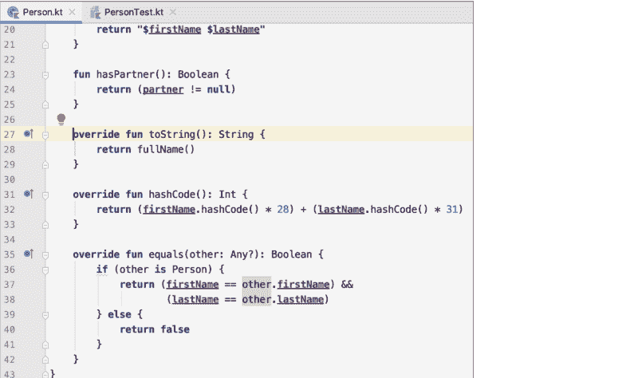

图 4.1：完全展开的 `Person` 代码

## 第 4 章 继承非常重要


```kotlin
constructor(_firstName: String, _lastName: String,
    _parent: Person) : this(_firstName, _lastName) {
    partner = _parent
}

fun fullName(): String {
    return "$firstName $lastName"
}

fun hasPartner(): Boolean {
    return (partner == null)
}

override fun toString(): String {...}
override fun hashCode(): Int {...}
override fun equals(other: Any?): Boolean {...}
```

图 4.2：你可以在 IDE 中将代码块折叠为 `{ ... }`


```kotlin
override fun toString(): String {...}
override fun hashCode(): Int {...}
override fun equals(other: Any?): Boolean {...}
```

图 4.3：使用 `+/-` 图标在展开和折叠之间切换

# 类必须是 `open` 的才能被子类化

你还应该注意到 `Any` 在顶层使用了 `open` 关键字：

```kotlin
public open class Any { ... }
```

这就是允许子类化发生的机制。`Any` 是可以被子类化的，然后使用 `open` 关键字的方法是可以被重写的。任何没有声明为 `open` 的类都不能被子类化或重写。

要查看实际效果，请创建一个新类。将其命名为 `Parent`。这将是 `Person` 的一个特定子类，拥有一个或多个子类。列表 4.15 显示了这个新类非常简单的开始，同样位于 `org.wiley.person` 包中。

### 列表 4.15：`Parent`，最终 `Person` 的子类

```kotlin
package org.wiley.kotlin.person

class Parent {
}
```

现在，要继承一个类，你只需在声明新类时附加一个冒号（`:`）并跟上基类的名称：

```kotlin
class Parent : Person {
}
```

去尝试编译吧，你会看到：

```text
Error: Class 'Person' is final or not open and cannot be subclassed
```

为了修复这个问题，你需要将 `Person` 类声明为 `open`：

```kotlin
open class Person(...) { ... }
```

现在再次编译，你会看到：

```text
Error: Method 'toString' is final or not open and cannot be overridden
```

为了修复这个问题，你需要将方法声明为 `open`：

```kotlin
open class Person(...) {
    open fun toString(): String { ... }
}
```

现在编译就会成功了。

# 术语：子类、继承、基类、扩展

在深入细节之前，值得花一点时间理解一些常见的术语，它们在讨论继承时经常出现：

- **继承**：一个类从另一个类继承属性的方法。
- **基类/父类**：被继承的类。`Any` 是所有类的基类。
- **子类**：继承自其他类的类。`Person` 是 `Any` 的子类。
- **扩展**：有时子类被描述为扩展基类。

你不需要一定记住这些，它们并不是 Kotlin 特有的，但适用于任何支持继承的语言。

# 你的子类应该不同于你的父类

继承自 `Person` 或 `Person` 父类。事实上，你可以拥有四或五层继承，而最底层的子类从它所有父类获得所有内容，无论继承链“向上”延伸有多远。

## 你的子类应该不同于你的父类

这听起来像是一个显而易见的陈述，但值得重复强调：你的子类是一个更具体的实体，与你更通用的父类是不同的。

出于这个原因，你可能对一个只是原样调用其父类构造函数的子类保持怀疑态度。这可能表明你并没有真正思考什么让你的子类与众不同。

在 `Parent` 的情况下，是什么让 `Parent` 比 `Person` 更独特且更具体呢？当然，是 `Parent` 有一个或多个孩子。

## 子类构造函数通常会添加参数

如果孩子的存在是区分 `Parent` 和 `Person` 的关键，那么考虑在实例化时将其设置为必选。考虑将孩子（或多个孩子，稍后会讨论）作为构造函数的一部分。

目前还没有 `Child` 类（稍后会讨论另一个话题）。但孩子只是另一个 `Person` 实例，就像伙伴是 `Person` 实例一样。所以你可以为 `Parent` 构造函数添加一个用于此的参数：

```kotlin
class Parent(firstName: String, lastName: String,
    height: Double = 0.0, age: Int = 0, child: Person) :
    Person(firstName, lastName, height, age) {

    var child: Person = child
}
```

这在直觉上应该是正确的。你现在要求将定义 `Parent` 的事物作为其构造的一部分。你完全可以将其设为一个可以设置的属性，但从理论上讲，你可能会得到一个没有孩子的 `Parent`，这在当前情况下是奇怪的且可能产生问题的。

> 注意：到此为止，应该很清楚了：在某些有效情况下，真正的父母没有孩子。其中许多原因是悲剧性的，这个例子并不是为了对这些父母不敏感或否定他们。相反，这是为了教学编程而进行的简化，它实际上说明了一个非常重要的原则：程序永远无法真正模拟现实生活中所有的细微差别和精彩。

现在你有了一个更好地建模 `Parent` 的类：它要求在构造时传入一个孩子（通过 `Person` 实例）。

还要注意 `child` *不是* 可空属性。它没有使用 `?` 操作符：

```kotlin
var child: Person? = child
```

这是因为该属性对于 `Parent` 来说是本质的，并且永远不应该为空。

## 不要让本不可变的东西变为可变

在这个时候，你需要考虑一个重要的细节。现在，你的 `child` 属性是可变的，因为它被声明为 `var`：

```kotlin
var child: Person? = child
```

但这样准确吗？你应该能够更换孩子吗？这并没有真正反映真实世界。列表 4.16 显示了一个更新后的测试类。

### 列表 4.16：更新后的测试类

```kotlin
import org.wiley.person.Person
import org.wiley.person.Parent

fun main() {
    // 创建一个人
    val brian = Person("Brian", "Trueby", 68.2, 33)
    printPartnerStatus(brian)

    // 创建另一个人
    val rose = Person("Rose", "Bushnell", brian)
    printPartnerStatus(rose)

    // 修改 Rose 的姓
    rose.lastName = "Bushnell-Trueby"
    println(rose)

    // 创建一个父母
    val mom = Parent("Cheryl", "Trueby", child = brian)
    mom.child = rose
}

fun printPartnerStatus(person: Person) { ... }
```

> 警告：别忘记在顶部添加新的导入语句以导入 `Parent` 类以及 `Person` 类。

这至少很奇怪。所以最好将 `child` 改为 `val`，使其变为不可变：

```kotlin
val child: Person? = child
```


## 有时对象并不完全对应现实世界

此时，值得说明的是编程（尤其是面向对象编程）的目标是与你的实用构造体所建模的现实世界对象对齐，但这并不总是成立的。

在这种情况下，通过构造函数设置孩子并永远不允许它更改可能并不是你想要的。这会让孩子值的赋值变得困难；你必须丢弃该 `Parent` 并创建一个新的。这变成了一个权衡问题而不是对错问题。你需要决定你的对象在代码中如何被使用，以及它们如何被其他人的代码使用。

记住，本章以灵活性为主题开始的，这里有一个你需要对这种灵活性做出决策的案例。你是想模拟 `Parent` 实例确实不能“更改”孩子的情况（这更真实地模拟了现实情况）？还是你想改用 `var`，允许更改以使对象更方便？

## 通常情况下，对象应该对应现实世界

在这种情况下，你可以让 `child` 保持为 `val`。它以后可能需要更改，这很容易，但如果你默认建模现实世界的行为，你将倾向于编写更好的代码和对象。

现在还有另一个现实世界的因素需要考虑：父母可以有多个孩子。事实上，你可以拥有四或五层继承，而最底层的子类从它所有父类获得所有内容，无论继承链“向上”延伸有多远。

可能现在还没有完全理解，但核心要点是：这是 `Collection` 上的一个方法，它接收一个对象列表并返回一个 `MutableList`。`MutableList` 是 `MutableCollection` 的子类，而后者又继承自 `Collection`。

理解这些事物之间的关系很有帮助，因此图 5.1 显示了从 `Collection` 开始的部分继承树。

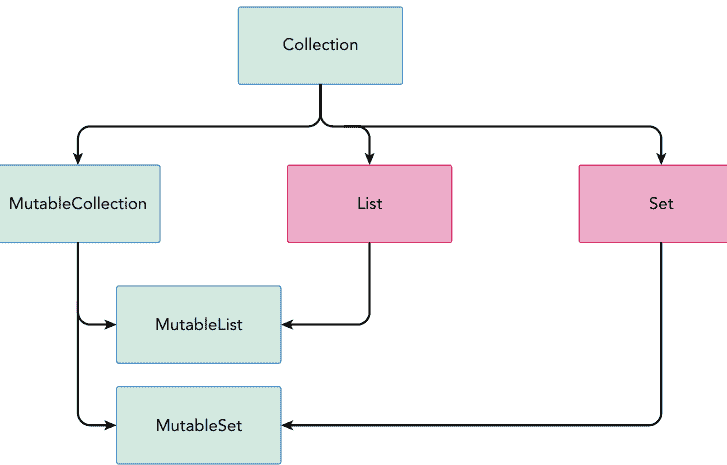

**图 5.1：** Collection 和几个相关类

这里并不是所有相关的类（还有 `Iterable`、`MutableIterable` 以及 `Map` 和 `MutableMap`），但目前我们关注的是这些。请注意，可以改变的列表与不可变的列表属于完全不同的类（`MutableList` 相对于 `List`）。这是上一章讨论的原则的一个绝佳示例：基类更通用，而子类更具体。这就是你在实践中所看到的。

> **警告** 图 5.1 中有很多内容可能让你觉得奇怪。最明显的是，有两个箭头指向 `MutableList` 和 `MutableSet`：一个来自每个 `MutableCollection`，另一个指向每个 `List` 或 `Set`。这是如何工作的？一个类可以有两个父类吗？这是一个好问题，你将在下一章中深入研究。

当你调用 `mutableListOf()` 时，你是在调用 `Collection` 上的一个方法。它创建了一个 `MutableList`（具体来说是一个 `ArrayList`）并将其返回给你的代码。该方法基本上是列表的工厂（这就是“工厂模式”名称的由来处）。

正如你预期的那样，`Collection` 上还有其他工厂方法：

- `listOf()`：创建一个包含你传递给方法的内容的可读列表 (`List`)。
- `emptyList()`：创建一个空列表。
- `mutableListOf()`：创建一个新的可变列表 (`MutableList`)，其中包含你传递给方法的内容。
- `listOfNull()`：创建一个包含所有传入此方法的非空对象的只读列表 (`List`)。

在你在学习本章内容时，你将使用其中的许多方法。在每种情况下，你将使用工厂方法来创建你所需的对象实例。

# Collection 对你的代码自动可用

另一个需要注意的另外一点是，你不需要导入 `Collection` 类，甚至不需要在 `mutableListOf` 前加上 `Collection` 前缀，如果你用过其他语言，可能需要这样做。这是由于三点：

- `Collection` 位于 `kotlin.collections` 包中。
- `Collection` 中的工厂方法都是公共方法。
- `Collections` 实际上只是类和方法的集合。

每当你创建新的 Kotlin 代码时，Kotlin 都会自动导入许多包。其中一个包就是 `kotlin.collections`。这意味着该包中定义的所有内容（包括 `Collection`）都可以立即在程序中使用，而无需 import 语句。

其次，工厂方法都是公共的，如下所示：

```kotlin
public fun <T> emptyList(): List<T> = EmptyList
```

你可以立即使用它们，因为它们对你的代码是可见的。

第三，由 Kotlin 定义的 `Collection` 与 `Collections` 文件（实际源代码文件）之间存在区别。源码定义了一组方法——例如这些工厂方法——它们并不在类中。它们只是你的程序可用的方法。这就是为什么你不需要编写这样的代码：

```kotlin
val rockBands = Collection.mutableListOf("The Black Crow", "Led Zeppelin", "The Beatles")
```

> **注意** 如果这让你有点困惑，那是正常的。`Collections` 代码和包涉及的内容更多关于 Kotlin 内部机制，而不是你现在需要知道的。只要你可以访问 `Collections` 文件中定义的方法，因为该文件位于自动导入的包中，方法是公共的，而且它们没有被定义为实际类的一部分。这就是你目前需要知道的所有内容。

### 修改可变列表

回到你的乐队列表：

```kotlin
val rockBands = mutableListOf("The Black Crowes", "Led Zeppelin", "The Beatles")
```

你应该立即做之一是搞清楚你具体拥有什么。这并不是 Kotlin 集合所特有的，但你可以利用此提示更改 Kotlin 中变量的类型：

```kotlin
println("rockBands is a ${rockBands::class.simpleName}")
```

对于 `rockBands`，这将报告为 `ArrayList`，这是之前提到过的。`ArrayList` 是 `MutableList` 的简单实现。因为你的列表是可变的，你可以使用 `add()` 方法来添加它：

```kotlin
rockBands.add("The Rolling Stones")
println(rockBands)
```

> **注意** 在大多数情况下，这些简单操作不会显示输出。`println()` 语句是为了提醒你你会自己检查这些操作执行了什么。尽管如此，如果输出特别令人惊讶或值得注意，仍然会显示。

你也可以通过列表中的索引来删除项：

```kotlin
rockBands.removeAt(2)
println(rockBands)
```

Kotlin 中的列表像大多数语言一样，是从 0 开始索引的。这意味着如果你有列表：

```text
[The Black Crowes, Led Zeppelin, The Beatles, The Rolling Stones]
```

第一个项目的索引是 0。`removeAt(2)` 删除了列表中的第三个项目，第一个是索引 0，第二个是索引 1，第三个是索引 2。

### 从可变列表中获取属性

你还想查看列表有多大并从中提取值。列表 5.2 显示了常用操作。

**列表 5.2：使用可变列表**

```kotlin
fun main() {
    val rockBands = mutableListOf("The Black Crowes", "Led Zeppelin", "The Beatles")
    println("rockBands is a ${rockBands::class.simpleName}")
    rockBands.add("The Rolling Stones")
    println(rockBands)
    rockBands.removeAt(2)
    println(rockBands)
}
```

这应该并不让人意外，特别是如果你用过其他语言的列表。

> **注意** 所有这些属性和方法都适用于 `MutableList`。记录一下，Kotlin 中的 `Array` 是静态大小的数组；它不能增长或缩小。那么 `ArrayList` 实际上是一个可调整大小的数组。

# 列表（和集合）是有类型的

所以，你刚刚把一堆字符串丢进列表，Kotlin 乐意配合。你可以将不同类型的物体丢进列表：

```kotlin
val mixedThings = mutableListOf("Electric Guitar", 42)
println(mixedThings)
```

这并没有太大意义，因为该列表并不好用。你无法遍历它（这是你很快就会经常做的事情）并处理每个对象，因为它们并不相同。在这种情况下，你不能对数字做你可以对字符串做的事，反之亦然。你很可能在每次从列表中取出东西时都必须检查它的类型，例如：

```kotlin
val mixedThings = mutableListOf("Electric Guitar", 42)
println(mixedThings)

val item = mixedThings[0]
if (item is String) {
    println("Value: ${item}")
} else if (item is Int) {
    println(3 + item)
}
```

这不是一个好主意，你可以做得更好。

### 为列表指定类型

更好的主意是在创建列表时告诉 Kotlin 你允许在列表中使用的类型。列表 5.3 是 `PersonTest`（之前的章节）的修订版本，它使用了可变列表，并告诉 Kotlin 在其中可以包含 `Person` 实例。

**列表 5.3：创建类型列表**

```kotlin
import org.wiley.kotlin.person.Person
import org.wiley.kotlin.person.Parent

fun main() {
    // 创建一个新人物
    val brian = Person("Brian")
}
```

这段代码无法编译，因为 `main` 方法中的那一行尝试向该行添加一个 `Int (32)`。删除那一行后程序就能正常工作，并且你会得到如下的输出：

```text
[Brian Trueby, Rose Bushnell-Truby]
[Brian Truby, Rose Bushnell-Truby, Cheryl Truby]
[Brian Truby, Rose Bushnell-Truby, Cheryl Truby, Brett McLaughlin]
```

注意，任何对象的 `Person` 实例都是可以的——包括 `Person` 的子类。当然，这种类型检查适用于 `List`（或当我们学到 `Set` 时）中所有添加对象的方法。

你可以使用多种方法来操作列表，但当你引入类型系统时，有一件事是你会经常做的：遍历列表。

### 遍历你的列表

当你有一个列表时，你通常对它指定类型是因为一个原因：为了处理该列表（通常是一次处理一个项目），并将每个项目视为某种特定的——即类型。然后你就可以根据已知的类型来执行某些操作。为了演示这一点，你需要更多的代码。

列表 5.4 引入了一个新的简单类 `Band`。它的限制非常糟糕（谁听过哪个乐队没有键盘手？主吉他手在哪儿？），但它是一个很有用的例子。

**列表 5.4：表示 Band 的简单新类**

```kotlin
package org.wiley.kotlin.music

import org.wiley.kotlin.music.*

class Band(name: String, singer: Person, _guitarist: Person, _drummer: Person, bassist: Person) {
    var name: String = _name
    var singer: Person = _singer
    var guitarist: Person = _guitarist
    var drummer: Person = _drummer
    var bassist: Person = _bassist
}
```

这个类引入了一个新包 `org.wiley.kotlin.person`，并使用了之前章节中的 `Person` 类。

现在回到你的测试类，并更新代码以使用这个类，如列表 5.5 所示。

**列表 5.5：重构 CollectionTest 使用新的 Band 类**

```kotlin
import org.wiley.kotlin.music.*
import org.wiley.kotlin.person.*

fun main() {
    val rockBands = mutableListOf<Band>(
        Band(
            "The Beatles",
            singer = Person("John", "Lennon"),
            guitarist = Person("George", "Harrison"),
            bassist = Person("Paul", "McCartney"),
            drummer = Person("Ringo", "Starr")
        ),
        Band(
            "The Rolling Stones",
            singer = Person("Mick", "Jagger"),
            guitarist = Person("Keith", "Richards"),
            bassist = Person("Ronnie", "Wood"),
            drummer = Person("Charlie", "Watts")
        ),
        Band(
            "The Black Crowes",
            singer = Person("Chris", "Robinson"),
            guitarist = Person("Rich", "Robinson"),
            drummer = Person("Steve", "Gorman"),
            bassist = Person("Johnny", "Colt")
        )
    )
}
```

> **注意** `Band` 构造函数的输入顺序在整个代码中通过命名参数进行了调整。顺序背后并没有真正的方法；这仅仅是因为乐队成员被放入了对象实例的构造函数中（老实说，这也取决于我记忆他们名字的顺序！）。

这看起来可能稍有不同，但在现阶段并没有什么新鲜。`rockBands` 被定义为 `Band` 对象的列表，每个 `Band` 都是内联创建的，成员在 `Band` 构造函数内部作为 `Person` 实例创建。

现在你可以对 `rockBands` 执行所有你以前对持有字符串时做过的事情：

```kotlin
print(rockBands)
print("rockBands is a ${rockBands::class.className}")
print("There are ${rockBands.size} bands in the list.")

rockBands.add(
    Band(
        "The Black Keys",
        singer = Person("Dan", "Auerbach"),
        guitarist = Person("Steve", "Marion"),
        drummer = Person("Patrick", "Carney"),
        bassist = Person("Richard", "Swift")
    )
)

println("Now there are ${rockBands.size} bands in the list.")
println("The second band is ${rockBands[1]}")
```

输出有些平平无奇，但是：

```text
[org.wiley.kotlin.music.Band@281bcfa, org.wiley.kotlin.music.Band@2ac5fe3, org.wiley.kotlin.music.Band@506e6d5e6]
rockBands is an ArrayList
列表中有 3 个乐队。
现在列表中有 4 个乐队。
第二个乐队是 Rolling Stones
```

问题在于，即使为了这些简单的测试目的，`Band` 也没有实用的 `toString` 方法。你可以通过 `Band` 中非常简单的实现来修复它：

```kotlin
override fun toString(): String {
    return name
}
```

重新运行测试，你会得到一些输出：

```text
[The Beatles, The Rolling Stones, The Black Keys]
rockBands is an ArrayList
```

现在你需要遍历一个列表。处理此列表最简单的方法是从列表本身获取迭代器，这非常有意义；返回的是一个知道如何移动列表的对象（`Iterator` 的子类）。你可以使用 `while` 循环（你在其他语言中见过）来使用这个迭代器：

```kotlin
val bandsIterator = rockBands.iterator()
while (bandsIterator.hasNext()) {
    val band = bandsIterator.next()
    // do something with the next
}
```

只要 `hasNext()` 为 `true`，列表中就有另一个乐队。你可以通过 `next()` 获取该乐队——因为 Kotlin 的强类型——你知道它是一个 `Band` 实例。然后你可以根据需要打印（或任何其他内容）它：

```kotlin
val bands = mutableListOf<Band>()
```


# Kotlin 尝试理解你的意图

所有这一切之所以有效，是因为之前的那小段代码：类型是迭代器和使用列表中的每个对象的关键。你有两种快捷方法可用，都值得注意，因为它们可以使代码更简洁。首先如果你使用列表工厂方法，Kotlin 将推断类型。回到你的 `main()` 代码并删除这一行的 `<Band>` 部分：现在编译，一切运行正常。

此外，还有一种获取迭代器然后使用 `while` 循环的快捷方法。相反，你可以使用 `for` 循环和 `in` 关键字，如下：

```kotlin
for (band in rockBands) {
  println("The lead singer for ${band.name} is ${band.singer}")
}
```

这节省了几行代码。这个循环遍历 `rockBands` 列表中的每个项目。每个项目都分配给循环体内的 `band`。那么你应该同时使用这两个快捷方法吗？嗯，也许不。`for` 循环是一个好主意，而且你的代码非常有可读性。但回看创建列表的那个方法：这里没有错误，但它和你以及任何阅读你代码的人关于列表的信息较少。你不知道它应该使用 `Band` 对象。在很多情况下，类型实际上让这段代码更清晰，而且只需要额外的击键；这是一个很不错的权衡。

> 注意：使用这种列表的另一个很好的理由与继承和子类有关。你会看到那个，但请记住列表将通过添加的项目的公共类来推断类型——而不是公共基类或父类。如果这没有引起你的警觉，先不要担心。你会看到指定类型以后可以为你避免一些麻烦。

# 列表是有序的且可以重复

关于列表最重要的知识，以及你为什么使用它而不是 `set` 或 `map`（你很快就会看到它们），是列表是有序的，并且列表可以包含两次相同的项目。`set` 是无序的且不能存储重复项目。`map` 实际上与两者都不同，它使用键值对。

你会很快发现确定需要什么类型很容易，而且列表通常是最常见的。如果你想要一个行为像数组的东西——项目按顺序排列、可以通过索引访问项目且不在乎重复项——请选择列表。

# 顺序为你提供了有序访问

你已经见过了两种通过索引访问列表项目的方法：

```kotlin
println("The second band is ${rockBands[1]}")
println("The third band is ${rockBands.get(2)}")
```

你也可以获取列表中的第一个或最后一个项目：

```kotlin
println("The first band is ${rockBands.first()}")
println("The second band is ${rockBands[1]}")
println("The last band is ${rockBands.last()}")
```

这些方法均不适用于无序集合。你还可以洗乱列表项目：

```kotlin
println("The first band is ${rockBands.first()}")
println("The second band is ${rockBands[1]}")
println("The last band is ${rockBands.last()}")

rockBands.shuffle()

println("The first band (post shuffle) is ${rockBands.first()}")
println("The second band (post shuffle) is ${rockBands[1]}")
println("The last band (post shuffle) is ${rockBands.last()}")
```

输出反映了洗牌的结果：

> The first band is The Beatles
> The second band is The Rolling Stones
> The last band is The Black Keys

# 列表可以包含重复项目

你也可以多次向列表添加同一个项目。这里有一个显而易见的例子：

```kotlin
var kinks = Band("The Kinks",
      singer = Person("Ray", "Davies"),
      guitarist = Person("Dave", "Davies"),
      drummer = Person("Mick", "Avory"),
      bassist = Person("Pete", "Quaife")
)

rockBands.add(kinks)
rockBands.add(kinks)
rockBands.add(1, kinks)
```

# 集合：无序且唯一

现在，你的列表中关于 The Kinks 的乐队包含了三个不同的元素：

- The Beatles 乐队的主唱是 John Lennon
- The Kinks 乐队的主唱是 Ray Davies
- The Black Keys 乐队的主唱是 Dan Auerbach
- The Rolling Stones 乐队的主唱是 Mick Jagger
- The Black Crows 乐队的主唱是 Chris Robinson
- The Kinks 乐队的主唱是 Ray Davies

只要你意识到这是可能的，并且不假设你的列表只有唯一元素，这就不是问题。如果你想处理唯一元素，可以使用 `distinct()` 方法：

```kotlin
for (band in rockBands.distinct()) {
    println("The singer for ${band.name} is ${band.singer}")
}
```

现在输出中每个乐队只出现一次：

- The Beatles 乐队的主唱是 John Lennon
- The Kinks 乐队的主唱是 Ray Davies
- The Rolling Stones 乐队的主唱是 Mick Jagger
- The Black Crows 乐队的主唱是 Chris Robinson
- The Black Keys 乐队的主唱是 Dan Auerbach

不过，这种方法是非破坏性的。它并不会实际更改所调用的列表。相反，它返回一个新的列表。所以你可以存储这个新列表：

```kotlin
var singularBands = rockBands.distinct()
```

在这种情况下，你拥有 `rockBands`（它可能包含重复项）和 `singularBands`（它绝对不会有任何重复项）。

> 注意：你仍然可以对列表做很多事情。事实上，在触及它的极限之前，你还可以再读 20 或 30 页内容：过滤、排序、根据特定属性选择唯一性等。这已经足够你很好地实际使用列表了，随着更多需求的出现，你可以轻松地扩展你的列表和集合工具箱。

## 集合：无序且唯一

你已经了解了许多关于集合你需要的知识。和列表一样，它们继承自 `Collection`，并且像列表一样，它们可以是可变的或只读的。它们也经常被迭代，这是你刚刚学会的这种方法。

主要的区别在于，集合是无序的（而列表是有序的），而且集合中的每个项目有且只有一个（而列表可以包含重复项）。

# 在集合中，不保证顺序

是的，你现在已经多次听到集合不保持顺序了。它们*可能*保持。换句话说，集合并没有说“你的排序是随机的”。集合仅仅是说：“不作保证。我们可以对元素的顺序做任何我们想做的事。”

例如，Kotlin 通常会默认为你提供一个 `LinkedHashSet`：

```kotlin
val bandSet = setOf<Band>(rockBands[0], rockBands[1],
    rockBands[2], rockBands[3])
println("${bandSet}::${this::class.simpleName}")
```

你会发现 `bandSet`（包含你 `rockBands` 列表的前四个元素）是一个 `LinkedHashSet`：

```text
LinkedHashSet
[The Beatles, The Kinks, The Rolling Stones, The Black Crowes, The Black Keys, The Kinks, The Kinks, Bad Company]
[The Beatles, The Kinks, The Rolling Stones, The Black Crowes]
```

> 注意：*你可能会以不同的顺序看到这些项目。不用担心这个；这不是指示某种错误的问题。*

`LinkedHashSet` 恰好使用了元素添加的顺序。因此，如果你将它的前四个元素与 `rockBands` 的前四个元素进行比较，你会发现它们是匹配的。

但这不等同于顺序的保证！`rockBands` 总是报告顺序；而 `bandSet` 可以在任何时间更改这一点而不会违反 Kotlin 的任何规则。

但使用 `HashSet`（通过 `setOf()`）来看看区别：

```kotlin
val bandSet = setOf<Band>(rockBands[0], rockBands[1],
    rockBands[2], rockBands[3])
println("${bandSet}::${this::class.simpleName}")
```

输出将不会显示匹配的前元素：

```text
HashSet
[The Beatles, The Kinks, The Rolling Stones, The Black Crowes, The Black Keys, The Kinks, The Kinks, Bad Company]
[The Beatles, The Rolling Stones, The Black Crowes, The Kinks]
```

`HashSet` 不保持顺序。

# 顺序什么时候重要？

鉴于不排序项的集合和列表，你为什么要使用一个而不是另一个？嗯，值得注意的是，不排序的集合在检查某项是否存在于该集合中时通常更快。

> 警告：请注意，不维护顺序的集合与实际上不维护顺序的集合之间存在区别。默认是 `LinkedHashSet`，它不维护顺序但实际上仍然维护了。这意味着在这些方面，它不会比列表快得多。如果你主要为了速度而使用集合，请通过 `hashOf()` 使用 `HashSet` 以确保你获得的是一个无序集合。

这主要与集合中哈希值的使用（因此是 `HashSet`）有关。这意味着你已经承诺顺序是不重要的，而这并不总是显而易见的。这将取决于你正在建模什么以及如何使用该集合。

例如，考虑摇滚乐队列表。如果你只是收集乐队列表，你真的不需要排序。

# 集合：无序唯一

```kotlin
var bandTwo = Band(
  rockBands[0].name,
  _singer = Person(rockBands[0].singer.firstName,
  rockBands[0].singer.lastName),
  _guitarist = Person(rockBands[0].guitarist.firstName,
  rockBands[0].guitarist.lastName),
  _bassist = Person(rockBands[0].bassist.firstName,
  rockBands[0].bassist.lastName),
  _drummer = Person(rockBands[0].drummer.firstName,
  rockBands[0].drummer.lastName)
)

// 如果集合中不在该乐队，则添加该乐队
if (bandSet.contains(bandTwo)) {
  println("bandSet already contains ${bandTwo}")
} else {
  bandSet.add(bandTwo)
}
```

花些时间确保你理解了这里发生了什么。首先，通过获取集合中已有的元素（代码早之前的部分）并将其添加到集合，添加了一个重复项。你可能认为该元素不会被添加（顺便说，在我的案例中是披头士乐队）。

> 注意：就像之前的乐队顺序一样，你在这里可能会看到不同的乐队。在之前，这并不是一个问题。

但随后，创建了另一个 `Band` 实例，并提供了乐队每个成员的名称和每个独立实例数据：

```kotlin
var bandTwo = Band(
  rockBands[0].name,
  _singer = Person(rockBands[0].singer.firstName,
  rockBands[0].singer.lastName),
  _guitarist = Person(rockBands[0].guitarist.firstName,
  rockBands[0].guitarist.lastName),
  _bassist = Person(rockBands[0].bassist.firstName,
  rockBands[0].bassist.lastName),
  _drummer = Person(rockBands[0].drummer.firstName,
  rockBands[0].drummer.lastName)
)
```

理论上，`rockBands[0]` 应该等同于 `bandTwo`，因此当 `bandTwo` 被添加到 `bandSet` 时，它应该被忽略。但检查输出；事实并非如此：

[The Beatles, The Beatles, The Black Crowes, The Kinks, The Rolling Stones]

那么结果是什么呢？嗯，答案在于 `equals(x)`。尽管这两个对象中的数据是相同的，但它们并不是同一个对象。你应该应该回想起第 3 章的内容，如果没有对 `equals(x)` 进行自定义实现，对象的相等性通常基于对象的内存位置——因此两个具有相同数据的对象是不相等的。

如果你对 `equals(x)` 进行一些简单的修复，就可以发现这是真的。列表 5.6 显示了 `Band` 的更新，解决了这个问题（并包含了对 `hashCode()` 的相应更改）。

# 列表 5.6：更新 equals(x) 和 hashCode() 以改进 Band

```kotlin
package org.wiley.kotlin.music

import org.wiley.kotlin.person.*

class Band(name: String, _singer: Person, _guitarist: Person, _drummer: Person,
    _bassist: Person) {
    var name: String = _name
    var singer: Person = _singer
    var guitarist: Person = _guitarist
    var drummer: Person = _drummer
    var bassist: Person = _bassist

    override fun toString(): String {
        return name
    }

    override fun hashCode(): Int {
        return name.hashCode()
    }

    override fun equals(other: Any?): Boolean {
        if (other is Band) {
            return name == other.name
        } else {
            return false
        }
    }
}
```

> 注意：与前面章节中 `Person` 的 `equals(x)` 方法一样，这有点简单（实际上它比 `Person` 要简单得多）。尽管如此，它说明了问题所在。

现在，重新运行你的测试代码，你会看到只有一个披头士的实例：

[The Beatles, The Black Crowes, The Kinks, The Rolling Stones]

由于 `equals(x)` 方法根据乐队名称报告两个实例是相等的，集合现在只接受第一次添加。

# 使用集合？检查 equals(x)

这所说明的最后一点是，如果你要用任何自定义对象填充集合，你需要确保这些对象的 `equals(x)` 表现如你所认为的那样。没有什么比一个本用来消除重复项的集合实际上看起来在消除重复项更难追踪的了。

当你怀疑时，请查看自定义对象的源码。或者至少，你可以使用 `equals(x)` 比较代码中你认为相等的几个实例，看看会发生什么。这至少能让你做好相应的准备。

# 迭代器不是（总是）可变的

你还没有看到的一点是从列表或集合中获取的迭代器允许你更改正在操作的集合：

```kotlin
var iterator = rockBands.iterator()
while (iterator.hasNext()) {
  var band = iterator.next()
  if (band.name.contains("Black", ignoreCase = true)) {
    iterator.remove()
  }
}
```


如果你编译并运行这段代码，然后在执行后打印 `rockBands`，你会发现 Black Keys 和 Black Crews 已被移除。

原因有两点：集合的迭代器知道底层集合，因此你可以根据需要删除或添加内容；以及可变集合获得一个可变迭代器。事实上，`Mutable` 继承自 `Iterator`。不可变集合不提供可变迭代器，原因显而易见：底层集合无法更改。

# 映射：当单个值不够时

所以，你已经见过集合和列表。它们非常相似：它们都存储一组项。只有在存储这些项的方式，以及顺序和重复性上将它们区分开。但还有另一种不同的集合类型：Map（映射）。

映射存储键值对。对于映射中的每个项，都有一个键（唯一标识符）和一个值（该标识符指向或关联的内容）。通常，键不仅仅是值的属性，因为那在某种程度上是冗余的。例如，你不会有这样一个映射，其中键是人的名字，而值是具有该名字的 `Person` 对象。

你经常会看到带有某种数字 ID 和与该 ID 关联值的映射，通常是一个对象。

## 映射通过工厂创建

就像集合或列表一样，你通过工厂方法创建映射。但与那两个集合不同，你需要提供值和键，且方式如下：

```kotlin
var status = mapOf(200 to "OK",
  201 to "Accepted",
  202 to "Payment Required",
  404 to "Not Found",
  500 to "Internal Error")
```

> 注意：这个特定的映射按键排序的。如果你想要无序映射，使用 `mutableMapOf()`。

你经常会看到带有某种数字 ID 和与该 ID 关联值的映射，通常是一个对象。

```kotlin
val name = status[200]
println(name)
```

## 使用键查找值

在底层，Map 实际上是键值对的集合。如果你想根据键或值来查找键或值，如下文所示：

```kotlin
if (status.containsKey(404)) {
  println("Message: ${status[404]}")
} else {
  println("No message for 404")
}
```

## 你想要你的值？

如果你想避免那样——在很多情况下，不值得写额外的代码——你可以使用 `getOrDefault()`。`get()` 的这个变体允许你在 `get()` 返回空时指定一个返回值：

```kotlin
println(status.getOrDefault(400, "Default Value"))
```

另一个选项是使用 `getValue()`，它的工作方式与 `get()` 相似，但如果键不在映射中，它会抛出异常：

```kotlin
println(status.getValue(400))
```

运行此并将得到一个运行时异常：

```
Exception in thread "main" java.NoSuchElementException:
Key is missing in the map
atat kotlin.collections.MapsKt_MapWithDefaultKt.getOrDefault(
MapWithDefaultKt.kt:24)
atat kotlin.collections.MapsKt.getValue(Map.kt:336)
atat CollectionTestKt.main(CollectionTest.kt:140)
atat CollectionTestKt.main(CollectionTest.kt)
```

## 根据……任何内容过滤集合

到为止，你已经学会了如何使用集合——列表、集合或映射——并遍历它，从特定索引或位置选择项，并通常自由地使用这些集合。然而，还没有讨论过的一点是根据标准从集合内部获取元素集合。

假设你有一个 `rockBands` 列表，你想要列表中所有名称中包含 "Black" 单词的乐队。一种方法是使用迭代器并简单地创建一个新列表并在遍历时填充它。你已经写了类似这样的代码：

```kotlin
var bandsInBlack = mutableListOf<Band>()
for (band in rockBands) {
    if (band.name.contains("Black", ignoreCase = true)) {
        bandsInBlack.add(band)
    }
}
println(bandsInBlack)
```

# 122 | 第 5 章 列表、集合和映射，我的天！

> 警告 如果你一直在此处操作并将示例代码添加到你的集合测试中，你在这里可能无法获得预期的结果。之前有一段代码删除了 `rockBands` 中所有名称包含 "Black" 的乐队，因此你需要删除或注释掉那段代码，才能让这段代码按预期工作。

这段代码本身没有问题，但由于这是一个非常常见的操作，Kotlin 为你提供了一些快捷方式来获得相同的结果。

### 根据特定标准进行过滤

当你想要根据某些标准选择集合中的所有元素时，`filter()` 方法是你的好朋友。以同样的任务为例：想要 `rockBands` 中所有名称包含单词 "Black" 的乐队。这是 `filter` 的理想用用场：

```kotlin
println(rockBands.filter { it.contains("Black", ignoreCase = true) })
```

这可能看起来显而易见，但让我们过一遍以确保理解发生了什么。
首先，`filter` 有点不同，你检查的是一个被 `( )` 包围的块，而不是带有参数的括号。在代码内部，你可以访问一个名为 `it` 的对象实例。它有点像自定义修改器或访问器中的字段和值；它们是真实实例或值的占位符，具有刻意设计的泛化名称。

在这里，它代表集合中的每个对象：在这种情况下，是一个列表。因此，你可以认为它代表一个 `Band` 实例，列表中有若干个这样的实例。对于每个 `Band` 实例，评估名称以查看它是否包含 "Black"（忽略大小写）。如果表达式求值为为 `true`，则该对象被包含在返回的值列表中；如果为 `false`，则该对象不被包含。

你可以根据需要让评估变得尽可能复杂。为了返回歌手或贝斯手手名字为 "Paul" 的乐队：

```kotlin
println(rockBands.filter {
    (it.singer.firstName.equals("Paul", ignoreCase = true) ||
    it.bass.firstName.equals("Paul", ignoreCase = true))
})
```

这里并没有真正复杂的地方。这只是构建正确的布尔表达式的问题。
对于 `Map`，表达式看起来有点不同，但工作原理相同。你只需要访问映射中每个项的键和值，而不仅仅是列表或集合值：

```kotlin
println(statusCodes.filter { (key, value) -> key in 400..499 })
```

在这里，键被用于返回 400 到 499 之间的值。你也可以使用值：

```kotlin
println(statusCodes.filter { (key, value) -> key in 400..499 && \
value.startsWith("Payment") })
```


再次，只要你能将标准表述为布尔表达式，就可以使用 `filter()`。

> 注意 `filter()` 仍然以括号的形式编写，作为一种简写，表示它是一个方法。但它实际上接收一个所谓的谓词（predicate），即你传递用于评估的表达式。

### filter 有许多实用的变体

一旦你理解了 `filter()` 的基本用法以及如何编写谓词，你就可以用它做更多事情。一个实用的用法是 `filterNot()`，它返回 `filter()` 结果的反反。因此，当 `filter()` 返回谓词求值为 `true` 的元素时，`filterNot()` 返回求值为 `false` 的元素。

这是一个简单的过滤器，它返回所有名称中不包含 "Black" 的乐队：

```kotlin
println(rockBands.filterNot { it.name.contains("Black", ignoreCase = true) })
```

> 注意 通常可以说 `filterNot()` 返回的是 `filter()` 不返回的内容，反之亦然，但在某些特殊情况下，两者都可能评估为不包含该元素，最可能是在涉及 `null` 值时。

`filter()` 的另一个变体是 `filterInstanceOf()`。它允许你选择集合中所有特定类型的元素。

当你考虑到大多数集合都是强类型的，这可能看起来很奇怪；这有什么帮助呢？它实际上对于具有子类的自定义对象的强类型集合特别有用。例如，假设你开发了自定义的 `RockBand` 类、`JazzBand` 类和 `CountryBand` 类，它们都继承自 `Band`。你可以使用 `filterInstanceOf()` 返回一个类型为 `Band` 的列表，并返回列表中所有特定的 `RockBand` 成员：

```kotlin
var justRock = bands.filterInstanceOf<RockBand>()
```

现在你有一个只包含所需子类型的新类型列表。

## 集合：基本类型和自定义类型

本章中的大多数示例都使用了 Kotlin 类型的组合。基本类型如 `Int`、`Float`、`String` 和 `Boolean` 与集合很容易处理。你还处理了自定义对象的集合（最著名的是 `Band`，以及 `Person`）。处理它们并没有更复杂，但你需要确保你拥有实用的 `equals(x)` 和 `hashCode()` 方法，并理解这些类型以便恰当地处理它们。

> 注意 基本类型是编程术语，指基础的类型。通常，这意味着一种无法进一步拆分的类型，或者没有单独的部分。自定义类型——例如自定义对象——不是基本类型。它们不那么基础，包含更多部分。

124 | 第 5 章 列表、集合和映射，我的天！

关于集合的大部分工作在于如何使用它们以及何时使用它们。对此，拥有一个包含两个相同元素的列表是有意义的。在大多数情况下，并不是。

记住这一点，你可以将其改为使用集合（set）。你还应该使用构造函数传入的子参数来初始化集合：

```kotlin
var children: MutableSet<Person> = mutableSetOf(_child)
```

现在，在你的情况下，你可以方便地在集合中添加和删除孩子：

```kotlin
val mom = Parent("Cheryl", "Truesby", _child=brian)
mom.children.add(rose)
```

在这种情况下，mom 实例现在应该有两个子节点——brian 实例和 rose 实例：

```kotlin
val mom = Parent("Cheryl", "Truesby", _child=brian)
mom.children.add(rose)
println("Cheryl's kids: ${mom.children}")
```

输出所示：

Cheryl's kids: [Brian Truesby, Rose Bushnell-Truesby]

## 允许将集合添加到集合属性中

现在 Parent 可以支持多个孩子，这向前了一步。但它不支持一次添加多个一个孩子。这可以通过辅助构造函数来处理：

```kotlin
constructor(_firstName: String, lastName: String, _children: Set<Person>) :
    this(_firstName, _lastName)
children = _children
```

现在这段代码看起来没问题，但短短四行代码中潜藏了许多问题。编译并获取第一行的错误：

```
Error(10, 13) None of the following functions can be called with the arguments supplied:
public constructor Parent(_firstName: String, lastName: String, height:Double, _age:Int, _child: Person) defined in org.wiley.kotlin.person.Parent
public constructor Parent(_firstName: String, lastName: String, _children:Set<Person>) defined in org.wiley.kotlin.person.Parent
Error(11, 20) Type mismatch: inferred type Set<Person> but MutableSet<Person> was expected
```

到底发生了什么？好吧，我们一个一个来看。首先，记住任何辅助构造函数必须调用类的主构造函数，在这种情况下，它要求 `_child` 参数是一个单个 `Person` 实例。这立即成为了问题，除非你采取类似的操作：

```kotlin
constructor(_firstName: String, lastName: String, _children: Set<Person>) :
    this(_firstName, _child = _children.first()) {
    children = _children
}
```

从技术上讲它是通的，但这不是良好的编程习惯。你遵循了 Kotlin 的规则，但这实际上表明你的构造函数没有经过良好的规划或执行。

你可能记得，涉及到继承时，你希望更通用的类位于继承树的较高位置，而更具体的类是子类。因此，Person 是更通用的父类，而 Parent 是更具体的子类。

同样地，你希望主构造函数是最宽泛、最通用的构造函数，而辅助构造函数是更具体的版本。这与我们现在的情况恰好相反：主构造函数接收单个孩子（更具体），而辅助构造函数接收任意数量的孩子（通过空集合接收零个）。

所以将它们调换一下，如列表 5.9 所示。你还会发现，这使得从辅助构造函数调用主构造函数变得非常简单。

### 列表 5.9：翻转 Parent 中的构造函数以使其按预期工作

```kotlin
package org.wiley.kotlin.person

class Parent(_firstName: String, lastName: String,
    _height: Double = 0.0, _age: Int = 0, children: Set<Person>) :
    Person(_firstName, lastName, _height, _age) {
    var children: MutableSet<Person> = children.toMutableSet()
    constructor(_firstName: String, lastName: String,
        _children: Set<Person>) :
        this(_firstName, lastName, _children = setOf(_child))
}
```

事实上，这消除了辅助构造函数中任何代码的需求。它现在充当一个便利构造函数。

## Sets 和 MutableSets并不相同

但你仍然报错：

```
Error(7, 40) Kotlin: Type mismatch: inferred type is Set<Person> but
MutableSet<Person> was expected
```

现在又发生了什么？这里的问题在于你创建了一个名为 children 的新 `MutableSet<Person>` 并给它赋值一个 `Set<Person>`。但可变集合和不可变集合是不相同的，所以 Kotlin 抛出了错误。

相反，你需要创建一个可变集合并将不可变集合中的所有元素添加到其中：

```kotlin
var children: MutableSet<Person> = mutableListOf()
init {
    children.addAll(_children)
}
```

> 注意：将传递给 Parent 主构造函数的集合称为不可变集合实际上有点误导。准确地说，Kotlin 将它们视为不可变，是因为在构造函数的参数列表中类型是 `Set<Person>`。但这仅仅意味着可以传入可变的或不可变的集合。实际上，在构造函数级别需要接受这两种类型的集合导致了在 `init` 中编写这些额外代码。这是一个权衡；与其只在构造函数中接受可变集合，不如接受所有集合，但结果就是必须编写额外的代码。

这一切最终又归结为（类型安全）。Kotlin 在这里的做法非常强硬，假设如果你期望一个 `Set`，你想要的就是一个 `Set` 而不是 `MutableSet`。如果你真的想绕过这一点，你必须自己处理，这就是为什么你需要自己的 `init` 块并调用 `addAll()`。

还有一个额外的调整可以让代码更整洁。你实际上可以丢 `init` 块，并在声明 `children` 属性时进行此赋值：

```kotlin
var children: MutableSet<Person> = _children.toMutableSet()
```

## 集合属性就是集合

通过这一更改，你现在可以通过 Parent 使用这些功能。这是一个示例：

```kotlin
val mom = Parent("Cheryl", "Truesby", _child=brian)
mom.children.add(rose)
```


```kotlin
println("Cheryl's kids: ${mom.children}")
```

输出所示：

Cheryl's kids: [Brian Truesby, Rose Bushnell-Truesby]

当你编译时，你会得到这个措辞相当奇怪的错误：

```
Error:(7, 22) Kotlin: Type inference failed. The value of the type parameter T should be mentioned in input types (argument types, receiver type or expected type). Try to specify it explicitly.
```

这很棒！这正是 Kotlin 至关重要的静态安全性。这也是泛型的力量所在。

> 注意，错误中 `T` 的使用不应该让你困惑。不同的单字母（`E` 和 `T` 是最常见的）在各种情况下都被参数。对待错误中的 `T` 就就像对待 `E` 一样。

理解这个错误实际上是深入理解泛型的一大步。在这种情况下发生了什么？对于一个 `String`——“类型推断失败？”？这意味着 Kotlin 正在获取输入参数——并尝试确定它是否符合它所需的对象。由于 `E` 是 `ArrayList<Band>`，它拒绝了这一点。Kotlin 尝试给出一个解决方案：“尝试显式地指定它。”但这行不通，因为 `String` 无法强制转换为 `Band`。

这也引出了一个很好的观点：有时你需要在网上进行一些搜索（并阅读）才能弄懂 Kotlin 的错误信息。就是如此；如果它能简单显示“请提供一个 `Band` 参数”就好了。但 Kotlin 给出的更正式的消息是正确的：它正尝试从输入参数推断适用于 `contains<>()` 的类型，但失败了。

## 泛型：它指的是什么？

准确使用编程术语有时是棘手的。虽然对于一个优秀的程序员或开发者最重要的事情是编写整洁的代码，但术语是有帮助的。在泛型的情况下，“泛型”指的是一种类型。此外，该术语通常表示整体类型，而不是特定的实例。

所以你可以说在 Kotlin 中，列表是泛型的。这很有道理：整体的 `List` 类型（以及其他集合）是泛型的，并使用 `E`（有时是 `T`）来保持参数开放。但是，你不会有一个泛型列表并引用一个特定的值（比如 `bands`）。整体类型是泛型的，但一旦你实例化它，你就有了其他东西（即使它只是 `Any` 对象的列表，这是最泛的列表实例类型）。

除了泛型类型外，你还可以拥有泛型函数。这些正如你想象的那样：函数的定义方式使得它们的返回类型留到以后定义。例如，假设你有一个 `Animal` 类，它定义了一个 `breed()` 方法。该方法可能返回 `List<T>` 作为返回类型。子类将获取该泛型方法并精炼类型（可能是 `List<Dog>`）。你可以开始将这一点推得非常远，请继续阅读以获取更多关于在实践方式中使用泛型的内容。

> 注意：如果你想研究 Kotlin 和泛型的底层机制，实际上有一个非常深的“坑”可以探索，你会很快发现自己也在学习 Java 及其对泛型类型的使用。如果你对编程语言理论感兴趣，可能想检查 `kotlinlang.org/docs/reference/generics.html`，它对 Kotlin 泛型及其追溯到 Java 的历史进行了更深入、更具理论性的探讨。

## 泛型尽可能尝试推断类型

与任何其他语言一样，你越频繁使用 Kotlin，就越了解在哪些地方可以让 Kotlin 帮你处理并少做一些工作（这通常意味着少打几个字）。例如，如果你创建一个泛型类型的新实例，Kotlin 将尽力找出需要分配给该实例的参数类型。

这被称为类型推断，它是理解 Kotlin、泛型非常重要的部分，也是尝试编译代码时可能出现非常恼人的异常的原因。

## Kotlin 寻找匹配类型

例如，假设你有如下所示的代码：

```kotlin
val brian = Person("Brian", "Truesby", 68.2, 33)

val rose = Person("Rose", "Bushnell", brian)

var personList = mutableListOf(brian, rose)
```

Kotlin 假设你已经给 `mutableListOf()` 方法提供了两个 `Person` 实例，你一定想要一个 `Person` 列表。因此它推断你正在创建一个可变列表：

```kotlin
var personList = mutableListOf<Person>(brian, rose)
```

注意这里，泛型 `List` 是一个参数类型：`Person`。这应该完全合情合理。它节省了你的时间，在前面的章节中，你可以这样做：

```kotlin
var wordList = mutableListOf("one", "two")

var numberList = mutableListOf(1, 2, 3)
```

在每种情况下，Kotlin 的推断都是基于你列表的内容。第一个是 `String` 列表，第二个是 `Int` 列表。

## Kotlin 寻找最小类型

但 Kotlin 不仅仅是寻找匹配类型。当它进行类型推断时，Kotlin 寻找的是最新的类型。换句话说，它正在寻找匹配所有输入参数的限制性最大的类型。考虑以下：

```kotlin
val brian = Person("Brian", "Truesby", 68.2, 33)

val rose = Person("Rose", "Bushnell", brian)

var personList = mutableListOf(brian, rose)
```

Kotlin 看到两个 `Person` 实例并推断你想要一个 `List<Person>`。这看起来确实合理。现在假设你有极端情况：

```kotlin
var list = mutableListOf("Words", 42)
```

在这里，真的没有比最泛的类型 `Any` 更常见的类型了。所以你得到了一个 `List<Any>`。虽然这没有错，但它不会给你提供多少类型安全。

## 协变：类型与赋值深度研究

> 注意：方法签名是关于方法定义的更正式术语，包括方法名称、返回类型、任何输入参数以及任何其他修饰符（如 `override`）。它通常是正式编程讨论中的术语。

但正如你所看到的，这个 `E` 不仅仅是接受 `E`。它也接受 `E` 的任何子类型。如果你有一个 `Band` 对象的列表，将 `E` 设为 `Band`，且 `RockBand` 是 `Band` 的子类，那么该列表的 `add()` 方法就可以添加 `RockBand` 实例，也可以添加 `Band` 实例（以及 `Band` 的任何其他子类实例）。

这是因为 Kotlin 允许在父类的地方使用子类，只要父类本身是被允许的。到目前为止已经见过这种情况，所以这里没什么惊喜。

## 泛型类型又是怎样的？

你还没有看到是在比 `Band` 和 `RockBand` 或 `Person` 和 `Parent` 更复杂的类型之间进行转换——即泛型类型。

假设你为 `Person` 创建了一个额外的子类类 `Child`。就像 `Parent` 增加了一个接收额外信息的新构造函数和一个新的访问器方法一样。列表 6.2 显示了这个新类。你应该将其添加到你自己的 IDE 和 `org.wiley.kotlin.person` 包下的项目中的。

### 列表 6.2：用于类型测试和实验的新类

```kotlin
package org.wiley.kotlin.person

import org.wiley.kotlin.person.Person

class Child(_firstName: String, _lastName: String,
      _height: Double = 0.0, _age: Int = 0, _parents: Set<Person>) :
    Person(_firstName, _lastName, _height, _age) {

    var parents: MutableSet<Person> = mutableSetOf()

    init {
        parents.addAll(_parents)
    }

    constructor(_firstName: String, _lastName: String, _parent: Person):
        this(_firstName, _lastName, _parents = setOf(_parent))
}
```

这个类实际上是 `Parent` 的对应物，没什么可以探索的。现在，创建一个新的测试类——命名为 `VarianceTest`——并创建一组新的 `Parent`、`Child` 和 `Person` 实例。该类在列表 6.3 中。

### 列表 6.3：观察 Kotlin 中变性的新测试类

```kotlin
import org.wiley.kotlin.person.Child
import org.wiley.kotlin.person.Parent
import org.wiley.kotlin.person.Person

fun main() {
    // 添加一些人
    val brian = Person("Brian", "Truesby", 68.2, 33)
    val rose = Person("Rose", "Bushnell", brian)
    val leigh = Person("Leigh", "Mcaughlin")

    // 添加一些父母
    val cheryl = Parent("Cheryl", "Truesby", _child=brian)
    val shirley = Parent("Shirley", "Greathouse", _child=leigh)

    // 添加一些孩子
    val quinn = Child("Quinn", "Greathouse", _parent=shirley)
    val laura = Child("Laura", "Jordan", _parent=shirley)

    val momList: List<Parent> = listOf(cheryl, shirley)
    val familyReunion: List<Person> = momList
}
```

所以，你已经将集合作为容器使用，但还没有真正把它们作为变量来处理。在其他情况下，你没有创建一个变量并给它赋值集合，然后在不同的集合类型之间移动。但这正是这里发生的情况。

简而言之，有一个父母列表（`momList`，一个 `List<Parent>`）和一个可以容许多人的列表（`familyReunion`，一个 `List<Person>`）。在测试类的最后，类型为 `Parent` 的 `momList` 被赋值给类型为 `Person` 的列表。在这种情况下这是允许的：

- Kotlin 集合是协变的：带有类型 `E` 子类型的泛型类可以赋值给类型为 `E` 的泛型类。
- Kotlin 已经为你完成了幕后工作来设置这种协变性。（稍后会详细介绍。）

> 警告：到这里，你的眼睛可能已经开始发直了。这段话很绕口，可能需要你重读几次。没关系。接下来的部分将深入探讨编程理论。尽管如此，请慢慢来，当你读完这一部分时，你会对泛型、变性以及通用的编程有更好的理解。

## 某些语言需要额外工作才能实现协变

在许多语言中，协变不是自动的。因此在 Java 中，假设你有同样的赋值操作：

```java
List<Parent> momList = new ArrayList(Arrays.asList(cheryl, shirley));
List<Person> familyReunion = momList; // 错误！
```

在这里你会得到一个错误。因为 Java 的协变是不是不变的。你不能将一个带有参数子类型的类型添加到一个带有参数子类父类的类型中（实际上，不能在继承链的任何地方）。

## Kotlin 实际上需要额外工作来实现协变

是时候给一点小惊喜了：Kotlin 默认不是协变的。只是 Kotlin 已经将它的集合定义为协变的。以下是 Kotlin 中 `List` 的实际声明：

```kotlin
interface List<out E> {
```

注意这个至关重要的 `out` 关键字。这是一个可以使其变为协变的单词。它类似于说，“类的方法只能返回类型 `E`”。Kotlin 就可以获取 `E` 并检查它是否是另一个类型（你想要赋值这些内容的列表类型）的子类。

考虑这个赋值：

```kotlin
val familyReunion: List<Person> = momList
```

Kotlin 知道 `momList` 将返回 `Parent` 类型，因为 `out` 关键字保证了这一点。Kotlin 也知道 `Person` 可以作为 `familyReunion` 的输入，因为它是 `List<Person>`，如果列表接受 `Person`，它也可以接受 `Parent`。所以协变允许这段代码通过编译。

任何使用 `out` 的类将是协变的。

## 有时你必须让显式化变得显而易见

值得花一点时间休息一下，承认你可能想到的事情：`out` 是在告诉 Kotlin 你期望 Kotlin 自己能知道。难道 `Parent` 对象的列表应该可以添加到 `Person` 对象的列表中不是显而易见的吗？毕竟 `Parent` 继承自 `Person`。看起来并不如此。

但这是一个人类仍然需要比计算机更聪明、更深思熟虑的情况。你必须准确告诉 Kotlin 你想要它变成什么，这样它才能理解。

## 协变类型也限制了输入类型

所以你已经看到你可以如何限制类型的输出类型，从而允许继承以直观的方式工作。但可变类型呢？对于那些你关注的是进入类而不是流出的类型呢？那就是反变性。

## 协变实际上是为了让继承按照你预期的方式工作

如果你仔细考虑，所有这些讨论实际上是在显式化你可能预期发生的情况。协变允许类型为 `RockBand` 的类作为期望类型为 `Band` 的类的输入。同样，你可以接受 `List<Person>` 作为 `List<Parent>` 的输入。这一点很重要。

## 逆变：限制输出而非限制输入

协变限制了泛型类接收某些类型的能力，而不变性则什么都不限制。这导致的最终结果是：协变类型可以转换为上父类型，而不变性类型则不能。

但还有另一种变性：逆变。看一眼列表 6.4 中的 `Comparator` 接口，它将帮助你看到逆变在实际中是如何运作的。

### 列表 6.4：Kotlin 中的 Comparator 接口是逆变的

```kotlin
package kotlin

public interface Comparator<T> {
    /**
     * 比较此对象与指定对象的顺序以排序。如果此对象与指定的 [other] 对象相等，
     * 返回零；如果它小于 [other]，则返回负数；如果它大于 [other]，
     * 则返回正数。
     */
    public abstract fun compare(a: T, b: T): Int
}
```

你将在接下来的章节中学习更多关于接口的知识，所以不要纠结于它的语义。基本上，这是一个类可以实现以比较两个对象（类型为 `T`）的方法。

这个接口在某些方面是独特的，因为你经常会看到使用相同类型的各种实现。这就是为什么你经常想根据姓氏比较不同的 `Person` 实例。这时你可以这样创建一个 `Comparator` 的实现：

```kotlin
val comparePeopleByName = Comparator { first: Person, second: Person -> first.lastName.first().toInt() - second.lastName.first().toInt() }
```

> 注意：将此看作是对接口及其实现的预习。此外，这是创建实现的一种稍微高级一点的方法：它是内联完成的，而不是使用一个完全独立的的类文件。

不要过度纠结于细节。你应该看到的是这个新对象实现了 `Comparator` 并重写了 `compareTo`。它接收两个 `Person` 实例，并比较 `lastName` 属性：如果第一个在第二个之前，返回正数；如果第二个在第一个之前，返回负数；如果两个对象的首字母相同，则返回相等。

> 警告：这是一个简化的比较。显然，你可以加强它以便在第一个字母之前进行检查，但它对于演示目的足够了。

酷的地方在于，你可以将一个 `Comparator` 实现——比如你刚刚编写的——传递给列表，并使用 `Comparator` 对列表进行排序。

检查列表 6.5，它添加了 `Comparator` 的实现并使用它对列表进行排序。

### 列表 6.5：使用 Comparator 进行排序

```kotlin
import org.wiley.kotlin.person.Child
import org.wiley.kotlin.person.Parent
import org.wiley.kotlin.person.Person

fun main() {
    // 添加一些人物
    val brian = Person("Brian", "Truesby", 68.2, 33)
    val rose = Person("Rose", "Bushnell", brian)
    val leigh = Person("Leigh", "McLaughlin")

    // 添加一些家长
    val cheryl = Parent("Cheryl", "Truesby", _child=brian)
    // ... (后续代码保持原文逻辑或结构)
}
```


# 逆变：限制输出而非限制输入

协变限制了泛型类接收某些类型的能力，而不变性则什么都不限制。这导致的最终结果是：协变类型可以转换为上父类型，而不变性类型则不能。

但还有另一种变性：*逆变（contravariance）*。看一眼列表 6.4 中的 `Comparator` 接口，它将帮助你看到逆变在实际中是如何运作的。

# 列表 6.4：Kotlin 中的 Comparator 接口是逆变的

```kotlin
package kotlin

public interface Comparator<T> {

    /**
     * 比较此对象与指定对象的顺序以排序。如果此对象与指定的 [other] 对象相等，
     * 返回零；如果它小于 [other]，则返回负数；如果它大于 [other]，
     * 则返回正数。
     */

    public abstract fun compare(a: T, b: T): Int
}
```

你将在接下来的章节中学习更多关于接口的知识，所以不要纠结于它的语义。基本上，这是一个类可以实现以比较两个对象（类型为 `T`）的方法。

这个接口在某些方面是独特的，因为你经常会看到使用相同类型的各种实现。这就是为什么你经常想根据姓氏比较不同的 `Person` 实例。这时你可以这样创建一个 `Comparator` 的实现：

```kotlin
val comparePeopleByName = Comparator { first: Person, second: Person -> first.lastName.first().toInt() - second.lastName.first().toInt() }
```

> 注意：将此看作是对接口及其实现的预习。此外，这是创建实现的一种稍微高级一点的方法：它是内联完成的，而不是使用一个完全独立的的类文件。

不要过度纠结于细节。你*应该*看到的是这个新对象实现了 `Comparator` 并重写了 `compareTo`。它接收两个 `Person` 实例，并比较 `lastName` 属性：如果第一个在第二个之前，返回正数；如果第二个在第一个之前，返回负数；如果两个对象的首字母相同，则返回相等。

> 警告：这是一个简化的比较。显然，你可以加强它以便在第一个字母之前进行检查，但它对于演示目的足够了。

酷的地方在于，你可以将一个 `Comparator` 实现——比如你刚刚编写的——传递给列表，并使用 `Comparator` 对列表进行排序。

检查列表 6.5，它添加了 `Comparator` 的实现并使用它对列表进行排序。

# 列表 6.5：Kotlin 中的 Comparator 接口是逆变的

```kotlin
import org.wiley.kotlin.person.Child
import org.wiley.kotlin.person.Parent
import org.wiley.kotlin.person.Person

fun main() {
    // 添加一些人物
    val brian = Person("Brian", "Truesby", 68.2, 33)
    val rose = Person("Rose", "Bushnell", brian)
    val leigh = Person("Leigh", "McLaughlin")

    // 添加一些家长
    val cheryl = Parent("Cheryl", "Truesby", _child)
    // ... (原文代码在此处截断)
}
```

它告诉编译器抑制与型变性（variance）相关的警告，这通常是一个非常糟糕的主意。这基本上是在告诉编译器“我搞定了”（无论你是否真的搞定了）。它还告诉编译器“任何继承这个类的类也拥有这个特性”，而这种情况不太可能——尤其是这些注解在调试会话进行四几个小时后才会被注意到。

好消息是，在你整个 Kotlin 编程生涯中，大部分时候都不需要用到 `@UnsafeVariance`。坏消息是，即使 Kotlin 源代码偶尔也会使用这个注解来“让程序运行起来”。

> 警告：没有 `@UnsafeVariance` 的扩展示例，因为这真的不是一个好主意。如果你执意看到它的运行效果，可以在 Google 上搜索“Kotlin UnsafeVariance”，你会找到一些示例。在将其放入自己的代码之前，请务必仔细考虑！

## 类型投影允许你处理基类

所以，你一直在观察所谓的声明处型变性（declaration site variance）。这是一个高级的术语，意味着你在类级别上使用 `in` 和 `out` 关键字来使类变为协变（covariant）或逆变（contravariant）。

## 型变性可以影响函数，而不仅仅是类

有时你想在更小的层级上操作——例如某个特定的函数。例如，假设你想构建一个函数将所有元素从一个数组拷贝到另一个数组。你可能会这样编写：

```kotlin
fun copyArray(sourceArray: Array<Any>, targetArray: Array<Any>) {
    if (sourceArray.size == targetArray.size) {
        for (index in sourceArray.indices) {
            targetArray[index] = sourceArray[index]
        }
    } else {
        println("Error: Arrays must be the same size")
    }
}
```

这看起来足够简单。只要数组的长度匹配，元素就会从一个数组取出并对齐到另一个数组对应的位置。没什么大问题。

但用两个带有实际类型的数组运行它：

```kotlin
val words: Array<String> = arrayOf("The", "cow", "jumped", "over", "the", "moon")
val numbers: Array<Int> = arrayOf(1, 2, 3, 4, 5, 6)
```

```kotlin
copyArray(words, numbers)
```

编译，你将会得到错误：

```text
Error(41, 15) Kotlin: Type mismatch: inferred type is Array<String> but Array<Any> expected
Error(41, 22) Kotlin: Type mismatch: inferred type is Array<Int> but Array<Any> expected
```


那么这里发生了什么？嗯，你正准备将对协变和不变性的知识付诸实践。

首先，看 `Array` 类的定义：

```kotlin
class Array<T> { ... }
```

就是这样。它既不是协变的，也不是逆变的；它是不变的（invariant）。

> 注意：你会发现想要查看 Kotlin（或任何其他语言）中是如何定义类的变得越来越常见。这很容易；只需在 Google 上搜索“Kotlin source code [class name]”，你几乎总能获得 GitHub 上该类源代码的直接链接。

不变性就是你在 `copyArray()` 函数上遇到问题的原因：一个 `String` 数组不能传递给一个期望 `Any` 数组的函数。为了使其工作，`Array` 必须是协变的——它需要接收一个类型并能够在继承链中向上转换。

幸运的是，有一个解决不变性或逆变的方案。这被称为类型投影（type projection），它是你已经过的声明处型变性的某种本地版本。

## 类型投影告诉 Kotlin 允许子类作为基类的输入

再次查看 `copyArray()` 的方法签名，思考你需要发生什么：

```kotlin
fun copyArray(sourceArray: Array<Any>, targetArray: Array<Any>) { ... }
```

你可以使用 `out` 关键字，你之前见过过：

```kotlin
fun copyArray(sourceArray: Array<out Any>, targetArray: Array<out Any>) { ... }
```

这有点是就地逆变（这并不是一种用于思考这种范式的技术术语）。它允许输入端的 `sourceArray` 和 `targetArray` 不仅接受 `Array<Any>`，而且 `Array<String>` 或 `Array<Int>` 的任何子类都会被接受为输入。

如果你重新编译代码，你将得到一个错误——但是

```text
Error(47, 11) Kotlin: Out-projected type Array<Any> prohibits the use of ‘public final operator fun set(index: Int, value: T): Unit defined in kotlin.Array'
```

首先要注意的是，与传入 `Array<String>` 或 `Array<Int>` 相关的错误消失了。这是向正确方向的一步。

但出现了一个新问题。注意编译器指示你现在有一个“输出投影类型（out-projected type）”。这完全正确；你投影了一个类型，允许声明类型的任何子类被接受。你的函数现在接受你提供的两个数组作为输入。

## 生产者不能消费，消费者不能生产

（注：此处原文文本存在大量 OCR 识别导致的重复和错误，已根据上下文逻辑进行处理）

# IF 和 ELSE：大决策点

> 注意：遗憾的是，控制结构并不特别有趣。不过，它们非常重要，因此本章采取了平衡：它会尽可能快地通过控制结构，但会试图挖掘一些你通常可能会忽略或跳过的细节。

这并没有特别神秘或神奇的地方。它的运行方式就像你想象的那样。列表 7.1 显示了一个非常简单（非常简单）的程序，它选取一个随机数并让你猜这个数字。

# 列表 7.1：if 和 else 的基础用法

```kotlin
import kotlin.random.Random

fun main() {
    var theNumber = Random.nextInt(0, 1000)
    print("Guess your number: *")
    val guess = readLine()?.toInt()!!
    if (guess == theNumber) {
        println("You got it!")
    } else {
        println("Sorry, you missed it.")
    }
}
```

在 `readLine()` 中获取一个数字，它实际上会返回一个 `String`。该字符串被转换为 `Int`，随机生成的数字存储在 `theNumber` 中，然后用它来判断是否存在匹配。如果匹配，则打印一条成功消息。如果没有，则 `else` 控制结构将接管流程并打印一条安慰性的信息。

## !! 非空值

这里有一个小小的转折，告诉你你可能已经注意到的奇符号 `!!`。如果你查看 `readLine()` 的定义，你会发现它默认返回 `T?`。这返回一个参数化类型（在典型用法中，`T` 是 `String`），而 `?` 表示也可以返回 `null`。

如果你移除 `!!` 使得代码看起来像这样并编译，你将会得到一个错误：

```kotlin
print("Guess your number: *")
val guess = readLine()
if (guess.toInt() == theNumber) {...}
```

错误将指示你的 `toInt()` 存在问题：

```text
Error:(15, 14) Kotlin: Only safe (?.) or non-null asserted (!!) calls are allowed on a nullable receiver of type String?
```

问题在于，如果 `toInt()` 收到 `null` 值，将会报错，在 `null` 接收者上调用方法也是如此。Kotlin 识别出 `guess` 是 `null`——因为 `readLine()` 返回 `T`——所以它抛出了错误。

为了避免这种情况，你需要确保 `guess` 不是 `null`。有很多方法可以做到这一点，但简单的方法之一就是使用 `!!`。该运算符将 `null` 值转换为非空值，如果它的输入（在此例中为 `readLine()`）会抛出 `NullPointerException`。

此外，正如列表 7.1 最初所示，Kotlin 看到在调用 `toInt()` 之前，`guess` 不可能具有 `null` 值。编译器对此就满意了，错误也消失了。

> 警告：虽然添加 `!!` 是一个简单的解决方案，但它也非常粗暴。在遇到 `null` 输入的情况下，你的程序将带有堆栈跟踪异常退出。这之所以可行是因为这是一个已经非常基础的简单测试项目，但在生产系统或应用程序中这几乎肯定是一个坏主意。在这些情况下，你可能希望优雅地处理 `null`，并提示用户重新输入值。最简单的解决方案是返回并结束程序。

# 控制结构影响你的代码流程

`if` 及其伴侣 `else` 很容易使用，但它们至关重要，因为它们对你的程序做了基础性的工作：它们影响执行流程。这就是为什么这些构造被称为控制结构：它们允许你控制流程。

图 7.1 显示了这类内容：

```kotlin
var response = StringBuilder("The number you guessed is ")
if (guess.toInt() == theNumber) {
    response.append("right!")
} else {
    response.append("wrong!")
}
println(response.toString())
```

> 注意：`StringBuilder` 正顾如其名——一种轻松构建字符串的方法。

这是你已经做过的内容变体，所以这里没什么特别有趣的。但考虑一下你可以放在 `if` 和 `else` 块中的内容，即 `if` 语句的评估结果没有返回任何值。假设你有这样一个这样的 `if` 语句：

```kotlin
val evenOrOdd = "even"
if (evenOrOdd == "even") {
    6
} else {
    9
}
```

在此处，`if` 语句将评估为 6。如果 `evenOrOdd` 被设置为 "even"以外的任何值，`if` 语句将评估为 9。考虑到这一点，你可以使用 `StringBuilder` 重写之前的语句：

```kotlin
var response = StringBuilder("The number you guessed is ")
response.append(if (guess.toInt() == theNumber) "right!" else "wrong!")
println(response.toString())
```

这里到底发生了什么？它看起来有点奇怪，但将其拆解开（特别是第二行）。首先，取 `if` 语句：

```kotlin
if (guess.toInt() == theNumber) "right!" else "wrong!"
```

现在，为了清晰起见，将其进一步拆分为块：

```kotlin
if (guess.toInt() == theNumber) {
    "right!"
} else {
    "wrong!"
}
```

# If 和 Else: 大大的决策点 | 153

这看起来非常熟悉。有一个求值为 `true` 或 `false` 的条件表达式。没什么大不了。然后有一段代码用于表达式为 `true` 的情况，另一段用于 `false`。同样没什么大不了。

奇怪之处在于，每个块中的代码并不是一个执行的语句，而是一个简单的值：要么是 "right!"，要么是 "wrong!"。记住，整个 `if` 语句是一个被求值的表达式；整个结果将是字符串 "right!" 或字符串 "wrong!" 之一。然后，该字符串将传递给 `append()` 方法：


`response.append(guess.toInt() == theNumber ? "right!" : "wrong!")`

这完全合理，因为 `StringBuilder` 的 `append()` 方法接受一个 `String` 作为输入。值被附加到 `response` 的现有内容之后，然后输出。

# Kotlin 没有三元运算符

如果你用过 Java 等其他编程语言，你一定见过这种通过三元运算符实现的类似行为和控制。这种运算符的作用与你刚刚看到的 `if/else` 语句完全相同，但语法略有不同。

例如，该运算符在 Java 中的外观如下如下：

```
response.append(guess.toInt() == theNumber ? "right!" : "wrong!")
```

这种形式实际上与你已经看到的非常相似：

```
[EXPRESSION] ? [如果为真的求值的代码] : [如果为假的求值的代码]
```

当然，你可以轻松地让它看起来像一个 if 语句：

```
if [EXPRESSION] then [如果为真的求值的代码] else [如果为假的求值的代码]
```

这种映射——以及它是多么清晰——说明了 Kotlin 没有实现特定的三元运算符。

# 代码块的值为该块中的最后一个语句

考虑在 if 语句的两种模式中，这些稍长的代码块：

```
if (guess.toInt() == theNumber) {
    response.append("right!")
    true
} else {
    response.append("false!")
    false
}
```

在每个块中，表达式的值都是其最后一条语句。上面的块求值为 `true`，底部的块求值为 `false`。

这意味着你开始变得聪明，可以使用 `if` 语句的结果。看看这段代码：

```
print("The number you guessed is ")
var hasRightNumber = if (guess.toInt() == theNumber) {
    println("right!")
    true
} else {
    println("wrong.")
    false
}
```

在这种情况下，`if` 语句仍然用于计算一个返回值：`true` 或 `false`。但它同时也执行了打印。然而，你猜得没错，* 这段代码是无法工作的：

```
print("the number is *")
var hasRightNumber = if (guess.toInt() == theNumber) {
    true
    println("right!")
} else {
    false
    println("wrong.")
}
println(hasRightNumber)
```

在任何情况下，你返回的都是 `println()` 的求值，因为那是块中被求值的整行。

# 用于赋值的 if 语句必须有 else 块

关于使用 if 进行赋值的最后一个细节：当这样使用时，`if` 语句必须有 `else` 块。这是因为赋值必须有某种东西被赋值，而条件为 `false` 的 `if` 的结果是 `else` 块……而它必须存在。如果不存在，就没有东西可以赋值，整个语句就是无效的。

# KOTLIN 版本的 SWITCH 是什么

大多数语言都有 `switch` 的概念。`switch` 是一个也管理控制流的语句，但它提供了除了 `if` 语句简单的真/假之外的多个选项。在 Kotlin 中，这通过 `when` 控制结构来处理：

```
var anotherNumber = Random.nextInt(0, 5)
when (anotherNumber) {
    0 -> println("the number is 0")
    1 -> println("the number is 1")
    2 -> println("the number is 2")
    3 -> println("the number is 3")
    4 -> println("the number is 4")
}
```

> 注意 | Kotlin 没有使用 `switch` 有点奇怪，因为这是一个广为人知的关键字。感觉这就像是为了与不同而做的改变。关于这一点，这是一个很容易犯的错误。

当你看到 `when` 语句时，你应该将第一行读作“当 anotherName 是 . . . ”：

```
when (anotherNumber) {
```

然后，对于随后的每一行，将其读作“0，然后做 . . ” 或“1，然后做 . . ”：

```
0 -> println("number is 0")
1 -> println("number is 1")
// 等等
```

换句话说，每一个都是一个特定的标准，如果满足，`->` 之后的代码就会运行。

# 每个比较或条件都是一个代码块

你也可以使用大括号为每个情况创建代码块：

```
when (anotherNumber) {
    0 -> { println("number is 0") }
    1 -> { println("number is 1") }
    2 -> { println("number is 2") }
    3 -> { println("number is 3") }
    4 -> { println("number is 4") }
}
```

> 注意 | Kotlin 中的每个 case 有时被称为 branch（分支）。术语是互换的。

`else` 可以包含多行：

```kotlin
var hasRightNumber = when (anotherNumber) {
    0 -> {
        println("number is 0")
        true
    }
    else -> {
        println("wrong")
        false
    }
}
```

每个块可以做多件事，并且像 `if` 一样，块的值将是块中的最后一个语句。

# 处理所有情况

你也可以配合 `when` 使用 `else`。在这种情况下，`else` 捕获之前未匹配的任何内容：

```
var anotherNumber = Random.nextInt(0, 100)
var hasRightNumber = when (anotherNumber) {
    0 -> {
        println("number is 0")
        true
    }
    1 -> println("number is 1")
    2 -> {
        println("number is 2")
        true
    }
    3 -> println("number is 3")
    4 -> {
        println("number is 4")
        true
    }
    else -> println("number is 5")
}
```

在这个例子中，`anotherNumber` 现在可以运行到 1000，而 `else` 处理大于 4 的任何情况。`else` 也可以有自己的块：

```
var anotherNumber = Random.nextInt(0, 1000)
var even = when (anotherNumber) {
    0 -> {
        println("number is 0")
        true
    }
    1 -> println("number is 1")
    2 -> {
        println("number is 2")
        true
    }
    3 -> println("number is 3")
    4 -> {
        println("number is 4")
        true
    }
    else -> false
}
println("The actual number was $anotherNumber")
```

# When 是 Kotlin 版本的 Switch

> 注意 | `%` 运算符意味着取模。它返回除法的余数。在这种情况下，`anotherNumber % 2` 意味着 `anotherNumber` 除以 2。如果是 0，则数字被均匀整除，因此是偶数。如果有余数，数字就是奇数。

# 每个分支都可以支持范围

`when` 用于数字，并且分支可以处理多个一个值。这里有一个 `branch` 的示例：

```
when (anotherNumber) {
    0, 1, 2, 3, 4 ->
        println("the number is less than 5")
    else -> {
        println("The number is 5 or greater")
        even = (anotherNumber % 2 == 0)
    }
}
```

你也可以使用 `in` 来压缩这种语法：

```
when (anotherNumber) {
    in 0..4 ->
        println("the number is less than 5")
    else -> {
        println("The number is 5 or greater")
        even = (anotherNumber % 2 == 0)
    }
}
```

只需注意 `in` 包含下界和上限，它们之间用两个点 (`..`) 连接。所以 `in 0..4` 对于 0, 1, 2, 3 和 4 都是 true。

你也可以用 `!` 否定一个，导致 `!in`：

```
when (!anotherNumber) {
    in 0..4 ->
        println("the number is greater than 5")
    else -> {
        println("the number is 4 or less")
        even = (anotherNumber % 2 == 0)
    }
}
```

# 每个分支通常有一个部分表达式

可以使用 `when` 语句作为一种“超级 `if`”。每个分支条件都可以是一个求值为布尔值的语句，这是你已经过的。然而，规则与你写的 `if` 语句略有不同。这里有一个在第一行包含值的 `when` 语句示例：

```
when (anotherNumber) {
```

`anotherNumber` 的值是被比较的值。但每个分支开头的语句实际上并不是完整的表达式。例如：

```
0, 1, 2, 3, 4 -> {
    println("the number is less than 5")
}
in 5..100 -> {
    println("the number is between 5 and 100")
}
```

在这里，0, 1, 2, 3, 4 和 `in 5..100` 并不独立存在。相反，它们与起始值结合以创建一个完整的语句。你可以取：

```
when (anotherNumber) {
```

然后 `anotherNumber` 变成每个分支每个部分表达式的前缀。如果没有提供运算符，则会进行比较：

```
anotherNumber ==
```

如果提供了多个数字且没有提供运算符，则会检查多个相等性以“或”组合语句：

```
(anotherNumber == 0) OR (anotherNumber == 1) OR (anotherNumber == 2) ...
```

最后，如果提供了运算符，你会得到类似这样的：

```
anotherNumber in 5..100
```

这种组合被求值为布尔值。如果结果为 `true`，则执行该分支。如果是 `false`，则跳过该分支，并检查下一个分支。

如果没有分支匹配，且有 `else`，则执行 `else` 分支。如果没有分支匹配且没有 `else`，则没有分支执行，流程返回到 `when` 直接之后的代码。

不过，你还有另一种选择。你可以在 `when` 的第一行留变量或表达式，然后为每个分支包含完整的布尔语句。这里有一个 `when` 转换为 `if` 的情况：

```
when {
    (anotherNumber % 2 == 0) -> println("the number is even!")
    else -> println("the number is odd!")
}
```

这并没有特别帮助，因为你可以用 `if` 来实现这一点。不过，当你处理多个分支时，它就变得有趣了：

```
when {
    (anotherNumber % 2 == 0) -> println("The number is divisible by 2!")
    (anotherNumber % 3 == 0) -> println("The number is divisible by 3!")
    (anotherNumber % 5 == 0) -> println("The number is divisible by 5!")
    (anotherNumber % 7 == 0) -> println("The number is divisible by 7!")
    (anotherNumber % 11 == 0) -> println("The number is divisible by 11!")
    else -> println("This is hardly divisible by anything!")
}
```

这个示例并不特别，但它展示了你可以轻松处理多分支的情况。要实现这一点，你需要将 `if/else` 语句链起来：

```
if (anotherNumber % 2 == 0) {
    println("The number is divisible by 2!")
} else if (anotherNumber % 3 == 0) {
    println("The number is divisible by 3!")
} else if (anotherNumber % 5 == 0) {
    println("The number is divisible by 5!")
} else if (anotherNumber % 7 == 0) {
    println("The number is divisible by 7!")
} else if (anotherNumber % 11 == 0) {
    println("The number is divisible by 11!")
} else {
    println("This is hardly divisible by anything!")
}
```

> Kotlin 并不像某些语言那样有 `elseif` 这种概念。你只需要连续使用 `else` 然后接 `if` 即可。

## 分支条件按顺序检查

Kotlin 运行时将按照你在代码中出现的顺序逐个检查每个分支。此外，只有一个分支会执行。在之前的代码中，如果 `anotherNumber` 为 6，它实际上可以同时被 2 和 3 整除，但只有条件 `(anotherNumber % 2 == 0)` 的分支会执行。第一个匹配的分支（因此也是唯一分支）会被执行。

大多数情况下，你会自然地写出互斥的条件。不过，你可能希望刻意这样做。你还应该注意，一旦某个条件完成，`when` 语句就会阻塞。这与某些需要显式调用来退出 `switch` 或在 Java 中使用 `break` 关键字的语言不同。

## 分支条件仅仅是表达式

你已经见过分支不同表达式的几种变体。在 `when` 的初始行中使用变量时，你可以为每个分支编写部分表达式。如果你在初始行省略变量，你就可以为每个分支编写完整的表达式。

## 第 7 章：快速通过控制结构

还存在其他变体。首先，在 `when` 的初始行中，你实际上可以执行计算：

```
when (anotherNumber % 2) {
    0 -> println("The number is even!")
    else -> println("The number is odd!")
}
```

这并没有什么惊喜。Kotlin 评估 `(anotherNumber % 2)`，并将结果与每个分支中的部分表达式组合，以决定执行哪一个。你也可以在第一行中使用函数：

```
when (mom.children.size % 2) {
    0 -> println("The kids can pair up!")
    else -> println("Uh, someone will be left out!")
}
```

你也可以在分支条件中使用函数：

```
when {
    canPlayBasketball(mom.children.size) -> println("You can play a good game of hoop!")
    canPlayTag(mom.children.size) -> println("Plenty for tag!")
    else -> println("Uh, no good game ideas!")
}
```

> 警告：如果你正在跟着学习，这段代码实际上并不是可以运行的代码，因为没有定义 `canPlayBasketball` 或 `canPlayTag`。

这些仅仅是表达式，无论是在 `when` 的初始行还是在分支中。

## when 也可以被作为语句评估

记住 `if` 语句实际上是可以作为一个整体被评估的：

```
print("The number you guessed")
```


## 你可以使用 for 获取索引而不是对象

使用迭代器的一个显而局限性是，你通常会遍历集合中的每个项。此外，你只是获取了项本身，而不是索引。

因此在 Java 中，你的代码可能像这样：

```java
int ar[] = { 1, 2, 3, 4, 5, 6, 7, 8 };
int i, x;
// 遍历数组
for (i = 0; i < ar.length; i++) {
    // 访问数组的每个元素
    x = ar[i];
    System.out.print(x + " * *");
}
```

循环每次运行时，`i` 都是一个索引，而且该索引同时也作为循环计数器。但在 Kotlin 中，你可以通过从集合中获取索引来实现相同的操作：

```kotlin
int ar[] = { 1, 2, 3, 4, 5, 6, 7, 8 };
int i, x;
for (i in ar.indices) {
    x = ar[i]
    println("${x} * ${x}")
}
```

这里没有直接遍历循环，而是使用了 `indices` 属性——它本身返回一个迭代器——循环每次运行时，`i` 都是一个索引，而不是该索引处的项。在上一个例子中，这有点没用，因为更好的做法是获取数组的每个对象。但你可能想打印每个项的索引：

```kotlin
for (i in ar.indices) {
    x = ar[i]
    println("${x} is at index ${i}")
}
```

不过有一个警告：不能假设 `indices` 返回的集合等同于一个从 0 或 1 开始的计数器。如果你想要一个更严格的计数器，可能需要将索引与你正在遍历的对象或被遍历的对象分开来：

```kotlin
var counter: Int = 1
for (i in ar.indices) {
    x = ar[i]
    println("Item ${counter}: ${x} is at index ${i}")
    counter++
}
```

> 注意：这是一个简单的示例，说明了为什么将索引作为计数器的代理并不总是安全的。在这个例子中，`indices` 将从 0 运行到 7，而你的计数器从 1 运行到 8。即使你想给 `i` 的每个值加 1，有时仍然是不可靠的。

诚然，这有点笨拙。但事实证明，大多数情况下，你并不需要计数器；你只需要那些真实的索引，或者可能是一个总数。你已经可以获得这两者了，前面的代码很少必要。

列表 7.2 将所有这些示例合并到一个代码列表中，你可以用它来验证你的工作。

## 列表 7.2：到目前为止所有的代码片段整合在一个示例程序中

```kotlin
import kotlin.random.Random

fun main() {
    var theNumber = Random.nextInt(0
    (anotherNumber % 2 == 0) -> println("The number is even!")
    else -> println("The number is odd!")
}

when {
    (anotherNumber % 2 == 0) -> println("The number is divisible by 2!")
    (anotherNumber % 3 == 0) -> println("The number is divisible by 3!")
    (anotherNumber % 5 == 0) -> println("The number is divisible by 5!")
    (anotherNumber % 7 == 0) -> println("The number is divisible by 7!")
    (anotherNumber % 11 == 0) -> println("The number is divisible by 11!")
    else -> println("This thing is hardly divisible by anything!")
}

if (anotherNumber % 2 == 0) {
    println("The number is divisible by 2!")
} else if (anotherNumber % 3 == 0) {
    println("The number is divisible by 3!")
} else if (anotherNumber % 5 == 0) {
    println("The number is divisible by 5!")
} else if (anotherNumber % 7 == 0) {
    println("The number is divisible by 7!")
} else if (anotherNumber % 11 == 0) {
    println("The number is divisible by 11!")
} else {
    println("This thing is hardly divisible by anything!")
}

println("The actual number was $anotherNumber")
var foo: Long = 23
println(isPositiveInteger(foo))
var numbers = listOf(0, 1, 2, 3, 4)
for (item in numbers) {
    println(item)
}
var ar = intArray(1, 2, 3, 4, 5, 6, 7, 8)
var i: Int
var x: Int
var counter: Int = 1
for (i in ar.indices) {
    x = ar[i]
    println("Item ${counter}: ${x} is at index ${i}")
    counter++
}
}
```

## 使用 WHILE 执行到条件为假为止

到为止，你已经看到可以轻松地遍历集合，也可以遍历任何可以转换为迭代器的东西。但有时你想只要满足某个特定条件就一直循环。另一种方法是，你想循环直到该条件为假。

这就是 `while` 发挥用场的地方。就像 `if` 和 `else` 一样，`while` 的工作原理与其他语言类似。

## While 全关于布尔值

如果你有空闲时间，运行这个：

```kotlin
while (true) {
    // 这将无限循环！
}
```


虽然这是一个无用的无限循环，但它说明了 `while` 的最简单形式。你有一个条件，只要该条件为真，循环体就会执行：

> 注意：你还有其他几种方法使用 `break` 退出循环，这些在稍后会介绍。

这实际上意味着你应该在循环内部更改条件（`CONDITION`）。否则它将继续评估，你就会得到一个无限循环。在最简单的情况下，你可以用 `while` 创建一个计数器：

```kotlin
var x: Int = 1

while (x < 6) {
    println(x)
}
```

> 警告：如果你一直在跟着操作，你可能需要对代码进行一些微调才能使其运行。首先，如果你已经声明了 `x`，请删除该行并替换为 `x = 1`。其次，如果你在循环之后添加了内容，请将其删除。

## 组合控制结构以获得有趣的解决方案

有了 `if`、`while` 和 `for` 你可以开始做一些有趣的事情。记住，当你的外层循环是 `while` 时，你将希望循环内部某些东西更改条件的部分，这样条件可能在某时刻变为假。

这里有一段代码，使用了多个循环来计算低位高位之间的质数：

```kotlin
var low = 1
var high = 100

while (low < high) {
    var foundPrime = false
    for (i in 2 .. low/2) {
        if (low % i == 0) {
            foundPrime = true
            break
        }
    }
    if (!foundPrime) print("$low ")
    low++
}
```

> 注意：这段代码基于 Programagiz 网站 (www.programiz.com) 的类似代码。该网站是 Kotlin（以及其他语言）示例的绝佳资源。示例还使用了 `break`，正如之前提到的，你很快就会学到。

## DO ... WHILE 总是执行

循环在发生任何其他情况之前总是会评估其条件。所以看这个（微小的）例子：

```kotlin
while (false) {
  println("永远不会执行的代码!")
}
```

`println()` 这一行永远不会执行，因为条件评估为 `false`。但如果你希望代码至少执行一次，可以切换到 `do ... while` 循环：

```kotlin
do {
  println("至少会运行一次!")
} while (false)
```

与此不同，条件是在执行完代码块后进行评估的。这是 `while` 和 `do ... while` 之间唯一的区别。

## 每个 do ... while 循环都可以重写为 while 循环

你可能已经发现了，但这是一个重要的点：每个 `do ... while` 循环都可以重写为 `while` 循环。在任何你可能想要 `do ... while` 的情况下，你也可以使用 `while` 循环。不过，你可能需要更改循环来实现这种转换。所以看这段代码：

```kotlin
condition = false
do {
  println("至少会运行一次!")
} while (condition)
```

你不能简单地将 `do ... while` 替换为 `while`。所以这不会模拟之前的代码：

```kotlin
condition = false
while (condition) {
  // 这一行现在实际上不会运行
  println("至少会运行一次!")
}
```

在 `do ... while` 中，`condition` 的初始值是什么并不重要；代码会运行一次。在 `while` 中，`condition` 的初始值很重要。所以你需要修复它：

```kotlin
condition = true
while (condition) {
    // 这一行在 condition 初始设置为 true 时实际上会运行
    println("至少运行一次!")
    condition = false
}
```

现在你会得到相同的输出。

## 如果某事情必须发生，请使用 do ... while

需要一点创造力来理解那些使用 `do ... while` 更有意义的情况。根据经验，这与其说是循环中的代码本身，不如说是该代码所操作的预存状态。

例如，假设你需要初始化一个包含某些数据的列表。首先，这里有一个创建随机字符串的辅助函数 `randomString()`：

```kotlin
fun randomString(length: Int): String {
    val allowedChars = ('A'..'Z')
    return (1..length)
        .map { allowedChars.random() }
        .joinToString("")
}
```

> 注意：这里还有一些你没见过的函数，比如 `map` 和 `joinToString()`，你不需要在这里太担心它们。首先，你可能推断出它们是做什么的，其次，你将在后面的章节中学习更多关于 `map` 的知识。

现在，有一个 `do ... while` 循环，它用随机字符串填充空列表：

```kotlin
var emptyList: MutableList<String> = mutableListOf<String>()
do {
    emptyList.add(randomString(10))
} while (emptyList.size < 10)
println(emptyList)
```

真的没有理由使用 `while` 并先评估条件，因为你知道列表最初是空的，且包含项少于 10 个。这是 `do ... while` 的绝佳案例，因为你知道你想让代码至少运行一次。

现在，这实际上仍然有点生硬，因为你知道循环需要运行 10 次，并且可以使用 `for` 循环。那样就可以在不需要的情况下额外检查 9 次条件完成任务，因为你知道这并不真正需要：

```kotlin
var anotherEmpty: MutableList<String> = mutableListOf()
for (i in 1..10) {
    anotherEmpty.add(randomString(10))
}
println(anotherEmpty)
```

更好的例子是你正在操作一个变量，并且不确定该操作应该发生多少次。也许你正在将数组交给一个无法在内部实现的函数。添加一个新函数，创建一个随机数量字符串的列表：

```kotlin
fun strings(): List<String> {
    var someStrings = mutableListOf<String>()
    for (i in 1..Random.nextInt(10)) {
        someStrings.add(randomString(10))
    }
    return someStrings
}
```

现在，对于之前那个修改过的 `do ... while` 循环：

```kotlin
var emptyList: MutableList<String> = mutableListOf()
do {
    emptyList.addAll(strings())
} while (emptyList.size < 100)
```

- 你知道循环的状态至少需要运行一次
- 你不知道代码将改变多少或达到什么程度


```kotlin
if (!foundPrime) print("$low ")

low++

}
```

> 注意：这段代码基于 Programagiz 网站 (www.programiz.com) 的类似代码。该网站是 Kotlin（以及其他语言）示例的绝佳资源。示例还使用了 `break`，正如之前提到的，你很快就会学到。

## DO ... WHILE 总是执行

循环在发生任何其他情况之前总是会评估其条件。所以看这个（微小的）例子：

```kotlin
while (false) {
  println("永远不会执行的代码!")
}
```

`println()` 这一行永远不会执行，因为条件评估为 `false`。但如果你希望代码至少执行一次，可以切换到 `do ... while` 循环：

```kotlin
do {
  println("至少会运行一次!")
} while (false)
```

与此不同，条件是在执行完代码块后进行评估的。这是 `while` 和 `do ... while` 之间唯一的区别。

## 每个 do ... while 循环都可以重写为 while 循环

你可能已经发现了，但这是一个重要的点：每个 `do ... while` 循环都可以重写为 `while` 循环。在任何你可能想要 `do ... while` 的情况下，你也可以使用 `while` 循环。不过，你可能需要更改循环来实现这种转换。所以看这段代码：

```kotlin
condition = false
do {
  println("至少会运行一次!")
} while (condition)
```

你不能简单地将 `do ... while` 替换为 `while`。所以这不会模拟之前的代码：

```kotlin
condition = false
while (condition) {
  // 这一行现在实际上不会运行
  println("至少会运行一次!")
}
```

在 `do ... while` 中，`condition` 的初始值是什么并不重要；代码会运行一次。在 `while` 中，`condition` 的初始值很重要。所以你需要修复它：

```kotlin
condition = true
while (condition) {
    // 这一行在 condition 初始设置为 true 时实际上会运行
    println("至少运行一次!")
    condition = false
}
```

现在你会得到相同的输出。

## 如果某事情必须发生，请使用 do ... while

需要一点创造力来理解那些使用 `do ... while` 更有意义的情况。根据经验，这与其说是循环中的代码本身，不如说是该代码所操作的预存状态。

例如，假设你需要初始化一个包含某些数据的列表。首先，这里有一个创建随机字符串的辅助函数 `randomString()`：

```kotlin
fun randomString(length: Int): String {
    val allowedChars = ('A'..'Z')
    return (1..length)
        .map { allowedChars.random() }
        .joinToString("")
}
```

> 注意：这里还有一些你没见过的函数，比如 `map` 和 `joinToString()`，你不需要在这里太担心它们。首先，你可能推断出它们是做什么的，其次，你将在后面的章节中学习更多关于 `map` 的知识。

现在，有一个 `do ... while` 循环，它用随机字符串填充空列表：

```kotlin
var emptyList: MutableList<String> = mutableListOf<String>()
do {
    emptyList.add(randomString(10))
} while (emptyList.size < 10)
println(emptyList)
```

真的没有理由使用 `while` 并先评估条件，因为你知道列表最初是空的，且包含项少于 10 个。这是 `do ... while` 的绝佳案例，因为你知道你想让代码至少运行一次。

现在，这实际上仍然有点生硬，因为你知道循环需要运行 10 次，并且可以使用 `for` 循环。那样就可以在不需要的情况下额外检查 9 次条件完成任务，因为你知道这并不真正需要：

```kotlin
var anotherEmpty: MutableList<String> = mutableListOf()
for (i in 1..10) {
    anotherEmpty.add(randomString(10))
}
println(anotherEmpty)
```

更好的例子是你正在操作一个变量，并且不确定该操作应该发生多少次。也许你正在将数组交给一个无法内部实现的函数。添加一个新函数，创建一个随机数量字符串的列表：

```kotlin
fun strings(): List<String> {
    var someStrings = mutableListOf<String>()
    for (i in 1..Random.nextInt(10)) {
        someStrings.add(randomString(10))
    }
    return someStrings
}
```

现在，对于之前那个修改过的 `do ... while` 循环：

```kotlin
var emptyList: MutableList<String> = mutableListOf()
do {
    emptyList.addAll(strings())
} while (emptyList.size < 100)
```

- 你知道循环的状态至少需要运行一次
- 你不知道代码将改变多少或达到什么程度

你可能发现自己并没有在这两种上下文之一中编写代码，因此将 `while` 作为标准完全没有问题。然而，如果你发现自己处于性能至关重要的地方，这往往会非常重要。换句话说，在极小的时间范围内，`do ... while` 和 `while` 在至少执行一次与可能完全不执行之间的差异，往往会成为改变规则的关键。

# 使用 break 立即跳出循环

到目前为止，你已经看到了许多控制结构。每个结构都允许你从几个不同的路径中选择一条，或者完成路径的某个部分。这些结构和迭代可以是简单的或复杂的，如果你需要，你可以在条件和迭代器上做得非常花哨。

本章的最后两节重点介绍控制代码流的一种较强硬的方法。使用 `break`（在本节介绍）和 `continue`（在下一节介绍）是极好的工具，但它们的使用频率低于 `for` 和 `while`。它们在大多数时候是粗暴的工具，直接从正在执行的代码序列中跳出，跳过某些行，或者比你目前见过的更突然地从一段代码跳转到另一段代码。

## Break 跳过循环中剩余的内容

假设你有这样一个循环：

```kotlin
var low = 1
var high = 100
while (low < high) {
    var foundPrime = false
    for (i in 2 .. low/2) {
        if (low % i == 0) {
            foundPrime = true
            break
        }
    }
    if (!foundPrime) print("$low")
    low++
}
```

你之前在单段代码中使用多个控制结构的示例中见过这段代码。这段代码在一个数字范围（`low` 和 `high` 之间）内搜索，并检查每个数字是否为质数。一旦找到质数，循环就需要停止执行。

这很重要，因为找到质数实际上是循环的第二个退出条件。第一个退出条件是从 2 到 `low/2` 的迭代。当然，`for` 循环不提供两个退出条件，这就是 `break` 派上用场的地方。

## 使用 break 立即退出循环

配合 `if` 使用该关键字，有一个额外的退出条件：

```kotlin
if (low % i == 0) {
  foundPrime = true
  break
}
```

如果该条件评估为真，`foundPrime` 会被更新，`break` 关键字将退出最近的嵌套循环。对于你这里的循环：

```kotlin
for (i in 2 .. low/2) {
  if (low % i == 0) {
    foundPrime = true
    break
  }
}
```

## 你可以在 break 中使用标签

有时，对于大多数控制结构，很难确切知道程序执行将去向哪里。这在 `break` 中尤为如此，因为控制不会继续到下一行，也不会移动到代码后部分的特定代码块。

为了辅助这一点，你可以使用标签。Kotlin 中的标签是一个以 `@` 结尾的单词。在语法上，该单词会被 Kotlin 编译器忽略。但它可以被代码中的其他部分使用。

这里是之前的同一个循环，但添加了标签：

```kotlin
prime_loop@ for (i in 2 .. low/2) {
  if (low % i == 0) {
    foundPrime = true
    break
  }
}
```

现在你可以在 `break` 语句中使用该标签了。你像往常一样使用 `break`，加上 `@` 符号，然后是标签的名称：

```kotlin
prime_loop@ for (i in 2 .. low/2) {
  if (low % i == 0) {
    foundPrime = true
    break@prime_loop
  }
}
```

> 警告：在 Kotlin 语法中标签和 `break` 的 `@` 符号起初可能会有点困惑。`@` 字符在标签定义中位于循环名之后，但在使用 `break` 时位于标签名之前。在这个例子中，标签是不需要的；因为 `break` 已经跳出了正在执行的 `for` 循环。某种意义上，标签增加了清晰度；它指示 `break` 正在让你的代码跳出带有标记的 `for` 循环。

现在，使用标签并不总是对你的代码（合法性）有帮助。这在你花费了一些时间之后才变得自然。这里有一个带有不同标签的两个循环示例：

```kotlin
outer_loop@ for (j in 1..10) {
  var low = 1
  var high = 100
  while (low < high) {
    var foundPrime = false
    prime_loop@ for (i in 2..low / 2) {
      if (low % i == 0) {
        foundPrime = true
        break@outer_loop
      }
    }
    if (!foundPrime) print("$low ")
    low++
  }
  println("\n")
}
```

> 注意：老实说，找到使用标签的 `break` 的实际例子非常困难。当找到质数时，在近 20 年的编程生涯中，我没有想出任何一个这种刻意或荒谬的例子。所以知道你可以这样做，但意识到你可能永远不会使用它！

# 使用 CONTINUE 立即跳转到下次迭代

`break` 是一种极端的流控制，因为它立即（在某些情况下是突然）跳出当前或带有标记的循环。另一方面，`continue` 移动到循环的下一次迭代。它停止当前的迭代——忽略该循环中剩余的所有代码。

## 使用 Continue 立即进入下次迭代

这是一个使用 `continue` 的简单循环：

```kotlin
for (i in 1..20) {
    if (i % 2 == 0) continue
    println("${i} is odd")
}
```

这个循环有一个 `if`，并且如果条件为真，`continue` 会进入下一次迭代。这意味着对于偶数，这将被跳过：

`println("${i} is odd")`

这是 `continue` 的显著优势：它保持了循环体的完整。

## Continue 支持标签

就像你可以配合标签使用 `break` 一样，你也可以配合标签使用 `continue`。当你嵌套循环并想要从内部循环跳转到外部循环的下一次迭代时，这非常有用。

```kotlin
outer_loop@ for (i in 1..10) {
  for (j in 1..10) {
```


```kotlin
if (i == j) continue@outer_loop

println("$i $j")

}
}
```

在这个示例中，`continue@outer_loop` 跳转到 `outer_loop` 的下一次迭代，而不是内部循环。

# If 与 continue：形式大于实质

仔细看这段代码：

```kotlin
for (i in 1..20) {
    if (i % 2 == 0) continue
    println("${i} is odd")
}
```

你可以轻松地使用不带 `continue` 的 `if` 重写它：

```kotlin
for (i in 1..20) {
    if (i % 2 != 0) println("${i} is odd")
}
```

`if` 的条件必须取反（使用 `!=` 代替 `==`），但随后 `if` 语句执行，你就得到了结果。

事实上，如果你喜欢，你可以一直使用 `if` 代替 `continue`。假设循环看起来像这样：

```kotlin
for (CONDITION) {
  // 总是执行的代码
  if (CONDITION) {
    continue
  }
  // 只有当上面的 CONDITION 为假时才执行的代码
}
```

这个循环可以转换为 `if` 而不是 `continue`，如下：

```kotlin
for (CONDITION) {
  // 总是执行的代码
  if (!CONDITION) {
    // 只有当上面的 CONDITION 为真时才执行的代码
  }
}
```

为什么要用一个而不是另一个？嗯，这实际上是一个偏好问题。你会与 `continue` 关联某种条件，否则你永远无法完成循环体。这意味着你可以使用该条件的反面来执行循环体的其余部分。无论哪种方式，效果都是一样的。

使用 `continue` 的主要优势是发生了什么非常清晰，你不需要将大量代码放入 `if` 块中。如果你有 20 或 30 行代码只在特定情况下执行，特别是如果这些代码有自己的控制结构，`continue` 确实可以清理你的代码。

另一方面，如果你只是用 `continue` 跳过一两行，那么使用不带 `continue` 的 `if` 实际上更简单。这会让你的代码更简单。

# RETURN 就是返回（返回）

值得简要提到一下 `return`，尽管你已经使用 `return` 一段时间了。简单来说，`return` 的作用就是返回。从更技术角度来说，`return` 退出最近的函数体。

在大多数情况下，你看到在函数的结尾使用 `return`，如下：

```kotlin
fun someStrings(): List<String> {
  var someStrings = mutableListOf<String>()
  for (i in 1..Random.nextInt(10)) {
    someStrings.add(randomString(10))
  }
  return someStrings
}
```

但你可以在任何地方放置 `return`。这里有另一个简单的工具函数，用于在提供的列表中查找以特定字符开头的字符串：

```kotlin
fun findFirstStringStartingWith(starts: Char, strings: List<String>): String {
    for (str in strings) {
        if (str.startsWith(starts)) return str
    }
    return ""
}
```

`return` 在这里被用于一旦找到匹配的字符串立即跳出此代码。这可能会导致代码执行方式发生巨大变化。假设你有一个包含 1000 个字符串的列表，而第二个字符串以所需的字符开头。通过使用 `return`，你跳过了循环中剩下的 998 次迭代。

接下来要做什么？你刚刚快速读完了 30 多页关于新的控制结构和调整程序流的方法。掌握了这些，是时候回到课堂，更深入地挖掘 Kotlin 提供的功能了。

## 数据类 (Data Classes)

本章包含哪些内容？

- 使用类进行功能建模
- 用于提高效率的数据类（以及更多）
- 从数据类中解构数据

## 现实世界中的类多种多样但已被充分探索

如果你学习过像 Java 这样的编程语言，并且从事编程已有 5 或 6 年，那么你在编程方面有一个重要的视角：你从意义上见证了编程语言的演变——特别是面向对象的编程语言。本章在许多方面都是几十年来程序员处理类和对象的结果。

## 许多类具有共同特征

最初，类就像石板一样空白。你经常能看到像你一直在构建的那些类。以 `Person` 为很好的例子，列表 8.1 所示。这是一个非常典型的类。

> 列表 8.1：重温 Person 类

```kotlin
package org.wiley.kotlin.person

open class Person(_firstName: String, _lastName: String,
    _height: Double = 0.0, _age: Int = 0) {

    var firstName: String = _firstName
    var lastName: String = _lastName
    var height: Double = _height
    var age: Int = _age
    var partner: Person? = null

    constructor(_firstName: String, _lastName: String,
        _partner: Person) {
        this(_firstName, _lastName)
        partner = _partner
    }

    fun fullName(): String {
        return "$firstName $lastName"
    }

    fun hasPartner(): Boolean {
        return (partner != null)
    }

    override fun toString(): String {
        return fullName()
    }

    override fun hashCode(): Int {
        return (firstName.hashCode() * 28) + (lastName.hashCode() * 31)
    }

    override fun equals(other: Any?): Boolean {
        if (other is Person) {
            return (firstName == other.firstName &&
                lastName == other.lastName)
        } else {
            return false
        }
    }
}
```

在大多数情况下，这就是你可能希望找到的最典型的类。它具有非常常见的特征：

- 类隐式直接继承自 `Any`。
- 类很大程度上是一组对关键属性的访问器（getters）和修改器（setters）。
- 这些属性可以在构造函数中设置，也可以在类实例生命周期的后期更改。
- 类重写了 `hashCode()` 和 `equals(x)` 以确保这两个方法都能有效使用——即使用类的属性。

## 共同特征导致共同的用法

现在，因为这是一组共同的特征，程序员创建此类类并使用它们的时间，几乎与面向对象编程存在的时间一样长。他们围绕这类类创建了某种共享的知识库；一组通过了时间检验和经验测试的典型用例。

> 注意：值得的是，除了简单阅读其他程序员的代码外，你应该尝试理解其他程序员为什么要那样编写代码。你可以尽可能多地编程；你不可避免地会学习自己的教训。从那些已经编程了长时间的人那里学习甚至更好。结果是，现代语言（如 Kotlin）和旧语言的现代版本（如 Java）开始考虑这些共同点，并将它们引入语言本身。在这些共同特征的情况下，出现了一种新的类类型。

## 数据类简化了专注于数据的类的工作量

这个标题听起来有点循环。更好的方法是简单查看你对类的类定义。列表 8.2 显示了 Kotlin 中一个新的数据类。

> 列表 8.2：作为数据类的 User 类

```kotlin
package org.wiley.kotlin.user

data class User(val email: String, val firstName: String, val lastName: String)
```

这是一个非常紧凑的类。它似乎缺少了你与类相关的大部分内容：大括号、构造函数中的代码、任何辅助构造函数、实用的 `toString()`、功能性的 `hashCode()` 方法……事实上，`Person` 在列表 8.1 中拥有的所有内容，`User` 在列表 8.1 中并没有。

```kotlin
simpleRobert.email = "rprowell@rockwallblackbelt.com"
simpleRobert.firstName = "Bob"
val simpleRobert2 = SimpleUser(simpleRobert.email, simpleRobert.firstName, simpleRobert.lastName)

println(robert)

if (robert.equals(robert)) {
    println("robert and robert are equal")
} else {
    println("robert and robert are not equal")
}

println(simpleRobert)

if (simpleRobert.equals(simpleRobert2)) {
    println("simpleRobert and simpleRobert2 are equal")
} else {
    println("simpleRobert and simpleRobert2 are not equal")
}
```

```text
User(email=rprowell@rockwallblackbelt.com, firstName=Bob, lastName=Powell)
robert and robert2 are equal
or.wiley.kotlin.SimpleUser@58ceff1
simpleRobert and simpleRobert2 are not equal
```

正如预期的，`simpleRobert` 和 `simpleRobert2` 是不等的。记住，默认情况下，对象相等是内存中的对象比较，由于 `simpleRobert` 和 `simpleRobert2` 不是同一个对象，因此它们不被视为相等。

但 `robert` 和 `robert2` 都是数据类实例，它们报告为相等。它们的属性是相同的，而且因为有了“免费”的实现，它们获得了 `equals(x)`，因此它们报告为相等。

正如你所预期的那样，当修改了 `equals(x)` 时，会伴随相应的 `hashCode()`。这并不有趣（欢迎你自己将其作为一个练习），但数据类也提供了实用的 `hashCode()` 方法实现。

# 通过声明结构化数据

数据类还有另一个有趣的功能，它要求你后退一步学习一些新概念。这里的想法是，Kotlin 允许你执行所谓的“解构声明”（destructuring declarations），这主要出现在你有主要作为数据持有者的对象时——例如数据类。

在这种模型中，你实际上可以将整个类视为数据的集合，而不必考虑类的方法或功能。

# 从类实例中获取属性值

在你的测试类中添加此代码：

```kotlin
val (email, firstName, lastName) = robert
```

# 通过声明解构数据 | 189

> 警告：只要你到为止一直跟着本章的代码示例，并且这段代码出现在 `User` 的 `robert` 实例实例化之后，这段代码就能按所示工作。如果你没有跟着，只需创建一个数据类的新实例，确保类实例的属性已设置，然后你就可以像前面的代码那样对其进行解构。

这看起来很奇怪，但如果你盯着它看一会儿，需要一些时间才能理解。创建了三个变量：`email`、`firstName` 和 `lastName`。然后，通过解构声明一次性为它们都赋值了值。该声明从 `robert` 获取属性值，并将每个值分配给这三个变量。

这里是输出：

```text
Email is rpowell@rockwallblackberry.com
First name is Bob
LastName is Powell
```

这是 Kotlin 再次帮助你以方便快捷的方式获取数据的情况。

# 解构声明并不特别聪明

现在在你变得太兴奋之前，尝试这段代码，它看起来和之前的代码很像，但实际上非常不同：

```kotlin
val (firstName, lastName, email) = robert

println("Email is ${email}")
println("First name is ${firstName}")
println("Last name is ${lastName}")
```

这里的输出正是你所希望的：

```text
Email is rpowell@rockwallblackberry.com
First name is Bob
```

所以发生了什么？Kotlin 并不知道名为 `email` 的变量意味着什么；它是一序列字母。当你使用解构声明时，Kotlin 并没有将对象的属性名匹配到变量名。你可以很容易地编写这样的代码：

```kotlin
val (a, b, c) = robert
```

这段代码可以工作，`a` 将拥有 `email`，`b` 将拥有 `firstName`，`c` 将拥有 `lastName`。Kotlin 仅仅是获取 `User` 中的第一个属性并将其分配给解构声明中的第一个变量，获取第二个属性，依此类推，这是一种有点笨的操作，尽管是一个有用的笨操作。

事实上，如果你更改了数据类，你也会更改分配的内容。假设你像这行 `User` 的开头代码中所示：

```kotlin
data class User(var firstName: String, var lastName: String, var email: String)
```

现在假设同样的那段代码：

```kotlin
val (a, b, c) = robert
```

现在 `a` 拥有 `firstName`、`lastName` 的值，而 `c` 拥有 `email`。

> 注意：如果你想继续跟进——我们非常建议这样做——请确保将 `email` 返回到 `User` 的第一个属性，将 `firstName` 返回到第二个，将 `lastName` 返回到第三个。这将保持你的输出与本章的其他部分一致。

# Kotlin 使用 component() 方法使声明工作

在你变得太兴奋之前，你会意识到解构声明在其他类中不是自动的，它不是任何类都支持的。事实上，回到列表 8.4 显示的 `SimpleUser`。在你的测试类中尝试：

```kotlin
val (email, firstName, lastName) = simpleRobert

print("Email is ${email}")
print("FirstName is ${firstName}")
print("Last name is ${lastName}")
```

> 注意：确保使用 `operator` 关键字而不是 `User`，后者是 `User` 的实例。

所以发生了什么？Kotlin 使用 `component()` 方法使解构声明工作。对于数据类，编译器为每个属性生成一个 `componentN()` 函数：

```kotlin
operator fun component1() = email
operator fun component2() = firstName
operator fun component3() = lastName
```

这就是为什么你可以这样做：

```kotlin
val (email, lastName) = simpleRobert
```

如果你更改解构声明中的变量顺序，输出将会改变：

```text
Email is rpowell@rockwall.com
First name is Bob
```

但如果类不是数据类，你必须手动实现 `component()` 函数：

```kotlin
class SimpleUser(var email: String, var firstName: String, var lastName: String) {
  operator fun component1() = email
  operator fun component2() = firstName
  operator fun component3() = lastName
}
```

# 如果可以使用类，就应该使用

这真正突出了数据类的价值。虽然为 `SimpleUser` 添加 `component()` 函数的工作量不大，但维护工作是巨大的。想想这些方法可能需要更改：

- 类添加了新属性，因此需要一个新的 `componentN()` 方法。
- 属性顺序改变，因此方法体需要返回正确的属性。
- 删除了属性，因此相应的方法需要被删除。

对比数据类。如果你使用的类发生了上述任何情况，你什么都不需要做。只需重新编译，Kotlin 会处理好剩下的。

# 你可以“复制”对象或创建对象的副本

多么绕口的标题！但它是真的：你有两种不同的方法来创建对象的副本，数据类在这方面非常有帮助。

# 使用 = 并没有实际创建副本

首先，你可以通过简单的赋值来复制。这实际上并没有创建任何副本（这也是为什么本节的标题给“copy”加了引号）。这是你通常会看到的：

```kotlin
val bob = robert
```


这看起来很直接，但有一些问题。它实际上并没有创建任何副本。相反，你现在有两个变量：`robert` 和 `bob`。它们指向同一块内存，并指向同一个 `User` 实例。这意味着对其中一个的更改会影响另一个。

尝试列表 8.7 所示的代码。

> 列表 8.7: 使用 `copy()`

```kotlin
// 创建指向 robert 实例的另一个变量
val bob = robert
```

```kotlin
// 更改并查看效果
bob.firstName = "Percy"
println("Bob's first name: ${bob.firstName}")
println("Robert's first name: ${robert.firstName}")
robert.firstName = "Bob"
println("Bob's first name: ${bob.firstName}")
println("Robert's first name: ${robert.firstName}")
```

# 你可以“复制”对象或为对象创建副本 | 193

这里是输出：

```
Bob's first name: Percy
Robert's first name: Percy
Bob's first name: Bob
Robert's first name: Bob
```

这里最重要的点是意识到实际的对象实例存在于内存中，而 `robert` 变量只是对该内存的引用。当你使用 `=` 将 `robert` 赋值给新变量——`bob`时，你只是将其赋值给了 `bob`。

当你更改 `bob` 的 `firstName` 属性时，你改变的是 `bob` 实际指向的内容——这恰好也是 `robert` 指向的内容。因此，更改反映在两个变量中，实际上任何引用同一个内存实例的变量都会发生变化。

# 如果你需要一个真正的副本，使用 copy()

如果你想要一个真正的副本，不能使用 `=`。你必须使用 `copy()` 方法，这是数据类为你免费提供的另一个功能。

`copy()` 的工作方式就像你预期的一样。你获得了一个带有新实例的新变量，但该实例从开始包含了旧实例的所有值。它的样子如下：

```kotlin
// 创建一个作为 robert 实例副本的变量
val differentBob = robert.copy()
```

| 非数据类默认没有实用的 `copy()` 实现，请确保你是在数据类实例上使用 `copy()` |

这里实际发生的情况是，现在有两个对象实例在运行：一个是 `robert` 指向的原始实例，另一个是 `differentBob` 指向的新实例——它有自己的内存空间。

你可以通过更多的代码来看到这一操作，如列表 8.8 所示。

# 列表 8.8：从 = 迁移到 copy()

```kotlin
// 创建一个作为 robert 实例副本的变量
val differentBob = robert.copy()

// 修改原始实例
robert.firstName = "Robert"
robert.email = "powell@rbba.com"
println("Bob's name is ${bob.email}")
println("Bob's first name is ${bob.firstName}")
println("Bob's last name is ${bob.lastName}")
println("Different Bob's name is ${differentBob.email}")
println("Different Bob's first name is ${differentBob.firstName}")
println("Different Bob's last name is ${differentBob.lastName}")
```

输出显示这两个实例现在完全是完全独立的：

```
Bob's email is powell@rbba.com
Bob's first name is Robert
Bob's last name is Powell
Different Bob's email is rpowell@rockwallblackbelt.com
Different Bob's first name is Bob
Different Bob's last name is Powell
```

事实上，在初始的 `copy()` 之后，`bob` 和 `robert` 之间没有任何连接。

# 数据类需要你提供几个条件

显然，数据类提供了许多优势。此外，你会发现你的很多类几乎可以无缝地转换为数据类。只需在类声明的 `class` 之前添加 `data` 关键字，即可开始：

```kotlin
data class User(var email: String, var firstName: String, var lastName: String)
```

但有些原因，尽管这些通常很容易满足。

# 数据类需要参数以及 val 或 var

在数据类的主构造函数中，你必须至少有一个参数。这意味着以下 Kotlin 代码是无效的：

```kotlin
data class User
```

你需要在那个主构造函数中放点东西，比如像 `email` 或 `firstName` 这样的命名参数：

```kotlin
data class User(var email: String, var firstName: String, var lastName: String)
```

这应该是完全理解的。数据类是关于数据的，如果你的类实际上没有代表任何数据——即通过主构造函数中的参数传递给类——那么整个想法就崩塌了。

此外，类构造函数的参数必须是 `val` 或 `var`。这也是合理的，因为数据类确实是一个旨在方便存储属性值的对象。`var` 告诉数据类该属性既可以设置也可以获取（可变的），而 `val` 告诉数据类该属性是只读的（不可变的）。

提醒一下，这种情况不成立的情况是主构造函数接收了用于创建新值的值。例如，假设你创建了一个类接收一组值，并且只计算了最小值、最大值，还计算了平均值：

```kotlin
class Calculator(values: Set)
```

这个类可能会使用其构造函数中的值进行一些计算。由于实际的值没有被存储（在这个相当愚蠢的假设中），因此属性前面没有加 `val` 或 `var`。

但作为数据类，这是无法运行的。要让它工作，值必须被存储：

```kotlin
data class Calculator(val values: Set)
```

> 注意：应该直说，这个例子有点愚蠢。几乎没有理由让一个使用此类值的类不将这些值存储为属性。事实上，有人认为，如果一个像 `Calculator` 这样使用一组值的类不存储输入值，那么它的设计就很糟糕。

# 数据类不能是抽象、开放、密封或内部的

数据类的另一个要求是它们不能是 `abstract`、`open`、`sealed` 或 `inner`。你已经见过 `open` 类了，但还没有涉及到 `sealed`、`inner` 或 `abstract` 类。不过不用担心：这些内容将在第 9 章中介绍。

这大部分内容可以归结为简单的一点：数据类可以继承自一个非数据类，但其本身不能被继承。如果你创建了一个 `User` 类，你将无法继承它并创建一个 `SuperUser` 类。这就是此处的 `abstract`、`open`、`sealed` 和 `inner` 类相关之处的共同点：它们被设计为可以被继承的。

问题在于，数据类完全由编译器生成的未显式声明的方法和属性组成。但当你继承一个类时，这些正是你通常会重写或扩展的内容。对于子类来说，在不了解比 Kotlin 显式提供的更多代码的情况下，修改编译器生成的代码根本没有一致的方法。

数据类继承父类仍然是合法的。这也很直观，因为你现在已经知道 Kotlin 类隐式继承自 `Any`。

> 警告：除了继承自 `Any` 的隐式继承外，你应该尽量避免创建一个继承自另一个自定义类的数据类，或修复任何非 `final` 的类。数据类中编译器生成的代码与普通继承之间的冲突可能会导致许多复杂的逻辑。

目前也有越来越多的关于在数据类中禁止继承的讨论和趋势。虽然在本文写作时这仍然是合法的，但在未来的 Kotlin 版本中可能不再了，所以最好未雨绸缪，现在让数据类独立存在。

# 数据类为生成的代码增加了特殊行为

除了这些限制外，数据类为普通继承规则增加了一些意外，以及你已经学过的特殊方法，如 `toString()` 和 `hashCode()`。

# 你可以重写编译器生成的标准方法

数据类会自动为你提供意义且可用的 `equals()`、`hashCode()` 和 `toString()` 版本。你之前在列表 8.2、8.3、8.4 和 8.5 中见过这些。但并没有阻止你创建这些函数的自定义版本。

你所做的只是定义这些函数的自己的版本，Kotlin 就不会生成相应的版本。列表 8.9 为 `User` 添加了自定义的 `toString()`。

> 列表 8.9: 重写了 `toString` 的数据类

```kotlin
package org.wiley.kotlin.user
data class User(var email: String, var firstName: String, var lastName: String) {
    override fun toString(): String {
        return "$firstName $lastName with an email of $email"
    }
}
```

如果你执行这个函数，例如使用 `println(robert)`（假设 `robert` 是 `User` 的实例），你会得到类似：

```
Bob Powell with an email of rpowell@rockwallblackbelt.com
```

Kotlin 使用你的 `toString()` 版本而不生成自己的。

`equals()` 和 `hashCode()` 也是如此。你自己重写它们，Kotlin 就会使用你的版本。然而，正如前面的章节中提到的最佳实践：如果你重写了 `equals()`，你必须用相应的代码版本重写 `hashCode()`。

> 注意：在重写这些生成的方法时要小心。当你为 Kotlin 生成的内容编写代码时，你会失去数据类的大部分价值。

你可以重写 `equals()`、`hashCode()` 和 `toString()`，但你不能重写 `copy()` 或 `componentN()` 函数。这些必须保持为编译器生成。

# 父类函数优先

通常情况下，如果你创建一个继承自父类的数据类，父类中任何标记为 `final` 的方法都会导致不生成这些方法。因此，如果数据类继承的类有一个 `final` 的 `toString()` 版本，那么该版本也将用于该数据类。

# 数据类为生成的代码添加特殊行为

> 注意：你可能还没有见过 `final` 关键字，但它的作用正如其名所示：将一段代码标记为“最终的（final）”，并**不**允许子类重写或替换该代码。

如果父类拥有 `componentN()` 函数，情况就会变得稍微复杂一些。只要 `componentN()` 函数被标记为 `open` 并且返回兼容的类型，数据类就不会为这些函数生成代码。如果它们不是 `open` 的，或者返回类型上不兼容，Kotlin 将抛出错误，因为数据类无法生成能够与父类协作的代码。

如果父类拥有一个与数据类将使用的签名相同的 `copy()` 函数，那么情况就会完全崩溃。Kotlin 将抛出错误，你必须移除继承关系或更改父类的 `copy()` 函数。

> 警告：如果你遵循了前面的建议，避免创建继承自这些最后章节之外的任何类的数据类，那么这些问题就不需要担心了。这是最好的方法，也是最简单的，即：让你的数据类尽可能简单，重写越少越好。

# 数据类仅为构造函数参数生成代码

你现在已经在几种情况下看到，构造函数并不是向类传递数据的唯一方法。你也可以在类体内声明属性。这些属性源自构造函数参数。列表 8.10 是 `Person` 类的旧版本，它在类内部声明了属性的代码。

> 列表 8.10：带有额外属性的 Person

```kotlin
package org.wiley.kotlin.person
class Person(var firstName: String, var lastName: String) {
  var fullName: String

  // 在创建实例时设置全名
  init {
    fullName = "$firstName $lastName"
  }

  override fun toString(): String {
    return fullName
  }
}
```

在这里，`fullName` 属性根据给构造函数的两个参数 `firstName` 和 `lastName` 赋值。如果你愿意，可以将其转换为数据类，如列表 8.11 所示。

> 列表 8.11：带有额外属性的 Person，转换为数据类 `org.wiley.kotlin.person`

```kotlin
package org.wiley.kotlin.person

data class Person(var firstName: String, var lastName: String) {
    var fullName: String

    // 在创建实例时设置全名
    init {
        fullName = "$firstName $lastName"
    }

    override fun toString(): String {
        return fullName
    }
}
```

Kotlin 将生成用于访问和修改 `firstName` 和 `lastName` 的函数。它还将使用重写的 `toString()` 版本，而不是生成一个。Kotlin 不会生成与 `fullName` 交互的函数。这段代码可以工作：

```kotlin
val person = Person("Brian", "Smith")
person.lastName = "Jones"
```

这段代码同样有效，但并不是因为 `Person` 现在是数据类：

```kotlin
val person = Person("Brian", "Smith")
println(person.fullName)
```

这段代码之所以有效，是因为 Kotlin 总是会对你以这种方式声明的属性设置访问。然而，`fullName` 不会被用于生成的方法（如 `equals()` 和 `toString()`）。若要看到这一点，请移除重写的 `toString()` 版本，如列表 8.12 所示。

> 列表 8.12：带有声明属性的数据类 Person `org.wiley.kotlin.person`

```kotlin
package org.wiley.kotlin.person

data class Person(var firstName: String, var lastName: String) {
    var fullName: String

    // 在创建实例时设置全名
    init {
        fullName = "$firstName $lastName"
    }
}
```

> 注意：假设你正在跟着操作，与列表 8.10 的唯一区别是删除了一些代码。现在，创建一个 `Person` 的新实例并显示 `toString()`：

```kotlin
val person = Person("Brian", "Smith")
println(person.toString())
```

输出结果如下（注：此处原文漏掉了 `.toString()`，但根据上下文推断应如此）：

```
Brian Smith
```

# #9 枚举、密封类以及更多特殊类

**本章将包含什么？**

- 字符串作为类型的问题
- Kotlin 中的伴生对象和常量
- 用于类型安全的枚举
- 枚举及其与匿名类的关系
- 枚举与接口实现
- 使用密封类（sealed classes）表示类层级

# 字符串作为静态类型表示是糟糕的

现在是时候看看构建类结构时最常见且往往令人烦恼的方面了：常量以及使用这些常量的变量。具体来说，就是确保某个特定属性只能有一组特定值的常见问题。

列表 9.1 显示了一个非常简单的测试类，可以很快说明这一问题。

> 列表 9.1：创建一个特定类型的用户

```kotlin
import org.wiley.kotlin.user.User

fun main() {
    val bardia = User("bardia@gmail.com", "Bardia", "Dejban", "ADMIN")

    if (bardia.isAdmin()) {
        println("You are frothing with power!")
    } else {
        println("Keep at it, you'll be an admin one day!")
    }
}
```

> 注意：如果你想匹配可下载的示例文件，或者完全按照此操作，这个类是 `EnumApp` 类。

将此类与列表 9.2 结合，稍微改进了第 8 章中的 `User` 类。

> 列表 9.2：带有类型的用户类


```kotlin
package org.wiley.kotlin.user

data class User(var email: String, var firstName: String, var lastName: String, var type: String)

fun isAdmin(): Boolean {
    return type.equals("Admin")
}

override fun toString(): String {
    return "$firstName $lastName with an email of $email has a user type of $type"
}
```

编译并运行这段代码，你将发现枚举类——本章的主题之一——所解决的问题端倪：

Keep at it, you'll be an admin one day!

为什么这个类型为 "ADMIN" 的用户没有报告自己为管理员？嗯，从上看，这是一个大小写问题。然而，背后还有更多值得考虑的情况。

# 字符串是糟糕的类型表示

从本质上说，这里只有几行臭名昭彰的代码。首先是实例化了一个新的 `User` 实例：

```kotlin
val bardia = User("bardia@gmail.com", "Bardia", "Dejaman", "ADMIN")
```

其次，是 `User` 类中实际报告用户是否为管理员的代码：

```kotlin
fun isAdmin(): Boolean {
    return type.equals("Admin")
}
```

当然

# 大小写产生了比较问题

一种修复方法是不考虑大小写。对 `isAdmin()` 进行修改：

```kotlin
fun isAdmin(): Boolean {
    return type.equals("Admin", true)
}
```

`equals()` 的这个变更为字符串比较提供了一个额外的参数：`ignoreCase`。默认值为 `false`，所以 "Admin" 和 "ADMIN" 不认为相等。将 `ignoreCase` 参数设置为 `true` 时，“Admin" 和 "ADMIN"（以及 "ADMIN" 和 "admin"）将报告相等。

现在你可以重新运行测试类，你会发现 `bardia` 实例正确报告为管理员：

You are frothing with power!

但在你感到太舒服之前，这仍然是脆弱的。经验丰富的开发者知道接下来是什么。列表 9.3 在测试类中增加了另一个预期的管理员，并遍历所有实例以检查它们是否为管理员。

## 列表 9.3：一个检查管理员的更新测试类

```kotlin
import org.wiley.kotlin.user.User

fun main() {
    val users = mutableListOf<User>()

    users.add(User("bardia@gmail.com", "Bardia", "Dejban", "ADMIN"))
    users.add(User("shawn@gmail.com", "Shawn", "Khorrami", "Administrator"))

    for (user in users) {
        if (user.isAdmin()) {
            println("${user.firstName} ${user.lastName} is frothing with power!")
        } else {
            println("${user.firstName} ${user.lastName} is still working at it...")
        }
    }
}
```

输出并不意外：

Bardia Dejban is frothing with power!

Shawn Khorrami is still working at it... maybe one day!

这里的问题是大小写，但使用了 "Administrator" 而不是某些 "Admin"。结果是 "Admin"（`User` 的 `isAdmin()` 方法使用的值）不匹配 "Administrator"，所以第二个实例的 `isAdmin()` 返回了 `false`。

同样，这可以通过对 `isAdmin()` 函数进行微调来修复：

```kotlin
fun isAdmin(): Boolean {
    return type.equals("Admin", true) ||
    type.equals("Administrator", true)
}
```

这种方法很快变得很愚蠢。为了捕捉每一个 "Admin" 的变体你需要多少

# 这个问题无处不在

这是一个编程中的常见问题。当你构建对象时，无论是人（早期章节中的 `Person` 类）、汽车还是交易，你都会对这些实例进行分类。该属性可能被称为 `type`，就像在 `User` 中那样，但你需要一种方法来判断实例是“这个”还是“那个”。另一个问题比字符串比较更大，它是基础，要求你反复实现。

# 常量可以帮助……

处理类型的常用后续步骤是使用常量。这提供了一个固定名称，允许其他代码使用该固定名称而无需担心值。你可以通过 Kotlin 中的 `const` 关键字来实现这一点。列表 9.4 为 `User` 类添加了几个常量。

## 列表 9.4：在 User 类中添加常量

```kotlin
package org.wiley.kotlin.user

class User(var email: String, var firstName: String, var lastName: String, var type: String) {
    const val ADMIN = "Admin"

    fun isAdmin(): Boolean {
        return type.equals(ADMIN)
    }

    override fun toString(): String {
        return "$firstName $lastName with an email of $email has a user type of $type"
    }
}
```

# 伴生对象是单例

明确来说，`const` 关键字不会改变类型。换句话说，这一行：

```kotlin
const val ADMIN = "Admin"
```

这一行并没有创建一个不同的类型：

```kotlin
val ADMIN = "Admin"
```

> 注意 如果你有 Java 经验，可能会将其识别为 `public final` 变量。但正如你即将看到的，Kotlin 中的 static 概念并不是以相同方式表示。

在任何情况下，这里的想法是 `bardia.ADMIN` 和 `shawn.ADMIN` 不返回相等的值，但它们会返回相同的值。在这种语境下，“相同”不仅仅意味着 `shawn.ADMIN.equals(bardia.ADMIN)` 返回 true。更进一步：`shawn.ADMIN` 和 `bardia.ADMIN` 实际上是同一块内存，是底层的同一个实际对象。

只要在比较的双方都使用 `ADMIN`，它就能生效。你会想要修改测试代码使用这个类：

```kotlin
users.add(User("bardia@gmail.com", "Bardia", "Dejban", User.ADMIN))
```

遗憾的是，你会遇到一个非常奇怪的墙。当你遇到这样的编译器错误时，你就知道自己遇到了：

```
Kotlin: Const 'val' are only allowed on top level or in objects
```

修复这个问题，你需要从字符串比较退一步，学习伴生对象。

# 伴生对象是单例

列表 9.5 代码有什么问题？

## 列表 9.5：无法编译的当前 User 类

```kotlin
package org.wiley.kotlin.user

data class User(var email: String, var firstName: String, var lastName: String, var type: String) {
  const val ADMIN = "Admin"
}
```

列表 9.5 继续延续

```kotlin
fun isAdmin(): Boolean {
    return type.equals(ADMIN)
}

override fun toString(): String {
    return "$firstName $lastName with an email of $email has a user type of $type"
}
```

这里的问题与存在多个 `User` 实例有关。

# 常量必须是唯一的

这显而易见，但这里的问题与 `User` 是可以（且必须）实例化的对象有关。作为提醒，这里使用 `User` 对象的测试片段：

```kotlin
users.add(User("bardia@gmail.com", "Bardia", "Dejban", "ADMIN"))
users.add(User("shawn@gmail.com", "Shawn", "Khorrami", "Administrator"))
```

一旦这两行代码执行，就有两个 `User` 实例。每个实例都有一个常量。第一个名为 "Bardia"，有一个 `ADMIN` 常量，第二个名为 "Shawn"。

Kotlin 识别出这是一个问题。`ADMIN` 常量不存在于所有实例；它是每个 `User` 实例的属性。对于字符串常量来说，这并不是大问题。假设第一个 `User` 实例命名为 `bardia`，第二个为 `shawn`。在这种情况下，你可以比较 `bardia.ADMIN` 和 `shawn.ADMIN` 并得到 true 结果。因为使用 `equals()` 的字符串比较只比较实际的字符串值。

但如果你使用 `==` 或任何实际上执行内存级比较的 `equals()` 版本，那么两个实例中相同常量的比较可能会返回 false。这是一个大问题。

> 对于 Java 程序员来说，这正是 `static` 关键字所防止的。它告诉 Java 在类的所有实例之间共享变量或方法。这是你在 Kotlin 中想要的，但你必须学习如何在 Kotlin 中这样做。

在某些层面上，这里的想法是 `bardia.ADMIN` 和 `shawn.ADMIN` 不返回相等的值，但它们会返回相同的值。在这种语境下，“相同”不仅仅意味着 `shawn.ADMIN.equals(bardia.ADMIN)` 返回 true。更进一步：`shawn.ADMIN` 和 `bardia.ADMIN` 实际上是同一块内存，是底层的同一个实际对象。

所以再进一步一步。这使得更加明显，存在一个所有 `User` 实例共享的单一属性。

# 伴随对象是单例

你现在需要理解一个重要的概念：单例（singleton）。单例是指在特定系统中只有一个实例的类。因此，即使你可能在代码中的一百个地方（两处或五处）引用了该对象，在每个引用中使用的都是同一个实例。

在 Kotlin 中，这就是伴随对象（companion object）的作用。伴随对象声明在其所伴随的对象内部。列表 9.6 引用了列表 9.5 的代码并引入了伴随对象，然后将 `ADMIN` 的定义放置在该伴随对象内部。

## 列表 9.6：为 User 添加无名的伴随对象

```kotlin
package org.wiley.kotlin.user

class User(var email: String, var firstName: String, var lastName: String, var type: String) {
    companion object {
        const val ADMIN = "Admin"
    }

    fun isAdmin(): Boolean {
        return type.equals(ADMIN)
    }

    override fun toString(): String {
        return "$firstName $lastName with an email of $email has a type of $type"
    }
}
```

在这种情况下，该伴随对象没有名称，因此你可以通过 `User` 引用 `ADMIN` 属性：

```kotlin
println(User.ADMIN)
```

现在你可以去你的测试类并修改代码来使用这个伴随对象属性了：

```kotlin
users.add(User("bardia@gmail.com", "Bardia", "Dejban", "User.ADMIN"))
users.add(User("shawn@gmail.com", "Shawn", "Khorrami", "User.ADMIN"))
```

这段代码现在可以编译，并带给你你预期的输出：

Bardia Dejan is frothing with power:

Shawn Khorrami is frothing with power!

值得仔细梳理一下这里发生了什么，以便非常清晰地理解单例的效果。

首先，创建了 `User` 的实例。

```kotlin
users.add(User("bardia@gmail.com", "Bardia", "Dejban", "User.ADMIN"))
users.add(User("shawn@gmail.com", "Shawn", "Khorrami", "User.ADMIN"))
```

两者的类型都是 `User.ADMIN`，这是在伴随对象中定义的数值。因此，两者的 `type` 值完全相同。再次强调，这不仅仅意味着它们都拥有一个 "ADMIN" 的字符串值。这意味着它们都指向内存中的同一个实际位置，而该位置由 `User` 的伴随对象“所有”。

对于这些每一个实例，都调用了 `isAdmin()` 函数，该函数运行了以下代码：

```kotlin
fun isAdmin(): Boolean {
    return type.equals(ADMIN)
}
```

`type` 值是 `User.ADMIN` 属性，它与完全相同的属性进行比较。请记住，这实际上会导致每当你使用 `User.ADMIN` 或在 `User` 类内部直接使用 `ADMIN` 时，引用的都是同一个实例对象属性。

这就是作为单例的伴随对象的威力和用途：它消除了关于数值的任何歧义，并确保在尽可能深、最低的层级上比较相等。

# 伴随对象仍然是对象

在回到当前问题——`User` 类以及通用的常量和类型安全之前——值得更深入地观察伴随对象。从本质上说，伴随对象是单例，因此它们仅仅是对象。它们拥有名称、自己的属性和函数。

列表 9.7 取了列表 9.6 中的 `User` 版本，并为其伴随对象添加了很多内容，包括一个名称。它还在那里添加了一些函数。

## 列表 9.7：填充 User 的伴随对象

```kotlin
package org.wiley.kotlin.user

data class User(email: String, firstName: String, lastName: String, var type: String) {
    companion object Factory {
        const val ADMIN = "Admin"
        const val MANAGER = "Manager"
        const val END_USER = "End User"
        const val DEFAULT = END_USER
    }

    fun createAdmin(email: String, firstName: String, lastName: String): User {
        return User(email, firstName, lastName, ADMIN)
    }

    fun createManager(email: String, firstName: String, lastName: String): User {
        return User(email, firstName, lastName, MANAGER)
    }

    fun isAdmin(): Boolean {
        return type.equals(ADMIN)
    }
}
```

# 伴随对象单实例

```kotlin
override fun toString(): String {
    return "$firstName $lastName with an email of $email has a user type of $type"
}
```

这里有几点需要注意，当你开始使用伴随对象时，这些都是重要的：

- 伴随对象可以有一个名称，在此例中为 `Factory`。
- 伴随对象可以拥有函数。
- 伴随对象的函数通常返回包含对象的类型（换句话说，即该伴随对象所属的对象）。

这是一个相当清晰的概念。伴随对象现在被称为 `Factory`，除了 `ADMIN` 上下文外，它还定义了一些额外的用户类型：`MANAGER` 和 `END_USER`。它还定义了一个 `DEFAULT` 类型，该类型引用了 `END_USER` 类型。

它还添加了仅通过名字和姓氏就能创建几个用户的方法。这意味着这段代码的使用者（不是 `User` 实例，而是所有开发者）如果他们不想，就不需要时刻记住像 `User.ADMIN` 这样的常量。相反，他们可以使用 `createAdmin()` 或 `createManager()`，类型的细节将由它们处理。

# 你可以使用无名称的伴随对象

如果你将代码更新以匹配 9.7 并运行，你可能会注意到某些不寻常：


```kotlin
users.add(User("bardia@gmail.com", "Bardia", "Dejban", "User.ADMIN"))
users.add(User("shawn@gmail.com", "Shawn", "Khorrami", "User.ADMIN"))
```

但事实如此，这使得使用伴随对象变得简单。你可以使用伴随对象的名称，但你不需要。

# 使用伴随对象的名称是可选的

你会期望所有的引用像这样：

```kotlin
users.add(User("bardia@gmail.com", "Bardia", "Dejban", "User.ADMIN"))
users.add(User("shawn@gmail.com", "Shawn", "Khorrami", "User.ADMIN"))
```

这使得代码更简单，且更具自解释性。

- 列表 9.8：在测试类中使用函数

```kotlin
import org.wiley.kotlin.user.User

fun main() {
  val users = mutableListOf<User>()

  users.add(User("bardia@gmail.com", "Bardia", "Dejban", "User.ADMIN"))
  users.add(User("shawn@gmail.com", "Shawn", "Khorrami", "User.ADMIN"))

  users.add(User.createAdmin("bahar@gmail.com", "Bahar", "Dejban"))
  users.add(User.createManager("bastion@gmail.com", "Bastion", "Fennell"))

  for (user in users) {
    if (user.isAdmin()) {
      println("${user.firstName} ${user.lastName} is frothing with power!")
    } else {
      println("${user.firstName} ${user.lastName} is still working at it...\maybe one day!")
    }
  }
}
```

> 注意 自解释（Self-documenting）是一种特性，通常意味着代码的编写方式一眼就能看出在做什么——即使你不熟悉这些代码。在这种情况下，函数名 `createAdmin` 显然创建了 admin，`createManager` 也是如此。这两个名称都是自解释的。你也可以创建命名非常关键的变量，如 `a` 和 `u2`，或者也是自解释的变量，如 `index` 和 `user2`。尽可能编写自解释的代码总是。

- 列表 9.9：使用辅助函数并添加伴随对象名称

```kotlin
import org.wiley.kotlin.user.User

fun main() {
  val users = mutableListOf<User>()

  users.add(User("bardia@gmail.com", "Bardia", "Dejban", User.ADMIN))
  users.add(User("shawn@gmail.com", "Shawn", "Khorrami", User.ADMIN))

  users.add(User.Factory.createAdmin("bahar@gmail.com", "Bahar", "Dejban"))
  users.add(User.Factory.createManager("bastion@gmail.com", "Bastion", "Fennell"))
}
```

```kotlin
for (user in users) {
  if (user.isAdmin()) {
    println("${user.firstName} ${user.lastName} is frothing with power!")
  } else {
    println("${user.firstName} ${user.lastName} is still working at... maybe one day!")
  }
}
```

这两段代码（列表 9.8 和 9.9）在执行时是完全相同的。那么，困扰焦虑开发者的问题随之而来了：如果两者都是正确的，哪哪种更好呢？

## 使用 companion object 的名称是一种风格选择

坦率地说，两者没有优劣。有一种观点认为，添加 `Factory` 可以让代码更清晰，稍微带有一点自文档化的属性。这会变得非常明显：`createAdmin()` 和 `createManager()` 函数是工厂函数，而且由于工厂方法的通用性，它们很可能也是单例。

> 工厂方法通常写成单例是常见的，甚至是符合预期的，它们通常不维护状态。其目的只有一个：创建对象实例。

因此，添加 `Factory` 这个 companion 对象名称会更清晰。当然，这只有在 companion object 命名为 `Factory` 或其他有用的名称（可能是 `UserCreator` 或 `UserFactory`，尽管 `Factory` 本身就很不错了）时才有用。

但请注意，在引用该 companion 对象中的常量时，添加 `Factory` 并没有什么帮助。这段代码非常清晰：

```kotlin
users.add(User("bardia@gmail.com", "Bardia", "Dejban", User.ADMIN))
users.add(User("shawn@gmail.com", "Shawn", "Khorrami", User.ADMIN))
```

这段代码实际上引入了 companion 对象的名称但并没有太大价值：

```kotlin
users.add(User("bardia@gmail.com", "Bardia", "Dejban", User.Factory.ADMIN))
users.add(User("shawn@gmail.com", "Shawn", "Khorrami", User.Factory.ADMIN))
```

所以，这可能会变得有些参差不齐；有时你可能会使用 companion object，有时可能不使用。这确实是一个风格和选择的问题。再次强调，如果你在特定情况下选择让代码最清晰的选项，你通常会做出正确的选择——即使你没有做到完全一致。

## companion object 的名称很难起

值得指出的是，获取正确的 companion 名称通常非常困难……或者非常简单。如果这听起来很奇怪，请考虑一下在命名 companion object 时起作用的几个因素：

- 任何对象（如 `User`）只能有*一个* companion object。
- 任何必须是单实例的、跨实例共享或单例的内容都必须放在该 companion object 中。
- 通常情况下，高层类（如 `User`，它可能有多个子类）需要共享功能（如工厂方法）和常量（如 `User.MANAGER` 和 `User.ADMIN`）。

如果你不需要同时表示常量和工厂方法，那么命名就很简单。列表 9.10 显示了一个仅包含常量的 *User* 版本，带有一个命名为 *Constants* 的 companion object，结果是一个非常清晰、自文档化的对象。

## 列表 9.10：在 companion 对象中仅包含常量的 User 对象

```kotlin
package org.wiley.kotlin.user

data class User(var email: String, var firstName: String, var lastName: String, var type: String) {
    companion object Constants {
        const val ADMIN = "Admin"
        const val MANAGER = "Manager"
        const val END_USER = "End User"
        const val DEFAULT = END_USER
    }

    fun isAdmin(): Boolean {
        return type.equals(ADMIN)
    }

    override fun toString(): String {
        return "$firstName $lastName with email of $email as a user type of $type"
    }
}
```

这很简单。但只要你添加了工厂方法（如之前的列表 9.7），那么 `Constants` 或 `Factory` 都不适用于 companion 对象中的所有内容。

那么，你该怎么办呢？正如你接下来将看到的，你可以完全避免这个问题；在章节的后面，你还会看到另一种处理常量的方法并以不同的方式避免这个问题。

## 你可以完全跳过 companion object 的名称

如果你回顾列表 9.6，你会发现 companion object 不需要有名称。事实上，列表 9.11 包含了你添加到 `User` companion object 中的所有常量和辅助函数，但这次没有使用 companion object 的名称。

## 列表 9.11：带有未命名 companion object 的 User

```kotlin
package org.wiley.kotlin.user

data User(var email: String, var firstName: String, var lastName: String,
var type: String) {
    companion object {
        const val ADMIN = "Admin"
        const val MANAGER = "Manager"
        const val END_USER = "End User"
    }

    fun createAdmin(email: String, firstName: String, lastName: String): User {
        return User(email, firstName, lastName, ADMIN)
    }

    fun createManager(email: String, firstName: String, lastName: String): User {
        return User(email, firstName, lastName, MANAGER)
    }

    fun isAdmin(): Boolean {
        return type.equals(ADMIN)
    }

    override fun toString(): String {
        return "$firstName $lastName with an email of $email has a User type of $type"
    }
}
```

> 注意 如果你正在跟着代码操作，在进行列表 9.11 的更改后可能会遇到一些编译错误。这是一种“两兼得”的方法，尽管也可以被视为“两全失”的方法。优点是，你不再需要像使用 `Factory` 或 `Constants` 那样为 companion 对象命名。但缺点是，你失去了这种具体性。无论如何，这是一种选择，并且提供了一致性。

## 枚举定义常量并提供类型安全

首先，尽管有了 companion object（无论是命名为 `Factory`、`Constants` 还是未命名），仍然存在误用的可能性。看 `User` 的声明：

```kotlin
data class User(var email: String, var firstName: String, var lastName: String, var type: String)
```

`type` 属性是 `String`，这意味着传入任何字符串。这不是类型安全的。我们希望使用枚举来限制值。

## 枚举类提供类型安全

枚举是一种特殊的类，它在这种情况下提供了你所需的内容：特定的值和一个新类型 `UserType`。列表 9.12：新的 UserType

```kotlin
package org.wiley.kotlin.user

enum class UserType {
    ADMIN,
    MANAGER,
    END_USER
}
```

这是一个非常简单的类，在类型安全方面比 `String` 提供多得多。你可以像以前那样通过类名和常量名访问常量，例如 `UserType.ADMIN`、`UserType.MANAGER`、`UserType.END_USER`。

companion 对象的区别在于，companion 对象中的常量是 `String` 类型，而这里你定义了一个新类型 `UserType`。这意味着你可以将 `User` 的输入类型更新 `UserType`，并更新 `equals()` 方法。最后，你可以移除 companion 对象中的常量。结果如列表 9.13。

## 列表 9.13：在 User 中使用 UserType 枚举

```kotlin
package org.wiley.kotlin.user

data class User(var email: String, var firstName: String, var lastName: String, var type: UserType) {
    companion object {
        const val ADMIN = "Admin"
        const val MANAGER = "Manager"
        const val END_USER = "End User"
        const val DEFAULT = END_USER
    }

    fun createAdmin(email: String, firstName: String, lastName: String): User {
        return User(email, firstName, lastName, UserType.ADMIN)
    }

    fun createManager(email: String, firstName: String, lastName: String): User {
        return User(email, firstName, lastName, UserType.MANAGER)
    }

    fun isAdmin(): Boolean {
        return type.equals(UserType.ADMIN)
    }

    override fun toString(): String {
        return "$firstName $lastName with an email of $email has a user $type"
    }
}
```

你现在已经消除了零散类型的使用，并消除了其他代码提供随机字符串的可能性。

## 列表 9.14：带有特定 UserType 的用户

```kotlin
import org.wiley.kotlin.user.User
import org.wiley.kotlin.user.UserType

fun main() {
    val users = mutableListOf<User>()
    users.add(User("bardia@gmail.com", "Bia", "Debjan", UserType.ADMIN))
    users.add(User("shawn@gmail.com", "Shawn", "Khorrami", UserType.ADMIN ))

    users.add(User.createAdmin("bahar@gmail.com", "Bahar", "Debjan"))
    users.add(User.createManager("bastion@email.com", "Bastion", "Fennell"))

    for (user in users) {
        if (user.isAdmin()) {
            println("${user.firstName} ${user.lastName} is frothing with power!")
        } else {
            println("${user.firstName} ${user.lastName} is still working at it...
            may be one day!")
        }
    }
}
```

这里展示了如何创建一个带有类型的 User，`User` 伴生对象上的工厂方法结合了列表 9.13 中引入的更改。

## 枚举类仍然是类

虽然枚举（enums）通常用于提供类型安全的常量，但它们仍然是类。这意味着它们可以重写方法并定义行为。例如，假设你想定义 `toString()` 的自定义实现。你可以做到这一点，如列表 9.15 所示。

## 列表 9.15：在枚举中重写方法

```kotlin
package org.wiley.kotlin.user
enum class UserType {
    ADMIN,
    MANAGER,
    END_USER;

    override fun toString(): String {
        return "User type of ${name}";
    }
}
```


需要注意的是，这看起来与其他任何重写了从隐式继承的 `Any` 类行为的相同。但有一个特殊之处：对名为 `name` 的属性的使用。

## 枚举提供常量的名称和位置

`name` 是你在所有枚举中都能获得的属性。它将报告所选对象的特定名称，在此例中为 `ADMIN`、`MANAGER` 或 `END_USER`。所以你可以这样使用它：

```kotlin
println(user.type);
```

你会得到类似下面的返回：

```
User type of MANAGER;
```

你还可以访问 `ordinal`，它将给出你所选常量的数字索引。在了解枚举本质上是一个常量对象列表之前，这看起来很奇怪。

所以对于 `UserType` 来说，这是不带任何重写函数的简单声明：

```kotlin
enum class UserType {
  ADMIN,
  MANAGER,
  END_USER;
}
```

`ADMIN` 的 `ordinal` 为 0，`MANAGER` 报告为 1，`END_USER` 为 2。

你可能不会频繁使用 `ordinal`，但 `name` 非常有用。

## 枚举中的每个常量都是一个对象

除了枚举本身是一个类之外，每个常量基本上都是一个匿名对象。这意味着它们也可以定义函数和行为。

列表 9.16 为仅 `ADMIN` 常量添加了自定义的 `toString()` 实现。

> 列表 9.16：在特定常量对象中重写函数

```kotlin
package org.wiley.kotlin.user

enum class UserType {
  ADMIN {
    override fun toString(): String {
      return "Administrator"
    },
  MANAGER,
  END_USER;

  override fun toString(): String {
    return "User type of ${name}"
  }
}
```

现在尝试这段代码段：

```kotlin
println(UserType.ADMIN)
println(UserType.MANAGER)
```

第一行打印出：

Administrator

这是使用了针对 `UserType.ADMIN` 特定的重写版本 `toString()`。

第二行打印出：

User type of MANAGER

这是使用了枚举重写的 `toString()` 版本，但没有针对 `MANAGER` 的特定内容（除了该常量的 `name` 属性）。

## 每个常量都可以重写类级行为

虽然你还没有处理抽象定义（它们很快就会出现！），但请考虑列表 9.17。

> 列表 9.17：定义供常量对象重写的函数

```kotlin
package org.wiley.kotlin.user

enum class UserType {
ADMIN {
    override fun toString(): String {
        return "Administrator"
    }
    override fun isSuperUser() = true
}
MANAGER {
    override fun isSuperUser() = false
}
END_USER {
    override fun isSuperUser() = false
}

override fun toString(): String {
    return "User type of ${name}"
}
abstract fun isSuperUser(): Boolean
}
```

在这里，枚举定义了一个函数——`isSuperUser()`——并将其声明为 `abstract`。这要求枚举中定义的常量对象实现它，而每个对象都实现了。

现在你可以在任何 `UserType` 实例上调用 `isSuperUser()`：

```kotlin
if (users.first().type.isSuperUser()) {
    println("The first user has super access")
}
```

## 密封类是类型安全的类层次结构

到此时，你拥有了一个非常强大且可配置的工具——枚举——用于表示常量值。你不需要依赖不提供类型安全的常量，也不需要担心命名。

> 注意：如果你花了很多时间在网上或书籍上学习 Kotlin，你会发现几乎每次提到密封类（sealed classes）时，使用的示例都围绕操作（operations）展开。这对密封类来说是一个完美的例子，事实证明并没有很多其他优秀的密封类示例。

你可以通过其他方式构建密封类；但事实是，在很多情况下，并不需要密封类。因此，与其编造一个并不适合密封类的例子，不如我们采取相同的方法：使用一个密封类是一个好主意的完美例子，即使这个例子你在其他资源中也见过。

自然地，你会从一个基类开始，可能命名为 `Operation`。这与之前示例中的 `Auto` 类似；所有继承自 `Operation` 的都是。`Operation` 并不是一个枚举（enum）。你不需要 `Divide` 或其他操作的常量；你想要具有行为的实际子类。

所以你可能会为 `Operation` 准备类似列表 9.20 的内容。

- 列表 9.20：一个用于被子类的简单 Operation 类

```kotlin
package org.wiley.kotlin.math

open class Operation {

}
```

列表 9.21 显示了一个空的继承类 `Add`。

- 列表 9.21：一个继承 Operation 的空 Add 类

```kotlin
package org.wiley.kotlin.math

class Add : Operation() {
}
```

### 密封类没有共享行为

初看之下，这里没什么特别的。关键在于考虑不同操作之间的共享行为。`Add`、`Subtract`、`Multiply`、`Divide` 以及其他操作之间有什么共同点？

换句话说，在 `Operation` 中定义的适用于所有操作的函数有哪些？会有这样的函数吗？哪怕只有一个呢？

答案是：“并不如此。”每个操作确实都是操作，但它们的操作方式从根本上说是不同的。这是你可能有一个密封类的良好用例的两个指标之一。

**准则 1：** 密封类表示不共享行为的公共子类。

### 密封类具有固定数量的子类

第二个标准要微妙得多。简单来说，它是：

**准则 2：** 密封类表示一个选项固定的类层次结构，对象只能是其中之一。

这之所以微妙，是因为初看之下，这个类层次结构似乎符合这个标准。例如，考虑 `Auto` 层次结构。只有少数几个子类（*Maserati*、*Mercedes* 等），并且一个 `Auto` 实例只能是其中之一。但微妙之处在于：该子类列表之所以固定，是因为它们是之前定义的子类，而不是因为该子类列表实际上是尽的。正如之前指出的，可能会添加额外的子类。

这与 *Operation* 非常不同：可能的子类是真正的固定且已知的。它们不会随着时间的推移而增长（除非有人想出一种代数上组合两个数字的新方法！）或发生偏移。

在这种情况下，你会在通常使用 `open` 或 `data` 的地方使用 `sealed` 关键字来声明密封类。列表 9.22 定义了一个新的密封类 `Operation`。

列表 9.22：作为密封类的 Operation

```kotlin
package org.wiley.kotlin.math

sealed class Operation {
}
```

> **警告** 如果你正在跟着学习，将需要将列表 9.20 所示的代码替换为列表 9.22。Kotlin（几乎几乎任何语言）都不允许在同一个包中定义两个不同的 `Operation` 类。

如果你创建了列表 9.21 所示的 `Add` 类，你将完全删除该文件，否则 Kotlin 将报告此错误：

`Kotlin: Cannot access '<init>': it is private in 'Operation'`

这是因为密封类的子化方式并不是你所习惯的那种。相反，它们出现在密封类文件内部。列表 9.23 显示了 `Operation` 的可编译版本。

### 列表 9.23 带有子类的作为密封类的 Operation

```kotlin
package org.wiley.kotlin.math

sealed class Operation {
    class Add(val value: Int) : Operation()
    class Subtract(val value: Int) : Operation()
    class Multiply(val value: Int) : Operation()
    class Divide(val value: Int) : Operation()
    class Raise(val value: Int) : Operation()
}
```

你现在可以无错误地编译此代码（移除 Add 后）。

> 注意：如果你好奇计算某个数的根号去哪里了，它由 `Raise` 表示。在这个模型中，`Raise` 实际上处理幂（5 的 2 次方是 25）以及根号（9 的 ½ 次方等于 9 的平方根，即 3）。这种方法让代码保持得简单一点，而且我们并没有在这里实际构建一个完整的计算器，它也让重点集中在概念上。

### 密封类的子类并不总是定义行为

9.23 应该让你觉得有点奇怪。虽然有子类，但这些子类并没有定义任何行为。它们定义了一个主构造函数——每个子类接收一个 `Int` 值——但没有行为。

这没关系；你通常不会像使用模型类那样使用这些类。

```kotlin
is Operation.Subtract -> input - operation.value
is Operation.Raise -> (input.toFloat()).pow(operation.value.toFloat().toInt())
}
```

```kotlin
return returnVal
}
```

在这种情况下，该规则适用，因为 `when` 是 `returnVal` 赋值操作的右侧。

`when` 缺少 `Operation.Multiply` 和 `Operation.Divide` 子类，因此在编译时发生错误。

需要注意的是，如果你为 `Operation` 添加了另一个子类，你所有的 `when` 都会立即崩溃（除非你使用了 `else`，我们将在下文中介绍）。

### else 子句通常对密封类无效

在 `when` 中使用 `else` 子句来确保处理密封类的所有子类，在技术上是合法的。列表 9.26 显示了一个使用 `else` 的 `Calculator` 版本，它是完美的 Kotlin 代码。

> 代码列表 9.26：在 when 中添加 else

```kotlin
package org.wiley.kotlin.math

import kotlin.math.pow

class Calculator {
    fun execute(input: Int, operation: Operation): Int {
        val returnVal: Int = when (operation) {
            is Operation.Add -> input + operation.value
            is Operation.Subtract -> input - operation.value
            // Operation.Multiply -> input * operation.value
            // Operation.Divide -> input / operation.value
            is Operation.Raise -> (input.toFloat()).pow(operation.value).toInt()
            else -> throw Exception("Operation not yet supported")
        }
        return returnVal
    }
}
```

通常来说，列表 9.26 证明了这是对密封类唯一有意义的 `else` 类型。`else` 是一个真正的捕获，但它并不是为 `Operation` 的多个子类调用共享行为，而是抛出一个 `Exception` 来指示该功能未被显式覆盖。

换句话说，这是一种相当异常的情况，密封类的多个子类（在本例中为 `Operation`）共享某种行为，即使这种行为是它们尚未实现的。但它强调了这一点，特别是如果你回到之前关于密封类的标准来看。

标准 1 击中了核心：密封类不共享行为。它们独立运行，它们所做的仅仅是一个类层级结构。鉴于此，只有当你在涉及密封类的 `when` 中可以使用 `else` 时，它才有意义，而这很少有意义。`else` 的定义是“对任何未显式处理的项的共享行为”，这与密封类的标准 1 背道而驰。

在你有每个密封类的每个子类都有明确、显式行为的情况下，编写一个 `when` 会更好。

### else 子句隐藏了未实现的子类行为

更进一步一步。在对密封类使用 `when` 中使用 `else` 实际上是一个坏主意。我们来看列表 9.27，它可能会变成隐蔽的问题。

> 代码列表 9.27：使用 else 捕获任何额外的子类


```kotlin
package org.wiley.kotlin.math

import kotlin.math.pow

class Calculator {
    fun execute(input: Int, operation: Operation): Int {
        val returnVal: Int = when (operation) {
            is Operation.Add -> input + operation.value
            is Operation.Subtract -> input - operation.value
            is Operation.Multiplication -> input * operation.value
            is Operation.Divide -> input / operation.value
            is Operation.Raise -> (input.toFloat()).pow(operation.value).toInt()
        } else {
            // 捕所有
            0
        }
        return returnVal
    }
}
```

这是合法的代码，但通常被认为是一个坏主意。这段代码隐藏了以后可能添加的 `Operation` 子类。例如，假设 `Operation` 更新为类似于代码列表 9.28 所示。

> 代码列表 9.28：为 Operation 添加子类

```kotlin
package org.wiley.kotlin.math

sealed class Operation {
    class Add(val value: Int) : Operation()
    class Subtract(val value: Int) : Operation()
```

230 | 第 9 章 枚举与密封类、更特殊的类

### 代码列表 9.28（续）

```kotlin
    class Multiply(val value: Int): Operation()
    class Divide(val value: Int): Operation()
    class Raise(val value: Int): Operation()

    class And(val value: Int): Operation()
    class Or(val value: Int): Operation()
}
```

在这种新情况下，有了 `Operation` 的额外子类 `And` 和 `Or`。这无疑意味着 `Calculator` 将停止工作，并需要对这两个操作进行额外的处理。但如果 `Calculator` 正如代码列表 9.27 所示编写代码，它将很乐地继续编译并可以使用，因为有了 `else`：

```kotlin
else -> {
  // 捕获所有
  0
}
```

每当 `Operation` 是 `And()` 或 `Or()` 时，都会返回 0。所以 `Calculator` 不仅在可能不应该通过的情况下通过，而且现在还在返回错误值。

实现 `else` 只有一个好的理由：指示缺失的子类。

> **警告** 说诸如“只有一个好的理由”或“永远不应该做某事”之的话总是危险的。话刚出口，就会有人给出一个不寻但完全合理的反例。希望“只有一个好的理由”中的“泛化”一词会让信息更清晰：在通常情况下，对于密封类，除了生成异常之外的 `else` 并不是好代码。

如果你想要一个拥有语句并且能够抵抗密封类添加新子类的类，你可以采用代码列表 9.29 这样的代码。每个子类都被处理了，但 `else` 覆盖了以后可能添加的子类。然而，如果在运行时传入了未覆盖的子类，将会将会。

### 代码列表 9.29：将错误从编译移动到运行时

```kotlin
package org.wiley.kotlin.math

import kotlin.math.pow

class Calculator {
  fun execute(input: Operation): Int {
    val returnValue: Int = when (operation) {
      is Operation.Add -> input + operation.value
      is Operation.Subtract -> input - operation.value
      is Operation.Multiply -> input * operation.value
      is Operation.Divide -> input / operation.value
      is Operation.Raise -> (input.toFloat()).pow(operation.value).toInt()
      else -> {
        throw Exception("Unhandled Operation: ${operation}")
      }
    }
    return returnValue
  }
}
```

编译代码列表 9.28 所示的版本，然后运行测试程序：

```kotlin
var calc = Calculator()
println(calc.execute(Operation.Add(4)))
```

这段代码通过了编译，尽管 `else` 没有显式处理 `And` 或子类。这段代码会正确返回 9。

现在尝试这段代码：

```kotlin
println(calc.execute(Operation.And(4)))
```

结果将是一个如下错误：

```
Exception in thread "main" java.lang.Exception: Unhandled Operation: org.wiley.
kotlin.math.OperationAnd$0
at org.wiley.kotlin.math.Calculator.execute(Calculator.kt:14)
at EnumAppKt.main(EnumApp.kt:32)
at EnumAppKt.main(EnumApp.kt)
```

进程以代码 1 结束

这是一个运行时错误，而不是编译时错误。它基本上是在提醒你需要处理缺失的 `Operation` 子类。

> 注意 本节重点是针对密封类使用 `else`。对于所有语句，这一点在较小也有效。`else` 使得很容易忽略新子类或匹配表达式的引入而不被显式捕捉。

虽然在没有处理密封类时使用 `else` 有好的理由，但其中一个好的理由不是作为通用的捕获器。事实上，在 `else` 可以工作的情况下，列出所有可能的匹配表达式并使用 `or` 或者完全避免 `else`。

到这里，你看到了许多特殊的类：数据类、枚举、密封类，以及抽象类和开放类的开始。虽然关于类还有很多可以说的——在面向对象的语言中总是如此——但现在是时候深入一下，看看函数在 Kotlin 中也是非常详细且灵活的。

# 第 10 章 函数、函数与函数

本章内容简介：

- 接收函数作为参数的函数
- 返回函数的函数
- 匿名函数和 lambda 表达式
- 关于 lambda 的警告

## 重新复习函数语法

到目前为止，即使这本书是你第一次接触 Kotlin，你也已经见过成百上千次函数。函数是 Kotlin 的构建块，无论你是在写一个简单的数据类（`data class`）、一个带有子类的密封类（`sealed class`），还是一个复杂的自定义类。

在本章中，你将深入学习函数：包括你一直以来使用的语法，以及扩展和伸展该语法以实现更多趣味操作的多种方法。

## 函数遵循基本公式

代码列表 10.1 是一个尽可能简单的 Kotlin 文件。它被称为 `FunctionApp.kt`，其中只有一个内容：一个名为 `main()` 的简单函数。

### 代码列表 10.1：带有极其简单函数的极其 Kotlin 类

```kotlin
fun main() {
    println("Here we go...")
}
```

代码列表 10.1 之所以简单，是因为很容易看出函数的组成部分。图 10.1 对这些部分进行了更进一步的拆解。

| 组件 | 示例 | 说明 |
| --- | --- | --- |
| fun 关键字 | `fun` | 标识函数 |
| 函数名 | `main` | 用于调用函数 |
| 内部参数列表 | `()` | 参数列表（此处为空） |
| 函数开始 | `{` | 函数体开始 |
| 要执行的代码 | `println("Here we go...")` | 函数体内容 |
| 函数结束 | `}` | 函数体结束 |

**图 10.1：** 函数始终具有相同的部分。

每个函数都拥有这组组件，尽管正如你在整个章节中将看到的，它们可能会变得非常复杂。

尽管如此，如果你理解了这些基本部分，当情况变得复杂时，你将更容易理解发生了什么，并将基本部分的更复杂表示形式映射回这些部分所起作用的功能。

以下是典型函数的组成部分：

- **`fun` 关键字。** 它在 Kotlin 中（当然，也对编写代码的开发者来说）用于标识函数本身。
- **函数名。** 这个名称通常用于调用函数。正如你很快会发现的，很多函数是没有名字的。
- **参数列表。** 函数可以通过传递的参数（或参数）接收信息。当你看到参数被括号括起来时，你就知道自己正在看一个参数列表。如果没有参数，你仍然有一个空括号：`()`。
- **函数的返回类型。** 这是图 10.1 中未显示的内容。函数可以返回值，这通过参数列表后的冒号（`:`）以及之后的返回类型来指示，例如：`fun copy(obj: Any): Any`。
- **函数的开始。** 函数通常以左大括号 `{` 打开。这是函数实际执行操作的开始，也称为函数的代码块，它定义了函数的行为。
- **函数体。** 函数体存在于开始（`{`）和结束（`}`）之间。函数体中可以有各种代码，也可以空无一物。
- **函数的结束。** 这是与之前的开始相对应的结束标记。就像函数用大括号开启一样，大多数函数也用大括号关闭。

> 注意：注意上述列表中的限定性词，例如“大多数（most）”和“通常（typically）”。在整个章节中，你将学习这些修饰词以及需要它们的特例。

## 函数参数也有一种模式

到目前为止，函数已经不再新鲜了。你已经调用了 10 个章节的函数，带参数或不带参数。代码列表 10.2 是第 6 章中的 `Person` 类，它包含多个函数。

### 代码列表 10.2：第 6 章中所示的 Person 类

```kotlin
package org.wiley.kotlin.person

open class Person(firstName: String, lastName: String,
    _height: Double = 0.0, _age: Int = 0) {

    var firstName: String = firstName
    var lastName: String = lastName
    var height: Double = _height
    var age: Int = _age

    var partner: Person? = null

    constructor(firstName: String, lastName: String) {
        this.firstName = firstName
        this.lastName = lastName
    }

    fun fullName(): String {
        return "$firstName $lastName"
    }

    fun setPartner(partner: Person) {
        this.partner = partner
    }

    fun hasPartner(): Boolean {
        return partner != null
    }

    override fun equals(other: Any?): Boolean {
        if (this === other) return true
        if (other !is Person) return false
        return firstName == other.firstName &&
                lastName == other.lastName &&
                height == other.height &&
                age == other.age
    }

    override fun hashCode(): Int {
        var result = firstName.hashCode()
        result = 31 * result + lastName.hashCode()
        result = 31 * result + height.hashCode()
        result = 31 * result + age.hashCode()
        return result
    }
}
```

*(注：原文代码列表 10.2 的 OCR 识别存在严重损坏；我已根据标准的 Kotlin 模式和可见的上下文重建了其功能性表示。)*

## 继承中的函数默认值

函数在继承中的工作方式略有不同，这是因为主构造函数必须调用父类的构造函数，这增加了一些要求。非构造函数在允许的操作上则要宽泛一些。

这里是一个带有一些默认值的简单函数：

```kotlin
fun add(num1: Int, num2: Int, num3: Int, num4: Int = 0, num5: Int = 0): Int {
    return num1 + num2 + num3 + num4
}
```

> **警告** 有时，好的代码会导致糟糕的示例，而有时良好的示例会产生糟糕的生产代码。这就是后者的一个例子。这种构建 `add()` 函数的方法是非常糟糕的，但它确实让默认参数及其用法变得非常清晰。学习这个概念，不要尝试在你的 Kotlin 同事面前写出这个 `add()` 函数；他们可能不会理解它的意图！

如果你将此函数更改为 `open`，它就可以在子类中被扩展。代码列表 10.3 给出了基于第 9 章工作和这个新 `add()` 函数的 `Calculator` 源代码。`Calculator` 和 `add()` 都被标记为 `open`，并允许子类化。

### 代码列表 10.3：一个带有 open add() 函数的 open 类

```kotlin
package org.wiley.math.pow

import kotlin.math.pow

open class Calculator {
    fun execute(input: Int, operation: Operation): Int {
        val returnVal: Int = when (operation) {
            is Operation.Add -> input + operation.value
            is Operation.Subtract -> input - operation.value
            is Operation.Multiplication -> input * operation.value
            is Operation.Divide -> input / operation.value
            is Operation.Raise -> (input.toFloat()).pow(operation.value)
            else ->
                throw Exception("Unhandled Operation: ${operation}")
        }
        return returnVal
    }

    open fun add(num1: Int, num2: Int, num3: Int, num4: Int = 0, num5: Int = 0): Int {
        return num1 + num2 + num3 + num4
    }
}
```

> **注意** 你还需要在项目中包含第 9 章中的 `Operation` 类才能编译 `Calculator`。

如果你现在为 `Calculator` 创建子类——称之为 `Abacus`——你可以重写 `add()`。代码列表 10.4 显示了这一点。

### 代码列表 10.4：扩展 Calculator 并重写 add() 函数

```kotlin
package org.wiley.kotlin.math
class Abacus : Calculator() {
    override fun add(num1: Int, num2: Int, num3: Int, num4: Int): Int {
        super.add(num1, num2, num3, num4)
    }
}
```

这个重写后的 `add()` 版本只是调用了其父类 `Calculator` 中的 `add()` 实现——但遗漏了 `add()` 的默认值：

```kotlin
override fun add(num1: Int, num2: Int, num3: Int, num4: Int): Int {
```

## 函数默认值不能被重写

事实上，即使你更新，你也无法指定这些值。函数签名看起来应该是这样的：

```kotlin
override fun add(num1: Int, num2: Int, num3: Int = 0, num4: Int = 0): Int {
```

现在编译，你将得到这个错误：

> Kotlin: 如果重写函数的默认值与父类定义相同，则不允许为该函数指定默认值。


所以 Kotlin 不允许你指定这些参数，尽管如此，默认值仍然有效。你可以在 `Abacus` 中调用 `add()` 函数，而无需提供所有参数：

```
var ab = Abacus()
println(ab.add(2, 1))
```

这实际上可能会让你的代码可读性稍微降低，但如果你只是扫一眼 `Abacus` 中 `add()` 的签名，你可能会漏掉存在可用的默认值。这就是良好的 IDE 变得无足可重的地方。注意图 10.2，IntelliJ 为你提供了函数签名，包括继承自 `Calculator` 基类的默认值。

# 默认值会影响函数的调用

```
open fun add(num1: Int, num2: Int, num3: Int = 0, num4: Int = 0): Int {
    return num1 + num2 + num3 + num4
}
```

```
import org.wiley.kotlin.math.Abacus

fun main() {
    println("Here we go...")
    val num1: Int, val num2: Int, val num3: Int = 0, val num4: Int = 0
    val sum = num1 + num2 - num3 + num4
    println(ab.add())
}
```

10.2: 良好的 IDE 为函数提供了默认值，即使是来自基类。

注意现在 `num2` 和 `num3` 有默认值，但 `num4` 没有。

> 警告 你必须对 `Calculator` 的 `add()` 函数进行此更改，否则在 `Abacus` 中重写时无法使用默认值。你可以在不提供参数的情况下调用 `Abacus` 中的 `add()` 函数：

```
var ab = Abacus()
println(ab.add(2, 1))
```

这实际上可能会让你的代码可读性稍微降低，但如果你只是扫一眼 `Abacus` 中 `add()` 的签名，你可能会漏掉存在可用的默认值。这就是良好的 IDE 变得无足可重的地方。注意图 10.2，IntelliJ 为你提供了函数签名，包括继承自 `Calculator` 基类的默认值。

在这个版本的 `add_print()` 中，`null` 值和空字符串都得到了智能处理。

现在，这三个对函数的调用的行为都是符合逻辑的：

```
add_add_print("The sum is", 1, 8, 0, 3)
add_add_print("", 1, 8, 0, 3)
add_add_print(null, 1, 8, 0, 3)
```

第一个调用带有前缀，而第二个和第三个调用忽略了字符串前缀。输出如下：

```
The sum is: 12
12
12
```

# 函数的灵活规则

这个标题使用了押韵（Alliteration），到此为止的内容大部分是对你已经做过并理解内容的回顾。然而，函数在语法和构造上提供了更大的灵活性。它们看起来似乎打破了规则，但实际上，当你开始编写函数时，这些规则比表面看起来要更具弹性。

本节将介绍这种灵活性，并将帮助你根据需求更灵活地使用函数。

# 函数实际上默认返回 Unit

如果你不想让函数返回任何内容，通常会这样写：

```
fun add_add_print(text: String?, num1: Int, num2: Int, num3: Int, num4: Int) : {
```

这里并没有特别有趣的点，你已经写了一段时间这样的函数了。但这些函数实际上执行了一个返回值：`Unit`。`Unit` 是你从未见过的类型，它更多是关于语言语法的，而不是你在代码中显式使用的。

所以，前面的函数编译后实际上是这样：

```
fun add_add_print(text: String?, num1: Int, num2: Int, num3: Int, num4: Int)
) : Unit {
```

`Unit` 除了 `Unit` 本身外没有值，这很奇怪，但反映了这是 Kotlin 的其他用途。此外，与返回 `String`、`Boolean` 或另一个命名类型的函数不同，指示返回 `Unit` 的函数不需要显式返回该类型。

所以，如果你查看 `add_add_print()` 的整个体，它没有显式的返回语句：

```
fun add_add_print(text: String?, num1: Int, num2: Int, num3: Int, num4: Int) {
  var outputString = StringBuilder();
  if (text != null) && (!text.isEmpty()) {
    outputString.append(text).append(": *)
  }
  outputString.append(add(num1, num2, num3, num4))
}
println(outputString)
```

然而，你可以添加一个：

```
fun add_and_print(text: String?, num1: Int, num2: Int, num3: Int, num4: Int) {
    var outputString = StringBuilder();
    if ((text != null) && (!text.isEmpty())) {
        outputString.append(text).append(": ")
    }
    outputString.append(add(num1, num2, num3, num4))

    println(outputString)

    return Unit
}
```

尽管最后一行看起来很奇怪，但它是完全有效的 Kotlin 语法。你也可以省略 `Unit` 返回类型，直接添加：

```
fun add_and_print(text: String?, num1: Int, num2: Int, num3: Int, num4: Int) {
    var outputString = StringBuilder();
    if ((text != null) && (!text.isEmpty())) {
        outputString.append(text).append(": ")
    }
    outputString.append(add(num1, num2, num3, num4))

    println(outputString)

    return
}
```

因为这看起来非常奇怪且可能引起困惑，除非你熟悉 Kotlin 的内部机制，否则 `return Unit` 对任何人来说都没有太大意义——它是可选的，通常会被省略：

> 注意：如果你是一个 Java 老兵，你可能会疑惑，为什么 Kotlin 不支持返回 `void`（这是 Java 在类似情况下所做的）。这可以归结于 Kotlin 对强类型的强调。Kotlin 总是想要返回一个类型，而 `void` 不是。所以 Kotlin 使用 `Unit` 来代之。这确保了每个函数在任何时候都返回类型，并进一步强化了类型在 Kotlin 中始终存在的这一观点。

# 函数可以是单表达式的

让我们再次看看本章前面章节讨论的 `add()` 函数。这是 `Calculator` 中的版本：

```
fun add(num1: Int, num2: Int = 0, num3: Int = 0, num4: Int): Int {
    return num1 + num2 + num3 + num4
}
```

在这个函数中，只有一行代码。此外，那一行代码只是一个表达式。换句话说，如果你眯起眼睛并暂时忽略参数，你几乎可以看到类似这样的：

```
fun add() = num1 + num2 + num3 + num4
```

`add()` 的全部内容归结为仅进行计算。用 Kotlin 的术语来说，该函数是一个单表达式。

# 单表达式函数没有大括号

当你遇到单表达式函数时，可以跳过起始和结束的大括号，并将该表达式的结果赋值给函数声明。代码列表 10.6 使用这种符号重新回顾了带有 `add()` 的 `Calculator`。

> 列表 10.6：将 add() 更改为赋值给函数的单表达式

```
package org.wiley.kotlin.math

import kotlin.math

class Calculator {
    fun execute(input: Int, operation: Operation): Int {
        val returnVal = when (operation) {
            is OperationAdd -> input + operation.value
            is OperationSubtract -> input - operation.value
            is OperationMultiply -> input * operation.value
            is OperationDivide -> input / operation.value
            is OperationRaise -> (input.toFloat().pow(operation.value)).toInt()
            else -> {
                throw Exception("Unhandled Operation: ${operation}")
            }
        }
        return returnVal
    }
}

open fun add(num1: Int, num2: Int, num3: Int = 0, num4: Int = 0): Int =
    num1 + num2 + num3 + num4
```

虽然这是一个相对简单的更改，但它开启了许多学习可能性。

回顾起始大括号的原始定义是值得的：

- **函数的开始**：函数通常以大括号 `{` 开始：这是函数实际执行内容的开始，
- **函数的结束**：它们通常以大括号 `}` 结束。

注意，虽然事实如此，但它们也可以用等号 (`=`) 开始。

# 单表达式函数不使用 return 关键字

此外，注意在这种格式下，没有 `return`。此外，该结果被返回了。在这里，结果必须与指定的类型（对于 `add()` 来说是 `Int`）匹配。

现在，正如这种推断一样，它并不是没有副作用的。你已经多次看到，Kotlin 的核心设计就包含了类型安全。无论是拒绝在参数列表中显式声明 `?` 的情况下接受 `null` 值，还是在没有指令的情况下拒绝执行基本的类型转换，Kotlin 都不喜欢推断类型。

在这种情况下，如果你不小心推断类型的代码，这种推断可能会出现问题。查看列表 10.7，它是上一章中 `Calculator` 类的回顾。

> 列表 10.7：重新回顾 Calculator 中的类型推断

```
package org.wiley.kotlin.math

import kotlin.math.pow

class Calculator {
  fun execute(input: Int, operation: Operation): Int {
    val returnVal: Int = when (operation) {
```

# 函数遵循灵活规则

```
is Operation.Add -> input + operation.value
is Operation.Subtract -> input - operation.value
is Operation.Multiply -> input * operation.value
is Operation.Divide -> input / operation.value
is Operation.Raise -> (input.toFloat()).pow(operation.value)
toFloat().toInt()
else -> {
    throw Exception("Unhandled Operation: ${operation}")

    return returnVal;
}
```

```
open fun add(num1: Int, num2: Int = 0, num3: Int = 0, num4: Int = 0):
num1 + num2 + num3 + num4
```

特别需要注意，当执行 `execute()` 时，只有一个表达式：即 `when`。这意味着你可以将此函数更改为在大括号内部使用 `:` 符号，如下所示：

```
fun execute(input: Int, operation: Operation): Int =
when (operation)
    is Operation.Add -> input + operation.value
is Operation.Subtract -> input - operation.value
is Operation.Multiply -> input * operation.value
is Operation.Divide -> input / operation.value
is Operation.Raise -> (input.toFloat()).pow(operation.value)
toFloat().toInt()
else -> {
    throw Exception("Unhandled Operation: ${operation}")
}
```

> 注意 如果此更改让你感到困惑，只需考虑整个函数是一个单一表达式，结果赋值给 `returnVal`，然后返回 `returnVal`。这是你可能拥有单表达式函数的极佳指标。通过移除 `returnVal` 并直接赋值给函数本身，你就完成了一个可行的转换。

现在，你可以更进一步，从整个函数返回类型（当前为 `Int`），Kotlin 将会推断该类型：

```
fun execute(input: Int, operation: Operation) =
when (operation)
    is Operation.Add -> input + operation.value
is Operation.Subtract -> input - operation.value
is Operation.Multiply -> input * operation.value
is Operation.Divide -> input / operation.value
is Operation.Raise -> (input.toFloat()).pow(operation.value)
toFloat().toInt()
```

```
else -> {
  throw Exception("Unhandled Operation: ${operation}")
}}
```

这仍然可以编译并正常运行，没有任何问题。

# 在最宽类型返回中进行宽度转换

注意 `Calculator` 类 `execute()` 函数中处理 `Operation.Raise` 的情况：

```
is Operation.Raise -> (input.toFloat()).pow(operation.value.toFloat()).toInt()
```

在编写此代码时，最初是：

```
is Operation.Raise -> input.toFloat().pow(operation.value.toFloat())
```

但在编译时，Kotlin 抛出了错误。因为 `execute()` 声明它将返回一个 `Int`（记得在函数转换为使用 `=` 代替 `{}` 之前有 `returnVal`），这种情况被拒绝了。它返回的是 `Float` 而不是 `Int`，而所有其他情况返回的都是 `Int`。

现在，将代码更改为：

```
is Operation.Raise -> input.toFloat().pow(operation.value.toFloat())
```

在没有 `execute()` 声明返回 `Int` 的情况下，编译时不会产生错误。但看看我们现在发生了什么：

```
fun execute(input: Int, operation: Operation) =
when (operation) {
  is Operation.Add -> input + operation.value
  is Operation.Subtract -> input - operation.value
  is Operation.Multiply -> input * operation.value
  is Operation.Divide -> input / operation.value
  is Operation.Raise -> (input.toFloat()).pow(operation.value.toFloat)
    .toInt()
  else -> {
    throw Exception("Unhandled Operation: ${operation}")
  }
}
```

对于 `Operation.Add`、`Operation.Subtract`、`Operation.Multiply` 和 `Operation.Divide`，返回值将是 `Int`，因为输入的是一个 `Int`，且 `operation.value` 将将始终是一个 `Int`。两个 `Int` 之间的操作——即使是除法——也会返回 `Int`。


> **警告** 尽管这种情况涉及单表达式函数的类型推断，但不要在没有意识到这一点的情况下跳过这句话。如果你用一个 `Int` 除以另一个 `Int`，Kotlin 将返回一个 `Int`，这坦然不是意愿的且可能存在问题。如果你将值为 5 的 `int` 除以值为 2 的 `int`，你不会得到一个值为 2 的 `Float` 或 `Double`。

现在，将代码更改为：

```
is Operation.Raise -> input.toFloat().pow(operation.value.toFloat())
```

在没有 `execute()` 声明返回 `Int` 的情况下，编译时不会产生错误。但看看我们现在发生了什么：

```kotlin
fun execute(input: Int, operation: Operation) =
when (operation) {
  is Operation.Add -> input + operation.value
  is Operation.Subtract -> input - operation.value
  is Operation.Multiply -> input * operation.value
  is Operation.Divide -> input / operation.value
  is Operation.Raise -> (input.toFloat()).pow(operation.value.toFloat)
    .toInt()
  else -> {
    throw Exception("Unhandled Operation: ${operation}")
  }
}
```

对于 `Operation.Add`、`Operation.Subtract`、`Operation.Multiply` 和 `Operation.Divide`，返回值将是 `Int`，因为输入的是一个 `Int`，且 `operation.value` 将始终是一个 `Int`。两个 `Int` 之间的操作——即使是除法——也会返回 `Int`。

> **警告** 尽管这种情况涉及单表达式函数的类型推断，但不要在没有意识到这一点的情况下跳过这句话。如果你用一个 `Int` 除以另一个 `Int`，Kotlin 将返回一个 `Int`，这坦然不是意愿的且可能存在问题。如果你将值为 5 的 `int` 除以值为 2 的 `int`，你不会得到一个值为 2 的 `Float` 或 `Double`。

现在，将代码更改为：

```
is Operation.Raise -> input.toFloat().pow(operation.value.toFloat())
```

在没有 `execute()` 声明返回 `Int` 的情况下，编译时不会产生错误。但看看我们现在发生了什么：

```kotlin
fun execute(input: Int, operation: Operation) =
when (operation) {
  is Operation.Add -> input + operation.value
  is Operation.Subtract -> input - operation.value
  is Operation.Multiply -> input * operation.value
  is Operation.Divide -> input / operation.value
  is Operation.Raise -> (input.toFloat()).pow(operation.value.toFloat)
    .toInt()
  else -> {
    throw Exception("Unhandled Operation: ${operation}")
  }
}
```

# 函数可以接受变数量的参数

记住 Calculator 中定义的 `add()` 函数：

```kotlin
open fun add(num1: Int, num2: Int = 0, num3: Int = 0, num4: Int = 0):
num1 + num2 + num3 + num4
```

特别需要注意 `execute()` 只有一个表达式：即 `when`。这意味着你可以将此函数更改为在大括号内部使用 `:` 符号，如下所示：

```kotlin
fun execute(input: Int, operation: Operation): Int =
when (operation)
    is Operation.Add -> input + operation.value
    is Operation.Subtract -> input - operation.value
    is Operation.Multiply -> input * operation.value
    is Operation.Divide -> input / operation.value
    is Operation.Raise -> (input.toFloat()).pow(operation.value)
toFloat().toInt()
else -> {
    throw Exception("Unhandled Operation: ${operation}")
}
```

> **注意** 如果此更改让你感到困惑，只需考虑整个函数是一个单一表达式，结果赋值给 `returnVal`，然后返回 `returnVal`。这是你可能拥有单表达式函数的极佳指标。通过移除 `returnVal` 并直接赋值给函数本身，你就完成了一个可行的转换。

现在，你可以更进一步，从整个函数返回类型（当前为 `Int`），Kotlin 将会推断该类型：

```kotlin
fun execute(input: Int, operation: Operation) =
when (operation)
    is Operation.Add -> input + operation.value
is Operation.Subtract -> input - operation.value
is Operation.Multiply -> input * operation.value
is Operation.Divide -> input / operation.value
is Operation.Raise -> (input.toFloat()).pow(operation.value)
toFloat().toInt()
```

```
else -> {
  throw Exception("Unhandled Operation: ${operation}")
}}
```

这仍然可以编译并正常运行，没有任何问题。

# 在最宽类型返回中进行宽度转换

注意 Calculator 类 `execute()` 函数中处理 `Operation.Raise` 的情况：

```
is Operation.Raise -> (input.toFloat()).pow(operation.value.toFloat()).toInt()
```

在编写此代码时，最初是：

```
is Operation.Raise -> input.toFloat().pow(operation.value.toFloat())
```

但在编译时，Kotlin 抛出了错误。因为 `execute()` 声明它将返回一个 `Int`（记得在函数转换为使用 `=` 代替 `{}` 之前有 `returnVal`），这种情况被拒绝了。它返回的是 `Float` 而不是 `Int`，而所有其他情况返回的都是 `Int`。

现在，将代码更改为：

```
is Operation.Raise -> input.toFloat().pow(operation.value.toFloat())
```

在没有 `execute()` 声明返回 `Int` 的情况下，编译时不会产生错误。但看看我们现在发生了什么：

```kotlin
fun execute(input: Int, operation: Operation) =
when (operation) {
  is Operation.Add -> input + operation.value
  is Operation.Subtract -> input - operation.value
  is Operation.Multiply -> input * operation.value
  is Operation.Divide -> input / operation.value
  is Operation.Raise -> (input.toFloat()).pow(operation.value.toFloat)
    .toInt()
  else -> {
    throw Exception("Unhandled Operation: ${operation}")
  }
}
```

对于 `Operation.Add`、`Operation.Subtract`、`Operation.Multiply` 和 `Operation.Divide`，返回值将是 `Int`，因为输入的是一个 `Int`，且 `operation.value` 将始终是一个 `Int`。两个 `Int` 之间的操作——即使是除法——也会返回 `Int`。

> **警告** 尽管这种情况涉及单表达式函数的类型推断，但不要在没有意识到这一点的情况下跳过这句话。如果你用一个 `Int` 除以另一个 `Int`，Kotlin 将返回一个 `Int`，这坦然不是意愿的且可能存在问题。如果你将值为 5 的 `int` 除以值为 2 的 `int`，你不会得到一个值为 2 的 `Float` 或 `Double`。

# 第 10 章 函数与函数

这个函数可以工作，但有点笨。如果你想加五个数字呢？或者六个呢？

这是一个你真正想要支持变数量参数的情况。你想将若干个 `Int` 传入 `add()` 并让它们全部通过。Kotlin 将这些视为变长参数。它们由 `vararg` 关键字表示。

创建一个新函数 `sum()`，并在列表 10.8 中在 Calculator 的完整列表中显示。

# 列表 10.8: 在新函数中使用 varargs

```kotlin
package org.wiley.kotlin.math

import kotlin.math.pow

class Calculator {
    fun execute(input: Int, operation: Operation) : Int =
        when (operation) {
            is Operation.Add -> input + operation.value
            is Operation.Subtract -> input - operation.value
            is Operation.Multiply -> input * operation.value
            is Operation.Divide -> input / operation.value
            is Operation.Raise -> (input.toFloat()).pow(operation.value).toInt()
            else -> {
                throw Exception("Unhandled Operation: ${operation}")
            }
        }

    fun add(num1: Int, num2: Int, num3: Int, num4: Int) =
        num1 + num2 + num3 + num4

    fun sum(num1: Int, vararg numbers: Int) : Int {
        var sum = num1
        for (num in numbers) {
            sum += num
        }
        return sum
    }
}
```

`sum()` 现在有两个参数：

*   `num1`，一个 `Int`
*   `numbers`，一个每个类型都是 `Int` 的 `vararg`

之所以有两个参数是因为和应该至少包含两个数字，这在定义上表现得很清楚。

> **注意** `vararg` 实际上可以有 0 个参数，因此仍然可以调用 `sum()` 并只传入一个数字。你可以扩展 `sum()` 来接收 `num1`、`num2` 和 `numbers`，以确保始终有两个输入值。这在当时取决于个人偏好。

现在，你可以更进一步，从整个函数返回类型（当前为 `Int`），Kotlin 将会推断该类型：

```kotlin
fun execute(input: Int, operation: Operation) =
when (operation)
    is Operation.Add -> input + operation.value
is Operation.Subtract -> input - operation.value
is Operation.Multiply -> input * operation.value
is Operation.Divide -> input / operation.value
is Operation.Raise -> (input.toFloat()).pow(operation.value)
toFloat().toInt()
```

```
else -> {
  throw Exception("Unhandled Operation: ${operation}")
}}
```

这仍然可以编译并正常运行，没有任何问题。

# 可变长度参数可以像数组一样处理

`numbers` 可以被视为一个数组，这使得这段代码可以通过迭代工作：

```kotlin
for (num in numbers)
    sum += num
```

你还可以获得数组方法的访问，如 `size()`、`get()` 和 `iterator()`。

你现在可以这样调用 `sum()` 函数：

```
println(calc.sum(5, 2))
```

但你也可以这样调用它：

```
println(calc.sum(5, 2, 4, 6))
```

这种写法也是合法的：

```
println(calc.sum(5, 2, 4, 6, 8, 10, 12, 14, 18, 200))
```

然而，输入参数并不是一个 `Array`。换句话说，这段代码是不合法的：

```
println(calc.sum(10, IntArray(5)) { 42 })
```

在这里，第二个参数是通过 `IntArray` 创建的快速数组，它是一个像工厂一样创建数组的辅助函数。但这会导致错误：

> Kotlin: Type mismatch: 推断类型为 IntArray 但期望 Int

虽然 `sum()` 函数的输入 `vararg` 在函数内部可以像 `Array` 一样处理，但 `Array` 不能作为实际参数传递给 `sum()`。

在许多方面，这就是 `vararg` 存在的原因：避免需要传递值数组。你可以很容易地重写 `sum()`：

```kotlin
open fun sum2(num: Int, numbers: Array<Int>): Int {
    var sum = num
    for (num in numbers)
        sum += num
    return sum
}
```

这种方法虽然可行，但现在你必须在调用函数时暴露 `Array`：

```
println(calc.sum2(10, Array<Int>(5)) { 42 })
```

这与带有 `vararg` 的 `sum()` 相比并不一定更好或更差，只是调用语法不够简单直接。

# Kotlin 中的函数具有作用域

除了规定你如何编写函数的规则外，函数还有作用域。函数有三种不同的作用域：

- 局部 (Local)
- 成员 (Member)
- 扩展 (Extension)

# 局部函数是函数内部的函数

局部函数意味着函数对于某些事物是*局部*的，在 Kotlin 和函数的上下文中，这通常意味着一个函数是另一个函数的局部的。

这是一个可以运行（尽管相当愚蠢）的示例：

```kotlin
open fun sum(num: Int, vararg numbers: Int): Int {
  var sum = num

  fun add(first: Int, second: Int): Int =
    first + second
  for (num in numbers)
    sum = add(sum, num)

  return sum
}
```

在这里，`add()` 函数声明在 `sum()` 函数内部，只能由 `sum()` 中的代码使用。局部函数的有趣之处在于它们可以访问外部作用域中的变量。换句话说，它们可以访问包含函数中的变量。所以，你可以这样重写：

```kotlin
open fun sum(num: Int, vararg numbers: Int): Int {
  var sum = num

  fun add(toAdd: Int) {
    sum += toAdd
  }
  for (num in numbers)
    add(num)

  return sum
}
```

`add()` 使用了 `sum`，尽管 `sum` 没有在 `add()` 中声明或传递进去。这是局部函数的典型特征，因为它们可以直接访问传递给它们的变量。

> **注意** 局部函数的包含函数被称为闭包（closure）。闭包的局部变量对局部函数以及闭包本身都是可用的。

# 成员函数定义在类中


# 扩展函数无需继承即可扩展现有行为

自从从第 1 章开始学习 Kotlin 起，你就在使用成员函数了。`Calculator` 的 `execute()`、`add()` 和 `sum()` 函数都是成员函数。然而，`sum()` 还有一个局部函数，也叫 `add()`。

这说明局部函数的名称可以重复。换句话说，`Calculator` 的 `add()` 成员函数与 `sum()`（成员函数）内部的 `add()` 局部函数之间没有冲突。

如果你有一个像 `Calculator` 这样的类，并且想要扩展或基于该类的行为，你可能会通过子类 `Calculator` 并添加新函数或覆盖现有函数。这正是 `Abstract` 所做的。但这种情况非常简单，因为你控制着 `Calculator` 和 `Abacus` 类。你可以将 `Calculator` 设置为 `open` 然后对其进行子类化。

在这种情况下，子类化 `Calculator` 非常容易。类本身是 `open` 的，没有太多必须定义的抽象行为，也没有什么理由不用 `Abacus` 子类化 `Calculator`。

然而，扩展或增加类的行为并不总是那么容易，尽管你可能想为一个无法访问的类添加行为，且该类本身不是 `open` 的。或者你想要添加行为的类有许多你不想扩展甚至不想继承的其他行为。

在所有这些情况下，扩展函数都允许你在不继承和子类化的情况下添加或覆盖行为。

> 注意：如果你很难想象出需要扩展函数的场景，请考虑每当你使用库代码时，你可能正在使用那些未开放扩展且你没有能力进行子类化的代码。这正是扩展函数的用例。

# 使用点符号扩展现有类

假设你已经有了列表 10.9 中的 `Person` 类。为了让这部分更真实，这个版本删除了允许 `Person` 被子类化的 `open` 关键字。它现在实际上是一个无法子类化的类。

## 列表 10.9：Person 类的封闭版本

```kotlin
package org.wiley.kotlin.person

class Person(firstName: String, lastName: String,
      height: Double = 0.0, _age: Int = 0) {

    var firstName: String = firstName
    var lastName: String = _lastName
    var height: Double = _height
    var age: Int = _age
}
```

*(注：最后几页的 OCR 严重损坏。我已根据 Kotlin 编程的上下文清理了逻辑流。)*

因此 `this.partner` 引用扩展类的 `partner` 属性，当运行时调用 `marry()` 时，它将是 `Person` 类的实例。

你可以通过实际操作——并结合更多上下文——将 `ExtensionFunctionApp` 更新为类似于列表 10.11 所示。

## 列表 10.11：为 Person 添加扩展函数

```kotlin
import org.wiley.kotlin.person.Person

fun main() {
    val brian = Person("Brian", "Truesby", 68.2, 33)
    val rose = Person("Rose", "Bushnell")

    fun Person.marry(spouse: Person) {
        this.partner = spouse
        spouse.partner = this
    }
    printPartnerStatus(brian)
    printPartnerStatus(rose)
    brian.marry(rose)
    printPartnerStatus(brian)
    printPartnerStatus(rose)
}

fun printPartnerStatus(person: Person) {
    if (person.hasPartner()) {
        println("${person.fullName()} has a partner named ${person.partner?.fullName()}")
    } else {
        println("${person.fullName()} is single")
    }
}
```

当调用 `brian.marry()` 时，`marry()` 中的 `this` 指向 `brian` Person 实例。如果你调用 `rose.marry()`，它将指向 `rose` 实例。

如果你运行这段代码，你会发现 Kotlin 处理 `marry` 就像处理任何其他函数一样，它与直接编码在 `Person` 中的函数没有区别：

```text
Brian Truesby is single
Rose Bushnell is single
Brian Truesby has a partner named Rose Bushnell
Rose Bushnell has a partner named Brian Truesby
```

# 函数字面量：Lambda 和匿名函数

Kotlin 中的函数通常是声明的。在大多数情况下，它们有名称并作用限于一个类中。它是 `Person` 实例的典型成员，你可以通过它的名称 `fullName()` 调用它：

```kotlin
fun fullName(): String {
    return "$firstName$LastName"
}
```

这这也是声明的，作为一个扩展函数。你可以通过它的名称 `marry()` 在 `Person` 实例上调用它：

```kotlin
fun Person.marry(spouse: Person) {
    this.partner = spouse
    spouse.partner = this
}
```

这里没什么特殊的。

## 匿名函数没有名称

但函数并不一定要这样声明。你基本上可以将一个函数丢在任何地方，甚至是在其他代码的中间。创建一个新的测试类——你可以命名为 `Lambda`——并添加列表 10.12 所示的代码。

> 列表 10.12：创建一个匿名函数

```kotlin
fun main() {
    // 匿名函数
    println("Here we go!")
}
```

这看起来有点奇怪，因为它没有通过名称声明，而且它无法以任何方式被重用。它只是一个位于另一个函数（声明为 `main()`）中间的函数。如果你运行这段代码，将不会得到任何输出。通过将代码放在大括号 `{ }` 中，你是在告诉 Kotlin 你正在定义一个函数。函数必须被运行才能执行，由于这个函数没有被运行，你将什么输出都没有。

这是一个匿名函数的示例，它顾如其名：一个没有名称的函数。它看起来像一个函数，行为像一个函数，Kotlin 也将其视为一个函数。它只是没有提供用于调用的名称。

你还可以添加参数和返回类型，如列表 10.13 所示。

## 列表 10.13：为匿名函数添加参数和返回值

```kotlin
fun main() {
  // 匿名函数
  fun(input: String) : String {
    return "The value is ${input}"
  }
}
```

然而，这仍然非常没用。事实上，大多数 IDE 甚至会指出这一点，如图 10.4 所示：该匿名函数未未使用。

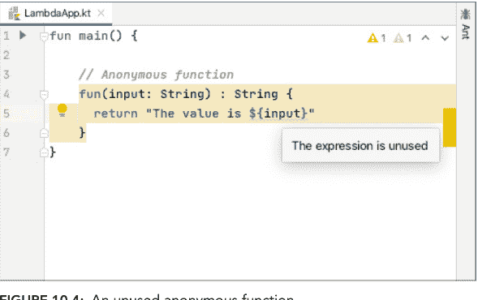

## 你可以将函数赋值给变量

虽然函数是匿名的且有些是声明的，但 Kotlin 中的所有函数都被视为类类。这意味着它们实际上可以存储在变量中。所以，更新你的测试类如下：

```kotlin
var funVar = fun(input: String) : String {
  return "The value is ${input}"
}
```

现在你有一个变量 `funVar`，因为它的“值”是一个函数。重要的是，这个变量不是函数的结果，而是对函数本身的引用。

尝试打印该变量：

```kotlin
var funVar = fun(input: String) : String {
  return "The value is ${input}"
}
println(funVar)
```

你会得到类似的内容：

```text
(kotlin.String) -> kotlin.String
```

为了弄清楚这告诉了你什么，修改函数定义：

```kotlin
var funVar = fun(input: Int) : String {
  return "The value is ${input}"
}
```

现在运行测试程序查看打印了什么：

```text
(kotlin.Int) -> kotlin.String
```

现在你可以清楚地看到 Kotlin 是什么：存储在 `funVar` 中的函数的简短表示。它是一个接收 `Int`（在之前的版本中是 `String`）并返回（用 `->` 表示）`String` 的函数。

## 可执行代码创建一个可执行变量

当你对 `funVar` 进行赋值时，你正在为该函数创建一个命名的引用——在这种情况下是 `funVar`。如果你输入 `funVar` 并打开括号 `()`，你的 IDE 实际上会建议一个参数——就像其他其他函数一样。你可以在图 10.5 中看到这一点。

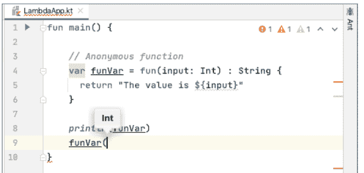

图 10.5：赋值给变量的函数被视为函数本身。

你可以这样传入参数：

```kotlin
var funVar = fun(input: Int) : String {
  return "The value is ${input}"
}
funVar(2)
```

现在，运行这段代码，你仍然得到相同的输出。因为 `funVar` 返回了一个值，但没有对该值进行任何操作。为了使用该值，你可以使用像 `println()` 这样的函数：

```kotlin
println(funVar(2))
```

现在你将得到一些输出：

```text
The value is 2
```

# 高阶函数接受函数作为参数

你在这一行短代码中遇到了一个非常重要的东西：

```kotlin
println(funVar(2))
```

`println()` 是 Kotlin 中的一个高阶函数。高阶函数是可以接受其他函数作为参数的函数。所以在这里，它接受其他函数作为参数。由于 `println()` 是高阶函数，它可以接受函数作为参数。你可以看到图 10.5 所示（注：此处原文逻辑有重复，翻译已按逻辑处理）。

## 函数类型语法

虽然这还不是合法的 Kotlin，但它确实接收了输入列表和一个名为 `filterOut` 的函数。对于 `filterOut` 的实际类型，你可以使用与你在 Kotlin 中已经看到的类似的表示法：

```kotlin
fun printList(input: List<String>, filterOut: (a: String) -> Boolean)
```

因此，`filterOut` 接收一个以 `String`（由 `a` 引用）作为参数并返回 `Boolean` 的函数。任何符合此标准的函数都可以。

有一个你可以传递的函数示例：

```kotlin
var filterA = fun(input: String) : Boolean =
    if (input.startsWith("A"))
        true
    else
        false
```

此函数过滤掉任何以大写 A 开头的字符串。这是另一个过滤函数：

```kotlin
var filterLong = fun(input: String) : Boolean =
    if (input.length > 6)
        true
    else
        false
```

现在声明是相同的——都接收一个 `String` 并返回一个 `Boolean`——但每个过滤函数的体是不同的。

如果你将这一切整合在一起，你将得到一个类似于列表 10.14 的内容。

## 列表 10.14：测试高阶函数与过滤器

```kotlin
import org.wiley.kotlin.math.Calculator

fun main() {
    // 匿名函数
    var funVar = fun(input: Int) : String {
        return "The value is ${input}"
    }
    println(funVar(2))
    println(funVar(2))

    var calc = Calculator()
    var intFunction = { 5 - 2 }
    calc.add(intFunction(), 3, 5, 3)

    var filterA = fun(input: String) : Boolean =
        if (input.startsWith("A"))
            true
        else
        false

    var filterLong = fun(input: String) : Boolean =
        if (input.length > 6)
            true
        else
        false

    var strings = listOf<String>("Apple", "Carrot", "Horserish",
    "Apricot", "Tomato", "Tangerine")

    println("Filtering out with filterA: ")
    printList(strings, filterA)

    println()
    println("Filtering out with filterLong: ")
    printList(strings, filterLong)
}

fun printList(input: List<String>, filterOut: (a: String) -> Boolean) {
    for (str in input)
        if (filterOut(str))
            println(str)
}
```

在这里，`printList()` 是一个高阶函数，它接受任何接受 `String` 并输出 `Boolean` 的函数。如果你编译并运行这段代码，你将得到来自两个过滤不同的输出：

- 使用 filterA 过滤：

```text
Carrot
Horserish
Tomato
Tangerine
```

- 使用 filterLong 过滤：

```text
Apple
Carrot
Tomato
```

> 注意：在前面的示例中，由于测试代码的前部部分省略了一些额外的输出。

## 你可以内联定义函数

虽然你可以将匿名函数赋值给变量，但你也可以在函数调用本身中内联定义函数。你之前见过用大括号定义函数的示例：

```kotlin
{ 5 - 2 }
```

> 注意：这实际上与匿名函数稍有不同。它被称为 Lambda 表达式（lambda expression），你很快就会在更详细的情况下看到它。

在调用 `printList` 时你可以做同样的事情，只是你需要方法来定义输入参数。你可以通过在表达式的第一部分提供变量名和类型来这样做：

```kotlin
{ str: String -> false }
```

这是一个接收一个 `String`（由 `str` 引用）并返回 `Boolean` 的函数。任何符合此标准的函数都可以工作。如果它以 `T` 开头，则返回 `true`：

```kotlin
{ str: String -> false }
```

## Lambda 表达式是语法更少的函数

你在这里看到的并不是简单的“内联函数”，而是 Kotlin 称为 Lambda 的表达式。这是一种编写函数的另一种方式，比匿名函数更简单。

这是匿名函数的形式：

```kotlin
fun(input: String) : Boolean
true
false
```

去掉 `fun` 关键字和参数列表，它会变得更简单。现在这是一个 Lambda 表达式：

```kotlin
{ str: String -> false }
```

> 这基本上是一种惯例，匿名函数被称为函数，而 Lambda 表达式被称为表达式（而不是函数）。唯一的实际差异是通常情况下，Lambdas 更短，通常只有编辑器的一行（大约 80 个字符）。你还会看到 Lambda 函数这个术语。这在技术上并不准确，因为 Lambda 表达式可以作为函数使用，但通常不被称为函数。这主要区分了 Lambda 表达式和匿名函数。

技术上，Lambda 表达式还有更多。这里是完整的 Lambda 表达式的版本：

然而，Lambdas 通常在不声明的情况下使用，像这样：

```kotlin
{ str: String -> false }
```

列表 10.15 显示了匿名函数和 Lambda 表达式如何传递给高阶函数，展示了它们如何工作。

## 列表 10.15：匿名函数与 Lambda 表达式对比

```kotlin
// 此处原文重复了列表 14.10，实际应为列表 10.15 的内容，已省略重复代码块
```


```kotlin
import org.wiley.kotlin.math.Calculator

fun main() {
    // 匿名函数
    var funVar = fun(input: Int): String {
        return "The value is ${input}"
    }
    println(funVar(2))
    println(funVar(2))

    var calc = Calculator()
    var intFunction = { 5 - 2 }
    calc.add(intFunction(), 3, 5, 3)

    var filterA = fun(input: String): Boolean =
        if (input.startsWith("A"))
            true
        else
            false
```

### 列表 10.15：测试函数（继续）

```kotlin
fun printList(input: List<String>, filterOut: (a: String) -> Boolean) {
    for (str in input)
        if (filterOut(str))
            println(str)
}
```

## Lambda 表达式使用 `it` 处理单个参数

Lambda 的另一种惯用用法是使用名为 `it` 的参数。如果你有一个想要接受单个参数的 Lambda，你可以省略参数并使用它作为占位符，甚至不需要声明任何内容。

## 函数字面量：Lambda 和匿名函数

> 注意：你可能已经注意到 lambda expression（lambda 表达式）和 lambda 这两个术语经常通用。在 Kotlin 的用法中，它们是相同的，你经常会看到 lambda 或 lambdas 作为 lambda expression 或 lambda expressions 的缩写。

在 `filterOut` 的当前定义中，lambda 接收单个参数。你实际上可以在输入 lambda 中省略它。这里有一个指明它所接收参数的 lambda 版本：

```
{ str: String -> if (str.toUpperCase().startsWith("T")) true else false }
```

这里是使用 `it` 的等效 lambda：

```
{ if (it.toUpperCase().startsWith("T")) true else false }
```

由于这个 lambda 只需要一个参数，因此它被省略了。然后，它被表示该参数。

然后这个 lambda 被传递给一个高阶函数；高阶函数本质上控制了参数的类型。因为 `printList()` 声明它接收一个接受 String 的 lambda，所以当 lambda 被 `printList()` 使用时，lambda 基本上只能接收 `String` 输入。

## 让 Lambda 运行更顺畅

现在你已经看到了它是如何工作的，你就可以更好地理解，为什么一个没有声明输入参数的 lambda 表达式可以传递给一个期望接受单个输入函数的高阶函数。

考虑这个 lambda 表达式：

```
{ str: String -> true }
```

在这个表达式中，接受了一个单个参数，但在实际表达式中忽略了它。这是完全合法的。回想一下，如果你有一个参数，就不必声明它。你只需要使用 `it`：

```
{ if (it.length > 5) true else false }
```

由于你不需要使用输入参数，你可以很轻松地简化这一切：

```
{ true }
```

现在，对于任何接受单个参数函数的高阶函数，这都是一个合法的 lambda 表达式。

## Lambda 表达式返回最后一个执行结果

再看一眼为止用于过滤的某些 lambda 表达式：

```
{ if (it.toUpperCase().startsWith("T")) true else false }
```

但这可以变得更简单。函数或 lambda 可以显式地返回一个值。如果没有返回，表达式会被求值，求值的结果就是该值。这实际上就是前面代码中发生的情况；表达式求值为 `true` 或 `false`，即使没有显式返回，该值也会返回。

尽管如此，事情可以变得更简单。在带有 `if` 的 lambda 表达式中，你可能只需要条件本身。如果条件求值并返回 `true`，你可以让它作为 lambda 的结果；如果条件求值为 `false`，那么就可以将其作为结果。

同样的表达式看起来可能是这样：

```
{ it.toUpperCase().startsWith("*") }
```

通过使用 `it` 和来自 `if` 的条件，这个 lambda 表达式变得简洁，而且实际上读起来更清晰。

## 作为其他函数参数的后缀函数

正如 Kotlin 中 lambda 的惯用法一样，也可以省略所谓的“尾随 lambda”（trailing lambda）的括号。看一眼 `printList()` 的定义：

```kotlin
printList(input: List<String>, filterOut: (String) -> Boolean) {
```

该函数的最后一个参数是一个输入函数。在这种情况下，你会看到调用此高阶函数的不同表示法。目前，使用 lambda 表达式输入调用 `printList()` 如下：

```kotlin
printList(strings, { it.toUpperCase().startsWith("*") })
```

然而，你可以将除尾随函数以外的所有内容放在括号中，然后将尾随 lambda 表达式留在括号之外：

```kotlin
printList(strings) { it.toUpperCase().startsWith("*") }
```

这可能看起来有点奇怪，但你经常会在丰富的 Kotlin 程序员那里看到这种。它并没有提供任何特殊的优势；它只是你在查看其他 Kotlin 代码时应该注意的一种符号变化。

> 注意：这完全是一个编码风格和偏好的问题。你可能会发现你喜欢这种风格，也可能发现你更倾向于不使用尾随 lambda，并将一切保留在括号内。这里没有对错之分，甚至没有好坏之分。

## 大量的函数，巨大的问题产生空间

强大的功能伴随着糟糕编程的空间。虽然这不是一个流行的说法，但完全可以这么说。通过匿名函数、lambda 表达式、高阶函数以及你在本章之前学到的所有内容，你会发现 Kotlin 中的几乎任何任务都可以通过一种以上的方式完成。

此外，特别是对于 lambda，你可以开始快速定义函数——通常甚至将它们赋值给变量——并将它们传递到其他函数中。随着你越来越多地使用 lambda，你会发现比以前任何时候都更大的灵活性。

然而，当你进入这些定义函数的各种方法的世界时，有两点需要特别注意：

- 通过使用 `it`、未声明的参数以及表达式的结果作为返回值，你的代码在做什么可能会变得越来越模糊。经常编写注释并谨慎地使用快捷方式，以避免你的代码对其他人变得困惑且不可读（当你在初始编写几天或几周后重新审视它时也是如此）。

- 注意不要在匿名函数和 lambda 上偷工减料。有时快速输入一个 lambda 比较容易，但创建一个实际函数、声明它并通过其名称使用它可能是更好的主意。函数真的关乎重用。

无论你多频繁地以及在语义上如何使用这些函数工具，你都会使用它们的。在下一章中，你将添加更多的。

## 编写地道的 Kotlin

本章内容包括：

- 使用 `let`、`run`、`apply`、`with`

- 将代码到

- 作用函数

## 作用函数为代码提供上下文

并没有要求你必须在代码中使用 lambda 作用函数。但是，如果你花时间学习它们，你就能更好地理解该语言擅长什么，从而编写更好的代码。

## 使用 `let` 提供实例访问

列表 11.1 是一段普通的代码，在目前看来编写和理解应该很简单。它使用了第 9 章和第 10 章的 `Calculator` 和 `Operation` 类。

### 列表 11.1：创建并使用 Calculator 实例

```kotlin
import org.wiley.kotlin.math.Calculator
import org.wiley.kotlin.math.Operation

fun main() {
  var calc = Calculator()
  var intFunction = { 5 - 2 }
  println(calc.add(intFunction(), 1, 5, 3))
  println(calc.execute(5, Operation.Add(4)))
  println(calc.execute(2, Operation.Add(4)))
}
```

这段代码没有问题；但是它有点冗长，并且 `calc` 变量实际上只存在于几个函数中。换句话说，`calc` 本身并没有价值；它只需要被创建以便完成工作：运行 `add()` 和 `execute()` 函数。

列表 11.2 是使用 `let` 重构的这段代码。

### 列表 11.2：使用 let 限制函数调用

```kotlin
import org.wiley.kotlin.math.Calculator
import org.wiley.kotlin.math.Operation

fun main() {
  Calculator().let {
    var intFunction = { 5 - 2 }
    println(it.add(intFunction(), 3, 5, 5))
    println(it.execute(5, Operation.Add(4)))
    println(it.execute(2, Operation.Add(4)))
  }
}
```

这是一个经典的函数范例，即 `let` 函数。你可以将 `let` 作为对象实例的后缀使用。在这种情况下，创建了一个 `Calculator` 实例：

```kotlin
Calculator()
```

然后，添加了点操作符，紧随其后的是 `let`。接着，通过左大括号引入一个代码块：

```kotlin
Calculator().let {
```

该代码块中所有内容的上下文（或作用域）都是所创建的那个实例。换句话说，你可以将这个代码块认为一个函数：

```kotlin
fun theFun(calc: Calculator) {
    var itFunction = { 5 - 2 }
    println(calc.add(itFunction(), 3, 5, 3))
    println(calc.execute(5, Operation.Add(4)))
    println(calc.execute(2, Operation.Add(4)))
}
```

然后，创建一个新的 `Calculator` 实例并将其传递给该函数：

```kotlin
var calc = Calculator()
theFun(calc)
```

现在，函数可以对该 `Calculator` 实例进行操作。

使用 `let`，你不需要定义函数，甚至不需要一个变量来存储计算器实例。这一切都发生在这个作用域内：

```kotlin
Calculator().let {
    var itFunction = { 5 - 2 }
    println(it.add(itFunction(), 3, 5, 3))
    println(it.execute(5, Operation.Add(4)))
    println(it.execute(2, Operation.Add(4)))
}
```

## Let 让你访问实例

一旦你创建了 `let` 及其关联的代码块，就可以通过 `it` 访问 `let` 所绑定的实例：

```kotlin
println(it.add(itFunction(), 3, 5, 3))
println(it.execute(5, Operation.Add(4)))
println(it.execute(2, Operation.Add(4)))
```

这应该让你很熟悉。这正是当你没有声明单个参数时，lambda 表达式的工作方式：

```kotlin
{ if (it.length > 5) true false }
```

这里的作用域是通过 `it` 创建并传递给 `let` 的实例。需要注意的是，该实例仅存在于此作用域和代码块之前。因此，在以下代码中：

```kotlin
Calculator().let {
    var intFunction = { 5 - 2 }
    println(it.add(intFunction(), 3, 5, 3))
    println(it.execute(5, Operation.Add(4)))
    println(it.execute(2, Operation.Add(4)))
}
```

在右大括号之后，没有可用的 `Calculator` 实例。

你也可以用你自己的名称来重命名 `it`：

```kotlin
Calculator().let { calc ->
    var intFunction = { 5 - 2 }
    println(calc.add(intFunction(), 3, 5, 3))
    println(calc.execute(5, Operation.Add(4)))
    println(calc.execute(2, Operation.Add(4)))
}
```

在这里，`calc ->` 符号表示作用域在代码块中的实例可以通过 `calc` 引用。这个新名称覆盖了 `it`，而不是一个额外的引用。换句话说，下面的代码将无法编译：

```kotlin
Calculator().let { calc ->
    var intFunction = { 5 - 2 }
    println(it.add(intFunction(), 3, 5, 3))
    println(it.execute(5, Operation.Add(4)))
    println(it.execute(2, Operation.Add(4)))
}
```

一旦你提供了自定义名称，`it` 不再可用。只有通过自定义名称（在此例中为 `calc`）对应的实例是可用的。

## 作用域代码块实际上是 Lambda

你已经看到 `let` 的代码块（你很快就会看到其他作用域函数）看起来非常像 lambda 表达式。这是一个准确的观察——它们确实就是 lambda 表达式。

这清楚地解释了它们为什么能这样工作，同时也为传递给 lambda 的对象实例提供了自定义名称。这些并不是什么新功能，也不是作用域函数特有的；它们只是 Kotlin 处理 lambda 表达式的方式的一部分。

大多数作用域函数（包括 `let`）的返回值与 lambda 表达式的返回值相同。因此，结果通常是 lambda 最后一行的结果。

看以下代码：

```kotlin
var result = Calculator().let {
    var intFunction = { 5 - 2 }
    println(it.add(intFunction(), 3, 5, 3))
    println(it.execute(5, Operation.Add(4)))
    println(it.execute(2, Operation.Add(4)))
    it.execute(5, Operation.Multiply(5))
}
```

```kotlin
println(result)
```

变量 `result` 被赋值为 `let` 块最后一行的执行结果——在本例中：

```kotlin
it.execute(5, Operation.Multiply(5))
```

当你打印它时，你会得到 25。

## `let` 和作用域函数很大程度上是为了方便

重要的是，像 `let` 这样的作用域函数以及你将在本章剩余部分学习的函数，并没有引入新功能。没有什么是用 `let` 做而不能用标准函数完成的。

`let` 的主要好处是允许你在不命名实例的情况下编写代码。这在对对象执行单项操作时非常有用。

你需要在至少一个作用域中使用自定义引用变量，正如你之前在第一个 `let` 函数中将其重命名为 `calc` 时所看到的那样。

有些开发者会更进一步，并且按照惯例，尝试始终为 lambda 表达式提供自定义名称。这就是你之前看到的代码，但为内部 lambda 使用了 `result`：

```kotlin
var result = Calculator().let { calc ->
    var initFunction = { 5 - 2 }
    println(calc.add(initFunction(), 3, 5, 3))
    println(calc.execute(5, Operation.Add(4)))
    println(calc.execute(2, Operation.Add(4)))

    calc.execute(5, Operation.Multiply(5)).let { result ->
        println("Inner result: ${calc.execute(result, Operation.Add(12))}")
    }
}
```

这并不是坏主意，而且会让你的代码变得非常整洁。然而，事实证明这种做法可能有些多此一举。如果你有一个非常长的 lambda，通过下面的写法，你实际上去掉了它的很多“短小性”（因此在某种程度上也去掉了它的价值）：

```kotlin
var finalVal = calc.execute(5, Operation.Multiply(5)).let { result ->
    calc.execute(result, Operation.Add(12))
}
```


> 注意：作为一个例子，示例中的代码行无法放入书的一单行内！

在这些情况下——尤其是当你打算通过 lambda 处理单一、清晰的事物时——使用它是更好的：

```kotlin
var finalVal = calc.execute(5, Operation.Multiply(5)).let { calc.execute(it, Operation.Add(12)) }
```

它短得多，而且同样清晰。

## 链式作用域函数更简单整洁

简单地链用作用域函数要容易得多。这是通过记住任何 lambda 表达式和作用域函数的一个关键方面实现的：返回的值是最后一个执行表达式的结果。看这段代码：

```kotlin
var bigResult = Calculator().let { calc ->
    calc.execute(8, Operation.Add(4)).let {
        calc.execute(12, Operation.Multiply(it))
    }.let {
        calc.execute(it, Operation.Divide(18))
    }.let {
        calc.execute(16, Operation.Subtract(it))
    }.let {
        calc.execute(it, Operation.Raise(2))
    }
}

println("Big result is ${bigResult}")
```

在这里，多个表达式被链式在一起。每个表达式都是绑定到 `let` 的每个 lambda 中的最后一个（也是唯一的）表达式。因此，每个表达式评估的结果会被返回并传递给下一个 `let`。

你还可以进一步压缩它：

```kotlin
calc.execute(8, Operation.Add(4)).let { calc.execute(12, Operation.Multiply(it)) }
.let { calc.execute(it, Operation.Divide(18)) }
.let { calc.execute(16, Operation.Subtract(it)) }
.let { calc.execute(it, Operation.Raise(2)) }
```

你可以进一步压缩，可能压缩成一行非常长的代码。

目标不是编写最短的版本或最长的代码行。目标是避免变量散落在四周且每个变量只使用一次：

```kotlin
var calculator = Calculator()
var one = calc.execute(8, Operation.Add(4))
var two = calc.execute(12, Operation.Multiply(one))
var three = calc.execute(two, Operation.Divide(18))
var four = calc.execute(16, Operation.Subtract(three))
var five = calc.execute(four, Operation.Raise(2))
```

除了结果（存储在 `five` 中）之外，没有其他值需要保留。实际上，`calculator` 在所有 `execute()` 调用完成后也不再需要了。

这就是作用域函数的核心价值：让你的代码更方便、更有组织且易于阅读。

## 优先选择链式而非嵌套

习惯使用链式而非嵌套的想法非常重要，而且在大多数情况下，应该使用链式。你可以将之前的代码写为一组表达式：

```kotlin
var nestedResult = Calculator().let { calc ->
    calc.execute(8, Operation.Add(4)).let {
        calc.execute(12, Operation.Multiply(it)).let {
            calc.execute(it, Operation.Divide(18)).let {
                calc.execute(16, Operation.Subtract(it)).let {
                    calc.execute(it, Operation.Raise(2))
                }
            }
        }
    }
}
println("Nested result is ${nestedResult}")
```

尽管如此，这里有很多明显的问题。它们都不会阻止你编译代码，但它们都值得检查。

首先，这段代码的可读性差得多，因为你最后会有所有为了匹配的右括号。你必须确保每个语句都正确缩进，否则读起来也会一团糟。

# 章节：地道的 Kotlin 惯用法

> 注意：IDE 也不特别喜欢这种嵌套形式。为了编写这段代码，我不得不反复删除某个右括号并移动它的位置。

第二个问题是 `let` 的使用可能会变得复杂。不过，你可能已经注意到嵌套并不是这样的。

这个示例中显示了另一个常见模式：

```kotlin
var bigResult = Calculator().let { calc ->
    calc.execute(8, Operation.Add(4)).let {
        calc.execute(12, Operation.Multiply(it))
    }.let {
        calc.execute(it, Operation.Divide(18))
    }.let {
        calc.execute(16, Operation.Subtract(it))
    }.let {
        calc.execute(it, Operation.Raise(2))
    }
}

println("Big result is ${bigResult}")
```

单层嵌套的想法是优的。

## 许多链式函数从嵌套开始

`let` 的另一个重要用途是处理实例或变量为空的情况。

> 注意：你可能注意到本章的大部分都在讨论 `let`。虽然并不是所有作用域函数的作用都与 `let` 相同，但大多数遵循相同的规则。这一节让你熟悉它们。

这段代码为了在可空变量的范围内理解作用域函数具有重要意义：

- 定义了一个可空的 `String` 变量 `someString`。
- 定义了一个函数 `getRandomString()`，它可以创建一个给定长度的随机 `String` 并可以返回 `null`。（它接受 `Any?` 作为参数）。

但大多数情况下，由于你在书中学到的所有类型和安全原因，你不会希望允许空值进入你的函数。这里有一个简单的函数，它接收一个 `String` 并进行一些基础格式化：

```kotlin
fun formatString(str: String): String =
    "*${str}*\n"
```

你可以想象这个函数可能做的更真实的事情，但关键在于——和大多数函数一样——它接受一个非空的类型化参数。要看到这种效果，如列表 11.5 所示传入 `someString`。

## 你可以将作用域函数作用于非空结果

`let` 的另一个重要用途是处理实例或变量为空的情况。

### 列表 11.4：使用代码和空值的简单程序

```kotlin
fun main() {
    var someString: String? = getRandomString(10)
    println(someString)
}

fun getRandomString(len: Int): String? =
    when {
        len < 0 -> null
        len == 0 -> ""
        len > 0 -> (1..len).map { "ABCDEFGHIJKLMNOPQRSTUVWXYZabcdefghijklmnopqrstuvwxyz.".random() }.joinToString("")
    }
```

### 列表 11.5（续）

```kotlin
when {
    len < 0 -> null
    len == 0 -> (1..len).map { "ABCDEFGHIQRSTUVWXYZabcdefghijklmnopqrstuvwxyz".random() }.joinToString("*")
    len > 0 -> random()
    else -> null
}

fun formatString(str: String): String =
    "\n>>> ${str}***"
```

尝试编译，你将得到一个错误：

`Kotlin: Type mismatch: inferred type is String? but String was expected`

这是一个你以前见过的问题。`formatString()` 不接受 `String?`，而是接受 `String`。换句话说，它会接收一个 `String`，但 `String` 必须是非空，这没关系，因为 `formatString` 编译器会确保这一点。

# 接受 null 值不是一个好主意

一个简单的修复方法是将 `formatString()` 更改为如下签名：

```kotlin
fun formatString(str: String?): String =
    "\n>>> ${str}***"
```

这是合法的，并且可以解决编译错误。通过此更改，`formatString()` 将接受 `someString`，因为 `someString` 可能是 `null`，而 `formatString()` 接收的是 `String`。

然而，这是一种非常糟糕的做法。Kotlin 最强大的特性是它的强类型系统和编译时类型安全，因此编写一个接受可空值的代码会让你失去这些强类型和类型安全能力。

虽然你永远无法完全移除 `?` 运算符或可能与 `null` 交互的函数和变量，但你应该尝试减少它们的出现。

# 作用域函数提供了 null 选项

那么该怎么办？为了保持类型安全并避免大量的可空值，但有时你会遇到可能会有 `null` 并需要处理它的情况。坦率地说，作用域函数非常完美。

你可以在可能为 `null` 的变量后添加 `?` 运算符添加如 `let` 等作用域函数。如果变量为 `null`，则忽略该作用域函数。如果不是，则执行。列表 11.6 展示了这种用法。

### 列表 11.6：使用作用域函数处理可能为空的值

```kotlin
fun main() {
    var someString: String? = getRandomString(10)
    println(someString)

    someString?.let { println(formatString(someString)) }
}

fun getRandomString(len: Int): String? =
    when {
        len < 0 -> null
        len == 0 -> ""
        len > 0 -> (1..len).map { "ABCDEFGHIJKLMNOPQRSTUVWXYZabcdefghijklmnopqrstuvwxyz".random() }.joinToString("")
        else -> null
    }
```

```kotlin
fun formatString(str: String): String =
    "\n>>> ${str} <<\n"
```

这现在将帮助提供格式化并运行。这里是关键行：

`someString?.let { println(formatString(someString)) }`

输出是你预期的结果：

```
qbttNxelV

>>> qbttNxelV <<
```

`someString` 的值首先被打印（显示它不是 `null`），然后通过 `formatString()` 进行格式化打印。

但现在更改 `someString` 的初始化：

`var someString: String? = getRandomString(-2)`

如果你查看 `getRandomString()`，你会发现输入参数 `null` 将导致返回 `null`：

```kotlin
fun getRandomString(len: Int): String? =
    when {
        len < 0 -> null
        len == 0 -> ""
        len > 0 -> (1..len).map { "ABCDEFGHIJKLMNOPQRSTUVWXYZabcdefghijklmnopqrstuvwxyz".random() }.joinToString("")
        else -> null
    }
```

所以 `someString` 现在是 `null`。这第一行可以正常工作：

`println(someString)`

这是因为 `println()` 接受 `Any?`。但紧接着的一行很有趣：

`someString?.let { println(formatString(someString)) }`

`someString?` 告诉 Kotlin 变量（`someString`）可能可能是 `null`。如果是 `null`，则停止执行。如果 `someString` 不是 `null`，则执行带有 `formatString()` 的 `println()`。

在这种情况下，对于 `someString`，你不会期望该作用域函数运行。而它确实没有运行。没有额外的输出：

```
null
```

你从第一个 `println(someString)` 看到 `null`，然后没有额外的输出。这证明了使用 `formatString()` 的第二个 `println()` 没有执行。每当你有一个可能为 `null` 的变量时，你都可以作用域函数来指定变量上的活动，而不会有编译错误的风险。

# 作用域函数在其他函数上工作……非常特殊的方式

现在你已经知道取一个 `null` 变量并在作用域函数应用 lambda 是可行的，并且你可以在调用 `null` 时避免执行：

`someString?.let { println(formatString(someString)) }`

但请记住，作用域函数带给你很大的是便利性和代码的清晰度。它们移除了不会让代码混乱的变量，同时也节省了内存。

在之前的示例中，仍然有一些浪费的变量。这里是完整部分：

```kotlin
var someString: String? = getRandomString(-2)
someString?.let { println(formatString(someString)) }
```

虽然使用 `let` 很好，但 `someString` 除了存储调用 `getRandomString()` 的结果外没有其他用途。这正是作用域函数旨在清理的类型代码。

你可以更进一步！通过对函数应用 `let`（或任何作用域函数），如果原始函数返回 `null`，则作用域函数将不会运行。看看列表 11.7，它用你编写的代码演示了这一想法。

### 列表 11.7：对可能返回 null 的函数应用作用域函数

```kotlin
fun main() {
    // var someString: String? = getRandomString(10)
    var someString: String? = getRandomString(-2)
    println(someString)

    someString?.let { println(formatString(someString)) }
}

getRandomString(-2).let {
    println(formatString(it))
}

fun getRandomString(len: Int): String? =
    when {
        len < 0 -> null
        len == 0 -> ""
        len > 0 -> (1..len).map { "ABCDEFGHIJKLMNOPQRSTUVWXYZabcdefghijklmnopqrstuvwxyz".random() }.joinToString("*")
        else -> null
    }

fun formatString(str: String): String =
    "\n>>> ${str} <<<
```

这段代码整合了你已经学过的内容：

- 与其将 `getRandomString()` 的结果赋值给只使用一次的变量，而是直接调用它。
- 原始函数返回 `null`，则作用域函数将不会运行。

通过此更改，如果 `getRandomString()` 为 `null`，你将得不到输出；如果有格式化的 String 返回，将得到正确的输出。

## WITH 是用于处理实例的作用函数

在深入研究另一个作用函数 `with` 的细节之前，重要的是要意识到所有这些函数在用法上非常相似。虽然在语法上存在差异，但你会很快发现关于 `let` 的所有学习内容都适用于 `with`。

你可以取一个对象并使用 `with` 对其进行操作。这里有一个使用 `Calculator` 实例的基本示例：

```kotlin
with(Calculator()) {
    println(execute(8, Operation.Add(4)))
    println(execute(12, Operation.Multiply(12)))
}
```

通过代码你可以快速看出它的作用：

1. 首先，提供了作用函数：`with`。
2. 为 `with` 提供了一个上下文对象。该上下文对象（通过 `Calculator()` 创建的 `Calculator` 实例）在整个 lambda 表达式中都是引用。
3. lambda 内部的任何操作都被认为是在上下文对象上进行的。


由于上下文对象是 `Calculator` 的实例，因此可以运行它的所有方法：`execute()`、`add()` 和 `sum()`。

> **警告**：此代码示例假设你在阅读各个章节时保持了 `Calculator` 的最新状态。如果不是，你可能需要下载代码示例，以便跟进并可以使用本节及后续章节中引用的所有函数。

## 作为对象引用使用

`let` 与它之间的一个主要区别之一是上下文对象的引用方式。在 `let` 中，你像在 lambda 表达式中那样使用：

```kotlin
getRandomString(-2)?.let {
    println(formatString(it))
}
```

而改用这种方式。知道这一点，你可以重写 `with` 块使其更显式：

```kotlin
with(Calculator()) {
    println(this.execute(8, Operation.Add(4)))
    println(this.execute(12, Operation.Multiply(12)))
}
```

然而，这种写法很笨拙，并且偏离了本章的要点：编写地道的 Kotlin。因为每当你想要调用附加在当前 `this` 对象上的函数时，都可以省略它，这样写代码要清晰得多：

```kotlin
with(Calculator()) {
    println(execute(8, Operation.Add(4)))
    println(execute(12, Operation.Multiply(12)))
}
```

> **警告**：现在是时候指出，阅读（和编写）关于这种引用的文本是一个棘手的问题，因为 "this" 这个词会频繁出现，但它并不是对对象的引用，而是一个简单的英语单词。在书中，你可以特别注意字体。当 `this` 以代码字体显示时，它是对对象实例的引用。当 `this` 以普通字体显示时，它只是普通英语的一部分。

你的 IDE 也会提供有用的提示；图 11.3 显示了 IntelliJ 如何查看你在 lambda 表达式中的视图。这与章节开头图 11.2 所示的引用指示类似。

使用 `this` 代替 `it` 是 `with` 和 `let` 之间最显著的区别之一。但这非常有道理。你实际上是在代码中说：“使用以下对象实例，执行这些事情。”如果还要去说：“使用那个实例，做这个。使用那个，做那个”，就多此一举了。

相反，你只需读一次 Kotlin：“使用以下对象实例……”，然后在 lambda 内部说“做这个”和“做那个”。`with` 设置了上下文，`with` 中的所有内容都回溯到上下文。

## this 引用始终可用

真正理解 `with` 块内所有代码中隐含的 `this` 引用很重要。虽然这听起来像是在重复前面的章节，但看下面的代码：

```kotlin
with (Person("David", "let")) {
    println("My name is ${fullName()}")
}
```

这是合法的代码且非常有意义。`with` 块接收一个新的 `Person` 实例，而 `this` 引用该实例。`fullName()` 是通过 `this` 用的方法，你不需要显式地输入 `this`，`fullName()` 函数直接出现在 `println()` 内部。


这段代码看起来很……奇怪。`with` 函数经常的情况是：存在令人困惑的隐含上下文。因此，在使用它时要小心。额外的注释可能会有帮助，因为记住，作用函数的目标是方便和清晰：

话如此，`with` 是 Kotlin 中一种重要的地道编程技术，所以不要回避使用它。

## with 返回 lambda 的结果

和大多数作用函数一样，`with` 返回执行 lambda 函数的结果。这意味着执行 lambda 最后一行的结果。看下面的代码：

## run 是一个运行器作用函数

`run` 提供了另一个作用函数，包含了你见过的 `let` 和 `with`。在很多方面，`run` 的行为与 `let` 相似。它接收一个上下文对象并在其上进行操作。然而，像 `let` 一样，它直接在上下文对象上操作。

这里是上一节使用 `with` 的一个简单示例：

```kotlin
with(Calculator()) {
    println(execute(8, Operation.Add(4)))
    println(execute(12, Operation.Multiply(12)))
}
```

## APPLY 有上下文对象且没有返回值

`apply` 是你作用域函数工具箱中的另一个工具，它延续了在便利性和可读性主题上提供细微变体的模式。`apply` 与 `let`、`run` 和 `with` 主要区别在于它不从 lambda 表达式返回任何值。

与 `run` 和 `with` 类似，`apply` 使用对象作为上下文对象。因此，`apply` 变成不需要返回值即可操作实例的完美函数。它的方便之处在于你不需要反复输入实例名称。

以下代码使用了 `apply`：

```kotlin
// 不使用 apply 的示例
val brian = Person("Brian", "Truthy")
brian.partner = Person("Rose", "Elizabeth", _age = 34)
// 出某些原因，我们只知道 Brian 比他的伴侣小两岁
brian.age = brian.partner?.let { it.age - 2 } ?: 0
println(brian)
println(brian.partner)
```

你可能会注意到实例 `brian` 出现了很多次。确实非常多！

> **注意**：如果你在跟随学习的过程中输入并执行代码——你确实应该这样做——你需要在你的项目和测试程序中导入 `org.wiley.kotlin.person.Person`。

## apply 对实例进行操作

这里的关键在于，在创建 `Person` 实例后，生成的实例 `brian` 被进行了多次操作。这就是为什么 `apply` 非常有用。

以下是你可以重写代码的方式：

```kotlin
// 使用 apply 重写这段代码
val brian = Person("Brian", "Truthy").apply {
    partner = Person("Rose", "Elizabeth", _age = 34)
    age = partner?.let { it.age - 2 } ?: 0
    println(this)
}
println(brian)
```

与其他作用域函数一样，功能没有变化。然而，代码变得整洁且清晰。`partner` 和 `age` 都通过 `this` 被引用，并且显然地附加到初始的 `Person` 实例上。

## apply 返回上下文对象而非 lambda 结果

关于 `apply` 的另一个重要注意点是，函数的返回值是被操作的实例——即上下文对象。因此，在这段代码中，上下文对象是一个 `Person` 实例：

```kotlin
// 使用 apply 重写这段代码
val brian = Person("Brian", "Truesby").apply {
    partner = Person("Rose", "Elizabeth", age = 34)
    // 出某些原因，我们只知道 Brian 比他的
    // 伴侣小两岁
    age = partner?.let { it.age - 2 } ?: 0
    println(this)
    println(partner)
}
```

这意味着 `apply` 最后持有创建的 `Person` 实例，并包含了 lambda 块内部更新后的值。

在某些情况下，你可以将 `apply` 视为扩展的 `init` 块。如果你需要创建一个对象的新实例并配置该对象，且该配置可以在实例内部完成，那么 `init` 就可以工作。在这个例子中，涉及到 `brian` 实例之外的数据（例如伴侣的年龄），而且某些打印操作对于所有 `Person` 实例来说并不常见。

当你有这种特定于实例的配置或不适合放入 `init` 块的实例时，`apply` 是一个极佳的替代方案。

此外注意这一行：

```kotlin
println(this)
```

虽然并不常见，但你确实可以使用此引用直接获取上下文对象。这里正是这种需求，因为 `println()` 不会将此引用视为输入参数，因此需要显式地将其传递给 `println()` 函数。

## Kotlin 的 Elvis 运算符

这里稍微偏离了作用域函数的工作原理。这行代码对你来说可能看起来有点奇怪：

```kotlin
age = partner?.let { it.age - 2 } ?: 0
```

首先，确保理解这其中的作用域函数部分。这行代码可以用此引用显式写写：

```kotlin
this.age = partner?.let { it.age - 2 } ?: 0
```

上下文对象（`brian`，一个 `Person` 实例）正在为 `age` 属性赋值。在这个（有些幼稚的）示例中，`brian` 实例的年龄被设置为比伴侣小两岁。

# 296 | 第 11 章 编写地道的 Kotlin

这里的关键在于，`Person` 实例首先初始化，然后执行 `also` 块。这听起来显而易见，但这种顺序很快就会变得重要。

使用了另一个作用域函数——这次是 `apply`：

```kotlin
it.partner = Person("Chloe", "Herng Lee").apply {
    println("New person created: ${fullName()}")
}
```

`apply` 使用了这个引用，因此两个作用域函数之间不会发生冲突。它仍然指向第一个 `Person` 实例 David。在 `apply` 块中，它指向第二个 `Person` 实例 Chloe Herng Lee。因此，对 `fullName()` 的调用绑定到了它，并应该打印出她的名字。

> **注意**：一旦你开始频繁使用作用域函数，你会发现你经常使用它们，而且在另一个作用域函数嵌套作用域函数是很常见的。由于大多数作用域函数是可以互换的，你可能会因为一个函数使用 `it` 而另一个使用 `this`（或反之）而选择其中一个而不是另一个。避免引用冲突是选择 `apply` 而不是 `let`，或选择 `run` 而不是 `also` 的完全合理的理由。

这种潜在的引用冲突也可能让你重命名你的作用域变量。但根据原则，你应该尽量避免重命名这个引用；这是一种你应该尽可能避免的坏习惯。

在 `apply` 完成后，还有额外的打印：

```kotlin
println("${it.firstName}'s partner is ${it.partner?.fullName()}")
```

这位于 `also` 块内部，但在 `apply` 之外。它引用了 David `Person` 实例，该实例有一个新伙伴，即在上一个 `apply` 中创建并使用的 Chloe Herng Lee 实例。

最后的 `println()` 也是最后一个执行的语句……对吧？

## also 在赋值之前执行

再次查看这段整体代码：

```kotlin
println(Person("David", "Le").also {
    println("New person created: ${fullName()}", "Herng Lee")
    it.partner = Person("Chloe", "Herng").apply {
        println("New partner created: ${fullName()}")
    }
    println("${it.firstName}'s partner is ${it.partner?.fullName()}")
})
```

一眼看去，基于你所知道的知识，可以推测输出可能是：

David Le

New person created: David Le

New partner created: Chloe Herng Lee

David's partner is Chloe Herng Lee

also 也给你一个实例……但先对实例进行操作 | 27

用的话说，代码从第一行到最后一行顺序执行。在这种情况下，`also` 函数在挂载到 `also` 的实例初始化之后运行。

编译这段代码并运行。你会得到一个不同的结果：

```
New person created: David Le
New partner created: Chloe Herng Lee
David's partner is Chloe Herng Lee
David Le
```

输出反映了 `also` 与其他函数的主要区别：`also` 块在将上下文对象赋值给任何变量或传递给任何函数之前执行。它是。

遗憾的是，这有点违背直觉，特别是当这个作用域函数被称为“also”（也）时。人们很容易把 `also` 设成初始化（或使用）这个对象实例，然后（也）执行这段代码，但并不是 `also` 的实际作用。相反，你应该将 `also` 视为“执行此代码代码，并将上下文对象赋值给变量（或传递给函数），连同此代码块”。

> **警告**：无论你如何扭曲或重写对 `also` 的描述，听起来都会有些别扭。坦率地说，这个命名并不理想。即使官方 Kotlin 文档也局结于说你可以把 `also` 读作“并且也对对象执行以下操作”。但句子中的“并且”暗示了一个顺序，而那个“执行操作”（lambda 中的代码块）是在对象赋值之后执行的。

在这种情况下，你应该少少对函数名称的自描述性投入信任，而应该专注于记忆它实际上做了什么。

考虑到这一点，你就能理解代码的顺序了。这里再次提供代码以复习：

```kotlin
println(Person("David", "Le").also {
    println("New person created: ${it.fullName()}")
    it.partner = Person("Chloe", "Herng").apply {
        println("New partner created: ${it.fullName()}")
    }
    println("${it.firstName}'s partner is ${it.partner?.fullName()}")
})
```

以下是具体发生的情况：

1. 初始化了一个人（David Le）。
2. 该实例被传递到 `also` 块中：
   a. 打印 `Person` 实例（David）的 `fullName()` 函数。
   b. 创建了一个人实例（Chloe Herng Lee）。
   c. 在新的 `Person` 实例（Chloe）上调用了 `apply`：
      i. 打印 `Person` 实例（Chloe）的全名。
   d. 将新的 `Person` 实例（Chloe）赋值给第一个 `Person` 实例（David）的 `partner` 属性。
   e. 更多操作，显示第一个 `Person` 实例（David），然后该实例的 `partner` 属性，即新的 `Person` 实例（Chloe）。
3. 最后，原始的 `Person` 实例（David）以及更新后的 `partner` 属性（Chloe）被传递到整个代码示例第一行的 `println()` 中。

这一切都发生得很快，在很多情况下顺序并不明显，但重要的是在编译和执行层面，是有顺序的。

# 作用域函数总结

现在你已经看到了所有的作用域函数，你意识了它们最重要的一点：它们非常相似。选择其中一个而不是另一个取决于风格和偏好。有几个关键区别可以区分每个函数：

- 引用的名称：`it` 还是 `this`。
- 是否是扩展函数还是上下文对象。

表 11.1：作用域函数的区别

| 作用域函数 | 上下文对象 | 返回值 | 使用 |
| :--- | :--- | :--- | :--- |
| let | it | Lambda 结果 | 扩展函数（点符号） |
| with | this | Lambda 结果 | 上下文对象 |
| run | this（或无） | Lambda 结果 | 扩展函数 |
| apply | this | 上下文对象 | 扩展函数 |
| also | it | 上下文对象 | 扩展函数 |

列表 11.9 显示了差异。它是整个章节各种作用域函数示例的完整列表。

# 列表 11.9：完整示例集


```kotlin
import org.wiley.kotlin.math.Calculator
import org.wiley.kotlin.math.Operation
import org.wiley.kotlin.person.Person
import org.wiley.kotlin.user.SimpleUser
import org.wiley.kotlin.user.User

fun main() {
    var calc = Calculator()
    var result = Calculator().let { calc ->
        var myFunction = { 5 - 2 }
        println(calc.add(myFunction(), 3, 5, 3))
        println(calc.execute(5, Operation.Add(4)))
        println(calc.execute(2, Operation.Add(4)))
    }

    calc.execute(5, Operation.Multiply(5)).let { result ->
        println("Inner result: ${calc.execute(result, Operation.Add(12))}")
    }

    println(result)
    var calc = Calculator()
    theFun(calc)

    var bigResult = Calculator().let { calc ->
        calc.execute(8, Operation.Add(4)).let {
            calc.execute(12, Operation.Multiply(it))
        }.let {
            calc.execute(it, Operation.Divide(18))
        }.let {
            calc.execute(16, Operation.Subtract(it))
        }.let {
            calc.execute(it, Operation.Raise(2))
        }
    }
    println("Big result is ${bigResult}")

    var nestedResult = Calculator().let { calc ->
        calc.execute(8, Operation.Add(4)).let {
            calc.execute(12, Operation.Multiply(it)).let {
                calc.execute(it, Operation.Divide(18)).let {
                    calc.execute(16, Operation.Subtract(it)).let {
                        calc.execute(it, Operation.Raise(2))
                    }
                }
            }
        }
    }
}
```

# 列表 11.9 (续)

```kotlin
println("Nested result is ${bigResult}")
```

```kotlin
var one = calc.execute(8, Operation.Add(4))
var two = calc.execute(12, Operation.Multiply(one))
var three = calc.execute(two, Operation.Divide(18))
var four = calc.execute(16, Operation.Subtract(three))
var five = calc.execute(four, Operation.Rise(2))
```

```kotlin
println(five)
with(Calculator()) {
  println(execute(8, Operation.Add(4))
  println(execute(12, Operation.Multiply(two))
}
```

```kotlin
var withResult = with (Person("David", "Le")) {
  println("My name is ${fullName}")
}
println(withResult)
```

```kotlin
// 示例
Calculator().run {
  println(execute(8, Operation.Add(4))
  println(execute(12, Operation.Multiply(two))
}
```

```kotlin
// 使用 let 运行示例
Calculator().let {
  it.execute(8, Operation.Add(4))
  it.execute(12, Operation.Multiply(two))
}
```

```kotlin
// run 的“典型”示例
var product = Calculator().run {
  execute(2045, Operation.Multiply(12042))
}
println(product)
```

```kotlin
// 使用 let 的 run 示例
Calculator().let {
  it.execute(2045, Operation.Multiply(12042))
}
```

```kotlin
// 使用 with 的 run 示例
with(Calculator()) {
  execute(2045, Operation.Multiply(12042))
}
```

```kotlin
// 无上下文对象的情况下运行
val hexNumber = run {
  val digits = "0-9"
  val hexDigits = "A-Fa-f"
```

# 作用域总结 | 301

```kotlin
val sign = "-"
/*
Regex("*[sign]?[digits$hexDigits)+")
for (match in hexNumberRegex.findAll("*+1234 -FFFF-not-a-number*")) {
    println(match.value)
}
// 不使用 apply 的示例
/
val brian = Person("Brian", "Trueby")
brian.partner = Person("Rose", "Elizabeth", _age = 34)
// 出于原因，我们只知道 Brian 比他的伴侣小两岁
brian.age = brian.partner?.let { it.age - 2 } ?: 0
println(brian)
println(brian)
/*
// 使用 apply 重写这段代码
val brian = Person("Brian", "Trueby").apply {
    partner = Person("Rose", "Elizabeth", _age = 34)
    // 出于原因，我们只知道 Brian 比他的伴侣小两岁
    age = partner?.let { it.age - 2 } ?: 0
    println(this)
    println(partner)
}
// 使用 also 在赋值前执行操作
println(Person("David", "Lee").also {
    println("New partner created: ${it.fullName()}")
    it.partner = Person("Chloe", "Herring Lee")
    println("New partner created: ${fullName()}")
})
println("${it.firstName}'s partner is ${it.partner?.fullName()}")
}
*/

fun theFun(calc: Calculator) {
    var intFunction = { 5 - 2 }
    println(calc.add(intFunction(), 3, 5, 3))
    println(calc.execute(5, Operation.Add(4)))
    println(calc.execute(2, Operation.Add(4)))
}
```

说选择作用域函数也涉及到风格问题可能有一点点过其实，但它确实说明了这一点。`also` 特别的操作方式略有不同，因为它在赋值之前执行，你可以认为，某些函数返回上下文对象而另一些返回 lambda 表达式，这存在巨大的区别。

要点是，使用某种特定的作用域函数并没有绝对的正确时机。你越早接受这一点，在编写代码使用它们时就会越得练。

# 第 12 章 继承，再次，带着情感

## 本章包含什么？

- 抽象类
- 用于定义行为的接口
- 实现接口
- 实现与扩展
- 委托模式
- 委托与实现

## 抽象类需要稍后实现

你已经花了几章节的时间学习类和继承，并且构建了许多开放类并扩展了这些类。现在是时候对类、继承以及一些你只简要见过的概念以及一些你从未见过的概念再次进行一次回顾了。

首先是抽象类。你在第 8 章中了解到数据类不能是抽象的，尽管那时你对抽象类的了解并不多。你在第 9 章中也简要见过一个抽象方法：

```kotlin
abstract fun isSuperUser(): Boolean
```

在 Kotlin 中，`abstract` 很多时候推迟术语。它表示：“这定义了以后必须实现的功能”。对于方法来说，它要求扩展类的类重写该方法。对于类来说，意味着它不能被实例化。

## 抽象类不能实例化

列表 12.1 重新回顾了之前章节中的 `User`。这是一个数据类，并且包含一些属性。

```kotlin
package org.wiley.user

data class User(var email: String, var firstName: String, var lastName: String) {
    override fun toString(): String {
        return "$firstName $lastName ($email)"
    }
}
```

乍看之下，这似乎是另一个主题的变体：一个可以扩展的基类。然而，开放类和抽象类之间存在重要区别。通过将一个类标记为抽象，无法直接创建它的实例，但你仍然可以创建其子类的实例——例如保捷、奥迪和本田，它们都有独特的行为，并且可能具有一些共享的行为。

然而，`Car` 与 `Band` 或 `User` 相比有重要区别。实际上没有所谓的“通用”汽车。每辆汽车都是特定的品牌（你可以根据需要扩展这一模型）。`Band` 是一个独立概念。`Band` 的实例是合理的，因为它是自定义的。`RockBand` 实例可能特定于某种音乐类型，但普通的 `Band` 实例同样有效。

这与 `Car` 不同。`Car` 具有某些特性。在这种情况下，你并不希望创建一个 `Car` 实例。是不完整的。你可以通过创建一个抽象类而不是非抽象类来禁止创建 `Car` 实例。

> **注意** 如果你刚刚对这种推理提出了 10 个或 20 个反对意见，那太棒了！它们可能是合理的——只需继续阅读，这是一个复杂且微妙的话题，需要比几个段落才能完全解释。

列表 12.3 将 `Car` 转换为抽象版本。

```kotlin
package org.wiley.kotlin

abstract class Car {

    fun drive(direction: String, speed: Int) : Int {
        // 在指定的方向上以指定的速度行驶
        // 返回行驶距离 - 稍后修复
        return 0
    }
}
```

抽象类主要关注定义行为，而不是实现它。数据类关于状态，而接口关于定义行为。

## 列表 12.4：测试抽象类

```kotlin
import org.wiley.kotlin.car.Car

fun main() {
    var car = Car()
}
```

你将立即得到编译错误：

Kotlin: Cannot create an instance of an abstract class（无法创建抽象类的实例）

这非常显而易见。你不能实例化抽象类。但更重要的是，它让你对抽象类的真正用途有了直观感受：定义必须具备的行为，而不定义行为本身。

### 抽象类与子类定义了契约

`Car` 与任何子类的它的定义了某种契约。然而，现在这个契约是空的。你无法实例化 `Car`，如果你子类了它，你也不需要满足任何要求。这使得 `Car` 变成了一个相当没用的抽象类。

更好的方法是在抽象类中定义行为，然后将实现推迟给子类。列表 12.5 展示了这一点，以及 `drive()` 函数是如何被设为抽象的。

## 列表 12.5：将 Car 中的单函数设为抽象

```kotlin
package org.wiley.kotlin.car

abstract class Car {

    // 子类需要定义它们如何行驶
    abstract fun drive(direction: String, speed: Int) : Int
}
```

在这种情况下，尽管 `Car` 类整体上是抽象的，但它是结果。类抽象是由于拥有至少一个抽象函数的结果。这是一个重要的认识点：抽象类必须被专门地扩展，以便这些抽象类中的抽象函数可以被重写并赋予行为。

这就是你经常听到的“契约”，它是定义类（在本例中为抽象类 `Car`）与所有子类 `Car` 的类之间的契约。在本例中，该抽象类表示此方法必须以此签名定义：

```kotlin
// 子类需要定义它们如何行驶
abstract fun drive(direction: String, speed: Int) : Int
```

现在，扩展 `Car` 的类知道它们被要求做什么。列表 12.6 展示了 `Car` 类的一个简单扩展（强调是简单的），它履行了契约。

## 列表 12.6：履行 Car 设定的契约

```kotlin
package org.wiley.kotlin.car

class Honda : Car() {

    override fun drive(direction: String, speed: Int) : Int {
        // 演示。Super：只需返回速度 / 每小时的分钟数
        return speed / 60
    }
}
```

列表 12.7 在一个同样简单的示例中使用了 `Honda`。

## 列表 12.7：实例化 Honda 并使用 drive() 函数

```kotlin
import org.wiley.kotlin.car.Honda

fun main() {
    var car = Honda()
    println("The car drove ${car.drive("W", 60)} miles in the last minute.")
}
```

输出正如你预期的那样：

汽车在上一分钟内行驶了 1 英里。

> **警告** 本章中函数的实现可能既不会让你印象深刻也不会让你惊讶。这没关系；目标不是编写特别的代码，而是真正关注 Kotlin 提供的各种继承方法，首先是抽象类和函数，很快就会接口以及这些接口的实现。不要太担心函数代码，而是关注这些类和构造是如何交互的，以及为什么继承在 Kotlin 中是这样工作的。

尽管如此，抽象类通常不仅仅是定义单个抽象函数。看到多个函数作为抽象类所设定的契约的一部分是很常见的。抽象类还可以定义需要子类处理的属性。列表 12.8 展示了 `car` 的稍微演进的版本，它添加了一个抽象属性和一些额外的抽象函数。

## 列表 12.8 为 Car 定义的契约添加更多细节

```kotlin
package org.wiley.kotlin.car

abstract class Car {
```

（持续）

## 列表 12.8（续）

```kotlin
abstract var maxSpeed: Int

// 启动汽车
abstract fun start()

// 停止汽车
abstract fun stop()

// 子类需要定义它们如何行驶
abstract fun drive(direction: String, speed: Int) : Int
```

> **警告** 如果你正在跟着操作并边编译，对 `Car` 的此更改将破坏 `Honda` 类。它不再履行 `Car` 设定的契约，因为它没有处理新的 `maxSpeed` 属性或 `stop()` 函数。

### 抽象类可以定义具体的属性和函数

到目前为止，`Car` 中的所有内容都是抽象的：它的属性和函数。但并没有强制要求。事实上，事实证明这是抽象类和接口之间的关键区别，你将在本章的晚些时候学习。抽象类可以拥有完全实现的（有时称为“具体的”）函数和属性，并与抽象的混合。

将 `Car` 的第一行修改如下所示：

```kotlin
abstract class Car(val model: String, val color: String) {
```

现在，每个子类都有 `model` 和 `color` 属性可用。它们也可以在抽象类中使用，尽管它们在编译时之前在子类中尚未被定义。列表 12.9 添加了一个简单的 `costring()` 函数——一个对于 `Car` 是具体的函数。此方法对 `Car` 的所有子类可用。

## 列表 12.9 在 Car 中设置一些具体的函数和属性


```kotlin
package org.wiley.kotlin.car

abstract class Car(val model: String, val color: String) {

    abstract var maxSpeed: Int

    // 启动汽车
    abstract fun start()

    // 停止汽车
    abstract fun stop()

    // 子类需要定义它们如何行驶
    abstract fun drive(direction: String, speed: Int): Int

    fun costring(): String {
        return "Model: $model, Color: $color"
    }
}
```

为了细节考虑，想象一下这些不同的汽车的启动方式是不同的。这其实并不切实际，而且你对车辆实际启动行为的建模做得越深，这一点就越真实。所以，你可能会有如下关于本田启动的代码：

```kotlin
override fun start() {
    println("插入钥匙，踩刹车，按下点火开关，正在启动。")
}
```

而你可能会有如下关于保时捷的代码：

```kotlin
override fun start() {
    println("远程启动，踩刹车，换入倒挡位")
}
```

你可以想象将这些 `println` 语句替换为其他函数调用，以区分你的车辆功能。

通常情况下，如果你的子类中具有相同的行为，那么你应该检查你使用继承的方式。

## 契约允许对子类进行统一处理

在你开发继承树时，你将会看到越来越多的子类，但子类在重写基抽象类行为方面的多样性程度更大。

关键在于：所有子类都源自一个基类。这意味着你可以将子类视为基类，并对契约进行操作，而不是特定的子类。这听起来有很多正式术语，所以值得了解一下具体是什么样的。

首先，你需要几个 `Car` 子类。列表 12.13 和 12.14 在组合中加入了英瑞迪和宝马。

### 列表 12.13：Car 的英瑞迪子类

```kotlin
package org.wiley.kotlin.car

class Infiniti(model: String, color: String) : Car(model, color) {

    override var maxSpeed: Int = 167

    override fun start() {
        println("正在启动英瑞迪 ${model}:插入钥匙，启动发动机")
    }

    override fun stop() {
        println("停止英瑞迪 ${model}！")
    }

    override fun drive(direction: String, speed: Int): Int {
        println("英瑞迪 ${model} 正在行驶!")
        return speed / 60
    }
}
```

### 列表 12.14：Car 的宝马子类

```kotlin
package org.wiley.kotlin.car

class BMW(model: String, color: String) : Car(model, color) {
    override var maxSpeed: Int = 182

    override fun start() {
        println("正在启动宝马 ${model}:踩刹车，按下启动按钮*")
    }

    override fun stop() {
        println("停止 ${model}")
    }

    override fun drive(direction: String, speed: Int): Int {
        println("宝马 ${model} 正在行驶*")
        return speed / 60
    }
}
```

> 注意：如前所述，这些是 `Car` 子类非常平凡的例子，没有你在更真实的应用程序中可能想要的变种变化。这里的重点是细微的打印差异，以便在列表 12.15 所示的测试用例中容易看出调用了哪个子类。

现在你可以构建一个加载大量 `Car` 子类的程序，并对它们进行迭代，以通用的方式处理每一个……即使每个子类都有独特的行为。这正是列表 12.15 所做的。

### 列表 12.15：在列表中迭代汽车

```kotlin
import kotlin.random.Random
import org.wiley.kotlin.car.BMW
import org.wiley.kotlin.car.Car
import org.wiley.kotlin.car.Honda
import org.wiley.kotlin.car.Infiniti
import org.wiley.kotlin.car.Porsche

fun main() {
    var car = Honda("Accord", "blue")
    car.start()
    car.drive("W", 60)
    car.stop()
}

println("正在加载车队...")
var cars: MutableList<Car> = loadCars(10)
for (car in cars) {
    car.start()
    car.drive("E", Random.nextInt(0, 200))
    car.stop()
}
```

```kotlin
fun loadCars(numCars: Int): MutableList<Car> {
    var list = mutableListOf<Car>()
    for (i in 0..numCars) {
        when (Random.nextInt(0, 3)) {
            0 -> list.add(Honda("CRV", "black"))
            1 -> list.add(Porsche("Boxster", "yellow"))
            2 -> list.add(BMW("435i", "blue"))
            3 -> list.add(Infiniti("QX60", "silver"))
        }
    }
    return list
}
```

关键不在于行为或输出。而是从程序的角度来看，`cars` 列表中的每一项都是 `Car`。这就是契约如此重要的地方：每个 `Car` 子类都有 `drive()` 和 `start()`。

# 继承层次结构示例

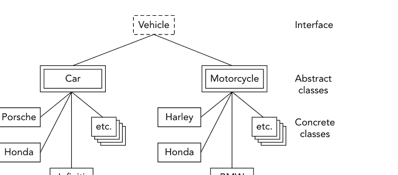

图 12.1：使用接口、抽象类和具体类的继承层次结构

层次结构的顶端是一个通用接口 `Vehicle`。它为一类广泛对象——车辆定义了所需的行为。然后，`Car` 和 `Motorcycle` 都实现了该接口，并定义了具体性以及需要实现的内容。若干子类继承了抽象类（这意味着它们也是 `Vehicle` 接口的实现类），并填充了所有所需的行为。

这具备了一个良好的继承树的所有特征。它从树的顶端通用功能开始。在树的每一层，向下移动，类变得越来越具体，变化也越来越明确。然而，所有这些类最终都是 `Vehicle` 的实现。

你可以拥有一个 `Vehicle` 实例列表，列表中的每一项都可以是 `Car` 子类或 `Motorcycle` 子类，你可以对列表中的每个项调用 `Vehicle` 中定义的任何函数，并知道 `Vehicle` 创建的契约已得到履行。

你还可以创建一个 `Motorcycle` 子类列表，并调用 `Motorcycle` 特有的函数。你可能会让 `Motorcycle` 添加一个 `Car` 没有的脚架属性，现在任何 `Motorcycle` 子类都将支持该属性。

## 接口无法维护状态

在接口章节的开头，你读到接口可以定义属性，但它们不能定义状态，也不能在类的其他部分使用。为了理解这一点，请看 `Vehicle` 如何定义 `maxSpeed` 属性：

```kotlin
interface Vehicle {
    var maxSpeed: Int

    // 其他代码
}
```

`maxSpeed` 实际上是抽象的。如果你回看它在 `Car` 中是如何定义的，它在这里被标记为抽象 `abstract`：

```kotlin
abstract class Car(val model: String, val color: String) : Vehicle {

    abstract var maxSpeed: Int
    // 其他代码
}
```

在这两种情况下，`maxSpeed` 的实际处理都被推迟到了具体类。正因如此，`maxSpeed` 可以在函数中使用，例如 `Car` 中的 `toString()`：

```kotlin
override fun toString(): String {
    return "${this::class.simpleName} ${modelName} in ${color} with a max speed of ${maxSpeed}"
}
```

这是合法的，Kotlin 编译器理解当此函数被调用时，具体类中的代码已经确保了 `maxSpeed` 被填充了。

### 类的状态是其属性的值

`BMW` 类在它的属性值中存储了状态。它的型号、状态、颜色等都存储在 `model`、`color` 和 `maxSpeed` 属性中：

```kotlin
class BMW(model: String, color: String) : Car(model, color) {
    override var maxSpeed: Int = 182
}
```

`BMW` 的特定实例将拥有与另一个特定实例不同的状态。一个可能是蓝色的 435，另一个可能是白色的 M3。

接口无法存储状态。这必须由具体实例来处理。但接口可以做一些有点奇怪的事情：它可以为不需要推迟到后面的属性定义访问器（getters）。

## 接口可以拥有固定值

在接口中，你可以定义一个立即提供自定义访问器实现的一个属性。你可以在列表 12.19 中看到这一点。

### 列表 12.19：为 `Vehicle` 添加带有访问器的属性

```kotlin
package org.wiley.kotlin.vehicle

interface Vehicle {
    val maxSpeed: Int

    val purpose: String
        get() = "This interface models vehicles of all kinds"

    fun start()
    fun stop()
    fun drive(direction: String, speed: Int): Int
}
```

这不是状态。它本质上是一个固定值，现在所有 `Vehicle` 的实现都可用。每个 `Car` 和 `Motorcycle` 实例都将有一个 `purpose` 属性，当调用它们时，它们的值都是 `Vehicle` 中定义的字符串：

```kotlin
println(car.purpose)
```

你通常不会发现这些定义固定值的属性，因为你通常希望属性是有状态的——即随每个实例而改变。这对于所有接口实现来说都是一种常量，但事实证明在大多数时候并没有用。

> 注意：接口中的固定值属性有一个非常好的用例。你将在很快后的实现其他接口的章节中看到这种用法。

## 接口定义函数主体

Kotlin 接口可以让你惊讶的一点是定义一个函数和该行为。这看起来可能有点奇怪；接口没有定义状态的属性，那么函数会做什么呢？你已经见过一个很好的例子了。记住抽象类中这个版本的 `toString()`：

```kotlin
override fun toString(): String {
    return "${this::class.simpleName} in ${color}"
}
```

你可以在 `Vehicle` 接口没有 `model` 属性的情况下编写类似的内容：

```kotlin
fun stats(): String {
    return "This vehicle is a ${this::class.simpleName} and has a maximum speed of ${maxSpeed}"
}
```

现在这看起来可能有点奇怪。乍看之下，这不是违反了接口维护状态的规则吗？不，实际上并不是接口在维护状态；而是继承链中某处的具体实现。实际实例将拥有自己必须处理的 `maxSpeed`——即 `maxSpeed` 属性。

```kotlin
override fun stop() {
    println("Stopping the ${model}")
}

override fun drive(direction: String, speed: Int): Int {
    println("The Honda ${model} is driving!")
    return speed / 60
}
```

从这里可见的内容，`Honda` 现在扩展了 `Car` 并实现了 `HondaManufacturer`。在技术上，它也通过 `Car` 实现了 `Vehicle`。这个类中包含很多内容！

你可以创建一个 `Honda` 实例并打印出它的 `name` 属性，该属性是从 `HondaManufacturer` 获取的：

```kotlin
var honda = Honda("Odyssey", "grey")
println(honda.name)
```

## 接口属性名称可能会引起混淆

你可能会在这里发现一个问题。当只看 `Manufacturer` 接口时，`name` 属性非常有意义。但现在看 `Honda` 类，就并不完全清楚 `name` 指的是什么了。你有两种方案来解决这个问题：

- 为接口属性名（如 `name`）加上接口名前缀，例如使用 `manufacturerName` 代替 `name`。
- 避免通用的属性名称，例如使用 `manufacturer` 或 `make` 代替 `name`。

这两种方法都可以，这变成了一个风格和偏好的问题。对于这一点，你只需将 `Manufacturer` 和 `HondaManufacturer` 中的 `name` 属性重命名为 `make`，为属性的值和用途提供更好的上下文。

## 接口装饰类

你可能注意到，即使是 `Honda`（以及 `Car` 的其他子类，甚至是虚构的 `Motorcycle` 抽象类）也可以实现 `HondaManufacturer` 而不需要实现额外的行为。

这通常被称为装饰，或装饰器模式。你可以在很多地方读到关于这种设计的内容，但这里有一个针对 Java（因此非常接近 Kotlin）的很好的解释：dzone.com/articles/gang-four–decorate-decorator。其思想是让一个类通过现有的数据或行为来装饰现有的类，而无需重构或影响现有对象。

在这种情况下，`HondaManufacturer` 通过给 `Honda` 赋予一个新属性来装饰它，而 `Honda` 类只需要添加另一个继承的接口。你也可以以这种方式添加功能；你可能会添加一个提供制造商信息的函数。因此，`Manufacturer` 可能会如列表 12.24 所示定义一个新函数，然后 `HondaManufacturer` 就可以如列表 12.25 所示进一步定义行为。

### 列表 12.24：在 Manufacturer 实现上定义新函数

```kotlin
package org.wiley.kotlin.vehicle

interface Manufacturer {
    val make: String

    fun manufacturerInformation(): String
}
```

### 列表 12.25：为接口的所有实现添加可用行为

```kotlin
package org.wiley.kotlin.vehicle

interface HondaManufacturer : Manufacturer {
    override val make: String
        get() = "Honda"

    override fun manufacturerInformation(): String {
        return "Honda 是 2015 年世界第八大汽车制造商。" +
               "更多信息请访问 https://www.honda.com"
    }
}
```

## 提供了扩展行为的另一种选项：委托

到目前，你已经掌握了 Kotlin 中大部分的“日常继承”。十之九的情况下，你会使用接口，用抽象类或具体类来实现它们，或者用其他接口来扩展它们。然后，偶尔你会实现多个接口，有时用新行为装饰类，并要求该类实现新接口中定义的行为。无论如何，你手头都有很多工具。

但你偶尔会遇到一些极少数的情况，这是 Kotlin 特别感兴趣的：一个对象可以由接口的多个实现构成的想法。这有点复杂，请花些时间考虑，但解决这个用例的回报是值得的。

### 抽象类从通用变为具体

假设你有一个 `Spy` 类。一个对象可以由接口的多个实现组成。这变得有点棘手，请花些时间，但解决这个用例的回报是值得的。


# 接口定义行为但没有主体 | 321

```kotlin
override fun stop() {
    println("Stopping the ${model}")
}

override fun drive(direction: String, speed: Int): Int {
    println("The Honda ${model} is driving!")
    return speed / 60
}
```

从这里可见的内容，`Honda` 现在扩展了 `Car` 并实现了 `HondaManufacturer`。在技术上，它也通过 `Car` 实现了 `Vehicle`。这个类中包含很多内容！

你可以创建一个 `Honda` 实例并打印出它的 `name` 属性，该属性是从 `HondaManufacturer` 获取的：

```kotlin
var honda = Honda("Odyssey", "grey")
println(honda.name)
```

# 接口属性名称可能会引起混淆

你可能会在这里发现一个问题。当只看 `Manufacturer` 接口时，`name` 属性非常有意义。但现在看 `Honda` 类，就并不完全清楚 `name` 指的是什么了。你有两种方案来解决这个问题：

- 为接口属性名（如 `name`）加上接口名前缀，例如使用 `manufacturerName` 代替 `name`。
- 避免通用的属性名称，例如使用 `manufacturer` 或 `make` 代替 `name`。

这两种方法都可以，这变成了一个风格和偏好的问题。对于这一点，你只需将 `Manufacturer` 和 `HondaManufacturer` 中的 `name` 属性重命名为 `make`，为属性的值和用途提供更好的上下文。

# 接口装饰类

你可能注意到，即使是 `Honda`（以及 `Car` 的其他子类，甚至是虚构的 `Motorcycle` 抽象类）也可以实现 `HondaManufacturer` 而不需要实现额外的行为。

这通常被称为装饰，或装饰器模式。你可以在很多地方读到关于这种设计的内容，但这里有一个针对 Java（因此非常接近 Kotlin）的很好的解释：dzone.com/articles/gang-four–decorate-decorator。其思想是让一个类通过现有的数据或行为来装饰现有的类，而无需重构或影响现有对象。

在这种情况下，`HondaManufacturer` 通过给 `Honda` 赋予一个新属性来装饰它，而 `Honda` 类只需要添加另一个继承的接口。你也可以以这种方式添加功能；你可能会添加一个提供制造商信息的函数。因此，`Manufacturer` 可能会如列表 12.24 所示定义一个新函数，然后 `HondaManufacturer` 就可以如列表 12.25 所示进一步定义行为。

# 列表 12.24：在 Manufacturer 实现上定义新函数

```kotlin
package org.wiley.kotlin.vehicle

interface Manufacturer {
    val make: String

    fun manufacturerInformation(): String
}
```

# 列表 12.25：为接口的所有实现添加可用行为

```kotlin
package org.wiley.kotlin.vehicle

interface HondaManufacturer : Manufacturer {
    override val make: String
        get() = "Honda"

    override fun manufacturerInformation(): String {
        return "Honda 是 2015 年世界第八大汽车制造商。" +
               "更多信息请访问 https://www.honda.com"
    }
}
```

# 委托提供了扩展行为的另一种选项

到目前，你已经掌握了 Kotlin 中大部分的“日常继承”。十之九的情况下，你会使用接口，用抽象类或具体类来实现它们，或者用其他接口来扩展它们。然后，偶尔你会实现多个接口，有时用新行为装饰类，并要求该类实现新接口中定义的行为。无论如何，你手头都有很多工具。

但你偶尔会遇到一些极少数的情况，这是 Kotlin 特别感兴趣的：一个对象可以由接口的多个实现构成的想法。这有点复杂，请花些时间，但解决这个用例的回报是值得的。

# 抽象类从通用变为具体

假设你有一个 `Spy` 类。一个对象可以由接口的多个实现。这变得有点棘手，请花些时间，但解决这个用例的回报是值得的。

# 列表 12.31 (续)

```kotlin
override fun start() {
    println("Starting the plane")
}

override fun stop() {
    println("Stopping the plane")
}

override fun go(direction: String, speed: Int): Int {
    return fly(direction, speed)
}

abstract fun fly(direction: String, speed: Int): Int
```

# 列表 12.32: 飞机子类：B52!

```kotlin
package org.wiley.kotlin.plane

class B52() : Plane("*B52") {
    override var maxSpeed: Int = 650

    override fun fly(direction: String, speed: Int): Int {
        println("Away we go on the B52, ${direction} miles an hour to the $")
        return speed / 60
    }
}
```

# 列表 12.33: 另一种飞机：滑翔器

```kotlin
package org.wiley.kotlin.plane

class HangGlider(val wingType: String) : Plane(wingType) {
    override var maxSpeed: Int = 80

    override fun fly(direction: String, speed: Int): Int {
        println("Off in a ${wingType} glider, headed ${direction}")
        return speed / 60
    }
}
```

# 委托给属性

那么，你该如何处理所有这些类和接口呢？嗯，拿 `Spy` 类来说。一个优秀的间谍应该能够使用所有可能的交通工具逃跑。从某个角度来看，间谍确实可以实现所有这些：它可以拥有一个汽车实现、一个飞机实现和一个摩托车实现。

> 注意：间谍实际上还应该有一艘船，但那对于一个章节来说，示例代码太多了！

# 列表 12.34: 使用多种交通工具的 Spy 类

```kotlin
package org.wiley.kotlin.car

import org.wiley.kotlin.motorcycle.Motorcycle
import org.wiley.kotlin.plane.Plane

class Spy(val name: String, val car: Car, val bike: Motorcycle, val plane: Plane) {
    // 需要实现
}
```

现在你可以定义一个像这样的 `free()` 方法：

```kotlin
fun free(vehicle: String, direction: String, speed: Int) {
    when (vehicle.upperCase()) {
        "PLANE" -> plane.fly(direction, speed)
        "BIKE" -> bike.ride(direction, speed)
        "CAR" -> car.drive(direction, speed)
        else -> println("I don't have that vehicle!")
    }
}
```

这非常简单。它能运行，但存在一些问题：你应该使用枚举（enum）来处理不同的车辆名称，你传递的是一个车辆字符串，这并不理想。

这就是委托大显身场的地方。首先，简化 `Spy` 以接收单一的 `Vehicle` 实现。这个属性可以存储间谍逃生所需的任何东西：

```kotlin
class Spy(val name: String, var vehicle)
```


现在，你需要一种实现 `Vehicle` 但不需要手动实现 `Vehicle` 的方法。是的，正如听起来的那样，这正是我们想要的。你希望通过 `vehicle` 属性将适用于 `Vehicle` 接口的 `Spy` 调用委托出去。你使用 `by` 关键字来实现这一点。

`Spy` 看起来类似于列表 12.35。

# 列表 12.35: 将调用委托给属性

```kotlin
package org.wiley.kotlin.vehicle

import org.wiley.kotlin.vehicle.Vehicle
```

# 列表 12.35 (续)

```kotlin
class Spy(val name: String, var vehicle: Vehicle) : Vehicle by vehicle {

/*
  fun flee(vehicle: String, direction: String, speed: Int) {
    when (vehicle.toUpperCase()) {
      "PLANE" -> plane.flee(direction, speed)
      "BIKE" -> bike.ride(direction, speed)
      "CAR" -> car.drive(direction, speed)
      else -> println("I don't have that vehicle!")
    }
  }
*/
}
```

> 注意：原始的 `flee()` 函数被注释掉了，这样你就知道需要删除代码。

这告诉了 Kotlin 几点：

- `Spy` 实现了 `Vehicle` 接口。
- 然而，任何适用于 `Vehicle` 的调用（例如对 `maxSpeed` 的引用或 `go` 函数）都应该委托给 `vehicle` 属性。

现在编写一些示例代码，如列表 12.36所示，看看这一切是如何结合的。

# 列表 12.36: 委托型 Spy 的测试程序

```kotlin
import org.wiley.kotlin.car.BMW
import org.wiley.kotlin.motorcycle.Harley
import org.wiley.kotlin.person.Spy
import org.wiley.kotlin.plane.HangGlider

fun main() {
  var bike = Harley("Road King")
  var plane = HangGlider("Fixed Wing")
  var car = BMW("M3", "blue")

  var spy = Spy("Black Spy", bike)
  spy.go("North", 145)
}
```

运行此程序，输出显示 `Spy` 实例使用摩托车旅行：

Riding off on a Harley at 145 speed!

对于一个棘手的问题来说，这是一个非常优雅的解决方案。`flee()` 方法中的 `when` 语句以及处理字符串车辆名称的代码消失了，取而代之的是你得到了一个整洁的 `Vehicle` 实现，而没有模糊 `Spy` 的核心功能。

# 委托发生在

不过要小心，这里仍然有一些需要注意的复杂之处。首先是当对象被传入 `Spy` 实例时，对附加对象的委托。看这段代码：

```kotlin
var spy = Spy("Black Spy", bike)
spy.go("North", 145)
spy.vehicle = plane
spy.go("West", 145)
spy.vehicle = car
spy.go("East", 145)
```

输出将是：

Riding off on a Harley at 145 speed!

Riding off on a plane at 145 speed!

Riding off on a car at 145 speed!

# 13

# Kotlin：下一步

本章内容包括：

- 用于 Android 的 Kotlin
- 用于 Java 的 Kotlin
- 使用 Gradle 进行构建
- 开始编写你自己的代码实验室（codelab）

## 为 Android 编写 Kotlin 程序

Kotlin 最常见的用途之一是编写移动应用程序，特别是针对 Android 平台。你可能会惊讶于书中没有对这部分进行重点介绍。然而，你为编写移动应用程序所做的所有工作都依赖于对象、函数、实例化、继承以及本书涵盖的主题。了解 Kotlin 是如何工作的，远比学习一堆奇奇怪的类名并构建一个移动应用（而且你完全不确定到底在创建什么）要重要得多。

## 用于 Android 的 Kotlin 仍然是 Kotlin

以下是关于 Google Codelabs 教你构建的最简单的 Android 应用程序的先决条件说明：

> 本代码实验室（codelab）是为程序员编写的，假设你已经熟悉 Java 或 Kotlin 编程语言。如果你是一位经验丰富的程序员并擅长阅读代码，你很可能跟上这个代码实验室的进度，即使你对 Kotlin 没有多少经验。

如你所见，在进入特定的用途（无论移动或其他）之前，你必须先了解 Kotlin 的通用知识。一旦熟悉了 Kotlin，深入任何领域在很大程度上集中在两个方面：

- 学习新的库以及可能的语法。这在 Android 编程中尤为如此：你需要习惯使用许多移动端特定的库。
- 学习新的语法和惯用法（idioms）。你还记得第 11 章中关于编写惯用 Kotlin 的想法。这种概念是以被特定用例接受为“最佳”的方式来使用库。

列表 13.1 显示了从 Android 开始的同一个 Google Codelabs 教程的片段。

### 列表 13.1：在初始视图上加载并部署文本

```kotlin
override fun onViewCreated(view: View, savedInstanceState: Bundle?) {
    super.onViewCreated(view, savedInstanceState)

    view.findViewById<Button>(R.id.count_button).setOnClickListener {
        val countTextView = view.findViewById<TextView>(R.id.count_text)
        val currentCount = countTextView.text.toString().toInt()
        val action = FirstFragmentDirections.actionFirstFragmentToSecondFragment(currentCount)
        findNavController().navigate(action)
    }

    // 通过其 ID 显示 toast
    view.findViewById<Button>(R.id.toast_button).setOnClickListener {
        // 创建一个带有文本的 Toast，显示短时间
        val myToast = Toast.makeText(context, "Hello Toast!", Toast.LENGTH_SHORT)
        // 显示 Toast
        myToast.show()
    }

    view.findViewById<Button>(R.id.count_button).setOnClickListener {
        countMe(view)
    }
}
```

这段代码中完全有三分之二是在 Android 库和 `android.view.View` 对象上操作的。这是构建视觉化移动应用程序特定的，你还会在列表中看到 `android.widget.TextView` 类。

这些类的工作方式与任何其他 Kotlin 类一样——尽管它们是基于 Android 的 Java 对象构建的。大部分代码都在执行你从早期章节中学的内容：继承、在基类上调用函数、创建变量以及将 lambda 传递给 `setOnClickListener()` 等函数。

## 从概念到示例

在学习像 Android Kotlin 这样的技能与学习整体 Kotlin 相比，处理方法上还有另一个重要区别。你现在肯定已经看到，书中的语法示例至少和实际代码样本一样多。书中的示例相对基础，因为重点是概念和基础学习。继承是如何工作的？抽象类是如何工作的？

结果是示例更简单了，而解释更长了。然而，你现在已经准备好反转这一局面，专注于更长的代码示例、教程以及数百行有时是数千行的代码。由于你已经理解了基础知识，你现在需要的解释更少。你能做的最好的事情就是写代码、写代码、写代码。

这里有几个可以开始的深度密集型教程网站：

- codelabs.developers.google.com：已经提到过几次 Google 的 Codelabs 了。它是通过 Kotlin 入门 Android 的真正金标准。它仍然包含一些解释，但侧重于实际示例和编写大量代码。这是完成本书后理想的下一步。
- developer.android.com：Android 官方开发者站点在很多情况下会将你链接回 Codelabs，但组织方式略有不同，并且是进入 Android 编程的另一个视角。

除了这两个网站外，通过任何网络搜索，你都能找到大量使用 Kotlin 进行 Android 编程的优质网站。

## Kotlin 和 Java 是绝佳的伴侣

正如使用 Kotlin 进行 Android 编程是一个极佳的组合，在 Kotlin 中与 Java 代码交互也是一个极佳的组合。然而，这两者之间的关系有点不同。

涉及到 Android 时，你将使用 Kotlin 与基于 Android 的手机交互。你主要编写所有的 Kotlin 代码，很少需要 Android 提供的 Kotlin 库之外的内容。对于 Java，它通常与现有的 Java 代码并存，你可能在一段 Java 代码和一段 Kotlin 代码之间切换，甚至从 Java 获取一段数据，在 Kotlin 中处理，然后传回 Java。因此，对于这种用例，你可能需要除了 Kotlin 之外还对 Java 有相当充分的理解。

## 你的 IDE 是关键组件

对于大多数 Kotlin 应用程序——构建移动应用、桌面应用或其他任何应用——你的大部分工作将在一个本地项目内进行，然后部署到其他地方。

> 注意：如果你的背景是 Web 编程，Kotlin 将提升你的本地开发水平。这与（例如）开发与 Amazon Web Services (AWS) 或类似的 API 网关和 lambda 交互的 React 应用完全不同。

虽然你当然可以在 Kotlin 中与 API 交互并部署到云平台，但你的许多应用程序将在本地编译并作为完整的工作单元部署。在这些情况下，IDE 确实成为了你工具链中的关键部分。

如果你将 Kotlin 代码和 Java 代码放入同一个项目，它们可以无问题地互相调用。这通常涉及告诉你的 IDE 你想使用 JVM。这因不同的 IDE 而异；在 IntelliJ 中，你不需要做任何事情；Java 支持是内置的。列表 13.2 是之前章节中 `User` 的简单版本，它使用了 Java 的 Date 包而之前没有。

### 列表 13.2：从 Kotlin 与 Java 交互

```kotlin
package org.wiley.kotlin.user

import java.util.Date

data class User(var email: String, var firstName: String, var lastName: String) {
    val createdOn = Date()

    override fun toString(): String {
        return "$firstName $lastName with an email of $email created on $createdOn"
    }
}
```

如果你不知道，你可能不会发现 `java.util.Date` 是一个 Java 包。但在 `toString()` 中，该属性被像其他 Kotlin 属性一样处理：

```kotlin
return "$firstName $lastName with an email of $email created on $createdOn"
```

列表 13.3 显示了一个使用该类的简单程序。

### 列表 13.3：使用 Kotlin 使用 Java

```kotlin
import org.wiley.kotlin.user.User

fun main() {
    var user = User("wayne.scott@example.com", "Wayne", "Scott")

    println(user)
}
```

输出结果是：Wayne Scott with an email of wayne.scott@example.com created on Thu Sep 24 08:00:32 CDT 2020

# 利用互联网补充你自己的需求和学习风格

如果你希望获得的内容比参考文档提供的更多，这里有一些经过验证的在线参考网站，它们一直非常有帮助：

- baeldung.com：类似于参考文档，baeldung.com 是一个略带学术色彩的学习网站。你将获得很多编程理论和大量的泛型（generics）。然而，你也会看到一些关于设计模式和充分利用 Kotlin 的有趣文章。
- medium.com：medium.com 是许多主题（从文化到编程）的绝佳去处。Kotlin 的内容有些零散，你可能会找到三篇关于继承的文章，而完全没有关于移动端的，但当你找到你寻找的内容时，它仍然是一个很棒的网站。它也非常实用，文章是为那些对计算机科学科学性并不感兴趣的程序员编写的。
- journaldev.com：journaldev.com 是另一个涵盖面广泛的网站，但它对于具有清晰示例的实用性文章来说非常棒。
- play.kotlin.org/koans/overview：Kotlin Koans 是一个非常独特的练习场。这是一种边学边练的交互式方法。它是结构化的，但几乎完全是体验性的，如果你想要大量清晰明确的解释，这个网站可能不适合你。尽管如此，它值得尝试。图 13.2 显示了一个关于数据类（data classes）的 Koan 示例，它要求根据右侧的提示填写缺失的代码。

# 现在做什么？

现在，整本关于 Kotlin 的书已经离开了你的后视镜，你已经完全准备好利用你所学的知识来构建你自己的程序、类、对象、函数、lambda、流（flows）和应用程序。你也准备好完成本章早期讨论的从“阅读代码”到“编写代码”的转变。是的，请保留好这本书和带有 Kotlin 文档的浏览器，但请进入你的 IDE 吧。你会发现，你可能再也不会回头了。

祝你享受其中，编程愉快！

# 索引

# 符号

- `@` 字符, 177
- `!` 结构, 148–149


- `?:` 运算符, 233–294
- `=` 运算符, 192–193
- `as` 折叠代码的简写, 93–94
- `/` (反斜杠), 32
- `:` (冒号), 95, 234
- `$` (美元符号), 17
- `.` (点分隔符), 28
- `==` (双等号运算符), 66
- `%` (取模运算符), 157
- `..` (两个点), 157
- 注解 (`annotation`), 142
- 匿名函数 (`anonymous functions`), 257–260
- `Any` 类 (`Any class`), 59–61, 91–92, 195, 197
- `apply` 函数, 292–294, 298
- 参数列表 (`argument list`), 234
- 参数 (`arguments`)
  - 使用名称调用函数, 241
  - 函数, 235–243
  - 函数和变量的数量, 249–251
  - 空值 (`null`), 241–243
  - 顺序, 74
  - 重新排序, 75
  - 通过名称指定, 74–75
  - 子类构造函数和, 97–98
- 数组类 (`Array class`), 144
- `ArrayList` 类 (`ArrayList class`), 129–130
- 赋值 (`assigning`)

# A

- 抽象类 (`abstract classes`)
  - 关于, 303
  - 定义具体的属性和函数, 308–308
  - 使用子类定义结构, 306–308
  - 履行由...编写的合同, 310–313
  - 实例化和, 304–316
  - 接口和, 315–316
  - 从通用到具体, 322–324
- 抽象数据类 (`abstract data classes`), 195
- 访问器 (`accessors`), 20–21
- `add()` 函数, 238, 240, 242, 244, 252, 260–261, 272, 287
- `also` 函数, 294–298
- 亚马逊云服务 (`AWS`), 334
- Android, 为其编写 Kotlin, 331–333
- Android Studio (网站), 5
- 函数到变量, 258–259
- 空值到属性, 79–81
- 属性从函数返回值, 46–47
- 使用辅助构造函数使用属性值, 77–79
- 未初始属性值, 45
- `Auto` 类, 221–202
- Getters/setters 的自动生成, 20–221

# B

- 后备字段 (`backing field`), 42
- 反斜杠 (`/`), 32
- baeldum.com (网站), 336
- 基类 (`base class`)
  - 关于, 95
  - 行为、类和自定义代码列表
  - 逆变性和, 141
  - 类型投影和, 143–145
  - 行为、类和自定义, 43–49
- Bloch, Joshua
  - 《Effective Java》, 67
  - 根据命名文件, 26–27
  - 开放 (`open`), 94–95
  - 使用包组织, 27–28
  - 参数化类型和, 130–131
  - 类型和, 31
  - 升级, 25–31
  - 闭包 (`closure`), 252
- 块 (`blocks`)
  - 关于, 155
  - `else`, 156
  - 使用...初始化类, 19–20
  - 主体, 234
  - 布尔条件，`while`- 和, 167–168
  - 分支条件, 159–160
  - 关于, 157–160
  - 已定义, 155
  - 内部范围 (`ranges`), 157
  - `break`, 176–178
  - `Byte` 类型 (`Byte type`), 31–32
  - 字节码 (`bytecode`), 335
- 代码 (`code`)
  - 折叠, 93–94
  - 线性性, 49
  - 代码列表 (`code listings`)
    - `?` 运算符, 286–287
    - `=` 运算符, 192–193
    - 抽象类, 315
    - `Add` 类, 223
    - `add()` 函数, 238–246
    - 添加伴侣对象, 209
    - 为 `SimpleUser` 添加 `componentN()` 方法, 191
    - 添加函数, 241
    - 添加属性, 317–318
    - 添加子类, 229–230
    - 为 `User` 类添加常量, 206–207
    - 匿名函数, 257–260
    - `Any` 类, 59–61, 91–92, 195, 197
    - `ArrayList` 类, 129–130
    - 赋值

# C

- 计数器类 (`Calculator class`), 195
- 类 (`classes`), 230–230
- 比较 (`comparison`), 247–250
- 构造函数 (`constructors`), 14
- 逆变 (`contravariance`), 139
- 控制结构 (`control structures`), 151–154
- 转换 (`converting`), 205
- Kotlin Koans, 2
- 列表 (`lists`), 102–105
- 加载数据 (`loading`), 332
- 移动 (`moving`), 322–324
- 移动 (`moving from`), 239
- 可变列表 (`mutable lists`), 107–108
- 可变变量 (`mutable variables`), 12–23
- 空值 (`null`), 241–243
- 空值到属性, 79–81
- 可空值 (`nullable values`), 281–284
- 对象 (`objects`), 147–148
- 操作 (`operation`), 222
- 覆盖函数 (`overriding functions`), 219–220
- 覆盖方法 (`overriding methods`), 219–220
- 父类 (`Parent class`), 107
- 传入对象 (`passing in`), 73–75
- 主构造函数 (`primary constructor`), 74–75
- 辅助构造函数 (`secondary constructor`), 77–79
- 属性从函数返回值, 46–47
- 使用辅助构造函数使用属性值, 77–79
- 未初始属性值, 45
- 内部范围 (`ranges in`), 157
- 返回 (`return`), 180
- 作用域函数 (`scope functions`), 277–280
- 子类构造函数 (`subclass constructors`), 97–98
- 测试 (`testing`), 360
- 类型 (`type and`), 31
- 类型投影和 (`type projection and`), 143–145
- 类型 (`types and`), 31
- 升级 (`upgrading`), 25–31
- 变体类型 (`variant types`), 138
- `when`, 247–250
- `while`, 167–168

# declarations–execute() 函数

通过类实例获取属性值，188–189
`hashCode()` 和, 186–188
单独处理，200–201
重写编译器生成的方法版本，196
参数和, 194–195
超类型类函数的优先级，196–197
-world, 183–185
的 la，194–195
`val`/`var` 和, 194–195
何时使用，192

declarations（声明）
数据解构数据，188–192
位点变型（`site variance`），143–144

默认值
- 接收，74
- 调用函数和，239–241
- 在构造函数中，237
- 在函数中，238–239
- 在函数中被重写，239

delegation（委托）
- 关于，322
- 实例化和，329–330
- 将抽象类从泛型移动到具体，322–324
- 委托属性，326–329
- 特异性和继承，324–362

dependent values（依赖值）
- 计算，87–88
- 使用自定义变异器，82–91
- 限制访问，86–87

`Double` 类型，37
`do..while`，170–176
`draw()` 方法，72
`drawRectangle()` 方法，72
`drawSquare()` 方法，71–72
`drive()` 函数，222, 315, 322–353

# E

Eclipse（网站），5
effective Java (Bloch), 67
`else` 块，156
`else` 子句
- 隐藏类行为，229–231
- 密封类 (`sealed classes`) 和，228–292
`else`/`elseif`，159
elvis 运算符（`Elvis` 运算符），293–294
`emptyList()` 方法，104
enums（枚举）
- 关于，216
- 作为类，218–221
- 常量和，219–220
- 共享行为和，222
- 类型安全值，216–218
environment（环境），设置，4–13
`equals()` 方法
- 关于，67
- 类和，52–58
- 与使用 `==` 比较，66
- 比较对象，52–54
- 构造函数参数和，199–200
- 数据类和，186–188
- 重写，54–56, 61–63, 196
- `Person` 类和，96–97
- 搜索和，64–67
- 集合和修复，10
errors（错误），10
可执行变量，259–260
`execute()` 函数，227–228, 248–249, 252, 272, 275–277
Design Patterns: Elements of Reusable-Oriented Software (Gang of Four), 67, 102
通过声明解构数据，188–192
`distinct()` 方法，113
美元符号 (`$`)，17
点分隔符 (`.`)，28
点符号表示法，253–255, 273

# expressions–hashCode() 方法

expressions（表达式）
- 控制结构和，151–154
- 单数函数，244–249
- lambda，266–268
- 部分的，在分支中，158–159
- 扩展函数，253–256
- 局部的，252
- 成员，252
- 重写，219–220
- 问题，268–269
- 默认返回 `Unit`，243–244
- 规则，243–251
- 范围，251–256, 271–298
- 单个表达式，244–244
- 语法，233–243
- 尾随的，268
- 变型在，143–144
`funVar`，259

# F

factory 方法，120, 213
factory 模式，102–104
`false` 值，33
`featureList()` 函数，222
文件，命名为类，26–27
`filter()` 方法，122–128
过滤集合，121–123
`filterInstance()` 方法，123
`filterNot()` 方法，123
`firstName` 属性，38–43, 46
`flee()` 函数，328
`Float` 类型，37
- 关于，161–166
- 使用索引获取，166–166
- 迭代器和，162–163
`formatString()` 函数，284, 285
`fullName()` 函数，288–289, 296
`fun` 关键字，234, 264
function name，234
- 关于，15
- 匿名的，257–260
- 参数，235–243
- 从属性赋值值，46–47
- 赋值给变量，258–259
- 使用命名参数调用，241
- 默认值，238–239
- 具体的，308–309
- 扩展，253–256
- 公式，233–235
- 高阶的，260–264
- lambda 表达式，264–268
- 字面量，257–268

# G

Gang of Four（四人帮）
Design Patterns: Elements of Reusable Object-Oriented Software, 67, 102
generics（泛型）
- 关于，129–132
- 集合，129–130
- 逆变（`contravariance`），138–142
- 协变（`covariance`），138–134
- 推断类型，132–134
- 参数化类型，130–131
- 投影类型，143–145
- 安全变型注解，142–143
`getOrDefault()` 方法，121
`getRandom(String)`，284–286
getters，自动生成，20–21
GitHub 网站，10
`go()` 函数，322
Google’s CodeLabs，333
gradle，335
`greatest()` 方法，171

# H

hash codes。见 `hashCode()` 方法
`hashCode()` 方法
- 关于，52, 67
- 构建哈码，63–74
- 数据类和，186–188
- 默认，63
- 在其中区分属性，65–66
- 对象和，59–64
- 重写，61–63, 19
- `Person` 类和，96–97
- 搜索和，64–67
- 速度和，66–67
`hasPartner()` 函数，87–88, 90, 254
高阶函数，260–254
Homebrew（网站），11
`drawRectangle()` 方法，72
`drawSquare()` 方法，71–72
用子类填充合约，310–313
抽象类的实例化，304–304
- 接口，313–322
- 维护状态，316–318
- 移动抽象类，322–324
- 特异性和继承的关系，324–326
- `init` 块，43–47
用块初始化类，19–20
- 对象，19–23
- IDE，4–10, 29, 280, 333–335
- `if` 语句
- 关于，151–154
- 与 `continue` 比较，179–180
- `if`/`else`，148–154
- 索引，用 `for` 获取，164–166
- 属性，164–165
- 推断类型，132–134
- 继承，95, 330
- 抽象类，303–313
- 带接口的抽象类，315–316
- 允许多种实现形式，319–322
`CardActivity` 类，70–71
类和，69–72
- 定义具体的属性/函数，308–309
- 与子类定义合约，306–308
- 类的默认值，73–75
- 定义函数体，318–319
- 委托属性，226–329
- 委托，322–330
- 实例化，329–390
`draw()` 方法，72
内部数据类，195
实例化，13
抽象类，304–306
的类，51
提供立即访问，272–287
固定值和，209–210
`main` 函数，27, 30, 37
维护状态，316–318
实现形式和，319–322
不变类型，138
`intFunction()` 函数，260–261
`isAdmin()` 函数，205–206
`object`，119

# iterators-mutable lists（迭代器-可变列表）

iterators
- 关于，101
遍历列表，108–111
`for` 循环，162–163
可变列表，101–104
遍历，108–111
可变的，105–106
有序的，111–113
类型，106
字面量，函数，257–268
局部函数，252
与 Kotlin 的关系，333–335
使用类，10–13

# J

Java
- 关于，1–4
与 Java 比较，3
Java虚拟机 (`JVM`)，157
JetBrains Toolbox，6
`joinToString()` 函数，171
journaldev.com（网站），336
`Long` 类型，31–32

# M

键值对，119–121
匹配类型，132
medium.com（网站），336
方法签名，134–135
方法。见方法
- 关于，15
在类上定义，43–44
重写枚举，218
`modulo()` 运算符，157
多个运算符，一个变量，168–169

# L

labels（标签）
- `break` 和，177–178
- `continue` 和，179
lambda 表达式，263–268
`lastName` 属性，38–43, 46
`late` 关键字，45–46
`let` 函数，272–287, 298
`listOf()` 方法，104, 129–130

# mutating properties（变异属性）-用 toString() 方法打印对象

变异，105
可变属性，98
`mutableListOf()` 方法，104, 132
变异可变列表，105
变异器
- 关于，20–21
- 使用自定义的依赖值，82–91
- 重写，37–38, 41–43
- 真实世界，99
类型，56–58
开放数据类，195
三元运算符，153
Oracle java 下载（网站），10
有序列表，111–113
`out`-投影类型，144
重写
- 类级行为，220–222
编译器生成的方法版本，196
函数中的默认值，239
`equals()` 方法，54–56, 61–33
函数，219–220
`hashCode()` 方法，61–63
枚举中的方法，218
变异器，37–38, 41–43
属性访问器，37–41
`toString()` 方法，14–46
过度使用名称，41

# N

names（名称）
过度使用，41


# 索引

## 符号

- `..`（双点），157

## A

- Any 类，91–92
- Android，为其编程 Kotlin，331–333

## B

- 基于 UNIX 的系统，在上面的命令行 Kotlin，12

## C

- 伴侣对象
  - 关于，207–216
  - 单例作为伴随对象，209–210
- 参数
  - 与属性比较，14
  - 数据类要求的，194–195
  - 单数函数的 lambda 表达式，266–267
  - 忽略，266
  - 按值传递，169
  - 重排参数，75
- 参数化类，130
- 参数化类型，130–131
- 层级类，25–31
- 集合
  - 关于，113
  - 与可变集合比较，127–128
  - 重复项，以及 116–119
  - 排序，114–115
  - 排序，115–116
- 集合属性，126–127
- 创建对象，13–19
- 创建属性，308–309

## D

- 数据类
  - 中的特殊行为，195–200
- 密封类
  - 关于，195
  - 作为类型安全的层级结构，221–231
  - 与 when 表达式，225–236
- 委托给属性，326–329
- 读取行，`readLine()` 方法，148, 149

## E

- `equals()` 方法，与搜索，64–67

## F

- 非空值，148–149
- 非可空值，148–149
- 分级类，25–31
- 复制对象，192–194

## G

- 为使用时定义属性默认值，73–75
- 更改变量，19–23
- 公开类，94–95
- 函数
  - 语法，233–243
  - 单表达式函数以及 `return` 关键字，246–248
  - 尾随函数，268
  - 将函数赋值给变量，258–259
  - 可执行变量，259–260
  - 默认值，239–241
  - 构造函数中的默认值，237
  - 函数中的默认值，238–239
  - 重写函数中的默认值，239
  - 从函数赋值，46–47
- 函数中的变量，143–144

## H

- `hashCode()` 方法
  - 关于，59–64
  - 与搜索，64–67
  - 在属性中区分，65–66
- 重写 `hashCode()` 方法，66–67

## I

- 初始化对象，19–23
- 初始化属性，34, 39–40, 44–47
- 推断类型，32, 132–134
- 逆变，141

## J

- Java，`static` 关键字，208

## K

- Kotlin
  - 环境设置，4–13
  - 类型，31–37
  - 运行程序，9–10
- Kotlin 网站
  - `play.kotlinlang.org`，336
  - Programiz，170
  - SDKMAN!，12

## L

- Lambda 表达式
  - 单参数函数的，266–267
- 列表
  - 只读列表，101
  - 排序列表，115–116
  - 从可变列表获取属性，105–106
  - 列表类型，107–108
- 线程，169

## M

- 最窄类型，132–133

## N

- 命名文件和类，26–27
- Null
  - 关于，58, 294
  - 接收，282
  - 赋值给属性，79–81
  - 设置，84–86
  - 故障排除，81–82
- `NullPointerException`，49
- 数字，31–32

## O

- 对象
  - 关于，51
  - 伴侣对象，207–216
  - 与类比较，59–64
  - 比较，52–54
  - 复制，192–194
  - 创建，13–19
  - `hashCode()` 方法，59–64
  - 初始化，19–23
  - 使用其构造函数传递值，13–14
  - 用 `toString()` 方法打印，14–46
- 包
  - 用包组织类，27–28
  - Person 类和，28–31

## P

- Person 类，26, 28–31, 124–126
- `print()` 函数，242–243
- `printList()` 函数，263–264, 266–268
- `println()` 函数，15–16, 105, 260, 281, 284, 293
- `printPartnerStatus()` 函数，255
- `printPersonPartnerStatus()` 函数，90
- 属性
  - 赋值 `null`，79–81
  - 赋值，82
  - 集合属性，126–127
  - 与参数比较，14
  - 自定义 `set`，38–41
  - 定义创建，308–309
  - 为使用时定义默认值，73–75
  - 委托给，326–329
  - 在 `hashCode()` 方法中区分，65–66
  - 从可变列表中获取，105–106
  - 初始化，34, 39–40, 44–47
  - 可变的，98
  - 只读的，88–91
  - 属性访问，重写，37–41
  - 属性值
    - 使用辅助构造函数赋值，77–79
    - 数据以及，17–19
    - 从类中获取，188–189
- `set()` 方法，145
- `setOnClickListener()`，332
- `sortedBy()` 方法，115–116
- 排序列表，115–116
- Spy 类，326–329
- 字符串
  - 关于，203–204
  - 类型表示以及，204–207
- 字符串常量，206–207
- `StringBuilder`，152
- 子类
  - 关于，91
  - Any 类，91–92
  - 折叠类，93–94
  - 与父类比较，97–99
  - 逆变以及，141
  - 与接口定义契约，306–308
  - 实现抽象类写的契约，310–313
  - 从父类获取行为，96–97
  - 开放类以及，94–95
  - 密封类以及，224–225
  - 父类规则，96
  - 术语，95
  - 类型投影以及，144–145
- `sum()` 函数，251, 252, 260, 283
- 速度
  - `==` 与 `equals`

## R

- 只读列表，101
- 只读属性，88–91
- 真实世界对象，99
- 递归，42
- `return` 关键字
  - 输出，180–181
  - 单表达式函数以及，246–248
  - 返回类型，234
  - `returnVal`，247
- `run` 函数，289–291, 298
- 运行 Kotlin 程序，9–10

## S

- 作用域函数
  - 关于，271–272
  - 链式调用，277–280
  - 选择，290–291
  - 嵌套，277–280
- 搜索
  - 与 `equals()` 方法，64–67
  - 与 `hashCode()` 方法，64–67
- 辅助构造函数
  - 关于，76–77
  - 给属性赋值 `null`，79–81
  - 给属性值赋值，77–79
  - 带有自定义修改器的依赖值，82–91
  - 限制对依赖值的访问，86–87
  - `null` 值，84–86
  - 属性赋值，82
  - 只读属性，88–91
  - 自文档化，212
- `setter` 的自动生成，20–21
- `Short` 类型，31–32
- 单例，作为伴随对象，209–210
- 特殊字符，32–33
- `stats()` 函数，319
- 字符串常量，206–207
- 子类（参见子类）
- 父类
  - 与子类比较，97–99
  - 规则，96–97
- `switch`，154

## T

- 术语，95
- 三元运算符，153
- `this` 关键字，255–256, 288–289
- `toString()` 方法
  - 关于，309, 315
  - 重写，16–17, 196
  - 与 Person 类，96–97
  - 打印对象，14–16
- 类型
  - 预测，37
  - 推断，32, 132–134
  - 互换性性质，33–37
  - Kotlin 类型，31–37
  - 列表类型，107–108
  - 匹配，132
  - 用于对象，56–58
  - 外投影的，144
  - 参数化的，130–131
  - 告诉 Kotlin 使用什么，36
- 类型安全，31, 49
- 类型安全值，216–218
- 类型投影，143–145

## U

- `Unit`，默认返回，243–244
- 不安全变注解，142–143
- `updateName()` 方法，43–47
- User 类，184, 185

## V

- `val`，194–195
- 值
  - 从函数赋值，46–47
  - 未初始化属性赋值，45
  - 默认调用函数，239–241
  - 构造函数中的默认，237
  - 函数中的默认，238–239
  - 函数中的重写默认，239
  - `false`，33
  - 非可空，148–149
  - `null`，58
  - `true`，33
  - 类型安全的，216–218
- `var`，194–195
- `vararg` 关键字，250–251
- 变量
  - 赋值给函数，258–259
  - 改变，19–23
  - 可执行，259–260
  - 函数中的变量，143–144

## W

- `when` 表达式
  - 关于，154–161, 225–226
  - 密封类，225–236
- `while`，167–170
- Windows
  - 在上面的命令行 Kotlin，10–11
  - 在 Windows 上安装 IntelliJ，6
- `with` 函数，287–289, 298

```
hashCode() 方法, 66–67
Spy 类, 326–329
static 关键字, 208
stats() 函数, 319
字符串常量, 206–207
StringBuilder, 152
```
