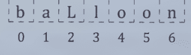
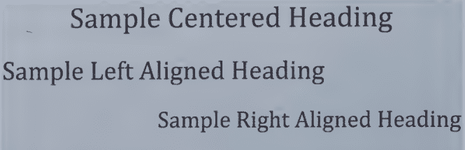

# Python 编程、JAVA 编程、初学者 HTML 和 CSS 编程指南

## 引言

在 7 天内学习 Python 编程是可能的，尽管起初看起来并不简单，特别是如果你是一个处理编程语言经验较少的人。随着学习的深入，你会发现它并不难理解，当你加入耐心、勤奋和自律时，它会变得越来越容易。

如果你犯了错误，你会在屏幕上弹出一个错误消息。它可以引导你纠正编写代码时犯的错误。在很多情况下，简单的大小写或缩进就是罪魁祸首。遇到这种情况时请不要恐慌。通过阅读本文，读者同意在任何情况下，我们均对因使用本文中包含的信息而导致的任何损失（无论直接还是间接）不承担责任，包括但不限于——错误、遗漏或不准确。

## 第一章：欢迎来到 Python 世界

Python 是一种交互式的、通用的、面向对象的高级编程语言。你需要遵循正确的语法来获得你想要的输出。学习 Python 语言并不困难，初学者也能掌握，但如果你对编程有一定了解，会有帮助。

基本上，Python 能够满足各种编程语言的需求。你只需要熟悉 Python 的语法就能实现你想要的功能。如果你有特定的编程语言经验，那么理解 Python 的工作将会非常容易。

Python 有多个不同的版本，在本教程中使用 `Python 2.7`，你可以从这里免费下载：`http://www.python.org`。

Python 是解释型的，这意味着解释器在运行时处理所有内容。你想执行程序时不需要编译器。它与 `PHP` 和 `PERL` 类似。

Python 是交互式的；它允许你作为程序员坐在 Python 提示符前，并在编写程序时与解释器建立交互。

Python 是面向对象的。Python 使用面向对象的编程技术或风格将代码封装在对象中。

Python 是适用于初学者的编程语言。许多人认为它是很棒的入门语言。它支持广泛的应用——从简单的文本处理到游戏开发。由于其结构简单、语法定义良好，学习起来非常容易。任何人都可以轻松掌握这门语言。

Python 拥有强大的标准库，并且兼容 `Windows`、`UNIX` 和 `Mac`。你不需要进行任何转换或将其转换为你当前操作系统（`OS`）理解的内容。系统将能够原样地理解它。

随着你继续使用 Python，你将学习到它的其他优秀特性，并发现 Python 能为你带来的所有美好。

吉多·范罗姆（`Guido van Rossum`）在 20 世纪 80 年代后期和 90 年代初在位于荷兰的数学与计算机科学国家研究所开发了 Python。

他从许多其他语言中衍生了 Python，包括 `C`、`C++`、`ABC`、`Modula-3`、`SmallTalk`、`Algol-68` 和 `Unix shell` 以及其他脚本语言。直到为止，Python 经过了多次更新和版本，以增强用户体验，并满足随着时间推移而不断变化的用户需求。

尽管 Python 有多个版本，但程序员只需要更新旧版本的语法即可使用最新版本。

Python 目前由数学与计算机科学国家研究所的核心开发团队维护。吉多·范罗姆指导着它的进展，这是一个只有他才能担任的各种角色。

Python 适用于不同的平台。用户只需要选择适用于其目标平台的二进制代码并下载安装 Python 即可。此外还有可用的在线 Python 解释器，你可以在学习 Python 课程时使用。

在没有所选平台所需的二进制代码的情况下，必须使用 `C` 编译器处理源代码（不建议初学者这样做，最好使用提供现成二进制代码的平台）。尽管如此，手动编译程序为程序员在选择所需功能方面提供了更多灵活性。

在接下来的章节中，你将找到不同平台的 Python 安装方法。

你需要打开浏览器并访问此处获取你的 Python 安装器：`http://www.python.org/downloads/`。

点击链接以下载所需的源码。

下载完成后，你可以提取文件。

如果你希望修改选项以满足你的需求，可以编辑设置文件。

运行代码，配置脚本。

安装 Python，它就就绪了。如果你准备好开始，就可以立即使用。

以下是在使用 `Windows` 的计算机上安装 Python 时需要采取的步骤。

打开浏览器并访问此处获取安装器：`http://www.python.org/downloads/`。

要使用想要安装的 `python-{version}.msi` 安装器，计算机系统中安装的 `Windows` 必须支持 `Microsoft Installer 2.0`，否则你将无法安装或运行 Python。要检查你的 `Windows` 是否支持 `MSI`，请将安装程序保存到计算机并简单运行它以查看。

接下来你需要运行保存的文件。Python 易于使用的安装向导将弹出。即使是第一次运行，你也不会感到畏惧。选择默认设置，然后等待安装完成。你就可以在 `Windows` 上使用 Python 了。

最近的 `Mac` 系统中已经安装了 Python，但问题是它可能已经过时了。你可以访问此处获取最新版本的 `Mac Python`：`http://www.python.org/download/mac/`。

你还将获得额外的工具。对于旧版本的 `Mac OS`（2003 年 `OS X 10.3` 发布之前），有 `MacPython`。

你也可以访问此链接以获取 `MacPython` 的完整文档：`http://www.cwi.nl/~jack/macpython.html`。

如果你还没有在计算机上安装 Python，也可以在这里运行你的 Python 程序：`http://www.pythonthontutor.com/visualize.html#mode=edit`。

你将看到两个窗口——代码窗口和输出窗口。你可以随心所欲地练习，甚至边学边编码。如果你在阅读这本书时就开始使用 Python，你将更好地理解事物是如何运作的。你将能够看到自己的去向，以及如何修复可能遇到的错误。

在每节课程中，你将学习新的命令和函数。在书的最后，你将看到你会遇到或偶尔使用的命令或函数列表，而这些命令是被禁止使用的。

Python 易于学习，并且这本书旨在让你了解你将遇到或偶尔使用的语法。你将能够看到自己正向何处去，以及如何修复你可能会遇到的错误。

在每节课程中，你将介绍新的命令和函数。在书的最后，你将看到遇到或偶尔使用的命令函数。注释符号（`#`）会让程序跳过执行。

注释符号（`#`）之前，程序……

注释符号（`#`）。注释符号（`#`）会让程序跳过执行。

程序从没有变量（除非它只是为了打印某些东西）。游戏、应用程序或搜索引擎的创建需要你处理不同类型的数据。变量是数据的家，就像家一样，它应该有一个地址，更具体地说，一个名称。你应该命名你的变量，这样你就知道去哪里获取程序所需的某些数据。

你必须清晰地展示它，以便你的程序在检索时不遇到困难。

数据类型之一被称为数字。看这个示例：

```
age = 10
```

示例中的变量是 `age`。该语句意味着 `10` 正被存储或赋值给变量 `age`。当你要求程序检索 `age` 的值时，它会给你 `10`。

如果你被指示将名为 `variable_a` 的变量设置为 `20`，那么回到上述关于变量的示例，你只需要将 `age` 替换为 `variable_a`。你还需要将 `10` 更改为 `20`。

当你运行它，你将看不到任何输出，因为该语句只是指示了程序将某个值分配给某个变量。当你运行它并给你这样的错误消息时，情况就不同：

```
Traceback (most recent call last):
File "prog.py", line 1, in <module>
NameError: name 'a20' is not defined
```

此错误消息发生是因为程序员输入的是 `a20` 而不是 `20`。

在编写代码时，你必须格外小心。此外，Python 是区分大小写的，当你输入大写字母时，在需要调用某些数据时也需要使用大写。如果你用小写编写，它应该保持为小写，或者你在编写命令时需要使用小写来调用它。

布尔值是 Python 程序中的第二种数据类型。布尔值类似于开关，它只有两个值。开关有开或关，而布尔值只能假设为 `True`（真）或 `False`（假）。

你也可以使用变量来存储布尔值。看下面的示例：

```
first_one = True
second_one = False
```

这意味着变量 `first_one` 的值为 `True`，变量 `second_one` 的值为 `False`。在命名变量时，请使用与其在程序中起的角色相关的名称，这样更容易记忆和理解。

看看你能否根据下面的指令编写一个简单的程序，在动手编码前先遮住屏幕部分：

- 写一条注释，“This is a simple sample program”
- 给变量 `a` 赋值为 `5`
- 给变量 `b` 赋值为 `2.54`
- 变量 `b1` 的值必须为 `True`
- 变量 `y` 的值必须为 `False`

```
#This is a simple sample sample program
a = 5
b = 2.54
bl = True
y = False
```

为了让你看到重新赋值的过程，你还将被介绍一个名为 `print` 的新命令。如前所述，你看不到示例程序的结果，只有当输出窗口没有出现错误信息时，你才会知道自己没有提交错误，除非你也使用了 `print`。

查看屏幕并阅读所有内容，特别是注释部分：

```
#On line 3, the variable int has the value 7
int = 7
#Re-assign int with the value 5 on line 5
int = 5
#You will print int to see what happens
#The print command will be covered in full later
print int
```

如果你运行上面的代码，你将得到这个结果：


空格在 Python 编程中非常重要。在使用空格时需要小心。它用于结构化 Python 程序的代码。如果你需要对代码进行缩进，你需要缩进四个空格，否则你会得到这个错误消息：

```
Traceback (most recent call last):
File "string", line 1, in <module>
File "/usr/lib/python2.7/py_compile.py", line 117, in compile
raise py_exc
py_compile PyCompileErrors: Sorry: IndentationError:
unexpected indent (prog.py, line 2)
```

错误已为你亮。它写着“Indentation error”（缩进错误）。程序员将第 2 行的语句缩进了一个空格，应该是四个。

当你开始构建程序时，你将学习更多关于空格的重要性。目前，你对空格有一个大致的概念就足够了。

这一部分完全关于你在 Python 程序中使用的数学运算，以及如何在书写程序中使用它。以下是 Python 运算符列表：

| 符号 | 算符 | 示例 |
|---|---|---|
| `+` | 加法 | `6 + 3` |
| `-` | 减法 | `10 - 5` |
| `*` | 乘法 | `6*5` |
| `/` | 除法 | `19/3` |
| `%` | 取余 | `19%3` |
| `**` | 幂 | `19**2` |


# Python 数学运算符

这一部分完全关于你在 Python 程序中使用的数学运算，以及如何在书写程序中使用它。以下是 Python 运算符列表：

| 符号 | 算符 | 示例 |
|---|---|---|
| `+` | 加法 | `6 + 3` |
| `-` | 减法 | `10 - 5` |
| `*` | 乘法 | `6*5` |
| `/` | 除法 | `19/3` |
| `%` | 取余 | `19%3` |
| `**` | 幂 | `19**2` |

---

# 空格与缩进

当你开始构建程序时，你将学习更多关于空格的重要性。目前，你对空格有一个大致的概念就足够了。

为了让你看到重新赋值的过程，你还将被介绍一个名为 `print` 的新命令。如前所述，你看不到示例程序的结果，只有当输出窗口没有出现错误信息时，你才会知道自己没有提交错误，除非你也使用了 `print`。

查看屏幕并阅读所有内容，特别是注释部分：

```
# On line 3, the variable int has the value 7
int = 7
# Re-assign int with the value 5 on line 5
int = 5
# You will print int to see what happens
# The print command will be covered in full later
print int
```

如果你运行上面的代码，你将得到这个结果：


空格在 Python 编程中非常重要。在使用空格时需要小心。它用于结构化 Python 程序的代码。如果你需要对代码进行缩进，你需要缩进四个空格，否则你会得到这个错误消息：

```
Traceback (most recent call last):
File "string", line 1, in <module>
File "/usr/lib/python2.7/py_compile.py", line 117, in compile
raise py_exc
py_compile PyCompileErrors: Sorry: IndentationError:
unexpected indent (prog.py, line 2)
```

错误已为你亮出。它写着“Indentation error”（缩进错误）。程序员将第 2 行的语句缩进了一个空格，应该是四个。

当你开始构建程序时，你将学习更多关于空格的重要性。目前，你对空格有一个大致的概念就足够了。


# Python 编程基础

## 数学运算

这一部分完全关于你在 Python 程序中使用的数学运算，以及如何在书写程序中使用它。以下是 Python 运算符列表：

| 符号 | 算符 | 示例 |
|---|---|---|
| `+` | 加法 | `6 + 3` |
| `-` | 减法 | `10 - 5` |
| `*` | 乘法 | `6*5` |
| `/` | 除法 | `19/3` |
| `%` | 取余 | `19%3` |
| `**` | 幂 | `19**2` |

你可以以不同的方式编写，得到相同的结果。

最后一个运算符是取余运算符（`%`）。某些程序需要它。

查看下面的代码：

```python
# This is a sample program to illustrate modulo
modulo_one = 25 % 5
modulo_two = 25 % 4
print modulo_one
print modulo_two
```

程序将产生这个结果：

```
0
1
```

这意味着如果你将 25 除以 5，则没有余数，因为每个容器将得到 5 个项目。

25 除以 4 有余数 1，因为每个容器得到 6 个项目，多出了 1。

### 练习指令

这些是你需要准备的指令。这是对你目前所学课程的回顾。

- 在第一行写一条注释，说明你将编写的程序（任意内容）。
- 给 `int` 赋值 7。
- 给 `a` 赋值 1。
- 变量 `b` 的值应为 2。
- 数字 3 给变量 `c`。
- 变量 `answer` 应该包含 `a` 和 `c` 的和。
- 变量 `answer_two` 应该包含 `int`、`b` 和 `c` 的和。
- 变量 `true` 必须包含 `True`。
- 变量 `false` 必须包含 `False`。
- 打印 `answer`。
- 打印 `answer_two`。
- 打印 `true`。
- 打印 `false`。

你应该能够得到这个结果：

```
4
12
True
False
```

## 变量重新赋值与 print 命令

为了让你看到重新赋值的过程，你还将被介绍一个名为 `print` 的新命令。如前所述，你看不到示例程序的结果，只有当输出窗口没有出现错误信息时，你才会知道自己没有提交错误，除非你也使用了 `print`。

查看屏幕并阅读所有内容，特别是注释部分：

```python
# On line 3, the variable int has the value 7
int = 7
# Re-assign int with the value 5 on line 5
int = 5
# You will print int to see what happens
# The print command will be covered in full later
print int
```

如果你运行上面的代码，你将得到这个结果：


## 空格初探

空格在 Python 编程中非常重要。在使用空格时需要小心。它用于结构化 Python 程序的代码。如果你需要对代码进行缩进，你需要缩进四个空格，否则你会得到这个错误消息：

```
Traceback (most recent call last):
File "string", line 1, in <module>
File "/usr/lib/python2.7/py_compile.py", line 117, in compile
raise py_exc
py_compile.PyCompileError: Sorry: IndentationError:
unexpected indent (prog.py, line 2)
```

错误已为你亮出。它写着“Indentation error”（缩进错误）。程序员将第 2 行的语句缩进了一个空格，应该是四个。

当你开始构建程序时，你将学习更多关于空格的重要性。目前，你对空格有一个大致的概念就足够了。

## 餐费计算综合示例

（数学表达式）。将 6.75 除以 100 并赋值给变量 `tax`。

现在是小费提示，你需要将 15.0（应该有一个小数点，不要忘记它）除以 100，并将该值赋值给变量 `tip`。

总结目前为止的指令如下：

```python
1 # 这个程序将计算餐总费用加上小费
2
3 food = 55.50
4 tax = 6.75 / 100
5 tip = 15.0 / 100
```

你接下来需要做的是：

你已经知道在 Python 编程中可以重新赋值。在第 7 行，将变量 `food` 重新赋值为值 `food + food * tax`（Python 允许你这样做）。变量 `food` 现在的值是餐费加上税费。

在下一行，将值 `food + food * tip` 赋值给变量 `total_cost`，以获得餐点的总费用。

你有这样这段代码：

```python
1 # 这个程序将计算餐总费用加上小费
2
3 food = 55.50
4 tax = 6.75 / 100
5 tip = 15.0 / 100
6
7 food = food + food * tax
8 total_cost = food + food * tip
9
10 print("%.2f" % total_cost)
```

在第 10 行中，格式化字符串 `"%.2f"` 用于将小数位数限制为两位。其他数字会被截断。

你将在后续章节中学习其他函数。正如前面提到的，最好先吸收本节内容再进入下一节，这样你就不需要经常回过头来看。当你知道要写什么操作或命令，并且对程序的运行流程有清晰的规划时，编写代码也会更加方便。

最好通过记忆来练习你所学的内容。如果你在学习后立即复习，就能很好地记住它们。

做一些编程练习，看看你是否可以在不遇到错误的情况下运行某个程序。如果你的程序发生了错误，你只需要读取错误信息——它会告诉你程序出错的行数。大多数情况下，错误是因为大小写不引起的。

记住 Python 是区分大小写的。如果你用大写字母声明某个值，在提取它时请确保也使用大写字母。也可能你输错了某个变量，导致程序无法识别它。再次检查你的代码，确保你的输入是正确的。

# 第 3 章：重要的字符串和控制台输出

现在你准备好学习字符串和控制台输出了。你也可以将字符串赋值给变量并打印它。顺便说，字符串是另一种数据类型。它包含数字、字母和符号。

当你声明字符串或将其赋值给变量时，需要用引号括起来，如下：

```python
name = "Barnabas"
age = "100"  # 你可以使用引号内的数字将它们转换为字符串
favorite = "red wine"
```

如果指令要求你将‘A fine day it is’赋值给变量 `greeting`，那么你需要这样写：

```python
greeting = "A fine day it is"
# 字符串几乎总是位于引号内的。
```

尝试将下面的指令集转换为可以运行的程序：

- 将 `Ramsey and Graham` 设置为 `food`。
- 将 `Paris Hilton` 设置为 `hotel`。
- 将 `Johnny and Jack` 设置为 `pirates`。
- 打印变量的内容。

你应该能够得到这个结果：

```
Ramsey and Graham
Paris Hilton
Johnny and Jack
```

## 转义字符

Python 中有些符号、标记和标点符号的使用方式是不同的。尽管 Python 与英语有许多相似之处，但它仍然是一种编程语言，可能需要特殊字符来实现你想要的效果。

例如，尝试打印这个字符串：

```python
simple_thoughts = "It's a beautiful day!"
```

你可能会因为存在单引号而收到错误信息，因为 Python 可能会将其视为单引号（尽管似乎有一个版本的 Python 是接受它的）。

你可以通过这样添加反斜杠来修正上面的示例：

```python
simple_thoughts = "It\'s a beautiful day!"
```

### 轮你尝试

尝试修复程序中损坏的字符串：

```python
# Fixing broken strings
thoughts = "It's a heavenly scent that's surprisingly inexpensive"
lots_of = "She's someone who's not afraid to try anything, even if it's something hard"
```

## 通过索引访问

字符串中的每个字符都有一个对应的缓冲区编号或分配数字，称为索引（`index`）。

在下面的示例中，你可以看到字符串 `"balloon"` 被赋值给变量 `prntsample`：

```python
prntsample = "balloon"[5]  # [5] 是索引
```

如果程序在上面的示例中打印 `prntsample`，它将打印 `'o'`。Python 索引从零开始计数，而不是从一。

查看下面的表示以获得清晰的理解：



根据以下语句确定哪个字母将被打印：

```python
one = "tiger"[2]
two = "pencil"
```

示例程序将如下：

```python
print one
print two
```

## 字符串拼接

字符串拼接是关于将字符串与算术运算符结合在一起。

在示例中：

```python
print "The " + "world" + "is " + "awesome!"
```

它将输出：`The world is awesome!`

当你输入它时，请确保在最后一个字母和结束引号之间留有空格，最后一个单词除外。

如果你是这样输入的：

```python
print "The" + "world" + "is" + "awesome!"
```

它将输出：`Theworldisawesome!`

字符串之间的运算符 `'+'` 在字面上是将字符串相加在一起，这就是为什么包含空格非常重要的原因。Python 程序将空格视为字符。如果你不添加空格，打印输出的可读性将受到影响。

将字符串组合在一起，如给出的示例所示，被称为拼接（concatenation）。

你可以尝试这个练习：

- 为你的程序写一条注释。
- 在第 3 行，编写正确的语句来表示“所有人类生而平等”的拼接。
- 注意你需要包含的空格以及使用的算术运算符。

## 显式字符串转换

在本节中，你将理解之前提到的 `str()` 方法的必要性。

有时你需要将字符串与非字符串组合。但是，Python（像大多数编程语言一样）不允许字符串和非字符串放在一起。解决方案是使用 `str()` 方法将非字符串转换为字符串。

如果你运行这个程序：

```python
# Sample program for concatenation
two = 2

print "I have " + two + " eyes."
```

你将得到这个响应：

```
Traceback (most recent last):
File "prog.py", line 5, in <module>
TypeError: cannot concatenate 'str' and 'int' objects
```

其原因是因为程序没有将变量 `two` 识别为字符串，在 Python 编程中，即使有更多的非字符串，将非字符串与字符串混合也是一种“亵渎”行为。

你应该这样写程序：

```python
# Sample program for concatenation
two = 2
print "I have " + str(two) + " eyes."
```

在示例中，变量 `two` 包含数字 `'2'`，这是一个非字符串。当引入 `str()` 方法时，Python 程序将变量 `two` 的内容视为字符串。记住，字符串不仅由字母组成，它还可以是数字、字母和符号。

看看这个例子：

```python
print "The area of that space: " + 54 + "square meters"
```

如果你尝试运行它，将得到这个响应：

```
Traceback (most recent last):
File "python", line 3, in <module>
TypeError: cannot concatenate 'str' and 'float' objects
```

Python 给出这个错误信息是因为你在同一个语句中使用了字符串 `"The area of that space: "` 和 `"square meters"`，以及非字符串 `54`。你需要将非字符串转换为字符串，Python 才能接受它。

你应该这样写：

```python
print "The area of that space: " + str(54) + " square meters"
```

你还需要注意需要包含的空格，否则打印的拼接结果可能不可读。

## 使用 % 进行字符串格式化

使用字符串拼接可能是一个乏味的过程，但有些程序确实需要拼接。当你打算打印字符串变量时，可以使用另一种（可能是更好的）不那么乏味的方法。

`%` 运算符在字符串内部作为你之后要添加的变量的替换符。`%` 运算符会将字符串中的 `%s` 替换为随其后的字符串变量。

```python
name = "Monette"
print "I am %s" % (name)
```

尝试这个：

查看下方的代码。你对它将执行的操作或产生的结果有想法吗？现在在你的 Python 上试一下。

```python
a = "Neverland"
b = "region"

print "Don't go to %s. It's a %s not for you." % (a, b)
```

你将得到这个结果：

```
Don't go to Neverland. It's a region not for you.
```

## 关键字

关键字（reserved word）是某些编程语言在代码中遇到它时会立即识别的单词。你应该小心不要将关键字用作变量名。不同的编程语言可能共享相似的关键字，但并非所有语言都共享相同的关键字集。

## Datetime 库

有时你想要或需要跟踪某事发生的日期或时间。你可以使用 Python 中的 `datetime` 模块来实现此目的，它是 Python 中的一个模块，且将其作为变量名是不明智的。

### 获取当前日期和时间

要获取当前日期和时间，你需要使用名为 `now()` 的函数来检索当前的日期、天或时间。结合 `datetime`，它通常写为：`datetime.now()`。

## 总结

你在这章中学习了很多，包括：

1. 创建字符串的三种方法：
   - `"This One"`
   - `"Another"`
   - `str(2)`

2. 不同的字符串方法：
   - `"Length"`
   - `"HEIGHT".upper()`
   - `"HEIGHT".lower()`

3. 如何打印字符串：
   - `"I know this"`

4. 高级打印技术：
   ```python
   a = "able"
   b = "ability"
   print "%s %s" % (a, b)
   ```

## 提取信息

输出可能如下所示：

```
2015-10-14 23:40:14.317454
```

这是当前日期和时间，系统在程序执行时给出的完整日期和时间。如果你不想包含整个日期和时间怎么办？你可以参考下面的列表，并选择你需要打印的内容：

- `current_year = now.year`  # 你可以使用除 `current_year` 以外的任何变量名
- `current_month = now.month`  # 你可以使用除 `current_month` 以外的任何变量名
- `current_day = now.day`  # 你可以使用除 `current_day` 以外的任何变量名

为了使更清晰，此程序将打印当前的年份、月份和天：

```python
from datetime import datetime
now = datetime.now()

current_year = now.year
current_day = now.day
current_month = now.month

print now.year
print now.day
print now.month
```

如果今天是 2015 年 10 月 14 日，该程序将产生此结果：

```
2015
14
10
```

## 格式化日期输出

如果你想以这种格式打印当前日期：`mm/dd/yyyy` 怎么办？你需要再次使用字符串替换。看看下面的程序：

```python
# 假设今天的日期是
# 2015年10月14日
from datetime import datetime
now = datetime.now()
print('%s-%s-%s' % (now.month, now.day, now.year))
```

你的程序将打印：

```
10-14-2015
```

始终记住，`%` 运算符会将左侧字符串中的 `%s` 占位符替换为右侧括号中的字符串。


在上面的示例中，你可以看到屏幕上打印了 `2015-14-10`（假设今天是那个日期），但你想打印 `10/14/2015`。

如果你想以 `mm/dd/yyyy` 的格式打印当前日期，那么你需要更改字符串，使得 `%s` 占位符之间使用 `/` 字符而不是 `-` 字符。你还需要重新排列 `%` 运算符右侧的参数，以便按如下方式打印：`now.month / now.day / now.year`。

你可以编写这段代码：

```python
# 假设今天的日期是
# 2015年10月14日
from datetime import datetime
now = datetime.now()
print('%s/%s/%s' % (now.month, now.day, now.year))
```

它将显示此输出：

```
10/14/2015
```

## 可爱的时间

现在你也可以对小时、分和秒进行相同的操作。你可以参考下面的列表，并选择你需要打印的内容：

- `print now.hour`
- `print now.minute`
- `print now.second`

你可以看这个示例：

```python
from datetime import datetime

now = datetime.now()

print now.hour
print now.minute
print now.second
```

它将产生此结果：

```
7
42
58
```

在上面的示例中，你刚刚打印了当前的小时、分钟，然后是当前秒。

你也可以再次使用变量 `now` 来打印时间。

你可以尝试这段代码：

```python
from datetime import datetime
now = datetime.now()
print '%s:%s:%s' % (now.hour, now.minute, now.second)
```

你将看到 `hh:mm:ss` 格式的时间。

## 总结

你能够以一种非常可爱的方式分别打印日期和时间。是时候将两者结合了。

你可以尝试这段代码：

```python
from datetime import datetime
now = datetime.now()
print "%s/%s/%s %s" % (now.month, now.day, now.year)
print '%s:%s:%s:%s' % (now.hour, now.minute, now.second)
```

上面的示例将打印日期，然后在下一行或单独的一行打印时间。

如果你想在同一行打印日期和时间，并在它们之间用空格隔开，那么你需要以 `mm/dd/yyyy hh:mm:ss` 的形式一起打印日期和时间。

你需要更改 `%` 运算符左侧的格式字符串，并确保它有 6 个 `%s` 占位符。

在占位符之间放置斜线、冒号和空格，以便它们相互隔开。

尝试根据给指令编写一个程序：

1. 为你要创建的程序写一个注释。
2. 跳过下一行。
3. 你的程序名称为 Luckyyone。
4. 打印 "Enter a, b, c, or d, and see your luck"。
5. 将从 `raw_input` 获取的值赋值给变量 `answer`（你可以想一个你想要添加的短语）。
6. 如果 `answer` 返回 a，打印“你将遇到一位美丽的陌生人！”
7. 如果 `answer` 返回 b，打印“你将遇到一次注定的相遇，小心……”
8. 如果 `answer` 返回 c，打印“你将得到妈妈那里的一份奖励！”
9. 如果 `answer` 返回 d，打印“今天你的人生将发生彻底改变！”
10. 如果 `answer` 返回其他字母或字符且不在给定的选项范围内，打印“你余生将是不幸运的！”

注意：留心你需要包含的符号以及如何结束你的程序。

## 比较运算符极限 (Comparator Extreme)

如果你已经熟悉了基础表达式和比较运算符，那么准备好接受挑战了吗？

看这里：

再次复习比较运算符，这次尝试为更复杂的表达式确定正确的布尔值。将变量设置为 True 或 False，并确保设置正确。

- 将 `sample_one` 设置为 `(30 - 10) > 25` 的结果
- 将 `sample_two` 设置为 `(20 + 7) == 2**10` 的结果
- 将 `sample_three` 设置为 `1**4 <= -2` 的结果
- 将 `sample_four` 设置为 `20 * 4 >= -20` 的结果
- 将 `sample_five` 设置为 `81 != 9**2` 的结果

尝试这样编写代码：

```python
# 正确赋值 True 或 False
# (30 - 10) > 25
sample_one = False  # 这一步已经完成了
# (20 + 7) == 2**10
# 记住 ** 是指数的符号，读作“...的次方”。
sample_two =
# 1**4 <= -2
sample_three =
# 20 * 4 >= -20
sample_four =
# 81 != 9**2
sample_five =
```

你的答案应该像这样：

```python
# (30 - 10) > 25
sample_one = False
# (20 + 7) == 2**10
sample_two = False
# 1**4 <= -2
sample_three = False
# 20 * 4 >= -20
sample_four = True
# 81 != 9**2
sample_five = False
```

## 切换时刻 (It's Time to Switch)

你已经知道如何解决给定的表达式或语句，并得出 True 或 False 的答案。这一次，你需要写出一个能够满足给定布尔值的表达式。

当你被要求让一个语句变为 True 时，你可以这样写：

```python
sample_one = 50 < 58
```

在接下来的练习中，你需要像上面的示例一样，提供与给定布尔值匹配的表达式：

- #1 让这个变为 True
  `expression_one = 4**2 == 8*2`  # 这一步为你完成了。
- #2 让这个变为 False
  `expression_two =`
- #3 让这个变为 True
  `expression_three =`
- #4 让这个变为 False
  `expression_four =`

## 理解 与、或、非 (Understanding And, Or, Not)

布尔运算符比较语句并给出布尔值结果。你需要记住三个布尔运算符，它们是：`and`、`or`、`not`。

布尔运算符 `and` 检查给定的语句是否都为真或假，答案取决于语句的条件。

### PYTHON 编程

布尔运算符 `or` 检查给定的语句中至少有一个是否为真或假，答案同样取决于语句的条件。

布尔运算符 `not` 给出语句答案的相反值。

以下是给定条件下的正确布尔值列表：

| 布尔运算符 | 答案 |
| :--- | :--- |
| True and True | True |
| True and False | False |
| False and True | False |
| False and False | False |
| True or True | True |
| True or False | True |
| False or True | True |
| False or False | False |
| Not True | False |
| Not False | True |

### 布尔运算符 And (Boolean operator And)

当 `and` 两边的表达式都为真时，布尔运算符 `and` 返回 True。看以下语句：

- `12 < 21 and 2 < 3` 是 True。
- `1 < 2 and 20 > 30` 是 False。

现在尝试根据每个语句给出的条件赋值正确的布尔值：

### CODE ACADEMY

- Set `sample_one` equal to `False and False`
- Set `sample_two` equal to `-(-6) == -6 and 8**2`
- Set `sample_three` equal to `4 != 300 / 10 and False`
- Set `sample_four` equal to `20 <= 20**2`
- Set `sample_five` equal to `True and True`

```python
sample_one = False
sample_two = True
sample_three = False
sample_four = False
sample_five = True
```

### 布尔运算符 Or (Boolean Operator Or)

当 `or` 一侧至少有一个表达式为真时，布尔运算符 `or` 返回 True。看以下语句：

- `12 < 21 or 2 > 3` 是 True。
- `1 < 2 or 20 > 33` 是 False。

布尔值应设为 False 的唯一情况是 `or` 两边都为假。只要有一个语句为真，布尔值就为 True。是时候练习布尔运算符 `or` 了：

- `bol_one` equal to `True or False`
- `bol_two` equal to `True or False`
- `bol_three` equal to `True or True`
- `bol_four` equal to `True or True`
- `bol_five` equal to `True or True`

```python
bol_one = True
bol_two = True
bol_three = False
bol_four = True
bol_five = False
```

### 布尔运算符 非 (Not) (The Boolean Operator Not)

布尔运算符 `not` 对假语句返回 True，对真语句返回 False。例如：

如果你有 `61 > 40`，由于 61 大于 40，可以说它是 True。

如果你有 `not 61 > 40`，那么答案将是 False。因为 `not` 让表达式变为 False，因此是 False。是时候练习 `not` 了，看以下语句：

- Set `sample_one` equal to `not True`
- Set `sample_two` equal to `not 3**4 < 4**3`
- Set `sample_three` equal to `not 16 <= 3**2`
- Set `sample_four` equal to `not 3**2 + 4**2 != 5*5`
- Set `sample_five` equal to `not False`

这里是答案以及解释（仅针对 `bol_one` 和 `bol_two`，其余自己分析）：

```python
bol_one = False  # 'not' 让它变为 False
bol_two = True   # 3**4=81, 且 4**3=64；81 < 64 是 False，'not' 让它变为 True
bol_three = True
bol_four = True
bol_five = False
```

## 哪个应该在前？(Which should be First?)

布尔运算符并不是从左到右求值的。就像算术运算符一样，布尔运算符也有运算顺序：

1. 布尔运算符 `not` 先计算。
2. 布尔运算符 `and` 后计算。
3. 布尔运算符 `or` 最后计算。

例如，`True or not False and False` 返回 True。如果还不清楚，请查看解释。

如果你遵循关于布尔运算符的指南，并使用括号来引导你先解决哪个表达式，你会得到：

`True or ((not False) and False)`

你需要先解决 `(not False)`，得到 True。你第二个解决 `((True) and False)`，得到 False。

你最后解决 `True or (False)`，得到 True。

如果你尝试先解决 `True or not False`，你会得到 True。接下来的是 `True and False`，会给你 False，这是错误的答案。

## 重要提示 (Important Reminders)

你必须记住，你必须先解决 `not` 部分，然后是 `and` 部分，最后是 `or` 部分。

- `and` 布尔运算符只有在两边都为真时才会产生 True；只要有一个假语句，整个结果就是 False。
- `or` 布尔运算符只有在两边都为假时才会产生 False；只要有一个真语句，整个结果就是 True。

括号 `()` 也可以帮助你按照你想要的顺序评估表达式。括号内的任何内容都会求值或被视为一个独立的单元。

尝试这个：

根据提供的条件给定的变量赋值 True 或 False：

你应该能够得到这些答案：

- `bol_one = False`
- `bol_two = True`
- `bol_three = True`
- `bol_four = True`
- `bol_five = False`

处理布尔运算符相当有挑战性。你可能需要随身携带列表以防忘记，尽管你只需要记住之前的重要提示。在尝试掌握 Python 编程时，建议也保留其他列表。到目前为止，你应该能够独立创建一个简单的程序了。

目前你不需要创建一个稍微复杂一点的程序，但尝试也是好的。如果你看到错误消息，尝试弄清楚指定行出了什么问题。大多数情况下，大小写问题或缺少缩进是罪魁祸首。记住 Python 是区分大小写的敏感程序。

## If-Else 子句和 Elif

```python
'if' 是一个条件语句，在验证表达式为“真”（与布尔值相关）后运行特定的代码集。
```

看这个示例：

```python
if 7 < 10:
    print "Seven is less than ten"
```

在给定的示例中，表达式 `7 < 10` 是程序需要检查的部分；而缩进的语句 `print "Seven is less than ten"` 是在证明该表达式为真时程序需要运行的特定代码块。

看这个程序的一个部分：

```python
# Sample program
response = 'Y'
ans = "Yes"

if ans == "Yes":
    print "This is just a test!"
```

你认为上面的示例程序会在控制台打印该语句吗？

运行程序来检查答案。

# 这里是一些练习题

磨练技能的最好方法是练习，这些练习可以帮助你进一步提高 Python 编程技能。

现在是时候练习 `if` 语句了。请记住语法应该如下所示：

```python
if {函数, 表达式或任何条件为 True}:
    # 执行此行代码
else:
```

### PYTHON 编程

根据上述 `if-else` 的编写指南，这些语句意味着如果 `if` 子句返回 `True`，那么 Python 程序将运行或执行 `if` 子句下方缩进的代码块。如果 `if` 子句或表达式返回 `False`，则 Python 程序将跳过 `if` 子句下的缩进块并进入 `else` 子句。它将运行 `else` 子句下方的缩进块。

记住在 `if` 语句的结尾处加上冒号（`:`）。

## Else 问题

`else` 语句补充了 `if` 语句。`if-else` 语句或组合告诉程序：如果给定的表达式为真，则运行缩进的代码；否则运行 `else` 语句之后的程序代码。

与 `if` 不同，`else` 不依赖于表达式或条件。例如：

```python
if ey == bi:
    print "I don't want to get printed!"
else:
    print "I want to get printed!"
```

上面的代码要求如果 `ey` 等于 `bi`，程序将打印“I don't want to get printed!”，否则程序应该打印“I want to get printed!”。只要满足 `if` 语句，就会打印“I don't want to get printed!”。

## 使用 Elif

"Elif" 是 "else if" 的缩写。它的意思正如你想的那样：在第一个条件不满足的情况下，它呈现了另一组必须执行的条件。

如果你有以下代码段：

```python
if a > b:
    print "I don't get printed!"
elif a < b:
    print "I get printed!"
else:
    print "I also don't get printed!"  # 这部分只会发生 if a == b:
```

在上面的示例中，`elif` 语句只有在 `a` 小于 `b` 或第一个语句为 `False` 时才会被检查。如果 `a == b`，将打印 `if` 语句中的 `else`。

## 大复习

这是你在本章中所学内容的总结。

记住比较运算符：

- `3 < 4`
- `5 >= 5`
- `10 == 10*1`
- `12 != 13`

回顾布尔运算符：
- `And`
- `Or`
- `Not`

条件语句：

```python
this_is_it = 1
this_could_be_it = 3

if this_is_it == 2:
    print "This is it!"
elif this_could_be_it == 3:
    print "This could be true."
else:
    print("None of the given conditions.")
```


你可以根据到目前所学的知识开始编写你自己的程序了。

## 第 5 章：理解列表、元组和字典

理解 Python 编程中的列表（`list`）、元组（`tuple`）和字典（`dict`）是非常重要的。它们可以帮助你让编码变得更容易。如果你开始处理更复杂或更精密的程序，你会更感激它们。

对于本节，你需要更深入地回到变量。

当你深入观察时，变量实际上存储了信息，这些信息可以随时重新处理。存储的信息也可以在任何时候被更改或被重新赋值。

但如果你需要存储一个长列表的数据，这些数据不会改变或随时间推移保持不变，例如月份或电话或地址簿怎么办？

对于这些问题和其他类似问题，Python 提供了三个解决方案——列表、字典和元组。

## 关于元组的所有信息

元组与列表相似，唯一的区别是不允许修改元组中的值。分配给元组的值就是你必须坚持的值。你不允许添加任何或省略任何内容。每个值都有自己的引用编号，它从 0 开始而不是 1。每个月份名称的集合是元组的一个良好示例。

## 元组示例

制作元组相当简单。你只需要给你的元组分配一个名称，然后你就可以创建或分配它应该包含的值。看看这个示例：

```python
months = ('Jan', 'Feb', 'Mar', 'Apr', 'May', 'Jun',
          'Jul', 'Aug', 'Sept', 'Oct', 'Nov', 'Dec')
```

注意 `Jun` 旁边的 `\`？它意味着下一行是续行。每个月份名称的集合是元组的一个良好示例。

| 索引 | 月份 |
| :--- | :--- |
| 0 | Jan |
| 1 | Feb |
| 2 | Mar |
| 3 | Apr |
| 4 | May |
| 5 | Jun |
| 6 | Jul |
| 7 | Aug |
| 8 | Sept |
| 9 | Oct |
| 10 | Nov |
| 11 | Dec |

## 关于列表

列表与元组相似。与元组不同，列表是可以修改的。其他程序员称列表为“可变的”（mutable）。列表的定义方式与元组相同。如果你有五个名为 Tad、Snoopy、Doug、Chase 和 Madoka 的狗，你想把它们放入列表中，你需要这样写：

```python
dogs = ['Tad', 'Snoopy', 'Doug', 'Chase', 'Madoka']
```

你可以看到，列表的写法与元组完全相似，只是值位于方括号内而不是括号。你不需要在逗号后空格。

## 列表示例

你也可以在范围内提取狗的名字，如下：

```python
print dogs[1:3]
```

给定示例中的第一个数字 `1` 是索引编号。第二个数字是请求需要涵盖的范围（实际），从第一个狗开始（它的索引为 0，实际数字为 1）。

`print dogs[1:3]` 将打印 `['Snoopy', 'Doug']`。

## 添加另一个值

你可以使用 `append()` 函数向你的列表添加另一个值。如果你有一只名为 Manford 的新狗，你可以这样写：

```python
dogs.append('Manford')
```

添加的值将被放置在列表末尾。每个新添加的内容将被放置在列表末尾。

## 删除值

当你需要从列表中删除一个值时，使用 `del`。你需要记住这个删除值的语法：

```python
del list_name[index]
```

如果你想从列表中删除 `'Snoopy'`（使用原始列表），你可以这样做：

```python
del dogs[1]
```

## 字典的所有信息

字典类似于包含单词定义的普通字典。在字典中，你拥有许多单词，每个单词都有一个对应的定义。在 Python 中，你需要查找定义的单词被称为“键”（key），而定义则被称为“值”（value）。你不会在字典中找到带编号的值，键也是如此。你可以自由添加、删除和修改需要包含在字典中的值。一个很好的例子是电话簿或地址簿。

## 字典示例

列表（`list`）和元组（`tuple`）允许你通过访问索引数字获取特定索引的值或内容。相反，字典可以根据名称提供你需要的值——这与列表和元组是相反的。如果你需要存储不同联系人的电话（就像电话簿一样），你就需要使用字典。

当你开始创建字典时，你会发现它与创建列表或元组相似。列表使用方括号 `[ ]` 以及括号内的值。元组使用圆括号 `( )` 以及其之间的值。而字典则使用大括号 `{ }`。

以下是创建字典的方法（示例是一个电话簿）：

```python
phone = {'Catherine Becket': 7895675, 'Anthony Clarke': 1234523,
         'Linda Jones': 8875689, 'Andy Bower': 7564438, 'Davey Lewis': 56656789}
```

如果你想打印 Catherine 的号码：

```python
print phone['Catherine Becket']
```

看到与列表或元组的区别了吗？你不是使用数字或索引来标识值，而是使用了你需要检索的键。在给定示例中，你使用人的名字来检索她的号码。

## 向字典添加条目

当你想要向字典添加条目时，你需要遵循以下语法：

```python
dictionary_name['key_to_add'] = value
```

尝试一下这个：

```python
phone['David King'] = 1231234
```

上述语句告诉程序向 `phone` 字典中添加名为 `'David King'` 且号码为 `1231234` 的条目。

如果你尝试打印 David 的号码，`'1231234'` 将显示在屏幕上。

## 删除条目

当你想要从字典中删除一个值时，使用 `del`。这是你需要遵循的语法：

```python
del dictionary_name['key_name']
```

如果你想从你的字典中删除 Anthony，你可以这样做：

```python
del phone['Anthony Clarke']
```

请注意你的大小写。Python 是区分大小写的。如果你不小心忘记了需要大写的字母，请做好准备在你的控制台屏幕上看到错误消息。

这里有一个构建字典的示例程序：

```python
# 一个字典的示例程序

# 首先定义字典，它最初是空的
age = {}

# 向字典添加一些名称以及对应的年龄
age['Anna'] = 20
age['Portia'] = 19
age['Ambrose'] = 65
age['Allain'] = 45

# 使用 has_key() 函数，它的形式如下：
# dict.has_key(key_name)
# 如果字典包含该键，则返回 True
# 如果没有，则返回 False。

if age.has_key('Anna'):
    print "Anna 在字典列表中。她今年是", \
          age['Anna'], "years old"
else:
    print "Anna 不在字典列表中"
```

## Python 编程

让我们来看另一个例子，这次它不会在 `while` 循环结束时就停止。你可以对整个循环遵循此模式：

```text
while {给定条件仍然为真以使 while 循环继续进行}:
    # 你想在循环内重复的过程
    # while 循环内部的过程应该缩进（四个空格）
# 此语句将不再是 while 循环的一部分
# 当语句没有在 while 循环内进行缩进时，意味着它需要在 while 循环之外执行另一个任务
# while 循环之外的语句只有在计算机满足循环内的条件后才会执行
```

看看这个示例程序：

```python
# 带有循环外语句的示例程序
ei = 7
while ei != 0:
    print ei
    ei = ei - 1
print "Wow, ei now equals", ei
print "This ends everything."
```

尝试通过手动推导这个示例程序，看看你是否能得到相同的结果。

## `for` 循环

`for` 循环会对列表中的每个值执行某些操作。这可能会有点困惑，因此在使用 `for` 循环时要小心。

这是一个带有注释的示例：

```python
# for 循环示例程序
# 首先创建一个列表
this_list = [45, 14, 65, 42, 34]

# 创建 for 循环
for content in this_list:
    print content

print("It's the end.")
```

计算机识别出 `for` 之后的 `content` 是一个变量。`in` 是 Python 的关键字。

示例程序将产生以下结果：

```
45
14
65
42
34
It's the end.
```

正如你所观察到的，当 `for` 循环执行时，它会遍历 `in` 之后列表中包含的所有值。它将从列表中获取的值存储在变量中，并执行另一条关于如何处理变量内容的语句。在上面的程序中，它需要打印存储的值，每当程序通过 `for` 循环时，该值就会改变。程序到达列表末尾时终止。

在程序自身终止之前，必须执行 `for` 循环之外的另一条语句。

看看这个简单的拉拉队口号程序：

它将打印类似如下的内容：

```
Who do you cheer for? Lei
Gimme l!
l!
Gimme e!
e!
Gimme i!
i!
What does that spell?
lei!
```

到此时，你可以尝试结合目前所学的所有内容，并编写一个简单的程序（尽管你也可以开始编写更复杂的程序）。成为 Python 专家可能需要一段时间，但你终会做到的。

## 第 7 章：理解函数

Python 拥有许多预定义函数，你可以在任何时候使用它们。不同函数的名称必须是唯一的，尽管实际上计算机只识别函数的功能，而不识别它的名称。但最好的仍然是给函数分配一个唯一的名称，或避免将函数名用作变量以避免可能的混淆。建议了解你可能使用的不同函数的名称。

函数是你可以重复使用的代码。你不需要重新编写代码来使用它——你只需要调用某个可以在你的程序中执行特定任务的函数。换句话说，函数是你可以重复使用的小型自包含程序。这可以节省你的时间，只需要花费更少的精力。函数还可以让代码看起来更整洁、更有序。

当你掌握了 Python 编程后，你可以根据需要创建自己的函数并在你的代码集中使用它。

## 使用函数

你可以通过调用它们来使用不同的函数。当你调用一个函数时，它将返回特定的输出。查看后续章节获取详情。

## 如何调用函数

当你调用函数时，遵循以下语法：

```text
function_name(parameters)
```

`function_name` 是你想要使用的函数名称。`parameters` 是你想要函数执行的值以及你希望它如何执行。例如，你创建了一个名为 `multiply_byfour` 的函数，它会自动将任何数字乘以 4。如果你想要 `20 x 4` 的结果，可以这样调用函数：

```python
multiply_byfour(20)
```

但在让它执行你想的操作之前，你需要将其赋值给一个变量。当你编写代码时，可以这样写：

```python
a = multiply_byfour(20)
```

```python
# 带有伪造函数的示例程序
def multiply_byfour(n):
    return n * 4

sample_a = multiply_byfour(20)

if sample_a == 80:
    print("The value is 80")
else:
    print("Next please!")
```

示例程序将打印 `"The value is 80"`，因为变量 `sample_a` 等于 80。

（注：原文该部分存在重复的 OCR 错误，我已根据提供的文本清理了逻辑流。）

将 `'725'` 返回给主程序。主程序看到 `'725'` 是它需要打印的内容，并将其打印在屏幕上。

主程序并不知道 `"hi"` 被打印在了屏幕上（这是函数独立完成的工作）。主程序所能看到的只是返回的值 `'725'` 并将其打印在屏幕上。

在练习 Python 编程技能时，可以使用已经向你解释过的基础函数。当你开始学习 Python 进阶课程时，你可以发现更多内容。

## 第 8 章：编写一个完整的程序

看看下方的示例程序。它的目的是模拟一个计算器。用户将看到一个菜单，并让用户决定想对给定的数字做什么操作。

幸运的是，已经有人写好了 `raw_input` 或 `input` 函数（在其他 Python 版本中），它被设计用于返回用户在主程序中输入的值。`raw_input` 函数通常用于字符串，但在此计算器程序中它需要接受数字。如果用户输入整数，`input` 将产生一个整数。程序员将输入的整数赋值给变量，该变量将变成一个整数类型变量。这意味着程序能够进行基础的数学运算。

在编写实际代码之前，先分析程序应该如何运行。下面的程序使用纯英语编写，这样你就能了解程序的流程（如果你知道如何制作流程图并且更习惯于使用它，你可以将其转换为流程图）：

### 计算器示例程序

```python
## 编写你关于程序的注释
## 打印一条欢迎消息或介绍
```

```python
# 当程序运行时，执行以下操作：
## 打印程序提供的可用选项
print "Opt 1 - 加法"
print "Opt 2 - 减法"
print "Opt 3 - 乘法"
print "Opt 4 - 除法"
print "Opt 5 - 退出程序"
```

```python
# 询问用户想尝试哪个选项
if opt 1:
    询问第一个数字
    询问第二个数字
    将它们相加
    打印输出
if opt 2:
    询问第一个数字
    询问第二个数字
    从第一个数字中减去第二个数字
    打印输出
if opt 3:
    询问第一个数字
    询问第二个数字
    执行乘法
    打印输出
if opt 4:
    询问第一个数字
    询问第二个数字
    执行除法
    打印输出
if opt 5:
    终止循环
```

在屏幕上打印告别消息
结束程序

现在是时候将其转换为 Python 可以理解的内容了：

### Python 编程

```python
# Python 版本的计算器程序

## 变量 round 决定是否循环。
## 如果变量 round 等于 1，意味着循环，
## 任何其他答案意味着不循环。
round = 1

## 此变量存储用户在菜单中的选择：
choice = 0

while round == 1:
    # 打印你拥有的选项
    print "欢迎来到计算器"
    print "你的选项有："
    print ""
    print "1) 加法"
    print "2) 减法"
    print "3) 乘法"
    print "4) 除法"
    print "5) 退出计算器"
    print " "

    choice = raw_input("Choose your option: ")

    if choice == '1':
        a = raw_input("First number: ")
        b = raw_input("Second number: ")
        sum = int(a) + int(b)
        print a, "+", b, "=", sum
    elif choice == '2':
        k = raw_input("First number: ")
        d = raw_input("Second number: ")
        diff = int(k) - int(d)
        print k, "-", d, "=", diff
    elif choice == '3':
        e = raw_input("First number: ")
        f = raw_input("Second number: ")
        prod = int(e) * int(f)
        print e, "*", f, "=", prod
    elif choice == '4':
        g = raw_input("First number: ")
        h = raw_input("Second number: ")
        quot = int(g) / int(h)
        print g, "/", h, "=", quot
    elif choice == '5':
        round = 0

print "感谢使用计算器!"
```

在提供的示例程序中，你需要将 `raw_input` 转换为整数（使用 `int()` 函数），以便程序执行用户选择的数学运算。

如果不将 `raw_input` 转换为整数，数学运算符 `+` 将只会把变量 `a` 当前包含的值和变量 `b` 当前包含的值拼接在一起。如果 `a=3` 且 `b=4`，那么像这样：

```python
sum = a + b
```


如果没有 `int()`，`sum` 将包含值 '34' —— 加法运算并没有执行。

# 第 9 章：关键字和函数

Python 有一些保留字和函数，你不能将它们用作变量名。每个保留字在 Python 中都有特殊含义。将任何保留字作为变量名可能会混淆程序并导致错误信息。程序也可能以不同的方式处理一切。

这些是在 Python 中具有特殊含义的词：

| 保留字 | 保留字 |
|---|---|
| and | for |
| def | in |
| exec | pass |
| if | while |
| not | class |
| return | else |
| assert | from |
| del | is |
| finally | print |
| import | continue |
| or | except |
| try | global |
| break | lambda |
| elif | raise |

## Python 编程

有些单词不是 Python 的保留字，但它们与 Python 编程中常用的名称或术语产生冲突。同样建议避免将它们作为变量名，以免引起混淆。将来可能会有时刻除你以外的人需要修改你的程序。使用不会混淆可能处理或维护你所创建程序的词是安全的。

| 冲突词汇 |
|---|
| Data |
| array |
| open |
| Float |
| close |
| range |
| Int |
| float |
| type |
| Numeric |
| write |

| 数学词汇 | 数学词汇 |
|---|---|
| acos | exp |
| asin | pi |
| atan | log |
| fabs | sin |
| cos | log |
| exp | tan |
| floor | sqrt |
| log | ceil |

## 结语

再次感谢下载本书！

我们希望这本书能够帮助你学习。

下一步是将你所学的一切知识应用到实践中。

# 目录

- 导言
- 第一章：Java 基础
- 第二章：条件语句、循环语句和分支语句
- 第三章：数组
- 第四章：方法、对象、类
- 第五章：接口与继承
- 第六章：包
- 总结
- 结论
- 查看 iCode Academy 的其他书籍

# 导言

编程世界是一个非常丰富的世界，每种编程语言都有其特定的优势。像 C 和汇编语言这样的语言侧重于操作系统指令和其他计算机软件指南，而像 HTML 和 JavaScript 这样的语言侧重于基于 Web 的应用程序。Java 就是兼顾这两者的编程语言示例。本电子书包含了指南和说明，将帮助你在一天内学习并理解 Java。

# 什么是 Java？

Java 实际上是一种由太阳微系统公司（Sun Microsystems）开发的出色的编程语言。它最初用于内核应用程序或 Applet。这些 Applet 嵌入在网页中并在浏览器中运行。Java 使用一种被称为字节码（`byte code`）的特殊格式，而不是普通的机器码。在 Java 解释程序的帮助下，字节码可以在任何计算机上执行。这个 Java 解释程序被称为 Java 虚拟机或 `JVM`。它在今天的大多数计算机系统中都是可用的。Java 可能使用字节格式，但 Java 没有任何部分是要求使用这种字节码技术的。存在一些编译器，可以生成真正的机器码，或者广为人知的原生代码（`native code`）。

Java 程序由一系列类组成。这些程序的源代码写在 `.java` 文件中。这些源文件被编译成 `.class` 文件，其中包含字节码而不是特定于 CPU 的机器码。`.class` 文件随后在运行时由 Java 虚拟机（`JVM` 或解释器）执行。

Java 并不限于内核应用程序。从技术上讲，它是一门完整的通用面向对象编程语言，可以开发各种应用程序。Java 的语法与 C++ 的语法非常相似，但去除了其容易出错的特性和复杂性。

不要将 Java 误认为 JavaScript。JavaScript 是一种完全不同的编程语言。JavaScript 是网页或网站内容生成的三个基本组成部分之一。Java 和 JavaScript 的区别在于 Java 是一种面向对象的编程语言，而 JavaScript 是一种面向对象的脚本语言。用 Java 编写的代码需要编译，而用 JavaScript 编写的代码都是文本。Java 创建的应用程序可以在虚拟机和浏览器中同时运行，而 JavaScript 只能在浏览器中运行。每种语言还需要不同的插件集。

创建 Java 的公司太阳微系统公司提供了开发基于 Java 软件的免费工具。如果你想了解更多关于这些工具，可以访问此网站（https://www.java.sun.com）获取更多信息，例如针对不同计算机系统（UNIX、Microsoft Windows、OSX）的 Java 编译器以及详细文档。Java 编译器是免费的，可以从给定的链接下载。

在整本电子书中，我们将讨论 Java 程序编译的基础知识、简单的表达式和声明、类、对象和语句，直到你能够在一天内学习、理解并编写一个完整的 Java 程序。

# 第一章：Java 基础

## 编译和运行 Java 程序

Java 中的每个源文件都恰好包含一个类。文件名必须与类名相同。例如，类 `Hello` 应该存储在源文件 `Hello.java` 中。使用 `javac` 编译器，可以在终端中编译源文件 `Hello.java`：

```
javac Hello.java
```

这将产生一个与源文件同名但扩展名不同的文件；`.class` 扩展。类文件现在包含字节码。这意味着它不能被立即执行。它需要一个 Java 虚拟机或字节码解释器：

```
java Hello
```

上面的命令加载并执行 `Hello` 类及其 `main` 方法。如果该类包含了其他类的扩展（将在后续章节中进一步讨论），这些类将在需要时自动加载。如果你有一个继承了几个其他源文件的源文件，你可以使用以下命令编译所有文件：

```
javac *.java
```

假设所有文件都在同一个文件夹中，每个源文件将加载并执行其对应的类文件。

## 声明和表达式

Java 中有八种原始类型（`primitive types`）。原始类型意味着这些类型不是根据其他任何东西定义的；基本上是原子的。它们是 CPU 准备好处理的位序列。这些类型是：

`Byte`, `short`, `int`, `long`, `float`, `double`, `char`, `Boolean`

如果变量类型不是原始类型，则它被视为引用类型（`reference type`）。引用类型可以是类、接口或数组类型。任何引用类型的变量都可以被设置为 `null`。这意味着它可以不包含任何内容。

Java 支持常规的数据类型，如整数、字符、布尔值和其他变量。这里是示例：

```
int a, b; // 整数变量

float f; // 浮点数变量

char s; // 字符变量

boolean a;      // 返回真或假
```

注意：`//` 和 `/* */` 分别用于单行注释和多行注释。

数值表达式的写法几乎与其他语言完全相同。

```
a = 2 * (3 + 1);

b = c / 4.1243;

np = q % 2;

o = true;

s = 'L';
```

在声明变量时可以为其赋值一个初始值。

```
int a = 5;

float f = 0.52;
```

## Java 编程

Java 中的除法运算符实际上代表两种含义。它可以是实数的除法，也可以是整数的除法。这在大多数情况下并不是一个大问题，尽管可能会导致不同的结果。

```
double a;

a = 1/9;           // a 的结果将为 0.0

a = 1.0 / 9.0;     // a 的结果将为 0.111...
```

第一个操作执行的是整数除法，因此结果为 0。如果你想得到 1 除 9 的精确商，你需要将 1 和 9 表示为实值，以便除法变为实除法。

在 Java 中可以将实值赋值给整数变量。值会自动转换为相应的类型。这被称为类型转换（`typecasting`）。

Java 支持类型转换，但不会自动执行转换。程序员需要通过在表达式前的括号中写入所需的类型来指示何时以及进行哪些转换。

```
double a;

int b;

b = (int) (a * 12.3223122);
```

当然，可以将整数赋值给实变量而不需要类型转换。只要转换不会丢失任何信息，就不需要强制转换。

Java 是一门面向对象的编程语言，因此我们使用的术语与结构化编程语言中的术语略有不同。

Java 中的函数、子程序和过程被称为方法。调用或执行函数的术语称为“调用”（`invoking`）。变量和方法的集合被称为类（`class`）。

以下是方法的一些示例：

```
class HelloWorld {

    public void sayHi(int a, int b) {

        aa = a;

        bb = b;

    }

    private int getAge() {

        return x;

    }

}
```

上面的示例包含两个方法：`sayHi` 和 `getAge`。一个方法可以有多个参数，也可以没有参数。

注意，一个方法以 `public` 关键字开头，而第二个方法以 `private` 开头？这表示该方法是否可以从其他类访问。当你需要保护某些不应被其他方法访问的数据，这非常有帮助。

与 C 语言中的 `struct` 类型（记录结构）类似，Java 中的变量被视为类每个实例的组组。对象被视为结构体或记录的一次发生（`occurrence`）。换句话说，对象是其类的一个实例。

了解对象属于哪个类也意味着了解它拥有哪一组变量以及它可以执行哪些方法。这听起来可能很奇怪，因为一组变量按理不能执行任何操作。这是面向对象编程的核心。这意味着每一段代码都被认为是由对象执行的。

这里是一个简单的 Java 代码示例：

```
class Section { // 这是定义一个名为 Section 的类
    "Section"
    int a, b, c; // 这些是声明的整数实例变量
    /* 每个 Section 实例都将这些变量拥有自己的值 */

    void add(int aa, int bb, int cc) {

        a += aa; // 这把 (aa, bb) 加到 (a, b)

        b += bb;

        this.c += cc; // "this.c" 等同于 "c"

    }
}
```

你可能在想 `this` 是做什么用的。很好，类中的每个方法都包含一个未列出的秘密参数，即该变量组。该参数就是 `this`。`add` 方法需要知道它正在为哪个 section 加。调用者需要告诉需要加哪个 section。任何对 `add` 的调用都需要链接到 `Hello` 类的一个特定实例。

```
Section s1;

s1 = new Section();

s1.a = 1;

s1.b = p.x * 2;

s1.c = 0;

s1.add(1, 2, 3);
```

上述代码的最后一行意味着每当调用 `translate` 时，参数 `this` 将等于 `p1`。

如果未指定执行方法的对象，可以假设 `this` 应该执行该方法。

换句话说：

```
add(1, 2, 3);
```

可以等同于

```
this.add(1, 2, 3);
```

我们将在第 3 到 4 章中详细讨论方法、对象和类。现在，看这个简单 Java 程序的示例：

```
public class HelloWorld {

    public static void main(String[] args) {

        System.out.print("Hello World!");

        // 这打印出 "Hello World"

    }

} // HelloWorld
```

上面的代码是一个打印“Hello World!”的简单 Java 程序。

让我们逐行讨论这些代码行。

首先，你会看到类声明 `HelloWorld`。`public` 标识表示它可以被其他类访问。

其次，我们将看到方法声明 `main`。注意方法声明中的新单词 "static" 吗？这仅仅意味着当方法被调用时，它与对象无关，而是与类本身相关。换句话说，该方法无法访问任何属性。

第三是 "args" 参数。该参数从 Java 解释器执行的类名以外的信息中获取数据值，如果有的话。

注意：`System.out.print` 是一个方法，用于显示程序员在引号（`"`）内编写的内容。如果你想在运行时打印一个新行，可以使用 `System.out.println`。这将为输出显示创建一个新行。

## 示例 #2

```
import java.util.Scanner; // 导入包

public class User {

    public static void main(String[] args) {

        Scanner inp = new Scanner(System.in);

        // 声明一个新对象 Scanner

        String f_name; // 字符串变量声明

        String l_name;

        String full_name;

        System.out.print("Enter your first name:"); // 这一行在这里询问你的名字

        f_name = inp.next(); // 你输入的内容将通过...存储在 f_name 中

        System.out.print("Enter your last name:"); // 另一方面，这一行

    } // User
}
```

现在，上面的代码是一个 Java 基础输入输出程序的示例。首先，让我们尝试讨论 `import java.util.Scanner;` 意味着什么。`Scanner` 类是在处理用户输入时非常有用的类。使用 `Scanner` 类需要通过 `import` 关键字引用它，这基本上和 C 语言中的 `#include` 相同。

接下来是 `inp = new Scanner(System.in);` 这一行创建了 `Scanner` 的一个实例，它将存储用户的输入。

```
f_name = inp.next();
l_name = inp.next();
```

这两行代码展示了输入将如何存储在 `f_name` 和 `l_name` 中。`inp.next()` 意味着用户输入的什么将被赋值给相应的变量。

`full_name = f_name + " " + l_name;`

# 第二章：条件语句、迭代语句和分支语句

## if-then-else 语句

就像大多数语言一样，`if-then-else` 在 "if" 条件为假时提供一条备用路径。这里有一个例子：

```
void isZero() {
    if (x == 0) {
        System.out.println("x is zero.");
    }
    System.out.println("x is not equal to zero.");
}
```

上面的程序展示了一个简单的成绩检查。就像任何语言一样，Java 可以有多个条件语句。`ConditionCheck` 类是一个例子。如果用户输入 100，程序将输出“你获得了满分”。如果用户输入大于等于 60，程序将输出“你通过了考试，分为(成绩)”，如果用户输入小于 60，程序将输出“你考试不及格。你应该更多学习以通过下次”。

## 布尔表达式

布尔表达式可以与对应“与”、“或”或“非”的逻辑运算符一起使用。这些运算符在 Java 中的写法如下：

这里有一个例子：

```
if (a == 0 && b != a) {
    b++;
}
```

## switch 语句

虽然 `switch` 语句也是像 `if-then` 和 `if-then-else` 一样的条件语句，但它在许多变体上有所不同。`switch` 语句与原始数据类型（如 `byte`, `short`, `char` 和 `int`）一起工作。`switch` 语句也适用于枚举数据类型，如 `string` 和一些涵盖某些原始类型的特殊类（如 `char`、`byte`、`short` 和 `int`，换句话说，记录）。


# Java 控制流语句详解

## Switch 语句

### 基础示例

```java
public class SwitchCase {
    public static void main(String[] args) {
        int month = 8;
        String monthStr;
        switch (month) {
            case 1: monthStr = "January"; break;
            case 2: monthStr = "February"; break;
            case 3: monthStr = "March"; break;
            case 4: monthStr = "April"; break;
            case 5: monthStr = "May"; break;
            case 6: monthStr = "June"; break;
            case 7: monthStr = "July"; break;
            case 8: monthStr = "August"; break;
            case 9: monthStr = "September"; break;
            case 10: monthStr = "October"; break;
            case 11: monthStr = "November"; break;
            case 12: monthStr = "December"; break;
            default: monthStr = "Invalid month"; break;
        }
        System.out.println(monthStr);
    }
}
```

上面的代码演示了如何在 Java 中编写一个 `switch` 语句。注意 `int month` 的值为 8，并且编写了 13 个 `case`（包括一个 `default` 分支），用于检查 `month` 的值是否为 1 到 12 之间的整数。考虑到 `int month` 的值为 8，`println` 的结果将是 `August`。

### Switch 与 If-Else 的区别

`if-else` 语句和 `switch` 语句之间的区别在于 `switch` 语句要易读得多。想象一下在 `if-else` 中编写许多多个条件判断，这写起来很困难，也很难以阅读。

另一个区别是关键字 `break`。在 `if-else` 中，程序一次只会进入一个条件块；而在 `switch` 语句中，如果省略 `break`，程序可以按顺序通过所有的 `case`（即“穿透”效应）。这里有一个示例：

```java
int month = 8;
switch (month) {
    case 1: System.out.println(" January ");
    case 2: System.out.println(" February ");
    case 3: System.out.println(" March ");
    case 4: System.out.println(" April ");
    case 5: System.out.println(" May ");
    case 6: System.out.println(" June ");
    case 7: System.out.println(" July ");
    case 8: System.out.println(" August ");
    case 9: System.out.println(" September ");
    case 10: System.out.println(" October ");
    case 11: System.out.println(" November ");
    case 12: System.out.println(" December ");
    break;
    default: break;
}
```

由于 `month` 的值为 8，条件将跳转到 `case 8`，而 `break` 行只写在 `case 12` 之后。代码的最终输出将是：

- August
- September
- October
- November
- December

### Switch 语句与字符串

在 Java SE 7 及之后的 Java 版本中，可以在 `switch` 语句中使用 `String` 数据类型。这里是一个示例：

```java
public class getDate {
    public static int getMonthNo(String month) {
        int monthNo = 0;
        if (month == null) {
            return monthNo;
        }
        switch (month.toLowerCase()) {
            case "january": monthNo = 1; break;
            case "february": monthNo = 2; break;
            case "march": monthNo = 3; break;
            case "april": monthNo = 4; break;
            case "may": monthNo = 5; break;
            case "june": monthNo = 6; break;
            case "july": monthNo = 7; break;
            case "august": monthNo = 8; break;
            case "september": monthNo = 9; break;
            case "october": monthNo = 10; break;
            case "november": monthNo = 11; break;
            case "december": monthNo = 12; break;
            default: monthNo = 0; break;
        }
        return monthNo;
    }

    public static void main(String[] args) {
        String month = "August";
        int returnedMonthNo = getDate.getMonthNo(month);

        if (returnedMonthNo == 0) {
            System.out.println(" Invalid month");
        } else {
            System.out.println(returnedMonthNo);
        }
    }
}
```

上述代码的输出是 `8`。`switch` 表达式中的 `String` 数据类型将与每个 `case` 标签关联的表达式进行比较，就好像使用了 `String.equals()` 方法一样。变量 `month` 的值需要使用 `.toLowerCase()` 方法转换为小写，这样 `getDate` 类示例才能够不分大小写地接受任何月份。与 `case` 标签相关的所有字符串都是小写的。

> **注意**：上述代码还检查了 `switch` 语句中的表达式是否为 `null`。记住，任何 `switch` 语句中的表达式都不能为 `null`，以防止出现 `NullPointerException` 错误。

## 循环与迭代语句

### While 语句

Java 中的 `while` 语句与其他编程语言中的 `while` 语句并没有太大区别。`while` 语句在指定的条件为真时，会持续执行一段指令。它的语法可以写为：

```java
while (expression) {
    // Statements
}
```

`while` 语句检查需要返回布尔值的表达式。只要表达式的值求结果为 `true`，`while` 语句就会继续执行 `while` 内部包含的指令或语句。`while` 语句将继续评估表达式并执行其指令，直到表达式的值变为 `false` 为止。下方的示例代码根据表达式 `count` 打印从 1 到 10 的值。

```java
class displayNumbers {
    public static void main(String[] args) {
        int count = 1;
        while (count < 11) {
            System.out.println("Count is: " + count);
            count++;
        }
    }
}
```

正如你在代码中所看到的，`while` 语句在循环底部评估表达式。`do-while` 和 `while` 的区别在于 `do-while` 至少执行一次。

下面的代码演示了 `do-while` 如何工作：

```java
class WhileSample {
    public static void main(String[] args) {
        int count = 1;
        do {
            System.out.println("Count is: " + count);
            count++;
        } while (count < 11);
    }
}
```

### Do-while 语句

在 Java 编程中，`do-while` 语句可以表述如下：

```java
do {
    statement
} while (expression);
```

当表达式为真时，它将继续。

### For 语句

在 Java 编程语言中，`for` 语句提供了一个对范围内循环或迭代的准确任务。开发者和程序员对 `for` 语句的常用术语是“for 循环”，因为它在条件和表达式满足为止进行迭代。

`for` 循环可以写为：

```java
for (initial value; terminating condition; incrementing value) {
    // expressions | statements | methods
}
```

在使用 `for` 循环时，必须注意的是初始值是循环的起点。它只在开头执行一次。只要终止条件尚未满足，每次循环迭代，增量值就会加到表达式的当前值上。只要终止条件的求结果为 `true`，它就会一直增加。根据程序的流程，增量值也可以是递减。

```java
class sample_For {
    public static void main(String[] args) {
        for (int x = 1; x < 10; x++) {
            System.out.println("The current value of the count is: " + x);
        }
    }
}
```

上面的示例代码展示了 Java 中 `for` 循环的用法。程序的输出将是：

```text
The current value of the count is: 1
The current value of the count is: 2
The current value of the count is: 3
The current value of the count is: 4
The current value of the count is: 5
The current value of the count is: 6
The current value of the count is: 7
The current value of the count is: 8
The current value of the count is: 9
```

你会发现，代码在表达式中声明了变量。循环的作用范围涵盖了变量声明一直到循环部分的结束，因此它在终止和递增表达式时非常有用。如果循环内部的变量在其他地方不需要，更好的做法是直接在循环内部声明该变量，以减少错误。

`for` 循环内部表达式并不是必需的。换句话说，如果程序进入了 `for` 循环且没有任何表达式，将没有任何内容需要评估。这将导致如下面示例代码所示的死循环。

```java
for ( ; ; ) {
    // 过程 / 代码 / 语句
}
```

`for` 循环有另一种编写方式，称为**增强型 for 语句**（Enhanced for Loop）。这种形式在遍历数组和集合时非常有用。增强型 for 语句有助于使循环更加紧凑且易读。以下是一个将增强循环应用于数组的示例代码：

```java
class EnhancedForExample {
    public static void main(String[] args) {
        int[] values = {11, 12, 13, 14, 15, 16, 17, 18, 19, 20};
        for (int list : values) {
            System.out.println("The number is: " + list);
        }
    }
}
```

代码中的循环看起来与普通的 `for` 循环有点不同。变量 `list` 类似于一个指向当前索引的指针，允许访问其当前值。上述程序的输出将是：

```text
The number is: 11
The number is: 12
The number is: 13
The number is: 14
The number is: 15
The number is: 16
The number is: 17
The number is: 18
The number is: 19
The number is: 20
```

建议使用增强型 for 语句，特别是在处理数组和集合时。它减少了迭代错误并提高了代码的可读性。

## 分支语句

### Break 语句

我们都见过 `break` 语句是如何工作的。一旦程序遇到 `break` 语句，它就会终止其所属的代码部分（循环或 switch）。事实上，这是 `break` 最常见的应用。另一个应用是带标签的 `break`。虽然它与无标签的 `break` 几乎相同，但“标签（label）”一词产生了区别。这里有一个示例代码：

```java
public class Hello {
    public static void main(String[] args) {
        int x, y;
        loop:
        for (x = 0; x < 5; x++) {
            System.out.println(" ");
            for (y = 0; y < 5; y++) {
                System.out.print("x ");
                if (y == 3 && x == 2) {
                    break loop;
                }
            }
        }
    }
}
```

通过添加标签 `loop:`，带标签的 `break` 变得可能。根据上述代码，当 `y` 的值评估为 3 且 `x` 的值评估为 2 时，`break` 语句终止由标签 `loop` 覆盖的外层循环。上述程序的运行输出为：

```text
x x x x x
x x x x x
x x x x
```

### Continue 语句

`continue` 语句实际上是 `break` 语句的对立面。在某种意义上，如果表达式内部的条件评估为真，它会跳过当前迭代，直接进入下一次循环迭代。它跳过了 `for`、`while` 和 `do-while` 循环的当前迭代。

与 `break` 语句一样，`continue` 语句也有无标签和带标签的形式。在无标签的 `continue` 语句中，会对表达式进行评估，以便程序知道是否应该跳到代码部分的末尾（即本次循环结束）。

#### 无标签的 Continue 示例

```java
public class Hello {
    public static void main(String[] args) {
        int x, y;

        for (x = 0; x < 5; x++) {
            System.out.println(" ");
            for (y = 0; y < 5; y++) {
                System.out.print("x ");
                if (y == 3 && x == 2) {
                    continue;
                }
            }
        }
    }
}
```

上述代码的输出将是（当 `x=2, y=3` 时跳过打印一个 `x`，但继续内层循环）：

```text
x x x x x
x x x x x
x x x x x
x x x x x
x x x x x
```

> **注意**：由于上述代码是无标签的 `continue` 语句，代码仅跳过内层循环的当前迭代，外层循环继续执行。

#### 带标签的 Continue 示例

另一方面，带标签的 `continue` 会跳过标签所标识的外层循环的当前迭代。这里是一个带标签的 `continue` 语句的示例：

```java
public class Hello {
    public static void main(String[] args) {
        int x, y;
        loop:
        for (x = 0; x < 5; x++) {
            System.out.println(" ");
            for (y = 0; y < 5; y++) {
                System.out.print("x ");
                if (y == 3 && x == 2) {
                    continue loop;
                }
            }
        }
    }
}
```

当 `x=2, y=3` 时，`continue loop` 将跳过外层循环剩余的迭代（即 `x=2` 后续的 `y` 循环以及 `x=3, 4` 的所有循环）。

## 第3章：数组


数组不是基本类型。它是存储相同类型变量的容器。数组的大小是固定的。一旦创建了数组，它就无法扩展。


如上所示，数组的位置称为索引（indices）。存储在索引中的值称为元素（elements）。数组从索引 0 开始。

### 数组声明

考虑整数变量 `sample_array`。为了让 `sample_array` 成为数组，在 `int` 之后添加 `[]`。示例：

```java
int[] sample_array;
```

你刚刚声明了一个名为 `sample_array` 的整数数组。现在，数组声明可以分为两个部分：数组的数据类型和数组本身的名称。`[]` 保持为空是因为它们不是声明的一部分。虽然你声明了数组，但这并不意味着创建了它。

**注意：** 与任何其他变量一样，正确声明数组非常重要。否则，你的程序将遇到错误。

Java 数组不仅限于整数数组。以下是其他类型的示例：

- `String[] string_array;`
- `byte[] byte_array;`
- `long[] long_array;`
- `float[] float_array;`
- `boolean[] boolean_array;`
- `double[] double_array;`
- `char[] char_array;`
- `short[] short_array;`

以下代码行是向特定数组索引赋值（元素）的示例：

```java
sample_array[0] = 24;
char_array_sample[4] = "E";
```

为了访问数组并显示它，可以使用数组名称和你想访问的元素的索引：

```java
System.out.println("The value is: " + sample_array[0]);
System.out.println("The element is: " + char_array_sample[4]);
System.out.println("The element in the index is " + sample_array[5] + ".");
```

```java
int[] sample_array = {
    20, 444, 195,
    23, 0, 100,
    32, 55, 19,
    10, 14, 123,
    150, 141, 170
};
```

使用上述方法声明数组，可以很容易确定数组的大小，因为大括号之间的元素数量是已知的。

在声明数组时，将括号放在数组名后面也是允许的。以下是一个示例：

```java
int test_array[];
char array_char[];
```

虽然这种做法是可以的，但并不是一种良好的实践，因为括号是标识数组类型的标识。它们应该出现在数据类型旁边。

查看以下程序：

```java
public class simple_array {
    public static void main(String[] args) {
        int[] sample_array;
        sample_array = new int[10];

        sample_array[0] = 23;
        sample_array[1] = 12;
        sample_array[2] = 33;
        sample_array[3] = 42;
        sample_array[4] = 56;
        sample_array[5] = 77;
        sample_array[6] = 99;
        sample_array[7] = 11;
        sample_array[8] = 53;
        sample_array[9] = 66;
        System.out.println(" The element for index 0 " + sample_array[0]);
        System.out.println(" The element for index 1 " + sample_array[1]);
        System.out.println(" The element for index 2 " + sample_array[2]);
        System.out.println(" The element for index 3 " + sample_array[3]);
        System.out.println(" The element for index 4 " + sample_array[4]);
        System.out.println(" The element for index 5 " + sample_array[5]);
        System.out.println(" The element for index 6 " + sample_array[6]);
        System.out.println(" The element for index 7 " + sample_array[7]);
        System.out.println(" The element for index 8 " + sample_array[8]);
        System.out.println(" The element for index 9 " + sample_array[9]);
    }
}
```

上述 Java 代码的输出将是：

```
The element for index 0 = 23
The element for index 1 = 12
The element for index 2 = 33
The element for index 3 = 42
The element for index 4 = 56
The element for index 5 = 77
The element for index 6 = 99
The element for index 7 = 11
The element for index 8 = 53
The element for index 9 = 66
```

如果你会注意到，声明数组的所有元素是非常枯燥且困难的。想象一下有 100 个需要打印或存储的元素，一个一个地写难道不是很麻烦吗？在大多数情况下，程序员会实现迭代语句（`while`、`do-while` 和 `for`），使得遍历数组中的每个元素变得简单得多。

这是一个使用循环实现数组的示例：

```java
public class loop_array {
    public static void main(String[] args) {
        int x = 10;
        int[] sample_array;
        sample_array = new int[x];
        for (x = 0; x < 10; x++) {
            sample_array[x] = x;
            System.out.println(" The element of index " + x + " is " + sample_array[x] + ".");
        }
    }
}
```

上述代码的输出将是：

```
The element of index 0 is 0.
The element of index 1 is 1.
The element of index 2 is 2.
The element of index 3 is 3.
The element of index 4 is 4.
The element of index 5 is 5.
The element of index 6 is 6.
The element of index 7 is 7.
The element of index 8 is 8.
The element of index 9 is 9.
```

仔细检查代码。你会注意到数组的大小被设置为 `x`，其值为 10。你还会看到，并不是一个一个地声明元素，而是通过 `for` 循环来遍历数组所有元素的存储和打印。`for` 循环遍历每个索引，并在 `x` 增加时存储其当前值，然后进入下一个索引。

在 Java 中，还可以声明数组的数组，或者说多维数组。通过在数据类型后面添加两组或多组括号而不是只添加一组，就可以创建多维数组。数组中的每个元素可以通过特定的索引值组合来访问。

Java 中的多维数组与多维数组有点不同。为了进一步了解，这里有一个示例：

```java
class multidimensional_array {
    public static void main(String[] args) {
        String[][] rankings = {
            {"Sgt.", "Lt.", "Capt."},
            {"John", "Maximus"}
        };
        System.out.println(rankings[0][0]);
        System.out.println(rankings[0][1]);
        System.out.println(rankings[0][2]);
        System.out.println(rankings[1][0]);
        System.out.println(rankings[1][1]);
    }
}
```

上述代码的输出将是：

```
Sgt.
Lt.
Capt.
John
Maximus
```

通常在多处理器系统上。

## 排序方法

- 该方法的作用与 `parallelSort` 方法相同，但它是按顺序对数组元素进行排序的。

# 第 4 章：方法、对象、类

在之前的章节中，我们已经对类、方法和对象进行了简短的介绍。在本章中，我们将更详细地讨论这些术语。

## 类 (Classes)

类通常是一个包含特定特定属性（或者说，实例变量）的声明。与方法一起，声明一个 Java 类与在 Simula 中声明类非常相似。

请看以下代码：

```java
class Example {
    private int value;
    protected char letter;
}
```

你会发现，在数据类型 `int` 和 `char` 之前有声明。这些声明意味着属性不能在类之外访问。总的来说，属性需要保持为 `private` 或 `protected`，以防止其他类的直接未经授权的访问。Java 中通常使用三种声明：`private`、`protected` 和 `public`。

### 公有 (Public)

- 此声明意味着可以从其他类访问该属性。

### 私有 (Private)

- 此声明不允许该类以外的任何类访问该属性。

### 保护 (Protected)

- 此类与 `private` 声明有些相似，尽管它允许其自身的类和子类访问，但不能从外部访问。

Java 中的类定义如下：

```java
class MyClass {
    // 字段、构造函数和方法
    // 声明
}
```

上面的代码是编写类的示例。大括号之间的区域被称为类体。它包含了从类创建的对象的初始化代码。这些代码包括：构造函数、方法。

我们对声明和方法已经很熟悉。构造函数用于创建对象。类可以包含构造函数，这些构造函数从主类中执行。在形式上，声明构造函数与声明方法几乎相同，但两点不同：构造函数使用类名且没有返回类型。这是一个构造函数的示例：

```java
public class Example {
    int start;
    int final;
    int middle;
    // 构造函数
    public Example(int Constant, int confinal, int middle) {
        start = Constant;
        final = confinal;
        middle = middle;
    }
}
```

下面的代码显示了如何创建一个名为 `samp` 的新对象：

```java
Example samp = new Example(0, 10, 5);
```

这在内存中创建了空间来初始化对象及其值。不需要参数，例如：

```java
public Example() {
    int start = 0;
    int final = 10;
    int middle = 5;
}
```

无参数创建对象也是一样的：

```java
Example samp = new Example();
```

两个构造函数都可以在类中进行声明，因为它们的参数不同。与方法一样，Java 平台可以根据参数的数量和类型进行区分。类不能拥有两个名称相同且参数类型相同的构造函数；因此这会导致编译错误。类中并不要求有任何构造函数，尽管建议这样做。编译器会自动为没有参数的类提供默认构造函数。在此期间，编译器将检查该类是否没有构造函数，因此明确这一点很重要。（我们将在讨论构造函数后讨论更多关于父类和子类的内容）。

## 父类和子类 (Superclasses and Subclasses)

现在，如果一个类没有父类，它仍然有一个包含默认构造函数的默认父类。

```java
class MyClass extends MySuperClass implements MyInterface {
    int value;
    int result;
}
```

看上面的代码。`MyClass` 类继承了另一个名为 `MySuperClass` 的类。`MyClass` 现在是 `MySuperClass` 的子类。`MySuperClass` 现在被称为父类。这意味着 `MyClass` 继承了其父类的所有属性和方法。还添加另一个关键字：`implements`。这意味着 `MyClass` 可以实现接口。也可以添加如 `public` 和 `private` 等声明。总的来说，类可以包含以下组件：

- 类修饰符（`public`、`private`、`protected`）
- 类名
- 父类（`superclass`）和关键字 `extends`。注意：子类一次只能扩展一个父类
- 用逗号分隔的接口，如果存在需要实现的多个接口
- 类体以 `{` 开始，以 `}` 结束

## 对象 (Objects)

在 Java 中，对象是类的实例。它是通过方法的使用与其他一切交互的。由于这个，程序可以执行发送者和接收者之间的多个目标，如 GUI 实现和信息管理。

## 方法 (Methods)

我们在之前的章节中已经介绍过方法。正如我们所知，方法在 C 等编程语言中相当于函数。它被用于执行特定的任务，如计算和处理。这是一个方法的示例：

```java
public void getAverage(float exam1, float exam2, float exam3) {
    float average, ex1, ex2, ex3;
    average = (ex1 + ex2 + ex3) / 3;
    System.out.println("The average is: " + average + " %.");
}
```

在方法中，需要的组件只有方法名、返回类型、参数（如果有）以及方法本身。然而，还可以添加一些组件，如修饰符和异常列表。修饰符对方法很重要，这样数据访问就是安全的，并且不会误处理信息。异常列表也很重要，因为它们用于处理运行时错误。关于异常列表的更多内容将在后续章节讨论。

在方法声明中，重要的是始终有一个方法签名。方法签名是方法名及其参数类型。这是一个示例：

```
getAverage(float, float, float)
```

虽然方法可以有任何名称，但良好的做法是使用小写动词作为方法名。如果是多单词的方法名，习惯上仍然以小写动词开头，后面跟着大写字母开名词。例如：

```
getAverage
solveEquation
printAnswer
searchList
isNotEmpty
```

## 方法重载 (Method Overloading)

通常，方法名在类中是唯一的。但在某些情况下，Java 中的多个方法可以同名。这被称为方法重载。

Java 语言支持方法重载。Java 语言还可以区分具有不同签名的方法。也就是说，不同的参数可以区分不同的方法。当然，两个方法必须在同一个类中。

假设有一个可以处理相同数据类型的两个数字的类。每个数据类型的方法都是不同的。为每个方法编写新的方法名是非常累的。

## JAVA 编程

它们的方法重载。

方法重载在编写程序时可能是一个高效的概念，但它降低了代码的可读性，因此使用频率并不高。

## 方法返回值

有三种情况会导致方法退出其区域并返回到主程序：第一是方法执行了其体内的所有语句；第二是遇到了 `return` 语句；第三，是抛出了 `exception`（异常）。

在方法声明中可以声明方法的返回类型。然后使用 `return` 语句来返回在方法体内求值的方法的结果。如果方法的返回类型为 `void`，则它不返回任何值，也不要求包含 `return` 语句。然而，在某些情况下，可以使用 `return` 语句来控制程序流并退出方法——几乎类似于 `break` 语句。尝试从一个声明为 `void` 的方法返回值将导致编译错误。相反，如果方法没有声明为 `void`，则要求包含一个带有对应值的 `return` 语句。

返回值的数据类型与方法声明的返回类型的数据类型相同也关重要。例如，尝试从一个整数值返回一个 `float` 值。这将导致错误。

```java
public int solveAverage() {
    return ((score1 + score2 + score3) / 3);
}
```

该方法将返回表达式 `(score1 + score2 + score3) / 3` 的求值结果。

`return` 语句不仅限于原始数据类型。

它还可以返回引用类型变量。看下面的代码：


```java
public MyOwnClass solveMethod(MyOwnClass sample1, MyOwnClass sample2) {
    MyOwnClass example_1;
    // 在此处插入一些代码
    return example_1;
}
```

## this 语句

我们在之前的章节中已经见过 `this` 的用法。`this` 实际上指的是当前正在调用其方法或构造函数的对象。通过使用 `this`，可以在实例方法内部引用当前对象的任何成员或属性。

`this` 关键字通常用于字段，因为它被方法或构造函数的参数所遮蔽。

看下面的示例：

```java
public class Sample {
    public int a;
    public int b;

    public Sample(int i, int j) {
        a = i;
        b = j;
    }
}
```

通过使用 `this` 语句，代码可以重写为：

```java
public class Sample {
    public int a;
    public int b;

    public Sample(int a, int b) {
        this.a = a;
        this.b = b;
    }
}
```

构造函数的每个参数都遮蔽了对象对应的每个属性。构造函数 `Sample` 内部的属性 `a` 属于类 `Sample` 参数的局部拷贝。为了引用属性 `a`，构造函数需要使用 `this.a`。

还可以使用 `this` 语句调用同一类中的另一个构造函数，只要它是在构造函数内部。这个过程可以称为显式构造函数调用。例如：

```java
public class Sample {
    private int a, b, var1, var2;

    public Sample() {
        this(0, 1, 3, 3);
    }

    public Sample(int var1, int var2) {
        this(0, 1, var1, var2);
    }

    public Sample(int a, int b, int var1, int var2) {
        this.a = a;
        this.b = b;
        this.var1 = var1;
        this.var2 = var2;
    }
}
```

上述代码包含一组构造函数。每个构造函数都提供一个默认值并创建 `Sample` 类成员变量的实例。

# 第 5 章：接口与继承

在编程和软件工程中，在某些情况下，让不同的程序员或不同的程序员小组拥有一个“共同基础”是至关重要的，这使得他们的代码和软件具有交互性。这些程序员应该能够编写代码，无论他们不知道其他程序员的代码是如何写的。这些程序员的“共同基础”被称为接口（interface）。

例如，在一个社区中存在先进车辆，可以在没有人类操作员的情况下运行并运输人员。为了让这些车辆运行，车辆制造商开发了用 Java 编写的软件可以在无需人工操作的情况下控制车辆。想象你的车辆或汽车自动启动并加速，并且能够管理速度以避免事故。

另一个可以考虑的例子是全球定位系统或 GPS。计算机系统接收 GPS 传输的数据，以跟踪车辆的位置并提供其它数据的无线传输，如最新的地图、天气和交通状况。结合 GPS，自动车辆可以实现这些功能。

## JAVA 编程

接口，当然了。

```java
public interface SampleInterface extends AnotherInterface, SampleInterfaceAgain {
    float value = 1.54f;
    void doSomething(int i, double x);
    int doSomethingElse(String s);
}
```

在前面的代码中，修饰符 `public` 意味着来自任何包的其他类都可以访问该接口。如果没有指定接口的修饰符，默认情况下，该接口仅对同一包内的类可访问。

和普通类一样，接口是可以被扩展的。它不能只扩展一个类；它可以扩展任意数量的接口，因此如果有，就会列出它所扩展的父接口列表。

现在，接口的主体可以包含多个方法，例如抽象方法、默认方法和静态方法。每个方法与其他方法略有不同。

抽象方法几乎与方法签名相同。它不需要实现。默认方法是在 `default` 修饰符内声明的方法。另一方面，静态修饰符（`static`）是声明在 `static` 修饰符内部的。接口中的抽象、静态和默认方法默认都是 `public` 的。

除了方法之外，接口中还可以使用常量声明。在接口中声明的每个常量值可以是任何修饰符（`public`、`static`、`final`）。

为了使类能够实现一个接口，在声明中的接口名称之前必须编写 `implements` 关键字。一个类可以实现多个接口。如果发生这种情况，该类要实现的接口将用逗号隔开。如果一个类扩展父类并实现接口，则 `extends` 关键字后面总是跟父类名，然后是 `implements` 关键字。

想象一个定义了对象大小比较的接口：

```java
public interface Comparison {
    public int isSmallerThan(Comparison object_1);
}
```

为了能够不分类型比较相似对象的大小，`Comparison` 接口需要由实例化它们的类来实现。

任何类都可以实现 `Comparison` 接口，只要有一个方法可以比较从该类实例化的对象的相似字段。对于字符串等其他数据类型，可以比较字符的数量。对于像人等其他对象，可以使用身高和年龄等字段。对于几何对象等数学情况，可以对面积进行比较，而体积等其他情况适用于三维对象的比较。`isSmallerThan()` 方法可以由上述所有类实现。

如果已知某个类可以实现 `Comparison` 接口，那么可以比较从该类实例化的对象大小也是一个事实。

## 继承

我们在之前的几个章节中已经看到了继承的应用。Java 编程语言允许类派生自其他类。由于这种可能，父类的属性和方法将被派生类或子类继承。

以下代码是之前示例中使用的 `Vehicle` 类的简单实现：

```java
public class Vehicle {
    float distance;
    float gas;
    float angle;

    public Vehicle(float Vgas, float Vdistance, float Vangle) {
        gas = Vgas;
        distance = Vdistance;
        angle = Vangle;
    }

    public void setDistance(int Ndistance) {
        distance = Ndistance;
    }

    public void setGas(int Ngas) {
        gas = Ngas;
    }

    public void turnStraight(int value) {
        angle -= value;
    }

    public void turn(int value) {
        angle += value;
    }
}

public class Car implements AutomateVehicle {
    // ...
}
```

来自父类的所有成员，包括属性、方法和其他嵌套类，都由子类继承。虽然它不继承构造函数，但可以从子类调用父类的构造函数。

使用 `instanceof`。这减少了因类型转换不当导致运行时错误的概率。

```java
if (obj1 instanceof MyOwnClass) {
    MyOwnClass sample = (MyOwnClass) obj1;
}
```

`instanceof` 运算符检查 `obj1` 是否指向 `MyOwnClass`，以便在不会抛出运行时异常的情况下进行转换。

## 多重继承

类和接口之间的区别是接口不允许拥有字段，而类可以。另一个区别是，接口不能创建自身的实例来创建对象，而类可以被实例化来创建对象。正如第 4 章所讨论的，对象通过类定义的字段来存储其当前状态。

Java 编程语言不允许一个类拥有多个父类，其是为了避免状态多重继承的可能性，换句话说，就是避免从多个类继承字段的能力。

考虑一种可以创建一个扩展多个类的类的情况。当通过类的实例创建对象时，该类所有父类的字段都将由对象继承。可能会出现某个方法或构造函数创建了相同字段实例的情况。这将非常难以解决。这也是接口不能包含字段的原因；为了避免状态多重继承带来的问题。

从多个类继承方法定义的能力被称为**实现的多重继承**。这种继承可能会带来很多问题，例如方法名冲突。能够支持实现多重继承的编程语言可能会遇到诸如多个父类具有同名方法的情况。这些编程语言的编译器将无法区分不同方法之间的差异。人为错误（例如与父类方法产生冲突）也可能发生。

默认方法也具有不同形式实现多重继承。一个接口可以被多个类实现。这些接口可以包含同名的默认方法。在 Java 中，编译器有一套规则可以验证默认方法所需的类需求。

Java 编程语言具有支持**类型多重继承**的能力。这在技术上是指实现多个接口的能力。一个对象可以拥有多个类型。这些类型可以是它们自己的类，也可以是类实现的所有接口的类型。换句话说，如果一个声明变量声明为接口类型，则该变量的值可以用于引用任何实现了该接口的类的任何实例化对象。

另一方面，实现多重继承允许类从其扩展的接口继承任何定义方法的不同实现。

## 实例方法

在子类中，与父类实例方法具有相同签名和返回类型的实例方法，具有重写父类实例方法的能力。

由于子类的重写能力，允许一个类继承一个特征相对相似的父类，并根据需要修改这些特征。重写方法的组件（名称、参数类型和参数数量、返回类型）必须与被重写的方法相同。重写方法也可以返回被重写方法返回类型的子类型；换句话说，即协变返回类型。

在方法重写期间，建议使用 `@Override`，这样可以指示编译器父类中的方法将被重写。如果父类中不存在要重写的方法，则会发生错误。

## 静态方法

当在子类中定义与父类相同的静态方法（方法签名相同）时，子类的方法将隐藏父类的方法。

实例方法重写和静态方法重写的区别在于：

- 子类中被重写的实例方法是被调用的方法。
- 使用的隐藏静态方法可能会不同，因为其调用的位置在父类和子类之间可能不同。

在接口中，默认方法和抽象方法可以像实例方法一样处理，以便像实例方法一样被继承。尽管如果类或接口的父类型已经具有相同方法签名的默认方法，Java 编译器将遵循继承规则，从而解决方法名的冲突。这些规则是：

- 接口默认方法的优先级低于实例方法。
- 被其他候选者重写的方法将被忽略。这种情况发生在父类型具有相似的祖先类时。

在抽象方法的情况下，如果至少有一个定义的默认方法与抽象方法冲突，Java 编译器将抛出编译错误。需要注意的是，父类型方法必须显式地重写。

## 多态

在生物学中，多态（polymorphism）术语指的是生物或物种可以处于多个不同的阶段或形式。在 Java 编程语言，这个概念同样适用。独特的行为可以通过自己的子类定义，但仍然能够共享父类的一些相似功能。

为了演示多态，我们将对 `Vehicle` 类进行一些调整。例如，可以在类中添加一个名为 `displayData` 的方法。该方法显示当前存储在实例中的所有数据。

```java
public void displayData() {
    System.out.println("\nThe Vehicle is " + "in the correct" + this.angle
    + " with a gas in liters of " + this.gas +
    + " and currently have a total distance travelled of " + this.distance + ".");
}
```

为了演示 Java 语言中的多态特性，`Car` 类扩展了 `Vehicle` 类。对于 `Car` 类，将添加一个名为 `breaks` 的字段，这是一个字符串值，表示汽车是否包含减震器。以下是更新后的类：

```java
public class Car extends Vehicle {

    private String breaks;

    public Car(
        int sDistance,
        int sGas,
        int sAngle,
        String breakType) {
        super(sDistance, sGas, sAngle);
        this.setBreaks(breakType);
    }

    public String getBreaks() {
        return this.breaks;
    }

    public void setBreaks(String breakType) {
        this.breaks = breakType;
    }

    public void displayData() {
        super.displayData();
        System.out.println("The " + "car has a" + getBreaks() + " type as breaks");
    }
}
```

注意被重写的方法 `displayData`。另一个需要考虑的细节是输出中包含关于刹车的数据。下一步是创建 `RallyCar` 类。由于拉力赛车使用不同的轮组以便在泥地上转向，在字段集中添加了新字段 `WheelWidth`。以下是 `RallyCar` 类：

```java
public class RallyCar extends Vehicle {

    private int wheelWidth;

    public RallyCar(
        int sDistance,
        int sGas,
        int sAngle,
        int newWheelWidth) {
        super(sDistance, sGas, sAngle);
        this.setWheelWidth(newWheelWidth);
    }

    public int getWheelWidth() {
        return this.wheelWidth;
    }

    public void setWheelWidth(int newWheelWidth) {
        this.wheelWidth = newWheelWidth;
    }

    public void displayData() {
        super.displayData();
        System.out.println("The Rally Car " + " has " + getWheelWidth() + " set of wheels.");
    }
}
```

Java 虚拟机（JVM）能够为每个变量中引用的对象调用适当的方法。它不具备调用由变量类型定义的方法。这种特性可以被称为虚方法调用。这展示了 Java 编程语言中多态重要特性的一个方面。

# 第 6 章：包

在编程中，开发者倾向于将相关的类型分组，以便更容易查找并避免命名冲突。这些组被称为包（package）。

包本质上是一组相关的类型，它们允许进行访问保护和命名空间管理。

**注意：** 请记住，类型可以被称为类、接口、注解或枚举。

特殊的类是枚举，而特殊的接口被称为注解，但通常情况下，类型通常被称为类和接口。

在 Java 平台中，某些类型既是类型，又是某些包的成员，这些包根据功能对类进行分组。例如：

`java.lang` 包含了基本类，而 `java.io` 包含了用于读取和写入（输入/输出）的类。还有其他包提供了 i/o 和基本功能以外的功能。程序员也可以将自己的类封装成一个包。

将类和接口分组到包中的优势是：

- 对于其他程序员来说，定位特定类型（如图形相关的函数）既方便又易于访问。
- 由于包使用了新的命名空间，因此类型名称和自开发的类型名称之间不会发生冲突。
- 同一个包内的类型之间可以进行无限制的访问，但对其他包的类型保留受保护（protected）访问。

## 创建包

在创建包时，重要的是先选择一个名称并在前面加上 `package` 语句，该名称必须写在包含你想要从包中包含的类型的每个源文件的顶部。

例如：

```java
package example;
```

上述代码行需要是源文件中编写的第一行。每个源文件只能写一个 `package` 语句。此规则适用于文件中的所有类型。

如果将多个类型放在单个源文件中，则只有一个类型可以修改为 `public`（公共）。该类型的名称也必须与源文件名相同。

以名为 `Test.java` 和 `Example.java` 的源文件为例。可以在文件中定义一个名为 `Test` 的 `public` 类。也可以在 `Example.java` 源文件中定义一个名为 `Example` 的 `public` 接口。类型名称对源文件的排他性很重要。

非公共类型也可以通过视为 `public` 类型包含在同一个文件中，尽管除非非公共类型的大小较小且相对接近公共类型，否则不建议这种做法。非公共类型可以被包含，但对 `public` 类型的访问只能从包外部进行。这意味着所有顶层包。

每当图形接口和实现该图形接口的类位于一个名为 `graphics` 的包时，总共需要六个源文件。


如果不使用 `package` 语句，该类型将落入未命名的包中。未命名包通常只用于小型和临时应用程序，或用作程序早期开发阶段的形式。如果你的类型很重要，那么它应该被放在一个具命名的包中。

由于现在有许多程序员使用 Java 编程语言开发类和接口，因此很有可能会有很多程序员为不同的类型使用相同的名称。

## 包的命名惯例

包名通常写为小写字母，以避免与类名或接口名冲突的可能性。

公司使用的包名通常来自它们的域名，但顺序是反向的。例如：

```
net.sample.samplepackage
```

Java 编程语言中的包以 `java.` 开头，在某些情况下以 `javax.` 开头。

在某些情况下，使用域名不是有效的包名。如果包名包含特殊字符（如 `@`），则不是有效的包名。如果包名以数字开头，也是无效的。如果包名以下划线 `_` 开头，也是无效的。

## 包的使用

包内部的组件通常被称为包成员。为了从外部使用包成员，可以使用全限定名。

在包中使用 `import` 语句是可能的，但每个源文件只能写一个 `package` 语句。

引用包成员的方法可能是我们在之前的章节中看到的方法。使用简单名来引用包成员或方法。

虽然这种方法很有用，但当尝试使用未导入包的成员时，需要使用全限定名。

在某些情况下多次使用全限定名会令人疲劳并使代码难以理解，因此导入包本身是更简单的解决方案。

## 包成员导入

为了在当前文件中导入成员，请在文件开头添加 `import` 语句。

## 包导入

为了导入包中的所有组件，请使用星号 `*` 代替成员名。这将导入包中的所有成员。`import` 语句指定了导入单个成员还是整个包。`import` 语句还有另一种形式，允许导入内部类的嵌套类。

包看起来是层次级的，但实际上并不是。导入包的顺序对程序内部使用成员没有影响。

## 歧义

如果不同包的成员具有相同的名称，这些成员需要通过使用全限定名来导入。这样做是为了避免不同包名称之间的歧义。

## 静态导入语句

在导入包时，某些情况下需要访问多个类的字段和静态方法。多次使用类名作为前缀会导致代码难以阅读且非常难以理解。

`static import` 语句为所需的静态方法和常量提供了解决方案。

## 源文件和类文件管理

Java 语言平台有许多实现依赖于层次结构文件系统，以便管理类和源文件。做法如下：

- 将类型的源代码放在与类型同名的文本文件中，并将扩展名为 `.java`。
- 之后，将源文件放在与包名同名的目录中。

编译源文件时，编译器会为每个定义的类型创建一个不同的输出文件。

```java
// 来自名为 sample.java 的文件
package example;
public class sample {
    //code
}
```

## Java 编程

## 总结

总而言之，Java 编程语言是一种非常强大的编程语言，可以用于许多方面。Java 编程语言具有简单、面向对象、独立于主机平台、包含网络系统语言设施和库，以及专门设计用于从远程源安全执行代码的结构等目标，这些特性是 C 和 C++ 等其他编程语言所不具备的。

考虑到 Java 编程语言，它将代码划分为模块的能力使其比于 C/C++ 等其他语言具有巨大的优势。在 Java 中，输出应用程序可以以模块的形式提取，而不仅仅是单一的可执行文件。相比之下，C/C++ 等编程语言在遇到代码的微小变化或调整时，需要重新编译整个应用程序。

Java 编程语言的思想是将源代码编译成可以解释的中间语言。这种中间语言被认为是字节码。而 Java 虚拟机或 JVM 则是解释器。在标准化方面，Java 拥有标准库，能够以多种方式访问主机的功能（如网络和图形）。Java 编程语言还支持多线程程序，这对于网络应用程序来说是必要的。

Java 具有平台独立性，当它被应用于 Web 服务和微型服务器等服务端应用程序时，会变得更加强大和高效。对于客户端，Java 还提供了一些改进，如 Windows 工具包、小部件工具包和 Swing。Java 是一种“编写一次，到处运行”的编程语言。这意味着只要存在 Java 虚拟机，它到任何硬件的移植性就没有问题。它也是一种“编写一次，到处测试”的编程语言。这使得 Java 非常高效和快速。

对于执行和错误处理，Java 可以像其他对象一样让异常抛出一个对象。它唯一的要求是实现 `Throwable` 接口。编译器还会指定是否可以捕获异常。如果对抛出的异常没有创建捕获块，编译器将产生错误。

Java 强制程序员处理异常。尽管如此，程序员必须能够处理异常，或者定义必须由用户处理。

在网络能力领域，Java 的前身没有允许其语言与其他计算机系统联网的功能。这意味着它们具有平台独立性，并且几乎所有的网络协议都是标准化的。这使得 Java 语言开发者更加关注它在互联网中的集成。

Java 设计之初就将网络计算作为其特性之一。它是最早提供对远程源代码执行广泛支持的语言系统之一。

对于动态类加载，Java 中的类可以根据需要进行编译。如果程序执行期间不需要某个类，则无法将该类编译成代码。

这种优势在网络编程中非常有用。能够运行可以从文件系统或远程源加载类的程序是一个非常高效的概念。用 Java 语言编写的程序在执行过程中修改自己的代码也是可能的。然而，对于用 Java 编写的程序，带有反馈执行并随着时间的推移改进生成的代码更为现实可行。

在 Java 中，释放内存不再是程序员的责任范围。Java 虚拟机 (JVM) 会跟踪并记录所有使用的内存。当内存不再被使用时，它会自动释放。在这一发生时，JVM 在后台执行另一个任务：释放未引用的、未使用的内存，这称为垃圾回收。垃圾回收器始终运行。这一特性使得编写复杂的服务端程序变得简单。现在程序员唯一需要做的就是观察对象创建的速度。如果应用程序创建对象的速度于垃圾回收器释放的速度，会导致内存问题。应用程序可能会内存耗尽或抛出异常，或者停止运行以便垃圾回收器跟上并完成其任务的时间。

关于 Java 的一点可以说明，它背后的人也是 Applet 概念的创建者。Java 程序还可以在 Web 浏览器中运行。Java 最初设计用于用于 Web 应用程序。Java 编程语言的承诺在于浏览器端，即代码可以被下载并作为浏览器的 applet 执行。

由于 Java 基本上是某些编程语言的升级，因此其他语言中的某些特性在 Java 中被禁用了，例如多继承、类型转换限制等，以避免错误。

最后总结一下，Java 是一种可以交付结果并实现其目标的编程语言。Java 语言不仅仅是其他语言，因为它允许创建高级数据类型（对象），这些对象可以代表现实世界的实体。这些对象还可以可以修改的字段。

Java 是一种非常灵活的编程语言。从软件开发到 applet 的开发；Java 已经在许多方面证明自己是一种强大的语言。但它的灵活性尚未结束。由于它是平台无关的，相同的 Java 程序可以在不同的操作系统上运行，而不需要重新创建或重写代码，不像 C 和 C++ 等编程语言。这完全归功于 Java 环境，它解释 Java 源代码并向操作系统传递需要执行的操作。

当然，这种语言也有一些缺点，但它仍然容易理解和学习。在一天之内，任何人都能创建自己的 Java 程序。

## 结论

再次感谢下载此书！

我们希望这本书能够帮助你更好地理解 Java 编程语言。

下一步是应用你从阅读这本书中学学到的知识。


# 引言

感谢你的下载，并祝贺你获得了《初学者 HTML 与 CSS》这本书。

这本书包含了关于 HTML 和 CSS 是什么的详细信息。它清晰地解释了这两种语言的本质、它们是如何开始的、何时开发的以及它们的用途是什么。更重要的是，它还讨论了这两种语言中涉及的元素。

如果你是编程初学者，阅读和理解书中的内容将没有任何问题。书中使用的术语对于不使用计算机编程术语的人来说也易于理解。即使是你第一次创建网站，也不会感到困惑，因为基础知识已经得到了很好的涵盖，你需要执行的步骤也经过了详尽讨论。

这本书也非常短，可以在一次性读完，但长度长到足以涵盖每一个核心话题。由于你是初学者，书中的示例非常简单且基础。它们涵盖了你开始编程和创建网站所需的主题。你不需要尝试编写复杂的代码。一旦你熟悉了基础知识并已经熟练掌握了 HTML 和 CSS，就可以去尝试。

书中从基础到高级，逐步讨论了这两种语言的元素。书中涵盖了最实用的主题，以帮助你立即开始编码。事实上，你可以在阅读本书的同时练习编码。

书中有一些你可以在电脑上尝试的基础示例程序。输入代码并查看它们如何运行。你还可以修改代码以查看它们对输出的影响。可以随时调整代码以实现你所需的输出，并习惯使用正确的代码。

书中还有常见问题解答 (FAQ)，可以让你对 HTML 和 CSS 有更深入的见解。所以，如果你对某些事情感到好奇但没有人可以请教，你可以在书中找到答案。这里回答了初学者常问的问题。

这本书还包含了较长的示例程序，以帮助你更好地理解 HTML 和 CSS。如果你认为自己可以处理运行较长的程序，就可以通过示例进行练习。它们并不太长，但足以向你展示每个代码块所带来的差异。书中还提供了关于在编写代码时应该使用什么和不应该使用什么的提示。

这本书的目的是帮助你理解并更多地了解使用 HTML 和 CSS 进行 Web 设计和开发。它是专门为像你这样的初学者设计的。通常，会有两类人读这本书：一类希望学习如何从零设计和创建网站的人，另一类已经拥有网站并希望对其页面有更多控制权的人。

在今天，一切都易于获取。得益于互联网，你甚至可以使用在线提供的工具创建网站。有免费和付费版本，因此你可以充分利用现有的选项。你可以使用电子商务平台、内容管理系统或博客软件创建网站。然而，除非你使用 CSS 和书中所讨论的元素，否则你无法对其拥有完全的控制权。

这就是创建自己程序的魅力所在。你可以决定它的每一个方面。从开始到结束，你都拥有一切的控制权。你是这个程序的作者，所以你有权根据自己的喜好对其进行调整。你不需要遵守他人的规则，因为你可以创建自己的规则。无论你的想象力创造了什么，你都可以将其变为现实。

起初创建一个网站可能看起来令人令畏。如果你不精通技术或没有许多技术知识，情况更是如此。所有的代码行可能会让你感到头晕和困惑。如果你在程序中犯错误，你甚至会担心会导致自己的系统崩溃。

但另一方面，使用 HTML 和 CSS 的好处是，即使你是初学者且没有之前的编程知识，也可以轻松地学习这些语言。你还可以测试小批代码来查看它们是如何工作的。有些网站允许你在不同的语言中测试代码，这让编程对你来说简单得多。

HTML 和 CSS 并不像其他计算机语言那样复杂。对于任何基本了解计算机和互联网工作原理的人来说，它们都是完美的。HTML 和 CSS 对于刚开始编写程序的年轻学生来说实际上非常好。

此外，你不需要任何花哨或昂贵的设备。你可以使用文本编辑器和 Web 浏览器创建一个漂亮的网站——这两个都已经安装在电脑中了。不过，如果你想找另一个文本编辑器或浏览器，可以从网上下载。你有很多选择。

理解 HTML 和 CSS 可以帮助任何与互联网工作的人。Web 设计师可以制作更实用、更有吸引力的网站，而 Web 编辑员可以制作更好的内容。同样，互联网营销人员可以更有效地触达目标受众，而经理可以委托制作更好的网站并从他们的团队获得更好的结果。

HTML 和 CSS 真的适合每个人。此外，如果你向往信息技术领域的职业，学习这些语言将使你处于巨大的优势地位。一旦你精通 HTML 和 CSS，学习其他编程语言将是易而举的事。

再次感谢下载这本书，希望你喜欢它！

# 第一章：HTML 与 CSS 导论

## 基础知识

HTML 语言介绍是一种专门为创建网站而设计的计算机语言。无论地理位置或时区如何，任何人都可以访问此类网站。只要你有互联网连接，你就可以访问网站。

这种计算机语言很容易学习。你实际上可以在一次性阅读中掌握它的基础知识。尽管它很简单，但它是有效且强大的。它还在不断进行修订，以满足用户的需求和要求。

HTML 代表超文本语言。超文本是一种用于在互联网上移动的方法。换句话说，你可以通过点击链接移动到互联网上的任何位置。它被称为“超”，是因为它不是线性的。

它是一种用于制作 Web 页面的标准标记语言。它使用标记描述 Web 页面的结构。HTML 标记标记内部的内容。简单来说，它们将文本标记为特定类型，例如斜体或粗体。HTML 的元素基本上是 HTML 页面的构建块。它的元素由标签表示，它的标签标记标题、表格和段落等。

尽管浏览器通常不显示 HTML 标签，但它们使用这些标签来渲染页面内容。

## 常见问题 (FAQ)

### HTML 是如何工作的？

这种计算机语言有一系列输入到文本文件中的短代码。这些变成了 HTML 的标签。文本被保存为 HTML 文件并使用 Internet Explorer 等浏览器进行查看。浏览器读取文件，然后将文本转换为程序员预期的可见形式渲染。

当你编写 HTML 代码时，必须正确使用标签。你可以使用强大的图形化编辑器或基础的文本编辑器来创建你的页面。

### HTML 标签的作用是什么？

标签将普通文本与代码分开。它们是角括号之间的单词，允许表格和图像等告诉浏览器在页面上需要渲染什么。HTML 标签执行多种功能。当你使用浏览器查看页面时，它们不会显示。你只能看到它们的效果。最基础、最简单的标签并没有很多功能。它们只是对文本应用格式。

例如，它们可以使文本加粗或斜体。如果你想让文本加粗，只需要将其放在 `<b>` 和 `</b>` 之间，如下例所示：

```
<b> 这段文本是加粗的。 </b>
```

如上方的示例所示，第一段文本是加粗的，而第二个不是。第二个文本没有加粗，是因为它在加粗文本的代码之外。

### 学习 HTML 和学习使用它编写代码需要很长时间吗？

这实际上取决于你学习新计算机语言并掌握其基础知识的能力。如果你以前学习过编程，和/或具有一些编写代码的训练或经验，那么你可能比初学者或新手更有优势。由于你已经熟悉了计算机编程，从你之前的语言过渡到 HTML 可能不需要花费很长时间。

但话虽如此，这仍然取决于你的能力。有些初学者是学得很快的人。他们可以在几天内就学会 HTML。更高级的程序员可以在不到一小时内学会基础知识。一旦你学会了如何使用标签，就可以立即开始创建 HTML 页面。

如果你想创建令人印象深刻的网站，你必须学习最新的技术以及标签的正确用法。你还必须学习更多图形设计和字体排版知识，以进一步提高你的技能。

### 是否必须一直在线？

不需要。实际上，你可以在离线时为你的网站编写代码。你可以将文件存储在计算机上，稍后再将其传输到网上。每当你有新代码时，都可以将其添加到现有的在线程序中。

### 有没有 HTML 做不到的事情？

是的。HTML 并不完美，但它的开发者一直在不断寻找改进方法。你可能还想为你的 HTML 程序学习层级样式表（CSS）和 JavaScript。前者用于页面的呈现方式并提高其可访问性，而后者为基础 HTML 添加了更多功能。

## 层级样式表简介

层级样式表（Cascading Style Sheets，通常称为 CSS）是一种用于让网站开发变得更简单的设计语言。它基本上被用于定义 Web 页面的样式，包括它们的布局、设计、针对不同设备的显示变化以及屏幕尺寸。

它处理 Web 页面的感觉和外观部分。通过它，你能够控制字体样式、文本颜色、段落之间的间距、列的大小和布局、网站的背景颜色和背景图像、整体布局的设计、屏幕尺寸、多个设备中的显示变化以及许多其他惊的效果。

这种语言非常容易掌握和学习。它还让你能够控制 HTML 文档的呈现方式。通常情况下，CSS 会与标记语言 XHTML 和 HTML 结合使用。

CSS 允许你最大限度地利用可用时间。通过这种语言，你只需要编写一次代码就可以反复重复使用它。你可以将同一张样式表用于不同的 HTML 页面。此外，你可以为每个 HTML 元素定义一种样式，然后将其应用于多个 Web 页面。

CSS 使得页面加载更快。你不再需要一直编写 HTML 标签属性。你只需要为一个标签简单编写一条 CSS 规则，然后将其应用于它的其他出现处。代码越少，下载时间就越快。

CSS 使得维护更加容易。如果你想进行重大更改，你只需要更改样式即可。你 Web 页面中的元素将自动更新。

CSS 的样式比 HTML 好得多。它也有更多属性。因此，与使用 HTML 属性相比，你可以让你的 HTML 页面看起来更好。

CSS 允许内容在多种类型的设备上显示。因此，无论你使用什么电子设备，都可以在其中查看 Web 。你可以使用相同的 HTML 文档在手机设备（包括手机和平 PDA）上显示不同的网站版本，然后将其打印出来。

建议使用 CSS 代替 HTML 属性。如果你希望 Web 页面与未来的浏览器兼容，必须在每个 HTML 页面中使用 CSS。

关于离线浏览，你可以依靠 CSS 在本地存储 Web 应用程序。它可以这样做是因为有离线缓存。它允许你查看离线网站。这种缓存还确保了网站加载更快并具有更好的整体性能。

此外，CSS 提供了平台独立性。它还支持目前最新的浏览器。

## 常见问题 (FAQ)

### CSS 是针对特定问题或困难的解决方案吗？

是的，CSS 实际上是一个巨大问题的解决方案。HTML 之初并不是为了用于 Web 页面格式化的标签。它仅仅被设计用于描述其内容。考虑以下示例：

```html
<h1>这是一个标题的示例</h1>
<p>这是一个段落的示例</p>
```


# CSS 是否节省了大量工作？

是的。样式定义通常保存在外部的 `.css` 文件中。这个外部样式表允许你仅通过更改一个文件来更改整个网站的外观。

# 谁创建了 CSS？

Håkon Wium Lie 在 1994 年 10 月 10 日首次提出了 CSS 语言。当时，Lie 在欧洲核研究组织（CERN）与 Tim Berners-Lee 一起工作。其他几种样式表语言也被提用于 Web。在讨论公共邮件列表时，关于 CSS 的第一个建议是由 W3C 在 1996 年做出的。Bert Bos 的提案特别有影响力，这就是为什么他也被认为是 CSS 的共同创建者。

# 谁维护 CSS？

W3C 内部的一小组个人（被称为 CSS 工作组）维护 CSS。他们还创建规范，即文档。这些规范一旦被 W3C 的成员讨论并批准，就会成为建议。

# 为什么批准的规范被称为建议？

之所以这样，是因为 W3C 不再控制 CSS 的实现。独立的组织和公司创建软件。W3C 是一个就互联网如何演进以及如何工作提出建议的团体。

# MICHEAL Knapp

## HTML 版本

### 历史与版本

正如你所知，HTML 是一种不断演变的计算机语言。因此，你不能期望它长期不变。创建修订后的规范和标准是为了适应用户不断变化的需求和要求。

### HTML 1.0

这是向公众发布的第一个 HTML 版本。但在其发布期间，并没有很多人喜欢创建网站。因此，这个版本的计算机语言是有局限性的。当时的用户只能在互联网上放置一些简单的文本。

### HTML 2.0

它是 HTML 1.0 的改进版本。它拥有前一个版本的所有功能，并增加了新功能。它是 20 世纪 90 年代网站设计的标准，因为它定义了许多核心功能。

### HTML 3.0

当向公众发布时，更多的人已经在编程和 Web 开发。更多的人已经熟悉 HTML 并希望使用它来创建网站。网站管理员对创建网站有了更多需求。他们希望他们的网站看起来更吸引人且友好。

以产生模拟此类标签效果的副本。然而，它们的浏览器无法显示相同的输出结果。因此，如果你使用 Netscape 扩展标签设计网页，你将无法通过不同的浏览器获得你预期的输出结果。你最终只会感到困惑和烦恼。

随后，由 Dave Raggett 领导的一个工作组制定了 HTML 3.0。这个版本的 HTML 在功能方面优于之前的两个版本。它具有许多新功能，并为用户创建惊叹的网页设计提供了更多机会。遗憾的是，浏览器实现这些改进的速度很缓慢。由于规模等原因，只添加了少数项改进。最终，HTML 3.0 不再被使用。

由于这次失败，开发者注意到改进必须是模块化的。它们应该分阶段添加，这样浏览器公司就不会有太大困难。

## HTML 3.2

浏览器特定的标签不断出现。最终显而易见，必须有一个特定的标准。1994 年，W3C 成立，旨在对计算机语言进行标准化，并确保它不断演进以满足用户的需求和要求。

W3C 创建了 HTML 3.2，并赋予其代号 WILBUR。该版本是对当前标准的精简版更改。它在 1997 年被认为是官方标准。直到今天，它仍然被所有浏览器完全支持。

## HTML 4.01

这是相对于之前版本的一次巨大演变。它也是经典 HTML 的最终迭代。在开发的早期，它被赋予了代号 COUGAR。它的许多功能源自 HTML 3.0。它还对旧标签进行了大量精简，并支持新的演示性支持语言——层叠样式表（CSS）以及国际化支持。

1997 年 12 月，W3C 推荐了 HTML 4.0。1998 年 4 月，它最终成为官方标准。微软为 Internet Explorer 浏览器承担了支持工作。Internet Explorer 5 和 Internet Explorer 6 都对几乎每个标签和属性提供了支持。

## HTML 4.01

在 HTML 4.0 发布了一段时间后，开发者对其文档进行了一些修正和修订。这导致了 HTML 4.01 的产生。

## XHTML 1.0

W3C 在 21 世纪初发布了 XHTML 1.0 规范作为建议。2000 年 1 月，它成为与 HTML 4.01 的共同标准。

这个版本代表了一个全新的 HTML 分支，它偏离了旧的规范使用方式。XHTML 包含了 XML 的严谨性。代码必须编写得正确，以便在到达浏览器时能够运行。XHTML 并没有许多已弃用或新的属性和标签，尽管为了提高功能和可访问性，某些内容发生了变化。对于用户来说，有一套新的编码规则。

## HTML 5

在 XHTML 1.0 和 HTML 4.0 发布后，开发者想要制定 XHTML 2。他们还希望引入创新。然而，他们的提议被证明是不切实际且乏味的，以至于该项目不再继续进行。他们必须寻找其他方法。

## HTML & CSS

在此期间，几位务实 Web 技术的支持者、浏览器程序员以及规范编写者，开始使用超越 W3C 典型程序的方法来创建某些东西。他们将自己的小组称为 Web 超文本应用技术工作组（WHATWG）。他们创建了一项新规范。

W3C 最终决定，HTML 仍然是世界维网的未来。当 XHTML 2 停止使用时，HTML 5 被视为新规范。HTML 5 专为世界维网设计。目前，它仍在使用中。

## CSS 版本

### CSS 1

这个版本的 CSS 最初于 1996 年 12 月作为 W3C 的建议发布。它描述了该语言以及 HTML 标签的简单视觉格式模型。

### CSS 2

这个版本的 CSS 在 1998 年 5 月成为 W3C 的建议。它构建在之前的版本之上。它的特点是支持特定媒体的样式表，例如音频设备、打印、元素定位、表格和可下载字体。

### CSS 3

这个版本的 CSS 在 1999 年 6 月成为 W3C 的建议。它构建在之前的版本之上。它的特点是被称为“模块”的划分文档。每个模块都有在 CSS 第二版本中定义的新扩展功能。

CSS 3 模块还包含了 CSS 2 的旧规范和扩展功能。这些包括盒模型、选择器、背景、边框、替换内容、图像值、文本效果、动画、用户界面、多列布局、2D 变换和 3D 变换。

## 第 2 章：访问 Web

## 上网

### Web 浏览器

用户可以使用 Web 浏览器访问互联网上的网站，浏览器是一种软件。最常用的 Web 浏览器有 Google Chrome、Internet Explorer、Mozilla Firefox、Opera 和 Safari。

如果你想查看特定的网页，必须在浏览器中输入其地址。你也可以使用书签，或者通过点击带你进入该网站的链接。

软件制造商定期发布其浏览器的新版本。每次更新，他们都会添加新功能，以及对计算机语言的支持新增。

另外，对你来说非常重要的一点是，许多用户并没有运行最新版本的浏览器。因此，你不能期望每一位访问你网站的访客都使用更新后的浏览器所提供的最新功能。在创建网站时，必须考虑这一事实。

如果你想确保能够从世界各地触达每个人，你就必须让你的网站与他们使用的浏览器兼容。除了使用更新版本外，你还应该让你的网站能够被旧版本浏览器的用户看到。

## Web 服务器和设备

当你请求浏览器获取某个网页时，它会自动跨越世界维网发送一个请求。

这个请求会被发送到名为“Web 服务器”的特殊计算机上。Web 服务器托管你在互联网上看到的网站。它始终保持在线连接。它还针对请求网页的用户进行了优化。

有许多公司和组织运行着他们自己的 Web 服务器。尽管如此，聘请一家 Web 托管公司来运行你的 Web 服务器仍然更加方便。当然，你可以找到付费和免费的托管服务，选择哪一个取决于你的偏好和需求。

在确定特定的网络托管公司之前，你必须查看评论并进行研究。此外，你必须记住，免费托管服务通常是有限制的。因此，你无法利用付费版本所提供的所有功能。

说到设备，用户使用笔记本电脑、台式电脑、手机和平板电脑等设备访问网站。由于用户现在可以使用各种设备进入网络，你必须确保你的网站在这些设备上都能正常显示。记住，它们具有不同的屏幕尺寸以及不同的加载时间。某些设备连接互联网比其他设备更快。

## 屏幕阅读器

这些程序通过扫描并向用户读取屏幕内容。通常情况下，它们被视力不佳或有视觉障碍的人士使用。

除了残障人士外，屏幕阅读器对跑步或开车的人来说也很有用。因为在跑步或开车时将视线离开道路是危险的，你可以使用屏幕阅读器。该设备允许让你在处理必须要做的任务的同时，仍然了解你所访问网站的内容。

# 搜索引擎优化 (SEO)

### SEO 基础

搜索引擎优化（SEO）是指让你的网站出现在搜索结果顶部的实践。每当用户输入某个关键词或关键词组（key phrase）来搜索某个话题时，如果你的网站包含相关内容，你的网站就会出现在搜索引擎的搜索结果中。

搜索引擎优化的核心意图是找出用户可能在他们的搜索引擎中输入什么内容。你认为他们会使用哪些术语来找到你的网站？一旦你发现了这些术语，就必须将它们整合到你的网站中，以便增加被搜索引擎索引的概率。

搜索引擎通过检查网站内容并考虑链接到这些网站的数量，来决定哪些网站在搜索结果中排名靠前。它们还会考虑这些链接的相关性。

搜索引擎优化通常分为两类：页面外技术和页面内技术。

# 页面外技术

让其他网站链接到你对你来说非常重要。这些链接有助于提升你的排名。搜索引擎通过检查有多少其他网站链接到你的网站来确定你网站的排名。它们对包含相关内容的网站感兴趣。

例如，假设你的网站是一家销售鱼饵的在线商店。将它链接到一个介绍护发护理和护发产品的网站将是极不相关的。另一方面，一个关于钓鱼的网站则被认为是相关的。

此外，搜索引擎还会检查链接中结束标签和开始标签之间的字词。如果链接中的文本包含关键词，而不仅仅是“点击此处”和网站 URL，搜索引擎将认为它们是相关的。请注意，你网站链接上的词汇也必须出现在你网站所链接向的那些网页的文本中。

## HTML & CSS

# 页面内技术

你可以通过在网页上使用页面内技术来提高你在搜索引擎中的排名。这些技术背后的主要思想是，用户可能会在搜索引擎中输入某些关键词，这就是为什么你必须利用这一优势，将这些关键词包含在你网站的 HTML 代码和文本中。

通过这种方式，搜索引擎就会被你的网站涵盖了与关键词相关的话题。请记住，搜索引擎在很大程度上取决于网页中的文本。因此，使用用户可能搜索的术语对你来说至关重要。你必须将这些术语放入你的文本中。

你必须让你的关键词出现在重要位置。此外，你必须确保你的图像在 `alt` 属性中包含正确的文本，以便搜索引擎能够轻松理解其内容。

你的关键词必须出现在这些重要位置在哪里？通常有七个地方：

- 1. 页面标题 (Page Title)

它位于浏览器窗口的顶部。也可以在浏览器的标签页上找到。页面标题在 `title` 元素中指定，该元素位于 `head` 元素内部。

- 2. 网页地址或 URL

它包含了你的文件名。尽可能地，你必须在文件名中使用关键词或关键词组。

- 3. 标题 (Headings)

如果你在标题元素中使用关键词或关键词组，搜索引擎就能发现该页面是否与某个主题相关，并比赋予它比其他文本更高的权重。

- 4. 正文 (Text)

尽可能，你必须在文本正文中重复你的关键词或关键词组。你必须至少重复二到三次。尽管如此，你应该避免过度使用它们。否则，你的读者可能不再理解你的内容。如果你希望访客不断回到你的网站，你必须让你的内容变得易于阅读和理解。

- 5. 链接文本 (Link Text)

你必须在创建网页间链接的文本中使用关键词或关键词组，而不是泛泛的表达。虽然“点击此处”的目的很直观，但你的访客可能会认为那是点击饵或某些不重要的东西。

- 6. 图像 Alt 文本 (Image Alt Text)

搜索引擎希望你在 `alt` 文本中对图像给出准确描述。通过这样做，当用户使用图像在搜索引擎中搜索结果时，你的图像也会显示出来。

- 7. 页面描述 (Page Descriptions)

你的描述位于 `description` 元素中。它是通过使用 `meta` 标签指定的。请记住，你的页面描述必须是描述网页内容的句子。

尽管它们没有显示在你的浏览器窗口中，但它们可能会出现在搜索引擎的结果中。通过某些技术（如添加与页面背景颜色相同的文本）来试图欺骗搜索引擎永远不是理想的。如果你这样做，你将受到惩罚，你的网站可能会被封禁。

# 识别关键词和关键词组

如果你想让你的网站吸引用户和搜索引擎，你必须使用最流行、最相关的关键词和关键词组。然而，如果你不熟悉搜索引擎优化，这可能会非常乏味。幸运的是，你可以使用以下方法为你的网站确定合适的关键词和关键词组：

# 1. 头脑风暴

你必须列出用户可能在搜索引擎输入的所有的关键词和关键词组。把自己放在在线用户的角度考虑。特别是，你必须把自己放在一个可能对你网站内容感兴趣的人的角度。你提供什么服务？你讨论哪些话题？考虑你的受众。除了关键词外，如果你的网站包含无法用单词描述的话题，你可以使用关键词组。

# 2. 组织

确保你将关键词和关键词组组织成列表。根据部分或类别对其进行分组。这样你就可以轻松找到它们。例如，如果你的网站是宠物商店，按动物分组。将兔子、狗和猫分开。如果你的网站更大或为在线客户提供更多产品，可以使用子分类。

# 3. 研究

你可以使用多种工具帮助你了解更多在线用户使用的关键词和关键词组。当你输入关键词时，这些工具会提供你可能使用的其他关键词的建议。例如，你可以使用 Google AdWords。如果你使用它，你必须选择“精确匹配 (exact match)”而不是“模糊匹配 (broad match)”。你还可以使用 Wordtracker 和 Keyword Discovery。在这些工具提供关键词后，你可以将它们加入你的列表。这些工具可能会建议不相关的词汇。

# 4. 比较

你的网站无法在用户每次输入关键词时都出现在搜索结果的最顶端。它并不可能出现在顶部，尤其是当你网站上的话题是常见话题时。如果你有很多竞争对手，你就必须进行比较。

有一些关键词研究网站可以提供关于有多少在线用户使用特定关键词或关键词组的数据。这非常有帮助，因为你能够确定你的词汇的竞争程度。

其页面标题中的关键词。请注意，包含你使用的术语的页面越多，你的竞争对手就越多。

## 5. 精炼

你必须选择你需要关注的关键词和关键短语。你应该始终选择与你网站章节相关的关键词和关键短语。

如果某个短语高度相关但竞争非常激烈，你必须毫不犹豫地使用它。为了增加你的网站被发现的概率，你可以检查是否有其他可以与你的关键词和关键短语结合的术语。

例如，如果你在网站上提供的服务或信息针对的是特定的位置，那么你必须将将此位置整合到你所使用的关键词和关键短语列表中。你必须这样做，这样人们才能找到你的网站。

如果你的网站在某个国家推广某特定公司，那么你必须从该国家获取数百个寻找该特定公司提供的产品或服务的流量。获取成千上万个甚至不在该国家或正在寻找不同类型产品或服务的流量是毫无意义的。

# 6. 映射

一旦你创建了关键词和短语列表，了解了竞争对手，并发现了最相关的关键词和短语，你就必须为每个网页选择要使用的关键词和短语。

你可以为网站的每个页面选择三到五个映射的关键词和短语。然后，你可以将它们作为每个页面的关键词和短语。

记住，你没有必要在所有页面上重复它们。此外，随着你从主页越到网站的不同章节，你的关键词和关键短语可以针对每个页面上的个人主题变得更加具体。

## Google Analytics

### 有多少人访问你的网站？

一旦在线访问者进入你的网站，你就可以开始分析他们是如何来的、他们在搜索什么，以及他们何时将离开网站。Google Analytics 是网站管理员用来弄清楚这些问题的非常流行的工具。

要使用它，你需要注册一个账户。你只需要访问 Google 网站搜索 analytics。你也可以输入 `www.google.com/analytics` 并从那里开始。在网站上，系统将为你提供一段跟踪代码。你需要在网站的所有页面使用这段跟踪代码。

每当在线访问者加载你的网页时，你的跟踪代码就会向存储服务器发送数据。然后，Google 提供了一个网页界面。你可以用它查看在线用户如何使用和浏览你的网站。

Google Analytics 提供跟踪代码，该代码应该出现在闭合标签之前。网页的外观不会被跟踪代码改变。它对你的网站实际上没有任何重大影响。

### 你可以在哪里看到有多少在线用户访问了你的网站？

你可以使用概览页面获取这些信息。它为你提供了你可能搜索的数据快照。它特别告知你有多少在线用户访问了你的网站。

在线用户访问你网站的次数被称为“访问”（visit）。如果一个访问者在你的网站上半小时内不再活跃，然后突然跳转到你网站的另一个页面，这被计为一次新访问。

在特定时间内访问你网站的在线用户总数被称为“唯一访问”（unique visit）。如果在线用户在特定时间内多次返回你的网站，那么唯一访问的次数将低于总访问次数。

你的在线访问者在你的网站上查看的页面总数被称为“页面浏览”（page views）。你的在线访问者每次访问你的网站时查看的平均页面数被称为“每次访问页面数”（page per visit）。平均停留时间（average time on site）指的是你的在线用户每次访问你的网站时花费的时间。

如果你希望切换网站上报告显示的时间，你必须使用日期选择器，它位于页面顶部。如果你想知道有多少在线用户访问了你的网站，你可以查看流量报告。如果你想知道这些用户来自哪里，你可以查看流量来源报告。如果你想知道这些用户在搜索什么，你可以查看搜索词报告。如果你想知道这些用户在你的网站上的行为，你可以查看行为报告。如果你想知道这些用户来自哪个国家，你可以查看地理位置报告。如果你想知道这些用户使用的是什么设备，你可以查看设备报告。如果你想知道这些用户使用的是什么浏览器，你可以查看浏览器报告。如果你想知道这些用户使用的是什么操作系统，你可以查看操作系统报告。如果你想知道这些用户使用的是哪种语言，你可以查看语言报告。

## HTML & CSS

除了注册域名之外，你还需要获取网络托管。通常，允许你注册域名的网站也提供网络托管服务。其中许多公司在你同时使用这两项服务时甚至提供套餐和折扣。所以，如果你想省钱，就必须利用这种机会。


到底什么是网络托管？网络托管是为网站提供访问和存储的过程。为了让人们找到你的网站，你必须将其上传到服务器。网络服务器是一台始终在线的特殊计算机。它的设计和开发是为了在任何请求时都能提供网页。除了大型网站外，许多网站都依赖网络服务器来保持运行。对于预算有限且需要可靠性的用户来说，使用网络服务器更加实用且经济。

磁盘空间指的是构成你网站的文件的总大小。这些文件包括你的 `CSS`、脚本和图像。带宽指的是托管公司向访问者发送的数据量。那么，你实际上使用了多少数据呢？例如，你网站的所有页面将等同于你使用的可用磁盘空间量。备份用于验证托管公司是否对你的网站进行备份。它还会告诉你托管公司执行备份的频率。请注意，某些用户创建备份是为了在出现问题时能够恢复网站。而其他用户则让你访问备份，这在紧急情况下很有帮助，例如当你的网站崩溃时。

许多托管公司为服务器提供托管套餐。因此，当涉及到账户时，你可能想检查大小以及允许使用的账户数量。如果你运行内容管理系统（`CMS`），你可以预计它会使用数据库和服务器端编程语言。例如，`PHP` 可能使用 `MySQL` 数据库，而 `ASP.net` 可能使用 `SQL Server`。请务必向托管公司确认他们是否支持此类技术。通常，寻找一家托管公司是值得的。通过查看评论，你可以看到并发现其他客户对某家托管公司的体验。遗憾的是，你只有在出现问题时才能验证托管公司的可靠性。通常，当一切顺利有序时，你无法察觉到它们的缺点。只有在出现故障或紧急情况时，你才能证明它们是否值得你投入时间和金钱。

在故障或紧急情况下，托管公司能帮助你吗？托管公司会一直陪伴你并支持你吗？再次，没有任何托管公司是完美的。所以，如果评论看起来好得不可真实，它们很可能是假的。即使最好的托管公司有时也会遇到麻烦，你可以在评论中读到这些内容。

在托管服务方面，你可以找到许多在线服务，让你将域名指向服务器。大多数如 `Tumblr` 和 `WordPress` 这样的博客平台为用户提供服务器。同样，如 `Shopify` 和 `Cartel` 这样的电子商务网站也提供托管网站的服务器。所以，如果你在一个类似的平台上，就不需要为你的网站单独获取托管了。再次，你可能仍然需要为电子邮件获取托管。

## 第 3 章：如何创建一个网站

### 基础知识

#### 理解 HTML 和 CSS

你在网上看到的每个网页都使用 `HTML` 对其页面进行格式化，以便在浏览器中显示。无论网站是用于购物、博客还是研究，它都使用了 `HTML`。所有的搜索引擎、个人网站和娱乐网站都以 `HTML` 为特色。请记住，使用 `HTML` 手写代码页面并不是制作网站最简单的方法。实际上，它是创建网站效率最低且速度最慢的方法。根据你的喜好，它甚至可能是最枯燥的。

所以，如果你只是想有一个网站，你应该考虑使用可视化编辑器。可视化编辑器，通常也被统称为 `WYSIWYG` 编辑器，是一种计算机程序，它让你在几乎或完全没有技术知识的情况下设计网站。`WYSIWYG` 的意思是“所见即所得”（What You See Is What You Get）。基本上，你看到的就是你实际得到的。

此外，光靠 `HTML` 是无法完成工作的。如果你期望达到专业网页设计师产出的输出，你就必须使用其他工具。你不能依靠 `HTML` 来实现你想要的所有特性和功能。例如，当你想要在网站上至少分两列，当你想要更改颜色或使用多种字体，或者当你想要执行其他视觉设计任务使网页看起来具有吸引力且体面时，`HTML` 是不够的。

#### HTML & CSS

这就是 `CSS` 派上用场的地方。`CSS` 是 `HTML` 所需的技术。你必须使用它来控制网站的外观。如果你在使用 `HTML` 之后使用 `CSS`，你的网站将是不完整的。两者都必须相互配合。整个过程看起来很复杂，特别是对于对编程和网页开发一无所知的人来说。如果你想让它更容易，你应该使用能够生成 `HTML` 和 `CSS` 代码的可视化编辑器。

#### 开始 HTML 和 CSS

如果你准备好开始 `HTML` 和 `CSS`，你需要一个文本编辑器。你可以选择多种 `HTML` 编辑器。一个良好的 `HTML` 编辑器提供内置的浏览器窗口，你可以用它预览网页。良好的 `HTML` 编辑器还具有验证功能，你可以用它查找你犯的任何错误。这就像在文字处理程序中使用拼写检查一样。再次，没有任何拼写检查是完美的。即使是最好的一个也无法识别文件中的每一个错误。情况也是如此。

因此，你必须擅长自己识别错误。你需要敏锐的眼睛来捕捉错误和拼写错误。如果你不具备这些技能但希望工作无完美，你可以聘请一名作者和一个编辑。请注意，如果漏掉一个闭合标签，整个网页都会受到影响。

输入代码时必须非常小心。尽可能要慢输入。但是，如果你认为慢输入浪费了大量时间，你可以让别人检查你的工作。你的工作需要检查错误和拼写错误，还要进行功能测试。

在互联网上搜索 `HTML` 编辑器时，你可能会找到一些预设模板的服务或网站。虽然这些模板方便易用，但它们阻止了你产生独特的输出。你可以使用预设模板制作网站，但它将不是独一无二的。它的运行方式与其他使用相同类型预设模板的网站相同。因此，自己设计网站要好得多。

即使是微软开发人员也不建议使用记事本作为文本编辑器。记事本是为普通计算机用户创建的，用于随意查看日志文件和其他文件。它并不是为了编程工作而设计的。

除了记事本之外，你还必须避免使用文字处理器来处理你的 `HTML` 代码，因为它们实际上会在文件中插入不属于 `HTML` 的不可见和隐藏代码。

哪些是文字处理器呢？它们包括任何允许你在文档文件中创建表格、给文本加下划线以及其他操作的程序。`Microsoft Office`、`Open Office` 和 `Libre Office` 都属于此类范畴。由于 `Wordpad` 本质上是一个文字处理器，你应该避免将其用于此类目的。

如果你预算有限、刚开始担任 `Web` 开发人员，或者想先测试一下文本编辑器，可以尝试像 `BlueGriffon` 和 `KompoZer` 等免费版本。它们是你可以免费下载的开源 `Web` 编辑器。然而，由于对现代 `Web` 标准的支持过时，`KompoZer` 可能不再适用于现代 `Web` 标准。

如果你有 `Dreamweaver` 呢？如果你的电脑上安装了它，那么你就不需要获取单独的文本编辑器了。你只需点击菜单栏中的“视图”（`View`），然后从下拉菜单中选择“代码”（`Code`），即可切换到代码视图。`Dreamweaver` 就会从视觉设计界面切换到文本编辑器界面。

`Dreamweaver` 具有内置的文本编辑器，非常适合使用 `HTML` 写代码的个人。此外，它还提供了允许你检查和修正代码的工具。如果你想在浏览器中预览你的 `Web` 页面，也可以切换到“设计”（`Design`）视图。此外，`Dreamweaver` 还允许你使用它的站点同步功能发布 `Web` 页面。

### 开始学习 HTML

#### 你的第一个网页

任何事情都有第一次。就像你第一次做的任何事情一样，创建一个网页既让人兴奋又让人感到紧张。你感到兴奋是因为你终于可以独立做一些事情了。你可以从零开始创建一个网站并测试你代码的效率。同时，你也感到紧张，因为你担心代码无法运行或电脑会损坏。

话虽如此，如果你不迈出这一步，你永远会受困。你也会后悔没有勇气去尝试。所以尽管如此，你现在应该开始创建一个网站了。

```html
<!DOCTYPE HTML PUBLIC "- //W3C // DTD HTML 4.01 Transitional //EN"
"http://www.sampleprogram.com/TR/html4/loose.dtd" >
<html>
<head>
</head>
<body>
<p>
这是一个不涉及任何网站的示例网页。
</p>
</body>
</html>
```

请注意，上述示例实际上并没有连接到任何网站。`www.sampleprogram.com` 是并不存在的。给出这个示例仅作为你的指南，让你知道应该如何编写代码。

无论如何，你可以从这个示例 `HTML` 页面开始。你必须将其放入文本编辑器中并保存为文件名 `sample.html`。你必须将其保存在桌面上。

#### HTML & CSS

你可能认为这一步并不是必要的，但实际上它是必要的。这个简单的步骤可以帮助你更多地学习使用 `HTML` 代码创建网站。在学习过程中，你还会学习如何修改代码来改进你的程序。此外，你也会越来越熟悉你的文本编辑器。很快，你就会习惯使用它。

你输入到文本编辑器中的文本颜色可能会有所不同，取决于你使用的文本编辑器。不同的文本编辑器有不同的颜色。你不必担心这个问题。这些颜色就是 `WebMaster` 和程序员所说的“语法高亮”。你可以直接忽略它，因为它对你的程序没有产生重大影响。

要保存文件，你只需点击菜单中的“文件”（`File`），然后点击子菜单中的“保存”（`Save`）。当系统提示你输入文件名时，你必须在文件中选择正确的文件夹进行保存。在这种情况下，你必须将文件保存在桌面上，以便将来方便、快速地查看和参考。输入 `sample.html`。

你从上一章中了解到，记事本并不是一种推荐的文本编辑器。所以，你不应该使用记事本处理这段代码。如果你使用记事本，它只会将文件名改为 `sample.txt`，你将无法得到想要的输出。

即使你可以重命名它，使用适当的文本编辑器仍然好得多。特别是当你处理代码时。

### HTML 文档

为了帮助你学习页面结构，你应该将其与商务信进行对比。这封信看起来是什么样子的？它的组成部分有哪些？

通常，商务信是一封需要遵循结构的正式信函。它必须包含发件人和收件人的地址。它还必须包含收件姓名，然后是内容。

#### HTML & CSS

首先，你的第一行必须识别你在网页上使用的 `HTML` 版本和类型。然后，你必须用 `<html>` 和 `</html>` 标签包裹网页的其余部分。

#### HTML 逻辑

你网页的第一部分被称为 `HEAD` 部分。在这个部分中，`<head>` 标签开始，`</head>` 标签结束。它是面向搜索引擎和 `Web` 浏览器的信息。

#### DOCTYPE 或 DTD

仍然参考上述示例，你可以看到这些词：

```html
<!DOCTYPE HTML PUBLIC "//W3C // DTD HTML 4.01 Transitional //EN"
"http://www.sampleprogram.com/TR/html4/loose.dtd">
```

那么这到底意味着什么？嗯，与网页上的其他行不同，它并不是一个 `HTML` 标签。它实际上是一个版本标识符，告知浏览器你在网页上使用的 `HTML` 版本。许多网站现在在互联网上看到人们使用的是 `HTML 4.01` 和 `XHTML 1.0`。正如你在上一章节中所学习到的，这些版本在实际上是非常相似的。

区别在于 `XHTML` 对某些内容非常敏感，例如在标签单词中使用大写或小写字母。它对闭合标签的使用也敏感。

作为初学者，建议你选择 `HTML 4.01` 而不是 `XHTML 1.0`。后者对你的网站来说比前者并没有太大帮助。你只使用 `HTML` 也就足够了。因此，你并没有迫切需要过渡到 `XHTML`。

无论如何，版本行被称为 `DOCTYPE`。它出现在行的开头，实际上是“文档类型定义”（`Document Type Definition`）的缩写。如果你想进一步缩短，可以使用 `DTD`。你将得到相同的结果。

文档类型定义为网络浏览器提供了很多帮助。除了提供你所使用的 `HTML` 版本信息外，它还能告诉浏览器网页是否使用了名为“框架”（`frames`）的 `HTML` 技术、是否是普通网页，或者是一个使用了受限 `HTML` 子集的普通网页。

#### HEAD Section

你已经读过了 `HEAD` 部分，现在对它的作用有了了解。网页的 `TITLE` 标签是该部分最核心的组件之一。它为搜索引擎和网络浏览器提供有关网页标题的信息。你在该标签中使用任何标题都不会显示在网页上。相反，每当显示页面时，它会显示在浏览器窗口的标题栏上。

然后，你可以回到文本编辑器并在 `HEAD` 部分输入这一行：

```html
<title>This is my very first web page</title>
```

你必须将光标移动到包含 `<head>` 标签的行末尾。之后，你需要按 `Enter` 键在下方产生新行。完成后，你可以输入上方示例中看到的单词。确保将单词放在 `<title>` 和 `</title>` 标签之间。

你现在可以保存页面并在浏览器中刷新或重新加载它。你只需按下 `Ctrl + S` 和 `Ctrl + R` 键即可。保存并加载后，你可以检查浏览器窗口的标题栏。你看到了什么？嗯，你应该看到你使用的标题已经显示出来了。

正如你所看到的，你输入的单词并没有出现在网页的正文部分。这是因为 `<title>` 标签仅仅为搜索引擎和网络浏览器创建网页标题。它不会改变你网页的外观。如果你想在网页上显示特定的内容，你必须使用 `BODY` 部分。

你应该注意，`TITLE` 标签非常重要。事实上，它是所有网页的必选部分。换句话说，没有标题标签你就无法创建网页。你永远不要遗漏它。

#### The BODY Section

在这一部分，你将使用段落标签 `<p>` 和 `</p>`。`<p>` 标签表示浏览器必须显示其后的所有内容，直到遇到 `</p>` 标签。

继续使用你的文本编辑器和上面显示的示例程序，你必须将文本光标放在句子的末尾：

> 这是一个不涉及任何网站的示例网页。

你只需要移动光标，直到它到达句号或行末尾。然后，你必须按 `Enter` 键在文本编辑器中创建一个新行。完成后，你可以在空白行上输入另一个句子。你可以输入如下任何内容：

> The website www.sample.com 是网站管理员和程序员的理想信息来源。

然后，你必须像之前那样保存页面并在浏览器中重新加载它。检查新句子的位置。正如你所看到的，尽管你在文本编辑器中将其放在了新行，浏览器仍然在你的第一个句子之后显示了它。由于 `HTML` 忽略换行，这两个句子似乎属于同一个段落。

## 第 4 章：HTML 结构

### 网页与文档的结构

#### 网页如何使用结构

为了帮助初学者理解网页如何使用结构，你可以想象一份典型的报纸。它看起来是什么样子的？它的部分和特征是什么？

对于报纸的每一页，你都会看到一个标题。后面通常跟着图片和文本。然后，你会看到正文，它可能包含子标题，或者被分为几个子章节。报纸的这种特定结构允许读者更好地理解文章或新闻报道。页面被组织并分类到相应的类别中，以防止混淆和信息误导。

计算机程序也有同样的概念。它需要有一个结构才能正常运行并被理解。如果它的元素没有经过适当组织，程序员可能会感到困惑。

以下是 `HTML` 的主要元素：

- 头部（`Header`）
- 主体（`Main`）
- 导航菜单（`Navigational menu`）
- 文章（`Article`）
- 章节（`Section`）
- 侧栏（`Aside`）
- 地址（`Address`）
- 页脚（`Footer`）

这些元素非常通俗易懂。因此，即使你只是一个初学者，了解它们的用途应该也不困难。

#### 头部（Header）

该元素用于识别并包含显示在每个网页开头的内容。这些内容包括标志或品牌、搜索栏、标语、导航项目以及在你的网页中重复的其他内容。

通常情况下，头部位于主体（`body`）之前，但也可以位于主元素（`main`）之前。

#### 主体（Main）

该元素位于头部和页脚之间，旨在表示与你的网页主要主题或主体相关的内容。它必须包含此页面特有的内容。它不应该包含在网页中重复的内容，例如导航项目、头部和页脚。

此外，你的网页上可以有多个 `<main>` 元素。如果你的首页展示了最新的文章，这将特别理想。你可以为这些中的每篇文章都创建一个 `<main>` 元素。

#### 导航菜单（Navigational Menu）

该元素通常位于网页的上方。也可以放在页脚或侧边栏。在网页上使用导航菜单时，你必须使用 `<nav>` 标签。此外，不需要为你所有的链接使用这个标签。尽管如此，对于导航到特定部分或整个网站的链接块，它是至关重要的。

#### 文章（Article）

该元素可以放置在网页的任何位置，尽管它最常见于 `<main>` 或 `<section>` 元素之后。如果你有文章、博客文章任何其他分发的内容，使用它是非常理想的。

#### 章节（Section）

该元素用于确定整个网站中主要子章节的内容。例如，如果你的网页上有一个 `HTML` 格式的电子书，你可以为电子书的每一章使用此元素。

同样，如果你的侧边栏有多个用于搜索、广告、注册表单和相关文章的部分，你可以为这些部分中的每一个使用 `<section>` 标签。

有些用户会混淆 `<div>` 和 `<section>` 的使用。理想情况下，如果你只是想让你的内容更容易组织或你正在使用 `JavaScript`，那么你应该使用 `<div>`。另一方面，如果你想在编写文档大纲时将你的内容作为项目列出，那么你必须使用 `<section>`。

#### 侧栏（Aside）

如果你的网页显示了与主要内容相关但并不构成主要内容的信息，可以使用该元素。相关的链接和内容、广告以及作者信息通常位于此元素中。

例如，如果你的文章包含技术术语，而它们的定义位于侧边栏中，你应该将这些定义放在 `<aside>` 标签中。这样，你的访问者和读者就能更容易看到它们。你可能还想为侧边栏使用 `<aside>` 标签，以便向访问者明确表示它不是网页的主要部分。

#### 地址（Address）

该元素用于提供网页上作者或网站所有者、文章或文档的联系信息。如果它位于 `<body>` 中，显示文档的联系信息。如果它位于 `<article>` 中，则显示该特定文章的联系信息。

#### 页脚（Footer）

该元素代表最近的分段根或分段内容元素的页脚。它通常包含关于作者、文档链接和版权的信息。

### 相关元素与声明

以下是你可能在 `HTML` 程序中发现的其他元素：

#### 元数据（Meta）

该元素用于为 `HTML` 文档提供额外信息。封装在 `<meta>` 标签中的信息不会显示在网页上。然而，它会被网络爬虫和浏览器读取。

#### 基础（Base）

该元素用于确定基础 `URL`，你可以基于它构建网页上使用的所有相对 `URL`。如果它包含 `target` 属性，该属性将作为文档中出现的每个超链接的默认属性。

#### Div

该元素用于定义任意的内容块，这些块可以作为单个单元进行放置和样式化。

#### 类型声明（DOCTYPE）

此声明用于通知浏览器文档是 `HTML`。

## 第 5 章：HTML 文本

### 标记（Markup）

当你创建一个网页时，你需要添加这些标记，以作为页面的结构。

通常情况下，标记有两种类型：结构化和语义化。结构化标记指的是识别段落和标题的元素。另一方面，语义化标记提供了如缩写、引用句子和强调等信息。

### 标题（Headings）


# HTML 基础

## 标题

本质上，HTML 中有六级标题。

```html
<h1></h1>
<h2></h2>
<h3></h3>
<h4></h4>
<h5></h5>
<h6></h6>
```

在 HTML 中使用的六级标题：

```html
<h1></h1>
<h2></h2>
<h3></h3>
<h4></h4>
<h5></h5>
<h6></h6>
```

第一个标题 `h1` 用于主标题。第二个标题 `h2` 用于副标题。如果你在副标题下有更多部分，你必须使用第三级标题 `h3`、第四级标题 `h4` 等。

网页浏览器通常以不同的大小显示标题内容。例如，第一个标题 `h1` 的字体最大，而第六个标题 `h6` 的字体最小。此外，显示在浏览器上的大小是可以变化的。作为用户，你可以控制你希望在浏览器显示的字体大小。你也可以控制它们的颜色和字体样式。

看看下面的示例：

```html
<h1>这是主标题的示例</h1>
<h2>这是二级标题的示例</h2>
<h3>这是三级标题的示例</h3>
<h4>这是四级标题的示例</h4>
<h5>这是五级标题的示例</h5>
<h6>这是六级标题的示例</h6>
```

上述示例的输出应该如下：

# 这是主标题的示例

## 这是二级标题的示例

### 这是三级标题的示例

#### 这是四级标题的示例

##### 这是五级标题的示例

###### 这是六级标题的示例

正如你在输出所示，标题的大小是不相同的。第一个标题最大，而第六个标题最小。

## 加粗与斜体

你可以通过加粗或斜体让你的文本看起来更美观。这些样式还能让你的内容更具读性。你可以对加粗或斜体的单词进行突出显示或强调。

如果你想让文本加粗，必须将它放在 `<b>` 和 `</b>` 标签之间。这些标签也代表了你想要以特定方式显示的文本区域。例如，你可以将关键词和关键短语加粗。

考虑以下示例：

```html
<p> In this example, you can see that this word is <b> bold. </b></p>
<p> In this other example, you can see that this particular <b> keyword &lt;/b&gt; is in bold letters. </p>
```

上述示例的输出应该如下：

在示例中，你可以看到这个词是 **bold**。

在另一个示例中，你可以看到这个特定的 **keyword** 是加粗字体显示的。

正如你在输出中所看到的，只有包含在 `<b>` 和 `</b>` 标签中的单词才被加粗了。句子的其余部分不受影响。

同样，斜体单词可以使其从句的其他部分脱颖而出。你可以通过将特定字符封装在 `<i>` 和 `</i>` 标签中来使其变为斜体。同样，该元素代表了你想要以特定方式呈现的文本区域。例如，你可以对技术术语、引用、外语或专有名词倾斜。

为了帮助你进一步理解这个概念，请看以下示例：

```html
<p> In this example, you can see that this word appears <i> italic. </i></p>
<p> In this other example, you can see that this certain <i> keyword /&lt;/i&gt; has been italicized. </p>
```

上述示例的输出应该如下：

在示例中，你可以看到这个词显示为 *italic*。

在另一个示例中，你可以看到这个特定的 *keyword* 已经变成了斜体。

就像加粗一样，只有封装在 `<i>` 和 `</i>` 标签内的单词是斜体。句子的其余部分保持不受影响。

## 上标和下标

如果你需要在内容中包含某些术语或公式，可以使用上标和下标。

元素 `<sup>` 被用于将一个字符转换为上标。例如，你可以将此元素用于数学概念或日期。

考虑以下示例：

```html
<p> We will celebrate Christmas on the 25 <sup>th </span></sup> of December. </p>
```

上述示例的输出应该如下：

我们将在12 月 25<sup>th</sup> 庆祝圣诞节。

另一方面，元素 `<sub>` 被用于将一个字符转换为下标。例如，你可以将此元素用于化学公式或脚注。

考虑以下示例：

```html
<p> The chemical formula for water is H<sub>2 </span></sub> 0. </p>
```

上述示例的输出应该如下：

水的化学方程式是 H₂O。

## 空格

你已经在之前的章节中读过关于空白。在书的这部分，你将学习更多关于它的知识。首先，空白或额外的空格被网页管理员或程序员用于在行中添加额外空格或开始一个新元素。

当浏览器看到两个或多个空格相邻时，它仅仅会显示单个空格。同样，如果它看到换行，它仅仅将其视为单个空格。这被称为空白折叠（white space collapsing）。

网页管理员和程序员通常在缩进代码时利用这一点，使其更易读。看到一个不被句子填充的程序会更有组织。你可以在单词之间使用任意数量的空格，甚至按回车到新行，而你的输出将保持不变。

看看以下示例：

```html
< p > The girl that has no name slain the sons of Walden Frey and fed them to him. < </p>
```

```html
< p > The girl that has no name slain the sons of Walden Frey and fed them to him.< </p>
```

```html
< p > The girl that has no name slain the sons of Walden Frey and fed them to him. < </p>
```

上述示例的输出应该如下：

The girl that has no name slain the sons of Walden Frey and fed them to him.

The girl that has no name slain the sons of Walden Frey and fed them to him.

The girl that has no name slain the sons of Walden Frey and fed them to him.

正如你所看到的，尽管句子中使用了许多空格和换行，输出仍然保持不变。

# 第 6 章：HTML 列表

通常情况下，你有三种方法可以指定信息列表。请记住，每个列表至少包含一个元素。

列表可以包含以下内容：

- `<ol>` 你将其用于有序列表，因为它利用各种方案来列出项目。
- `<ul>` 你将其用于无序列表，因为它使用项目符号列出项目。
- `<dl>` 你将其用于定义列表，因为它像字典中一样组织项目。

## 有序列表

如果你想用数字而不是项目符号来显示你的项目，你必须使用有序列表。你必须使用标签 `<ol>`。当你使用它时，你会发现编号从 1 开始，且递增量为 1。

为了帮助你进一步理解这个概念，请看以下示例：

```html
<!DOCTYPE html>
<html>
<head>
<title> This sample program shows you an ordered list looks like</title>
</head>
<body>
<ol type="1">
<li>Colt</li>
<li>Desert Eagle</li>
<li>Glock</li>
<li>Grendel</li>
<li>Mauser Model</li>
<li>Pocket Pistols</li>
<li>Ruger Old Army</li>
<li>Smith and Wesson</li>
<li>Weather Vanguard</li>
</ol>
</body>
</html>
```

上述示例的输出应该如下：

1. Colt
2. Desert Eagle
3. Glock
4. Grendel
5. Mauser Model
6. Pocket Pistols
7. Ruger Old Army
8. Smith and Wesson
9. Weather Vanguard

### type="A" 示例

在这个示例程序中，使用了 `type="A"` 属性：

```html
<!DOCTYPE html>
<head>
<title> 这个示例程序展示了使用 type A 的有序列表是什么样的 </title>
</head>
<body>
<ol type="A">
<li> 墨庇特 </li>
<li> 朱诺 </li>
<li> 海王星 </li>
<li> 金星 </li>
<li> 冥王星 </li>
<li> 谷神星 </li>
<li> 阿波罗 </li>
<li> 密涅涅瓦 </li>
<li> 狄亚娜 </li>
<li> 水星 </li>
</ol>
</body>
</html>
```

上述示例的输出如下：

A. 墨庇特
B. 朱诺
C. 海王星
D. 金星
E. 冥王星
F. 谷神星
G. 阿波罗
H. 密涅涅瓦
I. 狄亚娜
J. 水星

### type="i" 示例

在这个示例程序中，使用了 `type="i"` 属性：

```html
<!DOCTYPE html>
<html>
<head>
<title > 这个示例程序展示了使用 type i 的有序列表是什么样的 < /title>
</head>
<body>
<ol type="i">
<li > 丰田凯瑞 </li>
<li > 斯巴鲁森林人 </li>
<li > 雷克萨斯 RX </li>
<li > 雪佛兰羚帕拉 </li>
<li > 本田西域 </li>
<li > 斯巴鲁傲莱巴克 </li>
<li > 吉普大角诺基基 </li>
<li > 本田飞行者 </li>
<li > 日产锐锋 </li>
<li> 现代途泽 </li>
</ol>
</body>
</html>
```

上述示例的输出如下：

i. 丰田凯瑞
ii. 斯巴鲁森林人
iii. 雷克萨斯 RX
iv. 雪佛兰羚帕拉
v. 本田西域
vi. 斯巴鲁傲莱巴克
vii. 吉普大角诺基基
viii. 本田飞行者
ix. 日产锐锋
x. 现代途泽

### type="I" 示例

在这个示例程序中，使用了 `type="I"` 属性：

```html
<!DOCTYPE html>
<html>
<head>
< title> 这个示例程序展示了使用 type I 的有序列表是什么样的 < /title>
</head>
<body>
<ol type="I">
<li> 丰田凯瑞 </li>
<li> 斯巴鲁森林人 </li>
<li> 雷克萨斯 RX </li>
<li> 雪佛兰羚帕拉 </li>
<li> 本田西域 </li>
<li> 斯巴鲁傲莱巴克 </li>
<li> 吉普大角诺基基 </li>
<li> 本田飞行者 </li>
<li> 日产锐锋 </li>
<li> 现代途泽 </li>
</ol>
</body>
</html>
```

上述示例的输出如下：

I. 丰田凯瑞
II. 斯巴鲁森林人
III. 雷克萨斯 RX
IV. 雪佛兰羚帕拉
V. 本田西域
VI. 斯巴鲁傲莱巴克
VII. 吉普大角诺基基
VIII. 本田飞行者
IX. 日产锐锋
X. 现代途泽

## start 属性

作为程序员，你可以根据意愿在 `<ol>` 标签上使用 `start` 属性。它的目的是指定你偏好的列表标记的起始点。

此表显示了你可以用于有序列表的 `start` 属性。请注意，起点可以是任何地方。你可以从任何想要的数字开始。在下面的示例表中，起始点将是数字 3。

| Type Start | 描述 |
| --- | --- |
| `type="1" start="3"` | 数字从 3 开始。如果你使用这种类型，你的列表项目将由数字组织，从标称 3 开始。 |
| `type="A" start="3"` | 字母从 C 开始。如果你使用这种类型，你的列表项目将由大写字母组织，从大写字母 C 开始，因为它是字母表的第三个字母。 |
| `type="a" start="3"` | 字母从 c 开始。如果你使用这种类型，你的列表项目将由小写字母组织，从小写字母 c 开始，因为它是字母表的第三个字母。 |
| `type="i" start="3"` | 数字从 iii 开始。如果你使用这种类型，你的列表项目将由小写数字组织，从罗马数字 iii 开始。 |
| `type="I" start="3"` | 数字从 III 开始。如果你使用这种类型，你的列表项目将由大写数字组织，从罗马数字 III 开始。 |

为了帮助你理解有序列表属性的功能，你应该查看以下示例：

### type="1" start="3" 示例

在这个示例程序中，使用了 `type="1" start="3"`：

```html
<!DOCTYPE html>
<html>
<head>
<title> 这个示例程序展示了使用 type 1 start 3 的有序列表是什么样的 </title>
</head>
<body>
<ol type="1" start="3">
<li> 提里昂·兰尼斯特 </li>
<li> 丹妮莉·坦格利席 </li>
<li> 雅雅·史塔克 </li>
<li> 提·雪 </li>
<li> 珊珊·史塔克 </li>
<li> 瑟蕾·兰尼斯特 </li>
<li> 乔佛·巴拉提昂 </li>
<li> 詹姆·兰尼斯特 </li>
<li> 布瑞恩·塔塔瑟 </li>
<li> 玛格丽·泰瑞尔 </li>
</ol>
</body>
</html>
```

上述示例的输出如下：

3. 提里昂·兰尼斯特
4. 丹妮莉·坦格利席
5. 雅雅·史塔克
6. 提·雪
7. 珊珊·史塔克
8. 瑟蕾·兰尼斯特
9. 乔佛·巴拉提昂
10. 詹姆·兰尼斯特
11. 布瑞恩·塔塔瑟
12. 玛格丽·泰瑞尔

### type="a" start="3" 示例

在这个示例程序中，使用了 `type="a" start="3"`：

```html
<!DOCTYPE html>
<html>
<head>
<title> 这个示例程序展示了使用 type a start 3 的有序列表是什么样的 </title>
</head>
<body>
<ol type="a" start="3">
<li> 宙斯 </li>
<li> 赫拉 </li>
<li> 波塞冬 </li>
<li> 阿芙罗德塔 </li>
<li> 哈迪斯 </li>
<li> 德墨忒 </li>
<li> 阿波罗 </li>
<li> 雅典娜 </li>
<li> 阿尔忒弥斯 </li>
<li> 尔墨斯 </li>
</ol>
</body>
</html>
```

上述示例的输出如下：

c. 宙斯
d. 赫拉
e. 波塞冬
f. 阿芙罗德塔
g. 哈迪斯
h. 德墨忒
i. 阿波罗
j. 雅典娜
k. 阿尔忒弥斯
l. 尔墨斯

### type="A" start="3" 示例

在这个示例程序中，使用了 `type="A" start="3"`：

```html
<!DOCTYPE html>
<html>
<head>
<title> 这个示例程序展示了使用 type A start 3 的有序列表是什么样的 </title>
</head>
<body>
<ol type="A" start="3">
<li> 墨庇特 </li>
<li> 朱诺 </li>
<li> 海王星 </li>
<li> 金星 </li>
<li> 冥王星 </li>
<li> 谷神星 </li>
<li> 阿波罗 </li>
<li> 密涅涅瓦 </li>
<li> 狄亚娜 </li>
<li> 水星 </li>
</ol>
</body>
</html>
```

上述示例的输出如下：

C. 墨庇特
D. 朱诺
E. 海王星
F. 金星
G. 冥王星
H. 谷神星
I. 阿波罗
J. 密涅涅瓦
K. 狄亚娜
L. 水星

### type="i" start="3" 示例

在这个示例程序中，使用了 `type="i" start="3"`：

```html
<!DOCTYPE html>
<html>
<head>
<title > 这个示例程序展示了使用 type i start 3 的有序列表是什么样的 < /title>
</head>
<body>
<ol type="i" start="3">
<li> 丰田凯瑞 </li>
<li> 斯巴鲁森林人 </li>
<li> 雷克萨斯 RX </li>
<li> 雪佛兰羚帕拉 </li>
<li> 本田西域 </li>
<li> 斯巴鲁傲莱巴克 </li>
<li> 吉普大角诺基基 </li>
<li> 本田飞行者 </li>
<li> 日产锐锋 </li>
<li> 现代途泽 </li>
</ol>
</body>
</html>
```

上述示例的输出如下：

iii. 丰田凯瑞
iv. 斯巴鲁森林人
v. 雷克萨斯 RX
vi. 雪佛兰羚帕拉
vii. 本田西域
viii. 斯巴鲁傲莱巴克
ix. 吉普大角诺基基
x. 本田飞行者
xi. 日产锐锋
xii. 现代途泽

### type="I" start="3" 示例

在这个示例程序中，使用了 `type="I" start="3"`：


# HTML 列表与链接

## 有序列表

```html
<!DOCTYPE html>
<html>
<head>
<title>这个示例程序展示了使用 type I start 3 的有序列表是什么样的</title>
</head>
<body>
<ol type="I" start="3">
<li>丰田凯瑞</li>
<li>斯巴鲁森林人</li>
<li>雷克萨斯 RX</li>
<li>雪佛兰羚帕拉</li>
<li>本田西域</li>
<li>斯巴鲁傲莱巴克</li>
<li>吉普大角诺基基</li>
<li>本田飞行者</li>
<li>日产锐锋</li>
<li>现代途泽</li>
</ol>
</body>
</html>
```

上述示例的输出如下：

1.  III. 丰田凯瑞
2.  IV. 斯巴鲁森林人
3.  V. 雷克萨斯 RX
4.  VI. 雪佛兰羚帕拉
5.  VII. 本田西域
6.  VIII. 斯巴鲁傲莱巴克
7.  IX. 吉普大角诺基基
8.  X. 本田飞行者
9.  XI. 日产锐锋
10. XII. 现代途泽

### HTML & CSS

```html
<ol type="a" start="23">
<li>Lexus RX</li>
<li>Chevrolet Impala</li>
<li>Honda Civic</li>
<li>Subaru Outback</li>
<li>Jeep Grand Cherokee</li>
<li>Honda Pilot</li>
<li>Nissan Rogue</li>
<li>Hyundai Tucson</li>
</ol>
```

上述示例的输出结果如下：

1.  w. Toyota Camry
2.  x. Subaru Forester
3.  y. Lexus RX
4.  z. Chevrolet Impala
5.  aa. Honda Civic
6.  ab. Subaru Outback
7.  ac. Jeep Grand Cherokee
8.  ad. Honda Pilot
9.  ae. Nissan Rogue
10. af. Hyundai Tucson

如果你想从像 `1000` 这样一个很大的数字开始怎么办？嗯，你将一直回到开头。你基本上会在字母表中循环往复地进行。

考虑以下示例：

```html
<!DOCTYPE html>
<html>
<head>
<title>这个示例程序展示了使用 type A 的有序列表从 1000 开始看起来什么样</title>
</head>
<body>
<ol type="A" start="1000">
<li>Toyota Camry</li>
<li>Subaru Forester</li>
<li>Lexus RX</li>
<li>Chevrolet Impala</li>
<li>Honda Civic</li>
<li>Subaru Outback</li>
<li>Jeep Grand Cherokee</li>
<li>Honda Pilot</li>
<li>Nissan Rogue</li>
<li>Hyundai Tucson</li>
</ol>
</body>
</html>
```

上述示例的输出结果如下：

1.  ALL. Toyota Camry
2.  ALM. Subaru Forester
3.  ALN. Lexus RX
4.  ALO. Chevrolet Impala
5.  ALP. Honda Civic
6.  ALQ. Subaru Outback
7.  ALR. Jeep Grand Cherokee
8.  ALS. Honda Pilot
9.  ALT. Nissan Rogue
10. ALU. Hyundai Tucson

## 无序列表

无序列表是相关项目的集合，这些项目没有任何特殊的序列或顺序。你可以使用 `<ul>` 标签来创建一个无序列表。当你使用此标签时，列表中的所有项目都将被用符号标记。

为了帮助你进一步理解这一概念，你应该查看以下示例：

```html
<!DOCTYPE html>
<html>
<head>
<title>这个示例程序展示了基础无序列表看起来什么样</title>
</head>
<body>
<ul>
<li>Colt Python</li>
<li>Desert Eagle</li>
<li>Diamondback</li>
<li>Glock</li>
<li>Grendel</li>
<li>Mauser Model</li>
<li>Pocket Pistols</li>
<li>Ruger Old Army Revolvers</li>
<li>Smith and Wesson</li>
<li>Weatherby Vanguard</li>
</ul>
</body>
</html>
```

上述示例的输出结果如下：

- Colt Python
- Desert Eagle
- Diamondback
- Glock
- Grendel
- Mauser Model
- Pocket Pistols
- Ruger Old Army Revolvers
- Smith and Wesson
- Weatherby Vanguard

### 类型属性 (The Type Attribute)

作为程序员，你可以根据意愿为 `<ul>` 标签使用 `type` 属性。它的目的是指定你偏好的项目符号符号类型。如果你不指定特定类型，默认将得到一个圆点（disc），就像你使用上面所示示例程序得到的那样。

下表显示了用于无序列表的 `type` 属性：

| Type | Description |
|---|---|
| `none` | 如果你使用此类型，你的列表项目将不会标记。 |
| `disc` | 如果你使用此类型，你的列表项目将用普通符号标记。 |
| `circle` | 如果你使用此类型，你的列表项目将用圆圈符号标记。 |
| `square` | 如果你使用此类型，你的列表项目将用正方形符号标记。 |

为了帮助你理解无序列表属性的功能，你应该查看以下示例：

#### HTML & CSS

在这个示例程序中，使用了 `type="none"` 属性：

```html
<!DOCTYPE html>
<html>
<head>
<title>这个示例程序展示了使用 type none 的无序列表看起来什么样</title>
</head>
<body>
<ul type="none">
<li>Tyrion</li>
<li>Daenerys</li>
<li>Arya</li>
<li>Jon</li>
<li>Sansa</li>
<li>Cersei</li>
<li>Joffrey</li>
<li>Jaime</li>
<li>Brienne of Tarth</li>
<li>Margaery</li>
</ul>
</body>
</html>
```

上述示例的输出结果如下：

Tyrion
Daenerys
Arya
Jon
Sansa
Cersei
Joffrey
Jaime
Brienne of Tarth
Margaery

在这个示例程序中，使用了 `type="disc"` 属性：

```html
<!DOCTYPE html>
<html>
<head>
<title>这个示例程序展示了使用 type disc 的无序列表看起来什么样</title>
</head>
<body>
<ul type="disc">
<li>Tyrion</li>
<li>Daenerys</li>
<li>Arya</li>
<li>Jon</li>
<li>Sansa</li>
<li>Cersei</li>
<li>Joffrey</li>
<li>Jaime</li>
<li>Brienne of Tarth</li>
<li>Margaery</li>
</ul>
</body>
</html>
```

上述示例的输出结果如下：

* Tyrion
* Daenerys
* Arya
* Jon
* Sansa
* Cersei
* Joffrey
* Jaime
* Brienne of Tarth
* Margaery

在这个示例程序中，使用了 `type="circle"` 属性：

```html
<!DOCTYPE html>
<html>
<head>
<title>这个示例程序展示了使用 type circle 的无序列表看起来什么样</title>
</head>
<body>
<ul type="circle">
<li>Tyrion</li>
<li>Daenerys</li>
<li>Arya</li>
<li>Jon</li>
<li>Sansa</li>
<li>Cersei</li>
<li>Joffrey</li>
<li>Jaime</li>
<li>Brienne of Tarth</li>
<li>Margaery</li>
</ul>
</body>
</html>
```

上述示例的输出结果如下：

○ Tyrion
○ Daenerys
○ Arya
○ Jon
○ Sansa
○ Cersei
○ Joffrey
○ Jaime
○ Brienne of Tarth
○ Margaery

在这个示例程序中，使用了 `type="square"` 属性：

```html
<!DOCTYPE html>
<html>
<head>
<title>这个示例程序展示了使用 type square 的无序列表看起来什么样</title>
</head>
<body>
<ul type="square">
<li>Tyrion</li>
<li>Daenerys</li>
<li>Arya</li>
<li>Jon</li>
<li>Sansa</li>
<li>Cersei</li>
<li>Joffrey</li>
<li>Jaime</li>
<li>Brienne of Tarth</li>
<li>Margaery</li>
</ul>
</body>
</html>
```

上述示例的输出结果如下：

■ Tyrion
■ Daenerys
■ Arya
■ Jon
■ Sansa
■ Cersei
■ Joffrey
■ Jaime
■ Brienne of Tarth
■ Margaery

## 超链接

```html
<!DOCTYPE html>
<html>
<head>
<title>这是一个超链接示例</title>
</head>
<body>
<a href="https://www.sampleprogram.com">This is an example of a link.</a>
</body>
</html>
```

上述示例程序应该产生以下输出：

这是一个链接示例。

这里是另一个示例：

```html
<!DOCTYPE html>
<html>
<head>
<title>这是一个超链接示例</title>
</head>
<body>
<p>Click here to go to the link</p>
<a href="https://www.sampleprogram.com" target="_self">Sample Program Website</a>
</body>
</html>
```

上述示例程序应该产生以下输出：

点击此处跳转链接
示例程序网站

如果你点击上述示例程序中的链接，你将被重定向到 `https://www.sampleprogram.com`，这并不是一个真实存在的链接或网站。它仅用于为本书提供示例演示之目的。

当你创建一个超链接时，你可以将访问者引导到任何网页。然而，大多数链接都会指向网站的首页。你只需提供链接，或者通过添加一些“点击诱饵”来提示访问者点击。

话虽如此，你必须仔细组织你的措辞，以免反感读者。某些读者倾向于忽略“点击此处”这类文字，而其他读者如果发现文本链接不包含关键词，就不会注意到它们。

例如，如果你想链接到“关于我们”页面，你可以简单地使用“关于我们”字词并将超链接放在那里，而不是说“点击此处了解更多关于我们的信息”。

### Target 属性

它用于指定被链接文档打开所在的位置。作为程序员，你可以使用以下选项：

| 选项 | 描述 |
| :--- | :--- |
| `frame name` | 它在一个具有自定义名称的框架中加载你的链接文档。 |
| `_blank` | 它在另一个标签页或窗口中打开你的链接文档。 |
| `_parent` | 它在父框架中打开你的链接文档。 |
| `_self` | 它在同一个框架内打开你的链接文档。 |
| `_top` | 它在顶层框架或整个浏览器窗口中打开你的链接文档，无论当前框架嵌套了多少层。 |

为了帮助你进一步了解这些 target 属性，这里有一个包含不同类型的示例程序：

```html
<!DOCTYPE html>
<html>
<head>
<title>这个示例程序展示了用于文本链接的不同类型的 target 属性</title>
<base href="https://www.sampleprogram.com/">
</head>
<body>
<p>You can click any of these links and you will arrive on the same web page</p>
<a href="/html/index.htm" target="_blank">This one opens in a new tab or window</a> |
<a href="/html/index.htm" target="_parent">This one opens in your parent frame</a> |
<a href="/html/index.htm" target="_self">This one opens within the same frame</a> |
<a href="/html/index.htm" target="_top">This one opens in the body</a>
</body>
</html>
```

上述示例程序应该产生以下输出：

你可以点击这些链接中的任何一个，你将到达同一个网页

- 这在新的标签页或窗口中打开 | 这在你的父框架中打开 | 这在同一个框架内打开 | 这在正文中打开

当你点击上述的任何链接时，你将被重定向到 `https://www.sampleprogram.com/html/index.htm`，在本书中，这只是一个示例链接。它的唯一目的是演示网页之间的链接。

### Base 路径

请记住，每当你将一个 HTML 文档链接到同一个网站时，你不需要为使用的每个链接提供完整的 URL。事实上，如果你在 HTML 文档的头部使用 `<base>` 标签，你甚至完全省略它。

该标签为每个链接提供了基础路径。因此，你使用的浏览器将会将相对路径与基础路径拼接，并生成完整的 URL。

为了帮助你理解如何使用 base 标签以及如何指定路径，你应该查看以下内容：

```html
<!DOCTYPE html>
<html>
<head>
<title>这是另一个超链接示例</title>
<base href="https://www.sampleprogram.com/">
</head>
<body>
<p>Click here to go to the link</p>
<a href="/html/index.htm" target="_blank">Sample Program Website</a>
</body>
</html>
```

上述示例程序应该产生以下输出：

点击此处跳转链接
示例程序网站

正如你在输出所示，文本链接“点击此处跳转链接”将你引导到文件所在的页面，并让你能够快速方便地下载它。

### 链接到章节

如果你想链接到页面的某些章节，可以使用 HTML 实现。首先，你必须创建一个名称：

```html
<h1 id="top">This is the top</h1>
```

接下来，你可以创建该章节的链接：

```html
<a href="#top">Move to top</a>
```

当你运行上述代码时，你将获得以下输出：

回到顶部

### 设置链接颜色


你可以分别为活动链接、访问过的链接和访问链接添加颜色。为了帮助你更好地理解这个概念，你应该查看以下程序：

```html
<!DOCTYPE html>
<html>
<head>
  <title> This is another example of a hyperlink. </title>
  <base href="https://www.sampleprogram.com/">
</head>
<body alink="#54A250" link="#040404" vlink="#F40633">
  <p> Click here to go to the link </p>
  <a href="/html/index.htm" target="_blank"> Sample Program Website</a>
</body>
</html>
```

（注：HTML & CSS）

## 文件下载对话框

你实际上可以给访问者一个选项，点击链接显示文件下载框，而不是立即显示实际内容。你只需要在 HTTP 响应中使用 HTTP 头部即可。

```perl
#! /usr/bin/perl
# This is an added HTTP header
print "Content - Type : application / octet - stream;\nname = \"SampleFile\" \r\n";
print "Content - Disposition : attachment;\nfilename = \"SampleFile\" \r\n";

# This opens your target file file and lists down the contents such as
the following
open ( FILE, < SampleFile ");
while ( read FILE, $buffer, 100)) {
    print ("$buffer");
}
```

在上面的示例中，文件名是 `SampleFile`。你可以将此示例作为指南，帮助你编写程序。

# 图像链接

文本在创建超链接方面非常棒，而图像对于网页非常有用。在 HTML 中，你可以兼得两者的优点。你可以将图像作为超链接。这个过程简单又容易。你只需要将图像放在超链接中即可。

你可以使用图像、图标或图形。只要确保你没有违反任何版权规则即可。尽可能，你应该使用你自己的图像。如果你无法制作图片，可以使用互联网上的免费图片。

# 在网页上放置 HTML 图像

用于将图像放在网页上的命令是固定的。每次你想执行此操作时都必须使用相同的格式。作为一名程序员，你可能想将图像放在名为“images”的子目录下。以下是你在网页上放置图像时必须使用的格式：

```

```

当然，上面的示例只是一个指南。你可以根据你的文件名以及对宽度和高的喜好对其进行修改。

## 图像元素参数

以下是你必须记住的图像元素参数：

- **`img`**: 它代表 image（图像）。它告诉浏览器网页上将显示一张图像。图像将出现在你放置图像标签的精确位置。

- **`image name.<suffix>`**: 图像名称可以是你喜欢的任何名称，后缀可以是任何允许的图像格式：`.gif`, `.png`, `.jpg`, `.jpeg` 和 `.bmp`。例如：`sampleimage.png`, `imagetest.gif`。

- **`src`**: 它代表 source（源）。它是命令中的一个属性或命令内部的指令。它告诉浏览器应该去哪里查找图像。请注意，使用名为“images”的子目录在随机位置搜索你的图像要容易得多。通过将所有图像放在此子目录下，你可以简单地通过子目录名称如 `/images/sampleimage.jpeg` 来调用它们。

此外，你还可以将源指向互联网上的另一个地方。例如，如果你正在使用图像托管网站，你必须使用图像的完整 URL，如下例所示：`http://www.imagehostingwebsite.com/youraccount/image.jpg`。

- **`alt`**: 它代表 alternate text（备用文本）。它告诉浏览器，如果无法找到图像，可以显示特定的文本。此外，它会告知看不到图像的访问者该图像是关于什么的。当鼠标悬停在图像上时，它会显示。

- **`<description text>`**: 这是你放置描述图像文本的地方。它位于程序的体部。

- **`height`**: 它代表以像素的图像高度。你可以定义任何需要的高度，但它必须小于你浏览器的宽度。

- **`width`**: 它代表以像素的图像宽度。你可以定义任何需要的宽度，但它必须小于你浏览器的宽度。

## 图像格式

以下是你可以用于图像链接的图像格式：

- **`png`**: 读音为 ping，代表 Portable Network Graphic（便携式网络图形）。它具有部分透明度选项。然而，仍然有一些浏览器不显示带有此后缀的文件。

- **`gif`**: 读音为 jif，代表 Graphics Interchange Format（图形交换格式）。这是一种简单的格式，特征是一系列彩色像素或图像元素组成一张图片。它可以被网页浏览器轻松读取。它使用压缩，但仅在首次制作成这种格式时。

- **`jpg` or `jpeg`**: 读音为 j-peg。这种格式之所以有两个名字是因为 MAC 和 PC 都在使用它。它代表开发它的 Joint Photographic Group（联合摄影小组）。许多网站都使用它。

- **`bmp`**: 读音为 bimp，代表 bitmap（位图）。位图是不压缩的图像。然而，从文件大小来说，它们非常大。

## MICHEAL KNAPP

# 常见问题解答 (FAQs)

**使用图像真的是免费的吗？**

是的，是的。许多网站允许这样做。但是，你应该检查该图像是否用于商业用途。

**署名等同于许可吗？**

不是。除非图像文件的所有者明确说明只要给予其署名，任何人都可以使用他的作品，否则你需要向他寻求许可。

**在哪里可以为你的网页获取免费图像？**

你可以从照片库中获取免费图像。有很多网站提供免版税图像。大多数提供免费图像的网站都有 Creative Commons 许可。Creative Commons 是一个接受提交的非盈利组织。你可以访问的一些网站包括 `Wikimedia.org`, `Flickr`, `Pixabay`, `FreeDigitalPhotos.net`, `Devi Art`。

# 将图像转换为链接

当你创建超链接时，得到的只是带有链接的蓝色单词。如果你想让你的图像变为活动点击，你必须为它们提供超链接。你可以通过使用以下格式：

```html
<a href="https://www.sampleprogram.com"></a>
```

当你将图像标签放在通常放置单词的地方时，你得到的是图像链接而不是简单的文本链接。变成蓝色的不是单词而是图像的边框。

让图像变成蓝色。这个如此，这实际上可以是你想要为网页设置的任何颜色。默认颜色通常是蓝色。

如果你不喜欢边框，因为它们让你心烦，或者你只是倾向于没有边框，可以使用以下 CSS 代码让它们消失：

```

```

请注意，`homepageimage.gif` 只是一个示例。你必须在此部分使用你自己的链接。当你添加了表示不包含边框的 CSS 代码时，你就可以在网页上享受无边框图像了。

然而，如果你喜欢边框并且实际上想让边框变大，可以将代码修改为如下所示：

```

```

你可以通过将鼠标悬停在图像上来检查它现在是否生效。请注意，你只需要将指针移动到图像上，而不是点击它。

如果你的图像由于某种原因无法显示，添加备用文本（alternate text）告知用户你的链接去向何处是非常好的。

创建图像链接并不困难。你只需要提供网站的 URL 和图像文件的位置。你还需要指定你是否想看到边框。

为了帮助你进一步理解这个概念，你应该看看下面的示例：

```html
<!DOCTYPE html>
<html>
<head>
<title> This is an example of an image hyperlink </title>
</head>
<body>
<p> Click link </p>
<a href="https://www.sampleprogram.com" target="_self">

</a>
</body>
</html>
```

上述所示示例程序将生成一个图像链接作为其输出。当你点击此链接时，你将被重定向到程序中使用的示例网站的主页。

## 鼠标敏感型图像

XHTML 和 HTML 标准都提供了一项功能，允许你在一个图像内嵌入多种链接。这取决于该图像上的可用坐标。当你将不同的链接连接到不同的坐标时，你就可以点击图像上的不同位置来打开它。

图像变得对鼠标敏感。它变成了一个图像映射（image map）。通常情况下，创建图像映射有几种方法：服务器端和客户端。

服务器端图像映射是用 `` 标签属性 `ismap` 创建的。它需要访问相关的图像映射处理应用程序和服务器。客户端图像映射是用 `` 标签属性 `usemap` 配合 `<area>` 和 `<map>` 标签创建的。

## HTML & CSS

### 服务器端图像映射

如果你选择创建服务器端图像映射，你只需要将图像放在超链接中，然后使用 `ismap` 属性来激活或启用它。

当你点击图像上的任何位置时，你的浏览器会将鼠标指针的坐标以及你使用的 URL 传递给服务器。你的服务器使用鼠标指针的坐标来识别要发送回网络浏览器的文档。

当你使用 `ismap` 时，`<a>` 标签的 `href` 属性必须具有服务器应用程序的 URL（例如 PHP 或 CGI 脚本），以便能够读取传递的坐标并处理请求。

鼠标位置坐标相对于屏幕像素。当你计算这些像素时，从左上角部分或 `(0,0)` 开始。

### 客户端图像映射

`usemap` 属性启用了这些图像。它的值对于创建图像标签和链接映射是必要的。`<area>` 和 `<map>` 标签定义了图像坐标及其链接。

## 坐标系

你使用的形状决定了坐标的值。请记住，每个坐标都相对于图像的左上部分 `(0,0)`。每个形状都有一个 URL。如果你想了解各种位置的坐标，可以使用图像软件。

以下是矩形、圆形和多边形的坐标：

```
rect = x1, y1, x2, y2
```

在左上角部分，你会找到 `x1` 和 `y1` 坐标。在右下角部分，你会找到 `x2` 和 `y2` 坐标。

```
circle = xc, yc radius
```

在中心位置，你将找到 `xc` 和 `yc` 坐标。Radius 指圆的半径。

```
poly = x1, y1, x2, y2, x3, y3, ... xn yn
```

多边形的点或顶点由 x 和 y 对定义。

在上述的示例中，文件名是 `SampleFile`。你可以将此示例作为指南来帮助你编写程序。

## 电子邮件链接

你可能认为在网页上放置 HTML 电子邮件链接很难，但实际上非常简单。然而，不建议这样做，因为可能会导致垃圾邮件问题。你会在你的邮箱上收到不必要的垃圾邮件。

所以，除非你想故意收到此类邮件，否则你可能应该避免在网页上使用电子邮件链接。某些个人使用特定程序来收集此类邮件，然后用它们来骚扰账户。

如果你希望访问者给你发送电子邮件，可以使用 HTML 表单收集他们的数据。然后，你可以使用 CGI 或 PHP 脚本进行发送。

### 电子邮件标签

当你使用 `<a>` 标签时，可以选择将邮件发送到哪个电子邮件地址。你只需要输入 `mailto:` 而不是 `http:`：

```html
<a href="mailto:wdd@sampleprogram.com">点击发送电子邮件</a>
```

### 点击发送电子邮件

当用户点击链接时，将启动电子邮件客户端。它可以是 Outlook Express、Lotus Notes 等。然而，如果用户电脑上没有安装任何电子邮件客户端，将无法通过此链接发送电子邮件。

## 默认设置

如果你想设置默认邮件正文和主题，可以使用以下示例：

```html
<a href="mailto:sampleprogram.com?subject=Feedback&body=Message">点击发送反馈</a>
```

这将生成一个访问者可以发送邮件的链接。

# HTML & CSS 第 8 章：CSS 颜色

## 基础

通过使用良好的颜色和组合，可以让页面变得明亮生动。同样，你必须知道如何指定它们。你还需要熟悉颜色术语。确保利用背景颜色和对比度。

## 前景颜色

你可以通过 `color` 属性指定元素内的颜色。事实上，你可以使用 RGB 值、颜色名称和十六进制代码指定颜色。

RGB 值根据其包含的红、绿、蓝量表示颜色。RGB 基本上代表红、绿、蓝。颜色名称是人类和浏览器容易识别的颜色名称。十六进制代码是指表示颜色红蓝量的六位数代码。

## 背景颜色

每个 HTML 元素在 CSS 中都被视为显示在一个框内。`background-color` 设置该框背景使用的颜色。就像前景颜色一样，你可以通过 RGB 值、颜色名称和十六进制代码来指定你想要的颜色。

如果你不指定任何背景颜色会发生什么？你的背景将是透明的，除非为它选择一种特定的颜色。

适用于你的窗口。你可以在可读的元素 `<body>` 上使用 `background-color` 属性。如果你想让文本更具可读性，可以使用 `padding` 将其与框的边缘隔开。

# 颜色基础

你在电脑屏幕上看到的所有颜色都是通过红、绿、蓝颜色组合而成的。如果你想寻找特定的颜色，可以使用取色器。像 Photoshop 图像编辑程序就拥有这些工具。

本质上，你的电脑显示器是由称为像素（pixels）的小型正方形组成的。这些像素肉眼可见，但你必须非常仔细地观察屏幕。

当你的电脑关闭时，你只能看到一片漆黑，因为没有光。一旦你开启它，你就能看到不同颜色的像素。这些像素形成了图像和文本。

## RGB 值

用于表示红、绿、蓝的值范围从 0 到 255。

## 颜色名称

预定义的名称代表颜色，尽管这些名称是有限的。

## 进制代码

十六进制代码也用于表示红、绿、蓝的值。

# 色相 (Hue)

它接近对颜色的口语印象。

# 亮度 (Brightness)

也称为值（value），它指的是特定颜色中黑色的含量。在亮度最低时，颜色倾向于非常暗。在亮度最高时，颜色不包含任何黑色。

# 饱和度 (Saturation)

它指的是特定颜色中灰色的含量。在饱和度最低时，颜色大部分是灰色。在饱和度最高时，颜色不包含任何灰色。

这是一个示例程序：

```html
<!DOCTYPE html>
<html>
<head>
<style>
body {
color: blue;
}
h1 {
color: green;
}
</style>
</head>
<body>
<h1>This is an example of a heading </h1>
<p>This is a sample text. It is blue because the default color is blue. If you wish to change the color, you have to edit the body selector.</p>
</body>
</html>
```

当你运行它时，你将得到以下输出：

# 这是一个标题示例

这是一个示例文本。它是蓝色的，因为默认颜色是蓝色。如果你想更改颜色，你必须编辑 body 选择器。

## HTML & CSS

## 相关元素

不要忘记指定对比度和透明度。

## 对比度 (Contrast)

在选择背景和前景颜色时，确保文本有足够的对比度以保持易于阅读。

## 高对比度 (High Contrast)

如果背景色和前景颜色之间有高对比度，文本将变得更容易阅读。然而，你不应该使用过高的对比度，因为可能会导致文本难以阅读。

## 中对比度 (Medium Contrast)

当你降低对比度时，可以提高文本的可读性。这在你有长文本时特别理想。你可以使用白色背景配深灰色文本，或深色背景配米白色文本来降低对比度。

## 低对比度 (Low Contrast)

如果背景色和前景颜色之间的对比度低，文本将变得难以阅读。缺乏对比度是色盲和视觉障碍人士的常见问题。如果你在户外阳光反射在屏幕上，也会让在手持设备上的阅读变得困难。如果你使用低质量显示器，也会遇到同样的问题。

## 透明度 (Opacity)

此属性允许你指定元素及其子元素的透明度。你可以选择从 0.0 到 1.0 之间的任何值。例如，如果你想要 15% 的透明度，你必须选择 0.15。

# 第 9 章：CSS 文本

# 字体 (Typeface)

通常情况下，有两类属性可以控制文本的显示方式。第一类是直接影响你使用的字体的。它影响字体的外观和字体类型。另一类允许你使用任何想要的字体，并控制文本颜色以及字母与单词之间的间距，并且对你的文本具有相同的效果。

请记住，你拥有的文本格式对页面的可读性有巨大影响。

# 字体术语

# 等宽字体 (Monospace)

固定宽度或等宽字体中的所有字母宽度都相同。相反，非等宽字体中的字母宽度各异。

# 字重 (Weight)

字重被分为细（light）、中（medium）、粗（bold）和黑（black）。它们不仅能增加强调，还会影响页面上空白的数量和对比度的程度。

# 伸展 (Stretch)

伸展分为紧凑（condensed）、常规（regular）和扩展（extended）。窄或紧凑字体版本的特点是字母细且相互靠近。扩展字体版本的特点是字母粗且间距较远。


# HTML & CSS

## 样式 (Style)

样式可以是普通（normal）、斜体（italic）或倾斜（oblique）。斜体字体的字母具有草写感，而倾斜字体则是将普通样式以角度形式呈现。

### 选择字体

在选择字体时，你必须考虑你的浏览器。记住，只有当字体安装在计算机中时，它才会显示该字体。

正因如此，大多数网站都选择电脑上常用的一小组字体。尽管如此，如果你想绕过这种限制，可以使用某些技术。

你可以指定多个字体并产生一个优先级顺序。这被称为字体栈（font stack）。建议在选择了特定字体后，包含你喜欢的字体的通用名称。

### 无衬线字体 (Sans-Serif)

这些字体的特点是末端平且设计非常简洁。

### 衬线字体 (Serif)

这些字体在主笔画末端有额外的细节。这些细节被称为衬线（serif）。

### 幻想字体 (Fantasy)

这些字体具有装饰性，非常适合标题。它们不适合正文。

### 草写字体 (Cursive)

这些字体可能有连接笔画和其他草写特征，如手写风格。

## 更多字体

你可以使用某些技术来获取更多字体。然而，你必须注意字体往往受版权保护。因此，你可以使用的技术通常受到其许可协议的限制。

| Font-Family | Font-Face | 基于服务的字体-Face |
| :--- | :--- | :--- |
| 你需要在电脑上安装该字体。你可以使用 CSS 指定该字体。 | 如果字体没有安装在电脑上，你可以使用 CSS 查找下载位置。 | 通过商业服务可以获得更多字体。 |
| 你的字体选择是有限的。 | 你必须下载字体文件，这会导致网页变慢。 | 你必须支付费用来涵盖购买的。 |
| 在许可方面没有问题，因为不是你发行字体的。 | 使用字体的许可必须配合 `font-face`。 | 服务根据与字体行的合同或协议提供独特的字体选择。 |

你可以使用 PC 或 Mac 设计字体。然而，你应该记住，字体的外观在这些设备上可能不同。如果你使用 Mac 设计，必须查看字体在 PC 上的显示，因为 PC 渲染通常不平滑。如果你使用 PC 设计，则没有问题，因为它在 Mac 上仍然很好看。

## 属性

如果你想成功编写程序，你必须学习以下某些文本属性：

### 文本对齐 (Text Alignment)

你可以使用 `text-align` 设置文本的水平对齐。你可以设置为左对齐、右对齐、两端对齐或居中对齐。

这是一个示例：

```html
<!DOCTYPE html>
<html>
<head>
<style>
h1 {
  text-align: center;
}
h2 {
  text-align: left;
}
h3 {
  text-align: right;
}
</style>
</head>
<body>
<h1>居中标题示例</h1>
<h2>左对齐标题</h2>
<h3>右对齐标题</h3>
<p>这三个示例标题显示了三种不同的文本对齐方式。</p>
</body>
</html>
```

当你运行上述程序时，你将得到以下输出：



这三个示例标题展示了三种不同的文本对齐方式。

如示例所示，并没有使用 `text-align` 属性 `justify`。然而，如果你决定使用它，可以预计你的文本每一行都会被拉伸。它的目的是显示等宽的以及整齐的左右页边距。

### 文本装饰

你可以使用 `text-decoration` 来移除或设置文本的装饰。同样，如果你想移除链接的下划线，可以使用 `text-decoration: none;`。

请看以下示例程序：

```html
<!DOCTYPE html>
<html>
<head>
<style>
a {
  text-decoration: none;
}
</style>
</head>
<body>
<p>这个链接没有下划线: <a href="https://www.sampleprogram.com">示例文本</a></p>
</body>
</html>
```

第一个示例展示了一个没有下划线的文本链接。

你应该得到以下输出：

这个链接没有下划线: 示例文本

然而，如果你想让文本带有下划线，你必须声明它。你也可以使用其他的文本装饰，例如 `line-through`。

```html
<!DOCTYPE html>
<html>
<head>
<style>
h1 {
  text-decoration: line-through;
}
h2 {
  text-decoration: underline;
}
</style>
</head>
<body>
<h1>这是一个删除线文本的示例</h1>
<h2>这是一个带有下划线文本的示例</h2>
</body>
</html>
```

当你运行这个程序时，你将看到以下输出：

## 这是一个删除线文本的示例

### 这是一个带有下划线文本的示例

### 文本转换

如果你想指定文本中的小写和大写字母，可以使用 `text-transform`。你可以让整个单词变为小写或大写。你也可以简单地将首字母大写。

这是一个示例程序：

```html
<!DOCTYPE html>
<html>
<head>
<style>
p.uppercase {
  text-transform: uppercase;
}
p.lowercase {
  text-transform: lowercase;
}
p.capitalize {
  text-transform: capitalize;
}
</style>
</head>
<body>
<p class="uppercase">A sample text</p>
<p class="lowercase">A sample text</p>
<p class="capitalize">A sample text</p>
</body>
</html>
```

```
A SAMPLE TEXT
sample text
A Sample Text
```

## 结

再次感谢你下载这本书！

我希望这本书能够帮助你学习如何使用 HTML 和 CSS。

下一步是应用你从这本书中学到的知识。

最后，如果你喜欢这本书，我想请你帮个忙，你是否愿意在 Amazon 上为这本书留个评价？我将不胜感激！

点击此处在 Amazon 上为这本书留评价！

感谢你，祝你好运！

## 你喜欢这本书吗？

我要感谢你购买并阅读这本书。我真的希望你从中获益匪浅。

不过，我可以请你一个小忙吗？

如果你喜欢这本书，如果你能在 Amazon 上给我留一个正面评价，我将不胜感激。

我喜欢来自客户的反馈，Amazon 上的评价确实很有帮助。我会阅读所有的评价，并非常感谢你的想法。

非常感谢。

Micheal Knapp

附：请直接前往 Amazon 上的书籍页面并留下你的评价。
