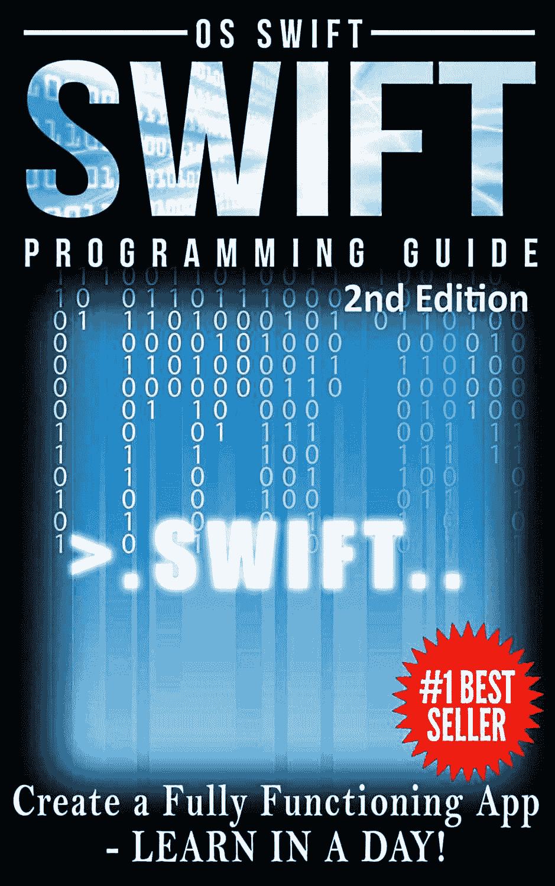

# Swift 编程：一天学会创建一个功能完备的应用

*Apps, PHP, HTML, Python, 编程指南, Java, 应用开发*



# 序言

2014 年，Apple 改变了他们的编程语言，引入了 Swift，旨在基于 C 和 Objective-C 的优秀特性，而没有 C 兼容性的所有限制。Swift 已经开发多年，带来了新的安全编程模式，以及现代特性，使得编程更加容易、比以往任何时候都更加灵活，并且更加有趣。

Swift 的外观和感觉对 Objective-C 的老手来说可能非常熟悉。这是因为它吸收了命名参数的可读性和 Objective-C 中对象模型的强大功能。它为 iOS 和 OS X 操作系统的编程带来了许多新特性。

Swift 非常易于使用，非常适合初学者学习。书中包含了对 Playgrounds 的支持，这是一个创新的功能，让你可以在投入大量精力构建和运行 App 之前，实验代码、查看运行情况并查看结果。

它将现代语言与从 Apple 工程广泛文化中汲取的智慧相结合。编译器经过了完全的性能优化。Swift 的目标是从简单的“Hello World!”直到构建完整的操作系统，且没有任何妥协。

如果你准备好开始学习这种未来的编程语言，请进入第一章，让我们看看你能做什么。请确保在开始之前已拥有最新版本的 Xcode——你可以从 Mac App Store 获取——因为我们将直接进入编程。

就像他们生产的所有其他产品一样，Apple 将确保 Swift 保持最新特性和最佳功能。这本书的意图是让你对 Swift 有概述，并帮助你创建一个计算器形式的第一个 iOS/OS X App。

类型推断虽然很方便，但如果你不需要立即为变量赋值，你可能需要显式地指定变量类型。

## 类型注解

#### C#

```csharp
string firstName;
```

#### Swift

```swift
var firstName: String
```

你是否注意到 Swift 并不使用分号？虽然 Swift 的语法与 `Objective C` 非常相似，但它在不使用分号的情况下完成所有操作，除非你想在单行内插入多个代码语句。在这种情况下，它支持分号，而且实际上在那种情况下是必须的。

## 变量名与 Unicode

Swift 和 Objective C 都支持在变量名中使用 Unicode 字符。简而言之，如果你真的想，你可以在变量名中使用任何内容，包括非 ASCII 字符和表情符号。

## 整数边界

Objective C 和 Swift 都使用静态常量来访问不同整数类型的最大和最小边界值。

#### C#

```csharp
var a = Int32.MinValue;
var b = Int32.MaxValue;
```

#### Swift

```swift
var a = Int32.min
var b = Int32.max
```

## 类型推断

Swift 和 Objective C 都支持类型推断，正如我们之前提到的，在编译器可以从直接赋值中推断出声明的变量类型的情况下。

#### C#

```csharp
var a = 3; // integer
var b = 0.14 // double
var c = a + b; // double
```

#### Swift

```swift
var a = 3 // integer
var b = 0.14 // double
var c = a + b // double
```

另外请注意，在上面的类型推断示例中，当你声明一个变量并立即赋值一个值——该值是另外两个变量的结果时——类型仍然会被推断。

## 字符串比较

Swift 和 Objective C 比较字符串的方式相似。

#### C#

```csharp
var a = "One";
var b = "One";
if (a == b) {
    // 两个变量被视为相等
}
```

#### Swift

```swift
var a = "One"
var b = "One"
if a == b {
    // 两个变量被视为相等
}
```

它们都使用相似的方法来检测字符串的开头或结尾是否匹配另一个指定的字符串。

#### C#

```csharp
var s = "Some Value";
if (s.StartsWith("Some")) {
    // 字符串以该值开头
}
if (s.EndsWith("Value")) {
    // 字符串以该值结尾
}
```

#### Swift

```swift
var s = "Some Value"
if s.hasPrefix("Some") {
    // 字符串以该值开头
}
if s.hasSuffix("Value") {
    // 字符串以该值结尾
}
```

再看一遍上面的示例。你是否注意到当你在 Swift 中使用 `IF` 语句时，不需要使用括号？

## 字符串大写或小写转换

Swift 和 Objective C 都支持相似的方法在大小写之间转换字符串。

#### C#

```csharp
var s = "some Value";
var upperS = s.ToUpper();
var lowerS = s.ToLower();
```

#### Swift

```swift
var s = "some Value"
var upperS = s.uppercaseString
var lowerS = s.lowercaseString
```

## 声明数组

Swift 和 Objective C 都支持使用单行代码来声明并赋值 `Array`。

### 在单行上声明数组

#### 字符串数组

##### C#

```csharp
var arr = new string[] { "One", "Two" };
```

##### Swift

```swift
var arr = ["One", "Two"]
```

#### 整数数组

##### C#

```csharp
var arr = new int[] { 1, 2 };
```

##### Swift

```swift
var arr = [1, 2];
```

## 数组的操作

在处理 `Arrays` 时，Swift 和 Objective C 之间存在细微差异。

### 遍历数组

#### C#

```csharp
foreach (var item in arr) {
    // 执行某些操作
}
```

#### Swift

```swift
for item in arr {
    // 执行某些操作
}
```

### 根据索引获取项

#### C#

```csharp
var item = arr[0];
```

#### Swift

```swift
var item = arr[0]
```

### 根据索引设置项

#### C#

```csharp
arr[0] = "Value";
```

#### Swift

```swift
arr[0] = "Value"
```

### 数组是否为空？

#### C#

```csharp
if (arr.Length == 0) {
    // 数组为空
}
```

#### Swift

```swift
if arr.isEmpty {
    // 数组为空
}
```

### 向数组添加项

#### C#

```csharp
Array.Resize(ref arr, arr.Length + 1);
arr[arr.Length - 1] = "Three";
```

#### Swift

```swift
arr.append("Three")
```

### 根据索引获取项（重复）

#### C#

```csharp
var item = arr[0];
```

#### Swift

```swift
var item = arr[0]
```

## 声明字典

Swift 和 Objective C 都支持使用单行代码来声明并赋值 `Dictionary`。

### 在单行上声明字典

#### C#

```csharp
var dict = new Dictionary<string, string> { { "One", "Value" }, { "Two", "Value" };
```

#### Swift

```swift
var dict = ["One": "Value", "Two": "Value"]
```

## 字典的操作

在处理 `Dictionaries` 时，Swift 和 Objective C 之间存在细微差异。

### 遍历字典

#### C#

```csharp
foreach (var kvp in dict) {
    // 执行某些操作
}
```

#### Swift

```swift
for (key, value) in dict {
    // 执行某些操作
}
```

### 根据键获取值

#### C#

```csharp
var value = dict["One"];
```

#### Swift

```swift
let value = dict["One"]
```

### 根据键设置值

#### C#

```csharp
dict["One"] = "Value";
```

#### Swift

```swift
dict["One"] = "Value"
```

### 根据键移除项

#### C#

```csharp
dict.Remove("One");
```

#### Swift

```swift
dict.removeValue(forKey: "One")
```

### 字典是否为空？

#### C#

```csharp
if (dict.Count == 0) {
    // 字典为空
}
```

#### Swift

```swift
if dict.isEmpty {
    // 字典为空
}
```

### 向字典添加项

#### C#

```csharp
dict.Add("Three", "Value");
```

#### Swift

```swift
dict["Three"] = "Value"
```

## For 循环

Swift 和 Objective C 都支持 `for` 循环。

## 条件语句

Swift 和 Objective C 都支持 If-Then 条件语句。Swift 的细微不同在于匹配条件周围不需要括号。

## Switch 语句

Swift 和 Objective C 的 Switch 语句相似，但 `case` 语句——在 Swift 中，这些不会像 Objective C 那样自动跳转到下一个。因此，C 需要 `break` 关键字来退出语句，除非你打算贯穿到下一个 `case`。在 Swift 中，你必须使用 `fallthrough` 关键字来告诉它跳转到下一个 `case` 语句。

```swift
switch (i) {
  case 1:
  case 2:
  case 3:
    // do something
    break;
  case 4:
    // do something
    break;
  default:
    // do something
    break;
}
```

```swift
// Swift
switch i {
  case 1...3:
    // do something
  case 4:
    // do something
  default:
    // do something
}
```

## 函数

与 Objective C 相比时，函数本身是一个相当大的话题，所以现在我们先来看这个相当基础的示例。

```csharp
// 带有参数和返回值的函数
// C#
string sayHello(string name) {
  // do something
}
```

```swift
// Swift
func sayHello(name: String) -> String {
  // do something
}
```

这是 Objective C 和 Swift 编程语言的基础对比。你可以看到它们在很多地方都有许多相似之处，但最大的差异之一就是它们处理数组的方式。Swift 数组类似于 Objective C 中的 `List<>` 类，大多数开发者现在倾向于使用这种类而不是数组，除非性能要求他们必须使用数组。在下一章中，我们将详细讨论函数。

# 第 2 章：函数

通常情况下，函数可以定义为自包含的、能够执行特定任务的代码段。通过分配函数名（该名称标识了它执行的任务），你可以调用该函数来执行它应该完成的任务。

Swift 的统一函数语法足够灵活，可以表示没有参数名的简单 C 风格函数，以及具有复杂的局部参数名和外部参数名的 Objective C 风格方法。参数将提供默认值以简化函数的调用。这些值可以以 `inout` 参入参数的形式给出，并在函数执行后修改它们所传递的变量。

在 Swift 中，每个函数都有一个类型。每个函数都由一个参数类型和一个返回类型组成，它们可以像 Swift 中的任何其他参数类型一样使用。通过这种方式，可以将函数作为参数传递给另一个函数，你也可以从其他函数返回函数。Swift 允许你在函数内部编写函数。通过这种方式，可以实现封装，并将实用的功能嵌套在其他函数内部。

## 定义和调用函数

每当你定义一个函数时，你还可以定义一个或多个可选的类型化、命名值，这些值可以作为该函数的输入。这些被称为参数。你还可以定义一个可选的值类型，函数在工作完成后将其作为输出传回。这被称为返回类型。

每个函数都会被赋予一个函数名，这个函数名将描述它执行的任务。我们调用该函数是为了使用该函数并调用；我们将使用它的名称并向它传递输入值。这些输入值被称为参数。参数与函数的参数类型匹配。函数参数列表和函数的参数必须以相同的顺序提供。

这是一个使用名为 `sayHello(_:)` 函数的示例。之所以这样调用它是因为它执行的任务是接收人的名字作为输入并向他返回一个问候语。为了实现这一点，应该定义一个名为 `personName` 的类型为 `string` 的输入参数。该函数的返回类型也是 `string`，它包含了将返回给该的问候语：

```swift
func sayHello(personName: String) -> String {
  let greeting = "Hello, " + personName + "!"
  return greeting
}
```

函数定义将以关键字 `func` 开头，信息将汇总到函数的定义中。函数的返回类型将使用返回箭头 `->` 指示。后面将是返回类型的名称。

函数的定义将定义函数的任务、函数的输入以及任务完成后的函数返回类型。你可以使用定义从代码的任何地方明确地调用该函数：

```swift
print(sayHello("Chad"))
// prints "Hello, Chad!"

print(sayHello("Bruce"))
// prints "Hello, Bruce!"
```

你可以通过在括号内传递字符串参数来调用函数 `sayHello(_:)`，例如 `sayHello("Chad")`。由于函数的返回类型是一个 `string` 值，为了打印该字符串，可以将函数封装在对函数 `print(_:separator:terminator:)` 的调用内部以检查返回值。

将定义一个名为 `greeting` 的字符串常量，并向 `personName` 发送问候消息，以开始函数 `sayHello(_:)` 的主体。`return` 关键字将用于将问候语传回。在调用 `return greeting` 后，函数将完成执行并返回问候语的当前值。

函数 `sayHello(_:)` 可以使用不同的输入值调用多次。在上面的示例中，我们可以看到如果使用“Chad”作为输入值以及“Bruce”作为输入值调用函数 `sayHello(_:)` 会发生什么。在每情况下，函数将返回一个定制的问候语。

你可以通过将消息创建和返回语句合并为单行来简化函数体：

```swift
func sayHelloAgain(personName: String) -> String {
  return "Hello again, " + personName + "!"
}

print(sayHelloAgain("Chad"))
// prints "Hello again, Chad!"
```

## 函数参数和返回值

在 Swift 中，返回值和函数参数是非常灵活的。你被定义包含单个未命名参数的简单实用函数，以及具有不同参数选项的复杂函数。

### 无参数函数

对于输入参数，函数不是必需的。这里有一个没有输入参数的示例。每当调用此函数时，它都会返回相同的消息。

```swift
func sayHelloWorld() -> String {
  return "hello, world"
}

print(sayHelloWorld())
// prints "hello, world"
```

即使函数不接受参数，你也应该在函数定义的名称后添加括号。每当调用它时，函数名后都会跟一对空括号。

## 多参数函数

可以给函数提供多个输入参数。这些参数将包含在函数的括号内，并使用逗号分隔。


```swift
func sayHello(personName: String, alreadyGreeted: Bool) -> String {
  if alreadyGreeted {
    return sayHelloAgain(personName)
  } else {
    return sayHello(personName)
  }
}

print(sayHello("Popeye", alreadyGreeted: true))
// prints "Hello again, Popeye!"
```

通过传递字符串参数值以及 `Bool` 参数值，你可以调用函数`sayHello(_:alreadyGreeted:)`。`Bool` 参数将在括号内标记为`alreadyGreeted`。这些使用逗号分隔。

当你使用多个参数调用函数时，第一个参数之后的任何参数将根据相应的参数名进行标记。

## 无返回值的函数

函数不需要定义返回类型。这里有一个示例函数`sayHello(_:)`，以及它的版本`sayGoodbye(_:)`，它将打印自己的字符串值而不是返回它：

```swift
func sayGoodbye(personName: String) {
  print("Goodbye, \(personName)!")
}

sayGoodbye("Lee")
// prints "Goodbye, Lee!"
```

由于此函数不需要返回任何内容，因此函数的定义不需要有返回类型或返回箭头`->`。

注意：在未定义返回值的情况下，可以使用`sayGoodbye(_:)`函数来返回一个值。如果没有定义返回类型，函数将返回一个`Void`类型。`Void`仅仅是一个内部不包含元素的特殊值。它是一个空元组，可以写成`()`。

当调用`Void`时，函数的返回值是可以被忽略的。

```swift
func printAndCount(stringToPrint: String) -> Int {
    print(stringToPrint)
    return stringToPrint.characters.count
}

func printWithoutCounting(stringToPrint: String) {
    printAndCount(stringToPrint)
}

printAndCount("hello, world")
// 打印 "hello, world" 并返回值为 12 
printWithoutCounting("hello, world")
// 打印 "hello, world" 但没有返回值
```

第一个函数`printAndCount(_:)`会打印一个字符串并返回作为`Int`类型的字符计数。第二个函数`printWithoutCounting`会调用第一个函数，但它会忽略第一个函数的返回值。第一个函数会在调用第二个函数后打印消息。在这种情况下，返回值将不会被使用。

注意：当一个函数表示它不返回值时，返回值是可以被忽略的。但如果一个函数表示它将返回一个值，它必须返回一个值。如果定义了返回类型的函数没有允许控制在不返回值的情况下到达底部，将显示编译错误。

## 具有多个返回值的函数

对于函数，你可以通过使用元组类型返回多个值来给出返回类型，因为它们并不是作为单个复合返回值的一部分返回返回。

下面的示例将定义一个`minMax(_:)`函数。该函数将找到给定数组中最小和最大的`Int`值：

```swift
func minMax(array: [Int]) -> (min: Int, max: Int) {
    var currentMin = array[0]
    var currentMax = array[0]
    for value in array[1..<array.count] {
        if value < currentMin {
            currentMin = value
        } else if value > currentMax {
            currentMax = value
        }
    }
    return (currentMin, currentMax)
}
```

函数`minMax(_:)`将返回一个包含两个`Int`值的元组。返回的值被命名为`min`和`max`。在查询函数的返回值时，可以使用它们的名称进行访问。

通过设置名为`currentMin`和`currentMax`的工作变量，函数`minMax(_:)`的主体将开始。`currentMin`和`currentMax`变量用于设置数组的第一个整数。函数将遍历数组中的剩余值，并比较它们是否小于或大于`currentMin`和`currentMax`值。最后将获得最小值和最大值，并将它们作为包含两个`Int`值的元组返回。

元组成员可以使用点语法进行访问，因为它们被命名为函数返回类型的一部分。访问它们是为了检索找到的最大值和最小值：

```swift
let bounds = minMax([8, -6, 2, 109, 3, 71])
print("min is \(bounds.min) and max is \(bounds.max)")
// 打印 "min is -6 and max is 109"
```

# 第 3 章：Playgrounds 简介

废话多说，我想让你启动 XCode。我们将直接进入你的第一个程序的设置，我们将在 Playground 中完成这一操作。Playground 是一项新功能，一种测试你的代码并查看它是否完全按照你的预期工作的方法，在你正式执行它之前。所以，让我们开始吧：

1. 启动 XCode，然后打开`File\New\File`
2. 选择`iOS\Source\Playground`
3. 点击 Next
4. 你需要为文件命名，所以将其命名为`Swifttutorial.playground`
5. 现在点击 Create 并将文件保存到你记得的地方
6. 确保文件是空的——你希望从一个完全干净的空白板开始。
7. 现在打开你的文件并在程序中输入以下内容。在你输入时，每行的结果都将显示在侧边栏中，这样你可以清楚地看到发生了什么：

```swift
let tutorialTeam = 60
let editorialTeam = 17
let totalTeam = tutorialTeam + editorialTeam
```

Playgrounds 是学习 Swift 如何工作以及进行实验的极佳方式。在教程第一部分的剩余时间内，你将一直在这个 playground 中工作。

在继续之前，请将你的新 playground 文件拖到你的 OS X dock 栏上。这将方便你将其作为记事本来快速测试新代码。

## 变量与常量

再次打开你的 Playground 文件，并尝试在底部添加这一行：

```swift
totalTeam += 1
```

你首先会注意到，当你放入这一行时会得到一个错误。这是因为`totalTeam`是所谓的常量，它的值不能改变。常量必须用`let`单词声明，而我们在这个例子中没有这样做。与其作为常量，你希望`totalTeam`是一个变量——回到你的 playground 文件，删掉你刚刚输入的行并重新输入：

```swift
var totalTeam = tutorialTeam + editorialTeam
```

现在你可能会问为什么我们不直接用`var`声明所有东西，因为在信息足够的情况下，编译器可以自动设置。

## 显式类型与推断类型

我们还没有为常量或变量设置类型，因为编译器在有足够信息的情况下可以完成。当然，你也可以显式地设置类型。回到代码中设置`totalTeam`的那一行，将其替换为：

```swift
let totalTeam: Int
```

在可能的情况下，你应该让编译器为你推断类型——这是 Swift 的最大优势之一。由于这个原因，切换回推断类型，通过放入这一行：

```swift
let tutorialTeam = 60
```

### Swift 中的基础类型与控制流

所以，你已经看到了`Int`的工作，它是整数值的类型。但还有更多类型。保持你的 playground 文件打开，尝试运行这些行来看看它们的作用：

### Float 和 Double

```swift
let priceInferred = 19.99
let priceExplicit: Double = 19.99
```

`Float`和`Double`都是小数点值。`Double`更精确，并且是小数值的默认选择。

### Bool

```swift
let onSaleInferred = true
let onSaleExplicit: Bool = false
```

熟悉 Objective-C 的你们知道声明布尔值时使用 Yes 或 No。在 Swift 中，我们使用 True 或 False。

### String

```swift
let nameInferred = "Whoopie Cushion"
let nameExplicit: String = "Whoopie Cushion"
```

字符串正如你预期的那样——字符序列。在 Swift 中你不需要像在 Objective-C 中那样使用`@`符号，所以如果你习惯了旧程序，可能需要一段时间来理解这个！

### If 语句与字符串插值

```swift
if onSaleInferred {
    println("\(nameInferred) on sale for \(priceInferred)!")
} else {
    println("\(nameInferred) at regular price: \(priceInferred)!")
}
```

这是一个 if 语句，它与其他所有计算机编程语言相似。如果你不想，你可以不使用括号，但你必须使用大括号，即使它只有一行语句。

这还向你展示了一种全新的技术，被称为字符串插值。每当你想要在 Swift 中进行替换时，都必须使用这种语法：

```
\(yourexpression)
```

查看游练场（playground）中的侧边栏，你应该能看到执行结果——这可能有点难以阅读，因为空间不大。将鼠标悬停在行上，并点击出现的眼睛图标。

# 第 2 部分：使用 XCode 编辑工具

在本章中，我们将涵盖使用 XCode 的四个要素：

1. XCode 编辑工具
2. 代码自动补全功能
3. 使用 Fix-It 进行代码纠错
4. 代码片段的操作

正如你在该章节中看到的，你的 Swift XCode 开发中很大一部分工作涉及到 XCode 的图形用户界面。很多工作——特别是在项目开始阶段——都是图形化的，或者涉及复选框。

在第 4 章中，我将向你展示如何在游练场中编写和测试代码——特别是短小的代码片段。这有助于你学习 Swift 语法，并允许你在将代码片段输入（或复制-粘贴）到项目文件之前先对它们进行测试。

现在，在本章中，我将介绍 XCode 的编辑工具。在这里，你将以你在学校基础编程课上编写的方式编写代码（即通过输入代码，而不是绘制界面并使用 XCode 的复选框和其他图形元素来视觉化构建应用）。本章的重点是协助你编写代码的 XCode 工具。XCode 在输入和编辑文本方面为你做的许多工作，都是由于它会观察每一次击键，并跟踪你输入（或复制-粘贴）的术语语法实现的。

通过在前三章中找到的工具和技术，你可以创建你的第一个 Swift 应用——即书中贯使用的 Locatapp 示例应用。（如果你还没有看到它，可以查看第 1 章中的图 1-1 到 1-5，了解你将要去哪里。）

# 第 4 章：类与方法

当你开始学习 Swift 时，你将经常创建类和方法，所以让我们来看看它们是什么以及如何工作。首先，清除你游练场文件中的所有内容——我们需要一张空白页再次开始工作。现在，这就是你开始创建你的第一个应用的地方——一个小费计算器（Tip Calculator）。你将一段一段地构建这个应用，我将在过程中解释每一部分。准备好了吗？在你的游练场文件中输入以下：

```swift
// 1
class TipCalculator {
}
```

你正在做的第一件事是创建一个类，要做到这一点，你只需要输入`class`并跟上名称，在本例中为`TipCalculator`。然后跟上大括号。

在大括号内部，输入以下代码：

```swift
// 2
let total: Double
let taxPct: Double
let subtotal: Double
```

当你输入这些内容时，你会看到一些错误出现，但不要担心，它们很快就会被修复。你在这里所做的是在类上创建属性，这与创建常量或变量几乎相同。你创建了三个属性——加税前的账单总额、添加的税率百分比以及加税前的订单金额。

你之所以在这个阶段得到错误，是因为你必须在声明属性时提供初始值，而我们没有对这些属性这样做。

接在你刚刚输入的代码之后，保持在大括号内的情况下添加以下几行：

```swift
// 3
init(total: Double, taxPct: Double) {
    self.total = total
    self.taxPct = taxPct
    subtotal = total / (taxPct + 1)
}
```

这创建了类的初始化方法，这些方法在 Swift 中始终被命名为`init`。此初始化方法接收两个参数，并且因为它们的名称相同，所以通过添加`self`前缀来区分它们。

继续在大括号内，向你的代码中添加这些：

```swift
// 4
func calcTipWithTipPct(tipPct: Double) -> Double {
    return subtotal * tipPct
}
```

在这里，你使用了`func`关键字来声明一个方法，后面跟着参数——在这里你必须显式指定类型，并跟上返回类型。这是一个简单的函数，将账单的小计金额与小费百分比相乘。在此之后，添加以下代码：

```swift
// 5
func printPossibleTips() {
    println("15%: \(calcTipWithTipPct(0.15))")
    println("18%: \(calcTipWithTipPct(0.18))")
    println("20%: \(calcTipWithTipPct(0.20))")
}
```

你创建了一个新方法，它可以打印出 3 种可能的的小费值。注意，当在类的实例上调用方法时，初始参数不需要命名，但其余需要。现在，添加这段代码，这次是在大括号之后：

```swift
// 6
let tipCalc = TipCalculator(total: 33.25, taxPct: 0.06)
tipCalc.printPossibleTips()
```

在最后一步中，你创建了一个费计算器的实例，并调用了方法来显示可能的的小费值。

你的代码现在应该是这样的：

```swift
// 1
class TipCalculator {
    // 2
    let total: Double
    let taxPct: Double
    let subtotal: Double
    // 3
    init(total: Double, taxPct: Double) {
        self.total = total
        self.taxPct = taxPct
        subtotal = total / (taxPct + 1)
    }
    // 4
    func calcTipWithTipPct(tipPct: Double) -> Double {
        return subtotal * tipPct
    }
    // 5
    func printPossibleTips() {
        println("15%: \(calcTipWithTipPct(0.15))")
        println("18%: \(calcTipWithTipPct(0.18))")
        println("20%: \(calcTipWithTipPct(0.20))")
    }
}
// 6
let tipCalc = TipCalculator(total: 33.25, taxPct: 0.06)
tipCalc.printPossibleTips()
```

# 第 5 章：数组与 For 循环

你可能注意到上面的代码中有很多重复。这是因为你多次调用了`calcTipWithTipPct`方法来显示不同的百分比。这就是数组大显身场的地方，让你减少重复。

去你输入`printPossibleTips`的地方，替换其内容：

```swift
let possibleInferred = [0.15, 0.18, 0.20]
let possibleExplicit:[Double] = [0.15, 0.18, 0.20]
// 你创建一个浮点数数组，使用了推断和显式类型。现在在下方添加以下行：
for possibleTip in possibleInferred {
    println("\(possibleTip*100)%: \(calcTipWithTipPct(possibleTip))")
}
```

## 字典

我们将对你的代码进行最后一次更改——与其仅仅打印出你的小费，不如创建一个包含所有结果的字典。

去你输入`printPossibleTips`的地方并删除该方法。将其替换为：


```swift
// 1
func returnPossibleTips() -> [Int: Double] {
    let possibleInferred = [0.15, 0.18, 0.20]
    let possibleExplicit:[Double] = [0.15, 0.18, 0.20]
    // 2
    var retval = [Int: Double]()
    for possibleTip in possibleInferred {
        let intPct = Int(possibleTip*100)
        // 3
        retval[intPct] = calcTipWithTipPct(possibleTip)
    }
    return retval
}
```

再次，你会看到一个错误，但我们现在修复它。你需要将文件的最后一行改为：

```swift
tipCalc.returnPossibleTips()
```

恭喜！你创建了你在 Swift 中的第一个类！

类型转换（Typecasting）可以用于子类和类的层次结构，用于检查给定类实例的类型，并将该实例转换为具有相同层次结构的不同类。下面给了一个示例，其中三个代码片段，它们定义了数组以及包含其类实例的类的层次结构。

第一个代码片段中定义了一个新的基类。该基类被称为`MediaItem`。该类可以为出现在数字媒体库中的任何项目提供基本功能。

```swift
class MediaItem {
  var name: String
  init(name: String) {
    self.name = name
  }
}
```

在下一个代码片段中，定义了`MediaItem`的子类。`Movie`是第一个子类，它封装了关于电影的额外信息。在类`MediaItem`之上会添加一个`director`属性，这是最佳类。该属性将通过一个响应基类的初始化器添加。

`Song`是第二个子类，它为基类添加了带有初始化器的属性`artist`。

```swift
class Movie: MediaItem {
  var director: String
  init(name: String, director: String) {
    self.director = director
    super.init(name: name)
  }
}

class Song: MediaItem {
  var artist: String
  init(name: String, artist: String) {
    self.artist = artist
    super.init(name: name)
  }
}
```

最后一个代码片段将创建一个名为`library`的常量数组。它包含两个`Movie`实例和三个`Song`实例。通过使用数组字面量的的内容初始化`library`数组，可以推导出其类型。Swift 的类型检查器能够识别以`MediaItem`为共同父类的歌曲和电影。

```swift
let library = [
  Movie(name: "Avatar", director: "James Cameroon"),
  Song(name: "They Don’t Care About Us", artist: "Michael Jackson"),
  Movie(name: "The Lord of the Rings", director: "Peter Jackson"),
  Song(name: "Bohemian Rhapsody", artist: "Freddie Mercury"),
  Song(name: "summer of 69", artist: "Brian Adams")
]
// "library" 的类型被推断为 [MediaItem]
```

电影和歌曲实例是存储在`library`后台的项目。如果对数组的内容进行迭代，你收到的项目将不是`movie`或`song`类型，而是`MediaItem`类型。你应该检查它们的类型，以便以它们的实际类型与它们操作，或者你可以像下面所示将它们向下转型（downcast）为所需的类型。

## 检查类型

你可以使用类型检查运算符（`is`）来检查实例是否属于某个子类类型。如果实例属于该子类类型，类型检查运算符将返回`true`，如果不是，它将返回`false`。

下面的示例定义了两个变量`movieCount`和`songCount`，它们计算了`library`数组中存在的歌曲和电影实例的总数：

```swift
var movieCount = 0
var songCount = 0
for item in library {
  if item is Movie {
    ++movieCount
  } else if item is Song {
    ++songCount
  }
}
print("Media library contains \(movieCount) movies and \(songCount) songs")
// 打印 "Media library contains 2 movies and 3 songs"
```

此示例中库数组中的所有项都将被整合进来。对于`for in`循环的每一次通过，`item`常量都将发送给下一个`MediaItem`。

当当前的`mediaItem`是`movie`实例时，运算符将返回`true`，否则将返回`false`。同样，如果`mediaItem`属于`song`实例，`item is song`将返回`true`值，否则它将返回`false`。当`for in`循环结束时，`movieCount`和`songCount`将包含在这些类型中找到的所有`MediaItem`实例的计数。

## 向下转型

在，特定类的变量或常量可能引用子类实例。如果你认为确实如此，你可以使用类型转换运算符（`as?`或`as!`）对子类类型执行向下转型。

向下转型并不总是成功的，类型转换运算符有两种不同的形式。条件形式`as?`会返回一个可选值（optional），该可选值将是你尝试向下转型的类型。第二种形式是强制形式`as!`。结果将作为一个单一复合操作被强制解包，并尝试向下转型。

如果你不确定向下转型的成功与，可以使用类型转换运算符（`as?`），这是它的条件形式。这种运算符的形式总是返回一个可选值，在向下转型失败的情况下，该值将为`nil`。通过这，你可以检查向下转型是否成功。

如果你确定向下转型的成功与，可以使用类型转换运算符（`as!`），这是它的强制形式。如果你向下转型一个错误的类类型，运算符将触发运行时错误。

下面的示例将遍历`library`中的每个`MediaItem`，然后为每个项目打印相应的描述。为了做到这一点，它必须访问每个项目，而不仅仅是作为`MediaItem`，而是作为真正的`Song`或`Movie`。为了这样做，它将不能仅仅作为`MediaItem`访问每个项目，而是作为真正的`Song`或`Movie`访问。在下面的示例中，库中的每个`MediaItem`可能是`Song`或`Movie`。我们无法提前知道实际的类，以便使用它。在这种情况下，使用类型转换运算符（`as?`）的条件形式是合适的。

```swift
for item in library {
  if let movie = item as? Movie {
    print("Movie: '\(movie.name)', dir. \(movie.director)")
  } else if let song = item as? Song {
    print("Song: '\(song.name)', by \(song.artist)")
  }
}
// Movie: Avatar, dir. James Cameroon
// Song: They Don’t Care About Us, by Michael Jackson
// Movie: The Lord of the Rings, dir. Peter Jackson
// Song: Bohemian Rhapsody, by Freddie Mercury
// Song: summer of 69, by Brian Adams
```

上面的示例开始尝试将`item`向下转型为`Movie`。`Movie`可能是`MediaItem`实例，同样`Song`也是。由于这种不确定性，当尝试向下转型到子类类型时，类型转换运算符`as?`会返回一个可选值。`as? Movie`项目的结果是`Movie?`类型或可选的`movie`。

如果向下转型成功，将使用电影属性打印`Movie`实例的描述。类似的原理被用于检查`Song`实例，以便每次在库中找到`Song`后绘制适当的描述。

注意：类型转换不会修改实例或更改值。底层的实例将是相同的。例如，只是被访问并像要转换的实例类型一样被处理。

## Any 和 AnyObject 的类型转换

Swift 提供了两个特殊的类型别名来处理非特定类型：

`AnyObject`可以表示任何类类型的实例。

`Any`可以表示任何类型的实例，包括函数类型。

注意：仅在你明确需要`Any`和`AnyObject`提供的行为和能力时，才使用它们。在代码中，明确你期望与之操作的类型总是会更好。

### AnyObject

在处理 Cocoa APIs 时，接收`AnyObject`类型数组（或“任意对象类型值的数组”）是正常现象。这是因为在 Objective-C 中没有显式的泛类型数组。但是，如果你根据数组提供的 API 信息，对数组中存在的对象类型有把握，你可以使用`as!`类型转换操作符（强制版本），将数组中的每个项向下强制转型为比`AnyObject`更具体的类类型，而无需进行可选值解包。

一个`AnyObject`类型数组将由下面的示例定义，并添加三个`Movie`类的实例：

```swift
let someObjects: [AnyObject] = [
    Movie(name: "2001: A Space Odyssey", director: "Stanley Kubrick"),
    Movie(name: "Moon", director: "Duncan Jones"),
    Movie(name: "Alien", director: "Ridley Scott")
]
```

由于此数组只包含`Movie`实例，可以使用`as!`类型转换操作符（强制版本）将其向下转型并解包为非可选的`Movie`：

```swift
for object in someObjects {
    let movie = object as! Movie
    print("Movie: '\(movie.name)', dir. \(movie.director)")
}
// Movie: '2001: A Space Odyssey', dir. Stanley Kubrick
// Movie: 'Moon', dir. Duncan Jones
// Movie: 'Alien', dir. Ridley Scott
```

与其单独对每个项进行向下转型，可以将数组`someObjects`转型为`[Movie]`类型，以便使用更短的循环形式：

```swift
for movie in someObjects as! [Movie] {
    print("Movie: '\(movie.name)', dir. \(movie.director)")
}
// Movie: '2001: A Space Odyssey', dir. Stanley Kubrick
// Movie: 'Moon', dir. Duncan Jones
// Movie: 'Alien', dir. Ridley Scott
```

### Any

在这个示例中，我们将使用`Any`来处理不同类型的组合，包括非类类型和函数类型。此示例中将创建一个名为`things`的数组，它可以存储类型为`Any`值。

```swift
var things = [Any]()
things.append(0)
things.append(0.0)
things.append(42)
things.append(3.14159)
things.append("hello")
things.append((3.0, 5.0))
things.append(Movie(name: "Ghostbusters", director: "Ivan Reitman"))
things.append({ (name: String) -> String in "Hello, \(name)" })
```

`things`数组包含了两个`Int`值、一个`String`值、两个`Double`值、电影“捉鬼总员”、一个`(Double, Double)`类型的元组，以及一个接收并返回`String`值的闭包表达式。

`is`和`as`操作符可以配合`switch`语句中的情况，用于发现特定类型的变量或常量，这些类型仅限于`AnyObject`类型或`Any`类型。下面的示例遍历`things`数组的项，然后使用`switch`语句查询每个项的类型。`switch`语句的多个情况将特定类型的常量与其匹配的值绑定，从而允许打印该值：

```swift
for thing in things {
    switch thing {
        case 0 as Int:
            print("zero as an Int")
        case 0 as Double:
            print("zero as a Double")
        case let someInt as Int:
            print("an integer value of \(someInt)")
        case let someDouble as Double where someDouble > 0:
            print("a positive double value of \(someDouble)")
        case is Double:
            print("some other double value that I don't want to print")
        case let someString as String:
            print("a string value of \"\(someString)\")
        case let (x, y) as (Double, Double):
            print("an (x, y) point at \(x), \(y)")
        case let movie as Movie:
            print("a movie called '\(movie.name)', dir. \(movie.director)")
        case let stringConverter as String -> String:
            print(stringConverter("Michael"))
        default:
            print("something else")
    }
}
// zero as an Int
// zero as a Double
// an integer value of 42
// a positive double value of 3.14159
// a string value of "hello"
// an (x, y) point at 3.0, 5.0
// a movie called 'Ghostbusters', dir. Ivan Reitman
// Hello, Michael
```

### 嵌套类型

枚举通常是通过支持特定类或结构的功能创建的。同样，我们可以为了方便定义工具结构和类，它们将纯粹地用于更复杂的类型上下文中。为了实现这一点，你可以在 Swift 中定义嵌套类型。在这里，你可以将支持的结构、类和枚举嵌套在其支持的类型定义内部。

通过将类型定义写在其支持的外大括号内部，你可以将一个类型嵌套在另一个类型内部。嵌套类型没有限制，可以达到所需的任意深度。

#### 嵌套类型的实际应用

在给出的示例中，定义了一个名为`BlackjackCard`的结构。该结构模拟了类似于黑 2 点游戏中使用的扑牌。`Suit`和`Rank`是包含在`blackjack`结构体内部的嵌套枚举类型。

黑 2 点中的王牌值可以是 1 或 11。使用名为`Values`的结构来表示此特征，并嵌套在`Rank`枚举内部：


```swift
struct BlackjackCard {
    // 嵌套 Suit 枚举
    enum Suit: Character {
        case Spades = "♠", Hearts = "♡", Diamonds = "♢", Clubs = "♣"
    }
    // 嵌套 Rank 枚举
    enum Rank: Int {
        case Two = 2, Three, Four, Five, Six, Seven, Eight, Nine, Ten
        case Jack, Queen, King, Ace
        struct Values {
            let first: Int, second: Int?
        }
        var values: Values {
            switch self {
                case .Ace:
                    return Values(first: 1, second: 11)
                case .Jack, .Queen, .King:
                    return Values(first: 10, second: nil)
                default:
                    return Values(first: self.rawValue, second: nil)
            }
        }
    }
    // BlackjackCard 属性和方法
    let rank: Rank, suit: Suit
    var description: String {
        var output = "suit is \(suit.rawValue),"
        output += " value is \(rank.values.first)"
        if let second = rank.values.second {
            output += " or \(second)"
        }
        return output
    }
}
```

`Suit` 枚举用于描述四种花色，以及代表其符号的 `Character` 值。

所有可能的牌面值由 `Rank` 枚举描述，并带有一个原始 `Int` 值，该值用于表示除王牌、J、Q、K 外的面值。

如上所述，一个名为 `Values` 的嵌套结构嵌套在 `Rank` 枚举中。除了王牌有两个值外，几乎所有的牌都只有一个值，该结构封装了这一事实。两个属性由 `Values` 结构定义以表示：

`first`，类型为 `Int`

`second`，类型为 `Int?` 或“可选 Int”

一个计算属性 `Values` 定义在 `Rank` 中，它返回一个 `Values` 结构实例。该计算属性会考虑牌的 own 数，并根据点数初始化一个新的 `Values` 实例以相应的值。

由于 `BlackjackCard` 结构体没有自定义初始化器，因此它有一个隐式的成员初始化器，这在结构体类型的成员初始化器中进行了描述。此初始化器可用于初始化一个名为 `AceOfSpades` 的新常量。

```swift
let theAceOfSpades = BlackjackCard(rank: .Ace, suit: .Spades)
print("theAceOfSpades: \(theAceOfSpades.description)")
// prints "theAceOfSpades: suit is♠, value is 1 or 11"
```

如你所示，`Suit` 和 `Rank` 嵌套在 `BlackjackCard` 内部。从上下文中我们可以推出它们的类型。枚举 case 可以通过实例的初始化来引用。引用将通过它们的 case 名进行。从上面的示例可以看出，`description` 属性报告了值为 1 或 11。

## 引用嵌套类型

要在定义范围之外使用嵌套类型时，类型的名称应以其所属名称作为前缀。

```swift
let heartsSymbol = BlackjackCard.Suit.Hearts.rawValue
// heartsSymbol is "♡"
```

对于上面的示例，`Rank`、`Suit` 和 `Values` 的名称被刻意保持短，这是因为这些名称由它们定义的内容自然地限定了。

## 函数类型作为参数类型

在 Swift 中，允许将像 `(Int, Int) -> Int` 的函数类型作为另一个函数的参数类型。通过这种方式，你可以在每次调用函数时将某些函数实现部分留给函数的调用者。

下面是一个示例，将打印上述数学函数的结果。

```swift
func printMathResult(mathFunction: (Int, Int) -> Int, _ a: Int, _ b: Int) {
    print("Result: \(mathFunction(a, b))")
}
printMathResult(addTwoInts, 3, 5)
// prints "Result: 8"
```

在这个示例中，定义了一个名为 `printMathResult(_:_:_:)` 的函数，该函数有三个参数。函数的第一个参数是 `mathFunction`。第一个参数的类型是 `(Int, Int) -> Int`。相同类型的函数可以作为 `mathFunction` 参数的参数传递。`a` 和 `b` 是第二个和第三个参数。第二个和第三个参数是 `Int` 类型。对于提供的数学函数，这些参数将用作输入值。

当我们调用 `printMathResult(_:_:_:)` 函数时，函数 `addTwoInts(_:_:)` 将带有 `3` 和 `5` 整数值传递。这现在会调用带有 `3` 和 `5` 作为值的提供的函数，并将打印 8 作为结果。

打印结果是函数 `printMathResult(_:_:::)` 的职责。它将打印适当类型的数学函数调用。函数的实现在这里并不重要。这里唯一重要的是函数的类型，该类型需要是正确的。通过这种方式，函数 `printMathResult(_:_:_:)` 将将部分功能交给调用该函数的人。这将以类型安全的方式发生。

## 函数类型作为返回类型

给定函数的类型可以作为另一个函数的返回类型。这可以通过在返回函数的 `->` 之后提供完整的函数类型来实现。

在下一个示例中定义了两个简单的函数 `stepForward(_:)` 和 `stepBackward(_:)`。`stepForward(_:)` 函数返回比输入值大 1 的值，而 `stepBackward(_:)` 函数返回比输入值小 1 的值。这两个函数的类型都是 `(Int) -> Int`：

```swift
func stepForward(input: Int) -> Int {
    return input + 1
}
func stepBackward(input: Int) -> Int {
    return input - 1
}
```

这里有一个函数 `chooseStepFunction(_:)`，它的返回类型为“类型为 `(Int) -> Int` 的函数”。根据布尔参数，`chooseStepFunction(_:)` 将返回 `stepForward(_:)` 函数或 `stepBackward(_:)` 函数。

```swift
func chooseStepFunction(backwards: Bool) -> (Int) -> Int {
    return backwards ? stepBackward : stepForward
}
```

现在你可以使用 `chooseStepFunction(_:)` 获取一个向某个方向或其他方向移动的函数。

```swift
var currentValue = 3
let moveNearerToZero = chooseStepFunction(currentValue > 0)
// moveNearerToZero now refers to the stepBackward() function
```

上面的示例确定是否需要正步或负步来让变量 `currentValue` 逐渐靠近 0。

`currentValue` 的初始值为 `3`，这意味着在这种情况下 `currentValue > 0` 为真。这将使 `chooseStepFunction(_:)` 返回 `stepBackward(_:)` 函数。我们使用常量 `moveNearerToZero` 来存储返回的函数引用。

`moveNearerToZero` 现在引用正确的函数，因此它可以用于计数到 0：

```swift
print("Counting to zero:")
// Counting to zero:
while currentValue != 0 {
    print("\(currentValue)... ")
    currentValue = moveNearerToZero(currentValue)
}
print("zero!")
// 3...
// 2...
// 1...
// zero!
```

## 嵌套函数

你目前为止看到的所有都是全局函数的示例。全局函数定义在全局作用域内。你还可以在其他函数内部定义函数。这些被称为嵌套函数。

默认情况下，所有嵌套函数都是隐藏的。尽管它们是隐藏的，但嵌套函数可以被闭包函数使用和调用。

```swift
func chooseStepFunction(backwards: Bool) -> (Int) -> Int {
    func stepForward(input: Int) -> Int {
        return input + 1
    }
    func stepBackward(input: Int) -> Int {
        return input - 1
    }
    return backwards ? stepBackward : stepForward
}
var currentValue = -4
let moveNearerToZero = chooseStepFunction(currentValue > 0)
// moveNearerToZero now refers to the stepForward() function
while currentValue != 0 {
    print("\(currentValue)... ")
    currentValue = moveNearerToZero(currentValue)
}
print("zero!")
// -4...
// -3...
// -2...
// -1...
// zero!
```

# 第 7 章：创建你的第一个 App

现在你已经学习了 Swift 编程基础，并学会了如何创建 `TipCalculator` 类，是时候学习如何制作第一个 iOS App 了。我们将使用你开发的 `TipCalculator` 类并为它创建一个用户界面。

## 开始

* 启动 XCode 并打开 `File\New\Project`

* 选择 `iOS\Application\Single View App`

* 点击 Next

* 在要求输入名称的地方输入 `TipCalculator`

* 将语言设置为 Swift

* 将设备设置为 iPhone

* 确保 `Use Core Data` 旁的复选框未勾选

* 点击 Next

* 选择你想保存新项目的目录并点击 Create

现在看看 XCode 为你做了什么。在 XCode 左上角，点击 iPhone 6 Simulator 然后点击 Play。你应该看到一个显示 Tip Calculator 的启动界面，然后会出现一个空白屏幕。

## 创建你的模型

在创建用户界面之前，我们需要为 App 创建模型。模型是一组类，代表了 App 中的数据以及 App 将对数据执行的操作。

对于本教程而言，你的模型将是 Playground 中创建的 `TipCalculator` 类，但我们将将其重命名为 `TipCalculatorModel`。

要添加此类，打开 `File\New\File`：

* 选择 `iOS\Source\Swift File`

* 命名为 `TipCalculatorModel.swift`

* 点击 Create

你要做的是将你的 playground 文件移动到 swift 文件中，因为你无法调用 playground 文件中的代码——这些文件仅用于测试。

打开 `TipCalculator.swift`

将类从你的 playground 文件中（不要包含底部的测试行）复制到 Swift 文件中，并进行以下更改：

- 将类重命名为 `TipCalculatorModel`。

- 你需要将 `total` 和 `taxPct` 改为变量。

- 你需要将 `subtotal` 更改为计算属性，你可以通过将 `subtotal` 属性替换为以下代码来实现这一点：

```swift
var subtotal: Double {
    get {
        return total / (taxPct + 1)
    }
}
```

计算属性不存储值，它们是根据其他值计算出来的。在这里，每当访问 `subtotal` 时，你都会根据 `total` 和 `taxPct` 的值来计算 `subtotal`。

接下来，你需要删除 `init` 中设置 `subtotal` 的整行代码，并删除文件中的任何注释。

完成后，你的文件看起来应该是这样的：

```swift
//
// TipCalculatorModel.swift
// TipCalculator
//
// Created by Main Account on 12/18/14.
// Copyright (c) 2014 Razeware LLC. All rights reserved.
//
import Foundation

class TipCalculatorModel {
    var total: Double
    var taxPct: Double
    var subtotal: Double {
        get {
            return total / (taxPct + 1)
        }
    }

    init(total: Double, taxPct: Double) {
        self.total = total
        self.taxPct = taxPct
    }

    func calcTipWithTipPct(tipPct: Double) -> Double {
        return subtotal * tipPct
    }

    func returnPossibleTips() -> [Int: Double] {
        let possibleTipsInferred = [0.15, 0.18, 0.20]
        let possibleTipsExplicit:[Double] = [0.15, 0.18, 0.20]
        var retval = [Int: Double]()
        for possibleTip in possibleTipsInferred {
            let intPct = Int(possibleTip*100)
            retval[intPct] = calcTipWithTipPct(possibleTip)
        }
        return retval
    }
}
```

现在你的应用模型已经准备好了，是时候查看视图了！

# 第 8 章：Storyboard 和 Interface Builder 简介

你的用户界面将在一个名为 Storyboard 的工具中创建，而 XCode 包含了 Interface Builder，这是一个非常实用的工具，可以让你轻松地编辑 Storyboard。Interface Builder 允许你通过拖放来布局所有内容——按钮、标签、文本字段以及应用中的所有其他控件。这些被称为视图（Views）。查看 XCode 的左侧并点击 `Main.storyboard`。这将打开 Interface Builder。由于内容非常详细，因此我们将一次介绍屏幕的一个部分：

- 左侧是**项目导航器（Project Navigator）**——你的项目文件在这里显示。

- Interface Builder 左侧是**文档大纲（Document Outline）**——你可以目了然地看到应用每个屏幕的视图——确保点击项目旁边的箭头以查看整个文档。

- 目前，你的应用只有一个视图控制器（view controller），但我们很快就会向其中添加内容。

- 查看你视图控制器的左侧，有一个箭头。这表示它是一个**初始视图控制器（Initial View Controller）**——这是应用打开时显示的第一个页面。可以通过将箭头拖到另一个视图控制器来更改它。

- 现在看 Interface Builder 的底部——你会看到“w Any”和“h Any”字样。这表示你的应用正在编辑以适配任何尺寸的界面。

- 在视图控制器的顶部，有各种选项……（注：此处原文存在部分乱码/重复，已按原意翻译核心功能描述）。

（注：由于原文后半部分存在大量文本重复和格式化错误，如 "w Any" 等重复的描述，译文已根据上下文语境进行了逻辑化处理）。


iOS 被划分为多个框架（framework），每个框架都包含不同的代码。在使用框架中的代码之前，你必须先导入它。包含视图控制器基类的框架被称为`UIKit`，它还包含了文本字段、按钮等其他内容。这是你在本教程中第一次看到子类的示例，并且你正在声明一个名为`ViewController`的新类——它是`UIViewController`的子类。要查看它是如何运作的，请将类声明替换为：

```swift
class UIViewController {

}
```

你可以看到`UIKit.UIViewController`指的是`UIKit`命名空间中的`UIViewController`类。

`Override`方法在第一次访问时带有视图控制器的根视图（root view）被调用。如果你要重写一个方法，必须使用`override`关键字，以防止无意中重写了方法。

`Memory Function`方法在 iPhone 内存不足时被调用。

## 将你的视图控制器连接到视图

现在你已经对视图控制器类有了一些了解，是时候为子视图添加属性并将它们加入 Interface Builder（界面生成）了。要做到这一点，请进入你的`ViewController`类，找到`viewDidLoad`并在其上方插入以下代码：

```swift
@IBOutlet var totalTextField : UITextField!

@IBOutlet var taxPctSlider : UISlider!

@IBOutlet var taxPctLabel : UILabel!

@IBOutlet var resultsTextView : UITextView!
```

你正在声明四个不同的变量：

* `UITextField`

* `UISlider`

* `UILabel`

* `UITextView`

这与你在 playground 文件中操作的方式相比有两个不同之处：

这些变量的前缀是`@IBOutlet`。Interface Builder 会遍历你的代码来寻找这些内容，正是这允许你将变量连接到视图。

每个变量都标记有`!`，表示这些是可选值（optional values），但已经进行了隐式解包（implicitly unwrapped）。这是一种高级的说法，意味着你的代码编写得就像已经设置了一样，而且如果没有设置，你的应用程序就会崩溃。

让我们尝试将这些变量连接到用户界面中的元素：

* 打开`Main.storyboard`

* 在`Document Outline`（文档大纲）中选择视图控制器

* 打开`Connections Inspector`（连接检查器）——第 6 个标签页

在这里你将看到你之前创建的属性，它们列在`Outlets`下。

查看`resultsTextView`的右侧——你会看到一个小圆圈。按住`CTRL`并从按钮拖动到`Text View`（文本视图），位于`Calculate`按钮下方。松手，该属性将连接到视图。

对所有其他属性执行此操作，确保每个属性都连接到正确的元素。

## 将动作（Actions）连接到你的视图控制器

现在我们将动作连接到方法（methods）上：

打开`ViewController.swift`

在类的任意位置添加以下代码：

```swift
@IBAction func calculateTapped(sender : AnyObject) {

}

@IBAction func taxPercentageChanged(sender : AnyObject) {

}

@IBAction func viewTapped(sender : AnyObject) {
}
```

每当你为来自视图的动作声明回调函数（callback）时，必须存在这种签名。该签名基本上是一个没有返回值的函数，它接受一个类型为`AnyObject`的参数，这代表任何类型的类。

为了确保 Interface Builder 识别到你插入的新方法，这些方法必须标记为`@IBAction`关键字。

现在回到`Main.storyboard`，检查你的视图控制器是否已在`Document Outline`中选中。检查第 6 个标签页——`Connections Inspector`是否打开，并查看`Received Actions`（接收动作）部分——你的新方法将列在其中。

查看`calculateTapped:`左侧并找到圆圈；从该圆圈向上拖到标记为`calculate`的按钮。将弹出一个窗口，选择`Touch Up Inside`（内部抬起）。通过这种操作，你是在说“当用户在按钮上松开屏幕手指时，调用我的方法`calculateTapped:`”。

对剩余的新方法重复此操作，并确保它们到了正确的地方：

* `taxPercentageChanged`必须拖到滑块并连接到`value Changed`（值改变）——此部分在用户在 App 中触摸滑块时被调用。

* `viewTapped`必须拖到`Document Outline`中的`Tap Gesture Recognizer`（点击手势识别）。你不需要为这选择手势。

## 将你的视图控制器连接到你的模型（Model）

你几乎完成了你的第一个 iOS 应用。剩下的工作是将视图控制器连接到你的模型。

打开`ViewController.swift`

在你的类中添加以下代码以及一种刷新界面的方法：

```swift
let tipCalc = TipCalculatorModel(total: 33.25, taxPct: 0.06)

func refreshUI() {
// 1
totalTextField.text = String(format: "%0.2f", tipCalc.total)
// 2
taxPctSlider.value = Float(tipCalc.taxPct) * 100.0
// 3
taxPctLabel.text = "Tax Percentage (\(Int(taxPctSlider.value))%)"
// 4
resultsTextView.text = ""
}
```

在`viewDidLoad`下方添加`refreshUI()`的调用：

```swift
refreshUI()
```

使用以下代码实现`viewTapped`和`taxPercentageChanged`：

```swift
@IBAction func taxPercentageChanged(sender : AnyObject) {
tipCalc.taxPct = Double(taxPctSlider.value) / 100.0
refreshUI()
}

@IBAction func viewTapped(sender : AnyObject) {
totalTextField.resignFirstResponder()
}
```

最后使用以下代码实现`calculateTapped`：

```swift
@IBAction func calculateTapped(sender : AnyObject) {
// 1
tipCalc.total = Double((totalTextField.text as NSString).doubleValue)
// 2
let possibleTips = tipCalc.returnPossibleTips()
var results = ""
// 3
for (tipPct, tipValue) in possibleTips {
// 4
results += "\(tipPct)%: \(tipValue)\n"
}
// 5
resultsTextView.text = results
```

# 第 9 章：使用 Swift 编写 iOS 应用 – 高级

上一章编写的应用是一个简单的计算器，只是让你了解如何使用 Swift。这一次我们将尝试一些更复杂的。按照下列步骤操作，你将成功编写一个完整的应用。

## 你需要什么

* 安装了 Mavericks 或 Yosemite 的 Mac 电脑

* XCode 6

* 对 Swift 有基础了解，你应该已经通过本书的其他部分获得了

## 开始

在书中，我向你展示了如何安装 XCode，所以请再次遵循那些指令。一旦安装并设置完毕，打开 XCode 创建新项目——按下`cmd+shift+N`。

进入模板选择器（Template Selector）并检查`iOS→Application`是否被选中

然后选择名为`Master-Detail Application`的模板

此模板是一个极佳的起点，因为它已经设置好了你可能需要的所有内容。它包含了 Detail 控制器和 Master 控制器。我们使用此模板是因为你要创建一个任务列表应用。

当你选择了 Master Detail Application 模板后，点击 Next 进入下一步。

在下一个屏幕上，你将看到项目设置向导，在这里你需要填写细节并选择一些选项。

首先为你的应用命名。将名称输入`product name`字段。你可以给它任何名字，只要你记得即可，但为了本教程，我将其命名为`TaskMe`。

下一步是正确填写`Organization Name`字段，然后进入`Organization Identifier`字段。在这里你将使用反域名表示法作为标识符。

Organization Identifier 将帮助你创建`Bundle Identifier`，这将为你的应用程序提供唯一的名称，这是 Apple 以及你所有的 iOS 设备所使用的。

选择并点击 Language（语言），在下拉菜单中检查是否已选择了 Swift 而不是 Objective C。通过这样做，`XCode`生成的大部分代码将以 Swift 文件的形式生成，而不是 Objective C 文件。

最后一步是点击 Devices（设备），并在下拉菜单中选择 iPhone。检查 Core Data 选项是否没有被勾选。虽然 Core Data 非常适合学习，但我们在本教程中不需要它。

## 通过示例学习

在我们直接开始编写一些自定义代码之前，我想简单回顾一下，在你选择了 Master Detail Application（主从详情应用）模板后，你可以从`XCode`生成的代码中学习到什么。这已经是一个可以运行的应用程序，所以你需要构建并运行它来查看它已经能做什么——`cmd+R`。

当你试玩它时，你会发现自己进入了一个列表界面，导航栏上显示着一个`+`号和一个编辑（edit）按钮。点击`+`可向列表中添加新行。列表将显示添加该行时的日期和时间。如果你轻触或点击该行，将看到一个中间显示数据和时间的详情界面。在列表界面上，你可以通过两种方式删除行——向滑动并点击 Delete（删除），或者点击 Edit（编辑）并在那里删除它们。

那么，接下来，让我们看看`XCode`已经生成的代码。

## AppDelegate.swift

应用程序的起点是一个名为`AppDelegate.swift`的文件，让我们来看看它包含的代码。忽略文件顶部的注释，直接看第一段代码。它读起来是：

* `Import UIKit`

这段代码将允许你访问`UIKit`中提供的所有内容。如果你用 Objective C 进行过编程，那么你会发现这非常熟悉，但与 Objective C 不同，你导入的是整个模块，而不是针对特定框架或类的头文件（header files）。你会在应用程序的几乎每个文件中这样做，无论是为了`UIKit`还是为了更简单的`Foundation`文件。

接下一行代码，它看起来有点奇怪：

* `@UIApplicationMain`

在 Swift 中，你会发现并没有像大多数其他计算机编程语言那样的一个主文件（main file）。相反，当你编写 iOS 应用程序时，你需要将`XCode`指向想要被类为主文件的特定文件。你通过在 Swift 类中添加上述属性来实现这一点。你极可能不会将其从`XCode`找到的位置进行移动，但确切知道这段奇怪的小代码的作用是件好主意。

现在我们有了`AppDelegate`文件的类定义。如果你查看它，你会发现它继承自`UIResponder`并遵循`UIApplicationDelegate`协议。如果你是从 Objective C 编程转过来的，你会发现这种语法与我们以前的做法相比有了巨大的改进。

* `class AppDelegate: UIResponder, UIApplicationDelegate {`

看看`AppDelegate`类的实现方式，你应该注意到这里实际上并没有做什么。你拥有一个窗口变量和一些函数，这些函数要么为空，要么非常很少。

事实上，唯一包含可执行代码的函数是：

* `application:didFinishingLaunchingWithOptions:`

但它所做的只是返回 true

```swift
func application(application: UIApplication, didFinishLaunchingWithOptions launchOptions: [NSObject: AnyObject]?) -> Bool {
    // 应用程序启动后自定义的重写点。
    return true
}
```

发生了什么，以及该应用程序仍然能够运行的原因，都归功于一些幕后魔法。如果你查看项目的设置，你会发现启动点已设置为`Main.storyboard`，它负责在应用程序启动时设置窗口和控制器。

在这个阶段，另一个值得提到的代码段是窗口的变量定义：

* `var window: UIWindow?`

这将在`AppDelegate`中负责创建一个变量属性，其类型为`UIWindow`且是可选的（optional）。正如你从上面的示例中看到的那样，这被表述为`UIWindow?`——请注意代码结尾的问号。

如果你还没有学习过任何关于可选类型的知识，它们背后的原理是它们是唯一可以包含内容或为空（即为`nil`）的类型。在本教程中你不需要了解太多，但前提是你打算使用 Cocoa Touch 框架。

关于可选类型，你必须记住的一点重要事项是它们在参数类型中的用法。你会发现 Swift 中的某些类型以感叹号结尾。这被称为隐式解包可选类型（implicitly unwrapped optional）：

* `@IBOutlet weak var detailDescriptionLabel: UILabel!`

普通可选类型和隐式解包可选类型的区别在于，如果你尝试在没有值时使用后者，你将得到运行时错误，就像你尝试解包一个普通可选类型并在没有值的情况下使用它一样。这就是为什么这些可选类型只用在极不可能没有值的地方。如果没有值，就会导致严重的错误。

你可能还会注意到第二个参数包含两个名称：

* `application:didFinishLaunchingWithOptions:`

第一个名称是`didFinishLaunchingWith0ptions`，当函数被调用时，它充当公共名称。第二个名称是`launch0ptions`，它在函数范围内使用时作为常量名。

```swift
func application(application: UIApplication, didFinishLaunchingWithOptions launchOptions: [NSObject: AnyObject]?) -> Bool {
```

## MasterViewController.swift

如果你打开这个文件，你会发现有很多内容。你已经在`AppDelegate`中见过`import`，你可能已经发现`MasterViewController`类继承自`UITableViewController`。我不会详细介绍每一段代码，只介绍那些有趣的、与它们在 Objective C 中的实现方式相比提供了实质性改进的部分。

所以，简要看看这段代码，还有一点非常引人注目——`override`关键字以及它如何在几乎所有函数之前使用：

* `override func awakeFromNib()`

* `override func viewDidLoad()`

* `override func didReceiveMemoryWarning()`这些函数已经在`MasterViewController`超类或其祖链的某处定义过，因此你必须显式地告诉编译器你确实想要重写或扩展已存在的函数。这有助于降低不小心使用已用函数名时产生错误的风险。如果你真的那样做了，一切都会崩溃。

所以，查看`MasterViewController`，可以看到第一部分是`objects`变量属性定义，它是使用空的`NSMutableArray()`化的：

* `var objects = NSMutableArray()`

当控制器的视图加载完成后，`viewDidLoad`方法将被调用。该函数将首先调用超类方法——你会开始发现在几乎所有的函数中都是这样做的。

调用超类之后是设置右侧和左侧的导航栏按钮。这里值得注意的是使用了`addButton`，它是一个常量。对于所有在创建后不会改变的类似项目都是建议。另一个有趣的部分是`UIBarButtonItem`的初始化：

* `UIBarButtonItem(barButtonSystemItem: .Add, target: self, action: "insertNewObject:")`

Swift 没有像 Objective C 那样使用繁琐的语法（即你需要先调用`alloc`然后调用`initWithWhatever`），它摒弃了这种方式，转而在初始化器中使用具命名参数。

你还应该注意，我们告诉它我们想要使用的`UIBarButtonSystemItem`类型的方式要优雅得多。你不需要输入`UIBarButtonSystemAdd`，而是可以直接使用`.Add`。这得益于 Swift 的类型推断能力——它会识别你正在操作的内容并推断出正确的类型。


查看`insertNewObject:`，你会发现`sender`参数有一个有趣的类型：`AnyObject`。

```swift
func insertNewObject(sender: AnyObject) {
```

你不需要在这个函数内部对它进行任何操作，所以让我们来看看对你有影响的`tableView:cellForRowAtIndexPath:`。

```swift
override func tableView(tableView: UITableView, cellForRowAtIndexPath indexPath: NSIndexPath) -> UITableViewCell {
    let cell = tableView.dequeueReusableCellWithIdentifier("Cell", forIndexPath: indexPath) as UITableViewCell
    let object = objects[indexPath.row] as NSDate
    cell.textLabel?.text = object.description
    return cell
}
```

注意在`tableView:cellForRowAtIndexPath:`函数的第一行，我们在表格视图上调用了`dequeueReusableCellWithIdentifier:forIndexPath:`。对于这个方法，返回类型是`AnyObject`。

此特定函数调用可以返回任何类，因此你需要使用行尾看到的`as UITableViewCell`来进行类型转换。稍后，你将其更改为稍后将创建的`taskCell`自定义单元格类。

当你与 Cocoa 框架工作时，这种情况很常见，因为需要与 Objective C 使用的旧样式保持兼容性（在旧样式中，`id`是返回类型，意味着指向任何对象的指针）。请记住，Swift 尽可能避免使用指针，这就是为什么创建了此类解决方案，它能让你的代码安全得多。

最后一部分有趣的是用于标记注释（mark comments）的语法，它们有助于分割文件并允许你在文件中跳转：

```swift
// MARK: - Table View
```

当你使用这种语法编写注释时，可以拆分文件，这使得在其中跳转变得容易得多。这有助于读者准确地看到文件中某组函数是相关的。

## DetailViewController.swift

我们还有另一个文件需要查看——`DetailViewController`。与`MasterViewController`相比，这是一个小文件，但它包含了许多关于 Swift 如何工作的优秀示例，帮助你写出更好的代码。

首先，我们有`@IBOutlet`属性，用于变量`detailDescriptionLabel`。与 Objective C 头文件中的方式类似，这个特定的变量属性告诉 Interface Builder 关于你的`DetailViewController`上的这个特定属性：

```swift
@IBOutlet weak var detailDescriptionLabel: UILabel!
```

你可能已经注意到这个变量被定义为`weak`，因为你不想让`DetailViewController`拥有该视图。

接下来，有一个看起来有趣的变量属性定义。它附带了一些额外的代码，用于定义紧邻其定义处的属性的行为：

```swift
var detailItem: AnyObject? {
    didSet {
        // 更新视图。
        self.configureView()
    }
}
```

还有一个可选的`AnyObject?`类型，但最有趣的部分是`didSet`代码块。

属性可以包含代码块，作为特定事件的回调执行。这最用用的地方在于，你不需要定义一个特定的 setter 来执行此操作，实际上你可以更清晰地定义代码在何处在做什么。

这段代码现在非常清晰地表明，一旦`detailItem`被设置，从现在起任何时候都必须调用`configureView()`。这是因为与视图相关的某些发生了变化。在代码的表达能力方面，这些回调对于 iOS 应用来说是一个飞跃。

噢，早些我们简要讨论过可选类型（optionals），因为它们在 iOS 应用开发中非常频繁，这里为你提供另一个关于如何使用这些可选类型的示例。

```swift
func configureView() {
    // 更新详细项目的用户界面。
    if let detail: AnyObject = self.detailItem {
        if let label = self.detailDescriptionLabel {
            label.text = detail.description
        }
    }
}
```

注意在`IF`语句中使用了可选绑定（optional binding）。这意味着如果右侧的赋值表达式有值，它在`IF`体的执行期间会被赋值给左侧。如果该表达式没有值，则`IF`语句体将被忽略。这与我们在 Objective C 中检查`nil`的方式类似，但是一种安全且更具表达力的方法。

## 接下来

所以，在教程的这一部分，你实际上并没有编写任何代码。相反，你做了一些更重要的事情。你观察了 Swift 如何影响我们处理 Cocoa Touch 类和 API 的方式。如果没有这些，你会发现在自己在尝试按照以前的方式编写应用程序时，一直在与 Swift 作斗争。

你所做的是学习如何在不牺牲 Swift 编程语言表达能力的情况下，让你的应用程序开发变得更安全。你可以清楚地看到，苹果对与其现有框架的集成投入了大量考虑，并确保没有漏掉任何一个小细节。

在完成这部分的教程后，是时候开始构建你的应用程序了。回到你最初生成的`TaskMe`应用程序，使用 XCode，我们现在需要开始添加真实的功能。

## 你的第一个功能

你要添加的第一个功能是向列表添加新任务。一旦此功能创建，你只需要点击`+`按钮，输入任务名称和一些备注（如果需要的话），然后一旦点击保存，就会自动返回列表。

## 设置 Storyboard

我们希望让用户操作变得简单，所以如果他们只需点击`+`按钮就能弹出一个新控制器，那就好了。为了开始操作，打开`Main.storyboard`。

你将使用两个控制器来实现这一点：

- `UINavigationController`

- `UIViewController`

后者将嵌入到新的`UINavigationController`中（你不会复用屏幕上已有的那个）。所以，转到 XCode 屏幕右侧，从对象库拖出`UINavigationController`和`UIViewController`到编辑器区域。

现在删除`UINavigationController`创建的表格控制器，按住 CTRL 并点击`UINavigationController`。将其拖到创建的`UIViewController`上。会弹窗口——在 Relationship Segue 部分点击 root view controller。`UIViewController`现在将嵌入到`UINavigationController`中，确保你稍后能够添加取消和保存按钮。

现在是时候设置段段（segue）以便你导航到`UINavigationController`和`UIViewController`了。在此之前，打开`MasterViewController.swift`文件并删除`viewDidLoad`中的这几行：

```swift
let addButton = UIBarButtonItem(barButtonSystemItem: .Add, target: self, action: "insertNewObject:")
self.navigationItem.rightBarButtonItem = addButton
```

现在这些代码已删除，你也可以删除`InsertNewObject:`方法。

回到你的`Main.storyboard`文件并进入对象库（Object Library）。从库中拖入一个`Bar Button Item`到`MasterViewController`导航栏的右侧。现在进入属性检查器（Attributes Inspector），将标识（identifier）更改为`Add`。

现在是时候设置从`MasterViewController`到`UINavigationController`的跳转（segue）了。按住`CTRL`从你创建的新的`Bar Button Item`拖到新的`UINavigationController`。在弹出窗口中，进入`Action Segue`部分并选择`Present Modally`（模态呈现）。

新的跳转将看起来像圆圈内部的一个矩形，它是连接`MasterViewController`和`UINavigationController`之间箭头的一部分。使用`Attributes Inspector`将`Identifier`设置为`addTask`。

最后要做件事是设置你的屏幕。进入对象库（Object Library）并拖出两个`text fields`（文本字段），将它们放入`UINavigationController`中。你可以按照你喜欢的方式放置它们。按住`CTRL`并拖动`text fields`及其包含的视图来设置`Auto Layout`（自动布局）约束。

选择第一个`Text Field`；现在是时候对`Attributes Inspector`内部的一些设置进行一些编辑了。首先，选择空白占位符并将其编辑为`Task Title`。通过`font editor`（字体编辑器）将字体大小改为`24 points`，你可以点击字体旁边的`T`图标来访问它。

现在你想要调整高度和宽度，所以更改`Border style`（边框样式）——选择从右数数第二个。现在你可以尝试调整高度，也许让你的文本高度变为`60 points`，并将对齐方式设置为居中。

现在去第二个`Text Field`并进行类似的操作。也许让字体小一点，比如`16 points`，减小高度，并并将`placeholder text`（占位符文本）更改为类似`Notes`的内容。这次将对齐方式设置为左对，而不是居中。

进入`UINavigationController`并点击`navigation bar`（导航栏）。进入`Attributes Inspector`将标题更改为`Add Task`。完成这些后，你应该有两个字段和两个控制器。下一步是为新的`Add Task`屏幕为`UIViewController`创建子类。

在在此之前，尝试运行应用程序，你应该能看到可以打开新屏幕，尽管在现阶段你将无法返回。

### 创建 AddTaskViewController

打开`File`（文件）菜单，选择`New`（新建），然后选择`File`（文件）。键盘上的快捷键是`Cmd+N`。这将允许你开始创建新的`AddTaskController`文件。确保你处于`iOS→ Source`，进入`Options`（选项）并选择`Cocoa Touch Class`。点击`Next`（下一步）。你会看到一个显示`Subclass of:`（子类自）的字段——输入`UIViewController`。进入`Class:`字段，在其中的名称前添加`AddTask`。

确保`Also Create XIB file`（也创建 XIB 文件）选项未勾选，并且语言选中了`Swift`。点击`Next`。你现在会看到一个文件对话框弹出屏幕。选择文件存放的位置——默认选择通常就是你想要去的地方——然后点击`Create`（创建）。

在开始编辑出现的文件之前，你必须记住你需要将其设置为在`Storyboard`中创建的`UIViewController`的类。打开`Main.storyboard`并选择`UIViewController`——即你之前创建的那个。进入`Identity Inspector`（身份标识检查器）并将类设置为`AddTaskViewController`。你会在左上角的面板上找到`Identity Inspector`——它看起来像一个正方形和几条线。

现在，你的焦点是`Interface Builder`中的`AddTaskViewController`。打开`Assistant Editor`（辅助编辑器，工具栏上的图标看起来像一个礼尾服），现在你就可以设置于代码和`Storyboard`之间的输出（outlets）了。

按住`CTRL`并依次从每个`Text Field`拖动到`AddTaskViewController`类定义的顶部。每一个应该分别命名为`titleField`和`notesField`。你最终将得到类似这样的代码：

```
class AddTaskViewController: UIViewController {
    @IBOutlet weak var titleField: UITextField!
    @IBOutlet weak var notesField: UITextField!
    override func viewDidLoad() {
```

如果你曾经用过`Objective C`做过任何`iOS`工作，你会发现这与头文件中的内容相似。

`@IBOutlet`是你的代码与`Storyboard`之间连接的声明。它使用隐式解包可选类型（implicitly unwrapped optional），这样在初始化`view controller`时就不需要设置。这些可以在视图准备绪后立即设置；在大多数情况下，它们甚至不会影响你，因为到那时它们已经被设置好了，特别是在`viewDidLoad`和`viewWillAppear:animated`中。

变量的声明是`weak`（弱引用），这是为了确保没有不必要的引用。如果没有这个，两个`UITextFields`将被`AddTaskViewController`所有，这意味着视图在想要释放时将不允许被释放，因为控制器将持有这些子视图。

### 取消任务创建

接下来，你需要设置`Cancel`（取消）按钮，这样当你点击它时任务就不会被保存。它不会保存，而是隐藏任务创建屏幕。再次打开`Main.storyboard`文件并从`Object Library`（对象库）拖入一个`Bar Button Item`。将其放在`AddTaskViewController`导航栏的左侧。选中该项目，打开`Attributes Inspector`并将`Identifier`更改为`Cancel`。

当你正在处理这个文件时，也是清理其他内容的好时机。使用你应用程序的人并不在意列表界面是一个“主（Master）”屏幕。对他们来说，这是一个“任务（Task）”屏幕，所以双击`Master`并将其更改为`Tasks`。现在在`Save`和`MasterViewController`之间包含一个`Dismiss` Segue（转接），方法就像你之前处理`Cancel`时所样。

如果你现在运行应用程序，你应该能够使用任一个按钮来关闭模态框——这正是你想要实现的。不过，如果能够向任务列表添加任务并让`Table View`刷新以显示该新任务，将会很有用。

你将把这些任务放在一个中心位置，并且还需要对什么是“任务”有一个良好的定义，因此目前请暂停`Save`功能，继续进行后续部分。

将核心业务对象与界面分离进行建模是非常重要的。这会让它们更具活性和可移植性，如果你以后想让应用程序适用于所有平台，这一点至关重要。你在这里不需要做什么，只需创建一个`Task`结构体和一个`TaskStore`类即可。

## 创建 Task 结构体

打开 File 并创建一个新文件，或者直接按`Cmd+N`。但这一次你不会创建一个`Cocoa Touch Class`；相反，我们只需要一个纯 Swift 文件。将文件命名为`Task`——它会自动添加`.swift`后缀。现在是在是在文件中创建一个`Task`结构体了：

```swift
struct Task {
    let title: String
    let notes: String
    init(title: String, notes: String) {
        self.title = title
        self.notes = notes
    }
}
```

你在这个阶段可能在想没有办法编辑这个文件，而你是正确的。与其将其设为可变的（`Mutable`），你将采取遵循 Swift 推荐的方式，创建一个不可变的值对象。

当你想要对任务进行任何更改时，你所做的删除旧的并用一个新的放在它的位置即可。你的应用程序用户只会认为这是一个编辑，但从你的角度来看，你作为程序员的生活会轻松得多。

## 管理我们的 TaskStore

现在你需要为`TaskStore`创建另一个 Swift 文件。它将被设置为单例（singleton），允许你随时访问该实例。这意味着你可以随心所欲地添加任务或编辑现有任务。

所以，像你之前那样创建你的 Swift 文件，但这次将其命名为`TaskStore`：


```swift
class TaskStore {
    class var sharedInstance: TaskStore {
        struct Static {
            static let instance = TaskStore()
        }
        return Static.instance
    }
    var tasks: [Task] = []
    func add(task: Task) {
        tasks.append(task)
    }
    func replace(task: Task, atIndex index: Int) {
        tasks[index] = task
    }
    func get(index: Int) -> Task {
        return tasks[index]
    }
}
```

这段代码的前几行为你创建了一种通过`TaskStore.sharedInstance`访问来使用单例的方法。然后是几个基本函数，用于从列表中`get`、`add`和`replace`任务。

在以后，如果你愿意，可以将所有这些内容替换为更合适的`TaskStore`类版本，一个可以在跨启动存储所有任务的版本，但对于本教程来说这样足够了。

## 完成你的第一个功能

现在，我为你出了一个小挑战。完成你之前开始的`Save`功能。你不需要担心显示任务列表，因为我稍后会详细讨论这一点。你所做的就是尝试将任务保存到`TaskStore`——我稍后会展示这个问题的答案！

给你一个提示——技巧是给来自`Save`按钮的 segue 起一个名字，并使用`prepareForSegue:sender`方法。

## 现在看起来应该是怎样的

那么，那个挑战进展得如何？正如我承诺的，这是你应该使用的使其正常运行的代码：

```swift
if segue.identifier == "dismissAndSave" {
    let task = Task(title: titleField.text, notes: notesField.text)
    TaskStore.sharedInstance.add(task)
}
```

你还应该确保为 Storyboard 中的每个 segue 都设置了正确的标识符（identifier）。

让我们回退一步，回顾一下你目前为止所做的事情。如果你一直在仔细遵循这个教程，你现在应该已经了很多关于 Swift 对 Apple 框架所带来的变化，以及它是如何让你的代码变得更整洁的。你已经开始了第一个功能——添加任务——我们几乎已经完成了。所以，让我们继续并完成这个应用程序吧。

## 完成 Save

现在是时候完成了，所以再次打开`Main.storyboard`文件，并确保在`AddTaskViewController`和`MasterViewController`之间运行的两个 segue 有良好的名字。也许类似于`dismissAndCancel`和`dismissAndSave`。这将确保你可以在下一步中轻松地识别它们。

打开`AddTaskViewController.swift`并设置`prepareForSegue:sender`方法：

```swift
override func prepareForSegue(segue: UIStoryboardSegue, sender: AnyObject!) {
    if segue.identifier == "dismissAndSave" {
        let task = Task(title: titleField.text, notes: notesField.text)
        TaskStore.sharedInstance.add(task)
    }
}
```

```swift
if let indexPath = self.tableView.indexPathForSelectedRow() {
    let task = TaskStore.sharedInstance.get(indexPath.row)
    (segue.destinationViewController as DetailViewController).detailItem = task
}
```

在`IF`语句的第二行，你需要将常量的名称从`object`改为`task`。为了获取你需要的任务，你应该使用`TaskStore`的单例`sharedInstance`上的`get`方法。不需要进行类型转换，因为你知道从`Get`方法返回的是一个`Task`。

在`IF`语句的第三行，这个变化其实非常无聊——你只需要将`DetailViewController`的`detailItem`属性赋值为`task`而不是`object`。你必须这样做，因为你稍早更改了常量的名称。

现在，你需要继续修复一个在其他地方出现的问题，即在`DetailViewController`中，所以打开`DetailViewController.swift`文件并进行一个细小的修改。

## 不再需要 AnyObject

`DetailViewController`期望有一个`AnyObject`？这意味着结构体（struct）将无法放入其中。不过修复这个问题非常简单，只需将`detailItem`的属性类型更改`Task?`即可。

```swift
var detailItem: Task? {
    didSet {
        // 更新视图。
        self.configureView()
    }
}
```

既然你已经在那里了，可以顺便修复控制器的其余部分。没有多内容需要处理了，你需要更改的就是`configureView`方法。

看看`detailItem`可选值是如何解包的。目前，你说它是`AnyObject`类型，这现在已经不再成立了，因为你刚刚更改了它。所以是时候修复它了。由于`Task`没有`description`属性，你需要将`t`改为`title`。

```swift
func configureView() {
    // 更新详细项的用户界面。
    if let detail: Task = self.detailItem {
        if let label = self.detailDescriptionLabel {
            label.text = detail.title
        }
    }
}
```

这就是你在`DetailViewController`中需要更改的所有内容，至少在出现更多设计更改之前如此。是时候回到`MasterViewController.swift`完成那里的工作了。

## 修改数据源和代理

下一个需要修复的错误是`UITableViewDataSource`协议方法`tableView:numberOfRowsInSection`。

现在，你纯粹是在一个对象数组上调用`count`。相反，你想对`TaskStore`的单例`sharedInstance`调用`count`。

```swift
override func tableView(tableView: UITableView, numberOfRowsInSection section: Int) -> Int {
    return TaskStore.sharedInstance.count
}
```

你可能在奇怪如何做到，因为你现在还没有`count`属性。那么，让我们创建一个吧。打开`taskStore.swift`，在`Tasks`属性声明下，添加以下内容：

```swift
var count: Int {
    get {
        return tasks.count
    }
}
```

如果你愿意，也可以将其创建为一个方法，如下所示：

```swift
func count() -> Int {
    return tasks.count
}
```

然而，虽然这样做会更短，但它缺乏一点风格。通过将`Count`变为一个计算属性（computed property），你保持了与`Array`一致的 API。不要尝试强行将本质上是属性的东西变成方法——这是行不通的。

你可能没有意识到，你可以写比方法定义更简洁的代码。当你创建一个计算属性时，它没有 setter（setter），所以你可以删除第二和第四行，并改而使用此内容：

```swift
var count: Int {
    return tasks.count
}
```

这样好得多，也更有表现力。它显然是一个属性，而且显然是一个计算属性；它在计算什么也显而易见。欢迎来到 Swift！

## 回到数据源

现在让我们离开这些 Swift 中显而易见的小细节，完成数据源部分。`tableView:numberOfRowsInSection:`方法现在完全没问题了，让我们转向`tableView:cellForRowAtIndexPath`方法。

这里的变化与你在`MasterViewController`中对`prepareForSegue:Sender`方法所做的更改相似——你只是更改了获取任务的方式以及使用它的属性来源。

```swift
override func tableView(tableView: UITableView, cellForRowAtIndexPath indexPath: NSIndexPath) -> UITableViewCell {
    let cell = tableView.dequeueReusableCellWithIdentifier("Cell", forIndexPath: indexPath) as UITableViewCell
    let task = TaskStore.sharedInstance.get(indexPath.row)
    cell.textLabel?.text = task.title
    return cell
}
```

更改的行是紧接 return 语句之前的两行。你现在将使用来自`TaskStore`的`get`方法，而不是对象数组及其下标操作符。你正在将对象常量结果赋值给`task`常量。

在最后一条 return 语句之前，你更改了设置`textLabel`的 text 属性的内容——将其更改为通过`get`方法获取的任务标题。

只剩下一个地方需要更改了——代理方法。

## 完成基础基础部分

只剩一件事要更改了——代理方法。所以，你可能已经发现最后一个方法需要更改。在`UITableViewDelegate`方法`tableView:commitEditingStyle:forAtIndexPath:`中，你将通过向`TaskStore`添加某些内容来实现一个简单的更改。

```swift
override func tableView(tableView: UITableView, commitEditingStyle editingStyle: UITableViewCellStyle, forRowAtIndexPath indexPath: NSIndexPath) {
    if editingStyle == .Delete {
        TaskStore.sharedInstance.removeAtIndex(indexPath.row)
        tableView.deleteRowsAtIndex([indexPath], withRowAnimation: .Fade)
    } else if editingStyle == .Insert {
        // 创建一个相应类的实例，将其插入数组，并在表格视图中添加新行。
    }
}
```

## TaskStore 的另一个方法

前往`TaskStore`类并添加`removeAtIndex:`方法。

```swift
func removeAtIndex(index: Int) {
    tasks.removeAtIndex(index)
}
```

我要求你这样做而不是直接访问`tasks`数组并调用`removeAtIndex`方法，是因为这现在允许你为`TaskStore`的用户定义特定的 API。以后，你可以修改`TaskStore`类的内部实现，而不影响任何其他代码。

## 稍微整理

你现在可以进行一些细微的设计更改来增强你的应用程序，其中一个是一个非常明显的设计缺陷——你如何查看笔记？

## 修改 Storyboard

在`Main.storyboard`文件中，选择原型表格视图单元，并将默认的`UITableViewStyle`带有单个 Text 标签的样式更改为 subtitle 样式。这将让你看到笔记的预览。要这样做，请进入属性检查器（Attributes Inspector）并点击 Style。从下拉菜单中点击 Subtitle，你会看到原型单元发生了变化，现在包含了第二个标签。

## 更新你的 MasterViewController

让我们利用第二个标签并对`MasterViewController`做一些更改。打开`MasterViewController.swift`文件并找到`tableView:cellForRowAtIndexPath`方法。这就是你要更改的内容。

```swift
override func tableView(tableView: UITableView, cellForRowAtIndexPath indexPath: NSIndexPath) -> UITableViewCell {
    let cell = tableView.dequeueReusableCellWithIdentifier("Cell", forIndexPath: indexPath) as UITableViewCell
    let task = TaskStore.sharedInstance.get(indexPath.row)
    cell.textLabel?.text = task.title
    cell.detailTextLabel?.text = task.notes
    return cell
}
```

这里真正的更改是设置了`detailTextLabel`的 text 属性。这将设置在`textLabel`的 text 属性与方法返回 cell 的行之间。

运行应用程序并尝试添加一个任务——确保你填写了注释部分。当任务列表重新出现时，你应该能看到这些注释的预览。不要在注释中写太多内容——如果内容太长而无法放入`detailTextLabel`，它将会被截断，这将引导我们进入下一个需要修复的问题。

## 重新设计详情视图

中间那个小标签真的不够用，所以打开`Mail.storyboard.swift`并准备好对`DetailViewController`进行一些更改。老实说，你如何处理它以改变它的外观并不重要，只要你有正确的两个视图即可。这种布局在`DetailViewController`中已经显而易见，你只需要将标签向上移动并稍微调大一点，同时不要忘记更新约束。

接下来要做的任务是从对象库（Objects Library）中拖出一个`Text View`到`DetailViewController`。一旦布局处理好，你就可以进入属性检查器（Attributes Inspector）进行一些更改。

可以通过字体选择器将字体放大到 18 点（如果你还记得的话，是通过字体旁边的`T`图标访问的）。确保取消勾选`Editable`旁边的复框——你会发现它就在字体字段正下方。另一个很棒的功能是你可以可以直接从注释字段打开电话号码和链接，所以当你进入属性检查器的检测（Detection）部分时，请确保勾选`Links`和`Phone Numbers`框。

最后，你应该将`Text View`和`DetailedViewController`链接。打开辅助编辑器（Assistant Editor，记得吗，它是那个像无尾服的图标）并按住`CTRL`键。从`Text View`拖到你为`detailTextLabel`定义`@IBOutlet`的下方。将新 outlet 命名为`notesView`。

## 显示注释

现在 outlet 已经创建，剩下的只有一项简单的工作——将内容放进去。打开`DetailViewController.swift`并找到`configureView`方法。进行以下更改：

```swift
func configureView() {
    // 更新详情项的用户界面。
    if let detail: Task = self.detailItem {
        if let label = self.detailDescriptionLabel {
            label.text = detail.title
        }
    }
}
```

更改位于嵌套的`IF`语句内部的`IF`语句中。你还删除了之前所有属性前完全没有意义的`self`使用。

所以，首先你需要解包可选的`UITextView`，尽管它已经被隐式解包了。然后，需要将其赋值给名为`notes`的常量，允许你将`notesView`的文本设置为详情项的`notes`属性，这是一个`Task`。

现在，当你运行应用程序时，你将看到一个基础的任务管理应用程序，你可以尽情地玩玩它。


恭喜！你已成功使用 Swift 构建了一个新的 iOS 应用程序。虽然它不太可能是下一个大热门，但它是你开始学习的绝佳起点，让你开始理解使用 Swift 和 `XCode` 构建应用的感觉。如果你使用 Objective C 构建相同的应用，你将看到比这个程序多得多的代码，而且更重要的是，代码的表达性会差得多。

在最后一章中，我将向你介绍 Swift 2。

# 第 10 章：Swift 2 的新特性

Swift 2 带来了许多新特性，让这种语言更加强大且富有表现力。最显著的变化之一是我们处理错误的方式。在过去，我们通常必须使用返回值或状态码，但 Swift 2 引入了更健壮的错误处理机制。

## 错误处理

错误处理在 Swift 2 中经过了改新。现在你可以使用 `do`、`try` 和 `catch` 块，而不是返回值。这允许你以更集中的方式处理错误，并让你的代码整洁得多。

```swift
enum DrinkError: Error {
    case noRemainingError
}

func drinkWithError() throws {
    if isAvailable() {
        print("party!")
    } else {
        throw DrinkError.noRemainingError
    }
}

func tryToDrink() {
    do {
        try drinkWithError()
    } catch {
        print("Could not drink beer!")
    }
}
```

## 绑定

在 Swift 1.2 中，我们获得了同一行测试多个可选值的能力：

```swift
if let pants = pants, frog = frog {
    // 在这里写好的内容！
}
```

这种方式运行良好，但有些人不喜欢“首选”代码路径被缩进，而那里恰恰是有可选值的地方。Swift 2 通过其新的 `guard` 语句使得检查可选值的值成为可能。

```swift
guard let pants = pants, frog = frog else {
    // 歉，这里没有青蛙裤
    return
}
```

## 协议扩展

Swift 2 允许你扩展协议并为方法和属性添加实现。虽然你已经对结构体和类这样做，但能够扩展协议会扩展你的能力范围。

```swift
extension CustomStringConvertible {
    var shoutyDescription: String {
        return "\(self.description.uppercaseString)!!!"
    }
}

let greetings = ["Hello", "Hi", "Yo yo yo"]
// 输出 ["Hello", "Hi", "Yo yo yo"]
print("\(greetings.description)")

// 输出 [HELLO, HI, YO YO YO]!!!
print("\(greetings.shoutyDescription)")
```

你可以看到 `Printable` 已经更改为 `CustomStringConvertible`，并且大多数 `Foundation` 对象都遵循这一协议。通过协议扩展（protocol extensions），你可以使用自定义功能扩展系统的大部分。

而且，与其在 `enums`（枚举）、`structs`（结构体）和 `classes`（类）中添加一些自定义代码，你只需要编写一个实现，它就可以应用于多个类型。

## 杂锦箱 (Grab Bag)

有很多新功能在路上，所以，与其现在一次过一遍所有的，我只想介绍其中的几个：

- Objective C 泛型 – Apple 已经开始对所有的 Objective C 代码进行注释，以便所有的 `Swift` 类型都能获得正确的可选性（optionality）。这现在通过 Objective C 泛型实现，为开发者提供了更好的类型提示。

- 语法重命名 – `PrintIn` 在仅存在一年后就消失了，它变回了简单的 `Print`，并且它获得了一个默认的第二个参数——该参数设置为 true 取决定是否打印换行。`do` 关键字专注于错误处理作用域，而 `do-while` 循环已更改为 `repeat-while`。

这些只是不久将来将出现的内容的一部分，随着时间的推移，可能会揭更多。在这个阶段，只能静观其变，但与此同时，我建议你在获得更新之前，充分利用时间，完全掌握 `Swift`。

# 第 11 章：在 Swift 中创建应用程序

## 简单计算器

现在我们将查看创建一个简单计算器程序所需的步骤。

- 打开 `XCode`

- 创建一个单视图应用程序（single view application）

- 填写产品名称、组织名称以及组织标识符（identifier）。

- 我们将产品命名为 `iOS8SwiftCalculatorTutorial`。

- 在语言（language）选项卡中选择 `swift`。

- 在设备（device）选项卡中选择设备。在这里，我们将选择 `iPhone` 作为我们的设备。

在 storyboard 中将宽度设置为紧凑，以便将视图更改到竖屏模式，以适应 `iPhone`。

在主视图顶部添加一个标签（label）。从属性检查器（property inspector）中选择“右对齐”（Right Alignment）。给标签标题赋值“0”。现在选择助手编辑器（assistant editor）。现在打开文件 `ViewController.swift`。按住 `Ctrl` 键并从底部拖动到类部分（class section）。这将创建如下所示输出。

向视图添加一个按钮（button），并给按钮标题赋值“1”。按住 `Ctrl` 键并从底部拖动到 `IBoutlet`。将创建以下动作（action）。

将此按钮复制到 storyboard 中，然后点击创建以生成其他数字。记住这也会复制 `IBAction` 连接。复制后，storyboard 看起来大致这样。

现在点击一个新按钮并将其拖到视图中。给按钮赋予减号。从底部，通过 `Ctrl+Click` 并拖动到文件 `ViewController.swift`，在下方所示的 `numberTapped` 动作处创建该动作。

现在，复制加号按钮并在其下方粘贴新按钮。给新按钮赋予加号。

在“0”按钮下方，现在创建一个新按钮。给新按钮赋予“=”号。从此按钮开始，按住 `Ctrl` 键并拖动到 `ViewController.swift` 文件的 `calculationTapped` 下方，创建一个动作。

既然我们已经有了计算器的设计，我们将在 `ViewController.swift` 文件中添加代码。我们首先在 `class ViewController: UIViewController {` 行之后定义一些属性。

```swift
var isTypingNumber = false
var firstNumber = 0
var secondNumber = 0
var operation = ""
```

函数 `isTypingNumber` 是 `Boolean` 类型，我们用它来检查用户是在按下操作键还是输入数字。

在此之后实现方法 `numberTapped`：

```swift
@IBAction func numberTapped(sender: AnyObject) {
    var number = sender.currentTitle
    if isTypingNumber
    {
        calculatorDisplay.text = calculatorDisplay.text + number
    }
    else
    {
        calculatorDisplay.text = number
        isTypingNumber = true
    }
}
```

我们将按下的数字附加到 `calculatorDisplay` 标签的文本。如果是第一个数字，则该数字将赋值给标签。将实现方法 `calculationTapped`。

```swift
@IBAction func calculationTapped(sender: AnyObject) {
    isTypingNumber = false
    firstNumber = calculatorDisplay.text.toInt()!
    operation = sender.currentTitle
}
```

使用 `toInt` 方法，将 `calculatorDisplay` 的文本从字符串转换为整数。

注意：字符串有时可能是空的，在这种情况下将返回一个可选整数（optional integer）。但在我们的案例中，字符串始终有一个值，为了解包该值，我们添加一个感叹号。实现方法 `equalsTapped`。

```swift
@IBAction func equalsTapped(sender: AnyObject) {
    isTypingNumber = false
    var result = 0
    secondNumber = calculatorDisplay.text.toInt()!
    if operation == "+" {
        result = firstNumber + secondNumber
    }
    else if operation == "-"
    {
        result = firstNumber – secondNumber
    }
    calculatorDisplay.text = "\(result)"
}
```

根据 `operation` 的属性值执行计算，并由 `calculatorDisplay` 标签显示结果。

最后一步，构建（Build）并运行（Run）项目。现在你可以进行一些计算了。

## 扫雷游戏

在这里，我们将使用 `swift` 设计扫雷游戏。本教程将向你展示如何从头开始构建扫雷游戏。

### 扫雷：Swift 入门

我们将使用 `swift` 和 storyboard 界面生成器构建扫雷游戏。为了这一点，你需要最新版本的 `XCode` 和最新版本的 `swift` 语言。你可以通过 Swift 资源的链接下载，也可以从 App Store 轻松下载。

我确定大多数人都熟悉扫雷游戏。如果不熟悉，可以在网上查看。

打开最新版本的 `XCode`。按照步骤创建一个新项目。

为应用程序提供产品名称。我们将将其命名为 `minesweeper`。

填写组织名称和组织标识符。

选择语言为 `Swift`。

选择为应用程序设计的设备。如果你希望应用程序运行在所有 iOS 设备上，请从列表中选择通用（Universal）。

在第一个屏幕上，进入通用（general）设置中的部署信息（deployment info）部分，取消勾选横向右（landscape right）和横向左（landscape left）。这将使应用程序以竖屏运行。

我们将通过布局界面开始设计应用程序。借助 storyboard 界面生成器完成。首先，打开 `main.storyboard`，然后选择屏幕上的 `ViewController`。为了这一点，你可能需要选择顶部界面栏而不是点击视图来选择 `ViewController`。在右侧，确保工具面板（utilities panel）已打开。如果没有打开，你应该通过点击 `XCode` 窗口右上角的按钮来打开它。

从右下角的对象库中选择 `View` 组件并将其拖到视图控制器中。通过这个视图，我们将持有扫雷棋盘网格。从属性检查器（attributes inspector）将背景颜色更改为 `Group Table View Background Color`。这是一种浅灰色。

## Interface 设置

将 `X`、`Y`、`Width` 和 `Height` 的值分别设置为 `20`、`29`、`280` 和 `280`。你应该确保启用自动缩放变形（auto resizing masks），以便在 iPad 上使用时可以调整大小。

将新的标签组件拖到视图控制器。现在，将它们对齐到板视图（board view）下方，使一个靠右边缘，另一个在左侧。在左侧标签上，将文本设置为“Moves: 0”，在右侧标签上，将设置为“Time: 0”。现在，在每个标签上更改自动缩放变形。在 `Superview` 的左下角，左侧标签应该对齐；同样地，右侧标签应该对齐到右下角。这样，它们在 iPhone 和 iPad 上看起来都会很好看。现在我们不希望文本溢出标签边缘。为此，我们将右侧标签的文本对齐到右侧。这样，即使文本长度增加，它们也不会超出边缘。

通过拖动将导航栏（navigation bar）组件放在顶部。现在，将标题重命名为“Minesweeper”。我们仅将其作为显示应用程序名称的静态栏。在多页应用程序中，它也可以用于导航。

点击工具栏（toolbar）组件将其拖动到底部。现在，将项目重命名为“New Game”。

## 逻辑集成

到此，我们已经完成了应用程序的基本界面。现在，我们将向其中添加代码。首先，打开 `ViewController.swift`。下一步工作是连接我们创建的用户界面。通过这样，就可以访问对象，并且 `New Game` 将调用一个方法。

在 `slope` 类中添加 `IBOutlets`。从 storyboard 连接组件的属性如下：

```swift
@IBOutlet weak var boardView: UIView!
@IBOutlet weak var movesLabel: UILabel!
@IBOutlet weak var timeLabel: UILabel!
```

现在我们将添加 `IBAction` 方法，每当点击新游戏按钮时，就会调用该方法。

```swift
@IBAction func newGamePressed()
{
    println("new game");
}
```

从 `Main.storyboard` 打开辅助编辑器（assistant editor）。这样，你可以同时查看 `ViewController.swift` 文件。在每行的左边距，你会看到一个带有 `IBOutlet` 或 `IBAction` 的空圆。点击它们并将它们拖到相应的组件上建立连接。

你现在可以运行项目了，它应该能够正确编译并显示包含用户界面的视图控制器，这是我们使用 storyboard 设计的。点击新游戏按钮，控制台将显示打印语句。如果你选择了不同的设备模拟器，它将在 iPad 和 iPhone 的分辨率之间正确缩放。

## Model-View-Controller 实现

现在，我们将开始编码。我们遵循的范式是 `Model-View-Controller`（模型-视图控制器）。在 iOS 开发中，这经常用于分离前端用户界面代码与后端模型代码。

应用程序的后端模型将由两个新类组成：1. `Board.swift` 类和 2. `Square.swift` 类。我们将通过创建 `Square.swift` 开始后端编码。为此，从文件菜单中选择新文件，并从中选择 swift 文件。将文件命名为“Square.swift”。

在定义该类后实现它，这很简单。你只需要实例化该类，然后你应该将状态存储在板网格的单元中。

```swift
class Square
{
    let row:Int
    let col:Int
    // 给这些这些默认值，我们稍后会在每个
    // 新游戏时重新赋值
    var numNeighboringMines = 0
    var isMineLocation = false
    var isRevealed = false
    init(row:Int, col:Int)     
    // 在网格中存储方形的行和列
    self.row = row
    self.col = col
}
}
```

我们现在实现了 `Square` 类，现在可以实现 `board` 类。`board` 类用于表示一组方形，它还将提供确定给定 `Square` 周邻地雷总数的方法。

现在通过文件菜单中的新文件选项创建一个名为 `board.Swift` 的新文件。从新文件选项中选择 swift 文件并将文件命名为“Board.Swift”。

与 square 相比，`board` 更紧凑。我们将首先定义类、属性和方法 `init`。

```swift
class Board
{
    let size:Int
    var squares:[[Square]] = [] // 一个二维数组，方形单元格，通过 [row][column] 索引
    init(size:Int)
    {
        self.size = size
    }
}
```

在 `init` 方法中加入一个双重循环来设置方形对象网格：

```swift
for row in 0 ..< size
{
    var squareRow:[Square] = []
    for col in 0 ..< size {
        let square = Square(row: row, col: col)
        squareRow.append(square)
    }
    squares.append(squareRow)
}
```


```swift
func getNeighboringSquares(square : Square) -> [Square] {
    var neighbors:[Square] = []
    // 一个包含每个相邻格子相对于当前格子相对位置的元组数组
    let adjacentOffsets =
        [(-1,-1),(0,-1),(1,-1),
        (-1,0),(1,0),
        (-1,1),(0,1),(1,1)]
    for (rowOffset,colOffset) in adjacentOffsets {
        // getTileAtLocation 可能会返回一个 Square，也可能返回 nil，所以使用可选数据类型 "?"
        let optionalNeighbor:Square? = getTileAtLocation(square.row+rowOffset, col: square.col+colOffset)
        // 只有当可选的方格不为 nil 时，才会为 true
        if let neighbor = optionalNeighbor {
            neighbors.append(neighbor)
        }
    }
    return neighbors
}
```

我们已经使用了可选数据类型，这个特性在 Swift 中是独有的。默认情况下，变量不能被赋予 `nil` 值。如果你想让变量拥有 `nil` 值，应该在数据类型后添加 `?`。你可以在将值发送给可选变量之前，检查该值是否为 `nil`。如果成功，则它不是一个 `nil` 值。

现在我们终于要实现 `getTileAtLocation` 方法，用于获取棋盘边界内的方格。

```swift
func getTileAtLocation(row : Int, col : Int) -> Square? {
    if row >= 0 && row < self.size && col >= 0 && col < self.size {
        return squares[row][col]
    }
    else {
        return nil
    }
}
```

通过这个，`squares` 将正确计算地雷的数量，其取值范围从 `0` 到 `8`。到这里，我们完成了模型的代码编写。现在我们必须完成视图（View），为此，我们需要为棋盘上存在的每个格子创建对应的按钮。我们将为此创建一个名为 `SquareButton.swift` 的新文件。

这个新类将扩展 `UIButton` 类，这样它就可以显示在屏幕上，并且你可以点击它来调用方法。为此，你需要导入名为 `UIKit` 的框架。

```swift
class SquareButton : UIButton {
}
```

现在，通过定义一些属性，我们将实现该类，之后我们将添加一个自定义的 `init` 方法，该方法将根据关联的格子模型设置按钮的位置和大小。在 `SquareButton` 类内部添加以下内容：

```swift
let squareSize:CGFloat
let squareMargin:CGFloat
var square:Square
init(squareModel:Square, squareSize:CGFloat, squareMargin:CGFloat) {
    self.square = squareModel
    self.squareSize = squareSize
    self.squareMargin = squareMargin
    let x = CGFloat(self.square.col) * (squareSize + squareMargin)
    let y = CGFloat(self.square.row) * (squareSize + squareMargin)
    let squareFrame = CGRectMake(x, y, squareSize, squareSize)
    super.init(frame: squareFrame)
}
required init(coder aDecoder: NSCoder) {
    fatalError("init(coder:) has not been implemented")
}
```

为了设置 `UIButton`，应该调用 `super.init(frame: CGRect)` 方法，以便它能正确显示在屏幕上。根据格子的大小、行与列之间的小边距，它将计算位置 `x` 和 `y`。

目前这些就是我们需要的，稍后会添加另一个方法，在点击后改变按钮的状态。我们将从 `ViewController.swift` 创建一个按钮网格。这些按钮将通过代码添加到屏幕上。

应用程序中心控制器是 `ViewController`，它在视图和模型之间传递信息。

为了表示棋盘上存在的总行数和列数，我们现在应该定义一个新的常量。这个常量应该位于类级别。通过更改这个常量的值，游戏性将得到调整。我们将首先将棋盘大小设置为 `10`。现在我们为棋盘添加一个属性：

`let BOARD_SIZE:Int = 10`

`var board:Board`

现在，我们需要实现一个自定义的 `init` 方法，每当 `ViewController` 从 storyboard 加载时就会自动调用。这个自定义的 `init` 方法命名为 `init(coder aDecoder: NSCoder!)`。它应该被添加到类中。

```swift
required init(coder aDecoder: NSCoder) {
    self.board = Board(size: BOARD_SIZE)
    super.init(coder: aDecoder)
}
```

因为没有给 `board` 属性赋值，所以我们需要它。它的值不能为 `nil`，因为它是一个可选值，并且在 `init` 方法完成之前，它需要一个值。

另一个属性应该是定义一个 `SquareButton` 对象的数组。在我们的 `Board` 类中有一个二维数组，它包含了 `Square` 模型对象。稍后，当新游戏开始时，我们需要遍历所有的按钮，以便重置它们的显示状态。我们应该找到一种让按钮自己进行迭代的方法。在类作用范围内，应该添加一维数组 `SquareButtons`。

`var SquareButtons:[SquareButton] = []`

至此，我们已经了初始化棋盘并将按钮添加到屏幕所需的所有要素。现在我们将实现 `initializeBoard`：

```swift
func initializeBoard() {
    for row in 0..<board.size {
        for col in 0..<board.size {
            let square = board.squares[row][col]
            let squareSize:CGFloat = boardView.frame.width / CGFloat(BOARD_SIZE)
            let squareButton = SquareButton(squareModel: square, squareSize: squareSize, squareMargin: 0)
            squareButton.setTitle(UIColor.darkGray(), for: .Normal)
            squareButton.addTarget(self, action: #selector(pushButton), forControlEvents: .touchUpInside)
            boardView.addSubview(squareButton)
            squareButtons.append(squareButton)
        }
    }
}
```

当按钮被点击时触发 `pushButton` 方法的行是 `squareButton.addTarget(self, action: #selector(pushButton), forControlEvents: .touchUpInside)`。为了测试游戏，我们将在 `ViewController.swift` 中添加此函数：

```swift
@objc func pushButton(sender: SquareButton) {
    print("Pressed row:\(sender.square.row), col:\(sender.square.col)")
    sender.setTitle("", for: .Normal)
}
```

你点击的按钮行和列将打印到控制台。当我们开始新游戏时，棋盘应该重置，按钮上的文本应该恢复。为此，我们应该添加 `resetBoard` 方法。该方法在每次开始新游戏时都会被调用：

```swift
func resetBoard() {
    // 重置棋盘的地雷位置并将每个格子的 isRevealed 设为 false
    board.resetBoard()
    // 遍历每个按钮并将文本设为默认值
    for squareButton in squareButtons {
        squareButton.setTitle("[x]", for: .Normal)
    }
}
```

我们将添加一个 `startNewGame` 方法，它调用 `resetBoard`（稍后将在该方法中添加更多代码）：

```swift
func startNewGame() {
    // 开始新游戏
    self.resetBoard()
}
```

在方法的最后，为 `ViewController` 类添加默认方法 `viewDidLoad`：

```swift
override func viewDidLoad() {
    super.viewDidLoad()
    self.initializeBoard()
    self.startNewGame()
}
```

这样，如果你之前没有点击过方格，点击它们时就会显示方格的内容。`squareButton` 上的一个方法会被调用，用于请求在 `squareButton` 上显示的新文本。我们尚未实现这一功能，现在我们将打开 `SquareButton.swift` 文件并添加 `getLabelText`：

```swift
func getLabelText() -> String {
    // check the numNeighboringMines and isMineLocation properties for determining the text to be displayed
    if !self.square.isMineLocation
    {
        if self.square.numNeighboringMines == 0
        {
            // case 1: 没有雷且周围也没有雷
            return ""
        }
        else
        {
            // case 2: 没有雷但周围有雷
            return "\(self.square.numNeighboringMines)"
        }
    }
    // case 3: 有雷
    return "M"
}
```

我们现在再次构建（Build）并运行（Run）应用程序。现在，如果你点击按钮，如果周围有雷，按钮上的文字将变为对应的数字。如果周围没有雷，则不显示任何内容。如果有雷，则将显示“M”。

我们可以让新游戏按钮结束当前游戏并开始新游戏。如果没有当前游戏，它将直接启动一个新游戏。这是一个我们可以添加的快速功能。在我们已经定义的 `newGamePressed` 方法中，调用 `startNewGame`。它现在看起来如下：

```swift
@IBAction func newGamePressed()
{   
    println("new game")
    self.startNewGame()
}
```

如果测试测试应用程序，点击按钮将随机化雷的位置，并重置方格按钮。

当我们点击带有雷的按钮时，游戏应该结束。我们可以添加一个在每次点击雷时弹出的警框（alert）。该警框还将包含一个重置游戏的按钮。在 `squareButtonPressed` 的底部添加此条件判断：

```swift
if sender.square.isMineLocation {
    self.minePressed()
}
```

为了显示警框，我们应该实现 `minePressed`。

```swift
func minePressed()
{
    // show an alert when you tap on a mine
    var alertView = UIAlertView()
    alertView.addButtonWithTitle("New Game")
    alertView.title = "BOOM!"
    alertView.message = "You tapped on a mine."
    alertView.show()
}
```

 

如果点击新游戏按钮，AlertView 将关闭。实际上，它不会启动新游戏。你可以通过添加以下方法让按钮启动新游戏：

```swift
func alertView(View: UIAlertView!, clickedButtonAtIndex buttonIndex: Int) {
    //start new game when the alert is dismissed
    self.startNewGame()
}
```

我们尚未指定 `ViewController` 类将处理关闭交互。为了实现这一点，交互应该从 `alertView` 传递给 `ViewController`。这可以通过设置 `alertView` 的 `delegate` 属性来实现。这将添加到 `minePressed` 方法的底部：

```swift
alertView.delegate = self
```

现在，当点击 `alertView` 中的“新游戏”时，棋盘将重置，以便你可以再次尝试。

大部分核心玩法已经完成，现在我们应该添加总步数以及自游戏开始以来秒数的时间属性。这些属性将添加到 `ViewController` 类作用域内。还应包含 `didSet` 方法：

```swift
var moves:Int = 0
{   
    didSet
    {        
        self.movesLabel.text = "Moves: \(moves)"        
        self.movesLabel.sizeToFit()    
    }
}

var timeTaken:Int = 0  
{   
    didSet
    {
        self.timeLabel.text = "Time: \(timeTaken)"
        self.timeLabel.sizeToFit()
    }
}
```

每当属性值变化时，`didSet` 方法就会触发。它们将用于自动更新相应的标签显示。标签的大小将通过 `sizeToFit` 调整，这样当文本长度增加时，文本将适应标签。在底部添加此 `startNewGame` 方法，每当新游戏开始时重置变量。

```swift
func startNewGame() {
    //start new game
    self.resetBoard()
    self.timeTaken = 0
    self.moves = 0
}
```

这些变量应该随着游戏的进行而更新，我们需要一种方法来实现它。`Moves` 属性很容易，每当点击一个新按钮时，它都应该加 1。这应该添加到 `squareButtonPressed` 方法中存在的条件判断 `(!sender.square.isRevealed)` 内部：

```swift
self.moves++
```

这有点复杂……

说实话，我们仅仅才触及这种多功能计算机编程语言的皮一角，还有许多内容值得学习。但是，你已经走到了这一步，并构建了一个应用程序，从现在起，世界将任你驰骋。

## 你可能喜欢 Oswald 的其他书籍！

- [PYTHON：初学者编程指南：一天内学会！](http://hyperurl.co/python)

  `hyperurl.co/python`

- [C++ 编程：初学者编程语言：一天内学会！](http://smarturl.it/cplusplus)

  `Smarturl.it/cplusplus`

- [JAVA：Java 编程、JavaScript、编码：编程指南：一天内学会！](http://hyperurl.co/javaos)

  `hyperurl.co/javaos`

- [SQL：编程指南：Javascript 和编码：一天内学会！](http://smarturl.it/sql)

  `hyperurl.co/sql`

- HTML 编程指南：计算机编程：一天内学会！

  [hyperurl.co/html](http://hyperurl.co/html)
