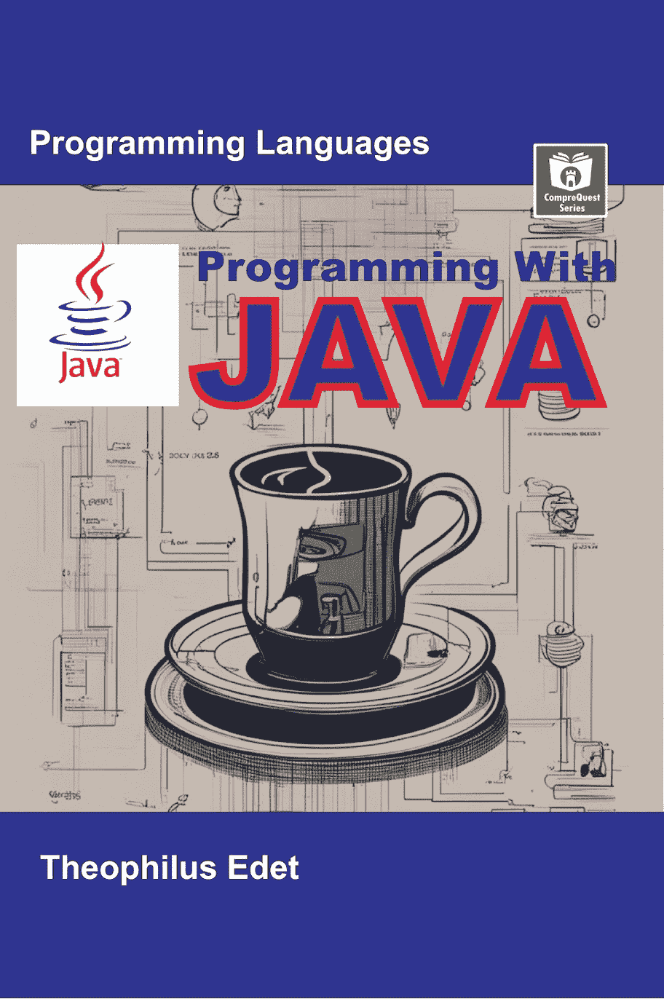

# Java 编程（精通编程语言系列）



[](image_rsrc658.jpg)

| Theophilus Edet | |
| :--- | :--- |
|  | theoedet@yahoo.com |
|  | facebook.com/theoedet |
|  | twitter.com/TheophilusEdet |
|  | Instagram.com/edettheophilus |

# 模块 28：通过 JDBC 进行数据库连接

## JDBC（Java 数据库连接）简介

## 使用 `DriverManager` 连接数据库

## 执行 SQL 查询与语句

## 处理 `ResultSets` 并执行 CRUD 操作

# 模块 29：深入理解 Java 集合框架

## 深入研究集合框架

## 使用 `Queue` 接口及其实现

## 使用 `Map` 接口与高级 Map 操作

## Java Streams API 与函数式编程

# 模块 30：构建 Java 应用与最终项目

## Java 项目结构：包与模块

## 实现 Java 应用

## 测试与调试

## 欢迎来到“Java 编程”

“Java 编程”是一份旨在赋予新手和资深开发者能力的全面指南。在序言中，我们将探索使 Java 成为强大工具的范式和模型。

## Java：一种通用且无处不在的语言

Java 自 20 世纪 90 年代由 Sun Microsystems 创建以来，一直经受着时间的考验。其“一次编写，随处运行”（WORA）的哲学实现了跨平台开发。

## 面向对象范式：Java 力量的基础

Java 优雅的核心在于其对面向对象设计的承诺。通过封装、继承和多态，Java 提供了一个稳健的结构。

## 过程化与函数式编程：扩展工具箱

虽然 Java 根植于面向对象原则，但它并不局限于单一范式。它无缝整合了过程化和函数式编程的特性，为开发者提供了选择最佳方法的灵活性。

## Java 支持的关键编程模型

“Java 编程”随着对 Java 支持的核心模型的探索而展开：

1. **应用程序编程**：Java 在构建独立应用程序方面表现出色，从桌面实用程序到复杂的企业级解决方案。
2. **Web 开发**：Java 在 Web 开发中留下了深刻的印记，拥有如 `Spring` 和 `JavaServer Faces`（JSF）等框架。
3. **移动开发**：通过 `Android` 等平台，Java 已成为移动开发的代名词。
4. **企业级解决方案**：Java 在开发企业级解决方案方面的实力通过 `Java EE`（企业版）等技术得以展示。
5. **云计算**：Java 与云平台及框架（如 `Spring Cloud`）的兼容性使其成为了一个强大的竞争者。

## Java 在现代世界中的应用

后续章节将深入探讨 Java 在不同行业中的现实应用。从金融服务、医疗保健到电子商务和游戏开发，Java 的适应性得到了充分的彰显。

《Java 编程》采用教学法编写，确保读者——无论是初学者还是其他编程语言的资深开发者——都能无缝地掌握 Java 的精妙之处。本书采取了结构化的进阶路径，从基础概念开始，逐步过渡到高级主题，并以一个最终项目的开发作为终点。

当你开启这段教育旅程时，请拥抱掌握 Java 带来的挑战与发现。无论你的目标是构建企业级应用程序、探索移动开发，还是为充满活力的开源项目世界贡献力量，《Java 编程》都将成为你的指南，引导你穿过 Java 编程的多样图景。

让探索开始吧！

西奥菲勒·埃迪特（Theophilus Edet）

# Java 编程

在瞬息变化的计算机编程版图中，Java 是一门坚实的语言，以其多功能性、可移植性以及在众多领域的广泛应用而闻名。《Java 编程》对于初学者和经验丰富的程序员来说都是不可或缺的指南，对 Java 的复杂性和实际应用提供了全面的探索。

## Java 在编程中的无处不在

Java 在编程世界中的重要不言而喻。Java 诞生于创建一个平台无关语言的愿景，已在各种软件生态系统中无处不在。其“一次编写，随处运行”的哲学赋予了开发者创建能够在不同平台上无缝运行应用程序的能力，从嵌入式系统到企业服务器。本书介绍了 Java 的演变，深入探讨其历史根源，并追溯使其成为现代软件开发基石的历程。

## 跨行业应用

《Java 编程》揭示了 Java 在各行业中的众多应用，展示了它的适应性和健壮性。从 Android 移动应用开发到基于 Web 的解决方案和企业级系统，Java 的多功能使其成为开发者应对多样化挑战的首选。本书提供了真实的示例和案例研究，说明了 Java 如何作为构建驱动数字领域解决方案的骨干。

## 编程模型与范式

Java 涵盖了多种编程模型和范式，使其成为具有不同偏好和项目要求的开发者的首选。本书深入探讨了面向对象编程（OOP），强调了 Java 对封装、继承和多态的强大支持。它探索了 Java 的并发编程能力，展示了开发者如何利用线程和并发工具来构建响应且高效的应用程序。

## Java 对现代开发实践的支持

随着编程版图不断演变，《Java 编程》探讨了 Java 对现代开发实践的采用。本书探索了 Java 与函数式编程的兼容性，向读者介绍了 Lambda 表达式和 `Stream API`。它通过引入 `Java Platform Module System`（`JPMS`）强调了 Java 在支持模块化编程方面的作用，使开发者能够创建可扩展和可维护的代码库。

总之，《Java 编程》对于那些开启 Java 编程之旅或寻求加深对这一强大语言理解的人来说，是一个无价的伴侣。通过对应用、编程模型和范式的探索，本书赋予了读者利用 Java 能力来构建健壮且创新的软件解决方案的知识。无论是初学者还是资深开发者，本书都是掌握 Java 并在不断演变的编程世界中释放其潜力的大门。

# 第 1 模块：Java 编程简介

在《Java 编程》的宏大背景下，名为“Java 编程简介”的模块是基础性的基石，为读者提供了进入 Java 世界的全面引导。该模块精心设计，以满足不同专业水平学习者的需求，提供了一种理解 Java 语法、概念和基本原则的结构化方法。

## 导览 Java 领域

该模块首先引导读者探索 Java 编程语言的格局。它阐明了 Java 的历史背景，追溯了它的起源和演变。通过理解语言的诞生，读者可以洞察塑造 Java 成为今天这种多功能且广泛采用的编程语言的设计原则。这种历史视角为深入探讨 Java 编程的技术方面铺平了道路。

### 掌握 Java 语法和结构

“Java 编程简介”重点解密 Java 的语法和结构。该模块系统地介绍了关键编程结构，如 `variables`（变量）、`data types`（数据类型）、`control flow statements`（控制语句）和 `functions`（函数）。通过清晰的解释和示例，读者具备了编写简单而有效的 Java 程序所需的要素。该模块为理解语言的核心元素奠定了基础，为学习者更高级的概念做准备。

### 面向对象编程原则

Java 身份的核心在于对面向对象编程（OOP）原则的严格遵守。该模块深入 OOP 的核心，揭示了 `classes`（类）、`objects`（对象）、`inheritance`（继承）、封装和多态等概念。通过实践练习和实际示例，读者不仅理解了 OOP 的理论基础，还培养了在构建高效且可维护的 Java 代码中应用这些原则的能力。

### Java 练习动手学习

“Java 编程简介”采用了动手学习的方法，认识了实际应用在强化理论知识方面的重要性。该模块穿插了编码练习和挑战，鼓励读者积极参与学习材料。这些练习提供了实施新知识、巩固理解和培养解决问题能力的机会——这是成为精通 Java 编程的关键方面。

### 为高级概念建立基础

在为 Java 基础奠基之外，该模块还渴望培养学习者的信心，为书中后续章节中涵盖的更高级主题铺平道路。到该模块结束时，读者已具备了所需的技能来开启探索 Java 多样化应用、编程模型和范式的旅程，正如《Java 编程》的宏观背景中所述的那样。

## 什么是 Java 及其重要性

《Java 编程》中“Java 编程简介”模块的“什么是 Java 及其重要性？”部分引导读者了解 Java 在编程领域的基本性质和关键作用。Java 被描述为一种高级、面向对象的编程语言，是开发者构建各种应用程序的健壮平台。其核心特性是“一次编写，随处运行”的能力，这意味着 Java 代码一旦编译，就可以在任何带有 `JVM`（Java 虚拟机）的设备上无缝执行。这种内在特性显著推动了 Java 的广泛采用，巩固了它在各种计算环境中的重要性。

### 解密 Java 语法

本文的核心是深入理解 Java 语法，揭示了语言的基本构建模块。例如，Java 中的变量声明反映了熟悉的语法：

```java
// Java Syntax

int myNumber = 42;

String greeting = "Hello, Java!";
```

通过深入研究这些代码段，读者可以对 Java 语法有直观的理解，为后续的编程活动奠定坚实的基础。这种方法旨在为学习者揭示 Java 的复杂性，特别是对于那些从其他语言过渡的学者，使概念的吸收变得更容易。

## 平台无关性：Java 的独特范式

Java 的重要性在于其实现平台无关性的独特方法。本节阐述了 Java 源代码如何编译成字节码，字节码是一种与平台无关的中间表示。这些字节码由 Java 虚拟机（`JVM`）执行，使得 Java 应用程序能够轻松超越平台限制。平台无关性的范式使 Java 成为一种无需修改即可在多种设备上运行的语言。这种适应性巩固了 Java 在移动应用程序、Web 服务以及扩展的企业级系统开发中的地位。

## 多功能与生态系统优势

Java 的意义超越了语法和平台无关性，涵盖了其多功能的生态系统。读者将接触 Java 的各种应用，从 Android 应用开发到服务器端编程。本节介绍了 Java 强大的库、框架和充满活力的社区，说明了这些元素如何共同促进该语言在不断演变的技术格局中的适应性。Java 的多功能性通过其韧性和持久的影响得到了凸显，使其成为全球程序员在探索软件开发多领域时的基石。

## 安装和设置 Java 开发环境

在“Java 编程”（Programming With Java）的“Java 编程简介”模块中，专门用于“安装和设置 Java 开发环境”的章节是读者积极参与 Java 编程的门户。这一关键阶段涉及准备开发环境，确保从理论到实际应用的无缝过渡。

### 下载并安装 Java 开发工具包（JDK）

开启 Java 编程之旅的第一步是下载并安装 Java 开发工具包（`JDK`）。本书引导读者完成这一过程，强调了根据特定开发需求选择合适的 `JDK` 版本的重要性。一个典型的 Java 安装涉及设置系统变量，例如 `JAVA_HOME` 和 `PATH`，以便系统能够定位 Java 二进制文件。

```bash
// 在 bash 环境中设置 JAVA_HOME 和 PATH (Linux/macOS)

export JAVA_HOME=/path/to/your/jdk

export PATH=$JAVA_HOME/bin:$PATH
```

这些细节让读者对配置步骤有了实际的理解，确保他们能够无缝地设置自己的开发环境。

### 配置集成开发环境（IDE）

本节继续探索使用集成开发环境（`IDEs`）进行 Java 开发的优势。流行的 `IDEs` 如 `Eclipse` 或 `IntelliJ IDEA` 通过代码补全、调试工具和项目管理等功能简化了开发过程。本书提供了安装和配置这些 `IDEs` 的逐步说明，使读者能够选择符合其偏好和工作流的环境。

```text
// 使用 JDK 配置 Eclipse IDE

1. 打开 Eclipse
2. 导航到 Window > Preferences > Java > Installed JREs
3. 添加 JDK 安装路径
4. 将添加的 JDK 设置为工作区的默认 JRE
```

通过深入研究 IDE 配置的细节，本书确保读者不仅安装了 Java，还优化了他们的开发环境以提高效率和生产力。

### 验证 Java 安装

为了验证 Java 开发环境的设置成功，本节以验证 Java 安装的指令作为结束。读者将被引导执行一个简单的 Java 程序——也许是无处不在的“Hello, World!”——以确认 `JDK` 和 `IDE` 配置是准确的。

```java
// Java 中的 Hello, World!

public class HelloWorld {
    public static void main(String[] args) {
        System.out.println("Hello, World!");
    }
}
```

通过动手验证，读者对自己的环境建立了信心，为全面的“Java 编程”课程中接下来的实操练习和编程挑战奠定了基础。

### 为 Java 开发配置 Visual Studio Code

除了传统的 `IDEs` 之外，许多开发者选择 Visual Studio Code 是由于其轻量且强大的功能以及广泛的扩展。本节提供了在 `VS Code` 中安装 Java 开发所需扩展的指导。

```text
// 在 Visual Studio Code 中安装 Java Extension Pack

1. 打开 VS Code
2. 导航到 Extensions（或使用快捷键 Ctrl+Shift+X）
3. 搜索 "Java Extension Pack"
4. 点击 "Install" 安装扩展包，它包含了 Java 开发必需的扩展。
```

该扩展包包含了语言支持、调试工具和 `Maven` 集成等功能，丰富了 `VS Code` 的 Java 编程环境。

### 配置构建工具：Maven 或 Gradle

为了获得更全面的 Java 开发环境，本书讨论了 `Maven` 或 `Gradle` 等构建工具的配置。这些工具简化了项目管理、依赖解析和构建过程。以下是在 `VS Code` 中配置 `Maven` 的示例：

```text
// 在 Visual Studio Code 中配置 Maven

1. 安装 "Maven for Java" 扩展。
2. 打开带有 `pom.xml` 文件的 Java 项目。
3. VS Code 将提示导入 Maven 项目。点击 "Import Changes"。
```

通过结合这些细节，读者可以获得在 `VS Code` 中配置多样化工具的见解，并根据他们偏好的工作流定制自己的环境。

### 在 VS Code 中运行 Java 程序

本节最后演示了如何直接从 `VS Code` 运行 Java 程序。它引导读者配置运行和调试配置，确保在 `VS Code` 环境中执行 Java 代码时获得无缝体验。

```text
// 在 Visual Studio Code 中运行 Java 程序

1. 打开 Java 文件。
2. 根据所需的配置，右键点击并选择 "Run" 或 "Debug"。
```

通过在讨论中引入 `VS Code`，本书承认了 Java 开发社区内的多样化偏好，确保读者可以选择最符合其需求和工作流的环境。这种全面的方法为他们后续的 Java 编程体验做好了准备，无论使用传统的 `IDEs` 还是轻量级编辑器如 `VS Code`。

## 编写你的第一个 Java 程序

在“Java 编程”的“Java 编程简介”模块中，“编写你的第一个 Java 程序”章节是从理论转向实际应用的关键时刻。该章节旨在赋予读者创建和执行简单 Java 程序所需的基础技能。它作为进入 Java 代码语法和结构的实操开端，为更复杂的编程任务奠定了坚实基础。

### 创建一个简单的 Java 类

旅程从引导读者创建一个简单的 Java 类开始。在 Java 中，类是对象的蓝图，封装了数据和行为。本书介绍了 Java 类的组成部分，从类声明开始。

```java
// Java 类声明

public class MyFirstProgram {
// 类体写在此处
}
```

### 添加用于执行的 main 方法

任何 Java 程序的核心都位于 `main` 方法之中。该方法是程序的入口点，指定了程序运行时要执行的代码。本书阐明了 `main` 方法的结构及其重要性。

### Main 方法声明

```java
public class MyFirstProgram {
    public static void main(String[] args) {
        // Code to be executed goes here
    }
}
```

这段代码片段为读者提供了 `main` 方法的清晰界定，强调了其签名对于程序执行的必要性。

### 向控制台打印“Hello, Java!”

本节以执行一个经典的“Hello, World!”程序作为结束。通过使用 `System.out.println` 语句，读者学会了如何向控制台输出文本，这是 Java 编程的基础方面。

```java
// Hello, World! Program
public class MyFirstProgram {
    public static void main(String[] args) {
        System.out.println("Hello, Java!");
    }
}
```

通过这个说明性示例，读者见证了 Java 语法的实际应用，目睹了他们第一个 Java 程序的实体输出。

### 编译并运行 Java 程序

在完成这段旅程后，本节引导读者熟悉了编译和执行过程。它介绍了用于 Java 源代码的 `javac` 编译器以及用于运行已编译程序的 `java` 命令。


# 编译 Java 程序

```bash
javac MyFirstProgram.java
```

# 运行 Java 程序

```bash
java MyFirstProgram
```

通过包含这些步骤，本书确保读者不仅能编写 Java 代码，还能熟练掌握编译和执行程序等基本任务。因此，本节在“Java 编程（Programming With Java）”的大框架内，作为 Java 编程概念实际应用的关键基石。

# 理解 Java 虚拟机 (JVM)

在“Java 编程”的“Java 编程简介”模块中，专门用于“理解 Java 虚拟机 (JVM)”的章节揭示了 Java 成为平台无关语言的核心机制。本节深入了`JVM`的内部工作原理，阐明它如何解释和执行 Java 字节码，在 Java 源代码与底层硬件之间架起了至关重要的桥梁。

## JVM 架构概述

旅程从探索`JVM`架构开始，阐明了它的关键组件及其角色。读者将学习到负责将 Java 类加载到内存的类加载器（`classloader`）、确保代码完整性的字节码验证器（`bytecode verifier`）、优化性能的即时编译器（`JIT` compiler）以及将字节码翻译为机器码的执行引擎（`execution engine`）。这种多层架构支撑了 Java 无需修改即可运行在不同平台上的能力。

```java
// Sample Java Class
public class SampleClass {
    public void printMessage() {
        System.out.println("This is a sample message.");
    }
}
```

通过将 Java 类拆解为其字节码表示，读者对促进平台无关性的中间阶段有了洞察。

## 类加载与执行流

本节引导了类加载过程，揭秘了`JVM`在程序执行期间如何定位、加载和链接类。本书提供了类初始化序列的全面概述，以及`ClassLoader`在动态将类加载到 Java 运行时环境的角色。

```java
// Class Loading in Java
public class MyClass {
    public static void main(String[] args) {
        SampleClass sample = new SampleClass();
        sample.printMessage();
    }
}
```

通过剖析执行流，读者对`JVM`如何在运行时管理类及其依赖关系有了深刻的理解。

## 字节码验证与 JIT 编译

为了确保 Java 程序的安全性和完整性，本节深入探讨了字节码验证，这是类加载过程中的一个重要步骤。读者将发现`JVM`如何严谨地检查字节码是否符合 Java 语言规范，以防止运行时错误和潜在的安全漏洞。讨论还扩展到了`JIT`编译过程，即字节码被翻译成原生机器码以增强性能。

```java
// JIT Compilation in Action
public class PerformanceExample {
    public static void main(String[] args) {
        // Code triggering JIT compilation
        for (int i = 0; i < 1000; i++) {
            System.out.println("Executing code for JIT compilation.");
        }
    }
}
```

通过阐明代码执行模式与`JIT`编译之间的联系，读者对优化 Java 程序以提高运行时效率有了见解。

## 内存管理与垃圾回收

在本节的最后，读者深入学习了`JVM`内部的内存管理和垃圾回收。本书解释了`JVM`如何处理内存分配和自动垃圾回收，确保资源的高效利用并防止内存泄漏。

```java
// Memory Management in Java
public class MemoryExample {
    public static void main(String[] args) {
        // Code demonstrating memory allocation and usage
        int[] numbers = new int[1000];
        // ...
    }
}
```

通过这些示例，本节揭开了`JVM`在内存管理方面的复杂性，为读者提供了对 Java 运行时环境的全面理解。这些基础知识使他们能够随着“Java 编程”课程的进展，编写出高效且可靠的 Java 程序。

# 模块 2：Java 中的变量与数据类型

在瞬变化的编程世界中，理解变量和数据类型的基础知识就像在构思复杂的散文之前先掌握字母表。“Java 编程”书中的“Java 中的变量与数据类型”模块是一项基础性的探索，引导读者进入 Java 编程的核心。该模块是初学者和资深程序员的基石，通过揭示 Java 语言中变量和数据类型的细微差别，为构建稳健高效的代码奠定基础。

## Java 中变量的意义

该模块从解释变量的概念开始，变量是程序中存储和处理数据的关键占位符。读者将深入变量的命名规则，理解作用域，并体会 Java 变量声明的动态性质。通过实际示例和练习，模块确保学习者掌握变量在塑造 Java 程序流程和逻辑中的核心作用。

### 理解数据类型：Java 程序的构建块

精通编程的一个关键方面是理解语言中提供的各种数据类型。本模块详细探讨了 Java 丰富的各种数据类型，从整数、浮点数等原始类型到数组和对象等更复杂的类型。模块说明了每种数据类型的特征和适用场景，指导读者在为特定场景选择合适类型时做出明智决策。

### 声明与初始化：导航 Java 语法

通过 Java 语法的复杂之处，模块处理了变量声明和初始化过程。读者将学习精确声明变量的语法，确保正确指定类型和名称。模块扩展到了初始化变量的关键任务，阐明了这一过程如何为变量设置初始值，这是确保程序可预测行为的基础步骤。

Java 的动态特性体现在它对可以在运行时适应不同数据类型的变量的支持上。该模块探索了动态类型的概念，展示了变量如何被重新赋值为不同的类型，从而增强了编程的灵活性。这种动态特性允许 Java 开发者创建出多功能且适应性强的代码结构，对不断的需求做出动态响应。

### 为高级概念建立基础

“Java 中的变量和数据类型”模块是掌握更高级 Java 概念的基石。通过对变量和数据类型的深刻理解，读者已完全准备好在后续模块中探索控制流、方法和面向对象编程等主题。通过提供全面的基础，该模块确保了学习者能够充分利用 Java 的强大功能，构建高效、可扩展且可维护的软件解决方案。

## 变量的声明与初始化

在《Java 编程》一书“Java 中的变量和数据类型”综合模块中，“变量的声明与初始化”章节是理解 Java 变量动态特性的关键基础。该部分深入了变量声明的细微差别，探索了 Java 开发者如何定义变量并为程序中的数据操作奠定基础。

### 理解 Java 中的变量声明

该章节从对变量声明的深入探讨开始，这是 Java 编程中的基本概念。在 Java 中，声明变量涉及指定其类型和名称。例如：

```java
// Variable Declaration in Java
int myNumber;
double pi;
String greeting;
```

在这里，读者接触了整数（`int`）、浮点数（`double`）和字符串（`String`）变量。通过对语法的拆解，该章节确保学习者理解变量声明的核心组成部分，并熟悉常见的数据类型。

### 变量初始化：设置初始值

在声明之后，章节进入了变量初始化的领域。初始化涉及为变量分配一个初始值，使其从一开始就能持有有意义的数据。例如：

```java
// Variable Initialization in Java
int myNumber = 42;
double pi = 3.14;
String greeting = "Hello, Java!";
```

通过这些示例，读者见证了声明与初始化之间的协同作用，认识了这对搭档如何形成 Java 程序中变量使用的基石。

### 动态类型：运行时适应变量

Java 的一个独特特征是它对动态类型的支持，允许变量在运行时适应不同的数据类型。该章节探索了同一个变量采取不同形式的情景，增强了程序内部的适应性。

```java
// Dynamic Typing in Java
var dynamicVar = 42; // an integer
dynamicVar = 3.14;  // now a double
dynamicVar = "Java"; // now a String
```

在这里，`var`关键字的使用体现了动态类型，允许变量在整数、双精度和字符串类型之间无缝转换。

### 变量的作用域和寿命

该章节深入探讨了作用域和寿命的概念，阐明了这些因素如何影响变量在程序中的可访问存在。理解变量的作用域和寿命对于编写高效且无错误的 Java 代码至关重要。

```java
// Scope and Lifetime in Java
public class VariableExample {
    public static void main(String[] args) {
        int localVar = 10; // 局部变量
        // ...
    }
}
```

通过探索这样的代码片段，读者可以洞察变量如何被限制在特定的上下文中以及它们何时消失，从而增强他们有效管理和优化 Java 程序的能力。

### 结论与高级概念的构建块

“变量的声明与初始化”章节是更广泛模块中的一个关键构建块。通过理解变量声明、初始化、动态类型以及作用域和寿命的细微差别，读者已准备好进入更高级的 Java 概念。这些基础知识使学习者在学习《Java 编程》课程的过程中，具备了编写复杂且健壮的 Java 程序所需的技能。

## Java 的原生数据类型：int, float, boolean 等.

高效 Java 编程的基石在于理解并利用其多样化的原生数据类型。在《Java 编程》中“Java 中的变量和数据类型”模块的“Java 的原生数据类型”章节深入探讨了这些基础构建块的复杂性。通过对`int`、`float`、`boolean`以及其他基本数据类型的详细探索，该章节为学习者提供了基础知识，以便在 Java 程序中处理各种数据。

### 整数：整数数字的基础

该章节从仔细检查`int`数据类型开始，它代表不带小数点的整数。在 Java 中，`int`数据类型用于存储特定范围内的整数值。

```java
// int Data Type in Java
int myInteger = 42;
```

通过探索`int`的语法和应用，读者掌握了这种基础数据类型在 Java 程序中表示整数的重要意义。

### 浮点数：float 和 double 的精度

在整数之外，章节进入了使用`float`和`double`数据类型的浮点数领域。这些类型容纳带有小数点的值，提供不同水平的精度。

```java
// float and double Data Types in Java
float myFloat = 3.14f;
double myDouble = 3.1415926535;
```

通过这些示例，读者能够根据 Java 程序的精度需求在`float`和`double`之间进行选择。

### 布尔：真或假值

讨论扩展到`boolean`数据类型，这是一种表示真或假的二值类型。布尔值是 Java 程序中决策的依据，通常决定条件语句内的控制流。

```java
// boolean Data Type in Java
boolean isJavaFun = true;
```

通过探索布尔数据类型，读者理解了它们在构建条件表达式和逻辑操作中的关键作用。

### 字符：表示单个字符

该章节进一步探索了`char`数据类型，用于存储单个字符。这种数据类型对于处理 Java 程序中的字母、数字和符号是不可或缺的。

```java
// char Data Type in Java
char myChar = 'A';
```

通过此类示例，学习者对`char`数据类型及其在处理单个字符的应用有了全面的理解。

### 字节和短整：紧凑的整数表示

该模块探讨了不常用但同样重要的`byte`和`short`数据类型，为特定范围内的整数提供了紧凑的表示。

```java
// byte and short Data Types in Java
byte myByte = 127;
short myShort = 32000;
```

通过探索这些数据类型，读者意识到它们在内存节省和效率至关重要的场景中的用途。

### 结论：数据处理的基础知识

“Java 的原生数据类型”章节最后强调了这些数据类型在 Java 编程中的基础作用。通过理解`int`、`float`、`boolean`、`char`、`byte`和`short`的复杂性，读者已准备好在处理不同类型的数据时选择合适的数据类型做出明智的决策。这些基础知识为《Java 编程》领域内更高级的探索铺平了道路。

Java 中数据处理的复杂性超出了基本数据类型的范畴，这使得理解类型转换和转换变得非常有必要。《Java 编程》课程中“Java 中的变量与数据类型”模块下的“Java 中的类型转换与转换”章节阐述了开发者在不同类型之间操作和转换数据的机制。该章节对于让学习者能够在各种场景下有效管理数据至关重要，确保了 Java 程序的灵活性和精确。

## 理解类型转换

这段旅程从深入研究类型转换开始，这是数据从一种类型转换为另一种类型的关键过程。Java 支持两种类型的类型转换：隐式（自动）转换和显式（手动）转换。

```java
// Implicit Casting in Java

int intValue = 42;

double doubleValue = intValue; // Automatic casting from int to double
```

在这里，整数值被隐式转换为`double`，而不需要显式干预。该节详细阐述了隐式转换无缝发生的场景，以及它如何影响数据的精度和范围。

## 显式转换：精度与谨慎

该节转到显式转换，开发者手动将数据从一种类型转换为另一种类型。当将数据转换为范围较小或精度较低的类型时，显式转换至关重要。

```java
// Explicit Casting in Java

double doubleValue = 3.14;

int intValue = (int) doubleValue; // Manual casting from double to int
```

通过这些示例，读者理解了在必须仔细管理精度以防止数据丢失的场景中，显式转换的重要性。

## 数值提升：类型的层次结构

该节深入探讨了数值提升的概念，揭示了 Java 数据类型的层次结构。在执行涉及不同数值类型的操作时，Java 会自动将较小的类型提升为较大的类型以保持精度。

```java
// Numeric Promotion in Java

int intValue = 10;

double doubleValue = 3.5;

double result = intValue * doubleValue; // Promotion of int to double for precision
```

通过探索数值提升，读者可以洞察 Java 如何在涉及不同数值类型的算术操作中确保一致且准确的结果。

## 数据类型之间的转换

讨论进一步扩展，该节探索了数值类型之外的数据类型转换。它涵盖了数据在基本类型和对象之间进行转换的场景，强调了宽转换和窄转换的原则。

```java
// Conversion Between Data Types in Java

int intValue = 42;

String stringValue = Integer.toString(intValue); // Converting int to String
```

通过这些示例，读者熟练掌握了不同类型之间数据转换的方法，能够在 Java 程序中无缝集成多样化数据。

## 结论：精度、灵活性与最佳实践

“Java 中的类型转换与转换”章节最后强调了在处理类型转换和转换时，精度、灵活性以及遵循最佳实践的重要性。这些基础知识为学习者提供了在 Java 中有效操作数据的工具，培养了他们在编程活动中的适应性和精确性。

# Java 中的变量作用域与生命周期

在复杂的 Java 领域不仅需要理解数据类型和变量声明，还需要掌握变量作用域和生命周期的概念。《Java 编程》课程中“Java 中的变量与数据类型”模块下的“Java 中的变量作用域与生命周期”深入探讨了这些关键方面，解释了变量在程序中如何被访问、存在于何以及何时消失。

## 理解变量作用域

旅程从解析变量作用域的概念开始，它定义了变量可以被访问的区域或上下文。在 Java 中，变量可以具有局部作用域、方法作用域和类作用域。

```java
// Local Scope in Java
public class ScopeExample {
    public void myMethod() {
        int localVar = 42; // local scope
    }
}
```

通过探索这些示例，读者可以了解局部作用域是如何限制在特定方法中的。

## 类作用域：成员变量与字段

该节转到类作用域，变量变成了类的成员变量或字段。这些变量在整个类中存在，并可以被所有方法访问。


```java
// Class Scope in Java
public class ScopeExample {
    private int classVar; // class scope

    public void myMethod() {
        // Accessing classVar within the method
        int result = classVar * 10;
        // ...
    }
}
```

在这里，`classVar` 展示了类作用域，允许在跨方法中使用。

### 全局作用域：常量及扩展

虽然 Java 没有真正的全局变量，但使用 `final` 关键字创建的常量通常起类似的作用。该节探索了常量的概念及其对作用域的影响。

```java
// Constants in Java
public class ConstantsExample {
    public static final double PI = 3.14; // global scope
    // ...
}
```

通过这些示例，读者理解了常量如何实现一种全局作用域，为整个程序提供一致的值。

### 变量生命周期：从诞生到垃圾回收

该节转到生命周期的概念，阐明了变量何时产生以及何时从内存中移除。局部变量的生命周期有限，仅存在于定义的方法或块的作用域内。

```java
// Lifetime in Java
public class LifetimeExample {
    public void myMethod() {
        int localVar = 42; // limited lifetime
        // ...
    }
}
```

通过探索这些示例，读者理解了生命周期如何与其作用域紧密相关，影响 Java 程序的内存管理。

## 结论：平衡访问性与资源管理

“Java 中的变量作用域与生命周期”章节最后强调了变量访问性与资源管理之间的微妙平衡。通过掌握变量作用域和生命周期的细差别，读者获得了优化 Java 程序以提高效率和可靠性的专业知识，确保变量在需要的地方被使用，并在任务完成后被释放。这些基础知识为在《Java 编程》的大背景下构建健壮且可扩展的 Java 应用铺平了道路。

我们的探索将从揭示 Java 输入处理的基础开始。我们将深入程序接收数据的方法，无论数据来自用户还是外部源。我们将揭开 `Scanner` 类等工具的神秘面纱，展示其在捕获用户输入方面的多功能性。这些讨论将为构建能够与用户积极交互并对其输入动态响应的应用程序奠定基础。

# Java 中有效的输出呈现

无缝衔接，本模块探索了 Java 中输出的艺术，强调了有效呈现信息的策略。将重点介绍如 `System.out.println` 等技术，使学习者能够向控制台或其他输出流传达结果、消息或相关信息。通过实际示例，读者将掌握这些输出方法的语法和应用，理解在软件开发背景下清晰、简洁通信的力量。

# 文件输入输出的精通

扩展范围，我们的旅程将延伸到文件输入输出领域——这是处理持久化数据存储应用程序的关键技能。我们将引入 `FileReader`、`BufferedReader`、`FileWriter` 和 `PrintWriter` 等类，赋予读者从文件读取和写入文件的能力。这种新获得的熟练程度为处理外部数据源和增强 Java 应用程序的健壮性开启了大门。

# 结论：赋能交互与动态 Java 程序

随着“Java 基础输入输出”模块的结束，学习者将拥有一套变革性的技能。有效处理输入、动态呈现输出以及管理外部数据源的能力，使开发者能够创建交互式、动态且用户友好的 Java 应用程序。这些基础知识不仅为“Java 编程”中的进一步探索提供了跳板，还推动学习者迈向软件开发领域的精通。

## 使用 System.out.println 和 System.out.print 进行输出

关于使用 `System.out.println` 和 `System.out.print` 进行输出的章节是《Java 编程》书中“Java 基础输入输出”模块的基础。这一部分作为引导学习者进入向控制台显示信息的世界的开端，这是任何 Java 程序员的一项关键技能。两个主要方法 `System.out.println` 和 `System.out.print` 对于将输出传递到控制台窗口具有重要作用。

`System.out.println` 方法用于向控制台打印文本或变量，并跟一个换行符。这确保了后续输出出现在新的一行，增强了可读性。下面是一个说明使用 `System.out.println` 的简单示例：

```java
public class PrintExample {
    public static void main(String[] args) {
        System.out.println("Hello, World!");
        int number = 42;
        System.out.println("The value of the variable is: " + number);
    }
}
```

在这个示例中，文本 "Hello, World!" 被打印到控制台，随后是变量 `number` 的值。使用 `System.out.println` 确保每条语句都显示在新的一行。

另一方面，`System.out.print` 方法实现了类似的结果，但不会添加换行符。这意味着连续的 `System.out.print` 语句将出现在同一行上。以下代码片段说明了使用 `System.out.print` 的方法：

```java
public class PrintExample {
    public static void main(String[] args) {
        System.out.print("Hello, ");
        System.out.print("World!");
        int number = 42;
        System.out.print(" The value of the variable is: " + number);
    }
}
```

在这个示例中，由于使用了 `System.out.print`，输出结果 "Hello, World! The value of the variable is: 42" 都在同一行上。

理解何时使用 `System.out.println` 换行以及何时使用 `System.out.print` 进行连续输出，对于在 Java 中编写格式良好且可读的控制台输出至关重要。这一节作为一个基础构建模块，为学习者在深入研究“Java 基础输入输出”模块时进到更复杂的输入输出操作铺了道路。

## 使用 Scanner 类读取用户输入

关于使用 `Scanner` 类读取用户输入的章节是《Java 编程》书中“Java 基础输入输出”模块的关键组成部分。这一部分向学习者介绍了从用户处获取输入的本质技能，实现了交互式和动态的 Java 程序。`Scanner` 类是 `java.util` 包的一部分，方便了从控制台读取各种类型的输入，为用户交互提供了多多的工具。

```java
import java.util.Scanner;

public class UserInputExample {
    public static void main(String[] args) {
        Scanner scanner = new Scanner(System.in);
        System.out.print("Enter your name: ");
        String name = scanner.nextLine();
        System.out.println("Hello, " + name + "!");
        System.out.print("Enter your age: ");
        int age = scanner.nextInt();
        System.out.println("You are " + age + " years old.");
        scanner.close();
    }
}
```

在这个示例中，创建了一个 `Scanner` 对象并用 `System.in` 初始化以从控制台读取输入。程序提示用户输入姓名和年龄，利用 `scanner.nextLine()` 捕获整行文本作为姓名，利用 `scanner.nextInt()` 获取整数年龄。获取的输入随后用于生成个性化的输出消息。

`Scanner` 类提供了多种读取不同数据类型的方法，包括用于字符串的 `nextLine()`、用于整数的 `nextInt()`、用于双精度数的 `nextDouble()` 等。它允许开发者交互式地收集用户输入，增强了 Java 应用程序的适应性和用户友好性。

理解使用 `Scanner` 处理用户输入对于创建对用户做出动态响应的应用程序是重要的。然而，需要注意，不当的使用（例如未关闭 `Scanner`）可能会导致资源泄漏。因此，如示例所示，良好的做法是用 `close()` 方法关闭 `Scanner`。

这一节赋予了学习者使 Java 程序交互的技能，扩展了应用程序的范围。当学习者通过“Java 基础输入输出”模块时，他们为创建多功能且以用户为中心的 Java 程序建立了坚实的基础。

## 使用 printf 格式化输出

关于使用 `printf` 格式化输出的章节是《Java 编程》书中“Java 基础输入输出”模块的一个关键部分。这一部分介绍了强大且灵活的 `printf` 方法，提供了一种控制控制台输出格式的方式。源自 C 语言，`printf` 允许精确格式化，使其成为编写结构良好且视觉吸引输出的必备工具。

```java
public class PrintfExample {
    public static void main(String[] args) {
        String name = "John";
        int age = 25;
        double salary = 50000.75;
        System.out.printf("Name: %s%n", name);
        System.out.printf("Age: %d%n", age);
        System.out.printf("Salary: $%.2f%n", salary);
    }
}
```

在这个示例中，`printf` 方法被用于格式化并打印信息。格式说明符 `%s` 用于字符串，`%d` 用于整数，`%f` 用于浮点数。`%n` 是一个平台无关的换行符，确保在不同的操作系统上都有正确的换行。此外，`%.2f` 中的 `.2` 指定了浮点数应显示两位小数。

理解 `printf` 的语法和功能对于追求创建既可读又视觉一致的输出的开发者来说至关重要。格式字符串中的格式说明符充当占位符的角色，对应的值在字符串之后提供，确保了格式与实际数据之间的无缝连接。

开发者可以利用 `printf` 的各种格式占位符和修饰符，例如控制数值的宽度和精度、指定字段对齐方式以及引入特殊字符。这种灵活性使开发者能够根据特定需求定制输出，并增强显示信息的整体美感。

`printf` 方法不仅提供了更增强的格式化能力，还通过将格式细节与内容分离，有助于提高代码的可维护性。这种分离允许开发者在不改变底层逻辑的情况下修改输出的外观，从而促进代码的整洁和模块化。

随着学习者在“Java 基础输入与输出”模块中的不断进步，掌握 `printf` 方法为在 Java 应用程序中创建专业且组织良好的控制台输出提供了一套宝贵的技能 set。它是向用户有效通信信息的基石，并确保数据的视觉呈现与“Java 编程”这一宏观背景下的代码整体质量保持一致。

## Java 中的调试技术

Java 调试技术章节是《Java 编程》书中“Java 基础输入与输出”模块中不可或缺的组成部分。调试是任何开发者的一项关键技能，本节向学习者各种工具和方法，用以识别、隔离和纠正 Java 代码中的错误。调试是一个迭代和解决问题的过程，掌握这些技术对于编写健壮且无错误的程序至关重要。

```java
public class DebuggingExample {
    public static void main(String[] args) {
        int[] numbers = {1, 2, 3, 4, 5};
        int sum = 0;
        for (int i = 0; i <= numbers.length; i++) {
            sum += numbers[i];
        }
        System.out.println("The sum is: " + sum);
    }
}
```

在这个示例中，一个常见的错误是在循环条件中使用 `<=` 而不是 `<`。此错误导致了 `ArrayIndexOutOfBoundsException`，因为循环试图访问超出数组边界的索引。理解如何识别和纠正此类错误是有效调试的关键方面。

### 利用断点和单步执行代码

调试通常涉及单步执行代码以理解其流程并识别问题出现的地方。现代集成开发环境（IDE）提供了设置断点的工具，允许开发者在特定点暂停程序执行并检查变量值。通过单步执行代码，学习者可以观察变量的状态并准确定位错误的位置。

```java
public class DebuggingExample {
    public static void main(String[] args) {
        int[] numbers = {1, 2, 3, 4, 5};
        int sum = 0;
        for (int i = 0; i < numbers.length; i++) {
            sum += numbers[i]; // 在此处设置断点
        }
        System.out.println("The sum is: " + sum);
    }
}
```

在计算和的行上设置断点，允许开发者观察在循环每次迭代期间变量的变化值。

### 利用打印语句追踪执行

另一种基础的调试技术涉及在代码中策略性地放置打印语句以追踪其执行。这种方法对于识别控制流以及理解变量在程序不同地点的变化特别有用。

```java
public class DebuggingExample {
    public static void main(String[] args) {
        int[] numbers = {1, 2, 3, 4, 5};
        int sum = 0;
        for (int i = 0; i < numbers.length; i++) {
            System.out.println("Adding " + numbers[i] + " to the sum.");
            sum += numbers[i];
        }
        System.out.println("The sum is: " + sum);
    }
}
```

打印语句提供了对程序行为的洞察，帮助学习者识别导致错误的意外值或迭代。

### 用于预测错误解决的异常处理

理解并实现异常处理是一项关键的调试技术。通过优雅地捕和处理异常，开发者可以防止运行时崩溃并创建更健壮的应用程序。这涉及使用 `try-catch` 块等结构来管理潜在的错误。

```java
public class DebuggingExample {
    public static void main(String[] args) {
        int[] numbers = {1, 2, 3, 4, 5};
        int sum = 0;
        try {
            for (int i = 0; i <= numbers.length; i++) {
                sum += numbers[i];
            }
        } catch (ArrayIndexOutOfBoundsException e) {
            System.err.println("Array index out of bounds. Ensure proper loop condition.");
        }
        System.out.println("The sum is: " + sum);
    }
}
```

在这个示例中，`try-catch` 块通过处理 `ArrayIndexOutOfBoundsException` 并提供有意义的错误信息，防止了程序因该异常而崩溃。

理解和应用这些调试技术使学习者具备了识别和解决 Java 程序中问题的必要工具。对于致力于在“Java 编程”的广泛背景下创建可靠高效软件的开发者来说，这项技能是无价的。

# 模块 4：Java 中的运算符和表达式

在 Java 编程的丰富织锦中，“Java 中的运算符和表达式”模块是《Java 编程》一书中一处关键的探索。该模块作为一个基础指南，揭示了 Java 中运算符和表达式的复杂世界。运算符是计算的基石，而表达式定义了语言表达逻辑和计算的能力。通过深入学习该模块，读者将开始理解 Java 如何处理操作、操纵数据以及评估表达式——这些技能对于构建高效且意义丰富的 Java 程序至关重要。

## 理解 Java 运算符

旅程从对 Java 运算符的全面探索开始——这些符号代表计算、比较和其他操作。从加法减算术运算符术运算符到逻辑运算符，模块对每个类别进行了剖析，阐明了它们在 Java 语言中的作用和应用。

### 算术运算符：计算基础


算术运算符是 Java 数值计算的基础。该部分深入探讨`+`、`-`、`*`、`/`和`%`等运算符，揭示它们的功能并展示它们如何操纵数值数据。通过实际示例，学习者获得了关于 Java 中算术运算规则和精度的洞察。

## 关系和逻辑运算符：构建条件

模块无缝过渡到关系和逻辑运算符，探索它们在构建条件表达式中的重要性。通过解析`==`、`!=`、`||`等运算符，读者掌握了构建决定程序流程逻辑的能力。实际场景演示了这些运算符在决策结构中的用法。

## 位运算符和赋值运算符：精度与操纵

探索延伸到位运算符和赋值运算符，揭示了它们在精确操纵和变量赋值中的作用。该部分引导学习者学习`&`、`|`、`^`、`<<`、`>>`和`=`，展示了它们如何在位级别进行操作并促进高效的数据操纵。

随着模块的进展，重点转向了表达式——即产生一个值的运算符和操作数的组合。构建有意义的表达式的复杂性将逐渐揭开，并强调了`Java`如何评估表达式并在这些评估过程中维护数据类型。

## 复合与条件表达式：构建复杂性

本模块的这一部分深入探讨了复合和条件表达式，多个运算符协作产生更复杂的结果。通过探索`a + b * c`和`x > 0 ? "Positive" : "Negative"`等表达式，学习者将熟练掌握构建复杂的表达式，从而在单行代码中封装各种逻辑。

## 结论：通过运算符和表达式赋能代码

随着“Java 中的运算符和表达式”模块的结束，读者们已经对构成 Java 计算骨干的工具有了深刻的理解。精确地运用运算符和构建具有表达能力的表达式的能力，使开发者能够阐述复杂的逻辑，并构建健壮、高效的 Java 程序。这些基础知识不仅为“Java 编程”中更高级的主题奠定了基础，还让学习者能够自信从容地应对复杂的编程挑战。

## 算术运算符、关系运算符和逻辑运算符

在《Java 编程》一书中，关于算术、关系和逻辑运算符的章节是“Java 中的运算符和表达式”模块中的基础探索。这些运算符在塑造 Java 程序的逻辑和功能方面起着至关重要的作用，提供了执行计算、比较和实现逻辑决策的手段。

```java
public class OperatorsExample {

    public static void main(String[] args) {

        // 算术运算符
        int a = 10, b = 5;
        int sum = a + b;
        int difference = a - b;
        int product = a * b;
        int quotient = a / b;
        int remainder = a % b;

        // 关系运算符
        boolean isEqual = a == b;
        boolean isNotEqual = a != b;
        boolean isGreater = a > b;
        boolean isLessOrEqual = a <= b;

        // 逻辑运算符
        boolean logicalAnd = (a > 0) && (b > 0);
        boolean logicalOr = (a > 0) || (b > 0);
        boolean logicalNot = !(a > 0);

        // 显示结果
        System.out.println("Arithmetic Operations:");
        System.out.println("Sum: " + sum);
        System.out.println("Difference: " + difference);
        System.out.println("Product: " + product);
        System.out.println("Quotient: " + quotient);
        System.out.println("Remainder: " + remainder);

        System.out.println("\nRelational Operations:");
        System.out.println("Is Equal: " + isEqual);
        System.out.println("Is Not Equal: " + isNotEqual);
        System.out.println("Is Greater: " + isGreater);
        System.out.println("Is Less or Equal: " + isLessOrEqual);

        System.out.println("\nLogical Operations:");
        System.out.println("Logical AND: " + logicalAnd);
        System.out.println("Logical OR: " + logicalOr);
        System.out.println("Logical NOT: " + logicalNot);
    }
}
```

此示例演示了算术运算符（`+`、`-`、`*`、`/`、`%`）、关系运算符（`==`、`!=`、`>`、`<=`）以及逻辑运算符（`&&`、`||`、`!`）的应用。这些运算符是执行数学计算、基于条件做出决策以及在程序中创建逻辑流的基础。

### 用于数值计算的算术运算符

算术运算符是数值计算的组件。加（`+`）、减（`-`）、乘（`*`）、除（`/`）和模（`%`）运算符允许开发者执行各种数学运算。这些运算符对于计算总和、差、乘积和处理余数等任务至关重要。

### 用于比较的关系运算符

关系运算符促进了值之间的比较。它们包括相等（`==`）、不相等（`!=`）、大于（`>`）和小于等于（`<=`）。这些运算符对于根据变量之间的关系实现决策过程至关重要。

### 用于决策的逻辑运算符

逻辑运算符对于编写条件语句至关重要。逻辑与（`&&`）、逻辑或（`||`）和逻辑非（`!`）运算符允许开发者通过组合和否定条件来创建复杂的决策结构。这种灵活性对于根据多个标准控制程序流至关重要。

理解并熟练应用这些运算符是编写具有表达力且功能完备 Java 代码的基础。无论是执行数值计算、基于条件做出决策还是创建复杂的逻辑结构，这些运算符都赋予开发者编写高效且逻辑严密程序的能力。随着学习者完成“Java 中的运算符和表达式”模块，掌握这些运算符为“Java 编程”更广泛背景下的更复杂编程结构奠定了基础。

## 运算符优先级和结合性

关于运算符优先级和结合性的章节是《Java 编程》一书中“Java 中的运算符和表达式”模块中的关键探索。这些概念定义了运算符在表达式中求值的顺序，确保了复杂语句的正确解释。理解运算符优先级和结合性是编写精确且无义的 Java 代码的基础。

```java
public class OperatorPrecedenceExample {

    public static void main(String[] args) {
        int a = 5, b = 3, c = 2;
        int result = a + b * c;
        int anotherResult = (a + b) * c;
        System.out.println("Result: " + result);
        System.out.println("Another Result: " + anotherResult);
    }
}
```

在此示例中，表达式`a + b * c`和`(a + b) * c`说明了运算符优先级的意义。乘法运算符（`*`）优先级高于加法运算符（`+`）。因此，在第一个表达式中，先计算`b * c`，然后加上`a`。在第二个表达式中，括号强制先计算`a + b`，然后再乘以`c`。

### 运算符优先级：控制求值顺序

运算符优先级建立了表达式中运算的层次结构。它确保某些运算在求值时优先其他运算。例如，乘法和除法的优先级高于加法和减法。开发者需要意识到这种层次结构来编写产生预期的表达式。

```java
public class OperatorPrecedenceExample {

    public static void main(String[] args) {
        int x = 10, y = 5, z = 2;
        int result = x + y * z / 2;
        System.out.println("Result: " + result);
    }
}
```

在此示例中，表达式`x + y * z / 2`根据运算符优先级进行评估。乘法和除法运算在加法之前执行。

### 运算符结合性：解决相等优先级

当表达式中出现具有相同优先级的运算符时，运算符结合性就会介入。它决定了执行的顺序。对于 Java 中的大多数运算符，结合性是从左到右的。这意味着相同优先级的运算将从左到右执行。

```java
public class OperatorAssociativityExample {

    public static void main(String[] args) {
        int p = 8, q = 4, r = 2;
        int result = p / q / r;
        System.out.println("Result: " + result);
    }
}
```

在此示例中，由于从左到右的结合性，表达式`p / q / r`从左到右评估。除法运算按顺序执行。

理解并正确应用运算符的优先级和结合性，对于编写产生预期结果的表达式至关重要。开发者在构建复杂语句时必须考虑这些原则，以确保计算的准确性和 Java 代码的可靠性。随着学习者完成“Java 编程”中的“Java 中的运算符和表达式”模块，掌握这些概念对于在“Java 编程”的广泛背景下编写高效无错误的代码变得不可或缺。

## 在 Java 中使用运算符构造表达式

在 Java 中使用运算符构造表达式章节是《Java 编程》一书中“Java 中的运算符和表达式”模块中的核心主题。运算符是表达式的构建块，允许开发者创建动态且复杂的计算。本节深入探讨了运算符在构建有意义表达式中的实际应用，强调了它们在数学计算、逻辑评估和变量操作中的作用。

```java
public class ExpressionsExample {

    public static void main(String[] args) {
        int a = 5, b = 3, c = 2;
        // 算术表达式
        int sum = a + b;
        int difference = a - b;
        int product = a * b;
        int quotient = a / b;
        int remainder = a % b;
        // 逻辑表达式
        boolean isGreaterThan = a > b;
        boolean isEqualOrLess = a <= b;
        // 复合表达式
        boolean complexCondition = (a > b) && (b < c);
        // 输出结果
        System.out.println("Arithmetic Expressions:");
        System.out.println("Sum: " + sum);
        System.out.println("Difference: " + difference);
        System.out.println("Product: " + product);
        System.out.println("Quotient: " + quotient);
        System.out.println("Remainder: " + remainder);
        System.out.println("\nLogical Expressions:");
        System.out.println("Is Greater Than: " + isGreaterThan);
        System.out.println("Is Equal or Less: " + isEqualOrLess);
        System.out.println("\nCompound Expressions:");
        System.out.println("Complex Condition Result: " + complexCondition);
    }
}
```

此示例展示了在构造表达式时各种运算符的使用。算术表达式利用`+`、`-`、`*`、`/`和`%`等运算符进行数学计算。逻辑表达式使用`>`、`<=`等运算符评估条件并返回布尔结果。复合表达式使用逻辑运算符（在此情况下为`&&`）组合多个条件，以创建更复杂的决策结构。

### 算术表达式：执行计算

算术表达式是数值计算的基础。加、减、乘、除和取模运算符允许开发者执行广泛的数学操作。这些表达式对于计算总和、差值、乘积以及处理余数等任务至关重要。

### 逻辑表达式：评估条件

逻辑表达式涉及关系运算符，用于确定值之间的关系。这些表达式返回布尔结果，指示特定条件为真还是假。逻辑表达式对于在 Java 程序中创建决策结构至关重要。

### 复合表达式：复杂决策

复合表达式使用逻辑运算符将多个条件结合。在示例中，复合表达式`(a > b) && (b < c)`检查`a`是否大于`b`，同时检查`b`是否小于`c`。结果是一个反映两个条件结果的布尔值。

理解如何使用运算符构造有意义的表达式是 Java 开发者的基础。表达式赋予开发者赋予程序动态行为的能力，使其能够智能地对各种条件做出响应。随着学习者完成“Java 中的运算符和表达式”模块，掌握构建有效表达式对于在“Java 编程”的广泛背景下充分发挥 Java 的潜力变得不可或缺。

## 位运算符与操作

位运算符和位操作章节是《Java 编程》一书中“Java 中的运算符和表达式”模块中的一项高级探索。位运算符提供了一种操作整数二进制表示中单个位比特的机制。本节向学习者介绍了位运算的复杂性，并展示了它们在需要精确位位级控制的场景中的应用。

```java
public class BitwiseOperatorsExample {

    public static void main(String[] args) {
        int a = 5; // 二进制: 0101
        int b = 3; // 二进制: 0011
        // 位与
        int resultAnd = a & b; // 二进制: 0001
        // 位或
        int resultOr = a | b;  // 二进制: 0111
        // 位异或
        int resultXor = a ^ b; // 二进制: 0110
        // 位非
        int resultNotA = ~a;   // 二进制: 1111 1111 1111 1111 1111 1111 1111 1010
        // 左移
        int leftShifted = a << 1; // 二进制: 1010
        // 右移
        int rightShifted = a >> 1; // 二进制: 0010
        // 输出结果
        System.out.println("Bitwise AND Result: " + resultAnd);
        System.out.println("Bitwise OR Result: " + resultOr);
        System.out.println("Bitwise XOR Result: " + resultXor);
        System.out.println("Bitwise NOT Result: " + resultNotA);
        System.out.println("Left Shift Result: " + leftShifted);
        System.out.println("Right Shift Result: " + rightShifted);
    }
}
```

在此示例中，各种位运算符被应用于整数`a`和`b`。位与（`&`）、位或（`|`）、位异或（`^`）和位非（`~`）运算符根据其二进制表示操作单个位。此外，左移（`<<`）和右移（`>>`）操作演示了如何向左或向右移动位。

### 位与、或、异或：操作位

位与（`&`）、位或（`|`）和位异或（`^`）操作对两个整数的对应位进行位操作。结果反映了这些操作的结果。

### 位非：反转位

位非运算符（`~`）反转整数的每个位，有效地将 0 变为 1，反之亦然。该操作在需要取反位的场景中非常有用。

### 左移和右移：改变位置

位移操作（`<<`、`>>`）将整数的位向左或向右移动。左移实际上将数字乘以 2，而右移则将其除以 2。这些操作在优化某些计算时特别有用。

## 条件语句：选择路径

该模块的大大部分内容致力于介绍条件语句，程序的逻辑会根据特定条件进行分支。通过`if`、`else if`和`else`等结构，学习者将全面理解 Java 程序如何根据逻辑表达式的求值结果做出决策并执行不同的指令集。


# 逻辑表达式与决策

探索范围延伸到了逻辑表达式，这是条件语句的核心。读者将剖析构建有意义的逻辑条件的复杂性，这些条件构成了 Java 程序决策的基础。实际示例将引导学习者了解各种场景，在这些场景中，精确的决策结构对于实现所需的程序行为至关重要。

# Switch 语句：简化多条件处理

模块引入了`switch`语句，在处理多个条件时提供了级联`if-else`结构的替代方案。通过探索`switch`语句的语法和应用，学习者将理解它如何在涉及多种可能性的场景中简化决策过程。

# 迭代控制：精通循环

模块无缝过渡，深入探讨迭代控制结构（或循环），这使程序能够重复执行一组语句。通过剖析`for`、`while`和`do-while`循环，学习者将掌握构建精确迭代循环的技能，从而实现高效的数据处理和操作。

# 断出与继续：微调循环行为

循环控制的一个重要方面是理解改变默认流的机制。模块探索了`break`和`continue`等语句，展示了它们如何影响循环的行为。实际示例阐明了这些语句增强循环结构效率和控制力的场景。

# 结论：构建动态响应的程序

随着“Java 编程”中“控制流与条件语句”模块的结束，学习者将对管理 Java 程序流和决策的工具产生深刻的理解。构建条件语句、掌握逻辑表达式以及利用循环的能力使开发者能够编写出对变化条件做出动态响应的程序。这些基础知识是通往“Java 编程”中更高级主题的门径，使学习者能够构建复杂且响应的软件解决方案。

# 使用 if、else 和 else if 语句

在“Java 编程”的“控制流与条件语句”模块中，专门用于“使用 if、else 和 else if 语句”的章节是对 Java 编程中决策领域的基础性探索。该部分侧重于`if`、`else`和`else if`语句这些关键结构，为学习者详细介绍了这些结构如何根据不同条件塑造程序的流。

## 基础 if 语句

```java
int number = 42;

if (number > 0) {
    System.out.println("The number is positive.");
}
```

介绍了基础的`if`语句，展示了其语法和应用。在这个示例中，程序检查变量`number`是否为正，如果满足条件，则执行相应的代码块。这构成了 Java 程序决策的基础结构。

## if-else 语句

```java
int temperature = 25;

if (temperature > 30) {
    System.out.println("It's hot outside.");
} else {
    System.out.println("It's not too hot.");
}
```

引入了`else`概念，用于处理未满足`if`语句指定条件的情况。在这种情况下，程序评估`temperature`是否大于 30 度。如果真，输出一条指示天气炎热的消息；否则，提供另一条消息。

## else if 语句

```java
int score = 75;

if (score >= 90) {
    System.out.println("Excellent!");
} else if (score >= 80) {
    System.out.println("Very good!");
} else if (score >= 70) {
    System.out.println("Good job!");
} else {
    System.out.println("Keep practicing.");
}
```

展示了`else if`语句的多功能性，使程序能够顺序评估多个条件。在这个示例中，程序评估学生的`score`，并根据预定义的评分范围提供不同的反馈。这种结构对于处理复杂的决策场景至关重要。

通过一系列由浅入深的复杂示例，学习者将引导学习`if`、`else`和`else if`语句的语法和用法。该部分不仅让读者熟悉了这些基础结构，还培养了在 Java 程序中构建逻辑化和动态化结构化决策过程所必需的技能。随着学习者在本节的进展，他们将为构建对多种条件集做出智能响应的程序奠坚实的基础，这一技能对于构建健壮且灵活的软件解决方案至关重要。

# 条件表达式的三元运算符

在“Java 编程”的“控制流与条件语句”模块中，专门用于“条件表达式的三元运算符”的章节为学习者提供了一种简洁且丰富的替代方案来处理条件操作。三元运算符用`? :`符号表示，允许开发者编写紧凑的条件表达式，增强代码的可读性和简洁性。

## 基础三元运算符

```java
int number = 42;
String result = (number > 0) ? "Positive" : "Non-positive";

System.out.println("The number is: " + result);
```

介绍了三元运算符的语法，在一个基础示例展示了它的优雅。在这个片段中，评估了条件`(number > 0)`。如果真，则将值 "Positive" 赋值给变量`result`；否则赋值 "Non-positive"。这种简洁的结构对于表达式内部的简化赋值特别有利。

## 嵌套三元运算符

```java
int score = 75;
String grade = (score >= 90) ? "A" : (score >= 80) ? "B" : (score >= 70) ? "C" : "D";

System.out.println("The grade is: " + grade);
```

该章节通过展示嵌套用法探索了三元运算符的灵活性。在这个示例中，运算符顺序评估多个条件，根据预定义的评分范围确定学生的成绩。三元运算符的简洁语法在需要嵌套条件的场景中变得特别有优势。

## 带有副作用的三元运算符

```java
int x = 10;
int y = (x > 5) ? x * 2 : x * 3;

System.out.println("The value of y is: " + y);
```

使用三元运算符时的一个重要考虑因素是管理表达式中的副作用。在这种情况下，`y`的值根据条件`(x > 5)`确定。如果真，`y`被赋值为`x * 2`；否则赋值为`x * 3`。这个示例强调了在带有副作用的表达式中使用三元运算符时需要谨慎。

在《Java 编程》的“控制流与条件语句”模块中，“多选择的 Switch 语句”章节为学习者介绍了一种处理多选项场景的有效机制。`switch`语句提供了一种结构化且可读的方法，用于将变量与一组值进行比较，为长`if-else`语句链提供了一种简洁的替代方案。

## Switch 语句

```java
int dayOfWeek = 3;
String dayName;

switch (dayOfWeek) {
case 1:
    dayName = "Monday";
    break;
case 2:
    dayName = "Tuesday";
    break;
case 3:
    dayName = "Wednesday";
    break;
// Additional cases for other days...
default:
    dayName = "Invalid day";
}

System.out.println("The day is: " + dayName);
```

这个基础示例演示了`switch`语句的基础语法。变量`dayOfWeek`与不同的`case`进行比较，并在找到匹配时分配相应的`dayName`。`break`语句对于在识别到匹配后退出`switch`块至关重要，它可以防止进入后续的`case`。

## 带有穿透性的 Switch 语句

```java
int month = 6;
String season;

switch (month) {
case 12:
case 1:
case 2:
    season = "Winter";
    break;
case 3:
case 4:
case 5:
    season = "Spring";
    break;
// Additional cases for other seasons...
default:
    season = "Invalid month";
}

System.out.println("The season is: " + season);
```

该章节探讨了`switch`语句的一个高级特性——穿透（fall-through）。在这个示例中，多个`case`共享代码块，展示了穿透如何允许相关的`case`进行简洁分组。`break`语句对于防止意外的穿透仍然不可或缺。

## 使用字符串的 Switch 语句

```java
String fruit = "Apple";
String color;

switch (fruit) {
case "Apple":
    color = "Red";
    break;
case "Banana":
    color = "Yellow";
    break;
// Additional cases for other fruits...
default:
    color = "Unknown";
}

System.out.println("The color is: " + color);
```

`switch`语句的通用性扩展到了处理字符串，如此示例所示。通过评估一个`String`变量，开发者可以为需要字符串比较的场景创建结构化且可读的代码。

“多选择的 Switch 语句”章节不仅向学习者介绍了`switch`语句的语法和功能，还强调了它们在提高代码可读性和维护性方面的作用。通过各种示例，学习者掌握了高效处理多选项场景的技能，展示了`switch`语句在 Java 编程控制流整体中的威力。

# 处理条件与创建逻辑流

在《Java 编程》全面的“控制流与条件语句”模块中，专注于“处理条件与创建逻辑流”的部分深入探讨了在 Java 程序中构建复杂决策结构的。对于掌握条件操作、构建根据细微场景引导程序执行的逻辑流的学习者来说，这一部分至关重要。

## 使用逻辑与组合条件

```java
int age = 25;
boolean isStudent = false;

if (age > 18 && !isStudent) {
    System.out.println("You qualify for a regular discount.");
} else {
    System.out.println("You do not qualify for a regular discount.");
}
```

该章节引入了逻辑与运算符（`&&`）作为组合条件的工具。在这个示例中，程序检查一个人是否年满 18 岁且不是学生，根据组合条件提供定制化消息。这展示了逻辑运算符如何有助于创建细致的决策结构。

## 使用逻辑或组合条件

```java
String userType = "Admin";
int accessLevel = 3;

if (userType.equals("Admin") || accessLevel > 2) {
    System.out.println("Access granted. Welcome, Admin!");
} else {
    System.out.println("Access denied. Insufficient privileges.");
}
```

该章节进一步探讨了逻辑或运算符（`||`），允许构建当其中一个或两个表达式都需要评估为真的条件。在这种情况下，如果用户是管理员或拥有大于 2 的访问级别，则授予访问权限。

## 使用逻辑非反转条件

```java
boolean isSunny = false;

if (!isSunny) {
    System.out.println("It's a cloudy day. Don't forget your umbrella!");
} else {
    System.out.println("Enjoy the sunny weather!");
}
```

引入了逻辑非运算符（`!`）来反转条件，根据布尔表达式的否定来改变程序的响应。在示例示例中，程序建议在多云天气带上伞。

## 使用嵌套条件创建逻辑流

```java
int num1 = 10;
int num2 = 20;
int num3 = 30;

if (num1 > num2) {
    if (num1 > num3) {
        System.out.println("num1 is the largest.");
    } else {
        System.out.println("num3 is the largest.");
    }
} else {
    if (num2 > num3) {
        System.out.println("num2 is the largest.");
    } else {
        System.out.println("num3 is the largest.");
    }
}
```

该章节以通过嵌套条件构建复杂的逻辑流告终。这个示例说明了如何通过嵌套`if-else`语句来确定三个数字中的最大值，展示了在处理复杂决策场景时可以实现的灵活性和精确性。

随着学习者学习这一部分，他们深入理解了如何在 Java 中处理条件和创建逻辑流。通过探索各种逻辑运算符和构建嵌套条件，开发者掌握了高效处理多选项场景的技能。

随着学习者不断推进“Java 中的循环与迭代”模块，他们不仅在实现各种循环结构方面获得了技术上的熟练掌握，还对每种结构的策略性使用建立了概念性理解。这些基础知识使他们能够构建高效、灵活且健壮的 Java 应用程序，为“Java 编程”综合领域中更高级的主题奠定了基础。

# 用于迭代的 while 和 do-while 循环

关于用于迭代的 while 和 do-while 循环章节是《Java 编程》书中“Java 中的循环与迭代”模块的核心组成部分。循环是编程中的基本结构，允许开发者根据指定的条件重复执行代码块。本节介绍了`while`和`do-while`循环，阐述了它们用于高效且受控迭代的语法和应用。

```java
public class WhileDoWhileLoopsExample {
    public static void main(String[] args) {
        // While Loop
        int whileCounter = 0;
        while (whileCounter < 5) {
            System.out.println("While Loop Iteration: " + whileCounter);
            whileCounter++;
        }
        // Do-While Loop
        int doWhileCounter = 0;
        do {
            System.out.println("Do-While Loop Iteration: " + doWhileCounter);
            doWhileCounter++;
        } while (doWhileCounter < 5);
    }
}
```

在此示例中，`while`和`do-while`循环均用于指定次数的迭代。`while`循环在进入循环之前检查条件，而`do-while`循环则在完成每次迭代后检查条件。

## while 循环：条件驱动的迭代

`while`循环只要指定的条件保持真就会一直迭代。它在进入循环之前检查条件，如果初始条件为假，则循环可能完全不执行。在示例中，`while`循环迭代了五次，在每次迭代中增加计数器。

## do-while 循环：迭代后的条件检查

`do-while`循环保证在检查条件之前至少执行一次循环体。这确保了即使初始条件为假，循环也会至少执行一次。在示例中，`do-while`循环同样迭代了五次，在每次迭代中增加计数器。

## 在 while 和 do-while 之间选择：条件的位置

在`while`和`do-while`之间的选择取决于迭代的具体要求。如果循环只有在初始为真时才执行，则`while`循环可能是合适的。相反，如果循环在检查条件之前始终至少执行一次，则`do-while`循环更为合适。

理解`while`和`do-while`循环的细微差别对于 Java 程序中的有效迭代至关重要。这些循环结构为处理需要重复执行代码的各种场景提供了灵活性。随着学习者完成“Java 中的循环与迭代”模块，掌握`while`和`do-while`循环成为在“Java 编程”更广泛背景下开发高效动态程序的组成部分。

# 使用 for 循环进行受控迭代

使用`for`循环进行受控迭代的章节是《Java 编程》书中“Java 中的循环与迭代”模块的一个关键方面。`for`循环是一种强大结构，通过将初始化、条件检查和迭代语句合并在一行内，简化了迭代过程。本节深入了`for`循环的语法和应用，展示了它在管理受控且可预测迭代方面的效率。

```java
public class ForLoopExample {
    public static void main(String[] args) {
        // For Loop for Controlled Iteration
        for (int i = 0; i < 5; i++) {
            System.out.println("For Loop Iteration: " + i);
        }
    }
}
```


在此示例中，`for` 循环被用于迭代五次，在每次迭代中增加循环变量 `i`。`for` 循环简洁的语法使其非常适合需要受控迭代的场景。

## `for` 循环语法：初始化、条件和迭代

Java 中的 `for` 循环遵循特定的语法：`for (初始化; 条件; 迭代)`。初始化步骤在开始时执行一次，在每次迭代之前检查条件，迭代语句在每次迭代后执行。

```java
public class ForLoopSyntax {
    public static void main(String[] args) {
        // For Loop Syntax
        for (int i = 0; i < 5; i++) {
            // Loop Body
            System.out.println("For Loop Iteration: " + i);
        }
    }
}
```

- `初始化 (int i = 0)`：声明并初始化循环变量 `i`。
- `条件 (i < 5)`：指定循环继续迭代的条件。
- `迭代 (i++)`：在每次迭代后增加循环变量的值。

## 受控迭代：定义循环范围

当迭代次数已知且可以控制时，`for` 循环特别具有优势。在示例中，只要条件 `i < 5` 为真，循环就会迭代，执行五次循环体。

## `for` 循环的优点：简洁性和可读性

`for` 循环紧凑的语法增强了代码的可读性，并且对于初始化、条件检查和迭代紧密耦合的场景特别有用。在迭代次数预先确定的情况下，它是受控迭代的首选方案。

掌握 `for` 循环对于在 Java 中编写高效简洁的代码至关重要。随着学习者完成“Java 中的循环与迭代”模块，掌握 `for` 循环对于在“Java 编程”背景下开发高效程序必不可少。

## 循环控制：`break`、`continue` 和 `return`

关于 `break`、`continue` 和 `return` 的循环控制章节是《Java 编程》书中“Java 中的循环与迭代”模块中的重要探索。这些控制语句提供了改变循环流的机制，增强了开发者在迭代期间调整程序的能力。

```java
public class LoopControlExample {
    public static void main(String[] args) {
        // 使用 break 退出循环
        for (int i = 0; i < 10; i++) {
            System.out.println("Iteration: " + i);
            if (i == 5) {
                System.out.println("Breaking the Loop");
                break;
            }
        }
        // 使用 continue 跳过迭代
        for (int j = 0; j < 5; j++) {
            if (j == 2) {
                System.out.println("Skipping Iteration: " + j);
                continue;
            }
            System.out.println("Iteration: " + j);
        }
        // 使用 return 退出方法（以及循环）
        iterateWithReturn();
    }

    private static void iterateWithReturn() {
        for (int k = 0; k < 3; k++) {
            if (k == 1) {
                System.out.println("Returning from Method");
                return;
            }
            System.out.println("Iteration in Method: " + k);
        }
    }
}
```

在此示例中，`break` 用于提前退出循环，`continue` 跳过当前迭代，而 `return` 不仅退出循环，还会退出包含它的方法。

理解并策略性地应用这些循环控制语句对于在 `Java` 中编写精确且高效的代码至关重要。这些语句为开发者提供了对循环流进行细粒度控制的手段，从而优化代码执行并优雅地处理特定条件。随着学习者在“Java 中的循环与迭代”模块中进步，掌握循环控制将成为在“Java 编程”宏大背景下编写健壮且具表达力程序的不可或缺的一部分。

## 遍历数组和集合

关于遍历数组和集合的章节是《Java 编程》一书中“Java 中的循环与迭代”模块中的一个基础性探索。数组和集合是 `Java` 中的核心数据结构，高效遍历它们的元素是一项常见任务。本节介绍了遍历数组和集合的不同方法，为开发者提供了动态处理数据结构的灵活性。

```java
import java.util.ArrayList;
import java.util.Arrays;
import java.util.Iterator;
import java.util.List;

public class IterationExample {

    public static void main(String[] args) {
        // Iterating Over an Array
        int[] numbersArray = {1, 2, 3, 4, 5};
        System.out.println("Iterating Over an Array:");
        for (int num : numbersArray) {
            System.out.println(num);
        }

        // Iterating Over a Collection
        List<String> namesList = new ArrayList<>(Arrays.asList("Alice", "Bob", "Charlie"));
        System.out.println("\nIterating Over a Collection:");
        for (String name : namesList) {
            System.out.println(name);
        }

        // Using Iterator for Iteration
        System.out.println("\nUsing Iterator for Iteration:");
        Iterator<String> iterator = namesList.iterator();
        while (iterator.hasNext()) {
            System.out.println(iterator.next());
        }
    }
}
```

在这个示例中，两种常用数据结构数组 (`numbersArray`) 和集合 (`namesList`) 分别使用增强型循环和迭代器进行遍历。

### 遍历数组：增强型循环

增强型循环（for-each loop）简化了遍历数组元素的过程。在示例中，`numbersArray` 的每个元素都被打印出来，提供了一种简洁且易读的遍历数组的方式。

### 遍历集合：增强型循环

同样，增强型循环用于遍历集合 (`namesList`) 中的元素。这种语法适用于任何可迭代集合，为处理元素提供了简洁的方法。

### 使用迭代器进行迭代：传统方法

对于更细粒度的控制或需要对集合进行修改时，可以使用 `iterator`。从集合中获取 `iterator` 用于遍历元素。

### 增强型循环和迭代器的优势

增强型循环和迭代器增强了代码的可读性，并简化了数组和集合的遍历。它们抽象了索引管理的细节，提供了一种更优雅且具表达力的方式处理元素。

遍历数组和集合的技术对于 `Java` 中的高效数据处理至关重要。随着学习者通过“Java 中的循环与迭代”模块，掌握这些迭代方法成为在“Java 编程”广泛背景下开发代码的一部分。

## 第 7 模块：Java 中的数组操作

《Java 编程》书中的“Java 中的数组操作”模块开启了支撑软件开发许多方面的基础数据结构。作为存储和处理数据的多功能容器，数组是 `Java` 编程中不可或缺的，本模块是对其实现和操作的全面探索。开始该模块的学习者将遍历数组领域，理解其语法，探索各种用例并掌握高效处理数据的艺术。

### Java 数组基础

本模块的核心是对 `Java` 数组的基础理解。学习者被介绍了数组作为有序元素集合的概念。模块从数组的声明、实例化和初始化开始，揭示了按顺序存储数据的结构。

### 数组索引与元素访问

在基础之上，模块深入了数组索引的关键方面。学习者掌握了作为访问和操作单个元素的索引。理解如何导航数组、检索特定元素并修改其值为更为高级的数组操作奠定了基础。

### 多维数组：超越基础

探索扩展到多维数组，让学习者了解 `Java` 中数组的多功能性。通过引入嵌套数组，本节能够以结构化和层次化的方式组织数据。实际示例展示了多维数组如何在复杂的数据排列场景中使用。

### 动态数组：`ArrayList`

随着模块深入，介绍了动态数组的概念。与固定大小的传统数组不同，动态数组通过根据需要动态调整大小提供了灵活性。`ArrayList` 类成为管理不同长度数据集的强大工具，为学习者提供了一种更具适应性且高效的替代方案。

### 数组操作与迭代

模块通过深入研究数组操作技术和迭代结束。学习者探索了排序、搜索和转换数组元素等常用操作。理解这些操作使开发者具备在数组内系统化处理数据的技能，提高了 `Java` 程序的效率和功能。

学习者在遍历“Java 中的数组操作”模块时，不仅对数组基础有了深刻的理解，还获得了利用数组力量处理各种编程任务的技能。该模块作为一个重要的跳板，为学习者在“Java 编程”全面领域学习更高级的数据结构和算法概念做了准备。

## 创建和操作数组

关于创建和操作数组的章节是《Java 编程》书中“Java 中的数组操作”模块中的一个基础方面。数组是允许开发者组织和存储相同类型元素的本质数据结构。本节介绍了创建数组、赋值初始化以及操作其内容的过程，为理解 `Java` 中数组的多功能性提供了坚实的基础。

```java
public class ArrayManipulationExample {
    public static void main(String[] args) {
        // Creating and Initializing an Array
        int[] numbersArray = new int[5];
        System.out.println("Array Before Initialization:");
        for (int num : numbersArray) {
            System.out.print(num + " ");
        }

        // Initializing Array Elements
        for (int i = 0; i < numbersArray.length; i++) {
            numbersArray[i] = i + 1;
        }
        System.out.println("\n\nArray After Initialization:");
        for (int num : numbersArray) {
            System.out.print(num + " ");
        }

        // Manipulating Array Elements
        numbersArray[2] = 10;
        System.out.println("\n\nArray After Manipulation:");
        for (int num : numbersArray) {
            System.out.print(num + " ");
        }
    }
}
```

Java 中的数组通过指定其类型和大小来创建。在示例中，声明并分配内存了一个大小为 5 的整数数组 `numbersArray`。在初始化之前，数组元素包含默认值（整数为 0）。

### 初始化数组元素：填充值

数组通过给其每个元素赋值来完成初始化。一种常见方法是使用 `for` 循环遍历数组索引，并根据特定逻辑进行赋值。在示例中，`numbersArray` 的元素被初始化为从 1 到 5 的范围值。

### 操作数组元素：修改值

数组允许直接访问单个元素，便于进行操作。在示例中，`numbersArray` 的第三个元素被修改，其值从 3 更改为 10。

理解创建、初始化和操作数组的过程是 Java 程序中进行有效数据管理的基础。数组提供了一种结构化且高效的方法来处理数据集合，使其成为编程的基石。随着学习者深入“Java 数组与数组操作”模块，掌握这些基础数组操作对于在“Java 编程”的大背景下开发健壮且动态的应用程序是必不可少的。

## 访问和修改数组元素

关于访问和修改数组元素的章节是《Java 编程》一书中“Java 数组与数组操作”模块中的核心主题。数组作为基础数据结构，理解如何高效地访问和修改其元素对于在 Java 中进行有效的数据处理至关重要。

```java
public class ArrayAccessModificationExample {

    public static void main(String[] args) {
        // 创建并初始化数组
        int[] numbersArray = {10, 20, 30, 40, 50};

        // 访问数组元素
        System.out.println("访问数组元素:");
        for (int i = 0; i < numbersArray.length; i++) {
            System.out.println("索引 " + i + " 处的元素: " + numbersArray[i]);
        }

        // 修改数组元素
        numbersArray[2] = 35;
        System.out.println("\n 修改后的数组:");
        for (int num : numbersArray) {
            System.out.print(num + " ");
        }
    }
}
```

在此示例中，创建并初始化了一个整数数组（`numbersArray`），随后对其进行访问和修改，以演示数组元素的关键操作。

### 访问数组元素：迭代法

访问数组元素通常使用遍历数组索引的循环完成。在示例中，采用一个 `for` 循环遍历 `numbersArray`，打印每个元素及其索引。

```java
for (int i = 0; i < numbersArray.length; i++) {
    System.out.println("索引 " + i + " 处的元素: " + numbersArray[i]);
}
```

### 修改数组元素：直接赋值

数组允许直接访问单个元素，从而方便修改。在示例中，`numbersArray` 的第三个元素被修改，值从 3 变为 10。

```java
numbersArray[2] = 35;
```

理解创建、初始化和操作数组的过程对于 Java 程序中的有效数据管理是基础。数组提供了处理数据集合的结构化且高效的方法，使其成为编程的基石。随着学习者学习“Java 数组与数组操作”模块，掌握这些基础数组操作对于在“Java 编程”的广泛背景下开发健壮且动态的应用程序至关重要。


```java
int element = twoDArray[1][2];

System.out.println("\nAccessing Element at [1][2]: " + element);

twoDArray[0][1] = 10;

System.out.println("\nModified 2D Array:");

print2DArray(twoDArray);

// Creating a 3D Array (Nested Arrays)

int[][][] threeDArray = new int[2][2][2];

System.out.println("\n3D Array with Nested Arrays:");

print3DArray(threeDArray);

}

// Utility method to print 2D Array

private static void print2DArray(int[][] array) {
    for (int[] row : array) {
        for (int num : row) {
            System.out.print(num + " ");
        }
        System.out.println();
    }
}

// Utility method to print 3D Array

private static void print3DArray(int[][][] array) {
    for (int[][] matrix : array) {
        for (int[] row : matrix) {
            for (int num : row) {
                System.out.print(num + " ");
            }
            System.out.println();
        }
        System.out.println();
    }
}

}
```

在这个示例中，创建、访问并修改了一个二维数组（`twoDArray`）。此外，还引入了一个三维数组（`threeDArray`）来阐述嵌套数组的概念。

### 创建二维数组：行与列的组织

二维数组是通过通过在行和列中组织元素来创建的。在示例中，`twoDArray` 被初始化为三行三列。

```java
int[][] twoDArray = {{1, 2, 3}, {4, 5, 6}, {7, 8, 9}};
```

### 访问和修改二维数组元素：行-列索引

二维数组中的元素是通过行索引和列索引来访问的。在示例中，访问了索引为 `[1][2]` 的元素，并修改了索引为 `[0][1]` 的元素。

```java
int element = twoDArray[1][2];
twoDArray[0][1] = 10;
```

### 创建三维数组（嵌套数组）：分级结构

三维数组本质上是数组的数组的数组。在示例中，创建了一个包含两个矩阵的三维数组（`threeDArray`），每个矩阵都有两行两列。

```java
int[][][] threeDArray = new int[2][2][2];
```

理解多维数组和嵌套数组对于处理 Java 中的复杂数据结构至关重要。随着学习者在“Java 数组与数组操作”模块中的进步，掌握这些高级数组概念对于在“Java 编程”的广泛背景下开发能够有效组织和处理结构化数据的应用程序变得不可或缺。

## 第 8 模块：Java 函数简介

“Java 函数简介”模块是《Java 编程》（Programming With Java）一书中的关键部分，为学习者提供了进入模块化编程基础概念的大门。函数（在 Java 中称为方法）在将代码组织为可管理、可重用且高效组件方面发挥着核心作用。该模块作为一份综合指南，向学习者介绍了 Java 编程中函数的原理、语法和意义。

### 理解函数的作用

该的核心是探索函数，它被设计为执行特定任务的封装代码单元。学习者深入研究将程序拆分为更小的、有特定目的函数的概念，每个函数都对软件的整体功能做出贡献。这种模块化方法不仅增强了代码组织，还促进了高效、可维护和可扩展程序的创建。

### Java 函数的语法与声明

旅程从探索 Java 函数的语法和声明开始。学习者将了解定义函数、指定返回类型以及理解参数。该模块阐明了函数的结构，使学习者能够根据程序的特定需求创建属于自己的函数。

### 函数调用与返回值

在基础的基础上，模块引导学习者学习调用函数和处理返回值。实际示例演示了如何在主程序中调用函数，强调了函数执行的动态和交互性质。对于学习者在 Java 中创建和利用函数时，这种理解是至关重要的。

### 参数传递与作用域

探索扩展到了函数内部参数传递和作用域的概念。学习者掌握了向函数传递值的细微差别，理解了参数（parameters）和实（arguments）之间的区别。模块还深入了函数内部变量的作用域，强调了局部作用域和全局作用域的原则。

随着“Java 函数简介”模块的展开，学习者不仅获得了创建和利用函数的专业技术能力，还对函数为 Java 编程带来的模块化和组织化结构有了更深入的理解。该模块为学习者在“Java 编程”的广泛背景下利用函数作为强大的工具编写清晰、高效且易维护的代码奠定了基础。

### 在 Java 中编写和定义方法

在 Java 中编写和定义方法的部分是《Java 编程》一书中“Java 函数简介”模块中的一个基础性探索。方法（也称为函数）通过将功能封装到可重用的单元中，在构建 Java 程序方面发挥着关键作用。本节介绍了方法的语法、结构和意义，使开发人员能够创建模块化和组织化的代码。

```java
public class MethodsExample {
    public static void main(String[] args) {
        // 调用简单方法
        greetUser("Alice");
        // 调用带返回值的方法
        int sum = addNumbers(5, 7);
        System.out.println("Sum: " + sum);
        // 调用带参数和返回值的方法
        double result = calculateAverage(10, 20, 30);
        System.out.println("Average: " + result);
    }

    // 简单方法
    private static void greetUser(String name) {
        System.out.println("Hello, " + name + "!");
    }

    // 带参数和返回值的方法
    private static int addNumbers(int a, int b) {
        return a + b;
    }

    // 带参数和返回值的方法
    private static double calculateAverage(double num1, double num2, double num3) {
        return (num1 + num2 + num3) / 3;
    }
}
```

在这个示例中介绍了三个不同的方法，展示了方法定义、参数传递和返回值的各个方面。

### 调用简单方法：功能的封装

方法允许开发人员封装功能，促进代码重用。在示例中，`greetUser` 方法接收一个 `name` 参数并打印问候语。

```java
private static void greetUser(String name) {
    System.out.println("Hello, " + name + "!");
}
```

#### 调用带返回值的方法：可重用的计算

方法可以返回值，实现可重用的计算。`addNumbers` 方法接收两个参数，将它们相加并返回和。

```java
private static int addNumbers(int a, int b) {
    return a + b;
}
```

#### 调用带参数和返回值的方法：全面的功能

方法既可以接受参数又能返回值，提供了全面的功能。`calculateAverage` 方法接收三个参数，计算它们的平均值并返回结果。

```java
private static double calculateAverage(double num1, double num2, double num3) {
    return (num1 + num2 + num3) / 3;
}
```

关于方法参数和返回值的章节是《Java 编程》一书中“Java 方法初论”模块中的一个重要课题。Java 中的方法可以通过参数接收输入、执行操作，并通常返回结果。理解如何定义和使用参数以及返回值可以增强方法的灵活性重用性，使开发者能够构建模块化且高效的程序。

```java
public class ParametersAndReturnValuesExample {
    public static void main(String[] args) {
        // 带参数的方法
        greetUser("Bob");

        // 带返回值的方法
        int sum = addNumbers(3, 5);
        System.out.println("Sum: " + sum);

        // 带参数和返回值的方法
        double average = calculateAverage(12, 18, 24);
        System.out.println("Average: " + average);
    }

    // 带参数的方法
    private static void greetUser(String name) {
        System.out.println("Hello, " + name + "!");
    }

    // 带返回值的方法
    private static int addNumbers(int a, int b) {
        return a + b;
    }

    // 带参数和返回值的方法
    private static double calculateAverage(double num1, double num2, double num3) {
        return (num1 + num2 + num3) / 3;
    }
}
```

在这个示例中，三个不同的方法展示了方法参数和返回值的各个方面。

### 带参数的方法：提供输入

方法可以通过参数接收输入，允许它们对特定值进行操作。`greetUser` 方法接收一个 `name` 参数并打印个性化的问候。

```java
private static void greetUser(String name) {
    System.out.println("Hello, " + name + "!");
}
```

该方法随后在 `main` 方法中被调用，提供了名称 `"Bob"` 作为输入。

### 带返回值的方法：产生输出

方法可以返回值，为调用代码提供输出。`addNumbers` 方法接收两个参数，将它们相加并返回和。

```java
private static int addNumbers(int a, int b) {
    return a + b;
}
```

返回的和随后在 `main` 方法中打印出来。

### 带参数和返回值的方法：全面功能

方法既可以接受参数也可以返回值，提供全面的功能。`calculateAverage` 方法接收三个参数，计算它们的平均值并返回结果。

```java
private static double calculateAverage(double num1, double num2, double num3) {
    return (num1 + num2 + num3) / 3;
}
```

该方法在 `main` 方法中被调用，并打印计算出的平均值。

理解如何使用方法参数和返回值对于创建模块化且高效的 Java 程序至关重要。随着学习者在“Java 方法初论”模块中的进展，掌握这些概念对于开发不仅具有可读性和组织良好，而且适应“Java 编程”更广泛背景下各种场景的代码来说变得不可或缺。

## 方法重载与变长参数方法

关于方法重载和变长参数方法的章节是《Java 编程》一书中“Java 方法初论”模块中的一个高级探索。这些概念通过允许开发者定义相同名称但参数列表不同的方法，或接受数量数量的参数，增强了代码的灵活性可读性。本节深入了与方法重载和变长参数方法相关的语法、优势和最佳实践。

```java
public class OverloadingVariadicMethodsExample {
    public static void main(String[] args) {
        // 方法重载
        displayInfo("John");
        displayInfo("Alice", 25);

        // 变长方法
        double average1 = calculateAverage(10, 20, 30);
        double average2 = calculateAverage(15, 25, 35, 45);
        System.out.println("Average 1: " + average1);
        System.out.println("Average 2: " + average2);
    }

    // 方法重载
    private static void displayInfo(String name) {
        System.out.println("Name: " + name);
    }

    private static void displayInfo(String name, int age) {
        System.out.println("Name: " + name + ", Age: " + age);
    }

    // 变长方法
    private static double calculateAverage(double... numbers) {
        double sum = 0;
        for (double num : numbers) {
            sum += num;
        }
        return sum / numbers.length;
    }
}
```

在这个示例中，方法重载通过 `displayInfo` 方法进行了演示，变长方法通过 `calculateAverage` 方法进行了展示。

### 方法重载：增强灵活性

方法重载允许开发者定义多个相同名称但参数列表不同的方法。在示例中，`displayInfo` 方法被重载以接受一个名称，或同时接受名称和年龄。

```java
private static void displayInfo(String name) {
    System.out.println("Name: " + name);
}

private static void displayInfo(String name, int age) {
    System.out.println("Name: " + name + ", Age: " + age);
}
```

这通过根据可用信息提供调用方法的不同方式，增强了灵活性。

### 变长方法：处理可变数量参数

变长方法用省略号 (`...`) 表示，允许开发者接受数量数量的参数。`calculateAverage` 方法计算这些的平均值，无论传入了多少。

```java
private static double calculateAverage(double... numbers) {
    double sum = 0;
    for (double num : numbers) {
        sum += num;
    }
    return sum / numbers.length;
}
```

这简化了代码并适应了不同数量的参数。理解并实现方法重载和变长方法有助于编写更灵活简洁 Java 代码。随着学习者在“Java 方法初论”模块中的进展，掌握这些概念对于开发适应“Java 编程”更广泛背景下各种场景的应用变得不可或缺。

## Java 中的作用域与调用栈

关于作用域和调用栈的章节是《Java 编程》一书中“Java 方法初论”模块中的一个基础探索。理解作用域和调用栈对于理解变量如何在方法内部管理和访问至关重要。本节深入了变量的作用域、生命周期以及方法的系统执行。


```java
public class ScopingStackExample {
    private static int globalVariable = 10;

    public static void main(String[] args) {
        // 局部变量
        int mainMethodVariable = 5;

        // 访问全局变量
        System.out.println("Global Variable from Main: " + globalVariable);

        // 调用方法
        multiplyNumbers(3, 4);

        // 尝试访问另一个方法的局部变量（取消注释以查看错误）
        // System.out.println("Local Variable from Another Method: " + mainMethodVariable);
    }

    // 带参数的方法
    private static void multiplyNumbers(int a, int b) {
        // 方法中的局部变量
        int result = a * b;

        // 访问全局变量
        System.out.println("Global Variable from Method: " + globalVariable);

        // 访问局部变量
        System.out.println("Local Variable from Method: " + result);

        // 调用另一个方法
        anotherMethod();

        // 尝试访问主方法变量（取消注释以查看错误）
        // System.out.println("Main Method Variable from Method: " + mainMethodVariable);
    }

    // 另一个方法
    private static void anotherMethod() {
        // 另一个方法中的局部变量
        int anotherMethodVariable = 15;
        System.out.println("Local Variable from Another Method: " + anotherMethodVariable);
    }
}
```

在这个示例中，作用域和调用栈概念通过在不同方法中使用局部和全局变量进行了展示。

## 变量作用域：局部与全局变量

Java 定义了两种变量作用域：局部和全局。局部变量定义在方法内部，在该方法内可见，如 `multiplyNumbers` 方法中的 `result` 变量所示。

```java
private static void multiplyNumbers(int a, int b) {
    // 方法中的局部变量
    int result = a * b;
    // ...
}
```

全局变量声明在任何方法之外，可以在整个类中进行访问。`globalVariable` 是 `ScopingMethodStackExample` 类中的一个示例。

```java
private static int globalVariable = 10;
```

## 方法调用栈：执行顺序

Java 使用调用栈（call stack）来管理方法的执行。每个方法调用都会被添加到调用栈中，当方法完成后，它会被移除。在示例中，`main` 方法调用了 `multiplyNumbers`，而 `multiplyNumbers` 又调用了 `anotherMethod`。执行顺序通过调用栈维持。

理解作用域和方法调用栈对于编写高效且无错误的 Java 程序至关重要。随着学习者不断完成“Java 函数介绍”（Introduction to Functions in Java）模块，掌握这些概念成为在“Java 编程”更广泛背景下开发具有清晰且良好变量生命周期应用程序的不可或缺的一部分。

# 模块 9：Java 中的控制结构与流程控制

“Java 中的控制结构与流程控制”模块是《Java 编程》一书全面蓝图中的基石。控制结构位于编程的核心，提供了根据条件规定程序流以及迭代重复任务的机制。该模块充当了详尽的指南，揭示了 Java 控制结构的复杂之处，使学习者能够编写出不仅逻辑严密而且具有响应性和动态的程序。

## 控制结构的基础

该模块的核心是对控制结构的探索，控制结构是管理 Java 程序执行流的构建块。学习者将学习诸如 `if`、`else` 和循环（loops）等基础结构，为他们提供了创建决策场景和重复过程的工具。对于学习者在深入研究编程逻辑细微差别时，理解控制结构的基础是关重要的。

### 使用条件语句进行决策

旅程从对条件语句的深度学习开始，学习者将在程序内构建逻辑路径方面获得熟练技能。`if`、`else if` 和 `else` 语句成为根据特定条件做出决策的不可或缺的工具。实际示例引导学习者了解在精确决策结构对于实现预期程序行为至关重要的场景。

### 使用循环进行迭代控制

在控制结构原理的基础上，该模块无缝过渡到对循环的探索。学习者深入研究 `for`、`while` 和 `do-while` 循环的语法和应用，掌握构建重复过程的艺术。这项技能对于高效的数据处理、操作以及创建动态、响应的程序至关重要。

### switch 语句：简化多重选择

该模块范围扩展到 `switch` 语句，为学习者提供了复杂的 `if-else` 结构链的替代方案。通过说明性示例，学习者理解了 `switch` 语句如何在涉及多种可能性的场景中简化决策。该模块还探索了这一强大结构的语法和应用，增强了学习者创建清晰简洁代码的能力。

### 增强控制：break 和 continue 语句

随着模块的进行，学习者将引入 `break` 和 `continue` 语句，对循环行为提供细致的控制。实际示例阐明了这些语句增强循环结构效率和控制的场景，为学习者提供了精调程序执行流的工具。

当学习者穿过“Java 中的控制结构与流程控制”模块时，他们不仅在实现各种控制结构方面获得了技术熟练度，还对如何设计对各种场景做出智能响应的程序产生了概念性理解。该模块成为学习者在“Java 编程”更广泛领域中的基石，为创建稳健、灵活且动态响应的 Java 应用程序奠定了基础。

## 应用控制结构：if-else, switch

《Java 编程》一书中“Java 中的控制结构与流程控制”模块中关于应用控制结构的章节，是对管理 Java 程序执行流的基础性工具的深层次探索。该章节重点关注 `if-else` 语句和 `switch` 语句的通用构造体，展示了它们的语法、应用，并对其最佳用法提供了见解。

```java
public class ControlStructuresExample {
    public static void main(String[] args) {
        // 应用 if-else
        int age = 25;
        if (age >= 18) {
            System.out.println("You are eligible to vote.");
        } else {
            System.out.println("You are not eligible to vote.");
        }
        // 应用 switch
        String day = "Monday";
        switch (day) {
            case "Monday":
                System.out.println("It's the start of the week.");
                break;
            case "Friday":
                System.out.println("It's almost the weekend!");
                break;
            default:
                System.out.println("It's a regular day.");
        }
    }
}
```

在例例中，`if-else` 和 `switch` 控制结构被用于根据某些条件做出决策。

### 应用 if-else：条件分支

`if-else` 语句是 Java 中的一种基础控制结构，允许开发者根据指定的条件执行不同的代码块。在示例中，投票资格是根据个人的年龄来决定的。

```java
int age = 25;
if (age >= 18) {
    System.out.println("You are eligible to vote.");
} else {
    System.out.println("You are not eligible to vote.");
}
```

这种构造增强了程序的灵活性，提供了根据条件处理各种场景的能力。

### 应用 switch：多分支决策

`switch` 语句是另一种促进多分支决策的控制结构。它评估表达式的值，并将其与几个可能的常量值之一进行匹配，从而执行相应的代码块。

```java
String day = "Monday";
switch (day) {
    case "Monday":
        System.out.println("It's the start of the week.");
        break;
    case "Friday":
        System.out.println("It's almost the weekend!");
        break;
    default:
        System.out.println("It's a regular day.");
}
```

`switch` 语句提供了一种简洁且组织的方式来处理多个条件，特别是当每个条件对应表达式的特定值时。

掌握 `if-else` 和 `switch` 语句的应用对于开发者高效控制程序流至关重要。随着学习者完成“控制结构与流程控制”模块，理解这些构造成为在“Java 编程”更广泛背景下开发逻辑和决策过程的不可或的一部分。

## 使用 for 和 while 循环

《Java 编程》中“控制结构与流程控制”模块中关于使用 `for` 和 `while` 循环的章节深入探讨了迭代控制结构的基本概念。这些循环在 Java 编程中起着关键作用，允许开发者重复执行特定的代码块。本节探索了 `for` 和 `while` 循环的语法和应用，为其在不同场景下的最佳用法提供了见解。

```java
public class LoopsExample {
    public static void main(String[] args) {
        // 使用 for 循环
        System.out.println("Using for Loop:");
        for (int i = 1; i <= 5; i++) {
            System.out.println("Iteration " + i);
        }
        // 使用 while 循环
        System.out.println("\nUsing while Loop:");
        int j = 1;
        while (j <= 5) {
            System.out.println("Iteration " + j);
            j++;
        }
    }
}
```

在本示例中，演示了如何使用 `for` 和 `while` 循环对特定代码块进行多次迭代。

### 使用 for 循环：受控迭代

`for` 循环提供了一种简洁且受控的迭代方式。它由三部分组成：初始化、条件和迭代语句。在示例中，`for` 循环被用于迭代五次，并在每次迭代中打印消息。

```java
System.out.println("Using for Loop:");

for (int i = 1; i <= 5; i++) {
    System.out.println("Iteration " + i);
}
```

当迭代次数预先已知时，这种循环结构特别别有用。

### 使用 while 循环：基于条件的迭代

`while` 循环是一种更灵活的迭代结构，它完全依赖条件来执行执行。在示例中，只要变量 `j` 小于或等于 `5`，`while` 循环就会迭代，并在每次迭代中打印消息。

```java
System.out.println("\nUsing while Loop:");
int j = 1;
while (j <= 5) {
    System.out.println("Iteration " + j);
    j++;
}
```

当确定的迭代次数没有预先确定时，这种循环具有优势。

理解如何使用 `for` 和 `while` 循环是创建高效且可读的 Java 程序的基础。随着学习者深入学习《Java 编程》中的“控制结构与流控制”模块，掌握这些循环构造对于在“Java 编程”的广泛背景下开发需要重复执行的逻辑至关重要。

## 增强型 for 循环和迭代器

《Java 编程》一书中“控制结构与流控制”模块中关于增强型 for 循环和迭代器的章节介绍了一种更简洁、表达力更迭代集合的方法。本节探讨了增强型 for 循环的语法和应用，强调了它的优点，并演示了使用迭代器遍历 Java 中各种数据结构的方法。

```java
import java.util.ArrayList;
import java.util.Iterator;
import java.util.List;

public class EnhancedForLoopExample {
    public static void main(String[] args) {
        // 使用数组使用增强型 for 循环
        int[] numbers = {1, 2, 3, 4, 5};
        System.out.println("Using Enhanced for Loop with Arrays:");
        for (int number : numbers) {
            System.out.println("Number: " + number);
        }

        // 集合使用增强型 for 循环
        List<String> names = new ArrayList<>();
        names.add("Alice");
        names.add("Bob");
        names.add("Charlie");
        System.out.println("\nUsing Enhanced for Loop with Collections:");
        for (String name : names) {
            System.out.println("Name: " + name);
        }

        // 集合使用迭代器
        System.out.println("\nUsing Iterator for Collections:");
        Iterator<String> iterator = names.iterator();
        while (iterator.hasNext()) {
            System.out.println("Name: " + iterator.next());
        }
    }
}
```

在此示例中，展示了针对数组和集合的增强型 for 循环，并演示了如何利用迭代器遍历集合。

### 使用增强型 for 循环：简化迭代

Java 5 引入的增强型 for 循环简化了遍历数组和集合的过程。它消除了手动索引的需要，并提供了更整洁语法。在示例中，使用增强型 for 循环遍历了一个数字数组。

```java
int[] numbers = {1, 2, 3, 4, 5};
System.out.println("Using Enhanced for Loop with Arrays:");
for (int number : numbers) {
    System.out.println("Number: " + number);
}
```

在遍历元素时不需要索引的情况下，这种循环结构特别有益。

### 集合使用增强型 for 循环：增强可读性

在处理集合时，增强型 for 循环显著增强了代码的可读性。在示例中，使用增强型 for 循环遍历名称列表，使代码更加简洁且易于理解。

```java
List<String> names = new ArrayList<>();
// ... (向列表添加名称)
System.out.println("\nUsing Enhanced for Loop with Collections:");
for (String name : names) {
    System.out.println("Name: " + name);
}
```

### 集合使用迭代器：显式控制

虽然增强型 for 循环简化了迭代，但迭代器对遍历过程提供了显式控制。在示例中，使用迭代器遍历名称列表，演示了迭代器如何提供更多控制，特别是在需要删除元素或条件遍历时。


```java
Iterator<String> iterator = names.iterator();
while (iterator.hasNext()) {
    System.out.println("Name: " + iterator.next());
}
```

理解增强型 `for` 循环和迭代器对于在 Java 中高效处理集合至关重要。随着学习者深入学习“控制结构与流控制”模块，掌握这些构造对于在“Java 编程”的广泛背景下开发整洁有效的代码是不可或缺的一部分。

## 在 Java 中应用流控制技术

《Java 编程》一书中“控制结构与流控制”模块中关于应用流控制技术的章节探讨了管理 Java 程序执行流的高级策略。本节超越了条件语句和循环的基础知识，深入探讨了标签循环、`break` 和 `continue` 语句以及使用断言来增强程序控制和逻辑的技术。

```java
public class FlowControlTechniquesExample {
    public static void main(String[] args) {
        // 标签循环
        System.out.println("Labeled Loop:");
        outerLoop:
        for (int i = 1; i <= 3; i++) {
            for (int j = 1; j <= 3; j++) {
                if (i == 2 && j == 2) {
                    break outerLoop;
                }
                System.out.println("i=" + i + ", j=" + j);
            }
        }

        // 使用 break and continue
        System.out.println("\nUsing break and continue:");
        for (int i = 1; i <= 5; i++) {
            if (i == 3) {
                continue; // 跳过 i=3 的迭代
            }
            if (i == 5) {
                break; // 在 i=5 时退出循环
            }
            System.out.println("Iteration " + i);
        }

        // 使用断言
        System.out.println("\nUsing Assertions:");
        int value = -5;
        assert value >= 0 : "Value must be non-negative"; // 如果为假将抛出异常
        System.out.println("Value: " + value);
    }
}
```

在此示例中，演示了标签循环、`break` 和 `continue` 语句以及断言等流控制技术。

### 标签循环：跳出嵌套循环

标签循环是一种为循环标记标签的技术，并配合 `break` 语句跳出指定的循环。在示例中，使用标签循环在满足特定条件时控制并退出外层循环。

```java
outerLoop:
for (int i = 1; i <= 3; i++) {
    for (int j = 1; j <= 3; j++) {
        if (i == 2 && j == 2) {
            break outerLoop;
        }
        System.out.println("i=" + i + ", j=" + j);
    }
}
```

这种技术在需要控制嵌套循环执行流的情况下非常有用。

### 使用 break and continue：细化循环执行

`break` 和 `continue` 语句为循环提供了精细粒度的控制。在示例中，`continue` 语句在 `i` 等于 `3` 时跳过迭代，而 `break` 语句在 `i` 等于 `5` 时退出循环。

```java
for (int i = 1; i <= 5; i++) {
    if (i == 3) {
        continue; // 跳过 i=3 的迭代
    }
    if (i == 5) {
        break; // 在 i=5 时退出循环
    }
    System.out.println("Iteration " + i);
}
```

这些语句提供了根据特定条件控制循环执行的灵活性。

### 使用断言：验证假设

断言是开发和调试期间验证假设的强大工具。在示例中，断言检查 `value` 是否为负数，如果假设不成立则将抛出 `AssertionError`。

```java
int value = -5;
assert value >= 0 : "Value must be non-negative"; // 如果为假将抛出异常
System.out.println("Value: " + value);
```

断言用于强制执行始终为真的条件，有助于在开发早期识别问题。

掌握这些高级流控制技术对于开发健壮且高效的 Java 程序至关重要。随着学习者学习“Java 中的控制结构与流控制”模块，理解这些技术对于在“Java 编程”的广泛背景下创建具有复杂控制结构的程序变得不可或缺。

# 模块 10：Java 中的字符串与字符串处理

“Java 中的字符串与字符串处理”模块是《Java 编程》一书中的关键部分，它阐明了文本处理和操作的动态领域。字符串作为 Java 中的基本数据类型，在处理文本信息方面起着至关重要的作用。本模块作为一个全面的指南，揭示了字符串的复杂性，探索了它们的操作方法，并赋予学习者编写擅长处理文本数据的通用高效程序的能力。

## Java 字符串基础

该模块的核心是探索字符串作为表示和操作文本的重要数据结构。学习者将深入研究字符串声明、实例化和连接的语法。理解字符串的基础方面至关重要，因为它们构成了涉及用户输入、输出格式化和数据表示的各种应用的骨干。

## 字符串不可变性与内存管理

旅程从探索字符串的独特特性开始，特别是它们的不可变性。学习者将深入了解字符串一旦创建就无法修改，从而对内存管理有更深入的理解。该模块阐明了字符串不可变性对程序效率的影响，并提供了在不损害内存资源的情况下进行有效字符串操作的策略。

## 字符串连接与方法

在基础的基础上，模块无缝过渡到字符串连接以及用于字符串操作的各种方法。学习者将探索如何高效地连接字符串，以便于复合消息和格式化输出的创建。实际示例将引导学习者使用常用的字符串方法，如 `length()`、`charAt()`、`substring()` 等，展示了 Java 中字符串操作的多功能和强大之处。

## 用于可变字符串的 StringBuilder

模块引入了 `StringBuilder` 类，作为在需要可变字符串操作场景下的强大备选方案。学习者将理解 `StringBuilder` 如何允许动态修改字符串，而不会产生与字符串不可变性相关的性能开销。这一部分赋予了学习者根据程序需求选择合适字符串处理技术的技能。

## 正则表达式：高级字符串匹配

随着模块的进行，学习者将引入正则表达式，这是一种用于字符串内进行模式匹配的精细工具。实际示例说明了正则表达式如何增强字符串处理能力，允许复杂的搜索、替换和验证操作。字符串操作的这一高级方面丰富了学习者的工具箱，使他们能够应对复杂的文本处理任务。

当学习者穿过“Java 中的字符串与字符串处理”模块时，他们不仅在处理字符串方面获得了技术能力，还对文本数据操作的细微性质有了更深层的理解。该模块成为学习者导航“Java 编程”更广泛格局的基石，为他们提供了创建擅长处理和操作文本信息的通用、高效且动态的 Java 应用的能力。

## 创建与操作字符串

《Java 编程》中“Java 中的字符串与字符串处理”模块关于创建和操作字符串的部分探讨了 Java 中处理字符串的基础方面，这是几乎每个 Java 程序的组成部分。该部分涵盖了创建字符串的各种方法、连接以及字符串上执行的各种操作，强调了 Java 中字符串的不可变性。

```java
public class StringManipulationExample {

    public static void main(String[] args) {
        // Creating Strings
        String firstName = "John";
        String lastName = new String("Doe");

        // Concatenating Strings
        String fullName = firstName + " " + lastName;

        // String Length
        int length = fullName.length();

        // Extracting Substrings
        String subString = fullName.substring(0, 4);

        // Comparing Strings
        boolean isEqual = firstName.equals(lastName);

        // Modifying Strings
        String original = "Hello";
        String modified = original.concat(", World!");

        // Converting Case
        String uppercase = fullName.toUpperCase();
        String lowercase = fullName.toLowerCase();
    }
}
```

在这个示例中，演示了基本的字符串操作，如创建字符串、连接、提取子字符串和修改字符串。

### 创建字符串：字面量 vs. 构造函数

Java 中的字符串可以使用字符串字面量或使用 `String` 构造函数创建。在示例中，`firstName` 被赋值为一个字符串字面量，而 `lastName` 是使用 `String` 构造函数创建的。

```java
String firstName = "John";
String lastName = new String("Doe");
```

理解这些方法的区别对于高效处理字符串至关重要。

### 连接字符串：构建复杂字符串

使用 `+` 运算符执行的字符串连接允许将多个字符串组合成单个字符串。在示例中，`fullName` 是通过连接 `firstName` 和 `lastName` 创建的。

```java
String fullName = firstName + " " + lastName;
```

此操作对于构建有意义且动态的字符串表示至关重要。

### 字符串长度与子字符串：操作内容

`length()` 方法提供字符串的长度，而 `substring()` 根据指定的索引提取字符串的部分。

```java
int length = fullName.length();
String subString = fullName.substring(0, 4);
```

这些操作对于处理不同长度的字符串和提取特定信息至关重要。

### 比较字符串：确保相等

`equals()` 方法用于比较两个字符串的内容。在示例中，它判断 `firstName` 是否等于 `lastName`。

```java
boolean isEqual = firstName.equals(lastName);
```

理解字符串比较对于根据字符串值做出决策至关重要。

### 修改字符串：不可变性与连接

Java 中的字符串是不可变的，这意味着它们的值在创建后无法更改。像连接这样的操作会创建新字符串。在示例中，`concat()` 方法通过向原始字符串上追加 `", World!"` 来创建一个新字符串。

```java
String original = "Hello";
String modified = original.concat(", World!");
```

识别字符串的不可变性对于适当的字符串操作至关重要。

### 转换大小写：更改文本外观

`toUpperCase()` 和 `toLowerCase()` 方法转换字符串的大小写，为处理文本外观提供了灵活性。

```java
String uppercase = fullName.toUpperCase();
String lowercase = fullName.toLowerCase();
```

这些方法在需要不区分大小写的操作时非常有用。

《Java 编程》一书中“Java 中的字符串与字符串处理”模块中，关于字符串拼接和格式化的章节探讨了组合和格式化字符串的技术，旨在提高代码的可读性并保持代码效率。该部分涵盖了基础字符串拼接方法、在循环场景中使用 `StringBuilder` 进行更高效拼接的重要性，以及使用 `String.format()` 方法创建格式化字符串的用途。

```java
public class StringConcatenationExample {
    public static void main(String[] args) {
        // 基础字符串拼接
        String firstName = "John";
        String lastName = "Doe";
        String fullName = firstName + " " + lastName;

        // 使用 StringBuilder 提高效率
        StringBuilder stringBuilder = new StringBuilder();
        for (int i = 0; i < 5; i++) {
            stringBuilder.append("Iteration ").append(i).append(", ");
        }
        String result = stringBuilder.toString();

        // 使用 String.format() 进行格式化
        String formattedString = String.format("Hello, %s! Today is %tA.", "John", new Date());
    }
}
```

在此示例中，演示了字符串拼接和格式化的各种技术。

### 基础字符串拼接：组合文本

使用 `+` 运算符进行字符串拼接是组合字符串的一种简单且常用的方法。在示例中，`fullName` 通过拼接 `firstName` 和 `lastName` 创建。

```java
String fullName = firstName + " " + lastName;
```

虽然这种方法适用于简单的拼接，但在某些场景下可能不是效率最高的，特别是在循环内部进行拼接时。

### 使用 StringBuilder 提高效率：循环中的拼接

在迭代执行字符串拼接的场景下，使用 `StringBuilder` 类比 `+` 运算符更高效。在示例中，循环将迭代文本追加到 `StringBuilder` 对象中。

```java
StringBuilder stringBuilder = new StringBuilder();
for (int i = 0; i < 5; i++) {
    stringBuilder.append("Iteration ").append(i).append(", ");
}
String result = stringBuilder.toString();
```

`StringBuilder` 是可变的，它的 `append()` 方法可以高效地修改同一个对象，从而最大限度地减少内存开销。

### 使用 String.format() 进行格式化：创建格式良好的字符串

`String.format()` 方法提供了一种使用占位符创建格式化字符串的强大方法。在示例中，`%s` 是字符串的占位符，而 `%tA` 是完整星期名称的占位符。

```java
String formattedString = String.format("Hello, %s! Today is %tA.", "John", new Date());
```

这种方法提高了代码的可读性，在构建带有动态内容的复杂字符串时特别有用。

理解这些技术对于在 Java 中有效操作字符串至关重要。随着学习者深入学习“字符串与字符串处理”，掌握这些拼接和格式化方法对于在《Java 编程》的大背景下开发整洁高效的 Java 程序不可或缺。

## 字符串方法：charAt, substring, length

《Java 编程》一书中“Java 中的字符串与字符串处理”模块中，关于字符串方法的章节探讨了使用 `charAt()`、`substring()` 和 `length()` 等方法进行基础字符串操作。这些方法为提取单个字符、创建子字符串和确定字符串长度提供了基本工具，增强了 Java 中字符串操作的灵活性。


```java
public class StringMethodsExample {
    public static void main(String[] args) {
        // 使用 charAt() 访问单个字符
        String text = "Programming";
        char firstChar = text.charAt(0);
        char fifthChar = text.charAt(4);

        // 使用 substring() 提取子字符串
        String subString = text.substring(3, 7);

        // 确定字符串长度
        int length = text.length();
    }
}
```

在此示例中，演示了`charAt()`、`substring()`和`length()`在各种字符串操作中的用法。

### 使用`charAt()`访问单个字符：导航字符

`charAt()`方法允许开发者根据索引访问字符串中的单个字符。在示例中，获取了字符串`"Programming"`的第一个和第五个字符。

```java
String text = "Programming";
char firstChar = text.charAt(0);
char fifthChar = text.charAt(4);
```

在处理涉及字符串中特定字符的任务时，这种方法至关重要。

### 使用`substring()`提取子字符串：创建文本子集

`substring()`方法允许从给定字符串中提取子字符串。在示例中，从字符串的第四个字符开始到（但不包含）第八个字符创建了一个子字符串。

```java
String subString = text.substring(3, 7);
```

当需要隔离原始字符串的一部分进行进一步处理时，此操作是有益的。

### 确定字符串的长度：查找字符数

`length()`方法返回字符串中的字符数。在示例中，确定了字符串`"Programming"`的长度。

```java
int length = text.length();
```

理解字符串的长度对于各种应用（如验证和确保数据完整性）至关重要。

掌握这些字符串方法可以增强程序员有效操作和分析文本数据的能力。随着学习者深入学习“字符串与字符串处理”模块，精练使用`charAt()`、`substring()`和`length()`对于在《Java 编程》背景下开发精确可靠的 Java 程序是不可少的。

## Java 中的字符串相等性与比较

《Java 编程》一书中“Java 中的字符串与字符串处理”模块中，关于字符串相等性和比较的章节深入探讨了 Java 中字符串比较的细节，强调了引用相等与内容相等性之间的区别。该部分涵盖了使用`equals()`方法进行内容比较、使用`compareTo()`方法进行字典排序，以及使用`equalsIgnoreCase()`方法进行不区分大小写的比较。

```java
public class StringComparisonExample {
    public static void main(String[] args) {
        // 使用 equals() 进行内容相等
        String str1 = "Java";
        String str2 = "Java";
        boolean contentEqual = str1.equals(str2);

        // 使用 compareTo() 进行字典排序
        String alpha1 = "apple";
        String alpha2 = "banana";
        int comparisonResult = alpha1.compareTo(alpha2);

        // 使用 equalsIgnoreCase() 进行不区分大小写的比较
        String caseSensitive = "Hello";
        String caseInsensitive = "hello";
        boolean caseEqual = caseSensitive.equalsIgnoreCase(caseInsensitive);
    }
}
```

在此示例中，演示了字符串相等比较的各种方法。

### 使用`equals()`进行内容相等：确保内容匹配

使用`equals()`方法比较两个字符串的内容。在示例中，`str1`和`str2`内容相同，导致`contentEqual`为真。

```java
String str1 = "Java";
String str2 = "Java";
boolean contentEqual = str1.equals(str2);
```

在检查两个字符串的实际文本内容是否同时，这种方法至关重要。

### 使用`compareTo()`进行字典排序：确定字符串顺序

使用`compareTo()`方法按字典比较字符串。在示例中，对`alpha1`和`alpha2`进行比较，`comparisonResult`反映了它们在字典中的顺序。

```java
String alpha1 = "apple";
String alpha2 = "banana";
int comparisonResult = alpha1.compareTo(alpha2);
```

在排序或组织字符串时，理解字典排序是必要的。

### 使用`equalsIgnoreCase()`进行不区分大小写的比较：忽略大小差异

`equalsIgnoreCase()`方法允许不区分大小写的比较。在示例中，`caseSensitive`和`caseInsensitive`被视为相等，导致`caseEqual`为真。

```java
String caseSensitive = "Hello";
String caseInsensitive = "hello";
boolean caseEqual = caseSensitive.equalsIgnoreCase(caseInsensitive);
```

当在比较字符串时忽略字母大小写差异，此方法非常有价值。

理解字符串等效性和比较的细微差别，对于在 Java 中进行准确且高效编程至关重要。随着学习者深入“Java 中的字符串和字符串处理”模块，熟练掌握`equals()`、`compareTo()`和`equalsIgnoreCase()`对于在“Java 编程”的宏大背景下开发健壮且可靠的 Java 程序是不可或缺的。

# 模块 11：面向对象编程 (OOP) 简介

“面向对象编程 (OOP)”模块是《Java 编程》一书中的基础性基石，它引导学习者进入这一改变了现代软件开发的范式。面向对象编程 (OOP) 是一种强大且广泛采用的编程方法，它围绕对象来组织代码，封装数据和行为。本模块充当了全面的指南，揭示了 OOP 的原理和概念，并为学习者提供了思维方式和工具，以创建健壮、模块化且可扩展的 Java 应用程序。

## 理解 OOP 范式

本模块的核心是对 OOP 范式的探索，这是一种概念转变，改变了开发者在编程中解决问题的方式。学习者将接触 OOP 的基本概念，包括封装、继承和多态。理解这些概念为创建模块化、可重用和可扩展的代码奠定了基础。

### 对象与类的本质

旅程始于对 OOP 核心构建块——对象和类的深度探讨。学习者将洞察对象如何代表现实世界的实体，并封装数据和行为。类的概念作为创建对象的蓝图，在构建代码层次结构和促进代码重用方面变得至关重要。

### 封装：保护数据和行为

本模块强调封装原则，阐明了它如何将数据和方法封装在对象内部，保护它们免受外部干扰。通过实例示例引导学习者创建封装内部工作机制的类，从而促进代码的模块化和可维护性。

### 继承：构建层次结构

在封装的基础上，本模块探索了继承的概念，这种机制允许基于现有类创建新类。学习者将理解继承如何促进代码重用和层次化类结构的创建，从而简化复杂系统的开发。

### 多态：灵活性的体现

探索延伸到多态，这一特性允许不同类的对象被视为共同基类的对象。实例示例演示了多态如何增强代码的灵活性，允许开发者编写可以与各种类型的对象协作的代码，而无需明确了解它们的特定类。

### OOP 原理在 Java 中的应用

模块最后展示了 OOP 原理如何在 Java 中应用。学习者将在引导下，在实际的 Java 程序中进行类的创建、对象的实例化，以及继承和多态的实现。这种实手操作的方法强化了理论概念，使学习者能够实现从理解到应用的无缝过渡。

随着学习者不断完成“面向对象编程 (OOP) 简介”模块，他们不仅对 OOP 原理有了深刻的理解，还培养了促进模块化、可维护和可扩展软件开发的思维方式。该模块已成为一个至关重要的基础，为学习者在“Java 编程”的广泛背景下充分利用 OOP 的潜力铺平了道路。

## 理解 OOP 概念：抽象、封装、继承、多态

《Java 编程》一书中的“面向对象编程 (OOP)”模块为主导现代软件开发的原则奠定了基础。本节关注核心面向对象编程 (OOP) 概念，强调抽象、封装、继承和多态。掌握这些原则对于设计可扩展、模块化和可维护的 Java 应用程序至关重要。

```java
// 抽象示例
abstract class Shape {
  abstract void draw();
}

class Circle extends Shape {
  void draw() {
    System.out.println("Drawing a Circle");
  }
}
```

```java
// 封装示例
class Student {
  private String name;
  private int age;
  public void setName(String name) {
    this.name = name;
  }
  public void setAge(int age) {
    if (age > 0) {
      this.age = age;
    }
  }
}
```

```java
// 继承示例
class Animal {
  void sound() {
    System.out.println("Animal makes a sound");
  }
}

class Dog extends Animal {
  void sound() {
    System.out.println("Dog barks");
  }
}
```

```java
// 多态示例
class Printer {
  void print(String content) {
    System.out.println("Printing: " + content);
  }
  void print(int number) {
    System.out.println("Printing Number: " + number);
  }
}
```

在示例中，每个 OOP 概念都通过实用的 Java 代码进行了说明。

### 抽象：现实实体的建模

抽象涉及通过根据类的本质特征进行建模来简化复杂系统。在示例中，抽象类`Shape`定义了一个通用方法`draw()`，将实现留给它的子类（如`Circle`）。

```java
abstract class Shape {
  abstract void draw();
}

class Circle extends Shape {
  void draw() {
    System.out.println("Drawing a Circle");
  }
}
```

抽象允许开发者关注实体的本质特征，而不被不必要的细节所困。

### 封装：数据保护和访问控制

封装涉及将数据和操作数据的方法封装在单个单元中，即`class`。在`Student`类示例中，私有字段`name`和`age`被封装起来，对它们的访问通过公共 setter 方法进行控制。

```java
class Student {
  private String name;
  private int age;
  public void setName(String name) {
    this.name = name;
  }
  public void setAge(int age) {
    if (age > 0) {
      this.age = age;
    }
  }
}
```

封装确保对象的内部状态受到保护，并仅通过定义的接口进行访问。

### 继承：代码重用与扩展

继承允许类从另一个类继承属性和行为。在示例中，`Dog`类继承了`Animal`类的`sound()`方法并提供了自己的实现。

```java
class Animal {
  void sound() {
    System.out.println("Animal makes a sound");
  }
}

class Dog extends Animal {
  void sound() {
    System.out.println("Dog barks");
  }
}
```

继承促进了代码重用并允许创建类的层次结构。

### 多态：方法的多种形式

多态允许同一个方法具有多种形式。在`Printer`类示例中，`print()`方法被重载以接受不同类型的参数。

```java
class Printer {
  void print(String content) {
    System.out.println("Printing: " + content);
  }
  void print(int number) {
    System.out.println("Printing Number: " + number);
  }
}
```

多态增强了方法使用的灵活性和适应性。

理解这些 OOP 概念是高效 Java 编程的石。

《Java 编程》（Programming With Java）书中的“面向对象编程（OOP）简介”模块介绍了类和对象创建的基本概念，这是面向对象编程的构建块。这一部分至关重要，因为它展示了定义类、创建对象以及理解它们之间关系的实际实现。

```java
class Car {
  // Attributes
  String make;
  String model;
  int year;

  // Constructor
  public Car(String make, String model, int year) {
    this.make = make;
    this.model = model;
    this.year = year;
  }

  // Method
  void startEngine() {
    System.out.println("Engine started!");
  }
}

public class CarApplication {
  public static void main(String[] args) {
    // Object Creation
    Car myCar = new Car("Toyota", "Camry", 2022);

    // Accessing Object Properties
    System.out.println("Make: " + myCar.make);
    System.out.println("Model: " + myCar.model);
    System.out.println("Year: " + myCar.year);

    // Invoking Object Method
    myCar.startEngine();
  }
}
```

在这个示例中，通过`Car`类展示了创建类和对象的过程。

### 类定义：对象的蓝图

类充当创建对象的蓝图。在`Car`类中，`make`、`model`和`year`等属性定义了汽车的属性，而构造函数在创建新对象时初始化这些属性。

```java
class Car {
  String make;
  String model;
  int year;

  public Car(String make, String model, int year) {
    this.make = make;
    this.model = model;
    this.year = year;
  }
}
```

类封装了数据和行为，为表示现实世界的实体提供了一种结构化的方式。

### 对象创建：类的实例

对象是类的实例，使用`new`关键字创建。在`CarApplication`类中，创建了`Car`类的实例`myCar`。

```java
Car myCar = new Car("Toyota", "Camry", 2022);
```

这一步为对象分配内存并调用构造函数来初始化其属性。

### 访问对象属性：检索信息

一旦创建了对象，就可以访问并操作它的属性。在示例中，检索并打印了`myCar`的信息。

```java
System.out.println("Make: " + myCar.make);
System.out.println("Model: " + myCar.model);
System.out.println("Year: " + myCar.year);
```

这说明了如何访问对象的属性。

### 调用对象方法：执行操作

对象也可以拥有定义其行为的方法。在示例中，在`myCar`对象上调用了`startEngine()`方法。

```java
myCar.startEngine();
```


这演示了对象如何封装可以执行的行为。

理解如何创建类和对象是 Java 编程的基础。随着学习者深入学习“面向对象编程（OOP）简介”模块，应用这些概念对于在《Java 编程》的更广泛的背景下设计和实现健壮且模块化的 Java 变得至关重要。

## 在类中定义属性和方法

《Java 编程》书中的“面向对象编程（OOP）简介”模块深入探讨了类内部定义属性和方法的核心概念。这一部分至关重要，因为它探索了类如何封装数据和行为，为 Java 编程提供了一种结构化和模块化的方法。

```java
class Dog {
  // Attributes
  String name;
  int age;
  String breed;

  // Constructor
  public Dog(String name, int age, String breed) {
    this.name = name;
    this.age = age;
    this.breed = breed;
  }

  // Method to Bark
  void bark() {
    System.out.println("Woof! Woof!");
  }

  // Method to Fetch
  void fetch() {
    System.out.println(name + " is fetching the ball.");
  }
}

public class DogApplication {
  public static void main(String[] args) {
    // Object Creation
    Dog myDog = new Dog("Buddy", 3, "Golden Retriever");

    // Accessing Attributes
    System.out.println("Name: " + myDog.name);
    System.out.println("Age: " + myDog.age);
    System.out.println("Breed: " + myDog.breed);

    // Invoking Methods
    myDog.bark();
    myDog.fetch();
  }
}
```

在这个示例中，展示了在`Dog`类中定义属性和方法的过程。

### 类中的属性：表示数据

属性（也称为字段或属性）代表类所封装的数据。在`Dog`类中，`name`、`age`和`breed`等属性描述了狗的特征。

```java
class Dog {
  String name;
  int age;
  String breed;

  public Dog(String name, int age, String breed) {
    this.name = name;
    this.age = age;
    this.breed = breed;
  }
}
```

属性定义了对象的状态，并提供了存储和检索信息的方法。

### 类中的方法：定义行为

方法定义类的行为，封装了类可以执行的操作。在`Dog`类中，`bark()`和`fetch()`方法代表了与狗相关的行为。

```java
class Dog {
  // ... (Attributes)
  void bark() {
    System.out.println("Woof! Woof!");
  }
  void fetch() {
    System.out.println(name + " is fetching the ball.");
  }
}
```

方法封装了功能，促进了模块化代码组织。

### 构造函数：初始化属性

构造函数是一种用于在创建对象时初始化其属性的特殊方法。在示例中，`Dog`类有一个构造函数用于初始化`name`、`age`和`breed`属性。

```java
public Dog(String name, int age, String breed) {
  this.name = name;
  this.age = age;
  this.breed = breed;
}
```

构造函数确保对象在产生时被正确初始化。理解如何在类中定义属性和方法对于构建结构良好且模块化的 Java 应用程序至关重要。随着学习者深入学习“面向对象编程（OOP）简介”模块，设计具有清晰属性和方法的类的能力成为在《Java 编程》更广泛背景下进行有效编程的不可或缺的一部分。

## Java 中的访问修饰符与封装

《Java 编程》书中的“面向对象编程（OOP）简介”模块深入探讨了访问修饰符和封装这些关键概念，探索了这些原则有助于创建健壮且安全的 Java 应用程序。

```java
public class BankAccount {
  // Private Attributes
  private String accountHolder;
  private double balance;

  // Public Constructor
  public BankAccount(String accountHolder, double initialBalance) {
    this.accountHolder = accountHolder;
    this.balance = initialBalance;
  }

  // Public Method to Get Balance
  public double getBalance() {
    return balance;
  }

  // Public Method to Deposit
  public void deposit(double amount) {
    if (amount > 0) {
      balance += amount;
      System.out.println("Deposit of $" + amount + " successful. New balance: $" + balance);
    }
  }

  // Public Method to Withdraw
  public void withdraw(double amount) {
    if (amount > 0 && amount <= balance) {
      balance -= amount;
      System.out.println("Withdrawal of $" + amount + " successful. New balance: $" + balance);
    } else {
      System.out.println("Insufficient funds for withdrawal.");
    }
  }
}
```

### 封装：保护内部状态

封装是一个基本的 OOP 概念，将数据（属性）和方法（行为）封装在单一单元（类）中。`BankAccount`类封装了银行账户的内部，包括`accountHolder`和`balance`属性。

通过将属性标记为`private`，封装确保了对象的内部状态不受外部干扰，从而提高了数据完整性和安全性。

### 访问修饰符：控制可见性

访问修饰符决定了 Java 中类、属性和方法的可见性。在`BankAccount`类中，`public`修饰符用于构造函数以及需要从类外部访问的方法。

```java
public class BankAccount {

    // ... (Private Attributes)

    // Public Constructor
    public BankAccount(String accountHolder, double initialBalance) {
        // ... (Constructor Implementation)
    }

    // 用于获取余额的公共方法
    public double getBalance() {
        // ... (Method Implementation)
    }

    // 用于存款的公共方法
    public void deposit(double amount) {
        // ... (Method Implementation)
    }

    // 用于取出的公共方法
    public void withdraw(double amount) {
        // ... (Method Implementation)
    }
}
```

访问修饰符有助于控制类成员的可见性，能够创建出定义良好且安全的 API 来与对象进行交互。

理解访问修饰符和封装对于设计为程序其他部分提供清晰安全的类至关重要。随着学习者通过“面向对象编程（OOP）介绍”模块，这些原则将成为“Java 编程”大背景下高效 Java 编程不可或缺的一部分。

# 模块 12：Java 方法与构造函数

“Java 中的方法和构造函数”模块是《Java 编程》书中的关键章节，深入探讨了驱动 Java 程序功能和组织的基础概念。方法和构造函数是模块化和复用代码的基石，允许开发者封装功能、提高代码可读性并促进对象的创建。该模块作为了一份全面的指南，揭示了 Java 中方法和构造函数的语法、原理和应用。

## Java 方法的基础

该模块的核心是对方法的探索，方法是 Java 程序中执行特定任务的封装代码单元。学习者将学习到方法声明的语法，理解参数、返回类型以及方法调用的重要性。这种基础理解为学习者创建模块化和复用的代码结构奠定了基础。

### 创建和调用方法

旅程从创建方法开始，学习者在其中获得定义对程序整体功能有贡献的函数的见解。实践示例引导学习者完成调用方法的过程，演示了如何将模块化功能无缝集成到他们的 Java 程序中。这种模块化方法不仅增强了代码组织，还促进了高效且易维护的程序的创建。

### 方法重载与可变参数

探索延伸到方法重载等高级主题，学习者借此理解相同名称的方法如何适应不同的参数。此外，学习者还被介绍了可变参数（变长参数列表），这提供了一种灵活的机制，向方法传递数量数量的参数。这些特性丰富了方法的通用性，使开发者能够通过同一个方法名适应各种场景。

## 构造函数：构建对象

在方法的基础上，该模块无缝过渡到构造函数，即负责初始化对象的特殊方法。学习者将熟练掌握构造函数在创建对象、设置初始状态和确保对象正确实例化方面的作用。实践示例说明了构造函数如何有助于 Java 编程的面向对象特性。

### 默认构造函数与构造函数重载

模块探索了默认构造函数和构造函数重载，展示了开发者如何提供多种实例化对象的方法。学习者理解了具有不同参数集的构造函数如何增强对象创建的灵活性，并符合封装和模块化的原则。

## 方法与构造函数在 Java 程序中的应用

该模块以实际应用结束，引导学习者在实际 Java 程序中整合方法和构造函数。学习者将在创建类、定义方法以及利用构造函数构建健壮且功能完整的 Java 应用方面获得实践经验。这种实际应用强化了理论概念，使学习者能够无缝地将其知识应用于真实的编码场景中。

随着学习者通过“Java 中的方法和构造函数”模块，他们不仅获得了创建和调用方法的技术熟练，还对方法和构造函数为 Java 编程带来的模块化和组织化结构有了更深的理解。该模块成为一个基础组件，让学习者能够在“Java 编程”的大背景下有效利用方法和构造函数。

## 在 Java 中编写方法

《Java 编程》中的“Java 中的方法和构造函数”模块探索了编写方法的本质概念，方法是 Java 类功能的构建块。这部分至关重要，因为它演示了方法如何封装可用的代码块，从而增强了 Java 程序的模块化和可维护性。

```java
public class Calculator {

    // 加两个数的方法
    public int add(int num1, int num2) {
        return num1 + num2;
    }

    // 减去两个数的方法
    public int subtract(int num1, int num2) {
        return num1 - num2;
    }

    // 乘两个数的方法
    public int multiply(int num1, int num2) {
        return num1 * num2;
    }

    // 除两个数的方法
    public double divide(double num1, double num2) {
        if (num2 != 0) {
            return num1 / num2;
        } else {
            System.out.println("不能除以零.");
            return Double.NaN; // 不是数字
        }
    }
}
```

在这个示例中，`Calculator`类展示了用于基础算术运算的不同方法。

### 定义方法：封装功能

Java 方法在类内部封装功能。在`Calculator`类中，`add`、`subtract`、`multiply`和`divide`等方法封装了特定的算术运算。

```java
public class Calculator {
    public int add(int num1, int num2) {
        return num1 + num2;
    }
    // ... (其他方法)
}
```

每个方法定义了一个特定的动作，促进了代码的组织和重用。

### 方法签名：参数与返回类型

方法签名包含方法名、参数和返回类型。在`Calculator`类中，`add`方法签名指定了两个`int`参数和一个`int`返回类型。

```java
public int add(int num1, int num2) {
    return num1 + num2;
}
```

理解方法签名对于正确调用方法至关重要。

### 返回语句：提供输出

方法通常包含一个返回语句以提供输出。在`divide`方法中，条件语句确保了避免除以零，并在此类情况下返回`Double.NaN`。

```java
public double divide(double num1, double num2) {
    if (num2 != 0) {
        return num1 / num2;
    } else {
        System.out.println("不能除以零.");
        return Double.NaN;
    }
}
```

返回语句是方法向调用者传递结果的核心。

《Java 编程》（Programming With Java）书籍中的“Java 方法和构造函数”模块介绍了**方法重载**和**方法签名**这两个强大的概念。这一节对于理解 Java 如何允许开发者创建具有相同名称但参数列表不同的方法至关重要，这增强了代码的灵活性和可读性。

```java
// Class Definition
public class PrintData {
    // Method Overloading for Different Data Types
    public void print(String data) {
        System.out.println("Printing String: " + data);
    }

    public void print(int data) {
        System.out.println("Printing Integer: " + data);
    }

    public void print(double data) {
        System.out.println("Printing Double: " + data);
    }

    // Method Overloading with Different Number of Parameters
    public void display(String message) {
        System.out.println("Displaying: " + message);
    }

    public void display(String message, int count) {
        System.out.println("Displaying " + count + " times: " + message);
    }
}
```

在这个示例中，`PrintData`类展示了针对不同数据类型和不同参数数量的方法重载。

### 方法重载：多个签名，单一名称

方法重载允许开发者在类中定义多个具有相同名称的方法。在`PrintData`类中，`print`方法被重载以处理不同的数据类型（`String`、`int`和`double`）。

```java
public class PrintData {
    public void print(String data) {
        // ... (Method Implementation)
    }

    public void print(int data) {
        // ... (Method Implementation)
    }

    public void print(double data) {
        // ... (Method Implementation)
    }
}
```

`print`方法的每个版本都为处理各种类型的数据提供了灵活性。

### 方法签名：唯一标识符

方法签名作为方法的唯一标识符，包含了方法名和参数列表。在`PrintData`类中，每个重载的`print`方法都根据其参数的数据类型具有不同的签名。


```java
public void print(String data) {
    // ... (Method Implementation)
}

public void print(int data) {
    // ... (Method Implementation)
}

public void print(double data) {
    // ... (Method Implementation)
}
```

理解方法签名对于调用正确的重载方法版本至关重要。

### 不同参数数量的重载

方法重载不仅限于不同的数据类型；它还包括参数数量不同的方法。在`PrintData`类中，`display`方法被重载以处理不同数量的参数。

```java
public void display(String message) {
    // ... (Method Implementation)
}

public void display(String message, int count) {
    // ... (Method Implementation)
}
```

这种灵活性允许开发者创建能够适应各种场景的方法。

掌握方法重载并理解方法签名可以增强开发者设计多功能且具可读性代码的能力。随着学习者深入学习“Java 方法和构造函数”模块，这些概念将成为《Java 编程》大背景下进行有效 Java 编程的不可或缺的一部分。

## 构造函数与构造函数重载

《Java 编程》书籍中的“Java 方法和构造函数”模块介绍了`构造函数`和`构造函数重载`这两个关键概念。这一节对于理解 Java 如何促进对象的创建和初始化是基础，它为开发者提供了设置对象状态和行为的方法。

```java
// Class Definition
public class Car {
    // Instance Variables
    private String make;
    private String model;
    private int year;

    // Default Constructor
    public Car() {
        make = "Unknown";
        model = "Unknown";
        year = 0;
    }

    // Parameterized Constructor
    public Car(String make, String model, int year) {
        this.make = make;
        this.model = model;
        this.year = year;
    }

    // Constructor Overloading
    public Car(String make, String model) {
        this.make = make;
        this.model = model;
        this.year = 0;
    }
}
```

在这个示例中，`Car`类演示了使用构造函数和构造函数重载来用不同属性集初始化汽车对象。

### 构造函数：初始化对象状态

Java 中的构造函数是特殊方法，在创建对象时初始化其状态。在`Car`类中，有两个构造函数——一个默认构造函数和一个带参数构造函数。

```java
public class Car {
    // Default Constructor
    public Car() {
        make = "Unknown";
        model = "Unknown";
        year = 0;
    }

    // Parameterized Constructor
    public Car(String make, String model, int year) {
        this.make = make;
        this.model = model;
        this.year = year;
    }
}
```

默认构造函数用默认值初始化对象，而带参数构造函数允许在创建对象时指定自定义值。

### 构造函数重载：提供灵活性

构造函数重载允许在类中定义具有不同参数列表的多个构造函数。在`Car`类中，有两个参数不同的构造函数——一个包含所有属性，另一个只包含品牌和型号。

```java
public class Car {
    // Parameterized Constructor
    public Car(String make, String model, int year) {
        // ... (Constructor Implementation)
    }

    // Constructor Overloading
    public Car(String make, String model) {
        // ... (Constructor Implementation)
    }
}
```

这种灵活性允许开发者根据需求以不同方式创建对象。

### this 关键字：区分属性

在带参数的构造函数中，`this`关键字用于区分实例变量与同名的参数。

```java
public class Car {
    // Parameterized Constructor
    public Car(String make, String model, int year) {
        this.make = make;
        this.model = model;
        this.year = year;
    }
}
```

`this`关键字指向当前对象，有助于解决歧义。

理解构造函数和构造函数重载对于创建对象和初始化其状态至关重要。随着学习者深入学习“Java 方法和构造函数”模块，这些概念将成为《Java 编程》大背景下进行有效 Java 编程的不可或缺的一部分。

## 使用 this 和构造函数链调

《Java 编程》书籍中的“Java 方法和构造函数”模块，关于使用`this`和构造函数链调的节探讨了增强代码清晰度和效率的高级技术。这些概念是 Java 开发者优化构造函数功能和简化对象创建的基础。

```java
// Class Definition
public class Book {
    // Instance Variables
    private String title;
    private String author;
    private int year;

    // Default Constructor
    public Book() {
        this("Unknown", "Unknown", 0); // Constructor Chaining
    }

    // Parameterized Constructor
    public Book(String title, String author, int year) {
        this.title = title;
        this.author = author;
        this.year = year;
    }

    // Constructor Chaining
    public Book(String title, String author) {
        this(title, author, 0);
    }
}
```

在这个示例中，`Book`类展示了使用`this`和构造函数链来简化代码并避免冗余。

### 使用 this：解决歧义

Java 中的`this`关键字指向当前对象。在`Book`类中，它被用于带参数的构造函数以区分实例变量与同名的参数。

```java
// Parameterized Constructor
public Book(String title, String author, int year) {
    this.title = title;
    this.author = author;
    this.year = year;
}
```

使用`this`明确了赋值对象是当前对象的实例变量，而不是方法参数。

### 构造函数链：代码重用

构造函数链是一种技术，其中一个构造函数调用类中的另一个构造函数。在`Book`类中，默认构造函数和参数较构造函数利用构造函数链来重用代码。

```java
// Default Constructor
public Book() {
    this("Unknown", "Unknown", 0); // Constructor Chaining
}

// Constructor Chaining
public Book(String title, String author) {
    this(title, author, 0);
}
```

这种做法提高了代码的可重用性，并确保了公共初始化逻辑的集中管理。

### 使用 this 和构造函数链的益处

使用`this`和构造函数链增强了代码的可维护性和可读性。它允许开发者创建具有不同复杂程度的构造函数，同时避免了代码重复。在多个构造函数需要共享共同初始化步骤的场景下，这尤为有价值。

随着学习者学习“Java 中的方法和构造函数”模块，理解并应用`this`和构造函数链将成为他们 Java 编程工具箱中宝贵的工具，在“Java 编程”的更广泛范围内提供了处理对象创建和初始化的高效方法。

# 第 13 模块：Java 中的类关系与继承

“Java 中的类关系与继承”模块是《Java 编程》一书中的关键部分，深入探讨了塑造 Java 程序结构和设计的进阶概念。类关系和继承是面向对象编程的核心组件，为开发者提供了创建层级结构、重用代码以及建模实体间复杂关系的工具。该模块作为一份深度指南，揭示了 Java 中类关系和继承的原理、语法和应用。

### 理解面向对象设计中的类关系

该模块的核心是对类关系的探索，这是设计健壮且可扩展软件的关键方面。学习者将被介绍到关联（Association）、聚合（Aggregation）和组合（Composition）的概念，理解类如何能够协作并形成有意义的关系。这种基础性的理解为创建复杂且互联的系统奠定了基础。

#### 关联：连接类

旅程从探索关联开始，学习者将理解类如何以各种方式建立联系，从简单的连接到更复杂的依赖关系。实际示例将引导学习者了解类如何协作以实现特定功能的场景，并强调了设计高内聚、模块化系统的重要性。

#### 聚合与组合：建模复杂关系

在关联的基础上，该模块无缝过渡到聚合和组合的概念。学习者将深入洞察类如何按层次结构组织，形成更错综复杂的关系。示例说明了如何使用聚合和组合来对现实世界的关系建模，为学习者提供了设计可扩展和可维护代码结构的工具。

#### 继承导论：扩展类

探索延伸到继承的核心概念，这是一种强大的机制允许基于现有类创建新类。学习者将理解继承如何促进代码重用、增强模块化，并允许创建分级类结构。实际示例将引导学习者通过实现继承来建模关系并扩展功能。

#### 方法重写与多态

在继承原理的基础上，该模块深入探讨了方法重写和多态。学习者将熟练掌握派生类如何为被继承的方法提供自己的实现，从而增强代码的灵活性和适应性。该模块还探讨了多态的概念，展示了不同类的对象如何被视为共同基类的对象。

### 类关系与继承在 Java 程序中的应用

该模块以类关系和继承在 Java 程序中的实际应用结束。学习者将参与实践练习，创建类层级结构、建立关系并实现继承以解决现实世界的问题。这种实践经验强化了理论概念，使学习者能够将类关系和继承无缝集成到他们的 Java 编程工具箱中。

随着学习者学习“Java 中的类关系与继承”模块，他们不仅在建模复杂系统方面获得了技术熟练度，还对构建扩展和可维护软件设计的底层面向对象原理产生了更深刻的体会。该模块成为了一个基石，使学习者能够在“Java 编程”的更广泛范围内有效利用类关系和继承。

## 理解 Java 中的继承

《Java 编程》一书的“Java 中的类关系与继承”模块引入了继承的基础概念，这是面向对象编程（OOP）的一个关键特性。本节探讨了 Java 如何实现类与类之间的层级关系，促进代码重用并增强软件系统的结构。

```java
// 父类（超类）
public class Animal {
    protected String species;

    public Animal(String species) {
        this.species = species;
    }

    public void makeSound() {
        System.out.println("Animal makes a sound.");
    }
}

// 子类（子类）
public class Dog extends Animal {
    private String breed;

    public Dog(String breed) {
        super("Canine"); // 调用父类构造函数
        this.breed = breed;
    }

    // 专门针对 Dog 类的类的方法
    public void bark() {
        System.out.println("Dog barks!");
    }
}
```

在这个示例中，`Animal`类作为超类，`Dog`类作为子类，说明了继承的概念。

### 定义继承：超类与子类

Java 中的继承涉及在超类和一个或多个子类之间建立关系。`Animal`类是超类，代表了动物的通用概念，而`Dog`类是子类，将该概念特化以代表一种特定的动物。

```java
// 父类（超类）
public class Animal {
    // ... (超类的实现)
}

// 子类（子类）
public class Dog extends Animal {
    // ... (子类的实现)
}
```

`extends`关键字建立了继承关系，表示`Dog`类继承了`Animal`类的属性和方法。

### 继承中的构造函数：用于超类的 super()

在示例中，`Dog`类有一个构造函数会调用其超类（`Animal`）的构造函数。`super("Canine")`语句初始化了`Animal`类的`species`属性。

```java
// 子类构造函数
public Dog(String breed) {
    super("Canine"); // 调用父类构造函数
    this.breed = breed;
}
```

这确保了`Dog`类继承并设置了`Animal`类定义的公共属性。

### 方法重写：自定义行为

继承允许子类重写在其超类中定义的方法，提供了一种自定义行为的方法。在`Dog`类中，`makeSound()`方法被重写以反映狗发出的特定声音。

```java
// 子类的方法重写
public class Dog extends Animal {
    @Override
    public void makeSound() {
        System.out.println("Dog barks!"); // 自定义行为
    }
}
```

理解继承对于构建健壮且可扩展的软件系统至关重要。随着学习者学习“Java 中的类关系与继承”模块，他们获得了设计和实现类层级结构的技能，从而在“Java 编程”的更广泛范围内促进代码重用和可维护性。

《Java 编程》（Programming With Java）书中的“Java 中的类关系与继承”模块探索了创建子类和父类的复杂性，深入探讨了面向对象编程的精髓——通过建立类与类之间的关系来促进代码重用和组织结构的清晰性。

```java
// Superclass
public class Vehicle {
    protected String model;
    public Vehicle(String model) {
        this.model = model;
    }
    public void start() {
        System.out.println("Vehicle starts.");
    }
}
```

### 定义父类

在 Java 世界中，继承的基础始于父类的创建。在本例中，`Vehicle`类被引入为父类，封装了各种车辆通用的属性和行为。

```java
// Subclass
public class Car extends Vehicle {
    private int numDoors;
    public Car(String model, int numDoors) {
        super(model); // Call to superclass constructor
        this.numDoors = numDoors;
    }
    public void honk() {
        System.out.println("Car honks!");
    }
}
```

### 创建子类

由`Car`类表示的子类扩展了父类`Vehicle`的功能。`Car`类包含了汽车特有的特定属性和行为，强调了子类的专门化性质。


```java
// Instantiating Objects
public class Main {
    public static void main(String[] args) {
        Vehicle vehicle = new Vehicle("Generic Model");
        vehicle.start(); // Output: Vehicle starts.
        Car car = new Car("Sedan", 4);
        car.start(); // Output: Vehicle starts.
        car.honk(); // Output: Car honks!
    }
}
```

### 实例化父类和子类对象

从父类和子类实例化对象展示了这种关系的灵活性。`Vehicle` 对象演示了所有车辆共享的共同功能，而 `Car` 对象则展示了汽车特有的专门行为。

### 构造函数链：调用父类构造函数

`Car` 类中的 `super(model);` 语句体现了构造函数链，在该语句中调用了父类（`Vehicle`）的构造函数。这确保了共享属性被正确初始化，提高了代码效率并减少了冗余。

```java
// Constructor in Subclass
public Car(String model, int numDoors) {
    super(model); // Call to superclass constructor
    this.numDoors = numDoors;
}
```

### 子类和父类的优势

在 Java 中创建子类和父类促进了模块化和扩展的代码结构。父类封装了公共属性和行为，允许子类继承并在此基础上进行构建。这种方法增强了代码的可维护性，并促进了良好定义组件的可用性。

随着学习者学习“Java 中的类关系与继承”模块，掌握子类和父类的创建将成为他们在“Java 编程”更宏观背景下设计灵活且可扩展软件的能力不可组成部分。

## 方法重写与 @Override 注解

《Java 编程》书中的“Java 中的类关系与继承”模块深入探讨了方法重写和 `@Override` 注解的使用高级概念。本节引入了面向对象编程中的一种强大机制，允许子类为其在父类中已定义的方法提供特定的实现。

```java
// Superclass
public class Shape {
    public void draw() {
        System.out.println("Drawing a shape.");
    }
}
```

### 定义父类方法

在示例中，父类 `Shape` 引入了一个 `draw()` 方法，作为绘制任何形状的通用表示。其意图是让子类根据它们特定的形状来定制此方法。

```java
// Subclass
public class Circle extends Shape {
    private double radius;
    // Constructor and other methods specific to Circle
    @Override
    public void draw() {
        System.out.println("Drawing a circle."); // Specific implementation
    }
}
```

### 子类中的方法重写

`Circle` 类作为 `Shape` 的子类，重写了 `draw()` 方法以为绘制圆提供专门的实现。这种定制确保了 `Circle` 类实例表现出符合其本质的行为。

```java
// Invoking Overridden Method
public class Main {
    public static void main(String[] args) {
        Shape shape = new Circle();
        shape.draw(); // Output: Drawing a circle.
    }
}
```

### 多态调用

`Main` 类演示了多态行为，其中父类类型的引用（`Shape`）用于指向子类类型的对象（`Circle`）。`Circle` 类中重写的 `draw()` 方法被调用，阐明了动态方法分发。

```java
// Using @Override Annotation
public class Square extends Shape {
    @Override
    public void draw() {
        System.out.println("Drawing a square."); // Specific implementation
    }
}
```

### @Override 注解

`@Override` 注解是一个编译器指令，通过指示被注解的方法应该重写父类中的方法来帮助防止细微的错误。如果存在不匹配（例如方法名拼写错误），编译器将生成错误，从而及早发现潜在问题。

```java
// Incorrect Usage (Compiler Error)
public class Triangle extends Shape {
    // Incorrect method name
    @Override
    public void draww() {
        System.out.println("Drawing a triangle.");
    }
}
```

### 方法重写和 @Override 的优势

方法重写有助于创建更专门的类。`@Override` 注解确保了子类中的重写方法准确匹配父类中的方法。随着学习者学习“Java 中的类关系与继承”模块，掌握方法重写和 `@Override` 注解对于在“Java 编程”更宏观背景下构建良好设计的类层次结构至关重要。

## 数组中的多态

超类类型的数组可以持有各种子类的对象，从而实现态行为。`Zoo` 类演示了 `Animal` 对象的数组，每个对象都指向不同子类的实例（`Dog`、`Cat` 和 `Bird`）。

```java
// Output:
// Dog barks!
// Cat meows!
// Bird chirps!
```

### 多态与动态方法分派的好处

多态通过允许通过通用接口与多种类型的对象协作，增强了代码的活性和重用性。动态方法分派确保在运行时调用适当的方法，有助于设计健壮且适应良好的软件系统。

随着学习者完成“Java 中的类关系与继承”模块，对多态和动态方法分派的理解将成为他们在“Java 编程”宏大背景下设计和实现多功能且可扩展的 Java 应用程序能力的基础。

# 模块 14：Java 中的访问修饰符与封装

“Java 中的访问修饰符与封装”模块是《Java 编程》一书中的关键部分，深入了控制 Java 类、方法和字段可见性和可访问性的基础概念。访问修饰符和封装是面向对象编程的核心组件，为开发者提供了控制代码可见性和强制数据保护的手段。该模块作为了一份深度指南，揭示了 Java 中访问修饰符和封装的原理、语法和应用。

## 理解访问修饰符：控制可见性

该模块的核心是对访问修饰符的探索，这些是调节 Java 中类、方法和字段可见性的强大工具。学习者将学习四种主要的访问修饰符：`public`、`private`、`protected` 和默认（包级私有）。理解这些修饰符如何控制访问是创建健壮、安全且模块化代码的基础。

### 公共访问：全局可见性

旅程从探索 `public` 访问修饰符开始，学习者将借此理解被标记为 `public` 的元素是如何全局可见的。实际示例引导学习者了解公共访问有益的场景，促进了代码的互操作性，并方便了程序不同部分甚至不同程序之间的通信。

### 私有访问：受限可见性

在基础之上，模块无缝过渡到 `private` 访问修饰符。学习者将掌握 `private` 访问如何将可见性限制在定义类内部，从而增强数据保护和封装。实际示例说明了如何利用 `private` 访问来创建封装且安全的类，防止外部干扰。

### 保护访问：继承与子类

探索延伸到 `protected` 访问修饰符，这是促进类之间类继承和协作的关键组件。学习者将深入了解 `protected` 访问如何实现定义类及其子类内部的可见性。实际示例引导学习者了解 `protected` 访问在类层次结构中促进代码复用和灵活性的场景。

### 默认（包级私有）访问：有限可见性

该模块阐明了默认访问修饰符，通常称为包级私有（package-private）。学习者将理解具有默认访问权限的元素仅在同一个包内可见，促进了包级别的封装和模块化设计。实际示例强调了默认访问在创建凝聚且组织良好的代码结构中的作用。

## 封装：保护数据与行为

在访问修饰符的基础上，模块无缝地整合了封装的概念。学习者将理解封装如何将类中的数据和方法结合，强制数据保护并促进模块化设计。实际示例引导学习者创建封装类，培养代码组织能力并增强程序的安全性。

## 访问修饰符与封装在 Java 程序中的应用

模块以访问修饰符和封装在 Java 程序中的实际应用作为结束。学习者将参与实践练习，设计类、设置适当访问级别并封装数据，以创建健壮且安全的代码结构。这种实践经验强化了理论概念，使学习者能够无缝将访问修饰符和封装集成到他们的 Java 编程工具箱中。

随着学习者完成“Java 中的访问修饰符与封装”模块，他们不仅在控制可见性和保护数据方面获得了技术熟练度，还对安全和模块化软件设计的原理产生了更深层次理解。该模块成为了一个基础组件，使学习者能够在“Java 编程”的广泛背景下有效利用访问修饰符和封装。

## Public, Protected, Default 和 Private 访问修饰符

在《Java 编程》的“Java 中的访问修饰符与封装”模块中，探索了访问修饰符的细微世界，强调了它们在控制 Java 程序中类、方法和变量的可见性和可访问性方面的关键作用。

```java
// 公共访问修饰符
public class PublicExample {
    public void publicMethod() {
        System.out.println("此方法可以任何地方访问。");
    }
}
```

### 公共访问修饰符

`PublicExample` 类展示了 `public` 访问修饰符。当类或方法被声明为 `public` 时，它可以从任何其他类或包访问。在示例中，`publicMethod()` 可以从程序的任何部分访问。

```java
// 保护访问修饰符
public class ProtectedExample {
    protected void protectedMethod() {
        System.out.println("此方法可以在同一个包和子类内访问。");
    }
}
```

### 保护访问修饰符

`ProtectedExample` 类演示了 `protected` 访问修饰符。被标记为 `protected` 的方法或变量可以在同一个包内以及通过子类访问，说明了功能到特定范围的封装。

```java
// 默认（包级私有）访问修饰符
class DefaultExample {
    void defaultMethod() {
        System.out.println("此方法仅在同一个包内可见。");
    }
}
```

### 默认（包级私有）访问修饰符

在 Java 中，如果未指定访问修饰符，则应用默认访问修饰符。`DefaultExample` 类及其 `defaultMethod()` 仅在同一个包内可见，限制了来自包外部的访问。

```java
// 私有访问修饰符
public class PrivateExample {
    private void privateMethod() {
        System.out.println("此方法仅在同一个类内访问。");
    }
}
```

### 私有访问修饰符

`PrivateExample` 类引入了 `private` 访问修饰符。当方法或变量被标记为 `private` 时，它仅在同一个类内访问。这种限制确保了封装的功能对外部类完全隐藏。

```java
// 访问修饰符用法
public class AccessModifierUsage {
    public static void main(String[] args) {
        PublicExample publicObj = new PublicExample();
        publicObj.publicMethod(); // 可访问

        ProtectedExample protectedObj = new ProtectedExample();
        protectedObj.protectedMethod(); // 在同一个包内可见

        DefaultExample defaultObj = new DefaultExample();
        defaultObj.defaultMethod(); // 在同一个包内可见

        PrivateExample privateObj = new PrivateExample();
        privateObj.privateMethod(); // 仅在同一个类内可见
    }
}
```

### 访问修饰符的实际用法

`AccessModifierUsage` 类阐述了各种访问修饰符的实际用法。通过实例化具有不同访问修饰符的类对象并调用其方法，展示了封装原则的应用。

理解并策略性地应用 `public`、`protected`、`default` 和 `private` 访问修饰符是 Java 开发者的基本技能。这些知识通过“Java 中的访问修饰符与封装”模块获得，它们构成了在“Java 编程”更广泛的背景下创建健壮、安全且易于维护的 Java 应用程序的基石。

## Java 中的封装与数据隐藏

《Java 编程》书中的“Java 中的访问修饰符与封装”模块深入探讨了封装这一核心概念，阐明了它如何促进数据隐藏并增强 Java 程序的健壮性和安全性。

```java
// 封装示例

public class EncapsulationExample {

    private int age; // 封装的私有变量

    // age 的 getter 方法

    public int getAge() {
        return age;
    }

    // 带有验证的 age setter 方法
    public void setAge(int newAge) {
        if (newAge > 0) {
            age = newAge;
        } else {
            System.out.println("Invalid age value.");
        }
    }
}
```

### 用于数据隐藏的封装

`EncapsulationExample` 类通过引入私有变量 `age` 并提供公共的 getter 和 setter 方法来说了封装。这种设计选择封装了 `age` 变量，确保它只能通过受控接口进行访问和修改。

```java
// 封装的使用

public class EncapsulationUsage {

    public static void main(String[] args) {
        EncapsulationExample person = new EncapsulationExample();
        // 通过 getter 方法访问私有变量
        int personAge = person.getAge();
        System.out.println("Person's Age: " + personAge);

        // 通过 setter 方法修改私有变量
        person.setAge(25);
        System.out.println("Updated Age: " + person.getAge());

        // 尝试设置无效的年龄
        person.setAge(-5); // 输出: Invalid age value.
    }
}
```

### 封装的好处

`EncapsulationUsage` 类展示了封装的好处。通过使用 getter 和 setter 方法，外部类访问封装的 `age` 变量，确保了受控且经过验证的交互。封装的变量免受直接的外部操作，促进了数据完整性和安全性。

```java
// 更大背景下的封装

public class Employee {

    private String name;
    private double salary;

    // 用于 Employee 封装的构造函数和方法
    // ...

    // 封装变量的 getter 和 setter 方法
    // ...
}
```

### 较大的 Java 类中的封装

在现实世界场景中，封装被广泛应用。`Employee` 类通过私有变量 `name` 和 `salary` 提供了封装的示例。封装的数据通过定义良好的方法进行访问和修改，保护了对象的内部状态。

理解封装和数据隐藏对于 Java 开发者设计符合信息隐藏和受控访问原则的类至关重要。掌握在“Java 中的访问修饰符与封装”模块中探索的这些概念，对于构建高质量软件至关重要。

## Java 中的访问修饰符

《Java 编程》书中“Java 中的访问修饰符与封装”模块深入探讨了封装这一核心概念，阐明了它如何促进数据隐藏并增强 Java 程序的健壮性和安全性。


```java
// 封装示例

public class EncapsulationExample {

    private int age; // 封装的私有变量

    // age 的 getter 方法

    public int getAge() {
        return age;
    }

    // 带有验证的 age setter 方法
    public void setAge(int newAge) {
        if (newAge > 0) {
            age = newAge;
        } else {
            System.out.println("Invalid age value.");
        }
    }
}
```

### 用于数据隐藏的封装

`EncapsulationExample` 类通过引入私有变量 `age` 并提供公共的 getter 和 setter 方法来说了封装。这种设计选择封装了 `age` 变量，确保它只能通过受控接口进行访问和修改。

```java
// 封装的使用

public class EncapsulationUsage {

    public static void main(String[] args) {
        EncapsulationExample person = new EncapsulationExample();
        // 通过 getter 方法访问私有变量
        int personAge = person.getAge();
        System.out.println("Person's Age: " + personAge);

        // 通过 setter 方法修改私有变量
        person.setAge(25);
        System.out.println("Updated Age: " + person.getAge());

        // 尝试设置无效的年龄
        person.setAge(-5); // 输出: Invalid age value.
    }
}
```

### 封装的好处

`EncapsulationUsage` 类展示了封装的好处。通过使用 getter 和 setter 方法，外部类访问封装的 `age` 变量，确保了受控且经过验证的交互。封装的变量免受直接的外部操作，促进了数据完整性和安全性。

```java
// 更大背景下的封装

public class Employee {

    private String name;
    private double salary;

    // 用于 Employee 封装的构造函数和方法
    // ...

    // 封装变量的 getter 和 setter 方法
    // ...
}
```

### 较大的 Java 类中的封装

在现实世界场景中，封装被广泛应用。`Employee` 类通过私有变量 `name` 和 `salary` 提供了封装的示例。封装的数据通过定义良好的方法进行访问和修改，保护了对象的内部状态。

理解封装和数据隐藏对于 Java 开发者设计符合信息隐藏和受控访问原则的类至关重要。掌握在“Java 中的访问修饰符与封装”模块中探索的这些概念，对于构建高质量软件至关重要。

## Java 中的访问修饰符

《Java 编程》书中“Java 中的访问修饰符与封装”模块深入探讨了封装这一核心概念，阐明了它如何促进数据隐藏并增强 Java 程序的健壮性和安全性。

`AccessModifierUsage` 类阐述了各种访问修饰符的实际用法。通过实例化具有不同访问修饰符的类对象并调用其方法，展示了封装原则的应用。

理解并策略性地应用 `public`、`protected`、`default` 和 `private` 访问修饰符是 Java 开发者的基本技能。这些知识通过“Java 中的访问修饰符与封装”模块获得，它们构成了在“Java 编程”更广泛的背景下创建健壮、安全且易于维护的 Java 应用程序的基石。

## Java 中的封装与数据隐藏

《Java 编程》书中的“Java 中的访问修饰符与封装”模块深入探讨了封装这一核心概念，阐明了它如何促进数据隐藏并增强 Java 程序的健壮性和安全性。

```java
// Package-private variable

int internalVariable;

// Package-private method

void performInternalOperation() {

// Implementation details...

}

}
```

# 包私有访问修饰符 (Package-Private Access Modifier)

包私有访问的概念在 `InternalClass` 中得到了强调。默认情况下，在没有任何访问修饰符的情况下，类及其成员仅在同一个包内可访问，从而促进了特定范围内的封装。

理解并实现这些访问修饰符和封装的最佳实践，对于旨在编写可维护且安全代码的 Java 开发者至关重要。《Java 编程》中的“Java 中的访问修饰符与封装”模块提供了指南，强调了封装和访问修饰符在创建高效可靠 Java 应用程序中的重要性。

# 第 15 模块：Java 中的抽象类和接口

“Java 中的抽象类和接口”模块是《Java 编程》一书中的关键章节，引导学习者进入高级面向对象编程概念领域。抽象类和接口是强大的工具，有助于创建灵活且可扩展的代码结构。该模块作为了一份全面的指南，揭示了 Java 中抽象类和接口的原理、语法和应用。

### 理解抽象类：专业化的蓝图

该模块的核心是对抽象类的探索，抽象类是定义引导创建特化类蓝图的关键机制。学习者将被介绍抽象的概念，理解抽象类如何为通用功能提供基础，同时将特定细节留给派生类实现。这种基础理解为创建共享共同特征的类层次结构奠定了基础。

### 抽象方法与具体子类

旅程从探索抽象类中的抽象方法开始。学习者掌握了抽象方法的重要性，它们是必须由具体子类实现的功能的占位符。实际示例引导学习者了解抽象类如何促进代码复用和层次结构构建，从而简化具有共享行为的相关类的开发。

### 接口：定义实现的契约

在抽象类的基础上，该模块无缝过渡到接口。接口是 Java 中一种多功能的构造结构，定义了实现的契约。学习者理解接口如何允许创建代码结构，强制要求遵循接口的类实现一组方法。接口提供的灵活性促进了代码的适应性并增强了可维护性。

### 实现接口与实现多重继承

探索延伸到接口的实现，学习者从中洞察类如何遵循多个接口，从而实现某种形式的多重继承。实际示例引导学习者了解接口如何允许不同的类在保持共享通用功能的同时保持其特有特性。

### 抽象类 vs 接口：选择正确的工具

模块阐明了抽象类和接口之间的区别，并根据设计目标就何时使用每种构造结构提供指导。学习者将理解抽象类更合适的细微场景，以及接口何时能提供更灵活、可扩展的解决方案。这些知识使学习者能够在他们的 Java 程序中做出明智的设计决策。

### 抽象类和接口在 Java 程序中的应用

模块以抽象类和接口在 Java 程序中的实际应用作为结束。学习者参与实操练习，设计类层次结构、实现接口并创建利用抽象优势的代码结构。这种实践经验强化了理论概念，使学习者能够无缝将抽象类和接口集成到他们的 Java 编程工具中。

随着学习者推进“Java 中的抽象类和接口”模块，他们不仅在抽象和基于接口的设计方面获得了技术熟练程度，还对这些概念为软件架构带来的灵活性和扩展性有了更深入的理解。该模块成为一个至关重要的组成部分，使学习者能够在《Java 编程》的广泛背景下设计并实现复杂的、可扩展且可维护的 Java 应用程序。

## 声明和定义抽象类

在《Java 编程》的“Java 中的抽象类和接口”模块中，“声明和定义抽象类”章节介绍了面向对象编程中的一个基本概念，该概念有助于创建稳健且灵活的类层次结构。

```java
// 抽象类声明

public abstract class Shape {

// 抽象方法声明

public abstract double calculateArea();

// 具体方法

public void display() {

System.out.println("This is a shape.");

}

}
```

### 定义抽象类

`Shape` 类作为抽象类声明的示例。抽象类用 `abstract` 关键字标记，它们可以包含抽象方法和具体方法。抽象方法（如本例中的 `calculateArea()`）声明时不包含实现，必须在具体子类中定义。

```java
// 实现抽象类的具体子类

public class Circle extends Shape {

private double radius;

// 构造函数和具体方法的实现
// ...

// 抽象方法的实现
@Override
public double calculateArea() {

return Math.PI * radius * radius;

}

}
```

### 子类继承抽象类

`Circle` 类展示了抽象类的实际实现。通过扩展抽象类 `Shape`，它继承了抽象方法 `calculateArea()` 并提供了具体的实现。这体现了抽象类所促进的层次结构和代码复用性。

```java
// 带有字段和构造函数的抽象类

public abstract class Animal {

protected String name;

// 构造函数

public Animal(String name) {

this.name = name;
}

// 抽象方法声明

public abstract void makeSound();

// 使用字段的具体方法

public void displayInfo() {

System.out.println("This is an animal named " + name);

}

}
```

### 带有构造函数和字段的抽象类

`Animal` 类引入了在抽象类结合字段和构造函数。构造函数用于初始化通用字段 `name`，抽象方法 `makeSound()` 则强制具体子类提供特定的声音实现。

如何声明和定义抽象类对于 Java 开发者来说至重要，使他们能够有效地构建代码层次。《Java 编程》中的“Java 中的抽象类和接口”模块阐明了抽象类的原理，使开发者能够设计可扩展且组织良好的 Java 应用程序。

## 在 Java 中实现接口

《Java 编程》中的“Java 中的抽象类和接口”模块深入了接口这一强大概念，特别关注“在 Java 中实现接口”章节。接口在 Java 编程中起着关键作用，通过提供一种实现多重继承和强制实现类契约的机制。


```java
// 接口声明

public interface Drawable {

// 抽象方法声明

void draw();

// 带有实现的默认方法

default void displayInfo() {

System.out.println("This is a drawable object.");

}

}
```

### 定义和使用接口

`Drawable` 接口阐述了 Java 中接口的声明。它包含一个抽象方法 `draw()`，任何实现此接口的类都必须定义它。此外，它还引入了一个默认方法 `displayInfo()`，展示了接口如何包含方法实现，为向现有接口添加新方法提供了一种优雅的方式。

### 实现接口的类

```java
public class Circle implements Drawable {
    private double radius;

    //  Circle 特有的构造函数和方法
    // ...

    // 接口方法的实现
    @Override
    public void draw() {
        System.out.println("Drawing a circle with radius " + radius);
    }
}
```

### 在具体类中实现接口

`Circle` 类演示了 `Drawable` 接口的实现。通过在声明中包含 `implements Drawable` 子句，该类有义务为抽象方法 `draw()` 提供具体的实现。这说明了接口如何建立一个类必须遵守的合同。

### 多接口实现

```java
public class Rectangle implements Drawable, Rotatable {
    private double width;
    private double height;

    // Rectangle 特有的构造函数和方法
    // ...

    // 接口方法的实现
    @Override
    public void draw() {
        System.out.println("Drawing a rectangle with width " + width + " and height " + height);
    }

    @Override
    public void rotate() {
        System.out.println("Rotating the rectangle.");
    }
}
```

### 通过接口实现多继承

`Rectangle` 类展示了 Java 中接口的灵活性。通过同时实现 `Drawable` 和 `Rotatable` 接口，它实现了多继承。这种灵活性允许开发者以模块化和可扩展的方式构建他们的类。

理解如何在 Java 中实现接口对于构建可扩展和可维护的软件至关重要。“Programming With Java”中的“Java 中的抽象类和接口”模块对利用接口提供了全面的见解，使开发者能够设计灵活且可操作的 Java 应用程序。

## 接口多继承

《Programming With Java》书中的“Java 中的抽象类和接口”模块探讨了通过接口实现多继承的复杂概念，强调了标题为“接口多继承”的章节。该章节阐明了 Java 如何通过其接口机制解决从多个源继承行为和结构的挑战。

### 定义 Drawable 接口

`Drawable` 接口是阐明 Java 中多继承的基础。它声明了一个抽象方法 `draw()`，任何实现类都必须定义它。此外，它包含一个默认方法 `displayInfo()`，展示了 Java 接口的灵活性。

```java
public interface Drawable {
    // 抽象方法声明
    void draw();

    // 带有实现的默认方法
    default void displayInfo() {
        System.out.println("This is a drawable object.");
    }
}
```

### 引入 Rotatable 接口

`Rotatable` 接口是拼图的一部分，引入了一组与旋转相关的不同行为。该接口声明了一个抽象方法 `rotate()`，任何实现类都要求提供具体的实现。

```java
public interface Rotatable {
    // 抽象方法声明
    void rotate();
}
```

### 在单个类中实现多个接口

`TransformableCircle` 类展示了接口多继承的实际应用。通过实现 `Drawable` 和 `Rotatable` 接口，它继承并提供了两个接口中定义方法的具体实现。这说明了 Java 为实现多继承优势提供的解决方案，同时避免了传统基于类的多继承所带来的复杂性。

```java
public class TransformableCircle implements Drawable, Rotatable {
    private double radius;

    // TransformableCircle 特有的构造函数和方法
    // ...

    // 接口方法的实现
    @Override
    public void draw() {
        System.out.println("Drawing a transformable circle with radius " + radius);
    }

    @Override
    public void rotate() {
        System.out.println("Rotating the transformable circle.");
    }
}
```

### 使用实现多个接口的类

`Main` 类演示了如何使用 `TransformableCircle` 实例，展示了从 `Drawable` 和 `Rotatable` 接口继承的行为的无缝集成。

```java
public class Main {
    public static void main(String[] args) {
        TransformableCircle myCircle = new TransformableCircle(5.0);
        myCircle.draw(); // 调用 Drawable 接口中的 draw 方法
        myCircle.rotate(); // 调用 Rotatable 接口中的 rotate 方法
    }
}
```

理解并有效利用 Java 中的接口多继承是软件设计的一种强大工具。“Programming With Java”中的“Java 中的抽象类和接口”模块提供了利用接口优势的全面指南，使开发者能够创建多功能且可维护的 Java 应用程序。

## 何时使用抽象类 vs 接口

《Programming With Java》书中的“Java 中的抽象类和接口”模块包含一个标题为“何时使用抽象类 vs 接口”的关键章节。该章节深入探讨了开发者在 Java 应用程序中必须对使用抽象类、接口或两者结合做出明智决策的考虑和场景。

### 定义抽象类

`Shape` 抽象类说明了抽象类在 Java 中的用法。它声明了一个抽象方法 `draw()`，任何具体子类都必须实现它。此外，它包含一个具体方法 `displayInfo()`，提供了一个可以被子类继承的默认实现。

```java
public abstract class Shape {
    // 抽象方法声明
    public abstract void draw();

    // 带有实现的具体方法
    public void displayInfo() {
        System.out.println("This is a shape.");
    }
}
```

### 声明接口

另一方面，`Rotatable` 接口代表了接口方法。它声明了一个抽象方法 `rotate()`，实现类必须定义它。接口与抽象类不同，不能包含具体方法的实现。

```java
public interface Rotatable {
    // 抽象方法声明
    void rotate();
}
```

### 结合抽象类和接口

`Circle` 类展示了一个同时利用抽象类（`Shape`）和接口（`Rotatable`）的场景。这演示了开发者如何利用这两个概念的优势来创建具有共享行为和合同要求的类。

```java
public class Circle extends Shape implements Rotatable {
    private double radius;

    // Circle 特有的构造函数和方法
    // ...

    // 接口方法的实现
    @Override
    public void rotate() {
        System.out.println("Rotating the circle.");
    }

    // 抽象类抽象方法的实现
    @Override
    public void draw() {
        System.out.println("Drawing a circle with radius " + radius);
    }
}
```

### 使用 Circle 类

```java
public class Main {
    public static void main(String[] args) {
        Circle myCircle = new Circle(5.0);
        myCircle.draw(); // 调用抽象类中的 draw 方法
        myCircle.rotate(); // 调用接口中的 rotate 方法
        myCircle.displayInfo(); // 调用抽象类中的具体方法
    }
}
```

`Main` 类强调了结合抽象类和接口所提供的灵活性。开发者必须仔细考虑设计需求（例如共享实现和多重继承），以便在选择抽象类和接口时做出明智的决策。

理解何时使用抽象类对比接口，对于构建结构良好且易于维护的 Java 应用程序至关重要。“Java 编程”书中的“Java 中的抽象类与接口”模块提供了宝贵的见解，使开发者能够根据应用程序特定需求做出有效的设计决策。

# 模块 16

## Java 中的异常处理与错误管理

“Java 中的异常处理与错误管理”模块是《Java 编程》一书中的一个关键部分，它为学习者提供了必要的工具，用以优雅地管理和响应程序中的意外事件。异常处理是健壮软件开发的根本方面，确保应用程序能够从错误中优雅恢复，并向用户提供有意义的反馈。该模块作为了一份全面的指南，揭示了 Java 中异常处理的原理、语法和应用。

### 理解异常：处理运行时异常

该模块的核心是对异常的探索。

### 异常层次结构与类型

旅程从 `exception` 开始。

### Try-Catch 块：主动管理异常

该模块引入了 `try-catch`。

### 处理多个异常：定制响应

探索扩展到了处理。

### 抛出和传播异常：信号异常

该模块重点关注 `throw`。

### Finally 块与资源管理：确保清理

该模块引入了 `finally` 块。

### Java 中异常处理的应用

该模块以应用结束。

## 异常处理简介

《Java 编程》书中的“Java 中的异常处理与错误管理”模块从“异常处理简介”开始。

### 异常处理的示例代码

```java
public class DivideNumbers {
    public static void main(String[] args) {
        int numerator = 10;
        int denominator = 0;

        try {
            // 可能会抛出异常的代码
            int result = numerator / denominator;
            System.out.println("Result: " + result);
        } catch (ArithmeticException ex) {
            // 处理特定的异常
            System.out.println("Error: Division by zero is not allowed.");
        } finally {
            // 无论是否发生异常都会执行的代码
            System.out.println("Execution completed.");
        }
    }
}
```

### 实践中的异常处理理解

`DivideNumbers` 类体现了 Java 异常处理的本质。在 `try` 块中，封装了可能抛出异常的代码。在这个示例中，尝试除以零将触发 `ArithmeticException`。`catch` 块优雅地捕获并处理此异常，提供自定义的错误信息。`finally` 块包含无论是否发生异常都会执行的代码，确保必要的清理或最终化步骤。

### 自定义异常类声明

```java
public class CustomFileNotFoundException extends FileNotFoundException {
    public CustomFileNotFoundException(String message) {
        super(message);
    }
}
```

### 创建自定义异常

该模块还引入了当标准 Java 异常无法精确符合应用程序需求时创建自定义异常的概念。`CustomFileNotFoundException` 类继承自标准的 `FileNotFoundException`，并通过构造函数提供了可定制的错误消息。

### 抛出自定义异常的示例

```java
public class FileReader {
    public void readFile(String filePath) throws CustomFileNotFoundException {
        if (!fileExists(filePath)) {
            throw new CustomFileNotFoundException("File not found at path: " + filePath);
        }
        // 读取文件的代码
        // ...
    }

    private boolean fileExists(String filePath) {
        // 检查文件是否存在的逻辑
        // ...
        return false;
    }
}
```

### 处理自定义异常

`FileReader` 类说明了如何抛出和捕获自定义异常。`readFile` 方法检查文件是否存在，如果不存在则抛出 `CustomFileNotFoundException`。这强调了 Java 异常处理机制的灵活性，允许开发者根据应用程序的特定需求定制错误管理。

# 使用 try, catch, 和 finally 块

《Java 编程》书中的“Java 异常处理与错误管理”模块深入探讨了名为“使用 try, catch, 和 finally 块”的核心章节。该章节对 Java 异常处理机制中的这些基础代码块进行了深入探索，使开发者能够编写出健壮的代码，优雅地管理意外错误。

```java
// Sample Code Demonstrating try, catch, and finally Blocks

public class FileProcessor {
    public void processFile(String filePath) {
        try {
            // 可能会抛出异常的代码
            readFileContent(filePath);
        } catch (IOException ex) {
            // 处理 IOException
            System.err.println("Error reading the file: " + ex.getMessage());
        } finally {
            // 无论是否发生异常都会执行的代码
            closeResources();
        }
    }

    private void readFileContent(String filePath) throws IOException {
        // 读取文件内容代码
        // ...
    }

    private void closeResources() {
        // 关闭资源（如文件句柄、连接等）的代码
        // ...
    }
}
```

## 理解 try 块

`FileProcessor` 类演示了如何使用 `try` 块来封装可能会抛出异常的代码。在这种情况下，`readFileContent` 方法在 `try` 块内部调用，代表了一个可能触发 `IOException` 的操作。


# 第 17 模块：Java 集合框架简介

“Java 集合框架简介”模块是《Java 编程》一书中的关键部分，开启了通往功能全面且高效的数据结构和算法的大门。集合框架是 Java 编程的基石，为开发者提供了丰富的类和接口集合，以高效地组织和操作对象组。该模块作为一份全面的指南，揭示了 Java 集合框架的原理、语法和应用。

## 理解集合的必要：高效数据管理

该模块的核心是探索对集合的根本需求，解决在 Java 程序中高效管理对象组的挑战。学习者将接触到数组在灵活性方面不足的场景，而集合框架作为一种强大的解决方案应运而生。这种基础性的理解为创建能够轻松处理动态数据集的程序奠定了基础。

## 集合框架概述：统一架构

旅程从集合框架的概述开始，强调了其包含丰富接口和类的统一架构。学习者将深入了解 `List`、`Set` 和 `Map` 等接口的层次结构以及它们各自的实现，为管理对象集合提供了一种结构化且标准的方法。

### 列表（Lists）：用于序列的有序集合

在基础的基础上，模块无缝过渡到 `List` 接口，向学习者介绍保持元素顺序的有序集合。实际示例引导学习者了解列表有益的场景，培养对 `ArrayList` 和 `LinkedList` 等 `List` 实现所提供的方法和能力的理解。

### 集合（Sets）：用于不同元素的无序集合

探索延伸到 `Set` 接口，学习者将深入研究强制元素唯一性的无序集合。实际示例说明了集合具有优势的场景，展示了 `HashSet` 和 `TreeSet` 等流行 `Set` 类的实现细节。

### 映射（Maps）：用于高效检索的键值对

模块引入了 `Map` 接口，重点关注根据关联键高效检索值的集合。学习者将理解键值对的原理，探索 `HashMap` 和 `TreeMap` 等 `Map` 实现的方法和应用。实际示例引导学习者了解映射在组织和检索数据方面的优异场景。

### 迭代器和增强型 for 循环：遍历集合

模块阐明了迭代器和增强型 for 循环在无缝遍历集合中的作用。学习者将熟练使用这些机制来遍历各种集合的元素，增强他们高效操作和处理数据的能力。

## 集合框架在 Java 程序中的应用

模块以集合框架在 Java 程序中的实际应用结束。学习者将参与实践练习，设计利用列表、集合和映射的程序来解决现实世界的场景。这种实践经验强化了理论概念，使学习者能够将集合框架无缝集成到他们的 Java 编程工具箱中。

随着学习者完成“Java 集合框架简介”模块，他们不仅在管理动态数据集方面获得了技术上的熟练，还对集合框架为 Java 编程带来的标准化和灵活的方法产生了更深层次的欣赏。该模块成为一个不可或缺的资源，赋予学习者在《Java 编程》更广泛的背景下充分利用数据结构和算法的潜力。

## Java 集合框架概述

在富有见解的《Java 编程》一书中开启“Java 集合框架简介”模块，我们深入研究了名为“Java 集合框架概述”的基础章节。该部分是理解 Java 赋予开发者的、用于高效数据管理和操作的强大工具和结构的门户。

```java
// Java 中简单集合的示例
List<String> names = new ArrayList<>();

names.add("Alice");

names.add("Bob");

names.add("Charlie");
```

### 集合的交响乐：理解框架

Java 处理复杂数据结构强大之处的核心在于集合框架。该框架提供了一个组织良好的接口和类架构，能够以系统且可扩展的方式对数据进行操作、存储和检索。上面的代码片段展示了基础集合的实例化，一个包含 `String` 元素的 `ArrayList`，阐明了该框架所提供的简单性和直观性。

```java
// 遍历集合
for (String name : names) {
    System.out.println(name);
}
```

### 动态与迭代：遍历集合

集合框架的特征之一是它对无缝迭代的支持。增强型 for 循环（for-each）简化了遍历集合内元素的过程，如代码片段所示。这种遍历的简单性证明了框架用户友好的设计，增强了代码的可读性并降低了错误概率。

```java
// Java 集合框架中 Map 的示例
Map<String, Integer> ages = new HashMap<>();

ages.put("Alice", 25);

ages.put("Bob", 30);

ages.put("Charlie", 22);
```

### 映射未来：理解映射

Java 集合框架不仅包含列表和集合，还整合了映射等强大的数据结构。上面的示例展示了创建一个将名称与相应年龄关联的 `HashMap`。这种动态的键值对增强了数据表示的灵活性，为解决各种编程挑战提供了复杂的工具集。

## Java 数据结构的健壮基础

本质上，“Java 集合框架概述”部分为 Java 开发者用于有效数据管理的工具和结构提供了基础理解。从维护顺序的列表（Lists）到确保唯一性的集合（Sets），再到便于键值关联的映射（Maps），该框架赋予了开发者构建优雅且高效解决方案的能力。当我们深入研究“Java 集合框架介绍”时，这种初步探索为细致理解 Java 编程这一不可或缺部分的每个方面奠定了基础。

## 使用 ArrayList 和 LinkedList

在综合性指南《Java 编程》的“Java 集合框架介绍”模块中，“使用 ArrayList 和 LinkedList”这一章节揭示了这两个基础类的动态图景。让我们开启这一部分的旅程，了解 `ArrayList` 和 `LinkedList` 如何贡献于 Java 集合框架的稳健织锦。

```java
// 创建一个字符串类型的 ArrayList
List<String> arrayList = new ArrayList<>();
arrayList.add("Apple");
arrayList.add("Banana");
arrayList.add("Cherry");
```

### ArrayList：元素的动态储蓄

在 Java 集合的领域，`ArrayList` 作为动态数组脱颖而出，能够动态调整大小以容纳不同数量的元素。上面的代码片段说明了包含字符串的 `ArrayList` 的创建。它的简单性和多功能使其在强调通过索引快速访问元素时成为首选方案。

```java
// 创建一个整数类型的 LinkedList
List<Integer> linkedList = new LinkedList<>();
linkedList.add(10);
linkedList.add(20);
linkedList.add(30);
```

### LinkedList：无缝衔接元素

另一方面，如上述代码所示，`LinkedList` 依赖链式结构，通过节点将元素交织在一起。这种复杂的链接允许高效的插入和删除操作，使其在预期会频繁修改集合时成为首选方案。虽然 `ArrayList` 擅长快速访问，但 `LinkedList` 在动态修改至关重要的场景下表现优异。

```java
// 遍历 ArrayList
for (String fruit : arrayList) {
    System.out.println(fruit);
}
```

### 遍历数组：迭代的仪式

`ArrayList` 和 `LinkedList` 均具有支持方便迭代的共同点。增强型 for 循环能够优雅地遍历 `ArrayList` 的元素，正如代码片段所示。这种遍历集合的简单性强调了 Java 集合框架以用户为中心的设计理念。

```java
// 遍历 LinkedList
Iterator<Integer> iterator = linkedList.iterator();
while (iterator.hasNext()) {
    System.out.println(iterator.next());
}
```

### 迭代华兹：导航 LinkedList 的节点

`LinkedList` 凭借其基于节点的结构，选择 `Iterator` 进行遍历。代码示例了 `Iterator` 如何优雅地遍历节点，提供了一种与 `LinkedList` 固有架构相匹配的精细控制机制。

# 抛出和捕获异常

《Java 编程》书中的“Java 异常处理与错误管理”模块深入探讨了名为“抛出和捕获异常”的关键章节。该章节深入探讨了如何刻意抛出异常以及有效地捕获它们，为开发者提供了控制和管理 Java 应用程序中错误的强大工具。

```java
// Sample Code Throwing and Catching Exceptions

public class DataProcessor {
    public void processData(String data) {
        try {
            // 可能会抛出异常的代码
            validateData(data);
        } catch (IllegalArgumentException ex) {
            // 处理 IllegalArgumentException
            System.err.println("Error processing data: " + ex.getMessage());
        }
    }

    private void validateData(String data) {
        if (data == null || data.isEmpty()) {
            // 抛出一个带有自定义消息的 IllegalArgumentException
            throw new IllegalArgumentException("Data cannot be null or empty.");
        }
        // 处理有效数据的代码
        // ...
    }
}
```

## 在 Java 中抛出异常

`DataProcessor` 类举例了使用 `throw` 关键字刻意抛出异常的过程。在 `validateData` 方法中，如果输入的数据为空或为空，则会抛出一个 `IllegalArgumentException`。这种刻意的异常抛出机制允许开发者在代码中信号并处理特定的错误条件。

```java
// Custom Exception Class Declaration

public class CustomDataProcessingException extends RuntimeException {
    public CustomDataProcessingException(String message) {
        super(message);
    }
}
```

## 创建和处理自定义异常

该模块强调了自定义异常的创建和处理。`CustomDataProcessingException` 类继承自 `RuntimeException`，为开发者提供了一种机制，可以根据应用程序需求创建带有自定义错误消息的专门异常。

```java
// Example of Handling Custom Exception

public class DataProcessor {
    public void processData(String data) {
        try {
            // 可能会抛出自定义异常的代码
            validateData(data);
        } catch (CustomDataProcessingException ex) {
            // 处理自定义异常
            System.err.println("Error processing data: " + ex.getMessage());
        }
    }

    private void validateData(String data) {
        if (data == null || data.isEmpty()) {
            // 抛出一个带有自定义消息的 CustomDataProcessingException
            throw new CustomDataProcessingException("Data cannot be null or empty.");
        }
        // 处理有效数据的代码
        // ...
    }
}
```

## 有的异常处理策略

该章节还强调了有效的异常处理策略，展示了如何捕获并处理不同类型的异常。通过捕获特定异常，开发者可以灵活地调整响应，增强 Java 应用程序的韧性。

理解如何策略性地抛出和捕获异常对于编写健壮的代码至关重要。“Java 异常处理与错误管理”中的“抛出和捕获异常”章节为开发者提供了掌握这一关键领域的知识和技术。

# 创建自定义异常类

在《Java 编程》的“Java 异常处理与错误管理”模块中出现了一个重要的章节：“创建自定义异常类”。该章节阐明了为了特定错误场景定制异常的艺术与必要性，为开发者在 Java 应用程序中进行表达且精确的错误处理提供了强大的工具。

```java
// Declaration of Custom Exception Class

public class CustomDataProcessingException extends RuntimeException {
    public CustomDataProcessingException(String message) {
        super(message);
    }
}
```

```java
throw new CustomDataProcessingException("Data cannot be null or empty.");

}

// Code to process valid data

// ...

}

}
```

## 利用自定义异常进行针对性错误处理

上面的示例展示了在 `DataProcessor` 类中自定义自定义异常。`validateData` 方法在遇到无效数据时抛出 `CustomDataProcessingException`。在调用方法 `processData` 中捕获了此自定义异常，允许进行特定且细致的错误处理。这种针对性的方法增强了代码的可维护性，有助于开发者快速识别并解决问题。

### 自定义异常的优势

创建自定义异常类不仅有助于更精确的错误报告，还能提高代码的模块化清晰度。每个自定义异常都可以设计为捕捉应用程序错误格局中的独特方面，使整体异常处理策略更具凝聚力和易于理解。

总之，“Java 异常处理与错误管理”中的“创建自定义异常类”部分赋予了开发者构建异常层次的能力，从而产生更具表现力、韧性且易于维护的 Java 应用。这种对异常构建的细致理解对于构建能够优雅处理意外情况的健壮软件至关重要。

## 使用 catch 块处理自定义异常

该模块还强调了 `catch` 块在处理异常中的作用。在标准 Java 异常不足的场景下，开发者可以创建自定义异常。`CustomDataProcessingException` 类继承自 `RuntimeException`，允许开发者构建更专门的错误信息。

```java
// Example of Handling Custom Exception

public class DataProcessor {
    public void processData(String data) {
        try {
            // 可能会抛出自定义异常的代码
            validateData(data);
        } catch (CustomDataProcessingException ex) {
            // 处理自定义异常
            System.err.println("Error processing data: " + ex.getMessage());
        }
    }

    private void validateData(String data) {
        if (data == null || data.isEmpty()) {
            throw new CustomDataProcessingException("Data cannot be null or empty.");
        }
        // 处理有效数据的代码
        // ...
    }
}
```

## 使用 finally 块确保清理

该模块强调了 `finally` 块的重要性，它包含了无论是否发生异常都会执行的代码。在 `FileProcessor` 示例中，`closeResources` 方法在 `finally` 块中调用，确保了关键的清理任务（如关闭文件句柄）无论执行路径如何都能被执行。

理解如何有效使用 `try`、`catch` 和 `finally` 块是构建健壮且韧的 Java 应用程序的基础。“Java 异常处理与错误管理”中的“使用 try, catch, 和 finally 块”章节为开发者提供了优雅处理异常和维护代码可靠性所需的知识和技术。


本质上，“使用 `ArrayList` 和 `LinkedList`”对 Java 集合框架中的两个骨干类进行了细致的探索。无论你是寻求 `ArrayList` 的快速访问能力，还是 `LinkedList` 的动态适应性，该部分都为充分利用 Java 多功能集合类型的潜力奠定了基础。

## 使用 HashSet, LinkedHashSet 和 TreeSet

在 Java 集合框架的广阔图中，“集合框架介绍”模块揭示了一个标题为“使用 HashSet, LinkedHashSet 和 TreeSet”的关键章节。该章节充当指南针，引导开发者进入集合实现的细微世界，阐明了 `HashSet`、`LinkedHashSet` 和 `TreeSet` 的独特特征。

```java
// 创建一个字符串类型的 HashSet
Set<String> hashSet = new HashSet<>();
hashSet.add("Apple");
hashSet.add("Banana");
hashSet.add("Cherry");
```

### HashSet: 释放无序唯一性

上面的代码片段开启了对 `HashSet` 的探索，这是一种体现唯一性本质的集合实现。`HashSet` 确保每个元素都是唯一的，并以极高的效率实现这一点。然而，它的长处在于无序存储，使得在顺序无关且重点是快速成员检查时，它成为一个快速的选择。

```java
// 创建一个整数类型的 LinkedHashSet
Set<Integer> linkedHashSet = new LinkedHashSet<>();
linkedHashSet.add(10);
linkedHashSet.add(20);
linkedHashSet.add(30);
```

### LinkedHashSet: 在混沌中保留顺序

相比之下，上述代码展示的 `LinkedHashSet` 在唯一性和顺序之间提供了微妙的平衡。它保留了元素插入时的顺序，在元素序列很重要时提供了一个可靠的选择。这是通过维护一个贯穿于元素的双向链表实现的，从而实现了有序遍历。

```java
// 创建一个双精度浮点类型的 TreeSet
Set<Double> treeSet = new TreeSet<>();
treeSet.add(3.14);
treeSet.add(2.71);
treeSet.add(1.618);
```

### TreeSet: 具有自然排序的高级集合

如代码片段所示，`TreeSet` 为集合领域引入了排序元素。`TreeSet` 内的元素按照其自然顺序或指定的 `comparator` 进行排序。这种排序属性使得在需要排序集合且元素具有自然顺序时，`TreeSet` 是一个合适的选择。

```java
// 遍历集合
for (String fruit : hashSet) {
    System.out.println(fruit);
}
```

### 遍历精要：揭示元素

无论具体的实现方式如何，遍历集合的过程始终保持着和谐的一致性。增强型 for 循环优雅地揭示了每个元素，如代码所示。这种一致的遍历机制强调了 Java 集合框架中内置的设计理念。

总之，“使用 HashSet, LinkedHashSet 和 TreeSet”是理解集合实现之间细微差异的门户。无论你追求的是无序唯一性、顺序保留还是高阶排序，该部分都为你提供了导航 Java 多样集合领域所需的见解。

## 集合算法与排序

Java 集合的编排在“集合框架介绍”模块中达到了顶点，特别是在“集合算法与排序”章节。该章节是算法和排序技术的交响乐，为开发者提供了多种工具来巧妙地操作和组织集合。

```java
// 创建一个整数列表
List<Integer> numbers = Arrays.asList(5, 2, 8, 1, 3);
```

### List 接口作为画布

正如代码片段所示，`List` 接口成为探索集合算法细节的画布。`List` 以其有序和索引的特性，为算法展示其实力提供了绝佳的场所。无论是整数、字符串还是自定义对象的列表，算法都为集合操作带来了和谐的方法。

```java
// 使用 Collections.sort 进行自然排序
Collections.sort(numbers);
```

### Collections.sort: 自然和谐的指挥家

在排序领域，片段所示的 `Collections.sort` 方法作为指挥家调度着自然和谐。该方法利用了元素的自然顺序，使其在排序实现 `Comparable` 接口的对象集合时成为多功能的选择。结果是元素的升序排列，将混沌转化为了交响乐。

```java
// 使用 Comparator 进行自定义排序
Comparator<Integer> customComparator = Comparator.reverseOrder();
Collections.sort(numbers, customComparator);
```

### Comparator: 创作自定义组合

`Collections Framework` 的美之处在于其对多样化需求的适应性。正如代码所示，`Comparator` 的引入允许开发者定义自定义排序逻辑。在这种情况下，通过提供 `Comparator.reverseOrder()` 作为引导，实现了降序排列。这种灵活性为独特场景提供了身定制的排序策略。

```java
// Utilizing Collections.shuffle for Randomization

Collections.shuffle(numbers);
```

## Collections.shuffle: 释放受控的随机性

除了顺序领域之外，`Collections.shuffle` 方法引入了受控随机性的元素。当该方法应用于列表时，它会打破元素的自然顺序，创建一个洗乱的排列。这一特性在需要不可预测性和随机性的场景中特别有用，它为原本有序的集合注入了动态的节奏。

从本质上说，“集合算法与排序”体现了 `Java Collections Framework` 的核心。通过算法、排序方法和自定义比较器之间的相互作用，开发者能够熟练地操作和组织集合。这一部分不仅丰富了对 `Collections API` 的理解，还为开发者提供了工具，使其能够以优雅且精准的方式编排数据的交响乐。

# 第 18 模块：Java 中的列表、集合和映射

“Java 中的列表、集合和映射”模块是《Java 编程》一书中一个基础且多功能的章节，深入探讨了管理和操作数据集合的复杂性。列表（Lists）、集合（Sets）和映射（Maps）是 `Java Collections Framework` 的基础组件，为开发者提供了高效组织和处理数据的多样化工具包。该模块作为一个全面的指南，揭示了 Java 中列表、集合和映射的原理、语法实际应用。

## 理解列表、集合和映射的角色：多功能数据结构

该模块的核心在于探索 `lists`、`sets` 和 `maps` 在处理对象集合时扮演的独特角色。学习者将接触每种数据结构的基本特征，并理解它们如何在有序序列、去重元素和键值关联方面满足不同需求。这种基础理解为创建健壮且高效的 Java 程序奠定了基础，这些程序能够管理多样的数据集。

### Lists：用于序列的有序集合

旅程从深入研究列表开始，列表代表了维护元素顺序的有序集合。学习者将深入 `List` 接口及其实现（如 `ArrayList` 和 `LinkedList`）。实际示例将引导学习者了解列表有益的场景，从管理动态数组到处理各种应用程序中的数据序列。

### Sets：用于去重元素的无序集合

在基础之上，模块无缝过渡到集合，集合是强制执行元素唯一性的集合。学习者将探索 `Set` 接口以及流行的实现（如 `HashSet` 和 `TreeSet`）。实际示例说明了集合大放异彩的场景，从消除数据集中的重复项到高效地检查无序集合中的成员关系。

### Maps：用于高效检索的键值对

探索延伸到映射，映射是一种多功能的集合，允许根据关联的键高效地检索值。学习者将深入研究 `Map` 接口及其实现，包括 `HashMap` 和 `TreeMap`。实际示例将引导学习者了解映射表现优的场景，为涉及键值对的任务（如索引和数据检索）提供高效的解决方案。

### Iterators 和增强型 for 循环：无缝遍历集合

模块阐明了 `iterators`（迭代器）和 `enhanced for loop`（增强 for 循环）在轻松遍历集合方面。学习者将熟练使用这些机制来遍历列表、集合和映射中的元素，增强他们高效处理和操作数据的能力。

## Java 程序中列表、集合和映射的应用

该模块以列表、集合和映射在 Java 程序中的实际应用结束。学习者将参与实践练习，设计利用这些多功能数据结构来解决现实场景的程序。这种实践经验强化了理论概念，使学习者能够将列表、集合和映射无缝集成到他们的 Java 编程工具包中。

随着学习者在“Java 中的列表、集合和映射”模块中的进展，他们不仅在利用多样化数据结构方面获得了技术熟练度，还对这些结构为 Java 编程带来的灵活性和效率有了更深的理解。该模块成为一个基础资源，使学习者能够在“Java 编程”的广泛背景下，就各种编程任务选择并应用正确的数据结构做出明决策。

## 使用 List 接口：ArrayList 和 LinkedList

在“Java 中的列表、集合和映射”模块复杂的编排中，标题为“使用 List 接口：ArrayList 和 LinkedList”的章节呈现出两个著名伙伴之间迷人的舞蹈：`ArrayList` 和 `LinkedList`。这些 `List` 接口的实现各自为程序带来了独特的步法，展示了 Java 集合框架的多功能性和细微的性能差异。

```java
// 创建一个 String 的 ArrayList

List<String> arrayList = new ArrayList<>();
```

### ArrayList：舞蹈中的稳健伙伴

性能始于 `ArrayList` 的登场，它是一个以对随机访问的坚定承诺而闻名的稳健伙伴。代码段说明了创建 String 类型 `ArrayList` 的简单性，这种动态数组在需要通过索引快速访问元素时会展现出它的实力。这使其成为快速直接访问元素至关重要场景的极佳选择。

```java
// 创建一个 Integer 的 LinkedList

List<Integer> linkedList = new LinkedList<>();
```

### LinkedList：拥有链接动作的优雅伙伴

随着节奏的变化，舞台欢迎了 `LinkedList`，这是一个拥有链接动作的优雅伙伴。代码所示，创建 Integer 的 `LinkedList` 引入了一种结构，其中每个元素都与其前驱和后继连接。这种链接特性使得 `LinkedList` 在频繁插入和删除占据主地位的场景中具有优势，因为它可以优雅地适应变化，而不需要大量的重新分配。

```java
// 向 ArrayList 中添加元素

arrayList.add("Java");
arrayList.add("Collections");

arrayList.add("Framework");
```

### ArrayList 的行动：快速且稳定的步法

当向 `ArrayList` 添加元素时，舞蹈变得激烈。代码中展示的 `add` 方法反映了 `ArrayList` 快速且稳定的步法。由于在末尾添加元素具有常量时间复杂度，`ArrayList` 在主要操作是追加列表的场景中表现出色。

```java
// 向 LinkedList 中添加元素

linkedList.add(5);
linkedList.add(10);

linkedList.add(15);
```

### LinkedList 的行动：对变化的优雅适应

相比之下，`LinkedList` 优雅地适应阵容的变化。代码段演示了向 `LinkedList` 添加元素，这是 `LinkedList` 表现出色的操作。它的链接结构允许高效的插入和删除，使其成为需要频繁调整组合的场景的理想选择。

本质上，“使用 List 接口：ArrayList 和 LinkedList”是对 `List` 接口动态伙伴的一场编排探索。`ArrayList` 快速且稳健的步伐与 `LinkedList` 优雅的动作之间的同步舞动，为开发者提供了丰富的选择范围。这一节不仅展示了这些 `List` 实现的能力，还指导开发者根据其应用性能要求的细微差别，选择最完美的舞伴侣。

## 使用 Set 接口：HashSet, LinkedHashSet 和 TreeSet

在“Java 中的列表、集合和映射”模块的动态领域，标题为“使用 Set 接口：HashSet, LinkedHashSet 和 TreeSet”的章节展开了对 `Set` 接口及其三位著名演员——`HashSet`、`LinkedHashSet` 和 `TreeSet` 的一场引人入胜的探索。这些实现体现了 Java 集合框架的多功能性和细致的能力，为开发者为管理唯一元素提供了一系列选择。

```java
// Creating a HashSet of Strings
Set<String> hashSet = new HashSet<>();
```

### HashSet：揭示无序合奏

性能从 `HashSet` 的登场开始，这是一个元素以无序方式和谐共处的合奏。代码片段说明了创建 `String` 类型 `HashSet` 的简单性，这种集合在元素顺序次要要、且快速访问唯一元素至关重要的场景下表现出色。

```java
// Creating a LinkedHashSet of Integers
Set<Integer> linkedHashSet = new LinkedHashSet<>();
```

### LinkedHashSet：通过链接动作编排顺序

随着节奏的演变，舞台欢迎了 `LinkedHashSet`，它是有序唯一性的大师。代码所示，创建一个 `Integer` 类型的 `LinkedHashSet` 引入了一种元素遵循插入顺序的结构。这种链接特性使得当元素访问序列对性能至关重要时，`LinkedHashSet` 具有独特的优势。

```java
// Creating a TreeSet of Doubles
Set<Double> treeSet = new TreeSet<>();
```

### TreeSet：编排排序优雅

表演的高潮由 `TreeSet` 主打，它是编排排序优雅的技艺大师。代码片段展示了创建一个 `Double` 类型的 `TreeSet`，其中元素按排序顺序维护。`TreeSet` 提供元素排序视图的能力使其成为以自然排序合奏为先决条件场景的理想选择。

```java
// Adding Elements to HashSet
hashSet.add("Java");
hashSet.add("Collections");
hashSet.add("Framework");
```

### HashSet 实战：快速访问，无与伦比的效率

随着元素添加到 `HashSet`，舞蹈变得剧烈。代码所示的 `add` 方法揭示了 `HashSet` 的快速访问和无与伦比的效率。由于基本操作具有常数复杂度，`HashSet` 在主要目标是快速访问和管理一组唯一元素的场景中表现卓越。

```java
// Adding Elements to LinkedHashSet
linkedHashSet.add(5);
linkedHashSet.add(10);
linkedHashSet.add(15);
```

### LinkedHashSet 实战：保留顺序，确保唯一

相比之下，`LinkedHashSet` 保留了合奏的顺序。代码片段展示了向 `LinkedHashSet` 添加元素，强调了它在插入顺序至关重要的场景下的能力。这种有序的舞蹈确保了元素不仅是唯一的，而且按照它们被添加的顺序呈现。

```java
// Adding Elements to TreeSet
treeSet.add(3.14);
treeSet.add(1.618);
treeSet.add(2.718);
```

### TreeSet 实战：排序精度的交响乐

最后，舞蹈在 `TreeSet` 处达到顶点。代码所示的 `add` 方法捕捉了 `TreeSet` 编排的排序精度的交响乐。在维护排序顺序至关重要的场景下，`TreeSet` 脱颖而出成为指挥，确保了唯一元素和谐且有序的合奏。

本质上，“使用 Set 接口：HashSet, LinkedHashSet 和 TreeSet”为开发者呈现了一场对 `Set` 接口三剑客的编排探索。每位表演者——`HashSet`、`LinkedHashSet` 和 `TreeSet`——都带来了它们独特的动作组合，为在 Java 应用中管理和访问唯一元素提供了丰富的调色板。这一节不仅展示了它们各自的优势，还指导开发者根据应用需求的具体细微差别，选择完美的 Set 实现。

## 理解 Map 接口：HashMap, LinkedHashMap 和 TreeMap

在“Java 中的列表、集合和映射”的广阔领域中，标题为“理解 Map 接口：HashMap, LinkedHashMap 和 TreeMap”的章节展开了一场进入 `Map` 接口错复杂性的引人入胜的地图之旅。这一节深入探讨了 `HashMap`、`LinkedHashMap` 和 `TreeMap` 的细微景观，这三位制图大师在 Java 中导航着键值对的世界的世界。

```java
// Creating a HashMap with Integer keys and String values
Map<Integer, String> hashMap = new HashMap<>();
```

### HashMap：敏捷穿梭未知领域

探索从 `HashMap` 开始，它是一个以快速穿梭键值对未知领域而闻名的制图师。上面的代码片段说明了创建一个具有 `Integer` 键和 `String` 值的 `HashMap`。`HashMap` 基本操作（如插入和检索）的常数时间复杂度，使其成为快速访问键值对至关重要场景的通用功能选择。


```java
// Creating a LinkedHashMap with String keys and Double values
Map<String, Double> linkedHashMap = new LinkedHashMap<>();
```

## LinkedHashMap：按插入顺序遍历映射的地形

随着地图之旅的展开，`LinkedHashMap` 进入中心舞台，它以按插入顺序遍历映射地形而闻名。代码片段展示了创建一个具有 `String` 键和 `Double` 值的 `LinkedHashMap`。这种链接性质确保了在插入顺序至关重要的场景下，顺序得以保留。

```java
// Creating a TreeMap with Comparable keys
Map<String, Integer> treeMap = new TreeMap<>();
```

## TreeMap：导航精细排序的领域

表演的高潮在 `TreeMap` 处达到顶点，它是精细排序领域的导航者。代码片段展示了创建一个具有 `String` 键和 `Integer` 值的 `TreeMap`。`TreeMap` 根据键提供排序视图的能力使其成为排序顺序至关重要场景的理想选择。`TreeMap` 编排的交响乐确保了键值对的和谐排列。

```java
// Adding Elements to HashMap
hashMap.put(1, "Java");
hashMap.put(2, "Collections");
hashMap.put(3, "Framework");
```

## HashMap 实战：快速插入与检索动作

随着元素添加到 `HashMap`，舞蹈变得剧烈。代码中演示的 `put` 方法揭示了 `HashSet`（注：此处原文可能有误，应为 `HashMap`）的快速访问和无与伦比的效率。凭借常数时间复杂度，`HashMap` 在处理键值对效率至极重要的场景中表现卓越。

```java
// Adding Elements to LinkedHashMap
linkedHashMap.put("Pi", 3.14);
linkedHashMap.put("GoldenRatio", 1.618);
linkedHashMap.put("EulerNumber", 2.718);
```

## LinkedHashMap 实战：在映射考察中保留顺序

相反，`LinkedHashSet` 保留了合奏的顺序。代码片段展示了向 `LinkedHashMap` 添加元素，强调了它在插入顺序重要的场景下的能力。这种映射的链接性质不仅确保了效率，还保留了考察中的序列。

```java
// Adding Elements to TreeMap
treeMap.put("One", 1);
treeMap.put("Two", 2);
treeMap.put("Three", 3);
```

## TreeSet 实战：导航精细排序的制图领域

最后，`TreeMap` 在导航精细排序的制图领域中处于领先地位。正如代码所示，`put` 方法捕捉了 `TreeMap` 编排的排序精度交响乐。在基于键的排序顺序至关重要的场景下，`TreeMap` 成为制图师者的首选，确保了一场和谐且有序的探险。

本质上，“理解 Map 接口：HashMap、LinkedHashMap 和 TreeMap”是探索 Java `Map` 接口制图景观的指南。无论目标是快速导航、保留插入顺序，还是精细排序，开发者都可以从 `HashMap`、`LinkedHashMap` 和 `TreeMap` 这三者中选择，在键值对的世界中规划路线。本节不仅展示了它们各自的优势，还帮助开发者根据应用映射要求的特定细微差别选择最完美的映射实现。

## 集合的迭代与操作

在“Java 中的列表、集合和映射”模块中，标题为“集合的迭代与操作”的章节就像指南针，引导开发者处理 Java 集合的复杂水域。这一章节扬起风帆，为在列表、集合和映射等多元领域中掌握迭代和操作艺术奠定了路线。

```java
// 创建一个 String 的 ArrayList
List<String> stringList = new ArrayList<>();
stringList.add("Java");
stringList.add("Collections");
stringList.add("Framework");
```

### 导航列表：ArrayList 的动态扩张

开启这段旅程，上面的代码片段演示了 `String` 类型 `ArrayList` 的创建。`ArrayList` 是列表领域中动态扩张的空间，成为掌握迭代和操作的核心。凭借其动态调整大小和快速随机访问的能力，`ArrayList` 成为管理有序集合的通用容器。

```java
// 创建一个 Integer 的 HashSet
Set<Integer> integerSet = new HashSet<>();
integerSet.add(42);
integerSet.add(7);
integerSet.add(15);
```

### 遍历集合：HashSet 的未知领域

挺进集合的未知领域，代码片段引入了 `Integer` 类型的 `HashSet`。`HashSet` 具有元素的唯一性和无序性，这在迭代和操作领域带来了令人兴奋的挑战。集合的无序特性要求开发者在不依赖特定顺序的情况下导航并操作元素，为这段旅程增添了不可预测的元素。

```java
// 创建一个以 String 为键、Double 为值的 HashMap
Map<String, Double> doubleMap = new HashMap<>();
doubleMap.put("Pi", 3.14);
doubleMap.put("GoldenRatio", 1.618);
doubleMap.put("EulerNumber", 2.718);
```

### 使用 HashMap 映射：键值制图

进入键值对的制图，代码引入了带有 `String` 键和 `Double` 值的 `HashMap`。映射的之旅（尤其是 `HashMap`）不仅涉及迭代，涉及键值对的操作。这种制图尝试允许开发者遍历 `HashMap` 的动态景观，在导航复杂地形时进行调整和更改。

```java
// 遍历 ArrayList
for (String element : stringList) {
    System.out.println(element);
}
```

### 在列表中航行：迭代的精通

列表的航行始于对 `ArrayList` 的简洁迭代。`for-each` 循环优雅地遍历列表元素，展示了遍历有序集合的简单与优雅。这种对迭代的精通为操作和控制列表中的元素奠定了基础。

```java
// 遍历 HashSet
Iterator<Integer> iterator = integerSet.iterator();
while (iterator.hasNext()) {
    System.out.println(iterator.next());
}
```

### 在未知集合中扬帆：迭代器的航行

由 `HashSet` 代表的未知集合需要不同的导航方法。代码片段引入了 `iterator`，它是集合的可靠伴侣。`iterator` 优雅地航过集合内元素不可预测的顺序，展示了遍历和操作元素的细致方法。

```java
// 遍历 HashMap
for (Map.Entry<String, Double> entry : doubleMap.entrySet()) {
    System.out.println(entry.getKey() + ": " + entry.getValue());
}
```

### 映射制图领域：HashMap 的迭代与操作

`HashMap` 的制图领域通过全面的迭代揭示了它们的秘密。利用 `entrySet()` 方法，开发者可以同时遍历键和值。这种技术结合映射的键值性质，提供了一种稳健的操作手段，允许开发者根据探险的需求定制他们的映射。

总之，“Java 中的列表、集合和映射”模块中的“集合的迭代与操作”充当了指南针，引导开发者穿过 Java 集合的海洋。无论是在导航列表的动态扩张、集合的未知领域，还是映射的键值制图，本节都为开发者提供了在 Java 多元集合框架中掌握迭代和操作艺术所需的技能。

## 第 19 模块：Java 中的泛型与类型安全集合

“Java 中的泛型与类型安全集合”模块是《Java 编程》一书中一个进阶且至关重要的部分，引导学习者进入数据结构中类型安全和增强灵活性的领域。泛型为创建可重用且类型安全的类提供了一种强大的机制，而类型安全的集合则确保了在编译时维护数据的完整性。该模块作为一份全面的指南，揭示了 Java 中泛型和类型安全集合的原理、语法和应用。

### 理解对泛型的需求：实现可重用性和类型安全

该模块的核心是对泛型的探索，解决了创建类型安全的重用组件的需求。学习者被引入到在缺乏泛型的情况下会导致代码重复和潜在运行时错误的场景。这种基础理解为学习者利用泛型创建灵活健壮的 Java 程序奠定了基础。

### 泛型简介：实现灵活性的泛类型

旅程从对泛型的深度探讨开始，学习者从中获得了泛类型的概念见解。实际示例引导学习者了解泛型的语法和应用，说明了如何设计类和方法以处理各种数据类型。泛型提供的灵活性增强了代码重用并减少了类型错误的风险。

### 泛型类和方法：创建通用组件

在基础之上，模块无缝过渡到泛型类和方法，为学习者提供了创建通用重用组件的工具。实际示例展示了开发者如何设计可以操作一系列数据类型的类和方法，提高了代码的可维护性和适应性。

### 通配符与边界类型：增强泛型的灵活性

探索延伸到通配符和类型，学习者深入研究泛型的高级特性。实际示例引导学习者使用通配符创建更灵活、开放的泛型组件，而边界类型则确保泛型被限于特定的层次结构或接口，从而维持类型安全和一致性。

### 类型安全集合：确保编译时完整性

本模块介绍了类型安全的集合（type-safe collections），强调了它们在确保编译时完整性以及消除运行时类型错误风险方面的作用。学习者将探索如何将泛型应用于 `List`、`Set` 和 `Map` 等集合，允许开发者创建持有特定类型对象的容器。实际示例说明了类型安全集合在可读性、可维护性以及减少 Bug 概率方面的优势。

### 擦除与泛型局限性：应对约束

本模块阐述了擦除（erasure）的概念，这是 Java 中泛型实现的关键方面。学习者将深入了解擦除带来的限制和约束，理解类型信息在运行时不被保留的场景。实际示例将引导学习者如何应对这些约束，并对泛型使用做出明智的决策。

### 泛型在 Java 程序中的应用与类型安全集合

本模块以泛型和类型安全集合在 Java 程序中的实际应用作为结束。学习者将参与实操练习，设计程序利用泛型提供的灵性和安全性来创建可重用且防错的组件。这种实践经验强化了理论概念，使学习者能够将泛型和类型安全集合无缝集成到他们的 Java 编程工具中。

随着学习者在“Java 泛型与类型安全集合”模块中的进展，他们不仅在设计灵活且类型安全的组件方面获得了技术熟练度，还对这些功能如何提高 Java 程序的整体健性和可靠性有了更深的理解。该模块成为一个不可或缺的资源，使学习者能够在“Java 编程”的广泛背景下充分发挥泛型和类型安全集合的潜力。

## Java 泛型简介

开启“Java 泛型与类型安全集合”模块，“Java 泛型简介”章节是通往强大功能的门户，该功能增强了 Java 程序的健性和类型安全性。在本节中，开发者将深入探索泛型领域，这种机制允许类和方法在确保编译时类型安全的同时对各种类型的对象进行操作。

```java
// A generic class to illustrate the power of generics

public class Box<T> {
    private T content;

    public void setContent(T content) {
        this.content = content;
    }

    public T getContent() {
        return content;
    }
}
```

### 揭示泛型的力量：Box 示例

提供的代码段引入了一个名为 `Box` 的泛型类。`<T>` 语法表示类型参数的使用，使得 `Box` 类能够封装任何类型的对象。这种灵活性促进了代码复用并增强了类型安全，通过在编译时捕获类型不匹配防止了意外的运行时错误。

```java
// Instantiating a Box to hold an Integer
Box<Integer> integerBox = new Box<>();
integerBox.setContent(42);

// Instantiating a Box to hold a String
Box<String> stringBox = new Box<>();
stringBox.setContent("Java Generics");
```

### 类型化封装：使用泛型保护内容

在这里，随着两个 `Box` 类实例的创建，泛型的威力得以，每个实例都为封装特定类型而定制。通过 `integerBox` 专门整数，`stringBox` 用于字符串，开发者体验了类型安全的精髓。尝试存储不兼容的类型将在编译时被标记，增强了代码的健壮性。

```java
// Creating a generic method to swap elements in an array
public static <E> void swap(E[] array, int i, int j) {
    E temp = array[i];
    array[i] = array[j];
    array[j] = temp;
}
```

### 泛型方法：灵活性的交响乐

泛型的之旅通过泛型方法的引入扩展到了类之外。提供的示例展示了一个名为 `swap` 的方法，它利用了类型参数 `<E>`。该方法可以优雅地交换任意类型数组中的元素，展示了泛型为 Java 方法带来的优雅和灵活。

```java
// Using the swap method with an array of Strings
String[] strings = {"Java", "Generics", "Type-Safe"};
swap(strings, 0, 2);
```

### 泛型实战：类型安全的数组操作

在最后一个插图中，泛型 `swap` 方法被用于交换字符串数组中的元素。泛型的优之处在此大放异，，方法能够无缝地适应数组的元素类型。这证明了在 Java 中通过审慎使用泛型所实现的多功能性和类型安全。

“Java 泛型简介”是“Java 泛型与类型安全集合”模块中的关键章节。通过泛型 `Box` 类和灵活的 `swap` 方法等实际示例，开发者对泛型如何提升 Java 编程中的类型安全、代码可读性和灵活性有了全面的理解。这段旅程为进一步探索类型安全集合的微妙世界铺了道路。

## 编写泛型类和方法

深入研究“Java 泛型与类型安全集合”模块，“编写泛型类和方法”章节揭示了在 Java 中创建多功能且通用适用组件的艺术。本节向开发者介绍了泛型类和方法的力量与优雅，使其能够编写既灵活又类型安全的代码。

```java
// A generic class for pairs of objects
public class Pair<T, U> {
    private T first;
    private U second;

    public Pair(T first, U second) {
        this.first = first;
        this.second = second;
    }

    public T getFirst() {
        return first;
    }

    public U getSecond() {
        return second;
    }
}
```

### 配对：泛型类的精髓

代码段展示了一个泛型类 `Pair`，它能够持有两个可能不同类型的对象。通过类型参数 `<T, U>`，开发者可以实例化不同对象的对，同时确保类型安全。这种灵活性在需要对不同实体进行配对的场景下是至关重要的。

```java
// A generic method to print elements of a pair
public static <T, U> void printPair(Pair<T, U> pair) {
    System.out.println("First: " + pair.getFirst());
    System.out.println("Second: " + pair.getSecond());
}
```

### 泛型方法：适应性的交响乐

泛型方法补充了泛型类。`printPair` 方法展示了在方法中使用泛型类型的能力。这种适应性有助于创建能够处理多种数据类型的方法，从而增强了代码复用性和维护性。

```java
// Instantiating and utilizing the generic Pair class
Pair<String, Integer> stringIntPair = new Pair<>("Java", 42);
printPair(stringIntPair);
```

### 汇总整合：泛型元素的协奏曲

在这里，泛型类和方法的力量完美融合，创建一个持有字符串和整数的 `Pair` 实例。`printPair` 方法轻松地容纳了这个特定实例，证明了泛型在 Java 中的通用性。


```java
// A generic method to compare equality of pairs
public static <T, U> boolean arePairsEqual(Pair<T, U> pair1, Pair<T, U> pair2) {
    return pair1.getFirst().equals(pair2.getFirst()) &&
           pair1.getSecond().equals(pair2.getSecond());
}
```

### 泛型相等性：跨越对象边界

泛型方法的探索通过`arePairsEqual`方法继续，展示了比较两个可能不同类型的对的相等性的能力。这展示了泛型组件之间的无缝交互以及它们为 Java 程序带来的增强的表达力。

总之，“编写泛型类和方法”章节是“Java 泛型与类型安全集合”模块的基石。通过深入研究如`Pair`等泛型类以及如`printPair`和`arePairsEqual`这样的通用方法，开发者获得了一套强大的工具包，用于编写既具有通用性又类型安全的代码。这种掌握的掌握为进一步探索 Java 中复杂的类型安全集合世界铺定了道路。

## 使用泛型集合：`List<E>`, `Set<E>`, `Map<K,V>`

在“Java 泛型与类型安全集合”模块中，标题为“使用泛型集合：`List<E>`, `Set<E>`, `Map<K,V>`”的章节预示着 Java 编程世界范式的转变。该章节开启了一个领域的大门，在这个领域中，集合不仅是动态且多功能的，而且深根于类型安全。

```java
// Creating a generic List
List<String> stringList = new ArrayList<>();
stringList.add("Java");
stringList.add("Programming");
```

### 提升列表：泛型集合的多样性

这段代码示例展示了泛型`List<String>`的创建。在这里，开发者通过显式指定列表仅包含字符串，利用了泛型的力量。这不仅增强了代码的可读性，更重要的是，确保了只有有效的数据类型进入列表。

```java
// Creating a generic Set
Set<Integer> integerSet = new HashSet<>();
integerSet.add(42);
integerSet.add(7);
```

### 设定基调：泛型集合的复杂性

在列表之外，该章节揭开了泛型`Set<Integer>`的世界。通过利用`HashSet`，开发者在获得集合优势的同时，防止了数据类型的无意混合。显式类型确保了只有整数填充集合，强化了类型安全的原则。

```java
// Creating a generic Map
Map<String, Double> scoreMap = new HashMap<>();
scoreMap.put("Alice", 92.5);
scoreMap.put("Bob", 87.0);
```

### 映射成功：拥抱类型安全的泛型 Map

泛型`Map<String, Double>`的引入标志着一个关键时刻。在这种背景下，键是字符串，值是双精度浮点数。这种对数据类型的严格遵守不仅有助于创建准确且有意义的数据结构，还大幅降低了运行时错误的风险。

```java
// Iterating over a generic List
for (String element : stringList) {
    System.out.println(element);
}
```

### 优雅的循环：遍历泛型集合

这段代码示例展示了在遍历`List<String>`时，泛型带来的增强的可读性和简单性。通过显式定义列表中的元素类型，开发者消除了迭代期间显式类型转换的需求，从而产生了更清洁、简洁的代码。

本质上，“使用泛型集合：`List<E>`, `Set<E>`, `Map<K,V>`”章节是“Java 泛型与类型安全集合”模块的基石。通过拥抱泛型集合的力量，Java 开发者不仅提升了代码的表达力，还增强了其防御潜在运行时错误的能力，确保了代码库更加健壮且易于维护。这些知识为进一步探索 Java 丰富的集合框架的高级方面铺平了道路。

## 类型擦除与通配符

在“Java 泛型与类型安全集合”模块中，“类型擦除与通配符”章节深入探讨了 Java 强大但有时令人困惑的特性之一。

```java
// Generic class with type parameter
class Box<T> {
    private T content;
}
```

### 类型擦除的谜团：揭示泛型 Box

代码示例引入了`Box<T>`。虽然语法看起来很简单，但该章节强调了运行时类型擦除这一关键概念。

### 探索未知领域：方法参数中的通配符

随着叙述的展开，开发者在方法参数中遇到了通配符。

```java
// Using wildcard in a method
void processBoxes(List<? extends Box<?>> boxes) {
```

这个通配符`? extends Box`允许方法处理不同的类型。

```java
// Wildcard in a method that adds elements
void addElements(List<? super Number> numbers, Number element) {
    numbers.add(element);
}
```

### 超强通配符：下界通配符

章节还探讨了配合`super`关键字使用通配符。在这里，通配符`? super Number`赋予了方法接受任何作为`Number`父类的列表的能力。

总之，“类型擦除与通配符”章节充当了穿越泛型细微地形的指南。通过理解类型擦除并掌握通配符艺术，开发者释放了泛型集合的全部潜力，使他们能够编写灵活、可重用且类型安全的代码。

探索延伸到了线程同步，这是并发编程的一个关键方面，确保了多线程环境下的数据完整性。学习者将深入研究共享资源带来的挑战，并探索如锁（locks）和同步块等机制以防止数据损坏。实践示例将引导学习者了解在维护程序正确性方面同步至关重要的场景。

## 并发工具类：简化多线程

该模块介绍了 Java 平台提供的并发工具类，这些工具提供了简化多线程的高级抽象。学习者将探索`java.util.concurrent`包中的类和接口，理解如何利用这些工具来解决并发编程中的常见挑战。实践示例说明了在任务调度、并行执行和线程池等任务中使用高层抽象的优势。

## 死锁与线程安全：应对应对挑战

该模块阐明了并发编程中的挑战，重点关注死锁和确保线程安全等问题。学习者将深入了解多个线程如何无意中相互阻塞导致死锁的场景。实践示例将引导学习者在 Java 程序中实现策略，以防止死锁并确保线程安全。

## 线程与并发在 Java 程序中的应用

该模块以线程和并发在 Java 程序中的实际应用作为结束。学习者将参与动手练习，设计利用多线程来增强响应和效率的程序。这种实践经验强化了理论概念，使学习者能够将线程和并发无缝集成到他们的 Java 编程工具箱中。

随着学习者完成“Java 线程与并发入门”模块，他们不仅获得了并发编程的技术熟练度，还对创建响应高效 Java 应用程序的策略和技术有了更深的理解。该模块成为一个不可或缺的资源，使学习者能够在“Java 编程”的更广泛背景下处理线程和并发的复杂性。

## 理解线程与多线程

“Java 线程与并发入门”模块揭示了多线程这一复杂而迷人的领域，它是现代 Java 编程的基石。在该模块中，“理解线程与多线程”章节为开发者利用并发执行和响应式应用程序的力量奠定了基础。

```java
// 在 Java 中创建一个简单的线程
class SimpleThread extends Thread {
    public void run() {
        // 线程逻辑
    }
}
```

### 线程交响乐：在 Java 中构建线程

该章节介绍了线程的创建，这是多线程中的基本概念。代码片段示例了一个继承自`Thread`类的简单线程类`SimpleThread`。`run`方法封装了要并发执行的逻辑。这种语法层面的引入为模块稍后探索的更复杂的多线程场景铺定了舞台。

```java
// 实现 Runnable 接口以获得更好的灵活性
class AnotherThread implements Runnable {
    public void run() {
        // 线程逻辑
    }
}
```

### Runnable 的优势：增强多线程的灵活性

该章节通过引入`Runnable`接口进一步探索了多线程的灵活性。`AnotherThread`类实现了`Runnable`，将线程的行为与`Thread`类解耦。这种设计选择增强了灵活性，允许开发者在多个线程之间共享一个`Runnable`的单实例，这是高效利用资源的关键概念。

```java
// 在主方法中创建并启动线程
public class Main {
    public static void main(String[] args) {
        SimpleThread thread1 = new SimpleThread();
        AnotherThread anotherThread = new AnotherThread();
        Thread thread2 = new Thread(anotherThread);
        thread1.start(); // 启动第一个线程
        thread2.start(); // 启动第二个线程
    }
}
```

### 编排线程交响乐：主方法中的多线程编排

当开发者在`Main`类中编排多线程交响乐时，该模块的实用性凸显出来。`main`方法实例化了`SimpleThread`和`AnotherThread`实例，并使用`start`方法并发地启动它们。这种动手方法消除了创建和管理线程的神秘感，为更复杂的多线程应用奠定了基础。

从本质上，“理解线程与多线程”章节是通往 Java 并发编程世界的大门。通过揭示线程创建的复杂性并提供动手示例，该模块为开发者提供了所需的知识，使其通过多线程的力量开启构建响应、高效且可扩展的 Java 应用程序之旅。

## 使用 Thread 类和 Runnable 接口创建线程

在“Java 线程与并发入门”的广阔蓝图中，“使用 Thread 类和 Runnable 接口创建线程”章节是一个基石，揭示了 Java 语言中并发编程复杂的纹理。该章节是开发者掌握使用使用`Thread`类和`Runnable`接口创建线程的艺术的关键指南。

```java
// 使用 Thread 类定义自定义线程
class CustomThread extends Thread {
    public void run() {
        // 线程逻辑
    }
}

// 创建实例并启动自定义线程
CustomThread customThread = new CustomThread();
customThread.start();
```

### 简单中的优雅：使用 Thread 类创建线程

该章节从使用`Thread`类创建线程的优雅与简单开始。代码片段封装了这种方法的精髓，展示了继承自`Thread`类的自定义线程`CustomThread`的定义。`run`方法封装了要并发执行的逻辑，为开发者启动和编排线程提供了精简的机制。

```java
// 实现 Runnable 接口以提高灵活性
class AnotherCustomThread implements Runnable {
    public void run() {
        // 线程逻辑
    }
}

// 使用 Runnable 接口创建实例并启动自定义线程
AnotherCustomThread anotherCustomThread = new AnotherCustomThread();
Thread thread = new Thread(anotherCustomThread);
thread.start();
```

### 释放多功能：使用 Runnable 接口创建线程

该章节深入探索了多功能领域，介绍了使用`Runnable`接口创建线程的方法。`AnotherCustomThread`类实现了`Runnable`，将线程的行为与`Thread`类解耦。随后的代码演示了线程的实例化以及使用`start`方法进行初始化，展示了一种增强代码灵活性资源效率的范式。

```java
// 使用 lambda 表达式简洁地创建线程
Runnable lambdaThread = () -> {
    // 线程逻辑
};

// 使用 lambda 表达式创建并启动线程
Thread threadWithLambda = new Thread(lambdaThread);
threadWithLambda.start();
```

### 重新定义简洁：使用 lambda 表达式创建线程

该章节不仅限于传统方法，扩展到了现代 Java 范式。使用 lambda 表达式创建线程代表了一种简洁且丰富的方法。代码片段示例了 lambda 表达式的优雅，为开发者提供了一种简洁手段，用于内联定义线程逻辑并无缝启动线程。

总而言，“使用 Thread 类和 Runnable 接口创建线程”是一份全面的指南，揭秘了 Java 中创建线程的各种技术。从对`Thread`类的简单使用，到`Runnable`接口提供的增强灵活性，再到 lambda 表达式的简洁表达，本节为开发者提供了丰富的工具箱，以应对复杂的并发编程领域。

## 线程状态与同步

在并发编程的迷宫中，“Java 线程与并发简介”模块中的“线程状态”部分充了至关重要的指南角色，引导开发者穿越复杂的线程状态景观。理解线程状态是破解多线程应用程序复杂性的基础。

```java
// 创建线程并在状态间切换
Thread sampleThread = new Thread(() -> {
    // 线程逻辑
});

// 启动线程，将其移动到 'Runnable' 状态
sampleThread.start();

// 切换到 'Blocked' 状态
try {
    sampleThread.sleep(1000);
} catch (InterruptedException e) {
    e.printStackTrace();
}

// 将线程带 'Terminated' 状态
sampleThread.interrupt();
```

### 开启线程之旅：状态间的转换

代码片段展示了线程通过不同状态的历程。`Thread`实例`sampleThread`从 'New' 状态开始，在调用`start()`方法后移动到 'Runnable' 状态。随后，睡眠操作引发了 'Blocked' 状态，模拟了线程临时停止的场景。最后，`interrupt()`方法触发了 'Terminated' 状态，标志着线程生命周结束。

### 并发中的和谐：用于线程安全的同步

该节无缝过渡到“同步”领域，这是并发编程中不可或缺的一个方面。代码片段展示了使用`synchronized`关键字进行同步，确保代码的关键区域每次只有一个线程访问，从而降低了数据损坏或竞态条件的风险。

```java
// 没有同步时易受数据损坏的共享资源
int sharedCounter = 0;

// 同步访问共享资源
synchronized (this) {
    sharedCounter++;
}
```

### 保护共享资源：同步的本质

该示例封装了 Java 中同步的本质。由`sharedCounter`变量表示的共享资源在没有同步的情况下容易受到数据损坏。`synchronized`块充当哨兵，确保在任何给定时间只有一个线程可以访问和修改共享资源。这种保护共享资源的主动方法对于构建健壮且线程安全的应用程序至关重要。

“线程状态与同步”是 Java 并发编程之旅中一个至的章节。从解读线程经历的细微状态，到掌握用于维护线程安全的同步艺术，本节为开发者提供了导航所需的见解和技术，以应对 Java 生态系统中线程之间复杂的错位“舞蹈”。

## 线程安全与竞态条件

“Java 线程与并发简介”模块中的“线程安全与竞态条件”部分让开发者进入复杂的并发编程世界，阐明了线程安全的关键概念和竞态条件的危险性。这些知识对于在 Java 中构建健壮的并行化应用程序至关重要。

```java
// 导致竞态条件的非原子操作
int sharedCounter = 0;

// 多个线程尝试增加共享计数器
for (int i = 0; i < 100; i++) {
    new Thread(() -> {
        // 不安全的非原子操作
        sharedCounter++;
    }).start();
}
```

### 竞速终点：非原子操作的威胁

代码片段生动地描绘了一个多个线程竞争增加共享计数器的场景，导致了经典的竞态条件。`sharedCounter++`操作看似无害，但它并不是原子的。在多线程环境中，这种非原子操作变成了竞态条件的温床，因为多个线程可能会并发地读取和修改共享计数器，导致不可预测的结果。

### 巩固线程安全：同步策略

为了防御竞态条件，开发者通常会求助于同步策略。使用`synchronized`关键字或利用来自`java.util.concurrent`包的原子类是常见的策略。随后的代码片段说明了如何通过同步保护共享资源。


```java
// 确保线程安全的原子操作
AtomicInteger atomicCounter = new AtomicInteger(0);

// 多个线程安全地增加原子计数器
for (int i = 0; i < 100; i++) {
    new Thread(() -> {
        // 确保线程安全的原子操作
        atomicCounter.incrementAndGet();
    }).start();
}
```

### 守护王座：用于线程安全的原子操作

在修改后的示例中，`AtomicInteger` 类确保了原子性，保证了 `incrementAndGet()` 操作以不可分割的方式执行。这种原子性消除了竞态条件的风险，展示了一种向代码临关键区域注入线程安全的健壮策略。

“线程安全与竞态条件”恰如一盏灯塔，引导开发者穿越 Java 并发编程挑战的波涛骇浪。理解竞态条件的细微差别并采用线程安全策略，对于在多线程领域导航的人来说是必须的，确保他们的应用程序在并行执行的汹急大海中顺畅航行。

## 第 21 节：Java 中的同步与锁

“Java 中的同步与锁”模块是《Java 编程》一书中一个关键且高级的部分，深入了管理共享资源并发访问的复杂方面。在多线程环境中，同步机制和锁在确保数据完整性和防止竞态条件方面起着至关重要的作用。该模块作为一个全面的指南，解析了 Java 中同步和锁的原理、语法和应用。

### 理解同步的需求：确保并发环境下的数据完整性

该模块的核心是对同步的探索，解决了多线程环境中管理共享资源的固有挑战。学习者将接触到并发访问数据可能导致数据损坏和竞态条件的场景。这种基础知识为学习者理解同步在维护程序正确性中的重要性奠定了基础。

### 锁简介：管理并发访问

旅程从深入研究锁开始，锁是控制访问共享资源的基础结构。实用示例引导学习者了解锁的语法和应用，说明了如何使用它们建立代码关键区域的排他访问。锁提供的灵活性允许开发者创建健壮且线程安全的 Java 程序。

### 同步方法与块：控制关键区域的访问

在基础的基础上，模块无缝过渡到同步方法和块，学习者在其中获得了控制关键区域访问的技术见解。实用示例展示了同步至关重要的场景，确保一次只有一个线程可以执行同步方法或块。这种机制防止了竞态条件并维护了数据一致性。

### 内部锁与重入锁：探索锁的实现

探索延伸到了内置锁和 `ReentrantLock` 类，为学习者提供了对 Java 锁实现更深入的理解。实际示例将引导学习者使用由 `synchronized` 关键字提供的内置锁，以及更灵活的 `ReentrantLock`，后者支持公平性策略和锁中断等高级功能。

## 死锁预防与避免：确保平稳执行

该模块介绍了死锁的预防和避免策略，解决了多个线程可能无意中相互阻塞的场景。学习者将了解锁排序和死锁检测等技术，以确保多线程环境下的平稳执行。实际示例将引导学习者实现这些策略，以防止和缓解死锁。

## 并发挑战：克服障碍

该模块阐明了并发编程中的常见挑战，以及同步和锁如何解决这些问题。学习者将探索如竞态条件、数据不一致和性能瓶颈等场景，理解同步机制如何为这些挑战提供解决方案。实际示例将引导学习者实现同步，以克服并发编程中的障碍。

## 同步与锁在 Java 程序中的应用

该模块以同步和锁在 Java 程序中的实际应用作为结束。学习者将参与实操练习，设计利用同步机制的程序以确保数据完整性并防止竞态条件。这种实践经验强化了理论概念，使学习者能够将同步和锁无缝集成到他们的 Java 编程工具集中。

随着学习者完成“Java 中的同步与锁”模块，他们不仅在管理并发访问方面获得了技术熟练度，还对确保数据一致性和程序正确性的策略和技术有了更深的理解。该模块成为一个不可或缺的资源，使学习者能够在“Java 编程”更广泛的背景下处理同步和锁的复杂性。

## 理解同步与关键区域

深入学习“Java 中的同步与锁”模块，“理解同步与关键区域”部分是对用于管理共享资源并发访问的技术的关键探索。对于寻求在 Java 中协调线程间和谐的开发者来说，这些知识是必不可少的。

```java
// 被多个线程访问的共享资源
class SharedResource {

    private int sharedCounter = 0;

    // 确保线程安全的同步方法
    public synchronized void incrementCounter() {
        sharedCounter++;
    }
}
```

### 同步交响乐：管理并发访问

提供的代码片段封装了一个多个线程并发访问共享资源的场景。`incrementCounter` 方法被声明为 `synchronized`，这意味着一次时间只有一个线程可以执行它。这种同步确保了 `sharedCounter` 以线程安全的方式修改，降低了竞态条件的风险。

### 揭秘关键区域：保护共享资源

关键区域是访问共享资源且必须原子化执行的代码段。在上述 `synchronized` 方法的上下文中，整个方法都是一个关键区域。只允许一个线程执行它，防止可能损害数据完整性的交织操作。

```java
// 使用显式锁进行同步
class SharedResource {

    private int sharedCounter = 0;
    private ReentrantLock lock = new ReentrantLock();

    // 用于同步访问的显式锁
    public void incrementCounter() {
        lock.lock();
        try {
            sharedCounter++;
        } finally {
            lock.unlock();
        }
    }
}
```

### 细调同步：利用显式锁

虽然 `synchronized` 方法提供了方便的同步机制，但 Java 还提供了显式锁以进行更精细的控制。修改后的代码片段展示了如何使用 `ReentrantLock` 实现同步。这种方法提供了更大的灵活性，允许开发者自定义锁的获取和释放。

总之，“理解同步与关键区域”揭示了 Java 中线程与共享资源之间复杂的舞蹈。无论是依赖 `synchronized` 方法还是采用显式锁，开发者都掌握了编写同步交响乐的工具，以协调线程之间的无缝协作。这一部分阐明了通健健并发 Java 应用的道路，其中共享资源不会受到同时访问带来的混沌影响。

## 使用 synchronized 关键字

在“Java 中的同步与锁”模块中，标题为“使用 `synchronized` 关键字”的部分深入了并发编程中确保线程安全的底层机制。该部分是在多线程环境中处理同步复杂性的 Java 开发者的基石。

```java
// 被多个线程访问的共享资源
class SharedResource {

    private int sharedCounter = 0;

    // 用于线程安全的同步方法
    public synchronized void incrementCounter() {
        sharedCounter++;
    }
}
```

### 同步交响乐：保护共享资源

代码片段封装了使用 `synchronized` 关键字的精髓。标记为 `synchronized` 的 `incrementCounter` 方法确保在任何给定时间只有一个线程可以执行它。这种同步机制防止了多个线程的干扰，降低了竞态条件的风险并确保了共享资源的完整性。

```java
// 用于更精细控制的同步块
class SharedResource {

    private int sharedCounter = 0;
    private Object lock = new Object();

    // 用于特定资源控制的同步块
    public void incrementCounter() {
        synchronized (lock) {
            sharedCounter++;
        }
    }
}
```

### 使用同步块进行细调：针对性资源控制

虽然 `synchronized` 方法提供了确保线程安全的方便方法，但 Java 通过 `synchronized` 块提供了额外的控制级别。修改后的代码片段引入了使用显式锁对象的 `synchronized` 块。这允许开发者指定代码哪些部分需要同步，对共享资源提供更细粒度的控制。

### 线程水域：注意事项与最佳实践

了解何时以及何使用 `synchronized` 关键字对于有效的并发管理至关重要。虽然它简单且易用，但开发者应该注意潜在的性能影响。过度使用同步会导致竞争，影响多线程应用程序的效率。

总之，“使用 `synchronized` 关键字”就像一个指南针，引导开发者处理 Java 中线程同步的复杂格局。无论是选择 `synchronized` 方法还是使用 `synchronized` 块，该部分都赋予了程序员编写线程交响乐的知识，确保 Java 编程并发世界中共享资源的安全和完整。

## 使用锁：ReentrantLock 和 ReadWriteLock

“Java 中的同步与锁”模块有一个名为“使用锁：`ReentrantLock` 和 `ReadWriteLock`”的高级部分，深入了线程同步的高级技术在该部分，Java 开发者开启了探索 `ReentrantLock` 和 `ReadWriteLock` 细微差别的之旅，为管理共享资源的并发访问提供了更高程度的控制灵活性。

```java
import java.util.concurrent.locks.ReentrantLock;

// 展示 ReentrantLock 的用法
class SharedResource {

    private int sharedCounter = 0;
}
```

```java
private final ReentrantLock lock = new ReentrantLock();

public void incrementCounter() {
    lock.lock();
    try {
        sharedCounter++;
    } finally {
        lock.unlock();
    }
}
```

# ReentrantLock：精准的交响乐

该片段展示了 `ReentrantLock` 的应用，它是传统 `synchronized` 关键字的强大替代方案。显式使用 `lock` 和 `unlock` 允许对线程同步进行更精细的控制。值得注意的是，`ReentrantLock` 支持重入同步概念，允许线程重新获取它已经持有的锁。

```java
import java.util.concurrent.locks.ReadWriteLock;
import java.util.concurrent.locks.ReentrantReadWriteLock;

// 利用 ReadWriteLock 进行高效的读写操作
class SharedResource {
    private int sharedData = 0;
    private final ReadWriteLock lock = new ReentrantReadWriteLock();

    public int readSharedData() {
        lock.readLock().lock();
        try {
            return sharedData;
        } finally {
            lock.readLock().unlock();
        }
    }

    public void writeSharedData(int newValue) {
        lock.writeLock().lock();
        try {
            sharedData = newValue;
        } finally {
            lock.writeLock().unlock();
        }
    }
}
```

# ReadWriteLock：平衡读写效率

扩展后的代码演示了 `ReadWriteLock` 的实现，该机制适用于多个线程可能同时读取数据，但写操作必须互斥的场景。通过区分读锁和写锁，这种方法提高了效率，允许在并行读取的同时，确保写入期间的独占性访问。

## 导航锁之境：最佳实践与考虑

虽然 `ReentrantLock` 和 `ReadWriteLock` 为同步提供了增强的控制，但其复杂性需要深思熟虑。开发者应该权衡优势与增加的复杂性，为特定的用用例仔细选择最合适的同步机制。

《使用锁：ReentrantLock 和 ReadWriteLock》引入了高级同步工具，使 Java 开发者能够应对并发编程的复杂世界。审慎使用 `ReentrantLock` 和 `ReadWriteLock` 为精确管理共享资源开辟了新途径，在线程同步领域提供了灵活性与控制之间的和谐平衡。

## 死锁与避免竞态条件

“Java 中的同步与锁”模块通过名为“死锁与避免竞态条件”的关键章节，对并发编程的复杂世界进行了探索性深入。该部分为 Java 开发者提供了识别和缓解两个普遍挑战的知识：死锁和竞态条件。

```java
class BankAccount {
    private final Object lock1 = new Object();
    private final Object lock2 = new Object();
    private int balance1 = 1000;
    private int balance2 = 1500;

    public void transferMoneyFrom1To2(int amount) {
        synchronized (lock1) {
            balance1 -= amount;
            // 模拟延迟或处理
            try {
                Thread.sleep(100);
            } catch (InterruptedException e) {
                e.printStackTrace();
            }
            synchronized (lock2) {
                balance2 += amount;
            }
        }
    }

    public void transferMoneyFrom2To1(int amount) {
        synchronized (lock2) {
            balance2 -= amount;
            // 模拟延迟或处理
            try {
                Thread.sleep(100);
            } catch (InterruptedException e) {
                e.printStackTrace();
            }
            synchronized (lock1) {
                balance1 += amount;
            }
        }
    }
}
```

### 死锁：被阻塞线程的迷宫

提供的 Java 代码展示了一个容易导致死锁的场景。两个线程并发尝试在两个银行账户之间转账，每个线程都持有一个另一个所需的锁。这可能导致停滞——死锁——导致任何线程都无法进展，可能导致整个系统的停顿。

### 缓解死锁：锁的精妙舞蹈

避免死锁涉及对锁获取顺序的仔细考虑。开发者必须在代码的所有部分建立一致的锁获取顺序。使用带有超时时间的 `tryLock` 或使用如 `ExecutorService` 等高级别构造等技术也有助于防止死锁。

```java
import java.util.concurrent.locks.Lock;
import java.util.concurrent.locks.ReentrantLock;

class SharedResource {
    private int sharedCounter = 0;
    private final Lock lock = new ReentrantLock();

    public void incrementCounter() {
        if (lock.tryLock()) {
            try {
                sharedCounter++;
            } finally {
                lock.unlock();
            }
        } else {
            // 处理无法获取锁的情况
        }
    }
}
```

### 竞态条件：驯服不可预测性

代码示例还提供了对竞态条件的视角，其中多个线程访问共享资源可能导致不可预测的结果。使用带有 `tryLock` 的 `ReentrantLock` 引入了一种非阻塞机制，通过允许线程优雅地处理无法立即获取锁的情况，降低了竞态条件的风险。

总之，“死锁与避免竞态条件”揭示了 Java 并发编程中迷宫般的挑战。通过理解并实施防止死锁和竞态条件的策略，开发者可以充满心地应对这一复杂领域，确保多线程应用程序的顺畅运行。

# 第 22 节：Java 输入/输出 (I/O) 简介

“Java 输入/输出 (I/O) 简介”模块是《Java 编程》一书中的基础组成部分，让学习者接触 Java 程序中处理输入输出操作的核心方面。输入输出是软件开发的基础元素，实现了程序与外部实体之间的通信。该模块作为一份全面的指南，解析了 Java 输入输出的原理、语法和应用。


## 理解 I/O 的角色：连接程序与外部实体

该模块的核心是对输入输出操作的探索，解决了它们在连接 Java 程序与文件、网络和用户界面等外部实体方面的关键作用。学习者介绍了 I/O 在创建交互性和多功能应用程序中的重要性。这种基础理解为学习者掌握 Java 程序高效数据交换的技术奠定了基础。

### 输入流与输出流：Java 程序中的数据流

旅程从深入探讨输入流和输出流开始，它们是 Java 程序数据流的通道。实际示例引导学习者了解流的语法和应用，说明如何利用它们从各种源读取数据并向目标写入数据。流的灵活性允许开发者无缝处理不同的数据格式和源。

本模块介绍了缓冲 I/O，强调了其在增强 I/O 操作性能和效率方面的作用。学习者将探索缓冲流如何减少物理磁盘或网络操作的次数，从而提高数据传输的整体速度。通过实际示例，引导学习者实现缓冲 I/O 以实现数据处理优化。

### 对象序列化：保留对象状态

探索延伸到了对象序列化，这是一种为了存储或传输而保留 `Java` 对象状态的机制。学习者将了解如何对象序列化将对象转换为字节流，从而促进数据持久化。实际示例将引导学习者了解对象序列化有益的场景，例如保存和恢复应用状态。

### I/O 在 Java 程序中的应用

该模块以 `Java` 程序中输入输出操作的实际应用作为结束。学习者将参与实操练习，设计利用各种 I/O 技术与文件、网络和用户界面进行交互的程序。这种实践经验强化了理论概念，使学习者能够将 I/O 操作无缝集成到他们的 Java 编程工具集中。

随着学习者在“Java 输入/输出 (I/O) 简介”模块中的不断进步，他们不仅在处理数据交换方面获得了技术熟练度，还对 I/O 在创建健壮且交互式的 Java 应用中所起的多功能且关键的作用有了更深入的理解。该模块成为了不可或缺的资源，赋予学习者在“Java 编程”更广泛背景下处理输入输出复杂性的能力。

## 文件 I/O 基础：读取与写入文件

在“Java 输入/输出 (I/O) 简介”模块中，名为“文件 I/O 基础：读取与写入文件”是 Java 爱好者利用文件操作力量的门户。它探索了文件输入/输出的基本概念和复杂性，揭示了从文件读取和向文件写入的机制。

```java
import java.io.BufferedReader;
import java.io.BufferedWriter;
import java.io.FileReader;
import java.io.FileWriter;
import java.io.IOException;

public class FileIOBasics {

    public static void main(String[] args) {
        // Reading from a file
        try (BufferedReader reader = new BufferedReader(new FileReader("input.txt"))) {
            String line;
            while ((line = reader.readLine()) != null) {
                // Process each line
                System.out.println(line);
            }
        } catch (IOException e) {
            e.printStackTrace();
        }

        // Writing to a file
        try (BufferedWriter writer = new BufferedWriter(new FileWriter("output.txt"))) {
            String content = "Hello, File I/O!";
            writer.write(content);
        } catch (IOException e) {
            e.printStackTrace();
        }
    }
}
```

### 开启阅读奥德赛

上面的代码段说明了在 Java 中从文件中读取艺术。使用了 `BufferedReader` 类，它封装在 `FileReader` 之上以高效地从文件中读取行。`try-with-resources` 语句确保了正确的资源管理，即使在发生异常时也能自动关闭 `reader`。

### 启程写入冒险

在掌握了读取知识后，旅程进入了写入领域。`BufferedWriter` 类结合 `FileWriter` 成为 Java 开发者的笔触，将他们的叙述记录在文件的数字羊皮上。以 `try-catch` 块为代表的异常处理防止了文件操作过程中可能出现的错误。

### 使用异常处理应对挑战

I/O 操作容易产生异常，代码演示了处理这些异常的健壮方法。从 `FileNotFoundException` 到 `IOException`，这些异常被捕获并打印到控制台上。这不仅通知了开发者可能的问题，还防止了意外终止，确保了对错误的优雅处理。

总之，“Java 输入/输出 (I/O) 简介”模块中的“文件 I/O 基础：读取与写入文件”开启了 Java 编程一个基础方面的大门——与文件交互。凭借该节所包含的知识，Java 开发者可以无缝地航行文件 I/O 的海洋，将他们的代码转变为既能读又能写的强大叙事。

## 使用 File 和 FileWriter/FileReader 类

“Java 输入/输出 (I/O) 简介”模块中名为“使用 File 和 FileWriter/FileReader 类”的章节是 Java 开发者的指南针，引导他们学习使用这些基本类进行文件操作的复杂性。

```java
import java.io.File;
import java.io.FileWriter;
import java.io.FileReader;
import java.io.IOException;

public class FileReadWriteExample {

    public static void main(String[] args) {
        // Using File class for file operations
        File inputFile = new File("input.txt");
        File outputFile = new File("output.txt");

        // Using FileWriter to write to a file
        try (FileWriter writer = new FileWriter(outputFile)) {
            String content = "Hello, FileWriter!";
            writer.write(content);
        } catch (IOException e) {
            e.printStackTrace();
        }

        // Using FileReader to read from a file
        try (FileReader reader = new FileReader(inputFile)) {
            int character;
            while ((character = reader.read()) != -1) {
                // Process each character
                System.out.print((char) character);
            }
        } catch (IOException e) {
            e.printStackTrace();
        }
    }
}
```

### 使用 File 类开启文件之旅

Java `File` 类充了主角，提供了一个与文件交互的多功能工具集。在提供的代码中，创建了 `File` 实例——`inputFile` 和 `outputFile`——分别代表输入和输出文件。该类赋予了开发者检查文件属性（如存在性和可读性）的方法。

### 使用 FileWriter 构建叙事

随着 `FileWriter` 类进入舞台，叙事开始展开。它的作用是方便向文件写入内容，将开发者的思想转化为具体的字符流。`try-with-resources` 语句确保了资源被优雅地处理。

### 使用 FileReader 读取故事

在读取领域，`FileReader` 类作为主角脱而出。它让文件变得生动，允许开发者逐字符地遍历文本景观。代码段展示了使用 `read()` 处理每个字符的方法，窥了文件读取的复杂细节。

### 使用异常处理穿越波涛汹涌

正如任何经验丰富的水手所知，航行在未知海域可能具有挑战性。代码说明了异常处理的重要性，捕获并打印 `IOException`。这种做法确保开发者知晓潜在问题，防止代码在面对意外挑战时搁浅。

本质上，“使用 File 和 FileWriter/FileReader 类”提供了 Java 开发者如何利用这些类来操作文件的基础理解。凭借这些知识，他们开启了创作、阅读和穿越存储在数字页面中的迷人故事的旅程。

## 字节流与字符流

“Java 输入/输出 (I/O) 简介”模块揭示了一个关键章节“字节流与字符流”，引导 Java 开发者处理输入输出操作的多样化景观。在 I/O 领域，区分字节流和字符流至关重要，犹如为特定的水道选择合适的船只。

```java
import java.io.FileInputStream;
import java.io.FileOutputStream;
import java.io.FileReader;
import java.io.FileWriter;
import java.io.IOException;

public class ByteCharacterStreamsExample {

    public static void main(String[] args) {
        // Using Byte Streams - FileInputStream and FileOutputStream
    }
}
```

```java
try (FileInputStream byteInputStream = new FileInputStream("input.txt");
FileOutputStream byteOutputStream = new FileOutputStream("output_byte.txt")) {
    int byteData;
    while ((byteData = byteInputStream.read()) != -1) {
        // Process each byte
        byteOutputStream.write(byteData);
    }
} catch (IOException e) {
    e.printStackTrace();
}

// Using Character Streams - FileReader and FileWriter
try (FileReader charReader = new FileReader("input.txt");
FileWriter charWriter = new FileWriter("output_char.txt")) {
    int charData;
    while ((charData = charReader.read()) != -1) {
        // Process each character
        charWriter.write(charData);
    }
} catch (IOException e) {
    e.printStackTrace();
}
}
```

### 开启字节奥德赛：字节流

由 `FileInputStream` 和 `FileOutputStream` 代表的字节流，在文件的二进制世界中开启了一场奥德赛。代码段展示了从输入文件读取字节并将其写入输出文件的严谨过程。这种原始的二进制交互适用于处理图像或二进制文件等非文本数据。

### 使用字符流编织叙事

另一方面，由 `FileReader` 和 `FileWriter` 体的字符流，行走在文本数据的精致织锦上。提供的代码优雅地从输入文件读取字符，并将其编织到输出文件的结构中。字符流是处理基于文本文件的理想选择，能够优雅地管理字符编码。

### 航行 IOException 的险水区

正如每场海上航行都会面临风暴一样，代码并没有回避承认以 `IOException` 形式存在的潜在风暴。异常处理确保了健壮性，允许代码能够优雅地应对意外挑战，无论是剧烈的文件访问还是不可预见的 I/O 中断。

本质上，“字节流与字符流”为开发者提供了根据当前任务选择合适流的知识。无论是穿过充满字节的洋流，还是将字符编织成叙事流，Java 开发者都具备了以精湛和韧性在各种 I/O 操作中导航的能力。

## 使用 BufferedReader 和 BufferedWriter

“Java 输入/输出 (I/O) 简介”模块展开了一个名为“使用 BufferedReader 和 BufferedWriter”的关键章节，深入探讨了高效 I/O 操作的高级技术。在 Java 领域，这些类在增强读写操作的性能和多样性方面起着至关重要的作用，类似于在迷宫中熟练导航。

```java
import java.io.BufferedReader;
import java.io.BufferedWriter;
import java.io.FileReader;
import java.io.FileWriter;
import java.io.IOException;

public class BufferedReaderWriterExample {
    public static void main(String[] args) {
        // 使用 BufferedReader 进行高效读取
        try (BufferedReader bufferedReader = new BufferedReader(new FileReader("input.txt"));
        BufferedWriter bufferedWriter = new BufferedWriter(new FileWriter("output_buffered.txt"))) {
            String line;
            while ((line = bufferedReader.readLine()) != null) {
                // 处理每一行
                bufferedWriter.write(line);
                bufferedWriter.newLine(); // 添加换行字符以保持清晰
            }
        } catch (IOException e) {
            e.printStackTrace();
        }
    }
}
```

### 释放效率：BufferedReader 的应用

代码体现了使用 `BufferedReader` 进行高效读取的艺术。该类擅长读取大块数据，提供了一种减少 I/O 调缓冲方法。其优雅之处在于一次性读取整行，与一次只读取一个字符相比，提升了性能。`BufferedReader` 的缓冲威力在对快速、批量数据摄取至关重要的场景下尤为出色。

### 使用 BufferedWriter 打造艺术

在写入方面，代码引入了与之对应的类——`BufferedWriter`。该类提供了一种向目标写入数据的高效手段。在例例中，它优雅地将行写入输出文件，利用 `newLine()` 方法确保使用正确的换行符。`BufferedWriter` 的缓冲方法优化了写入过程，使其成为需要性能和资源感知型 I/O 场景的首选。

### 驯服 IOExceptions：航行困扰水域

正如任何经验丰富的航海家都会预料风暴一样，代码承认了潜在 `IOException` 的存在。这种熟练的异常处理确保了代码能够穿越潜在的中断，在面对意外的 I/O 挑战时提供健壮性。

本质上，“使用 BufferedReader 和 BufferedWriter”为开发者提供了对优化 I/O 操作的细致理解。无论是在大型数据集的湍流中导航，还是优雅地打造文本织锦，这些类都赋予 Java 开发者利用缓冲 I/O 的能力，确保在数据处理的复杂景观中顺畅通过。

## 模块 23：Java 网络与套接字编程

“Java 网络与套接字编程”模块是《Java 编程》书中一个重要且高级的部分，让学习者沉浸在网络通信的动态领域。网络对于创建跨不同设备通信的应用至关重要，而 Java 套接字编程为构建分布式和协作系统提供了稳健的框架。该模块作为一份全面的指南，揭示了 Java 网络和套接字编程的原理、语法应用。

### 理解网络的重要性：实现设备间的协作

该模块的核心是对网络的探索，探讨了它在实现设备间协作和通信方面所起的关键作用。学习者被介绍网络在现代软件格局中的重要性，在其中互连的系统共享信息和资源。这种基础性的理解为学习者深入研究 Java 网络复杂性奠定了基础。

### 套接字简介：构建通信通道

旅程从深入研究套接字开始，套接字是促进网络程序通信的基本结构。实际示例引导学习者掌握套接字的语法和应用，说明了如何利用它们在客户端和服务器应用程序之间建立通信通道。套接字的多功能性赋予了开发者创建跨机器和平台的分布式系统的能力。

### Java 套接字编程：创建稳健的网络应用


在基础之上，模块无缝过渡到 Java 套接字编程，学习者从中获得了创建稳健网络应用的见解。实际示例展示了套接字编程所需的场景，从实现聊天应用程序到促进客户端与服务器之间的数据交换。学习者掌握了建立连接、数据传输和处理多个并发连接的原理。

### TCP 和 UDP 协议：选择正确的通信策略

探索延伸到 TCP（传输控制协议）和 UDP（用户数据报文协议），让学习者深入理解网络中提供的通信策略。实际示例引导学习者根据应用需求，在 TCP 的可靠性和 UDP 的轻量级无连接特性之间进行选择。这种决策过程对于设计高效且响应的网络系统至关重要。

### 服务器套接字与多线程：扩展网络应用

本模块介绍了服务器套字（server sockets）和多线程作为扩展网络应用程序的策略。学习者将探索服务器套字如何并发处理多个客户端连接，从而开发出可扩展且响应迅速的服务器。通过实际示例，引导学习者实现多线程服务器应用程序，确保在网络环境中的高效资源利用。

### URLs 与网络资源：访问 Web

探索范围将扩展到 URL（统一资源定位符）和网络资源的访问，让学习者深入了解 Java 程序如何与基于网络的内容进行交互。实际示例将引导学习者利用 `URL` 和 `HttpURLConnection` 等类连接到 Web 服务器、检索数据并与 Web API 交互。这些知识对于开发利用互联网资源的应用程序至关重要。

### 网络编程与套字编程在 Java 程序中的应用

模块以网络编程和套字编程在 Java 程序中的实际应用作为结束。学习者将参与实践练习，设计利用套字促进分布式组件之间通信的网络应用程序。这种实践经验强化了理论概念，使学习者能够将网络编程和套字编程无缝集成到他们的 Java 编程工具集中。

随着学习者在“Java 网络编程与套字编程”模块中的进步，他们不仅在构建网络应用程序方面获得了技术熟练度，还对“Java 编程”更广泛背景下实现设备间无缝通信的策略和技术产生了更深的理解。

## Java 网络编程简介

在 Java 编程的广阔领域，“Java 网络编程与套字编程”模块是通往互联数字通信世界的门户。该模块的核心是一个基础章节——“Java 网络编程简介”——开发者在此开启了一段理解计算机间通信原理的旅程，这是现代软件开发的基石。

```java
import java.net.InetAddress;

public class NetworkIntroduction {

    public static void main(String[] args) {
        try {
            // 获取本地机器的 InetAddress
            InetAddress localhost = InetAddress.getLocalHost();
            System.out.println("Localhost IP Address: " + localhost.getHostAddress());

            // 获取 OpenAI 的 InetAddress
            InetAddress openai = InetAddress.getByName("openai.com");
            System.out.println("OpenAI's IP Address: " + openai.getHostAddress());
        } catch (Exception e) {
            e.printStackTrace();
        }
    }
}
```

### 揭秘谜：InetAddress 的作用

提供的代码通过利用 `InetAddress` 类展示了 Java 进行网络编程的力量。在这里，`getLocalHost()` 方法获取本地机器的 IP 地址，揭示了 Java 程序识别和与宿主环境交互的方法。此外，`getByName()` 方法跨越了本地边界，允许开发者解析远程服务器的 IP 地址，此处以 "openai.com" 为例。

### InetAddress 的本质：洞察性的探索

在“Java 网络编程简介”的更广泛背景下，`InetAddress` 成为引导开发者穿越复杂的网络通信的指明灯。它是解析主机地址的关键枢纽，为建立连接铺平了道路，并使应用程序能够在数字高速公路上进行无缝通信。

### 广撒网：对开发者的意义

理解 Java 网络编程不仅仅是解码 IP 地址；它关乎让应用程序能够在各种环境中有效通信。这一介绍为模块中更高级的主题奠定了基础，包括套字编程，在套字编程中，开发者可以利用套字的力量在设备之间创建稳健的双向通信通道。

总之，“Java 网络编程简介”为 Java 开发者用来解锁网络通信潜力的工具提供了基础性理解。凭借对 `InetAddress` 及其能力的知识，开发者可以开启构建无缝跨越数字景观应用程序的旅程，将用户、设备和服务连接连接到一个一个信息和功能的凝聚性网络中。

## 创建 TCP 和 UDP 套字

在网络应用程序复杂的织锦中，“Java 网络编程与套字编程”模块揭示了一个关键部分——“创建 TCP 和 UDP 套字”。在这一部分中，开发者将学习使用传输控制协议（TCP）和用户数据报协议（UDP）建立稳健通信通道的艺术。这段旅程从创建套字开始，套字是网络交互的构建块。

```java
import java.net.ServerSocket;
import java.net.Socket;
import java.io.IOException;

public class TCPServer {

    public static void main(String[] args) {
        try {
            // 创建 TCP 服务器套字
            ServerSocket serverSocket = new ServerSocket(8080);
            System.out.println("TCP Server waiting for client connection...");

            // 接受客户端连接
            Socket clientSocket = serverSocket.accept();
            System.out.println("TCP Server connected to a client.");

            // 与客户端的服务器操作
            // ...

            // 关闭服务器套字
            serverSocket.close();
        } catch (IOException e) {
            e.printStackTrace();
        }
    }
}
```

### 开启 TCP 奥德赛：构建服务器套字

在提供的代码中，一个 TCP 服务器活了了，在 8080 端口等待连接。`ServerSocket` 类促进了这一过程，为寻求通信的客户端提供了入口。在用 `accept()` 接受客户端连接后，服务器就准备好进行双向通信。

```java
import java.net.Socket;
import java.io.IOException;

public class TCPClient {

    public static void main(String[] args) {
        try {
            // 创建 TCP 客户端套字
            Socket clientSocket = new Socket("localhost", 8080);
            System.out.println("TCP Client connected to the server.");

            // 与服务器的客户端操作
            // ...

            // 关闭客户端套字
            clientSocket.close();
        } catch (IOException e) {
            e.printStackTrace();
        }
    }
}
```

### 航行 TCP 之海：构建客户端套字

在客户端侧，`Socket` 类变成了驶向服务器岸边的船只。通过指定服务器的地址（此处为 "localhost"）和约定的端口（8080），客户端建立了连接。随后的操作为客户端和服务器之间的数据交换开辟了道路。

这段构建 TCP 套字字的旅程揭示了可靠的、面向连接的通信的本质——这是许多网络应用程序的基石。当开发者穿越 TCP 之海时，他们为稳健的、基于流的交互奠定了基础，这些交互构成了许多分布式系统的骨干。

## 实现服务器和客户端应用程序

在“Java 网络与套接字编程”领域，标题为“实现服务器与客户端应用程序”的章节是一个高潮，在网络化应用的宏大交响乐中，协调着服务器与客户端之间的和谐互动。这一部分开启了一段旅程，开发者在此途中将对套接字的理解转化为具体的服务器和客户端应用程序，为网络通信这一抽象概念注入了生命。

```java
import java.net.ServerSocket;
import java.net.Socket;
import java.io.BufferedReader;
import java.io.IOException;
import java.io.InputStreamReader;
import java.io.PrintWriter;

public class SimpleServer {
    public static void main(String[] args) {
        try {
            ServerSocket serverSocket = new ServerSocket(8080);
            System.out.println("Server waiting for client connection...");
            Socket clientSocket = serverSocket.accept();
            System.out.println("Server connected to a client.");
            // Reading from the client
            BufferedReader in = new BufferedReader(new InputStreamReader(clientSocket.getInputStream()));
            String clientMessage = in.readLine();
            System.out.println("Client says: " + clientMessage);
            // Responding to the client
            PrintWriter out = new PrintWriter(clientSocket.getOutputStream(), true);
            out.println("Hello from the server!");
            // Closing resources
            in.close();
            out.close();
            clientSocket.close();
            serverSocket.close();
        } catch (IOException e) {
            e.printStackTrace();
        }
    }
}
```

## 运动中的和谐：构建简单的服务器

上面的 Java 代码构建了一个在 `8080` 端口等待客户端连接的简单服务器。一旦连接建立，服务器就能熟练地接收来自客户端的消息，在它们之间建立了实实的联系。通信通道通过 `BufferedReader` 和 `PrintWriter` 建立，用于从客户端读取和向客户端写入。

```java
import java.net.Socket;
import java.io.BufferedReader;
import java.io.IOException;
import java.io.InputStreamReader;
import java.io.PrintWriter;

public class SimpleClient {
    public static void main(String[] args) {
        try {
            Socket clientSocket = new Socket("localhost", 8080);
            System.out.println("Client connected to the server.");
            // Sending a message to the server
            PrintWriter out = new PrintWriter(clientSocket.getOutputStream(), true);
            out.println("Greetings from the client!");
            // Receiving response from the server
            BufferedReader in = new BufferedReader(new InputStreamReader(clientSocket.getInputStream()));
            String serverResponse = in.readLine();
            System.out.println("Server responds: " + serverResponse);
            // Closing resources
            out.close();
            in.close();
            clientSocket.close();
        } catch (IOException e) {
            e.printStackTrace();
        }
    }
}
```

## 互动的回声：构建简单的客户端

在这场同步的舞蹈中，客户端代码起航连接服务器并分享它的问候。服务器则以友好的问候作为。。这种封装了客户端-服务器通信的精髓，证明了网络化应用的效能。

这一节涵盖了基础知识的结晶，引导开发者创建出回响服务器-客户端交互复杂性的具体应用程序。随着代码编排这段对话，开发者对将理论概念转化为功能性、互联的实体有了深刻的理解，这一技能在网络化应用开发的广阔领域至关重要。

## 处理网络错误与异常

在“Java 网络与套接字编程”的广阔海洋中，标题为“处理网络错误与异常”的章节如同一灯塔，引导开发者穿过网络应用中潜在错误的风暴水。当开发者在网络编程不可预测的海洋中航行时，这一节为他们配备了应对错误和异常带来的挑战所需的导航工具。

```java
import java.io.IOException;
import java.net.Socket;
import java.net.UnknownHostException;

public class NetworkErrorHandler {
    public static void main(String[] args) {
        try {
            // 尝试连接到服务器
            Socket clientSocket = new Socket("nonexistent.server.com", 8080);
        } catch (UnknownHostException e) {
            // 处理未知主机异常
            System.err.println("Error: Unknown host.");
            e.printStackTrace();
        } catch (IOException e) {
            // 处理通用的 I/O 异常
            System.err.println("Error: I/O exception.");
            e.printStackTrace();
        }
    }
}
```

## 规划路线：识别未知主机和 I/O 异常

在提供的 Java 代码段中，尝试连接到服务器被作为网络互动不可预测性的比喻。`Socket` 的创建被封装在 `try-catch` 块中，预判了 `UnknownHostException`（如果未找到主机）和通用 `IOException`（如果发生了其他 I/O 问题）。这种预防性的错误处理允许开发者主动应对潜在的陷阱，确保在网络通信的复杂性中导航得更顺畅。

在网络化应用领域导航需要对网络不确定性保持警惕立场。代码段展示了识别和处理网络操作期间可能出现的特定异常的重要性。无论是处理未知主机还是通用的 I/O 问题，理解错误处理的细微差别对于确保 Java 网络应用的稳健性和可靠性至关重要。

这一节不仅是处理网络相关错误的灯塔，还在开发者中培养了预见和优雅管理异常所需的远见。当他们穿行于网络编程的波涛大海时，配备了这些知识的开发者能够更好地引导他们的应用程序度过风暴。

## 第 24 节：使用 Swing 进行 GUI 编程简介


“使用 Swing 进行 GUI 编程简介”模块是《Java 编程》书中一个关键且迷人的章节，让学习者进入图形用户界面（GUI）开发的丰富世界。图形界面是现代软件不可或缺的一部分，为用户提供了交互性和视觉吸引力应用程序。本节作为一份全面的指南，解析了使用 Swing 进行 GUI 编程的原理、语法和应用。

## 理解 GUI 编程的重要性：增强交互

本节的核心是对 GUI 编程的探讨，解决了其在增强用户交互和提供直观体验方面发挥的关键作用。学习者将接触 GUI 在创建视觉吸引应用程序方面的重要性。这种基础知识为学习者开启使用 Swing 进行 GUI 编程的创意之旅奠定了基础。

## Swing 简介：Java GUI 的基础

从深入研究 `Swing` 开始，它是 GUI 开发的基础框架。通过示例引导学习学习 Swing 组件的语法和应用，说明如何利用它们创建窗口、按钮、文本框和其他图形元素。Swing 的灵活性为设计复杂且用户友好的 Java 应用程序赋予了力量。

## Swing 中的事件处理：捕捉用户交互

探索延伸到 Swing 中的事件处理，这是 GUI 编程的一个关键方面，学习者在其中学习如何捕获和响应用户交互。实际示例引导学习者为组件（如按钮点击或鼠标移动）实现事件监听器，从而能够对用户操作做出反应的动态响应式 GUI。

## 对话框与菜单：增强用户交互

该模块引入了对话框和菜单作为增强用户交互的额外组件。学习者探索如何创建用于输入或消息的弹出对话框，并设计菜单为用户提供组织化的选项。实际示例引导学习者实现对话框和菜单，以创建全面且友好的界面。

## Swing 主题与外观：自定义 GUI 美学

探索延伸到 Swing 主题和外观，学习者从中获得如何自定义其 GUI 美学的见解。实际示例引导学习者选择不同的主题或创建自定义外观，以使其 Java 应用程序的视觉设计与特定的用户偏好或品牌需求保持一致。

## Java 程序中使用 Swing 进行 GUI 编程

该模块以在 Java 程序中使用 Swing 进行 GUI 编程的实际应用结束。学习者将参与实践，设计利用 Swing 组件创建交互式且视觉上良好的应用程序。这种实践经验强化了理论概念，使学习者能够无缝地将 Swing GUI 编程集成到他们的 Java 编程工具中。

随着学习者完成“Swing GUI 编程入门”模块的学习，他们不仅获得了创建图形用户界面的技术熟练度，还对 GUI 编程为 Java 应用带来的创意和交互方面有了更深入的理解。该模块成为不可或缺的资源，赋予学习者在“Java 编程”的更广泛背景下构建具有视觉吸引力且用户友好的界面的能力。

## 在 Java 中构建图形用户界面 (GUI)

在“Swing GUI 编程入门”错综复杂的体系中，“在 Java 中构建图形用户界面 (GUI)”部分是一个了一个基石，赋予了开发者创建沉浸式且用户友好应用程序的能力。该部分深入探讨了 Swing——Java 的 GUI 工具包的世界，为开发者导航图形用户界面领域提供了指南针。

```java
import javax.swing.JButton;
import javax.swing.JFrame;
import java.awt.event.ActionEvent;
import java.awt.event.ActionListener;

public class GUIBuilder {
    public static void main(String[] args) {
        // Creating a JFrame instance
        JFrame frame = new JFrame("Java GUI Example");
        // Creating a JButton instance
        JButton button = new JButton("Click me!");
        // Adding an ActionListener to handle button clicks
        button.addActionListener(new ActionListener() {
            public void actionPerformed(ActionEvent e) {
                System.out.println("Button clicked!");
            }
        });
        // Adding the button to the frame
        frame.getContentPane().add(button);
        // Setting frame properties
        frame.setSize(300, 200);
        frame.setDefaultCloseOperation(JFrame.EXIT_ON_CLOSE);
        frame.setVisible(true);
    }
}
```

### 交互蓝图：使用 Swing 制作 Java GUI

在段 Java 代码段中，使用 Swing 创建简单的 GUI 是作为 GUI 开发的实际说明。`JFrame` 类封装了主窗口，而 `JButton` 类代表一个交互式按钮。`ActionListener` 的引入确保了对用户交互（在本例中为按钮点击）的响应。

当开发者开始构建 GUI 时，这一部分揭开了该过程的神秘面纱，强调了 Swing 组件和事件驱动编程的重要性。代码段引入了构建 GUI 的基础元素，为构建更复杂且视觉上良好的应用程序奠定了基础。

理解 Swing 的构建模块对于寻求为用户提供无缝且直观界面的开发者来说至关重要。`GUIBuilder` 示例展示了 Java GUI 的优雅，为开发者设计不仅满足功能需求而且通过视觉吸引力体验让用户愉快的应用程序奠定了舞台。

通过拆解 Java GUI 编程的复杂性，该部分赋予了开发者将抽象想法转化为具体的、交互式界面的能力。它作为构建应用程序的指南，这些应用程序不仅高效执行任务，还通过设计良好的响应良好的图形元素吸引用户，使用户体验成为 Java 应用程序开发最重要的方面。

## 创建 GUI 组件：JFrame, JPanel, JButton

在“Swing GUI 编程入门”的广阔领域，标题为“创建 GUI 组件：JFrame, JPanel, JButton”的部分成为了一个门户，引导开发者进入 Java 图形用户界面 (GUI) 开发领域。该部分作为一个指南针，引导程序员通过构成交互式和视觉上良好的应用程序骨架的基础组件。

```java
import javax.swing.JButton;
import javax.swing.JFrame;
import javax.swing.JPanel;
import java.awt.event.ActionEvent;
import java.awt.event.ActionListener;

public class GUIComponentCreator {
    public static void main(String[] args) {
        // Creating a JFrame instance
        JFrame frame = new JFrame("Java GUI Components");
        // Creating a JPanel instance to hold other components
        JPanel panel = new JPanel();
        // Creating a JButton instance
        JButton button = new JButton("Click me!");
        // Adding an ActionListener to handle button clicks
        button.addActionListener(new ActionListener() {
            public void actionPerformed(ActionEvent e) {
                System.out.println("Button clicked!");
            }
        });
        // Adding the button to the panel
        panel.add(button);
        // Adding the panel to the frame
        frame.getContentPane().add(panel);
        // Setting frame properties
        frame.setSize(300, 200);
        frame.setDefaultCloseOperation(JFrame.EXIT_ON_CLOSE);
        frame.setVisible(true);
    }
}
```

### 解码 GUI 构建：Java 中组件的交响乐

这段 Java 代码段揭示了基本 GUI 组件——`JFrame`、`JPanel` 和 `JButton` 的编排。`JFrame` 作为主窗口，为 GUI 提供了整体结构。嵌套在其中的 `JPanel` 充当组织和持有其他组件的容器，促进了结构化的布局。最后，`JButton` 代表一个交互元素，在此响应点击事件。

此示例阐明了构建 GUI 的基本步骤，强调了不同组件之间的协同作用。`ActionListener` 的集成强调了 GUI 编程的事件驱动本质，允许开发者对用户交互做出动态响应。

当开发者进军 GUI 创建领域时，理解这些组件的作用变得至关重要。`GUIComponentCreator` 示例奠定了坚实的基础，展示了基础 GUI 结构的构建，开发者可以在此基础上构建更复杂的应用程序。该部分为开发者配备了将设计概念转换为具体的交互式界面的工具，在用户意图和应用程序功能之间建立了无缝的桥梁。

本质上，该部分阐明了精通 Java GUI 的路径，它消除了创建 GUI 组件的神秘感，并为开发者开启构建具有视觉吸引力且用户友好应用程序的旅程奠定了舞台。代码段封装了 GUI 构建的精髓，赋予了开发者拥抱 Java GUI 编程范式中固有的创造潜能。

## 事件处理与监听器接口

在《Swing GUI 编程入门》的广阔领域中标题为“事件处理与监听器接口”的章节是一个关键节点，引导开发者深入研究 Java 图形用户界面（GUI）应用程序中用户交互的复杂性。本节阐述了应用程序能够优雅响应用户操作的机制，将静态界面转换为动态、响应式的系统。

```java
import javax.swing.JButton;
import javax.swing.JFrame;
import java.awt.event.ActionEvent;
import java.awt.event.ActionListener;

public class EventHandlingDemo {
    public static void main(String[] args) {
        // Creating a JFrame instance
        JFrame frame = new JFrame("Event Handling in Java GUI");
        // Creating a JButton instance
        JButton button = new JButton("Click me!");
        // Adding an ActionListener to handle button clicks
        button.addActionListener(new ActionListener() {
            public void actionPerformed(ActionEvent e) {
                System.out.println("Button clicked!");
            }
        });
        // Adding the button to the frame
        frame.getContentPane().add(button);
        // Setting frame properties
        frame.setSize(300, 200);
        frame.setDefaultCloseOperation(JFrame.EXIT_ON_CLOSE);
        frame.setVisible(true);
    }
}
```

### 解码事件驱动动态：ActionListener 揭秘

这段说明性的 Java 代码段封装了事件处理和监听器接口的核心。`ActionListener` 接口处于中心位置，为捕获用户交互（在本例中具体指按钮点击）提供了通道。实现 `ActionListener` 的匿名内部类展示了 Java 事件处理的适应性，允许开发者定义响应特定事件的行为。

从本质上说，`EventHandlingDemo` 向开发者引入了组件与事件之间的共生关系，演示了简单的按钮点击如何触发预定义的动作。当用户与图形元素进行交互时，得益于 Java Swing 框架固有的强大事件处理能力，GUI 能够优雅地响应。

### 赋能 GUI：事件处理掌握的精髓

精通事件处理和监听器接口对于旨在创建健壮、交互式 GUI 的开发者来说至关重要。本节提供了基础知识，赋能开发者协调能够无缝适应用户输入的复杂应用程序。代码段作为一个启动平台，允许开发者尝试各种监听器接口和事件类型，释放 Java GUI 中事件驱动编程的全部潜力。

结论，“事件处理与监听器接口”章节开启了进入 GUI 编程动态领域的大门，强调了理解如何利用用户操作来创建引人注目且响应良好的应用程序的重要性。它召唤开发者拥抱用户交互的流动性，为在 Java 编程生态系统中构建沉浸式图形体验奠定了基础。

## 布局管理器与 UI 设计

《Swing GUI 编程入门》模块进入了标题为“布局管理器与 UI 设计”的关键章节，为开发者提供了在 Java 图形用户界面（GUI）设计复杂领域导航的指南。通过揭示布局管理器的作用，本节为那些旨在创建视觉吸引力且结构良好的用户界面的人指明了方向。

```java
import javax.swing.JButton;
import javax.swing.JFrame;
import java.awt.FlowLayout;

public class LayoutManagerDemo {
    public static void main(String[] args) {
        // Creating a JFrame instance
        JFrame frame = new JFrame("LayoutManager Demo");
        // Setting the layout manager to FlowLayout
        frame.setLayout(new FlowLayout());
        // Adding buttons to the frame
        frame.add(new JButton("Button 1"));
        frame.add(new JButton("Button 2"));
        frame.add(new JButton("Button 3"));
        // Setting frame properties
        frame.setSize(300, 200);
        frame.setDefaultCloseOperation(JFrame.EXIT_ON_CLOSE);
        frame.setVisible(true);
    }
}
```

### 解密布局管理的艺术：FlowLayout 的应用

这段说明性的 Java 代码段封装了布局管理器的精髓，特别关注 `FlowLayout` 布局。`LayoutManagerDemo` 展示了组件（在本例中为按钮）如何在容器内动态排列，确保布局的和谐与灵活。通过使用 `FlowLayout`，开发者获得了一种简单、自适应布局的优势，该布局会随着组件的添加或删除而进行无缝调整。

### 布局管理器的交响乐：协调 UI 和谐

“布局管理器与 UI 设计”章节将开发者引入 UI 协调的核心，强调了选择合适的布局管理器以实现设计目标的重要性。无论是 `FlowLayout` 提供的有序排列、`GridLayout` 的基于网格的精确性，还是 `BorderLayout` 提供的复杂控制，本节都揭示了每种布局的细节，使开发者能够根据 UI 需求做出明智选择。

从本质上说，精通布局管理器类似于指挥交响乐，每个乐器（组件）在创建和谐旋律（UI）方面都起着关键作用。鼓励开发者尝试各种布局管理器，调整节奏和安排以适应应用程序的审美和功能需求。

### 导航 UI 之海：审美精确性与结构优雅

结论，“布局管理器与 UI 设计”充当了指南，引导开发者通过 Java Swing 应用程序中复杂的 UI 设计艺术。正如代码段所示，理解布局管理器的作用对于在图形界面中实现审美精确性和结构优雅至关重要。掌握了这些知识，开发者就有能力在 Java GUI 编程的多样格局中构建视觉吸引人且用户友好的应用程序。

## 模块 25：使用 GUI 组件与布局

“使用 GUI 组件与布局”模块是《Java 编程》一书中一个基础性且实实践性的部分，让学习者沉浸在设计和组织图形用户界面（GUI）的实际方面中。图形用户界面对于创建用户友好且视觉吸引人的应用程序至关重要。本节作为一份综合指南，揭示了 Java 中处理 GUI 组件和布局的原理、语法和应用。

### 理解 GUI 组件的角色：构建交互式界面


本模块的核心是对 GUI 组件的探索，解决了它们在创建交互式和动态用户界面中的关键作用。学习者介绍了各种组件（如按钮、文本字段和标签）在设计超越命令行应用程序中的重要性。这种基础理解为学习者积极参与构成 Java GUI 的各种元素奠定了基础。

### Swing 组件简介：GUI 的基石

旅程从深入研究 Swing 组件开始，它是 Java GUI 的基础构建块。实践示例引导学习者了解组件的语法和应用，说明了如何利用它们创建交互式且友好的界面。Swing 组件的多样性使开发者能够创建满足各种用户需求和偏好的界面。

在基础之上，该模块无缝过渡到布局管理器，学习者在其中可以获得如何在容器内有效组织 `GUI` 元素的见解。实际示例展示了 `layout managers` 在动态排列组件方面起着至关重要的场景，确保 `GUIs` 能够适应不同的屏幕尺寸和方向。

## 容器的操作：构建 GUI 应用程序

探索扩展到容器的使用，为学习者提供了关于如何构建 GUI 应用程序的实用知识。容器充当 GUI 组件的组织结构，有助于创建模块化且组织良好的界面。实际示例引导学习者使用容器来创建具有视觉吸引力且逻辑结构严密的应用程序。

## GUI 组件的事件处理：捕获用户交互

该模块介绍了 GUI 组件的事件处理，这是创建响应式和交互式界面的关键方面。学习者将深入研究事件监听器的实现，以捕获并响应用户点击按钮或鼠标移动等用户交互。实际示例引导学习者通过有效的事件处理来增强 GUI 组件的功能。

## 使用图形自定义 GUI：添加视觉元素

探索扩展到使用图形自定义 GUI，为学习者提供了在界面中添加视觉元素的见解。实际示例引导学习者整合图形、图像和自定义绘制组件，以增强其 GUI 应用程序的视觉吸引力。这种自定义允许开发人员创建符合特定品牌或审美要求的界面。

## GUI 组件和布局在 Java 程序中的应用

该模块以在 Java 程序中操作 GUI 组件和布局的实际应用作为结束。学习者将参与实践练习，设计利用多种组件和布局管理器的应用程序，创建灵活、响应且具有视觉吸引力的界面。这种实践经验强化了理论概念，使学习者能够无缝地将 GUI 组件和布局集成到他们的 Java 编程工具箱中。

随着学习者通过“操作 GUI 组件和布局”模块，他们不仅在设计 `GUIs` 方面获得了技术熟练度，还对在“Java 编程”更广泛背景下创建高效且用户友好界面时所需的实际考虑和创意选择产生了更深的理解。

## 使用文本组件：JTextField, JTextArea

“操作 GUI 组件和布局”模块邀请开发者进入以文本为中心的交互领域，重点介绍“使用文本组件：JTextField, JTextArea”。这一部分揭示了两个强大组件 `JTextField` 和 `JTextArea` 的功能，为处理 Java 图形用户界面 (`GUIs`) 中的文本输入和输出提供了全面的指南。

```java
import javax.swing.JButton;
import javax.swing.JFrame;
import javax.swing.JPanel;
import javax.swing.JTextArea;
import javax.swing.JTextField;
import java.awt.BorderLayout;
import java.awt.event.ActionEvent;
import java.awt.event.ActionListener;

public class TextComponentsDemo {

    public static void main(String[] args) {
        // Creating a JFrame instance
        JFrame frame = new JFrame("Text Components Demo");

        // Creating a JTextField
        JTextField textField = new JTextField(20);

        // Creating a JTextArea
        JTextArea textArea = new JTextArea(10, 20);

        // Creating a JButton
        JButton submitButton = new JButton("Submit");

        // Adding action listener to the button
        submitButton.addActionListener(new ActionListener() {
            @Override
            public void actionPerformed(ActionEvent e) {
                // Append text from the text field to the text area
                textArea.append(textField.getText() + "\n");

                // Clear the text field
                textField.setText("");
            }
        });

        // Creating a JPanel for layout
        JPanel panel = new JPanel(new BorderLayout());

        // Adding components to the panel
        panel.add(textField, BorderLayout.NORTH);
        panel.add(textArea, BorderLayout.CENTER);
        panel.add(submitButton, BorderLayout.SOUTH);

        // Adding the panel to the frame
        frame.add(panel);

        // Setting frame properties
        frame.setSize(400, 300);
        frame.setDefaultCloseOperation(JFrame.EXIT_ON_CLOSE);
        frame.setVisible(true);
    }
}
```

## 文本交响：JTextField 和 JTextArea

展示的 Java 代码揭示了 `JTextField` 和 `JTextArea` 在捕获和显示文本方面的实力。`TextComponentsDemo` 创建了一个简单的 UI，用户可以在 `JTextField` 中输入文本，点击“Submit”按钮，并观察文本追加到 `JTextArea`。

### JTextField：单行大师

`JTextField` 作为单行大师脱颖而出，擅长捕获简洁的输入。它直观的集成使其成为登录表单或搜索栏等场景的理想选择。

### JTextArea：多行奇才

另一方面，`JTextArea` 作为多行奇才出现，为全面的文本输入和输出提供了画布。它的多功能性使其成为显示日志或消息的首选。

### 创建无缝的文本对话：桥接 JTextField 和 JTextArea

“使用文本组件：JTextField, JTextArea”部分不仅单独引入了这些组件，还引导开发者在它们之间创建无缝的对话。正如代码段所示，来自 `JTextField` 的用户输入无缝地过渡到 `JTextArea`，创建了动态且交互式用户体验。

## 创建列表、表格和组合框

在“操作 GUI 组件和布局”模块中，“创建列表、表格和组合框”部分展开了一幅视觉画锦，引导开发者学习将动态和交互式组件集成到 Java 界面中的艺术。

```java
import javax.swing.*;
import java.awt.*;
import java.awt.event.ActionEvent;
import java.awt.event.ActionListener;

public class ComponentsDemo {
    public static void main(String[] args) {
        // Creating a JFrame instance
        JFrame frame = new JFrame("Components Demo");

        // Creating a JPanel for layout
        JPanel panel = new JPanel(new FlowLayout());

        // Creating a JList
        String[] listData = {"Option 1", "Option 2", "Option 3"};
        JList<String> list = new JList<>(listData);

        // Creating a JTable
        String[][] tableData = {{"1", "Apple"}, {"2", "Banana"}, {"3", "Orange"}};
        String[] columnNames = {"ID", "Fruit"};
        JTable table = new JTable(tableData, columnNames);

        // Creating a JComboBox
        String[] comboBoxData = {"Choice 1", "Choice 2", "Choice 3"};
        JComboBox<String> comboBox = new JComboBox<>(comboBoxData);

        // Creating a JButton for interaction
        JButton submitButton = new JButton("Submit");

        // Adding action listener to the button
        submitButton.addActionListener(new ActionListener() {
            @Override
            public void actionPerformed(ActionEvent e) {
                // Retrieve selected values from components
                String selectedListValue = list.getSelectedValue();
                String selectedTableValue = table.getValueAt(table.getSelectedRow(), 1).toString();
            }
        });

        // Adding components to the panel
        panel.add(list);
        panel.add(table);
        panel.add(comboBox);
        panel.add(submitButton);

        // Adding the panel to the frame
        frame.add(panel);

        // Setting frame properties
        frame.setSize(400, 300);
        frame.setDefaultCloseOperation(JFrame.EXIT_ON_CLOSE);
        frame.setVisible(true);
    }
}
```

```java
String selectedComboBoxValue = comboBox.getSelectedItem().toString();

// Displaying selected values

JOptionPane.showMessageDialog(frame,

"Selected List Value: " + selectedListValue + "\n" +
"Selected Table Value: " + selectedTableValue + "\n" +
"Selected ComboBox Value: " + selectedComboBoxValue,

"Selections",

JOptionPane.INFORMATION_MESSAGE);

}

});

// Adding components to the panel

panel.add(list);

panel.add(table);
panel.add(comboBox);
panel.add(submitButton);

// Adding the panel to the frame

frame.add(panel);

// Setting frame properties

frame.setSize(500, 300);
frame.setDefaultCloseOperation(JFrame.EXIT_ON_CLOSE);
frame.setVisible(true);

}

}
```

# 多样性的和谐：列表、表格与组合框的实战

提供的 Java 代码段编排了一场 GUI 组件的交响乐，包含了 `JList`、`JTable` 和 `JComboBox`，它们都和谐地排列在一个 `JFrame` 之中。视觉组合进一步通过 `JButton` 得到补充，为用户界面注入了交互性。

## JList：构建动态列表

`JList` 是动态列表的大师，赋予开发者优雅地展示选项或选择的能力。该代码示例了一个填充了字符串元素的 `JList`，准备供用户进行选择。

## JTable：使用表格结构化信息

`JTable` 占据了中心位置，为表格数据提供了结构化的呈现。在此例中，表格展示了一个带有相应 ID 的水果列表，体现了该组件的多功能性。

## JComboBox：交互式下拉菜单

由 `JComboBox` 代表的组合框提供了一种简洁的方式，向用户展示一组选择。该代码段展示了一个填充了可选方案的 `JComboBox`。

## 交互式对话框：通过 JButton 桥接组件

该部分不仅单独介绍了这些组件，还演示了如何使用 `JButton` 将它们连接起来。附加到按钮上的 `ActionListener` 捕获了来自 `JList`、`JTable` 和 `JComboBox` 的选中值，与用户创建了交互式对话。

本质上，“与 GUI 组件和布局工作”模块中的“创建列表、表格和组合框”为开发者提供了技能，使他们能够为 Java 应用注入视觉吸引力且功能强大的组件，营造出一个无缝平衡美学与功能的用户界面。

## 使用布局管理器：FlowLayout,BorderLayout,GridLayout

“与 GUI 组件和布局工作”模块中的“使用布局管理器：FlowLayout, BorderLayout, GridLayout”部分充当了指南针的角色，引导开发者穿过 Java 图形用户界面（GUI）设计的复杂区域。这里的重点是布局管理器所起的关键作用，专门探讨了 `FlowLayout`、`BorderLayout` 和 `GridLayout` 的细微差别。这些布局管理器是组件视觉舞蹈背后的编舞者，以精确且灵活的方式编排它们的布局。


```java
import javax.swing.*;

import java.awt.*;

public class LayoutDemo {

    public static void main(String[] args) {

        // 创建一个 JFrame 实例
        JFrame frame = new JFrame("Layout Demo");

        // 创建带有不同布局管理器的 JPanel
        JPanel flowPanel = new JPanel(new FlowLayout());
        JPanel borderPanel = new JPanel(new BorderLayout());
        JPanel gridPanel = new JPanel(new GridLayout(2, 2));

        // 向每个面板添加按钮
        flowPanel.add(new JButton("Button 1"));
        flowPanel.add(new JButton("Button 2"));

        borderPanel.add(new JButton("North"), BorderLayout.NORTH);
        borderPanel.add(new JButton("South"), BorderLayout.SOUTH);
        borderPanel.add(new JButton("East"), BorderLayout.EAST);
        borderPanel.add(new JButton("West"), BorderLayout.WEST);
        borderPanel.add(new JButton("Center"), BorderLayout.CENTER);

        gridPanel.add(new JButton("Button 1"));
        gridPanel.add(new JButton("Button 2"));
        gridPanel.add(new JButton("Button 3"));
        gridPanel.add(new JButton("Button 4"));

        // 将面板添加到 frame
        frame.add(flowPanel);
        frame.add(borderPanel);
        frame.add(gridPanel);

        // 设置 属性
        frame.setLayout(new FlowLayout());
        frame.setSize(500, 300);
        frame.setDefaultCloseOperation(JFrame.EXIT_ON_CLOSE);
        frame.setVisible(true);
    }
}
```

### `FlowLayout`：组件的芭蕾

在布局管理器的世界中，`FlowLayout` 处于领先，优雅地将组件按行或列排列。该代码段展示了一个使用 `FlowLayout` 的 `JPanel`，其中按钮优雅地水平对齐。

### `BorderLayout`：编排方位方向

`BorderLayout` 作为一个多能的指挥家出现，为组件分配特定的位置（北、南、东、西和中心）。这种布局管理器在构建复杂的 GUI 方面表现出色，正如显示了不同方位方向按钮的 `JPanel` 所示。

### `GridLayout`：组件的矩阵

作为矩阵的大师，`GridLayout` 按行列组织组件。提供的示例展示了一个 2x2 的按钮网格，体现了该布局管理器提供的简单性和有序性。

### 动态灵活性：组件的流动

虽然每个布局管理器都有自己的优势，但该代码巧妙地将它们组合在 `JFrame` 中，让人窥了通过无缝集成多个布局所实现的动态灵活性。这种多功能性赋予了开发者创建视觉美观且结构健全的 GUI 的，以适应各种设计需求。

总之，“使用布局管理器：`FlowLayout`、`BorderLayout`、`GridLayout`”是“与 GUI 组件和布局工作”模块的基石，使开发者能够以精力和适应性编排 Java 应用的视觉元素。

## 构建复杂的 UI 和窗口

“与 GUI 组件和布局工作”模块中的“构建复杂的 UI 和窗口”部分是 Java 构建复杂且具有视觉吸引力的用户界面（UI）的大师。它扩展了对组件和布局管理器的基础理解，深入了将它们结合以创建复杂的 UI。

```java
import javax.swing.*;

import java.awt.*;

public class ComplexUIExample {

    public static void main(String[] args) {

        // 创建一个 JFrame 实例
        JFrame frame = new JFrame("Complex UI");

        // 创建带有不同布局管理器的面板
        JPanel mainPanel = new JPanel(new BorderLayout());
        JPanel topPanel = new JPanel(new FlowLayout());
        JPanel centerPanel = new JPanel(new GridLayout(2, 2));
        JPanel bottomPanel = new JPanel(new BorderLayout());

        // 向顶部面板添加组件
        topPanel.add(new JButton("File"));
        topPanel.add(new JButton("Edit"));
        topPanel.add(new JButton("View"));

        // 向中心面板添加组件
        centerPanel.add(new JButton("Button 1"));
        centerPanel.add(new JButton("Button 2"));
        centerPanel.add(new JButton("Button 3"));
        centerPanel.add(new JButton("Button 4"));

        // 向底部面板添加组件
        bottomPanel.add(new JButton("OK"), BorderLayout.WEST);
        bottomPanel.add(new JButton("Cancel"), BorderLayout.EAST);

        // 将面板添加到主面板
        mainPanel.add(topPanel, BorderLayout.NORTH);
        mainPanel.add(centerPanel, BorderLayout.CENTER);
        mainPanel.add(bottomPanel, BorderLayout.SOUTH);

        // 将主面板添加到 frame
        frame.add(mainPanel);

        // 设置 属性
        frame.setSize(500, 300);
        frame.setDefaultCloseOperation(JFrame.EXIT_ON_CLOSE);
        frame.setVisible(true);
    }
}
```

### 布局中的协同：和谐化组件

提供的代码证明了通过编排不同布局管理器来构建复杂 UI 的艺术性。`mainPanel` 占据了中心位置，使用 `BorderLayout` 优雅地排列了三个子面板：`topPanel`、`centerPanel` 和 `bottomPanel`。

#### `TopPanel`：简化导航

`topPanel` 采用 `FlowLayout` 布局，将按钮水平对齐。这种设计是创建导航栏的理想选择，确保了用户在与文件、编辑和查看功能进行交互时具有良好的清晰度和可访问性。

### 中心面板：网格对称

在 UI 的核心区域，`centerPanel` 采用 `GridLayout` 来呈现按钮矩阵。该布局管理器确保了统一性，适用于需要结构化组件网格的场景。

### 底部面板：对平衡的页脚

`bottomPanel` 利用 `BorderLayout` 将按钮放置在左侧（西）和右侧（东）。这种策略性的布局通过在 UI 底部提供“确定”和“取消”等清晰选项，增强了用户体验。

### 统一组合：面板的交响乐

这些面板在 `mainPanel` 内的组合展示了协调不同布局管理器的威力。这种方法允许开发者创建出无缝集成多种功能的 UI，同时保持美观且直观的设计。

总之，“构建复杂的 UI 和窗口”强调了在制作精细的 Java GUI 时，深思熟虑的组合和布局管理的重要性。提供的示例为寻求提升 UI 设计技能的开发者提供了蓝图，使他们能够构建功能与美学完美融合应用程序。

## 模块 26：Java 中的文件处理与序列化

“Java 中的文件处理与序列化”模块是《Java 编程》一书中至关重要且实用的部分，让学习者沉浸在管理文件和持久对象对象的复杂世界中。文件处理和序列化是软件开发的基础方面，允许在不同的程序执行之间进行数据存储、检索和共享。该模块作为一个全面的指南，揭示了 Java 中文件处理和序列化的原理、语法和应用。

### 理解文件处理的重要性：管理数据持久化

该模块的核心是对文件处理的探索，解决了其在 Java 应用程序管理数据持久化中的关键作用。学习者将接触到各种有效的文件处理至关重要的场景，从读取配置文件到存储用户数据不一。这种基础性的理解为学习者积极参与促进无缝文件管理的工具和技术奠定了基础。

### 文件 I/O 简介：向文件读取和写入数据

旅程始于深入研究文件输入/输出（I/O），这是 Java 中向文件读写数据的底层机制。实际示例引导学习者掌握文件 I/O 的语法和应用，说明了他们如何高效地与文件系统交互。文件 I/O 的多功能性赋予了开发者处理各种文件格式并将数据持久化无缝集成到应用程序中的能力。

### 使用文件流：高效数据传输

在基础之上，该模块无缝过渡到文件流的操作，学习者从中获得了关于程序与文件之间进行高效数据传输的见解。实际示例展示了文件流在读写数据时起着关键作用的场景，确保应用程序能够与外部文件无缝交换信息。

### 文件处理技术：操作文件内容

探索延伸到文件处理技术，为学习者提供了操作文件内容的实用知识。实际示例引导学习者实现诸如逐行读取、向特定位置写入数据以及管理文件元数据等技术。这些知识对于需要对文件内容进行精确控制的应用至关重要。

### 对象序列化简介：持久化对象状态

模块引入了对象序列化，一种持久化 Java 对象状态的机制。学习者将了解如何利用对象序列化将对象转换为字节流，从而促进数据持久化。实际示例引导学习者了解对象序列化有益的场景，例如保存和恢复应用程序状态，或在不同的 Java 应用程序之间共享对象。

### 使用序列化：自定义对象持久化

探索延伸到对序列化的使用，为学习者提供了自定义对象持久化的见解。实际示例引导学习者实现自定义序列化方法、处理瞬态字段（`transient fields`）以及管理版本控制。这种自定义允许开发者根据应用程序的特定需求定制对象序列化。

### 文件处理与序列化在 Java 程序中的应用

该模块以文件处理和序列化在 Java 程序中的实际应用结束。学习者将参与实践，设计利用文件 I/O 和序列化来管理数据持久化和对象状态的应用程序。这种实践经验强化了理论概念，使学习者能够将文件处理和序列化无缝集成到他们的 Java 编程工具集中。

随着学习者完成“Java 中的文件处理与序列化”模块，他们不仅在管理文件和持久化对象状态方面获得了技术熟练，还对“Java 编程”宏观背景下数据存储和检索的实际考虑和创造性选择有了更深入的理解。

## 序列化与反序列化概念

“Java 中的文件处理与序列化”模块中的“序列化与反序列化概念”部分是一个关键章节，阐明了 Java 中保留和恢复对象状态的复杂过程。序列化是将复杂对象结构转换为字节流的关键机制，使得持久化地存储或传输对象成为可能。反之，反序列化涉及从这些字节流中重建对象，确保其原始状态的恢复。

```java
import java.io.*;

public class SerializationExample {

    public static void main(String[] args) {
        // 创建一个需要序列化的对象
        Student student = new Student("John Doe", 20, "Computer Science");

        // 序列化过程
        try (ObjectOutputStream outputStream = new ObjectOutputStream(new FileOutputStream("student.ser"))) {
            outputStream.writeObject(student);
            System.out.println("Serialization successful");
        } catch (IOException e) {
            e.printStackTrace();
        }

        // 反序列化过程
        try (ObjectInputStream inputStream = new ObjectInputStream(new FileInputStream("student.ser"))) {
            Student deserializedStudent = (Student) inputStream.readObject();
            System.out.println("Deserialization successful");
            System.out.println("Deserialized Student: " + deserializedStudent);
        } catch (IOException | ClassNotFoundException e) {
            e.printStackTrace();
        }
    }
}
```

### 序列化：将对象转换为字节

在提供的代码段中，`Student` 类是一个封装学生信息的代表对象。序列化过程通过创建一个 `ObjectOutputStream` 实例开始，并将对象（`student`）写入输出流。该流随后指向文件（在本例中为 `"student.ser"`）。`writeObject` 方法将对象转换为字节流，确保的状态（包括字段及其值）被持久化。

### 反序列化：从字节恢复对象

随后的反序列化过程涉及此操作的逆转。使用 `ObjectInputStream` 从文件中读取字节流，并使用 `readObject` 方法从这些字节中重建对象。反序列化后的对象（`deserializedStudent`）随后即可可以使用，其状态反映了原始对象序列化之前的状态。

# 揭秘序列化概念

理解序列化和反序列化对于需要持久化存储对象状态或跨网络传输状态的场景至关重要。这些过程在保持复杂对象结构的完整性方面起着关键作用，确保了对象即使在不同介质之间传输或处于闲置期间，其本质也能得以维持。

总之，“序列化与反序列化概念”揭示了将 Java 对象转换为序列化形式并重新转换回来的复杂性。提供的代码示例演示了序列化与反序列化的无缝集成，展示了它们在现实场景（如持久化数据存储和网络通信）中的重要性。

# 使用 `Serializable` 接口实现序列化

在“Java 文件处理与序列化”模块中，标题为“使用 `Serializable` 接口实现序列化”的章节通过解析 `Serializable` 接口的重要性，开启了一场探索序列化复杂细节的旅程。该接口充当了灯塔，引导 Java 对象走向一条能够让其无缝转换为适用于存储或传输格式的路径。

```java
import java.io.*;

// Serializable 接口作为一个标记接口使用

class Student implements Serializable {

    // 类字段
    private String name;
    private int age;
    private String department;

    // 构造函数、getter 和 setter
    @Override
    public String toString() {
        return "Student{name='" + name + "', age=" + age + ", department='" + department + "'}";
    }
}
```

## `Serializable` 接口：序列化通行照

在提供的代码示例中，`Student` 类实现了 `Serializable` 接口，标记其为可序列化。该接口像一张通行照，向 Java 运行时表明该类的对象可以转换为一系列字节。如果没有 `Serializable` 接口，尝试序列化该对象将导致 `NotSerializableException`。

## 使用 `Serializable` 接口的序列化过程

`Serializable` 接口并不强制要求包含任何方法；而是作为一个标记。当一个可序列化类的对象被进行序列化时，Java 运行时一旦遇到 `Serializable` 接口，就会识别该类为符合序列化过程的对象。这种识别触发了类中所有字段的自动序列化，确保了对象状态的完整保存。


```java
try (ObjectOutputStream outputStream = new ObjectOutputStream(new FileOutputStream("student.ser"))) {
    // 创建一个要序列化的对象
    Student student = new Student("John Doe", 20, "Computer Science");
    outputStream.writeObject(student);
    System.out.println("Serialization successful");
} catch (IOException e) {
    e.printStackTrace();
}
```

在序列化代码示例中，创建了`Student`类的实例，然后使用`ObjectOutputStream`将进行序列化。`writeObject`方法无缝地将对象转换为字节流，而`Serializable`接口指示的对象序列化资格确保了序列化过程的顺畅。

## Serializable 接口：一个多功能工具

实现`Serializable`接口是 Java 开发者的一项多功能工具，提供了一种使对象可序列化的简单有效的方法。无论是为了长期存储还是网络传输，`Serializable`接口都为 Java 对象提供了一种标准方式，使其在序列化的海洋中航行，确保其状态可以被轻松保存和复活。

# 向文件写入和读取对象

在“Java 文件处理与序列化”模块中，“向文件写入和读取对象”章节深入探讨了数据持久化的关键方面。这段旅程航行于文件处理的水域，探索了 Java 开发者如何如何将对象写入文件进行长期存储，并随后将它们读回内存。

```java
import java.io.*;

// Serializable 接口确保类可以被序列化

class Student implements Serializable {
    // 类字段和方法
    // 序列化：将对象写入文件
    public static void writeObjectToFile(Student student, String fileName) {
        try (ObjectOutputStream outputStream = new ObjectOutputStream(new FileOutputStream(fileName))) {
            outputStream.writeObject(student);
            System.out.println("Object written to file successfully");
        } catch (IOException e) {
            e.printStackTrace();
        }
    }

    // 反序列化：从文件读取对象
    public static Student readObjectFromFile(String fileName) {
        try (ObjectInputStream inputStream = new ObjectInputStream(new FileInputStream(fileName))) {
            Student student = (Student) inputStream.readObject();
            System.out.println("Object read from file successfully");
            return student;
        } catch (IOException | ClassNotFoundException e) {
            e.printStackTrace();
            return null;
        }
    }
}
```

## 写入对象：规划序列化航线

在提供的代码中，`writeObjectToFile`方法演示了写入过程，使用`ObjectOutputStream`将`Student`对象序列化并写入文件。`writeObject`方法平滑地将对象转换为字节流，确保了它已为长期存储做好了准备。

## 读取对象：航行反序列化水域

在岸的另一侧，`readObjectFromFile`方法展示了反序列化过程。使用`ObjectInputStream`从文件中读取字节流并重建`Student`对象，使其在 Java 程序中重发生机。

```java
public class Main {
    public static void main(String[] args) {
        // 向文件写入一个 Student 对象
        Student studentToWrite = new Student("John Doe", 20, "Computer Science");
        Student.writeObjectToFile(studentToWrite, "student.ser");

        // 从文件读取 Student 对象
        Student studentRead = Student.readObjectFromFile("student.ser");
        System.out.println("Read Student: " + studentRead);
    }
}
```

## 全速前进：实际实现

`Main`类演示了对象写入和读取对象的实际实现。`Student`类的实例被序列化并写入文件。随后，程序从文件中读取该对象，在 Java 环境中无缝重建了它。

该章节为开发者提供了持久化存储和检索复杂 Java 对象的知识和工具，有助于创建能够跨会话保持数据的健壮应用程序。

# 处理对象版本与兼容性

在“Java 文件处理与序列化”模块中，标题为“处理对象版本与兼容性”的章节是 Java 开发者探索数据持久化旅程中的一个关键章节。该章节解决了与不同版本程序之间维护序列化对象兼容性相关的挑战和策略。

```java
class Student implements Serializable {
    private static final long serialVersionUID = 1L; // 版本标识符
}
```

```java
public static Student readObjectFromFile(String fileName) {
    try (ObjectInputStream inputStream = new ObjectInputStream(new FileInputStream(fileName))) {
        Student student = (Student) inputStream.readObject();
        System.out.println("Object read from file successfully");
        return student;
    } catch (IOException | ClassNotFoundException e) {
        e.printStackTrace();
        return null;
    }
}
```

```java
public class Main {
    public static void main(String[] args) {
        // Writing a Student object to a file
        Student studentToWrite = new Student("John Doe", 20, "Computer Science");
        Student.writeObjectToFile(studentToWrite, "student.ser");
        // Reading the Student object from the file
        Student studentRead = Student.readObjectFromFile("student.ser");
        System.out.println("Read Student: " + studentRead);
    }
}
```

## 版本控制：serialVersionUID 标识符

在提供的代码中，`serialVersionUID`作为序列化类的版本标识符。通过显式声明此字段，开发者可以确保序列化对象与类的特定版本相关。这有助于维护不同程序版本之间的兼容性。

## 实际应用：处理版本控制

在`Main`类中，`Student`类的实例被序列化并写入文件，其中包含了版本标识符。在现实世界场景中，如果`Student`类在程序的后续版本中发生了变化，版本标识符可以确保反序列化过程保持兼容，防止出现与类版本不兼容的问题。

本节通过提供在序列化期间控制和处理对象版本的机制，使 Java 开发者能够应对软件演变的挑战。通过理解和实现版本控制策略，开发者可以确保序列化对象在应用程序的不同版本之间无缝过渡。

## 模块 27：现代 UI 开发的 JavaFX 简介

“现代 UI 开发的 JavaFX 简介”模块是《Java 编程》一书中一个关键且具有前瞻性的部分，让学习者浸入在创建视觉震撼且交互式用户界的现代领域。JavaFX 作为一种现代 GUI 工具包，已成为 Java 应用开发中至关重要的工具，为构建具有动态且美观界面的跨平台应用程序提供了丰富的特性。该模块作为一份全面的指南，揭示了 Java 现代 UI 开发中 JavaFX 的原理、语法和应用。

### 理解 UI 开发的演变：拥抱 JavaFX

该模块的核心是对 JavaFX 的探索，探讨了其在 Java UI 开发演变中的关键作用。学习者将接触 UI 开发的历史背景，强调了从旧版工具包到 JavaFX 提供的多功能且现代特性的转变。这种基础性的理解为学习者拥抱 JavaFX 的尖端能力以打造现代且吸引人的用户界面奠定了基础。

### JavaFX 特性简介：现代 UI 的构建块

旅程从深入研究 JavaFX 特性开始，这些特性是赋能开发者创建现代 UI 的基础构建块。实际示例引导学习者掌握 JavaFX 组件的语法和应用，说明了如何利用它们来设计响应式且视觉吸引人的界面。JavaFX 特性的多功能性允许开发者将多媒体、动画和丰富的视觉元素无缝集成到应用程序中。

### 场景图与节点：创建动态 UI 结构

在基础之上，模块无缝过渡到场景图（Scene Graph）和节点（Nodes）的概念，学习者从中洞察如何在 JavaFX 中创建动态且层次化的 UI 结构。实际示例展示了场景图如何实现复杂 UI 布局的表示以及通过节点对视觉元素进行操作。

### JavaFX 中的 CSS 样式：自定义 UI 美学

探索扩展到 JavaFX 中的 CSS 样式，为学习者提供了如何自定义其 UI 美学的实用知识。实际示例引导学习者使用 CSS 为 JavaFX 应用样式、主题和视觉增强。这种定制允许开发者创建符合特定设计原则、品牌形象或用户偏好的界面。

### 事件处理与控制器：捕获用户交互

该模块引入了 JavaFX 中的事件处理，这是创建响应式和交互式界的关键方面。学习者深入研究事件处理器和控制器的实现，以捕获并响应用户交互（例如按钮点击或鼠标移动）。实际示例引导学习者通过有效的事件处理来增强 JavaFX 应用的功能。

### JavaFX 布局：响应式 UI 设计

探索扩展到 JavaFX 布局，学习者在此处洞察如何设计适应不同屏幕尺寸和方向的响应式 UI。实际示例引导学习者使用布局管理器动态安排 JavaFX 组件，确保应用程序在各种设备上无缝缩放。

### JavaFX 在现代 UI 开发中的应用

该模块以 JavaFX 在现代 UI 开发中的实际应用结束。学习者参与实践练习，设计利用 JavaFX 特性创建动态、视觉美观且响应式用户界应用程序。这种实践经验强化了理论概念，使学习者能够将 JavaFX 无缝集成到用于现代 UI 开发的 Java 编程工具集中。

随着学习者完成“现代 UI 开发的 JavaFX 简介”模块，他们不仅在创建现代 UI 方面获得了技术熟，还对 JavaFX 在《Java 编程》大背景下为 Java 应用开发带来的多功能和现代特性有了更深的理解。

## JavaFX 框架简介

“现代 UI 开发的 JavaFX 简介”模块是 Java 开发者的一个关键时刻，他们进入了创建复杂且视觉吸引人用户界的领域。标题为“JavaFX 框架简介”的章节是这段精彩旅程的门径，提供了对 JavaFX 框架及其能力的全面概述。

```java
import javafx.application.Application;
import javafx.scene.Scene;
import javafx.scene.control.Button;
import javafx.scene.layout.StackPane;
import javafx.stage.Stage;

public class JavaFXIntroduction extends Application {
    public static void main(String[] args) {
        launch(args);
    }

    @Override
    public void start(Stage primaryStage) {
        primaryStage.setTitle("JavaFX Introduction");
        Button btn = new Button();
        btn.setText("Say 'Hello World'");
        btn.setOnAction(event -> System.out.println("Hello World!"));
        StackPane root = new StackPane();
        root.getChildren().add(btn);
        primaryStage.setScene(new Scene(root, 300, 250));
        primaryStage.show();
    }
}
```

### JavaFX 的构建块：场景图与节点

在提供的 JavaFX 代码段中，展示了 JavaFX 的基本概念。扩展了`Application`类并重写了`start`方法以设置主阶段（Stage），它是 Java 应用的主窗口。场景图作为表示图形用户界面的层次结构，被用于组织和显示视觉元素。

### JavaFX：声明式 UI 设计与样式

JavaFX 以其声明式的 UI 设计方法脱颖而出，允许开发者使用`FXML`或通过编程方式描述用户界面的结构和外观，如代码所示。场景通过`StackPane`布局构建，并向其中添加了一个简单的`button`。样式和定制可以通过 CSS 实现，为开发者提供了强大的工具，用以创建视觉上吸引人且响应响应式的界面。

### JavaFX 中的事件处理：为 UI 带来交互性

`btn.setOnAction`方法演示了 JavaFX 的事件处理能力。在这种情况下，点击按钮会触发 Lambda 表达式，展示了在 JavaFX 中处理用户交互的简单与简洁。

### JavaFX 与 UI 开发的演进

当开发者探索 JavaFX 时，他们拥抱了一个专为满足现代 UI 开发需求设计的框架。JavaFX 促进了响应式、交互式且视觉吸引力用户界面的创建，使其成为从桌面端到移动端应用程序的理想选择。“JavaFX 框架简介”部分为希望利用 JavaFX 潜力构建下一代 Java 基础用户界面的开发者提供了基石。

## 使用场景图和节点构建 UI

在模块“现代 UI 开发 JavaFX 简介”中，标题为“使用场景图和节点构建 UI”的部分是对 JavaFX 核心概念的基础性探索。在 JavaFX 领域，场景图（Scene Graph）和节点（Nodes）在塑造用户界面的结构和外观方面起着关键作用，引导开发者进入动态且视觉吸引力的应用程序世界。

```java
import javafx.application.Application;
import javafx.scene.Group;
import javafx.scene.Scene;
import javafx.scene.control.Button;
import javafx.stage.Stage;

public class SceneGraphAndNodes extends Application {

    public static void main(String[] args) {
        launch(args);
    }

    @Override
    public void start(Stage primaryStage) {
        primaryStage.setTitle("JavaFX Scene Graph and Nodes");
        Button btn = new Button("Click me!");
        Group root = new Group(btn);
        Scene scene = new Scene(root, 300, 200);
        primaryStage.setScene(scene);
        primaryStage.show();
    }
}
```

### 理解场景图：UI 层级结构的蓝图

提供的 JavaFX 代码让我们一窥使用场景图创建基础用户界面的过程。`Group`类被用作根节点，作为其他节点的容器（例如本例中的`Button`）。场景图是节点的层次结构，充当构建 UI 层级结构的蓝图，允许开发者无缝地组织和排列视觉元素。


### 节点：UI 元素的构建块

在 JavaFX 中，用户界面上可见的所有内容（从按钮到形状）都是 `Node`。代码中的 `Button` 是继承自 `Node` 类的简单 UI 元素。节点可以添加到场景图中，允许开发者通过组合不同的 `Node` 类型来创建复杂且交互式的界面。

### 使用 JavaFX 节点进行响应式 UI 设计

JavaFX `Nodes` 不是静态的；它们会对用户交互和事件做出响应。在提供的代码中，按钮标签为“Click me!””，可以进一步定制以响应用户点击。这体现了 JavaFX UI 的动态性质以及节点带来的响应能力。

### 场景：UI 呈现的画布

`Scene` 类封装了窗口内的内容，并为呈现 UI 画布。在代码中，使用 `root Group` 和特定维度实例化了 `Scene`。这种封装确保了 UI 元素有一个定义良好的显示空间。

### 基于节点的灵活性和扩展性

“使用场景图和节点构建 UI”部分强调了 JavaFX 为开发者提供的灵活性和扩展性。通过理解场景图并利用节点的力量，开发者可以创建丰富且复杂的用户界面，为现代 UI 开发旅程中更高级的 JavaFX 应用程序奠定基础。

## 使用 CSS 为 JavaFX 应用设置样式

位于“现代 UI 开发 JavaFX 简介”模块中的“使用 CSS 为 JavaFX 应用设置样式”部分，阐述了打造视觉上吸引人且高度样式化用户界艺术。JavaFX 以其灵活性闻名，它向层叠样式表（CSS）伸出手臂，赋予开发者能够无缝融合逻辑与美学，从而实现真正的现代应用程序体验。

```java
import javafx.application.Application;
import javafx.scene.Scene;
import javafx.scene.control.Button;
import javafx.stage.Stage;

public class StylishJavaFXApp extends Application {

    public static void main(String[] args) {
        launch(args);
    }

    @Override
    public void start(Stage primaryStage) {
        primaryStage.setTitle("Stylish JavaFX App");
        Button btn = new Button("Click me!");
        btn.getStyleClass().add("styled-button");
        Scene scene = new Scene(btn, 300, 200);
        scene.getStylesheets().add("styles.css");
        primaryStage.setScene(scene);
        primaryStage.show();
    }
}
```

### JavaFX 与 CSS 的融合：视觉交响乐

提供的 JavaFX 代码演示了 CSS 的无缝集成。链接 `Scene` 的 `styles.css` 文件充当指挥家，决定 UI 的外观。

### 使用类和 ID 进行针对性样式设置

CSS 提供了一种结构化的方法。在随附 CSS 文件中，开发者可以为特定的类或 ID 定义样式，保持整个应用程序的设计一致性。

```css
/* styles.css */
.styled-button {
    -fx-background-color: #3498db;
    -fx-text-fill: #ecf0f1;
    -fx-font-size: 16px;
    -fx-padding: 10px 20px;
}
```

### 精调 UI 元素：CSS 属性的应用

CSS 代码段展示了开发者触手可及的力量。`-fx-background-color` 和 `-fx-text-fill` 等属性允许对背景颜色和文本颜色进行定制。由 `-fx-font-size` 和 `-fx-padding` 控制的字体大小和内边距完成了最后的润色。

### 使用媒体查询进行响应式设计

JavaFX 和 CSS 不仅协作静态样式，用于响应式设计。通过利用 CSS 中的媒体查询，开发者可以根据屏幕尺寸等因素调整 UI。这确保了应用程序在各种设备和分辨率上保持视觉吸引。

### JavaFX 样式的未来：无限可能

“使用 CSS 为 JavaFX 应用设置样式”部分引导开发者进入一个无限可能的领域。凭借 JavaFX 强大的功能与 CSS 表现力样式能力相结合，打造现代、视觉震撼的应用程序不仅是一项任务，更是一种艺术形式，定义了 JavaFX UI 开发的未来。

## 创建动画和过渡

在“现代 UI 开发 JavaFX 简介”模块中，“创建动画和过渡”部分揭示了用户界面编排的动态世界。JavaFX 以其多功能性闻名，将其能力扩展到动画和过渡，为 UI 注入了生命，并为开发者提供了流畅且迷人的视觉体验来吸引用户的工具。

```java
import javafx.animation.TranslateTransition;
import javafx.application.Application;
import javafx.scene.Scene;
import javafx.scene.control.Button;
import javafx.stage.Stage;
import javafx.util.Duration;

public class AnimatedJavaFXApp extends Application {

    public static void main(String[] args) {
        launch(args);
    }

    @Override
    public void start(Stage primaryStage) {
        // 动画的实现
    }
}
```

```java
public void start(Stage primaryStage) {
    primaryStage.setTitle("Animated JavaFX Application");
    Button animatedButton = new Button("Animate Me!");
    TranslateTransition transition = new TranslateTransition(Duration.seconds(2), animatedButton);
    transition.setByX(200); // Move by 200 pixels horizontally
    animatedButton.setOnAction(e -> transition.play());
    Scene scene = new Scene(animatedButton, 300, 200);
    primaryStage.setScene(scene);
    primaryStage.show();
}
```

# JavaFX 编舞揭秘：动画芭蕾

提供的 JavaFX 应用为 UI 元素的编舞提供了一个画布。`TranslateTransition` 类协调了 `Button` 的移动，为用户带来了一场动画的视觉盛宴。动画的持续时间和移动距离分别由 `Duration.seconds(2)` 和 `setByX(200)` 定义，塑造了这场动画芭蕾的节奏和节拍。

## 注入动画的交互性

在现代 UI 的世界中，交互性与动画是相辅相成的。按钮的 `setOnAction` 事件监听器触发了动画的开始，在用户输入和视觉响应之间创建了共生关系。这种协同作用通过视觉直观的方式提供反馈，增强了用户体验。

## 使用 JavaFX 属性精调动画

JavaFX 动画不仅限于简单的平移；开发者可以随时间操控各种属性，创造出一系列视觉效果。不度、缩放和旋转等属性可以精确地进行动画处理，允许开发者打造视觉丰富且细微的用户界面。

```java
// 在动画中添加旋转
RotateTransition rotateTransition = new RotateTransition(Duration.seconds(1), animatedNode);
rotateTransition.setByAngle(360); // 旋转 360 度
```

## 提升用户体验：无缝过渡

过渡是本节探索的另一个维度，它允许开发者协调 UI 中平滑的状态切换。从元素的淡入淡出，到不同场景之间进行无缝切换，JavaFX 过渡效果为应用程序增添了一层润色，将其转变为沉浸式体验。

# UI 编舞的艺术：展望未来

“创建动画与过渡”章节开启了通往 JavaFX UI 编舞艺术的大门。随着开发者掌握动画和过渡的复杂性，他们将获得塑造沉浸式且迷人用户界面的能力，以 JavaFX 作为动态用户体验的画布，开启现代 UI 开发的未来。

# 第 28 模块：使用 JDBC 进行数据库连接

“使用 JDBC 进行数据库连接”模块是《Java 编程》一书中一个关键且以数据为中心的章节，让学习者沉浸在 Java 程序与数据库连接的核心世界。在现代软件开发中，与数据库的无缝交互对于数据存储、检索和操作至关重要。该模块作为一份全面的指南，揭示了 Java 中使用 JDBC 进行数据库连接的原理、语法和应用。

## 理解数据库连接的重要性：实现数据交互

该模块的核心是对数据库连接的探索，探讨了其在允许 Java 程序与数据库交互中的至性作用。学习者将接触到各种有效的数据库连接变得至关重要的场景，从存储用户数据到从大型数据集中检索复杂信息。这种基础理解为学习者积极参与促进 Java 程序与数据库之间无缝通信的工具和技术奠定了基础。

## JDBC 简介：Java 与数据库之间的桥梁

旅程从深入研究 `JDBC`（Java 数据库连接）开始，这是充当 Java 程序与数据库之间桥梁的基础 API。实际示例引导学习者学习 `JDBC` 的语法和应用，说明了他们如何高效地连接到数据库、执行 SQL 查询并处理检索到的数据。`JDBC` 的多功能性使开发者能够将数据库操作无缝集成到他们的 Java 程序中。

## 使用 JDBC 驱动：建立数据库连接

在基础之上，该模块无缝过渡到使用 `JDBC` 驱动的工作，学习者从中获得建立数据库连接过程的见解。实际示例展示了根据数据库和应用程序的特定需求使用不同类型 `JDBC` 驱动（从类型 1 到类型 4）的场景。理解驱动的作用对于连接到不同的数据库系统至关重要。

## 使用 JDBC 执行 SQL 查询：检索和操作数据

探索扩展到使用 `JDBC` 执行 SQL 查询，为学习者提供了关于如何在数据库中检索和操作数据的实用知识。实际示例引导学习者使用 `JDBC` 语句执行 SQL 查询、获取结果并执行更新或插入。这些知识对于涉及数据驱动功能的应用程序来说是基础性的。

## 使用 JDBC 进行事务管理：确保数据完整性

该模块引入了使用 `JDBC` 进行事务管理，这是数据库交互的一个关键方面，学习者在其中理解了如何确保数据完整性。实际示例引导学习者处理事务、提交更改和回滚操作，以维护数据库中一致且可靠的状态。这对于对数据修改有精确控制的应用程序至关重要。

## 使用 JDBC 进行批处理：优化数据库操作

探索扩展到使用 `JDBC` 进行批处理，为学习者提供了优化数据库操作的见解。实际示例引导学习者利用 `JDBC` 批处理在单次数据库往返中执行多个 SQL 语句，提高效率和性能。这对于涉及大量数据操作的应用程序是必须的。

## JDBC 在 Java 程序中的应用：集成数据库操作

该模块以 `JDBC` 在 Java 程序中的实际应用结束。学习者参与动手练习，设计利用 `JDBC` 实现数据库操作无缝集成的应用程序。这种实践经验强化了理论概念，使学习者能够将 JDBC 数据库连接无缝集成到他们的 Java 编程工具包中。

随着学习者完成“使用 JDBC 进行数据库连接”模块，他们不仅获得了连接 Java 程序与数据库的技能熟练度，还对有效的数据库连接在《Java 编程》更广泛的背景下对数据中心型 Java 开发的关键作用产生了更深层的理解。

# JDBC 简介（Java 数据库连接）

“使用 JDBC 进行数据库连接”模块以“JDBC 简介（Java 数据库连接）”章节展开，为开发者提供了 Java 程序与关系型数据库之间无缝交互的关键。`JDBC` 是 Java 数据库工具箱中不可或缺的组件，使开发者能够轻松地连接、查询和操作数据，在动态 Java 程序世界与结构化数据库领域之间建立稳固的桥梁。

```java
import java.sql.Connection;
import java.sql.DriverManager;
import java.sql.SQLException;

public class JdbcExample {
    public static void main(String[] args) {
        // MySQL 服务器的 JDBC URL、用户名和密码
        String url = "jdbc:mysql://localhost:3306/mydatabase";
        String user = "root";
        String password = "password";

        try {
            // 建立连接
            Connection connection = DriverManager.getConnection(url, user, password);

            // 执行数据库操作...

            // 关闭连接
            connection.close();
        } catch (SQLException e) {
            e.printStackTrace();
        }
    }
}
```

```java
} catch (SQLException e) {

    e.printStackTrace();

}

}
```

# JDBC 交响乐：建立连接

任何 JDBC 尝试的核心都在于建立连接。提供的 Java 代码段封装了基础步骤，其中由 `DriverManager` 协调与 MySQL 数据库的连接。`url`、`user` 和 `password` 参数作为访问数据库的凭据，为 Java 应用程序与数据库之间的通信创建了安全的通道。

## 执行数据库交响乐：操作与查询

一旦建立了连接，Java 应用程序就获得了在数据库上进行操作交响乐的能力。从执行查询到更新记录，JDBC 了一了一套多功能工具，用于无缝地操作数据库。

```java
import java.sql.Statement;

// 假设 'connection' 是已建立的 Connection 对象

try {
    // 创建 statement
    Statement statement = connection.createStatement();
    // 执行查询
    String query = "SELECT * FROM users";
    statement.executeQuery(query);
    // 执行数据库更新...
    // 关闭 statement
    statement.close();
} catch (SQLException e) {
    e.printStackTrace();
}
```

## 优雅退出：关闭连接

正如交响乐以优雅的终结结束，JDBC 交互也应该优雅地终止其与数据库的连接。`connection.close()` 语句确保资源被释放，防止内存泄漏并维护数据库连接池的完整性。

## 数据连通性的序曲：JDBC 的关键作用

“JDBC 简介”部分作为数据连通性交响乐的序曲，释放了 Java 应用程序与数据库无缝集的潜力。随着开发者深入研究 JDBC 的细微差别，他们为自己提供了编写复杂数据交互的工具，为构建健壮且数据驱动的 Java 应用程序奠定了基础。

## 使用 DriverManager 连接数据库

“通过 JDBC 实现数据库连通性”模块以名为“使用 DriverManager 连接数据库”这一关键章节开启了其以数据库为中心的旅程。该章节充当开发者的门径，引导他们通过 Java 数据库连接（JDBC）API 进入数据库交互的领域。在这场数据库奥德赛的前沿，是 `DriverManager`，它是一个负责协调 Java 应用程序与关系型数据库之间连接的核心人物。


```java
import java.sql.Connection;
import java.sql.DriverManager;
import java.sql.SQLException;

public class DatabaseConnectionExample {
    public static void main(String[] args) {
        // 数据库的 JDBC URL、用户名和密码
        String url = "jdbc:mysql://localhost:3306/mydatabase";
        String user = "root";
        String password = "password";
        try {
            // 使用 DriverManager 建立连接
            Connection connection = DriverManager.getConnection(url, user, password);
            // 执行数据库操作...
            // 关闭连接
            connection.close();
        } catch (SQLException e) {
            e.printStackTrace();
        }
    }
}
```

### `DriverManager` 的角色：构建连接

建立数据库连接的核心是 `DriverManager`。在提供的 Java 代码段中，`getConnection` 方法是指挥家，协调着连接过程。`url` 指定了数据库的位置和详细信息，而 `user` 和 `password` 则验证了 Java 应用程序访问数据库的权限。

### 导航 JDBC URL：通往数据库的路线

嵌入在代码中的 JDBC URL 是 `DriverManager` 定位并连接数据库的关键路线。在此示例中，URL 遵循 `jdbc:mysql://` 前缀，表示使用 MySQL 数据库。随后的细节，如主机（`localhost`）、端口（`3306`）和特定数据库（`mydatabase`），共同引导 `DriverManager` 到达目标地。

### 处理异常：守护旅程

在数据库连通性的世界中，不确定性和错误是不可避免的。`try-catch` 块封装了连接过程，允许开发者优雅地处理潜在异常。无论是错误的 URL、身份验证失败或其他不可预见的问题，`catch` 块都能确保应用程序可以恢复或优雅退出，为防止运行时中断提供保护。

### 无无价值的连接：数据库交互的序曲

“使用 `DriverManager` 连接数据库”为 Java 应用程序与数据库之间复杂的舞蹈搭建了舞台。当开发者开启这段旅程时，他们为无数的数据库交互奠定了基础，从查询数据到更新记录不是。`DriverManager` 像一位经验丰富的指南，在探索中始终是忠实的伴侣，确保了 Java 动态世界与数据库结构化领域之间建立起可靠且安全的连接。

## 执行 SQL 查询和语句

在“通过 JDBC 实现数据库连通性”的广阔景观中，名为“执行 SQL 查询和语句”的章节是一个关键转折点，开发者在此深入研究查询和操作数据的复杂性。该部分是利用 Java 数据库连接（JDBC）力量与关系型数据库交互的基石，使开发者能够无缝地检索、修改和管理数据。

```java
import java.sql.Connection;
import java.sql.DriverManager;
import java.sql.PreparedStatement;
import java.sql.ResultSet;
import java.sql.SQLException;
import java.sql.Statement;

public class SQLExecutionExample {
    public static void main(String[] args) {
        // 数据库的 JDBC URL、用户名和密码
        String url = "jdbc:mysql://localhost:3306/mydatabase";
        String user = "root";
        String password = "password";
        try {
            // 使用 DriverManager 建立连接
            Connection connection = DriverManager.getConnection(url, user, password);
            // 创建执行 SQL 查询的 Statement
            Statement statement = connection.createStatement();
            // 执行查询
            ResultSet resultSet = statement.executeQuery("SELECT * FROM users");
            // 处理查询结果
            while (resultSet.next()) {
                System.out.println("User ID: " + resultSet.getInt("user_id") +
                        ", Username: " + resultSet.getString("username"));
            }
            // 关闭资源
            resultSet.close();
            statement.close();
            connection.close();
        } catch (SQLException e) {
            e.printStackTrace();
        }
    }
}
```

### 编写 SQL 查询：数据检索的艺术

提供的 Java 代码示例了使用 JDBC 执行 SQL 查询的艺术。`Statement` 接口成为艺术家的工具，允许开发者向数据库发送 SQL 语句。在此例中，简单的 `SELECT` 查询检索了 "users" 表中的所有记录。

### `ResultSet` 导航：遍历数据景观

从查询获取的 `ResultSet` 是访问结果集的门户，提供了系统遍历和提取数据的方法。`while (resultSet.next())` 循环成为导航员，遍历行并提取相关信息。在此示例中，用户 ID 和用户名被打印出来，展示了 `ResultSet` 处理不同数据类型的通用性。

### `PreparedStatement`：参数化查询执行

代码段引入了使用 `PreparedStatement` 执行参数化查询的概念。这不仅通过防止 SQL 注入增强了安全性，还促进了查询的可重用，使其成为 JDBC 工具箱中不可或缺的工具。

### 结束幕：资源管理

当数据库舞台上的表演结束时，资源管理成为了焦点。正确关闭 `ResultSet`、`Statement` 和 `Connection` 资源至关重要，确保了系统资源的有效利用并防止潜在的内存泄漏。

在“执行 SQL 查询和语句”领域，开发者发现自己已经拥有了与数据库进行复杂交互的工具。无论是揭开数据检索的奥秘，还是编排更新，本节都为深入理解 JDBC 处理动态关系型数据库强大的能力奠定了基础。

## 处理 `ResultSets` 和执行 CRUD 操作

在“使用 JDBC 进行数据库连接”的广阔领域，标题为“处理 `ResultSets` 并执行 CRUD 操作”的关键章节是一个基石，开发者从这里开启了精通数据库交互错复杂之处的旅程。本节是释放 Java 数据库连接（JDBC）全部潜能门户，使开发者能够熟练地导航 `ResultSets` 并执行 CRUD（增、删、改、查）操作。

```java
import java.sql.Connection;
import java.sql.DriverManager;
import java.sql.PreparedStatement;
import java.sql.ResultSet;
import java.sql.SQLException;

public class CRUDOperationsExample {

    public static void main(String[] args) {
        String url = "jdbc:mysql://localhost:3306/mydatabase";
        String user = "root";
        String password = "password";
        try {
            Connection connection = DriverManager.getConnection(url, user, password);
            // Performing Create (INSERT) Operation
            String insertQuery = "INSERT INTO users (username, password) VALUES (?, ?)";
            PreparedStatement insertStatement = connection.prepareStatement(insertQuery);
            insertStatement.setString(1, "john_doe");
            insertStatement.setString(2, "password123");
            insertStatement.executeUpdate();

            // Performing Read (SELECT) Operation
            String selectQuery = "SELECT * FROM users";
            PreparedStatement selectStatement = connection.prepareStatement(selectQuery);
            ResultSet resultSet = selectStatement.executeQuery();

            // Processing the query results
            while (resultSet.next()) {
                System.out.println("User ID: " + resultSet.getInt("user_id") +
                        ", Username: " + resultSet.getString("username"));
            }

            // Performing Update (UPDATE) Operation
            String updateQuery = "UPDATE users SET password = ? WHERE username = ?";
            PreparedStatement updateStatement = connection.prepareStatement(updateQuery);
            updateStatement.setString(1, "new_password");
            updateStatement.setString(2, "john_doe");
            updateStatement.executeUpdate();

            // Performing Delete (DELETE) Operation
            String deleteQuery = "DELETE FROM users WHERE username = ?";
            PreparedStatement deleteStatement = connection.prepareStatement(deleteQuery);
            deleteStatement.setString(1, "john_doe");
            deleteStatement.executeUpdate();

            // Closing resources
            resultSet.close();
            insertStatement.close();
            selectStatement.close();
            updateStatement.close();
            deleteStatement.close();
            connection.close();
        } catch (SQLException e) {
            e.printStackTrace();
        }
    }
}
```

### 执行 CRUD 操作的交响乐

提供的 Java 代码如同一交响乐，通过 JDBC 编排 CRUD 操作。从“创建”操作开始，代码演示了如何使用带参数的 `INSERT` 查询向“users”表中插入新用户。

### 诵序曲：`SELECT` 操作

`SELECT` 操作如旋律般展开，从“users”表中查询并检索数据。`ResultSet` 成为乐谱，允许开发者有系统地遍历并提取信息。

### 协调更新：`UPDATE` 操作

在交响乐的高潮部分，`UPDATE` 操作占据了中心位置，展示了 JDBC 的动态特性。代码段更新了用户名为 `"john_doe"` 的用户的密码。

### 删除尾声：`DELETE` 操作

交响乐在此此结束，`DELETE` 操作从“users”表中删除了用户名为 `"john_doe"` 的用户，完成了整个 CRUD 曲目。

### 资源管理：关闭音乐厅

正如严谨的指挥家确保演出结束一样，代码段优先考虑资源管理。关闭 `ResultSets`、`PreparedStatements` 以及 `Connection` 本身至关重要，这可以防止资源泄漏并促进系统的有效利用。

在“处理 `ResultSets` 和执行 CRUD 操作”领域，开发者掌握了与数据库编写复杂交互的技能。无论是创建新条目、读取数据、更新记录还是删除条目，本节为深入理解 JDBC 能力奠定了基础，允许开发者与关系型数据库进行和谐的交互。

## 第 29 模块：深入理解 Java 集合框架

“深入理解 Java 集合框架”模块是《Java 》书中一个基础且全面的章节，让学习者沉浸在 Java 中管理和操作对象集合的复杂性中。集合在现代软件开发中起着至关重要的作用，为高效组织和处理数据提供了灵活的数据结构。该模块作为一份详尽的指南，揭示了 Java 集合框架的原理、语法和应用，使学习者能够掌握数据组织的艺术。

### 理解集合的重要性：高效数据管理

该模块的核心是对集合的探索，探讨了它们在 Java 应用中高效数据管理中的关键作用。学习者将接触到有效使用集合变得至关重要的场景，从处理动态数据集到实现需要组织数据结构的算法。这种基础性的理解为学习者积极参与 Java 集合框架提供的各种功能强大的工具铺平了道路。

### Java 集合框架简介：数据结构的丰富工具箱

这段旅程从深入研究 Java 集合框架开始，这是一套全面的接口、类和算法，促进了 Java 中集合的操纵和组织。通过实用示例引导学习者掌握 `Lists`、`Sets` 和 `Maps` 等关键组件的语法和应用。框架的灵活性使开发者能够根据特定的用例选择最合适的数据结构。

### 使用 `Lists`：用于序列的有序集合

在基础之上，该模块无缝过渡到 `Lists` 的使用，为学习者提供了关于元素序列的有序集合的见解。实用示例展示了 `Lists`（包括 `ArrayLists` 和 `LinkedLists`）在维护顺序、方便随机访问和动态调整大小任务中的优势。

### 探索 `Sets`：唯一性和无序集合

探索扩展到 `Sets`，学习者获得了关于强制唯一且不维护特定顺序集合的实用知识。实用示例引导学习者将 `Sets`（包括 `HashSet` 和 `TreeSet`）应用于唯一元素至重要的场景，例如管理数据集中的差异值。

### 理解 `Maps`：键值对关联

模块介绍了 `Maps`，强调了键值对关联及其在高效数据检索中的作用。实用示例引导学习者使用 `Maps`（包括 `HashMaps` 和 `TreeMaps`），其中键可以唯一标识值，便于快速访问和检索数据。

### 使用 `Queues` 和 `Deques`：用于操作的专用集合

探索扩展到 `Queues` 和 `Dequ`，这些是为了特定操作（如入队、出队和双端队列操作）的专用集合。实用示例引导学习者理解在什么场景下这些专用集合（包括 `PriorityQueue` 和 `ArrayDeque`）对于实现算法和数据处理是有优势的。

### 理解 Java 集合框架算法：增强功能

本模块深入了 Java 集合框架（Java Collections Framework）提供的算法，为集合的排序、搜索和操作提供了增强的功能。通过实际示例，引导学习者如何在各种场景中将对 `List` 排序或在 `Set` 中搜索元素的算法无缝地集成到他们的应用程序中。

### Java 集合框架在 Java 程序中的应用


本模块以 Java 集合框架在 Java 程序中的实际应用作为结束。学习者将参与实操练习，设计利用框架中多种组件来高效管理和处理数据的应用程序。这种实践经验强化了理论概念，使学习者能够将 Java 集合框架无缝集成到他们的 Java 编程工具箱中。

随着学习者完成“深入理解 Java 集合框架”模块，他们不仅在利用多种数据结构方面获得了技术上的熟练度，还对 Java 集合框架在“Java 编程”更广泛背景下为数据组织带来的灵活性和效率有了更深刻的理解。

## 深入研究集合框架

在“深入理解 Java 集合框架”模块中，标题为“深入研究集合框架”章节是寻求深入理解 Java 基本组件之一的开发者的明灯。该章节超越了基础层面，深入探讨集合框架的复杂性，使开发者能够精细地发挥其全部潜力。

```java
import java.util.*;

public class CollectionsFrameworkDeeperDive {

    public static void main(String[] args) {
        // Exploring List Interface: ArrayList and LinkedList
        List<String> arrayList = new ArrayList<>();
        arrayList.add("Java");
        arrayList.add("is");
        arrayList.add("powerful");

        List<String> linkedList = new LinkedList<>();
        linkedList.add("Collections");
        linkedList.add("Framework");
        linkedList.add("in");
        linkedList.add("Depth");

        // Merging Lists
        List<String> mergedList = new ArrayList<>(arrayList);
        mergedList.addAll(linkedList);

        // Displaying Merged List
        System.out.println("Merged List: " + mergedList);

        // Working with Set Interface: HashSet, LinkedHashSet, and TreeSet
        Set<String> hashSet = new HashSet<>(mergedList);
        Set<String> linkedHashSet = new LinkedHashSet<>(mergedList);
        Set<String> treeSet = new TreeSet<>(mergedList);

        // Displaying Sets
        System.out.println("HashSet: " + hashSet);
        System.out.println("LinkedHashSet: " + linkedHashSet);
        System.out.println("TreeSet: " + treeSet);

        // Utilizing Map Interface: HashMap, LinkedHashMap, and TreeMap
        Map<String, Integer> hashMap = new HashMap<>();
        Map<String, Integer> linkedHashMap = new LinkedHashMap<>();
        Map<String, Integer> treeMap = new TreeMap<>();

        // Populating Maps
        for (String word : mergedList) {
            int length = word.length();
            hashMap.put(word, length);
            linkedHashMap.put(word, length);
            treeMap.put(word, length);
        }

        // Displaying Maps
        System.out.println("HashMap: " + hashMap);
        System.out.println("LinkedHashMap: " + linkedHashMap);
        System.out.println("TreeMap: " + treeMap);
    }
}
```

### 揭示集合的交响乐

提供的 Java 代码如同一支交响乐，协调着使用 Java 集合框架提供的各种集合类型。它首先探索了 `List` 接口，展示了 `ArrayList` 和 `LinkedList` 的多功能性，并将它们无缝合并。

### 调和 Set：HashSet、LinkedHashSet 和 TreeSet

接下来，代码演示了 `Set` 接口，创建了 `HashSet`、`LinkedHashSet` 和 `TreeSet` 的实例。每种集合类型的不同行为通过它们的输出显而易见，强调了在特定用例中选择正确集合的重要性。

### 绘制地图：HashMap、LinkedHashMap 和 TreeMap

旅程终于 `Map` 接口，在这里 `HashMap`、`LinkedHashMap` 和 `TreeMap` 大放异彩。代码向这些 Map 填充了单词长度信息，展示了每个 Map 如何保持不同的排序和行为。

### 精通的深度之旅

“深入研究集合框架”章节为在 Java 集合海洋中航行的开发者提供了指南。通过剖析 `Lists`、`Sets` 和 `Maps`，开发者不仅获得了概念上的理解，还对如何在各种编程场景中选择最合适的集合类型有了实践见解。掌握了这些知识，开发者就可以应对集合框架的复杂性，在构建高效健壮的 Java 应用程序时释放其真实潜力。

## 使用队列接口及其实现工作

在“深入理解 Java 集合框架”模块中，标题为“使用队列接口及其实现”的章节引导开发者进入队列机制领域，对队列在 Java 集合背景下如何运作提供了全面的理解。

```java
import java.util.LinkedList;
import java.util.PriorityQueue;
import java.util.Queue;

public class QueueUsage {
    public static void main(String[] args) {
        // Creating a Queue using LinkedList
        Queue<String> linkedListQueue = new LinkedList<>();
        // Enqueueing elements
        linkedListQueue.offer("Element 1");
        linkedListQueue.offer("Element 2");
        linkedListQueue.offer("Element 3");

        // Displaying elements in the queue
        System.out.println("Queue using LinkedList: " + linkedListQueue);

        // Creating a Priority Queue
        Queue<Integer> priorityQueue = new PriorityQueue<>();
        // Enqueueing elements with priority
        priorityQueue.offer(30);
        priorityQueue.offer(10);
        priorityQueue.offer(20);

        // Displaying elements in the priority queue
        System.out.println("Priority Queue: " + priorityQueue);

        // Dequeueing elements
        String dequeuedElement = linkedListQueue.poll();
        System.out.println("Dequeued Element: " + dequeuedElement);

        // Displaying updated queue
        System.out.println("Updated Queue using LinkedList: " + linkedListQueue);
    }
}
```

“深度 Java 集合框架”模块在“使用 Map 接口和高级 Map 操作”章节中展开了一场地图绘制般的冒险。该章节让开发者沉浸在 Java `Map` 接口的丰富世界中，对高级操作进行了详尽探索，将键值对的操作提升到了艺术的高度。

```java
import java.util.HashMap;
import java.util.Map;

public class AdvancedMapOperations {
    public static void main(String[] args) {
        // 使用 HashMap 创建一个 Map
        Map<String, Integer> populationMap = new HashMap<>();

        // 向 map 中添加键值对
        populationMap.put("New York", 8405837);
        populationMap.put("Los Angeles", 3990456);
        populationMap.put("Chicago", 2716000);

        // 显示原始 map
        System.out.println("Original Population Map: " + populationMap);

        // 检查键是否存在
        boolean isChicagoPresent = populationMap.containsKey("Chicago");
        System.out.println("Is Chicago present? " + isChicagoPresent);

        // 获取特定键的值
        int populationOfNY = populationMap.get("New York");
        System.out.println("Population of New York: " + populationOfNY);

        // 移除一个键值对
        populationMap.remove("Los Angeles");

        // 显示更新后的 map
        System.out.println("Updated Population Map: " + populationMap);
    }
}
```

# 绘制地形：代码探险

随附的 Java 代码开启了一场探险，利用多功能的 `HashMap` 实现，揭示了 `Map` 接口及其高级操作的复杂之处。

## 添加地标：填充地图

旅程从使用 `HashMap` 创建 `Map` 开始，为键值对的存储奠定了基础。使用 `put` 方法来添加代表主要城市人口的键值对。

## 导航制图：高级 Map 操作

叙述随着一系列高级 Map 操作而展开。`containsKey` 方法优雅地检查特定键（如 "Chicago"）是否存在于 map 中。这一操作通过允许开发者动态评估关键地标的存在，增强了决策能力。

## 发现值：检索信息

代码随后深入研究值检索的艺术，展示了如何使用 `get` 方法根据键轻松地提取 "New York" 的人口。这一操作是访问存储在 map 中的有价值信息的基石。

## 改变景观：移除关键地标

在最后一幕中，代码演示了从 map 中移除键值对，象征着地图的动态性质。结果地图反映了改变后的景观，说明了从地图组合中移除了 "Los Angeles"。

# 精通制图交响乐

“使用 Map 接口和高级 Map 操作”章节是寻求精通 Java `Map` 接口的开发者的指路明灯。通过提供穿越键值对、存在性检查、值检索和动态更改的沉浸式之旅，该章节为开发者配备了所需的制图工具，使其能够精细地导航和操作复杂的数据结构。掌握了这些知识，开发者可以自信地穿越 Java 集合的广阔领域，用精确和优雅编排键值对的交响乐。

## Java Streams API 与函数式编程

“深度 Java 集合框架”模块在“Java Streams API 和函数式编程”章节中开启了新的领域。这一部分预示着一种范式的转变，引导开发者使用 Java 的 Streams API 探索函数式编程的复杂景观。

```java
import java.util.Arrays;
import java.util.List;

public class StreamOperations {
    public static void main(String[] args) {
        // 创建整数列表
        List<Integer> numbers = Arrays.asList(1, 2, 3, 4, 5, 6, 7, 8, 9, 10);

        // 使用 Stream API 执行操作
        long count = numbers.stream()
            .filter(n -> n % 2 == 0) // 过滤偶数
            .mapToLong(Integer::longValue) // 映射为 long
            .sum(); // 计算和

        // 显示结果
        System.out.println("Sum of even numbers: " + count);
    }
}
```

# 起航：进入 Streams 代码航程

随附的 Java 代码开启了一次航行，进入 Java Streams API 和函数式编程范式的未探水域。

## 规划路线：创建 Stream

旅程从创建一个整数列表开始，为后续的流式操作奠定了基础。该列表作为流式奥德赛的原始材料。

## 导航流：过滤与映射

随着 `stream()` 方法的调用，叙述展开，为一系列转换操作铺平了道路。`filter` 操作筛选该流，只保留偶数。随后，`mapToLong` 操作将每个整数转换为对应的 `long` 类型，为进一步处理数据做准备。

## 总结探险：终结操作

在最后一幕中，`sum` 终结操作协调了探险的高潮。这一操作聚合了转换后的值，得出偶数的和。该结果证明了 Java 中函数式编程构造的力量与优雅。

# 函数式和谐：操作的交响乐

“Java Streams API 和函数式编程”章节不仅向开发者介绍了 Java Streams API，还揭示了函数式编程构造的美感。代码像是一场交响乐，无缝地协调了过滤、映射和聚合操作。通过让开发者沉浸在这一范式转变中，该章节赋予了他们编写更简洁、更有表现力且函数式代码的能力。

这段旅程从深入学习 Java 应用程序构建开始。实践示例和案例研究将引导学习者完成关键步骤，从概念化应用需求到将这些概念转换为结构良好且可维护的代码。该模块强调了软件设计、代码组织和文档方面的最佳实践，以培养对构建健壮且可扩展应用程序的全面理解。

## 项目规划与管理：开发系统化方法

在基础的基础上，该模块无缝过渡到项目规划与管理，学习者在此获得关于开发系统化应用方法的见解。实践示例引导学习者定义项目范围、创建时间表并引入敏捷方法，以确保高效的开发周期。同时强调了协作编程实践和版本控制系统的重要性，促进团队合作和代码库管理。

## 用户界面设计与用户体验：创建直观的应用

探索延伸到用户界面 (UI) 设计和用户体验 (UX)，强调创建直观且易于使用的应用程序。学习者将获得设计符合可用性和美学原则的 UI 的实用知识。实践示例引导学习者将 UI/UX 考虑整合到应用程序开发过程中，确保最终用户与软件之间有无缝且愉快的交互。

## 外部库与 API 的集成：增强功能

该模块引入了外部库和应用程序接口 (APIs) 的集成，以增强 Java 应用程序的功能。学习者将了解如何利用现有库和 API 来整合数据检索、身份验证或第三方服务等功能。实践示例引导学习者理解集成过程，并在选择和整合外部资源时做出明智决策。

## 测试与调试策略：确保应用程序的可靠性

探索延伸到测试和调试策略，这是应用开发中的关键方面，对于确保可靠性并识别及修复潜在问题至关重要。实践示例引导学习者实施各种测试方法（包括单元测试和集成测试），并利用调试工具来排除故障并优化代码。

## 最终项目：将知识应用于现实挑战

该模块以启动最终项目结束，挑战学习者运用所学的知识和技能来解决现实挑战。鼓励学习者选择一个符合其兴趣并展示其 Java 应用程序开发熟练程度的项目。整个项目生命周期中将提供实践指导，培养创造力、批判性思维和解决问题的能力。


随着学习者在“构建 Java 应用程序和最终项目”模块中的进展，他们不仅获得了应用开发方面的实践经验，还培养对软件开发生命周期的全面理解。这一巅峰体验成为他们在“Java 编程”之旅的证明，反映了他们创建有意义且影响力的 Java 应用程序的能力。

## 构建 Java 项目结构：包与模块

“构建 Java 应用程序和最终项目”模块引入了一个名为“构建 Java 项目结构：包与模块”的关键章节。该章节充当指南针，引导开发者使用 Java 包和模块以可扩展且可维护的方式组织代码，应对复杂性。

```
// Directory structure: src/com/example/project/Main.java

package com.example.project;

public class Main {

  public static void main(String[] args) {

    System.out.println("Hello, Java Project!");

  }

}
```

### 包 (Packages)：从混乱中建立秩序

该节向开发者引入了“包”的概念，这是 Java 的组织单元。提供的代码段示例了目录结构，`Main` 类位于 `com.example.project` 包中。包有助于从逻辑上组织代码，防止命名冲突，并通过封装相关功能来增强代码的可读性。

```java
// module-info.java

module com.example.project {

  exports com.example.project;

}
```

### 模块 (Modules)：边界与依赖

旅程通过 `module-info.java` 文件进入模块领域。该文件定义了模块的边界和依赖。在这种情况下，名为 `com.example.project` 的模块被指定导出 `com.example.project` 包。模块促进了封装，允许开发者控制对内部组件的访问并有效管理依赖关系。

### 代码组织：层次化的交响乐

包和模块的协同工作在 Java 项目中创建了一场层次化的交响乐。开发者可以逻辑上构建其代码库，将相关的类和功能组织到包中。模块作为高层编排器，定义了项目的架构，根据需要封装并暴露功能。

### 可扩展性与可维护性：有效项目管理的基石

该节强调，采用包和模块不仅是一个惯例问题，更是构建可扩展和可维护的 Java 应用程序的基石。随着项目规模和复杂性的增加，构建代码库时做出的架构选择变得至关重要。包和模块为开发者有效导航和维护大型代码库提供了脚架。

### 迈向精通：应对最终项目

总之，“构建 Java 项目结构：包与模块”为精通 Java 项目组织奠定了基础。开发者配备了构建代码层次结构的工具，确保了可扩展性和可维护性。随着该节为最终项目铺平道路，开发者开启了一段旅程，这些架构原则将成为指南针，引导他们构建健壮、组织良好且可扩展的 Java 应用程序。

## 实现 Java 应用程序

“实现 Java 应用程序”章节是构建 Java 应用程序和最终项目”综合模块的终点。这一关键章节赋予开发者运用在整个模块中所获得的知识和技能来创建真实 Java 应用程序的能力。它代表了连接理论与实际实现之间的实操经验，强化了对 Java 应用程序开发的理解。

### 项目概览：连接概念与现实

在本节的开始，开发者被介绍了最终项目的总体概念——一个封装了之前模块中涵盖的原则、技术和最佳实践的 Java 应用程序。这个实操项目充当了理论概念与现实应用之间的桥梁，为开发者实现他们的想法提供了背景。

### 架构决策：应用最佳实践

当开发者深入实现阶段时，他们将受到引导完成关键的架构决策过程。这包括选择适当的设计模式、利用面向对象的原则并确保代码库遵循最佳实践。重点在于编写清洁、模块化且可维护的代码——这是任何熟练的 Java 开发者的必备技能 set。

```java
// Example：在类设计中应用最佳实践

public class User {

  private String username;

  private String password;

  // 为了简洁省略了构造函数、getter 和 setter

  public void authenticate() {

    // 实现身份验证逻辑
  }

}
```

### 测试与调试：确保健壮性

本章节强调了测试和调试在开发生命周期中的重要性。开发者探索了编写高效单元测试的技术，以确保应用程序的每个组件都能按预期运行。此外，还还揭开了调试过程的神秘面，使开发者能够及时识别并修复问题。

```
// Example of a unit test
public class UserTest {
    @Test
    public void testAuthentication() {
        User user = new User("testUser", "password");
        assertTrue(user.authenticate());
    }
}
```

### 文档与代码注释：促进协作

认识到软件开发的协作本质，本章节强调了文档和代码注释的重要性。开发者学习如何清晰描述代码的功能，使其对团队成员和未来的维护者更易读。这种承诺与行业标准保持一致。

### 版本控制：管理项目演进

在本章节的最后阶段，开发者深入研究了版本控制领域，这是软件开发的关键环节。通过 `Git` 等工具，开发者学习了管理版本、跟踪更改以及与团队成员进行无缝协作。这确保了应用程序可以迭代演进，并随着时间的推移不断增强和改进。

`Implementing a Java Application` 是 `Building Java Applications and Final Project` 模块的终点。它将理论知识转化为实践技能，引导开发者通过复杂的项目创建过程，为应对现实世界的软件工程做好准备。

## 测试与调试 Java 应用程序

`Building Java Applications and Final Project` 模块中的 `Testing and Debugging Java Applications` 章节是一项关键的探索，旨在赋予开发者创建符合高功能标准的健壮性应用程序所需的必要技能。

### 单元测试：确保组件可靠性

本章节的重点之一是单元测试的概念。开发者将介绍了创建单元测试以验证单个组件的重要性。通过使用 `JUnit` 等框架，开发者可以系统地评估代码的正确性，培养一种可靠的文化。

```java
// Example of JUnit test for sorting algorithm
public class SortingTest {
    @Test
    public void testSorting() {
        int[] array = {...};
        int[] sortedArray = {...};
        Arrays.sort(array);
        assertArrayEquals(sortedArray, array);
    }
}
```

### 调试技术：识别与解决问题

该章节深入探讨了有效的调试技术，承认识别和解决问题是软件开发过程中的固有部分。开发者学习使用与流行开发环境 (`IDEs`) 集成的调试工具来跟踪代码的执行情况、设置断点并检查变量。

```java
// Example of setting a breakpoint in IDE
public class Application {
    public static void main(String[] args) {
        int result = calculateSum(...);
        System.out.println("Result: " + result);
    }

    private static int calculateSum(int a, int b) {
        // Breakpoint set here for debugging
        return a + b;
    }
}
```

### 集成测试：确保协作

除了单元测试，开发者还探索了集成测试领域，以确保 Java 应用的不同组件在组合时能够协调工作。这种更广泛的测试方法对于验证模块的互操作性和整体功能至关重要。

### 持续测试：辅助敏捷开发

本章节强调了将测试无缝集成到开发过程中的意义。通过采用持续测试实践，开发者可以获得有关代码更改影响的快速反馈，从而实现更敏捷的迭代开发周期`Testing and Debugging Java Applications` 是 `Building Java Applications and Final Project` 模块的基石，为开发者提供了加固应用程序免受潜在问题影响所需的技能。

## 构建最终项目与创建作品集

`Programming With Java` 书中名为 `Building Java Applications and Final Project` 的模块在 `Building a Final Project and Creating a Portfolio` 章节达到了顶点。该章节是整个学习旅程的巅峰之作，为开发者提供了将他们新学的 Java 技能综合成一个全面的、现实世界的项目的机会。

### 定义最终项目：知识的实际应用

本章节的核心是执行最终项目，学习者被要求构思、设计并实现一个重大的 Java 应用程序。该项目经过精心结构，封装了全书中涵盖的广泛 Java 概念。从基础语言特性到多线程、网络和 GUI 编程等高级主题，鼓励开发者利用他们积累的知识来构建一个健壮的多功能应用程序。

```java
// Example snippet illustrating the application of various Java concepts
public class FinalProject {
    public static void main(String[] args) {
        // ... Application initialization and execution
        DatabaseConnector.connect();
        UserInterface.launch();
        // ... Additional functionalities
    }
}
```

### 创建作品集：展示技能与成就

作为补充方面，该章节深入探讨了创建专业作品集的艺术。开发者被指导如何展示他们的最终项目和其他显著成就，有效地传达他们在 Java 编程方面的精通程度。作品集成为他们技能的实体表示，使其成为职业晋的宝贵资产。

### 项目管理与协作：现实应用

本章节不仅强调技术实力，还强调了项目管理技能。学习者接触了有效的项目规划、执行和协作的方法论。这种项目管理原则的现实应用确保了开发者不仅编写功能性代码，还为软件项目的整体成功做出贡献。

### 版本控制：确保代码完整性

由于理解版本控制的重要性，本章节介绍了 `Git` 等广泛使用的工具。开发者学习了如何管理代码版本、与团队成员协作以及向开源项目贡献。对版本控制的接触对于培养良好的编码实践和协作开发至关重要。

`Building a Final Project and Creating a Portfolio` 是 `Building Java Applications and Final Project` 模块的总结。它体现了整个学习旅程的精髓，挑战开发者将所学技能应用于重大项目中，并为他们提供了展示成就的工具。

## 反馈请求

感谢阅读《Programming With Java》

由衷希望你发现这本书非常有价值且富有见解。你的反馈对于帮助其他读者发现 `CompreQuest` 系列至关重要。如果你喜欢这本书，可以通过以下几种方式支持它的成功：

1. **留下评论**：在 Amazon 上通过评论分享你的想法是帮助他人了解这本书的极佳方式。你的诚实意见可以引导其他读者做出明智的决策。

2. **与朋友分享**：如果你认为这本书对你的朋友或同事有帮助，请考虑向他们推荐。口碑是帮助书籍接触更广泛受众的有力工具。

3. **保持联系**：如果你想关注 `CompreQuest` 系列未来的发布动态和特别优惠，请访问我的页面 [`www.amazon.com/stores/Theophilus-Edet/author/B0859K3294`](https://www.amazon.com/stores/Theophilus-Edet/author/B0859K3294)，或者在社交媒体上关注我 [facebook.com/theoedet](https://www.facebook.com/theoedet)、[twitter.com/TheophilusEdet](https://www.twitter.com/TheophilusEdet) 或 [Instagram.com/edettheophilus](https://www.Instagram.com/edettheophilus)。此外，你也可以通过邮件 theoedet@yahoo.com 联系我。

感谢你的支持并成为我们社区的一员。非常感谢你对在 `Programming Languages` 和 `Java` 领域学习和成长的热情。

祝你的编程之旅不断取得成功！

Theophilus Edet


# 与 CompreQuest 书籍一起开启 ICT 精通之旅

探索一个让学习转变为专业化的领域，让 `CompreQuest Books` 引导你通向 ICT 精通和专业化水平。

- **CompreQuest 的承诺**：我们致力于打破 ICT 教育的障碍，通过高质量的课程为个人和社区赋能。

- **定制化路径**：每本书都提供个性化的学习旅程，通过定制课程点燃你对 ICT 知识的热情。

- **全面的资源**：`CompreQuest Books` 无缝结合了线上和线下材料，提供全面的学习方法。沉浸在跨多种格式的知识世界。

- **目标导向的任务**：清晰的路径帮助你充满信心的追求职业目标。我们精心设计的阅读指南将释放你在 ICT 领域的潜力。

- **专业知识的揭示**：`CompreQuest Books` 不仅仅是内容，更是一种变革性的体验。提升你的理解，作为 ICT 专家脱而出。

- **低文字冗余**：我们独特的方法确保了学习的简洁与专注。告别冗长的文本，直接进入 ICT 概念的掌握。

- **我们的愿景**：我们渴望接触全球学习者，通过教育促进社会进步并创造辉煌的职业机会。

加入我们的 ICT 卓越社区，与 `CompreQuest Books` 一起开启你的旅程。
