# Java 编程指南


# 献辞

我想将这本书献给我的叔叔，

Shri G K Jaju

感谢他对我的理解、持续的支持以及对我的信任。

他一直激励我追求更高的目标并取得更大的成就。

他是一位伟大的朋友、哲学家和导师。

本页特意留白

# 前言

软件开发技术正在发生迅速变化。昨天应用的编程语言、范式和实践今天已经过时。为了跟上新兴趋势，Java 语言应运而生。开发 Java 的主要目的是需要一种平台无关语言，用于创建嵌入到各种消费电子设备中的软件。C 和 C++ 无法用于此类设备，因为它们的设计是针对特定目标编译的。在短短几年内，Java 从一个概念成长为世界上主导的计算机语言之一。此外，在短短几年内，Java 经历了两次重大修订。第一次是 Java 1.1，第二次重大修订是 Java 2。

你手中的这本书《Java 语言编程》提供了开发简单程序以及网络感知型 Java 程序所需的所有知识。本书从涵盖编程基础和面向对象软件的简单材料过渡到相对高级的材料。文本经过精心组织，使学生特别易于掌握 Java 概念。

# 主要特点

- 简单易懂且易于遵循的文本
- 根据大多数大学的教学大纲全面涵盖主题内容
- 概念清晰、解释详尽并配有清晰示例
- 相关的插图有助于更好地理解和记忆
- 丰富的编程示例使概念更加清晰
- 每一章开头均有章节目标，方便概述章节内容
- 章末有总结和练习，以便快速复习并测试你的知识水平
- 书末有详尽索引，方便快速查找主题

# 目录

- 8.6 接口与抽象类 126
- 9.4 定义包 135
- 10.1 引言 149
- 11.3 主线程 168
- 11.4.1 扩展线程 169
- 11.8.1 同步方法 181
- 11.8.2 同步语句 184
- 11.8.3 死锁 185
- 12.2 I/O 基础 199
- 12.6 预定义流 209
- 12.9 数据流 213
- 12.14 Native 方法 223
- 总结 225
- 练习 226
- 13.1 引言 229
- 13.3.2 创建可执行的 Applet 232
- 13.7.2 使用 Color 类 243
- 13.8 为 Applet 添加声音 249
- 16.4.1 JComponent 类 284
- 16.5 创建 Swing 应用 285
- 16.7.6 CheckBox 291
- 16.7.7 TextField 291
- 16.7.8 TextArea 291
- 16.7.12 List 293
- 16.7.14 ScrollBar 299
- 18.2.7 一个简单的 Bean 364
- 18.3 应用构建器工具 365
- 18.4 Bean 开发工具包 (BDK) 366
- 18.4.2 启动 BeanBox 366
- 18.5 JAR 文件 370
- 18.9 Java Beans API 382
- 18.10.1 会话 Bean 385
- 练习 387

# 第 19 章 Java Servlets 389 - 412

- 19.1 绪论 389
- 19.3 Servlet—Servlet 的生命周期 390
- 19.5 创建与执行 Servlets 392
- 19.7 处理 HTTP 请求和响应 397
- 19.7.2 doPost() 方法 400
- 19.8.1 使用 Cookies 402
- 19.9.1 JSP 代码元素 407
- 总结 410
- 练习 410

# 第 20 章 Socket 编程 413 – 428

- 20.1 绪论 413
- 20.2 客户端与服务器概念 413
- 20.2.1 TCP/IP 协议 414
- 20.2.2 IP 地址 415
- 20.2.3 端口与端口号 415
- 20.2.4 套接字 (Sockets) 415
- 20.3 URL (统一资源定位符) 416
- 20.3.1 URL 类 417
- 20.4 网络类与接口 417
- 20.5 InetAddress 类 418
- 20.6 TCP/IP 套接字 419
- 20.6.1 简单服务器程序 420
- 20.6.2 简单客户端程序 422
- 20.7 UDP 套接字 423
- 总结 426
- 练习 426

# 索引 429 – 436

# 第 1 章 面向方法论

## 章目标

阅读本章后，你将能够：

- 理解各种编程范式的演变
- 区分面向对象编程 (OOP) 和结构化编程
- 理解 OOP 的核心概念，包括对象、类、封装、抽象、继承、方法重写、多态以及消息传递
- 描述 OOP 在不同领域的应用
- 熟悉纯或部分遵循面向对象概念的面向对象语言

## 1.1 绪论

程序员的目标是开发出正确、可靠且可维护的软件，满足所有用户需求。根据用户需求、业务规则和策略的变化，软件需要进行修改或重新设计。此外，软件的复杂性也在不断增加。为了应对软件的动态性和复杂性，自计算机发明以来开发了不同的编程方法。这些方法被称为编程范式。

本章概述了各种编程范式，介绍了面向对象的方法论及其基本概念、面向对象编程方法的优点和应用等。

## 1.2 编程语言的范式

编程范式（也称为编程方法论）描述了程序的结构。换句话说，它决定了指令是如何放置在程序中的。每种编程语言都遵循一种或多种编程范式。没有特定规定必须遵循哪种编程范式，因为不同的范式可以开发不同的软件。然而，无论遵循哪种范式，必须考虑软件的一些质量问题。这包括软件的正确性、有用性、健壮性、可维护性、可重用性、可靠性和交互性。

某些范式包括：无结构化编程范式、过程化范式和面向对象范式。

## 1.3 面向对象方法论的演变

最初，当计算机发明时，使用二进制语言来编写程序。然而，随着程序规模增大，使用二进制语言编写程序变得困难。随后发明了汇编语言来编写程序，但这些语言对用户并不友好。随着用户需求的变化，程序的规模和复杂性不断增加，出现了如 BASIC 和 FORTRAN 等高级语言，这些语言仅适用于编写小型和简单的程序。

为了克服无结构化编程的局限性，开发了其他编程范式，即过程化和面向对象范式，这有助于程序员开发程序。在这两种范式中，面向对象范式是目前常用的方法。

## 1.4 面向对象与过程方法的比较

在 20 世纪 60 年代，出现了 C 和 Pascal 等高级语言，提供了结构化的编写方法。结构化编程（也称为过程化编程）是编写复杂程序的强大方法。在过程化编程中，程序被分为不同的过程（称为函数或子程序），每个过程包含一组执行特定任务的指令。这种方法采用自顶向下的设计方法。也就是说，首先将整个程序分为若干子程序，直到每个子程序成为一个不可分割的单元（见图 1.1）。


过程化编程程序由一个主过程组成，它控制其他过程的执行。当调用某个过程时，程序控制传递到该过程，过程中的所有指令按顺序执行。执行完所有指令后，程序控制返回到调用处。

例如，为了使用结构化编程编写一个可以添加、修改和删除记录的程序，整个程序可以分为四个不同的过程，即 `add`、`find`、`delete` 和 `modify`（见图 1.2）。除了这些过程外，程序包含一个主过程。如果用户想在数据库中添加学生记录，控制从主过程传递到 `add` 过程。一旦 `add` 过程执行完所有指令，控制返回主过程。

```
main () {
  add () {

  }
  find ();
  delete ();
  modify ();
  find() {

}
}
```

控制从 main 传递到 add（

从 add () 返回 main

###

虽然使用过程化编程范式编写程序是一项简单容易的任务，但也存在一些局限性：

- 重点是软件的功能，而不是函数所使用的数据。
- 过程化编程允许数据在函数之间自由移动而没有任何安全保障。也就是说，在多个函数间共享的数据被声明为全局，以便所有函数都能轻松访问。然而，这使得全局数据容易发生更改，因为任何函数都可以修改其值。
- 当需要修改数据格式时，所有访问该数据的函数都需要修改。这导致了额外的开销并使程序容易出错。
- 过程化编程方法不能很好地模拟现实世界，因为任何现实实体不仅由其执行的功能特征，还由其拥有的属性（或数据）特征。然而，在过程化方法中，数据与相关的函数之间是松散的。

使用这种方法开发的大型程序难以维护、调试和扩展。程序化编程方法后的基本思想如图 1.3 所示。

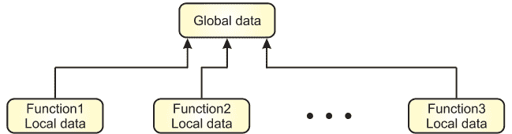

图 1.3 访问全局数据

为了克服程序化编程的局限性，开发了面向对象编程（OOP）范式，它彻底改变了软件开发过程。它不仅包含了结构化编程的优秀特性，还包含了程序化编程所缺乏的一些新、先进特性。最重要的特性是，与程序化方法不同（程序化方法将程序划分为多个函数），OOP 将程序划分为多个对象。对象是结构和行为模块化的单元之一，包含一组属性（或数据）以及相关的函数。此外，程序员在对象之间建立关系。

如前所述，OOP 引入了一些程序化编程所缺乏的新、先进特性。最重要的特性是，与程序化方法不同（程序化方法将程序划分为多个函数），OOP 将程序划分为多个对象。OOP 的其他特性也在此处描述：

- OOP 强调数据而非函数或过程。
- OOP 通过将数据和相关函数绑定到单个单元中很好地模拟了现实世界，从而防止了数据在函数之间的自由移动。
- 一个对象的数据只能由该对象的关联函数访问。不允许其他函数访问该数据。换句话说，数据对外部是隐藏。然而，一个对象的函数可以访问其他对象的函数。
- 整个系统的对象可以通过相互发送消息相互交互。
- 用 OOP 编写的程序易于维护和扩展，因为可以随时将新对象轻松添加到现有系统中，而无需修改其他对象。
- OOP 采用自底向上的方法来设计程序。在这种情况下，首先设计对象，然后将这些对象组合形成整个程序。

OOP 后的基本思想如图 1.4 所示。

# 面向对象的方法 5

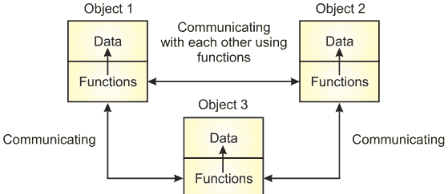

图 1.4 OOP 中的数据和函数

## 1.5 面对象方法的基本概念

要理解面向对象编程的概念，需要了解该的基本术语和概念。这些包括对象、类、数据抽象、封装、继承、方法重写和多态以及消息传递。

### 1.5.1 对象

对象是具有良好边界的小、自包含且模块化的单元。一个对象由状态和行为组成。对象的状态是对象可能处于各种条件之一，由其特征、属性或数据表示。对象的行为决定了对象如何活动或表现，由它能够执行的操作表示。在 OOP 中，对象的属性由变量表示，操作由函数表示。

例如，一个名为 `Biscuit` 的对象可能包含数据产品代码 P001、产品名称 Britannia Biscuits、价格 20 和库存 50。这些数据值指定了对象的属性或特征。类似地，考虑另一个对象 `Maggi`，其具有产品代码 P002、产品名称 Maggi Noodles、价格 10 且库存 20（见图 1.5）。此外，对象中的数据可以被 `check_query()` 和 `display_product()` 等函数使用。这些函数指定了可以执行的操作。

对象实际上是计算机中运行的实体，因此它们是面向对象编程的基本单元。尽管两个或多个对象可能具有相同的属性，但它们是具有独立身份的分离且独立的对象。换句话说，系统中的所有对象在内存中都占据相互独立的独立空间。请注意，将复杂项目分解为对象的主要目标是，对软件某部分的更改不应不利地影响其他部分。

### 1.5.2 类

类被定义为用户定义的数据类型，它包含一组完整的相似数据以及对象所拥有的函数。换句话说，OOP 中的类代表了一组相似的对象。如前所述，现实世界中存在数百万个对象，每个对象都有它们自己的身份。然而，根据它们拥有的共同属性和执行的函数，可以将它们中的每一个归类到不同的组。例如，汽车、踏板车、摩托车、巴士等都可以归类为“车辆”类。同样，狗、猫、马等可以归类为“动物”类。因此，车辆和动物可以被视为类。

类是其对象的模板。也就是说，一旦定义了类，就可以创建许多属于该类的对象。类的对象也被称为该类的实例或变量，从类创建对象的过程被称为实例化。请注意，类并不代表对象，而是代表对象将拥有的数据和函数。

例如，`Product` 类包含数据如 `p_code`、`p_name`、`p_price` 和 `qty_in_hand`，这些指定了 `Product` 类对象的属性或特征。此外，它还包含如 `display_product()` 和 `check_query()` 等函数。

| 类: Product | 对象: Maggi |
| :--- | :--- |
| 数据: p_code | P002 |
| p_name | Maggi Noodles |
| p_price | 10 |
| qty_in_hand | 20 |
| 函数: display_product(), check_query() | |
| 对象: Biscuit | |
| 数据: P001 | |
| 产品名称: Britannia Biscuits | |
| 价格: 20 | |
| 库存: 50 | |

对象实际上是计算机中运行的实体，因此它们是面向对象编程的基本单元。尽管两个或多个对象可能具有相同的属性，但它们是具有独立身份的分离且独立的对象。换句话说，系统中的所有对象在内存中都占据相互独立的独立空间。请注意，将复杂项目分解为对象的主要目标是，对软件某部分的更改不应不利地影响其他部分。

### 1.5.3 抽象

抽象是一种隐藏无关细节并仅表示基本特征的机制。例如，在开车时，驾驶员只知道离合器、刹车、加速器等基本特征，而不知道电机、引擎等。抽象可以分为两种类型，即数据抽象和控制抽象。数据抽象（也称为数据隐藏）意味着隐藏数据，控制抽象意味着隐藏实现细节。在面向对象的方法中，可以共享数据和函数。然而，OOP 中的类的定义方式是对外部隐藏数据而函数是公开的。数据抽象通过防止程序其他部分的意外更改确保数据安全。

### 1.5.4 封装

封装是将数据和操作数据的功能绑定并保持在单个单元中的技术。封装良好的对象对程序的其他部分就像黑盒。也就是说，它为与其交互的外部函数或其他对象提供服务。然而，这些外部函数或对象不需要知道内部细节。例如，在图 1.5 中，数据 `p_code`、`p_name`、`p_price` 和 `qty_in_hand` 以及函数 `display_product()` 和 `check_query()` 被封装在 `Product` 类中。

### 1.5.5 继承

继承可以定义为一个类的对象从另一个类的对象获取特征的过程。如前所述，同类的对象被组合成一个类。然而，当不同对象仅共享一些共同特征时，有时会出现无法归类到单一组的情况。在这种情况下，类的定义方式是将共同特征组合成一个泛化类，并将特定特征组合成一个特化类。特化类的定义方式除了个体特征和函数外，它还继承了其泛化类的所有属性和函数。

在现实世界中，所有的车辆都不是汽车——其中一些也是人力车。因此，汽车和踏板车都是属于汽车类的车辆。同样，三轮车、自行车和人力车是继承了车辆类共同属性的车辆。

## Java 编程

具有一些不常用的属性，并将它们区分开来。因此，车辆（vehicles）类是汽车（automobiles）类和拉（pulled-vehicles）类的抽象，而汽车和拉类是车辆类的特殊版本。注意，在继承车辆类时，汽车和拉并没有修改车辆类的属性，而是添加了它们特有的新属性（见图 1.6）。

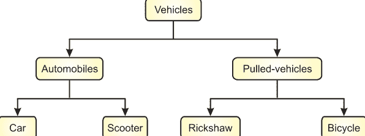

图 1.6 继承

通过这种方式，面向对象编程（OOP）允许一个类继承另一个或多个类的属性。被其他类继承的类被称为**超类**、**基类**或**父类**，而继承基类属性的类被称为**子类**、**派生类**或**子类**。子类可以进一步被继承以形成其他派生类。例如图 1.6所示，汽车（car）和摩托车（scooter）是汽车类的派生类，而人力车（rickshaw）和自行车（bicycle）是拉类的派生类。

继承的主要优势是可重用性。现有类可以在新软件中重用，而无需编写新代码。此外，可以在不改变或修改现有类功能的情况下添加新功能。

### 1.5.6 多态

多态（一个希腊语，意为具有多种形式）是一个实体作为函数或消息以超过一种形式被处理的能力。它也可以定义为：属于相同或不同类的对象以不同的方式响应相同消息或函数的属性。例如，如果向所有车辆传递一个 `change_gear`（换挡）的消息，那么汽车将做出恰当响应，但拉类将做出响应。多态概念在 OOP 中起着重要作用，因为它允许实体以各种形式表示出来。

### 1.5.7 方法重写

基类方法可以在派生类中继承，但有时需要根据派生类的需求对其进行重新定义。在派生类中对基类方法的重新定义被称为**方法重写**（多态的另一种形式）。方法重写意味着派生类中的方法与基类方法同名，但具有不同的实现方式。

### 1.5.8 消息传递

消息传递是程序中不同对象之间交互的过程。如前所述，遵循面向对象范式的的程序包含一组对象，每个对象都有一组数据和函数。当程序执行时，这些对象通过发送和接收消息来相互交互或通信。消息通过调用类的成员函数进行交换。

任何需要与另一个类的对象通信的类对象都会请求该对象调用其类中所需的成员函数。这种函数调用与普通函数调用不同，因为在这种情况下，发送对象是执行该函数的请求。然而，接收对象可能接受也可能拒绝请求，取决于该函数是构成公共接口还是对外部世界隐藏。因此，这种通信被称为消息传递，而不是普通的函数调用。

例如，考虑 `Product`（产品）和 `Order`（订单）两个类。`Product` 类的对象可以通过发送下单请求与 `Order` 类的对象通信（见图 1.7）。

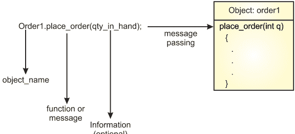

图 1.7 消息传递

## 1.6 OOP 的优点


# 面向对象编程范式

面向对象编程范式的出现是因为它克服了结构化和非结构化编程范式的某些局限性。OOP 的新先进特性如封装、抽象、继承和多态有助于开发高质量软件。得益于它的某些优点，可以开发出高质量的软件。这里列出了 OOP 的优点：

- 在 OOP 中，借助对象的帮助进行编写与处理真实世界对象非常相似。也就是说，真实世界对象可以在程序中方便地表示，这减少了程序的复杂性，也使程序结构更加清晰。
- 在面向对象程序中，每个对象都是一个独立的实体，这使得对程序进行修改、定位和修复问题变成了一项简单的任务。此外，类内部的任何更改都不会影响程序的其他部分。因此，面向对象程序易于编写和维护。
- 面向对象编程对数据完整性和数据安全高度重视，因为它关注数据及其如何免受程序不同部分的操纵。结果是面向对象程序的错误率更低、更可靠且安全。
- 面向对象程序易于扩展，通过引入几个新对象而不修改现有对象，就可以轻松地在程序中添加新功能。
- 面向对象编程允许代码的可重用。也就是说，在一个程序中创建的对象可以在其他程序中重用。此外，可以通过继承利用现有类创建新类。这导致了更快的开发和高质量的程序。
- 面向对象程序更易于适应和扩展，也就是说通过组合可重用的子系统可以创建大型系统。

## 1.7 常用 OO 语言简介

为了开发软件需要在任何高级语言中实现面向对象概念。实现面向对象编程概念的高级语言被称为面向对象编程语言。

根据支持的程度，OO 语言分为：

- 纯语言：仅强制执行 OO 概念的语言。`Smalltalk` 和 `Eiffel` 是示例。
- 混合语言：支持部分 OO 概念的语言。`Java` 和 `C#` 是示例。
- 多范式语言：支持许多 OO 概念的语言。`C++` 和 `Ruby` 是示例。
- 基于对象的语言：支持很少 OO 概念的语言。`Ada` 和 `Python` 是示例。

一些常用语言的评估见表 1.1。

| OO 概念 | Eiffel | Smalltalk | Ruby | Java | C++ | Python |
| :--- | :--- | :--- | :--- | :--- | :--- | :--- |
| 封装和数据隐藏 | 是 | 是 | 是 | 是 | 是 | 是 |
| 继承 | 是 | 是 | 是 | 是 | 是 | 是 |
| 多重继承 | 是 | 否 | 否 | 否 | 是 | 是 |
| 函数重载 | 否 | 否 | 否 | 是 | 是 | 是 |
| 运算符重载 | 是 | 是 | 是 | 否 | 是 | 是 |
| 动态绑定 | 是 | 是 | 是 | 是 | 是 | 是 |
| 类变量和函数 | 否 | 否 | 否 | 否 | 是 | 是 |
| 指针算术 | 否 | 否 | 否 | 否 | 是 | 否 |
| 内置数据类型是对象 | 是 | 是 | 是 | 否 | 否 | 否 |
| 用户定义数据类型是对象 | 是 | 是 | 是 | 是 | 是 | 否 |

## 1.8 OOP 的应用

自 1960 年 `Simula-67` 开发以来，面向对象范式已触及软件开发的许多主要领域。这里列出了 OOP 开发软件的一些领域：

- 仿真和建模：仿真是借助计算机程序表示真实世界实体的技术。`Simula-67` 和 `Smalltalk` 是为了制作仿真设计的面向对象语言。
- 用户界面设计：OOP 的另一个热门应用是设计如 Windows 这样的图形界面。`C++` 主要用于开发用户界面。
- 开发计算机游戏：OOP 还用于开发如《暗黑之魂》、《星际争霸》、《兽兽III》等游戏。这些游戏提供了虚拟现实体验，其中许多对象相互交互以产生所需的结果。
- 脚本：近年来，OOP 也用于开发互联网的 HTML、XHTML 和 XML 文档。`Python`、`Ruby` 和 `Java` 是基于面向对象原理的脚本语言。
- 对象数据库：如今 OOP 概念已引入数据库系统，以开发新的基于 DBMS 的对象数据库。这些数据库直接以对象的形式存储数据。

# Java 编程

## 摘要

- 编程范式描述了程序的结构。换句话说，它决定了指令在程序中的排列方式。每种编程语言遵循一种或另一种编程范式。
- 在非结构化编程范式中，程序的所有指令都是在单个函数中一个接一个编写的，因此只适用于编写简单和复杂的程序。
- 在过程化编程中，程序被分为不同的过程（也称为函数、例程或子程序），每个过程都包含一组执行特定任务的指令集。
- 过程化编程中的程序由一个名为主程序（`main`）的控制过程组成，该过程控制其他过程的执行。
- 过程化范式具有某些局限性，这导致了面向对象范式的发展。
- 在面向对象编程（OOP）范式中，程序员不仅定义了数据，还定义了可以对数据进行执行的操作（函数），并将它们作为一个单一单元。这遵循了自底向上的方法。
- OOP 基于某些概念，包括对象、类、抽象、封装、继承和多态。
- 对象是结构和行为模块化的单元，包含一组属性（或数据）以及相关的函数。
- 类被定义为一种用户定义的数据类型，包含所有相似的数据以及对象所拥有的函数。从类中创建对象的过程被称为实例化。
- 抽象是一种隐藏无关细节并只表示本质特征的机制，使用户能够同时关注重要事情。抽象分为两种类型，即数据抽象和控制抽象。
- 继承定义为一个类的对象从另一个类的对象获取特征的过程。继承有两种类型，即单继承和多重继承。
- 多态（一个希腊词，意为“多种形式”）实体（如函数或消息）被处理成多种形式的能力。
- 消息传递是程序中不同对象之间交互的过程。
- 实现面向对象编程概念的高级语言被称为面向对象（OO）语言。例如，`Eiffel`、`Smalltalk`、`Ruby`、`Java`、`C#`、`C++` 和 `Python` 都是 OO 语言。
- OOP 已用于开发许多领域的软件，包括仿真与建模、用户界面设计、计算机游戏开发、脚本、对象数据库。

## 练习

### 空选题

1. 在 ________ 范式中，程序的所有指令都是在单个函数中一个接一个编写的。
2. 在过程化编程中，程序被分为不同的 ________。
3. 一个 ________ 是结构和行为模块化的单元，包含一组属性（或数据）以及相关的函数。

### 面向对象方法论

4. 属于特定类的数据被称为它的 ____________________，类的函数被称为 ____________________
5. ____________________ 意味着隐藏数据的细节，而 ____________________ 意味着实现细节

### 选择正确选项

1. 从类中创建对象的过程被称为 ____________________
   (a) 对象声明 (b) 变量声明
   (c) 实例化 (d) 数据抽象

2. 哪种 OOP 概念使得代码的可重用性成为可能？
   (a) 继承 (b) 封装
   (c) 消息传递 (d) 数据抽象

3. 在派生类中重新定义基类方法称为 ____________________
   (a) 多态 (b) 方法重写
   (c) 抽象 (d) 以上都不是

4. 下列哪种编程语言属于基于对象的语言范畴？
   (a) Python (b) Ada
   (c) C++ (d) Smalltalk

5. 下列哪种面向对象的语言是为制作仿真设计的？
   (a) Simula-76 (b) Ruby
   (c) Python (d) 以上都不是

### 判断对错

1. OOP 遵循自底向上的方法来设计程序。
2. 支持某些面向对象概念的语言被称为纯 OO 语言。
3. 面向对象编程中的类也称为抽象数据类型（ADT）。
4. 多态是程序中不同对象之间交互的过程。
5. 仿真是借助程序表示现实世界实体的技术。

### 回答以下问题

1. 写一段关于各种编程范式演变的简短笔记。
2. 列出过程化编程范式的一些局限性。
3. 面向对象编程范式和过程化编程范式之间有什么什么区别？
4. 区分类和对象。
5. 写一段关于消息传递的简短笔记。
6. 列出面向对象编程的一些优点。
7. 定义这些术语。
   (a) 派生类 (b) 父类
8. 详细讨论各种 OOP 概念。
9. 有哪些类型的 OO 语言？对某些 OO 语言进行简要比较。
10. 列出 OOP 范式的一些应用领域。

# JAVA 与互联网

## 章节目标

阅读本章节后，你将能够：

- 描述 Java 编程语言并解释其特性
- 理解 Java 编译器的作用
- 解释 Java 运行时环境
- 理解简单的 Java 程序
- 运行 Java 应用
- 解释命令行参数

## 引言

Java 最初名为“Oak”，是由 `James Gosling` 于 1991 年在 `Sun Microsystems` 开发的。Java 背后的首要原因是对可携式电子设备的需求。导致 Java 增长的第二个原因是世界维网。在 1993 年，第一个网络浏览器 `Netscape` 整合了 Java applet。到 1996 年，Java 成为可以在任何机器上运行的通用面向对象语言。

## Java 编程的基本特性

Java 受欢迎是因为具有以下各种特性：

- 简单：Java 继承了 `C++` 的语法但省略了复杂不可靠的特性，如运算符重载、指针、预处理器头文件。
- 解释型：与其他语言不同，Java 使用两阶段系统。首先编译器将程序代码转换为字节码，然后由解释器转换为机器码。
- 架构中立（平台无关）：这一特性使得 Java 语言非常特殊。Java 产生的字节码可以在任何操作系统上运行。
- 面向对象语言：Java 中的一切都是对象。对象和类是扩展的。
- 健壮：Java 是一种健壮的语言，原因有两个。首先，强类型语言，会在编译时检查代码。其次，Java 以有效的方式管理内存。在 `C++` 中，程序员必须手动释放对象使用的动态内存。Java 会自动释放不再被对象引用的内存（借助垃圾回收器）。
- 分布式：由于 Java 是平台独立的，它适用于开发网络应用程序。Java 可以处理 `TCP/IP` 协议，因此用 Java 开发的应用可以访问互联网上的远程对象。
- 多线程：Java 支持多线程编程，允许我们编写可以同时执行多个任务的程序。用户不需要等待程序完成一个任务再开始另一个任务。例如，用户可以在下载 applet 的同时听音频片段。这一特性有助于提高图形应用程序的性能。
- 高性能：如所述，Java 程序转换为字节码。由于字节码经过高度优化，它使 JVM 以更快的速度执行程序。
- 动态：它在本质上是动态的，因为 Java 程序可以在运行时链接新的类库、对象、方法等。Java 还提供了包含其他语言（如 `C` 和 `C++`）函数的功能。这些被称为原生方法。这些方法也是在运行时动态链接的。

## Java 与 C++

`C++` 都是面向对象语言，但它们彼此非常不同。`C++` 语言的某些特性被故意删除了，并增加了一些新特性使 Java 成为更灵活可靠的语言。Java 和 `C++` 之间的区别如下。

- Java 不直接支持类的多重继承。
- Java 支持多线程概念。
- Java 中的析构函数被 `finalize` 取代。
- Java 不支持 `typedef` 关键字。
- Java 不支持指针，相反它使用隐式对象引用。
- Java 不支持 `virtual` 关键字。
- Java 不支持全局变量的概念。
- Java 支持与 `C++` 不同的异常处理机制。它提供了一个 `finally` 子句用于清理工作。
- 非原始数据类型通过使用 `new` 运算符分配内存。
- Java 增加了许多面向对象编程必需的特性。

## 2.4 Java 对互联网的重要性

近年来，Java 已经成为在不同系统上运行的程序的流行语言。Java 的一项名为“applet（小程序）”的创新彻底改变了互联网编程。Applet 是微型程序，其设计方式使其能够在网上传输。它们可以根据需要下载，并由兼容 Java 的网络浏览器自动执行。它们用于处理用户输入、服务器提供的数据以及在客户端机器本地执行的简单功能。

Applet 是一种动态、自执行的程序，足够智能到可以随着用户的输入发生变化。动态程序在下载和执行时可能会对计算机造成严重伤害，因为它们可能包含木马病毒等恶意程序。这些有害程序可能会搜索计算机本地文件系统的内容，并可能提供信用卡号、密码等私有信息。早期的病毒在下载程序之前会进行扫描，但 Java 通过将程序仅限制在 Java 执行环境中解决了这个问题。

## 2.5 Java 编译器

在大多数编程语言中，程序通过使用编译器或解释器被转换为机器码。这样生成的机器码是依赖于机器的，因此它可能无法在生成它的机器以外的机器上运行。与其他编程语言不同，Java 编译器并不将源代码转换为机器码，而是将源代码转换为一种名为字节码（`bytecode`）的特殊中间代码。字节码以可以解释的类文件形式生成。在 Java 中用于编译的命令是 `javac`，它将相应的 Java 文件转换为类文件。字节码是依赖于机器的，它可以在下一节讨论的 Java 虚拟机（JVM）的帮助下在任何机器上运行。

| 源代码 | 编译器 | 字节码 |
|---|---|---|
| .java 文件 | | .class 文件 |

图 2.1 Java 程序的编译

## 2.6 Java 虚拟机概念

如前所述，Java 同时使用编译器和解释器。Java 源代码被编译成生成字节码，然后这些字节码被解释为针对特定机器的指令。编译器生成的字节码不是特定于机器的。它是为了仅存在于计算机内存中的称为 Java 虚拟机（JVM）的虚拟机而生成的。这种虚拟机的设计使其可以实现在任何现有处理器之上，并本身充当虚拟处理器芯片。它为 Java 应用程序隐藏了底层的操作系统细节。


图 2.2 Java 程序的执行

## 2.7 JDK (Java 开发工具包)

JDK 由用于开发和执行 Java 程序的各种工具组成。JDK 中包含的工具列表 2.11。

表 2.1 Java 开发工具包中的工具

| 工具 | 功能 |
| --- | --- |
| `javac` | Java 编译器，将源代码转换为 Java 字节码 |
| `java` | Java 解释器，解释 java 编译器生成的文件并将其转换为机器码 |
| `javadoc` | 文档生成器，从源代码自动生成文档 |
| `javah` | 为编写原生方法生成头文件和存根生成器 |
| `javap` | 类文件汇编器，将字节码文件转换为程序描述 |
| `jdb` | Java 调试器，帮助跟踪程序中的错误 |
| `appletviewer` | 用于在没有网络浏览器的情况下运行和调试 Java applets |

## 2.8 Java 程序的初探

让我们从一个在屏幕上打印字符串的简单 Java 程序开始学习 Java。

示例 2.1 一个 Java 程序

```java
class Sample
{
    public static void main (String args[]) {
        System.out.println("Welcome to Java Programming");
        System.out.println("Its easy and simple.");
    }
}
```

尽管这个程序是最简单的，但它包含了每个 Java 程序都具有的基础特性。让我们逐一查看这些特性。

### 类定义

第一条语句 `class Sample` 声明了一个类，其中 `class` 是关键字，`Sample` 是指示类名的标识符。左大和右大括号 `{}` 包围了类的定义。

### Main 语句

语句 `public static void main(String args[])` 表示主方法。该方法是 Java 程序执行的起始点。由于它是任何 Java 程序的启动点，因此它是任何程序中最本质的部分。

该语句具有关键字 `public`、`static` 和 `void`。这些关键字的描述如下：

- `public`: 它是一个访问修饰符，指定主方法对所有其他类可见。
- `static`: 该方法声明为静态，指定此方法属于整个类。解释器在创建对象之前使用此方法。
- `void`: `void` 关键字指定主方法不返回值。括号对包含方法参数的声明。在上面的例子中，`String args[]` 声明了一个参数 `args`，它包含一个 `String` 类的对象数组。

### 输出语句

语句 `System.out.println("Welcome to Java Programming.");` 和 `System.out.println("Its easy and simple.")` 用于显示字符串。注意 `println()` 会在字符串末尾添加换行符，而 `print()` 则不会。

## 运行 Java

可以使用任何文本编辑器创建程序。现在有许多文本编辑器，如 `Notepad`、`Jcreator` 等。

## 2.10 命令行参数

像 `C++` 一样，Java 也允许向主方法传递参数。这些参数通过在命令行上程序名称之后输入它们来传递。因此，这些参数被称为命令行参数。它们有助于为程序提供数据。

如前所述，类型为 `String` 的参数被传递给主方法。示例 2.2 演示命令行参数使用的程序

```java
class CommandLineArg
{
    public static void main(String args[])
    {
        System.out.println("The arguments entered are: ");

        int a;
        for(a=0;a<args.length;a++)
        {
            System.out.print("args[" + a + "]: ");
            System.out.println(args[a]);
        }
        int b=args.length; // 返回参数的数量
        System.out.println("The number of arguments is: "+b);
    }
}
```

在命令行提示符输入的命令是

```
java CommandLineArg Hello! How are you?
```

程序的输出是


The arguments entered are:

```
args[0]: Hello!
args[1]: How
args[2]: are
args[3]: you?
```

参数的数量是: 4

# Java 与网络 21

- Java 中用于编译的命令是 `javac`，它将相应的 Java 文件转换为类文件（class file）。
- 字节码是为仅存在于计算机内存中的 Java 虚拟机（JVM）生成的代码。
- JDK 由一组用于开发和执行 Java 程序的各种工具组成。JDK 包含的一些工具有 `javac`、`javadoc`、`javap` 等。
- `public` 访问符指定主方法对所有其他类可见。
- `void` 关键字指定主方法不返回值。
- 像 C++ 一样，Java 也允许向 `main()` 方法传递参数。这些参数通过在命令行中程序名后输入它们来传递。因此，这些参数被称为命令行参数。

## 练习题

### 填空

1. Java 是 1991 年由 ________ 领导的团队在太阳射微系统公司开发的。
2. Java 在执行程序时同时使用了 ________ 和 ________。
3. 原生方法可以在 ________ 处动态链接。
4. Java 中没有 ________ 方法析构函数。
5. ________ 命令将源代码转换为中间字节码。

### 选择正确选项

1. 以下哪个是 Java 的特性？
   (a) 架构中性的面向对象语言
   (c) 健壮的
   (d) 以上都是

2. 下列哪个特性 Java 不支持？
   (a) java javac
   (c) javah
   (d) javadoc

3. 下列哪个命令将相应的 Java 文件转换为类文件？
   (a) 多重继承多线程
   (c) new 运算符
   (d) finally 子句

4. 下列哪个命令用于在网络浏览器中运行和调试 Java 小程序（applets）？
   (a) javadoc
   (b) javah
   (c) appletviewer
   (d) jdb

5. 下列哪个关键字指定主方法对所有其他类可见？
   (a) public
   (b) static
   (c) 两者都是
   (d) 以上均不是

### 判断对错

1. 第一个网络浏览器“HotJava”开发于 1993 年。
2. 字节码是平台无关的。
3. Java 支持全局变量。
4. Applet 是微型程序，可以从互联网下载并在兼容 Java 的网络浏览器上运行。
5. JDK 是一组用于开发和执行 Java 程序的各种工具。

### 回答以下问题

1. 详细解释 Java 特性。
2. 列出 Java 和 C++ 之间的某些区别。
3. 解释 Java 如何成为流行的网络语言。
4. Java 编译器在程序执行中起什么作用？
5. 详细讨论 Java 环境。
6. 描述 JDK 的用途。列出 JDK 的某些工具及其用途。
7. 写一个 Java 程序显示“Java 是一种流行的网络语言”。
8. 什么是命令行参数？请举例说明。

# 第 3 章

## Java 编程

### 本章学习目标

读完本章后，你将能够：

- 讨论字符集并定义 Java 支持的标记（tokens）
- 描述 Java 程序的结构
- 讨论 Java 支持的各种基本和非基本数据类型
- 解释如何解码 Unicode 并为变量赋值
- 描述类型转换
- 解释不同类型的运算符以及可以执行的操作

## 3.1 引言

在任何编程语言中，即使是编写一个简单的程序，也需要对该语言提供的各种数据类型、变量、常量和运算符有知识和清晰的理解。所有这些元素构成了语言的最基本的元素，它们组合成指令，而一组指令就构成了一个程序。在本章中，我们将讨论 Java 的这些基本编程元素。

## 3.2 字符集

字符集被定义为一组字符，这些字符单独或组合表示信息。与 C 和 C++ 等其他编程语言不同，Java 使用名为 Unicode 的标准来定义字符。Unicode 是一种 16 位的字符集，定义了所有人类语言中可用的字符，如英语、印地语、德语、法语、中文、日语等。这使得 Java 成为一种全球性的编程语言。然而，许多语言的字符可以使用标准的 8 位字符集（ASCII 字符）来表示，这些字符包括字母、数字和标点符号。

## 3.3 标记（TOKENS）

标记被定义为程序的最小单元。当程序被编译时，编译器会扫描源代码并将其解析为标记以寻找语法错误。Java 标记大致分为关键字、标识符、常量、运算符和标点符号。

### 3.3.1 关键字

关键字是在任何语言中具有特殊意义的预定义词。每个关键字都为特定目的保留，不能用作用户定义的名称（标识符）。Java 中有许多关键字，列在表 3.1 中。

**表 3.1 Java 关键字**

| abstract | const | final | interface | short | transient |
|---|---|---|---|---|---|
| assert | continue | finally | long | static | try |
| boolean | default | for | native | strictfp | void |
| break | do | goto | new | super | volatile |
| byte | double | | package | switch | while |
| case | else | instanceof | private | synchronized | |
| catch | enum | | implements | protected | this |
| char | extends | int | return | | |
| class | | | import | | |

### 3.3.2 标识符

标识符是赋给变量、方法、类等的名称。它们遵循以下规则：

- 标识符必须以字母、下划线（`_`）或美元符号（`$`）开头。
- 标识符可以包含字母、数字、下划线和美元符号。
- 标识符不能以数字开头。
- 标识符不能是关键字。
- 标识符是区分大小写的。

一些有效和无效的标识符如下：

```
_variable
$money123
```

### 3.3.3 常量

常量也称为字面量（literals），是在执行过程中不会改变的值。根据类型，常量大致分为四类：数值常量、字符常量、字符串常量和布尔常量。

#### 数值常量

数值常量是指带或不带小数点的数字，可以是正数或负数。默认情况下正数。数值常量可以进一步分为整数常量和浮点常量（表 3.2）。

**表 3.2 数值常量类型**

| 类型 | 示例 | 描述 |
| --- | --- | --- |
| 整数常量 | 54, -64, 012, 03A | 整数常量是指整数值。整数可以用不同的系统表示，即十进制（base 10）、八进制（base 8）和十六进制（base 16）。八进制以 0 开头，十六进制以 0x 或 0X 开头。 |
| 浮点常量 | 64.23f, -74.23f, 537E-9f, 15e-3 | 浮点常量是指带有小数点的实数。浮点表示法将常量分为有效数字和指数。浮点常量默认附加 f 或 F 以指定格式 |

> **注意**：数值常量不允许使用逗号 `,`、分号 `;` 和问号 `?` 等特殊字符。

#### 字符常量

字符常量是指封装在单引号（`'`）中的单个字符。字符常量的示例有 `'f'`、`'M'`、`'8'`、`'&'` 等。所有字符常量在内部都存储为整数值。

字符常量可以表示打印字符或不可打印字符。打印字符常量的示例有 `'a'`、`'5'`、`'#'`、`';'` 等。然而，有一些字符常量无法通过键盘直接包含在程序中。这些字符常量被称为不可打印常量，通过转义序列包含在程序中。转义序列是指由斜杠字符（`\`）开头的字符。Java 使用的一些序列列在表 3.3 中。

**表 3.3 转义序列**

| 转义序列 | 字符常量 |
| --- | --- |
| `\b` | 退格 |
| `\f` | 换页 |
| `\n` | 新行 (换行) |
| `\r` | 回车 |
| `\t` | 制表符 |
| `\'` | 单引号 |
| `\"` | 双引号 |
| `\\` | 斜杠 |

#### 字符串常量

**字符串常量**指的是包含在双引号 `""` 中的任意数量字符的序列。这些字符可以是字母、数字、特殊字符和空格。字符串常量的示例有 `"hello java"`、`"2009"`、`"...?"`、`"6+9"`、`"y"` 等。

#### 布尔常量

布尔常量只能表示两个值：**true** 和 **false**。在 Java 中，这些值没有数值表示，**true** 不等于 1 且 **false** 不等于 0。

### 3.3.4 运算符

**运算符**是在各种数据项上执行操作（如加法、减法、乘法等）以产生结果的符号。这些被运算符作用的数据项被称为**操作数**。例如，在 `a*b` 中，**a** 和 **b** 是操作数，而 `*` 是运算符。

### 3.3.5 标点符号

标点符号也称为**分隔符**，是通过划分和聚合一组代码来定义程序结构的符号。各种标点符号由大括号 `{}`、方括号 `[]`、冒号 `:`、逗号 `,`、句号 `.`、分号 `;` 和括号 `()` 定义。

## 3.4 Java 程序的结构

Java 程序的结构分为若干部分，即*文档部分、包语句、导入语句、接口语句、类定义*和*主方法类*（见图 3.1）。

| 文档部分 |
|---|
| 包语句 |
| 导入语句 |
| 接口语句 |
| 类定义 |
| 主方法类 |

**图 3.1** Java 程序结构

- **文档部分**：注释是程序的关键元素，用于提高程序的可读性并描述其功能。它们还可能包含程序名称和程序作者等信息。
- **包语句**：它是 Java 程序中的第一个语句，告诉编译器文件中定义的所有类都属于这个包。例如，考虑这条语句：`package employee;`。在这里，**employee** 是包名。我们的类不一定属于某个包，因此此语句是可选的。
- **导入语句**：它允许我们访问属于其他包的类。例如，考虑这条语句：`import employee.EName;`。在这里，employee 是包名，EName 是我们想要访问的类。程序中可以有多个导入语句。
- **接口语句**：接口是 Java 中实现多重继承的类。它就像类一样，但只包含方法声明。
- **类定义**：类是程序最重要的元素。程序可以由任意数量的类定义组成。
- **主方法类**：它是 Java 程序的不可或缺的部分，因为它包含了程序入口的主方法。在主方法类内部，会创建、访问和操作多个类的对象。一旦执行完主方法中的所有指令，控制权将移出类并终止整个程序。

> **注意**：包、接口和多重继承的概念将在后续章节中讨论。

## 3.5 数据类型

数据类型决定了数据的类型以及可以对该数据执行的操作。Java 提供了各种数据类型，每种数据类型在计算机内存中的表示方式都不同。程序员选择的数据类型取决于具体的应用。Java 提供的各种数据类型分为原始数据类型和非原始数据类型。（见图 3.2）。

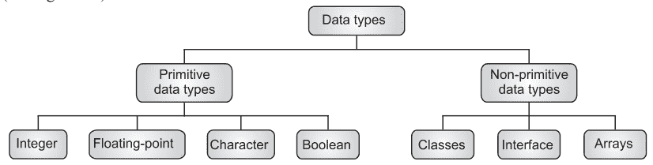

**图 3.2** 数据类型

### 3.5.1 原始数据类型

原始数据类型（也称为内置数据类型）是编程语言提供的基础数据类型。在 Java 中，原始数据类型包括整数、浮点数、字符和布尔。

#### 整数类型

整数类型用于存储如 4、42、5233、-32、-745 等整数。Java 支持四种整数类型，即 `byte`、`short`、`int` 和 `long`。这些整数类型的默认值为 0。Java 中没有无符号整数的概念。各种整数数据类型及其大小和范围列在表 3.4 中。

**表 3.4 整数类型的大小和范围**

| 类型 | 大小（字节） | 范围 |
|---|---|---|
| `byte` | 1 | -128 to 127 |
| `short` | 2 | -32,768 to 32,767 |
| `int` | 4 | -2,147,483,648 to 2,147,483,647 |
| `long` | 8 | -9,223,372,036,854,775,808 to 9,223,372,036,854,775,807 |

> **注意**：建议尽可能使用较小的数据类型。例如，我们选择的数据类型越大，程序执行所需的时间就越长。

#### 浮点类型

浮点类型用于存储实数，如 3.28、64.755765、-8.01-24.53。Java 支持两种浮点类型，即 `float` 和 `double`。

- **float**：`float` 类型表示单精度数字。它占用 4 字节。`float` 的默认值为 0.0。
- **double**：`double` 类型表示双精度数字。它占用 8 字节。`double` 的默认值为 0.0。

**表 3.5 浮点类型的大小和范围**

| 类型 | 大小（字节） | 范围 |
|---|---|---|
| `float` | 4 | -3.4E-38 to 3.4E+38 |
| `double` | 8 | -1.7E-308 to 1.7E+308 |

#### 字符类型

字符类型用于存储包含在单引号中的字符。它由 `char` 表示。它占用 16 位。`char` 的默认值为 null。

#### 布尔类型

布尔数据类型只能持有布尔值，即 `true` 或 `false`。关键字 `boolean` 用于表示布尔类型。`boolean` 的默认值为 `false`。

### 3.5.2 非原始数据类型

非原始数据类型（用户定义类型）也称为引用类型，派生自原始类型。在 Java 中，这些包括类和数组。

> **注意**：所有非原始数据类型将在后面的章节中详细讨论。

## 3.6 变量

变量是一个表示用于存储数据的内存位置的标识符。存储的数据可以通过变量名访问。变量的值可以在程序执行期间随时更改。我们选择的变量名必须具有意义，以便理解它代表什么。

### 声明变量

变量在使用之前必须在程序中声明。变量声明告知编译器关联的具体数据类型，并为其分配足够的内存。

声明变量的语法为：

```
data_type variable_name;
```

例如，可以使用此语句声明 `int` 类型的变量 `a`：

```
int a;
```

在声明变量时，可以在同一语句中声明多个相同数据类型的变量。例如，考虑这条语句：

```
int x, y, z;
```

### 初始化变量

变量声明为变量分配内存，但在声明时不存储任何数据。为了在变量中存储数据，需要对其进行初始化。例如，考虑以下语句：

```
int i;
i=10;
```

在这里，声明了一个整数类型的变量 `i`，并赋值赋值为 10。我们可以将两者合并为语句如下：

```
int i=10;
```

除了使用常量初始化变量外，还可以使用表达式在运行时初始化变量。在运行时初始化变量被称为动态初始化。

#### 示例 3.1 变量初始化的程序

```java
public class dynamic_initialization
{
    public static void main(String[] args)
    {
        int x=40, y=40, z=10; // 用常量值初始化
        int result=(x*y)+z;   // 动态初始化
        System.out.println("The value of z is:"+result);
    }
}
```

**程序的输出为**

```
The value of z is:1610
```

### 通过键盘接收输入

可以使用 `readLine()` 方法通过键盘交互式地为变量赋值。

#### 示例 3.2 一个演示从键盘读取数据的程序

```java
// importing package for using DataInputStream class
import java.io.*;

public class ReadingData
{
    public static void main(String[] args)
    {
        DataInputStream in = new DataInputStream(System.in);
        int num1 = 0;
        float num2 = 0;
        try {
            System.out.println("Enter integer value");
            num1 = Integer.parseInt(in.readLine());
            System.out.println("Enter float value");
            num2 = Float.valueOf(in.readLine()).floatValue();
        } catch (Exception e) {
            System.out.println("The integer value is " + num1);
            System.out.println("The float value is " + num2);
        }
    }
}
```

**程序的输出是**

```
Enter integer value
4
Enter float value
6.7
The integer value is 4
The float value is 6.7
```

`DataInputStream` 类的 `readLine()` 方法（将在第 12 章详细讨论）用于从键盘读取字符串并将其转换为对应的数据类型 `int` 和 `float`。为了处理在从键盘读取数据时可能发生的错误，我们提供了 `try` 和 `catch` 语句。错误处理将在第 10 章中详细讨论。

## 类型转换


在编程过程中，我们可能会遇到需要将一种数据类型的值存储到另一种数据类型中的情况。如果两种数据类型是兼容的，且目标类型足够大以存储源类型的值，Java 会自动将源类型转换为目标类型。这被称为自动类型转换。例如，`int` 数据类型的值可以赋值给 `long` 数据类型的变量，因为 `long` 比 `int` 大。这种将较小类型的数据赋值给较大类型的转换被称为拓宽转换。

然而，如果目标类型小于源类型，则无法自动转换。例如，`int` 数据类型的值无法赋值给字节类型变量。对于这种转换，Java 提供了一种名为类型强制（type casting）的机制。类型强制是指显式执行的转换。

类型强制的语法为：

```
data_type variable1 = (data_type) variable2;
```

其中，

- `data_type` 是数据类型
- `variable1` 是目标变量
- `variable2` 是源变量

例如，考虑这些语句：

```java
int x = 20;
byte y = (byte) x;
```

在这些语句中，执行类型强制以将 `int` 数据类型转换为 `byte` 数据类型。在进行类型强制时应记住以下点：

- 所有整数数据都可以转换为除 `boolean` 以外的任何数据类型。
- 转换为较小的数据类型可能会导致数据丢失。
- 将浮点值转换为整数类型可能会导致小数部分被截断。

## 示例 3.3 一个演示类型强制的类 ExampleTypecast

```java
// type conversion
int il = (int) b; // conversion from byte to int
short sl = (short) b; // conversion from byte to short
```

## 使用 Java 编程

```java
short s2 = (short) i;      // conversion from int to short
int i2 = (int) f;               // conversion from float to int
System.out.println("(int)b: " + b1);
System.out.println("(short)b: " + s1);
System.out.println("(short)i: " + s2);
System.out.println("(int)f: " + i2);
```

程序的输出是

现有的变量及其取值为：

- b = 20
- s = 26
- i = 123456789
- f = 3.98

转换后现有的变量及其取值为：

- (int)b: 20
- (short)b: 20
- (short)i: -13035
- (int)f: 3

## 3.8 运算符与操作

如前所述，运算符是会对各种数据项（称为操作数）执行操作的符号。例如，在 `a + b` 中，`a` 和 `b` 是操作数，`+` 是运算符。注意，为了执行操作，操作数组合形成一个表达式。例如，对操作数 `a` 和 `b` 执行加法操作，加运算符 `(+)` 与操作数 `a` 和 `b` 结合形成表达式。

根据执行功能的不同，Java 运算符可以分为若干类。这些包括算术运算符、递增和递减运算符、关系运算符、逻辑运算符、条件运算符、赋值运算符、位运算符和特殊运算符。

### 3.8.1 算术运算符

算术运算符对操作数执行基本的算术操作。它们可以作用于 Java 中除 `boolean` 类型以外的任何内置数据类型。

Java 提供了各种算术运算符，如 `+`（加法或一元加）、`-`（减法或一元减）、`*`（乘法）、`/`（除法）和 `%`（取模）。例如，涉及算术运算符的一些表达式有 `x + y`、`x - y`、`x * y`、`x / y` 和 `x % y`。当一元减运算符与单个操作数一起使用时，操作数乘以 -1。

使用算术运算符形成的表达式可以是以下类型之一：

- **整数表达式**：两个操作数均为整数的算术表达式称为整数表达式。
- **实数表达式**：两个操作数均为实数的算术表达式称为实数表达式。
- **混合模式表达式**：如果一个操作数是实数而另一个是整数，则该表达式为混合模式。

### 3.8.2 递增和递减运算符

Java 提供了两种一元运算符，即 `++`（递增）和 `--`（递减）。递增和递减运算符有两种形式。

- **前缀形式**：如果运算符位于操作数之前，操作数先加 1 或减 1，然后再参与表达式。为了理解前缀运算符，考虑此示例。

示例 3.4

```java
int x = 10;
int y = ++x; // x变为11
```

- **后置形式**：如果运算符位于操作数之后，操作数先参与表达式然后再加 1 或减 1。要理解后置运算符，考虑此示例。

```java
int x = 10;
int y = x++; // y变为10
```

### 3.8.3 关系运算符

关系运算符用于比较两个值。Java 提供的关系运算符包括小于 `<`、小于等于 `<=`、大于 `>`、大于等于 `>=`、等于 `==` 和不等于 `!=`。它们返回 `boolean` 类型。考虑变量 `a` 和 `b` 的值分别为 20 和 30。在这种情况下，`a < b` 返回 `true`，而 `a > b` 返回 `false`。

`==` 和 `!=` 运算符被称为相等运算符，因为它们用于检查相等性。

注意：关系运算符可以作用于整数、浮点和字符类型。

### 3.8.4 逻辑运算符

逻辑运算符组合表达式并返回 `true` 或 `false`。Java 提供的各种运算符如下：

- **与 (`&&`)**：只有当所有表达式都为 `true` 时才返回 `true`，否则返回 `false`。
- **或 (`||`) 运算符**：如果一个或所有表达式为 `true` 则返回 `true`，只有当所有表达式都为 `false` 时才返回 `false`。
- **非 (`!`)**：如果它操作的为 `false`，则返回 `true`，反之亦然。

例如，考虑两个表达式 `Exp1` 和 `Exp2`。表 3.6 显示了对这些表达式应用逻辑运算符后的结果。

### 表 3.6 真值表

| Exp1 | Exp2 | Exp1 && Exp2 | Exp1 \|\| Exp2 | !Exp1 |
| :--- | :--- | :--- | :--- | :--- |
| true | true | true | true | false |
| true | false | false | false | true |
| false | true | false | true | true |
| false | false | false | false | true |

### 3.8.5 条件运算符

条件运算符根据指定的条件选择值。注意，条件运算符是一个三元运算符，因为它涉及到三个操作数。

条件运算符的语法为：

```
expression1 ? expression2 : expression3
```

如果 `expression1` 为 `true`，则计算 `expression2`，否则计算 `expression3`。

为了理解条件运算符的工作，考虑此示例。

示例 3.6

```java
int result = (x == 5) ? 8 : 9;
```

在这个示例中，如果 `x` 的值等于 5，则表达式返回 8，否则表达式返回 9。

## 3.8.6 赋值运算符

赋值运算符将表达式的值赋值给变量。赋值运算符分为两种类型，即简单赋值运算符和复合赋值运算符。

### 简单赋值运算符

简单赋值运算符将其右侧的值赋值给其左侧的变量。请注意，赋值表达式的左侧必须是一个变量。它不能是常量或表达式。然而，赋值表达式的右侧可以是变量、常量或表达式。

为了理解简单赋值运算符，请考虑以下示例。

示例 3.7 评估此语句

```java
x = 8;
```

在示例中，值 8 被赋值给变量 x。

在赋值运算符的帮助下，可以为多个变量分配共同的值。这通过在单条语句中使用多次赋值来实现。例如，在语句 `x = y = z = 5` 中，值 5 被赋值给变量 x、y 和 z 三个。

### 复合赋值运算符

Java 提供了复合赋值运算符（也称为 Java 简写），其形式如下。

```java
v op = exp;
```

在这里，`v` 是变量，`op` 是二元运算符，`exp` 是表达式。这种形式等同于语句 `v = v op (exp)`；我们只需要访问一次 `v`。

## 3.8.7 其他运算符

除了讨论过的运算符外，Java 还支持一些其他运算符，包括位运算符和特殊运算符。

### 位运算符

位运算符用于在位级上操作数据值。该运算符可以应用于所有原始数据类型，如 `long`、`int`、`short`、`char` 和 `byte`。各种位运算符包括位与 (`&`)、位或 (`|`)、位异或 (`^`)、按位取反 (`~`)、左移 (`<<`)、右移 (`>>`) 和零填充右移 (`>>>`)。

### 特殊运算符

Java 提供了两个特殊运算符，即 `instanceof` 和点运算符 (`.`)。

- **instanceof**：`instanceof` 运算符用于检查对象是否属于某个特定的类。例如，考虑此语句。

```java
novel instanceof book
```

如果对象 novel 属于类 book，则该语句返回 true，否则返回 false。

- **点运算符**：通过对象利用点运算符访问类的实例变量和方法。点运算符将对象名称与需要访问的变量或方法名连接起来。例如，考虑这些语句。

```java
obj.name; // 访问类的实例变量
obj.marks(); // 访问类的方法
```

**注意**：实例变量和方法将在第 5 章中评估。

## 3.8.8 运算符的优先级和结合性

由多个运算符组成的表达式会导致关于哪个运算符先执行的歧义。例如，考虑这个表达式。

`a + b * c - d`

在这个表达式中，编译器需要知道哪个运算符先执行。为此，确定运算符的优先级和结合性非常重要。

- **优先级**：表达式中各种运算符执行的顺序或优先级被称为优先级。Java 中的每个运算符都有与其相关的优先级。高优先级的运算符会在低优先级运算符之前执行。例如，乘法在加法之前执行，因为乘法运算符的优先级高于加法运算符。

- **结合性**：相同优先级的运算符执行的顺序或优先级被称为结合性。例如，加法和减法运算符具有相同的优先级。然而，表达式中加法或减法的执行取决于它们出现的顺序。

运算符的结合性可以是从左到右，也可以从右到左。具有左到右结合性的运算符从左侧执行，而具有右到左结合性的运算符从右侧执行。

Java 运算符的优先级和结合性列于表 3.7。注意，运算符的优先级从上到下降低，因此顶部的优先级最高。

### 表 3.7 Java 运算符的优先级和结合性

| 运算符 | 描述 | 结合性 |
| :--- | :--- | :--- |
| `.` | 直接成员选择器 | 左到右 |
| `()` | 函数调用 | 左到右 |
| `[]` | 数组下标 | 左到右 |
| `++` | 递增 | 右到左 |
| `--` | 递减 | 右到左 |
| `!` | 逻辑取反 | 右到左 |
| `~` | 补码转换 | 右到左 |
| `(type)` | 强制转换 | 右到左 |
| `*` | 乘法 | 左到右 |
| `/` | 除法 | 左到右 |
| `%` | 取模 | 左到右 |
| `+` | 加法 | 左到右 |
| `-` | 减法 | 左到右 |
| `<<` | 左移 | 左到右 |
| `>>` | 右移 | 左到右 |
| `>>>` | 零填充右移 | 左到右 |
| `<` | 小于 | 左到右 |
| `<=` | 小于等于 | 左到右 |
| `>` | 大于 | 左到右 |
| `>=` | 大于等于 | 左到右 |
| `instanceof` | 类型比较 | 左到右 |
| `==` | 等于 | 左到右 |
| `!=` | 不等于 | 左到右 |
| `&` | 位与 | 左到右 |
| `^` | 位异或 | 左到右 |
| `\|` | 位或 | 左到右 |
| `&&` | 逻辑与 | 左到右 |
| `\|\|` | 逻辑或 | 左到右 |
| `?:` | 条件运算符 | 右到左 |
| `=` | 赋值 | 右到左 |

## 总结

- 赋值运算符将表达式的值赋值给变量。
- 常量（也称为字面量）是程序在执行期间无法更改的值。
- 标记（token）是程序的最小单元。
- 关键字是具有特殊含义的预定义单词。
- 标识符是用于唯一标识编程元素（如数组、方法、类）的名称。
- 数据类型定义了数据的类型以及可以在数据上执行的操作。
- 原始数据类型（也称为内置类型）是语言提供的基本数据类型。
- 变量是一个标识符，它记录了用于存储数据的内存位置。
- 类型转换是将一种数据类型显式转换为另一种数据类型的过程。
- 运算符是表示对变量或常量执行的各种操作（如减法、乘法等）的符号。
- Java 运算符可以分为若干类。包括算术运算符、递减运算符、关系运算符、逻辑运算符、条件运算符、赋值运算符、位运算符和特殊运算符。

# 练习

## 空。

1. 在 Java 中，________ 是一种定义了所有语言字符的 16 位字符集。
2. ________ 是 Java 程序的起点。
3. 布尔类型的默认值是 ________。
4. 将一种数据类型显式转换为另一种数据类型的过程称为 ________。
5. ________ 用于检查对象是否属于指定的类。

## 选择正确选项。

1. 下列哪个是无效标识符？
   (a) pq_hr (b) void
   (c) na60f (d) t$ggl

2. 下列哪个是算术表达式？
   (a) 14+/20/5*3+6&2
   (c) 64/-8.5 (d) (2+3)*9

3. 假设 a=10, b=2, c=7，给出以下逻辑表达式的结果。
   (a) a>b&&a&c (b) a>b&&b<c
   (c) a<c\|\|b==c (d) a/b==c\|\|a==c

4. 下面哪个是复合赋值运算符的示例？
   (a) a=5 (b) a=b=c=8
   (c) a=b+c (d) a+=b/c

5. 借助运算符通过对象访问类的实例和方法。
   (a) dot (b) instanceof
   (c) new (d) 以上均不是

## 判断对或错。

1. 关键字可以作为标识符使用。
2. 在运行时初始化变量被称为动态初始化。
3. import 语句允许我们访问属于某个其他类的类。
4. 接口（interface）是 Java 中实现多重继承的一种方式。
5. 强制类型转换运算符的结合性是从左到右的。

## 回答以下问题。

1. 定义标记（token）。解释 Java 支持的各种类型的标记。
2. 描述 Java 程序的结构。
3. Java 中包含哪些基本数据类型？请详细解释。
4. 初始化变量有哪些不同方法？请举例说明。
5. 什么是类型转换？在编程中何时需要它？
6. 区分以下内容：
   (a) 简单赋值运算符和复合赋值运算符
   (b) instanceof 和点运算符（dot operator）
7. 优先级和结合性之间有什么区别？求以下表达式的值：
   (a) 20*3+(-10/2)
   (b) 15-16/4+6
   (c) 10*(15+8)/2
8. 写一个程序从键盘读取两个整数并在屏幕上显示它们的和。

# 第 4 章 控制语句

## 本章目标

阅读本章后，你将能够：

- 理解 Java 中不同类型的控制语句
- 解释各种类型的条件语句
- 讨论不同类型的迭代语句
- 理解不同类型的跳转语句
- 理解标签（labels）的基本概念

## 4.1 引言

语句（statement）是给计算机以执行特定动作的指令。在 Java 中，语句可以是单语句，也可以是复合语句。单语句指定单个动作，并始终以分号 `;` 结束。复合语句也称为块（block），是一组被包含在大括号 `{ }` 内的语句。

默认情况下，语句按照它们在程序中出现的顺序执行，且每个语句只执行一次。然而，语句的顺序执行使得程序缺乏灵活性，不适用于大多数实际应用。为了使程序更灵活，使用了控制语句来改变程序的控制流。在 Java 中，控制语句大致分为三类，即条件语句、迭代语句和跳转语句。所有这些控制语句通常与逻辑测试或条件结合使用，以有条件或无条件地改变控制流。

## 4.2 选择语句

条件语句也称为选择语句（selection statements），用于根据给定的条件做出决策。如果条件求为真，则执行一组语句，否则执行另一组语句。

### if 语句

if 语句根据给定的条件选择并执行语句。

if 语句的语法如下：

```java
// 用于单语句
if (condition)
    statement1;
next statement;
```

```java
// 用于一组语句
if (condition) {
    statement1;
    statement2;
}
next statement;
```

在这里，如果条件求为真，则执行给定的语句集。如果条件求为假，则跳过给定的语句集，程序控制传递到 if 语句之后的语句（参见图 4.2）。

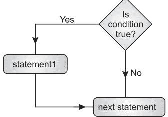

图 4.1 if 语句中的控制流

### if-else 语句

if-else 语句根据条件的结果执行两个可能的语句之一。

if-else 语句的语法为：

```java
if (condition) { // if 部分
    statement1;
} else { // else 部分
    statement2;
}
next statement;
```

在这里，if-else 语句包含两个部分，即 if 和 else。如果条件为真，则执行 if 部分中的语句。然而，如果条件为假，则执行 else 部分中的语句（参见图 4.2）。


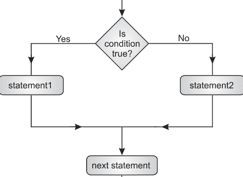

**图 4.2** if-else 语句中的控制流

**示例 4.1** 使用 if-else 语句的程序

```java
class ConditionalStatement
{
    public static void main (String args[])
    {
        int i=5;
        if (i > 0)
            System.out.println("i is a positive number");
        else
            System.out.println("i is a negative number");
    }
}
```

**程序的输出结果为**

i is a positive number

### 嵌套 if-else 语句

嵌套 if-else 语句包含一个或多个 if 语句。换句话说，if-else 语句被称为嵌套 if-else。if-else 语句有三种嵌套方式：

- if-else 语句嵌套在 if 部分。

语法为：

```java
if(condition1)
{
    statement1;
    if(condition2)
        statement2;
}
```

- if-else 语句嵌套在 else 部分。

语法为：

```java
if (condition1)
{
    statement1;
}
else
    if(condition2)
        statement2;
}
```

- if-else 语句同时嵌套在 if 和 else 部分。

语法为：

```java
if (condition1)
{
    statement1;
}
else
{
    if(condition2)
        statement2;
}
```

### if-else 阶梯

if-else 阶梯也称为 if-else bậc，它有一个最外层的 else 语句。内部 else 语句还可以包含其他语句。

if-else 阶梯的语法为：

```java
if (condition1)
    statement1;
else
    if (condition2)
        statement2;
    else
        if (condition3)
            statement3;
```

**示例 4.2** 展示 if-else 语句的程序

```java
import java.io.*; 
public class Grade {
    public static void main(String[] args) {
        int marks=0;
        DataInputStream cin=new DataInputStream(System.in);
        try {
            System.out.print("Enter the marks: ");
            //从键盘读取整数
            marks=Integer.parseInt(cin.readLine());
            if (marks>90)
                System.out.println("Grade is A");
            else
                if (marks>75)
                    System.out.println("Grade is B");
                else
                    if (marks>60)
                        System.out.println("Grade is C");
                    else
                        System.out.println("Grade is D");
        } catch (Exception e)
        {}
    }
}
```

该程序的输出结果为

Enter the marks: 78

Grade is B

### 作为替代的条件运算符

条件运算符 `?` 根据给定的条件选择两个值或表达式之一。由于条件运算符的决策性质，它有时被用作 if-else 语句的替代。注意，条件运算符选择的是值，而不是 if-else 语句中的语句。此外，它一次无法选择多个值，而 if-else 语句可以一次选择并执行多个语句。例如，考虑这条语句。

```java
max=(x>y) ? x : y
```
这条语句将 `x` 和 `y` 的最大值赋值给 `max`。

### switch 语句

switch 语句从可选语句集中选择一组语句。switch 语句求表达式的值并与整数、字符、short 或字节常量进行比较。需要注意的是，`case` 常量必须与表达式类型兼容。当找到匹配项时，执行与该常量相关的所有语句（参见图 4.3）。

switch 语句的语法为：

```java
switch (expression) {
    case <constant1>: statement1;
    [break];
    case <constant2>: statement2;
    [break];
    case <constant3>: statement3;
    [break];
    default: statement4;
}
```

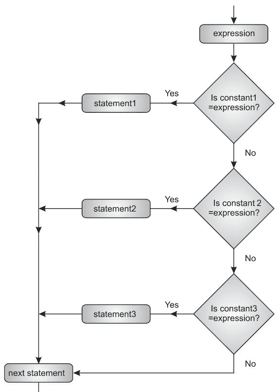

**图 4.3** switch 语句中的控制流

Java 的 `case` 和 `default` 提供了备选项列表。注意，并不是每个 `case` 标签都必须指定唯一的语句 set。多个 `case` 标签可以共享同一组语句。

关键字 `default` 指定在未找到匹配项时要执行的语句 set。注意，可以有多个 `case` 标签，但只能有一个 `default` 标签。然而，`default` 是一个可选的语句。

`switch` 块中的 `break` 语句是可选的。然而，它被用于 `switch` 块中以防止“贯穿（fall through）”。**贯穿（Fall through）**是指导致在找到匹配项后仍继续执行剩余 case 的情况。为了防止这种情况，在每个 case 和 default 指定的语句末尾使用 `break` 语句。这会导致控制流立即跳出 switch 块并执行下一个语句。

与 if 和 if-else 语句类似，switch 语句也可以相互嵌套。嵌套的 switch 语句在其 case 标签或 default 标签（如果有的话）内部包含一个或多个 switch 语句。

注意：Switch 语句不能用于测试浮点值或字符串值。

**示例 4.3** 一个演示 switch 语句用法的程序

```java
class SwitchStatement {
    public static void main(String args[]) {
        int x=2;
        switch (x) {
            case 1: System.out.println("Day is Monday");
                break;
            case 2: System.out.println("Day is Tuesday");
                break;
            case 3: System.out.println("Day is Wednesday");
                break;
            case 4: System.out.println("Day is Thursday");
                break;
            case 5: System.out.println("Day is Friday");
                break;
            case 6: System.out.println("Day is Saturday");
                break;
            case 7: System.out.println("Day is Sunday");
                break;
            default: System.out.println("Invalid option!");
        }
    }
}
```

程序的输出结果

Day is Tuesday

在例中，因为 `x` 的值为 2，所以显示消息 Day is Tuesday。当 `x` 的值为 8 时，输出 Invalid option!。

## 迭代语句

那些导致一组语句重复执行的语句（无论是为了特定的次数还是直到满足某些条件）被称为迭代语句。也就是说，只要条件求值为真，该语句（或语句块）就会执行。Java 中使用的各种迭代语句有 `for` 循环、`while` 循环和 `do-while` 循环。

### for 循环

for 循环（见图 4.4）是 Java 中使用最广泛的循环之一。for 循环是一种确定性循环，也就是说，循环体执行的次数是预知的。

for 循环的语法为：

```java
for(initialize; condition; update)
{
    //body of the for loop
}
```

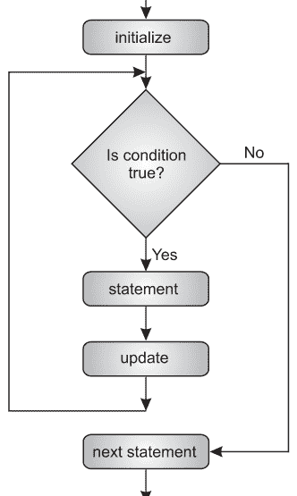

**图 4.4** for 循环中的控制流

for 循环中的初始化表达式可以初始化一个或多个控制变量。for 循环还可以在其更新表达式中更新多个变量。注意，`initialize`、`condition` 和 `update` 都是可选的表达式，并且始终在括号中指定。所有三个表达式都用分号隔开。我们也可以像下面所示通过省略所有三个表达式来创建一个无限循环。

```java
for( ; ; )
{
}
```

**示例 4.4** 一个使用 for 循环显示倒计数的程序

```java
class UpdateStatement
{
    public static void main(String args[])
    {
        for (int i=10;i>=1;i--)
        {
            System.out.print(" "+i);
            System.out.println();
            System.out.print("This is an example of for loop");
        }
    }
}
```

程序的输出结果是

10 9 8 7 6 5 4 3 2 1

This is an example of for loop

### 使用逗号运算符的 for 循环

for 循环允许使用逗号运算符通过多个变量来控制循环。也就是说，两个或多个变量可以使用循环的初始化部分和更新部分。例如，考虑此语句。

```java
for (i=1,j=50;i<10;i++,j--)
```

这条语句初始化了两个变量即 `i` 和 `j` 并更新了它们。注意，for 循环不能有多个用逗号分隔的条件。

### while 循环

while 循环（见图 4.5）用于在预未知迭代次数的情况下执行循环操作。也就是说，与 for 循环不同，while 循环在本质上是非确定性的。

while 循环的语法为：

```java
while(condition)
{
    // body of the while loop
}
```

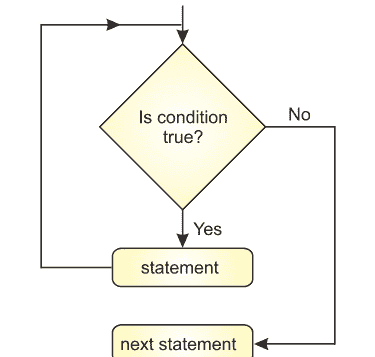

**图 4.5** while 循环中的控制流

关于 while 循环应注意以下点：

- 与 for 循环不同，while 循环在本质上是非确定性的。
- 与 for 循环显式指定初始化和更新表达式不同，while 循环没有指定。
- while 循环在条件求值为真时一直执行。
- 与 for 循环不同，while 循环在循环开始前求值条件。
- 控制变量必须在循环体内部更新。
- 循环在条件求值为假时停止。
- 循环在条件求值为真时执行。

**示例 4.5** 计算 n 个连续整数和的程序

```java
import java.io.*;
public class Sum {
    public static void main(String args[]) {
        int n;
        int sum=0;
        DataInputStream cin=new DataInputStream(System.in);
        try {
            System.out.print("Enter n: ");
            // reading input from the user
            n=Integer.parseInt(cin.readLine());
            // loop to calculate the sum
            while(n > 0) {
                sum += n;
                n--;
            }
        } catch (Exception e) {
        }
        System.out.println("The sum is " + sum);
    }
}
```

程序的输出结果是

Enter n: 7

The sum is 28

### do-while 循环

如前所述，对于 while 循环无论初始状态真还是假，do-while 循环至少执行一次（见图 4.6）。

do-while 循环的语法为：

```java
do {
    //body of do-while loop
} while (condition);
```

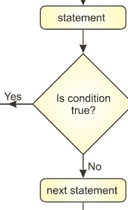

**图 4.6** do-while 循环中的控制流

**示例 4.6** 计算等差数列（AP）和的程序

```java
class APSeries {
    public static void main(String[] args) {
        int first_term=1;
        int number_of_terms=5;
        int term=0;
        int i=1;
        int common_difference=2;
        int sum=0;
        System.out.print("The terms are: ");
        do {
            term=first_term+(i-1)*common_difference;
            sum+=term;
            System.out.print(" "+term);
            i++;
        } while (i<=number_of_terms);
        System.out.println();
        System.out.println("The sum of A.P is: "+sum);
    }
}
```

### 嵌套循环

嵌套循环是指存在另一个循环体内的循环。所有三种循环（`for`、`while` 和 `do-while`）都可以嵌套。

**示例 4.7** 一个演示嵌套 for 循环的程序

```java
class NestedLoop {
    public static void main(String args[]) {
        for(int a=0;a<5;a++) { //外层循环
            for(int b=0;b<5;b++) { //内循环
                System.out.print("**");
            }
            System.out.println();
        }
    }
}
```

程序的输出结果是

****
****
****
****
****

### break 语句

`break` 语句在循环和 switch 语句中被广泛使用。它立即终止循环或 switch 语句，跳过剩余的语句。控制流传递到紧随 switch 语句之后的语句。`break` 语句可以在 Java 的任何三个循环中使用。在嵌套循环的情况下，`break` 会退出唯一的单一循环，即它所在的循环。

### continue 语句

`continue` 语句用于“继续”循环的下一次迭代。换句话说，它会跳过当前迭代中剩余的语句，并立即将控制权传递给下一次迭代。它不会终止循环（如 `break` 语句那样），而是终止循环的当前迭代。像 `break` 一样，`continue` 语句可以在任何循环中使用。

### return 语句

`return` 语句用于显式地将控制传出方法。它将控制返回给调用者并终止其所在的方法。当在 `main()` 方法中遇到 `return` 语句时，它会将控制交回 Java 运行时系统并执行程序。

**示例 4.8** 使用 break 和 continue 语句计算一个数因数的程序

```java
class Jump
{
    public static void main(String args[])
    {
        int factor=0, number=10, sum=0;
        System.out.println("Number=" +number);
        while(true)
        {
```


factor++;

if (factor > number)
    break;

if (number % factor != 0)
    continue;

sum = sum + factor;
}

System.out.println("Sum of factors=" + sum);

if (sum > 0)
    return;

System.out.println("This statement is not executed");
}
}

```

## 程序的输出是

Number=10
Sum of factors=18

## 4.5 标签循环

正如讨论过的，`break` 和 `continue` 语句允许程序员跳出循环。然而，它们不允许你跳转到程序的其他部分，或者跳出嵌套循环或 `switch` 语句。Java 允许使用标签进行跳转。标签是一个标识符，必须遵守 Java 标识符的命名规则。它可以放在语句块或循环之前，后跟一个冒号（:）。例如，考虑以下语句。

### 控制语句 55

LabelName: for( ; ; )

```java
{
  .
}
```

`break` 语句将控制传出最内层循环或最内层 `switch` 语句，而 `continue` 语句继续最内层循环的下一次迭代。然而，在标签的帮助下，`break` 语句可以导致控制跳出外层循环或 `switch` 语句。例如，考虑这些语句。

```java
outerloop: for(i=0;i<5;i++)
{
  innerloop:
    for(j=1;j<5;j++) {
      System.out.println("*");
      if(i==j)
        break outerloop;
    }
}
```

在这种情况下，放置在 `innerloop` 和外层循环中的 `break` 语句将强制控制跳出内层和外层循环。同样，在标签的帮助下，`continue` 语句可以继续外层循环的下一次迭代。

### 示例 4.9 在标签循环中使用 `continue` 语句的程序

```java
class LabelExample {
  public static void main(String args[]) {
    outerloop: for(int i=0;i<3;i++) {
      for(int j=0;j<5;j++) {
        if(j>i)
          continue outerloop;
      }
      System.out.println(" "+"+"+ j+" "+");
    }
    System.out.println("Loop Ends");
  }
}
```

**程序的输出是**

+ i 0 j
i 1 j 0
i 1 j 1
i 2 j 0
i 2 j 1
i 2 j 2

### 循环结束

在程序中，如果我们用 `break` 语句替换 `continue` 语句，将生成以下输出。

```
i 0 j 0
Loop Ends
```

## 总结

- 语句是给计算机以执行特定操作的指令。语句可以是单一语句，也可以是复合语句。
- 单一语句指定单个操作，并始终以分号 `;` 结束。复合语句（也称为块）是封装在花括号 `{}` 内部的一组语句。
- 控制语句用于改变程序的控制流。在 Java 中，控制语句大致分为三类，即条件语句、迭代语句和跳转语句。
- 条件语句（也称为选择语句）用于根据给定的条件做出决策。
- 条件运算符 `??` 根据条件从两个值或表达式中选择一个。
- `switch` 语句从可用的语句集中选择一组语句。
- 导致一组语句执行特定次数或直到满足某些条件的语句被称为迭代语句。
- `for` 循环是 Java 中使用最广泛的循环之一。`for` 循环是一种确定循环，循环执行次数是预先的。
- `while` 循环用于在未知迭代次数的情况下执行循环操作。在 `while` 循环中，条件在循环开始时评估，如果结果为假，则循环不执行。
- `do-while` 循环用于无论条件的初始状态是真还是假，循环体都至少执行一次。
- 嵌套循环是位于另一个循环体内的循环。
- 跳跃语句用于改变控制流。Java 中定义的跳转语句有 `break`、`continue` 和 `return`。

# 控制语句

## 练习题

### 填空。

1. 条件语句也称为 ________________。
2. ________________ 运算符是 if-else 的替代。
3. 根据条件重复执行一组语句的控制语句被称为 ________________。
4. 在循环体内放置循环被称为 ________________。
5. ________________ 语句将控制从一个部分转移到另一个部分。

### 选择题。

1. 以下哪个是无效的 switch？
   (a) int choice=4;
   (b) char choice='x';
   (c) String choice="Monday";
   (d) short choice=5;

2. 以下哪个是跳转语句？
   (a) return
   (b) continue
   (c) break
   (d) 以上都是

3. 遇到时终止当前迭代的语句是
   (a) return
   (b) continue
   (c) break
   (d) 以上都不是

4. 以下哪个是无效的 for 语句？
   (a) for (i=1, j=45;i<5;i--)
   (b) for (i=1, j=50;i>20;i--)
   (c) for (i=1, j=50;i++, j--)
   (d) 以上都不是

5. 以下哪个不是位运算运算符？
   (a) <<
   (b) ~
   (c) >>>
   (d) 以上都不是

### 判断对错。

1. 条件运算符一次只能选择一个值。
2. switch 块可以有多个 default。
3. default 语句用于立即退出 switch 块。
4. for 循环允许对多个变量进行声明或初始化。
5. 标签是代码块的名称，允许从一个循环跳转到嵌套循环。

### 回答问题。

1. 什么是控制语句？用示例说明不同控制语句。
2. 考虑以下代码段：

```java
if (x%2==0)
{
  if(x%2==0)
    System.out.println("x is an even number");
}
```

使用以下重写代码：(a) if-else 语句 (b) 条件运算符

3. 使用 for 循环查找并打印 100 到 200 之间 9 的倍数。
4. 陈述 while 循环和 do-while 循环执行的区别。用合适的示例支持你的答案。
5. 解释 switch 语句中 break 和 default 的用法。
6. 区分 break、return 和 continue 语句。
7. 写一个程序打印以下输出：

```
1
1 2
1 2 3
1 2 3 4
1 2 3 4 5
```

8. 写一个程序检查该数字是否为回文。（提示：回文数是从左到右和从右到左读相同的数字。）
9. 写一个程序计算此级数的和：

```
1+x+x²+x³...+xⁿ
```

# 第 5 章
# 类与对象

## 本章目标

在阅读完本章后，你将能够：

- 解释构成面向对象编程基础的类和对象
- 创建并使用无参数方法和带参数方法
- 理解点运算符（`dot operator`）的意义
- 理解对象引用变量的赋值
- 学习如何通过值或引用向方法传递参数
- 解释类中静态（`static`）变量和方法的作用
- 理解方法重载的概念
- 解释构造函数的作用及其类型
- 解释如何将对象作为参数传递
- 理解返回对象的概念
- 理解递归的概念
- 理解 `this` 关键字的意义
- 解释垃圾回收和 `finalize()` 方法的使用

## 5.1 引言

面向对象编程的核心目标是将现实世界中的各种对象表示为程序元素。在 Java 中，这一目标是通过类的帮助实现的，类将数据和操作这些数据的方法绑定在单一实体中。

所有的 OOP 概念，如抽象、封装、继承和多态，都是通过类的帮助实现的。类充当模板，为它的所有实例（即对象）提供通用的布局。也就是说，类只是一个逻辑抽象，规定了对象将拥有哪些数据和方法，而对象则是在程序中使用这些数据和方法的物理实体。因此，对象被认为是面向对象编程的构建块。本章将详细讨论类和对象的概念。

## 5.2 类的基础

类是一种用户定义的类型，可用于创建该类型的实例，并称为对象。因此，我们可以说，类是对象的模板，而对象是类的实例。与任何其他用户定义的数据类型一样，类也需要在程序的实例中声明和定义。类的定义指定了一种新的数据类型，该类型可以被视为内置数据类型。

类的定义语法：

```java
class class_name
{
    //variables declaration
    //methods declaration
}
```

在类中声明的变量被称为实例变量（`instance variables`）。这是因为类的每个实例或对象都拥有这些变量的独立拷贝。因此，每个对象都拥有独特的数据的数据。在大括号内声明的变量和方法统称为类的成员（`members`）。

类可以是空的。也就是说，下面这个类定义也是有效的。

```java
class class_name
{}
```

在这里，由于类的主体是空的，它不包含任何变量和方法，因此无法执行任何有用操作。然而，此类可以成功编译，我们也可以使用该类创建对象。

**注意：** 在 Java 中，类定义的右大括号后没有分号。

### 示例 5.1 一个不带方法的简单类定义

```java
class Cuboid
{
    int length;
    int width; //variables declaration
    int height;
}
```

在这个示例中，创建了一个名为 `Cuboid` 的类，包含三个 `int` 类型的实例变量：`length`、`width` 和 `height`。

## 5.2 方法 方法介绍

如前所述，类由实例变量和方法组成。只包含变量（而没有操作这些变量的方法）的类无法执行任何有用操作。因此，为了访问类的实例变量并操作它们，我们必须在类中添加方法。

方法的定义语法为：

```java
return_type method_name(parameter_list)
{
    body of the method
}
```

其中，
- `return_type` 是方法返回的数据类型
- `method_name` 指定了方法的名称。它可以是 Java 关键字以外的任何名称
- `parameter_list` 由一系列由逗号分隔的数据类型和标识符对组成

**注意：** `parameter_list` 可以是空的，如果方法不返回任何值，则其返回类型为 `void`。

例如，考虑以下方法定义。

```java
int volume()
{
  body of the method
}
```

在这里，方法 `volume()` 不接受任何参数，并返回一个 `int` 类型的值。

### 示例 5.2 带有方法的类定义

```java
class Cuboid
{
  int length;
  int width; //variables declaration
  int height;
  int volume() //method definition
  {
    return(length*width*height);
  }
}
```

注意：方法必须在类体内部的实例变量声明之后立即声明。

## 5.3 创建对象

一旦定义了类，就可以用它创建该类型的变量，即对象。对象与类之间的关系与任何变量与其数据类型之间的关系相同。要创建一个对象，我们需要先声明它。

声明对象的语法为：

```java
class_name object_name;
```

其中，
- `class_name` 是类的名称
- `object_name` 是 `class_name` 类对象的名称

例如，声明一个 `Cuboid` 类型对象的语句是：

```java
Cuboid objj;
```

该语句声明了一个变量 `objj` 作为指向 `Cuboid` 类型对象的引用。在执行该语句后，`objj` 包含 `null` 值，表示它没有指向任何实际对象。对象被声明了，我们需要通过为它分配所需的内存空间来创建它。在 Java 中，这是通过 `new` 运算符实现的。

创建对象的语法为：

```java
object_name = new ClassName();
```

例如，创建一个 `Cuboid` 类型对象的语句是：

```java
objj = new Cuboid();
```

该语句声明了一个变量 `objj` 作为指向 `Cuboid` 类型对象的引用。在执行该语句后，`objj` 包含了空值，表示它没有指向实际对象。在 Java 中，这是通过 `new` 运算符完成的。

## 5.4 访问类的成员

要访问对象的成员，我们使用点运算符。例如，如果我们有一个 `Cuboid` 类对象 `objj`，可以通过 `objj.length` 访问它的实例变量。

### 示例 5.3 访问类的成员程序

```java
class Cuboid
{
    int length;
    int width;
    int height;
    int volume()
    {
        return(length*width*height);
    }
}

class ClassDemo
{
    public static void main(String args[])
    {
        Cuboid objj = new Cuboid();
        objj.length = 60;
        objj.width = 20;
        objj.height = 40;
        int vol = objj.volume();
        System.out.println("The volume of the cuboid is: " + vol);
    }
}
```

**程序的输出为**

The volume of the cuboid is: 48000

### 示例 5.4 使用带参数方法的程序

```java
class Cuboid
{
    int length;
    int width;
    int height;
    void initialize(int l, int w, int h)
    {
        length = l;
        width = w;
        height = h;
    }
    int volume()
    {
        return(length*width*height);
    }
}

class ParameterizedMethod
{
    public static void main(String args[])
    {
        Cuboid c1 = new Cuboid();
        Cuboid c2 = new Cuboid();
        c1.initialize(12,10,8);
        int vol1 = c1.volume();
        c2.initialize(13,11,9);
        int vol2 = c2.volume();
        System.out.println("The Volume of the Cuboid is: " + vol1);
        System.out.println("The Volume of the Cuboid is: " + vol2);
    }
}
```

**程序的输出为**

The Volume of the Cuboid is: 960
The Volume of the Cuboid is: 1287

## 5.5 赋值对象引用变量

对象引用变量可以赋值给另一个对象引用变量。例如，考虑以下语句：

```java
Class obj1 = new Class();
Class obj2 = obj1;
```

从这些语句中，似乎将 `obj1` 所向对象的引用拷贝赋值给了 `obj2`。也就是说，似乎 `obj1` 和 `obj2` 指向不同的、独立的对象。然而事实并非如此。相反，赋值后，`obj1` 和 `obj2` 将指向同一个对象。

该对象，并且没有为 `obj2` 分配独立的内存空间。通过 `obj2` 对对象所做的任何更改都将影响 `obj1` 所引用的该对象。

请注意，`obj1` 和 `obj2` 之间并不相互关联。例如，如果我们对 `obj1` 进行新的赋值，`obj1` 将简单地从原始对象中分离出来，而不会影响到该对象和 `obj2`。也就是说，`obj2` 仍然指向原始对象。

## 5.6 参数传递

在方法调用语句中出现的变量被称为**实际参数**（`actual arguments`），而在方法定义中出现的变量被称为**形式参数**（`formal arguments`）。方法调用中实际参数的数量、顺序和类型必须与形式参数相匹配。参数可以通过两种方式传递给方法——**按值传递**（`call-by-value`）和**按引用传递**（`call-by-reference`）。

### 5.6.1 按值传递

在按值传递的方法中，实际参数的值会被复制到形式参数中。简单来说，方法创建了参数值的副本，然后对这些复制后的值进行操作。因此，方法中对复制后的值的任何更改都不会影响调用方法中实际参数的值。在 Java 中，当基本类型的参数被传递给方法时，它们是按值传递的。

> 示例 5.5 展示按值传递机制的程序 FirstCall

```java
{
  void vol(int i, int j, int k)
  {
    i += 5;
    j += 5;
```


```java
k+=5;
}
}
class CallByValue {
  public static void main(String args[]) {
    FirstCall fc = new FirstCall();
    int l=10;
    int w=20;
    int h=15;
    System.out.println("Length, Width, Height before\ncall is :" + l + " " + w + " " + h);
    fc.vol(l, w, h); //passing values as arguments
    System.out.println("Length, Breadth, Height after\ncall is :" + l + " " + w + " " + h);
  }
}
```

# 类与对象

程序的输出为：
Length, Breadth, Height before call is :10 20 15
Length, Breadth, Height after call is :10 20 15

在这个程序中，`l`、`w` 和 `h` 的值在调用前后保持不变。这是因为当方法 `vol()` 被调用时，`l`、`w` 和 `h` 是按值传递的，它们的值被复制到形式参数 `i`、`j` 和 `k` 中。因此，方法 `vol()` 操作的是 `i`、`j` 和 `k`，而不是 `l`、`w` 和 `h`。结果是，`l`、`w` 和 `h` 的值保持未改变。

## 5.6.2 按引用传递

在按引用传递中，参数的引用被作为方法参数传递。与按值传递的方法不同的是，按引用传递不会创建实际参数的副本，被调用的方法直接对原始值操作。这意味着对变量的任何更改都会反映在调用方法中。在 Java 中，当一个类的对象作为参数传递给方法时，它是按引用传递的。

**示例 5.6** 展示按引用传递机制的程序

```java
class SecondCall {
    int length, breadth, height; //variables declaration
    void vol(SecondCall s) //method definition
    {
        s.length+=5;
        s.breadth+=5;
        s.height+=5;
    }
}

class CallByReference {
    public static void main(String args[])
    {
        SecondCall sc = new SecondCall();
        sc.length=10;
        sc.breadth=20;
        sc.height=30;
        System.out.println("The values of Length, Breadth and\nHeight after method call: " + sc.length + " " + "" + sc.breadth + " " + +sc.height);
        sc.vol(sc); //passing object as method argument
        System.out.println("The values of Length, Breadth and\nHeight after method call: " + sc.length + " " + "" + sc.breadth + " " + +sc.height);
    }
}
```

程序的输出为：
The values of Length, Breadth and Height before method call: 10 20 15
The values of Length, Breadth and Height after method call: 15 25 35

在这个程序中，对象 `sc` 的长度、宽度和高度的值在调用方法后发生了变化。因为当调用方法 `vol()` 时，类的对象被作为参数传递的。因此，在 `vol()` 方法中对此传递对象的长度、宽度和高度的更改反映在了原始值中。

## 5.7 静态变量方法

到为止，我们看到类的成员只能通过其对象进行初始化或访问。然而，可以在不引用特定对象的情况下定义类的成员。这是通过将类的实例变量和方法声明为 `static`（静态）来实现。与非静态成员不同，静态成员与整个类相关，而不是与单个对象相关。因此，类的静态成员是通过类名而不是通过对象来调用的。由于静态变量和静态方法包含类的属性而不是单个对象的属性，它们分别被称为**类变量**和**类方法**。

类的静态变量和静态方法也分别称为类变量和类方法。

静态变量的声明语法为：

```java
static return_type variable_name;
```

访问静态变量的语法为：

```java
class_name.variable_name
```

静态方法的声明语法为：

```java
static return_type method_name(parameter_list);
```

访问静态方法的语法为：

```java
class_name.method_name
```

**示例 5.7** 使用静态成员的程序

```java
class StaticMembers {
    static int i=10; //static variable
    static void add(int x, int y) //static method
    {
        System.out.println("Sum of two numbers is: " + (x+y));
    }
}

class StaticExample {
    public static void main(String args[])
    {
        StaticMembers.add(30,40);//calling static method
        int i = StaticMembers.i; //accessing static variable
        System.out.println("Value of i is: " + i);
    }
}
```

程序的输出为：
Sum of two numbers is: 70
Value of i is: 10

在这里，变量 `i` 和方法 `add()` 被声明为静态的。

> **注意**：静态方法只能访问静态数据并调用静态方法。

## 5.8 方法重载

当为不同数据类型定义相似的操作时，不同的方法会让程序变得复杂，因为程序员必须记住这些名称。为了防止这种情况，Java 允许对方法进行重载。

方法重载允许具有相同名称但参数不同的方法。方法重载的应用出现在需要使用不同输入参数来执行相似操作的程序中。当调用方法时，Java 编译器编译方法名以及与之相关的类型和数量，以确定调用哪个方法。这一过程被称为**多态**。

为了在程序中创建重载方法，我们必须在类中创建名称相同但参数不同的方法。重载方法通过参数的数量、参数的数据类型或参数数据类型的顺序来区分。

为了理解方法重载的概念，考虑以下方法声明：

```java
void sum(int);
void sum(int, int);
```

在这些语句中，两个名为 `sum()` 的方法不同，因为传递参数的数量不同。现在考虑这些语句：

```java
void addition(int);
void addition(char);
```

在这些语句中，两个名为 `addition()` 的方法不同，因为传递参数的数据类型不同。现在考虑这些语句：

```java
void area(int, float);
void area(float, int);
```

在这些语句中，两个名为 `area()` 的方法不同，因为传递参数的数据类型顺序不同。

**示例 5.8** 展示方法重载概念的程序

```java
class Shapes {
  void perimeter(int a) //method with int type parameter
  {
    System.out.println("The perimeter of the square is " + (4*a));
  }

  void perimeter(double a) // double 类型的方法参数
  {
      System.out.println("The circumference of the circle is " + (2*a*(22/7)));
  }

  void perimeter(int a, int b) // 两个参数的方法
  {
      System.out.println("The perimeter of the rectangle is " + 2*(a+b));
  }
}

class MethodOverloading {
    public static void main(String args[]) {
        Shapes s = new Shapes();
        s.perimeter(5.5);
        s.perimeter(10);
        s.perimeter(15,10);
    }
}
```

程序的输出结果为：
The circumference of the circle is 33.0
The perimeter of the square is 40
The perimeter of the rectangle is 50

## 5.9 构造方法

构造方法是一种特殊方法，用于在创建对象时初始化对象。构造方法的名称与其所在的类名称相同。与 Java 中的其他方法不同，构造方法没有返回值（即使是 `void`）。这是因为构造方法的隐式返回值是它所属的类的实例。

定义构造方法的语法为：

```java
class class_name {
    //变量声明
    class_name(parameter_list) //构造方法定义
    {
        //构造方法的主体
    }
}
```

需要注意的是，如果你没有显式地定义任何构造方法，Java 编译器会自动提供一个默认构造方法，将所有实例变量初始化为 0。

**示例 5.9** 演示构造方法概念程序

```java
class Cuboid {
    int length;
    int width;
    int height;

    Cuboid() // 无参数构造方法定义
    {
        length=20;
        width=10;
        height=15;
    }

    int volume() {
        return (length*width*height);
    }
}

class Constructor {
    public static void main(String args[]) {
        Cuboid c1 = new Cuboid();
        Cuboid c2 = new Cuboid();
        int a = c1.volume();
        int b = c2.volume();
        System.out.println("The volume of first cuboid is " + a);
        System.out.println("The volume of second cuboid is " + b);
    }
}
```

程序的输出结果为：
The volume of first cuboid is 3000
The volume of second cuboid is 3000

在这个示例中，构造方法用相同的值初始化了 `Cuboid` 类型的两个对象 `c1` 和 `c2`，结果两个长方体的体积是相同的。显然，无参数构造方法为类的所有对象提供了相同的值。

### 5.9.1 参数化构造方法

当类的不同对象需要用不同的值进行初始化时，可以定义参数化构造方法。参数化构造方法是在创建对象时接受一个或多个参数的构造方法，用这些参数初始化对象的实例变量。它使得程序更加灵活，我们可以为类对象的实例变量分配不同的值。

**示例 5.10** 演示参数化构造方法概念程序

```java
class Cuboid {
    int length;
    int width;
    int height;

    Cuboid(int l, int w, int h) // 参数化构造方法
    {
        length=l;
        width=w;
        height=h;
    }

    int volume() // 方法定义
    {
        return (length*width*height);
    }
}

class ParameterizedConstructor {
    public static void main(String args[]) {
        Cuboid c1 = new Cuboid(10,8,9);
        Cuboid c2 = new Cuboid(7,6,5);
        int a = c1.volume();
        int b = c2.volume();
        System.out.println("The volume of first cuboid is " + a);
        System.out.println("The volume of second cuboid is " + b);
    }
}
```

程序的输出结果：
The volume of first cuboid is 720
The volume of second cuboid is 210

### 5.9.2 构造方法重载

像方法一样，构造方法也可以被重载。也就是说，我们可以定义多个参数数量和/或类型不同的构造方法。例如，在示例 5.10 中，构造方法 `Cuboid()` 在对象声明时需要三个参数。然而，可能存在我们需要向构造方法传递不同数量参数的情况。这可以通过重载构造方法来实现。

> **示例 5.11** 演示构造方法重载程序

```java
class Cuboid {
    int length;
    int width;
    int height;

    Cuboid() {
        System.out.println("The first constructor has no argument, so volume is not calculated");
    }

    Cuboid(int l, int w, int h) {
        length=l;
        width=w;
        height=h;
    }

    Cuboid(int oneval) {
        length=width=oneval;
    }

    int volume() // 方法定义
    {
        return (length*width*height);
    }
}

class OverloadConstructor {
    public static void main(String args[]) {
        Cuboid c1 = new Cuboid();
        Cuboid c2 = new Cuboid(10,8,9);
        Cuboid c3 = new Cuboid(10);
        int a = c1.volume();
        int b = c2.volume();
        int c = c3.volume();
        System.out.println("The volume of first cuboid is " + a);
        System.out.println("The volume of second cuboid is " + b);
        System.out.println("The volume of third cuboid is " + c);
    }
}
```

程序的输出结果为：
The first constructor has no argument, so volume is not calculated
The volume of first cuboid is 0
The volume of second cuboid is 720
The volume of third cuboid is 1000

## 5.10 使用对象作为参数

Java 方法除了接收基本类型外还可以接收对象。这允许我们将一个对象的状态传递给另一个方法。

**示例 5.12** 演示传递对象

```java
class Cuboid {
    int length;
    int width;
    int height;

    Cuboid(int l, int w, int h) {
        length=l;
        width=w;
        height=h;
    }

    int volume() {
        return (length*width*height);
    }
}

class ObjectParameter
```


```java
void displayVolume(Cuboid c) {
    System.out.println("The volume of cuboid is " + c.volume());
}

public static void main(String args[]) {
    Cuboid c1 = new Cuboid(10, 8, 9);
    ObjectParameter().displayVolume(c1);
}
```

## 5.11 返回对象 (RETURNING OBJECTS)

除了返回基本类型外，方法还可以返回类对象。当方法需要创建并返回一个对象实例时，这种方法非常有用。

示例 5.13 演示返回对象

```java
class Cuboid {
    int length;
    int width;
    int height;

    Cuboid(int l, int w, int h) {
        length = l;
        width = w;
        height = h;
    }

    int volume() {
        return (length * width * height);
    }

    Cuboid createCuboid(int l, int w, int h) {
        Cuboid temp = new Cuboid(l, w, h);
        return temp;
    }
}

class ReturningObjects {
    public static void main(String args[]) {
        Cuboid c1 = Cuboid.createCuboid(10, 10, 10);
        System.out.println("The volume of returned cuboid is " + c1.volume());
    }
}
```

## 5.12 递归 (RECURSION)

Java 也支持递归。当方法定义包含了对自身的调用时，被称为递归方法，该过程被称为递归或循环定义。当第一次调用递归方法时，会在内存中留出空间来执行此调用，并执行方法体。再次调用方法；再次为此留出空间，以此类推。换句话，每个方法调用的空间都排列在栈中。每调用一次方法，其内存区域就会放置在栈顶，并在调用执行完成后被移除（如图 5.1 所示）。

| 1st call | 1st call | 2nd call | 3rd call |
| --- | --- | --- | --- |

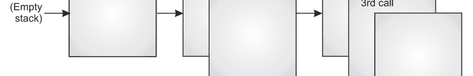

(内存分配)

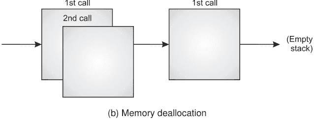

图 5.1 调用递归函数

理解递归的概念，请考虑此示例。

示例 5.14 用于演示递归概念的程序

```java
class Factorial {
    int fact(int n) {
        int result;
        if (n == 1)
            return 1;
        result = fact(n - 1) * n;
        return result;
    }
}

class Exemplerecursion {
    public static void main(String args[]) {
        Factorial f = new Factorial();
        System.out.println("Factorial of 3 is " + f.fact(3));
        System.out.println("Factorial of 4 is " + f.fact(4));
    }
}
```

程序的输出为：

```
Factorial of 3 is 6
Factorial of 4 is 24
```

在这个示例中，函数 `fact()` 被传入参数 `n` 调用。函数 `fact()` 重复使用参数 `n-1` 调用自身，并返回 `fact(n-1) * n` 的积。这个过程一直重复直到 `n` 的值等于 1。当 `n` 等于 1 时，`fact()` 函数返回 1。

注意，递归方法也可以使用 `for`、`while` 和 `do...while` 循环迭代定义。这是因为递归由于其栈映射和更多的内存使用，会导致程序执行速度变慢。此外，由于每次方法调用都会在栈上为局部变量和方法参数分配新的内存空间，递归会导致栈溢出。然而，在某些情况下，递归方法比它们的对应方法更好，因为它们使代码更简单且易于理解。例如，使用递归实现快速排序算法更容易。

## 内部类

Java 1.0 版本中定义的类都是顶层类（top level classes）。顶层类是包的直接成员，没有嵌套在任何其他类中。然而，从 Java 1.1 版本开始，Java 程序中可以定义其他四类型的类，广称为内部类（inner classes）。内部类是 Java 语言最大的增强。类可以定义为其他类的成员，也可以定义在代码块中。这四种类解释如下：

- **静态成员（Static member）**：定义为另一个类的静态成员的类被称为**静态成员类**（static member class）。它就像顶层类一样，区别在于它可以访问其所属类的静态成员。
- **成员类（Member classes）**：它也是定义为另一个类的成员的类，但没有声明为静态。成员类的代码可以访问其外部类的所有静态和非静态字段及方法。此外，成员类的实例总是与外部类的实例相关。
- **局部类（Local classes）**：定义在代码块中的类被称为**局部类**（local class）。局部类仅在该代码块内可见。它在某些方面类似于局部变量。虽然局部类不是成员类，但它们仍然定义在外部类内部，并且可以使用它的字段和方法。
- **匿名类（Anonymous classes）**：一种没有名字的类被称为匿名类。匿名类将类定义和对象实例化的步骤合并到单个 Java 表达式中。由于类是在定义它的表达式中实例化的，因此它只能被实例化一次。否则，匿名类在行为和使用上与局部类非常相似。

## this 关键字

众所周知，方法是由类的对象调用的。可能会出现一种情况，即方法需要调用它的对象的引用。在 Java 中，这是通过使用 **this 关键字**实现的。在任何方法中使用 **this** 关键字，我们可以引用*当前*对象，即调用该方法的对象。例如，考虑以下两个代码段。

```java
FirstConstructor(int i, int j) // 构造函数的第一次定义
{
    this.a = i;
    this.b = j;
}

FirstConstructor(int i, int j) // 构造函数的第二次定义
{
    a = i;
    b = j;
}
```

这两个构造函数的运行方式完全相同。在这里，在第一个代码段中使用 **this** 是正确的但不是必须的。然而，它还有其他用途，例如防止类的实例变量与方法内部声明的变量之间的命名冲突。

## 示例 5.15 用于演示类实例变量与方法内部声明变量之间命名空间冲突的程序

```java
class SecondConstructor {
    int i, j;

    SecondConstructor(int i, int j) {
        //访问构造函数的变量
        i = i;
        j = j;
    }

    void display() {
        System.out.println("Value of instance variable i:" + i);
        System.out.println("Value of instance variable j:" + j);
    }
}

class ConstructorsCall {
    public static void main(String args[]) {
        SecondConstructor sc = new SecondConstructor(10, 20);
        sc.display();
    }
}
```

程序的输出为：
```
Value of instance variable i:0
Value of instance variable j:0
```
在这个程序中，`i` 和 `j` 的值为 0。这是因为实例变量和构造函数内部的变量被遮蔽（shadowed）了。为了解决这个问题，我们使用 `this` 关键字。

## 示例 5.16 用于演示 this关键字使用的程序

```java
class SecondConstructor {
    int i, j;

    SecondConstructor(int i, int j) {
        //访问构造函数的变量
        this.i = i;
        this.j = j;
    }

    void display() {
        System.out.println("Value of instance variable i:" + i);
        System.out.println("Value of instance variable j:" + j);
    }
}

class ConstructorsCall {
    public static void main(String args[]) {
        SecondConstructor sc = new SecondConstructor(10, 20);
        sc.display();
    }
}
```

程序的输出为：
```
Value of instance variable i:10
Value of instance variable j:20
```

## 垃圾回收

正如已经讨论过的，Java 提供了一种名为垃圾回收（garbage collection）的机制，它处理不再需要的对象的释放。不需要显式地释放内存。

## finalize() 方法

有时可能会出现这种情况：持有某些资源（如文件描述符或数据库连接）的对象在销毁之前需要释放。为了处理这种情况，使用了 `finalize()` 方法。`finalize()` 的语法为：

```java
protected void finalize() {
    //最终化代码
}
```

关键字 `protected` 是此方法的访问修饰符。

## 总结

- 面向对象编程的关键目标是将各种现实对象表示为元素。
- 类是用户定义的数据类型，可以用于创建该类型的实例。
- 方法被添加到类中，以便访问和操作实例变量。
- 对象是创建的类类型变量。
- 实例变量不能在类外部通过它们的名称直接访问；而是使用方法。
- 方法调用中出现的参数称为实际参数（actual arguments），而在定义方法时使用的参数称为形式参数（formal arguments）。
- 参数传递给方法有两种方式：值传递（call-by-value）和引用传递（call-by-reference）。
- 在值传递方法中，实际参数的值被复制到形式参数。
- 在引用传递方法中，参数的引用作为参数传递。
- 类的静态成员定义时不引用特定对象；它们与整个类相关。
- 方法重载允许多个方法具有相同的名称但不同的参数和定义。
- 构造函数是一种在创建对象时初始化对象的特殊方法。
- 参数化构造函数是在创建对象时接收一个或多个参数并用这些参数初始化实例变量的构造。
- 像普通方法一样，构造函数也可以重载。也就是说，我们可以定义多个在参数数量/类型上不同的构造函数。
- 对象可以作为参数传递给方法。
- 方法可以返回内置数据类型，也可以返回用户创建的类类型。
- `this` 关键字用于引用当前对象（即调用该方法的对象）。

# 练习

1. ______ 与 ______ 之间的关系与基本数据类型与变量的关系相同。
2. ______ 方法允许程序员向实例变量传递不同的值。
3. ______ 过程允许多个方法具有相同的名称但不同的参数和定义。

# 类与对象

4. 参数可以通过以下两种方式传递给方法，而 `keyword` 用于引用当前对象。

# 选择正确选项。

- 1. 下列中哪种运算符用于创建对象并分配内存空间？
  (a) 点运算符 (b) new 运算符
  (c) instanceof 运算符 (d) 以上都不是

- 2. 下列这些实体中，哪一个是访问类成员的正确语法？
  (a) class_member.class_object (b) class_object.class_name
  (c) class_name.class_member (d) class_object.class_member

- 3. 构造函数的返回类型是
  (a) void (b) int
  (c) float (d) 以上都不是

- 4. 下列中哪是有效的方法声明？
  (a) int sum(int x, int y) (b) int sum(int x, y)
  (c) sum(int x, int y) (d) sum(int, int)

- 5. 关于 `finalize()` 方法，下述哪描述是正确的？
  (a) 它用于初始化
  (b) 它在对象离开作用范围时被调用
  (c) 它在 try 块之后使用
  (d) 它用于定义在对象销毁之前执行的操作

# 判断对错。

- 1. 对象是一个逻辑抽象，规定了对象将拥有哪些数据和方法。
- 2. 可以将对象作为参数传递给方法。
- 3. 类的静态数据成员独立于类的任何特定对象。
- 4. 程序中添加的实例变量和方法可以通过它们的名称直接在类外部访问。
- 5. 类中定义构造函数是强制性的。

# 回答以下问题。

- 1. 什么是类？它与对象有什么关系？

- 2. 找出并修复程序中的错误，以显示矩形的面积。

```java
class Rectangle {
    public static void main(String args[]) {
    }
}

Rectangle rect;
rect.length = 10;
rect.width = 7;
System.out.println("Area of the rectangle rect " + rect.area());
}
```

- 3. 如何调用静态方法？请举例说明。

- 4. 考虑给定类并识别实例变量和类变量

```java
class IdentifyVariables {
    float a = 4.0;
    static int b = 14;
}
```

- 5. 解释方法重载的意义。举例说明。

- 6. 写一个程序显示斐波那契数列的前十项
  0 1 2 3 5 8........

- 7. 方法和构造函数之间的区别是什么？

- 8. 类的对象可以在运行时使用构造函数初始化吗？请举例说明。

- 9. 定义一个 `Student` 类，具有实例变量：roll_number, marks1, marks2 和 marks3，以及方法：`calculate()`，用于计算总分数的百分比并返回分数的百分比。

- 10. 解释 `this` 关键字的重要性。

- 11. 写一个程序展示将对象作为参数传递给方法。

- 12. 向方法传递参数的两种可能方式是什么？它们之间的区别是什么？

- 14. 定义一个 `Teacher` 类，具有实例变量：Teacher_id, Basic, DA 和 HRA，以及方法：`calculate()` 用于计算工资。（提示：工资是 Basic、DA 和 HRA 的总和）

- 13. 解释如何通过 `finalize()` 方法实现垃圾收集。

# 第 6 章 数组、字符串和向量

## 本章目标

- 完本章后，你将能够：
- 声明、初始化和操作单维以及多维数组
- 解释 `String` 和 `StringBuffer` 类在 Java 中处理字符串的用法
- 理解向量的意义
- 解释包装类的概念

### 6.1 引言

处理现实世界数据需要一种处理数据项集合的机制。在 Java 中，提供了数组、字符串和向量等不同数据类型来处理此类集合。这些数据类型能够将相关数据项组合到一个单元中。数组在单个名称下将几个或数千个相似类型的数据项组合在一起，字符串用于表示字符集合，而向量提供了一种将任意数量的数据类型项组合成单个实体的方法。

本章的主要目标是让你熟悉数组、字符串和向量的基本概念。本章还讨论了包装类的概念。

### 6.2 数组

如第 4 章所述，Java 使用不同基本类型的变量来存储数据。然而，这些变量无法同时持有多个值。例如，单个变量不能用于存储全班所有学生的分数。为了这种目的，Java 提供了一种特殊的数据类型，称为数组。

数组被定义为相同类型元素的固定大小序列。这些元素可以是任何基本或非基本类型。数组的元素存储在连续的内存位置，每个单独元素可以使用一个或多个索引或下标来访问。下标或索引是一个正整数值，表示元素在数组中的位置。当程序员想要将多个相同类型的数据项存储在单个列表中且确实需要这样做时，就会使用数组。

## 单维数组

单维数组是数组最简单的形式，只需要一个下标。像普通变量一样，单维数组在使用之前必须声明。

声明单维数组的语法为：

```
type name[]
```
或
```
type name[];
```

例如，单维数组可以这样初始化：

```java
int marks[] = {51, 62, 43, 74, 55};
```

其中 size 是元素的数量。

数组的索引从 0 开始。注意：存储数组第一个元素的位置被称为基地址，通常通过数组的名称来引用。


# 数组、字符串和向量

## 访问单维元素

一旦声明并初始化数组，就可以随时访问存储在数组中的值。数组中的每个元素都与下标值相关。数组索引从 0 开始。注意：如果你尝试访问超出范围的值，将产生运行时错误。

## 单维元素的处理

数组可以通过各种操作进行处理。这些操作包括数组元素的和、平均值、最大值或最小值、排序和搜索等。

### 示例 6.1 排序数组元素的程序

```java
class SortingArray {
    public static void main(String args[]) {
        int a[] = {67, 34, 12, 98, 26};
        int n = a.length;
        System.out.print("The list of numbers:");
        for (int i = 0; i < n; i++) {
            System.out.print(" " + a[i]);
        }
        // 排序数组元素
        for (int i = 0; i < n; i++) {
            for (int j = i + 1; j < n; j++) {
                if (a[i] > a[j]) {
                    int temp = a[i];
                    a[i] = a[j];
                    a[j] = temp;
                }
            }
        }
        System.out.print("\n");
        System.out.print("The sorted list of given numbers:");
        for (int i = 0; i < n; i++) { // 显示排序后的数组
            System.out.print(" " + a[i]);
        }
    }
}
```

#### 程序的输出

数字列表: 67 34 12 98 26

给定数字的排序列表: 12 26 34 67 98

## 6.2.2 多维数组

多维数组可以被描述为“数组的数组”，也就是说数组的每个元素本身也是一个数组。维度为 $n$ 的多维数组是一个通过 $n$ 个下标值来访问的条目集合。

### 二维数组

二维数组是多维数组最简单的形式，需要两个下标来访问数组元素。当处理的数据需要以行和列的形式（矩阵形式）排列时，二维数组非常有用。

声明二维数组的语法为：

```java
data_type array_name[][];
```

或者

```java
data_type[][] array_name;
```

创建二维数组的语法为：

```java
array_name = new data_type[row_size][column_size];
```

上述声明和创建的两个步骤可以通过下所示的语句合并为一个：

```java
data_type array_name[][] = new data_type[row_size][column_size];
```

例如，具有三行两列的 `int` 类型数组 `a[][]` 可以此语句声明并创建。

```java
int a[][] = new int[3][2];
```

在这里，3 是行大小，2 是列大小。

### 二维数组的初始化

和一维数组一样，二维数组也可以同时声明并初始化。为了理解如何初始化二维数组，请考虑这条语句：

```java
int a[3][2] = {
    {101, 51},
    {102, 67},
    {103, 76}
};
```

在该语句中，声明并初始化了一个类型为 `int` 具有三行两列的数组 `a[][]`。这种初始化通常用于增加可读性。

现在，考虑另一条语句：

```java
int b[2][3] = {{2, 3, 4}, {1, 1, 1}};
```

在该语句中，初始化了一个类型为 `int` 具有两行三列的数组 `b[][]`。

### 访问二维数组元素

一旦声明并初始化二维数组，可以使用下标访问存储在数组元素中的值。

二维数组元素的语法为：

```java
array_name[row][column]
```

第一个值（行）指定行号，第二个值（列）指定列号。两个下标值指定了元素在数组中的位置。

例如，数组 `a`（之前声明的）的元素分别称为 `a[0][0]`、`a[0][1]`、`a[1][0]`、`a[1][1]`、`a[2][0]` 和 `a[2][1]`。

通常，二维数组通过矩阵来表示。但在实际实现中，二维数组总是分配连续的内存块。二维数组 `a[][]` 的内存表示如下。

图 6.2 显示了矩阵：

| a[0][0] | a[0][1] | a[1][0] | a[1][1] | a[2][0] | a[2][1] |
|---|---|---|---|---|---|
| 101 | 51 | 105 | 67 | 103 | 76 |

(a) 矩阵表示

(b) 内存表示（注：简化处理）

图 6.2 数组 `a[][]` 的矩阵和内存表示

### 二维数组元素的操作

二维数组可以通过多种方式进行操作。二维数组可以的一些常用操作包括计算行元素、列元素和对角线元素的和、寻找最大值最小值等。

#### 示例 6.2 计算两个矩阵和的程序

```java
class MatricesSummation {
    public static void main(String args[]) {
        int a[][] = {{3, 4, 5}, {3, 2, 7}}; // 初始化矩阵 a
        int b[][] = {{2, 4, 7}, {1, 2, 2}}; // 初始化矩阵 b
        int l = a.length;
        System.out.println("First matrix is:" + " ");
        for (int i = 0; i < l; i++) { // 显示第一个矩阵
            for (int j = 0; j < 3; j++) {
                System.out.print(" " + a[i][j]);
            }
            System.out.println();
        }
        int m = b.length;
        System.out.println("Second matrix is:" + " ");
        for (int i = 0; i < m; i++) { // 显示第二个矩阵
            for (int j = 0; j < 3; j++) {
                System.out.print(" " + b[i][j]);
            }
            System.out.println();
        }
        System.out.println("Summation of two matrices:");
        for (int i = 0; i < l; i++) {
            for (int j = 0; j < 3; j++) {
                System.out.print(" " + (a[i][j] + b[i][j]));
            }
            System.out.println();
        }
    }
}
```

#### 程序的输出

第一个矩阵是:
3 4 5
3 2 7

第二个矩阵是:
2 4 7
1 2 2

两个矩阵的和是:
5 8 12
4 4 9

## 6.3 字符串

在 Java 中，字符串是通过使用 `String` 或 `StringBuffer` 创建的对象。这些类之间的区别在于，由 `String` 创建的对象是不可变对象，其内容创建后无法修改。然而，使用 `StringBuffer` 类创建的对象是可变的，可以动态地插入、替换或删除。

### 6.3.1 String 类

`String` 类更多用于显示消息，以及需要比较字符串、搜索或提取单个字符的情况。

创建字符串的语法为：

```java
String string_name;
```

创建字符串的语法为：

```java
string_name = new String("Sequence_of_characters");
```

上述声明和创建的两个步骤可以通过下所示的语句合并为一个：

```java
String string_name = new String("Sequence_of_characters");
```

例如，使用 `String` 类声明并创建 `str1` 的语句为：

```java
str1 = new String("Java Language");
```

`String` 类提供了各种处理字符串的方法。`String` 类常用方法及其描述见表 6.1。

#### 表 6.1 String 类方法及其描述

| 方法 | 描述 |
|---|---|
| `str1.length()` | 返回字符串 `str1` 的长度 |
| `str1.equals(str2)` | 如果 `str1` 等于 `str2` 则返回 `true` |
| `str1.compareTo(str2)` | 如果 `str1 < str2` 返回负数，如果 `str1 > str2` 返回正数，否则返回 0 |
| `str1.concat(str2)` | 连接 `str1` 和字符串 `str2` |
| `str1 = str2.trim()` | 移除字符串 `str2` 首尾的所有空格并赋值给 `str1` |
| `str1 = str2.replace('a', 'b')` | 将字符串 `str2` 中出现的所有 `'a'` 替换为 `'b'` 并赋值给 `str1` |
| `str1 = str2.toLowerCase()` | 将字符串 `str2` 中的大写字母转换为小写并赋值给 `str1` |
| `str1 = str2.toUpperCase()` | 将字符串 `str2` 中的小写字母转换为大写并赋值给 `str1` |
| `str1.indexOf('a')` | 字符 `'a'` 在字符串 `str1` 中第一次出现的位置 |
| `str1.indexOf('a', n)` | 字符串 `str1` 中从第 `n` 个位置字符 `'a'` 第一次出现的位置 |

#### 示例 6.4 一个演示 String 类某些方法使用的程序

```java
class StringDemonstrate {
    public static void main(String args[]) {
        String str1 = new String("New"); // 创建字符串 str1
        String str2 = new String("Delhi"); // 创建字符串 str2
        String str3 = str1.concat(str2); // 拼接字符串 str1 和 str2
        String str4 = str3.toUpperCase();
        String str5 = str3.toLowerCase();
        System.out.println("Combined String: " + str3);
        System.out.println("Combined String in UPPER CASE: " + str4);
        System.out.println("Combined String in LOWER CASE: " + str5);
    }
}
```

该程序的输出为：

Combined String: NewDelhi
Combined String in UPPER CASE: NEWDELHI
Combined String in LOWER CASE: newdelhi

在此示例中，`concat()`、`toUpperCase()` 和 `toLowerCase()` 分别不会改变 `str1`、`str2`、`str3`、`str4` 和 `str5` 中的原始字符。相反，会构造一个新的 `String` 对象，并且每个方法都会返回相应新构造 `String` 对象的引用。

### 6.3.2 StringBuffer 类

如前所述，使用 `String` 类创建的字符串是固定长度的，而使用 `StringBuffer` 类创建的字符串是变长的。

声明字符串的语法为：

```java
StringBuffer string_name;
```

创建字符串的语法为：

```java
string_name = new StringBuffer("Sequence_of_characters");
```

声明和创建的这两个步骤可以合并为一条语句，如下所示：

```java
StringBuffer string_name = new StringBuffer("Sequence_of_characters");
```

例如，使用 `StringBuffer` 声明并创建字符串 `str1` 的语句为：

```java
StringBuffer str1 = new StringBuffer("Java Programming Language");
```

表 6.2 列出了 `StringBuffer` 类的一些常用方法及其描述。

#### 表 6.2 StringBuffer 类方法及其描述

| 方法 | 描述 |
|---|---|
| `str1.append(str2)` | 将 `str2` 追加到字符串 `str1` 的末尾 |
| `str1.insert(n, str2)` | 在字符串 `str1` 的位置 `n` 处插入 `str2` |
| `str1.setCharAt(n, 'x')` | 将字符串 `str1` 的第 `n` 个字符设置为 `'x'` |
| `str1.setLength(n)` | 将字符串 `str1` 的长度设置为 `n`。如果 `n > str1.length()`，则在 `str1` 的末尾添加空字符；如果 `n < str1.length()`，则截断 `str1` |
| `str1.reverse()` | 反转字符串 `str1` |
| `str1.delete(m, n)` | 删除字符串 `str1` 中从第 `m` 个索引到第 `n-1` 个索引的字符 |
| `str1.deleteCharAt(m)` | 删除字符串 `str1` 在第 `m` 个索引处的字符 |
| `str1.replace(m, n, "str2")` | 用字符串 `str2` 替换字符串 `str1` 从第 `m` 个索引到第 `n-1` 个索引的部分 |

#### 示例 6.5 一个演示 StringBuffer 类某些方法使用的程序

```java
class StringBufferClass {
    public static void main(String args[]) {
        StringBuffer str1 = new StringBuffer(" Programming");
        System.out.println("String is: " + str1);
        System.out.println("Length of the given string is: " + str1.length());
        str1.insert(0, "Java"); // 在第 0 个位置插入字符串
        System.out.println("String after inserting a string at 0th position is: " + str1);
        str1.setCharAt(1, 'a'); // 在第 1 个位置设置字符 'a'
        System.out.println("String after setting a character at 1st position is: " + str1);
        str1.append(" Language"); // 追加一个字符串
        System.out.println("String after appending another string is: " + str1);
        str1.replace(1, 5, "Hello"); // 替换 str1 中的子字符串
        System.out.println("String after replacement of a substring with another string is: " + str1);
    }
}
```

#### 该程序的输出为：

String is: Programming
Length of the string is: 12
String after inserting a string at 0th position is: Java Programming
String after setting a character at 1st position is: Java Programming
String after appending another string is: Java Programming Language
String after replacement of a substring with another string is: Java Hello Language

## 表 6.4 原始数据类型及其对应的包装类

| 原始数据类型 | 包装类 |
|---|---|
| boolean | `java.lang.Boolean` |


| byte | java.lang.Byte |
| char | java.lang.Character |
| double | java.lang.Double |
| float | java.lang.Float |
| int | java.lang.Integer |
| long | java.lang.Long |
| short | java.lang.Short |
| void | java.lang.Void |

包装类的一些方法列于 6.5 - 6.9 中：

## 表 6.5 使用构造方法将原始数据类型转换为对象

| 构造方法调用 | 执行的操作 |
| --- | --- |
| `Integer i = new Integer(i);` | 将整数转换为 `Integer` 对象 |
| `Float b = new Float(f);` | 将浮点数转换为 `Float` 对象 |
| `Double c = new Double(d);` | 将双精度转换为 `Double` 对象 |
| `Long d = new Long(l);` | 将长整数转换为 `Long` 对象 |

## 表 6.6 使用 `typeValue()` 方法将对象数字转换为原始数字

| 方法调用 | 执行的操作 |
| --- | --- |
| `int i = a.intValue();` | 将对象转换为整数 |
| `float f = b.floatValue();` | 将对象转换为浮点数 |
| `double d = c.doubleValue();` | 将对象转换为双精度 |
| `long l = d.longValue();` | 将对象转换为长整数 |

## 表 6.7 使用 `toString()` 将原始数字转换为字符串

| 方法调用 | 执行的操作 |
| --- | --- |
| `str = Integer.toString(i);` | 将原始类型转换为字符串 |
| `str = Float.toString(f);` | 将浮点数转换为字符串 |
| `str = Long.toString(l);` | 将原始类型转换为字符串 |
| `str = Double.toString(d);` | 将原始类型转换为字符串 |

## 表 6.8 使用 `valueOf()` 将字符串对象转换为数值对象

| 方法调用 | 执行的操作 |
| --- | --- |
| `IntVal = Integer.valueOf(str);` | 将字符串转换为 `Integer` 对象 |
| `FloatVal = Float.valueOf(str);` | 将字符串转换为 `Float` 对象 |
| `LongVal = Long.valueOf(str);` | 将字符串转换为 `Long` 对象 |
| `DoubleVal = Double.valueOf(str);` | 将字符串转换为 `Double` 对象 |

# 94 Java 编程

## 表 6.9 使用解析将流转换为原始数字

| 方法调用 | 执行的操作 |
| --- | --- |
| `int i = Integer.parseInt(str)` | 将字符串转换为原始整数 |
| `long l = Long.parseLong(str)` | 将字符串转换为原始长整数 |

注意：包装类中定义的方法是静态的。

### 示例 6.7 演示包装类使用的程序

```java
import java.io.*;

class WrapperClassMethod {
    public static void main(String args[]) {
        Float p = new Float(0); // 将浮点数转换为 Float 对象
        Float r = new Float(0);
        int t = 0;
        Float si = new Float(0);
        try {
            DataInputStream cin = new DataInputStream(System.in);
            System.out.println("Enter the value of p");
            String principal = cin.readLine();
            p = Float.valueOf(principal); // 将 String 对象转换为 Float 对象
            System.out.println("Enter the value of r");
            String rate = cin.readLine();
            r = Float.valueOf(rate);
            System.out.println("Enter the value of t");
            String time = cin.readLine();
            t = Integer.parseInt(time); // 将字符串转换为整数
        } catch (IOException e) {
            System.out.println(e.getMessage());
        }
        System.out.println("The value of p entered is: " + p);
        System.out.println("The value of r entered is: " + r);
        System.out.println("The value of t entered is: " + t);
        si = (p * t * r) / 100;
        System.out.println("Simple interest of given input data is: " + si);
        float total = p + (si * t);
        System.out.println("Total amount after 4 years is: " + total);
    }
}
```

## 程序的输出是

```
Enter the value of p
10000
Enter the value of r
5
Enter the value of t
4
The value of p entered is: 10000.0
The value of r entered is: 5.0
The value of t entered is: 4
Simple interest of given input data is: 2000.0
Total amount after 4 years is: 18000.0
```

## 总结

- 数组被定义为相同类型数据元素的固定大小序列。
- 数组元素存储在连续的内存位置中，可以使用一个或多个下标访问每个单独元素。
- 根据使用的下标数量，数组可以是单维的也可以是多维的。
- 单维数组是数组的最简单形式，只需要一个下标即可访问元素。
- 多维数组可以描述为“数组的数组”，也就是说数组的每个元素本身也是数组。
- 二维数组是多维数组的最简单形式，需要两个下标值来访问数组元素。


## 二维数组

二维数组是多维数组的最简单形式，需要两个下标值来访问数组元素。

## 数组定义

数组被定义为相同类型元素的固定大小序列。


# Java 编程

## 填空题

1. `vector` 的初始容量是_________。
2. `String` 的 `trim()` 方法用于删除开头和结尾的所有空白符。
3. `Wrapper` 类包含存储方法。

## 单选题

1. `arr[3]` 指的是数组的第几个元素？
   (a) 第三
   (b) 第二
   (c) 第四
   (d) 第五

2. 字符串总是指定在 中？
   (a) 大括号 `{}`
   (b) 单引号 `''`
   (c) 方括号 `[]`
   (d) 双引号 `""`

3. 下列方法不属于 `String` 类？
   (a) `replace()`
   (b) `length()`
   (c) `equals()`
   (d) `insert()`

4. 下列哪个方法属于 `StringBuffer` 类？
   (a) `append()`
   (b) `length()`
   (c) `setLength()`
   (d) 以上都是

5. ________ 类用于将原始数据类型转换为实例。
   (a) `vector`
   (b) `scanner`
   (c) `wrapper`
   (d) 以上都不是

## 判断题

1. 下标或索引是一个正整数，表示元素在数组中的位置。
2. 从 `String` 类创建的字符串是可以修改的。
3. 任何内置类型的数据都可以使用静态方法 `valueOf()` 转换为字符串形式。
4. 使用 `StringBuffer` 类创建的字符串是固定长度的。
5. `vector` 不能用于存储。

## 答题

1. 定义数组。为什么需要它们？
2. 区分单维数组和多维数组。
3. 写一个程序乘以两个给定的矩阵并打印结果矩阵。
4. 考虑给定字符串：
   ```java
   String str = "Java is an interesting programming language.";
   ```
   (a) `str.length()` 的值是多少？
   (b) `str.charAt(12)` 的值是多少？
   (c) 写一个表达式返回 `str` 中的字母 `c`。
5. 区分 `String` 和 `StringBuffer` 类。
6. 什么是 `vector`？它们与数组有什么区别？
7. 写一个程序创建一个 5 个学生的名字列表并将其存储在 `vector` 中。此外，在列表中执行以下操作：
   (a) 在列表末尾添加一个名字。
   (b) 删除列表中第三位置的名字。
   (c) 显示列表的最终内容。
8. 包装类在 Java 中的意义是什么？

# 第 7 章 继承与多态

## 本章目标

阅读完本章后，你将能够：

- 理解什么是继承
- 解释继承的益处，例如代码重用
- 理解超类和子类的概念
- 讨论各种类型的继承
- 解释 Java 支持的访问可见性控制
- 理解什么是方法重写和多态
- 描述 `final` 关键字如何应用于变量、方法和类
- 解释抽象方法和抽象类

## 7.1 引言

继承是面向对象编程的强大特性之一。它是从现有类中派生出新类的过程，使得新类继承现有类的所有成员（数据成员和方法）。换句话说，继承使一个类能够获取另一个类的属性和功能。新类描述了现有类的所获属性和行为，同时也描述了自己特有的属性和行为。

继承允许代码重用，也就是说它方便了类重用现有代码。新类获取了已经过测试和调试的旧类成员，继承可以节省时间并提高可靠性。通过继承，我们可以创建一个通用类，为一组相关的类定义公共属性。

## 7.2 继承基础

被其他类继承的类称为基类、超类或父类。继承超类属性的类称为子类、派生类或子类。子类继承超类定义的所有实例变量方法，同时它也包含自己的成员。例如，在图 7.1 中，`Animal`（动物）是超类，被三个子类 `Carnivore`（肉食动物）、`Herbivore`（草食动物）和 `Omnivore`（杂食动物）继承。因此，`Carnivore`、`Herbivore` 和 `Omnivore` 继承了超类 `Animal` 的所有成员。

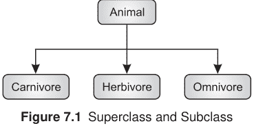

### 7.2.1 定义子类

继承是在定义子类时实现的。在子类定义中指定超类的名称。可以使用 `extends` 关键字定义子类。

定义子类的语法为：

```java
class sub_class extends super_class
{
    // 变量和方法的声明
}
```

其中：

- `sub_class` 是继承超类的子类名称
- `super_class` 是被继承的超类名称
- `extends` 是表示 `super_class` 属性已扩展到子类的关键字

## 7.3 继承的类型

继承允许在两个或多个类之间建立逻辑关系。根据涉及的类数量以及它们继承的方式，继承可以有不同的形式：单继承、层次继承、多级继承和多继承。

### 7.3.1 单继承

在单继承中，一个类派生自一个单一超类。图 7.2 显示了单继承，其中子类 `Employee`（员工）派生自超类 `Person`（人）。


实现单继承的子类语法为：

```java
class Class1
{
    ;
}
class Class2 extends Class1
{
    ;
}
```

**示例 7.1** 演示单继承的程序

```java
class FirstClass            // 超类
{
    int i;
    int j;
    void get_first(int p, int q)
    {
        i = p;
        j = q;
    }
}

class SecondClass            // 子类
{
    int k;
    void get_second(int m)
    {
        k = m;
    }
    void display()
    {
        System.out.println("The value of superclass' i is: " + i);
        System.out.println("The value of superclass' j is: " + j);
        System.out.println("The value of subclass' k is: " + k);
    }
}

class SingleInheritance
{
    public static void main(String args[])
    {
        SecondClass obj = new SecondClass();
        obj.get_first(20, 30); // 访问超类方法
        obj.get_second(40);    // 访问子类方法
        obj.display();
    }
}
```

**程序的输出结果为**

```
The value of superclass' i is: 20
The value of superclass' j is: 30
The value of subclass' k is: 40
```

在这个示例中，超类 `FirstClass` 被类 `SecondClass` 继承。因此，`SecondClass` 包含了 `FirstClass` 的变量 `i`、`j` 和方法 `get_first()`，同时也定义了自己的数据成员 `k` 和 `display()` 方法。

### 7.3.2 层次继承

多个类派生自同一个单一超类的继承类型称为层次继承。在层次继承中，超类包含了其所有子类共有的所有属性。图 7.3 显示了层次继承，其中 `Student`（学生）和 `Employee`（员工）两个类都派生自单一超类 `Person`。

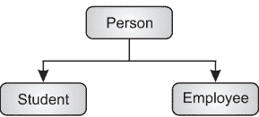

图 7.3 层次继承示例

涉及两个子类的层次继承实现语法为：

```java
class Class1
{
}
class Class2 extends Class1
{
}
class Class3 extends Class1
{
}
```

**示例 7.2** 演示层次继承的程序

```java
class FirstClass // 超类
{
    int i;
    int j;
    void get_first(int p, int q)
    {
        i = p;
        j = q;
    }
}

class SecondClass extends FirstClass // 第一个子类
{
    int x;
    int y;
    void get_second(int a)
    {
        x = a;
    }
}

class ThirdClass extends FirstClass // 第二个子类
{
    int z;
    void get_third(int b)
    {
        z = b;
    }
}

class HierarchicalInheritance
{
    public static void main(String args[])
    {
        SecondClass obj1 = new SecondClass();
        obj1.get_first(1, 2);
        obj1.get_second(3);

        ThirdClass obj2 = new ThirdClass();
        obj2.get_first(4, 5);
        obj2.get_third(6);
    }
}
```

### 7.3.3 多级继承

在多级继承中，一个类继承另一个类，而该类又继承另一个类。这被称为继承的传递性。图 7.4 显示了多级继承，其中超类 `Person` 被子类 `Employee` 继承，`Employee` 又被子类 `Faculty` 继承。因此，`Person` 是 `Faculty` 的间接超类。

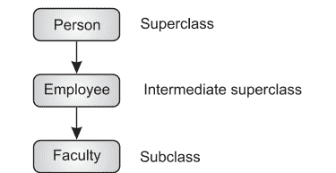

图 7.4 多级继承示例

实现多级继承的语法为：

```java
class Class1
{
}
class Class2 extends Class1
{
}
class Class3 extends Class2
{
}
```

**示例 7.3** 演示多级继承的程序

```java
class FirstClass // 超类
{
    int i;
    int j;
    void get_first(int a, int b)
    {
        i = a;
        j = b;
    }
}

class SecondClass extends FirstClass // 中间超类
{
    int k;
    int l;
    void get_second(int c)
    {
        k = c;
    }
}

class ThirdClass extends SecondClass // 子类
{
    int m;
    void get_third(int d)
    {
        m = d;
    }
}

class MultilevelInheritance
{
    public static void main(String args[])
    {
        ThirdClass obj = new ThirdClass();
        obj.get_first(1, 2);
        obj.get_second(3);
        obj.get_third(4);
    }
}
```

**程序的输出结果为**

```
The value of superclass's i and j is: 1 2
The value of intermediate superclass's k is: 3
The value of subclass's m is: 4
```

### 7.3.4 多继承

在多继承中，一个类继承自多个父类，如图 7.5 所示。在 Java 中无法直接实现多继承。然而，有一个名为接口（`interface`）的概念，可以通过它来实现多继承。接口将在第 8 章中讨论。

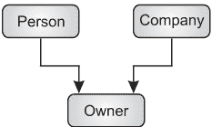

图 7.5 多继承示例

## 7.4 可见性控制（访问控制）

在目前讨论的程序中，类成员在程序的任何地方都是可访问的，子类可以使用 `extends` 关键字继承父类的所有变量和方法。然而，在某些情况下，我们可能出于各种原因限制类成员的访问性，安全性就是其中一个主要原因。Java 提供了三种类型的可见性控制：`public`（公共）、`private`（私有）和 `protected`（保护）。它们统称为访问修饰符。

- **Public（公共）**：当类成员声明为 `public` 时，可以在程序的任何地方访问。
- **Private（私有）**：声明为 `private` 的成员仅在类内部被访问。
- **Protected（保护）**：声明为 `protected` 的成员不仅可以被同一个包中的所有类和子类访问，还可以被其他包中的子类访问。

注意，如果没有指定可见性控制，默认情况下类的数据成员仅在同一个包内可见。我们可以使用 `friendly` 来关联默认访问，但它不是 Java 关键字。

除了讨论的可见性控制外，还有另一种可见性控制，即 `private protected`，它在 Java 1.0 发布时使用过。然而，它已被弃用。

如果数据成员被声明为 `protected`，无论它们属于哪个包，所有的子类都可以访问。但是，它们在同一个包的其他类中不可见。

## 表 7.1 类内部字段的可见性

| 访问位置 | 同一类 | 同包内的子类 | 同包内的非子类 | 其他包中的子类 | 其他包中的非子类 |
| :--- | :---: | :---: | :---: | :---: | :---: |
| **访问修饰符** | | | | | |
| `Public` | ✓ | ✓ | ✓ | ✓ | ✓ |
| `Private` | ✓ | ✗ | ✗ | ✗ | ✗ |
| `Protected` | ✓ | ✓ | ✓ | ✓ | ✗ |
| `Default`（默认） | ✓ | ✓ | ✓ | ✗ | ✗ |

注：包将在第 9 章中讨论。

可以遵循某些规则来选择合适的可见性控制。如果希望数据成员：

- 在程序的任何地方可见，使用 `public` 可见性控制。
- 除同一类外均不可见，使用 `private` 可见性控制。
- 在同一包内和其他包的子类中随处可见，使用 `protected` 可见性控制。


# 继承与多态

## 可见性控制

- 在同一包内随处可见，使用默认可见性控制。
- 仅在各包的子类中可见，使用 `protected`。

### 示例 7.4 一个演示使用 `private`、`public` 和默认可见性控制的程序类 `FirstClass`

```java
class FirstClass {
    private int i;
    public int j;
    int k;

    FirstClass(int i, int j, int k) {
        this.i = i;
        this.j = j;
        this.k = k;
    }

    void display() {
        System.out.println("The value of subclass's i and j is: " + i + " and " + j);
    }
}

class SecondClass extends FirstClass {
    int k;
    SecondClass(int i, int j, int k) {
        super(i, j, 0);
        this.k = k;
    }

    void display() {
        System.out.println("The value of intermediate subclass's k is: " + k);
    }
}

class ThirdClass extends SecondClass {
    int i;
    ThirdClass(int i, int j, int k) {
        super(0, j, k);
        this.i = i;
    }

    void display() {
        System.out.println("The value of subclass's i is: " + i);
    }
}

public class Main {
    public static void main(String[] args) {
        ThirdClass obj = new ThirdClass(11, 8, 10);
        obj.display();
        ((SecondClass)obj).display();
        obj.display();
    }
}
```

*(注：由于原文文本在示例处出现了断层，此处根据逻辑还原了代码结构以对应翻译)*

## 继承与多态

在 Java 1.1 及后续版本中，如果数据成员被声明为 `protected`，则可以被所有子类访问，无论它们属于哪个包。然而，它们在同一包的其他类中不可见。

## 方法重写

如果子类方法与父类方法的名称、参数列表和返回类型相同，则我们说子类方法覆盖了父类方法。当调用重写的方法时，将调用子类中定义的版本，而不是父类中定义的版本。也就是说，子类方法隐藏了父类定义的方法。

### 示例 7.7 一个演示方法重写的程序

```java
class Person{
    String name="John";
    int age=30;
    void result() {
        System.out.println("The name and the age of the person are: "+name+" and "+age+" "respectively ");
    }
}
class Employee extends Person{
    int salary=40000;
    void result() {
        //result() 被重写了
        System.out.println("The name and the salary of the employee are: "+name+" and "+salary+ "respectively");
    }
}

public class MethodOverriding
{
    public static void main(String[] args)
    {
        Employee obj=new Employee();
        obj.result(); // invokes Employee's result
    }
}
```

程序的输出结果是：
员工分别是：John 和 40000

在这个示例中，方法 `result()` 是通过 `Employee` 类型的对象被调用的，执行了在 `Employee` 内部定义的 `result()` 方法。这意味着，子类 `Employee` 的 `result()` 方法重写了父类 `Person` 的 `result()` 方法。然而，如果我们想访问父类中被重写的 `result()` 方法，可以使用 `super` 关键字。例如，考虑示例 7.7 中定义的 `Employee` 类。可以使用 `super` 进行如下修改：

```java
class Employee extends Person
{
    int salary=40000;
    void result()
    {
        super.result(); // invokes result() of class Person
        System.out.println("The name and the salary of the employee are: "+name+" and "+salary+ "respectively");
    }
}
```

#### 程序的输出结果

人的姓名和年龄分别是：John 和 30

员工的姓名和工资分别是：John 和 40000

现在，当通过 `Employee` 类型的对象调用方法 `result()` 时，在子类中调用的是 `result()` 的版本。

## 7.7 运行时多态或动态方法分派

动态方法分派是 Java 中的重要机制之一。Java 使用这种机制实现了运行时多态。在这种机制中，对重写方法的调用是在运行时解析的，而不是编译时。这意味着，响应方法调用的被重写方法版本是在运行时决定的。

### 示例 7.8 演示动态方法分派的程序

```java
class A
{
    void display()
    {
      System.out.println("A's display() method");
    }
}

class B extends A {
  void display() { // overrides display
    System.out.println("B's display() method");
  }
}

class C extends A {
  void display() { // overrides display
    System.out.println("C's display() method");
  }
  public static void main(String args[]) {
    A a = new A(); // object of type A
    B b = new B(); // object of type B
    C c = new C(); // object of type C
    A ref; // ref refers to an A object
    ref = a; // ref refers to an A object
    ref.display(); // calls A's version of display

    ref = b; // ref refers to a B object
    ref.display(); // calls B's version of display
    ref = c; // ref refers to a C object
    ref.display(); // calls C's version of display
  }
}
```

#### 程序的输出结果

A's display() method

B's display() method

C's display() method

在这里，`display()` 方法的版本取决于运行时所引用的对象，而不是变量的类型。

## 使用 final 关键字

Java 提供了一个 `final` 关键字，它可以应用于变量、方法和类。`final` 关键字应用于变量时的含义与其应用于方法和类时的含义不同。

### 7.8.1 final 变量

通过将变量声明为 `final`，可以防止变量的值被修改。

声明 `final` 变量的语法：

```
final data_type variable_name=constant_value;
```

尝试修改 `final` 变量的值将产生编译时错误。注意，`final` 变量不会为类的每个实例占用内存。因此，`final` 变量是一个常量。

#### 示例 7.9 演示使用 `final` 变量的程序

```java
class Person
{
    final int salary=30000; // final variable
}
class FinalVariable
{
    public static void main(String args[]) {
        Person obj=new Person();
        obj.salary=3000+2000; // error
    }
}
```

在这个示例中，将产生编译错误，因为 `final` 变量 `salary` 不能被修改。

### 7.8.2 final 方法

如前，每当在子类中定义与父类相同名称和签名的方法时，它默认会被重写。然而，可以通过将方法声明为 `final` 来防止方法被子类重写。

声明 `final` 方法的语法：

```
final data_type method_name()
```

#### 示例 7.10 演示使用 `final` 方法的程序

```java
class Person
{
    String name="John";
    int age=25;
    final void result() // final method
    {
        System.out.println("The name and the age of the person is: "+name+" and "+age+"");
    }
}
class Employee extends Person
{
    // 尝试重写 result() 将导致编译错误
}
```

该程序将产生编译错误，因为方法 `result()` 被声明为 `final`，在子类中无法被重写。

### 7.8.3 final 类

通过将类声明为 `final` 可以防止类被继承。如果一个类被声明为 `final`，则它不能被子类继承。

声明 `final` 类的语法：

```
final class class_name {}
```

#### 示例 7.11 演示 `final` 类的程序

```java
final class Person
{
    void display()
    {
        System.out.println("This is a final class");
    }
}
// 这将产生一个编译错误
class Employee extends Person {
}
```

## 7.9 抽象方法和类

如前所述，通过将方法声明为 `final` 可以防止方法被子类重写。然而，有时可能会出现父类将实现部分留给子类的情况。

声明抽象方法的语法是：

```
abstract data_type method_name();
```

如果一个类有一个或多个抽象方法，则该类也必须使用关键字声明为 `abstract`。

声明抽象类的语法是：

```
abstract class class_name
{
    abstract data_type method_name();
}
```

在使用抽象类时，应该记住以下几点：

- 抽象类不能被实例化。
- 抽象类的抽象方法必须在子类中被实现。
- 抽象方法必须以分号（;）结束，因为它们没有任何功能。
- 抽象类中既可以有定义的方法也有未定义的方法。
- 构造函数或静态方法不能声明为抽象。

### 示例 7.12 演示抽象类概念的程序

```java
abstract class Person //abstract class
{
  String name;
  int age;
  Person(String n, int a) {
    name=n;
    age=a;
  }
  abstract void display(); //abstract method
}

class Employee extends Person {
  int salary;
  Employee(String n, int a, int s) {
    super(n,a); //pass values to superclass
    salary=s;
  }
  void display() {
    System.out.println("The Name and the age of the employee are: "+name+" "+age+" respectively");
    System.out.println("The salary of the employee is: "+salary+"");
  }
}

class AbstractClass {
  public static void main(String args[]) {
    Employee obj=new Employee("John", 23, 2000);
    obj.display();
  }
}
```

#### 程序的输出结果

员工的姓名和年龄分别是：John 和 23

员工的工资是：2000

在这个示例中，`Person` 是一个抽象类，包含一个抽象方法 `display()`，该方法在子类 `Employee` 中得到了实现。

## 总结

- 继承是从现有类派生新类的过程，使新类继承现有类的所有成员（数据成员和方法）。
- 被其他类继承的类称为基类、超类或父类。继承父类属性的类称为子类、派生类或子类。
- 子类可以使用 `extends` 关键字来定义。
- 继承有不同的形式，即单类继承、层级继承、多级继承和多重继承。
- 在继承中，一个类派生自单个父类。多个类派生自同一个父类的继承类型被称为层级继承。在多级继承中，一个类继承自另一个类，而该类又继承自另一个类。
- 在多重继承中，一个类继承自多个子类的属性。Java 不直接支持多重继承。它通过接口（interface）的概念来实现。
- 可见性控制（也称为访问修饰符）控制类成员的可访问性。Java 提供了三种可见性控制，即 public（公共）、private（私有）和 protected（保护）。
- 如果子类的方法与父类的方法具有相同的名称和签名，则重写父类的方法。
- Java 提供了一个 `final` 关键字，可以应用于变量、方法和类。声明为 `final` 的变量不能被修改。通过将方法声明为 `final`可以防止子类对其进行重写。不能被进一步继承或不能有任何子类的类被称为 `final`。
- Java 允许我们在方法声明中使用 `abstract` 关键字来指定子类中必须重写该方法。
- 在动态方法分派中，对重写方法的调用在运行时解析而不是在编译时解析。

# 练习

## 填空

1. 被新类继承的类被称为 \_\_\_\_\_\_\_\_\_\_。
2. Java 子类可以使用 \_\_\_\_\_\_\_\_\_\_ 关键字定义。
3. 声明为 \_\_\_\_\_\_\_\_\_\_ 的成员只能在类内部访问。
4. 在子类构造函数可以使用 \_\_\_\_\_\_ 关键字调用父类的构造函数。
5. Java 允许我们使用 \_\_\_\_\_\_\_\_\_\_ 关键字指定子类中必须重写方法。

## 选择正确选项

1. 在下列哪种继承中，一个父类被多个子类继承？
   (a) 单类继承 (b) 多重继承
   (c) 层级继承 (d) 多级继承

2. 下列哪个类不能被继承？
   (a) 抽象类
   (b) 类 B { : }
   (c) final 类
   (d) 以上均不是

3. 下列哪个说法是正确的？
   (a) 动态方法分派实现了运行时多态。在编译时已知。
   (b) 在动态方法分派中，实际执行的代码在运行时已知。
   (c) 在动态方法分派中，实际执行的代码在运行时已知。
   (d) (a) 和 (c) 均正确

4. 通过将方法声明为 \_\_\_\_\_\_ 可以防止子类对其进行重写：
   (a) final (b) abstract
   (c) super (d) 以上均不是

5. 下列哪个说法是不正确的？
   (a) Super 关键字仅在子类构造函数中使用。
   (b) Super 可以在子类构造函数的任何地方指定。
   (c) super() 方法中指定的参数必须与父类构造函数中声明的变量顺序和类型匹配。
   (d) 以上均不是

## 判断对错

1. Java 不直接实现多重继承。
2. protected 成员对其他包的非子类是可见的。
3. 子类构造函数可以初始化父类和子类的实例变量。
4. 如果一个类被声明为 final，则它的所有方法都会自动声明为 final。
5. 抽象方法只包含未定义的方法。

## 回答以下问题

1. 什么是继承？解释继承如何促进代码复用。
2. Java 中有哪些类型的继承？请举例说明。
3. 讨论 Java 中可用的可见性控制级别。


4. 写一个程序展示如何使用 `super` 关键字在子类构造函数中调用父类构造函数。

5. 什么是方法重写？我们如何防止方法的重写？

6. Java 中 `final` 关键字的作用是什么？请举例说明。

7. 描述抽象方法和抽象类。列出实现抽象方法的规则。

8. 输出以下程序的运行。

```java
class Class1 {
    int i;
    Class1(int p) {
        i=p;
    }
    void display() {
        System.out.println("The value of i is: "+i);
    }
}
```

```java
class Class2 extends Class1 {
    int j;
    Class2(int p, int q) {
        super(p);
        j=q;
    }
    void display() {
        System.out.println("The value of j is: "+j);
    }
}
```

```java
class SampleClass {
    public static void main(String args[]) {
        Class2 obj=new Class2(30,40);
        obj.display();
    }
}
```

9. 写一个程序创建一个 `Drug` 类。`Tablet` 类派生自它，而 `Tablet` 类又被 `Pain Reliever` 类继承。解释所实现的继承类型。

# 第 8 章

# 接口

# 章节目标

阅读完本章后，你将能够：

- 理解什么是接口以及它与类的不同之处
- 解释如何定义接口以及类如何实现接口
- 描述接口如何被另一个接口扩展
- 解释如何使用接口来声明常量

## 8.1 引言

正如第 7 章所述，Java 不支持多重继承。然而，在某些应用中，一个类需要继承多个类的属性。Java 提供了接口（interface）的概念作为实现多重继承的方便方法。

## 8.2 定义接口

接口就像类。唯一的区别在于它只包含 final 变量和方法声明。因此，我们可以认为接口是“完全抽象的类”。一个类可以实现的接口数量没有限制。接口使用 `interface` 关键字而不是 `class` 关键字。

定义接口的语法如下：

```java
interface interface_name
{
//变量和方法声明
}
```

其中

- `interface` 是 Java 关键字
- `interface_name` 是接口名称

如果接口定义中没有访问说明符，则使用默认访问权限，接口仅对相同包的成员可见。然而，为了使接口对任何其他代码可见，可以将其声明为 `public`。接口中的变量默认是 `static` 和 `final`。它们不能被实现类修改。方法默认是抽象的。接口的类必须实现所有方法。例如，考虑以下代码段。

```java
interface Area
{
    double pi=3.142;
    void compute();
}
```

在这里，`Area` 是接口名称。变量 `pi` 初始化为一个常量。注意 `compute()` 方法没有体部，其声明以分号结束。*注意：如果接口被声明为 `public`，则所有的变量和方法隐式为 `public`。*

## 8.3 实现接口

一旦定义了接口，它就可以作为父类，其成员和属性被其他类继承。一个或多个类可以使用类定义中的 `implements` 关键字来实现该接口。

实现接口的语法如下：

```java
class class_name implements interface_name
{
    //变量和方法声明
}
```

例如，考虑实现 `Area` 接口的代码段。

```java
class Circle implements Area
{
    float r=4.3F;
    public void compute()
    {
        double area=pi*r*r;
        System.out.println("The area of circle is: "+area);
    }
}
```

当实现类定义接口的方法时，必须使用 `public` 关键字。此外，实现接口的方法签名必须与接口中方法定义的签名完全匹配。

一个类可以实现多个接口，如下所示：

```java
class class_name implements interface1, interface2
{
    :
}
```

类可以在实现接口的同时扩展另一个类，如下所示：

```java
class class_name extends superclass implements interface_name
{
    :
}
```

### 示例 8.1 演示接口 Area 实现的程序

```java
interface Area
{
    double pi=3.142;
    void compute();
}

class Circle implements Area
{
    float r=4.3F;
    public void compute()
    {
        double carea=pi*r*r;
        System.out.println("The area of circle is: "+carea);
    }
}

class Sphere implements Area
{
    float r=3.5F;
    public void compute()
    {
        double sarea =4*pi*r*r;
        System.out.println("The area of sphere is: "+sarea);
    }
}

class ImplementInterface
{
    public static void main(String args[])
    {
        Circle cobj=new Circle();
        Sphere sobj=new Sphere();
        Area intobj;

        intobj=cobj;
        intobj.compute();

        intobj=sobj;
        intobj.compute();
    }
}
```

**输出：**

```text
The area of circle is: 58.09558513885004
The area of sphere is: 153.958
```

在这个示例中，接口 `Area` 被 `Circle` 和 `Sphere` 两个类实现。方法 `compute()` 在两个类中都有定义，但方式不同。声明了一个类型为 `Area` 的引用变量 `intobj`，并将其赋值为 `Circle` 和 `Sphere` 的实例。接口引用变量 `intobj` 可以用于访问方法 `compute()`，但不能访问 `Circle` 和 `Sphere` 类的其他成员，因为它只了解其接口中声明的方法。

> **Java 编程**
> 注意，也可以通过类型的引用变量调用方法 `compute()`，即通过 `cobj` 和 `sobj`。在这种情况下，两个类都需要编译时存在。另一方面，当我们通过接口引用调用方法时，要执行的方法是在运行时动态解析的。这种运行时动态方法解析是接口的特性之一。

### 部分实现

如果一个类实现了接口但没有提供接口中声明方法的完整实现，则必须将该类声明为抽象类（`abstract`）。例如，考虑示例 8.1 中的另一个类 `Square`，它实现了 `Area` 接口。

```java
abstract class Square implements Area
{
    float side=2.4;
    double sqarea=side*side;
    void display() {
        System.out.println("The area of square is: "+sqarea);
    }
}
```

在这里，`Square` 类被声明为抽象类，因为它没有实现 `Area` 中声明的 `compute()` 方法。任何继承 `Square` 的类必须实现 `compute()` 方法，或者该类本身也被声明为抽象类。

## 8.4 扩展接口

接口可以使用 `extends` 关键字继承另一个接口，方式与类继承类相同。与类一样，子类将继承父接口的所有属性，并添加它自己的数据成员。例如，考虑以下代码：

```java
interface Interface1
{
}

interface Interface2 extends Interface1
{
}
```

接口也可以继承多个接口。要定义多个接口，父接口的名称之间用逗号（`,`）隔开，如下所示。

```java
interface Interface3 extends Interface1, Interface2
{
}
```

注意，父接口中声明的方法不能由子类直接实现。它们只能由实现该接口的类来具体。当一个类实现一个继承自另一个接口的接口时，该类必须为那两个接口中声明的所有方法提供实现。

### 示例 8.2 演示接口被另一个接口（如 `FirstInterface`）扩展的程序

```java
interface FirstInterface {
    int i=30;
    void display1();
}

interface SecondInterface extends FirstInterface {
    int j=i+40;
    void display2();
}

class ClassName implements SecondInterface {
    public void display1() {
        System.out.println("The value of i is: "+i);
    }
    public void display2() {
        System.out.println("The value of j is: "+j);
    }
}

public class ExtendingInterface {
    public static void main(String[] args) {
        ClassName obj=new ClassName();
        obj.display1();
        obj.display2();
    }
}
```

**输出：**

```text
The value of i is: 30
The value of j is: 70
```

在这个示例中，`ClassName` 实现了继承自 `FirstInterface` 的接口 `SecondInterface`。因此，`ClassName` 分别提供了 `FirstInterface` 和 `SecondInterface` 中 `display1()` 和 `display2()` 方法实现。

> **注意：** 接口不能扩展类。它只能扩展另一个接口。此外，接口也可以实现另一个接口。

## 8.5 接口中的变量

接口可以声明一组常量，这些常量可以被实现接口的类使用。这与在 C/C++ 中创建包含大量常量的头文件相同。

### 示例 8.3 演示仅具有常量值的程序

```java
interface SetOfConstants
{
    int red=0;
    int green=1;
    int blue=2;
}

class UsingConstants implements SetOfConstants
{
    void display()
    {
        int color=2;
        switch(color) {
            case red:
                System.out.println("The color is red");
                break;
            case green:
                System.out.println("The color is green");
                break;
            case blue:
                System.out.println("The color is blue");
                break;
        }
    }
}

public class InterfaceConstants
{
    public static void main(String[] args)
    {
        UsingConstants obj=new UsingConstants();
        obj.display();
    }
}
```

**输出：**

```text
The color is blue
```

## 8.6 接口与抽象类

接口和抽象类的相似之处在于，接口和抽象类都不能被实例化。然而，它们之间存在某些差异，如下：

- 接口可以只包含 `final`（最终）成员和抽象方法，而抽象类可以包含非 `final` 成员、`final` 成员以及抽象方法和具体方法。那么我们可以说接口是一个完全抽象的类。
- 接口可以继承多个接口，而抽象类只能继承一个类。
- 接口中的成员默认是 `public`（公共）的，而抽象类的成员可以是 `private`（私有的）。
- 接口中的所有方法必须由类实现，除非该类被声明为抽象。

## 8.7 扩展与实现

现在你已经熟悉接口的概念。让我们通过一个简单的示例来看看如何使用接口来实现多继承。在这个示例中，`Faculty` 类继承了 `Employee` 并实现了 `Bonus`。

### 示例 8.4 演示通过接口实现多继承的程序

```java
class Person
{
    String name;
    int age;
    String address;
    void persondetails(String nm, int ag, String ad)
    {
        name=nm;
        age=ag;
        address=ad;
    }
    void displayperson() {
        System.out.println("Name: "+name);
        System.out.println("Age: "+age);
        System.out.println("Address: "+address);
    }
}

class Employee extends Person
{
    int empid;
    int salary;
    void empdetails(int id, int sal)
    {
        empid=id;
        salary=sal;
    }
    void displayemployee() {
        System.out.println("Employee ID: "+empid);
        System.out.println("Salary: "+salary);
    }
}

interface Bonus
{
    int bonus=1000;
    void compute();
}

class Faculty extends Employee implements Bonus
{
    int amount;
    public void compute()
    {
        System.out.println("The bonus is: "+bonus);
        amount=salary+bonus;
    }
    void facultydetails()
    {
        displayperson();
        displayemployee();
        compute();
        System.out.println("The total amount is: "+amount);
    }
}

public class MultipleInheritance
{
    public static void main(String[] args)
    {
        Faculty obj=new Faculty();
        obj.persondetails("Surabhi", 23, "115, Greenfield Apartment. Patparganj, New Delhi-110092");
        obj.empdetails(001, 200000);
        obj.facultydetails();
        System.out.println("");
        obj.persondetails("Mili", 27, "D-50, Old Gupta Colony, Delhi-110099");
        obj.empdetails(002, 300000);
        obj.facultydetails();
    }
}
```

**输出：**

```text
Name: Surabhi
Age: 23
Address: 115, Greenfield Apartment. Patparganj, New Delhi-110092
Employee ID: 1
Salary: 200000
The bonus is: 1000
The total amount is: 201000

Name: Mili
Age: 27
Address: D-50, Old Gupta Colony, Delhi-110099
Employee ID: 2
Salary: 300000
The bonus is: 1000
The total amount is: 301000
```

## 总结

- Java 提供了一种名为接口（interface）的方法，作为实现继承的便捷替代方案。
- 接口就像类一样。接口与类的区别在于，接口只包含常量变量（final variables）和方法声明。


- 接口的定义方式类似于类，但不是使用 `class` 关键字，而是使用 `interface` 关键字。一个或多个类可以在类定义中使用 `implements` 关键字来实现接口。

- 接口中的所有方法必须由实现接口的类来实现。如果实现接口的类没有提供接口中声明方法的完整实现，则必须将该类声明为抽象类（`abstract`）。

- 接口可以使用 `extends` 关键字继承另一个接口，这与类继承另一个类的方式类似。

- 接口可以用于声明一组常量，这些常量可以被实现接口的类使用。

## 练习题

### 填空

1. 接口中的变量默认是 `static` 和 `final`。

2. 如果接口定义中没有访问修饰符，则使用 `default`（包私有）。

3. 如果实现接口的类没有提供接口中声明方法的完整实现，则必须将该类声明为 `abstract`。

4. 当接口中的方法在实现类中定义时，必须使用 `public` 关键字。

5. 接口可以通过 `extends` 关键字继承另一个接口。

### 选择正确选项

1. 接口是实现以下内容的替代方法：
   (a) 单继承 (b) **多重继承**
   (c) 层级继承 (d) 多级继承

2. 接口中的方法默认是
   (a) static (b) final
   (c) **abstract** (d) public

3. 下列哪项说法是不正确的？
   (a) 接口中的变量总是被赋予常量值。
   (b) 类可以实现任意数量的接口。
   (c) 接口可以同时包含已定义和未定义的方法。
   (d) **(a) 和 (c) 都是**

4. 使用哪个关键字来定义接口？
   (a) extends (b) **interface**
   (c) implements (d) abstract

5. 接口中的成员默认是 ________，而抽象类中的成员可以是 private 也可以是 protected。
   (a) protected (b) **public**
   (c) private (d) (a) 和 (c) 都是

### 判断对错

1. Java 中的子类可以有多个父类。 **错**（Java 只支持单继承，但可实现多个接口）
2. 接口被认为是一个“完全抽象类”。 **对**（传统概念下，Java 8 前接口只能包含抽象方法和常量）
3. 接口可以同时包含已定义和未定义的方法。 **对**（Java 8+ 引入 default 和 static 方法）
4. 类在实现接口的同时可以继承另一个类。 **对**（使用 `extends` 继承类，`implements` 实现接口）
5. 父接口中声明的方法不能被子接口实现。 **错**（子接口可通过 `default`/`static` 方法提供实现，或继承抽象方法）

### 回答以下问题

1. **定义接口。类和接口之间的区别和相似之处是什么？**
   - **定义**：接口是一种引用类型，包含抽象方法、默认方法、静态方法、常量等，定义契约规范。
   - **相似点**：都可定义方法、字段；都可被继承/实现；都支持多态。
   - **区别**：
     - 类用 `class` 定义，接口用 `interface`。
     - 类支持单继承（`extends`），接口支持多继承（`extends` 多个接口）。
     - 类可有构造器、实例字段、非 final 字段；接口字段默认 `static final`，无构造器。
     - 类方法默认 `package-private`，接口方法默认 `public abstract`（Java 8 前）。
     - 类实例化用 `new`，接口不可直接实例化。

2. **下列哪项会产生错误？为什么？**
   - (a) `Interface extends Interface2 { }` **正确**（接口可继承接口）。
   - (b) `Class1 implements Interface1 { }` **正确**（类实现接口）。
   - (c) `Interface1 extends Class1 { }` **错误**（接口不能继承类，只能继承接口）。
   - (d) `Class1 extends Class2 implements Interface1 {}` **正确**（类可继承一个类并实现多个接口）。

3. **什么是部分实现？请举例说明。**
   - **定义**：类实现接口但未实现所有抽象方法，必须声明为 `abstract` 类，称为部分实现。
   - **示例**：
     ```java
     interface MyInterface {
         void method1();
         void method2();
     }
     abstract class PartialImpl implements MyInterface {
         public void method1() { System.out.println("Method1"); }
         // 未实现 method2，故类必须为 abstract
     }
     ```

4. **述接口和抽象类之间的区别。**
   | 特性 | 接口 | 抽象类 |
   |------|------|--------|
   | 关键字 | `interface` | `abstract class` |
   | 继承 | 一个类可实现多个接口 | 一个类只能继承一个抽象类 |
   | 字段 | 默认 `static final`（常量） | 可有实例变量、任意修饰符 |
   | 方法 | 默认 `public abstract`；Java 8+ 可有 `default`/`static`/`private` 方法 | 可有抽象/具体方法，任意访问修饰符 |
   | 构造器 | 无 | 有（供子类调用） |
   | 设计目的 | 定义行为契约、多实现 | 代码复用、定义通用状态/行为 |

5. **考虑以下代码。代码能成功编译吗？请说明你的理由。**
   ```java
   interface InterfaceName {
       int i=10;
       void display();
   }
   class ClassName implements InterfaceName {
       void display() {
           System.out.println("The value of i is: "+i);
       }
   }
   class Demo {
       public static void main(String[] args) {
           ClassName obj=new ClassName();
           obj.display();
       }
   }
   ```
   **不能编译通过**。原因：接口方法默认 `public`，实现类中 `display()` 缺少 `public` 修饰符，访问权限降低（默认 package-private），违反重写规则。

6. **修正代码以移除编译错误。**
   ```java
   interface InterfaceName {
       int a=10;
       void display();
   }
   class ClassName implements InterfaceName {
       public void display() {  // 添加 public
           System.out.println("The value of a is: "+a);
       }
   }
   class Demo {
       public static void main(String[] args) {
           ClassName obj=new ClassName();
           obj.display();
       }
   }
   ```

7. **Java 通过接口支持多重继承。请详细解释。**
   Java 类只能单继承（`extends` 一个父类），但可实现多个接口（`implements InterfaceA, InterfaceB...`）。接口本身也支持多继承（`interface C extends A, B`）。这样，一个类可获得多个接口的类型和行为契约，实现“多重继承”效果。Java 8+ 的 `default` 方法更允许接口提供默认实现，进一步增强了复用能力，但需解决菱形继承冲突（显式重写选择实现）。

---

## 9.3.1 包命名

Java 有某些命名约定可以根据这些对包进行命名。包名和类或接口的名称应该易于区分两者。根据约定，包名以小写字母开头，而类名以大写字母开头。例如，考虑这条语句。

```java
java.lang.Math
```

在这条语句中，包名以小写字母开头，而类名 `Math` 以大写字母开头。然而，由于互联网上有许多用户同时工作，可能会出现创建重复包的情况，这可能导致运行时错误。因此，包名必须是唯一的。为了确保包名的唯一性，可以在包名之前加上互联网域名（反写）。例如，考虑这条语句。

```java
com.example.package_name
```

在这条语句中，包 `package_name` 之前是域名 `com.example`。

## 9.4 定义包

要创建一个用户定义的包，首先必须使用关键字 `package` 后跟包名来声明包。

声明包的语法为：

```java
package package_name;
```

其中，

- `package` 是 Java 关键字
- `package_name` 必须是 Java 源文件的第一个语句（注释除外）。一旦声明了包，我们就可以定义任意数量的类，这些类将成为该包的一部分。例如，考虑这段代码。

```java
package packagename;
public class ClassName {
  // 类体
}
```

在这里，`ClassName` 是属于 `packagename` 包的类名。在 Java 中，包存储在文件系统的目录中。上述代码必须以 `ClassName.java` 为文件名保存到名为 `packagename` 的目录中。当 Java 编译器编译源文件时，会创建 `ClassName.class` 文件并将其自动存储在相同的目录 `packagename` 中。注意，由于 Java 是区分大小写的，目录名必须与包名完全匹配。

与 API 类似，用户定义的包可以组织成层次结构。构成该结构部分的包名使用点 (`.`) 运算符隔开。例如，考虑这个。

```java
package mypackage.mypack2;
```

此包必须存储在 `mypackage/mypack2` 目录中。通过使用多级包语句，可以将相关的包分组到一个包中。

注意，如果一个 Java 源文件包含多个类，则只有一个类可以被声明为 `public`，且源文件以公共类的名加后缀 `.java` 保存。当编译具有多个类定义的源文件时，编译器会为每个类创建一个单独的 `.class` 文件。

### 示例 9.1 创建包演示程序

```java
package mypackage;
class AreaRectangle {
    int length, breadth;
    AreaRectangle(int l, int b) {
        length = l;
        breadth = b;
        int area = l * b;
        System.out.println("The area of rectangle is: " + area);
    }
}

class SimplePackage {
    public static void main(String[] args) {
        AreaRectangle obj = new AreaRectangle(20, 30);
    }
}
```

将此文件保存为 `mypackage` 目录下的 `SimplePackage.java` 并编译它。现在可以使用命令行按照如下方式执行该文件：

```bash
java mypackage.SimplePackage
```

我们不能使用命令 `java SimplePackage` 来执行它，因为 `SimplePackage` 现在是 `mypackage` 包的一部分。

## 9.5 CLASSPATH（类路径）

由于 Java 包存储在文件系统的目录中，因此 Java 运行时系统需要知道去哪里查找我们创建的包。定位包有两种可能的方法。首先，Java 运行时系统默认使用当前工作目录。其次，可以通过设置 `CLASSPATH` 环境变量来指定一个或多个目录路径。

设置 `CLASSPATH` 环境变量，请遵循以下步骤：

1. 右键点击“此电脑”图标，并从弹出的快捷菜单中选择“属性”。这将显示系统属性对话框。
2. 点击“高级系统设置”。
3. 点击“环境变量”按钮。这将显示环境变量对话框。
4. 在“用户变量”部分点击“新建”按钮。这将显示“新建用户变量”对话框。
5. 输入 `CLASSPATH` 作为变量名。
6. 输入你的 `CLASSPATH` 目录列表作为变量的值，并用分号（`;`）分隔列出的条目。
7. 点击“确定”关闭“新建用户变量”对话框。
8. 点击“确定”关闭“环境变量”对话框。
9. 点击“确定”关闭“系统属性”对话框。

## 9.6 包的可访问性

用户定义的包访问方式与标准包相同。例如，要访问 `mypackage1` 的一个类，可以使用以下语句：

- `import mypackage1.ClassName;` (语句1)
- `import mypackage1.*;` (语句2)

在这里，语句2 中的星号 (`*`) 指定了每当编译器找到任何类时，都应该在 `mypackage1` 中搜索。这种方法的主要优点是不需要使用长包名。然而，缺点是很难识别某个成员属于哪个包。

## 9.7 使用包

一旦在程序中导入了所需的包，就可以使用该包的类。为了理解使用包的概念，让我们创建一个包 `mypackage1`。

### 示例 9.2 创建 mypackage1 的程序

```java
package mypackage1;
public class ClassName {
    public void first() {
        System.out.println("This is first class's result from the first package");
    }
}
```

将源文件保存为 `mypackage1` 子目录下的 `ClassName.java`。编译此文件后，编译后的 `ClassName.class` 将存储在相同目录。

### 示例 9.3 使用包的程序

```java
import mypackage1.ClassName;
class UsePackage {
    public static void main(String[] args) {
        ClassName obj = new ClassName();
        obj.first();
    }
}
```

**程序的输出为：**

```text
This is first class's result from the first package
```

现在，考虑另一个包 `mypackage2`。

### 示例 9.4 创建 mypackage2 的程序

```java
package mypackage2;
public class MyClassName {
    public void secondResult() {
        System.out.println("This is second class's result from the second package");
    }
}
```

### 示例 9.5 导入多个包演示程序

```java
import mypackage1.ClassName;
import mypackage2.MyClassName;
class MultiplePackage {
    public static void main(String[] args) {
        ClassName obj1 = new ClassName();
        MyClassName obj2 = new MyClassName();
        obj1.first();
        obj2.secondResult();
    }
}
```

**程序的输出为：**

```text
This is first class's result from the first package
This is second class's result from the second package
```

当导入多个包时，可能会出现多个包包含同名的类。例如，考虑此处所示的 `packagename1` 和 `packagename2` 两个包具有相同名称 `FirstClass` 的定义。

### 示例 9.6 创建 packagename1 的程序

```java
package packagename1;
public class FirstClass {
    int i = 10;
    int j = 20;
    public void display() {
        System.out.println("The value of i and j in first package\nis: " + i + " and " + j);
    }
}
```

### 示例 9.7 创建 packagename2 的程序

```java
package packagename2;
public class FirstClass {
    float p = 3.4F;
    float q = 2.55F;
    public void display() {
        System.out.println("The value of p and q in second package is: " + p + " and " + q);
    }
}
```

由于两个包都包含相同的 `FirstClass`，编译器将无法决定使用哪一个包，从而导致歧义。在这种情况下，创建相关类的对象时，必须在类名之前加上包名。

### 示例 9.8 一个演示导入具有相同类名类的多个包的程序

```java
import packagename1.*;
import packagename2.*;
class SameClassName {
    public static void main(String[] args) {
        packagename1.FirstClass obj1 = new packagename1.FirstClass();
        obj1.display();
        packagename2.FirstClass obj2 = new packagename2.FirstClass();
        obj2.display();
    }
}
```

**程序的输出结果为：**

```text
第一个包中 i 和 j 的值为: 10 and 20
第二个包中 p 和 q 的值为: 3.4 and 2.55
```

在这个示例中，`packagename1` 包中的 `FirstClass` 类与 `packagename2` 中的类同名。在创建每个包的类对象时，类名前加上各自的包名，因此没有产生歧义。

## 9.8 添加类

可以向已有的包添加新类。例如，考虑一个名为 `mypackage` 的包，其定义如下：

```java
package mypackage;
public class MyClass1 {
  // MyClass1 的主体
}
```

`mypackage` 包包含一个公共类 `MyClass1`。现在，假设我们要向此包添加另一个类 `MyClass2`。如前所述，一个包不能有多个公共类（在同一个源文件中）。如果 `MyClass2` 不是公共的，那么简单地将它的定义添加到同一个文件中即可如下：

```java
package mypackage;
public class MyClass1 { // 现有类
  // MyClass1 的主体
}
class MyClass2 { // 新类，默认包访问权限
  // MyClass2 的主体
}
```

然后重新编译此文件。`MyClass2.class` 文件会自动创建并存储在 `mypackage` 包中。现在，`mypackage` 包含了两个类 `MyClass1` 和 `MyClass2`。然而，如果 `MyClass2` 是公共类，我们需要在单独的源文件中创建一个类，并在源文件顶部声明包语句，如下：

```java
package mypackage;
public class MyClass2 {
  // MyClass2 的主体
}
```

编译此文件。`mypackage` 包现在也将包含 `MyClass2.class` 文件。因此，如果我们想在一个包中创建多个公共类，则需要为每个类创建一个单独的源文件并进行编译。编译后，包将包含所有源文件的 `.class` 文件。

## 9.9 隐藏类


当使用星号（`*`）导入包时，包中所有声明为 `public` 的类都会被自动导入。很多时候，我们希望防止某些类从包外部访问。为了隐藏此类类，不应将它们声明为 `public`。例如，考虑一个 `packename`。

### 示例 9.9 一个创建 `packename` 的程序

```java
package packename;
public class FirstClass // 对所有人可见
{
  int i;
  int j;
  public FirstClass(int a , int b)
  {
    i=a;
    j=b;
    System.out.println("The value of i and j is:"+i+"++"+j);
  }
}
```

```java
class SecondClass // 非公共的，隐藏的
{
  int p;
  int q;
}
```

在这里，`packename` 包包含两个类：`FirstClass` 和非公共的 `SecondClass`。由于 `SecondClass` 没有声明为公共，它对 `packename` 包外的成员是隐藏的。它只能被 `packename` 包内部的类访问。

### 示例 9.10 一个演示在导入 `packename.*` 时隐藏包中某个类的程序

```java
class CallingClass
{
    public static void main(String[] args)
    {
        FirstClass obj1=new FirstClass(20,30);
        SecondClass obj2=new SecondClass(30,40); // 错误
    }
}
```

在这个示例中，将产生编译错误，因为类 `SecondClass` 不是公共的，无法被导入。

## 9.10 包与可见性控制

如第 7 节所述，有三个主要的访问修饰符：`private`、`public` 和 `protected`，它们提供了不同的访问级别。为了方便参考，将其简化如下：任何声明为 `private` 的内容只能在类内部被访问。当成员被声明为 `public` 时，可以在任何地方被访问。声明为 `protected` 的成员不仅对相同包中的所有类和子类可见，对其他包中的子类也可见。如果没有指定访问修饰符，默认情况下，类的数据成员仅对相同包的类可见。

为了理解与包相关的可见性概念，让我们考虑两个包 `pkg1` 和 `pkg2`。

### 示例 9.11 创建包 `pkg1` 的程序

```java
package pkg1;
public class CommonClass // 父类
{
    int i=1;
    private int j=2;
    protected int k=3;
    public int l=4;
    int sum=0;
    CommonClass() {
        System.out.println("Common Class");
        System.out.println("i = " + i);
        // System.out.println("j = " + j);
        System.out.println("k = " + k);
        System.out.println("l = " + l);
        sum = (i+k+l);
        System.out.println("The summation of all members in CommonClass is :" +sum);
    }
}
```

```java
class NextClass extends CommonClass // 子类
{
    NextClass() {
        System.out.println("Next Class");
        System.out.println("i = " + i);
        // System.out.println("j = " + j);
        System.out.println("k = " + k);
        System.out.println("l = " + l);
        sum = (i+l);
        System.out.println("The summation of all members in NextClass is :" +sum);
    }
}
```

### 示例 9.12 演示包 `pkg1` 中成员可见性的程序

```java
package pkg1; 
class FinalClasses {
    public static void main(String[] args) {
        NextClass obj=new NextClass();
    }
}
```

**程序的输出结果为**

```
Common Class
i = 1
k = 3
l = 4
CommonClass 的所有成员之和为：10
Next Class 
i = 1
k = 3
l = 4
NextClass 的所有成员之和为：8
```

除了私有变量 `j` 之外，所有变量在 `NextClass` 中都可以被访问。

### 示例 9.13 创建包 `pkg2` 的程序

```java
package pkg2;
class SecondCommonClass extends pkg1.CommonClass
{
    SecondCommonClass() {
        System.out.println("Second Class");
        /* 在 pkg1 中声明为默认的，在 pkg2 中无法访问 */
        // System.out.println("i = " + i);
        /* 在 pkg1 中声明为私有的，在 pkg2 中无法访问 */
        // System.out.println("j = " + j);

        System.out.println("k = " + k);
        System.out.println("l = " + l);
    }
}
```

### 示例 9.14 演示 `pkg2` 中 `pkg1` 成员可见性的程序

```java
package pkg2;
class Classes {
    public static void main(String[] args) {
        SecondCommonClass obj2 = new SecondCommonClass();
    }
}
```

**程序的输出结果为**

```
Second Class
k = 3
l = 4
```

（注：根据原文逻辑，此处应包含 Common Class 的输出，此处原文如下）

```
Common Class
k = 3
l = 4
```

在这里，`pkg2` 的 `SecondCommonClass` 类是包 `pkg1` 中类的子类。私有变量 `j` 和默认变量 `i` 无法在 `pkg2` 中访问。然而由于 `SecondCommonClass` 是包 `pkg1` 中类的子类，受保护变量 `k` 可以在 `pkg2` 中访问。在任何情况下，公共变量 `l` 均可以在任何地方被访问。

## 总结


- 包类的命名集合。任意数量的相关类分组到一个包中。属于另一个程序的包的类可以被重用。不同包中的两个类可以有相同的名称。
- Java 包分为两类：API 包和用户定义的包。API（应用程序编程接口）包是 Java 中的标准包，包含了所有标准类。Java 还允许我们创建自己的用户定义包。
- 有 Java 命名规范可以用于包。包名和接口的名称应该易于区分二者。根据规范，包名以小写字母开头，而类名以大写字母开头。
- 要创建一个用户定义的包，必须使用 `package` 关键字后跟包名来声明第一个包。包语句必须是 Java 源文件的第一个语句。一旦声明了包，我们就可以定义任意数量作为该包部分的类。
- 由于包存储在文件系统的目录中，Java 运行时需要知道在哪里寻找我们创建的包。定位包有两种方法：第一，Java 运行时默认使用当前工作目录；第二，可以通过设置 `CLASSPATH` 环境变量指定目录或路径。
- 如果一个包包含多个类，只有一个类可以声明为 `public`，且源文件以公共类的名命名并带有 `.java` 扩展名。当编译包含多个类定义的源时，编译器为每个类创建单独的 `.class` 文件。
- API 包和用户定义包都可以使用 `import` 语句访问。一旦在程序中导入所需的包，该包的类就可以被使用。
- 我们可以通过不声明为 `public` 来隐藏包中的类，以防止从包外部访问。


# 练习

### 填空

1. 任意数量的相关类可以分组到一个 ________。
2. 假设有一个名为 `person` 的包包含一个公共类 `Employee`。那么源文件 `Employee.java` 存储的子目录是 ________。
3. ________ 包包含了 Java 基础的类，如 String、Math、Exception 等。
4. 在创建每个包的类对象时，类名前加上各自的包名以避免歧义。
5. 当使用星号（`*`）导入包时，包中所有声明为 ________ 的类都会被自动导入。

### 选择正确的选项

1. 关于包（package），以下哪项描述是正确的？
   (a) 任意数量的相关类可以被分组到单个包中。
   (b) 属于另一个程序包的类可以被轻松地重用。
   (c) 不同包中的两个类可以具有相同的名称。
   (d) 以上所有

2. 下列哪种访问修饰符使成员仅在同一个包内可见？
   (a) private (b) protected
   (c) public (d) 以上均不是

3. 被声明为 `protected` 的成员是：
   (a) 不仅对同一个包内的所有类和子类可访问
   (b) 仅在类内部可访问
   (c) 仅在在同一个包的类中可访问
   (d) 处处可见

4. 下列哪个 API 包是被自动导入的？
   (a) java.awt (b) java.lang
   (c) java.io (d) java.util

5. 根据 Java 命名规范，
   (a) 包名以小写字母开头，而类名以大写字母开头。
   (b) 包名以大写字母开头，而类名以小写字母开头。
   (c) 包名和类名都以大写字母开头。
   (d) 包名和类名都以小写字母开头。

### 判断对错

1. 一个程序的代码可以通过继承在另一个程序中重用。
2. 一个包中的类名不能与另一个包中的类名相同。
3. 为了确保包名的唯一性，可以在包名前加上互联网域名。
4. 每个 Java API 包都是以层级形式组织的。
5. 当导入了多个包时，类名必须是不同的。

### 回答以下问题

1. 定义什么是包（package）。使用包有什么优点？
2. 创建包的步骤是什么？你如何在文件中访问特定的包？
3. 考虑一个导入名为 `person` 包及其所有类的程序。识别并纠正错误（如果有）。

```java
import person;
class ImportDemo {
    public static void main(String[] args) {
        FirstClass obj=new FirstClass();
    }
}
```

4. 考虑两个包 `p1` 和 `p2`。包 `p1` 中的变量 `i` 在包 `p2` 中被访问。此程序能成功编译吗？给出你的理由。

```java
package p1;
public class A {
    protected int i=30;
    class B extends A {
        System.out.println("The value of i is " +i);
    }
}
package p2;
public class C extends p1.A {
    System.out.println("The value of i is " +(i+1));
}
```

5. 解释在单个包中创建多个公共（public）类的类的步骤。

# 第 10 章

# 异常处理

# 目标

阅读本章后，你将能够：

- 定义程序中的异常或运行时错误
- 理解 Java 默认异常处理器是如何处理异常的
- 列出 Java 中常见的某些异常
- 解释如何使用 `try` 和 `catch` 块在 Java 中抛出和捕获系统生成的异常
- 理解 `finally` 关键字的意义
- 解释异常处理中 `throw` 和 `throws` 关键字的
- 创建你自己的异常

## 10.1 引言

程序员在开发任何程序时主要考虑的问题是编写无错误的代码。程序中存在一个错误就可能导致许多不可理想的情况，如非预期的结果、程序意外终止，或者在极端情况下系统可能会崩溃。为了避免这些意外发生，必须对程序代码中的错误进行适当的检测和处理，以便程序产生预期的输出。

然而，当第一次编写程序时，它通常包含错误。这些错误分为两类，即编译时错误和运行时错误。编译错误由于语法错误引起，如缺少分号、缺少括号、拼写错误、使用未声明的变量等。可以通过详尽的测试和调试来检测并恢复错误。与编译时错误不同，运行时错误很难检测和捕获。它们可能由于算术计算问题引起，例如除以零、尝试访问越界的数组元素、将无效字符串转换为数字等。这些运行时错误通常被称为异常。

## 10.2 异常

“异常”（exception）一词是“特殊事件”（exceptional event）短的缩写。它是程序执行期间发生的不可预测事件，会破坏程序的正常流程或异常地终止程序。导致异常的错误范围可以从简单的编程错误（如打开或读取无效文件，或访问数组的无效索引）到内存耗尽等错误不等。

当方法内部发生错误时，Java 运行时系统会创建一个异常对象。异常对象包含有关异常的信息，包括它的类型以及错误发生时的程序状态。一旦创建了异常对象，它就会被抛出，运行时系统会寻找处理该异常的方法。它会继续寻找包含适当异常处理程序的方法。如果处理器处理的异常类型与抛出的异常类型相同，则认为该异常处理程序是适当的。

在理解异常处理机制的意义之前，有必要知道如果不处理异常会发生什么。

### 示例 10.1 一个演示未处理异常的程序

```java
class ExceptionExample {
    public static void main(String args[]) {
        int a=15;
        int b=3;
        int c=a/0; // 发生异常
        System.out.println("Result:"+c);
    }
}
```

在此程序中，由于没有提供处理器，当执行除零语句时会产生异常。在该程序中，由于没有提供异常处理器，将显示异常信息并终止程序。

```
Exception in thread "main" java.lang.ArithmeticException: / by zero
```

## 10.3 异常处理

异常处理机制不仅保证检测和处理运行时错误，还提供了将错误处理代码与其他代码分离的方法。异常处理由以下关键字控制：

- `try`
- `catch`
- `finally`
- `throw`
- `throws`

一组需要监控的语句包含在 `try` 块中。当 `try` 块发生异常时，异常会被抛出并传递到 `catch` 块。Java 运行时系统会自动抛出异常。如果用户想显式抛出异常，必须指定 `throw` 关键字。`finally` 块是可选的。

Java 提供了多个内置类来定义所有类型的异常。这些异常类按层级结构组织（见图10.1）。也就是说，`Throwable` 类是父类，它的两个直接子类是 `Exception` 类和 `Error` 类。

- **Exception 类：** 它定义了由标准库或用户方法抛出的异常，可以在程序中被捕获。也就是说，程序可以合理地从这些类型的异常中恢复。当用户想要创建自己的异常时，也会使用该类。
- **Error 类：** 它定义了那些不经常发生且难以恢复的异常。例如，类文件丢失或系统内存耗尽。


图10.1 异常体系

## 10.4 异常类型

一些常用的异常列在表10.1中。

**表 10.1** Java 中的某些异常

| 异常 | 描述 |
|---|---|
| `ArithmeticException` | 程序发生算术错误时抛，例如除零 |
| `NullPointerException` | 用户尝试使用未初始化的对象，换句话说使用未分配内存的对象时抛 |
| `IOException` | 数据输入/输出过程中发生错误时抛 |
| `ArrayIndexOutOfBoundsException` | 尝试用无效索引值访问数组元素时抛 |
| `ArrayStoreException` | 尝试向数组中存储不兼容的数据类型时抛 |
| `IllegalAccessException` | 尝试非法访问类时抛 |
| `NumberFormatException` | 将字符串转换为数值格式时发生无效转换时抛 |
| `StringIndexOutOfBoundsException` | 尝试访问超出字符串索引的字符串元素时抛 |
| `IllegalArgumentException` | 使用非法参数调用方法时抛 |
| `NegativeArraySizeException` | 创建负大小的数组时抛 |

## 10.5 使用 try 和 catch 块


Java 运行时系统提供的默认异常处理器并防止程序的异常终止。为了防止这种情况，Java 为我们提供了构建自定义异常处理器的机制。通过构建自己的异常处理器，我们可以自己修复错误。这可以通过将可能抛出异常的代码封装在 `try` 块中来实现。`try` 块由大括号包围，并以关键字 `try` 开始。每当 `try` 块内部发生异常时，控制将传递到与 `try` 块关联的 `catch` 块。

## try-catch 块的语法

```java
try //try 块开始
{
    // 可能引起异常的代码
}
catch(exception_type ex)
{
    // 处理异常的代码
}
```

如果 `try` 块的第一条语句导致异常，剩余语句将不会执行，控制将传递到 `catch` 块。`catch` 语句需要单个参数，其类型与需要处理的异常类型相同。该异常类型必须是 `Throwable` 类的子类。程序并不是每次执行时都会发生异常。如果没有抛出异常，则会跳过 `catch` 块，控制将传递到 `catch` 块之后的语句。

`try` 和 `catch` 块形成一个逻辑单元。`catch` 块的作用范围限于紧接其前的 `try` 块中的语句。

> 注意：如果 `try` 语句后面没有跟随任何 `catch` 语句，将生成编译时错误。

### 示例 10.2 一个使用 try 和 catch 块处理异常的程序

```java
class TryCatchBlock
{
    public static void main(String args[])
    {
        int a=15;
        int b=3;
        int c=0;
        try
        {
            System.out.println("try block begins");
            c=a/(a-(5*b)); //产生异常
            System.out.println("try block ends");
        }
        catch(ArithmeticException ae)
        {
            System.out.println("Arithmetic Exception is caught here");
            System.out.println("The resultant value of c is: " +c);
        }
        c=a/b;
        System.out.println("New value of c is: " +c);
    }
}
```

#### 程序的输出

```
try block begins
Arithmetic Exception is caught here
The resultant value of c is: 0
New value of c is: 5
```

在这个示例中，`try` 块内部产生的异常在 `catch` 块内部被捕获，防止了示例 10.1 所示程序的异常终止。

### 10.5.1 多个 catch 块

`try` 块中封装的代码并不一定抛出单个异常。如果在 `try` 块中抛出了多个异常，Java 允许使用多个 `catch` 块来处理所有异常。

#### 定义多个 catch 块的语法

```java
try //try 块
{
    // 可能引起异常的代码
}
catch (exception_type el) //catch 块 1
{
    .
}
catch (exception_type e2) //catch 块 2
{
    .
}
catch(exception_type n) //catch 块 N
{
    .
}
```

注意，根据抛出的异常类型，只有一个 `try` 块会抛出异常，相应的 `catch` 块将被执行。每当抛出异常时，都会按顺序搜索 `catch` 块以寻找适当的。第一个参数类型匹配异常类型的 `catch` 块将被执行，其他 `catch` 块被忽略。一旦适当的 `catch` 块执行完毕，控制将传递到最后一个 `catch` 块之后的语句。

#### 示例 10.3 一个演示多个 catch 语句概念的程序

```java
class MultipleCatchExceptions {
    public static void main(String args[]) {
        try {
            int a=0;
            int b=7/a; //除以零异常
            int c[]={1,2,3,4,5};
            c[6]=15; //数组越界异常
        }
        //此代码块处理数组越界异常
        catch(ArrayIndexOutOfBoundsException aioe) {
            System.out.println("Array out of Exception");
        }
        //此代码块处理算术异常
        catch(ArithmeticException ae) {
            System.out.println("Division by zero error");
        }
        catch(Exception e) {
            System.out.println("Exception " +e.getMessage());
        }
    }
}
```

#### 程序的输出

```
Division by zero error
```

在该程序中，除以零错误被包含 `ArithmeticException` 类实例的第二个 `catch` 块捕获。

应该注意的是，异常父类必须放置在其子类之后。这是因为如果我们将包含父类的 `catch` 块放置在其子类之前，那么该父类将处理其类型的所有异常以及所有子类的异常。结果是子类的 `catch` 块将永远不会被执行，并产生编译时错误。这个问题被称为不可触及代码问题。

在示例 10.3 中，如果我们把 `Exception` 类置在 `ArithmeticException` 和 `ArrayIndexOutOfBoundsException` 类之前，编译此程序将显示所示的错误消息。

```
MultipleCatchExceptions.java:17: exception
java.lang.ArrayIndexOutOfBoundsException has already been caught
catch(ArrayIndexOutOfBoundsException aioe)

MultipleCatchExceptions.java:22: exception
java.lang.ArithmeticException has already been caught
catch (ArithmeticException ae) //此代码块处理 arithmetic exception
```

这是因为 `ArrayIndexOutOfBoundsException` 类和 `ArithmeticException` 都是 `Exception` 类的子类。因此，`Exception` 类捕获了抛出的异常和错误。

### 10.5.2 嵌套 try 块

`try` 块是可以嵌套的，即一个 `try-catch` 块可以放在另一个 `try-catch` 块内部。如果在某个特定的 `try` 块中发生了异常，将搜索与该 `try` 块关联的 `catch` 块以寻找匹配。如果没有找到匹配，控制将传递到下一个 `try` 块。如果没有找到匹配，程序将异常终止。

#### 嵌套 try 块的语法

```java
try //外部 try 块
    try //内部 try 块
    {
        .
    }
    catch //内部 catch 块
    {
        .
    }
catch //外部 catch 块
{
    .
}
```

#### 示例 10.4 一个演示嵌套 try 块概念的程序

```java
class NestedTryBlock
{
    public static void main(String args[])
    {
        //外部 try-catch 块
        int a[]={0,1};
        //内部 try-catch 块
        try {
            int b[]={0,5};
            int d=b[1]/b[0];//产生异常
            System.out.println("Division of two numbers is " +d);
        } catch (ArrayIndexOutOfBoundsException ai) {
            System.out.println("Inside inner try-catch block");
            System.out.println(ai.getMessage());
        } catch (ArithmeticException a) {
            System.out.println("Inside outer try-catch block");
            System.out.println(a);
        }
    }
}
```

## 10.6 使用 finally 块

观察发现，当程序抛出异常时，`try` 块中的剩余语句不会执行，控制直接传递到后续的 `catch` 块。然而，程序中某些语句无论是否发生异常都需要执行。为此，Java 提供了 `finally` 关键字。`finally` 块中的代码无论是否抛出异常都将被执行。如果抛出了带有匹配 `catch` 块的异常，则在 `catch` 块执行后执行 `finally` 块。另一方面，即使没有找到匹配的 `catch` 块，`finally` 块在 `try` 块执行后也会执行。`finally` 块是可选的；但是在使用 `try` 块时，必须包含 `catch` 或 `finally`。

try-catch-finally 块工作原理的图示表示如图 10.2 所示。

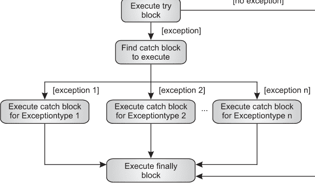

图 10.2 try-catch-finally 块

### 示例 10.5 一个演示 finally 块使用的程序

```java
class FinallyBlock
{
    public static void main(String args[]) {
        int a=67;
        int b=0;
        try {
            System.out.println("The value of a: " +a);
            System.out.println("The value of b: " +b);
            int c=(a/b); //exception thrown
            System.out.println("Result is: " +c);
        } catch (Exception e) {
            System.out.println(e); //prints the corresponding exception
        } finally {
            System.out.println("Denominator cannot be zero");
        }
    }
}
```

#### 程序的输出

```
The value of a: 67
The value of b: 0
java.lang.ArithmeticException: / by zero
Denominator cannot be zero
```

在这里，抛出的异常在 catch 块中被捕获，并显示适当的错误信息。之后，执行 finally 块中的语句。

## 10.7 使用 throw 关键字

如前所述，Java 运行时系统会自动抛出系统生成的异常。然而，Java 提供了一种机制，通过使用 `throw` 关键字显式地抛出异常。`throw` 语句的语法为：

```java
throw ExceptionObject;
```
where,
`ExceptionObject` 是 `Throwable` 类或其子类的对象。

当程序中遇到 `throw` 语句时，`try` 块中后续语句的执行将停止，并搜索相应的 catch 块。将检查最近的 `try` 块以确定其是否包含匹配该类型异常的 catch 块。如果是，则执行 catch 块；然后检查后续的 `try` 块。如果没有找到匹配的 catch 块，则默认异常处理程序将发挥作用，停止程序的正常执行并在输出屏幕上显示错误信息。

需要注意的是，`Throwable` 类或其子类以外的类不能作为异常对象。可以使用 `new` 操作符或使用 catch 子句内部的参数来创建 `Throwable` 对象。

### 示例 10.6 一个演示 `throw` 关键字使用的程序

```java
class ThrowExample {
    public static void main(String args[]) {
        try {
            ThrowExample(); //invoking ThrowExample() method
        } catch (ArithmeticException ae) {
            System.out.println("The exception is recaught\nhere: "+ae);
        }
    }
    static void ThrowExample() {
        int a=0;
        int b=6;
        try {
            int c=b/a; //system-generated exception
            System.out.println(c);
        } catch (ArithmeticException aoe) {
            System.out.println("The exception is caught inside the method ThrowExample");
            throw aoe; //exception thrown explicitly
        }
    }
}
```

#### 程序的输出

```
The exception is caught inside the method ThrowExample
The exception is recaught here :java.lang.ArithmeticException: / by zero
```

在这个示例中，`ArithmeticException` 发生在 `ThrowExample()` 内部。该异常在方法内部的 catch 块中被捕获，并使用 `throw` 关键字将其重新抛出。这被称为异常的**重新抛出**。现在，控制权传回 `main()` 方法的 catch 块，抛出的异常再次被捕获。

## 10.8 使用 throws 关键字

有时，一个方法可能会产生异常但无法处理它。也就是说，程序中可能有一个方法在产生（抛出）异常，但它没有适当的异常处理机制。调用此类方法的调用者必须对这种行为保持警惕，以便调用方法采取适当措施防止异常。这是通过在方法声明的方法名后使用 `throws` 关键字实现的。`throws` 子句包含了所有异常，但不属于 `Error` 或 `RuntimeException` 类或其子类的异常。方法可能抛出的所有其他异常都必须在方法声明中使用 `throws` 关键字列出；否则将产生编译错误。

### throws 子句的语法

```java
return_type method_name() throws exception_list
{
  //body of the method
}
```
where,
`exception_list` 包含了方法可能抛出的所有异常。

### 示例 10.7 一个演示 `throws` 子句使用的程序

```java
class ThrowsExample
{
  //抛出 ClassNotFoundException 的示例方法
  static void ClassExample() throws ClassNotFoundException
  {
    System.out.println("Inside ClassExample");
    throw new ClassNotFoundException("This is an example of Class not found Exception");
  }
  public static void main(String[] args)
  {
    try
    {
        ClassExample();
    }
    catch (ClassNotFoundException c)
    {
        System.out.println("Exception caught: " +c);
    }
  }
}
```

在程序中，我们在 `ClassExample` 方法中显式抛出了 `ClassNotFoundException`。由于我们没有在同一个方法中处理抛出的异常，因此我们使用了 `throws` 语句并在 `main()` 方法内部捕获异常。

## 10.9 创建自定义的异常

在前面的节中，我们提供了 Java 平台提供的一些内置异常。内置异常用于处理程序中发生的错误。但有时程序员想要创建自己的应用程序异常。自定义异常可以通过定义 `Exception` 类的子类并使用 `throw` 关键字来创建。

### 示例 10.8 一个演示创建自定义异常的程序


```java
class OwnException extends Exception
{
    OwnException(String message) //Constructor
    {
        super(message);
        System.out.println("OwnException constructor");
    }
}

public class CreateOwnException
{
    public static void main(String[] args)
    {
        int i=70;
        int j=0;
        try
        {
            System.out.println("The value of i: " +i);
            System.out.println("The value of j: " +j);
            throw new OwnException("This is not executed");
        } catch (OwnException oe) {
            System.out.println("Division of numbers is: " +oe);
        } catch (Exception e) {
            System.out.println("Denominator cannot be zero");
            e.printStackTrace();
        }
    }
}
```

程序的输出为：

```
The value of i: 70
The value of j: 0
Division of numbers is: This is not executed
```

## 总结

- 程序中的错误主要分为两类，即编译时和运行时。
- 编译时错误通常由于语法错误引起，如缺少分号、括号、拼写错误的关键字、未定义的变量等。
- 运行时错误可能由于算术计算中的除以零、访问越界数组、字符串转换数字等引起。这些通常被称为异常。

# 162 Java 编程

- 异常一词是“异常事件”的缩写。它是程序执行期间发生的不可预测事件，会破坏程序的正常流或终止程序。
- 异常处理机制不仅保证了运行时错误的检测和处理，还提供了分离处理代码与程序其他部分的方法。
- 异常继承自 `Throwable` 类。
- 异常由五个关键字管理，即 `try`、`catch`、`finally`、`throw` 和 `throws`。
- 需要监控异常的语句包含在 `try` 块中。
- 每当 `try` 块中发生异常时，异常会被抛出。这会将控制权传递给与 `try` 块相关联的 `catch` 块。
- 如果 `try` 块中发生了多个异常，Java 允许嵌套多个 `catch` 块，用于处理所有这些异常。
- 无论是否抛出异常，`finally` 块中的代码始终会被执行。
- Java 提供了一种通过 `throw` 关键字显式抛出异常的机制。
- 有时方法可能会抛出无法处理的异常，这必须使用 `throws` 进行指定。
- Java 允许程序员通过定义 `Exception` 类的子类并使用 `throw` 关键字来创建自定义异常。

# 练习

## 填空

1. 可能抛出异常的语句包含在 `try` 块中。
2. 异常是由 `运行时` 错误引起的。
3. Java 异常处理机制主要使用五个关键字，`try`、`catch`、`finally`、`throw` 和 `throws`。
4. 可能抛出异常的语句包含在 `try` 块中。
5. 程序执行期间发生的异常的描述性信息可以通过 `Throwable` 类的 `getMessage()` 获取。

## 选择正确选项

1. `运行时` 错误通常被称为异常。
   (a) 运行时 (b) 编译时
   (c) 以上两者都是 (d) 都不是

2. 下列哪项不会产生错误？
   (a) 没有 `try` 块的 `catch` 块
   (b) 在 `try` 和 `catch` 块之间存在代码
   (c) 带有 `catch` 或 `finally` 块的 `try` 块
   (d) 没有 `try` 块的 `finally` 块

3. `throws` 子句包含所有类型的异常，但不属于以下类型：
   (a) 运行时类 (`Runtime` classes) (b) 错误类 (`Error` classes)
   (c) 两者都是 (d) 以上都不是

4. 所有异常类都继承以下哪一个内置类？
   (a) `Exception` (b) `Throwable`
   (c) `Error` (d) `RuntimeException`

5. 当抛出异常时必须执行且不保留在块中的代码是：
   (a) `Try` (b) `catch`
   (c) `Finally` (d) `Throw`

## 判断对错

1. 在多 `catch` 块中，`catch` 语句的顺序非常重要。 (对)
2. 在 `try` 块和随后的 `catch` 或 `finally` 块之间包含某些代码是有效的。 (错)
3. 即使发生异常后，程序也会继续执行。 (对，前提是异常被捕获并处理)
4. `catch` 块可以抛出由自己捕获的异常。 (对)
5. 无论是否抛出异常，`finally` 块中的代码始终会被执行。 (对)

## 回答以下问题

1. 什么是异常？当 Java 中不处理异常时会发生什么？请举例说明。
2. 什么是异常处理机制？列出规范 Java 异常处理的 5 个关键字，并对每个关键字进行简要描述。
3. 解释 Java 异常层次结构。`Exception` 类和 `Error` 类实例之间有什么区别？
4. 用例子描述 `try-catch` 块在异常处理中的重要性。
5. “一旦控制权转移到 `catch` 块，它是否不会返回 `try` 块执行剩余代码？” 请举例证明你的观点。
6. 什么是不可达代码问题？请举例说明。
7. 下面代码的输出是什么？请给出你的答案理由。

```java
class NestedTry
{
    public static void main(String args[])
    {
        try
        {
            int a[] = {0,1};
            System.out.println(a[1]);
            try
            {
                int b[] = {0,5};
                int d = b[1]/b[0];
                System.out.println("Division of two number is :" + d);
            }
            catch (ArrayIndexOutOfBoundsException e)
            {
                System.out.println(e.getMessage());
            }
        }
        catch (NullPointerException aibe)
        {
            System.out.println(aibe.getMessage());
        }
    }
}
```

8. 必须包含 `finally` 块吗？请证明你的回答。
9. 检查下面程序的输出并找到错误（如果有）。

```java
class NestedFinally {
    public static void main(String args[]) {
        try {
            int b[] = {0,5};
            int d = b[1]/b[0];
            System.out.println("Division of two number is :" + d);
        } catch (Exception e) {
            System.out.println(e.getMessage());
        } finally {
            System.out.println("This is the first finally Block");
        } finally {
            System.out.println("This is the second finally Block");
        }
    }
}
```

10. `throw` 关键字的作用是什么？请解释。
11. `throws` 关键字在 Java 中的意义是什么？请解释。
12. 给出一个在 Java 中创建自定义异常的示例。

---

# 第 11 章

### 多线程

# 章节目标

读完本章后，你将能够：

- 理解什么是线程以及 Java 中多线程概念的概念
- 解释单线程程序和多线程程序的区别
- 讨论创建线程的不同方式
- 描述线程的完整生命周期
- 解释 `Thread` 类的各种方法
- 解释线程优先级
- 讨论什么是同步以及同步线程的不同方式
- 理解什么是死锁
- 解释线程间通信
- 演示如何在新版本的 Java 中挂起、恢复和停止线程

## 11.1 引言

大多数现代操作系统都支持多任务处理，能够同时执行多个程序。Java 的多线程是多任务处理的一种特殊形式。多线程是一种编程概念，其中一个程序（进程）被划分为两个或多个子程序（子进程），每个子程序都可以并发执行不同的任务。例如，一个子程序可以在文本编辑器中格式化文本，而另一个子程序可以打印相同的文本。

## 11.2 线程概念

前面章节讨论的程序只包含单一的顺序控制流，程序只需启动、执行一系列操作并最终结束。在任何给定的时刻，只有一个语句在执行。线程就像一个具有单一控制流的程序。它也有开始、执行部分和结束。前几个示例中的主程序可以被称为单线程程序。Java 还允许我们在程序中使用多个控制流，这样的程序被称为多线程程序。在单线程环境中，CPU 必须等待每个任务完成后才能继续处理下一个任务。在多线程环境中，由于不同的任务可以分配给不同的线程，程序可以最大限度地利用 CPU。例如，一个线程读取数据，另一个线程处理数据，第三个线程写入数据，从而提高了整体性能。多线程最适用于需要同时完成多个任务的应用。

# 168 Java 编程

线程被称为轻量级进程。这是因为主应用程序中的所有线程共享内存地址空间。然而，线程之间的切换非常快，给用户一种所有线程都在同时运行的错觉。实际上，只有一个线程在执行。

## 11.3 主线程

即使我们不创建，Java 程序始终包含一个线程。这个线程被称为主线程，它是当我们启动程序时立即启动的。主线程可以用于创建和启动子线程，它通常是最后一个执行的线程，执行如关闭和回收程序使用的资源的其他操作。主线程是自动创建的，但可以通过 `Thread` 对象进行控制。为了这一点，需要的引用可以通过调用 `currentThread()` 方法获得，它是 `Thread` 类的一个公共静态成员。该方法返回调用它的线程的引用。我们可以像控制其他线程一样控制主线程，只要我们有它的引用。

### 示例 11.1 控制主线程的程序

```java
class MainThread
{
    public static void main(String[] args)
    {
        Thread t = Thread.currentThread();
        System.out.println("The name of the current thread is: " + t);
        // 更改线程名称
        t.setName("MyThread");
        System.out.println("The name of the current thread after changing the name is: " + t);
        System.out.println("Main Thread exiting");
    }
}
```

## 程序的输出是

```
The name of the current thread is: Thread[MainThread,5,main]
The name of the current thread after changing the name is: Thread[MyThread,5,main]
Main Thread exiting
```

在这个示例中，调用 `currentThread()` 方法获取主线程的引用，并将引用存储在变量 `t` 中。在这里，通过调用 `setName()` 方法更改主线程的名称。

## 11.4 创建线程

在 Java 中，线程可以通过以下两种方式创建：

- 通过定义一个类继承 `Thread` 类。
- 通过实现 `Runnable` 接口。

在这两种方法中，线程都以对象的形式实现，其中包含一个名为 `run()` 的方法。它是 `Thread` 类中最重要的方法。它是新线程的入口点，也是定义要执行任务的地方。线程的执行从调用 `run()` 方法开始。当我们调用 `Thread` 类的另一个方法 `start()` 时，`run()` 方法会被调用。

### 11.4.1 扩展线程

我们可以通过创建一个继承 `java` 包中 `Thread` 类的类，并创建该类的实例来创建一个线程。扩展类必须重写 `run()` 方法。在 `run()` 方法内部，将定义线程需要执行的代码。

扩展 `Thread` 类并重写 `run()` 方法的代码段如下：

```java
class ThreadName extends Thread
{
    public void run()
    {
        // 新线程的代码
    }
}
```

现在可以使用以下语句创建并运行 `ThreadName` 类的实例。

```java
ThreadName objectname = new ThreadName();
objectname.start();
```

第二条语句调用 `start()` 方法，之后线程将准备好运行。一旦 Java 运行时调用其 `run()` 方法，它将开始运行。

### 示例 11.2 一个演示通过扩展 `Thread` 类创建线程的程序

```java
class Thread1 extends Thread
{
    public void run()
    {
        // Thread 的入口点
        int i = 0;
        while (i < 5)
        {
            System.out.println("First Child Thread:" + i);
            i = i + 1;
        }
        System.out.println("\t First child exited");
    }
}

class Thread2 extends Thread
{
    public void run()
    {
        int i = 0;
        while (i < 5)
        {
            System.out.println("Second Child Thread:" + i);
            i = i + 1;
        }
        System.out.println("\t Second child exited");
    }
}

class ExtendingThread
{
    public static void main(String[] args)
    {
        Thread1 t1 = new Thread1();
        Thread2 t2 = new Thread2();
        t1.start();
        t2.start();
        int i = 0;
        while (i < 5)
        {
            System.out.println("Main Thread:" + i);
            i = i + 1;
        }
        System.out.println("Main thread exiting");
    }
}
```

## 程序的输出

```
First Child Thread:0
Main Thread:0
Second Child Thread:0
First Child Thread:1
Main Thread:1
Second Child Thread:2
First Child Thread:2
Main Thread:2
Second Child Thread:3
First Child Thread:3
Main Thread:3
Second Child Thread:4
First Child Thread:4
Main Thread:4
First child exited
Main thread exiting
Second child exited
```

当我们启动程序时，主线程立即开始运行。随后主线程启动了两个子线程 `Thread1` 和 `Thread2`，它们都将执行不同的任务。一旦主线程到达 `main()` 方法的结束，程序中将共有三个线程并发运行：`Thread1`、`Thread2` 和主线程。每当 CPU 可用供它们时，这三个线程就会独立运行。它们的执行没有特定的顺序。因此，我们每次运行程序时可能会产生不同的输出。

### 11.4.2 实现 Runnable 接口

创建的另一种方法是创建一个实现 `Runnable` 接口的类。`Runnable` 接口包含一个方法 `run()`，这是实现线程所必需的。我们将创建一个线程，并将实现 `Runnable` 接口的类对象作为 `Thread` 类构造函数的参数传递。现在，通过调用 `start()` 方法激活线程。当程序需要继承 `Thread` 类以外的类时，实现 `Runnable` 比扩展 `Thread` 要方便得多，因为 Java 只允许继承一个基类。

实现 `Runnable` 接口的代码段如下。

```java
class MyNewThread implements Runnable
{
    public void run()
    {
        // 新线程的代码
    }
}
```

### 示例 11.3 一个演示通过实现 `Runnable` 创建线程的程序

```java
class MyRunnable implements Runnable
{
    public void run()
    {
        int i = 0;
        while (i < 5)
        {
            System.out.println("Child Thread:" + i);
            i = i + 1;
        }
        System.out.println("\t Child thread exited");
    }
}

class ImplementingRunnable
{
    public static void main(String[] args)
    {
        MyRunnable mr = new MyRunnable();
        Thread t = new Thread(mr);
        t.start();
        int i = 0;
        while (i < 5)
        {
            System.out.println("Main Thread:" + i);
            i = i + 1;
        }
        System.out.println("Main thread exiting");
    }
}
```

## 程序的输出

```
Child Thread:0
Main Thread:0
Child Thread:1
Main Thread:1
Child Thread:2
Main Thread:2
Child Thread:3
Main Thread:3
Child Thread:4
Main Thread:4
Child thread exited
Main thread exiting
```


```java
class MyNewThread implements Runnable // 实现 Runnable
{
    public void run() // 实现 run() 方法
    {
        int i=0;
        while(i<=4)
        {
            System.out.println("Child Thread: "+i);
            i++;
        }
    }
}
class RunnableInterface
{
    public static void main(String[] args)
    {
        /* 实现 Runnable 接口的类对象 */
        MyNewThread runnableobj=new MyNewThread();
        /* 以 runnable 对象作为参数的 Thread 类对象 */
        Thread threadobj=new Thread(runnableobj);
        threadobj.start();

        int j=0;
        while(j<=4)
        {
            System.out.println("Main Thread: "+j);
            j++;
        }
        System.out.println("Main Thread Exiting");
    }
}
```

## 程序的输出

```
Main Thread: 0
Child Thread: 0
Main Thread: 1
Child Thread: 1
Main Thread: 2
Child Thread: 2
Main Thread: 3
Child Thread: 3
Main Thread: 4
Child Thread: 4
Main Thread Exiting
```

在这个示例中，`MyNewThread` 是实现 `Runnable` 接口的类。在 `main()` 方法内部，创建了 `MyNewThread` 的实例 `runnableobj`，并将其作为参数传递给 `Thread` 类的构造函数。当新线程启动时，就会调用 `runnableobj` 的 `run()` 方法。

## 11.5 线程的生命周期

Java 线程在其周期内进入不同的状态：新生（newborn）、可运行（runnable）、阻塞（blocked）和死亡（dead）。线程始终处于这五种状态之一。如图 11.1 所示，线程可以从一个状态转换到另一个状态。


### 新生态 (Newborn State)

当线程被创建时，它进入新生态。这是线程生命周期中的第一个状态，线程新出生且尚未准备好运行。在此阶段，我们可以通过调用 `start()` 方法调度线程运行，或通过 `stop()` 方法将其杀死。在新生态调用任何其他方法都会抛出异常。

### 可运行态 (Runnable State)

当线程准备好运行并等待 CPU 分配时，它进入可运行态。每当线程就绪时，就会被放入等待 CPU 的队列中。线程调度器根据优先级选择队列中的线程。如果队列中所有线程优先级相同，调度器将以轮询方式分配时间片。线程可以自愿放弃控制权并使用 `yield()` 方法进入队尾等待机会。

### 运行态 (Running State)

当线程获得处理器进行执行时，它处于运行态，即线程调度器选择它作为当前执行的线程。线程将被处理器执行，直到被更高优先级的线程抢占，或者在以下任何情况下放弃控制权：

-   挂起 `suspend()` 方法：如果我们想挂起线程一段时间而不是杀死它，则使用 `suspend()` 方法。挂起的线程可以通过调用 `resume()` 方法带回执行态。
-   进入睡眠 `sleep()` 方法：`sleep()` 方法让线程睡眠指定的时间。一旦指定的时间过去，线程将自动返回执行态。
-   进入等待 `wait()` 方法：线程可以通过调用 `wait()` 方法进入等待，直到某些事件发生。我们可以通过使用 `notify()` 方法让线程再次运行。

### 阻塞态 (Blocked State)

当线程处于挂起、睡眠或等待状态时，它处于阻塞态。此状态下的线程不被视为死亡，因此当 CPU 可用时，它可以重新进入可运行态并运行。

### 死亡态 (Dead State)

如果线程的 `run()` 方法执行完毕，或在任何状态下通过调用 `stop()` 方法被杀死，则称线程处于死亡态。一旦线程进入死亡态，即使调用 `start()` 方法也无法重新进入任何其他状态。

## 11.6 线程方法

我们已经看到了 `start()` 和 `run()` 方法的使用。`Thread` 类还有许多其他方法，它们是 `yield()`、`sleep()`、`stop()`、`isAlive()` 和 `join()` 方法。

### 11.6.1 使用 yield(), sleep() 和 stop()

`yield()`、`sleep()` 和 `stop()` 方法负责控制线程的行为以及线程从一个状态到另一个状态的转换。

`sleep()` 方法的一种形式为：

```java
static void sleep(long milliseconds) throws InterruptedException
```
其中，`milliseconds` 是暂停的毫秒数。`sleep()` 方法会抛出一个异常，对 `sleep()` 方法的调用必须封装在 `try` 块中并跟一个 `catch` 块，否则程序将无法编译。

`stop()` 方法的一种形式为：

```java
static void stop()
```

`yield()` 方法的一种形式为：

```java
static void yield()
```

示例 11.4 一个演示 `yield()`、`sleep()` 和 `stop()` 使用的程序

```java
class Thread1 extends Thread
{
    public void run()
    {
        int i=0;
        while(i<5)
        {
            if(i==2)
                yield(); //在 Thread1 上调用 yield() 方法
            System.out.println("First Child Thread:"+i);
            i++;
        }
        System.out.println("\t First child exited");
    }
}

class Thread2 extends Thread
{
    public void run()
    {
        int j=0;
        while(j<5)
        {
            System.out.println("Second Child Thread:"+j);
            if(j==3)
                stop(); //在 Thread2 上调用 stop() 方法
            j++;
        }
        System.out.println("\t Second child exited");
    }
}

class Thread3 extends Thread
{
    public void run()
    {
        int k=0;
        while (k<5) {
            System.out.println("Third Child Thread:"+k);
            if (k==3) {
                try
                {
                    sleep(1000); /*在 Thread3 上调用 sleep() 方法*/
                }
                catch (Exception e) {
                    k=k+1;
                }
            }
            k++;
        }
        System.out.println("\t Third child exited");
    }
}

class ThreadMethods
{
    public static void main(String[] args)
    {
        Thread1 th1=new Thread1();
        Thread2 th2=new Thread2();
        Thread3 th3=new Thread3();
        th1.start();
        th2.start();
        th3.start();
        int k=0;
        while (k<5) {
            System.out.println("Main Thread:"+k);
            try
            {
                Thread.sleep(1000);
            }
            catch (Exception e) {
                System.out.println("Main Thread interrupted");
            }
            k=k+1;
        }
        System.out.println("\t Main thread exiting");
    }
}
```

程序的输出结果为：

```
First Child Thread:0
First Child Thread:1
Main Thread:0
First Child Thread:2
First Child Thread:3
First Child Thread:4
First child exited
Second Child Thread:0
Second Child Thread:1
Second Child Thread:2
Second Child Thread:3
Third Child Thread:0
Third Child Thread:1
Third Child Thread:2
Third Child Thread:3
Main Thread:1
Third Child Thread:4
Third child exited
Main Thread:2
Main Thread:3
Main Thread:4
Main thread exiting
```

在这个示例中，尽管 `Thread1` 先启动，但它在仅实现两次 `while` 循环后就放弃了控制权，调用了 `yield()` 方法。`Thread2` 开始运行并通过调用 `stop()` 方法被杀死。`Thread3` 在运行期间在调用 `sleep()` 方法时会睡眠 1000 毫秒。

### 11.6.2 使用 isAlive() 和 join() 方法

如所述，主线程必须是最后一个终止，因为它执行了若干项任务。为此，我们可以像示例 11.4 那样在 `main()` 方法中调用 `sleep()` 方法，这使得主线程睡眠一段时间，直到所有子线程完成它们的执行。然而，这被认为不是好的方法，因为主线程没有关于子线程何时完成执行的信息。在这种情况下，主线程必须睡眠足够长的时间以确保子线程在它终止之前已经结束。例如，如果让主线程睡眠 2500 毫秒，而子线程总共需要 1000 毫秒来终止，那么主线程就有必要要知道子线程何时完成。判断线程是否已经结束有两种方法。

-   首先，我们可以调用 `isAlive()` 方法。`isAlive()` 方法的一种形式为：

    ```java
    final boolean isAlive();
    ```

    此方法用于测试线程是否仍然存活。如果线程正在运行，则返回 `true`，否则返回 `false`。`isAlive()` 方法偶尔会被使用。

-   更常用的等待线程完成的方法是 `join()` 方法。

    `join()` 方法的一种形式为：

    ```java
    final void join() throws InterruptedException
    ```

    这用于停止当前线程（调用线程）的执行，直到调用该方法的线程终止为止。它确保了当前线程会等待目标线程完成执行。`join()` 方法接受的参数是等待的毫秒数。如果指定的毫秒内线程没有结束，则会抛出 `InterruptedException`。

示例 11.5 一个演示 `join()` 使用的程序

```java
class Thread1 extends Thread
{
    public void run()
    {
        int i=0;
        while(i<5)
        {
            System.out.println("First Child Thread:"+i);
            i++;
        }
        System.out.println("\t First child exited");
    }
}

class Thread2 extends Thread
{
    public void run()
    {
        int j=0;
        while(j<5)
        {
            System.out.println("Second Child Thread:"+j);
            j=j+1;
        }
        System.out.println("\t Second child exited");
    }
}

class ThreadJoin
{
    public static void main(String[] args) {
        Thread1 firstthread=new Thread1();
        Thread2 secondthread=new Thread2();

        firstthread.start();
        secondthread.start();

        try
        {
            firstthread.join();
            secondthread.join();
        }
        catch (InterruptedException e) {
            System.out.println("Main Thread interrupted");
        }

        System.out.println("\t Main Thread Exiting");
    }
}
```

程序的输出结果：

```
First Child Thread:0
First Child Thread:1
First Child Thread:2
First Child Thread:3
First Child Thread:4
First child exited
Second Child Thread:0
Second Child Thread:1
Second Child Thread:2
Second Child Thread:3
Second Child Thread:4
Second child exited
Main Thread Exiting
```

## 11.7 线程优先级

Java 线程具有优先级，它有助于线程调度器决定哪个线程应该先执行。优先级范围从 1（最低）到 10（最高）。`Thread` 类定义了三个标准优先级常量：

-   `Thread.MIN_PRIORITY` (1)
-   `Thread.NORM_PRIORITY` (5)
-   `Thread.MAX_PRIORITY` (10)

可以使用 `setPriority()` 方法设置线程优先级，使用 `getPriority()` 方法获取优先级。

示例 11.6 一个演示线程优先级的程序

```java
class Thread1 extends Thread
{
    public void run()
    {
        int i=0;
        while(i<5)
        {
            System.out.println("First Child Thread:"+i);
            i++;
        }
        System.out.println("\t First child exited");
    }
}

class Thread2 extends Thread
{
    public void run()
    {
        int j=0;
        while(j<5)
        {
            System.out.println("Second Child Thread:"+j);
            j=j+1;
        }
        System.out.println("\t Second child exited");
    }
}

class ThreadPriority
{
    public static void main(String[] args) {
        Thread1 firstthread=new Thread1();
        Thread2 secondthread=new Thread2();

        // Thread 2 assigned highest priority
        secondthread.setPriority(Thread.MAX_PRIORITY);

        // Thread1 assigned lowest priority
        firstthread.setPriority(Thread.MIN_PRIORITY);

        firstthread.start();
        secondthread.start();

        System.out.println("\t Main Thread Exiting");
    }
}
```

程序的输出结果：

```
Second Child Thread:0
Second Child Thread:1
Second Child Thread:2
Second Child Thread:3
Second Child Thread:4
Second child exited
Main Thread Exiting
First Child Thread:0
First Child Thread:1
First Child Thread:2
First Child Thread:3
First Child Thread:4
First child exited
```

第一个子线程 `Thread1` 被分配了最低优先级，第二个子线程 `Thread2` 被分配了最高优先级。尽管 `Thread1` 是第一个被调用 `start()` 方法的线程，但由于被高优先级的 `Thread2` 抢占，它的输出是最后打印的。

注意：线程获得的 CPU 时间不仅取决于它的优先级，还取决于其他因素，例如操作系统是如何实现多线程的。

## 11.8 线程同步 (SYNCHRONIZATION)

当多个线程需要访问同一个资源时，必须有一种方法来确保在任何给定时间点只有一个线程在使用该资源，否则可能会导致严重的问题。例如，如果程序中的一个线程从文件中读取工资，而另一个线程尝试更新它，那么程序可能会产生不预期的输出。该问题的解决可以使用名为同步（synchronization）的技术来实现。同步的目标是控制对共享资源的访问。

同步使用了监视器（monitor）的概念。监视器是一个用作互斥锁的实例。也就是说，在任何给定时间点，它只能被一个线程拥有。当一个线程获取锁时，被称为进入了监视器。任何其他尝试获取锁的线程都必须等待直到第一个线程离开监视器。同步有两种方式：

- 同步方法 (Synchronizing methods)
- 同步语句 (Synchronizing statements)

### 11.8.1 同步方法

我们可以通过 `synchronized` 关键字同步任何类的部分（或全部）方法。当一个方法被声明为 `synchronized` 时，Java 会创建一个监视器。要进入监视器，我们需要调用同步方法。类对象中的同步方法在任何时刻只能有一个在执行。Java 将监视器交给调用该方法的线程。只要线程在同步方法内部，其他尝试调用它（或任何其他同步方法）的线程都等待。只有当当前执行的线程完成并退出监视器时，另一个等待的线程才能进入监视器。

声明同步方法的语法为：

```java
synchronized data_type method_name()
{
    // 方法代码
}
```

为了理解同步，让我们先考虑一个没有同步的程序。

示例 11.7 一个演示同步需要的程序


```java
class A
{
    void display(String msg)
    {
        System.out.print("" + msg);
        try
        {
            Thread.sleep(1000);
        } catch (InterruptedException e) {
            System.out.println("Interrupted");
        }
        System.out.println("Interrupted");
    }
}
```

```java
class MyThread extends Thread {
    String str;
    A obj;
    MyThread(A obj, String s) {
        obj=obj;
        str=new String (s);
    }
    public void run() {
        obj.display(str);
    }
}
```

```java
class UnsynchronizedMethod {
    public static void main(String[] args) {
        A obj=new A();
        MyThread th1=new MyThread(obj,"THIS");
        MyThread th2=new MyThread(obj,"IS");
        MyThread th3=new MyThread(obj,"SYNCHRONIZATION");
        th1.start();
        th2.start();
        th3.start();
    }
}
```

## 程序的输出是

THISISSYNCHRONIZATION

类 `A` 有一个名为 `display()` 的方法，接收一个 `String` 类型参数。该方法会打印 `msg` 字符串。注意 `sleep()` 方法会导致当前线程停止一秒。`MyThread` 的构造函数接受两个参数：`A` 类的实例和一个字符串。当第一个线程启动时，`run()` 方法被调用。`run()` 在 `A` 的实例上调用 `display()` 方法并传递字符串 `str`，允许另一个线程在第一个线程完成方法之前执行。

# 多线程 183

因此，程序的输出并不符合预期，字符串是混合的。这是因为三个线程调用 `display()` 方法时没有任何机制阻止它们竞争完成方法。

现在，让我们通过在示例 11.7 的 `display()` 定义前加上 `synchronized` 关键字来修改程序。我们将通过限制 `display()` 方法的访问为一次一个线程，从而产生正确的输出。

## 示例 11.8 一个演示同步方法的程序

```java
class MyThread extends Thread
{
    String str;
    A obj;
    MyThread(A obj,String s)
    {
        obj=obj;
        str=new String(s);
    }
    public void run()
    {
        obj.display(str);
    }
}
```

```java
class SynchronizedMethod
{
    public static void main(String[] args)
    {
        A obj=new A();
        MyThread th1=new MyThread(obj,"THIS");
        MyThread th2=new MyThread(obj,"IS");
        MyThread th3=new MyThread(obj,"SYNCHRONIZATION");
        th1.start();
        th2.start();
        th3.start();
    }
}
```

# 184 Java 编程

## 程序的输出是

THIS

IS

SYNCHRONIZATION

注意：一旦线程进入实例的同步方法，其他线程无法进入任何同步方法。同一类的不同实例可以同时执行同步方法。

## 11.8.2 同步语句

管理线程执行另一种方法是同步代码块或语句。这更强大。同步方法在所有情况下都不起作用。例如，我们要访问的类是由别人创建的，它没有同步方法且我们没有权限修改它。在这种情况下，通过将对方法的调用放在同步块内部，可以对该类的访问进行同步。同步代码块的通用形式：

```java
synchronized(object)
{
    // 需要同步的语句
}
```

其中 `object` 是被同步对象的引用。

### 示例 11.9 一个演示同步语句的程序

```java
class A
{
    void display(String msg)
    {
        System.out.print("" + msg);
        try
        {
            Thread.sleep(1000);
        } catch (InterruptedException e) {
            System.out.println("Interrupted");
        }
        System.out.println("Interrupted");
    }
}
```

```java
class MyThread extends Thread
{
  String str;
  A obj;
  MyThread (A obj,String s) {
    obj=obj;
    str=new String(s);
  }
  public void run() {
    synchronized(obj) {
      obj.display(str);
    }
  }
}
class SynchronizedStatement {
  public static void main(String[] args) {
    A obj=new A();
    MyThread th1=new MyThread(obj,"THIS");
    MyThread th2=new MyThread(obj,"IS");
    MyThread th3=new MyThread(obj,"SYNCHRONIZATION");
    th1.start();
    th2.start();
    th3.start();
  }
}
```

程序的输出是

THIS

IS

SYNCHRONIZATION

通过在 `run` 方法内部使用 `synchronized` 语句，对 `A` 类对象的访问被限制为一次一个线程，产生了相同的正确输出。

## 11.8.3 死锁 (Deadlock)

死锁发生在当两个或多个线程处于同时等待状态，且其中每个线程都在等待另一个等待线程所持有的资源释放时。例如，考虑以下代码段。

```java
Thread X:
Thread Y:
run() {
  synchronized(obj1)
}
run() {
  synchronized(obj2)
}
```

```java
sleep(1000);
obj2.method2();
sleep(1000);
obj1.method1();
```

首先，线程 X 启动并在对象 `obj1` 上进行同步，这阻止了其他线程调用 `obj1` 的方法。随后，线程 X 通过调用 `sleep()` 方法进入睡眠，允许 Thread Y 启动。线程 Y 启动并在对象 `obj2` 上进行同步。这阻止了其他线程调用 `obj2` 的方法。Thread Y 在调用 `sleep()` 方法时进入睡眠，允许线程 X 唤醒。线程 X 继续执行并尝试在 `obj2` 上调用 `method2()`。但在 Thread Y 中对 `obj2` 的同步代码执行完毕之前，它无法调用 `obj2` 上的方法。由于 Thread X 无法继续，Thread Y 获取了控制权并尝试在 `obj1` 上调用 `method1()`，但在 Thread X 中对 `obj1` 的同步代码执行完毕之前，这是不可能的。在这里，两个线程都无法继续，因为它们陷入了死锁。

### 示例 11.10 一个演示死锁的程序

```java
class A {
    void display1(A obj2) {
        System.out.println("第一个线程等待第二个线程释放资源");
        synchronized(obj2)
        System.out.println("Deadlocked");
    }
    void display2(A obj1) {
        System.out.println("第二个线程等待第一个线程释放资源");
        synchronized(obj1)
        System.out.println("Deadlocked");
    }
}
```

```java
class Thread1 extends Thread {
    A obj1,obj2;
    Thread1(A i,A j) {
        obj1=i;
        obj2=j;
    }

    public void run()
    {
      synchronized(obj1)
      {
        try {
          sleep(1000);
        }
        catch(Exception e) {
          System.out.println(e);
        }
        obj2.display1(obj2);
      }
    }
}
```

```java
class Thread2 extends Thread {
  A obj1,obj2;
  Thread2(A p,A q) {
    obj1=p;
    obj2=q;
  }
  public void run() {
    synchronized(obj2)
    try {
      sleep(1000);
    }
    catch(Exception e) {
      System.out.println(e);
    }
    obj1.display2(obj1);
  }
}
```

```java
class Deadlock {
  public static void main(String args[]) {
    A obj1=new A();
    A obj2=new A();
    Thread1 t1=new Thread1(obj1,obj2);
    Thread2 t2=new Thread2(obj1,obj2);
    t1.start();
    t2.start();
  }
}
```

## 程序的输出是

第二个等待第一个线程释放资源

第一个等待第二个线程释放资源

在例例中，线程 `thread1` 拥有 `obj1` 的监视器并等待 `obj2` 的监视器。同样，`thread2` 拥有 `obj2` 的监视器并等待 `obj1` 的监视器。除非获得了 `obj2`，否则 `Thread1` 永远不会释放 `obj1`；除非获得了 `obj1`，否则 `Thread2` 永远不会释放 `obj2`。由于两个线程处于死锁状态，程序永远不会完成。我们需要按下 CTRL-C 来结束程序。

## 11.9 线程间通信

线程间通信是线程之间交换消息的过程。线程在改变状态之前或之后交换消息。在某些情况下，线程之间的通信非常重要。例如，让我们考虑两个线程 A 和 B，线程 B 使用线程 A 产生的数据。在线程 A 产生数据后，它会不时检查线程 B 是否完成对数据的使用，以便它可以生成更多数据而不浪费 CPU 周期。线程 B 在等待 Thread A 完成任务并进行通信时会浪费许多 CPU 周期，如果这样它们就不需要反复等待并检查彼此的状态了。CPU 周期就不会被浪费。

线程间通信可以通过三种方法实现：`wait()`、`notify()` 和 `notifyAll()`。这些方法只能在同步方法（synchronized method）或同步块内部调用，否则将抛出 `IllegalMonitorStateException` 类型的异常。所有这些方法都被声明为 `final`。

- `wait()`：它导致当前线程释放监视器并进入睡眠，直到另一个线程通过 `notify()` 唤醒它。该方法会抛出 `InterruptedException`。另一种形式的 `wait()` 允许我们指定等待的时间。

- `notify()`：它启动在同一对象上调用 `wait()` 方法的第一个线程。

- `notifyAll()`：它启动在同一对象上调用 `wait()` 方法的所有线程。其中，优先级最高的线程首先运行。

首先我们来看一个示例，线程在不使用 `wait()` 和 `notify()` 方法的情况下使用另一个线程产生的数据。

### 示例 11.11 不使用 wait() 和 notify() 方法的程序

```java
class P
{
    int i;
    synchronized int recieve()
    {
        System.out.println("Recieved:" + i);
        return i;
    }
    synchronized void deliver(int i)
    {
        this.i=i;
        System.out.println("Delivered:" + i);
    }
}

class Thread1 extends Thread
{
    P obj;
    Thread1(P obj)
    {
    }
    ... (省略部分代码以保持逻辑一致)
}
...
```

# 11.12 演示 wait() 和 notify() 的程序

```java
class P
{
    int i;
    synchronized int recieve()
    {
        while(true) {
            try {
                wait();
            }
            catch (InterruptedException e) {
                System.out.println("Exception caught");
            }
            System.out.println("Recieved:" + i);
            return i;
        }
    }
    synchronized void deliver(int i)
    {
        this.i=i;
        System.out.println("Delivered:" + i);
        notify();
    }
}

class Thread1 extends Thread
{
    P obj;
    Thread1(P obj)
    {
        obj=obj;
    }
    public void run()
    {
        int j=0;
        while(true)
        {
            obj.deliver(j++);
        }
    }
}

class Thread2 extends Thread
{
    P obj;
    Thread2(P obj)
    {
        obj=obj;
    }
    public void run()
    {
        while(true)
        {
            obj.recieve();
        }
    }
}

class InterCommunication
{
    public static void main(String[] args)
    {
        P obj=new P();
        Thread1 t1=new Thread1(obj);
        Thread2 t2=new Thread2(obj);
        t1.start();
        t2.start();
    }
}
```

## 程序的输出是

Delivered:0

Recieved:0

Delivered:1

Recieved:1

Delivered:2

Recieved:2

Delivered:3

Recieved:3

Delivered:4

Recieved:4

Delivered:5

Recieved:5

Delivered:6

Recieved:6

在这个例中，`wait()` 和 `notify()` 方法在 `recieve()` 和 `deliver()` 方法内部调用。这使得 Thread1 在产生数据后通知 Thread2，并等待 Thread2 完成使用。同样，Thread2 在使用数据后通知 Thread1，并等待 Thread1 产生下一个数据。

## 11.10 暂停、恢复和停止线程


正如提到的，预定义的 `suspend()`、`resume()` 和 `stop()` 方法在 Java 中已被弃用，尽管它们是管理执行的方便方式。这些方法被弃用是因为可能会导致死锁和严重的系统故障。然而，在 Java 的新版本中，暂停恢复和停止线程可以通过布尔类型完成。线程的 `run()` 方法将根据指示执行状态的当前标志值进行工作。例如，如果运行标记设置为 true，则 `run()` 让线程执行。要让 `run()` 挂起正在运行的线程，挂起标记必须设置为 true。同样，如果停止标记设置为 true，线程将死亡。

## 示例 11.13 一个演示挂起、恢复和停止操作的程序

```java
class ChildThread extends Thread {
    boolean suspend_flag, stop_flag;
    String name;

    ChildThread(String str) {
        name = str;
        suspend_flag = false;
        stop_flag = false;
    }

    public void run() {
        try {
            int i = 5;
            while (i >= 1) {
                System.out.println(name + " " + i);
                sleep(1000);
                i--;
                synchronized (this) {
                    while (suspend_flag) {
                        wait();
                        if (stop_flag) {
                            break;
                        }
                    }
                }
            }
        } catch (InterruptedException e) {
            System.out.println("Thread interrupted");
        }
    }

    synchronized void my_suspend() {
        suspend_flag = true;
    }

    synchronized void my_resume() {
        suspend_flag = false;
        notify();
    }

    synchronized void my_stop() {
        suspend_flag = false;
        stop_flag = true;
        notify();
    }
}

class SRS {
    public static void main(String[] args) {
        try {
            ChildThread obj = new ChildThread("Thread");
            obj.start();
            System.out.println("Thread started");
            Thread.sleep(2000);
            obj.my_suspend();
            System.out.println("Thread is suspended");
            Thread.sleep(2000);
            obj.my_resume();
            System.out.println("Thread is resumed");
            Thread.sleep(2000);
            obj.my_suspend();
            System.out.println("Thread is suspended");
            Thread.sleep(2000);
            obj.my_resume();
            System.out.println("Thread is resumed");
            Thread.sleep(2000);
            obj.my_stop();
            System.out.println("Thread stopped");
        } catch (InterruptedException e) {
            System.out.println("Thread interrupted");
        }
    }
}
```

程序的输出结果为：

```
Thread
Thread 5
Thread 4
Thread 3
Thread is suspended
Thread is resumed
Thread 2
Thread 1
Thread is suspended
Thread is resumed
Thread stopped
```

## 总结

- 多线程是一种编程概念，其中一个程序（进程）被分为两个或多个子程序（子进程），每个子程序都可以并发执行不同的任务。
- 线程就像一个具有单一控制流的程序。它也有起点、执行路径和终点。线程被称为轻量级进程。这是因为主应用程序中的所有线程都共享内存中的同一个地址空间。
- 如果我们不创建线程，Java 程序始终至少包含一个线程。这个线程被称为主线程（main thread），它是程序启动时立即启动的线程。
- 在 Java 中，可以通过两种方式创建线程：扩展 `Thread` 类和实现 `Runnable` 接口。在这两种方法中，线程都以对象的形式实现，对象包含一个名为 `run()` 的方法。它是新线程的入口点，也是定义线程的地方。
- 线程在生命周期内可以进入各种状态。它们是：新生（newborn）、可运行（runnable）、运行中（running）、阻塞（blocked）和死亡（dead）。线程处于这五种状态之一。
- `yield()`、`sleep()` 和 `stop()` 方法负责控制线程的行为以及线程从一个状态到另一个状态的转换。
- 有两种方法可以判断线程是否结束。`isAlive()` 方法用于测试线程是否仍然存活。`join()` 方法用于停止当前线程（调用线程）的执行，直到该方法终止。它确保线程将等待直到被调用的线程完成执行。
- 优先级是整数，指定一个线程相对于另一个线程的相对优先级。当线程被创建时，它会从创建它的线程继承优先级。


# 多线程

- 在 Java 中，可以通过两种方式创建线程：扩展 `Thread` 类和实现 `Runnable` 接口。在这两种方法中，线程都以对象的形式实现，对象包含一个名为 `run()` 的方法。它是新线程的入口点，也是定义线程的地方。

- 线程在生命周期内可以进入各种状态。它们是：新生（newborn）、可运行（runnable）、运行中（running）、阻塞（blocked）和死亡（dead）。线程处于这五种状态之一。

- `yield()`、`sleep()` 和 `stop()` 方法负责控制线程的行为以及线程从一个状态到另一个状态的转换。

- 有两种方法可以判断线程是否结束。`alive()` 方法用于测试线程是否仍然存活。`join()` 方法用于停止当前线程（调用线程）的执行，直到该方法终止。它确保线程将等待直到被调用的线程完成执行。

- 优先级是整数，指定一个线程相对于另一个线程的相对优先级。当线程被创建时，它会从创建它的线程继承优先级。

- 如果我们不创建线程，Java 程序始终至少包含一个线程。这个线程被称为主线程（main thread），它是程序启动时立即启动的线程。

# 多线程示例 193

```java
} stop_flag=false;
}
public void run() {
    try {
        int i=5;
        while(i>=1) {
            System.out.println(name+" "+i);
            sleep(1000);
            i--;
            synchronized(this) {
                while(suspend_flag) {
                    wait();
                    if(stop_flag) {
                        break;
                    }
                }
            }
        }
    } catch (InterruptedException e) {
        System.out.println("Thread interrupted");
    }
}
synchronized void my_suspend() {
    suspend_flag=true;
}
synchronized void my_resume() {
    suspend_flag=false;
    notify();
}
synchronized void my_stop() {
    suspend_flag=false;
    stop_flag=true;
    notify();
}
class SRS {
    public static void main(String[] args) {
```

# 使用 Java 编程

```java
try {
    ChildThread obj=new ChildThread("Thread");
    obj.start();
    System.out.println("Thread started");
    Thread.sleep(2000);
    obj.my_suspend();
    System.out.println("Thread is suspended");
    Thread.sleep(2000);
    obj.my_resume();
    System.out.println("Thread is resumed");
    Thread.sleep(2000);
    obj.my_suspend();
    System.out.println("Thread is suspended");
    Thread.sleep(2000);
    obj.my_resume();
    System.out.println("Thread is resumed");
    Thread.sleep(2000);
    obj.my_stop();
    System.out.println("Thread stopped");
} catch (InterruptedException e) {
    System.out.println("Thread interrupted");
}
```

程序的输出结果为：

```
Thread
Thread 5
Thread 4
Thread 3
Thread is suspended
Thread is resumed
Thread 2
Thread 1
Thread is suspended
Thread is resumed
Thread stopped
```

## 总结

- 多线程是一种编程概念，其中一个程序（进程）被分为两个或多个子程序（子进程），每个子程序都可以并发执行不同的任务。

- 线程就像一个具有单一控制流的程序。它也有起点、执行路径和终点。线程被称为轻量级进程。这是因为主应用程序中的所有线程都共享内存中的同一个地址空间。

- 如果我们不创建线程，Java 程序始终至少包含一个线程。这个线程被称为主线程（main thread），它是程序启动时立即启动的线程。

- 在 Java 中，可以通过两种方式创建线程：扩展 `Thread` 类和实现 `Runnable` 接口。在这两种方法中，线程都以对象的形式实现，对象包含一个名为 `run()` 的方法。它是新线程的入口点，也是定义线程的地方。

- 线程在生命周期内可以进入各种状态。它们是：新生（newborn）、可运行（runnable）、运行中（running）、阻塞（blocked）和死亡（dead）。线程处于这五种状态之一。

- `yield()`、`sleep()` 和 `stop()` 方法负责控制线程的行为以及线程从一个状态到另一个状态的转换。

- 有两种方法可以判断线程是否结束。`alive()` 方法用于测试线程是否仍然存活。`join()` 方法用于停止当前线程（调用线程）的执行，直到该方法终止。它确保线程将等待直到被调用的线程完成执行。

- 优先级是整数，指定一个线程相对于另一个线程的相对优先级。当线程被创建时，它会从创建它的线程继承优先级。

# 练习

在空白处填空。

1. 实现 `Runnable` 接口的 ________。

2. 当我们启动程序时，立即启动的 ________。

3. 用于停止当前线程（调用线程）执行直到该方法终止的 ________。

4. 使用 ________ 关键字进行同步。

5. 通过 ________ 修改线程的优先级。

选择正确选项。

1. 线程的默认优先级是多少？

   (a) 0 (b) 5
   (c) 1 (d) 10

2. 调用 `start()` 时哪个方法被自动调用？

   (a) yield() (b) run()
   (c) notify() (d) resume()

3. 线程处于 ________ 状态。

   (a) two (b) three
   (c) four (d) five

4. 线程处于 ________ 状态时。

   (a) suspended (b) sleeping
   (c) waiting (d) all of these

5. 以下哪个用于线程间通信？

   (a) wait(), notify() (b) join()
   (c) wait(), notifyAll() (d) none of these

# 第 12 章

## JAVA 中的 I/O

## 本章目标

阅读本章后，你将能够：

- 理解流（streams）在输入输出操作中的重要性
- 对不同的流类进行分类
- 理解 `PrintStream` 类及各种预定义流的概念
- 区分流与读取器/写入器（readers/writers），并在两者之间做出合适选择
- 解释文件概念以及支持文件输入输出操作的类
- 理解 `transient` 和 `volatile` 修饰符的概念
- 解释 `instanceof` 运算符的使用
- 理解原生方法（native methods）的概念及其用法

## 12.1 引言

程序是一组用于解决问题的指令集。每个程序都接收输入、处理输入并将其转换为所需的输出。输入通过标准输入设备、其他程序等提供给程序。同样，程序的输出会被发送到标准输出设备、其他程序等。Java 通过 `java.io` 包中的类来支持数据的输入和输出。

## 12.2 I/O 基础

大多数应用程序需要处理大量的输入输出数据，这些数据很难管理。常用的控制台 I/O 操作不是持久性的，程序一旦终止数据就会丢失。此外，使用控制台 I/O 操作获得的输出也不是持久性的，这需要像磁盘、磁带或软盘之类的设备来存储海量数据。数据以文件的形式（也称为磁盘文件）存储在这些设备中，被称为持久性数据（persistent data）。可以使用字节流类和字符流类分别以字节或字符的形式读取或写入文件，将在后续章节中讨论。对象也可以从二级内存（文件）读取和写入，读写对象的过程被称为对象序列化。

## 12.3 流

Java 以流的形式管理所有的输入输出。流（stream）是指数据从源流向目的地的通道。这些数据以字节序列或字符序列的形式存在。

Java 流大致分为两类，即输入流和输出流。帮助从各种源（如键盘、鼠标、文件、存储设备等）读取数据以提供给程序的流称为输入流。接收来自程序的数据并将其写入物理设备或其他程序的流称为输出流。例如，为了将数据从输入设备引入程序，程序会打开指向输入设备的输入流并按串行方式读取数据。相反，要将数据从程序写入输出设备，程序会打开指向输出设备的输出流并进行串行写入（见图 12.1）。

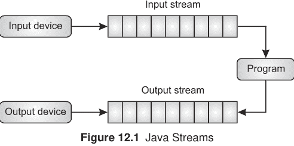

## 12.4 流类

Java 通过 `java.io` 包中定义的类层次结构支持输入/输出流。根据这些类所操作的数据类型，可以将它们分为两组：字节流类和字符流类（见图 12.2）。

- 字节流类：这些类支持对字节（8位字节）进行输入输出操作。例如，在从二进制文件读取或写入数据时，会使用字节流类。
- 字符流类：这些类对字符（16位 Unicode）执行输入输出操作。例如，在从文本文件读取或写入数据时，会使用字符流类。

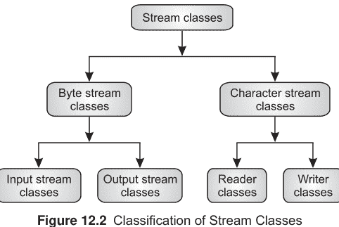

### 12.4.1 字节流类

字节流类用于执行 8 位字节的读写。由于流本质上是单向的，只能在一个方向传输字节，即从源读取数据到程序，或从目的地写入数据。Java 进一步将字节流分为两个类，即 `InputStream` 类和 `OutputStream` 类。`InputStream` 的子类包含支持输入的方法，`OutputStream` 的子类包含输出相关的方法。

#### 输入流类

Java 的输入流类用于从流读取 8 位字节。`InputStream` 类是所有面向字节的输入类的超类。该类的所有方法都会抛出 `IOException`。作为一个抽象类，`InputStream` 不能实例化，但它的子类可以。其中一些列在表 12.1 中。

### 表 12.1 输入流类

| 类 | 说明 |
| :--- | :--- |
| `BufferedInputStream` | 包含从缓冲区（内存区域）读取字节的方法 |
| `ByteArrayInputStream` | 包含从字节数组读取字节的方法 |
| `DataInputStream` | 包含读取 Java 数据类型的方法 |
| `FileInputStream` | 包含从文件读取字节的方法 |
| `FilterInputStream` | 包含从其他输入流读取字节的方法，它将这些流作为自己的基本数据源 |
| `ObjectInputStream` | 包含读取对象的方法 |
| `PipedInputStream` | 包含从管道输出流读取的方法。管道输入流必须连接到管道输出流 |
| `SequenceInputStream` | 包含合并多个输入流并然后从合并后的流中读取的方法 |

`InputStream` 类定义了各种方法用于在输入流上执行读取操作。其中一些方法及其描述列在表 12.2 中。

### 表 12.2 InputStream 类方法

| 方法 | 说明 |
| :--- | :--- |
| `read()` | 返回下一个输入字节的整数表示。输入结束时返回 -1 |
| `read(byte buffer[])` | 尝试读取指定长度的字节到缓冲区。输入结束时返回 -1 |
| `read(byte buffer[], int loc, int nBytes)` | 尝试从 loc 开始读取 nBytes 个字节到缓冲区，返回读取的总数。输入结束时返回 -1 |
| `available()` | 返回可读的字节数 |
| `mark(int nBytes)` | 在输入流中标记位置，直到读取 nBytes 个字节 |
| `reset()` | 将输入指针重置到之前标记的位置 |
| `skip(long nBytes)` | 跳过输入流中的 nBytes 个字节并返回实际跳过的字节数 |
| `close()` | 关闭输入源。如果在关闭后尝试读取将抛出 `IOException` |

#### ByteArrayInputStream 类

`ByteArrayInputStream` 打开一个输入流以从字节数组读取字节。它包含一个存储流数据的内部缓冲区。应该注意的是，关闭流并没有影响。也就是说，关闭流后可以调用该类的方法而不会产生 `IOException`。

可以使用以下构造函数创建 `ByteArrayInputStream` 对象：

```java
ByteArrayInputStream(byte[] buffer) // 第一个
ByteArrayInputStream(byte[] buffer, int loc, int nBytes) // 第二个
```

第一个构造函数创建一个使用字节数组作为源 `ByteArrayInputStream`。第二个构造函数创建一个使用字节数组子集的 `ByteArrayInputStream`。读取从指定的 loc 开始，直到读取完 nBytes。

### 示例 12.1 使用 ByteArrayInputStream 类的程序


```java
import java.io.*;
class ByteArrayInputStreamExample {
    public static void main(String args[]) throws IOException {
        byte b[]="is my first program".getBytes();
        ByteArrayInputStream inp=new ByteArrayInputStream(b);
        int n=inp.avail();
        System.out.println("Number of available bytes: "+n);
        long s=inp.skip(11); //跳过11字节
        System.out.println("Number of skipped bytes: "+s);
        int i;
        System.out.print("String after skipping s bytes: ");
        while((i=inp.read())!=-1) {
            System.out.print((char)i);
        }
        inp.reset(); //将指针重置到流的开头
        System.out.println(); //换行
        int j;
        System.out.print("String in uppercase: ");
        while((j=inp.read())!=-1) {
            System.out.print((char)j);
        }
    }
}
```

# Java 203 I/O

```
{
System.out.print(Character.toUpperCase((char) j));
}
```

程序的输出为：

可用字节数: 24

跳过的字节数: 11

跳过字节后的字符串: first program

大写后的字符串: THIS IS MY FIRST PROGRAM

在这个示例中，使用了 `getBytes()` 方法将字符串转换为字节。这里演示了 `available()` 和 `skip()` 方法的使用。一旦读取完整个流，就会调用 `reset()` 方法将指针置于流的开头。

## 输出流 (Output Stream classes)

Java 的输出类用于向流写入 8 位字节。`OutputStream` 类是所有面向字节的输出流类的父类。该类的所有方法都会抛出 `IOException`。作为一个抽象类，`OutputStream` 类不能实例化，但其子类可以。其中一些子类列在表 12.3 中。

### 表 12.3 输出流类

| 类 | 描述 |
| --- | --- |
| BufferedOutputStream | 包含将字节写入缓冲区的方法 |
| ByteArrayOutputStream | 包含将字节写入字节数组的方法 |
| DataOutputStream | 包含写入 Java 原始数据类型的方法 |
| FileOutputStream | 包含写入文件的方法 |
| FilterOutputStream | 包含写入其他输出流的方法 |
| ObjectOutputStream | 包含写入对象的方法 |
| PipedOutputStream | 包含向管道输出流写入的方法 |
| PrintStream | 包含打印 Java 原始数据类型的方法 |

`OutputStream` 类定义了执行写入操作的方法。这些方法在表 12.4 中讨论。

### 表 12.4 OutputStream 类方法

| 方法 | 描述 |
| --- | --- |
| write(int i) | 向输出流写入单个字节 |
| write(byte buffer[]) | 向输出流写入字节数组 |
| write(bytes buffer[], int loc, int nBytes) | 从缓冲区 `b` 的从 `buffer[loc]` 处开始向输出流写入 `nBytes` 个字节 |
| flush() | 刷新输出流并写入等待中的缓冲区输出 |
| close() | 关闭输出流。如果在关闭流后仍尝试写入，则会产生 `IOException` |

## Java 编程

## 使用 ByteArrayOutputStream

`ByteArrayOutputStream` 类是 `ByteArrayInputStream` 的输出端，用于将字节写入缓冲区。与 `ByteArrayInputStream` 类似，关闭此流没有影响。也就是说，即使在关闭流后也可以调用该类的方法，而不会产生任何 `IOException`。

可以使用其中一个构造函数创建 `ByteArrayOutputStream` 对象。

```
ByteArrayOutputStream() //第一个
ByteArrayOutputStream(int nBytes) //第二个
```

第一个构造函数创建一个 32 字节的缓冲区。第二个构造函数创建一个大小与 `nBytes` 相等的缓冲区。随着字节的写入，缓冲区的大小会增加。

### 12.2 演示 ByteArrayOutputStream 类用法的程序

```java
import java.io.*;
class ByteArrayOutputStreamExample {
    public static void main(String[] args) throws IOException {
        ByteArrayOutputStream out=new ByteArrayOutputStream();
        byte b[]="Today is a bright sunny day".getBytes();
        out.write(b);
        System.out.println(out.toString());/*将字节转换为字符串*/
        out.close(); //关闭流
    }
}
```

## 程序的输出

Today is a bright sunny day

在这个示例中，使用了 `getBytes()` 方法将字符串转换为字节。一旦写完整个流，就会调用 `toString()` 方法将缓冲区的内容（字节）转换为字符串。

## 12.4.2 字符流类 (Character Stream Classes)

字节流类的局限性之一是它只能处理 8 位字节，无法与 Unicode 配合。为了克服这一局限性，`java.io` 包引入了字符流类以匹配字节流类。字符流类支持 16 位 Unicode 字符，对字符数组或字符串进行操作，一次读取或写入一个缓冲区。字符流类分为两个流类，即 `Reader` 类和 `Writer` 类。

## Reader 类 (Reader Classes)

`Reader` 类用于从输入流中读取 16 位的 Unicode 字符。`Reader` 类是所有面向字符的输入流类的父类。该类的所有方法都会抛出 `IOException`。作为一个抽象类，`Reader` 类不能实例化，因此使用了它的子类。其中一些子类列在表 12.5 中。

### 表 12.5 Reader 类

| 类 | 描述 |
| --- | --- |
| BufferedReader | 包含从缓冲区读取字符的方法 |
| CharArrayReader | 包含从字符数组读取字符的方法 |
| FileReader | 包含从文件读取的方法 |
| FilterReader | 包含从底层字符输入流读取的方法 |
| InputStreamReader | 包含将字节转换为字符的方法 |
| PipedReader | 包含从管道输出流读取的方法 |
| StringReader | 包含从字符串读取的方法 |

`Reader` 类定义了各种方法，用于对输入流中的数据执行读取操作。其中一些方法及其描述列在表 12.6 中。

### 表 12.6 Reader 类方法

| 方法 | 描述 |
| --- | --- |
| int read() | 返回输入中下一个可用字符的整数表示。当遇到文件末尾时返回 -1 |
| int read(char buffer[]) | 尝试将 `buffer.length` 个字符读取到缓冲区，并返回成功读取的字符总数。遇到文件末尾时返回 -1 |
| int read(char buffer[], int loc, int nChars) | 尝试从 `buffer[loc]` 开始向缓冲区读取 `nChars` 个字符，并返回成功读取的字符总数。遇到文件末尾时返回 -1 |
| void mark(int nChars) | 标记输入流中的当前位置，直到读取 `nChars` 个字符 |
| void reset(long skipped) | 将输入指针重置为之前设置的标记 |
| long skip(long nChars) | 跳过输入流的 `nChars` 个字符，并返回实际跳过的字符数 |
| boolean ready() | 如果下一次输入请求不需要等待则返回 true，否则返回 false |
| void close() | 关闭输入。如果在关闭流后尝试读取，则会产生 `IOException` |

### 使用 BufferedReader

`BufferedReader` 类在输入设备和程序之间创建一个缓冲区字符流。它定义了以字符形式从缓冲区读取的方法。

`BufferedReader` 对象可以使用以下构造函数之一创建。

```
//第一个
BufferedReader(Reader inputStream)
BufferedReader(Reader inputStream, int nChars) //第二个
```

第一个构造函数创建一个默认大小的缓冲区字符流。第二个构造函数创建一个大小为 `nChars` 的缓冲区字符流。

除了 `Reader` 类提供的方法外，`BufferedReader` 类包含一些其他方法，讨论如下：

- **String readLine()**: 读取文本的一行。
- **boolean ready()**: 检查流是否准备好读取。

### 示例 12.3 演示 BufferedReader 类用法的程序

```java
import java.io.*;
class BufferedExample {
    public static void main(String[] args) throws IOException {
        String s="This program is skipping first character\nof word in the string";
        StringReader sr=new StringReader(s);
        System.out.println("The input string is: "+s);
        /*创建 BufferedReader 实例*/
        BufferedReader br=new BufferedReader(sr);
        //读取底层的 StringReader
        System.out.print("The output string is: ");
        br.skip(1); /*跳过输入字符串第一个单词的第一个字符*/
        //读取剩余字符串
        int i=0;
        while((i=br.read())!=-1) {
            System.out.print((char)i);
            if((char)i==' ') //检查空格 {
br.skip(1); /*跳过每个单词的第一个字符*/
            }
        }
    }
}
```

程序的输出

The input string is: This program is skipping first character of word in the string

The output string is: his rog skippingrst haracter f ach ord n he ting

在这个程序中，`skip()` 方法用于跳过输入字符串中每个单词的第一个字符。

## Writer 类 (Writer Classes)

`Writer` 类用于向输出流写入 16 位的 Unicode 字符。`Writer` 类是所有面向字符的输出流类的父类。该类的所有方法都会抛出 `IOException`。作为一个抽象类，`Writer` 类不能实例化，因此使用了它的子类。其中一些子类列在表 12.7 中。

### 表 12.7 Writer 类

| 类 | 描述 |
| --- | --- |
| BufferedWriter | 包含向缓冲区写入字符的方法 |
| FileWriter | 包含向文件写入数据的方法 |
| FilterWriter | 包含向底层输出流写入字符的方法 |
| CharArrayWriter | 包含向字符数组写入字符的方法 |
| OutputStreamWriter | 包含将字节转换为字符的方法 |
| PipedWriter | 包含向已连接的输入流写入数据的方法 |
| StringWriter | 包含向字符串写入数据的方法 |

Writer 类定义了各种方法，用于在输出流上执行操作。这些方法及其它们的描述如列在表 12.8 所示。

### 表 12.8 Writer 类方法

| 方法 | 描述 |
| --- | --- |
| void write() | 向输出流写入数据 |
| void write(int i) | 向输出流写入单个字符 |
| void write(char buffer[]) | 向输出流写入字符数组 |
| void write(char buffer[], int loc, int nChars) | 从从 buffer[loc] 开始的缓冲区向输出流写入 'n' 个字符 |
| void close() | 关闭输出流。如果在关闭流后尝试执行写入操作，则会产生 IOException |
| void flush() | 刷新输出流并写入缓冲的输出字符 |

## 使用 BufferedWriter 类

BufferedWriter 类是 BufferedReader 的输出对应类，用于向字符输出流写入字符。

可以使用以下构造函数之一创建 BufferedWriter 对象：

// BufferedWriter(Writer out) // 第一个

BufferedWriter(Writer out, int nChars) // 第二个

第一个构造函数创建一个具有默认缓冲区大小的缓冲字符流。第二个构造函数创建一个使用输入缓冲区大小为 nChars 的缓冲字符流。

除了 Writer 类提供的方法外，BufferedWriter 类还包含 `newLine()` 方法，用于写入一个新行。

### 示例 12.4 一个演示 BufferedWriter 类使用的程序

```java
import java.io.*;
class BufferedWriterExample {
    public static void main(String[] args) throws IOException {
        String s="This is an example of BufferedWriter";
        StringWriter sw=new StringWriter();
        //创建 BufferedWriter 类的实例
        BufferedWriter bw=new BufferedWriter(sw);
        bw.write(s,0,5);
        bw.newLine();
        bw.write(s,5,s.length()-5);/*写入从索引 5 开始的子字符串*/
        bw.flush(); //刷新流
        System.out.println(sw.getBuffer());
        sw.close(); //关闭流
        bw.close(); //关闭流
    }
}
```

程序的输出结果为

在此例示例中，使用了 BufferedWriter 类将数据写入字符输出流（StringWriter 类的实例）。StringWriter 类的 `getBuffer()` 方法返回一个 String 类型的缓冲区。

## 12.5 PrintStream 类

当程序执行时，输入从各种来源读取，输出发送到不同的目的地。通常情况下，键盘和监视器屏幕被用作标准输入和输出设备。用户输入的数据通过输入流提供给程序，程序的输出通过输出流提供给输出设备。这种输出由用户使用 Java PrintStream 类显示。到目前为止，`print()` 和 `println()` 两个方法用于在输出设备上显示原始数据类型、对象等。即使发生异常事件，PrintStream 类也不会抛出 IOException。

PrintStream 类可以连接到底层输出流，例如 FileOutputStream、ByteArrayOutputStream、BufferedOutputStream 等。

PrintStream 类定义了类型的构造函数。

PrintStream(OutputStream os)

此构造函数创建一个打印流并将其连接到输出流。

除了 `print()` 和 `println()` 方法外，PrintStream 类还定义了其他方法，列在表 12.9 所示。

| 方法 | 描述 |
|---|---|


| PrintStream append(char c) | 向输出流追加字符 c |
| PrintStream append(CharSequence cs) | 向输出流追加字符 cs |
| boolean checkError() | 检查流的错误状态 |
| protected void setError() | 将错误状态设置为 true |

表 12.9 PrintStream 类方法

## 12.6 预定义流

`java.lang` 包被所有 Java 程序自动导入。该包包含一个 `System` 类，它持有许多已废弃的静态方法和变量。该类包含三个预定义的流变量——`in`、`out` 和 `err`。这些流变量被声明为静态的且公有的，并在 JVM 启动时初始化。程序的任何部分都可以轻松使用它们，而无需引用特定的 `System` 对象。

- `System.out` 是 `PrintStream` 类的对象。它指向标准输出流，通常用于向控制台写入文本。
- `System.in` 是 `InputStream` 类的对象。它指向标准输入流，通常用于在控制台程序读取键盘输入。
- `System.err` 是 `PrintStream` 类的对象。它指向标准错误流，工作方式类似于 `System.out`，即显示错误信息。

## 12.7 向控制台读写

Java 1.0 支持使用字节进行控制台输入。使用字节读取/写入控制台需要使用废弃的方法，这不被推荐。Java 2 读取输入的最理想方法是使用字符代替字节。Java 1.1 及更高版本的 Java 提供了 `InputStreamReader` 将面向字节的数据转换为面向字符的数据。为了读取输入，使用 `InputStreamReader` 来读取字符。`System.in` 是一个 `InputStream` 对象。向控制台输出使用 `System.out`，它属于 `PrintStream` 类。到目前为止，`print()` 和 `println()` 方法用于在输出设备上显示原始数据类型、对象等。这种输出由用户使用 `PrintStream` 类显示。如果在关闭流后尝试执行写入操作，则会产生 `IOException`。

示例 12.5 一个演示 `System.out` 和 `System.in` 的程序

```java
import java.io.*;
class InputStreamExample {
    public static void main(String args[]) throws IOException {
        int j[] = new int[5];
        double sum = 0.0;
        System.out.print("Enter your name: ");
        // ... (代码逻辑)
        // rest of code
    }
}
```

程序的输出为：

输入你的名字：Kevin

你在五门科目中得分

1: 89

2: 90

3: 65

4: 78

5: 60

Kevin 的百分比是：76.4%

## 12.8 文件

文件是存储在某些存储设备上的相关数据集合。存储在文件中的数据是持久的，可以根据需要轻松访问。此外，一个程序存储在文件中可以被其他程序访问或修改。对于读写文件，使用了文件流。文件流是指程序与文件之间的数据流（见图 12.3）。取决于文件流处理的数据类型，可以使用字节流类或字符流。


图 12.3 输入输出流

### 向文件中写入字节

在读取或写入文件之前，必须先打开。为此，需要创建一个文件流并链接到特定文件。Java 提供了 `FileInputStream` 类从文件中读取字节。`FileInputStream` 类在文件和程序之间创建一个输入流，从文件读取字节并发送给程序。

```
FileInputStream 定义了以下类型的构造函数。
FileInputStream(String filePath)
其中，
FilePath 是描述文件的完整路径
```

示例 12.6 一个演示使用 `FileInputStream` 从文件读取的程序

```java
import java.io.*;
class FileInputStreamExample {
    public static void main(String[] args) throws IOException {
        FileInputStream fis = new FileInputStream("student.txt");
        int size = fis.available(); /*确定文件的大小*/
        System.out.println("文件的大小为:" + size);
        System.out.println("文件的内容为: ");
        int i;
        while ((i = fis.read()) != -1) {
            System.out.print((char) i);
        }
        fis.close();
        System.out.println();
        System.out.println("读取完成");
    }
}
```

在创建流对象时，使用 `fis.read()` 方法从 `student.txt` 文件中读取下一个字节。

同样，`FileOutputStream` 类定义了向文件写入字节的方法。

`FileOutputStream` 定义了以下类型的构造函数：

`FileOutputStream(String FilePath)`

其中，

`FilePath` 是描述文件所在位置的完整路径。

示例 12.7 一个演示使用 `FileOutputStream` 类向文件写入的程序

```java
import java.io.*;
class FileOutputStreamExample {
    public static void main(String[] args) throws IOException {
        String filecontents = "These contents will be written to the file";
        byte b[] = filecontents.getBytes();
        FileOutputStream fos = new FileOutputStream("newfile.txt");
        for (int i = 0; i < b.length; i++) {
            fos.write(b[i]);
        }
        fos.close();
        System.out.println("Write successful");
    }
}
```

程序的输出结果：

Write successful

在此程序中，创建了 `FileOutputStream` 类对象，操作系统会自动创建一个指定名称的文件。如果同一目录中已存在同名文件，则旧文件的内容将被新文件的内容覆盖。

### 向文件中读取和写入字符

`FileReader` 类用于从文件中读取字符，程序读取文件与程序之间的字符流并将其发送到程序。同样，向文件写入字符使用 `FileWriter` 类。

示例 12.8 一个演示使用 `FileReader` 和 `FileWriter` 类从文件读取和写入字符的程序

```java
import java.io.*;
class ReadFileWriter {
    public static void main(String args[]) throws IOException {
        String w = "Hello\n\nare\nyou";
        FileWriter fw = new FileWriter("data.txt");
        System.out.println("Writing to the file data.txt...");
        fw.write(w);
        System.out.println("Writing complete");
        fw.close();

        System.out.println();
        FileReader fr = new FileReader("data.txt");
        BufferedReader b = new BufferedReader(fr);
        System.out.println("Reading the file data.txt...");
        while (b.readLine() != null) {
            System.out.println(w);
        }
        fr.close();
        System.out.println("Reading ends");
    }
}
```

程序的输出结果为：

Writing to the file data.txt...

Writing complete

Reading the file data.txt...

Hello

How

are

you

Reading ends

在此程序中，创建了 `FileWriter` 类对象，操作系统会自动创建一个名为 `data.txt` 的文件并写入内容。然后使用 `FileReader` 类读取该同一文件的内容。

## 12.9 数据流

数据流支持以字符串对象的形式读取/写入原始数据类型（`int`、`float`、`short`、`long`、`double`、`boolean`、`char` 和 `byte`）。当用户想要处理字节或字符以外的数据时，就需要数据流。数据流是过滤流，它们对现有流进行过滤，使得原始数据类型可以直接从流中读取或写入流。Java 提供了 `DataInputStream` 类和 `DataOutputStream` 类分别用于读取和写入原始数据类型。

### 12.9.1 DataInputStream 类

`DataInputStream` 类从流中读取 Java 原始数据类型。要创建数据输入流，我们使用 `DataInputStream` 类的构造函数，其定义如下：

```java
DataInputStream(InputStream inp)
```

其中，

`inp` 是一个需要过滤的现有输入流，例如 `FileInputStream`、`BufferedInputStream` 等。

常用方法列在表 12.10 中。

表 12.10 DataInputStream 类方法

| 方法 | 描述 |
| --- | --- |
| int readInt() | 读取整数类型值 |
| float readFloat() | 读取 float 类型值 |
| char readChar() | 读取字符类型值 |
| double readDouble() | 读取 double 类型值 |
| long readLong() | 读取 long 类型值 |
| short readShort() | 读取 short 类型值 |
| boolean readBoolean() | 读取 boolean 类型值 |
| byte readByte() | 读取字节类型值 |
| String readUTF() | 读取字符串类型值 |

### 12.9.2 DataOutputStream 类

`DataOutputStream` 类向输出流中写入 Java 原始数据类型。要创建数据流，我们使用 `DataOutputStream` 类的构造函数，其定义如下：

```java
DataOutputStream(OutputStream out)
```

其中，

`out` 是一个需要过滤的现有输出流，例如 `FileOutputStream`、`BufferedOutputStream` 等。

常用方法列在表 12.11 中。

表 12.11 DataOutputStream 类方法

| 方法 | 描述 |
| --- | --- |
| void writeInt(int v) | 写入整数类型值 |
| void writeFloat(float v) | 写入 float 类型值 |
| void writeChar(int v) | 写入字符类型值 |
| void writeDouble(double v) | 写入 double 类型值 |
| void writeLong(long v) | 写入 long 类型值 |
| void writeShort(int v) | 写入 short 类型值 |
| void writeBoolean(boolean v) | 写入 boolean 类型值 |
| void writeByte(int v) | 写入字节类型值 |
| void writeUTF(String str) | 写入字符串类型值 |

## 12.11 StreamTokenizer 类

`StreamTokenizer` 用于将输入流解析为由分隔符确定的“标记”（tokens），并一次一次地读取它们。与 `StringTokenizer` 不同，`StreamTokenizer` 能够区分数字、标识符、引用字符串和不同的注释样式。分词过程涉及从输入流中读取每个字节，每个字节被视为具有五种不同属性的字符：字母、数字、字符串引号、空白字符和注释字符。每个字符都会被识别为这些属性之一。

`StreamTokenizer` 类定义了某种类型的构造函数。

```
StreamTokenizer(Reader input)
该语句构造一个流分词器并对指定的输入流进行分词。
```

`StreamTokenizer` 类的一些字段列在表 12.13 中。

表 12.13 StreamTokenizer 类字段

| 字段 | 描述 |
| --- | --- |
| static int TT_WORD | 表示该单词已读取 |
| static int TT_NUMBER | 表示数字已读取 |
| static int TT_EOL | 表示行尾已读取 |
| static int TT_EOF | 表示文件末尾已读取 |
| int ttype | 指定所读取标记的类型 |
| double nval | 数字标记的值 |
| String sval | 指定单词标记的值 |

`StreamTokenizer` 类定义的一些方法列在表 12.14 中。

表 12.14 StreamTokenizer 类方法

| 方法 | 描述 |
| --- | --- |
| int lineno() | 返回当前行号 |
| void eolIsSignificant(boolean flag) | 决定行尾是否被视为标记 |
| int nextToken() | 返回输入流的下一个标记 |
| void whitespaceChars(int low, int high) | 指定 low 到 high 范围内的所有字符均为空白字符 |
| void wordChars(int low, int high) | 指定 low 到 high 范围内的所有字符均为合法的单词字符 |
| void slashSlashComments(boolean flag) | 设置流分词器是否识别 C++ 注释 |
| void slashStarComments(boolean flag) | 设置流分词器是否识别 C 注释 |
| void resetSyntax() | 重置默认分隔符集 |

为了理解 `StreamTokenizer` 类的概念，我们使用文件 `student.txt`，其内容如下：

Name: Amit Sharma

Roll No.: 1

Overall Percentage: 89%

//Name: Shivani Dutta

Roll No.: 2

Overall Percentage: 92%

示例 12.11 一个从 `student.txt` 读取文件以演示 `StreamTokenizer` 类使用的程序


```java
import java.io.*;

class StreamTokenizer {
    public static void main(String[] args) throws IOException {
        int nCount = 0, wordCount = 0, lineCount = 0;
        // 创建分词器以从文件读取
        FileReader f = new FileReader("student.txt");
        StreamTokenizer s = new StreamTokenizer(f);
        s.eofSignificant(true); // 行尾被视为标记
        // 这些调用将使注释可识别
        s.slashSlashComments(true);
        s.slashStarComments(true);

        /* 此范围（A 到 F）之间的所有字符将被视为空白字符 */
        s.whitespaceChars(65, 70);

        // 分词文件
        int token = s.nextToken();
        while (token != StreamTokenizer.TT_EOF) {
            switch (token) {
                case StreamTokenizer.TT_NUMBER:
                    double num = s.nval;
                    numCount++;
                    System.out.println("Number token is: " + num);
                    break;

                case StreamTokenizer.TT_WORD:
                    String word = s.sval;
                    wordCount++;
                    System.out.println("Word token is: " + word);
                    break;

                case StreamTokenizer.TT_EOL:
                    lineCount++;
                    System.out.println("End of line number " + lineCount);
                    break;

                default:
                    char ch = (char) s.type;
                    break;
            }
            token = s.nextToken();
        }

        System.out.println("Total number of number tokens is: " + numCount);
        System.out.println("Total number of word tokens is: " + wordCount);
        System.out.println("Total number of lines is: " + lineCount);
        f.close();
    }
}
```

程序的输出结果为：

```text
Word token is: Name
Word token is: mit
Word token is: Sharma
End of line number 1
Word token is: Roll
Word token is: No.
Number token is: 1.0
End of line number 2
Word token is: Overall
Word token is: Percentage
Number token is: 89.0
End of line number 3
End of line number 4
End of line number 5
Word token is: Roll
Word token is: No.
Number token is: 2.0
End of line number 6
Word token is: Overall
Word token is: Percentage
Number token is: 92.0
End of line number 7
Total number of number tokens is: 4
Total number of word tokens is: 11
Total number of lines is: 7
```

## 12.12 transient 和 volatile 修饰符

`transient` 和 `volatile` 修饰符是 Java 两个特殊修饰符，用于处理某些特殊情况。

### transient

正如所述，对象序列化是读取和写入对象的过程。默认情况下，所有对象都是可序列化的，也就是说它们可以从辅助内存读取并写入辅助内存，以便保留它们保存的值。要使对象变为不可序列化，可以使用 `transient` 修饰符。如果实例变量被声明为 `transient`，那么在将该对象写入辅助内存时，它的值将不会持久。

为了理解 `transient` 的概念，请考虑下面的代码段。

```java
class TransientExample {
    transient double first;   // 不持久
    double second;            // 持久化
}
```

在这里，当 `TransientExample` 类的对象被写入辅助内存时，`first` 的值不会被保存，而 `second` 的值会被保存。

### volatile

`volatile` 修饰符用于告诉编译器，变量可以被程序的其他部分随时更改。该修饰符主要用于多线程，在多线程中一个程序（进程）被分为两个或多个子进程，每个子进程由单独线程运行并执行不同的任务。在多线程程序中，各个线程共享实例变量并在本地缓存内存中保留副本，而主内存保持不变。当一个线程更改值时，只更新本地缓存内存而不更新主内存。这导致了不一致，因为使用相同变量的线程不知道另一个线程的变化。为了避免这个问题，使用了 `volatile` 修饰符。当变量被声明为 `volatile` 时，它不会存储在缓存内存中，其值会在主内存中更新，这样其他线程就可以轻松访问更新后的值。

## 12.13 使用 instanceof 运算符

`instanceof` 运算符用于检查对象是否属于特定类。

`instanceof` 运算符的形式为：
`object instanceof type`
其中，`object` 是类的实例，`type` 是类类型。

如果对象代表指定类型的实例或可以转换为指定类型，则 `instanceof` 运算符返回 `true`，否则返回 `false`。

**示例 12.12 演示 instanceof 运算符使用的程序**

```java
class FirstClass {
    void show() {
        System.out.println("Method of FirstClass");
    }
}

class SecondClass extends FirstClass {
    void show() {
        System.out.println("Method of SecondClass");
    }

    void showstatus() {
        System.out.println("Another method of SecondClass");
    }
}

public class InstanceofExample {
    public static void main(String[] args) {
        FirstClass fc = new FirstClass();
        SecondClass sc = new SecondClass();

        if (fc instanceof FirstClass) {
            System.out.println("fc is an instance of FirstClass");
            fc.show();
        }

        if (sc instanceof SecondClass) {
            System.out.println("sc is an instance of SecondClass");
            sc.show();
            sc.showstatus();
        } else {
            System.out.println("sc is not an instance of SecondClass");
        }
    }
}
```

**程序的输出结果**

```text
fc is an instance of FirstClass
Method of FirstClass
sc is an instance of SecondClass
Method of SecondClass
Another method of SecondClass
```

## 12.14 原生方法

原生方法是一种特殊方法，包含用 Java 以外任何编程语言编写的原生代码。通常，原生代码是用 C 语言编写的。在方法前加上关键字 `native` 且定义方法体即可声明原生方法。

让我们考虑一个示例来理解原生方法的概念。以下是展示如何在普通 Java 中创建和使用原生方法的步骤。

1. 在一个名为 `NativeExample` 的普通 Java 类中声明了一个原生方法 `show()`。

```java
public class NativeExample {
    public native String show(String message);

    public static void main(String[] args) {
        String message = null;
        NativeExample ne = new NativeExample();
        message = ne.show("I am called through a native method");
        System.out.println(message);
    }
}
```

2. `show()` 的原生实现包含在动态链接库中，该库通过静态方法加载。该方法只在程序开始执行时执行一次。用于加载动态库的代码为：

```java
static {
    System.loadLibrary("NativeExample");
}
```

动态链接库使用 `System` 类的 `loadLibrary()` 方法加载。`loadLibrary()` 的通用形式为：
`static void loadLibrary(String filename)`
其中，`filename` 指定了持有该库的文件名。

### 使用 Java 编程

完整的 Java 文件 `NativeExample` 如下：

```java
public class NativeExample {
    public native String show(String message);

    static {
        System.loadLibrary("NativeExample");
    }

    public static void main(String[] args) {
        String message = null;
        NativeExample ne = new NativeExample();
        message = ne.show("I am called through a native method");
        System.out.println(message);
    }
}
```

- 使用下面的命令编译 Java 文件 `NativeExample` 以生成其类文件 `NativeExample` 类。
  `javac NativeExample.java`

- 使用给出的命令生成 `NativeExample` 的 `.h` 文件。
  `javah -jni NativeExample`

该命令生成头文件 `NativeExample.h`，其包含以下代码：

```c
/* 不要编辑此文件 - 它是机器生成的 */
#include <jni.h>

/* 类 NativeExample 的头 */
#ifndef _Included_NativeExample
#define _Included_NativeExample

#ifdef __cplusplus
extern "C" {
#endif

/*
 * Class: NativeExample
 * Method: show
 * Signature: (Ljava/lang/String;)V
 */
JNIEXPORT void JNICALL Java_NativeExample_show(JNIEnv *, jobject, jstring);

#ifdef __cplusplus
}
#endif
#endif
```

在此代码中，以下语句定义了要创建的原生方法 `show()` 的 `.h` 原型。

`JNIEXPORT void JNICALL Java_NativeExample_show(JNIEnv *, jobject, jstring);`

其中：
- `JNIEXPORT` 和 `JNICALL` 代表展开为匹配特定平台指令的宏。
- `JNIEnv`、`jobject` 和 `jstring` 代表 JNI 数据类型定义。
- `Java_NativeExample_show` 是在实现原生方法期间使用的方法名。该方法的通用形式为：`Java_className_methodName`。

其中：
- `Java` 作为前缀添加。
- `className` 是声明原生方法的 Java 类名。它被作为前缀添加以识别关联的原生方法。
- `methodName` 是原生方法名。

由于原生方法名附加了类名，因此不同的 Java 类可以声明相同名的原生方法。

5. 创建一个名为 `NativeExample.c` 的文件，用于实现 `show()` 方法。`NativeExample.c` 的代码为：

```c
#include <jni.h>
#include "NativeExample.h"
#include <stdio.h>

JNIEXPORT void JNICALL Java_NativeExample_show(JNIEnv *env, jobject obj, jstring msg) {
    return msg;
}
```


- 6. 编译文件 `NativeExample.c` 并创建一个名为 `NativeExample.dll` 的 DLL 文件。
- 7. 使用以下命令运行 java 程序：`java NativeExample`。程序的输出为：`I am called through a native method`

## 总结

- 程序是一组有助于解决问题的指令集。每个程序都接受输入、处理输入并将其转换为所需的输出。
- 输入通过标准输入设备、其他程序等传递给程序，程序的输出发送到标准输出设备、其他程序等。
- Java 通过 `java.io` 包中包含的类支持数据的输入和输出。在 Java 中，所有的输入和输出都以流的形式进行处理。
- 流指的是数据从源流向目的地的通道。
- Java 流类可以分为两类：字节流类和字符流类。
- 字节流类用于执行 8 位字节的读取和写入。
- 字符流类用于执行 16 位字符的读取和写入。

*(注：原始文本中存在大量重复的 OCR 错误，已根据逻辑内容进行了清理和去重)*

## 练习题

### 填空

1. Java 通过 `java.io` 包中的类支持数据的输入和输出。
2. 流类可以分为两种类型，即字节流类和字符流类。
3. 使用 `transient` 修饰符使对象不可序列化。
4. 使用 `System.loadLibrary()` 方法加载动态链接库。
5. 输出由 `PrintStream` 类显示给用户。

### 选择正确选项

1. `InputStream` 类
   (a) `java.io` 包中定义的接口。
   (b) 用于从文件读取的字节流类。
   (c) 一个包含 8 位字节方法的抽象类。
   (d) 用于读取基本类型的类。

2. 字符流类处理 Unicode。
   (a) 8 位 (b) 16 位
   (c) 32 位 (d) 64 位

3. 字节流类可以处理
   (a) 8 位字节 (b) 8 位 Unicode
   (c) 16 位 (d) 16 位字节

4. 下列哪个类包含连接多个输入流并从组合流中读取的方法？
   (a) `FilterInputStream` (b) `PipedInputStream`
   (c) `SequenceInputStream` (d) `FilterInputStream`

5. `setError()` 方法属于 `PrintStream` 类。
   (a) `InputStream` (b) `OutputStream`
   (c) `PrintStream` (d) `Reader`

### 判断对错

1. `Reader` 的 `read()` 方法抛出 `IOException`。
2. 原生方法仅在没有定义方法体的 main Java 类中声明。
3. `PrintStream` 类的 `setError()` 方法用于检查流的错误状态。
4. 创建与现有文件同名的文件会导致现有数据丢失。
5. 即使发生异常事件，`PrintStream` 类也不会抛出 `IOException`。

### 回答以下问题

1. 你如何理解流？什么是流类？
2. 区分 `InputStream`/`OutputStream` 类与 `Reader`/`Writer` 类。每类给出一个例子。
3. 三种预定义流是什么？请解释。
4. Java 支持通过控制台输入设备（键盘）读取用户提供的输入。请结合示例进行说明。
5. 什么是文件？为什么要使用它？列出用于在文件中读写的文件流类。
6. Java 支持通过文件读写字节和字符。请通过给出各者的示例进行说明。
7. 执行以下代码后会发生什么？（假设文件 `test.txt` 已存在于当前目录）

```java
import java.io.*;

class example {
    public static void main(String args[]) {
        {
            try {
                FileOutputStream file = new FileOutputStream("test.txt");
            } catch (IOException ex) {
                ex.printStackTrace();
            }
        }
    }
}
```

8. `DataInputStream` 和 `DataOutputStream` 类的意义是什么？请举例说明。
9. “`PrintStream` 类用于向用户显示输出”。请解释。
10. 区分 `transient` 和 `volatile` 修饰符。
11. 什么是原生方法？它是如何实现的？

# 第 13 章
## JAVA APPLET（小程序）

## 本章目标

读完本章后，你将能够：

- 解释支持创建 applet 的类和包。
- 描述控制 applet 生命周期的重要方法。
- 在应用程序中创建并使用 applet。
- 使用 `<PARAM>` 标签向 applet 传递参数。
- 使用 `getDocumentBase()` 和 `getCodeBase()` 方法。
- 使用 `AppletContext` 接口中定义的 `showDocument()` 方法。
- 理解 `Graphics` 类在 applet 中的意义。
- 学习并使用 `Graphics` 类中定义的各种方法。

## 13.1 引言

我们目前为止讨论的 Java 程序都是基于控制台的应用程序。这些是功能完备、独立的 Java 程序，通过 Java 虚拟机（JVM）进行编写、修改和运行。Java 定义了另一类应用程序，称为 applet（小程序）。applet 是专门设计用于在 Web 上运行的小型 Java 程序。applet 最显著的特征是，它通过添加图像、声音、动画和不同的文本样式，将静态网页转换为用户可交互的网页。换句话说，applet 为程序员提供了开发功能完备的多媒体应用程序的能力。

## 13.2 APPLET 基础

Applet 是嵌入在网页中的小型程序，用于创建动态和交互式的应用程序。applet 为网页提供了仅通过 HTML 无法提供的交互功能。例如，applet 能够以鼠标点击、文本输入、复选框选择的形式捕捉用户输入，并对用户的操作生成响应。

创建的每个 applet 必须是 `Applet` 类的子类，并包含在 `java.applet` 包中。该类包含了控制 applet 生命周期和行为的方法。此外，applet 使用了包含在 `java.awt` 包内部的 `Graphics` 类的各种方法。`Graphics` 类负责与 applet 显示（输出）相关的所有操作。Java 程序可以通过 `appletviewer`（Java 开发工具包的一个工具）或任何兼容 Java 的网络浏览器执行。

### 13.2.1 Applet 的生命周期

Java applet 在整个生命周期中进入不同的状态，包括出生状态、运行空闲状态和死亡状态。这些状态在 Java 运行时系统调用 `Applet` 类的不同方法时发生。这些方法的调用使 applet 从加载开始到被销毁并释放其持有的所有资源，经历一系列状态变化。applet 的生命周期可以如图 13.1 所示。

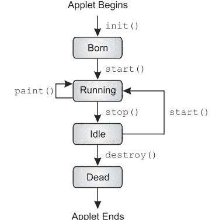

图 13.1 Applet 生命周期

applet 加载时方法的调用顺序为：

- **`init()`:** 当 applet 第一次加载并调用 `init()` 方法时，其生命周期开始。该方法在 applet 的整个生命周期内只被调用一次。方法体包含了与变量初始化、对象创建、添加按钮、文本框等组件、设置 applet 颜色、加载图像或字体相关的状态。在调用 `init()` 方法后，applet 进入出生状态。

- **`start()`:** 该方法在 `init()` 方法后自动被调用。与 `init()` 方法不同，`start()` 方法可能会被调用多次。每当包含 applet 的网页执行并显示在屏幕上时，该方法就会被调用。随着该方法的调用，applet 进入运行状态。

- **`paint()`:** 调用此方法是为了以文本、图形等形式在屏幕上显示输出。有时可能会发生 applet 窗口被另一个窗口覆盖，或者被最小化或调整大小的情况。在所有这些情况下，`paint()` 都会被重新调用，以便在屏幕上重绘输出。如图 13.1 所示，在 `paint()` 方法执行期间，applet 保持在运行状态。

applet 结束时方法的调用顺序为：

- **`stop()`:** 当包含 applet 的网页被关闭或临时离开时，该方法会自动被调用，applet 进入空闲状态。

- **`destroy()`:** 该方法用于从内存中移除 applet。与 `init()` 方法一样，`destroy()` 只被调用一次。它释放其持有的资源。

## 13.3 构建 APPLET 的步骤

构建 applet 的第一步是编写 applet 代码。详细步骤如下：

### 13.3.1 创建 Applet

构建 applet 的第一步是编写 applet 代码。让我们开始示例：

```java
import java.applet.*;
import java.awt.*;

public class AppletCode extends Applet {
    String fs, ss;

    public void init() {
        fs = "Hello!!";
        ss = "This is my applet";
    }

    public void paint(Graphics gra) {
        gra.drawString(fs + ss, 20, 70);
    }
}
```

在这个示例中，在 `paint()` 方法内部调用的 `drawString()` 方法将在屏幕 x=20, y=70 处显示“Hello!!This is my applet”。对应的由于 `paint()` 方法没有自己的定义，因此必须被重写。

### 13.3.2 创建可执行 Applet

创建可执行的 applet 需要编译 applet 代码。在命令行提示符上使用 `javac Applet.java` 命令编译 applet 代码。该命令将生成可执行 applet 的 .class 文件。

### 13.3.3 设计 HTML 文档

如前所述，applet 不是独立实体，因为它不能独立运行，需要插入到 HTML 文档（网页）中。下一步是设计一个包含 applet 代码的 HTML 文档。HTML 文档是由网络浏览器或 appletviewer 解释的文本和 HTML 标签集合。

**示例 13.2 一个 HTML 文档**

```html
<HTML>
<HEAD><TITLE>WELCOME TO THE WORLD OF JAVA APPTS</TITLE>
</HEAD>
<BODY>
<CENTER>
<H1>WELCOME</H1>
<H4> This is a structure of an HTML document. </H4>
</CENTER>
</BODY>
</HTML>
```

# 程序的输出如图 13.2 所示。


图 13.2 示例 13.2 中的程序输出

注意：使用记事本或任何文本编辑器准备 HTML 文档并以 .html 扩展名保存。

## Applet 标签

`<APPLET>` 标签指定了要加载的 applet 代码，并简单地告诉浏览器它在网页上的空间需求。`<APPLET>` 标签的最简单形式是：

```html
<APPLET CODE=AppletCode.class WIDTH=600 HEIGHT=250>
</APPLET>
```

此代码告诉浏览器或 appletviewer 为 applet 预留宽度为 600 像素、高度为 250 像素的显示区域，并加载名为 AppletCode 的编译 Java applet。在定义 applet 标签时，必须指定 CODE、WIDTH 和 HEIGHT 这三个属性。`<APPLET>` 标签的其他属性是 NAME、CODEBASE、ALT、ALIGN、VSPACE 和 HSPACE。

## 在 HTML 中添加 Applet

通过将 `<APPLET>` 标签放在 HTML 文档的 `<BODY>` 标签内部，可以将 applet 添加到 HTML 文档中。在这里，我们展示了嵌入 `AppletCode.java` applet 标签的整个 HTML 文档。

```html
<HTML>
<HEAD></HEAD>
<BODY>
<CENTER>
<APPLET CODE=AppletCode.class WIDTH=600 HEIGHT=250>
</APPLET>
</CENTER>
</BODY>
</HTML>
```

注意：.class 文件及其对应的 .html 文件必须存在于同一目录。

### 13.3.4 运行 Applet

如前所述，applet 可以通过任何兼容 Java 的浏览器或 `appletviewer` 执行。`appletviewer` 是 Java 开发包中的一个工具，专门为查看 applet 而设计。使用网络浏览器可以使用户看到包含 applet 的整个 HTML 文档。相反，如果我们使用 `appletviewer` 运行 applet，我们只能看到 applet 的输出，它会忽略 HTML 标签。使用 `appletviewer` 运行 applet 的命令是：`appletviewer AppletCode.html`


**图 13.3** 在 AppletViewer 中运行 applet 后显示的输出

使用网络浏览器运行相同的 applet 将显示如图 13.4 所示的输出。


**图 13.4** 在网络浏览器上运行 applet 后显示的输出

## 13.4 向 Applet 传递参数

Java 允许用户通过 `<PARAM>` 标签向 applet 传递用户定义的参数。`<PARAM>` 标签有一个 NAME 属性用于定义参数名称，以及一个 VALUE 属性用于指定参数值。在 applet 源代码中，applet 可以通过 NAME 引用参数以找到其值。`<PARAM>` 标签的语法是：

```html
<APPLET>
<PARAM NAME=parameter1_name VALUE=parameter1_value>
<PARAM NAME=parameter2_name VALUE=parameter2_value>
<PARAM NAME=parameter_name VALUE=parameter_name>
</APPLET>
```

例如，考虑以下语句以将 applet 的 text 属性设置为 "This is an example of Parameter!"：

```html
<APPLET>
<PARAM NAME=text VALUE=This is an example of Parameter!!!>
</APPLET>
```

注意 `<PARAM>` 标签必须包含在 `<APPLET>` 和 `</APPLET>` 标签之间。applet 的 `init()` 方法使用 `getParameter` 方法检索 `<PARAM>` 标签中定义的用户定义参数值。该方法接受一个持有参数名称的字符串参数，并返回一个包含该参数值的字符串。由于它返回的是 `String` 对象，`String` 以外的任何数据类型在使用之前必须转换为其对应的数据类型。

**示例 13.3 用于向 applet 传递参数的 applet 代码**

```java
import java.awt.*;
import java.applet.*;

public class ParameterExample extends Applet {
    String ptr;
    int i, j, sum;

    public void init() {
        ptr = getParameter("text");
        i = Integer.parseInt(getParameter("firstnumber"));
        j = Integer.parseInt(getParameter("secondnumber"));
        sum = i + j;
    }

    public void paint(Graphics gra) {
        gra.drawString("Operation is: " + ptr, 20, 20);
        gra.drawString("First Number is: " + i, 20, 40);
        gra.drawString("Second Number is: " + j, 20, 60);
        gra.drawString("Total: " + sum, 20, 80);
    }
}
```

**ParameterExample 的 HTML 代码为：**

```html
<HTML>
<HEAD></HEAD>
<BODY>
<CENTER>
<APPLET CODE=ParameterExample.class WIDTH=600 HEIGHT=250>
  <PARAM NAME=text VALUE="This is an example of Parameter!!!">
  <PARAM NAME=firstnumber VALUE="10">
  <PARAM NAME=secondnumber VALUE="20">
</APPLET>
</CENTER>
</BODY>
</HTML>
```


程序的输出如图 13.2 所示。


图 13.2 示例 13.2 中的程序输出

注意：使用记事本或任何文本编辑器准备 HTML 文档并以 `.html` 扩展名保存。

`a2`、`b2` 是线终点的坐标。

例如，语句 `gra.drawLine(20,100, 90,100)` 将从坐标点 (20,100) 到 (90,100) 绘制一条直线，如图 13.7 所示。

(20,100)                                               (90,100)

图 13.7 坐标为 (20,100) 和 (90,100) 的直线

## 绘制和填充矩形

可以使用 `drawRect()` 方法绘制矩形。该方法也接受相应的参数。

- `drawRect()` 方法的一般形式为：
  `void drawRect(int x1, int y1, int w, int h)`
- 其中，`x1`、`y1` 是矩形左上角的坐标
- `w` 是矩形的宽度
- `h` 是矩形的高度

例如，语句 `gra.drawRect(20,20,50,30)` 将在 (20,20) 处绘制一个宽度为 50 像素、高度为 30 像素的矩形，如图 13.8 所示。


图 13.8 宽度为 50 像素、高度为 30 像素的矩形

`drawRect()` 方法仅绘制矩形的边界。要绘制填充矩形，使用 `fillRect()` 方法。该方法接受的参数与 `drawRect()` 相同。

要绘制具有相同参数的填充矩形，使用语句 `gra.fillRect(20,20,50,30)`，如图 13.9 所示。


图 13.9 宽度为 50 像素、高度为 30 像素的填充矩形

可以使用 `drawRoundRect()` 方法绘制圆角轮廓矩形。该方法接受六个参数。

`drawRoundRect()` 方法的一般形式为：
`void drawRoundRect(int x1, int y1, int w, int h, int xdia, int ydia)`


其中，
`xdia` 是沿 X 轴的圆角直径
`ydia` 是沿 Y 轴的圆角直径

同样，可以使用 `fillRoundRect()` 方法绘制圆角填充矩形。该方法接受的参数与 `drawRoundRect()` 相同。注意：所有形状都是相对于 Java 坐标系的绘制。坐标系的原点 (0,0) 位于左上角，x 值向右，y 值向下。

## 绘制和填充椭圆与圆

可以使用 `drawOval()` 方法绘制椭圆。椭圆绘制在一个虚拟边界矩形内。该方法接受四个参数，前两个表示边界矩形的左上角，后两个表示椭圆或边界矩形的宽度和高度（见图 13.11）。

`drawOval()` 方法的一般形式为：
`void drawOval(int x1, int y1, int w, int h)`
其中，
`x1`、`y1` 是边界矩形的左上角坐标
`w` 是边界矩形的宽度
`h` 是边界矩形的高度


同样，可以使用此方法绘制圆，但宽度和高度必须相同。也就是说边界矩形必须是一个正方形。与矩形方法类似，`drawOval()` 方法绘制椭圆边界，`fillOval()` 方法绘制填充椭圆。

## 绘制弧

可以使用 `drawArc()` 方法绘制弧。该方法接受六个参数，前四个与 `drawOval()` 方法相同，后两个分别表示弧的起始角度和扫描角度。

`drawArc()` 方法的一般形式为：

```java
void drawArc(int x1, int y1, int w, int h, int start_angle, int sweep_angle)
```

其中，
`x1`、`y1` 是边界矩形的左上角坐标
`w` 是边界矩形的宽度
`start_angle` 是弧的起始角度（度）
`sweep_angle` 是弧的扫描角度（度）

图 13.12 所示的弧起始角度为 0°，扫描角度为 135°。


你也可以使用 `fillArc()` 方法绘制填充弧。

## 绘制多边形

多边形是一个具有任意数量边的封闭几何图形。可以使用 `drawPolygon()` 方法绘制多边形。该方法接受三个参数。

`drawPolygon()` 方法的一般形式为：

```java
void drawPolygon(int x[], int y[], int n)
```

其中，
`x[]` 是包含 x 坐标的整数数组
`y[]` 是包含 y 坐标的整数数组
`n` 是绘制多边形所需的坐标点总数。


**图 13.13** 六边形

### 示例 13.6 用于演示 Graphics 类各种方法的 Applet

```java
import java.awt.*;
import java.applet.*;

public class GraphicsExample extends Applet {
    public void paint(Graphics gra) {
        gra.drawRect(10, 40, 80, 40);
        gra.fillRect(20, 20, 50, 30);
    }
}
```

## Java 编程

### 表 13.1 Font 类的方法

| 方法 | 描述 |
| --- | --- |
| `static Font getFont()` | 返回当前选择的字体 |
| `int getSize()` | 返回字体的大小 |
| `String getName()` | 返回字体名称 |
| `int getStyle()` | 返回字体的样式 |
| `String getFamily()` | 返回字体族名称 |

### 示例 13.8 用于演示 Font 类使用的 applet

```java
import java.applet.*;
import java.awt.*;

public class FontExample extends Applet {
    public void paint(Graphics gra) {
        Font font = new Font("Courier New", Font.BOLD, 16);
        gra.setFont(font);
        gra.drawString("Hello Java", 20, 100);
        Font f = gra.getFont();
        String fontName = f.getName();
        gra.drawString("Font name is :" + fontName, 20, 140);
        String fontFamily = f.getFamily();
        gra.drawString("Font family is :" + fontFamily, 20, 160);
        int fontSize = f.getSize();
        gra.drawString("Font size is :" + fontSize, 20, 180);
        int fontStyle = f.getStyle();
        gra.drawString("Font style is :" + fontStyle, 20, 200);
    }
}
```

FontExample 的 HTML 代码为：

```html
<HTML>
<HEAD>
</HEAD>
<BODY>
<CENTER>
<APPLET
CODE="FontExample.class"
WIDTH="600"
HEIGHT="250">
</APPLET>
</CENTER>
</BODY>
</HTML>
```

HTML 代码的输出如图 13.16 所示。

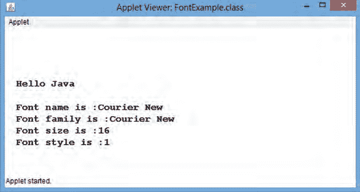

**图 13.16** 示例 13.8 中程序的输出

# 13.7.4 使用 Image 类

`Image` 类用于加载和显示图像。加载图像使用 `Image` 类的 `getImage()` 方法，而显示图像使用 `Graphics` 类的 `drawImage()` 方法。

`getImage()` 方法的通用形式：

```java
getImage(URL pathname, String filename)
getImage(URL pathname)
```

其中，
`pathname` 是 Web 上图像文件的地址。当图像文件和源文件在同一目录时，使用 `getCodeBase()` 方法作为方法的第一个参数。
`filename` 是图像文件的名称。

`drawImage()` 方法的通用形式为：

```java
drawImage(Image image, int startx, int starty, int width, int height, ImageObserver img_obj)
```

其中，
`image` 是要在 applet 中加载的图像
`startX` 是距离屏幕左上角的像素空间
`startY` 是距离屏幕右上角的像素空间
`width` 是图像的宽度
`height` 是图像的高度
`img_obj` 是实现 `ImageObserver` 接口的类对象。

# 248 Java 编程

### 示例 13.9 用于演示 Image 类使用的 applet

```java
import java.applet.*;
import java.awt.*;

public class ImageExample extends Applet {
    private Image pic;

    public void init() {
        pic = getImage(getCodeBase(), "java_pic.gif");
    }

    public void paint(Graphics gra) {
        gra.drawImage(pic, 150, 50, 120, 200, this);
    }
}
```

ImageExample 的 HTML 代码为：

```html
<HTML>
<HEAD>
</HEAD>
<body>
  <CENTER>
    <APPLET CODE="ImageExample.class"
         WIDTH="600"
         HEIGHT="250">
    </APPLET>
  </CENTER>
</body>
</HTML>
```

HTML 代码的输出如图 13.17 所示。

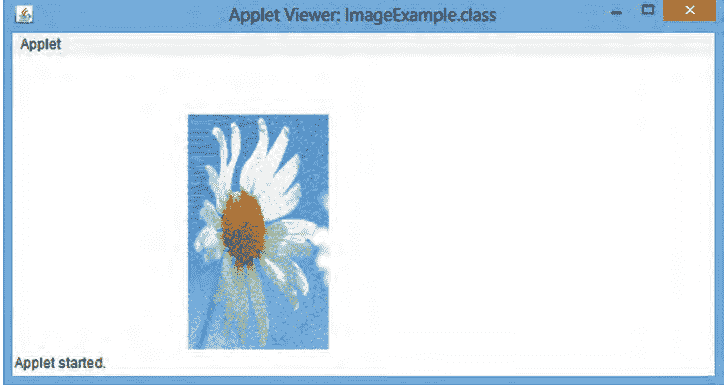

**图 13.17** 示例 13.9 中程序的输出

# 13.8 在 APPLET 中添加声音

`AudioClip` 类用于加载和播放声音文件。加载声音文件使用 `AudioClip` 类的 `getAudioClip()` 方法。`getAudioClip()` 方法的通用形式为 `AudioClip getAudioClip(URL pathname, String filename)` 或 `AudioClip getAudioClip(URL pathname)`。

其中，
`pathname` 是声音文件的地址。当图像和源文件在同一目录时，使用 `getCodeBase()` 作为方法的第一个参数。
`filename` 是声音文件的名称。

`AudioClip` 类的某些方法及其描述列在表 13.2 中。

**表 13.2** AudioClip 类方法

| 方法 | 描述 |
| --- | --- |
| `void play()` | 用于播放一次声音 |
| `void loop()` | 用于循环播放声音 |
| `void stop()` | 用于停止播放声音 |

### 示例 13.10 用于演示 AudioClip 类使用的 applet

```java
import java.applet.*;
import java.awt.*;

public class SoundExample extends Applet {
    private AudioClip mysound;

    public void init() {
        mysound = getAudioClip(getCodeBase(), "chimes.wav");
    }

    public void start() {
        mysound.loop();
    }

    public void stop() {
        mysound.stop();
    }
}
```

SoundExample 的 HTML 代码为：

```html
<HTML>
<HEAD>
</HEAD>
<BODY>
<CENTER>
<APPLET CODE="SoundExample.class"
WIDTH="200"
HEIGHT="130">
</APPLET>
</CENTER>
</BODY>
</HTML>
```


# 250 Java 编程

HTML 代码的输出如图 13.18 所示。

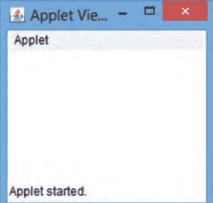

**图 13.18** 示例 13.10 的输出

## 总结

- Applet 是嵌入在网页中的小型程序。
- Applet 在其生命周期内进入不同的状态：诞生、运行、空闲和死亡。
- 构建 applet 使用 `init()`、`start()` 和 `destroy()` 方法。
- HTML 文档用于创建 applet。
- `Image` 类用于加载和显示图像。
- `Font` 类用于字体。
- `Color` 类用于使用颜色。
- `AudioClip` 类用于加载播放声音。
- `Graphics` 类提供了各种方法来绘制形状。

## 练习题

### 填空

1. Applet 使用 `Graphics` 类的各种方法。
2. Applet 的执行从 `init()` 方法开始。
3. `drawString()` 方法用于在 Applet 中显示字符串。
4. `Graphics` 类的 `drawImage()` 方法用于在 Applet 中绘制图像。
5. `<PARAM>` 标签用于向 Applet 传递自定义参数。

### 单选题

1. 下列代码的输出是什么？
   `gra.drawLine(10, 10, 50, 10);`
   a) 长度为 40 像素的垂直线
   b) 长度为 50 像素的垂直线
   c) 长度为 40 像素的水平线
   d) 长度为 50 像素的水平线

2. 下列哪个不是 `Graphics` 类的方法？
   a) `drawRectangle()`
   b) `fillCircle()`
   c) `drawArc()`
   d) `drawEllipse()`

3. 给定的代码画了一条线。线条的颜色是什么？
   `g.setColor(Color.red.yellow.green.cyan)`
   `gra.drawLine(20, 20, 20, 70)`
   a) 黑色
   b) 蓝色
   c) 红色
   d) 青色

4. 创建 applet 的 HTML 文档时必须使用以下标签
   a) NAME, CODE, HEIGHT
   b) CODEBASE, HEIGHT, WIDTH
   c) CODE, HEIGHT, WIDTH
   d) CODE, NAME

5. 该方法没有返回值且失败时不抛出异常。
   a) `getDocument()`
   b) `showDocument()`
   c) `getCodeBase()`
   d) 以上都不是

### 判断题

1. `Graphics` 类包含在 `java.awt` 包中。
2. Applet 由控制台解释器执行。
3. `TITLE` 元素定义在 HTML 文档的 `HEAD` 标签内。
4. `start()` 方法在 applet 的整个生命周期内只调用一次。
5. `showDocument()` 方法定义在 `AppletContext` 接口中。

### 回答问题

1. Java applet 在其生命周期内进入哪些各种状态？
2. 终止的方法调用顺序。
3. 写一个程序显示构成 applet 生命周期的各种方法。
4. 通过程序解释 applet 开发的步骤。
5. 写一个程序演示如何使用 HTML 文档向 applet 传递参数。
6. 如何向小程序（applet）中添加图像？请举例说明。
7. 如何向小程序中添加声音？请举例说明。
8. 编写一个程序显示以下内容：
   (a) 锥体
   (b) 八边形
   (c) 圆内正方形
   (d) 圆柱
9. 编写一个程序显示以下内容：

   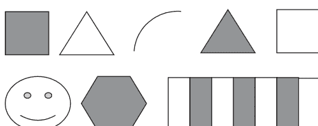

10. 编写程序绘制以下图形：
    (a) 长为 70 像素的红色垂直线
    (b) 每边长 30 像素的蓝色正方形
    (c) 半径为 5 像素的粉色边界圆形
    (d) 长为 150 像素、宽为 100 像素的绿色矩形
11. 编写一个程序用以下字体打印字符串 "Java is an interesting language"：
    (a) Times New Roman，粗体，36 号
    (b) Arial，斜体，20 号
    (c) Comic Sans MS，粗体，12 号
12. 如何向小程序中添加图像？请举例说明。

# 第 14 章
## 事件处理

## 本章目标

读完本章后，你将能够：

- 理解什么是事件
- 学习 Java 事件处理机制基于的模型
- 理解 Java 支持的各种类型的事件
- 学习如何处理各种事件，如键盘按键、按钮点击、鼠标事件等

## 14.1 引言

小程序用于创建图形化和与用户交互的应用程序。设计的小程序在本质上要强大得多，但在演示其用户交互能力方面起的作用却很小。用户交互意味着当用户通过点击鼠标或使用键盘输入字符与应用程序交互时，会产生特定的动作并向用户显示适当的结果。在 Java 中，用户与应用程序之间发生的所有活动都被称为事件。事件在小程序编程中起着重要作用，因为它们促进了小程序中用户交互性的包含。

## 14.2 事件

在 Java 中，事件是一个指定源（source）状态变化的对象。每当发生动作时（如点击鼠标或修改文本）时就会生成一个事件。Java 的 AWT（抽象窗口工具包）负责在程序和用户之间通信这些动作。Java 包如 `java.util`、`java.awt`、`java.awt.event` 和 `javax.swing` 支持事件处理机制。

当动作发生时，就会生成一个事件。生成的事件以及自发生以来的所有信息、事件类型等，会被发送到程序内部提供的适当事件处理代码。这段代码决定了如何处理分配的事件，以便向用户发送适当的响应。

### 14.3 事件处理模型

事件驱动程序的运行受其底层事件处理模型的支配。到目前为止，Java 中已经引入了两种接收和处理事件的模型。这些模型的事件处理机制之间差异很大。在下一节中，将讨论这两种事件模型之间的比较。

#### 14.3.1 Java 1.0 事件模型

Java 1.0 用于处理事件模型基于包含（containment）的概念。在这种方法中，当产生用户触发的事件时，它首先被发送到发生事件的组件。但如果事件没有被该组件处理，它将自动传播到该组件的容器。这个过程一直持续到事件被处理或到达该包含层次结构的根。

例如，如图 14.1 所示，按钮（Button）包含在面板（Panel）中，而面板本身包含在帧（Frame）中。当点击按钮时，产生一个事件并首先发送给按钮。如果没有被按钮处理，则转发到面板，如果面板无法处理该事件，则进一步发送到帧。作为给定层次结构的根，帧会处理此事件。事件沿着包含层次结构向上转发，直到被某个组件处理为止。

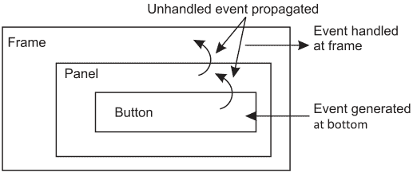
**图 14.1** Java 1.0 事件处理

1.0 事件模型的主要缺点是源与事件处理器之间过度耦合。

#### 14.3.2 委托事件模型

委托事件模型是处理事件的一种高级方法。在该模型中，源注册监听器（listeners）并在事件发生时通知它们。这比 1.0 模型更灵活、更高效。例如，如图 14.2 所示，源将事件发送给注册的监听器。

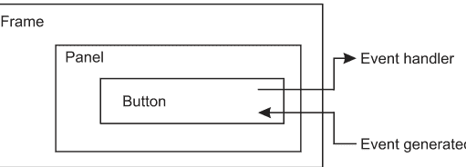
**图 14.2** 委托事件模型

现在我们详细讨论事件源和事件监听器。

**事件源**：事件源是产生事件的对象。事件源的一些示例是：

**事件监听器**：事件监听器是接收事件的对象。事件监听器的一些示例是：

## 14.4 事件处理

Java 提供了各种处理事件的类和接口。

### 14.4.1 事件类

Java 提供了各种处理事件的类。表 14.1 列出了其中一些类。

**表 14.1 事件类**

| 类 | 说明 |
| :--- | :--- |
| `ActionEvent` | 代表选择菜单、按下按钮或双击列表生成的事件。 |
| `AdjustmentEvent` | 代表滚动条发生变化时生成的事件。`AdjustmentEvent` 类定义了一个整数常量 `ADJUSTMENT_VALUE`，表示发生了某些变化。 |
| `ItemEvent` | 代表选择或取消选择项目、复选框项目或列表时生成的事件。 |
| `KeyEvent` | 代表用户通过按键与应用程序交互时生成的事件。 |
| `MouseEvent` | 代表用户与鼠标交互时生成的事件。 |
| `TextEvent` | 代表用户在文本字段或文本区域中输入或更改文本时生成的事件。 |
| `WindowEvent` | 代表窗口状态改变时生成的事件。 |
| `PropertyChangeEvent` | 此类 `PropertyChangeEvent` 也代表对象发生变化时生成的事件，但它只通知源对象的变化。 |
| `CaretEvent` | 代表文本组件在光标（caret）改变位置或选择文本时生成的事件。 |

### 14.4.2 事件源

如前所述，事件源是产生事件的对象。表 14.2 列出了事件源示例。

**表 14.2 某些事件源示例**

| 事件源 | 说明 |
| :--- | :--- |
| 按钮 (`Button`) | 在按下按钮时产生动作事件。 |
| 窗口 (`Window`) | 在窗口状态改变时产生窗口事件。 |
| 文本组件 (`Text components`) | 在文本字段或文本区域中输入文本时产生文本事件。 |
| 菜单项 (`Menu item`) | 选择菜单时产生动作事件，在选中或取消选择可更改项目时产生项目事件。 |
| 复选框 (`Checkbox`) | 在选中或取消选择复选框时产生项目事件。 |
| 列表 (`List`) | 在双击项目时产生动作事件，在选中或取消选择项目时产生动作事件。 |
| 滚动条 (`Scrollbar`) | 在操作滚动条时产生动作事件。 |

### 14.4.3 事件监听器接口

由事件源生成的事件会被发送到监听器，由监听器以适当的方式处理。事件监听器实现了多种接口。这里将讨论其中一些接口。

#### `ActionListener` 接口

当发生动作事件时，会调用由 `ActionListener` 接口定义的 `actionPerformed()` 方法。

`actionPerformed()` 方法的一般形式为：

```java
void actionPerformed(ActionEvent e)
```

其中，
`e` 是 `ActionEvent` 类对象的引用。

#### `AdjustmentListener` 接口

当发生调整事件时，会调用由 `AdjustmentListener` 接口定义的 `adjustmentValueChanged()` 方法。

`adjustmentValueChanged()` 方法的一般形式为：

```java
void adjustmentValueChanged(AdjustmentEvent e)
```

其中，
`e` 是 `AdjustmentEvent` 类对象的引用。

#### `ItemListener` 接口

当项目（item）的状态发生改变时，会调用由 `ItemListener` 接口定义的 `itemStateChanged()` 方法。`ItemEvent` 类对象将作为方法参数传递。

`ItemListener` 中定义的方法的一般形式为：

```java
void itemStateChanged(ItemEvent e)
```

#### `KeyListener` 接口

当按下或释放任何按键或输入字符时，会调用由 `KeyListener` 定义的方法。`KeyEvent` 类对象将作为方法参数传递。

`KeyListener` 中定义的方法的一般形式为：

```java
void keyPressed(KeyEvent e)
void keyReleased(KeyEvent e)
void keyTyped(KeyEvent e)
```

注意：如果按下并释放按键 B，会生成三个事件（按键按下、按键输入和按键释放）。

#### `MouseListener` 接口和 `MouseMotionListener` 接口

当点击、按下、释放鼠标或鼠标进入或退出容器时，会调用 `MouseListener` 定义的方法。同样，当鼠标拖动或从一个位置移动到另一个位置时，会调用 `MouseMotionListener` 定义的方法。`MouseEvent` 类对象将作为方法参数传递。

`MouseListener` 接口定义的方法的一般形式为：

```java
void mousePressed(MouseEvent me)
void mouseReleased(MouseEvent me)
void mouseClicked(MouseEvent me)
void mouseEntered(MouseEvent me)
void mouseExited(MouseEvent me)
```

`MouseMotionListener` 定义的方法的一般形式为：

```java
void mouseMoved(MouseEvent me)
void mouseDragged(MouseEvent me)
```

#### `TextListener` 接口

当文本区域或文本字段内的文本变化时，会调用由 `TextListener` 接口定义的 `textValueChanged()` 方法。`TextEvent` 类对象将作为方法参数传递。

`TextListener` 接口定义的方法的一般形式为：

```java
void textValueChanged(TextEvent te)
```

#### `WindowListener` 接口

当窗口状态发生变化时，会调用 `WindowListener` 接口定义的方法。`WindowEvent` 类对象将作为方法参数传递。

`WindowListener` 接口定义的方法的一般形式为：

```java
void windowOpened(WindowEvent we)
void windowClosed(WindowEvent we)
void windowClosing(WindowEvent we)
void windowActivated(WindowEvent we)
void windowDeactivated(WindowEvent we)
void windowIconified(WindowEvent we)
void windowDeiconified(WindowEvent we)
```

#### `PropertyChangeListener` 接口

当源对象的属性发生变化时，会调用 `PropertyChangeListener` 定义的方法。`PropertyChangeEvent` 对象将作为方法参数传递。

`PropertyChangeListener` 接口定义的方法的一般形式为：

```java
void propertyChange(PropertyChangeEvent pce)
```

#### `ChangeListener` 接口

当源对象发生变化时，会调用 `ChangeListener` 定义的方法。它被滚动条等组件使用。`ChangeEvent` 类对象将作为方法参数传递。

`ChangeListener` 接口定义的方法的一般形式为：

```java
void stateChanged(ChangeEvent ce)
```

#### `CaretListener` 接口

当光标（caret）位置变化或选择文本时，会调用 `CaretListener` 接口定义的方法。`CaretEvent` 类对象将作为方法参数传递。

`CaretListener` 接口定义的方法的一般形式为：

```java
void caretUpdate(CaretEvent e)
```

为了理解事件处理的概念，请参考示例 14.1 和示例 14.2。示例 14.1 展示了当用户按下或释放键盘键时生成按键事件。当按键按下或释放时，调用 `KeyListener` 接口的方法，输出显示在 applet 窗口的状态栏上。示例 14.2 展示了当用户按下或释放鼠标按钮时生成鼠标事件。当鼠标按下或释放时，调用 `MouseListener` 接口的方法，输出显示在浏览器的状态栏上。

### 示例 14.1 一个使用 `KeyListener` 接口演示事件处理机制的 applet

```java
import java.applet.*;
import java.awt.*;
import java.awt.event.*;

public class KeyListenerExample extends Applet implements KeyListener {

    String pstr = "This is your Key Listener Class";

    public void init() {
        addKeyListener(this);
    }

    public void keyPressed(KeyEvent e) {
        showStatus("You have pressed a key"); /*在 applet 窗口中显示字符串*/
    }

    public void keyReleased(KeyEvent e) {
        showStatus("You have released a key");
    }

    public void keyTyped(KeyEvent e) {
    }

    public void paint(Graphics g) {
        g.drawString(pstr, 10, 20);
    }
}
```

`KeyListenerExample` 的 HTML 代码为：

```html
<HTML>
<HEAD>
</HEAD>
<BODY>
<CENTER>
<APPLET CODE="KeyListenerExample" WIDTH=300 HEIGHT=200>
</APPLET>
</CENTER>
</BODY>
</HTML>
```


# 事件处理

在这个示例中，`MouseEventHandler` 类继承了 `Applet` 类并实现了 `MouseListener` 接口。在 `init()` 方法中，applet 将自己注册为鼠标事件的监听器。需要注意的是，这里 applet 本身就是这些事件的源和监听器。该 applet 实现了 `MouseListener` 接口定义的所有方法。

## 14.4.4 适配器类

Java 中有一种名为适配器类（adapter class）的特性。适配器类以空体实现了事件监听器接口。适配器类中的方法不提供任何额外功能。当程序员仅需要提供特定事件监听器的某部分事件时，就会使用适配器类。可以通过扩展适配器类并仅实现所需的事件来定义新的事件监听器类。对于每个事件监听器接口都有一个可用的适配器类。表 14.3 列出了一些最常用的适配器类。

### 表 14.3 适配器类及对应的监听器接口

| 适配器类 | 对应的监听器接口 |
| --- | --- |
| WindowAdapter | WindowListener |
| ComponentAdapter | ComponentListener |
| ContainerAdapter | ContainerListener |
| KeyAdapter | KeyListener |
| FocusAdapter | FocusListener |
| MouseAdapter | MouseListener |
| MouseMotionAdapter | MouseMotionListener |
| MouseInputAdapter | MouseInputListener |

### 示例 14.3 一个使用适配器类演示鼠标移动事件处理机制的 applet

```java
import java.awt.*;
import java.awt.event.*;
import java.applet.*;

/*
<applet code="AdapterExample" width=300 height=300>
</applet>
*/

public class AdapterExample extends Applet {
    public void init() {
        addMouseMotionListener(new MouseMotion(this));
    }
}

class MouseMotion extends MouseMotionAdapter {
    AdapterExample adex;

    public MouseMotion(AdapterExample adex) {
        this.adex = adex;
    }

    // 处理鼠标移动事件
    public void mouseMoved(MouseEvent e) {
        adex.showStatus("Mouse moved");
    }
}
```

HTML 代码：

```html
<HTML>
<HEAD><TITLE>MOUSE MOTION WITH ADAPTER CLASS</TITLE></HEAD>
<BODY>
<CENTER>
<APPLET CODE="AdapterExample.class" WIDTH=800 HEIGHT=700>
</APPLET>
</CENTER>
</BODY>
</HTML>
```

HTML 代码的输出如图 14.5 所示。

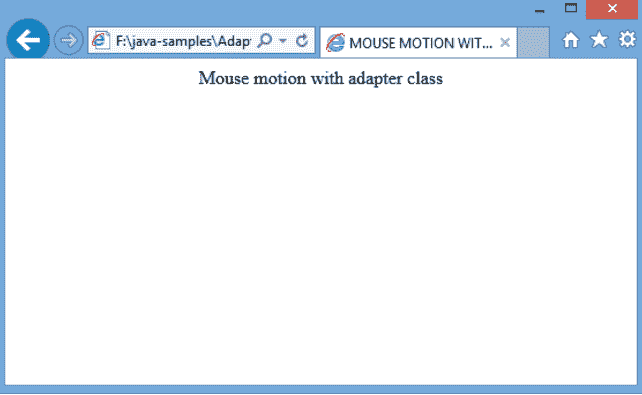

图 14.5 示例 14.3 程序输出

在这个示例中，`AdapterExample` 类继承了 `Applet` 类。在 `init()` 方法中，applet 将自己注册为鼠标移动事件的监听器。需要注意的是，applet 本身就是这些事件的源和监听器。该 applet 实现了 `MouseMotionAdapter` 类定义的所有方法，但我们在程序中仅使用了 `mouseMoved` 方法。

## 总结

- 在 Java 中，用户与应用程序之间发生的所有活动被称为事件（events）。
- 事件是一个对象，用于指定源的状态变化。每当发生动作、点击鼠标按钮或修改文本时，事件就会被生成。
- Java 包如 `java.util`、`java.awt` 和 `java.awt.event` 支持事件处理机制。
- 事件驱动型程序的运行受其底层事件处理模型的支配。
- Java 用于事件处理的 Java 1.0 事件模型是基于包含（containment）的概念。
- 委托事件（Delegation Event）定义了一种处理事件的逻辑方法。它基于源（source）和监听器（listener）的概念。源产生事件并将其发送给一个或多个监听器。
- Java 提供了处理事件的各种类和接口。
- 某些事件类包括 `ActionEvent`、`Event`、`WindowEvent` 等。
- 某些监听器接口包括 `ActionListener`、`ItemListener`、`ChangeListener` 等。
- 适配器类以空体实现了事件监听器接口。
- 适配器类在程序员需要提供特定事件监听器的某部分事件时使用。

# 练习

## 填空

1. 在 Java 中，用户与应用程序之间发生的所有活动被称为事件。
2. 事件驱动程序的运行受其底层事件处理模型的支配。
3. 委托事件定义了一种处理事件的逻辑方法。
4. ________ 类定义了处理事件的方法。
5. 适配器类以空体实现了事件监听器接口。

## 选择正确选项

1. 以下哪些项支持事件处理机制？
   a) java.util
   b) java.awt
   c) java.swing
   d) 以上都是

2. 以下哪个描述是正确的？
   a) Java 1.0 模型取代了委托模型。
   b) 委托模型使用监听器处理事件。
   c) Java 1.0 模型比委托模型更高效。
   d) 委托模型使用 `handleError()` 处理事件。

3. `EventObject` 类属于哪个包？
   a) java.swing
   b) java.util
   c) java.awt
   d) 都没有

4. ________ 表示光标改变位置时产生的事件。
   a) MouseEvent
   b) TextEvent
   c) KeyEvent
   d) CaretEvent

5. 以下哪个事件在按下时生成？
   a) pressed
   b) typed
   c) released
   d) 以上都是

## 判断对错

1. 源可以产生一种类型的事件。
2. 事件处理的委托模型是基于包含的概念。
3. `ActionEvent` 在点击按钮时产生。
4. `MouseListener` 接口在鼠标拖动或移动到另一个位置时调用。
5. 适配器类的方法不提供任何额外功能。

## 回答以下问题

1. 什么是事件？讨论事件处理的模型。
2. 讨论委托模型。
3. 源和监听器是指什么？
4. 列并简要描述 Java 中支持事件处理的类和接口。
5. 什么是适配器类？它们有什么帮助？

# 第15 章：抽象窗口工具 (AWT)

## 本章目标

读完本章后，你将能够：

- 解释抽象窗口工具（AWT）
- 描述各种 AWT 控件及其功能
- 描述各种布局管理器以及如何在容器中组织组件

## 15.1 引言

抽象窗口工具（Abstract Window Toolkit，简称 AWT）提供了多种图形、窗口和用户界面工具，这些工具用于开发 applet 以及在 GUI 环境下运行的独立应用程序。为了使用 AWT 中定义的类和接口，需要导入 `java.awt.*` 包。

## 15.2 AWT：处理窗口图形和文本

### GUI 组件

GUI 组件包括促进用户交互的视觉元素。`Component` 类和 `MenuComponent` 类是表示 GUI 组件的父类。`Component` 类是一个抽象类，因此通过其子类来创建组件。在 AWT 术语中，按钮、文本框、复选框等用户界面被称为组件。

#### 表 15.1 Component 类的子类

| 类 | 描述 |
| --- | --- |
| Button | 创建推按钮控件 |
| Checkbox | 创建复选框控件 |
| Choice | 创建一个下拉文本列表 |
| Label | 创建一个显示字符串的标签控件 |
| List | 创建一个可滚动的文本列表 |
| ScrollBar | 为项目创建滚动条 |
| TextComponent | `TextField` 和 `TextArea` 类的父类，分别用于创建单行或多行文本框 |

### Container

`Container` 类是 `Component` 类的子类。它用于包含各种 `Component` 对象以及其中的其他 `Container` 对象。`Container` 类的对象组可以分组、管理和定位组件，并将它们视为一个单元。`Container` 类的两个直接子类是：

- `Panel`：用于组件的分组。`Applet` 是 `Panel` 的子类。
- `Window`：用于创建和处理窗口。`Window` 的两个子类是 `Dialog` 和 `Frame`。

`MenuComponent` 类是一个抽象类。它的直接子类是 `MenuBar` 和 `MenuItem`，分别用于创建菜单栏和菜单项。

### 布局

使用不同的布局类来排列、定位并确定容器所包含的各种组件的形状和大小。所有这些类都实现了 AWT 包中的 `LayoutManager` 接口。常用的类列在表 15.2 中。

#### 表 15.2 布局类

| 类 | 描述 |
| --- | --- |
| BorderLayout | 将组件分为五个区域：东、西、北、南和中心 |
| CardLayout | 将组件排列成牌组，每次只显示一个组件 |
| FlowLayout | 水平方向排列组件 |
| GridLayout | 将组件排列成网格 |

### 图形工具

`Graphics` 类封装了绘制各种形状和在屏幕上显示输出的方法。`Image` 类支持图像加载和添加。`Color` 和 `Font` 等类用于显示图形组件。`Point`、`Polygon`、`Rectangle` 分别包含绘制点、多边形和矩形的方法。

### 事件处理器

`Event` 类在处理 GUI 事件中起着重要作用。`AWTEvent` 封装了所有的 AWT 事件。

## 15.3 使用 AWT 控件

允许用户与基于 GUI 的应用程序交互的组件称为控件。AWT 使用的各种控件包括标签（labels）、按钮、复选框、选择列表（choice list）、滚动条、文本区域、文本字段、菜单栏。可以使用 `Container` 类中定义的方法将控件添加到窗口或从窗口中移除。添加控件方法的通用形式为：

```java
Component add(Component obj)
```

移除控件方法的通用形式为：

```java
void remove(Component obj)
```

其中，
obj 是要添加或移除的控件的实例。
要从窗口中移除所有控件，可以使用 `removeAll()` 方法。
本节将讨论一些常用的控件。

### Label

标签是一种简单的控件，用于在窗口上显示文本（不可编辑）。由于它不具备任何用户交互功能，因此它被认为是一种被动控件。`Label` 类定义了以下构造函数：

```java
Label() // 第一个
Label(String strl) // 第二个
Label(String strl, int strl_align) // 第三个
```

第一个构造函数创建一个空白标签。第二个构造函数创建一个包含 `strl` 指定字符串的标签。第三个构造函数创建一个包含该字符串的标签，`strl_align` 决定标签内文本的对齐方式。可以是 `Label.LEFT`、`Label.RIGHT` 或 `Label.CENTER`。文本的默认对齐方式是左对齐。

### 按钮

按钮是一个具有 3D 外观的活动控件。它显示文本并在被点击或激活时触发事件。`Button` 类定义了以下构造函数：

```java
Button() // 第一个
Button(String strl) // 第二个
```

第一个构造函数创建一个带有空白标签的按钮。第二个构造函数创建一个以 `strl` 为标签的按钮。

### 复选框

复选框是一种由小框和标签组合的控件。标签提供了与其关联的框的描述。它是一个双状态控件，具有 `true`（已选中）和 `false`（未选中）。可以通过点击来改变复选框的状态。`Checkbox` 是 `Checkbox` 类的对象。`Checkbox` 类定义了以下构造函数：

```java
Checkbox() // 第一个
Checkbox(String strl) // 第二个
Checkbox(String strl, boolean state) // 第三个
Checkbox(String strl, boolean state, CheckboxGroup group) // 第四个
```

第一个构造函数创建一个带有空标签的复选框。第二个构造函数创建一个以 `strl` 为标签的复选框。第三个构造函数创建一个以 `strl` 为标签的复选框，用于设置复选框的初始状态。如果是 `true`，则复选框被选中；否则，未选中。复选框的默认状态为 `false`。在第四个构造函数中，`group` 代表复选框所属组的名称。

复选框组可以分为两类：非互斥组（组中可以有多个项目被选中）和互斥组（组中只能选择一个项目）。

### 选择列表

该控件创建一个包含文本条目的下拉列表。当用户点击它时，会出现一个选择列表。用户只能选择列表包含的某一项，且仅显示被选中的项。`Choice` 是 `Choice` 类的对象。`Choice` 类定义了默认构造函数，即 `Choice()`，它创建一个空列表。要向列表中添加项，可以使用 `add` 方法。

### 列表

`List` 与 `Choice` 类似，它显示多个项，但用户每次只能选择一个项目。`List` 是 `List` 类的对象。`List` 类定义了以下构造函数：

```java
List() // 第一个
List(int Rows) // 第二个
List(int Rows, boolean multiselect) // 第三个
```

第一个构造函数创建一个空白列表。第二个构造函数创建一个以 `Rows` 为参数的列表，它是显示多个项对象的列表。`List` 类定义了：

```java
void add(Item item)
```

其中，
item 是要添加的项的实例。
要从列表中移除项，可以使用 `remove` 方法。`multiselect` 允许用户选择多个项，如果是 `false`，则每次只能选择一个。

### 文本字段 和 文本区域

文本字段和文本区域分别创建单行和多行的文本区域。这些控件由两个类提供，允许用户在文本字段中输入和编辑。`TextField` 继承自 `TextComponent` 类。`TextField` 类定义了以下构造函数：

```java
TextField() // 第一个
TextField(int cols) // 第二个
TextField(String strl) // 第三个
TextField(String strl, int cols) // 第四个
```

第一个构造函数创建一个空文本字段。第二个构造函数创建一个以 `cols` 为宽度的文本字段。第三个构造函数创建一个包含 `strl` 字符串的文本字段。第四个构造函数创建一个包含 `strl` 且宽度为 `cols` 的文本字段。`TextArea` 创建多行文本区域。它是 `TextArea` 类的对象。`TextArea` 类定义了以下构造函数：

```java
TextArea() // 第一个
TextArea(String strl) // 第二个
TextArea(int rows, int cols) // 第三个
```

第一个构造函数创建一个空文本区域。第二个构造函数创建一个包含 `strl` 字符串的文本区域。第三个构造函数创建一个以 `rows` 指定行数的文本区域，`cols` 代表其宽度。`TextArea` 允许用户在文本区域中输入和编辑。

### 菜单栏、菜单和菜单项

菜单栏包含菜单，菜单包含菜单项。`MenuBar` 类创建菜单栏。`Menu` 类创建菜单。`MenuItem` 类创建菜单项。`Menu` 类定义了以下构造函数：

```java
Menu() // 第一个
Menu(String label) // 第二个
Menu(String label, boolean tearOff) // 第三个
```

第一个构造函数创建一个空菜单。第二个构造函数创建一个带有 `label` 标签的菜单。第三个构造函数中的 `tearOff` 参数的值的含义：`true` 或 `false`。如果为 `true`，则菜单可以在应用程序窗口中自由浮动，否则它将保持附加在菜单栏上。

`MenuItem` 类定义了以下构造函数：

```java
MenuItem() // 第一个
MenuItem(String itemName) // 第二个
MenuItem(String itemName, MenuShortcut shortcut) // 第三个
```

第一个构造函数创建一个没有名称和菜单快捷键的菜单项。在第二个构造函数中，`itemName` 指定了菜单项的名称。在第三个构造函数中，`shortcut` 指定了与菜单项相关的菜单快捷键。

可以使用 `MenuItem` 的子类创建可更改的菜单项。`CheckboxMenuItem` 定义了以下构造函数：

```java
CheckboxMenuItem()
CheckboxMenuItem(String itemName)
CheckboxMenuItem(String itemName, boolean checkable)
```


第一个构造函数创建一个没有名称的未勾选菜单项。第二个构造函数创建一个名称为 `itemName` 指定名称的未勾选菜单项。在第三个构造函数中，`checkable` 可以为 true 或为 false。如果为 true，则菜单项初始为选中状态，否则为未勾选。

有两种类型的菜单：

- **普通项目**：它们位于应用程序窗口顶部的菜单栏内。
- **弹出菜单**：它们在用户点击时出现在窗口中。例如，在鼠标右键点击时会出现一个弹出菜单。

考虑 **示例 15.1**。这里创建了一个包含两个菜单的菜单栏，$m1$（用于文件菜单）和 $m2$（用于编辑菜单）。一些菜单项被添加到菜单 `m1` 和 `m2` 中。当点击任何菜单项时，菜单项的名称将显示在窗口底部。使用 `ActionListener` 接口来处理菜单事件。

**示例 15.1** 演示 `Menubar`、`Menu` 类和 `MenuItem` 用的示例

```java
import java.awt.*;
import java.applet.*;
import java.awt.event.*;

class Mframe extends Frame {
    String message = "";

    Mframe(String title) {
        super(title);
        MenuBar mb = new MenuBar();
        setMenuBar(mb);
        Menu m1 = new Menu("File");
        MenuItem New = new MenuItem("New");
        MenuItem open = new MenuItem("Open");
        MenuItem close = new MenuItem("Close");
        MenuItem save = new MenuItem("Save");
        MenuItem exit = new MenuItem("Exit");
        m1.add(New);
        m1.add(open);
        m1.add(close);
        m1.add(save);
        m1.addSeparator(); // 创建一条水平线用于分割
        m1.add(exit);
        mb.add(m1);
        Menu m2 = new Menu("Edit");
        MenuItem cut = new MenuItem("Cut");
        MenuItem copy = new MenuItem("Copy");
        MenuItem paste = new MenuItem("Paste");
        m2.addSeparator(); // 创建一条水平线用于分割
        Menu search = new Menu("Search");
        MenuItem find = new MenuItem("Find");
        MenuItem replace = new MenuItem("Replace");
        search.add(find);
        search.add(replace);
        m2.add(cut);
        m2.add(copy);
        m2.add(paste);
        m2.add(search);
        mb.add(m2);
        Handler handler = new Handler(this);
        New.addActionListener(handler);
        open.addActionListener(handler);
        close.addActionListener(handler);
        save.addActionListener(handler);
        exit.addActionListener(handler);
        cut.addActionListener(handler);
        copy.addActionListener(handler);
        paste.addActionListener(handler);
        search.addActionListener(handler);
        find.addActionListener(handler);
        replace.addActionListener(handler);
    }

    public void paint(Graphics g) {
        g.drawString(message, 10, 200);
    }
}

class Handler implements ActionListener {
    Mframe mf;

    Handler(Mframe mf) {
        this.mf = mf;
    }
}
```

### MenuBar 的 HTML 代码

```html
<HTML>
<HEAD></HEAD>
<BODY>
<CENTER>
<APPLET name=MenuBar WIDTH=600 HEIGHT=250>
</APPLET>
</CENTER>
</BODY>
</HTML>
```

## 布局管理器

布局管理器是容器的实例，放置在容器中，决定了组件的排列方式。

### AWT 布局管理器

布局管理器将指定的区域划分为行和列的网格。整个区域被平均分为行和列，使得布局中的每行和每列的大小相同。添加到单元格的组件将扩展到单元格的大小。AWT 提供了各种布局管理器，每个布局管理器都实现了 `LayoutManager` 接口。通过 `setLayout` 方法可以设置布局管理器。

设置布局器的通用格式是：

```java
void setLayout(LayoutManager lm)
```

其中，`lm` 是期望的布局器的引用。如果不调用 `setLayout()`，则会自动调用默认布局。

### GridLayout

在网格布局中，第三个构造函数允许使用 `hor` 和 `ver` 分别指定组件之间留下的水平和垂直空间。

**示例 15.2** 一个演示 `GridLayout` 类使用的 Applet

```java
import java.applet.*;
import java.awt.*;

public class GridLayoutExample extends Applet {
    Button b1, b2;
    Checkbox c1;
    Scrollbar s1;
    Label l1;
    TextField t1;
    TextArea tal;
    Choice choelist;
    List list;
    String Year[] = {"January", "February", "March", "April", "May", "June", "July", "August", "September", "October", "November", "December"};
    String Week[] = {"Monday", "Tuesday", "Wednesday", "Thursday", "Friday", "Saturday", "Sunday"};

    public void init() {
        /* 创建一个具有 3 行且组件之间有 12 像素水平和垂直间距网格布局 */
        setLayout(new GridLayout(3, 3, 12, 12));
        // 创建各种组件
        b1 = new Button("Button1");
        c1 = new Checkbox("Checkbox", true);
        s1 = new Scrollbar();
        b2 = new Button("Button2");
        l1 = new Label("Label Component");
        t1 = new TextField("TextField Component");
        tal = new TextArea(5, 20);
        choelist = new Choice();
        list = new List(7, true);
        // 将组件添加到 applet 窗口
        add(b1);
        add(c1);
        add(s1);
        add(b2);
        add(l1);
        add(t1);
        add(tal);
        for (int i = 0; i < Year.length; ++i)
            choelist.add(Year[i]);
        add(choelist);
        tal.setText("TextArea Component");
        for (int i = 0; i < Week.length; ++i)
            list.add(Week[i]);
        add(list);
    }
}
```

GridLayoutExample 的 HTML 代码为：

```html
<HTML>
  <HEAD></HEAD>
  <BODY>
    <CENTER>
      <APPLET CODE="GridLayoutExample.class" WIDTH=600 HEIGHT=250>
      </APPLET>
    </CENTER>
  </BODY>
</HTML>
```

HTML 代码的输出如图 15.2 所示。

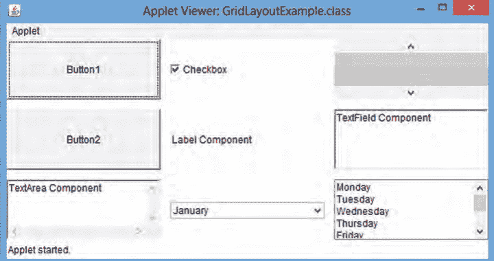

图 15.2 示例 15.2 中程序的输出

## CardLayout

`CardLayout` 用于管理大量的组件。它将组件分层组织。组件像扑克牌一样排列，一次只有一个组件是可见的。要使用卡片布局，需要创建一个 `Panel` 类型的对象来持有这些卡片。这些卡片也必须是 `Panel` 类型的对象。面板的布局管理器必须设置为 `CardLayout`。`CardLayout` 类定义了以下构造函数：

```java
CardLayout() // 第一个
CardLayout(int hor, int ver) // 第二个
```

第一个构造函数创建一个默认的卡片布局。第二个构造函数创建一个卡片布局，其中 `hor` 和 `ver` 分别指定每个组件之间留下的水平和垂直空间。

**示例 15.3** 一个演示 `CardLayout` 类使用的 Applet

```java
import java.awt.*;
import java.applet.Applet;
import java.awt.event.*;

public class CardLayoutExample extends Applet implements ActionListener {
    Panel mainPanel; // 此容器将持有卡片
    Panel p1, p2; // 这些面板将代表卡片
    Panel bp; // 此面板将持有按钮
    Button button1, button2; // 按钮
    CardLayout cl; // 卡片布局对象

    public void init() {
        mainPanel = new Panel();
        cl = new CardLayout();
        mainPanel.setLayout(cl); // 设置主面板的布局为 CardLayout
        // 创建两个面板（卡片面板）进行显示
        p1 = new Panel();
        p1.add(new Label("First Card"));
        p1.setBackground(Color.pink);
        p2 = new Panel();
        p2.add(new Label("Second Card"));
        p2.setBackground(Color.yellow);
        // 创建两个按钮并添加 ActionListener
        button1 = new Button("First");
        button1.addActionListener(this);
        button2 = new Button("Second");
        button2.addActionListener(this);
        // 创建一个用于添加按钮的面板
        bp = new Panel();
        bp.add(button1);
        bp.add(button2);
        // 设置 applet 的布局为 BorderLayout
        this.setLayout(new BorderLayout());
        this.add(bp, BorderLayout.SOUTH);
        this.add(mainPanel, BorderLayout.CENTER);
        // 将两个卡片面板添加到主面板容器
        mainPanel.add(p1, "First");
        mainPanel.add(p2, "Second");
    }

    // 按钮点击将通过显示指定的面板做出响应
    public void actionPerformed(ActionEvent e) {
        if (e.getSource() == button1)
            cl.show(mainPanel, "First");
        if (e.getSource() == button2)
            cl.show(mainPanel, "Second");
    }
}
```

GridLayoutExample 的 HTML 代码为：

```html
<HTML>
  <HEAD></HEAD>
  <BODY>
    <CENTER>
      <APPLET CODE="GridLayoutExample.class" WIDTH=600 HEIGHT=250>
      </APPLET>
    </CENTER>
  </BODY>
</HTML>
```


# 284 Java 编程

## 16.2 可插件的外观和控件 (Pluggable Look and Feel)

可插件的外观和控件允许我们将应用程序和程序的界面定制为类似于 Windows 和 Motif 等标准外观。我们甚至可以在运行时切换不同的外观和控件。Swing 具有支持多种外观和控件的能力，但它提供了对 Windows 和 Motif 支持。由于组件的外观是由 Swing 而不是由操作系统控制的，因此组件的感觉也可以被更改。组件的外观可以与组件的逻辑分离。因此，可以为任何给定的组件“插上”新的外观和控件，而不影响代码的其他部分。

> **注意：** JDK 1.6 提供的默认外观和控件被称为 metal，也称为 Java 外观和控件。

## 16.3 SWING 包

如之前讨论的，Swing 是许多大量类的集合。Swing 中的类被分组在各种包中。其中一些 Swing 包包括：

- `javax.swing`：包含 Swing 组件、接口和类。
- `javax.swing.border`：包含边框类的定义。
- `javax.swing.event`：包含用于执行各种事件的监听器。
- `javax.swing.tree`：为树组件提供模型和视图。
- `javax.swing.text`：包含各种基于文本类的定义。
- `javax.swing.table`：为表格组件提供模型和视图。

`javax.swing` 是最重要且使用广泛的包，必须导入到使用 Swing 的程序中。

## 16.4 SWING 组件和容器

与 AWT 一样，Swing GUI 也基于组件和容器的概念。容器是一种可以包含其他组件的组件。组件必须始终放置在容器内。容器还可以包含其他容器，因此，它们可以组织成一个层次结构。这种层次结构类似于 AWT 的层次结构，但在 Swing 中，类名的开头带有‘J’。

### 16.4.1 Swing 组件 (JComponent 类)

Swing 组件是独立的控制控件，例如按钮、标签、文本字段，它们需要一个容器来显示。Swing 组件继承自 `JComponent` 类。`JComponent` 为所有组件提供了功能。`JComponent` 继承了 AWT 类 `Container` 和 `Component`。因此，Swing 组件和 AWT 组件是相互兼容的。表 16.1 列出了创建 Swing 组件所需的类（包括已使用的类）。

**表 16.1 Swing 组件类列表**

| Swing 类 | | | |
|---|---|---|---|
| `JApplet` | `JFrame` | `JProgressBar` | `JTextField` |
| `JButton` | `InternalFrame` | `JRadioButton` | `JField` |
| `JCheckBox` | `JLabel` | `JRadioButtonMenuItem` | `JPane` |
| `JCheckBoxMenuItem` | `JLayeredPane` | `RootPane` | `JToggleButton` |
| `JColorChooser` | `JList` | `JScrollPane` | `JToolBar` |
| `JComboBox` | `JMenu` | `JScrollPane` | `JToolTip` |
| `JComponent` | `JMenuBar` | `Separator` | `JTree` |
| `JDesktopPane` | `JMenuItem` | `JSlider` | `JViewport` |
| `JDialog` | `JOptionPane` | `JSpinner` | `JWindow` |
| `JEditorPane` | `JPanel` | `JSplitPane` | |
| `JFileChooser` | `JavaScript` | `JTabbedPane` | |
| `JFormattedTextField` | `JPopupMenu` | `JTable` | |

稍后将讨论一些重要的组件。

### 16.4.2 Swing 容器

容器有两种类型，即顶层容器和轻量级容器。

#### 顶层容器

顶层容器顾名思义，位于容器层次结构的顶端。顶层容器是 `JFrame`、`JApplet` 和 `JDialog`。这些容器不继承 `JComponent`，而是继承 AWT 类的 `Component` 和 `Container`。这些容器是重量级组件。最常用的是 `JFrame` 和 `JApplet`。

每个容器定义了一组面板（panes）。`JRootPane` 是特殊的容器，包含一组固定的面板，即玻璃面板 (glass pane)、内容面板 (content pane) 和层面板 (layered pane)。

- **玻璃面板 (Glass pane)**：玻璃面板是一个覆盖所有其他内容的顶层面板。默认情况下，它是 `JPanel` 的透明实例。它用于处理影响整个容器的鼠标事件。
- **层面板 (Layered pane)**：层面板是 `JLayeredPane` 类的实例。它包含一个名为内容面板的容器和一个可选的菜单栏。
- **内容面板 (Content pane)**：内容面板是用于持有组件的面板。所有视觉组件如标签都被添加到内容面板。默认情况下，它是 `JPanel` 类的一个不透明实例。通过 `JApplet` 和 `JFrame` 类的 `getContentPane()` 方法访问内容面板。

> **注意：** 在 AWT 中，组件直接添加到 applet 或帧窗口中；但在 Swing 中，它们要求被添加到内容面板中。

#### 轻量级容器

轻量级容器在容器层次结构位于顶层容器旁边。它们继承 `JComponent`。轻量级容器的一个示例是 `JPanel`。由于轻量级容器可以包含在另一个容器中，它们可以组织并管理相关组件组。

## 16.5 创建 SWING APPLET 和应用程序

下面提供的示例程序展示了编写 Swing 程序的示例。它使用了两个组件：`JFrame`（顶层容器）和 `JButton`（创建一个推入按钮）。

**示例 16.1** 用于演示创建 Swing 程序的程序。

```java
import javax.swing.*;

class MySwingDemo extends Applet {

    public static void main(String str[]) {

        // 创建一个新帧
        JFrame jf = new JFrame("Swing application");

        // 指定帧的初始大小
        jf.setSize(300, 165);

        // 终止程序
        jf.setDefaultCloseOperation(JFrame.EXIT_ON_CLOSE);

        // 创建一个按钮
        JButton bl = new JButton("Click");

        // 将按钮添加到帧
        jf.add(bl);

        // 显示帧
        jf.setVisible(true);
    }
}
```

Swing 程序的编译和执行与任何其他 Java 程序一样。**示例 16.1** 中的 `MySwingDemo.java` 可以使用以下命令编译。

```bash
javac MySwingDemo.java
```

执行程序使用以下命令。

```bash
java MySwingDemo
```

**程序的输出如图 16.1 所示。**


**图 16.1** 示例 16.1 中程序的输出

该程序的解释如下：

1. 在程序开始时，导入了 `javax.swing` 包。
2. 接下来声明了继承 `Applet` 类的 `MySwingDemo` 类。使用语句创建 `JFrame` 类的对象。
   `JFrame jf = new JFrame("Swing application");`
   它创建了一个名为 `jf` 的容器，并在标题栏上显示指定的字符串。
3. 使用语句指定窗口的大小。
   `jf.setSize(300, 165);`
   `setSize()` 方法设置窗口大小的通用形式：
   `void setSize(int width, int height)`
   其中，
   - `width` 是窗口宽度
   - `height` 是窗口高度
4. 窗口关闭时终止程序的语句：
   `jf.setDefaultCloseOperation(JFrame.EXIT_ON_CLOSE);`
   当执行上述语句时，整个应用程序将随着窗口的关闭而终止。
   `setDefaultCloseOperation` 的通用形式：
   `void setDefaultCloseOperation(int w)`
   其中，
   - `w` 指定窗口关闭时执行的操作。
5. 使用语句创建 Swing 组件 `JButton`。
   `JButton bl = new JButton("Click");`
6. 使用 `add()` 将按钮添加到帧的内容面板。
   `jf.add(bl);`
   通过调用 `JFrame` 引用 (`jf`) 的 `add` 方法将组件添加到帧的内容面板。`JFrame` 继承了 AWT 类 `Container` 的 `add` 方法。
   `add(comp)` 方法的通用形式为：
   `Component add(Component comp)`
   其中，
   - `comp` 是要添加的组件对象。
7. 使窗口可见的语句
   `jf.setVisible(true);`
   `setVisible()` 方法继承自 AWT `Component` 类。如果设置为 `true`，窗口将显示，否则不会。默认情况下，`JFrame` 是不可见的。

## 16.6 布局管理器 (Layout Manager)

布局管理器负责控制容器内组件的位置、形状和大小。组件的大小、形状和放置位置在不同的布局管理器之间会有显著差异。布局管理器根据 applet 或应用程序窗口的尺寸对组件进行定位。如果窗口尺寸发生变化，布局管理器会自动更改组件的大小、形状和位置。每个容器都关联有一个默认的布局管理器，可以通过 `setLayout()` 方法进行更改。不同的布局管理器由不同的布局类定义，这些类必须实现 AWT 包中的 `LayoutManager` 接口。

`setLayout()` 的通用形式为：

```java
void setLayout(LayoutManager lm)
```

其中，
- `lm` 是目标布局器的引用

如果没有调用 `setLayout()` 方法，则会自动调用默认布局管理器。
常用的管理器类列如表 16.2 所示。

**表 16.2 布局管理器类**

| 类 | 描述 |
| --- | --- |
| `BorderLayout` | 将组件置在五个区域：东、西、南、北、中。 |
| `CardLayout` | 将组件排列成卡片，一次只显示一个组件。 |
| `FlowLayout` | 将组件水平排列。 |
| `GridLayout` | 将组件排列在网格中。 |
| `GridBagLayout` | 在网格中排列不同大小的组件，每个元素可以跨多行或列。 |

## 16.7 用户界面组件 (User Interface Components)

在本节中，我们将介绍 Swing 某些组件的概述。

### 16.7.1 JApplet

`JApplet` 是一个类，代表 Applet 类的子类，所有使用 Swing 的 applet 都必须扩展该类。它提供了 AWT applet 的所有功能，并支持菜单和组件的分层。每当我们需要向其添加组件时，该组件就会被添加到内容面板（content pane）中。

`JApplet` 定义了以下构造函数：

```java
JApplet()
```

### 16.7.2 JFrame

Frame 是最常用的容器，用于创建具有标题、边框和窗口管理按钮的顶窗口。它也可以用于创建应用程序的辅助窗口。帧 是 `JFrame` 类的对象。

`JFrame` 类定义的构造函数如下：

```java
JFrame()
JFrame(String title)
```

其中，
- `title` 指定帧的标题

**示例 16.2** 使用 `JFrame` 的演示程序

```java
import java.awt.*;
import javax.swing.*;

class FrameExample extends Applet {

    JFrame jf;

    FrameExample() {
        jf = new JFrame("Frame Example");
        jf.setDefaultCloseOperation(JFrame.EXIT_ON_CLOSE);
        jf.setSize(400, 300);
        jf.setVisible(true);
    }

    public static void main(String args[]) {
        FrameExample se = new FrameExample();
    }
}
```

程序的输出如图 16.2 所示。

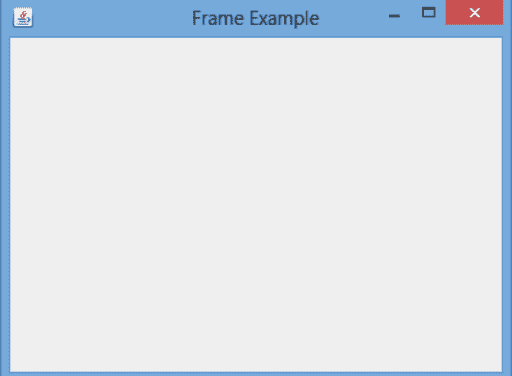

**图 16.2** 示例 16.2 的输出

默认情况下，当用户点击关闭按钮时，窗口从显示中移除；但应用程序不会终止。应用程序仍然占用内存空间，这在大多数情况下是不需要的。为了在用户点击顶窗口的关闭按钮时终止应用程序，可以使用 `setDefaultCloseOperation()` 方法。

### 16.7.3 Label (标签)

Label 是一个简单的控件，用于在窗口上显示文本（不可编辑）。由于它不具备任何用户交互功能，因此被认为是一种被动控件。标签是 `JLabel` 类的对象。

`JLabel` 类定义的某些构造函数如下：

```java
JLabel()
JLabel(String string)
JLabel(String string, int align)
```

其中，
- `string` 是标签的文本
- `align` 指定标签内包含文本的水平对齐方式，可以取以下值之一：`LEFT`、`RIGHT`、`CENTER`、`LEADING` 或 `TRAILING`。

### 16.7.4 Button (按钮)

按钮也称为推按钮（push button），是一种具有 3D 效果的活动控件。当它被点击或激活时，会触发一个事件。Swing 还提供了与按钮关联图标、字符串或两者结合。推按钮是 `JButton` 类的对象。

`JButton` 类定义的某些构造函数如下：

```java
JButton()
JButton(Icon icon)
JButton(String string)
```

其中，
- `string` 代表用于按钮的字符串
- `icon` 代表按钮使用的图标

> **注意：** 所有按钮都派生自 `AbstractButton` 类。

### 16.7.5 ToggleButton (切换按钮)

Swing 提供了推按钮的变体——切换按钮，它有两个状态：按下和释放。当第一次按下切换按钮时，它保持按下状态，只有在第二次按下时才被释放。此按钮在按下和释放状态之间切换。切换按钮是 `JToggleButton` 类的对象。

`JToggleButton` 类定义的某些构造函数如下：

```java
JToggleButton()
JToggleButton(String string)
JToggleButton(String string, boolean state)
```

其中，
- `string` 指定文本
- `state` 可以取以下值之一：如果按钮初始被选中则为 `true`，否则为 `false`（默认值）

### 16.7.6 CheckBox (复选框)

复选框是由标签和一个方框组成的控件，它有状态：已勾选（checked）或未勾选（unchecked）。复选框是 `JCheckBox` 类的对象。

`JCheckBox` 类定义的构造函数如下：

```java
JCheckBox()
JCheckBox(String string)
JCheckBox(String string, boolean isSelected)
```

其中，
- `string` 是标签
- `isSelected` 定义复选框是否被勾选（`true`）或未勾选（`false`）。

### 16.7.7 TextField (文本框)

TextField 创建单行区域。它允许用户使用剪切、复制和粘贴键输入编辑文本。它是 `JTextField` 类的对象，继承自 `JComponent`。

`JTextField` 类定义的构造函数如下：

```java
JTextField()
JTextField(int cols)
JTextField(String string, int cols)
JTextField(String string)
```

其中，
- `string` 是初始字符串
- `cols` 列

### 16.7.8 TextArea (文本区域)

TextArea 创建多行区域。它本身不提供滚动功能；可以通过添加 `JScrollPane` 添加滚动条。文本区域是 `JTextArea` 类的对象，继承自 `JComponent`。

`JTextArea` 类定义的构造函数如下：

```java
JTextArea()
JTextArea(String str)
JTextArea(int rows, int cols)
JTextArea(String str, int cols)
```

其中，
- `str` 是初始字符串
- `rows` 文本区域的高度
- `cols` 文本区域的宽度

### 16.7.9 RadioButton (单选按钮)

单选按钮是一组按钮，其中一次只能选择一个。也就是说，当你选择一个单选按钮时，另一个被选中的按钮会自动取消勾选。单选按钮是 `JRadioButton` 类的对象。

`JRadioButton` 类定义的构造函数如下：

```java
JRadioButton()
JRadioButton(String string)
JRadioButton(String string, boolean state)
```


其中：
- `string` 文本
- `state` 如果按钮初始被选中则为 `true`，否则为 `false`（默认值）

> 注意：按钮组（`javax.swing.ButtonGroup`）与单选按钮结合使用，以确保只有一个单选按钮选中。

### 16.7.10 Panel (面板)

`Panel` 是用于存放不同 Swing 组件的容器。面板可以添加任意数量的组件，同一个帧中可以有多个面板。它还支持双缓冲，用于动画以避免闪烁。在双缓冲中，首先写入离屏内存，然后切换到面板。流布局是面板的默认布局。面板是 `JPanel` 类的对象，存在于 `javax.swing` 包中。

`JPanel` 类定义的构造函数如下：

```java
JPanel()
JPanel(boolean isDoubleBuffered)
JPanel(LayoutManager layout)
JPanel(LayoutManager layout, boolean isDoubleBuffered)
```

其中：
- `isDoubleBuffered` 定义面板是否使用双缓冲。
- `layout` 定义面板的布局。

### 16.7.11 ScrollPane (滚动面板)

滚动面板是一个容器，代表查看其他组件的小区域。如果组件大于可见区域，滚动面板提供水平和垂直滚动条以便在面板中滚动组件。滚动面板是 `JScrollPane` 类的对象，该类继承自 `JComponent`。

`JScrollPane` 类定义的构造函数如下：

```java
JScrollPane()
JScrollPane(Component component)
JScrollPane(int ver, int hor)
JScrollPane(Component component, int ver, int hor)
```

其中：
- `component` 是要添加到滚动面板的组件
- `ver` 和 `hor` 分别指定显示垂直和水平滚动条。
一些标准的策略有：`HORIZONTAL_SCROLLBAR_ALWAYS`、`HORIZONTAL_SCROLLBAR_AS_NEEDED`、`VERTICAL_SCROLLBAR_ALWAYS`、`VERTICAL_SCROLLBAR_AS_NEEDED`。

> 注意：`JScrollPane` 是一个轻级容器。

### 16.7.12 列表 (List)

`List` 显示项目列表。它允许用户从给定的项目列表中进行多选。列表组件被添加到滚动面板中，以便项目列表是可以滚动的。列表类属于 `JLabel` 类。

`JList` 类定义的一些构造函数如下：

```java
JList()
JList(Object[] listdata)
```

其中：
- `listdata` 表示显示元素的 `Object` 类型的数组。

#### 示例 16.3 一个用于演示各种 Swing 组件用法的程序。

```java
import java.awt.*;
import javax.swing.*;

class form extends Applet {
    // 声明组件
    JFrame jf;
    JLabel nm, add, hobbies, languages, blank;
    JButton ok, clear;
    JTextField field;
    JTextArea address;
    JRadioButton m, f;
    JComboBox cric, bad, dance, music;
    ButtonGroup bg;
    JList list;
    JScrollPane scr;
    JPanel panel1, panel2, panel3, panel4, panel5, main;

    form() {
        String lang[] = {"C","C++","Java", "Pascal", "Fortran","COBOL"}; // 列表项

        jf = new JFrame("Demo of Swing components");
        // 实例化组件
        ok = new JButton("OK");
        clear = new JButton("Clear");
        m = new JRadioButton("Male", true);
        f = new JRadioButton("Female");
        bg = new ButtonGroup();
        sex = new JLabel(" Sex");
        hobbies = new JLabel(" Hobbies");
        blank = new JLabel();
        cric = new JCheckBox("Cricket", true);
        bad = new JCheckBox("Badminton");
        dance = new JCheckBox("Dance");
        music = new JCheckBox("Music");
        languages = new JLabel(" Languages Known");
        list = new JList(lang);
        // 将项目添加到列表
        list.setVisibleRowCount(3); // 可视三个项目
        scr = new JScrollPane(list,
            ScrollPaneConstants.VERTICAL_SCROLLBAR_ALWAYS,
            ScrollPaneConstants.HORIZONTAL_SCROLLBAR_AS_NEEDED);
        // 将列表添加滚动面板
        nm = new JLabel("Name");
        add = new JLabel("Address");
        name = new JTextField(20); // TextField 有 20 个字符
        address = new JTextArea(3, 20); // TextArea 有 3 行和 20 列
        panel1 = new JPanel();
        panel2 = new JPanel(new GridLayout(1, 3));
        // panel2 的布局为 GridLayout
        panel3 = new JPanel();
        panel4 = new JPanel(new GridLayout(1, 2)); // 设置 panel4 的布局为 GridLayout
        panel5 = new JPanel();
        main = new JPanel(new GridLayout(5, 1)); // 所有的这五个面板
        // 将单选按钮添加到按钮组以便每次只有一个单选按钮是激活的
        bg.add(m);
        bg.add(f);
        // 将组件添加到对应的面板
        panel1.add(nm);
        panel1.add(name);
        panel1.add(add);
        panel1.add(address);
        panel2.add(sex);
        panel2.add(m);
        panel2.add(f);
        panel3.setLayout(new GridLayout(2, 3));
        panel3.add(hobbies);
        panel3.add(cric);
        panel3.add(bad);
        panel3.add(blank);
        panel3.add(dance);
        panel3.add(music);
        panel4.add(languages);
        panel4.add(scr, BorderLayout.NORTH);
        panel5.add(ok);
        panel5.add(clear);
        // 将所有面板添加到主面板
        main.add(panel1);
        main.add(panel2);
        main.add(panel3);
        main.add(panel4);
        main.add(panel5);
        jf.add(main); // 将主面板添加到帧
        jf.setDefaultCloseOperation(JFrame.EXIT_ON_CLOSE);
        jf.setSize(300, 350);
        jf.setVisible(true);
    }

    public static void main(String str[]) {
        form f = new form();
    }
}
```

程序的输出如图 16.3 (a) 和 (b) 所示。

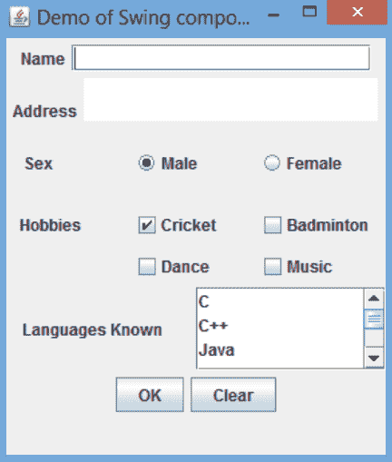
图 16.3 (a) 默认表单

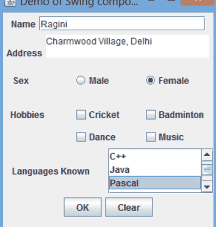
图 16.3 (b) 带输入的表单

### 16.7.13 组合框 (ComboBox)

组合框是列表组件和文本字段组件的结合。它可以包含更多项目，但在任何时刻只显示一个项目。与列表组件不同，组合框允许用户输入他们的选择。组合框是 `JComboBox` 的对象。

`JComboBox` 类定义的一些构造函数如下：

```java
JComboBox()
JComboBox(Object data[])
```

其中：
- `data` 表示显示元素的 `Object` 类型的数组。

#### 示例 16.4 一个用于演示 JComboBox 用法的程序

```java
import java.awt.*;
import javax.swing.*;

public class ComboBoxExample extends Applet {
    JComboBoxExample() {
        JFrame frame = new JFrame("Example of ComboBox");
        JPanel jp1 = new JPanel(new GridLayout(5, 2));
        JPanel jp2 = new JPanel();
        JPanel jp3 = new JPanel(new GridLayout(2, 2));
        JLabel jl1, jl2, jl3, jl4;
        JTextField jt1, jt2, jt3, jt4, jt5;
        JButton jbl1, jbl2;
        JComboBox jcl;

        jl1 = new JLabel("Name:");
        jl2 = new JLabel("Address:");
        jl3 = new JLabel("Contact:");
        jl4 = new JLabel("Country:");
        jt1 = new JTextField(20);
        jt2 = new JTextField(20);
        jt3 = new JTextField(20);
        jt4 = new JTextField(20);
        jt5 = new JTextField(20);
        jbl1 = new JButton("Submit");
        jbl2 = new JButton("Cancel");
        jcl = new JComboBox();

        jp1.add(jl1);
        jp1.add(jt1);
        jp1.add(jl2);
        jp1.add(jt2);
        jp1.add(jl3);
        jp1.add(jt3);
        jp1.add(jl4);
        jp1.add(jt4);
        jp2.add(jt5);
        jp2.add(jbl1);
        jp2.add(jbl2);
        jp3.add(jcl);

        jcl.addItem("India");
        jcl.addItem("Sri Lanka");
        jcl.addItem("USA");
        jcl.addItem("UK");
        jcl.addItem("China");
        jcl.addItem("Nepal");
        jcl.addItem("Japan");
        jcl.addItem("France");
        jcl.addItem("Germany");
        jcl.addItem("Brazil");
        jcl.addItem("Canada");
        jcl.addItem("Australia");
        jcl.addItem("Russia");
        jcl.addItem("Italy");
        jcl.addItem("Spain");
        jcl.addItem("Mexico");
        jcl.addItem("Egypt");
        jcl.addItem("South Korea");
        jcl.addItem("Turkey");
        jcl.addItem("Argentina");

        frame.add(jp1, BorderLayout.CENTER);
        frame.add(jp2, BorderLayout.SOUTH);
        frame.add(jp3, BorderLayout.NORTH);
        frame.setSize(400, 300);
        frame.setDefaultCloseOperation(JFrame.EXIT_ON_CLOSE);
        frame.setVisible(true);
    }

    public static void main(String[] args) {
        ComboBoxExample combo = new ComboBoxExample();
    }
}
```

程序的输出如图 16.4 (a) 和 (b) 所示。


图 16.4 (a) 默认表单


图 16.4 (b) 带输入的表单

### 16.7.14 滚动条 (ScrollBar)

滚动条是水平或垂直方向的条，允许用户在指定的最小最大值之间选择项目。滚动条的末端可以点击以更改滚动条的值。滚动条是 `ScrollBar` 的对象。

`ScrollBar` 类定义的构造函数如下：

```java
ScrollBar() // 第一个
ScrollBar(int orientation) // 第二个
ScrollBar(int orientation, int initial_value, int visible_units, int min, int max) // 第三个
```

第一个构造函数创建一个滚动条。第二个构造函数创建一个滚动条，其中 `orientation` 可以取 `ScrollBar.HORIZONTAL` 或 `ScrollBar.VERTICAL` 值。第三个构造函数创建一个滚动条，其中 `orientation` 指定滚动条的方向，`initial_value` 表示滚动条的值，`visible_units` 表示滚动条上可见的项目数，`min` 和 `max` 表示最小和最大值。

考虑示例 16.5。这里添加了两个滚动条（一个水平一个垂直）。

#### 示例 16.5 一个演示 Scrollbar 类用法的 applet

```java
import javax.swing.*;

public class ScrollBarExample extends JFrame {
    ScrollBarExample() {
        JFrame jf;
        jf = new JFrame("ScrollBar");
        JPanel jp = new JPanel();
        JLabel lbl = new JLabel("ScrollBar:");
        JScrollBar jsv = new JScrollBar();
        JScrollBar jsh = new JScrollBar(ScrollBar.HORIZONTAL);
        jp.add(lbl);
        jp.add(jsv);
        jp.add(jsh);
        jf.setDefaultCloseOperation(JFrame.EXIT_ON_CLOSE);
        jf.setSize(300, 200);
        jf.setVisible(true);
    }

    public static void main(String[] args) {
        ScrollBarExample japp = new ScrollBarExample();
    }
}
```


HTML 代码的输出是图 16.5。

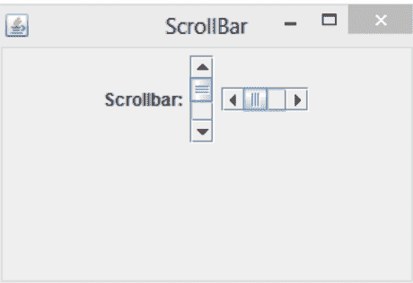

图 16.5 示例 16.5 程序输出

### 16.7.15 菜单栏和菜单

菜单代表菜单列表，可以添加到顶层窗口的顶部。每个菜单关联一个下拉菜单项列表。菜单栏的概念可以使用三个 Java 类来实现：`JMenuBar`、`JMenu` 和 `JMenuItem`。菜单栏由 `JMenuBar` 类的对象表示，其中只定义了默认构造函数。菜单栏由一个或多个 `JMenu` 类对象组成。菜单包含由 `JMenuItem` 类表示菜单项列表。

`JMenu` 类定义了以下构造函数：

```java
JMenu() // 第一个
JMenu(String optionName) // 第二个
JMenu(String optionName, boolean removable) // 第三个
```

第一个构造函数创建一个空菜单。第二个构造函数创建一个带有 `optionName` 指定名称的菜单。在第三个构造函数中，`removable` 可以取以下值之一：`true` 或 `false`。如果为 `true`，则菜单可以在应用程序窗口中自由浮动，否则它将固定在菜单栏上。

`JMenuItem` 类定义了以下构造函数：

```java
JMenuItem() // 第一个
JMenuItem(String itemName) // 第二个
JMenuItem(String itemName, Icon icon) // 第三个
```

第一个构造函数创建一个没有名称和快捷键的菜单。在构造函数中，`itemName` 指定了菜单项的名称。在第三个构造函数中，`icon` 指定了与菜单项相关的图标。

还可以使用 `JMenuItem` 的子类 `JCheckboxMenuItem` 来创建一个可改变的菜单项。

`JCheckboxMenuItem` 类定义了以下构造函数：

```java
JCheckboxMenuItem()
JCheckboxMenuItem(String itemName)
JCheckboxMenuItem(String itemName, boolean changeable)
```

第一个构造函数创建一个没有名称的未选中菜单项。第二个构造函数创建一个带有 `itemName` 指定名称的未选中菜单项。在第三个构造函数中，`changeable` 可以为 `true` 或 `false`。如果为 `true`，则菜单项初始状态为选中状态，否则为未选中状态。

下面给出了两种类型的菜单：

- **普通菜单**：它们放置在应用程序窗口顶部的菜单栏内。
- **弹出菜单**：它们在用户点击窗口时出现。例如，点击鼠标时会弹出一个菜单。

考虑示例 16.6。这里，有一个包含两个菜单项的菜单：`jml1`（用于文件菜单）和 `j2`（用于编辑菜单）。当点击任何一个菜单项时，该项的名称将显示在窗口底部。使用 `ActionListener` 接口来处理菜单事件。

## 示例 16.6 一个演示 JMenuBar 类、JMenu 类和 JMenuItem 类使用的应用程序

```java
import java.awt.*;
import java.awt.event.*;
import javax.swing.*;

public class MenuBarExample extends JFrame implements ActionListener {

    public JFrame jf = new JFrame("MenuBar Example");
    public JPanel panel = new JPanel(new BorderLayout());
    public JPanel jp = new JPanel(new GridLayout(5, 5));
    public JPanel jpl = new JPanel(new BorderLayout());
    JLabel jl = new JLabel("*");

    public MenuBarExample() {
        JMenuBar jmb;
        JMenu jml, jml2, jmill;
        JMenuItem jmi1, jmi2, jmi3, jmi4, jmi5, jmi6, jmi7, jmi8, jmi9,
                jmi10, jmi11, jmi12, jmi13;

        jmb = new JMenuBar();
        setJMenuBar(jmb);

        jml = new JMenu("File");
        jml2 = new JMenu("Edit");

        jmi1 = new JMenuItem("New");
        jmi2 = new JMenuItem("Open");
        jmi3 = new JMenuItem("Save");
        jmi4 = new JMenuItem("Close");
        jmi5 = new JMenuItem("Exit");
        jmi6 = new JMenuItem("Undo");
        jmi7 = new JMenuItem("Redo");
        jmi8 = new JMenuItem("Copy");
        jmi9 = new JMenuItem("Cut");
        jmi10 = new JMenuItem("Paste");
        jmi11 = new JMenuItem("Search");
        jmi12 = new JMenuItem("Find");
        jmi13 = new JMenuItem("Replace");

        jml.add(jmi1);
        jml.add(jmi2);
        jml.add(jmi3);
        jml.add(jmi4);
        jml.add(jmi5);

        jml2.add(jmi6);
        jml2.add(jmi7);
        jml2.add(jmi8);
        jml2.add(jmi9);
        jml2.add(jmi11);

        jmi11.add(jmi12);
        jmi11.add(jmi13);

        jmb.add(jml);
        jmb.add(jml2);

        jmi1.addActionListener(this);
        jmi2.addActionListener(this);
        jmi3.addActionListener(this);
        jmi4.addActionListener(this);
        jmi5.addActionListener(this);
        jmi6.addActionListener(this);
        jmi7.addActionListener(this);
        jmi8.addActionListener(this);
        jmi9.addActionListener(this);
        jmi10.addActionListener(this);
        jmi12.addActionListener(this);
        jmi13.addActionListener(this);

        jp.add(jmb);
        jp.setSize(500, 200);
        jp.setVisible(true);

        jpl.setSize(50, 50);
        jpl.setVisible(true);

        panel.setSize(500, 200);
        panel.add(jp, BorderLayout.NORTH);
        panel.add(jpl, BorderLayout.PAGE_END);
        panel.setVisible(true);

        jf.add(panel);
        jf.setDefaultCloseOperation(JFrame.EXIT_ON_CLOSE);
        jf.setSize(500, 250);
        jmb.setVisible(true);
        jf.setVisible(true);
    }

    public void actionPerformed(ActionEvent e) {
        jpl.setVisible(true);
        String message = "You Clicked: \n";

        if (e.getActionCommand().equals("New")) {
            message += "New";
        }
        if (e.getActionCommand().equals("Open")) {
            message += "Open";
        }
        if (e.getActionCommand().equals("Save")) {
            message += "Save";
        }
        if (e.getActionCommand().equals("Close")) {
            message += "Close";
        }
        if (e.getActionCommand().equals("Exit")) {
            message += "Exit";
        }
        if (e.getActionCommand().equals("Undo")) {
            message += "Undo";
        }
        if (e.getActionCommand().equals("Redo")) {
            message += "Redo";
        }
        if (e.getActionCommand().equals("Copy")) {
            message += "Copy";
        }
        if (e.getActionCommand().equals("Cut")) {
            message += "Cut";
        }
        if (e.getActionCommand().equals("Paste")) {
            message += "Paste";
        }
        if (e.getActionCommand().equals("Find")) {
            message += "Find";
        }
        if (e.getActionCommand().equals("Replace")) {
            message += "Replace";
        }

        jl.setText(message);
        jpl.add(jl);
    }

    public static void main(String[] args) {
        new MenuBarExample();
    }
}
```

程序的输出如图 16.8 所示。

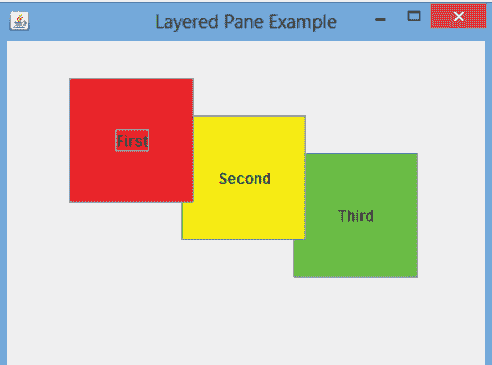

图 16.8 示例 16.8 中程序的输出

## 16.8.2 分割面板

拆分面板是一种轻量级容器，允许你在单个面板中水平或垂直地排列两个组件（仅限两个）。两个组件的显示区域也可以由用户在运行时进行调整。拆分面板是 `JSplitPane` 类的对象。
`JSplitPane` 类定义的一些构造函数如下。

```java
JSplitPane()
JSplitPane(int orientation, boolean continuousLayout)
JSplitPane(int orientation, Component TopOrLeft, Component BottomOrRight)
JSplitPane(int orientation, boolean continuousLayout, Component TopOrLeft, Component BottomOrRight)
```

其中：

- `orientation` 指定了组件的排列方式——可以取两个值之一：`HORIZONTAL_SPLIT`（水平分割）和 `VERTICAL_SPLIT`（垂直分割）。
- `continuousLayout` 可以取两个值之一：`true`，如果组件可以调整大小，分割线将连续移动；否则为 `false`（默认值）。
- `TopOrLeft` 指定放置在顶部或左侧的对象。
- `BottomOrRight` 指定放置在底部或右侧的对象。

### 示例 16.9 一个演示 JSplitPane 的程序

```java
import java.awt.*;
import javax.swing.*;

class SplitExample extends JApplet {

    JFrame frame;
    JSplitPane pane;
    JTextArea top, bottom;
    String sampleText = "拆分面板是一种轻量级容器，允许在单个面板中水平或垂直地排列两个组件（仅限两个）。两个组件的显示区域也可以由用户在运行时进行调整。";

    public SplitExample() {
        JFrame jf = new JFrame("拆分面板示例");
        top = new JTextArea(sampleText);
        top.setLineWrap(true);
        bottom = new JTextArea(sampleText);
        bottom.setLineWrap(true);
        pane = new JSplitPane(JSplitPane.VERTICAL_SPLIT, top, bottom);
        jf.getContentPane().add(pane, BorderLayout.CENTER);
        jf.setDefaultCloseOperation(JFrame.EXIT_ON_CLOSE);
        jf.setSize(400, 300);
        jf.setVisible(true);
    }

    public static void main(String args[]) {
        new SplitExample();
    }
}
```

程序的输出如图 16.9 (a) 和 (b) 所示。

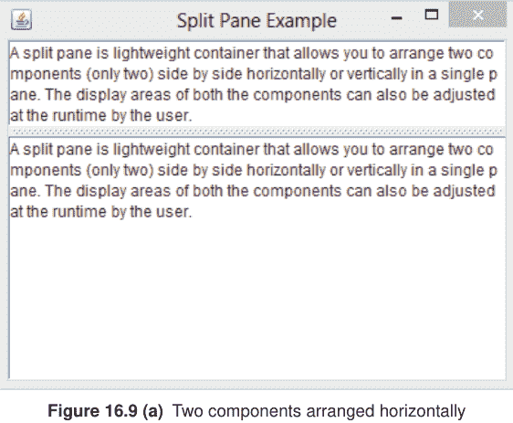
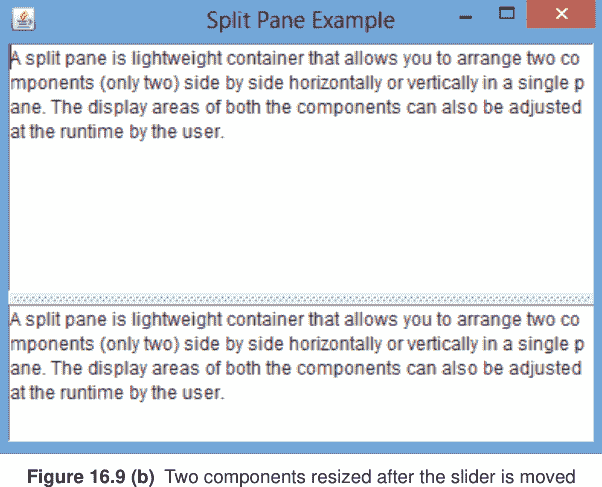

## 16.8.3 标签页面板

有时会出现很多组件，无法容纳在单个屏幕中的情况。在这种情况下，使用标签页面板来创建标签，每个标签包含一组相关的组件。当点击特定标签时，该标签的组件将显示在最前面。标签页面板是 GUI 界面中非常常见的特性。它通常用于包含许多命令的对话框。标签页面板是 `JTabbedPane` 类的示例。

`JTabbedPane` 类定义的一些构造函数如下：

```java
JTabbedPane()
JTabbedPane(int tabPlacement)
```

- `tabPlacement` 指定标签的位置——可以取四个值之一：`TOP`（顶部）、`BOTTOM`（底部）、`LEFT`（左侧）或 `RIGHT`（右侧）。

### 示例 16.10 一个演示 JTabbedPane 类的程序

```java
import java.awt.*;
import javax.swing.*;

class TabbedExample extends JApplet {

    JFrame jf;
    JTabbedPane tPane;
    JPanel panel1, panel2;
    JLabel label1, label2;
    JComboBox city1, city2, state1, state2;

    TabbedExample() {
        jf = new JFrame("标签页面板示例");
        tPane = new JTabbedPane();
    }
}
```


jf.getContentPane().add(tPane, BorderLayout.CENTER);

label1 = new JLabel("选择城市:");

city1 = new JCheckBox("Chennai", true);

city2 = new JCheckBox("Mumbai", true);

label2 = new JLabel("选择州:");

stel = new JCheckBox("Tamil Nadu", true);

state2 = new JCheckBox("Maharashtra", true);

panel1 = new JPanel(new GridLayout(1,3));

panel1.add(label1);

panel1.add(city1);

panel1.add(city2);

panel2 = new JPanel(new GridLayout(1,3));

panel2.add(label2);

panel2.add(stel);

panel2.add(state2);

tPane.add("城市", panel1);

tPane.add("州", panel2);

jf.setDefaultCloseOperation(jf.EXIT_ON_CLOSE);

jf.setSize(400, 300);

jf.setVisible(true);

}

public static void main(String args[]) {

TabbedExample se = new TabbedExample();

}

}

```

程序的输出见图 16.10 (a) 和 (b)。

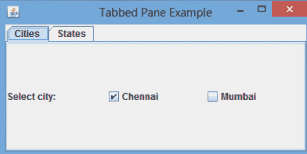

图 16.10 (a) 城市

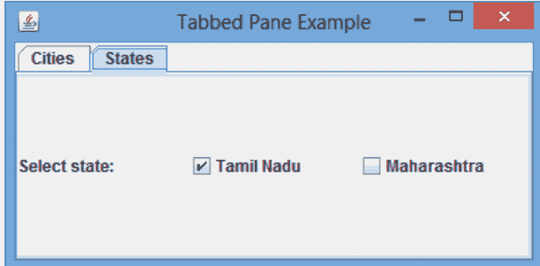

图 16.10 (b) 州

# 312 Java 编程

## 16.9 布局

有五种布局：

- `FlowLayout` (流布局)
- `BorderLayout` (边界布局)
- `GridLayout` (网格布局)

`FlowLayout` 是所有布局管理器中最简单的。它按照组件添加到容器的顺序水平和垂直排列组件。流布局管理器可以使用以下构造函数之一创建：

```
FlowLayout()

FlowLayout(int alignment)

FlowLayout(int alignment, int hor, int ver)
```

- `alignment` 指定对齐方式——可以是 `LEFT`、`RIGHT` 或 `CENTER`。
- `hor` 和 `ver` 分别指定间距。

例如，以下语句创建一个水平间距为 5 像素、垂直间距为 10 像素的 `FlowLayout`：

```java
myFlowLayout = new FlowLayout(FlowLayout.LEFT, 5, 10);
```

考虑示例 16.11。这里将流布局设置为 applet 的布局，然后添加了组件。

### 示例 16.11 一个演示 FlowLayout 的程序

```java
import javax.swing.*;
import java.awt.*;

class MyFlowLayout extends Applet {
    public static void main(String[] args) {
        JFrame frame = new JFrame("布局演示");
        frame.setLayout(new FlowLayout());
        //创建各种组件
        JButton b1 = new JButton("按钮 1");
        JButton b2 = new JButton("按钮 2");
        JButton b3 = new JButton("按钮 3");
        JLabel l1 = new JLabel("标签 1");
        JLabel l2 = new JLabel("标签 2");
        JLabel l3 = new JLabel("标签 3");
        JTextField t1 = new JTextField("文本框 1");
        JTextField t2 = new JTextField("文本框 2");
        JTextField t3 = new JTextField("文本框 3");
        //将组件添加到 applet
        frame.add(b1);
        frame.add(l1);
        frame.add(b2);
        frame.add(t1);
        frame.add(l2);
        frame.add(t2);
        frame.add(b3);
        frame.add(l3);
        frame.add(t3);
        frame.setDefaultCloseOperation(frame.EXIT_ON_CLOSE);
        frame.setSize(350, 200);
        frame.setVisible(true);
    }
}
```

其中，
`obj` 是要添加的组件
`region` 代表添加组件的区域名称。它可以取这些常量之一：`BorderLayout.NORTH`、`BorderLayout.SOUTH`、`BorderLayout.CENTER`、`BorderLayout.EAST` 和 `BorderLayout.WEST`

注意：调整组件的大小不会影响边框布局的外观。

考虑示例 16.12。在这里，边框布局被用作框架的布局。框架中添加了五个按钮和一个标签，每个按钮位于不同的位置。标签是在按钮之后添加的，结果是标签遮盖了边框。

### 示例 16.12 一个演示 BorderLayout 使用的程序

```java
import javax.swing.*;
import java.awt.*;

class MyBorderLayout extends Applet {
    public static void main(String[] args) {
        JFrame jf = new JFrame("Demo of Border layout");
        //设置 applet 的布局为 BorderLayout
        jf.setLayout(new BorderLayout());
        //创建组件
        JButton b1 = new JButton("Left");
        JButton b2 = new JButton("Right");
        JButton b3 = new JButton("Top");
        JButton b4 = new JButton("Bottom");
        JButton b5 = new JButton("Middle");
        JLabel l1 = new JLabel("Center");
        //添加组件
        jf.add(b1, BorderLayout.WEST);
        jf.add(b2, BorderLayout.EAST);
        jf.add(b3, BorderLayout.NORTH);
        jf.add(b4, BorderLayout.SOUTH);
        jf.add(b5, BorderLayout.CENTER);
        jf.add(l1, BorderLayout.CENTER); //标签遮盖了
        //按钮
        jf.setDefaultCloseOperation(jf.EXIT_ON_CLOSE);
        jf.setSize(350, 200);
        jf.setVisible(true);
    }
}
```

程序的输出如图 16.12 所示。

# 316 Java 编程

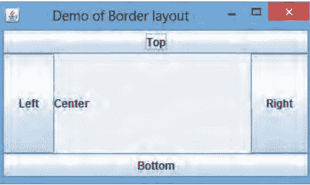

图 16.12 示例 16.12 程序的输出

## 16.9.3 Grid Layout（网格布局）

网格布局将容器管理为行和列的网格/矩阵。整个可用区域在行和列之间平均分配，使得布局中的每行和每列的大小都相同。添加到单元格的组件会扩展到该单元格的大小。

网格布局管理器可以使用以下任何构造函数来创建：

```
GridLayout()
GridLayout(int rows, int cols)
GridLayout(int rows, int cols, int hor, int vert)
```

其中，
`rows` 和 `cols` 分别定义最大行数和列数
`hor` 和 `vert` 分别定义组件之间的水平和垂直间隙

考虑示例 16.13。在这里，框架使用了指定行数和列数的网格布局。添加了两个标签、两个文本字段和两个按钮，它们以网格布局的形式排列。

### 示例 16.13 一个演示 GridLayout 使用的程序

```java
import javax.swing.*;
import java.awt.*;

class GridLayoutExample extends Applet {
    public static void main(String[] args) {
        JFrame jf = new JFrame("Demo of Grid layout");
        /*创建一个具有 3 行 2 列的布局，
        且组件之间有 5 像素的水平和垂直间距*/
        jf.setLayout(new GridLayout(3,2,5,5));
        /*创建各种组件*/
        JButton b1 = new JButton("Reset");
        JButton b2 = new JButton("Submit");
        JLabel l11 = new JLabel("Name");
        JLabel l12 = new JLabel("Address");
        JTextField t2 = new JTextField("name");
        JTextField t1 = new JTextField("address");
        //将组件添加到框架中
        jf.add(l11);
        jf.add(t2);
        jf.add(l12);
        jf.add(t1);
        jf.add(b1);
        jf.add(b2);
        jf.setSize(350,200);
        jf.setVisible(true);
        jf.setDefaultCloseOperation(jf.EXIT_ON_CLOSE);
    }
}
```

程序的输出如图 16.13 所示。

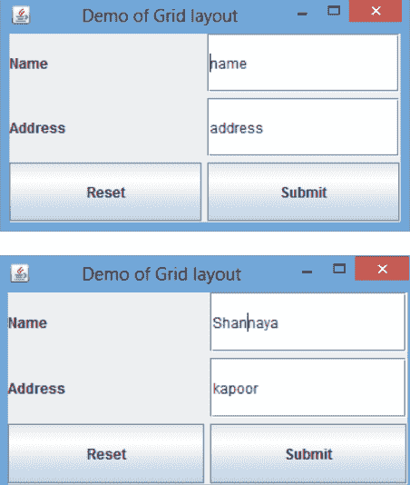

图 16.13 示例 16.13 程序的输出

## 16.9.4 Card Layout（卡片布局）

卡片布局管理器用于管理大量的组件。它将组件组织成层，这些层像牌牌一样排列，共享同一个显示区域，使得每次只有一个组件是可见的。为了使用卡片布局，需要创建一个类型为 `JPanel` 的对象，持有卡片的通常是 `JPanel` 类型的对象。面板的布局管理器必须设置为 `CardLayout`。

卡片布局管理器可以使用以下任何构造函数来创建：

```java
CardLayout()
CardLayout(int hor, int vert)
```

其中。
`hor` 定义不同组件之间的水平间隙，单位为像素
`vert` 定义不同组件之间的垂直间隙，单位为像素

考虑示例 16.14。在这里，创建了一个名为 `mp` 的面板，其布局设置为卡片布局，并用于持有其他面板 `p1` 和 `p2`。面板 `p1` 和 `p2` 用于持有卡片。`p1` 和 `p2` 的背景颜色分别设置为粉色和黄色。创建了另一个名为 `b` 的面板来持有两个按钮 `b1` 和 `b2`，分别标记为“First”和“Second”。当点击 `b1` 时，显示持有粉色卡片的面板；当点击 `b2` 时，显示持有卡片的面板。

### 示例 16.14 一个演示 CardLayout 使用的程序

```java
import java.awt.*;
import java.awt.event.*;
import javax.swing.*;

class CardLayoutDemo extends JFrame implements ActionListener {
    JPanel mp; // 这是持有卡片的主面板
    JPanel p1, p2; // 这些面板将代表卡片
    JPanel b; // 这个面板将持有按钮
    JButton b1, b2; //按钮
    CardLayout cl; // 卡片布局对象
    JFrame frame;

    CardLayoutDemo() {
        jf = new JFrame("Demo of card layout");
        mp = new JPanel();
        cl = new CardLayout();
        mp.setLayout(cl); //设置主面板的布局
        //创建两个面板（卡片面板）
        p1 = new JPanel();
        p1.add(new JLabel("First"));
        p1.setBackground(Color.pink);
        p2 = new JPanel();
        p2.add(new JLabel("Second"));
        p2.setBackground(Color.yellow);
        mp.add(p1, "First");
        mp.add(p2, "Second");
        b = new JPanel();
        b1 = new JButton("First");
        b2 = new JButton("Second");
        b.add(b1);
        b.add(b2);
        jf.add(b, BorderLayout.SOUTH);
        jf.add(mp, BorderLayout.CENTER);
        jf.setSize(350, 200);
        jf.setVisible(true);
        jf.setDefaultCloseOperation(jf.EXIT_ON_CLOSE);
    }

    public void actionPerformed(ActionEvent e) {
        if (e.getSource() == b1) {
            cl.show(mp, "First");
        }
        if (e.getSource() == b2) {
            cl.show(mp, "Second");
        }
    }
}
```


程序的输出如图 16.14 (a) 和 (b) 所示。（注：原文中代码部分存在断裂和混乱，翻译时已根据上下文进行了逻辑补全，以符合文档工程师的标准）


图 16.14 (a) 第一张卡片

# 320 Java 编程


图 16.14 (b) 第二张卡片

## 16.9.5 Grid Bag Layout（网格布局）

网格布局管理器是最先进且易于使用的布局管理器。`GridBag` 将组件排列在行和列的网格中。它允许不同大小的组件跨越行或列。此外，网格中的每行可以有不同的列数。`GridBag` 指定了容器的网格，确定组件的大小并将其放置在一个或多个单元格中。

网格布局管理器可以使用以下构造函数创建：
`GridBagLayout()`

组件在网格中的尺寸和位置等信息由 `GridBagConstraints` 对象的约束集决定。`GridBagConstraints` 类中的变量表示这些约束如下：

- **`gridx` 和 `gridy`**：`gridx` 和 `gridy` 指定定位组件的 x 和 y 坐标。它们分别代表组件左侧和上方的单元格数。默认情况下，`gridx` 和 `gridy` 的值是相对的。它将组件放置在行或列中最后添加的组件旁边。

- **`gridwidth` 和 `gridheight`**：`gridwidth` 和 `gridheight` 分别指定组件占据的列数和行数。`gridwidth` 和 `gridheight` 的默认值均为 1。可以将 `REMAINDER` 赋值给 `gridwidth` 和 `gridheight`，表示该组件应该是该行或列的最后一个。如果我们希望组件是该行或列的倒数第二个，则使用 `RELATIVE`。

- **`fill`**：`fill` 指定当显示区域大于组件时，组件如何在该区域内扩展。可以将以下任何一个值赋值给 `fill`。

- **`NONE`**：指定组件的大小保持不变。这是默认值。
- **`VERTICAL`**：指定组件可以沿垂直扩展。
- **`HORIZONTAL`**：指定组件只能沿水平方向扩展。
- **`BOTH`**：指定组件可以同时沿垂直和水平扩展。
- **`ipadx` and `ipady`**：`ipadx` 和 `ipady` 分别指定组件的额外宽度和高度。默认值为 0。也可以使用负值来紧凑组件之间的间距。
- **`insets`**：它指定组件边界与显示区域边缘之间留出的空间。`Insets` 类指定了顶、左、下、右各个独立的值。默认值为 `(0,0,0,0)`。
- **`anchor`**：它指定如果组件小于其显示区域，则组件应该放置在显示区域的哪个位置。组件的位置通常以指南针方向给出。可以为 `anchor` 分配以下值中的任何一个。

`CENTER`(default), `NORTH`, `SOUTH`, `NORTHEAST`, `SOUTHWEST`, `EAST`, `WEST`, `SOUTHEAST`, `NORTHWEST`

- **`weightx` and `weighty`**：`weightx` 和 `weighty` 指定了在调整容器大小时如何调整额外的水平和垂直空间。组件将根据分配给它的权重在特定方向上占据额外空间。

考虑示例 16.15。在这个示例中，网格布局作为框架的布局。创建了五个按钮并指定了它们的网格约束。然后将按钮添加到框架中。

**示例 16.15** 一个演示 `GridBagLayout` 使用的程序

```java
import java.awt.*;
import javax.swing.*;

class MyGridBag extends JApplet {

    final static boolean shouldWeightX = true;
    final static boolean RIGHT_TO_LEFT = false;

    public static void addComponentsToPane(Container pane) {
        if (RIGHT_TO_LEFT)
            pane.setComponentOrientation(ComponentOrientation.RIGHT_TO_LEFT);

        JButton button;
        pane.setLayout(new GridBagLayout());
        GridBagConstraints gb = new GridBagConstraints();

        button = new JButton("Button 1");
        if (shouldWeightX) {
            gb.weightx = 0.5;
        }
        gb.fill = GridBagConstraints.HORIZONTAL;
        gb.gridx = 0;
        gb.gridy = 0;
        pane.add(button, gb);

        button = new JButton("Button 2");
        gb.fill = GridBagConstraints.HORIZONTAL;
        gb.weightx = 1;
        gb.gridx = 1;
        gb.gridwidth = 2;
        gb.gridy = 0;
        pane.add(button, gb);

        button = new JButton("Button 3");
        gb.fill = GridBagConstraints.VERTICAL;
        gb.ipady = 30;
        gb.weightx = 2;
        gb.gridwidth = 4;
        gb.gridx = 0;
        gb.gridy = 1;
        pane.add(button, gb);

        button = new JButton("Button 4");
        gb.fill = GridBagConstraints.VERTICAL;
        gb.ipady = 0; // 重置为默认值
        gb.weighty = 1.0;
        gb.anchor = GridBagConstraints.PAGE_END;
        // bottom
        gb.insets = new Insets(10, 0, 0, 0); // 顶部内边距
        gb.gridy = 1;
        gb.gridwidth = 2;
        gb.gridy = 2; // 第三行
        pane.add(button, gb);

        button = new JButton("Button 5");
        gb.fill = GridBagConstraints.HORIZONTAL;
        gb.weighty = 1.0;
        gb.anchor = GridBagConstraints.PAGE_END;
        gb.insets = new Insets(10, 0, 5, 0);
        gb.gridy = 0;
        gb.gridwidth = 2;
        gb.gridy = 3; // 第四行
        pane.add(button, gb);
    }

    private static void displayGUI() {
        JFrame frame = new JFrame("GridBagLayoutDemo");
        frame.setDefaultCloseOperation(JFrame.EXIT_ON_CLOSE);
        addComponentsToPane(frame.getContentPane());
        frame.setSize(500, 300);
        frame.setVisible(true);
    }

    public static void main(String[] args) {
        javax.swing.SwingUtilities.invokeLater(new Runnable() {
            public void run() {
                displayGUI();
            }
        });
    }
}
```

**程序的输出如图 16.15 所示。**

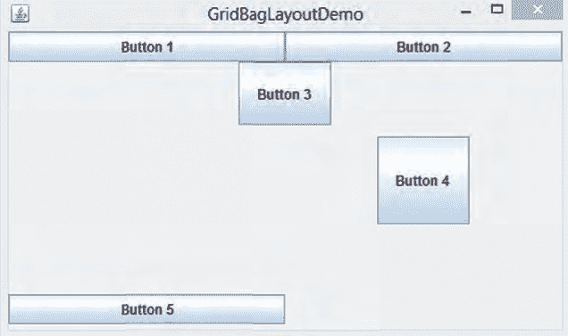

**图 16.15** 示例 16.15 中程序的输出

## 16.10 窗口

`JFrame` 类用于创建创建一个不带任何工具栏、边框或窗口管理按钮的窗口。此类窗口通常用于显示欢迎信息、版权信息等内容。`JWindow` 类常用的构造函数如下。

**示例 16.16** 一个演示 `JWindow` 使用的程序

```java
import java.awt.*;
import javax.swing.*;

class Message {
    public static void displayMessage(int timeDuration) {
        JWindow msg = new JWindow();
        JLabel label = new JLabel("Welcome! to Java Programming", new Font("Times New", Font.BOLD, 20));
        JPanel panel = (JPanel) msg.getContentPane();
        panel.add(label, BorderLayout.CENTER);
        msg.setBounds(50, 50, 350, 150);
        msg.setVisible(true);
        try {
            Thread.sleep(timeDuration);
        } catch (Exception e) {
            msg.setVisible(false);
        }
    }

    public static void main(String[] args) {
        // 实现细节
    }
}
```

## 16.11 内部框架

内部框架是类似于在另一个窗口显示的框架。它是可以根据其属性调整大小、关闭化或最小化的组件。它还可以包含菜单栏。内部框架是 `InternalFrame` 类的对象。

`InternalFrame` 的构造函数如下，其中：

- **`title`**：指定框架的标题。
- **`resizable`**：如果框架是可以调整大小的，则值为 `true`。
- **`closable`**：如果框架是可以关闭的，则值为 `true`。
- **`maximizable`**：如果框架是可以最大化的，则值为 `true`。
- **`minimizable`**：如果框架是可以最小化的，则值为 `true`。

内部框架需要一个桌面面板。桌面面板的作用是持有和管理内部框架。桌面面板是 `DesktopPane` 类的对象。桌面面板的默认布局是边界布局。

```java
InternalFrame()
InternalFrame(String title)
InternalFrame(String title, boolean resizable)
InternalFrame(String title, boolean resizable, boolean closable, boolean maximizable, boolean minimizable)
```

```java
import java.awt.*;
import javax.swing.*;

public class InternalFrameExample extends Applet {
    InternalFrameExample() {
        JFrame jf;
        DesktopPane dst;
        InternalFrame intf;
        jf = new JFrame("Frame");
        dst = new DesktopPane();
        intf = new InternalFrame("InternalFrame", true, true);
        intf.setSize(300, 300);
        intf.setVisible(true);
        dst.add(intf);
        jf.getContentPane().add(dst);
        jf.setDefaultCloseOperation(jf.EXIT_ON_CLOSE);
        jf.setSize(400, 400);
        jf.setVisible(true);
    }

    public static void main(String[] args) {
        InternalFrameExample japp = new InternalFrameExample();
    }
}
```

## 16.12 使用对话框

对话框是所有 GUI 程序常用的 GUI 组件之一。它是父窗口上方显示的独立弹出窗口。它通常用于向用户显示错误消息、反馈消息、确认消息或警告消息。它始终显示在顶层窗口中，工作方式类似于框架。

对话框是 `JDialog` 类的对象，该类扩展了 AWT 对话框 `java.awt.Dialog`。`JDialog` 使用 `JRootPane` 作为其容器。

```java
JDialog()
JDialog(Frame owner, boolean mode)
JDialog(Frame owner, String title)
JDialog(Frame owner, String title, boolean mode)
```

有两种类型的对话框，即**模态（modal）**和**非模态（non-modal）**。

- **模态对话框：** 在关闭之前，不允许访问应用程序的其他部分。它主要用于显示重要消息，例如，“你确定要关闭文件吗？”等。
- **非模态对话框：** 即使该对话框处于激活状态，也允许访问应用程序的其他部分。当此对话框显示时，可以激活另一个窗口。

考虑**示例 6.18**。在这里，创建了一个带有按钮 `b1` 和标签 `l1` 的帧（frame）。当点击 `b1` 时，会显示一个请求输入的模态输入对话框，其中包含一个标签 `l2`、文本字段 `tf` 和一个按钮 `b2`。在输入名称后点击 `b2`，控制权返回帧，并在 `l1` 上显示输入的名称。

**示例 6.18** 一个演示 `JDialog` 类使用的程序

```java
import javax.swing.*;
import java.awt.*;
import java.awt.event.*;
import javax.swing.event.*;

class ActionJDialog extends Applet implements ActionListener {
    JPanel panel;
    JFrame jf;
    JLabel l1, l2;
    JTextField tf;
    JButton b1, b2;
    JDialog dialog;

    ActionDialog() {
        panel = new JPanel();
        l1 = new JLabel("Enter your name: ");
        l2 = new JLabel();
        tf = new JTextField(15);
        b1 = new JButton("OK");
        b1.addActionListener(this);
        b2 = new JButton("Click for dialog box");
        b2.addActionListener(this);
        jf = new JFrame("Demo of dialog box");
        jf.setLayout(new FlowLayout());
        dialog = new JDialog(jf, "My dialog", true);
        Container dcount = dialog.getContentPane();
        dcount.setLayout(new FlowLayout());
        panel.add(l1);
        panel.add(tf);
        dcount.add(panel);
    }
}
```


```java
dcount.add(b1);

jf.add(b2);

jf.add(l2);

dialog.setSize(300,150);

jf.setDefaultCloseOperation(JFrame.EXIT_ON_CLOSE);

jf.setSize(450, 300);

jf.setVisible(true);

}

public void actionPerformed(ActionEvent e) 

{

    if(e.getSource() == b2)
        dialog.show();
    else if(e.getSource() == b1) {
        l2.setText("your name is:" + tf.getText());
        dialog.dispose();
    }

}

public static void main(String str[])

{

    ActionDialog add = new ActionDialog();

}

}
```

程序的输出如图 16.18 (a) 所示。

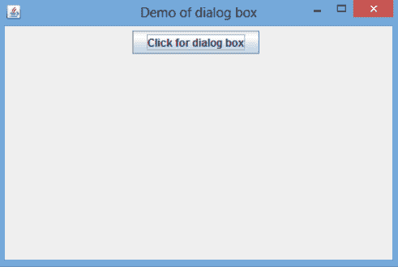

图 16.18 (a)

点击按钮后，对话框如 16.18 (b) 所示出现。


图 16.18 (b)

## 16.13 JOptionPane

`JOptionPane` 是 `JComponent` 的子类，它包含静态方法，可以使用简单的代码创建并自定义对话框。之前，你已经看到使用 `JDialog` 创建对话框会让代码变得繁琐。因此，使用 `JOptionPane` 代替 `JDialog` 以尽量减少代码的复杂性。`JOptionPane` 使用四个图标（问题、信息、警告和错误）之一或用户自定义的图标来显示对话框。

`JOptionPane` 类定义的一些构造函数如下。

- `JOptionPane()`
- `JOptionPane(Object message)`
- `JOptionPane(Object message, int messageType)`
- `JOptionPane(Object message, int messageType, int optionType)`
- `JOptionPane(Object message, int messageType, int optionType, Icon icon)`
- `JOptionPane(Object message, int messageType, int optionType, Object[] options)`
- `JOptionPane(Object message, int messageType, int optionType, Icon icon, Object[] initialValue)`

- 要在对话框中显示的 `message`
- `messageType` 指定要显示的消息类型。它有多种值，表示为：`ERROR_MESSAGE`, `INFORMATION_MESSAGE`, `WARNING_MESSAGE`, `QUESTION_MESSAGE`, `PLAIN_MESSAGE`
- `optionType` 用于指定选项。它可以有多种值，表示为：`DEFAULT_OPTION`, `YES_NO_OPTION`, `OK_CANCEL_OPTION`
- `icon` 指定要显示的代码
- `options` 是要在对话框中显示的选项数组，且没有一个被选中
- `initialValue` 指定从列表中选中的默认选项

`JOptionPane` 类用于显示四种对话框，即：消息框（Message box）、输入对话框（Input dialog box）、确认框（Confirmation box）和选项框（Option box）。

### 16.13.1 消息对话框

对话框向用户显示普通消息，通过静态方法 `showMessageDialog()` 创建。`showMessageDialog()` 的通用形式为：

```java
public static void showMessageDialog(Component parent, Object message)
```

- `parent` 是对话框附加的父帧
- `message` 是要显示的内容

考虑示例 16.19。在这里，帧中添加了按钮 `b1` 和 `b2`。点击按钮时，会显示相应的对话框。

**示例 16.19** 一个演示创建消息框的程序

```java
import javax.swing.*;

import java.awt.*;

import java.awt.event.*;

class ActionMessageDialog extends JFrame {

    JFrame jf;

    JButton b1,b2;

    ActionMessageDialog() {

        jf = new JFrame("Demo of a dialog box");

        jf.setLayout(new FlowLayout());

        jf.setDefaultCloseOperation(jf.EXIT_ON_CLOSE);

        b1 = new JButton("Plain message dialog");

        b1.addActionListener(this);

        b2 = new JButton("Error dialog");

        b2.addActionListener(this);

        jf.setSize(350,200);

        jf.add(b1);

        jf.add(b2);

        jf.setVisible(true);

    }

    public void actionPerformed(ActionEvent e) {

        if (e.getSource() == b1)
            JOptionPane.showMessageDialog((Component)null, "Hi, I am a message dialog","Plain message dialog", JOptionPane.PLAIN_MESSAGE);
        else if (e.getSource() == b2)
            JOptionPane.showMessageDialog((Component)null,"Oops! you Clicked the wrong Button","Error dialog", JOptionPane.ERROR_MESSAGE);

    }

    public static void main(String[] args) {

        ActionMessageDialog amd = new ActionMessageDialog();

    }

}
```

程序的输出如图 16.19 所示。

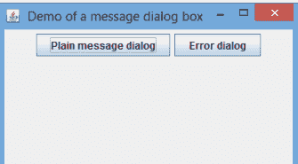

图 16.19 (a)

点击“Plain message dialog”按钮后，对话框如 16.19 (b) 所示出现


图 16.19 (b)

点击“Error dialog”按钮后，对话框如 16.19 (c) 所示。

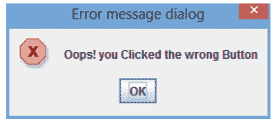

图 16.19 (c)

### 16.13.2 输入对话框

输入对话框用于从用户那里收集数据。它带有文本字段、组合框或列表让用户输入数据。它是通过 `JOptionPane` 的静态方法 `showInputDialog()` 创建的。`showInputDialog()` 的通用形式为：

```java
public static String showInputDialog(Component parent, Object message)
```

- `Component` 是对话框的父组件
- `message` 是要显示的内容

考虑示例 16.20。在这里，帧中添加了按钮 `b1` 和标签 `l1`。当点击 `b1` 时，会显示输入对话框。在对话框文本字段中输入的名称将显示在 `l1` 上。

**示例 16.20** 一个演示创建输入对话框的程序

```java
import javax.swing.*;

import java.awt.*;

import java.awt.event.*;

class ActionInputDialog extends JFrame implements ActionListener {

    JFrame jf;

    JButton b1;

    JLabel l1;

    ActionInputDialog() {

        jf = new JFrame("Demo of an dialog box");

        l1 = new JLabel();

        jf.setLayout(new FlowLayout());

        jf.setDefaultCloseOperation(jf.EXIT_ON_CLOSE);

        b1 = new JButton("Name");

        b1.addActionListener(this);

        jf.setSize(350,200);

        jf.add(b1);

        jf.add(l1);

        jf.setVisible(true);

    }

    public void actionPerformed(ActionEvent e) {

        if(e.getSource() == b1) {

            int i = JOptionPane.QUESTION_MESSAGE;

            String pstr = JOptionPane.showInputDialog(jf, "What is your name?","Input Dialog Box",i);

            l1.setText("Your name is :"+ pstr);

        }

    }

    public static void main(String str[]) {

        ActionInputDialog aid = new ActionInputDialog();

    }

}
```

程序的输出如图 16.20 (a) 所示。

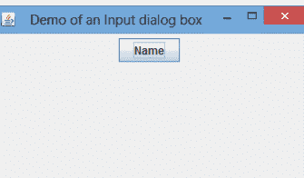

图 16.20 (a)

点击“Name”按钮后，对话框如 16.20 (b) 所示出现。

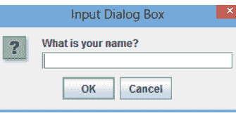

图 16.20 (b)

输入名称并点击“确定”后，输出如图 16.20 (c) 所示

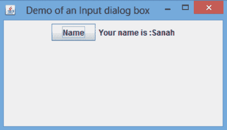

图 16.20 (c)

### 16.13.3 确认对话框

确认对话框用于提问确认问题，并允许用户给出是/否/取消的响应。它通过 `JOptionPane` 的静态方法 `showConfirmDialog()` 创建。`showConfirmDialog()` 方法的一般形式为：

```java
public static int showConfirmDialog(Component parentComponent, Object message)
```

其中，

- `parentComponent` 是对话框所在的帧（frame）
- `message` 是要显示的消息

考虑示例 16.21。在这里，帧中添加了一个按钮 `b1` 和标签 `l1`。当点击 `b1` 时，会显示一个带有两个按钮的确认对话框。确认的状态显示在 `l1` 上。

**示例 16.21** 一个演示创建确认对话框的简单程序

```java
import javax.swing.*;

import java.awt.*;

import java.awt.event.*;

class ActionConfDialog extends JFrame implements ActionListener {

    JFrame jf;

    JPanel panel;

    JButton b1;

    JLabel l1;

    ActionConfDialog() {

        panel = new JPanel();
        jf = new JFrame("Demo of a confirmation dialog box");

        jf.setLayout(new FlowLayout());

        jf.setDefaultCloseOperation(jf.EXIT_ON_CLOSE);

        l1 = new JLabel();

        b1 = new JButton("Confirmation dialog");

        b1.addActionListener(this);

        panel.add(b1);

        jf.setSize(350,200);

        jf.add(panel);

        jf.add(l1);

        jf.setVisible(true);

    }

    public void actionPerformed(ActionEvent e) {

        if (e.getSource() == b1) {

            int result = JOptionPane.showConfirmDialog(
                (Component)null, "Do you want to save?", "Confirmation dialog box", JOptionPane.YES_NO_OPTION);

            if(result == JOptionPane.YES_OPTION) {
                l1.setText("You saved the program");
            } else {
                l1.setText("You did not save the program");
            }

        }

    }

    public static void main(String str[]) {

        ActionConfDialog acd = new ActionConfDialog();

    }

}
```

程序的输出如图 16.21 (a) 所示。

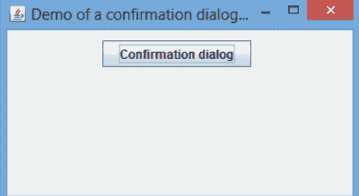

图 16.21 (a)

点击“Confirmation dialog”后，出现的对话框如图 16.21 (b) 所示。


图 16.21 (b)

选择“Yes”按钮后，程序的输出如图 16.21 (c) 所示。

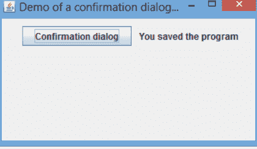

图 16.21 (c)

### 16.13.4 选项对话框

选项对话框提供了上述讨论的所有三个对话框的功能。它通过使用 `JOptionPane` 的静态方法 `showOptionDialog()` 创建。`showOptionDialog()` 方法的一般形式为：

```java
public static int showOptionDialog(Component parentComponent, Object message, String title, int optionType, int messageType, Icon icon, Object[] options, Object initialValue)
```

- `parentComponent` 显示对话框的帧
- `message` 显示的消息
- `title` 对话框标题栏中显示的字符串
- `optionType` 指定对话框上的可用选项，如 `YES_NO_OPTION` 或 `YES_NO_CANCEL_OPTION`
- `messageType` 指定消息类型，如错误消息、信息消息、警告消息、询问消息或普通消息
- `icon` 指定对话框上的图标
- `options` 允许使用按钮以外的组件
- `initialValue` 初始选择

考虑示例 16.22。在这里，创建并添加了一个按钮 `b1` 和标签 `l1`。当点击 `b1` 时，会显示一个带有按钮的选项对话框。标签 `l1` 显示选中的选项。

**示例 16.22** 一个演示创建选项对话框的程序

```java
import javax.swing.*;

import java.awt.*;

import java.awt.event.*;

class ActionOptionDialog extends JFrame implements ActionListener {

    JFrame jf;

    JButton b1;

    JLabel l1;
```


# ActionOptionDialog 示例

```java
ActionOptionDialog() {
    jf = new JFrame("Demo of Option dialog box");
    l1 = new JLabel("");
    jf.setLayout(new FlowLayout());
    jf.setDefaultCloseOperation(jf.EXIT_ON_CLOSE);
    b1 = new JButton("Game");
    b1.addActionListener(this);
    jf.setSize(350, 200);
    jf.add(b1);
    jf.add(l1);
    jf.setVisible(true);
}

public void actionPerformed(ActionEvent e) {
    if (e.getSource() == b1) {
        int messageType = JOptionPane.QUESTION_MESSAGE;
        String[] options = {"Cricket", "Badminton", "Football"};
        int code = JOptionPane.showOptionDialog(jf, "What is your game?", "Option Box", 0, messageType, null, options);
        l1.setText("your favorite game is:" + options[code]);
    }
}

public static void main(String str[]) {
    ActionOptionDialog aid = new ActionOptionDialog();
}
```

程序的输出如图 16.22 (a) 所示。


图 16.22 (a)

点击“Game”后，出现的对话框如图 16.22 (b) 所示。


图 16.22 (b)

选择一个选项后，程序的输出如图 16.22 (c) 所示。


图 16.22 (c)

## 16.14 JTable

表格用于以行和列的形式显示数据。它也可以允许编辑数据。默认情况下，表格的列可以调整大小，这也可以通过沿边界拖动来实现。列还可以被拖动到新位置。表格是 `JTable` 类的对象，该类是 `JComponent` 类的子类。

`JTable` 类定义的一些构造函数如下：

```java
JTable()
JTable(int rows, int cols)
JTable(Object[][] rowData, Object[] colNames)
```

其中，

- `rows` 表示空单元数
- `cols` 表示空列数
- `rowData` 表示包含数据的二维数组
- `colNames` 指定列的名称

### 示例 16.23 一个演示表格使用的程序

```java
import javax.swing.*;

class SwingTable extends JApplet {
    public static void main(String str[]) {
        JFrame jf = new JFrame("Demo of table");
        String data[][] = {
            {"1", "Premashish", "89%"},
            {"2", "Preeti", "88%"},
            {"3", "Pooja", "87%"},
            {"4", "Niti", "86%"},
            {"5", "Shruti", "85%"},
            {"6", "Vriti", "84%"},
            {"7", "Surender", "83%"},
            {"8", "Rajesh", "82%"},
            {"9", "Raja", "81%"},
            {"10", "Meenu", "80%"},
            {"11", "Uma", "79%"}
        };
        String fields[] = {"RowNumber", "Name", "Percentage"};
        JTable jt = new JTable(data, fields);
        JScrollPane pane = new JScrollPane(jt);
        jf.add(pane);
        jf.setDefaultCloseOperation(jf.EXIT_ON_CLOSE);
        jf.setSize(300, 200);
        jf.setVisible(true);
    }
}
```

程序的输出如图 16.23 所示。


图 16.23 示例 16.23 输出

## 16.15 Timer

`Timer` 是 `Timer` 类的对象，该类是 `java.util` 包中的子类。`Timer` 在指定的间隔时间（毫秒）延迟后触发一次或多次 action 事件。延迟在创建时指定。通过创建定时器对象并调用 `start()` 方法使用 `Timer`。当定时器启动时，会触发 `ActionEvent` 类型事件，并执行对应类中 `actionPerformed()` 中的代码。对应类必须实现 `ActionListener` 接口。通过将其 `setRepeats()` 设置为 `false`，可以让 `Timer` 只触发一次。分别调用 `stop()` 和 `restart()` 方法可以停止或重启定时器。

可以使用以下构造函数创建 `Timer`：

```java
Timer(int delay, ActionListener listener)
```

其中，

- `delay` 是 action 事件之间的时间（毫秒）
- `listener` 是动作监听器

### 示例 16.24 一个演示使用计时器的简单程序

```java
import java.awt.*;
import java.awt.event.*;
import javax.swing.*;

class TimerExample implements ActionListener {
    int second = 1;

    public static void main(String[] args) {
        new TimerExample();
        while (true);
    }

    public TimerExample() {
        Timer timer = new Timer(1000, this);
        timer.start();
    }

    public void actionPerformed(ActionEvent e) {
        System.out.print(" +" + second);
        second++;
        if (second == 11) {
            System.out.print(" ");
            System.out.print("Exit out");
            System.exit(0);
        }
    }
}
```

程序的输出如图 16.24 所示。


图 16.24 示例 16.24 中程序的输出

## 16.16 JProgressBar

进度条是一种用户友好的控件，用于指示软件安装等某些耗时任务的当前状态。它通过使用颜色条显示完成百分比来指示任务的进度。进度条有两种类型，即水平进度条和垂直进度条。在水平进度条中，进度通过从左到右填充条来指示；在垂直进度条中，进度通过从上到下填充条来指示。

进度条是类 `JProgressBar` 的一个对象，`JProgressBar` 是 `JComponent` 的子类。`JProgressBar` 还实现了 `SwingConstants` 接口。

`JProgressBar` 类定义的一些构造函数如下：

```java
JProgressBar()
JProgressBar(int orientation)
JProgressBar(int min, int max)
JProgressBar(int orientation, int min, int max)
```

其中，

- `orientation` 定义进度条的方向为 `VERTICAL`（垂直）或 `HORIZONTAL`（水平）
- `min` 和 `max` 分别定义进度条的最小值和最大值。默认值为 0 和 100

### 示例 16.25 一个演示进度条的程序

```java
import javax.swing.*;
import java.awt.*;

public class ProgressBarExample extends JFrame {
    public static void main(String str[]) {
        JFrame jf = new JFrame("Demo of progress bar");
        jf.setLayout(new FlowLayout());
        int min = 50;
        int max = 300;
        JProgressBar pb = new JProgressBar(JProgressBar.HORIZONTAL, min, max);
        pb.setValue(220);
        pb.setStringPainted(true);
        jf.add(pb);
        jf.setDefaultCloseOperation(jf.EXIT_ON_CLOSE);
        jf.setSize(350, 200);
        jf.setVisible(true);
    }
}
```

程序的输出如图 16.25 所示。


图 16.25 示例 16.25 中程序的输出

## 16.17 JSlider

Swing 中的 Slider 类似于滚动条，允许用户从指定的整数值范围内选择一个数值。它有一个旋钮，该旋钮可以在取值范围内滑动，并可用于选择特定值。例如，在媒体播放器中，滑块用于调整音量、设置通道频率。与滚动条一样，它们也可以是水平或垂直的。Slider 是 `JSlider` 类的一个对象，它是 `JComponent` 的直接子类。`JSlider` 类还实现了 `SwingConstants` 接口。

`JSlider` 类定义了以下构造函数：

```java
JSlider()
JSlider(int orientation, int min, int max, int value)
```

其中，

- `orientation` 指定滑块是水平还是垂直的
- `min` 是滑块参数的最小值，默认值为 0
- `max` 是滑块参数的最大值，默认值为 100
- `value` 是滑块的初始值，默认值为 50

### 示例 16.26 一个演示滑块的程序

```java
import java.awt.*;
import javax.swing.*;

class MySlider extends JApplet {
    public static void main(String str[]) {
        JFrame jf = new JFrame("Demo of Slider");
        jf.setDefaultCloseOperation(jf.EXIT_ON_CLOSE);
        Container cont = jf.getContentPane();
        JSlider js = new JSlider();
        cont.add(js, BorderLayout.CENTER);
        jf.setSize(300, 100);
        jf.setVisible(true);
    }
}
```

程序的输出如图 16.26 所示。


图 16.26 示例 16.26 中程序的输出

## Swing 总结

- **Swing** 是 Java 基金类 (JFC) 的一部分，是下一代 GUI 工具包，允许我们用 Java 开发大型企业级应用程序。它是一组类，为创建图形用户界面提供了许多强大且灵活的组件。
- **Swing 组件** 是轻量级的，因为它们是用 Java 编写的，不依赖于原生同类（平台特定的代码资源）。
- **Swing** 支持可插拔外观 (PLAF)。可插拔外观允许我们定制应用程序的外观和感觉，并适应如 Windows 和 Motif 等标准外观。我们甚至可以在运行时切换外观。
- 像 AWT GUI 一样，**Swing GUI** 也基于组件和容器的概念。容器是一种可以包含其他组件的组件类型。组件必须始终放置在容器内。
- **Swing 组件** 是独立的控件，例如按钮、标签、文本字段等。它们需要容器来显示。
- **分层面板** 是一种 Swing 容器，允许你使用分层概念排列组件。
- **分割面板** 是一种轻量级容器，用于显示两个并排（水平或垂直）的组件。
- **标签面板** 用于创建标签页，每个标签页包含一组相关的组件。
- **布局管理器** 控制容器中组件的位置、形状和大小。从一种布局管理器到另一种布局管理器会有显著不同。
- **流布局管理器** 是所有布局管理器中最简单的。它按照组件被添加到容器的顺序来放置组件。它是 `Applet` 和 `Panel` 的默认布局管理器。
- **边界布局管理器** 将组件分为五个区域：东、西、北、南和中心。每个区域可以包含单个组件。当组件被添加到特定区域时，它会填充该区域。它是 `Window`、`Dialog` 和 `Frame` 的默认布局管理器。
- **网格布局管理器** 将容器划分为行和列的矩阵。整个区域被平均划分为行和列。
- **卡片布局管理器** 用于管理大量组件。它像卡片一样组织组件，共享显示区域，使得其中一个是可见的。
- **网格袋布局管理器** 是最先进且易于使用的布局管理器。它在行和列的网格中安排组件。允许不同大小的组件跨越多个行或列。
- **JFrame** 类用于创建窗口，没有工具栏、边框或窗口管理按钮。
- **内部帧** 类似于可以在另一个窗口内显示的普通帧。
- **对话框** 是显示在其父窗口之上的独立弹出窗口。对话框有两种类型，即模态和非模态。
- **JOptionPane** 是 `JComponent` 的子类，包含了使用简单代码创建和自定义对话框的静态方法。
- **消息框** 向用户显示消息。
- **输入对话框** 用于接受用户的数据。
- **确认对话框** 用于提出确认问题，并允许用户提供是/否/取消响应。
- **选项对话框** 提供了其他三个对话框的功能。
- **表格** 用于以行和列的形式显示数据。
- **Timer** 是 `Timer` 类的对象，它是 `java.util` 包中的类。`Timer` 定期触发一个或多个动作事件。
- **进度条** 是一种用户友好的控件，用于指示软件安装等某些耗时任务的当前状态。
- **Swing 中的 Slider** 类似于滚动条，允许用户从指定的整数值范围内选择一个数值。

# 练习

## 填空

1. 所有 Swing 程序必须导入 `javax.swing` 包。
2. 窗口的大小由方法 `setSize()` 指定。
3. `LayoutManager`（布局管理器）控制容器中组件的位置、形状和大小。
4. 流布局是 `Applet` 和 `Panel` 的默认布局管理器。
5. `JDialog` 使用 `JRootPane` 作为其容器（或 `Container`/`ContentPane`）。

## 选择正确的选项

1. 下列哪个包定义了执行各种事件的监听器？
   - (a) `javax.swing.border`
   - (b) `javax.swing.event` ✓
   - (c) `javax.swing.table`
   - (d) `javax.swing.tree`

2. 下列哪一个不是顶层容器？
   - (a) `JFrame`
   - (b) `JPanel` ✓
   - (c) `JWindow`
   - (d) `JDialog`

3. 在下列布局中，组件被排列成网格？
   - (a) 边界布局
   - (b) 卡片布局
   - (c) 网格布局 ✓
   - (d) 网格袋布局

4. `GridBagConstraints` 类中的哪个变量指定了组件边界与显示区域边缘之间的间距？
   - (a) `anchor`
   - (b) `fill`
   - (c) `insets` ✓
   - (d) `ipadx`


# 5. 下列哪一个对话框用于向用户显示错误消息？

(a) 消息对话框 (Message dialog box) (b) 输入对话框 (Input dialog box)
(c) 确认对话框 (Confirmation dialog box) (d) 选项对话框 (Option dialog box)

# 判断对错

1. Swing 组件继承自 `JComponent` 类。
2. 切换按钮（toggle button）是推送按钮（push button）的一种变体。
3. 边界布局中的每个区域都可以包含多个元素。
4. 表的列不能调整大小。
5. 进度条的默认最小值为 100。

# 回答以下问题

1. Swing 的两个特性是什么？
2. 区分顶层容器和轻量级容器。
3. Swing 提供了哪些包（packages）？列出所有 Swing 应用都必须导入的包。
4. 什么是组件（component）？
5. Swing 提供了哪些组件？
6. 说明分层面板（layered pane）、拆分面板（split pane）和标签页面板（tabbed pane）的作用。
7. 什么是内部帧（internal frame）？
8. 复选框（check box）与单选按钮（radio button）有什么不同？请举例说明。
9. 编写一个程序演示将列表添加到滚动面板（scroll pane）中。
10. 什么是双重缓冲（double buffering）？请解释。
11. Swing 支持哪些布局管理器（layout managers）？请举例说明它们之间的区别。
12. 根据工作模式列出对话框的类型。并区分它们之间的区别。
13. 为什么使用 `JOptionPane` 类来创建对话框而不是 `JDialog` 类？
14. 使用 `JOptionPane` 类可以创建哪些类型的对话框？请简要解释。
15. 编写一个程序创建一个显示班级考勤表的表格。表格包含以下字段：学号（roll number）、姓名和总出勤。
16. 什么是计时器（timer）？解释计时器的工作。
17. 进度条与滑动条（slider）有什么不同？请解释。

# JAVA 数据库连接 (JDBC)

## 章节目标

在读完本章后，你将能够：

* 解释 JDBC 的架构
* 解释 JDBC-ODBC 桥接
* 理解 `java.sql` 中的类和接口

## 17.1 引言

在 Java 中访问数据库需要 Java 数据库连接（JDBC）。JDBC 提供了一个标准 API，用于通过 Java 访问数据库，无论使用什么 DBMS。所有与特定 DBMS 的直接交互都由 DBMS 驱动程序完成。它充当封装器，向服务器发送 SQL 请求。

## 17.2 JDBC 概述

JDBC 架构包含四个组件：应用程序、驱动管理器、特定数据源驱动程序和相应的数据源。

应用程序建立并终止与数据源的连接。驱动管理器的主要目标是加载 JDBC 驱动程序并将应用程序的 JDBC 调用传递给相应的驱动程序。驱动程序与数据源建立连接。驱动程序执行各种基本功能，如提交请求和返回结果。此外，驱动程序将特定于数据的格式的数据、格式和错误代码转换为 JDBC 标准。数据源处理来自驱动程序的命令并返回结果。

## 17.3 JDBC-ODBC 桥接

所有与特定 DBMS 的直接交互都由 DBMS 驱动程序完成。

## 17.4.3 Statement 接口（静态处理数据库查询）

`Statement` 接口提供了用于执行 SQL 语句的方法。SQL 语句包括查询、插入、更新和删除等。

`Statement` 接口的一些方法如下：

* `void close()`: 此方法关闭与 `Statement` 对象关联的数据库连接，并释放 JDBC 资源。
* `boolean execute(String sql)`: 此方法用于执行可能产生多个结果集或多次计数的 SQL 语句。如果产生了多个结果集，则返回 `true`；如果生成了多次计数，则返回 `false`。
* `int execute(String sql)`: 此方法用于执行提供受影响行数信息的 SQL 语句。例如，如果我们执行像 INSERT、DELETE 等语句，结果将仅是受影响的行数。
* `ResultSet executeQuery(String sql)`: 此方法执行查询并返回一个 `ResultSet` 对象。结果对象类似于一个包含结果数据的表格。
* `ResultSet getResultSet()`: 此方法返回执行 `execute(String sql)` 方法时生成的第一个结果集或多次计数。如果没有结果，则返回 `null` 值。
* `int updateCount()`: 在执行 `execute(String sql)` 方法后，可能会产生更新计数。此方法返回第一个更新计数并将其清空。可以通过 `getResultSet()` 获取更多更新计数。注意，如果没有更新计数，或者在执行 `execute(String sql)` 方法时仅生成了结果集，此方法返回 `-1`。
* `boolean getResults()`: 此方法用于检索多个结果集中的下一个结果集，或执行 `execute(String sql)` 方法时生成的多次计数中的下一个计数。如果有多个可用集合，则返回 `true`；如果有更新计数，则返回 `false`。

## 17.4.4 ResultSet 接口

SQL 语句的执行结果产生一个包含结果数据的行和列的表格。可以使用 `ResultSet` 接口的方法从表中检索数据。`ResultSet` 接口的一些方法如下：

* `boolean next()`: 此方法用于将 `ResultSet` 游标移动到数据的下一行。最初，`ResultSet` 游标位于第一行之前。如果 `ResultSet` 中没有更多行，则返回 `false` 值。
* `String getString(int index)`: 此方法返回存储在列索引 `index` 单元的字符串值。例如，如果 `index` 的值为 2，则它将返回第二列的值。
* `String getString(String column)`: 此方法返回存储在列名 `column` 指定列中的字符串值。

### 示例 17.1 一个建立连接并从 Student 数据库检索数据的程序

```java
import java.sql.*;

public class SimpleJDBCProgram {
    public static void main(String[] args) {
        try {
            // 加载驱动类
            Class.forName("sun.jdbc.odbc.JdbcOdbcDriver");
            // 为驱动定义数据源
            String url = "jdbc:odbc:ITSL";
            // 通过 DriverManager 创建连接
            Connection conn = DriverManager.getConnection(url, "login", "password");
            // 创建 statement 对象
            Statement st = conn.createStatement();
            // 通过 ResultSet 对象执行查询
            ResultSet rs = st.executeQuery("Select Roll, Marks, Grade FROM Student");
            // 输出 resultset 数据
            while (rs.next()) {
                // 检索列
                int roll = rs.getInt("Roll");
                int marks = rs.getInt("Marks");
                String grade = rs.getString("Grade");
                // 显示值
                System.out.println("Roll No :" + roll);
                System.out.println("Marks :" + marks);
                System.out.println("Grade :" + grade);
            }
            rs.close();
            st.close();
            conn.close();
        } catch (Exception e) {
            System.out.println("Error :" + e);
        }
    }
}
```

在此程序中，采取了以下步骤访问数据库数据：

1. 使用 `Class.forName()` 加载适用于数据库的相应驱动。
2. 使用 JDBC 的 `DriverManager` 类的 `getConnection()` 方法创建 `Connection` 对象。应用程序可能需要为一个或多个数据库创建多个连接对象。
3. 第一个参数 URL(`"jdbc:odbc:..."`) 标识数据库。该 URL 有三部分：协议、子协议和 DSN 名称。连接到数据库还需要用户名和密码，这由 `getConnection()` 方法的另外两个参数 Login 和 password 指定。
4. 使用 `Statement stmt = con.createStatement()` 创建用于查询数据库的 `Statement` 对象。它是通过调用 `Connection` 对象 `con` 的 `createStatement()` 方法创建的。
5. 在此示例中，使用 `stmt.executeQuery()` 执行 SQL 的 SELECT 语句。`try [...]` 用于捕获执行此查询时可能出现的任何异常。此查询的结果可能包含元组，并赋值给 `rs` 类型的 `ResultSet`。最初，它将游标移动到第一个元组的开头。`rs.next()` 将游标移动到下一个元组。
6. 使用 `next()` 方法从结果集 `rs` 中获取一个元组。语句 `int roll = rs.getInt("Roll");` 用于访问数据库数据，`System.out.println("Roll No :"+ roll);` 用于显示。
7. 在过程结束不再需要连接后，必须关闭连接。语句 `statement.close()`、`stmt.close()`、`con.close()` 关闭了所有连接。

### 示例 17.2 一个建立连接并从 Employee 检索数据的程序


```java
import java.io.*;
import java.sql.*;
class ExampleStatement {
    public static void main(String args[]) {
        try {
            Connection con=null;
            // 加载驱动
            Class.forName("sun.jdbc.odbc.JdbcOdbcDriver");
            // 建立连接
            con=DriverManager.getConnection("jdbc:odbc:ITSL");
            // 创建 Statement
            Statement stmt = con.createStatement();
            // 创建 ResultSet
            ResultSet rs = stmt.executeQuery("select * from Employee");
            System.out.println("Employee details");
            while (rs.next()) {
                int roll = rs.getInt("Roll");
                String name = rs.getString("Name");
                String dept = rs.getString("Department");
                double salary = rs.getDouble("Salary");
                System.out.println("No : " + roll);
                System.out.println("Name : " + name);
                System.out.println("Department : " + dept);
                System.out.println("Salary : " + salary);
            }
            rs.close();
            stmt.close();
            con.close();
        } catch (Exception e) {
            System.out.println(e);
        }
    }
}
```

程序的输出为：

| Eno | Name | Department | Salary |
|---|---|---|---|
| 1 | Prem | IT | 30000 |
| 2 | Samee | IT | 29500 |
| 3 | Preeti | IT | 29500 |
| 4 | Mili | IT | 28000 |
| 5 | Niti | Math | 28000 |
| 6 | Surabhi | IT | 25000 |
| 7 | Milendu | IT | 25000 |

## 17.4.5 `PreparedStatement` 接口（动态处理查询）

`PreparedStatement` 接口扩展了 `Statement` 接口，因此可以使用 `Statement` 的所有方法。它用于执行预编译的参数化语句。

这有助于语句更快执行，提高了程序的效率。它允许指定 SQL 查询，其中未知值被替换为 `'?'`。用户在运行时提供未知值。可以使用 `setString()` 和 `setInt()` 方法指定参数的值。为了理解准备语句的概念，请考虑语句：

```java
PreparedStatement ps = conn.prepareStatement("INSERT INTO Student VALUES(?)");
```

可以通过变量名而不是索引将值赋予相应的属性。类似于 `setString()` 和 `setInt()` 方法，还有许多设置其他数据类型值的方法。这些包括 `setBoolean()`、`setFloat()`、`setByte()`、`setState()` 等。`clearParameters()` 方法可以清除当前持有的参数。

> 注意：`execute()`、`executeQuery()` 和 `executeUpdate()` 与 `Statement` 接口相同，但区别在于没有传递参数。

## 17.4.6 `ResultSetMetaData` 接口

`ResultSetMetaData` 接口提供了允许获取结果集元数据的方法，即 `ResultSet` 对象中列的数量、类型和属性。这些信息用于收集语义相同但在不同数据库中以不同格式存储。

使用 `ResultSetMetaData` 接口的方法获取 `ResultSet` 中的列信息，需要调用 `ResultSet` 对象的 `getMetaData()` 方法，该方法返回一个类型为 `ResultSetMetaData` 对象。`ResultSetMetaData` 接口的一些方法如下：

- `int getCount()`: 此方法返回结果集的列数。
- `String getColumnName(int index)`: 此方法返回结果集中索引值指定的列名。
- `int getColumnType(int index)`: 此方法返回结果集中索引值指定的列类型。

### 示例 17.3 一个演示 `ResultSetMetaData` 和 `ResultSet` 接口实现的程序

```java
import java.sql.*;
class ExampleResultSetMetaData {
```

程序的输出为：

第 1 行：

列 1: 5

列 2: Niti

列 3: Math

列 4: TL

列 5: 28000

## 总结

- JDBC 提供了一个标准 API，无论使用何种 DBMS，都可以通过 Java 数据库。与特定 DBMS 的所有直接交互均由特定驱动程序完成。
- JDBC 架构包含四个部分：应用程序、驱动管理器、特定数据源驱动程序和对应的数据源。
- JDBC-ODBC 作为接口，使所有支持 ODBC（开放数据库连接）的 DBMS 能够与 Java 交互。
- 为了与数据库交互，Java 提供了 `java.sql` 包。它包含了各种类和接口，可用于建立数据库连接并从中检索数据。
- `DriverManager` 类负责加载特定的驱动类。
- `Connection` 接口帮助与所需的数据库建立连接。建立连接外，它还提供了许多功能，包括事务管理、维护数据库会话和创建 SQL 语句。
- `Statement` 接口提供了用于执行静态 SQL 语句的方法。SQL 语句包括查询、插入、更新和删除等。
- SQL 语句的执行结果是一个由行和列组成的表格，其中包含结果数据。可以使用 `ResultSet` 接口的方法从表中检索数据。
- `PreparedStatement` 扩展了 `Statement` 接口，因此它可以访问 `Statement` 接口的所有方法。它用于执行预编译的参数化 SQL 语句。使用它，语句的执行速度更快，从而提高了程序的效率。
- `ResultSetMetaData` 提供了允许获取结果元数据的方法，即 `ResultSet` 对象中列的名称、类型和属性。

## 练习题

### 填空

1. ________ 驱动用于通过 ODBC 标准通过驱动程序访问数据。
2. ________ 接口，使所有支持 ODBC（开放数据库连接）的 DBMS 能够与 Java 应用程序交互。
3. ________ 允许指定 SQL 查询，其中未知值被“?” 替换。
4. ________ 方法提供了有关特定厂商错误的详细信息，其含义仅由驱动程序所有者定义。
5. ________ 用于执行预编译的标准化 SQL 语句。

### 选择正确选项

1. ________ 完全用 Java 编写，直接与数据库服务器通信，不包含任何翻译步骤。
   (a) JDBC-ODBC-Bridge 驱动
   (b) Native API 部分-Java 驱动
   (c) Net 协议全 Java 客户端驱动
   (d) Native 协议全 Java 驱动

2. 下列哪是 JDBC 架构的组件？
   (a) 应用程序
   (b) 驱动管理器
   (c) 特定数据源驱动程序
   (d) 以上都是

3. JDBC-ODBC 桥接实现的类名为：
   (a) Jdbc0dbc
   (b) `DriverManager`
   (c) `Class`
   (d) 以上都不是

4. `Class` 类的静态方法可以被 `DriverManager` 类用于定位并加载系统变量 `jdbc.drivers` 中的驱动程序。
   (a) `registerDriver()`
   (b) `getConnection()`
   (c) `forName()`
   (d) 以上都不是

5. 下面哪项不是 `Statement` 接口的方法。
   (a) `Boolean next()`
   (b) `void close()`
   (c) `int executeUpdate()`
   (d) `boolean execute()`

### 判断对错

1. Native API 部分-Java 驱动特定于每个数据库，并将 JDBC 调用转换为特定的数据库调用。
2. `Driver` 类负责加载特定的驱动类。
3. `CreateStatement` 方法创建 `CallableStatement` 实例，用于处理数据库存储过程。
4. 初始情况下，`ResultSet` 游标指向第一行。
5. `PreparedStatement` 接口扩展了 `Statement` 接口。

### 回答以下问题

1. 什么是 JDBC-ODBC 桥接？
2. 简述 JDBC-ODBC 桥接。
3. `java.sql` 包中 `DriverManager` 类的作用是什么？
4. 区分 `Statement` 接口和 `PreparedStatement` 接口。
5. 写一段代码展示 `ResultSet` 类 `next()` 方法的使用。
6. `getMetaData()` 方法用于什么目的？

# 第 18 章 JAVA BEANS

## 目标

读完本章后，你将能够：

- 解释 Java Beans
- 理解特性
- 创建并部署
- 启动和配置
- 使用 Bean 工具
- 生成 JAR 文件
- 使用 Bean 属性
- 使用 `BeanInfo`
- 解释会话豆
- 解释实体豆
- 解释其类型

### 18.1 引言

Java Beans 是一种允许你构建复杂系统的技术。Bean 是一种设计在不同环境中重用的软件组件。

### 18.2 JAVA BEANS

Java Beans 是一项允许这些组件相互通信的技术。它提供了一种架构。Java Beans 的一些优势包括：

- Bean 具有“一次编写，随处运行”范式的所有优点。
- Bean 的属性、事件和方法可以被控制。
- Bean 的配置设置可以保存到持久化存储中，并随时恢复。

#### 18.2.1 Bean 架构

一个 Bean 由三个通用接口组成：

- **属性**：这些是决定 Bean 内部状态的属性。当给属性赋值时，它们就决定了组件的外观和行为。属性等于 Java 对象的数字段，但它们必须声明为 `private`。属性有两种类型，即简单属性和索引属性。
- **事件**：Bean 可以通过生成事件与对象通信。事件在特定时间点发生某些动作时生成。生成的事件可以发送给其他对象。
- **方法**：方法是与 Bean 进行交互的操作。所有方法都类似于 Java 方法。某些方法是特殊的，处理属性和事件。

#### 18.2.2 自省

自省是分析 Bean 的属性、事件和方法的自动过程。它是 Java Beans API 的一个重要特性，因为它允许其他应用程序（如设计工具）获取组件的信息。自省过程在运行时和设计时使用。

开发者可以通过两种方法指示其哪些属性、事件和方法是公开的。第一种方法是 Java Bean 设计模式。第二种方法是实现 `BeanInfo` 接口，为关联 Bean 提供显式信息。

##### 属性的设计模式

Java Bean 设计模式指定了称为“访问器”的特殊方法；getter 方法和 setter 方法分别用于获取和设置属性。根据设计模式，getter 方法必须以 `get` 前缀开头，setter 方法以 `set` 前缀开头。

###### 简单属性

简单属性具有单一值。简单属性的设计模式为：

```java
public TP getNP()
public void setNP(TP arg)
```

其中，

- NP 是属性名
- TP 是属性类型

例如，考虑一个名为 `length` 的简单属性及其对应的 getter 和 setter 方法，即此处所示的 `getLength()` 和 `setLength()`。

```java
private double length;
```

```java
public double getLength() {
    return length;
}
```

```java
public void setLength(double length) {
    this.length = length;
}
```

###### 索引属性

索引属性持有多个值。索引属性的设计模式如下：

```java
public TP getNP(int index); // 索引 getter
public void setNP(int index, TP value); // 索引 setter
public TP[] getNP(); // 数组 getter
public void setNP(TP[] values); // 数组 setter
```

其中，

- NP 是属性名
- TP 是属性类型

例如，考虑一个名为 `list` 的索引属性以及其对应的 getter 和 setter 方法。

```java
private double list[];
```

```java
public double getList(int index) {
    return list[index];
}
```

```java
public void setList(int index, double value) {
    list[index] = value;
}
```

```java
public double[] getList() {
    return list;
}
```

```java
public void setList(double[] values) {
    list = new double[values.length];
    System.arraycopy(values, 0, list, 0, values.length);
}
```

##### 事件的设计模式

为指定事件添加监听器的设计模式为：

```java
public void addTListener(TListener eventListener) // 第一个
public void addTListener(TListener eventListener) throws java.util.TooManyListenersException // 第二个
```

其中，

- T 是事件的类型

> 第一个方法用于为事件通知注册多个监听器，即多播事件。
> 第二个方法会抛出 `TooManyListenersException`。因此，它用于单播事件，即仅有一个监听器可以注册到该事件。

移除监听器的设计模式为：

```java
public void removeListener(TListener eventListener)
```

##### 方法与设计模式

属性方法的命名没有设计模式。Bean 的公共方法通过内省机制自动暴露。

##### 使用 `BeanInfo` 接口

内省机制由 Java Beans API 架构提供。`java.beans` 中定义的 `BeanInfo` 接口提供一组方法，用于提供关联 Bean 的显式信息。实现 `BeanInfo` 接口的类名必须为 `beanNameBeanInfo`，其中 `beanName` 是 Bean 的名称。`BeanInfo` 接口提供的方法如下：

- `EventSetDescriptor[] getEventSetDescriptors()`：此方法用于确定 Bean 的事件。`getEventSetDescriptors` 返回 `EventSetDescriptor` 数组。
- `PropertyDescriptor[] getPropertyDescriptors()`：此方法用于确定 Bean 的属性。`getPropertyDescriptors` 返回 `PropertyDescriptor` 数组。
- `MethodDescriptor[] getMethodDescriptors()`：此方法用于确定 Bean 的公共方法。`getMethodDescriptors` 返回 `MethodDescriptor` 数组。

注意：`Introspector`（在 API 参考文档中）名为 `getBeanInfo(beanName)` 的静态方法用于获取特定 Bean 的详细信息。


## 18.2.3 绑定属性与约束属性

绑定属性是在当值改变时会生成事件的属性。Bean 通过以下方法提供这种通知。

```java
public void addPropertyChangeListener(PropertyChangeListener p)
{
    changes.addPropertyChangeListener(p);
    // 当尝试更改该绑定属性时提供通知
}
```

```java
public void removePropertyChangeListener(PropertyChangeListener p)
{
    changes.removePropertyChangeListener(p); // 移除监听器
}
```

注意：`PropertyChangeListener` 是声明在 `java.beans` 包中的一个接口。

约束属性是在当尝试更改其值时会通知其他对象或组件的属性。当其他组件不同意属性的更改时，它会抛出 `PropertyVetoException`。以下是约束属性提供的方法。

```java
public void addVetoableChangeListener(VetoableChangeListener v)
{
    vetos.addVetoableChangeListener(v);
}
```

```java
public void removeVetoableChangeListener(VetoableChangeListener v)
{
    vetos.removeVetoableChangeListener(v);
}
```

## 18.2.4 持久化

如前所述，Bean 是可以在其他应用程序中使用的可用组件。为了在其他应用程序中使用并使其具有迁移性，其状态应保存到非易失性存储中，以便以后从那里检索。保存 Bean 当前状态的过程被称为持久化。

### Java 编程

持久化可以通过序列化 Bean 实现。Bean 可以通过实现 `java.io.Serializable` 接口来实现序列化。该接口是一个标记接口，使序列化自动化。如果 Bean 没有实现 `java.io.Serializable` 接口，则必须通过实现 `java.io.Externalizable` 接口显式提供序列化。

注意：对象序列化是将对象转换为数据流。

## 18.2.5 定制化

在开发过程中，需要根据需求配置 Bean。为了帮助其他开发者配置 Bean，可以提供定制器。定制器是一个逐步指南，提供了在特定上下文中使用 Bean 需要遵循的说明。也可以使用在线文档来配置 Bean。

## 18.2.6 Bean 规范

Bean 是遵循某些基本规范的简单 Java 类。这些规范如下：

- Bean 应该实现 `Serializable` 接口。
- Bean 应该有一个无参构造函数。
- Bean 应该是公共的，并提供访问属性的方法。

## 18.2.7 简单 Bean

让我们考虑一个简单 Bean 的程序。

> 示例 18.1 简单 Bean 包 `com.start.test`

```java
public class SimpleBean implements java.io.Serializable
{
    /* 属性 */
    private String ename = null;
    private int eid = 0;

    /* 空构造函数 */
    public SimpleBean() {
    }

    /* Getter 和 setter 方法 */
    public String getName()
    {
        return ename;
    }
}
```

```java
public void setEname(String s) {
    ename = s;
}
public int getEid() {
    return eid;
}
public void setEid(int i) {
    eid = i;
}
```

该程序的解释如下：

- `package com.start.test` 语句是包声明。
- `class SimpleBean implements java.io.Serializable` 语句定义了一个实现 `Serializable` 接口的类，用于为 Bean 提供持久化。注意 `Serializable` 接口不包含任何方法。
- `private String ename=null` 和 `int eid=0` 声明了 Bean 的属性。这些属性被声明为私有，因此其他类无法直接访问。
- `public SimpleBean()` 语句创建一个空构造函数。对于作为 Bean 的 Java 类，这是要求。
- `getName()` 和 `setEname()` 分别是属性 `ename` 的 getter 和 setter 方法。

像任何其他类文件一样，编译 Bean。编译后将创建 `SimpleBean.class` 文件。

## 18.3 应用构建工具

应用构建工具是一种可视化设计工具，允许您使用可重用的软件组件开发应用程序。工具的可视化特性简化了复杂应用程序的学习，同时也允许以低成本快速开发高质量的应用程序。使用这些工具，你可以以可视化方式拖放组件、将它们组织在显示区域并为它们附加事件处理器。应用构建工具的一些典型功能如下：

- 它提供了一个包含可用组件的工具箱（调色板）。这些组件可以组装以构建复杂的层层级组件。新开发的组件或购买的组件可以轻松地添加到工具箱中。
- 它提供了一个工作区；不同的组件可以从工具箱拖入并放置在其上。
- 它提供了属性表，用于根据不同的应用程序修改不同组件的外观或属性。
- 它提供了特殊的编辑器和自定义器，允许对组件进行配置。通过使用这些工具，可以更改组件的行为以使其在特定的环境中运行。
- 它支持组件之间的互连。也就是说，组件生成的事件可以连接到另一个组件的方法上。

## 18.4 Bean 开发工具包 (BDK)

有许多视觉设计工具支持 Bean 开发。其中之一是 BeanBox，它提供了一种更简单的方法来创建、配置和连接一组 Bean。它是 Bean 开发工具包 (BDK) 的组成部分。本节将讨论如何安装 BDK、运行以及如何使用 BeanBox。

### 18.4.1 下载与安装 BDK

BDK 可以在 JavaSoft (http://java.sun.com) 免费获取。BDK 的 Windows 版本以自安装可执行文件的形式提供。要启动安装程序，请双击文件图标。按照安装说明将其安装在默认目录（`c:\nbdk1\`）。注意，为了工作，你的机器上必须安装 JDK。BDK 提供了一个名为 BeanBox 的工具，用于创建、自定义和测试开发的 beans。BeanBox 位于 `c:\dbdk1\1beanbox` 目录。除了 BeanBox 工具外，BDK 还包含了几个 JavaBeans 示例、一个教程和文档。安装 BDK 后，请确保已重启系统以使安装更改生效。

### 18.4.2 启动 BeanBox

要启动 BeanBox，请遵循以下步骤。

1. 切换到目录 `c:\dbdk1\1beanbox`。它将加载 BeanBox 应用并显示三个窗口（见图 18.1），如下：
   - **ToolBox**：此窗口包含所有可用的 Java Beans。使用这些 beans 可以开发更复杂的 beans、Java 应用程序或 applet。
   - **BeanBox**：此窗口提供工作表，你可以在其中组织 Beans。
   - **Properties**：此窗口用于修改所选 Bean 的属性。

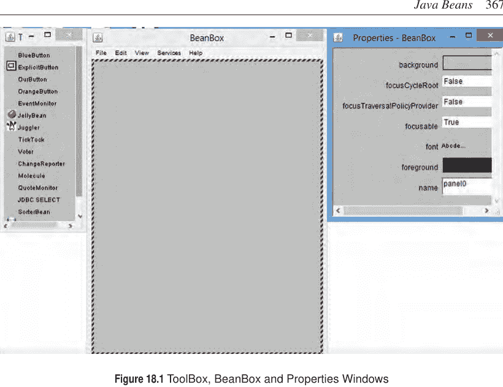

### 18.4.3 使用 BeanBox

为了理解 BeanBox 的用法，让我们创建一个简单的杂耍应用，其中杂耍者将根据你按下的某个按钮开始或停止杂耍。在这个示例中，将使用一个 Juggler Bean 实例和两个 OurButton Bean 实例。

要创建并配置 Juggler Bean 实例，请遵循以下步骤。

1. 点击 ToolBox 窗口中的 Juggler Bean。这会将光标变为交叉符号。
2. 在 BeanBox 窗口中点击你想显示 Provider 的位置。这会在 BeanBox 窗口中显示 Juggler Bean，并带有黑白斜纹边框，表示它当前被选中（见图 18.2）。Juggler Bean 在放置于 BeanBox 后会开始杂耍。
3. 要更改 Juggler Bean 的位置或大小，请将鼠标悬停在某个边界上并拖动 bean。
4. 要自定义 Juggler Bean，请在 Properties 窗口中更改属性。例如，你可以将 `animationRate` 属性更改为 600。


图 18.2 Juggler Bean

要创建并配置 OurButton Bean 实例，请遵循以下步骤。

1. 点击 ToolBox 窗口中的 OurButton Bean。这会将光标变为交叉符号。
2. 在 BeanBox 窗口中点击你想显示 OurButton Bean 的位置。这会在 BeanBox 窗口中显示 OurButton Bean，并带有黑白斜纹边框，表示它当前被选中（见图 18.3）。
3. 要更改 OurButton Bean 的位置或大小，请将鼠标悬停在某个边界上并拖动 bean。
4. 要将 OurButton Bean 的标签更改为“Start”，在 Properties 窗口的 label 框中指定它。
5. 使用 Start 按钮控制动画，将 Start 按钮的 action 事件与 `startJuggling` 方法连接。为此，请按照给提供的步骤操作：
   (a) 点击 BeanBox 的菜单栏并选择 `Edit->Events->actionPerformed`。这会从 bean 显示一个启动按钮。这一行代表了从 Start 按钮 `actionPerformed()` 事件处理程序的逻辑连接。注意，该行的一端固定在 Start 按钮上。
   (b) 在 JAR 文件中移动光标，显示 manifest 文件。这行显示了 JAR 文件。
   (c) 选择 manifest 文件并显示 Start 按钮。该 manifest 文件将显示已编译的内容。


图 18.4 EventTargetDialog

同样，创建另一个 OurButton 实例并将其标记为 Stop。使用 Stop 方法停止杂耍。现在你可以点击 Start 和 Stop 按钮来测试此应用。

## 18.5 JAR 文件

在继续讨论 Beans 之前，应该了解 JAR 文件。如果 JAR 文件包含 Bean，必须包含一个特殊的 manifest 文件。JAR（Java 归档）文件是一个压缩文件，将多个文件打包在一起。通常，JAR 文件包含类文件和资源。JAR 文件具有以下优势：

- 减少下载时间：复杂的 Java 应用可能包含大量类文件，而无需为每个文件建立新的连接。
- 压缩：它能够压缩文件，从而减少存储空间。
- 安全性：它允许对 JAR 文件的内容进行数字签名，从而允许验证来源并赋予额外权限。
- 可移植性：大多数浏览器或 Web 服务器支持 JAR 文件作为 Java 平台的标准部分。

### Manifest 文件

如果 JAR 文件包含 Bean 类，则必须包含一个名为 manifest 的文件。它用于存储有关打包在 JAR 文件中的文件信息。当 BeanBox 启动时，它首先加载 JAR 文件并使用 JAR 文件的 manifest 文件来识别其中的 bean。manifest 文件内容的示例如下：

```
Name: image0.jpg
Name: image1.jpg
Name: image2.jpg
Name: sound0.wav
Name: sound1.wav
Name: ColorBean.class
Java-Bean: True
```

在这里，manifest 文件列出了 JAR 文件中的文件（图像、音频和类文件）。`Java-Bean: True` 紧跟 `Name: ColorBean.class` 表明 `ColorBean.class` 文件是一个 Bean。

在创建 manifest 文件时必须考虑的一个重要点是 manifest 必须以换行符结束。否则，最后一行将无法被正确解析。

如果 JAR 文件未包含 manifest 文件，则会自动创建一个名为 `MANIFEST.INF` 的 manifest 文件并存储在 `META-INF` 目录中。默认 manifest 文件的内容如下：

```
Manifest-Version: 1.0
Created-By: 1.6.0 (Sun Microsystems Inc.)
```

### 创建 JAR 文件

可以使用如下所示的命令创建 JAR 文件。

`jar options [manifestFile] jarFile inputFile(s)`

其中，

- `options` 是此命令时可以使用的各种选项。
- `manifestFile` 是要包含在生成的 JAR 文件中的清单文件名称。
- `jarFile` 是你想要创建的 JAR 文件的名称。
- `inputFile(s)` 是一个由空格分隔的列表或多个文件列表，这些将被包含在 JAR 文件中。此参数可以包含 `*` 符号。如果 `inputFile(s)` 是一个目录，则目录的内容将递归地添加到 JAR 文件中。

与 JAR 命令一起使用的各种选项及其描述如表 18.1 所示。

#### 表 18.1 用于 JAR 命令的选项

| 选项 | 描述 |
| --- | --- |
| c | 表示要创建一个新的 JAR 文件 |
| C | 用于在命令执行期间切换目录 |
| f | 标识要创建、列出或提取的文件 |
| i | 表示应该提供索引信息 |
| m | 用于从外部清单文件包含清单信息 |
| M | 表示不应创建默认清单文件 |
| t | 显示 JAR 文件的目录表 |
| u | 更新 JAR 文件 |
| v | 在命令执行时显示详细输出。详细输出会告诉你每个文件在添加到 JAR 文件时的名称 |
| 0 (零) | 表示不需要对 JAR 文件进行压缩 |

注意，JAR 命令可以使用多个选项。它们可以以任何顺序出现，但它们之间不能有任何空格。

可以如下所示创建一个名为 `Abc.jar` 的 JAR 文件，它包含当前目录下所有的 `*.class` 和 `*.jpg` 文件，并具有一个名为 `Xyz.mf` 的清单：

`jar cf Xyz.mf Abc.jar *.class *.jpg`

### 查看 JAR 文件的内容

可以使用如下所示的命令显示 JAR 文件的内容。

`jar tf jarFile`

例如，我们创建的 `Abc.jar` 文件的内容可以如下列出：

`jar tf Abc.jar`

### 从 JAR 文件中提取文件

可以使用如下所示的命令提取 JAR 文件的内容。

`jar xf jarFile`

例如，可以如下法提取 `Ab_jar` 文件的所有文件。

`jar xf Ab_jar`

在提取文件时，JAR 工具生成文件的副本并将其放置在当前目录中。它重现了文件在 JAR 中的目录结构。原始 JAR 文件保持不变。

可以使用如下所示的命令提取 JAR 文件的某些指定内容。

`jar xf jarFile archivedFile(s)`

例如，要提取一个文件（例如 `image0.jpg` 文件），命令可以指定如下。

`jar xf Ab_jar image0.jpg`

### 更新现有的 JAR 文件

JAR 工具提供了一个用于更新现有 JAR 文件内容的选项。可以使用如下所示的命令添加新文件。

`jar uf jarFile inputFile(s)`

例如，要添加一个文件（例如 `Example.class` 文件），命令可以指定如下。

`jar uf Ab_jar Example.class`

### 调用封装为 JAR 文件的 applet

```html
<APPLET CODE="AppletClassName.class"
ARCHIVE="JarFilename.jar"
WIDTH=height>
</APPLET>
```

## 18.6 使用 TOOLBOX 开发新的 BEAN

在上一节中，我们讨论了如何创建 ToolBox 窗口中可用的 Bean 并使其与其他 Bean 通信。Bean 还允许你开发一个新的 Bean 并将其与其他 Bean 连接。在本节中，我们将开发一个名为 ColorBean 的新 Bean，并将其与另一个 OurButton 连接。ColorBean 显示为橙色的矩形。每当点击“Change Color（更改颜色）”时，Bean 的颜色就会变为任何颜色（随机选择）。

开发新 Bean 的步骤列如下：

1. 为新 Bean 创建一个目录
2. 创建 Java 源文件
3. 编译 Java 源文件以创建类文件
4. 创建清单文件
5. 创建 JAR 文件
6. 启动 BeanBox
7. 测试 Bean

### 为新 Bean 创建目录


在你想要放置新 Bean 的地方创建一个目录。在我们的示例中，我们在 `c:\bdk1.1` 下创建了一个名为 `beanbox` 的目录。切换到此目录。

## 创建 Java 源文件

为名为 `ColorBean` 的 Bean 创建 Java 源文件。示例 18.2 显示了 `ColorBean.java` 文件的源码。

### 示例 18.2 一个创建新 Bean ColorBean 的程序

```java
package beanbox;

import java.awt.Canvas;
import java.awt.Color;
import java.awt.Font;
import java.awt.FontMetrics;
import java.awt.Graphics;
import java.awt.event.MouseAdapter;
import java.awt.event.MouseEvent;
import java.awt.io.Serializable;
import java.util.Random;

public class ColorBean extends Canvas implements Serializable {
    private Color beanColor = Color.orange;
    private String beanString;
    // properties of ColorBean

    public ColorBean() {
        setSize(95,85);
        this.beanString = "ColorBean";
        setFont(new Font("Sans", Font.BOLD, 12));
    } // constructor

    public void paint(Graphics g) {
        g.setColor(beanColor);
        g.fillRect(0,0, getWidth(), getHeight());
        g.setColor(Color.black);
        FontMetrics fontMetrics = g.getFontMetrics();
        int width = fontMetrics.stringWidth(beanString);
        g.drawString(beanString, 20, 50);
    }

    public void changeColor(Color color) {
        Random randVar = new Random();
        beanColor = new Color(randVar.nextInt(256), randVar.nextInt(256), randVar.nextInt(256));
        repaint();
    }

    public Color getColor() {
        return beanColor;
    }

    public void setColor(Color color) {
        beanColor = color;
    }

    public String getBeanString() {
        return beanString;
    }

    public void setBeanString(String beanString) {
        beanString = beanString;
    }
}
```

## 创建并配置 OurButton Bean 实例

在 Bean box 中创建一个 `OurButton` 实例，并将 `OurButton` Bean 的标签更改为“Change Color”。现在，执行以下步骤将其与 `ColorBean` 的 `changeColor()` 方法连接。

选择 BeanBox 的菜单栏，并选择 `Edit->Events->action->actionPerformed`。

1. 将光标移动到 Bean 窗口中 `ColorBean` 的显示区域内并点击。这将显示 `EventTargetDialog` 对话框，列出 `ColorBean` Bean 的所有方法，包括 `changeColor()` 方法。
2. 从 `EventTargetDialog` 对话框中选择“changeColor”并点击 OK。这将显示一条消息，指示正在生成并编译适配器类。
3. 点击 Change Color 按钮。Bean Color 的颜色将发生改变。


## 18.7 使用绑定属性

当具有绑定属性的 Bean 属性值发生变化时，会生成类型为 `PropertyChangeEvent` 的事件。此事件可以绑定到另一个 Bean，也就是说，事件可以发送到注册了接收此类通知的 Beans。为了演示这一点，我们创建一个小型应用程序，其中 `TickBean` 的 `Interval` 属性绑定到 `ColorBean`。`Interval` 属性表示由 `TickBean` 触发属性更改事件之间必须经过的秒数。

为此，在 BeanBox 中创建 `ColorBean` 和 `TickBean` 的实例。现在，按照以下步骤观察 `TickBean` Bean 是如何控制 `ColorBean` Bean 颜色的。

1. 将 `TickBean` 的 `Interval` 属性从初始的“5”改为“2”。
2. 点击 BeanBox 的菜单栏，并选择 `Edit->Events->property->propertyChange`。
3. 将光标移动到 BeanBox 窗口中 `ColorBean` Bean 的显示区域内并点击。这将显示 `EventTargetDialog` 对话框。
4. 从 `EventTargetDialog` 对话框中选择 `changeColor` 并点击 OK。这将显示一条消息，指示正在生成并编译适配器类。

遵循这些步骤后，Bean `ColorBean` 的颜色每秒都会改变一次。


## 18.8 使用 BeanInfo 接口

内省机制由 Java Beans API 架构提供。在 `java.beans` 包中定义的 `BeanInfo` 接口包含了一组方法，提供了有关关联 bean 的显式信息。实现 `BeanInfo` 接口的类名必须是 `beanNameBeanInfo`；`beanName` 是 bean 的名称。`BeanInfo` 接口提供的方法如下：

- `PropertyDescriptor[] getPropertyDescriptors()`: 此方法用于确定 bean 的属性。`getPropertyDescriptors` 方法返回 `PropertyDescriptor` 数组。
- `EventDescriptor[] getEventSetDescriptors()`: 此方法用于确定 bean 的事件。`getEventSetDescriptors` 方法返回 `EventDescriptor` 数组。
- `MethodDescriptor[] getMethodDescriptors()`: 此方法用于确定 bean 的公共方法。`getMethodDescriptors` 方法返回 `MethodDescriptor` 数组。

## 18.9 Java Beans API 核心类与接口

| 属性 | 描述 |
| :--- | :--- |
| `PropertyDescriptor` | 它描述了 Bean 使用一对访问器方法导出的单个属性。 |
| `PropertyEditorManager` | 它用于为任何给定的类型名称查找属性编辑器。 |
| `PropertyEditorSupport` | 它提供了帮助构建属性编辑器的功能。 |
| `SimpleBeanInfo` | 它是一个支持类，有助于轻松编写 `BeanInfo` 类。 |
| `Statement` | 它封装了对方法的调用。 |
| `VetoableChangeListenerProxy` | 它扩展了 `ListenerProxy`，将 `VetoableChangeListener` 与受限属性关联。 |
| `VetoableChangeSupport` | 这是一个支持受限属性的 bean 的工具类。 |
| `XMLDecoder` | 它用于读取使用 `XMLEncoder` 创建的 XML 文档。 |
| `XMLEncoder` | 它允许将 Bean 写入 XML 文档。 |
| `IntrospectionException` | 在内省过程中发生异常时，抛出 `IntrospectionException`。 |
| `PropertyVetoException` | 当属性的更改指示了一个不可接受的值时，抛出 `PropertyVetoException`。 |

## 18.10 企业级 JavaBeans (EJB)

Enterprise JavaBeans (EJB) 是一种服务器模块化且可重用的软件组件，可以部署在分布式环境中。它主要用于表示业务对象或数据库中的表。它与 Java 类类似，但运行在一个名为 EJB 容器的特殊环境中。客户端不能直接调用 EJB 的所有方法，而是使用 EJB 容器。EJB 容器处理运行在它内部的所有 bean。它通过调用 bean 必须暴露的几个方法与 bean 交互。需要注意的是，企业 bean 的客户端可以是 applet、servlet 或另一个企业 bean。

EJB 的一些优点如下：

- 它被广泛用于开发大型和分布式应用程序。

### 表 18.4 javax.ejb 包中定义的某些接口

| 接口 | 描述 |
| :--- | :--- |
| `EJBContext` | 它允许访问由容器提供的、针对企业 Bean 实例的运行时上下文。 |
| `EJBHome` | 所有企业 Bean 的远程 home 接口都必须由它进行扩展。 |
| `EJBMetaData` | 它允许客户端获取企业 Bean 的元数据信息。 |
| `EJBObject` | 所有企业 Bean 的远程接口都由它扩展。 |
| `EnterpriseBean` | 每一个企业 Bean 类都必须实现此接口。 |
| `EntityBean` | 每一个实体 Bean 类都必须实现此接口。 |
| `EntityContext` | 它提供了一个访问容器提供的实体企业 Bean 实例运行时上下文的实例。 |
| `Handle` | 所有 EJB 对象处理器都必须实现它。 |
| `HomeHandle` | 所有 Home 对象处理器都必须实现它。 |
| `SessionBean` | 每一个 session bean 类都必须实现此接口。 |
| `SessionContext` | 它允许访问由容器提供的、针对 session bean 的运行时上下文。 |
| `Timer` | 它包含了由 EJB Timer Service 创建的定时器的信息。 |
| `TimerHandle` | 所有 EJB 定时器处理器都必须实现它。 |
| `TimerService` | 它为企业组件提供了访问容器提供的定时服务。 |

## 18.10.1 会话 Bean (Session Beans)

Session beans 是与客户端直接通信的企业 bean。它们被设计为代表客户端的业务过程或任务。业务过程的示例可能是在酒店订房、信用卡账单、银行交易等。Session beans 可能使用其他 bean（session beans 或 entity beans）来执行任务或直接访问数据库。

注意，某些业务过程可以在单个方法请求中执行，例如信用验证。另一方面，其他业务过程可能需要多次方法调用，例如在线电子商务 Web 网站。根据过程发起的请求方法，session bean 共有两种类型，如下所示：

- **无状态的**: 无状态 session bean 是设计用于处理跨越多个方法请求的过程的 bean。这些 bean 是瞬态的，并且不需要在方法调用之间维护业务状态。
- **有状态的**: 有状态 session bean 是用于处理单个方法请求过程的 bean。这些 bean 要求在方法调用之间维护业务状态，并存储在内存中。

session bean 的生命周期相对短。它依赖于客户端的会话；粗略地说，它等同于客户端的会话。只要浏览器或 Java applet 运行，或者一个 bean 正在使用另一个 bean，会话就会持续。

每一个 session bean 类都必须实现 `SessionBean` 接口。容器使用该接口的方法通知企业 Bean 实例其实例的生命周期事件。

### 表 18.5 SessionBean 接口中定义的方法

| 方法 | 描述 |
| :--- | :--- |
| `void ejbActivate()` | 当实例从其被动状态激活时被调用。 |
| `void ejbPassivate()` | 在实例进入被动状态之前调用。 |
| `void ejbRemove()` | 由容器在结束会话对象生命之前调用。 |
| `void setSessionContext(SessionContext ctx)` | 设置关联的会话上下文。 |

## 18.10.2 实体 Bean (Entity Beans)

Entity beans 是表示持久对象的企业 bean，如数据库中的数据，这些数据存在于特定应用程序生命周期之外。它们不包含业务逻辑。与 session beans 不同，它们的生命周期不限于会话持续时间；它们是持久的。此外，它为数据提供了面向对象的接口，从而使你能够将持久数据的功能与对象封装的功能相结合。


每一个实体 bean 类都必须实现 `EntityBean` 接口。容器使用该接口的方法通知 Entity Bean 实例其实例的生命事件。

# 表 18.6 EntityBean 接口中定义的方法

| 方法 | 描述 |
| :--- | :--- |
| `void ejActivate()` | 当实例从可用实例池中取出并与特定的 EJB 对象关联时，由容器调用。 |
| `void ejLoad()` | 由容器调用以向实例发出指令。 |
| `void ejPassivate()` | 在实例与特定的 EJB 对象关联之前由容器调用。 |
| `void ejRemove()` | 在实例移除之前由容器调用。 |
| `void ejStore()` | 由容器调用以将其状态同步到底层数据库。 |
| `void setContext(EntityContext ctx)` | 设置实体上下文。 |
| `void unsetContext()` | 取消实体上下文。 |

## 总结

- Java Beans 是一种允许使用可重用的软件组件构建复杂系统的技术。
- Bean 是运行在 Java 虚拟机中的软件组件。
- 内省（Introspection）是对 bean 的属性、事件和方法的自动分析。
- 绑定属性（bound property）在属性值更改时产生事件。
- 受限属性（constrained property）在属性值改变时通知其他对象。
- 持久化（persistence）是保存 bean 当前状态的过程。
- 它是在特定环境中使用 bean 的逐步指南。
- 应用构建工具是用于设计 bean 的可视化设计工具。
- JAR（Archive）是用于创建、自定义和测试开发 bean 的。
- 通常，JAR 文件是包含多个文件的单个压缩文件。
- 清单文件（manifest file）用于存储关于包的信息。
- Java 开发工具包（JDK）提供的工具是用于管理 JAR 文件的命令行工具。
- 企业 Bean (EJB) 是一种可以部署在分布式环境中服务器模块化且可重用的软件组件。它主要用于表示业务对象或数据库中的表。
- Session beans 是与客户端直接通信的企业 bean。它们被设计为代表客户端的业务过程或任务。
- Entity beans 是表示持久对象的企业 bean。

## 练习题

### 填空

1. 暴露给另一个应用程序的 bean 的 ________ 和 ________ 可以被控制。
2. ________ 是保存 bean 当前状态的过程。
3. ________ 是对 bean 的属性、事件和方法的自动分析过程。
4. ________ 是用于创建、自定义和测试开发的 bean 的工具。
5. 通常，_________ 运行在一个名为 EJB 容器的特殊环境中。

### 选择正确选项

1. 下列哪个通用接口定义了组件的外观和行为？
   (a) 属性 (properties) (b) 事件 (Events)
   (c) 方法 (methods) (d) 以上都不是

2. bean 的公共方法通过 ________ 机制自动暴露。
   (a) 持久化 (b) 自定义
   (c) 内省 (d) 以上都不是

3. 关于 bean 的哪个说法是错误的？
   (a) bean 应该实现 `Serializable` 接口。
   (b) bean 应该有一个无参数构造函数。
   (c) bean 应该是私有的，并提供访问其属性的 getter 和 setter 方法。
   (d) 以上都不是

4. ___________ 窗口包含了所有可用的 Java Beans。
   (a) ToolBox (b) BeanBox
   (c) Properties (d) 以上都不是

5. 下列哪个方法没有在 `SessionBean` 接口中定义？
   (a) `ejActivate()` (b) `ejBeanPassivate()`
   (c) `setSessionContext()` (d) 以上皆是

### 判断对错

1. 绑定属性（bound property）是指当尝试更改其值时，会通知其他对象或组件的属性。
2. 自定义定制器（customizer）是一份粗略的指南，提供了在特定语文中为 bean 提供的遵循的指令。
3. JAR 文件包含了与 applet 和多媒体应用程序相关的类文件和资源（图像和声音文件）。
4. JAR 文件中可以有多个清单文件（manifest file）。
5. 会话豆（session bean）主要用于表示业务对象或数据库中的表。

### 回答以下问题

1. 你如何理解 Java beans？列举 Java beans 的一些优点。
2. 讨论 bean 的架构。
3. 你如何理解内省（introspection）？
4. 定义持久化（persistence）。
5. 列出 JAR 文件的好处。
6. 简要讨论受限属性（constrained properties）和绑定属性（bound properties）。
7. Bean 遵循的哪些规范有哪些？
8. 提到 BeanInfo 接口的。
9. 应用构建工具的典型特征有哪些？
10. 列出开发新 bean 的遵循步骤。
11. 定义会话豆（session beans）和实体豆（entity beans）。

# 第 19 章

# JAVA SERVLETS

# 本章学习目标

读完本章后，你将能够：

- 理解 servlet
- 解释 servlet 的生命周期
- 理解 Java Servlet API 中包含的类和接口
- 讨论创建和执行 servlet 涉及的步骤
- 理解如何使用 `javax.servlet.GenericServlet` 和 `javax.servlet.http.HttpServlet` 创建 servlet
- 讨论会话跟踪（session tracking）
- 理解 JSP（Java 页面）

# 19.1 引言

Internet 和 WWW 经常混用，但两者是不同的。Internet 是计算机网络的全球网络，而 Web 是通过 Internet 提供的服务之一。也就是说，Web 是运行在 Internet 之上的应用程序。在创建 Web 应用程序时，浏览器端的目标是在浏览器端执行大部分处理，以减少服务器端的处理负载。有时无法消除服务器端的所有处理。例如，在在线注册、从底层数据检索数据等情况下，可能需要在服务器端进行某些处理。所使用的服务器技术之一是 servlet。Servlet 是用 Java 编写的小型程序，它们被 Web 服务器作为 applet 加载并执行，被 Web 浏览器加载并执行。由于 servlet 用 Java 编写的，因此与平台无关，并且具有 Java 的所有优点。

# 19.2 servlet 简介

servlet 可以被想象为运行在服务器端的应用程序。其他可用的服务器技术包括通用网关接口 (CGI)、服务器端 JavaScript 和活动服务器页面 (ASP)。Servlet 相比这些服务器端技术的优势如下：

- 持久性：Servlet 保持在内存中直到被显式销毁。这有助于处理多个并发请求。Servlet 只与数据库建立一次连接，并可以处理同一数据库上的多个请求。这减少了再次与相同数据库建立连接所需的时间资源。而 CGI 程序在处理请求后就会从内存中移除，并且每当新请求到达时都会启动新进程。

servlet 实例的生命周期包含三个方法，即 `init()` 方法、`service()` 方法和 `destroy()` 方法。这些方法由 Web 服务器调用，以初始化、调用和销毁 servlet 实例。

- 3. `destroy()` 方法：调用此方法是从内存中永久移除 servlet。它释放 servlet 的所有资源（如打开的文件句柄、连接的数据库等）。与 `init()` 方法一样，该方法在 servlet 的整个生命周期中被调用一次。当此方法被调用时，servlet 死亡。调用 `destroy()` 方法后，无法再调用 service 方法。

# 19.4 Servlet API

Java Servlet API 不包含在 Java 核心框架中，而是 Java 标准扩展 API。它包含 `javax.servlet` 和 `javax.servlet.http` 两个包，用于创建 servlet 的类和接口。每个 servlet 必须实现 `javax.servlet` 包中的 `Servlet` 接口。Servlet 是通过扩展两个类之一创建的：`javax.servlet.GenericServlet` 或 `javax.servlet.http.HttpServlet`。这两个类都实现了 `Servlet` 接口。

## javax.servlet 包

`javax.servlet` 包包含的一些接口如表 19.1 所示。

### 表 19.1 javax.servlet 包包含的一些接口

| 接口 | 描述 |
| --- | --- |
| `Servlet` | 定义了所有 servlet 必须实现的方法。 |
| `ServletConfig` | 代表 servlet 配置对象，允许 servlet 接收初始化参数。 |
| `ServletContext` | 允许 servlet 写入日志文件并访问与 servlet 运行环境相关的信息。 |
| `ServletRequest` | 用于定义一个可以读取客户端请求中数据的对象。 |
| `ServletResponse` | 用于定义一个可以为客户端开发响应的对象。 |
| `Filter` | 用于定义一个可以用来... |
| `RequestDispatcher` | 用于定义一个用于转发或包含内容的对象。 |

该包包含的一些类如表 19.2 所示。

### 表 19.2 javax.servlet 包包含的一些类

| 类 | 描述 |
| --- | --- |
| `GenericServlet` | 这是一个抽象类，提供了 `Servlet` 接口的基本实现。 |
| `ServletInputStream` | 提供一个用于从客户端读取数据的输入流。 |
| `ServletOutputStream` | 提供一个用于向客户端发送数据的输出流。 |
| `ServletContext` | 代表 servlet 运行的环境。 |
| `ServletException` | 定义了 servlet 可以抛出的通用异常。 |
| `UnsupportedListener` | 不可用。 |

## javax.servlet.http 包

`javax.servlet.http` 包包含的一些接口如表 19.3 所示。

### 表 19.3 javax.servlet.http 包包含的一些接口

| 接口 | 描述 |
| --- | --- |
| `HttpSession` | 允许读取和写入会话数据。 |
| `HttpServletRequest` | 扩展 `HttpRequest` 接口以从 HTTP 请求中读取数据。 |
| `HttpServletResponse` | 扩展 `NextResponse` 接口以将数据作为响应发送到 HTTP 请求。 |
| `HttpSessionBindingListener` | 提供监听器是否绑定到会话或从会话解绑的信息。 |

该包包含的一些类在表 19.4 中。

### 表 19.4 javax.servlet.http 包包含的一些类

| 类 | 描述 |
| --- | --- |
| `Cookie` | 用于创建 cookie，允许将状态信息存储在客户端机器。 |
| `HttpServlet` | 这是一个抽象类，提供了处理 HTTP 请求和响应的方法。 |
| `HttpSessionEvent` | 代表与 Web 应用程序内会话变化相关的事件通知。 |
| `HttpSessionBindingEvent` | 提供监听器是否绑定或从会话解绑以及会话属性是否发生变化的信息。 |

# 19.5 创建和执行 servlet

Servlet 是平台无关的，可以与所有 Web 服务器配合。它们可以在任何支持 servlet API 的 Web 服务器上执行。某些 Web 服务器内置了对 Java servlet 的支持，如 Tomcat (Apache)、Java web server (Sun Microsystems)、Enterprise server (Netscape)、Zeus web server (Zeus Technology)、Tengai application server (WebLogic) 和 Sun web server (Sun Microsystems)。

在本单元中，我们将使用 servlet 来解释如何在 Windows 环境下执行 servlet。请确保 Tomcat 6.0 的默认位置如下。

`C:\Program Files\Apache Software Foundation\Tomcat 6.0`

创建和执行 servlet 的步骤如下：

1. 创建包含 servlet 代码的 java 源文件并将其保存为 `Sample.java`。
2. 编译此源文件，结果将生成 `Sample.class` 文件。
3. 将 `Sample.class` 文件复制到 Tomcat 的 webapps 目录。目录路径如下。

`C:\Program Files\Apache Software Foundation\Tomcat 6.0\webapps\MyApp\WEB-INF\classes`

在 `web.xml` 文件中添加此 servlet 的名称和映射。该文件的路径如下：

`C:\Program Files\Apache Software Foundation\Tomcat 6.0\webapp\MyApp\WEB-INF`

在定义 servlets 的部分添加以下语句：

```xml
<servlet>
  <servlet-name>Sample</servlet-name>
  <servlet-class>Sample</servlet-class>
</servlet>
```

同样，在定义 servlets 的部分添加以下语句：

```xml
<servlet-mapping>
  <servlet-name>Sample</servlet-name>
  <url-pattern>/servlet/Sample</url-pattern>
</servlet-mapping>
```

5. 启动 Tomcat，点击“开始”菜单，找到“所有程序”，找到“Apache Tomcat 6.0”，然后点击“配置 Tomcat”。这将显示 Apache Tomcat 属性。点击“启动”按钮。
6. 启动浏览器并请求该 servlet。注意，HTML 代码可以包含在 servlet 代码中，也可以使用单独的 HTML 文件。如果 HTML 代码包含在 servlet 代码中，请在地址栏输入以下 URL：

`http://localhost:8080/MyApp/servlet/Sample`

或

`http://127.0.0.1:8080/MyApp/servlet/Sample`

7. 如果使用单独的 HTML 文件作为代码，请在地址栏输入以下 URL：

`http://localhost:8080/MyApp/Sample.html`

或

`http://127.0.0.1:8080/MyApp/Sample.html`

8. 这里，`127.0.0.1:8080` 是系统节点的 IP 地址。注意 .html 文件必须保存在 MyApp 目录下。

servlet 的输出将显示在浏览器的显示区域。

> **注意**：在执行 servlet 之前，Tomcat 必须在后台运行。

# 19.6 使用 GenericServlet 类

`GenericServlet` 类实现了 `Servlet` 和 `ServletConfig` 接口。由于 `service()` 方法在 `GenericServlet` 类中声明为抽象方法，因此它是一个抽象类。该类必须实现 `service()` 方法。它被用于创建与协议无关的 servlet。

为了理解使用 `GenericServlet` 类创建 servlet，让我们考虑这里给出的简单程序。为此，需要两个文件：定义 servlet 的 .java 文件和另一个包含网页代码的 .html 文件。

## 示例 19.1 使用 GenericServlet 类创建 servlet 的程序

```java
import java.io.*;
import java.util.*;
import javax.servlet.*;
public class ServletExample extends GenericServlet
{
    public void service(HttpServletRequest req, HttpServletResponse res)
    throws SQLException, IOException {
        PrintWriter out = res.getWriter();
        String login = req.getParameter("loginid");
        String password = req.getParameter("password");
        out.print("You have successfully login :\
```

该程序的解释如下：

1. 导入了 `javax.servlet` 包，该包包含了用于创建 servlet 的接口和类。


# Java Servlets 393

在 `web.xml` 文件中添加此 servlet 的名称和映射。该文件的路径如下：

`C:\Program Files\Apache Software Foundation\Tomcat 6.0\webapp\MyApp\WEB-INF`

在定义 servlets 的部分添加以下语句：

```xml
<servlet>
  <servlet-name>Sample</servlet-name>
  <servlet-class>Sample</servlet-class>
</servlet>
```

同样，在定义 servlets 的部分添加以下语句：

```xml
<servlet-mapping>
  <servlet-name>Sample</servlet-name>
  <url-pattern>/servlet/Sample</url-pattern>
</servlet-mapping>
```

- 5. 启动 Tomcat，点击“开始”菜单，找到“所有程序”，找到“Apache Tomcat 6.0”，然后点击“配置 Tomcat”。这将显示 Apache Tomcat 属性。点击“启动”按钮。

6. 启动浏览器并请求该 servlet。注意，HTML 代码可以包含在 servlet 代码中，也可以使用单独的 HTML 文件。如果 HTML 代码包含在 servlet 代码中，请在地址栏输入以下 URL：

`http://localhost:8080/MyApp/servlet/Sample`

或

`http://127.0.0.1:8080/MyApp/servlet/Sample`

7. 如果使用单独的 HTML 文件作为代码，请在地址栏输入以下 URL：

`http://localhost:8080/MyApp/Sample.html`

或

`http://127.0.0.1:8080/MyApp/Sample.html`

8. 这里，`127.0.0.1:8080` 是系统节点的 IP 地址。注意 `.html` 文件必须保存在 `MyApp` 目录下。

servlet 的输出将显示在浏览器的显示区域。

注意：在执行 servlet 之前，Tomcat 必须在后台运行。

# 19.6 使用 GenericServlet 类

`GenericServlet` 类实现了 `Servlet` 和 `ServletConfig` 接口。由于 `service()` 方法在 `GenericServlet` 类中声明为抽象方法，因此它是一个抽象类。该类必须实现 `service()` 方法。它被用于创建与协议无关的 servlet。

为了理解使用 `GenericServlet` 类创建 servlet，让我们考虑这里给出的简单程序。为此，需要两个文件：定义 servlet 的 `.java` 文件和另一个包含网页代码的 `.html` 文件。

# 394 Java 编程

**示例 19.1** 使用 `GenericServlet` 类创建 servlet 的程序

```java
import java.io.*;
import java.util.*;
import java.servlet.*;
public class ServletExample extends GenericServlet
{
    public void service(HttpServletRequest req, HttpServletResponse res)
    throws SQLException, IOException {
        PrintWriter out = res.getWriter();
        String login = req.getParameter("loginid");
        String password = req.getParameter("password");
        out.print("You have successfully login :\
```

该程序的解释如下：

- 1. 导入了 `javax.servlet` 包，该包包含了用于创建 servlet 的接口和类。

- 2. 接下来，定义了名为 `ServletExample` 的类，它继承了 `GenericServlet` 类。该类提供了初始化、调用和销毁 servlet 实例的方法。`init()` 和 `destroy()` 方法继承自 `GenericServlet` 类。`ServletExample` 类必须重写 `service()` 方法，因为它在 `GenericServlet` 类中被声明为抽象方法。

- 3. 传递给 `service()` 方法的两个参数是 `req` 和 `res`，分别是 `ServletRequest` 和 `Response` 接口的对象。`req` 对象允许从客户端读取数据，`res` 对象用于为客户端请求开发响应。

- 4. `getWriter()` 方法返回 `PrintWriter` 流。它用于将数据作为响应的一部分发送。可以使用 `println()` 方法写入 HTML。

- 5. 这里的 `127.0.0.1:8080` 是系统节点的 IP 地址。注意 `.html` 文件必须保存在 `MyApp` 目录下。

servlet 的输出将显示在浏览器的显示区域。

注意：在执行 servlet 之前，Tomcat 必须在后台运行。


# Java Servlets 393

在 `web.xml` 文件中添加此 servlet 的名称和映射。该文件的路径如下：

`C:\Program Files\Apache Software Foundation\Tomcat 6.0\webapp\MyApp\WEB-INF`

在定义 servlets 的部分添加以下语句：

```xml
<servlet>
  <servlet-name>Sample</servlet-name>
  <servlet-class>Sample</servlet-class>
</servlet>
```

同样，在定义 servlets 的部分添加以下语句：

```xml
<servlet-mapping>
  <servlet-name>Sample</servlet-name>
  <url-pattern>/servlet/Sample</url-pattern>
</servlet-mapping>
```

5. 启动 Tomcat，点击“开始”菜单，找到“所有程序”，找到“Apache Tomcat 6.0”，然后点击“配置 Tomcat”。这将显示 Apache Tomcat 属性。点击“启动”按钮。

6. 启动浏览器并请求该 servlet。注意，HTML 代码可以包含在 servlet 代码中，也可以使用单独的 HTML 文件。如果 HTML 代码包含在 servlet 代码中，请在地址栏输入以下 URL：

`http://localhost:8080/MyApp/servlet/Sample`

或

`http://127.0.0.1:8080/MyApp/servlet/Sample`

7. 如果使用单独的 HTML 文件作为代码，请在地址栏输入以下 URL：

`http://localhost:8080/MyApp/Sample.html`

或

`http://127.0.0.1:8080/MyApp/Sample.html`

8. 这里，`127.0.0.1:8080` 是系统节点的 IP 地址。注意 `.html` 文件必须保存在 `MyApp` 目录下。

servlet 的输出将显示在浏览器的显示区域。

注意：在执行 servlet 之前，Tomcat 必须在后台运行。

# 19.6 使用 GenericServlet 类

`GenericServlet` 类实现了 `Servlet` 和 `ServletConfig` 接口。由于 `service()` 方法在 `GenericServlet` 类中声明为抽象方法，因此它是一个抽象类。该类必须实现 `service()` 方法。它被用于创建与协议无关的 servlet。

为了理解使用 `GenericServlet` 类创建 servlet，让我们考虑这里给出的简单程序。为此，需要两个文件：定义 servlet 的 `.java` 文件和另一个包含网页代码的 `.html` 文件。

# 394 Java 编程

**示例 19.1** 使用 `GenericServlet` 类创建 servlet 的程序

```java
import java.io.*;
import java.util.*;
import java.servlet.*;
public class ServletExample extends GenericServlet
{
    public void service(HttpServletRequest req, HttpServletResponse res)
    throws SQLException, IOException {
        PrintWriter out = res.getWriter();
        String login = req.getParameter("loginid");
        String password = req.getParameter("password");
        out.print("You have successfully login :\
```

该程序的解释如下：

1. 导入了 `javax.servlet` 包，该包包含了用于创建 servlet 的接口和类。

2. 接下来，定义了名为 `ServletExample` 的类，它继承了 `GenericServlet` 类。该类提供了初始化、调用和销毁 servlet 实例的方法。`init()` 和 `destroy()` 方法继承自 `GenericServlet` 类。`ServletExample` 类必须重写 `service()` 方法，因为它在 `GenericServlet` 类中被声明为抽象方法。

3. 传递给 `service()` 方法的两个参数是 `req` 和 `res`，分别是 `ServletRequest` 和 `ServletResponse` 接口的对象。`req` 对象允许从客户端读取数据，`res` 对象用于为客户端请求开发响应。

4. `getWriter()` 方法返回 `PrintWriter` 流。它用于将数据作为响应的一部分发送。可以使用 `println()` 方法写入 HTML。

5. 这里的 `127.0.0.1:8080` 是系统节点的 IP 地址。注意 `.html` 文件必须保存在 `MyApp` 目录下。

# 398 Java 编程

```java
public void doGet(HttpServletRequest req, HttpServletResponse res) throws ServletException, IOException
{
    PrintWriter out = res.getWriter();
    String login = req.getParameter("loginid");
    String password = req.getParameter("password");
    out.println("Your login ID is: ");
    out.println(login);
    out.println("Your password is: ");
    out.println(password);
    out.close();
}
```

在这个示例中，重写了 `HttpServlet` 类的 `doGet()` 方法来处理 HTTP GET 请求。传递给 `doGet()` 方法的两个参数是 `req` 和 `res`，分别是 `HttpServletRequest` 和 `HttpServletResponse` 接口的对象。`req` 对象允许读取客户端请求中提供的数据，而 `res` 对象则用于为客户端请求开发响应。

该 servlet 对应的 HTML 代码如下。

```html
<HTML>
<BODY>
<CENTER>
<FORM NAME="Form"
ACTION="http://localhost:8080/MyApp/servlet/ServletGetExample">
<B>Login ID</B> <INPUT TYPE="text" NAME="loginid" SIZE="30">
<P>
<B>Password</B> <INPUT TYPE="password" NAME="password" SIZE="30">
</P>
<P>
<INPUT TYPE="submit" VALUE="Submit">
</P>
</BODY>
</HTML>
```

此 HTML 代码创建了一个包含表单的网页（参见图 19.3）。


在网页上输入所需的数据并点击提交按钮。浏览器将显示由相应 servlet 动态生成的响应（参见图 19.4）。


**图 19.4** 使用 Servlet `doGet()` 方法生成的输出

注意，`HttpServletRequest` 接口的 `getParameter()` 方法用于检索附加到发送到服务器的 URL 中的数据。例如，考虑图 19.4 地址栏中的 URL。问号右侧出现的字符串被称为查询字符串，它包含了 HTTP GET 请求的参数。

# 400 Java 编程

## 19.7.2 doPost() 方法

与 `doGet()` 类似，`doPost()` 方法由服务器通过 `service()` 方法调用以处理 HTTP POST 请求。当需要向服务器传递大量数据时，使用 `doPost()` 方法，这是通过 `doGet()` 方法无法实现的。在 `doGet()` 方法中，参数附加到 URL 中，而在 `doPost()` 方法中，参数在 HTTP 体中单独行发送。`doGet()` 方法主要用于从服务器检索信息，而 `doPost()` 方法用于更新服务器上的数据或将数据提交到服务器。为了理解 `doPost()` 的工作原理，让我们考虑一个定义处理 HTTP POST 请求 servlet 的示例程序。

**示例 19.3** 定义处理 HTTP POST 请求 servlet 的程序


```java
import java.io.*;
import javax.servlet.*;
import javax.servlet.*;

public class ServletPostExample extends HttpServlet {
    public void doPost(HttpServletRequest req, HttpServletResponse res) throws ServletException, IOException {
        PrintWriter out = res.getWriter();
        String loginid = req.getParameter("loginid");
        String password = req.getParameter("password");
        out.println("Your Login ID is: " + loginid);
        out.println(loginid);
        out.println("Your Password is: " + password);
        out.println(password);
        out.close();
    }
}
```

此 servlet 可以使用类似于示例 19.1 中编写的 HTML 代码进行测试。

# 19.8 会话跟踪

HTTP 是一个无状态协议；客户端每次请求页面时，客户端和服务器之间都会建立单独的连接。它没有提供让服务器跨多个请求维护特定用户信息的方法。在许多 Web 应用中，需要跟踪每个用户购物车中添加的项目列表。为此，服务器必须提供一种为每个客户端存储数据并区分不同客户端的方法。

会话（Session）提供了这种机制。一个会话由单次浏览器调用期间的所有请求组成。servlet 使用 `HttpSession` 接口管理会话。

# 401 Java Servlet

使用此接口，可以在 HTTP 客户端和 HTTP 服务器之间创建一个会话。该会话在用户的一系列请求中持续指定的时间。

**示例 19.4** 使用 `HttpSession` 接口跟踪用户在当前会话期间访问网站次数的 servlet

```java
import java.io.*;
import javax.servlet.*;
import javax.servlet.http.*;
import java.util.*;
public class SessionTrackingExample extends HttpServlet {
    public void doGet(HttpServletRequest request,
            throws ServletException, IOException) {
        Session session = request.getSession(true);
        // 如果不存在则创建一个会话对象
        Date creationTime = new Date(session.getCreationTime());
        // 获取会话创建时间
        Date lastAccessTime =
            new Date(session.getLastAccessedTime());
        // 获取上次访问时间
        String title = "Welcome Back!";
        Integer visitCounter = new Integer(0);
        String userID = new String("xyz");
        if (session.isNew()) {
            title = "Welcome!";
            session.setAttribute("userID", userID);
        } else {
            visitCounter = (Integer)session.getAttribute("visitCounter");
            visitCounter = visitCounter + 1;
            userID = (String)session.getAttribute("userID");
        }
        session.setAttribute("visitCounter", visitCounter);
        // 是否是新访客
        response.setContentType("text/html");
        PrintWriter out = response.getWriter();
        out.println("<html><title>" + title + "<body>\n" +
            "<h1 align=\"center\">" + title + "</h1>\n" +
            "<h2 align=\"center\">Session Details</h2>\n" +
            "<table border=\"1\" align=\"center\">\n" +
            "<tr><th>Session info</th><th>value</th></tr>\n" +
            "<tr><td>ID</td></tr>\n" +
            "<tr><td>Session</td>" + session.getId() + "</td></tr>\n" +
            "<tr><td>Creation Time</td></tr>\n" +
            "<tr><td>Created</td>" + creationTime + "</td></tr>\n");
```

```java
"<tr\n" + "<td>Last Accessed at</td>\n" + \
"<td>" + " " + lastAccessTime + " </td></tr>\n" + \
"<tr\n" + "<td>Visitor ID</td>\n" + \
"<td>" + " " + userID + " </td></tr>\n" + \
"<tr\n" + "<td>Number of visits</td>\n" + \
"<td>" + " " + visitCounter + " </td></tr>\n" + \
"/</table>\n" + "</body></html>";
```

在这个示例中，使用 `HttpServletRequest` 接口的 `getSession()` 方法创建了会话。该方法的唯一参数表示，如果不存在则必须创建一个新会话。此方法返回一个 `HttpServlet` 对象。要使用会话标识符访问会话属性，会调用会话对象的不同方法：`getCreationTime()`、`lastAccessTime()`、`setAttribute()`、`getAttribute()` 和 `getID()`。

编译 servlet `SessionTrackingExample` 并在 `web.xml` 文件中创建相应的条目。在浏览器中使用 URL `http://localhost:8080/servlet-example/servlet/SessionTrackingExample`。


图 19.5 SessionTrackingServlet 生成的输出

## 19.8.1 使用 Cookie

跟踪客户端和服务器之间会话的一种方法是使用 Cookie。Cookie 是 Web 服务器发送给浏览器的一条信息。Web 服务器为每个 Cookie 分配一个唯一 ID。它通过嵌入在响应头中将 Cookie 发送给客户端。每次请求时，客户端都会将此 Cookie 值发送到服务器。使用此值，服务器可以识别用户。Cookie 通常用于维护客户端的信息（如用户 ID、名称等），这些信息在客户端每次访问网站时都是需要的。使用 Cookie 类的以下构造函数构造 Cookie。

```java
public Cookie(String name, String val)
```

# 示例 19.5 用于创建cookie并将其添加到响应头的servlet

```java
import java.io.*;
import javax.servlet.*;
import javax.servlet.http.*;
public class CreateCookies extends HttpServlet
{
    public void doGet(HttpServletRequest request,
        HttpServletResponse response)
throws ServletException, IOException {
        Cookie name = new Cookie("name");
        request.getParameter("name");
        //为name创建cookie
        Cookie age = new Cookie("age");
        request.getParameter("age");
        //为age创建cookie
        name.setMaxAge(60*60*12); //60*60*24
        age.setMaxAge(60*60*24); // 60*60 24
        // 将两个cookie的过期时间都设为12 小小时
        response.addCookie(name);
        response.addCookie(age);
        //将两个cookie都添加到响应头中
        response.setContentType("text/html");
        // 设置响应内容类型
        PrintWriter out = response.getWriter();
        String title = "Example to Set Cookies";
        out.println("<html>\n" + "<head>" + "<title>" + title +
            "</title></head>\n" + "<body>\n" +
            "<h1 align=\"center\">" + title + "</h1>\n" +
            "<ul>\n" + "<li>Name:" + "</li>\n" +
            "" + request.getParameter("name") + "\n" +
            "<li><li>Age:" + "</li>\n" +
            "" + request.getParameter("age") + "\n" +
            "</ul>\n" + "</body></html>");
    }
}
```

此示例使用 `Cookie()` 构造函数创建 cookie。一个名称为 "name"，值为参数 "name"的值；另一个名称为 "age"，值为参数 "age"的值。两者的最大生存时间都被设置为12小时；浏览器将保留这些 cookie 信息 12 小时。使用 `addCookie()` 方法将这些 cookie添加到 HTTP 响应头中。

使用 `CreateCookies` 的 HTML 代码如下：

```html
<HTML>
<BODY>
<FORM ACTION="servlet/CreateCookies" METHOD="GET"> Name: <INPUT TYPE="text" NAME="name">
<BR/>nAge: &nbsp;&nbsp;&nbsp;<INPUT TYPE="text" NAME="age" />
<BR><BR>
<INPUT TYPE="submit" VALUE="Submit" />
</FORM>
</BODY>
</HTML>
```

编译 servlet `CreateCookies` 并在 web.xml 文件中创建相应的条目。在浏览器中输入 URL `http://localhost:8080/servlets-examples/CreateCookies`。它将在图 19.6 中输出。


图 19.6 显示表单的网页

输入名称和年龄，然后点击网页上的提交按钮。它将显示输出（见图 19.7）并设置两个名为 name 和 age 的 cookie，每次点击提交按钮时，这些 cookie 都会传递给服务器。


图 19.7 由 CreateCookies Servlet 生成的输出

**示例 19.6** 从 HTTP 请求头中检索 cookie 的servlet

```java
import java.io*;
import javax.servlet.*;
import javax.servlet.http.*;
public class ReadCookies extends HttpServlet
{
    public void doGet(HttpServletRequest request, HttpServletResponse response)
    throws ServletException, IOException
    {
        Cookie[] cookies = null;
        cookies = request.getCookies();
        // 获取 Cookies 数组
        response.setContentType("text/html");
        // 设置内容类型
        PrintWriter out = response.getWriter();
        String title = "Example to Read Cookies";
        out.println("<<html>" + "<head><title>" + title + "</title></head>" + "<body>\n");
        if (cookies != null) {
            out.println("<h2> Cookies found: Name and Value</h2>");
            for (int i = 0; i < cookies.length; i++) {
                Cookie cookie = cookies[i];
                out.print("Name : "+cookie.getName() + ", ");
                out.print("Value: "+cookie.getValue() + "<br/>");
            }
        }
        else {
            out.println("<h2>No cookies exist</h2>");
        }
        out.println("</body>");
        out.println("</html>");
    }
}
```

在此示例中，通过调用 `HttpServletRequest` 对象的 `getCookies()` 方法检索包含在 HTTP 请求头中的 cookie。在此示例中，通过调用 `getCookies()` 方法检索包含在 HTTP 请求头中的 cookie。编译 servlet `CreateCookies` 并在 web.xml 文件中创建相应的条目。在浏览器中输入 `http://localhost:8080/servlets-examples/CreateCookies`。它将显示输出，见：


## 19.9 JSP 简介（服务器页面）

JSP（服务器页面）技术允许开发者快速创建 HTML 文档。与 servlet 相比，JSP 更加灵活。JSP 页面包含 Java 代码。

- 指令（Directives）
- 声明（Declarations）
- 脚本段（Scriptlets）
- 表达式（Expressions）

### 指令（Directives）

指令提供关于 JSP 页面的信息。三种可能的指令是页面指令、包含指令和标签库指令。

#### 页面指令（page Directive）

用于为 JSP 页面提供设置，指定使用的脚本语言（默认是 Java）、导入类或包、确定输出流是否缓冲等。页面指令的语法为：

```jsp
<%@ page ... %>
```

例如，考虑导入 Java包的语句：

#### 包含指令（include Directive）

用于从其他文件包含代码，如 HTML 文件、JSP 文件或文本文件。文件内容在编译时被包含。包含指令的语法为：

```jsp
<%@ include file="..." %>
```

#### 标签库指令（taglib Directive）

用于通知编译器当前 JSP 页面使用一组自定义标签，并指定前缀。标签库指令的语法为：

```jsp
<%@ taglib prefix="..." uri="..." %>
```


<%@ taglib uri="..." prefix="..." %>

在此例中，`uri` 是包含标签库的文件，`prefix` 是所使用的前缀。

## 19.8 使用 Java 编程

### 声明
这些语句用于在 JSP 页面中声明变量和方法。定义声明块的语法为：

```jsp
<%-- declarations --%>
```

例如，考虑这些语句：

```jsp
<%
  String str = "Hello";
  int a = 0;
  public void update() {
    a = a + 10;
  }
%>
```

### 脚本段
通过脚本段，可以在 JSP 页面中包含任何 Java 代码。脚本段是插入 JSP 页面中的 Java 代码。包含脚本段的语法为：

```jsp
<%-- code --%>
```

例如，考虑这些语句：

```jsp
<%
  a = 10;
  b = 20;
  c = a + b;
  out.println("Sum is:" + c);
%>
```

### 表达式
这些语句用于在 HTML 代码中指定值（常量、变量或表达式的值）。表达式的语法为：

```jsp
<%= value %>
```

例如，考虑这个语句：
折扣为 `<%= price * 0.25 %>`

### 示例 19.7 一个示例 JSP 代码

```html
<HTML>
<HEAD><TITLE>Student Details</TITLE></HEAD>
<BODY>
<!-- 指令 -->
<%@ page language = "java" %>
<HR>
<% out.println("Student Details"); %>
</BODY>
</HTML>
```

JSP 代码的输出为：


注意：要运行 JSP 程序，你需要在系统中安装 Netbeans 软件。

# 410 Java 编程

## 总结

- Servlets 是用 Java 编写的小型程序，它们被 Web 服务器加载和执行，就像 applets 被浏览器加载和执行一样。
- Servlet 相比于其他服务器端技术的各种优势包括：持久性、可移植性、服务器无关、协议无关、可扩展、安全、快速等。
- Servlet 的生命周期包含三个方法，即 `init()`、`service()` 方法和 `destroy()`。
- Servlet API 不包含在 Java 核心框架中，而是标准 Java 扩展 API。它包含两个包：`javax.servlet` 和 `javax.servlet.http`，其中包含了用于创建 servlet 的类和接口。
- Servlet 是通过扩展以下两个类之一创建的：`javax.servlet.GenericServlet` 或 `javax.servlet.http.HttpServlet`。这两个类都实现了 Servlet 接口。
- `GenericServlet` 类是开发协议无关 servlet 的常用类。
- `doGet()` 方法由服务器的 `service()` 方法调用，用于处理 HTTP GET 请求。
- `doPost()` 方法由服务器的 `service()` 方法调用，用于处理 HTTP POST 请求。
- Servlet 使用 `HttpSession` 接口管理会话。使用该接口可以在客户端和 HTTP 服务器之间创建会话。
- Java 页面 (JSP) 技术允许开发者在服务器端快速创建和维护包含丰富信息的动态 HTML 页面。

### 填空题

1. 只有当 `init()` 方法被调用并成功执行时，`service()` 方法才会被调用。
2. `GenericServlet` 类实现了 `Servlet` 和 `ServletConfig` 接口。
3. 在扩展 `GenericServlet` 类的类中，传递给 `service()` 方法的两个参数分别是 `ServletRequest` 和 `ServletResponse` 的对象。
4. Servlet 的名称和映射添加在 `web.xml` 文件中。
5. `page` 指令用于提供可配置 JSP 页面设置的信息。

### 单选择

1. `init()` 方法仅在 servlet 的整个生命周期中调用一次。
   (a) `init()` (b) `service()` (c) `destroy()` (d) 以上均不是
2. 在调用 `destroy()` 方法后，以下哪项不能被调用？
   (a) `init()` (b) `service()` (c) 两者都是 (d) 以上都不是
3. `GenericServlet` 类实现了 ________ 接口。
   (a) Servlet (b) servletConfig (c) ServletContext (d) (a) 和 (b)
4. 以下类中哪个不属于 `javax.servlet` 包？
   (a) Cookie (b) ServletInputStream (c) ServletContext (d) GenericServlet
5. 下列哪项不包含 JSP 页的代码中？
   (a) 指令 (Directives) (b) 声明 (Declarations) (c) 脚本段 (Scriptlets) (d) 以上都不是

# Java Servlets

## 判断题

1. 由于 servlet 被编译成字节码，因此它们的执行速度与其他脚本语言一样。
2. `service()` 方法在 `GenericServlet` 类中被声明为抽象方法。
3. 当从服务器检索信息时，主要使用 `doGet()` 方法；当更新服务器上的数据或提交数据到服务器时，使用 `doPost()` 方法。
4. Cookie 是 Web 服务器发送给浏览器的对象。
5. 声明（declaration）是插入到 JSP 中的 Java 代码。

## 回答以下问题

1. 定义 servlet。列出 servlet 相比其他服务器端技术的优势。
2. 为什么 servlet 比其他技术更安全？
3. 讨论 servlet 的生命周期。
4. 哪些类可以扩展以创建 servlet？
5. 命名用于开发处理 HTTP 请求的 servlet 类。
6. 创建和执行 servlet 的步骤有哪些？
7. `HttpSession` 接口的作用是什么？
8. `ServletRequest` 和 `ServletResponse` 接口的作用是什么？比较它们与 `HttpServletRequest` 和 `HttpServletResponse` 接口的作用。
9. `getParameter()` 方法的作用是什么？
10. 区分 `doGet()` 和 `doPost()` 方法。
11. 创建一个接收客户信息的 HTML 代码，并使用 `GenericServlet` 创建一个从该表单检索数据的 servlet。
12. 创建一个接收学生信息的 HTML 代码，并使用 `HttpServlet` 创建一个从该表单检索数据的 servlet。
13. 命名 JSP 页面可以使用的三种指令类型。
14. 讨论 JSP 代码的元素。

# 第 20 章 套接字编程

## 章节目标

读完本章后，你将能够：
- 理解客户端/服务器通信
- 解释 TCP/IP 协议族的重要协议
- 描述端口在网络中的作用
- 理解 IP 地址的重要性
- 解释 socket 用途
- 列出 `java.net` 包中定义的类和接口
- 将域名解析为 IP 地址

### 20.1 引言

网络的核心是 socket（套接字）的概念。使用 socket 必须了解客户端/服务器通信以及 TCP/IP 协议族的重要协议。我们将回顾所有主题，如 socket 用途以及 `java.net` 包中定义的类和接口。

### 20.2 客户端与服务器

TCP/IP 由四层组成，即应用层、传输层、网络层和链路层。图 20.1 所示了所有层。

| 层 | 协议 |
| :--- | :--- |
| 应用层 | http, telnet, ftp, ... |
| 传输层 | TCP, UDP, ... |
| 网络层 | IP, ... |
| 链路层 | 设备驱动, ... |

#### 20.2.1 TCP/IP 协议

TCP/IP 内部最常用的三种协议是 IP、TCP 和 UDP。开发网络应用必须对这些协议有清晰的理解。

##### TCP（传输控制协议）

TCP（传输控制协议）是一种可靠且面向连接的协议，允许源源数据无误地交付到目的地。TCP 在启动通信之前通过传输控制信息在双方之间建立连接。这种机制被称为握手。一旦建立连接，机器之间就开始传输数据。TCP 将数据分成离散的消息（称为 TCP 段）并将其传递给网络层。在目的地，接收到的 TCP 发送确认，以保证数据已收到。它重组段以形成原始消息。如果段丢失或损坏，TCP 负责重传必要的段。当这些机器之间交换完数据后，它会关闭连接。

##### IP（网际协议）

IP（网际协议）是一种不可靠且无连接的协议，它管理每个数据包（IP 传输单元）的地址部分，以便数据包到达正确的目的地。作为无连接协议，IP 在启动通信之前不传输控制信息。它将数据发送到目的地，期望数据会在接收端交付。它是不可靠的，因为它不重传丢失或损坏的数据包。

##### UDP（用户数据报协议）

与基于 TCP 的应用不同，某些网络应用不需要主机到主机的可靠通信通道。它们需要一种传输独立的、自包含消息的通信模式。UDP 没有任何检测错误或重传丢失或损坏信息的机制。它适用于对及时性要求高于准确性的应用，例如天气预报、客户端/服务器、视频、游戏、音频等。

### 20.2.2 IP 地址

互联网上的每台机器都通过称为 IP 地址的数值地址进行标识。IP 地址由一个 32 位数字组成，分为四个 8 位的值。它以一种被称为点分十进制表示的形式表示。在这种表示法中，每组位由其十进制等值表示，范围在 0 到 255 之间。例如，`1.160.10.240` 可能是一个 IP 地址。这种地址类型由 IPv4（Internet 协议 v4）指定。

由于这种表示法对用户不友好，IP 地址被映射到像 `www.google.com` 这样的域名，这样更容易记忆。互联网上的特殊服务器执行这种映射，被称为域名服务器。它允许用户使用域名工作，然而，互联网是基于 IP 地址运行的。

> 注意：新的寻址方案（称为 IPv6）使用 128 位值来表示地址。

### 20.2.3 端口和端口号

机器提供各种服务，包括电子邮件、Telnet、FTP 等。使用 IP 地址，客户端可以连接到机器，但无法连接到所需的服务。为了解决这个问题，每个服务都关联了一个端口号。端口是一个分配给特定服务的逻辑数字，通过该数字可以请求服务。

显然，为了访问服务器，客户端机器并不是直接连接到服务器，而是连接到服务器的端口。通过网络发送的每个数据包都包含主机的 IP 地址和用于标识主机上运行的特定程序的端口号。IP 地址可以被看作是通过邮政发送信件的家庭地址，而端口号则是信件投递人员的名字。

> 注意：1024 以下的端口号被称为众所周知端口，预留给标准服务。例如，用于 Telnet 的端口号是 23。

### 20.2.4 套接字

IP 地址和端口号的组合被称为套接字。套接字标识了运行网络上的两个程序之间双向通信链路的端点。当客户端在特定端口上请求连接时，服务器会识别并跟踪将用于与客户端通信的套接字。服务器可以在同一个端口与许多客户端通信，使用套接字来确定通信的目标和源。

#### 基于套接字的通信

在基于套接字的通信中，运行计算机上的服务器（程序）绑定到特定的端口。服务器监听此套接字以接收任何客户端的连接请求，如图 20.2(a) 所示。当请求发出时，服务器接受该请求。一旦接受请求，服务器会将一个新的套接字绑定到不同的端口[参见图 20.2(b)]。需要新的套接字是为了服务器可以继续监听原始套接字以接收新的连接请求，同时为已连接的客户端提供服务。

# 416 Java 编程


(a) 客户端请求连接服务器


(b) 服务器获取新的本地端口

图 20.2 双向通信路径的建立

### 20.3 URL（统一资源定位符）

每个网页都有一个称为 URL（统一资源定位符）的唯一地址，用于标识其在互联网上的位置。URL 由四部分组成：协议、Web 服务器名称、该服务器上的目录以及该目录下的文件。

URL 的语法为：

```
protocol://domain name: port number/<directory path>/object name=#spot
```

示例：

```
http://www.yahoo.com/education/FIIT/home.htm#top
```

URL 的各个部分在表 20.1 中描述。

**表 20.1 URL 的组成部分**

| 部分 | 示例 | 描述 |
| :--- | :--- | :--- |
| 协议 | `http://` | 代表如 ftp、http 等协议的名称 |
| 域名 | `www.yahoo.com` | 代表存放所需页面或其他资源的 Web 服务器的名称 |
| 目录路径 | `/education/FIIT` | 代表网页在 Web 服务器文件系统中的位置 |
| 对象名称 | `/home.htm` | 指定所需网页的文件或所需的其他名称 |
| #锚点 | `#top` | 指定网页上文本或图形的特定位置 |

#### URL 的类型

URL 有两种类型，即绝对 URL 和相对 URL。

- **绝对 URL**：绝对 URL 定义了网页或互联网上任何其他资源的确切位置。例如，`http://www.yahoo.com/education/FIIT/home.htm`。这里，网页 `home.htm` 存储在服务器 `yahoo.com` 的 `folders/education/FIIT` 文件夹下。
- **相对 URL**：在相对 URL 中，URL 的每个部分都不需要指定。你可以通过使其相对于当前位置“相对”来缩短 URL。例如，假设有一个文件 `picture.gif` 存在于 `FIIT` 文件夹下的 `image` 文件夹中。该文件的相对 URL 将是 `/mypicture.gif`。

### 20.3.1 URL 类

Java 的 `URL` 类提供了几个构造函数来创建新的 URL。常用的构造函数之一是：

```java
URL(String protocol)
```


URL 类定义了多种方法来提取 URL 的各个部分。这些方法列在表 20.2 中。

### 表 20.2 URL 的方法

| 方法 | 描述 |
|---|---|
| `getProtocol()` | 返回 URL 的协议部分 |
| `getHost()` | 返回 URL 的主机名（域名）部分 |
| `getPort()` | 返回 URL 的端口号 |
| `getFile()` | 返回 URL 的对象名称 |

## 20.4 网络类和接口

Java 通过 `java.net` 包中定义的类和接口促进网络应用程序创建。某些类列在表 20.3 中。

### 表 20.3 java.net 中的某些类

| 类 | 描述 |
|---|---|
| `Authenticator` | 代表网络连接认证的对象 |
| `ContentHandler` | 抽象类，所有包含从 URL 读取对象的类的基类 |
| `DatagramPacket` | 实现数据包交付的方法 |
| `DatagramSocket` | 代表发送和接收数据包的套接字 |
| `DatagramSocketImpl` | 数据包套接字实现基类 |
| `HttpURLConnection` | 支持 HTTP 特性的 `URLConnection` |
| `InetAddress` | 代表 IP 地址 |
| `ServerSocket` | 实现服务器套接字 |
| `Socket` | 实现客户端套接字 |
| `SocketImpl` | 抽象类，所有实现套接字的基类 |
| `URL` | 代表统一资源定位符，资源的指针 |
| `URLConnection` | 抽象类，所有表示应用程序与 URL 之间通信链路的类的基类 |
| `URLStreamHandler` | 抽象类，所有流协议处理器的基类 |

`java.net` 包中定义的某些接口列在表 20.4 中。

### 表 20.4 java.net 中的某些接口

| 接口 | 描述 |
|---|---|
| `ContentHandlerFactory` | 定义内容处理器的工厂 |
| `CookiePolicy` | 提供决定哪些 Cookie 应该接受、哪些应该拒绝的机制 |
| `CookieStore` | 代表 Cookie 的存储 |
| `DatagramSocketImplFactory` | 定义数据包套接字实现的工厂 |
| `FileNameMap` | 提供文件名和 MIME 类型字符串映射的机制 |
| `SocketImplFactory` | 定义实现实现的工厂 |
| `SocketOptions` | 定义获取或设置套接字选项的方法 |
| `URLStreamHandlerFactory` | 定义流协议处理器的工厂 |

## 20.5 InetAddress 类

正如前面提到的，用户使用域名，而互联网基于 IP 地址运行。在 Java 中，可以使用 `InetAddress` 类将域名解析为 IP 地址，反之亦然。

可以使用可用的工厂方法之一创建 `InetAddress` 对象。常用的工厂方法列在表 20.5 中。

### 表 20.5 InetAddress 类的方法

| 方法 | 描述 |
|---|---|
| `static InetAddress getLocalHost()` | 返回表示本地主机的 `InetAddress` 对象 |
| `static InetAddress getByName(String hostname)` | 返回为传递的主机名的 `InetAddress` |
| `static InetAddress[] getAllByName(String hostname)` | 返回一个 `InetAddress` 数组，表示为传递的主机名解析出的所有地址；用于单个名称代表多台机器的情况 |

所有这些方法都会抛出 `UnknownHostException`。当 `getLocalHost()` 和 `getByName(String hostname)` 方法无法解析主机名时，会抛出此异常。当 `getAllByName()` 方法无法将名称解析为至少一个地址时，也会抛出此异常。

## 20.6 TCP/IP SOCKET

在 Java 中，有两种 TCP 套接字：一种用于服务器，另一种用于客户端。这两个套接字是使用 `java.net` 包中的两个不同的类实现的，即 `ServerSocket` 和 `Socket` 类（见表 20.6）。

### 表 20.6 构造函数描述

| 构造函数 | 描述 |
|---|---|
| `ServerSocket()` | 创建一个未绑定的服务器套接字 |
| `ServerSocket(int portnumber)` | 创建一个服务器套接字并将其绑定到 `portnumber` 指定的端口 |
| `ServerSocket(int portnumber, int qlength)` | 创建一个服务器套接字，将其绑定到指定的端口号，并为此创建一个长度由 `qlength` 指定的队列。该队列长度指定了等待列表中可以保留的客户端请求数 |
| `ServerSocket(int portnumber, int qlength, InetAddress address)` | 创建一个服务器套接字，将其绑定到指定的端口号，创建一个长度由 `qlength` 指定的队列，并将其绑定到 `address` 指定的 IP 地址 |

### Server Socket（服务器套接字）

`ServerSocket` 类用于监听接入连接，即等待客户端连接。`ServerSocket` 类中定义的构造函数列在表 20.7 中。

### 表 20.7 ServerSocket 类的构造函数

| 构造函数 | 描述 |
|---|---|
| `ServerSocket()` | 创建一个未绑定的套接字 |
| `ServerSocket(int portnumber)` | 创建一个服务器套接字并将其绑定到 `portnumber` 指定的端口号 |
| `ServerSocket(int portnumber, int qlength)` | 创建一个服务器套接字，将其绑定到指定的端口并创建一个长度由 `qlength` 指定的队列。该队列长度指定了等待列表中可以保留的客户端请求数 |
| `ServerSocket(int portnumber, int qlength, InetAddress address)` | 创建一个服务器套接字，将其绑定到指定的端口号，创建一个长度由 `qlength` 指定的队列，并将其绑定到 `address` 指定的 IP 地址 |

### Socket（套接字）

`Socket` 类供客户端用于连接到服务器套接字并使用输入输出流交换数据。当创建一个 `Socket` 对象时，客户端和服务器之间会隐式建立连接。该类中定义的某些构造函数列在表 20.8 中。

### 表 20.8 Socket 类的一些构造函数

| 构造函数 | 描述 |
|---|---|
| `Socket()` | 创建一个未连接的套接字 |
| `Socket(InetAddress address, int portnumber)` | 创建一个套接字并将其连接到指定 IP 地址上的指定端口 |
| `Socket(String host, int portnumber)` | 创建一个套接字并将其连接到指定主机上的指定端口 |

`Socket` 类定义了各种方法，其中两个是 `getInputStream()` 和 `getOutputStream()`。这些方法分别返回与套接字关联的 `InputStream` 和 `OutputStream` 对象。这些流的使用方式与 I/O 流相同，用于接收和发送数据。

### 20.6.1 服务器程序

创建一个服务器程序涉及以下步骤：

1.  **打开套接字**：要打开套接字，可以使用表 20.7 给出的 `ServerSocket` 类的构造函数之一。
2.  **等待客户端请求**：服务器套接字会等待某些客户端发起连接请求，并返回表示该连接的实际 `Socket` 对象。这是通过 `ServerSocket` 类的 `accept()` 方法实现的。`accept` 方法是一个阻塞调用，会等待客户端尝试连接它。当连接建立时，它会返回 `Socket` 对象。
3.  **为与客户端通信创建 I/O 流**：一旦客户端和之间建立了专用连接，通过 `getInputStream()` 和 `getOutputStream()` 方法获取与套接字关联的 `InputStream` 和 `OutputStream` 对象。
4.  **与客户端通信**：可以使用声明的输入输出流对象从客户端读取或向客户端写入数据。
5.  **关闭套接字**：最后，必须关闭套接字。要关闭服务器端的套接字，使用 `close()` 方法。注意，在关闭套接字之前，必须关闭输入和输出流。

#### 示例 20.1 一个演示服务器程序的程序

```java
import java.net.*;
import java.io.*;

public class Server {
    public static void main(String args[]) {
        int port = 2316;
        try {
            // 在端口 2316 创建一个套接字
            ServerSocket ss = new ServerSocket(port);
            // 等待并接受连接
            Socket socket = ss.accept();
            // 将流与套接字关联
            OutputStream out = socket.getOutputStream();
            DataOutputStream sout = new DataOutputStream(out);
            // 将输出发送到标准输出设备
            System.out.println("Server is ready!");
            // 将输出发送到客户端
            sout.writeUTF("Hello! this is the programming");
            // 将输出发送到客户端
            sout.writeUTF("Waiting for the next line...");
            // 关闭连接
            socket.close();
            // 关闭套接字
            sout.close();
            out.close();
        } catch (Exception e) {
            e.printStackTrace();
        }
    }
}
```

### 20.6.2 客户端程序

创建客户端程序涉及的步骤：

- 创建一个 `Socket` 对象
- 创建与服务器通信的 I/O 流
- 与服务器通信
- 通信结束时关闭套接字

#### 示例 20.2 一个演示客户端程序的程序

```java
import java.net.*;
import java.io.*;

public class Client {
    public static void main(String args[]) {
        try {
            int port = 2316;
            // 获取 IP 地址
            InetAddress ipAddress = InetAddress.getByName("localhost");
            System.out.println("I am the Client.");
            // 连接到 2316 端口的服务器
            Socket socket = new Socket(ipAddress, port);
            System.out.println("Address and port is: " + ipAddress + " and " + port);
            // 获取输入
            InputStream sin = socket.getInputStream();
            DataInputStream in = new DataInputStream(sin);
            // 读取输入
            String pstr = in.readUTF();
            System.out.println(pstr);
            // 读取下一行
            String pstr2 = in.readUTF();
            System.out.println(pstr2);
            // 关闭输入
            in.close();
            // 关闭套接字
            socket.close();
        } catch (Exception e) {
            e.printStackTrace();
        }
    }
}
```

注意在此程序中，创建 `Socket` 时提供了客户端尝试连接的 IP 地址和端口号。

## UDP SOCKET

Java 通过提供两个类支持 UDP，即 `DatagramSocket` 和 `DatagramPacket`。

### DatagramSocket

`DatagramSocket` 类用于发送或接收数据报包。它定义了四个构造函数，列在表 20.9 中。

#### 表 20.9 DatagramSocket 类的构造函数

| 构造函数 | 描述 |
|---|---|
| `DatagramSocket()` | 创建一个数据报套接字 |
| `DatagramSocket(int portnumber)` | 创建一个数据报套接字并绑定到由 `portnumber` 指定的端口号 |
| `DatagramSocket(int portnumber, InetAddress ipAddress)` | 创建一个数据报套接字并分别绑定到 `portnumber` 指定的端口和 `ipAddress` 指定的 |
| `DatagramSocket(SocketAddress address)` | 创建一个数据报套接字并绑定到 `address` 指定的 `SocketAddress` |

注意：在创建数据报套接字时，如果发生任何错误，所有这些构造函数都会抛出 `SocketException`。

`DatagramSocket` 类定义了许多方法。两个方法列在表 20.10 中。

#### 表 20.10 DatagramSocket 类的方法

| 方法 | 描述 |
|---|---|
| `void send(DatagramPacket packet)` | 将包发送到端口 |
| `void receive(DatagramPacket packet)` | 从端口接收由 `packet` 指定的包 |

注意：当发生错误时，方法 `send()` 和 `receive()` 方法都会抛出 `IOException`。

### DatagramPacket

`DatagramPacket` 类用于包含数据。它定义了许多构造函数；其中一些列在表 20.11 中。

#### 表 20.11 DatagramPacket 类中定义的构造函数

| 构造函数 | 描述 |
|---|---|
| `DatagramPacket(byte data[], int length)` | 创建一个 `DatagramPacket` 用于接收缓冲区中长度为 `length` 的数据包 |
| `DatagramPacket(byte data[], int offset, int length)` | 创建一个 `DatagramPacket` 用于接收长度为 `length` 的数据包，并指定缓冲区中的偏移量 |
| `DatagramPacket(byte data[], int offset, int length, InetAddress ipAddress, int portnumber)` | 创建一个 `DatagramPacket` 用于向指定主机上的指定端口号发送长度为 `length` 的数据包 |

`DatagramPacket` 类中定义的一些常用方法列如表 20.12 所示。

#### 表 20.12 DatagramPacket 类的方法

| 方法 | 描述 |
|---|---|
| `InetAddress getAddress()` | 返回发送数据或接收数据数据报的机器地址 |
| `byte[] getData()` | 返回数据报中包含的数据 |
| `int getLength()` | 返回从 `getData()` 方法返回的字节数组中有效数据的长度 |
| `int getPort()` | 返回远程主机上的端口号 |
| `void setAddress(InetAddress ipAddress)` | 设置数据包发送到的 `ipAddress` 指定地址 |
| `void setData(byte[] data)` | 设置数据为 `data` |
| `void setLength(int length)` | 设置数据包的大小为 `length` |
| `void setPort(int portnumber)` | 设置远程主机上的 `portnumber` 指定端口号 |

#### 示例 20.3 一个演示 UDP 服务器程序的程序

```java
import java.net.*;
import java.io.*;
import java.util.*;

class UDPServerExample {
```


## 示例 20.3 一个演示 UDP 服务器程序的程序

```java
public static void main(String args[]) throws Exception {

    int serverportno = 1209;

    int clientportno = 1140;

    try { // 创建一个 socket并绑定到端口号 1139
        DatagramSocket ds = new DatagramSocket(serverportno);

        // 获取本地的 IP 地址
        InetAddress ipadd = InetAddress.getLocalHost();

        String pstr = "Hello this is your message";
        byte buf[] = pstr.getBytes();

        // 创建一个用于发送数据包的 DatagramPacket
        DatagramPacket send_packet = new DatagramPacket(buf, buf.length, ipadd, clientportno);

        ds.send(send_packet); // 发送数据包
        ds.close();
    } catch (Exception e) {
        System.out.println(e.getMessage());
    }
}
```

## 示例 20.4 一个演示 UDP 客户端程序的程序

```java
import java.net.*;
import java.io.*;

class UDPClientExample {
    public static void main(String args[]) throws Exception {
        int serverportno = 1139;
        int clientportno = 1140;

        try {
            // 创建一个 socket并绑定到端口号 1140
            DatagramSocket ds = new DatagramSocket(clientportno);
            byte b[] = new byte[1024];

            // 创建一个用于接收数据包的 DatagramPacket
            DatagramPacket dp = new DatagramPacket(b, b.length);

            ds.receive(dp); // 接收数据包
            System.out.println(new String(dp.getData()));
        } catch (Exception e) {
            System.out.println(e.getMessage());
        }
    }
}
```


#### 426 Java 编程

注意，服务器和客户端程序运行在本地机器的两个端口之间。服务器和客户端分别运行在端口号 1139 和 1140 上。因此，请在不同的命令提示符窗口运行这些程序。

## 总结

- 网络系统由服务器、客户端和通信媒介组成。
- 网络可以很小（两台电脑），也可以像互联网一样庞大。网络通信需要一些可靠的交付服务，可以在两台机器之间传输信息。
- 交付服务的工作与网络上使用的硬件和软件无关。互联网使用 TCP/IP 协议族提供交付服务。
- TCP/IP 协议族中三个最常用的协议是 IP、TCP 和 UDP。
- TCP（传输控制协议）是一种可靠且面向连接的协议，它允许来自源机器的数据无错误地递送到目的地。
- IP（网协议）是一种不可靠且无连接的协议，它管理每个数据包（IP 传输的基本单元）的地址，以确保数据包到达正确的目的地。
- UDP（用户数据报协议）是一种不可靠且无连接的协议，它允许应用程序将独立的、自包含的消息作为数据报通过网络发送。
- 互联网上的每台机器都通过 IP 这一数值型地址进行标识。IP 地址由 32 位数字组成，按 8 位值组织。它以被称为“点分十进制”的形式表示。
- 端口是分配给特定服务的本地数字，通过该端口请求服务。
- IP 地址和端口号的组合被称为套接字（socket）。套接字标识了网络上两个程序之间双向通信链路的端点。
- Java 通过 `java.net` 包中定义的类和接口方便了网络应用程序的创建。
- 使用 `InetAddress` 类可以将域名解析为其 IP 地址，反之亦然。
- 在 Java 中，有两种类型的 TCP 套接字：一个用于服务器，另一个用于客户端。这两个套接字使用两个不同的类实现。
- `ServerSocket` 用于监听连接，`Socket` 用于客户端连接。
- `Socket` 通过输出流交换数据。
- UDP 提供了 `DatagramPacket` 和 `DatagramSocket`。

## 练习题

### 填空：

1. 互联网使用 ________ 协议提供交付服务。
2. IP 地址和端口号的组合被称为 ________。
3. Java 通过 `java.net` 包中的类和接口创建网络应用程序。
4. TCP 服务器和客户端套接字使用两个不同的类实现，实现。
5. __________ 是类静态方法返回实例的约定。

### 单选题：

1. 以下端口号被称为 ________ 端口，并用于标准服务。
   (a) 1024
   (b) 1028
   (c) 1032
   (d) 1048

2. UDP 运行在 TCP/IP 的 ________ 层。
   (a) 应用
   (b) 传输
   (c) 网络
   (d) 链路

3. 地址方案使用 ________ 位表示地址。
   (a) 128
   (b) 64
   (c) 32
   (d) 16

4. 哪个在 `java.net` 中没有定义？
   (a) Authenticator
   (b) ContentHandler
   (c) Server
   (d) 无

5. `DatagramPacket` 抛出 ________。
   (a) IOException
   (b) UnknownHostException
   (c) SocketException
   (d) 以上均不是

### 陈述：

1. 以下端口号被称为 ________ 端口，并用于标准服务。
2. UDP 运行在 TCP/IP 的 ________ 层。
3. 地址方案使用 ________ 位表示地址。
4. 哪个在 `java.net` 中没有定义？
5. `DatagramPacket` 抛出 ________。

### 翻译：

1. 互联网使用 ________ 协议族提供交付服务。
2. IP 地址和端口号的组合被称为 ________。
3. Java 通过 `java.net` 包中的类和接口创建网络应用程序。
4. TCP 服务器和客户端套接字使用两个不同的类实现，分别是 ________ 和 ________。
5. __________ 是类静态方法返回实例的约定。

### 说明：

1. 说明端口在网络应用程序中的作用。
2. TCP 和 UDP 的区别。
3. 讨论 IP 在 TCP/IP 模型中的作用。
4. 说 `InetAddress` 类的一些方法。
5. 什么是 URL？
6. 定义客户端和服务器。
7. 列出 TCP/IP 的四层。
8. `DatagramSocket` 类用于发送或接收数据报。
9. 写一个 Java 程序来演示 UDP 客户端程序。
10. 说明创建 UDP 服务器程序涉及的步骤。

## 430 索引

### A

- 自动类型转换, 31
- AWT (抽象窗口工具), 253

### B

- 基础地址, 83
- BASIC, 2
- BeanBox, 359
- Bean 开发工具包 (BDK), 366
- 下载与安装 Bean, 366
- 启动 BeanBox, 367
- 字节码, 17

### C

- 字符集, 23
- `Class()`, 5, 59
- 抽象方法, 115
- 访问一个 的成员, 62
- 适配器, 263
- 参数传递, 64
- 引用传递方法, 64
- 值传递方法, 64
- 赋值对象引用变量, 361
- `BufferedReader`, 205
- `BufferedWriter`, 207
- `ByteArrayInputStream`, 202
- `ByteArrayOutputStream`, 204
- 创建对象, 61
- 错误, 151
- Final, 114
- 基础, 59
- 介绍方法, 60
- `InputStream`, 201
- `Reader`, 204
- 成员的, 60
- 方法, 66
- `OutputStream`, 201
- 静态变量和方法, 366
- 子或派生或子类, 8, 99
- 超或基或父类, 8, 99
- 变量, 66
- 包装, 92
- 基本数据类型及其对应的, 92
- `Writer`, 206
- 客户端与服务器概念, 413
- IP 地址, 415
- 端口和端口号, 415
- 套接, 415
- 基于套字的通信, 415
- TCP/IP 协议, 414
- IP (互联网协议), 414
- TCP (传输控制协议), 414
- UDP (用户数据报协议), 414
- 代码可读性, 133
- 计算机辅助设计 (CAD) 系统, 11
- 构造函数(s), 68
- 重载, 70
- 参数化的, 69
- 子类, 108
- 代码可读性, 133
- 通用网关接口 (CGI), 389
- 内容面板, 285

### D

- 数据报, 414
- 数据成员, 6
- 数据类型, 27
- 非基本类型或引用, 27
- 数组, 29
- 类, 29
- 接口, 29
- 基本或内置数据, 27
- 布尔, 28
- 字符, 28
- 浮点数, 28
- 整数, 27
- 分隔符, 216
- 单字符和多字符, 216
- 磁盘文件, 199
- 域名服务器, 415
- 点十表示法, 415
- 动态链接库, 223
- 动态方法分派, 114

### E

- 封装, 7
- 事件(s), 253, 360
- 事件处理, 255
- 事件类, 255
- 事件类, 256
- 事件监听器接口, 257
- `MotionListener` 接口, 257
- `ActionListener` 接口, 257
- `AdjustmentListener` 接口, 269
- `CaretListener` 接口, 259
- `ChangeListener` 接口, 258
- `ItemListener` 接口, 257
- `KeyListener` 接口, 257
- `MouseListener` 接口, 257
- `PropertyChangeListener` 接口, 258
- `TextListener` 接口, 258
- `WindowListener` 接口, 258
- 模型, 253
- 委托事件模型, 254
- 事件监听器, 255
- 事件源, 255
- Java 1.0 事件模型, 254
- 异常(s), 149
- 类, 151
- Java 常见异常, 151
- 自定义, 160
- 异常, 151
- 使用 `finally` 块, 156
- 使用 `throw` 关键字, 158
- 使用 `throw` 关键字, 159
- 使用 `try` 和 `catch` 块, 152
- 多个 `catch` 块, 153
- 嵌套 `try` 块, 155
- 异常处理, 150
- 管理的五个关键字, 150
- Final 变量, 113
- 浮点数表示法, 25
- FORTRAN, 2

### F

- 文件(s), 210
- Final 关键字, 113
- Final 类, 114
- Final 方法, 113
- 接口, 106, 121
- 抽象类和, 126
- 扩展, 124
- 共同实现, 126
- 部分实现, 124
- 变量, 126
- 创建 JAR 文件, 376
- 创建 manifest 文件, 376
- 颜色的实例, 378
- 创建 Java 源文件, 374
- 启动 BeanBox, 377
- 测试 Bean, 377
- 使用属性, 379
- Java 数据库连接 (JDBC), 347
- 驱动程序分类, 447
- 实现, 447
- `Connection` 接口, 349
- `DriverManager` 类, 349
- `PreparedStatement` (动态处理), 354
- `ResultSetMetaData`, 350
- `Statement` 接口 (静态处理), 350
- JAR (Java 档)文件(s), 370
- 从 JAR 文件提取文件, 372
- JAR 工具, 371
- 将 applet 打包 JAR 文件, 373
- Manifest 文件, 371
- 更新现有的 JAR 文件, 372
- 查看 JAR 文件内容, 372
- API, Java Bean, 359
- 优点, 360
- 架构, 360
- 简单程序, 18
- 绑定和约束属性, 364
- 约定, 364
- 自定义, 364
- JDBC-ODBC 桥接, 349
- 概述, 347
- Java 语言, 15
- 类定义, 18
- Main 语句, 19
- 输出语句, 19
- 编程元素, 23
- 编译器, 17
- 对 Internet 的重要性, 17
- 特性, 15
- 程序结构, 26
- 类定义, 27
- 文档章节, 26
- Import 语句, 27
- 接口语句, 27
- Main 方法类, 27
- Package 语句, 26
- 持久化, 363
- 使用 Bean 开发新 Bean, 373
- 编译 Java 源文件创建类, 376
- 为 Bean 创建目录, 374
- Java 开发包 (JDK), 18
- 在其中, 18

### G

- 垃圾收集, 77
- `Finalize()` 方法, 77
- 玻璃面板, 285
- 全局数据, 4

### H

- 握手, 414
- 高级语言, 292

### I

- I/O 操作, 199
- 原生方法, 223
- 创建和使用的步骤, 223
- 文件的读与写, 210
- 写入文件的字节, 211
- 写入文件的字符, 212
- 从控制台读入和写入, 209
- `Instanceof` 运算符, 221
- `StreamTokenizer` 类, 218
- `StringTokenizer` 类, 216
- 继承, 7, 99
- 基础, 99
- 定义一个, 100
- 类型, 100
- 层次结构, 102
- 多级, 104
- 多个, 106
- 单个, 100
- 内部类, 75
- 匿名, 75
- 局部, 75
- 成员, 75
- 静态成员, 75
- 实例, 6
- 实例变量, 6
- 实例化, 62
- 动态, 29

### J

- Java 窗口类 (JFC), 283
- Java 服务器页 (JSP), 元素, 407
- 指令, 407
- 页面指令, 407
- Include 指令, 407
- Taglib 指令, 407
- 声明, 408
- 表达式, 408
- 脚本, 408
- Java Swing, 283
- 组件, 288
- , 290
- CheckBox, 291
- ComboBox, 297
- Applet, 288
- JFrame, 288
- Label, 290
- List, 293
- 菜单栏和菜单, 300
- Panel, 292
- RadioButton, 292
- ScrollBar, 299
- ScrollPane, 292
- TextArea, 291
- TextField, 291
- ToggleButton, 290
- 工具栏, 305
- 组件和容器, 284
- Swing 组件 (`JComponent` 类), 284
- Swing 容器, 285
- 创建应用和应用程序, 285
- `JFrame` 和 `JButton`, 285
- 对话框, 326
- `JProgressBar`, 340
- `JSlider`, 341
- `JTable`, 337
- 内部帧, 324
- 布局管理器, 288
- 包, 284
- 使用面板编程, 307
- 分层面板, 307
- 分割面板, 308
- 选项卡面板, 311
- Timer, 339
- 窗口, 323
- 布局操作, 312
- `BorderLayout`, 314
- `CardLayout`, 317
- `FlowLayout`, 313
- `GridBagLayout` 构造函数, 322
- `GridLayout`, 316
- 分层面板, 285
- 轻量级组件, 283
- 轻量级容器, 284
- 可插件外观, 284
- 消息对话框, 329
- 确认框, 331
- 输入对话框, 333
- 选项对话框, 335

### L

- Label, 54
- 轻量级进程, 56
- 轻量级循环, 65

### M

- 尾, 25
- 成员函数, 66
- 消息传递, 9
- 方法重写, 8, 67
- 方法, 66, 110
- 监控器, 181
- 多线程程序, 167
- 多线程, 167
- 互斥组, 270

### N

- 否定 (!)运算符, 34
- 神经网络, 11

### O

- 对象(s), 4, 59
- 对象序列化, 199
- 面对象编程 (OOP) 范式, 1, 16
- 面对象的, 2
- 面对象的对比, 2
- 局限性, 33
- 运算符, 32
- 算术, 32
- 编程方法论, 1
- 整数表达式, 32
- 编程范式, 1
- 混合模式表达式, 33
- 属性, 360
- 真实表达式, 33
- 多态, 8, 67
- 赋值, 35
- 运行时, 111
- Public 关键字, 19
- 简单赋值, 35
- 后置形式, 33
- 位运算, 35

### P

- 持久化, 363
- 返回, 72
- 用户定义, 133

### R

- 递归或循环定义, 73
- 条件, 34
- 递归方法, 77
- 递减, 33

### S

- 等于, 34
- 服务器, 413
- 递增, 33
- Servlet(s), 389
- 逻辑, 34
- 优点, 389
- 关系型, 33
- API, 390
- 特殊, 35
- 创建和执行, 392
- 位, 36
- `GenericServlet` 类, 393
- `InstanceOf`, 36
- `HttpServlet` 类, 397
- `doGet()` 方法, 397
- 包(s), 133
- `doPost()` 方法, 406
- 访问性, 128

### T

- 有状态会话豆 (Stateful session beans), 385
- TCP/IP (传输控制协议和协议), 413
- 无状态会话豆 (Stateless session beans), 385
- TCP 段 (TCP segments), 414
- 语句 (Statement(s)), 41
- `this` 关键字, 75
- 复合或块 (Compound or block), 41
- 线程 (Thread(s)), 167
- 创建 (Creating), 169
- 选择或条件 (Selection or conditional), 41
- 作为一种替代方案, 46
- 扩展 (Extending), 169
- 实现运行时接口 (Implementing Runtime Interface), 171
- `if-else` 语句, 42
- `if-else if` 阶梯, 44
- 线程间通信, 188
- `if` 语句, 41
- 的生命周期, 172
- 嵌套 `if-else` 语句, 43
- 阻塞状态 (Blocked State), 173
- `switch` 语句, 46
- 死亡状态 (Dead State), 173
- 迭代 (Iteration), 48
- 新生状态 (Newborn State), 173
- `do-while` 循环, 51
- 可运行状态 (Runnable State), 173
- 使用逗号运算符的 `for` 循环, 50
- `for` 循环, 48
- 主 (Main), 168
- 嵌套循环, 53
- 方法 (Methods), 174
- `yield()`, `sleep()` 和 `stop()` 方法, 174
- `isAlive()` 和 `join()` 方法, 176
- 优先级 (Priority), 179
- 挂起、恢复和停止操作, 192
- 同步 (Synchronization of), 181
- 死锁 (Deadlock), 185
- 方法 (Methods), 181
- 语句 (Statements), 184
- 标记 (Token (s)), 23, 216
- 关键字 (Keywords), 24
- 常量 (Constants), 24
- 布尔 (Boolean), 26
- 字符 (Character), 25
- 浮点数 (Floating-point), 25
- 不可打印 (Non-printable), 25
- 数值 (Numeric), 25
- 字符串 (String), 26
- 标识符 (Identifiers), 24
- 运算符 (Operators), 26
- 标点符号或分隔符 (Punctators or separators), 266
- 自顶向下方法 (Top-down approach), 3
- 顶层容器 (Top-level containers), 285
- `JFrame`, `Applet` 和 `JDialog`, 285
- transient 修饰符 (Transient modifiers), 221
- 传递性 (Transitive nature), 104
- 类型转换 (Type casting), 30

### U

- Unicode, 23
- 不可达代码问题 (Unreachable code problem), 154
- 无结构化编程范式, 1
- URL (统一资源定位符), 416
- 绝对的 (Absolute), 417
- 类 (Class), 417
- 的部分 (Parts of), 416
- 相对的 (Relative), 417
- 类型 (Types of), 417
- 用户界面设计 (User-interface design), 11

### V

- 变量 (Variables), 29
- 声明 (Declaring), 29
- 初始化 (Initializing), 29
- 实例 (Instance), 60
- 通过键盘接收输入, 30
- 向量 (Vectors), 91
- 可见性或访问控制 (Visibility or access controls), 106
- 选择规则 (Rules to select a), 107
- `void` 关键字, 19
- volatile 修饰符 (Volatile modifier), 221

### W

- `wait()` 方法, 173
- Well-known ports (良端口), 415
- 宽转换 (Widening conversion), 31
