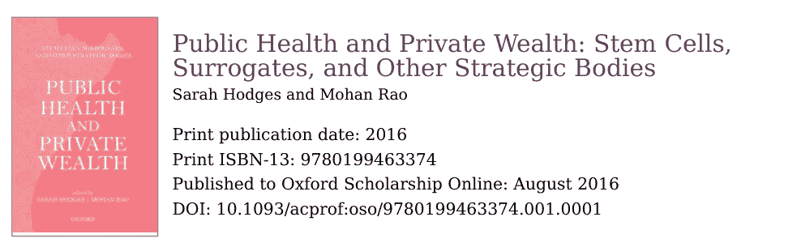
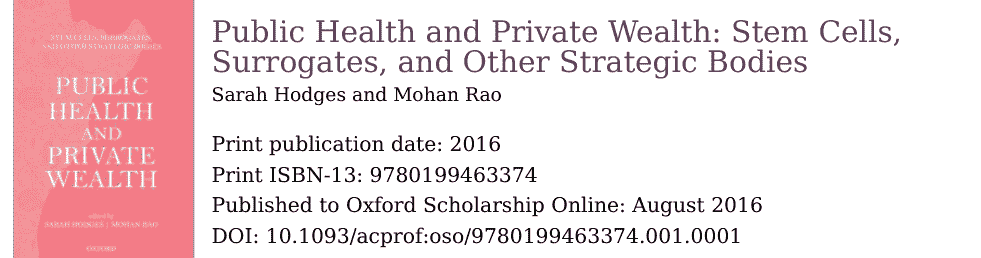
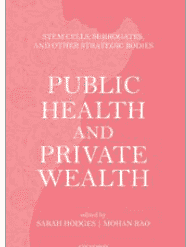
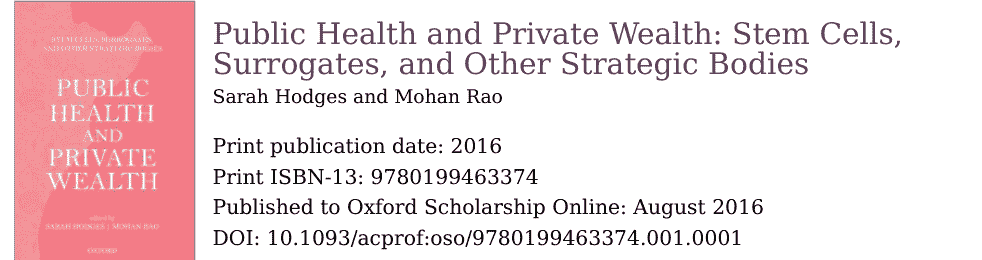
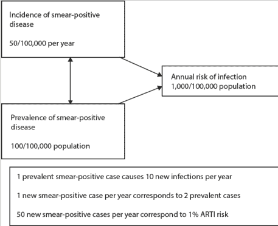
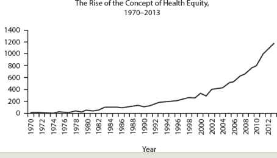
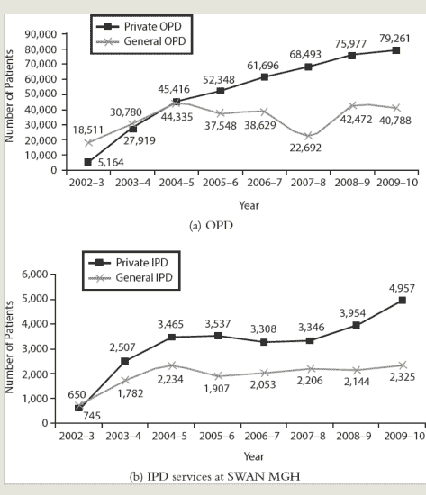
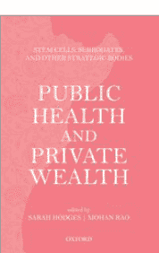
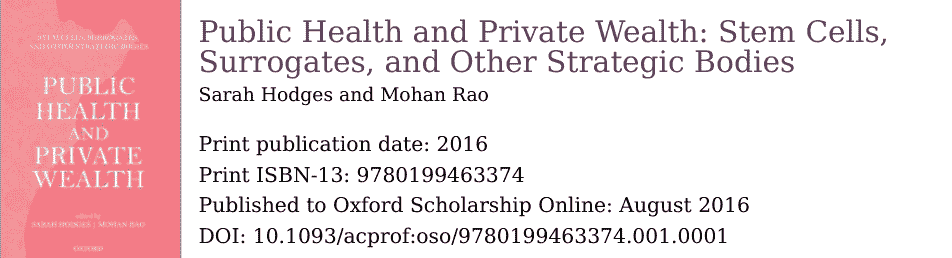
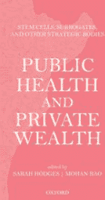

# 公共卫生与私人财富：干细胞、代孕及其他战略性

## 由以下机构提供访问支持：

Sarah Hodges 和 Mohan Rao

## 献辞

(p.v)

献给所有参与此项目的学生

—Sarah Hodges

献给 Imrana Qadeer 和 Betsy Hartmann，温柔的导师和卓越的朋友

—Mohan Rao

(p.vi)

## 由以下机构提供访问支持：

(p.x)

## 由以下机构提供访问支持：

Sarah Hodges 和 Mohan Rao

## (p.xi) 缩写

## 缩写

- BCIL: 印度生物技术联合团有限公司
- DAE: 原子能部
- ICMR: 印度医学研究委员会
- IPD: 外部部门
- IPR: 知识产权
- IT: 信息技术
- IUAT: 国际抗结核联盟
- JSHSP: 霍普金斯健康学院
- KNVC: 
- MDRTB: 多药耐性结核
- MGM: 大孟买市政局
- MoU: 备忘录
- NBT: 国家结核病
- NCBS: 国家生物科学中心
- NEO: 新经济
- NRDC: 国家发展公司
- NTI: 国家学院
- NTP: 国家结核病计划
- OPD: 门诊
- IPF: 国际父母关系
- PPP: 公私合作伙伴关系
- PSU: 部门 
- R&D: 研发
- RSS: Rashtriya Swayam
- SBIRI: 小企业创新计划
- SRM: 再生医学
- STI: 科学、技术
- SRTE: 组织工程
- TCC: 结核病
- TSRU: 结核病研究小组
- UGC: 大学补助委员会
- UHC: 通用医疗
- UK: 英国
- US: 美国
- WDR: 世界发展报告
- WHO: 世界卫生组织 (p.xiv)

## 由以下机构提供访问支持：

## 致谢

Sarah Hodges 和 Mohan Rao

## (p.xv) 致谢

献给所有参与此项目的学生

—Sarah Hodges

献给 Imrana Qadeer 和 Betsy Hartmann，温柔的导师和卓越的朋友

—Mohan Rao

(p.vi)

Mohan Rao 衷心感谢 JNU 社会医学与健康中心的同事和学生，是他们使研讨会成为可能并令人难忘。

编辑们感谢牛津大学出版社团队为本项目提供的道德和实践支持。

Sarah Hodges

Mohan Rao

## 由以下机构提供访问支持：

## 图表

## (p.ix) 图表

### 表

### 图

- 2.1 根据 Stylo 规则，ARTI 与涂片阳性结核流行病率和发病率之间的数学关系 62
- 3.1 美国国家医学图书馆 PubMed 生物医学数据库中每年包含“equity（公平）”或“equitable（公平的）”的文章数量 90
- 4.1 大孟买的人口趋势 104

(p.x)

## 由以下机构提供访问支持：

Sarah Hodges 和 Mohan Rao

印刷出版日期：2016

印刷版 ISBN-13: 97801994963374

于 Oxford Scholarship Online 出版：2016年8月

DOI: 10.1093/acprof:oso/97801994963374.001.0001

## 引言

旨在对印度科学、技术和医学在调解贫困问题中的职业生涯提出棘手的问题。与一个世纪前相比，贫困问题在今天似乎仍未解决，而且“消除贫困”本身作为一个目标已几乎完全从印度的科学议程中消失了。我们该如何解释这种对贫困的边缘化？是因为对科学解决贫困的能力失去了信心吗？还是考虑到印度近期的经济成功，贫困问题仅仅变成了一个令人不便的存在？

作为重大的新研究成果，本书的章节探讨了两个相互关联的挑战。首先，这些章节作为初步尝试，旨在对当前专家经济调查中发现（或被掩盖）的“贫困”概念进行问题化处理。经济学模型，特别是成本效益分析模型，经常设定了解决贫困和改善贫人困境方案的想象边界。这导致了一系列技术官僚式的贫困控制方法，这些方法往往仅仅因为能将信息整理成整齐的数据集就被认为是成功的。反过来，这些计量经济数据又成了关于贫困动态和贫人困境的某些“完整”知识。通过这种方式，让经济学家主宰贫困领域遮蔽了我们的视野，并限制了我们挑战这项工作以及构建不同问题的能力。正如布雷斯曼（Bresman）所说：

> 贫困研究现在被认为是经济学家的事务。或者至少是在他们中全职从事计量经济学和统计学实践的人。他们并不容易接受关于人类剥夺主题的经典文献是由政治经济学家、社会学家、人类学家和历史学家创作的¹¹¹

换句话说，后续章节并非需要或引导自贫困的“定义”——特别是考虑到贫困的定义现在（且可能永远）在实证上不是自而易见的，在政治上也不是中立的——而是受到一组不同问题的引导：贫困是什么问题的答案？换句话说，这个概念有什么用？贫困发挥了什么“作用”？在专家话语中，这个概念赋予了谁或什么力量？它什么

其次，尽管当代关于现代印度科学、技术和医学职业生涯的研究中已经描述了将“贫困”作为核心分析对象的特征，但本书的章节是为了回应“贫困”作为核心分析对象的某种令人惊讶的缺失。换句话说，我们现在拥有大量关于印度的学术成果，这些成果将技术和医学与殖民主义、民族主义、尼赫鲁时代的印度以及自由化后的印度并列视为其的一部分。尽管方式非常不同，在每一个时期中，贫困问题都是一个规划项目，并且是决策者以及其他负责组织科学和治理印度的人的核心关注点。

第三，我们如何看待自由化后的印度？有大量证据表明，已经开展的医疗部门改革产生了沉重的后果，以保险为导向的模式确实导致了自付医疗支出的增加和贫困化，而这种模式表面上是为了减少²这种贫困；而且它在将公共资源转移到医疗领域企业部门的同时，也导致了不当的医疗护理³这种医疗护理模式的道德问题也引起了关注，研究显示存在不手术（特别是子宫切除术）和不必要的检查。例如，比哈尔邦（Bihar）的16,765名妇女和恰蒂斯加尔邦（Chhattisgarh）的1,800名妇女被私人医生不必要地切除了子宫以索取保险⁴。加强公共卫生系统并远离这种医疗模式的必要性已得到规划委员会高级专家小组⁵的承认。这种医疗保健扩张模式是在代表保险和医疗领域企业部门的机构指示进行的，这一点代表这些利益的印度工业联合会（CII）对健康政策的兴趣显而易见⁶

印度医疗系统商业化的热潮在2014年印度印度人民党（BJP）政府当选后获得了新的动力，该政府致力于增长。《2015年国家健康政策草案》赞赏地指出，根据市场来源，私人医疗业的价值400亿美元，预计到2020年将增长到2800亿美元。这一异常且快速增长的经济领域——医疗保健，目前的增长率为14%，预计在未来十年将达到21%。仅在2012-13年一年，根据市场来源，私人医疗行业吸引了超过20亿美元的外国直接投资（FDI），其中大部分是风险资本。对于世界银行投资私人部门的国际金融公司而言，印度私人医疗行业是其全球健康投资第二高目的地⁷

最近的预算没有看到印度极其糟糕的公共卫生支出有所增加，这并不意外。事实上，即使考虑到通胀，它也代表了医疗保健分配的减少，而这已是全球最低水平之一。

从时间顺序来说，本书的章节试图弥补缺失，解决了支撑整个20世纪展开的科学与贫困之间关系的三个大问题。第一部分探讨了科学、技术、医学之间的关系，另一方面探讨了了殖民后期和独立早期印度的“改进”之间的关系。第二部分探讨了独立后印度医院的各种职业生涯。它问：医疗保健在多大程度上实现了其改善普通印度人日常生活的承诺。第三部分探讨了官方科学政策的历史问题——特别是生物技术职业生涯——追问在20世纪末和21世纪初，印度的贫困人是否在科学政策与私营行业的新信任中，作为实验材料而具有了战略意义。最后，尽管这种努力面临着被误认为是对科学领域所谓的“本土化转向”之批判的风险。

总而言之，构成本书开篇章节的章节——对“改进”的追求——表明了贫困的视角一直处于从殖民时期到尼赫鲁时代印度的国际科学规划的前沿。这一部分以大卫·阿诺德（David Arnold）的章节《殖民时期的贫困：营养、疾病与贫困人问题》开篇。阿诺德通过对一个世纪以来（1850年代到1950年代）印度官方政策中贫困问题的严密审查，使了贫困与公共健康之间的联系。通过这样做，他展示了贫困是印度殖民治理和新兴公共健康的反复主题。然而，这些材料也揭示了一个意外之外的现实：尽管医学专业人员意识到印度人口普遍贫困，但他们并没有将贫困视为健康和死亡的根本原因。阿诺德认为，他们觉得自己在改善贫困的实际措施上并没有很大力量。贫困本质上被视为疾病发病和发生的背景因素，或其内在原因之一。对贫困在营养研究重要性的新认识出现在1918年后的印度，特别是通过营养研究。在这一领域——即避开了基本食物获取的问题——产生了一套清晰的贫困相关公共卫生方法和目标。然而，阿诺德在结束时指出，印度在中世纪进入了新的国家规划时代，对贫困影响的营养分析和解决方案被将“贫困问题”分解为一系列高度技术解决方案的策略所掩盖。阿诺德的章节之所以重要，是因为它干预了那种拒绝将贫困描述为政治问题而非狭窄技术问题的退缩心理。也就是说，大多数研究认为贫困反政治化的兴起是20世纪中叶以后发展主义政权巩固的一部分。相比之下，阿诺德指向了贫困反政治化出现的要长得的历史。

在印度；有一段更长的历史既是英国自身“本土”贫困历史的一部分，也是其殖民地历史的一部分。

尽管如此，无疑，技术官僚主义的贫困解决方案在独立后的印度发展经验中作为治疗贫困的良方得到了充分发挥。正如本节的另外两章分别对结核病和人口控制的职业生涯分析所示，这些技术的建立和产生，源于对贫困干预可能领域的不断收窄；拉克什米·库库蒂（Lakshmi Kutty）在她的章节《表格光学：健康、技术科学与贫困的掩盖》中指出，结核病长期以来被认为是贫困的典型疾病。她叙述了20世纪中叶，出现了可以在短期内控制结核的药物治疗法。这些药物被印度国家政府和国际机构所利用，这些机构一直认为结核是实现高效运行和高生产力经济的最大障碍之一。到20世纪80年代，政策发生了重新审视。此前所采用的方法并没有产生回报。不仅结核问题没有得到控制，结核病反而有所反弹。对结核的主流政策理解已偏离了贫困、剥夺或日益加剧的不平等等政治问题。取而代之的是，政策工作人员试图绕过贫困，将结核死亡率下降解释为技术科学解决方案执行不力的结果。早期的具有政治性质的问题被系统地排除在外。

# 殖民贫困

## 营养、疾病与贫困问题

**David Arnold**

基于对官方记录和政策的仔细考虑，本文通过对一个世纪以来（从 1850 年代到 1950 年代）印度贫困政策轨迹的审查，去自然化了贫困与公共卫生之间的联系。由此认为，尽管贫困是殖民治理和新兴公共卫生体系中反复出现的主题，但长期以来医学专家未能将其视为健康和死亡的根本原因，也没有在改善其方面提供什么帮助。贫困本质上被视为一个背景因素。

**关键词**：`殖民主义`、`印度`、`贫困`、`营养`、`公共卫生`、`疾病`

今天将贫困与营养不良、高婴儿死亡率以及霍乱、伤寒等疾病联系起来几乎是常有的。但这一直并非如此。

## 殖民贫困

在 19 世纪，印度贫困的普遍性倾向于使其被一个特定的研究课题，而民族主义和马克思主义写作者则将贫困视为殖民剥削和对印度福祉的剥夺的体现。因此，从分析和实证的角度来看，将贫困作为首要卫生问题和殖民治理的核心特征具有许多益处。

早期殖民疾病记录偶尔提到贫困，但通常作为几种“诱发”原因之一。因此，从 1817 年起反复席卷印度的霍乱，疲劳、虚弱、暴露被认为是导致贫穷人死亡的因素。偶尔，贫困会被强调。1856 年，印度领先公共卫生倡导者詹姆斯·罗纳德·马丁（James Ronald Martin）评论道：“消除匮、拥挤和痛苦，疾病将失去其主要力量。”但主要影响流行病学论述的是“穷人”（作为受害者），而非“贫困”（作为原因或概念)。

# 殖民地的贫困

19世纪对疾病及其对公共卫生影响的理解遵循路线。首先，对于某些传染病（如天花），很少引发贫困问题；它们的传播模式和受害者的性质往往排除了从财富和贫困角度进行分析。其次，对于霍乱、疟疾和其他热病，人们认为地理位置和气候导致的贫困并不是疾病的主要产生源，特别是考虑到“热带”环境被认为具有致病性。在复兴的希波克拉底传统中，贫困的重要性不如环境。第三，对疾病的环境主义式理解与对印度社会的“他者化”并存——这种观点认为印度人的习俗、习惯、社会实践和信仰有助于产生或传播疾病。这从马丁的断言中显而易见，种姓制度本身是对公共健康的伤害，因为它是“对公共幸福有害”。⁶ 穿衣方式、住房、饮食、婚姻习俗和宗教都影响了这种对印度文化病理学的解读。在关于霍乱疫情的决策中，几十年来，印度教宗教信仰和沐浴节一直被视为疾病反复传播的焦点。朝圣者可能比他们表面上不负责且不卫生的行为还要贫穷。人们还认为，印度的贫困与西方（p.22）所发现的贫困有所不同：印度人可以在其他地方无法忍受或无法维持的条件下生存，仅需极少水平的食物、衣服和住所。因此，他们不太可能因为已经习惯的贫困和匮乏而生病。这就是贫困在印度被“自然化”而非“特殊化”的方式之一。正如查尔斯·格兰特（Charles Grant）所说：“热带气候最大限度地减少了对食物和人工温暖的需求，从而简化了单纯的生存行为”。⁸ 贫困并没有被忽视，但它被包含在对印度健康以及对印度社会经济中所谓的“原始住民”的更多思维领域之中。

在殖民时期的印度，宗教、种姓和社区具有首要意义，而“穷人”类别在维多利亚时代的英国则更难以捉摸，且“对穷人的发现”是沿着不同的路线进行的。印度没有明显的机制可以对穷人进行分类、工业化和医学化处理，尽管从默认设计来看，医院和监狱可能会填补这一空白。在英国，“贫民者”（pauper）一词经常被用来不仅是为了描述匮乏和需求，还为了孤立那些尽管有不良习惯、道德弱点且不愿工作，但被认为是自身痛苦和肮脏的始作祸者，并可能对他人构成危险的个体。⁹ 作为一个社会类别，穷人在印度并没有获得如此关注。即使确实使用了“pauper”一词，在印度也用得更为节制.¹⁰ 如果说欧洲的“贫困症”意味着穷人具有威胁性（p.23）且不受控的行为；那么在印度，穷人（实践中包括很大一部分劳动者、工匠和耕作阶级）不太可能被视为动荡和政治危险的直接源头。

印度可能缺乏贫民法，但经历过了一系列毁灭性的饥荒，在19世纪夺取了数百万人的生命。饥荒使贫困变得光环化且可见，但在许多英国评论者眼中，它与印度气候的反复无常及其农业的脆弱性有关。正如饥饿的人们涌入的监狱一样，饥荒救济为特定特权阶层提供了对穷人病理特征进行医学观察的机会：一些实证数据启发了开创性的医学著作，如亚历山大·波特（Alexander Porter）的《1877-78年马德拉斯饥荒中的疾病》。但饥荒引发流行病往往掩盖了贫困作为死亡主要原因的意义。例如，19世纪70年代后期由印度医疗服务的亨利·范德卡弗（Henry Vande Carver）和T. G·休尔特（T. G. Hewlett）写的关于孟买近期爆发的回归热的报告，将该疾病归于一种“特定毒素”，这种毒素同样影响了该城市的穷人和富人，但没有直接提及席卷该省的饥荒和贫困。这引起了孟买市政卫生官T.S·韦尔（T.S. Weir）的愤怒，他宣布未提及任何饥荒的情况是项“令人震惊的遗漏”，对城市内高价和食物短缺的缺失也是如此。报告作者声称，他们避免了对该市穷人所处的绝望境地的所有暗示——这些扰乱公共健康的大环境甚至没有引起顺带的一提。无论它们是被蓄意忽视，还是被无意识地跳过；事实依然是——它们未被察觉.¹¹

韦尔的言论是众多迹象之一（在下一节中将更充分地说明），说明了贫困引起市政卫生当局（特别是大孟买地区）关注的程度，远高于它在整个国家运行医疗服务中或在寻求解决流行病病因（p.24）和总体死亡率而非局部城市疾病和死亡模式的报告中所受关注的程度。但在孟买之外，将贫困作为流行病死亡主要因素的论点往往被边缘化，即使在它没有直接受到挑战的情况下也是如此.¹² 尤其是当20世纪20年代初的回归热被认为“不仅限于人口中最贫穷和住房最差的部分”，而是“实际上几乎所有居民，无论其种姓或居住地都可能感染”时，¹³

公共卫生倾向于追随而非引导政府政策。政府对饥荒的观点基于古典政治经济学和自由放任（laissez-faire）原则：穷人需要通过工作来维持生计，除非他们虚弱到使得这在生理上变得是不可能的。通过将饥荒视为一种经济危机，国家关注的是最小化救济支出，防止穷人产生“依赖性”，尽快重建农业经济，并建立一种使未来的饥荒（如果它们不太可能发生的话）至少变得致命的基础设施.¹⁴ 然而，殖民政府并不担心表现得完全完全疏职。它意识到有义务“通过利用国家资源客观上可行的一切手段来避免饥饿致死”，这项责任应“在尽可能保护人类生命的情况下以最低成本完成”¹⁵ 经常动用医学专业知识，是为了证明死于饥饿的人数很少，而不是很多——并表明流行病死亡率（p.25）在很大程度上与饥饿无关.¹⁶ 公共卫生在国家活动和专业知识的层级中处于相对较低的位置，各省法典将医疗援助和卫生检查放在优先事项的非常靠后位置.¹⁷ 一旦宣布饥荒，法典要求受影响地区定期提交“公共卫生”报告，这些报告的语气往往异常简短且自满。一份关于1899-1900年旁遮普饥荒的报告勉强地得出结论认为：“季节性问题造成的灾难非常遗憾，但只能通过普通的医疗和卫生措施来缓解。”⁸

即使在饥荒之后，明确考虑贫困时，证明作用的也并非医学知识。1888年，在印度大部分地区经历了有记录以来最严重的饥荒十年后，总督德弗林勋（Lord Dufferin）要求一份关于民众状况的报告，但在该活动中没有一个医学官员被要求发表意见。由于像饥荒一样，民众状况被视为首要财政问题，是地区收集和其他行政人员进行了咨询——其中他们承认了贫困与疾病之间的因果关系¹⁹

## 贫困与新公共卫生

到19世纪90年代，印度的殖民医疗机构正从疾病瘴气理论转向基于细菌学、寄生学和昆虫学的解释。正如汉林（Hamlin）所描述的，这种“生物医学使命”新的“科学”焦点往往仍然减少而非增强对贫困作为因果因素的关注。一个例子是1896年在孟买爆发的鼠疫。² 媒体和最初一些政府官员所表达的常识观点认为，鼠疫本质上是“穷人的病”，因为似乎孟买市较穷的地区在流行期间受害最严重。² 但增加贫困问题被边缘化了，因为英国人在应对流行病时将重点放在了印度人身体检查，随后随着流行病学知识的进展转向老鼠、老鼠以及它们的消灭，以及抗鼠疫接种。1900年至1908年间印度鼠疫委员会和鼠疫咨询委员会的报告和建议进一步将专家意见引向对更详细细菌学和昆虫学研究的需求。消灭老鼠比消除贫困具有高得多的优先级，尽管两者似乎都不适用。

疟疾的历史遵循了类似的轨迹。20世纪初对该疾病的医学描述强调了环境因素，例如蚊虫滋生的水渍土壤或城市地区：相应的解决方案是改善排水、（p.27）消灭疟蚊，以及推广奎宁预防法³³

## 殖民地的贫困

人们认为疟疾与贫困之间存在联系；这种联系往往是倒置的，即疟疾通过消耗人类生命力导致了贫困，而非相反。帕特里克·希希尔（Patrick Hehir）在1927年指出，“消灭印度疟疾将在一代人的时间内使该国成为世界上最富裕的国家之一。”24 这种观点在理论上使公共卫生处于相当大的权威地位，被授权通过消除其引起的疾病来消除贫困；但实际上，政治和财政的限制，以及医学研究日益向实验室化和专业化的倾向，阻碍了这种假设中的领先地位。

但对于一些医疗和公共卫生专业人士来说，贫困确实占据核心地位。S.R. 克里斯托弗（S.R. Christophers）对1908年旁遮普毁灭性的疟疾流行进行了开创性调查，当时疫情在两个月内导致30万人死亡。他基于详细的统计分析，提出了高粮价（经济困境的指标）与贫民高死亡率之间存在直接相关性。克里斯托弗将此称为“人为因素”，尽管在后的研究中，他似乎改变了主意，拒绝了贫困与疟疾之间的直接等式。他之所以这样做仍然是一个争议的问题。25 也许他意识到疟疾是一种比他最初想象的更复杂的流行学现象，受到不同社会、环境以及经济变量的影响。确实，当1909年帝国会议在西姆拉召开时，他的经济论点（p.28）遭到了强力反对，到他1929年向国际联盟疟疾委员会报告时，他已经放弃了贫困假说，转而更加强调环境因素。26

即使是罗纳德·罗斯（Ronald Ross）和印度的其他领先微生物学家也意识到，大多数死亡发生在“穷贫人的孩子”身上；印度疟疾研究的总体趋势显示，对贫困的社会学理解正让位给医学昆虫学和“生物专业知识”的主导地位。27 克里斯托弗在1909年旁遮普的调查在四年后转给了C.A. 吉尔（C.A. Gill），吉尔将其范围扩大到对印度及其他地区其他疾病（包括鼠疫和流感）的考虑。在这一扩大的范围内，吉尔试图建立一种贫困地区流行病的“量子理论”，而“人为因素”最终被分配了相对较小的角色。28

如前所述，医疗和卫生话语专门针对“贫困治理”的少数领域之一，是在城市健康背景下。在麦克纳利《印度卫生手册》（*McNally’s Sanitary Handbook for India*）的观察中（书中首次于1889年于马德拉斯出版，到1923年已出版第六修订版），有一个陈述称贫困是“最沉重的负担之一”。糟糕的条件本身就是贫困的原因，“贫困与疾病相互影响，并往往削弱一个民族的生命力和改进能力”。29 但，尽管承认了贫困的内在重要性，像麦克纳利这样的著作并未评估贫困对健康的实际影响，也未能就如何打破贫困与卫生之间（p.29）的恶性循环提供具体指导。一个例外是新兴的孟买市，从19世纪60年代中期到2020年代，一系列长期任的市政卫生官员将贫困（以及相关因素，如住房条件差、饮食不当和公众对基础卫生的无知）确定为疾病和死亡率持续高企的主要因素。在一个相当典型的陈述中，孟买第二任市政卫生官员T.S. 韦尔（T.S. Weir）在他1875年关于城市霍乱爆发背后因素的报告中写道：

> 我认为，这些流行病的病源在于人民的贫困以及他们所生活的苦难。这座城市大多数人口的贫困程度令人难以信。被迫供养大家庭，并被迫直接或间接地为婚礼和其他仪式储下大部分收入，他们仅靠所赚的维持，毫不夸张地说，处于饥饿的边缘。30

引起对贫困关注的不仅是霍乱。1902年，韦尔继任者J.A. 汤纳（J.A. Turner）详细审查了该市婴儿死亡率持续偏高的因素。他的清单包括劳工母亲和未成年母亲的体质虚弱、婴儿营养不良，以及该市许多贫民居住的卫生条件差且拥挤的环境，但他论点的精髓是有价值的。“正如上面提到的，”他比划着自己职业的相对无力补充道，“贫困是邪恶的根源。这种导致婴儿死亡的直接原因是市政当局无法处理的影响，也是我们所建议的补救措施无法及的。”31 可能由于原因导致贫困在孟买的市政卫生报告中具有如此突出的地位。孟买（正如现在的孟买一样）是南亚洲城市贫困和贫民窟最大的城市之一。在城市较狭的区域——作为印度领先的城市之一——贫困的影响更为明显，而在大部分由小镇和村庄组成的整个省份，这种影响更容易可见且可量化。32 此外，在孟买，卫生和健康措施的应用比印度任何地方都更果决、更有系统（除特权区和监狱外），但未能产生预期的效果并阻止疾病和死亡的潮。作为一个繁忙的国际港口，1896年鼠疫的出现和1918年流感的再次凸显了这一点，贫困是卫生官员可以有力解释为何他们反复败于孟买城市卫生秩序的原因之一。同时，正如汤纳的话所暗示，城市卫生官员意识到，单凭他们所能做的事情是有限的——如果没有更大的公众意识或工业家及其他领导成员更积极的支持。但在孟买的医疗和卫生报告中对贫困的重视并未得到广泛认同，即使在加尔各答和马德拉斯等大城市也是如此。

医疗和卫生话语中对贫困的关注（尽管这种关注是不稳定的）增长的另一个例子是1918-1919年的流感（p.31）大流行。尽管流感在全球范围内造成了大量死亡，但印度受此种疾病的打击尤为严重，估计在1918年6月到1919年初几个月期间，两次主要波中（第二波在农村地区破坏性更大）发生了1200万至1400万死亡。按照每10死一人计算，至少有1.25亿人遭受了病毒侵害。33 与二十年前的鼠疫一样，孟买市遭受了严重影响，并反成为疾病进一步传播的中心。34 尽管列举了各种因素来解释公共卫生服务的极度匮乏，但许多受害者实际上死于此。尽管饥荒的存在并未得到广泛承认，但第一次世界大战结束后是印度全范围内粮价高涨和短缺的时期，1918年季风的局部失败加剧了这一点。印度政府卫生专员的中期报告指出，在1919年，“没有地方出现真正的饥荒，但营养不良的程度无疑比许多年来要严重。”35

随后各省卫生官员的评论进一步强调了贫困。北方邦省（United Provinces）卫生专员指出，如果流感在印度的致命率远高于西方国家，“那不是因为印度的卫生条件更差，而是因为经济条件更差。印度人的居住、衣着和饮食比英国和美国差，对疾病的抵抗力也小。”如果要防止这种死亡率，他补充道（为了让自己的部门（p.-32）免于指责），“产生这种结果所需的改变取决于经济条件的变化，而非取决于卫生人员的努力。”36 卫生专员采取了类似的立场，实际上反复了他曾合作者克里斯托弗在十年前就写过关于粮价与疾病之间的关系。“布料的价格最为昂贵，”写道……极大地夸大了了贫困阶层的困境。由于营养和衣物不足，人口的生命力通常良好，这导致了发热（包括流感）的高死亡率。37 虽然这太

## 殖民地贫困

过度强调1918–1919年流感流行对印度公共卫生政策的持久影响是错误的，但这可以被视为使贫困获得公众和专业关注的因素之一。

### 贫困、人口与营养

在两次大战期间，关于贫困与公共健康的辩论中有两个方面变得格外突出，且在某种程度上相互对立。一个是人口，另一个是营养。尽管人们广泛引用经济、环境甚至文化解释来解释19世纪的饥荒以及随之而来的高死亡率，但在讨论反复发生的饥荒时，也存在着强烈的马尔萨主义暗流。“人口过度”被认为是饥荒和疾病的根源.^38 因此，对饥荒这种“自然节约”的脆弱性以及急性贫困问题被构建为“过剩”人口。根据19世纪80年代的一位官员说法，土地承受的持续压力在早婚和土地分割的加剧下，在供应不足的情况下导致了无法持续的“几乎贫民的人”，直到干预并扫清了“这群群”。^39 随着饥荒的减少（至少在1908年之后其最极端和反复的形式之后，即1943年孟加拉饥荒之后），马尔萨主义不再受到青睐，直到20世纪20年代后期才复苏。随着1931年人口普查显示印度人口在过去十年增加了10%，“人口问题”变得更加紧迫。这引发了关于印度是否“人口过剩”的争议，并复活了马尔萨主义的主张，即人口快速增长是印度面临的最大问题。^40

马尔萨主义并非没有受到反对。C.A. Gill在1928年宣布，马尔萨斯“不再属于先知之列”，“他的这些观点让人回想起中世纪对普通疾病特别是流行病的态度；而且很少有支持者反对科学界”。在Gill看来，马尔萨斯分散了人们对现代流行病学所面临的真实问题的注意力.^41 但Gill对马尔萨主义的驳斥被证明为过早了。到20世纪20年代后期，“人口问题”已被视为所面临的最关注点和公共卫生问题，与1846年的爱尔兰饥荒有着惨痛的相似之处.^42 国家医生和公共卫生官员（如Gill本人）在这场辩论中双方都发挥了重要作用。参与其中的最强影响力的人物之一是J.W.D. Megaw，他激烈地主张，医疗干预通过减少流行性疾病的死亡率在无意中加剧了危机，而在增加农业生产力或抑制人口增长方面几乎无所作为。他在1934年向伦敦的听众表示，“大自然”对我们干预其破坏性力量并无威胁……“我们在没有应用反向平衡点的情况下破坏了她的平衡。” 地方性贫困不仅是结果，而且在很大程度上是印度人的自我认知，因为他们在此之前无法负担用于控制人口增长并防止其进一步超过生产水平所必需的避孕措施.^43 像《印度医学公报》（Indian Medical Gazette）这样有影响力的期刊（Megaw曾该杂志编辑）支持这一观点，即人口增长现在是印度公共卫生体系面临的最首要问题。只有出生控制才能防止印度的3.5亿人口陷入比19世纪40年代吞噬爱尔兰800万人的更大的灾难中。^44

另一个关键辩论领域与饮食有关，这可以被视为解决印度更广泛社会经济问题的马尔萨主义的另一种途径，且这种途径认为消除贫困和营养不良比比人口增长和生育具有更大或更紧迫性。^45 《印度医学公报》在1922年宣布：“贫困在任何地方都不比在印度表现得更严峻。”它接着说，数百万印度人生活在美国营养学家E.V. McCallum所说的“黄昏地带”，在那里，饮食的微小变化对健康产生关键影响.^46 从20世纪20年代开始，对营养的科学研究开始证明贫困与健康状况之间的明确联系。然而；营养缺乏（如贫困本身）在印度通常被视为习俗和文化经济剥夺的结果、对大米而非更有营养的谷物的地区偏好、女性的社会从属以及导致其饮食的匮乏——换句话说，感知的解决方案在于改变文化价值观，而不是解决贫困。

这场辩论中一个有影响力的声音是Coanor营养实验室的Robert McCarrison。在20世纪20年代，McCarrison将“结构良好”锡克人和帕坦人的饮食（由小麦和乳制品组成）以及由此产生的优越体格，与马德拉斯和孟加尔“贫穷米食者”的“结构不良”饮食以及他们产生的虚弱种族划分了鲜明的二分。McCarrison利用大鼠实验而非实地观察，使用了“武武种族”和“非武种族”的刻板印象，从而支持了早期殖民主义关于健康文化决定因素的观点.^47 但McCarrison为印度的营养研究奠定了基础，并作为一名有效的宣传者，对他认为营养对印度福祉核心性的信念赢得了支持（尤其是在印度人中）。在职业生涯中，McCarrison将其思维的重点从文化因素转向了经济因素。他看到种族的多样性以及饮食与体质的不断对比，为“营养与贫困在某种程度上相关联”提供了“无与伦比的材料”。他写道，营养研究人员“不能……忽视其工作的经济方面，这项工作必须服务于穷人，也要服务于富人。”研究者不仅应该证明最好的饮食是什么，还要证明穷人也负担得起。

## 殖民地贫困

“因为印度是一个贫穷人多于富人的土地”^48 McCarrison进一步认为，公共卫生是一个由公众决定的问题。印度营养问题的解决方案不仅仅在营养学家手中，而在其他人手中——即印度人的手中.^49 正确的营养知识可能赋予穷人力量。

# 殖民地贫困

McCarrison在20世纪30年代中期结束印度职业生涯与对贫困问题的高度关注相吻合。这种关注部分是因为人们意识到饥荒的减少并没有结束地方性饥饿问题，也部分是因为印度发展体制的缓慢出现。^50 大规模贫困和由此导致的健康问题随之而来。对贫困的新型批评主要来自左翼民族主义者，他们认为贫困、公共卫生和社会正义之间存在密切联系。1929年，Rajani Kanta Das认为，“所有需要立即解决的重要社会、政治和经济问题中……没有比全国范围内群众的长期和永久贫困更复杂的了。”^51 另一位经济学家N. Gangullie在1939年也同样认为，印度没有比营养更紧迫的问题了。对他而言，这一问题与社会经济组织以及“资本主义生产模式固有的矛盾”紧密相连。他对“人口过剩”是印度贫困原因的主张嗤之以鼻，但他同样对文化选择决定贫困秩序表示怀疑。只有消除贫困才能解决营养问题。^52

## 殖民地贫困

（通过体重、卡路里摄入量和维生素含量）可以对营养贫困进行准确评估。这些调查针对特定的社会群体，特别是贫困的农村工人、妇女和儿童，他们最容易受到饮食不足的威胁；调查将注意力转向了几种此前鲜为人知的常见缺乏性疾病，并对即使是穷人也如何改善其日常饮食提出了务实建议。55 这些研究提供的证据帮助了政府政策的制定，例如在马德拉斯，1936年为学龄儿童引入了牛奶和鳕鱼肝油（第38页）。56 在全印度范围内，营养也成为了一项主要的政策问题。57

尽管第二次世界大战使饮食调查陷入停滞，但它为新的营养政策注入了新动力。政府被迫抛弃放任主义，并以以前未有的规模进行干预，以调节谷物贸易和食品消费。1942年英国《贝弗里奇报告》（Beveridge Report）的出版，为印度公共健康的社会目标提供了进一步动力。这在1946年《健康调查与发展委员会报告》中得到了体现，该报告在讨论疾病的“社会背景”时，热烈地引用了贝弗里奇的观点，同时抱歉地补充道，“建议消除贫困和失业的方法与手段”超出了委员会的职责范围。58

饥荒已不再是理解大规模贫困的因素。1943年的孟加拉饥荒及其引发的官方调查加强了人们的信念：公众所消费的食物质量也是引起公众关注的原因，且确实需要国家采取行动。1945年的《饥荒调查委员会报告》（奥威克是该委员会的成员）包含了对“人口、营养与食粮政策”的详尽讨论。该报告在抨击了“狂热的马尔图斯主义”立场后，认为营养对公共健康至关重要，收入水平需要提高，以改善大众的饮食。委员会宣布，一种“均衡且满意的饮食”目前“超出了大部分人口的负担，而这是体质虚弱、疾病和死亡的主要原因”。因此，“改善营养状况”是“印度[任何]公共卫生计划中不可或缺的一部分”。59 “贫困的治理”极少获得过这样的认可。

但营养科学和公共卫生机构绝非解决贫困问题（第39页）的唯一途径。另一种替代方案来自物理学家梅格纳德·萨哈（Meghnad Saha），他在20世纪30年代证明，孟加拉洪水和疟疾的双重问题可以通过大规模的河流控制和灌溉措施来解决。萨哈明确表示消除贫困是其建议的核心，他在1938年辩道：“如果我们希望充分确保贫困的消除，当我们90%的同胞正在遭受痛苦时……我们必须充分利用自然赋予我们的力量。”60 公共卫生机构似乎无法完成这项任务。萨哈的计划受到苏联和美国新政先例的启发，阻碍了国家资源的大规模部署，并成为1938年国家规划委员会形成的基础。61 萨哈雄心勃勃的计划帮助注意力转向了国家的全面干预，而非饮食调查和营养科学曾试图鼓励的小规模、自救式治理。他的愿景优先考虑科学和技术——即建造大坝、发电和调节流量所需的工程——并表现出一种倾向于通过科学技术而非医学和公共卫生来解决印度问题的趋势。公共卫生和国家工程并不一定是竞争对手：它们确实可以是互补的方法。但事实是，萨哈所设想的那种规模的工程手段被视为消除贫困的主要手段，这表明公共卫生无法完成那项艰巨的任务。

## 注释

- (*) 本章的早期版本发表于《历史研究》第85（2012），488-504页，题为《殖民地印度贫困的医疗化》。我感谢 Sarah Hodges 和 Mohan Rao，他们让我有机会回顾并扩展了该文章中的一些观点。

- (1) Göran Durjfeldt 和 Staffan Lindberg, 《对抗贫困的药丸：泰米尔纳德一个村庄西方医学引入的研究》（伦敦: Curzon Press, 1975）。

- (2) Michel Foucault, “治理术”，收于《福柯效应：治理术研究》，Graham Burchell, Colin Gordon, 和 Peter Miller 编（芝加哥: Chicago University Press, 1991），81–104; Giovanna Procacci, “社会经济与贫困的治理”，收于《福柯效应》，151–68页; Christopher Hamlin, 《查德威时代的公共健康与社会公正：英国，1800–1854》（剑桥: Cambridge University Press, 1998）。

- (3) Frederick Corbyn, 《印度流行的流行性霍乱论》（加尔各答: Thacker, 1832）；James Jameson, 《传染性霍乱热病报告》（加尔各答: Government Gazette Press, 1820）。

- (5) David Arnold, “印度在热带世界中的地位，1770–1930年”，《帝国与英联邦国家历史杂志》第26卷，第1期（1998）：1-21页。

- (6) James Ronald Martin, 《加尔各答医学地理笔记》（加尔各答: G.H. Nuttman, 1837），49页。

- (7) David Arnold, “英国殖属印度的霍乱与殖民主义”，《过去与现在》，第113（1986）。

- (8) [原文为：David Arnold, ‘Cholera and Colonialism in British India’, Past and Present, 113 (1986)] (此处为格式标记)

- (9) [此处为格式标记]

- (10) [此处为格式标记]

- (11) [此处为格式标记]

- (12) [此处为格式标记]

- (13) [此处为格式标记]

- (14) [此处为格式标记]

- (15) [此处为格式标记]

- (16) [此处为格式标记]

- (17) [此处为格式标记]

- (18) [此处为格式标记]

- (19) [此处为格式标记]

- (20) [此处为格式标记]

- (21) [此处为格式标记]

- (22) [此处为格式标记]

- (23) [此处为格式标记]

- (24) [此处为格式标记]

- (25) [此处为格式标记]

- (26) [此处为格式标记]

# 殖民贫困

(27) Ira Klein, 'Development and Death: Reinterpreting Malaria, Economics and Ecology in British India', *Modern Asian Studies* 38, no.2 (2001): 155; D.J. Bradley, 'The Particular and the General: Issues of Specificity and Verticality in the History of Malaria Control', *Parassitology* 40, 1-2 (1998): 6.

(28) Clifford Allchin Gill, *The Genesis of Epidemics and the Natural History of Disease* (London: Bailliere, Tindal and Cox, 1928), 85-96.

(29) A.J. Russell, *McNally's Handbook for India* (Madras: Superintendent, Government Press, 1923), 4.

(30) T.S. Weir, 'Annual Report of the Health Officer, Annual Report of the Municipal Commissioner of Bombay', 1875 (Bombay: Education Society's Press, 1876), 148. Weir 在二十年后重申了关于霍乱与贫困之间关系的观点：Weir; 'Annual Report of the Health Officer', Administration Report of the Municipal Commissioner for the City of Bombay, 1894-1895 (Bombay: 'Times of India' Press, 1895), 571.

(31) J.A. Turner, 'Report of the Executive Health Officer', Administration Report of the Municipal Commissioner for the City of Bombay, 1902-03 (Bombay: Times of India, 1903), 169. 关于 Turner 对孟买贫民健康的进一步关注，可以从牛奶供应、城市过度拥挤和结核病方面看到：J.A. Turner, 'Report of the Executive Health Officer', Administration Report of the Municipal Commissioner for the City of Bombay, 1904-05 (Bombay: Times, 1905), 187-9, 194-7; J.A. Turner, 'Report of the Executive Health Officer', Administration Report of the Municipal Commissioner for the City of Bombay, 1915-16 (Bombay: Times Press, 1916), 16-49-52.

(32) 贫困及其影响的可见性是孟买健康报告中反复出现的主题。在 1866 年的第一份报告中，T.G. Hewitt 评论道：“只有那些进入贫民阶层房屋的人，才能直观地看到贫困，能看到某些租客房居民呈现出的极不健康的状态。” *Bombay Municipality: Health Officer's Report, 1866*, IOR。讽刺的是，Hewitt 后来被他的继任者 Weir 指责忽视了贫困是 1877 年该市斑疹热发发的因素。

(33) I.D. Mills, 'The 1918-19 Influenza Pandemic: The Indian Experience', *Indian Economic and Social History Review* 23, no. 1 (1986): 1-40; R. Knowles, 'The Medical Aspects of the Indian Census of 1921', *IMG* 59 (September 1924): 466.

(34) Mridula Ramanna, 'Coping with the Influenza Pandemic: The Bombay Experience', in *The Spanish Influenza Pandemic of 1918-19: New Perspectives*, Edward Philip and David Killinging (London: Routledge, 2003), ch. 6.

(35) F. Norman White, *A Preliminary Report on the Influenza Pandemic of 1918 in India* (Simla: Government Monotype Press, 1919), 12.

(36) D. Mackaggart, 'Report on the Epidemic of Influenza in the United Provinces during 1918', *Annual Report of the Sanitary Commissioner of the United Provinces of Agra and Oudh, 1918* (Allahabad: Superintendent, Government Press, United Provinces, 1919), 15 A.

(37) Charles A. Bentley, 'Report on Sanitation in Bengal, 1918' (Calcutta: Bengal Secretariat Book Dept, 1919), 9. 另见 W.H.C. Forster, 'The Influenza of 1918 in the Punjab', *Report of the Sanitary Administration of the Punjab, 1918* (Lahore: Superintendent, Government Printing, Punjab, 1919), 16.

(38) S. Ambrijan, *Classical Political Economy and British Policy in India* (Cambridge: Cambridge University Press, 1978).

(39) F.A. Nicholson, *Manual of the Coimbatore District* (Madras: Government Press, 1887), 257.

(40) David Arnold, 'Official Attitudes to Population, Birth Control and Reproductive Health in India, 1921–1946', in *Reproductive Health in India: History, Politics, Controversies*, ed. Sarah Hodges (Hyderabad: Oriental Longman, 2006), 22–50.

(41) Gill, *Genesis of Epidemics*, ix-x.

(42) Editorial（可能由 Megaw 编写），'The Population Problem in India', *IMG* 63 (July 1928): 328–9.

(33) J.W.D. Megaw, 'Population and Health in India: The Real Problem', *Asiatic Review* on 30, no. 102 (1934): 250. 类似观点请参阅 A.J. Russell and K.C.E. Raja, 'The Population Problem in India', *IJMR* 23, no. 2 (1935): 54–68.

(44) Editorial（可能由 R. Knowles 编写），'More about the Population Problem', *IMG* 67 (March 1932): 153–7.

(45) David Arnold, 'The Discovery of Malnutrition and Diet in Colonial India', *Economic and Social History Review* 31, no. 1 (1994): 1–26; V.R. Muralheer, *Disease and Death in Colonial India*, *Economic and Political Weekly* 29, nos. 1–2 (1994): 55–63.

(46) 'The Economic Factor in Tropical Diseases', *IMG* 57 (September 1922): 341.

(47) R. McCarrison, 'A Good Diet and a Bad One: An Experimental Contrast', *IJMR* 14 (1927): 69–54. 关于 McCarrison 的评估，参见 James Venger, *Hunger: A Modern History* (Cambridge: Harvard University Press, 2007), 104-8.

(48) R. McCarrison, 'The Study of Nutrition in India', *Current Science* 1, no. 1 (1932): 3.

(49) McCarrison, 'The Study of Nutrition in India'.

(50) David Ludden, 'India's Development', in *Colonialism and Culture*, ed. N.B. Dirks (Ann Arbor: Michigan University Press, 1992), 247-87.

(51) Rajani Kanta Das, 'The Problem of India's Poverty', *Modern Review* 46, no. 4 (1929): 365-70.

(52) N. Gangalee, *Health and Nutrition in India* (London: Faber and Faber, 1939).

# 管状光学

## 摘要与关键词

结核病（TB）长期以来被认为是贫困的典型疾病。然而，到20世纪80年代，政策发生了重新审视。所的基于药物的方法并未产生成效：结核病问题没有得到控制，反而出现了复发，且往往与 HIV/AIDS 相关，有时甚至以新的形式出现，即致命的多耐药性。这导致了结核病与贫困之间关系的“重新界定”和“重新编码”。对结核病的主政策理解已从贫困、剥夺和日益加剧的不平等等政治问题转移。相反，卫生工作人员试图通过将结束率归于技术科学解决方案实施不足来规避贫困，而政治问题被系统性地排除。

**关键词**：结核病、印度、贫困、国际健康政策、政治

## 正文

结核病是一种社会疾病，与贫困密切相关，这一点不言而喻。关于不同地区和时期结核病下降和复发的文献已经指出，它与社会结构变化密切相关，包括工资水平和收入、饮食营养，以及工作条件、城市化和健康基础设施¹。贫困的不同含义对结核病疾病、治疗和政策制定可能产生不同的影响，从而为患者提供了不同的健康和福祉可能性。贫困被理解为缺乏经济以及确保免于疾病或从疾病中康复所需的社会资源。^2 它被理解为对社会经济稳定和政治权力的不平等和排斥，这使得贫困人口更容易受到疾病的影响，且治疗和治愈的可能性充满了不确定性。³ 它被用作患者依从性或“不足”患者身份的编码，证明了需要额外的监控。^4 它被理解为由全球不平等和卫生部门改革驱动的国家或地区政治经济的功能。5

印度国家结核病计划（NTP）制定于 20 世纪 60 年代，背景是流行病学调查，这些调查确定结核（TB）是一个公共卫生问题，植根于有利于疾病传播的资源限制之中，例如贫困、营养不良、过度拥挤、日益增长的工业化、季节性失业和人口迁移。^6(p.42) 这些都是巨大且多方面的问题，需要长期的结构性变化；它们还需要科学研究，旨在解决人群中迫睫的疾病负担和痛苦。这种资源匮乏的情况形成了研究新型科学技术和药物方案的动力，这些方案将超越贫困患者的社会经济背景。通过国际组织提供的资金和科学支持获得的研究进展产生了一种信心，即关注化学治疗、技术工具以及计划组织和规划将解决人群中的结核病问题。^7 因此，尽管结核病政策的制定在印度及其他地区都源于对结核病与贫困之间联系的认识，且这些联系构成了进一步发展结核病政策的理由，但贫困问题仍然没有得到充分解决。

### 通过技术科学理性重构贫困

这种对科学进步的信赖导致的结果是对结核病与贫困之间关系的重构和重新编码。其中最有影响的是从政治性质的问题转向技术/科学/行政/管理性质的问题。除了理解贫困视角以及之前讨论过的影响结核病的社会经济和政治决定因素外，贫困可以以另一种方式解读。它可能被解读为通过科学框架被重新、重新编码，这种编码几乎消除了附着在其上的社会-结构-政治意义和潜在含义，并赋予了它一种技术基因。通过这种重构，仍然可能像以前一样解决贫困问题，但这次是以一种新的方式，即以能够适应问题的技术解决方案的力量和能力。本章将探讨这种技术/科学框架，这种框架将结核病中的贫困问题重构为了某种需要技术工具解决的问题。它将阐述这种已构建并获得合法性的框架，以及它如何通过对治疗结构的个体化、行为化框架，以及对健康实现的成本效益框架来进行表述。

基于分层的概念框架，本章将讨论结核病计划和政策领域的两个工具：脱落率（default）概念的开发（治疗完成中的不规则性、“不依从性”行为、遵循方案期间的“动力不足”）以及阻止这种现象的技术；以及年度感染风险（ARI）和溶菌培养结核杆菌的作用（对个人在一年内获得结核杆菌感染或再次感染概率的统计学估计，以及对社区内涂片阳性疾病的相应估计）。涂片阳性结核病是指痰液检测中显示存在结核杆菌的肺性结核病。涂片阳性肺性结核病具有传染性，结核病控制工作集中在这一类患者身上。

政策领域是技术、管理和政治特征的交织；它植根于公民、专家和政治权威之间的权力关系和等级制度。这种解读被解释为福柯“政治技术”概念的一个进阶实例。^6 德雷福斯和拉宾在与福柯对话时指出，“政治技术的进步是通过将本质上是政治的问题，将其从政治话语领域中移除，并将其重构为科学的神经语言。一旦实现了这一点，问题就变成了专家辩论的技术问题。”^9 与此同时，还有关于科学专业性质的问题，以及“职业的权力至少在部分取决于成功地对其工作的科学价值，以及他们的专业知识（p.44）如何基于实践、准确且可靠的科学信息的基础的能力”。^10

然而，批评者指出，科学判断具有不稳定性和动态特质，这些被认为是“所选方法论的产物，而非对现实的[ ]反映”。^11 科学判断“受到组织基础设施的支持”验证进一步值得审查，因为组织官僚倾向于“强调该官僚机构有工具衡量的风险方面（预期损失），而牺牲了较少测量但并非不重要的风险承担方面”。^12 此外，来自政治领域的政策可能表现为“对特定问题的技术反应，这些问题属于国际组织所建立的职责或目标范围”。^13

因此，我们对世界卫生组织（WHO）在 20 世纪 40 年代至 80 年代期间限制 BCG 疫苗政策发展的争议进行了批判性分析。^14 此外，还有对 20 世纪 60 年代至 90 年代直接观察治疗短程化（DOTS）全球技术策略创建的研究。^15 我们对 20 世纪 50 年代和 60 年代印度南部两个机构（p.45）标记结核病研究和政策方向的竞争观点进行了研究。^16 这些研究证明了最佳科学工具或政策建议如何被识别并推广给各种利益群体，作为国际科学的“最佳实践”。这些研究示不仅揭示了影响性行动者、“知识共同体”或组织在构建和促进特定科学知识方面发挥的战略作用，还揭示了这些“最佳实践”模型的采纳通常显示了纯科学之外的多种过程的交织。17

讨论21 世纪初结核病卫生政策研究的广泛轮廓时，Porter 和基尔曼指出，当代国际视角是“传染病控制的生物医学模型”。它基于一个具有核心决策制定理性方法的结构和系统。计划基于生物医学方法，利用理性过程进行设计、实施和评估信息。这是“技术顾问”的“正常”视角。^18 用于识别卫生系统改革政策建议的现有理性技术工具范围包括：疾病负担评估；干预措施的有效性和成本效益评价；卫生系统性能和可用资金分析；以及社区调查和政治规划，以评估不同方案的政治可行性。^19 当代模型结核病控制技术工具的发展轨迹确实反映了至少从20 世纪 60 年代甚至更早的观点。

理性选择基于决策和理性行动的经济考虑。^20 事实上，保健政策决策的逻辑已经与（p.46）健康经济学工具交织。^21 即尝试将理性与实用工具开发相结合，不仅可以计算成本与收益之间的关系，还建议在预期收益超过成本时才采用新倡议；因此，理性的科学选择是在化结果价值的同时最小化任何可能的风险。在保健科学研究理性方法核心的一系列技术工具中，成本效益分析是计划定义的标准，特别是在贫困背景下。然而，它因与通过更广泛社会经济和政治正义改善贫困人口保健和福祉的考虑不一致而受到了批判性审查。^22

在对成本效益逻辑的一种特别批判中（这种逻辑在 20 世纪 90 年代曾被用于论证在资源匮乏地区治疗多药耐性结核病（MDR-TB）是不可行的），Yong Kim 等指出，这种逻辑忽视并掩盖了决定或限制医疗服务的多重社会、政治、经济、流行病学和生理因素。在忽略 20 世纪 70 年代至 90 年代结构调整期间新自由主义改革以及债务偿还对贫穷国家卫生预算负担的情况下，他们指出：

> 与其首先主张将药物援助和恢复医疗保健预算作为取消债务的条件，许多卫生政策制定者（包括结核病领域的许多人）简单地依靠成本效益分析来帮助他们在“有限”且在许多情况下萎缩的资源背景下，寻找并推荐最有利的干预措施。²

(p.47) 在该领域少有的表述视角角的，他们清楚地展示了成本效益逻辑是如何被错误的药物定价机制所驱动的，以及援助组织之间竞争性指令的跨国政治经济如何使需要的人无法获得 MDR-TB 治疗。

科学研究理性方法的另一个主导主张基于这种方法如何被利用到风险的概念中。结核病不仅以其经验形式（即产生不良结果的可能性）呈现出来，更多是作为一种范式建构，对风险的测量和比较评估、管理以及针对风险的安全机制等，驱动着多个领域的决策。³ 此外，从结核病发机制的阶段来看，“风险因素”在我们理解结核病流行病学的概念和方法工具的发展中起了基础性作用。⁵20 世纪 50-60 年代风险因素流行病学的影响力日益取代了疾病的特定病因，并考虑了多种风险因素。然而，这种分析仍局限于个人层面，预防和治疗策略趋向于“通过敦促个人责任和个人健康行动来寻求主要健康风险的解决方案，与从源头上解决关键风险的和社会环境现实相比⁷⁷

从这种背景演变而来，结核病领域的专家知识试图完善风险管理的务实方面，特别是在导致结核病“患者风险行为”成为常见的复杂不平等网络中，它在对抗疾病中发挥了至关重要的作用。这通常导致一种倾向（p.48），将计划失败的责任归咎于个人患者，寻求提供支持性和强制性相结合的来阻止停药。风险管理还通过对概念、技术和方法进行普遍标准化的要求来实现，每种方法都具有传输/复制的潜力，并能在跨区域产生可比性数据。然而，在这些情况下，始终存在对风险证据解释的问题，这呼应了科学知识不稳定和动态的本质。²8

Porter 和 Kielmann 指出，围绕结核病政策开发的流程一直是特定框架、结构和系统的一部分，而决策是一个本质上政治化的过程。他们认为“为了将技术与政治联系起来，我们有必要从超越决策理性模型的视角出发，来审视我们创建和实施结核病计划的方法。”²⁹ 随下来的两个章节的讨论将说明某种特定的理性是如何通过“停药（default）”概念以及年度结核病感染风险（ARI）工具和斯泰法则（Stylo rule）表述的。这将涉及部署成本效益逻辑以更新结核病控制的科学知识库，正如所声的，当贫困水平、疾病负担和结核病死亡率的结合达到令人震惊的程度时，这种方法能更好地应对发展中国结核病的严峻形势。

### “停药与监督治疗：将患者行为置于治疗结构的核心”

从不合规被确定为治疗的重要因素开始，它主导了随后几十年（p.49）全球结核流行病学研究和计划规划的方向；这是结核病计划的一个开创性概念工具。作为开发指导全球政策方向的研究和计划工具的机构之一，印度马德拉斯的结核治疗中心（TCC）和班加罗尔的国家结核研究所（NTI）是与世界卫生组织（WHO）和英国医学会（BMRC）合作建立的。BMRC 的结核病研究小组建立于 1956 年，旨在研究在大规模计划环境中应用门诊/居家（相对于疗养院/医院基础上）治疗的适用性。³⁰ 此外，世界卫生组织帮助 NTI 重点关注地区培训、计划实施的操作问题以及流行病学。³¹

一个重要的科学机构是总部位于巴黎的国际抗结核病联盟（IUAT），这是一个专门从事全球结核病倡导和科学研究的专业非政府自愿组织。IUAT 专注于开发全球各国结核病计划模型。其使命的一个重要部分是建立国家结核病协会，协助各国政府开展结核病工作，施加压力影响政治决策，因为它认为政府机构受限于某些结构，这些结构阻止了他们采取应对结核病威胁所需的所有步骤。³²

在接后的几十年里，在接受 TCC 和 NTI 服务或被其识别的患者中进行了对照试验、化疗方案研究和流行病学调查。他们的研究任务取决于由于印度背景带来的紧迫需求和问题——资源不足、生活水平低、发热疗养院和与大量需要结核病治疗的人相比的病床匮乏、治疗昂贵且漫长（其中大部分（p.50）是大多数患者无法负担的），但紧迫的任务是为一系列发展中国家的结核病控制提供见解。结核病发病率与病床可用性以及成本之间的差异，使得门诊护理在此时期印度等发展中国家的唯一可行选择。在资源不足背景下困扰治疗的各种问题，BMRC 和 IUAT 在印度和东非的研究，有效地定义了识别和关注用药不规范及停药中心的角色，以便进一步的研究和计划管理。

#### BMRC-TCC 研究方向

在 Wallace Fox 的指导下，TCC 执行了关于居家/门诊治疗与护理治疗对比的研究，早期就发现患者对药物方案的依从性是门诊患者中的一个问题。³³ Fox 在 20 世纪 50 年代后期研究了 TCC 监督治疗的潜在疗效。³⁴ 他详细说明了在 TCC 为确保治疗依从性所采取的努力，Fox 描述了一种高度协调的患者监测方法，其包括：

1.  在治疗前的诊断和评估阶段让家属以及患者参与；
2.  在需要定期服用药物时反复强调，并强调家庭或邻居在监督中的作用；
3.  尽可能将药物限制在结核病化疗范围内；
4.  意外进行家访，以 (a) 检查患者的药物储备和 (b) 采集尿液样本检测抗结核药物；以及
5.  如果患者未按时到诊，采取迅速的追捕措施。³⁵

他在脚注中进一步阐述了最后一点的具体模式：

(p.51) 对于每个收入治疗的患者都会获取完整的地址列表，即 1) 患者的家中，2) 以下地址的马德拉斯市的亲属和朋友，3) 他访问他们的频率，4) 如果有工作，工作地点，5) 如果孩子在上学，其学校地址，6) 他的籍地地址。如果患者未到诊且家中门锁，邻居也不知道患者或家人的去处，则会对替代方案进行系统化的处理，直到追踪到患者为止。（提供了足够的交通工具和为访客提供的尽心培训者宿舍。）^36

患者必须面对许多困难才能接受此类治疗.^37 尽管如此，到20世纪60年代初，福克斯（Fox）就主张，在发展中国家的特殊情况下可以组织长期监督治疗.^38 这种对治疗模式单一方面——**违约行为**的密集强调，导致了两个相关领域研究的激增——监督治疗和间歇性治疗。第二个研究领域直接源于第一个领域，尽管这并非完全由药理学见解驱动；对监督性化疗的研究启动了间歇性方案的发展，因为这些方案减轻了监督任务。39

短程化疗时代出现得较晚，是在20世纪70年代，为了应对标准方案（12个月或以上，包括每日和间歇性）的失败，因为这些方案“超出了所有这些国家卫生服务的组织和财务资源”。^40 这种短缺不仅在于药物，还在于（p.52）这些国家无法建立建立监督治疗所需的基础设施和人员要求。当短程方案与间歇性原则相结合时，这提供了全方位监督化疗领域最大的进展.^41

到20世纪60年代末至70年代初，在不同地点开展的英国生物医学研究委员会（BMRC）研究得出结论，“有效治疗需要对治疗进行直接监督，这种方法可以中断患者[在不再感到不适时停止用药的普遍倾向……]。”^42 这种关于患者具有“普遍倾向”不配合治疗的表述，尽管 BMRC-T 研究已充分意识到贫困患者所处贫困和剥夺环境的严重程度。在具有里程碑意义的“家庭对比 疗养院”研究中，许多患者饮食糟糕、休息不足、住宿条件简陋且拥挤、就业不稳定，且护理照顾较少。^43 此外，福克斯指出，如果往返诊所的距离长达五英里，[其中一些人获得了有限的交通费资助，但可以肯定许多人使用他们的免费资金补充饮食，并准备每天步行去接受治疗。]^44

## 参考文献

(53) Iris Borowy, *Coming to Terms with Health: The League of Nations Health Organisation, 1921–1996* (Frankfurt-am-Main: 2009), 382–7. 即使是对新科学持怀疑态度的《印度医学杂志》，也赞扬国际组织的 Aykroyd，并承认贫困无疑是疾病发生的一个“严重复杂因素”：'Nutrition and Public Health', editorial, *IMG* 70 (November 1935): 632. 一年后，该期刊修改了对印度“马尔萨斯噩梦”的立场，'The Population Problem', editorial, *IMG* 71 (May 1936): 278.

(54) W.R. Aykroyd, *Note on the Results of Diet Surveys in India* (New Delhi: Indian Research Foundation, 1939).

(55) W.R. Aykroyd and B.G. Krishna, 'The Carotene and Requirements of Children', *IJMR* 23, no. 3 (1936): 741–5; Aykroyd and Krishna, 'The Deficiencies of the Indian Diet', *IJMR* 25, no. 2 (1937): 367–72; W.R. Aykroyd, K.B. Madhava, and K. Rajagopal, 'The Detection of Malnutrition in Measurements of Arm, Chest, and Hip', *IJMR* 26, no. 1 (1938): 55–94.

(56) *Local Self-Government (Public Health)*, no. 2649, 23 December 1936, Tamil Archives, Chennai.

(57) *Education, Health and Lands (Health)*, 37-6/37, 1939, NAI.

(58) *Report of the Health Survey and Development Committee* (Delhi: Manager of Publications, 1946), 1-17.

(59) *The Famine Inquiry Commission: Final Report* (Madras: Government Press, 1945).

(60) M.N. Saha, *The Problem of Indian Rivers* (1938), in *Collected Works of Meghnad Saha*, ed. Santimay Chatterjee (Bombay: Oriental Longman, 1986), 2: 64–91.

(61) 关于 Saha 的愿景和影响，见 Shiv Visvanathan, *Organizing for Science: The Making of an Industrial Research Laboratory* (Delhi: Oxford University Press, 1985), ch. 3.

在资源有限的情况下，研究的动力是寻找能够通过合同解决方案规避患者贫困境的治疗技术，而不一定需要与其复杂的社会经济背景进行深度接触。这使得科学界对结核病反应的焦点集中在结核病患者面对治疗时的行为和动机方面。科学技术的新进展并不会减少已经规划好的治疗方案的个体化监测模式，而随着未来几十年中形成的结核病公共卫生系统，似乎很少能应对结核病患者在更大剥夺背景下的脆弱状态。

### (p.53) 国家结核病研究所（NTI）的研究方向

与其他地方一样，在1962年国家结核病计划（NTP）期间，对药物方案的不依从继续困扰着印度卫生管理人员和研究界。对违约行为的观察往往让人感到患者对完成整个疗程的重要性无知、在感觉好转后停止药物，或者对治疗失败感到懒惰和冷漠。1963年斯蒂格·安德森（Stig Andersen）和德巴巴·巴内杰（Debabar Baner）的研究与此之前的研究形成了鲜明对比；它将患者首先视为一个社会实体，并承认患者的经历是由他们所处的社会结构空间构成的。45 它关注疾病引起的痛苦和担忧的经历；它质疑了对治疗违约者的传统定义是认为其是技术官僚、武意的且带有价值偏见的；为患者为何无法维持长期药物方案提供了社会学见解。它指出，患者对治疗指令的冷漠可能是因为“患结核病所遭受的痛苦还不足以维持治疗；这可能是由于存在其他更紧迫的问题（例如饥饿问题）掩盖了肺结核病的问题”。^46

虽然这是以患者为导向的观点驱动研究的一个希望的信号，但它并没有从根本上将注意力从“患者违约者”这一计划管理的核心问题转移开。相反，该研究对结核病治疗背后的社会学因素提出了新的理解，以及解决违约问题的必要性，批评了治疗组织的失败、行政和管理上的缺失以及服务交付的不当实施。^47 事实上，NTP的成功源于对“松散的治疗组织（p.54）滑坡效应”的整改。^48 NTI简报作为一线结核病工作人员和科学研究领域交流的平台，提供了进一步的视角。从1964年成立到20世纪70年代中期，大部分信函、社论和新研究文章解释这项研究社会学见解的方式，恢复了个人行为和行动的核心性，试图修复这一方面的治疗组织缺陷。

# 管状光学 (Tubular Optics)

患者的社会经济和政治背景并未出现在讨论中，除非考虑到它们如何影响依从的意愿和能力。^50

文章并未涉及结核病更广泛的决定因素，很大程度上强调了患者在治疗前和治疗期间动机的重要性、对违约者进行追踪行动的各种手段，以及患者改变行为的需要。^51 巴内杰（Banerji）随后写道，需要改变通过医学科学来实现社会变革的方法，而同时主张需要重新定位现有的疾病流行病学观念，并将健康的非医学视角视为同样重要。^52 尽管如此，当时已确立的违约中心性在计划构想中无法忽略。

### (p.55) 世卫-IUAT的研究方向

在20世纪70至80年代，国际结核病协会（IUAT）的援助计划在马拉维维、莫桑比克和坦桑尼亚等国启动了国家结核病计划，并对化疗方案及其在大规模计划中的实施进行了多项试验。53 20世纪60年代的IUAT文献指出，非洲几个国家的动荡、剧变和贫困是由于在独立斗争中，这影响了他们照顾结核病人群健康需求的能力，因此这些国家与IUAT之间的合作与援助。^54 尽管注意到这种对社会稳定产生不可避免影响的社会政治压力，仍有声音认为，非洲的问题在于，尽管在马德拉斯等地的居家治疗已被证明有效，但要将这些精心设计的试验中使用的技术和方法转化到对分散在广大地区的社区的治疗是一项艰巨的行政任务。

# 管状光学

即使在病情已经变得相当好转后，56 如果患者在剩余治疗期间出现违约（脱落），则须向其主管报告；如果他们“继续违约”且尿液呈阳性，他们将颜无耻地重新入院医院。57 随着教育与宣传的结合，耻辱和羞愧感成为确保合从性的便利工具；克服疾病的建议在这里也围绕着行为修正和监测的狭窄范围展开。

世界卫生组织（WHO）和国际结核病协会（IUAT）联合荷兰皇家结核病协会（KNVC），在20世纪60年代中期在荷兰建立了结核病研究单位（TSRU），由Karel Styblo担任主任，其授权任务是研究与控制和监测措施相关的结核病流行病学。58 在20世纪70年代至80世纪80年代，Styblo在发展中国家（主要是东非）发起了关于缩短治疗疗程以及在医院环境下直接观察治疗的研究。短期疗程和住院治疗与当时的传统治疗方法相矛盾，当时的人认为这种方法不安全且不符合成本效益，导致Styblo的研究在当时几乎没有引起关注。59 Ogden（p.57）等人详述了在20世纪80年代末到90年代中期，Styblo局部的、针对特定背景的结核病治疗是如何在DOTS这一品牌下扩展为全球通用政策的，并宣布结核病化疗法是目前最具成本效益的干预措施。DOT是“直接观察短程治疗”（Directly Observed Treatment, Short course）的缩写，这种治疗策略的一个重要组成部分是医务工作人员观察患者服用药物；至少在前两个月是如此。它还有四个组成部分：确保政治承诺；保证药物供应；通过痰液显微镜检查诊断；标准化的报告系统。

20世纪80年代后期，在被认为已消除的地区出现结核病“复发”的焦虑、HIV/艾滋病的出现以及世界卫生组织作为国际机构的作用和影响下降的背景下，世界银行作为“卫生部门优先事项审查”（HSPR）的一部分，对各种不同的健康干预措施进行了成本效益研究，凸显了全球关注结核病的必要性。60 与此同时，发展中国健康卫生研究特别委员会强调，结核病是发展中国家中最常见的可预防死亡原因，但被忽视了。61 该委员会的部分成员还与世界银行密切合作进行一项疾病负担研究。62 在接下来的两年里，该委员会会会了Styblo，对其在坦桑尼亚的工作进行了成本效益分析，并发现尽管坦桑尼亚资源匮乏，但从每个避免的死亡成本和挽救的寿命来看，严重结核病的化疗法是发展中国家最便宜的健康干预措施。63 随后，世界卫生组织加入了进来，通过了多次会议和研讨会以规划可能的结核病控制政策策略的组成部分和目标，并于1991年在中国实施了基于Styblo策略的试点项目。

与此同时，世界卫生组织内部一个强大的倡议联盟致力于提高新结核控制计划在全球的品牌形象和市场营销，并试图将科学界（p.58）社区的工作简化为“简单的、一律适用的、需要严格遵守的最佳实践”。很快，重心就从科学和研究重点转向了营销以及让各国接受DOTS；这正是世界卫生组织在1993年宣布结核病为全球紧急发状况的背景，从而锁定了DOTS政策作为结核病解决方案的未来。负责品牌和传播策略的世界卫生组织专家认为，你需要一个足够简单的信息来让人们聚集在周围，以至于他们即使不理解它，也可以说他们想要。64 然而，这引发了科学家-学术界与政策-倡议社区之间激烈的批评和辩论，辩论点在于对一个复杂问题进行了危险的过度简化，以及将一种监督疗法政策（品牌为DOTS）普遍化的问题性，因为这种政策在不同的医疗服务、社会和经济背景下可能在操作上或伦理上是不可行的。尽管存在这些冲突，有影响力的政策企业家以及营销和倡议专家的观点决定了DOTS时代科学结核病政策的方向。

在发展中国家与结核病治疗相关的多个问题中，科学研究和计划仍然高度关注个体不合从和违约的个人行为方面。65 一个不遵守规定疗程的患者对其自身和更大的社区都是威胁，从20世纪50年代末开始，监督治疗就是最容易发生违约的。这种疾病的个体化也导致了医疗保健解决方案的个体化，而“战胜结核病”主要意味着结核病患者具有社会责任感、自我管理、遵循医嘱并修正风险行为。这巩固了治疗方案的个体化监测模式，而阻止违约的挽救动力则没有涉及其他问题。

在与患者相关的障碍中，一种关于违约的观点认为患者是无知且缺乏动性的，应对措施包括监督策略、行为修正、增加教育和（p.59）交流活动；另一些人认为他们需要额外的资源和支持来遵守治疗，要求提供激励、交通费用和食物供应。医疗系统的障碍应通过治疗重组、管理和行政结构调整以及根据患者需求改进服务提供来管理或解决。从整体上理解违约背后的因素需要对更广泛的结构性因素做出反应，包括与社会经济和结构政治相关的障碍，这些因素导致了贫困持续的脆弱性；66 当健康和疾病脱离社会决定因素和个体事件时，这个问题就没有解决。

监督治疗研究的早期阶段也受到成本效益逻辑的限制，但不像20世纪80年代后期形成的复杂形式。在提供医疗服务、基础设施和药物方面资源受限的情况下，考虑到疾病导致生产力损失的经济成本，研究在看似匮乏的领域演变。事实上，在Styblo对非洲的研究期间，关于监督治疗成本高的论点可以被治疗失败或治疗完全患者更高成本的数据有力地反驳；67 从监督治疗到DOTS的违约轨迹引导了科学知识、政治影响和政策实施的循环，并成功地将结核病社会决定因素的讨论重构为五点策略，其中两个是技术性的（常规药物供应和痰液显微镜检测），另外三个是管理性的（直接观察、政治承诺和标准报告系统）。

# (p.60) 每年感染率、Stylo法则与结核病全球估算

对“感染率”信息的需求源于对结核病发病率和死亡率严严重的担忧。了解新感染率对于控制措施至关重要，因为“高低风险社区之间的结核病流行病学可能不同”；69 年度结核病感染率（ARTI或ARI）的概念定义为一年内获得新感染或再次感染的概率，是通过通过结核素皮肤试验调查的儿童感染率估值得出的；70 这是一个由Styblo在1969年于TSRU开发的概念，因此是从观察到的感染率计算出的平均值，近似于感染率。71

(p.61) 发病率；患病率为现有病例或病例。ARTI具有提供有关结核杆菌在社区中传播程度信息的潜力。72

1985年，Styblo展示了另一个重要指标，ARTI与涂片阳性结核病发病率之间的关系，即肺结核病的新发病例。73 通过观察几个国家在1910年至1970年间的结核病发病率、患病率和死亡数据，本文指出1%的ARTI对应于每10万人中50例新的涂片阳性肺结核病病例。通过推导出这一估算，

# 管状光学

由于当时数据的匮乏，他不得不额外依赖历史流行病学观察，即每年死亡人数、每年发病人数和涂片阳性结核的流行率保持在 1:2:4 的比例。此外，他注意到年度感染风险（ARTI）与涂片阳性结核的流行率之间的比例约为 10，也就是说每个患有涂片阳性的病例每年约感染 10 个新人数。因此，Stylo 假设涂片阳性结核的发病率、流行率与 ARTI 之间存在固定关系（见图 2.1）。⁷⁴

世界卫生组织（WHO）发表了一篇技术报告，将“年度感染风险”这一概念应用于来自五个发展中国家的结核病皮肤检测调查数据（而 Stylo 1969年的论文仅研究了荷兰的数据），并包含了对趋势的分析而非仅是现状（第62页）。⁷⁵ 通过采纳感染风险概念（并注意到 Stylo 规则的有效性），世界卫生组织确立了其在全球流行病学分析中的核心作用。这两个工具迅速成为“指导性规则”，并成为流行病学典籍中珍贵的一部分。（第63页）发展中国家现在根据感染率就能看到涂片阳性结核病例，而无需进一步调查其他方面。⁷⁶ 自此以后，估计人群中结核病发病率的常用方法一直是通过皮肤检测调查评估的 ARTI 以及 Stylo 规则。⁷⁸

到20世纪80年代末，ARTI 技术以及源自这些开创性研究得出的所有相关流行率和发病率估值，与其他工具一起，被世界银行开展的大型疾病评估项目使用，定义了新的全球健康范式。其中，正如之前提到的，包括世界银行的健康部门优先级审查（HSPR），这是一系列针对发展中国家主要疾病集群的公共卫生，以及目前用于预防和管理的现有技术的成本和效益进行的研究。⁷⁹

> 图 2：根据 Stylo 规则，ARTI 与涂片阳性结核发病率之间的数学关系
>
> 来源：改编自 F. van Leth, M.J. van der Werf, 和 M.W. Borgdorff，《结核感染的流行率与结核病发病率：对 Stylo 规则的评估》，世界卫生组织公报第86卷，第1期 (2008): 20-6。

1987年，世界银行启动了一项重大的公共卫生分析计划——健康部门优先级审查（HSPR）。这项工作最终以出版《发展中国家疾病控制优先事项》宣告告终，记录了关于发展中国家健康干预成本效益的现有知识。由于有了对近50 种干预措施成本效益的比较信息，人们对健康部门分配效率的兴趣日益增加。成本效益分析作用的扩大，为1993年《世界发展报告》中的健康政策信息奠定了基础。为了利用成本效益来开发基本健康服务包，了解疾病负担是很有用的。此处报告的医疗服务待解决的全球及区域疾病和伤害负担的定量，是《世界发展报告》的关键投入。⁸⁰

（第64页）作为估计发展中国家结核病负担、干预和成本工作的一部分，HSPR 采用了 Cauten、Pio 和 ten Dam 1988年关于急性呼吸道感染（ARI）的数据、Stylo 模型以及 Stylo 规则作为评估结核发病率等参数的核心技术。⁸¹ 对于干预的证据，独立的发展卫生研究特别委员会指出，Stylo 在坦桑尼亚的结核病短期监督化疗是根据“每避免一个寿命年所成本”衡量的成本效益最高的干预技术。⁸²

然而，到20世纪90年代中期，对 Stylo 规则的概念批判开始出现，质疑其基于 ARI 估计疾病发病率的合理性。这些批评集中在一点：即缺乏控制结核病措施（如广泛的且有组织的化疗治疗）的情况——在很大程度上是 Stylo 那个时代——已不再是事实。Rider 质疑了这种历史假设，即在缺乏疾病发病率信息的地区，发病率可以通过流行率除以二来得出。他指出，感染风险与“未治疗的传染性结核病的持续时间”具有内在联系，而化疗干预可能会降低传播率，因此“连接流行率和发病率的平均传染持续时间发生了根本性的变化”。⁸³ 此外，当代的 HIV 背景也助成了挑战，HIV 相关的结核病导致传播者增加，或症状出现更快，导致更早的发现和治疗，从而中断传播。⁸⁴

因此，任何传播中断会导致：

- 涂片阳性结核流行病例引发的结核感染数量将低于 Stylo 最初报告的数字。结果是，在这种情况下（第65页），涂片阳性结核的发病率必须很高，才能建立 1% 的 ARTI。因此，在可以进行干预中断的情况下，使用 Stylo 规则来计算涂片阳性结核的发病率可能不是有效的方法。⁸⁵

此外，尽管结菌素试验是建立感染流行率（反过来是 ARI）最广泛使用的工具之一（第66页），但长期以来一直面临技术和方法论方面的问题。这些包括标准化结菌素的选择、解释的困难以及其中一些研究倡议的不稳定性。最后，在对 Stylo 规则进行了十年的批评后，世界卫生组织的战略和技术咨询小组于2006年批准了建议，不再使用 Stylo 规则来估计涂片阳性结核的发病率。⁹¹

# 管状光学

20世纪80年代末的发展推动了 HSPR 和研究特别委员会等倡议网络推动的 ARI 相关工具在全球范围内的广泛应用和合法性。虽然 Stylo 的化疗工作被卫生研究委员会采纳并发展为 DOTS 策略，但他的流行病学研究被 HSPR 采纳以提供疾病负担估值。反过来，这些工作也从成本效益的视角赢得了合法性，并且（第67页）科学事实将其转化为发展中国家结核病计划的技术科学解决方案。

例如，它刺激了全球疾病负担（GBD）研究，产生了另一个定量指标——一种以受影响的人类生命年数表示“疾病负担”的复合指数。该指数变成了“伤残调整寿命年”（DALY），将不同的结果——发病、残疾和死亡——整合到一个单一衡量标准中。⁹² 这有助于对减少天天的特定干预措施进行成本效益分析。这些工作共同构成了1993年《世界发展报告》（WDR）《投资健康》的概念和方法论基础，该报告证明是世界银行在全球公共卫生领域实施转折的定义性特征。⁹³

然而，HSPR-GBD-WDR 试图通过成本效益的单一框架计算发展中国家主要疾病集群的“公共意义”，遭到了严厉批评，特别是用于 HSPR 的原始研究，当时没有使用 DALY 作为有效性/效用衡量。DALY 是在 HSPR 对原始研究进行审查和修订期间计算的。⁹⁴ 然而（第68页）HSPR 结核病研究的粗略成本效益计算版本——HSPR 结核病研究早期成本效益计算版本——通过“每个治疗病例成本；十八个月后每个避免病例成本；每个避免死亡成本（“避免死亡”的估值再次源于 Stylo 规则等估值）；包括一次传播的每个避免死亡成本”进行比较，表明未来 DALY 计算的核心原则已整合到这项研究中。

# 管道式光学

在出现的各种不同概念和技术批判中，存在着广泛的共识，即“疾病负担”（burden of disease）被定义为规范性术语，排除了对个人、家庭或社区实际所承受的负担具有重大影响的社会经济因素。该衡量标准被批评为它将健康的理念从“福祉”推回了更以疾病为导向的模式，并关注健康，整个过程旨在“为技术干预辩护护护，并削弱健康的社会政治维度”。因此，这几十年间用于结核病计划的证据基础或趋势，并未消除任何对结核病及其治疗引入社会经济或政治经济学视角的可能性；结核病作为一种社会疾病的问题，仍然受限于传染病控制的成本效益生物医学干预措施。

本章试图阐述通过技术科学框架将贫困定格在结核病之中的过程。它讨论了这种做法如何通过对护理结构的个体化、行为化框架，以及对健康实现的成本效益框架来表述。它展示了这些方式如何在具有影响力的科学和政策制定倡议的伞下，获得合法性，并从局部语境（p.69）转化为全球语境。

这种讨论表明，科学判决具有稳定性和动态性特质，此类判决往往是“所选择的产物，而非对现实的呈现”。本章试图详述科学判决如何被验证，即“获得来自组织基础设施的支持；而这往往倾向于强调那些其科学官僚机构拥有工具可以衡量的风险方面”。

在很大程度上，本章必须说明，贫困似乎主导了一种幻象；结核病科学工具和政策的发展，一贯地中断了介入结核病中贫困的结构性、政治和话语元素的可能性。

注释：

(*) 我感谢 Sarah Hodges 和 Mohan Rao 的支持与鼓励，特别感谢 Mohan Rao 对初稿的意见。感谢 Ramila Bisht、David Arnold 以及该项目研讨会的参与者对早期草稿的反馈。我也感谢 Emma Rothschild 和 Abhijit Banerjee，让我能够在哈佛大学和剑桥大学历史与经济联合中心的伞下，在“贫困的经济史”会议上讨论这篇文章。

## 参考文献

1. Thomas McKeon, R.G. Brown, and R.G. Record, ‘An Interpretation of the Modern Rise of Population in Europe’, *Population Studies* 26, no. 3 (1971): 345-82; D.P. Pence, J. Hotchkiss, C.S.D. Williams, and P.D. Avery, ‘Tuberculosis and Poverty’, *British Medical Journal* 307, no. 6907 (1993): 759-61; Rene and Jean Dubois, *The White Plague: Tuberculosis, Man and Society* (Boston: Brown and Company, 1952); D. Banerji and S. Andersen, ‘Sociological Study of Awareness of Persons with Pulmonary Tuberculosis’, *Bulletin of the World Health Organization* 29, no. 5 (1963): 665-83; Amy L. Fairchild and Gerald M. Oppenheimer, ‘Public Health Nihilism vs Pragmatism: History, Politics, and the Control of Tuberculosis’, *American Journal of Public Health* 88, no. 7 (1998): 1105–17.

2. M. Muniyandi, R. Ramachandran, P.G. Goni, V. Chandrasekhar, R. Subramani, K. Sadacharam, et al., ‘The Prevalence of Tuberculosis in Different Economic Strata: A Community Survey from South India’, *The International Journal of Tuberculosis and Lung Disease* 11, no. 9 (2007): 1042-45.

3. P. Farmer, *Infections and Inequalities: The Modern Plagues* (Berkeley: University of California Press, 2001).

4. J. Porter and J. Ogden, ‘Public Health, Ethics, and Tuberculosis: Is DOTs a Breakthrough or Inappropriate Strategy in the Indian Context?”, *Indian Journal of Medical Ethics* 7, no. 3 (1999): 79-84.

5. E. Jaramillo, ‘Encompassing Treatment with Prevention: The Path for a Lasting Control of Tuberculosis’, *Social Science & Medicine* 49, no. 3 (1999): 393-404; Imrana Qadeer, Kasturi Sen, and K.R. Nayar, eds, *Public Health and the Poverty of Rivers: The South Predicament* (New Delhi: Sage Publications, 2001).

6. Indian Council of Medical Research, *Tuberculosis in India: A Sample Survey, 1955-58* (New Delhi: Indian Council of Medical Research, 1959).

7. Tuberculosis Chemotherapy Centre, Madras, ‘A Concurrent Comparison of Home and Sanatorium Treatment of Pulmonary Tuberculosis in South India’, *Bulletin of the World Health Organization* 21, no. 1 (1959): 51–144.

8. J. Keyes and I. Scoones, ‘Understanding Environmental Policy Processes: a Review’, *IDS Working Paper* 88 (1999), 5.

9. H. Dreyfus and P. Rabinow, *Michel Foucault: Beyond Structuralism and Hermeneutics* (Brighton: Harvard, 1992).

10. Bryan Turner, *Medical Power and Social Knowledge* (London: Sage Publications, 1995), 208.

11. Donald T. Hornstein, 'Reclaiming Environmental Law: A Normative Critique of Risk Analysis', *Columbia Law Review* 92, no. 3 (1992): 573.

12. Donald T. Hornstein, 'Reclaiming Environmental Law: A Normative Critique of Risk Analysis', *Columbia Law Review* 92, no. 3 (1992): 573.

13. D. Banerji and S. Andersen, ‘Sociological Study of Awareness of Persons with Pulmonary Tuberculosis’, *Bulletin of the World Health Organization* 29, no. 5 (1963): 665-83.

14. Amy L. Fairchild and Gerald M. Oppenheimer, ‘Public Health Nihilism vs Pragmatism: History, Politics, and the Control of Tuberculosis’, *American Journal of Public Health* 88, no. 7 (1998): 1105–17.

15. E. Jaramillo, ‘Encompassing Treatment with Prevention: The Path for a Lasting Control of Tuberculosis’, *Social Science & Medicine* 49, no. 3 (1999): 393-404.

16. Imrana Qadeer, Kasturi Sen, and K.R. Nayar, eds, *Public Health and the Poverty of Rivers: The South Predicament* (New Delhi: Sage Publications, 2001).

17. Indian Council of Medical Research, *Tuberculosis in India: A Sample Survey, 1955-58* (New Delhi: Indian Council of Medical Research, 1959).

18. Tuberculosis Chemotherapy Centre, Madras, ‘A Concurrent Comparison of Home and Sanatorium Treatment of Pulmonary Tuberculosis in South India’, *Bulletin of the World Health Organization* 21, no. 1 (1959): 51–144.

19. J. Keyes and I. Scoones, ‘Understanding Environmental Policy Processes: a Review’, *IDS Working Paper* 88 (1999), 5.

20. H. Dreyfus and P. Rabinow, *Michel Foucault: Beyond Structuralism and Hermeneutics* (Brighton: Harvard, 1992).

21. Bryan Turner, *Medical Power and Social Knowledge* (London: Sage Publications, 1995), 208.

22. Donald T. Hornstein, 'Reclaiming Environmental Law: A Normative Critique of Risk Analysis', *Columbia Law Review* 92, no. 3 (1992): 573.

23. Donald T. Hornstein, 'Reclaiming Environmental Law: A Normative Critique of Risk Analysis', *Columbia Law Review* 92, no. 3 (1992): 573.

24. D. Banerji and S. Andersen, ‘Sociological Study of Awareness of Persons with Pulmonary Tuberculosis’, *Bulletin of the World Health Organization* 29, no. 5 (1963): 665-83.

25. Amy L. Fairchild and Gerald M. Oppenheimer, ‘Public Health Nihilism vs Pragmatism: History, Politics, and the Control of Tuberculosis’, *American Journal of Public Health* 88, no. 7 (1998): 1105–17.

26. E. Jaramillo, ‘Encompassing Treatment with Prevention: The Path for a Lasting Control of Tuberculosis’, *Social Science & Medicine* 49, no. 3 (1999): 393-404.

27. Imrana Qadeer, Kasturi Sen, and K.R. Nayar, eds, *Public Health and the Poverty of Rivers: The South Predicament* (New Delhi: Sage Publications, 2001).

# 管道式光学

在出现的各种不同概念和技术批判中，存在着广泛的共识，即“疾病负担”（`burden of disease`）被定义为规范性术语，排除了对个人、家庭或社区实际所承受的负担具有重大影响的社会经济因素。该衡量标准被批评为它将健康的理念从“福祉”推回了更以疾病为导向的模式，并关注健康，整个过程旨在“为技术干预辩护护，并削弱健康的社会政治维度”。因此，这几十年间用于结核病计划的证据基础或趋势，并未消除任何对结核病及其治疗引入社会经济或政治经济学视角的可能性；结核病作为一种社会疾病的问题，仍然受限于传染病控制的成本效益生物医学干预措施。

本章试图阐述通过技术科学框架将贫困定格在结核病之中的过程。它讨论了这种做法如何通过对护理结构的个体化、行为化框架，以及对健康实现的成本效益框架来表述。它展示了这些方式在具有影响力的科学和政策制定倡议的伞下，从局部语境（p.69）转化为全球语境。

这种讨论表明，科学判决具有稳定性和动态性特质，此类判决往往是“所选择的产物，而非对现实的呈现”。本章试图详述科学判决如何被验证，即“获得来自组织基础设施的支持；而这往往倾向于强调那些其科学官僚机构拥有工具可以衡量的风险方面”。

在很大程度上，本章必须说明，贫困似乎主导了一种幻象；结核病科学工具和政策的发展，一贯地中断了介入结核病中贫困的结构性、政治和话语元素的可能性。

# 管状光学

(37) Bayer and Wilkinson,‘结核病的直接观察治疗法’, 154-158; Wallace Fox,‘药物的自我给药：发表著作回顾及问题研究’，国际抗结核联盟公报 32 (1962): 307–31; Amrith,‘寻找结核病的“魔法子弹”’,113-30.

(38) Fox,‘药物的自我给药’,307-31; TCC,‘糖尿病结核治疗中，间歇性（每周两次）异烟�酰胺链霉素与每日异烟�酰胺PAS的对比研究’.

(39) Fox, Eldard, way Mitchison,‘结核病治疗研究’,S237.

(40) Wallace Fox,‘患者与医生的依从性：结核病的经验与教训——第二部分’，英国医学杂志 287, no. 6385 (1983): 101-5.

(41) Fox, Eldard, way Mitchison,‘结核病治疗研究’.

(42) Bayer and Wilkinson,‘结核病的直接观察治疗法’, 1546.

(43) 结核治疗中心,‘居家治疗的对比’,51-144.

(44) Fox,‘药物的自我给药’,321.

(45) Banerji and Andersen,‘意识的社会学研究’,665-683.

(46) D. Banerji,‘印度社会规划中的结核病问题’，国家卫生管理与教育公报 4, no. 2 (1971): 9–25.

(47) D. Banerji,‘结核病患者对提供有限监督的治疗机构的行为’，印度结核病杂志 14, no. 3 (1967): 156-72.

(48) Amrith,‘寻找结核病的“魔法子弹”’,121.

(49) 这包括对医疗接触中涉及的参与者和机构之间关系的研究——医患关系、患者与其他健康人员或医人员的关系；卫生机构的组织研究、功能、基础设施、服务交付、行政设置、记录/报告与转诊系统、培训、监督、沟通、距离、人口和区域特征。B.K. Venkatesiah,‘结核计划的技术与运营评估’，NTI 公报 6, no. 1 (1969): 1–7.

(50) Amrith,‘寻找结核病的“魔法子弹”’.

(51) D.R. Nagpaul,‘结核控制的计算机时代’,NTI 公报 5, no. 1 (1968): 11–14; M.A. Seetha and K.S. Aneja,‘基层卫生机构的失访者追踪与失访行为成本’,NTI 公报 14, nos 3–4 (1977): 87–90; Radha Narayan and S. Pramila,‘国家结核计划下结核病患者的激励模型’,NTI 公报 9, no. 2 (1972): 20–23.

(52) Banerji,‘结核病作为社会规划问题’,9–25.

(53) C.J.L. Murray, E. Dejong, H.J. Cum, D.S. Nyangulu, A. Salamao, and K. Styblo,‘撒哈拉非洲以南三个国家结核病化疗的成本效益’，柳叶刀 338, no. 8778 (1991): 1305–8; D.A. Enason,‘国际抗结核和肺病联盟模式下的结核计划’,结核与肺部疾病 76, no. 2 (1995): 95–99.

(54) Etienne Bernard,‘“非洲结核病研讨会”开场演讲’,1960年9月9-10日，巴黎，《国际抗结核杂志公报 31, no. 2 (1961).

(55) Fox 1958，引自 Frederick Heaf,‘英语国家非洲的结核病’,收于‘非洲结核病研讨会’,1960年9月9-10日，巴黎，《国际抗结核联盟公报 31, no. 2 (1961): 5–10.

(56) G.G. Crofton,‘非洲结核病研讨会’,1960年9月9-10日，巴黎，《国际抗结核联盟公报 31, no. 2 (1961): 51.

(57) Crofton,‘非洲结核病研讨会’.

(58) Annik Rouillon,‘结核病监测研究单位 (TSRU): 前三十年’,国际结核病与肺病杂志 2, no. 1 (1998): 5–9。正是在 TSRU，Styblo 作为科学活动负责人在1969年构建了开创性的“感染风险”流行病学模型，随后在1985年又提出了另一个被称为“Styblo规则”的指导性流行病学原则。1979年，他成为国际抗结核联盟（IUAT）的科学活动主任。IUAT扩大扩大其职责范围，涵盖其他肺疾病，并在1986年更名为国际抗结核和肺病联盟（IUATLD）。

(59) Walt, Lush, and Ogden,‘传染病传播中的国际组织’,D.A. Christie and E.M. Tansey,‘结核病短程化疗：伦敦大学学院医学历史中心于2004年2月2日行的证会笔录’,第24卷，144页（伦敦：医学历史中心）。

(60) Walt, Lush, and Ogden,‘结核病的政治’.

(61) Walt, Lush, and Ogden,‘传染病传播中的国际组织’.

(62) Walt, Lush, and Ogden,‘结核病的政治’.

(63) Walt, Lush, and Ogden,‘结核病的政治’,183.

(64) Walt, Lush, and Ogden,‘结核病的政治’,184.

(65) 见 Bayer and Wilkinson,‘结核病的直接观察治疗法’,关于观察法的演变。

(66) Jaramillo,‘涵盖治疗’,Paul Garner Smith, Salla Munro, and Jimmy Volink,‘促进结核治疗依从性’,世界卫生组织公报 85, no. 5 (2007): 404-6.

(67) C.J.L. Murray, A.D. Lopez, and D.T. Jamison,‘1990年全球疾病负担：结果、敏感性分析与未来方向’,世界卫生组织公报 72, no. 3 (1994): 495–509.

(68) P.V. Benjamin,‘发展国家的结核发病率及其评估方法（1957年在新德里行的 IUAT 第九届结核会议报告摘要）’,印度结核病杂志 no. 2,7-11 (1957); K. Styblo and Ann Ruyl,‘涂片阳性结核的全球发病率估算’,国际抗结核联盟公报 56, no. 3-4 (1981): 118–128.

(69) Raj Narain, S.S. Nair, P. Chandrasekhar, and G.R. Rao,‘结核感染估算的问题’,印度结核病杂志 13, no. 1 (1965): 5–23.

(70) V.K. Chadha, S.P. Agarwal, and L.S. Chauhan,‘印度不同地区的结核感染年风险：2000–2003国家样本调查’,收于《印度结核控制》（新德里：卫生与福利部，2005）。检测过程涉及一组具有代表性的儿童样本，皮内注射标准剂量的 BCG 菌；测试在前臂内侧进行；注射点出现皮疹；由经过培训的人员在48-96小时后进行读取/解释并记录皮疹的最大直径。可以使用三种不同的方法通过出现的反应大小频率分布来估算感染率。

(71) K. Stylo, J. Meijer, and J. Sutherland,‘结核病监测报告1号：结核杆菌的传播及其在人群中的趋势’,国际抗结核联盟公报 42 (1969年8月): 1-104; H. Rieder,‘结核杆菌感染的年风险’,欧洲呼吸杂志 25, no. 1 (2005): 181-5.

(72) ARTI 源自平均值，`R = 1 - (1 - P)/a`，其中‘R’是 ARTI；‘P’是流行率，“a”是测试组的平均年龄。这是在假设日历时间不变的情况下根据感染率得出年风险的标准方法。Rieder;‘结核杆菌感染的年风险’.

(73) K. Stylo,‘结核感染风险与感染结核病风险之间的关系’,国际抗结核联盟公报 60, no. 3-4 (1985): 117-19.

(74) Stylo,‘结核感染风险之间的关系’,117-19; F. van Leth, M.J. van der Werf, and M.W. Borgdorff,‘结核感染流行率与结核病发病率：对结核规则的重新评估’,世界卫生组织公报 86, no. 1 (2008): 20-6.

(75) G.M. Nauthen, A. Pio, and H.g. ten dam,‘结核感染年风险’,日内瓦，世界卫生组织，1988，未发表文件，WHO/TB/88.154.

(76) H.L. Rieder,‘从结核调查中估算结核问题的方法学问题’,结核与肺部疾病 76, no. 2 (1995): 114-21; C. Dye, A. Bassilli, A. Biernansch, J.F. Broekmans, V.K. Chadha, P. Glaziu, P. Gopi, M. Hosseini, S. Kim, D. Manissero, I. Onozaki, H.L. Rieder, S. Scheele, F. van Leth, M. van der Werf, and B.G. Williams,‘结核负担及控制计划的影响’,柳叶刀传染病 8, no. 4 (2008): 233-43.

(77) Stylo and Ruillon,‘涂片阳性结核的全球发病率估算’,118-16.

(78) van Leth, Werner, and Borgdorff,‘结核感染流行率与结核病发病率：对结核规则的重新评估’,20-6.

## 管道光学

(82) Ogden, Walt, and Lush, 《品牌”政治学》, 183。

(83) Rieder, 《结核病问题评估中的方法论问题？》 120；另见图 2.1。

(84) Rieder, 《结核病问题评估中的方法论问题？》 114–21；以及 Leth, van der Werf, and Borgdorff，《结核感染的流行率与结核病的发病率》, 20-6。

# 参考文献

(85) van Leth, van der Werf, and Borgdorff，《结核感染的流行率与结核病的发病率》, 21。

(86) C.L. Murray，《重新评估作为监测工具的年度感染风险》，未发表稿。社区健康，孟加尔 (1996)。

(87) Rieder, 《分杆菌感染的年度风险》， 183；世界卫生组织，《结核手册》(WHO/98.253) (日内瓦: 世界卫生组织, 1998)。

(88) Christopher Day, Suzanne Scheele, Paul Mathias, and Mario C. Paglinawan，《全球结核病负担：按国家估计的感染、流行率和死亡率》，《美国医学杂志》282, no. 7 (1999): 677–86。

(89) Martien Borgdorff，《结核感染的年度风险：更新时机》，，《世界卫生组织公报》80, no. 6 (2002): 501。

(90) Raj Narain, S.S. Nair,评估结核病控制效果的适当指标和时间，《印度结核病杂志》24, no. 2 (1997): 58–61；Rieder, 《分杆菌感染的年度风险》，《结核病问题评估中的方法论问题？》 114–21；V.K. Suryarayana, M.K. Krishnan, P.S. Jaganathan, and A.N. Shashidhara，《城乡儿童营养不良的流行率及其对结核感染年度风险评估的影响》，，《印度结核病杂志》44, no. 2 (1997): 67–71。关于结核素试验的过程，请参见脚注 70。

(91) van Leth, van der Werf, and Borgdorff，《结核感染的流行率与结核病的发病率》, 24；Die 等人，《衡量结核病负担、趋势》，, 233–43。

(92) C.L. Murray，《疾病负担量化：调整后寿命年的技术基础，《世界卫生组织公报》1994 72, no. 3 (1994): 429–45。

(93) Mohan Rao，《世界银行的健康政策》，载于《印度疾病与医学：历史概述》，Deepak Kumar 编 (德里: Tulika Publishers, 2001)；世界银行，《1993年世界发展报告：投资健康》(纽约: 牛津大学, 1993)。

(94) Maria Paalman, 《卫生部门优先事项设置的批判性回顾：1993年世界发展报告的方法论，《卫生政策与规划》13, no. 1 (1998): 13–31。

(95) Paalman 等人，《卫生部门优先事项设置的批判性回顾》，, 13–31；Anand Sudhir and Kara Hanson，《残疾调整寿命年：批判性回顾，《健康经济学杂志》16, no. 6 (1997): 685–702。

(96) Ritu Priya，《作为公共卫生政策工具的残疾调整寿命年：批判性评估》，载于《公共健康与改革的贫困：南亚地区》，Imrana Qader, Kasturi Sen, and K.R. Nayar 编 (新德里: Sage Publishers, 2001)。

(97) Hornstein，《收回环境法》， 573。

(98) Hornstein，《收回环境法》， 573–5。

# “为了公平的监测”

# 公共卫生与私人财富：干细胞、代孕及其他战略主体

Sarah Hodges 和 Mohan Rao

出版日期：2016

印刷 ISBN-13: 9780199946334

出版至牛津学术在线平台：2016年8月

DOI: 10.1093/acprof/oso/9780199946334.001.0001

# “为了公平的监测”

贫困、不平等与家庭计划的“反政治”

Rebecca Williams

DOI: 10.1093/acprof:oso/9780199946334.003.0004

## 摘要与关键词

在20世纪70年代，健康不平等成为国际健康专家关注的关键问题。从那时起，“健康公平”项目试图通过技术干预来纠正这些不平等，而这些干预通常关注范围较窄。为了理解健康专业知识中的“公平”护理，本章转向了作为纠正不平等手段的监测系统，即这项由 Carl E. Taylor 及其同事在20世纪50年代于旁遮普邦卢得迪希亚县进行的广为人知的计划控制实验——Khana 研究。

**关键词：**健康公平、监测、Khana 研究、公共卫生学院、印度、Carl E. Taylor

在20世纪70年代，健康不平等成为国际健康专家关注的关键问题。从那时起，“健康公平”项目试图通过技术干预来纠正这些不平等，而这些干预通常关注范围较窄，并核心关注贫困人的健康。为了理解健康专业知识中的“公平”护理，本章转向了作为纠正不平等手段的监测系统，即这项由 Carl E. Taylor 及其同事在20世纪50年代于旁遮普邦卢得迪希亚县进行的广为人知的计划控制实验——Khana 研究。

# 为了公平的监测？

在20世纪70年代，健康不平等成为国际健康专家关注的关键问题。从那时起，“健康公平”项目试图通过技术干预来纠正这些不平等，而这些干预通常关注范围较窄，并核心关注贫困人的健康。为了理解健康专业知识中的“公平”护理，本章转向了作为纠正不平等手段的监测系统，即这项由 Carl E. Taylor 及其同事在20世纪50年代于旁遮普邦卢得迪希亚县进行的广为人知的计划控制实验——Khana 研究。

健康“公平”的一位有影响力的支持者是 Carl E. Taylor，约翰霍普金斯大学公共卫生学院（JHSPH）的国际健康教授。本章解释了从20世纪70年代中期开始，Taylor 如何主张将健康公平作为改善贫困人口健康的手段。重要的是，Taylor 主张对人口进行系统性监测——而不是政治、社会和结构性的变革。

具体而言，Taylor 主张实施流行病学监测方法作为通往健康“公平”的途径。在他所谓的“为了公平的监测”方法中，Taylor 认为在缺乏社会经济公平的情况下，通过系统监测可以改善贫困人的健康。

在本章中，我认为“为了公平的监测”是詹姆斯·费格森（James Ferguson）所“反政治”的项目。通过狭隘关注健康投入和产，Taylor 的健康模型系统地消除了贫困的政治和结构性原因，并用技术原因取代了之。简而言，“为了公平的监测”将贫困人的身体与其社会、经济和政治背景隔离开来，并将其转化为医学知识和管理的对象。

为了理解 Taylor 公平方法的起源，本章将首先转向 Taylor 作为纠正不平等手段推广的监测系统。我将这一监测系统追溯到由 Carl E. Taylor 及其同事在20世纪50年代于旁遮普邦卢得迪希亚县进行的广为人知的计划控制实验——Khana 研究。

## “为了公平的监控？”

### 克纳纳研究与家庭档案系统：监控的谱系

在战后时期，许多政府和非政府组织、私人基金会和学术机构对所谓的未发达第三世界的人口增长表示高度关注¹¹¹² 来自哈佛公共卫生学院（HSPH）的流行病学家卡尔·泰勒（Carl Taylor）、约翰（John）和约翰·戈登（John Gordon）是关注第三世界“过度人口”的人之一。泰勒、维昂和戈登认为，“人口压力”是一种会导致饥荒、贫困和动荡的“社会疾病”。¹¹³ 特别他们认为人口增长是一个公共健康问题¹¹⁴ 在他们被称为“人口流行病学”的理论中，戈登、泰勒和维昂认为印度拥有年轻的人口和“极高的自然增长潜力”，“对整个世界构成了最严的经济和公共健康问题”。¹¹⁵

20世纪50年代初，戈登、泰勒和维昂设计了一个研究项目，旨在研究旁遮普邦卢迪亚纳县（Ludhiana）克纳纳（Khanna）市场镇周边一系列村庄的“人口动态”。¹¹⁶ 除了收集这些村庄人口的生育过程和性行为信息外，克纳纳研究还旨在测试“简单避孕方法”对出生率的影响¹¹¹⁷ 当克纳纳研究结束时，其设计者和资助认为该项目是一个“辉煌的失败”。¹¹⁸ 研究并未达到影响出生率所需的计划生育方法接受率¹¹¹⁹ 尽管如此，印度政府官员仍将克纳纳研究作为印度人准备好限制家庭规模的证据¹¹¹²⁰

随后，克纳纳研究在马哈穆德·马姆德（Mahmud Mamd）的《人口控制的神话》（*The Myth of Population Control*, 1972）中声名狼藉。在对克纳纳研究实验村的村民进行几个月的访谈后，马姆德认为克纳纳的工作人员未能理解曼普尔（Manipur）的家庭为了经济和身体安全需要大家庭¹¹¹²¹ 此外，马姆德认为该研究一直深受对问题偏见的困扰，这种观点由设计者和印度工作人员共有，将人口视为一种需要用流行病学家技术治疗的疾病¹¹¹²²

事实上，戈登、泰勒和维昂渴望一场“出生大流行”，他们将克纳纳研究设计为一项流行病调查，以解决“过度人口”这一“疾病”。¹¹²³ 在将人口增长设定为公共健康问题后，这些哈佛流行病学家采用了测量、人口普查和传染病准备的程序¹¹¹²⁴ 戈登、泰勒和戈登实施了一个以“家庭档案”为中心的人口监控系统，以对克纳纳研究的人口进行监测和干预。

戈登曾利用监控系统绘制20世纪30年代罗马尼亚猩红热的流行病图。⁵在该研究中，现场工作人员首先绘制研究村庄内每栋建筑的位置图，并为每个家庭分配一个编号。然后他们通过入户访问列出每个家庭的人口名单，并为每个人分配一个代码——基于其房屋编号——并用一个字母表示家庭成员的关系——例如，父亲是A，母亲是B，孩子是C；13号房的父亲是13A。该代码连同个人的姓名出现在所有与该个人相关的其他记录中。接下来，现场工作人员为每个家庭准备了一份历史。这份档案列出了家庭成员及其关系、性别、出生日期、职业以及他们是否接受过猩红热接种。现场工作人员为每个家庭成员钉上个人历史表，以帮助持续记录访问情况并记录任何疾病。村里的一位公共卫生护士每月至少访问每个家庭一次。她在每日工作表上记录发现，并同疑似感染病例的培养物一起寄给办公室。办公室工作人员将为任何个人收集的所有数据记录在他们家庭档案中的个人记录表上。²²⁶

戈登、泰勒和维昂在克纳纳研究中使用的监控方法是这种基于家庭系统的改进版本，并针对生育信息的收集进行了定制。例如，现场工作人员利用普查数据，通过从家庭记录中识别所有15岁至44岁之间的女性，来确定他们认为“有资格”接受计划生育建议的妇女¹¹¹²⁷ 现场工作人员还收集了研究村庄女性“月经性质和行为”的数据，以便他们监测月周期是否与预期的月经日期一致¹¹¹²⁸ 一旦工作人员知道何时预期月经，他们就可以根据停经进行“怀孕诊断”¹¹¹²⁹

戈登、泰勒和维昂通过他们的研究和教学职业，复制并传播了这套基于地图、普查和定期入户访问的监控系统。从海地到孟加拉国，全球许多地点的研究项目和社区健康项目都实施了人口监控系统，这些系统延续了维昂、泰勒和戈登在克纳纳研究中使用的“入户访问传统”¹¹¹³⁰ 卢迪亚纳基督教学院（CMC）社区医学系——自20世纪70年代以来在克纳纳与哈佛公共卫生学院合作——使用家庭档案系统持续监测实地实践区域的人口。社区健康工作人员利用这种监控系统识别并对“高风险”或“优先需求”进行特定干预¹¹¹³¹ 印度的几家政府和非政府机构也继采取了CMC的家庭档案系统进行社区健康工作¹¹¹²²

## “为了公平的监控？”

对于本章而言，最重要的是泰勒在20世纪60年代中期到1970年代中期，将克纳纳研究的实地程序调整为适用于纳兰格瓦尔（Narangwal）的基于家庭的研究，该地同样位于卢迪亚纳县¹¹³³ 纳兰格瓦研究由两个研究项目组成：营养研究和人口研究。通过营养研究，泰勒和来自哈佛卫生学院（JHH）国际卫生部的同事试图证明营养与感染之间存在明确的关系。具体来说，纳兰格瓦营养研究旨在测试这样一个假设：社区健康工作人员提供营养补充和医疗服务的村庄，其健康结果将比仅提供医疗或营养服务的村庄更好¹¹¹³⁴ 同时，纳兰格瓦人口研究试图证明，整合的母幼健康和计划生育服务在降低出生率方面，比像克纳纳研究这种所谓的“垂直”干预更有效。这种方法的基础是泰勒所说的“儿童存活假设”。也就是说，如果夫妇能确定他们的孩子很可能活到成年，他们更有可能限制家庭规模¹¹¹⁵⁵ 与这些学术目标并行，纳兰格瓦研究还开发了一套结合了计划生育、妇女服务、护理和营养的整合医疗服务方案。纳兰格瓦研究小组旨在证明如何以最低成本在印度及其他地区推广这样一套方案¹¹¹³⁶

最后，从20世纪70年代中期开始，泰勒认为这种以家庭档案和入户访问为中心的监控系统，能够让公共卫生从业者应对国际健康专家日益增长关注的问题：健康的“公平”。

泰勒将健康的“公平”概念化为基于社会正义提供结果公平的手段。换句话之，“公平”是一种缓解贫困生理表现（即疾病增加方面）的方法，而不去解决贫困的根源问题。

# “公平的监视”

贫困的结构性原因、发展中的“反政治机器”在扩张同时也巩固了官僚国家权力.³³⁸

为了对贫困的生理症状提供即时、实用的解决方案，Taylor及其同事制定了一项健康干预系统的蓝图，旨在改善穷人的健康（第7页），而不改善他们的社会经济地位。在此过程中，“公平”将穷人的身体从其社会、经济和政治背景中隔离出来，并将他们转化为医疗知识和管理的对象。此外，Taylor 将“公平的监视”视为一种低成本改善健康的方法；健康结果的“公平”与医疗服务提供的效率也是兼容的。因此，“公平的监视”需要在国家内部进行经济重新分配和社会变革。而非政治和结构平等，Taylor 的模型为穷人提供了持续的监控。

Taylor从 20 世纪 70 年代中期开始倡导健康领域的“公平”。他在1992年的一篇名为《初级保健中公平的监视：国际经验的政策启示》的文章中凝练了他的观点.³³⁹在这篇文章中，Taylor 概述了他描述的利用流行病学监视方法改善健康的“管理范式”。简之，Taylor 认为健康可以通过“识别疾病和风险集中的亚群体、定义优先问题并实施纠正性干预”来控制⁴⁰ Taylor 建议国际组织应在援助中包含医疗保健体系的实施⁴¹。

在《公平的监视》一文章中，Taylor 对“公平”给出了“操作性定义”，即为“根据可证明的需求进行利益分配，而非基于政治或社会经济特权”。⁴² Taylor 在健康“公平”概念与其他替代的“公平”内涵之间做明了重要的区别。他解释说，他的健康“公平”方法与那些旨在“促进公正”的理念不同，不同之处在于它关注的是“健康状况的差异”，而不是医疗服务提供或获取上的不平等。³³简而言之，Taylor 认为他的“公平的监视”模型可以产生公平的健康输出——表现为第80页的可测量健康指标——而不是医疗保健投入的平等。医疗服务的分配和获取在“公平的监视”模型中并不是问题的关注点。更广泛的社会经济不平等问题——及其对健康的已知影响——也没有处于审查之下。关乎的是健康本身的分配。我稍后会回到这一重要区别。然而，为了进一步理解“公平的监视”概念，本章将首先概述 Taylor 如何建议该系统在实践中运行的。

# “公平的监视”？

在 Taylor 的模型中，实现健康“公平”的关键在于建立监视，Taylor 将其定义为“一个能够及时识别出现问题以便采取适当行动做出反应的信息系统”。⁴⁴ Taylor 提出的交付健康“公平”的监视系统是流行病学方法的改进版本——正如我在本章前面描述的那样——Khanna 研究曾采用这种方法。与 Khanna 研究调查一样，“公平的监视”由对地区人口进行“系统性监控”。建立该系统的第一步是对该地区所有家庭进行登记⁴⁵。接下来，卫生工作人员将与“社区领袖”合作，识别“优先问题”并决定如何最有效地分配资源⁴⁶。作为这一过程的一部分，卫生工作人员还会识别 Taylor 所说的“公平指标”。即特定的健康指标——例如出生和死亡的分布以及儿童生长——在这些指标中，社会经济群体之间的差异是可见的。通过识别这些“公平指标”，卫生工作人员可以将精力集中在这些指标衡量健康最差的“高风险群体”中⁴⁷。

一旦卫生工作人员登记了所有家庭、识别了优先级并建立了“公平”指标，他们将通过每年至少访问每个家庭来继续监控社区。社区卫生工作人员会频繁地访问贫困地区的家庭，那里有“高风险”亚群体。例如，一个第81页死亡率高且儿童生长率低的人口将是更密集监视的主要目标。通过特别关注这些“高风险”家庭，卫生工作人员可以使用“简单且低成本的干预”在早期识别并治疗疾病或潜在疾病⁴⁸。通过这种方式，社区健康计划可以消除群体间“公平指标”的差异，并在不增加额外服务的情况下实现健康输出最大化。因此，Taylor 认为公平与效率”可以是“互补的”⁴⁹。

“公平的监视”意味着对穷人的身体进行持续、密集的针对，以在没有额外医疗投入的情况下均衡特定的健康指标。随着最社会弱势的人转化为“高风险”医疗亚群体，他们的健康状况可以通过合理的医疗管理得到改善。Taylor 不仅认为家庭是疾病最集中的场所，还认为这些家庭最不具备管理自己的健康的能力。Taylor 明确表示，卫生工作人员应为“穷人和受教育程度最低的人”提供最密集的监视。相比之下，Taylor 建议可以教“受过教育的家庭进行大部分自我监测——例如通过称重启动自己的护理⁵⁰。因此，在“公平的监视”模型中，穷人被设定为完全无法管理自己的健康，需要专家监督。

Taylor 引用 Narangwal 研究的案例证明他的“公平”方法在实践中是行的⁵¹ Taylor 及其同事在 Narangwal 人口和营养项目的最终专书中，从健康“公平”的角度讨论了 Narangwal 研究⁵² 在这些作品中——正如 Taylor 的“公平的监视”一样——对穷人的针对和对健康的合理管理（第82页）是“公平”概念的核心。诚然，Narangwal 研究的作者将“公平”定义为向服务不足和处于劣势的目标群体提供服务⁵³ Narangwal 研究声称，通过对服务不足的人口（低种姓工人）进行持续的密集监视和优先照顾，Narangwal 研究减少了社会经济群体之间的健康差异⁵⁴。

在人口项目的最终专书中，研究小组将提供家庭计划作为说明，展示了研究如何创造了“公平”。Taylor 及其同事指出，在项目开始时，21% 的高成本夫妻和 13% 的低成本夫妻使用了“现代”家庭计划方法。到研究结束时，这被“均衡了”：两组中有 46% 的夫妻在项目期间的某段时间实施了家庭计划⁵⁵。作者还声称，这些数据提供了“明确的”证据，如果能提供充足的医疗服务、教育和营养——穷人似乎和富人一样愿意限制生育⁵⁶。Taylor 及其同事声称，这证明了项目如何通过监视和技术干预消除了差异⁵⁷。

是的，这构成了“公平”吗？回答这个问题的方法之一是通过以下比较。在研究期间，我被 Taylor 及其同事在 Narangwal 实施的“公平的监视”模型与 Ludhiana CMC 社区健康部门“优先家庭”和“高风险家庭”方法之间的相似性所震撼。与 Narangwal 研究类似，Ludhiana CMC 的工作人员将他们的方法描述为覆盖社区中的每个人，并根据已知的和预期的需求提供服务⁵⁸。Narangwal 研究和 Ludhiana（第83页）CMC 都采用了一种以定期入户访问为中心的监视系统。在每个项目中，卫生工作人员利用家庭系统来识别、监控并针对各自人口中高风险群体的优先健康问题。他们方法的相似性并非巧合，因为 Ludhiana CMC 的工作人员熟悉在 Khanna 和 Narangwal 研究中采用的家庭系统⁹⁹值得注意的是，Ludhiana CMC 的工作人员并未将“公平”一词赋予他们的工作。关键在于

# “公平的监测”

卢迪亚纳社区医疗中心（Ludhiana CMC）工作人员工作中使用的术语是“优先”和“风险”。

那么，卢迪亚纳 CMC 的“优先家庭”方法与“公平的监测”之间有什么区别呢？主要的区别虽然简单但意义重大：语言。事实上，在语言上这种极具揭示意义的差异、转变和变化，不仅存在于这两个以家庭为中心的健康项目之间，也存在泰勒（Taylor）自己的著作之中。本章将转向这些语言上的转变。

## 语言转变

“公平的监测”并不是一种全新的医疗保健方法，而是一套翻译成社会正义语言的现有技术干预措施。事实上，对泰勒的作品进行仔细的年代记阅读发现，“公平”——一个被分别应用于纳拉瓦尔研究（Narangwal Study）方法论和结果的术语——泰勒从 20 世纪 70 年中期开始讨论公共工程中的健康“公平”。他与同事在 1983 年出版的纳拉瓦尔项目个人专著中为这一概念留了大量空间（第 84 页）。然而，该术语并未出现在研究期间（1967-1974 年）产出的纳拉瓦尔研究报告或会议论文中。这些早期的报告描述了纳拉瓦尔研究的监测系统对研究执行至关重要的各种方式。但直到后来，研究才将这些监测实践与健康的“公平”联系起来。为了说明这种转变，本章将转向纳拉瓦尔工作人员概念化监测使用方式的两个变化示例：计划生育和对“风险”的监测。

## 计划生育

纳拉瓦尔人口项目的年度报告解释了该项目如何利用通过常规监测收集的数据来制定一种“系统化计划生育”的实践。61 即，这种实践不是将计划生育服务提供给那些寻求服务的人，而是提供给所有社区卫生工作者被指示识别为“合格”的夫妇。该研究将“合格”夫妇定义为那些妻子处于 15-49 岁“生育年龄组”的夫妇。62 家庭健康工作者被要求在若干“强制性接触”或“避孕药非使用者或场合”中提供计划生育服务：63 例如，在常规生育能力调查期间；确认怀孕后；在流产后检查期间以及在产后检查期间。纳拉瓦尔研究的年度报告解释说，这样做可以与更大比例的合格人口建立计划生育建议，而其他方式无法。这种方法让卫生工作人员能够识别出他们认为“在计划生育资格方面优先级最高”的女性（第 85 页）。64 关键在于，纳拉瓦尔人口项目的目标是通过识别、监测和针对“合格”女性来降低研究人口的出生率。泰勒及其同事实施了他们的监测系统来实现这一目标。

约翰斯·霍普金斯大学与美国国际开发署（AID）资助纳拉瓦尔人口项目的合同并未提到实现“公平”。相反，它将纳拉瓦尔人口项目的目标确定为“加强有关提供计划生育服务的健康系统的 AID 政策决策的事实和分析基础”。特别是，纳拉瓦尔研究人员和资助者希望“增强 AID 对印度生育控制援助的有效”。65 换句话说，纳拉瓦尔研究的主要目标是使人口控制计划更有效地降低出生率。正如本章之前解释的，泰勒及其同事希望影响计划生育政策的主要方法是测试“儿童存活假设”。他们的首要任务是评估计划生育服务与医疗保健相结合是否会增加对计划生育方法的“接受度”。66 纳拉瓦尔研究团队开发其方法论，旨在证明健康与计划生育服务的整合是“可行的”，且是人口控制的有效途径。⁷

**第 86 页)** 总结来说，这些来自纳拉瓦尔人口项目的早期报告将“系统化计划生育”视为将计划生育扩大到尽可能多“合格”夫妇的手段。纳拉瓦尔研究开发了他们的实地程序，通过一种将健康与计划生育服务相结合的方法来实现这一。泰勒及其同事声称，在纳拉瓦尔研究中实现的计划生育“新招募人员”的高比例是他们发现中“向公平转变的最明显趋势”。68 在《公平的监测》文章中，泰勒声称，“系统化的”计划生育方法可以使公共卫生从业人员在关注“公平”的同时控制人口增长。他写道：

> “儿童死亡大多发生在贫困家庭，这些家庭母亲受教育程度最高且孩子最多……当父母拯救了一个孩子的生命，让他们知道不需要很多孩子，而且计划生育可以帮助增加儿童存活的机会。公平的监测可以将协同的健康和计划生育服务聚焦在孩子最多的贫困家庭上。”⁶⁹

因此，在计划生育的情况下，“公平的监测”将社会正义的语言叠加在监测结构之上，而该结构主要通过针对贫困者的身体来控制人口增长。

## “公平的监测？” 风险

纳拉瓦尔研究的早期报告还解释了系统的监测如何使卫生工作人员能够通过识别和针对“风险”来进行更高效的干预。这些报告解释说，纳拉瓦尔研究的定期监测对于通过辅助卫生工作人员廉价提供健康服务至关重要。或者正如一份报告所说，“将责任最大限度地委托给那些培训最少但符合良好护理的人士”。⁷⁷ 根据这一策略，辅助卫生工作人员旨在识别“高风险”患者并转诊给医生。例如（第 87 页），通过常规监测，卫生工作者努力识别分娩期间可能需要医疗护理的“高风险”女性。这种方法让剩余的——“风险”较低——病例由辅助人员处理，同时仍能提高婴儿死亡率⁷¹ 1971-1972 年纳拉瓦尔人口年度报告解释说，“如果患者在疾病晚期在家被联系，而不是在病情较不易接受辅助人员治疗时才来诊，医疗工作就可以成功地委托给健康团队的非医疗成员”。⁷² 因此，监测和针对“风险”的策略通过消除对辅助人员的护理，帮助以最低成本实现健康输出。监测“风险”还允许通过其他方式减少医疗保健投入。例如，1973 年，泰勒用以下术语解释了使用监测监测“高风险儿童”：

> “我们所有工作的基本原则不是通过提供大众护理来分散精力，而是集中于开发可以用于关注最需要人群的监测技术。我们的营养计划特别侧重于定期称重以识别营养不良并在需要时提供密集护理。”⁷³

纳拉瓦尔研究监测策略提供的监测系统允许研究人员通过仅针对最高风险的人群来减少营养补充剂的成本。相比之下，1983 年，纳拉瓦尔研究的作者将同样的策略描述为“确保营养和医疗保健分配公平的机制⁷⁴

因此，监测是纳拉瓦尔研究早期报告的一个显著特征。然而，在报告中，纳拉瓦尔研究工作人员将监测呈现为确保计划生育覆盖率最大化或针对“风险”的机制。上述，这些报告的语言是关于效率的，而泰勒及其同事

# 为了公平的监控？

将这种基于监测的方法论描述为通往健康正义的道路。

# 健康与社会正义的政治：从布加勒斯到阿尔玛·阿塔

我们如何解释这一术语的转变？我认为，泰勒（Taylor）及其同事对“公平”的关注是对当时政治气候的回应。泰勒从20 世纪 70 年代中期开始频繁描写社会正义和公平。他这样做特别是是为了围绕国际不平等的质疑，以及由新国际经济秩序（NIEO）所代表的资源再分配问题。1974 年，联合国大会特别会议通过了一项宣言，呼吁建立一个“基于公平、主权平等、相互依存、共同利益和各国间合作”的新国际经济秩序……“这将纠正所有不平等并弥补不公”。75

联合国大会还通过了一项行动计划，旨在通过一系列经济措施（涵盖国际生产、消费和贸易）来实施 NIEO 的原则。76

形成 NIEO 周围的政治气候对国际健康和人口辩论产生了显著的影响。这种影响的一个显著例子是 1974 年在布加勒斯举行的世界人口大会的辞令。在布加勒斯会议期间，所谓的第三国家代表拒绝了狭隘的人口控制思想，转而支持更广泛的资源再分配和经济发展方法。77 例如，印度卫生与家庭计划部长卡拉恩·辛格（Karan Singh）表示，“发展是最好的避孕措施；考虑到辛格在 1975-77 年紧急状态期间监督的激进的人口控制计划，这种表面上追求健康‘公平’的举措不能被看作仅仅是辞令”。78

在他的著作中，泰勒注意到了对社会正义和人权日益增长的关注，并特别提到了 NIEO 和布加勒斯会议。79 泰勒写道，NIEO “正试图阐述一种关注世界上最贫穷十亿人基本需求的新方法”。80 他认为，国际援助计划应该帮助将这些社会正义的概念转化为国际标准和规范”。81 因此，通过参与“公平”工作，泰勒仅仅是根据显著的政治关注点重新诠释了他原有的公共卫生工作。

其他人在这一时期也开始谈论健康“公平”。在 20 世纪 70 年代，“公平”的概念在国际上开始流行。图 3.1 显示了 PubMed 生物医学数据库中 1970 年至 2013 年间使用“健康”和“公平”这两个词的文本数量——说明了这种增长。82 从 20 世纪 70 年代初的偶尔提到，该术语的使用在在该年代末迅速增加。

对医学期刊的更详细观察揭示了 20 世纪 70 年代“公平”（equity）一词使用的显著转变。在那个年代初期，大多数使用“equity”一词的文章将其与财富联系起来。即：经济资产意义上的“权益资本”；私立医院的“权益投资”；医疗集团诊所；以及健康保险讨论背景下储蓄存款中的“权益”。83 到 20 世纪 70 年代中期，作者更频繁地使用社会正义或公平意义上的“equity”一词。

图 3.1 联合国医学图书馆 PubMed 生物医学数据库中包含“equity”和“equitable”词的年度文本数量

来源：数据来自 http://www.ncbi.nlm.nih.gov/pubmed（访问日期：2013 年 11 月 21 日）。

1978 年国际卫生会议在阿尔玛·阿塔通过的“全民健康”宣言也是这一迈健康“公平”的历史运动的一部分。84 在阿尔玛·阿塔会议上，国际健康专家建议通过转向初级卫生保健来解决医疗获取的不平等问题。85 泰勒协助编写的阿尔玛·阿塔会议背景文件也明确引用了 NIEO 作为应对这些不平等的依据。《阿尔玛·阿塔宣言》第三段指出，“基于新国际经济秩序经济和社会发展，对于充分实现全民健康以及缩小发展中国家与发达国家健康状况差距具有基本重要性。”86 因此，“全民健康”的概念是由 NIEO 所体现的更广泛的国际社会正义理念。呼应对公平再分配的呼吁，阿尔玛·阿塔宣言呼吁“向缺乏服务的绝多数人口转移更大份额的健康资源”。87 该宣言还要求“更公平地分配国际健康资源，使发展中国家……能够实施初级卫生保健”。88

## 贫困的去政治化

相比之下，泰勒的“为了公平的监控”概念完全绕过了这些再分配的承诺。事实上，“为了公平的监控”的设计是为了以低成本产生最佳“产出”，而不需要额外的资源投入或经济再分配。事实上，泰勒认为，在“财务极端受限”的国家，提供额外的健康服务对“触及有最大健康问题的家庭”的贡献较小。泰勒认为，仅仅增加资源并不能确保服务到达穷人，穷人将继续比那些“更容易被接触和说服的邻居”遭受遭受严重不成比例的苦难。在 Narangwal 研究的专著中，泰勒及其同事建议，穷人与富裕群体不同，“他们不会自发地寻求医疗服务”，即使在提供免费服务的情况下也是如此，“由于心理、地理和社交障碍的长期传统影响”。89 这种解释中明显没有提到经济障碍。因此，Narangwal 研究的作者得出结论，“需要开展外工作来克服穷人长期以来对寻求帮助的抵触情绪，如果他们开口的话”。90 监控可以帮助卫生工作者识别并应对问题，并实现更“公平的覆盖”。91

至关重要的是，“为了公平的监控”是为了为机构和政策制定者提供一种在不考虑社会或经济平等的情况下实现健康成果的方法。在为联合国基金会写的一篇讨论中，泰勒表示，“我们必须超越理想化的正义。相反，他们应该关注‘公平’指标，以最低成本针对需求最大的人群进行干预”。92

泰勒引用了两个例子来支持他的健康经济论点：喀拉拉邦（Kerala）和斯里兰卡。他观察到，在这两个地方，政府都提供了几乎全民的医疗保健、家庭计划、教育和基础营养，而经济产出并没有任何增长。在描述喀拉拉的这一过程时，泰勒热情地表示：

> 人均收入在印度各邦中最低。生育率的下降表明，通过积极提供健康服务和教育，以及最近的家庭计划可以取得什么效果，即使没有那些出生率也在下降的印度富裕邦那样的经济增长。”93

泰勒传递的信息是，政策制定者不需要消除贫困和不公就能实现健康“公平”。相反，他们可以在不消除不平等的情况下实现表面上“公平”的健康结果。

在这一方面，泰勒和他 Narangwal 研究的同事注意到，儿童健康和营养状况的改善通常“随着普通社会经济的发展而自发产生”。然而，他们声称Nangwal 营养研究已经证明，“现在没有必要等待普通发展，因为已经有了可行的措施

# “为了公平的监测？”

……“直接有助于改善儿童生活质量的因素”。.94 因此，通过一系列技术干预，健康专家可以在不解决贫困问题的情况下解决健康健康问题。

事实上，Narangwal 的研究旨在为贫困的生理表现提供解决方案。Narangwal 研究的设计包含了许多策略，例如招募曾服务于社区的实务发展计划的人员。Narangwal 研究的报告强调，这些策略通过减少“对那些在学术上看似有趣但是发展中国家经济限制的复杂且深奥的想法的关注”，有助于服务保持“简单、实用且廉价”。.95 换句话说，Narangwal 研究刻意避开了贫困问题，而是专注于公共卫生专家职责范围内的特定技术干预。

# 楔子（Entering Wedge）

然而，泰勒将这些短期技术干预视为长期经济转型战略的一部分。泰勒声称，他提出的通过“为了公平的监测”模式提供的健康、家庭计划和营养综合包方案，不仅可以改善健康成果，还可以作为社会经济发展过程中的“楔子”。96 令人惊讶的是，泰勒选择了这个特定的短语——“楔子”——来讨论医疗保健供应。之所以令人惊讶，是因为这是洛克菲勒基金会用来描述其公共卫生工作在20世纪初为工业资本主义铺路的作用。洛克菲勒基金会国际健康委员会（IHB）的首任主任威克莱夫将 IHB 的基础性运动描述为“启发公众对公共健康的兴趣和参与的楔子”。97——因与低生产率相关而被称为“懒惰术语”——这是洛克菲勒基金会的第一个公共卫生项目。洛克菲勒卫生委员会于 1909 年发起了其首次基础性运动，以促进美国南部州工业资本主义的发展。98 在国际上，另一位洛克菲勒基金会官员将他们的公共卫生工作描述为“作为工业工具产生永久影响的楔子”。99

正如洛克菲勒基金会早期公共卫生工作旨在为工业资本主义铺路，泰勒将“为了公平的监测”视为提高“欠发达”国家最贫人口生产力的手段，并为经济“发展”铺路。他写道：

> 显而易见，为了努力工作，人们需要希望。如果生活对死亡、疾病、因营养不足导致的慢性虚弱的威胁减少，且压力巨大的日子能让穷人的日常努力产生成效。如果儿童在成长过程中没有因为家庭孩子过多无法得到照顾而失去母爱的关注和食物，他们的智力与体力发育将获得显著改善，并有更大的机会成长为对进步做出贡献的成人.¹100

同样，在 Narangwal 营养研究的专书中，泰勒和他的同事特别认为，“这代表了社会未来最大的资源”。101 换句话说，泰勒将国际健康项目不仅看作改善穷人健康的方式，更是将他们转化为具有生产力的劳动力。

正如我在本章开头提到的，“公平”（equity）一词具有多重含义。它也可以意味着正义、公正和公平。然而，它也可以成为一种经济激励。因此，我认为，只有当我们不把“公平”视为正义或公正，而是将其视为财富时，“为了公平的监测”才有意义。在在“为了公平的监测”模型中，人民的健康就是国家的财富。

尽管关注穷人的健康，但“为了公平的监测”的功能是忽视了贫困的政治和结构性原因，转而狭隘地关注健康成果。通过将贫困疾病视为一系列需要技术解决方案的技术问题，泰勒对健康领域“公平”的处理方法将贫困问题政治化了。虽然这种方法是为了应对国际对经济再分配的需求而提出的，但“为了公平的监测”并不是新的医疗保健方法。相反，它是一种为了以最低成本实现最佳健康产而使医疗服务合理化的手段。穷人得到的是监测，而非社会经济正义。

自泰勒制定他的“公平”方法以来，国际健康项目继续实施持续监测系统，以试图提供公平的健康成果.¹102 然而，正如法比恩·彼得和蒂莫西·埃文斯所言，如果不平等根于更广泛的社会过程，那么解决这些不平等的措施也必须在“后期社会政策”中寻找.¹103 换句话说，健康的“公平”不能作为一个去政治化的概念，即狭隘地关注健康成果和特定的技术官僚干预。相反，对健康公平的追求必须嵌入到更广泛的平等追求之中.¹104

## 注释

1. Ninoidal Linares-Perez and Oliva López-Arrelano, ‘Health Equity: Conceptual Models, Essential Aspects, and the Perspective of Collective’, Social Medicine 3, no. 3 (2008): 194-206; Davidson R. Gwatkin, ‘Health Inequalities and the Health of the Poor: What Do We Know? What Can We Do?’ Bulletin of the World Health Organization 78, no. 1 (2000): 4.

2. Linares-Pérez and López-Arrelano, ‘Health Equity’, 194-206; Margaret Whitehead, ‘The Concepts and Principles of Equity and Health’, (WHO Regional Office for Europe Working Paper, 1990), 3; Paula Braveman, ‘Health Disities and Health Equity: Concepts and Measurement’, Annual Review of Public Health 27 (2006), 167-2; Paula Braveman, ‘Health Disities and Health Equity: Concepts and Measurement’, Annual Review of Public Health 27 (2006), 167-2.

## 参考文献

(3) Whitehead, *Concepts and Principles of Equity and Health*, 5; Timothy Evans, “Introduction” in *Challenging Inequities in Health: From Ethics to Action*, eds. Timothy Evans, Margaret Whitehead, Finn Diderissen, Abbas Bhuya, and Meg Wex (Oxford: Oxford University Press, 2001), 4; Andrew Ward, Pamela Jo Johnson, and Mollie O’Brien, “The Normative Dimensions of Health Disparities”, *Journal of Health Disparities Research and Practice* 6, no. 1 (2033): 47.

(4) Peter, “Health Equity and Social Justice”, in *Public Health, Ethics, and Equity*, eds. Sidhu Anand, Fabienne Peter, and Amartya Sen (Oxford: Oxford University Press, 2004), 94; Davidson R. Gwat, “The Need for Equity-oriented Health Sector Reforms”, *International Journal of Epidemiology* 30, no. 4 (2001), 720-3.

(5) Carl E. Taylor, “Surveillance for Equity in Primary Health Care: Policy Implications from International Experience”, *International Journal of Epidemiology* 21, no. 6 (1992): 1043-9.

(6) Taylor, “Surveillance for Equity”, 1043.

(7) Taylor, “Surveillance for Equity”, 1043.

(8) Taylor, “Surveillance for Equity”, 1043.

(9) James Ferguson, *The Anti-Politics Machine: Development, Depoliticization, and Bureaucratic Power in Lesotho* (Cambridge: Cambridge University Press, 1990), 14–15, 66.

(10) Ferguson, *Anti-Politics Machine*, 66.

(11) John B. Wyon and J. Gordon, *The Khanna State: Population Problems in the Rural Punjab* (Cambridge: Harvard University Press, 1971).

(12) See, for example, John Sharpless, “Population Science, Private Foundations, and Development Aid: The Transformation of Demographic Knowledge in the United States, 1945–1965”, in *International Development and the Social Sciences*, eds. Frederick Cooper and Randall Packard (Berkeley: University of California Press, 1997), 176-200; John Sharpless, “World Population Growth, Family Planning, and American Foreign Policy”, *Journal of Policy History* 7, no. 1 (1995): 72-102; Eric B. Ross, *The Malthus Factor: Poverty, Politics, and Population in Capitalist Development* (London; New York: Zed Books, 1998); Matthew Connelly, *Fatal Misconception: The Struggle to Control World Population* (Cambridge: Belknap Press, 2008); Matthew Connelly, “Population Control as History: New Perspectives on the Movement to Limit Population Growth”, *Comparative Studies in Society and History* 45, no. 1 (2003): 122–247.

### “为了公平的监测？”

- (13) Wyon and Gordon, *Khanna Study*, 18.
- (14) John E. Gordon and Theodore H. Ingalls, “Public Health as a Population Influence”, *Journal of the American Medical Sciences* 227, no. 3 (1954): 326–557.
- (15) John Gordon, Wyon and Carl Taylor, “India-Harvard-Ludhiana Population Control Study: Part I: Public Health Aspects”, Rockefeller Foundation Archives (hereafter RFA), Record Group 1.2, Series 200, Box 45, Folder 373, 5.
- (16) Wyon and Gordon, *Khanna Study*, 19.
- (17) Wyon and Gordon, *Khanna Study*, 13-15.
- (18) Clyde W. Kiser, ed., *Research in Family Planning* (Princeton: Princeton University Press, 1962), 614.
- (19) “Manipur”, undated: 1, RFA, Record Group 1.2, Series 200, Box 45, Folder 371.
- (20) Government of India, Report of the Committee on Evaluation and Planning for Family Planning, Part I: “The Problem” (undated, ca. 1966): 73, National Documentation Centre (NDC), National Institute of Health and Family Welfare, Delhi, 204/83 F.
- (21) Mahmood Mamdani, *The Myth of Population Control: Caste and Class in an Indian Village* (New York: Monthly Review, 1972), 32.
- (22) Mamdani, *The Myth of Population Control*, 37.
- (23) Gordon, Wyon and Taylor, “India-Harvard-Ludhiana Population Control Study: Part II: Population Epidemiology”, 41.
- (24) John Gordon, “Progress Report—India-Harvard-Ludhiana Population Study, December 1, 1955”, RFA, Record Group 1.2, Series 200, Box 46, Folder 375.

### “对公平的监测？”

- (25) John E. Gordon, “Epidemiology of Scarlet Fever”, *American Journal of Epidemiology* 38, no. 1 (1943): 27–98.
- (26) Gordon, “Epidemiology of Scarlet Fever”, 30-31.
- (27) John Gordon, “Exploratory Survey—Population Dynamics—Chakohi Village, Punjab, India, June 1954-March 1955”: 92, RFA, Record Group 1.2, Box 45, Folder 375.
- (28) Gordon, “Exploratory Survey”, 74-79.
- (29) Gordon, “Exploratory Survey”, 82.
- (30) K.M. Aziz and W. Henry Mosley, “History, Methodology, and Findings of the Matlab Project in Bangladesh”, in *Prospective Community Studies in Developing Countries*, eds. Monika Gupta, Peter Aaby, Michel Garenne and Gilles Pison (Oxford: Clarendon Press, 1998); Henry B. Perry, “Primary Health Care in Bangladesh: Methods and Results”, in *Community Health: From Bangladesh Experience to Global Action*, eds. John Rohde and John Wyon (Boston: Management Sciences for Health, 2002), 38-9; Gretchen Bergen, Warri Menager and Eddy Genece, “Longitudinal Health Study of Equity and Accountability in Primary Health Care in Haiti”, in *Prospective Community Studies*, eds. Monika Gupta, Peter Aaby, Michel Garenne and Gilles Pison (New York: Clarendon Press, 1997), 157-8.
- (31) Betty Cowan, “Programme of the Department of Community Health, Christian Medical College and Brown Memorial Hospital, Ludhiana, Punjab, India”, 1975: 2, Wellcome Library, Archives and Manuscripts Collection, Stanley George Brown Collection, WTI/SGB/J.3.
- (32) Department of Community Health and Preventive Medicine, Annual Report 1984: 2; Department of Community Health and Social Preventive Medicine, Annual Report 1985: 2, CMC Ludhiana, Community Health Library (hereafter CHL); J.P. Majra and Acharya Das, “Impact of Family Folder on the Health Status the Community”, *The Internet Journal of Healthcare Administration* 6, no. 2 (2009), http://www.ispub.com/journal/the-internet-journal-of-healthcare-administration/volume-6-number-2/impact-of-family-folder-on-the-health-status-the-community.html (accessed February 5, 2012); St. Stephen's Hospital, Delhi, http://sshcd.org/content.php?id=13&id=17&id=13 (accessed February 28, 2012).
- (33) Carl E. Taylor, “Origins of Longitudinal Community Studies”, 19-27; Carl E. Taylor and Cecile Seward, “Narangwal Health, Family Planning and Nutrition”, *Prospective Community Studies* (1997): 104.
- (34) Arnfried A. Kielmann et al., “Health Services for Rural India: The Narangwal Experiment”, *Integrated Nutrition and Health Care*, Vol. 1 (Baltimore: Johns Hopkins University Press, 1983).
- (35) Carl E. Taylor et al., “Integrating Family Planning and Health Care”, Vol. 2, in *Health Services for Rural India: The Narangwal Experiment* (Baltimore: Johns Hopkins University Press, 1983), 7.
- (36) Taylor et al., “Integrating Family Planning and Health Care”, 13.
- (37) Ferguson, *Anti-Politics Machine*, 14-15.
- (38) Ferguson, *Anti-Politics Machine*, 25-77.
- (39) Taylor, “Surveillance for Equity”, 143-9.
- (40) Taylor, “Surveillance for Equity”, 143.
- (41) Taylor, “Surveillance for Equity”, 148.
- (42) Taylor, “Surveillance for Equity”, 143.
- (43) Taylor, “Surveillance for Equity”, 143.
- (44) Taylor, “Surveillance for Equity”, 143.
- (45) Taylor, “Surveillance for Equity”, 143.
- (46) Taylor, “Surveillance for Equity”, 143-5.
- (47) Taylor, “Surveillance for Equity”, 144.
- (48) Taylor, “Surveillance for Equity”, 144.
- (49) Taylor, “Surveillance for Equity”, 143-4.
- (50) Taylor, “Surveillance for Equity”, 143-4.
- (51) Taylor, “Surveillance for Equity”, 146-7.
- (52) Arnfried A. Kielmann et al., “Integrated Nutrition and Health Care”, Vol. 1 (1983), 1; Taylor et al., *Health Services for Rural India*, 2.
- (53) Taylor et al., “Integrating Family Planning and Health Care”, 47.
- (54) Taylor et al., “Integrating Family Planning and Health Care”, 34.

### “为了公平的监测？”

- (55) Taylor et al., “Integrating Family Planning and Health Care”, 49-50.
- (56) Taylor et al., “Integrating Family Planning and Health Care”, 47.
- (57) Taylor et al., “Integrating Family Planning and Health Care”, 49.
- (58) Department of Community Health, Ninth Annual Report 1980, CMC Ludhiana CHL, 1980: 1.
- (59) Particularly Dr. Harbans Dhillon, as Head of the Department of Community Health, introduced the Family Folder System at the Ludhiana CMC Health Centre in 1972. Dhillon served on the Khanna Study India Advisory Committee between 1953-60. In 1970, Taylor listed Dhillon as a key supporter of the Narangwal Study. Department of Community Health and Social Preventive Medicine, Annual Report 1982: 1, CHL; Minutes of the Fourth Meeting of the India-Harvard-Ludhiana Population Study Advisory Committee, held at Narangwal on April 4, 1965 at 9:30 AM, RFA, Record Group 1.2, Series 200, Box 45, Folder 370; Narangwal RHRC, “Integration of Health Care and Family Planning at Village Level: Report of the Fifth Narangwal Conference, November 1970” (Narangwal), RHRC, 1970: 1.
- (60) Taylor et al., “Integrating Family Planning and Health Care”, 32-4, 47-51, 191-213; Kielmann et al., “Integrated Nutrition and Health Care”, Vol. 1, 1983, 63-85.
- (61) Narangwal Rural Health Research Centre (RHRC), Annual Report of the Population Programme to the Indian Council of Medical Research (ICMR) 1971-1972 (1972), 89, NDC.
- (62) Taylor et al., “Integrating Family Planning and Health Care”, 158.
- (63) Narangwal RHRC, “Annual Report of the Population Programme to the ICMR 1971-1972”, 89.
- (64) Narangwal RHRC, “Annual Report of the Population Programme to the ICMR 1971-1972”, 88; Narangwal RHRC, “Rural Health Services and Family Planning Utilization: Annual Report of Population Studies 1972-73”, 23, CMC Ludhiana CHL.
- (65) Contract between the US Government and Johns Hopkins University, PIO/T298-53-62961, 1969: B-1, Johns Hopkins University, Alan Mason Chesney Medical Archives, Carl Taylor Collection (hereafter CTC), Box 21, Folder “Narangwal Gen”.
- (66) Johns Hopkins University, Department of International Health, Sanitation and Family Planning; Annual Report 1969/1970 (1970): 17; USAID Documents.

# “公平的监测”

Experience Clearinghouse (hereafter USAID DEC), http://pdf.usaid.gov/pdf_docs/PNAAE757.pdf (accessed November 15, 2013).

(67) Johns Hopkins University, Department of International Health, “Health and Family Planning: Annual Report, 1968/69 (1969), USAID DEC, http://pdf.usaid.gov/pdf_docs/PNAAE757.pdf (accessed November 15, 2013).

(68) Taylor et al., “Integrating Family Planning and Health Care”, 49-50.

(69) Taylor, *International Journal of Epidemiology* 21, no. 6 (1992): 1045.

(70) Narangwal HRRC, “Annual Report of the Population Programme, 1971-1972”, 85.

(71) Narangwal HRRC, “Annual Report of Population Studies, 1972-73”, 23.

(72) Narangwal HRRC, “Annual Report of the Population Programme to the Indian Council of Medical Research (ICMR) 1971-1972”, 100.

(73) Narangwal HRRC, “Annual Report of Population Studies, 1972-73”, 21.

(74) Kielmann et al., “Integrated Nutrition and Health Care”, Vol. 1, 1983, 64.

(75) UN General Assembly, “Resolution 3201 (S-VI) Adopted by the General Assembly. Declaration on the Establishment of a New International Economic Order”, www.un-documents.net/sr63201.htm (accessed November 15, 2013), 1; Under-Secretary-General for Development and International Economic Co-operation, *Towards a New International Economic Order* (New York: United Nations, 1982), 3.

(76) UN General Assembly, “Resolution 3202 (S-VI) Adopted by the General Assembly. Programme of Action for the Establishment of a New International Economic Order”, www.un-documents.net/sr63202.htm (accessed November 15, 2013), 1-16; Under-Secretary-General for Development and International Economic Co-operation, *Towards a New International Economic Order*, 4.

(77) Jason L. Finkle and Barbara B. Crane, “The Politics of Bucharest: Population, Development, and the New International Economic Order”, *Population and Development Review* 1, no. 1 (1975): 87-114.

(78) Finkle and Crane, “The Politics of Bucharest”, 106; Rebecca Williams, “Storming the Poverty Bastille: Family Planning Under the Emergency, 1975-77”, *Journal of Asian Studies* 70, no. 2 (2014).

(79) Carl E. Taylor, “Changing Patterns of International Relations: Motivations and Relationships”, *American Journal of Public Health* 69, no. 8 (1979): 805; “Economic Triggers of the Poor and Population Control”, *American Journal of Public Health* 67, no. 7 (1977): 660.

### “公平的监测模式吗？”

- (80) Taylor, “Changing Patterns of International Relations”, 805.
- (81) Taylor, “Changing Patterns of International Relations”, 805.
- (82) PubMed—http://www.ncbi.nlm.nih.gov/pubmed is the US National Library of Medicine's biomedical literature database and the world's largest medical citation and abstract database.
- (83) Charlotte Muller, “What is the Cost of Health? Some Suggestions for Comprehensive Health Planners”, *American Journal of Public Health* 59, no. 4 (1969): 655; E. Sidney Willis, “Health Care for Workers—A Management View”, *American Journal of Public Health* 47, no. 4 (1957): 461; George Baehr, “The Family Physician as the Central Figure in Prepaid Group Practice”, *American Journal of Public Health* 43, no. 2 (1953): 135.
- (84) Sudhir Anand and Fabienne Peter, “Introduction”, in *Public Health, Ethics, and Equity*, 2.
- (85) Marcos Cueto, “The Origins of Primary Health Care and Selective Primary Health Care”, *American Journal of Public Health* 94, no. 11 (November 2004): 1864-74.
- (86) World Health Organization (WHO) and United Nations Children's Fund (UNICEF), *Primary Health Care: Report of the International Conference on Primary Health Care, Alma-Ata, USSR, September 6-12, 1978* (Geneva: WHO, 1978), 78; WHO, *Declaration of Alma-Ata: International Conference on Primary Health Care, Alma-Ata, USSR, September 6-12, 1978*, 178, http://www.who.int/hpr/NPH/docs/almaata.pdf (accessed March 17, 2012).

# 全球化与特大城市的健康

- (87) WHO 和 UNICEF，《初级保健》，12-13页。
- (88) WHO 和 UNICEF，《初级保健》，12-13页。
- (89) Taylor 等，“综合家庭计划与医疗保健”，50页。
- (90) Taylor 等，“综合家庭计划与医疗保健”，50页。
- (91) Taylor 等，“综合家庭计划与医疗保健”，50页。
- (92) Taylor 等，“综合家庭计划与医疗保健”，50页。
- (93) Taylor 等，“综合家庭计划与医疗保健”，50页。
- (94) Taylor 等，“综合家庭计划与医疗保健”，50页。
- (95) Narangwal HRRC，“人口研究年度报告，1972–73”，23页。
- (96) Narangwal HRRC，“人口研究年度报告，1972–73”，23页。
- (97) Narangwal HRRC，“人口研究年度报告，1972–73”，23页。

孟买作为印度的金融资本，拥有经济进步、高效治理和多元文化的特征¹¹¹，它被视为一个经历了指数级增长的国际化城市。其庞大的公共卫生体系是该国最好的体系之一。然而，尽管公共医院的供应相对充足，但大部分人口的基本需求仍未得到满足。基于这些特征，孟买是研究医疗体系市场整合努力的一个良好案例。

## 远非公平的

孟买拥有庞大且多元的公共和私立医疗机构网络，代表了印度城市医疗服务不成比例的高度集中，其医疗基础设施的密度远高于马哈拉施特拉邦的其他地区。总之，孟买拥有5所教学医院、1,492家综合性医院、176个基层卫生中心和卫生站、2,067个出院记录，总床位为43,902张，床位人口比为每10万人282张——这一比例尚算可观，且全省最高，详见表4.1。

20世纪50年代，孟买50多家医院中四之三是公立的。其余大部分由非营利信托基金管理。到20世纪80年代，私立部门开始成为重要的医疗服务提供者——尤其是针对中高收入群体。这包括自愿部门、非政府组织、小型诊所、养老院、“慈善”信托医院以及大型企业集团。另一方面，政府侧重于通过世界银行资助的“印度人口计划”²建立或恢复卫生站、诊所、产后中心和产科医院。随着政府的注意力从治疗性护理转移，二级和三级公共卫生基础设施的增长有所减少，为私立部门提供治疗性服务留出了空间。

### 表4.1 孟买的医疗基础设施概况

| 设施类型 | 公共设施 | 私立设施 | 总计 |
| --- | --- | --- | --- |
| 教学医院 | 4 | 1 | 5 |
| 综合性医院 | 76 | 1,416 | 1,492 |
| 卫生站 | 176 | - | 176 |
| 诊所 | 235 | 1,832 | 2,067 |
| 医院床位 | 20,700（马哈拉施特拉邦总床位的29%） | 23,202（马哈拉施特拉邦总床位的37%） | 43,902 |

来源：改编自 Ravi Duggal, T. R. Dilip 和 Prashant 的《马哈拉施特拉邦医疗保健：状况报告》（孟买：CEHAT, 2005）。数据为多时期数据，汇自多个来源。

到20世纪90年代，公立医院资金严重匮乏并开始破旧。尽管私立部门在城市医疗服务提供中占据显著地位，但公共卫生体系尽管被削弱，仍是大部分人口的支柱。大多数公共卫生服务由孟买大都会市政府（MCGM）和州政府提供³³。公共卫生体系由一个多级医疗网络组成，每年治疗来自孟买市及市外的数百万名患者。

多年来，孟买独特的地理位置以及影响其经济转型的因素——第三产业的兴起、生产的碎片化以及非正式部门的兴起——定义了其空间增长⁴。然而，该城市人口、经济和物理层面的增长与扩张轨迹，并没有得到医疗供应结构及其分布的相应且同步扩张的补充。

持续的人口迁移导致更多比例的人口沿郊区铁路网络（第103页）和孟买大区的边缘地区（见图4.1）聚集⁵。根据2011年的人口普查，仅四分之一的人口住在岛城或南孟买。然而，公共卫生服务集中在南孟买，那里拥有全市63%的公立医院床位。另一方面，孟买郊区仅占总公立医院床位的37%（见表4.3）。受政治、经济和人口因素的影响，公共卫生服务的扩张和分布极不平衡。

### 表4.2 孟买的公共卫生基础设施

| 孟买大都会市政府 (MCGM) | 马哈拉施特拉邦政府 |
| --- | --- |
| **初级护理** | **二级护理** |
| 卫生站 (168个) | 综合性医院 (3家) |
| 诊所 (162个) | **三级护理** |
| 产后中心 (24个) | 教学医院 (2所) |
| **二级护理** | |
| 边缘医院 (16家) | |
| 特科医院 (5家) | |
| 产科医院 (37家) | |
| **三级护理** | |
| 教学医院 (4所) | |

**来源：**改编自孟买大都会市政府（MCGM）《2006孟买市发展规划》（孟买：MCGM, 2006）；以及 A.K. Jain 的《孟买的公共卫生基础设施》（孟买：孟买转型支持小组，全印度地方自治政府学院, 2006）。

不平等也影响了公共卫生服务对贫困的投入：孟买580万贫民窟居民大多数居住在郊区，这加剧了供应不足的负面影响。贫民窟居民占郊区的54%和东部郊区的74%，分别只能获得20%的市政床位。相比之下，南孟买三分之一居住在贫民窟的人口可以使用63%的公立医院床位，如表4.4所示（第104页）。

### 表4.3 孟买各地区的床位分布

| 地区 | 人口 | 市政床位 | 总床位占比 |
| --- | --- | --- | --- |
| 南孟买 | 3,700 | 6,386 | 63% |
| 西部郊区 | 5,689 | 2,059 | 37% |
| 东部郊区 | 3,888 | 1,702 | 29% |
| 总计 | 13,277 | 10,147 | 100% |

### 表4.4 市政床位对比贫民窟人口的分布

| 地区 | 各郊区贫民窟人口比例 | 市政床位 | 市政医院占比 |
| --- | --- | --- | --- |
| 南孟买 | 32.73% | 6,386 | 63% |
| 西部郊区 | 54.02% | 2,059 | 20% |
| 东部郊区 | 74.41% | 1,702 | 17% |
| 总计 | | 10,147 | 100% |

## 孟买医疗体系中的公私合作伙伴关系

他们似乎在缺乏公共卫生服务的情况下倾向于公立医院并利用私人医疗保健¹¹。在这种需求未满足且贫人依赖性日益增加的背景下，马哈拉施特拉邦政府和孟买市议会（MCGM）决定在医疗保健领域引入公私合作伙伴关系（PPP）作为一种可能的解决方案。

受20世纪90年代后期严重预算赤字的迫使，MCGM 被迫在其公立医院收取服务费。因此，MCGM 将财务负担转给了穷人¹²。它还采纳了世界银行（第107页）的建议，并在“向民众提供有效且高效的优质服务”的帮助下，在医疗领域建立了 PPP 模式¹³。最初仅限于雇佣人员或外包服务，MCGM 最终采取了 PPP 路线试图振兴市立医院¹⁴。相关的指南包括指导、审查和签约私人合作伙伴，以“照看者”和“不盈不亏”的原则运营医疗设施，为期 10 至 30 年，期间确保设施为穷人保留，同时对付费患者收取合理费用¹⁵。

在推进 PPP 的同时，MCGM 为其功能失调医院的开发、维护、运行和管理向私人参与者提供了许多激励。这些举措引发了关注和公众愤怒，但得到的却是冷落或形式上的对待。尽管财务状况并不理想，MCGM 既没有建立新医院，也没有升级旧医院¹⁶。

公私合作伙伴关系并非完全新奇。它们在过去一直存在，尽管规模较小。然而今天，它们不仅无处不在，而且具有新的意义。今天 PPP 的演变性质处于基础设施需求的更大背景之下，而这种需求又是由新的经济任务驱动的。许多公立医院所处的土地对于医疗企业家与建筑者之间的联盟来说是利润丰厚的，这种联盟得到了政治家和官僚的默许支持。当强大的势力积极影响决策时，国际咨询公司则为这些新的公共卫生服务模型（第108页）合法化¹⁷。马哈拉施特拉邦首席部长的任务组在追求将孟买发展为世界级高端医疗服务中心的宏伟愿景时，加入了这一议程¹⁸。结果是出现了一种“社会政策”，试图通过公共资产的虚拟私有化使公共服务在商业上可行。在此背景下，本章的其余部分将审查孟买的一个特定 PPP 项目。

## Swan 市立总医院案例

### 方法论

本章基于一项在2010年4月至5月期间进行的研究。方法论包括次级研究（报纸文章、期刊出版等）以及通过观察、深度访谈和小组讨论收集初级数据。受访者经过有针对性的选择，包括 Swan 市立总医院（以下简称 SWAN MGH）的管理层和员工、当地市政府、MCGM 官员、社会工作者以及在医院接受治疗的患者（及其家属）¹⁹。SWAN MGH 的官员同意接受一次性访谈（第109页），但不愿分享具体信息（协议细节、利用统计数据和受益人详情）或允许在病房进行患者访谈。因此，通过入户访问识别并访谈了附近贫民窟的受益人。通过提交 RTI（信息公开）申请获取了合作伙伴协议和一些统计数据¹⁰。

### 背景

这所拥有86张床的医院在20世纪80年代以前一直被八个贫民窟的妇女充分利用，但由于 MCGM 的忽视，到20世纪90年代中期有效人数减少到20人。1997-98年，国有电力公司提出将其升级为拥有100张床的医院，为其员工提供医疗保健²¹。1998年，MCGM 与电力公司（以下简称 PC）签署了一项协议，利用 PC 的福利资金重建了一个面积为544平方英尺（地下室+地面层+六层）的周边医院，耗资6250万印度卢比。然而，MCGM 很快宣布其无法履行关于年度运营成本的承诺，该费用估计为2250万印度卢比。随着 PPP 的盛行，MCGM 于2002年4月与 PC 和一家基于信仰的慈善信托（以下简称 CT）签署了三方谅解备忘录（MoU）。

### MoU 的轮廓²²

CT 被委托负责 SWAN MGH 的维护和管理——这是一所拥有100张床的医院，配备门诊部（OPD）、住院部（IPD）和手术室；涵盖内科、外科、儿科、妇产科以及病理学和放射学的基础设施，在为期10至30年的期间按“不盈不亏”的原则运行（第110页）。

**CT 的义务：**

- 在向付费患者收取合理费用的同时为穷人提供优质护理。
- 提供 SWAN MGH 的维护和管理。
- 为医院的所有住院患者中33%（贫穷且有需要的人）提供补贴服务。
- 为所有门诊患者的40%提供服务。
- 为预留给穷人和需要人的部分提供40%。
- 为预留给穷人和需要人的部分提供30%。
- 为预留给穷人和需要人的部分提供10%。
- 为预留给穷人和需要人的部分提供10%。
- 为预留给穷人和需要人的部分提供5%。
- 为预留给穷人和需要人的部分提供5%。

**MCGM 的义务：**

- 在向付费患者收取合理费用的同时，确保设施为穷人保留。
- 提供 SWAN MGH 的维护和管理。
- 为医院的所有住院患者中33%（贫穷且有需要的人）提供补贴服务。
- 为所有门诊患者的40%提供服务。
- 为所有住院患者中33%（贫穷且有需要的人）提供服务。
- 为预留给穷人和需要人的部分提供40%。
- 为预留给穷人和需要人的部分提供30%。
- 为预留给穷人和需要人的部分提供10%。
- 为预留给穷人和需要人的部分提供10%。
- 为预留给穷人和需要人的部分提供5%。
- 为预留给穷人和需要人的部分提供5%。

（注：原文后续存在大量重复段落，已根据指令要求不重复输出原文，仅保留核心逻辑内容）

(114) 我们和 CT 将这一要求解释为分配 33% 的医院床位用于普通患者的补贴治疗，这导致了目标的进一步缩小。双方都利用逻辑论证，IPT（低收入人群治疗计划）预留的名额多年来一直得到了满足。

虽然 CT 寻求对 MCGM 进行重大修改，但控制机制已嵌入在 PPP（公私合作伙伴关系）中。由 CT 任命的医院管理层实际上是医院运营的唯一决策者，而由 MCGM 代表的委员会仅起严格的咨询作用。实际上，MCGM 没有行使执行控制。

**图 4 利用状况**

来源：根据《2005年信息权利法》，从首席医务长办公室和 MCGM 二级医疗服务部门负责人处的数据。

因此，在看到协议后，管理层将“市政总医院”（Municipal General）缩写为 SWAN MGH。它重新定义了 MCGM 的“品牌价值”。此外，医院沿着商业化路线，其外观、理念和实践也发生了转型。在获得自主权后，SWAN MGH 开发了超专科设施。一年内，它增设了一层，为企业客户推出了“创收型”健康套餐，并开发了肿瘤学、心脏外科和运动医学等其他专科。

与医院收费通道的这些改进相比，普通患者所能获得的服务并未扩大。贫困人群仍然仅能获得医院提供的四项基础设施（内科、外科、儿科以及妇产科）和两项诊断设施（病理学和放射学）中的一小部分服务。对于所有其他服务，普通患者必须支付私人费用。在活动人士的抗议后，只有一张 ICU 床位被列入“预留”类别。

### 1. 利润动机，缺乏交叉补贴

医疗领域 PEPs（私人医疗供应商）的出现是这样观念的结果：市场参与度的提高将改善贫困人口医疗服务的可用性和质量。然而，SWAN MGH 的 PPP 案例表明，这项政策的结果与预期完全相反。它并没有改善贫困患者的服务，反而让他们经历了新的、更严重的排斥、不平等、边缘化和歧视。对更大利润的追求掩盖了贫困人口服务交叉补贴的初衷。SWAN MGH 从一开始就陷入争议，并面临不合规、限制进入和欺诈的指控。多年来，向 MCGM 提交了多次诉愿，针对分配预留名额不足以及医院未能为贫困人口提供负担得起的医疗服务。SWAN MGH 的管理和员工经常被指控存在不道德行为和纵容违规。特别是贫困患者经常报告有关免费服务信息、床位占用状况缺乏透明、过度收费、拒绝免费治疗、未说明的干预、不负责任的账单、床位分配不足、医疗服务范围受限以及通过限制性政策限制进入的情况。

### 2. 信息隐瞒

MGH 被当地人视为一家私立医院。人们在很大程度上不知道这是一个 PPP 项目，而且它被要求为根据“预留”类别入院的患者提供低成本治疗。医院的《指南》中没有提到任何关于针对贫困人口的强制性服务。医院也没有在传播这些信息或提高其免费服务意识方面做出明显努力。邻近 Alagarhi mohalla 贫民区的受过教育居民 Laila Sheikh 解释道：

> 我以前不知道这家医院为贫困人预留了床位。我现在知道是因为你告诉我的。如果我不知道这些，一个简单的文盲人怎么会知道这些？因为人们不知道自己拥有什么权利，就不知道如何获得。

(p.116) 有指控医院隐瞒了普通病房床位的占用状况。由于对“预留”类别床位占用缺乏透明度，贫困患者被说服注册付费类别。活动人士 G. Patil 说：

> 贫困患者经常以没有免费床位为借口被拒绝入院。我们多次目睹了他们撒谎。

### 3. 通过不道德手段牟利

尽管由一个基于信仰的慈善信托管理，但 SWAN MGH 的实际行为表现出对其社会义务的缺乏承诺，并违背了 PPP 协议的精神。据报道已发生了多起过度收费、勒索、拒绝治疗、未说明程序、违规操作和不道德行为的案例。

- **a.** SWAN MGH 对在普通门诊时间（上午 8 点至晚上）之外入院的患者收取私人费用。一位悲痛的父亲这样说：
> 我的儿子（一个月前）被触电了。我们赶送他去医院。我们带了配给卡，但那是下午，社会工作者不在。他们说不能让病人住在普通病房，因为早上的门诊时间已经过了。我们不得不以私人患者的身份让他入住。他们要求缴纳 25,000 卢比，但我们当时只能支付 15,000 卢比。我的儿子当天在医院去世了。在他去世后，他们给了我们一张 9,000 卢比的账单。

- **b.** 另一个凸显了拒绝治疗和治疗失败的问题，尽管法院裁定无歧视地对所有患者进行立即治疗和病情稳定。来自 Aligarh mahalla 的居民 Ismail Khan 分享道：
> 当我母亲呼吸困难时带她去医院。我们提出把珠宝作为抵押，但他们拒绝了。他们叫了救护车送她。我母亲在路上去世了。

- **c.** 推行不必要的程序，如超声波、剖产或新生婴儿箱是常见的（p.117）。来自 Blue Hills 的 Sayabi Khan 表明了这一点。她讲述道：
> 医生告诉我儿媳需要剖产。Sabina 三天前顺产了。

- **d.** 其他不道德行为如对未使用的药物收费。Yasmeen Sheikh 表示：
> 在我们父亲去世前，我们在药房购买了价值 32,000 卢比的药物。我们要求医院退款。他们说已经使用了。药物放在蓝袋子里，所以我们看到时很容易认出来。内部人员告诉我们这是规定。

### 4. 限制进入

医院政策和指南在威慑贫困患者和限制进入方面起了作用。规则的制定是为了规避协议下的承诺。

- **a.** 医院不接受延迟注册的孕妇。来自 Suhani 的 Suleiman Gillani 讲述了他的经历：
> 我们去了，他们没有登记我的妻子。拒绝任何怀孕三个以上的孕妇。

- **b.** 在普通门诊时间（上午 8 点至中午 12 点）报告的普通类别患者得不到接待。来自 Suhani 定居点的 Sheikh Ibrahim：
> 我带妈妈去医院治疗。轮到我们时，已经是上午 11 点了。他们的门诊本应该是中午 12 点。然而，如果你无法在上午 11 点前见到医生，或者他们已经完成了每日配额，他们只会让你离开。

- **c.** 对该问题的社会提升（p.118）：
> 这家医院的护理质量好得多。它有更好的物理基础设施，提供更好的医疗和护理服务，环境更清洁，食物也更好。但如果你几乎无法获得这些设施，那意义何在？

### 5. 服务供应不足

- **a.** 设施从产妇之家转变为普通外围医院，导致预留给免费产科护理的床位从 86 张减少到 6-7 张。来自 Aligarh mohalla 的 24 岁 Sajeda Khatun 在讲述她的经历时说：
> 我们不得不花一整天和额外的交通费去 Rahnagar 寻找产科服务。我的姐姐也被 SWAN MGH 拒之门外，然后产科医院在 Rahinagar 也挤满了，所以我们不得不把她一路送到西昂（Sion）的三级公立医院。

一位社会活动家补充道：

> 过去的当地居民大多在这个产科所分娩。这是一个利用率很高的设施，供该地区的工人阶级妇女和贫民窟居民使用。在这里出生的一代人已经长大，但他们无处可去。与早前的 86 张床位相比，免费的产科护理是杯水车薪。

- b. 为穷人提供的其他医疗设施和服务仍然不足。Aligarh mahalla 的 Irfan Mohammed 强调了单张“预留” ICU 床对需要的患者来说是多么糟糕，当患者去 SWAN MGH 时，他们会要求患者入住 ICU。他们不会提到他们在 ICU 中为普通患者留的预留位。如果 ICU 只有一张床，那有什么用呢？足够吗？

本章论证，政府通过 PPP 模式（如孟买的 SWAN MGH）积极引入的新自由主义形式组织，未能实现其既定的政策目标。此类举措并没有改善贫困人的服务，反而带来了更大的排斥和边缘化。研究表明，PPP 目前的模式作为国家社会责任（如医疗保健）的替代品，在许多方面都是不可取的的。

> (p.119) 在这种特殊情况下，国家以缺乏资金为借口证明了社会政策转变的性，并在过程中忽视了其对穷人健康的责任。在 MCM 的市场导向型哲学下，服务穷人被视为对国家资源的消耗。因此，政府以通过市场机制服务穷人的名义，证明了公共卫生体系重构的合理性，同时为付费患者和合作伙伴创造了更多利益。更具破坏性的影响是，即使官僚机构也不总是受到公共服务文化的引导。babad（内部机构）内的元素商业化程度不亚私人参与者，并且往往以多种方式促进这一过程。

资源供应的不平等通过私人合作伙伴、政府职能和政治家的积极纵容，公开植根于 PPP 谅忘录（MoUs）中。私人合作伙伴从这种医疗、行政、政治和商业关系中获得了不成比例的利润，并获得了长期利益，如免费或以廉价价格商业化土地、税收优惠、补贴以及开发和扩大创收活动的巨大自由。当中产阶级和富人利用这些设施时，协议及其执行确保了穷人在从这些项目中获得合法利益方面的供应缩减、获取机会减少和难以想象的困难。承诺未能削减服务、阻止进入、粗鲁行为、不道德实践，导致穷人的实际健康成本急剧增加。最穷的穷人没有任何医疗服务，或者接受的是低于标准的治疗，导致结果质量低下。

这项研究的实证证据表明，卫生部门现有的 PPP 模式等同于公共资产的私有化以及随之而来的公共机构破坏，特别是在缺乏任何监管框架的情况下。相比之下，虽然公共卫生设施可能未能达到理想的效率，但它们减轻穷人痛苦的意图从未受到质疑，因为它们的职责定义得更加明确。

本章得出结论，没有理由拆除公共医疗保健或盲目信赖市场经济来履行国家的社会义务。这只会让穷人陷入进一步的剥夺或使他们边缘化，严重影响他们的健康。除了类 PPP 倡议（p.120）提供公共利益的能力外，人们日益坚信，迫切需要恢复和加强公共卫生体系。

注：本章是 IHD-OXFAM 印度的一项大型研究计划“社会部门公私合营关系研究”的一部分。我们感谢 Sonia Gill 协助数据收集，Siptro Patra 编辑工作，以及 Padma Velaskar 教授和 Imran Qader 教授对本章提出的意见。本章还受益于 2010 年 6 月在斯洛伐克布拉蒂斯发举行的第 13 马哈拉施特拉文化与社会国际会议对初步结果的意见。

注释：

- (1) 印度人口普查，2011 (New Delhi: Office of the Registrar General and Census of India, 2011)。
- (2) Loraine Kennedy, Ravi Duggal, and Stephanie Tata Lama-Rewal ‘Assessing Urban Governance through Prism of Healthcare Services in Delhi, Hyderabad and Mumbai’, in Governing India’s Metropolises, Joël Ruet and Stéphanie Lama-Rewal (New Delhi: Routledge, 2009), 174.
- (3) 孟买更名后，孟买市议（BMC）更名为大孟买市委员会（MCGM）。
- (4) Arun Kumar Acharya and Praveen Nangia, 'Population Growth and Changing Land-Use Pattern in Mumbai Metropolitan Region of India', Geography 11, no. 1 (2004), 168-85.
- (5) 孟买大区（MMR）涵盖 4,355 平方公里，包括岛市、西部和东部郊区（包括孟买、新孟买以及横跨主要市政局的塔纳和赖加德的部分地区）。
- (6) Jain, Public Health Infrastructure in Mumbai 引用的 MCGM 数据。
- (7) Duggal, Dilip, and Raymus, Health and Healthcare in Maharashtra.
- (8) Ritu Khatri and Suchitra Wagle, 'Standards of Care in Small Hospitals in Maharashtra: Implications for Public-Private Partnerships', Reproductive Health Matters 19, no. 3 (2011), 32-41.
- (9) Sunil Nandra, Neha Madhi, Roopshi Sinha, and Ajay Jesani, Women and Health in Mumbai (Mumbai: 2001), 引用。
- (10) 孟买的女性与健康，孟买:2001。
- (11) 引用。
- (12) 引用。
- (13) 引用。
- (14) 引用。
- (15) 引用。
- (16) 引用。
- (17) 引用。
- (18) 引用。
- (19) 引用。
- (20) 引用。
- (21) 引用。
- (22) 引用。
- (23) 引用。
- (24) 引用。
- (25) 引用。

# 全球化与大城市的健康

(26) 公私合营模式（PPP）中的经营者是指负责设计、融资、建设、运营、维护或上述活动的某些组合/子集，并换取报酬或利润份额的私人合作伙伴。

(27) SWAN MGH 使用医疗社会工作根据贫困线以下（BPL）卡、县级行政官员的证书或配粮卡对患者进行“保留”福利的筛选，但没有明确的标准。在实践中，年收入超过 25,000 卢比（慈善专员于 2006 年设定的阈值）的人被拒绝“保留”福利，即使他们无法负担私立服务。

(28) SWAN MGH 现在拥有四个主要手术室（OT）、一个拥有独立手术室和心脏导管实验室的心脏中心、一个 6 床新生儿重症监护室（NICU）、一个 10 床重症监护室（ICU）、一个 4 床高级监护单元、一个 10 床人工肾透析单元（AKDU）、CT 扫描、乳腺检查、血库（具有成分分离设施）和一个运动医学中心。

# 印度公共卫生服务的商业化与贫困

# 公共卫生与私人财富：干细胞、代孕和其他战略性体

Sarah Hodges 和 Mohan Rao

印刷日期：2016年

印刷 ISBN-13：9780199463374

出版于牛津学术在线平台：2016年8月

DOI: 10.1093/acprof:oso/9780199463374.001.0001

# 印度公共卫生服务的商业化与贫困

Rama Baru

DOI:10.1093/acprof:oso/9780199463374.003.0006

## 摘要与关键词

本章追踪了 20 世纪医疗护理领域公共部门与私立部门之间关系的变化，并认为两者之间的界限已经模糊。作者对“私有化”和“商业化”进行了批判性的区分，并指出在关于私有化的讨论中被忽略的内容是市场原则和商业化如何在公共部门内部发生。也就是说，即使是公共和非营利部门也可以在不“私有化”的情况下变得“商业化”。作者不仅认为这种商业化导致了不必要的检查和干预文化的产生，还导致了公共部门士气的低落。

*关键词：* 印度、商业化、医疗保健、私有化、二十世纪、公共部门

本章考察了过去六年来商业医学的转型。关于这一主题的学术写作倾向于关注私立部门中“营利性”部分的特征、分布、质量和作用：¹ 一些学者认为，承认医疗服务中存在混合经济是非常重要的。² 公共和私立部门并非独立增长。后者利用前者作为自身增长的跳板，导致了这两个部门界限的模糊。有几种途径使这些部门相互关联。包括政府医生的私人执业、他们作为顾问与与私立医院的合作，以及临床和（p.122）诊断测试向私立部门转诊的佣金作用。此外，私立部门的由于公共部门提供的各种补贴和激励而增长。这些包括对医学、护理和辅助医学教育的投资、为医生创业提供的银行贷款、减少对高科技医疗设备的进口关税、授予医院工业地位以方便获得贷款，以及投资公司提供的基础设施补贴。

为了本章的目的，我们选择采用由私有化引入的“商业化”概念，因为前者超越了私人参与者的活动范围，并将公有和非营利机构日益增长的商业导向纳入了自己的范畴。Mackintosh 和 Koivusalo (2005) 使用这一概念研究了中低国家健康服务的商业化。³ 越发达和发展中国家的大多数医疗服务系统已根据商业化原则发生了转型，印度也不例外。Mackintosh 和 Koivusalo (2005) 将商业化定义为

> 通过市场关系向那些愿意付费的人提供医疗服务，以及这些服务的投入和生产⁴

也就是说，即使是公共和非营利部门也可以在不“私有化”的情况下变得“商业化”。这有助于我们研究超越私立部门（特别是私立部门）增长的趋势，并分析不受监管的商业利益如何改变医疗实践中的价值观。

本章将分析印度独立以来的商业化过程及其转型。它识别并阐述了商业化过程如何导致了我们目前在印度医疗服务中看到的许多异常。公共部门的许多系统性弱点反映在医疗服务获取的不平等模式中、成本上升、高额自付（p.123）支出以及对服务质量的不满中。这导致了从公共部门向私立部门的转移，而这种转移很大程度上不受监管、具有剥削性，且护理质量差异。医疗服务的危机体现了印度社会经济发展的断层。

本章分为以下几个部分——医疗护理领域的市场历史；市场与国家关系的不断变化；私立部门的特征；最后是市场如何发挥影响并改变行为。

# 印度公共卫生服务的商业化与贫困

## 医疗护理领域的市场历史

独立时期，商业活动很大程度上限于个人执业和制药业。1946 年的费曼报告注意到当时存在大量的个人执业者。据估计，医疗服务由个人执业者主导。委员会认为，个人执业者的存在对国家服务的构想并不构成威胁，因此没有挑战他们的利益。通过选择不挑战私人利益，这在隐含意味着对委员会医疗服务发展蓝图的妥协。委员会认为不允许政府医生进行私人执业，因为会导致基于支付能力的差异化。这违背了所有人平等获取和治疗的原则。委员会对个人执业者作用的思维逻辑基于这样一个假设：一个强大的公共部门随着时间的推移会让私立部门变得多余。委员会意识到，建立国家医疗服务需要大量的私人投资。他们意识到医疗计划支出的 12% 仅转化为了 2-3%。由于投资水平较低，公共部门很薄弱，费曼委员会的愿景无法完全实现。因此，公共部门的投资不足扩大了内外的商业活动空间。

Mudmalar 委员会建议在政府医院雇用个人执业者以克服医生短缺，这是费曼委员会思维的延续。后者在专家短缺的背景下曾建议这一点。委员会认为，应该给个人执业者在政府医院兼职的机会，医院当局应鼓励他们收治需要护理的患者。这种方法导致了私人医生在公立医院的合法化，从而在医疗服务中创造了私人混合。

# 印度商业化与公共卫生服务的贫困

该国南部地区。随着私人机构的增长，政府医生越来越多地从事私业，并开始以顾问身份与私立部门合作。他们利用政府医生的身份将患者转诊到私立部门。公共部门与私立部门之间这种往来的联系使得难以清晰地界定两者的边界.^8

### 医疗保健中混合经济的特征

独立后的前几十年里，政府对公共部门的投资不足，导致了一个充满异常和弱点的体系。其中一个例子就是对商业利益的包容，主要体现在供应和药品领域。许多关于营利部门的描写都是独立于公共部门之外的，这仅提供了医疗保健中混合经济特征的局部视角。商业利益最初通过以下形式获得国家的包容：政府医生的私人执业、私立医生在公立医院担任顾问、设立私人病房以及公立医院的付费床位。

到20世纪70年代，私人疗养院和医院的扩张导致了这两个部门之间错复杂的相互联系日益增长。大多数疗养院的名单里都有资深政府医生担任顾问。这导致了患者从公立医院向私立部门的流失。曾出现过患者想咨询公立医院专家的情况。如果需要住院治疗，他们会被转诊到疗养院，或者向医生支付非正式费用以便在公立医院接受治疗.^9 因此，患者必须为这些部门的医疗服务付费，导致了公共部门与私立部门边界的模糊。尽管州政府努力禁止此类执业，但印度医学协会的反对表明这种关系是根深蒂固的。考虑到公共部门和私立部门的相互依赖性，政府越来越难以界定和处理各自的角色.^10 这种情况在多个州的不同时间点出现过。例如，在20世纪80年代，当时的安得拉普拉什邦政府通过了一项禁止政府医生私人执业的命令。不久后，政府医生罢工并通过法院命令撤销了禁令.^11

私立部门疗养院和家庭设施数量的增加导致了对患者源的激烈竞争。结果，两个部门的医生因处方药物和诊断测试转诊而获得的佣金制度变得泛滥。

20世纪70年代以来，制药和技术行业影响力的增长已有充分记载。众所周知，这种影响普遍渗透到公共和私立部门医生的决策中。制药行业一直通过其代表采取营销策略，公开或含蓄地管理并影响医生的临床决策。例如，制药行业在现金激励、会议赞助和研究方面的佣金作用是众所周知的¹12 这些也都是医疗行业商业利益影响机构和个人的途径。纳格拉尔（Nagral）对医生与诊断中心之间的关系解释如下：

> 必须首先说明的是，为转诊患者支付佣金的行为不仅限于全科医生与专科医生之间的互动。现在，病理实验室、放射机构、设备制造商甚至某些机构提供佣金已成为常态。事实上，即使是专家之间也通过相互转诊患者来实行一种复杂的佣金形式，这通常是出于真实需求的“回转诊”，因为存在实际的需求。此外，这种佣金的想法可能源于激进的专家，他们试图通过商业激励来增加自己的执业量.^13

# 营利部门与非营利部门的特征

目前，营利部门在医疗提供者和机构方面呈现出多元化和异质化的特征。它可以被可视化为一个金字塔结构，底层在很大程度上是由个人执业者组成的，他们在各种医学体系中接受了正式和非正式的培训。这些执业者分布在农村和城市地区。占据中间部分的次级是所有者制或合伙制，主要是医生之间的合作。这些机构的分布以跨州和城乡差异为特征。旁遮普邦、古吉拉特邦、马哈拉哈特拉邦、安得拉普拉什邦、卡纳塔克邦、泰米尔纳德邦和喀拉拉邦的“营利”机构比例高于印度的其他邦。这些州表现出较高增长的原因可能归于多种因素。首先，农业的繁荣为各种非农业企业的投资创造了必要的盈余。在这些活动中，包括医学和工程在内的投资是一个首选。。医疗保健、医院、诊断设施和实验室也被视为投资的回报。这可以解释该国南部和西部地区私人医疗诊所的增长。到20世纪70年代以前，医医生大多在公共部门。这符合尼赫鲁式的自力更生，以及为建设现代国家培养科学技术人员的愿景。

少数传教学院，如韦洛尔和卢迪纳的基督教医学院遵循了这一规则。20世纪70年代后期卡纳塔克邦和马哈拉哈特拉邦私人医学院的增长。安得拉普拉什邦、泰米尔纳德邦和喀拉拉邦从80年代至今也效仿此¹14 对私人医疗和工程学院发起者的社会背景分析表明，他们属于具有农业背景和政治背景的中间阶级¹15 私人医学院的增长是私人资本进入高等教育（尤其是工程、IT和医学）运动的一个大过程。这些机构由中间阶级推动，如马哈拉哈特拉邦的马拉地人、安得拉普拉什邦的雷德迪人和坎马人、泰米尔纳德邦的切蒂尔人、穆达利亚人和古兰德人，以及古吉拉特邦的帕蒂尔人¹16

关于私人医学院建立的数据显示，从70年代到90年代呈稳步增长，但在过去五年中出现突然下降。从这些学院的分布来看，40%以上的私人医疗机构集中在卡纳塔克邦、马哈拉哈特拉邦、泰米尔纳德邦、喀拉拉邦和安得拉普拉什邦¹17 这些学院通过捐费录取学生。据估计，本科录取支付25-30万卢比，研究生学位则超过1千万卢比¹18 这些学院的毕业生面临着收回医学教育投资的财务压力¹9 他们大多数人倾向于在私立部门寻找工作。一些人在医院就业，另一些加入家族企业，少数投资医院。婚姻是回收医学教育投资的另一个来源。嫁医生丈夫获得高额嫁妆是回收培训支出的另一种方式²0 因此，私人医学院的增长中断了医疗保健的商业化，并促进了私人企业所有权的代际转移和整合。

# 非营利医疗保健的特征

与营利医疗机构类似，非营利医疗保健部门同样具有多元化和异质化的特征。非营利部门的主导机构形式包括慈善诊所和医院。大多数此类医院提供一系列通用服务，少数几个主要提供专科服务。这些机构的发起者具有异质性。这些包括独立前及后不久的信仰组织、商人或工业家¹21 为了更清晰起见，区分旧信托和新信托的诊所与医院将很有用。旧信托诊所和医院建立于19世纪后期和20世纪初，而新信托则是20世纪后半叶出现的。

# 度的商业化与公共卫生服务的贫困

到20世纪80年代，新的医疗信托开始出现。它们与旧的医疗保健信托有显著区别。新的医疗信托是由大型商业集团通过建立超专科医院来推动的。² 这些“新”信托医院通过声称医院内设有研究部门，从而获得了信托地位。这为以税收减免和补贴费率的形式获取公共补贴提供了依据.³本文在这里论的观点是，承担信托地位的动机是由利润最大化的目标所引导的。

众所周知，医疗保健在实现财务上的可行性和盈利之前，需要长期的人力投入和（p.130）技术投入。因此，通过获得信托身份，他们能够在较短的时间内实现财务上的可行性。尽管研究是获得信托身份的原因，但关于根据该条款注册的机构的学术产出，信息非常稀少。事实上，从提供的服务、成本、外观和整体精神方面来看，很难区分信托医院和企业医院。

## 企业化医疗保健的兴起

印度最新且最重大的转型是企业医院的兴起。第一家此类医院是20世纪80年代由普塔普·雷迪博士在钦奈纳推动的阿波罗医院（Apollo Hospitals）。普塔普·雷迪博士的家族属于原安得拉·普拉什邦，曾在美国执业多年。1979年，他构想了印度医疗保健的企业模式。尽管他没有企业医院的背景，但他是第一个打破医疗领域营利禁忌的人。

# 印度公共卫生服务的商业化与贫困化

作为一名非居民印度（NRI）医生，他受到美国医疗模式的影响。1983年，他利用1.3亿印度卢比的种子资金（这笔资金部分来自他的家庭，部分来自印度和国外的医生）创办了阿波罗医院。基础工作包括获得资金、土地以及进口医疗设备的渠道。这所有都是通过与政治阶层的积极游说实现的。雷迪博士会见了当时的总理英迪拉·甘迪夫人，她促成了医疗保健部门获得行业地位，并进入金融市场。

随后，在拉吉夫·甘迪担任总理期间，阿波罗医院成功与德里政府建立了一家合资企业——因德拉普拉斯塔·阿波罗医院（Indraprastha Apollo），这是州政府机构与阿波罗之间的首次合资。紧随其后，Max和Fortis也进入了市场。有趣的是，Fortis被注册为信托机构，在技术上并不属于企业医院。但在基础设施、成本以及侧重专科服务方面，它的行为方式非常像企业医院。Max和Fortis的发起人是曾拥有兰巴西（Ranbaxy）集团的家族成员，兰巴西是印度的一大制药公司。在钦奈，马拉尔医院（Malar Hospitals）和德瓦纳基医院（Devaki Hospitals）等（p.131）机构也被作为企业实体得到推动。连接这些企业的共同线索是与非居民印度医生的联系，这些医生选择回到印度作为发起人或在这些医院里作为专业人士工作。

企业实体本身在过去十年中发生了变化。这些变化改变了医疗服务提供的格局。最初，企业部门与三级专科服务相关。然而，从2007年起，他们在运营和业务交付方面实现了业务的多元化。在运营方面，机构安排呈现出多样性。这包括仅由企业实体推动的机构，以及企业实体与较小私立医院之间的合资企业。

在服务交付方面，正转向建立一个涵盖一级、二级和三级的机构网络。这三个级别现在是垂直整合的，类似于公共部门。他们能够提供所有级别的护理，包括预防性和治疗性。鉴于公共卫生服务交付中固有的弱点，他们能够从一级获取患者。这成为了一种确保患者稳定供应的手段，而且由于他们是垂直整合的，患者在所有级别都由同一个组织提供服务。这种服务交付结构有助于成本合理化；大部分门诊护理针对人群中发生更常见的常规疾病，而非那些需要高端护理的疾病。一些企业实体已经在不同层级的机构中整合了诊断中心和药店。

## 商业化与非营利部门

随着20世纪70年代开始的“利润”部门的扩张，旧的“非营利”机构的空间开始缩小。这在印度基督教医学协会（Christian Medical Association of India）下属医院中尤为明显，这些医院的数据可用。数据表明，在20世纪40年代，基督教医学协会拥有最多的医院和医学院。到20世纪70年代，其中几家（p.132）被迫关闭。²4 似乎有一系列复杂的原因导致了这种情况。这些包括经济衰退、教会捐赠者资金减少、难以支付与公共和营利机构水平相当的医生薪水；技术成本的上升，以及关于技术恰当部署的辩论。²5

为了弥补护理成本增加导致的收入缺口，使命医院引入了用户收费。传教机构内部对这一问题存在分歧。选择不引入用户收费的被迫关闭。而继续执行的则面临着道德困境，即因为无力支付而排除了那些最需要护理的人。

除了传教士之外，在19世纪末和20世纪初，马尔瓦里人（Marwaris）投资了非营利诊所和医院，主要分布在拉贾斯坦邦和西孟加拉邦。²6 这些机构规模通常小于30张床，提供普通服务。在独立后，这些机构获得了补贴（大部分以土地的形式存在），其中许多机构以向公众和贫困者提供服务为荣。²7

由于来自“营利”部门的竞争加剧，这些机构被迫关闭或寻求大量投资来支持基础设施和技术。对德里非营利医院转型的研究显示了非营利医院与企业实体之间伙伴关系的出现。²8 信托的外壳被用于获取税收减免，而企业实体对这些医院进行投资和扩张。²9

## 营利医疗保健的转型

直到70年代，营利部门主要局限于个人执业。此后，营利部门经历了几波转型。该部门的第一波转型见于20世纪70年代中期。在此期间，出现了由医生企业家推动的小中型诊所。大多数这些医生企业家属于上层阶级/阶层。这部分得益于富裕和中间农民对高等教育的投资，产生了一个具有农村基础的专业阶层。这在那些20世纪60年代利用绿色革命技术的州尤为显著。绿色革命积累的盈余也推动了对私人诊所和医院在内的一系列商业活动。30

对原安得拉·普拉什邦特伦甘纳和海岸安得拉医疗服务增长差异的研究显示，私立机构的数量几乎是前者的两倍。这是由于这两个地区在历史和经济转型上的差异。31

第二波转型是20世纪80年代初，当时的卫生政策文件指出，政府无法满足日益增长的医疗服务需求，因此寻求营利和非营利部门的合作。32这一表述非常重要，因为这是第一次在政府文件中明确提到私营部门的作用。这为以公共补贴为中心的私营部门的扩张提供了合法性。

(p.134) 第三波转型是20世纪80年代末，在印度踏上经济自由化道路的十年前。在20世纪80年代，政府政策遵循了经济中市场的扩张和社会部门。在医疗领域，像普拉塔普·雷迪（Prathap Reddy）、纳雷什·特汉（Naresh Trehan）等印度裔医生曾与总理英迪拉·甘迪、拉吉夫·甘迪和P.V. 纳拉辛姆·拉奥进行过对话。促进这一过程的一些优惠措施包括减少政府对高科技设备进口的补贴，以及赋予医院工业界地位。这两项措施为印度企业医疗的兴起铺平了道路。企业医疗的兴起从根本上改变了私营部门的格局。它导致了私营部门的高度阶层化，资本的获取定义了组织影响和定义政策的规模、范围和权力。

在我看来，企业医院的兴起从几个方面改变了医疗实践的文化。首先，它增加了医疗成本，这在生产和经营规模的扩大中显而易见。对私营部门特定干预治疗成本的研究显示，企业医院与信托医院之间存在明显差异。平均而言，企业医院的治疗费用几乎是家族或信托医院的五倍。33 大规模生产需要对基础设施、人力资源和医疗设备进行投资。为了回收这些巨额投资，医疗实践文化也发生了变化。转向企业医院的政府报告称，医生的成功取决于他/她能治疗的患者数量。患者的周转量和诊断测试对于盈利至关重要。因此，医生面临着巨大的压力，通过开具诊断测试来治疗更多患者。

## 商业化与公共服务的贫困

商业化过程对医疗服务的可用性、可及性、负担能力和接受度具有深远影响。证据表明，它导致了预防性和治疗性服务获取方面的不平等现象。当从种姓、阶级、性别和地区维度分析这些不平等现象时，涉及到那些需求最大但由于生理和财务获取障碍而被排除在外的人。国家抽样调查局（NSSO）关于医疗服务利用的数据显示，门诊和住院对私营部门的依赖日益增加。无法负担护理费用的主要原因，很大程度上是因为印度政府接受了世界银行的卫生部门改革政策。这导致市场原则被引入公共服务，并为二级和三级“营利”部门的增长提供了公共补贴。新公共管理原则的影响下，印度建立了公私合营公共卫生服务伙伴关系（PPPs）等制度安排。这种安排进一步模糊了公有和私有部门之间的边界和角色。

受20世纪90年代卫生部门改革的影响，用户付费、诊断设施外包以及各种PPP形式的市场原则，导致公共机构的行为变得像私立机构一样。这导致大量中产阶级和工人阶级精英层流向私营部门。研究表明，公共部门缺乏医疗人员和药物等其他多种原因也导致人们对其运行机能失去信任。此外，公共机构中员工表现出的粗鲁、冷漠和无情等低质量互动行为，在提供者和用户之间造成了进一步的距离。在更深层次上，商业化过程改变了公共部门专业人士的抱负和价值观。(p.136) 与公共医院相比，企业部门拥有更高的薪水、更先进的技术设备的使用，且患者负荷更小。这导致公共部门医生产生了巨大的挫败感，对他们作为护理提供者的行为产生了深远影响。

### 市场对公共和非营利机构行为的影响

泛滥的商业化从组织和个人层面影响了公共和非营利机构的结构和文化.^35 这些过程在关于商业化的持续辩论中没有得到充分承认。机构的文化及其所体现的价值是由更大的社会经济力量塑造的。在基础层面上，商业化导致了医疗护理的商品化。一位来自知名医疗机构的退休医生观察到：

> 我并不是受金驱动的。我想这对我这一代的大多数医生来说都是。这可能是一种个人特征，在机构的大多数其他医生身上都能看到。我的动力是获得名声。作为国家最顶尖的机构，大多数疑难杂症都来到这里，你在其他任何医院都找不到这些病例。所以，你有机会继续和成长……36

然而，整个营利部门特别是企业部门的增长和转型，对公共部门的医生产生了深远影响。企业部门的兴起作为一种新的霸权形式出现，成为世界质量护理的象征。(p.137) 所有其他形式的机构都以此为衡量标准。一位公共部门的老医生表示：

> 与公共部门相比，私营部门的发展在工作条件、患者负荷和薪资方面产生了巨大差异。私营部门较高的薪水对某些人具有吸引力，(p.123) 印度商业化与公共卫生服务的贫困——由于生活方式的改变，金钱是一个问题；而对其他人来说，由于缺乏晋升途径和认可而产生的挫败感，则为质疑和低估公共部门提供了背景。37

然而，医生的抱负和价值观不能脱离他们所属于的中产阶级背景（大多数医生属于这一类）而存在。因此，印度中产阶级价值观的变化（大多数医生是其组成一部分）在塑造专业价值观方面发挥了重要作用。

### 印度中产阶级价值观的变化与专业价值观的塑造

多位学者研究并评论了20世纪80年代新中产阶级的兴起，认为其在价值观上与旧中产阶级有不同之处。38 他们正确地认为，旧中产阶级并不沉溺于挥霍性消费，并将节俭和简朴视为美德。然而，随着私营企业的兴起，自由化时期鼓励并推崇消费主义。这导致了生活方式的改变，以及对中产阶级地位、抱负和价值观的重新定义。一位退休医生观察到：

> 全球化和消费主义的到来……消费主义以及人们的欲望和能力也增加了物质主义倾向。社会的需求比以前更多。医生并没有被抛在后面。他们的（公共部门）薪资结构没有随着时间的推移而改善……私营部门人员的生活看起来更好。年轻的(p.138) 人在商业界发现了他们的同类，尤其是MBA，他们赚取巨额财富。当他们心里想：“为什么我们不能负担并过上他们那种方式？”……这产生了对公共部门的不满和挫败感。39

## 注释

- (1) Gita Sen, A. Iyer, and A. George, 《结构改革与健康公平：1986-87年与1995-96年NSS调查的对比》，《经济与政治周刊》第37卷, no. 14 (2002): 1342-52.
- (2) T.R. Dilip, 《印度医疗服务获取中的不平等程度》，收于《印度医疗保健概览》，由 V.G. Leena, Ravi Duggal, and Abhay Shukla 编（孟买：Centre for Enquiry into Health and Allied Themes, 2005）， 247-68。
- (3) M. Mackintosh and M. Koivusalo, 《医疗保健商业化：全球与局部动态及政策应对 2005》（纽约：Palgrave Macmillan, 2005）。
- (4) Mackintosh and Koivusalo, 《医疗保健商业化》。
- (5) Bhore 委员会，《健康调查与发展委员会报告》，第2 卷（德里：印度政府, 1946）。
- (6) Mudaliar 委员会，《健康调查与规划委员会报告》（新德里：印度政府, 1961）。
- (7) Mudaliar 委员会，《健康调查与规划委员会报告》，第136页。
- (8) 印度社会科学委员会 (ICSSR) 和 印度医学研究委员会 (ICMR)，《全民健康：一种替代策略》，ICSSR 和 ICMR 联合设立的研究小组报告（浦纳：Indian Institute of Education, 1981）。
- (9) K. Venkatraman, 《印度背景下的医学社会学》（新德里：Macmillan, 1973）；Rama Baru, 《印度的私立医疗保健：特征与趋势》（新德里：Sage Publications, 1998）；P. Rama Devi, 《海拉巴德某些公立医院医生的实践》，未发表的 Mphil 论文，1985，海拉巴德大学。
- (10) ICSSR 和 ICMR, 《全民健康》。
- (11) Baru, 《印度的私立医疗保健》。
- (12) Chandra Gulhati, 《印度的药品营销》，《英国医学杂志》第328卷, no. 7443 (2004): 778-9。
- (13) Sanjay Nagral, 《全科医生：一些思考》，《医学伦理问题》第10 卷, no. 2 (2002): 15–16。
- (14) 《医学教育的商业化》，报告，发表于关于“反思教育政策”的 CESI 年会，印度海拉巴德大学，2011年11月16日。
- (15) Sangeeta Kamat, 《新自由主义、城市主义与经济：将海拉巴德打造为“全球城市”》，《话语：教育文化政治研究》第32 卷, no. 2 (2011): 187-202；R. Baru, 《医学教育的商业化》，发表于2011年11月16日海拉巴德大学关于反思教育政策的 CESI 年会；A. Divate, 《印度私立医学院的社会特征：各州研究》，进行中的博士论文，新德里社会医学与社区健康中心，2013。另见 Nambissan 关于中产阶级进入私立学校和职业学院的论点；Geetha Nambissan, 《印度中产阶级与教育优势：家庭策略与实践》，收于《R 国际教育社会学手册》，M. Apple, S. Ball, and L. Gandin 编（伦敦：Routledge 2010），285-95。
- (16) Irish Damodaran, 《印度的新资本家：现代国家中的种姓、商业与工业》（伦敦：Macmillan 2008）。
- (17) Divate, 《印度私立医学院的社会特征》。
- (18) N. Ananthakrishnan, 《医学教育的监管与小组讨论》，2010年11月国家生物伦理学会议；Ramya Kannan, 《为医学名额收取天价》，《印度全印医学院，新德里》，《The Hindu》，班加罗尔，2013年6月28日。
- (19) Ananthakrishnan, 《医学教育的监管与实践》；Kannan, 《为医学名额收取天价》。
- (20) M. Rao, K. Rao, A.K. Shiva Kumar, M. Chatterjee, and T. Sundararaman, 《印度的健康资源》，《柳叶刀》第377卷, no. 9765 (2011): 587-98。
- (21) Baru, 《印度的私立医疗保健》；Damodaran的新资本家：M. Nundy, 《德里“非营利”医院的社会转型》，博士论文，贾瓦哈尔·内鲁大学社会医学与社区健康中心，2010。
- (22) Nundy, 《德里“非营利”医院的社会转型》。
- (23) Nundy, 《德里“非营利”医院的社会转型》。
- (24) Baru, 《印度的私立医疗保健》。
- (25) Baru, 《印度的私立医疗保健》。
- (26) Madhur Nundy, 《医疗保健中的非营利部门：印度医疗服务的融资与交付》，背景报告，提交至印度卫生部。
- (27) Rama Baru, 《区域差异与自愿服务》，提交至印度卫生部，2005。
- (28) Nundy, 《非营利部门》。
- (29) Nundy, 《非营利部门》。
- (30) D. Thorner, 《安德拉邦的资本主义者》，《经济与政治周刊》第52卷, no. 4 (1969): A211-212; Gail Omvedt, 《安德拉邦的资本主义阶级》，《经济与政治周刊》第52卷, no. 16 (1981): A140-159。
- (31) Rama Baru, 《安德拉邦的区域差异》，《经济与政治周刊》第28卷, no. 20 (1993): 96-7。
- (32) 印度政府，《国家健康政策》，1982。
- (33) 印度政府，《健康计划》，提交至印度卫生部，1999。
- (34) P. Rama Devi, 《海拉巴德某些公立医院医生的实践》，未发表的 Mphil 论文，1985，海拉巴德大学。
- (35) Rama Baru, 《海拉巴德的价值与愿景》，提交至印度卫生部，2010。
- (36) 访谈，印度全印医学院。
- (37) 访谈对象。

- (14) 《医学教育的商业化》，报告，发表于关于“反思教育政策”的 CESI 年会，印度海拉巴德大学，2011年11月16日。

- (15) Sangeeta Kamat, 《新自由主义、城市主义与经济：将海拉巴德打造为“全球城市”》，《话语：教育文化政治研究》第32卷, no. 2 (2011): 187-202；R. Baru, 《医学教育的商业化》，发表于2011年11月16日海拉巴德大学关于反思教育政策的 CESI 年会；A. Divate, 《印度私立医学院的社会特征：各州研究》，进行中的博士论文，新德里社会医学与社区健康中心，2013。另见 Nambissan 关于中产阶级进入私立学校和职业学院的论点；Geetha Nambissan, 《印度中产阶级与教育优势：家庭策略与实践》，收于《R 国际教育社会学手册》，M. Apple, S. Ball, and L. Gandin 编（伦敦：Routledge 2010），285-95。

- (16) Irish Damodaran, 《印度的新资本家：现代国家中的种姓、商业与工业》（伦敦：Macmillan 2008）。

- (17) Divate, 《印度私立医学院的社会特征》。

- (18) N. Ananthakir, 《医学教育的监管与小组讨论》，2010年11月国家生物伦理学会议；Ramya Kannan, 《为医学名额收取天价》，印度全印医学院，新德里，《13 Hindu》，班加罗尔，2013年6月28日。

- (19) Ananthakir, 《医学教育的监管与实践》；Kannan, 《为医学名额收取天价》。

- (20) M. Rao, K. Rao, A.K. Shiva Kumar, M. Chatterjee, and T. Sundararaman, 《印度的健康资源》，《柳叶刀》第377卷, no. 9765 (2011): 587-98。

- (21) Baru, 《印度的私立医疗保健》；Damodaran的新资本家：M. Nundy, 《德里“非营利”医院的社会转型》，博士论文，贾瓦哈尔·内鲁大学社会医学与社区健康中心，2010。

- (22) Nundy, 《德里“非营利”医院的社会转型》。

- (23) Nundy, 《德里“非营利”医院的社会转型》。

- (24) Baru, 《印度的私立医疗保健》。

- (25) Baru, 《印度的私立医疗保健》。

- (26) Madhur Nundy, 《医疗保健中的非营利部门：印度医疗服务的融资与交付》，背景报告，提交至印度卫生部。

- (27) Rama Baru, 《区域差异与自愿服务》，提交至印度卫生部，2005。

- (28) Nundy, 《非营利部门》。

- (29) Nundy, 《非营利部门》。

- (30) D. Thorner, 《安德拉邦的资本主义者》，《经济与政治周刊》第52卷, no. 4 (1969): A211-212; Gail Omved, 《安德拉邦的资本主义阶级》，《经济与政治周刊》第52卷, no. 16 (1981): A140-159。

- (31) Rama Baru, 《安德拉邦的区域差异》，《经济与政治周刊》第28卷, no. 20 (1993): 96-7。

- (32) 印度政府，《国家健康政策》，1982。

- (33) 印度政府，《健康计划》，提交至印度卫生部，1999。

- (34) P. Rama Devi, 《海拉巴德某些公立医院医生的实践》，未发表的 Mphil 论文，1985，海拉巴德大学。

- (35) Rama Baru, 《海拉巴德的价值与愿景》，提交至印度卫生部，2010。

- (36) 访谈，印度全印医学院。

- (37) 访谈对象。

# 印度公共卫生服务的商业化与贫困化

## 摘要和关键词

在本章中，作者探讨了印度近期健康史上的一个里程碑：海拉巴德医院在1983年的成立及随后的三十年职业。她认为，海拉巴德医院（及其创始人普拉塔普·雷迪）的独特成功之一在于形象管理。为了做到这一点，作者探讨了在海拉巴德经常重复的流行神话，以及这些故事如何在当地医疗专业人士群体中生存。为了预示观点，阿波的“成功故事”作为当今印度私立医疗部门推动经济增长叙事的核心，是基于假设和断言的。这些断言在基础的历史审查下开始崩溃。简而言之，在三十年里，阿波最大的成功或许是它的故事。

**关键词**：阿波医院，普拉塔普·雷迪，企业健康，印度，神话制造

## 引言

在印度近期全民医疗保健（UHC）提议的背景下，关于私立医疗对印度健康影响的讨论已变得更加迫切。然而，在很大程度上，由于迟迟的《医疗机构法案》及其执行的延迟，我们评估日益扩大的私立医疗影响的尝试似乎受到了阻碍。这是由于缺乏对（a）私立医疗部门规模和（b）其模式的全面数据。

增长，特别是自 20 世纪 80 年代以来的。当我们在缺乏可靠统计数据的情况下，为印度的可持续医疗保健未来制定并评估实用的策略时，历史学家用于理解印度近期医疗事业轨迹的工具值得我们关注。这是因为这些工具——特别是作为官方和非官方文件档案的互联网，以及口述历史访谈——使我们能够理解并审视对印度近期医疗保健过去的一系列“常识性”认知。关注我们对过去的假设（第 140 页）至关重要，因为我们对过去的理解，构成了我们想象不同未来的可能。

为此，在本章中，我利用了从 2009-2010 年间与金奈的 20 位知名医生访谈中收集的材料，以及从报纸和非官方文件中收集的材料，考察了印度近期医疗保健史上的一个里程碑：1983 年在金奈阿波罗医院（Apollo Hospitals）的成立及其随后长达三十年的发展历程。我认为，阿波罗医院的独特成功之一（以及其创始人兼董事长普拉塔普·雷迪 Prathap Reddy）在于管理上的变革。由于我特别关注围绕阿波罗医院的神话构建与流传，我探索了环绕阿波罗和雷迪的神话，并探讨了殖民时期的神话制造现象。特别是，我不仅调查了阿波罗和雷迪的神话制造活动，还研究了这些故事如何在整个地区的医疗专业人士群体内部（并经常被批判性地参与）被生产。为了稍微预判这种增长，阿波罗的“成功故事”虽然是当今印度医疗部门所产生的经济增长主导叙事的核心，但它是基于假设和断言的。这些假设和断言即使在最基础的历史审查下也开始崩塌。简而言之，在三十年里，阿波罗最大的成功或许就是它的故事。

我们现在很幸运，可以接触到一个不断增长的领域，它记录并分析了现代印度的医疗保健。一方面，历史学家将印度的医疗保健史描述为国家实践的一部分。这段历史随着对殖民时期印度重要政策指令的分析而增长，并延续了对独立印度的类似叙述。近期，其他历史学家进一步阐述了对医学的分析，并通过调查后殖民国家以及国际组织内部医疗保健与发展之间的关系。

然而，我们正在展开的历史现在与围绕“首先是殖民医疗，其次是医疗保健与发展”这些分析挑战而建立的分析框架脱节了。印度作为一个“新兴全球强国”的新故事线中，印度现在是净援助提供国而非接收国。正如我在其他地方论证的那样，印度过去代表过去，现在它代表未来。今天，无论是在医疗保健还是二十世纪的其他领域，“福利”，印度的

## “阿波罗之后改变了”以及其他企业医院神话

巨大的挑战是照顾好自己。在这里，故事发生了变化。特别是在医疗保健不断展开的历史中，我们现在见证了印度被称为“全民医疗保健”（Universal Health Care）提案的承诺与挑战。这曾经是国家对其人民的发展承诺，已演变成一种担忧。鉴于此，我们目前的时刻正试图将这种史学与印度医疗和健康不断呈现的新版图进行对话。

首先，这要求我们必须提出一个根本性的历史问题，这是我在 2012 年 3 月第一次从伊姆拉纳·卡迪尔（Imrana Qadeer）处听到的，用于讨论全民医疗保健。卡迪尔博士以那种典型的、令人震惊且不留情面的方式，直视着坐在她周围的人并问道：“为什么。医疗。现在？” 最终，她打破了沉闷的沉默：“这并不是因为我们现在要发展一个更广泛的论点，即过去作为一种照顾民众健康的发展主义国家项目，现在已被重塑为国家将不健康转化为一种更高效的收入来源。这对于我们作为学者所讲述的印度作为一项国家项目的近期医疗保健历史的展开故事来说，具有深远的影响。特别是，这段历史不能再仅仅是政策和国家机构的问题。它的批评者（或支持者）不能再被简单地归类为低效国家的代表。”由于卡迪尔加入了其他批评者的行列，将印度近期医疗保健历史的展开重新界定为一种国家政策，但也是一种管理私营企业的国家政策（第 142 页）。换句话说，印度近期的医疗保健史在很大程度上，正是一部“企业化”的历史。

## 阿波罗与印度“企业医院”的发明

在冒着陈而易见风险的情况下，阿波罗医院从 20 世纪 80 年代起的兴起和传播至关重要，因为它被广泛认为代表了印度医疗保健史新篇的开始：从实际角度来看，印度的“企业医院”与之前的不同。这些差异既体现在医疗保健服务的规模和风格上，也体现在医院的融资方式上。

私立医疗一直在 20 世纪印度提供的医疗服务中占相当比例。然而，在企业医院发明之前，尽管慈善信托可以且确实经营了一些大型“护理院”，但它们规模最大的也只是 30 床位的机构。私立机构的规模较小。私立的。此外，企业医院的推动者将大规模高质量医疗保健的理念与大型、昂贵且通常是进口的医疗设备联系起来。最后，由于企业医院规模大（通常至少有 150 张床）且高度技术化，它不仅需要更多资金来开设，还预示了私立医疗保健融资的新形式。特别是在医院建设的预备阶段，企业医院的推动者引入了私人公司并向公众出售股份。

# “阿波罗之后改变了”以及其他企业医院神话

（第 143 页）鉴于阿波罗在 1983 年自由化后印度医疗保健新篇章中的核心地位，阿波罗的故事在医生、记者、政府官僚和普通民众中被反复讲述和重述。在这个故事中，阿波罗医院的职业生涯堪称奇迹：阿波罗既是印度近期成功的成因也是结果。然而，正如本文所论证的，这种传奇地位依赖于一系列断言，我们倾向于将其称为“神话”，因为这些断言掩盖了先于并超越任何个人或单一医院结果的更广泛的历史过程。鉴于此，从一个时间顺序的开始是有用的，即阿波罗（特别是在金奈）开设的早期历史，以及其所产生的更广泛的区域和国家医疗供应背景。

1980 年，雷迪宣布他已为位于中心地格姆斯路（Greams Road）的首家阿波罗医院购买了地块。当时，《印度时报》报道道：

> 普拉塔普·C·雷迪博士（Dr Pratap C. Reddy）是一位执业心脏病专家，也是该企业的动力，昨晚在新闻发布会上表示，印度政府批准了这项 7 千万卢比的项目。这将是第一家作为上市公司运营的印度医院……根据计划，医院应于 1982 年 1 月准备就绪。

文章继续解释说，这是计划连锁医院中的第一家，注册为印度医院（Indian Hospital）。

这一发展具有重要意义，不仅因为它标志着印度第一家私立医院的诞生，而且为了推进融资，雷迪已获得许可建立超过 30 张床位的私立医院。在此之前，法律规定只有政府或慈善信托医院被扩大扩大 30 张床以上的容量（金奈医生）。

到 1982 年，印度储备银行已允许雷迪通过瑞士资金贷款为医院获得额外融资。此外，雷迪的印度医院获得了向公开发行股份的许可，以完成开设医院所需的资金。这在当时被评价为“印度首个以企业化模式运营的多科医疗中心[公开发行]”在 20 世纪 80 年代、90 年代及以后，持续的资金资助了这家及后续阿波罗医院的运营。

## “阿波罗之后一切改变了”及其他企业医院的神话

在巨大的欢声中，1983年9月，印度总统齐尔·辛格（Zail Singh）为钦奈医院剪彩。直到1984年2月，这家阿波罗医院才开始接收患者。几个月后，1984年10月，该医院巩固了其作为该市权贵首选医院的声誉，当时任泰米尔纳德邦首席部长的M.G·拉马钱德兰（M.G. Ramachandran，简称MGR）入住阿波罗医院。MGR是随后许多位在阿波罗寻求治疗的高知名患者中的第一位，医院也公开了了他的治疗过程。这一案例具有特殊性（p.145），因为阿波罗出现于20世纪80年代中期，主要以心脏外科、骨科外科和肾病学闻名（钦奈医生 5）。

到1988年，正如雷迪（Reddy）最初计划的那样，阿波罗医院扩展到了海德拉巴。1996年，阿波罗医院在德里开设了阿波罗·因德拉普拉斯医院。继钦奈的首家阿波罗之后，针对海德拉巴和德里的医院，阿波罗在国家媒体上刊登了大型广告，不仅介绍了新医院，特别是介绍了股票发行。

到1993年，阿波罗开始在国家媒体上刊登大型广告，庆祝自己为国家服务的贡献。在2013年撰笔时，阿波罗已经在印度及海外持续了扩张。2013年，该集团通过出版纪念书籍以及雷迪本人庆祝了阿波罗成立三十周年。正如这些宣传材料总结的：

> 从30年前他在钦奈创立的一家多科医疗机构，到2013年的54家医院、1600家药店、60家诊断诊所和11所护理学院，雷迪的医疗系统每天在全印度吸引超过10,000人就诊。累计已有超过3200万人在不同的阿波罗医院接受了治疗……

### 阿波罗：医学神话与神话的制造

尽管对于企业医院的兴起存在广泛观点，但阿波罗的支持者和批评者都描述了它的意义。正如一位崇拜者写道：

> 1983年，在政府对公共医疗保健投资投入似乎减弱的时期，普拉塔德拉·雷迪（Prathandra Reddy）做了一件不可想象的事：他创立了该国第一个企业医疗系统。三十年后，关于贫穷国家私有医疗优劣的争论仍未定论，但有一点是雷迪的崇拜者和批评者达成共识的：（p.146）阿波罗医院集团随着他公司的出现和崛起，改变了印度的医疗保健格局。

确实，一位阿波罗的批评者表示赞同：

## “阿波罗之后一切改变了”及其他企业医院的神话

> 我想说我在过去三十年（也就是我行医的时间）中观察到的，大变化是：当我们读本科生时，钦奈没有私立医院。有私立诊所，但那[是] 很大的区别。因为诊所不接收急性病人。他们只接受选择性手术程序；非常轻微的疾病。任何严重的情况都会转诊到政府教学医院。显然有三家：Kilpauk医学院、斯坦利医学院和公立总医院。如果你有严重疾病，在那时，人们认为应该去的地方是公立总医院。阿波罗之后，一切都改变了（钦奈医生 1）。

“阿波罗改变了一切”的这一说法无法通过对钦奈更广泛背景的审查，特别是其私立医疗基础设施，以及印度政府在20世纪70和80年代的经济政策和计划的背景。如果与钦奈以及印度其他地区大型私立医院的历史相比，这一说法也站不住脚。将“阿波罗之后一切改变了”的神话分解为以下几个关键要素是有用的：

- (p.147) 阿波罗出现于“普通印度人”医疗保健服务衰落的时期。
- 阿波罗在印度提供了一种新的医疗交付模式。
- 其核心是，阿波罗是一个爱国项目。
- 为了开设阿波罗，其主席普拉塔·雷迪凭一己之力改变了政府政策。
- 阿波罗立即取得了成功。

鉴于崇拜者和批评者之间这种描述性的趋同，本节的目的是描述并评估这些“阿波罗之后一切改变了”神话的要素……。

### 阿波罗出现于“普通印度人”医疗保健服务衰落的时期

我采访的一位医生对雷迪评价道：“当他在1983年在钦奈建立阿波罗医院时，私立医疗机构在全印度几乎不为人知。”阿波罗神话的这一方面通常通过三个子主张来表达：(a) 钦奈没有合理的医疗服务可用，(b) 特别是政府放弃或根本无法履行为普通印度人提供医疗保健的责任，(c) 只有极富人才能获得高质量的医疗保健，而他们通过频繁旅行来实现。

我们逐一考虑这些观点：

## “阿波罗之后一切改变了”及其他企业医院的神话

### 1a. 钦奈没有为普通印度人提供良好的医疗服务

尽管这一点被反复提及，但很难找到证据来证明它。事实上，证据的权重指向相反：钦奈并不是一个高质量医疗服务匮乏的城市，它长期以来一直是卓越的中心，远在1983/1984年阿波罗医院成立之前。虽然学者们尚未完全记录这座城市的医学历史，但在2009-10年间我与20位钦奈知名医生的采访中，这些医生经常描述钦奈是印度高质量医疗保健和医学教育的长期家园。尽管如此，这些在以下对雷迪和阿波罗的评估中并没有体现：

> [雷迪]在全国范围内建立企业部门医院系统的计划在今天看来并不奇特，因为私立医疗已渗透全印度，但在30年前是戏剧性的……当他在1983年在钦奈建立阿波罗医院时，私立医疗机构在全国几乎不为人知。

相反，采访中的医生和报纸记者反复描述钦奈（p.148）医学卓越集群的词是“医学麦加”。他们的观察基于对该市长期卓越医疗的各个方面的详细讨论，包括：

- 医学教育和大型公立医院
- 知名医生的私立诊所群（特别是沿着钦奈的 Poonamlee 高路；
- 便利的交通基础设施；
- 专家节点；
- 以合理价格获得伦理治疗的声誉。

钦奈及周边提供的医学教育数量胜许多。该地区的三所医学院一直位列全国前茅：韦洛尔的基督教医学院（1902年建立，1942年与马德拉斯大学附属）、钦奈的贾瓦哈拉尔高等医学教育与研究学院（1823年建立，1956年重建）、以及钦奈的马德拉斯医学院（1850年建立）。这些机构的学生不仅在大型医院工作，他们的毕业生还负责并管理钦奈各地的中小型医院。事实上，我采访的一位与印度医学协会泰米尔纳德邦分会密切的人估计，该市拥有约40万人口和10000张床位。此外，钦奈因其许多公立医院的高质量治疗和研究而闻名，特别是：公立总医院（1664年建立）、斯坦利医院（1792年建立），以及其众多高知名度的自愿和慈善信托医院：自愿医疗服务（1958年建立）。

## “阿波罗之后改变了一切”和其他企业医院的神话

癌症研究所（成立于1954年）和Sankara Nethralaya医院（成立于1978年）。正如一位医生解释的那样：

> 当我[1970年代]上医学院时，如果出现并发症，金奈医科学院（MMC）仍然是你必须去的地方。私人医生会做疝气和胆囊手术。如果你需要手术……他们会说：
> ‘嘿，听着，去公医院吧。那里的设备更能胜这些手术。我们是学术中心。’（金奈医生 2）

另一位医生也呼应这些观点：“……我认为越来越多的人进入了马德拉斯（Madras）的医学院。那里被认为是你应该去的地方。从第一天起，它就有那种某种非凡的名声……”（金奈医生 7）。

（p.149）除了在金奈及周边地区拥有长期的大医疗基础设施和大型医院教育外，金奈在20世纪期间还因其由知名医生经营的大量诊所而闻名于世。金奈以其他大型医院而闻名，如位于Peramburam的南部铁路总部、Vijaya医院（成立于1972年），以及KJ医院和MV糖尿病医院。特别是，Pandalai诊所、Sundavarada诊所和Kumaran诊所等诊所，我采访过的每一个来自金奈Poonamallee Road的医生，都被全印的医生和患者称为“印度的哈里街”，特别是从20世纪60年代开始。

这些医院本身是自1960年左右开始的私人医疗部门扩张这一更大区域和国家趋势的一部分。正如Bhat观察到的，“自1960年以来，印度的私人医疗支出每年增长12.5%”。22 在印度，从1984年至1992年间，小型私人治疗设施的数量增加了三倍。23 同样，在印度西南部的小城市芒格洛尔（Mangalore），中型诊所的数量从1986年的6家跳到1994年的20家，再到1998年的32家。24 此外，正如Nicher和Van Sickle解释的：“在20世纪80年代，小型私人实验室开始在城镇和城市中涌现……”25

由于这些经过高度培训的医生在私人诊所和政府机构工作，金奈因在医学专科特定领域表现卓越而闻名。一位医生总结了许多人观察到的现象：

（p.150）从历史上看，金奈是印度的医疗保健之都……因为主要中心总是在金奈及其周边启动。心脏部门、神经外科部门、骨科部门；任何在印度启动且首要关注医疗的项目似乎都是在金奈启动，然后才到其他地方。B. Ramamurthy博士是他那个时代的传奇——他在70年代建立了一个一流的神经外科中心……同样地，Adyar的癌症研究所也因是良好的肿瘤中心而闻名……在眼科方面，[Sankara] Nethralaya是一个世界级的中心。（金奈医生 2）

此外，许多医生注意到，在金奈执业的医学以高水平的职业伦理结合较低的成本而闻名。一位医生观察到：“金奈大多数资深医生都有一种良好的脾气，他们想要提供帮助，而不不仅仅是为了赚钱”（金奈医生 3e6）。另一位医生谈到了城市强大的“床边态度”（bed-side manner）声誉，将其视为更广泛区域文化属性的一部分：

我觉得南方人的本性更有同情心，不那么看钱。我的意思是这是一个事实，因为来自北方的人，很大程度上，我们遇到很多从那里的人第二天或后一天来到这里，你会发现预约医生很忙。而且你实际上得到了良好的医疗服务。而且[金奈医生]并不粗鲁，他们不会推开你。我觉得这种事情在南方是有，如果你把它和北方比较的话。因为在这里你可以以负担得起的价格获得优质的服务。（金奈医生 7）

沿着思路，另一位医生从职业操守的角度详细阐述了这一主题：“医学在战后几年确实爆发了。而马德拉斯的名声是倾向于保守一点。孟买的人总是更具企业家精神”（金奈医生 127）。另一位医生比较了不同大之间医疗治疗的相对成本：

尽管马哈拉哈特拉邦一直是私人医学的领域……它一直以昂得惊人闻名。（p.151）孟买医生的收费将是金奈医生的三四倍。而且不知为何，他们并不具备金奈医生那样的全面专业能力。（金奈医生 2）

### 1b. 阿波罗出现时，政府对普通印度人医疗的支持正在衰减

正如之前1a中所述，在面对压倒性的相反证据时，这种观点是很难维持的。这主要是因为在泰米尔纳德邦，有大量的政府卫生基础设施，无论是阿波罗还是该市任何其他企业医院。

作为扩大和加强印度卫生基础设施的更大项目的一部分，初级卫生中心和子中心作为“五年计划”（1974-8）中“最低需求计划”的“农村医疗”部分被引入。正如Duggal所解释的：“在20世纪80年代，公共卫生支出达到顶峰并反映在印度农村的‘最低需求计划’中”28 Duggal (2004, n.d.)。在这个卫生基础设施计划中，泰米尔纳德邦尤为成功。正如Muraleadharan、Das和Gilon所说：“泰米尔纳德接受并建设设施的速度快于几乎所有州。”29

但也有可能，由于泰米尔纳德邦至少在部分能够利用“最低需求计划”的农村议程，是因为该州已经在之前进行了强有力的卫生规划。K.S. Sanjiv（来自金奈自愿医疗部门，1903-1994）在1973年声称，泰米尔纳德邦是少数几个初级卫生中心获得充足医疗和辅助医疗需求的州之一。30 事实上，Sanjiv在1973年解释道：

> (p.152）泰米尔纳德邦政府第一个建立了带有健康小组的国家规划委员会……由Malikov Adiesh主持……[它]分成小组深入考虑医疗服务、医学教育、计划生育、营养、卫生、自愿组织和本土医学的问题。它在1972年将报告提交给了泰米尔纳德邦首席部长M. Karunididhi。31

综合来看，现有的政府卫生基础设施对金奈私人医疗的增长贡献很大——这在时间上早于阿波罗的建立。虽然阿波罗可能构成这些更大趋势的一部分，但声称它可以作为这些趋势的催化剂将是倒置的。

### 1c. 阿波罗之所以胜利，是因为直到那时印度人无法获得这种服务

阿波罗神话的这一方面声称，所有非常富有的、高质量的医疗服务对印度人来说都是不可及的。相关的推论观点是，那些负担得起国际旅行费用的人去了英国或去了我们这里。

# “阿波罗之后一切都改变了”以及其他企业医院神话

专家、救生命的治疗。以下是对钦奈的一位医生的采访节录：

## 钦奈医生 7：

……我，他们工作做得非常出色。但总有这么说法，如果你是 VIP，就能得到很好的治疗。而如果你是普通人，就得不到良好的治疗。而且医院可以更干净。这也是让人们望而却步的一个问题。现在这里有了一个大家都可以去的地方。我不是指所有人——这些人付得起，而且不想去公立医院（GH）而想来这里。

**(p.153) SH:**

与其去国外。

## CD7:

是的。现在我们谈谈心脏。每个需要做旁路手术的人都会去美国。现在这里有了一个可以去的地方。你不需要去那里了。

然而，阿波罗之所以成功是因为它提供了当时普通印度人能获得的服务，但这种说法通常没有考虑到另一个情况：在 20 世纪 80 年代中期，对于印度人来说，国际旅行的成本急剧增加。这是由于汇率的变化，特别是 80 年代后期的卢比贬值造成的。正是在海外医疗旅行变得贵得无法负担的时候，阿波罗开始产生回报。

## 2. 阿波罗的出现和兴起为印度提供了新的医疗服务模式

这种说法基于另一个推论，即阿波罗为印度提供了一种新的医疗服务模式，因为阿波罗很快被私人医疗领域的许多其他机构模仿。无疑，阿波罗的故事可以被视为印度一家企业医院的出现与兴起的故事。阿波罗的推动者从一开始就计划将阿波罗建设为一个单一的机构，而是一个医院连锁。然而，不太清楚的是，阿波罗的出现在多大程度上当了全印度大型私立医院成功的催化剂。

这一观点的依据之一是阿波罗取得了巨大的成功。然而，阿波罗在产生任何回报之前花了五年时间，而且 1983 年阿波罗开业到今天持续的大型印度医院连锁开业之间存在相当的滞后时间。尽管如此，早在 1991 年，钦奈就已经是印度著名的“企业医疗”之城。但这是因为该市总共有四家大型私立医院。正如一位记者所宣布的：“马德拉斯是医学的新麦加地”……在过去的五年里，这座市的医院服务蓬勃发展，尽管在国家其他地方是“营利性的”（p 154），但马德拉斯是唯一拥有四家企业医院的城市。

1995 年，钦奈有六家企业医院：泰米尔纳德医院（Tamilnad Hospital）、德瓦基医院（Devaki Hospital）、马拉尔医院（Malar Hospital）、阿格加瓦尔眼医院（于 1994 年上市）、钦奈卡利亚帕医院（Chennai Kaliappa Hospital），此外阿波罗。然而，建立企业医院的商业模式似乎需要深厚的资金。许多医生观察到“医院的孕期至少需要五到七年才能盈利”（钦奈医生 6^34）。一位医生解释道：

当你借钱[为了盖医院]时，你被要求像工业一样在五年内还清。[但]在医疗保健领域，你无法在五年内还钱。绝对不可能。所以发生的情况是，人们拿了巨额资金。[但]现代医疗技术在四年内折旧。在第五年底，它就变成了废品、垃圾……（钦奈医生 2）

以下关于泰米尔纳德医院的故事说明了，开设一家企业医院是一回事，但维持其运营甚至盈利是另一回事。

### 从泰米尔纳德到全球

泰米尔纳德医院由居住在美国的印度人 C.P. Velusamy 博士于 1984 年成立。1991 年，泰米尔纳德医院发行公开股以资助当时被描述为“第一阶段”——佩鲁姆巴坎（Perumbakkam）的一所 250 床医院的建设，那里在当时的钦奈郊区相当偏远。35 然而，在经历了长期的纠纷后，2000 年，泰米尔纳德医院面临了医生离职潮.^36 在这次局部动荡以及与附近的坎奇教派（Kanchi Math）联合建立医学院的漫长延迟（p.155）之后，泰米尔纳德医院关闭了。到 2003 年，该医院被坎奇教派通过其在坎奇普兰（Kancheepuram）的契据接管。该医院被重建为“Sri Kananchi Kamaktari 医院”。37 然而，到 2006 年，Sarka 医院承认无法在该项目中实现盈利并出售医院，解释说在 46 英亩的土地上扩展到 450 张床已变得难以为继。2007 年，在一项 27.5 亿卢比的全现金交易中，Sarka 医院被全球医疗中心（Global Hospitals）收购并成为全球医疗城（Global Health City），并持续至今.^38

## 3. 阿波罗的核心本质上是一个爱国项目

阿波罗神话的这一方面是阿波罗集团在其宣传材料中推得最凶。正如雷迪（Reddy）在许多媒体采访中经常强调的那样，“让每位患者都能获得最好的医疗服务是我们的使命，[在阿波罗]我们决定实现它。”39 这种说法应对了对营利的隐含批评，即它是一个国家项目。

## 4. 阿波罗的出现是新自由主义政策的结果

这一神话认为，阿波罗的出现是印度新自由主义经济改革的直接结果，这些改革在20世纪80年代初开始，随后在1980年代由拉吉夫·甘迪进一步推行。这一神话的另一个方面也掩盖了如印度商会联合会（FICCI）和印度工业联合会（CII）等协会日益活跃的角色。

## 5. 阿波罗取得了即刻成功

在通俗的回顾（以及阿波罗医院的宣传）中，从治疗效果和利润率来看，阿波罗的成功被呈现为一种*即刻成功*。正如一位医生在采访中强调的：“阿波罗”是一个让你确信可以在屋檐下接受任何类型治疗的地方。它是有价格的，但它确实在那里。那里的质量，从一开始就是如此。它是理所当然的。它就此火了（钦奈医生 7）。许多这些特质被归功于雷迪家族极具远见的叙事能力。另一位医生宣称：“阿波罗的成功是因为雷迪能预见到未来的趋势” (钦奈医生 8⁵⁰）。但从阿波罗试图通过进一步公开发行筹集资金以支持进一步扩张，以及其他医院在同一个钦奈市场中生存的挣扎可以明显看出，事实并非如此。

(p.159) 医疗技术与企业医院

最后，许多医生声称，阿波罗的意义之一在于，“阿波罗已成为高科技医疗护理的代名词” (钦奈医生 6)。虽然这并不是阿波罗*独有*的，但我采访的许多医生详细阐述了诊断技术创新与临床治疗之间的关系，他们声称医疗技术的出现和采纳，在很大程度上导致了印度医院护理的商品化。为了简要反驳这一观点，对于印度而言，从20世纪80年代开始，密集医疗技术（如磁共振扫描仪、CT扫描）开始主导临床诊断和医院护理。购买这些机器的从业人员面临着尽快回本的压力。因为这些设备需要巨额支出，且通常通过债务融资。而与较小的私立医院和病理实验室早期的护理模式不同，一种“解释变化”的机制开始主导连接从业人员诊断实践与更广泛财务前景之间的关系。在大型多专科私立医院模式下，医院承担了更多债务，但在一个屋檐下整合了临床诊断和护理。在负债后，医院需要更多的净收入。这反过来驱动了更多使用专科设备的检查，进而导致了更多的诊断、护理和治疗，并且通常是进一步的检查。换句话之，对某件设备的使用（这里暗示是刻意的过度使用）不仅是为了收回成本，而且单台机器的收入被设计用于推动下一台机器的购买。在医疗护理技术快速变化的背景下，情况尤为如此，因为这些技术会迅速使医疗设备过时，更不用说完全淘汰。

虽然这种分析可能很大程度上解释了医疗保健中医疗的商品化，但事实确实是，不仅是使用，甚至对新医疗技术设备的购买和安装也被医院用来产生收入。因此，从20世纪80年代开始，报纸上充斥着此类新闻，充满了关于医院利用新医疗设备产生收入的报道。

# “阿波罗之后一切改变了”及其他企业医院神话

在20世纪80年代初，随后在20世纪80年代由拉吉夫·甘迪（`Rajiv Gandhi`）进一步推行。这一神话的另一个方面也掩盖了如印度商会联合会（`FICCI`）和印度工业联合会（`CII`）等协会日益活跃的角色。

## 5. 阿波罗取得了即刻成功

在流行的的回顾（以及阿波罗医院的宣传）中，从治疗效果和利润率来看，阿波罗的成功被呈现为一种*即刻成功*。正如一位医生在采访中强调的：“阿波罗”是一个让你确信可以在屋檐下接受任何类型治疗的地方。它是有价格的，但它确实在那里。那里的质量从一开始就是如此。它是理所当然的。它就此火了（清奈医生 7）。许多这些特质被归功于雷迪家族（`The Reddys`）极具远见的叙事能力。另一位医生宣称：“阿波罗的成功是因为雷迪能预见到未来的趋势”（清奈医生 8⁵⁰）。但从阿波罗试图通过进一步公开发行筹集资金以支持进一步扩张，以及其他医院在同一个清奈市场中生存的挣扎可以明显看出，事实并非如此。

(p.159) 医疗技术与企业医院

最后，许多医生声称，阿波罗的意义之一在于，“阿波罗已成为高科技医疗护理的代名词”（清奈医生 6）。虽然这并不是阿波罗*独有*的，但我采访的许多医生详细阐述了诊断技术创新与临床治疗之间的关系，他们声称医疗技术的出现和采纳在很大程度上导致了印度医院护理的商品化。为了简要反驳这一观点，对于印度而言，从80年代开始，密集医疗技术（如`MRI`扫描仪、`CT`扫描）开始主导临床诊断和医院护理。购买这些机器的从业人员面临着尽快回本的压力。因为这些设备需要巨额支出，且通常通过债务融资。与较小的私立医院和病理实验室早期的护理模式不同，一种“解释变化”的机制开始主导诊断实践与财务前景的关系。在大型多专科私立医院模式下，医院承担了更多债务，但在一个屋檐下整合了临床诊断和护理。在负债后，医院需要更多的净收入。这反过来驱动了更多使用专科设备的检查，进而导致了更多的诊断、护理和治疗，并且通常是进一步的检查。换句话之，对某件设备的使用（这里暗示是刻意的过度使用）不仅是为了收回成本，而且单台机器的收入被设计用于推动下一台机器的购买。在医疗护理技术快速变化的背景下，情况尤为如此，因为这些技术会迅速使医疗设备过时，更不用说完全淘汰。

# “阿波罗之后一切改变了”及其他企业医院神话

虽然这种分析可能很大程度上解释了医疗保健中医疗的商品化，但事实确实是，不仅是使用，甚至对新医疗技术设备的购买和安装也被医院用来产生收入。因此，从80年代开始，报纸上充斥着此类新闻，充满了关于医院利用新医疗设备产生收入的报道。

（注：此处原文存在大量重复，翻译已按逻辑处理）

正如一位医生在采访中强调的：“阿波罗”是一个让你确信可以在屋檐下接受任何类型治疗的地方。它是有价格的，但它确实在那里。那里的质量从一开始就是如此。它是理所当然的。它就此火了（清奈医生 7）。

（注：此处原文存在大量重复，翻译已按逻辑处理）

## “阿波洛之后一切改变了”及其他企业医院神话

例如，在冠状动脉手术中，也处于风险得更高的儿童心脏外科领域，或在贫人不成比例地遭受的心脏疾病中（例如不需要开胸手术的风湿性心脏病）。

当人们将企业声称其提供的“全面护理”误认为是更真正的全面护理时，这种误解的意义就凸现了，考虑到企业正被要求在全民医疗保健提议下，为印度普通大众提供服务，并且自己也定位为这些服务的提供者。无论是企业还是印度政府，都没有建议企业应该参与公共（或“预防性”）医疗保健。正如 `Reddy` 的一份个人简介所承认的，初级医疗保健应该是政府的责任，政府拥有资源和人力触达全国每一个地区.^56 印度的政治领袖今天也呼应了这一点。正如一位首席部长所说（第 163 页）：“为所有人提供医疗服务无疑是一项巨大的挑战。共同努力至关重要，因为仅仅依靠政府努力是不够的。”^57 事实上，`Reddy` 本人声称：“我对阿波洛医院的愿景是触及十亿人的生活，我确定我们实现了这个梦想。”很难看出他想触及这些人生活身体的所有部位^58——仅仅是那些产生收入的部分。

注释：

- (**) 本章的另一个版本以“阿波洛之后一切改变了’：当代印度的医疗神话及其构建”为题发表于《印度医学伦理杂志》（*Indian Journal of Medical Ethics*）第 10 卷第 4 期（2013年）：242–99。

- (1) David Arnold, *Colonizing the Body: State Medicine and Disease in Colonial India* (Berkeley and Los Angeles: University of California, 1993); Roger Jefferson, *The Politics of Health in India* (Berkeley and Los Angeles: University of California, 1988).

- (2) Sunil Amrith, *Decolonizing International: India and South Asia, 1930–1965* (Hondmills: Palgrave, 2006); Sunil Amrith, ‘The Political Culture of Public Health in India: A Historical Perspective’, *Economic and Political Weekly* 42, no. 2 (2007); Pratik Chakrabarti, ‘Signs of the Times’: Medicine and Nationalism in British India’, *Osiris* 24 (2009): 188–211.

- (3) Sarah Hodges, ‘Medical Garbage and the Making of Neoliberalism in India’, *Economic and Political Weekly* 48, no. 48 (2013): 112-129.

- (4) Rama Baru, ‘Privatisation and Corporatisation’, in *Unhealthy Trends: A Symposium on the State of our Public Health System*, Seminar 489, Seminar Web, May 2000, 26 March 2012, http://www.india-semi.com/2000/489/489%20baru.htm; Ravi Duggal, Where Are We Today? in *Unhealthy Trends*, http://www.india-semi.com/2000/489/489%20duggal.htm; Ravi Duggal, ‘Tracing Privatisation of Healthcare in India’, *Express Healthcare* 1,-15 April 2004, http://www.researchgate.net/profile/Ravi_Duggal/publication/236888943_Tracing_Privatisation_of_Healthcare_in_India/links/0c960519f2e3dbab100000.pdf (accessed 8 February 2010).

- (5) Rama Baru, *Private Health in India: Social Characteristics and Trends* (New) Delhi: Sage Publications, 1998).

- (6) Times of India, ‘Madras Hospital to Be Run as Public Limited Company’, Delhi, 26 April 1980.

- (7) Interviewed on 11 May 2010.

- (8) Times of India, ‘Maiden Public Issue for Hospital Project’, Delhi, 17 August 1982.

- (9) Times of India, ‘Consent for New Capital Issues’, Delhi, 12 October 1982.

- (10) Times of India, ‘Apollo Hospitals’, Delhi, 12 November 1982.

- (11) *The Financial Chronicle Highlights Apollo Hospitals as the Greek God in Indian Healthcare*, Apollo Hospitals Enterprise Limited, 1 November 2011, 16 March 2013, http://www.apollohospitals.com/media-features-detail.php?newsid=2

- (12) Times of India, ‘Concept of Corporate Hospital Catches On: City Notes’, Delhi, 14 December 1984.

- (13) Times of India, ‘MGR in Hospital after Astumatic Attack’, Delhi, 7 October 1984.

- (14) 事实上，这项政策并非总是成功的。当时任副总统 `K.R. Narayanan` 入阿波洛医院接受心脏治疗时，阿波洛当局被指控在 VIP 医疗中违反了医学伦理：

  医学界的一些人士对阿波洛医院试图以一种展示医院形象和外科医生专业能力的方式治疗 Narayana 先生表示担忧。一部分 the medical community expressed misgivings at the alleged attempt by the Apollo Hospital to practise Mr Narayana’s treatment in a manner that projected the hospital image and professional capabilities of its surgeons. Following surgery, the head of the hospital appeared to explain how the critical blocks in the vice-president’s heart vessels were identified and what surgical procedures were adopted by the medical team. (Times of India, ‘Medical Ethics Violation: Madras Hospital Faces Charge’, Delhi, 23 October 1993)

- (15) Interviewed on 9 July 2010.

# “在波罗计划之后发生了变化”及其他企业医院的神话

- (51) 仍然成立的经济学“定律”之一是萨伊定律：供给创造需求。这在医疗保健领域尤其如此，因为其具有独特的特征，即信息不对称。如果医生告诉患者有必要做`CT`扫描，哪位患者会拒绝呢？

- (52) 《印度时报》，“连锁医院的全身扫描仪”，1983年5月15日。

- (53) 《印度时报》，“马德拉斯已提供血管内成形术’，1986年5月4日。

- (54) 毕马集团，“医疗保健的转型趋势：从实验室到床边的历程’，2011年2月17日，http://indianbusiness.nic.in/newdesign/upload/news/Emring-trends.in.healthcare.pdf。

- (55) 2010年3月8日接受采访。

- (56) Gupte，“印度医疗保健格局的转型”。

- (57) 毕马集团，“医疗保健的转型趋势”，第1页。

- (58) Manian，“心与心”，第16页。

# 印度生育全球化

# 印度生育全球化

从人口控制到代孕

Mohan Rao

DOI: 10.1093/acprof/oso/9780199463374.003.0008

## 摘要与关键词

在这篇内容广泛的文章中，作者追溯了过去几个世纪印度贫困人口生育能力的形成与重塑：从所谓的“人口过剩”问题到代孕的“解决方案”。在健康政治经济视角下，本文描述了19世纪的人口过剩理论如何详细阐述印度的剩余资源被吸入大英帝国。文章随后展示了19、20世纪的优生学论点与人口过剩论如何交织，并导致了扭曲医疗服务的家庭计划目标。文章最后，在印度过去几十年追求新自由主义经济的背景下，设定了其高科技医疗的兴起。它探讨了已以印度为主要枢纽的全球代孕行业中的三种理念和实践。简而言之，这展示了印度繁荣的代孕行业旨在为极少数的人赋予生命，而这种承诺建立在至少两个世纪以来影响巨大的理论和强大的实践之上——人口、优生学和新自由主义——这些理论将穷人的问题“回收”并转化为富人的资源。

*关键词：* 生育政治经济、代孕、印度、全球健康市场、人口、优生学、家庭计划

> 或许清醒的魔法能让
>
> 那些谦卑的贵族在睡梦中紧握
>
> 可怕的梦魇与真实的恐惧，哀！
>
> 在他们的故事侵扰视觉之前

# 印度生育全球化

尤其是那位虔诚的托马斯·马尔萨斯，用他的技巧

用算术杀死了良知。

— James¹

长期以来，一些政府官员一直认为印度存在人口问题；人太多。这种观念是在200多年前产生并传播的，概括在英国经济学家兼牧师托马斯·马尔萨斯的论文中。他所成功之处在于加剧了英国工业资本通过夺取土地和生计使人们陷入贫困的各种手段，从而创造了超出资本需求的“剩余”人口。在19世纪，这种经济思想与优生学和种族理论融合并织：人口问题就是“错误类型”的人口太多了。(p.168)

在独立后时期，解决这种构建问题的主要“解决方案”是避孕和绝育，这主要伤害了全国诊所的弱势女性；在这些诊所，家庭计划取代了其他医疗保健服务的提供，而健康的决定因素——食物、水、住所却被忽视了。

今天，自从印度在20世纪90年代实行新自由主义经济政策以来，公共医疗供应进一步下降，同时提供以利润为目的的高科技医疗服务。但在21世纪人口过剩、优生学和新自由主义政策全球交织的影响下，高科技、利润驱动的医学再次针对了印度的贫困女性，不是为了阻止她们生育，而是通过体外婴儿（`IVF`）、辅助生殖技术和代孕行业鼓励她们生育。这些女性现在“点石成金”！但在这一国际高科技行业之外，健康和医疗服务在萎缩。印度每年有56,000名女性死于分娩；每年有309,000名婴儿在出生当天去世；876,200名婴儿没有活到五岁。代孕业务总是通过这种主张来合理化：即为他人孕孩子的女性至少从中获得了一些钱，这被称为所谓的“双赢局面”。

# 印度生育全球化

本章展示了印度繁荣的代孕行业旨在为少数特定的人赋予生命，这种承诺建立在至少两个世纪以来影响巨大的理论和强大的实践之上——人口、优生学和新自由主义——这些理论将穷人的问题“回收”并转化为富人的资源。在这篇内容广泛的文章中，作者追溯了过去几个世纪印度贫困人口生育能力的形成与重塑：从所谓的“人口过剩”问题到代孕的解决方案。在健康政治经济视角下，本文描述了19世纪的人口过剩理论如何详细阐述印度的剩余资源被吸入大英帝国。文章随后展示了19、20世纪的优生学论点与人口过剩论如何交织，并导致了扭曲医疗服务的家庭计划目标。文章最后，在印度过去几十年追求新自由主义经济的背景下，设定了其高科技医疗的兴起。它探讨了已以印度为主要枢纽的全球代孕行业中的三种理念和实践。简而言之，这展示了印度繁荣的代孕行业旨在为极少数的人赋予生命，而这种承诺建立在至少两个世纪以来影响巨大的理论和强大的实践之上——人口、优生学和新自由主义——这些理论将穷人的问题“回收”并转化为富人的资源。

**关键词：** 生育政治经济、代孕、印度、全球健康市场、人口、优生学、家庭计划

# 印度人口繁殖的全球化

所有此类冒险倾向于导致人口增加，并增加对生存手段的压力。因此，当政府在应对饥荒等灾难时，制定相关措施尤为重要，以避免人们放松其本应承担的责任——这种责任包括：通过自己的劳动提供自己的供应，培养节俭和远见的习惯，并尽可能在丰收年利用剩余的年景来满足匮乏时期的需求。拯救生命和免受极端痛苦的宏大目标不仅可以得到保障，而且事实上将得到更好的保障，并且实际上防止了所有经验所示的由于分配不当和过度的慈善救济而导致的痛苦和士气低落。

斯特拉奇（`Strachey`）认为，救济无法到达那些因自身错误而挨饿的不值得救助的穷人：

> 总会有无法被忽视的痛苦和匮乏；无论公共援助措施多么广泛，无论提供的条件多么合理，总会有某些阶层，由于各种固定的习惯或社会制度，由于其个人性格或无知，既不帮助别人也不被帮助；他们尽管遭受着极度匮乏，却在迟迟不申请或接受救济，直到太晚无法挽救他们的生命。

此外，救济或任何其他政府政策不得在促进自由贸易之外对其进行干预。斯特拉奇认为，政府的目标应该是：

- 维持对贸易正常运行不干预的政策，除非在某些非常特殊的情况下，当时可能有证据表明如果不进行干预，粮食供应将无法维持；但在面临威胁或实际匮乏时，对人民的粮食供应保持持续监控，并消除贸易自由流动中的任何阻碍。

鉴于其逻辑，饥荒委员会的结论是不可避免的：“统计数据证实了长期以来的怀疑，饥饿和困苦严重抑制了人口的肥力。”

印度曾有许多（肥沃的）人口，这在十年后达芬勋爵（`Lord Duffin`）对另一项调查贫困程度和原因的调查证词中被反复提到。沙普尔（`Shahpur`）副专员威尔尔逊先生（`Mr T. Wilson`）将贫困的原因描述为缺乏节俭，以及再次的人口增长；而孟加拉政府秘书诺兰先生（`Mr P. Nolan`）指出，贫困也是由于高额的租金造成的，但人口增长具有决定性影响：

- 仅仅因为劳动者和土地竞争者的数量更多……似乎人口对自然资源的压力产生了分裂影响……除了人口迅速增加外，比哈尔邦（`Behar`）现行的高额租金以及武断的加租方法，被援引为佃户（`ryots`）贫困的案例。

大多数评论家将贫困归因于习俗和仪式的退化、“傲慢和缺乏精神”，以及由于气候导致的“精神瘫痪”，这种气候“正在瘫痪这一种族的活力和锻炼”。巴布·比萨萨尔·班纳纳吉（`Babu Bissassar Banerjee`）对这些情绪提出了例外意见，他是博格里（`Bogri`）和凯萨里（`Kiesari`）的定居官，他指出：“欧洲纺织品的进口使织布者贫穷。他们中的许多放弃了职业，现在开商店。许多人被雇为仆人。大多数人负担不起一日两餐。”

对1891年印度第一次人口普查的分析指出，“马尔萨斯（`Malthus`）……得出的结论……在很大程度上并未被推翻。”但同时也表达了怀疑，即人口是否过多以至于他们会挨饿：

- 我们有理由……假设印度人目前的人口增长率完全在他们的生存范围内。如果保持这种增长（这怎么可能呢），人口还需要75年才会翻一倍，到那时，对他们的保障问题对我们的后继者来说无疑将是一项艰巨的任务。

到1911年，这些怀疑消失了。政府认为，饥荒和流行病确实做到了这一点，清除了人口中的“较弱”元素：

- 生命两极以及社会中较弱成员的高死亡率，使人口清除了较弱元素，并使其在经历的考验中在体质和道德上都得到了提高。尽管人口几乎锐减，尽管在某一时期总人口的近四分之一出现在救济名单上，尽管土地被荒废，牲畜死亡，廉价作物取代了名贵作物，价格飙升至前所未有的水平，但在所有这些绝望的低迷和看似民主化的之后，仿佛通过奇迹般地出现了一种新的活力和能量。显然，需要经过严酷的考验和磨难，才能激发在早期生存时期长期潜伏的特质和能量。

1911年至1921年间，印度总人口的下降部分是由于1918-1919年的流感大流行。1921年人口普查专员马丁（`J.T. Marten`）对人口增长持乐观态度，认为印度的人口统计学特征继续受到“自然限制过度人口的常规计划”的支配。然而，1931年的人口普查首次提供了“该国人口大幅增加”的证据。

仅增长的实际数字就略低于3400万，这一数字超过了法国或意大利的总人口，并超过了波兰和西班牙等重要的欧洲强国。人口现在超过了对中国人口的最新估计，因此印度现在处于

# 印度生殖的全球化

……是可遗传的。据此，很容易断言，应该鼓励“优良者”繁衍，而阻碍“不适者”。

智力测试的设计旨在筛选被认为符合优生绝育条件的人。美国、苏联、加拿大和斯堪的纳维亚国家都通过了有关优生绝育的法律。优生学对英国以外的影响力人物具有极大的吸引力。德国的一位著名优生学家写道：

> 因为劣等者在数量上多于优者，如果他们拥有同样的生存和繁殖机会，后者的增长速度将要快得多——以至于优者必然会被边缘化。因此，必须对有利于优者的局面进行纠正。自然……[原文如此]通过让劣等者暴露在艰难的生活条件下来减少他们的数量，提供了这种纠正。

他在自然致命手段所提供的“纠正”基础上增加了一种“最终解决方案”。阿道夫·希特勒（`Adolf Hitler`）在他的设计中包含了犹太人、共产主义者、同性恋和吉普赛人等。

在美国，优生运动在20世纪由于自然科学家的推动下获得了动力，他们认为“天才”是一种遗传特质。1906年，美国育种协会成立了优生小组，以“强调优良血统的价值以及劣等血统对社会的威胁”。美国优生运动参与了限制非盎格鲁-撒逊族或北欧族人的移民，他们被描述为我们本土种族的灭绝者。它在发起立法对进入机构的精神“亚常”者、癫痫患者和精神病患者进行绝育方面也发挥了作用。

印度希特勒的崇拜者、民族自愿奉者联盟（`RSS`）的创始人 M.S. 戈尔瓦卡尔（`M.S. Golwalkar`）写道：

> 为了保持种族及其文化的纯洁，德国通过清洗闪米特种族（犹太人）震惊了世界。种族自豪感在这里达到了最高点。德国还证明了，对于根源上存在差异的种族和文化是不可能同化为整体，这对我们印度斯坦（印度）的人来说是一个值得学习和获益的良好教训。

因此，所有基本主义议程要求通过清除国家中的“他者”来实现国家和种族的纯洁，这并不奇怪。并不是那些受此类主张启发的人经常诉诸种族灭绝，特别是针对妇女和儿童。在不那么具毒性的形式下，这种优生狂热的受害者是那些无权势者和无助者。

# 印度生殖的全球化

在印度，19世纪的优生学结合了维多利亚时代的实用主义以及由1857年起义引发的英国人的恐惧，促使了种族观念的硬化。事实上，有人认为那个时代正是种族被无尽创造和分类的时期。印度人口被归类为“武士族”和“非武士族”；宗教很快被强加于这一分类之上。随着印度教种族与一个新兴的、有抱负的印度教国家融合；古代雅利安人种族的发现促使了对一个想象中的黄金时期的赞美和追溯，这种追溯得到了诸如马克斯·穆勒（`Max Mueller`）等印度学家工作的支持。

1930年回到伦敦后，在教育委员会联合委员会报告的鼓励下（该报告发现“精神缺陷的父母创造了堕落和福利永远无法实现的后代”），优生学会开始为《优生绝育法案》进行统一游说和宣传。参与这一努力的报业大亨、著名作家 H.G. 威尔斯（`H.G. Wells`）、达尔文之子达尔文少校（`Major Darwin`）以及朱利安·赫胥黎（`Julian Huxley`，后者后来成为人口控制运动的坚实支持者）写道：“在某些情况下通过绝育来隔离缺陷者的原则对我来说非常重要，事实上，如果我们防止我们种族血统的普遍恶化，这是至关重要的。”

事实上，优生思想长期以来与国家的命运绑定。一个国家，尤其是帝国国家，需要的不仅仅是经济和军事力量；它还需要确保其人口保持新鲜、充沛、高效和多产，最好是源自“优良血统”。帝国对国家素质的焦虑在布尔战争（1898–1902）期间被加剧，将公共健康和国家福利问题联系在一起。这种焦虑也助长了20世纪初对德国海军实力的恐惧。毕竟，美国优生学家利昂·F·惠特尼（`Leon F. Whitney`）“不禁佩服对（德国）计划（绝育400万人）的远见，并意识到通过这一行动德国将使自己成为一个更强大的国家。”（惠特尼在自己的国家也观察到，“黑人的亚常者人数是土生白人的六倍。”）。在英国，正是这些焦虑和恐惧导致了1904年的《人口身体恶化报告》。正是这些担忧导致优生学家西德尼·韦布（`Sidney Webb`）和贝翠丝·韦布（`Beatrice Webb`）在1910年的著作《国家与医生》中寻求国家资助的公共健康。

最终，优生学被生物学家（印度的朋友）J.B.S. 霍尔丹（`J.B.S. Haldane`）从科学上否定了。但赫曼·穆勒（`Herman Muller`）在20世纪40年代初对基因突变的发现剥夺了它最后的科学尊严。第二次世界大战后，随着希特勒暴行细节的披露，优生游说转向了人口控制。1956年，英国优生学会在一项决议中决定：

> 学会通过不那么显眼的手段追求优生目的，即通过“隐性优生”政策。学会在隐性优生方面的活动应积极进行，特别是学会应增加对家庭计划协会和国际计划联合会的资助。

## 印度家庭计划中的人口过度与优生学

印度第一家家庭计划诊所于1925年由卡尔维（`Karve`）开设，他作为国家人口小组委员会成员制定了官方人口政策。新马尔萨斯主义联盟印度支部于1928年在马德拉斯成立。1930年，在迈索尔国王的请求下，成立了世界上第一家政府资助的避孕诊所。马德拉斯随后于1935年在其公立医院建立了避孕诊所。孟买成立了家庭卫生协会；该协会出版了《婚姻卫生杂志》。同年，美国计划生育家玛格丽特·辛格（`Margaret Sanger`）在全国巡回（这让圣雄甘地感到非常失望）。这些人物之一的丹万特里·拉姆夫人（`Lady Dhanvantri Rao`）邀请她参加印度妇女会议。

1938年，拉姆夫人和玛格丽特·辛格在孟买组织了第一次家庭卫生会议。他们得到一位印度富翁的帮助，他的美国妻子同样坚信印度正处于人口爆炸的边缘，并建立了瓦塔穆尔基金会（`Watamull Foundation`）进行控制。印度民族大会建立了由贾瓦哈尔·尼赫鲁（`Jawaharlal Nehru`）担任的国家规划委员会。由拉达克里希南·穆克尔吉（`Radhakrishnan Mukherjee`）担任的小委员会讨论了人口问题，尽管其关注点很大程度上具有优生性质。它对“优生学或种族文化的关注尚未进入该国的公众意识这一事实表示遗憾，并继续说道：

> 人类已经发展到这样一个阶段，渴望仔细培育犬或马等低等动物物种，以在特定个体中获得特定的品质，但尚未意识到人类种族精细科学繁殖所含的可能。

今天被称为“藏红民主”的现象是在20世纪初开始发展的。早早在1909年，在孟加尔分治背景下，以及托里-莫尔利改革下殖民社区代表制的倡议下，U.N. 穆克尔吉（`U.N. Mukherjee`）就写了《印度教徒：一个正在消失的民族》。

# 印度生殖的全球化

《种族》（`Race`）一本书影响了印度教民族大会（`RSS` 国民志愿服务联盟的母组织）的许多论文和出版物。这本书被多次转载，既助长也促进了印度教教派主义的产生。对于那些在面对穆斯林和下层阶级代表权要求时，渴望建立单一的印度教社区的人来说，这本书具有特殊的吸引力。煽动穆斯林的焦虑情绪是将高度多样化且往往对立的种姓焊接为一个社区的方法，消除了种姓社会中的结构性划分。

正如历史学家桑贾姆·阿卢利亚（`Sanjam Ahluwalia`）的研究所示，殖民时期印度人口过剩的话语构建与民族主义、现代性以及某些女性主义计划紧密结合。该项目的作者构成相当复杂：印度精英阶层很大一部分（`M.K. 甘地`除外）、主要是男性医学从业者、西方女性主义者、早期的印度女性主义运动、殖民当局、部分本土医学从业者以及印度教根本主义者。他们的关注点各不相同：推动向社会公正的国家迈进；加速经济发展；降低产妇死亡率；降低贫困地区的出生率；“他者”包括下层种姓和穆斯林；最后，创造一个现代的印度家庭，实际上是让现代的印度女性不仅嫁给丈夫也嫁给国家，从而行使生殖节制。谨慎、做一个好母亲并敬畏神，在一切方面都不像西方的母亲……

尽管玛格丽特·辛格（`Margaret Sanger`）和玛丽·斯托普斯（`Marie Stopes`）试图影响医学界和政治精英，但他们并未尝试接触佩里亚尔（`Periyar`）或阿姆贝德卡（`Ambedkar`），这些是下层种姓运动的领袖，他们都是现代性和控制的拥护者，并非出于优生或新马尔萨斯主义的原因。阿姆贝德卡作为制定平等印度宪法的人之一，呼吁通过计划生育将女性从种姓、家庭和父权的暴政中解放出来——这一立场对于玛格丽特·辛格来说太激进了。正如阿卢利亚指出的：“即使这些西方（人口控制）倡导者也支持关于性别政治的激进观点，他们的阶级归属和计划显然是中产阶级的。阿姆贝德卡的社会基础和他激进的社会转型计划使他成为一个不合适的盟友。”

然而，辛格确实非常努力赢得甘地的支持，但被拒绝了。甘地辩道：“如果认为由于人口过剩，计划生育对国家是必要的，我反对这一命题。这从未被证明。在我看来，通过贫困的土地制度、更好的农业和补充性工业，这个国家能够支撑像现在一样多的人。”甘地也反对计划生育，因为他认为这代表了罪恶的放纵，是为了繁殖的低级本能。阿卢利亚观察到：“甘地剥夺了女性的性欲，并重申母性是女性自然的天职。”

因此，进入民族主义政治的女性深受困扰和分裂。虽然她们激烈支持甘地的民族主义议程，但她们对计划生育也有强烈的感受——出于女性和儿童健康等其他原因。例如，贝格姆·阿里（`Begum Ali`）呼吁提供“一种安全且真正廉价的避孕方法，并在诊所推广或免费提供以达到此目的。”卡玛拉·德维·查托帕雅雅（`Kamala Devi Chattopadhyay`）呼吁计划生育是因为“所有具有帝国主义思想的统治者都鼓励违背母性的惩罚。他可以改变并奴役她。”拉克什米·拜·拉杰瓦迪（`Lakshmi Bai Rajwadi`）将成为国家健康小组委员会中政府提供家庭计划的有力倡导者，她认为产妇死亡率与频繁生育直接相关。

尽管如此，所有上层女性都谨慎地表示，她们并不希望避孕药动摇家庭。她们依靠母性的神圣职责，尽管她们努力以更理性、谨慎的方式来实现：值得赞的是，印度女性运动完全没有受到教派关注的影响，但她们被“穷人繁殖速度快于中产阶级”的优生恐惧结合在一起了。

第二次世界大战暂时转移了规划者的注意力。1949年，计划生育委员会在孟买成立，由拉玛·拉奥夫人（`Lady Rama Rao`）担任主席。两年后在1951年，它被更名为印度计划生育协会（`FAI`）。`FAI`一直是塑造印度人口政策的主要力量。它要求“在第一个计划委员会中发挥积极作用，将计划生育纳入健康领域。”对`FPA`的财政援助一直由国际机构提供，特别是罗克菲勒基金会支持的国际计划生育联合会（`IPPF`）和美国国际开发署（`USAID`）。

20世纪50年代，总部在美国的人口控制游说集团变为一场全球运动。美国百万富翁休·M·摩尔（`Hugh M. Moore`）利用摩尔基金在1954年出版了小册子《人口爆炸弹》。福特基金会加入了摩尔和罗克菲勒的活动中。1952年，玛格丽特·辛格和拉玛·拉奥夫人在孟买发起了`IPPF`。著名的优生学家C.P·布莱克（`C.P. Blacker`）参加了这次会议，他在制定议程时指出：

> 我们不需要那些生活在贫困和无知中、已经有许多孩子且未得到妥善养育的丈夫和妻子被认为不宜生育更多孩子。然而，许多这类“不合格”的父母继续产生过多的孩子，主要是因为无知或漠视——而且往往是违背他们的意愿——让他们听任自然发展。为了对抗这种局面，工程师们反对计划生育的蔓延。

`IPPF`一直是全球人口控制运动的主要力量。`IPPF`的资金最初来自休·摩尔基金和罗克菲勒基金会，因此它吸引了许多来自杜邦化学、标准石油和壳牌公司的成员。如今，`IPPF`的董事会成员坐着来自杜邦、美国糖业、通用汽车、大通曼哈顿银行、新蒙特矿业、国际镍、马可尼`RCA`、埃克森石油和海湾石油的代表，这简直是美国企业界和金融资本的缩影。

罗克菲勒基金会和米德兰纪念基金在普林斯顿大学创立了人口研究办公室。该办公室包括金斯利·戴维斯（`Kingsley Davis`）和弗兰克斯坦（`Frankstein`）等人口统计学家，他们搬到罗克菲勒基金会创立了人口委员会。休·摩尔在1960年利用他的基金和杜邦的资金创立了紧急行动。世界银行行长经营了这项运动，其主要目标是加强第一世界对第三世界国家人口“爆炸”的恐惧。有人建议，古巴革命为这些恐惧提供了动力。在它们之间，紧急行动和人口委员会成为了一项重大而强大的运动，说服美国决策者将人口控制作为对第三世界国家援助的一部分。印度——一直是家庭计划运动视野的前沿——看到新马尔萨斯主义被强行引入了其官方政策和计划中。

# 新自由主义健康

20世纪后期，印度仍是全球人口关注的核心，特别是与中国的关系。它认为人口控制在印度必须成功以抵消共产主义。印度精英坚信该国的贫困主要是由于人口过剩。新马尔萨斯主义思想塑造了印度的人口政策，该政策在不同方法之间跳跃，在1975年至1977年国家紧急状态期间达到顶峰，当时承认有1776人（其中是男性）由于

## 印度生殖健康的全球化

# 印度生殖的全球化

在计划生育中实施了“过度”行为。54 尽管如此，印度总理英迪拉·甘地在1983年获得了联合国人口奖。各种形式的强制以及许多激励和惩罚措施继续成为该计划的特征，直到整个公共卫生系统都被收归于计划生育之下，55（p.187），声称其占卫生总资金的比例日益增加。虽然有少数批评声音，但随着人口控制这台巨大机器的运转，这些声音被忽视了。56

政府对公共卫生的投入一直并不显著，自1991年以来持续下降，当时印度在世界银行和国际货币基金组织（IMF）的敦促下启动了结构调整计划。印度的公共卫生支出处于全球最低水平之一。2010年，其支出占GDP的1.1%，位居世界倒数第五位。57 该国超过70%的医疗支出为“个人自付”，58。

与此同时，政策措施鼓励了印度营利性医疗业的发展，拥有世界上规模最大且受监管最少的私人医疗行业。来自全国各地的证据表明，获得医疗服务的机会大幅下降。公共卫生设施征收用户费用是导致获取率下降的因素之一，特别是对于贫穷边缘化群体以及女性而言。59 随着医疗成本（无论公共还是私人）的急剧上升，医疗支出成为负债的主要原因之一。估计医疗支出每年导致550万人陷入贫困。

自自由化政策开始以来，印度在医疗服务获取方面的地区、城乡、性别和经济阶层差异显著扩大。投资的减少与旨在为营利和非营利医疗提供支持的补贴相匹配。60 政府曾以低价提供土地、对先进技术进口免征关税，并从金融机构获得低利率贷款。结果是企业医疗部门在政策制定方面的影响日益增强。印度工业联合会预测医疗业是增长的源泉，对GDP和创造就业有巨大贡献。该行业部门正向大城市以外扩张，据称拥有充足的资金。61 例如，一项研究表明，这些激励措施主要由城市机构接受，而这些机构并不一定按照合同条款承诺的那样为穷人提供免费服务。62 关于基于合同将公共卫生设施转交给私人提供者的记录尚不足。一个案例涉及作为世界银行资助的州卫生系统项目的一部分，转移孟买一家公立三级医院的所有权。63 在最近的一场争议中，一家公立医院也被交给了一所私立医学院，该学院并没有相关设施且得到了印度医学委员会的认可。64 此外，没有建立机制来监控这些过程。一个政府设立的委员会审查了私立医院在协议条款下做出的承诺，发现每项承诺都存在严重违规行为：简而言之，公众利益受损，而政府却在一旁旁观。65 然而，委员会的报告却被束之高阁。

公共卫生系统内部也实现了对私部门的公共补贴。这是通过启动公私合营项目（PPP）实现的，这些关系采取多种形式66 并获得了国际认可。在全球范围内，PPP成为财务枯竭且缺乏愿景的世界卫生组织（WHO）的新信条，与那些冷酷、充满活力、针对HIV/艾滋病、结核病和疟疾的新目标机构建立“伙伴关系”。67

这些PPP为关注营利方法的垂直医疗计划提供了新动力。例如，在全球疫苗免疫联盟（GAVI）和世卫组织的庇护下，卫生家庭福利部计划引入一系列不必要的疫苗。68 这些计划建立在GAVI条件的基础上，即政府必须确保“合理价格”、支持信誉且可持续的市场，并禁止强制许可。印度已接受GAVI的支持，在特定项目中引入了乙型肝炎病毒疫苗。这导致了新市场的产生，同时也忽视了疾病的决定因素。69 它还有效削弱了公共卫生保健：例如，该国几个州的白喉、百日咳和破伤风（DPT）的常规免疫接种已经下降。PPP那迷人的诗意是资源从需要的地方抽调到其他地方的典型案例，这一过程法国人称为 *actionnariat*（合伙制行动）。在最近对印度生殖健康服务中30项PPP的审查中，Sundari Ravindran观察到，对此类伙伴关系贡献的评估很少。对于那些不涉及中央或州政府的伙伴关系来说尤为如此。70

对营利性医疗的鼓励还导致城市地区出现产能过剩的高科技诊断中心。政府员工在这些机构的支出可能会获得报销，从而为高成本、高技术医疗创造了有效需求。尽管此类担忧并没有公共卫生因素的依据，但对这些技术的非理性过度使用已成为常态，萨伊定律开始发挥作用：卫生部门的供应创造了需求。71

私部门医生供应过剩还导致了健康人的不必要用药。72 鉴于更高且更好的正向回报，私部门从公共卫生系统中抽调人员，导致了向城市和城镇的大规模迁移。政策层面的医疗旅游发展也对此做出了贡献。73 因此，虽然印度为公共卫生系统培养的医生较多——但护士不足——它正面临着严峻的人员危机。74 在同一时期，私立医学院增加，这导致了糟糕的医疗标准。75 这顺便导致了费用的飙升。76

尽管印度由于医生过剩正面临着巨大的人力危机，但国家现在是受培训卫生人员的主要出口国。77 技能人才的流失通常为移民及其家庭带来利益，并为来源国增加外汇。但也对公共教育的提供和资金造成了巨大压力。例如，估计每年有4000到5000名通过公费培养的医生，给印度损失了1.6亿美元。78 2008年在印度顶级公共医疗机构新德里AIIMS进行的一项研究估计，在1989年至2000年间，印度培养的所有医生有一半流向海外或进入私立部门。这还显示，特权上层阶级医生比其他阶层更倾向于移民。79 这显然符合过去几十年移民向西方主要由上层阶级专业人士构成的总体趋势。这一趋势表明，针对落后种姓的平权行动（在医学院预留名额）具有重要的公共卫生影响。80

诸如印度等国的倡议。他们重复了全球委员会的治理理念，复制了萨克斯在俄罗斯实施的冲击疗法方案，这些方案导致了成人死亡率前所未有的飙升。81 这种“疗法”遭到了准确宏观经济学的惩罚。82 虽然国家因未能履行而受到批评，但并没有解释为什么会这样，或者为什么私营部门应该运作更好。国际政策和经济圈中存在一种普遍假设，即国家在经济的所有部门中都广泛存在。但在医疗保健领域，情况并非如此。弱势国家与不受监管且强大的私人医疗部门的结合，使得无法提供普遍医疗、全面医疗，最重要的是公平医疗。摆弄双重医疗的整合。

## 印度的国际生殖旅游业：生育外包

在经济自由化的背景下，对私营医疗的支持促进了印度融入全球医疗旅游业。十年来这一直是政策引导的。该行业的一个子集是“辅助生殖技术（ART）”行业，估计仅美国一项就超过了30亿美元。互联网上充斥着广告，吸引夫妻们来印度进行生殖治疗和代孕，并以泰姬陵或果阿度假作为进一步的诱惑。事实上，一个名为ISAR（印度第三方辅助生殖协会）的财团计划于2014年4月20日在首都德里举行“代孕游行”来宣布其胜利。预计将有50多个代母、第三方管理员、律师、医生和感激的父母参与。提供代孕服务的“公司”已上市。

在1978年世界首个试管婴儿出生后的第四年内，印度政府就在孟买的生殖研究所赞助了体外受精婴儿（IVF）。其表面的理由是希望加强人口控制计划的成功率：由于印度无法确保孩子的存活，在实验室中创造胚胎并冷冻的可能性可能会使夫妻们接受绝育，尽管他们因为担心绝育后孩子死亡而感到抵触。IVF倡议由蓬勃发展的私立医疗部门接管，特别是在国家援助下开始出现的企业部门。根据印度医学研究委员会（ICMR）的数据，到2005年，印度估计有250家IVF诊所（如果不是最高，也是国家中最高之一）。印度辅助生殖协会拥有600多家IVF诊所的成员，这些诊所现在正向小城市和城镇转移，以创造并开发这些地区的市场。ICMR的一位高级官员估计，IVF及相关技术产生的收入已从2002年的250亿卢比飙升到2012年的1.25万亿卢比。提供IVF服务的诊所数量在同一时期也增加了五倍。

印度现在已成为希望购买某种形式辅助生殖（无论是为了自己还是为了代孕）的国外人士的首选目的地。事实上，印度现在被描述为“世界代孕之都”，业务规模达4.4亿美元。在印度雇佣代母的成本在6000美元到8000美元之间，而美国则是其十倍，即80000美元。印度的IVF周期成本约为500美元（尽管差异很大），而美国为5000美元。此外，ART行业为干细胞治疗行业提供了定期的剩余卵子供应，而该行业在印度也是不受监管的。这项研究获得了企业和国际认可。印度已宣布与三家欧洲制药公司和英国政府建立公私合作伙伴关系（PPP），以进行干细胞研究。

生殖旅游的增长被其支持者——政府、辅助生殖行业以及他们雇佣的中介——描述为一种双赢局面：国外人士迫切希望拥有与其自己或伴侣有遗传联系的孩子；而印度女性则可以通过担任代母挣钱。鉴于该国医疗保健高度不受监管的性质，涉及许多不道德的行为，而管理ART的ICMR指南在执行中往往是违规多于遵守。研究指出印度女性的脆弱性，她们受到对其身体、生育能力和后代的经济担忧的驱动，而被剥削。这是一种奴役过程，如果说不是奴隶的话。代孕现在是一项产业，涉及从全球到局部的行动者和代理人网络。许多中介或第三方管理员出现以促进这一过程，其中许多人在农村地区和贫民窟经营NGO，招募贫困女性代孕。政府犹豫地通过立法来监管这一蓬勃的市场，但根据其试图监管的对象的请求而起草的《2010年辅助生殖技术（监管）法案》，其目的与其说是为代母提供保护，不如说是为了行业内创建一个责任感和体面的区域。根据同样的逻辑，政府可以“监管”而非禁止身体部位和器官的出售，但在本案中选择了禁止。生殖旅游的一个理由是“生殖选择”，它为代母提供了一个不考虑生殖或经济正义的框架。

随着印度整合进全球新自由主义经济，它努力在全球舞台上维护自己的地位，并以其令人印象深刻的经济增长率和抵御全球经济崩溃的能力为傲。它做到这一点似乎是通过生殖旅游及其产生的外汇。许多印度女性的生育能力已成为一种全球商品，只要婴儿出生于富有或贫穷的人手中——优生、种族、种姓和经济逻辑仍在运作。

在此之前是过剩或浪费的、数量需要控制的女性，现在被鼓励生育，尽管是为全球游客，将废物转化为黄金。印度正冲入全球化，提供性与生殖奴隶制。

## 参考文献

(16) 印度政府，印度人口普查，1891年（J.A.Baines、Eyre 和 Spitterwoode 撰写的总报告，伦敦，1893年），102。

(17) 印度政府，1911年印度人口普查，第10卷：中央省与贝拉尔（加尔各答：政府印刷局，1911），28。

(18) 印度政府，1921年印度人口普查，第一部分：报告（政府印刷局主事，加尔各答，1924），47。

(19) 印度政府，1931年印度人口普查，第1卷（政府印刷局，加尔各答，1933），29。

(20) 大卫·阿诺德（David Arnold），《1921–1946年印度对人口、节育和生育健康的官方态度》，见《印度生育健康：历史、政治与争议》，莎拉·霍奇斯（Sarah Hodges）编辑（海德拉巴：东方长人出版社，2005）。

(21) 约翰·梅加（John Megaw），引自阿诺德，《对人口、节育的官方态度》，30页。

(22) P.K. 瓦塔尔（P.K. Wattal），《印度的人口问题：一项人口普查研究》（Bennet Coleman，孟买，1934）。

(23) 邦尼·马斯（Bonnie Mass），《美国人口控制运动的历史草案》，《国际健康服务杂志》第4卷，第4期（1974年）：651页。

(24) 杰曼·格里尔（Germaine Greer），《性与命运：人类生育率的政治》（伦敦：Secker and Warburg，1984）。

(25) 引用自格里尔，《性与命运》，257页。

(26) 对一系列被认为不宜胜任父母的人进行强制绝育，对于追求纯洁和优异者乌托邦的优生学来说具有巨大的吸引力。塔拉·阿里·贝格（Tara Ali Baig），1974年布加勒斯特联合国人口会议布加勒斯特代表团团长兼印度儿童福利委员会主席，“当男性或女性遭受遗传性精神病、智力低下或先天性性病时，对其中一方进行绝育是必须的：法律必须禁止他们生育。如果要保护儿童的生命和未来，对许多人来说强制绝育是必要的……在考虑了不负责任的父母对儿童所犯的罪后，强制绝育很难说是惩罚性的。对不适宜者进行绝育早已迟到。（引用自格里尔，《性与命运》，360页）

(27) 查尔斯·达尔文（Charles Darwin）引自丹尼尔·J·凯夫斯（Daniel J. Kevles），《优生学之名：遗传学与人类遗传的利用》（马萨诸塞剑桥：哈佛大学出版社，1995），20页。

(28) 阿多夫·希特勒（Adolf Hitler）在《我的奋斗》中，引自拉尔·邦德斯塔姆（Lars Bondestam）和斯坦凡·伯格斯特（Staffan Bergstrom），《贫困与人口控制》（伦敦：学术出版社，1980），16页。

(29) 丹尼斯·霍奇森（Dennis Hodgson），《美国人口协会的意识形态起源》，《人口与发展》第17卷，第1期（1991年3月）。

(30) 如果这些移民法因为优生学原因而收紧，德国和波兰的许多犹太人可能逃离死亡营。纳粹绝育法很大程度上受到美国立法的影响，并由自由派司法维护。奥利弗·温德尔·霍姆斯（Oliver Wendell Holmes）认为“这对全世界都好”。见哈里·布鲁纽斯（Harry Brunius），《对全世界都好：强制绝育的秘密史与美国对种族怜悯的追求》（纽约：Alfred A. Knopf，2006）。

(31) 除美国外，苏联、加拿大和斯堪的纳维亚国家也颁布了优生绝育法。

(32) RSS（Rashtriya Swayamsevak Sangh，国民志愿服务团）是一个被称为“桑格帕里瓦”或“桑格家族”（Sangh Parivar）的右翼印度教组织的影子首脑。RSS 是一个男性组织，主要以上种姓成员为基础，参与于意识形态工作和幕后政治。其议会派别是印度人民党（BJP），该党曾在1998年至2004年间领导过联合政府。当时的总理瓦杰帕伊先生（Mr. Vajpayee）是 RSS 成员，他的二号人物阿德瓦尼先生（Mr. Advani）。印度人民党的大多数领导人来自 RSS 内部。桑格家族还包括更激进的、流民的维什瓦印度教教派（Vishwa Hindu Parishad），它在针对另一个名为巴杰兰·达尔（Bajrang Dal）的组织的暴力中发挥了很大作用。RSS 的女性分支名为国民志愿女服务团（Rashtriya Swayam Sevika Sangh），巴杰兰·达尔的分支也有包括学生、部落人、工人，以及——对于募集资金至关重要的——在美国和英国的海外印度人中的组织工作，通过一个名为印度教服务者协会（Hindu Sevak Sangh）的组织。在这些国家寻找身份、神话和方法的高种姓专业印度教徒是印度法西斯组织的大量追随者。将“桑格家族”描述为印度教人文主义或民族主义领导者，这种描述存在巨大问题。首先，他们并不代表印度教徒，而且他们似乎对印度教感到羞耻，希望将其转化为更具“阳刚气质”的宗教，例如基督教或伊斯兰教。事实上，印度教并没有基本法。他们对民族主义的主张同样站不住脚，因为在印度反英自由斗争中他们扮演了极其边缘的角色，如果说根本没有的话。圣雄甘地（Mahatma Gandhi）作为一个优秀且正当的人，曾是当时桑格家族的成员。

(33) M.S. 戈尔瓦尔卡（M.S. Golwalkar），《重新定义的民族命运》

(34) 安·奥克利（Ann Oakley），《被俘的子宫》

(35) 引自格里尔，《性与命运》

(36) 阿希什（Ashish），社会动力学

(37) 人口控制

(38) 命运

(39) 国家规划委员会报告

(40) 藏红花（Saffron）代表的。见帕特里希和罗杰的作品，《印度的女性地位》（德里，2006）。

(41) 桑贾姆·阿鲁瓦亚（Sanjam Ahluwalia），全民医疗

(42) 阿鲁瓦亚，《限制》，63页

(43) 阿鲁瓦亚，《限制》，79页

(44) 阿鲁瓦亚，《限制》，78页

(45) 阿鲁瓦亚，《限制》，96页

(46) 阿鲁瓦亚，《限制》，105页

(47) 印度家庭协会（FPAI）全印委员会1973-75（孟买，1975），1。

(48) 引用自格里尔，《性与命运》，341。

(49) 琳达·戈登（Linda Gordon），《女性身体，女性权利》（伦敦：Penguin，1976）。

(50) 苏珊·乔治（Susan George），《另一半人的死亡》（伦敦：Penguin，1979）。

(51) 马斯（Mass），美国人口控制运动的历史草案

(52) 埃里克·罗罗斯（Eric B. Ross），《马尔萨斯因素：资本主义发展中的贫困与人口》（伦敦：Zed Books，1998）。

(53) 瑞贝卡·威廉（Rebecca Williams），《攻克贫困：紧急状态下的印度家庭计划，1975-1977》，《亚洲研究杂志》第73卷，11（2014）。

(54) 莫汉·拉奥（Mohan Rao），从人口控制到生育健康：马尔萨斯算术（新德里：Sage出版社，2004）。

(55) 自80年代以来，健康和妇女运动批判性地审查了印度的健康和人口控制计划，并阻止了强制避孕药和节育环的引入，此外反对计划中的奖励和惩罚措施，特别是儿童标准。

(56) 世界卫生组织（WHO），《世界健康统计》（日内瓦：WHO，2012）。

(57) 希瓦·库马尔（Shiva Kumar）、林肯·C·陈（Lincoln C. Chen）、米塔·乔杜里（Mita Choudhury）、希班·甘朱（Shiban Ganju）、维杰·马哈贾金（Vijay Mahajan）、阿马杰特·辛哈（Amarjeet Sinha）和阿比吉特·塞恩（Abhijit Sen），《全民医疗保健：挑战与机遇》，《柳叶刀》第377卷，第9766（2011）：668-679页。

(58) 印度政府，卫生和家庭福利部，《宏观经济与健康委员会报告》（新德里，2005）。

(59) 拉玛·巴鲁（Rama Baru），《印度私人医疗：社会特征与趋势》（新德里：Sage出版社，1998）。

(60) 因德拉·查克拉瓦蒂（Indira Chakravarthi），印度新兴的“医疗保健产业”：公共卫生视角，《社会变化》第43卷，第2期（2013）：165-76页。

(61) 拉梅什·巴特（Ramesh Bhat），《印度私人医疗部门：增长产生的问题以及国家在加强公私互动中的作用》，未发表论文，IIM，阿哈迈达巴德，1998。

## 印度生殖领域的全球化

# 印度的生物技术

印度规划者和政策制定者将科学技术视为社会转型的催化剂，这种理念早于“知识时代”。后殖民时代的发展模式将科学技术视为印度社会转型的主要因素之一。通常，这种方法将生产力水平视为印度发展落后的主要原因，并认为进口现代（p.198）技术是“追赶”领先经济体的手段。印度欢迎科学技术的进口，将其视为解决贫困、食品生产、健康和失业问题的手段。“**社会提升**”与“**技术提升**”已成为互为同义词。科学专家、政策制定者、规划者以及国际“援助”提供者将技术描绘为一种被植入印度社会的事物。历届政府一向都未能适时地推动社会关系的根本性转型。尽管印度政府在解决贫困、失业、营养不良、住房、健康和教育问题方面屡屡失败，但这种以技术为中心的方法仍然顽固地持续着。

印度新自由主义改革的引入，从根本上改变了关于发展、福利和社会正义的论述。新自由主义的倡导者创造了一套新的修辞，即通过自由贸易、私有化和自由化政策促进的经济增长。他们认为，经济增长会自动解决贫困和不平等问题。在这种经济增长的新自由主义范式中，印度规划者对“知识型部门”给予了高度重视。

(p.199) 新自由主义范式规定，国家应当从生产性活动和福利措施中退出，允许市场自由塑造经济的各个方面。这通常被理解为“国家的退出”。这是一个通用的修辞；通过极度简化新自由主义资本产生并引发的复杂性，其其实际目的是此的。新自由主义改革的倡导者要求国家集中精力维护“法律和秩序”，并为市场的无约束运行提供必要的政策和制度框架。因此，新自由主义国家被赋予了“市场活动家”的角色。它抛弃了中立性，成为资本利益的公开推动者和维护者。

我们能同意那些积极追求新自由主义政策的印度规划者和政策制定者的观点，即 IT 和 BT（生物技术）是社会转型的先驱吗？这些新技术本身是否能够有效解决贫困、饥饿、失业和健康问题？本章通过审查印度的 BT 相关政策和计划，揭示了印度规划者和政策制定者关于“知识型”部门革命性潜说的空洞。它揭示了印度的 BT 革命——印度拥抱技术的最新实例——与增强当地和全球资本利益的过程有着内在联系。它表明，青蛙只会按照它已经知道的方式跳跃。印度政府通过在研发（R&D）、基础设施和人力资源开发、公私合作伙伴关系（PPP）以及对生物技术公司提供补贴和税收优惠方面的投资，以及关于 BT 在食品生产到健康等领域社会效益的修辞，辩证了其对生物技术行业的支持。与这种修辞相反，本章断言，BT 直根源于（p.200）资本的积累逻辑和利润最大化，其其实际利益并非属于人民，而是属于生物技术行业。

印度对企业利益的促进在 BT 领域并非独有。类似的过程在 IT 和矿业等其他领域也在运作。通过对印度促进 BT 部门的分析，本章揭示了新自由主义国家的运作机制。一方面试图为促进“市场”所需的制度和政策框架；另一方面也投资于开发对私营部门增长至关重要的基础设施基础。印度政府对 BT 的推动体现了这些新自由主义国家的这些特征。在 BT 部门，国家与行业之间存在着明确的角色和责任分工。印度政府的活动主要关注人力资源和基础设施开发以及研发，而生物技术公司则参与生物技术产品和服务的开发、制造和销售。政策为国家在 BT 部门的投资提供了合理性，认为这不仅有助于印度的经济增长，还解决了一系列社会问题。生物技术部（DBT）在第十一次五年计划（2007-2012）期间的愿景包括创建“……生物技术工具和技术，通过提供价格负担的新和新兴技术、产品和服务，解决农业生产力、食品生产、营养安全、医疗保健和环境可持续性问题……””。尽管有此类说法，政府文件未能提供关于 BT 在解决食品生产、营养不良和健康问题方面贡献性质和程度的实质证据。然而，而易见的是生物技术公司收入的增加。

注意的是，现代 BT 部门有其自身的特殊性，这与过去四十年新自由主义的兴起内在相关。我们需要在更大的背景下关注印度对 BT 的促进（p.201），在这个背景下，金融资本在国家的积极支持下将 BT 培养为资本积累的重要领域。20世纪70年代的全球经济危机以及随之而来的新自由主义资本形式的金融资本霸权，使得 BT 被确定为一个新领域。

更早时期，2001年，瓦杰帕伊总理发布了《生物技术：愿景——十年展望》，这是一份关于 BT 的“愿景声明”。它概述了“在生物技术研究方面取得新高度，将生物技术塑造为未来的顶尖精密工具，以创造财富并确保社会正义——特别是为了穷人的福利”的措施。将 BT 推广和普及为印度经济增长的重要贡献者、解决健康、贫困和营养不良等问题的有效催化剂的声明，不仅来自印度的重要人物，也来自科学家、官僚和官方计划（p.203）演讲、报告，且印度的 BT 产生了共鸣。

## 公共投资与私人利润

自出现以来，全球生物技术行业一直由美国公司主导。美国对该行业的控制使得，英国或德国等其他领先的资本主义经济体也完全无法与其竞争。在世界各地——即使在欧洲——政府似乎也承认了他们在生物技术竞争中输给了美国的事实，并且必须采取一系列措施来追赶。

(第206页) 如果领先的资本主义经济体本身都在与焦虑作斗，关于生物技术的讨论倾向于围绕“领先”、“落后”、“追赶”等现成的意象展开并不意外。印度将自己认同为一个落后国家一直相当自在。显然，这比将自己认为一个很大程度上依赖领先资本主义经济体的经济体要好。在某些描述中，先进资本主义经济体内生物技术领域的差异为印度提供了现成的视角。其中一种描述统计了印度和法国生物技术部门的发展（法国在20世纪80年代初落后于美国等资本主义经济体，但后期取得了更大的成就）。作者假设，“对法国政府发展生物技术方法的研究，对于任何一个发展中国家可能最有意义，因为在这些国家，‘落后国家’政府是致力于发展生物技术的主体。”她随后建议印度效法法国策略，以便成功地将其科学能力转化为工业能力。此类描述影响了科技发展的历史根源和社会基础。

事实上，生物技术首次出现在政府层面（政策文件中）可以追溯到20世纪80年代初，对于一个倾向于将自己标识为落后国家的国家来说，这是一个相当早开始。一位评论家这样承认了这一早开始——“印度是发展中国家中少数几个在20世纪80年代就已意识到生物技术是促进农业和医疗部门增长增长（第207页）工具的重要国家之一。”同一作者将涵盖1980年至1985年的第六个计划确定为处理生物技术发展措施的最早政策文件。

在印度政府方面，促进生物技术发展的具体努力随着1982年一个顶级机构——国家生物技术委员会（或称NBTB）的建立而启动。该委员会由印度计划委员会的一员担任主席，由其他与科学和科学研究相关的公共机构的代表组成，包括科学与工业研究委员会（CSIR）、印度农业研究委员会（ICAR）、印度医学研究委员会（ICMR）、大学拨款委员会（UGC），以及科学与技术部（DST）和原子能部（DAE）等部门的代表。

NBTB的使命是确定促进生物技术发展的特定领域。到1983年，它已经完成了使命并提交了一份题为《印度生物技术长期计划》的报告。NBTB勾勒的长期计划重点放在加强生物技术所需的基础设施上。这包括建立研究型大学和大学学术课程，这将增强生物技术研发中熟练劳动力实践的可用性。值得注意的是，从一开始开始，印度就强调了产学界（第208页）的联系以及生物技术研究的商业化，这一点我们将在章稍后会讨论。

1986年，NBTB被生物技术部（DBT）取代，这是一个由科学与技术部建立的正式部门。以来，DBT已成为生物技术相关倡议的政府节点部门。生物技术领域的公共投资逐年增加。DBT的计划拨款从第九个计划（1998-2002）的62.1亿印度卢比增加到第十一个五年计划（2007-12）的650亿印度卢比。计划拨款的大部分用于人力资源和基础设施开发以及研发。第十一个五年计划拨付给DBT的总支出中，超过70%用于人力资源和基础设施开发、研发以及对自主研发机构的支持。

在过去的十年中，DBT对医疗生物技术的关注日益增加。在第十个计划前四年（2002-06）实施的共1225个项目中，有30%的项目属于农业生物技术领域，只有20%处于（第209页）医疗生物技术领域。由于这些数字在第十一个五年计划期间发生了变化。在执行计划的前四年（2007-11）实施的共2410个项目中，有26%的项目属于农业生物技术领域。该部门的预算分配也发生了显著变化。在第九个计划期间，DBT总预算的13%被分配给医疗生物技术；在第十个五年计划中增加到36%。

直到20世纪80年代，生物科学在印度的获得的支持并不像物理、数学等其他科学那样。生物技术作为一个领域的出现导致了生物学研究重点的转移。国家已经意识到生物技术在推动经济增长方面的潜力。20世纪80年代标志着这一转变的开始，出现了处理生物技术发展的政策文件。1982年建立NBTB是这一方向迈出的重要一步。随后1986年DBT的创建进一步巩固了国家对生物技术的承诺。近年来生物技术领域公共投资的增加反映了该领域日益增长的重要性。近年来对医疗生物技术的关注也增加，反映了国家优先事项的变化。

## 立法与产学研互动

许多学者指出，某些美国立法措施使得科学研究机构更具友好性，这是美国产业增长的重要因素之一。1980年相继通过的《斯蒂文森-怀德勒技术创新法》（Stevenson-Wydler Technology Innovation Act）和《拜尤-多尔法》（Bayou-Dole Act）为美国学术界与工业界之间的“互动”奠定了基础。这些立法促进了在联邦资助的研究机构中开发的技术向工业领域转移以实现其商业化，并强制大学对其开发的技术申请专利。

（第213页）这些立法措施是美国自20世纪70年代以来发起的一系列更大规模改革中不可或缺的一部分。在美国，新自由主义改革导致了高等教育和研发的私有化。在过去的四十年里，高等教育机构的支出逐渐下降。2006-07年，国家对公共研究机构总预算的贡献接近20%。¹¹¹²。在美国，公共研究机构主要依赖企业投资。美国公司日益放弃了内部研发过程，他们将研发工作外包给工艺研究机构和大学。³⁴ 虽然新自由主义改革的总体趋势是促进私有化，但在不同的机构和政治背景下采取了不同的策略。例如，科学研发活动主要由政府资助的大学和研究机构进行。尽管近年来私营部门对研发活动的投资有所增加，但其对印度总研发支出的贡献仍接近20%。⁵。然而，印度自20世纪90年代初以来追求的新自由主义政策引发了政府资助科学研究机构的一系列改革，这些机构日益变得对市场友好，并以工业为导向。

# 印度的生物技术

我们可以以科学工业研究组织（CSIR）的案例，来强调印度科学研究机构的新自由主义重构。CSIR建立于1942年，是一个协调和支持由37家政府资助的实验室和研究所组成的网络机构。³⁵ CSIR的使命是促进科学和工业研究，以满足工业的需求。需要注意的是，在改革以前，印度的工业部门很大程度上由公营企业（PSUs）主导。20世纪80年代初，“公共部门（第214页）在实收资本上比私营部门具有3:1的优势，在销售额价值上具有4:1的优势”⁶。然而，CSIR对公营企业（这些企业很大程度上依赖进口技术）的贡献微乎其微。CSIR继续未能履行其使命.³⁷。

随着新自由主义政策的引入，公营企业的私有化进程和CSIR的蜕变开始。事实上，在1986年，CSIR科学技术发展审查委员会为CSIR的变革奠定了基础⁸。该委员会由阿比德·胡赛因（Abid Hussain）领导，他是计划委员会的成员，也是随后在小微工业、资本市场、纺织、制造业等领域接踵而至的改革中的关键人物。阿比德·胡赛因委员会强调了CSIR无法将科学研究商业化的的问题。⁵⁹。该委员会的关键建议之一是结束国家研究开发公司（NRDC）对CSIR实验室和研究所开发技术的垄断。⁶⁰。1992年，CSIR成立了由R.A.马谢尔卡尔（R.A. Mashelkar）主持的另一个委员会，以探索使委员会更具市场导向的方法。⁶¹为了促进科学创新，马谢尔卡尔委员会为CSIR科学家提出了经济激励措施。根据桑德·拉杰（Sunder Raj）的说法，马谢尔卡尔委员会对CSIR的重新构想还涉及产生持续的非联邦收入、增加海外研发年收益、开发技术（1994年时尚无）以及获得外国专利并将其用于资助运营支出。⁶²。

**第215页)** 随后的制度改革导致CSIR研究机构更加关注可专利化的研究和技术的商业化。到2010-11年，CSIR已向客户授予了其222项专利的许可，并产生了3046项外国专利和228项印度专利。⁶³尽管CSIR旨在成为一个自筹组织，但它仍然主要依赖国家资金。2010-11年，CSIR预算的80%以上来自政府。⁶⁴。

知识型部门在全球规模经济中日益增长的重要性，是加强学术界与工业界之间联系的重要因素之一。知识产权（IPR）是知识型部门的核心。在教育机构中促进创新的新自由主义言辞，实际上旨在知识产权的创造和商业化。本章提到的美国《拜尤-多尔法》就是其中的决定性时刻。2008年，为了表面上模仿生物技术（BT）领域的“成功故事”，生物技术部（DBT）起草了一个名为《公共资助知识产权保护与利用》（PUPPIP）的法案。该法案于2010年通过印度议会通过，其主要目的是为政府资助的研究机构产生的知识产权（IP）创建一个独特的法律框架，并为科学家提供财务激励。⁶⁵。DBT这项立法的议程是通过促进政府资助研究机构开发的技术的快速商业化，来加强学术界与工业界的关系。⁶⁶。

事实上，DBT的立法努力是其早期技术转移和商业化政策的延续。1990年，作为一个正式部门成立短短四年后，DBT在建立生物技术联合体有限公司（BCIL）方面发挥了推动作用。BCIL是一家根据1956年《公司法》成立的公共股份公司（第216页），旨在提供研究机构、工业和金融机构之间的联系，以促进生物技术的商业化。⁶⁷。BCIL的资金来自兰巴西实验室（Ranbaxy Laboratories）等制药公司，以及印度工业发展银行（IDBI）和印度信托（UTI）等金融机构。⁶⁸。BCIL的建立标志着对早期技术转移和商业化国家政策的偏。在BCIL之前，1953年于科学技术部成立的NRDC是唯一具有商业化政府资助机构技术使命的组织。⁶⁹。

DBT和CSIR重点放在知识产权保护、商业化和技术转移上。无疑，技术的商业化不仅为个人科学家带来了财务利益，也为研究机构带来了利益⁷⁰。但财务收益并非研究机构技术商业化的唯一或最重要的结果。新自由主义对学术界与工业界紧密联系以及技术快速商业化的推动，决定性地影响了科学研究的内容。科学研究机构日益促进符合公司需求的研究。

## 投资、合作与公共伙伴关系

在印度，国家是促进生物技术领域最重要的参与者之一¹。这与美国形成了对比，在美国，风险资本（第217页）投资在生物技术行业的快速增长中起着决定性作用⁷²。这种差异导致了对印度国家通过建立BCIL等举措来应对生物技术领域缺乏风险资本的分析，将其视为“应对市场失灵的一种有趣的国家干预形式”⁷³。在印度，国家不仅投资于人力和基础设施开发以及研发以促进生物技术行业，还通过各种PPP计划为生物技术公司提供财务援助。

2006年，DBT强调在第十一五年计划（2007-12年）中促进PPP模式以加速技术创新。DBT第十一五年计划工作组报告指出，“需要将私营部门的创造力与私营部门的管理卓越性相结合，通过各种私营私营伙伴关系模式创造世界级的技术”⁷⁴。国家对生物技术领域PPP模式的推动，在2007年DBT决定将其预算的30%投入PPP计划时变得更加突出⁷⁵。

## 印度的生物技术

事实上，2005-06年已经在这一方向迈出了一步，当时生物技术部（DBT）推出了一项名为“小型企业创新研究倡议”（SBIRI）的新计划。SBIRI的明确目标是为生物技术公司的研发、技术创新和商业化提供资金援助.^76 根据SBIRI计划，资助分为两个阶段。在第一阶段，SBIRI支持初期的概念验证研究。此阶段生物技术公司可获得的资金选择取决于项目总成本以及公司能够/愿意投资的金额。在第二阶段（第218页），SBIRI为为技术创新和商业化提供资金支持.^77 到2008年，DBT已投入5.7亿印度卢比的资金，资助了该计划下的48个项目.^78 根据DBT的数据，到2011年，SBIRI项下已获准实施了91个项目，并产生了6项印度专利，并在农业、健康和仪器仪表领域开发了16项技术.^79

SBIRI计划将“小型企业单位”定义为研发人员不超过500人的企业.^80 这是对小型企业相当宽泛的定义。DBT可能会根据SBIRI计划资助生物技术公司。事实上，许多如Nuzive Seeds、Bharat Biotech、Bharat Serum、Avastagen、Caldia和Reliance Life Sciences等生物技术公司已获得项目资金并在该计划下开展了许多项目。在这里，印度的政策制定者参考了其美国对应的做法。美国的《拜赫-杜尔法案》制定了一项似乎有利于小公司的条款。该条款鼓励大学将小型公司确定为其公共资助研究成果的专利被许可人，该法案可以使自己成为小企业的受益者。然而，很快通过里根总统1983年的一份行政备忘录，这项条款就扩展到了大型集团.^81 有趣的是，DBT对企业的定义包含了小型生物技术公司。

2008年，DBT正式将其财政计划扩大到生物技术公司，并引入了一项名为“DBT行业伙伴计划”（BIPP）的新倡议（第219页）。BIPP的明确目标是通过促进对前沿、性且具有巨大经济潜力的未来技术的突破性研究，使印度工业具有全球竞争力.^82 DBT最初的计划是让BIPP以试点模式运行两年，预算为350亿印度卢比.^83 在BIPP计划下，DBT为生物技术公司提供35-50%的资金援助。令人惊讶的是，该计划产生的知识产权将由生物技术公司出资，而DBT将从中获得5%的小特许费.^84 根据DBT的数据，到2011年，60个项目成功支持了51家生物技术公司，并导致H1N1疫苗、一种高效的VLP-HPV疫苗、“抗除草剂及抗逆”转基因洋葱的开发.^85

SBRI和BIPP计划以拨款和无息贷款的形式，为生物技术公司的技术创新提供资金援助。这些计划产生的任何知识产权（IP）均属于生物技术公司。知识产权的所有权赋予了企业垄断权，允许将其产品和服务的价格定在极高水平。这将导致绝大多数印度人无法获得生物技术行业生产的和服务。

印度的新自由主义经济改革导致了少数企业、房地产开发商、农村精英以及一部分受过英语教育的城市中产阶级的财富增加。不断增长的GDP数字、外汇繁荣和经济的高增长率提供了这些变化的衡量标准。然而，这种增长率使得国家未能解决不平等问题。（第220页）贫困、失业、营养不良、健康和教育⁸⁶ 大量人口无法满足基本的营养需求，导致像特斯纳·帕特纳克（Utsna Patnaik）这样的学者将印度描述为“饥饿荒野”，超过四之三的人口处于贫困线以下⁸⁷ 新自由主义政策进一步加剧了那些依赖农业的人的困境。在1980年至2007年间，农业对GDP的贡献从39%下降到17%，而依赖农业的人口比例仅从总人口的68%下降到57%.^88 这在实际上导致了大规模向城市迁移。2011年人口普查提供的统计数据显示，自1921年以来，印度城市地区的人口增加首次超过了农村地区.^⁹ 另一方面，城市能为这些农村务工者提供的职位很少，其中许多人沦为了生活在贫民窟和人行道上的城市“剩余人口”这一阶层

在过去的二十年里，新自由主义改革席了印度生物技术行业的特征。导致不平等和贫困加剧同样的经济、政治和意识形态过程，也是印度促进生物技术行业的基础。因此，印度规划者和政策制定者声称生物技术可以解决绝大多数贫困人口的粮食、营养和健康问题，这似乎仅仅是辞藻之词。在本章中，我们可以发现贫困者/贫困群体作为生物技术最终/预期受益者的至少两种基本含义。这是通过复制一种近乎普遍且强制性的、引导贫困人口福利的政策辞令来实现的。这种“惠及贫民”的辞令不仅对于生物技术本身，而且对于技术本身的合法性也至关重要。其次（第221页），我们看到印度政府公然将贫困宣传为生物技术行业将印度视为可行基地的之一最基本原因，以便其考虑将某些生产环节转移至此。相对熟练的劳动力的可用性以及来自不同基因库的大量患病贫困人口的存在，成为了将印度变成合同研究和临床试验中心的原因。因此，印度的贫困/贫困似乎是印度在全球生物技术领域预期增长的原因，也是新技术的受益者。

# 印度的生物技术

- (8) Melinda Cooper, 《作为剩余的生命：新自由主义时代的生物技术与资本主义》（西雅图：华盛顿大学出版社, 2008）。

- (9) Rodney Looppky, 〈历史、技术与资本主义国家：生物技术与基因组的比较政治经济学〉，《国际政治经济评论》第12卷，第2期 (2005): 264-86页。

- (10) Kaushik Sonder Rajan, 《生物资本：后现代生活的建构》（杜勒姆和伦敦: 杜克大学出版社， 2006）。

- (11) Rajan, 《生物资本》, 第116页。

- (12) 2003年也见证了生物技术企业协会（ABLE）的成立，这是一个由印度生物技术（BT）部门的工业家组成的协会。在十年内，该游说团的成员人数超过了240人，涵盖了生物技术所有领域的代表。该协会的目标是——为了影响政府以制定最佳的生物技术政策，并创造一个能够促进[生物技术领域]创新的清晰监管环境，促进国内参与者之间、国内国内外企业之间的产学联动[并作为合作的平台]——这与新自由主义范式相契合。ABLE目标的细节见自 http://ablein.in/Bio_survey_2012_updated.pdf（于2012年9月访问）。

- (13) Nikolas Rose, 《生命本身的政治：21世纪的生物医学、权力与主体性》（普林斯顿，新泽西州：普林斯顿大学出版社，2007）。

- (14) Aditya Bhardwaj 和 Peter Glasner, 《局部细胞，全球科学：印度胚胎细胞研究的兴起》（纽约：Routledge出版社, 2009），第30页。

- (15) 可于生物技术部网站 http://dbtinia.nic.in/uniquepage.asp?id=102（于2011年12月访问）。

- (16) Manju Sharma,〈印度：生物技术研发〉，收于《农业、生物技术与会议：1999年10月21日至22日华盛顿特区国际会议录》，G.J. Parsley 和 M.M. Lantin 编（华盛顿：国际农业研究咨询小组，2000年）；G. Padmanaban,〈印度的生物技术增长〉，《《现状科学》第85卷，第6期 (2003): 712–19页；S. Natesh 和 M.K. Bhan,〈印度的生物技术部门：优势、局限性、补救措施与展望〉，《《现状科学》第97卷，第2期 (2009): 157–69页。

- (17) Natesh 和 Bhan,〈印度的生物技术部门〉, 第162页。

- (18) Padmanaban,〈印度的生物技术增长〉, 第714页。

- (19) George, 《另一半人如何死去》。

- (20) Sally Brooks,〈生物技术与真理的政治：从绿色革命到常青革命〉，《《农村社会学》第45卷，第4期 (2005): 360–79页。

- (21) 对生物技术的怀疑和反对也导致了市场分析的敏锐度提高。对生物技术市场的商业分析不仅寻求识别现有地位，还寻求预测任何潜在地位。经合组织（OECD）等国际机构希望成员国在收集生物技术统计数据时，纳入“社会对生物技术的态度”的统计信息。Sachin Chaturvedi,〈生物技术的发展：国际倡议、印度的现状及发展中国家的议程〉，《《科学与技术》第8卷，第1期 (2003): 73-100页（强调部分已添加）。

- (23) 在2003年成立后，工业家协会 ABLE 开始每年对印度的生物技术行业进行调查。这些调查的结果发表在《BioSpectrum》杂志上（访问地址 http://www.biospectrumindia.com/）。年度调查也可通过 http://ableindia.in/biospectrum_surveys.php 获取。BioSpectrum，“2002-03年生物技术行业：一个开始”(2003年9月): 第28页。

- (24) BioSpectrum,“2002–03年生物技术行业”, 第26页。

- (25) 根据他们的年度调查，ABLE-BioSpectrum 计算出2002年至2007年间的复合年增长率（CAGR）为29.5%，随后五年的复合年增长率为14.75%。生物技术产生的总收入从2002-03年的183亿卢比，增加到2006-07年的854.1亿卢比，再到2011-12年的约2044亿卢比。医疗生物技术和农业生物技术的收入占比分别为62%和15%——BioSpectrum，“印度的生物技术十年” (2012年6月): 61–77页。

- (26) BioSpectrum，“印度的生物技术十年”, 第76页。

- (27) 美国在生物技术领域无可争疑的主导地位可以总结为以下数据——前五大生物技术公司位于美国，且美国占了全球收入的三之二。William Bains, 《风险资本与生物技术行业》（纽约：Palgrave Macmillan, 2008）。

- (28) 关于欧洲经济共同体（EEC）国家的初步生物技术倡议（如公共资助、商业化技术转移方案以及弥补巨额风险资金资金的措施），以及与欧洲之间的互动，见 Mark D. Dibner,〈欧洲的生物技术〉，《科学》第232卷，第475 (1986): 136-72页。见 Bains，《风险资本》，关于风险资本在生物技术行业中的作用；美国对生物技术行业的主权程度让英国首相托尼·布莱在2000年表示希望英国成为下一个知识中心（引自 Rose, 《生命本身的政治》, 第35页）。另见 Looppky，“历史、技术与资本主义国家”，关于德国生物技术发展延迟的分析。

- (29) Shyama W. Ramani,〈激励：印度与法国政府策略的比较〉，《生物技术与发展》第26 (1996): 18–21页。本文的引用未包含页码，因为我参考的是未出版版本。该文可通过 http://www.biotechmonitor.nl/2605.htm（于2012年1月访问）。

- (30) Chaturvedi,〈印度的生物技术现状：分析概述〉，《非结盟国家和其他发展中国家的研究与信息系统》讨论论文 RIS-28/2002, 新德里, 2002, 第2页。

- (31) Chaturvedi,〈印度的生物技术现状〉, 第2页；另见 V.V. Krishna,〈创新领域的动态：印度软件、生物技术和制药的经验〉，收于《科学技术政策与知识传播：理解亚太创新系统的动态》，Tim Turin 和 V.V. Krishna 编（英国切尔滕特姆：Edward Edgar 出版社, 2007），第209页。

- (32) Chaturvedi,〈印度的生物技术现状〉, 第3页。

- (33) S. Visalakshi 和 G.D. Sandhya,〈生物技术商业化背景下的制药行业研发〉，《经济与政治周刊》第35 (2000): 4223-33页。

- (34) 必须指出，中央科学和社会经济部门的科学技术计划拨款大部分大部分流向国防、空间研究和原子能三个战略领域。在第五计划计划（2002-7）期间，国防研究与、航天部和原子能部获得了科学技术预算分配的近80%。生物技术部（DBT）的份额仅为3.14%（P. Banerjee,〈印度的科学与技术2008〉报告，新德里，国家科学技术与发展研究所 (NISTARDS), CSIR, 2009），第43-4页。从第七个五年计划（1985-90）以来，科学技术计划拨款在每个计划时期几乎翻了一倍。印度的科学技术计划拨款可能尚未达到专家要求的水平，但重要的是，农业、工业和矿产以及农村发展等部门的计划支出一直在下降（Banerjee,〈印度的科学与技术2008〉, 第42-3页）；印度政府，《2008-9年度报告》（新德里, 2009年）；印度政府，《2009-10年度报告》（新德里, 2010年）。

- (35) 细节见自 http://planningcommission.nic.in/sectors/science.php?sectors=sci（于2013年8月访问）。

- (36) 印度政府，科学技术部。生物技术部，“第十一计划计划报告”（新德里, 2006），第1-2页。

- (37) GOI，“第十二计划计划报告”,第1-2页。

- (38) Brian Salter, Melinda Cooper 和 Valentina Cardio,〈印度的干细胞：新兴经济与全球化的政治〉，《再生医学》第2卷，第1期 (2007): 83页。

- (39) 印度政府，《2008-9年度报告》（新德里, 2009），第120、138页。

- (40) 详情见该部门网站 httpbtindia.nic.in（于2013年1月访问）。生命科学和生物学的研究机构和大学的公共投资也通过 DST、CSIR、ICAR、IMMR 和 UGC 等部门进行。

- (41) Sunil Mani,〈印度的生物技术研究：对印度国有企业的影响〉，《经济与政治周刊》第25卷，第34期 (1990): M-117。

- (42) R.D. Vale 和 K. Dell,〈印度的生物科学：展望未来〉，《细胞生物杂志》第184卷，第3期 (2009): 342-553页。

- (43) GOI，“2009–10年度报告”,第23页。

- (44) Krishna,“创新部门的动态”,第210页。

## 印度的生物技术

`www.paycheck.in/main/salary/salary-checker1` 分别（访问于2013年12月）。

(48) 可自 `http://www.investindia.gov.in/?q=biotechnology-sector`（访问于2013年12月）。

(49) 安易永，“跨越边界”，109页。

(50) Rajan，《生物资本》。

(51) Paul Rabinow，《Making PCR（制造PCR）:：一个生物技术的故事》（芝加哥：芝加哥大学出版社，1996年）；Catherine Waldby 和 Robert Mitchell，《Tissue Economies》（晚期资本主义下的血液、器官与细胞系经济学）（达勒姆，北卡罗莱纳州：杜克大学出版社，2006年）；M.J. Lynske，“The Dismantling of Redundant Dichotomies: Biotechnology as an Exemplar of University-Industry Collaboration”（冗余二元性的拆解：作为产学合作典范的生物技术），《商业生物技术杂志》第12卷第2期（2005年）：127–47页。

(52) Lave, Mirowski 和 Randalls，“Introduction: STS and Neoliberal Science”（引言：STS与新自由主义科学），665页。

(53) Philip Mirowski 和 Robert Van Hon，“The Contract Research Organization and the Commercialization of Scientific Research”（合同研究组织与科学研究的商业化），《科学研究》，第4期（2005年）：503–48页。

(54) Banerjee，“印度：科学与技术2008”，47–48页。

(55) 科学工业研究委员会（CSR）的研究所有11个属于生物科学领域；8个属于化学科学；11个归类为工程科学，5个属于物理科学，2个属于信息科学。详情请见 `http://www.csir.res.in`（访问于2013年1月）。

(56) Francine R. Frankel，《India’s Political Economy: 1947–2004》，第2版（新德里：牛津大学出版社，2005年）。

(57) Rajan，《生物资本》，214页。

(58) Gita Piramal, Sumantar Ghoshal 和 Sudeep Budhiraja，《World Class in India: A Casebook of Transformations》（印度的世界级：转型案例集）（印度，新德里：企鹅出版社，2002年），303页。

(59) Mani，“Biotechnology Research in India: Implication for Indian Public Enterprises”（印度生物技术研究对印度国有企业的影响），《经济与政治周刊》第25卷第34期（1990年）：M-122。

(60) Banerjee，“印度：科学与技术2008”，102页。

(61) Piramal, Ghoshal 和 Budhiraja，《World Class in India》，305页。

(62) Rajan，《生物资本》。

(63) 印度政府科学工业研究委员会，“2010–2011年度报告”（新德里，2011年），xiv页。

(64) 印度政府，科学工业研究委员会，“2010–2011年度报告”，xx页。

(65) Pradeep Srivastava 和 Sunita Chandra，“Technology Commercialization: Indian University Perspective”（技术商业化：印度大学视角），《技术管理与创新杂志》第7卷第4期（2012年）：121-131页。

(66) 印度政府，“2009–2010年度报告”（新德里，2010年），190页。

(67) Augustin Maria, Joël Ruet 和 Marie Helene Zerah，“Biotechnology in India”（印度的生物技术），报告（新德里：法国驻印度馆，2002年），21页。

(68) Maria, Ruet 和 Zerah，“Biotechnology in India”，21页。

(69) Banerjee，“印度：科学与技术2008”，101–102页。

(70) 在2007–8年度，NRDC（国家研究发展局）通过许可费和特权费获得了4020万卢比。BCIL（生物技术信息中心）在2005–6年的收入为680万卢比（NISTADS 2009: 103–4）。

(71) Praveen Arora，“Healthcare Biotechnology Firms in India: Evolution, Structure and Growth”（印度的医疗生物技术公司：演变、结构与增长），《当代科学》第89卷第3期（2005年）：458页。

(72) Loepky，“History, Technology, and the Capitalist State”（历史、技术与资本主义国家）；Bains，《Venture Capital》（风险资本）。

(73) Salter 等，“Stem Cell Science in India”（印度的干细胞科学），84页。

(74) 印度政府，“Report of the Working Group for the Eleventh Year Plan”（十一计划计划工作小组报告），72页。

(75) 印度政府，“National Biotechnology Development Strategy, Key Elements: The Future Bioprocessing: Translating Life Sciences Knowledge into Socially Relevant, Eco Friendly and Competitive Products”（国家生物技术发展战略，关键要素：未来的生物加工：将生命科学知识转化为具有社会相关性、环保且具有竞争力的产品）（新德里，2007年），1页。

(76) 在第一阶段，生物技术部（DBT）为高达250万卢比的项目提供80%的资金。如果项目成本超过250万卢比且少于1000万卢比，DBT提供50%的拨款。当项目成本超过1000万卢比时，DBT提供5%的拨款，并向生物技术公司提供免费贷款。在第二阶段，DBT提供高达1亿卢比的低息贷款，利率仅为2%。细节源自 `http://www.sbari.nic.in/HTML/funding_structure.html`（访问于2013年12月）。

(78) Banerjee，“印度：科学与技术2008”，62页。

(79) 印度政府，“Report of the Working Group for the Eleventh Year Plan”（十一计划工作小组报告），21页。

(80) 访问 `http://www.investindia.gov.in`，36（访问于2013年8月）。

(81) Mirowski 和 Horn，“The Contract Research Organization and the Commercialization of Scientific Research”（合同研究组织与科学研究的商业化），52页。

(82) 印度政府，“Report of the Working Group for the Eleventh Year Plan”（十一计划工作小组报告），107页。

(83) Banerjee，“India: Science & Technology 2008”，107页。

(84) 访问 `http://www.sbari.nic.in/HTML/funding_structure.html`，680（访问于2013年8月）。

(85) 印度政府，“Report of the Working Group for the Eleventh Year Plan”（十一计划工作小组报告），21页。

(86) Bhaduri，《Reconstructioning Socialism》（重构社会主义）（新德里：学术出版社，2010年）。

(87) Patnaik，《Other Essays》（其他文章）（2007年）。

(88) Basole 和 Deepankar，“Relations of Surplus”（剩余关系），《经济与政治周刊》第14期（2011年）：41-58。

(89) Sainath，“Census Findings”（普查发现），《印度报》，2011年9月。

## 印度的干细胞实验

### 摘要

干细胞科学在印度的

令人惊讶的是，尽管由于生物技术的发展，干细胞科学仍处于早期阶段。相反，由于医疗保健对干细胞的投资正在增长。本章描述了印度的国家政策如何促进了干细胞的实验研究。通过对临床医生和患者的访谈，作者探讨了干细胞的潜力如何在这些尚未实现甚至尚未被理解的领域。在结尾处，作者提出了一个问题：如果国家的愿景是为了满足民众的需求，那么利用这些技术是否符合伦理？

在过去十年中，印度一直试图建立一个合法的、全球认可的干细胞企业。自1980年代以来，国家在医疗保健领域的协调政策和法律变化，使得注意力转向了其他类型的干细胞。

*关键词：*干细胞研究、干细胞疗法、印度、治疗性研究（*therapeutic refugees*）、风险资本、医疗保健

## 印度的干细胞研究实验

发现于脐带和胎儿中。这些类别的干细胞在分化为各种细胞类型的能力各不相同。$^6$

今天，成熟的干细胞治疗法主要限于血液干细胞，本质上是针对血液相关疾病的骨髓移植。$^7$ 脐带血移植在很大程度上被认为是实验性程序，到2003年中期，全球仅进行了2,500例移植。$^6$ 对成年干细胞的研究（除了用于公认疾病的骨髓外）仍处于早期阶段，到目前为止尚未有使用人类胚胎细胞成功的第一期临床试验。许多研究人员（**p.225**）指出干细胞具有致癌特性，并且形成不当组织的潜能，例如在大脑中发育肌肉，当某些细胞被植入人体时 `pgt11$`

目前，干细胞在实验室中的吸引力在于它们可以发挥其功能$^{12}$，而干细胞研究因有望为衰弱性疾病找到奇迹般的疗法而具有“合理性”。$^{13}$ 本章认为，印度政府通过培养干细胞在治疗、经济和科学方面的承诺，正将印度的医生和患者拉入干细胞研究的高度实验性领域。书中描述了国家政策如何允许并合法化了胚胎和成年干细胞的临床实验，而它们的治疗潜力尚未被完全实现或理解。此处提出的观点并不否定干细胞未来可能减轻人类痛苦的潜力，也不否定在医学实验中使用人体受体的必要性。所质疑的是，国家的科学和经济雄心在扩大该国作为医学实验场所潜力的同时，是否忽视了民众的健康担忧。

本章分为两个部分。第一部分讨论了国家在促进印度生物技术行业增长中的作用，重点关注干细胞研究。本章描述了印度对在科学领域取得全球领先地位的愿望是国家与行业合作促进干细胞等生物技术的原因，这些技术由“承诺的持续再生”$^{14}$ 所支撑。生物技术部门被认为是印度经济增长的重要驱动力。预计到2050年，印度国内总值（GDP）将达到41万，使该国与中国、美国并列成为世界三大经济体。$^{15}$ 根据印度政府（GOI）生物技术部门的设想，生物技术部门预计将推动印度经济增长，同时为该国的（**p.226**）粮食和健康问题提供解决方案。$^{16}$ 虽然印度的发展政策历史上强调科学科技的核心地位，但本章认为，现在国家对科学的需求已超越了其在提升印度社会经济和文化水平方面的作用。今天，差异在于国家

## 印度的干细胞研究与实验

利用其包括人力资源在内的科学实力，来推进其在科学、创新和世界经济中的全球定位。

本章的第一部分引出了第二部分，后部分提供了对印度干细胞实验实践的洞察。第二部分指明了该行业的关键参与者——医生和患者，在干细胞治疗取得突破的希望背景下是如何结合在一起的。从对德里和班加罗尔使用干细胞的临床医生初步研究来看，似乎有许多医生正在进行成年干细胞实验。这里的“实验”被理解为为脑性瘫等疾病提供未经监管的成年干细胞治疗，而对于这些疾病，任何类型的干细胞尚未证明是安全有效的。它也被理解在利用成年干细胞的受监管临床试验背景下。

### 印度：“2020年成为全球科学强国”

在2012年1月举行的印度科学大会上，印度总理曼哈尔·辛格（Manohar Singh）对“印度在世界科学界的相对地位”下降以及“被中国等国家超越”表示担忧。他承诺在十二五计划期间（或2012年至2017年期间）将印度的研发（R&D）支出增加到至少GDP的2%。总理表示，如果行业进一步增加研发支出，这种支出才可能实现。¹17 印度目前在科学（**p.227**）技术方面的支出占其GDP的1%，与中国的支出相比较低，后者的支出从1995年的GDP的0.6%增加到2004年的12%。¹¹¹⁸ 这种研发资金结构与美国形成对比，在 ways，财务资助仅占总研发资金的约四分之一，表明私营部门在国家研发支出中占据更大比例。¹¹¹⁹ 在科学大会上，总理还补充说，科学研究应该为解决印度的粮食、水和电力等慢性问题提供解决方案。¹¹²⁰

科技在历史上一直受到印度政府的青睐，用于缓解苦难和国家建设。在独立初期，印度首任总理贾瓦哈尔·尼赫鲁（Jawaharlal Nehru）表示，“只有科学能解决饥饿、贫困、卫生差和文盲问题。”²¹ 对于一个新独立的印度政府来说，科学是他们认为受落后和迷信困扰的社会的关键转型力量。²² 印度民族大会在1945年的宣言中宣布科学研究是“国家基础且基本的活动”，“并应在……最广泛的范围内组织”。²³ 如今，科技的作用已扩展到解决局部或国家需求。国家成为科学界领导者的愿望已

## 印度的干细胞研究实验

改变了国家规划自己的方式，并塑造了其实现目标的方法。1986年，印度成立了专门的生物技术部，该部门自成立以来一直是国家生物技术行业的主要参与者。生物技术部的目标是通过促进“创新和创业”使印度在科学领域“更具竞争力”，该部门是生命科学领域最大的中央政府资助机构。2011年，生物技术部门价值为40亿美元，自2003年以来增长了六倍。⁶ 在优惠政府政策的“刺激”下，更有创新的环境，印度生物技术行业希望到2025年为印度的GDP贡献1000亿美元。²⁷ 与国家的研发支出相比，生物技术部多年来的预算显示了（**p.229**）国家对生物技术同时日益增长的兴趣。在生物技术部成立时，其预算为9600万美元，到2004-5年增加到35800万美元。⁸ 在生命科学资助中，国家对健康生物技术的支持近年来取得了进展。在五五计划（2007-2012）期间，生物技术部用于医学技术的资金占总预算比例从九五计划（1998-2002）的13%增加了6%。²⁹

20世纪90年代，印度的医疗生物技术行业经历了私营公司的扩张，这些公司在建立和增长上采用了不同的流程。有些公司是在母药公司成立时创建的。

## 印度的干细胞研究与实验

一些公司通过建立生物技术部门实现了生物技术领域的多元化。其他公司则成立了专门的健康生物技术初创企业。如今，整个行业有300家企业涉及农业生物技术、医疗技术以及生物服务或合同研究和临床试验。生物制药和医疗保健领域的设备，以及如干细胞等新兴技术占据了市场份额的60%。

生物技术部门部（DBT）的《国家生物技术发展战略》将干细胞工程和再生医学列为“对印度进步至关重要”的医学生物技术之一。2005年，DBT联合印度医学研究委员会（ICMR）启动了国家级干细胞倡议。同年，该部门成立了国家干细胞任务工作组。该机构负责执行国家干细胞倡议的目标，包括促进干细胞的治疗应用和开发干细胞集群。目前，DBT对干细胞行业的计划包括支持基础研究，并促进旨在开发胚胎干细胞和成年干细胞应用的研究。其他重点包括投资卓越中心以及建立用于干细胞研究的自主机构。2007年，DBT已支持了30多项干细胞研究项目，涉及胚胎干细胞和成年干细胞的使用。

在今天的印度，该国有40多家公共和私立机构，涵盖了从基础研究到临床试验，以及使用成年和胚胎干细胞的干细胞治疗。一些公共机构，如国家生物科学中心（NCBS），在创建人类胚胎干细胞方面获得了全球声誉。2001年，美国总统乔治·布什宣布，人类胚胎细胞系的联邦资金必须限于已存在的细胞系。在全球范围内，只有64条细胞系符合这一标准。在这些数字中，印度发现了十条细胞系，其中三条属于NCBS。位于班加罗尔的贾瓦哈尔·内内鲁先进科学研究中心也创建了两人类胚胎细胞系，这些细胞系已储存在英国的干细胞库中。该库作为质量控制干细胞系的库，供全球科学界使用。班加罗尔另一家同时开展基础和转化干细胞研究的公共机构是干细胞生物学与再生医学研究所（inStem）。inStem是DBT在第十一个计划（2007-2012年）期间建立的七个新自主机构之一。

inStem与NCBS共同构成了班加罗尔生物集群，代表了DBT在创新伙伴关系和治理模式方面的尝试。DBT正在推动生物集群，以创造能够增强具有成本效益的转化项目和生物技术领域协作努力的研究环境。除了inStem自身的研究目标外，该研究所还作为一个管理机构，负责外部资助计划，旨在支持全国范围内的干细胞研究以及位于韦洛尔（Vellore）基督教医疗中心的细胞中心。除了这些开展细胞研究的公共机构外，还有位于新里的全印度医学科学学院（AIIMS）。作为一家三级教学医院，AIIMS开展基础和转化干细胞研究。2005年，该机构建立了由DBT支持的干细胞设施。

在投资干细胞研究的私营企业中，有位于孟买的信实生命科学（Reliance Life Sciences）。该公司持有印度布什总统宣布干细胞规定前确定的其余七种胚胎干细胞。另一家私营干细胞公司是班加罗尔的Stempethics Research Pvt. Ltd。其网站将该公司描述为一家“领先的干细胞医疗产品开发公司”，使命是“改变医学并为数百万人提供新希望”。2009年，Stempethics在印度进行了一项I期临床试验，测试其针对严重肢体缺血或慢性不愈合伤口患者的干细胞产品。这些干细胞源自骨髓捐赠。Stempethics与印度制药公司CIPLA合作销售该产品。

2010年，其干细胞市场价值为4.5亿美元，目前正以15%的速度增长。尽管印度在价值800亿美元的全球生物技术行业中的地位仍然微不足道，但其干细胞行业被认为是发展印度生物经济的重要贡献者。干细胞研究是过去二十年发达国家知识经济中发生的科学创新的一部分。20世纪80年代，当美国等国家面临停滞时，其商业社区开始探索来自生命科学和信息学领域新兴研究的商业潜力。干细胞等新型生物技术是资本和知识密集型的，需要大量的国家支持来建立涵盖多元利益的网络，如公共和私立研究资金、科学教育、风险投资、知识产权和生物伦理。通过使用“新自由主义与协调方法的务实混合”，经组织国家为生命科学研究的商业化创造了条件。干细胞的研究与开发说明了全球政府为利用科技科学的商业前景而提供的这种制度和战术支持。此时，许多国家启动了许多刻意的政策和立法变迁，以便在人类生物过程新发现的市场潜力中获得竞争优势。

ABLE报告指出，尽管印度在再生医学和组织工程这一新兴领域“仍有很长的路要走”，但该国在该领域“具有成为全球领导者的潜力”。印度在科学、技术和创新等不同领域获得领导地位的潜力在多份政策文件中得到了阐述。例如，2010年，总理曼莫霍尔·辛格的科学顾问委员会发布了其具有远见的文件——《作为全球科学领导者的印度》。该顾问委员会表示，印度科学面临着许多挑战要克服，“但我们有充分的理由说明‘印度在科学界的存在不容忽视’”。其中原因之一是该国年轻的人口结构。在各个科学政策文件中，印度的青年被视为利用印度在科学界即将立足地位的主要优势。2013年《科学、技术与创新（STI）政策》的主要目标是“到2020年将印度定位为世界五大科学强国之一”。该政策描述了印度的“巨大人口红利和丰富的人才储备是建设国家创新能力和科学未来的的重要资产”。

因此，科学教育是印度生物技术政策的一个主要领域。DBT计划支持学校和大学级别的科学教育，并向生物技术学生和科学家授予学金和奖金。与中国和韩国等对手相比，印度的博士绝对人数最多。然而，在博士学位增长率方面，中国似乎已经超过了印度。此外，每年有许多生命科学研究生离开印度赴国外攻读博士学位。这种人才流失的原因之一是印度学术机构的培训机会不足。许多学生在获得学位后并未回到印度。DBT已共同努力鼓励海外科学家群体回到祖国。

2008年发起的Ramalingaswami学金（Ramalingaswami Fellowship）是为对印度生物技术行业研究职位感兴趣的印度裔科学家提供的“回国资助”。同年，DBT还宣布与位于英国的英国信托（Welcome Trust）合作，为科学家提供一项为期五年、总额1.4亿美元的资助。该资助为期三至五年的工作提供从1.6万美元到3万美元不等的极具吸引力的年薪方案，并允许在任何印度机构工作。为了留住印度的应届生和研究生生物技术学生，DBT的生物技术工业培训计划（Biotech Industrial Training Programme）为年轻科学家提供行业内的实操培训。该计划与生物技术联盟（Biotech Consortium of）合作举办。

## 印度的干细胞研究与实验

培训结束后，他们在生物技术公司找到了工作，这些公司也受益于获得过培训的人力。¹157

加强与行业之间更紧密的联系，以培养创新的资金并加速研究的商业化，也是生物技术部（DBT）的关键策略之一。在该部门成立后，生物技术信息有限公司（BCIL）作为一家上市公司成立，旨在通过技术转让加速研究机构与行业之间的关系建立。58到2005年，BCIL已促进了公私部门之间60项技术转让（p.235）。59此外，还采取了多项计划以支持生物技术创新和企业。例如，DBT在八个州实施的创业发展计划培训企业的业务管理技能，以建立商业化生物技术企业。DBT还向公私部门的个人科学家和公司发放产品和工艺开发现金奖。

2007年，印度政府增加了对生物技术和制药研发公私伙伴关系的投入，将DBT预算的30%分配给公私协议。60 DBT在2007年同样发布的《国家生物技术发展战略》指出，需要支持中小型生物技术企业的创新。该战略建议建立“生物技术研究援助委员会”，负责促进生物技术初创企业，并确保将公私合作产生的研究部门转化为“具有可行性且有竞争力的企业”。61 由于印度生物技术领域风险资本的存在几乎微乎其微，BCIL的建立是为了推进公共资助研究的商业化，其目的也旨在像风险投资公司一样运作——为新的生物技术创业者带来风险资本。62

与风险资本在技术领域占据主导地位的美国不同，在印度，该领域非常有限，正在采取措施将风险资本引入该行业。例如，卡纳塔塔克州的《千年生物技术政策II》宣布设立了一项（p.236）与私人风险投资机构共同的、金额为5亿印度卢比（约800万美元）的合作生物风险基金，以支持“具有强相关的高科技领域”，如干细胞生物学。63 另一项针对干细胞和组织工程的公私计划是DBT的“生物技术行业伙伴计划”（BIPP）。BIPP是一项以贷款和拨款形式提供的成本分担计划，用于生物技术领域的高风险创新。BIPP始于2008年，目标是使“印度工业”在“前沿、未来性”技术方面具有“全球竞争力”。64 尽管政府将承担该计划的重大风险（占补助金的30%到50%），但知识产权归公司所有。参与此计划的公司科学家将仅获得专利特许费。65

印度政府采取积极措施促进私营部门在该国生物技术行业的存在，这并不意外。DBT的建立处于印度引入新自由主义意识形态之时。阿尔尔夫·米利班德（Ralph Miliband）将新自由主义描述为通过国家干预巩固国家与私人资本之间关系，并确保资本主义企业持续存在的过程。66 如前所述，全球生物技术行业是由于20世纪80年代经过计算的政策决策而发展的一种产业，当时新自由主义作为一种主要的政治力量在许多国家（尤其是美国）兴起。米利班德认为，与大众认知相反，新自由主义并不寻求退缩以为市场让路，这两个实体并非对立的力量。67(p.237) 事实上，美国通过其专利法（见下文解释）对公共资助科学研究的大规模商业化，是由于知识创造中的国家所有权的结果。

对于印度来说，根据科学顾问委员会的愿景文件，如果想对世界科学产生“影响”，加强专利活动至关重要。科学必须在2020年将全球专利申请量增加到每年20,000件，而2007年印度仅为1,900件。68 在国内外专利申请数量方面，印度落后于中国和韩国。在将研发转化为专利申请的能力方面，印度也落后于亚洲其他国家。2004年，印度每百万美元支出专利申请在全球排名中位列中国和韩国之后。69 专利是国家授予的临时垄断。

专利对于干细胞等极具前景的生物技术投资者来说至关重要。20世纪80年代，1980年的《拜尔杜尔法案》（Bayh-Dole Act）鼓励大学与产业合作以获得市场权利。自《拜尔杜尔法案》通过以来，授予美国大学的专利数量从每年不到300件增加到3,000件以上。根据巴文·桑帕特（Bhaven Sampat）的说法，这些数据被过了。2008年，印度制定了自己的版本的《拜尔杜尔法案》，以促进公共资助研究的商业化。该提案法案尚未通过议会通过，因为它打算强制所有学术机构保护研究成果而面临反对。桑帕特警告发展中国家要警惕《拜尔杜尔法案》等立法推动的“激进专利政策”。他认为，专利法必须基于当地需求，发展中国家要决定专利是保护国内市场，还是将公共资助研究的利益让给跨国公司。

20世纪90年代，印度在签署《与贸易有关知识产权协议》（TRIPS）时，接入了严厉的专利体系。TRIPS协议被描述为“全球经济监管中最具新自由主义色彩的发展之一……代表了公共国际法的构建，且完全符合少数跨国公司的利益……”^74 在世界贸易组织（WTO）的庇护下，TRIPS要求对所有“具有商业开发价值的产品和（p.239）工艺”获得至少二十年的专利保护.^75 该协议的实施旨在加强生命科学领域的专利限制，并调查知识产权最低标准的全球统一。全球制药行业认为TRIPS实施的这些新专利规则是合理的，认为这对于促进知识型部门的创新是必要的。

但对印度来说，签署TRIPS对公共健康产生了严重影响，并威胁到人们获得廉价药物的机会。在签署TRIPS之前，像印度这样的许多发展中国家并不要求药品专利。印度1970年的专利法允许其本土药品工业通过一种被称为“逆向工程”的过程合法生产专利药物。

## 印度的干细胞研究与实验

专利药物随后可以被廉价出售。2005年，当印度为了遵守《与贸易有关的知识产权协议》（TRIPS）修订其专利法时，这意味着该国仿制药的价格上涨，因为仿制药制造商必须向专利持有者支付特许权或许可费。76

在印度 TRIPS 之后的环境中，出现了若干制药公司与跨国公司的合并，以及外国公司对印度工业的收购。印度对产品专利的承认为全球药公司为其发明提供了一定的保护保障。仿制药行业也在探索不同的研发策略，以维持利润和竞争力。这些包括引进许可（in-licensing）或授权许可（out-licensing）协议以及合同服务业务模式。引进许可协议允许印度制药公司在印度为跨国公司销售某种产品。它还可能涉及印度公司为外国公司在当地生产药物并分享利润。授权许可协议则发生在印度制药公司将其药物分子许可给外国公司以进一步开发的情形。除了此类合作安排外，许多印度公司正侧重于提供合同研究服务。这些涉及在印度为全球医药行业进行（p.240）临床试验的实施和监测。77 由于印度医药行业的重新调整，临床试验已成为当前业务框架的核心，因为如果没有对人类进行测试，就无法开发新药或干预产品。换句话说，印度制药业已成为 CRO78[合同组织部门]的推动力：79

印度临床试验业务的扩张在很大程度上是由2005年对《药品化妆品法》规则的修订所促进。该修订允许外国药公司在印度进行临床试验的同时，在印度境外同时进行其他试验。在该国药物开发法律自由化之前，外国来源新药的临床试验仅在后期阶段已在国外发生的情况下才被允许进行。例如，二期试验——主要目的是确立干预措施在患者中的有效性——可以在确认阶段或三期试验已在其他地方发生的前提下在该国内进行。这些监管规定是重要的保护措施，防止了该国人口被视为第一线试验受试者。修订消除了对临床试验受试者安全至关重要的保护性“阶段滞后”。这意味着现在外国来源的新药——那些尚未获得批准的药物——可以在印度进行，同时在其他地方也进行测试。80

2005年印度药物开发法律的修订显著改变了该国临床试验的性质和范围。传统的试验区域北美、西欧和大洋洲共同占全球试验地点的 66 比例，而中国和印度等国家在近期（p.241）几年增长迅速.^81 美国食品药品监督管理局2006年的关于向该机构注册的临床研究人员数量显示，俄罗斯拥有623名研究人员，数量最多，其次是印度，拥有464名研究人员.^82 今天，由 CRO 组成的印度生物服务部门是生物技术行业中仅次于制药的第二大部门。它贡献了该行业总收入的19%。83

跨国药公司欢迎印度有关专利和药物开发的国内政策的改变。今天，约 60% 的全球医药市场份额属于在美国运营的制药行业，这包括欧洲和美国的制药公司。84 面对高利润品牌药的到期、药物管线缺乏创新以及高昂的基础设施成本，这些公司需要将其临床研究业务扩大到像印度这样的低成本国家。发达国家缺乏大量自愿且合适的试验受试者也是临床试验全球化的关键原因之一。“治疗饱和”的美国人口消耗的药物远比其需要的多，因此无法参加临床试验。因此，行业需要“治疗初治型”（treatment naïve）人群，或在临床试验期间未服用任何药物的人群，因为不同类型药物的相互作用可能会干扰研究结果。招募大量受试者是运行临床试验中最耗资且最耗时的方面之一。当20 世纪70 年年代美国监狱人口被禁止参加临床试验时，美国试验赞助者失去了其临床研究的人力资源.^85

(p.242) 印度被政府和工业界预测为临床试验的理想目的地，主要由于其庞大的“治疗初治型”人口。该国十亿人口没有接触过许多药物，但患有无数种疾病，从热带感染到退行性疾病，他们被认为是人类实验的理想受试者。86 这种似乎缺乏充分医疗保健的多元化人口，被理解为建立印度生物经济的优势，而不是必须解决的担忧。临床试验由医生研究人员在公共和私立部门的整个医疗保健服务范围内进行。2013年7月30日，3,849项试验在印度临床试验注册中心（CTRI）注册。在这些试验中（由于注册不是法律要求，这一数字可能是一个保守估计），有60项是干细胞试验.^87 I期试验是人类医学实验过程的第一步，其目的是确立干预措施的安全性。换句话说，印度人可能受到

## 印度的干细胞研究与实验

特定的干细胞首次引入人体的影响。二期试验评估干预措施的有效性，并进一步调查其在人体中的安全性。88

当其大多数人口的健康需求是由于更激进拥抱市场化解决方案的体现时，国家对尖端生物技术的推广未能得到满足，这体现在20 90 年代印度对医疗和教育等领域对市场化解决方案的激进拥抱中。89 90 年代印度启动的卫生部门改革导致了二级和三级护理责任的转移到私立部门。除了临床试验，许多患者（p.243）在印度医疗改革改革时期，其系统已经私有化，且在资源分配上存在严重的城乡、种姓、阶级和性别不平等。印度政府在1978年世界卫生组织阿尔玛塔宣言中意识到该国不平等的问题，承诺提供全面的初级保健。到20 80 年代，印度不考虑支付能力提供全民医疗保健的尝试被对私立部门的支持增加以及对公立部门的拆解所取代。由于公共卫生服务的运行不善，人们被迫使用私立部门，而90 年代的卫生改革仅巩固了医疗私有化和商业化的进程。今天，印度的私立部门在无监管的情况下无序增长，导致了个人执业、诊所、护理院和企业医院在规模、成本和护理质量上的异质化混合。在这种医疗范式下，健康被视为人们必须购买的商品，而最贫困部门的国家仅限于提供基本的预防性服务。今天印度医疗支出大部分自费，由于医疗支出成为印度导致贫困的主要原因之一，对许多患者来说，临床试验提供了治疗的希望，甚至是一个机会。过去几年中约有2262人在药物试验中死亡.^2 根据媒体报道，试验受试者主要是印度的贫困和弱势群体。他们被免费治疗的承诺、货币激励以及对医生判断的内生信任所诱导.^93 除了临床试验，许多患者（p.244）还暴露在私立部门高风险、无监管的医疗治疗中。关于干细胞，全国各地的私立从业者正对目前没有临床证明的干细胞应用的疾病提供干细胞治疗。媒体上声称了几种使用干细胞的奇奇疗法，印度医生还通过互联网推销未经测试的干细胞疗法.^94

## 印度的干细胞研究与实验

为了规范印度医学界的不伦理行为，并将伦理监管标准与西方标准接轨，印度医学研究委员会（ICMR）于2006年发布了针对生物医学研究受试者的伦理指南。次年，生物技术部（DBT）与ICMR制定的干细胞研究伦理指南在2012年进行了更新，并于2013年后定稿。这些指南要求通过机构干细胞研究与治疗委员会以及国家干细胞研究与治疗最高委员会对机构内进行的干细胞研究进行评估，并将受限研究领域视为使用人类胚胎进行研究。知情同意是潜在受试者或实验生物材料捐赠者有机会根据其自由意愿决定是否参加临床试验的过程。

正是通过知情同意，研究者与受试者建立了一种关系，定义了双方的期望和局限……97 然而，在一种人们为了治愈而愿意承担巨大风险的医学实验环境中，知情同意（第245页）提供的保护仍然。

章的第二部分探讨了医生及其患者如何通过“希望的政治经济”或赋予干细胞的承诺价值被联系在一起。“希望的政治经济”是Rose和Novas98等等人使用的术语，它通过许多表演性实践得以维持，这些实践涉及生物技术公司、患者、临床医生和政策制定者等参与者，他们聚在一起是为了保留未来治疗选择的这一“共同目标”。99 印度国家追求干细胞研究良好实践的努力，仅是为了寻求干细胞治疗实验的合法化，而不是确保病人的受到保护。布拉德瓦杰（Bharadwaj）和格拉斯纳（Glasner）认为，国家根据国际规定制定伦理指南，是旨在夺取全球干细胞研究市场的英国式步骤，并确保投资者对印度致力于受监管且可靠的行业的承诺。100。

### 对希望进行实验：潘多拉的盒子？

对治愈的希望以及对更好、更先进的干细胞治疗“随时到来”的预期，是干细胞作为新兴生物技术生存和长寿的基石。101 印度政府通过深思熟虑的政策决策培养这种希望，并似乎推动了临床医生对这种这种的医学现象进行实验的欲望。此外，它还提高了患者的希望，这些患者越来越多地在很大程度上不受监管的私立部门协商医疗保健。

## 印度的干细胞研究与实验

（第246页）印度在干细胞研究方面有很多大量工作要做……但现在是时候让我们发挥领导作用了。在2013年于班加罗尔举行的再生医学与组织工程学会（SRMTE）第九届年度会议上，一位医学专业人士如是：“请不要将领导作用交给那些‘仅仅是真诚的’的西方。”这位医生认为印度人“是有能力的人……但是，他们没法‘把文件整理整齐’或无法进行临床试验（以一种非常有纪律的方式）”。参加会议的一位血管外科医生也有类似的想法。他说印度在干细胞科学方面“可以取得领先”，因为“我们有很多患者、大量数据”，而且还有“很多需求”。然而，这位外科医生说，问题在于印度在记录文档和产生学术案例方面的“糟糕”记录。他解释说，印度必须增加关于干细胞的出版物，因为“除非在某些同行评审期刊上发表，否则世界不会认可我们。这在某种程度上也是正确的。你如何证明你的数据？”

这位医生用干细胞治疗了患有格底氏病的“低收入”患者。那些未收取治疗费的患者被认为经历了疼痛缓解和伤口愈合，具有某些统计学意义。然而，在治疗六个月后，无法对这些患者进行随访。这些实验是在缺乏临床前研究的基础和必要数据的情况下进行的。当问及在提供干细胞治疗之前甚至缺乏动物研究时，外科医生说：“我不在乎，我的病人很好”。他还承认这“不一定是正确答案”，而且因为对干细胞实验“太简单了”（每个人都在做），这正存在着“其中的危险”。关于干细胞研究的现状，这位外科医生认为，尽管它不是“伪科学——但我们对于知道可以注入体内的干细胞安全量还很远”。医生表示，问题在于我们不知道每天需要多少细胞¹102。

新德里一家私立医院（下称“A医院”）的另一位医生曾使用（第247页）自体（属于患者的）骨髓剂量干细胞治疗脑瘫全儿童，他也承认对干细胞的适当剂量缺乏了解。该医生表示，“这种过程中有趣的地方在于‘今天治疗没有确定的固定方案’，且‘细胞数量是未知的’。尽管如此，这就是世界上行的做法。”虽然患者和护理人员必须理解治疗没有“标准的教科书级程序”，但这位医生总是保证该程序是“非常安全的”。医生说，自体干细胞是“你自己的细胞，所以没有任何反应或更糟情况的风险”。干细胞在A医院被注射到脊髓，像班加罗尔会议上的外科医生一样，这位医生也将该程序描述为“简单的”，因为这只需要注射。医生不保证治疗会有“任何改善”，但他给出的答复是“无疑”是“积极”的。他处方了三轮干细胞注射，整个治疗费用约为2万卢比。在第一次注射后，医生让患者或护理人员自行决定是否继续。

## 印度的干细胞研究实验

我们他们[患者/护理人员]的情况是，好的，我们打一针，你看到结果。如果你开心，我也开心，如果我们觉得可以进行更多阶段，由于这种特定的方案我们获得了百分之二十、百分之四十的提高，我们可以六个月或一年重复一次（2013年1月25日采访）。

新德里的另一位临床医生也使用自体骨髓细胞治疗患脑瘫等神经发育疾病的儿童。这位医生是一家残障儿童基金会的负责人。该基金会在其场所经营一家诊所（下称“B诊所”），并在网站上宣传实验性细胞治疗。治疗在城市的疗养进行，诊所负责预约和治疗后的随访。该医生只有在标准疗法“失败”时，才会向患者建议细胞治疗。他承认，目前这些“标签外”或“未经正式批准”的干细胞治疗无法治愈，而且判断未来是否会有证明的疗法还为过早。医生表示：“所以就像你知道我们打开了潘多拉的盒子。”

（第248页）像A医院一样，B诊所的医生不保证患者获得成功，但到目前为止这种治疗显示出前景。医生认为，干细胞注射使接受治疗孩子的认知能力和运动“提高了一个等级”。这种轻微的改善对亲子间的互动产生了积极影响：

当脑瘫儿童[例如]有了更好的理解力时，动力就会增加，孩子也会尝试进步，父母也发现与孩子交流变得更容易，并让孩子听从自己的想法。（2013年1月15日采访）。

B诊所的医生更喜欢客户在同意治疗前对干细胞研究有了解。他表示：

> 我只想要上过网的英语父母。他们已经完成了他们想做的研究。我会告诉他们去哪些链接。[家庭/父母]必须受过高教育[背景]，否则我们拒绝。高学历的互联网节省了我告诉去访问网站的人。他们必须阅读谷歌学术。（2013年1月15日采访）。

## 印度的干细胞研究与实验

在德里的另一家私立医院（简称“C医院”），几位脊髓损伤患者在其他地方尝试过干细胞治疗，要么通过互联网和媒体听说过干细胞。该医院的一位脊柱专家为脊髓损伤进行干细胞治疗：

> “当他们（患者）询问我们干细胞治疗的优缺点时，我们的回答是一如的，以确保他们在决策时不会产生偏见。许多人听说过干细胞治疗……另一些人要求我们进行干细胞治疗。所以告诉他们这仍然处于实验阶段，目前没有副作用的证据，但仍有许多人因为我们不提供而去其他地方完成手术，因为有许多人在网站和广告中声称其益处。”（2012年12月24日个人访谈）

尼古拉斯·罗斯（Nikolas Rose）和卡洛斯·诺瓦（Carlos Nova）认为，在生物医学发展的背景下，个人有义务利用自己的资源和敏锐力充分了解当前的科学研究。他们指出，政府促进公民健康教育以鼓励个人对自身健康负责（第249页）并不新鲜。然而，罗斯和诺瓦认为，现在的不同在于，人们正在通过个人选择的行为积极为自己或他们照顾的人的病情寻求“生物学解释”。¹³ 罗斯和诺瓦表示，互联网和其他媒体协助了这种“并非被动”的理解，但恢复过程也是患者及其照护者的责任。干细胞治疗的在线直接面向消费者广告，以及讲述实验性干细胞治疗故事的患者视频和博客，让技术科学中那种需要但渴望的突破显得几乎不可思议。干细胞行业关键参与者所运作的这种希望的政治经济，要求人们愿意承担风险以产生理想的结果。¹⁴

C医院的脊柱专家对媒体对干细胞制造的“炒作”及其对该主题不负责的报道持有批评态度：“媒体在没有适当记录的情况下就听信了说法……如果我今天声称我对一个患者身上做了这种治疗并且他开始走路了，媒体就会发布它……而没有经过彻底调查，也不理解这样做可以做些什么。”（2012年12月24日个人访谈）

这位医生表示，关于干细胞研究夸大成功的新闻“不仅是不良实践”，而且“对患者及其心理产生了深远影响，助长了虚假的希望。许多患者‘不仅在身体上而且在经济上已经遭受了毁灭性。他们在治疗上花了大量的钱……卖掉了田地或手头剩下的任何东西，希望能获得创造性干细胞治疗’，这阻止了患者‘全心投入’目前‘可用’的脊髓损伤治疗，”医生陈述。脊髓损伤的标准治疗包括手术和运动康复。在神经元未显示出再生迹象的完全性脊髓损伤病例中，目前的治疗无法保证康复。医生解释道，当患者可以希望奇迹般的治愈或再次行走的机会时，他们为何要‘经历康复过程’（2012年12月24日个人访谈）。

**（第250页）** 干细胞研究取得科学突破的前景对于像脊柱专家这样的医生来说非常“令人兴奋”，因为他们受限于现有的疗法，而这些疗法目前对严重伤者的缓解有限。然而，对这种技术科学的期望似乎美好。我们仍然不理解调节干细胞的机制，例如，干细胞如何‘转化为神经元而不是导致患者产生疼痛的疤痕组织’（2012年12月24日个人访谈）。

印度对生物技术未来的国家支持，似乎是允许医疗保健私有化、临床试验行业全球化以及知识产权与西方接轨的政策框架内几乎可以预见的结果。但如果未来所有印度人都成为新兴生物技术（如干细胞）所提供的未来承诺的平等伙伴，那么还有什么是不可预见的？印度有约5000万糖尿病患者，每年新增近百万例新病例，据认为有4700万人患有冠心病.¹105 在包括儿童在内的庞大不健康人群中，许多人似乎将自己的身体暴露在风险性的干细胞实验中，以减轻个人的痛苦。近年来，已有几人在临床试验中去世，且无法得知干细胞在那些接受过干细胞治疗的人体内是如何表现的。如果对干细胞研究的支持能保证每个人都能获得负担得起且可获得的科学研究临床结果，那么那些等待治愈的患者的未来看起来将比今天更加暗淡。到目前为止，国家尚未给出任何保证。人们必须为医疗保健付费，而那些无法负担的人将只能获得可能满足其基本健康需求的服务包。个人被要求通过知情同意等伦理机制对医疗实验做出自己的决定。然而，在印度不平等的医疗体系背景下，旨在帮助受试者在不受迫的情况下做出选择的同意程序是充满恐惧的。当个人同意参与试验时，测试的药物**（第251页）** 在试验后对大多数印度人来说是可以负担起的.¹106 临床赞助商并未向受试者或普通公众保证，在临床试验完成后，将以负担得起的价格向印度人提供测试的安全有效的药物.¹107

即使在市场框架内，如今印度医疗保健的背景也是，国家在确保药物对公众负担得起方面所做的有限。自2005年印度承担TRIPS义务以来，该国仅发布了一项强制许可。强制许可是TRIPS的一项规定，允许政府出于公共健康利益，有权授予仿药制造商生产仍在专利范围内的产品的许可.¹108 今天，印度一半的人口无法获得药物。药物支出占印度农村私人医疗支出的81%，城市地区占75%¹109

当印度国家继续寻找在技术科学研究和创新方面获得全球认可的方法时，它对于人们获得生物技术益处的计划并未给出任何迹象。国家对干细胞研究的推动了这种不确定技术科学背后的希望政治经济。这种对治疗成功的希望正在分散患者和医生对传统医学治疗不治之症的注意力。即使在最乐观的情况下，目前对干细胞临床应用的预测也带有条件性公式——“希望”、“可能的”，¹110 日来越，我们面临的问题是，印度人将是实验受试者，还是可能一无所有的患者。

### 注释

(1) Prakash Satya Dash, *Indian Biotechnology: The Road Map to the Next Decade and Beyond* (New Delhi): Department of Biotechnology and Association of Biotechnology Led Enterprises, 2012.

(2) Dash, *Indian Biotechnology*, 7.

(3) Catherine Waldby, ‘Stem Cells, Tissue Cultures and the Production of BioValue,’ *Health* 6, no. 3 (2002): 305-23; Sarah Sexton, ‘The Future Is Now: Genetic Promises and Specific Finance’, in *Global Health Watch 3: An Alternative World Health Report* (London: Zed Books, 2011), 199–210.

(4) Melinda Cooper, *Life as Surplus: Biosotechnology & Capitalism in the Neoliberal Era* (Washington: University of Washington Press, 2008).

(5) 对胚胎干细胞研究的分歧观点导致了复杂的监管机制，从爱尔兰完全禁止胚胎研究，到英国（UK）和印度等国家允许为了研究目的创建胚胎——Herbert Gottwieb, Brian Sarter, and Carine Waldby, 《Global Politics of Human Embryonic Stem Science: Regenerative Medicine in Transition》（伦敦与纽约：Palgrave and Macmillan, 2009），第5页。根据Biophenix 2006年的报告，在全球范围内确定的106家干细胞公司中有11家优先考虑胚胎研究——Biophenix, 2006，引自 Gottweis, Salter, and Waldby, *Global Politics of Human Embryonic Stem Cell*，第27页。

(6) Catherine Waldby and Robert Mitchell, 《Tissue Economics: Blood, Organs, and Cell Lines in Late Capitalism》（杜伦与伦敦：University Press, 2006）。

(7) 澳大利亚干细胞中心，“Stem Cell Therapies: Now and in the Future”，干细胞基金会，最后修改于 2011年12月7日，http://www.stemcellfoundation.net.au。

(8) Waldby and Mitchell, 《Tissue Economics》。

(9) I期试验首次在少数人（通常为健康志愿者）中测试新的干预或治疗方案。试验的主要目标是评估干预的安全性、可能的副作用，并确定可接受的剂量。

(10) Gottweis, Salter, and Waldby, 《Global Politics of Human Embryonic Stem Cell Science》。

(11) Waldby, 《Stem Cells, Tissue Cultures》，第317页。

(12) Sexton, 《The Future Is Now》，第4页。

(13) Tiago Moreira and Paolo Paladinino，“Between Truth and Hope: On Parkinson’s Disease, Neurotransplantation and the Production of the ‘Self’”，《History of the Human Sciences》第18卷，第3期（2005）：67页。

(14) Cooper, 《Life as Surplus》。

(15) 印度政府，生物技术部，“National Biotechnology Development Strategy”，http://www.dbtindia.nic.in（访问于2012年8月19日）。

(17) India Online，“Full Text of PM’s Speech at Indian Science Congress”，印度今日，2012年1月3日，http://indiatoday.today.in/story/mannmohan-china-overtaken-in-field-of-science/1/166999.html（访问于2012年3月26日）。

(18) 经济合作组织，“China Become World’s Second Highest Investment in R&D by End of 2006, Finds OECD”，http://www.oecd.org（访问于2006年12月4日）。

(19) Paul Wilson and Aarthi Rao，“India’s Role in Global Health R & D”（华盛顿特区：The Results for Development Institute, 2012）。

(20) 印度今日，“Full Text of PM’s Speech at Indian Science Congress”。

(21) Venni V. Krishna，“A Portrait of the Scientific Community in India: Historical Growth and Contemporary Problems”，见于《Scientific Communities in the Developing World》，由 Jacques Gailard, Vipin Krishna and Roland Waast 编，新德里：Sage Publications, 1997），第236-80页。

(22) Srirupa Roy, 《Beyond Belief: India and the Policies of Postcolonial Nationalism》（杜伦与伦敦：Duke University Press, 2007），第109页。

(23) Krishna，“A Portrait of the Scientific Community in India”，第237页。

(24) 印度政府，生物技术部，“Biotech News”，最后修改于2006年，http://biotechnews.gov.in/readeredit11lt.html

(25) 印度政府，生物技术部，科学与技术部，“Annual Report”，生物技术部，2009–10年，http://www.dbtini.nic.in（访问于2012年8月19日），第1页。

(26) Dash, 《Indian Biotechnology》。

(27) Dash, 《Indian Biotechnology》，第21页。

(28) Sachin Chaturvedi，“Dynamics of Biotechnology Research and Industry in India: Statistics, Perspectives and Key Policy Issues”（OECD Science, Technology and Industry Working Papers 2005/06，6月，2005年5月31日），第21页。

(29) Brian Salter, Melinda Cooper, Amanda Dickins, and Valentina Cardo，“Stem Cell Science in India: Emerging Economics and the Policies of Globalization”，《Regenerative Medicine》第2卷，第1期（2007）：83页。

(30) Parker Arora，“Healthcare Biotechnology Firms in India: Evolution, Structure and Growth”，《Current Science》第89卷，第3期（2005）：458-463页；Sarah E. Frew, Rahim Rezaie, Stephen M. Summ, Monal Rai, Abdallah S. Daar, and Peter A. Singer，“India’s Health Biotechnology at a Crossroads”，《Nature Biotechnology》第25卷，第4期（2007）：403-417页。

(31) Dash, 《Indian Biotechnology》。

(32) 印度政府，生物技术部，“Vision”，生物技术部，科学与技术部，见于http://www.dbtini.nic.in/about-us/vision-and-strategy（访问于2012年8月19日）。

(33) Salter 等人，“Stem Cell Science in India”，第82页。

(34) Dash, 《Indian Biotechnology》。

(35) Aditya Bhadwaj and Peter Glasner, Local Cells, 《Global Science: The Rise of Embryonic Stem》（伦敦：2009），第20页。

(36) Jawaharlal Nehru Centre for Advanced Scientific，“Human Cells from Discarded Embryos”，2008年8月25日，www.jncas.ac/view?id=51。

(37) 印度政府，生物技术部，“Eleven Five Year Plan”（新德里，2012年）。

(38) 印度政府，生物技术部，2010年，www.dst/（访问于2013年8月14日）。

(39) 印度政府，生物技术部，印度医学学院（AIIMS），http://www.aiims.edu/

(40) Bhadwaj and Glasner, Local Cells, 《Global Science》。

(41) 印度政府，生物技术部，印度医学委员会，“Ethical Guidelines for Biomedical”，2006年。

(42) Stemcell Research Private Ltd，最后修改于2012年3月16日，http://www.stemcell.com/

(43) Dash, 《Indian Biotechnology》。

(44) Dash, 《Indian Biotechnology》。

(45) Ernst & Young, 《Beyond Borders》（英国：Ernst & Young,2007）。

(46) Cooper, 《Life as Surplus》，第15-50页。

(47) 经济合作组织拥有34个成员国。

(48) Gottweis, Salter, and Waldby, 《Global Politics of Human Embryonic Stem Science》，第29页。

## 印度的干细胞研究与实验

(49) Gottweis, Salter, and Waldby, *Global Politics of Human Embryonic Stem Cell*, pp. 1-34.

(50) Dash, *Indian Biotechnology*.

(51) Government of India, Department of Science and Technology, "India as a Global Leader" (New Delhi: Department of Science and Technology, 2010), p. 3.

(52) Government of India, Department of Science and Technology, "Science, Technology and Innovation Policy 2013", Policy Document (New Delhi: Department of Science and Technology, 2013), p. 4.

(53) Government of India, Department of Science and Technology, "Science, Technology and Innovation Policy 2013", p. 1.

(54) Salter et al., "Stem Cell Science in India", pp. 75-89.

(55) Government of India, Department of Biotechnology, "Annual Report".

(56) Yudhijit Bhattacharjee, "India Helps New Fellowships Will Attract Scientists", *Science* Vol. 312, No. 5895 (2008): 1431.

(57) Government of India, Department of Biotechnology, "Annual Report".

(58) Salter et al., "Stem Cell Science in India", p. 86.

(59) Priya Ranjan, "The Political Economy of Technoscience: A Study of Medical Biotechnology in India", Unpublished PhD Thesis, Centre for Social Medicine and Community Health, Jawaharlal Nehru University, New Delhi, 2013, p. 120.

(60) Government of India, Department of Biotechnology, "Biotechnology Industry Partnership Programme", Department of Biotechnology, Ministry of Science and Technology, 2008, see http://www.dbtindia.nic.in (accessed September 3, 2008).

(61) Government of India, Department of Biotechnology, "Biotechnology Industry Partnership Programme".

(62) Salter et al., "Stem Cell Science in India", *Regenerative Medicine* Vol. 2, No. 1 (2007): 75-89.

(63) Government of Karnataka, Department of Information Technology, Biotechnology and Science & Technology, "The Millennium Biotech II", IT, BT & S&T of Karnataka, http://www.bangalorebt.in/docs/2012/09/Biotech_Policy.pdf (accessed September 23, 2012).

(64) Government of India, Department of Biotechnology, "Annual Report".

## 印度的干细胞研究与实验

- (65) Government of India, Department of Biotechnology, "Biotechnology Industry Partnership Programme".

- (66) Ralph Miliband, *The State in Capitalist Society* (New Delhi: Aakar Books, 2011), ix.

- (67) Government of India, Department of Biotechnology, "Annual Report"; Miliband, *The State in Capitalist Society*, xiv.

- (68) Government of India, Department of Biotechnology, "Vision".

- (69) Salter et al., "Stem Cell Science in India", 75-89.

- (70) Gottweis et al., *Global Politics of Human Embryonic Stem Cell*.

- (71) Waldby and Mitchell, "Tissue Economies".

- (72) Bhaven N. Sampat, "Lessons from the Bayh-Dole Act", *Nature* 468, no. 7325 (2010): 756.

- (73) Sampat, "Lessons from the Bayh-Dole Act".

- (74) David Tyfield, "Neoliberalism, Intellectual Property and the Global Knowledge Economy", in *The Rise and Fall of Neoliberalism: The Collapse of an Economic Order*, eds. Kean Birch and Vlad Mykhnenko (London and New York: Zed Books, 2010), 60.

- (75) Tyfield, "Neoliberalism, Intellectual Property", 64.

- (76) Rajnish Kumar Rai, "Struggling with TRIPS: Post-Corporate Strategies of the Indian Pharmaceutical Industry in the TRIPS Era", *Journal of Intellectual Property Rights* 13, no. 4 (2008): 301-17.

- (77) Rai, "Struggling with TRIPS".

- (78) Contract Research Organizations (CROs) provide services to sponsors including site management, data management, clinical trial design, medical writing, subject recruitment, and investigator management.

- (79) Kaushik Sunder Rajan, "Experimental Values: Indian Clinical Trials and Surplus Health", *New Left Review* 45 (May-June 2007): 67-88.

- (80) Samir Nundy and Chandra M. Gulhati, "Neocolonialism? Conducting Clinical Trials in India", *New England Journal of Medicine* 352, no. 16 (2005): 1633-6.

- (81) Fabio A. Thiers, Anthony J. Sinsley and Ernst R. Berndt, "Trends in the Globalization of Clinical Trials", *Nature Reviews Drug Discovery* 7, no. 1 (2008): 13-14.

## 印度的干细胞研究实验

- (82) Adriana Petryna, *When Experiments Travel: Clinical Trials and the Global Search for Human Subjects* (Princeton: Princeton University Press, 2009), 13.

- (83) Dash, *Indian Biotechnology*.

- (84) Petryna, *When Experiments Travel*, 208.

- (85) Sunder Rajan, "Experimental Values: Indian Clinical Trials and Surplus Health", in *When Experiments Travel*, 19-24; Charlotte Harrison, "Patent Cliff Effect Worsens", *Nature Reviews Drug Discovery* 10, no. 1 (2011): 12-13.

- (86) Nundy and Gulhati, "Neocolonialism?", 1634.

- (87) Government of India, National Institute of Medical Statistics, "Clinical Trials Registry-India (2012)", last modified May 5, http://www.ctri.nic.in/clinicaltrials/login.php (accessed March 14, 2013).

- (88) Government of India, Indian Council of Medical Research, Ethical Guidelines.

- (89) Bharadwaj and Glasner, *Local Cells, Global Science*.

- (90) Rama Baru, *Health Care in India: Social Characteristics and Trends* (New Delhi: Sage Publications, 1998), 40, 52; Imran Qadeer, 2010, *Reproductive Technologies and Health Care in Neoliberal India: Essays and Monographs* (New Delhi: Centre for Women's Development Studies), 11.

- (91) Mohan Rao et al., "Health Resources in India", *The Lancet* 377, 9765 (2011): 58-97.

- (93) Jennifer Kahn, "A Nation of Guinea Pigs", *Wired.com* (Chinese Edition), last modified 2006, http://archive.wired.com/wired/archive/14.03/indiadrag.html (accessed June 18, 2011).

- (94) Noemie Baer, "A Shot in the Dark: Stem Cell Therapy is Big Business in India. Does the Hype Stem from Science or Faith?", *Businessworld*, June 14, 2010, http://www.businessworld.in/en/storypage (accessed March 18, 2013).

- (95) Government of India

## 印度的干细胞研究与实验

- (96) Government of India (GOI), Department of Biotechnology and ICMR, "Guidelines for Stem Cell Research and Therapy?"; Government of India, Indian Council of Medical Research and Department of Biotechnology, "Guidelines for Stem Cell Research (Draft)", Draft Report (New Delhi: Indian Council of Medical Research, 2012).

- (97) J. Robert Levine, *Ethics and Regulation of Clinical Research* (New Haven and London: Yale University Press, 1988), 98.

- (98) Nicholas Rose and Carlos Novas, "Biological Citizenship", in *Global Assemblages: Technology, Politics, and Ethics as Anthropological Problems*, eds. A. Ong and Stephen J. Collier, 439-63 (Blackwell Publishing, 2005), 442.

- (99) Alan Petersen and Kate Seear, "Technologies of Hope: The Online Promotion of Stem Cell Therapies", *New Genetics and Society* 30, no. 4 (2011): 332.

- (100) Bharadwaj and Glasner, *Local Cells, Global Science*, 23-32.

- (101) Nik Brown, "The Tenses of Translation: Reconnecting Truth and Hope", *Configurations* 13, no. 3 (2005): 331-55.

- (102) Society for Regenerative Medicine and Tissue Engineering, Stem 2013, 9th Annual Biotechnology Conference Proceedings, Bangalore, modified February 1, 2013, https://www.smrte.org/index.php.

- (103) Rose and Novas, "Biological Citizenship", 442.

- (104) Rose and Novas, "Biological Citizenship".

- (105) Dash, *Indian Biotechnology*.

- (106) Sunder Rajan, "Experimental Values: Indian Clinical Trials and Surplus Health", 67-88.

- (107) Nundy and Gulhati, "Neocolonialism?", 1633-6.

## 后记

参与本土知识/科学的元概念，希夫

在一个关于印度的另一种科学的优雅反事实建构中，希夫·维斯斯瓦范坦（Shiv Visvanathan）让一位对印度的绿色革命和农业感到幻灭的虚构印度科学家说道：“我们的科学本该从森林或我们的田野开始。而不是围绕引擎，我们的知识本该围绕土地、叶子或牛而生长。我们忘记了这些都是比喻，这就是为什么我们萎缩了森林.^4”关于本土知识系统的讨论充斥着取自农业或园艺世界的比喻，不仅是为了说明资源及其用途的多样性，而且同样植根于多种生命形式之中。对于某些人来说，“椰子”经常被用作比喻，代表“全球本土和传统生态参与者所开发和使用的科学技术知识.^5”在某些本土语境下，“本土知识”一词被用来强调一种本土性（indigenousness）或投射一种激进活动。但那些创造性地利用“椰子”作为不同知识理想的比喻的人，强调了其起源是具有争议的，其迁徙历史则赞美了在多种自然景观中的扎根和随后的自然化。

关于椰子物种或民族的多样性，可以进一步延伸到本土知识的概念，没有任何一个单一的概念或建构能够捕捉其多样性。相反，它指的是民族、部落和族群的复杂性和异质性，这些族群（第255页）“在祖先土地上被征服，直到今天仍被剥离土地的人所剥夺.^6” 结果，它有时被称为“本土民族的传统知识.^7”这种定义也面临着文化、区域和国家背景，以及跨越学术/非学术和本土/非本土视角的挑战。这表明该概念的效值取决于文化语境及其应用。尽管如此，环境科学家和政策制定者仍在寻求本土民族的知识。例如，基于本土知识工具化观念的商业应用（如生物勘探），涉及科学家与民族医学、草本生物技术和制药部门的从业者共同工作。在工具主义和物化的概念之外，还有一种观念将其“源于本土宇宙观并基于本土认识论的复杂系统.^8”

然而，尽管该术语具有多义性，但有几个特征赋予了它某种统一性，或者这种特征是负面的。我们在科学史以及对其批判中经常使用“非西方科学”一词，而“本土”（indigenous）连接了“非欧洲中心的[sic]认知方式，通常基于地点，且通常被欧洲中心的文化和政治世界观所压迫.^9,10,11”。基于地点或地理位置的概念至关重要，这是该术语试图设计欧洲中心知识理论的意义之一。这种知识理论的嵌入性意味着一个既是“……外部的物理建构（第256页）又是内部构成的”.^12因此，在这种观念中，知识带有特定土地和传统的特征，在一个社会理论框架中，现代性概念不应被解释为反义词，因为传统与现代构成了“随着时间演化和成熟以及……作为相关民族的特征或属性”。其次，由于锚定在空间，它“……不被视为存在于时间和空间，而是不断进化并对自然世界做出反应.^13这意味着它与科学知识具有共同特征，尽管在本质上是不同的。为了防止将该术语与仅属于“原住民”文化的知识混淆，使用了“非本土”一词来表示“……长期的、欧洲中心的主流文化.^14”这种本土知识的概念及其与非西方以及限定形式知识共同的来源，并在对其进行限定时，强调了相对于欧洲世界知识的从属关系。

此外，通过反对关于传统知识发展停滞的常见陈词调（这反过来标志了它们与科学的区别），本土知识系统被描述为“……动态的：新知识不断被加入。系统从内部进行创新，并利用、添加外部知识以适应当地情况.^15”。对于社会运动中的人来说，本土知识是“……存储在人们的记忆和活动中的，并通过故事、歌曲、民俗、谚语、装置、神话、文化价值观、信仰、仪式、社区法律、当地语言和分类法、农业实践、设备、材料、植物物种和动物品种来表达.^16”。本土知识是跨代（第257页）所有这些定义生活形式的经验和方面的积累，这些经验从一代本土民族传递给下一代。此外，它们共同拥有“……普遍认为，即物质世界和精神世界之间存在着相互依赖和整体的关系.^17”。这可能唤起一种作为“神圣科学”（scientia sacra）的知识概念。换句话说，“……这些信仰体系的核心是，现在和未来后代的物质和精神健康取决于维持我们所生活环境的物质和精神健康与活力.^18”。

在传播模式方面，本土知识（以下简称 IK）是“……通过口头、特定示例和文化进行共享和交流的。本土的传播和组织形式对于地方级决策以及 IK 的保护、发展和传播至关重要.^19”。因此，由于社区及其制度化传播形式的崩溃，其传播面临危险，一种新的生活形式危了这种知识形式。我不再探讨 IK 流失的因素，因为这些因素本身会随文化和区域背景而变化。但在这里，原因的多样性可以归纳在快速现代化的框架下，在其浪潮中释放了文化同化过程.^20

三大跨国趋势从外部驱动了定义和理解本土知识的尝试，这“包括市场和商品跨国界全球化的日益增加……连通性的增强以及对改进通信的全球获取，有助于解决集体利益的跨国网络的形成”，最后是向“知识经济”的全球转型引发了多方利益相关者对知识产权保护的兴趣。结果是跨国网络在强调 IK 的重要性方面发挥了日益重要的作用，这反过来是因为对本土（第258页）知识系统某些方面的挪用和商品化的感知危险，这催了国际上保护本土知识以及相关的土地资源、文化遗产和本土民族权利的呼声.^21,22 这解释了促在班加罗公报中加入保护本土知识的因素，该公报通过跨国机构和科学委员会的努力为“本土科学”的国际主流化铺了道路。

从发展的批判到可持续发展：本土性的兴起 1950年至1990年被称为发展时代，而1990年代标志着那个纪元的终结。1950年代是去殖民化的开始，也是发展时代“……引导新兴国家走过战后历史”的时期。四十年后，发展理念是知识格局中的另一处废墟；但它仍然主导着景观，并且“……发展话语仍然提供了官方宣言，甚至为基层运动奠定了基础”^23 然而，萨克斯（Sachs）以一种方式，将发展时代的启动定在在9449年1月29日，当时特鲁曼将南半球设计为“欠发达地区”，这个标签为“……北方傲慢的干预和南方可怜的自怜”提供了认知基础。^24 特鲁曼学说作为一种发展计划被广泛接受，其基础是增加生产是通往后世道路。这一对共产主义危险的委婉抨击，提供了一种所谓的民主方式来摆脱贫困和欠发达，即通过“……对现代科学技术知识的积极应用（第259页）”^25 这种想象的现实承载了从汗水劳作和恐惧中救赎人类状况的承诺”。这自然是在其启动后的十年半内产生的。其次，这种发展理念捕捉了殖民国家逃离的

## 后记

殖民主义的现存枷锁被其“……落后国家经济发展”的承诺所俘获。26 “发展”为去殖民化国家分配了一项历史任务，即“追赶”工业化世界，萨克斯（Sachs）甚至进一步建议，这种隐藏的议程“无非是世界的西方化”。27 这只能以牺牲语言的湮灭“……”为代价，并通过市场、国家和科学这些通用工具实现的欲望与梦想的标准化为代价来实现。28

如果说20世纪50年代到20世纪70年代初是印度科学主义的黄金时代；那么20世纪70年代就是其瓦解的十年，其标志不仅是对现代性和发展的某种幻灭，还包含了对科学思想文化根源性的反思，因为“价值中立科学”这一概念开始消散于其中。正如一位新甘地派批评者所写，科学对我们而言……一直是另一种文化的产物，一个可识别的实体。我们最终将其视为一个特定时代的民族（西方的）和特定文化的（完全嵌入的）项目，它是政治导向的、入侵的、扭曲的，并经常试图接管；人类感知与经验的更大的稳定画布”。29 阿尔瓦雷兹（Alvarez）忘记了将科学驯化到印度环境所需一个世纪的过程。这一计划被视觉化为殖民主义，“……主体、属下，然后用它自己的典范取代它所消除的”。30 无论如何，学术、政策和活动家网络中的关键词是替代性发展、替代性现代性和替代技术，这些在对西方科学和现代性的更大后现代主义批判中得到了证实。

此外，对科学知识全球商品化的批判将演变为对科学的文化批判。科学对去殖民化迁徙的诱惑力源于它与发展的紧密联系，这种发展被构建为“……科学在行使政治霸权中的最新盟友”。这种关系可以追溯到工业革命，当时两者进入了一种特定的资源动员状态。31 这种资源动员模式通过两种错误的等同产生了危机。第一个与将“……文化上感知的地球中心经济的贫穷与市场导向型经济的物质现实”相等同有关。第二个与日益增加的商品生产“为所有人提供更好的人类生存”相等同有关。结果，根据希瓦（Shiva）的观点，战后世界的发展是由自然的转化“……转化为资源以及将资源用于商品生产和资本积累”所驱动的。32 因此，对各地人类和自然权利的保护在某种意义上表现为对发展的反抗，也将表现为“……对现代科学及其所象征的暴力的反抗”。33 这一事实成为了20世纪80年代对西方化发展和科学批判的口号，并反映在一个非常重要的论文集标题中：《科学、霸权与暴力：现代性的安魂曲》。。

与之不同的是，20世纪80年代和90年代，可持续发展的新愿景出现了生态正义、基于地的教育和本土知识，这些在国家和国际环境中都被边缘化了。这一愿景植根于“对地球和文化多样性的激情”。这种激情本身意味着人们日益感觉到需要新方法来重新思考地球与其人民的关系。34 正如希夫·维斯内斯坦（Shiv Visvanathan）指出的，“……生态（第261页）是一种政治科学，生态学的政治目标是拯救农业作为一种生活方式”。35 在过去的几十年里，这种论点是形成性的，生态科学受益于这些传统或本土知识体系，这些体系以它们自己的方式提供了“集体认知方式”，并在具有“负面影响和冲击”的世界之间进行行动或调解。36 简而言之，在20世纪70年代和80年代初，发展与生态及环境的关注被视为相互累积的；可持续发展调和了对立。

但随着80年代发展危机的放大，本土知识（IK）开始在可持续性和技术转移的讨论中浮现：尽管在80年代关于基于本土知识的干预描述很少，但到90年代，它已成为丰实研究的基石，到90年代末，它或多是为了编写教材或教学手册，使范式得以稳定以供随后的复制。由于很大一部分工作是基于政策和干预的，像`IDRC`（国际发展研究中心）和`UNDP`（联合国开发计划署）等发展机构承担了铺路工作。教材或指南是本土知识在学术界内外盛行的重要指标。对本土知识的这种描述之一表明，“……指的是存在于并围绕特定地区土著妇女男性条件而发展的独特、传统的、当地知识”。37 这种知识的重要性不仅出现在相关民族面临生存的背景下，也为了更大的全球社区。本土知识体系的发展涵盖了生活的方方面，包括自然环境的管理，对于产生这些体系的人来说，这是一个生存问题。知识体系是累积的，代表了世代的经验、仔细的观察和试错实验。38 这些知识体系在认识论上被描述为具有累积本质，在实践中具有经验性。

对本土知识的兴趣“……随着土住民群体的政治化和土住民权利运动而出现，其中（第262页）土住民开始要求在涉及自身的发展相关决策中拥有发言权”。结果，本土知识被誉为“……一种替代性的集体智慧，在现有规范、价值观和法律日益受到质疑的时代，与各种事务相关”。39 它作为一种认知资源，当发展规划在我们的这一时代未能实现这一目标——即可持续发展——时。维持原则本身基于自然的经济，结果可持续性要求市场和生产根据回报逻辑进行重塑，“……而不是利润、资本积累和投资回报的逻辑”。42 发展的失败之一是它创造了对一个‘并不真正对应’的外部世界的依赖。43 在威胁当地的入侵背景下，本土化的中心使本土知识获得了认知科学和意识形态的合法性。这一点得到了‘传统技术’构建的支持，这些技术被认为是‘……有效的、廉价的、当地的、文化的’（强调）。44 本土知识已知对当地可持续发展战略做出了重大贡献，因为它响应当地情况、经验和“智慧”。45

然而，这种论证暗示的是发展而非自然，除非发展承认自然的（第263页）限制并足根。希瓦认为，可持续性最初是指支持生命的能力，意味着“……自然过程、循环和节奏的完整性”，而当前的危机是忽视自然过程和损害自然恢复能力。希瓦写道：“在一个有限的、生态互联且受熵限制的世界里，自然的限制必须得到尊重；它们不能由资本和市场力量的意志和惯俗决定，无论召唤来援助的技术有多聪明”。46 显然，希瓦已经在指向其他尊重自然限制而非市场经济的知识形式了。

1999年6月至7月，联合国教科文组织计划了一场“二十世纪的科学：新的承诺”世界会议，并要求成员国提交关于会议的建议。1999年1月，在印度班加罗尔举行了“国家高级研究所与社会：新的社会契约”会议。该会议涉及科学家和政策制定者，为同年6月至7月在布达佩斯举行的联合国教科文组织会议制定建议。

随后转向了公平、准入、赋权和合作的问题。最后，公报以对下一个千年面临的挑战和任务的讨论结束。然而，以下是公报的一些建议：

不应允许知识产权的担忧剥夺原住民数千年来忠实保护的各种原住民和文明知识形式，并应确保从此类生物和知识资源中获得的利益不被挪用。48

**p.264)** 在布达佩斯提出的行动框架框架包含了以下建议：

- 1. 建立一项旨在保护和促进原住民及文明知识体系的国际倡议，以使成员国能够承认、保护并促进此类知识体系的发展。
- 2. 设计一系列项目，承认存在于原住民和文明知识中或源于基层创新的技术所具有的影响范围和经济价值，并寻求保护和奖励此类知识产权的最佳方式，从而导致修订后的保护知识产权的国际公约，并特别强调原住民和文明知识体系。49

我在这里并不深入探讨知识产权问题，而是将讨论限制在公报所引发的两种知识类型之间有趣的国家差异上。建议中的重点与文明和原住民知识的保护有关。这本身反映了不同社会运动和利益集团代表各种所谓的原住民知识体系发声的影响，以及这些知识所涉及的制度性冲突（我此后将其称为 `IK1`）和原住民知识（下称 `IK2`）。公报的建议于1999年6月在布达佩斯的世界科学大会上被通过。

# 印度对 IK1 和 IK2 的学科参与

如果说20世纪70年代是印度对现代性和科学产生幻灭的十年，那么它也是史学中现代化渗透模型、发展过程和知识传播模型开始受到挑战的十年。需要就被殖民者的主体性以及对知识传递的渗透式接纳的拒绝提出一个结果性问题。50 **作为 (p.265)** 结果，科学接收史的研究发生了新的转变，转向拒绝理性-非理性的西方二元对立，原住民应成为一个重要的研究领域，人类学家讨论了教育系统对原住民认知方式施加的认识论暴力体系。51 然而，自70年代以来，印度的原住民知识（IK）已成为描述殖民前高深传统以及分布在全国各地的部落人口知识体系的准则。这些知识构图可以映射到 `IK1` 和 `IK2`。在 Hess 的分类中，`IK1` 对应识字旧世界社会的知识，而 `IK2` 对应新世界社会和旧世界原住民的知识。前者（`IK1`）大致涵盖巴比伦、希腊、罗马、埃及、古印度和中国的高深传统——一个充斥着“……遵循贸易和征服路线的传播”的世界。结果，学者们在跨越千年的历史对话中辩论，它们应该被视为单一系统的变体，还是地方知识。52

南亚 `IK1` 和 `IK2` 之间的关系从未没有过冲突，随着定居社会向该国的部落地区移动，`IK1` 挪用了后者（`IK2`）。但 `IK1` 的捍卫者强调 `IK1` 与现代科学知识之间的关系，以及这种在制度和认识论上剥夺了前者的地位的相关的统治政治。围绕这种被构建的边缘化和抹除的经历，学术界和政治领域一直试图获得一种不受殖民主义经历扭曲的这些本土系统的视角。从这个意义上说，印度国家的认同及其知识体系可以追溯到吠陀时代，这是印度国家及其定义的认识论体制的基础和来源。因此，在 Springer 出版的一本关于非西方科学的最新百科全书中，“印度的知识体系”指出：“传统上，印度的所有知识体系都可以追溯到吠经……它们被认为是 (p.266) 神圣的启示……在印度知识中，语言科学占据了中心地位，而在西方，占据这一地位的是数学……”。53 这里对知识体系的定义基于正式知识，而吠经是该系统随之演化的源头，这在很大程度上类似于希腊与西方科学的关系构想。在比较语境下，这位于关于印加人、澳大利亚土住民、美洲原住民、奥尔梅克人等人的知识体系的词条目之间。此外，随后是《布达佩斯科学宣言与科学知识利用宣言》的简要摘要。54 并不是原住民们正走在印度次大陆上，而是 `IK1` 似乎捕捉了整个原住民知识空间并将 `IK2` 推向边缘。

此外，无论在国内还是国际，关于原住民知识的整个辩论都围绕着几个领域展开——非政府组织（`NGO`）、社会运动和国际组织的领域（其谱系可以追溯到国际联盟之后的人类组织 `UNESCO`、联合国开发计划署 `UNDP`、[第237页]联合国贸易和发展会议 `UNCTAD` 等）。此外，对该主题也有重大的学术观点。在学术层面，知识的跨文化研究是20世纪60年代和70年代人类学的一项重要趋势，但在90年代以前，在被称为科学技术研究（`STS`）的领域内并不那么重要，直到在科学研究、人类学、女性主义、后殖民主义、地理学和环境主义等多个学科趋势的交汇点获得了动力。55 这一时刻与早期的不同，那时将理性作为评估其他知识形式和系统的基准。在早期的研究中，传统知识体系被描绘成实用性的、带有价值的、封闭的、务实的、索引性的、取决于内容的，但缺乏科学的权威性，这种知识受限于其产生的社会文化背景。(p.267)。知识体系的划分是社会之间的划分。另一方面，Stephen Stich 等哲学家开始讨论一种将知识视为文化产物的认识论；这种认识论曾被哲学家们蔑之以鼻，直到西方哲学理论也被视为民间认识论的体现。57

# 后记

## IK 的制度化主流化

因此，处理“其他认知与实践方式”的文献非常丰富，参与这些“其他方式”的原因有许多。在科学的新经济模式和对可持续发展的意识形态承诺下，两个原因变得尤为突出。第一个与对当代制度化科学局限性的承认有关；这就是为什么建议这种参与使得……更容易看到人类思维组织世界的可能性和局限性（以及）可能提出新问题并建议新的方法和类型”。如果第一个承认了科学的局限性，第二个则是一种更务实的考虑，旨在保护其他知识体系免受更有主导地位体系的侵害：“理解其他文化的知识体系可能帮助这些文化的成员在意识形态或政治或经济领域抵抗殖民主义。换句话说，非西方自然知识的发展群体可能帮助更好地……反对威胁到热带森林等不可替代资源的开发项目。58

在关于知识产生的新辩论中，Helga Nowotny、Peter Scott 和 Michael Gibbons 指出了从长期的 (p.268) 科学社会化向科学社会化的转变。59 在几个学术团体中，我们已经见证了对知识史而非科学史的更多关注。但当涉及到原住民和精英时，教学中的民族数学和原住民科学标签可能反映了内部的政治斗争。南方的

# 后记

美国、大洋洲和非洲。60 另一方面，处理全球性问题的实用主义迫使科学界承认非洲及其他地区正在进行的某些有趣工作。网络期刊 `SciDevNet` 正是为了这一任务而建立的。该网络由成员在《班加罗尔宣言》和布达佩斯会议建议之后，追随领先科学期刊《自然》的足迹建立。该项目由国际发展部（`DFID`）作为 `SciDevNet` 项目提供支持。61 随后，该网络在撒哈拉以南非洲、拉丁美洲和加勒比地区、南亚迅速扩张，现在已涵盖全球。最近对 `SciDev` 中发表的文章、专题和新闻的搜索显示，我们用于描述知识、科学、语言和人的“本土”（indigenous）这一关键词出现了537条目。而仅用“传统”（traditional）一词就出现了916条目，分别用于描述医学、民族药学、知识等。这反映出本土知识（`IK`）和本土科学的主流化可能已经正式开始，因为科学界意识到，贫困和可持续性问题极其复杂且风险巨大，是当今所谓的“大科学”所无法处理的。

注释：

- 《发展词典：知识作为权力的指南》，Wolfgang Sachs 编（伦敦和新泽西：Zed Books 出版，1993），第1-5页。
- “发展与现代性的人类学”，收于《后殖民科学与技术读者》，Sandra Harding 编（杜克大学出版社，2011），第269–89页。
- 《科学的狂欢：关于科学、技术与发展的论文》（德里：牛津大学出版社：1997）
- “椰子子的百种用法”，收于《文化研究与环境主义：生态城市、基于地域的教育与本土知识系统的交汇》，Deborah J. Tippins, Michael P. Mueller, Michiel van Dijk 和 Jennifer D. Adams 编（纽约：Springer 出版，2010），第331–6页。
- “椰子子的百种用法”，第332页。
- “本土知识”，收于《转型期历史词典：从19世纪中叶至今》，Akira Iariye 和 Pierre-Yves Saunier 编（贝辛斯托克：Palgrave Macmillan 出版，2009），第523–6页。
- (8) Bannister 和 Solomon，“本土知识”。
- (9) Jennifer D. Adams，“椰子子的百种用法”，第333页。
- (10) Sandra Harding，《科学是多元的吗？后殖民主义、女性主义与认识论》（布明顿：印第安纳大学出版社，1998）。
- (11) Ladislaus M. Semai 和 Joe L. Kincheloe，“什么是本土知识以及我们为什么要研究它？”，收于《本土知识：学术界的声音》，Ladislaus M. Semai 和 Joe L. Kincheloe 编（纽约：Falmer Press 出版，1999），第3–58页。
- (12) Adams，“椰子子的百种用法”，第333页。
- (13) Bannister 和 Solomon，“本土知识”，第523页。
- (14) Glen S. Aikenhead 和 Masakata Ogawa，“重新审视本土知识与科学”，收于《科学教育的文化研究》第2卷，第3期（2007）：第539–620页。
- (15) Louise Grenier，《与本土知识工作：研究人员指南》（加拿大：IDRC 出版，1998），第7页。
- (16) Grenier，《与本土知识工作》，第7页。
- (17) Bannister 和 Solomon，“本土知识”，第523页。
- (18) Bannister 和 Solomon，“本土知识”，第523页。
- (19) Bannister 和 Solomon，“本土知识”。
- (20) Grenier，《与本土知识工作》。
- (21) Bannister 和 Solomon，“本土知识”，第524页。
- (22) Manjusha S. Nair，“定义本土性：定位跨国知识’，世界协会焦点系列（苏黎世：World Society Foundation，2006年）。
- (23) Sachs，“引言”，第1页。
- (24) Sachs，“引言”，第3页。
- (25) Escobar，“发展与现代性的人类学”，第269–70页。
- (26) Escobar，“发展与现代性的人类学”。
- (27) Sachs，“引言”，第1–5页。
- (28) Sachs，“引言”，第4页。
- (29) Claude Alvarez，“科学”，收于《发展词典》，第219–220页。
- (30) Alvarez，“科学”。
- (31) Alvarez，“科学”，第222页。
- (32) Vandana Shiva，“资源”，收于《发展词典》，第215页。
- (33) Alvarez，“科学”，第231页。
- (34) Michael Mueller 和 Deborah Tippins，“序言”，收于《文化研究与环境主义》，第23页。
- (35) Visvanathan，《科学的狂欢》，第203页。
- (36) Visvanathan，《科学的狂欢》，第24页。
- (37) Grenier，《与本土知识工作》，第6页。
- (38) Grenier，《与本土知识工作》，第6页。
- (39) Berks (1993: 7)，引自 Grenier，《与本土知识》。
- (40) 根据世界环境与发展委员会 (1987: 43)，可持续发展是满足当代需求，而不损害后代满足其需求的发展。见 Grenier，《与本土知识》，第12页，关于可持续发展的九个目标。
- (41) Shiva，“资源”，第215页。
- (42) Shiva，“资源”，第216–17页。
- (43) Grenier，《与本土知识工作》。
- (44) Grenier，《与本土知识工作》。
- (45) Grenier，《与本土知识工作》，第12页。
- (46) Grenier，《与本土知识工作》，第217页。
- (47) “班加罗尔宣言”，科学与社会国际研讨会：新的契约，班加罗尔，1999年1月23–29日，www.unesco.org/science/wcs/bangalore_99.html（2015年11月16日访问）。
- (48) “班加罗尔宣言”。
- (49) “班加罗尔宣言”。
- (50) Dhruv Raina，《影像与语境：科学与现代性的史学》（德里：牛津大学出版社，2003）。
- (51) Bernard S. Cohn，《殖民主义及其知识形式：英国印度》（德里：牛津大学出版社，1997）。
- (52) David J. Hess，《多元世界中的科学技术：艺术与品的政治》（纽约：哥伦比亚大学出版社，1986），
- (53) A.V. Balasubramanian，“印度的知识体系”，收于《非西方文化科学技术医学词典》，Helaine Selin 编（马萨诸塞：Springer 出版，2008），第182–3页。
- (54) Helaine Selin 编，《非西方文化科学技术医学词典》，第191页。
- (55) Harding，《科学是多元的吗？
- (56) Helen Watson-Verran 和 David Turnbull，“科学与本土知识体系”，收于《科学技术手册》，Sheila Jasanoff, Gerald E. Markle, James C. Petersen 和 Trevor Pinch 编（德里：Sage Publications，1994），第115–16页。
- (57) Steve Fuller，《知识书：哲学、科学与文化的关键概念》（英国Stockfield：Acumen Publishing，2007），第53页。
- (58) Hess，《多元世界中的科学技术》，第185页。
- (59) Helga Nowotny, Peter Scott 和 Michael Gibbons，《不确定时代的重新思考科学、知识与公众》（剑桥：Polity Press，2001）。
- (60) Ubiratan D'Ambrosio，“数学学及其在历史与教学中的地位”，收于《数学学习》，第5卷第1期（1985）：44–8页。
- (61) “发展网络 (SciDev)”，http://www.scidev.net/en/（2015年11月16日访问）；http://www.r4d.dfid.gov.uk/Project/3937/Default.aspx（2015年11月16日访问）。

# 为您呈现：

# 公共卫生与私人财富：干细胞、代孕及其他策略性

Sarah Hodges 和 Mohan Rao

印刷日期：2016

印刷 ISBN-13：9780199463374

出版于 Oxford Scholarship Online：2016年8月

DOI:10.1093/acprof/oso/9780199463374.001.0001

# (269页) 编辑者与贡献者简介

编者

**Sarah Hodges**

英国英国华威大学历史系副教授。她研究现代南亚的社会文化历史，特别是健康政治（尤其是泰米尔语南部地区）。她的著作包括《避孕、殖民主义与商业：1920–1940年南亚的出生控制》（2008年）和合著《印度的生殖健康：历史、政治与争议》（2006年）。她目前正在出版一本关于印度医疗服装的专著。

**Mohan Rao**

# 编辑与贡献者简介

## 贡献者

### David Arnold

英国华威大学历史系荣誉教授，曾于1988年至2006年担任伦敦亚洲非洲学院（SOAS）南亚史教授。他是该的创始成员。

他是底层研究小组的学者，曾在坦桑尼亚的达尔埃斯-萨拉姆大学和兰卡斯特大学任教，并是芝加哥和苏黎世的访问教授，还是英国学会院士。他的著作涵盖了印度社会和政治历史的各个方面，特别关注医学、科学和技术。其中包括《殖民化的身体：十九世纪印度的国家医学与流行病》（Colonizing the Body: State Medicine and Epidemic Disease in Nineteenth-Century India, 1993）、《殖民时期印度的科学、技术与医学》（Science, Technology and Medicine in Colonial India, 2000）、《甘地》（Gandhi, 2001）、《热带与旅行者的目光：印度、景观与科学，1800-1856》（The Tropics and the Traveling Gaze: India, Landscape, and Science, 1800-1856, 2006）以及《日常技术：机器与印度现代性的塑造》（Everyday Technology: Machines and the Making of India’s Modernity, 2013）。他还编辑了《帝国医学与本土社会》（Imperial Medicine and Indigenous Societies, 1988）以及《温暖气候与西方医学：热带医学的兴起，1500–1900》（Warm Climate and Western Medicine: The Emergence of Tropical Medicine, 1500–1900, 1996）。他目前的研究方向是1830年至1984年间印度的毒素与污染。

### Rama Baru

是新德里贾瓦哈尔大学（JNU）社会与文化研究中心（CSMCH）教授。她的研究重点是健康政策、国际健康、医疗服务私有化以及健康不平等。她是《印度的私人医疗：社会特征与趋势》（Private Health Care in India: Social Characteristics and Trends, 1998）的作者，近期编辑了《印度学校健康服务：社会经济背景》（School Health Services in India: The Social and Economic Contexts, 2009）。此外，她还在学术期刊和多部合著书中发表了大量文章。她获得了伦敦大学学院授予的巴尔赞奖金和沙斯特里-加拿大学院奖金。Baru教授是南亚地区编辑，曾担任印度政府、世界卫生组织、印度医学研究委员会以及印度政府卫生与家庭福利部的研究委员会成员。

### Ramila Bisht

是新德里贾瓦哈尔大学（JNU）社会与文化研究中心（CSMCH）的副教授。她拥有心理学硕士学位，以及在JNU获得的健康社会科学哲学硕士和博士学位。自2008年加入CSMCH以来，她曾在孟买社会科学学院任教。她的研究兴趣包括与健康差异、女性健康；健康政策与管理；比较健康政策和医疗保健改革等问题。她参与了多个健康研究项目和计划评估研究。她是《加尔瓦瓦尔喜马拉雅山脉的环境健康》（Environmental Health in Garhwal Himalayas, 2002）的作者（第271页）。她于2010年获得英国人口学会LEDC奖。2010年，她作为ESR Rising Powers网络的嵌入式研究员，荣获“全球化医疗经济下印度的挑战：社会科学方向”奖项。

### Rohini Kandhari

是新德里贾瓦哈尔大学（JNU）社会与文化研究中心（CSMCH）的博士研究生。她的博士论文题为《印度的干细胞研究与实验：实践与政策映射》（Stem Cell Research and Experimentation in India: Mapping Practice and Policy），是一项定性研究，通过科学家、医生、患者/护理人员和政策制定者的叙述调查印度对干细胞技术的参与。她也在CSMCH完成了哲学硕士学位。她的硕士论文名为《印度临床试验中机构伦理委员会的作用：新德里选医院的研究》（The Role of Institutional Ethics Committees in Clinical Trials in India: A Study of Selected Hospitals in New Delhi）。

### Lakshmi Kutty

是新德里贾瓦哈尔大学（JNU）社会与文化研究中心（CSMCH）的博士研究生。她的研究追踪了结核病营养问题与公共健康辩论的轨迹。她是《批判医学实践：对当代医学文化困境的反思》（Critical Medical Practice: Reflections on the Dilemmas of Medical Culture Today, Anand Zachariah, R. Srivasan 和 Susie Tharu 编，2010）中〈顽固〉的作者。

### Dhruv Ranjan

是新德里贾瓦哈尔大学（JNU）教授。他就读于孟买印度理工学院，并在瑞典哥德堡大学获得科学哲学博士学位。他的研究关注南亚科学知识的政治与文化。他合编了《科学史定位：对话》（Situating the History of Science: Dialogues，与 Joseph Needham 合编，1999）、《殖民时期印度科学社会史》（Social History of Science in Colonial India，与 S. Irfan Habib 合编，2007），而《欧洲与亚洲之间：科学与现代性的史学》（Between Europe and Asia Contexts: The Historiography of Science and Modernity, 2003）是一部探讨印度科学及其现代性的背景论文集。他还是《驯化现代科学》（Domesticating Modern Science，与 S. Irfan Habib 合著，2004）的共同作者。他最新的著作是《内哈姆的印度网络》（Neham’s Indian Network, 2015）。他曾是柏林科学学院（Wissenschaftskolleg zu Berlin）的成员、马克斯·普朗克科学研究所（MPIWG）的访问研究员，以及海德堡大学海因里希知识史讲座的首任主任（**第272页**）。此外，他曾在巴黎的人类与迪德罗大学（Maison de'Homme et Université Diderot）担任多年访问教授。他还是苏黎世联邦理工学院（ETH Zurich）的访问教师，以及凯斯和贡维尔学院及艺术、人文与社会科学研究中心的访问研究员。

### Priya Ranjan

近期于新德里贾瓦哈尔大学（JNU）社会与文化研究中心（CSMCH）完成了博士论文，题为《生物技术的政治经济：印度医学试验研究》（The Political Economy of Biotechnology: A Study of Medical Trials in India）。

### Alta Virani

是新加坡国立大学李光耀公共政策学院的博士研究生。她此前曾在印度管理学院担任研究员。她的研究关注医疗系统与政策，特别是知识转化、公共管理以及组织生产力绩效。

### Rebecca Williams

是埃塞塞大学医学史讲师。她的研究兴趣是南亚医学与发展史，特别是人口控制史。她在沃瑞西姆大学获得博士学位。她的博士论文探讨了印度如何成为人口控制的“实验室”，重点关注1975-1977年紧急状态期间一项著名的家庭计划项目；该工作发表在《亚洲研究杂志》上，由 Sarah Hodges 和 Mohan Rao 推荐。

## 索引

Carter, Henry Vandyke, 23

干细胞研究中心, 231

大曼哈顿银行 185

Chattopadhyay, Kamala Devi, 184

钦奈 (Chennai)

- 集团医院, 130-1, 154
- 公立医院, 148
- 作为印度的医疗保健资本, 149-50
- 私立医疗, 192, 154
- 医疗治疗的相对成本, 150-1
- 专科医疗, 49-52
- 自愿和慈善信托医院, 148

钦奈 Kalappa 医院, 154

霍乱流行, 20-1

印度基督教医学协会, 131

韦洛尔基督教医学院, 148

Christophers, S.R., 27

公民不合作运动, 174

Clapperton, Jane Hume, 176

印度的医疗机构, 139

印度的临床试验运营, 240-3

(p.275) 印度临床试验注册 (CTRI), 242

医疗服务的商业化, 122

- 阿波罗医院, 130
- 中产阶级价值观的变化与, 137-8
- 集团医院的兴起, 130-1, 134, 138
- Devaki 医院, 130
- 营利部门与非营利部门, 126-9, 131-2
- Fortis 医院, 130
- 全球化和消费主义的影响, 137-8
- 这种影响, 135-6
- 对公众和非营利机构行为的影响, 136-7
- Malar 医院, 130
- 医疗市场的历史, 123-4
- 传教医院, 131-2

医疗保健中的混合经济, 125-6

NSS 关于医疗服务利用的数据, 135

患者周转率和诊断测试, 134

1970, 133

1980, 133

从运营和服务交付的角度来看, 131

“营利性”医疗的转型, 133-4

非营利医院的转型, 132

《1956年公司法》, 216

集团医院的兴起, 130-1, 134, 138

关于这些意见, 145

科学与工业研究委员会 (CSIR), 207, 215-67

达尔文, Major, 175, 177

达尔文, Major, 180

Das, Rajani Kanta, 36

Dash, U., 151

Davis, Kingsley, 185

原子能部 (DAE), 207

科学与技术部 (DST), 207

《人类的起源》(查尔斯·达尔文), 175

Devaki 医院, 130, 154

发展的理念, 258-9

与科学之间的关系, 260

Chakrabrabarty 案, 237

直接观察疗法短程 (DOTS)。 参见“结核”下

1877–78年马德拉饥荒的疾病 (亚历山大·波特), 23

《2015年国家卫生政策草案》, 3

阿格瓦尔眼医院, 154

Dubois, Abbe, 170

德弗林勋爵, 25, 172

Pont 化学公司, 185

胚胎干细胞, 223

紧急运动, 186

地方性贫困, 20–5, 34

对疾病的环保主义理解, 21

流行病

- 在孟买, 26, 29–30
- 鼠疫, 1896年, 26
- 霍乱, 20–1
- 饥荒期间, 23

(p.276) 1918-1919年流感大流行, 30–32

- 死亡率, 31–33
- 孟买斑复热爆发, 223
- 的量子理论, 28

优生学, 168, 175–81

- 负面性的, 177
- 积极性的, 176

优生学运动, 175, 177–8

优生协会, 179

优生绝育法案, 180

优生学绝育, 177

- 其受害者, 178–9

家庭卫生协会, 181

印度家庭计划协会, 184

印度的计划门诊, 181–66

饥荒, 23

- 作为一种经济危机, 24
- 1943年孟加饥荒, 38
- 饥荒期间的流行病, 23
- 政府的观点, 24
- 人口过度与, 32–3
- 公共卫生与, 24–55

1899–1900年旁遮普, 25

- 旁遮普, 1899-1900, 25

饥荒委员会, 171-2

饥荒调查委员会, 38

饥荒调查委员会, 1945年, 38

第一次卫生会议, 181

营利性医疗部门, 126-9, 190

的, 133-4

Fortis 医院, 130

有效控制框架, 55

Galton, Francis, 175-7

甘迪, Indira, 157, 186

甘迪, M. K., 182-3

甘迪, Rajiv, 157

通用汽车, 185

Gibbons, Michael, 267

Gill, C. A., 28, 33

Gilson, L., 151

全球生物技术行业, 205

全球健康城市, 155

GM 作物, 203

Golwalker, M.S., 178

Grant, Charles, 22

绿色革命, 7

海湾石油, 185

Haldane, J.B.S., 180

Hamlin, Christopher, 19

哈佛公共卫生学院 (HSPH), 72

研究, 7

健康不平等, 1970s, 70–1

医疗旅游, 190, 193

健康部门优先级 (HSPR), 57, 63–8

Hehir, Patrick, 27

Hewlett, T.G., 23

高科技医疗服务, 168

印度人: 一个正在消失的种族, 182

希特勒, Adolf, 177

HIV/AIDS, 9, 57, 64, 189, 231

医院, 7–11

Hugh Moore 基金, 185

人类发展指数 (HDI), 193

Huxley, Julian, 180

本土饮食, 35

(p.277) 免疫接, 189

年度人才流失, 234

生物经济, 242

本土知识 (IK1) 和本土知识 (IK2), 264–7

DBT 的生物技术资金, 208, 34, 229

发展, 36

生物医学研究的伦理监管, 243

作为2020年的全球科学力量, 226–45

医疗生物技术行业, 1990s, 229

高科技医学, 169

许可或外包协议, 239

国际卫生准则, 100

国家结核病计划 (NTP), 41–2

营养问题, 32–9

专利制度, 237–8

研发支出, 228

卫生条件, 28-29, 31–2

疾病及其对公共卫生的影响, 21–2

科学委员会, 237

印度医学研究委员会 (IMCR), 207

印度农业研究委员会 (ICAR), 207

印度医学研究委员会 (IMCR), 194–5, 207, 209, 224

本土饮食, 35, 37

实地调查, 38

印度医疗服务, 23

印度民族大会, 227

印度瘟疫委员会, 26

印度研究基金协会, 37

本土知识/科学, 252–3

下一个世纪的挑战与任务, 263–4

机构主流化, 267–8

元概念, 254–8

可持续性与技术转移, 261–2

婴儿死亡, 29

1918–19年流感流行, 30–2

信息技术 (IT), 17, 199

细胞生物学与再生医学研究所 (inStem), 230–1

知识产权 (IPR), 215

国际金融公司 (IFC), 4

国际镍, 185

国际计划生育协会 (IPPF), 184–5

“科学与社会的国际研讨会：新的社会契约”, 1999年, 263

国际抗结核联盟 (IUAT), 49, 50, 55–6, 57, 60

体外婴儿 (IVF), 168

IVF 诊所, 194–195, 194, 89

浦特里柴德贾瓦哈尔研究生医学教育与研究, 148

(p.278) 班加罗尔贾瓦哈尔·内鲁先进科学中心, 230

约翰霍普金斯公共卫生学院 (JHSPH), 71

《医学卫生杂志》, 181

KJ 健康, 149

知识型部门, 215

Koivalo, M., 122

KPMG 医疗保健报告, 161

Kumaran 护理之家, 149

自由放任原则, 24

国际联盟卫生组织, 37

国际联盟疟疾委员会, 1929年, 28

MacAulay, James, 167

Mackintosh, M., 122

Malar 医院, 154

Malar 医院, 130

疟疾流行, 26–7

Malthus, Thomas, 167, 171

马尔萨斯, 32–4

社会与经济问题, 33

Marconi R.C.A., 185

Marten, J.T., 174

Martin, James Rand, 21

Mashelkar, R.A., 214

McCarrison, Robert, 35–6

McCollum, E.V., 34

McNally 印度卫生手册, 28

钦奈的医学教育, 148

医疗神话与后自由化, 160-3

Megaw, J.W.D., 33, 174

Milbank 纪念基金, 185

Miliband, Ralph, 236

最低需求计划, 151

民托-莫里改革, 182

医疗保健中的混合经济, 125-6

Moore, Hugh M., 185

流行病导致的死亡, 31–3

Mueller, Herman, 180

Mueller, Max, 179

Mukherjee, Radhakamal, 181

Mukherji, U. N., 182

多药耐性结核病 (MDR-TB), 46–7

孟买 (Mumbai)

人均医疗基础设施集中化, 101

人口统计与地理, 100-1

孟买大市政局 (MCGM), 101-2, 106-15, 119

医院数量, 101-2

人口趋势, 104

公共与私立医疗设施, 101-2, 105-6

公共卫生基础设施, 103

医疗保健中的公私合作, 106-8

全范围内床位及市政床位的分布, 104-5

贫民窟居民, 103 参见“SWAN 总医院研究”

Muraleedharan, V.R., 151

# 索引

## M
- MV 糖尿病医院, 149

## N
- Narangwal 人口项目, 84–5
- Narangwal 研究
  - 儿童的健康与营养状况, 93, 95
  - 医疗保健提供, 93–5
  - 贫困生理表现的解决方案, 93
  - 公平监测, 81–3
- 国家干细胞研究与治疗顶级委员会, 244
- 国家生物技术发展战略, 229
- 国立生物科学中心 (NCBS), 230–1
- 国家规划委员会, 39
- 国家规划委员会, 1938, 39
- 国家研究开发公司 (NRDC), 214
- 国家结核病研究所 (NTI), 班加罗罗, 49
- 国家结核计划 (NTP), 41
- 纳粹绝育法, 178n30
- 尼赫鲁，贾瓦哈拉尔, 181, 227
- 新自由主义健康, 186–93
- 新自由主义, 168
- 新国际经济秩序 (NIEO), 88
- 纽蒙特矿业, 185
- Nichter, Mark, 149
- Nolan, P, 172
- 非营利医疗部门, 129–32
- 马拉瓦尔地区, 132
- 在特伦甘纳邦和沿岸安得拉地区, 133
- 转型, 131–2
- Notestein, Frank, 185
- Novas, Carlos, 248–9
- Nowotony, Helga, 267
- 印度的营养研究, 35–6
- Saha 方案（沙哈模型）, 39
- 对饮食的理解, 35–8
- Nuzivedu 种子, 218

## O
- 印度社会的“他者化”, 21
- 人口过剩, 32, 36, 169–75
  - 作为贫困的原因, 32–3, 36
  - 饥荒与, 32–3

## P
- Pandalai 护理之家, 149
- 贫困化, 22
- 永久定居法案, 170
- 瘟疫咨询委员会, 26
- 希望的政治经济学, 245
- 穷人作为一个社会类别, 22
- 人口委员会, 185–6
- 《印度的人口问题：人口普查研究》(P.K. Watt), 175
- Porter, Alexander, 23
- 贫困, 4–7, 40, 170
  - 孟买的市政卫生报告, 30, 30n32
  - 在英属印度时期, 5, 20, 22
  - 与热带病的相关性, 19
  - 地方性, 20-5, 34
  - 饥荒与, 23
  - 与流感的联系, 31
  - 与疟疾之间的联系, 27
  - 与习俗和仪式的联系, 173
  - 与疟疾的联系, 26-7
  - 营养缺乏与, 34-9
  - 人口过剩现状, 32-3, 36
  - 人口与, 32-9
  - ……的问题, 1
  - 公共卫生与, 26-32
  - Saha 消除……的方案, 39
  - 卫生条件与, 28
  - ……的技术科学理性, 43-8
  - 从宗教、种姓和社区的角度, 20, 22
  - Weir 的, 23
  - 贫困控制方法, 1-2
- 私立医疗, 142. 另参见 阿波罗医院 (Apollo Hospitals)
- 印度的私人医疗支出, 149
- Procacci, Giovanna, 19-20
- 公共资助知识产权保护与利用 (PUPFIP), 225
- ……的公共支出, 4
- 医疗保健领域的公私合作 (PPP), 99, 189, 195
  - ……的关注点, 100
  - 在孟买, 106-8
  - 在促进生物技术部门方面, 216–19
- 生物医学文献 PubMed 数据库, 89–90

## Q
- Qadeer, Dr Imdrana, 140
- Quine 预防药物, 27

## R
- Ramamachandran, M.G., 144
- Ramamalingaswami 奖学金, 181
- Rao, Lady Dhanvantari Rama, 181
- Rao, Lady Rama, 184-5
- Rao, P.V. Narasimhan, 134
- 民族志愿者组织 (RSS), 178, 178n32
- Reddy, Prathap, 130, 143, 157-162-3. 另参见 阿波罗医院 (Apollo Hospitals)
- Reliance 生命科学, 218, 231
- 关于人口身体恶化的报告, 628
- 生殖选择, 196
- 印度的生殖旅游业, 193-6
- Rieder, H.L., 64-5
- 洛克菲勒基金会, 184–5
- 洛克菲勒卫生委员会, 94
- Rose, Nikolas, 248-9
- Rose, Wickliffe, 94
- Ross, Donald, 28
- 皇家协会 (KNVC), 56

## S
- Sachs, Jeffrey, 192
- 人口统计学, 182
- Saha, Meghnad, 39
- Sanger, Margaret, 181, 183
- Sanjiv, K.S., 151
- Sankara Nethralaya, 148
- SciDev Net, 268
- 科学、霸权与暴力：现代性的挽歌
- 科学、技术与创新 (STI) 政策, 2013, 233
- 科学与技术研究 (STS), 266
- 科学教育, 233
- 科学改良主义 (Clapperton), 176
- Scott, Peter, 267
- Sibal, Kapil, 228
- 锡克教与饮食, 35
- Singh, Karan, 89
- Singh, Manmohan, 226, 233
- Singh, Zail, 144
- Small Business Innovation Research (SBIRI), 217–99
- 再生医学与组织工程 (SRM), 246
- 南铁路总部, 149
- Sri Kanchi Sankara 医院, 155
- 标准石油 (Standard Oil), 185
- 国家与医生, 180
- 卡纳塔克邦的千年政策 II, 255
- 干细胞
  - 自体干细胞, 246–7
  - 研究的现状, 246–50
  - DBT 的计划, 229–30
  - 胚胎干细胞, 223
  - 印度的市场, 232
  - 知识缺乏的影响, 246–7
  - ……的潜力, 223
  - 研究, 224–5, 231, 223
  - ……的来源, 223
  - Genomics Research Pvt. Ltd., 231
- Stevenson 创新法案, 212
- Stopes, Marie, 183
- Strachey, Richard, 171–2
- 结构调整计划, 187
- Stylo, Karel, 56
- Sundar 护理之家, 149
- Sunder Raj, Kaushik, 214
- 代孕诊所, 168, 193, 195
- 公平监测, 71–2
- 家庭计划, 84–6
- 医疗保健提供, 93–5
- Khanna 研究, 72–8
- 提高最贫人口生产力的手段, 94–5
- Narangwal 研究, 81–3
- 健康与社会公正政治, 88–91
- 贫困问题, 91–3
- Taylor 的方法, 78–81, 94
- SWAN 市立医院研究，背景, 109
  - 拥挤、勒索和不道德行为案例, 116–17
  - 免费服务的信息发布, 115–18
  - ……的设施和服务, 111
  - 服务供应不足, 118
  - 方法论, 108–9
  - 与慈善信托的谅解, 109–14
  - 利润动机, 115
  - 对穷人患者的限制访问, 117
  - 门诊中预留类别患者的比例, 112–13
  - 税收减免和补贴, 111
- Tamilnad 医院, 154–5
- Taylor, Carl, E., 71
- TB 手册 (WHO), 65
- 技术修复, 198, 198n33
- 试管婴儿, 193
- 贸易相关知识产权协议 (TRIPS 协议), 238–9
- 跨国药公司, 241
- “未治疗过的”美国人口, 241
- “治疗饱和的”美国人口, 241
- Trehan, Naresh, 134
- Truman, Harry S., 258
- 结核杆菌, 43
- 结核皮试验, 61
- 结核化疗中心 (TCC), 马德拉斯, 49
- 结核病监测小组 (TSR), 56
- 结核病 (TB)
  - 结核感染年风险 (ARI), 48, 60–6
  - 贫困与……的关联, 42
  - BMRC-TCC 研究方向, 50–2
  - 化疗研究, 51
  - 治疗的成本效益, 63–4
  - ……的决定因素, 54, 59
  - ……的技术工具开发, 45–6, 49
  - 直接观察短程疗法 (DOTS), 44, 57–96
  - “伤残调整寿命年” (DALYs) 计算, 67–8
  - 患病率与床位可用差异, 50
  - 全球关注, 57
  - 全球疾病负担 (GBD) 研究, 67
  - 发病率、患病率和死亡数据，1910-79 年期间
  - 发病机制和风险因素, 47
  - 政策制定, 42
  - 作为公共卫生问题, 41-2
  - ……研究的理性方法, 45-56
  - 风险管理, 47-8
  - “感染风险”信息, 59-60
  - ……的科学判断, 44
  - 估计感染率的工具, 65-6
  - 治疗结构, 48-50
  - WHO-IUAT 研究方向, 55-9
- 结核病干预, 6-7
- Turner, J. A., 29

## U
- 联合国“科学二十世纪：新承诺”世界会议, 1999, 263
- 联合国儿童基金会 (UNICEF), 92
- 印度的全民医疗 (UHC), 139, 141
- 大学拨款委员会 (UGC), 207
- 美国 Bayh–Dole 法案, 215
- 美国糖公司, 185

## V
- 瓦杰帕伊，阿塔尔·比哈里, 202
- 无价值科学, 259
- Van Sickle, David, 149
- Velusamy, Dr C.P., 154
- Vijaya 医院, 149
- Visvanathan, Shiv, 260, 263
- VLP-1 HPV 疫苗, 219
- 自愿健康协会, 148

## W
- Wallace, A.R., 175
- Wattal, P.K., 175
- Webb, Beatrice, 180
- Webb, Sidney, 180
- Weir, T.S., 22, 29
- Wells, H.G., 180
- Whitney, Leon F, 180
- WHO 阿尔玛-阿塔宣言, 243
- WHO 战略与技术顾问小组, 66
- 世界银行资助的印度人口项目, 101
- 世界发展报告, 63
- 布加勒斯特世界人口会议, 1974, 88-99
- WHO 全球监测与监控项目, 65
- 1960年世界人口紧急运动, 185
- 施乐胶, 185

## 由以下提供访问：
