# Pure React：精通 React 的分步指南


## 简介

欢迎来到 Pure React。

今天的前端开发存在一个问题：它让人无从从心。

世界上有成千上万个库，每个只负责一件小事。某些库组合演变成了事实上的标准，但却看不到任何实际的标准。

React 生态系统在这方面尤为严重：有 `React`、`Redux`、`Webpack`、`Babel`、`React Router` 等。存在大量的模板项目（boilerplate projects），通过将一系列选择打包在一起来让这一切变得“更容易”。人们的想法是：“如果你不需要自己做所有选择，学习起来会更简单。”

但结果恰恰相反：你不仅没有被选择所淹没，反而被那些随模板项目“免费赠送”的海量代码所击垮了，而且你完全不知道这些代码到底在做什么。这是一个非常危险的境。

一次性学习所有东西会让人感到压力巨大。因此，在本书中，我们将采取一种不同的方法。一种更理智的方法。我们将学习 Pure React。

> Pure React：孤立 `React` 的核心概念，不依赖 `Redux`、`Webpack` 等其他内容。

当你掌握了这里包含的内容——当你通过冷启动的方式学会了 `React`——你将能够轻松地去学习它所有的伙伴：`Redux`、`Router` 等。

你不仅能够学习其他库，而且会做好充分准备。你将拥有一个坚实的基础。

本书的设计初衷是让你快速从零开始掌握 `React`，并获得最大程度的理解。

你在这里不会做的事情，是网络上许多教程中常见的做法：即你不断复制粘贴每一块代码，直到最后得到一个可以运行的应用。他们会说：“搞定！你现在懂 `React`、`Redux` 和 `Webpack` 了！”

一次性接受的东西太多了。通过这种方法，你可能会学习一两个核心概念，但基础是不稳固的。不可避免，当你坐下来编写自己的应用时，你会迷失在库和概念的森林中。

仅仅通过复制粘贴代码片段，你只能走得有限。

而且你已经知道这一点了，否则你不会出现在这里。

所以在这里我们将遵循一种不同的方法：我会向你展示一个概念，并配上示例代码。然后（这是最重要的部分）你将在随后的练习中使用那个概念，直到它变成本能。反复重复，直到我们涵盖了纯 React 的所有核心部分——这些部分并不多。

## 我们将涵盖的内容

我们将从大多数编程书籍开始的地方开始——Hello World。从那里开始，我们将学习如何将组件组合在一起，以及如何使用 `JSX`（React 用于在页面上渲染元素的类 HTML 语法）。

一旦你掌握了如何创建静态组件，你将学习“props”，将其作为一种传递所需数据的方式，以及“propTypes”，它用于对组件所需的 props 进行文档化记录和调试。

我们将涵盖 `React` 特有的“children”属性，它是构建可重用、可组合组件的强大工具。

最后，你将学习“state”（状态），它与 props 有何不同，以及如何在应用程序中组织它。我们将查看如何使用表单控件和组件生命周期。

## 为什么只学 React？

如果没有对 `React` 有深入的理解，同时学习 `Redux` 等库和 `Webpack` 等工具只会减慢你的学习进程。一次性深入学习所有内容是非常有吸引力的，尤其是当你心里有一个有趣的项目（或是一个截止日期）时。

然而，从长远来看，一次性学习所有东西会更慢。

将这些库和工具想象成基础的层层。

如果你在盖房子，你会为了快点完成而跳过某些步骤吗？比如，在铺好一些石头之前就开始浇混凝土？在裸地上开始盖墙？

或者做一个婚礼蛋糕：顶端看起来装饰起来最有趣，为什么不从那里开始呢？以后再管底部就好了！

不吗？

当然不。你知道那些做法会导致失败。可能违背直觉的是，它们会减慢速度，而不是加速。

那么，通过尝试一次性学习 `Webpack` + `Babel` + `React` + `Redux` + `Routing` + `AJAX` 来接触 React 有意义吗？这听起来难道不像是一团巨大的混乱吗？

相反，最高效的方法是一个一个学习这些内容。本书将教你如何使用 `React`，然后你就可以准备好应对拼图的下一个部分了。

## 本书是如何运作的

### 需要多长时间？

`React` 的基本概念可以在几天内学会。本书涵盖了这些基础知识，并在每个主要概念后提供了练习，以强化你的理解。

大多数练习都是很短的。有几个比较复杂。它们背后的原理与学校作业的想法相同：通过结合重复和解决问题，将理念刻在你的脑子里。

整个过程的主题是：避免被压力淹没。放弃不会带给你任何结果。慢工出细活，呃，学会 `React`。

### 构建小东西并把它们丢掉

这是很多人跳过的尴尬中间步骤。在没有牢牢掌握 `React` 的情况下就转向 `Redux` 和其他库，会直接回到混乱中。

但这一步并不明确：你应该构建什么？一个用于工作的原型？还是一个使用整个技术栈的大型项目？

不，不是那些东西。它们要么负担太重，要么对于学习项目来说太大了。你想构建的是小东西。

### 不要构建原型

（用于工作的）“原型”通常是糟糕的学习项目，因为你心自知道“原型”永远不会消失。它将长期处于原型阶段，演变成发布的软件，并且永远不会被丢弃。一旦某个经理看到原型看起来很棒，功能就会堆积起来。“我们以后会重构的”将是一个谎言。代码会变得臃肿且无组织。

当你知道它不是丢弃代码时，未来变得巨大。你开始担心……不应该有测试吗？我应该确保架构可以扩展……我必须重构这个糟摊吗？不应该有测试吗？

担心架构、扩展性和“未来”是学习新技术的糟糕策略。

相反，如果你认为原型是可以丢弃的代码而构建它，它可能写得很。那么当你的老板看到原型看起来很棒时，他绝对不允许你用所学的最佳实践来重写它。那是导致不可维护的代码库的因素。

### 所以应该构建什么？

本书是为了回答这个问题并帮助你解决它。短答案是：

> 构建小型的、可丢弃的应用。

甜点位于“Hello World”和“整个 Twitter 克隆”之间。

当然，我们将从 Hello World 开始。任何自视的编程书籍都不会缺少它。

随着你技能的增长，简单应用和网站（如 Reddit、Hacker News 和 Slack）的低保真复制是很好的项目。设计师称之为“临摹”，它非常棒，因为它让你免于做产品决策的烦恼。

本书结束时，你将构建那些热门应用以及更多。一旦你能够清晰地“以组件思考”，它们就会快速组合——这种技能将随着你学习的进展而提高。

我相信，至少在开始阶段，从小型项目中获得的学习价值比大型项目或全栈项目更多。以下是我的观点。彩色条代表学习效率最密集的时期，而间隙则是你正在做自己已经掌握的事情：

在某个时刻，大型项目的收益会递减。当你第一次、几次使用文本输入框并必须将其连接起来以维护其状态时，你正在学习。到第十次时，它就变得无聊了。

这并不是说大型项目没有价值，但我认为它们不是理想的第一个项目。从小处开始，构建几个小东西，然后再构建一两个大一点的东西。

这就是 `刻意练习`（deliberate practice）背后的理念——练习应该略高于你目前的技能水平。既不会难到让你感到沮丧并放弃，也不会太简单到让你一眼看到底。

## 环境搭建

在我们开始之前，我们需要搭建一个环境。

别担心，不需要从 GitHub 克隆任何样板代码。也没有 `Webpack` 配置。

相反，我们正在使用由 Facebook 开发的工具 `Create React App`。它提供了一个启动项目和内置的构建工具，让你可以跳过准备工作，直接进入有趣的环节——创建你的应用程序！

### 前提条件

### 工具

- `Node.js`（至少 v4.0，建议 >= 6）
- `NPM`（建议版本 >= 3）或 `yarn`
- `Google Chrome`（或其他其他现代浏览器）
- `React Developer Tools`
- 你选择的文本编辑器或 IDE

你需要 `Node` 和 `NPM`（或 `Yarn`）。前往 [`nodejs.org`](https://nodejs.org) 并下载最新的“Current”（当前）版本。在写本文时，它是 `v7.10.0`。

任何现代浏览器都足够了。本书是基于 `Chrome` 开发的，所以我推荐使用它。如果你倾向于使用其他浏览器，我预计 JavaScript 可以正常工作，但 CSS 可能需要进行一些微调。

#### Yarn

`Yarn` 是一个相对新的 JavaScript 包管理器，发布于 2016 年 6 月。与 `NPM` 相比，它更快，并且拥有 `lock file`（锁文件）的优势，这意味着每次你运行 `yarn`（`Yarn` 相当于 `npm install`）时，它都能可靠地安装完全相同的包。

命令与 `NPM` 类似：

- 安装所有包：`npm install` 或 `yarn`
- 安装特定包：`npm install --save <package>` 或 `yarn add <package>`
- 启动开发服务器：`npm start` 或 `yarn start`
- 运行测试：`npm test` 或 `yarn test`

我不会在书中到处充斥像“运行 `npm start`（或 `yarn start`）”这样的内容，从现在起我只会显示 `NPM` 命令。不过，如果你想用 `Yarn`，请尽管使用。你可以从 [`yarnpkg.com`](https://yarnpkg.com) 安装它。

#### React Developer Tools

可以在这里安装 `React Developer Tools`：

[`github.com/facebook/react-devtools`](https://github.com/facebook/react-devtools)

按照说明为你的浏览器安装工具。`React dev tools` 允许你检查 `React` 组件树（而不是 `DOM` 树），并查看分配给每个组件的 `props` 和 `state`。它对于调试极其有用。

#### 知识

你应该已经了解 `JavaScript`（至少 ES5）、`HTML` 和 `CSS`。我会在遇到时解释 `ES6` 特性（你不需要预先了解 ES6）。

我不建议同时学习 `JavaScript` 和 `React`。

如果你需要复习 JavaScript，这里有一些很好的资源：

- Speaking JavaScript（书籍）：http://speakingjs.com/
- Exercism（练习）：http://exercism.io/languages/javascript
- You’t Know JS（书籍）：https://github.com/getify/You-Dont-Know-JS

熟悉命令行也会很有帮助。

### 项目目录

你将在书中编写大量的代码。为了保持整洁，创建一个目录，命名为 `exercises` 或任何你喜欢的名称。

### 安装 React App

运行此命令安装工具（`-g` 表示全局）：

```bash
$ npm install -g create-app
```

如果你在 Linux 或 Mac 上遇到“Permission denied”（权限拒绝）错误，你可能需要使用 `sudo` 运行：

```bash
$ sudo npm install -g create-app
```

这就好了！开始编码吧。

## 调试快速上手

当问题出现时，请遵循以下步骤：

1. 不要恐慌。
2. 手动刷新页面。有时自动刷新机制会失效。
3. 检查浏览器控制台，手动刷新页面，并修复看到的错误。
4. 检查运行 `npm start` 的命令行控制台。查找并修复错误。

在 Mac 的 `Chrome` 上，按下 `Option+Command+I`。在 Windows 或 Linux 上，按下 `Ctrl+Shift+I`。然后确保你处于“Console”（控制台）标签页。

如果你不知道如何打开浏览器开发者工具，请搜索“open browser console [你的浏览器]”。

## Hello World

现在你已经安装了 `node`、`npm` 和 `create-react-app`。所有工具已就绪。让我们写代码吧！

### 第一步

使用 `create-react-app` 命令创建一个项目。它将创建一个目录并安装所有必要的包，然后进入该目录。

```bash
$ create-react-app react-hello
$ cd react-hello
```

生成的项目包含一些现在不需要的文件，我们将删除它们。你也可以直接忽略它们。

```bash
$ rm src/App.* src/index.css src/logo.svg
```

### 第二步

打开 `src/index.js` 文件。删除所有内容，并输入以下代码：

> **手打输入？像个野人一样？** 手打输入比简单的复制粘贴更能让记忆刻在大脑子里。你正在形成新的神经元通路。这些通路有一天会理解 React 的。帮帮它们。

```javascript
import React from 'react';
import ReactDOM from 'react-dom';

function HelloWorld() {
  return (
    <div>Hello World!</div>
  );
}

ReactDOM.render(
  <HelloWorld/>,
  document.querySelector('#root'));
```

字符串 `react` 和 `react-dom` 是重要的：它们对应于 npm 安装的模块名称。如果你熟悉 Node.js，`import React from 'react'` 等同于 `var React = require('react')`。

### 步骤 3

在 `react-hello` 目录内部，运行以下命令启动应用：

```bash
$ npm start
```

浏览器会自动打开并显示“Hello World!”

## 代码是如何运行的

让我们从底部看起，从 `ReactDOM.render` 调用开始。这才是真正让这一切运行起来。尽管那里有一个看起来像 HTML 的 `<HelloWorld/>`，但这段代码是普通的 JavaScript。尝试注释掉那行代码，观察 Hello World 是如何消失的。

React 使用“虚拟 DOM（virtual DOM）”的概念。它创建了你的组件层次结构的表示，然后通过创建真实的 DOM 元素并将其插入你指定的地方来“渲染（renders）”这些组件。在这种情况下，它是在 id 为 `root` 的元素内部。

`ReactDOM.render` 接收 2 参数：你想要渲染的内容（你的组件或任何其他 React Element）以及你想要将其渲染到哪里（一个真实的 DOM 元素）。

```javascript
ReactDOM.render([React Element], [DOM element]);
```

在上方，我们有一个名为 `HelloWorld` 的 `component`。编写 React 组件的主要方法是像这样编写纯函数。它们通常被称为“无状态函数组件（stateless function components）”。

创建组件还有另外 2 方法：ES6 类以及现在已废弃的 `React.createClass`。你可能在旧的 Stack Overflow 回答或旧的 GitHub 项目中看到 `createClass` 风格，因此我们将介绍它是如何工作的。但主要来说，我们将尽可能编写函数，并在需要时使用 ES6 类。

`render` 函数内部的类 HTML 语法被称为 `JSX`，我们将接下来介绍它。

## JSX：是什么以及为什么

你可能对 React 代码注意到的几点之一是，它看起来就像组件函数返回了 HTML。这种类 HTML 的语法实际上被称为 `JSX`。

### 什么是 JSX？

JSX 是为 React 发明的一种语法，看起来与 (X)HTML 非常相似。它允许你通过编写看起来熟悉的语法来创建元素，而不是手动编写函数调用。这种类 HTML 的语法实际上会编译成真实的 JavaScript，我们将在下文中讨论。

#### JavaScript 内部包含 HTML？！

在我认真研究 React 之前，我就知道它混合了 HTML 和 JS，并且认为它很丑陋。我的意思是，这违背了多年来的最佳实践思维，对吧？自从 `jQuery` 的暗黑时代以来，我们就知道在 JS 内部直接对元素设置 `innerHTML` 是权宜之计（hackish）且性能糟糕——更不用说充满了安全漏洞——那么为什么 React 要再次重犯这些错误呢？

你有没有注意到“HTML”周围没有引号？那是因为它不是一个字符串。缺少引号不仅仅是一个技巧。React 并没有解析那个东西并将其转换为 HTML。

我知道，我懂，它看起来像 HTML。但实际上，`JSX` 只是创建 DOM 元素的函数调用的一层美妙的语法糖。

那么 React 在这里实际上在做什么呢？它是如何工作的？以及为什么它并不糟糕？

#### JSX 被编译为 JavaScript

你写的 `JSX` 元素实际上由一个名为 `Babel` 的工具编译为 JavaScript。`Babel` 是一个“转编译器（transpiler）”，这是一个造词，意味着它将代码转换为所有浏览器都能理解的有效 ES5 JavaScript。每个 `JSX` 元素变成一个函数调用，其参数是它的属性（`props`）和它的内容（`children`）。

这是一个简单的 `JSX` 示例：

```javascript
return <span>Hello!</span>;
```

这里是编译器生成的 JavaScript：

```javascript
return React.createElement(
  'span',
  {},
  'Hello!');
```

`React.createElement` 函数的签名如下：


```javascript
React.createElement(
  string|element,
  [propsObject],
  [children...])
```

`string|element` 可以是描述 HTML 或 SVG 标签的字符串（如 `'div'` 或 `'span'`），也可以是一个组件（如 `HelloWorld`，不带引号）。

`propsObject` 和 `children` 是可选的，你还可以通过传递额外的参数提供多个子节点：

```javascript
React.createElement(
  'div',
  {},
  'Hello',
  'World'
);
```

你还可以嵌套调用：

```javascript
React.createElement('div', {},
  React.createElement('div', {}, 'Child1'),
  React.createElement('div', {}, 'Child2',
    React.createElement('div', {}, 'Child2_child')
  )
);
```

自己尝试一下！重写 `HelloWorld` 组件，调用 `React.createElement` 而不是返回 `JSX`。

```javascript
function HelloWorld() {
  return (
    React.createElement(/* ... */)
  );
}
```

这是一段稍微复杂一点的 `JSX`：

```javascript
<span className='song-name'>
  {props.song.name}
</span
```

这是它编译后的样子：

```javascript
React.createElement(
  'span',
  { className: 'song-name' },
  props.song.name
);
```

将代码拆分为单独的文件并不会自动导致关注点分离。

这与老旧的 jQuery 故事类似。HTML 完全不知道 JavaScript 的存在，但 JS 和 HTML 之间是紧密耦合的，因为 jQuery 选择器必须了解页面的结构信息。如果结构发生了变化，代码也随之改变。

如果你还没有注意到，我正试图证明一个观点：模板和视图逻辑实际上可以存在于同一个文件中，而且这样做实际上可能更有意义。

你现在不需要相信我。在学习这些示例和练习时，将这个想法留存在脑海中即可。你可能会发现（就像我一样），将逻辑和视图合并会让你的代码更容易导航、更容易编写且更容易调试。当所有相关功能都在一个地方时，你花费在文件之间跳转的时间会更短。

# 使用 JSX

## 组件组合

JSX 像 HTML 一样，允许你将元素嵌套在内部。这可能并不是什么惊喜。

让我们重构之前的 `HelloWorld` 组件，以展示组合是如何工作的。这里是原始的 `HelloWorld`：

```javascript
function HelloWorld() {
  return (
    <div>Hello World!</div>
  );
}
```

暂时保持 `HelloWorld` 组件不变，创建两个新组件：一个命名为 `Hello`，另一个命名为 `World`。`Hello` 应该渲染 `<span>Hello</span>`，`World` 应该渲染 `<span>World</span>`。你基本上可以复制粘贴 `HelloWorld` 组件，只需更改文本和函数名即可。

动手自己尝试一下这些更改吧。我会等。

……

……

明白了吗？实际上手打出这些内容并亲自尝试是非常重要的！不要只是一边点头一边阅读，因为那样你实际上并不会学。看代码并想“这些都说得通，是的”是非常容易的。在你尝试它之前，你永远不知道自己是否内化了它。

你的两个新组件看起来应该是这样的：

```javascript
function Hello() {
  return <span>Hello</span>;
}

function World() {
  return <span>World</span>;
}
```

现在，更新 `HelloWorld` 组件使用你刚刚创建的两个新组件。它看起来应该是这样的：

```javascript
function HelloWorld() {
  return (
    <div>
      <Hello/> <World/>!
    </div>
  );
}
```

假设应用仍在运行，页面应该会自动刷新。如果没有，请手动刷新，并确保应用正在运行（如果没有运行，请运行 `npm start`）。

你应该能看到和之前一样的“Hello World!”。我知道这看起来很简单，但我向你保证这里有一些教训。

## 用圆括号包裹 JSX

以下示例依赖于你应该创建的 `Hello` 和 `World` 组件，因此在继续之前，请确保这些组件存在。

首先是一个关于格式的说明。你可能会注意到我将返回的 JSX 包裹在了圆括号 `()` 中。这并不是严格必要的，但如果你省略括号，起始标签必须与 `return` 语句在同一行，这看起来有点很奇怪：

```javascript
function HelloWorld() {
  return <div>
    <Hello/> <World/>!
  </div>;
}
```

为了好玩，尝试移除括号并观察会发生什么：

```javascript
function HelloWorld() {
  return 
    <div>
      <Hello/> <World/>!
    </div>;
}
```

这会在浏览器中报错：

`HelloWorld(): A valid React element (or null) must be returned. You may have returned undefined, an array or some invalid object.`

你可能还会看到关于“不可到达的代码”的警告。这是因为 JavaScript 假设你在那个 `return` 之后想要分号（因为有换行符），实际上将其变成了这样，从而返回了 `undefined`：

```javascript
function HelloWorld() {
  return;
    <div>
      <Hello/> <World/>!
    </div>;
}
```

所以：随你喜欢如何格式化你的 JSX，但如果它是多行的，我建议将其包裹在圆括号中。

### 返回单个元素

注意在 `HelloWorld` 示例中，两个组件是如何包裹在一个 `<div>` 中的：

```javascript
function HelloWorld() {
  return (
    <div>
      <Hello/> <World/>!
    </div>
  );
}
```

这里有一个小练习：尝试移除 `<div>` 包裹并看看会发生什么。你应该得到这个错误：

`Adjacent elements must be wrapped in an enclosing tag`

如果这看起来很意外，请记住 JSX 在运行之前会被编译为 JS：

```javascript
// 这段 JSX:
return (<Hello/> <World/>);

// 变成这个 JS:
return (
  React.createElement(Hello, null) React.createElement(World, null)
);
```

一次返回两个东西是没有意义的。所以这引出了这条重要的规则：

`组件函数必须返回单个元素。`

但等等！你可以返回一个数组吗？毕竟这只是 JavaScript……

```javascript
// 这段 JSX:
return [<Hello/>, <World/>];

// 会变成这个 JS（注意括号）。
// 它看起来是有效的...
return [
  React.createElement(Hello, null),
  React.createElement(World, null)
];
```

尝试一下！它应该会失败。在开发者控制台中，你会看到：

`HelloWorld(): A valid React element (or null) must be returned. You may have returned undefined, an array or some object.`

所以目前：你必须返回单个元素。这在 React 16 发布后将会改变。

### JSX 中的 JavaScript

你可以在 JSX 代码中插入真实的 JavaScript 表达式，事实上你会经常这样做。用单大括号包裹 JavaScript，如下所示：

```javascript
function SubmitButton() {
  var buttonLabel = "Submit";
  return (
    <button>{buttonLabel}</button>
  );
}
```

记住这将编译为 JavaScript，这意味着大括号内的 JS 必须是一个表达式。表达式产生值。这些是表达式：

```javascript
1 + 2
buttonLabel
aFunctionCall()
aFunctionName
```

每一个产生（即返回）一个值。相比之下，“语句不产生值且不能在 JSX 中使用。这些是语句的示例：

```javascript
var a = 5
if(true) { 17; }
while(i < 7) { i++ }
```

这些东西都没有产生值。`var a = 5` 定义了一个值为 5 的变量，但它并没有返回该值。

另一种思考语句与表达式的方法是，表达式可以位于赋值的右侧，但语句不能。

```javascript
// 这些不是有效的 JS:
a = var b = 5;
a = if(true) { 17; }
```

我反复强调这一点是因为它很重要，而且 React 初学者的常见障碍。

## JSX 中的 “if”

你可能会下一个问题是：“如果不能用 ‘if’，我该如何写条件判断？”有两种方案。

第一个是三元运算符（`?`）。你可以这样使用：

```javascript
function ValidIndicator() {
  var isValid = true;
  return (
    <span>{isValid ? 'valid' : 'not valid'}</span>
  );
}
```

你也可以像这样使用布尔运算符，如 `&&`：

```javascript
function ValidIndicator() {
  var isValid = true;
  return (
    <span>
      {isValid && 'valid'}
      {!isValid && 'not valid'}
    </span>
  );
}
```

### JSX 中的注释

如果你需要在 JSX 块中放入注释，其语法看起来可能有点奇怪。请记住，JavaScript 需要放在单大括号内。JSX 中的注释必须放在 JavaScript 块中，如下：

```javascript
function ValidIndicator() {
  var isValid = true;
  return (
    <span>
      {/* 这里是一条注释 */}
      {isValid && 'valid'}
      {!isValid && 'not valid'}
      {
        // 双斜杠注释在
        // 多行块中是允许的。
      }
    </span>
  );
}
```

### 组件名称大写

你编写的组件必须大写字母开头。这意味着要使用像 `UserList`、`Menu` 和 `SubmitButton` 这样的名称，而不是 `userList`、`menu` 和 `submitButton`。

在 JSX 中，以小写字母开头的组件被认为是内置的 HTML 或 SVG 元素（`div`、`ul`、`rect` 等）。

早期版本的 React 保留了一个所有内置元素名称的“白名单”，以便将其与自定义元素区分开来。维护该白名单既耗时又容易出错——如果新的 SVG 元素进入规范，在 React 更新该列表之前，你无法使用它。因此他们删除了该列表，并添加了这条规则。

### 关闭每个元素

JSX 要求每个元素都必须关闭，类似于 XML 或 XHTML。这包括你可能习惯在 HTML5 中保持不关闭的元素，如 `<br>`、`<input>` 甚至是 `<li>`。

```javascript
// 这样做：
return <br/>;
return <input type='password' .../>;
return <li>text</li>;

// 不要这样做：
return <br>;
return <input type='password' ...>;
return <li>text;
```

### 练习

运行以下命令为这些练习创建一个新应用：

```bash
$ create-react-app jsx-exercises
```

打开 `src/index.js` 文件并替换内容，类似于 Hello World 示例。完成剩余部分。

```javascript
import React from 'react';
import ReactDOM from 'react-dom';

function MyThing() {
  // ...
}

ReactDOM.render(
  <MyThing/>,
  document.getElementById('root')
);
```

你可以删除或忽略 `src/App*` 文件和图标。如果你没有显式地 `import` 它们，它们就不会打包到你的应用中。

1. 创建一个渲染此 JSX 的组件：

```jsx
<div className='book'>
  <div className='title'>
    The Title
  </div>
  <div className='author'>
    The Author
  </div>
  <ul className='stats'>
    <li className='rating'>
      5 stars
    </li>
    <li className='isbn'>
      12-345678-910
    </li>
  </ul>
</div>
```

2. 查看 JSX 如何解释空白字符。尝试渲染这些布局（将 `.` 替换为空格字符）并注意输出（提示：行首和行尾的空格以及换行符会被移除）：

### 1. 单行

```jsx
<div>
Newline
Test
</div>
```

### 3. 空行

```jsx
<div>
Empty

Newlines

Here
</div>
```

### 4. 带有换行的空格

```jsx
<div>
&nbsp;Non-breaking
&nbsp;Spaces&nbsp;
</div>
```

### 6. 带有换行的空格

```jsx
<div>
Line1
Line2
</div>
```

### 3. 空行

### 4. 带有换行的空格

### 3. 空行

### 4. 带有换行的空格

### 4. 返回一个字符串

```javascript
function Greeting() {
  return (
    <div>
      "Hello,"
    </div>
  );
}
```

例如，如果我们正在构建 Twitter，我们可能会从上到下地构建 `Tweet` 组件，然后将其整合到一个推文列表中，接着将该列表嵌入到页面中，最后将该页面嵌入到更大的应用程序中。`Tweet` 可以从上到下进行构建，而较大的应用程序则可以从下而上进行构建。

还有一种从自下向上构建的好主意场景，那就是你有一个用其他框架（如 `Angular` 或 `Backbone`）编写的现有应用，并且你想用 `React` 重写它。在这种情况下，从顶部开始没有意义，因为这会对你的整个代码库产生连锁反应。

从底部开始是易于管理且受控的。你可以构建应用的“叶子节点”——那些微小的、封装好的部分。让它们运行起来，然后构建下一层，依此类推，直到到达顶端。到那时，如果你愿意，你可以选择将当前的框架替换为 `React`。

重写时，自下而上开发的另一个优势是它非常契合 `React` 的单向数据流范式。由于 `React` 组件占据树的底部，而且你可以保证 `React` 组件只包含其他 `React` 组件，那么对于理解如何将数据传递给需要它的组件就变得更容易了。

### 构建 Tweet 组件

这是我们的蓝图：


在本节中，我们将构建一个简单的静态推文，从顶层组件 `Tweet` 开始。

运行以下命令使用 `Create React App` 创建一个新项目：

```bash
$ create-react-app static-tweet && cd static-tweet
```

它给了我们几个在这里用不到的文件，所以我们可以安全地删除它们：

```bash
$ rm src/App.* src/logo.svg
```

新生成的项目在 `public` 目录下包含一个 `index.html` 文件。通过在 `<head>` 标签内添加此行来引入 Font Awesome（写在一行）：

```html
<link rel="stylesheet" href="https://maxcdn.bootstrapcdn.com/font-awesome/4.7.0/css/font-awesome.min.css">
```

我们在 `src` 目录下也有一个生成的 `index.css` 文件。打开它并将内容替换为以下内容：


```css
.tweet {
  border: 1px solid #ccc;
  width: 564px;
  min-height: 68px;
  padding: 10px;
  display: flex;
  font-family: "Helvetica", arial, sans-serif;
  font-size: 14px;
  line-height: 18px;
}
```

`index.js` 文件将与 Hello World 的非常相似。它基本上是一样的东西，只是把“Hello World”换成了“Tweet”。我承诺很快会让它变得更好。将 `src/index.js` 的内容替换为以下内容：

```javascript
import React from 'react';
import ReactDOM from 'react-dom';
import './index.css';

function Tweet() {
  return (
    <div className="tweet">
      Tweet
    </div>
  );
}

ReactDOM.render(<Tweet/>,
  document.querySelector('#root'));
```

这样就搞定了。像以前一样运行命令启动服务器：

```bash
$ npm start
```

页面应该渲染出像这样的内容：

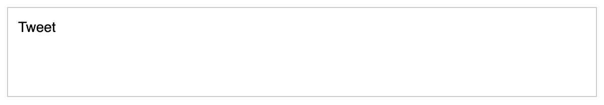

这不是什么你没见过的东西。它是一个简单的组件，增加了一个特殊的 `className` 属性（或“prop”）。

你可能注意到的另一个新点是 `import './index.css'`，它正在将……一个 CSS 文件导入到 JavaScript 文件中？乍一看很奇怪。

发生的情况是，在后台，当 `Webpack` 构建我们的应用时，它看到了这个 CSS 导入并知道 `index.js` 依赖于 `index.css`。`Webpack` 读取 CSS 文件并将其包含在包过的 JavaScript（以字符串形式）中发送到浏览器。

你实际上可以在浏览器中看到这一点——打开开发者控制台，查看 Elements 选项卡，并注意到 `<head>` 下有一个我们没有放置在那里的 `<style>` 标签。它包含了 `index.css` 的内容。

我们将在下一节学习更多关于 props 的知识，但现在，只需把它们想象成 HTML 属性即可。大多数属性的命名与你已经熟悉的属性完全相同，但 `className` 的特殊之处在于它的值变成了 DOM 节点上的 `class` 属性。

回到我们的大纲。让我们来构建 `Avatar` 组件。在 `index.js` 中添加组件函数：

```javascript
function Avatar() {
  return (
    
  );
}
```

稍后我们将查看将组件提取到文件中并通过 `import` 导入它们，但为了现在保持简单，我们只把组件放在 `index.js` 中。如果你想使用自己的 Gravatar，请 [gravatar.com/gravatar](https://gravatar.com/gravatar) 查找它的 URL。

接下来我们需要更改 `Tweet` 以渲染 `Avatar`：

```javascript
function Tweet() {
  return (
    <div className="tweet">
      <Avatar/>
      Tweet
    </div>
  );
}
```

现在给 `Avatar` 一些样式，在 `index.css` 中：

```css
.avatar {
  width: 48px;
  height: 48px;
  border-radius: 5px;
  margin-right: 10px;
}
```

它变得好看了：

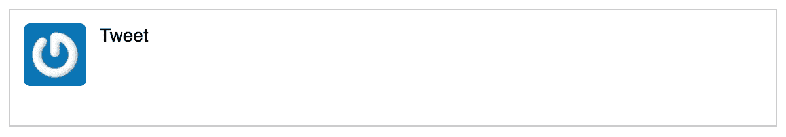

接下来我们将创建两个组件，`Message` 和 `NameWithHandle`：

```javascript
function Message() {
  return (
    <div className="message">
      这少于 140 个字符。
    </div>
  );
}

function NameWithHandle() {
  return (
    <span className="name-with-handle">
      <span className="name">你的名字</span>
      <span className="handle">@用户名</span>
    </span>
  );
}
```

如果你现在刷新，没有任何变化，因为我们还需要更新 `Tweet` 来使用这些新组件：

```javascript
function Tweet() {
  return (
    <div className="tweet">
      <Avatar/>
      <div className="content">
        <NameWithHandle/>
        <Message/>
      </div>
    </div>
  );
}
```

现在渲染了但很丑。为名字和用户名添加一些 CSS：

```css
.name {
  font-weight: bold;
  margin-bottom: 0.5em;
  margin-right: 0.3em;
}

.handle {
  color: #8899a6;
  font-size: 13px;
}
```


现在看起来更像真实的推文了！接下来，添加 `Time` 和按钮（我们稍后会讨论这种新语法）：

```javascript
const Time = () => (
  <span className="time">3 小时前</span>
);

const ReplyButton = () => (
  <i className="fa fa-reply reply-button"/>
);

const RetweetButton = () => (
  <i className="fa fa-retweet retweet-button"/>
);

const LikeButton = () => (
  <i className="fa fa-heart like-button"/>
);

const MoreOptionsButton = () => (
  <i className="fa fa-ellipsis-h more-options-button"/>
);
```

这些组件看起来不像你到目前为止编写的 `function`，但它们实际上仍然函数。它们是 *箭头函数*。这里从普通的 `function` 到箭头函数的演变过程可以让你看到发生了什么：

```javascript
function LikeButton() {
  return (
    <i className="fa fa-heart like-button"/>
  );
}

// 这可以重写为一个
// 匿名函数：

const LikeButton = function() {
  return (
    <i className="fa fa-heart like-button"/>
  );
}

// ...它可以被转换为
// 箭头函数：

const LikeButton = () => {
  return (
    <i className="fa fa-heart like-button"/>
  );
}

// 它可以进一步简化为：

const LikeButton = () => (
  <i className="fa fa-heart like-button"/>
);

// 如果它真的非常简单，
// 你甚至可以把它写成一行：

const Hi = () => <span>Hi</span>;
```

箭头函数是编写组件的一种非常简洁的方式。函数本身就是 `() => { ... }` 部分。

注意在最后几个版本中没有 `return`：当箭头函数只包含一个表达式时，它可以不带大括号编写。当不带大括号编写时，该表达式会被隐式返回。

在阅读这本书的过程中，你会继续使用箭头函数，所以如果它们现在看起来很陌生，也不要担心。你会习惯的。

## let 和 const 关键字

如果你熟悉 C 或 Java 等语言，那么你对块作用域（block scoping）并不陌生。正如你可能知道的，JavaScript 的 `var` 实际上是函数作用域的而不是块作用域。这长期以来一直令人困扰。

ES6 添加了 `let` 和 `const` 作为两种声明块作用域变量的新方式。

`let` 关键字定义了一个可变的（changeable）变量。你几乎可以在任何地方使用它来代替 `var`。

`const` 定义了一个常量。如果你尝试重新赋值该变量，它将抛出错误，但值得注意的是，它并没有阻止你修改该变量内部的数据。这里有一个例子：

```javascript
const answer = 42;
answer = 43;   // 错误！

const numbers = [1, 2, 3];
numbers[0] = 'this is fine'; // 无错误
```

使用 `const` 更多的是一种意图信号，而不是无无不击的保护方案，但它仍然很有价值。

现在我们已经有了所有这些新组件，再次更新 `Tweet` 来整合它们：

```javascript
function Tweet() {
  return (
    <div className="tweet">
      <Avatar/>
      <div className="content">
        <NameWithHandle/><Time/>
        <Message/>
        <div className="buttons">
          <ReplyButton/>
          <RetweetButton/>
          <LikeButton/>
          <MoreOptionsButton/>
        </div>
      </div>
    </div>
  );
}
```

最后，添加一些更多样式来覆盖时间和按钮部分：

```css
.time {
  padding-left: 0.3em;
  color: #8899a6;
}

.time::before {
  content: "\00b7";
  padding-right: 0.3em;
}

.buttons {
  margin-top: 10px;
  margin-left: 2px;
  font-size: 1.4em;
  color: #ab8c;
}

.buttons i {
  width: 80px;
}
```

这里有一条相当不错的推文！

你可以根据自己的心意对其进行定制：更改名称、消息，甚至是 Gravatar。很酷，对吧？

“但是……等一下，”我听到你在说，“我以为我们正在构建可复用的组件呢！” 这条推文确实很漂亮，但它只适用于显示一个人的某条消息……

不用担心，因为接下来的内容是：使用 props 对组件进行参数化。

# Props

## 组件的参数

HTML 元素有“属性（attributes）”，而 React 组件有“props”（“properties 属性”的缩写）。我们已经看到组件可以被写成函数，因此理所当然地假设我们可以向这些函数传递参数。Props 就是传递给组件的参数。

### 传递 Props

这段 JSX 代码正在传递一个名为 `name` 的 prop，其值为 `"Dave"`：

```jsx
<Person name='Dave'/>
```

这是另一个例子，传递了一个值为 `"person"` 的 `className` prop：

```jsx
<div className='person'/>
```

JSX 使用 `className` 而不是 `class` 来指定 CSS 类。注意这个 `div` 是自闭合的吗？这种能力不仅仅用于 `<input/>`：在 JSX 中，每个组件都可以自闭合的。事实上，如果组件没有子元素（内容），惯例是这样写它，而不是使用结束标签。

在这里，我们为 `className` 传递了一个字符串，为 `age` prop 传递了一个数字，并为 `name` 传递了一个真实的 JavaScript 表达式：

```javascript
function Dave() {
  const firstName = "Dave";
  const lastName = "Ceddia";
  return (
    <Person 
      className='person'
      age={33}
      name={firstName + ' ' + lastName} />
  );
}
```

记住在 JSX 中，大括号包裹 JavaScript 表达式。大括号中的代码是真实的 JavaScript，并遵循与普通 JavaScript 相同的所有作用域规则。

重要一点是，大括号内的 JS 必须是表达式，而不是语句。在 JSX 表达式内部你可以做：

* 数学计算、拼接：`{7 + 5}` 或 `{'Your' + 'Name'}`

* 函数调用：`{getFullName(person)}`

* 三元运算符：`{name === 'Dave' ? 'me' : 'not me'}`

* 布尔表达式：`{isEnabled && 'enabled'}`

是你不能做的：

* 使用 `var` 定义新变量

* 使用 `if`、`for`、`while` 等

* 使用 `function` 定义函数

记住 JSX 会转换为 JavaScript， props 变成对象中的键和值。这里是上面的示例转换为 JavaScript：

```javascript
function Dave() {
  const firstName = "Dave";
  const lastName = "Ceddia";
  return React.createElement(Person, {
    age: 33,
    name: firstName + ' ' + lastName,
    className: 'person'
  }, null);
}
```

适用于函数参数的所有规则适用于 JSX 表达式。你可以这样调用函数吗？

```javascript
myFunc(var x = true; x && 'is true');
```

当然不能！这看起来完全错误。如果你尝试将该参数传递给 JSX 表达式，你会得到：

```jsx
<Broken value={var x = true; x && 'is true'}/>
// 编译为：
React.createElement(Broken, {
  value: var x = true; x && 'is true'
}, null);
```

所以当你试图决定在 JSX 表达式中放入什么时，问问自己：“我可以把这个作为函数参数传递吗？”

### 接收 Props

Props 作为第一个参数传递给组件函数，如下：

```javascript
function Hello(props) {
  return (
    <span>Hello, {props.name}</span>
  );
}

// 使用方式：
<Hello name="Dave"/>
```

你可以将 `{ name }` 理解为“从作为第一个参数传递的对象中提取‘name’ 键”。它也可以提取多个键：

```javascript
const Hello = ({ firstName, lastName }) => (
  <span>Hello, {firstName} {lastName}</span>
);
```

在实践中，props 经常使用这种解构语法编写。顺便说一下，它在函数参数外部也有效。例如，你可以像这样解构 props：

```javascript
const Hello = (props) => {
  const { name } = props;
  return (
    <span>Hello, {name}</span>
  );
}
```

记住，如果箭头函数的体用大括号包围，则需要一个 `return`；如果函数体包含多行，则需要大括号。

### 修改 Props

需要知道的一个重要点是，props 是**只读的**。接收 props 的组件不能修改它们。

如果你来自 Angular 的背景，那么这是一个变化。Angular 的双向绑定机制允许修改作用变量（Angular 版本的 props），并会自动将这些更改传播到父组件。

在 React 中，数据流是**单向的**。Props 是只读的，且只能**向下**传递给子。

### 与父组件通信

如果你不能更改 props，但需要向父组件传递某些信息，该如何操作呢？

如果子组件需要向父组件发送数据，父组件可以注入一个 `function` 作为 prop，如下：

```javascript
function handleAction(event) {
  console.log('Child did:', event);
}

function Parent() {
  return (
    <Child onAction={handleAction}/>
  );
}
```


`Child`组件接收一个名为`onAction`的 prop，它可以在任何需要向上发送数据或通知父组件事件的时刻调用它。你会注意到内置的`button`元素接受一个`onClick` prop，它在按钮被点击时会调用它。我们稍后会深入研究事件处理。

```javascript
function Child({ onAction }) {
  return (
    <button onClick={onAction}/>
  );
}
```

## 示例：带有 Props 的推文

现在你对 props 有了基本的了解，让我们看看它们在实践中是如何工作的。

我们将取第 5 章中的静态`Tweet`示例，并重构它以通过 props 显示动态数据。

对于这个示例，请复制`static-tweet`项目文件夹，这样我们就可以在不用担心旧代码的情况下工作。我们还将启动一个开发服务器（如果它仍在运行，请停止它）。

```bash
$ cp -a static-tweet props-tweet && cd props-tweet
$ npm start
```

**注意：不要使用`cp -r`，因为它不会保留符号链接，会破坏`npm start`。**

如果在复制项目后`npm start`命令失败，请删除`node_modules`文件夹并运行`npm install`。然后再次尝试`npm start`。

打开`src/index.js`。首先，更新`Tweet`组件以接收一个如下所示的`tweet` prop。然后添加`testTweet`对象，将其作为我们的假数据，并更新`ReactDOM.render`的调用，将`testTweet`对象传递到`tweet` prop 中。

进行这些更改后刷新页面，确保一切看起来和之前一样（目前不应该有任何变化）。

```javascript
// 添加 { tweet } 解构
function Tweet({ tweet }) {
  return (
    <div className="tweet">
      <Avatar/>
      <div className="content">
        <NameWithHandle/><Time/>
        <Message/>
        <div className="buttons">
          <ReplyButton/>
          <RetweetButton/>
          <LikeButton/>
          <MoreOptionsButton/>
        </div>
      </div>
    </div>
  );
}

// ...
var testTweet = {
  message: "Something about cats.",
  gravatar: "xyz",
  author: {
    handle: "catperson",
    name: "IAMA Cat Person"
  },
  likes: 2,
  retweets: 0,
  timestamp: "2016-07-30 21:24:37"
};
ReactDOM.render(<Tweet tweet={testTweet}/>,
document.querySelector('#root'));
```

#### Avatar

让我们开始将静态组件转换为接受 props 的，从`Avatar`开始。在`Tweet`的 render 方法中，替换这一行：

```javascript
<Avatar/>
```

替换为这一行：

```javascript
<Avatar hash={tweet.gravatar}/>
```

这把推文的`gravatar`属性传递到`hash` prop 中。现在更新`Avatar`使用这个 prop：

```javascript
function Avatar({ hash }) {
  var url = `https://www.gravatar.com/avatar/${hash}`;
  return (
    
  );
}
```

使用 ES6 解构传入`hash`的 Gravatar hash 被整合到 URL 中，并像以前一样传递给图像标签。这里再给你一点 ES6 知识：URL 字符串周围的反引号是`template strings`（模板字符串）的新语法。`${hash}`部分将被 hash 替换。这种新语法比字符串拼接（例如`"https://www.gravatar.com/avatar/" + hash`）整洁得多。

头像的渲染效果与之前一样。

如果你喜欢，可以用自己的 hash 替换 Gravatar hash。访问`https://gravatar.com/gravatar`，输入你的邮箱并复制 hash。（如果你没有 Gravatar 账户，可以在`https://gravatar.com`创建一个）。

#### Message

现在我们来做`Message`。在`Tweet`的 render 方法中替换这一行：

```javascript
<Message/>
```

替换为这一行：

```javascript
<Message text={tweet.message}/>
```

我们从推文中提取了`message`并将其作为`text`传递给`Message`组件。然后更新`Message`组件使用新的 prop：

```javascript
function Message({ text }) {
  return (
    <div className="message">
      {text}
    </div>
  );
}
```

我们不再在 div 中使用静态文本，而是渲染传递的`text` prop。现在刷新，你会发现消息现在是“Something about cats.”。成功！

#### NameWithHandle 和 Time

这次我们将同时转换两个组件：`NameWithHandle`和`Time`。更新`Tweet`以传递相关数据，替换`render`中的这一行：

```javascript
<NameWithHandle/><Time/>
```

替换为这些行：

```javascript
<NameWithHandle author={tweet.author}/>
<Time time={tweet.timestamp}/>
```

我们还将引入一个名为 Moment.js 的库来处理日期和时间。我们将用它计算计算时间字符串（如“3 天前”）。运行此命令安装 Moment：

```bash
npm install moment --save
```

我们需要在`index.js`顶部导入`Moment`，因此在顶部添加此行：

```javascript
import moment from 'moment';
```

现在更新`NameWithHandle`和`Time`组件。你会发现`Time`使用了新的`moment`库。

```javascript
function NameWithHandle({ author }) {
  const { name, handle } = author;
  return (
    <span className="name-with-handle">
      <span className="name">{name}</span>
      <span className="handle">@{handle}</span>
    </span>
  );
}

const Time = ({ time }) => {
  const timeString = moment(time).fromNow();
  return (
    <span className="time">
      {timeString}
    </span>
  );
};
```

在静态推文示例中，`Time`被写为一个箭头函数，所以我保留了原有的写法。然而，因为它现在包含两条语句，它需要外层的大括号，这会导致它需要一个`return`。当然，你可以通过将`moment(time).fromNow()`直接移动到`<span>`内部来简化，这样你就可以移除`return`和大括号。这交由你决定。

## 到底应该传递什么作为 Prop？

Props 可以接受各种类型：数字、布尔值、字符串、对象，甚至是函数。在早期，你可能会想：是应该传递一个对象并让组件提取它所需的内容？还是应该传递组件所需的特定数据片段？

在这些示例中，我们传递的是特定的数据。

我们也可以直接传递`tweet`对象本身。例如，与其其直接向`Time`组件传递时间戳，不如传递`tweet`并让它从推文中提取时间戳。为什么不这样做呢？这里有几点原因：

*   如果`Time`期望一个推文对象并提取出`timestamp`属性，那么它将无法用于推文对象以外的任何东西。如果你有一个具有名为“updated_at”的时间戳属性的用户，并想用`Time`组件渲染它该怎么办？嗯，你做不到，除非临时凑出一个“看起来像”带有时间戳的推文临时对象。

*   `Time`组件将了解`tweet`对象的内部结构。这看起来可能不是什么大事，直到你有 10 个像这样的组件，而后端开发人员决定“timeStamp”（S 写大写）比“timestamp”看起来更好，现在你就必须更新所有这些组件。将对数据结构的知识保持在尽可能少的地方是一个好主意，这样可以降低更改的成本。

## Props 命名指南

俗话所说：“计算机科学中有三件难事：缓存失效、命名，以及差一错误。”

你为 props 选择的名称将影响组件的用方式，以及组件之间的耦合方式。想象一下，如果我们编写`Time`时接收一个名为`tweetTime`的 prop。即使我们直接传递时间戳（而不是整个推文对象），这作为 prop 名称仍然不是一个好的选择。为什么呢？

考虑一下当下一个开发者出现（也许是 3 周后的你），并想在应用中与推文无关的新部分复用`Time`组件时会发生什么。渲染结果会正常，但代码会显得很别扭。如果时间戳实际上并不属于某个推文，编写`<Time tweetTime={timestamp}/>`就表达了错误的意图。

更有可能，开发者会查看`Time`，看到它期望一个`tweetTime`，然后决定不复用该组件——要么是因为他们认为它不符合需求，要么是因为他们担心其底层实现可能会发生并破坏他们的代码。

### 剩余的组件

让我们回来转换`Tweet`及其子组件以使用 props。只剩下两个组件了：`RetweetButton`和`LikeButton`，它们需要显示转推和点赞的数量。目前，它们完全没有显示任何数字，只有一个图标。

修改这两行：

```jsx
<RetweetButton/>
<LikeButton/>
```

将其改为这些行（传递计数值）：

```jsx
<RetweetButton count={tweet.retweets}/>
<LikeButton count={tweet.likes}/>
```

然后，更新`RetweetButton`和`LikeButton`以接受新的`count` prop 并渲染它们各自的数字：

```jsx
function getRetweetCount(count) {
  if(count > 0) {
    return (
      <span className="retweet-count">
        {count}
      </span>
    );
  } else {
    return null;
  }
}

const RetweetButton = ({ count }) => (
  <span className="retweet-button">
    <i className="fa fa-retweet"/>
    {getRetweetCount(count)}
  </span>
);
```

```jsx
const LikeButton = ({ count }) => (
  <span className="like-button">
    <i className="fa fa-heart"/>
    {count > 0 &&
      <span className="like-count">
        {count}
      >}
  </span>
);
```

最后，样式也需要更新。去掉这些行：

```css
.buttons i {
  width: 80px;
}
```

然后用这些代码替换它们：

```css
.reply-button, .retweet-button,
.like-button, .more-options-button {
  width: 80px;
  display: inline-block;
}

.like-count, .retweet-count {
  position: relative;
  bottom: 2px;
  font-size: 13px;
  margin-left: 6px;
  font-weight: bold;
}
```

嗯，结果它最终会变成`undefined`，就好像你忘记给一个普通的函数传递参数一样。这可能完全没问题，也可能导致代码崩溃的灾难（就像你忘记给一个普通的函数传递参数一样）。

不过，React 有一个秘密武器：`PropTypes`。

当你创建一个组件时，你可以声明某些 props 是可选的或必须的，*并且*你还可以声明该 prop 预期的值类型。这里有一个示例：

```javascript
import PropTypes from 'prop-types';

function Comment({ author, message, likes }) {
  return (
    <div>
      <div className='author'>{author}</div>
      <div className='message'>{message}</div>
      <div className='likes'>
        {likes > 0 ? likes : 'No'} likes
      </div>
    </div>
  );
}
Comment.propTypes = {
  message: PropTypes.string.isRequired,
  author: PropTypes.string.isRequired,
  likes: PropTypes.number
}
```

首先，注意`PropTypes`必须从`prop-types`包中显式导入。这是 React 15.5 引入的变化。如果你在使用 Create React App，你应该已经安装了这个包，但如果没有，快速运行`npm install --save prop-types`即可解决。

接下来，注意`propTypes`是被设置为函数本身的一个属性。这种样式无论组件是函数、箭头函数，甚至是 ES6 类（我们稍后会看到）都有效。

最后，注意`propTypes`属性以小写的“p”开头，而导入的`PropTypes`则以大写的“P”开头。

通过这这组 propTypes，`message`和`author`是必填的，且必须是字符串。`likes` prop 是可选的，但如果提供，则必须是数字。尝试以几种不同的方式渲染它，并每次检查控制台：

```javascript
<Comment author='somebody' message='a likable message' likes={1}/>
<Comment author='mr_unpopular' message='unlikable message'/>
<Comment author='mr_unpopular' message='another message' likes={0}/>
<Comment author='error_missing_message'/>
<Comment message='mystery author'/>
```

如果你忘记了必填的 prop，React 会在控制台中警告你：

```javascript
<Comment author='an_error'/>
```

> Warning: Failed propType: Required prop `message` was not specified in `Comment`.

同样地，如果你传递了错误的类型，也会收到警告：

```javascript
<Comment author={42}/>
```

> Warning: Failed propType: Invalid `author` of type `number` supplied to `Comment`.

这些警告信息对于调试来说是无价之宝。它告诉你犯了什么错误，并提示你应该去哪里查看！这比某些在你忘记必填属性时静默失败的框架好得多。

### 陷阱

那么有什么陷阱呢？所有这些错误处理一定都有陷阱，对吧？某种程度上如此。propTypes 的唯一陷阱在于你必须记得声明它们。提供`propTypes`是可选的，如果你没有为组件指定它们，React 不会给你任何警告。你可以选择非常勤奋地编写这些 propTypes，也可以让 linter 工具来帮你检查。ESLint 是一个流行的选择，并且有一个 React 的 ESLint 插件，可以检查缺失的 PropTypes 以及 props 是否正确传递等问题。

### 如何进行验证，让我看看方法


React 的 `propTypes` 允许你表达许多不同的验证。默认情况下，prop 验证是可选的。如果你想让它必填，在末尾添加 `.required`。

首先，有标准 JavaScript 类型的验证器：

- `PropTypes.array`
- `PropTypes.bool`
- `PropTypes.func`
- `PropTypes.number`
- `PropTypes.object`
- `PropTypes.string`

你之前看到过 `string` 和 `number` 验证器。其他的原理相同——验证传入的是否数组、布尔值或其他内容。

还有针对 `node` 和 `element` 的验证器。`node` 是任何可以渲染的内容，意味着数字、字符串、元素或数组。`element` 是通过 JSX 或调用 `React.createElement` 创建的 React 元素。有一个 `instanceOf` 验证器，用于检查 prop 是否是特定类的实例。它接受一个参数：`PropTypes.instanceOf(SpecificClass)`。

你可以使用 `oneOf` 限制为特定值：`PropTypes.oneOf(['person', 'place', 1234])`。

你可以验证 prop 是否是几种类型之一：

```javascript
PropTypes.oneOfType([
  PropTypes.string,
  PropTypes.boolean
])
```

你可以验证它是否是特定类型的数组，或者其属性值为特定类型值的对象：

- `PropTypes.arrayOf(PropTypes.string)`
  - 会匹配：`['a', 'b', 'c']`
  - 不匹配：`['a', 'b', 42]`

- `PropTypes.objectOf(PropTypes.number)`
  - 会匹配：`{age: 27, birthMonth: 9}`
  - 不匹配：`{age: 27, name: 'Joe'}`

你可以验证一个对象是否具有特定的 `shape`，这意味着它具有特定的属性。传递给此 prop 的对象允许拥有额外的属性，但它至少包含 shape 描述中的属性。

```javascript
PropTypes.shape({
  name: PropTypes.string,
  age: PropTypes.number
})
```

这将匹配一个具有精确形状的对象，如下：

```javascript
person = {
  name: 'Joe',
  age: 27
}
```

它也会匹配具有额外属性的对象，如下：

```javascript
person = {
  name: 'Joe',
  age: 27,
  address: '123 Fake St',
  validPerson: false
}
```

这个 `PropTypes.shape` 要求对象具有 `name` 和 `age` 键，因此如果我们遗漏了其中一个，它将无法通过。这会产生警告：

```javascript
person = {
  age: 27
}
```

同样地，如果我们为这些键之一传递了错误的类型，我们将收到警告：

```javascript
person = {
  name: false,  // 布尔值而非字符串
  age: 27
}
```

#### 必填属性

任何 PropType 验证都可以通过末尾添加 `.isRequired` 变为必填。这些都是必填的：

```javascript
PropTypes.bool.isRequired
PropTypes.oneOf(['person', 'place', 1234]).isRequired
PropTypes.shape({
  name: PropTypes.string,
  age: PropTypes.number
}).isRequired
```

```javascript
function customValidator(props, propName, componentName) {
  // here, propName === "myCustomProp"
  if (props[propName].length !== 3) {
    return new Error(
      'Invalid prop `' + propName + '` supplied to' +
      ' `' + componentName + '`. Length is not 3.'
    );
  }
}

const CustomTest = ({ myCustomProp }) => (
  <span>{myCustomProp}</span>
);
CustomTest.propTypes = {
  myCustomProp: customValidator
}

// 这将产生一个警告:
ReactDOM.render(
  <CustomTest myCustomProp='not_three_letters'/>,
  document.getElementById('root')
);

// 这将会工作:
ReactDOM.render(
  <CustomTest myCustomProp={[1, 2, 3]}/>,
  document.getElementById('root')
);

// 这也将正常工作:
ReactDOM.render(
  <CustomTest myCustomProp="abc"/>,
  document.getElementById('root')
);
```

## 示例：带有 PropTypes 的推文

最后，让我们回到 Tweet 示例，看看 PropTypes 是如何应用到一组真实的组件的。

回想一下结构如下：

- `Tweet`
  - `Avatar`
  - `NameWithHandle`
  - `Time`
  - `Message`
  - `ReplyButton`
  - `RetweetButton`
  - `LikeButton`
  - `MoreOptionsButton`

而它看起来应该是这样的：


从下往上，为这些组件添加 PropTypes。复制一份之前的 `props-tweet` 代码，这样我们就可以放心地进行修改了：

```bash
$ cp -a props-tweet proptypes-tweet && cd proptypes-tweet
$ npm start
```

按钮是一个很好的开始点。`MoreOptionsButton` 完全不接受任何 props，所以我们不需要更改它。

`LikeButton` 可以可选地接收一个 `count` prop，因此我们将为它添加一个 PropType：

```javascript
const LikeButton = ({ count }) => (
  <span className="like-button">
    <i className="fa fa-heart"/>
    {count > 0 &&
      <span className="like-count">
        {count}
      </span>}
  </span>
);

LikeButton.propTypes = {
  count: PropTypes.number
};
```

为了验证它是否有效，进入 `Tweet` 组件，并尝试向 `LikeButton` 传递一个字符串而不是数字：

```javascript
//将此：
<LikeButton count={tweet.likes}/>

// 改为：
<LikeButton count='foo'/>
```

如果你现在刷新（或等待浏览器自动刷新），你应该会在开发者控制台中看到这样的警告：

> Warning: Failed propType: Invalid prop `count` of type `string` supplied to `LikeButton`, expected `number`. Check the render method of `Tweet`.

很好！一切运行正常。

将那行代码改回原来的样子，现在以同样的方法为 `RetweetButton` 组件添加一个 `count` PropType。这一步由你自己完成。现在去操作吧。

明白了吗？很好！我打赌你也能搞出 `Message` 和 `Time` 的 PropTypes（它们都接收可选的字符串）。去完成它们吧。

```javascript
function NameHandle({ author }) {
  const { name, handle } = author;
  return (
    <span className="name">{name}</span>
    <span className="handle">{handle}</span>
  );
}

NameHandle.propTypes = {
  author: PropTypes.shape({
    name: PropTypes.string.isRequired,
    handle: PropTypes.string.isRequired
  }).isRequired
};
```

### 你应该多显式？

当传递给组件的对象非常简单时，写出 `shape` 是很容易的。然而，当对象变得更复杂时，你可能会怀疑这是否值得精力。答案取决于你的具体情况。如果你在某处有一个显式的 `shape`（例如在 `NameHandle` 中），那么在父组件 `Tweet` 中重复它就意义不大。如果某天 `author` 的形状发生了变化，将有两个地方需要更新。拥有第二个检查并不能带来任何好处，反而可能会浪费你的时间。

## PropTypes 作为文档

关于 PropTypes 的最后一点：除了有助于调试之外，它们还充当了良好的文档。当你几天、一周或一个月后回到一个组件时，PropTypes 将充当类似于“README”的角色。你不需要扫描整个代码来解读哪些 props 是必须的。

### 练习

谁说你必须按照网络界面来建模组件呢？现实世界的对象也是很好的练习。你将在下面构建其中一些。

1. 创建一个 `AddressLabel` 组件，接收一个 `person` 对象作为 prop，并按所示渲染他们的姓名和地址：

   ```
   Full Name
   123 Fake St.
   Boston, MA 02118
   ```

2. 创建一个 `Envelope` 组件，接收 `toPerson` 和 `fromPerson` 作为 props，并使用你在练习 1 中的 `AddressLabel` 来显示发件地址和收件人地址。确保包含一个 `Stamp`！

   

3. 根据此设计创建一个 `CreditCard` 组件。使用 CSS 或内联样式对其进行美化。接受一个 `cardInfo` prop，其中包含人的姓名、过期日期、信用卡号和银行名称。

   

4. 创建一个 `Poster` 组件，接收 `image`、`title` 和 `text` 作为 props。渲染类似下面图片的内容。可以搜索“反励海报”（demotivational posters）来获取灵感。

   

我们已经看到 JSX 如何像 HTML 一样表达嵌套组件。我们也看到自定义组件可以接受 `props` 作为参数，并使用这些 `props` 来渲染内容或将其传递给子组件。

这里有一个我们还没有提到过的特殊 `prop`：它被称为 `children`。

假设你想创建一个可复用的 `IconButton` 组件，它看起来像这样：


你可能会想象像这样使用它：

```jsx
<IconButton>Do The Thing</IconButton>
```

那个内部文本“Do The Thing”会发生什么呢？嗯，这就是 `children` prop 派上用场的地方。

你必须在组件的某个地方显式地渲染 `children`。如果不这样做，它们就会被忽略。例如，如果 `IconButton` 组件是这样的：

```javascript
function IconButton() {
  return (
    <button>
      <i class="target-icon"/>
    </button>
  );
}
```

渲染出来的组件将是一个带有图标的按钮，没有任何文字。它看起来像这样：


通过微小的调整，我们可以将文本放在图标之后：

```javascript
function IconButton({ children }) {
  return (
    <button>
      <i class="target-icon"/>
      {children}
    </button>
  );
}
```

## 不同类型的 Children

无论是一个子元素还是多个子元素，`children` prop 始终以复数形式 `children`。此外，`children` 的类型会根据其包含的内容而变化。

当有多个子元素时，`children` 是 `ReactElements` 数组。

然而，当只有一个子元素时，它是一个单一的 `ReactElement`。这看起来可能有点奇怪：如果 `children` 始终是一个数组，处理起来不是会更容易吗？

嗯，是的，确实。但由于 `children` 使用得非常频繁，且单元素的使用场景足够常见，因此 React 团队决定在只有一个子元素时不分配数组，以优化性能。

## 处理 Children

React 提了一些实用函数来处理这种不透明的数据结构：

- `React.Children.map(children, function)`
- `React.Children.forEach(children, function)`
- `React.Children.count(children)`
- `React.Children.only(children)`
- `React.Children.toArray(children)`

前两个 `map` 和 `forEach` 的工作方式与 JavaScript 内置 `Array` 的方法相同。它们接受 `children`（无论是单个元素还是数组）以及一个会为每个元素调用的函数。`forEach` 遍历子元素且不返回任何内容，而 `map` 返回一个由你提供的函数所返回的值组成的数组。

`count` 非常自而易懂：它返回 `children` 中项目的数量。

`toArray` 同样直观：它将 `children` 转换为一个扁平化数组，无论它之前是否是数组。

`only` 返回唯一的子元素，如果存在多个子元素则会抛出异常。

你可以单独访问每一个子元素，因此可以对它们进行重新排序、删除某些、插入新元素、将子元素传递给更深层的子元素等等。

## Children 的 PropTypes

如果你想让你的组件接受零、一个或多个子元素，请使用 `.node` 验证器：

```javascript
propTypes: {
  children: PropTypes.node
}
```

如果你想让它只接受单个子元素，请使用 `element` 验证器：

```javascript
propTypes: {
  children: PropTypes.element
}
```

请注意，这期望一个单一的 `React Element` 作为子。这意味着它必须是一个自定义组件，或者像 `<div>` 这样的标签。如果你传递字符串或数字，`PropTypes.element` 将发出警告。如果你需要允许元素或字符串，可以如下使用 `oneOfType` 验证器：

```javascript
propTypes: {
  children: PropTypes.oneOfType([
    PropTypes.element,
    PropTypes.string
  ])
}
```

与任何其他 `propType` 一样，除非附加 `.isRequired`，否则它们都是可选的。

## 与 Angular 中转插（Transclusion）的对比

如果你用过 Angular，可能熟悉“转插（transclusion）”的概念，这是一个 Angular 使用的造词，意思是“获取指令的子元素并将其插入到 `ng-transclude` 所在的位置”。

React 的 `children` prop 是一个类似的概念，但更强大，而且更容易理解。

## 一个有趣的示例

在上面的示例中，我们简单地插入了一些文本。如果我们想做一些更具表达性的事情，比如创建我们自定义的组件层次结构呢？

假设我们为表达导航栏构建了某种形式的“API”：

```jsx
<Nav>
  <NavItem>Home</NavItem>
  <NavItem>About</NavItem>
  <NavItem>Contact</NavItem>
</Nav>
```

使用 `children` prop，`Nav` 可以执行诸如在每个项目之间插入分隔符的操作：


```javascript
function Nav({ children }) {
  let items = React.Children.toArray(children);
  return (
    <div
      {for (let i = items.length - 1; i >= 1; i--) {
        items.splice(i, 0, <span key={i}>|</span>);
      }
      {items}
    </div>
  );
}
```

## 练习题

现在你已经看到了 `children` 是如何工作的，这里有一些练习可以提高你的理解。

1. 制作一个看起来像这样的“错误框”：

 

使用 `children` prop，调用该组件应该像这样：

```jsx
<ErrorBox>
  Something has gone wrong
</ErrorBox>
```

可以自由使用 Bootstrap 的模态样式，或创建你自己的。创建我们之前看到的 `NavItem` 组件。`NavItem` 应该接受一个 `url` prop 和链接文本作为子元素，然后渲染一个带有该文本并指向该 url 的锚点标签 (`<a>`) 元素。接下来，修改 `Nav` 组件以检查它的每一个子元素是否都是 `NavItem`，如果发现任何其他类型的组件，则抛出错误。作为测试，示例代码应该正常工作：

```jsx
<Nav>
  <NavItem url='/'>Home</NavItem>
  <NavItem url='/about'>About</NavItem>
  <NavItem url='/contact'>Contact</NavItem>
</Nav>
```

而这段代码应该抛出错误：

```jsx
<Nav>
  <NavItem url='/'>Home</NavItem>
  <NavItem url='/about'>About</NavItem>
  <a href='/contact'>Contact</a>
</Nav>
```

3. 创建一个 `Dialog` 组件，它接受 `Title`、`Body` 和 `Footer` 组件作为子元素，所有都是可选的。`Dialog` 应该验证它的所有子元素都是这些类型之一，并应该输出像这样的内容：

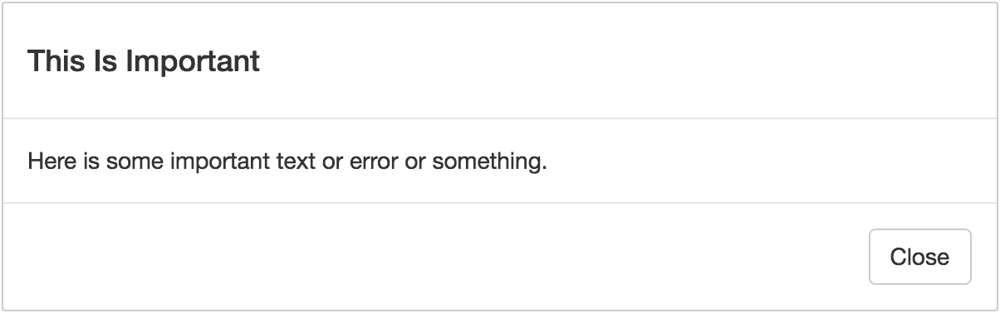

# 示例：GitHub 文件列表

你已经掌握了几个组件。你已经见过 props 和 propTypes，并编写了一些 JSX。

在我们进入状态和交互之前，我想通过一个涵盖我们目前为止所学内容的示例。这里还会涵盖一些新技巧。

考虑到这些，让我们创建一个复刻 GitHub 文件列表的新组件。这就是你在每个 GitHub 仓库顶部看到的内容：

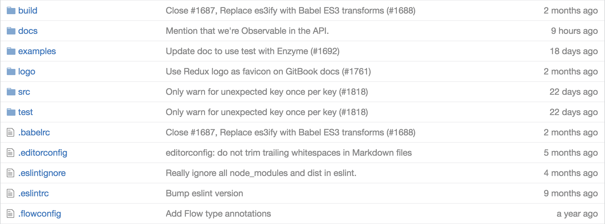 

## 分解组件

第一步是勾勒或高亮截图中的所有组件。基本上，我们在这里做的是为设计中的 `div` 元素画框框。

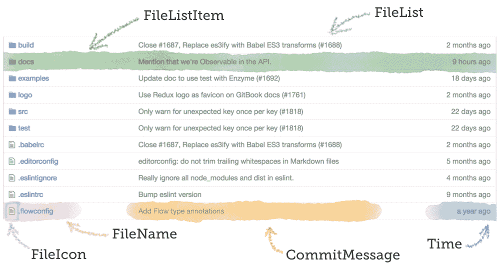 

## 为组件命名

一旦你决定了哪些部分作为组件，就给它们命名。对于上面的高亮部分，我想了这些名称（缩进以显示父子关系）：

*   `FileList`

*   `FileListItem`

    *   `FileName`

    *   `FileIcon`

    *   `CommitMessage`

    *   `Time`

## 你能复用什么吗？

查看组件列表，看看你是否可以在任何地方节省自己的工作。

嘿，看！那个 `Time` 组件看起来和我们为 `Tweet` 写的那个非常相似。幸运的是，我们编写的 `Time` 组件是通用的，只接受时间而不是推文。我们可以在这里复用它。

## 每个组件需要什么数据？

接下来，让我们弄清楚每个组件渲染时哪些数据。这将为每个组件提供 `props` 和 `propTypes`。

尝试在不预先看代码的情况下，弄出这些每个组件的 `propTypes` 定义。

`FileList` 应该接收一个 prop，`files`，它是一个文件对象的数组。

`FileListItem` 将接收一个单一的文件对象作为 `file` prop。该对象应该包含一个名称、类型、一个带有消息的提交（commit）以及一个最后修改时间。

`FileName` 将接收一个 `file` 对象，并期望它有一个 `name` 属性。

`FileIcon` 将接收一个 `file` 对象，并使用它的 `type` 属性来决定显示哪种图标。

`CommitMessage` 将接收一个 `commit` 对象，该对象应该有一个 `message` 属性。

最后，`Time` 将接收一个绝对的 `time` 字符串。我们将复用为 `Tweet` 创建的 `Time` 组件，包括它的 `propTypes`。

## 自顶而下还是自底而上？

对于这个，我们将从顶部开始向下进行。

## 保持运行

这是你在构建组件时应该努力的目标：确保它始终可以运行！

你是否有过这样的经历：埋头写了很长时间代码，而从未运行过它？不可避免的是，当你第一次运行时总会有某些问题。

这令人失望，并且会让你灰打气。你最终不得不去追踪大量的语法错误、逻辑错误以及其他任何问题，才能看到你的心血变为现实。

所以在在你编写时，尝试进行细小的更改，并频繁刷新。确保代码始终可用。

## FileList

我们已经有了足够的方向来开始工作。按照我们之前做过的几次方法创建一个项目：

```bash
$ create-react-app github-file-list && cd github-file-list
$ rm src/App.* src/logo.svg
```

从 `tweet` 项目的 `public` 目录复制 `index.html` 文件。如果你愿意，可以更改 `<title>`，但除此之外，`index.html` 保持原样即可。

打开 `src/index.js`。

你还记得如何从导入开始文件，以及如何使用 `ReactDOM` 设置初始渲染调用吗？尝试凭记忆完成。如果记忆模糊，请回看 `Tweet` 的示例。

创建 `FileList` 组件。为了尽可能实现最简单的功能，我们将渲染一个纯文件名的无序列表。一旦它运行正常，我们将把列表项提取到 `FileListItem` 组件中。

```javascript
// 在此处放入导入
const FileList = ({ files }) => (
  <table className="file-list">
    <tbody>
      {files.map(file => (
        <tr className="file-list-item" key={file.id}>
          <td className="file-name">{file.name}</td>
        </tr>
      ))}
    </tbody>
  </table>
);
FileList.propTypes = {
  files: PropTypes.array
};

const testFiles = [
  {
    id: 1,
    name: 'src',
    type: 'folder',
    updated_at: "2016-07-11 21:21"
  },
  {
    id: 2,
    name: 'tests',
    type: 'folder',
    updated_at: "2016-07-11 21:22"
  },
  {
    id: 3,
    name: 'README',
    type: 'file',
    updated_at: "2016-07-11 21:23"
  }
];
// 在此处放入 ReactDOM.render 调用
// 将 testFiles 作为 prop 传递
```

它看起来应该是这样：

 

```javascript
const FileList = ({ files }) => (
  <table className="file-list">
    <tbody>
      {files.map(file =>
        /* now we use FileListItem here */
        <FileListItem key={file.id} file={file}/>
      )}
    </tbody>
  </table>
);
FileList.propTypes = {
  files: PropTypes.array
};

const FileListItem = ({ file }) => (
  /* this code has been extracted from FileList */
  <tr className="file-list-item">
    <td className="file-name">{file.name}</td>
  </tr>
);
FileListItem.propTypes = {
  file: PropTypes.object.isRequired
};
```

我们还将添加一些 CSS 来让它看起来更美观。打开 `src/index.css` 并将其内容替换为以下代码：

```css
.file-list {
  font-family: Helvetica, sans-serif;
  width: 980px;
  color: #333;
  margin: 0 auto;
  border: 1px solid #ccc;
  border-collapse: collapse;
}

.file-list td {
  border-top: 1px solid #ccc;
}

.file-name {
  padding: 4px;
  max-width: 180px;
}
```

如果你还没有导入 CSS 文件，请不要忘记添加那行代码（`import './index.css'`）。

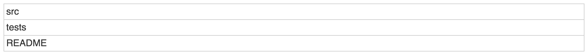 

现在我们已经有了基础结构，可以将剩余的组件添加到行组件中。即 `FileIcon`、`FileName`、`CommitMessage` 和 `Time`。

让我们先处理 `FileIcon` 和 `FileName`，因为它们是嵌套在一起的。在看后面的内容之前，尝试自己编写代码。这个比较特殊。

这是 `FileIcon`。它非常直观——是一个用普通函数编写的无状态组件。

```javascript
function FileIcon({ file }) {
  let icon = 'fa-file-text-o';
  if(file.type === 'folder') {
    icon = 'fa-folder';
  }

  return (
    <td className="file-icon">
      <i className={`fa ${icon}`}/>
    </td>
  );
}
FileIcon.propTypes = {
  file: PropTypes.object.isRequired
};
```

这里是 `getFileName`，如果你仔细观察，它*不是*一个组件。

```javascript
function getFileName(file) {
  return [
    <FileIcon file={file} key={0}/>
    <td className="file-name" key={1}>{file.name}</td>
  ];
}
```

这只是一个接收 `file` 并返回元素数组的函数。组件不能在不用元素包裹的情况下返回数组。为什么要这样写呢？

问题在于我们正处于表格行（`<tr>`）内部，并且我们需要两个并相邻的 `<td>`，但一个真正的组件不能返回裸数组。你可以通过将 `FileIcon` 和 `FileName` 编写为独立的组件，且每个组件都返回一个 `<td>` 单元格（而不是像我们现在这样将 `FileIcon` 嵌套在 `FileName` 内部），来完全避免这个问题。这可以说是比这种方法更好的解决方案！我之所以这样写是为了展示这种边缘情况，以防你遇到无法避免的情况。在写作时，React 16 (React Fiber) 就要问世了，它承诺解决从组件中返回多个元素的问题。你可以在 http://stackoverflow.dev/ 上跟踪 Fiber 的进度。注意我们在这里为 `key` 传递了硬编码的值。我不是说过不要这样做吗？是的，这通常是一个坏主意，但因为这个数组*始终*会按该顺序包含 2 个元素，所以在这里不会产生问题。需要 `key` 是因为我们返回的是数组，而数组中的元素必须有一个 `key`。这里是使用 `getFileName` 函数的更新后的 `FileListItem`：

```javascript
const FileListItem = ({ file }) => (
  <tr className="file-list-item">
    {getFileName(file)}
  </tr>
);
FileListItem.propTypes = {
  file: PropTypes.object.isRequired
};
```

好了，处理完这个奇怪的问题后，让我们添加一些 CSS 看看效果如何。

```css
.file-icon {
  width: 17px;
  padding-left: 4px;
}

.file-icon .fa-folder {
  color: #508FCA;
}
```

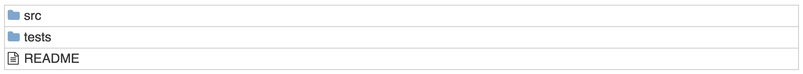 

### CommitMessage

接下来我们创建 `CommitMessage` 组件。这个非常直观，CSS 也是如此。我们将在 `FileListItem` 中使用 `CommitMessage`。

```javascript
const FileListItem = ({ file }) => (
  <tr className="file-list-item">
    {getFileName(file)}
    <CommitMessage
      commit={file.latestCommit} />
  </tr>
);
FileListItem.propTypes = {
  file: PropTypes.object.isRequired
};

const CommitMessage = ({ commit }) => (
  <td className="commit-message">
    {commit.message}
  </td>
);
CommitMessage.propTypes = {
  commit: PropTypes.object.isRequired
};
```

```css
.commit-message {
  max-width: 442px;
  padding-left: 10px;
  overflow: hidden;
}
```

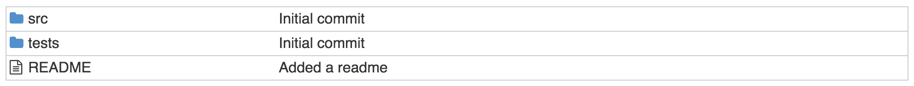 

注意我们传递的是 commit 本身而不是整个文件对象。`CommitMessage` 不需要了解关于文件的任何信息，了解数据结构的组件越少越好。

### Time

我们现在添加时间功能。记住，我们可以复用推文练习中的 `Time` 组件。与其直接将 `Time` 组件复制粘贴到此文件中，我们将将其提取到单独的文件中以便其他组件也可以使用它。

我们需要再次 Moment.js，所以现在安装它：

```
$ npm install --save moment
```

然后创建文件 `src/time.js` 并粘贴之前的 `Time` 组件。我们还需要在顶部添加 `import`，并在底部添加 `export`。

```javascript
import React from 'react';
import PropTypes from 'prop-types';
import moment from 'moment';

const Time = ({ time }) => {
  const timeString = moment(time).fromNow();
  return (
    <span className="time">
      {timeString}
    </span>
  );
};
Time.propTypes = {
  time: PropTypes.string.isRequired
};

export default Time;
```

由于我们导入的是自己的文件而不是 `node_modules` 中的内容，因此路径需要是相对路径（`./time`），而不是简单的模块名（`time`）。

然后，我们可以更新 `FileListItem`。注意 `Time` 不渲染 `<td>`，所以我们必须将其包裹在 `<td>` 中：

```
const FileListItem = ({ file }) => (
  <tr className="file-list-item">
    {getFileName(file)}
    <CommitMessage commit={file.latestCommit} />
    <td className="age">
      <Time time={file.updated_at}/>
    </td>
  </tr>
);
FileListItem.propTypes = {
  file: PropTypes.object.isRequired
};
```

添加一点点样式……


`.age` 类的 CSS 样式如下：

```
.age {
  width: 125px;
  text-align: right;
  padding-right: 4px;
}
```

它运行了！

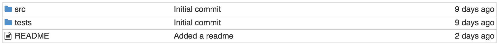 

但我必须说，这段代码看起来并不好看。我们用 3 种不同的方式渲染了 3 个组件，甚至为了规避 React 的限制而使用了奇异的 `getFileName`。如果组件看起来像这样会好得多：

```
const FileListItem = ({ file }) => (
  <tr className="file-list-item">
    <td><FileIcon file={file} /></td>
    <td><FileName file={file} /></td>
    <td><CommitMessage commit={file.latestCommit} /></td>
    <td><Time time={file.updated_at} /></td>
  </tr>
);
FileListItem.propTypes = {
  file: PropTypes.object.isRequired
};
```

在此时，我本可以回去修改示例，让代码看起来更好。但我把它留在这里是作为一个示例：有时候（也许是经常很多时候），代码写出来可能并不像你想象中那样干净。在你与某个决定共处一段时间之前，你可能无法完全意识到它的影响。

现实情况往往会产生干扰。你忘记了表格单元格必须是行的直接子元素，过度紧扣设计稿，从而导致你走上了一条产生糟糕代码的道路。

但没有什么是永久的！现在是重构这段代码的完美时机（事实上，你将在练习中这样做）。

当你埋头苦干编写代码时……如果脑海中跳出这样一个念头：“等等！这些组件完全无法复用，因为每一个都包含一个表格单元格！”……好吧，听从你的。尽早重构，经常重构。

### 练习

1. 重构 GitHub 文件列表示例，使所有组件都不返回表格单元格（`<td>`）。每个组件都应该返回 `<span>` 或 `<div>`。这使得它们更具可复用性，也应该极大改进 `FileList` 内部的代码。如有需要修改 CSS。

2. 在实际应用中，大多数时候你希望每个文件只有一个组件。有时一个文件会包含几个相关的组件，当这些组件总是被一起使用时（如之前的 `Nav`/`NavItem` 示例），否则它们应该被分开。重构练习 1 中的代码，使用 `import` 和 `export` 将组件提取到单独的文件中。

3. 现在你知道如何使用 `Array` 的 `.map` 函数创建列表了。复用之前的 `Tweet` 组件并创建一个推文列表。

列表无处不在。有人说，大多数 Web 应用基本上就是一组列表。实现来自网络各个网站的界面。遵循我们已经做过的几次流程——突出屏幕上哪些部分将成为组件，给它们命名，然后构建它们。

### 4. Trello

尝试渲染单个卡片列表。为了更多练习，并排渲染多个卡片列表。

（截图来自 [`trello.com`](https://trello.com))

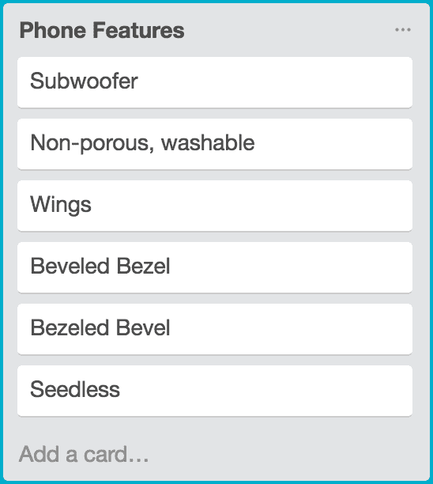 

### 5. Hacker News

实现故事列表。为了更多练习，也实现页眉。

（截图来自 [`news.ycombinator.com/news`](https://news.ycombinator.com/news))

 

### 6. Pinterest

实现图片卡片列表。为了更多练习，也实现页眉（考虑之前的 `Nav` 和 `NavItem`）。

 

### 7. Internet

你能想出一个很棒按钮大小的方法让它们变大吗？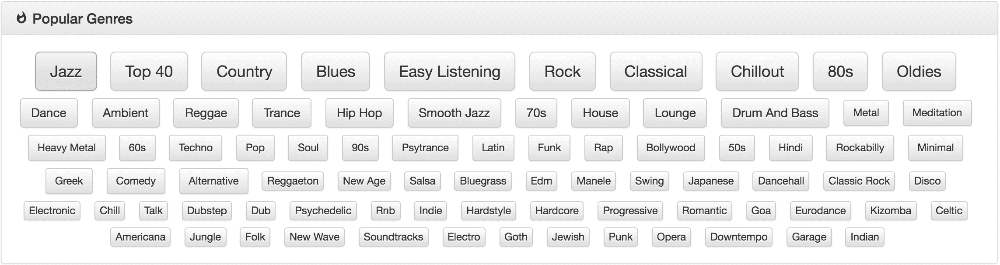

# State（状态）

到目前为止，我们一直使用 *props* 将数据传递给组件。如果我们需要跟踪可以变化的数据呢？这就是 *state*（状态）登场的地方。为了看到状态有多用，让我们回顾之前的一个示例。这里有一个包含 `Child` 的 `Parent` 组件：

```
function handleAction(event) {
  console.log('Child says:', event);
}

function Parent() {
  return (
    <Child onAction={handleAction}/>
  );
}

function Child({ onAction }) {
  return (
    <button onClick={onAction}>Click Me!</button>
  );
}
```

但记住，函数组件是*无状态的*（stateless）。要让 `Parent` 拥有状态，它需要被转换为 ES6 `class` 组件。这是 `Parent` 的新版本，重命名为 `CountingParent`——确保更新 `ReactDOM.render`！

```
class CountingParent extends React.Component {
  state = {
    actionCount: 0
  }

  handleAction = (action) => {
    console.log('Child says', action);
    // actionCount 增加了，
    // 新计数替换了旧的计数
    this.setState({
      actionCount: this.state.actionCount + 1
    });
  }

  render() {
    return (
      <div>
        <Child onAction={this.handleAction}/>
        <p>Clicked {this.state.actionCount} times</p>
      </div>
    );
  }
}
```

行吧，也许增加一个数字并不是什么开创性的成就，但让我们看看发生了什么。

当组件首次实例化时，它的初始状态通过 `state = {...}` *属性初始化器*（property initializer）设置。虽然这种语法并非 ES6 的一部分，但它被 Babel 和 Create React App 支持，并在 React 社区中广泛使用。（另一种方法是在*构造函数*中设置初始状态，我们稍后会看到）。

接下来，你点击了按钮，就像它让你做的那样。按钮的 `onClick` 处理器程序被调用。在这种情况下，是 `onAction` prop，它最终调用了 `CountingParent` 中的 `handleAction` 函数。`handleAction` 函数打印了一条消息，然后调用 `this.setState` 并传入一个描述新状态的对象。

`setState` 函数将更新状态，然后重新渲染组件及其所有的子组件。接下来会发生的情况是：`CountingParent` 的 `render` 函数被调用，它会查看 `this.state.actionCount`，此时该值已经递增到了 1。或者是 2，如果你一直疯狂点击那个按钮，也可能是其他数字。

请注意，组件的每个实例都有自己的状态。如果你在页面上有两个 `CountingParent` 组件，它们将各自拥有一个从 0 开始并独立增加的计数器。你可以通过创建一个包含几个 `CountingParent` 的组件来自己证明这一点：

```javascript
const Page = () => (
  <div>
    <CountingParent/>
    <CountingParent/>
    <CountingParent/>
  </div>
);
```

确保更新 `ReactDOM.render` 调用，以渲染 `Page` 而不是 `CountingParent`。现在点击这些按钮，观察计数器如何独立地变化。

### 练习：重置按钮

这是一个快速练习：在 `CountingParent` 中添加一个“重置（Reset）”按钮，点击它时会将计数器重置为 0。只需将 `button` 直接放在 `CountingParent` 内部即可。

该功能运作后，重构你的代码，将“重置”按钮移动到 `Child` 中。

## setState 是异步的

我刚才骗了你了。抱歉。我暗示了 `setState` 函数会立即更新状态并调用 `render`。事实并非完全是这样。`setState` 函数实际上是*异步的*。

如果你调用了 `setState` 并立即执行 `console.log(this.state)`，它很可能会打印出旧状态，而不是你刚刚设置的那个。

如果你需要设置状态并立即对该更改进行操作，可以这样传递一个回调函数：

```javascript
this.setState({name: 'Joe'}, function() {
  // 在状态更新后
  // 且组件重新渲染后调用
});
```

### 函数式 setState

另一种让连续的状态更新按顺序执行的方法是使用 `setState` 的*函数式*形式，如下所示：

```javascript
this.setState((state, props) => {
  return {
    value: state.value + 1
  }
});
```

在这种形式下，你向 `setState` 传递一个函数。该函数接收当前状态和 props 作为参数，并预期返回预期的新状态。如果你连续运行几个这样的语句……

```javascript
this.setState((state, props) => {
  return {
    value: state.value + 1
  }
});
this.setState((state, props) => {
  return {
    value: state.value + 1
  }
});
this.setState((state, props) => {
  return {
    value: state.value + 1
  }
});
```

这将按照预期正常工作，最终将 `value` 增加 3。它之所以有效，是因为调用 `setState` 会按照它们调用的顺序“队列”更新，并且当它们执行时，它们接收的是最新的状态作为参数，而不是使用可能已经过时的 `this.state`。

`setState` 函数式风格的一个额外好处是，状态更新函数可以从类中提取并复用，因为它们是“纯”的——也就是说，它们只对其参数进行操作，不会修改参数，并返回一个新值。“纯”函数没有副作用，这意味着使用相同的参数多次调用它将始终返回相同的结果。

## 浅合并 vs 深度合并

当你调用 `setState` 时，无论是使用对象调用还是使用函数形式调用，结果都是它会将你对象中的属性与当前状态进行*浅合并*。以下是其工作原理。

“浅合并”行为意味着如果你有这样的状态：

```javascript
{
  score: 7,
  user: {
    name: "somebody",
    age: 26
  },
}
```

然后执行 `setState({ score: 8 })`，状态将变为：

```javascript
{
  score: 8,
  user: {
    name: "somebody",
    age: 26
  },
}
```

如果你运行 `setState({ user: { age: 27 } })`，它会替换 `user` 对象：

```javascript
{
  score: 7,
  user: {
    age: 27
  },
}
```

## 状态中存什么

你如何决定什么应该放入状态？还有其他地方可以存储持久数据吗？

作为一个通用规则，存储在状态中的数据应该在 `render` 某处被引用。组件状态用于存储*UI 状态*——即影响页面视觉渲染的内容。这是合理的，因为每当状态更新时，组件都会重新渲染。

如果修改某些数据不会在视觉上改变组件，那么这些数据就不应该放入*状态*中。以下是一些适合放入状态的内容：

*   用户输入（文本框和其他表单字段的值）

*   当前或选中的项目（当前标签页、选中的行）

*   来自服务器的数据（产品列表、页面上的“赞”数）

*   开启/关闭状态（模态框打开/关闭、侧边栏展开/隐藏）

其他状态数据（如定时器的句柄）应该存储在组件实例本身。在类组件中你有一个可用的 `this` 对象，尽管使用它吧！

适应 React 涉及到改变你解决特定问题的方式。这让我想起在马路另一侧驾驶的经历。

我第一次经历这种事是在访问特克斯和凯科斯群岛时。那里的车辆是左侧行驶的。我来自习惯右侧行驶的美国，这需要一点点“大脑重编程”。在离开机场时，我差点丢了命。

有趣的是，即使我已经学会了在普通的平坦直路上向左侧行驶，但每当出现不同的情况时，我的大脑就会回到旧习惯。

转入停车场？习惯接管了主导，我开进了错误的车道。在停止标志处左转？同样的问题。在停止标志处向`right`转？你可能会认为我现在应该学会了——但并没有，对我的大脑来说，那感觉有些不同。

我讲这个故事是因为我在学习 React 时也有过类似的经历，我想很多其他人也是如此。

向组件传递 props（就像该组件是一个函数一样）是合逻辑——我们的大脑已经习惯了。它看起来和运行起来都像 HTML 一样。

将数据*向下*传递和将事件*向上*传递的想法对于简单的情况来说很快也能被理解。这是在其他地方常用的“回调”模式，所以并不那么陌生。向按钮传递一个 `onClick` 处理器是非常正常的。

但当需要打开模态对话框时会发生什么？或者在角落显示一个 Growl 样式的通知？或者响应事件对图标进行动画？你可能会发现（正如我发现一样），这些命令式的、“基于事件的”事物在 React 的声明式世界中并不是得自然而然的。

### 如何培养“声明式”思维

如果你来自 jQuery 或 Angular 或任何其他通过调用函数来让事情发生的框架（“命令式编程”），你需要调整你的心理模型，以便有效地与 React 协作。通过练习，你会很快就适应的——你只需要几个新的示例或“模式”供你的大脑汲取素材。

这里有几个。

#### 展开/折叠手风琴（Accordion）控件

**旧方法**：点击切换按钮通过调用其 `toggle` 函数来打开或关闭手风琴。`Accordion` 知道自己是处于打开还是关闭状态。

**声明式方法**：`Accordion` 要么处于“打开”状态，要么处于“关闭”状态，我们将该信息存储在父组件状态中的一个标记里（*而不是*在 `Accordion` 内部）。我们通过传递 `isOpen` 作为 prop 来告诉 `Accordion` 渲染方向。当 `isOpen` 为 `true` 时，它渲染为打开。当 `isOpen` 为 `false` 时，它渲染为关闭。

```javascript
<Accordion isOpen={true}/>
<Accordion isOpen={false}/>
```

这个例子非常简单。希望不要太烧脑。最大的变化是，在声明式的 React 方式中，展开/折叠状态存储在 `Accordion` *外部*，并作为 prop 传入。

#### 打开和关闭对话框

**旧方法**：点击按钮打开模态。点击它的关闭按钮关闭它。

**声明式方法**：`Modal` 是否打开*是一个状态*。它要么处于“打开”状态，要么处于“关闭”状态。所以，如果它是“打开”，我们就渲染 `Modal`。如果它是“关闭”，我们就不渲染模态。此外，我们可以向 `Modal` 传递一个 `onClose` 回调——这样，*父组件*就可以决定当用户点击关闭时会发生什么。

```javascript
<div>
  {this.state.isModalOpen &&
    <Modal onClose={this.handleClose}/>}
</div>
```

#### 通知

**旧方法**：当发生事件（如错误）时，调用通知库显示弹出框，如 `toastr.error("Oh no!")`。

**声明式方法**：将通知视为状态。通知可以有 0 个、1 个或 2 个……将这些存储存在一个数组中。在应用根节点附近的地方放置一个 `NotificationTray` 组件，并向它传递要显示的消息。你可以在根组件的状态中管理消息数组，并向需要它的组件传递一个 `addNotification` prop。

#### 为变化添加动画

假设你有一个带有计数器的徽章，显示登录用户数量。它从 prop 获取这个数字。如果你想让徽章在数字变化时执行动画怎么办？

**旧方法**：你可能会使用 jQuery 来切换一个播放动画的类，或者使用 jQuery 直接对元素执行动画。

**声明式方法**：你可以通过实现 `componentWillReceiveProps` *生命周期方法* 并比较新旧值来对 prop 的变化做出响应（你将在第 14 章中学习更多生命周期方法）。如果发生了变化，你可以将“正在动画”状态设置为 `true`。然后在 `render` 中，当“正在动画”为 `true` 时，添加执行动画的 CSS 类。当“正在动画”为 `false` 时，不添加该类。它可能像这样：


```javascript
class Badge extends Component {
  componentWillReceiveProps(nextProps) {
    if(this.props.counter !== nextProps.counter) {
      // 现在将 animating 设置为 true。
      // 当状态完成后，设置一个定时器
      // 在 200ms 后关闭。
      this.setState({ animating: true }, () => {
        setTimeout(() => {
          this.setState({ animating: false });
        }, 200);
      });
    }
  }
  render() {
    const animatingClass = this.state.animating ? 'animating' : '';
    return (
      <div className={`badge ${animatingClass}`}>
        {this.props.counter}
      </div>
    );
  }
}
```

我只是想提醒你，这种代码方式起初可能会很奇怪，这很正常。你会发现自己在思考如何用声明式的方法实现那些命令式的模式，这需要一些时间来学习。但别担心——做几次之后就会变得非常清晰。

## 状态存储位置

只要可能，最好保持组件是无状态的（stateless）。有时这不可能，但很多时候你认为应该放入内部状态的数据实际上可以提取到父组件，甚至更高处。

考虑页面上一个可以显示或隐藏的部分，比如像这样的侧边栏：

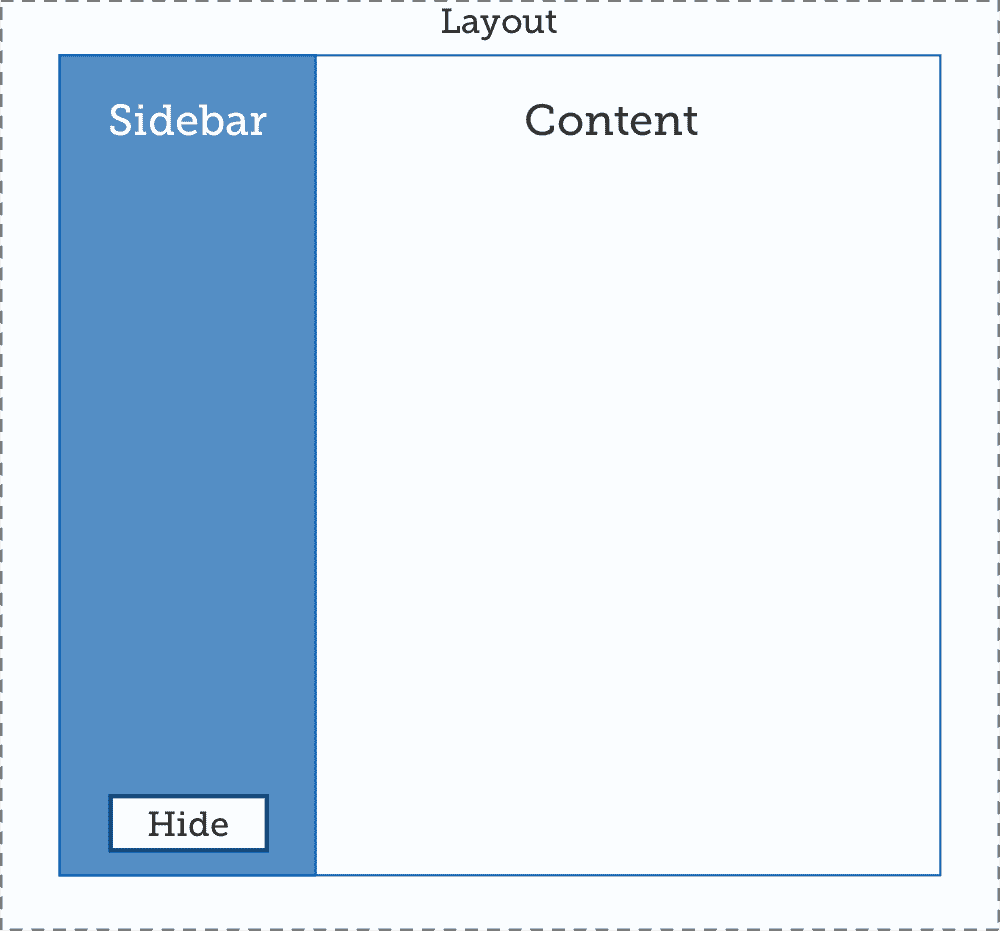

当你点击“隐藏”按钮时，侧边栏应该消失，这意味着将 `showSidebar` 标记设置为 `false`。这个标记应该存储在地方的状态中。但是在哪里？

选项 1，`showSidebar` 标记可以位于 `Sidebar` 组件中。这样 `Sidebar` 就“知道”自己是否是打开的。这与*受控输入*的工作原理类似，我们将在下一章看到。

选项 2，`showSidebar` 标记可以放在父组件 `Layout` 中，父组件可以决定是否渲染 `Sidebar`：

```javascript
class Layout extends React.Component {
  state = {
    showSidebar: false
  }

  toggleSidebar = () => {
    this.setState({
      showSidebar: !this.state.showSidebar
    });
  }

  render() {
    const { showSidebar } = this.state;
    return (
      <div className="layout">
        {showSidebar &&
          <Sidebar
            onHide={this.toggleSidebar}>
            some sidebar content
          </Sidebar>}
        <Content
          isSidebarVisible={showSidebar}
          onShowSidebar={this.toggleSidebar}>
          some content here
        </Content>
      </div>
    );
  }
}

const Content = ({
  children,
  isSidebarVisible,
  onShowSidebar
}) => (
  <div className="content">
    {children}
    {!isSidebarVisible && (
      <button onClick={onShowSidebar}>
        Show
      </button>
    )}
  </div>
));

const Sidebar = ({
  onHide,
  children
}) => (
  <div className="sidebar">
    {children}
    <button onClick={onHide}>
      Hide
    </button>
  </div>
));
```

通过这种方式，`Sidebar` 内部并不“知道”自己是否可见。它要么被渲染，要么不被渲染。

将状态保留在父组件中可能会感觉并不自然。乍看之下，这似乎会使 `Sidebar` 难以复用，因为你需要传递一个 `Sidebar` 在需要隐藏时可以调用的回调函数。

相反，包含状态的组件越少，意味着当出现 bug 时需要查找的地方就越少。如果你需要对该状态进行任何操作（例如将其保存到 `localStorage` 以跨页面刷新持久），该逻辑只需要存在于一个组件实例中。

浏览器自带 `localStorage`，你可以用它在会话之间保存数据。关闭并重新打开或刷新页面不会清除数据。你可以使用 `localStorage.setItem('showSidebar', true)` 保存 `Sidebar` 状态，稍后通过 `localStorage.getItem('showSidebar')` 获取。

你可以看到，如果 `Sidebar` 组件知道如何将自己的状态保存到 `localStorage`，并且应用中有多个 `Sidebar`，那么它们需要一种区分自己的方法。`localStorage` 中单个 `showSidebar` 键会导致冲突，而 `Sidebar` 并不知道自己位于应用的哪个位置。

也许父组件可以负责向每个 `Sidebar` 传递一个唯一的“id”或“location”。然而，这将把“保存到哪里”的关注点分摊给父组件和 `Sidebar`。这导致了有*两个*组件需要知道保存操作，而不是一个。一个更好的设计是将所有与保存相关的逻辑都保留在一个地方，如果状态与逻辑保存在一起，那么这样做会更容易实现。

## 组件的“种类”

在架构设计上，你可以将组件分为两类：*表示型*（Presentational，又称“哑巴”组件）和*容器型*（Container，又称“智能”组件）。

*表示型*组件是无状态的。它们只是简单地接收 props 并根据它们进行渲染。理想情况下，它们是纯函数，使得它们更容易测试。*容器型*组件是有状态的。它们维护状态并将回调传递给子组件。

## Inputs

现在，可能你的第一反应是对于一个简单的输入来说，这些代码太多了。你没说错，但这种方法确实提供了强大的功能。输入有两种类型：*受控*（controlled）和*非受控*（uncontrolled）。

它们之所以被称为“受控的”，是因为你负责控制它们的值。在下面的示例中，我们有一个受控输入：

```javascript
class ControlledInput extends React.Component {
  state = {
    text: ''
  }

  handleChange = (event) => {
    this.setState({
      text: event.target.value
    });
  }

  render() {
    return (
      <input type="text"
        value={this.state.text}
        onChange={this.handleChange} />
    );
  }
}
```

它的工作原理是：在上面的示例中，尝试删除或注释掉对 `this.setState` 的调用，然后尝试在框中输入。什么都不会发生，因为值卡在了初始值上。然后，尝试更改 `this.setState` 以忽略事件数据，而是始终将文本设置为相同的值，如下所示：

```javascript
class TrickInput extends React.Component {
  state = {
    text: 'try typing something'
  }

  handleChange = (event) => {
    this.setState({
      text: 'haha nope'
    });
  }

  render() {
    return (
      <input type="text"
        value={this.state.text}
        onChange={this.handleChange} />
    );
  }
}
```

你会发现输入框阻止了你修改它的尝试，甚至嘲讽了你。

不过，这非常强大。如果你想进行某种自定义验证或格式化，可以在 `handleChange` 函数中完成。不想让用户输入数字？在更新状态之前剔除数字即可：

```javascript
class NoNumbersInput extends React.Component {
}
```

```javascript
class NoNumbersInput extends React.Component {
  // ...

  handleChange = (event) => {
    let text = event.target.value;
    text = text.replace(/[0-9]/g, '');
    this.setState({ text });
  };

  // ...
}
```

顺便提一下——`this.setState({ text })` 这种语法只是 `this.setState({ text: text })` 的 ES6 简写。在 ES6 中，如果键与变量名相同，你就不需要写两次。

尝试在框中输入一些数字。尝试粘贴一个包含数字的字符串。完美！没有闪烁或出现任何异常行为。

你可以将输入格式化为电话号码、信用卡号，或者根据光标位置进行更改。正如我所说，它非常强大。

但也许你并不关心这些。你只是想让输入框管理自己的状态。非控输入（Uncontrolled inputs）可以做到这一点，但有几点注意事项。

## 非控输入

当一个输入是“非控”的（`uncontrolled`）时，它会管理自己的内部状态。因此，你可以这样在页面上放置一个 `input`（不带 `value` 属性）：

```javascript
const EasyInput = () => (
  <input type="text" />
);
```

在里面输入内容，随心所欲即可。它运行正常。如果你想从中获取值，可以传递一个 `onChange` 属性并响应事件。这样做的问题是，你无法随心所欲地提取值。你仍然需要监听变化，并在某处跟踪“最新值”。

非控输入可以赋予一个 `defaultValue` 属性，组件将使用该值进行初始化。但在该初始渲染之后，如果你想更改值，就需要使用受控输入（controlled input）。

## 组件生命周期

每个 React 组件在屏幕上渲染时都会经历一个生命周期（lifecycle）。这里有一系列方法按照特定的顺序被调用。其中一些只运行一次，而另一些则运行多次。

对于你构建的大多数组件，可能不需要接入生命周期方法。当你需要它们时，它们确实有用。无论你需要通过 AJAX 请求获取数据、向 DOM 插入自己的节点，还是设置定时器，生命周期方法都是执行这些操作的地方。

这是组件的完整生命周期：

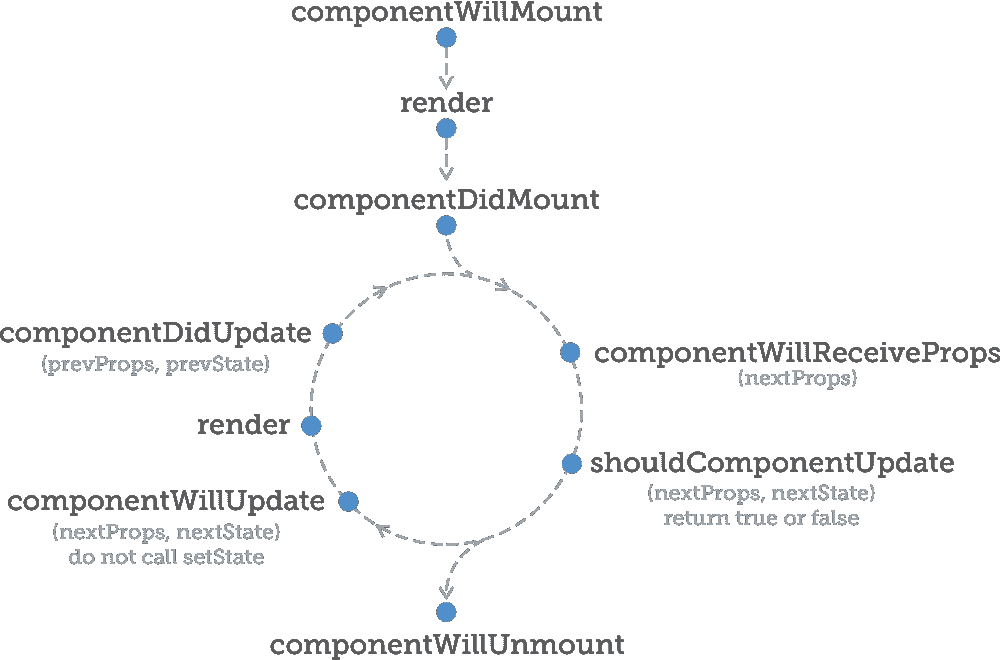

### 使用

接入生命周期钩子非常简单，只需向你的组件类添加相应的函数即可。生命周期方法适用于 `class` 组件，而不适用于函数组件。

这是一个使用了所有生命周期方法的示例。运行它，点击按钮，并观察控制台查看它们调用的顺序。

```javascript
import React from 'react';
import ReactDOM from 'react-dom';

class LifecycleDemo extends React.Component {
  state = {counter: 0};

  constructor(props) {
    super(props);
    console.log('Constructing...');
    console.log('State already set to:', this.state);
  }

  componentWillMount() {
    console.log('About to mount...');
  }

  componentDidMount() {
    console.log('Mounted.');
  }

  componentWillReceiveProps(nextProps) {
    console.log('Current props:', this.props);
    console.log('Next props:', nextProps);
  }

  shouldComponentUpdate(nextProps, nextState) {
    console.log('Deciding to update');
    return true;
  }

  componentWillUpdate(nextProps, nextState) {
    console.log('About to update...');
  }

  componentDidUpdate() {
    console.log('Updated.');
  }

  componentWillUnmount() {
    console.log('Goodbye');
  }

  handleClick = () => {
    this.setState({
      counter: this.state.counter + 1
    });
  }

  render() {
    console.log('Rendering...');
    return (
      <div>
        <span>Counter: {this.state.counter}</span>
        <button onClick={this.handleClick}>Increment</button>
      </div>
    );
  }
}

ReactDOM.render(<LifecycleDemo/>, document.querySelector('#root'));
```

### 挂载 (Mounting)

这些方法在组件挂载时被调用一次。

- **constructor**: 这是当组件创建时第一个被调用的方法。`state` 使用以下内容初始化……

- **componentWillMount**: 在组件挂载之前立即调用。

- **componentDidMount**: 在首次渲染后调用。这是执行任何所需请求的好地方。

### 更新 (Updating)

这些方法会在每次渲染之前和之后按顺序调用。

- **componentWillReceiveProps(nextProps)**: 传入了将接收的 `nextProps`。旧的 props 仍然可以通过 `this.props` 获取，必要时你可以调用 `this.setState`。

- **shouldComponentUpdate(nextProps, nextState)**: 如果你知道 props 和 state 没有变化，这是一个防止渲染的机会。默认实现返回 `true`。如果你返回 `false`，则不会发生渲染（子组件也不会渲染），并且剩余的生命周期方法将被跳过。

- **componentWillUpdate(nextProps, nextState)**: 在此阶段，渲染已成定局。用它在调用 `render` 之前进行任何准备工作。你**不能**在该方法内部调用 `this.setState`。

- **render**: 你对这个很熟悉了。它位于生命周期中 `componentWillUpdate` 和 `componentDidUpdate` 之间的位置。

- **componentDidUpdate**: 渲染完成。如果需要，你可以利用这个机会操作 DOM。在此之前，DOM 节点可能仍在变动中。

### 卸载 (Unmounting)

- **componentWillUnmount**: 组件即将卸载。也许它的项目已从列表中移除，也许用户导航到了另一个标签页……无论如何，这个组件的时间已经数不多多了。你应该失效创建的任何定时器（使用 `clearInterval()` 或 `clearTimeout()`），禁用事件处理器（使用 `removeEventListener()`），并执行任何其他必要的清理工作。

你会发现这两个页面非常相似。与之前的示例相比，这个示例的组件粒度较较粗。组件将具有更大的 `render` 函数，并且其中包含了更多的“内容”。你以后可以随时进行拆分，有时在早期避免将代码抽象成极微小的片段反而更好。

以下是我们要构建的组件：

* App
  * ItemPage
  * CartPage
  * Item
  * Nav

## 开始构建

我们将从创建一个新项目开始：

```bash
$ create-react-app shopper && cd shopper
```

打开 `src/App.js` 并将其内容替换为以下代码以开始：


```javascript
import React from 'react';
import Nav from './Nav';
import './App.css';

class App extends React.Component {
  renderContent() {
    return (
      <span>Empty</span>
    );
  }

  render() {
    return (
      <div className="App">
        <Nav/>
        <main className="App-content">
          {this.renderContent()}
        </main>
      </div>
    );
  }
}

export default App;
```

然后创建 `src/Nav.js` 并用以下代码开头：

```javascript
import React from 'react';

const Nav = () => (
  <nav className="App-nav">
    <ul>
      <li className="App-nav-item"><a>Items</a></li>
      <li className="App-nav-item"><a>Cart</a></li>
    </ul>
  </nav>
);

export default Nav;
```

启动应用并查看目前的情况：

```bash
$ npm start
```

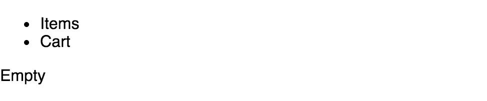

它可以运行了，但需要进行样式化。打开 `src/App.css`，并将内容替换为以下内容：

```css
.App {
  max-width: 800px;
  margin: 0 auto;
}
.App-nav {
  margin: 20px;
  padding: 10px;
  border-bottom: 2px solid #508FCA;
}
.App-nav ul {
  padding: 0;
  margin: 0;
}
.App-nav-item {
  list-style: none;
  display: inline-block;
  margin-right: 32px;
  font-size: 24px;
  border-bottom: 4px solid transparent;
}
.App-content {
  margin: 0 20px;
}
```

现在好了一点：

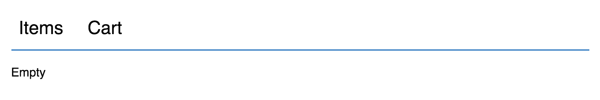

接下来，我们需要跟踪活跃的标签（tab），并决定渲染 `ItemPage` 还是 `CartPage`。为了做到这一点，我们将活跃的标签存储在 `state` 中，并让 `Nav` 触发状态更改。`App` 组件是存储此状态的最佳位置，因为 `App` 需要它来确定应该渲染哪个页面。在顶部初始化 `state`，并添加一个选择标签的函数：

```javascript
class App extends Component {
  state = {
    activeTab: 0
  };
  handleTabChange = (index) => {
    this.setState({
      activeTab: index
    });
  }
  // ...
}
```

现在，我们需要将 `handleTabChange` 函数传递给 `Nav`，并连同 `activeTab` 一起它可以正确渲染。我们还将更新 `renderContent` 来显示活跃的页面：

```javascript
class App extends Component {
  // ...
  renderContent() {
    switch(this.state.activeTab) {
      default:
      case 0: return <span>Items</span>
      case 1: return <span>Cart</span>
    }
  }
  render() {
    let {activeTab} = this.state;
    return (
      <div className="App">
        <Nav activeTab={activeTab} onTabChange={this.handleTabChange} />
        <main className="App-content">
          {this.renderContent()}
        </main>
      </div>
    );
  }
}
```

更新 `src/Nav.js` 中的 `Nav` 组件以使用新的 props：

```javascript
const Nav = ({ activeTab, onTabChange }) => (
  <nav className="App-nav">
    <ul>
      <li className={`App-nav-item ${activeTab === 0 && 'selected'}`}>
        <a onClick={() => onTabChange(0)}>Items</a>
      </li>
      <li className={`App-nav-item ${activeTab === 1 && 'selected'}`}>
        <a onClick={() => onTabChange(1)}>Cart</a>
      </li>
    </ul>
  </nav>
);
```

然后向 `src/App.css` 底部添加一些样式：

```css
.App-nav-item a {
  cursor: pointer;
}
.App-nav-item a:hover {
  color: #999;
}
.App-nav-item.selected {
  border-bottom-color: #FFAA3F;
}
```

现在它应该是这样的：

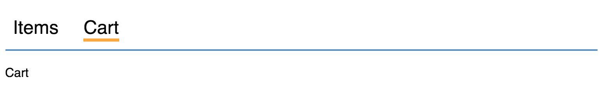

### 箭头函数 onClick

你会注意到我们在 `onClick` 中传递了一个箭头函数。初看之下这可能很奇怪。你可能会认为 `onClick={onTabChange(0)}` 看起来更好。

但请记住，props 在传递之前就会被求值了。如果没有箭头函数，`onTabChange` 将在 Nav 渲染时*被调用*，而不是在点击链接时调用。这不是我们想要的。将其封装在箭头函数中可以延迟执行到用户点击链接。

### 在 Render 中创建函数：不好？

关于此的另一点：像上面的代码那样向 props 传递新函数通常不是好主意，但理解为什么可以让你在合适的地方应用这一规则。

创建新函数之所以不好是因为性能：不是因为函数本身昂贵，而是每次渲染时向下传递新函数意味着它始终会看到“新的” props，从而导致不必要的渲染。在以下情况下避免在 render 中创建新函数：(a) 接收 prop 的组件是纯的 (b) 你预期父组件会渲染。函数组件和扩展 `Component` 的类不是纯的。它们总是会渲染。然而，如果类扩展了 `PureComponent`，它是纯的，并在 props 未更改时会跳过渲染。避免不必要的渲染是提高 React 应用最简单的方法。上面的 `Nav` 组件可能不会频繁渲染，但为了演示，你如何去掉箭头函数呢？这里有一种实现方法：

```javascript
const Nav = ({ activeTab, onTabChange }) => (
  <nav className="App-nav">
    <ul>
      <li className={`App-nav-item ${activeTab === 0 && 'selected'}`}>
        <NavLink index={0} onClick={onTabChange}>Items</NavLink>
      </li>
      <li className={`App-nav-item ${activeTab === 1 && 'selected'}`}>
        <NavLink index={1} onClick={onTabChange}>Cart</NavLink>
      </li>
    </ul>
  </nav>
);

class NavLink extends React.Component {
  handleClick = () => {
    this.props.onClick(this.props.index);
  }

  render() {
    return (
      <a onClick={this.handleClick}>
        {this.props.children}
      </a>
    );
  }
}
```

在这里，`handleClick` 函数只会在组件首次渲染时被创建`一次`。这解决了问题（`render` 不再创建函数），但代价是代码变得更复杂了（需要一个完全全新的组件！）。这是一种权衡，当你在自己的项目中遇到这个问题时，它是值得考虑的。

## 创建 ItemPage

让我们关注一下待售商品列表。我们将创建一个新组件来显示这些数据。创建一个名为 `ItemPage.js` 的文件并输入以下内容：

```javascript
import React from 'react';
import PropTypes from 'prop-types';
import './ItemPage.css';

function ItemPage({ items }) {
  return (
    <ul className="ItemPage-items">
      {items.map(item =>
        <li key={item.id} className="ItemPage-item">
          {item.name}
        </li>
      )}
    </ul>
  );
}
ItemPage.propTypes = {
  items: PropTypes.array.isRequired
};

export default ItemPage;
```

这里没什么新奇的：我们只是在遍历项目列表并渲染它们。由于单个项目的内容将比仅仅一个“名称”更复杂，我们稍后会将它提取到自己的组件中。

此组件依赖于 `ItemPage.css`，而它还不存在。创建该文件并添加以下 CSS 来样式化列表：

```css
.ItemPage-items {
  margin: 0;
  padding: 0;
}
.ItemPage-items li {
  list-style: none;
  margin-bottom: 20px;
}
```

我们需要一些待售的商品。我们将像以前一样在这里使用静态数据。

即使我有可以返回真实数据的服务器，我也喜欢从静态数据开始。当没有变动部件时，你可以很快地从`无`变为`有`。诚实地说，当屏幕上有我可以调整的东西时，这更有`趣`。

创建一个名为 `static-data.js` 的文件（在 `src` 目录下）并粘贴这段代码。

```javascript
let items = [
  {
    id: 0,
    name: "Apple iPad Mini 2 16GB",
    description: "与众不同的的 iPad。16GB, WiFi, 4G。",
    price: 229.00
  },
  {
    id: 1,
    name: "Apple iPad Mini 2 32GB",
    description: "比 16GB 的更大。",
    price: 279.00
  },
  {
    id: 2,
    name: "Canon T7i",
    description: "具有许多兆像素的单反相机。",
    price: 749.99
  },
  {
    id: 3,
    name: "Apple Watch Sport",
    description: "一只手表",
    price: 249.99
  },
  {
    id: 4,
    name: "Apple Watch Silver",
    description: "另一只手表",
    price: 599.99
  }
];
export {items};
```

然后，我们将这些项目传递给新的 `ItemPage` 组件。回到 `App.js`，导入 `ItemPage` 和静态的 `items` 数据。

```javascript
import ItemPage from './ItemPage';
import {items} from './static-data';
```

然后更新 `renderContent` 函数以使用新的 `ItemPage`：

```javascript
class App extends Component {
  // ...
  renderContent() {
    switch(this.state.activeTab) {
      default:
      case 0: return <ItemPage items={items}/>
      case 1: return <span>购物车</span>;
    }
  }
  // ...
}
```

现在，你应该能看到一些项目正在渲染了！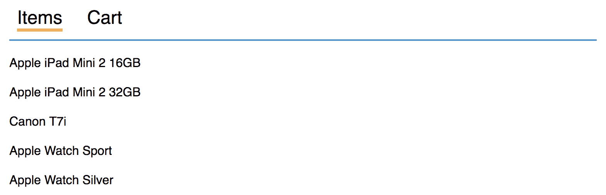

## 创建 Item

现在让我们创建真正的 `Item` 组件以供 `ItemList` 使用。它将接收一个 `item` 属性，我们还希望能够将其添加到购物车，所以它也应该接收一个 `onAddToCart` 属性。

此组件将是无状态的。它的职责是显示项目，并在点击“加入购物车”按钮时通知父组件。

通过从 GitHub 的示例学习，我们不会从此组件中返回一个 `li`。我们不希望强制使用 `Item` 的用户将其放在 `<ul>` 内部。父组件可以根据需要将此项目放入 `<li>` 中。

考虑到这一点，创建 `src/Item.js` 和 `src/Item.css`。在 `Item.js` 中，编写组件：

```javascript
import React from 'react';
import PropTypes from 'prop-types';
import './Item.css';

const Item = ({ item, onAddToCart }) => (
  <div className="Item">
    <div className="Item-left">
      <div className="Item-image" />
      <div className="Item-title">
        {item.name}
      </div>
      <div className="Item-description">
        {item.description}
      </div>
    </div>
    <div className="Item-right">
      <div className="Item-price">
        ${item.price}
      </div>
      <button
        className="Item-addToCart"
        onClick={onAddToCart}
      >
        加入购物车
      </button>
    </div>
  </div>
);
Item.propTypes = {
  item: PropTypes.object.isRequired,
  onAddToCart: PropTypes.func.isRequired
};

export default Item;
```

现在让我们将其连接到 `ItemPage` 组件。在 `ItemPage.js` 中，将代码更新为如下：

```javascript
import React from 'react';
import PropTypes from 'prop-types';
import Item from './Item';
import './ItemPage.css';

function ItemPage({ items, onAddToCart }) {
  return (
    <ul className="ItemPage-items">
      {items.map(item =>
        <li key={item.id} className="ItemPage-item">
          <Item
            item={item}
            onAddToCart={() => onAddToCart(item)} />
        </li>
      )}
    </ul>
  );
}
ItemPage.propTypes = {
  items: PropTypes.array.isRequired,
  onAddToCart: PropTypes.func.isRequired
};

export default ItemPage;
```

我们正在导入 `Item`，然后在 `<li>` 内部，我们现在渲染 `Item` 组件而不仅仅是项目名称。新增的是 `onAddToCart` 属性及其相关的 propType。

此时，代码将无法工作，并且会出现一个关于缺少 `onAddToCart` 属性的警告。


为了完成属性传递的链，我们需要在 `App` 组件内部为 `ItemPage` 的 `onAddToCart` 属性传递某些内容。顺便说，我们可能真的会将项目添加到购物车！这需要在 `state` 中增加一个新的 `cart` 属性。

让我们过一遍。首先，在 `App.js` 中，在初始状态中添加 `cart` 属性，并将其初始化为空数组：

```javascript
class App extends Component {
  state = {
    activeTab: 0,
    cart: []
  }

  // ...
}
```

然后更新 `renderContent` 以传递一个函数作为 `onAddToCart` 属性：

```javascript
class App extends Component {
  // ...

  renderContent() {
    switch(this.state.activeTab) {
      default:
      case 0:
        return (
          <ItemPage
            items={items}
            onAddToCart={this.handleAddToCart} />
        );
      case 1:
        return <span>Cart</span>;
    }
  }

  // ...
}
```

函数 `this.handleAddToCart` 还没有存在，所以接下来创建它。它将接受一个项目，并将该项目添加到购物车：

```javascript
class App extends Component {
  // ...

  handleAddToCart = (item) => {
    this.setState({
      cart: [...this.state.cart, item.id]
    });
  }

  // ...
}
```

这段代码的作用是将 `cart` 状态设置为当前购物车的副本，并加上一个新项目。

这里有一些新的 ES6 语法：`...this.state.cart` 是 `spread`（展开）运算符，它会将给定的数组展开为它的各个项目。以下是展开运算符的示例：

```javascript
// 使用数组：
var a = [1, 2, 3];
var b = [a, 4];    // => [[1, 2, 3], 4]
var c = [...a, 4]; // => [1, 2, 3, 4]

// 使用对象（技术上不是 ES6）
var o1 = {a: 1, b: 2};
var o2 = {...o1, c: 3}; // => {a: 1, b: 2, c: 3}
```

注意，数组的展开运算符正式是 ES6 的一部分，但对象的展开运算符不是。然而，`babel` 支持对象展开，而 Create React App 正在底层使用它将我们的代码转换为浏览器兼容的 ES5。

### 不可变的方式更新状态

你可能会想……为什么不直接修改状态然后调用 `setState` 呢，像这样：

```javascript
this.state.cart.push(item.id);
this.setState({cart: this.state.cart});
```

这是一个糟糕的主意，原因有两个（尽管在上面的示例中它可以运行）。

你绝不要直接修改（“变异”）状态或其子属性。不要执行 `this.state.something = x`，也不要 `this.state = x`。React 依赖于你想要更改时调用 `this.setState`，这样它就会知道发生了变化并触发重新渲染。如果你绕过了 `setState`，UI 将与数据不同步。

直接变异状态会导致诡异的 bug，以及难以优化的组件。

这是一个示例。记住，优化 React 组件的常用方法之一是使其变成“纯”的，这意味着它只在 props 改变时才重新渲染。这可以通过扩展 `React.PureComponent` 而不是 `React.Component` 来自动实现，也可以通过手动实现 `shouldComponentUpdate` 生命周期方法来比较 `nextProps` 和当前的 props。如果 props 看起来是相同的，它将跳过渲染并节省一些时间。

这是一个渲染项目列表的简单组件。注意它扩展了 `React.PureComponent`：

（如果你有示例代码，这段代码位于“impure-state”文件夹下。）

```javascript
class ItemList extends React.PureComponent {
  static propTypes = {
    items: PropTypes.array.isRequired
  }

  render() {
    return (
      <ul>
        {this.props.items.map(item =>
          <li key={item.id}>{item.value}</li>
        )}
      </ul>
    );
  }
}
```

现在，这里有一个小型应用程序，它渲染 `ItemList` 并允许你以变异或不可变的方式向列表添加项目：

```javascript
class App extends Component {
  // 将 items 初始化为空数组
  state = {
    items: []
  }

  // 初始化一个计数器
  // 为每个 item ID 递增
  nextItemId = 0;

  makeItem() {
    // 创建一个新的 ID 并使用
    // 随机数作为值
    return {
      id: this.nextItemId++,
      value: Math.random()
    };
  }

  addItemmutably = () => {
    // 正确的方法：
    // 复制现有的并添加一个新的
    this.setState({
      items: [...this.state.items, this.makeItem()]
    });
  }

  addItemMutably = () => {
    // 错误的方法：
    // 变异 items 并将其设置回去
    this.state.items.push(this.makeItem());
    this.setState({ items: this.state.items });
  }

  render() {
    return (
      <div>
        <button onClick={this.addItemmutably}>以不可变的方式添加项目（好）</button>
        <button onClick={this.addItemMutably}>以变异的方式添加项目（坏）</button>
        <ItemList items={this.state.items}/>
      </div>
    );
  }
}
```

```css
.Item {
  display: flex;
  justify-content: space-between;
  border-bottom: 1px solid #ccc;
  padding: 10px;
}
.Item-image {
  width: 64px;
  height: 64px;
  border: 1px solid #ccc;
  margin-right: 10px;
  float: left;
}
.Item-title {
  font-weight: bold;
  margin-bottom: 0.4em;
}
.Item-price {
  text-align: right;
  font-size: 18px;
  color: #555;
}
.Item-addToCart {
  margin-bottom: 5px;
  font-size: 14px;
  border: 2px solid #FFAA3F;
  background-color: #fff;
  border-radius: 3px;
  cursor: pointer;
}
.Item-addToCart:hover {
  background-color: #FFDDB2;
}
.Item-addToCart:active {
  background-color: #ED8400;
  color: #fff;
  outline: none;
}
.Item-addToCart:focus {
  outline: none;
}
.Item-left {
  flex: 1;
}
.Item-right {
  display: flex;
  flex-direction: column;
  justify-content: space-between;
}
```

这样好多了：

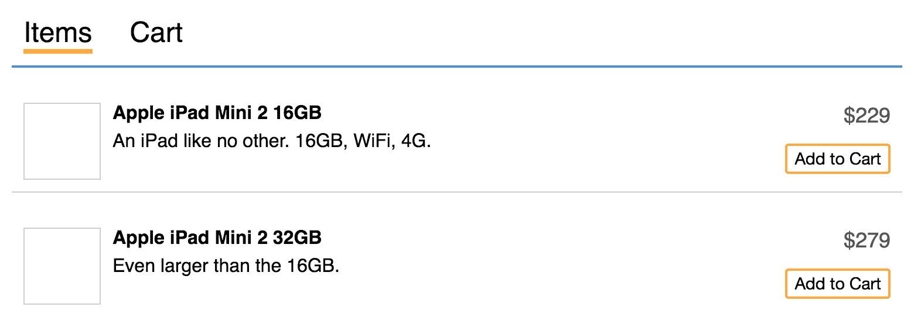

## 创建 CartPage

现在我们已经可以将商品添加到购物车了，我们将构建一个渲染购物车本身的组件。

创建 `src/CartPage.css` 和 `src/CartPage.js`，并打开 `CartPage.js`。最初，代码将与 `ItemPage` 中的代码非常相似。

```javascript
import React from 'react';
import PropTypes from 'prop-types';
import Item from './Item';
import './CartPage.css';

function CartPage({ items }) {
  return (
    <ul className="CartPage-items">
      {items.map(item =>
        <li key={item.id} className="CartPage-item">
          <Item item={item} />
        </li>
      )}
    </ul>
  );
}
CartPage.propTypes = {
  items: PropTypes.array.isRequired
};

export default CartPage;
```

这只是渲染了它接收到的商品。你会注意到，我们没有向 `Item` 传递 `onAddToCart` 处理程序，这会导致 prop 警告。我们很快会修复这个问题。

### 将商品传递给 CartPage

购物车需要商品来显示。问题是，我们的 `cart` 状态只包含索引，而不是实际商品。此外，当商品被多次添加时，会出现重复。我们需要将 `cart` 状态转换为适合传递给 `CartPage` 的商品数组。

在 `App.js` 顶 Implementation 导入 `CartPage`：

```javascript
import CartPage from './CartPage';
```

然后添加一个 `renderCart` 函数，并更新 `renderContent` 来调用它。

```javascript
class App extends Component {
  // ...
  renderContent() {
    switch(this.state.activeTab) {
      default:
      case 0:
        return (
          <ItemPage
            items={items}
            onAddToCart={this.handleAddToCart} />
        );
      case 1:
        return this.renderCart();
    }
  }
  renderCart() {
    // 计算购物车中每种商品的数量
    let itemCounts = this.state.cart.reduce((itemCounts, itemId) => {
      itemCounts[itemId] = itemCounts[itemId] || 0;
      itemCounts[itemId]++;
      return itemCounts;
    }, {});

    // 创建商品数组
    let cartItems = Object.keys(itemCounts).map(itemId => {
      // 根据 id 查找商品
      var item = items.find(item =>
        item.id === parseInt(itemId, 10)
      );
      // 创建一个也包含 'count' 属性的“商品”
      return {
        ...item,
        count: itemCounts[itemId]
      }
    });
    return (
      <CartPage items={cartItems} />
    );
  }
  // ...
}
```

这段代码中有些你以前可能没见过的东西。

## Array.prototype.reduce

`reduce` 函数的作用类似于求和操作。它接受一个可选的初始值（在此处为 `{}`），然后调用给定的函数，并将累加总和和当前数组项传入参数。函数返回的值将成为新的 `total`，然后移动到数组中的下一个项。当 `reduce` 完成时，它返回最终的 `total`。我们正在使用 `reduce` 来构建一个对象，其键是 `itemId`，值是购物车中每种商品的数量。

这是一个 `reduce` 应用的更小、更简单的示例：

```javascript
let a = [1, 2, 3, 4];
let total = a.reduce((sum, value) => {
  return sum + value;
}, 0);
// 箭头函数被调用 4 次：
//   (0, 1) => 返回 1
//   (1, 2) => 返回 3
//   (3, 3) => 返回 6
//   (6, 4) => 返回 10
```

## Object.keys

`Object.keys` 返回对象中所有键的数组。每当你想要遍历数组的值以创建一个聚合结果时，请考虑使用 `reduce`。

第三种想法是将 `children` 传递给 `Item` 并让它决定将它们放在哪里。这就是我们将实现的思路。这让 `Item` 非常容易复用。如果你想要一个“加入购物车”按钮，就把它传进去。如果你想要的是添加/删除按钮，就把它们传进去。让我们来看看它是如何运作的。

### 重构 Item

新的 `Item` 及其 `propTypes` 如下所示：

```javascript
const Item = ({ item, children }) => (
  <div className="Item">
    <div className="Item-left">
      <div className="Item-image" />
      <div className="Item-title">{item.name}</div>
      <div className="Item-description">{item.description}</div>
    </div>
    <div className="Item-right">
      <div className="Item-price">${item.price}</div>
      {children}
    </div>
  </div>
);
Item.propTypes = {
  item: PropTypes.object.isRequired,
  children: PropTypes.node
};
```

在曾经有 `<button>` 的地方，我们现在改用了 `{children}`。此外，`Item` 不再需要感知 `onAddToCart` 函数，因此我们删除了它的 `propType`。

如果你在此处刷新，你会发现“加入购物车”按钮已经从购物车页面以及商品页面中消失了。为了修复这个问题，打开 `ItemPage.js` 并将 `<button>` 作为 `Item` 的子元素传递进去：

```javascript
function ItemPage({ items, onAddToCart }) {
  return (
    <ul className="ItemPage-items">
      {items.map(item =>
        <li key={item.id} className="ItemPage-item">
          <Item item={item}>
            <button
              className="Item-addToCart"
              onClick={() => onAddToCart(item)}>
              Add to Cart
            </button>
          </Item>
        </li>
      )}
    </ul>
  );
}
```

好了，恢复正常了。现在来处理新部分：打开 `CartPage.js`，在 `Item` 内部传递加/减按钮和商品数量。我们还需要用于处理添加或删除商品时的处理函数。


```javascript
function CartPage({ items, onAddOne, onRemoveOne }) {
  return (
    <ul className="CartPage-items">
      {items.map(item =>
        <li key={item.id} className="CartPage-item">
          <Item item={item}>
            <div className="CartItem-controls">
              <button
                className="CartItem-removeOne"
                onClick={() => onRemoveOne(item)}>&ndash;</button>
              <span className="CartItem-count">{item.count}</span>
              <button
                className="CartItem-addOne"
                onClick={() => onAddOne(item)}>+</button>
            </div>
          </Item>
        </li>
      )}
    </ul>
  );
}
CartPage.propTypes = {
  items: PropTypes.array.isRequired,
  onAddOne: PropTypes.func.isRequired,
  onRemoveOne: PropTypes.func.isRequired
};
```

这些都是你之前见过的内容。在我们传递这些函数之前，代码将无法工作，所以让我们回到`App.js`并创建它们。在`renderCart`的底部，我们需要将 props 传递给`CartPage`：

```javascript
class App extends Component {
  // ...
  renderCart() {
    // ...
    return (
      <CartPage
        items={this.state.cart}
        onAddOne={this.handleAddToCart}
        onRemoveOne={this.handleRemoveOne} />
    );
  }
  // ...
}
```

我们已经有了`handleAddToCart`函数，它接收一个商品并将其 id 添加到购物车，所以我们可以在这里直接使用。我们需要创建`handleRemoveOne`函数。它将接收一个商品，在购物车中找到该商品项，然后更新`cart`状态以移除该项。

```javascript
class App extends Component {
  // ...
  handleRemoveOne = (item) => {
    let index = this.state.cart.indexOf(item.id);
    this.setState({
      cart: [
        ...this.state.cart.slice(0, index),
        ...this.state.cart.slice(index + 1)
      ]
    });
  }
  // ...
}
```

在这里我们使用了两次数组*展开*（spread）运算符，以避免直接修改状态。我们获取数组的左半部分（到我们要删除的商品为止），并将其与数组的右半部分（被删除商品之后的所有内容）拼接。

这比允许直接修改要多一点精力，但这是一个良好的习惯。如果你将来开始使用 Redux，这将尤为重要。Redux 高度依赖于不可变性。

为了完善添加/删除按钮，让我们给它们添加一些样式。在`CartPage.css`中添加以下 CSS：

```css
CartPage-items {
  margin: 0;
  padding: 0;
}
.CartPage-items li {
  list-style: none;
}
.CartItem-count {
  padding: 5px 10px;
  border: 1px solid #ccc;
}
.CartItem-addOne,
.CartItem-removeOne {
  padding: 5px 10px;
  border: 1px solid #ccc;
  background: #fff;
}
.CartItem-addOne {
  border-left: none;
}
.CartItem-removeOne {
  border-right: none;
}
```

大功告成了：

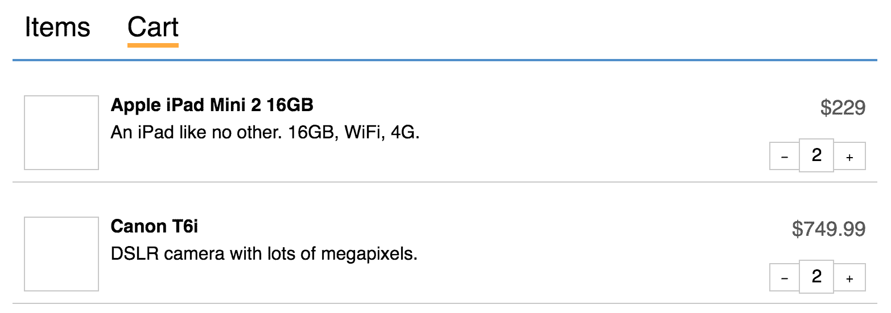

### 练习

1.  如果购物车能告诉我们准备在苹果产品上花费多少美元，而不是让我们去猜就好了。在购物车页面底部添加一个“总计”，如下：

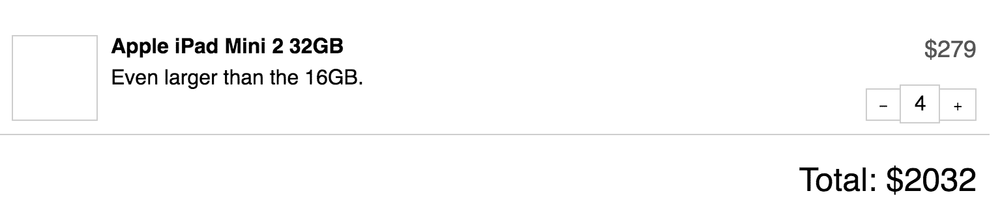

2.  当购物车为空时，页面是完全空白的。修改使其在没有商品时显示“购物车为空”，如下：

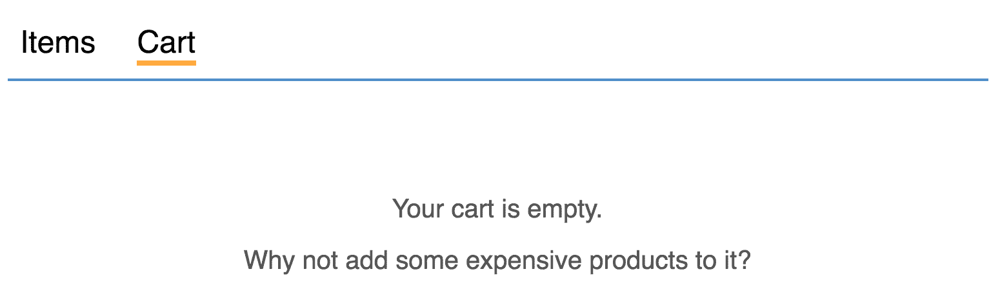

3.  在导航栏右上角显示购物车摘要，如下所示。包括商品总数和总价。确保考虑到数组中的每个项目数量可能大于 1。作为一个奖励，让购物车摘要可点击，点击后切换到购物车页面。如果你喜欢也可以添加一个购物车图标（可以使用 Font Awesome）。

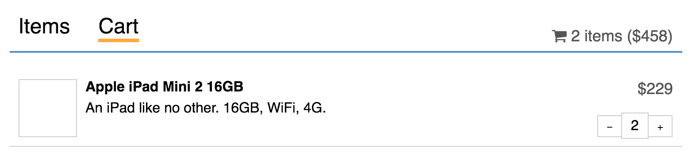

4.  根据此截图构建一个简化版的 Reddit：

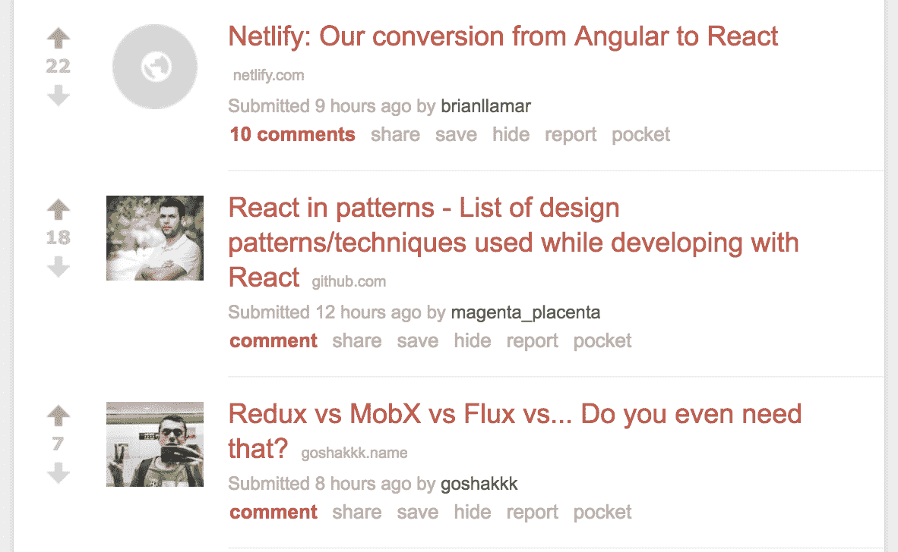

它应该具备以下功能：

*   显示投票数

*   可运行的赞成/踩控件

*   显示评论数

*   按赞成数对故事进行排序

*   标题应该是真实的链接

*   其他链接不需要具有功能（分享、保存、隐藏等）

遵循我们在书中贯穿始终的流程：列出截图中的组件，决定需要保留哪些状态以及哪些组件应该拥有这些状态，然后开始构建组件。

Reddit 的 API 是公开的，不需要密钥。你可以使用来自 http://www.reddit.com/r/reactjs.json 的静态数据——将其保存到文件中，并像我们在几个示例中做的那样导入。

5.  根据此 UI 构建一个简化版的 Slack：

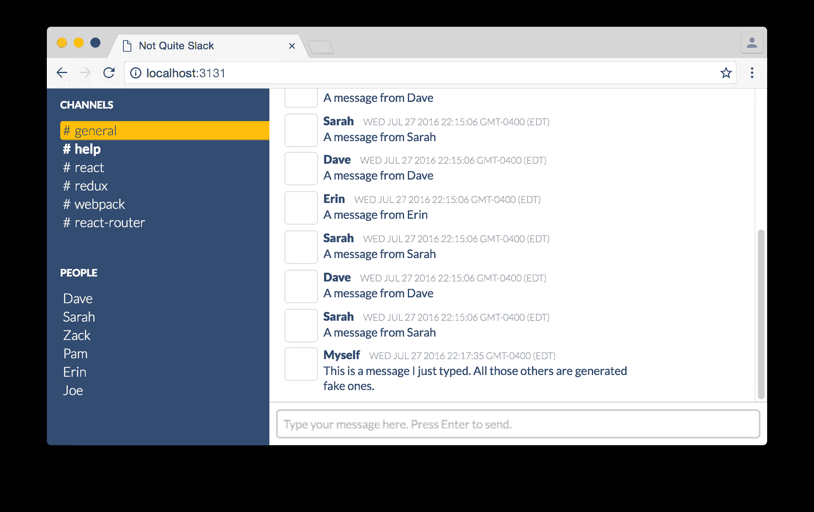

它应该具备以下功能：

*   频道列表

*   用户列表

*   维护当前选中的通道或用户的状态

*   点击通道或用户进行选择

*   一次只能选择一个通道或用户

*   每个通道和用户都有自己的消息历史记录

*   为每个通道生成一些虚假消息

*   仅在选中通道或用户时，在底部显示输入框

*   在输入框中输入内容并按`ENTER`键会将该消息添加到所选的通道/用户，并清空输入框

# 接下来该去哪里

首先，恭喜你读完了这本书。我希望你在阅读过程中的乐趣，不像我写它时一样开心。

话虽如此，这并不是终点。这只是你 React 之旅的`beginning`。

到目前，你已经牢牢掌握了 React 的基础知识，并且学习了一些 ES6。从这里开始，你可以继续学习 AJAX、Webpack、React Router、Redux 或 MobX，以及你需要的任何其他内容。

这里有一个建议的攻克顺序。我认为`最后`学习 Redux 是很重要的，但其他内容可以根据你的需要调整顺序。

## AJAX

学习如何将你的应用连接到服务器是非常有趣的，因为你可以看到你的应用随着真实数据变得活跃。

React 没有内置的与服务器通信的方法，所以你需要使用 HTTP 库。有很多这样的库可供选择。我喜欢 [fetch](https://github.com/github/fetch)，因为它最终将成为 JavaScript 标准库的一部分，但 [axios](https://github.com/mzabriskie/axios) 和 [superagent](https://github.com/visionmedia/superagent) 也是很好的选择。

你应该在何时以及何处发送 HTTP 请求？常见的做法是在`componentDidMount`周期方法中获取数据。当响应返回时，调用`this.setState`保存这些数据，并使用`props`将其传递给需要它的组件。

就像所有状态一样，最好尽可能让它保持在组件层级结构的高处。例如，如果一个`Page`包含多个`List`组件，不要让每个`List`都去获取自己的数据——在`Page`组件中获取这些数据，并作为`props`传递给`List`。

## 测试

测试是软件开发的重要部分。无论你决定是否使用测试驱动开发（TDD），在代码周围编写测试都能让你有信心确保一切都按预期运行。

有几个用于测试 React 的新工具需要学习。你需要一种方法来进行断言（Chai），可能需要一个库来设置间谍（Sinon），并且你绝对想要使用`Enzyme`，这是一个由 Airbnb 创建的用于测试 React 组件的库。

我整理了一篇帮助你开始测试 React 的文章，在这里](https://daveceddia.com/getting-started-with-tdd-in-react/)。

## Webpack

构建工具在刚开始是一个主要的障碍，这就是为什么设置 Webpack 没有包含在本书中。如果你还没有需要自定义构建，请推迟以后学习 Webpack。

我推荐阅读文章 [Webpack – The Confusing Parts](https://medium.com/@rajaraodv/webpack-the-confusing-parts-58712f8fcad9) 来作为对 Webpack 及其思维方式的介绍。Egghead.io 也有一个关于 Webpack 很好的快速介绍，地址是 [`egghead.io/lessons/javascript-intro-to-webpack`](https://egghead.io/lessons/javascript-intro-to-webpack)。

你应该知道，我们一直使用的`create-react-app`工具有一个生产构建模式（运行`npm run build`），它会创建一个包含压缩文件和生产环境 React 的生产优化版构建。如果你不需要自定义任何内容，Create React App 开箱即用就非常好，完全适合编写真实的生产环境 React 应用。

它还有一个“eject（弹出）”命令（运行`npm run eject`），它可以提取生成的 Webpack 构建并将其暴露供你自定义。

## ES6

你已经在书中看到了一部分内容：箭头函数、`let/const`、类（classes）、解构以及`import`/`export`。这些是你经常会用的大部分 ES6 内容，但还有许多其他很棒的新特性，如承诺（promises）、`for..of`循环、动态对象键、迭代器等

你可以在学习的过程中掌握这些特性，但至少对所有内容进行一次快速概览是个好主意，这样你就知道哪些功能是可用的。这个 [ES6 特性概述](https://github.com/lukehoban/es6features) 是一个很好的资源。

## 路由

现在你已经相当熟悉了 React 是如何工作的，React Router 的概念将在此基础上构建。它利用组件来为你的应用程序布局路由，有效地将你的组件映射到 URL。查看 [React Router on Github](https://github.com/ReactTraining/react-router) 开始吧。

有些人会在脑中将 React Router 和 Redux 混为一谈——它们实际上并不相互关联或相互依赖，尽管有一个库可以将路由状态与 Redux 起来。你可以在（并且应该！）在深入学习 Redux 之前学会使用 React Router。

## Redux

Redux 的创建者 Dan Abramov [会告诉你](https://github.com/gaearon/react-makes-you-sad) 不要过早给你的项目添加 Redux，这很有道理——在你遇到它能解决的问题之前，你不需要它，而且早期引入复杂度可能是灾难性的。

Redux 的概念相当简单，但在理解其原理和在实际应用中使用它之间存在差距。它受到函数式编程概念的影响，如果你不熟悉这些，可能需要一些适应。

所以，在向大项目引入 Redux 之前，重复你在书中做的：构建小项目。将使用普通状态的代码转换为 Redux。构建许多 Redux 实验来真正内化它的工作原理。
