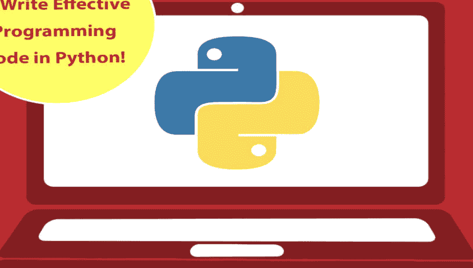

# Python：Python 编程代码高级指南



# 引言

我想感谢你的阅读，并祝贺你选择了《Python：Python 编程代码最佳实践》这本书。这本书包含了关于如何更有效地进行 Python 编程的成熟步骤和策略。当你开始学习 Python 时，人们会教你写代码，但在很多情况下，他们并没有教你如何写整洁的代码。

如果你与任何 Python 程序员交流，问问他们 Python 是什么样的。我保证他们会告诉你，其中一个主要原因是因为它非常易于阅读。事实上，这是 Python 语言的核心灵魂，因为计算机代码被阅读的次数远大于编写的次数。这在很大程度上归于 Python 代码遵循了一套指南和“Pythonic”（Python 风格）惯用法——如果你听到程序员提到代码某部分不“Pythonic”，意味着它没有遵循这些指南，而且没有以任何方式表达其意图。

代码风格和布局极其重要，你所使用的风格的一致性也是如此。尽管如此，有时一致性并不是正确的选择，而指南简单来说并不适用——你必须知道什么时候是这种时候，以及在 Python 编程中何时该依靠主观判断。

通过本指南，我将向你展示编写代码的极致方式，整理你的程序并使其更加有效、高效。我不会只给你基础知识。我将深入探讨你需要了解的一切，从代码布局到如何编写函数、惯用法和命名。

我将谈到空格和标签、字符串和方法。我还会为你提供关于 Python 编程的一些通用建议以及通用概念。简而言之，当你读完我的最佳实践指南时，你将成为你所能的最优秀的 Python 程序员。

我的书假设你对 Python 编程有一定的先验知识，所以如果你是编程领域的完全新手，请在阅读本书之前熟悉 Python 代码。我的目标是帮助你产出没有（或至少极少）复杂性或显而性问题的 Python 代码，并让它对他人来说是可读的。

再次感谢阅读本书，希望你喜欢！

# 第 1 章：Python 编码通用概念

在我们正式进入书籍之前，这些是你应该意识到的编码通用概念；这些概念将让你的生活变得更轻松。

## 显式代码

虽然你可以用 Python 做各种奇妙而神奇的事情，但最好保持直接和显式。

### 坏示例：

```python
def make_complex(*args):
    x, y = args
    return dict(**locals())
```

### 好的示例：

```python
def make_complex(x, y):
    return {'x': x, 'y': y}
```

比较这些示例；在后者的代码示例中，我们从调用者那里显式接收了 `x` 和 `y`，返回是一个显式的字典。

编写这段代码的开发者只需看这一行和最后一行就能知道什么；而坏示例并非如此。

## 一行一语句

虽然存在复合语句（如列表推导式），是被允许且在很多情况下受到推崇的，但在同一行代码上放置两个互不关联的语句并不是良好的做法。

### 坏示例：

```python
print 'one'; print 'two'

if x == 1: print 'one'

if <复杂比较> and <其他复杂比较>:
    # 执行一些事情
```

### 好的示例：

```python
print 'one'
print 'two'

if x == 1:
    print 'one'

cond1 = <复杂比较>
cond2 = <其他复杂比较>
if cond1 and cond2:
    # 执行一些事情
```

## 返回值

当你获得一个不断变得复杂的函数时，有时有必要使用返回语句。然而，如果你想保持清晰的意图和良好的可读性，你不应该尝试从多个点返回值。

在函数内部返回值时，有两种情况可以这样做：指示输入错误的错误，或者由于任何原因函数无法完成。在这样的情况下，最佳实践是在发现错误时立即返回。

尽管如此，如果一个函数包含多个可以返回的路径，调试结果可能会变得异常困难，因此最好只维护一个出口。这也有助于理清代码路径。

### 示例：

```python
def complex_function(c, b, a):
    if not c:
        return None # 抛异常可能更好
    if not b:
        return None # 抛异常可能更好
    # 尝试从 c, b 和 a 生成 x 的复杂代码
    # 如果成功，尽量不要返回 x
    if not x:
        # x 的方案 B 计算
        return x # 为 x 一个出口会有帮助
        # 在维护代码时
```

# 第 2 章：编程建议

这些是编写 Python 代码的基本建议，如果你希望你的代码更加有效高效且易读，就应该遵循这些建议。

- 你的代码编写方式必须不会损害其他 Python 实现（如 `IronPython`、`Jython`、`PyPy`、`Psyco` 和 `Python`）。

例如，你永远不要依赖于 `CPython` 的高效字符串拼接，其形式为 `a=a+b` 或 `a+=b`。这是一种相当脆弱的优化，尽管它在 `CPython` 中超级高效，但在所有类型上并不适用，而且在任何使用引用计数的 Python 实现中都不会存在。

相反，在你使用性能敏感的库部分时，你应该使用 `.join()` 形式。这将确保拼接在所有不同的 Python 实现中都是线性的。

- 永远不要使用相等运算符来与单例（如 `None`）进行比较。请使用 `is` 或 `not`。

你还应该警惕使用 `if x`，而实际上你应该使用 `if x is not None`。这种情况的一个例子是，当你测试一个默认值为 `None` 的参数或变量时，判断它是否真的被设置了不同的值。另一个值的类型在布尔上下文中可能为假。

- 与其使用 `not is` 运算符，你应该使用 `is not`。虽然两者在功能上是等价，但前者在可读性上较差，因此后者更受欢迎。例如：

### 应该这样做：

```python
if foo is not None:
```

### 不要这样用：

```python
if foo is not None
```

- 当你通过富比较实现排序操作时，你应该实现所有的 6 个操作，并依赖某些其他代码来执行比较。这些操作是（`__eq__`、`__lt__`、`__ne__`、`__ge__`、`__gt__`、`__le__`）。

为了减少工作量，有一个特定的装饰器可以生成所需的任何比较方法。该装饰器是 `functools.total_ordering()`。

风格指南指出 Python 假设了反射规则。因此，Python 解释器可能会更改交换 `y > x` 与 `x < y` 的操作，或者可能会交换 `y >= x` 与 `x <= y`。

你可能还会发现参数 `x == y` 被交换为 `x != y`。`min()` 和 `sort()` 操作肯定会使用 `<` 运算符，而 `max()` 函数将使用 `>` 运算符。然而，作为最佳实践，你应该使用所有操作，以防产生混淆。

- 与其使用将 lambda 表达式绑定到标识符的赋值语句，不如使用 `def` 语句。

### 一个良好的示例：

```python
def f(x):
    return 2
```

### 一个糟糕的示例：

```python
f = lambda x: 2
```

第一个示例显示，赋予函数对象的名称是 `'f'` 而不是 `<lambda>`。这对于字符串表示以及回溯追踪非常有用，而通过使用赋值语句，你放弃了 lambda 表达式相比 `def` 语句提供的一个优势——即它可以被嵌入更大的语句中。

当你想要派生异常时，请使用 `Exception` 而不是 `BaseException`。后者保留给那些捕获它们是非常错误的异常。在设计异常层次结构时，应基于可能需要的质量来设计。始终要回答一个问题——“哪里出错了？”，而不是仅仅说某事错了。遵循命名约定，但请记住为产生错误的类添加“Error” 后缀。对于不是错误且用作流控制或其他形式的信号的异常，不需要添加任何特殊后缀。

- 当你使用异常链时，请仅在需要的地方使用。当你替换内部异常时，确保将正确的细节重新定位到新异常中。例如，在将 `KeyError` 转换为 `AttributeError` 时保留属性名称。

- 当你使用 Python 2 并抛出异常时，请始终使用 `raise ValueError('message')` 而不是 `raise ValueError 'message'`，因为后者在 Python 3 中既不是有效的的也不是合法的。此外，使用括号意味着当你在添加字符串格式化或异常参数过长时，不需要在行末使用续行符。

- 当你捕获异常时，尽可能提到具体的异常类型，而不是使用裸露的 `except:` 子句，这使得使用 `KeyboardInterrupt` 和 `SystemExit` 异常中断程序变得困难得多。一个通用规则是仅在以下两种情况使用裸露的 `except:` 子句：

1. 如果异常处理程序正在打印回溯跟踪；这样用户就能感知到任何错误。

2. 如果需要清理工作，代码允许通过 `raise` 将异常向上传播。实现此点的有效方法是使用 `try...finally`。当你将捕获的异常绑定到一个名称时，使用 Python 3 的显式绑定语法：

```python
try:
    process_data()
except Exception as exc:
    raise DataProcessingError(str(exc))
```

这是 Python 3 支持的唯一语法，并消除了与旧式基于逗号的语法相关的任何模糊问题。

- 当你捕获系统错误时，请使用 Python 3 的异常层次结构而不是 `errno` 值。同样，当捕获系统错误时，使用 Python 3 的异常层次结构而不是 `errno` 值。（注：此处原文似乎有重复，翻译时已按原意保持并逻辑处理）

- 当你比较对象类型时，使用 `isinstance()` 而不是直接比较

### 良好的示例：

```python
if isinstance(obj, int):
```

### 糟糕的示例：

```python
if type(obj) is type(1):
```

当你检查一个对象是否为字符串时，记住它也可能是一个 Unicode 字符串。在 Python 2 中，Unicode 和 str 共享基类 `basestring`，因此你可以这样做：

```python
if isinstance(obj, basestring):
```

然而，在 Python 3 中，你找不到 `basestring` 或 `Unicode`，只有 str 和 bytes 对象是字符串，它们是整数序列。对于序列（元组、列表、字符串等），请利用空序列为假的特性。

### 良好的示例：

```python
if not seq:
if seq:
```

### 糟糕的示例：

```python
if len(seq):
if not len(seq):
```

不要包含任何大量尾随空格的字符串字面量，因为这是无法区分的，某些文本编辑器会删除它们。

不要使用 `==` 来比较布尔值 `True` 或 `False`：

### 良好的示例：

```python
if greeting:
```

### 糟糕的示例：

```python
if the greeting == True:
```

### 更糟糕的示例：

```python
if the greeting is True:
```

# 第 3 章：代码布局

最显而易见的入门点是如何布局你的代码。我将为你提供代码布局的最佳实践指南，并结合如何做以及不该如何做的示例：

## 缩进与对齐

每个缩进级别应为 4 个空格。

当你使用延续行时，它们应该通过以下两种方法之一对折行的元素进行对齐：

- 垂直对齐，类似于 Python 在花括号、括号和圆括号内部隐式连接行的方式，或者

- 使用悬挂缩进

当你使用悬挂缩进时，请考虑第一行不应该有参数，并且为了标记延续行，必须使用缩进。

考虑以下示例：

### 正确的方法：

```python
## 与起始定界符对齐
foo = long_function_name(var_four, var_three, var_two, var_one)
```

```python
### 并且包含一些缩进，以便与其他代码区分开来
def long_function_name(
    var_four, var_three, var_two,
    var_one):
    print(var_four)
```

```python
### 应该使用悬挂缩进来增加一层。
foo = long_function_name(
    var_four, var_three,
    var_two, var_one)
```

### 错误的方法：

```python
### 当你不使用垂直对齐时，第一行不允许有参数。
foo = long_function_name(var_four, var_three, var_two, var_one)
```

```python
### 需要更多的缩进，因为缩进与其余代码无法区分。
def long_function_name(
    var_four, var_three, var_two,
    var_one):
    print(var_four)
```

对于延续行，4 个缩进空格的规则是可选的：

```python
### 悬挂缩进的缩进*可以*多于或少 4 个空格。
foo = long_function_name(
    var_four, var_three,
    var_two, var_one)
```

当你使用带有可以跨行编写的长条件的 `if` 语句时，请注意条件中的其余行很容易缩进 4 个空格——使用一个 2 个字符的关键字（例如 `if`）带一个空格和一个左圆括号。然而，在视觉上，这看起来可能与 `if` 语句内部缩进的代码不兼容，因为内部代码已经有了 4 个空格的缩进。在区分这些条件行与嵌套内部代码方面，并没有固定的位置，你有几种可以接受的选项，包括但不限于：

```python
### 没有使用额外的缩进。
if (this_is_one_thing and
    that_is_something_else):
    do_this()
```

```python
### 添加一条注释，这将在支持语法高亮的编辑器中提供帮助。
if (this_is_one_thing and
    that_is_something_else):
    # 既然两个条件都为，我们可以进行调整。
    do_this()
```

```python
### 为条件延续行添加更多缩进。
if (this_is_one_thing
    and that_is_something_else):
    do_this()
```

现在，当你有一个多行结构时，闭合花括号、括号或中括号可以对齐在两个地方之一——要么在列表末尾行非空白的起始字符下方：

```python
my_list = [
    6, 5, 4,
    3, 2, 1,
]
```

```python
result = a_function_that_will_take_arguments(
    'r', 'e', 'd',
    'c', 'b', 'a',
)
```

或者，它们也可以对齐在多行结构第一行的起始字符下方：

```python
my_list = [
    6, 5, 4,
    3, 2, 1,
]
```

```python
result = a_function_that_will_take_arguments(
    'r', 'e', 'd',
    'c', 'b', 'a',
)
```

# 第 4 章：惯用法

编程惯用法简单来说就是 Python 代码应该的编写方式。我们通常将惯用代码称为 Python 代码，虽然编写某些东西通常有一种非常明显的方法，但 Python 代码的实际编写方式对于 Python 初学者来说可能有些晦涩。所以，你需要学习良好的惯用法，其中一些更常见的有：

## 解包

只要你知道元组或列表的长度，封包允许你为每个元素赋予一个名称。例如，`enumerate()` 为列表中的每个项都提供一个包含 2 个元素的元组：

```python
for index, each item in enumerate(this_list):
```

你可以使用解包来交换变量：

```python
b, a = a, b
```

你还可以使用嵌套解包：

```python
c, (b, a) = 3, 2
```

当 Python 3 实现时，带来了一种新的扩展解包方法：

```python
*the_rest = 3, 2, 1
# 3, 
the_rest = 2, 1
```

### 创建忽略的变量

如果你想忽略一个变量，就会使用下划线。例如：

```python
for _ in range(5):
    print(_)
```

### 从列表创建字符串

创建字符串最常用的方法是 `.join()`：

```python
letters = ['a', 'b', 'c']
word = ''.join(letters)
```

### 在集合中查找项

有时，你需要搜索一个集合。有两种方法可以实现——使用列表或集合：

```python
if 'apple' in ['apple', 'banana']:
    print('Found apple')
```


然而，性能是不同的。为了判断一个项是否在列表中，Python 必须搜索每一个项。而在集合中，每个项都有一个哈希值告诉 Python 去哪里查找。这使得搜索快得多。在以下情况下，使用集合比列表是更好的选择：

- 集合包含大量项
- 你将重复进行搜索
- 没有重复项

## 第 5 章：注释

由于你已经有一些 Python 编程经验，你会知道注释在程序运行时是不可见的。注释是为了帮助代码编写者和其他阅读代码的人理解做了什么以及为什么。现在，有些人认为因为它们是不可见的，所以不需要编写它们，而另一些人写的注释毫无意义且代码冲突。我必须告诉你，在这者中，有冲突的注释比不写注释糟糕得多，因此，每当你修改代码时，都必须确保更新了相应的注释。

当你编写注释时，确保它是一个完整的句子并有正确的结尾。正如你写任何东西一样，你的注释（无论是句子还是短语）必须以大写字母开头。该规则的唯一例外是它是以小写字母开头的标识符——这里的黄金法则是你永远不要改变标识符的大小写！

如果你使用的是简短注释，可以省略结尾的句号。如果你在写块注释，这些通常由至少一个段落组成，有时更多，每个段落由完整的句子组成。这些句子中的每一个都要有句号。每个句号后面应该留出 2 个空格，所有注释都应该用英文编写。

### 块注释

块注释倾向于适用于其后的部分或全部代码。注释的缩进方式必须与它所指的代码完全一致，且块的每一行都必须以 `#` 后加一个空格开头。唯一的例外是你在注释内部使用了缩进文本。每个块注释中的所有段落之间必须用一个包含单个 `#` 的行隔开。

### 内联注释

这些注释应该尽可能少。复习一下，内联注释是放置在与语句同一行的注释。内联注释与语句之间至少要有两个空格分隔，并且它们必须以一个 `#` 后加一个空格开头。

坦率地说，你应该避免使用内联注释，因为它们并不是真的，而且可能会引起不必要的注意力分散。

例如，你永远不要这样做：

```python
x = x + 1   # Increment x
```

然而，有时候这可能是有用的：

```python
x = x + 1   # Compensate for the border
```

## 第 6 章：约定

为了让你的 Python 代码更具可读性，请遵循这些约定：

查看变量是否等于某个常量。没有必要显式地将值与 `0`、`None` 或 `True` 进行比较；相反，你可以将它放入 `if` 语句中。看以下示例：

### 错误的示例

```python
if attr == None:
    print 'True!'
```

```python
if attr == None:
    print 'attr is None!'
```

### 良好的示例

```python
### 只需查看值
if attr:
    print 'attr is the best!'
```

```python
### 或者检查相反的情况是什么
if not attr:
    print 'attr is the worst!'
```

```python
### 或者，由于 None 被视为假，确保你对它运行了显式检查
if attr == None:
    print 'attr is None!'
```

### 如何访问字典元素

不要使用 `dict.has_key()` 方法，而要使用 `x in d` 语法或使用 `dict.get()` 来传递默认参数。

#### 错误的示例

```python
d = {'hello': 'world'}
if d.has_key('hello'):
    print d['hello'] # prints 'world'
else:
    print 'the_default_value'
```

#### 良好的示例

```python
d = {'hello': 'world'}

print d.get('hello', 'default_value') # prints 'world'
print d.get('thingy', 'default_value') # prints 'default_value'
```

#### 或者

```python
if 'hello' in d:
    print d['hello']
```

### 用快捷方法操作列表

在操作列表时，你不需要长篇大论；当你想要对列表执行操作时，使用列表推导式或 `filter()` 或 `map()` 函数来使用简洁的语法。

#### 错误的示例

```python
### 过滤所有大于 4 的元素
a = [5, 4, 3]
b = []
for i in a:
    if i > 4:
        b.append(i)
```

#### 良好的示例

```python
a = [5, 4, 3]
b = [i for i in a if i > 4]
### 或者：
b = filter(lambda x: x > 4, a)
```

#### 另一个错误的示例

```python
### 给列表的所有成员加 3
a = [5, 4, 3]
for i in range(len(a)):
    a[i] += 3
```

#### 另一个良好的示例

```python
a = [5, 4, 3]
a = [i + 3 for i in a]
### 或者：
a = map(lambda i: i + 3, a)
```

你也可以使用 `enumerate()` 函数来记录你在列表中的位置：

```python
a = [5, 4, 3]
for i, item in enumerate(a):
    print i, item
    # prints
    # 0 5
    # 1 4
    # 2 3
```

这种方法比手动处理计数器更好，而且更适合迭代器。

### 从文件读取

当你想要从文件中读取内容时，最好使用 `with` 语法，因为它会为你关闭文件。

#### 错误的示例

```python
f = open('file.txt')
a = f.read()
print a
f.close()
```

#### 良好的示例

```python
with open('file.txt') as f:
    for line in f:
        print line
```

### 换行

使用 `with` 语句高效得多，因为即使发生异常，也能确保文件始终关闭。换行是有限制的，当一行很长时，应该拆分成几行。Python 解释器会处理连续的行，只要每行的末尾有一个反斜杠 `\`。然而，尽管这可能很有用，但你应该尽量避免这样做，因为它很脆弱。更好的方法是将元素放在括号内。如果行尾有一个未闭合的括号，下一行将被合并。

```python
incredibly_big_string = "For many years I would go to bed early. \
after I put out my light, eyes would shut so fast that I would not even \
have the time to say \"I am going to sleep.\""
```

这里变得乱了。让我重新评估良好的示例：

```python
from some.module.another.module import (a_good_function)
```

## 第 7 章：方法和函数参数

实例方法的第一个参数始终使用 `self`，类方法的第一个参数始终使用 `cls`。如果函数的参数名称与保留关键字相同，最好在后面添加一个下划线，例如使用 `class_` 而不是错误的拼写或缩写。也许这甚至比引起冲突要好。

### 函数参数

有 4 种传递参数的方法：

- 位置参数——这些是强制性的，且不包含任何默认值。位置参数是最简单的参数形式，用于函数意义完整的参数；它们有自然的顺序，因此用户应该记住顺序：`send(message, recipient)` 和 `point(x, y)`。在这两种情况下，你在调用函数时使用参数名称，通过这样做你可以改变参数的顺序。例如，你可以调用 `send(recipient='world', message='Hello') and point(y=2, x=1)`。然而，从这一点看出，它并不易读，而且方法比我们需要的多。相比于直接的 `send('Hello', 'World') and point(1,2)`，你可以立即看出区别。

- 关键字参数——这些包含默认值且不是强制性的。关键字参数有时用于发送函数的可选参数。当函数包含 2 或 3 个（最好更多）位置参数时，很难记忆。使用带有默认值的关键字参数很有帮助。例如，你可以定义一个完整的函数 `send(message, cc=None, bc=None)`。如果未给出另一个值，`cc` 和 `bc` 的值也是 `None`。在 Python 中，有几种方法可以使用关键字参数调用函数。例如，你可以在定义中显式命名参数；例如 `send('Hello', 'World', 'Galactus', 'God')`。在这种情况下，你向 Galactus 发送消息的抄送，向 God 发送密送。你也可以改变参数顺序，例如 `send('Hello', 'World', bc='God', cc='Galactus')`。除非你有充分的理由不尽可能遵循正确的语法，否则这两个示例最好避免；它们太冗长且不可读。最好的方法（最接近函数定义的方法）是 `send('Hello', 'World', cc='Galactus', bc='God')`。

- 任意参数列表——这是向函数传递参数的下一步。有时，函数的意图通过具有可扩展数量位置参数的签名表示更好。在这种情况下，最好使用 `*args` 结构来定义它。在参数体内，`*args` 是所有剩余位置参数的元组。例如，你可以使用 `send(message, *args)` 并所有收件者列为单独参数：`send('Hello', 'Galactus', 'Dad', 'God')`——在函数体内，`*args` 等于 `('Galactus', 'Dad', 'God')`。

然而，你真的应该谨慎地使用这种结构，因为它有一些缺点。函数是一个包含具有相同或相似性质参数的列表，更好的定义应该是关于单个参数的函数；而这一个参数将是一个序列或列表。例如，如果 `send` 有几个接收者，那么使用 `send('Hello', ['God', 'Dad', 'Galactus'])` 然后通过调用 `send('Hello', ['God', 'Dad', 'Galactus'])` 来调用它会更好。这样一来，函数用户可以提前更改接收者列表，这为任何可以被解包并传递的序列（包括迭代器）开启了可能性。

- 任意关键字参数字典——这是向函数传递参数的最后一种。如果函数需要一个未知的命名参数数组，你可以使用 `**kwargs` 结构。在函数体内，`**kwargs` 是一个字典，包含了所有已传递且未被函数签名中另一个关键字参数捕获的命名参数。

然而，你应该使用与处理任意参数列表时相同的谨慎程度，原因大体相同。这些是强大的技术，只有在你证明有必要使用它们时才应该使用。如果有更清晰、更简单的结构可以完成工作，那么绝对不应该使用它们。

这真的取决于程序员你自己来决定哪些函数参数是可选关键字，哪些是位置参数，并决定是否应该使用更高级的技术来传递参数。

保持简单并遵循以下编写 Python 函数的规则：

- 具有可读性 – 名字和参数不需要任何解释
- 易于更改 – 你可以添加关键字参数而不会破坏其他代码。

## 第 8 章：命名规范

老实说，Python 库的命名规范有些混乱，因此我们永远无法做到完全一致。然而，有一些建议的命名标准，且所有新创建的包和模块（包括任何第三方框架）都必须符合这些标准。话虽如此，如果你在使用具有不同风格的现有库，请坚持该风格，因为一致性是优的，特别是在可读性方面。

要学习的第一条也是最重要的原则是：当你使用作为公共 API 可见部分的名称时，你必须使用反映名称用途而非其实现的约定。

### 描述性命名

有很多不同的命名风格，因此识别使用的是哪种风格（独立于使用方式）是有帮助的。这些是最常见的区分命名风格：

- `B` – 单字母大写
- `b` – 单字母小写
- `lowercase_with_underscores` – 划线全小写
- `lowercase` – 全小写
- `UPPERCASE_WITH_UNDERSCORES` – 划线全大写
- `UPPERCASE` – 全大写
- `CapitalizedWords` – 通常被称为驼峰命名，因为字母看起来有些起伏
- `mixedCase` – 与驼峰命名不同，因为首字母是小写的
- `Capital_Words_With_Underscore` – 这种风格并不好看！

> 当你在驼峰命名中使用缩写词时，你应该确保所有的缩写字母都是大写的。例如，与其使用 `HttpServer`，不如使用 `HttpServerError`。

你还可以使用另一种风格，即添加唯一的短前缀，将一组相关的名称放在一起。这在 Python 中并不常见，但我提到它是为了让你知道它的存在。一个例子是函数 `os.stat()` – 它将返回一个元组，其中包含如 `st_size`、`st_mode`、`st_mtime` 等命名的项。

以下是一些使用前缀或后缀下划线的形式，通常可以与任何大小写约定结合：

- `_one_leading_underscore` – 这通常是“内部使用”的指示，但并不强。
- `_trailing_underscore_` - 通常用于防止与 Python 关键字冲突，例如：`Apiter.Toplevel(master, class_='ClassNameName')`
- `__two_leading_underscores` – 当你使用类属性时，这会触发名称修饰，例如：（在 `FootBar` 类内部的 `__boo`）将变为 (`_FootBar__boo`)。
- `__two_leading_and_two_trailing_underscores` 是位于用户控制命名空间中的属性或“魔法”对象。例如：`__init__`、`__file__` 或 `__import__`。

### 规范性命名

这些是你应该避免的名称：

永远不要使用 `O`（大写）、`l`（小写 L）或 `I`（大写 i），因为它们可能与数字混淆。根据字体，你应该使用小写。

### 模块和包名

所有模块名称都应该是小写的。如果你正在使用用于内部使用的模块，请使用前置下划线以防止名称与关键字冲突。

### 类名

类名通常使用驼峰命名。如果你正在使用用于内部使用的类，请使用下划线。

### 类型变量

变量名通常使用驼峰命名。如果你正在使用的变量可能会被子类化，请使用前置下划线。如果你还使用了可能被子类的属性，你应该使用双前置下划线。

```python
VT_co = TypeVar('VT_co')
KT_contra = TypeVar('KT_contra')
```

### 异常命名

异常通常有一个后缀。如果你编写异常，使用 `Error`。

### 全局变量

全局变量定义在模块级，全大写并用划线分隔。

### 函数

所有函数名均为小写并用划线分隔。

### 实例变量和方法名

约定同样适用于实例变量。如果你在使用非公开方法，请使用下划线。

### 常量

这些通常是大写并用划线分隔的，例如 `MAX_OVERFLOW`。

### 继承设计

要遵守的规则是判断实例变量或类方法是非公开的。如果你无法决定，请选择非公开，因为你可以轻松地将其改为公开，而将公开改为非公开并不那么容易。

公共属性是与用户相关的，而非公开属性是为第三方设计的。对于公共属性，你保证从开始到结束向后兼容；而对于非公开属性，你可以进行更改。另一个属性类别是保护属性。在 Python 中，它们属于子类 API。这些是专门用于继承的类，无论是为了扩展还是修改某些行为。当你设计这样的类时，务必对属性做出明确判断——它们是公共的、仅供基类使用的，还是子类 API 的？

综上所述，这些是 Python 之禅：

- 公共属性不能有前置下划线
- 如果公共属性与关键字冲突，在属性名称末尾添加一个下划线。这比使用拼写错误或缩写是优的方法。
- 对于公共数据属性，最好的方法是仅暴露属性名称，而不使用任何复杂的修改器或访问器。如果一个简单的属性需要扩展其功能，Python 可以让你轻松实现。

## 第 9 章：在语句和表达式中使用空格

首先，是一些关于空格的令人反感的地方：

在以下情况下不要使用不必要的空格：

- 在花括号、中括号或圆括号内部

#### 良好的示例

`ham(spam[1], (eggs: 2))`

#### 一个糟糕的示例

`ham(spam[ 1 ], ( eggs: 2 ))`

- 在冒号、分号或逗号正之前：

#### 一个良好的示例

`if x == 4; print x, y; x = y, x`

#### 一个糟糕的示例

`if x == 4 : print x , y ; x = y = x`

然而，在使用切片时，冒号类似于二元运算符，它的两侧应该包含等量的空格。当你使用扩展切片时，两个冒号必须包含完全相同的间距。例外情况是省略了切片参数及其空格。

#### 一个良好的示例

`spam[1:8], spam[8:2]; spam[8:2], spam[1:2]`

`spam[lower:upper], spam[lower:upper]; spam[lower:step]`

`spam[lower+offset : upper+offset]`

`spam[: upper_fn(x) : step_fn(x)]`

`spam[lower + offset : upper + offset]`

#### 一个糟糕的示例

`spam[lower + offset:upper + offset]`

`spam[ 1:8], ham[1:8], ham[1:8 2]`

`spam[lower : upper]`

`spam[: upper ]`

- 在函数调用参数列表开始的左圆括号之前

#### 一个良好的示例

`ham(1)`

#### 一个糟糕的示例

`ham (1)`

- 在开始切片或索引的左圆括号之前

#### 一个良好的示例


`dct['key'] = lst[index]`

### 一个糟糕的示例

`dct['key'] = lst [index]`

- 当运算符（如赋值运算符）周围有多个空格，用为了与另一个运算符对齐时

### 一个良好的示例

```
x=1
y=2
long_variable = 3
```

### 一个糟糕的示例

```
x = 1
y = 2
long_variable = 3
```

## 其他建议

在整个代码中避免使用尾随空格，因为它是不可见的并且可能会引起混淆。例如，如果你输入一个反斜杠，后面跟着一个空格然后换行——这不会被视为换行符。事实上，某些编辑器不会保留它，而有些项目包含 pre-commit 钩子会直接拒绝它——其中之一就是 CPython。

以下二元运算符应该被单个空格包围（两侧各一个）：

- 赋值 (`=`)
- 复合赋值 (`+=`, `-=`)

以下比较运算符被视为相同处理：

- `==`
- `<`
- `>`
- `!=`
- `<>`
- `<=`
- `>=`
- `in`
- `not in`
- `is`
- `is not`

以及这些布尔运算符：

- `and`
- `or`
- `not`

如果你使用的具有不同优先级的运算符，考虑在优先级最低的运算符周围加上空格——在此处请根据你的最佳判断判断。然而，你不应该使用超过一个空格，并确保运算符的每一侧都具有等量的空格——不要在一侧放 1 个而在另一侧放 2 个：

### 一个良好的示例

```
i = i + 1
submitted += 1
x = x*2 - 1
```
