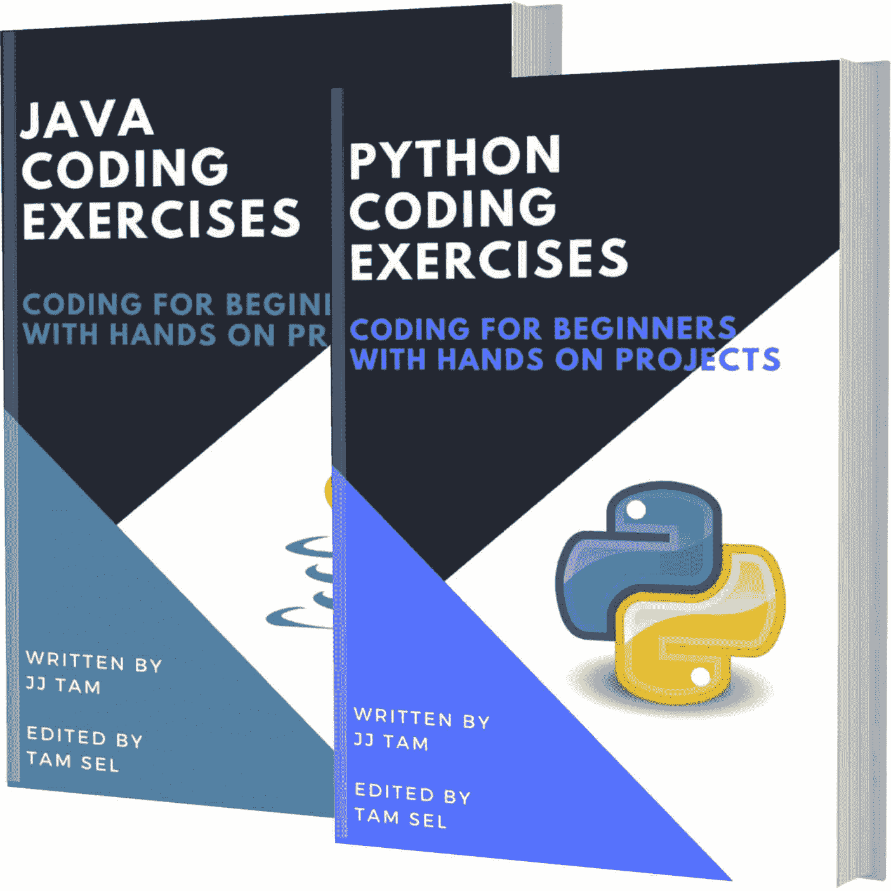
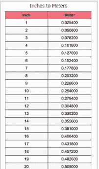
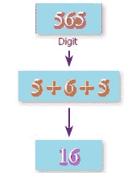
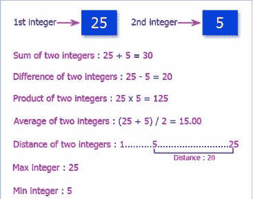
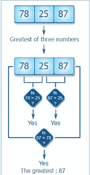
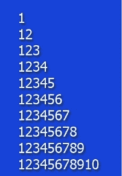
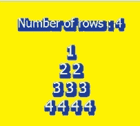
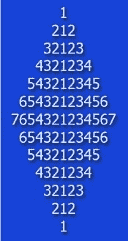

# Python 与 Java 编码练习



# Python 基础 – 练习

- 获取 Python 版本
- 显示当前日期时间
- 打印日历
- 计算 `n+nn+nnn` 的值
- 计算天数
- 在 Python 中计算球体
- 计算三角形面积
- 计算最大公约数 (GCD)
- 计算最小公倍数 (LCM)
- 将英尺和英寸转换为厘米
- 时间转换 – 秒
- 将秒转换为天
- 计算 BMI
- 排序三个整数
- 获取系统时间
- 检查数字
- 删除第一个项的 Python 代码
- 过滤正数
- 统计数字 4 的次数
- 查找数字是偶数还是奇数
- 获取给定字符串的 n 份副本
- 打印不在其他列表中的列表
- 在三行中显示姓名、年龄、地址
- 解决问题的程序
- 金额的未来价值
- 检查文件是否存在
- 转换距离
- 所有项之和
- 所有项之积
- 获取最大数字
- 获取最小数字
- 去除重复
- 克隆或复制列表
- 两个列表之间的差异
- 生成所有排列
- 查找第二小
- 获取唯一值
- 获取元素频率
- 生成所有子列表
- 查找共同项
- 创建列表
- 连续重复
- 展平嵌套列表

## JAVA 编程练习

- 打印 hello
- 打印和
- 除两个数
- 打印结果
- 打印乘法表
- 查找面积
- 交换两个变量
- 打印脸
- 华氏度转摄
- 英寸转米
- 所有数字相加
- 打印年份和天数
- 计算 (BMI)
- 计算米/秒的速度
- 除两个整数
- 乘以两个指定的整数
- 打印和
- 找出三个数中的最大值
- 显示乘法表
- 显示模式
- 打印金字塔型模式
- 显示菱形数字

# Python 基础 – 练习

### Get Python version

```python
import sys
print("Python version")
print(sys.version)
print(sys.version_info)
```

OUTPUT:

```
Python version
3.6.6 (default, Jun 28 2018, 04:42:43) GCC 5.4.0 20160609
version_info(major=3, minor=6, micro=6, releaselevel='final', serial=0)
```

### Display current date and time

```python
import datetime
now = datetime.now()
print ("Current date and time : ")
print (now.strftime("%Y-%m-%d %H:%M:%S"))
```

OUTPUT:

```
Current date and time : 2020-10-22 10:35:31
```

### Print the calendar

```python
import calendar
y = int(input("Input the year : "))
m = int(input("Input the month : "))
print(calendar.month(y, m))
```

OUTPUT:

```
Input the year : 2020
Input the month : 10
   October 2020
Mo Tu Th Fr Sa Su
 1  2  3  4
5  6  7  8  9 10 11
12 13 14 15 16 17 18
19 20 21 22 23 24 25
26 27 28 29 30 31
```

### Computes the value of n+nn+nnn

```python
a = int(input("Input an integer : "))
n1 = int( "%s" % a )
n2 = int( "%s%s" % (a,a) )
n3 = int( "%s%s%s" % (a,a,a) )
print (n1+n2+n3)
```

OUTPUT:

```
Input an integer : 6
738
```

### Calculate number of days

```python
from datetime import date
f_date = date(2014, 7, 2)
l_date = date(2015, 7, 11)
delta = l_date - f_date
print(delta.days)
```

OUTPUT:

```
374
```

### volume of a sphere in Python

```python
pi = 3.1415926535897931
r= 6.0
V= 4.0/3.0*pi* r**3
print('The volume of the sphere is: ',V)
```

OUTPUT:

```
The volume of the sphere is:  904.7786842338603
```

### Compute the area of Triangle

```python
b = int(input("Input the base : "))
h = int(input("Input the height : "))
area = b*h/2
print("area = ", area)
```

OUTPUT:

```
Input the base : 20 
Input the height : 40
area =  400
```

### Compute the GCD

```python
def gcd(x, y):
    if x > y:
        z = x
    else:
        z = y
    for k in range(int(y), 0, -1):
        if x % k == 0 and y % k == 0:
            return k
print(gcd(12, 17))
print(gcd(4, 6))
```

OUTPUT:

```
1
2
```

### CALCULATE THE LCM

```python
def lcm(x, y):
    if x > y:
        z = x
    else:
        z = y
    while(True):
        if (z % x == 0) and (z % y == 0):
            return z
        z += 1
print(lcm(4, 6))
```

OUTPUT:

```
12
```

### Convert feet and inches to centimeters

```python
print("Input height: ")
h_ft = int(input("Feet: "))
h_inch = int(input("Inches: "))
h_inch += h_ft * 12
h_cm = round(h_inch * 2.54, 1)
print("Your height is : %d cm." % h_cm)
```

OUTPUT:

```
Input height: 
Feet: 5
Inches: 3
Your height is : 160.0 cm
```

### Convert time – seconds

```python
days = int(input("Input days: ")) * 3600 * 24
hours = int(input("Input hours: ")) * 3600
minutes = int(input("Input minutes: ")) * 60
seconds = int(input("Input seconds: "))
time = days + hours + minutes + seconds
print("The amounts of seconds", time)
```

OUTPUT:

```
Input days: 4
Input hours: 5
Input minutes: 20
Input seconds: 10
The amounts of seconds 364810
```

### Convert seconds to day

```python
time = float(input("Input time in seconds: "))
day = time // (24 * 3600)
time = time % (24 * 3600)
hour = time // 3600
time %= 3600
minutes = time // 60
time %= 60
seconds = time
print("d:h:m:s-> %d:%d:%d:%d" % (day, hour, minutes, seconds))
```

OUTPUT:

```
Input time in seconds: 1234565
d:h:m:s-> 14:6:56:5
```

### Calculate BMI

```python
height = float(input("Input your height in meters: "))
weight = float(input("Input your weight in kilogram: "))
print("Your body mass index is: ", round(weight / (height * height), 2))
```

### 输出

```
输入身高（米）: 6.2
输入体重（公斤）: 72
您的体重指数为:  1.87
```

### 对三个整数进行排序

### 程序

```python
x = int(input("Input first number: "))
y = int(input("Input second number: "))
z = int(input("Input third number: "))
a1 = min(x, y, z)
a3 = max(x, y, z)
a2 = (x + y + z) - a1 - a3
print("Numbers in sorted order: ", a1, a2, a3)
```

### 输出

```
输入第一个数字: 2
输入第二个数字: 4
输入第三个数字: 5
排序后的数字:  2 4 5
```

### 获取系统时间

### 程序

```python
import time
print()
print(time.ctime())
print()
```

### 输出

```
Thu Oct 22 14:59:27 2020
```

### 检查数字

### Python 代码

```python
num = float(input("Input a number: "))
if num > 0:
   print("It is positive number")
elif num == 0:
   print("It is Zero")
else:
   print("It is a negative number")
```

### 输出

```
输入一个数字: 200
这是一个正数
```

### 移除第一个元素的 Python 代码

### 程序

```python
color = ["Red", "Black", "Green", "White", "Orange"]
print("\nOriginal Color: ",color)
del color[0]
print("After removing the first color: ",color)
print()
```

### 输出

```
原始颜色:  ['Red', 'Black', 'Green', 'White', 'Orange']
移除第一个颜色后:  ['Black', 'Green', 'White', 'Orange']
```

### 过滤正数

### Python 代码

```python
nums = [34, 1, 0, -23]
print("Original numbers in the list: ",nums)
new_nums = list(filter(lambda x: x >0, nums))
print("Positive numbers in the list: ",new_nums)
```

### 输出

```
列表中的原始数字:  [34, 1, 0, -23]
列表中的正数:  [34, 1]
```

### 在给定列表中统计数字 4 的次数

### 示例程序

```python
def list_count_4(nums):
   count = 0
   for num in nums:
      if num == 4:
         count += 1
   return count
print(list_count_4([1, 4, 6, 7]))
print(list_count_4([1, 4, 6, 7, 4]))
```

### 输出

```
1
2
```

### 查找数字是偶数还是奇数

### 示例程序

```python
num = int(input("Enter a number: "))
mod = num % 2
if mod > 0:
   print("This is an odd number.")
else:
   print("This is an even number.")
```

### 输出

```
输入一个数字: 5
这是一个奇数。
```

### 获取给定字符串的 n 副本

### 程序

```python
def larger_string(str, n):
   result = ""
   for i in range(n):
      result = result + str
   return result
print(larger_string('abc', 2))
print(larger_string('.py', 3))
```

### 输出

```
abcabc
.py.py.py
```

### 打印不在其他列表中的列表

### 数据

`color_list_1 = set(["White", "Black", "Red"])`
`color_list_2 = set(["Red", "Green"])`

预期输出:
`{'Black', 'White'}`

### 示例程序

```python
color_list_1 = set(["White", "Black", "Red"])
color_list_2 = set(["Red", "Green"])
print(color_list_1.difference(color_list_2))
```

### 输出

```
{'White', 'Black'}
```

### 分三行显示姓名、年龄、地址

### 示例程序

```python
def personal_details():
    name, age = "JJ Tam", 28
    address = "Bangalore, Karnataka, India"
    print("Name: {}\nAge: {}\nAddress: {}".format(name, age, address))
personal_details()
```

### 输出

```
Name: JJ Tam
Age: 28
Address: Bangalore, Karnataka, India
```

### 求解程序

### (x + y) * (x + y)

### 数据

求解`(x + y) * (x + y)`的程序。
测试数据：`x = 4`, `y = 3`
预期输出：`(4 + 3) ^ 2) = 49`

### 程序

```python
x, y = 4, 3
result = x * x + y * y
print("{} + {}) ^ 2 = {}".format(x, y, result))
```

### 输出

```
(4 + 3) ^ 2 = 49
```

### 给定金额在给定利率和未来的未来值

### 数据

测试数据：`amt = 1000`, `int = 3.5`, `years = 7`
预期输出：`1272.79`

### 程序

```python
amt = 1000
int = 3.5
years = 7
future_value = amt*((1+int) ** years)
print(round(future_value,2))
```

### 输出

```
1272.79
```

### 检查文件是否存在

### 程序

```python
import os
open('abc.txt', 'w')
print(os.path.isfile('abc.txt'))
```

### 输出

```
True
```

### 将英尺转换为英寸、码和英里

### 示例程序

```python
d_ft = int(input("Input distance in feet: "))
d_inches = d_ft * 12
d_yards = d_ft / 3.0
d_miles = d_ft / 5280.0
print("The distance in inches is %i inches." % d_inches)
print("The distance in yards is %.f yards." % d_yards)
print("The distance in miles is %.f miles." % d_miles)
```


### 输出

输入英尺距离: 100  
英寸距离为 1200 英寸。  
码距离为 33 码。  
英里距离为 0 英里。

### 列表中移除第一个元素

### 程序

```python
color = ["Red", "Black", "Green", "White", "Orange"]

print("\nOriginal Color: ",color)

del color[0]

print("After removing the first color: ",color)

print()
```

### 输出

原始颜色:  `['Red', 'Black', 'Green', 'White', 'Orange']`  
移除第一个颜色后:  `['Black', 'Green', 'White', 'Orange']`

### 过滤正数

### Python 代码

```python
nums = [34, 1, 0, -23]

print("Original numbers in the list: ",nums)

new_nums = list(filter(lambda x: x >0, nums))

print("Positive numbers in the list: ",new_nums)
```

### 输出

列表中的原始数字:  `[34, 1, 0, -23]`  
列表中的正数:  `[34, 1]`

### 在给定列表中统计数字 4 的次数

### 示例程序

```python
def list_count_4(nums):
   count = 0
   for num in nums:
      if num == 4:
         count += 1
   return count

print(list_count_4([1, 4, 6, 7]))
print(list_count_4([1, 4, 6, 7, 4]))
```

### 输出

`2`

### 查找数字是偶数还是奇数

### 示例程序

```python
num = int(input("Enter a number: "))
mod = num % 2

if mod > 0:
   print("This is an odd number.")
else:
   print("This is an even number.")
```

### 输出

输入一个数字: 5  
这是一个奇数。

### 获取给定字符串的 n 副本

### 程序

```python
def larger_string(str, n):
   result = ""
   for i in range(n):
      result = result + str
   return result

print(larger_string('abc', 2))
print(larger_string('.py', 3))
```

### 输出

`abcabc`  
`.py.py.py`

### 打印不在其他列表中的列表

### 数据

`color_list_1 = set(["White", "Black", "Red"])`  
`color_list_2 = set(["Red", "Green"])`  
预期输出: `{'Black', 'White'}`

### 示例程序

```python
color_list_1 = set(["White", "Black", "Red"])
color_list_2 = set(["Red", "Green"])

print(color_list_1.difference(color_list_2))
```

### 输出

`{'White', 'Black'}`

### 分三行显示姓名、年龄、地址

### 示例程序

```python
def personal_details():
    name, age = "JJ Tam", 28
    address = "Bangalore, Karnataka, India"
    print("Name: {}\nAge: {}\nAddress: {}".format(name, age, address))

personal_details()
```

### 输出

Name: JJ Tam  
Age: 28  
Address: Bangalore, Karnataka, India

### 求解程序

### (x + y) * (x + y)

### 数据

求解 `(x + y) * (x + y)` 的程序。  
测试数据：`x = 4`, `y = 3`  
预期输出：`(4 + 3) ^ 2) = 49`

### 程序

```python
x, y = 4, 3
result = x * x + y * y
print("{} + {}) ^ 2 = {}".format(x, y, result))
```

### 输出

`(4 + 3) ^ 2 = 49`

### 给定金额在给定利率和未来的未来值

### 数据

测试数据：`amt = 1000`, `int = 3.5`, `years = 7`  
预期输出：`1272.79`

### 程序

```python
amt = 1000
int = 3.5
years = 7

future_value = amt*((1+int) ** years)
print(round(future_value,2))
```

### 输出

`1272.79`

### 检查文件是否存在

### 程序

```python
import os

open('abc.txt', 'w')
print(os.path.isfile('abc.txt'))
```

### 输出

`True`

### 将英尺转换为英寸、码和英里

### 示例程序

```python
d_ft = int(input("Input distance in feet: "))
d_inches = d_ft * 12
d_yards = d_ft / 3.0
d_miles = d_ft / 5280.0

print("The distance in inches is %i inches." % d_inches)
print("The distance in yards is %.f yards." % d_yards)
print("The distance in miles is %.f miles." % d_miles)
```

### 输出

输入英尺距离: 100  
英寸距离为 1200 英寸。  
码距离为 33 码。  
英里距离为 0 英里。

### 列表中移除第一个元素

### 程序

```python
color = ["Red", "Black", "Green", "White", "Orange"]

print("\nOriginal Color: ",color)

del color[0]

print("After removing the first color: ",color)

print()
```

### 输出

原始颜色:  `['Red', 'Black', 'Green', 'White', 'Orange']`  
移除第一个颜色后:  `['Black', 'Green', 'White', 'Orange']`

### 从列表中移除重复项

### 程序

```python
a = [10,20,30,20,10,50,60,40,50,40]
dup_items = set()
uniq_items = []

for x in a:
   if x not in dup_items:
      uniq_items.append(x)
      dup_items.add(x)

print(dup_items)
```

输出:  
`{40, 10, 80, 50, 60, 30}`

### 克隆或复制列表

### Python 代码

```python
original_list = [10, 22, 44, 23, 4]
new_list = list(original_list)

print(original_list)
print(new_list)
```

### 输出

`[10, 22, 44, 23, 4]`

### 两个列表之间的差异

### Python 代码

```python
list1 = [1, 3, 5, 7, 9]
list2=[1, 2, 4, 6, 7, 8]

diff_list1_list2 = list(set(list1) - set(list2))
diff_list2_list1 = list(set(list2) - set(list1))
total_diff = diff_list1_list2 + diff_list2_list1

print(total_diff)
```

### 输出

`[(1, 2, 3), (1, 3, 2), (2, 1, 3), (2, 3, 1), (3, 1, 2), (3, 2, 1)]`

### 在列表中查找第二小的数字

## PYTHON 程序

```python
def second_smallest(numbers):
  if (len(numbers)<2):
    return
  if ((len(numbers)==2) and (numbers[0] == numbers[1]) ):
    return
  dup_items = set()
  uniq_items = []
  for x in numbers:
    if x not in dup_items:
      uniq_items.append(x)
      dup_items.add(x)
  uniq_items.sort()   
  return uniq_items[1]

print(second_smallest([1, 2, -8, -2, 0, -2]))
print(second_smallest([1, 1, 0, 0, 2, -2, -2]))
print(second_smallest([1, 1, 1, 0, 0, 0, 2, -2, -2]))
print(second_smallest([2,2]))
print(second_smallest([2]))
```

### 输出

`-2`  
`0`  
`0`  
`None`  
`None`

### 从列表中获取唯一值

### Python 代码

```python
my_list = [10, 20, 30, 40, 20, 50, 60, 40]

print("Original List : ",my_list)

my_set = set(my_list)
my_new_list = list(my_set)

print("List of unique numbers : ",my_new_list)
```

### 输出

Original List :  `[10, 20, 30, 40, 20, 50, 60, 40]`  
List of unique numbers :  `[40, 10, 50, 20, 60, 30]`

### 获取元素的频率

### Python 代码

```python
import collections

my_list = [10,10,10,10,20,20,20,20,40,40,50,50,30]

print("Original List : ",my_list)

ctr = collections.Counter(my_list)

print("Frequency of the elements in the List : ",ctr)
```

### 输出

Original List :  `[10, 10, 10, 10, 20, 20, 20, 20, 40, 40, 50, 50, 30]`  
Frequency of the elements in the List :  `Counter({10: 4, 20: 4, 40: 2, 50: 2, 30: 1})`

### 在 Python 中生成列表的所有子列表

### Python 代码

```python
from itertools import combinations

def sub_lists(my_list):
  subs = []
  for i in range(0, len(my_list)+1):
    temp = [list(x) for x in combinations(my_list, i)]
    if len(temp)>0:
      subs.extend(temp)
  return subs

l1 = [10, 20, 30, 40]
l2 = ['X', 'Y', 'Z']

print("Original list:")
print(l1)
print("S")
print(sub_lists(l1))
print("Sublists of the said list:")
print(sub_lists(l1))

print("\nOriginal list:")
print(l2)
print("Sublists of the said list:")
print(sub_lists(l2))
```

### 输出

Original list:  
`[10, 20, 30, 40]`  
S  
`[[], [10], [20], [30], [40], [10, 20], [10, 30], [10, 40], [20, 30], [20, 40], [30, 40], [10, 20, 30], [10, 20, 40], [10, 30, 40], [20, 30, 40], [10, 20, 30, 40]]`  
Sublists of the said list:  
`[], [10], [20], [30], [40], [10, 20], [10, 30], [10, 40], [20, 30], [20, 40], [30, 40], [10, 20, 30], [10, 20, 40], [10, 30, 40], [20, 30, 40], [10, 20, 30, 40]]`  
Original list:  
`['X', 'Y', 'Z']`  
Sublists of the said list:  
`[], ['X'], ['Y'], ['Z'], ['X', 'Y'], ['X', 'Z'], ['Y', 'Z'], ['X', 'Y', 'Z']]`

### 获取两个列表的共同项

### Python 代码

```python
color1 = "Red", "Green", "Orange"
color2 = "Black", "Green", "Pink"

print(set(color1) & set(color2))
```

### 输出

`{'Green'}`

### 创建一个无限元素的列表

### Python 代码

```python
import itertools

c = itertools.count()

print(next(c))
print(next(c))
print(next(c))
```

### 输出

`0`  
`1`  
`2`

### 移除给定列表中连续的元素

### Python 代码

```python
from itertools import groupby

def compress(l_nums):
  return [key for key, group in groupby(l_nums)]

n_list = [0, 0, 1, 2, 3, 4, 4, 5, 6, 6, 7, 8, 9, 4]

print("Original list:")
print(n_list)

print("\n duplicates:")
print(compress(n_list))
```

### 输出

Original list:  
`[0, 0, 1, 2, 3, 4, 4, 5, 6, 6, 7, 8, 9, 4]`  
n duplicates:  
`[0, 1, 2, 3, 4, 5, 6, 7, 8, 9]`

### 展平嵌套列表

### Python 代码

```python
def flatten_list(n_list):
  result_list = []
  if not n_list: return_list
  stack = list(n_list)
  while stack:
    c_num = stack.pop()
    if isinstance(c_num, list):
      stack.extend(c_num)
    else:
      result_list.append(c_num)
  result_list.reverse()
  return result_list

n_list = [0, 10, [20, 30], 40, 50, [60, 70, 80], 90, 100, 120]

print("Original list:")
print(n_list)

print("\nFlatten list:")
print(flatten_list(n_list))
```

### 输出

Original list:  
`[0, 10, [20, 30], 40, 50, [60, 70, 80], 90, 100, 120]`  
Flatten list:  
`[0, 10, 20, 30, 40, 50, 60, 70, 80, 90, 100, 120]`

JAVA 练习题  
初学者  
JJ TAM

JAVA 练习题

### 分行打印你的名字

### JAVA 代码

```java
import java.util.Scanner;

public class Main {
  public static void main(String[] args) {
```


```java
Scanner input = new Scanner(System.in);

System.out.print("Input your first name: ");

String fname = input.next();

System.out.print("Input your last name: ");

String lname = input.next();

System.out.println();

System.out.println("Hello \n" + fname + " " + lname);

}
}
```

### 输出

```text
Input first name: JJ
Input last name: TAM
Hello
JJ TAM
```

## 打印两个数字之和

### Java 代码

```java
import java.util.Scanner;

public class Main {

  public static void main(String[] args) {

    Scanner input = new Scanner(System.in);

    System.out.print("Input the first number: ");

    int num1 = input.nextInt();

    System.out.print("Input the second number: ");

    int num2 = input.nextInt();

    int sum = num1 + num2;

    System.out.println();

    System.out.println("Sum: " + sum);

  }

}
```

### 输出

```text
Input the first number: 545
Input the second number: 455
Sum: 1000
```

## 除法两个数并打印到屏幕上

### Java 代码

```java
import java.util.Scanner;

public class Main {

  public static void main(String[] args) {

    Scanner input = new Scanner(System.in);

    System.out.print("Input the first number: ");

    int a = input.nextInt();

    System.out.print("Input the second number: ");

    int b = input.nextInt();

    int d = (a / b);

    System.out.println();

    System.out.println("The division of a and b is:" + d);

  }

}
```

### 输出

```text
Input the first number: 100
Input the second number: 25
The division of a and b is:4
```

## 打印指定操作的结果

### Java 代码

```java
public class Main {

  public static void main(String[] args) {

    int w = -5 + 8 * 6;

    int x = (55 + 9) % 9;

    int y = 20 + (-3 * 5 / 8);

    int z = 5 + 15 / 3 * 2 - 8 % 3;

    System.out.print(w + "\n" + x + "\n" + y + "\n" + z);

  }

}
```

## 打印乘法表

### Java 代码

```java
import java.util.Scanner;

public class Main {

  public static void main(String[] args) {

    Scanner in = new Scanner(System.in);

    System.out.println("Input the Number: ");

    int n = in.nextInt();

    for (int i = 1; i <= 10; i++) {

      System.out.println(n + "*" + i + " = " + (n * i));

    }

  }

}
```

### 输出

```text
输入数字:
15
15*1 = 15
15*2 = 30
15*3 = 45
15*4 = 60
15*5 = 75
15*6 = 90
15*7 = 105
15*8 = 120
15*9 = 135
15*10 = 150
```

## 计算圆的面积和周长

### Java 代码

```java
import java.util.Scanner;

public class Main {

  public static void main(String[] args) {

    Scanner io = new Scanner(System.in);

    System.out.println("Input the radius of the circle: ");

    double radius = io.nextDouble();

    System.out.println("Perimeter is = " + (2 * radius * Math.PI));

    System.out.println("Area is = " + (Math.PI * radius * radius));

  }

}
```

### 输出

```text
输入圆的半径:
10
周长为 = 62.83185307179586
面积为 = 314.1592653589793
```

## 交换两个变量

### Java 代码

```java
import java.util.Scanner;

public class Main {

  public static void main(String[] args) {

    int x, y, z;

    Scanner in = new Scanner(System.in);

    System.out.println("Input the first number: ");

    x = in.nextInt();

    System.out.println("Input the second number: ");

    y = in.nextInt();

    z = x;

    x = y;

    y = z;

    System.out.println(" Swapped values are3:" + x + " and " + y);

  }

}
```

### 输出

```text
输入第一个数字:
25
输入第二个数字:
50
交换后的值为:50 和 25
```

## 打印一个脸

### Java 代码

```java
public class Main {

  public static void main(String[] args) {

    String[] arra = new String[5];

    arra[0] = " +\"\"\"\"\"+ ";

    arra[1] = "[| o o |]";

    arra[2] = " |  ^  |";

    arra[3] = " | '-' |";

    arra[4] = " +-----+";

    for (int i = 0; i < 5; i++) {

      System.out.println(arra[i]);

    }

  }

}
```

### 输出

```text
+"""""+
[| o o |]
|  ^  |
| '-' |
+-----+
```

## 华氏度转摄氏度

### Java 代码

```java
import java.util.Scanner;

public class Main {

  public static void main(String[] Strings) {

    Scanner input = new Scanner(System.in);

    System.out.print("Input a degree in Fahrenheit: ");

    double fahrenheit = input.nextDouble();

    double celsius = ((5 * (fahrenheit - 32.0)) / 9.0);

    System.out.println(
        fahrenheit + " degree Fahrenheit is equal to " + celsius + " in Celsius"
    );

  }

}
```

### 输出

```text
输入华氏度: 96
96.0 华氏度 等于 35.55555555555556 摄氏度
```

## 英寸转米



### Java 代码

```java
import java.util.Scanner;

public class Main {

  public static void main(String[] Strings) {

    Scanner input = new Scanner(System.in);

    System.out.print("Input a value for inch: ");

    double inch = input.nextDouble();

    double meters = inch * 0.0254;

    System.out.println(inch + " inch is " + meters);

  }

}
```

### 输出

```text
输入英寸值: 5
5.0 inch is 0.127
```

## 相加所有数字



### Java 代码

```java
import java.util.Scanner;

public class Main {

  public static void main(String[] Strings) {

    Scanner input = new Scanner(System.in);

    System.out.print("Input an integer between 0 and 1000: ");

    int num = input.nextInt();

    int firstDigit = num % 10;

    int remainingNumber = num / 10;

    int SecondDigit = remainingNumber % 10;

    remainingNumber = remainingNumber / 10;

    int thirdDigit = remainingNumber % 10;

    remainingNumber = remainingNumber / 10;

    int fourthDigit = remainingNumber % 10;

    int sum = thirdDigit + SecondDigit + firstDigit;

    System.out.println("The sum of all digits in " + sum);

  }

}
```

### 输出

```text
输入一个 0 到 1000 之间的整数: 75
所有数字之和为 12
```

## 两个指定整数的乘法

### 在不使用乘法运算符的情况下

### Java 代码

```java
import java.util.*;

public class Main {

  public static int multiply(int n1, int n2) {
    int result = 0;
    boolean negative_num = (n1 < 0 && n2 >= 0) || (n2 < 0 && n1 >= 0);
    boolean positive_num = !negative_num;

    n1 = Math.abs(n1);

    for (int i = 0; i < n1; i++) {
      if (negative_num && n2 > 0 || positive_num && n2 < 0) {
        result -= n2;
      } else {
        result += n2;
      }
    }

    return result;
  }

  public static void main(String[] args) {
    Scanner in = new Scanner(System.in);

    System.out.print("Input the first number: ");
    int n1 = in.nextInt();

    System.out.print("Input the second number: ");
    int n2 = in.nextInt();

    System.out.println("\nResult: " + multiply(n1, n2));
  }

}
```

### 输出

```text
Input the first number: 25

Input the second number: 30

Result: 750
```

## 打印和、差、乘积、平均值、距离、最大值和最小值



### Java 代码

```java
import java.util.Scanner;

public class Main {

  public static void main(String[] args) {
    Scanner in = new Scanner(System.in);

    System.out.print("Input 1st integer: ");
    int firstInt = in.nextInt();

    System.out.print("Input 2nd integer: ");
    int secondInt = in.nextInt();

    System.out.printf("Sum of two integers: %d%n", firstInt + secondInt);
    System.out.printf("Difference of two integers: %d%n", firstInt - secondInt);
    System.out.printf("Product of two integers: %d%n", firstInt * secondInt);
    System.out.printf(
        "Average of two integers: %.2f%n",
        (double) (firstInt + secondInt) / 2
    );
    System.out.printf(
        "Distance of two integers: %d%n",
        Math.abs(firstInt - secondInt)
    );
    System.out.printf(
        "Max integer: %d%n",
        Math.max(firstInt, secondInt)
    );
    System.out.printf(
        "Min integer: %d%n",
        Math.min(firstInt, secondInt)
    );
  }

}
```

### 输出

```text
Input 1st integer: 50

Input 2nd integer: 30

Sum of two integers: 80

Difference of two integers: 20

Product of two integers: 1500

Average of two integers: 40.00

Distance of two integers: 20

Max integer: 50

Min integer: 30
```

## 找出三个数中的最大值

## Java 条件语句



### Java 代码


```java
import java.util.Scanner;
public class Main {
    public static void main(String[] args) {
        Scanner in = new Scanner(System.in);
        System.out.print("Input the 1st number: ");
        int num1 = in.nextInt();
        System.out.print("Input the 2nd number: ");
        int num2 = in.nextInt();
        System.out.print("Input the 3rd number: ");
        int num3 = in.nextInt();
        if (num1 > num2)
            if (num1 > num3)
            System.out.println("The greatest: " + num1);
        if (num2 > num1)
            if (num2 > num3)
            System.out.println("The greatest: " + num2);
        if (num3 > num1)
            if (num3 > num2)
            System.out.println("The greatest: " + num3);
    }
}
```

### 输出

```text
Input the 1st number: 2
Input the 2nd number: 5
Input the 3rd number: 9
The greatest: 9
```

## 显示给定整数的乘法表

### Java 代码

```java
import java.util.Scanner;
public class Main {
    public static void main(String[] args)
    {
        int j,n;
        System.out.print("Input the number(to be calculated): ");
        System.out.print("Input of terms : ");
        Scanner in = new Scanner(System.in);
        n = in.nextInt();
        System.out.println("\n");
        for(j=0;j<=n;j++)
            System.out.println(n+" X "+j+" = +n*j);
    }
}
```

### 输出

```text
Input the number(to be calculated): Input of terms : 7
7 X 0 = 0
7 X 1 = 7
7 X 2 = 14
7 X 3 = 21
7 X 4 = 28
7 X 5 = 35
7 X 6 = 42
7 X 7 = 49
```

## 显示类似直角角的模式

### 直角角的数字



### Java 代码

```java
import java.util.Scanner;
public class Main {
    public static void main(String[] args)
    {
        int i,j,n;
        System.out.print("Input number of rows: ");
        Scanner in = new Scanner(System.in);
        n = in.nextInt();
        for(i=1; i<=n;i++) {
            for(j=1; j<=i;j++) {
                System.out.print(j);
            }
            System.out.println("");
        }
    }
}
```

### 输出

```text
Input number of rows: 9
1
12
123
1234
12345
123456
1234567
```

## 打印金字塔模式

### 金字塔



### Java 代码

```java
import java.util.Scanner;
public class Main {
  public static void main(String[] args)
  {
    int i,j,n,x;
    System.out.print("Input number of rows: ");
    Scanner in = new Scanner(System.in);
    n = in.nextInt();
    for(i=1; i<=n;i++)
    {
      for(x=1; x<=n-i;x++) {
        System.out.print(" ");
      }
      for(j=1; j<=i;j++) {
        System.out.print(i);
      }
      System.out.println();
    }
  }
}
```

### 输出

```text
Input number of rows: 7
      1
     2 2
    3 3 3
   4 4 4 4
  5 5 5 5 5
 6 6 6 6 6 6
7 7 7 7 7 7 7
```

## 显示数字菱形结构



### Java 代码

```java
import java.util.Scanner;
public class Main {
    public static void main(String[] args)
    {
        Scanner in = new Scanner(System.in);
        System.out.print("Input the number: ");
        int n = in.nextInt();
        int count = 1;
        int no_of_spaces = 1;
        int start = 0;
        for (int i = 1; i < (n * 2); i++)
        {
            for (int spc = n - no_of_spaces; spc > 0; spc--)
            {
                System.out.print(" ");
            }
            if (i < n)
            {
                start = i;
                no_of_spaces++;
            } else {
                start = n * 2 - i;
                no_of_spaces--;
            }
            for (int j = 0; j < count; j++)
            {
                System.out.print(start);
                if (j < count / 2)
                {
                    start--;
                } else
                {
                    start++;
                }
            }
            if (i < n)
            {
                count = count + 2;
            } else {
                count = count - 2;
            }
            System.out.println();
        }
    }
}
```

### 输出

```text
Input the number: 7
      1
     212
    32123
   4321234
  543212345
 65432123456
7654321234567
65432123456
  543212345
   4321234
    32123
     212
      1
```
