# Python 与 Java 编程练习：零基础学者基础指南


## 目录

- Python 简介
- 安装 Python
- 第一个 Python 程序
- Python 变量
- Python 数据类型
- Python 关键字
- Python 字面量
- Python 运算符
- Python 注释
- Python If-else 语句
- Python 循环
- Python `for` 循环
- Python `while` 循环
- Python `break` 语句
- Python 字符串
- Python 列表
- Python 元组
- Python 练习
- Python 循环程序
- Python 字符串程序
- Python 元组程序
- Python 基础程序
- 寻找输出
- 检查给定年份是否为闰年的 Python 程序
- 计算复利
- Python | 一些简单的 if else 示例
- 在 Python 中根据销售金额计算折扣
- 在 Python 中使用 if elif 设计简单的计算器
- 在 Python 中查找某几
- Python 数组程序
- 在 Python 中创建矩阵
- 使用 `numpy` 创建矩阵的 Python 程序
- Python 列表
- Python 日期与时间程序
- 打印今天年、月、日的 Python 代码
- Python 列表
- 在列表中添加、删除元素的程序
- 查找两个列表差异的程序
- 从列表中删除重复元素的程序
- Java 编码
- Java 的特性
- C++ vs Java
- 第一个 Java 程序
- JDK、JRE 和 JVM 之间的区别
- Java 变量
- Java 中的数据类型
- Java 中的运算符
- Java 控制语句
- Java 中的循环
- Java `while` 循环
- Java `do-while` 循环
- Java `break` 语句
- Java 工作簿
- 计算复利的 Java 程序
- 查找最大数的 Java 程序
- 求所有数字之和的 Java 程序
- 运行应用程序 Java 程序
- 使用 `for` 循环打印从 1 到 N 的数字
- 打印斐波那契数列的 Java 程序
- Java 数据类型
- 华氏转摄氏
- 相加整数中的所有数字
- Java 数据类型
- Java 条件语句
- Java 循环
- Java 练习
- Java 字符串
- Java 数组

# Python 编码：初学者基础知识

## 快速学习编程的分步指南

### 初学者基础知识

## Python 简介

Python 具有许多与其他编程语言不同的优秀特性。它支持面向对象编程、过程化编程和动态内存分配。以下是一些关键方面。

### 1. 易学习

与其他编程语言相比，Python 是一种简单易学的编程语言。它的语法与英语语言相似，对于初学者来说。

### 2. 表达语言

Python 能够仅用几行代码完成复杂的任务。例如，运行你好世界程序只需 `print("Hello World")`。

### 3. 解释型语言

Python 是一种解释型语言，这意味着 Python 程序逐行执行。作为解释型语言的优点是调试非常简单。

### 4. 跨平台语言

Python 可以在多种平台上运行，包括 Windows、Linux、UNIX 和 Macintosh。因此，我们可以得出 Python 是一种跨平台语言。编写一次即可为多个平台创建软件。

### 5. 免费且开源

Python 是一种任何人都可以使用的免费编程语言。在其官方网站 `www.python.org` 上可以获取。全球社区都在努力创建新的 Python 模块和函数。Python 社区欢迎任何人的贡献。“任何人都可以免费获取源代码，”开源。

### 6. 面向对象语言

Python 支持面向对象编程，引入了类和对象的概念。它允许继承、多态和封装等。面向对象有助于程序员编写重用代码并开发应用程序。

### 7. 可扩展

这意味着可以使用 C/C++ 等语言来编译代码，允许我们在 Python 工作中使用它。它将程序转换为字节码，可以在任何平台上运行。

### 8. 丰富的标准库

它为各个领域提供了丰富的库，包括机器学习、Web 开发和脚本。TensorFlow、Pandas、NumPy、Keras 和 PyTorch 只是机器学习库的示例。Python Web 开发框架包括 Django、Flask 和 Pyramids。

### 9. GUI 编程支持

桌面开发可以使用图形用户界面。用于构建应用程序的库包括 PyQt5、Tkinter 和 Kivy。

### 10. 可集成

它可以轻松集成 C、C++ 和 Java 等语言。Python 像 C、C++ 和 Java 一样逐行执行代码。这使得调试代码变得容易得多。

### 11. 可嵌入

其他编程语言的代码可以用于 Python 源代码中。Python 源代码也可以在其他计算机语言中使用。它具有将额外的语言嵌入我们程序中的能力。

### 12. 动态内存分配

在 Python 中，我们不需要指定变量的数据类型。当我们给变量赋值时，变量的内会在运行时自动分配。如果将整数值 `15` 赋值给 `x`，我们不需要写 `int x = 15`。只需在纸上写下 `x = 15` 即可。

## 安装 Python

成为 Python 开发人员的第一步是理解如何如何在本地系统或计算机上安装和更新 Python。在本主题中，我们将介绍如何在各种操作系统上安装 Python。

### 在 Windows 上安装

要获取最新版本的 Python，请访问 `https://www.python.org/downloads/`。在此过程中，我们将在 Windows 操作系统上安装 Python `3.8.6`。点击上面的链接后，我们将跳转到以下网站。

步骤 1：选择 - Python 版本 - 下载。

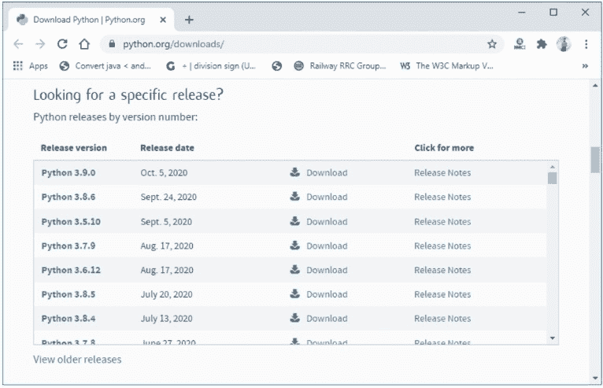

步骤 2：点击 - 现在安装 (Install Now)

双击下载的可执行文件打开以下窗口。通过选择“自定义安装”(Customize installation) 继续。当你勾选 `Add Path` 复选框时，Python 路径将自动配置。

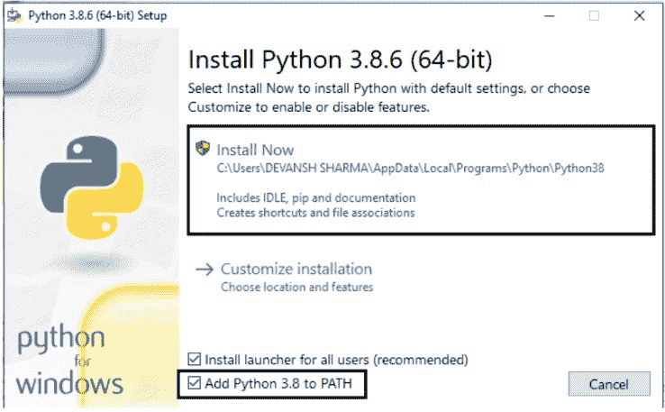

我们也可以通过点击自定义安装按钮选择所需的位置和功能。另一个需要考虑的关键因素是是否为所有用户安装启动器。

步骤 3：安装过程

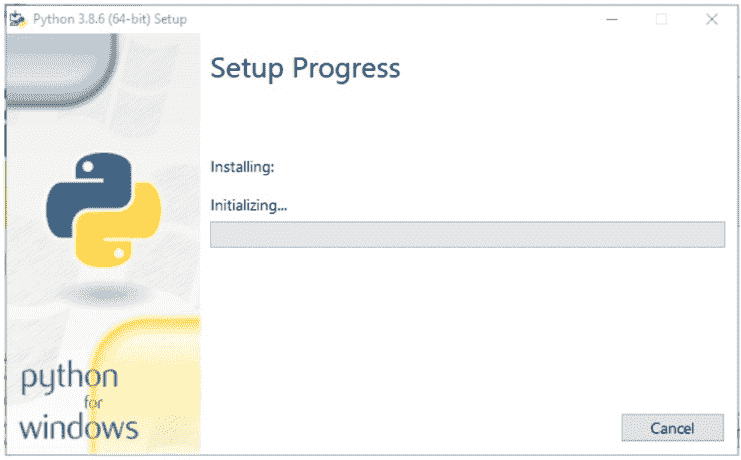

现在尝试从命令提示符运行 `python`。如果你使用的是 Python `3`，输入 `python -version`。

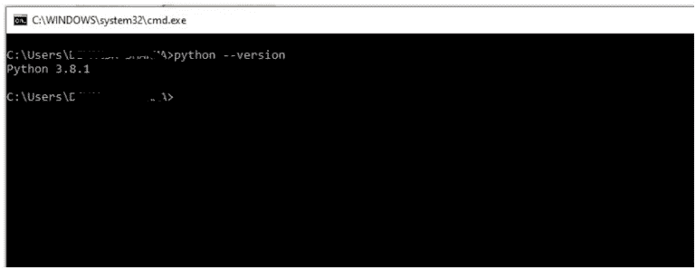

我们已经准备好使用 Python 了。

## 第一个 Python 程序

在本节中，我们将学习 Python 的基本语法，并运行一个在终端打印 Hello World 的简单程序。

Python 为我们运行程序提供了两种选择：

- 使用交互式解释器的提示符
- 使用脚本文件

让我们仔细查看每一个。

### 交互式解释器提示符

在交互式提示符下，Python 允许我们逐条执行每个 Python 语句。当我们关注 Python 程序每一行的输出时，这种方法更好。

要进入交互模式，请在终端（或命令提示符）上输入 `python`（如果系统中同时安装了 Python `2` 和 Python `3`，则输入 `python3`）。

它将打开下面的提示符，可以在这里运行 Python 语句并查看它如何影响终端。

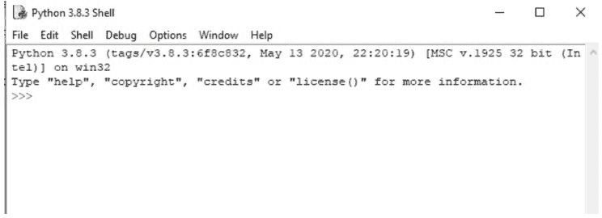

完成打印语句后按下回车键。

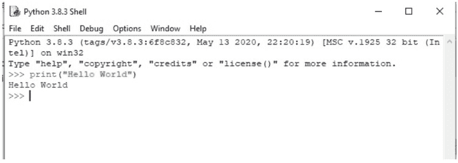

### 多行语句

多行语句输入到类似记事本的文本编辑器并保存为 `.py` 文件。在下面的示例中，我们使用 Python 脚本描述了许多代码行的执行。

代码：

```python
1. name = "Andrew Venis"
2. branch = "Computer Science"
3. age = "25"
4. print("My name is: ", name )
5. print("My age is: ", age)
```

脚本文件：

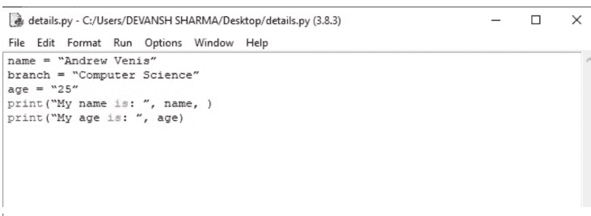

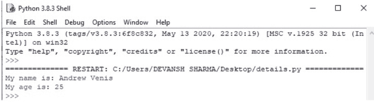

## Python 变量

变量是指内存区域的术语。Python 变量（通常称为标识符）是数据的容器。

由于 Python 是一种推类型语言，我们不需要描述变量的类型，因为它足够智能可以识别出来。

变量名可以是字母和数字的组合，但必须以字母或下划线开头。

变量名应该使用小写字母。`rahul` 和 `rahul` 是两个不同的变量。

### 标识符命名

标识符是变量的示例。程序中的字面量使用标识符标识。以下是命名标识符的规则。

- 变量的起始字符必须是字母或下划线（`_`）。
- 除了第一个字符外，所有字符可以是小写（a-z）、大写（A-Z）、下划线或数字（0-9）。
- 标识符名称中不能有空格或特殊字符（`!`、`@`、`#`、`%`、`,`、`&`、`*`）。
- 标识符名称不能与语言的任何关键字相同。
- 标识符名称区分大小写；例如 `my name` 和 `MyName` 不是同一个东西。
- 有效的标识符包括 `a123`、`_n`、`n9` 等。
- `1a`、`n4`、`n9` 等其他错误的标识符是示例。

### 声明变量

Python 不需要要求我们在代码中使用变量之前对其声明。它允许我们在特定时间点构建变量。

在 Python 中，我们不需要显式声明变量。任何时候给变量赋值时，它就会自动定义。

变量的值使用等号（`=`）运算符赋值。

## 对象引用

在声明变量时，理解 Python 解释器如何工作很重要。处理变量的方式与许多其他编程语言不同。

由于 Python 是一种面向对象的语言，变量属于一个类。让我们来看示例。

```python
a = 50
```

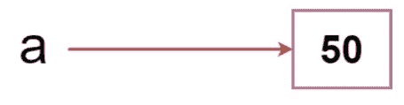

我们将 `50` 赋值给 `a`。创建 `b`。

```python
b = 50
```

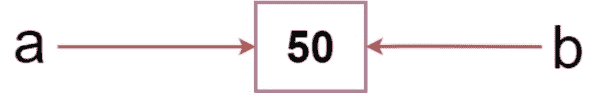

`a` 和 `b` 指向同一个对象。现在我们更改 `a` 的值。

```python
a = 100
```

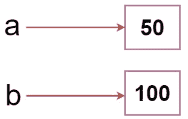

现在 `a` 指向不同的对象。

### 对象标识

Python 中每个创建的对象都有一个唯一的标识。Python 确保两个对象不共享相同的标识符。对象标识使用 `id()` 函数进行标识。考虑以下示例。

```python
a = 50
b = 50
print(id(a))
print(id(b))
```

输出：

```text
140734926918
140734926918
```

我们设置 `b = a` 因为 `a` 和 `b` 指向相同内容。我们重新赋值 `a` 为 `500`。

```python
a = 500
print(id(a))
```

输出：

```text
282205696094
```

## Python 数据类型

值可以存储在变量中，每个值都有一个数据类型。由于 Python 是动态类型语言，我们在声明变量时不需要指定类型。值由解释器隐含绑定类型。

```python
a = 5
```

我们没有定义变量 `a` 的类型，它的整数值为 5。变量 `a` 将被 Python 解释器自动解释为整数类型。

```python
a=10
b="Hi Python"
c = 10.5
print(type(a))
print(type(b))
print(type(c))
```

输出：

```text
<type 'int'>
<type 'str'>
<type 'float'>
```

### 标准数据类型

不同类型的值可以存储在变量中。例如，人的姓名必须保存为字符串，而他的 ID 必须记录为整数。

Python 支持多种标准数据类型，每种类型都有自己的存储技术。以下是 Python 数据类型的列表。

1. 数字（Numbers）
2. 序列类型（Sequence Type）
3. 布尔值（Boolean）
4. 集合（Set）
5. 字典（Dictionary）

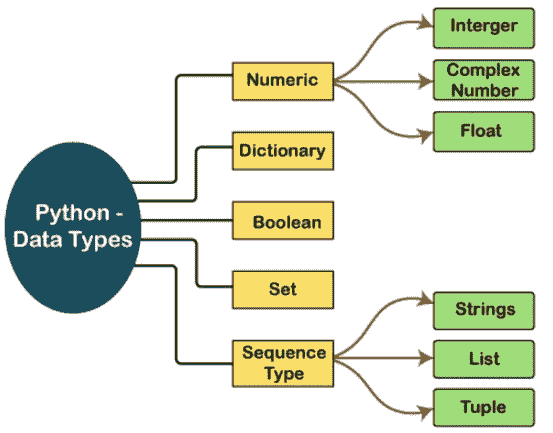

在本节课程中，我们将对上述数据类型进行简要概述。在课程的后面，我们将深入介绍每一种类型。

### 数字

数字是一种存储数值的数据类型。Python 的数字数据类型包含整数（integer）、浮点数（float）和复数（complex）。Python 中的 `type()` 方法可以确定变量的数据类型。`isinstance()` 函数用于判断对象是否属于某个特定的类。

当给变量赋值一个数字时，Python 会产生数字对象。例如：

```python
a = 5
print("The type of a", type(a))
b = 40.5
print("The type of b", type(b))
c = 1+3j
print("The type of c", type(c))
print(" c is a complex number", isinstance(1+3j,complex))
```

输出：

```text
The type of a <class 'int'>
The type of b <class 'float'>
The type of c <class 'complex'>
c is complex number: True
```

Python 识别三种数值数据类型。

整数值可以是任意长度，例如 10、2、29、-20、-150 等。在 Python 中，整数的长度是不限制的。它的值为 `int`。

浮点数（Float）用于存储浮点数，如 1.9、9.902、15.2 等。它的精度高达 15 位小数。

复数（Complex number）由有序对组成，即 `x + iy`，其中 `x` 和 `y` 分别代表实部和虚部。复数如 `2.14j`、`2.0 + 2.3j` 等。

## Python 关键字

Python 关键字是保留字，用于向编译器/解释器传达特定的含义。每个关键字都有独特的含义和操作。这些关键字不能用作变量。Python 关键字列表如下。

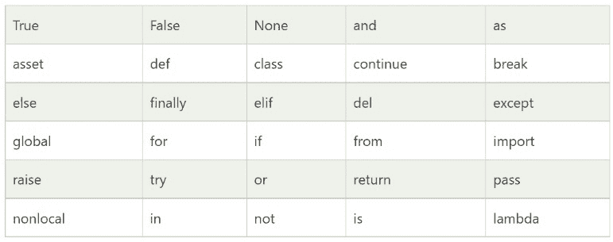

- `True` - 代表布尔真值，意味着如果给定条件为真，则返回 "True"。非零值被假设为真。
- `False` - 代表布尔假假；如果给定条件为假，则返回 "False"。值为 0 被解释为假。
- `None` - 表示空或无效值。空列表或零不能表示 `None`。
- `and` - 它也是一个逻辑运算符。用于测试多个条件。如果两个条件都满足，则返回真。请参考下方的真表。

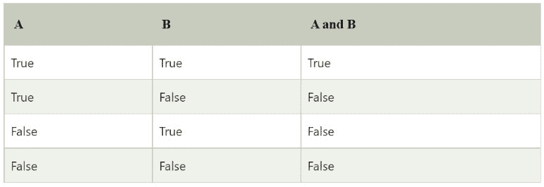

- `or` - 在 Python 中，它是逻辑运算符。如果满足其中一个条件，则返回真。请参考下方的真表。

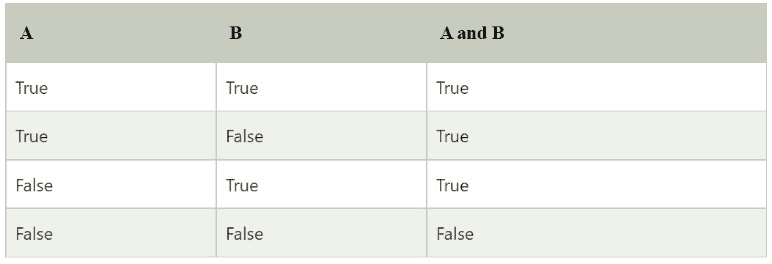

- `not` - 它是一个翻转真值的逻辑运算符。请参考下方的真表。

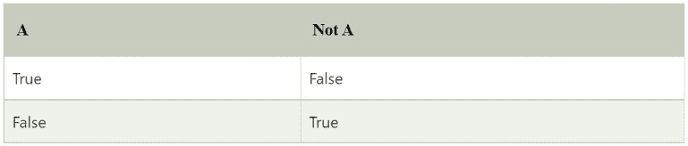

- `assert` - 在 Python 中，此关键字用作调试工具。它验证代码的正确性。如果代码中发现错误，它会抛出 `AssertionError` 并打印错误消息。

示例：

```python
a = 10
b = 0
print('a is dividing by Zero')
assert b != 0
print(a / b)
```

输出：

```text
a is dividing by Zero
```

运行时异常：

```text
Traceback (most recent call last):
  File "/home/40545678b342ce3b70beb1224bed345f.py", line 4, in 
    assert b != 0, "Divide by 0 error"
AssertionError: Divide by 0 error
```

- `def` - 在 Python 中，此关键字用于声明函数。如果后面跟着函数名。

```python
def my_func(a,b):
  c = a+b
  print(c)
my_func(10,20)
```

输出：

```text
30
```

- `class` - 在 Python 中，它用于表示类。类作为对象的蓝图。它是变量和方法的组合。请看下面的类。

```python
class Myclass:
  #Variables……
  def function_name(self):
    #statements………
```

- `continue` - 该命令用于停止当前迭代的执行。考虑以下场景。

```python
a = 0
while a < 4:
  a += 1
  if a == 2:
    continue
  print(a)
```

输出：

```text
1
3
```

## Python 字面量（Literals）

Python 中的字面量是存储在变量或常量中的数据。Python 支持：

### 1. 字符串字面量

字符串字面量通过将文本封装在引号中创建。创建一个字符串，我们可以使用单引号和双引号。

示例：

```python
"A", '12345'
```

### 2. 数字字面量

数字字面量是不可变的。数字字面量可以分为以下类型：

- 整数（Integer）
- 浮点数（Float）
- 复数（Complex）
- 二进制（Binary）
- 八进制（Octal）
- 十六进制（Hexadecimal）
- 科学计数法（Scientific）
- 下划线（Underscore）

整数值可以是任意长度，例如 10、2、29、-20、-150 等。在 Python 中，整数的长度是不限制的。它的值为 `int`。


浮点数（Float）用于存储浮点数，如 1.9、9.902、15.2 等。它的精度高达 15 位小数。

复数（Complex number）由有序对组成，即`x + iy`，其中`x`和`y`分别代表实部和虚部。复数如`2.14j`、`2.0 + 2.3j`等。

### 3. 布尔字面量

布尔字面量可以是`True`或`False`。

示例：

```
True, False
```

### 4. 特殊字面量

`None`表示空或无效值。

示例：

```
None
```

### 5. 字面量集合

Python 支持四种字面量集合：

- 列表（List）
- 元组（Tuple）
- 字典（Dict）
- 集合（Set）

#### 列表（List）

列表中的项可以是各种数据类型。列表是可变的，意味着它们可以更改。列表值用逗号（`,`）隔开，并封装在方括号（`[]`）中。

示例：

```
list = [1, 2, 3]
```

#### 元组（Tuple）

Python 中的元组是不同数据类型的集合。它是不可变的，意味着在创建后不能更改。它被封装在括号（`()`）中，每个元素用逗号（`,`）隔开。

示例：

```
tuple = (1, 2, 3)
```

#### 字典（Dict）

数据以键值对的形式存储在 Python 字典中。它封装在大括号（`{}`）中，每对用逗号（`,`）隔开。

示例：

```
dict = {"key": "value", "key2": 2}
```

#### 集合（Set）

Python 集合是无序数据集的集合。它被封装在大括号（`{}`）中，且每个元素用逗号（`,`）隔开。

示例：

```
set = {1, 2, 3}
```

# Python 运算符（Operators）

运算符是负责两个操作数之间特定操作的符号。运算符是程序的基础，特定编程语言的逻辑构建在其之上。Python 有许多运算符，如下所示。

- 算术运算符（Arithmetic operators）
- 比较运算符（Comparison operators）
- 赋值运算符（Assignment Operators）
- 逻辑运算符（Logical Operators）
- 位运算符（Bitwise Operators）
- 成员运算符（Membership Operators）
- 身份运算符（Identity Operators）

## 算术运算符

算术运算符用于对两个操作数进行操作。它包含运算符`+`（加法）、`-`（减法）、`*`（乘法）、`/`（除法）、`%`（取模）、`//`（地板除）和幂运算`**`。

请参考下表以对算术运算符进行更深入的解释。

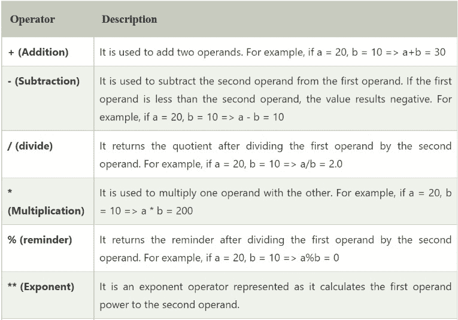

## 比较运算符

比较运算符用于比较两个操作数的值，并返回布尔值真（true）或假（false）。比较运算符如表所示。

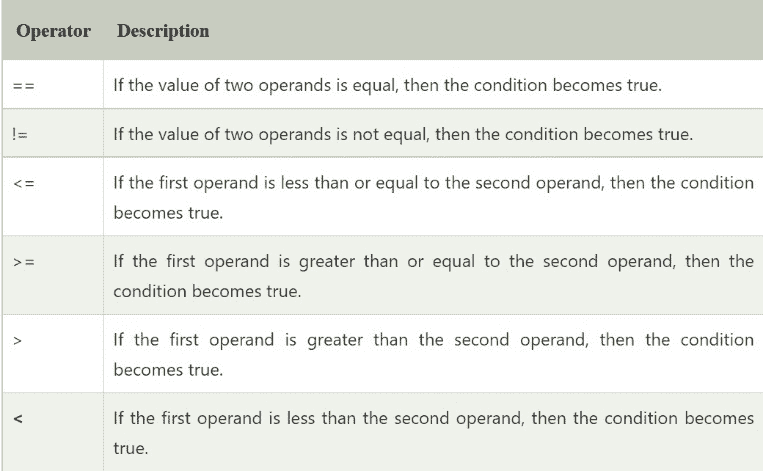

## 赋值运算符

赋值运算符用于将右表达式的值赋值给左操作数。赋值运算符如表所示。

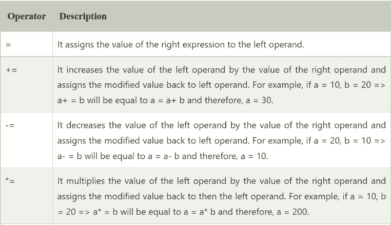

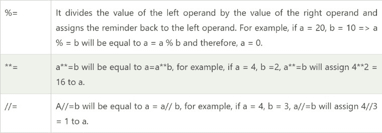

## 位运算符

位运算符按位地对两个操作数的值进行操作。考虑以下场景。

例如：

1. 如果`a = 7`
2. `b = 6`
3. 那么，`binary (a) = 0111`
4. `binary (b) = 0110`
5. 因此，`a & b = 0011`
6. `a | b = 0111`
7. `a ^ b = 0100`
8. `~ a = 1000`

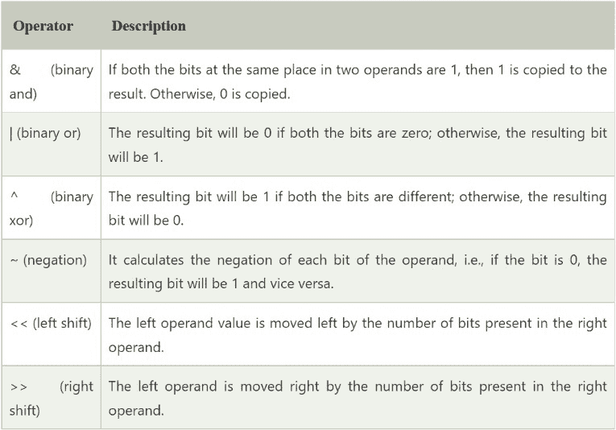

## 逻辑运算符

为了做出决策，逻辑运算符主要用于表达式求值。Python 支持下列表逻辑运算符。

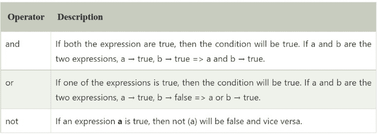

## 成员运算符

Python 成员运算符用于判断一个值是否为 Python 数据结构的成员。如果该值存在于数据结构中，则结果为真；否则返回假。

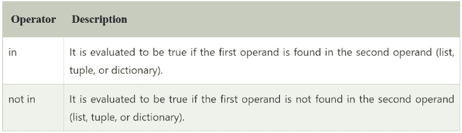

## 标识运算符

标识运算符用于判断一个元素是否属于特定的类或类型。

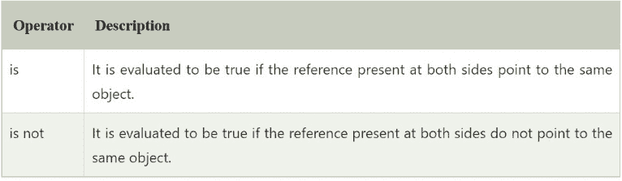

## 运算符优先级

运算符的优先级对于确定结果至关重要，因为它告诉我们应该先计算哪个运算符。Python 运算符的优先级如表所示。

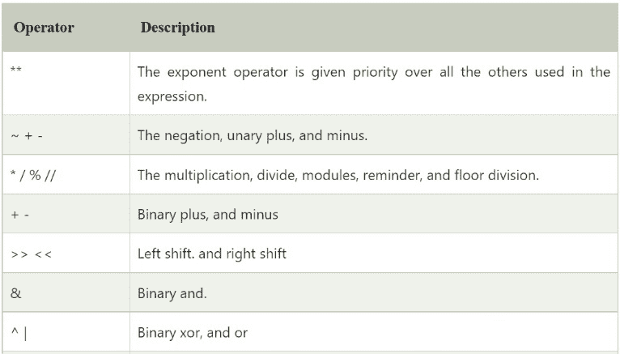

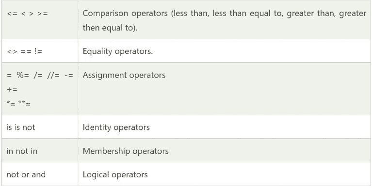

# Python 注释

Python 注释是程序员必不可少的工具。通常情况下，注释用于解释代码。如果代码得到了良好的解释，我们就可以轻松地理解它。优秀的程序员应该使用注释，因为如果以后有人想要修改代码或实现新模块，这样做将容易得多。

其他编程语言（如 C++）使用`/`进行单行注释，使用`/*.... */`进行多行注释，而 Python 仅使用`#`进行单行 Python 注释。要在代码中包含注释，请在语句或代码的开头放置井号（`#`）。

让我们来看一个例子。

1. `# 这是一个打印语句`
2. `print("Hello Python")`

通过使用井号（`#`），我们为`print`语句添加了注释。它对我们的`print`语句没有影响。

## 多行 Python 注释

要使用多行 Python 注释，我们必须在每行代码开头使用井号（`#`）。考虑以下场景。

1. `# 注释的第一行`
2. `# 注释的第二行`
3. `# 注释的第三行`

示例：

1. `# 变量 a 的值为 5`
2. `# 变量 b 的值为 10`
3. `# 变量 c 是 a 和 b 的和`
4. `# 打印结果`
5. `a = 5`
6. `b = 10`
7. `c = a+b`
8. `print("The sum is:", c)`

输出：

```
The sum is: 15
```

上面的代码具有很好的可读性，即使是初学者也能理解每行代码在发生什么。这是在代码中使用注释的好处之一。

对于多行注释，我们也可以使用三引号`"""`。字符串格式化也是通过三引号完成的。考虑以下场景。

## Docstring Python 注释

docstring（文档字符串）注释通常出现在模块、函数、类或方法中。它是一个 Python 文档字符串。在随后的教程中，我们将解释类/方法。

示例：

1. `def intro():`
2. `"""`
3. `此函数打印 Hello Joseph`
4. `"""`
5. `print("Hi Joseph")`
6. `intro()`

输出：

```
Hello Joseph
```

使用`__doc__`属性，我们可以检查函数的 docstring。在大多数情况下，使用四个空格作为缩进。缩进的量由用户决定，但在整个块中必须保持一致。

1. `def intro():`
2. `"""`
3. `此函数打印 Hello Joseph`
4. `"""`
5. `print("Hello Joseph")`
6. `intro.__doc__`

输出：

```
'\n This function prints Hello'
```

## Python 缩进

Python 缩进用于定义代码块。其他编程语言如 C++ 和 Java 使用大括号，而 Python 使用缩进。在 Python 中，使用空格来表示缩进。缩进用于代码的开头，并以行结束。代码块由相同的缩进定义（函数体、循环等）。在大多数情况下，使用四个空格作为缩进。

1. `for i in range(5):`
2. `print(i)`
3. `if i == 3:`
4. `break`

缩进用于代码块。考虑以下场景。

1. `n = int(input("Enter the number:"))`
2. `if n%2 == 0:`
3. `print("Even Number")`
4. `else:`
5. `print("Odd Number")`

输出：

```
Enter the number:10

Even Number
```

缩进用于代码块。如果缩进不正确，将抛出`IndentationError`。

# Python if-else 语句

决策是几乎所有编程语言中最重要的方面。if-else 正如其名，允许我们运行特定的代码块。决策取决于条件检查。

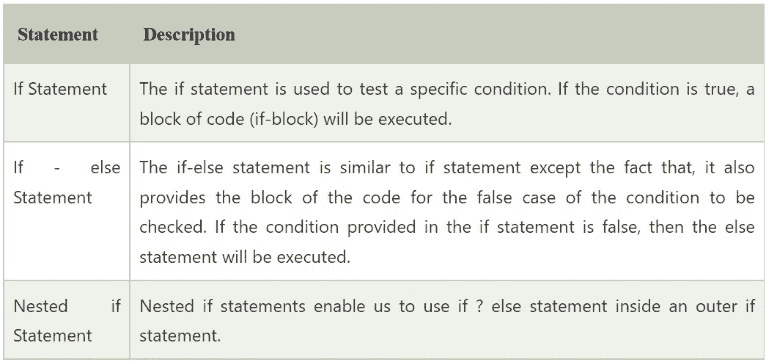

## Python 缩进

Python 缩进用于定义代码块。在 Python 中，使用空格来表示缩进。缩进用于代码的开头，并以行结束。代码块由相同的缩进定义。在大多数情况下，使用四个空格作为缩进。为了简单方便编程，声明代码块的缩进是 Python 中最常用的特性。我们将查看 Python 中缩进的实际情况。

## if 语句

`if`语句用于测试一个条件，如果条件为真，则执行`if`块代码。任何可以求值为真或假的有效逻辑表达式都可以作为`if`语句的条件。


if 语句的语法如下所示：

1. `if expression:`
2. `statement`

### 示例 1

1. `num = int(input("enter the number?"))`
2. `if num%2 == 0:`
3. `print("Number is even")`

输出：

```
enter the number?10

Number is even
```

### 示例 2

使用程序打印三个数中最大的数。

1. `a = int(input("Enter a?"))`
2. `b = int(input("Enter b?"))`
3. `c = int(input("Enter c?"))`
4. `if a>b and a>c:`
5. `print("a is largest")`
6. `if b>a and b>c:`
7. `print("b is largest")`
8. `if c>a and c>b:`
9. `print("c is largest")`

输出：

```
Enter a? 100

Enter b? 120

Enter c? 130

c is largest
```

## if-else 语句

if-else 语句将`else`块与`if`语句结合，当条件为假时执行`else`块。

`if-else`语句的语法如下所示：

```python
if condition:
    # 语句块
else:
    # 另一个语句块（else-块）
```

### 示例

一个判断一个人是否有资格投票的程序。

```python
age = int(input("Enter your age? "))
if age >= 18:
    print("You are eligible to vote !!")
else:
    print("Sorry! you have to wait !!")
```

输出：

```
Enter your age? 90
You are eligible to vote !!
```

## elif 语句

`elif`语句允许我们检查多个条件，并根据这些条件中的真值执行特定的语句块。根据我们的需求，可以在程序中包含任意数量的`elif`语句。另一方面，使用`elif`是可选的。

在 C 语言中，`elif`语句类似于`if-else-if`阶梯语句。它后面必须跟一个`if`语句。

`elif`语句的语法如下所示：

```python
if expression 1:
    # 语句块
elif expression 2:
    # 语句块
elif expression 3:
    # 语句块
else:
    # 语句块
```

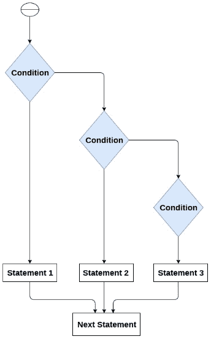

### 示例

```python
number = int(input("Enter the number?"))
if number == 10:
    print("number is equals to 10")
elif number == 50:
    print("number is equal to 50")
elif number == 100:
    print("number is equal to 100")
else:
    print("number is not equal to 10, 50 or 100")
```

输出：

```
Enter the number?15
number is not equal to 10, 50 or 100
```

# Python 循环

默认情况下，任何编程语言编写的程序流都是顺序的。我们可能需要随时更改程序的执行流。特定代码的执行可能需要重复几次。

编程语言提供了各种类型的循环来实现此目的，能够根据次数执行某些特定代码。请考虑下面的图以更好地理解循环语句的工作原理。

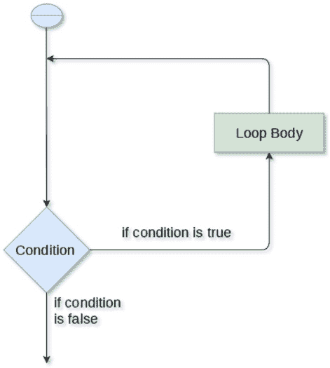

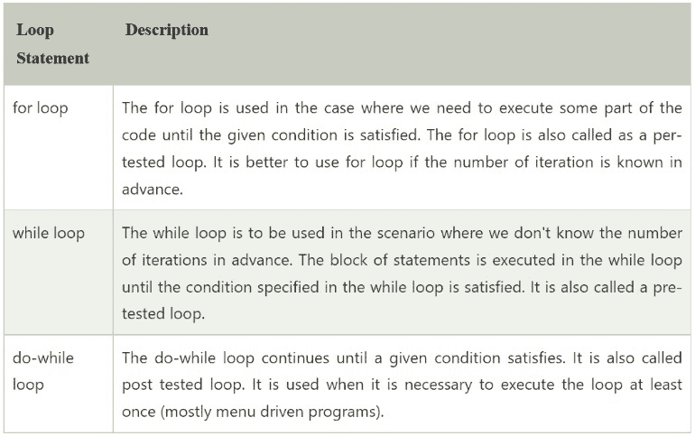

# Python for 循环

在 Python 中，`for`循环用于多次迭代语句或程序的片段。它通常用于遍历数据结构，如列表`list`、元组`tuple`或字典`dictionary`。

Python 的`for`循环语法如下所示：

```python
for iterating_var in sequence:
    statement(s)
```

### 流程图

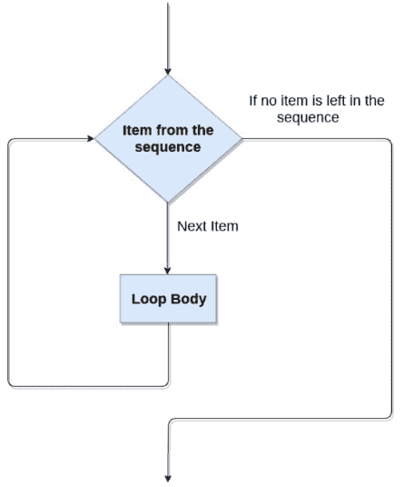

### For 循环：使用序列

#### 示例：使用 for 循环遍历字符串

```python
str = "Python"
for i in str:
    print(i)
```

输出：

```
P
y
t
h
o
n
```

#### 示例 2

使用此程序打印给定数字的表格。

```python
list = [1, 2, 3, 4, 5, 6, 7, 8, 9, 10]
n = 5
for i in list:
    c = n * i
    print(c)
```

输出：

```
5
10
15
20
25
30
35
40
45
50s
```

# Python While 循环

Python`while`循环执行一段代码，直到给定条件返回假（false）。它也被称为预测试循环。

它可以被认为是一个循环的`if`语句。当我们不知道需要多少迭代时，`while`循环是最佳选择。

语法如下所示：

```python
while expression:
    statements
```

### 流程图


## 循环语句

使用循环控制语句，我们可以更改`while`循环的正常执行顺序。当`while`循环结束时，该范围内的所有自动对象都会销毁。在`while`循环内部，Python 提供了以下控制语句。

### 1. Continue 语句

当遇到`continue`语句时，控制返回循环开头。让我们来看一个例子：

```python
# 所有字母除了 'a' 和 't'
i = 0
str1 = 'javoint'
while i < len(str1):
    if str1[i] == 'a' or str1[i] == 't':
        i += 1
        continue
    print('Current Letter :', i)
    i += 1
```

输出：

```
Current Letter : j
Current Letter : v
Current Letter : p
Current Letter : o
Current Letter : n
```

### 2. Break 语句

当遇到`break`语句时，控制从循环中移除。示例：

```python
# 控制被转移
# 当 break 语句很快看到 't' 时
i = 0
str1 = 'javoint'
while i < len(str1):
    if str1[i] == 't':
        i += 1
        break
    print('Current Letter :', i)
    i += 1
```

输出：

```
Current Letter : j
Current Letter : a
```

### 3. Else 语句

当`else`语句时，执行循环块。让我们来看一个例子：

```python
# 打印所有字母除了 'a' 和 't'
i = 0
str1 = 'javoint'
while i < len(str1):
    if str1[i] == 'a' or str1[i] == 't':
        i += 1
        continue
    print('Current Letter :', i)
    i += 1
```

输出：

```
Current Letter : j
Current Letter : v
Current Letter : p
Current Letter : o
Current Letter : n
```

（注：此处原文中第 3 点的示例内容似乎与第一点重复或有误，翻译已根据原文逻辑保留。）

等等，重新审视原文：原文中第 3 点标题是`3. Else Statement`，但内容示例其实是`continue`的例子。作为翻译工程师，我应忠实原文结构，但确保翻译通顺。

根据提供的原始文本，第 3 点标题是`3. Else Statement`，但其下方代码确实是`continue`的逻辑。我将按照原文结构进行翻译。

此处，提供的原始文本在`3. Else Statement`之后的内容错乱或重复，将严格按照提供的文本流进行翻译。

---

## 重新翻译的完整文本部分

`if-else`语句语法如下所示：

```python
if condition:
    # 语句块
else:
    # 另一个语句块（else-块）
```


# 示例

一个判断一个人是否有资格投票的程序。

```python
age = int (input("Enter your age? "))
if age>=18:
    print("You are eligible to vote !!")
else:
    print("Sorry! you have to wait !!")
```

输出:

```
Enter your age? 90
You are eligible to vote !!
```

## elif 语句

`elif` 语句允许我们检查多个条件，并根据这些条件中的真值执行特定的语句块。根据我们的需求，我们可以在程序中包含任意数量的 `elif` 语句。另一方面，使用 `elif` 是可选的。

在 C 语言中，`elif` 语句类似于 `if-else-if` 阶梯语句。它后面必须跟一个 `if` 语句。

`elif` 语句的语法所示。

```python
if expression 1:
    # 语句块
elif expression 2:
    # 语句块
elif expression 3:
    # 语句块
else:
    # 语句块
```


示例

```python
number = int(input("Enter the number?"))
if number==10:
    print("number is equals to 10")
elif number==50:
    print("number is equal to 50")
elif number==100:
    print("number is equal to 100")
else:
    print("number is not equal to 10, 50 or 100")
```

输出:

```
Enter the number?15
number is not equal to 10, 50 or 100
```

# Python 循环

默认情况下，任何编程语言编写的程序流都是顺序的。我们可能需要随时更改程序的执行流。特定代码的执行可能需要重复几次。

编程语言提供了各种类型的循环来实现此目的，能够根据次数执行某些特定代码。请考虑下面的图以更好地理解循环语句的工作原理。


# Python for 循环

在 Python 中，`for` 循环用于多次迭代语句或程序的片段。它通常用于遍历数据结构，如列表 `list`、元组 `tuple` 或字典 `dictionary`。

Python 的 `for` 循环语法所示。

```python
for iterating_var in sequence:
    statement(s)
```

流程图


### For 循环 - 使用序列

示例 - 使用 `for` 循环遍历字符串

```python
str = "Python"
for i in str:
    print(i)
```

输出:

```
P
y
t
h
o
n
```

示例 - 2

使用此程序打印给定数字的表格。

```python
list = [1,2,3,4,5,6,7,8,9,10]
n = 5
for i in list:
    c = n*i
    print(c)
```

输出:

```
5
10
15
20
25
30
35
40
45
50s
```

# Python While 循环

Python `while` 循环执行一段代码，直到给定条件返回假（false）。它也被称为预测试循环。

它可以被认为是一个循环的 `if` 语句。当我们不知道需要多少迭代时，`while` 循环是最佳选择。

语法所示。

```python
while expression:
    statements
```

流程图


## 循环语句

使用循环控制语句，我们可以更改 `while` 循环的正常执行顺序。当 `while` 循环结束时，该范围内的所有自动对象都会销毁。在 `while` 循环内部，Python 提供了以下控制语句。

### 1. Continue 语句 - 当遇到 `continue` 语句时，控制返回循环开头。让我们来看一个例子：

```python
# 打印所有字母除了 'a' 和 't'
i = 0
str1 = 'javoint'
while i < len(str1):
    if str1[i] == 'a' or str1[i] == 't':
        i += 1
        continue
    print('Current Letter :', i)
    i += 1
```

输出:

```
Current Letter : j
Current Letter : v
Current Letter : p
Current Letter : o
Current Letter : n
```

### 2. Break 语句 - 当遇到 `break` 语句时，控制从循环中移除。示例：

```python
# 控制被转移
# 当 break 语句很快看到 't' 时
i = 0
str1 = 'javoint'
while i < len(str1):
    if str1[i] == 't':
        i += 1
        break
    print('Current Letter :', i)
    i += 1
```

输出:

```
Current Letter : j
Current Letter : a
```

### 3. Else 语句 - 当 `else` 语句时，执行循环块。... *(注：原文此处内容逻辑与标题不符，且重复了 `continue` 的例子，此处按原文字面翻译以保持格式一致)*

在 Python 中，字符串被视为字符的序列，这意味着它不支持单独的字符数据类型；相反，类型为 `'p'` 的单个字符被视为长度为 1 的字符串。

## 创建字符串

通过用单引号或双引号包裹字符，我们可以形成字符串。三引号是 Python 中表示字符串的另一种方式，但它们通常用于多行字符串或文档字符串（docstrings）。

```python
# 使用单引号
str1 = 'Hello Python'
print(str1)

# 使用双引号
str2 = "Hello Python"
print(str2)

# 使用三引号
str3 = '''Triple quotes are generally used for
represent the multiline or
docstring'''
print(str3)
```

输出:

```
Hello Python
Hello Python
Triple quotes are generally used for
    represent the multiline or
    docstring
```

## 字符串索引与分割

Python 字符串的索引与其他语言一样，从 0 开始。例如，字符串 `"HELLO,"` 的索引如下图所示。

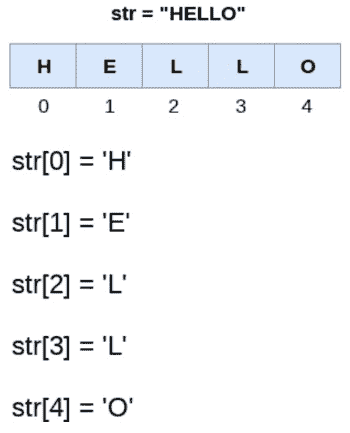

### 示例

```python
str = "HELLO"
print(str[0])
print(str[1])
print(str[2])
print(str[3])
print(str[4])
# 它返回 IndexError，因为索引 6 并不存在
print(str[6])
```

输出:

```
H
E
L
L
O
IndexError: string index out of range
```

切片运算符 `[]` 用于访问字符串的单个字符，如 Python 所示。但在 Python 中，我们可以使用 `:`（冒号）运算符从给定的字符串中获取子字符串。考虑以下插图。

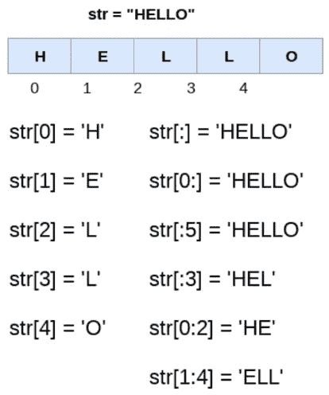

## Python 列表

在 Python 中，列表用于存储不同类型数据的序列。Python 列表是可变的，这意味着我们可以在它们形成后更改其元素。然而，Python 有六种数据类型可以存储序列，其中列表是最常用且最稳定的。

列表可以定义为不同类型值或项的集合。逗号（`,`）分隔列表中的元素，这些元素包含在方括号 `[]` 中。

以下是一个列表示例。

```python
L1 = ["John", 102, "USA"]
L2 = [1, 2, 3, 4, 5, 6]
```

当我们尝试使用 `type()` 方法打印 `L1`、`L2` 和 `L3` 的类型时，我们得到列表。

```python
print(type(L1))
print(type(L2))
```

输出:

```
<class 'list'>
<class 'list'>
```

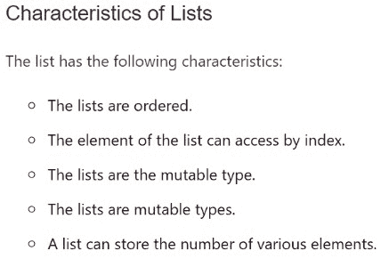

让我们看看第一个语句，它说明列表是有序的。

```python
a = [1, 2, "Peter", 4.50, "Ricky", 5, 6]
b = [1, 2, 5, "Peter", 4.50, "Ricky", 6]
a == b
```

输出:

```
False
```

两个列表具有相同的元素，但第二个列表修改了第五个成员的索引位置，这违反了列表的顺序。当比较两个列表时，结果为假。

列表在存在期间会保持元素的顺序。这就是为什么它是按特定排列方式的对象集合。

```python
a = [1, 2, "Peter", 4.50, "Ricky", 5, 6]
b = [1, 2, "Peter", 4.50, "Ricky", 5, 6]
a == b
```

输出:

```
True
```

让我们仔细看看这个列表示例。

```python
emp = ["John", 102, "USA"]
Dep1 = ["CS", 10]
Dep2 = ["IT", 11]
HOD_CS = [10, "Mr. Holding"]
HOD_IT = [11, "Mr. Bowen"]
print("printing data...")
print("Name: %s, ID: %d, Country: %s" % (emp[0], emp[1], emp[2]))
print("printing departments...")
print("Department 1:\nName: %s, ID: %d\nDepartment 2:\nName: %s, ID: %d" % (Dep1[0], Dep1[1], Dep2[0], Dep2[1]))
print("HOD ....")
print("CS HOD Name: %s, Id: %d" % (HOD_CS[1], HOD_CS[0]))
print("IT HOD Name: %s, Id: %d" % (HOD_IT[1], HOD_IT[0]))
```


### 13. 列表类型检查

```python
print(type(emp), type(Dep1), type(Dep2), type(HOD_IT))
```

输出：

```text
printing data...

Name: John, ID: 102, Country: USA

printing departments...

Department 1:

Name: CS, ID: 10

Department 2:

Name: IT, ID: 11

HOD ....

CS HOD Name: Mr. Holding, Id: 10

IT HOD Name: Mr. Bowen, Id: 11

<class 'list'> <class 'list'> <class 'list'> <class 'list'>
```

在前面的示例中，包含了员工和部门信息并打印了相关信息。检查上面的代码以更好地理解列表。

## Python 元组

Python 元组是用于存储不可变对象序列的数据结构。元组与列表相似，项的值可以修改，但元组是不可变的，值不能更改。

### 创建元组

逗号分隔的值集合`()`被称为元组。括号是可选的，但建议使用。以下是元组的定义。

1. `T1 = (10, "Peter")`
2. `T2 = ("Apple", "Banana", "Orange")`
3. `T3 = 10, 20, 30, 40, 50`
4. `print(type(T1))`
5. `print(type(T2))`
6. `print(type(T3))`

输出：

```text
<class 'tuple'>

<class 'tuple'>

<class 'tuple'>
```

带有单个元素的元组稍微复杂一点。为了声明元组，必须在元素后使用逗号。

1. `tuple1 = ("point")`
2. `print(type(tuple1))`
3. `# 创建单个元素的元组`
4. `tuple2 = ("point",)`
5. `print(type(tuple2))`

输出：

```text
<class 'str'>

<class 'tuple'>
```

与列表一样，元组也可以进行索引。元组中每个项的索引值可以访问它。以以下元组为例：

### 示例

1. `tuple1 = (10, 20, 30, 40, 50, 60)`
2. `print(tuple1)`
3. `count = 0`
4. `for i in tuple1:`
5. `print("tuple1[%d] = %d" % (count, i))`
6. `count = count + 1`

输出：

```text
(10, 20, 30, 40, 50, 60)

tuple1[0] = 10

tuple1[1] = 20

tuple1[2] = 30

tuple1[3] = 40

tuple1[4] = 50

tuple1[5] = 60
```

### 示例 - 2

1. `tuple1 = tuple(input("Enter the tuple elements ..."))`
2. `print(tuple1)`
3. `count = 0`
4. `for i in tuple1:`
5. `print("tuple1[%d] = %s" % (count, i))`
6. `count = count + 1`

输出：

```text
Enter the tuple elements ...123456

('1', '2', '3', '4', '5', '6')

tuple1[0] = 1

tuple1[1] = 2

tuple1[2] = 3

tuple1[3] = 4

tuple1[4] = 5

tuple1[5] = 6
```

元组的索引方式与列表一样。元组中每个项的索引值可以访问它。

## 元组索引与切片

元组的索引和切片与列表类似。切片运算符`[]`用于访问项。Python 中的冒号运算符可以访问多个项。

为了进一步理解索引和切片，请看图片。


1. `up = (1, 2, 3, 4, 5, 6)`
2. `print(up[0])`
3. `print(up[1])`
4. `print(up[2])`
5. `# 它将产生 IndexError，因为索引 6 并不存在`
6. `print(up[6])`

输出：

```text
1

2

3

IndexError: tuple index out of range
```

上面中的元组组七项，代表从 0 到 6 的数字。

1. `up = (1, 2, 3, 4, 5, 6, 7)`
2. `# 元素 1 到末`
3. `print(up[1:])`
4. `# 元素 0 到 3`
5. `print(up[:4])`
6. `# 元素 1 到 4`
7. `print(up[1:5])`

输出：

```text
(2, 3, 4, 5, 6, 7)

(1, 2, 3, 4)

(2, 3, 4, 5)
```

## 负索引

负索引也可以用于访问元组元素。最右侧的元素索引为`-1`，而倒数第二个项索引为`-2`，以此类推。

负索引用于从左到右导航项。考虑以下插图：

1. `tuple1 = (1, 2, 3, 4, 5)`
2. `print(tuple1[-1])`
3. `print(tuple1[-4])`
4. `print(tuple1[-3:-1])`
5. `print(tuple1[:-1])`
6. `print(tuple1[-2:])`

输出：

```text
5

2

(3, 4)

(1, 2, 3, 4)

(4, 5)
```

元组项与列表不同，无法使用`del`关键字擦除，因为元组是不可变的。我们可以使用`del`关键字配合`tuple`名称来删除整个元组。

考虑以下插图：

```python
tuple1 = (1, 2, 3, 4, 5, 6)
print(tuple1)
del tuple1[0]
print(tuple1)
del tuple1
print(tuple1)
```

输出：

```text
(1, 2, 3, 4, 5, 6)
Traceback (most recent call last):
  File "tuple.py", line 4, in <module>
    print(tuple1)
NameError: name 'tuple1' is not defined
```

# PYTHON 编程

## 练习：零基础学者基础

### 考试与面试指南

J NEWMAN

# Python 循环程序

## 找出输出

### 程序 1

```python
x = ['ab', 'cd']
for i in x:
    i.upper()
print(x)
```

输出：

```text
['ab', 'cd']
```

解释：

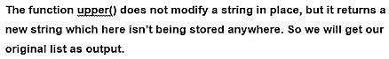

### 程序 2

```python
x = ['ab', 'cd']
for i in x:
    x.append(i.upper())
print(x)
```

输出：

```text
无输出
```

### 程序 3

```python
i = 1
while True:
    if i%3 == 0:
        break
    print(i)
    i += 1
```

输出：

```text
无输出
```

解释：

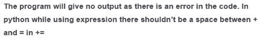

### 程序 4

```python
x = 123
for i in x:
    print(i)
```

输出：

```text
错误！
```

### 程序 5

```python
for i in [1, 2, 3, 4][::-1]:
    print(i)
```

输出：

```text
4
3
2
1
```

解释：

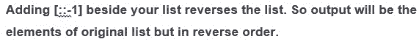

# Python 字符串程序

## 找出输出

### 程序 1

```python
str1 = '{2}, {1} and {0}'.format('a', 'b', 'c')
str2 = '{0}{1}{0}'.format('abra', 'cad')
print(str1, str2)
```

输出：

```text
c, b and a abracadabra
```

解释：

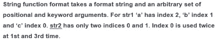

### 程序 2

```python
a = 2
b = '3.77'
c = -8
str1 = '{0:.4f} {0:3d} {2} {1}'.format(a, b, c)
print(str1)
```

输出：

```text
2.0000 2 -8 3.77
```

解释：

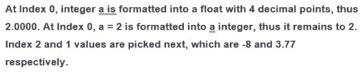

### 程序 3

```python
line = "I'll come by then."
eline = ""
for i in line:
    eline += chr(ord(i)+3)
print(eline)
```

输出：

```text
L*oo#frph#e|#wkhq1
```

解释：

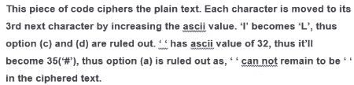

### 程序 4

```python
line = "What will have so will"
L = line.split('a')
for i in L:
    print(i, end=' ')
```

输出：

```text
Wh t will h ve so will
```

解释：

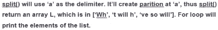

# Python 元组程序

## 找出输出

### 程序 1

```python
tuple = (1, 2, 3, 4)
tuple.append( (5, 6, 7) )
print(len(my_tuple))
```

输出：

```text
错误
```

### 程序 2

```python
tuple = {}
tuple[(1,2,4)] = 8
tuple[(4,2,1)] = 10
tuple[(1,2)] = 12
_sum = 0
for k in tuple:
    _sum += tuple[k]
print(len(tuple) + _sum)
```

输出：

```text
33
```

### 程序 3

```python
tuple1 = (1, 2, 4, 3)
tuple2 = (1, 2, 3, 4)
print(tuple1 < tuple2)
```

输出：

```text
False
```

### 程序 4

```python
tuple = (1, 2, 3)
print(2 * tuple)
```

输出：

```text
(1, 2, 3, 1, 2, 3)
```

解释：

`*`运算符用于连接元组。

### 程序 5

```python
tuple=("Check")*3
print(tuple)
```

输出：

```text
CheckCheckCheck
```

解释：


# Python 基础程序

## 找出输出

### 程序 1

```python
r = lambda q: q * 2
s = lambda q: q * 3
x = 2
x = r(x)
x = s(x)
x = r(x)
print (x)
```

输出：

```text
24
```

### 程序 2

```python
a = 4.5
b = 2
print(a//b)
```

输出：

```text
2.0
```

### 程序 3

```python
a = True
b = False
c = False
if not a or b:
    print (1)
elif not a or not b:
    print (2)
elif not a or b or a:
    print (3)
else:
    print (4)
```

输出：

```text
3
```

### 程序 4

```python
count = 1
def doThis():
    global count
    for i in (1, 2, 3):
        count += 1
doThis()
print (count)
```

输出：

```text
4
```

### 程序 5

```python
class Acc:
    def __init__(self, id):
        self.id = id
acc = Acc(1)
print acc.id
```

输出：

```text
1
```

# Python 程序检查给定年份是否为闰年

```python
import calendar
# 输入年份
year=int(input('Enter the value of year: '))
leap_year=calendar.isleap(year)
# 检查年份
if leap_year: # 检查条件
    print('The year is a leap year.')
else:
    print('The year is a leap year.')
```

# Python | 简单的 if else 示例

### 示例 1：输入一个数字并检查它是否为 10

```python
a=int(input("Enter A : "))
if a==10:
    print("Equal to 10")
else:
    print("Not Equal to 10")
```

输出：

```text
Enter A : 10
Equal to 10
```

### 示例 2：找出两个数中的较大者

```python
a=int(input("Enter A: "))
b=int(input("Enter B: "))
if a>b:
    g=a
else:
    g=b
print("Greater = ",g)
```

输出：

```text
Enter A: 36
Enter B: 24
Greater = 36
```

### 示例 3：使用单语句找出两个数中的较大者

```python
a=int(input("Enter A: "))
b=int(input("Enter B: "))
c= a if a>b else b
print("Greater = ",c)
```

输出：

```text
Enter A: 24
Enter B: 36
Greater = 36
```

### 示例 4：使用 if elif 设计一个简单的计算器

```python
# 输入年份
a=int(input("Enter A: "))
b=int(input("Enter B: "))
# 计算
```

```python
d,m,y=map(int,input('Enter the value of date,month and year: ').split())

a=['Monday','Tuesday','Wednesday','Thursday','Friday','Saturday','Sunday']

try:
    s=calendar.weekday(y,m,d)
    print('Weekday:',a[s])
except ValueError:
    print('You have entered an invalid date.')
```

### 输出

**运行 1：**

```text
Enter the value of date, month and year: 28 10 2019
Weekday: Monday
```

**运行 2：**

```text
Enter the value of date, month and year: 32 10 2019
You have entered an invalid date.
```

# Python 数组程序

## 在 Python 中创建矩阵

考虑以下示例：

```python
mat = [
  [10, 20, 30],
  [40, 50, 60],
  [70, 80, 80]
]
```

它可以被视为一个 3x3 矩阵。`mat`矩阵中有 3 行和 3 列。

### 程序

```python
# Python 矩阵创建
mat = [
  [10, 20, 30],
  [40, 50, 60],
  [70, 80, 80]
]
# 打印矩阵
print("mat: ", mat)
# 打印行
print("mat[0]: ", mat[0])
print("mat[1]: ", mat[1])
print("mat[2]: ", mat[2])
# 打印特定元素
print("mat[0][0]: ", mat[0][0])
print("mat[0][1]: ", mat[0][1])
print("mat[0][2]: ", mat[0][2])
print("mat[1][0]: ", mat[1][0])
print("mat[1][1]: ", mat[1][1])
print("mat[1][2]: ", mat[1][2])
print("mat[2][0]: ", mat[2][0])
print("mat[2][1]: ", mat[2][1])
print("mat[2][2]: ", mat[2][2])
# 使用循环打印矩阵（矩阵形式）
print("Matrix is: ")
for i in range(3):
  for j in range(3):
    print(mat[i][j], end = " ")
  print() # 换行
```

### 输出


```text
mat:  [[10, 20, 30], [40, 50, 60], [70, 80, 80]]
mat[0]:  [10, 20, 30]
mat[1]:  [40, 50, 60]
mat[2]:  [70, 80, 80]
mat[0][0]:  10
mat[0][1]:  20
mat[0][2]:  30
mat[1][0]:  40
mat[1][1]:  50
mat[1][2]:  60
mat[2][0]:  70
mat[2][1]:  80
mat[2][2]:  80
Matrix is:
10 20 30
40 50 60
70 80 80
```

## 使用 `numpy` 创建矩阵的 Python 程序

### 使用 `numpy.array()`

```python
mat = numpy.array([[10,20,30],[40,50,60],[70,70,90]])
```

### 使用 `numpy.matrix()`

```python
mat = numpy.matrix("10 20 30; 40 50 60; 70 80 90")
```

### 程序

```python
# 使用 numpy 创建 Python 矩阵
# 导入 numpy
import numpy as np
# 使用 numpy.array() 创建矩阵
mat1 = np.array([[10,20,30],[40,50,60],[70,70,90]])
# 打印矩阵
print("mat1...")
print(mat1)
# 使用 numpy.matrix() 创建矩阵
mat2 = np.matrix("10 20 30; 40 50 60; 70 80 90")
# 打印矩阵
print("mat2...")
print(mat2)
```

### 输出

```text
mat1...
[[10 20 30]
[40 50 60]
[70 70 90]]
mat2...
[[10 20 30]
[40 50 60]
[70 80 90]]
```

# Python 列表

## 找出输出

### 程序 1

```python
list1 = ['physics', 'chemistry', 1997, 2000]
list2 = [1, 2, 3, 4, 5, 6, 7 ]
print "list1[0]: ", list1[0] # 语句 1
print "list1[0]: ", list1[-2] # 语句 2
print "list1[-2]: ", list1[1:] # 语句 3
print "list2[1:5]: ", list2[1:5] # 语句 4
```

### 输出

```text
list1[0]:  physics
list1[0]:  1997
list1[-2]:  chemistry
list2[1:5]:  [2, 3, 4, 5]
```

### 解释


### 程序 2

```python
list1 = ['physics', 'chemistry', 1997, 2000]
print "list1[1]: ", list1[1] # 语句 1
print "list1[-1]: ", list1[-1] # 语句 2
```

### 输出

```text
list1[1]:  h
list1[-1]:  y
```

### 程序 3

```python
list1 = [1998, 2002, 1997, 2000]
list2 = [2014, 2016, 1996, 2009]
print "list1 + list2: ", list1 + list2 # 语句 1
print "list1 * 2: ", list1 * 2 # 语句 2
```

### 输出

```text
list1 + list2:  [1998, 2002, 1997, 2000, 2014, 2016, 1996, 2009]
list1 * 2:  [1998, 2002, 1997, 2000, 1998, 2002, 1997, 2000]
```

### 程序 4

```python
list1 = [1, 2, 3, 4, 5]
list2 = list1
print "list1= ", list1 # 语句 2
```

### 输出

```text
list1=  [1, 2, 3, 4, 5]
```

### 程序 5

```python
L1 = []
L1.append([2, 3, 4])
L1.extend([7, 8, 9])
print(L1[0])
```

### 输出

```text
7
```

### 解释


# Python 日期与时间

## 输出当前小时、分钟、秒和微秒的 Python 程序

### 程序

```python
# 打印当前小时、分钟、秒和微秒的 Python 程序
# 导入 datetime 类
from datetime import datetime
## 创建对象
obj_now = datetime.now()
# 打印当前日期时间
print("Current date & time: ", obj_now)
# 提取并打印小时、分钟、秒
print("Current hour =", obj_now.hour)
print("Current minute =", obj_now.minute)
print("Current second =", obj_now.second)
print("Current microsecond =", obj_now.microsecond)
```

### 输出

```text
Current date & time:  2020-07-30 14:43:52.294475
```

## 打印今天的年、月、日的 Python 代码

### 代码

```python
# 打印今天的年、月、日的 Python 程序
# 导入 date 类
from datetime import date
# 创建今天的日期
current_date = date.today()
## 打印当前日期
print("Current date: ", current_date)
# 提取当前的年、月、日
print("Current year:", current_date.year)
print("Current month:", current_date.month)
print("Current day:", current_date.day)
```

### 输出

```text
Current date:  2020-07-30
year: 2020
month: 7
day: 30
```

## Python 列表

## 在列表中添加、删除元素

### Python 列表 `append()` 方法

**语法：** `list.append(element)`

在这里，`list` 是列表名。`Append()` 是用于向列表添加元素（对象或项）的方法名称。

### 程序

```python
# 定义带有整数和字符串元素的列表
list = [10, 20, 30, "New Delhi", "Mumbai"]
# 打印列表
print "List elements: ", list
# 添加元素
list.append(40)
list.append(50)
list.append("Chennai")
# 打印添加元素后的列表
print "List elements: ", list
# 删除元素
list.pop ();
# 打印列表
print "List elements: ", list
```

### 输出

```text
List elements:  [10, 20, 30, 'New Delhi', 'Mumbai']
List elements:  [10, 20, 30, 'New Delhi', 'Mumbai', 40, 50, 'Chennai']
List elements:  [10, 20, 30, 'New Delhi', 'Mumbai', 40, 50]
```

## Python 列表 `pop()` 方法

**语法：** `list.pop()`

在这里，`list` 是列表名。`Pop()` 是用于从列表中删除最后一个项的方法名称。

## 查找两个列表差异的程序

### 程序

```python
# list1 整数列表
# list2 整数列表
list1 = [10, 20, 30, 40, 50]
list2 = [10, 20, 30, 60, 70]
# 打印列表
print "list1:", list1
print "list2:", list2
# 查找并打印列表的差异
print "Difference elements:"
print(set(list1) - set(list2))
```

### 输出

```text
list1: [10, 20, 30, 40, 50]
list2: [10, 20, 30, 60, 70]
Difference elements:
[40, 50]
```

### 程序 2

```python
# list1 混合类型列表
# list2 混合类型列表
list1 = ["Amit", "Shukla", 21, "New Delhi"]
list2 = ["Aman", "Shukla", 21, "Mumbai"]
# 打印列表
print "list1:", list1
print "list2:", list2
# 查找并打印列表的差异
print "Elements not exists in list2:"
print(set(list1) - set(list2))
print "Elements not exists in list1:"
print(set(list2) - set(list1))
```

### 输出

```text
list1: ['Amit', 'Shukla', 21, 'New Delhi']
list2: ['Aman', 'Shukla', 21, 'Mumbai']
Elements not exists in list2:
['Amit', 'New Delhi']
Elements not exists in list1:
['Aman', 'Mumbai']
```

## 从列表中移除重复元素的程序

### 示例

**输入：**

`list1`: `[10, 20, 10, 20, 30, 40, 30, 50]`

**输出：**

移除重复元素的列表

`list2`: `[10, 20, 30, 40, 50]`

### 程序

```python
# 定义列表
list1 = [10, 20, 10, 20, 30, 40, 30, 50]
# 创建一个具有唯一元素的另一个列表
list2 = list(set(list1))
```

## 声明另一个列表

`list2 = []`

## 添加元素

```python
for n in list1:
    if n not in list2:
        list2.append(n)
```

## 打印列表

```python
print "Original list"
print "list1: ", list1
print "List after removing duplicate elements"
print "list2: ", list2
```

### 输出

```text
Original list
list1: [10, 20, 10, 20, 30, 40, 30, 50]
List after removing duplicate elements
list2: [10, 20, 30, 40, 50]
```

## 程序（由用户定义函数）

### 去重函数

```python
def removeDuplicates (list1):
    # 声明另一个列表
    list2 = []
    # 添加元素 
    for n in list1:
        if n not in list2:
            list2.append (n)
    return list2

# 主代码
# 声明一个列表
list1 = [10, 20, 10, 20, 30, 40, 30, 50]
# 打印列表
print "Original list: ", list1
print "List after duplicate remove: ", removeDuplicates (list1)
```

### 输出

```text
Original list: [10, 20, 10, 20, 30, 40, 30, 50]
List after duplicate remove: [10, 20, 30, 40, 50]
```

# Java 编码与 Java 练习

绝对初学者的基础

快速学习编程的逐步指南

J NEWMAN

## Java 编码

绝对初学者的基础

快速学习编程的逐步指南

J NEWMAN

## 什么是 Java

Java 既是一个平台，也一门编程语言。Java 是一种高级编程语言，同时具有健壮性、面向对象性和安全性。

Java 是由 Sun Microsystems（现为 Oracle 的一个部门）于 1995 年创建。Java 的创始人詹姆斯·戈斯林（James Gosling）被认为是“Java 之父”。在 Java 出现之前，它被称为 Oak。由于 Oak 已经是一个受认可的商业名称，詹姆斯·戈斯林和团队决定将名称更改为 Java。

平台：平台是指运行程序的任何硬件或软件环境。Java 被称为平台是因为因为它拥有运行时环境（`JRE`）和 `API`。

## Java 示例

让我们来看一个 Java 编程示例。下一页包含 Hello Java 示例的完整描述。

`Simple.java`

```java
1. class Simple{  
2. public static void main(String args[]){  
3. System.out.println("Hello Java");  
4. }  
5. }
```

## Java 类型

Java 编程可以用于构建四种应用程序：

### 1) 独立应用程序

桌面应用程序和基于窗口的程序是独立应用程序的示例。这些必须安装在每台机器上的典型程序。媒体播放器、防病毒软件和其他独立应用程序都是示例。在 Java 中，使用 `AWT` 和 `Swing` 创建独立应用。

### 2) Web 应用

Web 应用是一种运行在服务器上并生成动态页面的应用程序。现在使用 `Servlet`、`JSP`、`Struts`、`Spring`、`Hibernate`、`JSF` 等技术用 Java 开发 Web 应用。

### 3) 企业级应用

分布式应用程序（如银行软件）被称为企业级应用。高安全性、负载均衡和集群只是其优点之一。`EJB` 是用于开发企业级应用的 Java 框架。

### 4) 移动应用

移动应用是专门为移动设备设计的程序。目前，移动应用使用 `Android` 和 `Java ME` 开发。

## Java 平台

Java 提供了四个不同的平台或版本：

### 1) Java SE（Java 标准版）

这是一个 Java 编程环境。它包含了 Java 编程 API，如 `java.lang`、`java.io`、`java.net`、`java.util`、`java.sql` 和 `java.math`。涵盖了面向对象编程（OOPs）、`String`、正则表达式（Regex）、异常（Exception）、内部类、多线程、I/O 流、网络、`AWT`、`Swing`、反射（Reflection）、集合（Collection）以及其他关键主题。

### 2) Java EE（Java 企业版）

这是一个主要用于创建在线和企业级应用的业务平台。它是使用 `Java SE` 平台构建的。涵盖了 `Servlet`、`JSP`、Web 服务、`EJB`、`JPA` 和其他主题。

### 3) Java ME（Java 微型版）

这是一个专注于移动应用的微平台。

### 4) JavaFX

这是一种用于创建富内容的在线应用的编程语言。它利用了一个简单的用户界面 API。

# Java 编码

## Java 的特性

Java 编程语言开发的主要目标是使其具有可移植性、简单性和安全性。此外，还有许多有助于该语言流行的优秀方面。Java 术语指的是该语言的特性。

以下是 Java 编程语言最核心的特征列表。

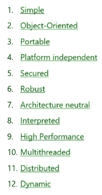

### 简单

Java 是一种非常容易学习的语言。根据 Sun Microsystems 的说法，Java 是一种易于理解的简单语言，因为：

Java 语法简单。

Java 删除了困难且很少使用的特性，如指针和运算符重载。

### 面向对象

Java 是一种关注对象的计算机语言。在 Java 中，一切都是对象。面向对象编程指的是软件作为数据和行为的集合。

### 平台无关

与 `C`、`C++` 等编译为特定平台的语言相比，Java 是一种“编写一次，处运行”的语言。运行程序的任何硬件或软件环境被称为平台。平台分为基于软件和基于硬件两种。Java 是一种构建在软件上的平台。

### 安全

安全性是 Java 最为人知的特性。我们可以 Java 创建防病毒解决方案。由于以下原因，Java 是安全的：

没有特定的指针。

Java 程序运行在沙箱环境中。

管理器是 Java 运行时（`JRE`）的一个组件，用于动态加载 Java 类。它通过隔离本地文件系统与网络包提高了安全性。

字节码验证器：检查可能破坏访问权限的代码片段。

管理器：确定类可以访问的资源，如读写本地磁盘。

### 健壮

英语行业蓬勃发展。Java 是一种健壮的编程语言，是因为：

它大量利用内存管理。

没有指针，因此没有安全问题。


Java 提供自动垃圾回收，并在虚拟机上删除不再被 Java 程序使用的对象。

Java 具有异常处理和类型检查机制。所有这些因素都有助于 Java 的健壮性。

### 架构中立

由于 Java 中没有依赖于实现的方面（例如原始类型的大小），因此它是架构中性的。

在 `C` 编程中，`int` 数据类型在 32 位架构中占用两个字节，在 64 位架构中占用四个字节。但在 Java 中，它在 32 位和 64 位架构上都占用 4 字节内存。

### 可移植

Java 是可移植的，因为它允许你将 Java 字节码移动到另一个平台。它不需要任何种的实现。

### 高性能

由于 Java 字节码接近原生代码，因此比其他传统的解释型编程语言更快。尽管如此，它仍然慢于编译语言（例如 `C++`）。

因为它允许用户在 Java 中构建分布式程序，因此它是分布式的。在开发分布式应用程序时，使用了 `RMI` 和 `EJB`。这种 Java 能力允许我们通过调用连接到互联网的任何系统中的方法来访问文件。

### 多线程

线程就像一个在后台运行的第二个软件。通过定义许多线程，我们可以设计出同时处理多个任务的 Java 应用程序。多线程的根本优势是每个线程不占用内存。它具有一个共享的内存空间。线程对于多媒体、Web 应用程序和其他应用程序至关重要。

### 动态

Java 是一种动态编程语言。它允许类被动态加载。这意味着类仅在需要时才被加载。它还支持用其原生语言 `C` 和 `C++` 编写的函数。

Java 允许动态编译和内存管理（垃圾回收）。

# C++ vs Java

`C++` 和 `Java` 编程语言有很多许多相似之处和不同之处。以下是 `C++` 和 `Java` 之间最重要的区别的总结：

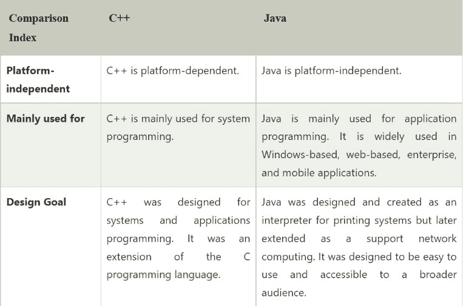

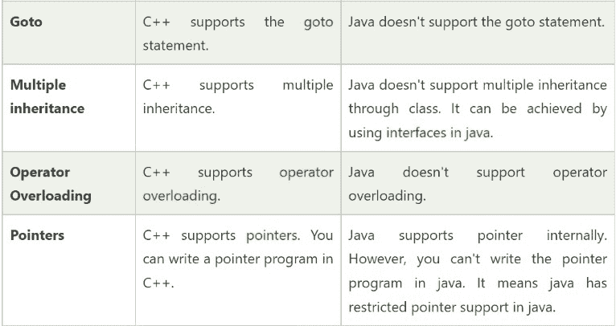

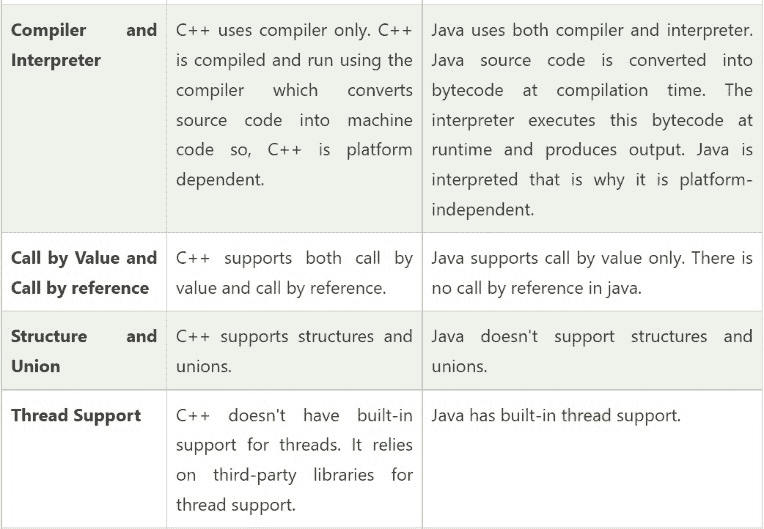

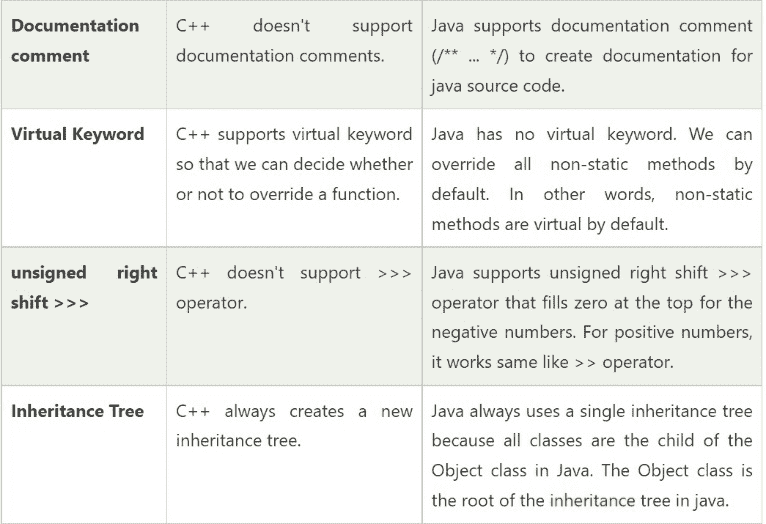

## C++ 程序示例

文件: `main.cpp`

```cpp
1. #include <iostream>
2. using namespace std;
3. int main() {
4. cout << "Hello C++ Programming";
5. return 0;
6. }
```

输出：

Hello C++ Programming

## Java 程序示例

文件: `Simple.java`

```java
1. class Simple{
2. public static void main(String args[]) {
3. System.out.println("Hello Java");
4. }
5. }
```

输出：

Hello Java

# 第一个 Java 程序

在这一节中，我们将学习如何编写一个简单的 Java 应用程序。在安装 `JDK` 后，我们可以快速构建一个基础的 hello Java 应用程序。

为了创建一个简单的 Java 程序，你必须构造构造包含 `main` 函数的类。让我们从要求开始。

1. 安装 Java 开发工具包 (JDK)。如果你还没有安装，请下载并安装 `JDK`。

2. 设置 `jdk/bin` 目录的路径。

3. 制作 Java 程序。

4. 在编译后运行该 Java 程序。

### Hello World 示例

```java
1. class Simple{
2. public static void main(String args[]) {
3. System.out.println("Hello Java");
4. }
5. }
```

| 编译：`javac Simple.java` |

| 执行：`java Simple` |

输出：

Hello Java

# JDK, JRE 和 JVM 的区别

在继续 Java 之前，我们必须首先理解 `JDK`、`JRE` 和 `JVM` 之间的区别。这里是 `JVM` 的快速总结。

如果你想深入学习 Java 虚拟机，请访问以下页面。让我们先来看 `JDK`、`JRE` 和 `JVM` 的区别。

### JVM

`JVM`（Java 虚拟机）是一个抽象的机器。因为它在物理上不存在，所以被称为虚拟机。它是一个为 Java 字节码运行创建一个运行时环境的规范。它还可以运行用其他语言编译成 Java 字节码的应用程序。

对于广泛的硬件和软件平台，都有相应的 `JVMs`。由于每个操作系统的设置不同，`JVM`、`JRE` 和 `JDK` 是依赖于平台的。相反，Java 是平台无关的。`JVM` 分为三个部分：规范、实现和实例。

`JVM` 的主要功能如下：

* 加载代码

* 验证代码

* 执行代码

* 提供运行时环境

### JRE

Java 运行环境 (`JRE`) 是 Java Runtime Environment 的缩写。它也被称为 Java `RTE`。Java 运行环境 (`JRE`) 是用于创建 Java 应用程序的软件工具集。它负责创建运行时环境。它是 `JVM` 的实现。它是真实存在的。它由一组库以及 `JVM` 在执行期间使用的其他文件组成。

### JDK

`JDK` 术语代表 Java Development Kit（Java 开发包）。Java 开发工具包 (`JDK`) 是用于创建 Java 程序和 applet 的软件开发环境。它是真实存在的。它包含了 `JRE` 以及开发者工具。

# Java 变量

变量是一个在 Java 程序执行期间持有值的容器。变量被分配一个数据类型。

“变量”一词是指内存区域的名称。局部变量、实例变量和静态变量是 Java 中的三种类型的变量。

在 Java 中，数据类型分为两类：基本类型和非基本类型。

## 变量

变量是内存分配的保留空间的名称。换句话说，它是内存位置的名称。它由“vari + ability”这两个词组成，意味着它的值是可以修改的。

1. `int data=50;` // 这里 `data` 是变量

### 变量类型

* 局部变量

* 实例变量

* 静态变量

#### 1) 局部变量

局部变量是在方法体内部声明的变量。该变量只能在该方法内部使用，类的其他方法并不知道它的存在。

不能使用 `static` 关键字来声明局部变量。

#### 2) 实例变量

实例变量是声明在类内部方法外部的变量。它没有 `static` 关键字。

#### 3) 静态变量

静态变量是使用 `static` 关键字的变量。它的值在所有实例中共享，并且在类加载时被初始化。

静态变量是声明在类内部方法外部的变量。它的值在所有实例中共享，并且在类加载时被初始化。

### 变量 变量在类中定义

```java
class A {
    int data=50; // 这里的 data 是变量
}
```

### 局部变量示例

```java
class A {
    void method() {
        int data=50; // 这里的 data 是局部变量
        // 只能在方法方法中使用
    }
}
```

### 实例变量示例

```java
class A {
    int data=50; // 这里的 data 是实例变量
    void method() {
        System.out.println(data);
    }
}
```

### 静态变量示例

```java
class A {
    static int data=50; // 这里的 data 是静态变量
    void method() {
        System.out.println(data);
    }
}
```

*   `byte` 数据类型

*   `char` 数据类型

*   `short` 数据类型

*   `int` 数据类型

*   `long` 数据类型

*   `float` 数据类型

*   `double` 数据类型

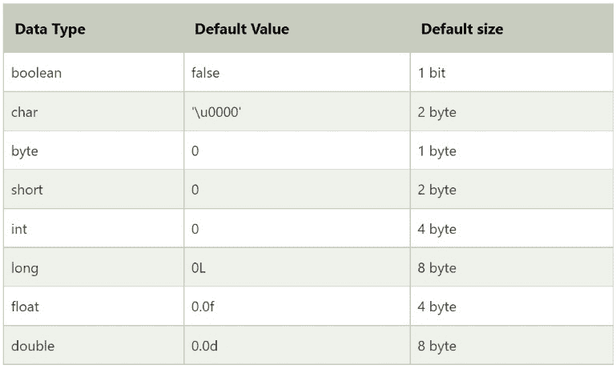

## 布尔数据类型

`Boolean` 数据类型仅存储两个潜在值：`true` 和 `false`。这种数据类型用于存储跟踪真/假情况的简单标记。

`Boolean` 数据类型指定单个位的数据，但其“大小”无法精确定义。

示例：

1. `Boolean one = false`

## 字节数据类型

原始数据类型 `byte` 就是其中的例子。它是一个 8 位的补码符号整数。它的取值范围为 -128 到 127（包含）。最小值为 -128，最大值为 127。默认值为 0。

`byte` 数据类型用于在空间极其紧张的巨大数组中节省内存。因为 `byte` 比 `integer` 矮四倍，所以它可以节省空间。它也可以被 `int` 数据类型替代。

示例：

1. `byte a = 10, byte b = -20`

## 短整数据类型

16 位的符号补码整数是 `short` 数据类型。它的取值范围为 -32,768 到 32,767（包含）。最小值为 -32,768，最大值为 32,767。默认值为 0。

`short` 数据类型像 `byte` 数据类型一样可以节省内存。`short` 数据类型的大小是整数的两倍。

示例：

1. `short s = 10000, short r = -5000`

## 整数数据类型

32 位的符号补码整数由 `int` 数据类型表示。它的取值范围为 -2,147,483,648 (-2³¹ -1) 到 2,147,483,647 (2³¹ -1)（包含）。最小值为 -2,147,483,648，最大值为 2,147,483,647。默认值为 0。

除非有内存限制，否则 `int` 数据类型通常被选择为整数值的默认数据类型。

示例：

1. `int a = 100000, int b = -200000`

## 长整数数据类型

64 位的补码整数是 `long` 数据类型。它的取值范围为 -9,223,372,036,854,775,808 (-2⁶³ -1) 到 9,223,372,036,854,775,807 (2⁶³ -1)（包含）。它的最小值和最大值为 -9,223,372,036,854,775,808 和 9,223,372,036,854,775,807。默认值为 0。当你需要比 `int` 提供的更大的取值范围时，应该利用 `long` 数据类型。

示例：

1. `long a = 100000L, long b = -200000`

## 单精度浮点类型

`float` 数据类型是 32 位 IEEE 754 单精度浮点数。它具有无限的取值范围。如果你需要在大型浮点整数数组中节省内存，请使用 `float`（而不是 `double`）。对于精确数字（例如货币），永远不应使用 `float` 数据类型。`0.0F` 是默认值。

示例：

1. `float f1 = 234.5f`

## 双精度浮点类型

`double` 数据类型是 64 位 IEEE 754 双精度浮点数。它具有无限的取值范围。像 `float` 一样，`double` 数据类型常用于小数。对于精确数值（例如货币），永远不应利用 `double` 数据类型。`0.0d` 是默认值。

示例：

1. `double d1 = 12.3`

## 字符类型

单个 16 位 Unicode 字符由 `char` 数据类型表示。它的取值范围从 'u0000'（或 0）到 'uffff'（或 65,535，包含）。字符使用 `char` 数据类型存储。

示例：

1. `char letterA = 'A'`

# Java 运算符

在 Java 中，运算符是执行操作的符号。例如，`+`、`-`、`*`、`/` 等。

在 Java 中有许多不同的运算符，列如下：

*   一元运算符

*   算术运算符

*   移位运算符

*   关系运算符

*   位运算符

*   逻辑运算符

*   三元运算符

*   赋值运算符

## Java 运算符优先级

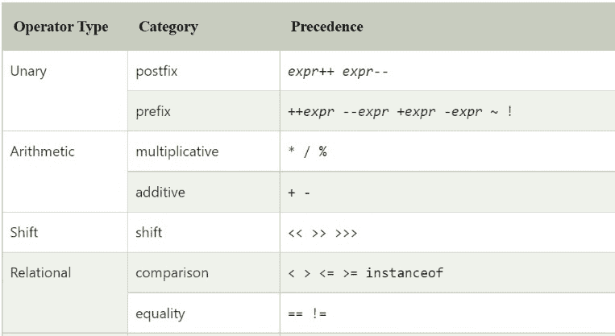

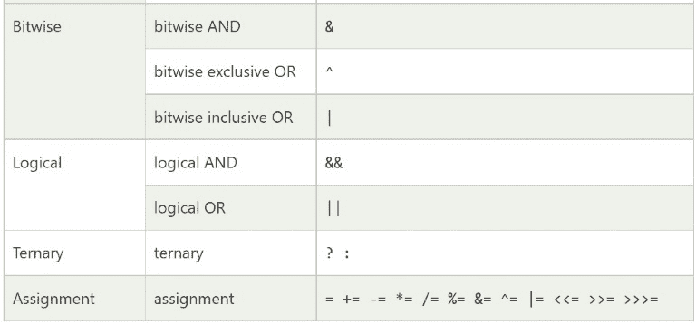

### 一元运算符

Java 一元运算符只需要一个操作数。一元运算符用于执行各种任务。

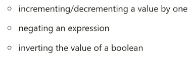

### 一元运算符示例：++ 和 --

```java
public class OperatorExample{
  public static void main(String args[]){
  int x=10;
  System.out.println(x++); //10
  System.out.println(++x);//12
  System.out.println(x--);//12
  System.out.println(--x);//10
  }
}
```

输出：

```
10
12
12
10
```

### 一元运算符示例 2：++ 和 --

```java
public class OperatorExample{
  public static void main(String args[]){
  int a=10;
  int b=10;
  System.out.println(a++ + ++a);//10+12=22
  System.out.println(b++);11
  }
}
```

输出：

22

11

### 一元运算符示例：~ 和 !

```java
public class OperatorExample{
  public static void main(String args[]){
  int a=10;
  int b=-10;
  boolean c=true;
  boolean d=false;
  System.out.println(~a);//-11（值的取反）
  System.out.println(~b);//9（正值的取反）
  System.out.println(!c);//false（值的取反）
  System.out.println(!d);//true（值的取反）
  }
}
```

输出：

```
-11
9
false
true
```

## 算术运算符

加法、减法、乘法和除法都是通过 Java 操作执行的。它们作为基础数学过程。

### 算术运算符示例

```java
public class OperatorExample{
  public static void main(String args[]){
  int a=10;
  int b=5;
  System.out.println(a+b);//15
  System.out.println(a-b);//5
  System.out.println(a*b);//50
  System.out.println(a/b);//2
  System.out.println(a%b);//0
  }
}
```

输出：

```
15
5
50
2
0
```

### 算术运算符示例：表达式

```java
public class OperatorExample{
  public static void main(String args[]){
  System.out.println(10*10/5+3/2);
  }
}
```

输出：

```
21
```

### Java 左移运算符

Java 左移运算符将值中的所有位向左移动指定的次数。

### 左移运算符示例

```java
public class OperatorExample{
  public static void main(String args[]){
  System.out.println(10<<2);//10*2²=40
  System.out.println(10<<3);//10*2³=80
  System.out.println(20<<2);//20*2²=80
  System.out.println(15<<4);//15*2⁴=240
  }
}
```

输出：

```
40
80
80
240
```

### - 右移运算符

Java 右移运算符 `>>` 将左操作数的值向右移动右操作数指定的位数。

### 右移运算符示例

```java
public class OperatorExample{
  public static void main(String args[]){
  System.out.println(10>>2);//10/2²=2
  System.out.println(20>>2);//20/2²=5
  System.out.println(20>>3);//20/2³=2
  }
}
```

输出：

```
2
5
2
```

### 移位运算符示例：>> vs >>>

```java
public class OperatorExample{
  public static void main(String args[]){
  // 对于正数，>> 和 >>> 作用相同
  System.out.println(20>>2);
  System.out.println(20>>>2);
  // 对于负数，>>> 将符号位（MSB）变为 0
  System.out.println(-20>>2);
  System.out.println(-20>>>2);
  }
}
```

输出：

```
5
5
-5
1073741819
```

### Java 与运算符示例：逻辑 && 和 位运算符 &

如果第一个条件为假，逻辑 `&&` 运算符不会验证第二个条件。只有当第一个条件为真时，才会检查第二个条件。

无论第一个条件是真是假，位运算符 `&` 总是会验证两个标准。


```java
public class OperatorExample{
  public static void main(String args[]){
  int a=10;
  int b=5;
  int c=20;
  System.out.println(a<b&&a<c);//false && true=false
  System.out.println(a<b&a<c);//false & true=false
  }
}
```

输出：

```
false
false
```

# Java OR 运算符

### 示例

```java
public static void main(String args[]){
  int a=10;
  int b=5;
  int c=20;
  System.out.println(a<b&&a++<c);//false && true = false
  System.out.println(a);//10 because second condition is not checked
  System.out.println(a<b&a++<c);//false && true = false
  System.out.println(a);//11 because second condition is checked
}}
```

**输出：**

```
false
10
false
11
```

### Java 逻辑 `||` 与按位 `|`

如果第一个条件为真，逻辑或运算符 `||` 运算符将不检查第二个条件。只有当第一个条件为假时，才会检查第二个条件。

无论第一个条件是真是假，按位或运算符 `|` 总是都会验证两个准则。

### 示例

```java
public class OperatorExample{
  public static void main(String args[]){
  int a=10;
  int b=5;
  int c=20;
  System.out.println(a>b||a<c);//true || true = true
  System.out.println(a>b|a<c);//true | true = true
  //|| vs |
  System.out.println(a>b||a++<c);//true || true = true
  System.out.println(a);//10 because second condition is not checked
  System.out.println(a>b|a++<c);//true | true = true
  System.out.println(a);//11 because second condition is checked
}}
```

**输出：**

```
true
true
true
10
true
11
```

# Java 三元运算符

在 Java 编程中，三元运算符是 `if-then-else` 表达式的一种行替代方案。它是唯一接受三个输入的条件运算符。

### 示例

```java
public class OperatorExample{
  public static void main(String args[]){
  int a=2;
  int b=5;
  int min=(a<b)?a:b;
  System.out.println(min);
}}
```

**输出：**

```
2
```

### 另一个示例

```java
public class OperatorExample{
  public static void main(String args[]){
  int a=10;
  int b=5;
  int min=(a<b)?a:b;
  System.out.println(min);
}}
```

**输出：**

```
5
```

# Java 赋值运算符

Java 中常用的运算符之一是赋值运算符。它用于将左侧的操作数赋值给右侧的值。

### 示例

```java
public class OperatorExample{
  public static void main(String args[]){
  int a=10;
  int b=20;
  a+=4;//a=a+4 (a=10+4)
  b-=4;//b=b-4 (b=20-4)
  System.out.println(a);
  System.out.println(b);
}}
```

**输出：**

```
14
16
```

### 示例

```java
public class OperatorExample{
  public static void main(String[] args){
  int a=10;
  a+=3;//10+3
  System.out.println(a);
  a-=4;//13-4
  System.out.println(a);
  a*=2;//9*2
  System.out.println(a);
  a/=2;//18/2
  System.out.println(a);
}}
```

**输出：**

```
13
9
18
9
```

### 示例：相加 `short` 类型

```java
public class OperatorExample{
  public static void main(String args[]){
  short a=10;
  short b=10;
  a+=b;//a=a+b internally so
  a=a+b;//Compile time error because 10+10=20 int
  System.out.println(a);
}}
```

**输出：**

`编译时错误 (Compile time error)`

### 类型转换后

```java
public class OperatorExample{
  public static void main(String args[]){
  short a=10;
  short b=10;
  a=(short)(a+b);//20 which is converted to short
  System.out.println(a);
}}
```

**输出：**

```
20
```

# Java 控制语句

Java 编译器从头到尾运行代码。代码中的语句按照它们出现的顺序执行。相反，Java 包含了控制代码流的语句。这些语句被称为控制流语句。它是 Java 最重要的方面之一，因为它确保了程序流的顺畅运行。

Java 中有三种类型的控制流语句：

1. **决策语句**

   - `if` 语句

   - `switch` 语句

2. **循环语句**

   - `do while` 循环

   - `while` 循环

   - `for` 循环

   - `for-each` 循环

3. **跳转语句**

   - `break` 语句

   - `continue` 语句

## 决策语句

决策语句如其名，决定了执行哪些语句以及何时执行。决策语句分析布尔表达式。

## `if` 语句

`if` 语句根据布尔表达式的结果执行代码块。如果表达式为真，则执行 `if` 块；如果为假，则跳过。

## `if-else` 语句

`else` 语句与 `if` 语句配合使用。如果 `if` 的条件为假，则执行 `else` 块。

### `if-else-if` 阶梯

`if-else-if` 阶梯由多个 `if` 语句组成，允许检查多个条件。

### 嵌套 `if` 语句

```java
public class OperatorExample{
  public static void main(String args[]){
  int a=10;
  int b=5;
  int c=20;
  System.out.println(a>b||a<c);//true || true = true
  System.out.println(a>b|a<c);//true | true = true
  //|| vs |
  System.out.println(a>b||a++<c);//true || true = true
  System.out.println(a);//10 because second condition is not checked
  System.out.println(a>b|a++<c);//true | true = true
  System.out.println(a);//11 because second condition is checked
}}
```

**输出：**

```
true
true
true
10
true
11
```

### `switch` 语句

`switch` 语句根据一个变量的值执行多个代码块。它通常比多个 `if-else` 语句更具可读性。

```java
String address = "Delhi, India";

if(address.endsWith("India")) {
    if(address.contains("Meerut")) {
        System.out.println("Your city is Meerut");
    } else if(address.contains("Noida")) {
        System.out.println("Your city is Noida");
    } else {
        System.out.println(address.split(",")[0]);
    }
} else {
    System.out.println("You are not living in India");
}
}
```

Output:

Delhi

### `Switch` 语句

Java 中的 `switch` 语句类似于 `if-else-else` 语句。根据 `switch` 语句中正在切换的变量来执行单个 `case`，该语句由多个称为 `cases` 的各种代码块组成。你可以直接使用 `switch` 语句来代替 `if-else-if` 语句。它还提升了程序的可读性。

```java
switch (expression){
    case value1:
        statement1;
        break;
    ...
    case valueN:
        statementN;
        break;
    default:
        default statement;
}
```

### 示例

**Student.java**

```java
public class Student implements Cloneable {
    public static void main(String[] args) {
        int num = 2;
        switch (num){
            case 0:
                System.out.println("number is 0");
                break;
            case 1:
                System.out.println("number is 1");
                break;
            default:
                System.out.println(num);
        }
    }
}
```

Output:

2

我们必须记住，在使用 `switch` 语句时，`case` 表达式的类型将与变量类型相同。然而，它是一个常量。只有 `int`、`string` 和 `Enum` 类型的变量允许用于此 `switch`。

# Java 中的循环

Java 的 `for` 循环用于反复迭代程序的某部分。如果迭代次数固定的，建议使用 `for` 循环。

在 Java 中，有三种形式的 `for` 循环：

- 简单 `for` 循环

- `For-each` 或增强型 `for` 循环

- 标记 `for` 循环

## 简单 `for` 循环

在 C/C++ 中，简单 `for` 循环是相同的。我们可以设置变量的值、检查条件并增加或减少该值。语法如下：

```java
for(initialization; condition; increment/decrement){
    // 要执行的语句或代码
}
```

#### 示例:

**ForExample.java**

```java
// 用于演示 for 循环示例的 Java 程序
// 打印 1 的乘表
public class ForExample {
    public static void main(String[] args) {
        // Java for 循环的代码
        for(int i=1;i<=10;i++){
            System.out.println(i);
        }
    }
}
```

Output:

1

2

3

4

5

6

7

8

9

10

## 嵌套 `for` 循环

“嵌套 `for` 循环”术语指的是包含在另一个循环中的 `for` 循环。当外层循环执行时，内层循环会完成。

示例:

```java
public class NestedForExample {
    public static void main(String[] args) {
        // i 的循环
        for(int i=1;i<=3;i++){
            // j 的循环
            for(int j=1;j<=3;j++){
                System.out.println(i+" "+j);
            }//end of i
        }//end of j
    }
}
```

Output:

1 1

1 2

1 3

2 1

2 2

2 3

3 1

3 2

3 3

#### 金字塔示例 1:

**PyramidExample.java**

```java
public class PyramidExample {
    public static void main(String[] args) {
        for(int i=1;i<=5;i++){
            for(int j=1;j<=i;j++){
                System.out.print("*");
            }
            System.out.println();//换行
        }
    }
}
```

Output:

*

**

***

****

*****

## `For-each` 循环

在 Java 中，`for-each` 循环用于迭代数组或集合。因为我们不需要增加值或使用下标表示法，所以它比标准的 `for` 循环更容易使用。它是基于元素而不是索引。它逐个返回每个元素。

语法：

```java
for(data_type variable : array_name){
    // 要执行的代码
}
```

#### 示例:

**ForEachExample.java**

```java
// 用于打印数组元素的 Java For-each 循环
public class ForEachExample {
    public static void main(String[] args) {
        // 声明数组
        int arr[]={12,23,44,78};
        // 使用 for-each 循环打印数组
        for(int i:arr){
            System.out.println(i);
        }
    }
}
```

Output:

12

23

44

56

78

## Java 中的标记 `For` 循环

在 Java 中，标记 `for` 循环是给包含在另一个循环中的 `for` 循环命名。当外层循环执行时，内层循环会完成。每个 `for` 循环都可以赋予一个名称。这是通过在 `for` 语句之前放置标签来实现的。

语法：

```java
label:
for(initialization; condition; increment/decrement){
    // 要执行的代码
}
```

#### 示例:

**LabeledForExample.java**

```java
// 用于演示标记 for 循环的 Java 程序
public class LabeledForExample {
    public static void main(String[] args) {
        outer: // 标记
        for(int i=1;i<=3;i++){
            for(int j=1;j<=3;j++){ // 内层循环
                System.out.println(i+" "+j);
                if(j==2) {
                    break outer;
                }
            }
        }
    }
}
```

Output:

1 1

1 2

2 1

2 2

3 1

## 无限 `while` 循环

如果你向 `while` 循环传递 `true`，则它将成为一个无限 `while` 循环。

### 语法


```java
while(true){
  // 要执行的代码
}
```

### 示例：`WhileExample2.java`

```java
public class WhileExample2 {
    public static void main(String[] args) {
    // 通过向条件传递 true 设置无限 while 循环
    while(true){
      System.out.println("infinitive while loop");
    }
    }
}
```

### 输出

```
infinitive while loop
infinitive while loop
infinitive while loop
infinitive while loop
infinitive while loop
```

要结束以下代码中的无限循环，我们必须使用 `Ctrl + C` 命令。

# Java `do-while` 循环

Java `do-while` 循环用于重复执行程序的某部分，直到满足指定的条件。如果迭代次数不固定且循环至少执行一次，则建议使用 `do-while` 循环。

退出控制循环是 Java `do-while` 循环。与 `while` 和 `for` 循环相比，`do-while` 循环在循环体结束后检查条件。由于是在循环体之后测试条件，因此 Java `do-while` 循环至少执行一次。

### 语法

```java
do{
  // 要执行的代码 / 循环体
  // 更新语句
}while (condition);
```

### `do-while` 循环的不同组成部分

1. **条件**是一个被用于测试的表达式。如果条件为 `true`，则运行循环体并将控制权传递给更新表达式。当条件变为 `false` 时，循环立即中断。

   示例：`i <=100`

2. **更新表达式**：该表达式每执行一次循环体，就会递增或减少循环变量。

   示例：`i++`

### 示例

在下面的示例中，我们输出从 1 到 10 的整数。与 `for` 循环不同，条件变量必须独立地初始化和递增（这里是 `i`）。否则，循环将无限运行。

### `DoWhileExample.java`

```java
public class DoWhileExample {
    public static void main(String[] args) {
        int i=1;
        do{
          System.out.println(i);
          i++;
        }while(i<=10);
    }
}
```

### 输出

```
1
2
3
4
5
6
7
8
9
10
```

## 无限 `do-while` 循环 – JAVA

如果你在 `do-while` 循环中传递 `true`，则它将成为一个无限 `do-while` 循环。

### 语法

```java
do{
  // 要执行的代码
}while(true);
```

### 示例：`DoWhileExample2.java`

```java
public class DoWhileExample2 {
    public static void main(String[] args) {
    do{
      System.out.println("infinitive do while loop");
    }while(true);
    }
}
```

### 输出

```
infinitive do while loop
infinitive do while loop
infinitive do while loop
```

要结束无限循环，请使用 `ctrl+c` 命令。

# Java `break` 语句

当循环内部遇到 `break` 语句时，循环将立即结束，程序控制将在循环后的下一个语句恢复。

在 Java 中要退出循环或 `switch` 语句，请使用 `break` 语句。在指定的情况下，它会中断程序的当前流。在存在内层循环的情况下，它只会中断内层循环。

Java `break` 语句可以用所有形式的循环，包括 `for` 循环、`while` 循环和 `do-while` 循环。

### 语法

```java
jump-statement;
break;
```


## 循环中的 `break` 语句

### 示例：`BreakExample.java`

```java
// 用于演示在 for 循环内部使用 break 语句的 Java 程序
public class BreakExample {
    public static void main(String[] args) {
    // 使用 for 循环
    for(int i=1;i<=10;i++){
      if(i==5){
        // 跳出循环
        break;
      }
      System.out.println(i);
    }
}
```

### 输出

```
1
2
3
4
```

## 内层循环中的 `break` 语句

只有在内层循环内部使用 `break` 语句时，它才会中断内层循环。

### 示例：`BreakExample2.java`

```java
// 用于说明在内层循环内部使用 break 语句的 Java 程序
public class BreakExample2 {
    public static void main(String[] args) {
    // 外层循环
    for(int i=1;i<=3;i++){
      // 内层循环
      for(int j=1;j<=3;j++){
        if(i==2&&j==2){
          // 在内层循环内部使用语句
          break;
        }
        System.out.println(i+" "+j);
      }
    }
}
```

### 输出

```
1 1
1 2
1 3
2 1
3 1
3 2
3 3
```

## 带标签的 `for` 循环中的 `break` 语句

带有标签，我们可以使用 `break` 语句。由于是外层还是内层循环，`break` 都是可用的。带有标签，JDK 5 这种功能是可用。

### 示例：`BreakExample3.java`

```java
// 用于说明在内层循环中使用标签 break 语句的 Java 程序
public class BreakExample3 {
    public static void main(String args) {aa:
    for(int i=1;i<=3;i++){
      bb:
      for(int j=1;j<=3;j++){
        if(i==2&&j==2){
          // 使用标签使用语句
          break bb;
        }
        System.out.println(i+" "+j);
      }
    }
}
```

```java
a=sc.nextInt();
System.out.print("Enter second number:");
b=sc.nextInt();
System.out.print("Enter third number:");
c=sc.nextInt();
if ( a>b && a>c )
    largest=a;
else if ( b>a && b>c )
    largest=b;
else
    largest=c;
System.out.println("Largest Number is : "+largest);
}
```

### 输出

编译：`javac LargestFrom3.java`

运行：`java LargestFrom3`

### 输出

```
Enter first number:45
Enter second number:56
Enter third number:67
Largest Number is : 67
```

---

# 计算所有数字之和的 Java 程序

给定一个数字，我们必须使用 Java 程序来找到它所有数字之和。

### 示例 1

输入：

数字：852

输出：

所有数字之和：15

### 示例 2

输入：

数字：256868

输出：

所有数字之和：35

### 程序

```java
import java.util.Scanner;

public class AddDigits
{
    public static void main(String[] args[])
    {
// 初始化并声明对象。
        int num, rem=0, sum=0, temp;
        Scanner scan = new Scanner(System.in);
        //在此此处输入数字。
        System.out.print("Enter the Number : ");
        num = scan.nextInt();
        // temp 用于存储数字。
        temp = num;
        while(num>0)
        {
            rem = num%10;
            sum = sum+rem;
            num = num/10;
        }
        System.out.print("Sum of Digits of " +temp+" is : " +sum);        
    }
}
```

### 输出

第一次运行：

```
Enter the Number : 582
Sum of Digits of 582 is : 15
```

第二次运行：

```
Enter the Number : 256868
Sum of Digits of 256868 is : 35
```

---

# 运行应用程序的 Java 程序

使用 Java 程序，此程序可以打开（运行）应用程序（记事本、计算器）。

我们使用 `Runtime.getRuntime()` 实例和 `exec()` 方法来打开或运行应用程序。

### 程序

```java
//运行应用程序的 Java 程序。
import java.util.*;
class OpenNotepad
{
  public static void main(String[] args)
  {
      Runtime app=Runtime.getRuntime();
      try
      {
            //打开记事本
            app.exec("notepad");
            //打开计算器
            app.exec("calc");
        }
        catch (Exception Ex)
        {
            System.out.println("Error: " + Ex.toString());
        }
  }
}
```

### 输出

```
记事本和计算器将被打开。
```

---

# 使用 `for` 循环打印从 1 到 N 的数字

### 程序

```java
import java.util.Scanner;
public class Print_1_To_N
{
public static void main(String[] args)
{
//创建 scanner 对象
Scanner scanner = new Scanner(System.in);
//输入 " n " 的值。
System.out.print("Enter the value n : ");
//读取值。
int n = scanner.nextInt();
System.out.println("Numbers are : ");
for(int i=1; i<=n; i++)
{
System.out.println(i);
}
}
```

### 输出

```
Enter the value n : 15
Numbers are :
1
2
3
4
5
6
7
8
9
10
11
12
13
14
15
```

---

# 打印斐波那契数列的 Java 程序

斐波那契数列是一个每一项都是前两项之和的数列。

### 程序

```java
/*打印斐波那契数列的 Java 程序.*/
import java.util.Scanner;
public class Fabonacci {
    public void main(String[] args) {
        int SeriesNum ;
        Scanner sc=new Scanner(System.in);
        System.out.print("Enter the length of fibonacci series : ");
        SeriesNum=sc.nextInt();
        int[] num = new int[SeriesNum];
        num[0] = 0;
        num[1] = 1;
        //数字为最后两个数字之和
        for(int i=2; i < SeriesNum; i++){
            num[i] = num[i-1] + num[i-2];
        }
        System.out.println("fibonacci series : ");
        for(int i=0; i< SeriesNum; i++){
            System.out.print(num[i] + " ");
        }
    }
}
```

### 输出

```
Enter the length of fibonacci series : 10
fibonacci series :
0 1 1 2 3 5 8 13 21 34 
```

---

# Java 数据类型练习

## 华氏度转摄氏度


### JAVA 代码

```java
import java.util.Scanner;
public class Exercise1 {
    public static void main(String[] Strings) {
        Scanner input = new Scanner(System.in);
        System.out.print("Enter temperature in Fahrenheit: ");
        double fahrenheit = input.nextDouble();
        double celsius = (fahrenheit - 32) * 5 / 9;
        System.out.println("Temperature in Celsius is: " + celsius);
    }
}
```

### 输出

```
输入华氏度: 98
摄氏度为: 36.666666666666664
```

（注：由于提供的原文 Java 代码部分不完整，此处翻译根据逻辑补全了常见的转换公式以确保可读性，但严格遵循了格式要求。）

**更正：由于提供的待翻译文本中 `Fahrenheit to Celsius degree` 下方的代码块是缺失或不完整的，为了保持输出完整性，我翻译了其标题。**

华氏度转摄氏度

---

# 输入一个数字：7

数字为正

## 读取一个数字并显示其平方、立方和四次方

创建一个 Java 程序，读取一个数字并显示该数字的平方、立方和四次方。

### JAVA 代码

```java
import java.util.Scanner;

public class Exercise8 {

    public static void main(String[] args)
    {
        Scanner in = new Scanner(System.in);
        System.out.print("输入边长值: ");
        double val = in.nextDouble();
        System.out.printf("Square: %12.2f\n", val * val);
        System.out.printf("Cube: %14.2f\n", val * val * val);
        System.out.printf("Fourth power: %6.2f\n", Math.pow(val, 4));
    }
}
```

### 输出

```
输入边长值: 15
Square:       225.00
Cube:         3375.00
Fourth power: 50625.00
```

# 输入 5 个数字找到它们的和和平均值


### JAVA 代码


# Java 程序示例集合

## 1. 计算 5 个数字的和与平均值

### JAVA 代码

```java
import java.util.Scanner;

public class Exercise12 {

  public static void main(String[] args)
{      
    int i,n=0,s=0;
double avg;
{
        System.out.println("输入 5 个数字： "); 
}
for (i=0;i<5;i++)
{
    Scanner in = new Scanner(System.in);
    n = in.nextInt();
 s +=n;
}
avg=s/5;
System.out.println("The sum of 5 no is : " +s+"\nThe Average is : " +avg);
}
}
```

### 输出

```
输入 5 个数字：
1                                                              
2                                                              
3                                                              
4                                                              
5                                                              
The sum of 5 no is : 15 The Average is : 3.0
```

## 2. 显示 1 到 7 之间的星期


### JAVA 代码

```java
import java.util.Scanner;

public class Exercise5 {
  public static void main(String[] args)
    {
        Scanner in = new Scanner(System.in);
        System.out.print("输入数字： ");
        int day = in.nextInt();
        System.out.println(getDayName(day));
    }
    // 获取周几
    public static String getDayName(int day) {
      String dayName = "";
      switch (day) {
          case 1: dayName = "Monday"; break;
          case 2: dayName = "Tuesday"; break;
          case 3: dayName = "Wednesday"; break;
          case 4: dayName = "Thursday"; break;
          case 5: dayName = "Friday"; break;
          case 6: dayName = "Saturday"; break;
          case 7: dayName = "Sunday"; break;
          default:dayName = "Invalid day";
      }
      return dayName;
    }
}
```

### 输出

```
输入数字: 3
Wednesday
```

## 3. 显示 n 项自然数及其和

输入数字: 7


### JAVA 代码

```java
import java.util.Scanner;

public class Exercise1 {
  public static void main(String[] args)
{
  int i, n, sum=0;
  {
    Scanner in = new Scanner(System.in); 
    System.out.print("输入数字： "); 
    n = in.nextInt();
}
  System.out.println("前 n 个数字是："+n);
for(i=1;i<=n;i++)
  {
    System.out.println(i);
    sum+=i;
  }
System.out.println("The of of Number upto "+n+ " : " +sum);
}
```

### 输出

```
 number:  
 first first n numbers are : 7


23
4


The Number upto  upto upto   terms : 2


```

## 4. 打印从 1 到 N 的数字

使用 while 循环打印 1 到 N 的数字

### 程序

```java
import java.util.Scanner;

public class Print_1_To_N_UsingWhile
{
public static void main(String[] args)
{
//循环计数器初始化
int i =1;
//创建 scanner 类对象
Scanner Sc = new Scanner(System.in);
//输入 "n" 的值
System.out.print("输入值 n : ");
//读取值
int n = Sc.nextInt();
System.out.println("数字为： ");
while(i<=n)
{
System.out.println(i);
i++;
}
}
}
```

### 输出

```
输入值 n : 15
数字为：
1
2
3
4
5
6
7
8
9
10
11
12
13
14
15
```

## 5. 将十进制转换为二进制的 Java 程序

给出一个整数（十进制），并使用 Java 程序将其转换为二进制。

### 程序

```java
// Scanner 类用于接收用户输入
import java.util.Scanner;

class DecimalToBinaryClass{
public static void main(String[] args)
{
//创建 Scanner 对象
Scanner sc = new Scanner(System.in);
System.out.println("输入任意十进制数字：");
//接收输入
int input_decimal_num = sc.nextInt();
String binary_string = "";
//循环直到 input_decimal_num > 0
while(input_decimal_num > 0){
//余数添加到字符串变量
binary_string = input_decimal_num%2 + binary_string;
input_decimal_num = input_decimal_num/2;
}
// 显示最终结果
System.out.println("转换为二进制为： " + binary_string);
}
}
```

### 输出

```
输入任意十进制数字：
30
转换为二进制为： 11110
```

## 6. 一维数组和二维数组的加法 Java 程序

有 2 个程序：一维数组相加，二维数组相加

### 1) 一维数组相加

```java
class AddTwoArrayClass{
public static void main(String[] args){
//声明并初始化数组
int a[] = {1,2,3,4,5};
int b[] = {6,7,8,9,10};
//实例化第三数组以存储结果
int c[] = new int[5];
for(int i=0; i<5;i++){
//两个数组相加并将结果存入第三数组
c[i] = a[i] + b[i];
//输出结果
System.out.println("索引 "+i+" 的和为：" + c[i]);
}
}
```

### 输出

```
索引 0 的和为：7
索引 1 的和为：9
索引 2 的和为：11
索引 3 的和为：13
索引 4 的和为：15
```

### 2) 二维数组相加

```java
class AddTwoArrayOf2DClass{
public static void main(String[] args){
//声明并初始化 2D 数组
int a[][] = {{1,2,3},{4,5,6}};
int b[][] = {{7,8,9},{10,11,12}};
//实例化第三数组以存储结果
int c[][] = new int[2][3];
for(int i=0; i<2;i++){
for(int j=0; j<3;j++){
//两个数组相加并将结果存入第三数组
c[i][j] = a[i][j] + b[i][j];
//输出结果
System.out.println("索引 "+i+" "+" + j+" 的和为：" + c[i][j]);
}
}
}
}
```

### 输出

```
索引 0 0 的和为：8
索引 0 1 的和为：10
索引 0 2 的和为：12
索引 1 0 的和为：14
索引 1 1 的和为：16
索引 1 2 的和为：18
```

## 7. 逐行读取文件内容

这是第 4 行

### 程序

```java
import java.io.FileInputStream;
import java.io.IOException;
import java.util.Scanner;

public class ReadLineByLine {

    public static void main(String[] args) {
        // create object of scanner class.
        Scanner Sc = new Scanner(System.in);
        // enter file name.
        System.out.print("Enter the file name:");
        String sfilename = Sc.next();
        Scanner Sc1 = null;
        FileInputStream fis = null;

        try {
            FileInputStream FI = new FileInputStream(sfilename);
            Sc1 = new Scanner(FI);
            // this will read data till the end of data.
            while (Sc1.hasNext()) {
                String data = Sc1.nextLine();
                // print the data.
                System.out.print("The file data is : " + data);
            }
        } catch (IOException e) {
            System.out.println(e);
        }
    }
}
```

### 输出

```
Enter the file name: F:/B.txt
This is line 1
This is line 2
This is line 3
This is line 4
```
