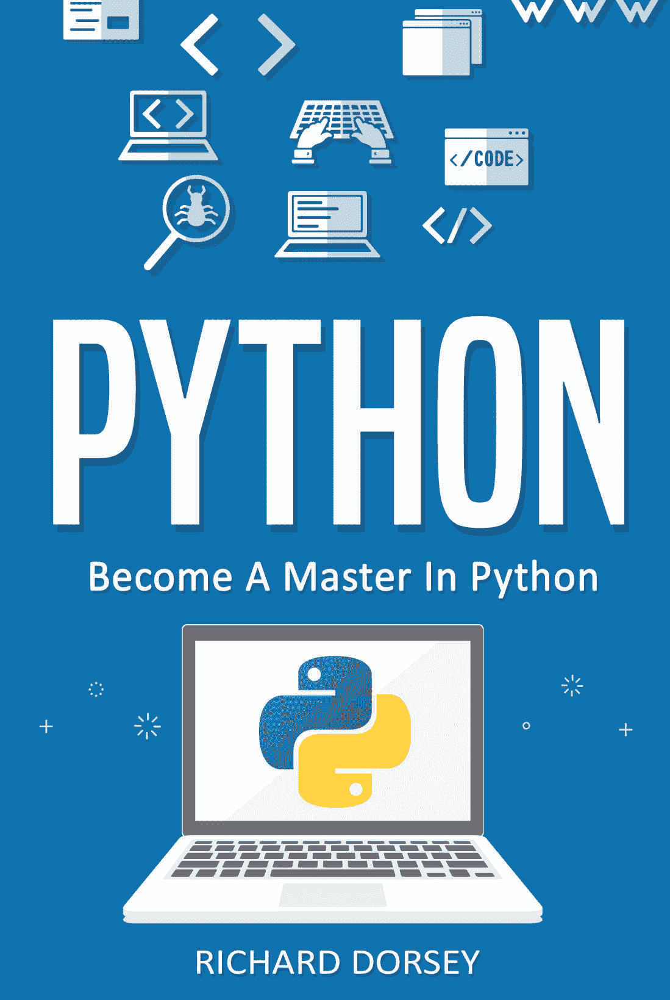

# Python：Python 高级指南




## 介绍


恭喜你下载了 `Python`，感谢你的支持。

接下来的章节将讨论你如何将 `Python` 用于日常生活和工作。你将看到该系统如何运作的代码和示例。不仅如此，你还将学习为什么你想使用 `Python` 而不是其他编程语言。

市场上有很多关于这个主题的书。再次感谢选择这一本！我们付出了巨大努力确保它包含尽可能多的有用信息。请享受其中！

## 第 1 章


### Python —— 什么是以及你为什么应该使用它

`Python` 是一种计算机编程代码，用于所有平台以及代码编写者使用的机器。`Python` 具有不同的功能，实际上可以帮助编码变得更简单，同时让代码看起来更好且更易于阅读。如果以后有人需要回来重写这些代码，这将非常有用。

当我们思考 `Python` 是什么时，通常会想到一种体型巨大、身体沉重的蟒蛇，但这不是我们书中所讨论的内容。然而，`Python` 这种计算机编程语言并不是以我们经常想到的那种蛇命名的。相反，在 1990 年，当 Guido von Rossum 创建该程序时，它是以英国喜剧剧《蒙提 Python 的马团》（Monty Python’s Flying Circus）命名的。

这是一种易于获取的程序，有助于在遇到计算机问题时简化寻找解决方案的过程。这个程序的运行方式就像你花时间坐在纸上写下问题的解决方案一样，只不过它是在计算机上完成的。

`Python` 最大的优势是它可以在任何计算机上运行，一旦编写完成，就不需要更改程序。

当该程序在 90 年代最初开发时，是由一个志愿者团队运行。你可以通过网站 `https://www.Python.org` 获取该程序以及任何支持。2006 年 9 月，`Python 2.5` 发布了。这是当时的最新版本。

当你查看 `Python` 的不同版本时，你会发现有一个 `Java` 版本，被称为 `Jython`。`Jython` 是在用户 `Java` 时使用的。

`Iron Python` 使用适用于 `Mono` 平台的 `C#` 版本。任何使用 `C#` 的人都拥有 `Python` 同样的灵活性和力量，而无需使用它。

但正如任何程序员所知，每个程序的行为都是不同的。虽然 `Python` 是用一种语言编写的，但它以该语言为主要与其他语言进行交互。这只是在开发期间构建 `Python` 的许多模块中的一小部分。

`PyPy` 项目成立于 2003 年，旨在帮助 `Python` 程序员改变 `Python` 与各种语言通信的解释器方式。该项目是一个开源项目，因此允许开发者社区对其进行免费分发和修改，以应对调整需求。该项目还得到了 `Python` 基金会以及欧盟的资助。这是 `FP6` 项目下 `STReP`（特定研究计划）的一部分。

`Python` 可以在任何现代操作系统上访问，并可处理如下内容：

- 科学数据
- 图像
- 文本
- 数字
- 或者你选择保存在计算机上的任何其他

许多人不知道我们每天使用的网站实际上是用 `Python` 编写的。像 `YouTube` 甚至 `Google` 这样的网站都是使用 `Python` 创建的。`NASA` 和纽约证券交易所也使用了 `Python` 进行加密。然而，这些只是 `Python` 使我们能够访问的众多网站示例。企业、政府和非营利组织的网站也在运行 `Python` 代码。

由于 `Python` 是翻译后的记录，因此它在运行时不需要进行转换。这与过去那些需要转换的脚本语言不同。脚本语言的设计是为了模仿执行需要完成的平凡和琐碎任务的方式。

`Python` 使用的语法和命令与其他任何解释型语言都不同。例如，`Perl` 正在被 `PHP` 成为快速快速的 Web 开发程序的通用语言。但与 `Perl` 甚至 `PHP` 不同的是，`Python` 不仅更容易遵循，而且更容易阅读。

`Perl` 和 `PHP` 共同的怪异代码是这两个程序的主要缺陷之一。`PHP` 和 `Perl` 的语法导致编写超过 50 到 100 行的代码变得困难。然而，`Python` 由于其极高的可读性，使得扩展和维护代码变得变得容易。这是植于 `Python` 语言核心的内置模块之一。

对于一种更通用的面向 Web 的编程语言，`PHP` 是目前最优秀的语言之一。`PHP` 实际上代表“超文本处理器（Hypertext Processor）”，这意味着它本应该输出 Web 可读的信息而不是系统级任务。但你可以使用 `Python` 开发一个实际上能够理解 `PHP` 语言的 Web 服务器。遗憾的是，这并无法反过来让 `PHP` 学习 `Python`。

`Python` 是一个面向对象的程序，而 `PHP` 不是。正如此，可维护性、扩展性甚至可读性都会影响程序的编写方式。

当你观察现有的编程语言时，你会发现它们可以并被用于不同的职业领域，如下：

### 人工智能开发

这专门用于制作能够与人类行为交互并学习其被设定学习内容的的 AI 或认知系统。这里产生的程序包括电脑游戏中的角色交互、做出决策的程序部分以及可以回复发送者的聊天框。

### 应用与程序开发

这涉及到你每天与之交互的程序。你用于查看喜好网页的浏览器浏览器程序，以及允许你在 Kindle 上浏览此类电子书的应用程序，都是这种方式制作的程序示例。

### 数据库开发

这不言而喻。你创建并维护小型数据库，存储大量的数字信息供人们查找和使用。这些数据库对于网站非常重要，以便它们可以汇总信息。

### 游戏开发

这同样不言而喻。电脑游戏和其他娱乐软件可以使用 `Java` 等语言程序编写。你在网上看到的 Flash 游戏使用的是完全相同的脚本。

### 计算机驱动程序或任何硬件开发

这些是专注于心理支持设备功能性的应用程序。

### 互联网与网页创建

这是互联网的命脉。没有开发者，就没有网页；没有网页，就没有互联网。

### 脚本开发

编写脚本的知识将有利于任何公司的生产力。

如你所见，`Python` 在我们日常生活的不同方面都非常有帮助。我们每天都在使用由 `Python` 编写的东西，甚至没有意识到这一点。`Python` 字面上帮助维持着我们生活的运行，因为没有它，我们就没有那些构成用于在线银行、娱乐甚至使用电脑等不同任务程序的易读代码。

你将从 `Python` 中学到的非凡之处是，它是一种解释型且交互式的编程语言。解释型仅意味着它在执行之前不需要编译，但它仍然需要一个解释器以便修改脚本。`Python` 还是一种面向对象的编码语言，使得同时交互甚至执行多个程序成为可能。

`Python` 的额外优点是，它是创建以来最简单且最终最易于的编程语言。它并不是为了设计得像某些其他计算机程序那样丑，而是为了看起来美观。该程序是明确而非模糊的，即使你没有任何 `Python` 技能，也很读。然而，不要低估你可以随时轻松使用 `Python` 的。它仍然是一种设计用于创建复杂程序和网站的编程语言。但是，如果你投入时间、耐心和练习，并对你正在构建的代码保持勤奋，随着你掌握门径，它对你来说将变得简单。

当你开始学习如何编码时，你可能想要考虑找一个免费且简单的程序供你在学习时练习。该程序将以尽可能简单为发展目标，你甚至可以制作几个快捷命令。

例如，如果你想输入 `Enumerate` 的命令，它将向列表返回一个 `enumerate` 对象，代码看起来像这样：

```python
i = 0
for item in iterable:
    print i, item
    i += 1
```

另一种编码选项如下：

```python
for i, item in enumerate(iterable):
    print i, item
```

此外，`Emulate` 甚至可以接受第二个参数，如下：

```python
>>> list(enumerate(‘abc’))
[(0, ‘a’), (1, ‘b’), (2, ‘c’)]
>>> list(enumerate(‘abc’, 1))
[(1, ‘a’), (2, ‘b’), (3, ‘c’)]
```

由于 `Python` 易于使用，学习如何使用它很容易。`Python` 的整体结构对于编程初学者来说是可以掌握的，并且其运行方式非常清晰。由于 `Python` 运行在高级语言之上，字符串以清晰直观的语法组合在一起，这种语法只有少数命令。当你学习如何掌握 `Python` 时，你会发现你将拥有编写更复杂脚本的知识，而这些脚本通常需要别人花费几到几小时才能编写。`Python` 使用的脚本语言使编程变体快速且简单。

点击你想要的版本后，你将被重定向到一个显示该版本描述的页面，其中将包含该版本的特性和更新。如果你是一个会阅读描述的人，那么你可以在下载的同时阅读它。

一直移动到页面底部并选择显示“下载”（download）的链接。从这里，你将被带到另一个页面，在那里你可以选择当前正在使用的操作系统。请确保你选择了正确的操作系统，以确保程序被正确下载。某些库在程序的某个版本中存在，但在其他操作系统上无法运行。

选择好操作系统后，系统现在会询问你是否要运行该程序。在屏幕上出现的对话框中选择“运行”（run）。

在 `Python` 的安装设置中，你可以选择为计算机上的所有用户下载程序，或仅为单个用户下载。你可能打算为所有用户安装，因为你很可能将其安装在你的个人电脑或工作电脑上，但如果你把它安装到与配偶或孩子共享的电脑上，你可能会将其放在单个账户，这样它就不会跨所有账户进行安装。

`Python` 会创建一个自己的目录，但如果你希望将其安装在另一个目录中，你需要设置所需的安装目录。向下移动并将 `Python.exe` 添加到路径中。你应该点击 x 而是将其安装在你的硬盘上。现在点击“下一步”（next）。

在安装过程中会打开另一个窗口，`pip` 包也会被安装。`pip` 允许你安装其他可以在 `Python` 中使用的包。

一旦安装过程完成，你将选择“完成”（finish）。现在你终于在电脑上拥有 `Python`！

## 第 3 章


## Python 中的数据类型

数据类型被称为你放置在 `Python` 中的值，而值的数据类型将决定程序如何使用该值。将数据类型视为对象是最好的方法，反之，对象将被识别为属于该值的类型，以便你作为用户知道将它放置在何处。

`Python` 与许多编程语言一样提供了多种数据类型，你可以使用它们对程序代码进行想要的操作。如果你更熟悉其他语言并需要它们来实现目标，`Python` 甚至提供了用其他语言编写的扩展模块。数据类型所使用的语言最终将定义该数据类型。

当你处理数据类型时，将使用 `type()` 函数来确定变量的类型。有些数据类型具有改变值的能力，这些被称为可变数据类型（mutable data types）。其他无法更改的则被称为不可变类型（immutables）。

### 数字

通常，数字会由数值字面量（numeric literals）创建。遗憾的是，一旦你将数字放入 `Python`，就无法更改它。对于数字，你有三种类型可以使用。数字类型是整数（integers）、复数（complex numbers）和浮点数（floating point numbers）。

整数是正负数且没有小数部分的数字。浮点数也可以是正负，但它们具有整数不具备的小数部分。你还有如布尔值（Booleans）这样的内容，它们是可以与整数配合子类型。

复数更多用于工程。复数的形式为 `a + bi`。`b` 旁边的 `I` 代表虚数，因为复数不仅包含实数也包含虚数。只要你记住存在两种数字，`Python` 就允许你使用复数。你可以使用 `real + imagJ` 或 `real + imag` 等函数。`Python` 内部内置了一个方法，允许你为复数使用 `x,y`。

### 字符串

字符串是对象的组合，就像其他所有内容一样，从左到右读取。在编写序列时，你要么用一组引号开始并结束，要么用另一组。和数字一样，字符串是不可变的。

字符串的引号无论是单引号还是双引号都可以互相交换，因为它们是相同的。引号也可以用在外部是双引号的字符串内部，反之亦然。

这看起来可能有点复杂，但本质上，这意味着你可以输入类似这样的内容：

“this is your ‘name’ and birthday” 或 'this is your “name” and birthday.'

无论引号位于何或是什么，`Python` 都会以完全相同的方式为这两个字符串打印相同的内容。但，你需要确保不要在字符串开头放置单引号而在字符串末尾放置双引号，否则你将收到来自 `Python` 的错误代码。

字符串使用特殊字符，如反斜杠（backslash）。反斜杠意味着你正在向字符串中引入一个特殊的字符。

单个字符串如下：

- `\n` 意味着换行
- `\t` 水平制表符
- `\\` 反斜杠
- `\'` 单引号
- `\"` 双引号

你可以通过索引（indexing）访问字符串的字符和元素。索引从左侧的 0 开始，另一侧为 -1。

在 `Python` 教程中输入，你就可以在字符串中放置项。从左侧你将获得所有偶数，但从右侧你将获得所有负数。索引在右侧从较大的负数开始。

在你创建字符串后，应该双击它是否完全符合你的要求，因为你无法更改字符串中的任何字符。

`in` 运算符将检查字符或子字符串是否位于字符串中。在这种情况下，你将得到一个布尔值。

为了从字符串中切取子字符串，你需要用冒号分隔两个索引。当你切取 `2:6` 时，这意味着第二、第三、第四和第五位置的所有字符将被切取。6 不包含在切割范围内。你也可以使用负索引进行切割。

### 元组

用逗号分隔并包含在括号中的值是元组。元组在你创建后无法更改，但它们确实有选项在内部包含不同数据类型。

通过在 `Python` 代码中放入 `empty_tuple()` 可以创建空元组。放在元组中的任何元素的索引方式与 `Python` 中使用的任何序列一样。然而，与字符串一样，元组的索引从 0 开始。元组的索引也可以被切片。被切取的元组会创建新的元组，而保持原始元组不变。

如果你想创建一个新元组，将使用加号，而为了重复元组，将使用星号。

### 列表

列表（Lists）类似于元组（tuples），不同在于它们使用方括号而不是括号。你放置在列表中的项不需要是相同类型。当你创建一个列表时，你将使用与向 `Python` 存入值时相同的相同的函数；然而，区别在于该元素必须是一组括号。`print(my_list)` 函数将从头创建新的列表。

与我们讨论过的其他数据类型一样，列表的索引从零开始并具有被切片的能力。列表索引最大的区别在于，它们被赋予了与颜色相关的名称，如黑色、绿色、红色和蓝色。如果你在索引中放置了一个不在该索引工作范围内的值，那么你将收到一条错误消息。

如前所述，列表索引可以被切片，语法如下：

```python
sliced_list = List_Name[startIndex:endIndex]
```

列表的奇妙之处在于它是可变的（mutable），所以如果你想更改其中的值，你可以选择这样做。加号 `+` 会创建新列表，但该列表将与至少另外两个列表连接。星号 `*` 会再次重复你的列表，这样你就不需要复制和粘贴了。

### 集合（Sets）

在创建集合时，你将创建一个无序但唯一的元素集合。你主要会在使用集合理论时使用集合。集合理论是一种受支持的数学操作，如差集、并集、对称差甚至是交集。当你消除代码中出现的任何重复条时，你也会使用集合。

### 字典（Dictionaries）

`Python` 中的字典是一个包含无序项目集合的容器，类似于列表。然而，字典中的对象被大括号 `{}` 包围着。字典用逗号分隔不同的基本项目和键值对。值（values）和键（keys）将是 `Python` 数据类型。

你通过键访问的每个值或对象在你的字典中都是唯一的。用于索引的键是不可变的。然而，你可以通过使用空括号创建一个空字典。

### None

使用 `Python` 时你需要知道的最后一个数据值是 `none` 的数据值。这个值是一个单值类型，因为该值内部有一个对象。对象将通过 `Python` 中的内置名称进行访问。该名称显而易见是 `None`。

在某些情况下，任何值的缺失将从你使用的函数返回，以便你能够显式地获得任何内容的返回。该值的真值始终为假（false）。

## 第 4 章


## Python 列表（Python Lists）

列表是一种数组，如果你以前用过 `Perl`，可能会在 `Perl` 中找到它。在用 `Perl` 时，变量总是以某种符号开头。然而，在 `Python` 中，你的变量将由你命名，以便在以后需要查找它们时能够识别它们。`Python` 会跟踪用户内部使用的任何数据类型。

列表有许多用途；这主要取决于在 `Python` 中放置了什么代码。以下是可以在 `Python` 中使用的几个独特的列表函数。

- `List.append(x)`：当向列表末尾添加项时使用此函数。你也可以使用函数 `len(a) :]=[x]`。
- `List.extend(L)`：当你在尝试通过附加列表中的所有对象来扩展列表时使用。它等同于 `a[len(a) :] = L`。
- `List.instert(I, x)`：用于在列表的特定位置插入项。第一个参数将在你插入之前位于列表的索引范围内。你将被要求使用 `a.insert(0,x)` 将置置列表的前端。你也可以使用 `a.inster(len(a), x)`，这与使用 `a.append(x)` 相同。
- `List.remove(x)`：用于从列表中删除任何值为 `x` 的项。如果你遇到错误消息，那么该项不在列表中。
- `List.pop([i])`：用于从列表的给定位置删除项并将其返回。如果你不使用 `a.pop()` 选择一个特定索引，那么该项将返回到列表的最后一个位置。方括号表示参数是可选的，你可以输入或不输入。
- `List.index(x)`：用于返回第一个值为 `x` 的项的索引。如果你看到错误代码，那么该项不存在。
- `List.count(x)`：这告诉你 `x` 在你的列表中出现的次数。
- `List.sort(cmp= None, key= None, reverse= False)`：你可以对列表上的参数进行排序以自定义。
- `List.reverse()`：反转项目列出的方式。

使用这些方法几种方法的示例如下：


`A – [66.85, 300, 300, 9, 1764.5]`
`Print a.count(300), a.count(66.85), a.count('x’)`
`896`
`A.insert(8, 9)`
`a.append(300)`

语句用于函数内部，而模块则将向你展示为该函数设置的参数的结果。

查看函数的另一种方式是将其看作一段经过组织并可以重复使用的代码块，以便你可以执行与你正在进行的操作相关的单一动作。函数使得你的应用程序具有更高程度的可重用代码。

你自己定义的函数将被称为用户定义函数。在定义函数时，你必须遵循一些简单的规则，以确保 Python 知道你正在处理一个函数。

1. 你的`return`语句将通过通过表达式返回原始调用者来退出函数。`return`语句中没有参数。它要么返回相同的值，要么返回`None`。

2. 函数的代码块将使用关键字`def`来定义，后面紧跟函数标题和一组括号。

3. 所有的函数代码块都将以冒号开头，并进行缩进。

4. 你放在括号中的任何参数都可以被定义。

5. 你的函数中的第一条语句是可选的。

### 定义函数的语法

```python
def functionname ( parameters )
    “function_ docstring.”
    Function_suite
    return [ expression ]
```

参数默认具有位置行为；因此，你需要按照定义它们的相同顺序告知参数。

### 示例

```python
def printus ( list ):
    “这个列表将被打印到函数中。”
    print list
    return
```

函数可以根据它们所使用的参数进行调用。

1. 可变长度参数

2. 必需参数

3. 默认参数

4. 关键字参数

必需参数将按照它们编写的顺序传递函数。

### 示例

```python
#!/usr/ bin / Python

#在此处定义你的函数

def printus ( list ) :
    “列表将在此函数中被打印。”
    print list
    return ;

## 此时你将能够调用 printus 函数。

printus()
```

关键字参数与你调用函数的方式有关。关键字参数位于函数调用中，由调用者和参数名称进行标识。

关键字参数允许跳过参数或以不同于显示顺序的顺序放置它们，这是因为解释器将使用你设置的关键字来将值匹配到正确的参数。

### 示例

```python
#!/usr / bin / Python

#你的函数定义

def printus ( list ):
    你的列表将被打印并放入函数中。
    print list
    return

## 你现在可以调用你的 printus 函数

printus ( list = “我创建的列表” )
```

默认参数是在调用函数时，该特定参数没有提供其他值时取默认值的参数。

### 示例

```python
#!/usr / bin / Python

#在此处你的定义

def printdata (address , number = 5 ):
    你的数据将被打印到函数中。
    print “address:” address
    print “number ,” number
    return

## 现在你调用你的函数

printdata ( number = 5, address “405”)
printdata (address = “405”)
```

可变长度参数用于你必须处理一个函数以查看参数是否多于定义中的参数。

### 语法

```python
def fuctionname ([ formal _ args, ] * var_args_tuple ):
    “function_docstring”
    Function_suite
    return [expression]
```

星号将放在包含所有值且没有关键字变量参数的变量名称之前。因此，由于你没有在函数中定义任何参数，你的元组将是空的。

## 第 7 章


## 如何在 Python 中处理错误和异常

之所以会弹出错误代码，简单原因是某些内容没有被正确输入。也有可能有其他事情发生，导致向你抛出该错误代码。

此外，Python 的规则总会有异常，以及为什么输入方式与你所习惯的不同。

为了知道如何处理错误和异常，你需要知道这些错误和异常是什么，以及它们出现的原因。有时错误是可以避免的，但有时则无法避免。如果你遇到错误代码，不要气馁；如果你可以的话，只需要回去修复错误的地方即可。

### 错误

语法错误（Syntax error）是你遇到的最常见的错误。当 Python 无法理解你输入的一行代码时就会发生这种情况。除了最常见之外，这些也是致命错误，因为如果代码存在语法错误，你就无法成功执行代码。

有些错误你可以在捕获后处理，例如`eval("")`这样的错误。遗憾的是，这些错误是罕见的。

在 IDLE 中工作时，所有的语法错误都可以找到，因为它们被高亮了。在很多情况下，语法错误是因为拼写错误、错误的参数或缩进使用不当导致的。如果你得到此错误，你应该首先开始检查这些地方。

逻辑错误（Logic errors）是最难找到的错误之一，因为它们会导致不可预测的结果，甚至导致你正在使用的程序崩溃。逻辑错误发生有很多原因。

幸运的是，逻辑错误对你来说比语法错误更容易修复，因为你可以在代码上运行调试器并获得你想要的结果。

### 异常

当 Python 程序知道它需要对你输入的代码做什么时，你会发现一个异常。然而，由于外部源的作用，它无法执行你请求的操作。其中一个问题是你尝试通过 Python 访问互联网，但你没有任何互联网访问。Python 知道你在告诉它做什么，但它无法执行该任务。

在处理异常时，你会发现它们与语法错误不同，因为它们并不总是致命的。异常可以通过使用`try`语句来处理。

查看以下用于显示网站 HTML 代码。当你执行程序时，它将到达一个`try`语句，因此它将尝试按照编写的方式执行代码。但是，如果由于设备未连接到网络、互联网或任何类似的原因导致运行错误，那么解释器将跳过最后行的缩进代码。

```python
import urllib2

URL = ‘HTTP://www.hello.com‘

try:
    req = urllib2.Request(url)
    response = urllib2.urlopen(req)
    the_page = response.red()
    print the_page
except:
    print “我们遇到了问题。”
```

通过这个异常，你会注意到你为网站输入的 URL 因为程序发现的任何原因而没有打开。

你也可以通过对对特定错误的预判来处理错误。

```python
try:
    Age = int(raw_input“输入你的数字: ”))
    print “你必须输入数字 {0} 才能进入。” .format(number)
except ValueError:
    print:“你的数字值必须是数字。”
```

你可以预测这个异常，因为你知道为了让程序正确运行，你必须为年龄输入一个数字。

你可能会遇到各种其他异常，但这两个是你遇到最多的两个。

请记住，除特殊情况外，程序将知道你告诉它做什么，但它将无法执行，因为存在一个你无法控制的问题，而你必须修复它。但是，如果出现错误（error），它可能最终会超出你的控制范围。如果你无法通过所告知你的那几个基本步骤找到错误，那么你的错误将是一个语法错误，你可能无法修复它。如果是那样的话，你可能需要重新开始你的代码，并尝试避免再次犯同样的错误。

## 第 8 章


## Python 运算符

Python 的另一个有用之处是，你可以用它进行数学运算！没有人喜欢做数学题——好吧，那是谎言，有些人人是喜欢的。但是，当数学变得复杂时，如果有一些帮助会很不错。Python 将为你提供帮助！你可以将方程输入到 Python 中并每次得到正确答案。只要你正确输入了操作即可。你可以从简单的方程一直到复杂的、需要多个步骤的方程。

在 Python 中你会发现的一些较常见的数学运算符如下：

- `A+b` 用于加法。

- `a−b` 用于减法。

- `a*b` 用于乘法。

- `a/b` 用于除法。

- `a//b` 用于 Python 2.2 及更高版本的地板取除。

- `a%b` 是取模 b，将为你提供取模运算。

- `−a` 用于取负。

- `Abs(a)` 或 `|a|` 用于绝对值。

- `A**b` 或 `a^b` 用于指数。

- `Math.sqrt(a)` 是你在 Python 中输入平方根的方法。

请尽量记住，如果你需要使用函数`math.sqrt()`，那么你需要让 Python 知道你需要加载那个`math`模块。为了做到这一点，你应该准备好输入的代码以便它可以被打开。

在 Python 中进行数学运算的缺点是，它在浮点运算的舍入误差方面存在局限性，这最终将给你意想不到的结果。

例如，如果你选择通过放置`print(0.8/0.2)`来进行普通除法，如果操作正确，你应该得到`4.0`的正确结果。然而，当你对相同的数字进行地板取除时，你最终得到的是返回`4.0`。

Python 2.x 系列中的地板取除仅适用于长整型。但“真除法”是对复数和浮点数进行的。使用 Python 3.x 时，真除法适用于所有类型的数字。你可以通过在普通除法符号周围加上`[math]=0.5`来解决这个问题。这个答案将导致它被向下舍入 0.5，因为你在函数中是这样告诉它的。

在小学期间，我们学习了运算顺序，Python 这一规则也不例外。在数学中，你将使用 PEMDAS 来评估所有的表达式。你将在边读边计算；你将从左到右并执行表达式中的每种运算顺序。

- **P** 代表括号。括号内的所有内容将首先执行。

- **E** 代表指数。指数无非是短乘法或除法。

- **M and D** 代表乘法和除法。如果你在同一个方程中同时拥有两者，你将在执行除法之前执行乘法。

- **A and S** 是你的加法和减法。就像乘法和除法一样，你将在执行减法之前执行加法。

如果你数学计算正确，那么你的答案就是正确的。

例如 `8 + (25 − 10) * 6/5 = 26`

1. 第一步是执行`25 − 10`，你将从中得到答案`15`。

2. 因为没有指数，我们跳过那一步，进入乘法和除法。

3. 你的数学方程现在看起来像这样`8 + (15) * 6/5 = 26`。

4. `15 * 6`等于`90`，留下`8 + 90/5 = 26`。

5. `90/5`将给你`18`。

6. `8 + 18 = 26`。

你的答案是`26`。

对于得到这样一个简单的答案，这看起来似乎有很多操作，但这就是创建我们计算数学方式的人所决定的。

正如我们所知，数学并不总是以整数形式整洁呈现。有时你会收到小数点甚至是分数，我们并不总是能够对它们向上舍入或向下舍入。有时我们会得到这样的数字：

如果你体重重 75 磅，那么你的体重是`34.019427`公斤。

Python 会自动在任何数字中打印 10 位小数。但如果你只想获取一或两位，你将使用`round()`函数，这样你就可以将数字舍入到你寻找的小位数。在使用此功能时，你不仅要放入要舍入的数字，还要放入你想要舍入的小数位数。

例如，如果你想舍入我们刚刚将磅转换为公斤时得到的数字，你只需`round(34.019427)`，这样它会向下舍入 0.5，因为你在函数中是这样告诉它的。

```
twoSigFigs = round(34.019427, 2)
numToString = str(twoSigFigs)
print("you weigh " + numToString + " kilograms")
```

Python 从基础数学到复杂的三角函数问题都可以处理。它非常优秀的一点在于，你不需要知道如何做这个问题本身，你只需要知道如何将其放在 Python 中，以便 Python 为你计算。

## 第 9 章


## Python 中的字符串格式化

字符串模块包含不同的有用常量和类；它们甚至可以包含仅作为方法提供的过时函数。Python 在其编程中内置了字符串类型，以支持序列类型方法。

为了对字符串的输出进行格式化，你将使用模板或百分比符号（`%`）。还有另一个内置函数旨在帮助你在 Python 中格式化字符串。Python 中的`str`和`Unicode`类被放置那里是为了帮助多变量替换，以及通过`.format()`技术对字符串中的值进行格式化。

你在字符串模块中找到的格式化类将帮助你自定义字符串的格式化方式及其行为，使用位于`format()`方法中的相同技术。

### 字符串格式化类

要遵循公共方法，可以使用此格式化器。

`Format(format_string, *args, **kwargs)`：这是主要方法。它接收你刚刚格式化的字符串，以及一组随机的关键字参数和位置。这只是你格式化字符串的封装，它使用了`vformat()`。

格式化器还将帮助定义各种你可以使用的方法来替换子类。

`Parse(format_string)`：你将遍历格式化字符串，然后返回可迭代的元组`(literal_text, field_name, format_spec, conversion)`。配合`vformat()`使用此方法将字符串带入替换字段或字面文本。

放入元组的任何值都将代表随后的字面文本，但仅有一个替换区域。如果你没有放置任何字面文本（当连续出现两个替换字段时可能会发生），你的`literal_text`将是一个长度为零的字符串。如果不存在替换字段，则值`format_spec`和`field_name`以及转换类型都将为`None`。

`Get_field(field_name, args, kwargs)`：当`parse()`返回`field_name`时，你将转换该对象以便对其进行格式化。元组将返回`(obj, used_key)`。你的默认版本将采用由 PEP3101 定义的字符串，你可以在 [`www.Python.org/dev/peps/pep=3101`](https://www.Python.org/dev/peps/pep=3101) 找到它。

这些形式为`label.title`或“0[name]”。`Args`和`Kwargs`将通过`vformat()`传递，以便返回的值与你的关键参数具有相同的含义。

`Get_value(key, args, kwargs)`：你将能够检索列表中提供的任何字段值。`key`参数将为你提供字符串或整数。如果你得到的是整数，你将看到`args`中位置参数的索引；但如果你得到的是字符串，它将代表`kwargs`中的命名参数。

如果你的列表中任何用于`vformat()`的位置参数在你的参数列表中设置了`args`参数，那么`kwargs`参数将被设置为字典中列出的关键字参数。

但是，对于任何复合字段名，函数将只调用字段名的第一个项。接下来的元素将处理用于索引的标准方法和操作。

如果你的字段表达式是“0.name”，那么你的`get_value()`将需要一个等于`0\.`的键参数。在 Python 内置的`gettatter()`函数返回`get_value()`之后，将找到名称。

当关键字和索引引用不存在的对象时，将抛出`key error`或`index error`以提醒你这些项不存在。

`Check_unsued_args(used_args, args, kwargs)`：你将使用此方法来检查任何未使用的参数。你通过所有参数键设置的参数将引用已格式化的字符串。这包括用于任何命名参数的位置参数、整数和字符串。

它们还将引用任何通过`vformat`的`kwargs`或`args`。任何未使用的`args`将使用参数计算。如果检查失败，`Check_unused_args()`将抛出异常。

`Format_field(value, format_spec)`：全局的`format()`与`format_field()`相同。创建此方法是为了让子类能够重写它。

`Convert_field(value, conversion)`：从`get_field()`返回的值将进行转换。任何默认版本都能理解`str(s)`、`repr(r)`和`sciiASCII(a)`是 Python 使用的转换类型。

## 第 10 章


## 使用 Python 构建网站

Python 可用于许多用途。你可以用它进行黑客攻击，甚至进行视频游戏创作。在本章中，我们将讨论如何使用 Python 来构建网站。

如果你编写的程序第一次运行没有按照你预期的结果，请不要担心。重要的是，你可以使用 Python 编写临时程序，这些程序不会影响你的最终项目。

当你查看 Google 和 YouTube 这样的网站时，你可能不知道，它们正如我们之前提到的，是使用 Python 构建的。然而，你将使用 Flask 框架从零开始构建自己的网站。Flask 易于学习，甚至上手非常简单。

首先，你需要在空文本文件中插入类似于下面方代码的内容。

**注意**：确保你始终以标题保存工作，并以`.py`结尾。

```
from flask import Flask

app = Flask(__name__)

@app.route(‘/’)

def home():
    return “Hey there!”

if __name__ == ‘__main__’:
    app.run(debug=True)
```

请注意，从代码的第一行开始从库中导入了`flask`。如果你没有安装该库，将收到一个不允许你继续的错误代码。


如果你需要安装 Flask，只需在 Python 命令行中输入 `pip install flask`。一旦你确保 Flask 已经正确安装，请运行你的测试脚本。

只要你的脚本运行正常，网站将在你的本地机器上运行，并且你可以通过在使用的浏览器中输入 `localhost:5000` 来查看它。

在此时，你的网站将只是纯文本。在添加各种让它看起来像网站的不同设计等内容之前，确保它能够工作是非常重要的。

你需要考虑的第一件事是，谁将使用你的网站？这将影响你放入代码中的数据以及你如何设计网站的外观。

作为开发者，你将需要编写 Python 代码来处理请求。

如果你想让内容视觉上更有吸引力，你将需要整合一些 HTML 文件。这将返回 HTML 页面，而不仅仅是纯文本字符串。

在这里，你将学习如何使用 `render_template` 方法返回 HTML 页面。

你应该能看到不再有纯文本了，而且你拥有的文本可以有各种格式。这是通过从 Python 返回 HTML 模板而不是纯文本来实现的。

完成这一点，你需要创建一个名称类似于 `home.html` 的空文件，并将以下代码放入其中。

```html
<!DOCTYPE html>
<html>
<body>
<h1>My Personal Website</h1>
<p>Hi, this is my personal website.</p>
</body>
</html>
```

HTML 是网页使用的语言。在创建 HTML 页面时，你必须务必确保自己记住了这三件重要的事情：

- HTML 的任何可见部分都位于 `<body>` 和 `</body>` 之间。这些区域之外的区域被用于引用 JavaScript 文件、`CSS` 或任何类似的特性。
- HTML 文档需要以一个声明作为开始，该声明将指定文档类型：`<!DOCTYPE html>`。
- HTML 文档始终以 `<html>` 开始，并以 `</html>` 结束。

在 `Flask` 框架中，它应该写在一个可以专门查找 HTML 模板文件的文件夹中。该文件夹应该名为 `templates`。

任何 Python 脚本都留在 `templates` 文件夹之外，因为它们不是 HTML。

读取 HTML 模板的代码看起来像这样。注意：这是从我们之前的 Flask 代码基础上更新后的代码。

```python
from flask import Flask, render_template

app = Flask(__name__)

@app.route('/')
def home():
    return render_template('home.html')

if __name__ == '__main__':
    app.run(debug=True)
```

你会注意到，代码是通过使用 `Flask` 框架中导入的 `render_template` 方法来维护的。HTML 文件在 `Flask` 框架中就是从这里开始。每当用户访问你的 URL 时，它将生成一个 `Jinja 2` 模板，并将模型返回给浏览器。

如果你想创建一个“关于”（about）页面，你需要在模板文件夹中创建另一个 HTML 文件。这部分的代码看起来大致如下：

```html
<!DOCTYPE html>
<html>
<body>
<h1>About me</h1>
<p>This is a portfolio site about anything that can be put in a portfolio.</p>
</body>
</html>
```

通过向模板连接一个次级函数，你将能够通过 Python 渲染你创建的 HTML。对应的新代码看起来如下：

```python
from flask import Flask, render_template

app = Flask(__name__)

@app.route('/')
def home():
    return render_template('home.html')

@app.route('/about/')
def about():
    return render_template('about.html')

if __name__ == '__main__':
    app.run(debug=True)
```

一旦你放入了最后一段代码，你就需要运行脚本 `localhost:5000/about`，这将打开一个新页面。在稍后的日子里，可以给这个模板应用 `CSS` 样式，使其看起来像你想要的样子。

`about.html` 的更新代码将类似于这样：

```html
<!DOCTYPE html>
<html>
<body>
<div class="about">
<h1>About me</h1>
<p>This is a portfolio site about anything that can be put in a collection.</p>
</div>
</body>
</html>
```

你也必须对 `home.html` 执行此操作。

```html
<!DOCTYPE html>
<html>
<body>
<div class="home">
<h1>About me</h1>
<p>This website was built with Python via the Flask framework.</p>
</div>
</body>
</html>
```

现在当你运行你的 Python 脚本时，你将打开两个 URL。现在，你应该有两个 HTML 页面以及一个导致你的 HTML 页面成为两个不同 URL 的 Python 脚本。这两个 URL 分别是你的首页和关于页面。

如果你需要在每个页面中设计一个区域，你将需要添加 HTML 代码来为每个文件生成页头。然而，在你这样做之前，最明智的做法是创建一个父 HTML 模板，你的后续模板将从中继承代码。这是通过简单地将父模板链接到每个 HTML 页面来实现，以便它们继承代码。

第一个动作是创建一个名为 `layout.html` 的新页面，代码看起来如下：

```html
<!DOCTYPE html>
<html>
<body>
<header>
<div class="container">
<h1 class="logo">Ardit’s web app</h1>
<strong><nav>
<ul class="menu">
<li><a href="{{ url_for('home') }}">Home</a></li>
<li><a href="{{ url_for('about') }}">About</a></li>
</ul>
</nav></strong>
</div>
</header>
</body>
</html>
```

Python 然后将修改 `home.html`。随后，你将修改 `home.html` 和 `about.html` 以便它们连接 `layout.html`。在这一点上，你需要通过 `layout.html` 来修改这些 home。

看起来如下：

```html
<!DOCTYPE html>
<html>
<body>
<header>
<div class="container">
<h1 class="logo">Ardit’s web app</h1>
<strong><nav>
<ul class="menu">
<li><a href="{{ url_for('home') }}">Home</a></li>
<li><a href="{{ url_for('about') }}">About</a></li>
</ul>
</nav></strong>
</div>
</header>
```

这些只是制作网站的基础知识。你仍然可以向网站添加更多内容，例如 `CSS` 样式，以及最终让网站公开所需的步骤。

## 第 11 章


### Python 的其他用途

当你查看 Python 可以做的所有不同事情时，你将了解到你实际上可以使用 Python 源代码创建视频游戏，并用 Python 破解计算机系统。

注意：在没有系统管理员明确书面许可的情况下，不要破解任何系统。

### 游戏制作

当你使用 Python 创建游戏时，你将使用 `Pygame`。该软件在 `SDL` 库之上增加了功能。它允许你使用 Python 语言设计功能齐全的游戏和多媒体应用程序。

`Pygame` 允许游戏具有高度移植性，并运行在几乎所有的平台和平台上。

有许多使用 `Pygame` 创建的成功示例和文档。你也会注意到使用 `Pygame` 编写游戏以及图形密集型程序是很容易的。

如果你想创建一个 3D 高级游戏，你将使用 `PySoy`。它与 Python 3 中使用的引擎配合。Python 3 紧密结合了渲染、物理、网络甚至动画。

还有其他几个库是你查看的或者在制作游戏时需要的。如果你想研究这些库，可以访问 [www.wiki.Python.org/moin/PythonGames](http://www.wiki.Python.org/moin/PythonGames)。

你还会看到一种名为 `PyWeek` 的活动，这是一个每半年一次的挑战，会产生许多出色的游戏。在这个挑战中，你可以展示自己的编程技能，并创建一个与其他游戏竞争的游戏，证明你是最强的。

## 黑客行为

我们都在电影和电视节目中见过黑客行为，它们看起来非常酷，屏幕上飞过着毫无意义的 0 和 1。看着它们会让黑客行为看起来像魔法一样。

然而，它并不是魔法。它是基于计算机的，而涉及到计算机时，所做的一切都有其科学原理，因此是可以学习和理解的。即使你不理解计算机为什么要那样做，也会有一个它那样做的原因。

学习计算机为什么那样做并不困难。只需要在学习过程中花费一点时间和耐心即可。

当你进行黑客操作时，你正尝试进入某人的操作系统。这是通过破解计算机周围的加密代码来实现的。一旦你完成了这一步，就可以查看你已侵入系统中的文件了。

通过使用 `Python`，你可以修改代码以便进入操作系统。这件事的遗憾之处在于如果你修改了操作系统内部的物品，系统管理员会注意到你更改了内容，从而知道他们被黑客攻击了。

如果你打算对某人进行黑客操作，正如在本节开头提到的，在尝试破解他们的系统之前，你需要获得系统管理员的明确许可。

最好能获得他们的书面批准，这样你就有了充分的证明，证明你有权进入他们的系统。

## 第 12 章


### 使用 Python 的技巧

在 Python 上进行编程的第一步是让它返回你发送给它的词。你看到的 `>>>` 是程序引导你输入代码和命令的符号。当你输入 `>>> print Hello World, SLUAST` 时，它会返回 `Hello World, SLUAST`。

了解基础知识总是有帮助的，比如知道无论打印什么内容都可以返回给你。

酷的地方在于，Python 还可以充当你的计算器。当你输入 `print 5` 时，你会得到这个数字。但如果你输入 `print 5 + 22`，你可以预期看到响应为 `27`。

现在让我们更进一步，输入一个包含字符串和数字的词组。当你输入 `print “I am elite,”+1337` 时，你实际上会得到如下错误：

```text
Traceback (most recent call last):

File "<pyshell#6>", line 1, in <module>

  print “I am elite”+1337

TypeError: cannot concatenate ‘str’ and ‘int’ objects
```

以 `File` 开头的部分显示错误所在的文件以及在文件中的位置。然后，它会显示代码以及对错误的简短描述。这是一个无法将字符串与整数（仅数字）相加的错误。

幸运的是，使用语言程序编程是灵活的；你只需要像其他程序员那样解决它。要解决这个特定的错误，你可以将想要的用户变成一个变量。就像普通数学一样，`X` 是一个占位符，让我们让 `X = 1337`。然后输入 `print “I am elite” + X` 并回车。

但现在还不。否则，你会得到同样的错误。

这是因为我们还没有通过像这样连接引号（`""`）和单引号（`''`）来将变量 `X` 的数字（`1337`）转换为字符串：

```text
X = ‘1337’（注意单引号）

print “I am elite “+X（注意引号）
```

结果最终将显示如下：`I am elite 1337`（注意这里没有错误！）

## 字典/集合推导式

列表推导式（List comprehensions）你可能很熟悉，但对于字典/集合推导式（dict/set comprehensions），这你可能还。它们的使用既简单又有效。看下面的示例：

```python
my_dict = {i: i * i for i in xrange (100)}

my_set = {i * 15 for i in xrange (100)}
```

两者唯一的区别在于 `:`。

## 强制浮点除法

回到数学，你可以使用斜杠键（`/`）来除法。通常情况下，除法总是给出整数答案。通常对于 Python 2，你必须像这样：

```python
result = 1.0/2
```

但你可以使用一个方便的小技巧来省去这里的 `.0`：

```python
from __future__ import division

result = 1/2

## print(result)

## 0.5*
```

当然，如果你使用 Python 3，就不需要担心这个，因为它是默认处理的。

## 结


感谢你读到 Python 的最后。希望它对你有所启发，并能够为你提供实现目标（无论目标是什么）所需的所有工具。

下一步是带着你在这本书中学到的所有信息，开启你的 Python 之旅。这并不容易，但只要你有耐心，你就会发现你正在让自己的生活变得更好！

感谢并祝你好运！

最后，如果你觉得这本书在任何方面对你有帮助，我们将不胜感激你在 Amazon 上的评价！
