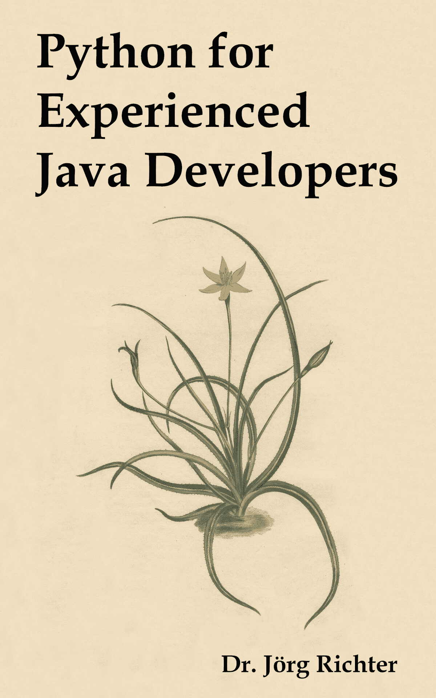

# 经验丰富的 Java 开发者的 Python 指南



# 前言

欢迎阅读《面向资深 Java 开发者的 Python》。这本书代表了人类专业知识与人工智能交叉领域的一次独特实验。凭借在各种编程语言中数十年的经验，特别是自 Java 1.1 版本以来的经验，我在 `ChatGPT`（一种先进的 AI 语言模型）的帮助下，开启了学习并掌握 Python 的旅程。

当我开始这个项目时，我对 Python 编程语言一无所知。然而，我在软件开发领域的深厚背景让我清楚自己想要学习 Python 的哪些内容。这本书是我与 `ChatGPT` 协作的成果，在我的指导下创作，并由我的专业知识进行塑造。

这本书的过程既具有创新性又具有高强度。它始于 `ChatGPT` 为每一章生成建议的大纲。随后，`ChatGPT` 为大纲中的每个点提供了详细的建议。我的角色包括缩减、重新排列和精炼文本，纠正并增强 Python 示例，运行并测试 `ChatGPT` 提供的每一行代码，并且经常创建全新的示例。最后，我再次转向 `ChatGPT` 对措辞进行最后的修正。这种迭代过程确保了，虽然 `ChatGPT` 在每一章中拥有最终发言权和最终定稿权，但中间的内容需要我投入大量的努力和见解。

结果就是我构想中的这本书：一本简洁、重点出的指南，它没有在列表操作、面向对象或函数式编程等基础知识上浪费篇幅——这些概念是每个资深 Java 程序员已经非常熟悉的。相反，这本书深入探讨了 Python 提供的独特特性和功能，为经验开发者提供了丰富的学习体验。

我希望其他资深软件开发者能像我一样欣赏这次实验的结果。无论你是想将 Python 添加到你的技能树中，还是加深对其高级特性的理解，我相信你会发现这本书既有价值又有趣。

祝你的 Python 之之旅愉快！

# 第一部分：搭建你的开发环境

## 第一章：安装 Python

其他组件（如 IDE 和开发工具）依赖于 Python 的存在。因此，首先安装 Python 可以确保这些工具拥有必要的运行时环境。

以下是你需要遵循的步骤：

### 1.1 下载 Python

*   访问 Python 官方网站 `python.org`。
*   导航到“Downloads（下载）”部分。
*   根据你的操作系统（Windows、macOS 或 Linux）选择合适的安装程序。
*   选择所需的 Python 版本（大多数项目建议使用 `Python 3.x`，本书基于 `Python 3.11.8`）。

### 1.2 运行安装程序

*   下载安装程序后，双击运行。
*   按照安装向导中的提示操作。
*   在 Windows 上，确保勾选“Add Python to PATH（将 Python 添加到路径）”选项。这允许从命令行访问 Python。
*   在 macOS 和 Linux 上，Python 通常默认安装。如果存在多个版本，请确保你安装的是所需的版本。

### 1.3 验证

*   安装完成后，打开终端或命令提示符。
*   运行 `python --version` 来验证安装。
*   你应该能看到显示的已安装的 Python 版本。

### 1.4 更新 Pip（Python 包安装器）

*   `pip` 是 Python 默认的包管理器，用于安装额外的库和包。关于包的更多细节将在后续章节提供。
*   运行 `python -m pip install --upgrade pip` 以确保你安装了最新版本的 `pip`。

## 第二章：选择 IDE

除了专门的集成开发环境（IDE）之外，值得注意的是，如 `IntelliJ IDEA` 和 `Eclipse` 等流行的 Java IDE 也支持 Python 开发。在书中，我们将主要关注使用 `IntelliJ IDEA Community Edition`（版本 2023.3.4）进行 Python 开发。

虽然 `IntelliJ IDEA Community Edition` 为 Python 提供了强力支持，但重要的是要意识到有专门为 Python 开发定制的 IDE。

以下是一些流行的 Python IDE，它们都因其丰富的功能对 Python 的强大支持而受到 AI 开发者的喜爱。

*   `PyCharm`：由 JetBrains 开发，`PyCharm` 是一个强大的 IDE，拥有一套为 Python 开发定制的丰富功能。`PyCharm` 提供智能代码补全、调试工具、与版本控制系统的集成，并支持 `TensorFlow`、`PyTorch` 和 `scikit-learn` 等流行的 AI 库。

*   `Jupyter Notebook / JupyterLab`：`Jupyter Notebook` 是一个基于 Web 的交互式计算环境，允许开发者创建和共享包含实时代码、方程、可视化和叙述文本的文档。`Jupyter Notebook` 最初由 Fernando Pérez 和 Brian Granger 领导的研究团队开发。他们于 2011 年作为 `IPython` 项目（一个 Python 交互式计算环境）的一部分开始开发 `Jupyter Notebook`。它广泛应用于 AI 和数据科学社区的原型设计、实验和协作。`JupyterLab` 是 `Jupyter Notebook` 的增强版本，具有更全面的界面和功能。

*   `Google Colab`：Google 提供的免费云端 notebook 环境。允许开发者在浏览器界面中编写和执行 Python 代码，并访问 Google 基础设施提供的强大计算资源。

*   `Spyder`：一个专为科学计算和数据分析设计的 IDE，由 `Spyder Project Contributors`（一个开源开发者社区）开发。它提供了交互式控制台、变量查看器、调试器以及对 `Matplotlib` 和 `seaborn` 等绘图库的支持。`Spyder` 因其易用性以及与科学计算库的集成而深受 AI 开发者的喜爱。

*   `Visual Studio Code (VS Code)`：由微软开发的轻量级且多功能的 IDE。`VS Code` 通过 `Python` 和 `Pylance` 等插件提供广泛的自定义选项和 Python 支持。

*   `Atom`：由 GitHub 开发的可定制文本编辑器。提供语法高亮、代码折叠和包管理功能。`Atom` 因其灵活性以及扩展 AI 开发功能的插件支持而深受 AI 开发者的喜爱。

## 第三章：创建你的第一个项目

### 3.1 创建项目

*   启动 `IntelliJ IDEA` 并创建一个项目。
*   选择 `Python` 作为编程语言。
*   如果这是你的第一个 Python 项目，将看到可用插件列表。选择 `Python Community Edition` 插件并安装。
*   如果你安装了多个 Python 版本，请确保选择了正确的 Python 解释器版本。
*   最终为你的 VCS 创建仓库（例如 `GIT`），并保持其他参数不变。
*   点击 `Create` 按钮。

### 3.2 选择 Python 解释器

*   导航到 `File → Project Structure → Project Settings → Project`。
*   对于 `SDK`，从下拉菜单中选择一个 `Python SDK`。
*   应用更改并关闭设置窗口。

### 3.3 其他配置

此外，你可能还会考虑其他配置，例如版本控制管理、配置代码风格以及调整针对代码补全等功能的编辑器设置。这些任务可以类似于 Java 的方式进行配置。

### 3.4 创建目录结构

虽然 Java 项目在使用基于 Gradle 的构建过程时通常需要遵循强制性的目录结构，但 Python 项目没有此类严格的要求。然而，将你的 Python 项目组织成结构化的目录布局可以显著提高可维护性、协作性和开发便利性。以下是一个建议的目录结构，你需要手动创建它。

```
project_name/
|- src/
|..|- package_name/
|..|..|- __init__.py
|..|..|- module1.py
|..|..|- module2.py
|- tests/
|..|- test_package_name/
|..|..|- test_module1.py
|..|..|- test_module2.py
|- docs/
|..|- conf.py
|..|- index.rst
|- data/
|..|- dataset1.csv
|..|- dataset2.json
|- README.md
|- LICENSE
|- requirements.txt
|- .gitignore.
```

`src/`: 包含项目的源代码，组织成包和模块。每个包可能包含子模块和相关文件。这将在后面的章节中解释。

`tests/`: 包含用于测试项目功能的单元测试和测试脚本。测试的组织应镜像 `src` 目录的结构。

`docs/`: 包含项目文档，例如 Sphinx 等文档工具的配置文件（`conf.py`）或主文档文件（`index.rst`）。

`data/`: 包含项目使用的数据或数据集。该目录也可以包含任何生成或处理过的数据文件。

`README.md`: 提供项目概述，包括安装说明、用法示例和其他相关信息。

`LICENSE`: 包含项目的许可证文件，规定了使用和发行条款。

`requirements.txt`: 该文件列出了项目依赖及其版本，允许使用 `pip` 轻松安装依赖。该文件的内容将在后面的章节中解释。

`.gitignore`: 指定被 GIT 版本控制系统忽略的文件和目录。

### 3.5 运行测试程序

测试你的 IDE 是否已正确设置的最后一步是编写一个小的“Hello World”程序并在控制窗口中运行它：

*   在 IntelliJ IDEA 中，在目录树的 `src` 分支选择一个目录，右键点击并选择 `New→Python File`。
*   为你的 Python 文件输入一个名称，例如 `hello_world.py`。
*   在新创建的 Python 文件中，输入以下代码：

    ```
    print("Hello World")
    ```

*   在项目管理器中右键点击该 Python 文件并选择：`Run ’Hello_World’`。
*   运行程序后，你应该能在 IntelliJ IDEA 界面底部的控制输出窗口看到打印 Hello World。

# 第二部分

Python 语言

## 第 4 章

语法：Python vs Java

### 4.1 基础语法差异

与 Java 相比，Python 语法偏离了 C 类风格。以下是 Python 和 Java 之间的一些基本的语法差异：

**缩进 vs 大括号**：Python 使用缩进来定义代码块（如循环、函数和条件判断），而不是用大括号来界定代码。

**分号**：Python 语句末尾不需要分号。然而，你可以使用分号来分隔同一行上的多个语句。

**注释**：Python 支持由 `#` 符号表示的单行注释，以及使用三引号 `'''` 或 `"""` 的多行注释。

```
# 这是一个单行注释

"""
这是一条
多行注释
"""
```

**字符串**：在 Python 中，可以使用单引号（`'`）或双引号（`""`）交替定义字符串。`==` 运算符检查两个字符串的内容是否相同，而 `is` 运算符可以用于检查两个字符串变量是否引用内存中的同一个对象。

**换行延续**：在 Python 中，与 Java 不同，将语句延续到下一行通常需要在行末尾使用延续字符 `\`。然而，存在一个重要的例外：在圆括号、中括号或大括号 `()`、`[]`、`}` 内部，换行延续是隐式的，不需要任何特殊语法。

```python
long_string = "This string spans \
two lines."

print("Hello",
      "World")
```

### 4.2 数据类型

Python 支持多种内置数据类型，包括：

`int`

不带小数点的整数（例如 10, -5, 1000）。在 Python 中，整数的大小没有像 Java 中 `int` 和 `long` 那样的预定义限制。只要你的计算机内存足够，Python 就可以处理非常大的整数值。

`float`

带有小数点的浮点数（例如 3.14, -0.5, 2.718）。它们根据 IEEE 754 标准代表双精度浮点数，通常提供约 15 位小数精度。Python 像 Java 那样没有专门针对单精度浮点数的独立类型。

`complex`

具有实部和虚部的复数（例如 3+4j, -2-5j）。

`str`

表示不可变 Unicode 字符序列的字符串。

字符串字面量可以使用单引号或双引号编写，允许在字符串内部使用另一种引号类型。

```
"He said: ’Hello!’"
'He said: "Hello!"’
```

与注释一样，也支持三引号多行字符串字面量。

字符串字面量包含任意 Unicode 字符，可以直接输入或以代码点表示。

`bool`

表示 `True` 或 `False` 的布尔值。

`bytes`

`bytes` 对象可以存储不可变的字节序列，表示从 0 到 255 的二进制数据。

可以使用以下方式创建 `bytes` 对象：

*   带有 `b` 前缀的字节字面量，例如 `b"Hello"`
*   使用 `bytes()` 构造函数，它可以接受各种输入，例如 `bytes(65)`、`bytes([72, 91])`、`bytes("Hello", "utf-8")`

Python 有两个 Java 没有数值运算符：用于幂的 `**` 和用于地板除的 `//`。在 Java 中，你会使用 `Math.pow(a, b)` 进行幂，使用 `Math.floor(a / b)` 进行地板除。

### 4.3 变量声明

Python 是一种动态类型语言，这意味着变量不需要显式的类型声明。相反，变量的类型根据赋值它的值在运行时推断。

因此，Python 中的变量通过简单地为名称赋值来声明。

```python
# 整数变量
my_integer = 10

# 浮点数变量
my_float = 3.14

# 字符串变量
my_string = "Hello World!"
```

此示例还证明了，与 Java 不同，Python 中的静态变量可以通过简单地在顶层作用域中声明来实现。

在 Python 中，变量可以根据赋值的值动态更改其类型。

```python
# 赋值字符串
my_variable = "Hello"
print(type(my_variable)) # <class 'str'>

# 重新赋值布尔值
my_variable = True
print(type(my_variable)) # <class 'bool'>
```

### 4.4 控制流语句

#### 4.4.1 if-else 语句

在 Python 中，if-else 语句的功能与 Java 类似，区别在于条件不需要大括号，并利用缩进来区分语句中的 if 和 else 块。

条件的写法与 Java 相似，但 Python 使用 `and` 和 `or` 代替 `&&` 和 `||` 进行逻辑操作。

```python
if x > 0 and y > 0:
    print("both numbers are positive")
else:
    print("at least one number is non-positive")
```

Python 中没有 switch 语句，但使用 `elif` 语句（else if 的缩写）起到了类似的作用。

```python
if argument == 1:
    print("Case 1")
elif argument == 2:
    print("Case 2")
elif argument == 3:
    print("Case 3")
else:
    print("Default case")
```

与 Java 不同，Python 中使用了“truthy”（真值）和“falsy”（假值）术语来分别描述在布尔上下文中评估为 `True` 或 `False` 的值。这些概念与 Java 相似，但在某些值的评估方式上存在差异。

**Truthy values**：在 Python 中，这包括非零数字、非空序列（列表、元组、字符串）以及非空容器（字典、集合）（序列和容器将在第 6 章: Python 数据结构 中进行讨论）。此外，具有返回 `True` 的 `__bool__()` 方法或返回非零值的 `__len__()` 方法的对象也被视为**真值**（对象和方法将在第 5 章: 面向对象编程 中讨论）。

**Falsy values**：在 Python 中，这包括 `False`、`None`、数值零（`0`、`0.0`）、空序列（`[]`、`()`、`""`）、空容器（`{}`）以及返回 `False` 的 `__bool__()` 方法或返回零的 `__len__()` 方法的对象。

```python
x = []

if x:
    print("x is not empty")
else:
    print("x is empty")
# x is empty
```

在 Python 中，在 `if` 语句和循环内部定义的变量没有可见性限制，可以在这些块外部访问，这与 Java 不同：

```python
x = 2
if x > 0:
    result = "x is positive"
else:
    result = "x is not positive"
print(result)  # x is positive
```

Python 还支持三元运算符，提供了一种根据条件评估表达式的紧凑方法。

语法 `x if condition else y` 等同于 Java 的 `condition ? x : y`。

这是一个短短示例：


```python
x = 2
print("even" if x % 2 == 0 else "odd")  # even
```

### 4.4.2 `for` 循环

在 Python 中，`for` 循环可以迭代序列的元素，如字符串、列表、元组、集合等（列表、元组和集合将在第 6 章：Python 数据结构 中讨论）。

为了模拟在 Java 等语言中常见的基于整数索引的 `for` 循环行为，Python 提供了 `range()` 函数。该函数生成一个整数序列。

```python
for fruit in ["apple", "banana", "cherry"]:
    print(fruit, end=" ")  # apple banana cherry

for char in "Hello":
    print(char, end=" ")  # H e l l o

for i in range(3, 10, 2): # (start, stop, step)
    print(i, end=" ")  # 3 5 7 9
```

`print()` 函数中的 `end` 参数指定了输出结尾打印的字符或字符串，替换了默认的换行符（`\n`）。

### 4.4.3 `while` 循环

除了语法外，`while` 循环的工作方式与 Java 相同。

```python
x = 0
while x < 5:
    print(x)  # 0 1 2 3 4
    x += 1
```

### 4.4.4 嵌套块

在 Python 中，用于缩进的空格或制表符数量对于解释器识别代码结构并确定哪些语句属于哪个块至关重要。可以使用空格或制表符来实现缩进。

虽然 Python 没有强制规定缩进空格数，但建议遵循 Python 官方风格指南 PEP 8，建议每层缩进使用 4 个空格。

同一块内缩进的一致性对于整个代码库至关重要。不建议混合使用空格和制表符进行缩进，这可能会导致 `TabError`。

```python
for i in range(3):
    print("Outer loop:", i)
    for j in range(2):
        print("Inner loop:", j)
    print("Back to outer loop")
    # 这会产生 IndentationError
    print("Still on outer loop")
```

### 4.4.5 `break`, `continue`, `pass`

Python 提供了 `break`、`continue` 和 `pass` 等控制流关键字来修改循环和 `if-else` 语句的行为。

- `break`：立即终止循环。
- `continue`：跳过当前迭代的剩余代码，并进入循环的下次迭代。
- `pass`：作为占位符，什么都不做。它通常在语法上需要语句但不需要执行操作时使用。

```python
for i in range(20):
    if i == 5:
        break
    if i == 10:
        continue
    else:
        pass
    print(i)
```

### 4.5 函数

#### 4.5.1 定义和调用

在 Python 中，使用 `def` 关键字定义函数。与 Java 不同，函数可以在模块的任何地方定义并且是全局可见的。

```python
def greet(name):
    return f"Hello, {name}!"

message = greet("Alice")
print(message) # Hello Alice!
```

函数使用 `return` 语句返回值。

```python
def add(a, b):
    return a + b

result = add(5, 3)
print(result) # 8
```

函数还可以返回多个值，以元组的形式。

```python
def get_coordinates():
    return 10, 20

x, y = get_coordinates()
print(x, y) # 10 20
```

#### 4.5.2 Lambda 函数

Python 使用 `lambda` 关键字支持匿名函数，即 lambda 函数。

```python
square = lambda x: x * x
print(square(5))  # 25
```

#### 4.5.3 函数作用域

函数可以访问全局作用域内的变量。要在函数内部修改全局变量，可以使用 `global` 关键字。

```python
count = 0
def increment():
    global count
    count += 1

increment()
print(count) # 1
```

#### 4.5.4 函数作为参数

函数在 Python 中是类对象，这意味着可以作为参数传递给其他函数。

```python
def apply(func, value):
    return func(value)

def double(x):
    return x * 2

print(apply(double, 5))  # 10
```

无效的函数调用：

位置参数跟在关键字参数之后

`greet(name="Alice", 30)`

请注意，默认参数值仅在函数定义时评估一次，而不是在每次调用函数时都评估。

考虑以下示例：

```python
def func(a=[]):
    a.append(1)
    return a

print(func())  # 输出: [1]
print(func())  # 输出: [1, 1]
```

当第一次调用函数 `func` 时，使用了 `a` 的默认值（空列表 `[]`（列表将在第 6 章节讨论：Python 数据结构）），并且 `append(1)` 操作通过向列表添加 1 修改了该列表。

因此，第一次调用 `func()` 返回 `[1]`。

然而，当第二次调用函数 `func` 时，会重用 `a` 的默认值（与第一次调用时相同的列表）。

因此，第二次调用 `func()` 返回 `[1, 1]`，因为上一次调用中修改的列表对象仍被 `a` 的默认值引用。

在 Python 中，`/` 符号用于函数定义中表示其之前的参数是仅限位置的。这意味着它们只能通过位置指定，不能作为关键字参数传递。`/` 之后的参数可以是仅限位置的，也可以位置或关键字的。

```python
def func(a, b, c, /, d, e):
    print(a, b, c, d, e)

func(1, 2, 3, 4, 5)  # 1 2 3 4 5
func(6, 7, 8, 9, e=10)  # 6 7 8 9 10
```

这行无效：

```python
# func(6, 7, c=8, d=9, e=10)
```

### 4.6 数据类型转换函数

Python 提供了一系列内置函数，方便用于各种常用操作。

首先，这里有一些用于数据类型转换的内置函数：

- `int()`：将给定的值转换为整数。它可以解析数值字符串，或通过删除小数部分而不四舍五入将浮点数转换为整数。
- `float()`：将给定的值转换为浮点数。它可以解析数值字符串，或将整数转换为浮点数。
- `bool()`：将给定的值转换为布尔。如果值被视为“真”（truthy）则返回 `True`，否则返回 `False`。例如，`bool(0)` 返回 `False`，而 `bool(1)` 返回 `True`。
- `str()`：将给定的值转换为字符串。它可以将数字、布尔或其他数据类型转换为字符串表示。这等同于 Java 中的 `toString()` 函数。

### 4.7 顶级代码

与 Java 不同（Java 要求所有代码封装在类和方法中），Python 允许顶级代码存在于任何函数或类之外。这些顶级代码在模块被导入或作为脚本运行时会立即执行（模块以及如何导入它们，脚本将在第 10 章节讨论：模块与包）。目前，你可以将其理解为类似于在 Java 中导入包的过程，而运行脚本就像在 Java 程序中执行 `main` 方法）。

Python 中的顶级代码在以下场景下执行：

- 当包含代码的模块作为独立脚本运行时。
- 在导入过程中，当模块被导入并缓存到内存中时。

这里有一个示例来说明这一概念（`__name__` 属性的准确含义将在第 10 章节讨论：模块与包）：

```python
# example.py

print("这是顶级代码")

def my_function():
    print("这是一个函数")

if __name__ == "__main__":
    print("该脚本正在直接运行")
    my_function()
else:
    print("该模块正在被导入")
```

当你作为独立脚本运行 `example.py` 时，输出将是：

```
这是顶级代码
该脚本正在直接运行
这是一个函数
```

当你运行另一个导入了 `example.py` 的脚本时，如下：

```python
import example
...
```

输出将是：

```
这是顶级代码
该模块正在被导入
```

## 第 5 章：面向对象编程

### 5.1 类与对象

在 Python 中，类似于 Java，类定义了该类所有对象都将拥有的属性（数据）和方法（行为）。

然而，与 Java 相比有几个关键区别：

- **语法**：Python 不使用大括号 `{}`，而是使用缩进表示类的作用域。
- **构造函数**：在 Python 中，只有一个名为 `__init__()` 的构造方法，用于初始化对象属性。为了实现类似于 Java 中多个构造函数的功能，你可以使用默认参数值和变长参数列表。
- **访问修饰符**：虽然 Python 没有提供显式的访问修饰符，但它使用 `_` 表示保护，`__` 表示私有。

#### 运算符

`==` 运算符检查值的相等性，而 `is` 运算符检查标识。在 Python 中，`==` 运算符调用 `__eq__()` 方法，该方法默认像 `is` 运算符一样比较值。

```python
class Pair:
    x = 0
    y = 0

    def __init__(self, x=0, y=0):
        self.x = x
        self.y = y

    def print_xy(self):
        print(f"x = {self.x} y = {self.y}")

    def __eq__(self, other):
        if type(other).__name__ == "Pair":
            return self.x == other.x and self.y == other.y
        else:
            return False

obj_1 = None
print(obj_1 is None)  # True

obj_1 = Pair(10)
obj_1.print_xy()  # x = 10 y = 0

obj_2 = Pair(10, 0)
obj_3 = obj_1

print(obj_2 == obj_1)  # True
print(obj_2 is obj_1)  # False
print(obj_3 is obj_1)  # True
print(obj_1 == 10)  # False
```

此外，`del` 语句可以删除实例变量：

```python
class MyClass:
    def __init__(self):
        self.my_attribute = 42

    def remove_attribute(self):
        del self.my_attribute

obj = MyClass()
print(obj.my_attribute)  # 42

obj.remove_attribute()
print(obj.attribute)  # AttributeError
```

在 Python 中，还有类似于 Java 中静态变量的类变量。这些变量与类本身关联，而不是与类的实例关联。

类变量定义在类定义内部但在任何类方法之外，被类的所有实例共享。

以下是一个示例：

```python
class MyClass:
    x = "Hello"
    def print_x(self):
        print(MyClass.x)

obj1 = MyClass()
obj2 = MyClass()
obj1.print_x()  # Hello
obj2.print_x()  # Hello

MyClass.x = "Bye"
obj1.print_x()  # Bye
obj2.print_x()  # Bye
```

请注意，在上面的示例中 `del MyClass.x` 也是可能的，它会删除类属性。

与 Java 一样，通过实例对象访问类属性是可能的，但为了清晰和一致，应该避免这样做。

在上面的示例中，语句 `obj1.x = "Good Morning"` 是可能的，但会创建一个实例变量 `obj1.x`，因此 `obj1.print_x()` 仍然会打印 `x` 的旧值，而不是 "Good Morning"。

### 5.2 继承

在 Python 中，通过在子类名称后的括号内指定父类的来定义现有类的子类。

子类继承父类的所有属性和方法，它们可以访问并使用这些继承的成员，就像它们直接定义在子类内部一样。与 Java 不同，Python 不对继承的成员强制执行访问限制，这意味着父类无法阻止子类使用它们。

与 Java 相比，Python 不会在子类构造函数中自动调用父类的构造函数。

相反，如果子类没有定义自己的构造函数，Python 会自动在父类中查找构造函数。如果找到，则会自动调用。然而，如果子类定义了自己的构造函数，如果需要，则必须显式调用父类构造函数，通常使用 `super().__init__()`。但这一步不是强制的，这样做不会导致编译错误。

子类可以覆盖父类的方法，而不需要像 Java 那样的 `@override` 这样的特殊注解。在子类中重写方法时，可以使用 `super()` 函数来调用父类中被重写的方法。

要确定一个对象是否是某个类的实例或其子类之一，你可以利用 `isinstance()` 函数。

这里是一个演示所有这些概念用法的代码示例：

```python
class Animal:
    def __init__(self, name):
        self.name = name
    def sound(self):
        pass

class Cat(Animal):
    def __init__(self, name, color):
        super().__init__(name)
        self.color = color
    def sound(self):
        return "Meow!"

our_cat = Cat("Louis", "tabby")
print(our_cat.sound())  # Meow!
print(our_cat.name)  # Louis
print(our_cat.color)  # tabby
print(isinstance(our_cat, Cat))  # True
print(isinstance(our_cat, Animal)) # True
```

### 5.3 多继承

多继承是 Python 支持的一个特性，但它在开发者之间的流行程度不一，通常是一个争议的话题。

尽管如此，多继承被频繁使用，即使在 Python 的内置库中也是如此，用于实现面向对象编程中所谓的混入（mixin）的东西：小的、可重用的代码片段，可以被“混合”到多个类中以提供公共功能。因此，我们在这里简要描述多继承。

在 Python 中，多继承通过在子类名称后的括号内列出多个父类来实现。

```python
class Animal:
    def speak(self):
        print("Animal speaks")

class Bird:
    def fly(self):
        print("Bird flies")

class Parrot(Animal, Bird):
    def __init__(self, name):
        self.name = name

    def speak(self):
        print(f"{self.name} speaks")

parrot = Parrot("Polly")
parrot.speak()
parrot.fly()
```

在 Python 中，方法解析顺序（MRO）决定了搜索类方法的序列。MRO 使用 C3 线性化算法生成，该算法解决了菱形继承问题。

以下是一个演示 MRO 的示例：

```python
class A:
    def method(self):
        print("A")

class B(A):
    def method(self):
        print("B")

class C(A):
    def method(self):
        print("C")

class D(B, C):
    def method(self):
        print("D")

d = D()
print(type(d).__mro__)
```

### 5.4 访问修饰符

#### 5.4.1 使用 `_` 和 `__` 前缀

类的受保护成员习惯上通过在其名称前加上单下划线（`_`）表示。虽然这不会强制严格的保护，但它向其他开发者信号，这些成员旨在供类或子类内部使用。


Python 中的私有成员通过在其名称前加上双下划线（`__`）来表示。这种命名约定会触发命名修饰（mangling），使得外部代码访问这些成员变得困难。

命名修饰机制如下：

当类的成员以前双下划线（`__`）开头时，Python 会通过将类名作为前缀内部重命名该成员。此重命名过程发生在编译期间，而不是运行时。例如，如果类`MyClass`有函数`__func()`，该函数将在编译期间重命名为`_MyClass__func()`，代码对函数的引用也会相应更新。

被双下划线包围的属性和方法（如`__name__`和`__init__`）不受修饰。这些通常是 Python 标准数据模型的一部分，并在语言中具有特定的、预定义的角色。

```python
class MyClass:
    def __init__(self):
        self._protected_var = 42

    def _protected_method(self):
        return "Protected"

    def __private_method(self):
        return "This is a private method"

obj = MyClass()

# 这些语句可以编译并运行
#但在编辑器中会被标记为“访问保护成员”
print(obj._protected_var)  # 42
print(obj._protected_method())  # Protected

# 这段代码将抛出 AttributeError
print(obj.__private_method())
```

## 5.4.2 通过装饰器实现 Setter 和 Getter

Python 中的装饰器和 Java 中的注解功能 set 相似，但它们的运行方式不同，并且具有不同的语法和功能（装饰器将在第 19 章：元编程中讨论）。

Python 提供了装饰器

- `@property`
- `@<attr>.setter`
- `@<attr>.deleter`

用于为类属性定义 getter、setter 和 deleter（删除）方法。

这些装饰器对属性访问提供了精确的控制，同时保留了直接访问属性的幻象。

下面的示例演示了它们的用法。

请注意，在这个示例中，`radius`方法被重载了，这意味着有两个同名为`radius`但签名不同的方法。

Python 不支持传统意义的方法重载（即允许多个同名但参数不同的方法）。然而，Python 的`property`特性允许为类属性定义 getter、setter 和 deleter，这可以产生重载的效果。

这种方法通常配合`property`装饰器使用，为单个属性定义 getter、setter 和 deleter 方法。

```python
class Circle:
    def __init__(self, radius):
        self.__radius = radius

    @property
    def radius(self):
        return self.__radius

    @radius.setter
    def radius(self, value):
        if value <= 0:
            raise ValueError("半径必须为正数")
        self.__radius = value

    @radius.deleter
    def radius(self):
        del self.__radius

circle = Circle(5)
print(circle.radius)  # 5

circle.radius = 7
print(circle.radius)  # 7

del circle.radius
print(circle.radius)  # AttributeError
```

## 5.5 类作为一等对象

在 Python 中，一切都是对象，包括类本身。因此，类是`class`类型的实例。

要获取一个对象的类对象，可以使用内置的`type()`函数。

```python
x = 42
print(type(x))  # <class 'int'>
```

当然，你可以直接使用类定义来引用类对象。

```python
class MyClass:
    def __init__(self, value):
        self.x = value
print(MyClass)  # <class '__main__.MyClass'>
```

你还可以使用`type()`函数来动态创建类对象，只需向它提供类名、基类元组以及一个包含属性和方法名称对应值的字典（元组和字典将在第 6 章讨论）。

```python
def init_method(self, value):
    self.x = value

def print_all(self):
    print(self.a, self.x)

name = "MyClass"
base = (object,)
attributes_and_methods = {
    "__init__": init_method,
    "print": print_all,
    "a": 1
}
MyClass = type(name, base, attributes_and_methods)
obj = MyClass(42)
obj.print()  # 1 42
```

向静态定义的类动态添加方法也是可以的。

```python
class MyClass:
    x = 42

def print_x(self):
    print(self.x)

MyClass.print_x = print_x
obj = MyClass()
obj.print_x()  # 42
```

最后，你也可以将方法添加到类的实例上而不是类本身。为了这一点，理解 Python 中两种方法的区别至关重要：绑定方法（bound method）和未绑定方法（unbound method）。

**绑定方法**是与类的特定实例关联的方法。由于实例（`self`）作为第一个参数传递给方法，因此它可以与实例的属性和其他方法进行交互。

另一方面，**未绑定方法**是一个独立的函数，不与任何特定实例关联，类似于 Java 中的静态函数。

要将函数作为方法添加到实例中，请使用`types.MethodType`创建绑定方法：

```python
import types

def print_x(self):
    print(self.x)

class MyClass:
    def __init__(self, value):
        self.x = value

obj = MyClass(42)
obj.print = types.MethodType(print_x, obj)
obj.print_unbound = print_x
obj.print()  # 42
obj.print_unbound(obj)  # 42
```

我们到为止讨论的类方法都是实例方法，这意味着它们在类的实例上执行。此外，还有其他类型的方法：**静态方法**（static methods）和**类方法**（class methods），分别被标记为`@staticmethod`和`@classmethod`。

与 Java 类似，**静态方法**属于类而不是任何实例的方法。它不需要访问实例（`self`）或类（`cls`）作为参数。它们通常用于工具函数，在独立于类或实例的情况下执行任务。

```python
class MathUtils:
    @staticmethod
    def add(a, b):
        return a + b

result = MathUtils.add(5, 3)
print(result)  # 8
```

**类方法**是类对象上的实例方法。这意味着它们将类的引用（`cls`）作为第一个参数，并可以修改类中所有实例的状态。

```python
class TimeStamp:
    @classmethod
    def set_date(cls, year, month, day):
        cls.year = year
        cls.month = month
        cls.day = day

TimeStamp.set_date(year=2024, month=5, day=16)
time_stamp = TimeStamp()
print(time_stamp) # 示例处未显示完整 print，但逻辑如此
```

## 6: 数据结构

与 Java 不同，Python 没有数组。相反，它使用固定长度的列表。多维数组可以用嵌套列表来替换。

```python
nested_list = [[1, 2, 3], [3, 4, 6]]

print(nested_list[1][1])  # 4
```

对于生成具有预定义值的长列表，Python 有一种名为列表推导式的特性。它通过`for`子句生成列表元素，并可选地包含额外的`for`或`if`子句。

```python
# 使用列表推导式生成平方数列表
squares = [x ** 2 for x in range(1, 5)]

print(squares)  # [1, 4, 9, 16]

# 使用列表推导式生成偶数的平方
even_squares = [x**2 for x in range(1, 10) if x % 2 == 0]

print(even_squares)  # [4, 16, 36, 64]

# 带有两个 for 子句的列表推导式
pairs = [f"{x}{y}" for x in range(1, 3) for y in range(4, 6)]

print(pairs)  # ['14', '15', '24', '25']
```

最后，有一个非常通用的功能用于创建列表的子列表，称为切片（slicing）。

`::`运算符用于 Python 的切片语法，以生成列表的子列表。其语法如下：

`list[start:stop:step]`

这三个参数都可以省略，分别默认为列表的开头、列表末尾和`1`。当使用负步长时，`start`和`stop`的默认值分别是列表的最后一个元素和第一个元素。

切片操作通常是安全的，不会产生异常。还可以通过仅使用默认值的切片运算符（`[:]`）来创建列表的（浅拷贝）。

以下是几个示例：

```python
my_list = [1, 2, 3, 4, 5, 6, 7, 8, 9, 10]

even_indexed = my_list[::2]

print(even_indexed)  # [1, 3, 5, 7, 9]

odd_indexed = my_list[1::2]

print(odd_indexed)  # [2, 4, 6, 8, 10]

first_five = my_list[:5]

print(first_five)  # [1, 2, 3, 4, 5]

last_five = my_list[-5:]

print(last_five)

subsequence = my_list[2:7]

print(subsequence)  # [3, 4, 5, 6, 7]

reverse = my_list[::-1]

print(reverse)  # [10, 9, 8, 7, 6, 5, 4, 3, 2, 1]

first_five_reversed = my_list[4::-1]

print(first_five_reversed)  # [5, 4, 3, 2, 1]

last_five_reversed = my_list[:-6:-1]

print(last_five_reversed)  # [10, 9, 8, 7, 6]

shallow_copy = my_list[:]

print(shallow_copy == my_list)  # True

print(shallow_copy is my_list)  # False

# 这不会抛出异常！
print(my_list[-5000:5000:-300])  # []
```

最后，可以使用 Python 中的`slice()`函数创建可重用的切片对象：

```python
slice_obj = slice(1, None, 2)  # 1::2

list_1 = [1, 2, 3, 4, 5]

list_2 = [10, 11]

print(list_1[slice_obj])  # [2, 4]

print(list_2[slice_obj])  # [11]
```

## 6.2 元组 (Tuples)

在 Python 中，元组是元素的有序集合，类似于列表。然而，元组是不可变的，这意味着它们的元素在创建后无法被修改。

大多数列表操作也可以以类似的方式作用于元组。

```python
my_tuple = (1, 2, 3, 4, 5)

print(my_tuple[1])  # 2

print(my_tuple[-2])  # 4

print(my_tuple[1:4])  # (2, 3, 4)

new_tuple = my_tuple + (6, 7, 8)

print(new_tuple)  # (1, 2, 3, 4, 5, 6, 7, 8)

repeated_tuple = (1, 2, 3) * 2

print(repeated_tuple)  # (1, 2, 3, 1, 2, 3)

print(my_tuple.count(3))  # 1

print(my_tuple.index(4))  # 3

a, b, c, d, e = my_tuple

print(a, b, c, d, e)  # 输出: 1 2 3 4 5
```

此外，在赋值语句和返回语句中，创建元组时可以省略括号：

```python
def func(x, y, z):
    return x, y, z

a = 1, 2, 3

b = func(4, 5, 6)

print(a)  # (1, 2, 3)

print(b)  # (4, 5, 6)
```

由于元组是不可变的，它们没有像列表那样的`sort()`方法。相反，可以使用`sorted()`函数来对列表和元组进行排序。该函数返回一个包含排序元素的新列表，而不会修改原始序列。

```python
my_tuple = (3, 1, 2)

sorted_list = sorted(my_tuple)

sorted_tuple = tuple(sorted_list)

print(my_tuple)  # (3, 1, 2)

print(sorted_list)  # [1, 2, 3]

print(sorted_tuple)  # (1, 2, 3)
```

最后，创建一个包含单个元素的元组需要额外的逗号以避免与标量值产生歧义：

```python
a = (1)

b = (1,)

print(a)  # 1

print(b)  # (1,)
```

如果你想对推导式使用元组，必须使用`tuple`构造函数：

```python
no_tuple = tuple(i for i in range(5))

print(no_tuple)  # (0, 1, 2, 3, 4)
```

## 6.3 字符串上的操作

许多在 Python 中可以对元组的操作也可以适用于字符串，因为元组和字符串都是不可变的序列，共享许多行为。以下是一些示例：

```python
string = "xza"

print(string[-1])  # a

print(string[1:3])  # za

print(string.index("a"))  # 2

print(list(string))  # ['x', 'z', 'a']

sorted_list = sorted(string)

print(sorted_list)  # ['a', 'x', 'z']

sorted_string = "-".join(sorted_list)

print(sorted_string)  # a-x-z
```

## 6.4 字典 (Dictionaries)

Python 中的字典作为 map 的对应物。与 Java map 不同，字典是无序的项集合，每个项存储为键值对。它们是可变的。Python 字典使用大括号`{}`定义，并用冒号（`:`）分隔键值。Python 字典中的键和值可以是不同的类型。

```python
name_of_locations = {
    "home": "New York",
    "work": "Tokyo",
    "travel": "Paris"
}
```

此代码演示了各种字典操作：

```python
# 创建字典
my_dict = {"name": "John", "age": 30}

# 访问字典元素
print(my_dict["name"])  # John

# 添加新的键值对
my_dict["email"] = "john@example.com"

# 修改值
my_dict["age"] = 31

# 移除键值对
my_dict["city"] = "New York"

del my_dict["city"]

# 遍历字典
for key, value in my_dict.items():
    print(key, ":", value)

# name : John
# age : 31

# 检查字典中是否存在键
print("name" in my_dict)  # True
```


`print("city" not in my_dict)`  # True

# 推导式：创建一个字典

# 将数字映射到它们的立方并过滤偶数

`even_cubes = {x:x*x for x in range(1, 10) if x % 2 == 0}`

`print(even_cubes)`  # {2: 8, 4: 64, 6: 216, 8: 512}

最后，还有称为字典打包/解包（dictionary packing/unpacking）的功能，它可以将参数列表转换为字典，反之亦然。

```python
# 字典解包
def func_1(a=0, b=0, c=0, d=0):
    print(a, b, c, d)

my_dict = {"c": 3, "a": 1}
func_1(**my_dict)  # 1 0 3 0

# 字典打包
def func_2(**args):
    print(args)

func_2(x=1, y=2)  # {'x': 1, 'y': 2}
```

注意，当函数使用字典打包且不带参数调用时，它在函数作用域内被自动解释为空字典 `{}` 的调用。

```python
def func(**args):
    print(args)

func(x=1, y=2)  # {'x': 1, 'y': 2}
func()  # {}
```

将字典打包与变长参数列表结合，可以为函数或方法定义非常灵活的签名：`(*args, **kwargs)`。该签名允许任意位置参数和任意键值对，为接受各种类型的输入提供了通用接口。

```python
def func(*args, **kwargs):
    print(args, kwargs)

func()
# () {}
```

### 6.5 集合 (Sets)

在 Python 中，类似于 Java，集合是无序且可变的唯一元素集合。它们使用包含元素列表的大括号 `{}` 定义。与 Java 不同，Python 集合中的元素可以是不同的类型。

```python
set_1 = {42, 4.9, "Hello"}
print(set_1)  # {42, 4.9, 'Hello'}

# 重复元素被消除
set_2 = {1, 1, 2}
print(set_2)  # {1, 2}
```

Python 集合的主要运算符包括：

- 并集 (`|`）：合并两个集合，返回包含两个集合中所有唯一元素的新集合。
- 交集 (`&`）：找到两个集合之间的公共元素，返回一个新集合。
- 差集 (`-`）：找到仅在第一个集合而不在第二个集合中的元素，返回一个新集合。
- 对称交集 (`^`）：找到仅存在于一个集合但不在两者交集的元素，返回一个新集合。
- 成员检查 (`in`）：检查元素是否存在于集合中。
- 子集 (`<=`), 超集 (`>=`）：检查一个集合是否是另一个集合的子集/超集。

以下是使用这些运算符的一些示例。

```python
set_1 = {1, 2, 3, 4}
set_2 = {3, 4, 5, 6}
```

```python
set_1.add(10)
print(set_1)  # {1, 2, 3, 4, 10}

set_1.remove(10)
print(set_1)  # {1, 2, 3, 4}

union_set = set_1 | set_2
print(union_set)  # {1, 2, 3, 4, 5, 6}

intersection_set = set_1 & set_2
print(intersection_set)  # {3, 4}

difference_set = set_1 - set_2
print(difference_set)  # {1, 2}

sym_difference_set = set_1 ^ set_2
print(sym_difference_set)  # {1, 2, 5, 6}

print(3 in set_1)  # True

subset_check = {1, 2} <= set_1
print(subset_check)  # True

superset_check = set_1 >= {1, 2}
print(superset_check)  # True
```

如有必要，你可以使用 `frozenset()` 函数创建一个不可变集合，该函数将普通（可变）集合转换为不可变集合，从而防止任何进一步的修改。

```python
my_set = {1, 2, 3, 4}
frozen_set = frozenset(my_set)

# 此语句抛出 AttributeError
frozen_set.add(5)
```

### 6.6 等等

在 Python 中，列表、元组、字典和集合的相等性基于它们的内容：

- 如果列表和元组包含相同顺序的相同元素，则它们被认为是相等。
- 如果字典具有相同的键值对，则它们被认为是相等。
- 如果集合包含相同的元素，则它们被认为是相等。

使用 `==` 运算符对元素进行比较以判断它们是否相等。

### 6.7 迭代器和生成器函数

在 Python 中，迭代器是一个实现了两个方法的对象：

- `__next__()`：此方法返回数据流中的下一个项目。如果没有更多项目，它将抛出 `StopIteration` 异常（异常将在第 7 章中解释）。
- `__iter__()`：此方法返回迭代器本身。它使得迭代器可以在期望迭代器的上下文中使用，例如在 `for` 循环中。

Python 中的列表、元组、字典和集合仅实现了 `__iter__()` 方法，该方法负责在调用时创建迭代器。这些对象没有直接实现 `__next__()` 方法。

相反，Python 的 `for` 循环使用 `iter()` 函数（该函数调用对象的 `__iter__()` 方法）来获取迭代器，然后反复在迭代器上调用 `next()` 来按顺序获取元素。

反，`list()`、`tuple()`、`dict()` 和 `set()` 等函数会将迭代器转换为其对应的数据结构。以下是所有这些内容的示例：

```python
class MyIterator:
    def __init__(self, limit):
        self.limit = limit
        self.current = 0

    def __iter__(self):
        return self

    def __next__(self):
        if self.current < self.limit:
            self.current += 1
            return self.current
        else:
            raise StopIteration

for x in MyIterator(4):  # 1 2 3 4
    print(x)

my_list = list(MyIterator(4))
print(my_list)  # [1, 2, 3, 4]

my_tuple = tuple(MyIterator(4))
print(my_tuple)  # (1, 2, 3, 4)

my_set = set(MyIterator(4))
print(my_set)  # {1, 2, 3, 4}

# 使用 dict() 必须使用 enumerate
my_dict = dict(enumerate(MyIterator(4)))
print(my_dict)  # {0: 1, 1: 2, 2: 3, 3: 4}
```

注意，在 Python 中有一种定义迭代器的替代方法，使用称为生成器函数的结构。

生成器函数是普通函数，使用 `yield` 语句来提供序列中的下一个元素。

```python
def my_iterator(limit):
    for i in range(1, limit+1):
        yield i

for x in my_iterator(4):
    print(x)
```

生成器函数使用 `yield`，允许函数暂停执行并在稍后恢复，简化了复杂的状态管理。

### 6.8 上下文管理器

上下文管理器简化了资源的设置和清理。它们通常与 `with` 语句一起使用，上下文管理器的 `__exit__` 方法用于清理，即使发生异常也是如此。

你可以通过定义 `__enter__` 和 `__exit__` 方法来创建自定义上下文管理器。这里是一个示例：

```python
class MyContext:
    def __enter__(self):
        return self

    def __exit__(self, exc_type, exc_value, traceback):
        pass

with MyContext() as manager:
    print(manager)
```

Python 中的回溯（traceback）类似于 Java 的堆栈跟踪（stack trace）。两者都提供了导致异常发生的函数调用序列信息。它是一份关于函数调用的详细报告，包含了导致异常发生的文件名、行号和函数名。

当发生未处理的异常时，回溯默认会打印到控制台。详细解释回溯的结构超出了本书的范围。

`__context`：当异常在处理另一个异常的上下文中发生时，Python 解释器会自动设置此属性。它通常包含发生当前异常时正在被处理的异常对象。

这种情况的一个示例是：在处理不同异常的 `try - except` 语句的 `except` 块抛出一个异常。

`__cause`：此属性通常使用 `raise` 语句中的 `from` 关键字手动设置，下文将进行解释。

## 7.2 异常处理

虽然 Java 和 Python 的异常处理语法可能有所不同，但基本原理是相似。异常会沿着调用栈向上传播，直到被适当的 `try - except` 块捕获，或者传播到程序顶层导致程序终止。

然而，一个重要的区别是 Python 没有像 Java 那样的受检异常（checked exceptions）的概念。在 Python 中，所有异常都被视为未检异常（unchecked），这意味着你不需要在方法签名中声明它们。

这是一个完整的示例。

```python
def divide_numbers(x, y):
    try:
        result = x / y
    except ZeroDivisionError:
        print("Zero Division")
    except Exception as e:
        # 所有其他异常，
        # 'as' 是可选的，并将异常
        # 绑定到变量
        print("Exception:", e)
    else:
        # 如果没有发生错误则执行
        print("Result:", result)
    finally:
        # 始终执行
        print("Finished")

divide_numbers(10, 2)
# Result: 5.0
# Finished

divide_numbers(10, 0)
# Zero Division
# Finished

divide_numbers(10, "2")
# Exception: unsupported operand type(s) for /: ...
# Finished
```

## 7.3 异常链

异常链（Exception chains），也称为异常嵌套或链，指的是一个异常作为另一个异常的原因与之关联的概念。

这通常发生在处理另一个异常的过程中抛出一个异常时。

如前所述，当异常在处理另一个异常的上下文中发生时，Python 会自动设置异常的 `__context__` 属性。

此外，你可以使用 `raise ... from ...` 语句显式地建立异常之间的因果关系，这会设置抛出异常的 `__cause__` 属性。

```python
def divide(x, y):
    try:
        return x / y
    except ZeroDivisionError:
        divisor_ex = ValueError("Divisor is zero.")
        cause = AttributeError("x={x}, y={y}")
        raise divisor_ex from cause

try:
    divide(1, 0)
except Exception as ex:
    print(f"ex: {type(ex)}")
    print(f"__cause__: {type(ex.__cause__)}")
    print(f"__context__: {type(ex.__context__)}")

# ex: <class 'ValueError'>
# __cause__: <class 'AttributeError'>
# __context__: <class 'ZeroDivisionError'>
```

## 7.4 自定义异常

在 Python 中，类似于 Java，你可以通过继承 `Exception` 类来创建自定义异常。

```python
class CustomError(Exception):
    def __init__(self, message):
        super().__init__(message)
        self.error_code = 500

def failing_operation():
    raise CustomError("Function failed.")

try:
    failing_operation()
except CustomError as e:
    print(e)  # Function failed.
    print(e.error_code)  # 500
```

与 Java 相比，Java 类的构造函数通常接受标准参数，而 Python 在定义异常方面提供了灵活性。

## 8 基本文件操作

本章涵盖了文件的打开、读取和写入。

### 8.1 打开与关闭

打开和关闭文件与 Java Go。打开文件使用 `open()`。完成后，使用 `close()` 资源。

`open()` 的第一个参数是路径。第二个参数是模式（例如 `r`、`w`、`a`、`rb`）。Python 的 `with` 语句确保即使发生异常，文件也能被正确关闭。

### 8.2 读取文件

在 Python 中读取文件非常简单。你可以使用以下几种方法：
- `read()`：读取整个文件。
- `readline()`：读取单行。
- `readlines()`：将所有行读取到列表中。

最后，Python 文件对象可以作为迭代器，直接在循环中遍历文件中的行。

### 8.3 写入文件

`write()` 方法允许将数据直接写入文件。你可以用它写入字符串和字节。任何其他数据类型在写入之前必须进行转换。

文件必须以写入模式 (`w`) 打开以创建或覆盖文件，或者以追加模式 (`a`) 打开以便向现有文件添加数据而不覆盖其内容。

```python
with open("example.bin", "wb") as file:
    file.write(data)
```

`writelines()` 方法用于将字符串序列写入文件。

序列中的每个字符串都会写入文件，且不会添加任何行分隔符，如果需要，必须手动添加行分隔符。

`lines = ["Line 1\n", "Line 2\n", "Line 3\n"]`

```python
with open("example.txt", "w") as file:
    file.writelines(lines)
```

### 8.4 异常处理

在 Python 中读取或写入文件时，常见的异常有：

- `FileNotFoundError`: 访问不存在的文件。
- `PermissionError`: 在没有必要权限的情况下进行文件操作。
- `IOError`: 与 I/O 相关的错误的通用异常。

```python
try:
    with open("example.txt", "r") as file:
        content = file.read()
except FileNotFoundError:
    print("File not found!")
except PermissionError:
    print("Permission denied!")
except IOError:
    print("An I/O error occurred!")
```

## 第 9 章

### 函数式编程

在本章中，我们将探索 Python 中的函数式编程，涵盖其特性、语法和应用。

虽然 Python 的支持类似于 Java（包括高阶函数、lambda 表达式和闭包），但正如我们将看到的，Python 的动态特性提供了独特的机遇。

### 9.1 一等函数

在 Python 中，函数可以像任何其他数据类型（如整数或字符串）。以下示例说明了这一特性的主要方面。

函数可以赋值给变量。

```python
def greet(name):
    return f"Hi {name}!"

greet_function = greet
print(greet_function("Alice"))  # Hi Alice!
```

函数可以作为参数传递给其他函数。

```python


```python
def apply_operation(operation, x, y):
    return operation(x, y)

def multiply(x, y):
    return x * y

result = apply_operation(multiply, 3, 4)
print(result)  # 12
```

函数可以作为其他函数的返回值返回。

```python
def create_multiplier(factor):
    def multiplier(x):
        return x * factor
    return multiplier

triple = create_multiplier(3)
print(triple(5))  # 15
```

在 Python 中，可以将对象的方法作为参数传递给函数。虽然这与 Java 中的方法引用（由 `::` 运算符表示）有一些相似之处，但其语法和实现是不同的。

```python
class MyClass:
    def __init__(self, value):
        self.value = value

    def multiply(self, other):
        return self.value * other

def use(function, obj):
    return function(obj)

my_object = MyClass(2)
result = use(my_object.multiply, 5)
print(result)  # 10
```

### 9.2 Lambda 表达式

在 Java 和 Python 中，lambda 表达式都是匿名函数，可以用于创建小型、一次性的函数，而不需要显式地定义独立的函数。

Python 中的 lambda 表达式使用 `lambda` 关键字定义，后面跟着一个由逗号分隔的参数列表、一个冒号（`:`）以及一个表示函数调用返回值的表达式。与 Java 不同，Python 的动态类型特性意味着你不需要在 lambda 函数中指定参数类型。

```python
add = lambda x, y: x + y
print(add(3, 5))  # 8
```

Python 的 lambda 可以访问其闭包词法作用域中的变量，创建的闭包即使在外部作用域退出后也能保留对这些变量的访问；而在 Java 中，则需要 `final` 或不可变声明。

```python
def create_list_appender(x):
    return lambda y: x.append(y)

my_list = [1, 2]
add_to_my_list = create_list_appender(my_list)
add_to_my_list(3)
print(my_list)  # [1, 2, 3]
```

### 9.3 内置高阶函数

lambda 表达式配合 Python 的内置高阶函数使用非常方便。以下是 `map()` 和 `filter()` 的示例。注意在 Python 中，它们返回的是迭代器，与 Java 的对应实现不同。

```python
numbers = [1, 2, 3, 4, 5]
squared = map(lambda x: x ** 2, numbers)
print(list(squared))  # [1, 4, 9, 16, 25]

evens = filter(lambda x: x % 2 == 0, numbers)
print(list(evens))  # [2, 4]
```

# 第三部分

## Python 环境管理

## 第 10 章

### 模块与包

#### 10.1 概述

在 Python 中，类似于 Java，代码被组织成模块和包。然而，我们将探索一些显著的区别。考虑以下结构：

```
src/
├── main.py
└── utils/
    ├── __init__.py
    └── helper.py
└── data/
    ├── __init__.py
    └── data_processing.py
```

在 Python 中，模块包含包含定义的文件。包是一个包含模块和一个特殊的 `__init__.py` 文件的目录。

要从包中导入模块，使用点符号法。例如，在上面的结构中，`helper.py` 被引用为 `utils.helper`。

在 Python 中，没有 `package` 语句；模块的包完全取决于其在层次结构中的位置。因此，在 Python 中（与 Java 不同），两个类不能共享同一个命名空间，除非它们在同一个文件 `helper.py` 中。

#### 10.2 包

在 Python 中有普通包和命名包。普通包在 Python 2 和 3 中均可用，而命名包是 3.3 版本引入的特性。

普通包是包含 `__init__.py` 文件的目录。当导入相应的包或其部分时，该文件会被执行。`__init__.py` 文件可以包含初始化代码，例如定义变量、导入模块或设置包所需的资源。或者，也可以保持为空。无论导入多少次，它每个 Python 进程只会执行一次。一旦执行，模块会被缓存在内存中，后续对同一包的导入将重用已初始化的模块。

相反，它使用找到的第一个包或模块，而忽略其他可能的发现。由于这可能导致 Python 应用程序出现意外行为，因此应该避免此类情况。

类似于 Gradle 构建过程中的源集（source sets），IntelliJ IDEA 中的 Python 项目可以将源代码组织在不同的目录中。IntelliJ IDEA 项目配置功能，可以为不同的用途指定目录。

这可以通过右键点击项目窗口中的目录名称，在右键菜单中使用 `Mark directory`（标记目录）选项来实现。或者，你可以导航到 `File` → `Project Structure` → `Project Settings` → `Modules` → `Sources` 来配置目录。

最重要的两个标记是：

- `Sources Root`（源根）：表示该目录下的所有目录都被视为顶级包，且该目录中包含的所有 Python 文件都被视为根包的一部分。
- `Excluded`（排除）：表示在构建和运行项目时，应该忽略该包中的文件和目录。

下面的示例展示了一个带有标记（`S` = `Sources Root`，`E` = `Excluded`）的目录结构。该项目包含一个使用普通包的遗留部分和一个使用命名包（namespace packages）的新部分，适用于在两个不同的操作系统平台上执行。

通过此配置，项目已准备好在使用包在平台 A 上运行：

- `my_legacy_common_package`
- `my_legacy_platform_package`
- `my_package`

要使项目准备在平台 B 上运行，你只需要交换平台包上的 `Source Root` 和 `Excluded` 标记。

注意，`src` 目录不需要标记即可运行入口文件 `main.py`，因为该文件直接传递给了 Python 解释器。

此示例还说明了命名包的优势。依赖平台和平台无关的代码都可以存在同一个命名包 `my_package` 中。遗留代码需要两个独立的普通包 `my_legacy_common_package` 和 `my_legacy_platform_package`。

```
src/
|- main.py
|- legacy/
|..|- common (S)/
|..|..|- my_legacy_common_package/
|..|..|..|- my_common_module.py
|..|..|..|- __init__.py/
|..|- platform_A (S)/
|..|..|- my_legacy_platform_package/
|..|..|..|- my_platform_module.py
|..|..|..|- __init__.py/
|..|- platform_B (E)/
|..|..|- my_legacy_platform_package/
|..|..|..|- my_platform_module.py
|..|..|..|- __init__.py/
|- non_legacy/
|..|- common (S)/
|..|..|- my_package/
|..|..|..|- my_common_module.py
|..|- platform_A (S)/
|..|..|- my_package/
|..|..|..|- my_platform_module.py
|..|- platform_B (E)/
|..|..|- my_package/
|..|..|..|- my_platform_module.py.
```

最后，供你参考，将目录标记为源根会自动将其添加到 `PYTHONPATH` 变量中，该变量是 Python 解释器在搜索模块或包时遍历的目录列表，类似于 Java 的 classpath。

### 10.3 导入模块

Python 支持从模块导入多种类型，每种类型都有特定的用途：

- **导入整个模块**：最常见的导入类型，使用 `import` 关键字导入整个模块。这使得模块中定义的所有名称都可以通过模块的命名空间访问。
- **导入特定项**：使用 `from` 关键字可以将特定项直接导入到当前命名空间。这便于选择性地访问必要的组件，而无需在它们前面加上模块名。这种做法增强了代码的可读性并减少了命名空间的混乱。
- **重命名导入项**：通过 `as` 关键字，可以重命名导入的项以避免命名冲突或提供更具描述性的名称。
- **通配符导入**：虽然 Python 支持使用通配符导入模块中的所有名称，但由于潜在的命名空间污染和可读性问题，通常不建议这样做。

在接下来的章节中，将详细解释每种导入类型。所有示例代码将基于以下模块，其模块名为 `my_module`，包名为 `my_package`。

```python
# my_package/my_module
class MyClass:
    def __init__(self, name):
        self.name = name

    def greet(self):
        return f"Hello, {self.name}!"

def my_function():
    return "Hello from my_module."

my_variable = "Hello, World!"
```

在 Python 中，当你从包而不是模块导入内容时，对象是从包的 `__init__.py` 文件导入的。

因此，如果上述代码位于 `my_package` 的 `__init__.py` 文件中，那么下面描述的导入也可以通过从 `my_package` 而不是 `my_package.my_module` 导入来实现。在本章末尾提供了一个说明这种方法原理的示例。

#### 10.3.1 导入整个模块

你可以使用 `import` 关键字后跟包名和模块名来导入整个模块。一旦导入，你就可以使用点符号来访问模块的内容。

```python
import my_package.my_module

print(my_package.my_module.my_variable)
print(my_package.my_module.my_function)
obj = my_package.my_module.MyClass()
```

#### 10.3.2 导入特定项

你可以使用 `from` 关键字后跟模块名以及 `import` 语句来导入特定项，如类、函数或变量。一旦导入，你就可以直接引用它们，而无需在它们前面加上模块名。

```python
from my_package.my_module import my_variable, my_function, MyClass

print(my_variable)
print(my_function())
obj = MyClass()
```

#### 10.3.3 重命名导入项

从模块导入项时，可以使用 `as` 关键字后跟别名对其进行重命名，这可以提高代码可读性或解决命名冲突。

```python
from my_package.my_module import my_variable as renamed_variable, my_function as renamed_function, MyClass as RenamedClass

print(renamed_variable)
print(renamed_function())
obj = RenamedClass()
```

#### 10.3.4 通配符导入

通配符导入使用 `*` 符号从模块导入所有项到当前命名空间。

```python
from my_package.my_module import *

print(my_variable)
print(my_function())
obj = MyClass()
```

虽然通配符导入很方便，但它们会导致命名空间污染，并不清楚哪些符号被导入了，从而引发问题。通过为 `__all__` 变量赋值一个项列表，可以限制模块的通配符导入。

#### 10.4 绝对导入与相对导入

在 Python 中，导入分为两种类型：绝对导入和相对导入。

绝对导入从顶级包开始指定要导入的模块或包的精确位置。这种导入类型类似于 Java 的 import 语句，提供了从项目根目录到目标模块的完整路径。

相对导入指定了模块或包相对于当前模块的位置。这种类型的导入在同一个项目或包层级结构内导入模块或包时非常有用。

在 Python 中使用相对导入时，可以通过在导入路径前加上一个或多个点（`.`）来指定在包层级结构中向上遍历的层数。每个点代表层级结构中向上的一级。例如，要从父包导入模块使用单个点（`.`）；要从祖父包导入，则使用两个点（`..`），依此类推。

例如，考虑以下项目结构：

```text
src/
|- main.py
|- package/
|..|- module
|..|- second_module
|..|- sub_package/
|..|..|- sub_module.py
|..|..|- sub_sub_package/
|..|..|..|- sub_sub_module.py
|..|- other_sub_package/
|..|..|- other_module.
```

如果 `main.py` 想要从 `sub_module.py` 导入函数，它必须使用绝对导入，因为脚本不属于任何包，因此无法使用相对导入。

#### `main.py`

```python
from package.sub_package.sub_module
    import my_function
```

如果 `second_module` 想要从 `module` 导入函数，它可以使用相对导入，并使用单个 `.` 表示该模块位于同一个包中。

#### `second_module`

```python
from .module import my_function
```

如果 `sub_sub_module.py` 想要从 `sub_module.py` 和 `other_module.py` 导入函数，可以分别使用 `..` 和 `...` 作为前缀。

#### `sub_sub_module`

```python
from ..sub_module
    import my_function as func_1

from ...other_sub_package.other_module
    import my_function as func_2
```

在讨论完相对导入后，需要注意的是根据 Python 风格指南 `PEP 8`，通常推荐使用绝对导入而非相对导入。`PEP 8` 规定：

> 推荐使用绝对导入，因为它们通常更具读性，并且如果导入系统配置错误，它们的行为往往更好（或者至少错误信息更准确）。

### 10.5 包接口

在 Python 中，将导入语句放置在 `__init__.py` 文件或包的模块中，可以让这些导入在其他模块或包中直接可用。这种行为允许包提供一个方便的接口，使用户可以直接从包命名空间访问常用的对象。

例如，考虑一个名为 `mypackage` 的包，其结构如下：

```text
my_package/
|- __init__.py
|- my_module_1.py
|- my_module_2.py
```

如果 `my_module_1.py` 包含函数 `my_function`，且 `my_module_2.py` 包含一个名为 `MyClass` 的类，你可以在 `__init__.py` 中导入这些对象：

#### `__init__.py`

```python
from my_module_1 import my_function
from my_module_2 import MyClass
```

这样，每个脚本都可以直接从包导入这些项：

```python
from mypackage import my_function, MyClass
```


这为包的用户提供了一个更简洁、更直观的 API，因为他们可以直接从包命名空间访问所需的对象。

### 10.6 Python 模块中的 `__name__` 属性

在 Python 中，有一个特殊的内置属性称为 `__name__`，它会为每个模块和脚本自动定义（请注意：此处讨论的 name 属性不应与 Python 中引用类对象时的 `__name__` 混淆。前者涉及模块级元数据，而后者通常在面向对象编程的语文中指的是类本身的名字）。它在区分模块是作为主程序运行还是作为模块导入到另一个程序中起着至关重要的作用。

- **主程序执行**：当使用 `python script.py` 直接执行 Python 脚本时，该脚本的 `__name__` 属性被设置为 `"__main__"`。
- **模块导入**：当 Python 脚本作为模块导入到另一个脚本或模块时，它的 `__name__` 属性会被设置为模块名。

`__name__` 属性在 Python 中常用于根据模块是作为主程序运行还是作为模块导入来控制代码的执行。

这里有一个简单的示例来说说明其用法：

#### `my_module.py`

```python
def script():
    print("Running as script.")

def imported():
    print(f"Module {__name__} imported.")

if __name__ == "__main__":
    script()
else:
    imported()
```

直接运行 `my_module.py` 将输出：

```text
Running as script
```

而在其他地方导入 `my_module.py` 将输出：

```text
Module my_module imported.
```

## 第 11 章：Python 环境

### 11.1 Python 环境简介

Python 环境类似于 Java 开发工具包（JDK），包含了执行 Python 代码和运行基于 Python 的应用程序所需的资源和设置。

它包括许多核心组件，如 Python 解释器、库、依赖项、配置设置和运行时环境。

总之，Python 环境为有效创建、执行和管理 Python 程序提供了必要的基础设施。

环境有两种类型：

- **系统级环境**：当你在新创建的 shell 中运行 Python 解释器时激活的默认环境。
- **虚拟环境**：它们提供了一个沙箱环境，可以在其中独立安装和管理特定于某个项目的依赖项。

### 11.2 管理虚拟环境

#### 11.2.1 可用工具

- **`venv`**：这是 Python 提供的标准工具。你可以使用 `venv` 模块中的 Python 脚本创建虚拟环境，该模块随 Python 包含。
- **`Virtualenv`**：这是一个流行的第三方工具，增强了 `venv` 模块提供的功能。

（注：文中提到虚拟环境提供了激活和取消脚本，这些脚本会修改 shell 环境以使用虚拟环境的解释器，并修改 shell 的 PATH 变量以优先考虑虚拟环境的二进制目录进行包执行。这允许你在 shell 会话中无缝切换虚拟环境。）

#### 11.2.2 Conda

`Conda` 是一个流行的包和环境管理系统，通常用于数据科学社区。它作为 Anaconda Python 发行版的包管理器。

它提供了创建和管理虚拟环境的功能，以及包的安装和依赖管理。

#### 11.2.3 Pipenv

`Pipenv` 是一个流行的工具，它将包管理与虚拟环境管理相结合。它通过创建一个 `Pipfile` 来管理依赖，并创建一个 `Pipfile.lock` 来锁定依赖版本。

#### 11.2.4 Poetry

`Poetry` 是一个用于 Python 项目的现代依赖管理工具和项目管理器。它允许你在 `pyproject.toml` 文件中定义项目依赖和设置。

你可以使用命令行或通过集成开发环境（IDE）如 `IntelliJ IDEA` 来创建虚拟环境。

虽然在某些情况下可能需要从命令行创建虚拟环境（例如在远程服务器上工作或需要特定配置时），但通常情况下，使用 IDE 是更优的方法。

这是因为 IDE 简化了流程，提供了视觉辅助，并与开发工作流无缝集成。

在接下来的内容中，我们将如何在 `IntelliJ IDEA` 中直接管理虚拟环境。值得注意的是，在 `IntelliJ IDEA` 中，Python 项目背景下的 `SDK`（软件开发包）一词通常与虚拟环境互换使用，因为虚拟环境的作用与其他语言中的 `SDK` 类似。

`IntelliJ IDEA` 能够在内部创建虚拟环境，而无需安装任何外部工具。

然而，为了演示起，我们将使用 `Conda`。`Conda` 的优势是可以为不同的 Python 版本创建环境，而无需在计算机上预先安装这些版本。

你可以从 `conda.io` 下载并安装 `Conda`。

### 11.2.5 创建虚拟环境

1. 导航到 `File` → `Project Structure` → `Platform Settings` → `SDKs`。
2. 点击 `+` 图并在下拉菜单中选择 `Python SDK`。在出现的对话框中，选择 `Conda Environment` 并保持选择为 `New environment`。
3. 为新的虚拟环境指定位置。该位置可以是任何地方，但建议在你的项目目录下创建一个新目录。
4. 为虚拟环境选择所需的 Python 版本。请记住，你只能为 `Anaconda` 支持的 Python 版本创建虚拟环境，因为 `Conda` 将下载 Anaconda Python 发行版。
5. 点击 `OK` 创建虚拟环境。

`Conda` 将下载选定的 Python 解释器并预安装许多模块，这样你以后就不需要手动安装。

6. 创建环境后，`IntelliJ IDEA` 将为其分配一个默认名称。你可以并且应该将虚拟环境重命名为具描述性的名称。

注意，此名称仅在 `IntelliJ IDEA` 中使用，因此 `Conda` 命令行工具不会显示此名称，而是显示目录路径。

### 11.2.6 修改虚拟环境

1. 导航到 `File` → `Project Structure` → `Project Settings` → `Modules` 并点击 `Dependencies` 选项卡。
2. 在 `Module SDK` 下，从下拉菜单中选择你想使用的虚拟环境并点击 `OK`。

从那时起，选定的虚拟环境将用于在 `IntelliJ IDEA` 中通过标准设置运行 Python 脚本。

注意你也可以在运行时配置中更改虚拟环境。每个运行时配置都可以在不同的虚拟环境中运行。这种灵活性允许你轻松地针对不同的 Python 版本测试你的脚本，例如。

### 11.2.7 删除虚拟环境

1. 导航到 `File` → `Project Structure` → `Platform Settings` → `SDKs`。
2. 从列表中选择你想删除的虚拟环境并点击 `-`。
3. 导航到虚拟环境所在的目录。

## 第 12 章：使用外部包

在 Python 开发中，与 Java 类似，外部包对于扩展标准库之外的功能至关重要。这些包也称为库或模块，由 Python 社区开发和维护，为从数据处理到科学计算的各种任务提供了多样化的工具。

“包”（package）一词可能具有误导性。与 Java 类似（Java 的依赖通常由构建工具管理），Python 要求在使用之前必须显式地安装外部包，无论是全局安装还是在虚拟环境中。随后，已安装的外部包中的模块就可以在 Python 中使用了，就像第 10 章描述内部包模块一样。

在 Python 中安装外部包的最常用方法是通过如 `pip`、`Conda`、`Pipenv` 或 `Poetry` 等包管理器，以及 `IntelliJ IDEA` 中的 `Python Packages Tool` 等内置 IDE 工具。这些工具简化了从在线仓库查找、下载和安装 Python 包的流程。

或者，你可以通过从包的仓库或网站手动下载，从源码或预编译二进制文件安装外部包。随后可以使用 `setup.py` 脚本或包提供的其他安装机制安装这些包。这种方法比使用包管理器少见，因为它需要更多手动操作，并且容易出现依赖解析问题。尽管在某些情况下是必要的，但本书将不会讨论这一点。

相反，我们将重点关注 `pip` 和 `Conda` 的用法，因为它们是管理 Python 包和环境最广泛使用的工具。

### 12.1 命令行包管理

当不在激活虚拟环境的情况下使用包管理器安装 Python 库时，它们被存储在系统级 Python 安装的 `site-packages` 目录中。当你激活虚拟环境时，使用包管理器安装的 Python 库将存储在该虚拟环境特定的 `site-packages` 目录中。

因此，在命令行执行任何包管理器命令之前，确保你正在使用正确的 shell 环境至关重要。最简单的方法是在计算机系统上打开终端程序来全局安装包，或者在 `IntelliJ IDEA` 中打开终端，它会自动激活为项目配置的虚拟环境。

`pip` 和 `Conda` 安装包的命令非常相似。例如，要安装 `numpy` 包（一个用于 Python 科学计算的基础包），你可以使用以下命令之一：

```bash
pip install numpy
conda install numpy
```

在这里，`numpy` 是 `numpy` 包的包名。

Python 中的包名并不像 Java 的包（如 `com.example.package`）那样具有内在的层级结构。它们通常使用小写字母和连字符来分隔单词，例如 `numpy`、`requests-toolbelt` 或 `eyed3`。

`pip` 和 `Conda` 从在线仓库获取库。

`pip` 的主要来源是 Python 包索引（`PyPI`），它是一个由 Python 社区开发和维护的软件软件包仓库。`PyPI` 在 Python 中扮演的角色类似于 `Maven Central` 在 Java 中的角色。它托管了成千上万可以使用 `pip` 轻松安装的 Python 包。

另一方面，`Conda` 拥有由 `Anaconda, Inc.` 管理的自己的包仓库。这些仓库包含了精选的、针对 `Conda` 使用经过优化的包集合，在使用 `Conda` 包管理器安装包时会访问这些仓库。

除了这些主要来源外，`pip` 和 `Conda` 也可以配置为需要从其他仓库或本地目录获取包。

与 Java 类似，Python 中的外部包可能依赖于其他外部包。这些依赖信息通常存储在特殊文件中，并由包管理工具进行评估。在安装包时，这些工具会自动安装所需的依赖项。

例如，在安装数据分析包 `pandas` 时，`numpy` 包也会被自动安装。

与 Java 类似，Python 包具有版本号，可以从存储包的仓库查询该包最新版本的版本号。因此，可以安装包的特定版本或将包升级到最新版本：

```bash
pip install numpy==1.21.0
pip install --upgrade numpy
conda install numpy=1.21.0
conda update numpy
```

在 `Conda` 中，也可以一次更新所有已安装的包：

```bash
conda update --all
```

与 Java 类似，在 Python 的特定环境中一次只能安装一个版本的包。这意味着如果多个包依赖于同一个包的不同版本，可能会导致环境内的版本冲突和兼容性问题。

因此，通常建议逐个或小分组升级包，以降低冲突风险。

要列出所有已安装的包及其版本，请使用以下命令：

```bash
pip list
conda list
```

`pip` 和 `Conda` 都提供了卸载包的方法。例如，要移除 `numpy` 包，可以使用以下命令：

```bash
pip uninstall numpy
conda remove numpy
```

使用 `pip` 或 `Conda` 卸载包时，不再被其他已安装包需要的依赖包不会被自动卸载。这是因为包管理器通常不跟踪初始安装之外的依赖。

然而，你可以使用特殊命令删除包及其依赖项。对于 `pip` 环境，你可以使用：

```bash
pip-autoremove numpy
```

由于 `pip-autoremove` 默认不包含在标准的 Python 安装程序或 `pip` 包管理器中，你需要先安装它：

```bash
pip install pip-autoremove
```

在本书编写期间，此外在 Windows 系统下，在安装 `pip-autoremove` 后，你可能需要手动调整命令才能正常工作。详情请参阅 `https://github.com/invl/pip-autoremove/pull/44`。

使用 `Conda`，你可以使用 `--prune` 选项删除包及其未使用的依赖项：

```bash
conda remove --prune numpy
```

### 12.2 IntelliJ IDEA 包管理

IntelliJ IDEA 提供了一个内置的 Python 包工具（Python Packages Tool），简化了管理 Python 项目中外部包和依赖项的过程。你可以点击相应的图标访问该工具，该图标默认位于左侧菜单栏的下部。

该工具管理当前激活的虚拟环境。在左侧，它显示了当前安装的包及其版本号。如果某个包有更新版本，版本号将显示为 `<old version>→<new version>`，点击版本号即可将包更新到最新版本。

此外还有 `PyPI` 上可用包的列表，如果虚拟环境是 `Conda` 环境，则还有 `Conda` 包的列表。工具窗口顶部的搜索字段可以过滤所有列表中的包名，方便找到特定包。

点击包名会在工具窗口右侧显示该包的描述。在描述的顶部，要么有一个安装按钮和一个用于选择版本的下拉菜单，要么对于已安装的包，有一个垂直省略号图标，显示卸载包的按钮。

你也可以通过导航到 `File → Project Structure → Platform Settings → SDKs` 来管理所有可用虚拟环境的包。

对于选定的虚拟环境，`Packages` 标签页显示当前安装的包，并提供与 Python 包工具相同的安装、更新和卸载包的选项。

### 12.3 管理项目依赖

管理依赖是 Python 项目的一个关键方面，确保了开发、部署和协作的顺利进行。Python 中指定项目依赖的一种常用方法是使用 `requirements.txt` 文件。类似于 Java 中 Gradle 脚本中的依赖部分，该文件作为项目运行所需的外部包及其相应版本的清单。

通常的做法是将 `requirements.txt` 文件提交到版本控制系统（VCS）以记录项目依赖，但通常建议将整个虚拟环境目录纳入 VCS。相反，仅包含 `requirements.txt` 文件允许协作者使用 `pip` 或 `Conda` 等工具在本地重建虚拟环境。

虽然有 `requirements.txt` 的替代方案，例如 `Pipenv` 使用的 `Pipfile` 和 `Conda` 使用的 `environment.yml`，但本节将重点介绍 `requirements.txt` 的用法。由于它对许多开发者来说，它仍然是跨 `Pip`、`virtualenv` 和 `Docker` 等工具及工作流的最流行的 Python 项目依赖管理方法之一。

#### 12.3.1 requirements.txt 的结构

`requirements.txt` 文件通常位于项目的根目录下。对于项目依赖的外部包，文件中包含一个以包名开行，后跟版本规范。这是一个示例：

```text
pillow==10.2.0
numpy~=1.26.4
matplotlib>=3.6.0,<=3.8.3
requests
```

你可以通过多种方式指定版本：

- **精确版本**：将版本锁定到特定发布。例如：`numpy==1.21.0`。
- **版本范围**：使用比较运算符定义允许的版本范围。例如：`numpy>=1.20.0,<1.22.0`。
- **兼容版本**：指定只要不增加左侧非零数字，即可接受次版本更新。例如：`numpy~=1.20.0` 允许从 `1.20.0` 更新到 `1.21.0`，但不会更新到 `2.0.0`。
- **最新版本**：表示你的项目应该使用包的最新版本。然而，这种方法可能会引入兼容性问题，因此通常不建议这样做。例如：`numpy`。

也可以包含以 `#` 开头的注释行。此外，文件中还有可能的其他规范，例如引用其他 requirements 文件，但这超出了本书的范围。

#### 12.3.2 创建 requirements.txt

除了手动创建 `requirements.txt` 文件外，你利用如 `pip` 等命令行工具，或利用 IDE 的功能（如 `IntelliJ IDEA` 提供的功能）来自动生成该文件。

在继续之前，请确保已激活包含你想要记录的依赖的虚拟环境。

使用 `pip` 生成 `requirements.txt`，请使用以下命令：

```bash
pip freeze > requirements.txt
```

该命令将在你的项目目录下创建一个 `requirements.txt` 文件，其中包含所有已安装的包及其精确版本。

或者，你也可以通过以下步骤在 `IntelliJ IDEA` 中创建 `requirements.txt`：

1. 从 `Tools` 菜单中选择 `Sync Python Requirements....`。
2. 在打开的对话框中，你可以指定文件名（默认设置为 `requirements.txt`）、版本类型（例如：无版本、精确版本、最低版本或兼容性发布版本）以及其他一些选项，如移除未使用的包。
3. 点击 `OK` 创建文件。

#### 12.3.3 安装 requirements.txt

要从命令行安装 `requirements.txt` 中指定的依赖，请使用以下 `pip` 命令：

```bash


```bash
pip install -r requirements.txt
```

该命令指示 `pip` 安装 `requirements.txt` 文件中列出的所有包及其指定的版本。

在 `IntelliJ IDEA` 中，当你打开 `requirements.txt` 或包含 `requirements.txt` 的项目中的 Python 文件时，`IntelliJ IDEA` 会检查 `requirements.txt` 中指定的所有包是否已安装在当前虚拟环境中。如果缺少任何包，编辑器顶部会出现通知栏，提供安装缺失项的选项。

请注意，这需要启用 `Unsatisfied package requirements`（未满足包需求）检查，该检查是默认启的。你可以在 `Settings` → `Editor` → `Inspections` 下找到此检查。

# 第 13 章：执行 Python 代码

在探索外部代码分发之前，理解 Python 中编译和运行代码的过程非常重要。

与 `Java` 不同，`Java` 需要一个独立的编译步骤来生成字节码，而 Python 在执行 Python 程序时会动态生成字节码。

以下是该过程的简要概述：

- **编译**：Python 解释器将 Python 文件的源代码编译为字节码，并将其存储在同名后缀为 `.pyc` 的文件中。
- **解释**：Python 虚拟机（`PVM`）从 `.pyc` 文件读取字节码指令并按顺序执行。

当你运行 Python 脚本或加载模块时，解释器会检查是否已存在源代码（`.py`）对应的已编译字节码文件（`.pyc`），以及源代码自字节码创建以来是否被修改过。

如果同时满足这两个条件，解释器就可以重用现有的字节码文件，跳过编译步骤直接执行字节码。

只要 `.py` 文件中的代码是以平台无关的方式编写的（例如，通过从平台包中导入的文件路径中使用分隔符），那么 `.pyc` 文件中的字节码就是平台无关的。

然而，`.pyc` 代码依赖于 Python 版本，Python 不保证版本之间字节码的兼容性。

此外，可能存在用 Python 以外语言编写的模块，如 `C++`。这些模块被称为 `extension modules`（扩展模块）。它们通常由特定平台格式的编译二进制代码组成（例如 Windows 的 `DLLs`，Linux/macOS 的 `shared libraries`），并以 Python 定义的格式提供一组函数和数据结构，使 Python 解释器能够将 Python 模块的标准导入语句和函数调用转换为扩展模块的原生代码调用。

将外部模块集成到 Python 项目需要额外的 IDE 和工具支持，这超出了本书的范围。

# 第 14 章：外部代码分发

与 `Java` 的 `JAR` 文件不同，Python 为外部分发提供了多种打包选项，每种都适用于不同的场景。

描述所有这些选项超出了本书的范围。相反，在接下来的章节中，我们将重点关注一组配置文件和工具，它们应该涵盖了外部分发最常见的场景。

## 14.1 Python 代码包类型

Python 代码可以打包成几种类型的归档，但最常见的格式是 `sdist` 和 `wheel`。

`wheel` 文件包含针对目标系统的预构建产物，通过将其内容复制到相应的目录并处理依赖项等元数据，使安装变得简单。通常，一个 `wheel` 包含 Python 模块的未编译 `.py` 文件、针对目标平台的编译扩展模块，以及额外的数据文件和元数据。

由于 Python 模块是在执行时编译的，不同的平台需要不同的 `wheels`，主要针对扩展模块或在需要同时兼容 Python 2 和 3 的情况下。

另一方面，`sdist`（源码分发）文件包含扩展模块的源代码，并可能包含类似 `setup.py` 的配置文件来设置分发。当从 `sdist` 文件安装时，扩展模块将在目标平台的安装过程中进行编译。

虽然 `wheel` 文件由于其预构建的特性，在生产环境中更受青，但在没有合适的 `wheel` 或需要分发测试用例且不让生产 `wheel` 膨肿的情况下，`sdist` 文件非常有用。在 `PyPI` 等平台上同时发布这两种格式的项目是常见做法。

此外，还有针对特定用例或环境定制的特殊格式或较不常用的格式：

- **Conda 包（`.conda`）**：`Conda` 包是 `Conda` 包管理器使用的分发格式，通常与 `Anaconda` 关联。它们的内容与 `wheel` 文件相似。
- **Docker 容器**：通过 `Docker` 分发的 Python 容器通常基于 `Docker Hub` 或其他可靠来源提供的官方 Python 镜像。这些官方镜像作为 Python 容器的基础，包含了核心运行时环境以及额外的库或依赖。

后续章节将提供创建 `sdist` 和 `wheel` 包的详细说明。

## 14.2 创建包

在创建包文件之前，确保你的项目包含关键组件：良好的结构、完善的文档、彻底的测试脚本、指定的依赖、`README` 文件以及 `LICENSE`。

创建包的过程涉及两个主要步骤：

首先，创建 `setup.py` 文件以定义包元数据和配置，然后编译包以生成分发包文件。

### 14.2.1 创建 setup.py

在本节中，我们将演示如何创建 `setup.py` 文件。

我们将涵盖两种场景：一种是简单且常见的，另一种是更为复杂的，展示了 `setup.py` 的一些高级功能。简单场景涉及一个带有子包的包，结构如下：

```text
my_project/

|- src/

|..|- my_package/

|..|..|- my_sub_package/

|..|..|..|- __init__.py__

|..|..|..|- my_sub_module_1

|..|..|..|- my_sub_module_2

|..|..|- __init__.py__

|..|..|- my_module_1

|..|..|- my_module_2

|..|..|- my_module_3

|..|- setup.py.
```

针对该场景的简单 `setup.py` 如下所示：

```python
from setuptools import setup

setup(
    name="python-simple-packaging-test",
    version="1.0.0",
    packages=[
        "my_package",
        "my_package.my_sub_package"
    ],
    license="MIT",
    author="Dr. Jörg Richter",
    author_email="python-book@nantoka.de",
    description="A simple packaging test"
)
```

在这种简单的形式下，传递给 `setup()` 函数的配置参数包含了分发名称（不要与分发包名称混淆）、版本号、分发包列表以及一些元数据（作者、邮箱地址、描述）。

需要注意的是，在分发包列表中，子包需要显式列出。否则，`setuptools` 将仅在分发存档中包含包中的模块，而不会包含子包中的模块。

此外，确保 `setup.py` 放置在顶层包目录中，因为这是 `setuptools` 默认搜索包所在的位置。

使用 `IntelliJ IDEA` 创建 `setup.py` 非常简单。只需导航到“工具（Tools）”菜单并选择 `Create setup.py` 即可。

然而，需要注意的是，在编写本书时，该功能仅在用于分发的顶层包位于项目根目录中时才有效。此外，它不支持命名空间包（namespace packages）。

以下是一个更复杂的项目结构：

```text
my_project/

|- src_1/

|..|- package_1/

|..|..|- data/

|..|..|..|- data.json

|..|..|..|- webpage.html

|..|..|- sub_package/

|..|..|..|- __init__.py__

|..|..|..|- sub_module_1

|..|..|..|- sub_module_2

|..|..|- __init__.py__

|..|..|- module_1

|..|..|- module_2

|..|..|- module_3

|..|- package_2/

|..|..|- __init__.py__

|..|..|- module_4

|..|- package_3/

|..|..|- __init__.py__

|..|..|- module_5

|- src_2/

|..|- package_name_spc/

|..|..|- module_name_spc

|- src_3/

|..|- test_package/

|..|..|- test_module_1

|..|..|- test_module_2

|- MANIFEST.in

|- setup.py.
```

该项目由组织在三个不同根目录中的代码组成，其中一个目录包含多个顶层普通包，而另一个目录容纳了一个命名空间包。

此外，还有一个专门为测试目的设计的包，包含专门为测试定制的模块。这些测试模块应该被包含在 `sdist` 分发中，但从 `wheel` 包中排除。

请注意，项目的打包配置包含位于项目顶层目录的单个 `setup.py` 文件，以及一个名为 `MANIFEST.in` 的额外文件。

在该项目中，`MANIFEST.in` 文件包含了专门用于将测试包添加到 `sdist` 分发中的配置。

`MANIFEST.in` 的全面用法及其可用配置超出了本书的讨论范围。

以下是 `setup.py` 和 `MANIFEST.in` 的内容，展示了打包该项目的一种可能配置：

```python
# setup.py

from setuptools import \
    setup, find_packages, find_namespace_packages

setup(
    name="python-complex-packaging-test",
    version="1.1.0",
    packages=find_packages("src_1") +
             find_namespace_packages("src_2"),
    package_dir={
        "": "src_1",
        "package_name_spc": "src_2/package_name_spc"
    },
    package_data={
        "package_1": ["data/*.json", "data/*.html"]
    },
    install_requires=[
        "matplotlib>=3.8.0",
        "numpy~=1.26.4"
    ],
    license="MIT",
    author="Dr. Jörg Richter",
    author_email="python-book@nantoka.de",
    description="A simple packaging test"
)

# MANIFEST.in

recursive-include src *
```

`find_packages()` 函数扫描指定目录，根据 `__init__.py` 文件的存在返回包列表。

`find_namespace_packages()` 与 `find_packages()` 类似，但专门为命名空间包设计。与 `find_packages()` 不同，它即使目录没有包含 `__init__.py` 文件，也会也将每个目录视为包。

`package_dir` 参数允许你覆盖 `setuptools` 默认期望的目录。`package_dir` 字典中的键是包名，值是相对于 `setup.py` 的目录路径。

`package_data` 参数用于指定随 Python 模块一起包含在分发包中的额外文件或模式。这些文件可以是数据文件、配置文件、模板等。该参数接受一个字典，键为包名，值为包的文件模式或文件路径列表。

`install_requires` 参数用于指定依赖项，即运行你的包所需的包。它接受一个列表，列表中的字符串格式与 `requirements.txt` 文件中的行相似。

运行该命令时，大多数临时数据在执行后会自动清理。然而，包含包元数据的 `<package name>.egg-info` 目录可能会残留。如果你由于元数据过旧或错误而遇到问题，请在重新运行命令之前手动删除此目录。

在创建包后，建议进行快速的“烟雾测试”（smoke test），以确认其打包和功能是否正确。

要做到这一点，请使用全新的虚拟环境设置一个新项目。打开终端并执行以下命令安装新创建的包：

```bash
pip install <package_file>
```

其中 `<package_file>` 指 `wheel` 文件或 `sdist` 文件。

一旦在虚拟环境中安装包，你就可以开始编写简单的测试代码，以确保核心功能已正确打包和运行。

此外，特别是对于 `sdist` 文件，你可以检查虚拟环境目录，以确保所有额外文件（如 `README` 或 `LICENSE` 文件）已正确安装。

### 14.2.3 上传包

Python 的包管理器 `pip` 依赖 HTTP 下载包，这使得你可以将 Python 包上传到任何提供下载 URL 的服务器，例如 `AWS S3`、`Google Cloud Storage`、`Microsoft Azure Blob Storage` 或通用 Web 服务器或文件托管服务。

GitHub 特别为托管代码仓库和发布软件版本提供了一个方便的平台。

开始，你可以创建一个仓库并上传你的包代码。然后，你可以利用仓库首页上的“Create a new release”（创建新发布）链接将 `sdist` 或 `wheel` 文件作为发布版本上传。这允许你根据各自的版本号上传包的多个版本。

现在，你包的每个用户都可以使用 `pip` 命令安装它：

```bash
pip install <package_download_url>
```

此外，用户可以在 `requirements.txt` 文件或 `setup.py` 中 `install_requires` 参数的依赖列表中使用以下语法添加依赖项：

```text
<package_name> @ <package_download_url>
```

为了广泛地分享你的包，请在创建账户后将其发布到 `PyPI`。你需要使用如 `twine` 等工具，此处将不再进行详细介绍。

# 第四部分：高级 Python 技术

# 第 15 章：编写 Python 测试代码

在 Python 最流行的测试框架中，有两个框架脱颖而出：`unittest` 和 `pytest`。

`unittest` 是 Python 内置的测试框架，灵感源自 `xUnit` 系列测试框架。它有时被称为 `PyUnit`，并与 Java 的 `JUnit` 具有相似之处。由于包含在每个 Python 分发版中，`unittest` 即可获取并被广泛采用，特别是在那些优先考虑标准化和兼容性的项目中。

另一方面，`pytest` 是一个第三方测试框架，以其简单、灵活和强大的功能而闻名。它提供了高级能力，如固件（fixtures）、参数化测试和广泛的插件支持，能够实现彻底的自定义以及与其他工具和库的无缝集成。

在本章中，我们将重点关注 `unittest`。理解 `unittest` 为掌握其他测试框架（包括 `pytest`）打下坚实的基础。

## 15.1 测试用例类的结构

在 `unittest` 中，测试用例类继承自 `unittest.TestCase`。该基类提供了多种断言方法用于验证预期的结果。

以下是一个测试用例类的基本示例：

```python
import unittest

class MyTestCase(unittest.TestCase):

    def test_addition(self):
        result = 2 + 2
        self.assertEqual(result, 4)

    def test_check_positive_number(self):
        result = 5
        self.assertTrue(result > 0)

    def test_division_by_zero(self):
        with (self.assertRaises(ZeroDivisionError)):
            result = 5 / 0
```

在单个模块中定义多个测试用例类也是可以的。

与 `JUnit` 不同，`unittest` 依赖命名约定而非装饰器来识别方法是否为测试用例。在 `unittest` 中，任何以 `test` 开头的方法都会被视为测试函数，而任何其他方法都被视为辅助函数。

这种命名约定也适用于包内模块的文件名；如果不遵守这一约定，可能会导致在运行整个包内的所有测试时，这些模块未被识别为包含测试。

## 15.2 运行测试用例

在 `IntelliJ IDEA` 中运行 Python 测试用例与运行 `JUnit` 测试用例类似。你可以使用以下方法运行特定的测试模块或整个测试包目录：

- 在项目窗口中右键点击测试模块或测试包目录，并在右键菜单中选择 `Run Python Tests in...`。
- 点击编辑器窗口中测试用例或测试类旁边的行槽图标（gutter icon）。

测试运行的结果将类似于 `JUnit` 测试运行，显示在 `Run` 窗口中，该窗口通常位于屏幕底部。

或者，你也可以通过终端从命令行执行测试。

要运行特定模块的测试，输入：

```bash


运行`python -m unittest <module_name>`命令。

要运行包目录内的所有测试，使用以下命令：

```
python -m unittest discover -s <path to directory>
```

`unittest`提供了几个命令行选项来定制测试执行过程。

例如，使用`-v`可以增加命令输出的详细程度，这对于确定失败原因特别有用。此外，你可以使用`--help`选项来列出所有可用选项。

请注意，`unittest`测试运行器的发现机制只能处理顶层命名包，会忽略所有子包，除非它们是普通包。

### 15.3 测试组织

与 Java 类似，Python 中被认为良好的实践是将测试代码与相应的代码紧密集成，但放在独立的目录中。这意味着按照应用程序源代码的结构并行组织测试模块和包。

例如，如果你在代码包`utility`中有一个模块`calculator.py`，你可能会创建一个对应的测试包`test_utility`，其中包含一个模块`test_calculator.py`。

在`unittest`中，为了避免代码重复，你拥有类似于`JUnit`中的固件（fixtures）。这些固件是`TestCase`类的方法，你可以在测试类中对其进行覆盖：

`setUp()`方法在测试用例类中的每个测试方法之前调用，用于设置测试所需的任何资源或状态。相反，`tearDown()`方法在每个测试方法之后调用，用于清理测试期间分配的资源。

除了每个测试的设置和拆析外，`unittest`还提供了类级设置和拆析方法：`setUpClass()`和`tearDownClass()`。这些方法在整个测试用例类中调用一次，允许你执行多个测试方法共享的设置和清理操作。

除了定义测试用例外，`unittest`模块还提供了装饰器，允许你修改单个测试方法或整个测试类的行为。这些装饰器类似于 Java 中`JUnit`对应的注解。

```
@unittest.skip("<跳过的原因>")
```

此装饰器将标记测试方法或测试类为已跳过。应用后，被装饰的方法或类中的代码将不会执行，测试用例将在结果列表中被标记为忽略。

你可以提供可选的跳过原因，该原因将显示在测试输出中。

```
@unittest.expectedFailure
```

此装饰器将一个测试方法或测试类中的所有测试方法标记为预期失败（expected failures）。如果带有此装饰器的测试方法在执行期间失败，它将在结果列表中被标记为忽略（ignored）。相反，如果测试方法执行成功，它将被标记为失败（failure）。

此装饰器用于临时标记已知由于未解决的 bug 或功能不完整等问题会导致失败的测试。

最后，还可以使用`unittest`提供的`TestSuite`类来定义一组测试用例及其执行顺序。

以下是一个示例：

```python
import unittest

class MyTestCase(unittest.TestCase):

    def test_add(self):

        self.assertEqual(2 + 2, 4)

    def test_subtract(self):

        self.assertEqual(5 - 3, 2)

    def test_divide(self):

        self.assertEqual(6 / 3, 2)

suite = unittest.TestSuite()

suite.addTest(MyTestCase("test_subtract"))

suite.addTest(MyTestCase("test_add"))

suite.addTest(MyTestCase("test_add"))

if __name__ == "__main__":

    print("Running tests")

    unittest.TextTestRunner(verbosity=2) \

        .run(suite)
```

该脚本构建了测试套并启动了一个能够处理`TestSuite`对象的运行器，使用了`unittest`提供的`TextTestRunner`。

你可以在终端中使用以下命令执行脚本：

```
python my_test_suite.py
```

在配置的详细级别 2 下，它将输出每个测试用例的结果。

请注意，测试套被配置为先运行`test_subtract`，然后运行两次`test_add`，并且不运行`test_divide`。

此外，`if __name__ == "__main__":`子句防止测试运行器在脚本被加载到其他地方时执行，例如在调试器中为了查找问题而运行`MyTestCase`中的单个测试用例时。

另外，在实际项目中，你会将测试类放在单独的模块中，并在创建和运行测试套的测试脚本中导入该模块。

最后，请注意，如果你在 IntelliJ IDEA 的右菜单中运行此脚本，它将其识别为测试文件，并恰好运行一次`MyTestCase`中的三个测试。

因此，为了执行该测试套，你需要在终端中运行它。

### 15.4 Mock 与补丁 (Patching)

与 Java 不同，得益于 Python 的动态类型特性，在 Python 中创建 mock 对象并将其到被测试代码要简单得多。`unittest.mock`子包提供了创建 mock 和指定其行为的所有工具。它还提供了补丁（patching）功能，允许临时替换模块或类中的属性或函数。

尽管本书的范围不允许对`unittest.mock`提供的功能进行全面概述，但我们将在本节中对其一些关键特性进行简要介绍。

### 15.4.1 创建 Mock

使用`unittest.mock`，创建 mock 对象最简单的方法是调用`Mock()`。生成的对象可以像函数一样调用，也可以作为带有属性和方法的对象访问。

不需要显式指定它所代表的函数名称和返回值，或者它应该包含的属性。每当 mock 对象被调用或查询时，它都会动态地创建另一个 mock 对象并返回它。

此外，可以指定 mock 对象的行为。

通过给其`return_value`属性赋值来确定其作为函数的行为，而通过给相应的属性赋值来确定其属性查询的行为。

以下是一个示例：

```python
from unittest.mock import Mock

function_mock = Mock()

function_mock.return_value = 42

result_1 = function_mock("Life", "Universe")

result_2 = function_mock()

print(result_1, result_2)  # 42 42

object_mock = Mock()

object_mock.name = "Arthur Dent"

object_mock.luggage = "Towel"

object_mock.great_question = function_mock

result_3 = object_mock.name

result_4 = object_mock.luggage

result_5 = object_mock.great_question()

print(result_3, result_4, result_5)

# Arthur Dent Towel 42
```

如`result_1`和`result_2`所示，可以带任意数量的参数调用函数 mock。

还可以验证方法调用的次数以及传递给这些调用的参数。

以下示例中的断言适用于上述场景：

```python
function_mock.assert_called()

function_mock.assert_any_call("Life", "Universe")

assert object_mock.great_question.call_count == 3
```

还有一个`Mock`的子类叫做`MagicMock`，它与标准函数一起使用时为未配置的属性或函数提供了有用的默认值，例如：

```python
int(MagicMock())  # 返回 1

float(MagicMock())  # 返回 1.0

MagicMock()[5]  # 返回一个 MagicMock 对象

len(MagicMock())  # 返回 0 !!!
```

在这些示例中使用`Mock`代替`MagicMock`将抛出异常。

因此，在需要对不影响测试结果任意值进行 mock 的测试中，`MagicMock`可以简化 mock 设置。

最后，有一个名为`side_effect`的属性，你可以为 mock 方法指定它。

它允许你指定一个函数或迭代器，并在 mock 被调用时使用它。该属性对于根据测试输入返回不同的值非常有用。工作原理如下：

- 如果`side_effect`设置为函数，则当 mock 被调用时将调用该函数。
- 如果`side_effect`设置为可迭代器（如列表或生成器），则 mock 每次被调用都会从迭代器中返回值。
- 如果`side_effect`设置为异常，当 mock 被调用时将抛出该异常而不是返回值。

这是一个示例：

```python
from unittest.mock import Mock

func_1 = Mock(); func_2 = Mock(); func_3 = Mock()

func_1.side_effect = lambda x: x + 1

func_2.side_effect = range(1, 3)

func_3.side_effect = ValueError("Ooops")

assert func_1(10) == 11

assert func_2() == 1

assert func_2() == 2

try:

    func_3()

except ValueError as e:

    assert str(e) == "Ooops"
```

### 15.4.2 补丁 (Patching)

为了将被测试代码与其依赖项（如外部库、模块或对象）隔离，`unittest.mock`提供了一种名为补丁（patching）的机制。虽然涵盖该机制的所有方面超本书的范围，但我们至少将涵盖最重要的功能。

编写测试用例时经常出现的一个任务是 mock requests。这可以使用`@patch`装饰器轻松实现。作为一个示例，考虑以下执行简单请求的函数：

```python
# user_data.py

import requests

url = "https://api.example.com/users"

def get_user_list():

    response = requests.get(url)

    if response.status_code == 200:

        return response.json()

    else:

        return None
```

为了测试该函数在成功和失败请求下的行为，你需要补丁`requests.get`调用，如下所示：

```python
import unittest

from unittest.mock import patch, Mock

from user_data import get_user_list

@patch("user_data.requests.get")

class TestUserData(unittest.TestCase):

    def test_success(self, mock_get):

        data = ["John", "Jill", "Anna"]

        json_mock = Mock()

        json_mock.return_value = data

        response_mock = Mock()

        response_mock.status_code = 200

        response_mock.json = json_mock

        mock_get.return_value = response_mock

        result = get_user_list()

        self.assertEqual(result, data)

    def test_failure(self, mock_get):

        response_mock = Mock()

        response_mock.status_code = 404

        mock_get.return_value = response_mock

        result = get_user_list()

        self.assertIsNone(result)
```

此示例演示了`@patch`装饰器的用法。该装饰器可以应用于单个测试函数，也可以应用于整个测试类，后者等同于对类中的每一个测试函数应用装饰器。

`@patch`的参数是目标规范（target specification），它以表示对象导入路径的字符串指定要补丁的属性、函数或对象。

在示例中，`user_data.requests.get`指定`requests.get`函数为目标，该函数通过模块开头的导入语句成为了`user_data`模块的一部分。

`@patch`装饰器会为`requests.get`函数创建一个 mock 对象（mock object），并作为额外参数`mock_get`传递给测试方法。

在测试方法内部，首先创建一个 mock 对象来模拟`requests.get`的返回值，然后将该 mock 对象设置为被模拟的`requests.get`函数的`return_value`。

请注意，`@patch`指定的目标是`user_data.requests.get`而不是`requests.get`。

在这个示例中，后者也可以运行，但它违反了补丁的一般建议：在对象被使用的地方进行补丁，而不是在它定义的地方。

Ned Batchelder 在他的博客[`nedbatchelder.com`](https://nedbatchelder.com)上写过非常非常优秀的文章解释了这一规则的原因。我鼓励你阅读这篇文章以更深地理解这一原则。

[`tinyurl.com/y5k8y3ht`](https://tinyurl.com/y5k8y3ht)

一个更复杂的示例是这个简单的仓库，它通过网络调用从外部源获取数据并缓冲在数据库中（省略了数据库和远程数据的实现，因为测试不需要它们）：

```python
# repository.py

from time import time

from model import Database

from model import RemoteData

_update_interval = 60.0  # seconds

class UserRepository:

    def __init__(self):

        self._database = Database()

        self._remote = RemoteData()

        self._last_update = 0.0

    def get_user_list(self):

        elapsed = time() - self._last_update

        if elapsed > _update_interval:

            self._update_database()

        return self._database.get_user_list()

    def _update_database(self):

        data = self._fetch_data()

        self._database.save_user_list(data)

        self._last_update = time()

    def _fetch_data(self):

        return self._remote.user_list()
```

为了隔离地测试仓库启动时的行为，你需要替换数据库和远程访问。虽然不是严格必要的，但你可能希望将真实的系统时钟替换为 mock 时钟，以便你控制时间。

以下是如何实现此示例：

```python
from unittest import TestCase

from unittest.mock import patch, Mock

from repository import UserRepository

class TestUserRepository(TestCase):

    @patch("repository.time")

    @patch("repository.UserRepository._fetch_data")

    @patch("repository.Database")

    def test_repository_start(

             self, mock_db, mock_fetch, mock_time):

        current_time = 1709579635

        mock_time.return_value = current_time

        mock_db_inst = Mock()

        mock_db.return_value = mock_db_inst

        data = Mock()

        mock_fetch.return_value = data
```


```python
mock_db_inst.get_user_list.return_value = data

repo = UserRepository()

user_list = repo.get_user_list()

mock_fetch.assert_called()

mock_db_inst.save_user_list.assert_called_once_with(data)

self.assertEqual(repo._last_update, current_time)

self.assertEqual(user_list, data)
```

此示例演示了 `@patch` 的几个重要特性：

- 你可以向测试函数或类附加多个 `@patch` 装饰器。
- 每个装饰器都会将额外的 mock 作为参数添加到测试函数中。装饰器是堆叠的，这意味着参数出现的顺序与 `@patch` 语句的顺序相反。
- `@patch("repository.Database")` 装饰器为类创建一个 mock，这与类的实例 mock 不同。类可以像方法一样被调用，模拟 `__init__` 构造函数的行为。
- 所以这两个语句：

  ```python
  mock_db_inst = Mock()

  mock_db.return_value = mock_db_inst
  ```

  的效果是 `Database()` 始终返回 `mock_db_inst`。
- `Database()` 的 `save` 方法在准备测试时没有显式地 mock。然而，仍然可以使用以下语句检查它是否被调用过：

  ```python
  mock_db_instance.save.assert_called_once_with(data)
  ```

  这是因为对实例的 mock 调用任何方法都会自动创建一个 mock，该 mock 会创建一个答案并将其作为方法调用的结果返回。
- `@patch("repository.UserRepository._fetch_data")` 是补丁类内部方法的示例。由于它是内部函数，补丁目标既是它定义的地方，也是它使用的地方。因此，在这种情况下没有违反前面提到的补丁规则。

请注意，由于名称修饰（Name mangling），`@patch` 无法处理私有函数（名称修饰在第 5 章中解释）。如果你将 `_fetch_data` 替换为 `__fetch_data`，相应的 `@patch` 语句将抛出 `AttributeError`，因为由于名称修饰，`__fetch_data` 方法在运行时并不存在。

作为 `@patch` 装饰器的替代方案，`unittest.mock` 提供了一个函数 `patch()`，它返回一个可以与 `with` 语句一起使用的上下文管理器。

此外，还有一个函数 `patch.object()`，它允许你临时补丁已实例化对象的属性或方法。当你想要补丁类 `__init__` 函数中创建的实例变量时，此函数特别有用，因为这些变量在编译时尚不可，且无法通过 `@patch` 访问。

使用 `patch` 和 `patch.object`，`UserRepository` 的测试类可以重写如下：

```python
from unittest import TestCase
from unittest.mock import patch, Mock
from repository import UserRepository

class TestUserRepository(TestCase):

    def test_repository_start(self):

        with patch("repository.time") as mock_time:

            current_time = 1709579635

            mock_time.return_value = current_time

            repo = UserRepository()

            with patch.object(repo, "_database") as mock_db, \
                 patch.object(repo, "_remote") as mock_rem:

                data = Mock()

                mock_rem.user_list.return_value = data

                mock_db.get_user_list.return_value = data

                user_list = repo.get_user_list()

                mock_rem.user_list.assert_called()

                mock_db.save_user_list.assert_called_once_with(data)

                self.assertEqual(repo._last_update, current_time)

                self.assertEqual(user_list, data)
```

在使用该工具之前，您需要安装 `coverage` 包（安装包的说明请见第 12 章：使用外部包）。

接下来，打开终端并导航到存储测试文件的目录。然后，执行以下命令：

```bash
coverage run -m unittest discover
```

此命令将执行在该目录及其子目录下找到的所有测试，并生成一个名为 `.coverage` 的二进制结果文件。

随后，命令

```bash
coverage report
```

将输出一个包含所有涉及模块覆盖率百分比的简单报告。相反，命令

```bash
coverage html
```

将创建一个名为 `htmlcov` 的目录，其中包含一个名为 `index.html` 的网页，用于显示详细的覆盖率报告。

## 第 16 章：并行与并发

并行和并发通常被混淆使用，但它们代表了不同的概念：

并行（Parallelism）涉及在多个 CPU 核心或处理单元上同时执行多个进程。这意味着多个任务正在同时进行，从而可能提高吞吐量和性能。

并发（Concurrency）另一方面，指的是系统在单个进程内同时执行多个任务的能力。虽然这些任务在时间上可能交叉，但它们通常由操作系统的调度器管理，调度器在任务之间快速切换，从而产生同时执行的错觉。

在 Python 编程中，并行和并发对于构建响应迅速、可扩展且高效的应用起着至关重要的作用，特别是涉及 I/O 密集型和 CPU 密集型任务的场景：

CPU 密集型任务（CPU-bound tasks）主要需要处理能力或计算资源来完成。这些任务通常涉及大量的计算、数学运算或高度利用 CPU 的处理。示例包括对大型数据集排序、执行复杂的数学计算或运行密集算法。

I/O 密集型任务（I/O-bound tasks）主要涉及等待输入输出操作完成，例如从文件读取或写入文件、网络操作或与数据库交互。这些任务花费了大量时间等待外部资源的响应，而不是深度依赖 CPU 计算。

Python 提供了多个包和库来高效地处理 CPU 密集型和 I/O 密集型任务。在接下来的章节中，我们将深入探索 `multiprocessing`、`threading`、`process / thread pools` 以及 `asyncio` 包。

### 16.1 多进程（Multiprocessing）

多进程是 Python 中用于并发执行多个进程的技术，利用了多个 CPU 核心或处理器的优势。这些进程是 Python 解释器的独立实例，运行在它们各自的内存空间中。

启动进程涉及在函数中定义要执行的任务，并将该函数传递给 Python 内置 `multiprocessing` 模块提供的 `Process` 类实例，可选地还可以带有额外的参数。

您可以使用 `start()` 方法启动进程，该方法会启动进程并执行目标函数。您还可以使用 `join()` 等方法等待进程完成，并使用 `terminate()` 或 `kill()` 提前终止进程。

这是一个示例：

```python
from multiprocessing import Process

def worker(name, age):
    print(f"{name} is {age} years old")

if __name__ == "__main__":
    args = ("Alice", 30)
    process = Process(target=worker, args=args)
    process.start()
    process.join()

# Alice is 30 years old
```

Python 中并不是所有对象都可以作为进程参数传递。Python 使用一种名为 `pickling`（序列化）的过程来序列化和反序列化对象，允许它们作为参数传递给进程。

Pickling 将 Python 对象转换为可以跨进程传输或存储在文件中的字节流，然后从字节流中重构原始对象。

然而，并不是所有对象都可以被 pickle。例如，代表打开的文件句柄、套接字或数据库连接的对象通常无法被 pickle。每个进程需要单独创建这些对象。

请注意，在多进程的语境中，由 `Process` 创建的每个进程都是独立的。

### 16.2 进程间通信（Inter-Process Communication）

进程间通信（IPC）对于启用进程间的通信至关重要。

Python 提供了多种 IPC 机制，用于进程环境。

`Queues`（队列）是用于进程间安全的数据结构。它们支持多个生产者和消费者。

`Pipes`（管道）允许两个进程进行通信，作为双向通信通道。`Locks`（锁）允许一次只有一个进程访问共享资源，例如文件。

#### 16.2.1 队列（Queues）

`multiprocessing` 提供的 `Queue` 类促进了进程间的协调，遵循 FIFO（先进先出）原则。这使得一个或多个进程可以产生并队列项目。

这是一个示例（在本章的所有示例中，`sleep()` 是 CPU 密集型或 I/O 密集型任务的占位符）：

```python
from multiprocessing import Process, Queue
from time import sleep

def worker(number, input_queue):
    while True:
        item = input_queue.get()

        if item == "Terminate":
            break

        print(f"Worker {number}: {item}")
        sleep(1)

if __name__ == "__main__":
    q = Queue()

    process_1 = Process(target=worker, args=(1, q))
    process_2 = Process(target=worker, args=(2, q))
    process_3 = Process(target=worker, args=(3, q))

    process_1.start()
    process_2.start()
    process_3.start()

    for i in range(15):
        q.put(i)

    q.put("Terminate")
    q.put("Terminate")
    q.put("Terminate")

    process_1.join()
    process_2.join()
    process_3.join()

# Worker 1: 0
# Worker 2: 1
# Worker 3: 2
# ...
```

#### 16.2.2 管道（Pipes）

`multiprocessing` 包提供的 `Pipe` 类促进了两个进程之间的双向通信。

利用底层的操作系统功能，通过管道的通信通常比队列快得多。

这是一个两个进程互相发送“Ping”和“Pong”的示例：

```python
from multiprocessing import Process, Pipe
from time import sleep

def worker(my_pipe, ping_or_pong, start):
    if start:
        my_pipe.send(ping_or_pong)

    while True:
        word = my_pipe.recv()
        print(word)
        my_pipe.send(ping_or_pong)

if __name__ == "__main__":
    pipe_ends = Pipe()

    args_1 = (pipe_ends[0], "Ping", True)
    process_1 = Process(target=worker, args=args_1)

    args_2 = (pipe_ends[1], "Pong", False)
    process_2 = Process(target=worker, args=args_2)

    process_1.start()
    process_2.start()

    sleep(5)

    process_1.kill()
    process_2.kill()
```

```text
# Ping
# Pong
# ...
```

#### 16.2.3 锁（Locks）

`multiprocessing` 模块提供了一个 `Lock` 类，可以用于协调多个进程对共享资源（如日志文件）的访问。

除了为了此目的提供 `acquire()` 和 `release()` 方法外，`Lock` 对象还可以配合 `with` 语句作为上下文管理器。该上下文管理器会在进入和退出 `with` 块时分别自动获取和释放 `lock`。

这里是一个示例，其中使用 `lock` 来确保多个进程的两个行输出作为一个组合保持在一起：

```python
from multiprocessing import Process, Lock
from time import sleep

def worker(number, print_lock):
    for i in range(5):
        with print_lock:
            print(f"Worker {number}")
            sleep(1)
            print(f"i = {i}")

if __name__ == "__main__":
    lock = Lock()

    processes = [
        Process(target=worker, args=(i, lock))
        for i in range(5)
    ]

    for process in processes:
        process.start()

    for process in processes:
        process.join()
```

```text
# Worker 0
# i = 0
# Worker 2
# i = 0
# ...
```

#### 16.2.4 共享内存（Shared Memory）

除了这里描述的通信机制，共享内存是另一种用于 IPC（进程间通信）的概念。

共享内存允许多个进程共享区域，使其能够比 `pipes` 或 `queues` 等其他 IPC 方法更高效地交换数据。

`multiprocessing` 模块提供的共享内存实现依赖于 C 语言数据类型和字节流。

虽然共享内存某些场景下可以提供高性能和高效率，但它带来了与同步、数据一致性和平台兼容性相关的挑战。因此，本书将不再介绍它。

### 16.3 线程（Threading）

与 Java 一样，Python 中的线程允许任务在单个进程内并发运行。（Java 和 Python 线程之间的一个重要区别将在下一节解释。）

#### 16.3.1 创建和运行线程

Python 内置的 `threading` 模块提供了一个用于处理线程的高级接口。线程可以通过继承 `Thread` 类并重写其 `run()` 方法，或者通过向 `Thread` 构造函数传递目标函数来创建。一旦创建，就可以使用 `Thread` 类提供的方法来启动、暂停、恢复和终止线程。与进程类似，线程也有一个 `join()` 函数，允许你等待线程终止。

这里是一个运行倒计时器的线程示例：

```python
from threading import Thread

class MyCountDownThread(Thread):

    def __init__(self, start):
        super().__init__()
        self.counter = start

    def run(self):
        while self.counter > 0:
            print(f"Counter = {self.counter}")
            self.counter -= 1

        print("Count Down Finished!")

def print_hello_world():
```


```
print("Hello World!")

thread_1 = MyCountDownThread(100)

thread_1.start()

thread_1.join()

thread_2 = Thread(target=print_hello_world())

thread_2.start()

thread_2.join()
```

```
# Counter = 100
# ...
# Counter = 1
# Count Down Finished!
# Hello World!
```

## 16.3.2 Thread Synchronization Techniques

使用线程时，不需要`pipes`或`queues`等进程间通信机制，因为同一个进程内的线程共享相同的内存空间。这意味着数据可以直接在线程之间共享，而没有独立进程之间通信的开销。

然而，仍然需要对共享数据的访问进行同步，以防止竞态条件并确保数据完整性。

`threading`包提供了大量的线程同步功能。在下文中我们将探索这些技术中的几种，并演示如何使用它们来管理对共享数据的并发访问。

### Locks

`Locks`的行为与`multiprocessing`包提供的锁类似。这里是一个同步多个线程向同一个文件的文件的示例：

```python
from threading import Thread, Lock

from time import sleep

lock = Lock()

class FileWriter(Thread):

    def __init__(self, writer_id, output_file):

        super().__init__()

        self.id = writer_id

        self.file = output_file

    def run(self):

        for i in range(5):

            with lock:

                self.file.write(f"Writer {self.id}: {i}\n")

                sleep(1)

with open("my_file.txt", "w") as file:

    threads = [

        FileWriter(i, file)

        for i in range(5)

    ]

    for thread in threads:

        thread.start()

    for thread in threads:

        thread.join()
```

```
# my_file.txt:
# Writer 0: 0
# Writer 1: 0
# Writer 2: 0
# ...
```

### Semaphores

Python 中的`Semaphores`工作方式与 Java 中非常相似。它们通过允许特定数量的线程同时使用共享资源来控制对该资源的访问。

除了`Semaphore`类提供的`acquire()`和`release()`方法外，`Semaphore`对象还可以配合`with`语句作为上下文管理器。该上下文管理器会在`with`块开始时自动获取许可，并在结束时释放许可。

这里是一个单次线程池的示例，允许最多三个线程同时运行：

```python
from threading import Thread, Semaphore

from time import sleep

semaphore = Semaphore(3)

class Worker(Thread):

    def __init__(self, worker_id):

        super().__init__()

        self.id = worker_id

    def run(self):

        with semaphore:

            print(f"Worker: {self.id}")

            sleep(3)

threads = [

    Worker(i)

    for i in range(50)

]

for thread in threads:

    thread.start()

for thread in threads:

    thread.join()
```

```
# Worker: 0
# Worker: 1
# Worker: 2
# ...
```

### Condition Variables

与 Java 类似，Python 中`Condition`类提供的条件变量是根据特定条件协调线程执行的同步原语。它们通常与集成在条件变量中的锁配合使用，以控制资源的访问。

线程可以使用`wait()`方法在条件变量上等待。当线程调用`wait()`时，它会释放关联锁并进入阻塞状态，直到另一个线程通知它。

线程可以通过`notify()`或`notify_all()`方法被通知。

当线程调用`notify()`时，它会唤醒一个在条件变量上等待的线程。如果有多个线程在等待，哪个线程被唤醒是不确定的。

`notify_all()`方法唤醒所有等待的线程。

在唤醒后，线程必须重新获取关联锁才能继续。

除了提供`wait()`、`notify()`和`notify_all()`方法外，`Condition`对象还可以配合`with`语句作为上下文管理器。该上下文管理器会在进入和退出块时分别自动获取和释放关联锁。

注意的是，`wait()`、`notify()`和`notify_all()`必须在`with`语句的块内部调用。

下面的代码提供了一个使用条件变量的示例，其中单个生产者不规则地产生项目，消费者需要等待新项目。

```python
from threading import Thread, Condition

from time import sleep

buffer = []

item_available = Condition()

signal_term = "Terminate"

class Producer(Thread):

    def run(self):

        for item in range(100):

            if item % 10 == 0:

                sleep(5)

            with item_available:

                print(f"Producer: Item {item}")

                buffer.insert(0, item)

                item_available.notify()

with item_available:

    buffer.insert(0, signal_term)

    item_available.notify_all()
```

```python
class Consumer(Thread):
    def __init__(self, consumer_id):
        super().__init__()
        self.id = consumer_id
    def run(self):
        while True:
            with item_available:
                if not buffer:
                    item_available.wait()
                item = buffer.pop()
                if item == signal_term:
                    buffer.insert(0, signal_term)
                    return
            print(f"Consumer {self.id}: Item {item}")
            sleep(5)
```

```python
consumer_threads = [

    Consumer(consumer_id)

    for consumer_id in range(5)

]

for consumer_thread in consumer_threads:

    consumer_thread.start()

producer_thread = Producer()

producer_thread.start()

producer_thread.join()

for consumer_thread in consumer_threads:

    consumer_thread.join()
```

```
# Producer: Item 0
# ...
# Producer: Item 9
# Consumer 0: Item 0
# Consumer 1: Item 1
```

## Event 对象

`Event`对象是同步原语，用于通过信号特定事件的发生并在线程之间进行通信。线程可以等待另一个线程设置事件，然后据此继续操作。

线程可以调用`wait()`方法等待事件被设置。如果事件已经设置，线程将立即继续执行。如果未设置，它将一直等待，直到另一个线程使用`set()`方法设置事件。

`set()`方法设置事件，允许等待该事件的线程继续执行。

`clear()`方法重置事件，表示其未被设置。在事件被重置后调用`wait()`的线程将阻塞，直到另一个线程再次设置事件。

这里是一个示例，其中线程在延迟后提供了“打印机访问权限”：

```python
from threading import Thread, Event

from time import sleep

printer_available = Event()

printer = None

class PrinterCreator(Thread):

    def run(self):

        sleep(3)

        global printer

        printer = lambda x: print(f"Printer: {x}")

        printer_available.set()

PrinterCreator().start()

printer_available.wait()

printer("Hello World")
```

```
# Printer: Hello World
```

## 16.4 使用池管理并发

Python 中的`concurrent`包提供了一系列工具，用于在较低（有时更依赖于平台）的层级管理并发和并行。对该包提供详尽描述超出了本书的范围。

然而，我们将重点关注其`concurrent.futures`子包提供的关键组件，例如进程池、线程池以及未来（futures）。

线程池和进程池是管理并发的重要工具，因为它们预分配了一个线程或进程池，这些线程或进程保持存活并准备执行多个任务，直到池被显式关闭。这种方法避免了为每个单独任务创建和销毁线程或进程的开销。

类似于 Java 的`ExecutorService`接口，但与 Java 不同，它们不仅支持线程池，还支持进程池。

以下是使用进程池的示例：

```python
from concurrent.futures import ProcessPoolExecutor

from time import sleep

def square(x):

    sleep(2)

    return x * x

if __name__ == "__main__":

    with ProcessPoolExecutor(max_workers=2)\

            as executor:

        futures = [executor.submit(square, i)

                   for i in range(1, 6)]

        for future in futures:

            print(future.result())
```

```
# Producer: Item 0
# ...
# Producer: Item 9
# Consumer 0: Item 0
# Consumer 1: Item 1
# ...
```

## Event 对象

`Event`对象是同步原语，用于通过信号特定事件的发生并在线程之间进行通信。线程可以等待另一个线程设置事件，然后据此继续操作。

线程可以调用`wait()`方法等待事件被设置。如果事件已经设置，线程将立即继续执行。如果未设置，它将一直等待，直到另一个线程使用`set()`方法设置事件。

`set()`方法设置事件，允许等待该事件的线程继续执行。

`clear()`方法重置事件，表示其未被设置。在事件被重置后调用`wait()`的线程将阻塞，直到另一个线程再次设置事件。

这里是一个示例，其中线程在延迟后提供了“打印机访问权限”：

```python
from threading import Thread, Event

from time import sleep

printer_available = Event()

printer = None

class PrinterCreator(Thread):

    def run(self):

        sleep(3)

        global printer

        printer = lambda x: print(f"Printer: {x}")

        printer_available.set()

PrinterCreator().start()

printer_available.wait()

printer("Hello World")
```

```
# Printer: Hello World
```

## 16.4 使用池管理并发

Python 中的`concurrent`包提供了一系列工具，用于在较低（有时更依赖于平台）的层级管理并发和并行。对该包提供详尽描述超出了本书的范围。

然而，我们将重点关注其`concurrent.futures`子包提供的关键组件，例如进程池、线程池以及未来（futures）。

线程池和进程池是管理并发的重要工具，因为它们预分配了一个线程或进程池，这些线程或进程保持存活并准备执行多个任务，直到池被显式关闭。这种方法避免了为每个单独任务创建和销毁线程或进程的开销。

类似于 Java 的`ExecutorService`接口，但与 Java 不同，它们不仅支持线程池，还支持进程池。

以下是使用进程池的示例：

```python
from concurrent.futures import ProcessPoolExecutor

from time import sleep

def square(x):

    sleep(2)

    return x * x

if __name__ == "__main__":

    with ProcessPoolExecutor(max_workers=2)\

            as executor:

        futures = [executor.submit(square, i)

                   for i in range(1, 6)]

        for future in futures:

            print(future.result())
```


### 16.5 全局解释器锁 (GIL)

Python 中的全局解释器锁 (GIL) 同一时间只有一个线程执行 Python 字节码，即使在具有多个核心的系统上，这与 Java 的并发模型不同。以下是其运行机制的详细解释：

#### 1. 线程执行

当 Python 程序启动时，解释器初始化 GIL，它作为一个互斥锁控制对 Python 对象和内存的访问。随着程序的执行，可能会创建多个线程来执行并发任务，例如 I/O 操作、计算或数据处理。每个线程独立运行并可以执行 Python 字节码来完成任务。

#### 2. 获取 GIL

当线程想要执行 Python 字节码时，它尝试获取 GIL。如果 GIL 可用（即没有其他线程持有它），该线程获取 GIL 并继续执行字节码。如果 GIL 已被另一个线程持有，请求线程将一直等待 GIL 被释放。

#### 3. 独他执行

一旦线程持有了 GIL，它对 Python 对象和内存具有独他访问权限，允许其在不受其他线程干扰的情况下执行 Python 字节码。

#### 4. 释放 GIL

当线程完成任务或达到可以主动释放 GIL 的点时（例如在 I/O 操作期间或不需要 GIL 的长时间计算期间），它会释放锁以允许其他线程获取。

例如，执行文件 I/O 操作的线程在等待从文件读取或写入数据时，可能会主动释放 GIL。

同样地，一个执行耗时数学计算且不涉及共享 Python 对象的线程可能会释放 `GIL`，允许其他线程并发执行 Python 字节码。

这通常由 Python 解释器自动处理。

释放 `GIL` 允许其他等待线程获取它并继续执行 Python 字节码，从而实现多个线程的并发执行。

#### 5. 交叉执行

Python 解释器包含一个调度器，用于管理线程的交叉执行。然而，该调度器在 `GIL` 的限制内运行，GIL 允许允许一个线程执行 Python 字节码。

尽管有此限制，调度器仍确保所有线程都有机会获取 `GIL` 并以交叉的方式执行它们的字节码。

调度器还可以切换到另一个等待线程，当某个线程释放 `GIL` 时（例如在进行 I/O 操作或长时间计算期间），允许其执行自己的字节码。

总而言之，这意味着虽然 Python 中的多个线程可以并发运行，但它们的性能受到全局解释器锁（`GIL`）的限制，这限制了它们有效利用多个 CPU 核心的能力。这种限制严重阻碍了并行性和扩展性，特别是在 CPU 密集型工作负载中。

如之前在多进程章节中所讨论的，克服 Python 中 `GIL` 限制的一种有效方法是利用多进程而不是多线程。

通过使用单独进程（每个进程都有自己的 Python 解释器和 `GIL`），多进程能够在多个 CPU 核心上实现真正的并行，而不受 `GIL` 的限制。

另一种克服 `GIL` 限制的方法是通过协作式多任务，这将在下一节中描述。

### 16.6 异步编程

#### 16.6.1 概述

异步编程是一种编程范式，能够在不需要显式线程或多进程的情况下实现多个任务的并发执行。

`asyncio` 是一个 Python 库，通过提供管理异步任务的高级抽象来简化异步编程。

它由以下组件组成：

- **协程 (Coroutines)**：在线程内异步运行的特殊函数。它们使用 `async` 关键字定义，表示该函数是异步的，并且可以等待完成。协程可以启动其他协程并等待它们的结果。
- **事件循环 (Event loop)**：协调协程的调度和执行。每个线程通常恰好有一个关联的事件循环，由事件循环调度的协程在在该线程内运行。
- **任务 (Tasks)**：代表在事件循环中执行协程的对象。任务允许你管理协程的执行并异步地等待它们的结果。
- **执行器 (Executors)**：在单独的线程或进程中管理阻塞或 CPU 密集型任务执行的对象，允许事件循环保持响应状态。执行器通常在协程内部创建，该协程会异步地等待执行器完成并返回结果。

协程是轻量级的并发单元，可以在单个线程内进行协作调度。与线程相比，它们的开销通常更低，因为它们不涉及上下文切换或操作系统级别的线程管理。

在执行器的帮助下，协程为 I/O 密集型或 CPU 密集型任务提供了一种绕过 `GIL` 带来的限制的方便方法。

虽然 `asyncio` 为异步编程提供了许多功能，但其完整深度超出了本书的范围。不过，在接下来的章节中，你将获得一个很好的概述，从而将理解 `asyncio` 是如何工作的以及如何有效地使用它。

#### 16.6.2 创建和运行协程

使用 `asyncio` 创建并运行一个协程非常简单。

这里是一个示例：

```python
import asyncio

async def my_coroutine():
    print("Coroutine started")
    await asyncio.sleep(1)
    print("Coroutine resumed after 1 second")
    return 42

result = asyncio.run(my_coroutine())
print(result)

# Coroutine started
# Coroutine resumed after 1 second
# 42
```

关键字 `async def` 将函数 `my_coroutine` 标记为协程，表示它不能被直接调用，而必须由事件循环调度执行。

使用 `asyncio.run(my_coroutine())` 启动为当前线程的事件循环的创建。然后它为 `my_coroutine` 生成一个任务，允许事件循环开始执行该任务，等待其完成，最后返回其结果。

请注意，虽然 `asyncio.sleep()` 会挂起协程的执行指定的持续，允许在此期间运行其他协程，但如果使用 `time.sleep()` 则会阻塞整个线程，防止事件循环在此期间处理其他协程。

以下示例演示了主协程启动另一个协程，等待其完成，然后启动下一个协程。

```python
import asyncio

async def my_coroutine(number, sleep_time):
    print(f"{number}: Falling asleep ...")
    await asyncio.sleep(sleep_time)
    print(f"{number}: Waking up ...")

async def main():
    await my_coroutine(1, 2)
    await my_coroutine(2, 8)

asyncio.run(main())

# 1: Falling asleep ...
# 1: Waking up ...
# 2: Falling asleep ...
# 2: Waking up ...
```

`await` 从协程创建一个任务，将其调度到线程的事件循环，然后等待其完成，最终返回其结果。

在在上一个示例的修改中，协程是并发运行的，这意味着当第一个协程挂起时，第二个协程已经完成调度。

```python
import asyncio

async def my_coroutine(number, sleep_time):
    print(f"{number}: Falling asleep ...")
    await asyncio.sleep(sleep_time)
    print(f"{number}: Waking up ...")

async def main():
    result = await asyncio.gather(
        my_coroutine(1, 2),
        my_coroutine(2, 8)
    )
    print(result)

asyncio.run(main())

# 1: Falling asleep ...
# 2: Falling asleep ...
# 1: Waking up ...
# 2: Waking up ...
```

`asyncio.gather` 与 `await` 类似，为传入每个协程创建任务，将其调度到事件循环，等待完成并返回它们的结果。

最后，这是一个演示显式创建任务的示例：

```python
import asyncio

async def my_coroutine(number, sleep_time):
    print(f"{number}: Falling asleep ...")
    await asyncio.sleep(sleep_time)
    print(f"{number}: Waking up ...")
    return number

async def main():
    task_1 = asyncio.create_task(my_coroutine(1, 3))
    task_2 = asyncio.create_task(my_coroutine(2, 10))
    task_3 = asyncio.create_task(my_coroutine(3, 10))

    done, pending = await asyncio.wait(
        [task_1, task_2, task_3],
        return_when=asyncio.FIRST_COMPLETED
    )

    for task in done:
        name = task.get_name()
        result = task.result()
        print(f"Done: {name}, result = {result}")

    for task in pending:
        print(f"Pending: {task.get_name()}")

    task_2.cancel()
    task_3.cancel()

asyncio.run(main())

# 1: Falling asleep ...
# 2: Falling asleep ...
# 3: Falling asleep ...
# 1: Waking up ...
# Done: Task 1, result = 1
# Pending: Task 3
# Pending: Task 2
```

`asyncio.create_task` 不仅创建任务，还将其提交给事件循环处理。

`asyncio.wait` 是一个协程函数，用于等待任务列表满足特定条件。默认条件是“所有任务已完成”。在例示例中，当至少有一个任务完成时，条件即满足了。

`asyncio.wait` 的结果是一个包含两个 Future 集合的元组，分别代表已完成和尚未完成的任务。

最后，`main()` 协程提前取消了两个剩余的任务。

到目前为止，我们的示例主要依赖于通过如 `asyncio.run()` 等函数隐式创建事件循环。然而，在某些情况下，显式创建事件循环是有有益的。

其中一个原因是需要对事件循环的行为和执行进行更细粒度的控制。此外，显式的事件循环创建允许开发者根据其特定需求实现自定义的监控、追踪和调试功能。此外，在需要多个事件循环共存的情景下，或者在将 `asyncio` 与其他事件循环框架集成时，显式的事件循环管理可能非常有用。

虽然为显式创建事件循环的所有潜在用例提供示例超出了本书的范畴，但我们将通过说明一个示例来展示其实际应用。

```python
import asyncio

async def worker(worker_id):
    if worker_id >= 0:
        await asyncio.sleep(1)
        print(f"Worker {worker_id}: Finished")
    else:
        raise ValueError()

async def main():
    tasks = [
        asyncio.create_task(
            worker(i), name=f"Worker: {i}")
        for i in [1, -1, 2, -2, 3, -3]
    ]
    await asyncio.wait(tasks)

def custom_exception_handler(loop, context):
    task_name = context["future"].get_name()
    print(f"{task_name} raised an exception")

loop = asyncio.new_event_loop()
loop.set_exception_handler(custom_exception_handler)
loop.run_until_complete(main())

# Worker 1: Finished
# Worker 2: Finished
# Worker 3: Finished
# Worker: -3 raised an exception
# Worker: -2 raised an exception
# Worker: -1 raised an exception
```

在这个示例中，生成了一个简短的任务列表，其中某些任务设计为抛出异常。

使用 `asyncio.new_event_loop()` 初始化了一个新的事件循环，并向循环绑定了一个自定义的异常处理器，该处理器会打印触发异常的任务名称。

最后，通过 `run_until_complete()` 启动循环，它会处理所有任务直到完成。

#### 16.6.3 执行器

在带有 `asyncio` 的异步编程中，协程是并发执行的构建块。与线程不同（线程由操作系统处理上下文切换和调度），在协程中，确保协程及时将控制权交给事件循环是程序员的责任。

未能这样做会导致阻塞其他协程，可能导致应用出现延迟甚至死锁。（虽然有更快的方法来寻找斐波契契数，但为了演示，我们选择了一种需要大量计算的方法。）

```python
import asyncio

def fibonacci(n):
    if n <= 1:
        return n
    else:
        return fibonacci(n-1) + fibonacci(n-2)

async def fibonacci_async(n):
    result = fibonacci(n)
    print(f"fib({n}) = {result}")

async def hello():
    print("Hello!")

async def main():
    tasks = [
        asyncio.create_task(fibonacci_async(36)),
        asyncio.create_task(hello())
    ]
    await asyncio.wait(tasks)

asyncio.run(main())

# fib(36) = 14930352
# Hello!
```

尽管连续启动了两个任务，但第二个任务只有在斐波那契数计算完成后才开始。

一种简单的方法是将斐波那契数计算转换为协程，并在计算的递归部分加入 `asyncio.sleep()` 语句。这允许协程周期地将控制权交还给事件循环。

```python
async def fibonacci(n):
    if n <= 1:
        return n
    else:
        await asyncio.sleep(0.001)  # 1ms sleep
        f_1 = await fibonacci(n-1)
        f_2 = await fibonacci(n-2)
        return f_1 + f_2
```

这种方法的缺点是计算过程明显变慢了，不仅是因为执行延迟，还是因为它为事件循环生成了大量新任务。

`asyncio` 为此问题提供了一个更好的解决方案，它有能力将同步操作委托给独立的线程或进程。以下是一个示例：

```python
import asyncio
from concurrent.futures import ProcessPoolExecutor

def fibonacci(n):
    if n <= 1:
        return n
    else:
        return fibonacci(n-1) + fibonacci(n-2)

async def fibonacci_async(n):
    event_loop = asyncio.get_event_loop()
    with ProcessPoolExecutor(max_workers=1) as executor:
        result = await event_loop.run_in_executor(executor, fibonacci, n)
        print(result)

async def hello():
    print("Hello!")

async def main():
    tasks = [
        asyncio.create_task(fibonacci_async(36)),
        asyncio.create_task(hello())
    ]
    await asyncio.wait(tasks)

if __name__ == "__main__":
    asyncio.run(main())

# Hello!
# 14930352
```


要在执行器中执行函数，你可以使用事件循环的`run_in_executor`方法。该方法接收执行器池、要运行的函数以及函数的参数。`run_in_executor`然后会将任务提交给执行器池。注意，`run_in_executor`仅接受位置参数。此外，你可以将执行器参数设置为`None`，此时使用事件循环的默认池。默认情况下这是一个线程池，但可以通过事件循环的`set_default_executor()`方法进行覆盖。

## 16.4 协程同步

虽然协程本身不会引入竞态条件，但它们通常与共享资源工作或执行需要协调的操作。`asyncio`提供的`Queue`、`Lock`和`Event`有助于管理协程间的并发访问。线程同步原语如`Lock`和`Semaphore`会阻塞整个线程直到它们获取或释放。如果在协程中使用，它们可能会阻塞事件循环，阻止其他协程执行，从而违背异步编程的目的。

因此，`asyncio`提供了自己的一套专为协程异步编程设计的同步原语。以下是一个基于线程同步示例重写的示例：

```python
import asyncio

buffer = []

item_available = asyncio.Event()

signal_term = "Terminate"

async def producer():
    for item in range(100):
        if item % 10 == 0:
            item_available.set()
            await asyncio.sleep(5)
            print(f"Producer: Item {item}")
        buffer.insert(0, item)

    buffer.insert(0, signal_term)
    item_available.set()

async def consumer(consumer_id):
    while True:
        if buffer:
            item = buffer.pop()

            if item == signal_term:
                buffer.insert(0, signal_term)
                return

            print(f"Consumer {consumer_id}: Item {item}")
            await asyncio.sleep(5)
        else:
            item_available.clear()
            await item_available.wait()

async def main():
    tasks = [asyncio.create_task(producer())] + [
        asyncio.create_task(consumer(consumer_id))
        for consumer_id in range(12)
    ]

    await asyncio.gather(*tasks)

asyncio.run(main())

# Producer: Item 0
# ...
# Producer: Item 90
# Consumer 0: Item 0
# Consumer 1: Item 1
# ...
```

注意，使用协程时，不需要用锁来保护对缓冲区列表的访问。与线程不同，在单线程进程中由于抢占式调度的存在，生产者或消费者在访问列表时都不会被中断。

## 16.6.5 异步上下文管理器

异步上下文管理器是可以与`async with`语句一起使用的类。

与同步上下文管理器不同，它们必须实现协程`__aenter__`和`__aexit__`，而不是`__enter__`和`__exit__`方法。

这些协程会被`async with`语句等待（await），从而在设置和清理期间允许非阻塞的执行。

以下是一个示例：

```python
import asyncio

class MyAsyncContextManager:
    data = [1, 2, 3, 4, 5]

    async def __aenter__(self):
        print("__aenter__ called")
        return self

    async def __aexit__(self, exc_type, exc_value, traceback):
        print("__aexit__ called")
        self.data = None

async def main():
    async with MyAsyncContextManager() as manager:
        print(manager.data)

asyncio.run(main())

# __aenter__ called
# [1, 2, 3, 4, 5]
# __aexit__ called
```

# 第 17 章 HTTP 请求

Python 提供了多个库用于发送 HTTP 请求，每个库都有其自己的优势和特性。最常用的库之一是`requests`，我们将在本章介绍它。

流行的替代方案包括`urllib`和`http.client`。

## 17.1 GET 请求

使用`requests`包中的`get`函数发送 HTTP GET 请求非常简单。

以下是一个示例（Reqres.in 是一个用于测试和原型设计中模拟 HTTP 响应的 REST-API 服务）：

```python
import requests

url = "https://reqres.in/api/users/1"

try:
    response = requests.get(url)

    if response.ok:
        print(f"Content Type: {response.headers['content-type']}")
        print(f"Contents: {response.text}")
    else:
        print(f"Error: {response.status_code}")
except Exception as ex:
    print(f"An exception occurred: {ex}")

# Content Type: application/json; charset=utf-8
# Contents: {"data":{"id":1, ...
```

`requests`模块的`get()`函数返回一个`Response`对象，包含以结构化格式从 HTTP 请求检索的所有数据。`Response`最重要的属性包括：

- `ok`：如果 HTTP 状态码小于 400 则返回 True，否则返回 False。
- `status_code`：响应的 HTTP 状态码。
- `headers`：包含响应头的字典。
- `text`：Unicode 格式的响应内容。
- `content`：字节（bytes）格式的响应内容。
- `request`：一个提供 HTTP 请求信息的对象。
- `url`：响应的 URL。

`requests`库中的`get`函数在某些情况下可能会抛出异常。以下是`get`函数可能抛出的三个最重要的异常：

- `ConnectionError`：当发生网络连接错误时抛出，例如 DNS 解析失败、拒绝连接或超时。
- `Timeout`：当请求完成所需的时间超过指定的超时时间时抛出。
- `TooManyRedirects`：当请求遇到太多重定向时抛出。

如果你想通过抛出异常来处理 HTTP 状态码不是 200 的响应，可以调用`Response`类的`raise_for_status()`方法。如果响应状态码表示错误，该方法将抛出`HTTPError`异常。

## 17.2 解析 JSON 响应

`Response`类的`json()`方法使用 Python 内置的`json.loads()`函数将响应内容作为 JSON 字符串解析为 Python 对象。

该函数将 JSON 数据类型映射到相应的 Python 数据结构，如下：

- JSON 对象（`{}`）：映射到 Python `dictionary`（字典）。
- JSON 数组（`[]`）：映射到 Python `list`（列表）。
- JSON 字符串：映射到 Python `string`（字符串）。
- JSON 数字（整数或浮点数）：映射到 Python `int`或`float`。
- JSON `true`：映射到 Python `True`。
- JSON `false`：映射到 Python `False`。
- JSON `null`：映射到 Python `None`。

以下是一个示例：

```python
import requests

url = "https://reqres.in/api/users/1"

response = requests.get(url)

user_data = response.json()

print(user_data)
```

```python
response = requests.post(url, data=raw_data)
```

要向`POST`请求的体中包含文件，你可以先将其内容读取到一个变量中，然后按照上述描述的方法将变量的内容作为原始数据（raw data）发送。

如果你想在`POST`请求的体中与表单数据（form data）一起上传文件，可以使用`files`参数。在最简单的形式下，`files`参数是一个字典，它将要上传的文件的表单名称映射到其作为已打开的文件形式的内容。

以下是一个示例：

```python
import requests

url = "http://httpbin.org/post"

data = {
    "number_of_reports": 2
}

with open("report1.csv", "rb") as file1, \
     open("report2.csv", "rb") as file2:
    files = {
        "report1": file1,
        "report2": file2
    }

    r = requests.post(url, data=data, files=files)
    print(r.text)

# ...
#   "files": {
#     "report1": "John;Doe;42\r\nJane;Doe;56\r\n",
#     "report2": "John;Doe2;42\r\nJane;Doe2;56\r\n"
#   },
#   "form": {
#     "number_of_reports": "2"
#   }
# ...
```

可以通过传递一个元组作为字典条目的值，来提供额外的参数（例如供 HTTP 请求使用的不同文件名），但这部分将在此不再介绍。

此外，请注意，`post()`函数不会自动关闭文件。这一责任由调用代码承担，在这里我们使用`with`语句对其进行管理。

在结束本节之前，重要的一点是，为`get()`函数描述的所有功能（例如解析 JSON 响应）同样适用于`post()`函数。

## 17.7 杂项主题

在本章的最后一个章节中，我们将涵盖与 HTTP 请求相关的各种杂项主题。

### 17.7.1 其他 HTTP 方法

对于每个 HTTP 方法`DELETE`、`HEAD`、`OPTIONS`、`PATCH`、`PUT`，`requests`包都有相应的函数，其用法与之前已描述的`get()`和`post()`函数相同。

### 17.7.2 SSL 证书

如果你在使用`requests`库使用本地存储的 SSL 证书，可以在发送请求时将证书路径作为`cert`参数的值传递。该参数期望一个代表证书文件路径的字符串。

### 17.7.3 身份验证

`requests`包对请求身份验证提供了广泛的支持。然而，对其所有能力进行深入解释已超出本书的范围。

尽管如此，这里是认证可能性的简单概述：

要在`requests`中执行简单的身份验证，你可以利用`auth`参数，它接受一个包含用户名和密码的元组。

通过传递一个用用户名和密码初始化的`HTTPDigestAuth`类实例作为`auth`参数，启用摘要认证（Digest Authentication）。该类可用`requests.auth`模块。

`requests`包直接不支持 OAuth2。但是，有其他包提供了 OAuth2 支持。例如，`requests_oauthlib`是一个特定的包，它将 OAuth 支持集成到`requests`包中，允许开发者使用熟悉的`requests` API 执行 OAuth2 认证。该包基于`OAuthLib`构建，在`requests`的上下文中处理 OAuth 相关的任务。

### 17.7.4 协程支持

如果你想在协程中发起 HTTP 请求，异步执行请求以避免阻塞事件循环至关重要。

使用线程或进程执行器是一种方法，更合适的解决方案是使用`aiohttp`等异步 HTTP 客户端库，它们专为异步编程设计并与`asyncio`无缝集成。

描述`aiohttp`的功能已超出本书范围，但这里有一个显示基本功能的简短示例。

请注意，它使用了`async with`语句，确保由协程创建的会话和响应在结束时自动关闭。

```python
import aiohttp
import asyncio

url = "https://reqres.in/api/users/1"

async def fetch_data():
    async with aiohttp.ClientSession() as session:
        async with session.get(url) as response:
            return await response.text()

async def main():
    data = await fetch_data()
    print(data)

asyncio.run(main())

# {"data":{"id":1, ...
```

# 第 18 章 类型提示

在 Python 中，类型提示（type hinting）是一种用于在代码中标记变量、函数参数和返回值的预期类型信息的技术。虽然 Python 是一种动态类型语言，意味着变量没有固定类型，但类型提示允许开发者对其程序中所使用的意图数据类型提供提示。

在 Python 中使用类型提示是可选的，但它对所有规模的项目都有益，特别是在大型且复杂的代码库中。

例如，像`IntelliJ IDEA`这样的集成开发环境可以在编写代码时对类型提示违规进行无缝实时检查。这种即时反馈循环有助于保持对类型提示的遵循，提高代码质量和可靠性。

此外，诸如`MyPy`等工具（尽管书中未探讨）可以有助于静态分析。

```python
assert square_root_1(2) == square_root_2(2.0)
```

### 18.2.2 可选类型（Optional Types）

可选类型表示变量或函数参数可以是指定的类型或`None`。这在处理可选值时例如可能提供也可能省略的函数参数非常有帮助。

可选类型使用`typing`模块中的`Optional`类型构造函数来表示。

```python
from typing import Optional

def greet(name: Optional[str]) -> str:
    if name is None:
        return "Hello, Guest!"
    else:
        return f"Hello, {name}!"

print(greet(None))  # Hello, Guest!
print(greet("Arthur"))  # Hello, Arthur!
```

### 18.2.3 泛型（Generics）

与 Java 类似，在 Python 中通过附加类型变量创建泛型类、方法或函数，用于在该结构的上下文中引入类型占位符。这使你能够编写能够处理各种类型同时维护类型安全的泛型代码。在 Python 中，可以通过在`[]`之间定义类型变量来指定泛型：

```python
from typing import List, Optional

def first_elementT -> Optional[T]:
    if items:
        return items[0]
    else:
        return None

x: int = first_element([1, 2, 3, 4, 5])

y: float = first_element([1.1, 2.2, 3.3, 4.4, 5.5])
```

还可以将类型变量约束为特定类型或联合类型：

```python
class Point[T: (int, float)]:
    def __init__(self, x: T, y: T):
        self.x: T = x
        self.y: T = y

class Vector[T: Point]:
```


```
def __init__(self, point_1: T, point_2: T):
    self.point_1: T = point_1
    self.point_2: T = point_2

my_point_1: Point = Point(1.1, 2.2)
my_point_2: Point = Point(3.3, 4.4)
my_vector: Vector = Vector(my_point_1, my_point_2)
```

利用 `typing` 模块中的 `TypeVar` 构造函数可以创建带有约束的类型变量，使其变得可复用：

```python
from typing import TypeVar

Numeric = TypeVar("Numeric", int, float)

def square(x: Numeric) -> Numeric:
    return x*x

def cube(x: Numeric) -> Numeric:
    return x*x*x

print(square(2))  # 4
print(cube(3.3))  # 35.937
```

请注意，`TypeVar` 构造函数的第一个参数必须与赋值结果的变量名相同。

最后，还可以将类型变量约束为单个类及其子类：

```python
from typing import TypeVar

class MyClass[T: (float, int)]:
    def __init__(self, value: T):
        self.value: T = value

class MySubclass(MyClass[int]):
    pass

T = TypeVar("T", bound=MyClass)

def print_value(x: T):
    print(x.value)

my_sub_class: T = MySubclass(42)
print_value(my_sub_class)  # 42
```

## 第 19 章：元编程 (Meta-Programming)

元编程是一种编程技术，程序具有在运行时操作或生成其他代码的能力。

虽然 Java 的元编程能力主要局限于反射和注解，但 Python 为元编程提供了更广泛、更强大的概念和特性。

本章将解释 Python 中可用的一些关键概念和技术。

## 19.1 动态代码执行 (Dynamic Code Execution)

Python 提供了内置函数 `exec()` 和 `eval()`，它们能够在运行时实现代码的生成和执行。

`exec()` 函数允许你执行动态生成的 Python 代码。

这里是一个示例：

```python
code = """
def greet(name):
    print(f"Hello {name}!")
"""

exec(code)
greet("Alice")  # Hello Alice!
```

`eval()` 函数评估存储在字符串中的动态生成的 Python 表达式并返回结果。

这里有一个示例：

```python
expression = "3 + 5 * 2"
result = eval(expression)
print(result)  # 13
```

注意，还可以使用 `compile()` 从字符串生成代码，然后使用 `exec()` 或 `eval()` 执行它。

## 19.2 装饰器 (Decorators)

装饰器是修改函数或方法的高阶函数。它们接受一个函数作为输入并返回修改后的版本。

这里是一个示例：

```python
def log(func):
    def wrapper(*args, **kwargs):
        print(f"Function {func.__name__} called.")
        result = func(*args, **kwargs)
        print(f"args: {args}")
        print(f"kwargs: {kwargs}")
        print(f"Return value: {result}")
        return result
    return wrapper

@log
def add(a, b):
    return a + b

add(3, 5)
# Function add called.
# args: (3, 5)
# kwargs: {}
# Return value: 8
```

装饰器可以接受参数。当装饰器带有参数时，它变成一个返回另一个装饰器的函数（即装饰器工厂）。

```python
def repeat(n):
    def decorator(func):
        def wrapper(*args, **kwargs):
            for _ in range(n):
                result = func(*args, **kwargs)
            return result
        return wrapper
    return decorator

@repeat(n=3)
def greet(name):
    print(f"Hello {name}!")

greet("Alice")
# Hello Alice!
# Hello Alice!
# Hello Alice!
```

除了函数装饰器，还有类装饰器。这些函数接受类作为输入，并返回该类的修改或增强版本。

这里是一个示例：

```python
def add_x(cls):
    def init(self, value):
        self.x = value
    def print_x(self):
        print(self.x)
    cls.__init__ = init
    cls.print_x = print_x
    return cls

@add_x
class MyClass:
    pass

obj = MyClass(42)
obj.print_x()  # 42
```

## 19.3 特殊方法 (Special Methods)

Python 提供了一系列丰富的特殊方法，也称为“魔法方法”或“双下方法”（dunder methods），允许开发者自定义对象和类的行为。

这些方法在 Python 解释器响应涉及对象的特定操作或表达式时被调用。通过实现这些方法，你可以为你的类和对象定义定制的行为。

由于空间限制，本书仅提供了有限数量的特殊方法示例，展示了它们在自定义对象行为方面的灵活性。

### 19.3.1 算术运算 (Arithmetic Operations)

像 `__add__`、`__sub__`、`__mul__` 等函数帮助对象执行加法、减法和乘法等基础数学运算。同样，`__iadd__`（对应 `+=`）、`__isub__`（对应 `-=`）和 `__imul__`（对应 `*=`）方法允许对象支持原地操作。

这是一个示例：

```python
class Vector:
    def __init__(self, *args):
        self.__vector = args

    def __add__(self, other):
        return Vector(*self.__add_tuples(other))

    def __iadd__(self, other):
        self.__vector = self.__add_tuples(other)
        return self

    def __str__(self):
        return str(self.__vector)

    def __add_tuples(self, other):
        if isinstance(other, Vector):
            x = self.__vector
            y = other.__vector
            if len(x) == len(y):
                addition = tuple(
                    x[i] + y[i]
                    for i in range(len(x))
                )
                return addition
            else:
                raise ValueError("Not same length")
        else:
            raise ValueError("Not a vector")

v1 = Vector(1, 2, 3)
v2 = Vector(4, 5, 6)
result = v1 + v2
print(str(result))  # (5, 7, 9)

v1 += Vector(8, 9, 10)
print(str(v1))  # (9, 11, 13)
```

## 19.3.2 对象比较

在 Python 中，你可以通过重写相应的特殊方法来自定义 `==`、`<=`、`!=` 等比较运算符的默认行为：

- `__eq__(self, other)`: 等于 (`==`)
- `__ne__(self, other)`: 不等于 (`!=`)
- `__lt__(self, other)`: 小于 (`<`)
- `__le__(self, other)`: 小于等于 (`<=`)
- `__gt__(self, other)`: 大于 (`>`)
- `__ge__(self, other)`: 大于等于 (`>=`)

Python 中为所有类都实现的唯一运算符是 `==` 和 `!=`。

`==` 默认检查两个对象是否是同一个实例。如果一个类没有定义 `!=`，它将通过反转 `__eq__` 的结果来自动推导。如果 `__eq__` 返回 `True`，则 `__ne__` 将返回 `False`，反之亦然。因此，通常只重写 `__eq__` 就足够了。

如果你尝试在一个没有实现相应特殊方法的类对象上使用其他运算符（`<`、`<=`、`>`、`>=`），Python 将抛出 `TypeError`。Python 能够通过其反向运算符来替换这些运算符。例如，它可以将 `a <= b` 替换为 `b >= a`，但它不能组合运算符，例如将 `a <= b` 替换为 `a < b` 或 `a == b`。

下面的示例展示了为了让所有比较运算符工作需要定义的最小特殊方法集：

```python
class Point:
    def __init__(self, x, y):
        self.x = x
        self.y = y

    def __eq__(self, other):
        return (
            self.x == other.x and self.y == other.y
        )

    def __lt__(self, other):
        return (
            self.x < other.x and self.y < other.y
        )

    def __le__(self, other):
        return (
            self.x <= other.x and self.y <= other.y
        )

    def __hash__(self):
        return hash((self.x, self.y))

point1 = Point(2, 3)
point2 = Point(5, 7)
point3 = Point(2, 3)

print(point1 == point3)  # True
print(point1 <= point3)  # True
print(hash(point1) == hash(point3))  # True
print(point1 == point2)  # False
print(point1 < point2)  # True
print(point2 >= point3)  # True
```

如上面的示例所示，在 Python 中（类似于 Java），如果你重写了 `__eq__` 运算符，那么重写 `__hash__` 函数是一个良好的做法。你可以使用内置的 `hash()` 函数来计算哈希值。`hash()` 函数只能处理不可变类型的对象。不可变类型是指创建后状态无法修改的类型。示例包括整数、浮点数、字符串、元组和 `frozenset`。可变类型（如列表、字典和集合）不能直接被哈希，因为它们的状态在创建后可以改变。

## 19.3.3 属性访问

当访问属性但未找到时，会调用 `__getattr__` 方法。它可以抛出一个异常，也可以返回一个值作为属性访问的结果。`__setattr__` 方法在设置属性时被调用。它随后可以通过调用其父类的 `__setattr__` 方法来设置属性。在 `__setattr__` 中直接设置属性是不可能的，因为这会再次调用 `__setattr__`，导致无限递归循环。

这是一个示例：

```python
class MyClass:
    def __getattr__(self, name):
        return f"{name} not found"

    def __setattr__(self, name, value):
        print(f"{name} set to {value}")
        super().__setattr__(name, value)

obj = MyClass()
print(obj.age)  # age not found
obj.age = 25   # age set to 25
```

## 19.3.4 索引协议

在 Python 中，协议定义了一组类实现以达到特定目标的方法或属性。它们不被语言强制执行，而是作为一种约定。与之相反，Java 使用接口来实现类似的目标。

Python 协议示例包括迭代协议（由 `__iter__` 和 `__next__` 定义）、上下文管理协议（由 `__enter__` 和 `__exit__` 定义）以及比较协议（由 `__eq__`、`__lt__` 等方法定义）。虽然术语不同，但实现的概念是一致的。在接下来的章节中，我们将探索 Python 的索引协议，它允许对象自定义方括号 `[]` 等索引操作的行为。

索引协议由几个特殊函数组成：

- `__getitem__(self, key)`: 使用方括号访问项时调用。它接收 `key` 作为参数并返回相应的值。
- `__setitem__(self, key, value)`: 使用方括号赋值项时调用。它接收 `key` 和 `value` 作为参数，并在指定的键设置值。
- `__delitem__(self, key)`: 使用 `del` 语句配合方括号删除项时调用。它接收 `key` 作为参数并删除指定的项。
- `__iter__(self)`: 在循环或其他迭代上下文中遍历对象时调用。它返回一个允许顺序访问对象元素的迭代器。
- `__contains__(self, item)`: 使用 `in` 运算符检查对象是否包含项时调用。它接收 `item` 作为参数，如果项在对象中则返回 `True`，否则返回 `False`。
- `__len__(self)`: 使用内置的 `len()` 函数确定对象的长度时调用。它返回对象中的项目数量。

在这个示例中，所有这些方法都用于创建一个可以处理索引列表赋值和访问的“数组”：

```python
class CustomArray:
    def __init__(self, size):
        self.__size = size
        self.__content = [None for i in range(size)]

    def print(self):
        print(self.__content)

    def __getitem__(self, key):
        if isinstance(key, tuple):
            return tuple(
                self.__content[i] for i in key
            )
        else:
            return self.__content[key]

    def __setitem__(self, key, value):
        if isinstance(key, tuple):
            for i in key:
                self.__content[i] = value
        else:
            self.__content[key] = value

    def __delitem__(self, key):
        if isinstance(key, tuple):
            for i in key:
                self.__content[i] = None
        else:
            self.__content[key] = None

    def __iter__(self):
        return iter(self.__content)

    def __contains__(self, item):
        return item in self.__content

    def __len__(self):
        return len(self.__content)
```


`return self.__size`

```python
my_array = CustomArray(5)
my_array.print()  # [None, None, None, None, None]
print(len(my_array))  # 5
my_array[0, 1, 2] = 42
my_array.print()  # [42, 42, 42, None, None]
my_array[0] = 1
my_array.print()  # [1, 42, 42, None, None]
print(my_array[3, 2, 1])  # (None, 42, 42)
print(my_array[1])  # 42
for j in my_array:
    print(j)
# 1 42 42 None None
print(42 in my_array)  # True
print(69 in my_array)  # False
del my_array[1, 2]
my_array.print()  # [1, None, None, None, None]
del my_array[0]
my_array.print()  # [None, None, None, None, None]
```

#### 19.3.5 `__new__` 和 `__call__`

在 Python 中，`__new__` 和 `__call__` 是两个强大的特殊方法，它们在对象创建和实例行为中起着至关重要的作用。

`__new__` 是一个类方法，负责创建类的新实例。它接收类构造函数调用的参数，并必须返回类的一个新实例。它通常用于需要初始化不可变对象的场景，或者在对 `int` 或 `tuple` 等不可变类型进行子类化时，因为在这些情况下已经创建的对象无法在 `__init__` 方法中再次修改。

这里有一个示例：

```python
class TupleWithHash(tuple):
    def __new__(cls, *args):
        new_tuple = args + (hash(args),)
        return super().__new__(cls, new_tuple)
my_tuple = TupleWithHash(1, 2, 3, 4, 5)
print(my_tuple)
# (1, 2, 3, 4, 5, -5659871693760987716)
```

`__call__` 方法允许类的实例像函数一样被调用：

```python
class Multiplier:
    def __init__(self, factor):
        self.__factor = factor
    def __call__(self, value):
        return value * self.__factor

double = Multiplier(2)
print(double(5))  # 10
```

### 19.4 元类

元类是实例为类的类。它们是 Python 用于创建类对象和实例的构造结构，决定了它们是如何构建和初始化的。

Python 内置的唯一元类是 `type`。它是 Python 默认用于创建新类对象的元类。

此外，你可以定义自己的元类来定制类的创建过程。这允许你（例如）自动添加或修改类属性和方法，或者确保类符合某些特定标准，例如具有特定的属性或方法。

有趣的是，`type` 本身的元类也是 `type`。这种自引用属性说明了 Python 类型系统的递归性质，其中 `type` 既是它自己的实例也是它自己的子类。在接下来的章节中，我们将探索如何定义元类、它们如何与类的创建过程相互作用，以及它们在创建类实例时所扮演的角色。

#### 19.4.1 定义元类

在创建自己的元类时，通常建议继承自 `type`，因为 `type` 是默认的元类，并提供了创建类所需的架构。元类是一个普通类，其构造函数参数如下：

- `cls`: 新创建的类。
- `name`: 正在创建的类的名称。
- `bases`: 包含该类基类的元组。
- `attr`: 字典，将类的属性和方法的名称映射到它们的值。

这是一个元类的示例，它可以为每个使用该元类创建的类添加一个版本号：

```python
class MyMetaClass(type):
    version = "1.0"
    def __init__(cls, name, bases, attr):
        attr["version"] = MyMetaClass.version
        super().__init__(name, bases, attr)

class MyClass(metaclass=MyMetaClass):
    x = 42

print(MyClass.version)  # 1
print(MyClass.x)  # 42
```

直接实例化元类也是可能的。例如，上述 `MyClass` 的定义可以通过以下方式实现：

```python
MyClass = MyMetaClass(
    "MyClass",
    (object,),
    {"x": 42}
)
```

然而，生成的类并不完全相同。在原始示例中，Python 解释器会自动添加如 `__module__` 等属性（包含模块名称），这在直接实例化元类时是不会发生的。

#### 19.4.2 拦截对象创建

在 Python 中，创建一个类的实例本质上等同于调用该类元类的 `__call__` 方法。内置元类 `type` 的默认 `__call__` 方法负责创建类的实例。当你调用一个类对象时，`type` 的 `__call__` 方法会在后台被调用，从而反过来调用类的 `__new__` 和 `__init__` 方法来创建并初始化实例。

这种机制允许通过在元类中定义自定义的 `__call__` 方法来拦截实例的创建。这是一个实现单例模式的示例：

```python
class SingletonMeta(type):
    __instances = {}
    def __call__(cls, *args, **kwargs):
        if cls not in SingletonMeta.__instances:
            ins = super().__call__(*args, **kwargs)
            SingletonMeta.__instances[cls] = ins
        return SingletonMeta.__instances[cls]

class SingletonClass(metaclass=SingletonMeta):
    def __init__(self, value):
        self.value = value

singleton1 = SingletonClass(10)
singleton2 = SingletonClass(20)
print(singleton1.value)  # 10
print(singleton2.value)  # 20
print(singleton1 is singleton2)  # True
```

### 19.5 类和对象内省

与 Java 不同，Python 提供了内置函数和如 `inspect` 等模块来实现对类和对象的内省。内省允许开发者在运行时检查结构、属性和方法，从而有助于调试、文档生成和动态代码生成等任务。

请注意，`dir()` 函数并没有显示对象的所有属性。它列出了与对象相关的大多数属性和方法，可能会排除某些特殊或动态添加的属性。

以下是一个示例：

```python
class MyClass:
    def __getattr__(self, name):
        if name == "dyn_attr":
            return "Dynamic Attribute"
        raise AttributeError(f"{name} not found")

obj = MyClass()
print(obj.dyn_attr)  # Dynamic Attribute
print(dir(obj))  # List does not contain dyn_attr
```

#### 19.5.2 `inspect` 模块

Python 中的 `inspect` 模块类似于 Java 的反射 API，它允许你检查对象的结构和成员变量。

解释该模块提供的完整功能将超出本书的范畴。相反，这里有两个演示常见任务的示例。

##### 记录方法调用

此示例展示了如何为对象的每个方法调用自动添加日志。在编写测试代码时，自动封装方法通常有用。

```python
import inspect

def add_logging(obj):
    for name, value in inspect.getmembers(
            obj, inspect.ismethod):
        setattr(obj, name, add_logger(value))

def add_logger(meth):
    def wrapper(*args, **kwargs):
        print(f"*** Calling method: {meth.__name__}")
        return meth(*args, **kwargs)
    return wrapper

class MyClass:
    def __init__(self, value):
        self.value = value
    def print_value(self):
        print(f"value = {self.value}")

my_object = MyClass(42)
add_logging(my_object)
my_object.print_value()
# *** Calling method: print_value
# value = 42
```

`inspect.getmembers()` 函数检索对象的所有成员。该对象可以是实例、类、模块或 Python 中的任何类型对象。成员可以是方法、属性、属性或对象可以拥有的任何其他类型的成员。

`inspect.getmembers()` 返回一个元组列表，每个元组包含两个元素：成员的名称和成员的值。

`inspect.getmembers()` 的参数是待检查的对象，以及一个可选的用于过滤成员的谓词函数。

`inspect.ismethod()` 是一个谓词函数，如果其参数是绑定方法，则返回 `True`。

`inspect` 模块提供了其他谓词函数，例如：

- `inspect.isfunction()` 用于函数
- `inspect.isbuiltin()` 用于内置函数，如 `__new__()`。

##### 创建 Mock（模拟）

此示例演示了如何通过将所有方法替换为虚拟方法来为类创建 mock。它根据返回类型提示返回值：`int` 返回 `0`，`bool` 返回 `False`，`str` 返回空字符串，其他类型返回 `None`。

```python
import inspect

def mock(cls):
    methods = {}
    for key, value in inspect.getmembers(
            cls, inspect.isfunction):
        methods[key] = mock_method(value)
    methods["__init__"] = lambda x: None
    mock_class = type(
        f"{cls.__name__}_mock",
        (cls,),
        methods
    )
    return mock_class()

def mock_method(method):
    signature = inspect.signature(method)
    return_annotation = signature.return_annotation
    def mocked_method(*args, **kwargs):
        signature.bind(*args, **kwargs)
        if return_annotation == int:
            return 0
        elif return_annotation == bool:
            return False
        elif return_annotation == str:
            return ""
        elif return_annotation is not None:
            return None
    return mocked_method

class MyClass:
    def __init__(self, value):
        self.value = value
    def add(self, second_value) -> int:
        self.value += second_value
        return self.value
    def is_positive(self) -> bool:
        return self.value > 0
```
