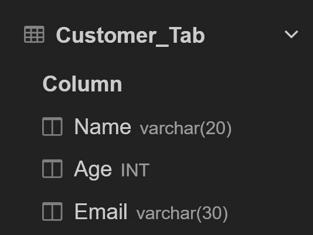
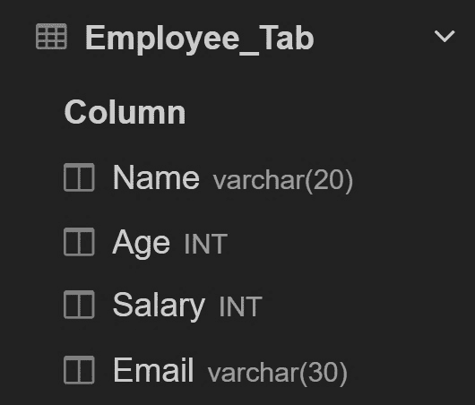
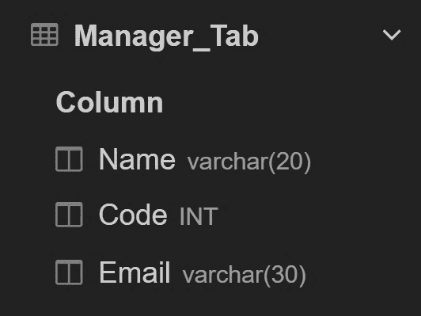
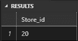
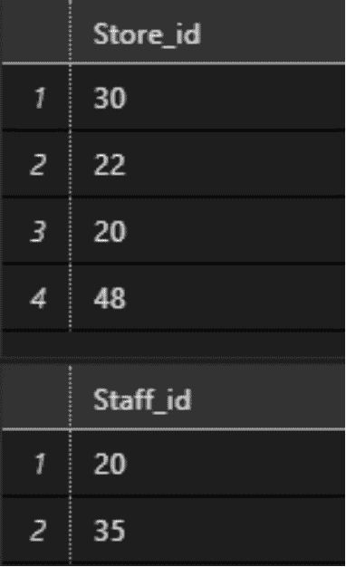
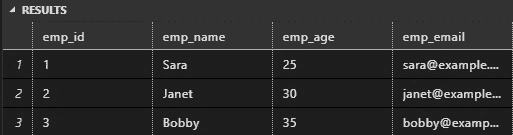

# Python、Java、SQL 与 JavaScript：初学者掌握 4 种最畅需求编程语言、脱颖而出并寻找高薪工作的终极速成指南

在任何情况下，对于由于书中包含的信息而导致的任何损害、赔偿或金钱损失，出版者或作者不承担任何责任或法律责任，无论是直接还是间接。

## 免责声明

```python
def age(who, years):
    print(who, "is", years, "years old")

age(who = 'Mike', years = 35)
age(years = 24, who = 'Tom')
```

## 输出

```
Mike is 35 years old
Tom is 24 years old
```

这里定义关键字参数的格式为 `parameter = argument`。例如，在 `who = 'Mike'` 中，`who` 是参数，`Mike` 是参数。

## 默认值

Python 或其他编程程序中的并非所有值都必须动态的。默认值（Default Values），也被称为“常量”，有时会被开发者用于向函数传递参数时。对于程序员来说，为参数使用默认值是完全可选的。

然而，建议定义默认值，因为它可以减少样板代码，并且在项目复杂时提供更好的数据管理。样板代码是没必要的，但开发者必须编写它们以便让解释器正常运行。虽然 Python 与其他高级语言相比没有杂乱，但需要对代码进行某些更改（例如定义默认值）来提高可读性。

### 程序代码

```python
def age(who, years = 35):
    print(who, "is", years, "years old")

age('Mike')
age('Tom')
```

## 输出

```
Mike is 35 years old
Tom is 35 years old
```

由于我们已经在上一个示例中定义了参数值，函数调用变得更加简单且花费的时间更少。

需要记住，即使你提供了默认值，如果再次定义该参数，Python 解释器最终会将其替换。

### 程序代码

```python
def age(who, years = 35):
    print(who, "is", years, "years old")

age('Mike')
age('Tom', 24)
```

## 输出

```
Mike is 35 years old
Tom is 24 years old
```

尽管默认值是 `35`，但 `Tom` 的参数被给为了 `24`。在这种情况下，Python 解释器将其替换为新的参数值。

## 作用域

作用域（Scope）对于开发者理解各种函数类型以及找到轻松使用它们的方法至关重要。函数和变量一样都有局部作用域和全局作用域，正如之前解释过的。

局部作用域变量是在函数内部创建且只能在函数内部使用的变量。相比之下，任何可以使用的变量被称为全局作用域变量。

记住函数可以同时拥有局部变量和全局变量。因此，函数中使用的所有变量应该是局部的或全局的。

### 为什么作用域至关重要？

作用域功能主要用于更有效地维护垃圾回收机制。为了提高程序速度，所有被替换或长期未使用的变量会被删除。虽然它们在函数被调用时可以重建，但这个过程仍然消耗运行时。

相反，当创建一个全局作用域的变量时，它可能会被多次调用。因此，拥有全局作用域有助于避免重新初始化变量。无论你正在创建什么软件，尽可能使用作用域可以帮助你在处理复杂项目时提高效率。

### 局部和全局作用域

## 规则 1：局部作用域变量不能在全局作用域中使用

### 程序代码

```python
def mysample():
    x = 12

mysample()
print(x)
```

## 输出

```
NameError: name 'x' is not defined
```

上一个示例声明了一个局部作用域且值为 `12` 的变量。当我们调用函数并尝试从全局作用域打印变量值时，我们得到了回溯错误（traceback error），因为局部变量与全局变量不同，只能在函数内部调用。

### 程序代码

```python
def mysample():
    x = 12
    print(x)

mysample()
```

## 输出

```
12
```

由于函数是从局部作用域调用的，程序无错误运行并使用 `print` 语句将局部变量打印到计算机屏幕。

## 规则 2：无论作用域如何，所有局部函数都可以访问所有变量。

### 程序代码

```python
x = 23
def mysample():
    y = 45
    print(x)

mysample()
print(x)
### print(x) 将产生错误
```

## 输出

```
23
23
```

当从局部和全局作用域调用变量时，变量 `x` 的值会被打印。

## 规则 3：一个函数使用的局部变量不能被另一个函数使用。

### 程序代码

```python
def f1():
    x = 12
    print(x)

f1()

def f2():
    print(x)

f2()
```

## 输出

```
12
NameError: name 'x' is not defined
```

因为它是局部函数的变量，所以 `print` 函数第一次工作了。另一方面，变量值在第二次导致了回溯错误，因为函数 `f2` 无法访问函数 `f1` 的变量。

应该注意的是，局部和全局作用域中的变量可以具有相同的名称而不会混淆解释器。然而，为了更好的编程实践并避免混淆，建议局部和全局变量赋予不同的名称。

### 模块

在编程语言中，模块是函数的集合。你可以通过导入模块在任何软件组件中使用这些函数组，并带有参数调用它们。Python 导入模块比 C 和 C++ 等语言好得多。

语法：

```
import {模块模块 }
```

### 示例

```python
import math
```

上述语法将内置的 `math` 模块函数导入到你的程序中。结果，你现在可以给这些方法提供参数。

### 导入的功能是什么？

导入是一个 Python 库函数，它复制特定文件中的函数并链接到当前文件。通过这种方式，可以使用当前文件中不存在的方法。此外，创建模块有助于避免重复编写代码。

### 如何创建模块？

虽然从第三方库导入模块可以节省时间，但作为开发者，你必须意识到自己创建模块的重要性。假设你正在为下载服务开发 Web 应用程序。编写大量函数有利于应用程序运行。为了改进组织，最好创建一个网络模块并将所有网络函数包含其中。随后，你可以创建一个带有 GUI 和多个函数的模块来辅助创建视觉良好的应用程序。

要创建 Python 模块，首先必须创建一个扩展名为 `.py` 的文本文件。创建 `.py` 文件后，你可以在其中添加所有函数。例如，在我们定义的 `.py` 模块中，你可以包含以下乘以两个数字的函数。

文件 – `examplemodule.py`

```python
def sum(a,b):
    # 此方法计算两个数字的和
    c = a + b
    return c

### 结果将是和
```

我们将展示一个在模块创建时导入之前的函数的示例脚本。

### 程序代码

```python
import examplemodule
```

按下回车键后，该模块中的函数对于处理其他项目的 Python 程序员将可用。

它是 Python 中最常用的内置函数。从初学者到经验丰富的程序员，每个人都使用 `print()` 语句在计算机屏幕上显示输出。正如之前提到的，你想要在屏幕上显示的内容应该放在引号之间。

## 2. `abs()`

这是一个内置函数，用于返回任何整数的绝对值。如果输入的是负整数，该函数将返回其正值。

### 程序代码：

```python
z = -65
print(abs(z))
```

### 输出：

```
65
```

## 3. `round()`

这是一个内置数学函数，用于返回与给定浮点数最接近的整数。

### 程序代码：

```python
x = 12.32
y = 4.23
print(round(x))
print(round(y))
```

### 输出：

```
12
4
```

## 4. `max()`

此 Python 内置函数返回一组数字中的最大值。该函数可以应用于任何数据类型，包括列表和变量。

### 程序代码：

```python
x = 31
y = 78
z = 36
mymax = max(x,y,z)
print(mymax)
```

### 输出：

```
78
```

## 5. `min()`

此内置函数返回一组数字中的最小值。

### 程序代码：

```python
x = 31
y = 78
z = 36
mymin = min(x,y,z)
print(mymin)
```

### 输出：

```
31
```

### 1. `sorted()`

它根据你的喜好对列表中的所有元素进行升序或降序排序。

### 程序代码：

```python
t = (5,857,165,43,430,60,753,15)
s = sorted(t)
print(s)
```

### 输出：

```
[5, 15, 43, 60, 165, 430, 753, 857]
```

### 2. `sum()`

`sum()` 是一个内置函数，接收 `list`（列表）或 `tuple`（元组）作为输入并相加它们的 `elements`。`list` 或 `tuple` 中的所有元素必须具有相同的数值数据类型。例如，如果输入中包含字符串数据类型，程序会导致类型错误。

### 程序代码：

```python
t = (5,857,165,43,430,60,753,15)
s = sum(t)
print(s)
```

### 输出：

```
2328
```

### 3. `len()`

此内置函数返回输入对象的元素数量。

### 程序代码：

```python
t = (5,857,165,43,430,60,753,15)
s = len(t)
print(s)
```

### 输出：

```
8
```

### 4. `type()`

此函数返回输入对象的数据类型。如果是一个函数，还会显示关于参数和参数的细节。

### 程序代码：

```python
t = 45.789
print(type(t))
```

### 输出：

```
<class 'float'>
```

### 字符串函数

字符串是程序员比其他数据类型更关注的数据类型。Python 核心库创建了数十个内置函数，以便程序员充分利用使用字符串存储的数据。

### 1. `strip()`

它会删除作为参数传递给它的字符。参数将从它们出现的所有实例中移除。

### 程序代码：

```python
text = "Python"
print(text.strip('hon'))
```

### 输出：

```
Pyt
```

### 2. `replace()`

它将字符串的一个部分替换为另一个。如果同一个字符串数据类型中有多个单词，你可以通过参数指定替换多少个。

### 程序代码：

```python
text = "Have a great day!"
print(text.replace('great', 'wonderful'))
```

### 输出：

```
Have a wonderful day!
```

### 3. `split()`

当你提供的参数第一次出现在输入文本中时，它会分割字符串。

### 程序代码：

```python
text = "There are three apples in the fridge"
print(text.split(' '))
```

### 输出：

```
['There', 'are', 'three', 'apples', 'in', 'the', 'fridge']
```

由于我们提供的参数是空格，在这种情况下，输出是一个以原始字符串单词作为元素的列表。

### 4. `join()`

通过此函数，你可以在列表的元素之间插入分隔符，只要它们是字符。

### 程序代码：

```python
country = ['Italy','France','Spain']
x = " ~ "
x = x.join(country)
print(x)
```

### 输出：

```
Italy ~ France ~ Spain
```

## 练习

1. 创建一个返回数字之和的函数。

2. 创建一个返回列表的函数。

3. 创建一个返回消息的函数。

4. 创建一个返回数量的函数。

5. 创建一个返回元素的函数。

# 第 9 章：面向对象编程 (OOP)

面向对象编程是一种使用类和对象的流行范式。到目前为止我们讨论了函数式编程并提供了一些示例。当 Python 2 发布时，每个人都兴奋地发现 Python 开始支持面向对象编程。由于这些问题，许多程序员倾向于 Java 等语言。虽然函数式编程减少了大量的混乱，但每次导入模块仍然困难。更多的模块增加了程序的运行时间。

### 什么是 OOP？

OOP 是一种使用类组织函数的流行范式。类是可以使用点符号访问的方法集合。

### 现实案例

假设你正在开发一个解释车辆的应用程序。函数式程序员会为每个车辆创建一个函数，然后为模型创建一个。当只有几个车辆模型时这看起来很简单，但随着模型数量的增加，代码复用变得困难。而面向对象编程，开发者首先创建一个“车辆”类并定义各种属性。

### 如何创建类？

类是创建自定义类型的方法，它们通常是创建对象的蓝图。类包括属性和方法等各种实体。

- 所有创建的类必须以关键字 `class` 开头。

- 在类内部创建的变量是类属性。

```python
class ClassName:
```

### 类属性

属性的定义

### 初始化方法

我们将讨论的 `self` 方法

### 类方法

类的特定方法

在 Python 中，你不能使用关键字作为类名。否则会导致回溯错误。

### 如何创建对象？

在 Python 编程中，对象是具有状态和行为的实体。类中的一切内容都可以被视为对象。例如，类内部创建的变量可以作为对象使用。

### 什么是对象？

每个对象都由状态组成。状态通常反映了对象的属性。

每个对象都有行为。对象的行为取决于它被使用的方式。

所有对象都有身份。对象通过身份进行相互交互。

假设有一个 `Cat`（猫）类，描述了不同猫的特征和行为。该类中的对象可以是各种类型。

猫的名字通常用于识别对象。如猫的 `age`（年龄）、`type`（类型）和 `color`（颜色）等属性可以描述对象的状态。

相对于猫，的行为包括跳跃、睡眠和跑步。

### 如何创建对象？

创建一个对象只需要给它起一个名字。例如，如果定义了 `Cat` 类，我们可以这样写：

### 程序代码：

```python
obj = Cat()
```

这将生成一个属于 `Cat` 类的名为 `obj` 对象。

### Self 方法

你应该意识到 `self` 方法，它在类创建时会被自动创建。`self` 方法的概念与 `C` 和 `C++` 等其他编程语言中的指针非常相似。

如果你想调用方法，必须为 `self` 方法提供至少一个参数。对象调用的每个方法都会自动转换为 `self` 对象。

### __init__ 方法

`__init__` 方法类似于 `C++` 和 `Java` 的构造函数。当类启动时，它作为默认方法运行。结果是如果你想创建一个带有初始值的对象，你作为开发者必须将这些值输入 `__init__` 方法中。

我们现在通过使用 `self` 和 `__init__` 方法举个例子。

### 程序代码：

```python
### 定义一个名为 "Person" 的类，带有 "name" 属性
class Person:
    # 定义所有类实例共享的类属性
    species = "Homo sapiens"

    def __init__(self, name):
        # 将 name 属性初始化为实例属性
        self.name = name

    # 创建两个不同的 Person 类实例
    person1 = Person("Alex")
    person2 = Person("Sam")

    # 打印每个人的名字
    print("Name of person 1:", person1.name)
    print("Name of person 2:", person2.name)

    # 打印所有实例共享的物种属性
    print("Species:", Person.species)
    print(person1.name, 'and', person2.name, 'are', Person.species)
```

**输出：**

```
Name of person 1: Alex
Name of person 2: Sam
Species: Homo sapiens
Alex and Sam are Homo sapiens
```

在之前的示例中，我们定义了一个类以及实例属性。有几条需要记住的简单规则：

- 你必须提供类名

- 你必须创建至少一个属性

- 你必须提供一个 `self` 参数和一个 `__init__` 方法

- 必须实例化对象

在实例化对象之后，你可以创建可以使用该对象的实例属性。

### 带有方法的类和对象

在之前的示例中，首先创建了一个类属性，接着是一个方法和 `__init__` 函数。最后实例化了两个对象，并使用点符号法访问它们。

### 程序代码：


```python
class Person:
    species = "Homo sapiens"

    def __init__(self, name):
        self.name = name

    # 定义一个打招呼的方法
    def say_hello(self):
        return "Hello, my name is " + self.name

    person1 = Person("Alex")
    person2 = Person("Sam")

    # 打印每个人的名字
    print("Name of person 1:", person1.name)
    print("Name of person 2:", person2.name)

    # 调用每个人的 say_hello 方法
    print(person1.say_hello())
    print(person2.say_hello())
```

**输出：**

```
Name of person 1: Alex
Name of person 2: Sam
Hello, my name is Alex
Hello, my name is Sam
```

**解释：**

在上面的示例中，创建了一个类属性，然后同`__init__`函数一起创建了一个方法。最后实例化对象，并使用点符号法访问对象。

### 继承

面向对象编程最重要的方面之一是继承。继承指的是在不添加新方法或参数的情况下定义新类的过程，而是从其他类派生它们。新类通常被称为子类。父类是所有方法的来源。

### 真实世界示例：

在开发真实世界应用时，继承在各种情况下都非常有用。假设你正在为`iOS`开发一个相机移动应用程序。

在创建应用程序时，你可能需要为它提供的各种功能创建几个模块。在开发几个月后，你注意到你正在复用 GUI 界面的代码，因为你的团队仍然使用面向函数的编程。

你决定为你的项目使用面向对象的框架来节省时间和金钱。由于你现在使用 OOP 范式，你可以复用已经编写的 GUI 界面代码并将其链接到你正在创建的新类中。这允许程序员在添加新功能而无需重写旧功能，从而节省了精力。

Python 继承的语法：

```python
class BaseClass:
    { 基类体 }

class DerivedClass(BaseClass):
    { 派生类体 }
```

请记住基类和派生类都遵循以下规则。

### 程序代码：

```python
### 定义一个返回边数的基类 "Polygon"
class Polygon:
    def __init__(self, num_edges):
        self.num_edges = num_edges

    def edges(self):
        return self.num_edges

### 基于 Polygon 定义子类 "Rectangle"
class Rectangle(Polygon):
    def __init__(self, length, width):
        # 调用父类的 __init__ 方法来初始化边数
        Polygon.__init__(self, 4)
        self.length = length
        self.width = width

    # 定义一个计算矩形面积的方法
    def area(self):
        return self.length * self.width

### 创建 Rectangle 类实例
rect = Rectangle(40, 10)

### 打印边数和矩形面积
print("Number of edges:", rect.edges())
print("Area:", rect.area())
```

**输出：**

```
Number of edges: 4
Area: 400
```

**解释：**

在之前的示例中，我们首先定义了`Polygon`类，然后在此基础上构建了`Rectangle`类。创建一个 40x10 的矩形。当调用`area`方法时，计算出面积。未来你可以通过编写一个计算面积的方法创建另一个多边形类。

有了足够的面向对象编程知识，你可以创建相互交互的类和对象，创建使用许多组件并执行多个任务的软件。查看 GitHub 上的开源代码以了解更多 OOP。

## 练习

1. 创建一个类，构造函数接收人的姓名、年龄和职业。该类应拥有`get_name()`、`get_age()`和`get_occupation()`方法来返回相应的值。实例化该类并调用方法显示值。

2. 创建一个继承自`Person`的`Student`类。该类必须有一个构造函数，接收姓名、年龄、职业和科目列表。该类应拥有一个返回科目列表的`get_subjects()`方法。实例化该类并调用方法显示值。

3. 创建一个`Rectangle`类，构造函数接收宽度和高度。该类应拥有`get_area()`和`get_perimeter()`方法，分别返回矩形的面积和周长。实例化该类并调用方法显示值。

4. 创建一个`BankAccount`类，构造函数接收所有者姓名、余额和账户类型。该类应拥有`get_balance()`、`deposit(amount)`和`withdraw(amount)`方法，分别返回余额、存款金额和提取金额。实例化该类并调用方法显示值。

5. 创建一个名为`Vehicle`的类，其构造函数接收`make`、`model`和`year`。该类应该拥有`get_make()`、`get_model()`和`get_year()`方法，用于返回相应的值。创建两个继承自`Vehicle`的类，`Car`和`Truck`。`Car`类应该有一个额外的方法`get_type()`，返回 "Car"；而`Truck`类应该有一个额外的方法`get_type()`，返回 "Truck"。创建这两个类的实例，并调用这些方法来显示这些值。

# 第 10 章：Python 中的文件

Python 使用变量来存储静态数据和动态数据。虽然变量是程序执行期间存储数据的理想选择，但当数据具有敏感且需要反复重用时，它们可能很难使用。变量可以自我销毁以释放内存，这对于想要保存或为了多个目的重用数据的用户来说非常方便。Python 提供了文件来更好地与任何大小或格式的数据交互。对于 Python 程序员来说，理解文件操作并在程序中实现它们对于创建更好的软件至关重要。

## 文件路径

Python 程序员通常处理多个文件和两个参数。第一个是文件名，便于查找；第二个是文件路径。

例如，如果`file.pdf`是文件的名称，那么`"C:/ users/ downloads/file.pdf"`就是该文件的路径格式。文件名`file.pdf`中的文件扩展名是`pdf`。为了管理文件，大多数操作系统都采用了高效的文件管理系统。

理解文件管理技术至关重要。由于这个原因，你必须理解你所运行的操作系统中使用的文件管理器的基础。例如，Windows 使用`file explorer`（资源管理器）来管理文件，而 Mac 系统使用`Finder`。无论你使用哪种操作系统和文件管理器，文件通常使用根目录、文件夹和子目录按逻辑层级结构进行组织。

## 文件的层级结构

为了让程序检测文件位置，你必须输入完整路径。文件的完整路径通常按层级编写，以确定目录、子目录和文件夹。

例如，在`'C:/users/sample/example.pdf,'`中，`C`是系统的根目录，`sample`和`users`是其中的子目录。由于不同的文件夹中可能存在同名的文件，因此使用完整路径来确定文件位置至关重要的。

作为一名程序员，你应该意识到 Windows 系统使用反斜杠（\）来区分根目录和子目录。其他操作系统（如 Mac 和 Linux）使用正斜杠（/）来区分根目录和子目录。

如果你由于某种原因在终端输入代码时不想使用反斜杠或正斜杠，可以使用名为`os.path.join`的函数。

### 程序代码：

```python
os.path.join('C', 'first', 'second')
```

### 输出：

```
'C\first\second'
```

## 当前工作目录

在运行复杂代码时，作为 Python 程序员，你可能需要与同一目录下的多个文件交互。名为`os.getcwd()`的函数可以帮助程序员与同一目录的其他文件交互。当识别出绝对路径时，目录或子目录中的所有文件将作为输出显示。

## 创建新文件夹

几个 Python 程序通常需要用户生成文件，或由应用程序自行在不同的目录中创建文件。例如，游戏的存档文件可能由软件自动生成，无需任何用户干预。所有 Python 程序员必须意识到为他们创建的应用程序创建新文件夹的重要性。要创建新目录，请使用`os.makedirs()`函数。

### 程序代码：

```python
import os

os.makedirs('D: /user/ Python/myfolder')
```

在在上例中，我们首先导入了包含系统函数设计的`os`模块。然后调用`makedirs()`函数并将路径作为函数参数。`"myfolder"`是上述函数在目录中创建的新文件夹名称。你可以通过打开文件管理器或在命令提示符中输入`cd`来检查。

请确保向你想要创建新文件夹的目录提供绝对路径。

## 管理文件的函数

文件是复杂的，需要大量的内置函数才能正常工作。你可以从 IDE 或终端使用 Python 轻松地操作、打开和关闭文件。默认情况下，Python 解释器可以同时运行`.txt`和`.py`扩展名的文件。

如果你想处理`pdf`和`jpg`等文件类型，你需要安装第三方库。在丰富的 Python 程序员看来，这些文件类型被称为二进制文件类型。

作为开始，我们将在`"D: /user/Python/example.txt"`路径上创建一个名为`example.txt`的文件，帮助你理解文件的概念。在创建文件时，你可以自由使用自己的路径。

这个示例`txt`文件将用于描述文件函数，如`open()`、`close()`、`write()`和`read()`。

假设`example.txt`文件包含以下内容：

Content:

这是一个 Python 文件。

### 如何打开文件

使用 Python 命令打开文件非常简单。你只需要知道文件的绝对路径以及如何使用`open()`函数。

### 程序代码：

```python
myfile = open ('D: /user / Python / example.txt ')
### 这将打开该文件
```

示例中使用了`open()`函数及其参数。此示例中的参数是提供的路径。`open()`函数配合参数在示例中使用。此示例中的参数是提供的路径。当文件打开时，用户可以使用默认查看器读取它。

在运行此语句之前，请确保你拥有打开文件的必要软件。例如，如果你尝试打开 mp4 视频文件且没有应用程序可以打开它，这将不是一个可行解决方案。

### 发生了什么？

当解释器找到`open()`函数时，会创建一个新的文件对象，在此阶段进行的所有更改必须保存才能在原始文件中反映。如果没有保存文件，Python 解释器将忽略所有更改。

## 如何读取文件

当 Python 使用`open()`函数打开文件时，会创建一个新对象，现在 Python 解释器可以使用`read()`函数轻松读取整个文件的内容。

### 程序代码：

```python
filecontent = myfile.read()
### read() 将扫描文件中存在的内容
```

### 输出：

```
这是一个 Python 文件。
```

在前面的示例中，我们使用`read()`函数将文件的扫描数据发送到一个名为`filecontent`的新变量。根据文件的复杂程度，你还可以将信息发送到列表、元组或字典。

虽然`read()`函数只是打印文件内容，但`readlines()`函数可以将文件内容组织到新行。

我们将使用一个简单的示例来演示此 Python 功能。首先，在你的工作目录创建一个名为`'mynewfile.txt'`的新文件。打开文件后，输入所示的几行：

mynewfile.txt:

这是一个文档示例

我们正在连接这些点

这些信息将用于处理文本

Python 解释器运行很快

现在我们在终端上调用`readlines()`函数。

### 程序代码：

```python
myfile = open(mynewfile.txt)
### 此变量帮助我们根据提供的名称打开新文件
myfile.readlines()
```

### 输出：

```
['这是一个文档示例 \n', ' 我们正在连接这些点 \n', ' 这些信息将用于处理文本  \n', 'Python 解释器运行很快']
```

输出中文件的每一行都包含一个换行符`\n`。在开发真实世界的应用程序时，可以使用许多高级文件函数。

你可以使用`write()`函数向任何文件插入新数据。`write()`函数与`print()`函数非常相似，后者是程序员用于在屏幕上显示内容的函数。它会显示你指定的指定文件的内容。

`open()`函数允许程序员以写入模式打开文件。你所做的只是添加一个参数，让解释器知道你想打开文件并添加你的内容。

一旦完成对文件的写入，请使用`close()`方法关闭它并保存到默认位置。

### 程序代码

```python
myfile = open('example.txt', 'w')

#This makes the file open in write mode
myfile.write ('This is how we write on files! \n')
myfile.close()
```

输出将显示屏幕上的内容以及字符数量。

你还可以使用`'a'`作为参数追加文本。

### 示例

```python
myfile = open('example.txt', 'a')

### The file is open in write mode
example.write('This is a new version')

### 上述语句将被添加到提供的文件中
myfile.close()
```

要检查消息是否已添加，请使用下所示的`read`函数。

```python
myfile = read(example.txt)
print(myfile)
```

你通常可以使用 Windows 管理器和 Mac Finder 等默认文件管理器功能复制、粘贴或剪切文件和文件夹。但在 Python 中，你必须使用一个名为`shutil`的内置库，它创建了可以快速复制、移动或删除文件的编程组件。

要使用`shutil`库的默认函数，你必须先导入该库。

# 第 11 章：异常处理

所有应用程序都会因为用户输入不正确或发生错误而偶尔崩溃。可以告知用户应用程序崩溃的原因。如果你无法帮助他们，你的软件至少应该检测到应用程序已崩溃，并将日志发送到你的服务器，以帮助他们找到解决方案。给用户提供错误警示是现代应用程序开发者为了改进用户体验所能做的最底线。

异常处理是一项计算机编程功能，帮助开发人员编写应用程序可能崩溃的场景，并在发生这种情况时显式指示用户。

你还记得 Windows 系统上那个带有红色“x”标记的著名“此程序已停止响应”吗？它是任何系统中最著名的异常处理接口之一。虽然你的异常不需要是最高质量的，但它们应该足够改善终端用户体验。

在 Python 开发中，编写有效的异常被认为一种高级技能。异常处理还协助程序员在工作流早期检测程序中的错误和逻辑缺陷。异常在测试和维护期间还可以节省大量时间。

## 异常处理示例

进入你的个人资料页并尝试发布一张大于 24MB 的图片。加载后，Twitter 网页或应用程序界面将显示弹出窗口，通知你的图片由于尺寸过大无法上传。

在这种情况下，Twitter 开发者构建了一个异常处理接口，帮助用户理解为什么他们的图片没有被上传。异常处理是提高用户体验的优秀工具。

所有著名的第三方库都包含了异常处理方法，你可以在应用程序中导入并使用它们。

我们将教你如何使用“除以零”错误来处理异常。

当你将一个数字除以零时，该值通常是定义的，因为它被称为无限值。同样，如果你的应用程序用户尝试将一个数字除以零，你必须显示`ZeroDivisionError`。可以使用`try`和`except`语句显示此错误。

## ‘Try’ 和 ‘Except’

创建异常处理任务时，你应该意识到领先的编程组件`Try`和`Except`。`try`块是开发人员必须指定在 Python 解释器中找到错误概率的地方。另一方面，`except`块需要关于在程序执行期间发生我们定义的特定错误时该做什么的信息。

### 程序代码

```python
### 函数中的 try 和 except 块
def divide32(x):
    try:
        A = 32/x
        print(A)
    except ZeroDivisionError:
        print ("I can't divide by 0")

divide32(8)
divide32(0)
divide32(16)

# 输出:
4.0
I can't divide by 0
2.0
```

我们从一个`try`和`except`块开始，告诉解释器我们在哪里可以预期错误弹出窗口，以及如果发生错误应该显示什么信息。

## 错误类型的错误

Python 文档包含大量的系统错误。当我们在上一个示例中讨论除以零错误时，你可能注意到了一种简单的方法。不同的错误有不同的避免它们的方法，或者在它们存在时运行应用程序的方法。

理解某些系统错误的原因有助于你理解调试应用程序的基础知识。

### 数值错误 (Value errors)


当你向不接受这些数据类型的函数传递参数时，就会发生这些错误。数值错误可能会导致你的应用程序意外崩溃。

在只允许图像文件时上传 `pdf` 文件是触发异常的示例。

### 导入错误 (Import error)

当你无法将模块直接导入程序时，就会发生这些错误。它们通常是由网络连接失败或在线包管理器的问题引起的。

异常触发示例：由于导入错误，你无法在你的私有云账户上同步数据。

### 操作系统错误 (OS error)

你可能会遇到由于软件与你的操作系统版本不兼容的问题。这些错误频繁发生，是因为系统不理解应用程序的内容。这些错误在 `Linux` 发行版中常见。

异常触发示例：由于主机运行不支持的操作系统版本，应用程序崩溃。

### 类型错误 (Type error)

当用户或开发者为应用程序不支持的数据类型输入值时，通常会发生错误。

### 命名错误 (Name error)

当调用程序未定义的变量或函数时，就会发生这种错误。

### 索引错误 (Index error)

当你提供的索引大于创建的列表时，通常会发生这种错误。

# 第 12 章：高级编程

许多第三方 `Python` 框架为程序员提供了特定功能。只需 `import` 基础库即可。这就是为什么 `Python` 如此流行。库对于开发者创建普通用户使用的真实应用程序非常好。熟悉某些常用的 `Python` 库可以避免从头开始。

大多数库的源代码可以在 `GitHub` 或 `Bitbucket` 等网站上进行探索。

## Pip 包管理器

所有操作系统都向用户提供应用程序。`Python` 不是操作系统，而是一个软件解释器。任何不是用 `Python` 编写的软件都无法使用 `Python` 解释器运行，因为 `Python` 解释器不理解该软件使用的源代码。

`Python` 提供了包管理器将包文件下载到你的操作系统以便立即执行。虽然有很多第三方 `Python` 包管理器，但默认的 `pip` 是最常用的，每个 `Python` 程序员都应该熟悉它。

### 为什么要使用 Pip

可以安装新的包和依赖项。

有一个索引列出了 `pip` 服务器上可用的所有 `Python` 包仓库。

在安装软件之前，使用它来检查要求。

移除所有你不再使用的包和依赖项。

首先，检查系统中是否安装了 `pip`。`pip` 通常随 `Python` 一起。

## 终端代码

```bash
$ pip —version
```

如果输出了 `pip` 的版本信息详情，说明你的系统已安装了包管理器。如果没有，你可能需要从官方网站手动下载并安装。

### 如何安装包？

要安装包，你应该始终使用下所示的语法格式。

```bash
$ pip install name_of_the_software
```

例如，如果你想安装 "Seaborn" 包，语法如下：

```bash
$ pip install seaborn
```

在安装之前检查与内容相关的信息，请使用以下命令：

```bash
$ pip show seaborn
```

此终端代码将返回许多元数据信息，包括作者（Author）、包名和位置。

使用下面的代码语法格式卸载使用 `pip` 包管理器安装在系统上的任何包。

### 语法

```bash
$ pip uninstall nameofthepackage
```

例如，要卸载之前安装的 `Seaborn` 包，请使用以下命令：

```bash
$ pip uninstall seaborn
```

你也可以使用下所示的代码格式搜索包。

```bash
$ pip search name_of_the_package
```

这将向你显示索引中的所有包，供你检查和选择。

### 虚拟环境

通常，当你安装一个包时，你也会安装许多依赖项。这些依赖项偶尔会与其他软件重叠，导致包安装失败。为了帮助开发者创建独立项目，可以使用 `virtualenv` 包来创建一个隔离的虚拟环境。

首先，使用 `pip` 包管理器安装 `virtualenv` 包。

### 安装命令

```bash
$ pip install virtualenv
```

一旦安装完成后，你就可以使用下面的命令使用虚拟机创建一个新目录。

```bash
$ virtualenv mydir
```

你安装的所有包、文件和软件都将保在这个新目录中，不会干扰任何系统依赖项或包。开始之前，运行以下命令激活虚拟机。

### 终端命令

```bash
$ source mydir/bin/activate
```

在你安装完所有包后，使用以下命令停用此虚拟环境：

### 终端命令

```bash
(mydir) $ deactivate
```

### sys 模块

要精通 `Python`，理解 `Python` 解释器如何工作至关重要。解释器通常在执行逻辑编写的程序之前解析代码中的每个变量、方法或字面量，并检查语法、类型和索引错误。检查解释器如何工作以及存储特定软件所需的信息是非常重要的。

`Python` 中的 `sys` 模块使得开发者能够方便地检查这些信息。

```python
import sys
```

### path

此 `sys` 库参数将告诉你安装在系统上的 `Python` 解释器的默认路径：

```python
print(sys.path)
```

### argv

此方法将返回系统中所有现有模块的列表：

```python
print(sys.argv)
```

### copyright

此方法将向用户显示 `Python` 解释器或软件的版权信息：

```python
print(sys.copyright)
```

### getcount

此方法显示程序使用的频率：

```python
print(sys.getcount())
```

## 单元测试

### 单元测试是如何工作的？

在开发之前，`unittest` 必须确保代码遵循最新的技术。`unittest` 是默认安装的。`Python` 允许开发者使用 `unittest` 框架测试代码。

## Scrapy

`Scrapy` 是一个专门为爬虫目的设计的 `Python` 库。爬虫（Spiders）通常用于从动态网站获取数据。

## Scrapy

`Scrapy` 是一个专门为爬虫目的设计的 `Python` 库。爬虫通常用于从动态网站中爬取数据。`Scrapy` 非常适合提取动态数据。

`Tensorflow` 是一个广为人知的用于构建高级神经网络的机器学习库。许多开发者还在深度学习框架中使用 `Tensorflow` 开发软件组件，这些组件经常被嵌入人脸识别等深度学习应用中。`Google` 创建 `Tensorflow` 是为了让复杂机器学习模型的开发变得更容易。然而，它后来被开源了，以便热情的开发者能够为该项目做出贡献。

你可以使用任何包管理器（如 `pip`）安装 `Tensorflow`。

## 安装命令：

```bash
pip install tensorflow
```

## Scikit-Learn

`Scikit-Learn` 是一种广泛使用的机器学习模型创建工具，类似于 `TensorFlow`。许多开发者使用它来创建数据分析和分析类软件。`Scikit-Learn` 让开发者能够轻松地将高级机器学习模型集成到他们的代码中，例如聚类、随机森林和 `K-means` 算法。

`Scikit-Learn` 还支持科学研究中使用的复杂神经网络算法，例如遗传算法的开发。使用以下命令安装它。

## 安装命令：

```bash
pip install -U scikit-learn
```

## Pandas

数据分析师深爱 `Pandas`，因为它是最流行的第三方库之一。虽然在数据分析师中 `R` 比 `Python` 更流行，但对于想要创建高级数据分析模型的开发者来说，`Pandas` 仍然是一个很好的库。`Pandas` 可以简单地导入和导出各种格式的海量数据，包括 `SQL`、`JSON` 和 `Excel`。此外，你可以使用 `Pandas` 比其他库更高的精确度进行数据清洗和排序，这些都是高级数据分析技术。

使用 `pip` 等包管理器在你的本地系统中安装 `Pandas`。

## 安装命令：

```bash
pip install pandas
```

## Matplotlib

`Matplotlib` 是一个广为人知的 `Python` 库，与 `Scipy` 结合用于在代码中实现高级数学函数。`Scipy` 和 `Matplotlib` 可以一起创建多维数组，然后可以使用它们编写复杂代码来解决现实世界的科学挑战。许多计算机依赖这些库来保持工作流的顺畅运行。

`Matplotlib` 以漂亮的图表显示所有获取的数据，帮助你更好地理解数据流。`Tkinter` 也用于逻辑数据的数据。虽然 `Scipy` 专注于科学和技术计算，但 `Matplotlib` 专注于面向爱好者和组织的数据可视化。

使用 `pip` 在你的本地系统中安装 `Matplotlib`。

## 安装命令：

```bash
pip install matplotlib
```

要使用 `Matplotlib` 的一些高级函数，请确保使用下面的命令安装了 `Scipy`。

## 安装命令：

```bash
pip install scipy
```

## Twisted

基于 `Web` 的 `Python` 开发者必须熟悉各种网络概念。虽然 `Python` 核心库提供了足够的资源和方法来编写高效的网络代码，但始终建议使用如 `Twisted` 等库来更容易地创建复杂代码。只需点击，`Twisted` 就能实现 `UDP`、`TCP` 和 `HTTP` 等网络协议。`Twisted` 是许多网站（包括 `Twitch`）的默认网络组件库。

使用 `pip` 安装 `Twisted`。

## 安装命令：

```bash
pip install twisted
```

## 程序员的 GitHub

`GitHub` 对程序员非常有用，因为它允许他们与团队远程协作。`GitHub` 基于对点 `GIT` 仓库，因此你的代码中的更改只要你的队友连接到互联网，就会立即在他们的计算机上反映出来。

`GitHub` 提供两个版本：免费版和专业版。当你使用免费版时，任何拥有 `GitHub` 账户的人都可以访问你的代码。使用 `pro` 版本时，你的代码将是私有的，只有你的团队成员才能访问它。此外，所有私有仓库都使用高级加密算法来保护你的数据。

### 为什么 GitHub 对 Python 程序员至关重要？

无论你在哪个计算机领域，创建项目时可能都需要使用 `GitHub` 上提供的第三方框架和库。你可以使用 `GitHub` 或几个第三方客户端之一与本地仓库进行交互。

`GitHub` 和所有支持 `Git` 的客户端使用依赖项将库和模块轻松同步到你的代码中。`Git` 服务器的 "commit" 选项允许你对代码进行更改。

使用 `Python` shell 运行以下命令在你的 `GIT` 服务器中创建一个新仓库。

## 安装命令：

```bash
$ git config --global root "my project."
```

当你在控制台中输入 `git` 代码时，会创建一个新项目，你现在可以为你的项目创建文件夹。要开始在项目根目录下创建目录，请运行下面的命令。

```bash
$ mkdir. ("Name of the repository: ")
```

如果你对 `GIT` 服务器或你正在的工作一无所知，请在控制台中输入以下命令。

```bash
$ git status
```

这样你就准备好开始开发你的开源项目，帮助你领域的其他程序员了。

## 结论

首先，祝贺你完成了一份尽的 `Python` 指南。这本书涵盖了各种深入的 `Python` 主题，这些将帮助你为项目编写高质量代码。然而，需要对书中教授的基础知识进行持续的练习以提高水平。参与项目开发或练习竞争性编程只会增加你的专业知识。

经验丰富的程序员的某些特征促成了他们在对计算机和技术的激情旅程中取得成功。他们通常会养成一些有助于他们成为更好程序员的习惯。作为初学者，你必须理解这些特征，并将其整合到你的工作流中，以提高在某个主题或一组主题内的性能。

## 程序员特征

### 基础优先

你必须尽可能理解基础知识。随着时间的推移，在坚实的基础上为困难的任务编写代码将变得容易得多。为了加强基础，请熟悉 `Python` 风格指南，它追求简单。编写简单的代码并遵循 `Zen of Python` 法将有助于提高基础知识。

### 将问题分解为较小部分

作为程序员，你必须解决复杂的问题。并不是所有问题都能通过单一逻辑步骤解决。为了获得更好的运行执行效果解决问题，程序员必须将其分解为较小的问题。这种哲学可以帮助程序员开发出漏洞更少、单元测试策略简单的软件。

### 找到你的专长

没有程序员可以精通每一个计算机领域。你应该明确你作为程序员最感兴趣的计算机领域。尝试各种计算系统以更好地了解你喜欢的计算机领域。例如，`Python` 是多功能的，可以作为数据科学家、`Web` 开发人员或系统工程师的优秀资源。不要强迫自己学习一切，相反专注于精通一个领域。

### 你将从错误中学习

错误可能会令人沮丧，特别是当你刚开始时。每当你遇到错误时，复制回溯错误并在 `Google` 或 `ChatGPT` 中搜索。你会发现解决该问题的多种方法，亲手修复它将帮助你更好地理解 `Python` 的基础。

# 学习实现算法

为了提高你在编程逻辑方面的写作能力，你应该学习排序和搜索算法。理解数学概念也有助于你更直观地处理复杂问题。虽然竞争性编程程序员解决问题的方法通常与软件开发人员不同，但理解他们的方法可以帮助你克服软件开发过程中可能遇到的各种障碍。

`Python` 可用于实现二分查找、图算法以及如 `Stacks`（栈）和 `Queues`（队列）等复杂数据结构。从算法的角度来学习 `Python`，我们推荐使用像 `LeetCode` 这样的网站。

# 熟悉 GitHub

需要关注的最资源之一是 `GitHub`。所有的开源代码通常通过 `git` 仓库可用。因此，如果你想对这些仓库进行任何更改，必须使用像 `push` 和 `commit` 等 `GitHub` 命令联系仓库所有者。所有寻找开发者的公司都倾向于拥有 `GitHub` 经验的人才，因为这能让他们快速将你融入团队。

# 不要过度工作

尽管这不是一个技术技巧，但理解经验丰富的开发者所采用的 "稳扎稳打" 哲学至关重要。永远不要试图一次吸收过多的信息。持久性胜过表现，这在你职业生涯的早期更为重要。因此，不要在几天内死记硬背信息，而是每天安排几个小时学习 `Python`。参加如 `Twitter` 等平台上的 `100daysofPython` 等活动，以保持你的动力和一致性。

# 注意测试流程

在为最终用户开发软件之前，必须进行彻底测试。理解如 `Alpha` 和 `beta` 测试等单元测试工作流将帮助你提供功能更强、已知 `Bug` 更少的软件。使用用户报告策略可以在你的工作机器上更容易地重现 `Bug` 并尽快解决它们。清除 `Bug` 需要经验，有时还需要专家意见。不要害怕在论坛上寻求帮助。

# 保持健康的工作与生活平衡

无论你选择什么种职业，保持工作与个人生活的平衡都是关重要的。为了充分利用工作时间（尤其是作为一个程序员），你必须意识到任务和时间管理。如果你是自由职业者，像 `Things` 和 `Session` 等应用可以帮助你有效管理任务。此外，使用 `Pomodoro technique`（番茄法）等技术可以帮助你在更短时间内清除更多的 `Bug`。

# 接下来做什么？

很高兴和你一起学习 `Python`。编程是有趣的，无论你学得多快，只有实践才能让你成为出色的开发者。所以，请利用你从这本书中学到的知识，开始着你的项目。

如果你对该尝试哪些项目感到困惑，这里有一些项目想法可以帮你入门：

*   为你社区的公共图书馆创建一个管理系统。

*   创建一个郊区地铁预订系统。

*   使用 `Django` 库创建一个简单的网站。

*   使用 `Pygame` 创建一个经典的 `Python` 游戏。

*   解析 `Twitter` 数据以构建一个自动转发热门推文的机器人。

希望你的成长之旅在各个方面都能取得成功！

# Java 编程

## 简介

欢迎来到 `Java` 编程的世界！这本书是你学习这一最流行、使用最广泛的编程语言之旅的指南。无论你是一个开启编码之旅的绝对初学者，还是一个想要扩展技能树的资深开发者，本书都旨在为你提供关于 `Java` 语言实用且引人入胜的概述。读完这本书后，你将拥有开始编写自己的 `Java` 程序所需的基础技能。

在我们深入探讨语法、数据类型和类的细节之前，我想退后一步，提供关于 `Java` 语言是什么以及它为何变得如此普及的概述。我的目标是让你理解大局，这样你就知道你的新技能将放在什么位置，以及为什么 `Java` 是一种如此重要的学习的编程语言。我还会解释这本书是为谁设计的，以及你可以从中获得什么。

本书旨在引导你从零基础一步变为熟练掌握 `Java` 核心概念和技巧。你将从学习如何设置 `Java` 开发环境和编写简单程序开始。这种基础理解将使你能够按照自己的节奏探索面向对象的编程概念、泛型编程、函数式编程风格等——这一切都由你掌控。


为了给我们的学习做好充分准备，首先了解一下 Java 的历史、设计哲学以及在当前技术格局中的地位是有帮助的。Java 在 20 世纪 90 年代初首次创建时，主要目标是实现设备（特别是电视、录像机和微波炉）的简单编程。然而，这种最初的“作为电视语言的 Java”的想法从未被广泛采用。相反，Java 通过其在客户端 applet 中的应用快速成长并驱动了 Web 的发展。早期网页浏览器支持 `<applet>` 标签，允许小型 Java 程序在网页内动态下载并运行。这为 Java 变革在线内容的潜力引发了巨大的轰动。然而，不受信任的 applet 带来的安全问题很快限制了它们的用处。尽管如此，Java 在其“一次编译，随运行”的能力方面找到了新的成功——这一关键特征被称为“write once, run anywhere”或 WORA。通过编写针对 Java 虚拟机（`JVM`）而非特定 CPU/操作系统的 Java 代码，软件可以轻松地部署在 Windows、macOS 和 Linux 上。虽然 Java 的初始目标发生了演变，但它的平台独立性和对工业级软件工程实践的关注使其成为桌面和服务器端开发的主流。随着持续创新带来了如 `Lambdas` 和模块化等功能，Java 在今天的云、移动及其他领域仍然保持着高度的相关性。我希望这个高层次的概述能在深入研究语言时提供有用的背景。

## 这本书适合谁看？

本书为各种 Java 学习者设计。核心受众是没有任何经验的**完全初学者**。如果你从未编写过程序，但想把 Java 作为你的第一门语言开始，你会发现初始章节非常缓慢地拆解了概念。对于**参加 Java 入门课程的学生**（无论是在大学课程还是在线/自学课程），这本书都可以作为你的主教材。**想要学习 Java 的专业人士**。你可能有其他语言的经验，但对 Java 来说是新手的。面向对象的方法会让你感到熟悉，而语言特定的细节也被解释得很清楚。**想要扩展技能的资深程序员**。如果你已经精通 Java，但想要一个结构化的参考，那么关于高级主题的后续章节将提供价值。

本书提供了一个基础，让你根据自己最感兴趣的方向扩展 Java 知识。我在这里没有重点讨论的内容包括 Java API、GUI 编程、数据库集成、高级面向对象以及像 `Eclipse` 或 `Maven` 等工具。但在完成学习后，你已经掌握了基础知识，可以自己进入这些任何领域！

我的目标是让这成为一次愉快、无压力的学习体验。我们将分步骤进行，你可以按照自己的节奏完成示例，并回顾任何你不是完全理解的内容。也欢迎通过调整代码来大胆实验，观察变化如何影响输出。不要担心要完美地记住所有内容——最重要的是掌握核心概念，并对阅读和编写代码感到自如。通过引导你从零开始构建完整的程序，我的目标是帮助你在学习 Java 本身的同时，开始“像程序员一样思考”。随着程序变得越来越复杂，试着理解每个新部分是如何契合到大蓝图中的。最终，我希望你在读完这本书后，感到非常兴奋并能够独立使用 Java 或其他语言开启你的编程旅程。

在完成这段介绍后，让我们在下一章开启 Java 编程的旅程。我非常期待能引导你一步步理解基础知识。祝你的学习之旅好运连连，我迫不及待看到你未来将创作出什么样的程序！

# 第 1 章：搭建你的 Java 环境

## Java 安装基础

在计算机上安装 Java 是开启 Java 程序员之旅的第一步。在本节中，我们将涵盖在 Windows、Mac 或 Linux 上下载和设置 Java 开发工具包（JDK）所需的所有知识。让我们开始吧！

## 什么是 Java 开发工具包 (JDK)？

`JDK`（Java Development Kit）是一个至关重要的软件开发包，包含了编译和运行 Java 应用所需的工具。它包含了处理运行 Java 代码的 Java 运行环境 (`JRE`），以及开发过程中使用的额外工具，如编译器和调试器。安装 `JDK` 后，你将拥有在计算机上既编写和执行 Java 程序的核心功能。

## 选择 JDK 版本

Oracle 定期发布新版本的 `JDK`，本文编写时的最新版本是 `JDK 17`。不过，你可能希望选择早期的长期支持（LTS）版本以获得稳定的开发环境，例如 `JDK 11`。请注意，每个版本都引入了更改和新功能，因此你应该选择一个并坚持使用，直到你习惯升级。版本之间可能会出现兼容性问题，因此最好选择一个版本并在所有项目中始终使用它。

### 下载 JDK

现在你已经选择了 `JDK` 版本，是时候下载安装程序文件了。访问你选择的 Java 开发平台的 Oracle 下载页面。对于 Windows，你可以搜索并找到 Windows `x64` 或 Windows `i586` 安装可执行文件。对于 macOS，下载 `PKG` 安装包。Linux 用户可以下载适用于其发行版的 `tar.gz` 安装程序。在开始下载之前，请务必点击接受所有许可协议。

## 在 Windows 上安装

要在 Windows 上安装 `JDK`，只需运行你之前下载的可执行安装程序文件。接受所有许可并点击通过安装向导，尽可能尽可能保持默认选项勾选。唯一的强制性配置是选择目标文件夹——默认的 `Program Files` 位置通常是可以的。如果提示，请务必勾选将 Java `bin` 文件夹添加到你的 `PATH` 环境变量中。这一步使你能够从命令提示符的任何文件夹访问 `java` 命令。

## 在 macOS 上安装

与 Windows 类似，macOS 的安装也相当简单。打开你下载的 `PKG` 文件并按照提示继续安装。建议使用默认安装路径 `/Library/Java/Java Virtual Machines`。完成后，你可能需要通过更新 `~/.profile` 文件来手动将 Java `bin` 路径添加到你的 `PATH` 变量中。重启任何已打开的终端（Terminal）会以使更改生效。

## 在 Linux 上安装

Linux 的 `JDK` 安装需要解压下载的 `tar.gz` 文件并设置一些环境变量。首先，创建一个类似 `/opt/java` 的文件夹并使用 `tar -xzf filename.tar.gz` 在那里解压 tar 内容。然后设置 `JAVA_HOME=/opt/java/JDK-version`并将 `$JAVA_HOME/bin` 添加到你的 `PATH`。对于系统级更改，修改 `/etc/profile.d/java.sh`。对于你的用户，请编辑 `~/.profile` 或 `~/.bashrc` 然后使其生效。常见的 Linux 路径有 `/usr/lib/jvm` 或 `/usr/local/java`。

## 验证你的安装

要验证 `JDK` 安装是否成功，打开一个新的命令提示符或终端会并运行 `java --version` 命令。你应该看到列出 Java 版本号、VM 供应商和其他细节的输出。你还可以通过创建一个包含简单程序的 `HelloWorld.java` 文件并运行 `javac HelloWorld.java` 进行编译，来测试 `java` 编译器是否可用。如果两个命令都运行且没有错误，恭喜你——你现在拥有了一个可以开始编程的可用 Java 环境！

## 常见安装问题

虽然安装通常很顺利，但可能会出现一些常见问题。如果遇到授权错误，请验证你的权限。同时安装的多个 Java 版本之间的冲突也可能导致问题——考虑卸载其他的。Linux/macOS 上的路径错误频繁——请双击路径设置。如果发生奇怪的错误，尝试将 `JDK` 重新安装到一个新的文件夹。Oracle 的文档针对特定平台提供了额外的排错建议。能够独立解决安装问题是学习 Java 的重要部分。

## 总结

本文涵盖了在 Windows、Mac 和 Linux 系统上下载和安装 Java 开发工具包的基本基础知识。拥有 `JDK` 提供了开始 Java 编程所需的内核工具。在接下来的章节中，我们将讨论使用如 `Maven` 和 `Gradle` 等构建工具，以及编写我们的第一个 Java 程序。然而，安装过程是强制性的第一步。

# 理解并安装包管理器：Maven、Gradle 及其他

现在你已经安装了 `JDK`，是时候用额外工具完善你的 Java 开发环境了。包管理器为构建 Java 项目提供了自动化、标准化和易用性。在本节中，我们将查看 `Maven` 和 `Gradle`——这是两个最流行的选项——以及基础之外的一些替代方案。

### 什么是构建工具或包管理器？

构建工具（也称为包管理器）有助于增量开发过程。它自动处理重复但必要的任务，如编译代码、运行测试、将制品封装成分发 `JAR` 文件等。构建工具帮助管理第三方库的依赖，确保跨机器的一致性。这让开发者能够专注于编码，而不是手动配置和设置。

## Maven - 事实标准

由于先发优势和在大型开源项目中的应用，`Maven` 可能是最著名的 Java 构建工具。Maven 项目通过 `POM`（项目对象模型）文件定义，包含了项目元数据的 `groupId`、`artifactId`、`version` 和依赖。Maven 下载依赖、编译代码、运行测试并构建 jar——全部基于标准约定。Maven 中央仓库托管了数千个预配置依赖。

### 安装 Maven

要在 Windows 上安装 `Maven`，从其网站下载 `mvn-version-bin.zip` 文件。将其解压到 `C:\Program Files\Maven` 文件夹并添加到 `PATH`。在 Linux/Mac 上，你可以使用 `apt`、`brew` 或 `yum` 等包管理器。然后，运行 `mvn -version` 进行验证。Maven 通过 `settings.xml` 进行配置，该文件默认位于 `~/.m2` 文件夹。

## Gradle - 起的灵活性之星

Gradle 是一种较新的构建工具，因其灵活的“约定优于配置”的方法而日益流行。它使用 Groovy 和通过 `build.gradle` 脚本实现的领域特定语言 (DSL)，而不是硬编码的约定。这使其拥有比 Maven 内部丰富的定制功能，但代价是学习曲线更陡。其主要优势是多项目结构、自定义任务、更广泛的语言支持以及增量编译。

### 安装 Gradle

从 `gradle.org` 下载适用于你系统的 `gradle-version-bin.zip` 文件。解压并将 `bin` 文件夹添加到 `PATH` 中，就像处理 Maven 一样。Windows 用户也可以使用 Chocolatey 或 Scoop 包管理器。然后，运行 `gradle -version` 进行测试。Gradle 有它自己的仓库，但也支持 Maven 依赖。项目通过 `build.gradle` 文件定义任务和插件。

## Ant - 遗老的祖父

在 Maven 或 Gradle 出现很久，Ant 一一直是 Java 最初的自动化构建系统。它使用名为 `build.xml` 的 XML 配置文件来定义目标（任务）和依赖，其方式比 Maven 的约定不那么标准。Ant 轻量级且灵活，但比现代选项更底层。由于广泛的工具链支持以及老牌 Java 开发者对其的熟悉，它在小型项目中仍然有用。

### 企业中的构建工具

大型组织经常采用如 `Jenkins` 或 `Bamboo` 等企业级构建服务器进行持续集成，而不是使用严格的命令行工具。这些基于服务器的选项提供了版本控制集成、灵活的任务/流水线、电子邮件通知、仪表板以及跨团队的更高级的构建自动化等功能。`JBoss Maven Plugin`、`Gradle Enterprise Edition` 以及专用构建系统完善了大型公司的选项选择。

### 其他构建工具

其他选项还包括：

* `SBT` (Simple Build Tool) - Scala 对应于 Gradle 的工具，具有交互模式

* `Leiningen` - Clojure 的构建系统，受 Maven 和 `SBT` 启发

* `Buck` - 来自 Facebook 的构建系统，旨在实现高优化

* `Pants` - Twitter 针对 Java/Scala 的构建工具，支持增量编译

* `Bazel` - Google 的构建系统，对编译时间提供了显著改进

## 选择你的构建工具

总而言之，Maven 因其广泛的使用和良好的约定，仍然是 Java 项目的标准。Gradle 则以复杂性为代价提供了更丰富的定制功能。对于小型项目，取决于对约定与灵活性的偏好，Maven 或 Gradle 可能都足够。理解这些选项可以让你灵活地选择最合适的工具或根据需要跨工具进行迁移。

## 第一步：编写并运行你的第一个 Java 程序

现在你已经配置好了 Java 开发工具包 (JDK) 和构建工具，是时候通过创建你的第一个 Java 程序来验证一切是否运行正常了。编写 "Hello World" 是所有语言程序员的必经之路，作为一个基准测试，以在转向更复杂的代码之前确认工具已正确安装。在本节中，我们将引导从头到尾开发一个简单的问候程序。

### 创建源文件

首先，我们需要创建一个包含我们程序的 Java 源代码文件。以 `.java` 结尾的文件定义 Java 类，并编译为具有 `.class` 扩展的字节码文件。在你的项目目录中，使用你喜欢的代码编辑器或 IDE 创建名为 `HelloWorld.java` 的新文本文件。保存时确保文件路径以类名和 `.java` 扩展结尾，因为这种命名约定很重要。

### 编写代码

一个基本的 Java 应用至少需要一个类声明和 main 方法。在 `HelloWorld.java` 文件中添加以下内容：

```java
public class HelloWorld {
    public static void main(String[] args) {

    }
}
```

这定义了一个名为 `HelloWorld` 的公共类，包含一个可以接受命令行参数的 `public static void main` 方法。`main` 方法被视为程序执行的入口。

### 打印输出

要显示输出，我们使用 `System.out.println()` 方法。在 main 方法体内添加语句 `System.out.println("Hello World!")`：

```java
public class HelloWorld {
    public static void main(String[] args) {
        System.out.println("Hello World!");
    }
}
```

这将在程序运行时向控制台打印出我们的问候消息。`out` `PrintStream` 对象代表标准输出，而 `println` 打印字符串并换新行。

## 编译代码

现在是时候使用 JDK SDK 的 `javac` 编译器将我们的 Java 源代码编译为字节码了。打开命令行提示符，导航到项目文件夹并输入：

```bash
javac HelloWorld.java
```

如果没有错误，这将生成一个包含编译代码的 `HelloWorld.class` 文件。`.class` 扩展表示它是字节码，而不是人类可读的源码。

### 运行程序

要执行我们的程序，使用 `java` 命令并指定全限定类名：

```bash
java HelloWorld
```

如果一切顺利，你应该能在控制台上看到 "Hello World!"。这验证了代码运行符合预期，且环境已正确配置以编译和启动 Java 应用。

## 使用 Maven 构建

让我们使用 Maven 代替原始命令重新创建上述内容。在你的项目文件夹中创建一个 `pom.xml`，内容如下：

```xml
<project>
  <modelVersion>4.0.0</modelVersion>
  <groupId>com.mycompany.app</groupId>
  <artifactId>my-app</artifactId>
  <version>1.0</version>
  <properties>
    <maven.compiler.source>17</maven.compiler.source>
    <maven.compiler.target>17</maven.compiler.target>
  </properties>
  <dependencies>
  </dependencies>
</project>
```

然后运行 `mvn compile` 和 `mvn exec:java -Dexec.mainClass="HelloWorld"` 来编译和运行——Maven 在后台处理了这些步骤。

## 使用 Gradle 构建

对于 Gradle，创建一个 `build.gradle` 文件：

```gradle
plugins {
    id 'java'
}
group 'com.mycompany.app'
version '1.0'
repositories {
    maven central()
}
dependencies {
}
mainClassName = "HelloWorld"
```

然后运行 `gradle build` 编译并运行 `gradle run` 执行——Gradle 以更具定制的方式提供了相同的功能。

## 测试你的输出

为了确认 "Hello World!" 如期输出，你还可以使用 `java HelloWorld > output.txt` 将输出重定向到文件。然后，打开 `output.txt` 应该包含该字符串。这验证了代码运行正常。

## 下一步

恭喜，你现在创建了第一个运行的 Java 应用！这涵盖了使用文本编辑器或 IDE 编写代码、使用 `javac` 编译、使用 `java` 执行以及通过 Maven 和 Gradle 自动化构建流的过程。有了了良好的开发环境，你现在可以开始练习并扩展 Java 编程知识了。

## 常见问题与排排除

现在你已经成功编写并运行了一个简单的 Java 程序，是时候讨论一些初学者遇到的常见问题以及解决它们的方法。编程之旅并非一帆风顺，但独立解决问题是一项重要的技能。在本节中，我们将涵盖典型错误、寻求帮助的地方以及通用的调试策略。

### 类路径和 PATH 问题


错误的一个常见原因是环境变量配置不当。`classpath`（Windows）或 `PATH`（Linux/Mac）需要包含 Java 的 `bin` 目录，以便 `java` 和 `javac` 命令可以被找到。缺失或错误的值会导致“找不到文件”异常。同样，如果存在多个 JDK，路径必须指向你想要的那个。请仔细检查安装文档。

## 缺少 main 方法错误

常见的第一个程序错误是忽略了在类中包含 `public static void main(String[] args)` 方法。如果没有它，Java 将不知道从何处开始执行并抛出关于“没有 main 方法”的错误。请确保任何可运行的 Java 文件都定义了此签名入口点方法。访问修饰符和参数类型是非常重要的。

## 编译错误

拼写错误、语法错误和缺失导入会导致 `javac` 编译器失败，并产生如“找不到符号（cannot find symbol）”之类的信息。逐行检查错误描述以发现代码中的问题。格式/缩进错误也是语法问题。记住在修复后重新编译。IDE 可以帮助发现错误，但手动检查也很有价值。

## 运行时错误

即使代码通过了编译，逻辑错误也可能在运行时引发异常，例如：

- `NullPointerException`
- `ArrayIndexOutOfBounds`
- `ExceptionInInitializerError`

这些错误表明程序流中存在编译器未捕获的问题。使用打印语句、调试器或异常处理来追踪变量并找到问题源头。通过较小的部分进行重现有助于隔离问题。

## 版本冲突

多个 JDK 版本、混合的 JRE/JDK 路径或旧补丁可能会冲突。常见的迹象是 `VersionFormatException`、`UnsupportedClassVersions` 或 `NoClassDefFoundErrors`。卸载旧版本，更新 `PATH`/`classpath`，并确保所有工具/代码与安装的 JDK 匹配。不兼容的库版本会导致链接错误。

## Maven/Gradle 问题

`POM`/`build.gradle` 文件中的问题、缺失的仓库或无法解析依赖通常是构建工具配置问题。检查语法、网络访问和设置文件并尝试简化。构建日志通常提供线索。仓库可能需要声明 `Maven Central`。传递依赖之间的版本问题和冲突也会发生。

## 常见问题数据库

如果错误不直观，请在网上搜索。像 `Stack Overflow` 这样的网站维护了由全球开发者众出的常见问题和解决方案的可搜索数据库。搜索准确的错误信息或描述你的问题——很有可能别人已经遇到过。答案通常包含演示修复方案的示例代码。

## 获取实时帮助

在线文档和论坛很棒，但有时需要快速的人机交互。考虑加入 Java 帮助 Discord 服务器以获得其他初学者/专家的即时协助。提出非常具体的问题并附带代码示例——模糊的描述会浪费别人的时间。保持礼貌，对收到的任何帮助表示感谢，并在技能提高后帮助他人来回馈。

## 系统化调试

当通过自我解决问题时，会建立解决问题的肌肉。慢下来，彻底阅读错误，并简化代码以隔离问题。添加打印语句来追踪值，开启编译器/调试标志，并使用 IDE 调试器。将问题分解——是编译、运行还是环境问题？系统化地探索错误上下文使你具备独立排故障的能力。只有在投入大量调试努力之后，咨询同事才应作为最后的手段。

## 迭代学习

Bug 是不可避免的，因此请拥抱它们视为学习机会。坚持下去——毅力是编程成功的关键。通过练习，错误处理将成为本能。记住，即使是经验丰富的开发者偶尔也会参考资料并寻求帮助。保持积极——每一个解决的问题都会扩展你应对下一个挑战的技能。排故障是一场旅程，为过程中的每一步进步庆祝。

# 第 2 章：Java 基础

## 数据类型、变量和常量：构建区块

任何编程语言都需要一种在程序执行时在内存中存储和操作数据的方法。在 Java 中，处理数据的基本单元被称为数据类型、变量和常量。本章将深入介绍这些核心概念中的每一个。通过理解数据类型、如何声明并为变量赋值以及如何定义常量，你将获得开始编写 Java 程序所需的的基础知识。

## 数据类型

在 Java 编程语言中，“数据类型”一词定义了变量可以存储的信息类型。这些数据类型分为两个大类：基本数据类型和引用数据类型。虽然引用数据类型涉及对象和类，进入了面向对象编程的领域，但现在我们将放在基本数据类型上。Java 提供了八种基本数据类型，每种类型都为特定目的设计并具有其自身的特征。让我们仔细查看：

### Int

Java 中的 `int` 数据类型用于存储整数值，即不带小数点的整数。`int` 的取值范围在 -2,147,483,648 到 2,147,483,647 之间。它是涉及数学运算或循环计数器的变量常用的数据类型。

### Long

当需要表示非常大（或非常小）的整数时，`long` 数据类型派上用场。它的范围从 -9,223,372,036,854,775,808 一到 9,223,372,036,854,775,807。在处理大规模数据集或涉及大数字的计算时，`long` 特别有用。

### Short

`short` 是另一种整数数据类型，但范围更窄，跨越 -32,768 到 32,767。尽管它消耗的内存比 `int` 少，但由于其范围有限，它并不那么常用。

### Byte

`byte` 是整数数据类型中最小的，容纳从 -128 到 127 的值。虽然它非常节省内存，但其极窄的范围使其仅适用于特定场景。

### Float

对于带有小数点的数字，我们使用 `float` 数据类型。它表示单精度浮点数，本质意味着它们可以存储最多 7 位小数。

### Double

`double` 是另一种浮点数据类型，但精度是 `float` 的两倍。它适用于需要 15 位小数精度的值，是许多数学计算的首选。

### Char

`char` 数据类型用于表示单个字符，无论是字母、数字、标点符号或其他符号。使用 `char` 存储的字符被包含在单引号中。

### Boolean

最简单的数据类型只能存储两个值：true 或 false。这种二进制本质使其非常适合表示条件、切换或二进制决策的变量。

通过掌握这些基本数据类型的细节和内存需求，开发者可以做出明智决定，确保代码高效准确。选择合适的数据类型是编写健壮 Java 程序的基础。

### 变量

建立了数据类型，我们现在可以在 Java 中创建变量。变量提供了一个名称，用于引用程序执行期间存储和操作指定类型值的内存位置。变量使用以下格式声明：

`{DataType} {VariableName};`

例如，声明一个名为 `number` 的整数变量输入：

```java
int number;
```

在这个示例中，我们通过使用数据类型 `int` 表示变量 `number` 将存储 `int` 类型的值。关于变量声明的关键点：

- 变量必须在使用之前声明，指定 `DataType`
- 每个声明语句结尾的分号 `;` 是重要的语法
- 变量名应该是描述性且简洁的，使用驼峰命名法
- 变量可以在类级别声明，也可以在方法等块中声明

一旦声明，变量需要通过赋值赋一个初始值才能使用：

```java
int number = 0;
```

现在，该数字已被初始化为整数值 0。变量名提供了一个人类可读的标识符，用于在运行时引用内存中的位置。正确地声明和初始化变量是任何 Java 程序的基础。

### 常量

对于那些一旦声明后就不应发生改变的值（例如数学常数或配置设置），Java 提供了使用 `final` 关键字定义常量的方法。常量变量的值是在编译时设置的，而不是在运行时。

要声明一个常量，我们使用：

`final {DataType} {VariableName} = {Value};`

例如：

`final double PI = 3.14159;`

在这里，`PI` 是一个常量变量，它被设置为近似的 `\pi$`，并且在代码的后续部分无法重新赋值。这带来了许多好处，例如可以捕捉由于意外更改本不应改变的值而产生的潜在错误。在类级别声明的常量对所有方法都可见，而局部声明的常量则仅在特定的作用范围内可见。

深入理解基本数据类型、如何声明变量以及如何定义常量是你 Java 之旅的开端。掌握这些核心概念将使你能够在能够在整个程序中应用它们，从而有效地管理数据。在后面的章节中，你将继续在此基础上构建，使用 Java 的面向对象特性和其他语言能力创建更复杂的程序。

## 控制流：决策与循环

任何编程语言的主要职责之一都是允许开发者控制指令在运行时执行的顺序。这种操作的顺序性被称为控制流。Java 提供了几种控制流结构，允许你的代码做出逻辑判断并通过循环结构来重复任务。本章将详细检查 Java 的基本控制流语句：`if/else` 条件语句和各种类型的循环。理解如何通过决策和重复来控制程序的执行，是编写高效 Java 程序的关键。

### if/else 条件语句

最基础的控制结构是 `if/else` 条件语句，它允许代码根据给定条件的求值结果为真或假来执行不同的代码块。其通用语法如下：

```java
if (condition) {  // 如果条件为真，则执行代码 }
else {   // 如果条件为假，则执行代码  }
```

例如：

```java
public class MyClass {
    public static void main(String args[]) {
        int x = 10;
        if (x < 5) {
            System.out.println("x is less than 5");
        }
        else {
            System.out.println("x is greater than or equal to 5");
        }
    }
}
```

输出：

```
x is greater than or equal to 5
```

在这里，我们检查 `x` 是否小于 `5`，如果真则打印一条消息，如果假则打印另一个消息。条件可以使用比较运算符如 `>`、`<`、`==`、`!=`，或者使用如 `&&` 和 `||` 这样的布尔逻辑。如果条件检查相等性，最佳实践是使用 `==` 而不是用于赋值的单个 `=`。多个 `else if` 块可以按顺序检查多个条件：

```java
if (condition1) {  // ... }
else if (condition2) {   // ...  }
else {   // ... }
```

条件语句是编写逻辑严密、结构良好的程序的基础，这些程序可以根据变化的输入或情况做出决策。

### for 循环

`for` 循环按指定的次数对代码块进行迭代。它包含三个由分号隔开的部分：

```java
for (initialization; condition; increment) {  // 要重复的代码块 }
```

典型的用法是计数循环：

```java
for (int i = 0; i < 10; i++) {  
    System.out.println(i);
}
```

这初始化 `i` 为 `0`，在每次迭代时检查 `i` 是否小于 `10`，打印 `i`，然后在每次重复之前将 `i` 增 `1`。初始化、条件和增量允许对迭代进行精确控制。

### while 循环

`while` 循环在条件保持为真时不断重复：

```java
while (condition) {   // 代码块  }
```

当迭代次数未知时，它非常有用：

```java
int i = 0;
while (i < input) {  
    i++;
}
```

在这里，我们不知道 `input` 的值，因此无法使用 `for` 循环，但它允许重复直到满足条件。

### do-while 循环

与 `while` 类似，但即使初始条件为假，代码块也保证至少运行一次：

```java
do {   // 代码块 } while (condition);
```

例如，显示菜单直到选出有效选项：

```java
do {
    displayMenu();
    choice = get input();
}
while (!isValid(choice));
```

## 循环控制语句

Java 中的循环控制语句规定了循环流，允许程序员对重复操作进行更精细的控制。它们使得跳出循环、跳过迭代或在继续循环迭代之前评估条件成为可能。鉴于它们的通用性，在处理数组、列表等迭代结构进行工作时，或者在模拟真实世界的系统和算法时，这些循环控制语句是不可或缺的。

### break 语句

`break` 语句用于提前退出循环。当满足特定条件并执行 `break` 时，循环会立即终止，程序从循环后的下一行代码继续。

示例：假设你正在一个数组中搜索数字 `5`。一旦找到，就没必要继续循环了。

```java
for(int i=0; i<arr.length; i++) {
    if(arr[i] == 5) {
        System.out.println("Number 5 found!");
        break;
    }
}
```

### continue 语句

`continue` 语句跳过当前迭代并跳转到下一次迭代。当某个特定条件不需要继续执行但循环不需要完全终止时，这非常有用。

示例：你想打印 `1` 到 `10` 的所有数字，除了 `5`。

```java
for(int i=1; i<=10; i++) {
    if(i == 5) {
        continue;
    }
    System.out.println(i);
}
```

## 循环条件

这些是 `for`、`while` 和 `do-while` 循环中的条件检查。这些条件决定了循环是继续还是终止。

示例：使用 `for` 循环打印 1 到 5：

```java
for(int i=1; i<=5; i++) {
    System.out.println(i);
}
```

使用 `while` 循环打印直到计数器达到限制：

```java
int counter = 1;
while(counter <= 5) {
    System.out.println(counter);
    counter++;
}
```

循环控制语句的策略性使用可以使代码更高效、易读。例如，在遍历复杂数据结构时，跳过不必要的迭代或在实现结果后退出循环可以节省计算资源。同样，在模拟真实场景时，对重复操作的精确控制至关重要。想象一个模拟道路车辆行为的场景；跳过特定车辆的移动或在特定事件发生时停止模拟对于准确性和效率至关重要。

## Java 面向对象范式：温和介绍

之前的章节建立了 Java 的基本编程结构，但该语言通过其面向对象的特性脱颖而出。面向对象编程使用类、对象、继承和多态来模拟真实世界的实体和问题。这种范式提供了许多好处，但初看起来可能令人敬畏。本章将以温和的概念水平介绍 Java 的核心 OO 概念，让你获得工作知识，而不被技术细节淹没。通过学习面向对象的设计原理，你将为未来开发高质量的应用奠定。

### 类和对象

面向对象的核心是类。类定义了特征某些实体的属性和行为。例如，`Student` 类可以有 `name` 和 `age` 属性，以及 `enroll()`、`payTuition()` 等方法。

类（Classes）充当创建多个对象的模板或蓝图。对象（An object）是类的实例——一个具有自己一组属性值的唯一实体。我们通过实例化类来创建对象：

```java
Student Sarah = new Student();
```

这使用 `Student` 类模板声明了一个名为 `Sarah` 的 `Student` 对象。对象将数据（存储在属性中）和功能（通过方法实现）封装到单一的程序表示中。类和对象构成了任何面向对象（OO）程序的基本构建块。

### 继承

类的一个关键优势是能够从父类继承共同的特征。例如，我们的 `Student` 类可以扩展 `Person` 类：

```java
class Person {
   String name;   //... }

class Student extends Person {
   int student;   //...
  }
```

学生现在自动获得了 `Person` 的所有属性和方法。继承创建了一种“是一个（is-a）”的关系，因为 `Student` “是一个”具有额外学生细节的 `Person`。

### 多态

除了继承之外，多态是面向对象设计的另一大支柱。它允许子类以不同的方式重写或实现父类的方法：

```java
class Person {
   public void speak(){
   System.out.println("Hello!");
   }
}

class Student extends Person {
   @Override public void speak(){
   System.out.println("Hello, I'm a student!");
   }
}
```

现在，`speak()` 根据实际的对象类型表现出多态，即使是通过父类 `Person` 引用类型访问的。这允许行为以类型安全且可读的方式变化。

### 抽象与封装

另外两个重要的面向对象原则是抽象和封装。

抽象独立于实现细节对实体的本质特征进行建模。类是一个概念的抽象。封装将操作数据的函数绑定在一起，防止外部代码直接访问或操作它们。在 Java 中，字段被声明为 `private` 以实现封装，并通过公共的 getter/setter 方法提供受控访问。抽象和封装共同促进松耦合和高内聚，产生灵活、可重用的类设计。这些原则随着大型复杂系统而扩展。

## 示例程序

为了总结面向对象概念，让我们来构建一个简单的评分程序：


```java
class Student{
   private String name;
   private int score;

   public Student(String name) {
   this.name = name;
   }

   public void setScore(int score) {
   this.score = score;
   }

   public String getName() {
   return name;
   }

   public int getScore() {
   return score;
   }
}

class GradingProgram {
   public static void main(String[] args) {
   Student student = new Student("John");
   student.setScore(95);
   System.out.println(student.getName() + ": " + student.getScore());
   }
}
```

这通过封装的类和对象展示了在代码中模拟现实世界实体的核心面向对象原则。

虽然以后肯定会有更高级的面向对象概念需要探索，但本介绍提供了 `Java` 中关键面向对象范式的高级概述——类、对象、继承、多态、抽象和封装。掌握这些原则是流练设计健壮、可维护的 `Java` 程序的基石。在未来的章节中，我们将在此基础之上，将面向对象技术和最佳实践应用于更大、更复杂的问题。

## 第 3 章：深入面向对象编程

### 类与对象：Java 的蓝图

在面向对象编程中，类和对象是设计整个应用程序的基础性构建块。本节将详细解释这些概念及其它们之间的关系。

### 什么是类？

类是一个蓝图或模板，定义了适用于特定类型所有对象的共同属性和行为。它作为一组现实世界实体的通用描述。

例如，如果我们想在编程上下文中建模狗，我们可以定义一个 `Dog` 类。这个类将指定所有狗对象都具有名称、品种、颜色等属性。它还会定义狗期望的共同行为，如汪叫、取回球、摇尾巴等。这些将作为类中的数据字段和方法声明表示出来。

类的关键方面是：

*   它以字段/属性的形式封装了描述对象的数据。
*   它通过对象可以展示的方法声明封装了行为。
*   它建立了一个共同基础，相似的对象可以基于此基础创建。
*   类是一个逻辑实体，而不是物理实体——它本身并不会创建实际对象。

关于类，需要注意的一些重要点：

*   类只提供模板——它不是实际对象本身的实例。
*   类在 `Java` 中使用 `class` 关键字定义。
*   它们可以包含表征对象所需的字段、方法和构造函数。
*   在类中定义的字段称为属性或实例变量。
*   类充当创建对象实例的构建块。

### 什么是对象？

在面向对象编程（`OOP`）中，“对象”一词具有着巨大的意义。其核心在于，虽然类作为概述特定特征和行为的蓝图，但对象是该蓝图的实体化——一个根据类定义构建的活的运行时实体。打个比方，如果类比建筑蓝图，那么对象就是根据该蓝图建造的实际建筑。

让我们通过一个说明性例子来深入探讨：如果我们概念化一个名为 `Dog` 的类，这个类将勾勒与狗相关的通用属性和行为——比如它的品种、颜色和汪叫的能力。现在，当我们从 `Dog` 类实例化对象时，每个对象都代表一只特定的狗——无论是 `Max`、`Bella`、`Charlie` 还是 `Daisy`。这些个体狗具有以下特征：

*   **唯一标识**：正如现实世界的每个个体通过独特的特征来识别一样，每个对象都根据其属性具有独特的身份。
*   **状态**：对象的状态是任何运行时间点属性值的组合。例如，`Max` 可能是金毛猎犬，而 `Bella` 可能是拉布多。
*   **生命周期**：从创建的刻到最终的删除或垃圾回收，对象在内存中都有定义的存在。
*   **行为**：每个对象都可以展示某些行为或方法，这些方法源自其父类定义。

关于对象的一些要点包括：

*   它们在运行时通过使用 `new` 关键字加上类名产生。每个对象都有独特的身份，通常与其内存地址或特定属性相关。虽然对象可以在创建时（通过构造函数）或稍后赋予属性值，但它们都拥有在父类中声明的行为。对象在程序执行期间还可以动态地相互相互作用。

类与对象之间这种复杂的动态关系构成了整个 `Java` 编程框架以及整个面向对象编程（`OOP`）的基础。在随后的章节中，我们将探索对象在创建过程中是如何初始化并赋予生命的，这主要通过构造函数实现。

## 构造函数：赋予对象生命

既然我们理解了类和对象的概念，下一个逻辑上的问题是——对象是如何实例化和初始化的？这就是构造函数在 `OOP` 中发挥重要作用的地方。构造函数通过在创建期间设置对象的初始状态，帮助对象获得生命。

### 什么是构造函数？

构造函数是类中的一种特殊方法，每当实例化新对象时，它就会被执行。构造函数的任务是通过给其属性赋值并执行任何其他初始化逻辑来初始化新对象。

构造函数的一些关键属性：

- 构造函数是由 `Java` 在对象创建时（使用 `new` 关键字）隐式调用的。
- 它们的名称必须与定义它们的类名相同。
- 构造函数不能有返回值，即使是 `void`也不行。
- 如果程序员没有定义构造函数，`Java` 会提供默认的无参构造函数。

例如，在我们的 `Dog` 类中，当我们创建新的 `Dog` 对象时，可能想要初始化 `name` 属性。我们可以使用构造函数来实现：

```java
public class Dog {
  String name;
  public Dog(String dogName) {
    name = dogName;
  }
}
```

现在，每当我们执行 `Dog d = new Dog("Max")` 时，构造会在返回对象之前将名称设置为 `"Max"`。

### 构造函数的类型

`Java` 中的构造函数在面向对象的范式中起着至关重要的作用。它们的主要功能是在对象创建时初始化对象。`Java` 构造函数的威力在于它们的灵活性——`Java` 允许根据参数允许多种构造函数的变体。这满足了对象的各种初始化场景。让我们详细分析每个类型：

### 无参构造函数

无参数（no-arg）构造函数是一种不接受任何参数的构造函数变体。当你不需要在创建期间用特定数据初始化对象时，它特别方便。通常，此类构造函数会用默认值初始化对象，或执行不需要外部输入的其他设置操作。

示例：创建一个默认用户：

```java
public class User {
  String name;
  int age;
  // No-Arg Constructor
  public User() {
    this.name = "Default User";
    this.age = 0;
  }
}
```

### 参数化构造函数

如名所示，参数化构造函数接受参数。它用于在对象实例化期间使用传递的值来初始化对象的属性。这为在创建对象时设置初始值提供了一种方便的方法。

示例：使用名称和年龄初始化用户：

```java
public User(String name, int age) {
  this.name = name;
  this.age = age;
}
```

### 拷贝构造函数

拷贝构造函数是一种独特的类型，用于通过从另一个同类的预存在对象复制值来创建对象。当你想要克隆一个对象或创建一个应该从另一个对象的状态开始的新对象时，它是有益的。

示例：拷贝一个用户对象：

```java
public User(User existingUser) {
  this.name = existingUser.name;
  this.age = existingUser.age;
}
```

### 载载构造函数

`Java` 中的重载是指定义多个具有相同名称但参数不同的方法或构造函数。重载构造函数通过提供不同的初始化值集合，能够在各种场景下创建对象。这增强了对象创建的灵活性，确保支持各种用例和初始化场景。

示例：用于用户的重载构造函数：

```java
public User() { /*... default values ...*/ }
public User(String name) { /*... initialization ...*/ }
public User(String name, int age) { /*... initialization ...*/ }
```

例如，我们可以为 `Dog` 增加一个无参构造函数，以处理名称未知的情况：

```java
public Dog() {
  name = "Unknown";
}
```

### 构造函数是如何调用的？

构造函数在 `Java` 编程范式中占据着特殊的地位。它们不仅仅是方法，而是赋予对象生命的本质机制。当使用 `new` 关键字创建对象时，`Java` 虚拟机（`JVM`）会立即行动，自动调用相关的构造函数。这种自动调用至关重要，因为它确保了对象从诞生之初就经过了适当的初始化并为使用做好准备。

构造函数的关键在于它的初始化逻辑。这种逻辑奠定了基础，建立了对象的初始状态。这种状态构成了后续涉及该对象的交互和操作的骨干。值得注意的是，这种由构造函数驱动的初始化并不是迭代或循环过程。在对象的生命周期内，构造函数只被调用一次，正是在它创建的那一刻。

此外，对象实例化期间的事件序列是经过精心编排的。构造函数完成它的工作，在任何引用变量赋值给它之前或在返回给调用者之前设置好对象。这确保了当程序的任何部分与对象交互或引用对象时，它已经处于稳定且定义的状态，防止不可预见的行为或错误。

例如：

```java
Dog d = new Dog("Max");
// 在返回 之前调用构造函数来初始化 d
```

## 构造函数的重要性

在面向对象编程（`OOP`）的广阔领域中，构造函数作为基础元素出现出来。它们充当守门人，确保每个对象都从正确的起点开始它的生命周期。没有了它们，对象就像没有坚实基础的建筑。

到为止，我们已经看到了类如何为对象提供模板，以及构造函数如何初始化它们。但是，如果没有行为——即对象可以执行的动作——对象将变得毫无用处。这就是方法大显身场的地方。方法定义了类对象展现的功能或行为。

### 什么是方法？

方法让人联起过程化语言中函数所代表的含义。方法嵌套在类内部，是一个定义良好的代码块，专门执行与该类相关的特定任务。与某些语言中自由浮动的函数不同，方法与类紧密相连，并延伸到这些类的对象上。它们被框架（封装）在类结构中，并且其访问性通常由特定的访问修饰符（如 `public` 或 `private`）控制。

方法的声明让我们对其目的和行为一目一斑。它展示了方法的名称（该名称通常指示了它执行的动作）、它接受的参数以及它返回的值类型。这种签名是方法意图和能力的证明。方法的核心是它的实现——一组共同完成方法目的的语句。

方法的一个引人注目的特征是它们对对象进行操作的能力。一旦类定义了一个方法，从该类实例化的任何对象都可以调用此方法，从而触发封装在内部的动作。这种方法与对象的绑定是面向对象范式的基石，使得对象不仅能够持有数据，还能展现行为。

此外，方法倡导了编程中的模块化。与其于每个动作都错综交织在巨大织锦中的单体代码库，方法有助于拆分代码。它们划分出不同的、可重用的段，每个段都承担着特定的责任。这种模块化提高了清晰度，促进了代码重用并简化了维护，使得方法成为 `Java` 编程中不可或缺的资产。

例如，`Dog` 类中的 `bark()` 方法定义了狗叫的行为：

```java
public void bark() {
    System.out.println("Woof woof!");
}
```

### 方法类型

在 `Java` 中，方法是对象行为的通道。这些行为是多样的，并根据程序的无数需求而定制。反映这种多样性，方法本身有几种变体，每种适应特定的上下文或需求。

在基础层面，方法的分类取决于两个关键方面：参数和返回类型。有些方法既不接受参数也不返回任何值。这些不需要外部输入或输出的简单动作。相比之下，有些方法接受参数并利用它们来执行任务，但在执行完逻辑后，它们不返回任何结果。相反，还有一些方法保持孤立，不需要任何参数，但在执行时会慷慨地返回一个值。然后是这两者的结合：既接受参数又在某些内部处理后返回结果的方法。

除了这些分类外，还有静态方法（static methods）的领域。与需要对象才能调用的典型方法不同，静态方法属于类本身，可以在不创建类实例的情况下调用。

更进一步，方法还可以根据其预期的功能进行分类。例如，`Getter` 方法（访问器）是对象属性的守护者，为外部提供了查看这些值的视角。与之对应的 `setter` 方法（存器）守在门门口，允许或拒绝对这些属性进行修改。然后是业务方法（business methods），它们是对象的心跳，核心逻辑位于此。完成这一分类的是工具方法（utility methods），它们是促进重用操作的无名英雄，在整个范围内提供一致的功能。

调用这些方法本身就是一种艺术。由于大多数方法都与对象绑定，第一步通常涉及创建类的实例。一旦这个对象被激活，调用方法就变成了在对象的引用变量上使用点运算符，后跟方法名并传递任何所需的参数的简单舞蹈。这一序列使方法开始运行，允许对象展现封装在方法中的行为。

例如：

```java
Dog d = new Dog();
d.bark(); // 在 d 对象上调用 bark 方法
```

在这里，`bark()` 被于于 `Dog` 类对象的实例 `d`。

## 第 4 章：面向对象概念进阶

### 理解继承：利用现有代码

继承是面向对象编程的核心概念之一，它允许程序员通过构建现有类的构建来利用现有代码。继承不仅促进了代码重用，还让代码随时间推移更具模块化且易于维护。本章将详细解释 `Java` 中的继承如何工作，以及如何在你自己的类中正确实现继承。

### 什么是继承？

继承允许子类从父类或超类继承属性和行为。子类扩展父类并继承其所有的属性和行为，同时能够添加自己的额外属性或覆盖现有的行为。这种扩展现有功能的原理使程序员能够重用代码，并避免为每个新类从头开始编写类似的逻辑。

例如，你可能有一个名为 `Vehicle` 的父类，它定义了共同行为，如拥有轮子、引擎和移动的能力。然后，子类可以从 `Vehicle` 继承，如 `cars`、`bikes`、`Boats` 等。每个子类可以只关注它引入的新独特特征，而无需重新定义已经在父类 `Vehicle` 类中定义的通用车辆行为。

继承提供了一种“是一个”（is-a）的关系。汽车**是一辆**车辆，所以它继承自 `Vehicle` 类。一个关键优势是，为父类 `Vehicle` 类编写的代码会自动应用到任何如 `Car` 之类的子类，而不需要修改。随着新车辆类型的引入，新的子类可以扩展 `Vehicles` 而不影响现有的车辆代码，增加了灵活性。

## 在 Java 中实现继承

在 `Java` 中，使用 `extends` 关键字建立类之间的继承关系。子类扩展单个父类，获取其所有的属性和行为。

## 例如：

```java
public class Car extends Vehicle {
    // 汽车特定的字段和方法
}
```

`Car` 子类现在继承了 `Vehicle` 类中定义的所有内容，如轮子、引擎、`move()` 方法等，并可以添加与汽车相关的新字段和行为。子类增强了而非替换父类。两者都可以根据需要独立使用。

## 访问修饰符与继承

在 `Java` 的面向对象体系中，继承是一项关键机制，允许类从其先驱继承属性和行为。然而，并不是类中的所有内容都应该被自由继承。继承的领域往往充满了边界和访问点，而这正是访问修饰符发挥作用、引导继承流的地方。

访问修饰符决定了类、方法和字段的可见范围和访问性。它们充当守门人，决定了类的哪些部分可以被访问以及从哪里访问。在继承领域，它们起着决定性作用，划定了子类如何与从父类继承的代码进行交互。

考虑 `public` 访问修饰符，它就像一封开放的邀请函。被标记为 `public` 的类或成员向全世界宣布它们的可用性。无论你是在同一个包中、不同的包中，甚至是子类中，`public` 成员都会向你敞开大门。

与之形成对比的是 `protected` 修饰符，它更有选择性。虽然它允许在自己的包内访问成员，但其独特之处在于对子类的开放性。子类即使在不同的包中，也可以自由访问父类的 `protected` 属性和方法，使得该修饰符在继承范式中尤为重要。

然而，并非所有成员都如此直率。有些成员倾向于局限在自己的本地社区——即它们的包内。饰有包私有访问级别（通过缺少访问修饰符来表示）的成员仅对同一包内的类可见。包外的子类则被拒之门外。

限制最严格的是 `private` 访问修饰符。`private` 成员受到保护且排他，是坚决内向的。它们仅允许在类内部访问，排除掉其他所有人，包括子类。这意味着即使一个类意图通过继承传递其遗产，它的 `private` 成员仍然保持完好、不被继承，且对其后代不可见。

在设计具有继承意图的类时，明智地选择访问修饰符至关重要。通常优先 `public` 和 `protected` 成员，因为它们可以无缝地传递给子类。然而，由于 `private` 成员的不可访问性，设计时应理解它们仍然是类的内部事务，不受继承之流的影响。

### 方法重写

子类的一个关键特性是重写或扩展父类的现有方法。这是通过对方法使用相同的名称和签名来实现的。例如：

```java
public class Vehicle {
    public void move() {
        // 通用移动逻辑
    }
}

public class Car extends Vehicle {
    @Override
    public void move() {
        // 汽车特定的移动逻辑
        System.out.println("Vroom vroom!");
    }
}
```

在这里，子类重写了 `move()` 方法为汽车提供专门的逻辑。这就是多态产生的方式——实例可以被视为父类型并调用 `move()`，而在运行时获取特定的子类实现。

## 正确地重写方法


重写方法是面向对象编程的一个精髓方面，特别是在继承的背景下。然而，正确这样做需要遵循某些规则和惯例。当方法在子类中被重写时，其签名应该与父类中指定的完全一致，以确保层次结构致性。虽然方法的访问级别可以调整，但它应该始终向更广泛的访问权限倾斜；进一步缩小范围会导致访问问题。

对于父类仅声明而不实现的抽象方法，提供具体实现的任务就落在子类的身上。为了确保你确实是在重写一个方法而不是错误地创建一个新方法，建议使用`@Override`注解。这个虽小但强大的注解可以捕捉由于拼写错误引起的意外错误。如果某些情况需要在重写的对应方法内部调用其父类版本的方法，可以使用`super.method()`结构。

# 继承的最佳实践

虽然方法重写至关重要，但理解继承更广泛的动态机制同样本质。在面向对象设计的旅途中，通常建议更倾向于组合而不是继承。这意味着使用其他类作为组件而不是继承自它们，从而提高灵活性。在选择继承时，确保父类是清晰且适当抽象的概念的稳健表示。继承的基石应该是子类和父类之间真正的“是一个”（`is-a`）关系，而不仅仅是代码重用的途径。

对于不属于继承体系的类，将它们标记为`final`可以防止它们被子类。此外，避免充斥过多子类的深层继承层次是明智的，因为它们可能难以管理和理解。通过接口封装子类与父类之间的交互通常是有益的，建立一个共同约。遵循这些实践可以确保继承有效地发挥其作用，产生更整洁、可扩展且组织良好的代码结构。

## 多态：灵活性的体现

多态是指属于不同类型的对象可以通过通用接口访问的能力。编程中的这种灵活性允许代码在各种环境中被重用。本章将探索多态如何通过动态绑定和继承赋予 Java 代码更大的重用性。

### 定义多态

`Polymorphism`一词意味着“许多形式”，指的是实体（如方法）表现出多种形式的能力。在面向对象编程中，这通常被视为使用父类引用调用子类特定的方法实现。

例如，我们可以有一个`Animal`父类，其中包含一个方法`makeSound()`。子类可以重写该方法以定义特定的声音：

```java
class Dog extends Animal {
    @Override
    public void makeSound() {
        System.out.println("Woof!");
    }
}

class Cat extends Animal {
    @Override
    public void makeSound() {
        System.out.println("Meow!");
    }
}
```

尽管代码使用了`Animal`引用变量，但实际的对象类型可以是`Dog`或`Cat`。多态允许调用`makeSound()`并根据对象的实际类型在运行时获取相应的子类实现。

这提供了灵活性，为父类编写的代码仍然透明地与任何子类协作。可以在不修改现有代码的情况下添加新的动物类型。

### 通过继承实现多态

如所示，多态在 Java 中通过继承和方法重写实现。要使方法具有多态性：

- 它必须存在于父类中。
- 子类必须重写此方法并提供自己的实现。
- 子对象引用必须通过父类型变量进行访问。

最后一点确保了 JVM 在运行时执行动态绑定，以根据实际对象类型确定适当的实现。通过父类引用，`makeSound()`可以透明地调用任何子类的重写。

### 多态的其他应用

多态允许以更通用的方式编写代码并增加跨环境的可用性。除了方法重写外，其他示例还包括：

- 具体类与抽象类 - 抽象父类定义通用接口，子类提供具体实现。
- 接口 - 仅定义方法签名；多态实现存在于多个类。
- 泛型 - 类型参数允许定义接受某类型子类的通用方法签名。
- 集合 - 通过通用接口处理混合对象类型的异构集合。
- 工厂 - 通过通用工厂接口产生子类，而不将代码与具体类耦合。

因此，总结来说，多态是 Java 中编写灵活面向对象代码的关键方式，通过抽象到通用的父接口来提高内聚性和封装。

# 实现多态代码

在创建多态代码时，一些最佳实践包括：

- 在适当的情况下，通过接口或抽象类优先使用抽象而非具体类。
- 尽可能将变量、参数和返回类型声明为父接口/类。
- 优先使用通过父类字段进行组合，而不是不必要的子类化。
- 面向抽象而非具体类编程，以最大化灵活性。
- 通过最小化依赖来避免子类之间的紧耦合。
- 倾向于使用短小且内聚的多态类层次结构，而不是庞大的继承树。

多态的正确使用可以产生结构良好的代码，通过对具体实现细节的最小化依赖，优雅地适应变化。总的来说，它极大地提高了代码的可用性和灵活性。

## 封装：保护你的数据

封装是面向对象设计中的基本概念，涉及将代码和相关数据封装在一起，并限制对这些数据的访问。本章将探索封装如何通过信息隐藏帮助程序员设计健壮且易于维护的代码。

### 什么是封装？

封装的核心是将代码和状态封装成一个名为`class`（类）的单一单元。这种封装提供了许多益处：

- 数据对外部世界隐藏，保护其免受损坏或意外修改。
- 仅暴露`class`的公共接口，允许开发者在不破坏现有代码的情况下更改内部实现。
- 类与类之间的耦合降低了，因为依赖代码只需要考虑类的公共交互。

封装允许将类设计为模块化的黑盒，控制对其内部工作机制的访问。存储在字段中的数据保持为`private`（私有），因此只有`class`的公共方法可以直接修改它。

## 在 Java 中实现封装

在 Java 中，封装主要通过字段和方法上的访问修饰符来实现：

- 字段默认声明为`private`。它们只能在`class`内部直接访问。
- 如果字段必须从`class`外部可读/写，则通过`public`的`setter`和`getter`方法提供封装的访问。
- 有时只需要`getter`方法来隐藏字段的同时允许读取。
- 不供外部使用的方法也可以声明为`private`。

例如：

```java
public class Person {
    private String name;

    public String getName() {
        return name;
    }

    public void setName(String name) {
        this.name = name;
    }
}
```

在这里，`name`字段被隐藏了，而`getter`/`setter`提供了受控的访问。这保护了字段在不需要时受到意外的修改或访问。

### 封装的优势

封装作为面向对象的基石之一，提供了许多优势，提升了软件设计的完整性和健壮性。封装的核心在于它充当了保护屏障，通过`setter`方法细致地验证输入，防止对象意外进入不可理想的状态。除了确保状态有效外，它还隐藏了复杂的实现细节，赋予开发者在不干扰外部行为的情况下更改底层代码的自由。这种隐藏机制促进了类之间温和的依赖关系，或松散耦合；它们不会纠缠于对方私有成员的细微差别。此外，封装为更高层次的抽象铺平了道路。

通过划分共同接口，开发者可以为对象建立共享蓝图。封装的另一个吸引人的方面是它为代码提供了未来保障；可以对类进行重构和优化，而不会危及依赖它的其他功能。此外，测试领域看到了封装的价值。由于类是被隔离的，它们可以独立进行评估，而没有任何私有成员产生任何不可预见的连锁影响。为了确保这种完整性不受破坏，Java 提供了系列可见性控制（如`final`和`private`），这些控制支撑并强制了封装。

### 选择封装级别

转到设置封装级别的话题，值得注意的是 Java 提供了不同程度的可见性，以满足不同类成员的细微需求。在可见性的最高层级，我们有`public`，它毫不掩饰地将成员暴露给外部世界。虽然这促进了无缝访问，但也将使用户与 API 紧密结合在一起，因此提示在使用时要谨慎。`Protected`达到了平衡，将成员暴露给同一个包类和子类，从而协调了封装与继承的需求。

`package private`（包私有）访问级别在没有特定修饰符的情况下，将可见性限制在包的范围内，使其成为内部操作的 ideal 选择。在光谱的另一端是`private`，它是封装的顶点，专门为`class`自身保留访问权限。通过采用“高内聚低耦合”的哲学，鼓励开发者明智地使用这些修饰符。仅向外部暴露必不可少的接口，同时为内部组件保留更严格的访问，这强调了封装的效能。

### 平衡封装与可用性

然而，封装并不是一种一成不变的实践；在限制和可用性之间取得平衡至关重要。虽然封装的主要目的是限制访问，但开发者必须确保类对用户友好。例如，紧凑的工具类有时可能会放弃严格的封装，认为其是多余的。

同样，负责构建对象的`factories`（工厂）和`builders`（构建器）等设计模式需要访问这些对象的私有领域。在测试领域，框架通常必须绕过传统的封装障碍以有效验证功能。此外，以扩展性为核心设计的框架通常会选择更宽松的封装方案以促进定制。

## 抽象：隐藏复杂性

抽象是面向对象编程中的一个基本概念，允许程序员专注于本质细节，同时隐藏无关的实现细节。通过提高比具体类更高的抽象层次，这提高了代码的灵活性、可移植性和可维护性。

### 什么是抽象？

抽象指的是独立于实现细节来表示实体的本质属性。例如，当开车时，我们与转向、加速和制动等抽象概念进行交互，而不关心电子设备或引擎内部到底是如何工作的。在代码中，抽象通过`abstract classes`（抽象类）和`interfaces`（接口）实现，它们仅通过方法签名定义契约，而不提供具体的实现。这允许程序员针对通用类型工作，而不是直接依赖具体类。抽象的核心在于促进接口与实现的分离，以便它们独立变化而不影响彼此。

### Java 中的接口

在 Java 编程语言中，`interfaces`是促进抽象的一种强大方法。本质上，它们设定了一份预期行为的契约，但不规定如何执行这些行为。`interfaces`的区别特征之一是它们完全由抽象方法签名组成，这意味着它们没有实际的方法体。类在这一过程中承担了实现`interfaces`的责任，并提供这些抽象方法的具体版本。有趣的是，Java 允许类继承多个`interfaces`，这一特征使接口与`abstract classes`区分开来。

为了增强实用性，Java 8 引入了在接口中定义默认方法和静态方法的能力，使接口能够拥有基础的实现。可以以 Java 中的`List`接口作为示例。该接口可能定义常见的列表操作，如`add()`和`remove()`。然后，不同的类如`ArrayList`和`LinkedList`将提供它们独特的实现，决定了这些操作在内部如何运行。

### 抽象类

虽然抽象类和接口有共同点，但它们也有不同的特征。抽象类可以包含抽象方法（没有定义方法体）和已经实现的方法。一个显著特征是，任何派自抽象类的子类必须提供其抽象方法的具体实现。此外，抽象类可以通过字段存储状态。

然而，你不能直接从它们创建对象；它们主要用作子类的基类。想象一个假设的`Shape`类，它在声明抽象方法`draw()`的同时，对`fill()`方法有一个默认行为，每个派生形状都会继承该行为。在这样的结构中，`Circle`或`Rectangle`等特定形状可能只需要定义自己的`draw()`方法。

# 抽象的好处

抽象作为一种编程原则，为 Java 代码带来了许多优势。它显著提高了可移植性，因为开发者可以使用接口和类，而无需处理它们的具体实现。设计变得更具适应性，因为可以在修改实际实现而不影响依赖于它们的组件。通过强调接口和通用抽象，代码变得更具可用性。另一个显著优点是减少了不同类和软件层之间的耦合，因为依赖是基于泛化的契约建立的。

抽象还简化了测试过程，因为测试人员可以模拟接口，而无需深入实现细节。通过隐藏复杂的细节，抽象确保了开发者能够关注相关的方面。因此，在一个设计良好的系统中，拥抱抽象对于维持接口、行为与实现细节之间的界限至关重要。当部署得当时，它使软件能够相对容易地适应不断变化的需求。

# 抽象的最佳实践

为了充分利用抽象的潜力，建议遵循某些最佳实践。开发者应该倾向于使用接口或抽象类进行编程，而不是直接使用具体实现类。在定义具体子类时，重点应放在简单性上，确保它们作为接口的清晰实现。将实现的复杂性隐藏起来（最好放在子类或内部类中）至关重要的。

在灵活性方面，使用抽象类型作为参数和返回值是有益的。在抽象类型内部，重点应保持在描述接口上，避免引入具体操作的诱惑。最后，紧凑且相关的抽象优于庞大且无焦的契约。通过坚定地遵循这些指南，开发者可以利用抽象产生松散耦合、独立演进且对不可避免的需求变化具有韧性的代码。

# 第 5 章：泛型编程

# 泛型的需求

在 Java 5 引入泛型之前，像`ArrayList`、`LinkedList`、`HashMap`等集合都是原始类型，没有类型安全。这导致了严重的问题和限制，而泛型旨在解决这些问题。

## 缺乏类型安全

非泛型集合允许无限制地添加任何对象。这从几个方面损害了类型安全：

### 意外的对象类型

考虑声明为`ArrayList list = new ArrayList();`的`ArrayList`。它可能包含字符串、整数或任何对象。获取元素无法保证其真实的运行时类型：

```java
list.add("Hello");
list.add(1);
Object obj = list.get(0); // obj 可能是 String 或 Integer
```

这导致代码容易出错，因为对获取的对象的操作假设了可能不匹配的类型。

### 强制转换异常

在获取元素并转换时：

```java
list.add("Hello");
String str = (String) list.get(0);
// 抛出 ClassCastException
```

转换会失败，因为元素类型与预期的不同。这导致了泛型可以帮助防止的运行时错误。

### 错误用法

开发者可能会无意中添加不兼容的类型，因为编译器没有强制约束：

```java
class Employee {
    public String name;
    public int id;
}

ArrayList list = new ArrayList();
list.add("Hello");
list.add(new Employee());
// 编译器允许但存在风险
```

此类错误降低了可靠性并增加了调试工作。

### 维护问题

在集合对象级别缺少类型信息使得代码变得复杂且难以理解：

- 仅看声明，无法直观看出集合中可以存储什么。
- 对操作集合元素的相关方法假设了不兼容的类型。
- 集合 API 难以记录，因为元素类型随使用而异，而不是固定的。
- 对所添加元素类型的更改需要对所有与该集合交互的代码进行彻底测试。
- 重构具有挑战性，因为元素类型是动态行为的而不是静态的。

# 编译时类型检查

由于实际元素类型只在运行时已知，编译器无法验证类型安全。错误一直隐藏着，只有在运行代码后才会出现：

- 可以在没有编译器警告的情况下添加或获取不兼容的类型。
- 声明接收或返回元素类型的方法没有强制执行正确性。
- 指定元素类型的契约实际上是没有任何保证的建议。

与泛型中的编译时检查相比，这延迟了错误的发现，降低了代码质量并增加了调试工作。

## 类型擦除问题

由于类型擦除，实际的运行时元素类型被擦除了。因此，操作假设元素类型与指定的不同：

- 为`LinkedList<String>`声明的方法仍然可以返回原始的`LinkedList`。
- 迭代并处理元素时假设一种类型，但元素可能是另一种类型。
- 持久化类型参数在编译后消失的集合。

这破坏了假设并引入了泛型通过保留类型信息来解决的微妙 bug。

# 理解泛泛泛类

泛型允许定义类或接口，其元素类型是可以在实例间更改的参数。这使得它们在客户端代码和库之间是安全的。

## 定义泛型类

泛型类通过在类声明中使用角括号（`<>`）指定类型变量来声明。该变量作为运行时传递的类型的占位符。

例如，定义一个泛型`List`类：

```java
public class List<E> {
    private E[] elements;
    public void add(E e) {
        // elements 现在只能持有类型 E
    }
}
```

在这里`E`是类型参数，在实例化`List`时会被实际类型替换。

## 指定类型参数

在创建泛型实例时，在角括号中指定实际类型：

```java
List<String> stringList = new List<String>();
```

现在，`stringList`只能包含`String`元素，因为类型参数`E`被替换为`String`。

## 边界类型参数

有时，我们需要限制类型参数为特定的类型或超类。这是通过边界类型参数实现的。

```java
public class Box<T extends Comparable<T>> {
    private T item;
    // T 必须实现 Comparable
    public int compareTo(Box<T> b) {
        return item.compareTo(b.item);
    }
}
```

在这里，`T`被限制为实现了`Comparable<T>`的任何类型，确保可以调用`compareTo`。

## 泛型的好处

泛型在 Java 5 中引入，它们彻底改变了开发者处理类型安全和代码重用性的方式。泛型的核心原理是类型安全。通过泛型，Java 编译器能够验证类型是否正确使用。这意味着许多潜在问题可以在编译时被标记出来，而不是等到运行时，从而减少了后期出现出现 bug 的概率。

此外，泛型被设计为具有向后兼容性，确保它们能够与旧代码和库无缝运行，而无需进行重大重构。可读性的巨大提升在于，泛型使得类或方法签名从一开始就能看出元素类型，有效地减少了歧义和潜在的误解。

最显著的优势之一是可重用性。通过泛型，可以创建可以在多个兼容类型上运行的类和方法——本质上大幅减少了代码冗余。这种健壮的系统意味着大多数问题在编译阶段就会被发现，极大减少了运行时失败。最后，当 API 审慎地使用泛型时，它们的清晰度和可理解性得到了增强，使其对开发者更加友好。


### 泛型支持的关键 Java 特性

泛型无缝地织入了许多 Java 结构中，增强了它们的功能和安全性。一个典型的例子是 `Collections` 框架。通过泛型，开发者可以创建列表或映射等集合，安全地存储特定类型的对象，防止意外的混淆。在继承领域，泛型允许定义根据特定类型参数组合进行特化的子类型。这为类型系统提供了更细粒度和特殊性。此外，泛型在注解中也起着作用，允许注解类型根据元素类型进行参数化。

Java 8 引入了 lambda 表达式和 `Streams API`，两者都深度融合了泛型。Lambda 表达式的参数和返回类型可以使用泛型，使其更加通用。同样，`Streams API` 对元素序列的函数式操作大量利用泛型，特别是在流处理流水线中，确保了整个过程的操作类型安全。最后，提供在运行时检查和操作类结构能力的 `Reflection API` 也得到了增强，通过 `Type` 对象支持泛型类型。

### 有边界的类型参数

有时，我们希望将类型参数的允许类型限制为扩展或实现了特定类型的类。这被称为类型参数的边界（bounding）。边界类型参数通过允许在泛型类的元素类型上使用常用方法来确保类型安全。

### 基础语法

类型参数通过在参数名后指定边界，并使用角括号 `<>` 中的 `extends/super` 关键字进行分隔。

例如，将类型 `T` 绑定到 `Number` 及其子类：

```java
public class Box<T extends Number> {
    private T item;
    public void set(T item) {
        this.item = item;
    }
}
```

在这里，只有 `Number` 及其子类如 `Integer`、`Float` 等可以作为参数传递给 `Box`。

### 确保常用方法

一个常见的用例是将类型参数绑定到接口，以确保该类型的对象具有特定的可用方法。

例如，创建一个泛型的 `max` 方法：

```java
public class Utils {
    public static <T extends Comparable<T>> T max(List<T> list) {
        T max = list.get(0);
        for(T t : list) {
            if(t.compareTo(max) > 0)
                max = t;
        }
        return max;
    }
}
```

在这里，将 `T` 绑定到 `Comparable<T>` 确保传递的任何类型都实现了 `compareTo()`，允许其使用。该方法对于 `String`、`Date` 等任何可比较类型都是安全的。

### 上界通配符

`<? extends T>` 语法提供了另一种表示上界的方式——它允许边界的任何子类型：

```java
public void process(List<? extends Number> list) {
    for(Number n : list) {
        //...
    }
}
```

在这里，列表可以包含任何扩展 `Number` 的类型（如 `Integer`）或扩展（如 `BigDecimal`）。在每个元素上调用方法是类型安全的，因为它被视为 `Number`。

### 下界通配符

`<? super T>` 设置了下界，指定了作为 `T` 的父类的参数类型：

```java
public void copy(List<? super Number> dest, List<Number> src) {
    dest.addAll(src);
}
```

在这里，`dest` 允许容器类型如 `List<? super Number>`（例如 `List<Object>`），因为允许与父类兼容的对象赋值。

当特定的元素类型未知但需要确保某些固定的操作时，边界通配符非常有用。与严格的类型参数相比，这增加了灵活性。

## 泛型中的通配符

通配符通过支持未知类型参数，使泛型变得更加强大和灵活。它们允许编写高度可重用的泛型代码，这些代码适用于各种类型参数。

### 通配符类型

通配符类型使用 `'?'` 符号表示。它代表一种只读或只写的未知类型。

例如，具有通配符类型 `'?'` 的 `List` 可以持有任何未知类型的元素：

```java
List<?> list = new ArrayList<>();
```

此列表可以传递，但我们不能向其添加元素，因为元素类型是未知的。它只允许泛型地读取/消费值。

### 边界通配符

通配符可以设置边界以指定未知类型是已知类型的子类或父类：

- `List<? extends Number>` - 必须扩展 `Number` 的未知类型
- `List<? super Integer>` - `Integer` 的未知父类

边界提供了允许操作的上下文。对于第一个，假设为 `Number` 的情况下只有 `get()` 有效。第二个允许对 `Integer` 进行 `add()` 操作。

### 使用通配符

通配符帮助设计接受未知类型参数的高度可重用方法：

```java
public void process(List<?> list) {
    for(Object o : list)
        // 执行某些操作
}
```

这泛型地处理任何列表。

它们在像 `addAll()` 这样的集合 API 中也非常有用，这些 API 需要对不同的元素类型进行抽象。

### 兼容性

通配符增强了泛型的灵活性和兼容性。例如，`copy` 方法可以接受具有匹配但未知元素类型的列表：

```java
public static void copy(List<? extends E> from, List<? super E> to) {
    to.addAll(from);
}
```

如果没有通配符，此方法将仅适用于具有完全相同具体类型的列表。

### 类型推断

Java 编译器根据上下文自动推断合适的通配符类型。例如：

```java
List<String> strings = new ArrayList<>();
List<Object> objects = strings;
```

在这里，`objects` 被推断为 `List<? extends String>`，因为只从中读取。

虽然通配符增加了灵活性，但也限制了某些操作，因为实际类型是未知的。方法通常不能返回通配符参数类型。

## 第 6 章：Java 中的函数式编程

### Lambda 表达式简介

#### 什么是 Lambda 表达式？

Lambda 表达式在 Java 8 中引入，以支持 Java 中的函数式编程特性。Lambda 表达式允许将功能作为方法参数或将代码作为数据。它们允许更简洁地实现函数式接口。

`(parameter types) -> { body }`

例如，一个接受整数作为参数并返回其平方的 lambda 表达式如下：

```
(int x) -> { return x * x; }
```

如果主体包含一条语句，则 `return` 是可选的，且不需要大括号 `{}`。

```
(int x) -> x * x
```

#### 类型推断

Lambda 表达式不需要显式定义 lambda 参数类型和返回类型。Java 编译器通过执行类型推断来根据上下文确定类型。

例如，在以下代码中，编译器推断出参数是 `Integer`，结果也是 `Integer`：

```
x -> x * x
```

#### 函数式接口

Lambda 表达式的引入主要是为了为函数式接口提供短小的匿名内联实现。函数式接口是指包含一个抽象方法的接口。

Java 中函数式接口的示例有：

- `Predicate<T>` - 对 `T` 类型的对象评估条件
- `Consumer<T>` - 对 `T` 类型的对象执行某种操作
- `Function<T, R>` - 将类型为 `T` 的输入映射到类型为 `R` 的输出

在 Java 8 之前，函数式接口必须使用匿名类来实现，例如：

```java
new Predicate<String>() {
    public boolean test(String s) {
      return s.length() > 0;
    }
}
```

现在，通过 lambda 表达式，可以用更简洁的方式实现：

```
s -> s.length() > 0
```

#### 方法引用

除了 lambda 表达式外，Java 8 还支持方法引用来引用现有方法，而无需重写方法实现。

方法引用是对方法的常量引用，其传递方式像 lambda 表达式一样。

例如，指向现有 `isEmpty()` 方法的方法引用是：

```
String::isEmpty
```

这在语义上等同于：

```
(String s) -> s.isEmpty()
```

但在集合操作等语境下，它的可读性更好：

```
list.removeIf(String::isEmpty)
```

#### 多 Lambda 参数

Lambda 可以有多个用逗号分隔的参数：

```
(int x, int y) -> x + y
```

#### 捕获外部作用域变量

Lambda 可以捕获并使用闭包作用域中的局部变量：

```java
int multiplier = 10;
list.forEach(x -> System.out.println(x * multiplier));
```

在这里，`multiplier` 是有效最终（effectively final），因此它不会引起问题的副作用。

#### 泛型类型推断

与泛型方法一样，lambda 也支持泛型类型推断：

```java
listOfStrings.forEach(string -> {
    List<Character> chars = new ArrayList<>();
    for(char c : string.toCharArray())
    chars.add(c);
});
```

在这里，`chars` 中 `List` 的泛型类型是从循环中 `string` 的类型推断出来的。

#### 方法重载解析

当 lambda 作为方法参数传递时，Java 会根据目标签名匹配函数式接口签名来解析重载。

例如，在 `Collections.sort()` 中，比较器是一个函数式接口，因此 lambda 被相应推断。

#### Lambda 表达式的应用

Lambda 表达式的一些常见用途包括：

- 作为 `Swing`/`FX` 事件监听器中的回调处理程序
- 顺序处理流（streams）
- 为线程实现简单的 `Runnable` 或 `Callable` 任务
- 使用 `Comparator` lambda 对集合进行排序/搜索
- 使用 `Predicate` lambda 进行数据库查询

Lambda 表达式通过将代码视为数据，使得 Java 代码更加函数化和简洁。它们减少了函数式接口使用的冗余，并在现有类库中开启了新的函数功能。

### 流：更优雅地处理集合

#### 什么是流？

Java 8 引入的流提供了一种新的抽象，用于以声明式的方式对数据进行顺序处理和聚合操作。流不是数据结构；它依赖于现有的数据结构，但允许以声明式的方式从源提取并转换元素。

#### 流的源

任何支持迭代的数据结构都可以作为 `Stream` 的源。常见示例包括：

- 集合，如 `List`、`Set`、`Map`
- 数组
- I/O，如 `Files`
- 生成器函数

#### Java 中的流与集合

流和集合都是 Java 中的核心概念，但它们有不同的用途并表现出不同的行为。集合顾名思义，本质上是内存中的数据结构（如列表、集合或映射），用于存储元素。它们允许通常会修改集合自身状态的操作。另一方面，流在传统意义上并不持有数据。相反，它们更像管道，提供了实时访问和转换元素的操作，这些元素通常源自集合或其他数据源。

一个显著区别在于它们处理操作的方式。在集合上执行操作时，会涉及修改其内部状态。相比之下，流主要使用非变异方法操作。这使得流在本质上更有利于并发或并行操作，因为避免了共享可变状态的陷阱。此外，流操作被设计为链式调用，允许多个转换在流水线中顺序执行。与集合不同（每个操作通常是独立且立即执行的），流会推迟执行，根据需要处理元素。

#### 流操作及其特性

Java 中的流配备了一系列中间操作和终端操作。中间操作（如 `filter`、`map` 和 `sorted`）返回一个新的 `Stream`。这些操作是惰性（lazy）的，意味着在终端操作要求结果之前，它们不会进行任何实际计算。这种行为是流高效性的基础，因为它允许预先设置操作，将实际计算推迟到真正需要的时候。

终端操作（如 `forEach`、`count` 和 `collect`）则会产生结果或副作用，并标记流处理的结束。一旦调用了终端操作，流就会被消费，意味着它不能再次使用。

#### 流的惰性求值与优化

流的惰性特性带来了许多益处。在流式流水线中设置的操作不会立即执行。相反，它们会一直等待，直到终端操作启动计算。这种推迟执行模型有助于节省资源，只在真正需要时才执行计算。此外，它为某些优化铺平了道路。例如，流可以使用短路机制，在达到所需结果后停止计算，避免不必要的处理。

#### 并行流及其优势

Java 流还支持并行处理。通过使用并行流，源数据可以被分成多个子流。这些子流随后被并发处理，利用多个线程。处理完成后，来自各个子流的结果会被聚合。这种模型抽象了并行化和线程协调的复杂性，为开发者提供了一种高效的并发数据处理机制。其结果是简单性和性能的强大结合，能够显著加速，特别是在处理大型数据集时。

### 声明式 vs 命令式

流使得聚合操作更具声明性——关注“做什么”而不是“如何做”。传递 lambda 谓词和函数比迭代循环更具声明性。

这种声明性使得代码更易读、易推理和优化，例如在某些情况下允许并行。

### 常见的流操作：过滤、映射和收集

#### 过滤操作

`filter` 操作允许对数据流进行剪枝，使其仅包含匹配给定谓词函数的元素。这是一个中间操作，会返回一个新的流。

例如，要过滤名称列表以仅包含以 'A' 开头的名称：

```
List<String> names = ... names.stream().filter(name -> name.startsWith("A"))
```

此 `filter` 返回一个新流，其中仅包含原始流中谓词 `name.startsWith("A")` 返回 `true` 的元素。

`filter` 谓词可以引用闭包作用域中的不可变状态和有效最终的（effectively final）局部变量。然而，它不应该执行任何副作用，例如修改外部对象或变量。

#### filter 操作的一些关键属性

`filter` 操作是 Java `Stream API` 中不可或缺的组成，允许开发者筛选数据并仅保留满足给定条件或谓词的元素。以下是 `filter` 操作的关键特征：

1. **惰性（Laziness）**：`filter` 操作最具定义性的属性之一是它的惰性特征。当调用 `filter` 时，它不会立即对元素求值谓词。相反，它会设置一个稍后检查的条件，即在对流调用终端操作时检查。这确保了计算被推迟，并且仅在结果真正需要时才执行。

2. **可链性（Chainability）**：`filter` 操作可以与 `Stream` 流水线或其他中间操作无缝链接。这意味着你可以连续调用多个 `filter`，或者将它们与 `map` 或 `sorted` 等操作交替使用。这允许构建既高效又可读的复杂数据处理流水线。

3. **短路（Short-Circuiting）**：虽然 `filter` 操作本身不具固有短路特性，但它与某些终端操作结合使用可以导致短路。例如，当在 `Stream` 中结合 `findFirst` 使用时，一旦找到满足谓词的元素，处理就会停止。然而，必须注意，“如果谓词曾经返回 false 则会短路”这一说法略有误导性。`filter` 操作会在需要时对所有元素评估谓词，但结果流将仅包含谓词返回 `true` 的元素。

#### 过滤器的常见用途包括

`filter` 操作在各种场景中被广泛用于精炼和处理数据。其常见应用包括：

1. **基于标准的提取**：`filter` 的主要用途之一是根据特定标准从集合中提取元素。例如，你可能想从列表中检索所有偶数，或选择所有特定长度的字符串。

2. **清除空或空值**：在许多数据处理任务中，清除数据中的空或空值以防止后续出现错误至关重要。使用 `filter`，你可以轻松地从数据流中移除此类不需要的元素。

3. **基于对象属性的选择性包含**：在处理对象流时，`filter` 操作在根据属性选择对象方面证明非常有价值。例如，在 `Person` 对象流中，你可能想过滤掉所有年龄小于特定年龄的人员。

#### Map 操作

`map` 操作通过提供的映射函数转换流中的每个元素，并返回一个包含结果的新流。它将函数应用于流的每个元素。

例如，从 `Person` 对象中提取 firstName：

```
List<Person> people = ... people.stream().map(person -> person.getFirstName())
```

这会将每个 `Person` 映射到其 firstName 属性值，并返回一个包含姓名的 `Strings` 类型的 `Stream`。

映射函数必须是非干涉的——仅根据其输入参数产生结果，而不产生副作用。

#### 理解 Java Streams 中的 Map 操作

在 `Java Streams` 世界中，`map` 操作起着关键作用，允许开发者无缝地转换数据。核心是，`map` 操作允许将函数应用到流中的每个元素，产生一个持有转换后元素的新流。


`map` 操作的一个有趣的特性是它的惰性执行。这意味着当在流上调用 `map` 方法时，实际计算不会立即发生。相反，映射函数处于休眠状态，只有在对流调用终端操作时它才被激活。这种行为确保了资源的高效利用，仅在结果真正需要时才计算。

`map` 操作的另一个关键方面是它对输出流类型的灵活性。结果流中元素的类型由映射函数的返回值决定。这种灵活性意味着 `map` 操作不仅可以更改元素的值，还可以更改它们的类型。例如，字符串流可以根据某些转换逻辑转换为整数流。

在实际场景中，`map` 操作有许多应用。一个常见的用例是从对象中提取特定属性。假设你有一个 `Person` 对象流，而你只对他们的名字感兴趣。使用 `map` 操作，你可以提取名字，得到一个字符串流。另一个频繁的应用是从一种类型到另一种类型的转换。这可能涉及将数字流转换为字符串表示或反之。此外，`map` 操作在格式化或修改元素方面起着重要作用。这可能涉及调整日期字符串的格式、单词大写或其他形式的数据转换。

### FlatMap 操作

`flatMap` 操作与 `map` 的区别在于，它通过将元素映射到内部流然后连接所有内部流，进一步平展外部流的元素。

例如，从 `Student` 对象列表中提取所有课程标题：

```java
List<Student> students = ... students.stream().flatMap(s -> s.getCourses().stream()).map(Course::getTitle)
```

在这里，每个 `Student` 被映射为 `Courses` 的 `Stream`，然后这些内部流被平接到一个 `Courses` 流。

当元素需要转换为多个元素或遍历层级/嵌套结构时，`flatMap` 非常有用。

### Java Streams 中的 FlatMap 操作

在 `Java Streams` 中，`flatMap` 操作作为一种专门且多功能的工具脱颖而出，用于处理嵌套或多层的数据结构。虽然 `map` 操作侧重于对单个元素的转换，但 `flatMap` 更深入内部，将嵌套结构展开并简化为单个统一的流。

`flatMap` 的一个显著特性是它平展嵌套流的能力。当面对元素本身是流或集合的流时，使用 `flatMap` 可以将这些合并为一个连续的流。这种将 `Stream<Stream<T>>` 或 `Stream<List<T>>` 转换为 `Stream<T>` 的能力在数据本质上是层级或多层的场景中特别有用。

就像 `map` 操作一样，应用 `flatMap` 后，结果流中的元素类型并不是任意的。它本质上与 `flatMap` 处理的内部流或集合的元素类型紧密相关。这意味着提供给 `flatMap` 的转换函数可以（而且通常会）更改流中元素的类型。

在实际应用方面，`flatMap` 有广泛的用途。例如，在处理嵌套集合（如列表的列表）时，`flatMap` 可以将这些集合扁平化为单一列表，使后续处理更加简单。此外，在 Java 的 `Optional` 类语境下，`flatMap` 用作解包和处理值的手段，特别是当这些可选值本身是容器或可能产生其他 `Optional` 值时。另一个有趣的应用是在对象图的遍历，其中对象可能包含对其他集合或对象流的引用。通过使用 `flatMap`，开发者可以无缝地遍历和处理这些图，而不会被嵌套结构的复杂性所困扰。

### Collect 操作

`collect` 操作累积流管道执行的输出并返回结果。它是一个终端操作，会导致流被消耗。

它是唯一可以产生非流结果的流操作。结果可以被收集到 `Collections` 中、如计数、汇总等摘要中。

例如，将名称收集到 `List`：

```java
List<String> names list = names.stream().collect(Collectors.toList());
```

以及计数名称：

```java
long count = names.stream().collect(Collectors.counting());
```

Java 在 `Collectors` 类中为常见用例提供了收集器实现，例如：

* `toList()`，`toSet()` - 收集到 `Collection`
* `joining()` - 拼接元素
* `averaging()`，`summing()` - 数值聚合
* `groupingBy()`，`partitioningBy()` - 分组流

当内置收集器不能满足需求时，也可以创建自定义收集器。

`Collect` 通常是管道中的最后一个操作，因为它结束了聚合结果。但它也可以作为中间操作，在中间阶段收集结果。

`collect` 的一些常见用法：

* 将流结果累积到集合中
* 产生计数、和、平均值等摘要
* 根据分类器对元素进行分组
* 从流中提取总和及极值

# 第 7 章：Java 特性概述

### 异常处理：应对意外情况

### 什么是异常？

在编程中，异常是指在程序执行时发生的问题、错误或其他意外事件。这些问题被称为“异常”，因为它们代表了处于程序正常或预期流程之外的情况。一些常见的异常类型包括：

* `NullPointerException` - 当尝试使用为 `null` 的对象引用时发生。
* `ArrayIndexOutOfBoundsException` - 当尝试使用非法索引（负数或大于或等于数组大小）访问数组元素时抛出。
* `ClassCastException` - 当尝试将对象强制转换为其与其不兼容的子类时发生。
* `FileNotFoundException` - 当尝试打开一个不存在或无法找到的文件时抛出。
* `SQLException` - 表示与使用 `JDBC` 操作 SQL 数据库工作时相关的问题或错误。
* `IOException` - 信号发生了某种类型的输入/输出异常，例如无法打开或读取文件。

还有许多其他类型的异常，代表了可能发生的不同类型的意外错误或事件。某些异常是低级的，代表系统故障或 API 问题，而另一些异常可能指示应用程序代码中的逻辑错误。

### 处理异常

当异常发生时，如果不进行适当的捕获和处理，它们通常会导致程序崩溃并意外退出。然而，Java 提供了一种异常处理机制来优雅地处理错误，而不是导致故障。

Java 中处理异常的基本流程如下：

* 可能会抛出异常的代码被封装在 `try` 块中。这是执行工作的地方。
* `catch` 块指定了它想要捕获的异常类型。这是放置处理代码的地方。
* `finally` 块无论是否发生异常都会执行，允许清理代码运行。

例如：

```java
try {
    // 可能会抛出异常的代码
} catch (FileNotFoundException e) {
    // 处理代码
} catch (IOException e) {
    // 处理代码
} finally {
    // 清理代码
}
```

这使得程序即使发生 `FileNotFoundException` 或 `IOException` 也能继续执行。`catch` 块定义了要做什么，例如向用户显示错误消息。`finally` 块在 `try/catch` 执行完成后运行清理逻辑。

### 异常 (Checked) 与 未检查异常 (Unchecked)

在 Java 中，异常被分类为已异常（checked）或未检查异常（unchecked）。已异常通常是那些代表应用程序代码之外问题的，例如 `IOException` 或 `SQLException`。这些异常在编译时被“检查”——方法要么捕获这些异常，要么指定它们可能会被抛出，以便调用代码能够感知。

未检查异常通常代表代码内部的逻辑错误，例如 `NullPointerException`、`ArrayIndexOutOfBoundsException` 或 `ClassCastException`。这些类型的异常通常不会在方法签名中指定，因为它们代表了应该修复的代码 Bug。未检查异常在编译时不会被“检查”。

总结异常处理：

* `try` 块包含可能抛出异常的代码
* `catch` 块处理特定的异常类型
* `finally` 块无论是否有异常都运行清理代码
* 已异常必须被捕获或在方法签名中指定
* 未检查异常代表逻辑错误且未指定

适当的异常处理通过允许优雅地处理错误和问题而不是导致崩溃，使得 Java 程序更加健壮。根据上下文和要求，始终妥善捕获并处理异常。

### Java 集合：列表、集合和映射

### 什么是集合？

在编程中，经常需要同时处理多个对象或值。例如，你可能想要存储一个客户名称列表，或者跟踪许多订单的发票。组织和管理相关对象是 Java 集合非常有价值的地方。集合提供了内置的方法来存储、检索、操作和搜索集合。Java 集合框架定义了几个核心集合接口，如 `List`、`Set` 和 `Map`。它还提供了实现这些接口的类来处理底层细节。

使用集合允许以非常整洁有序的方式共同操作一组对象。迭代、搜索、添加/删除项和排序变得简单且标准化。本章将探索一些常用的集合接口以及如何在 Java 开发中有效应用它们。

### 列表

`List` 接口定义了一个维护顺序并允许重复元素的集合。一些关键的 `List` 实现有：

* `ArrayList` - 基于数组的实现。索引访问快，但添加/删除较慢。
* `LinkedList` - 双向链表。索引访问慢但添加/删除快。
* `Vector` - 遗留的同步列表。在大多数情况下不建议使用。

可以像数组一样通过索引访问元素。一些常见的 `List` 方法包括：

* `add(obj)` - 将对象添加到列表末尾
* `get(index)` - 获取指定索引处的对象
* `remove(index)` - 删除并返回指定索引处的对象
* `size()` - 获取列表中的元素数量

`Lists` 对于维护有序对象序列非常有用，在这些序列允许重复元素且索引访问非常重要。

### Sets

`Set` 接口通过不允许重复元素来确保唯一性，并且不维护顺序。特定的 `Set` 实现包括：

* `HashSet` - 将元素存储在 `HashMap` 中以便快速查找。性能非常快。
* `LinkedHashSet` - 在迭代时维护插入顺序。速度比 `HashSet` 略慢。
* `TreeSet` - 存储在排序的二叉树中。速度最慢，但提供有序的元素。

典型的 `Set` 特性涉及添加/删除唯一元素，例如：

* `add(obj)` - 添加一个对象，如果添加成功返回 true，否则返回 false
* `contains(obj)` - 检查集合是否包含该对象
* `remove(obj)` - 删除并返回对象，如果不存在则返回 false

`Sets` 有助于高效地确保存储元素的唯一性。常见用途包括跟踪文档中的唯一单词，或从集合中过滤重复条目。

### Maps

`Map` 接口将对象存储在键值对中以便通过键快速检索。常见的 `Map` 类有：

* `HashMap` - 使用哈希表进行键/值存储的默认 Map 实现。
* `LinkedHashMap` - 除了基于键的访问外，迭代期间还保留插入顺序。
* `TreeMap` - 将键存储在红黑树中，基于自然排序或自定义排序进行有序迭代和查找。

`Maps` 允许通过方法通过键访问值：

* `put(key, value)` - 向映射中添加键值对
* `get(key)` - 返回与键关联的值
* `containsKey(key)` - 检查映射是否包含该键
* `remove(key)` - 如果键存在，则删除该键值对

`Maps` 提供了一种优雅的方式，将对象关联在一起并使用确定性的键查找值。常见用途包括缓存数据、通过 ID 索引数据库条目以及存储应用程序配置。

# Java 提示与最佳实践

使用集合时需要遵循的一些最佳实践包括：

* 根据你的特定需求选择合适的集合类型。
* 使用泛型来指定集合中对象的具体类型以确保类型安全。
* 在可能的情况下，使用 for-each 循环或 `Iterator` 对象进行迭代，而不是索引迭代。
* 在多线程代码中同步集合的访问。
* 从方法返回集合实例时进行防御性拷贝，以避免对内部状态的变动。

遵循这些提示可以帮助在 Java 代码中有效应用集合时最大化性能并防止错误。理解常见的模式和用法对于使用集合解决许多真实世界的编程问题至关重要。

## 并发与多线程：利用现代处理器的力量

现代计算机处理器能够通过使用多个 CPU 核心并发执行多个任务。这允许计算机最大化吞吐量，并同时高效执行许多操作。编程中的并发通过同时执行独立线程来利用这种能力。`Threads` 是轻量级进程，可以在较大的应用程序内独立且并发运行。本质上不是顺序的代码通常可以从拆分为并发执行线程中大获其益。例如，同时下载多个文件、并行编码视频帧或异步执行后台数据库操作。

正确使用并发允许程序通过将 I/O 与计算重叠来利用现代硬件，并使响应更灵敏。然而，必须特别注意正确同步线程之间对共享数据的访问。如果管理不当，并发还会由于竞态条件和死锁引入困难的错误。

### Java 方案

从早期开始，Java 的设计就将并发作为核心考虑。它提供了健壮的线程管理和同步工具，与底层语言相比，简化了并发编程。

Java 中的基本线程模型围绕 `Thread` 类展开。通过扩展 `Thread` 或实现 `Runnable`，类可以定义启动时在并发线程上下文中执行的代码。`Thread` 的常见特性包括：

* `Start()` - 开始线程执行。
* `Run()` - 线程任务实现的入口点。
* `Join()` - 在继续之前等待线程完成。
* `Sleep(millis)` - 暂停线程一段时间。
* `Yield()` - 信号愿意放弃当前对 CPU 使用。

然而，直接管理线程很容易导致问题，因此建议使用高级别的并发工具：

* `ExecutorService` - 管理 `ThreadPools` 并简化异步/并行任务的提交。
* `Callable/Future` - 提供带有返回值的受检异步执行。
* `BlockingQueue` - 先进后出的生产者/消费者设计模式。

### 同步

并发带来了跨线程同步共享可变状态的需求。Java 中的 `synchronized` 关键字可以锁定整个方法区域或代码块。同样有用的是原子包装类：

* `AtomicInteger` - 线程安全的计数替代方案。
* `AtomicBoolean` - 线程安全的布尔标志。
* `AtomicReference` - 安全的引用更新。

底层锁允许使用 `ReentrantLock` 对对象或代码区域进行更细粒度的锁定。这些同步原语防止关键区域重叠从而引入不一致性。

## 最佳实践

一些并发最佳实践包括设计目标：

* 独立性 - 最小化线程之间的共享可变状态。
* 隔离 - 将共享访问封装在同步中。
* 有限范围 - 最小化锁持有时间。
* 非阻塞 - 尽可能使用并发队列模式。
* 进展 - 确保线程不会死锁或活锁。
* 恢复 - 在并发上下文中考虑异常处理策略。
* 性能 - 剖析并优化瓶颈。

当谨慎应用时，并发可以显著提高 Java 程序的性能和响应能力。只要注意线程安全和同步，就能释放多核系统的全部力量。理解管理线程的 Java 原语是构建并发系统的坚实基础。

# 第 8 章：高级 Java 概念

### 模块：组织和扩展你的 Java 项目

随着 Java 应用程序规模和复杂性的增加，代码库的合理组织和模块化变得至关重要。如果不加，大型单体代码库随着时间的推移变得难以理解、更新和维护。Java 9 引入的模块系统为解决这些扩展挑战提供了优雅的方法。

### 什么是模块？

### 模块基础

在 Java 中，模块只是代码的逻辑划分。它允许将代码划分为内聚包，代表某些功能或领域。每个模块都是自包含的，并仅通过其公共接口向代码库的其他部分暴露 API。

模块通过源码根目录下的简单 `module-info.java` 文件声明。该文件定义模块名称并导出/开放某些包。例如：

```java
module com.example.app {
    exports com.example.app.controllers;
}
```

在这里，我们定义了一个名为 `com.example.app` 的模块，它导出 `controllers` 包，使其公共类和接口对其他模块可用。

在底层，模块会产生独立的类加载器，这样来自不同模块的类就不会冲突。这种模块化有助于避免命名冲突等问题，并极大简化了跨代码库和应用程序的依赖管理。

### 模块的核心概念

与 Java 模块相关的一些关键概念：

* `Modules` - 将代码在逻辑上划分为独立的构建块
* `Requires` - 通过 `requires` 关键字定义的模块间依赖关系
* `Exports` - 控制哪些包对依赖模块可见
* `Opens` - 即使在未导出的包中也允许通过反射访问类
* `Services` - 通过 `ServiceLoader` 接口发布和消费服务
* `Provides/Uses` - 通过服务解析模块依赖

通过通过导出（exports）和需求（requirements）仅暴露预期的契约，模块允许对独立开发和维护的组件进行安全的组合。

### 模块的应用

真实世界中的用途

让我们来看一些模块真正有帮助的真实世界场景：

### 作为模块的应用框架

核心框架代码可以提取为模块，将应用程序代码与框架代码清晰地分离。框架模块只导出应用程序代码所需的接口。

### 插件/扩展

可重写模块允许其他通过插件和扩展扩展功能，这些扩展需要“添加原始模块”的功能。

### 库/工具模块

通用工具、数据库库等可以打包为模块化的 JAR 包，它们仅导出约定的 API 以供安全消费。

### 微服务

每个微服务都可以定义为一个模块边界，并在自治服务之间定义严格的留留/导出定义。

### IDE/构建工具集成

模块定义了显式的编译和运行时依赖，构建/打包工具可以利用这些依赖完成构建、测试、打包和部署模块等任务。


将 Java 代码模块化的主要优势包括降低耦合、提高可读性、可测试性、可升级性，以及随着时间推移大型复杂代码库的可管理性。虽然在 Java 中使用模块是可选的，但随着系统的演进，它们为应用程序的未来化提供了巨大的前景。

## 定义模块

让我们看看实践中如何构建模块：

1. 定义 `module-info` 文件：

   如前所述，每个模块都使用源代码根目录下的 `module-info.java` 文件声明。

2. 将代码组织成包：

   将模块下的相关功能分组到内聚的包中。

3. 指定所需的子句：

   通过 `required` 关键字定义其他模块依赖。

4. 导出/开放包：

   使用 `exports`/`opens` 选择性地发布供外部使用的 API。

5. 解决依赖：

   在编译期间处理任何依赖冲突或问题。

6. 构建并打包模块：

   像 `Maven` 这样的构建工具可以生成模块化 JAR 和模块布局。

7. 运行模块化应用：

   使用带有 `--module-path` 和 `--modules` 标志的 `java` 命令运行模块化应用。

只要前期投入少量重构工作，随着代码随时间推移从小规模发展到大规模，模块将带来巨大的回报。

Java 模块提供了一种将大型复杂代码库组织成内聚包的有效方法。通过减少组件之间的紧密耦合并定义显式依赖，模块极大地有助于代码的可读性、可维护性和扩展性。虽然目前是可选的，但模块能够作为未来组件化的首选方案，使 Java 应用程序面向未来。当应用得当时，模块可以为各种规模的项目带来巨大的收益。

## 注解：为你的代码添加元数据

### 注解

Java 中的注解是元数据的一种，可以使用 `@` 符号直接嵌入代码中。它们允许在类、方法、字段等各种语言元素上附加额外信息，而无需修改其行为。这些元数据随后可以在编译时和运行时通过反射进行消费和处理。

注解提供了一种非侵入式的方式，为代码丰富的额外的语义信息，这可以帮助工具、框架和开发者更好地理解代码的用途和意图。常见用途包括验证、序列化、注入等。虽然注解是可选的，但它们简化了许多开发任务并提高了整体生产力。

### 内置注解

Java 平台平台带有几个实用的预定义注解：

- `@Override`：确保方法正确覆盖了父类中的方法，如果没有覆盖将抛出编译错误
- `@Deprecated`：将符号标记为已弃用并指示用户不要使用。在编译期间生成警告信息。
- `@SuppressWarnings`：通过附加到字段、方法或类上，抑制特定的编译警告（如已弃用、未使用等）。
- `@FunctionalInterface`：识别函数式接口类型 - 具有单个抽象方法且可以赋值给 lambda 表达式的接口。
- `@SafeVarargs`：防止由于泛型中多态数组参数的类型擦除引起的意外警告。
- `@repeateable`：表示注解可以多次应用于同一个程序元素上。

### 自定义注解

对于默认未涵盖的自定义行为，可以通过简单的注解类型来定义注解。

例如：

```java
@Retention(RetentionPolicy.RUNTIME)
@Target(ElementType.METHOD)
public @interface LogCall {
    String calledBy();
}
```

在这里，我们定义了一个自定义的 `@LogCall` 注解，指定了它的目标、保留策略以及它包含的 `calledBy()` 属性。该注解随后可以使用方法方法：

```java
@LogCall(calledBy="doSomething()")
public void myMethod() {
    //...
}
```

然后在运行时使用反射来动态访问带注解的元素及其元数据。这为注解开启了无限的可能。

### 应用注解

注解有许多真实世界的应用：

- 依赖注入：像 `Spring` 这样的框架使用注解声明式地连接 Bean 和服务端点。
- 验证：`JSR-303` 验证通过 `Bean Validation` 处理的注解添加约束条件。
- JSON/XML 转换：`Jackson`/`Gson` 检查注解以实现 POJO 到 JSON 的转换。
- 缓存：实现类使用注解标记可缓存的方法。
- 日志：框架利用注解参数化日志。
- 测试：`JUnit` 使用注解进行设置/清理以及忽略测试用例。
- 文档：`Javadoc` 提取注解生成 API 文档。

通过合理使用，注解通过将元数据从实现本身分离，显著降低了代码复杂度。它们作为代码的额外层强制了关注点分离。总而言，这使得应用程序更加健壮、轻量且可扩展。

### 定义自定义注解

要定义可重用的自定义注解，请遵循以下步骤：

1. 选择合适的保留策略
2. 指定目标元素 - 类型、方法等
3. 定义带有属性的注解接口
4. 需要为属性添加默认值
5. 指定运行时保留以便进行反射访问
6. 在代码中处理注解
7. 如果允许多次实例，考虑可重复性
8. 使用 `JavaDocs` 详尽文档
9. 打包注解供外部使用
10. 提供工具/API 来利用注解

通过仔细的规划，自定义注解为代码创建了强大的抽象，这些抽象是自文档的并有助于许多自动化任务。

## 最佳实践

使用注解的一些最佳实践：

- 仅用于元数据，而不是程序逻辑
- 保持短小且聚焦，避免多个嵌套注解
- 根据语义含义明智选择目标
- 在适用时选择默认/可重复策略
- 使用 `JavaDocs` 详尽文档
- 在编译期间验证注解
- 彻底测试运行时行为
- 在更改时谨慎处理注解的版本控制
- 避免损害代码可读性的滥用

当应用得当时，注解是增强 Java 代码语义化的非常有效的技术。它们能够显著提高大型现代应用程序的可读性、自动化和可维护性。

# Java I/O：与外部数据交互

如果没有了与文件、网络端点、数据库等外部数据源交互的能力，任何 Java 程序都是不完整的。Java 平台通过其 `java.io` 包及其相关类提供了稳健且灵活的 I/O 能力，用于在不同抽象层级处理数据流。

## 核心 I/O 类

构成 Java I/O 构建块的某些核心类包括：

- `File`: 表示本地文件系统上的文件和目录。
- `InputStream`: 从源（文件、网络等）读取的只读字节序列。
- `OutputStream`: 向接收端（文件、网络等）写入的只写字节序列。
- `Reader`: 从基于字符的源读取的只读字符序列。
- `Writer`: 向基于字符的接收端写入的只写字符序列。
- `Buffered`: 封装 I/O 流/读者以提供缓冲功能。

通过直接使用这些类或通过方便的封装，Java 可以与本地文件、网络端点、数据库表/记录等进行交互。

## 流 (Streams) 与 读者/Writer

Streams 与 Reader/Writer 类之间的关键区别在于：

- `Streams` 处理原始字节序列，与字符编码无关。
- `Readers/Writers` 在更高层的字符抽象层上工作，使用指定的字符编码（如 `UTF-8`）将字节与字符之间进行转换。

对于使用编码的文本文件，`Readers/Writers` 优于原始的 `Input/OutputStreams`。`Streams` 用于二进制数据或编码未知的情况。

## 文件的处理操作

常见的文件处理操作包括：

- 创建/打开：`File` 和 `RandomAccessFile` 类
- 读取：使用 `FileReader`/`BufferedReader` 处理文本；使用 `FileInputStream` 处理二进制
- 写入：`FileWriter`/`BufferedWriter`；`FileOutputStream`
- 操作：`rename()`、`delete()`、`length()`、`canRead/Write()` 等。

例如，要读取文件的全部内容：

```java
BufferedReader br = new BufferedReader(new FileReader("file.txt"));
String line;
while((line = br.readLine()) != null) {
    //process line
}
```

Java 7+ 引入了许多便利功能，如 try-with-resources 和用于文件系统导航/监控能力的 `NIO.2`。

### 网络 I/O

基于 URL 的类允许通过 HTTP/HTTPS 协议获取资源：

- `URL`: 位置表示
- `URLConnection`: 获取 `URL` 的流
- `HttpURLConnection`: 针对 HTTP 动的扩展连接

对于原始套接字通信：

- `ServerSocket` 监听客户端连接
- `Socket` 用于客户端连接/与服务器通信
- `Datastreams` 在网络/文件流上提供通用接口。

## 数据库访问

对于关系型数据库，无处不在的标准是 `JDBC` - Java 数据库连接 API。

它定义了接口和类，用于连接到 RDBMS、执行 SQL 查询并使用以下工具检索/操作结果：

- `DriverManager`: 加载适当的驱动类
- `Connection`: 表示与数据库的活动连接
- `Statement`: 执行基础 SQL 语句
- `PreparedStatement`: 用于参数化查询执行
- `ResultSet`: 按行获取查询结果的数据

如 `Hibernate` 等 ORM 抽象了 `JDBC` 以实现对象关系映射。

NoSQL 存储通常提供自己的 Java 驱动实现。例如，`MongoDB` 使用稳健的驱动 API 对数据集合进行操作。

总而言之，I/O 为 Java 提供了全方位的通用连接性 - 使数据可用性成为语言的核心能力。与流和适当的封装相结合，它实现了程序中清晰、高效的信息流。

## 最佳实践

一些可靠、高效且可维护的 Java I/O 最佳实践包括：

- 在 final 块中显式关闭资源
- 将流封装在 `Buffered` 变体中以获得巨大的性能提升
- 尽可能利用 try-with-resources 进行自动关闭
- 文本使用字符流，未知数据使用二进制流
- 数据库访问使用连接池
- 针对非阻塞网络操作使用异步 I/O
- 在解析之前验证用户输入
- 考虑用于持久对象存储的序列化
- 在传输前视适用进行压缩/加密

正确实现这些实践可以在消除资源泄漏的同时优化吞吐量。Java 丰富的 I/O 设施结合严谨的代码，可以构建出健壮的数据驱动应用程序。

# 第 9 章：实战 Java 开发

# 构建 CRUD 应用：从开始到结束

### 规划应用程序

构建任何软件应用程序的第一步都是规划。对于一个 CRUD 应用，我们需要确定将管理哪些数据以及用户如何与数据交互。

对于这个书店应用程序，我们确定书籍将是主要数据实体。每本书将包含标题、作者、价格和可用数量的字段。这些字段直接翻译到存储书籍记录的数据库表列中。

接下来，我们考虑了用户需要的基本功能。至少，他们应该能够：

- 查看所有书籍列表
- 添加新书
- 查看/编辑单本书的详情
- 删除书籍

这些操作映射到标准的 CRUD 操作 - `Read`（查看列表）、`Create`（添加新的）、`Update`（编辑）和 `Delete`（删除）。搜索和排序等额外功能可以在以后扩展。

最后，我们思考了如何交付这些内容。使用 `JSP/Servlets` 的 Web 应用是构建系统的常用方法。用户将通过浏览器交互。

规划完成后，我们有了开发的基础。

# 设置开发环境

对于 Java Web 应用，我们需要一个运行程序代码的服务器环境和一个存储数据的持久化层。我们选择了 `Apache Tomcat` 作为服务器，因为它是一个轻量且流行的 Servlet 容器。它已被下载并配置。对于数据库，选择了 `H2`，因为它是一个适用于开发的内存 SQL 数据库。其 `JDBC` 驱动也被下载。为了连接 `Tomcat` 和 `H2`，我们将所需的 `JDBC` 库添加到 `Tomcat` 的路径中。这允许我们的 Java 代码与数据库通信。`H2` 自带基于浏览器的控制台用于查看操作数据。我们使用它创建了包含四个书籍字段的 'books' 表。这完成了基础准备。

# 创建模型层

接下来，我们实现了代表数据的模型层。这包括：

1. `Book` 实体类：映射到数据库表的简单 POJO，带有 getter/setter 方法
2. `DAO` 接口：定义了数据库访问方法，如 `findAll()`、`save()`、`update()`、`delete()`
3. `DAO` 实现：包含执行 CRUD SQL 并返回结果的 JDBC 代码

`DAO` 抽象了 `JDBC` 使代码更整洁。还创建了打开/关闭连接的工具方法。

总结，模型层专注于管理数据并在并在后与数据库基础设施交互。它的作用是检索和持久化 `Book` 对象。

# 构建视图层

`JSP` 允许简单地创建美观且动态的 Web 页面。我们设计的视图层可以：

- `Books.jsp` - 以表格显示所有书籍，带有编辑/删除链接
- 以及 `add books.jsp` - 用于添加新书籍的表单，提交给 servlet
- `editBook.jsp` - 预填充书籍详情的表单以便更新
- `message.jsp` - 显示来自 servlet 返回的状态/错误

简单的 HTML 结构、用于嵌入 Java 变量的 JSP 表达式以及用于遍历数据的 SQL 标签使得这些页面能够快速构建。

我们遵循了最佳实践，例如将表示层与逻辑分离、使用一致的格式/样式，并保持页面专注于单一任务。结果是创建了设计洁洁的模板内容，供用户进行交互。

## 实现控制器层

Servlet 充当连接视图（View）和模型（Model）层的控制器。我们实现了：

1. `BookServlet` - 处理 HTTP 请求，调用 `DAO` 方法，并跳转到视图
2. `AddBookServlet` - 接收表单数据，保存到数据库，显示成功/错误信息
3. `EditBookServlet` - 从表单提交更新现有的书籍详情
4. `DeleteBookServlet` - 通过 ID 移除书籍记录

Servlet 验证输入，根据需要与 `DAO` 层进行交互，然后分发到相应的 JSP 视图。参数通过 HTTP session 在请求之间传递。

最后，编写了工具类来处理常见任务，如请求处理和用户输入验证。它们减少了不同 servlet 之间的冗余代码。

### 集成测试

彻底的测试确保了质量并防止回归。我们涵盖了：

- 模型层测试：使用 `JUnit` 独立于其他层测试 `DAO` 功能
- 控制器层测试：模拟模型交互，验证 servlet 响应
- 集成测试：通过发送完整的 HTTP 请求并处理边缘情况来模拟真实使用

使用 `Jenkins` 进行持续集成，可以在代码更改时自动运行全测试套件。这让开发者能够专注于功能开发，同时确保现有逻辑未被更改。

测试建立了对应用程序的信任，使其随着功能的不断添加，能够可靠地处理现实世界中的用法。

## 整合一切

要发布完成的应用程序：

1. 创建 war 包打包所需的类、JSP 和依赖项
2. 将 `war` 部署部署到 `Tomcat` 服务器
3. 访问首页并尝试所有的 CRUD 操作
4. 使用 `Jenkins` 集成持续交付
5. 发布书店应用程序的 1.0 版本

完成的项目展示了核心 Java 技术的端到端应用。它演示了架构最佳实践，如关注点分离、单元测试以及每一层的可扩展性，从而创建一个健壮的应用程序。

示例和解释为读者提供了实用知识，使其能够使用 Java/JSP 为实际业务需求开发功能且可维护的 CRUD 系统，并完全涵盖了学习目标。

## 连接 Java 与数据库

### 选择数据库

将 Java 应用程序连接到持久数据存储的第一步是选择合适的数据库。有几个选项可选：

- 关系型数据库：如 `MySQL`、`Oracle`、`PostgreSQL` - 以行和列的形式存储数据。支持通过 `SQL` 进行结构化查询。
- 非关系型数据库：如 `MongoDB`、`Cassandra` - 灵活的文档或键值数据模型。面向分布式计算。
- 内存数据库：如 `H2`、`HSQLDB` 主要用于开发/测试。数据仅存在内存中。

对于大多数 Java 企业级应用程序，关系型数据库在结构、性能和功能之间提供了正确的平衡。最常用的选择是用于开源的 `MySQL` 和用于大型商业项目的 `Oracle`。

决策的关键因素是数据模型需求、查询要求、规模预期、预算以及供应商支持的可用性。当数据可以组织成逻辑关系时，关系型数据库表现出色。

### 设置数据库

一旦选定数据库，就需要进行安装并配置以与 Java 代码配合。

对于 `MySQL`，下载、安装并启动服务器软件。在设置过程中还会创建一个默认数据库和用户账户。

对于连接，必须将 `MySQL JDBC` 驱动 `JAR` 文件放置在 Java 类路径上。对于 Web 应用，通常通过将其复制到 `Tomcat/lib` 文件夹来实现。

为数据库 URL 设置环境变量例如：

```bash
export DB_URL=jdbc:mysql://localhost:3306/books
```

允许程序在不硬编码服务器细节的情况下进行连接。

为了确认安装和访问，可以使用 `MySQL Workbench` 等工具以与 Java 代码相同的方式与数据库交互——提交查询并查看结果。

这验证了数据库已准备好作为 Java 应用程序的持久数据存储器。

### 使用 JDBC 连接

Java 数据库连接 (`JDBC`) API 提供了一种让 Java 代码通过 `SQL` 与所有主要关系型数据库通信的标准方法。

JDBC 遵循典型的数据访问步骤：

### 1. 加载驱动类


```
Class.forName("com.mysql.cj.jdbc.Driver");
```

#### 2. 获取数据库连接

```
Connection conn=DriverManager.getConnection(DB_URL,DB_USERNAME,DB_PASSWORD);
```

#### 3. 创建 SQL 语句

```
String sql = "SELECT * FROM books";
```

### 4. 执行语句

```
Statement stmt = conn.createStatement();
```

### 5. 处理 ResultSet

```
ResultSet rs = stmt.executeQuery(sql);
```

### 6. 关闭资源

```
rs.close();
stmt.close();
conn.close();
```

虽然原生 `JDBC` 简单，但它是繁琐且容易出错的。大多数代码会将数据访问委托给专门的类。

### 简化数据访问

与数据库交互的代码被封装在 `DAOs`（数据访问对象）之后。`DAOs` 提供了更清晰的接口，专注于核心数据操作。

例如，`BookDAO` 可能会定义如下方法：

```
public interface BookDAO {
    List<Book> findAll();
    Book findById(long id);
    void save(Book book);
    void update(Book book);
    void deleteById(long id);
}
```

它们的实现处理了所有的 `JDBC` 调用，而不会干扰其他类。

像 `Spring JDBC Template` 这样的框架提供了预构建的 `DAO` 功能，只需特定实体的领域逻辑代码。这极大地简化了数据访问代码。

像 `Hibernate` 这样的库进一步通过自动将对象映射到数据库表并在底层透明地处理 `SQL`。

## 总结

使用标准关系型数据库结合 `JDBC`/`DAO` 方法的主要优势包括：

* 由数据库本身强制执行的正式数据结构

* 独立于应用程序生命期的对象持久化

* 通过抽象层与特定数据库版本隔离

* 利用多年来的数据库优化、安全加固和扩展性功能

* 需要时可以在数据库供应商之间轻松迁移

* 适用于行业标准的技能

通过理解通过 `JDBC` 选择和连接数据库的基础知识，开发者有能力设计并构建由强大且易用的持久化能力支持的健壮、可扩展的 Java 。

## 最佳实践：编写整洁、可维护的代码

### 面对象的设计

面向对象的设计通过封装、松耦合和高内聚等概念促进代码的组织、重用和扩展性。封装将相关数据和行为分组在类中。只暴露必要的公共方法可以隐藏实现细节。这允许在不影响其他代码的情况下进行灵活更改。松耦合减少了类与类之间的依赖关系。例如，可以使用接口 own 具体类，这样类只感知方法签名，而不感知实现。

高内聚意味着类具有良好定义的、专注的职责。类的方法和属性之间应该存在清晰的关系。这使得类更容易被理解和重用。

## 关注点分离

大型应用涉及许多不同的功能区域。关注点分离的模块化原则通过将代码划分为逻辑部分来处理复杂性，每个部分都有明确的用途。

常见的分离包括：

* `Model` - 表示并与应用程序数据交互

* `Controller` - 处理用户输入和控制流

* `View` - 生成输出并显示 UI

将不同活动的实现分离，可以使代码对开发者更具可读性和可维护性。它还允许团队独立对隔离的关注点进行工作。

### 命名规范

有意义的标识符名称对于理解至关重要。一致的规范例如：

* 类使用名词（`User`, `Product`）

* 方法使用动词（`save()`, `delete()`）

* 变量使用 `userName` 而不是 `u`

* 常量使用全大写 `ALL_CAPS`

* 包使用小写字母并加点（`com.mycompany.app`）

这使得能够扫描代码并在极少额外上下文的情况下立即理解其用途。前缀/后缀有助于区分如 `DAO` 与 `DTO` 等类型。

## 模块化与重用性

可扩展的设计意味着代码可以轻松适应变化的情况。某些技术包括：

* Unix 哲学：小型、独立、单用途的模块

* 具有良好定义接口的基于组件的架构

* 使用工具/辅助类避免重复逻辑

* 使用模板以可定制的方式支持常见用例

* 尽可能优先使用组合而非继承

这使得代码一目了然，并可以通过重用部分来更快地创建新功能。

## 错误处理

防御性编程预测错误以提高可靠性。技术如：

* 通过格式/范围检查验证用户输入

* 在公共方法中添加参数检查

* 使用具有描述性的消息优雅地处理异常

* 在 `try-catch` 块中隔离易发生故障的代码

* 对于非关键问题返回错误代码或枚举而非异常

这有助于应用程序抵御意外使用而不发生崩溃。它在问题发生时也便于了调试。

## 测试

没有任何代码最初是完全没有 bug 的。自动化测试通过每次更改提供信心：

* `Unit Tests` - 隔离检查单个类/函数

* `Integration Tests` - 验证组件是否正常协同工作

* `System Tests` - 验证端到端场景

* `Contract Tests` - 确保公共接口按预期运行

* `Regression Tests` - 捕获之前的代码意外损坏的情况

经过测试的代码消除了对更改意外后果的焦虑，并允许无畏地重构。有如 `JUnit`、`Mockito` 和 `Selenium` 等框架来支持不同的测试级别。

## 文档

自文档代码通过遵循规范减少了对注释的需求。但文档还包括：

* 解释用途和用法的模块/类摘要

* 解释公共 API 的 `Javadocs`

* 复杂算法的设计文档

* 用于部署/运行时配置文件

* 带有发布说明的 `Changelogs`

记录假设、注意事项、改进或做出某些决策的原因有助于未来的理解。像 `Markdown` 等标准优化了可读性。总的来说，文档良好的代码可以作为他人的知识库。

通过全面应用这些实践，开发团队可以协作产生一致、组织良好的 Java 代码，在长期的产品生命周期内经得住测试、扩展和维护。洁代码是软件成功的先决条件。

# 第 10 章：应对挫败感与克服挑战

## 常见错误及如何避免

作为一名初级 Java 程序员，你在学习过程中不可避免地会出错。错误是学习过程的自然部分，因为它们有助于强化概念并突出你需要更多练习的领域。然而，重复的错误可能会令人沮丧并阻碍你的进展。本节将探索学者犯的一些常见错误，并提供避免它们的提示。

### 拼写错误 (Typos)

最容易犯的错误之一是简单的拼写错误。在初学新语言语法时，很容易意外写错变量名、方法名、运算符或其他代码元素。拼写错误可能很难发现，因为代码仍然可能编译并带错误运行。常见的拼写错误包括：

* 缺少或多出字符，如分号、括号、大括号

* 变量/方法名拼写错误

* 在条件语句中误写等号 (`=`) 而非双等号 (`==`)

为了避免拼写错误，编写代码时要花时间并双检你的工作。拥有整洁、格式化且缩进正确的代码会让拼写错误更加明显。考虑使用具有代码补全功能的 IDE，它可以在你输入时捕获拼写错误。在继续之前，你应该彻底测试你编写的任何代码，这将捕获来自拼写错误的运行时错误。

### 语法错误 (Syntax Errors)

与拼写错误密切相关的是语法错误，当代码结构或格式不符合 Java 规则时就会发生。常见的语法错误包括：

* 忘记关闭开启的大括号或括号

* 分号位置不或缺失

* 运算符使用错误，例如使用 `+=` 代替 `=`

* 变量声明或初始化不正确

* 方法签名不正确

像拼写错误一样，语法错误可能会阻止代码编译或导致意外的运行时行为。避免语法错误的最佳方法是彻底地学习 Java 规则。在不确定正确的语法结构时，请参考语言参考资料。使用具有智能代码辅助的 IDE，并始终编译和测试你的工作。花时间整洁化代码也会让语法问题脱颖而出并更容易发现。

### 逻辑错误 (Logical Errors)

即使代码成功编译，它仍可能包含逻辑错误，导致意外或错误的程序流。一些常见的逻辑错误包括：

* 终止条件错误导致无限循环

* 循环或数组中的差一错误 (Off-by-one errors)

* 错误的条件导致错误的程序路径

* 对代码应该行为的无效假设

* 由于运算顺序错误导致计算不正确

捕获逻辑错误可能是困难的，因为代码本身在语法上可能是有效的。使用打印语句或调试器逐步执行代码，以验证程序流是否符合预期。测试边界情况、无效输入以及预期的成功和失败场景。考虑对假设添加校验。随着经验的增加，你对逻辑缺陷的直觉将随时间提高。

### 空指针异常 (Null Pointer Exceptions)

学者遇到的一种非常常见的运行时错误是 `NullPointerException`。当你对一个赋值为 `null` 的引用变量进行访问或调用方法时，就会发生这种情况，这意味着它没有引用任何对象。`NullPointerException` 的典型原因包括：

* 使用前忘记初始化引用变量

* 方法未检查返回 null

* 在预期非空的情况下传递 `null` 参数

为了避免 `NullPointerException`：

* 在声明引用变量时初始化

* 在调用方法或访问字段之前检查 `null` 值

* 考虑防御性编码方法以返回非空或抛出异常

* 优雅地处理空检查而不是让异常发生

这种错误在通过经验在使用前验证引用变量非空后会减少。

### 未使用的变量 (Unused Variables)

声明从未读取或赋值的变量可能会引入 bug、浪费内存并掩盖错误。一些不必要的变量陷阱包括：

* 变量在代码作用域内从未被引用

* 变量仅被赋值但值从未被使用

## 声明相似名称的多个变量会导致混淆

像 `Eclipse` 和 `IntelliJ` 等 IDE 可以通过代码检查帮助发现未使用的变量。在声明变量时有意识地初始化它们也是一种良好的习惯，可以避免之后出现意外的 bug。一致的命名风格也能避免相似的变量名掩盖问题。

### 输入/输出错误

处理用户输入和输出流（例如从控制台读取或向文件写入）会给初学者带来新类别的错误。一些常见的 /IO 问题包括：

* 使用后忘记关闭流，导致资源泄漏

* 未处理 `I/O` 操作抛出的异常

* 对输入数据的格式做出了无效假设

* 在读写不同数据类型时使用了错误的格式说明符

在 `I/O` 适当进行适当错误处理至关重要。使用 `try-with-resources` 块来确保流自动关闭。在使用前验证输入符合预期。考虑防御性编程实践，例如将输入解析为通用对象，稍后再处理特定数据类型，以避免主观假设。

## 静态和动态错误

不当使用静态和动态程序元素会导致另外两类错误：

### 静态错误

* 在没有对象的情况下从静态上下文调用非静态方法/变量

* 定义了本应为实例成员的静态成员

### 动态错误

* 在使用对象之前忘记实例化

* 在构造完成之前尝试访问对象的字段/方法

* 未考虑到可变对象随时间状态的变化

遵循“优先实例而非静态成员”等最佳实践可以引导你在 `Java` 中正确使用静态和动态元素。在与对象交互之前，务必正确构造对象。

如所示，初学者在首次学习 `Java` 时会面临许多常见陷阱。然而，随着实践和经验的积累，良好的编码习惯和直觉会形成，错误会变得越来越少。理解错误通常发生的地方，使你能够通过彻底测试、早期验证、正确的命名/格式以及防御性编程技术来主动避免问题。虽然你可能仍会遇到 bug，但从错误中学习会带来持续的进步。保持决心，很快随着能力的提升，处理挫败感将变得家常便饭。

## 克服科技世界中的“冒充者综合征”

初学者开始学习编程时，产生自我怀疑和不安全感是很常见的，这被称为“冒充者综合征”。有这么多需要吸收的信息，并且不断接触网上经验更丰富的开发者，感觉自己像个骗子或担心浅浅的能力会被揭穿是可以理解的。然而，意识到冒充者综合征的本质至关重要——它是一系列理性想法的集合，而非现实。通过意识和应对策略，可以克服不归属感或能力不足的感觉。

### 什么是冒充者综合征？

首先，了解冒充者综合征具体包含什么很有帮助。它的核心在于，尽管有客观的成功或技能证据，却仍然内化了智力上的欺骗感。症状通常包括：

* 对能力和专业知识长期的自我怀疑

* 害怕无能以及被揭穿是“骗子”

* 难以内化成就感

* 将成功归因于运气等外部因素

* 阻碍冒险的完美主义

尽管传统上认为冒充者综合征只影响高成就者，但它实际上影响着跨越所有经验水平、性别和背景的人。。科技行业由于在网上不断接触他人的成就，往往会加剧这些感受。但记住，冒充者综合征反映的是非理性的想法，而非现实或能力。

### 挑战非理性信念

克服冒充者综合征的关键部分是识别何时出现了无益的思维模式。通过意识和应对策略，可以克服不归属感或能力不足的感觉。一些常见的认知扭曲包括：

* 灾难化——认为一个错误意味着失败

* 极化思维——认为自己要么完美，要么完全没用

* 读心术——假设别人认为你很无能

* 预言术——预测未来的灾难

* 标签化——称呼自己为“骗子”

当这些想法出现时，退后一步评估它们。考虑替代的、更平衡的视角。

#### 关注进展而非完美

将自己视为完美主义者会加剧冒充感。将注意力转向进展而非表现会更健康。奖励驱动进展的努力而非结果。将自己与昨天的自己比较，而不是与标准比较。

### 通过行动建立信心

与其避开可能暴露缺陷的风险，不如主动建立能力。尝试教教别人——解释概念可以加强你自己的理解。代码写得越多，感觉就会越自然。“装傻成拙”（Faking it til you make it）可以帮助你获得信心。

### 促进健康

当我们感到压力或疲劳时，负面自会对生长。将自我照顾放在优先位置。充足睡眠，保持水分，为身体/大脑补充能量。也要花时间在线下——在网上很容易不停地比较。

#### 知道你并不孤单

与他人分享冒充的感觉或想法可以减轻它们的威力。其他人（尤其是科技行业的人）在某种程度上可以产生共鸣。你钦佩的领导可能在某处也曾挣不安全感。

### 改变负面标签

拒绝称自己为“骗子”或“冒充者”。这会产生心理障碍。将破坏性标签替换为赋权的标签，如“学生”、“业余”、“培训中”。语言的转变会随着时间的推移使心态变得更加积极。看待旅程中的自己，而不是你不是什么。

#### 寻找内在认可

减少对外部认可作为你内在价值或能力衡量标准的依赖。即使没有正向反馈，你也必须相信自己。学会从内在驱动的成就中获得满足，而不是奖杯/勋章。用你自己的定义去成功并专注于增长。

# 支持你学习之旅的资源与社区

作为一名编程初学者，利用可用资源并加入代码社区至关重要。没有人能通过自学实现高效学习——与他人建立联系能为持续进步提供许多动力。本章节将探索各种益于学习的资源，以及本地和在线社区，用以支持你的 Java 学习体验。

# 在线参考与文档

由 Oracle 维护的官方文档网站提供了详尽的 Java 规范、教程、API 文档等，可补充课堂或自学材料。关键参考资料包括：

* `Java Tutorials (docs.oracle.com/javase/tutorial/)` - 模块、语言概念

* `Java API Documentation (docs.oracle.com/en/java/)` - 类和接口详细信息

* `Java Language Specification` - 正式语言设计与语法规则

YouTube 也充斥着许多教程频道，如 Thenewboston、Dereck Banas 和 Corey Schafer，他们通过视频课程讲解 Java 概念。作为教材/课程的补充，文档网站可以确保你直接从源头学习并快速找到答案。建议保存经常使用的页面，以便日后快速访问。

# 在线论坛与问答网站

当出现特定的代码问题或错误时，在线论坛允许你查看庞大社区的讨论。像 `Stack Overflow` 和 `Reddit 的 r/javahelp` 这样的 Java 论坛非常活跃，有 Java 专家随时准备帮助新手。在发帖之前，请先搜索现有线程——很有可能你的问题已经有人讨论过了。然而，论坛也是获取个性化指导以及通过向他人解释问题来验证自己概念理解的绝佳场所。只要可能，在发布新线程之前，请务必进行彻底搜索。

# 代码练习与学习平台

对于练手操作，`codingame.com`、`codingbat.com` 和 `hackerrank.com` 等交互式学习平台提供了 Java 题目来磨练技能。`Udemy`、`Coursera` 和 `edX` 也托管了来自顶尖大学的 MOOC（大规模在线课程），提供深度的 Java 学习路径。

许多平台包含教程、参考材料和游戏化挑战，以保持学习的趣味性。代码实践对于超越理论知识至关重要——这些资源提供了结构化的练习和项目，让你在低压力环境中进行应用学习。

### 开源项目

为开源 Java 项目做贡献可以获得超越简化练习的实战经验。在 `GitHub` 上浏览仓库，探索你感兴趣的算法、框架或工具等领域。寻找标记为“good first issue”的对初学者友好的问题，进行简单的修复、文档更改或新功能开发。向项目维护者寻求合适首要任务的指导。通过学习开源项目的代码也能增加对代码结构和最佳实践的理解。请务必彻底阅读贡献指南。

# 编程教程书籍

来自 O'Reilly、Manning、Packt 和 No Starch Press 等出版商的编程书籍提供了关于 Java 概念、框架、API 等的深度教程。电子书方便在旅途中通过手机或平板电脑访问。你可以访问当地图书馆免费借阅编程书籍，或在网上购买低价书籍。书籍以结构化的格式提供了专门主题的精华知识。

# 本地用户小组与聚会

通过用户小组和聚会与本地编程社区面对面建立联系，可以通过人脉建立、知识共享和指导来促进学习。活动涵盖了从 Java 基础教程到关于库/工具的技术演讲的所有内容。

许多大城市都设有以 Java 为中心的小，以便在你的地理代码网络中建立关系。`Meetup` 是全球范围内寻找技术活动的主要平台。打个招呼，提提问，分享你自己的历程和技能——你永远不知道会遇到谁！

### 代码训练营


如果你正在考虑职业转型，全日或兼职代码训练营可以在几周或几个月内提供密集的技能培养。凭借基于项目的课程和一对一的支持，训练营能让学生从新手快速提升到达到任职水平。尽管成本高昂，毕业生在之后通常能看到收入增加和新的职业前景。请根据成果、课程和支持服务彻底调研相关项目。

## 在线同伴学习

将导师指导与项目协作相结合的网站通过帮助他人来促进学习。在 `Anthropic`，经验丰富的开发者评审新人的 AI 安全工作。`Rust Together` 将初学者与导师匹配，开展开放式 Rust 项目。此类网站通过引导教学和社交激励来建立技能。有些平台还提供证书和工作机会。

## 教育 YouTube

虽然单靠被动消费视频不能替代实践，但 `Coding Garden` 和 `Java Brains` 等频道通过视觉、清晰的课程展示概念。`ProgrammingPlaylist` 策划了从基础到框架的全面 Java 学习路径。凭借如此丰富的免费内容，YouTube 很好地补充了正式课程。去发现符合你兴趣和目标的频道。

结合在线参考、社区和实践项目，可以利用不同的优势来加速你的 Java 之旅。通过利用多样化的可用资源保持动力，实现全面且参与性的技能增长。在决心和社区的支持下，你的编程能力将迅速进步。保持成长心态——每一个新资源都会进一步激发你作为开发者的潜力。

# 第 11 章：Java 的未来及以后

## 跟上 Java 的演进

自 1995 年首次发布以来，Java 经历了巨大的演变，以在不断变化的技术格局中保持活力。作为最流行和使用广泛的编程语言之一，Java 继续接收定期更新，以添加新功能和能力。对于寻求保持就业能力并处于领域前沿的 Java 开发者来说，将跟随 Java 的持续演进视为优先级至关重要。本章将探索 Java 变化与创新的历史，研究语言即将加入的一些重大新增，并为有效跟踪和学习 Java 新进展提供建议。

## Java 演变的简史

Java 是由 Sun Microsystems 在 20 世纪 90 年代初在 James Gosling 的指导下创建的，并于 1995 年首次发布。Java 的原始目标包括简单、面向对象、分布式、健壮、安全、架构中立、可移植、高性能和解释型。从一开始开始，Java 的设计愿景就是平台无关的，以便应用程序无需修改即可在不同的操作系统和硬件之间部署。

Java 演进中的一些关键里程碑和版本包括：

- `JDK 1.0`（1996 年 1 月）- 第一个正式发布版本，建立了核心 Java 标准库和 API。
- `J2SE 1.2`（1998 年 12 月）- 引入了重要的新功能，如集合类、反射、正则表达式和 Java IDL。
- `J2SE 1.3`（2000 年 5 月）- 增强了性能、安全、国际化、新 API 以及最低虚拟机要求。
- `J2SE 1.4`（2002 年 2 月）- 重大新增，如泛型、核心 API 中的正则表达式、提高编译速度和即时编译（JIT）。
- `Java SE 5.0`（2004 年 9 月）- 被称为“Tiger”，引入了注解、自动装箱/拆箱、枚举类型、可变参数和增强 for 型循环。
- `Java SE 6`（2006 年 12 月）- 代号为“Mustang”，侧重于提高生产力、可管理性和更大的吞吐量。新功能包括脚本 API、Java EE 5 支持以及核心 API 类中的便捷方法。
- `Java SE 7`（2011 年 7 月）- 被称为“Dolphin”，带来了 switch 表达式、try-with-resources、字符串 switch 以及改进了泛型实例创建的类型推断。
- `Java SE 8`（March 2014）- 一次影响重大的更新，被称为“Lambdas”，添加了 lambda 表达式、接口中的默认方法、日期和时间 API、流式 API、类型注解等。
- `Java SE 9`（September 2017）- 模块化是核心主题，允许将 Java 代码和依赖项打包成名为“模块”的自定义单元。其他更新还包括响应式流和私有接口方法。
- `Java SE 11`（September 2018）- 一次小版本的 LTS（长期支持）发布，更改了 `ThreadLocal` 以减少内存占用，进一步增强了模块化支持，并支持启动单文件源程序程序。
- `Java SE 17`（September 2022）- 最新的主要版本引入了 switch 模式匹配、record、switch 表达式和文本块。

正如这段简短历史所示，现在属于 Oracle 的 Java 核心开发团队每隔几年就会持续为该语言提供重大升级，扩展其功能以跟上技术和行业的变化。这种稳步的进展让 Java 能够保持作为一个非常相关且被广泛采用的编程平台。

## Java 即将的新特性

让我们更详细地检查最近添加或计划在未来发布中加入的一些显著新特性。理解 Java 核心语言的新增内容将有助于 Java 开发者保持技能敏锐，并使其简历和作品集更具市场竞争力。

### Records（Java 16+）

Records 提供了一种便捷的方法来定义简单类，这些类的主要目的是将数据从一个地方传输到另一个地方。Records 类似于类，但行为有所不同：它们的字段是公开的，根据其字段实现 `hashCode()`/`equals()`，并具有格式化良好的 `toString()` 方法。Records 消除了大量的样板代码，帮助开发者关注纯数据对象的意图，实现实现细节。

### Switch 表达式（Java 14+）

对 switch 语句的此项增强允许在 case 块中使用表达式代替语句，从而实现了更灵活的代码流。现在，switch 表达式返回一个值，而不是总是顺序贯穿 case 块。这使得 switch 块在处理值映射等常见任务时更具读性和可重用性，而不会被过多的 else-if 块所淹没。

### 文本块（Java 16+）

文本块通过使用特殊格式的字符串字面量提供了一种处理多行字符串的简单方法，而无需拼接每一行。这避免了混乱的字符串拼接，并在处理大段文本内容时提高了其可读性。文本块在内容前后使用三引号来表示多行字符串。

### Switch 模式匹配（Java 15+）

随着模式匹配能力的加入，switch 语句获得了巨大的推动。现在，case 标签可以使用模式来匹配多个选项，而不仅仅是匹配单个常量值。这允许对枚举、子类型以及更复杂的谓词进行匹配，简化了以前需要使用实例检查（instance checks）的 switch 逻辑。

## 动态 CDS 归档（Java 17+）

通过类数据共享（CDS），可以在编译期间从一组类和归档中提取元数据。随后的 Java 进程将重用这些数据，提高应用程序再次启动时的提前编译速度。CDS 存档通过动态更新更进进一步，允许存档内容根据类的加载发生更改，而无需强制重启 JVM。

这些是最近版本中添加到 Java 的一些重要新特性，随着时间的推移，未来还将更多改进。熟悉语言创新有助于现代 Java 程序员保持技能领先。

## 跟踪 Java 演进的贴士

由于定期发布可能会引入破坏性更改或弃用已有的 API，跟踪 Java 平台的演进本身就是一项工作。以下是为寻求跟上 Java 最新进展的开发者提供的建议：

1. 阅读`发布说明 (Release Notes)` - 仔细审查描述每个 Java 大版本新新内容以及任何行为更改的文档。Oracle 提供了关于每次升级内容的详细说明。
2. 监控`博客/新闻网站 (Blogs/News Sites)` - 订阅以 Java 为核心的博客和新闻网站，以获取最新动态、未来功能的预览以及关于新引入的 API/功能的文章。
3. 关注`核心开发者 (Core Developers)` - 在社交媒体上关注 Java 开发团队的关键成员，直接从源头查看正在计划和开发中的更改的更新。
4. 检查`GitHub 仓库 (GitHub Repos)` - 浏览 `OpenJDK` 的 GitHub 仓库，在发布前查看提议的新特性和当前的开发活动。
5. 关注会议（Conferences）- 像 `JavaOne` 和 `Devoxx` 等活动可以让你从 Oracle 直接提前预览未来 Java 的路线图和演进路径。
6. 尝试`早期访问预览 (Early Access Previews)` - 注册 `Oracle/OpenJDK` 的早期访问计划，在正式发布前自己亲自测试尚未发布的 Java 版本。
7. 阅读`书籍/文档 (Books/Documentation)` - 在发布后购买有关主要版本的书籍，通过深入的教程和解释学习所有新增内容。

通过投入积极精力跟踪更改，Java 开发者可以确保他们的技能随着语言的进步而平稳演进，而不是在现代化过程中落后。对新进展保持敏感有助于专业人士使自己和作品集适应最新的行业趋势和工作机会。

自 1995 年首次发布以来，Java 通过引入重要新功能的定期发布继续极大地扩展并完善了其能力。为了在行业中保持竞争力，Java 程序员必须投入时间学习语言的持续更新和创新。理解最近添加的内容和未来更改的路线图，使开发者既能利用新的 Java 特性编写出更好的代码，又能作为采用尖端技术的专家自我推销。通过积极跟踪 Java 的稳步演进，程序员可以使其技能和职业随着不断演进的技术持续进步。

## 探索 Java 生态系统：框架与工具

除了学习 Java 核心语言语法和编程概念外，开发现实应用还需要利用 Java 周围的框架、库和工具的丰富生态系统。大量的可用选项帮助开发者快速构建稳健的应用程序，简化常见任务，并将精力放在业务逻辑而非基础设施编程上。本章将探索 Java 生态系统中一些流行的技术，并为高效导航和学习这些框架提供指导。

## 主要 Java 应用框架

作为一种面向对象的语言，Java 非常适合基于框架的编程。让我们检查几个在各个领域广泛采用的框架，数百万应用程序依赖于它们：

### Spring 框架

作为 Java 事实上的开发框架，Spring 用于从简单的 Web 应用到大型企业系统。它处理依赖注入、事务管理和 Web 集成等方面。流行的模块包括用于构建 Web 界面的 `Spring MVC`、用于创建微服务的 `Spring Boot` 以及用于身份验证和授权的 `Spring Security`。

### Hibernate ORM

对象关系映射工具，通过将数据库表转换为 Java 对象并反之亦然来处理数据持久化。Hibernate 自动化了常见的数据访问任务，与手写 SQL 相比，它极地提高了开发效率。它的查询语言 `HQL` 使构建复杂的数据库查询变得直观。

### Java Server Faces (JSF)

这是一个服务端 MVC 框架，用于使用 XML 配置和内置标签库构建 Web UI 组件和页面。JSF 应用利用 MVC 模式将用户界面视图与业务逻辑组件清晰地分离。托管豆（Managed beans）为后端代码提供支持。JSF 应用可以轻松迁移到任何 Java 应用服务器。

### Struts

另一个早于 JSF 的流行 MVC 框架 `Struts`，它通过清晰的模型-视图-控制器结构启发了许多后来的 Web 开发框架。该框架利用 `Apache Velocity` 和 `XWork` 库进行视图渲染和动作处理。`Struts` 是一个适用于大型遗留 Java Web 应用的成熟解决方案。

### Java EE

这项伞型技术使 Java 成为服务器端开发的最佳平台。`Java EE` 平台驱动着从 `servlets`、`JSPs` 到 `Enterprise JavaBeans` 以及网络服务的一切功能。如 `WildFly` 和 `GlassFish` 等主流 Java 应用服务器实现了行业标准的 `Java EE` 规范。

## 探索其他框架类别

除了特定应用程序框架，许多可重用的库在其他领域也辅助 Java 开发：

### 测试框架

- `JUnit` - 自 2002 年引入以来一直是 Java 单元测试的事实标准。易用且易扩展。
- `TestNG` - 比 `JUnit` 更健壮的替代方案，支持高级测试概念。
- `Mockito` - 流行的 Mock 框架，与测试一起使用用于依赖打桩。

### Web 服务框架

- `JAX-WS` - 基于注解或 WSDL 文档构建网络服务的标准 API。
- `Jersey` - 基于 `JAX-RS` 的轻量级 RESTful 框架，便于构建 REST API。

### ORM/数据库库

- `Apache Commons DBCP` - 成熟的连接池框架，用于高效管理数据库连接。
- `H2 Database Engine` - 轻量级嵌入式 SQL 数据库，用于测试和快速原型开发。

### 依赖注入

- `Guice` - Google 提供的依赖注入框架，提供了 `Spring` 的简洁替代方案。
- `Dagger` - 基于 `Guice` 和注解处理的 Android/JVM 编译时依赖注入。

### JavaScript 集成

- `GWT` - Google Web Toolkit，用于使用 Java 构建全功能 Web UI，并编译为优化的 `JS/HTML`。
- JVM 上的 `ReactJS` 通过互操作工具暴露 Java 类，以便集成到基于 React 的前端。

此列表强调了 Java 的部分关键框架、工具和库，它们扩展了 Java 的功能并简化了应用栈中每一层的开发。现在让我们探索学习这些生态系统的指南。

## 导航 Java 框架生态系统

由于不同领域有如此丰富的框架选择，新的 Java 开发者在决定从哪里开始可能会感到无所措。以下是一些建议：

- 首先关注核心应用平台，如 `Spring Boot`，用于构建微服务或 Web 应用。它们具有最广泛的行业复用潜力。
- 寻找你仰慕的公司使用的框架 - 查看 `Netflix` 和 `Adore` 等公司的开源技术栈以指导选择。
- 选择与你特定兴趣相关的框架（如 Web、数据访问和测试），以便更快上手。下一步学习数据库层。
- 不要尝试一次性学习所有内容。相反，随着你深入学习新的应用层，随时间推逐渐扩大广度。
- 考虑作为培训一部分推荐的框架，例如用于附录 Z 认证的 `Java EE`。
- 寻找与你的实际项目领域匹配的框架进行真实世界实践，而不仅仅是为了学习而学习。
- 在 `GitHub` 上评估框架的流行程度和维护活跃，以判断稳定性和长期潜力。
- 在完全投入之前尝试多个选项 - 在框架上测试常见的代码模式。
- Java 工具倾向于收敛到少数领导者手中，因此将精力集中在社区认可贡献的地方。
- 参考涵盖使用领先框架进行标准 Java 设置的技术文章、教程和书籍。

正确地导航该生态系统将带来高效的学习过程和具有市场竞争力的技能。行业领先框架的坚实基础，结合专注的应用程序开发，为开发者提供了招聘者所渴望的专业知识。

### 主要开发工具

除了框架之外，许多工具对于高效的 Java 编码是不可或缺的：

- 集成开发环境（IDE）
  - `Eclipse` - 开源重量级 IDE，具有强大的重构和调试能力。极具可定制性。
  - `IntelliJ IDEA` - 来自 `JetBrains`（注此处应为 JetBrains）的跨平台 IDE，因其代码智能和检查功能深受喜爱。
  - `NetBeans` - 功能齐全但较轻量级的 IDE，适用于 Web 和 `Java EE` 项目。

### 构建工具

- `Maven` - 事实标准的构建工具，处理依赖、编译、测试和部署。
- `Gradle` - `Maven` 的灵活替代方案，将代码作为主要的配置。

### 版本控制

- `Git` - `GitHub` 和 `Bitbucket` 等主流平台背后的通用分布式版本控制系统。

### 代码质量工具

- `Checkstyle` - 可定制的静态分析工具，用于强制代码规范。
- `PMD` - 寻找常见的编程缺陷和无意的代码模式。
- `FindBugs` - 用于检测正确性 Bug 高级静态分析工具。
- `JaCoCo` - 用于集成到构建中的 Java 代码覆盖率库。

### 调试与性能分析

- `YourKit Java Profiler` - 用于排查性能问题的功能丰富的分析器。
- `JProfiler` - 另一个顶级的分析器和内存分析工具。
- Java 平台调试器体系（JPDA）- 用于调试工具的标准 API。

### 自动化

- `Maven Release Plugin` - 在 `Maven` 中管理自动版本更新和部署。
- `Gradle` - 脚本化的构建语言，用于复杂的持续集成。
- `Jenkins` - 用于构建、测试和部署的开源自动化服务器。

总体而言，至少掌握一种 IDE、构建工具、调试器和其他生产力增强工具，有助于开发者充分利用 Java 框架的威力，并每天交付更多代码。

### 探索新兴技术

虽然现有的框架满足标准的 Java 使用用例，但评估那些有望改变未来 Java 应用构建方式的新兴技术也是值得的：

#### 使用 Spring Boot/Cloud 的微服务

- `Spring Boot` 易于设置使其成为包含自业务逻辑单元的微服务的理想选择。

#### 使用 Docker 进行容器化

- `Docker` 允许将 Java 应用封装在轻量级 Linux 容器中，简化部署到任何基础设施。

#### AWS Lambda 无服务器计算

- 无服务器计算为事件驱动的 Java 函数提供可扩展的按需计算，无需管理服务器。

#### Kubernetes 上的云原生开发

- `Kubernetes` 促进了容器化 Java 微服务向云平台的迁移部署。

#### 使用 RxJava 进行响应式编程

- 通过响应式流和不可变性实现了异步和事件驱动的架构。

#### JavaScript 互操作性

- 将 Java 类暴露给 `JavaScript` 并与 `React` 等现代前端集成，扩展了使用场景。

#### 机器学习框架

- `Apache Spark`、`Deeplearning4j`、`TensorFlow` 以及其他 ML 库使 Java 也成为数据科学的一门胜任语言。


虽然目前不适用于所有用例，但保持对演进技术的关注有助于 Java 开发者预测未来的行业趋势。选择性地探索新兴领域可以为未来的发展为职业作品增色。

Java 生态系统远超核心编程语言的语法和特性。海量的框架、库和开发工具驱动着各行各业的现实应用。精通一些领先框架，熟练使用 `IDE`、版本控制和其他生产力工具，能够让 Java 专业人士处于成功的最佳位置。通过专注的学习和实战项目，仔细地应对广泛的生态系统选择，可以提供适用于现在和未来机会的有意义技能。

## 前行之路：深耕 Java 职业生涯

随着技术和行业的不断演进，Java 专业人士积极管理自己的职业发展和技能组合至关重要。虽然基础的 Java 知识奠定了坚实的基础，但在这一充满变化的领域，仅仅维持现状对于长期成功是远远不够的。本讨论将深入探讨上一章中为寻求持久且丰厚职业生涯的 Java 开发者概述的策略。通过积极努力更新能力、扩展视野和专业化能力，无限机遇依然在远方。

### 提升技术技能

技术卓越仍然 Java 职业生涯的基石。持续学习能让技能保持在最前沿：

#### 在线课程

`Coursera` 等网站提供了许多由行业专家授课的专业 Java 课程。例如，阿尔伯塔大学教授的《面向对象设计模式》有助于使用 `Factory Method` 和 `Singleton` 等常用模式高效解决实际问题。虽然是在线学习的，但其互动性质比被动阅读更能巩固学习效果。具有挑战性的课程可以拓宽日常工作场景之外的能力。

#### 技术书籍

来自 `O'Reilly` 等出版商的深度书籍提供了掌握其他地方未被充分涵盖的复杂话题的机会。例如，`Joshua Bloch` 编写的《Effective Java》讨论了第 75 条“优先使用 lambda 表达式而不是匿名类”，并解释了其性能益处。与浅尝的教程相比，书籍传授了更深入的理解，并在多年后仍具有参考价值。

#### 开源贡献

积极参与开源项目可以通过实战解决问题来扩展技能。例如，在 `GitHub` 上为 `Spring Framework` 贡献代码可以改进广泛使用的库，并获得社区的反馈。它还能增强简历，并建立对推荐至关重要的人脉。结合起来，这些方法让开发者按照自己的节奏，通过碎片化或更密集的模块每天提升技能。从长远来看，技术的卓越会产生复合效应，获得主导新兴趋势的高级能力。持续教育资源也通过弥补专业知识差距，确保在职业转型期间的竞争力。

### 培养业务技能

虽然技术实现了创新，但业务目标驱动了优先级。强大的“软技能”开启了非编码类机会：

#### 正规教育

`MBA` 增加了对财务、管理和营销等业务基础知识的理解，这些知识在纯技术职位中往往缺失的。它培养了战略性的、企业级的视角，补充了技术深度。`MBA` 毕业生可以在架构师和项目经理等领域找到更多样化、回报更丰厚的非技术职位。

#### 职场接触

接受轮岗任务以暴露编码之外的专长可以扩展业务洞察力。例如，与产品经理紧密合作进行需求引导和演示，可以磨练沟通和分析思维能力，这些也是同样水平的职业生涯所需要的。

#### 沟通实践

会议提供了人脉机会，如非正式讨论和计划的开发者会议。在这些以及文档中练习向非技术听众进行清晰的解释，可以培养出行业范围内推崇的说服性沟通才能。全面的业务理解结合技术的精通，使领导者在以后监督复杂的项目时脱颖而出。它通过开发可迁移的“软”职业技能而非仅仅是特定工作的技术技能，实现了行业的顺畅转型。

## 专业化知识

通过将学习转向重要的新兴领域，机会随之产生：

### 云架构

获得 `AWS Certified Solutions Architect - Associate` 证书证明了随着基础设施转向云端，对云设计专家的需求日益增加。将 `Docker`/`Kubernetes` 应用于微服务的实践项目展示了敏锐度。这些为具有挑战性的云职位开启了大门，推动业务数字化。

### 数据科学

`Coursera` 上斯坦福大学的 `Machine Learning` 课程，结合将技能应用于问题的侧边项目，建立了数据分析的资质。熟练使用 `Spark` 等框架分析数据集，可以将职业前景扩展到高增长的分析专业领域。

总体而言，在战略性选择的领域专业化，考虑到其重要性和提供的机会，可以最大化吸引力。个人简介传达了更深层次的思想领导力和以解决方案为中心的思维，能够吸引具有前瞻性的公司。

### 参与社区

活跃的软件工程社区可以加速学习，同时提升职业形象：

#### 聚会 (Meetups)

参加当地的 `Java User Groups` 可以引入超越职场孤岛的多元视角。与架构师讨论创新架构可以激发新的灵感。它建立了一个支持职业转型的宝贵网络。

#### 会议

在“闪电演讲”中演讲有助于分享通过痛苦学习经验积累的知识，造福他人。发表的优秀论文记录了贡献，同时也给潜在雇主留下深刻印象。

#### 开源

提供展示技能平台的项目获得认可。例如，针对热门仓库中严重问题的 `Pull Requests` 可以获得 `commit` 权限和同行认可，从而提升在该社区内的地位。

#### 社交媒体

完美优化的个人品牌充当了虚拟简历。在 `LinkedIn` 上的帖子通过思想领导力评论展示对相关话题的熟练掌握，使你被令人兴奋的创业项目发现。

参与通过互动学习让技能保持在前沿，并将最佳特质展示给影响力人物，这些人物通过人脉和推荐（而非传统的校友网络）推动职业进步。

### 培养学习心态

被动消费面临着过时的风险，而拥抱不可避免变化的创业精神则不然：

#### 无畏地实验

在完全采用新技术之前尝试它们，减少因仓促决策带来的风险。用于测试概念的沙箱可以防止阻塞进度。

#### 承担经过计算的职业风险

在舒适区之外担任临时职位可以扩展视野，实现不受先例限制的突破性职业转型。考虑那些具有战略价值、能够扩展技能的机会。

#### 保持乐于学习

接受优越观点的谦虚态度保持了适应市场波动的灵活性。顽固地固守过时的观点会阻碍重塑。

#### 不断重塑

无论是否有紧迫的需求，都通过个人项目发现新的热情，激发终身好奇心。持续的探索开启了安于现状的同伴无法发现的机会。

## Java 常见术语表

`Abstract Class` (抽象类) - 使用 `abstract` 关键字声明为抽象的类。它不能被实例化，但作为子类扩展的基础。

`Abstract Method` (抽象方法) - 使用 `abstract` 关键字声明的抽象方法，必须由具体的子类实现。

`Access Modifier` (访问修饰符) - 如 `public`、`private` 和 `protected` 等关键字，决定了类、方法、字段等的访问/可见性。

`Anonymous Class` (匿名类) - 在代码中定义并实例化的没有类声明语句的无名类。

- `API` - 应用程序接口，由类、包和框架提供，定义了其他如何与它们交互。

- `Argument` - 参数，传递到方法或构造函数以执行其逻辑的值。是参数（parameter）的替代说法。

- `Array` - 数组，在连续内存位置中存储相同类型多个元素的数据结构。

- `ArrayList` - `List` 接口最常用的实现。通过索引访问并动态存储元素。

- `Bounded Type Parameter` - 边界类型参数，通过通配符限制在指定类层次结构中的类泛型类型。

- `Bytecode` - 字节码，从 Java 源代码生成并由 `JVM` 执行的中间格式指令。

- `Class` - 类，用于创建对象的蓝图。类定义了对象拥有的属性以及它可以执行的操作。

- `Collection` - Java 中用于处理对象组的通用框架。如 `List`、`Set`、`Queue` 等接口。

- `Compilation` - 编译，将 Java 源代码文件转换为 `JVM` 可以理解的字节码的过程。

- `Constructor` - 构造函数，用于初始化对象的特殊方法。它的名称与类名相同。

- `Encapsulation` - 封装，将相关的属性和方法分组在类中并限制对它们的访问。保护数据。

- `Enum` - 枚举，表示常量组（如星期几）的特殊引用类型。

- `Exception` - 异常，程序执行过程中发生的可以捕获和处理的错误状况。

- `Field` - 字段，定义在类中用于存储该类对象数据的属性。也称为变量或属性。

- `Final` - Final，标记类、变量或方法一旦赋值就不能被重写或重新赋值。

- `Generics` - 泛型，一种语言特性，允许类、接口和方法对各种类型的对象的操作，同时提供编译时类型安全。

- `IDE` - 集成开发环境，用于开发、调试和测试 Java 程序。

- `Immutable` - 不可变的，描述在构造后不能被修改的对象。防止意外的副作用。

- `Inheritance` - 继承，一个类获取另一个类的属性和行为的机制。子类扩展父类。

- `Interface` - 接口，类可以实现的方法蓝图。定义行为而不提供实现。

- `JDK` - Java 开发工具包，用于开发 Java 应用，包含开发工具、编译器、调试器等。

- `JVM` - Java 虚拟机，在各种平台上运行时执行 Java 字节码。

- `Lambda Expression` - Lambda 表达式，可以用于简化创建匿名实现类的匿名函数。

- `Method` - 方法，定义在类内部的函数，包含一组执行与该类相关操作的语句。

- `Override` - 重写，使用 `@Override` 注解重定义继承的方法以修改行为的能力。

- `Package` - 包，组织相关类和接口的命名空间。等于目录。

- `Parameter` - 参数，定义在方法或构造函数括号内的变量，用于接收/传递数据。

- `Polymorphism` - 多态，不同类在具有不同实现的同时共享相同方法名的能力。

- `Primitive Type` - 基本数据类型，Java 中预定义的类型，如 `int`、`boolean` 和 `char`，它们没有方法。是值类型而非引用类型。

- `Static` - 静态，引用不属于任何对象实例而属于类本身的静态成员/方法。

- `String` - 字符串，由 `String` 类表示为对象的字符序列。通常作为基本类型使用。

- `Wrapper Class` - 包装类，封装基本数据类型（如 `int`）以提供更多功能的类。

## 结论

我们已经到达学习 Java 编程基础的旅程终点。在本书中，我们的目标是为你提供一个开始 Java 的良好基础——从安装开发环境到探索类、对象、继承等核心概念。我希望你已经对面向对象的编程有了理解，并体会 Java 如何通过其各种特性让编程变得更加简单和直观。

这绝不是一个涵盖 Java 所有知识的详尽资源。Java 是一个拥有无限可能的庞大生态系统。然而，我的目标是提供足够的材料让你熟悉基础，并引导你走向成为 Java 程序员的正确道路。你现在应该掌握 Java 语法、逻辑和解决问题的方法知识。我鼓励你运用所学，开始构建你自己的简单程序来巩固这些概念。

与任何编程语言一样，持续的练习是掌握 Java 的关键。不要害怕实验，亲自动手写代码，最重要的是——享受其中！学习编程确实需要耐心，但看到你的想法变为现实的报是是极其令人欣的。不要为小错误烦恼；我们在学习曲线中都会经历这些。专注于不断改进和扩展你的技能。虽然本书主要侧重于 Java 核心语言，但重要的是，Java 只是庞大整体生态系统的一部分。

保持动力和持续自我教育是任何程序员的良好习惯。记住，Java 正在快速演进，你必须与它共同进化。考虑专攻符合你兴趣的领域，如移动应用、大数据、机器学习等。才华横溢的 Java 开发者总会有机会，请继续学习！通过代码练习（code katas）、阅读技术文章、参加在线课程、参与编程挑战以及发表会议演讲等实践进行持续自我提升也很重要。总有新东西要学，所以让学习成为你日常生活的一部分。记住，没有人要求知道一切——拥有成长心态和乐于从他人学习的意愿是任何开发者的真正优势。我希望探索相关技术和参与持续学习有助于扩展你的技能和职业机会。永远不要停止作为程序员的成长，Java 的可能性世界将是真正无尽的。

在本本书的第二章节中，我们将探索更复杂的 `SQL` 技术和优化。我们将涵盖诸如表连接（joining tables）、子查询、数据分组与聚合，以及高级过滤和排序技术等主题。我们还将深入研究存储过程、函数和索引在性能优化中的应用。本节将为读者提供实际应用和最佳实践，以优化其数据管理流程并提高其 `SQL` 查询的性能。

在本书的最后一章节中，我们将关注 `SQL` 与其他技术和应用的集成。我们将探索在与其他格式之间导入和导出数据、在分布式环境中处理数据、构建数据流水线以及数据处理自动化。我们还将讨论 `SQL` 在数据分析和商业智能中的应用，以及随 `SQL` 数据管理而来的安全和隐私考量。在本节中，我们将提供实用的应用和真实案例，帮助读者建立信心和能力，在广泛的数据管理情境中有效实施 `SQL`。

无论你是 `SQL` 的初学者，还是寻求扩展现有的知识，本书都将为你提供使用 `SQL` 有效管理和分析数据的必备技能和知识。我鼓励你完成每节提供的实用示例，以加强对所涵盖的概念和技术的理解。希望你喜欢阅读《初学者 SQL》，并发现它是你成为精通 `SQL` 用户之旅中的一项宝贵资源。

## 第 1 章：关系型数据库与 SQL

关系型数据库（`RDB`）是一种使用行、表和列以组织的方式存储文件的结构。在关系数据库中，信息通常组织在一个或多个表中，每个表都有一个唯一的名称。

表中可以存储的数据类型由构成其结构的列决定。行（a row）是一组数据项，对应于表中某个对象的特定实例。行也称为记录（records）。键（Keys）是标识数据库中特定某行的唯一值，并用于将该行与另一表中的相关数据连接起来。

表与表之间的关系通过使用关键字建立，这些是区分一行与另一行的值。关系型数据库存储和管理大量结构化数据的能力、在处理不同数据类型时的适应性以及在维护数据完整性方面的帮助，使得它们被广泛采用。常用的关系型数据库管理系统（`RDBMS`）包括 `MySQL`、`Microsoft SQL Server`、`Oracle` 和 `PostgreSQL`。由于其卓越的适用性，关系数据库专门设计用于需要复杂数据链接和涉及多个表事务的应用。

例如，关系型数据库可能包含用于客户、订单和产品的多个表，以便管理产品库存和跟踪客户订单。这些表之间的关系也可以建立，以方便产品库存的管理和客户订单的跟踪。

### 关系型数据库的优势

使用关系数据库模型进行数据管理和存储具有许多优势，包括以下方面：

* 灵活性：随时需要随时添加新数据、修改现有数据或删除数据非常简单。

* 持久性（Durability）确保对数据库所做的任何更改都将永久保留，即使操作系统发生损坏。

* 为了保持一致性（consistency），只有符合数据验证规则所设标准的信息才能被添加到数据库中。

### 什么是 SQL？

`SQL` 的缩写代表“结构化查询语言”（Structured Query Language），用于维护和操纵数据库系统。它可能用于执行构建表和索引、添加、更新和删除数据、从数据库获取信息以及许多其他类似任务。`SQL` 用于各种数据库系统，例如关系型数据库（如 `MySQL`、`PostgreSQL` 和 `Microsoft SQL Server`）和 NoSQL 数据库（如 `MongoDB`）。`SQL` 是一系列指令，这意味着你解释你想让数据库做什么，而 `DBMS` 负责确定执行你指令的最有效方法。正因如此，你可以自由专注于你对数据库所执行的操作的逻辑方面，而不是如何执行它们的具体细节。`SQL` 已经存在四十多年，尽管具有复杂性，但由于其适应性、稳健性和易用性，继续被广泛采用。学习 `SQL` 是一项关键能力，无论你是软件工程师、系统管理员还是数据分析师，都能帮助你更成功地处理数据。`SQL` 是一种结构化查询语言。

### SQL 的优势

`SQL` 提供了许多优势，使其成为一个很好的选择。一些最重要的优势包括：

* 灵活性：`SQL` 是一个多用途的术语，可以用于广泛的数据相关活动，从基础数据检索到复杂的数据处理和分析。这一系列任务的实现由于 `SQL` 可用于各种数据相关任务的能力。

* 可访问性（Accessibility）：由于 `SQL` 具有标准化的地位，它是许多关系管理系统使用的可移植方言。正因如此，`SQL` 代码可以从一个关系数据库移动到另一个，使得在需要时可以在系统之间进行转换。

* 快速有效地访问数据：`SQL` 的开发是为了成为一种在从关系数据库中检索数据时既高效又快速的语言。它包含许多内置函数和功能，使得获取、组织和分析数据变得简单。

* `SQL` 是一门成熟且非常良好的语言，具有可靠性能的悠久记录。它的可靠性源于其悠久的历史。正因如此，它是对于公司运营至关重要的应用的极佳选择。

* 可扩展性（Scalability）：`SQL` 可以处理包含数百万条目的庞大数据库，因此是企业的绝佳选择。

* `SQL` 包含了用于维护敏感信息完整性和隐私性的安全工具，管理数据访问并防止未经授权的泄露。

```sql
CREATE TABLE Customer_Tab(Name varchar(20), Age int, Email varchar(30));

CREATE TABLE Manager_Tab(Name varchar(20), Code int, Email varchar(30));
```

### 输出

  

它在办公室数据库的文件夹中创建了名为 `Employee_Tab`、`Customer_Tab` 和 `Manager_Tab` 的三个表。

### INSERT INTO


在 SQL 中，`INSERT INTO`语句用于向数据库提供数据。在这种情况下，`table_name`指你想要插入数据的表。`column1`、`column2`、`column3`等是表的列名。值`value1`、`value2`、`value3`对应你想要输入相应列的值，并对其标记。

记住，如果你使用相同的`INSERT INTO`命令并添加额外的信息集，你可以一次性向表中插入许多记录。

## 语法

`INSERT INTO table_name (column1, column2, column3, ...)`

`VALUES (value1, value2, value3, ...);`

## 代码

```sql
INSERT INTO Employee_Tab (Name, Age, Salary, Email)
VALUES ('John Doe', 30, 4000, 'johndoe@gmail.com'),
('Jane Doe', 28, 5000, 'janedow@gmail.com'),
('Jim Smith', 35, 5000,  'jimsith@gmail.com');

INSERT INTO Customer_Tab (Name, Age, Email)
VALUES ('Janet Yew', 20, 'janetyew@gmail.com'),
('Peter Son', 48, 'peterson@gmail.com'),
('Andrew Smith', 32, 'smith@gmail.com');
```

## 输出

结果是影响了 3 行，因为我们在 Employee 和 Customer 表中输入了三条记录。

# SELECT

`SELECT`将是许多查询的起点，因为它告诉数据库我们想要查看哪些变量。我们可以提供用逗号分隔的列名，或者使用`*`符号，这将返回表中的所有列。

## 语法

`SELECT * FROM table_name;`

## 代码

```sql
SELECT * FROM Employee_Tab;

SELECT * FROM Customer_Tab;
```

## 输出

John Doe|30|4000|johndoe@gmail.com

Jane Doe|28|5000|janedow@gmail.com

Jim Smith|35|5000|jimsith@gmail.com

Janet Yew|20|janetyew@gmail.com

Peter Son|48|5000|peterson@gmail.com

Andrew Smith|32|smith@gmail.com

如果你想从特定列提取提取数据，必须将`*`替换为列名。

## 语法

`SELECT column1, column2`

`FROM table_name;`

## 代码

```sql
SELECT Name, Age FROM Employee_Tab;

SELECT Age, Email FROM Customer_Tab;
```

## 输出

John Doe|30

Jane Doe|28

Jim Smith|35

20|janetyew@gmail.com

48|peterson@gmail.com

32|smith@gmail.com

# UPDATE

SQL 中的`UPDATE`命令用于更改表中已的数据。

表名指的是该命令将更新的表标题。`SET`子句允许你指定想要修改的列和值。`WHERE`子句根据给定的条件控制哪些行应该被更改。

由于更改错误的行可能会导致数据不准确，因此必须极其谨慎地使用`WHERE`子句。在更改数据之前，建议使用`SELECT`查询验证你的`UPDATE`语句，以验证更改将影响的行。

## 语法

`UPDATE table_name`

`SET column1 = value1, column2 = value2`

`WHERE condition`

## 代码

```sql
UPDATE Employee_Tab
SET Name = 'Houston'
WHERE Salary = '4000';

SELECT * FROM Employee_Tab;
```

## 输出

Houston|30|4000|johndoe@gmail.com

Jane Doe|28|5000|janedow@gmail.com

# UPDATE

SQL 中的`UPDATE`命令用于更改表中已的数据。

表名指的是该命令将更新的表标题。`SET`子句允许你指定想要修改的列和值。`WHERE`子句根据给定的条件控制哪些行应该被更改。

由于更改错误的行可能会导致数据不准确，因此必须极其谨慎地使用`WHERE`子句。在更改数据之前，建议使用`SELECT`查询验证你的`UPDATE`语句，以验证更改将影响的行。

# DELETE

在 SQL 中，`DELETE`语句用于从表中删除记录。

由于更改错误的行可能会导致数据不准确，因此必须极其谨慎地使用`WHERE`子句。在更改数据之前，建议使用`SELECT`查询验证你的`DELETE`语句，以验证更改将影响的行。

## 语法

`DELETE FROM table_name`

`WHERE condition`

## 代码

```sql
DELETE FROM Employee_Tab
WHERE Salary = '4000';

SELECT * FROM Employee_Tab;
```

## 输出

Houston|30|4000|johndoe@gmail.com

Jane Doe|28|5000|janedow@gmail.com

# DROP

SQL 中的`DROP`命令用于从数据库中删除表、数据库或索引等对象。在使用时要小心，因为它会删除整个结构及其所有数据。

## 语法

`DROP TABLE table_name;`

## 代码

```sql
DROP TABLE Customer_Tab;
```

## 输出

表 Customer_Tab 已删除。

# INT

`INT`代表“integer”（整数），是一种用于存储整个数字和整数的数据类型。`INT`的大小取决于具体的 SQL 实现，尽管它通常范围在 -2147483648 到 214736467 之间。

## 语法

`variable_name INT`

## 代码

```sql
CREATE TABLE Employee_Tab(
Age INT
);
```

# BIGINT

`BIGINT`是一种整数数据类型，用于存储更大的整数值。`BIGINT`的值通常处于 -9223372036854775808 到 9223372036854775807 之间；然而，`BIGINT`的大小取决于具体的 SQL 实现。

## 语法

`variable_name BIGINT`

## 代码

```sql
CREATE TABLE Employee_Tab(
Salary BIGINT
);
```

# DECIMAL

`DECIMAL`是用于存储具有固定小数点的数字的数据类型。根据 SQL 实现，`DECIMAL`的长度可能从 -1038+1 到 1038-1 不等，尽管通常情况下它落在该范围内。

## 语法

`variable_name DECIMAL`

## 代码

```sql
CREATE TABLE Manager_Tab(
Income DECIMAL,
);
```

# FLOAT

`FLOAT`是一种浮点数数据类型，用于存储具有小数部分的值。`FLOAT`的大小可能根据具体的 SQL 实现而变化，尽管它大多数范围在 -1.79E+308 到 1.79E+308 之间。

## 语法

`variable_name FLOAT`

## 代码

```sql
CREATE TABLE Manager_Tab(
Average_Salary FLOAT
);
```

# DOUBLE

`DOUBLE`是一种浮点数数据类型，用于存储包含小数部分的更大的值。该类型被称为`DOUBLE`。`DOUBLE`的长度取决于具体的 SQL 实现；然而，该值的范围通常在 -2.23E+308 到 2.23E+308 之间。

## 语法

`variable_name DOUBLE`

## 代码

```sql
CREATE TABLE Manager_Tab(
Yearly_Allounce DOUBLE
);
```

# CHAR

`CHAR`是一种具有预定义长度的字符串数据类型，用于存储字符字符串。`CHAR`的大小以字符为单位，其限制可能在 0 到 255 之间。

## 语法

`variable_name CHAR(char_length)`

## 代码

```sql
CREATE TABLE Customer_Tab(
Email CHAR(30)
);
```

# VARCHAR

`VARCHAR`是一种变长字符串数据类型，用于存储字符字符串。`VARCHAR`代表“variable character”（变长字符）。`VARCHAR`的长度以字符计算，宽度可以是 0 到 65535 个字符不等。

## 语法

`variable_name VARCHAR(varchar_length)`

## 代码

```sql
CREATE TABLE Customer_Tab(
Name VARCHAR(20)
);
```

# TEXT

`TEXT`是一种可以存储变长度字节文本的数据类型，其字符串长度可能会变化。`TEXT`的大小可能根据具体的 SQL 实现而变化，尽管可能值的范围通常在 0 到 231-1 个字符之间。

## 语法

`variable_name TEXT`

## 代码

```sql
CREATE TABLE Order_Tab(
Order_Details TEXT
);
```

# DATE

`DATE`是一种用于存储格式为 YYYY-MM-DD 的日期的数据类型。你可以使用这种类型保存日期。

## 语法

`variable_name DATE`

## 代码

```sql
CREATE TABLE Order_Tab(
Order_date DATE
);
```

# TIME

`TIME`是一种用于存储格式为 HH:MM:SS 的时间的数据类型。

## 语法

`variable_name TIME`

## 代码

```sql
CREATE TABLE Order_Tab(
Order_time TIME
);
```

# 第 3 章：SQL 数据结构

数据库的组织目的是为其包含的数据集提供直接的访问、管理和修改。企业使用它们来跟踪所有操作，获取有助于其更有效地运行的见解，并因此协助所有者、经理和分析师做出更好的选择。

“数据结构”一词是指在机器上保存数据的多种方法，它是任何中央数据库风格的重要组成部分。在这些数据结构上可以执行的操作以及执行这些操作给出的指令被称为算法。算法的基本功能专门针对数据结构的结构进行调整是常见的情况。

# 如何使用数据结构

数据结构除了启用核心操作系统功能和资源以及存储新产生的数据以实现持久化外，还存储新创建的数据。链表、树和队列是三种不同的数据结构，可以处理内存分配、文件目录管理和进程调度。开发者可以使用使用 TCP/IP 协议共享的数据包，这些数据包是通过数据结构排列的。例如，对于二叉搜索树，有各种高效的排序和排序技术，而优先级队列让程序员能够在遵循预定优先级的情况下处理对象。

在各种数据结构内部，有多种简单的方法可以对你的数据进行索引和搜索。在大型数据中，数据结构对于确保高性能和扩展性至关重要。

# 如何选择数据结构

没有简单的方法可以决定实现哪种数据结构。每种数据格式都有其优缺点，取决于使用场景。例如，虽然使用数组索引检索任何成员是简单的，但在想要调整项目大小时，链表更理想。相反，如果你使用不合适的数据结构，程序的执行时间将会增加，无法响应。

在选择数据结构时，开发者通常会考虑以下因素：

- 你想要保存的信息类型被称为数据类型（Data Type）。
- 用例（Use Case）指的是你打算如何利用这些知识。
- 位置（Location）指的是数据存放的地方。
- 为你安排物品以便于访问的最有效方法是效率（efficiency）。
- 如何使用你的存储储备并使其潜力化。

# 栈数据结构

栈是计算机科学中一种重要的数据结构，遵循后进先出（LIFO）原则。这意味着最后添加到栈的元素将第一个被移除。然而，SQL 作为用于管理和查询关系型数据库的语言，并不原生支持传统编程语言或数据结构库中的栈操作。

尽管如此，你可以通过使用表和精心设计的查询语句来模拟栈行为。这是一个使用 SQL 表模拟栈的实际示例。

## 示例：创建栈表

```sql
CREATE TABLE Stack(
id INT PRIMARY KEY AUTO_INCREMENT,
value VARCHAR(255)
);
```

此表有一个`id`列，它随每个新条目自动递增，有助于跟踪元素的插入顺序。

## Push 操作（插入元素）

```sql
INSERT INTO Stack (value) VALUES ('First Element');
```

每当你插入一个新元素时，它位于栈的“顶端”。

## Pop 操作（移除最后一个元素）

为了模拟 pop 操作，你需要两个步骤：

1. 首先，选择最后一个插入的元素：

   ```sql
   SELECT value FROM Stack ORDER BY id DESC LIMIT 1;
   ```

2. 然后，删除最后插入的元素：

   ```sql
   DELETE FROM Stack ORDER BY id DESC LIMIT 1;
   ```

这种`SELECT`和`DELETE`命令的组合了弹出（pop）操作。

## 检查栈是否为空

```sql
SELECT CASE WHEN COUNT(*) = 0 THEN 'Stack is empty'
ELSE 'Stack is not empty' END
FROM Stack;
```

这种方法使用 SQL 表来模拟栈的行为，但需要注意的是，这并不是 SQL 的典型用法。SQL 数据库的设计目的是为了高效地管理大型数据集和复杂查询，而不是作为像栈这样的数据结构。在实际场景中，栈操作通常在应用层使用编程语言处理。

# 树形数据结构

SQL 不像编程语言那样直接支持树数据结构，但在 SQL 数据库中可以表示和管理层级数据。树结构通常在 SQL 中使用带有自引用外键的表来表示。这通常出现在表示层级结构或父子关系的上下文中。

## 示例

考虑一个组织，每个员工都有一个经理，形成了一个树形层级结构。以下是如何在 SQL 中表示这种结构：

```sql
CREATE TABLE Employee(
EmployeeID INT PRIMARY KEY,
Name VARCHAR(100),
ManagerID INT,
FOREIGN KEY (ManagerID) REFERENCES Employee(EmployeeID)
);
```

在该表中，`EmployeeID`是每个员工的主键，`Name`是员工姓名，`ManagerID`是指向经理的`EmployeeID`的外键。对于顶层员工（如 CEO），`ManagerID`可以为`null`。

## 插入数据

```sql
INSERT INTO Employee (EmployeeID, Name, ManagerID) VALUES (1, 'CEO', NULL);
INSERT INTO Employee (EmployeeID, Name, ManagerID) VALUES (2, 'Manager A', 1);
INSERT INTO Employee (EmployeeID, Name, ManagerID) VALUES (3, 'Manager B', 1);
INSERT INTO Employee (EmployeeID, Name, ManagerID) VALUES (4, 'Employee 1', 2);
INSERT INTO Employee (EmployeeID, Name, ManagerID) VALUES (5, 'Employee 2', 2);
```

这创建了一个层级结构，'Manager A'和'Manager B'向'CEO'汇报，'Employee 1'和'Employee 2'向'Manager A'汇报。

## 查询树

为了检索层级结构，会使用递归查询，特别是在支持通用表表达式（CTEs）的系统中，如 SQL Server、PostgreSQL 和 MySQL 8.0+。

### 递归查询示例

```sql
WITH RECURSIVE EmployeeCTE AS(
SELECT EmployeeID, Name, ManagerID
FROM Employee
WHERE ManagerID IS NULL
UNION ALL
SELECT e.EmployeeID, e.Name, e.ManagerID
FROM Employee e
INNER JOIN EmployeeCTE ecte ON e.ManagerID = ecte.EmployeeID
)
SELECT * FROM EmployeeCTE;
```

## 输出

1|CEO|

2|Manager A|1

3|Manager B|1

4|Employee 1|2

5|Employee 2|2

此查询将递归地遍历树，从顶层员工（CEO）开始向下遍历所有层级的经理和员工。

# 链表数据结构

链表是计算机科学中的一种基础数据结构，用于许多编程语言。它由一系列节点组成。每个节点都包含数据以及指向链中下一个节点的引用。

在 SQL 中（其主要设计用于用于关系型数据库的数据管理和查询），并没有像 Python、Java 或 C++ 等编程语言那样的直接原生实现。但是，你可以通过表结构在 SQL 中模拟链表，其中每行都引用同一表中的另一行，从而创建一个链链。

让我们来看一个示例。

## 创建链表


```sql
CREATE TABLE LinkedList(
NodeID INT PRIMARY KEY,
Data VARCHAR(255),
NextNodeID INT,
FOREIGN KEY (NextNodeID) REFERENCES LinkedList(NodeID)
);
```

在该表中，`NodeID` 是每个节点的唯一标识符，`Data` 是存储在节点中的值，`NextNodeID` 是指向列表中下一个节点的引用。外键约束通过将 `NextNodeID` 到同一表中的另一个 `NodeID` 来确保完整性。

## 插入数据

```sql
INSERT INTO LinkedList (NodeID, Data, NextNodeID) VALUES (1, 'Node 1 Data', 2);
INSERT INTO LinkedList (NodeID, Data, NextNodeID) VALUES (2, 'Node 2 Data', 3);
INSERT INTO LinkedList (NodeID, Data, NextNodeID) VALUES (3, 'Node 3 Data', NULL);
SELECT * FROM LinkedList;
```

我们向列表中插入节点，通过指定 `NextNodeID` 来创建连接。最后一个节点的 `NextNodeID` 被设置为 `NULL`，表示链的结束。输出将如下：

```
1|Node 1 Data|2
2|Node 2 Data|3
3|Node 3 Data|
```

## 遍历链表

在 SQL 中遍历链表可能是复杂的，尤其是当链表很长时。你可能需要根据你的 SQL 数据库的能力使用递归查询或存储过程。

```sql
WITH RECURSIVE LinkedListCTE AS (
SELECT NodeID, Data, NextNodeID
FROM LinkedList
WHERE NodeID = 2 -- 假设我们从第 2 个节点开始
UNION ALL
SELECT ll.NodeID, ll.Data, ll.NextNodeID
FROM LinkedList ll
INNER JOIN LinkedListCTE cte ON ll.NodeID = cte.NodeID
)
SELECT * FROM LinkedListCTE;
```

此递归查询将遍历链表。

# 创建表

在 SQL 中创建表是结构化和存储数据的基础任务。这包括定义表及其列，以及设置必要的约束。

### 示例

假设你想创建一个名为 `Customers` 的简单表，存储客户信息，包含客户 ID、姓名和电子邮件的列：

```sql
CREATE TABLE Customers (
CustomerID INT PRIMARY KEY,
Name VARCHAR(100),
Email VARCHAR(100) NOT NULL
);
```

在此示例中：

* `Customers` 是表名。
* `CustomerID`、`Name` 和 `Email` 是列名。
* `INT` 和 `VARCHAR(100)` 是数据类型。`INT` 用于整数，`VARCHAR(100)` 用于长度最多 100 个字符的变长字符串。
* `PRIMARY KEY` 是 `CustomerID` 的约束，确保每个客户都有唯一的 ID。
* `Email` 列上的 `NOT NULL` 确保每个客户都有电子邮件地址。

# 修改表

在 SQL 中修改表是一项常见任务，涉及对现有表结构的更改。这包括添加新列、修改现有列、删除列或更改约束。

让我们使用上一个示例中的 `Customers` 表来演示各种 `ALTER TABLE` 操作。

## 添加新列

要添加一个新列，例如一个用于存储客户电话号码的列：

```sql
ALTER TABLE Customers
ADD PhoneNumber VARCHAR(15);
```

此命令添加了一个名为 `PhoneNumber` 的新列，其数据类型为 `VARCHAR(15)`。

## 修改现有列

如果您需要更改列的数据类型或大小，请使用 `MODIFY` 或 `ALTER COLUMN` 命令（语法在不同 SQL 数据库之间可能有所不同）。例如，扩展 `Email` 列以允许 150 个字符：

```sql
ALTER TABLE Customers
MODIFY Email VARCHAR(150) NOT NULL;
```

## 删除列

要删除某列，请使用 `DROP COLUMN` 命令。例如，删除 `PhoneNumber` 列：

```sql
ALTER TABLE Customers
DROP COLUMN PhoneNumber;
```

## 添加约束

您还可以添加约束。例如，在 `Email` 列上添加唯一约束，以确保所有电子邮件地址都是唯一的：

```sql
ALTER TABLE Customers
ADD UNIQUE (Email);
```

修改表可能会对数据完整性产生重大影响，特别是在修改或删除列时。对于与其他表有关系的表，请务小心。更改可能会影响外键和相关数据。

修改表是 SQL 中的一项强大功能，允许您根据需求的变化演进数据库架构。然而，应该谨慎使用它，以维护数据完整性和系统稳定性。

## 插入数据

在 SQL 中，您可以使用 `INSERT INTO` 命令向数据库中输入数据。在此语境下，表名指的是您想要放入数据的表标题。表中包含的不同列名以其列号的形式给出，例如第 1 列、第 2 列、第 3 列等。值 `value1`、`value2` 和 `value3` 与您想要放入相应列的值相关，指示了它们。这些值可以在相应的列中找到。

### 语法：

```sql
INSERT INTO table_name (column1, column2, column3, ...)
VALUES (value1, value2, value3, ...);
```

让我们来看一个示例。

## 插入整行

要向 `Customers` 表中插入新行，您需要为所有列提供值，因为所有列都是强制性的（假设我们没有更改原始结构）：

```sql
INSERT INTO Customers (CustomerID, Name, Email)
VALUES (1, 'John Doe', 'john.doe@example.com');

SELECT * FROM Customers;
```

在这个示例中，您正在添加一个新客户，其 `CustomerID` 为 1，名称为 'John Doe'，电子邮件为 'john.doe@example.com'。

# 输出

```
1|John Doe|john.doe@example.com
```

## 插入多行

您可以通过提供多组值在一条语句中插入多行：

```sql
INSERT INTO Customers (CustomerID, Name, Email)
VALUES (2, 'Jane Smith', 'jane.smith@example.com'),
(3, 'Emily Johnson', 'emily.johnson@example.com');

SELECT * FROM Customers;
```

# 输出

```
1|John Doe|john.doe@example.com
2|Jane Smith|jane.smith@example.com
3|Emily Johnson|emily.johnson@example.com
```

该语句添加了另外两个客户，每个客户都有自己的 ID、名称和电子邮件地址。

## 更新表

在 SQL 中，每当需要修改已存储在数据库中的数据时，就会执行 `UPDATE` 命令。

### 语法：

```sql
UPDATE table_name
SET column1 = value1, column2 = value2
WHERE condition
```

### 示例

```sql
UPDATE Customers
SET Email = 'new.email@example.com'
WHERE CustomerID = 1;

SELECT * FROM Customers;
```

# 输出

```
1|John Doe|new.email@example.com
2|Jane Smith|jane.smith@example.com
3|Emily Johnson|emily.johnson@example.com
```

首先运行 `SELECT` 语句通常良好的做法，可以确保您正在更新的是正确的记录，特别是在行数很多的表中。

在执行批量更新之前，考虑备份您的数据，因为错误的 `UPDATE` 可能会更改表中的所有行。

## 删除数据

如果您已经在表中有了条目并希望删除它们，可以使用 SQL 中的 `DELETE` 命令从表中删除记录。

### 语法：

```sql
DELETE FROM table_name
WHERE condition
```

### 示例

```sql
DELETE FROM Customers
WHERE CustomerID = 1;

SELECT * FROM Customers;
```

# 输出

```
2|Jane Smith|jane.smith@example.com
3|Emily Johnson|emily.johnson@example.com
```

在这个示例中，`WHERE CustomerID = 1` 是指定要删除哪些记录的条件。在这种情况下，它是 `CustomerID` 等于 1 的记录。

# 第 5 章：基础和高级查询技术

SQL 有助于与关系型数据库的通信。以下是选择数据的一些基础和复杂方法列表：

## JOIN

`JOIN` 操作结合两个或多个表的数据，前提它们之间至少有一个共同列。

### 语法：

```sql
SELECT * FROM table1
JOIN table2
ON table1.column1 = table2.column2
```

### 代码：

```sql
SELECT *
FROM Store_Tab
JOIN Staff_Tab
ON Store_Tab.Store_id = Staff_Tab.Staff_id
```

# 输出

## GROUP BY

此函数根据您的列对数据进行分组，并产生聚合统计数据，如 `SUM`、`AVG`、`MAX` 等。

### 语法：

```sql
SELECT column_name, SUM(column_name)
FROM table_name GROUP BY column_name
```

### 代码：

```sql
SELECT Store_id, SUM(Store_id)
FROM Store_Tab
GROUP BY Store_id
```

# 输出

## HAVING

`HAVING` 子句是一个根据特定条件对分组排序的过滤器。

### 语法：

```sql
SELECT column_name, SUM(column_name)
FROM table_name Group BY column_name
Having SUM(column_name)
```

### 代码：

```sql
SELECT Store_id, SUM(Store_id)
FROM Store_Tab
GROUP BY Store_id
HAVING SUM(Store_id) > 10;
```

# 输出

## UNION

`UNION` 运算符将多个 `SELECT` 查询的结果合并为一个单一的结果集。

### 语法：

```sql
SELECT column_name FROM table_name UNION SELECT column_name FROM table_name
```

### 代码：

```sql
SELECT Store_Name
FROM Store_Tab
UNION
SELECT Staff_Name
FROM Staff_Tab;
```

# 输出

## ORDER BY

我们可以通过使用 `ORDER BY` 子句对 SQL 查询的输出进行排序，允许您按降序或升序进行排序。当根据一个或多个列对 `SELECT` 结果进行排序时，语句中使用了 `ORDER BY`。

### 语法：

```sql
SELECT column1, column2
FROM table_name
Order column_name
```

### 代码：

```sql
SELECT Store_Name,Store_id
FROM Store_Tab
ORDER BY Store_id
```

# 输出

## ORDER BY DESC

可以使用 `ORDER BY` 命令对结果集进行升序或降序分类。

`ORDER BY` 命令默认按升序排序结果集。使用 `DESC` 关键字可以从高到低降序排序。

### 语法：

```sql
SELECT column1, column2
FROM table_name
Order column_name DESC
```

### 代码：

```sql
SELECT Staff_Name, Staff_salary, Staff_id
FROM Staff_Tab
ORDER BY Staff_id DESC;
```

# 输出

ORDER BY 升序示例：

### 语法：

```sql
SELECT column1, column2
FROM table_name
Order column_name ASC
```

### 代码：

```sql
SELECT Staff_Name,Staff_salary,Staff_id
FROM Staff_Tab
ORDER BY Staff_id ASC;
```

`UNION` 命令作用于单个 SQL 语句集，而 `INTERSECT` 运算符作用于两个语句。`INTERSECT` 和 `UNION` 运算符的功能类似于 OR 逻辑运算符。然而，`INTERSECT` 运算符也可以充当 AND 逻辑运算符。这是两者之间的主要区别。

### 语法

```sql
SELECT column_name FROM table_name
```

## Intersect

```sql
SELECT column_name FROM table_name
```

## 代码

```sql
SELECT Store_id FROM Store_Tab
INTERSECT
SELECT Staff_id FROM Staff_Tab;
```

# 输出



# MINUS

`MINUS` 命令同样同时作用于两个不同的 SQL 查询。`MINUS` 命令首先保留第一个语句的结果。然后它获取从第二个语句接收的结果，并将其从从第一个语句获得的结果中减去，得到最终结果。如果第二个语句产生了第一个语句中未获得的结果，则第一个结果将被忽略，第二个结果将被视为有效。需要注意的是，`MINUS` 命令可能只选择彼此之间唯一的值。

### 语法

```sql
SELECT column_name FROM table_name
MINUS
SELECT column_name FROM table_name
```

## 代码

```sql
SELECT Store_id FROM Store_Tab
MINUS
SELECT Staff_id FROM Staff_Tab;
```

# 输出



# 第 6 章：高级 SQL 技术与优化

## 表的连接与多数据源处理

在许多场景下，处理跨越多个表或多个数据源的数据可能具有挑战性。这正是表连接（joining tables）概念大显身手的地方。表连接是将多个表的数据合并为单个结果集的过程。这是通过识别表之间可以用于匹配行的公共列来实现的。通过这种方式，我们可以创建一个更全面、更有用的数据集，该数据集可以提供极具价值的见解并辅助决策。

在 SQL 中，表连接是一项基础性技术，被广泛应用于数据管理和分析中。它允许我们从不同的表中检索数据并将其合并到单个结果集中。表连接使用 `JOIN` 运算符执行，该运算符可以配合不同类型的连接使用，例如内连接（inner joins）、左外连接（left outer joins）和右外连接（right outer joins）。使用的连接类型取决于所需的结果。

内连接是 SQL 中最常见的连接类型。它们只获取两个表中具有匹配值的行。因此，没有匹配值的行将从结果集中被排除。另一方面，左外连接和右外连接会检索一个表中的每一行，以及另一个表中的任何匹配行。在没有匹配行的情况下，非匹配的行将具有 NULL 值。当我们想要从一个表中检索所有数据，但仅从另一个表中检索匹配数据时，这非常有用。

在 SQL 中进行表连接可能是一项困难的任务，特别是当处理海量数据集时。理解数据结构以及表是如何连接的至关重要。然而，一旦掌握，它将是数据分析和管理极其高效的工具。通过合并来自多个源的数据，我们可以对数据有更全面的理解，并根据所获得的见解做出更明智的决策。

总之，表连接是 SQL 中处理跨多表或数据源数据的一项重要技术。它允许我们把不同表的数据合并为单个结果集，为我们的分析和决策提供更全面、更有用的数据。通过使用不同类型的连接，我们可以检索所需的数据并获得对数据的宝贵见解。尽管它可能很复杂，但掌握这项技术可以极大提高我们管理和分析大型复杂数据集的能力。

表连接是任何处理关系型数据库的人的一项必备技能，它被广泛用于数据分析、报告和其他数据管理任务中。

## INNER JOIN

`INNER JOIN` 关键字根据指定的连接条件，只返回两个表中都有匹配项的行。

### 语法

```sql
SELECT *
FROM table1
INNER JOIN table2
ON table1.column = table2.column;
```

## LEFT OUTER JOIN

`LEFT OUTER JOIN` 返回左表的所有行和右表的匹配行。如果没有匹配项，右表的列将为 NULL。

### 语法


```sql
SELECT *
FROM table1
LEFT OUTER JOIN table2
ON table1.column = table2.column;
```

## RIGHT OUTER JOIN

`RIGHT OUTER JOIN` 关键字返回右表的所有行和左表的匹配行。如果没有匹配项，左表的列将为 NULL。

### 语法

```sql
SELECT *
FROM table1
RIGHT OUTER JOIN table2
ON table1.column = table2.column;
```

## FULL OUTER JOIN

`FULL OUTER JOIN` 关键字返回两个表的所有行，并对不匹配的列包含 NULL 值。

### 语法

```sql
SELECT *
FROM table1
FULL OUTER JOIN table2
ON table1.column = table2.column;
```

## CROSS JOIN

`CROSS JOIN` 关键字返回两个表的笛卡尔积，这意味着 `table1` 中的每一行都与 `table2` 中的每一行结合。

请记住，并不是所有数据库都允许执行所有连接类型。此外，在不指定明确连接类型的情况下使用 `JOIN` 关键字时，假设认为 `INNER JOIN`。

例如，假设公司有两个表：一个包含客户信息，另一个包含购买信息。通过在公共列（如客户 ID）上连接这些表，可以获得客户购买历史的完整视图。

### 语法

```sql
SELECT *
FROM table1
CROSS JOIN table2;
```

让我们来看示例。假设有两个表：`employees`（包含 `employee`、`employee_name`）和 `departments`（包含 `department_id`、`department_name`）。每个员工都分配到一个部门，由两个表中的 `department_id` 表示。

`INNER JOIN` 关键字选择两个表中都有匹配值的记录。

```sql
SELECT employees.employee_name, departments.department_name
FROM employees
INNER JOIN departments ON employees.department_id = departments.department_id;
```

此查询检索员工列表及其部门名称，但仅针对在 `employees` 和 `departments` 表中都有 `department_id` 的员工。

`LEFT OUTER JOIN` 关键字返回左表（`employees`）的所有记录以及右表（`departments`）的匹配记录。如果没有匹配，右侧的结果为 NULL。

```sql
SELECT employees.employee_name, departments.department_name
FROM employees
LEFT OUTER JOIN departments ON employees.department_id = departments.department_id;
```

此查询包含了所有员工，即使是没有部门的员工。如果员工不属于任何部门，`department_name` 将为 NULL。

`FULL OUTER JOIN` 关键字在左表（`employees`）或右表（`departments`）记录存在匹配时返回所有记录。在另一个表中没有匹配的记录也会包含在内，并在缺失值处使用 NULL。

```sql
SELECT employees.employee_name, departments.department_name
FROM employees
FULL OUTER JOIN departments ON employees.department_id = departments.department_id;
```

此查询显示所有员工和所有部门，对于没有部门的员工和没有员工的部门将显示 NULL。（注意：并不是所有 SQL 数据库都原生支持 FULL OUTER JOIN，例如 MySQL。）

`CROSS JOIN` 关键字产生两个表的笛卡尔积，将第一表的每一行与第二个表的每一行结合。

```sql
SELECT employees.employee_name, departments.department_name
FROM employees
CROSS JOIN departments;
```

此查询返回了每个员工与每个部门的组合，无论该员工是否与该部门相关。需要注意的是，如果两张表都包含许多条目，`CROSS JOIN` 可能会产生大量的行。

# 子查询和临时表

子查询是嵌套在查询中的查询，用于执行更复杂的数据处理操作。它们是数据分析师的强大工具，可以用于从多个表中提取数据、根据复杂条件过滤数据以及执行聚合操作。

例如，可以使用子查询来查找所有订单金额超过特定金额客户，并使用这些数据进行进一步分析。

临时表是处理复杂数据集的另一种方式。它们是动态创建的表，用于存储查询的中间结果。当数据量大到无法放入内存，或者查询需要被分解为更小、更易操作的步骤时，这种方法非常有帮助。

子查询和临时表是高级 SQL 技术，可以显著提高 SQL 数据管理的效率和灵活性。

假设你有两个表：`orders` 和 `customers`。`orders` 表的列为 `order_id`、`customer_id` 和 `order_amount`。`customer` 表有 `customer_id`、`customer_name` 和 `customer_email`。

我们想要找到使用 Gmail 邮箱地址客户的订单总金额。我们可以使用子查询过滤掉非 Gmail 邮箱地址的客户，然后使用临时表存储中间结果：

## 代码

```sql
CREATE TEMPORARY TABLE temp_customers AS
SELECT customer_id
FROM customers
WHERE customer_email LIKE '%@gmail.com';

SELECT SUM(order_amount) AS total_order_amount
FROM orders
WHERE customer_id IN (SELECT customer_id FROM temp_customers);
```

## 输出

```
total_order_amount
------------------
$12,345.67
```

第一个查询创建了一个名为 `temp_customers` 的临时表，其中仅包含 Gmail 邮箱地址客户的客户 ID。`LIKE` 运算符用于匹配任何包含 `"@gmail.com"` 的邮箱地址。第二个查询使用临时表过滤 `orders` 表，并检索这些客户的订单总金额。

该查询的输出将是单行，显示使用 Gmail 邮箱地址客户的订单总金额。

请注意，使用临时表和子查询可以极大提高 SQL 数据管理的效率和灵活性，特别是在处理复杂的数据操作时。然而，审慎地使用它们并针对性能优化查询非常重要，因为如果使用不当，可能会导致查询执行时间变慢。

# 数据的分组与聚合

分组和聚合数据是总结大型数据集并从中提取见解的重要方法。分组涉及根据一个或多个列的共享值来合并行，而聚合涉及计算每个组的统计摘要，如计数、总和、平均值以及最大值/最小值。例如，按日期对客户购买数据进行分组可以揭示随时间变化的销售趋势，而按产品类别进行聚合可以显示哪些产品最受欢迎。这些技术在数据分析和报告中被广泛，对于任何处理大型数据集的人来说都是不可缺的。

让我们考虑一个名为 `"sales"` 的表，它包含 `product`、`date` 和 `amount` 列。我们要确定每个产品的销售总额。

## 代码

```sql
SELECT product, SUM(amount) AS total_sales
FROM sales
GROUP BY product;
```

## 输出

```
product | total_sales
--------+------------
A       | $10,000
B       | $15,000
C       | $5,000
```

现在，假设我们想按年份和季度分组计算每个产品的销售总额。

## 代码

```sql
SELECT product, DATE_TRUNC('quarter', date) AS quarter, DATE_TRUNC('year', date) AS year, SUM(amount) AS total_sales
FROM sales
GROUP BY product, quarter, year;
```

## 输出

```
product | quarter | year | total_sales
--------+---------+------+------------
A       | Q1      | 2022 | $3,000
A       | Q2      | 2022 | $5,000
B       | Q1      | 2022 | $6,000
B       | Q2      | 2022 | $9,000
C       | Q1      | 2022 | $2,000
C       | Q2      | 2022 | $3,000
```

最后，假设我们想计算每个产品的每日平均销售额。

## 代码

```sql
SELECT product, AVG(amount) AS avg_sales_per_day
FROM sales
GROUP BY product, DATE_TRUNC('day', date);
```

## 输出

```
product | avg_sales_per_day
--------+----------------
A       | $12,345.67
B       | $15,000
C       | $5,000
```

总结来说，分组和聚合数据对于这些任务至关重要。SQL 提供了 `LIKE`、`IN` 和 `BETWEEN` 等各种运算符来根据标准过滤数据。

# 高级数据过滤和排序技术

过滤和排序数据是基础，但高级技术可以增强这些任务。SQL 允许根据多个列对数据进行排序。

使用 `LIKE` 运算符根据模式匹配过滤数据：

```sql
SELECT * FROM employees WHERE last_name LIKE 'S%';
```

使用 `IN` 运算符根据值列表过滤数据：

```sql
SELECT * FROM products WHERE category IN ('Electronics', 'Home Appliances');
```

使用 `BETWEEN` 运算符根据范围过滤数据：

```sql
SELECT * FROM sales WHERE amount BETWEEN 1000 AND 5000;
```

# 存储过程和函数

存储过程和函数是在 SQL 中执行的预写代码块。它们是将复杂的 SQL 逻辑封装为重用模块的方法，可以在代码的其他部分调用。存储过程和函数可以提高 SQL 代码的效率和维护性，并为复杂的数据处理任务提供模块化方法。例如，可以使用存储过程计算客户的平均订单价值，然后在代码的其他部分根据结果做出营销该客户的决策。

存储过程和函数是数据库管理员和开发者的关键工具，因为它们有助于管理大型复杂的数据库。

## 示例 1：创建存储过程

假设有一个名为 `Orders` 的表，包含 `OrderId`、`CustomerId` 和 `OrderAmount` 列。我们要创建一个存储过程来计算指定客户的平均订单金额。以下是创建存储过程的方法：

```sql
CREATE PROCEDURE CalculateAvgOrderAmount
@customerId INT
AS
BEGIN
SELECT AVG(OrderAmount) AS AvgAmount
FROM Orders
WHERE CustomerId = @customerId
END
```

`CREATE PROCEDURE` 创建一个名为 `CalculateAvgOrderAmount` 的新存储过程。该存储过程接受一个输入参数 `@customerId`，该参数用于 `WHERE` 子句以过滤指定客户的订单。`SELECT` 语句计算指定客户的平均订单金额并将结果返回名为 `AvgAmount` 的列。

要执行存储过程并查看输出，可以使用 `EXEC` 语句：

```sql
EXEC CalculateAvgOrderAmount @customerId = 123;
```

这将计算 `CustomerId = 123` 用户的平均订单金额，并将结果返回名为 `AvgAmount` 的列中。

## 输出

```
Query OK, 0 rows affected
```

## 示例 2：创建函数

假设我们想创建一个计算给定订单金额金额的函数。折扣金额计算方式如下：

- 如果订单金额小于 100，折扣金额为 0%
- 如果订单金额在 100 到 500 之间，折扣金额为 5%
- 如果订单金额大于 500，折扣金额为 10%

以下是创建函数的方法：

## 代码

```sql
CREATE FUNCTION CalculateDiscountAmount
(@orderAmount DECIMAL(10, 2))
RETURNS DECIMAL(10, 2)
AS
BEGIN
DECLARE @discountAmount DECIMAL(10, 2)
IF @orderAmount < 100
SET @discountAmount = 0
ELSE IF @orderAmount <= 500
SET @discountAmount = @orderAmount * 0.05
ELSE
SET @discountAmount = @orderAmount * 0.1
RETURN @discountAmount
END
```

`CREATE FUNCTION` 语句创建了一个名为 `CalculateDiscountAmount` 的新函数。该函数接收一个输入参数 `@orderAmount`，用于确定折扣金额。`RETURNS` 子句表示该函数将返回一个精度为 10 位、小数为 2 位的小数值。

我们在函数内部使用 `IF` 语句根据订单金额来计算折扣金额。结果存储在变量 `@discountAmount` 中，并通过 `RETURN` 命令返回。

要执行该函数并查看输出，我们可以使用 `SELECT` 语句：

```sql
SELECT OrderId, OrderAmount, dbo.CalculateDiscountAmount(OrderAmount) AS DiscountAmount
FROM Orders
```

这将使用 `CalculateDiscountAmount` 函数计算 `Orders` 表中每个订单的折扣金额，并将结果返回名为 `DiscountAmount` 的列中。

输出：

```
+-----------------+
| avg_order_value |
+-----------------+
| 49.333333333333 |
+-----------------+
1 row in set (0.00 sec)
```

# 索引与性能优化

索引是 SQL 性能优化的关键方面。当数据库表包含大量记录时，数据库引擎可能需要更长时间来搜索表中的特定数据。这就是索引发挥作用的地方。索引是一种数据结构，其中包含有关表中一列或多列存储信息的信息，允许数据库引擎快速找到所需的行。它的工作原理类似于书籍的目录，允许读者快速方便地定位相关章节。

在 SQL 中构建索引，请使用 `CREATE INDEX` 语句，它提供了索引名称、要索引的表和列，以及索引类型和排序顺序等其他参数。

请记住，索引并不总是解决查询性能缓慢的良药。在某些情况下，对过多的列建立索引或在很少使用的列上创建索引实际上会减慢查询性能。因此，分析查询执行计划并确定哪些列受益于索引是至关重要的。

除了索引外，还有其他技术可以用于优化 SQL 查询以获得更好的性能。其中一种技术是查询优化，它涉及重写查询以尽量减少子查询的使用、选择合适的数据类型和规范式化，以及使用高效的连接技术。

优化 SQL 查询的另一种技术是使用适当的数据类型和规范式化。例如，如果表中的某列仅包含数值数据，最好使用数值数据类型（如 `INT` 或 `FLOAT`）而不是文本数据类型（如 `VARCHAR`）。这可以在优化内存的同时提高查询性能。

规范式化是在数据库中结构化数据以减少冗余并增加一致性的过程。通过将大表拆分为较小的表并建立它们之间的关系，规范式化有助于消除重复数据并提高查询性能。

如果索引和查询优化不能提高查询性能，数据库管理员可能会考虑跨多个服务器进行数据分区，或使用分片（sharding）或复制（replication）等高级技术。分区是根据日期范围或地理区域等指定标准将大表拆分为更小、更容易管理的的部分。分片使用预定义的分片键将数据分布在多个服务器上，而复制则在多个服务器上创建相同数据的多个副本。

结论，索引和性能优化是管理大型且复杂数据库的关键技术。通过在常用列上创建索引并通过优化 SQL 查询来……

## 示例 1：索引

假设我们有一个名为 `"users"` 的表，包含列 `"id"`、`"username"`、`"email"` 和 `"created_at"`。为了提高查询性能，我们可以在 `"username"` 列上创建一个索引，该列在查询中经常被使用：

## 代码

```sql
CREATE INDEX idx_username ON users (username);

SELECT * FROM users WHERE username = 'jdoe';
```

输出：


```text
| id | username | email             | created_at           |
|----|----------|-------------------|----------------------|
| 1  | jdoe     | jdoe@example.com | 2022-01-01 12:00:00 |
```

# 示例 2：性能优化

假设我们有一个名为 `"orders"` 的表，包含列 `"id"`、`"customer_id"`、`"product_id"` 和 `"quantity"`。为了优化计算每个客户总价值的查询性能，我们可以使用 `SUM()` 函数聚合结果并使用 `GROUP BY` `customer_id`：

```sql
SELECT customer_id, SUM(quantity * price) AS total_value
FROM orders
JOIN products ON orders.product_id = products.id
GROUP BY customer_id;
```

输出：

```text
| customer_id | total_value |
|-------------|-------------|
| 1           | 150.00      |
| 2           | 75.00       |
```

这些示例展示了索引和性能优化如何用于管理大型且复杂的数据库。

# 示例 3：规范式化

假设我们有如下名为 `"Orders"` 的表：

| OrderID | CustomerID | ItemName      | Quantity |
|---------|------------|---------------|----------|
| 1       | 101        | Laptop, Mouse | 1, 2     |

此表违反了第一范式（1NF），因为某些列包含多个值。具体来说，`ItemName` 列包含多个值，这使得查询数据变得困难。我们可以通过创建两个新表来修复此问题：一个用于客户，另一个用于项目。

`"Customers"` 表如下：

| CustomerID | CustomerName |
|------------|--------------|
| 101        | Alice        |
| 102        | Bob          |

`"Items"` 表如下：

| ItemID | ItemName | Price |
|--------|----------|-------|
| 1      | Laptop   | 1000  |
| 2      | Mouse    | 25    |
| 3      | Keyboard | 50    |

然后我们可以创建一个新的 `"Orders"` 表，引用 `"Customers"` 和 `"Items"` 表：

| OrderID | CustomerID | ItemID | Quantity |
|---------|------------|--------|----------|
| 1       | 101        | 1      | 1        |
| 1       | 101        | 2      | 2        |
| 1       | 101        | 3      | 1        |

这个新的 `"Orders"` 表现在符合第二范式（2NF），因为它没有任何部分依赖。具体来说，`Quantity` 列仅依赖于 `OrderID` 和 `ItemID` 列，而 `Price` 列仅依赖于 `ItemID` 列。

它也符合第三范式（3NF），因为它没有任何传递依赖。具体来说，`Price` 列不依赖于 `CustomerID` 列，只依赖于 `ItemID` 列。

```sql
SELECT o.OrderID, c.CustomerName, i.ItemName, o.Quantity, (o.Quantity * i.Price) AS TotalPrice
FROM Orders o
INNER JOIN Customers c ON o.CustomerID = c.CustomerID
INNER JOIN Items i ON o.ItemID = i.ItemID
```

`INNER JOIN Items i ON o.ItemID = i.ItemID`

# 第 7 章：与其他数据管理工具集成

## 什么是数据管理？

根据提供的定义，数据管理是“一套广泛的技术、思想、程序和流程，以及各种相关的系统，使组织能够对其数据资源拥有所有权。”“数据管理通常参与于一组特定数据资产的完整生命周期，从其经典的创建点到最终的存档，以及在整个生命周期内它如何进展和变化，直到企业的内部（和外部）数据馈送。”“数据管理作为一个目标，参与所提供的数据资产从其原始构思点到最终退役的完整生命周期，以及在整个过程中如何推进和变化。”

用于管理数据的产品在商业领域广为人知。世界上许多成功的公司，如 `IBM`、`Oracle`、`Amazon`、`Microsoft`、`Google` 和 `Dell`，都开发了一系列数据管理解决方案来满足它们的需求。由于这些产品对每个组织的适应性，它们可以根据公司的情况构建信息链。

## 数据管理功能

- 在多个层级创建、访问和更新数据。
- 在本地以及云端维护数据副本。
- 在您的应用程序、分析和过程中使用数据。
- 在发生灾难时提供高可用性和恢复计划。
- 安全数据并提供隐私。
- 使用留存标准和合规性要求归档数据然后将其删除。

## 数据管理方法

- 访问数据意味着捕捉和收集信息，无论其存储在何处。
- 数据质量确保数据从开始到结束对于其收集目的都是正确且可用的。无论数据量或类型，它都能帮助产生更好、更干净的结果。
- 为分析和报告准备数据被称为“数据准备”。
- 数据集成指的是为了合并多种数据而执行的过程。
- 联邦（Federation）是一种虚拟集成数据的过程，使得能够看到从不同来源提取的数据，而无需移动并将集成后的视图存储在新的位置。
- 数据治理可以定义为辅助管理数据的规则和选择，以确保数字战略与业务计划之间的协调。它能够有效地管理所有关键数据，无论其大小、性质或位置。
- 在单个枢纽中识别、组织和维护所有必要和常用的数据被称为主数据管理，简称为 `MDM`。
- 以生成的方式对数据进行检查被称为“数据流”。它允许用户在数据保存之前过滤和纠正快速变化的数据，使他们通过单一界面获得即时收益。

## SQL 数据管理工具

如今市场上有大量的 SQL 管理解决方案，公司或个人用户的需求通常决定了工具的选择。以下是管理数据的工具列表：

- `MySQL` 是一个著名的、完全开放的数据库 SQL 管理系统，用于开发 Web 应用程序。
- `Microsoft SQL Server` 是一个广泛使用的强大数据库管理系统，提供多个版本以满足广泛业务的需求。
- `Oracle Database` 是一个强大的数据库 SQL 管理系统，既全面又可扩展。它还具有内置的安全措施。
- `SQLite` 是一个紧凑且独立的数据库系统，经常用于集成设备、便携式设备和网络浏览器。
- `IBM DB2` 是一个健壮且可扩展的数据库 SQL 管理系统，许多大型企业在使用。它以 `DB2` 品牌营销。
- `MariaDB` 是一个社区驱动的 MySQL 衍生版本，具有许多新功能和显著的速度提升。
- `MySQL`、`Oracle`、`SQL Server` 和 `PostgreSQL` 仅仅是 `Amazon RDS`（云数据库管理服务）支持的一些突出数据库引擎。
- `MySQL` 和 `PostgreSQL` 是 `Google Cloud SQL`（云数据库管理服务）支持的两个数据库管理系统。

以下 SQL 代码是操作数据管理工具（尤其是 `MySQL Workbench`）的示例。该程序生成一个全新的数据库及其内部的一个表。`MySQL Workbench` 工具提供了图形化用户体验，用于控制数据库、表和数据，可用于执行此处提供的 SQL 代码。该程序首先建立名为 `xyz` 的新数据库，然后生成一个名为 `my table` 的表，该表包含 `id`、`name`、`age` 和 `email` 列，向表中添加一些信息，然后从表中检索出所有数据。

```sql
-- 创建新数据库
CREATE DATABASE xyz;

-- 使用新数据库
USE xyz;

-- 创建新表
CREATE TABLE Emp_Tab
(
  emp_id INT PRIMARY KEY,
  emp_name VARCHAR(50) NOT NULL,
  emp_age INT,
  emp_email VARCHAR(100)
);

-- 向表中插入一些数据
INSERT INTO Emp_Tab(emp_id,emp_name,emp_age,emp_email)
VALUES
(1,'Sara', 25, 'sara@example.com'),
(2,'Janet', 30, 'janet@example.com'),
(3,'Bobby', 35, 'bobby@example.com');

-- 从表中选择数据
SELECT * FROM Emp_Tab;
```



## 向与其他格式导入和导出数据

SQL 数据库可能支持广泛的信息导入和导出协议。以下是用于在 SQL 数据库之间导入导出信息的常用格式和步骤：

- `CSV`：逗号分隔值（`CSV`）文件是从 SQL 数据库传输和导入数据的常用格式。`CSV` 文件包含由逗号分隔的值。大多数 SQL 数据库管理程序都支持使用 `CSV` 格式的数据导入导出。我们可以通过连接主机并设置新数据库使用 `CSV` 格式。利用 `SQL Server` 提供的向导上传 `CSV` 文件。使用手动输入方法将匹配文本和列宽放入每一列。

```sql
LOAD DATA INFILE 'data_file.csv'
INTO TABLE data_table
FIELDS TERMINATED BY ','
ENCLOSED BY '"'
LINES TERMINATED BY '\n'
IGNORE 1 ROWS;
```

此代码将从名为 `data_file.csv` 的 CSV 文件加载的数据插入到名为 `data_table` 的表中。`FIELDS TERMINATED BY` 子句指定逗号分隔 CSV 文件中的值，`ENCLOSED BY` 子句指定字段由双引号包裹。`LINES TERMINATED BY` 子句确保 CSV 文件中的每一行都以换行符结束。这是默认行为。`IGNORE 1 ROWS` 子句忽略 CSV 文件的第一行（该行通常是标题行）。

```sql
SELECT *
INTO OUTFILE 'data_file.csv'
FIELDS TERMINATED BY ','
ENCLOSED BY '"'
LINES TERMINATED BY '\n'
FROM data_table;
```

从名为 `data_table` 表提取数据创建一个名为 `data_file.csv` 的 CSV 文件。

JavaScript Object Notation，或 `JSON`，是一种紧凑的数据传输格式，广泛应用于 Web 应用程序中。JSON 数据可以在某些 SQL 数据库之间进行导入和导出。尽管 JSON 广受欢迎，但它现在是最常使用的数据通信格式。所有的在线数据库服务、网页浏览器（如 `Firefox` 和 `Internet Explorer`）以及返回结果的 Web 服务，要么交付结构化为 `JSON` 文本的结果，要么接受格式化为 `JSON` 的输入。大多数基于 Web 和移动端的服务都以这种格式返回信息。由于从其他系统接收信息时信息被格式化为 `JSON` 文本，JSON 也会以文本的形式保存在 `SQL Server 2016` 中。

## Code

```sql
LOAD DATA INFILE 'data_file.json'
INTO TABLE data_table
FIELDS TERMINATED BY ''
LINES TERMINATED BY '\n'
(@json)
SET my_id = JSON_EXTRACT(@json, '$.my_id'),
my_name = JSON_EXTRACT(@json, '$.my_name'),
my_age = JSON_EXTRACT(@json, '$.my_age'),
my_email = JSON_EXTRACT(@json, '$.my_email');
```

## Spreadsheet application Excel

`Microsoft Excel` 是可用的最流行的电子表格应用程序之一，大多数 SQL 数据库都支持导出和导入 Excel 格式的数据。与不精通技术的人员共享数据，或从不同的来源整合信息，也是该功能的潜在用途。

### Code

```sql
SELECT id, name, age, email
INTO OUTFILE 'data_file.xls'
FROM data_table;
```

- 程序之间传输数据的一种常用标准是 `XML`，它是一种“可扩展标记语言”。某些 SQL 数据库提供了导出和导入 `XML` 格式数据的功能。
- 附加格式：除了能够导入和导出固定宽度、制表符分隔和管道分隔的值外，SQL 数据库还可能以其他格式导出和导入数据。

以下是一系列可能用于在 SQL 数据库之间导入和导出内容的实践方法：

- **命令行实用程序**：许多 SQL 数据库都带有命令行实用程序，可以实现数据的导入和导出。例如，`MySQL` 命令行工具带有用于从 CSV 文件输入信息的 `mysqlimport` 命令，以及用于将数据发送到 SQL 文件的 `mysqldump` 工具。这两个命令都可以在 `MySQL` 文档中找到。
- **图形用户界面**：大多数 SQL 数据库管理系统都配备了图形用户界面（`GUI`），允许导入和导出数据。这些 GUI 通常允许你选择导入或导出的类型和文件。某些界面还可以允许你选择特定的表、列或行。
- **个性化脚本**：可以使用 `Python` 和 `Java` 等编程语言编写个性化脚本，用于更复杂的导入导出过程。通过使用数据库管理系统提供的应用程序接口（`APIs`）或库，这些脚本可以与 SQL 数据库进行通信。

# 第 8 章：在分布式环境中处理数据

## 什么是分布式环境？

关系型数据库属于“分布式 SQL”类别，它结合了标准 SQL 和 `NoSQL` 系统中最重要的方面。它提供单个关系型逻辑数据库的分布式实现，该数据库可以在多个网络主机之间使用。分布式 SQL 数据库会立即复制并分发数据到所有服务器（通常称为 `nodes`）上。数据库中的每个节点都可以处理读和写查询。

在 2010 年代中期，分布式 SQL 数据库已用于事务型应用程序。它们提供了在关系型数据库（`SQL`）和非关系型数据库（`NoSQL`）中都会遇到的基本功能。该数据库能够水平扩展，具有稳健的一致性，并原生支持本地数据中心或云端跨不可用性和区域的 ACID 事务。

## 分布式数据库的关键特性和概念

- 用于数据建模和查询的 SQL 应用程序接口（`API`），包括对传统 `RDBMS` 的支持，以及数据库对象、分区索引、对象和触发器等功能。
- 智能分布式处理执行意味着查询的处理可能更接近事实，而不是将数据发送到网络，这可能会减慢查询的响应时间。
- 智能且透明的分布式信息存储，由数据和索引组成，它们在各个集群节点之间持续共享，以便没有哪个节点在处理请求时产生瓶颈。数据分发和智能均衡可以确保良好的性能和高可靠性。
- 当你将数据分布在不同的服务器上时，必须选择如何划分数据。此决定必须在分发数据之前做出。为了做到这一点，你的数据需要分成保留在单独节点上的子集。可以使用时间范围或地理位置等多个值来划分数据。这有助于提高系统的性能和可扩展性。
- 在托管于多个节点的云系统中，由于环境的分布式特性，从性能角度来看连接表可能会困难。如果你想最大化查询效率，可能需要使用特定方法，例如多播连接或分区连接。
- 当数据分散在许多节点上时，维护数据一致性可能很困难，更容易发生错误。为了确保对数据的任何更改都能准确传输到所有节点，你可能需要使用分布式协议或其他方法。
- 如果你有大量节点，必须确保负载均匀地分布在系统的所有节点之间。这个过程被称为“负载均衡”。你可能需要实现网络接口或其他策略以确保系统以峰值性能运行。
- 当数据存储在许多节点上时，维护隐私和完整性变成了一个更加紧迫的问题。你负责确保数据得到充分保护并严格限制使用。

身份验证、授权和责任机制是数据库需要提供的数据安全领域最重要的三个方面之一。数据安全是每个企业软件产品不可或缺的组成部分。它不能独立运行，而应该与身份管理和治理的单一真理源集成。

### 集成

数据库不能独立工作，必须通过经过测试和验证的驱动程序与你已有的应用程序集成。它应该能够与任何当前的 ORM 无缝交互，并提供批量导入或导出数据的能力。它还应该提供基本功能，使其能够与 ETL 工具交互，并更新数据捕获功能以与更现代的服务（如执行结果或云存储）对接接口。此外，它还应该拥有有助于其与 ETL 工具协作的控制机制。

# 数据在分布式数据库中是如何处理的？

海量数据通过各种不同的入口进入分布式数据处理系统。这导致系统对数据进行处理。接收新信息的过程被称为数据接入（data ingestion）。

一旦输入开始涌入，系统架构由许多层组成，每一层都在不同点将处理过程划分为几个不同的组件。

# 数据收集与准备层

此层负责从各种外部源收集数据，并对其进行处理以供系统分析。它还处理任何必要的格式化。当接入的数据在自然状态下没有一致格式时，它们要么是原始非结构化的，要么是半结构化的。数据也可能是税单、政策表格、医疗账单等。数据处理层负责将数据转换为一致的标准格式，并根据系统将处理的业务逻辑对数据进行分类。该层足够智能，可以在没有任何人工协助的情况下完成所有工作。

# 数据安全层


移动数据会使其暴露在潜在的安全漏洞中。信息安全协议必须通过始终密切监控、使用各种安全协议等方式，确保数据传输的安全进行。

# 数据存储层

数据接收后，必须存储在某个永久的地方。完成此任务有多种方法。当对流式数据进行实时分析时，数据存储和管理是通过内存内存中的分布式缓存处理的。另一方面，如果数据仅以传统方式处理（例如批处理），则利用专门为管理大量数据而开发的分布式数据库来存储信息。

# 数据处理层

此层级处理数据并包含了核心逻辑。它对上层负责。该层对数据应用业务逻辑，以从数据中获取有用的信息。实现此目的的最常用方法是机器学习、预测建模、描述性建模和决策建模。

# 数据可视化层

数据可视化层是数据分析过程中的关键组件。它充当原始数据与用户之间的桥梁，以易于理解的格式呈现复杂信息。一旦数据被收集和处理，就会传输到数据可视化层。

Web 可访问仪表板构数据可视化层。这些仪表板通过图表、图形和信息图显示数据。用户可以快速理解数据趋势和洞察。

数据可视化层的主要优势之一是它允许用户与数据进行实时交互。这意味着用户可以修改可视化的参数（例如更改时间范围或选择特定数据集），以对所呈现的信息获得更详细的理解。

数据可视化层的另一个优势是它可以根据不同用户的需求进行定制。例如，销售团队可能使用的仪表板与营销团队不同，因为他们的需求和目标可能不同。这种灵活性意味着数据可视化层可以定制以满足组织内不同部门的特定需求。

总体而言，数据可视化层是数据分析工作流的重要部分。它允许用户快速轻松地从复杂的数据集中获取洞察，并可以根据组织内个人的特定需求进行定制。有效使用数据可视化工具的可以做出更明智的决策，并在市场中获得竞争优势。

# 分布式数据库的优势

* 数据仓库擅长模块化开发，这意味着可以通过向新站点引入新的桌面和本地数据，并以分布式的方式将其集成来扩展流程，而不会产生任何中断。这可以在不影响分布式数据库整体运行的情况下完成。

* 当系统的中心化数据库之一出现问题时，整个系统都会停滞。然而，在分布式数据库系统中，如果某个组件故障，系统将继续运行（尽管性能水平会降低），直到问题解决。

* 假设数据存储在在使用最频繁的区域附近。在这种情况下，分布式数据库系统的管理员可能会减少通信方面的费用。在中心化系统中，这是无法实现的。

# 第 9 章：构建数据流水线和自动化数据处理

# 什么是数据流水线及其用途？

数据流水线是一系列共同工作的组件，在信息从源传输到目的地的过程中自动完成收集、组织、移动、修改和处理。这确保了数据以业务可以使用的形式送达，以促进数据驱动文化的建立。

数据移动流水线是每个组织数据架构中不可或缺的组件。在组织中实现设计良好、具有韧性且可扩展的数据流水线，将帮助你的公司成功管理、分析和组织海量数据，从而产生业务价值。

今天，几乎每个业务和行业都有数据流水线的用例。它可能是简单的将数据从一个位置移动到另一个位置，也可能是复杂的处理数据以用于监督式机器学习推荐引擎。一些流行的数据流水线应用包括：

* 将来自多个源（SaaS 工具、数据库）的数据整合到大数据存储库（数据仓库、数据湖），以为组织的数据创建一个单一权威来源，这被称为数据整合。

* 通过将数据移动到大型数据存储并减少对操作数据库的压力，提高系统的整体性能。

* 确保跨所有业务部门的数据质量、可靠性和一致性，以提供快速的数据访问。

# 数据流水线的组件

# 1. 数据源

数据的源点是现代数据流水线第一阶段的主要关注点。公司用于创建数据的任何系统都有潜力作为数据源，包括以下系统：

* 分析数据（用户行为数据）

* 事务数据（销售和产品记录）

* 从第三方获取的数据，或你的组织未直接获取但使用的的数据。

# 2. 数据的采集与处理

摄取层是数据流水线中的下一个元素，负责将信息输送到流水线中。该层通过各种协议并使用 `Striim` 等工具连接到各种内部外部数据源。此层可以将批处理和流式数据传输到大数据存储中。

# 3. 数据处理

处理层通过数据验证、清洗、规范化、转换和富化，负责将数据转换为系统可以消费的状态。数据流水线中的这一处理组件可以在数据保存到数据存储器之前或之后完成。这一决定取决于公司独特的架构，即 `ETL`（提取、转换、加载）或 `ELT`（提取、加载、转换）。在“附加式”（Attach）处理架构中，数据被提取、转换并馈送到数据存储器。这种架构通常用于数据存储为数据仓库的情况。在基于 `ELT` 的系统中，数据首先导入到数据湖中，然后转换为可供各种业务用例消费的状态。

# 4. 数据存储

此组件负责为数据流水线提供可靠、可扩展且受保护免未经授权访问的存储。其组成部分通常包括大型数据存储库，例如数据库系统（用于结构化数据）和数据湖。

# 5. 数据消费

消费层交付并集成可扩展、高性能的工具，用于从存储位置提取数据。此外，考虑层为公司范围内所有用户提供分析，利用功能洞察工具支持诸如 `SQL`、货运洞察、计分卡文档记录和机器学习等分析策略。数据消费层可以访问这些分析。

# 6. 数据治理

安全与监管层保护数据层中的数据以及其他其他级别的处理资源免受未经授权访问。密码保护、加密、网络安全、使用监控和审计机制包含在安全栈的这一层中。此外，安全层记录所有其他层级的活动并生成详尽的审计轨迹。此外，其他数据流水线组件与安全监管层具有原生集成。

# 7. 在 SQL 中设计数据流水线

使用 `SQL` 创建数据流水线涉及几个阶段，包括：

- 寻找数据来源：识别将馈送你的流水线的源或多个源。数据库、平面文件、应用程序接口（APIs）和其他数据源可能包含在内。

- 规划数据流：涉及确定数据如何通过流水线移动，确定将对数据进行何种转换，以及确定信息将保留在哪里。

- 定义模式（Schema）的第一步是确定最终将用于存储数据的数据库或文件结构。创建列、表、数据类型以及实施的任何限制都是此步的一部分。

- 编写 `SQL` 脚本：你需要编写 `SQL` 脚本来提取、处理和加载数据 (`ETL`）。为了提取数据，可能需要使用 `SELECT`、`JOIN` 和 `UNION` 等 `SQL` 语句。此外，这可能需要应用过滤器、数据聚合、数据清洗以及数据库连接。

- 测试与验证：对流水线进行测试和验证，以检查信息是否被恰当处理以及是否满足已建立的质量要求。

- 监控与维护：建立流水线的监控和维护程序，以便尽早发现并修复任何问题。这将保证流水线高效运行。

# 代码

```
SELECT
p.Name,
p.Age,
p.Email,
p.Name AS s.Name
FROM office.Customer_Tab p
JOIN office.Customer_Tab p ON s.product_name = p.product_name
GROUP BY
s.transaction_date,
s.customer_name,
s.product_name,
s.price,
s.quantity_sold,
p.price
```

# 在 SQL 中自动化数据处理

要使用 `SQL` 自动化数据操作，你必须调度 `SQL` 脚本按预设的时间间隔自动运行，而不是手动执行。以下是需要采取的基本操作概述：

- 为了从各种数据源提取、转换并重新加载 (`ETL`) 数据并进行任何必要的转换，你需要编写 `SQL` 脚本。

- 确定调度应用：确定你将使用哪种调度应用来安排 `SQL` 脚本自动执行。调度工具包括 `Vista Scheduling`、Linux/Unix 的 `cron` 以及用于 Microsoft `SQL Server` 的 `SQL Server Agent`。下方显示了一些调度工具的示例。

- 将脚本加入计划：使用任务调度工具为 `SQL` 脚本的执行制定时间表。设置开始时间和脚本每天执行的次数。

- 对自动化进行测试：对自动化进行测试，以确认 `SQL` 例程运行正常并交付预期的结果。这可以通过手动运行脚本以确认其功能正常，然后检查定期运行的结果是否与手动运行的结果相同。

- 密切监控自动化：密切监控自动化过程，以确保其运行正常并尽早识别和修复任何问题。这一步可能需要你设置通知以告知你任何问题或故障。

- 在 `SQL` 中自动化数据操作时，记住数据安全、安全性和速度至关重要。最好也描述你所使用的过程和 `SQL` 脚本，以便在未来更容易地解决问题和实施改进。最后，确保你遵循安排方面的最佳实践，例如限制在高使用时段或与其他作业重叠期间的调度任务。

# 在数据分析和商业智能中使用 SQL

`SQL` 是数据分析和商业智能的一种非常有用的工具，因为它允许用户快速高效地提取、处理和分析大量数据。在数据和商业智能领域，`SQL` 应用的技术包括：

- 数据查询与过滤：`SQL` 允许用户查询和过滤数据库，使他们能够获取与研究相关的信息。

- `SQL` 可以通过单一键连接多个表，允许用户混合来自各种来源的数据并生成更深层的洞察。

- 数据聚合：`SQL` 可以产生计数、总和、平均值和中等统计数据，这使得检查大型数据集并检测模式和趋势变得更容易。`SQL` 还可以进行数据分组，将相似的值合并为单个值。

- `SQL` 可以生成视图和报告，提供信息的描述，从而易于理解和表达洞察。这可以通过创建描述信息的排序和报告来实现。

- 数据准备与清洗：你可以使用 `SQL` 为分析准备数据，通过消除重复、格式化数据和处理缺失值情况。

- `SQL` 可用于开发数据模型，提供数据的概念表示。这使得各个数据项目之间的关联和依赖变得简单得多。

- 为了执行数据建模（例如开发预测模型和预测未来趋势），SQL 可能会与其他统计工具结合使用以完成这些任务。

SQL 也经常用于 Excel、Power BI 和 QlikView 等数据分析产品。这些工具提供了用户友好的界面来查看和分析数据，并且它们利用了 SQL。这些工具的用户可以生成显示、可点击的报告和数据可视化，所有这些都能帮助业务用户获取洞察并做出数据驱动的决策。SQL 是数据研究和商业智能的重要工具，因为它允许用户从海量数据中获取有用的见解。

# SQL 中的安全与隐私考量

在在处理 SQL 数据库时，安全和隐私是必须考虑的重要因素。

## 访问控制

将对 SQL 服务器数据库的直接连接限制在那些被专门允许的用户身上是至关重要的。集成用户身份验证和授权机制（例如网络访问控制和最小权限原则）是可能实现这一目标的两种方法。

例如，假设我们想创建一个名为 `"user1"`、密码为 `"password1"` 的用户账户，并授予他们从名为 `"employees"` 的表中查询权限。

### 代码

```
CREATE USER user1 IDENTIFIED BY 'password1';
GRANT SELECT ON employees TO user1;
```

### 输出

用户 `"user1"` 现在已创建，并拥有从 `"employees"` 表中查询的权限。

## 加密

存储在 SQL 数据库中的敏感数据必须加密以防止未经授权的访问。在存储和传输过程中加密数据是实现这一目标的方法之一。此类方法的示例包括 SSL/TLS 消息加密算法。

例如，假设我们想加密名为 `"customers"` 表中名为 `"social_security_number"` 的列。

### 代码

```
ALTER TABLE customers ADD COLUMN social_security_number_encrypted VARCHAR(100);
UPDATE customers SET social_security_number_encrypted = AES_ENCRYPT(social_security_number, 'encryption_key');
```

### 输出

`"customers"` 表添加了一个名为 `"social_security_number_encrypted"` 的新列，原始 `"social_security_number"` 列的值已使用 AES 加密算法进行了加密。

## 数据掩码与匿名化

可以使用数据掩码和保护隐私方法来保护敏感数据。这些方法包括用虚拟数据替换实际数据，同时虚拟数据保持与原始数据相同的统计特征。

例如，假设我们想通过将 `"users"` 表中 `"email"` 列的前 3 个字符替换为 `"xxx"` 来对该列进行掩码。

### 代码

```
UPDATE users SET email = CONCAT('xxx', SUBSTR(email, 4));
```

### 输出

`"email"` 列中每个值的前 3 个字符都被替换为 `"xxx"`。

## 审计日志

您可以使用审计日志来观察和跟踪用户在 SQL 数据库中的参与情况。它提供了关于谁访问了数据以及进行了哪些修改的完整记录。审计验证可用于跟踪 SQL 数据库中的用户活动。

例如，假设我们想为 `"employees"` 表启用审计日志，以跟踪所有的插入、更新和删除操作。

### 代码

```
ALTER TABLE employees ENABLE AUDIT;
```

### 输出

`"employees"` 表已启用审计日志。

## 定期更新和补丁

为了防止已知漏洞，定期将 SQL 数据库以及任何连接到它的软件维护到最新的安全补丁和更新状态，是至关重要的。

例如，假设我们想将 SQL 服务器软件更新到最新版本。

### 代码

```
UPDATE sql_server SET version = '5.0' WHERE id = 1;
```

### 输出

SQL 服务器软件已更新到版本 `5.0`

## 灾难与备份恢复

建议对 SQL 服务器数据库进行备份，以确保在数据因灾难或其他灾难性事件丢失时是可恢复的。

例如，假设我们想为 `"employees"` 表创建一个备份。

### 代码

```
BACKUP TABLE employees TO 'backup/employees_backup.sql';
```

### 输出

在 `"backup"` 目录下创建了一个名为 `"employees_backup.sql"` 的备份文件。

在当今的数字时代，保护敏感数据至关重要，特别是对于 SQL 数据库。使用 SQL 数据库的公司必须遵守严格的隐私和安全策略，以防止潜在的安全漏洞、未经授权的访问和数据丢失。通过这样做，他们可以在遵守相关法律法规的同时确保敏感信息的安全。

保护 SQL 数据库中敏感数据的关键方面是控制访问。对 SQL 服务器数据库的直接连接必须限制仅限已授权的用户。集成用户身份验证和授权机制（如网络访问控制和最小权限原则）可以限制对数据库的访问。

SQL 数据库数据安全的另一个关键方面是加密。存储在 SQL 数据库中的敏感数据必须加密以防止未经授权的访问。在存储和传输过程中加密数据是实现这一目标的方法之一。此类方法的示例包括 SSL/TLS 消息加密。数据掩码和匿名化也是保护敏感数据的有效方法。

审计日志是保护 SQL 数据库数据安全的另一个重要因素。它允许公司监控和跟踪数据库内的用户活动，提供关于谁访问了数据以及进行了哪些修改的完整记录。审计验证可用于跟踪 SQL 数据库中的用户活动。

定期更新和维护 SQL 数据库以及所有相关软件到最新的安全补丁和更新以防止已知漏洞也是至关重要的。还应该制定灾难和备份恢复计划，以确保在因灾难或其他灾难性事件导致数据丢失时数据是可恢复的。

随着众多科技公司和初创企业拥抱其力量，对 `JavaScript` 开发者的需求正在飙升。通过掌握 `JavaScript`，你将开启令人兴奋的职业机会门，因为许多组织正在积极寻找精通这种语言的专业人士。无论你是渴望为著名的科技巨头工作、为尖端初创公司贡献力量，还是开启自己的创业之旅，精通 `JavaScript` 都能带你走上通成功之路。

本书旨在为初学者提供自信地进入 `JavaScript` 开发所需的知识和技能。

在第 1 到第 6 章中，我们将涵盖 `JavaScript` 的基础方面。我们将从 `JavaScript` 介绍开始，为您提供其历史、特性以及在 Web 开发中作用的概述。从那里，我们将深入 `JavaScript` 的语法和数据类型，包括 `strings`、`numbers`、`Booleans`、`null`、`symbols` 和 `objects`。你将学习如何使用 `variables`，理解 `operators` 并探索 `conditional statements` 使你的程序更具动态。我们还将涵盖 `loops`（它可以让你高效地重复任务），并向你介绍 `functions` 和 `objects`，这是 `JavaScript` 编程中的两个基础概念。

第 7 到第 11 章将探索更高级的 `JavaScript` 概念。我们将深入 `closures`，这是一种实现封装和 `variable scope` 控制的强大机制。你将理解 `prototypes`（这是 `JavaScript` 面对象性质的重要部分），并探索它们如何贡献于继承和代码重用。此外，我们将探索 `Document Object Model (DOM)`，它提供了 Web 页面的结构化表示，并允许 `JavaScript` 与 `HTML elements` 交互。你将学习 `event handling` 以及如何有效地响应用户操作。最后，我们将深入研究 `asynchronous programming`，这是当今 Web 开发领域的一项关键技能，你将在那里发现如 `callbacks`、`promises` 和 `asynchronous functions` 等技术。

在最后一章，我们将向你介绍改变了 Web 开发的 `JavaScript` 框架和库。你将接触 `React`（一个用于构建用户界强大库）和 `Angular`（一个用于构建健壮应用的全面框架）。我们将探索 `Node.js`，这是一个允许 `JavaScript` 在服务器端执行的运行时环境，实现了服务器端 `JavaScript` 开发。此外，你将发现如 `npm`、`Webpack` 和 `Babel` 等本质工具，它们将增强你的 `JavaScript` 开发工作流并简化部署过程。


读完本书后，你将拥有坚实的 `JavaScript` 基础以及作为 `JavaScript` 开发者开启之旅所需的技能。无论你的目标是创建引入人的用户界面、构建可扩展的 Web 应用程序，还是进入兴奋的服务器端 `JavaScript` 世界，本书都将赋予你知识和信心将你的想法变为现实。

现在，让我们一起探索 `JavaScript` 并释放它的全部潜力吧！

# 什么是 JavaScript

许多人将 `JavaScript` 称为网站的脚本语言，因为它是一种可以在多个平台上使用的计算机语言，轻量级、可以被解释也可以被编译。它被用于浏览器之外的各种场景，包括生成网页（这是它最常见的应用之一）。客户端和服务器端编程都是计算机语言 `JavaScript` 的可能用途。`JavaScript` 是一种结合了命令式和声明式语句的混合编程语言。`JavaScript` 拥有一组核心语言组件，如控制结构、运算符和语句。此外，`JavaScript` 中有一个对象的标准库，其中包含了 `Date`、`Array` 和 `Math` 等内容。

## 客户端

它为浏览器及其 `Document Object Model (DOM)` 提供控制对象。客户端扩展允许程序在 `HTML form` 上插入组件，并对鼠标点击、页面导航和表单输入等用户操作做出响应。实用的客户端库包括 `ReactJS`、`AngularJS`、`VueJS` 等许多。

## 服务器端

它提供了在服务器上执行 `JavaScript` 所需的对象。例如，服务器端扩展允许程序与数据库建立接口、在应用程序调用之间提供信息连贯性，或操作服务器上的文件。`Node.js` 是目前最流行、最有用的框架。

## 命令式语言

在这种形式的语言中，我们主要关注过程。它只调节计算流。过程化编程技术、面向对象的方法以及 `async-await` 都属于这一类。我们考虑在 `async` 调用后应该做什么。

## 声明式编程

在这种形式的语言中，我们关注某事如何被完成；需要逻辑计算。在这里，目标是解释预期的结果，而不规定如何获取结果，正如 `arrow function` 所做的那样。

你可以通过两种方式向你的 `HTML code` 中添加 `JavaScript`：

1. 内部 JS

通过将代码放在 `<script>` 标签内，我们可以直接将 `JavaScript` 添加到我们的 `HTML` 文件中。`<script>` 标签可以放在 `<head>` 或 `<body>` 标签内，取决于情况。

2. 外部 JS

我们可以在扩展名为 `.js` 的单独文件中创建 `JavaScript` 代码，然后将此文件链接到想要包含它的 `HTML page` 的 `<head>` 标签中。

### 语法

```html
<script>
// JavaScript Code
</script>
```

### 示例

```html
<!DOCTYPE html>
<html lang="en">
<head>
<title>
Basic Example of JavaScript
</title>
</head>
<body>
<!-- JavaScript code can be inserted within
the head or body section -->
<script>
console.log("Welcome to JavaScript Introduction");
</script>
</body>
</html>
```

# 输出

Welcome to JavaScript Introduction

# JavaScript 的历史

`JavaScript` 由 `Brendan Eich` 于 1995 年创建，在编程语言世界拥有丰富且迷人的历史。它最初是为 `Netscape Navigator` 开发的网页脚本语言，最初命名为 "Mocha"，后改为 "LiveScript"，最后确定为现在的名称 `JavaScript`。因为它能为静态网页带来交互性和动态内容而迅速流行。1997 年，该语言标准化为 `ECMAScript`，随后定期发布版本以引入新功能和改进。`JavaScript` 现在是一门强大且灵活的语言，从主要用于客户端 Web 开发演变为可用于前端和后端开发。

# JavaScript 的特性

根据 Stack Overflow 的最新调查，`JavaScript` 可能是世界上最广泛使用的编程语言。

随着浏览器技术的发展以及 `JavaScript` 通过 `Node.js` 等迁移到服务器端，`JavaScript` 现在能够胜任。以下是 `JavaScript` 的一些能力：

* `JavaScript` 最初是用于 `DOM` 操作的。

* 在 `JavaScript` 中，`functions` 是 `objects`。它们拥有与其他对象类似的特性和方法。它们可以作为参数传递给其他函数。

* `JavaScript` 理解日期时间。

* `JavaScript` 即使在表单是基于 `HTML` 的情况下也能执行表单验证。

# JavaScript 的应用

## Web 开发

为静态网站添加功能和交互。JavaScript 诞生于 1995 年。使用 `AngularJS` 可以让这项工作变得极其简单。

## Web 应用程序

随着技术的发展，浏览器已经演进到需要编程语言来构建高效在线应用的程度。当使用 `Google Maps` 探索地图时，我们只需要点击并移动鼠标。所有的详细视图都可以通过单次点击访问，而这都是通过 JavaScript 实现的。它利用应用程序编程接口（`APIs`）来增强编程功能。`Electron` 和 `React` 在这一领域非常有益。

## 服务端应用

`Node.js` 促进了 JavaScript 从客户端到服务器端的转变，成为强大的服务器端语言。

## 游戏

JavaScript 不仅用于网站，还用于设计娱乐性游戏。将 `JavaScript` 和 `HTML 5` 结合增加了 JavaScript 在游戏创建中的普及。它提供了 `EaseJS` 库，提供了处理复杂视觉的方法。

### 智能手表

JavaScript 被应用于可以想象的每一个设备和应用中。它提供了 `PebbleJS` 库，供可穿戴应用使用。该框架兼容需要互联网连接才能运行的应用。

## 艺术

JavaScript 可用于在 `HTML 5` 画布上绘制，允许艺术家和设计师构建他们想象的任何内容。此外，可以使用 `p5.js` 包来增强他们作品的音质。

## 机器学习

JavaScript 的 `ml5.js` 库可用于使用机器学习的 Web 开发。

## 移动应用

JavaScript 也用于创建非 Web 环境的应用程序。JavaScript 的能力和应用使其成为开发移动应用的有效工具。它是一个使用 JavaScript 开发在线和移动应用的框架。得益于 `React Native`，可以为多个操作系统创建移动应用。我们不需要为多个平台编写代码。一次编写，随处使用！

# JavaScript 的局限性

## 安全风险

JavaScript 可能通过 `AJAX` 或通过操纵数据加载元素（如 ``、`<object>` 和 `<script>`）获取数据。这些被称为跨站攻击。它们向访问者的浏览器中注入与站点不相关的 JS，从而获取信息。

## 性能

JavaScript 提供的速度与许多经典编程语言不同；因此，复杂的 JavaScript 应用将会非常缓慢。速度并不是一个重大限制，因为 JavaScript 被用于在 Web 浏览器上完成基础活动。

## 复杂性

程序员必须完全理解所有的编程原理、基础语言对象以及客户端和服务端对象才能学习脚本语言；否则，构建复杂的 JavaScript 脚本是不可能的。

## 无效的错误处理和类型检查

它是一种弱类型语言，因为没有必要指定数据变量的类型。因此，编译不会进行正确的类型验证。

# 什么让 JavaScript 成为轻量级编程语言？

JavaScript 是轻量级的，因为它使用的 CPU 少、实现简单且语法有限。语法极简，体现在缺乏数据类型。在这里，一切都被视为一个项目。由于它与 `C++` 和 `Java` 语法相似，它非常容易学习。

轻量级编程语言消耗很少 CPU 资源。它不会给你的 `RAM` 或 `CPU` 带来过重负担。尽管范式和逻辑很，JavaScript 在浏览器中运行使用的资源比其他语言少。例如，`Node.js` 作为 JavaScript 的变体，执行计算比 `Dart` 或 `Java` 快且利用资源更少。

与其他编程语言相比，它包含的内置库和框架更少，这有助于其轻量化。尽管如此，这需要引入其他的库和框架。

## JavaScript 是解释型的、编译型的还是两者都是？

JavaScript 既被编译也被解释。在 JavaScript 的旧版本中，仅使用逐行处理代码并立即显示输出的解释器。然而，性能变成了一个问题，因为解释极其缓慢。因此，在后续的 JS 版本中加入了 `JIT compiler`（可能是在某个版本之后）。

JavaScript 语法。

JavaScript 既被编译也被解释。

# 第 1 章：JavaScript 语法和数据类型

JavaScript 既被编译也被解释。在 JavaScript 中 提供了多种数据类型。例如：

```javascript
const x = 5;
const y = "Hello";
```

在此例中，5 和 "Hello" 是数据类型。

* String

* Number

* BigInt

* Boolean

* undefined

* null

* Symbol

* Object

## String

在 JavaScript 中，字符串是封装在单引号（`''`）或双引号（`""`）中的字符序列。字符串是语言数据类型之一，通常用于表示文本。它们允许你存储和处理信息。

要创建字符串，只需将所需的文本放在引号内。例如：

```javascript
let message = 'Hello, World!';
let name = "Mike Doe";
```

JavaScript 中的字符串是不可变的，这意味着它们一旦创建就无法更改。尽管如此，可以通过对现有字符串应用不同的操作来创建新字符串。

字符串拼接是将两个或多个字符串组合成单个字符串的过程。可以使用加运算符（`+`）或拼接赋值运算符（`+=`）完成。

例如：

```javascript
let firstName = "Mike";
let lastName = "Doe";
let fullName = firstName + " " + lastName; // "Mike Doe"

let greeting = "Hello, ";
greeting += fullName; // "Hello, Mike Doe"
```

字符串还有许多内置方法允许你对其处理并提取信息。常用的字符串方法包括 `length`、`toUpperCase()`、`toLowerCase()`、`charAt()`、`substring()`、`split()` 和 `indexOf()`。这里是使用其中一些方法的示例：

```javascript
let message = "Hello, World!";
console.log(message.length); // 13
console.log(message.toUpperCase()); // "HELLO, WORLD!"
console.log(message.charAt(7)); // "W"
console.log(message.substring(7, 12)); // "World"
console.log(message.split(", ")); // ["Hello", "World!"]
console.log(message.indexOf("W")); // 7
```

JavaScript 字符串还可以包含特殊字符和转义序列。这些允许你包含难以输入的字符或具有特殊含义的字符，例如换行符（`\n`）或制表符（`\t`）。例如：

```javascript
let specialCharacters = "这个字符串包含一个换行：\和一个制表符：t 结束";
console.log(specialCharacters);
```

# 输出

这个字符串包含一个换行：

和一个制表符：结束。

处理字符串及其操作对于在 JavaScript 中处理文本数据至关重要。它们为用户输入、算法中处理字符串以及在 Web 应用中生成动态内容等任务奠定了基础。

## 数字 (Number)

数字数据类型用于表示数值。它涵盖了整数和浮点数。数字可以是正数、负数或零，并可以使用十进制法或科学计数法表示。

你可以直接将数字赋值给变量：

```javascript
let age = 25;
let temperature = -10.5;
let pi = 3.14159;
```

数字类型可能是 `-Infinity`、`+Infinity` 或 `NaN`（非数字）。例如：

```javascript
const number1 = 3/0;
console.log(number1); // +Infinity

const number2 = -3/0;
console.log(number2); // -Infinity

// 字符串不能被数字除除
const number3 = "abc"/3;
console.log(number3); // NaN
```

JavaScript 使用二进制浮点数来表示数字，这在执行某些计算时可能会导致精度问题。为了缓解这些问题，语言提供了 `toFixed()` 方法来控制显示或格式化数字的小数位数。此外，`Number` 对象提供了许多实用的方法，例如 `parseInt()` 和 `parseFloat()`，用于将字符串转换为数字。

## 大整数 (BigInt)

在 JavaScript 中，引入 `BigInt` 数据类型是为了解决 `Number` 数据类型在处理大整数时的局限性。JavaScript 中的 `Number` 类型有一个最大安全整数值 `2⁵³-1`，超过这个值就会丢失精度。`BigInt` 允许开发者处理任意大的整数而不丢失准确性。

你可以使用 `BigInt()` 函数或直接在整数末尾附加字母 `"n"` 来创建一个 `BigInt`。例如：

```javascript
const bigNumber = 1234567890123456789012345678901234567890n;
const convertedNumber = BigInt("9876543210987654321098765432109876543210");
```

`BigInt` 值可以像普通数字一样用于数学运算。然而，`BigInt` 不能直接与普通数字混合使用，需要进行显式转换。例如：

```javascript
const bigNumber = 1234567890123456789012345678901234567890n;
const regularNumber = 42;
const sum = bigNumber + BigInt(regularNumber); // 有效
const multiplication = bigNumber * BigInt(regularNumber); // 有效
const invalid = bigNumber + regularNumber; // 无效
```

## 布尔 (Boolean)

`Boolean` 数据类型表示逻辑值，可以是 `true`（真）或 `false`（假）。布尔值是编程中决策和条件逻辑的基础。它们用于评估条件并控制程序的执行流。

布尔值可以直接赋值给变量，也可以作为比较或逻辑操作的结果。例如：

```javascript
const isTrue = true;
const isFalse = false;
const num1 = 10;
const num2 = 5;
const greaterThan = num1 > num2; // true
const equalTo = num1 === num2; // false
const logicalAnd = greaterThan && equalTo; // false
const logicalOr = greaterThan || equalTo; // true
const logicalNot = !logicalAnd; // true
```

在上面的示例中，`isTrue` 和 `isFalse` 是直接赋值布尔值的变量。变量 `greaterThan` 和 `equalTo` 保存了比较操作产生的布尔值。变量 `logicalAnd`、`logicalOr` 和 `logicalNot` 展示了如何使用逻辑运算符（`&&`、`||`、`!`）执行逻辑操作并得出布尔值。

布尔值在 `if` 语句和循环等控制结构中起着至关重要的作用（我们将在第 3 和第 4 章详细讨论）。例如：

```javascript
const isRaining = true;
if (isRaining) {
  console.log("带伞!");
} else {
  console.log("享受阳光!");
}
```

## 对象 (Object)

JavaScript 中的对象是键值对的集合，其中键是字符串（或 `Symbols`），值可以是数字、字符串、函数甚至其他对象的任何类型。这些键值对被称为对象的属性。

可以使用对象字面量语法创建对象，即一对大括号 `{}`，或者通过使用 `new` 关键字后跟构造函数或类。

这是一个使用对象字面量语法创建对象的示例：

```javascript
const person = {
  name: "Mike",
  age: 30,
  profession: "Engineer"
};
```


在上面的示例中，`person` 是一个具有三个属性的对象：`name`、`age` 和 `profession`。每个属性都有一个定义的键值对，用字符串作为键（`"name"`、`"age"` 和 `"profession"`），任何类型的数据作为值。

可以使用点表示法或中括号表示法访问对象的属性。例如：

```javascript
console.log(person.name); // "Mike"
console.log(person["age"]); // 30
```

在创建对象后可以添加、修改或删除属性，这使得对象具有动态性质。

这是一个修改对象属性的示例：

```javascript
person.age = 35;
console.log(person.age); // 35
```

总而言之，JavaScript 中的对象是强大且灵活的数据结构，能够对键值对进行组织和操作。它们是 JavaScript 面向编程的基础，并在开发的各个方面被广泛使用。

## 符号 (Symbol)

`Symbol` 是一种原始类型，用于创建唯一且不可变的标识符。使用 `Symbol()` 创建的每个符号都是唯一的，即使它们的描述相同。例如，`symbol1` 和 `symbol2` 不相等。

符号还可以带有一个可选的描述，这对于调试很有用。描述不会影响符号的唯一性。例如：

```javascript
const symbol3 = Symbol("description");
const symbol4 = Symbol("description");
console.log(symbol3 === symbol4); // false
```

符号主要用作属性键，以避免不同代码部分使用相同名称时发生冲突。这是一个示例：

```javascript
const id = Symbol("id");
const user = {
  name: "Mike",
  [id]: 123
};
console.log(user[id]); // 123
```

你可以使用 `Object.getOwnPropertySymbols()` 方法显式获取符号。例如：

```javascript
const id = Symbol("id");
const user = {
  name: "Mike",
  [id]: 123
};
const symbols = Object.getOwnPropertySymbols(user);
console.log(symbols); // [Symbol(id)]
console.log(user[symbols[0]]); // 123
```

符号还具有内置的已知符号，如 `Symbol.iterator` 和 `Symbol.toStringTag`，可以用于自定义对象或类的行为。

## 未定义 (undefined)

不存在或未赋予值的变量或属性由值 `undefined` 表示。它是 JavaScript 的基本数据类型之一，表示值的缺失。

当变量被声明但未赋值，或者对象中不存在某个属性时，其值会被自动设置为 `undefined`。例如：

```javascript
let myVariable;
console.log(myVariable); // undefined

const myObject = {};
console.log(myObject.property); // undefined
```

需要注意的是，`undefined` 与 `null`、`false` 或空字符串（`""`）等其他值是不同的。它代表任何值的缺失，而 `null` 是一个显式赋值的值，表示对象的缺失。

你也可以直接将值 `undefined` 赋给变量。例如：

```javascript
let name = undefined;

console.log(name); // undefined
```

使用 `null` 给变量赋一个“未知”或“空”值是一个最佳实践，而不是直接将 `undefined` 赋值给变量。

## null

一种名为 `null` 的唯一基本数据类型，表示意图上缺少任何对象值。它被用于显示某个属性或变量被专门地赋值了 `null` 值，表示它有目的地指向“无”。

当给变量或属性赋值 `null` 值时，它意味着没有有意义的值，或者它被显式设置为以表示“无值”。例如：

```javascript
let myVariable = null;

console.log(myVariable); // null

const myObject = {
  property: null
};

console.log(myObject.property); // null
```

输出：

```javascript
null
null
```

上述示例中的变量 `myVariable` 的值为 `null`，意味着它代表无物。同样，`myObject` 对象的 `property` 键被显式地设置为 `null`。

与 `undefined`（它表示变量或属性未被赋值）不同，`null` 是一个被刻意赋值的值，用于表示对象或值的缺失。它可以被用来表示一个变量或属性刻意地不包含任何有意义的数据。

在处理 `null` 时，在代码中恰当地处理它是很重要的。如果你遇到一个值为 `null` 的变量或属性，你可以显式地检查它，并根据你的应用程序逻辑对其进行处理。

## typeof

名为 `typeof` 的内置一元运算符允许你确定给定项目或表达式的数据类型。它会返回一个描述操作数类型的字符串。

使用 `typeof` 运算符的语法如下：

```javascript
typeof operand
```

在这里，`operand` 可以是你想要评估类型的任何值或表达式。`typeof` 运算符返回一个表示操作数数据类型的字符串。

以下是使用 `typeof` 运算符的一些示例：

```javascript
console.log(typeof 42); // "number"
console.log(typeof "Hello"); // "string"
console.log(typeof true); // "boolean"
console.log(typeof undefined); // "undefined"
console.log(typeof null); // "object"
console.log(typeof Symbol("symbol")); // "symbol"
console.log(typeof BigInt(10)); // "bigint"
console.log(typeof [1, 2, 3]); // "object"
console.log(typeof { name: "Mike" }); // "object"
```

注意该运算符具有一些限制。例如，它将 `null` 视为对象，这是 JavaScript 中的一个历史错误。

`typeof` 运算符经常用于条件语句、类型检查和调试场景，以便根据值的数据类型执行特定操作。

# JavaScript 数据类型 – 回顾

下表提供了 JavaScript 数据类型的回顾：

| 数据类型 | 描述 | 示例 |
| :--- | :--- | :--- |
| String | 显示文本信息 | "Hello world!", 'hello' |
| Number | 整数或浮点值 | 3, 3.234, 3e-2, etc. |
| BigInt | 精度未定的数字 | 900719925124740999n, 1n |
| Boolean | 两个值中的之一：true 或 false | true and false |
| Object | 数据集合中的键值对 | let student = { }; |
| Symbol | 具有不可变、唯一实例的数据类型 | let value = Symbol('hello'); |
| undefined | 未初始化的数据类型变量 | let a; |
| null | 表示空值 | let a = null; |

上表中的 `Object` 数据类型不是原始数据类型，但所有其他数据类型都是原始的。非原始的 `Object` 数据类型可以持有数据集合，而原始数据类型只能存储单条信息。

# 第 2 章：变量和运算符

## 什么是运算符？

运算符是一个特殊的符号，用于在 JavaScript 中对操作数（值和变量）执行操作。例如：

```javascript
2 + 3; // 返回 "5"
```

`2` 和 `3` 是操作数，而 `+` 是执行加法的运算符。

JavaScript 支持以下运算符：

## JavaScript 赋值运算符

我们使用赋值运算符将值分配给变量。例如：

```javascript
const x = 5; // 返回 "5"
```

通过 `=` 运算符，值 `5` 被赋给变量 `x`。

以下是常用的赋值运算符列表：

| 运算符 | 名称 | 示例 |
| :--- | :--- | :--- |
| = | 赋值运算符 | a=7; //返回“7.” |
| += | 加法赋值 | a += 5; // a = a + 5 |
| -= | 减法赋值 | a -= 2; // a = a - 2 |
| *= | 乘法赋值 | a *= 3; // a = a * 3 |
| /= | 除法赋值 | a /= 2; // a = a / 2 |
| %= | 取模赋值 | a %= 2; // a = a % 2 |
| ** | 幂赋值 | a **= 2; |

## JavaScript 算术运算符

算术运算使用算术运算符进行。例如：

```javascript
let a = 5;
let b = 3;
console.log(a + b); // 返回 "8"
```

算术运算使用 `+` 运算符。

| 运算符 | 名称 | 示例 |
| :--- | :--- | :--- |
| + | 加法 | a + b |
| - | 减法 | a - b |
| * | 乘法 | a * b |
| / | 除法 | a / b |
| % | 取模 | a % b |
| ** | 幂 | a ** b |

### 赋值

赋值运算使用算术运算符进行。例如：

```javascript
let a = 5;
let b = 3;
// 加法
console.log(a + b); // 返回 "8"
// 减法
console.log(a - b); // 返回 "2"
// 乘法
console.log(a * b); // 返回 "15"
// 除法
console.log(a / b); // 返回 "1.6666666666666667"
// 取模
console.log(a % b); // 返回 "2"
// 幂
console.log(a ** b); // 返回 "25"
```

### 赋值运算符

我们使用赋值运算符将值分配给变量。例如：

```javascript
const x = 5; // 返回 "5"
```

通过 `=` 运算符，值 `5` 被赋给变量 `x`。

以下是常用的赋值运算符列表：

| 运算符 | 名称 | 示例 |
| :--- | :--- | :--- |
| = | 赋值运算符 | a=7; //返回“7.” |
| += | 加法赋值 | a += 5; // a = a + 5 |
| -= | 减法赋值 | a -= 2; // a = a - 2 |
| *= | 乘法赋值 | a *= 3; // a = a * 3 |
| /= | 除法赋值 | a /= 2; // a = a / 2 |
| %= | 取模赋值 | a %= 2; // a = a % 2 |
| ** | 幂赋值 | a **= 2; |

### 算术运算符

算术运算使用算术运算符进行。例如：

```javascript
let a = 5;
let b = 3;
// 加法
console.log(a + b); // 返回 "8"
```

算术运算使用 `+` 运算符。

| 运算符 | 名称 | 示例 |
| :--- | :--- | :--- |
| + | 加法 | a + b |
| - | 减法 | a - b |
| * | 乘法 | a * b |
| / | 除法 | a / b |
| % | 取模 | a % b |
| ** | 幂 | a ** b |

### 赋值

赋值运算使用算术运算符进行。例如：

```javascript
let a = 5;
let b = 3;
// 加法
console.log(a + b); // 返回 "8"
// 减法
console.log(a - b); // 返回 "2"
// 乘法
console.log(a * b); // 返回 "15"
// 除法
console.log(a / b); // 返回 "1.6666666666666667"
// 取模
console.log(a % b); // 返回 "2"
// 幂
console.log(a ** b); // 返回 "25"
```

### 比较运算符

比较运算符比较 2 值并返回 true 或 false。例如：

```javascript
const a = 3, b = 2;
console.log(a > b);
```

输出：

```javascript
true
```

在这里，比较运算符 `>` 用于确定 `a` 是否大于 `b`。

| 运算符 | 描述 | 示例 |
| :--- | :--- | :--- |
| == | 等于：如果两个操作数相等，表达式返回 true | a == b |
| != | 不等于：如果操作数不相等，返回 true | a != b |
| === | 严格相等：如果操作数相等且类型相同 | a === b |
| !== | 严格不等于：如果操作数类型不同或完全不等，则返回 true | a !== b |
| > | 大于：如果左操作数更大，则返回 true | a > b |
| >= | 大于或等于：如果左操作数相等或更大，则返回 true | a >= b |
| < | 小于：如果右操作数更大，则返回 true | a < b |
| <= | 小于或等于：如果左操作数相等或更小，则返回 true | a <= b |

### 示例

```javascript
// 等于运算符
console.log(2 == 2); // true
console.log(2 == '2'); // true

// 不等于运算符
console.log(3 != 2); // true
console.log('hello' != 'Hello'); // true

// 严格相等运算符
console.log(2 === 2); // true
console.log(2 === '2'); // false

// 严格不等于运算符
console.log(2 !== '2'); // true
console.log(2 !== 2); // false
```

输出：

```javascript
true
true
true
true
true
false
true
false
```

某些浏览器可能不支持 `**` 运算符。

运算符用于在 `if/else` 语句或循环中评估条件为真还是假。我们将详细讨论这些内容。

# JavaScript 逻辑运算符

逻辑运算符执行逻辑运算并产生一个真或假的布尔（Boolean）结果。例如：

```javascript
const a = 5, b = 3;

(a < 6) && (b < 5); // 返回 "true"
```

在这里，`&&` 代表逻辑与（AND）。由于 `a < 6` 和 `b < 5` 均为真，结果也是真。

| 运算符 | 描述 | 示例 |
| :--- | :--- | :--- |
| `&&` | 逻辑与：如果两个操作数均为真则真，否则为假 | `a && b` |
| `||` | 逻辑或：如果其中一个操作数评估为真则真；否则为假 | `a || b` |
| `!` | 逻辑非：如果操作数为真则为假，反之亦然。 | `!a` |

### 示例

```javascript
// logical AND
console.log(true && true);
console.log(true && false);

// logical OR
console.log(true || false);

// logical NOT
console.log(!true);
```

输出：

```javascript
true
false
true
false
```

# JavaScript 位运算符

对整数的二进制表示进行的操作是使用位运算符完成的。

| 运算符 | 描述 |
| :--- | :--- |
| `&` | 按位与 |
| `|` | 按位或 |
| `^` | 按位异或 |
| `~` | 按位非 |
| `<<` | 左移 |
| `>>` | 符号右移 |
| `>>>` | 零填充右移 |

# JavaScript 字符串运算符

在 JavaScript 中，`+` 运算符也可用于连接（拼接）2 个或多个字符串。

### 示例

```javascript
// concatenation operator
console.log('hello' + 'world');

let x = 'JavaScript';
x += ' programming';  // x = x + ' tutorial';
console.log(x);
```

输出：

```javascript
helloworld
JavaScript programming
```

当 `+` 应用于字符串时，会发生拼接。然而，当 `+` 与数字配合使用时，它执行加法。

# 第 3 章：条件语句

## If-Else


JavaScript 中的 `if-else` 语句在条件为 `true` 或 `false` 时运行代码。JavaScript 有三个版本的 `if` 语句：

1. `if` 语句
2. `if else` 语句
3. `if else if` 语句

## If 语句

只有当表达式评估为真时才分析内容。以下是 JavaScript `if` 语句的签名：

```javascript
if(expression)
{
    // 需要评估的内容
}
```

### 示例

```javascript
hour=20;
if (hour < 18)
{
    console.log("Good day");
}
```

## JavaScript if else 语句

它判断条件是真是假。以下是 JavaScript `if-else` 表达式的语法：

```javascript
if(expression)
{
    // 如果条件为真则运行的代码
}
else
{
    // 如果条件为假则运行的代码
}
```

### 在 JavaScript 中判断数字是奇数还是偶数的 if-else 示例

```javascript
var num=20;
if(num%2==0){
    console.log("num is even number");
}
else{
    console.log("num is odd number");
}
```

**输出**

```
num is even number
```

## JavaScript if else if 语句

只有当多个表达式评估为真时，才会检查条件。以下是 JavaScript `if else if` 语句的签名：

```javascript
if(expression1)
{
    // 如果 expression1 为真则评估的内容
}
else if(expression2)
{
    // 如果 expression2 为真则评估的内容
}
else if(expression3)
{
    // 如果 expression3 为真则评估的内容
}
else
{
    // 如果没有表达式为真则评估的内容
}
```

### JavaScript if else if 语句示例

```javascript
var num=20;
if(num==10){
    console.log("num is equal to 10");
}
else if(num==15){
    console.log("num is equal to 15");
}
else if(num==20){
    console.log("num is equal to 20");
}
else{
    console.log("num is not equal to 10, 15 or 20");
}
```

**输出**

```
num is equal to 20
```

## 第 4 章：循环

JavaScript 使用 `while`、`for`、`do-while` 或 `for-in` 迭代代码。

### for 循环

`for` 循环遍历指定的项目。如果迭代次数已知，则必须使用它。语法如下：

```javascript
for (initialization; condition; increment)
{
    // 代码
}
```

#### for 循环示例

```javascript
for (i=0; i<5; i++) {
    console.log(i);
}
```

**输出**

```
0
1
2
3
4
```

### while 循环

当迭代次数未知时使用 `while` 循环。语法如下：

```javascript
while(condition)
{
    // 代码
}
```

#### while 循环示例

```javascript
var i=0;
while(i<5) {
    console.log(i);
    i++;
}
```

**输出**

```
0
1
2
3
4
```

### do-while 循环

`do-while` 循环无论条件如何都至少迭代一次。语法如下：

```javascript
do
{
    // 代码
} while (condition);
```

#### do-while 循环示例

```javascript
var i=0;
do {
    console.log(i);
    i++;
} while (i<5);
```

**输出**

```
0
1
2
3
4
```

### for-in 循环

`for-in` 循环遍历对象的属性。语法如下：

```javascript
for (var key in object)
{
    // 代码
}
```

#### for-in 循环示例

```javascript
var person = {"Name": "Clark", "Surname": "Kent", "Age": 36};
for (var prop in person) {
    console.log(prop + " = " + person[prop]);
}
```

**输出**

```
Name = Clark
Surname = Kent
Age = 36
```

## 第 5 章：函数

### 函数简介

在设计应用程序时，需要多次重复相同的活动。例如，你可能希望发生错误时显示通知。

### 声明函数

使用 `function` 关键字、函数名、参数列表和函数体来定义函数。

```javascript
function functionName(parameters)
{
    // 函数体
}
```

### 调用函数

要执行函数，必须调用它。调用函数是执行函数的另一种说法。

```javascript
functionName(arguments);
```

### 参数与参数

参数和参数经常互换使用。然而，它们在本质上是不同的。

在定义函数时，需要指定参数。但在调用函数时，你必须提供与参数匹配的参数。

例如，在 `say()` 方法中，`message` 是一个参数，而 `text` `'Hello'` 是对应 `message` 参数的参数。

### 返回值

在 JavaScript 中，除非显式指定返回值，否则每个方法都会返回 `undefined`。例如：

```javascript
function say(message)
{
  console.log(message);
}

let result = say('Hello');
console.log('Result:', result);
```

**输出**

```
Hello
Result: undefined
```

要提供函数的返回值，我们使用 `return` 语句配合一个值或表达式，如下：

`return expression;`

例如，下面的 `add()` 方法计算并返回其两个参数之和。这也展示了如何调用 `add()` 函数：

```javascript
function add(a, b)
{
  return a + b;
}

let sum = add(10, 20);
console.log('Sum:', sum);
```

**输出**

```
Sum: 30
```

下面的示例通过在函数内部使用多个 `return` 语句，根据情况返回不同的值：

```javascript
function compare(a, b)
{
  if (a > b) {
    return -1;
  } else if (a < b) {
    return 1;
  }
  return 0;
}

console.log(compare(7,12));
console.log(compare(23,5));
console.log(compare(18,18));
```

**输出**

```
1
-1
0
```

`compare()` 方法比较两个值。它返回：

- 如果第一个参数大于第二个参数，则返回 `-1`
- 如果第一个参数小于第二个参数，则返回 `1`
- 如果第一个和第二个参数相等，则返回 `0`

函数在遇到 `return` 语句时立即终止执行。因此，你可以使用不带值的 `return` 语句来提前退出函数，如下：

```javascript
function say(message)
{
  // 如果 message 为空，则什么都不显示
  if (! message )
  {
    return;
  }
  console.log(message);
}
```

在这个示例中，如果消息为空（或为 `undefined`），`say()` 方法将不会显示任何内容。

函数只能返回一个值。如果你想让函数返回多个值，你必须将这些值封装在对象或数组中。

### arguments 对象

在函数内部，你可以访问一个名为 `arguments` 的实体，它代表函数的命名参数。

`arguments` 对象的行为就像一个数组，即使它的类型不是 `Array` 类型。

例如，你可以使用方括号 `[]` 获取参数：`arguments[0]` 给出第一个参数，`arguments[1]` 返回第二个参数，依此类推。此外，你可以通过使用 `arguments` 对象的 `length` 属性来确定参数的数量。

下例示例定义了一个通用的 `add()` 方法，它可以加上任意数量的参数：

```javascript
function add()
{
  let sum = 0;
  for (let i = 0; i < arguments.length; i++) {
    sum += arguments[i];
  }
  return sum;
}

// 你可以向 add() 方法输入任意数量的参数
console.log(add(1, 2));
console.log(add(1, 2, 3, 4, 5));
```

**输出**

```
3
15
```

### 函数提升

在 JavaScript 中，你可以在定义函数之前使用它。这种特性被称为提升（hoisting）。例如：

```javascript
showMe(); // 提升示例

function showMe()
{
  console.log('an hoisting example');
}
```

**输出**

```
an hoisting example
```

JavaScript 引擎通过函数提升在执行函数之前将函数声明物理地移动到代码的顶部。

以下展示了 JavaScript 引擎在执行执行前的代码副本：

```javascript
function showMe(){
  console.log('a hoisting example');
}
showMe(); // a hoisting example
```

**输出**

```
a hoisting example
```

## 第 6 章：对象

### JavaScript 中的对象概述

JavaScript 中的对象是基本数据类型，允许你以结构化的方式存储和组织相关信息。对象是键值对的集合，其中值可以是任何类型的数据（包括其他对象），而键则充当彼此的唯一标识符。通过定义属性和方法，对象提供了表示具体实体或抽象概念的灵活手段。方法是附加到对象上的过程，允许其执行操作或任务，而属性是对象的性质或特征。对象作为将相关数据和行为分组的容器，允许更好地组织和管理复杂的数据结构。

对象在编程中起着至关重要的作用，原因如下：

#### 构建复杂系统

对象是建模复杂系统（如应用程序、网站或模拟）的强大工具。它们允许你表示和模拟真实世界的实体或抽象概念，为构建代码提供了一种更直观、更易管理的方式。

#### 数据和行为的封装

对象实现了数据和行为的封装，促进了面向对象编程（OOP）中的封装原则。封装意味着相关数据和函数在一起，允许你控制对对象内部数据的访问，并为与其交互提供清晰的接口。这改进了代码的组织、可读性和维护性。

#### 代码重用和模块化

对象促进了代码重用和模块化。对象在定义后可以创建多个实例，具有不同的值但相同的结构。这促进了代码重用并使代码具有模块化。

#### 面向对象编程原则

对象是 OOP 的基础。理解和操作对象让你利用封装、继承和多态等原则，这些原则对于编写整洁、可扩展的代码至关重要。

### 创建对象

#### 对象字面量及其语法

对象字面量提供了 JavaScript 中创建对象的简单方法。它们允许你在花括号 `{}` 内直接定义对象及其属性，使用键值对语法。键表示属性名，后跟冒号 `:`，值表示与属性相关的数据。多个属性定义在对象字面量中，用逗号分隔。

例如：

```javascript
const person = {
  name: 'Mike',
  age: 25,
  address: '123 Main St',
};
```

除了对象字面量，你还可以使用 `new` 关键字和构造函数来创建对象。构造函数是用于构建新对象的普通函数。它们使用 `function` 关键字定义，并通常遵循 PascalCase 命名规范。使用 `this` 关键字（指向形成的对象），可以在构造函数内部声明对象属性。

示例：

```javascript
function Person(name, age, address) {
  this.name = name;
  this.age = age;
  this.address = address;
}

const Mike = new Person('Mike', 25, '123 Main St');
```

### 对象属性和方法

对象由属性和方法组成。属性是指定对象特征并存储值的变量。你可以使用括号符号或点表示法来访问它们。例如，`person.name` 或 `person['name']` 可以访问之前构造的 `person` 对象的 `name` 属性。另一方面，连接到对象的函数称为方法。它们可以直接定义在对象字面量中，也可以动态地添加到对象中。方法允许对象执行操作或任务。例如：

```javascript
const person = {
  name: 'Mike',
  age: 25,
  greet: function() {
    console.log('Hello, I am ' + this.name);
  },
};

person.greet(); // 输出: Hello, I am Mike
```

理解如何创建对象、定义属性以及添加方法，对于在 JavaScript 中有效地使用对象至关重要。它允许你创建自定义数据结构并定义与这些对象相关的行为。

### 访问和修改对象属性

正如前面提到的，在访问对象属性时，你有两种选择：点符号法（dot notation）和括号表示法（bracket notation）。点符号法是访问属性最常用且直接的方法。只需使用点运算符后跟属性名即可。例如：

```javascript
const person = {
  name: 'Mike',
  age: 25,
};

console.log(person.name); // 输出: Mike
```

相比之下，括号表示法使用方括号，允许你动态地访问属性，或者在属性名包含特殊字符或空格时使用。属性名以字符串的形式指定在括号内。例如：

```javascript
const person = {
  name: 'Mike',
  age: 25,
};

console.log(person['name']); // 输出: Mike
```

### 嵌套对象属性

对象可以具有嵌套结构，这意味着一个对象可以包含同样也是对象的属性。你可以使用括号表示法或链式点符号法来访问嵌套对象中的属性。例如：

```javascript
const person = {
  name: 'Mike',
  age: 28,
  address: {
    street: '616 Burgess St',
    city: 'New Hampshire',
  },
};

console.log(person.address.street); // 输出: 616 Burgess St
```

### 修改对象属性

你可以通过给属性赋一个新值来更改对象的属性。你可以使用点符号法或括号表示法来修改属性。例如：

```javascript
const person = {
  name: 'Mike',
  age: 28,
};

person.age = 32; // 修改 'age' 属性
console.log(person.age); // 输出: 32

person['name'] = 'Jane'; // 修改 'name' 属性
console.log(person.name); // 输出: Jane
```

需要注意的是，在修改对象属性时，更改会直接反映在对象本身。

### 使用对象方法

对象方法是与对象绑定的函数，可以用于执行某些任务。方法可以直接定义在对象字面量内，也可以动态地添加到对象中。要定义方法，你可以将函数赋值为属性的值。例如：

```javascript
const person = {
  name: 'Mike',
  age: 25,
  greet: function() {
    console.log('Hello, my name is ' + this.name);
  },
};

person.greet(); // 输出: Hello, my name is Mike
```

要调用方法，你使用点符号法并在方法名后加上括号。在上面的示例中，`person.greet()` 调用了 `greet` 方法。

### 在方法内部访问对象属性

对象方法通过 `this` 关键字访问对象的属性。在方法内部，你可以使用 `this` 关键字访问当前对象实例的属性。这允许方法处理该特定对象的数据。例如：


```javascript
const person = {
  name: ‘Mike’,
  age: 25,
  introduce: function() {
    console.log('My name is ' + this.name + ' and I am ' + this.age + ' years old.');
  },
};

person.introduce(); // 输出: My name is Mike and I am 25 years old.
```

`this` 是对象方法中的重要关键字。它表示调用方法的对象，并提供对对象属性的访问和操作，以及对其他方法的访问。`this` 的值在运行时根据调用方法的方式动态设置。当使用点符号法调用方法时（如 `person.greet()`），它就是实际的对象。

```javascript
// Example with Array object

const fruits = ['apple', 'banana', 'orange'];

const fruitCount = fruits.length; // 获取数组中的元素个数

// 使用内置对象的方法和属性

console.log(randomNumber);

console.log(roundedNumber);

console.log(currentYear);

console.log(fruitCount);
```

## 输出

```text
0.6852906581451517

4

2023

3
```

## 练习

### 1. 创建一个对象表示人物

- 定义一个名为 `person` 的对象，包含 `name`、`age` 和 `occupation` 等属性。
- 为这些属性赋值以表示一个特定的人物。
- 使用点符号法（dot notation）访问并显示对象属性的值。

### 2. 创建一个对象表示汽车

- 定义一个名为 `car` 的对象，包含 `make`、`model` 和 `year` 等属性。
- 为这些属性赋值以表示一个特定的汽车。
- 使用点符号法（dot notation）访问并显示对象属性的值。

### 3. 创建一个对象表示购物车

- 定义一个名为 `cart` 的对象，包含 `items`、`totalQuantity` 和 `totalPrice` 属性。
- 将 `items` 属性初始化为空数组。
- 实现向购物车添加商品、更新商品数量以及计算总价的方法。
- 通过向购物车添加商品来测试这些方法，并显示更新后的数量和总价。

### 4. 修改对象属性

- 获取之前定义的 `person` 对象，并将 `occupation` 属性的值更改为一个职业。
- 显示更新后的 `occupation` 属性的值。

### 5. 调用对象方法

- 扩展之前创建的 `cart` 对象，添加一个名为 `removeItem` 的方法，该方法接受商品名称作为参数并从 `items` 数组中移除。
- 调用 `removeItem` 方法从购物车中移除特定商品，并显示更新后的 `items` 数组。

### 6. 创建一个新的对象方法

- 为 `person` 对象添加一个名为 `getFullName` 的方法，将 `name` 属性与问候语（如 "Hello, "）拼接。
- 调用 `getFullName` 方法并显示全名。

# 第 7 章：闭包

## 什么是 JavaScript 中的闭包？

在 JavaScript 中，闭包是一种词法作用域（lexical scoping），它允许函数外部作用域的变量保留在函数的内部作用域中。词法作用域根据变量在源代码中的位置来确定其作用域。

你定义的函数内部包含的所有变量只能在函数内部访问。如果你尝试从外部访问函数内部的变量，就会发生作用域错误；这就是闭包派上用场的地方。

为了更好地理解作用域的概念，请看下面的代码示例，它展示了在全局作用域和局部作用域中定义的变量。

```javascript
let msg = 'Hi';

function Greeting() {
  let people = "World";
  console.log(msg + ' ' + people)
}

buildGreeting();
```

## 输出

```text
Hello World
```

示例展示了两个作用域：包含变量 `message` 定义的全局作用域和包含变量 `audience` 的函数局部作用域。虽然函数可以访问全局变量 `message`，但局部变量 `audience` 仅限于函数的作用域。尝试访问函数的局部变量将导致运行时错误。

理解这一概念至关重要，因为它有助于识别和防止代码中的错误，同时也阐明了词法作用域的功能。值得注意的是，词法作用域允许内部作用域访问其所在函数中的变量。为了说明这一点，让我们检查下面提供的代码样本。

在全局级别声明的函数被视为嵌套作用域。在该范围内定义的每个函数都有自己的访问级别，且无法从全局作用域访问。此外，一个函数的作用域无法从其他函数访问。下面的代码块将说明这一概念。

```javascript
function buildGreeting() {
  let message = "Hello";
}

function greetUser() {
  let audience = "World";
  console.log(message)
}

greetUser();
```

## 输出

```text
ERROR!

ReferenceError: message is not defined
```

如果调用 `greetUser()` 函数，将显示错误信息并导致程序终止。这种设计决策通过更容易识别错误信息的根源，简化了调试过程。

## JavaScript 闭包

在 JavaScript 中，函数可以访问其局部作用域但无法访问全局作用域。这意味着无法从此全局作用域访问 `greetUser()` 函数。但值得注意的是，可以通过 `buildGreeting()` 函数访问 `greetUser()` 函数。

```javascript
function buildGreeting(message) {
  return function(audience) {
    return message + ' ' + audience;
  }
}

let greeting1 = buildGreeting('Hi');
let greeting2 = buildGreeting('Hello');

console.log(greeting1('World'));
console.log(greeting2('World'));
```

## 输出

```text
Hi World

Hello World
```

为了避免循环中的闭包问题，另一种替代方案是利用 IIFE（立即调用函数表达式）语法。这涉及到在循环开始运行时立即调用 `setTimeout` 函数，而不是等待循环结束后再执行代码。通过这种方式，`setTimeout` 函数将按照预期行为运行。以下是 IIFE 语法的示例。

```javascript
for(var id=1; id<=3; id++){
  (function(id){
    setTimeout(function(){
      console.log('seconds: ' + id);
    }, id * 1000);
  })(id)
}
```

## 输出

```text
seconds: 1
seconds: 2
seconds: 3
```

所提供的代码运行了循环，并在每次迭代时都会立即调用该函数。这导致 `setTimeout` 函数立即启动，并为每次迭代保留了 `id` 的状态。需要承认，虽然 ES6 方法是解决此问题的更简洁的方案，但在某些情况下，IIFE 可能是更好的方法。

## 深入学习 JavaScript 闭包

为了加深对 JavaScript 闭包的理解，练习你所学的概念至关重要。由于闭包可能非常复杂，因此在各种情况下尝试创建闭包显得尤为关键。闭包可以用于完成许多其他情况下难以实现的任务。识别闭包是巩固你对其工作原理及如何实现理解的最佳方式。

# 第 8 章：原型（Prototypes）

JavaScript 中的原型是该语言面向对象本质的基础部分。JavaScript 中的每个对象都有一个原型，它在创建新对象时作为指南或模板。作为其他对象函数和属性模型的对象被称为原型。

JavaScript 的面向对象编程（OOP）高度依赖原型。通过启用对象继承，使得对象能够复用并共享在其原型中指定的属性和函数。

当对象需要访问它没有的属性或方法时，JavaScript 会搜索原型链，在它的原型及其原型的原型中查找属性或方法，以此类推，直到到达顶层原型。

在 JavaScript 中使用原型有多个优势：

## 代码复用性

原型允许你在原型中定义一次属性和方法，并让源自该原型的所有对象实例共享这些属性和方法。这促进了代码的复用并有助于避免重复。

## 动态属性赋值

原型允许你在运行时动态地添加或修改属性和方法。这种灵活性使你能够在对象实例化后仍然扩展其功能。

## 内存效率

当多个对象共享同一个原型时，它们引用原型的属性和方法，而不是复制它们。这导致了内存效率，因为共享的属性和方法存储在内存中的单一位置。

## 易于修改对象

通过修改原型中的属性和方法，可以将更改应用到源自该原型的所有对象上。这简化了修改对象行为的过程并减少了更新单个对象的需求。

## 原型链与继承

原型形成了一个名为原型链的分级链。这使得对象能够从其原型继承属性和方法，从而实现了继承模式并创建了对象层次结构。

通过利用原型，你可以创建更高效、更灵活的代码结构，提高代码复用，并利用 JavaScript 的动态特性构建强大且可扩展的应用程序。

## 原型链

在 JavaScript 中，对象可以从其原型继承属性和函数。一旦创建对象，它就会链接到一个原型对象。如果在对象本身上没有找到属性或方法，JavaScript 将在对象的原型中查找。如果仍然没有找到，搜索将沿着原型链继续向上，直到遇到顶层原型 `Object.prototype`。这一系列的原型建立了 JavaScript 中的继承层次结构。

例如，考虑使用以下代码创建的对象 `person`：

```javascript
const person = {
  name: 'Mike',
  age: 30,
};
```

如果你访问 `person.name`，JavaScript 直接在 `person` 对象上找到 `name` 属性。然而，如果你访问 `person.toString()`，JavaScript 在 `person` 本身没有找到 `toString()` 方法。它会继续沿原型链向上，并在 `Object.prototype` 中找到它，而所有对象都继承它。

## 原型继承

原型继承是对象从其原型继承属性和方法的机制。

让我们使用构造函数来说明原型继承：

```javascript
function Person(name, age) {
  this.name = name;
  this.age = age;
}

Person.prototype.sayHello = function() {
  console.log(`Hello, my name is ${this.name}.`);
};

const person1 = new Person('Mike', 30);
person1.sayHello(); // 输出: Hello, my name is Mike.
```

在这个示例中，`Person.prototype` 包含了 `sayHello()` 方法。当使用 `Person` 构造函数创建 `person1` 时，它从 `Person.prototype` 继承了 `sayHello()` 方法。因此，`person1` 可以访问并调用 `sayHello()` 方法。

## 创建和使用原型

JavaScript 中的原型是通过构造函数创建的。为了区分构造函数和普通函数，它们通常以大写字母开头。当使用 `new` 关键字调用构造函数时，它会生成一个新对象并将原型赋值给构造函数的 `prototype` 属性。

让我们看一个使用构造函数为对象 `Person` 创建原型的示例：

```javascript
function Person(name, age) {
  this.name = name;
  this.age = age;
}

const personPrototype = new Person();
```

在上面的示例中，`Person` 构造函数提供了 name 和 age 属性。`personPrototype` 对象是在未指定任何参数的情况下使用 `Person` 构造函数生成的。它作为未来使用 `Person` 构造函数生成的对象的原型。一旦建立了原型，你就可以为其添加属性和方法。任何源自相同原型的对象都会继承这些属性和方法。

继续 `Person` 的示例，让我们为 `personPrototype` 添加一个 `sayHello` 方法：

```javascript
personPrototype.sayHello = function() {
  console.log(`Hello, my name is ${this.name}.`);
};
```

现在，任何从 `personPrototype` 创建的对象都将拥有 `sayHello` 方法。

## 从原型实例化对象

要创建继承自原型的新对象，可以使用 `Object.create()` 方法或带有 `new` 关键字的构造函数。

使用 `Object.create()` 方法：

```javascript
const person1 = Object.create(personPrototype);
person1.name = "Mike";
person1.age = 30;
```

在这个示例中，`person1` 是通过使用 `Object.create()` 并传递 `personPrototype` 作为原型创建的。然后将 `name` 和 `age` 属性添加到 `person1` 中。

使用构造函数：

```javascript
const person2 = new Person("Jane", 25);
```

使用 `Person` 构造函数创建了带有 `name` 和 `age` 属性的 `person2`。

`person1` 和 `person2` 继承了 `personPrototype` 提供的属性和方法。

项目已按层级结构排列。在组织网页上的项目时，这种层级结构是最佳选择。

- `Window` 对象 - 代表层级结构中的最高层。对象层次结构中的最后一个组件就是此项目。
- `Document Object` - 任何导入 `window` 的 HTML 页面都会被转换为类型为 `document` 的对象。页面上的信息包含在 `document` 中。
- `Form object` - 包含在 `<form>.../form>` 标签内的任何内容都被视为 `form` 对象的一部分。
- `Control elements` - 对于表单，`form` 对象包含了为该对象指定的所有组件，包括按钮、单选按钮、文本字段和复选框。

如今世界上有几种不同的 DOM 正在运行。在接下来的章节中，每种文档对象模型（DOM）将有其自己的详细解释，并说明如何使用它们来访问和更改文档内容。

当网页加载时，浏览器会创建一个层级树形结构，称为 DOM 树，它代表文档的结构。HTML 代码中的每个元素都被视为树中的一个节点。树的顶节点是文档对象，代表整个网页。

JavaScript 可用于操作 DOM，允许开发者动态修改网页的内容、属性和样式。

开发者可以使用多种方法（如 `getElementById()`、`getElementsByTagName()` 和 `getElementsByClassName()`）访问 DOM 树中的元素。一旦访问了元素，开发者就可以修改其属性，如 `innerHTML`、`textContent`、`style` 和 `className`。

DOM 还支持添加新元素、删除现有元素和修改现有元素，使其成为创建动态交互网页的强大工具。此外，开发者可以使用事件监听器来检测点击和按键等用户操作并做出相应响应，使网页更具吸引力和响应性。

### 示例

当此页面加载到网页浏览器时，浏览器会创建一个 DOM 树，代表文档的结构。HTML 代码中的每个元素都变成树中的一个节点。顶节点是文档对象，代表整个网页。

```html
<!DOCTYPE html>
<html>
<head>
    <title>我的网页</title>
</head>
<body>
    <h1>欢迎访问我的网页！</h1>
    <p>这是一段文本。</p>
</body>
</html>
```

## 输出


使用 JavaScript，我们可以操作 DOM 来更改网页的内容。

### 示例

我们可以像这样更改 `<h1>` 元素的文本：

```javascript
document.getElementsByTagName("h1")[0].innerHTML = "Hello, world!";
```

# 原始遗留 DOM（The Original Legacy DOM）

原始遗留 DOM 是 JavaScript 语言在首次发布时首次实现的模型。它被所有浏览器完全支持，尽管它只能访问文档的某些关键部分，如表单、表单组件和图片。该模型包含了一些只能读取的特性，例如文档标题、`URL` 以及最后修改时间。这些属性提供了关于文档整体的信息。除此之外，该模型还提供了各种。

### 示例

通过 `form` 我们可以像这样更改 `<h1>` 元素的文本：

```javascript
document.getElementsByTagName("h1")[0].innerHTML = "Hello, world!";
```

# 原始遗留 DOM（The Original Legacy DOM）


# 原始遗留 DOM（The Original Legacy DOM）

原始遗留 DOM 是 JavaScript 语言首次发布时首次实现的模型。它被所有浏览器完全支持，尽管它只能访问文档的某些关键部分，如表单、表单组件和图片。该模型包含了一些只能读取的特性，例如文档标题、`URL` 以及最后修改时间。这些属性提供了关于文档整体的信息。除此之外，该模型还提供了各种。

## 示例

通过 `form` 我们可以像这样更改 `<h1>` 元素：

```javascript
document.getElementsByTagName("h1")[0].innerHTML = "Hello, world!";
```

# IE4 DOM

IE4 DOM 微软 Internet Explorer 浏览器的第四版本引入了这种文档对象范式。大多数基础 W3C DOM 功能包含在 Internet Explorer 5 及后续版本中。

## 示例

`getElementById()` 函数不支持 Internet Explorer 4 版本的 DOM，它允许你通过 `doc` 对象的 `all.array` 根据其 id 属性查找任何文档组件。例如，以下将向你展示如何发现第一个 `ul` 标签内的所有 `li` 标签。在使用 IE4 DOM 方法通过 `all.tags()` 函数访问文档属性时，记住这一点至关重要。

```javascript
var lists = document.all.tags("UL");
var items = lists[0].all.tags("LI");
```

所需的 HTML 标签名必须用大写指定。

```html
<html>
<head>
    <title>文档标题</title>
</head>
<body>
    <script type="text/javascript">
    <!--
    function myFunc() {
        var ret = document.all["heading"];
        alert("Document Heading : " + ret.innerHTML);
        var ret = document.all.tags("P");
    }
    -->
    </script>
</body>
</html>
```

```javascript
alert("First Paragraph : " + ret[0].innerHTML);

}

//-->
```

```html
</script>

</head>

<body>

<h1 id="heading">这是主标题</h1>

<p>点击下方内容查看结果：</p>

<form id="form1" name="FirstForm">

<input type="button" value="点击我" onclick="myFunc();"/>

<input type="button" value="取消">

</form>

<form d="form2" name="SecondForm">

<input type="button" value="不要点击我"/>

</form>

</body>

</html>
```

## 输出


# 第 10 章：事件处理

对象从一个状态到另一个状态的转换被称为事件（Event）。HTML 中有很多不同的事件，每个事件都代表由用户或浏览器执行的特定操作。当 JS 包含在 HTML 中，它会对这些事件做出响应并允许代码执行。对事件发生做出响应被称为被称为事件处理”。因此，jQuery 负责处理由 HTML 生成的事件。

例如，当用户点击浏览器时，应该包含 JS 代码。这段代码将执行在事件上必须完成的任务。

## 点击事件

### 代码

```html
<html>
<head>JavaScript 事件</head>
<body>
    <script language="JavaScript" type="text/JavaScript">
    <!--
    function clickevent() {
        document.write("这是 JavaTpoint");
    }
    //-->
    </script>
    <form>
        <input type="button" onclick="clickevent()" value="这是谁？"/>
    </form>
</body>
</html>
```

## 输出


## 鼠标悬停事件（MouseOver）

### 代码

```html
<html>
<head>
    <h1>JavaScript 事件</h1>
</head>
<body>
    <script language="JavaScript" type="text/JavaScript">
    <!--
    function mouseoverevent() {
        alert("这是 JavaTpoint");
    }
    //-->
    </script>
    <p onmouseover="mouseoverevent()">将光标悬停在我上方</p>
</body>
</html>
```

## 输出


## 聚焦事件（Focus）

### 代码

```html
<html>
<head>JavaScript 事件</head>
<body>
    <h2>在此处输入内容</h2>
    <input type="text" id="input1" onfocus="focusevent"/>
    <script>
    <!--
    function focusevent() {
        document.getElementById("input1").style.background = "aqua";
    }
    //-->
    </script>
</body>
</html>
```

## 输出


## 键按下事件（Keydown）

### 代码

```html
<html>
<head>JavaScript 事件</head>
<body>
    <h2>在此处输入内容</h2>
    <input type="text" id="input1" onkeydown="keydownevent()"/>
    <script>
    <!--
    function keydownevent() {
        document.getElementById("input1");
        alert("按下了一个按键");
    }
    //-->
    </script>
</body>
</html>
```

## 输出


## 加载事件（Load）

### 代码

```html
<html>
<head>JavaScript 事件</head>
<br>
<body onload="window.alert('页面加载成功');">
    <script>
    <!--
    document.write("页面加载成功");
    //-->
    </script>
</body>
</html>
```

## 输出


# 第 11 章：异步编程

## 异步 vs 同步通信

在我们开始之前，让我们定义这两个术语：同步和异步。

默认情况下，它是一种同步的、单线程的编程语言。这意味着指令只能按顺序执行，而不能并发。考虑以下代码段：

```javascript
let a = 1;
let b = 2;
let sum = a + b;
console.log(sum);
```


给定代码将两个整数相和，并将结果报告到 Web 控制台。解释器按顺序执行这些指令直到它们完成。

然而，这种策略有几个缺点。假设我们想从多个位置获取数据。对端点的请求包含了上面的 promise（承诺）。如所述，承诺需要解析（resolve）和拒绝（reject）。为了进一步理解 JavaScript，我们将查看回调函数（callback functions）和承诺（promises）。

## 什么是 JavaScript 回调函数？

回调是在另一个函数内部提供并随后调用的过程。

### 代码

```javascript
console.log('第一个执行');

console.log('第二个执行');

setTimeout(()=>{

console.log('第三次执行');

},2000);

console.log('最后执行');
```

### 输出

## Promises 需要解析和拒绝

对端点的请求包含了上面的 promise。如所述，承诺需要解析和拒绝。解析代表成功，拒绝代表错误。

### 示例

```javascript
const getData = (dataEndpoint) => {

return new Promise ((resolve, reject) => {

//对端点的某些请求；

if(请求成功){

//执行某些操作；

resolve();

}

else if(存在错误){

reject();

}

});

};
```

Promise 链可以解决回调问题。这种方法可以使用更少的代码和更简单的程序从多个端点连续检索数据。

## JavaScript 的 Async/Await

### Async 语法

```javascript
const asyncFunc = async() => {

}
```

异步函数总是返回 Promise；

```javascript
const test = asyncFunc();
```

`asyncFunc` 在浏览器控制台中交付一个承诺。

```javascript
const asyncFunc = async () => {

const response = await fetch(resource);

const data = await response.json();

}
```

## 第 12 章：JavaScript 框架与库

编程框架和库之间存在显著差异，尽管乍看它们似乎是同一个东西或在概念上等同。它们提供的关键区别在于创建者保留了对其使用方式的控制权。

### 库定义 (Library)

库是开发者可以包含的代码集合，用于解决项目中特定的问题。为了让库的代码在各种应用和场景中发挥作用，它必须具有灵活性和高度的可重用性。开发者在代码中使用库的时机完全由他们决定，如果他们认为必要，可以自由地使用多次。

### 框架定义 (Framework)

相比之下，框架为开发者提供了组织更紧密的代码，他们可以在指定的控制点处插入自己的代码。这些控制点允许开发者扩展框架的能力以满足其需求。框架负责在认为需要时调用开发者提供的代码。

主要的区别在于开发者对代码应用的控制权。框架调用开发者的代码，而开发者随后可以使用库（Libraries）来更方便地解决常见或困难的问题。

从现实世界的类比来说，考虑制作面包的过程。面包的生产必须按照特定的顺序经历各个阶段。一个面包生产框架可以包含：

```javascript
// 制作面包框架
function plantWheat() {

  // 在此处放置种植小麦的代码

}

function millFlour() {

  // 在此处放置加工面粉的代码

}

function makeBread() {

  // 在此处放置制作面包的代码

}

function produceBread() {

  plantWheat();

  millFlour();

  makeBread();

}
```

无论发生什么，`makeBread()` 将始终以相同的方式执行。首先，它会种植小麦，将其磨成面粉，最后利用面粉生产面包。

然而，这个框架提供了控制点。`Wheat()`、`millFlour()` 和 `makeBread()` 允许你描述小麦的种植、面粉的加工以及面包的烘焙。根据控制点的内部运行机制，你创建的面包可能完全不同，尽管它们产品的基础是相同的。

让我们通过建立这些控制点来进一步明确这种方法。

我们希望将小麦磨成面粉，最终用于生产面包。然而，这些过程可能会以极其不同的方式产生所需的结果。这就是库（library）大用用场。

```javascript
import * as farm from './modules/farm.js';

import * as windmill from './modules/windmill.js';

import * as bakery from './modules/bakery.js';

// 制作面包框架
function plantWheat() {

  farm.plantWheat();

}

function millFlour() {

  getWheat();

  mill.millFlour();

}

function makeBread() {

  getFlour();

  bakery.makeBread();

}

function produceBread() {

  plantWheat();

  millFlour();

  makeBread();

}
```

在这里，我们使用 3 个库来分离种植小麦、加工面粉和制作面包的过程。这些任务按顺序被委托给“农场”库、“风车”库和“烘焙坊”库。它们的内部运行机制对我们来说是个谜。然而，我们确定它们在完成程序后会交付我们需要的东西。想象一下如果我们所在的地区无法使用风车。但是，附近有一座水磨坊可以为我们磨面粉。我们的代码可以修改为：

```javascript
import * as farm from './modules/farm.js';

import * as watermill from './modules/watermill.js';

import * as bakery from './modules/bakery.js';

// 制作面包框架
function plantWheat() {

  farm.plantWheat();

}

function millFlour() {

  getWheat();

  watermill.millFlour();

}

function makeBread() {

  getFlour();

  bakery.makeBread();

}

function produceBread() {

  plantWheat();

  millFlour();

  makeBread();

}
```

通过采用另一种库，我们通过细小的修改实现了相同的成果。尽管我们使用了各种库来根据我们的需求生产面包，但生产结构并没有改变。

### JavaScript 库 (JavaScript Libraries)

以下是 JavaScript 项目中使用的库示例。

#### jQuery

一个流行的库，提供的功能等包括 HTML DOM 导航与操作、事件管理和动画。

#### React

一个允许使用组件创建交互式用户界面的库。

#### Angular Material

一个软件包，提供了带有多个遵循 Google Material Design 视觉组件的 Angular Web 应用。

#### Redux

一个便于在 JavaScript 应用中实现和管理应用程序状态的库。它经常与其他库配合使用，在其能力之上提供接口。

#### Three.js

一个用于在 Web 浏览器内部创建和显示动画三维计算机图形的库。兼容 HTML5 canvas 特性、SVG 和 WebGL。

#### Lodash

一个包含各种实用函数的库，用于涉及数组、整数、字符串、对象等的典型编程操作。

### JavaScript 框架 (JavaScript Frameworks)

以下是 JavaScript 项目中使用的框架示例：

#### Angular

一个用于从单一代码构建 Web、移动和桌面应用的框架。

#### Ember.js

一个用于开发具有复杂用户界面 Web 应用的框架。

#### Vue.js

一个主要关注于创建用户界面和单页应用的框架。有许多官方支持的库和软件包可供扩展。

#### Express

一个用于开发 Node.js Web 应用后端的轻量框架。

#### React

可以通过名为 React 的开源 JavaScript 包来辅助创建用户界面。Facebook 首先开发了它，全球的 Web 开发者都在使用它。

```javascript
this.setState({ count: this.state.count + 1 });

}

render() {

  return (

    <div>

      <p>Count: {this.state.count}</p>

      <button onClick={this.handleClick}>Click me</button>

    </div>

  );

}

}
```

在此演示中，我们将构建一个 `Counter` 组件，它将同时显示计数器和一个按钮。我们使用状态（state）来跟踪计数，每当点击按钮时，计数就会更新为最新值。

### 函数组件 (Functional Components)

```javascript
function Greeting(props) {

  return (

    <h1>Hello, {props.name}!</h1>

  );

}

ReactDOM.render(<Greeting name="Mike" />, document.getElementById('root'));
```

在此演示中，我们创建了一个名为 `Greeting` 的函数式组件，它接收一个 `props` 对象作为其参数。该组件也可以返回一个问候。在渲染时发送到组件的任何属性都存储在 `props` 对象中。对于 `"name"` 属性，我们决定在此场景中提供值 `"Mike"`。组件将返回一个带有问候和输入名称的 React 元素。

### 类组件 (Class Components)

需要注意的是，该组件是一个继承自 `React.Component` 的 JavaScript 类。当需要对组件的行为进行更深层次的控制时（例如处理事件或维护状态），就会使用类。以下如下：

```javascript
class Counter extends React.Component {

  constructor(props) {

    super(props);

    this.state = { count: 0 };

  }

  handleClick() {

    this.setState({ count: this.state.count + 1 });

  }

  render() {

    return (

      <div>

        <p>Count: {this.state.count}</p>

        <button onClick={() => this.handleClick()}>Increment</button>

      </div>

    );

  }

}

ReactDOM.render(<Counter />, document.getElementById('root'));
```

在此演示中，我们构建了 `Counter` 类组件，负责控制计数状态。每当点击按钮时，计数状态就会增加，当状态更新后，组件将使用新的计数值进行重新渲染。

### JSX

JSX 是 JavaScript 语法的扩展，它使得在 JavaScript 内部工作的同时，能够创建与 HTML 类似的代码。在 React 组件内部，可以借助它使用此组件来定义用户界面（UI）的层次结构。JSX 的一个示例如下：

```javascript
function Greeting(props) {

  return (

    <div>

      <h1>Hello, {props.name}!</h1>

      <p>Welcome to my website.</p>

    </div>

  );

}

ReactDOM.render(<Greeting name="Mike" />, document.getElementById('root'));
```

在此演示中，我们使用 JSX 构建了一个包含一个标题和一个段落的 `div` 元素。`name` 属性通过使用 `props` 对象来传递。

### 虚拟 DOM (Virtual DOM)

实际的文档对象模型（DOM）的复制方式比虚拟 DOM 要沉重得多。在 React 中，组件的状态会导致虚拟 DOM 的修改，此时它将与先前的状态进行比较。两个版本之间的修改将被包含在文档对象模型（DOM）中。这种策略比持续更新 DOM 更加节省时间和资源效率。

接下是一个解释虚拟 DOM 如何工作的示例：

```javascript
// 渲染时间的函数
function tick() {

  document.getElementById("root").innerHTML =

    "<<div><h1>Hello, world! -- JS DOM Rendering</h1><h2>It is "

    + new Date().toLocaleTimeString() +

    ".</h2></div>";

}

setInterval(tick, 1000);
```

### Angular

Google 负责开发名为 Angular 的著名开源 Web 应用框架。它提供了一套完整的工具和能力，以实现其让 Web 应用程序开发过程更加简单的目标。Angular 是一个构建在 `TypeScript`（JavaScript 的超集）之上的 Web 应用框架。它为开发者提供了一套强大的能力，他们利用这些能力可以构建可扩展、可维护且高性能的在线应用。

### Angular 组件

组件是 Angular 应用的基础构建块。用 Angular 编写的应用程序由组件组成，这些组件定义了用户界面（UI）和应用程序的行为。使用 `TypeScript` 类来定义组件。一个简单的组件示例如下：

```typescript
import { Component } from '@angular/core';

@Component({

  selector: 'app-hello',

  template: `<h1>Hello, {{name}}!</h1>`

})

export class HelloComponent {

  name = 'World';

}
```

在此演示中，我们将使用一个 `TypeScript` 类来创建一个我们称为 `HelloComponent` 的组件。`@Component` 装饰器负责向 Angular 提供信息并指示它生成和利用组件。`selector` 和 `template` 属性定义了组件的 HTML 内容。`selector` 属性负责确定组件 HTML 元素的名称。每当使用 `name` 属性时，都会显示用户的名称。

在 Angular 应用中包含一个使用此组件的新组件是必须的。

```typescript
import { Component } from '@angular/core';

import { HelloComponent } from './hello.component';

@Component({

  selector: 'app-root',

  template: `<app-hello></app-hello>`

})

export class AppComponent {

}
```

在此演示中，我们将构建一个名为 `AppComponent` 的组件，并使用一个 `TypeScript` 类。`@Component` 装饰器负责向 Angular 提供信息并指示它生成和利用组件。`template` 属性中包含了 `'app-hello>'`。

### Angular 服务 (Angular Services)

Angular 服务为应用程序提供了可以在处复用的功能。使用 TypeScript 类来定义服务，通常注入到组件中。一个服务的示例如下：

```typescript
import { Injectable } from '@angular/core';

@Injectable({

  providedIn: 'root'

})

export class DataService {

  getData(): string {

    return 'Hello, World!';

  }

}
```

在此演示中，我们将使用一个 `TypeScript` 类来创建一个名为 `DataService`。`@Injectable` 装饰器负责向 Angular 提供信息并指示它生成和利用组件。`providedIn` 属性负责确定服务的范围，在此情况下它指的是整个应用程序。`getData` 函数产生一个可以供其他组件使用并传递给它们的字符串。

为了让组件使用此服务，我们可以将其注入到组件的构造函数：

```typescript
import { Component } from '@angular/core';

import { DataService } from './data.service';

@Component({

  selector: 'app-hello',

  template: `<h1>{{message}}</h1>`

})

export class HelloComponent {

  message: string;
```


`constructor(private dataService: DataService) {`

`this.message = dataService.getData();`

`}`

`}`

# Angular 路由 (Angular Routing)

在 Angular 内部，在不同视图和页面之间导航的过程由 Angular 路由处理。为了给用户提供页面之间的平滑过渡，它通常被用于单页应用程序（SPA）。Angular 有内置的路由模块，可以使用它允许 Angular 应用实现路由。以下是在简单应用中实现 Angular 路由的示例：

```typescript
import { NgModule } from '@angular/core';
```

# Node.js

Node.js 是一个强大的 JavaScript 运行时，为开发者提供了创建可扩展和高性能应用程序的能力。由于 Node.js 构建在 Google V8 JavaScript 引擎之上，并使用事件驱动、非阻塞的 I/O 架构，它非常适合构建实时 Web 应用。

用 Node.js 编写的模块是自包含的功能单元，可以在各种应用程序中使用。Node.js 使用 JavaScript 文件来创建模块。该文件可以导出其他模块可以利用的函数、对象或变量。以下是一个基础 Node.js 模块的示例：

```javascript
// module.js
module.exports = {
  sayHello: function() {
    return "Hello, World!";
  }
};
```

在在此示例中，我们将构建一个 Node.js 模块，它将发送一个带有一个 `sayHello` 函数的对象。通过 `require` 函数允许我们在需要时将此模块包含在另一个文件中：

```javascript
// app.js
const myModule = require('./module.js');
console.log(myModule.sayHello()); // 输出 "Hello, World!"
```

在此示例中，我们需要 `module.js` 文件，并使用从模块导出的 `sayHello` 函数向控制台打印消息。

# Node.js HTTP 服务器

借助 Node.js 的帮助，可以构建处理 HTTP 请求和响应的 Web 服务器。Node.js 中的 `http` 模块允许用户建立一个能够监控传入请求并做出相应响应的 HTTP 服务器。以下是使用 Node.js 建立基础 HTTP 服务器的示例：

```javascript
// server.js
const http = require('http');

const server = http.createServer((request, response) => {
  response.writeHead(200, {'Content-Type': 'text/plain'});
  response.end('Hello, World!');
});

server.listen(3000, () => {
  console.log('Server running at http://localhost:3000/');
});
```

使用 `http` 模块中提供的 `createServer` 方法，我们现在为此示例构建一个 HTTP 服务器。该服务器配置为接受传入请求，并在收到请求时返回名为“Hello, World!”的纯文本消息。必须先调用 `listen` 函数来启动服务器并监控端口 `3000` 的传入请求。

# Node.js NPM

Node 包管理器（Node Package Manager），有时称为 `NPM`，是 Node.js 的包管理器，它让开发者能够轻松安装和管理项目所需的包和依赖项。用 Node.js 编写的应用程序可以通过通过 `NPM` 包管理器获取的包和模块添加更多功能。为了演示如何使用 `NPM` 在 Node.js 应用中安装并使用包，请考虑以下示例：

```javascript
// app.js
const moment = require('moment');
console.log(moment().format('MMMM Do YYYY, h:mm:ss a')); // 输出 "February 21st 2023, 10:23:35 am"
```

我们使用 `moment` 包来演示如何格式化当前日期和时间。`require` 和 `format` 函数用于导入 `moment` 包。`require` 函数用于导入该包，而 `format` 函数用于以特定的方式格式化日期和时间。

# Node.js Express

Express 是一个著名的 Node.js Web 框架，提供了开发在线应用程序的功能和工具。Express 是构建在 Node.js `http` 模块之上的 Web 服务器框架，提供了更简单、更友好的应用程序编程接口（API）。以下是使用 Express 开发基础 Web 服务器的示例：

```javascript
// server.js
const express = require('express');
const app = express();

app.get('/', (req, res) => {
  res.send('Hello, World!');
});

app.listen(3000, () => {
  console.log('Server running at http://localhost:3000/');
});
```

# NPM

Node.js 利用 Node 包管理器（通常称为 `NPM`）作为其默认包管理工具。它是一个复杂的工具，为开发者提供了一个相互交换和复用代码的平台。`NPM` 现在是 Node.js 生态系统中不可缺的组件，拥有超过 13 万个可用包。在这篇文章中，我们将研究 `NPM` 的基础知识，包括它的安装、包管理和依赖管理。

# 什么是 NPM？

Node.js 依赖于名为 `NPM` 的包管理。它提供了一种安装、管理以及与其他用户共享包的方法。包是可重用的代码单元，可以用于各种类型的应用程序中。`NPM` 简化了这些包的管理，确保它们被正确地安装、更新和卸载。

### 安装 NPM

如果你在计算机上安装了 Node.js，那么你也安装了 `NPM`，因为这两个程序是一起分发的。在终端中执行以下命令来查看是否已安装 `NPM`：

```bash
npm -v
```

如果安装了 `NPM` 包，此命令将输出 `NPM` 版本号。如果你的计算机上还没有 `NPM`，你可以通过安装 Node.js 来安装它。Node.js 的下载可以在软件官方关联网站上获得。一旦安装完成，即可通过命令行访问 `NPM`。

# 使用 NPM

`NPM` 的主要目的是管理 Node.js 应用程序涉及的依赖。你项目的正常运行依赖于几个外部模块，这些模块被称为依赖。例如，如果你正在开发 Web 应用程序，你可能需要一个提供 HTTP 服务器访问权限的模块。该模块并不是 Node.js 预装的；它通过 `NPM` 包管理器获取。为了演示如何使用 `NPM` 在 Node.js 应用中安装包，请在终端输入以下命令：

```bash
npm install <package-name>
```

例如，执行以下命令来安装 Express 框架：

```bash
npm install express
```

执行此命令后，Express 包将下载并安装到你的项目中。当包安装后，你可以通过在代码中包含它来使用它：

```javascript
const express = require('express');
```

此外，`NPM` 会会在项目中生成一个 `node modules` 目录。该目录将存放所有安装的包。由于 `NPM` 可能会创建此目录，因此它不应包含在版本控制系统中。

此外，`NPM` 让你能够管理项目中涉及的依赖项。当你使用 `NPM` 安装包时，它会自动安装该包所需的依赖项。例如，当你安装 Express 包时，`NPM` 会安装 Express 所需的其他包。`package.json` 文件（位于项目根目录）声明了这些依赖项。

以下是 `package.json` 文件的示例：

```json
{
  "name": "my-project",
  "version": "1.0.0",
  "dependencies": {
    "express": "⁴.17.1",
    "body-parser": "¹.19.0"
  }
}
```

# 主版本 (MAJOR version)

如果软件包的应用程序接口（API）发生了破坏现有功能的更改，则该数字将增加 1。由于这种情况，在早期版本软件包中正常的代码可能无法与当前版本兼容。函数签名的更改或删除公共函数都是破坏性更改的示例，都属于这一类。

# 次要版本 (MINOR version)

当向软件包中引入新功能时，该数字会增加；尽管如此，应用程序接口（API）与之前的版本兼容。这表明在旧软件包版本中正常的代码也应该在更新后的版本中继续运行。被认为是微小修改的一个示例是引入一个全新的公共函数或增强现有函数的性能。

# 补丁版本 (PATCH version)

每当解决问题或对软件包进行不影响 API 的少量修改时，该数字就会增加。可以从项目的 GitHub 仓库下载补丁版本。这表明在旧软件包版本中正常的代码也应该在更新后的版本中继续运行。例如，补丁可能包括纠正文档中的拼写错误或将现有依赖更新到最新版本。

语义化版本（SemVer）除了标准的三个部分版本格式外，还允许在版本号中包含预发布版本和构建信息。预发布版本通过添加连字符和字符串来指示，例如 `1.0.0-alpha.1`，表示该版本尚未达到稳定状态，或可能仍会发生修改。构建元数据通过插入加号和字符串来指示，例如 `1.0.0+build.1`，用于标识创建该版本的特定构建或提交（commit）。例如，`1.0.0+build.1` 便是构建元数据的一个示例。

当开发者遵循 SemVer 标准时，管理依赖关系会变得简单得多，这也有助于他们验证代码是否与软件包的各种版本兼容。Node.js 应用的开发现在可以以更高效、更可靠的方式执行。

# Webpack

Webpack 是用于 JavaScript 应用程序模块的打包器，允许开发者将代码和资源打包成一个高效的包。Webpack 专为用于 JavaScript 应用程序设计。它是 JavaScript 生态系统中广泛使用的工具，大量大型应用程序都在使用它。在篇文章中，我们将探索使用 Webpack 打包一个用 JavaScript 编写的简单应用程序的过程。

# 入门 (Getting Started)

要开始使用 Webpack，我们必须使用 `npm` 包管理器对其进行安装。在终端中使用以下命令即可完成此操作：

```bash
npm install webpack webpack-cli --save-dev
```

由于此操作，将安装最新版本的 Webpack 及其命令行接口（`CLI`）。通过命令行接口（`CLI`）可以在命令行执行 Webpack。

安装 Webpack 后，打包我们的应用程序所需内容就是一个简单的 JavaScript 文件和一些 CSS。为了演示，我们将构建一个带有按钮的简单网页，该按钮允许我们更改页面背景颜色。

```javascript
// index.js
import './style.css';

document.querySelector('button').addEventListener('click', () => {
  document.body.style.backgroundColor = 'red';
});
```

```css
/* style.css */
button {
  background-color: blue;
}
```

通过一个简单的 HTML 文件，我们能够在浏览器中执行这段代码：

```html
<!doctype html>
<html>
<head>
  <title>Webpack Example</title>
</head>
<body>
  <h1>Webpack Example</h1>
  <button>Change Color</button>
  <script src="index.js"></script>
</body>
</html>
```

现在我们有了 Webpack，可以使用该工具将 JavaScript 和 CSS 合并成一个文件中。为了实现这一点，必须创建一个 Webpack 配置文件。在项目的根目录下，我们可以创建一个名为 `webpack.config.js` 的文件，并填充以下内容：

```javascript
const path = require('path');

module.exports = {
  entry: './index.js',
  Output: {
    filename: 'bundle.js',
    path: path.resolve(__dirname, 'dist'),
  },
  module: {
    rules: [
      {
        test: /\.css$/i,
        use: ['style-loader', 'css-loader'],
      },
    ],
  },
};
```

该配置文件指示 Webpack 使用 `index.js` 作为应用程序的入口，并将打包后的代码输出到名为 `dist` 的新目录下的 `bundle.js` 文件中。它还告诉 Webpack 将打包代码输出到应用程序根目录下的 `bundle.js` 文件。

此外，还指定了一个模块规则使用 `style-loader` 和 `css-loader` 管理 CSS 文件。`css-loader` 负责解释 CSS 并解析任何依赖项，而 `style-loader` 在运行时将其注入到 HTML 内容中。

现在一切都准备就绪，我们可以通过以下命令从命令行执行 Webpack：

```bash
npm webpack
```

这将启动 Webpack 并在 `dist` 目录中创建一个名为 `bundle.js` 的新文件。现在有了这个新文件，我们可以修改 HTML 文件来引入它：

```html
<!doctype html>
<html>
<head>
  <title>Webpack Example</title>
</head>
<body>
  <h1>Webpack Example</h1>
  <button>Change Color</button>
  <script src="dist/bundle.js"></script>
</body>
</html>
```

当我们在浏览器中加载此文件时，可以看到点击按钮时网站的背景颜色发生了变化。

Webpack 是当前 Web 开发非常有用的工具之一，因为它可以打包资源。由于其灵活性和扩展性，它可以配置为支持各种开发工作流，并与各种插件结合以进一步提高构建效率。这些特性允许它在不同的场景中使用。通过使用 Webpack，开发者可以增强其应用程序的功能，并为客户提供更好的用户体验。

# Babel

Babel 是一个流行的 JavaScript 编译器，允许开发者使用最新版本的 JavaScript（ES6/2015 及以后）编写代码，并将其转换为可在不支持最新语法或功能的旧浏览器运行的兼容版本。Babel 还允许开发者使用超出最新版本的语言编写代码。在当前功能和语法快速发布的 Web 开发世界中，Babel 是一个至关重要的工具。这是因为开发者希望在使用这些新功能的同时，保持与旧浏览器的兼容性。

Babel 允许使用尚未被浏览器广泛支持的新语言能力，这是该平台提供的优势之一。例如，早期浏览器不支持 ES6 引入的箭头函数和模板字符串。Babel 可以将这些代码转换为可以在旧版本运行的等效版本。

Babel 的另一个优点是与各种工具和框架兼容，例如 `webpack`、`gulp` 和 `rollup`。此外，`React`、`Vue` 和 `Angular` 等知名框架也可以配合 Babel 使用。

以下是一些演示了如何使用 Babel 将用 ES6 编写的代码转换为 ES5 代码的示例：

# 箭头函数 (Arrow Functions)

箭头函数语法首次在 ES6 中引入，允许开发者构建更简洁的函数。另一方面，旧版浏览器不支持箭头函数。Babel 可以将箭头函数的语法翻译为等效且可以在较早浏览器中运行的代码，如下：

```javascript
// ES6 arrow function
const add = (a, b) => a + b;

// Transpiled ES5 code
var add = function add(a, b) {
  return a + b;
};
```

# 模板字符串

此外，ES6 引入了模板字符串，这使得程序员能够在字符串字面量中包含表达式。上一代浏览器器不支持模板字符串。Babel 可以通过以下方式将模板字符串转换为与旧浏览器兼容的相似代码：

```javascript
// ES6 template literal
const name = 'Mike';
const message = `Hello, ${name}!`;

// Transpiled ES5 code
var name = 'Mike';
var message = 'Hello, ' + name + '!';
```

# 解构赋值

解构赋值是 ES6 引入的另一个特性，它赋予了程序员从数组或对象中提取值并将其赋值给变量的能力。旧版浏览器不支持解构赋值编程结构。Babel 可以将解构赋值转换为与较早浏览器兼容的相似代码，包括：

```javascript
```


```javascript
// ES6 destructuring assignment

const person = { name: ‘Mike’, age: 30 };

const { name, age } = person;

// Transpiled ES5 code

var person = { name: ‘Mike’, age: 30 };

var name = person.name;

var age = person.age;
```

`Babel` 是现代 Web 开发中非常重要的软件，因为它允许开发者在利用最新特性和语法的同时，保持对旧版浏览器的兼容性。通过 `Babel`，开发者可以使用最新版本的 `JavaScript` 编写代码，然后将其自动转译为早期版本。这些旧版本的 `JavaScript` 可以在尚未支持最新功能的旧版浏览器或环境中运行。

## 结论

我们涵盖了广泛的话题，从 `JavaScript` 语法和数据类型的基础，到闭包、原型和异步编程等高级概念。本书对于想要学习 `JavaScript` 并为 Web 开发打下基础的初学者来说，是一份全面的指南。

在整个章节中，我们探索了 `JavaScript` 的各个方面，包括变量和操作符、条件语句、循环、函数、对象、文档对象模型（`DOM`）、事件处理和异步编程。通过理解这些核心概念，读者已经掌握了创建动态交互式网页所需的技能。

我们深入探讨了 `JavaScript` 在 Web 开发中的重要性，并学习了它的多功能性和广泛的应用。`JavaScript` 不仅限于客户端；我们还讨论了在 `React`、`Angular` 和 `Node.js` 等框架和库中的用法。这些工具使开发者能够构建强大且可扩展的应用程序。

此外，我们涵盖了重要的主题，如 `JavaScript` 类型系统、字符串、数字和其他数据类型，并探索了如何使用操作符对其进行操作。我们还介绍了函数概念（它是复用代码的基石），并研究了对象和原型，它们在 `JavaScript` 的面向对象特性中起着至关重要的作用。

理解文档对象模型（`DOM`）和事件处理对于创建动态网页至关重要，我们探索了 `JavaScript` 如何与 `DOM` 交互并响应用户操作。我们还讨论了异步编程技术，例如回调、承诺以及新的 `async/await` 语法，它们让我们能够在不阻塞用户界面的情况下处理耗时操作。

在本书结束之际，重要的是强调学习 `JavaScript` 只是你作为 Web 开发者之旅的开始。这种语言在不断演进，新的框架、库和工具定期涌现。然而，凭借本书提供的坚实基础，你已经为 `JavaScript` 生态系统中的进一步探索和成长奠定了坚实基础。

记住，实践是关键。你越多编写代码、实验 `JavaScript`，就会变得越优秀。接受挑战并继续构建项目以应用你所学的。在线社区是一个宝贵的资源，所以不要犹豫寻求帮助或与他人合作。

祝贺你完成这本书！凭借你新学的知识，你已经准备好开启 Web 开发之旅了。编码愉快！
