# Python Power!：全面指南

本书献给我生命中的女性们：Teresa, Jenny, Rachel 和 Sarah。

# 致谢

作者感谢 Python 社区和 Usenet 新闻组的帮助，为我找到了所有困扰我的问题的答案。

特别感谢 Mike Dawson，他付出了远超常的努力。

# 关于作者

Matt Telles 是一位拥有 22 年经验的程序员，从大型机世界转向了 Windows 和 Linux 世界。他编写了许多关于 C++ 的书籍。

- 文件输出 ............................................................................ 178
- 复数数学 ................................................................................ 313

# 引言

## 你将在书中看到

欢迎来到 Python 的世界！在书中你将找到对该语言的完整介绍，包括内部技巧和入门的基础知识。如果你是初学者，你在这里将找到足够入门的内容。如果你是经验丰富的 Python 程序员，你可能会发现一两个值回票价的技巧。在本书中，你将学习如何：

- 编写基础 Python 代码。
- 操作数据库。
- 操作 Web 页面和 Web 服务器。
- 创建可重用的 Python 代码。
- 处理文件。
- 创建你自己的 Python 类型。

## 本书目标读者

本书面向在开发领域具有一定经验的程序员。虽然不假设读者具备 Python 预备，但如果你过去用过这种语言，也将游刃有余。初学者将学习到足够的入门知识并快速精通。经验丰富的开发者将快速上手该语言，而之前的 Python 程序员将学到关于他们熟悉语言的新知识。

# 本书的结构

本书由 16 章节组成，每一章都介绍 Python 编程的一个特定领域。章节采用独立设置，因此你不需要按特定顺序阅读。只需翻到你最感兴趣的部分，并参考该章节的内容即可。

**第 1 章** 介绍了 Python 语言，解释了它的来源、用途，并解释了如何下载解释器及相关应用程序。

**第 2 章** 包含对语言元素的概述，包括类型、约定和代码结构。

**第 3 章** 讨论了 Python 分发版中的各个工具，包括命令行编译器、编辑器和集成开发环境。

**第 4 章** 讨论了 Python 中的基本数据类型，展示了如何创建、使用它们以及在它们之间进行转换。

**第 5 章** 引入了控制流，让读者学习如何通过循环和条件结构改变 Python 应用程序的行为。

**第 6 章** 介绍了 Python 中的输入输出功能，讨论了如何向控制台窗口、文件写入，以及如何与直接目录和驱动器交互。

**第 7 章** 介绍了函数和模块的概念，允许开发者封装代码以便日后复用并集成到其他应用程序中。

**第 8 章** 讨论了异常处理的话题，讨论了如何在 Python 中创建、处理和使用异常函数。

**第 9 章** 为开发者提供了面向对象开发的简要概述，介绍了书中其余部分将一直使用的概念和术语。

**第 10 章** 扩展了应用于 Python 的面向对象开发概念，向开发者介绍了类、方法和属性。

**第 11 章** 讨论了模块，包括语言内置的模块和由外部人员开发的模块。

**第 12 章** 使用 Python 的默认 GUI 库 `TkInter` 进行工作，讨论了如何创建和处理图形用户界面。`TkInter` 的各种组件用于创建输入和显示用户信息的表单。

**第 13 章** 涵盖了与 `Apache` Web 服务器的工作，包括从 HTML 表单接收信息、动态生成 HTML 以及处理 Cookie。

**第 14 章** 涉及 `MySQL` 关系型数据库以及如何在 Python 中使用它。涵盖了关系型数据库涉及的概念，同时也涵盖了在数据库表中添加、删除和修改记录的语法。

**第 15 章** 利用 HTML 页面、Python 脚本代码、数据库技术和 `Apache` Web 服务器创建一个完整的 Web 应用程序。

**第 16 章** 涵盖了使用 `PIL` 库在 Python 中的图形处理。开发者将学习如何绘制图形、显示现有图像以及处理图形概念。

书中的所有代码都可以在 `http://www.courseptr.com/ptr_downloads.cfm` 找到。

只需输入 ISBN、标题或作者姓名即可访问。

# 第 1 章 关于 Python

## 什么是 Python？

“*Python* 这个词让你想起了什么？”如果有人在街上这样问你这个问题，你可能会想出各种可能的答案。也许你可能会说它让你想起一条压住人们并吃掉他们的大蛇。或者，你可能会想起那部精彩的老牌英国喜剧节目《蒙提·蟒的飞行马戏团》（Monty Python's Flying Circus）。然而，很有可能你不会想到一种编程语言。阅读这本书应该改变这一点，希望如此，并让你先想到这种编程语言，或者至少在想到蒙蒂之后想到它。

那么，这种名为 *Python* 的编程语言到底叫什么呢？简单来说，Python 是一种解释型的面向对象语言，适用于多个平台（硬件系统）和多个操作系统（软件系统）。你可以获取同一个 Python 脚本并在 Microsoft Windows™、Apple Macintosh™、Unix™ 或其他几十个已实现的平台上运行它。该语言本身是一个标准，因此在任何支持该解释器的平台上，任何 Python 脚本都可以在不经修改的情况下运行。

Python 是一种可扩展的语言，这意味着你可以将其添加到源代码、模块和组件中，这些组件可以在其他应用程序中被复用。Python 是一门小型语言，意味着它的内存“占用率”极小，事实上，它被用于许多手持设备的程序设计。Python 解释器根据批准的开源许可协议分发，这意味着它现在以及未来都将是一门免费的语言。没有人可以就解释器收费，你无法突然更改它来让你的脚本运行。

Python 是 LAMP（或 WAMP）应用程序开发的基础之一。LAMP 代表开源社区的四大支柱：Linux、Apache、MySQL 和 Python（或 PHP）。此外，这四根支柱中的三个也可以用于 Windows 社区，为 Microsoft Windows 开发者提供免费开发。Python 可用于创建用于单机使用的独立脚本应用程序，或作为可在整个已知计算机宇宙运行的 Web 应用程序的脚本语言。

Python 赋予了你与数据库接口的能力、创建可以在 Web 浏览器运行的 CGI 脚本、创建可以在 Windows 环境下运行的应用程序，以及创建在商业或科学领域运行的可扩展脚本。Python 已被用于从商业网站到在线游戏，从简单的转换脚本到银行和其他其他金融机构复杂的互联网更新等各个领域。

为了让你大致了解什么样的人在使用 Python，这种语言已成功应用于诸如工业光魔法（Industrial Light and Magic）这样的大规模业务中，这种语言非常适合那些喜欢 ABC 的学生。

在 20 世纪 80 年代末的荷兰，一位名叫 Guido van Rossum 的程序员在 CWI（荷兰数学和计算机科学研究学会）使用一种名为 Amoeba 的操作系统。Amoeba 是一个基于微内核的操作系统，Amoeba 项目的目标是建立一个让整个网络计算机在用户看来像单台机器的共享系统。Python 的基础是 ABC，它非常类似于。Amoeba 由 Andrew S. Tanenbaum 等其他人在 Vrije University 开发的。van Rossum 喜欢 ABC 语言，但意识到它存在一些缺点。ABC 使用了缩进来嵌套语句，这些功能你会发现是 Python 的核心。ABC 是一门产生难以调试应用程序的单体语言，而 Python 被设计得更面向对象。

在计算机世界的此时，解释型语言的优势已经得到了认可。ABC 是一门标准，深受那些需要编写快速、易实现脚本的人的喜爱。然而，人们刚刚意识到解释型语言中的概念可以完成更复杂的任务。Python 的产生源于 Rossum 在尝试使用 ABC 时遇到的挫败。一方面，该语言没有真正的结构化错误处理；另一方面，ABC 有一个无法轻易扩展的单体结构。修改这些缺陷会导致语言无法增长；van Rossum 取了 ABC 的优秀功能，然后构建了一门名为 Python 的新语言。

Python 被设计成一门高可读性的语言。它追求整洁的布局，在其他语言使用标点符号的地方使用英语关键字，比 C、Perl 或 Pascal 等许多语言语法构造更少。因为是一门简单的语言，Python 非常容易学习和掌握，因此非常适合作为大多数开发者的第一门语言。同时，由于该语言设计精良，它异常强大，可以用极少的代码完成惊人的任务。Python 真正令人兴奋的改变发生在 Rossum 在 CWI 的工作完成后。他和程序员团队从 CWI 搬到了 Bene Labs。这个开放结构的实验室引导团队探索了语言的新方向。在所有编程任务的伟大传统中，团队“借用”其他语言来扩展自己。就像 C 语言借用 Pascal 或 FORTRAN 等早期语言一样，Python 2.0 借用了一种名为 Haskell 的语言并获得了其最重要的特性：列表推导式。

- 梨
- 石石榴

你随后可能还会有第二个列表，其中包含了蔬菜：

**列表 2：**

- 土豆
- 番茄

是的，我知道，番茄不是蔬菜；它是一种水果。我们在这里不要纠结于这些末节。无论如何，这两个列表都包含四个独立的项目。假设你想创建一个包含两个列表中所有项目的新列表。在典型的非基于对象的语言中，你必须分配一块足够容纳所有八个项目的内存区域，然后将这些项目逐一拷贝到新列表中。在 Haskell 或 Python 这样的语言中，你只需要定义一个变量为列表一二的拼接即可创建一个新列表。更重要的是，你可以以任何方式“切片”此列表，快速方便地返回单个组件或子集。在目前这可能并不明显这有什么用，但我向你保证，当你读完这本书时，你就会发现它是有多么有用。

然而，随着 Python 2.0 的发布，Python 真正引起了主流开发者的关注。垃圾回收的加入让程序员能够专注于开发，而停止担心内存泄漏等问题，使其变得备受青睐。通过使用内部和外部类扩展语言的能力，使得在生产环境中使用 Python 成为可能。此时，Python 有些“精神分裂”。该语言有自己的类型（字符串、整数、浮点数等），这些类型是在底层实现语言中实现的（Python 最初是用 C 编写的，主流实现仍然如此，所以底层类型是用 C 实现的），而在 Python 语言中实现的新类则被区别对待。然而，随着 Python 2.2 的发布，这一切改变了。语言以相同的方式处理所有类型，为真正的面向对象开发铺平了道路，这是该软件从最初发布开始的基本目标。此外应该的是，除了 C 实现，今天还有其他几个版本的 Python，包括 `Jython` (Java)、`IronPython` 等等。

Python 在以第二版本为中心的发布中发生的最大变化。Python 已经成为一种标准语言，由一个小组负责它的开发并批准语言标准的所有增强。Python 软件基金会成立了。该委员会使用一种名为 Python 增强提案（PEP）的标准方法，向编程社区提供有关新语言增强的建议。这些增强被收集并精简，并在 Python 3.0 发布时成为其一部分。第三个大版本中最大的变化将是第一次打破向后兼容性，以修复语言中感知的错误。这是否真的会发生仍然存在争论。无论如何，Python 的未来是非常稳健的，对其功能和未来的热烈辩论确保了它将存在很长一段时间。

关于 Python 需要理解的首要点是它是一种解释型语言。编程语言分为两种：解释型和编译型。如果你过去做过任何编程，那么你可能习惯的是编译型语言。编译型语言的过程如下：

让我们来看看这些步骤，以便你对幕后发生的情况有更好的了解。

源文件是人类可读的文本文件，代表了你正在使用的实际编程语言。例如，在 C 中，你可能有一个像这样的文件：

```c
#include <stdio.h>
int main(int argc, char **argv)
{
    printf("Hello world");
}
```

这个小程序只是向用户的控制台打印出字符串 Hello world。你会发现该程序并没有运行。它是编译器的输入。你可以使用系统工具输入该文件，打印它，或将其保存到源代码仓库中，但它永远不会不仅仅是文本。在语言的编译版本中，源代码文件和最终运行的应用程序之间是完全断开的。

- 使用编译器检查语法并将源代码转换为二进制格式。

编译器的目的是做两件事。首先，它遍历你源代码中的标记，将它们与语言要求的规则进行比较。同样，举个例子，考虑 Pascal 的赋值语句。该语言要求语句看起来像这样：

`a := 3;`

在这条语句中，有四个部分：

- `a` 是程序中的变量名，或者如果你愿意的话，是一个内存地址。
- `:=` 在 Pascal 中，`:=` 语句用于赋值。它获取等式左侧的变量，并将右侧的值放入该内存中。
- `3` 是一个值；
- `;` 分号是语句的结束。

在 C 中，该语句看起来是：

`a = 3;`

在 BASIC 中，它是 `a = 3`。

无论你选择什么语言，编译器的输出将是将值 3 移动内存地址。在 Python 中，该语句是：

`a = 3`

在 Python 中，这个分号是语句的结束。

- 使用链接器将二进制文件转换为可执行格式。

链接阶段的目的是汇合所有的可执行文件。链接器获取各个部分，无论是 C 函数、C++ 类还是 Pascal 模块，并将相互需要的的部分。当你调用一个函数时，例如，链接器负责处理内存中的函数并生成计算机跳转到正确位置的指令。

在这里用个例子会有用，因为这描述描述像糊一样。想象你的程序中有一段代码。这段代码将向用户输出一些数据。在这个例子中，我们将使用 C 并假设你要输出的数据是一个简单的字符串 "Hello world"。在源代码文件中，你有如下语句：

编译器获取这条语句，将其组合成两个独立的计算机指令。将字符串 "Hello world" 指向该内存地址。过程的第一部分足够简单。指令将字符串存储在内存地址，这与程序的任何其他部分无关。然而，过程的第二部分更为复杂。调用函数 `printf` 需要系统找到函数并将其加载到内存中。编译器不能这样做，因为它不知道 `printf` 在做什么或在哪里。这是链接器的工作。它在所有编译后的源代码中找到 `printf` 函数并将其匹配，生成可执行文件。

- 在操作系统中运行生成的可执行文件。

在链接过程完成后，运行程序不再需要编译器和链接器。它已成为操作系统的一部分，可以在你任何时候运行而无需外部要求。

相反，解释过程则完全不同。解释过程更像这样：使用编辑器创建源文件 -> 将源文件加载到解释器中 -> 运行解释代码。

1. 创建源文件。

使用文本编辑器创建源文件与同名的编译步骤中的完全相同。你使用文本编辑器并生成你想要使用的解释语言格式的文本。

2. 将源文件加载到解释器。

给定语言的解释器通常有 load 或 run 选项。此选项用于将人类可读的代码加载到解释器中。Python 使用字节码解释器，因此输入源代码被加载、解析并转换为字节码以供以后执行。与编译器不同，解释器在此时并不会处理输入文件。（虽然这里有一些例外，但通用规则仍然适用。）需要理解的重要点是，在用户请求运行之前，解释型代码是经过处理的。

3. 运行解释型代码。

一旦用户请求运行解释型代码，过程就开始了。解释器读取每条代码语句并对其进行验证。如果发生错误，进程将停止，并向用户显示错误消息。这与编译阶段非常不同，因为终端用户可能会看到语法错误，而编译后的版本只允许开发者看到语法错误。

当每条语句通过验证时，解释器会直接执行它，或者在 Python 等语言中，它会被转换为可以加载到处理环境的字节码版本。无论如何，结果都会立即显示给终端用户查看。

解释型代码与编译代码最大的区别在于，解释型应用程序不需要是“完整的”。你可以部分地测试它，直到你对结果满意，然后将它们全部整合在一起供终端用户使用。

对于任何解决问题的方法，使用解释型语言都有优缺点。让我们来看看其中一些特点，这样你就能感知到决定何时使用 Python 这样的语言合理、何时不合理时需要掌握的平衡。

1. 你需要为用户做更多工作。

显然，由于解释器在运行时加载并运行单个源代码文件，你需要分发解释器所需的所有文件。这意味着要发送可能大量的源文件。与这种编译方法形成对比的是，后者你只需要分发一个包含你想提供给用户的应用程序单一可执行文件。

2. 源文件可以被终端用户修改。

源代码文件是简单的文本文件，在 Python 中尤其如此。这意味着它们是以人类可读的、因此是人类可修改的形式存在的。由于终端用户可以读取文件，假设该人员可以修改文件是不合理的。这可能会导致令人困惑的问题，特别是当用户恰好删除了系统所需的文件时。Python 确实提供了分发源代码字节码版本（称为 `.py` 文件）的能力，在某种程度上缓解了这种担忧。另一方面是，你可以使用几乎任何操作系统环境中可用的简单工具来轻松检测哪些文件发生了变化。

3. 错误直到运行时才能被发现。

由于解释型文件是逐行处理的，通用模块中存在的任何问题直到该模块以及包含模块的行被加载和处理时才能发现。这可能导致用户和应用程序出现意想不到的问题。它还要求测试比编译应用程序要完整得多。虽然逻辑错误可能发生在任何类型的代码中（无论是解释型还是编译型），但对于用户来说，解释型代码中的语法错误在你的用户屏幕上显示“Syntax error in line nn in file xxxx.py”这样的错误看起来显得特别不专业。因此，使用解释型代码比同等使用编译代码需要更高程度的路径测试。

1. 代码更易调试和维护。

显然，当你加载一小段代码并尝试运行，而不必担心编译和链接整个应用程序时，过程会快得多。此外，由于你可以在不需要它们完全正常的情况下进行尝试，你可以逐步执行一个过程，查看各个部分是否正常，并在过程完成之前停止。

2. 更容易快速更新应用程序代码。


由于编辑、编译、链接和部署过程现在简化为编辑文件并用更新版本替换现有文件，更新应用程序的过程变得精简了。更重要的是，由于不再有关于程序是否正在运行、可执行文件是否正在使用以及用户是否有权更改文件的问题，一切都变得更容易修改了。显然，在两个文本文件之间进行文件比较要比试图弄清楚二进制可执行文件中发生了什么变化容易得多。结果是更容易确定用户机器上两个版本之间发生了什么变化。这使得应用程序和用户管理也变得更容易。

- 3. 错误可以快速修复而无需完全重新分发。

对于大多数独立应用程序，可执行文件只是发送给用户的内容中的一小部分。还有必须保持同步的辅助文件、需要在用户机器上进行的设置等。这种只需将一个文本文件丢进目录中并让应用程序以新的或改进的方式运行的能力，不仅对开发者是一个巨大的益处，对支持人员和用户系统的维护者也是如此。此外，由于可以发布“补丁”（patch）文件来修改文件中的小部分文本，这使得更改运行中的应用程序以以不同的方式运行变得轻而易举。

- 4. 可以嵌入其他语言中。

## 理解字节码

如之前所述，Python 使用字节码。这个主意并不新，因为许多语言都使用类似的机制。例如，你可能会看到类似这样的：

```
print("Hello World")
```

当解释器加载字节码时，它会读取并处理。解释器随后知道了做什么。在 Python 的情况下，你可能会有这样的：

```python
print("Hello World")
```

我们已经看了编译语言和解释型语言之间的区别。我们也看了使用解释型语言的优缺点。真正的问题是，为什么选择 Python 而不是其他语言？让我们来看看你应该使用 Python 的原因。当然，如果你正在读这本书，你很有可能已经自己做出了这个决定，但嘿，听听一下有什么坏处呢？

Python 是一种面向对象的语言。大多数现有解释型和脚本语言都是简单的行顺序语言，这意味着复用几乎不可能，维护代码非常困难。Python 是一种基于类和复用组件（模块）的结构化语言。这允许你轻松地在项目之间移动 Python 代码，节省大量时间。

某些语言（特别是像 `Java` 这样的语言）声称“编写一次，到处运行”。遗憾的是，现实远非如此。大多数脚本语言在不同平台上运行需要许多更改，因为核心组件是用机器特定的语言编写的。Python 代码是用 Python 自身编写的，因此任何运行解释器的平台都能运行它们。这让你能够心地继续下去，无论你工作的公司在硬件和软件方面做出什么改变，你的 Python 代码都会运行得非常出色。

当你用特定语言编写代码时，知道还有其他人用同一种语言编写代码是一件好事。这不仅让你在事情不如你所愿时有一个可以倾诉的人，还给你提供了一个可以寻求帮助的人。Python 社区非常庞大，稍后你就会看到。有整个致力于 Python 编程的网站、专门帮助新手和专家用户的 `Usenet` 新闻组，以及大量可以供偷取（我的意思是，借用）并用在你自己的应用程序中的代码。

没有什么比每次做某件事时都得重新发明轮子更令人沮丧的了，仅仅是因为你找不到任何如何操作的示例。由于 Python 拥有如此庞大的用户群，很有可能已经有人做过你正在尝试的事情。将这一事实与上述面向对象的方法相结合，你可能会找到现有的代码，直接将其放入你的应用程序中并完成你的需求。当老板在周五下午 4:30 打给你电话，要求为他的网站添加某些新功能时，这一点可能至关重要。

当你尝试实现一个新应用程序时，了解现有的第三方工具是否能为你提供帮助是非常用的。Python 在第三方工具中得到了支持，例如 `MySQL`（一个开源数据库包）和 `Apache`（一个开源 Web 服务器）。这些是脚本工具中最受欢迎的两个软件包，因此，使用支持良好的脚本工具绝对是一个明确的加分项。

除了使用第三方工具外，Python 还可以嵌入到其他应用程序中。这有许多例子，这使得说服人们使用 Python 而不是支持程度较的引擎变得更加容易。

使用命令行和语言规范编写代码是一回事，而能够使用完全符合标准的集成开发环境（IDE）、调试器和帮助系统则是另一回事。前者让你能够在合理的时间内写出你真正可以信赖的代码。

Python 自带了一套出色的预构建工具，并且这些工具都提供了源代码。这使得开发高质量代码变得更容易，反过来，也让你能更容易关注应用程序的功能，而不是担心你的系统在用户第一次使用它时是否会崩溃。

如前，由于 Python 采用了面向对象的开发方法，它非常适合开发复用代码。这意味着有很多已经开发好的代码你可以复用。其中许多类具有通用功能，你可能在自己的应用程序中也会需要它们。电子邮件、复杂数学和集合（`collections`）只是你可以轻松导入到自己应用程序中的几个库而已。

记住，你花在开发用户看不见的代码上的时间越少，你就能花更多时间去创建用户真正想要的功能。归根结底，从管理的角度来说，这才是核心所在。

那么人们在哪里使用 Python 呢？这种语言的用途领域会让你感到惊讶。以下是 Python 被用于让世界变得更好的一小领域：

- 电影摄影
- 体育
- 服装
- 航空
- 商业信息
- 文档管理
- 制药
- 教育
- 政府
- 公共安全
- 生物学
- 化学
- 天气
- GIS（地理信息系统）
- 海洋
- 工程
- Web 页面
- 应用开发工具

记住，这只是你会发现 Python 代码的地方的一小部分，因此你的应用程序过去可能已经被使用过，而那些代码已经处理你可能需要的更常见的任务。

Python 以开源形式分发，并根据公共访问许可授权。如果你访问 Python  way（`www.python.org`），你会发现关于该语言及其所有组件许可的完整描述。但本质上，你可以认为这种语言是没有任何负担和许可费的。

你永远不需要担心为 Python 或其任何源代码付费。

## 我从哪里获取 Python？

尽管可以从网络上的许多地方获取 Python，但软件的“官方”发布始终可以在 `www.python.org/download` 获取。要下载软件，请访问网站并找到与你的操作系统对应的版本。例如，对于本书，我选择在 Windows XP 上进行工作。所有的 Windows 版本都通过一个单一的安装程序（Windows 安装程序）获得支持。

从那里开始，你决定是只需要开发系统，还是想要系统的源代码，或者二者都要。源代码以 tarball 形式提供，可以在 GNU 网站 `www.gnu.org` 获取。在本书编写期间，zip 应用在 GNU 软件的主下载页面上可用，该地址为 `http://directory.fsf.org/GNU`。

如果你不需要系统的源代码而只需要二进制文件，你可以直接下载它们。对于 Windows，下载的是标准的 Microsoft 安装程序文件 (msi)。对于 UNIX，下载的是一个包含所有应用程序和安装文件的 tarball。你可能还想下载文档，它有多种格式可供，从 HTML 到编译后的帮助（CHM）文件等不等。

无论如何，一旦你下载了软件，就是时候安装它了。

为了本书的内容，我们将查看 Microsoft Windows Python。这有多种原因，其中最重要的一点是 Windows 是目前最流行的操作系统。然而，我们将讨论的语言和工具适用于任何操作系统以及当前版本的任何 Python 安装。请注意，由于核心语言的变化，不同版本之间可能会出现差异。在 Microsoft Windows 上安装 Python 是一件简单的事情。从 `python.org` 网站下载安装程序文件后，将其放在本地计算机上任何你能找到的地方，双击执行文件即可开始。

在本书编写时，Python 的当前版本是 2.7。下一个对话框提示你选择想要安装的工具。默认情况下，Python 将安装所有工具，我们将在下一章介绍。如果你有特定的磁盘空间问题，或者预先知道不需要某些组件，请随时删除你不需要的部分。

在你做出位置和详细安装选择后，安装程序将运行并将文件复制到你的硬盘中。取决于你的系统和写入目标硬盘的速度，这可能需要一段时间。最后，安装程序将停止运行，并显示完成界面。一旦出现这种情况，Python 就已安装在你的系统中。你可以通过查看开始按钮菜单来验证这一点。你应该会在主菜单看到 Python 2.7 条目，以及 `IDLE`、模块文档、Python 命令行、Python 手册和卸载 Python 等。要验证所有运行正常，请点击 Python 命令行选项。将弹出一个类似于图 1.3 的窗口。

如果窗口正常弹出，说明你的安装顺利，你应该准备就绪。如果你收到错误消息，请确保安装目录中的一切正常，并且屏幕上没有显示错误。最可能的错误是磁盘空间不足以安装系统，或者你没有足够的权限安装应用程序。在在这两种情况下，请联系你的系统管理员解决问题。

## 获取 Python 的信息

你可能会想除了这本书之外，还能哪里找到关于 Python 的优质信息。当然，互联网是一个极大的信息源，但你总是需要知道去哪里寻找。

以下是你可能关注的几个网站，可以获取源码、问题解答以及关于该语言和工具的通用技巧。

最明显的信息来源是 `www.python.org`，它是 Python 的主站。在这里你可以找到文档、最新的应用程序和补丁，以及关于该语言的其他官方信息。任何开始学习 Python 的人至少应该浏览一下这里，看看有什么可以下载或阅读的内容。

`www.planetpython.org` 网站是关于 Python 信息的良好来源，同时也提供下载、评论和讨论。

如果你在使用 `Apache` Web 服务器并希望获取 Python 相关的信息、如何使用它、从哪里获取 `modpython` 模块（我们稍后会讨论）以及如何进行配置，那么 `www.modpython.org` 就是你的去处。这里也有一些通用的 Python 讨论。

对于处于微软整个 `.Net` 环境中的人，`www.codeplex.com/IronPython` 是你的去处。该网站包含 Iron Python 的下载，允许将 Python 代码与 `.Net` 库集成，以专门为 `.Net` 兼容平台（主要是 Microsoft Windows）进行开发。我们有一份很好的列表，可以让你了解系统的变化以及关于该语言和实现的讨论区域。

有一个非常出色的邮件列表用于学习 Python 并与该领域的专家进行讨论，地址为 `http://mail.python.org/mailman/listinfo/tutor`。对于该语言的新手来说，这是一个非常友的地方，可以提问而不会觉得自己愚蠢。

最后，对于那些想要将 Python 作为 C++ 语言中的嵌入解释器的人来说，世界为你提供了 `boost.Python`。访问位于 `www.boost.org/libs/python/doc` 的网站，你将学到比你想知道的更多如何使用开源 boost 库在 C++ 应用程序中使用 Python。

之前列出的网站拥有讨论区域，你可以在那里讨论 Python、发布你的问题或阅读他人如何使用该语言。关于 Python 的另一个优秀信息来源是 Usenet 新闻组社区。如果你有新闻组阅读器，或者将网页浏览器指向 `groups.google.com`，你就可以阅读这些新闻组并发布自己的评论或问题。你想要阅读的一些新闻组包括以下：

- `comp.lang.python` - Python 开发的官方新闻组。你可以在这里找到大部分的专业知识，以及非常乐意帮助新手对该语言感到轻松的人。
- `comp.lang.python.announce` - 一个发布新闻组，你可以在那里阅读有关最新和最出色的 Python 进展并在那里下载它们。

最后，还有操作系统新闻组。例如，`linux.debian.main.python` 新闻组包含了关于 Debian 安装版 Linux 上 Python 的信息。

当我们开始讨论与 Python 编程世界的其他部分时，你需要获取并下载其他与该语言配合软件。具体来说，你可能想要下载并安装 `MySQL` 数据库系统和 `Apache` Web 服务器。这两个包在互联网上可以免费获得。

`MySQL` 是一个关系型数据库系统，由于其稳定性和免费，被开发世界的很大比例在使用。与 `Oracle` 或 `SQL Server` 等商业数据库相比，它不需要同等级别的管理，也不需要预期的购买成本。你可以在 `www.mysql.org` 的下载（Downloads）部分找到 MySQL 的当前版本。务必下载 Python 接口库，这些库可以在 `www.mysql.org/downloads/python.html` 找到。

`Apache` Web 服务器已成为创建和维护网站的标准开放 Web 服务器。由于 Python 已经与创建 CGI 脚本和网页紧密相关，因此我们讨论 Web 各种组件的构建是合理的。实际的 Web（http 服务器）可以在 `http://projects.apache.org/projects/http_server.html` 找到。在书中，我们将使用 Python 2.2.3，它可以被下载。你还需要下载用于服务器的 `mod_python` 模块。你可以在 `www.modpython.org` 下载它。

噢，得吧，你不会真的认为我们可以读完整个章节而不而不提一个顺便的 Monty Python 梗吧？记住一下，Python 和 Monty Python 有很多共同点。它们都有点古怪，都很受欢迎，并且经常让兔子爆炸。实际上，Python 并不让兔子爆炸——那是我编给你的。总之，是时候进入语言的实质了，看看语法并编写代码了。所以，让我们开始吧！

要真正理解一种语言，你需要知道组成该语言的组件。对于编程语言来说，组成语言的元素是它的语法、关键字以及语言表达自己的风格。首先，让我们简单看一些 Python 代码。由于 Python 是一种解释型语言，实际上不需要通常的开始和结束块；你只需要选择你想运行的部分并将它们输入解释器即可。例如，在编译语言中，你需要一个入口点和某种终止点。我们将使用 `IDLE` 解释器作为此示例。我们将在下一章对 `IDLE` 和其他工具进行更深入的讨论，但现在只需按照说明操作，你会做得没问题的。

要启动 `IDLE`，只需从中选择它。

## Python 语法

你已经看到了一些输入和执行 Python 语句的简单示例。让我们仔细观察 Python 的实际语法是什么样的，以及使用的规则是什么。

当你编写代码时，在合适的地方放置注释来指示你正在做什么通常很有。Python 语言支持注释，使用井号（`#`）字符。井号表示从该点开始到行尾的所有内容都是注释。例如，你可以将其作为单独的一行：

```
# 这是一个注释
```

或者，你也可以在行代码的末尾使用注释字符：

```python
x = 1 # 初始化 x 为第一个元素。
```

在任何情况下，解释器在读取和处理代码时都会忽略注释后的文本。

如果你习惯于用另一种语言进行编程，如 `Pascal`、`C++` 或 `Java`，你可能习惯了语句终止的概念。例如，在 `C++` 中，如果你想将 12 赋值给名为 a 的变量，你会写一条像这样的语句：

```cpp
a = 12;
```

变量名是 a，你正在执行的操作是“赋值”（使用 `=` 运算符），你正在赋值的值是 12。编译器在遇到语句结束标记（在 `C++` 中是分号 `;`）时就会完成该语句的编译。同样地，在 `Pascal` 中，你可能会写类似这样的代码：

```pascal
a := 12;
```

再次，语句包含一个变量、一个运算符（在此情况下 `:=` 是 `C++` 运算符 `=` 的 Pascal 版本）和一个值。语句由分号终止。旧的语言使用不同的方案来指示语句的结束。为了终止语句，你使用换行符来指示语句已完成。Python 追求所做一切的简单，结合缩进和行尾字符（换行符）来指示语句。因此，Python 中的赋值看起来像这样：

```python
a = 12
```

这看起来确实足够简单，但当你的代码行太长，无法用单行显示时该怎么办？例如，假设你想将一个非常长的字符串赋值给一个变量。你可能会这样做：

```python
s = "This is a really, really long string that should not be this long, but it is. How long do you think it will get before it does something bad?"
```

正如你所看到的，上面的那行太长了，无法在解释器中单行显示。在任何语言中，自动换行都是一个坏主意，因为编辑器会插入某种回车符来标记换行。插入的字符会告诉解释器语句已结束。因此，Python 解释器会将该语句读取为：

```python
s = "This is a really, really long string that should not be this long, but it is. How long do you think it will will
```

然后是后续语句：
get it does something bad"

第一条语句是一个错误，因为它没有用闭合的双引号结束字面量字符串。第二条语句也是错误，因为嗯，它根本不是一个语句！那么，你如何解决这个问题呢？幸运的是，Python 提供了一个解决方案：行延续符。你可以这样写代码：

```python
s = "This is a really, really long string that should not be this long, but it is. How long do you think" \
it will get before it does something bad?"
```

现在，有几条规则你以后需要注意。首先，如果代码中的某行实际上是一个项目列表，那么这种麻烦的操作是不必要的。例如：

```python
month_names = ['January', 'February', 'March', # These are the
                  'April', 'June', # names
                  'July', 'August', 'September', # for the months
                  'October', 'November', 'December'] # of the year
```

解释器知道后面还有内容，因为每行都以逗号结尾，在找到闭合括号（`']'`）之前，“语句”不会结束。

其次，你不能在包含延续符的行上放置注释。因此，像这样的代码：

```python
str = "This is a test" \ #
```


" more of the test"

将无法被正确解析，并导致解释器报错。

# 缩进的重要性

在 Python 中，缩进就是一切。例如，考虑 C++ 等语言中的以下示例：

```cpp
if (x == 2) {
    printf("X is 2\n");
}
```

这个示例将变量 `x` 与常量值 `2` 进行比较，如果它们的值相等，就会打印出一些调试信息。在 Pascal 语言中，相同的语句看起来像这样：

```pascal
if (x = 2) then
begin
    WriteLine("x is 2");
end;
```

如你所见，在任何一种情况下，代码块都有一个分隔符。在 C++ 中，分隔符是一组大括号 `{ }`。在 Pascal 中，块由 `begin` 和 `end` 语句界定。编译器识别出这些分隔符，意味着块内的所有内容只有在包裹块的条件（在本例中，即 `x` 是否等于 `2`）为真时才会执行。

我们将花费大量时间来研究 Python 中的条件语句、循环以及所有其他面向块的语句。但目前，重要的是知道 Python 并没有真正的分隔符。它不使用 `begin` 和 `end` 语句或大括号来指示某些内容应该是其他内容的一部分。相反，Python 使用缩进的简单性来指示某内容是否是块的一部分。

对于 Python 来说，上面的代码块看起来是这样：

```python
if x == 2:
    print("x = 2")
```

如果你想尝试一下，打开你上一步刚刚安装的 IDLE 编辑器。现在，在 IDLE 编辑器中输入以下行。首先，我们给变量赋值：

```python
x = 2
```

按上方所示输入该行并按回车键。IDLE 编辑器会在编辑器中创建一个名为 `x` 的局部变量并将其赋值为 `2`。现在，我们将尝试将其与某些内容进行比较：

```python
if x == 2:
    print("This is a test")
```

这里有几点值得注意。首先，当你输入代码时，Python 会高亮（更改字体颜色）你输入的行中它识别出的单词文本。在这种情况下，`if` 和 `print` 单词会被高亮，因为它们是 Python 环境中的关键字。接下来，注意 `if` 语句末尾的冒号会导致编辑器缩进下一行，因为编辑器知道 `if` 语句结尾的冒号意味着你正试图创建一个语句块，以便在条件为真时后续执行。当你输入 `print` 语句并按回车键时，编辑器会缩进下一行，表示它认为你正在块中创建新行。你可以再添加另一行，它只会在进入该块时才会执行；或者你可以直接按回车键而不输入任何文本。如果你采取后者，编辑器会认为你已经完成了该块并将其终结。在我们现在正在使用的“即时”模式中，不必担心即时模式和程序模式之间的差异，我们稍后会讨论。

当你在解释器中运行上述命令时，你将看到一组用单引号包裹并用逗号分隔的单词。这是 IDLE 显示列表的方式。我们将在第 3 章“工具”中讨论更多。你看到的列表应该像这样：

```
[['and', 'as', 'assert', 'break', 'continue', 'def', 'del', 'elif', 'else', 'except', 'exec', 'finally', 'for', 'from', 'global', 'if', 'import', 'in', 'is', 'lambda', 'not', 'or', 'pass', 'print', 'raise', 'return', 'try', 'while', 'with', 'yield']]
```

让我们来看看这些关键字，并简要描述它们的含义，以及一个如何使用它们的简单示例。这将是你对 Python 语法的快速入门级介绍。

# 决策与迭代关键字

Python 包含了多个用于循环、决策和控制执行顺序的关键字。以下是这些关键字列表以及每个关键字的简单示例。你将在第 4 章中学习更多关于决策和迭代控制的关键字。

- **break**: `break` 语句用于停止 Python 中循环的执行。例如，你可能想在满足条件时停止循环。以下示例将在索引值为奇数时跳出循环。

```python
index = 0
while index < 10:
    if index % 2 == 1:
        break
    print(index)
    index = index + 1
```

这段代码块将打印数字 0，一旦达到值 1，它就会根据 `break` 语句跳出循环。

- **continue**: `continue` 语句允许循环从迭代的顶部重新开始，而不是执行循环中 `continue` 语句之后的任何语句。例如，你可能想在循环中跳过某些值。以下示例将跳过循环中的所有奇值。

```python
index = 0
while index < 10:
    index = index + 1
    if index % 2 == 1:
        continue
    print(index)
```

这段代码块将打印 1 到 10 之间的偶数。`continue` 语句跳过了所有的奇数。

- **elif**: `elif` 语句是 Python 中 "else if" 的简写。`elif` 语句应该紧跟在 `if` 语句之后，只有当条件为 `True` 时才会执行 `elif` 块中的代码。这并不意味着每个 `if` 语句都必须有一个对应的 `elif`。注意，`elif` 语句必须与其后续的 `if` 语句处于同一级。最后，一旦任何条件被求值为 `True`，整个 `if` 和 `elif` 块就会退出。以下示例显示了如何测试三个不同的条件。

```python
x = input("Enter a value: ")
if x == "1":
    print("You entered one")
elif x == "2":
    print("You entered two")
elif x == "3":
    print("You entered three")
```

当用户输入一个值时，系列语句为真。如果用户在提示处输入了 2，第一个 `elif` 将被求值为 `True` 并退出代码块。

- **else**: `else` 语句与应用程序某处的 `if` 语句对应。如果之前的 `if` 语句（或 `if` 语句）不成立，则将执行 `else` 代码。以下示例显示了测试单个值并根据值是奇还是偶数打印某些信息。正如你稍后看到的，`else` 语句也可以与 `while` 或 `try` 语句一起使用。

```python
x = int(input("Enter a value: "))
if x % 2 == 0:
    print("Even")
else:
    print("Odd")
```

- **for**: `for` 语句允许你遍历一个值序列。以下示例打印集合的元素。

```python
myList = [1, "Hello world", 2.5]
for i in myList:
    print(i)
```

- **if**: 该语句允许你评估一个表达式并采取行动，取决于该语句是 `True` 还是 `False`。以下示例在变量值为正确时简单地打印字符串。

```python
x = 1
if x == 1:
    print("Yes!", x)
```

- **while**: 该语句实现了一种循环机制，该机制将继续执行直到给定条件不再为真。以下示例显示循环计数到 10（但不包含 10）。

```python
index = 0
while index < 10:
    print(index)
    index = index + 1
```

## 调试关键字

Python 提供了内置方法用于应用程序运行时调试和观察其行为。让我们快速查看相关的关键字。

- **assert**: `assert` 语句用于确保给定条件为真。如果条件被违反，程序将抛出异常（参见“异常处理关键字”部分）并可能终止。例如，这段代码段将确保用户没有输入 1 到 10 之外的值。

```python
x = int(input("Enter a value from 1 to 10"))
assert x >= 1 and x <= 10
print("Thank you")
```

- **print**: `print` 语句有多用途。

## 包和模块处理

正如你稍后看到的，Python 提供了组织代码的方法。

- **global**: `global` 语句使变量在函数范围外可用。
- **import**: `import` 语句允许将外部代码引入应用程序。
- **import from**: `from` 语句与 `import` 语句配合使用导入条目。
- **class**: Python 语言允许你将逻辑封装在类的代码块中。这些类可以包含暴露给外部的数据和方法。
- **def**: `def` 关键字允许你定义自己的函数。函数只是组在从应用程序代码调用时才执行的语句。这里有一个简单的双倍值的函数示例。
- **return**: `return` 语句允许从函数返回值。如果你从函数返回值，你必须对其进行赋值才能使用它。查看上面的 `def` 关键字以获取使用 `return` 语句的示例。

## 异常处理关键字

异常处理是一种创建、处理和通知用户应用程序错误的方法。异常被认为是一种不寻常（或者如果你愿意，是特殊的）事件，应用程序内部发生的事件，这些事件无法在正常运行过程中被处理。我们将在第 8 章“异常处理”中查看更多异常处理。

- **finally**: `finally` 语句用于异常处理块，用于在 `try` 块中抛出任何异常之前必须执行的操作。你可以保存异常信息、关闭文件，或在发生严重错误时执行你想做的任何操作。你不能在 `finally` 语句中处理异常，如下例所示。

```python
x = input("Enter a number: ")
y = 0
try:
    y = 10 / x
    print("Y =", y)
finally:
    print("In Final Y =", y)
```

- **raise**: `raise` 关键字允许你在自己的 Python 应用程序代码中抛出自定义异常。当发生异常事件（远超出预期错误范围的事件）时，应该抛出异常。例如，考虑用户输入的值超出给定输入的有效值范围的情况。

```python
try:
    x = input("Enter a non-zero value: ")
    if x == 0:
        raise Exception
    print("You entered a legitimate value!")
except:
    print("Exception caught!")
```

- **try**: `try` 语句执行一个可能会抛出异常的代码块。参见上一个 `raise` 语句示例了解在 Python 中如何工作。缩进块中的任何内容都将尝试运行。如果抛出异常，它将跳过该块中剩余的所有语句。

- **except**: `except` 语句用于捕获异常。在 `raise` 语句代码使用的示例中，`except` 块（`except:` 语句后的缩进代码）只有在发生异常时才会执行。否则，该块在正常执行期间将被跳过。

## 通用语言关键字

Python 语言有许多关键字，几乎可以用于任何类型的语句，从决策语句到打印语句。这里是其中几个对任何程序员来说都显而易见的关键字。

- **and**: `and` 关键字用于组合两个值以进行布尔 `True` 或 `False` 的等效判断。如果 `a` 为 `True` 且 `b` 也为 `True`，那么 `a and b` 同时为 `True`。这是一个标准的编程惯例。

- **in**: `in` 关键字用于检查某物是否是任何序列或集合的成员。例如，你可以使用 `in` 关键字测试列表中的某个值。你可以在下面的解释器交互中看到这个示例：

```python
>>> x = [1,2,3]
>>> if 1 in x:
    print "Yes"
Yes
>>> if 4 in x:
    print "yes"
```

注意，第二个查询 `4 in x` 返回 `False`，因此不会打印该语句。

- **is**: `is` 关键字用于测试对象的相等性。任何引用相同对象的两个对象在 `is` 比较中将是相同的。例如：

```python
>>> s = 1
>>> ref = s
>>> if s is ref:
    print "s is copy"
else:
    print("s is NOT a copy")
s is copy
>>> if x is copy:
    print "x is copy"
>>> t = 1
s is t
```

- **not**: `not` 关键字简单地对比较进行取反。它本身并不真正有用，你可以用它来询问对象是否在质量上不相等：

```python
if s is not t:
```

此语句将对变量 `s` 和 `t` 进行对象质量测试，如果它们不同，将执行语句后的代码。

- **or**: 类似于 `and` 关键字，`or` 关键字在任一值为 `True` 时返回 `True`。所以，如果变量 `a` 为 `True`，那么 `a or b` 就为 `True`。

## 变量使用关键字

- **pass**: `pass` 关键字用于占位，它不执行任何操作。在需要语句结构但尚未编写代码时可以使用它可以占位符。
- **lambda**: `lambda` 关键字允许你创建一个匿名函数。
- **yield**: `yield` 语句用于生成器，允许函数暂停执行并返回值。
- **del**: `del` 语句用于从内存中删除变量。
- **exec**: `exec` 语句用于执行字符串。

# 第 2 章 Python 语言概述

字符。在 Python 应用中，一致性比风格更重要，因此，如果你使用小写字母作为变量的起始字母，请在整个应用程序中都这样做。变量名中允许包含数字，它们通常用于区分不同类型的值值。例如，你可能会有一个 `t0` 表示起始时间，以及一个 `t1` 可能表示结束时间。数字最好放在变量名的末尾，但这并不是一个硬性规定。

Python 中另一个经常难以理解的点是，你不需要定义变量。也就是说，如果你习惯于这样的写法：

```
int x;
int y;
double z;
x = 1;
y = 2;
z = (double) (x+y);
```

在你的应用程序中，你不如在 Python 中就养成习惯。Python 更乐于使用以下代码：

```
x = 1
y = 2
z = x+1
```

## 延续变量

现在，还记得用下划线开头变量名是一个坏主意吗？这是有原因的。IDLE 编辑器（实际上，整个解释器也是）支持“延续变量”的概念。这可能是 Python 环境中最奇怪的事情之一，但它确实有其用处。直接向你展示这一个比预先解释它要简单：

```
>>> 5+6
11
>>> _+22 # 延续!!
33
```

注意第二个语句，即标记有注释“Continuation!!”的那个。字符 `_` 会强制解释器获取上存储的最后一个值，并对其应用你想要执行的额外操作。为什么要这样做呢？因为即时模式（immediate mode）下的所有 Python 表达式都有副作用，即它们会将当前值存储在解释器中。你可以将这个值视为“即时变量”。你可以利用这个变量在工作中进行快捷操作。然而，这对于变量不起作用。考虑这个例子：

```
>>> x = 1 + 2
>>> _ + 33
Traceback (most recent call last):
File "pshell18", line 1, in <module>
  _ 33
NameError: name '_' is not defined
```

[注：上面的会话假设你刚刚启动了 IDLE 编辑器。如果你跟随章节进行输入，将不会看到错误。]

如你所见，延续变量仅在编辑器的即时模式下有效，且仅在你边过程中创建值时有效。当你使用 Python 环境进行数学计算并希望在过程中查看中间值时，这特别有用。如果你不使用这种方法，就必须这样做：

```
>>> x = 5+6
>>> y = x + 22
>>> print y
33
```

Python 的核心在于让程序员尽可能轻松、快速且方便地完成工作，而延续字符正是这种理念的体现：

## 注意拼写错误！

在处理 Python 时这里有一个重要的警告：拼写至关重要！如果你使用奇特的名称，这一点尤为有用。例如，考虑以下示例：

```
>>> x_y_z = 1
>>> y_z_a = 2
>>> a_b_c = x_y_z + y_z_a
>>> x_y_a = 3
>>> b_c_d = x_y_z + y_z_d
>>> print b_c_d
33
```

现在，这段代码的运行结果正如其编写的那样，但这里有一个大问题。我并不是想把第一个和第二个值相加并在变量 `b_c_d` 中引用结果，我实际上是想加上第二个值 (`y_z_a`) 和最后一个值 (`x_y_a`)。然而，由于我拼错了变量名，我得到了错误的结果，且没有任何错误提示。如果我使用一个不存在的变量名，我会得到一个错误。遗憾的是，程序不会检查你本想发生什么。这在任何语言中都是危险，但在没有强类型检查的解释型语言中为常见，而 Python 正属于此类。记住你三年级老师告诉过你的，注意你的拼写！

## 谓词

*predicate*（谓词）一词用于许多语言，并有很多含义。在 Python 中，你会在文献中看到这个术语，因此值得在这里提到。Python 没有 `predicate` 关键字。它是一个描述语言功能的术语，就像“变量”一样。谓词是一个测试条件并返回布尔值的函数。也就是说，根据评求的条件，返回真或假的值。我们还没有深入讨论函数，为什么现在提这个呢？答案是，你每天都在使用很多你并不会想的函数。例如，考虑以下 Python 代码：

```python
x = 1
y = 2
if x+y < 4:
    print "Yes!"
```


如果你将这段代码输入到解释器，你将在 IDLE 中看到以下显示：

```
>>> x = 1
>>> y = 2
>>> x + y < 4:
    print "Yes!"
```

Yes!

这意味着什么？显然，当你把 1 和 2 相加时，得到一个小于 4 的值。

`del` 语句从解释器中删除一个变量。如果你只想删掉单个变量，这非常有用。相反，如果你想删除你所做的所有工作，有一个更好的方法。IDLE 编辑器有一个选项，隐藏在 Shell（外壳）下的“Restart Shell（重启外壳）”。如果你运行这个函数，它将移除内存中你所有的变量，以及你在加载模块或函数之前加载的任何代码。当你不知道哪些被设置了，哪些没有设置，并且只想从空白的面板重新开始时，这非常有用。

图 2.2 显示了 IDLE 编辑器的典型运行情况，展示了你在会话中进行的一些操作，以及重启外壳和该重启产生的影响。

图 2.2 重启 IDLE 编辑器。

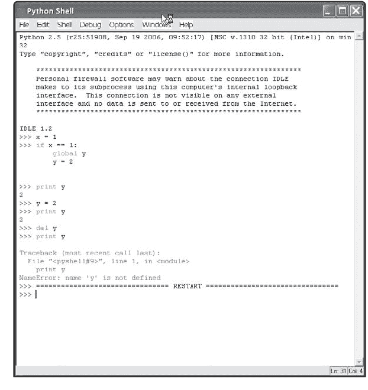

这大致涵盖了作用域的概念，在我们进入实际编码之前，在本章中只剩下最后一个主题要讨论。所以，让我们进入最后一个主题：操作符的概念。

## 第 2 章 Python 语言概览

## 操作符

Python 中有两种操作符，和大多数语言一样。首先是一元操作符。一元操作符是那些作用于单个值的操作符。一元操作符有：

- `~` : 位取反操作符
- `-` : 负操作符
- `+` : 正操作符

后两个是非常自言易懂的。如果你有一个值并对其应用负操作符，你会得到一个结果（假设该值是数值类型）。同样，如果你有一个值并对其分配正操作符，你会得到 ~ 呃，实际上，你得到的是相同的值。正操作符实际上用于你想要强调某物是正数的情况。即：

```
>>> x = 1
>>> y = +x
>>> print y
1
>>> x = -1
>>> y = +x
>>> print y
-1
>>>
```

另一方面，如果你从未用过 `~` 操作符，它会稍微复杂一点。这里的想法是 `~` 操作符会反转值中的所有的位。这对于某些数学表达式可能有用，但它通常被用于反转值 0 和 -1，用作真和假的数值值。如果是这样，我们执行以下操作：

```
>>> x = 0
>>> print x
0
>>> x = -x
>>> print x
-1
>>> x = ~x
>>> print x
0
>>>
```

正如你所见，`~` 操作符简单地翻转了 x 的位。根据定义，`~(x)` 永远是值 x，无论 x 初始值是什么：

```
>>> x = 123
>>> x = ~(x)
>>> print x
```

这大致涵盖了一元操作符。

二元操作符作用于两个值。标准的二元操作符有：

- `+` : 加法操作符
- `-` : 减法操作符
- `*` : 乘法操作符
- `/` : 除法操作符

对于数值，这些操作符的工作方式正如你预期的那样。然而，有几个值得注意的陷阱和警告。Python 将根据提供的信息假设数据类型。考虑以下示例。

```python
X = 10/3
```

Python 无法知道你在上述语句中意图让数据类型是什么。因此，它将假设两个操作数都是整数，因为没有其他迹象，而且正如你所知的，你不在 Python 中声明变量类型。上述语句的结果也将是一个整数。所以，你得到的不是 3.333 的结果，而是结果 3。如何修复这个问题？这非常简单；只需将一个参数更改为浮点值：

```
>>> x = 10/3
>>> print x
3
>>> x = 10.0/3
>>> print x
3.3333333333333
```

上述操作符还有简写版本，作用于单个变量。例如，假设你想让 x 的值加 1。你可以写成：

`x = x + 1`

然而，Python 提供了一种更好的方法，`+=` 操作符：

```
>>> x = 1
>>> x = x + 1
>>> print x
2
>>> x = 1
>>> x += 1
>>> print x
2
```

同样，所有其他标准操作符都有版本，如表 2-1 所示。

### 表 2-1 Python 标准操作符

| 操作符 | 含义 |
| --- | --- |
| `+` | 加两个值 |
| `+=` | 给变量累加一个值（简写） |
| `-` | 减两个值 |
| `-=` | 从变量中减去一个值（简写） |
| `*` | 乘两个值 |
| `*=` | 变量乘以一个值（简写） |
| `/` | 除两个值 |
| `/=` | 变量除以一个值（简写） |

注意，以上所有操作仅作用于数值类型，这意味着整数或浮点数可以被加、减、乘、除。这不适用于字符串类型。

### 取模操作符

常见的操作符之一（至少在计算机世界之外很常见）是取模操作符。它用百分号 `%` 表示。该操作符在两个值之间进行除法并返回除余数。例如，如果你将 10 除以 3，你会得到结果 3，余 1。如果是这样，我们这样做：

```python
>>> x = 10 % 3
>>> print x
1
```

## 运算符

逻辑运算符通常用于条件语句，例如 `if` 语句。例如，考虑以下场景：你想要一个介于 1 到 10 之间的数字（包含边界）。也就是说，值 1, 2, 3, 4, 5, 6, 7, 8, 9 和 10 是合法的，其他值将被拒绝。你可以编写类似这样的代码：

```python
if x < 1:
    print "Error"
if x > 10:
    print "Error"
## 否则，合法值。
```

当然，这正如你预期的那样运行良好：

```
>>> x = 1
>>> if x < 1:
    print "Error"
>>> if x > 10:
    print "Error"
```

```python
>>> x = -1
>>> if x < 1:
    print "Error"
```

Error

>>>

但是，如果能将这两个条件合并到一个 `if` 语句中，不是很好吗？这样你就能确切地知道自己在测试什么。这是逻辑或（`or`）运算符的完美用例：

```python
>>> x = -1
>>> if (x < 1) or (x > 10):
    print "Error"
```

Error

>>>

如果你恰好以英语作为语言，逻辑“或”并不像你预期的那样。当你写 `x or y` 时，你根据表 2-3 得到结果：

### 表 2-3 逻辑 OR 表

| X | y | x OR y 的结果 |
|---|---|---|
| True | True | True |
| True | False | True |
| False | True | True |
| False | False | False |

换句话说，如果两个表达式通过 `or` 连接在一起，其中一个为 True，结果就是 True。逻辑与（`and`）运算符的工作完全相反。表达式 `x and y` 仅在两者都为 True 时才为 True：

```
>>> x = 1
>>> if x != 2 and x != 3:
    print "X is ok"
```

X is ok

>>>

使用上面的真值表（表 2-3）来处理 `and`，我们得到了以下结果：

### 表 2-4 逻辑 AND 表

| X | y | x AND y 的结果 |
|---|---|---|
| True | True | True |
| True | False | False |
| False | True | False |
| False | False | False |

最后，你有了逻辑非（`not`）运算符。非（`not`）运算符会对它作用的任何对象执行相反操作。所以，如果你说 `not x == 2`，它等同于 `x != 2`。

```
>>> x = 2
>>> if not x == 2:
    print "x is not 2"
>>> if not x == 1:
    print "x is not 1"
```

x is not 1

同样，你可以将 `not` 运算符与 `and`、`or` 运算符配合使用。例如：

```python
>>> x = 1
>>> if not (x == 1 and x != 2):
    print "Hello!"
```

在这种情况下，取表达式 `(x == 1 and x != 2)` 并求值。由于变量 `x` 等于 1，表达式的前部分是 True。由于 `x` 不等于 2，表达式的后半部分也是 True。使用上面的真值表，你可以看到由于 `True and True` 是 True，因此括号内表达式的值实际上是 True。现在，你对该值应用 `not` 运算符。这意味着你取了 True 并将其变为 False。表达式的结果是 False，将导致 `print` 语句不执行。在 IDLE 环境中运行上面的代码可以验证这一点。

## 比较运算符

与所有编程语言一样，Python 提供了一种比较两个值是否相等或不相等的方法。此外，对于数值和字符串值，还有用于检查大小差异、小于、大于等符号运算符。表 2-5 显示了 Python 中有效的比较运算符列表。

### 表 2-5 Python 比较运算符

| 运算符 | 含义 |
| --- | --- |
| `<` | 小于运算符 |
| `<=` | 小于等于运算符 |
| `>` | 大于运算符 |
| `>=` | 大于等于运算符 |
| `<>` | 不等于运算符（已弃用） |
| `==` | 等于运算符 |
| `!=` | 不等于运算符 |

是的，你没读错，有两个不等于运算符。为什么呢？老实说，我真的不知道，不同的语言（如 Pascal 和 C++）使用不同的运算符，在语言创建时同时支持这两种比较简单。注意，`<>` 版本已被弃用，不应在新代码中使用。在这里显示它只是以防你遇到旧代码。

这里是比较运算符使用的几个简单示例，只需让你直观地了解它们在实践中是如何工作的。

```python
>>> x = 1
>>> y = 2
>>> print x < y
True
>>> print x != y
True
>>> print x == y
False
>>> if x < y:
    print "x is less than y"
else:
    if x > y:
        print "x is greater than y"
    else:
        print "x = y"
```

你可以看到，你不仅可以比较两个值，还可以输出比较的结果。最后，Python 处理整数值和浮点值：

```
>>> x = 10.0
>>> y = 9.99
>>> print x > y
True
>>> print x < y
False
```

这就是 Python 比较运算符的快速回顾。

## 位运算符

几页之前，你学习了逻辑 `and`、`or` 和 `not` 运算符。这些运算符作用于逻辑状态。然而，计算机世界处理的是更小的增量，即位（bits）。程序员从小就被教用位来思考。位是单个 0 或 1。在许多应用中，大量数据是存储在位内部的。例如，你可能有一个 16 位的值。例如，在二进制中，值 1 是：

```
0000000000000001
```

值 2 是：

```
0000000000000010
```

值 4 将是：

```
0000000000000100
```

以此类推。在二进制中，值 3 是：

```
0000000000000011
```

现在理解了这些之后，剩下的就非常快了。位或运算符 `|` 是通过确定两个值中任何一个设置的位来工作的。所以，`1 | 2` 是 3，因为结果中第一位和第二位都被设置了。

位与运算符 `&` 是通过确定两个值之间共同的位来工作的。所以，`1 & 2` 是 0，因为没有共同位。`3 & 2` 是 2，因为只有一个共同位，即右起第二位。

最后是位非运算符 `~`：它翻转给定值的位；然而，它的结果并不像你预期的那样，所以可能值得解释一下。

假设你有一个值 0。值 0 由十六个零位表示：

```
0000000000000000
```

如果你翻转这些位，你会得到：

```
1111111111111111
```

现在，你可能认为那是一个非常大的数字，但你错了。实际上，它是一个非常小的数字。原因是计算机使用高位（最左侧位）来表示数值的符号。因此，如果最左边的位设置为 1，则该值为负数。在这种情况下，其余位值的加和为 -2。

听我的，这在目前是有效的。如果你真的想理解负数作为二进制值的表示，可以随时在互联网上查找。只需说，按位取反运算符通过翻转位值来实现这一点的。

## 成员运算符和字符串运算符

在后面的章节中讨论数据集和字符串时，我们将详细介绍成员运算符和字符串运算符。为了完整起见，表 2-6 显示了各种运算符以及其功能的简要描述。

### 表 2-6 Python 中的成员运算符

| 运算符 | 含义 |
| :--- | :--- |
| `in` | 表示给定的集合是否包含某个值。 |
| `not in` | 表示给定的集合是否不包含某个值。 |
| `X[index]` | 返回序列中指定位置的元素。 |
| `X[start:end]` | 返回给定序列的切片。 |

## 身份运算符

最后，Python 包含两个身份运算符。`is` 和 `is not` 运算符用于检查给定变量是否引用另一个变量相同的对象。我们将在书后讨论类和实例时介绍身份运算符。

## 结语

以上就是我们对 Python 语法的简要介绍。到目前，你已经有了足够的信息来在这门语言中变得“小危险”了。我们旅程的下一站是检查 Python 环境提供的工具，研究如何使用编辑器、命令行编译器和文档。我们将查看如何创建 Python 文件以及如何在解释器中运行它们。我们还将简要查看 Python 的结构，包括模块、包和文件。

## 第 3 章 工具

木工没有锤子、锯子和钻头就无法创作艺术品。电工没有电路测试器就无能为力。政治家没有剧本作家就无可救药。这些东西有什么共同点？简单——它们都是专业人士完成工作的工具。Python 程序员的工作是创建、维护、增强和调试 Python 应用程序。与其他任何职业一样，Python 程序员需要工具来完成他们的任务。在本章中，我们将查看一些已经内置在 Python 发行版中的工具，将在你对 Python 职业的不懈追求中使用。

此外，我们还将探索实际上随标准发行版一起提供的工具。有很多第三方库、包和工具可以与 Python 使用，但它们是外部资源的主题（例如网站评论），因为它们往往变化非常快且变动频繁。请参阅第 1 章列出的网站，以获取查找其他 Python 工具和库的良好列表。

## IDLE

在 Python 开发过程中可能使用的所有工具中，IDLE 到目前是最常用的。IDLE 集成化开发环境提供了语法高亮、Python 脚本的加载和运行、调试功能、集成帮助以及许多其他能够帮助你编写高质量 Python 代码的功能。IDLE 环境是专为 Python 创建的，与编辑和运行代码的其他选择相比，有了巨大的改进，它应该是你使用工具时的首选。

实际上，你并不真的需要使用 IDLE，除非你对此有此倾向。Python 的核心在于灵活性，所以如果其他工具对你来说更熟悉，你可以使用它们。流行的 UNIX 编辑器 Emacs 以及许多其他常用编辑器都有 Python 语言模板。通过使用你喜欢的编辑器配合命令行解释器/编译器，你可以随心所欲地编辑和运行 Python 脚本，而无需学习 IDLE。如果这是你的选择，请随时跳过本节，阅读关于语言工具的其他功能，或者直接跳到下一章阅读关于语言本身。

为了开始讨论，让我们查看 IDLE 环境。图 3.1 显示了当你首次加载它时 IDLE 编辑器的外观：[开始 -> 所有程序 -> Python 2.5 -> IDLE (GUI)]。IDLE 应用程序在 Windows 端被称为 `pythonw.exe`，不要与命令行编译器 `python.exe` 混淆。

图 3.1 IDLE 编辑器


在讨论 IDLE 菜单的功能之前，重要的是，IDLE 识别两种“模式”。首先是“立即模式”（immediate mode）。在这种情况下，一旦输入了语句并按下回车键，解释器就会立即执行。例如：

```
x = 1
```

按下回车键将立即在解释器中创建变量 `x`。同样，输入 `print` 并按下回车键将立即显示 `x` 的值。IDLE 识别的另一种模式是“编辑模式”（editing mode）。在这种情况下，你将 IDLE 作为文本编辑器，创建一组命令。当你完成并从窗口选择时，解释器才会被调用并执行语句；立即模式语句在关闭编辑器时消失。

现在，让我们看看内置到 IDLE 的功能。让我们简要查看 IDLE 编辑器的菜单结构，以便你对编辑和运行 Python 脚本期间有一个良好的掌握。

### 文件菜单

文件菜单由以下组成：

#### 新窗口 (New Window)

`New Window` 选项打开一个新的窗口，可以使用它创建一个新的 Python 脚本。IDLE 编辑器允许根据内存情况打开许多窗口。如果这是你的偏好，你可以将每个文件保持在独立的窗口中。我们将在以后讨论创建文件时查看此选项。打开新窗口不会调用解释器，你无法在这些独立窗口之一中运行脚本。将它们想象成小型编辑器，并且

#### 打开 (Open)

`Open` 命令加载你过去编写或其他人编写的模块。在模块加载到解释器后，模块内的所有函数和定义对解释器可用（尽管在立即模式下不可用）。这允许你加载给定的 Python 模块并运行其中的某些函数，以测试或实验工作原理，而无需对生产版本的代码进行任何更改。这是一个强大的功能，在编译型环境中并不真正可用。

#### 最近文件 (Recent Files)


# 第 3 章 工具

## 最近文件

`Recent Files` 项实际上只是弹出菜单的占位符，其中包含你最近加载或保存的文件列表。你可以通过从 `Recent Files` 菜单选择来快速地在已加载的文件之间切换。注意当你第一次打开 IDLE 时，此菜单是空的，因为你还没有处理过任何文件。从 `Recent Files` 菜单加载的文件将按照 `New Window` 命令加载到新窗口中。事实上，从最近列表中选择某项等同于选择一个新窗口，然后使用该窗口上的文件菜单加载现有文件。由 `Recent Files` 菜单加载的文件不会自动解释，所以你必须发出 `Run` 命令来加载内存中的函数和数据供解释器使用。

## 打开模块 (Open Module)

我们将在本章稍后部分介绍模块，但现在只需将模块视为 Python 中函数和类的集合。你可以使用 `Open Module` 命令来加载模块，就像你使用文件菜单下的 `Open` 命令加载指定的脚本文件一样。区别在于，`Open` 文件允许你在计算机系统的某处浏览文件；而 `Open Module` 命令获取模块名称，并在 IDLE 编辑器定义的搜索路径中找到它。真正的区别在于，当你知道它在哪里时进行浏览，以及当你知道它的名称时进行搜索。`Open Module` 命令启动一个如图 3.2 所示的对话框，提示你输入要加载的模块名称。

**图 3.2 打开模块对话框**


你可能在好奇对话框所指的 `sys.path` 是什么。我们稍后在查看 IDLE IDE 中的路径浏览器时将对其进行检查。

让我们快速查看模块在 IDLE 中如何工作。在对话框中，输入名称 `pdb.py`。这是 Python 调试模块，你将在本章稍后部分学习它。在这里，你将第一次看到真实的 Python 文件。输入名称并点击对话框中的 OK 按钮。你应该会看到一个显示 `pdb.py` 模块的窗口（见图 3.3）。

模块加载并准备好供你编辑、运行或想对其做的任何操作。同样注意，用于显示文件对话框的窗口与 IDLE 立即模式窗口不同，并且包含了你稍后将学习的其他命令。

**图 3.3 加载到 IDLE 中的 Python 调试器模块**
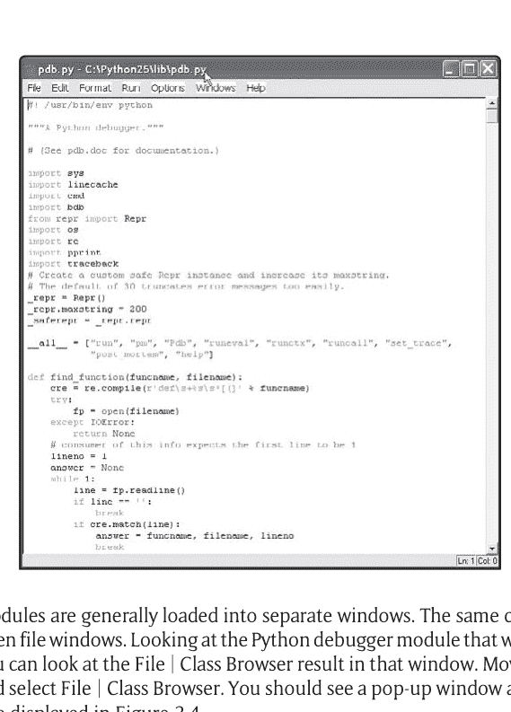

## 类浏览器 (Class Browser)

类浏览器允许你查看 Python 环境中给定类的组成。通常，从主 IDLE 窗口使用类浏览器是没有意义的，因为模块通常被加载到独立的窗口中。打开的窗口中存在相同的命令。查看上一个示例中加载的 Python 调试器模块，你可以查看该窗口中的 `File | Class Browser`（文件 | 类浏览器）结果。切换到 `pdb.py` 窗口并选择 `File | Class Browser`。你应该看到一个与图 3.4 显示的完全相同的弹出窗口。

**图 3.4 为 Python 调试器模块显示的类浏览器**
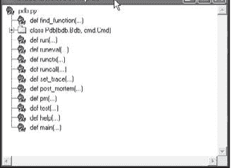

如你所见的，类浏览器对该模块中所有有趣的内容进行了排序。在加载模块时遇到的任何类都会显示出来。在这种情况下，只有一个类，即 `Pdb` 类。你会发现类名左侧有一个小的展开框。点击该框将展开类定义并向你显示类中的所有方法。此外，在类定义之外，还有一份在模块全局作用范围内找到的函数列表。例如，在类浏览器的顶部，你会看到一个名为 `find_function` 的函数定义。先不要担心理解 Python 中函数是如何工作的，因为我们将在第 7 章对创建和使用函数进行更深入的讨论。

关于类浏览器的最后一点：类浏览器最棒的功能之一是，它可以从函数定义直接跳转到实际模块文件中的源行。在类浏览器中，只需双击你想检查的函数名即可。图 3.5 显示了此的一个示例。在这种情况下，我在类浏览器中选择了 `reset` 函数并双击了它。它在窗口中打开了 `pdb.py` 文件（我将其关闭了），并将光标移动到定义 `reset` 函数的那几行。这可以是导航模块中源码的一种非常方便的方法，或者可以从你上次会话中断的地方继续工作。

**图 3.5 用于导航的类浏览器**
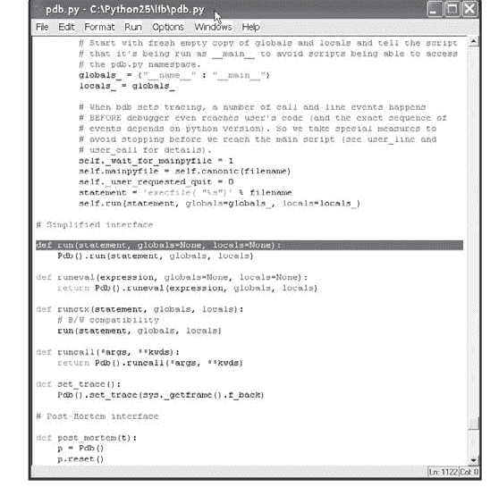

噢，还有最后一点现在不重要，但对你以后可能很重要。类浏览器和 Python 的其他部分一样，通过解释源代码工作。这意味着它会尽力解析给定的源模块并提取该模块中的所有函数和类。这一切真正非常好的副作用是，类不需要完整，也不需要正确编译即可将其加载到类浏览器中。因此，你可以轻松使用类浏览器处理你的进度。我相信随着学习的进行，你会喜欢这个功能的。

## 路径浏览器

啊是的，路径的乐趣。Python 系统使用 `sys.path` 值来确定加载模块和搜索内容的根目录。例如，在 `Open` 菜单选择中，`sys.path` 路径用于定义本地系统上的目录和你的查找内容的网络路径。现在，你可能会想这些信息来自哪里。IDLE 应用中没有定义系统路径的设置，但路径浏览器完全是另一回事。在我们介绍路径浏览器之前，让我们快速查看 `sys.path` 变量，并确定它的位置以及如何。

在 Windows 环境中，特别是对于 Python 2.5 安装，有一个注册表项用于确定将用于安装的路径。你可以在注册表的以下位置找到此键：`HKEY_LOCAL_MACHINE\Python\PythonCore2.5\PythonPath`

此外，你会在那里找到路径，以及文档路径和启动时加载到系统中的模块。通常情况下修改这些值不是一个好主意，因为它们的大部分也可以在注册表之外进行修改。

对于 `sys.path` 变量的特定示例，你可以在系统中设置一个环境变量，以修改 IDLE 编辑器（以及 Python 解释器）用于搜索模块时使用的路径。该环境变量名为 `PYTHON_PATH`，预期包含一个由分号分隔的目录路径列表。你可以将此环境变量放在系统环境或你的本地用户环境中，IDLE 环境将能够正确地找到它。请注意，更改此变量需要你重启 IDLE 环境或重新加载它。

最后，你可以通过放置在 Python 目录中的 `.pth` 文件来更改路径。`.pth` 文件包含了一个从其存储目录开始的子目录列表，用于搜索模块。例如，假设你 Python 2.5 的 Python 目录在 `c:\Python25`。在该目录中，你有一个名为 `MySource` 的目录，你想将你创建的文件添加到通用搜索路径中。让我们看看如何正确执行操作。

首先，在 `c:\Python25`（或你在系统中安装 Python 的任何目录）中创建 `MySource` 目录。接下来，打开路径浏览器。你应该能看到类似于图 3.6 显示的内容。注意，`MySource` 目录没有在列表中。

**图 3.6 路径浏览器的初始显示**
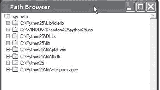

现在，我们将在主目录（`c:\Python25`，或你安装系统的目录）中创建一个新文件。使用你喜欢的文本编辑器，甚至使用 IDLE 本身，创建一个新文件并将其命名为 `MySource.pth`（path 代表路径）。将以下几行放入文件中：

```
### Add MySource to the main path
MySource
```

保存文件并关闭它。确保你关闭了 IDLE 环境；然后重启它。重新进入路径浏览器对话框，你会发现 `MySource` 目录现在已添加到可搜索路径列表中。你可以对任何数量的路径重复此操作，只需通过向 `.pth` 文件添加这些行，或者在主目录中创建一个新的 `.pth` 文件即可。

> **关于无效路径的警告！**
>
> 如果你添加了不存在的路径，IDLE 在你尝试从该路径导入模块之前不会显示错误。始终检查你的路径是否正确。

### 路径浏览器对话框

现在你理解了什么是路径，值得提到的是路径浏览器本身用于显示你 `sys.path` 中的所有目录。这是查看 Python 在哪里查找你的模块的一种非常有用的方法。

## 另存为 (Save As)

`Save As` 功能与 `Save` 功能相同，但会更改输出文件名。加载到环境中的原始文件不会受 `Save As` 的影响，除非修改了文件名或文件扩展名，除非你保存为相同的名称。与已存在的其他文件保存相同的名称是可以的；你会收到提示该文件已存在。

## 另存为副本 (Save Copy As)

`Save Copy As` 功能与 `Save` 功能完全相同但有一个明显的区别。当你使用 `Save As` 时，不仅是以新名称保存的文件，内存中维护的副本也会被重命名为该名称。也就是说，当你对 `test.py` 执行 `Save As`，对文件进行了一会儿操作，然后点击 `Save` 时，磁盘上的 `test.py` 文件将被更新。使用 `Save Copy As` 功能时，当你将 `test.py` 文件保存为 `test1.py` 然后修改文件时，下次点击 `Save` 时，它将保存为 `test.py` 而不是 `test1.py`。这很少值得提及，但对于如果你选择了错误的文件并回去处理它，可能会导致困惑的结果。

## 打印窗口 (Print Window)

打印窗口功能看起来很简单，不是吗？你点击主窗口，点击“打印窗口”，窗口的内容就会打印出来。唉，遗憾的是，并不简单。Python 缺乏直接打印到 Windows 打印机的能力。因此，系统会启动文本编辑程序（Windows 记事本），将文本加载到其中，然后调用记事本的“打印”命令进行打印。你可能认为这没有区别，但其实是有的。其一，记事本假设已安装了默认打印机。如果你的系统没有默认打印机，或者默认打印机未启用或未运行，你的打印任务将不会显示在打印机上。更糟糕的是，你会收到一条关于 RPC 服务器正在运行而不是打印机的奇怪消息。如果你恰好看到这条消息，你现在就知道发生了什么了。

如果安装了默认打印机，或者你正在非 Windows 平台上运行，当前窗口的内容将以纯文本的形式、默认的字体和颜色发送到打印机。

## 关闭 (Close)

关闭按钮将关闭它所使用的窗口。如果在主窗口上使用关闭按钮，其行为与选择“退出”（`Exit`）相同。

## 退出 (Exit)

退出按钮将关闭所有 Python IDLE 窗口并退出应用程序。IDLE 不会提示你保存工作，因此如果你不想丢失当前编辑缓冲区中的任何内容，需要在选择退出或关闭之前进行保存。

## 编辑菜单 (Edit Menu)

IDLE 上的编辑菜单包含以下选项：

### 撤销与重做 (Undo and Redo)

“撤销”（`Undo`）和“重做”（`Redo`）是计算机世界中非常容易理解的术语。如果你犯了错误，可以点击撤销按钮将文档恢复到之前的状态。在 IDLE 中，撤销和重做仅在当前语句的范围内有效。这意味着，一旦你完成了一个 Python 语句，撤销功能就会失效。所以，如果你在某行上输入 `print x` 然后点击撤销菜单选项，它会删除你最后输入的字符“x”。再次点击它会删除空格。点击第三次会删除“print”单词。撤销并不一定像你想象中那样直观。

同样，重做的操作与撤销完全相同，但顺序相反。如果你在没有按回车的情况下输入了 `print x`，然后点击三次撤销，你将得到一个空行。如果你点击三次重做，该行将再次回到“print x”。当然，在中间的任何位置都会导致“print x”行出现部分内容。

遗憾的是，即使你有一行空行且没有对其做过任何操作，你仍然能看到撤销和重做菜单选项处于可用状态。

### 剪切、复制和粘贴 (Cut, Copy, and Paste)

剪切、复制和粘贴操作将从编辑缓冲区复制或移除内容到剪贴板。对于剪切和复制，当前选中的内容将被复制到剪贴板中。对于粘贴命令，当前剪贴板中的任何内容都将放在当前光标位置的编辑缓冲区中。注意，IDLE 并不在乎当前位置粘贴一个块是否有意义，如果你从另一个文档中复制并粘贴到 IDLE 环境中，你可能会得到想要的内容，也可能由于错误消息得到完全的垃圾内容。最好尽可能简单、自然地使用这些功能。

IDLE 实现的“标准”Windows 复制和剪切功能与标准功能的一个区别在于，当只选择一项时。在这种情况下，大多数 Windows 应用假设你想复制（或剪切）整行。然而，IDLE 假设你只想复制（或剪切）选中的内容。如果你选择一个文本块并复制（或剪切它），然后选择另一个文本块并粘贴，粘贴的文本将覆盖高亮文本。

### 全选 (Select All)

选择编辑器窗口中的所有文本。

### 查找 (Find)

打开查找对话框，用于在当前窗口中搜索文本。

### 替换 (Replace)

打开替换对话框，用于在当前窗口中查找并替换文本。

### 跳转到行 (Go to Line)

正如命令名称所示，“跳转到行”菜单选项允许你跳转到编辑器窗口内的特定行号。


作为一名程序员，你在这里可能会尝试做一些愚蠢的事情，比如在对话框中输入非数值或负值，因为 IDLE 的编写者比你那聪明得多。如果输入的值超出范围，它只会向你发出蜂鸣声并忽略它。如果你尝试输入非数值，你将看到一条错误消息，提示你只能输入数值。抱歉。

## 显示调用提示

这个听起来很简单的函数在 IDLE 编辑器中为你提供了一些非常实用的功能。如果你正在处理 IDLE 能够识别的函数，例如从外部源加载到编辑器的函数，或者在你正在编写的当前模块中定义的函数，你可以为该模块启用调用提示。调用提示是一个小弹窗，它会显示相关信息而不会阻碍你的操作。例如，如图 3.9 所示。

图 3.9

调用提示窗口显示

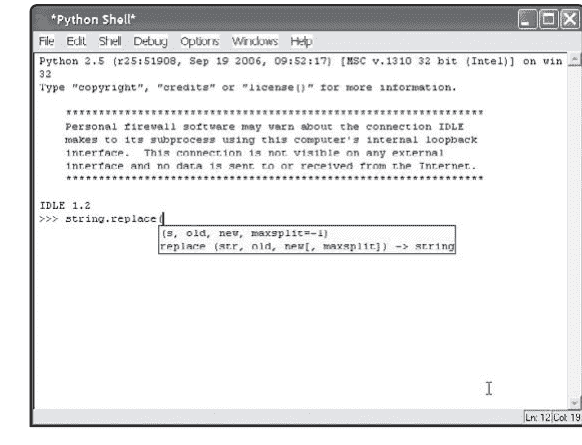

从图 3.9 的显示可以看到，会弹出一个小窗口，指示系统期望为 Python 的 `string.replace` 函数看到哪些信息。当你忘记某个特定函数应该使用的参数数量或顺序时，这会非常有用。与一些较新的 IDE 系统不同，IDLE 默认不允许你通过调用提示窗口输入内容。不过，这并不会让该功能变得不可用。

## 显示补全

IDLE Python 2.5 编辑器的较新功能之一是在编辑器中添加了补全显示。当你启用显示（默认是关闭的）时，编辑器会弹出一个小列表框，允许你查看你已输入字符串的可能结尾。这不仅适用于类中的内置函数，也适用于编辑器内部的普通打字。例如，让我们看看图 3.10，它展示了该功能工作原理的一个良好示例。

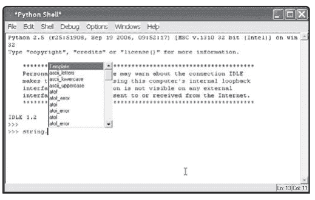

图 3.10

Python 中的编辑补全。

如果你习惯在一些更流行的商业开发系统中工作，你可能以前见过这种功能了。它让你程序员少去思考某些东西的拼写方式以及特定功能或关键词的确切措辞，更多地思考编写代码来完成手头的任务。如果真的有人对这个编辑器收费，单单这一功能就让 IDLE 值得购买。而你可以免费获得该功能和编辑器，这说明了 Python 对开发者来说是多么惊人的划算。

要使用该函数在源代码中插入关键字或函数名，只需使用上、下方向键选择你想要的单词并按 Enter 键。弹出列表将消失，该单词将插入到编辑器中当前的光标位置。

## 显示外层括号

这也是 IDLE 2.5 中的一个新功能，而且非常好用。“显示外层括号”功能将允许你输入诸如 `x = 1 + (2*3)+4` 这样的表达式，并看到行上匹配的括号对。当你启用此功能时，当你输入括号时，编辑器会自动高亮这两个括号。当你处理带有许多括号的复杂表达式时，这简直是救命稻草。你不再需要坐在那里数右括号的数量，以判断表达式的括号数量是否正确。通过观察右括号与哪个左括号匹配，你就知道还需要添加多少个。对于我们那些工作过 Lisp 等语言的人来说，这个功能让其他一切体验变得轻松。

作为括号匹配函数的简单示例，请尝试以下操作。首先，输入这样的表达式：

```python
x = 1 + ( 2*(3+4) + (4*5) + 6 * ( (1+2) **(1+2) )
```

现在按 Enter。你会注意到编辑器继续缩进该语句，而不是在立即模式下执行它。这是为什么呢？因为我们没有正确数量的左括号和右括号。（注：原文中多处重复的 OCR 错误已在翻译时清理）

对于程序员来说，在调试系统时，另一个重要的考虑是重启解释器，以确保在运行程序之前解释器处于“干净”状态。这可以帮助你识别由于你一直在摆弄解释器并运行依赖于某些设置的程序而产生的问题。如果你第二次运行程序没有看到相同的行为，很可能你只是在内存中留下了垃圾，需要清理一下。这可能是你的应用程序依赖于你未察觉的事物，引起了关注并应该检查代码。

## 调试菜单

IDLE 2.5 解释器的下一个菜单是调试菜单。该菜单包含与运行、调试和维护现有代码相关的命令。菜单上的可用命令如下。

## 转到文件/行

此选项看起来与 Edit 菜单中的 Go to Line 。实际上大不相同。首先，在 IDLE 编辑器以立即模式打开且没有模块的情况下，选择该菜单项。你会看到如下错误消息：

你指定的行看起来不是有效的名称加行号。

好吧，这听起来像废话，对吧？实际上，它所说的完全正确。

## Shell 菜单

Shell 菜单只有两个选项，但都很有用。

## 查看列表

此命令会将 Shell 滚动到上一次选择的位置。

## 重启 Shell

重启 Shell 会删除所有变量、清除函数定义并卸载自动加载的模块。此外，内存会被清除，所有断点都会重置。重启 Shell 有很多原因，包括不确定变量是否已修改。在缓慢或内存有限的环境中，这可能是一个缓慢且痛苦的过程，而重启要简单得多。

## 扩展单词

扩展单词功能是自动补全的一种。

（注：原文内容）你可能记得以前我们看过了 Find in Files 命令。该命令（以及其他命令）会生成包含特定语句或字符串的文件列表和行号列表。寻找此类信息的另一个地方是解释器在解析函数或类的解释行时遇到无效标记时所显示的错误信息中。

让我们回到并重新运行 Find in Files 命令，在当前目录及其子目录下的所有 Python (*.py) 文件中搜索“copyright”。

# 第 3 章 工具

运行命令后，将出现一条类似于图 3.11 所示的消息。注意这是一个文件列表，其中包含行号以及搜索单词 `copyright` 的字符串。奇怪的是，你还会发现“在文件中查找”（Find in Files）窗口并不包含任何“调试”（Debug）命令，在任何窗口下也没有“跳转到文件/行”（Go to File/Line）命令。这看起来有点傻，不是吗？这里显示的带有行号的格式正是“跳转到文件/行”命令所期望的格式。不过，一切并非没戏，你只需将感兴趣的行复制到输出窗口，然后粘贴到 IDE 编辑器窗口；最后使用命令找到被搜索的文件。

图 3.11

输出中的查找结果。

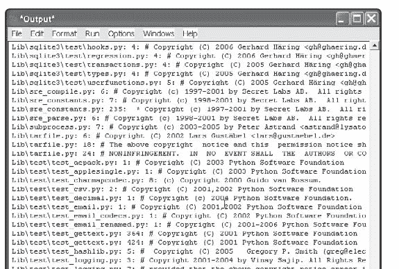

看到了吗？Python 并不完美，但当你考虑到它们时，它提供了某些解决方法。这就是一个伟大系统的标志。

## 调试器

几乎所有良好的环境都包含某种工具，允许开发者在源代码运行时追踪问题。许多问题只在程序运行时才会发生，这时可以通过不断打印内容来解决。我们稍后会花更多时间讨论调试器，但现在，你可以看到调试器中为你提供了哪些工具。图 3.12 显示了调试控制窗口以及其中提供的各种选项。

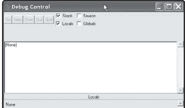

调试器提供了所有调试器都具备的常用命令：设置断点的能力、单步执行代码、进入和退出函数的能力，以及通过退出调试器来重启应用程序的能力。此外，你还可以查看变量值并查看应用程序中的全局值。

对于那些过去使用过或至少尝试过 Python 的人来说，调试器一直可用，并被称为 `pdb` 模块。当前版本 Python 2.5 现在已将调试器集成到了它所属的 IDLE 环境中。

## 堆栈查看器

毫无疑问，程序员最感到烦恼的事情就是程序崩溃时没有任何实际的指示说明原因。在 Python 中，异常处理是语言的内置部分，因此程序员在发生错误条件时抛出异常是自然的。遗憾的是，如果在你之前的程序员没有正确捕获异常，程序往往有一种烦人的倾向，直接中止并把你抛回 IDLE 编辑器。这并不意味着有用；编辑器会告诉你异常是什么以及可能发生的位置，但如果不知道如何到达异常发生点，这些信息通常是极其没用的。

堆栈查看器将显示堆栈跟踪信息，指示如何到达上一次异常点。如果你从未尝试过回溯应用程序，这可能比我所能解释的更有用。在书中以后探索异常和异常处理时，我们一定会用到这个查看器。

## 自动打开堆栈查看器

“自动打开堆栈查看器”菜单选项是一个开关，表示在发生异常时是否自动打开堆栈查看器。你可能认为这是一种设置一次就可以不管的类型，但遗憾的是。每当你关闭 IDLE 时，编辑器都会“忘记”你为此选项设置的设置。因此，每次启动 IDLE 时，记得开启它——它本应该默认开启的。这是一个非常实用的功能，不使用可惜，而且事后记住开启它会迫你经历很多额外的步骤才能找出哪里出了问题。

和大多数编辑器一样，IDLE 编辑器允许你对添加、修改或显示代码的方式配置任何内容。所有可配置项都可以在“选项”菜单下找到。

## 配置 IDLE

IDLE 环境具有高度的可配置性。它提供了更改系统几乎所有键绑定、颜色和行为的方法。这些都在配置框内完成。当你从菜单中选择“配置 IDLE”选项时，你将看到以下对话框及内容。

图 3.13

IDLE 配置-标签页

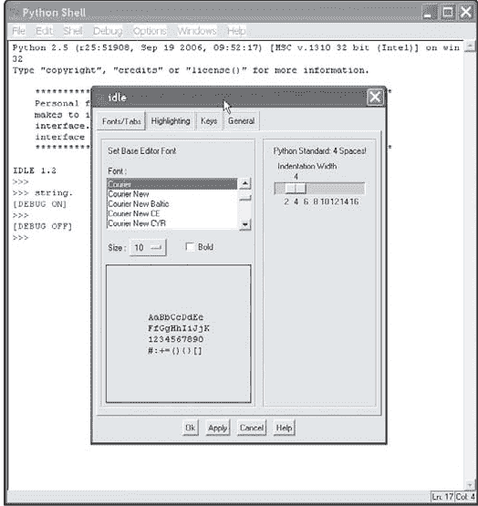

# 第 3 章 工具

通用选项卡中的大多数选项都非常直观，几乎不需要注释。第一个选项简单地告诉你在启动 IDLE 时显示哪个窗口，第二个选项询问你是否希望在运行脚本之前让系统保存你的工作。如果你没有设置自动保存工作，IDLE 会在运行脚本之前提示你。这样做的原因显而易见：如果你执行了某些糟糕的操作并导致解释器崩溃，你的工作将永久丢失。如果你在运行之前保存了它，这个问题就不是问题了。

窗口大小是一个默认值。你可能可以保持原样，除非你是在特别特殊的环境中运行程序。选定的大小大约是屏幕的一半。页面重格式宽度简单指页面换行到下一行之前的字符宽度。默认编码是一个很有意思的选项。Python 的编码方案是你在你存储的文件中想要使用的字符。通常情况下，你会使用纯文本，因为在不同的操作系统之间纯文本的移植性最好。然而，如果你要在脚本中显示属于不同字符集的字符（例如不同的语言），你可能需要选择区域（locale，这是 Windows 系统设置）或使用 UTF-8（这是所有操作系统的宽字符标准）。请注意，Python 代码本身任何时候都是纯文本。

额外帮助源列表需要一些解释。如果你在 Python IDLE 环境中使用第三方库或工具，你可能想要包含这些工具自带的帮助文件。要做到这一点，只需点击额外帮助列表框右侧的“添加”按钮。Python 将在每次启动时加载这些帮助文件。

Python 中的窗口是变化的。第一个条目会将主窗口的高度更改为与屏幕相同。之后，会维护一个窗口列表，对应于 IDLE 编辑器中可用的所有独立窗口。例如，如果你在文件中进行搜索，IDLE 编辑器环境将显示一个输出窗口。此窗口将添加到主屏幕窗口菜单的底部。

IDLE 主菜单上的最后一个菜单是帮助菜单。该菜单包含三个更多帮助条目。第一个“关于 IDLE”简单地为你提供系统版本信息。图 3.17 显示了 IDLE 关于框的示例。

关于框框中最有趣的信息是用于实现和运行 IDLE 环境的 Python 和 Tk 版本。在这种情况下，如所预期的，Python 版本是 2.5，因为这是安装并运行的版本。Tk 版本（Python 用于创建窗口应用程序的 GUI 组件版本）是 8.4。为什么会有差异？嗯，由于 Tk 的出现时间比 Python 更早，而且更成熟。另一方面，Tk 的变化频率比 Python 更高。

哦，关于这个屏幕的最后一点说明。你会注意到 IDLE 的实际名称被显示了出来。关于这个名称的来源有很多争议，IDLE 的同事们决定：

# 78

## IDLE

图 3.17

IDLE 关于框

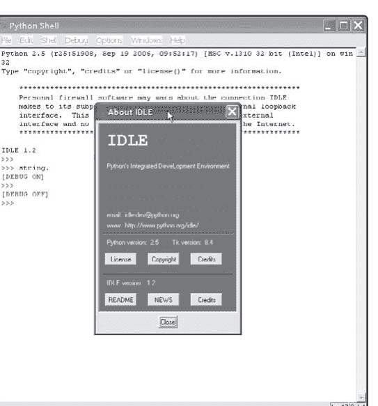

实际上揭示了秘密。IDLE 代表集成开发环境。如果你认为让这个特定的缩写具有这个含义并不牵强，那你真的没有留心。

## 编辑窗口

IDLE 环境中还有许多窗口，我们将在涉及到它们时讨论大部分窗口。至少目前，最重要需要考虑的窗口是编辑窗口。要进入编辑窗口，请从 IDLE 的主菜单中选择“文件 | 新窗口”。你应该看到一个与图 3.18 显示非常相似的窗口。

编辑窗口的大部分菜单和功能与 IDLE 解释器窗口非常相似，甚至是完全相同的。区别主要在于在系统中实际编写和运行代码的功能上。编辑窗口设计用于帮助你编写代码、编辑代码和维护代码。另一方面，解释器窗口通常设计用于解释 Python 语句并显示这些语句的结果。解释器窗口确实可以用来编写代码，但并不是它最擅长的。当你编写要部署到系统的实际 Python 脚本时，最好使用代码编辑器窗口。

79

# 第 3 章 工具

图 3.18

IDLE 编辑窗口。

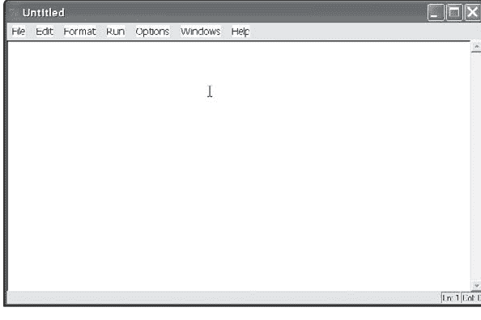

代码编辑窗口与解释器窗口之间最大的区别在于标记为“格式”和“运行”的两个菜单。正如我们很快看到的，还有其他差异，但这两个是我们在在本章中集中大部分精力的地方。

## 格式菜单

顾名思义，该菜单用于根据你的意愿格式化 Python 代码。格式菜单中的选项如下。

### 缩进区域

正如我们反复提到的，Python 的核心在于缩进。因此，你将希望能够控制哪些部分被缩进，哪些部分没有缩进。缩进命令简单是将选定区域向右移动一个制表符。如果你正在取一段代码块并将其放在条件语句（如 `if` 语句）或循环结构中，你可能会这样做。你可以根据需要多次对一个区域进行缩进，因为缩进不会取消该区域。缩进行为取决于缩进设置，该设置在主窗口中进行。

### 取消缩进区域

不用多说，取消缩进功能与缩进功能相反。当编辑器应用该选项时，选定的代码块将使用此函数取消缩进。如果代码块已经在最左侧边缘，则该命令不会产生任何影响，除了编辑器的警告。

然而，与缩进命令不同，取消代码块缩进可能会导致问题。记住，缩进级别决定了代码块“属于”什么以及如何执行。将一个代码块从缩进块中移动出来会导致它在块结束时执行，更重要的是，取决于封装该块的条件或循环是否会被执行。

例如，假设我们有一个执行某些操作的循环。它可能像这样：

```python
for i in range(1,10):
    if i & 1 == :
        print "The number is odd"
        print "This number is ", i
```

不用担心代码是如何工作的。我们将在接下来的几章中讨论这个问题以及循环的许多其他特性。重点是，循环内部缩进的代码在 for 循环运行时都会执行。现在，如果我们通过对最后一行取消缩进来修改此代码块，如下：

```python
for i in range(1,10):
    if i & 1 == :
        print "The number is odd"
print "This number is ", i
```

我们从这个块得到的结果与原始代码块完全不同。原始块在 IDLE 解释器中运行时，将输出以下内容：

The number is odd

The number is odd

The number is odd

The number is odd

The number is odd

This number is 9

The number is odd

This number is 1

## 第3 章 工具

数字是 2

数字是奇数

数字是 3

数字是 4

数字是奇数

数字是 5

数字是 6

数字是奇数

数字是 7

数字是 8

数字是奇数

数字是 9

如你所见，这段代码简单地打印了从 1 到 10 的数字，并指示哪些是奇数，哪些不是。它完成了任务，并不华丽。然而，当我们取消最后一行代码的缩进时，我们从脚本片段中得到了以下输出：

数字是奇数

数字是奇数

数字是奇数

数字是奇数

数字是 9

如你所见，缩进产生了巨大的影响。哦，这里最后一点说明：你无法直接在解释器中输入第二个代码块。如果你尝试这样做，将会得到一个错误，提示缩进级别不匹配。这是因为解释器是通过一次处理一行来工作的。如果你想运行这个脚本片段，你需要将其输入代码编辑器窗口并保存；然后在解释器中运行它。

### 注释区域

调试应用程序的标志之一就是删除代码，直到找到错误语句。Python 也不例外这一规则。你经常发现自己想看到问题发生在哪里，而最简单的方法就是删掉所有代码，直到问题消失。或者，你可能有一块代码执行了某些你不希望它执行的操作，或者你还没准备好执行它。在任何一种情况下，你通常会发现有一次性注释掉整个代码块。“注释区域”命令正是为此为你设计的！想象一下，例如，你的应用程序中有如下一组 Python 代码：

```python
x = 1
y = 2
z = 3
print "x = ", x
print "y = ", y
print "z = ", z
a = x + y * z
print "a = ", a
```

当你在解释器中运行这段代码时，你会在控制台窗口中看到如下输出：

```
x = 1
y = 2
z = 3
a = 7
```

显然，我们在这里显示了大量信息。例如，前三个 `print` 语句只是为了显示我们计算“a”的小等式的输入可能是什么。在我们最初编写应用程序时，我们可能想看到这些，但在调试时也想看到，但在系统的实际“运行”期间则不需要。所以，与其删除这些行，我们现在想将它们注释掉。要这样做，选择变量 `a` 赋值语句以上的三个 `print` 语句，然后点击“注释区域”菜单选项。之后你应该会在代码编辑器中看到代码：


## 取消注释区域 (Uncomment Region)

正如你从这里的趋势推测的那样，IDLE 的创建者在实现功能时非常喜欢完整性。如果有方法做某事，就有办法撤销它。对于“注释区域”函数，对应的镜像函数当然是取消注释区域。使用我们上一个代码块的示例在“注释区域”函数中应用“取消注释区域”（Uncomment Region）命令，结果如下：

```
x = 1
y = 2
z = 3
print "x = ", x
print "y = ", y
print "z = ", z
a = x + y * z
print "a = ", a
```

不知为何，我真的认为这会是一个巨大的惊喜。当你放回在上一步中注释掉的一大块代码时，使用“取消注释区域”是完成任务的一种快速简单的方法。

你可能会好奇的一点是，“取消注释区域”对你自己手动注释的代码有效吗？答案是肯定的。如果我通过这种方式注释掉了一行代码：

```
# x = 1
```

那么，如果我选择该行并按下“取消注释区域”菜单选项，该行将重新变为正确的代码：

```
x = 1
```

一个警告：如果你有一行前面带有空格的注释代码，那么：

```
# x = 1
```

如果你“取消注释”它，你将保留前面的空格，这可能会导致缩进问题。这一点需要注意。

## 区域制表表化 (Tabify Region)

`Tabify` 命令使用用户在格式化时指定的制表符设置对代码块进行重新格式化。本质上，`Tabify` 函数允许你在局部范围内覆盖编辑器自动为你做的操作。例如，假设你在编辑器中输入了以下代码块：

```
x = 1
y = 2
for i in range(1,10):
    print "i = ", i
    if i & 1:
        print "I is odd"
    else:
        print "I is even"
```

假设你使用了 `Tabify` 命令，编辑器会将空格转换为制表符（tabs）。如果你想撤销此操作，可以使用“取消制表区域”（Untabify Region）。

## 区域取消制表 (Untabify Region)

`Untabify` 命令使用用户在格式化时指定的制表符设置对代码块进行重新格式化。本质上，`Untabify` 函数允许你在局部范围内覆盖编辑器自动为你做的操作。例如，假设你在编辑器中输入了以下代码块：

```
x = 1
y = 2
for i in range(1,10):
    print "i = ", i
    if i & 1:
        print "I is odd"
    else:
        print "I is even"
```

假设你使用了 `Untabify` 命令，编辑器会将制表符转换为空格。如果你想撤销此操作，可以使用“区域制表表化”（Tabify Region）。

## 切换制表符 (Toggle Tabs)

`Toggle Tabs` 命令是一个简单的功能，用于在缩进制表符和空格之间切换。如果你正在处理使用制表符的代码但想将其转换为空格，或者反之，这个功能非常有用。该命令可以在格式菜单找到。

## 第 3 章 工具

## 新宽度 (New Width)

`New Width` 命令设置缩进级别。与其进入选项（Options）面板设置缩进级别，你可以直接设置。IDLE 编辑器的一个令人讨厌的功能（或者优点，取决于你怎么看）是，这里的设置只适用于当前的编辑窗口，只要该窗口打开即可。一旦你关闭此窗口，它就会消失。如果你打开一个新的编辑，将使用选项中的默认值。这与在选项中更改缩进级别不同。

## 格式化段落 (Format Paragraph)

格式化段落的功能与 Emacs 编辑器的区域命令完全相同，适用于处理注释块。格式化段落命令不应应用于代码，因为会完全搞乱你的代码风格和缩进级别，并导致代码无法编译（如果有这个词的话）。格式化段落命令的目的是允许你重新格式化注释，使其以单个段落的形式。例如，假设你的文本中有如下注释：

- # 这是一个注释。
- 这是另一个注释，但这个比较长，可能会在自动换行的环境中换行到另一行。

如上所示，注释分成了两行，其中一行太长，实际上无法在编辑器的单行内显示，而会延伸到右侧并需要滚动条。如果你随后对这两行应用格式化段落命令，你会得到：

```
# 这是一个注释。# 这是另一个注释，但这个比较长，可能会在自动换行的环境中换行到另一行。
```

遗憾的是，上述内容将无法编译。你只想在编写的实际文档中使用格式化段落命令，而不是在代码中。Python 开发者被要求编写文档。

除了“格式”（Format）菜单外，“编辑”（Edit）窗口还包含另一个全新的主菜单项，即“运行”（Run）菜单。该菜单包含与编译和运行源代码相关的命令。

## Python Shell

取决于你如何启动 IDLE 系统（参见本章较早对“选项”面板的讨论），当你处于编辑窗口时，可能可见或不可见 Shell 窗口。如果可见，此命令将只需把该窗口置于顶。如果你没有可见的 Shell 窗口，此命令将创建一个并将其置于顶。Shell 窗口与解释器（Interpreter）窗口相同，用于运行脚本和实现即时模式的值。

请注意，在 Python 的当前版本中，没有简单的方法可以在不调用解释器窗口的情况下运行程序或脚本。这在未来的 IDLE 编辑器版本中可能会发生变化，但目前，你可能得习惯 Shell 窗口。它是不会消失的。或者，即使你以 .py 扩展命名文件，你也可以在资源管理器窗口中双击它来启动并抑制控制台窗口显示。这是一个很好的功能，特别是当你想要为用户提供快速简易的工具时。

## Check Module

在解释型语言中，就像在任何编译语言中一样，运行程序实际上有两个步骤。首先，你必须验证代码是否正确。然后才实际运行程序。Python 并不例外这一规则。你必须首先检查你的脚本，以验证它完全符合语言规则。“检查模块”（Check Module）的目的正是为了做这一点。在不实际运行代码的情况下，此命令将检查所有代码是否为有效的 Python 代码。

例如，考虑以下脚本文件：

```
x = 1
y = 2
for i in range(1,10):
    print "i = ", i
    if i & 1:
        print "I is odd"
    else:
        print "I is even"
```

这是一个错误

# 第 3 章 工具

你会注意到，脚本底部有一行明显是错误的文本。它告诉你这是一个错误，那么你（或解释器）怎么会漏掉呢？好了，撇开讽刺不谈，重点是，脚本中可能存在无效代码。现在，Python 中有两种类型的错误。首先，你可以遇到语法错误（syntax errors）。这些是不符合标准的无效代码行。解释器可以在不需要实际运行代码的情况下对进行静态检查。这就是“检查模块”命令的目的。如果代码包含语法错误，解释器将标记该错误，编辑器会将你带回包含错误的那行，并在可能的情况下指示问题所在。代码绝不会被运行，也不会生成任何输出。

Python 环境中的第二形式错误是运行时错误（runtime error）。这些错误是因为你向函数传递了错误数据，或者因为你尝试打开一个不存在的文件或其他类似的情况。解释器无法判断某些内容是否会产生运行时错误，因此这类错误只能通过运行程序找到。

## Run Module

一旦你写好一段 Python 代码，并使用“检查模块”命令检查了语法错误，下一个逻辑就是运行它，看看它是否符合你的要求和预期。“运行模块”命令的设计正是为了实现这一点。当你运行一个模块时，解释器首先检查语法错误，将脚本加载到解释器并逐行执行。如果发生错误（例如抛出未处理的异常），进程将停止并在输出窗口控制台上显示错误。如果进程正常完成，应用程序的输出将显示，解释器返回等待状态。

我们将在本章稍后的部分查看创建一个简单 Python 应用的完整示例。

与其查看编辑窗口的各个菜单来寻找与主解释器（Shell）窗口不同的项。

在编辑窗口的“选项”（Options）菜单下是“代码上下文”（Code context）选项。这是一个可以开启或关闭的开关。打开它会在窗口顶部显示一个不显示任何内容的空白区域。这看起来可能不是最有用的选项，但事实是它确实发挥了很大作用。

代码上下文意味着你在源代码中的位置。当整个源代码列表能够适应编辑器窗口时（正如我们目前为止看过的所有代码那样），事实是它确实发挥了很大作用。


# 第 3 章 工具

## 创建 Python 文件

现在你想创建一个 Python 脚本并运行它。该如何操作呢？嗯，到为止我们已经看到了很多部分，但还没有对这个过程进行端到端的讨论。我们现在就来，这样就不必在书中反复提到一遍了。

1. 确定程序将要做什么。

显而易见，开发软件的第一步是确定你想让软件做什么，但有太多的人跳过了这一步。我们不会深入讨论软件应用程序设计的艺术，因为市上有许多书籍，包括本系列中的一些书籍，可以帮助你进行软件设计。然而，从 Python 的角度来看，你需要决定应用程序将做什么，以及你需要哪些模块来实现该应用程序。

2. 在编辑器窗口中创建一个新文件。

创建一个新应用程序的第一步是创建一个新文件来存储源代码。使用 IDLE，从主菜单中选择 `File` | `New Window`。将显示一个没有标题的新编辑器窗口。该窗口的标题为“Untitled”。

3. 在编辑器窗口中创建应用程序代码。

为了这个简单的示例，你将创建一个简单的应用程序，它会提示你输入名、姓和中间首字母，然后通过你的名字向你问候。你不需要理解它是如何工作的，至少现在不需要，只需跟随操作以感受其中涉及的过程。

在 Edit 窗口中，逐行添加以下代码。注意，当你输入 Python 关键字时，它们会在窗口中被高亮。如果一个单词没有立即被高亮，请返回并检查是否有拼写错误。

```python
fName = input("Please input your first name : ")
lName = input("Please input your last name : ")
mInit = input("Please input your middle initial : ")
sFullName = fName + " " + mInit + " " + lName
print("Hello , sFullName")
```

4. 保存文件。在 IDLE 中保存文件有几种方法，最简单的方法是按下 `Control-S`。这将弹出“Save File”对话框。将文件保存为 `ch3_1.py`（这是我们在第 3 章编写的第一个程序），并保存到你想要存储 Python 脚本的路径下。点击 OK，文件将保存。

5. 运行文件。在代码编辑器中，从 `Run` 菜单中选择 `Run Module`（或按 `F5`）。Python Shell 窗口将带到窗口栈的前端并显示：

```text
Please input your first name:
```

Enter the string: `'Mat'`.

你必须带上引号输入，但使用单引号还是双引号都可以。这是因为如果你在编辑器中直接输入值 `Mat`，它会被视为变量，并因为未定义而报错。一旦按下回车，Shell 窗口将显示：

```text
Please input your last name:
```

Enter `"Telles"` in quotes（或者，如果你足够大胆，尽管输入自己的姓）。按下回车。

Shell 窗口现在会显示：

```text
Please input your middle initial:
```

Enter `'A'` in quotes（或你的中间首字母），按下回车。

Shell 窗口将显示：

```text
Hello Matt Telles
```

然后返回等待状态。

6. 就是这样。你编写并执行了第一个 Python 应用程序。现在你可以随时通过从主菜单选择 `File` | `Open` 并从磁盘操作系统中选择 `ch3_1.py` 文件来重新加载该应用程序。

## 文档

本章最后一个讨论的话题是文档。Python 系统提供三种形式的文档。首先，仅在 Windows 操作系统版本中，我们可以从 IDLE 编辑器的 `Help` 菜单获取编译后的帮助文件 (.CHM)。实际的帮助文件存储在 IDLE 的“Python Docs”菜单选项下。

第二种文档形式存在于解释器内部。这是通过在命令行或 IDLE 的 Python Shell 窗口中输入 `help()` 访问的内置帮助系统。在这个帮助系统中，你可以输入之前见过的主题进行查询。

```python
help()
```

第三种文档形式是在线文档，它是最全面且更新频繁。可以通过 `www.python.org/doc/` 获取。

# 第 4 章 数据类型

Python 中的第二种数据类型我们称为“高级”数据类型。高级数据类型包括类以及这些类的实例，以及由基本类型组成的类型。作为第二种类型的例子，考虑复数数学类型。这种类型由“虚部”部分和“实部”部分组成，用于各种数学和工程计算。它有一种表示形式（通常是如 "4 + 2" 的形式）以及一套与之配套的规则。能够通过用户自定义的类型来扩展语言的能力，是 FORTRAN 和 COBOL 等经典语言与 C++ 或 Eiffel 等更高级语言之间的区别。Python 在这个等式中处于偏向高级的一侧，正如我们将所见的，它具有通过类和函数来扩展自身的能力。

当我们讨论数据类型时，我们会考虑许多方面。首先，必须考虑使用这些数据类型的方法，例如范围和转换。范围是定义值时的允许值范围。例如，数值类型包含所有数字，但不包括字符、字符串或图像。之后，我们将考虑用法的概念。某些类型允许你快速方便地将其值直接转换为字符串。某些类型允许你操作其值的片段，例如之前提到的复数数据类型。而另一些类型允许你定义自己的操作方法来处理它们，例如类。我们将在第 10 章编写函数和类定义时进行更深入的讨论，但现在让我们先看看 Python 中这些类的功能。

## 数值类型

第一类是数值类型。Python 支持两种基本的数值类型：整数和浮点数。

### 整数

整数是整数，其范围取决于运行 Python 的硬件。你可以有负整数、正整数和零（零既不是负的也不是正）。整数支持全范围的算术运算：加、乘、除、减。

第一个问题是：我可以在整数中存储多大的数字？答案取决于你运行的机器。确定你使用的是什么处理器可能会很麻烦。Python 定义了一些常量可用于处理非常大或非常小的数字。对于整数，你最重要的变量是 `maxint` 常量。该常量定义在 Python 的 `sys` 模块中。查看 `maxint` 的值，请在 IDLE 编辑器中尝试以下行：

```python
>>> import sys
>>> print sys.maxint
2147483647
```

理解 `sys.maxint` 的值可能有点困惑。那个数字从哪里来？实际上，它非常简单。机器上的位数决定了你可以存储的最大整数值的大小。要确定最大值，请查看下列表：

- 对于 32 位机器，它是 `(2 ** 31) - 1`
- 对于 64 位机器，它是 `(2 ** 63) - 1`
- 对于 128 位机器，它是 `(2 ** 127) - 1`

要显示 `maxint` 值，你只需要在 IDLE 编辑器中导入 `sys`（或 `system`）模块。`sys` 模块包含了许多特定于操作系统的数据和函数的定义。你可能会认为那里最大的负整数是 `-2147483647`。令人惊讶的是，事实并非如此。事实上，由于二进制数的存储方式，最高值将使用最高位来表示它是负数，这“消耗”了一个位的值，从而使负值变得更小。对于制作 Windows XP 的 32 位系统，整数的范围是 `-2147483648`（包含边界）。你可以将任何此类值分配给数值变量而不会出现任何问题。

### 长整数

Python 还有它所说的长整数。长整数的大小仅限于运行它的机器上的可用存储空间。在 Python 中，通过添加后缀 `L` 来表示长整数，例如：`5000000000L`。长整数使用多个字长来存储其值，因此它们可以持有非常长的数字而不丢失精度。长整数的优势在于你可以存储非常大的数字而不丢失精度。这总是这样吗？嗯，一方面，当你对它进行数学运算时，处理所有数字需要时间。所以，除非你有迫切的理由使用长整数，否则你可能应该坚持普通的整数。

旧版本的 Python 如果一个变量被设置为整数值（没有加 `L` 后缀），且随后被设置为大于 `maxint` 的值，它会显示错误。现在 Python 只需将变量更改为长整数。这是一个非常方便的特性，并且与 IDLE 环境配合良好。为了说明这一点，请考虑以下示例。

重复显示 `maxint` 的练习，但给值加上 1 (`+1`)，这证明了这一点：

```python
>>> x = sys.maxint
>>> x = x + 1
>>> print x
2147483648
>>>
```

尽管编辑器没有费心打印末尾的 "L" 来表示这是一个长值，但它显然比 `maxint` 大，而且没有出现任何问题。

### 浮点数

要分配浮点数，你使用浮点数字面量：

```python
>>> f = 1.2
>>> print f
1.2
```

除了 Python 中的浮点数系统允许你输入非整数之外，浮点数并没有什么令人兴奋的。你可以使用浮点字面量如上所示。你可以对浮点数进行加、减、乘、除。你也可以将整数和浮点数混合使用。例如：

```python
>>> x = 1
>>> y = 2
>>> z = x / y
>>> print z
0.5
```

你可以通过多种方法将整数转换为浮点值。其中，你可以简单地将一个赋值给另一个：

```python
>>> a = 1
>>> b = 2.0
>>> b = a
>>> print a
1
```

你可以使用内置的 `float()` 函数从整数或字符串创建浮点数：

```python
>>> c = float("2.3")
>>> print c
2.3
```

有很多内置函数可以用于浮点数操作。例如，有 `floor()` 和 `ceil()` 函数。这些函数分别返回由给定浮点数所表示的最小和最大整数。下面的示例可能对你有帮助：

```python
>>> import math
>>> x = 4.5
>>> print math.floor(x)
4.0
>>> print math.ceil(x)
5.0
```

`floor` 函数是 `math` 库的一部分，它返回你提供的数值的整数部分。`ceil` 函数返回表示该浮点值的下一个最大整数。任何大于整数值的值都会导致 `ceil` 值为该值加一。注意，要使用 `math` 函数，你必须先在 IDLE 环境中导入 `math` 库：

```python
>>> import math
```

完成此后，你就可以使用库中的函数了，只要在函数前面加上 `math` 并后跟一个点来对其进行完全限定即可。这是 Python 在模块内限定函数的方法。

## 字符串

尽管 Python 用于许多需要大量使用数值类型的数学和工程功能，但目前该语言最常见的用途是需要大量字符串处理的领域。搜索函数、电子商务应用、模式匹配和邮件列表处理，只是你更关心的文本处理而非数字计算的少数领域之一。Python 提供了大量专门用于处理字符串的功能。

### 字符串变量

字符串最明显的用途是字符串的存储、打印和输入。Python 变量可以用于存储字符串。你可以将字符串字面量赋值给变量，将字符串值赋值给其他值，并使用语言内置或 `string` 模块中的各种字符串函数来操作字符串值。这可能是你编写 Python 代码时最常用的模块，因此你应该尽可能地理解它。

要创建一个字符串变量，你通常会给变量赋值一个字面量。字符串字面量是一系列字符，通常封装在引号中。实际上有几种定义字符串字面量的方法。让我们来看看最常见的三种：

#### 封装在引号中

你处理字符串最明显的方法是将内容放在引号中。

例如：

`name = "My name is Matt Telles"`

这创建了一个名为 `name` 的变量，它引用字符串字面量 "My name is Matt Telles"。在 Python 中，你可以使用单引号或双引号来创建字符串：

```python
>>> name_single = 'My name is Matt Telles'
>>> name_double = "My name is Matt Telles"
>>> print name_single
My name is Matt Telles
>>> print name_double
My name is Matt Telles
```

正如你所知，解释器并不在乎你使用哪种形式。这也有例外，例如当你想在字面量字符串内包含单引号时：

```python
>>> name_quote = "This is Matt's string"
>>> print name_quote
This is Matt's string
```

反过来也是行的通：

```python
>>> quote = 'And I, "Hello there" to him'
```

如果你不喜欢这种方法，可以使用另一种方法在字符串内放置双引号：

```python
>>> quote = "And I said, \"Hello there\" to him"
>>> print quote
And I said, "Hello there" to him
```

这种方法反过来也可以。你可以在单引号或双引号界定的字符串内。

#### 跨行

一个跨多行的字符串通常非常有用。无论你是输入某些文本，还是有一个长到单行无法容纳的内容，Python 都提供了将多行文本输入单个变量的方法。实现此最简单的方法是使用行延续符延续到下一行：

```python
>>> aQuote = "This is a really long line that"\
...     "needs to be continued to the next line"
>>> print aQuote
This is a really long line thatneeds to be continued to the next line
```

正如你可以看到，行是延续的，并且不包含任何换行符。如果出于原因，你实际上想延续行并在其中嵌入换行符，只需使用换行转义序列 `\n`：

```python
>>> aQuote = "This is a really long line that\n"\
...     "needs to be continued to the next line"
>>> print aQuote
This is a really long line that
needs to be continued to the next line
```

另一种延续行的方法是在行尾使用反斜杠，这告诉 Python 字符串延续到下一行：

```python
>>> aQuote = "This is a really long line that"\
...     "needs to be continued to the next line"
```

### 字符串拼接

你可以使用加号（`+`）将字符串拼接在一起。例如：

```python
>>> s1 = 'a'
>>> s1 = s1 + 'b'
>>> print s1
ab
```

这会修改字符串 `s1`，因为它被赋值回原始字符串。但是，如果你看这个例子：

```python
>>> s2 = 'b'
>>> print s2 + 'c'
bc
>>> print s2
b
```

你可以看到字符串 `s2` 没有被修改，尽管它在 print 语句中被用于输出一个拼接后的字符串。

顺便提一下，你可能会想 Python 是否包含反向运算符 `-` 或去连接运算符，可以实现类似下面的操作：

```python
s1 = 'abc'
s2 = s1 - 'a'
```

答案是否定的，而且也没有一个 `-` 运算符可以从字符串引用中删除给定的字符或字符串。正如你很快将看到的，利用 Python 提供的字符串功能，实现减法运算符的功能并不困难。

### 重复字符串

Python 确实在所有编程语言中都包含一个独特的运算符。乘法运算符 `*` 应用于字符串时，允许你重复某些次数的字符串。例如：

```python
>>> a = "Hello"
>>> a += 5 * "there"
>>> print a
Hellotheretheretherethere
```

乘法运算符（或重复运算符）“乘以”一个字符串，并产生一个结果，该结果是你所需的次数的字符串拼接。重复运算符可以使用字符串的左侧或右侧：

```python
>>> a += "there" * 3
>>> print a
Hellotheretheretheretheretherethere
```

虽然这看起来像是为了包含一个酷炫的功能而包含运算符的时刻之一，但如果你曾经需要为数据库生成填充后的字符串，你就会意识到这个函数有多么有用。原因在于，你可以使用变量来代替之前显示的字面量值。这允许你根据某些标准用变量数量的空格填充字符串。一个简单的示例展示了这一点：

```python
>>> a = "Test"
>>> i = 10
>>> a += i * " "
>>> a += "done"
>>> print a
Test          done
```

正如你在前面的示例中看到的，我们选择值 10 作为空格的数量，以便在将字符串附加到它之前，对变量 `a` 进行“填充”。但是，假设你想做一些令人兴奋的事情，比如始终将字符串填充到 25 个字符。正如你稍后看到的，有一种方法可以确定字符串的长度。函数配合重复运算符，允许你将字符串填充到任意大小。


# 第 4 章 数据类型

## 字符串

```python
a = 'word'
## 将字符串填充到 25 个字符
l = 25 - len(a)
a += " " * l
```

### 子字符串

当你处理字符串工作时，一个常见的问题是能够提取字符串的一部分。这在处理固定长度的文件时尤为重要，例如，字符串中的每个字符都可能代表其他含义。这种情况的另一个很好的例子是电话号码，你可能想将号码输入为 `212-555-5555`，但然后将其存储为区号 (`212`)，并将号码的其余部分存储在数据库或其他存储机制的单独字段中。Python 为字符串提供了极佳的操作能力，特别是当你处理它们的片段时。

你可以操纵字符串的第一种方法是通过索引。索引提供字符串中的单个字符，或者可以用于提供现有字符串内部的完整子字符串。Python 中索引运算符的一般形式是：

```python
String[start:end]
```

其中：

- `start` 是你想要从开始处理的字符的起始索引
- `end` 是你想要处理到的字符的结束索引

你不需要指定起始或结束索引以外的任何内容。例如，假设你想获取变量 `str` 引用的字符串 `Hello world` 中的第三个字符。这个字符将是 `l`，将通过下面的 Python 代码获取：

```python
str[2]
```

选择索引值 `2` 而不是 `3`，是因为 Python 是一种基于 0 的索引语言。数字从零开始，一直到字符数减一。在具有 11 个字符的字符串 `Hello world` 中，索引从 `0` 运行到 `10`。

关于 Python 字符串和索引的一个重要点。与你可能工作过的语言（如 C、Pascal 或 Visual Basic）不同，你不能通过索引机制更改字符串。这意味着，你不能写类似这样的代码：

```python
str[2] = 'b'
```

这有许多原因，但结果是你做不到。有很多方法可以在不需要直接修改内存的情况下完成任务，所以这不是一个特别大的问题。只需记住，通过索引访问的字符串是只读的，不能修改。字符串是不可变的。

## 字符串常量

Python 的 `string` 模块定义了许多可以在你的应用程序中使用的常量。你可能会遇到的主要常量列在表 4-1 所示。查看这些常量，然后我们将看看如何使用它们的一两个示例：

### 表 4-1 Python 中的字符串常量

| 常量名 | 目的 |
| --- | --- |
| `ascii_lowercase` | 小写 ASCII 字符集。这些是字母 a-z，但不包括标点符号或空格。 |
| `ascii_uppercase` | 大写 ASCII 字符集。这些是字母 A-Z，但不包括标点符号、空格或其他字符。 |
| `ascii_letters` | 这是上述的大写和小写 ASCII 字符的两个组。 |
| `digits` | 这些是数字 0–9。 |
| `hexdigits` | 这些是十六进制数字 0–F。 |
| `punctuation` | 这些是标点符号，句号、逗号、分号等。这包含了键盘上所有的 Shift 非功能键。 |
| `printable` | 这是由上述组组成的完整字符集：字母、数字和标点符号。 |

你如何使用这些常量？有多种方法，但让我们考虑最常见的情况。用户输入一个字符串，我们想要确保它只由某些字符组成。

首先，我们需要一种让用户向应用程序输入某些数据的方法。我们将在第 6 章讨论各种输入和输出函数，但现在，让我们使用一个函数，并假设你可以写出它的代码。该函数名为 `input()`，它只接受一个参数，即你想要作为输入提示的字符串。你可以这样使用该函数：

```python
s = input("Please input a string: ")
```

`input()` 函数的返回值是表达式的求值。只要你将输入包含引号内，你就会得到一个字符串。我们将在第 6 章看到另一个名为 `raw_input()` 的函数，它只返回字符串。如果你愿意，可以使用 `raw_input()` 代替。你可以转换字符串，或者像你现在这样做一样直接将其作为字符串使用。因此过程如下：

1. 从用户处输入一个字符串。
2. 检查所有字符，看它们是否对你的应用程序有效。
3. 如果发现无效字符，通知用户并停止。
4. 如果没有发现无效字符，将字符串打印回给用户。

在这种情况下，我们将所有有效字符视为小写 ASCII 或大写 ASCII 中的字符。其他任何都是无效字符。因此，根据我们目前在 Python 中学到的知识以及我们还没有学过的代码，让我们尝试一下：

1. 在你选择的编辑器中创建一个新文件。将其命名为 `Ch4_1.py`。
2. 在 `Ch4_1.py` 文件中输入以下代码：

```python
## 导入所需的常量字符串模块。
import string
```

```python
## 从用户处输入字符串并假设它是好的。
s = input("Please input string using only lower and upper case letters:")
valid = True
```

```python
## 遍历所有字符，检查它们是否都在
## 我们所允许的有效组中
for c in s:
    if c in string.uppercase:
        continue
    if c in string.lowercase:
        continue
    print("You have entered an invalid character: [" + c + "]")
    valid = False
    break
```

```python
## 如果整个字符串都是有效的，将其回显给用户。
if valid == True:
    print("You entered a valid string:" + s)
```

3. 在编辑器中保存文件，并使用 `File | Open` 命令将其加载到 Python IDLE shell 中。
4. 使用 `Run Module`（或 Windows 下的 `F5`）命令在 shell 中运行程序。
5. 你应该在 Shell 窗口中看到类似下面的交互。注意，我们在这里使用不同的输入集运行了多次程序，如 `RESTART` 消息所示：

```
>>> =========================== RESTART ==========================
>>>
Please input a string using only lower and upper case letters: hello
You entered a valid string:hello
>>> =========================== RESTART ==========================
>>>
Please input a string using only lower and upper case letters: world
You entered a valid string:world
>>> =========================== RESTART ==========================
>>>
Please input a string using only lower and upper case letters: hello!
You have entered an invalid character: [!]
>>> =========================== RESTART ==========================
>>>
Please input a string using only lower and upper case letters: 123
You have entered an invalid character: [1]
```

你可以看到，处理字符串非常简单。

## 转换函数

我们将考虑的下一组函数是转换函数。这些函数改变类型，而其他函数仅处理字符串。表 4-2 显示了我们正在考虑的函数：

### 表 4-2 字符串转换函数

| 函数 | 目的 |
| --- | --- |
| `atof` | 已弃用的函数，将字符串转换为浮点数。未来的工作请使用 `float()`。 |
| `atol` | 已弃用的函数，将字符串转换为长整型。未来的工作请使用 `int()`。 |

在这种情况下，我们正将字符串转换为各种类型的数字。这种旧的方法是：

```python
s = "123.35"
f = string.atof(s)
```

变量 `f` 现在将引用浮点数 `123.35`。

在现代版本的 Python 中（从 2.0 版本开始），实现相同内容的正确方法是使用 `float()`：

```python
f = float(s)
```

变量 `f` 将再次引用浮点值 `123.35`。在两种情况下，变量 `s` 都不会被修改。

## 字符串方法

| 函数 | 目的 |
| --- | --- |
| `capitalize()` | 将字符串的首字母大写，并将所有其他字母变为小写。 |
| `lower()` | 将整个字符串转换为小写。 |
| `upper()` | 将整个字符串转换为大写。 |
| `join()` | 拼接字符串序列，使用程序员提供的分隔符。 |
| `lstrip()` | 去除字符串开头的空格（或其他字符）。 |
| `rstrip()` | 去除字符串末尾的空格（可选的字符）。 |
| `strip()` | 去除字符串开头和末尾的空格（可选的字符）。 |
| `replace()` | 将字符串中的一个或多个字符替换为替换字符集。 |

前三个函数被标记为 *deprecated*（已弃用）。在编程语言中，*deprecated*（弃用）意味着函数已被新函数取代，并且将来可能不再工作。你可以使用已弃用的函数，特别是当你不打算升级 Python 版本时，但通常情况下这样做是不明智的。你知道某人可能会为了新版库中的某些酷炫功能而升级系统，从而破坏你的 Python 脚本。当某个内容被弃用并替换时，你不应该在新代码中使用它，并在旧代码中找到它的所有出现处，将这些处替换为新函数。

这两个函数 `atoi()` 和 `atol()` 将字符串转换为整数值，允许你指定一个用于转换的可选数学基数：基数是转换时使用的（通常是十进制，但可以是八进制、十六进制或任何有效的数值基数）。为了查看它是如何工作的，请考虑以下简单的示例：

```python
>>> s = "100"
>>> i = string.atoi(s)
>>> print i
100
>>> i = string.atoi(s, 8)
>>> print i
64
```

如你所见，如果你不指定基数，默认将使用十进制（基数 10）进行转换。另一方面，如果你指定了基数（在本例中为八进制），转换函数将使用该计数系统来转换数字。显然，无论哪种情况，输出都是十进制。

新函数 `int()` 和 `long()` 均接受相同的参数，因此你也可以传递一个基数：

```python
>>> i = long(s, 8)
>>> print i
64
```

`capitalize()`、`upper()` 和 `lower()` 方法分别作用于给定字符串的大小、大写或小写。`upper()` 和 `lower()` 方法只是简单地返回映射为大写或小写字符的字符串，而 `capitalize()` 方法会将字符串中的第一个字符转为大写，并将所有其他字符转为小写。这里有一个简单的示例可以让你了解它们的工作原理：

```python
>>> s = input("Enter your first name: ")
Enter your first name: 'matt'
>>> print string.lower(s)
matt
>>> print string.upper(s)
MATT
>>> print string.capitalize(s)
Matt
```

如你所见，这些函数对于输出非常有用。当你尝试匹配字符串而不想担心输入的大小写时，`lower()` 和 `upper()` 函数极其有用，例如当你要求用户输入命令时。例如，假设你有一组变体的“菜单”，如 `copy`（复制）、`delete`（删除）和 `exit`（退出）。你可能不想根据用户当时的输入习惯来检查命令的每种变体。相反，你可能会将输入始终转换为小写再进行比较，这样处理起来会更轻松。

你可能会好奇，如果字符串中使用了非字母字符并将其传递给 `upper()` 或 `lower()` 函数会发生什么。答案是：什么都不会发生。非字母不会转换；字符保持原样。

```python
>>> print string.lower('#$%^&*')
#$%^&*
>>> print string.upper('#$%^&*')
#$%^&*
```

`join()` 函数是一个很有趣的函数。假设，你有一个包含名、姓和中间首字母的数据库。现在，假设你需要以正确的格式打印他们的名字，或者打印在邮寄标签上。你只需要打印出名、一个空格、中间首字母、一个空格和姓即可。这显然可行，但使用我们目前学过的函数有更简单的方法：

```python
>>> first = 'matt'
>>> last = 'telles'
>>> middle = 'a'
>>> print string.join([string.capitalize(first), string.capitalize(middle), string.capitalize(last)], ' ')
Matt Telles
```

唯一看起来奇怪的是用于创建列表的括号语法 `[]`。现在先不用担心它，我们将在本章后面的部分讨论它。

`strip()` 系列函数 `lstrip()`、`rstrip()` 和 `strip()` 会移除输入字符串开头和结尾的空格或其他字符。回到我们输入菜单的示例，你可能担心用户输入的字符串开头或结尾带有空格。`lstrip()` 函数移除头部空格，`rstrip()` 函数移除尾部空格，而 `strip()` 函数则移除开头和结尾的空格。描述中提到的“或字符”是指这些函数默认按此工作。如果你想移除开头的下划线，可以指定要移除的字符。通过添加第二个参数，我们来看一个使用 `strip()` 函数的示例：


# 第 4 章 数据类型

## 字符串

`capitalize`、`upper` 和 `lower` 方法分别作用于给定字符串的大小、大写或小写。`upper` 和 `lower` 方法只是简单地返回映射为大写或小写字符的字符串，而 `capitalize` 方法会将字符串中的第一个字符转为大写，并将所有其他字符转为小写。这里有一个简单的示例可以让你了解它们的工作原理：

```python
>>> s = input("Enter your first name: ")
Enter your first name: 'matt'
>>> print string.lower(s)
matt
>>> print string.upper(s)
MATT
>>> print string.capitalize(s)
Matt
```

如你所见，这些函数对于输出非常有用。当你尝试匹配字符串而不想担心输入的大小写时，`lower` 和 `upper` 函数极其有用，例如当你要求用户输入命令时。例如，假设你有一组变体的“菜单（menu）”，如 copy（复制）、delete（删除）和 exit（退出）。你可能不想根据用户当时的输入习惯来检查命令的每种变体。相反，你可能会将输入始终转换为小写再进行比较，这样处理起来会更轻松。

你可能会好奇，如果字符串中使用了非字母字符并将其传递给 `upper` 或 `lower` 函数会发生什么。答案是：什么都不会发生。非字母不会转换；字符保持原样。

```python
>>> print string.lower('#$%^&*')
#$%^&()
>>> print string.upper('#$%^&*')
#$%^&()
```

`"join"` 函数是一个很有趣的函数。假设，你有一个包含名、姓和中间首字母的数据库。现在，假设你需要以正确的格式打印他们的名字，或者打印在邮寄标签上。你只需要打印出名、一个空格、中间首字母、一个空格和姓即可。这显然可行，但使用我们目前学过的函数有更简单的方法：

```python
>>> first = 'matt'
>>> last = 'telles'
>>> middle = 'a'
>>> print string.join([string.capitalize(first),string.capitalize(middle),string.capitalize(last)], ' ')
Matt Telles
```

唯一看起来奇怪的是用于创建列表的括号语法 `[]`。现在先不用担心它，我们将在本章后面的部分讨论它。

`strip` 系列函数 `lstrip`、`rstrip` 和 `strip` 会移除输入字符串开头和结尾的空格或其他字符。回到我们输入菜单的示例，你可能担心用户输入的字符串开头或结尾带有空格。`lstrip` 函数移除头部空格，`rstrip` 函数移除尾部空格，而 `strip` 函数则移除开头和结尾的空格。描述中提到的“或字符”是指这些函数默认按此工作。如果你想移除开头的下划线，可以指定要移除的字符。通过添加第二个参数，我们来看一个使用 `strip` 函数的示例：

## 数字转换

如你所示，如果你不指定基数，默认将使用十进制（基数 10）进行转换。另一方面，如果你指定了基数（在本例中为八进制），转换函数将使用该计数系统来转换数字。显然，无论哪种情况，输出都是十进制。

新函数 `int()` 和 `long()` 均接受相同的参数，因此你也可以传递一个基数：

```python
>>> i = long(s,8)
>>> print i
64
```


# 第 4 章 数据类型

`capitalize`、`upper` 和 `lower` 方法分别作用于给定字符串的大小、大写或小写。`upper` 和 `lower` 方法只是简单地返回映射为大写或小写字符的字符串，而 `capitalize` 方法会将字符串中的第一个字符转为大写，并将所有其他字符转为小写。这里有一个简单的示例可以让你了解它们的工作原理：

```python
>>> s = input("Enter your first name: ")
Enter your first name: 'matt'
>>> print string.lower(s)
matt
>>> print string.upper(s)
MATT
>>> print string.capitalize(s)
Matt
```

如你所见，这些函数对于输出非常有用。当你尝试匹配字符串而不想担心输入的大小写时，`lower` 和 `upper` 函数极其有用，例如当你要求用户输入命令时。例如，假设你有一组变体的“菜单（menu）”，如 copy（复制）、delete（删除）和 exit（退出）。你可能不想根据用户当时的输入习惯来检查命令的每种变体。相反，你可能会将输入始终转换为小写再进行比较，这样处理起来会更轻松。

## 字符串

你可能会好奇，如果字符串中使用了非字母字符并将其传递给 `upper` 或 `lower` 函数会发生什么。答案是：什么都不会发生。非字母不会转换；字符保持原样。

```python
>>> print string.lower('#$%^&*')
#$%^&()
>>> print string.upper('#$%^&*')
#$%^&()
```

`"join"` 函数是一个很有趣的函数。假设，你有一个包含名、姓和中间首字母的数据库。现在，假设你需要以正确的格式打印他们的名字，或者打印在邮寄标签上。你只需要打印出名、一个空格、中间首字母、一个空格和姓即可。这显然可行，但使用我们目前学过的函数有更简单的方法：

```python
>>> first = 'matt'
>>> last = 'telles'
>>> middle = 'a'
>>> print string.join([string.capitalize(first),string.capitalize(middle),string.capitalize(last)], ' ')
```

Matt Telles

唯一看起来奇怪的是用于创建列表的括号语法 `[]`。现在先不用担心它，我们将在本章后面的部分讨论它。

`strip` 系列函数 `lstrip`、`rstrip` 和 `strip` 会移除输入字符串开头和结尾的空格或其他字符）。回到我们输入菜单的示例，你可能担心用户输入的字符串开头或结尾带有空格。`lstrip` 函数移除头部空格，`rstrip` 函数移除尾部空格，而 `strip` 函数则移除开头和结尾的空格。描述中提到的“或字符”是指这些函数默认按此工作。如果你想移除开头的下划线，可以指定要移除的字符。通过添加第二个参数，我们来看一个使用 `strip` 函数的示例：

如你所示，如果你不指定基数，默认将使用十进制（基数 10）进行转换。另一方面，如果你指定了基数（在本例中为八进制），转换函数将使用该计数系统来转换数字。显然，无论哪种情况，输出都是十进制。

新函数 `int()` 和 `long()` 均接受相同的参数，因此你也可以传递一个基数：

```python
>>> i = long(s,8)
>>> print i
64
```


# 第 4 章 数据类型

## 字符串

`capitalize`、`upper` 和 `lower` 方法分别作用于给定字符串的大小、大写或小写。`upper` 和 `lower` 方法只是简单地返回映射为大写或小写字符的字符串，而 `capitalize` 方法会将字符串中的第一个字符转为大写，并将所有其他字符转为小写。这里有一个简单的示例可以让你了解它们的工作原理：

```python
>>> s = input("Enter your first name: ")
Enter your first name: 'matt'
>>> print string.lower(s)
matt
>>> print string.upper(s)
MATT
>>> print string.capitalize(s)
Matt
```

如你所见，这些函数对于输出非常有用。当你尝试匹配字符串而不想担心输入的大小写时，`lower` 和 `upper` 函数极其有用，例如当你要求用户输入命令时。例如，假设你有一组变体的“菜单（menu）”，如 copy（复制）、delete（删除）和 exit（退出）。你可能不想根据用户当时的输入习惯来检查命令的每种变体。相反，你可能会将输入始终转换为小写再进行比较，这样处理起来会更轻松。

你可能会好奇，如果字符串中使用了非字母字符并将其传递给 `upper` 或 `lower` 函数会发生什么。答案是：什么都不会发生。非字母不会转换；字符保持原样。

```python
>>> print string.lower('#$%^&*')
#$%^&()
>>> print string.upper('#$%^&*')
#$%^&()
```

`"join"` 函数是一个很有趣的函数。假设，你有一个包含名、姓和中间首字母的数据库。现在，假设你需要以正确的格式打印他们的名字，或者打印在邮寄标签上。你只需要打印出名、一个空格、中间首字母、一个空格和姓即可。这显然可行，但使用我们目前学过的函数有更简单的方法：

```python
>>> first = 'matt'
>>> last = 'telles'
>>> middle = 'a'
>>> print string.join([string.capitalize(first),string.capitalize(middle),string.capitalize(last)], ' ')
Matt Telles
```

唯一看起来奇怪的是用于创建列表的括号语法 `[]`。现在先不用担心它，我们将在本章后面的部分讨论它。

`strip` 系列函数 `lstrip`、`rstrip` 和 `strip` 会移除输入字符串开头和结尾的空格或其他字符。回到我们输入菜单的示例，你可能担心用户输入的字符串开头或结尾带有空格。`lstrip` 函数移除头部空格，`rstrip` 函数移除尾部空格，而 `strip` 函数则移除开头和结尾的空格。描述中提到的“或字符”是指这些函数默认按此工作。如果你想移除开头的下划线，可以指定要移除的字符。通过添加第二个参数，我们来看一个使用 `strip` 函数的示例：

## 数值转换

如你所示，如果你不指定基数，默认将使用十进制（基数 10）进行转换。另一方面，如果你指定了基数（在本例中为八进制），转换函数将使用该计数系统来转换数字。显然，无论哪种情况，输出都是十进制。

新函数 `int()` 和 `long()` 均接受相同的参数，因此你也可以传递一个基数：

```python
>>> i = long(s,8)
>>> print i
64
```


# 第 4 章 数据类型

`capitalize`、`upper` 和 `lower` 方法分别作用于给定字符串的大小、大写或小写。`upper` 和 `lower` 方法只是简单地返回映射为大写或小写字符的字符串，而 `capitalize` 方法会将字符串中的第一个字符转为大写，并将所有其他字符转为小写。这里有一个简单的示例可以让你了解它们的工作原理：

```python
>>> s = input("Enter your first name: ")
Enter your first name: 'matt'
>>> print string.lower(s)
matt
>>> print string.upper(s)
MATT
>>> print string.capitalize(s)
Matt
```

如你所见，这些函数对于输出非常有用。当你尝试匹配字符串而不想担心输入的大小写时，`lower` 和 `upper` 函数极其有用，例如当你要求用户输入命令时。例如，假设你有一组变体的“菜单（menu）”，如 copy（复制）、delete（删除）和 exit（退出）。你可能不想根据用户当时的输入习惯来检查命令的每种变体。相反，你可能会将输入始终转换为小写再进行比较，这样处理起来会更轻松。

## 字符串

你可能会好奇，如果字符串中使用了非字母字符并将其传递给 `upper` 或 `lower` 函数会发生什么。答案是：什么都不会发生。非字母不会转换；字符保持原样。

```python
>>> print string.lower('#$%^&*')
#$%^&()
>>> print string.upper('#$%^&*')
#$%^&()
```

`"join"` 函数是一个很有趣的函数。假设，你有一个包含名、姓和中间首字母的数据库。现在，假设你需要以正确的格式打印他们的名字，或者打印在邮寄标签上。你只需要打印出名、一个空格、中间首字母、一个空格和姓即可。这显然可行，但使用我们目前学过的函数有更简单的方法：

```python
>>> first = 'matt'
>>> last = 'telles'
>>> middle = 'a'
>>> print string.join([string.capitalize(first),string.capitalize(middle),string.capitalize(last)], ' ')
```

Matt Telles

唯一看起来奇怪的是用于创建列表的括号语法 `[]`。现在先不用担心它，我们将在本章后面的部分讨论它。

`strip` 系列函数 `lstrip`、`rstrip` 和 `strip` 会移除输入字符串开头和结尾的空格或其他字符。回到我们输入菜单的示例，你可能担心用户输入的字符串开头或结尾带有空格。`lstrip` 函数移除头部空格，`rstrip` 函数移除尾部空格，而 `strip` 函数则移除开头和结尾的空格。描述中提到的“或字符”是指这些函数默认按此工作。如果你想移除开头的下划线，可以指定要移除的字符。通过添加第二个参数，我们来看一个使用 `strip` 函数的示例：

如你所示，如果你不指定基数，默认将使用十进制（基数 10）进行转换。另一方面，如果你指定了基数（在本例中为八进制），转换函数将使用该计数系统来转换数字。显然，无论哪种情况，输出都是十进制。

新函数 `int()` 和 `long()` 均接受相同的参数，因此你也可以传递一个基数：

```python
>>> i = long(s,8)
>>> print i
64
```


# 第 4 章 数据类型

`capitalize`、`upper` 和 `lower` 方法分别作用于给定字符串的大小、大写或小写。`upper` 和 `lower` 方法只是简单地返回映射为大写或小写字符的字符串，而 `capitalize` 方法会将字符串中的第一个字符转为大写，并将所有其他字符转为小写。这里有一个简单的示例可以让你了解它们的工作原理：

```python
>>> s = input("Enter your first name: ")
Enter your first name: 'matt'
>>> print string.lower(s)
matt
>>> print string.upper(s)
MATT
>>> print string.capitalize(s)
Matt
```

如你所见，这些函数对于输出非常有用。当你尝试匹配字符串而不想担心输入的大小写时，`lower` 和 `upper` 函数极其有用，例如当你要求用户输入命令时。例如，假设你有一组变体的“菜单（menu）”，如 `copy`（复制）、`delete`（删除）和 `exit`（退出）。你可能不想根据用户当时的输入习惯来检查命令的每种变体。相反，你可能会将输入始终转换为小写再进行比较，这样处理起来会更轻松。

## 字符串

你可能会好奇，如果字符串中使用了非字母字符并将其传递给 `upper` 或 `lower` 函数会发生什么。答案是：什么都不会发生。非字母不会转换；字符保持原样。

```python
>>> print string.lower('#$%^&*')
#$%^&()
>>> print string.upper('#$%^&*')
#$%^&()
```

`"join"` 函数是一个很有趣的函数。假设，你有一个包含名、姓和中间首字母的数据库。现在，假设你需要以正确的格式打印他们的名字，或者打印在邮寄标签上。你只需要打印出名、一个空格、中间首字母、一个空格和姓即可。这显然可行，但使用我们目前学过的函数有更简单的方法：

```python
>>> first = 'matt'
>>> last = 'telles'
>>> middle = 'a'
>>> print string.join([string.capitalize(first),string.capitalize(middle),string.capitalize(last)], ' ')
Matt Telles
```

唯一看起来奇怪的是用于创建列表的括号语法 `[]`。现在先不用担心它，我们将在本章后面的部分讨论它。

`strip` 系列函数 `lstrip`、`rstrip` 和 `strip` 会移除输入字符串开头和结尾的空格或其他字符。回到我们输入菜单的示例，你可能担心用户输入的字符串开头或结尾带有空格。`lstrip` 函数移除头部空格，`rstrip` 函数移除尾部空格，而 `strip` 函数则移除开头和结尾的空格。描述中提到的“或字符”是指这些函数默认按此工作。如果你想移除开头的下划线，可以指定要移除的字符。通过添加第二个参数，我们来看一个使用 `strip` 函数的示例：

如你所示，如果你不指定基数，默认将使用十进制（基数 10）进行转换。另一方面，如果你指定了基数（在本例中为八进制），转换函数将使用该计数系统来转换数字。显然，无论哪种情况，输出都是十进制。

新函数 `int()` 和 `long()` 均接受相同的参数，因此你也可以传递一个基数：

```python
>>> i = long(s,8)
>>> print i
64
```


# 第 4 章 数据类型

`capitalize`、`upper` 和 `lower` 方法分别作用于给定字符串的大小、大写或小写。`upper` 和 `lower` 方法只是简单地返回映射为大写或小写字符的字符串，而 `capitalize` 方法会将字符串中的第一个字符转为大写，并将所有其他字符转为小写。这里有一个简单的示例可以让你了解它们的工作原理：

```python
>>> s = input("Enter your first name: ")
Enter your first name: 'matt'
>>> print string.lower(s)
matt
>>> print string.upper(s)
MATT
>>> print string.capitalize(s)
Matt
```

如你所见，这些函数对于输出非常有用。当你尝试匹配字符串而不想担心输入的大小写时，`lower` 和 `upper` 函数极其有用，例如当你要求用户输入命令时。例如，假设你有一组变体的“菜单（menu）”，如 copy（复制）、delete（删除）和 exit（退出）。你可能不想根据用户当时的输入习惯来检查命令的每种变体。相反，你可能会将输入始终转换为小写再进行比较，这样处理起来会更轻松。

## 字符串

你可能会好奇，如果字符串中使用了非字母字符并将其传递给 `upper` 或 `lower` 函数会发生什么。答案是：什么都不会发生。非字母不会转换；字符保持原样。

```python
>>> print string.lower('#$%^&*')
#$%^&()
>>> print string.upper('#$%^&*')
#$%^&()
```

`"join"` 函数是一个很有趣的函数。假设，你有一个包含名、姓和中间首字母的数据库。现在，假设你需要以正确的格式打印他们的名字，或者打印在邮寄标签上。你只需要打印出名、一个空格、中间首字母、一个空格和姓即可。这显然可行，但使用我们目前学过的函数有更简单的方法：

```python
>>> first = 'matt'
>>> last = 'telles'
>>> middle = 'a'
>>> print string.join([string.capitalize(first),string.capitalize(middle),string.capitalize(last)], ' ')
Matt Telles
```

唯一看起来奇怪的是用于创建列表的括号语法 `[]`。现在先不用担心它，我们将在本章后面的部分讨论它。

`strip` 系列函数 `lstrip`、`rstrip` 和 `strip` 会移除输入字符串开头和结尾的空格或其他字符。回到我们输入菜单的示例，你可能担心用户输入的字符串开头或结尾带有空格。`lstrip` 函数移除头部空格，`rstrip` 函数移除尾部空格，而 `strip` 函数则移除开头和结尾的空格。描述中提到的“或字符”是指这些函数默认按此工作。如果你想移除开头的下划线，可以指定要移除的字符。通过添加第二个参数，我们来看一个使用 `strip` 函数的示例：

如你所示，如果你不指定基数，默认将使用十进制（基数 10）进行转换。另一方面，如果你指定了基数（在本例中为八进制），转换函数将使用该计数系统来转换数字。显然，无论哪种情况，输出都是十进制。

新函数 `int()` 和 `long()` 均接受相同的参数，因此你也可以传递一个基数：

```python
>>> i = long(s,8)
>>> print i
64
```


# 第 4 章 数据类型

如你所示，如果你不指定基数，默认将使用十进制（基数 10）进行转换。另一方面，如果你指定了基数（在本例中为八进制），转换函数将使用该计数系统来转换数字。显然，无论哪种情况，输出都是十进制。

新函数 `int()` 和 `long()` 均接受相同的参数，因此你也可以传递一个基数：

```python
>>> i = long(s, 8)
>>> print i
64
```

## 字符串

`capitalize`、`upper` 和 `lower` 方法分别作用于给定字符串的大小、大写或小写。`upper` 和 `lower` 方法只是简单地返回映射为大写或小写字符的字符串，而 `capitalize` 方法会将字符串中的第一个字符转为大写，并将所有其他字符转为小写。这里有一个简单的示例可以让你了解它们的工作原理：

```python
>>> s = input("Enter your first name: ")
Enter your first name: 'matt'
>>> print string.lower(s)
matt
>>> print string.upper(s)
MATT
>>> print string.capitalize(s)
Matt
```

如你所见，这些函数对于输出非常有用。当你尝试匹配字符串而不想担心输入的大小写时，`lower` 和 `upper` 函数极其有用，例如当你要求用户输入命令时。例如，假设你有一组变体的“菜单（menu）”，如 copy（复制）、delete（删除）和 exit（退出）。你可能不想根据用户当时的输入习惯来检查命令的每种变体。相反，你可能会将输入始终转换为小写再进行比较，这样处理起来会更轻松。

你可能会好奇，如果字符串中使用了非字母字符并将其传递给 `upper` 或 `lower` 函数会发生什么。答案是：什么都不会发生。非字母不会转换；字符保持原样。

```python
>>> print string.lower('#$%^&*')
#$%^&()
>>> print string.upper('#$%^&*')
#$%^&()
```

`"join"` 函数是一个很有趣的函数。假设，你有一个包含名、姓和中间首字母的数据库。现在，假设你需要以正确的格式打印他们的名字，或者打印在邮寄标签上。你只需要打印出名、一个空格、中间首字母、一个空格和姓即可。这显然可行，但使用我们目前学过的函数有更简单的方法：

```python
>>> first = 'matt'
>>> last = 'telles'
>>> middle = 'a'
>>> print string.join([string.capitalize(first), string.capitalize(middle), string.capitalize(last)], ' ')
Matt Telles
```

唯一看起来奇怪的是用于创建列表的括号语法 `[]`。现在先不用担心它，我们将在本章后面的部分讨论它。

`strip` 系列函数 `lstrip`、`rstrip` 和 `strip` 会移除输入字符串开头和结尾的空格或其他字符。回到我们输入菜单的示例，你可能担心用户输入的字符串开头或结尾带有空格。`lstrip` 函数移除头部空格，`rstrip` 函数移除尾部空格，而 `strip` 函数则移除开头和结尾的空格。描述中提到的“或字符”是指这些函数默认按此工作。如果你想移除开头的下划线，可以指定要移除的字符。通过添加第二个参数，我们来看一个使用 `strip` 函数的示例：


# 第 4 章 数据类型

## `strip` 系列函数

`strip` 系列函数 `lstrip`、`rstrip` 和 `strip` 会移除输入字符串开头和结尾的空格或其他字符。回到我们输入菜单的示例，你可能担心用户输入的字符串开头或结尾带有空格。`lstrip` 函数移除头部空格，`rstrip` 函数移除尾部空格，而 `strip` 函数则移除开头和结尾的空格。描述中提到的“或字符”是指这些函数默认按此工作。如果你想移除开头的下划线，可以指定要移除的字符。通过添加第二个参数，我们来看一个使用 `strip` 函数的示例：

## 格式化函数

程序员使用 Python 编写需要为用户生成报告的应用程序并不罕见。编写报告时最常见的需求之一是在报告的列或区域内对文本进行对齐。Python 在 `string` 模块中提供了三种用于对齐的方法，无论你需要右对齐、左对齐，还是在块内居中显示。这三种方法如表 4-4 所示。

### 表 4-4 格式化方法

| 方法 | 用途 |
| :--- | :--- |
| `ljust` | 在给定宽度内使字符串左对齐 |
| `rjust` | 在给定宽度内使字符串右对齐 |
| `center` | 在给定宽度内使字符串居中 |

这些函数本身有些自而易懂的，但让我们给出一个简单的示例说明如何使用它们，以防你对它们有某些疑问。

```
>>> s = "1234"
>>> print s.ljust(10)
1234      
>>> print s.rjust(10)
      1234
>>> print s.center(10)
   1234
```

## 字符串

如你所见，对齐函数的工作正如你预期的那样。你可以组合各种字符串函数，因为大多数函数都返回字符串。例外是 `split` 函数，它返回一个字符串列表。在 Python 中，如果一个函数返回一个通用对象，你可以调用该对象的其他方法。例如：

```python
>>> s.fill(5).center(10)
      '01234'
```

对看似是单个对象的对象应用多个方法是非常强大的，特别是当这些方法不会改变它们最初应用的对象时。让我们假设，例如，如果 Python 没有提供去除字符串开头和末尾空格的方法。你可能需要执行类似的操作来实现与 `strip()` 相同的功能。

```python
>>> s = "hello world"
>>> s1 = s.lstrip()
>>> s2 = s1.rstrip()
>>> print s2
hello world
```

```python
>>> print s.lstrip().rstrip()
hello world
```

如你所见，多个方法的应用恰恰实现了我们的想要，而且格式更加方便、紧凑。

## 转义序列

在编写 Python 代码时，你可能会遇到一个概念，字符串中的“转义序列”（escape sequences）。转义序列是指通常情况下无法直接在字符串字面量中使用的字符，但如果你可以将其转换为解释器可以理解并处理的内容。你需要理解的转义序列的良好示例包括回车、换行符、制表符和引号。

另一种转义方式是使用一组特殊的字符序列来替换无法在普通字面量字符串（或者，在 HTML 页面或某些类型的文档）中使用的字符。

表 4-5 列出了最常用的 Python 转义序列及其含义：

### 表 4-5 Python 转义序列

| 转义序列 | 含义 |
| :--- | :--- |
| `\r` | ASCII 回车符 |
| `\n` | ASCII 换行符 |
| `\b` | ASCII 退格 |
| `\t` | ASCII 水平制表符 |
| `\f` | ASCII 换页符 |
| `\v` | ASCII 垂直制表符 |
| `\\` | 反斜符字符 |
| `\'` | 单引号字符 |
| `\"` | 双引号字符 |
| `\nnnn` | 由十六进制值 nnnn 表示的 16 位 Unicode 字符 |
| `\Unnn` | 由十六进制值 nnnn 表示的 32 位 Unicode 字符 |
| `\onn` | 进制值 nn |
| `\xnn` | 十进制值 nn |

在 Python 中使用转义序列并没有很多用法。你只需要选择你想要的，并将它们放在字符串中：

```python
>>> print "This is a tab \t followed by a return \n and a funky character \xE4"
This is a tab followed by a return
and then a funky character ä
```

我确定你在这里有了大致的理解。这涵盖了 Python 中的 `string` 模块。你会注意到，在我们讨论字符串时，遇到了一些看起来像数组的有趣事物。这些被称为序列（sequences），它们是我们将讨论的下一个主题。

## 序列

各种各样形式的数据集合。构成 Python 中其他类型的三个特定形式是列表、元组和字典。它们大致等同于其他语言中的各种数组，但在 Python 中它们有特殊的含义。让我们查看每一个，以便你理解它们是如何工作的、看起来像什么样，以及如何在自己的 Python 程序中使用它们。

## 列表

在 Python 中，列表简单来说是顺序对象的集合，并且不需要是相同类型。列表通过将项放在方括号内并用逗号分隔形成。如你所见，列表的第二个元素（或位置 1）同时包含了一个单个元素和一个元素列表。这引出了列表的一个有趣属性：列表可以包含其他列表。由于任何列表都可以包含其他列表，列表可以由列表的列表组成，即矩阵。如果你有数学背景，我确定你知道这种东西有多用。如何访问嵌入列表？

```python
>>> print x[1][2]
4
```

你可以将这种语法理解为“x 的第二个元素，然后获取存储在该处的列表的第三个元素”。通过切片或索引提取嵌入列表的结果始终是一个列表，因此你可以对它进行操作。例如，假设你想知道那个嵌入列表中中有多少元素：

```python
>>> print len(x[1])
4
```

### 列表的添加、删除和插入

如果你有一个列表，它是可变的，因此向该列表添加、删除和插入元素是合乎逻辑的。我们已经介绍了一种向列表添加元素的方法，即使用切片机制将一个范围内的项替换为可能更长的列表。在列表末尾添加元素可以通过 `append()` 方法实现（还有其他方法可以在列表的其他位置添加元素）：

```python
>>> x.append(3)
>>> print x
[1, 2, 3, 4, 5]
```

`append` 方法可以添加单个元素、一个范围内的元素，甚至是整个列表。如果你向列表添加一个新列表，你将得到一个包含列表的列表：

```python
>>> x.append([1,2,3])
>>> print x
[1, 2, 3, 4, 5, [1, 2, 3]]
```

如果你想在列表中间插入一个新项，使用 `insert` 方法。这非常直观：

```python
>>> x.insert(0, "front")
>>> print x
['front', 1, 2, 3, 4, 5]
```

再次，这非常直观。但考虑以下代码，你可能会认为这会在数组开头创建一个新元素，因为切片 `0:0` 只是数组的开头，并且会用字符串 "frontier!" 替换当前元素。并非如此，你会得到：

```python
>>> x[0:0] = "frontier!"
>>> print x
['f', 'r', 'o', 'n', 't', 'e', 'r', '!', 1, 2, 3, 4, 5]
```

这种情况发生是因为字符串本身是一个序列。作为结果，你将字符串作为一个单个元素插入到了该位置。这诚实地说，在刚开始时可能不太直观。

要从列表中删除元素，可以使用 `remove` 方法。如果你知道值，可以使用 `remove` 删除单个元素，或者使用 `del` 函数通过索引删除项：

```python
>>> x.remove(0)
>>> print x
['e', 'r', '!', 'front', 1, 'n', 't', 'e', 'r', '!', 1, 2, 3, 4, 5]
```

在这里，`remove()` 方法查找并删除了列表中的值 0。`del` 操作（它不是列表类的一部分）删除了从 0 到 5 的元素。这种区别非常显著且容易忽略。

还有三个值得提到的列表操作。首先是 `index` 方法。给定列表 `x`，`x.index(value)` 方法将返回列表中等于 "value" 的元素的第一个索引：

```python
>>> x.index(1)
```

接下来我们是 `reverse` 方法。给定一个列表，该方法将原地反转列表的元素：

```python
>>> x = [1,2,3]
>>> x.reverse()
>>> print x
[3, 2, 1]
```

最后是 `sort` 方法。`sort()` 方法非常强大，允许你原地对列表元素进行排序。给定上述列表定义，我们可以说：

```python
>>> x.sort()
>>> print x
[1, 2, 3]
```

你可能会好奇 `index()` 和 `sort()` 如何处理嵌套列表。这是一个有效的问题，应该检查一下：

```python
>>> x.index(2)
Traceback (most recent call last):
File "pshell", line 1, in <module>
    print x.index(2)
ValueError: 2 not in list
```

为什么你认为在尝试查找列表中值 2 时会报错？观察列表，显然列表中存储了值 2，但它在位置 3 处。那么，为什么 Python 没有找到它呢？答案是 `index` 函数找到的是列表中元素的**精确匹配**。列表位置 3 处的元素实际上本身一个列表，值为 `[2,3,4,5]`。当你对上述列表进行排序时会发生什么？

```python
>>> x.sort()
>>> print x
[1, 2, 3, 4, 5]
```

## 元组

元组是不可变的，一旦创建，就无法修改其内容。如果你想像列表那样插入字符串作为元素，你会发现这非常不直观：

```python
>>> x[0:0] = ['frontier']
Traceback (most recent call last):
File "pshell", line 1, in <module>
    x[0:0] = ['frontier']
TypeError: 'tuple' object does not support item assignment
```

### 共享引用

诚实地说，在刚开始时你可能不太习惯。如果你想像列表那样创建一个序列，你会使用元组。事实上，你甚至不需要包含括号来创建一个元组：

```python
>>> anotherTuple = 1, 2, 3, 4, 5, "end"
```

```python
>>> t3 = t1,t2
>>> print t3
((1, 2, 3, 4), (2, 3, 4, 5))
```

在上面的示例中，变量 `t3` 包含两个元素，而不是八个。这两个元素是元组，每个元组包含四个元素。如果你查看元组的长度，你会看到：

```python
>>> print len(t3)
2
>>> print len(t3[0])
4
>>> print len(t3[1])
4
```

在继续学习下一个数据结构之前，我们还需要介绍元组的两个重要方面。首先，你可以创建一个不包含任何元素的元组。这被称为“空元组”。虽然你可能永远不会直接创建一个它，但如果你正在返回一个包含来自某些用户查询数据的元组，那么知道返回的值可能是：

```python
>>> t = ()
>>> print len(t)
0
```

如你所见，空元组的长度为 0，这完全不应该让人意外。你可以创建任何类型序列的空版本，例如列表 `[]` 或字符串 `""`。现在，元组的另一种奇怪情况是单元素的情况呢？元组可以只包含一个元素，这本身并不奇怪，但语法上有点：

```python
>>> t1 = 4,
>>> print t1
(4,)
```

注意在向新创建的元组 `t1` 赋值值 4 的行末尾多了一个逗号。这是必要的，因为这是告诉解释器你想创建一个长度为 1 的元组而不是简单地赋值值 4 的唯一方法。注意这种语法也适用于多个元素，因为为了语言的完整性，它必须是这样：

```python
>>> t2 = 4,5,6,
>>> print t2
(4, 5, 6)
```

如果元组中包含多个元素，你不需要在元组定义的末尾包含逗号，但这样做也没有任何影响。

顺便说，元组支持 Python 数据结构的常用功能。你可以打印它们，也可以拼接它们：

```python
>>> t3 = t1 + t2
>>> print t3
(4, 4, 5, 6)
```

当你拼接两个或多个元组时，你是在创建一个较长的元组；而不是将一个元组嵌入另一个元组中，正如我们对列表的讨论可能想的那样。最后，你可以解包元组。这绝对是 Python 中奇异的元素之一，所以让我们仔细观察以理解这里发生了什么：

```python
>>> x1, x2, x3, x4=t3
>>> print x1
4
>>> print x2
4
>>> print x3
5
>>> print x4
6
```

等式左边的逗号语法告诉 Python 将右侧元组的元素逐一个“解包”到左侧定义的变量中。请注意，左侧元素的数量必须与元组中的元素数量完全匹配：

```python
>>> x1, x2, x3=t3
```

```python
Traceback (most recent call last):
File "<pshell#34>", line 1, in <module>
  x1,x2,x3=t3
ValueError: too many values to unpack
```

到目前为止我们到了什么？如果你使用方括号符号，你会得到一个列表。列表是可变的。如果你使用普通的括号符号，或者只是给一个逗号分隔的项赋值变量，你会得到一个元组。元组是不可变的。现在，在下一个项目字典中，你可以忘记所有这些。

## 字典

字典是键值对的映射。这个想法源于我们自己的单词字典，它由单词和它们的含义组成。同样，数据结构字典由键和与这些键关联的值组成（类似于定义，但程度较浅）。例如，假设我有一个姓名列表，并想与这些姓名关联一个地址列表。我可以使用列表来实现，让第一个列表包含姓名，第二个列表持有地址。当然，通过这样做，我实际上为自己留下了失败的风险。如果我从第一个列表中删除了某些内容呢？我必须记得在第二个列表中也删除。如果我想根据某些标准对第一个列表进行排序怎么办？我必须记住第二个列表的顺序与第一个列表相同，以便所有内容保持同步。简而言之，以独立格式实现两个数据结构是一个坏主意。为此，Python 的设计者创建了字典，它是一个包含两个依赖字段的单一数据结构。

字典中有一个重要的方面需要你理解。字典的键可以是任何对象类型。然而，键必须是不可变的值类型。也就是说，你不能在 Python 字典中使用列表作为键。这有很多原因，但主要由于由于字典是以固定方式分配的，因此允许更改会让底层代码变得过于复杂。然而，这一要求解释了 Python 中元组的必要性。元组的全部目的是提供一个不可变的值。无需说，你可以将元组作为字典的值。

### 创建字典

处理任何新字典的第一步是创建一个它。有几种方法可以做到这一点。最常见的是使用大括号创建一个字典：

```python
>>> d = {}
```

或者，使用大括号创建一个带有键值对的字典：

```python
>>> d = {'name': 'Alice', 'age': 30}
```

也可以使用 `dict()` 构造函数：

```python
>>> d = dict(name='Alice', age=30)
```

### 向字典添加

一旦有了字典，你可以使用括号语法添加项：

```python
>>> d['city'] = 'Beijing'
```

如果键已经存在，它的值将得到更新。你也可以使用 `update()` 方法一次添加多个项：

```python
>>> d.update({'city': 'Shanghai', 'job': 'Engineer'})
```

### 获取键的值

当你向字典添加了键和值后，真正的问题是如何获取？有两种方法可以获取数据。第一种使用与设置相同的语法：

```python
>>> d['name']
```

如果键不存在，这将抛出 `KeyError`。为了避免这种情况，你可以使用 `get()` 方法，如果键未找到，它将返回 `None`，或者你指定的默认值：

```python
>>> d.get('age')
None
>>> d.get('age', 'Unknown')
'Unknown'
```


# Python 数据类型与控制流

## 字典操作

永远不要假设键的顺序。字典是无序的（在旧版本的 Python 中，但从 3.7 版本开始它们保持插入顺序）。如果你想知道一个键是否存在，可以使用 `in` 运算符：

```python
>>> 'name' in d
True
```

### 遍历键

你可以遍历字典的键、值或键值对。

遍历键，使用 `keys()` 方法：

```python
for k in d.keys():
    print k
```

遍历值，使用 `values()` 方法：

```python
for v in d.values():
    print v
```

遍历键值对，使用 `items()` 方法：

```python
for k, v in d.items():
    print k, v
```

对于给定字典的键值，还有一个类似的条目：

```python
>>> for v in dict.values():
    print v
```

再次请注意，你存入字典的键和值的顺序与字典的原始定义没有任何关系。事实上，它们在关系上是完全混合的。你永远无法依赖字典的顺序。

现在，如果你想为给定的键检索值，你可以简单地遍历两个列表，寻找键，然后在另一个集合中找到对应的值。然而，这样做是愚蠢的。记住，给定一个键，你可以直接从字典中获取它的值。例如，你可以使用以下代码转储字典，并取回分配的键和值：

```python
>>> for k in dict.keys():
    print "key: ["+k+"] = value: ["+str(dict[k])+"]"
```

```
key: [bert] = value: [2]
key: [devon] = value: [4]
key: [adam] = value: [1]
key: [charlie] = value: [3]
```

注意，你必须将值转换为字符串才能打印它。如果你不这样做，由于类型是整数，Python 会认为你正尝试将字符串和整数相加，这是一个无效操作。

## 从字典中删除键

关于字典的最后一个要讨论的话题是从数据结构中删除键和值。与列表一样，字典条目的删除是通过 `del()` 函数实现的，它是 Python 基本功能的一部分。假设你正在使用我们上一个示例中的字典，让我们除掉那个可怜的 bert，他已经离开公司了：

```python
>>> del dict['bert']
>>> print dict
{'devon': 4, 'adam': 1, 'charlie': 3}
```

操作就此。一旦你从字典中删除了一项，它就永远消失了，再也不会出现。到此为止，我们完成了对字典的讨论，并结束了对 Python 中基本类型的讨论。

## 高级类型

除了 Python 中的基本类型外，还有相当多的高级类型。其中一些我们将在书的后部分讨论，有几个在这里值得提到。无论你是否使用其中一些高级类型，了解它们的存在总是好的，这样当你需要它们时就知道该去哪里寻找。

### 类与对象

Python 是一种面向对象的脚本语言。我们将完整讨论面向对象的编程问题，以及它如何适用于本书的第 9 章和第 10 章。目前，只需知道 Python 允许你定义自己的类，类是数据和功能的封装。`class` 关键字允许你定义一个类，如下例所示。我们将在书的后文上述章节研究这一切的含义。

```python
class MyClass:
    def __init__(self):
        print "Initializing MyClass"
    self.x = 0

def print_x(self):
    print "MyClass::x = ", self.x
```

你并不真的需要理解这些，但偶尔看到一些真实的代码总归好的。注意，“class” 关键字用于定义类，而 "def" 关键字用于定义类中的方法。习惯于 C++ 或 Java 等面向对象语言的程序员来说，对于这里展示的结构不会有太大困难。此外，请注意缩进在类的定义中起着重要作用。

如果你习惯面向对象编程，你可能很熟悉构造函数的概念。构造函数用于在创建对象时初始化对象。在 Python 中，构造函数的概念由 `__init__` 方法处理。如果你熟悉 C++，你可能完全了解 "this" 指针，它是指向正在操作的实际对象的引用。在 Python 中，这由 `self` 对象处理，我们将在第 10 章的类代码的部分部分讨论它。

在离开类之前，作为最后一个例子，让我们快速看一眼如何创建一个对象并在其上调用方法：

```python
>>> x = MyClass()
Initializing MyClass
>>> x.print_x()
MyClass::x = 0
```

如你所见，这其实也没什么。类是语言中非常强大的部分，完全值得我们为它们投入两个章节。

### 复数类型

如果你对数学感兴趣，你几乎肯定已经处理过复数。复数部分是“实”的，部分是“虚”的。通常情况下，你这样写复数：

```
x + nj
```

其中：

- `x` 是某个实数，代表该数字实部的量值。
- `j` 表示虚部
- `n` 是某个实数，代表该数字虚部的量值。

这本书的长度真的不足以解释什么是虚数，或者它们是如何工作的。只需说，虚数的定义是负一的平方根。是的，我知道学校里老师告诉过你不能对负数开根。你可以，所以释怀吧。

你可以将复数相加，也可以与任何实数相乘。

### 生成器类型

生成器是一个允许你迭代值序列而无需将整个序列加载到内存的函数。这在处理大数据或动态生成的序列时特别有用。在 Python 中，生成器使用 `yield` 关键字创建。当调用生成器函数时，它执行到遇到 `yield` 语句，在那里返回一个值。下次调用生成器时，它会从停止的地方继续执行。

这是一个生成器的简单示例：

```python
def count_up_to(n):
    i = 1
    while i <= n:
        yield i
        i += 1
```

在这个示例中，`count_up_to(n)` 返回一个生成器对象。当我们迭代它时，它产生从 1 到 n 的每个数字。

```python
counter = count_up_to(5)
for number in counter:
    print number
```

输出将是：

```
1
2
3
4
5
```

生成器可以用于许多其他用途。例如，你可以使用生成器创建一个无限的数字序列：

```python
def infinite_sequence():
    n = 0
    while True:
        yield n
        n += 1
```

警告：注意不要迭代无限序列，否则会导致无限循环。

生成器也对节省内存非常有用。生成器不会在内存中创建一个列表，而是每次产生一个项目。这在处理大文件时尤为重要。

```python
def read_large_file(file_path):
    with open(file_path, 'r') as f:
        for line in f:
            yield line
```

在这种情况下，内存中同时只有文件的一行。这比将整个文件加载到内存中高效得多。

生成器是 Python 中一个强大的工具，它们可以用来编写更高效、更易读的代码。

### 类型比较与 None 类型

```python
<type 'str'>
>>> y = 'this is another test'
>>> if type(x) is type(y) :
    print "They are the same!"
```

如你所见，类型是匹配的，因此对象具有相同的类型。你可以完全相同的方式从函数返回给定类型的值。如果你不知道应该为通用变量返回什么类型的值会发生什么？答案是，你使用 `None` 类型。`None` 类型准确地解释了它的含义，即该对象没有有效的（或可识别的）类型。这与 C++ 或 Java 中使用 `null` 作为值非常相似。

请不要将 `None` 类型与未定义的变量类型混淆。例如，如果你有一个从未使用过变量 `z` 的程序，你不能编写类似这样的代码：

```python
>>> if type(z) == None :
    print "z has no type"
```

该语句不仅无效，还会生成一个错误。

```
Traceback
File "cyshell#56*", line 1, in <module>
if type(z) == None :\NameError: name 'z' is not defined
```

### Unicode 类型

Unicode 类型用于那些支持 Unicode 字符串的系统。Unicode 字符串（有时被错误地称为宽字符串）使用多字节字符来允许对外语言字符集的支持。你通过在字符串前面添加 "u" 来创建一个 Unicode 字符串：

```python
>>> x = u"This is a Unicode string!"
>>> print x
这是一个 Unicode 字符串！
```

根据你的计算机设置，Unicode 字符串可能与普通字符串完全比较，也可能不。例如，对于 Windows，它们是相同的：

```python
>>> y = "This is a Unicode string!"
>>> if x == y:
    print "They are the same"
```

它们是相同的

对于某些发行版的 UNIX，情况并非如此。

## 结论

到此，我们对 Python 基础和高级数据类型的介绍结束。从现在开始，我假设你已经理解了数据类型，因此我不再花时间解释它们或它们的工作原理。当然，当你觉得需要温习记忆时，可以随时参考这一章。

在下一章中，我们将通过观察条件和循环语法开始探索 Python 语句的结构。一旦你理解了语言的基础，你就可以在 Python 中几乎做任何事情。

# 第 5 章 控制流

在计算机编程初期，语言实际上只允许你按顺序执行操作。你编写程序是通过向机器输入指令来完成特定任务，遵循一组始终以相同顺序和相同方向执行的命令。最终，程序员们意识到并不是所有条件都是相同的。你必须控制某些指令是否执行，以及机器何时执行它们。这导致了“条件”编程的兴起。条件编程被认为是一种“如果……那么……”风格的编程。

考虑一个执行以下伪任务的简单脚本：

1. 询问用户文件名。
2. 如果文件存在，将其复制到备份目录。
3. 如果文件不存在，则从模板创建文件。
4. 询问用户是否想再次操作。
5. 如果用户说是，返回到第 1 步。
6. 如果用户没有说是，则执行脚本。

在上面的任务列表中并没有特别复杂或令人惊讶。这是我们在计算机世界中每天做的事情。然而，注意列表中的两点逻辑。首先，你需要能够比较两个事物（文件是否存在，以及用户对问题是否说“是”），并根据此采取行动。其次，你需要能够回到脚本中的另一个点并从那里开始运行。

根据环境中的某些信息（变量、条件、输入）改变代码行为的能力被称为**条件代码流**。改变程序顺序使其返回并重新运行代码块的能力被称为**循环代码流**。

## 条件语句

Python 中的条件逻辑主要基于 "if" 结构。我们关注的关键字所示：

| 关键字 | 含义 |
| :--- | :--- |
| `if` | 检查条件。如果为 True，则执行该语句。 |
| `elif` | "else if" 的缩写。如果条件为 True，则执行该语句。 |
| `else` | 如果为 False，则执行该语句 |

### if 语句

`if` 语句用于测试条件。最简单的形式如下：

```python
if condition:
    statement
```

考虑最简单的运行案例：

```python
>>> v = True
>>> if v :
    print "v is True!"
```

如你所见，`if` 语句确实有效，变量为 True，并且执行了 `print` 语句。如果变量为 False 呢？你可以通过以稍微不同的方式输入代码来轻松测试：

```python
>>> if not v :
    print "v is False"
```

如示例所示，没有内容输出。`not` 操作符修改了测试的条件，因此如果变量为 True，条件则不是 True，即为 False。如果变量为 False，条件将既不是 False 也不是 True。

这是 `if` 语句的最简单形式。稍微复杂一点的版本是比较：

```python
>>> x = 1
>>> y = 2
>>> if x < y :
    print "x is less than y"
    print "please change x to be greater than y"
    x = y + 1
```

```
x is less than y
please change x to be greater than y
```

```
>>> print x
3
```

通过这个例子，你可以看到比较可以比我们之前检查的复杂。此外，你可以看到可以在 `if` 块中包含多个语句。再次，Python 的缩进机制救了急。通过缩进块，你告诉 Python 你将执行块中的所有语句，当 `if` 语句为 True 时执行。如果语句为 False，则块中的任何语句都不会执行。这是一个“全有全无”的命题。

在进入“if 逻辑”的下一个部分之前，让我们来看另一件你应该注意的事情，那就是嵌套 `if` 语句。

```python
>>> x = 1
>>> y = 2
>>> z = 3
>>> if x < y :
    print "Z is bigger than X"
    if z < x :
        print "Z is smaller than X"
```

```
Z is bigger than X
```

在这段代码片段中有几个有趣的地方。首先，你会发现一个 `if` 块可以包含其他的 `if` 块。这对于排序或比较多个值的情况非常重要。因为 `print` 语句相对于主块中的 `if` 语句有缩进，因此只有当它们所属的 `if` 语句为 True 时它们才会执行。否则，程序的流将继续执行该块之后的下一个语句。

接下来，注意主块中的两个 `if` 语句。如果 `x` 和 `z` 的值相同，显然，这两个语句都不会执行。幸运的是，我们通过给 `z` 分配一个比 `x` 大的值已经解决了这个问题。如果它们不同，显然这两个语句中的一个将为 True，其中的 `print` 语句将被处理并执行。

哦，关于 `if` 语句有一点。你不需要为语句单独分行或块。你可以将所有内容放在一行，但 `if` 语句仍然必须有一个冒号来将条件与执行的语句分开：

```python
>>> x + y == z : print "The equation is TRUE!"
```

```
方程是正确的！
```

当你在 IDLE 环境输入上述语句时，你会发现必须在语句末尾按两次 Enter 键才能执行。尽管第一行没有缩进，随后的行可以缩进，因此编辑器会等到确定你已经写完 `if` 块的行之后再执行。让我们来看三个条件块中的第二个部分，`elif` 语句。

### elif 语句

`elif` 语句是 `else` 子句和 `if` 语句的结合。本质上，你在说：“如果这个不是 True 且另一个是 True，那么就这样做。”结果是 `elif` 语句的语法与 `if` 语句完全相同，但有以下限制：`elif` 语句必须出现在 `if` 块中。它不能单独出现。

也就是说，你可以写：

```python
elif x == 1:
   print "x = 1"
```

这是无效的，因为没有可以供 `elif` 语句的 `else` 部分应用的对象。相反，你应该写成：

```python
if x == 0:
   print "x = 0"
elif x == 1:
   print "x = 1"
```

关于 `elif` 需要记住的重要点是，在语法和用法上它与 `if` 语句是相同的。

也就是说，在放置任何要执行的语句之前，它必须紧跟一个条件语句以及一个冒号。

任何可以放在 `if` 语句中的有效语句块都可以放在 `elif` 块中：

```python
>>> x = 3
>>> if x == 0:
   print "X is zero"
elif x & 1 == 1:
   print "X is ODD"
elif x & 1 == 0:
   print "X is EVEN"
```

```
X is ODD
```

在代码中，`x` 的值与三个不同的值进行了比较。首先，你检查值是否为零，因为零既不是奇数也不是偶数。如果值不为零，就会调用第一个 `elif` 并测试最低位是否开启。如果开启，根据定义，该值是奇数。如果位未设置，代码将跳转到下一个 `elif` 语句，该语句将测试位是否未设置，这表明该值是偶数。

在这种情况下，我们给 `x` 分配了值三，使其既不是零又是奇数。注意，唯一执行的代码块是奇数情况的那个，其他块都没有执行。除了看到 `elif` 语句正常工作外，这个示例还表明你可以像嵌套 `if` 语句一样嵌套 `elif` 语句。区别在于，`elif` 只能嵌套在 `if` 语句中，而不能在另一个 `elif` 中。每个 `elif` 都与最近的 `if` 语句配对。然后你不能写这样的代码：

```python
x = 0:
print "x = 0"
elif x == 1:
    print "x = 1"
elif x & 1:
    print "x is odd"
```

其一，这完全没有意义。你到底想实现什么？然而，你可以嵌套 `elif` 块：

```python
>>> x = 3
>>> if x == 0:
    print "Zero"
elif x & 1:
    print "ODD"
    if x > 3:
        print "Unlikely"
    elif x < 3:
        print "Even more unlikely"
    elif x == 3:
        print "There you go!"
elif x & 1 == 0:
    print "Even"
```

就是这样！


# 第 5 章 控制流

## 条件判断：`elif` 语句

在代码中，`x` 的值与三个不同的值进行了比较。首先，你检查值是否为零，因为零既不是奇数也不是偶数。如果值不为零，就会调用第一个 `elif` 并测试最低位是否开启。如果开启，根据定义，该值是奇数。如果位未设置，代码将跳转到下一个 `elif` 语句，该语句将测试位是否未设置，这表明该值是偶数。

在这种情况下，我们给 `x` 分配了值三，使其既不是零又是奇数。注意，唯一执行的代码块是奇数情况的那个，其他块都没有执行。除了看到 `elif` 语句正常工作外，这个示例还表明你可以像嵌套 `if` 语句一样嵌套 `elif` 语句。区别在于，`elif` 只能嵌套在 `if` 语句中，而不能在另一个 `elif` 中。每个 `elif` 都与最近的 `if` 语句配对。然后你不能写这样的代码：

```python
x = 0:
print "x = 0"
elif x == 1:
    print "x = 1"
elif x & 1:
    print "x is odd"
```

其一，这完全没有意义。你到底想实现什么？然而，你可以嵌套 `elif` 块：

```python
>>> x = 3
>>> if x == 0:
    print "Zero"
elif x & 1:
    print "ODD"
    if x > 3:
        print "Unlikely"
    elif x < 3:
        print "Even more unlikely"
    elif x == 3:
        print "There you go!"
elif x & 1 == 0:
    print "Even"
```

就是这样！

## 条件判断：字典分发模式

无需修改那四行代码就可以无限次执行？你对这种功能感兴趣吗？你当然感兴趣。但等一下，还有更多！嗯。为什么我突然觉得自己像个深夜电视推销员？好吧。我们将使用上一个章节中学到的功能，通过使用字典数据结构来实现这一切。现在，你愿意为这一切付多少钱？哦，等一下，抱歉。总之，看看这段代码：

```python
def copy_function():
    print "copy function"

def print_function():
    print "print function"

def exit_function():
    print "exit function"

# 定义部分。
func_dict = { }
func_dict["copy"] = copy_function
func_dict["print"] = print_function
func_dict["exit"] = exit_function
```

```python
# 处理部分
command = input("Enter command: ")
if func_dict.has_key(command):
    func_dict[command]()
else:
    print("*invalid command: *" + command)
```

如你所见，整个脚本的处理代码正如承诺的那样，只有四行长。定义部分可以根据需要任意扩展，它设置了一个字典并在其中添加了命令。字典的值部分是要调用的函数。这是如何行的呢？嗯，正如你可能记得的，在上一节中我们提到过键可以是任何不可变的 Python 数据类型。在这里情况确实如此，键是一个字符串值。字典条目的值不需要是 Python 中的一个不可变实体。函数无疑是一个不可变的东西；除非修改代码并重新加载，否则你无法更改它。因此，Python 非常乐意允许将函数存储在字典的值中。当然，你并没有真的在那里存储了函数；相反，你存储的是函数的引用。当你通过获取键值来检索引用时，你对其应用函数调用语法 `function()`，然后 Python 会完成其余工作。这种方法之所以能行，唯一原因是 Python 是一种解释型语言。任何其他语言在允许你尝试这种操作之前，至少需要进行大量的类型转换和转换。

让我们尝试一下，看看它是否如宣传的那样工作：

1. 使用 IDLE 编辑器的 `File | New Window` 命令在 Python 中创建一个新文件。
2. 在新窗口中输入上面的代码并选择 `File | Save`。将文件保存为你选择的目录下的 `ch5_2.py`。
3. 按 `F5` 键或从编辑器的 `Run` 菜单选择 `Run Module`。
4. 在提示时输入命令。
5. 重复步骤 3 和 4，直到你确信脚本按照它承诺的方式运行。
6. 你应该在 IDLE 的控制台窗口看到类似下面的对话框显示：

```
Enter command: 'print'
print function
>>> ======================= RESTART ========================
>>>
Enter command: 'print'
print function
>>> ======================= RESTART ========================
>>>
Enter command: 'copy'
copy function
>>> ======================= RESTART ========================
>>>
Enter command: 'exit'
exit function
>>> ======================= RESTART ========================
>>>
Enter command: 'fred'
invalid command: fred
>>>
```

如你所见，它生效了！现在有了一些在普通的 Python Web 介绍页面上找不到的内容。

## 循环

现代编程语言都包含某种循环机制。有些语言包含许多不同的类型，从 `for` 循环、`do` 循环、`while` 循环到直到为止循环（`repeat until` loops）。Python 包含了两种循环结构。首先是 `for` 循环，它是循环的主力军。Python 中的 `for` 循环可以完成任何其他类型循环能做的事情，反之亦然。如果不够，Python 还包含 `while` 循环，它更多地是一种条件循环结构。在本节中，我们将查看这两种循环以及它们在 Python 中是如何工作的。

### `for` 循环

`for` 循环是 Python 中的基础循环结构。`for` 循环用于“遍历”（`foreach`）风格的循环，始终遍历一组数据值。如果你习惯于其他语言（如 C 或 C++），你可能习惯如下的 `for` 结构：

```cpp
for ( int i=1; i<10; i++) {
    // 执行操作
}
```

大多数语言中 `for` 循环（或某些语言中的 `do` 循环）的基础结构分为三个阶段。首先是初始化步骤。接下来是终止语句。最后是增量阶段。初始化步骤设置了循环的起始条件。例如，在我们上面的 C++ 示例中，索引变量 `i` 初始化为 1 以启动循环。终止语句是循环的中间条件部分，每次从上方进入循环或返回循环时都会检查。只要条件为真，循环就会继续。在我们的示例中，循环一直持续到 `i` 的值超过 9。一旦达到 10，循环就会退出。最后，我们有增量阶段，索引值（以及任何其他值）在每次循环时都会被修改。你可以认为 C++ 循环如下：

```cpp
index = initial_value;
target: do_something
    increment index
if index < final_value go to target
```

这是大多数编程循环结构的样式。然而，Python 使用了不同的方法。`range()` 函数接受两个值（起始值和结束值），并生成这两个值之间的集合。因此，如果你想累加从 1 到 10 的数字，你可以创建一个这样的 `for` 循环：

```python
total = 0
for i in range(1, 11):
    total = total + i
```

如你所见，范围现在是正确的，生成的值也是符合预期的。

```python
mtotal *= i
```

```python
>>> print mtotal
24
```

现在，如果你想添加新的数字进行乘法，只需将它们添加到列表的末尾即可。让我们快速查看一下这里的 `for` 循环用法，以理解到底发生了什么。注意，我们使用了 `in` 操作符。在每次循环中，循环变量 `i` 都会被赋值为列表中的下一个元素。第一次循环时，变量 `i` 的值为 1，下一次为 2，以此类推，直到到达列表末尾。与 `range()` 函数不同，遍历列表会处理数组中的每一个元素。

看起来你似乎只能对数值列表使用这一特性，但事实绝非如此。事实上，Python 允许你在 `for` 循环中处理任何类型的列表。例如，假设你想逐个打印字符串中的字母。记住，字符串实际上只是一段字符序列，所以：

```python
>>> s = "this is a test"
>>> for i in s:
    print i
```

```
t
h
i
s
i
s
a
t
e
s
t
```

在继续之前，`for` 循环还有一个值得提及的方面。正如你可能记得的，我最初提到可以在 `for` 循环行中遍历值列表：

```python
for i in 1, 2, 3, 4, 5:
    do something
```

对数字的顺序完全没有要求，它们也不必须是连续的：

```python
>>> for i in 1, 3, 2, 5, 4, 400:
    print i
```

```
1
3
2
5
4
400
```

当然，你可以嵌套循环。想象一下，你想确定 1 到 10 之间所有的质数。你可能在学校记得过，质数是一个只能被 1 和自身整除的数字。事实证明，你可以通过尝试将一个数字除以 1 到自身之间的所有数字来判断它是否为质数。你可以通过两个循环来确定 1 到给定数字之间所有的质数：

```python
for n in range(2, 10):
    prime = True
    for x in range(2, n):
        if n % x == 0:
            prime = False
    if prime == True:
        print n, " is a prime number"
```

当你在解释器中运行上述小脚本时，你将看到以下输出：

```
2 is a prime number
3 is a prime number
5 is a prime number
7 is a prime number
```

你可以看到，嵌套循环结构工作得很好，它是 Python 编程语言的一个重要部分。然而，这个示例是非常低效的。即使在确定一个数字不是质数后，它仍然继续寻找能整除它的因子。这看起来相当愚蠢，因为它在一旦发现一个数字不是质数时，就应该停止处理内部循环。不意外的是，Python 提供了一种实现这一点的方法，即 `break` 语句：

```python
for n in range(2, 10):
    prime = True
    for x in range(2, n):
        if n % x == 0:
            prime = False
            break
    print("Inner loop: ", x)
    if prime == True:
        print(n, " is a prime number")
```

`break` 语句在遇到该语句时会停止循环的处理并“跳出”循环。我在内部循环中添加了一个 `print` 语句，这样你可以看到循环执行期间发生了什么。如果你现在查看此脚本的输出，就会明白我的意思了：

```
2 is a prime number
Inner loop: 2
3 is a prime number
Inner loop: 2
Inner loop: 3
Inner loop: 4
5 is a prime number
Inner loop: 2
Inner loop: 3
Inner loop: 4
Inner loop: 5
Inner loop: 6
7 is a prime number
Inner loop: 2
```

一旦找到能整除的因子，循环就会停止。这就是 `break` 语句的用途。另一方面，你可能想运行循环并只处理某些数字。假设你只想处理给定范围内的奇数。你可以写类似这样的代码：

```python
for i in range(1, 11):
    if i & 1:
        print("*Processing *", i)
        print "Doing something here"
    else:
        print "NOT processing ", i
```

注：现在，如果你的代码只是在做这些，那么没有特殊的理由不这样写代码。如果你执行这段代码，你将在 IDLE 解释器中看到以下输出：

```
Processing 1
...
```


# 第5章 控制流

## 循环控制

然而，以这种方式这样做并不总是理想的。如果你只想简单地跳到循环中的下一个值，Python 提供了一种更简单的方法。`continue` 语句允许你跳到循环的下次迭代：

```python
for i in range(1, 11):
    if i & 1 == 0:
        continue
    print "Processing ", i
    print "Doing something here"
```

这段代码读起来要容易得多，而且不需要记住正确地缩进 `if` 语句内的每一行。除了不打印“not processing”条目外，输出与之前的示例完全相同，但代码更短、更高效。`continue` 语句跳转到循环底部，并继续处理处理范围内的下一个条目。这个示例展示了如何在 Python 循环中使用 `if` 语句对范围元素进行单独处理。

`for` 循环结构中最后一个重要的关键字是，奇怪的是，`else` 语句。正如你所看到的，`for` 循环有两种终止方式。首先，它可以运行完分配给它的所有值。`for` 循环也可以因为你插入了 `break` 语句而退出。

## while 循环

```python
print start
start = start + 1
```

5 在这种情况下，因为紧接着的数字恰好能被三整除，循环结束得非常快。然而，如果你从 10 开始：

```python
>>> start = 10
>>> while start % 3 != 0 :
    print start
    start = start + 1
```

11 在这个示例中，在起始值和终止值之间有两个数字。这种事情用 `for` 循环来做比较困难，因为结束点并不明确。`for` 循环确实没有一个针对开放式终止器的条件，而 `while` 循环则没有一个针对特定终点的条件。当你考虑循环时，决定使用哪种循环结构最好的方法是：先决定你是否确切地知道它何时会结束。如果你知道结束值，就使用 `for` 循环；如果你不知道结束值，请改用 `while` 循环。

关于 `while` 循环结构有一个非常严重的警告。与 `for` 循环不同，解释器无法判断 `while` 循环何时或是否会退出。使用 `for` 循环结构没有有效的方法创建无限循环。使用 `while` 循环，除非你非常小心，否则你很容易创建无法退出的循环。考虑下面这个使用 `while` 结构无限循环的非常简单的示例：

```python
>>> i = 5
>>> while i < 10 :
    print i
```

5 5 < <此这一行会一直重复，直到你在编辑器中按下控制-c 停止>

162 ***

为什么会发生这种情况？你告诉解释器在循环内部继续打印，直到 `i` 的值等于 10 或更多。问题在于，你从未在循环内部改变变量的值。`while` 循环不包含自动递增机制，因此变量的值永远保持不变。

Python `while` 循环的另一个潜在问题是从未实际执行的循环。考虑下面这种循环的简单示例：

```python
>>> while False:
    print "In Loop!"
```

当你将此循环输入到解释器窗口时，它永远不会打印 "In Loop!" 或任何其他内容。它执行的条件是 `False`，所以循环本身被忽略了。这看起来像是一个允许的奇怪现象，但它可能以不明显的方式发生。如果你写了一个像这样的具有变量条件的循环，你就能明白我在说什么了：

```python
while done:
    do something
```

这个循环可能会执行一次，可能会执行多次，也可能永远执行。在不知道进入循环前 `done` 的值是什么，以及在循环内部 `done` 的值发生了什么之前，结论是不可能的。

Python `while` 循环是一个极其强大的结构，但需要非常小心地使用。始终研究你循环的终止条件，并确保你知道什么会导致它结束，以及该条件是否可能被满足。所有可能性中最危险的是导致代码中出现无限循环的逻辑错误。作为一个奖励，这里有一个看起来完全安全的循环，但在某些情况下永远不会结束。在看答案之前，看看你能否猜出是什么情况：

```python
while value != 0:
    if value & 1:
        print "Value ", value, "is odd"
    else:
        print "Value ", value, "is even"
    value = value - 1
```

你能猜出哪个 "value" 会导致问题吗？如果你回答的是负数，请给自己一个金星。如果变量 `value` 初始被设置为 -1，循环将无休止地持续下去。我是说，它最终会循环绕到一个大到无法表示负数的数（是的，这实际上是有意义的）并变成正数。在那个时刻，递减最终会将它带回 0，循环将终止。

## 总结

简单的第一代编程语言与更高级的第二代或以后编程语言之间的区别在于能够中断程序的流、改变流以及重复指令的能力。在 Python 中，我们看到的两种中断行为流两种方法是条件语句和循环语句。我们查看了 `if` 语句、`for` 循环和 `while` 循环，作为在运行时改变程序行为的方法。

在脚本语言中根据条件执行语句的能力使得该语言变得极其强大。你可以根据用户偏好、安全考量或你内心渴望的任何事情来定制你的代码。同样，在程序中执行循环的能力意味着你可以重复一个过程，直到你对结果满意，或者终端用户告诉他他对结果满意。无论哪种情况，能够在用户说“停止”之前执行“n” 次某操作要比直接开始要好得多。

# 第 6 章 输入与输出

## 用户输入

```
按回车键继续' 
10
11
12
13
14
15
16
17
18
19
```

按回车键继续

你会注意到，为了处理用户输入的回车（Return）键，你被迫让用户输入引号内的一个单个空格。这是因为 `input()` 函数期望用户输入一个字符串或变量。例如，考虑以下交互会话：

```
>>> c = 'hello world'
>>> x = input('enter a value: ')
enter a value: c
>>> print x
hello world
```

这看起来相当奇异，不是吗？我们在输入框中输入了字母 "c"，但赋值 `input()` 函数返回值的变量 `x` 却得到了 `hello world` 的值。这不对吧？答案是肯定的，这是可以的。`input()` 函数允许你输入变量名，并将变量值插入到输入字符串中。为什么要这样做？答案有些复杂。根据 Python 文档，`input()` 函数的实际定义等同于 `eval(raw_input(prompt))`，至少是这样说的。`input()` 的输入值实际上是指任何有效的 Python 表达式。这意味着它可以是一个变量、一个表达式或一个字符串。让我们来看一个例子来准确说明我们所讨论的内容。

```
>>> x = input('enter a value: ')
enter a value: 1+2+3
>>> print x
6
```

如你所见，输入并不是字符串 "1+2+3"，而是表达式 "1+2+3" 的求值，其结果恰好是整数 6。正如你可能猜的那样，`input()` 函数是由 Python 程序员为 Python 程序员编写的。它并不是为了从终端用户获取简单的输入。当你想要从终端用户获取输入时，你应该选择 `raw_input()` 函数，我们接下来将介绍它。记住，Python 主要是一种脚本语言。它并不是为了通用的用户输入和工作而设计的。相反，它的目的是为了更容易开发能够快速轻松完成任务的脚本。随着这种语言流行性的提高，它的功能也日益增强，增加了 GUI 界面、数据库操作以及你将在书后部分学习的所有其他主题。然而，核心上，Python 仍然是那种简单的脚本语言。

## raw_input 函数

`raw_input()` 函数是从用户获取简单信息的更好选择。例如，假设你想让用户只需按回车键即可继续。你可能正在屏幕上滚动显示信息，并希望暂停一下以便用户能看到正在显示的内容。或者你可能在返回处理（或者可能是退出）应用程序之前显示一条错误消息。无论原因何，你想要的都是输出一个字符串，让用户按回车键，然后继续。这是 `raw_input()` 函数最好的用处之一：

```
>>> raw_input("Press return to continue")
Press return to continue
```

你也可以使用 `raw_input` 进行某种输入并用 `raw_input` 函数检索它。事实上，即使你什么都没有输入，系统也会检索到该值。如你所见，在提示提示行正下方，解释器打印出了你输入的内容，因为你没有将其赋值给变量。在 IDLE 中，解释器在函数执行完毕后总是会打印返回值，除非该返回值被赋值给变量。所以，如果我们这样做：

```
>>> raw_input("Enter your name: ")
Enter your name: matt telles
'matt telles'
```

你可以看到解释器接收到了我名字的值，然后将其打印到控制台，因为它没有被使用。现在，另一方面，如果我们这样做：

```
>>> name = raw_input("Enter your name: ")
Enter your name: matt telles
```

你会注意到，在这种情况下没有打印任何内容，因为它已经被赋值给应用程序中的变量了。我们可以在 IDLE 解释器中打印变量的值：

```
>>> print name
matt telles
```

## 用户输出

如果你从用户那里输入数据，那么想向用户输出数据也是合乎逻辑的。Python 提供了多种输出数据的方法。最基本的方法是 `print` 语句，我们在书中一直在看到它。`print` 语句的通用形式为：

```
print([])
```

其中 `expression` 可以是任何有效的 Python 语句，从变量名到求值公式，再到简单的字符串。`print` 语句在处理结束时通常输出一个回车符，除非打印行的行的最后一个字符是逗号。

## 格式化

Python 中的 `print` 语句支持有限形式的格式化。你可能看不到很多关于其格式化能力的示例，仅仅是因为使用它的功能确实非常费劲。

```
>>> print "There are %#03d entries" % { '#' : 3 }\nThere are 003 entries
```

它真的就是那样。这里是关于格式化的内幕。为了在 `print` 语句中使用格式化，你首先必须为你准备要格式化的项目指定一个名称。在上面的示例中，“名称”是 `print` 语句左侧字符串中的 `#` 字符，即读取为 "There are %#03d entries." 的部分。`%03d` 意味着你打印出一个整数值，它应该显示为三位数字，并且对于三位数中任何本应为空的部分进行填充。换句话说，如果数字少于三位，你会在左侧得到零。表 6-1 显示了值和输出字符串的各种排列组合：

| 值范围 | 输出 |
| :--- | :--- |
| 0-9 | 00n |
| 10-99 | 0nn |
| 100-999 | nnn |

从表中可以看出，如果你有一个从零到九的数字，你会在数字前面有两个零。10 到 99 之间的数字有一个零加数字，任何大于 99 的数字显示数字本身。如果你的数字大于你允许的三位数：

```python
>>> print "There are %#03d entries" % { '#' : 1103 }\nThere are 1103 entries
```

答案是，`print` 语句将格式化宽度更多地视为一种指南而非规则。如果你的数字太大无法放入格式化规范中，它将正常输出，因为系统假设你更关心数字的值，而不是它将要打印在其中的空间宽度。

你可以在列表中指定变量的名称，以及特殊字符 `#`。例如，假设你想在一个 `print` 语句中输出姓、名和中间名，且都格式化为特定的宽度：

```python
>>> print '%(first)20s %(last)30s %(middle)2s' % {'first':'matt', 'last':'telles', 'middle':'a'}
matt                     telles                             a
```

如你所见，名字的各个组件已根据 `print` 格式化语句中指定的宽度进行了仔细对齐。顺便说一下，进入格式化的是初始格式化字符串后面的 `"%s"`。这告诉解释器剩余部分将使用随其后的字典进行格式化。你可能会想，既然格式化字符串的后半部分是一个字典，你是否可以使用变量代替硬编码的值列表。你也可以这样做，就像在这个示例中：

```python
>>> names = {'first':'matt', 'last':'telles', 'middle':'a'}
>>> print '%(first)20s %(last)30s %(middle)2s' % names
matt                     telles                             a
```

一旦你理解了可以这样做，`print` 语句中的格式化选项就更有意义了。`print` 语句中的格式化选项你可能更容易理解一点。表 6-2 显示了格式化选项及其含义。

| 转换字符 | 含义 |
| :--- | :--- |
| d | 有符号整数 |
| i | 有符号整数 |
| o | 有符号整数 |
| u | 无符号整数 |
| x | 小写十六进制 |
| X | 大写十六进制 |
| e | 科学计数法 |
| E | 大写科学计数法 |
| f | 浮点数 |
| F | 浮点数 |
| g | 通用计数法 |
| G | 通用计数法 |
| c | 字符 |
| r | 字符（表示形式） |
| s | 字符串 |
| % | 百分号本身 |

你可以使用反斜杠 `\` 来转义特殊字符，以便在输出中使用转义。

## 文件操作

`open()` 函数的可用模式如下：

- `r` - 以只读模式打开文件。不允许向文件写入内容。文件必须存在。
- `w` - 以只写模式打开文件。如果文件不存在，则创建它。如果文件已存在，则将其截断为零长度。
- `a` - 以追加模式打开文件。允许对文件进行读取和写入。如果文件不存在，则创建它。如果文件已存在，则打开它并将当前位置移动到文件末尾。
- `b` - `b` 属性被添加到上述任一属性，因此你实际上拥有 `rb`、`wb` 和 `ab`。`b` 属性表示文件是二进制文件，适用于区分二进制文件和文本文件的操作系统。


如果 `open` 函数执行失败，将抛出异常并停止进程。相反，如果 `open` 函数成功，文件将以你指定的模式打开，并可以使用文件类中的其他函数进行访问。让我们来看一个简单的示例，展示如何使用文件对象来读取文件内容。

1. 使用 IDLE 编辑器或你选择的编辑器创建一个新文件。文件名命名为 `ch6_1.py`。

2. 在 `ch6_1.py` 文件中输入以下文本：

```python
infile = open("C:\temp.dat","r") #1
while infile:
  line = infile.readline()
  if line == "":
    break
  print line
infile.close()
```

> 关于文件命名规范的说明：如果你选择了文件的其他名称或位置，请在标记有注释 #1 的行中替换为你选择的文件。

3. 使用 `File | Save` 命令将文件保存到你选择的位置。

4. 在解释器中运行该文件，可以在编辑器窗口中选择 `Run | Run Module`，或者在 Windows 上按 F5 键。

5. 观察你新程序的输出。它看起来应该像这样：

```
>>>
This is a test
This is another test
This is a third line of the test that is fairly long and contains odd
characters &^*^(
```

在 Python 中创建一个文件读取器就只有这些了。然而，一旦你获取了文件对象，你就可以对它做很多操作。表 6-3 显示了文件方法列表及其功能。

## 表 6-3 Python 中的文件方法

| 方法 | 描述 |
| --- | --- |
| flush | 将文件内容刷新到操作系统；对于以写模式打开的文件很有用。 |
| fileno | 返回此文件的描述符编号。对于除所需的外部函数以外的任何都非常有用。 |
| next | 将文件对象作为迭代器并获取缓冲区中的下一行。在文件末尾时不是返回空行，而是抛出异常。 |
| read(size) | 如果文件中至少有这么多字节，则从文件中读取 size 字节。 |
| readline | 从文件中读取完整的一行。行被定义为遇到换行符之前的字符。包含换行符。 |
| readlines | 一次读取一行直到遇到文件末尾；然后以列表形式返回。 |
| seek | 移动到文件的给定位置，可以从开头、结尾或当前位置开始。 |
| tell | 返回文件中的当前位置。seek 的反操作。 |
| truncate | 将文件截断为指定的大小。 |
| write | 将应用程序的一批数据写入文件。 |
| writelines | 一次将一个行列表写入文件。 |

## 文件输出

我们已经查看了从文件中读取行的方法。下一个要检查的是如何将数据写入文件。对于这个练习来说，使用真实世界的示例是有意义的。让我们想象，我们需要在程序运行时能够将信息记录到文件中。

## 第 6 章 输入和输出

现在，在书的后面部分，我们可能会使用一个可以在任何地方使用的函数。但目前，我们将仅使用交互式语句来完成任务。

向文件写入的过程分为三个步骤。首先，你需要打开文件，并指定写入访问，以便将数据输出到文件中，而不是从文件中读取数据。接下来，你需要对文件执行实际写入操作，输出你想输出的任何信息。最后，你需要关闭文件，这会将数据刷回操作系统磁盘文件，并释放 Python 解释器中与文件相关的内存。这似乎有很多需要记忆和做的事，但实际上，在 Python 中这非常简单直观。

1. 在 IDLE 编辑器中创建一个新文件，或使用你选择的编辑器。文件名命名为 `ch6_2.py`。

2. 将以下代码放入 `ch6_2.py` 文件并保存。

```python
log_file = open(c:\debuglog.log, "w")
log_file.write("Starting program")

## 提示用户输入数据，反转字符串
# 并将其写入控制台和日志文件
done = False
while not done:
    s = raw_input("Enter a string to reverse (exit to quit): ")
    if s == "exit":
        done = True
    print s[::-1]
    log_file.write(s[::-1] + "\n")
log_file.close()
```

3. 在解释器中运行该文件，可以在编辑器窗口中选择 `Run | Run Module`，或者在 Windows 上按 F5 键。

4. 观察你新程序的输出。它看起来应该像这样：

```
Enter a string to reverse (exit to quit): hello
olleh
Enter a string to reverse (exit to quit): world
dlrow
Enter a string to reverse (exit to quit): exit
```

## 文件中的定位

例如，如果你打开了一个文件并想在读取之前移动到倒数第一千个字节处，你可以执行以下操作：

```python
fileObj = open(fileName, "r")
fileObj.seek( 1000 )
```

由于 `whence` 参数默认为文件开头，因此此语句将始终移动到文件中第一千个字节的位置。请注意，如果该位置不存在（例如在文件开头之前或末尾之后），该位置将被设置为最接近的合法位置，例如文件的起始或结束。

另一方面，`tell` 函数返回文件中的当前位置。返回的偏移量可以被 `seek` 函数使用，以返回指定的位置。这为我们提供了一个非常实用的程序，用于在文件中进行跳转搜索。我们将编写一个短脚本，提示用户输入文件名和要搜索的关键词，并返回文件中所有包含该关键词的行。用户随后可以通过输入数字跳转到特定的行，并查看该行位置的文本。

1. 使用 IDLE 编辑器或你选择的编辑器创建一个新文件。命名为 `ch6_2b.py`。

2. 在 `ch6_2b.py` 文件中输入以下文本：

```python
# 读取每一行，寻找该关键词。如果
# 找到了，就将行号和位置添加到列表中
lineNo = 0
linesFound = []
done = False

while not done :
    pos = inFile.tell()
    sLine = inFile.readline()
    if sLine == "" : # 文件末尾
        done = True
        break

if sLine.find( sKeyword ) != -1 :
    # 打印行号
    print("Found at line: "+str(lineNo))
    # 构建一个元组来存储信息
    tTuple = lineNo, pos
```

```python
linesFound.append(tTuple)
lineNo = lineNo + 1

# 现在，看看用户想做什么。
done = False
while not done:
    command = int(raw_input("Enter the line you want to view: "))
    if command == -1:
        done = True
        break

    # 看看我们是否能在列表中找到它
    for tT in linesFound:
        if command == tT[0]:
            # 跳转到该行
            inFile.seek(tT[1])
            # 再次读取该行
            LLine = inFile.readline()
            print("The line at position " + str(tT[1]) + " is: " + LLine)
```

3. 使用 `File | Save` 命令将文件保存到你选择的位置。

4. 在编辑器窗口中选择 `Run | Run Module` 或在 Windows 上按 F5 键在解释器中运行该文件。

5. 观察你新程序的输出。它看起来应该这样：

```
Enter the name to search: d:\PythonBook\ch6_3.py
Enter the keyword to find: done
Found at line: 11
Found at line: 18
Found at line: 22
Found at line: 34
Found at line: 35
Found at line: 39
Enter the line you want to view: 18
The line at position 438 is: while not done
Enter the line you want to view: 34
The line at position 878 is: done = False
Enter the line you want to view: 39
The line at position 1005 is: done = True
Enter the line you want to view: -1
```

这种在文件中跳转的功能运行得很好。你还应该注意此示例中元组、列表和字符串函数的使用。下一个需要了解的重要点是如何与操作系统交互以检索目录和文件名为。

## 目录与文件

程序员面临的最常见问题之一就是处理文件和目录。用户通常想要加载现有文件、将文件保存到特定目录，或验证给定文件是否存在以及格式是否正确。因此，Python 库提供了帮助你支持这些用户的功能，这并不意外。我们在本节中讨论的大部分功能都来自 `os` 模块。要在你自己的 Python 脚本和解释器中使用此包，你需要使用以下语句将其导入系统：

```python
import os
```

此外，我们还将使用 `os.path` 模块。以下是将所有子模块都导入到你的程序（或解释器）中的方法：

```python
import os.path
```

我们在本节中将要常用的函数是 `listdir`、`chdir`、`getcwd`、`isdir` 和 `stat`。`os` 包中还有许多其他函数。表 6-4 列出了 `os` 方法及其功能。

## 表 6-4 用于文件和目录的 os 方法

| 方法 | 描述 |
| --- | --- |
| access | 提供文件信息的访问权限，例如文件是否存在、你是否有权限读取、写入或执行它。 |
| chdir | 将当前目录更改为传递函数的目录。 |
| fchdir | 与 `chdir` 相同，但使用文件描述符打开目录而不是目录名。 |
| getcwd | 返回当前工作目录。 |
| chmod | 更改文件的模式以允许读取、写入或执行权限。 |
| listdir | 返回目录内的项列表。 |
| isdir | 返回条目是否为目录。 |
| stat | 返回文件的统计信息。 |
| mkdir | 创建新目录。 |
| makedirs | 创建嵌套目录。 |
| remove | 删除文件。 |
| rename | 重命名文件或目录。 |
| rmdir | 删除目录。 |
| tempnam | 返回一个唯一的临时文件名。 |
| tmpnam | 返回一个唯一的临时路径。 |
| unlink | 删除链接。 |
| utime | 设置访问时间和创建时间等。 |
| walk | 对目录进行递归遍历。 |

## 第 6 章 输入与输出

但事情并不那么简单。当你查看目录内容时，很难判断哪些实体是文件、目录还是其他。为了完成任务，我们将提示用户输入路径名称，然后列出该路径下的所有实体。每个实体都将检查检查是否为文件。如果不是，它就是目录。

1. 使用 IDLE 编辑器或你选择的编辑器创建一个新文件。命名为 `ch6_4.py`。

2. 在 `ch6_4.py` 文件中输入以下文本：

```python
## 我们需要的包
import os
import os.path

## 提示用户输入路径
sPath = raw_input("Enter the path: \")
if sPath[len(sPath)-1] != '\\':
    sPath += '\\'
```

```python
## 获取路径所有的实体
eList = os.listdir(sPath)
```

```python
# 现在，判断这些中哪些是目录
for e in elist:
    if os.path.isdir(sPath + e):
        print("Directory: " + e)
```

3. 使用 `File | Save` 命令将文件保存到你选择的位置。

4. 在编辑器窗口中选择 `Run | Run Module` 或在 Windows 上按 F5 键在解释器中运行该文件。

5. 观察你新程序的输出。它看起来应该这样：

```
Enter the path: c:\windows
Directory: addins
Directory: AppPatch
Directory: assembly
Directory: Config
Directory: Connection Windows
Directory: CSC
Directory: Cursors
Directory: Debug
Directory: dell
Directory: Downloaded Installations
Directory: Downloaded Program Files
Directory: Driver Cache
Directory: ebook
Directory: Fonts
Directory: Help
Directory: ie7beta3
Directory: ime
Directory: inf
Directory: Installer
Directory: java
Directory: LastGood
Directory: Media
Directory: Microsoft.NET
Directory: Minidump
Directory: msagent
Directory: msapps
Directory: mui
Directory: network diagnostic
Directory: nview
<为了节省空间已删除提醒>
```

现在，真正的问题是，它是如何运行的？程序首先会提示用户输入路径名。在 Windows 中，路径由驱动器字母、路径和末尾的反斜杠组成。由于我们无法总是保证用户会输入完整的条目，因此我们会检查他们提供的路径是否包含末尾的反斜杠。如果不存在，我们将在处理之前将其附加到字符串上，因为我们正在使用的方法需要它。

获取路径名后，下一步是获取该目录名下所有实体的列表。这是通过使用 `os.listdir()` 函数实现的。该函数返回一个 Python 列表，然后你使用 `for` 循环对其进行处理。对于你处理的每个元素，使用 `os.path` 包中的 `isdir` 方法检查它是否为目录。一旦你确认某个项是目录，就将其打印出来给用户。注意，上述内容是 Windows XP 标准 目录下的目录列表。我删除了列表中的许多目录，仅仅是因为它们会滚动好几页且毫无用处。关于查看计算机上的子目录，我们还有很多内容要讨论！

## stat 模块：文件统计信息

当你从计算机上工作时，你想要了解文件系统上的文件信息。例如，知道给定目录下哪些文件被修改过是非常好的，这样你就可以将其备份到某种归档系统中。例如，当我写书时，我会要求文件系统提供最近修改过的文件列表，以确保我的备份副本是最新的。你是否好奇过文件系统究竟是如何知道哪些文件发生了变化以及这些变化是什么时候发生的？答案就在文件统计信息中。在 Python 中，文件统计均由 `os` 包中的 `stat()` 方法处理。

`stat` 方法接受单个参数，即你想要获取统计信息的文件或目录的完整路径。它返回一个值数组，根据需要对其进行正确的解释才能使用。让我们来看看 `stat` 函数的使用，以及你可以为给定的文件或目录检索到的信息。

## stat 模块：文件统计信息

1. 使用你喜欢的编辑器或 Python 自带的 IDLE 编辑器创建一个新文件。将新文件命名为 `ch6_5.py`。

2. 将以下代码输入 `ch6_5.py` 文件中：

```python
import os, sys

from stat import *

sName = raw_input("Enter the file name: ")

# 首先，检查文件是否存在
if os.access(sName, os.F_OK) == False :
    print("该文件名不存在!")
    exit()

### 文件存在。获取关于它的一些信息
sStat = os.stat(sName)

# 我们首先需要的是文件的“模式(mode)”
mMode = sStat[ST_MODE]

if S_ISDIR(mMode):
    print("路径是一个目录")
elif S_ISREG(mMode):
    print("路径是一个文件")
else:
    print("我不知道这个路径是什么")

# 现在，让我们获取一些关于文件的信息。
userID = sStat[ST_UID]
print("拥有此文件的用户 ID 为: " + str(userID))

fSize = sStat[ST_SIZE]
print("文件大小（字节）为: " + str(fSize))

accessTime = sStat[ST_ATIME]
print("最后访问时间为: " + str(accessTime))
```


# 第 6 章 输入与输出

```python
modTime = sStat[ST_MTIME]

print "最后修改时间为: " + str(modTime)
```

3. 使用 `File | Save` 命令将文件保存到你选择的位置。

4. 在编辑器窗口中通过 `Run | Run Module` 或在 Windows 上按 F5 键运行该文件。

5. 观察你新程序的输出。它看起来应该是这样的：

```
输入文件名: c:\Python25\README.txt

路径是一个文件

拥有此文件的用户 ID 为: 0

文件大小（字节）为: 56691

最后访问时间为: 1171030703

最后修改时间为: 1158643998
```

如果你查看图 6.1，你会看到使用命令提示符查看的实际 Windows 目录列表。你可以看到，目录列表中列出的文件大小与我们 Python 程序得到的值相同。

图 6.1  
c:\Python25 目录的目录列表。

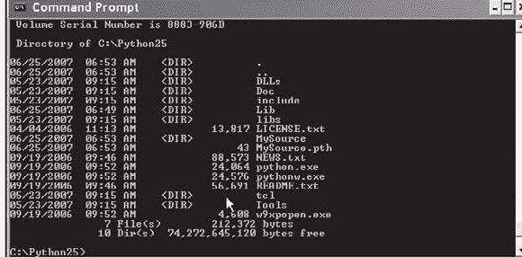

Python 使用的时间值被称为时间戳（epoch times）。这与操作系统存储时间时使用的值相同。该值本身是自某个基准日期来的秒数。在 Windows 中，基准通常是 1970 年。Python 中特定的 `datetime` 模块允许你将这些奇怪的数字转换为人类可读的格式。

1. 创建一个新文件，使用你喜欢的编辑器或 Python 自带的 IDLE 编辑器。将新文件命名为 `ch6_6.py`。

2. 在 `ch6_6.py` 文件中输入以下代码：

```python
import sys

if len(sys.argv) == 0:
    print("There were no arguments passed to the program")
else:
    print("There were " + str(len(sys.argv)) + " arguments passed to the program")
    for arg in sys.argv:
        print("Argument: " + arg)
```

3. 通过 `File | Save` 命令将文件保存到你选择的位置。

4. 在编辑器窗口中选择 `Run | Run Module`，或者在 Windows 上按下 F5 键在解释器中运行该文件。

5. 你应该会在 Python 解释器中看到以下输出：

```
There were 1 arguments passed to the program
Argument: E:/Python/ch6_6.py
```

现在，这看起来并不好用，对吧？我们知道程序的名称，是因为我们自己编写并执行了它。我们如何从程序外部获取用户参数传递给程序呢？

遗憾的是，在 IDLE 环境中无法向程序传递参数。这是合理的，因为你可能不想向解释型环境内部的某个东西传递信息。要原样向程序传递参数，你需要从命令行运行程序。要实现这一点，只需启动命令行提示符（在 Windows 中，或直接在 UNIX 的 shell 中运行命令），并在命令行输入以下命令：

`E:\Python>c:\python25\python ch6_6.py 1 2 3 4 5`

注意，如果你尚未将环境变量指向该目录，你可能需要修改 `python.exe` 程序的路径。如果你操作得当，你将从命令行提示符窗口中看到以下输出：

```
There were 6 arguments passed to the program
Argument: ch6_6.py
Argument: 1
Argument: 2
Argument: 3
Argument: 4
Argument: 5
```

关于这个特定的示例，有两个重要的点需要注意。首先，你显然可以获取从命令行传递的参数。第一个参数（索引 0）始终是你的程序脚本名称。其余的条目是在命令行上传递的值。其次，更重要的一点是，你会发现当你直接从命令行运行解释器时，解释器会运行你传递的脚本然后终止。它没有输入值的提示符，也不会在交互模式下等待你输入值。当你想要在 Python 中运行一个简单的脚本来完成某项任务并进入其他任务时，这可能非常重要。

命令行参数并不是新事物，它们绝不是火箭科学。但请注意，并非所有环境都将初始设置为程序名称，因此在处理它之前，你应该始终检查 `sys` 模块中的 `argv` 变量是否确实包含数据。

## Pickle

`pickle` 模块是将 Python 对象写入文件的标准方法。你可能已经知道文件对象的 `read` 和 `write` 函数仅对字符串有效。这意味着，如果你有一个字符串 `s` 并想将其写入文件 `f`，你只需要这样做：

```python
f.write(s)
```

但是，如果你有一个数值（例如，一个浮点数）并想将其写入文件，你不能简单地写成：

```python
f.write(f)
```

你将收到解释器返回的错误，因为文件对象的 `write` 方法没有设计为接受浮点数。相反，你必须写：

```python
f.write(str(f))
```

或者

```python
f.write(repr(f))
```

这可能相当烦人，尤其是当你处理更复杂的类型（例如变量或用户定义的类类型）时。Python 的设计者意识到这可能会成为一个问题，因此为此目的编写了 `pickle` 模块。`pickle` 是 Python 的一种通用序列化过程。如果你有一个类型 `t` 和一个文件 `f`，你想将类型 `t` 的值写入文件中，只需使用 `pickle` 模块来实现：

```python
import pickle

pickle.dump(t, f)
```

然后，如果你想从文件中读取回类型，可以使用 `load()` 函数：

```python
import pickle

t = pickle.load(f)
```

你可以在 Python 文档中完整地学习 `pickle` 模块，但这里有一个使用模块保存和恢复数据的简单示例：

1. 创建一个新文件，使用你喜欢的编辑器或 Python 自带的 IDLE 编辑器。将新文件命名为 `ch6_7.py`。
2. 在 `ch6_7.py` 文件中输入以下代码：

```python
import pickle

# 创建用于存储数据的文件
dFile = open("storage.dat", "wb")

### 存储一些值
x = 123.467
pickle.dump(x, dFile)

y = 10
pickle.dump(y, dFile)

z = { 1 : "Hello", 2 : "Goodbye" }
pickle.dump(z, dFile)

# 关闭文件以便将数据值写入磁盘
dFile.close()

print("Done with save. Restoring")

iFile = open("storage.dat", "rb")

### 读取值
d1 = pickle.load(iFile)
d2 = pickle.load(iFile)
d3 = pickle.load(iFile)

print(d1)
print(d2)
print(d3)
```

# 第 7 章 函数与模块

标准的编程术语（但在英语用法中如此），指的是那些只有在需要时才会执行的代码。你可以在给应用程序中定义任意你需要的数量的函数，但只有被调用（或“执行”）的函数才会真正消耗计算机的计算时间。

至于使用函数，你在本书中已经使用了相当多的函数了。其中一些是内置函数，比如 `print` 语句或 `raw_input` 函数。语句和函数之间的区别某种程度上是任意的。语句是语言的一部分不需要括号或其他语法元素，但它被处理的方式与任何其他函数完全相同。简单来说，语句是语言的一部分，而函数是程序员实现的对语言的扩展。

关于使用函数的示例，让我们考虑一下我们在过去几章中使用的 `raw_input` 函数，它用于通过控制台从用户接收信息。`raw_input` 函数如下：

```python
value = raw_input(prompt_string)
```

该函数接受一个（可选的）参数，即显示在终端用户之前的提示字符串，以告诉他们程序期望什么类型的信息。它返回一个值，即终端用户在程序中输入的字符串。稍后我们将讨论参数，但现在，让我们考虑一下如果我们编写 `raw_input` 函数，它的定义应该是怎样的。

```python
def raw_input(prompt):
    # 输出提示信息
    # 执行某些操作从用户处获取文本
    # 返回输入的文本
```

如你在上面的函数伪代码所示，函数可以向调用程序返回值。当然并非如此。你可以创建一个执行操作的函数，比如打印某些内容。例如，假设你想有一个可以打印程序版权信息的函数。它可能像这样：

```python
def print_copyright():
    print "This program is copyright © 2007 Matt Telles Enterprises"
```

注意，该函数不接受任何参数，也不返回任何值。然而，它执行了一个语句，即 `print` 语句，向用户展示某些信息。函数的范围是从起始 `def` 语句到最后一个空行（由缩进块的结束指示）。与语句、`for` 循环以及任何其他 Python 结构一样，函数的定义是由缩进定义的。记得在很久以前的第 1 章，你被告诉缩进是 Python 语言的一个重要部分。好了，这里又是一个例子。

你可能还会注意到，回到 `raw_input` 示例，没有办法可以定义函数是否返回值，或者该值可能是什么类型。如果你习惯于使用强类型编程语言（如 C、Java 或 Pascal），这在你看来可能很奇怪。例如在 C 中，你通过编写类似下面的内容来指定函数：

```c
type funcname(argtype argname, ...)
```

其中：

- `type` 是函数返回值的类型。如果函数没有返回任何内容，则可能为 void。
- `funcname` 仅仅是函数的名称，就像我们上面使用的 `func` 或 `print_copyright` 一样。
- `argtype` 是函数每个参数的类型。Python 不对参数使用类型；它只是按名称列出它们。
- `argname` 是每个参数的名称。对于给定的函数，可能有多个 `argtype` 和 `argname`。

## 在 Python 中定义函数

让我们在 Python 中创建一个简单的函数，并看看在解释器中如何调用它。该函数不会接受任何参数，也不会返回任何值。该函数的目的是打印我们应用程序的当前工作目录。当前工作目录是所有文件将被创建的地方，除非为文件名专门指定了路径。例如，如果我创建了一个名为 "foo.dat" 的文件而没有指定路径，它将在当前工作目录中创建。如果我创建一个名为 "c:\foo.dat" 的文件，它将在我机器上 c 盘的根目录下创建。

1. 使用你喜欢的编辑器或 Python 自带的 IDLE 编辑器创建一个新文件。将新文件命名为 `ch7_1.py`。
2. 在 `ch7_1.py` 文件中输入以下代码：

```python
import os
import os.path

def print_current_working_directory():
    s = os.getcwd()
    print("Current Working Directory: " + s)
```

3. 使用 `File | Save` 命令将文件保存到你选择的位置。
4. 在编辑器窗口中选择 `Run | Run Module` 或在 Windows 上按 F5 键在解释器中运行该文件。
5. 注意到 IDLE 控制台窗口什么都没有发生。这是因为在函数本身被调用之前，函数定义什么都不做。
6. 在 IDLE 解释器中通过在命令提示符处输入以下行来运行函数：

```python
>>> print_current_working_directory()
```

7. 你应该看到类似下面的显示（注意，你的目录和我的可能非常不同）：

```
Current Working Directory: E:\Python
```

你可以根据需要任意多次调用该函数，它将返回相同的结果。这就是可调用函数的优势。

## 什么是参数？

参数是传递到函数中的数据，用于自定义功能。例如，你可能会传递当前名称给函数。参数可以是任何有效的 Python 类型，从字符串到数字、字典或列表。

如果你习惯其他编程语言，你可能习惯按引用和按值传递参数的概念。Python 没有按引用传递简单数据类型，因为所有简单数据类型都是不可变的。这意味着，你不能将参数传递给函数并让其修改。这不适用于可变类型，如列表或字典。稍后我们将查看它是如何工作的。

你同样无法在函数中直接更改参数的类型。例如，如果用户传递了一个列表，你不能将其视为单个值。同样，你不能将单个值视为列表。Python 中的参数不是强类型的。例如，如果你在对某个值进行操作之前没有检查它是否为预期类型，你会发现得到了运行时错误。

## 如何在函数列出参数？

当你定义一个函数时，你列出想要传递给函数的参数名称。正如你稍后将看到的，它们并不总是传递所有的参数，但作为开始这是一个很好的假设。参数可以是可变的，这意味着它们可以在函数中被修改并返回给调用者。然而，只有某些参数是可变的。简单数据类型在函数中无法更改。为了说明这一点，让我们来看一些真实的代码。

1. 使用你喜欢的编辑器或 Python 自带的 IDLE 编辑器创建一个新文件。将新文件命名为 `ch7_2.py`。
2. 在 `ch7_2.py` 文件中输入以下代码：

```python
def func_immutable(a):
    a = a + 1

def func_mutable(l):
    l.append(4)

a = 10
print("A starts as: " + str(a))
func_immutable(a)
print("A ends as: " + str(a))

l = [1, 2, 3]
print("L starts as: " + str(l))
func_mutable(l)
print("L ends as: " + str(l))
```

即使你在 `func_immutable` 函数代码中修改了变量 `a` 的值，一旦函数结束，它的值与主程序开始前的值是相同的。这向你证明了简单数据类型（如数字 `int`、`float` 等）是在函数中不可变的。另一方面，像列表和数组等容器类的数据类型可以被函数修改，正如你在 `func_mutable` 中看到的那样。传入的列表包含三个元素。在我们的函数中，修改了列表使其包含第四个元素。当函数执行完毕后，你会发现主程序中的列表现在也包含了第四个元素。

任何类型的变量都可以作为参数；但必须在函数中使用这些参数。例如，如果你尝试向 `func_mutable` 方法传递单个整数，解释器在尝试执行代码时会返回错误。整个过程看起来如下：

```python
>>> func_mutable(3)
Traceback (most recent call last):
  File "<stdin>", line 1, in <module>
  File "E:/Python/ch7_2.py", line 5, in func_mutable
    l.append(4)
AttributeError: 'int' object has no attribute 'append'
```

由于 Python 是解释型而非编译型语言，某些操作会产生奇异的副作用。例如，如果你有一个定义了 `append` 方法的类对象，你可以将该对象传递给 `func_mutable` 函数，它就能正常工作。解释器只关心参数的使用方式是否匹配它处理你传入参数的已知方法。它并不关心你是否本意让该对象成为列表、数组或某个用户自定义类。

函数中的参数并不局限于单个。事实上，你可以根据需要设置任意数量的参数。唯一的限制是参数必须按照你定义的顺序传递给函数。命名约定并不重要（对此有一个例外，你稍后就会看到）；顺序才是关键。所以，如果我有一个定义了四个参数的函数：

```python
>>> def func4(a, b, c, d):
...     print "a = ", a
...     print "b = ", b
...     print "c = ", c
...     print "d = ", d
```

然后，我在解释器中（在函数外部）定义了一些变量，并如下所示调用该函数：

```python
>>> a = 10
>>> b = 20
>>> c = 30
>>> d = 40
>>> func4(d, b, c, a)
a = 40
b = 20
c = 30
d = 10
```

如你所见，解释器中的变量名称与函数中的参数名称之间没有任何关系。参数的作用域是函数本身。例如，你不能在 `def` 语句开始到函数缩进块结束的行之外使用变量 `a`，并期望看到与函数内部相同的值。我们称这些参数的作用域局限于函数本身。

请注意，传递参数的顺序是重要的。如果你定义了一个接受四个参数的函数（如我们在 `func4` 中做的那样），你必须传入四个参数（尽管正如我们稍后看到的，你可以允许其中一些参数具有默认值）。如果你尝试传入三个、一个或其他数量的参数，你将得到来自解释器的运行时错误：

```python
>>> func4(1, 2, 3)
Traceback (most recent call last):
  File "<stdin>", line 1, in <module>
TypeError: func4() takes exactly 4 arguments (3 given)
>>> func4(1, 2, 3, 5, 6)
Traceback (most recent call last):
  File "<stdin>", line 1, in <module>
TypeError: func4() takes exactly 4 arguments (5 given)
```

所以，这些就是参数的规则。对于任何规则，都有例外。让我们来看看我刚才提到的规则的两个例外。

## 默认参数


# 函数与模块

## 默认参数

我们刚刚说完，如果你定义了一个接受四个参数的函数，那么你总是需要传入四个参数。这并不完全准确，尽管在运行时，具有四个参数的函数总是接收到四个参数。这两个陈述如何同时成立？答案在于一种被称为**默认参数**的东西。默认参数是编写者在用户没有指定值时为其定义的一个默认值。

例如，假设我想打印我的应用程序的版权日期。版权日期是一个包含某些模版文本和该版权有效期年份的字符串。现在，设置一个恰好是当前年份的默认应该是合理的，不是吗？所以，我们可以写这样一个函数：

```python
def print_copyright(year=2007):
    print "Copyright", year
```

然后，在我的主程序中，我可以像调用任何其他函数一样调用它：

`print_copyright()`

然而，假设几年过去了，现在是 2010 年。如果程序是新的，我需要回到我使用的任何库中 `print_copyright` 函数的所有实例，并将函数修改为读取 2010 而不是 2007。但为什么不直接将数据作为参数传递呢？好主意。

## 关键字参数

默认参数的问题之一是处理的顺序。假设，你有这样一个函数：

```python
def print_stuff(name="Me", date="01/01/99", stuff="stuff to print"):
    pass
```

你可以通过以下任何方式调用此函数，而在你自己的应用程序中不会出现任何问题：

这似乎显而易见，因为你不能忽略前两个参数并使用默认值，否则解释器将不知道你指的是哪一个参数。事实证明有一种方法可以做到这一点。解决这个小困惑的答案就是**关键字参数**。Python 允许你在向函数发送参数时带有名称，如下：

```python
>>> print_stuff(stuff="other stuff to print")
Me
01/01/99
other stuff to print
```

当 Python 将一组参数传递给函数时，它实际上是在创建一组键值对，然后这些键值对会按照函数签名中指定的顺序展开为参数。事实上，Python 提供了一种非常特殊的语法，用于根据名称检索函数的所有参数，即 `**` 语法。虽然在普通函数中使用这种语法有些不寻常，但如果你满足以下条件，是被允许使用它的：

```python
def print_params(**params):
    for p in params:
        print p, params[p]

>>> print_params(a="1", b="2", c=3, d=123.45)
a 1
c 3
b 2
d 123.45
```

这种顺序奇特的语法允许你检索传递给函数的所有命名参数。如果你正在构建某种从外部源调用的参数化函数，你可能想要这样做。否则，诚实地说，这仅仅是该语言的一种奇特性。

## 函数的返回值

如果你习惯了其他语言，可能你在处理函数时习惯于使用的功能之一就是返回值的能力。例如，考虑 `string` 模块中的 `find` 函数。该函数返回给定子字符串在指定字符串中的位置。这种函数的用法如下：

```python
idx = string-object.find(substring)
```

这种特定类型的函数实际上是一个类方法，这意味着它在 `string` 类型对象上操作。然而，并没有理由你必须以这种方式实现它。假设，你想编写一个查找字符串中第一个实例的函数。要做到这一点，你必须接受两个参数：一个要搜索的字符串和一个要查找的字符。但是，你还需要第三部分，即该字符在字符串中索引的返回值。为了实现这一点，你在 Python 中使用 `return` 关键字。让我们来看我们函数的一种可能实现方式。

```python
def find(s, c):
    idx = 0
    for char in s:
        if char == c:
            return idx
        idx = idx + 1
    # 如果我们到了这里，说明没有找到值
    return -1
```

你现在可以通过在 IDLE 解释器中直接调用它并在自己的代码中使用此函数：

```python
>>> idx = find("This is an examination", 'x')
>>> print idx
12
```

如你所见，索引被正确计算，结果返回给调用程序并存储在赋值的变量（在本例中为 `idx`）中。你还可以使用输入和返回值来实现一个数学函数。

```python
>>> def square(x):
    return x * x

>>> square(10)
100
```

注意，你完全没有修改输入值；你只是返回了它。但是，你可以修改调用程序中的值：

```python
x = 10
x = square(x)
print x
100
```

## 函数返回多个值

有时，Python 在某些方面的闪光点是其他语言无法完全比拟的。从函数返回值就是其中之一，Python 在此处的做法是传统语言完全无法做到的。在传统语言中，如果你想从函数返回多个值，你要么返回某些复合对象，要么通过引用返回值，或者干脆完全放弃。Python 能够轻松地从单个函数中返回多个值。

想象一下，你想写一个计算某个值前三次幂的函数。也就是说，你想传递一个数字并返回三个值，分别代表该数字、该数的平方和该数的立方。在传统语言中，这是困难的，甚至是不可能的。例如，在 C++ 这样的语言中，你必须执行这样的操作：

```cpp
void compute_multi(int inval, int& outval, int& outall, int& outval);
```

这至少是令人困惑的。我是在给这些值赋值吗，还是它们只是被返回？我需要初始化这些值吗？所有这些问题都必须通过研究代码甚至挖掘函数的文档来回答。最终，你会得到答案，但即使如此，以后阅读代码的人仍会有相同的问题。

在 Python 中，你只需这样做：

```python
>>> def multi_return(x):
    return x, x*x, x*x*x

>>> a, b, c = multi_return(3)
>>> print a
3
>>> print b
9
>>> print c
27
```

这里发生的所有只是你在函数内部定义了一个元组（`tuple`）并返回它，然后在退出函数时将其解包为各个组件。但对于用户来说，看起来你确实从函数中返回了多个值。本质上，你实际上从一条语句中返回了多个值。这太酷了。

## 递归函数

软件世界中有趣的概念之一是递归函数。递归函数是那些不断调用自身（或反复“递归”）的函数，直到解决给定问题。为了让你了解它是如何工作的，考虑**阶乘函数**，它是非常经典的。阶乘定义为 1 到给定数字之间的所有数字的乘积。例如，4 的阶乘等于：

```
Fact(4) = 24
```

要计算阶乘，你从想要的数字开始。然后你乘以比它小的数。

1. 创建一个新文件，使用你喜欢的编辑器或 Python 自带的 IDLE 编辑器。将新文件名为 `ch7_4.py`。

2. 在 `ch7_4.py` 文件中输入以下代码：

```python
def fact(value):
    # 终止条件：
    # 如果数字小于或等于 1，则阶乘定义为 1。
    if value <= 1:
        return 1
    else:
        # 其他任何数字的阶乘是该数字乘以直达它之前的所有数字。
        return value * fact(value - 1)
```

3. 使用 `File | Save` 命令将文件保存到任意位置。

4. 在编辑器窗口中通过 `Run | Module` 或按 F5 键运行文件。

5. 注意 IDLE 控制台中什么都没有发生。这是因为函数定义在函数本身被调用之前什么都不做。

6. 在 IDLE 解释器中通过在提示符处输入以下行来运行函数：

```python
>>> fact(4)
24
>>> fact(6)
720
>>> fact(10)
3628800
>>> fact(12)
479001600
>>> fact(1)
1
```

关于递归函数非常重要的一点：你必须绝对确保函数在所有情况下都会执行终止条件。否则，递归循环将变成死循环，你的程序最终会崩溃。这等同于编写这样的函数：

```python
def bad_loop(i):
    if (i == 0):
        return 0
    return bad_loop(i)
```

它被调用。在 Python 中，我们将得到错误 `RuntimeError: maximum recursion depth exceeded`，并且程序将终止。

既然谈到了错误，实际上在阶乘函数中存在一个微小的错误。你能看出来吗？它从本质上说并不是一个编程错误；它是一个逻辑错误（这种错误最难发现）。在阶乘函数中，如果你传递值 -1 或任何其他负值，你将得到 1 作为结果。阶乘对于负数（或者说零）在某种程度上是未定义的，因此我们必须返回某些值。然而，在某些情况下，这可能会导致其他程序逻辑错误的出现。更好的做法可能是对零或负数抛出异常，正如你在下一章中看到的那样。

## 将函数作为参数传递

你可以将各种内容作为参数传递给函数。简单的变量、字典、元组，甚至你自己的对象都可以传递到你编写的函数中。然而，还有一种可以作为参数的内容，我们之前还没有讨论过，那就是使用另一个函数作为参数。在 Python 中，函数实际上只是指向包含代码内存块的“指针”。当在调用应用程序中使用函数调用时，程序会跳转到该代码并执行。没有任何理由不能将函数作为参数，或者将其存储在字典中（如我们在第 3 章所示），或任何其他格式中。

假设例如，你想解析一个字符串，并在每次遇到给定的字符或字符串时调用一个函数。这种功能可能用于实现 XML 字符串解析器或类似的东西。让我们写一个简单的函数，扫描输入字符串并在遇到角括号（'<' 或 '>'）时调用一个函数。

```python
def find_angle_brackets(s, func):
    idx = 0
    for c in s:
        if c == '<' or c == '>':
            func(s, idx)
        idx += 1
```

现在，要使用它，你需要一个字符串和一个要调用的函数。字符串很容易创建；只需创建一个并传递进去即可。另一方面，你需要在 IDLE 编辑器中创建函数，通过输入文本并允许 IDLE 识别它的存在来对其预编译。让我们现在在编辑器中输入一个：

```python
>>> def func_print(s, idx):
    print("Found bracket in [" + s + "] at position", idx)
```

这个函数并没有特别之处；它只是在每次被调用时打印信息。如果你用类似 "This is <b>a test!</b>" 的字符串调用它，你会预期看到你的函数被调用四次。让我们试一下！在 IDLE 解释器中输入以下行并观察输出，它应该像我在行后面所示所示：

```python
>>> find_angle_brackets("This is <b>a test!</b>", func_print)
Found bracket in [This is <b>a test!</b>] at position 8
Found bracket in [This is <b>a test!</b>] at position 10
Found bracket in [This is <b>a test!</b>] at position 18
Found bracket in [This is <b>a test!</b>] at position 21
```

所以，就是这样了，四个括号，四次函数调用，以及在控制台窗口中显示的四条消息。正如提到的，这并不是死板的科学。函数名在 Python 中可以是任何东西。没有理由认为你必须做某些事情才能把它作为函数的参数。正如你从这个示例看到的，情况确实如此。

## Lambda 函数

Lambda 函数以希腊字母命名，也被称为匿名函数。之所以这样做是因为 lambda 函数没有名称；它只有与其关联的可执行代码。通常，lambda 函数的实现是为了执行非常简单的任务，例如乘以一个数字或提取字符串的某部分。如果你在代码中反复使用同一个基本语句，你可能考虑将其制作为 lambda 函数。

Lambda 函数的基本语法如下：

```python
name = lambda variables: code
```

注意，你不能在 lambda 表达式中放置语句。这意味着你不能在 lambda 表达式中嵌入 `if` 语句或变量声明。除了这个限制外，lambda 表达式实际上是一个非常简单的函数，它避免了实现函数时通常需要执行的所有 `def funcname(variables):` 等工作。让我们看两个 lambda 函数的示例来展示它们是如何工作的：

```python
>>> double = lambda x: x * 2
```

这条语句创建了一个名为 `double` 的 lambda 函数，它接受一个参数并将其倍增。你可以在代码中像函数一样使用它：

```python
>>> double(2)
4
>>> double(4)
8
```

你可以将其作为参数传递：

```python
>>> print(double(6))
12
```

事实上，你可以在任何使用其他 Python 语句或函数的地方使用此函数。Lambda 函数不限于一个变量；你可以使用多个变量来编写它们：

```python
>>> combine = lambda x, y, z: x * y * z
>>> combine(1, 2, 3)
6
```

Lambda 函数在与 Python 内置的 `map` 函数结合使用时最有用。`map` 函数接受一个函数和一个迭代对象，并将函数应用到迭代对象中的每一个项。

```python
>>> numbers = [1, 2, 3, 4]
>>> list(map(lambda x: x * 2, numbers))
[2, 4, 6, 8]
```

## 函数的变量范围

```python
def gfunc():
    global x
    x = 20

x = 10
print "Before gfunc, x = ", x
gfunc()
print "After gfunc, x = ", x
```

通常情况下，当你在函数中使用变量时，它必须在那个函数中定义。如果你没有定义，并且在赋值之前尝试访问它，就会得到一个错误。例如：

```python
>>> def func():
    print i
    i = 10
    print i

>>> func()
Traceback (most recent call last):
  File "<pshell#46>", line 1, in <module>
    func()
  File "<pshell#45>", line 2, in func
    print i
UnboundLocalError: local variable 'i' referenced before assignment
```

然而，Python 提供了一种方法来获取在主程序中定义的、函数外部的变量。这种方法是 `global` 关键字，它允许你将变量定义为函数的外部，并使用变量的全局版本。在我们的示例中，`func()` 给名为 `x` 的变量赋值了值 20。这个变量定义在 `func()` 函数内部，无法以相同的方式在函数外部访问。也就是说，当你在函数中更改 `x` 的值时，它不会影响主程序中定义的 `x`。它们是完全不同的变量。你可以认为主程序是 `global.x`，而函数 `func()` 中的 `x` 是 `func.x`。虽然它们赋值不是同一个名称，但为了讨论方便这样做是可以的。在 `func()` 中，当你更改 `func.x` 时，你操作的是一个局部变量。`global.x` 的值不受影响，这就是你在主程序中调用函数后打印它的结果。

另一方面，解释器会去寻找在调用 `gfunc()` 之前定义的名为 "x" 的变量。你可以将 `gfunc()` 函数看作使用的是 `global.x`，而不是 `gfunc.x` 变量。当你在函数内部更改此值时，主程序中的值也会随之改变，正如输出所示。

记住，如果你不显式地告诉 Python 你想在函数中使用 `x` 的全局版本，将使用局部变量。这可能会导致一些奇怪的错误，请注意你的变量范围。例如，你可能期望变量在主程序中发生变化，但它并没有变化，因为你定义了同名的本地版本。这被称为对全局变量的“遮蔽”（shadowing）。

## 使用模块

模块本质上是一个可以包含在你的 Python 应用程序中的文件，它包含了一系列变量、函数甚至是类。我们在整本书中一直在使用模块，但你之前可能没有意识到。例如，每当你编写以以下开头的代码时：

```python
import os
```

或者任何其他类型的 `import` 语句，你都在使用一个模块。`os` 模块仅仅是一个 Python 文件 (`os.py`)，你可以在 IDLE 编辑器或你选择的任何其他编辑器打开它并查看。模块的加载是通过应用它们的名称和 Python 路径来搜索路径中的任何内容来实现的。搜索顺序与 Python 路径变量中条目的顺序相同，因此，如果路径中有多个同名的模块，将使用找到的第一个。

你可以在 Python 中编写自己的模块，而且一直都在这样做。如果你创建一个新文件并将其保存到 Python 路径中，系统将允许你将其作为模块使用。

1. 使用你喜欢的编辑器或 Python 自带的 IDLE 编辑器创建一个新文件。将新文件命名为 `ch7_6.py`。

2. 在 `ch7_6.py` 文件中输入以下代码：

3. 在 IDLE 编辑器中将文件保存到 Python 安装目录下的 `lib` 目录（这保证在 Python 路径中）。例如，如果你将 Python 安装在目录 `c:\Python25` 中，请将文件放在 `c:\Python25\lib`。

4. 不要在 IDLE 环境中运行该文件。相反，进入解释器并输入以下行：


```python
>>> import ch7_6
>>> ch7_6.myprint('hello world')
hello world
```

```python
def myprint(str):
    print str
def mycopy(str1, str2):
    return str1 + str2
```

如你所示，`import` 语句正确地获取了你的模块。由于模块没有在解释器中被“运行”，你必须指定模块的名称以便解释器获取你想要调用的函数。如果你只是直接调用 `myprint` 函数，将得到一个错误：

```python
>>> myprint('hello world')
```

```
Traceback (most recent call last):
File "<pyshell#51>", line 1, in <module>
    myprint('hello world')
NameError: name 'myprint' is not defined
```

关于模块有一点说明。如果你查看 Python `lib` 目录中的目录，你会发现这里有两种类型的文件。大多数是 `name.py` 格式的，这只是我们一直以来查看的 Python 脚本文件。然而，还有 `name.pyc` 格式的文件。事实上，在运行上述代码后，如果你查看 `lib` 目录，将看到一个名为 "ch7_6.pyc" 的文件。这些文件是什么？`.pyc` 文件是编译后的 Python 文件。导入和处理模块是一项昂贵的操作，因为解释器必须加载文件、检查语法是否有效并创建内存中的适当结构。这包含与原始脚本相同的数据，但以二进制格式存在。

## 总结

本章简要介绍了 Python 语言的一个主要组件：函数。正如你所学的，函数是封装代码并隐藏实现的极佳方法，用户无需了解其工作原理。我们在书的剩余部分将经常使用函数和模块，因此现在理解它们是非常重要的。

在下一章中，我们将讨论一种与函数配合使用的错误处理形式：异常处理。

# 第 8 章 异常处理

俗说除了死亡和税，什么都不是确定的。当然，在软件开发世界，我们知道还有其他事实。软件世界中确定的事情之一就是 Bug 的存在。Bug 从编程时代开始一直存在，并在我们消失后仍继续存在。Bug 由许多原因引起，但最糟糕的是对错误的处理不当或缺乏处理。

在任何非平凡应用程序中，都会出现错误。其中某些错误是由用户缺乏理解引起的。某些是由用户机器硬件或软件故障引起的。更多错误是由应用程序所需的错误或格式错误的输入引起的。无论如何，你的应用程序在运行时必须处理错误。

Python 中有两种类型的错误。第一种最基础的类型是错误代码。例如，字符串模块中的 `find()` 函数将返回错误代码 -1，表示它在给定字符串中没有找到子字符串。某些错误很容易处理，因为你只需要检查并执行适当的操作。有时这意味着打印错误信息，有时它是指示循环结束的正常事件流（例如上述 `find()` 函数）。无论如何，真的没有理由在本章中讨论错误代码的处理。作为一名丰富的编程人员，你完全清楚需要检查任何可能抛出错误的函数的返回值。如果你还不知道这一点，并且没有在应用程序中这样做，将没有任何能改变你的主意并让你这样做。真的，帮我们大忙处理它们吧，好吗？

在 Python 应用程序中可能发生的第二种错误是异常。异常真正（如其名称所示）是为了处理异常情况。发生了一些糟糕的事情，程序需要处理它。想象，假设你正在为像 Python 这样的语言编写解释器。如果用户输入了一条语句

如果格式明显是错误的，你就需要处理该问题。在 Python 中，解释器处理错误的方式通常是抛出一个异常，并允许该异常被处理。

异常包含三个基本组成部分。首先是异常本身。异常由错误组成，并可能可选包含有关异常的信息。其次，异常必须在应用程序内部被“抛出”（raised）。抛出异常会停止发生位置的处理，并将控制权交回应用程序。如果应用程序没有处理该异常（被称为“捕获异常”），控制权将返回给解释器，最后返回操作系统。异常可能带有“参数”，即关于发生错误的信息。参数是该过程的一个可选部分。

## 在 Python 中查看异常

遗憾的是，Python 中有很多种方法可以轻松生成异常。让我们来看最简单的一种，即你 Python 代码中的语法错误。你可以直接从 IDLE 解释器生成其中一个错误：

```python
>>> fro i in range(1,20)
```

```
SyntaxError: invalid syntax
```

显然，我并不是想输入 `fro`，我是想输入 `for` 并生成一个 `for` 循环，用来遍历 1 到 19 的值。这并不是我输入的的内容，而 Python IDLE 编辑器还没有先进到能理解我的意思。它只能按照我所说的执行。

一个异常由三个元素组成：错误消息、错误发生的位置以及任何随异常一起出现的信息。例如，在我们之前的示例中，错误消息是 `SyntaxError`，这是一种异常类型。位置在编辑器本身中显示，指向代码中的 `fro` 条目。与错误相关的信息是描述性的 "invalid syntax"（无效语法），这表明 Python 解释器不理解我们试图通过 `fro` 语句要做什么。它可能认为我们正在解释器中创建一个名为 `fro` 的变量，由于该行的剩余部分没有正确遵循赋值语法，它就报错了。

你可能会想，为什么需要担心捕获诸如语法错误的问题。总之，在交互模式（Immediate mode）下，解释器会向你显示出了什么。当你尝试加载一个包含错误的函数或语句的模块时，解释器会在加载时报错，告诉你存在无效语法问题。然而，请考虑以下示例。

## 回溯（Traceback）示例

1. 创建一个新文件，使用你喜欢的编辑器或 Python 自带的 IDLE 编辑器。将新文件命名为 `ch8_1.py`。

2. 在 `ch8_1.py` 文件中输入以下代码：

```python
for i in range(1,20):
    printn("Hello world")
```

注意这里的 `print` 语句被故意拼写错了。

3. 保存文件并退出 IDLE 编辑器（或你用于创建文件的任何编辑器）。

4. 在 Windows 中打开命令提示符，在你保存文件的目录中运行运行以下命令：

```bash
E:\python-c:\Python25\python.exe ch8_1.py
```

5. 观察命令提示符中的以下输出：

```
File "ch8_1.py", line 2
    printn("Hello world")
^
SyntaxError: invalid syntax
```

现在，你意识到该脚本可能从未被测试过。自然地，我们中的任何“真正的”程序员都不会做这种事，但这些错误会从那些“假”的程序员那里溜进来。说真的，如果对文件进行了最后时刻的修改，你可能会得到这样一个从未在解释器中显示过的语法错误。

## 回溯（Traceback）示例

当运行的代码发生异常时（无论是在 IDLE 环境中还是通过命令行解释器），都会生成并显示回溯（traceback），显示问题发生的位置。例如，如果你有这样一个脚本：

```python
>>> for i in 1,3,5,7,9,0 :
    x = 100 / i
    print x
```

这段代码存在问题。如果你在解释器中运行代码，你会得到以下显示：

```
100
33
20
Traceback (most recent call last):
  File "yourscript.py", line 2, in <module>
    x = 100 / i
ZeroDivisionError: division by zero
```

你可能会想，为什么需要担心捕获诸如语法错误的问题。总之，在交互模式下，解释器会向你显示出了什么。当你尝试加载一个包含错误的函数或语句的模块时，解释器会在加载时报错，告诉你存在无效语法问题。然而，请考虑以下示例。

## 异常

`except` 语句可以包含零或多个跟随其后的异常类型。这些类型可以是预定义的系统异常类型，也可以是在应用程序中定义的自定义异常类型。表 8-1 显示了 Python 中预定义的系统异常类型。

### 表 8-1 标准 Python 错误类型

| 错误名称 | 含义 |
|---|---|
| Exception | Python 的基础异常，是所有其他异常类型的基类。 |
| Standard | Python 中所有标准异常的类。 |
| ArithmeticError | 所有算术错误的基类，例如溢出。 |
| LookupError | 与容器相关的错误，例如尝试查找字典中不存在的内容。 |
| AssertionError | 断言失败，在代码中产生异常。 |
| AttributeError | 属性无效、非法或超出范围。 |
| EOFError | 文件末尾错误。 |
| EnvironmentError | 所有发生在 Python 环境之外的错误的基类，如 IO 错误。 |
| FloatingPointError | 在处理浮点值时发生错误时抛出的异常。 |
| GeneratorExit | 在调用生成器对象的 `close()` 方法时抛出。 |
| IOError | 在输入/输出操作发生错误时抛出。 |
| ImportError | 系统无法定位或加载代码中 `import` 语句的目标时抛出。 |
| IndexError | 用于访问数组或列表的索引超出范围时抛出。 |
| KeyError | 字典中未找到键时抛出。 |
| KeyboardInterrupt | 用户以非标准方式终止输入（如按下 Ctrl-C）时抛出。 |
| MemoryError | 系统运行时内存耗尽时抛出，但仍可以恢复。这是一种非致命内存错误。 |
| NameError | 当名称未定义时抛出。 |
| NotImplementedError | 不是系统抛出的，此错误应由类的实现者抛出，如果在类中未实现功能。 |
| OSError | 任何发生操作系统错误时抛出。 |
| OverflowError | 在数学语句中发生溢出时抛出，例如数字无法由其使用的类型表示时。 |
| ReferenceError | 使用对被垃圾回收对象的引用时调用。 |
| StopIteration | 当调用迭代器的 `next()` 方法且没有更多值可处理时抛出。 |
| SyntaxError | 解释器在解析代码时遇到语法错误时抛出。 |

### 表 8-1 标准 Python 错误类型（续）

| 错误名称 | 含义 |
|---|---|
| SystemError | 解释器发生内部错误时抛出，但系统可以重启并继续。 |
| TypeError | 当给定的类型无效，或赋值的值与给定类型不合适时抛出。 |
| UnboundLocalError | 当在未赋值的情况下使用局部变量时抛出。 |
| ValueError | 当给定类型有效，但赋值给它的值不合适或无效时抛出。 |
| WindowsError | 所有 Windows 特有错误的通用错误类。 |
| ZeroDivisionError | 当代码中发生除零操作时抛出。 |

让我们来看一个使用 `try..except` 语句在 Python 类中捕获异常的真实示例。在 IDLE 解释器中输入以下代码：

```python
try:
    name = raw_input("Enter your name: ")
    print("You entered: " + name)
except KeyboardInterrupt:
    print("You hit control-c")
```

现在运行程序。如果你输入一个名称并按回车，你将在 IDLE 的控制台窗口中看到以下输出：

```
>>>
Enter your name: matt
You entered: matt
```

相反，如果你在输入名称时按下 Ctrl-C 组合键，你将在 IDLE 控制窗口中看到以下输出：

```
>>>
Enter your name: matt
You hit control-c
```

如你所见，解释器正确捕获了因按下 Ctrl-C 组合产生的异常，并注意到我们通过将代码放置在 `try..except` 块中安装了处理器，代码能够从错误中恢复并继续正常处理。这就是异常处理的真正目的：允许你的程序继续处理，并在可能的情况下完成其任务。无论错误是否是你可以处理的，只要使用异常处理，你至少可以让你的应用程序干净地退出。

## 多个 except 子句

错误的问题不在于它们会发生，而在于它们发生的方式如此多样。例如，想象你正要要求用户输入一个数字，并使用该数字进行数学计算。在这个简单的练习中可能会出多少问题呢？其实很少。首先，用户可能会中断输入，正如我们在上一个示例中看到的那样。他可能会输入一个不是数字的值，产生 `ValueError` 并导致你的程序崩溃。我们可能会除以输入的数字并以某种方式产生 `DivisionByZero` 异常。你如何在应用程序中处理所有这些可能性？

你可能考虑的一种可能性是一系列 `try..except` 块。例如，你可能会尝试这样的代码：

```python
try:
  try:
    v = int(raw_input("Enter a value: "))
```

这显然有效，并实现了你的目标。然而，如果你有更多错误，代码将迅速变得不可读，产生过多的缩进层级和嵌套的 `try` 语句块。必须有更好的方法。既然 Python 的核心是让事情变得更简单，那么自然会有更简单的方法。事实上，有三种方法。让我们先看其中两种，然后讨论第三种，因为它们略有不同。

首先，你可以为一个 `try` 语句拥有多个 `except` 子句。例如，考虑我们在上一个代码中看到的 `KeyboardInterrupt` 和 `ValueError` 两种情况。我们可以重写这段代码：

```python
try:
  v = int(raw_input("Enter a value: "))
```

Python 解释器理解一个 `try` 语句后可以跟随多个 `except` 子句。在缩进级别改变之前，它将处理每个 `except` 子句，直到找到与异常类型匹配的一个。现在，如果没有 `except` 子句匹配我们得到的错误类型，就会发生糟糕的事情。让我们稍微修改上面的代码，看看我的什么意思：

```python
try:
    v = int(raw_input("Enter a value: "))
    print("We got some valid input!")
    x = 100 / v
except ValueError:
    print("Invalid input")
except KeyboardInterrupt:
    print("You hit control-c")
```

```
>>>
Enter a value: 0
Traceback (most recent call last):
  File "ex.py", line 4, in <module>
    x = 100 / v
ZeroDivisionError: division by zero
```

从上面的示例可以看出，可以使用 `except` 子句处理多个异常类型。将所需的异常列表放在括号内并逗号分隔，允许解释器知道你想将所有这些异常视为一种错误。因此，`ValueError` 和 `KeyboardInterrupt` 异常被视为相同处理，允许你在单个块中合并所有错误输入的代码。同时，除零错误被单独处理，尽管你可以将其与其他数学错误合并并以方式处理。

## 空 except 子句

你可能想知道当你知道可能存在异常但真的不知道它们可能是什么时该怎么办。例如，正如我们所看到的，简单的输入语句可能会抛出许多异常。单个 Python 语句可能会发生几十种可能的错误。你如何可能写出足够的处理代码来应对它们？你真的需要列出每一个发生的错误并逐一处理吗？那将非常可怕，不是吗？答案是，你永远不需要这样做。如果你只想处理任何你没想到的潜在异常，Python 提供了没有任何异常处理程序的 `except` 子句：

让我们假设我们要从用户那里输入一个数字。如果用户按下 Ctrl-C 组合键，如果用户输入 0，我们想警告他不能除零并提示重新输入。任何其他错误只需告诉用户他给了错误的输入并重试。为了做到，我们使用空 `except` 子句：

```python
while True :
    try:
        v = int(raw_input("Enter a value: "))
        print("We got some valid input!")
        x = 100 / v
        break
    except KeyboardInterrupt:
        print("well, ok, if you don't want to..")
        break
    except ZeroDivisionError:
        print("You can't divide by ZERO!")
    except:
        print("Some other error happened here")
```

# 第 8 章 异常处理

现在，当我们运行程序时，它将继续向用户请求输入，直到用户输入有效内容或在键盘上按下 Ctrl-C 组合键。这里是之前的代码中一组典型的输入以及产生的结果。

```
>>>
Enter a value: abc
Some other error happened
Enter a value: 0
We got some valid input!
You can't divide by ZERO!
Enter a value: 1
We got some valid input!
>>>
Enter a value: [ 按了 Control-C ]
well, ok, if you don't really want to.
```


空的 `except` 会捕获每一个异常。如果你只想简单处理错误并让程序不异常终止，那么你使用的每个 `try` 语句都应该包含一个空的 `except` 子句，以处理任何你未预想到的情况。但这并不能免除捕获那些你已知的异常并对其进行适当处理。

## else 子句

Python 中的异常处理系统提供了尝试执行一个或多个语句，并捕获由这些语句产生的任何异常的方法。根据我们目前为止观察到的过程，其概括形式如下：

```
try:
    statement-that-may-generate-exception
except:
    statements to handle exceptions
# 以某种方式继续执行这里
    statements-to-process-if-no-exception
except:
    exception-handling-code
```

然而，这里存在一个问题。虽然我们假设原始语句可能会产生异常，但我们并没有担心之后语句可能发生什么，那些语句也可能产生异常。为了避免这个问题，Python 提供了 `else` 语句。是的，我们已经针对 `if` 语句以及 `for` 循环看过 `else` 语句了。

### else 子句

事实证明，这种多功能的 `else` 也可以用于 `try` 语句。在异常处理中，`else` 语句的目的是在 `try` 块期间没有发生任何异常时，提供一条执行路径。例如，如果我们正在处理一个文件，读取文件数据并对其进行某些操作，我们可能担心处理过程中发生异常。也许如果某些数据没有被处理，我们想警告用户。这一切在 `try..except` 块的作用范围内完成都非常容易。然而，如果一切进展顺利呢？我们希望有一种方法让用户知道一切都符合预期。这就是 `else` 子句的理念。看看下面的示例来了解它是如何工作的。

```
v = int(raw_input("Enter a value: "))
print("We got some valid input!")
x = 100 / v
except (KeyboardInterrupt):
    print("well, ok, if you don't really want to..")
except ZeroDivisionError:
    print("You can't divide by ZERO!")
except:
    print("Some other error happened here")
else:
    print("All went well, x =", x)
```

现在，当我们在解释器中运行此脚本时，我们可以生成错误，也可以正常通过代码。让我们看看这两种情况：

```
Enter a value: 10
We got some valid input!
All went well, x = 10
>>>
Enter a value: 0
We got some valid input!
You can't divide by ZERO!
```

当我们正确地处理一段可能产生异常的代码块时，关注“正常路径”（happy path）情况以及所有的错误情况都是重要的。`else` 子句是创建无异常代码的重要武器。但请注意，`else` 子句中的代码可能会产生异常，而这些异常不会被上方的 `try` 块捕获。

## finally 子句

`else` 子句处理异常处理块中一切运行正常的情况。然而，当你想要处理某些代码，无论某些操作是否运行正常该怎么办？答案是 Python 中的 `finally` 子句。`finally` 子句用于清理和最终处理，它会在异常处理块结束时执行，无论是否发生了错误。你可以将其认为在程序改变状态之前进行清理工作的最后机会。为了使用 `finally` 子句，你只需将 `finally` 语句放在 `try` 块的最后。例如，我们将其修改为如下所示：

```
try:
    v = int(raw_input("Enter a value: "))
    print("We got some valid input!")
    x = 100 / v
except (KeyboardInterrupt):
    print("well, ok, if you don't really want to..")
except ZeroDivisionError:
    print("You can't divide by ZERO!")
except:
    print("Some other error happened here")
else:
    print("All went well, x =", x)
finally:
    print("Cleaning up here...")
```

那么当我们运行上面的代码时会发生什么？我们将考虑三种情况。首先，考虑一切进展顺利的情况。其次，考虑用户按下 Ctrl-C 组合键的情况。最后，考虑除以零的情况。如果你在解释器中尝试，将看到以下输出：

```
Enter a value: 10
We got some valid input!
All went well, x = 10
Cleaning up here...
>>>
Enter a value: 0
We got some valid input!
You can't divide by ZERO!
Cleaning up here...
```

## 异常参数

有时候，告诉大家发生了什么错误以及为什么发生这个错误是非常友好的做法。例如，告诉向函数传递了无效参数的程序员出错了错是很好，但如果能告诉他具体是什么参数以及该参数的有效范围是什么，显然会更好。这可以为程序员节省大量查找函数文档的时间（反正没人读文档），也无需查看他传递了什么值以及预期的值是什么。编程实际上并没有那么困难，Python 努力让它变得尽可能简单。

让我们想象有一个带有参数的函数。这些参数都是数值型的，并且有不同的允许范围。事实上，该函数可能像这样：

```python
def myFunction(a, b, c):
    if a < 0 or a > 10:
        raise ValueError, "must be between 0 and 10"
    if b > 50:
        raise ValueError, "b must be less than 50"
    return a*b + c
```

如果传递给上述函数的参数之一超出范围，它将抛出一个异常（`ValueError`）。这在 Python 中是正常的，程序员可以很容易地追踪。如果我们在 IDLE 中调用该函数并传递无效数字，你可能会看到类似的内容：

```python
>>> myFunction(-1,5,3)

Traceback (most recent call last):
  File "<pshell#1>", line 1, in <module>
    myFunction(-1,5,3)
  File "G:/Python/ch8_3.py", line 3, in myFunction
    raise ValueError, "a must be between 0 and 10"
ValueError: a must be between 0 and 10
```

同样，你可能会为函数的第二个参数 "b" 传递无效值。在这种情况下，你将在 IDLE 解释器中看到以下输出：

```python
>>> myFunction(5,100,2)

Traceback (most recent call last):
File "<pyshell#2>", line 1, in <module>
myFunction(5,100,2)
File "G:/Python/ch8.py", line 5, in myFunction
  raise ValueError, "b must be less than 50"
ValueError: b must be less than 50
```

希望当你看到像这样的错误而不是简单的第 5 行的 `ValueError` 错误时，你会发现发现和修复问题变得更容易了。如果你让人们容易理解他们所造成的问题，他们修复得更快，并让大家的生活更轻松。

异常参数有一定的局限性，取决于异常类型。例如，对于 `ValueError` 异常，你只能指定一个参数，然后是一个你想要的回溯（traceback）参数。提供回溯功能是为了防止在你调用了其他导致异常生成的函数时。

当然，你可能想查看代码中的异常参数是什么。在这种情况下，你执行了如下操作：

```python
## get an exception's argument
try:
    num = float(raw_input(\
Enter a number: \
```

## 定义异常

你可以在 Python 中定义自己的异常。这些异常可以像“内置”异常一样工作，并可以包含回溯信息和供捕获它们的程序员使用的参数。自然地，自定义异常可以用 `try...except` 逻辑来捕获，正就像处理“普通”异常一样。我们将在第 10 章中讨论如何创建自定义异常，那时我们会讨论如何定义自己的类以及如何从现有类派生你的类。

## 处理异常信息

当你在 Python 中进行编程并处理异常时，有一些信息供你使用，允许你打印出你想让用户看到的内容，同时允许你忽略对他们来说真正没有意义的内容。在处理 Python 异常处理时，你需要了解三个基本变量，它们是 `exc_type`、`exc_value` 和 `exc_trace`。让我们简单查看每一个，看看它们是什么以及你为什么可能关心它们。请注意，这些值都是系统包 (`sys`) 的组成部分，你需要在模块中导入 `sys` 才能使用它。

`exc_type` 值代表最后生成的异常的类型。通常，你在异常处理器中使用这些值，但实际上你并没有必要这样做。在另一个异常生成之前，这些值将包含最后为它们设置的值；如果你想记录异常或类似操作，你可以随时这样做，直到下一个异常出现。要查看一个 `exc_type` 值如何工作的示例，请考虑以下内容：

```python
>>> import sys
>>> try:
    raise ValueError, "Got an error"
except:
    print sys.exc_type
```

如果你想，可以比较类型值。例如：

```python
>>> import sys
>>> try:
    raise ValueError, "Got an error"
except:
    print sys.exc_type
```

当我们开始讨论派生类型时，比较错误类型的类型特别有用。在另一个异常生成之前，这些值将包含最后为它们设置的值，如果你想记录异常或类似操作，你可以随时这样做，直到下一个异常出现。

当我们开始讨论派生类型时，比较错误类型的类型特别有用。这对于自定义异常特别有用，因为你可以向用户打印一个比“处理中发生了异常<blah>”更有意义的消息。

在 Python 的旧版本中（2.4 之前），`exc_traceback` 变量用于存储显示导致错误的调用栈的回溯信息。在当前版本中，该变量仍然可用，但被认为已过时（即：不要使用它，它可能会在下一个版本中删除）。你应该使用 `exc_info()` 函数。该函数会打印调用栈的回溯，显示你是如何到达某个地点的。如果你在该调用中遇到异常，例如，你将看到生成异常的函数和行。

```python
import sys

def excFunc() :
    raise ValueError
try:
    excFunc()
except:
    print "Got an exception"
    print sys.exc_info()
```

这段代码会在控制台输出以下内容：

```
Got an exception
(<type 'exceptions.ValueError'>, ValueError(), <traceback object at 0x00C455F8>)
```

> **地址说明**
>
> 显示的地址 0x00C455F8 在你的系统上很可能会不同。

最后一部分即 `traceback` 对象，可以用于打印有关异常的信息。通过导入 `traceback` 模块，你可以访问大量处理 `traceback` 对象的函数。例如：

```python
import sys
import traceback

def excFunc():
    raise ValueError

try:
    excFunc()
except:
    print "Got an exception"
    print traceback.print_stack(sys.exc_info()[2])
```

此函数会打印堆栈，指示你是到达这一阶段的。在情况下，实际的堆栈追踪看起来如下：

```
Traceback (most recent call last):
File "C:\Python25\temp.py", line 11, in <module>
    print traceback.print_stack(sys.exc_info()[2])
File "C:\Python25\lib\traceback.py", line 262, in extract_stack
    print_list(extract_stack(f, limit), file)
File "C:\Python25\lib\traceback.py", line 293, in extract_stack
    lineeno = f.f_lineno
AttributeError: f_lineno
```

通常情况下，使用异常变量是不推荐的，打印异常参数除外。为了使用异常，你真的不需要了解大量异常处理系统的内部细节。只需要知道发生了异常通常就足够了，然后知道它是哪种异常就能完善整个图景。

## 使用 with 子句处理文件

使用异常时最常见的问题之一是在发生严重错误时进行清理工作。最常见的问题是在处理文件时遇到错误，导致文件没有被关闭并刷新到磁盘。为了这一目的，Python 提供了一种特殊的错误处理形式，即 `with` 子句。`with` 子句允许在发生错误时从特定代码块中释放任何形式的对象。

`with` 子句的基本格式如下：

```python
with var = expression :
block
```

其中 `var` 仅仅是变量名，`expression` 是返回值的有效 Python 语句或函数，`block` 是一组你希望变量 `var` 支持的 Python 语句。在这个阶段，一个示例可能会很有帮助。

想象你正在打开一个文件，向文件中写入一些数据，然后将其关闭。你想确保在文件被写入磁盘时，整个文件对象都从内存中释放。假设你有如下所示的代码块：

```python
fobj = open('output.txt', 'w')
for i in range(1,10):
    value = call_func(i)
fobj.write(value)
```


如果 `call_func()` 函数抛出异常，文件最终会被 Python 解释器关闭，但并不一定会刷新到磁盘。此外，当 Python 脚本由于异常而终止时，可能会有另一个进程正在工作并尝试读取该文件。由于文件没有刷新也没有关闭，另一个进程很容易失败。你真正希望发生的是，无论如何，一旦进程完成就关闭文件。如果发生了某种错误，你会立即关闭文件。这就是 `with` 语句大显用场的地方。

```python
from __future__ import with_statement
with open('output.txt', 'w') as fobj:
    for i in range(1, 10):
        value = call_func(i)
        fobj.write(value)
```

## 第 8 章 异常处理

这种使用 `with` 子句的轻微改写极大改变了脚本的动态。现在，无论 `with` 语句内部发生什么错误，文件都会自动关闭，数据都会刷新到磁盘。你不需要将 `with` 语句作为错误处理器。它更像是一种确保对象从内存中移除的通用方法，但在考虑可能的错误、异常和处理时，考虑这种考虑是有意义的。

## 重新抛出异常

关于异常和异常处理的最后一个讨论话题是如何“重新抛出”异常。例如，假设在一个函数中处理某些错误，但又想允许调用函数也处理这些错误。示例包括简单的记录错误然后让调用函数处理，或者可能在让调用者知道出了问题之前进行一些清理。无论哪种情况，在你的代码中处理完问题后，Python 都允许你将异常向上传递。这种将异常委托给更高层进行进一步处理的过程被称为重新抛出异常，并由更简单版本的 `raise` 语句处理。

通常，如果你抛出异常，使用如下 `raise` 语句：

```python
raise exception-type
```

其中 `exception-type` 显然是你想要抛出给调用程序或函数的异常类型。然而，还有另一种更简单的 `raise` 语句：

```python
raise
```

在这种情况下，被你的 `try` 捕获的异常将被再次抛出。

## 第 9 章 面向对象编程

前面提到的，Python 是一种面向对象的编程语言。当然，这引出了一个问题：“什么是面向对象编程？”毕竟，了解“面向对象”意味着什么是有好处，这有助于你理解作为程序员的你能给你带来什么。什么是对象？为什么它们对我们程序员来说如此重要？虽然我们在这里不会专门讨论 Python，但你在本章中学到的基本概念将直接应用于下一章，届时我们将讨论 Python 是如何实现所有这些概念的。如果你在面向对象编程（通常缩写为 OOP）方面有良好的基础，请直接跳到下一章，学习 Python 是如何实现这一切的。

### OOP 简史

将计算机编程作为模拟平台的想法已经存在很久了。在 20 世纪 60 年代，为了这一特定目的创建了 SIMULA 和 SIMULA 67 语言。OOP 的理念简单：在计算机语言中模拟真实世界的实体。

在 20 世纪 70 年代，OOP 的首语言是 Smalltalk。它是一种“纯”面向对象的语言，包含了我们今天在编程语言中认为理所当然的大多数概念。遗憾的是，Smalltalk 有一些奇怪的语法和编译器问题，导致它在企业级编程领域并不理想。更重要的可能可能是，那个时代的世界还没有准备好接受一种真正的面向对象语言。

到 20 世纪 80 年代，有两个争夺 OOP 王座的有力竞争者。Modula-2 是 Niklaus Wirth 对严肃语言的尝试，而 Bjarne Stroustrup 则用他的 C++ 点亮了编程社区。此外，C++ “赢”了这场斗争，主要因为它是广受欢迎的“C”编程语言的衍生语言。然而，C++ 语言存在许多缺陷，使得它对于面向对象的纯主义者来说是次优的。首先，C++ 的原始版本既不是编译器也不是解释器，而是转换器。它们接收 C++ 源代码输入并将其翻译成 C 代码，然后由现有的 C 编译器进行编译。这带来了一系列问题：错误信息非常奇怪，行号经常是错误的，而且在语法上看起来正确的代码可能会被解释器误改成无效的 C 代码。

后续版本的 C++ 修复了这些许多缺陷，但底层问题仍然存在。C++ 实际上是“更好的 C”，而不是一种新语言或纯面向对象语言。充其量，它是第二代编程语言与后期真正的面向对象语言之间的垫脚石。这些问题并没有阻止该语言变得异常地流行，而且除了纯主义者之外，它们根本就不是“问题”。

20 世纪 90 年代和 21 世纪初见证了新型面向对象编程语言的兴起。其中一些语言是新的实验性概念，可以让实现面向对象代码变得更容易、更“纯”。另一些则是对现有语言的翻新，通过新的新花样允许使用在探索面向对象过程中发现的技术。还有一些语言就像“给猪涂口红”，即在语言表面应用一层薄薄的外壳，使其看起来更像面向对象。例如，Visual Basic™ 增加了类和对象，以适应对象范式，并迎合更年轻、受过更好教育的程序员。此外，我们还看到了 C++ 的扩展、Java 作为编程语言和环境的兴起，以及 Perl、PHP、Ruby 和 Python 等语言随着互联网普及率的增加而兴起。

为什么面向对象语言的数量增加了？根本原因是，没有任何一种语言是解决软件中模拟真实世界这一问题的“标准答案”。有些语言执行得非常好，另一些则很差。有些语言很好地实现了它们提供的所有功能，但对某些功能完全缺乏支持。决定完美语言的编程“战争”可能永远不会真正结束，因为人们对特定编程语言的偏好就像他们对特定类型食物或饮料的偏好一样独特。

尽管编程语言周围存在着近乎宗教的色彩，但有些事情是所有程序员都认同的。面向对象编程语言的某些方面使得创建高质量代码变得更容易。要理解它们是什么，你需要学习更多关于面向对象编程的概念和组件。为了做到这一点，我们必须从基本问题开始：什么是对象？

### 什么是对象？

在现实世界中，对象是一个“真实”的物体。汽车、马、树和灯座都是“真实”对象的良好范例。对象的概念也让我们联想起某些描述性的属性、行为和能力。例如，狗有四条腿，人类有两条腿，汽车没有腿。但它们都拥有移动的能力。另一方面，桌子有腿，但完全不能移动。对象的概念允许我们模拟相似的属性和相似的行为。

在软件开发中，对象的主要目的是尝试模拟现实世界中发生的事情。例如，我们的应用程序中可能有一个“对象”来模拟现实世界中的用户。或者，我们可能有一个对象来模拟具体的事物，如银行账户。无论真实世界的模型是什么，软件的目的都是让我们能够编写代码来模拟非电子世界（或我们周围的世界）中的行为和动作。通过这种方式，为用户提供一个更熟悉的工作场所，并提供与计算机交互的更好方式。

对象不需要是物理的、实体的的事物。软件开发中的对象也可以模拟软件世界中的事物。例如，使用面向对象编程来模拟窗口环境并不不罕见，其中不同的窗口代表用户交互的不同应用程序。菜单、进程，所有这些计算机通常被软件对象“封装”起来，允许我们像包一样处理它们。使用面向对象技术的原因是它消除了程序员了解操作概念（或对象）规则的需求。程序员理解与对象相关的属性和功能，并通过这些功能来完成他们在软件世界中想要实现的任何操作。

### 我们为什么要使用对象？

看起来，通过从编程世界的“底层”退后一步，我们让程序员的工作变得复杂了。然而，对象和面向对象编程的使用实际上有很多巨大的优势，这些优势对用户来说并不是显而易见的。让我们看看你可能在程序中使用对象的一些原因。

#### 重用

毫无疑问，使用对象最重要的原因就是重用。当代码被封装成对象和组件时，将给定的代码从一个项目移动到另一个项目是非常容易的。此外，你还拥有了一个标准接口，可以轻松地在多个项目中使用。随着项目复杂性和范围的扩大，停止从零编写变得越来越重要。程序员选择某种编程语言的原因之一是该语言中存在供他们使用的代码库。

考虑两种重用情况。在第一种情况下，假设你有的一百行代码想要复制到项目中。代码被复制到一个文件中，该文件添加到项目中，然后重构的过程开始了。这时，你会发现自己真的需要另一部分代码，必须返回并将其粘贴到文件中。这个过程会一直持续，直到你找到所有的碎片并将它们添加到文件中。当然，当你下一次想要重用这些代码时，也必须遵循同样的流程。这与基于对象的方法形成对比。在一种情况下，所有代码都在一个文件中，更重要的是，它们都在一个块中。你只需要将这些代码或列表复制到你的项目中并移动即可。现在，你每天在工作中想做哪一种——第一种情况还是第二种情况？这并不是说过程化项目不能被组织成易于分离和移动的形式。它是完全可以做到的，但要实现它要困难得多。

#### 调试的便利性

当代码散落在整个项目中时，调试问题就会变得困难。问题是发生在你现在单步执行进入的函数中，还是那边的函数中？如果你在某处修复了一个问题，你是否需要找到该行代码被复制的每一个地方并修复它，还是只需要在一个地方修复所有问题？一旦一个对象类被编写、测试和调试，该类就可以在各种项目和地方“安全地”使用，而无需担心每次使用它时可能出现的任何各种问题。

对象的另一个大优势是它们封装了对对象内部数据的访问和修改。这意味着出错变得更加困难。当然，做错某事越困难，做对就越容易。每当你能轻松地做对某事并且确实正确完成时，你就节省了在调试上花费的时间。你在调试代码上花费的时间越少，就能花费更多时间在编写新代码，而这正是程序员更喜欢做的事情。

#### 可维护性

如果你像我一样，你的职业生涯很大一部分都花在了修复别人的代码上，而不是花所有时间去编写代码。无论是修复 Bug 还是为现有应用程序添加功能，维护都是开发者生活的 Basic 部分。如果有人能让应用程序更易维护，而不是为我们制造更多需要清理的混乱，那不是很好吗？面向对象的编程自然地产生更多定义清晰、实现良好且自给自足的代码。这意味着不再需要搜索代码中那些在六个地方被设置的全局变量。这意味着不再有那种循环回绕六次且布局毫无逻辑可言的“意大利条代码”。在大多数情况下，这意味着代码更容易阅读、更容易理解且更容易维护。

正如我们将看到的，面向对象编程的全部目的是为了限制你为了更改对象行为而必须修改代码的地方。这限制了你需要修改、增强代码或搜索问题的地方的数量。这些限制使得代码更容易维护，这减少了你在源代码文件中进行无用搜索时需要的时间，从而让程序员的生活变得轻松。由于我们通常是代码中发现 Bug 时的受害者，因此尽一切可能去限制 Bug 的严重程度或寻找该 Bug 的必须搜索范围是有意义的。

### 面向对象开发的属性

面向对象的范式由几个你在编写代码时应该注意的重要方面组成。这些术语定义了面向对象系统最重要的部分，以及你在真正理解其工作原理之前需要理解的内容。此外，这些词汇在面试和相关主题文献中经常出现，所以了解它们并无害处。

#### 抽象

起初，只有代码。代码是计算机唯一理解的东西。程序员直接与代码工作，将数据移动到寄存器中，调用机器指令，并担心位和字节。

抽象的概念是隐藏复杂的实现细节，只向用户暴露必要的接口。这允许程序员关注于“做什么”而不是“如何做”。在面向对象编程中，我们通过类和接口来实现抽象。

简单来说，抽象就是关注对象的核心特征而忽略其具体的实现细节。这使得代码更具模块化，易于维护和扩展。

#### 继承

回到字典，我们发现继承的定义是“从祖先那里获得的品质、特征或权利的继承”。在面向对象编程中，继承允许我们基于现有的类创建新的类。新类（子类）继承父类的属性和方法，并可以添加新的属性和方法或重写现有的方法。

让我们通过一个例子来理解继承。假设我们有一个基类 `Vehicle`（车辆），它定义了所有车辆共有的特性和功能：

**特性**

- 轮胎数量
- 颜色
- 燃料类型
- 引擎类型

**功能**

- 移动
- 停止
- 转弯
- 添加燃料
- 检查燃料
- 更换轮胎

当然，一种车辆类型代表了任何允许你移动的系统。显然，它不适用于从处走到，因为那不涉及数量的数量。然而，它可能适用于自行车。自行车允许你在地方移动，并且它有轮子。但是，它没有引擎也没有燃料。这是一个问题吗？并不是，我们可以将燃料类型视为 `None`，将引擎类型视为 `Human Powered`。这可能被认为是一种牵强，并指出了面向对象设计和编程的陷阱之一，即强行让并不属于其中的东西去适应它。

现在，假设我们有一种新类型，称为 `Car`（汽车）。汽车是车辆的一种，所以我们可以说汽车“继承”了车辆的功能：

`Car: Vehicle`

这种继承意味着汽车自动拥有车辆的所有特性和功能，同时可能对这些特性和功能添加它自己的自定义，或者向列表中添加自己的内容。例如，我们可能会为汽车类型添加以下特性和功能：

**特性**

- 颜色
- 乘客人数
- 挡风玻璃刮器

**功能**

- 启动刮器
- 停止刮器
- 喷漆汽车

当我们讨论汽车的特性时，我们实际上指的是车辆类型中已经定义的特性列表。这就是继承的目的。作为程序员，这给你带来了什么？你免费获得了所有这些功能。此外，因为你知道你的车辆实现已经有了用于验证该类型各种特性设置的功能，所以你不需要担心其中任何问题。简而言之，你实际上获得了一些免费的东西！在现实世界中这种情况发生得有多频繁呢？

#### 多态

回到字典，我们发现多态的定义是“存在或假设不同形式的特质或状态”。它如何应用于软件，特别是应用于面向对象编程？答案在于事物以不同形式存在的方式。正如之前提到的，我们可以从基类型“继承”功能。讨论中不清楚的一点是，新类型（我们称其为 `Car`，基类型是 `Vehicle`）是基类型的一个对象。所以，一个 `Car` 是一个 `Vehicle`，顺便说一下，这反过来是不成立的。一个 `Vehicle` 不一定是一个 `Car`，它可以是任何类型的车辆或派生（即继承）类型。

如果汽车是车辆，那么编写为 `Vehicle` 类型对象的功能将适用于 `Car` 类型对象。我们在没有对其进行任何更改的情况下，修改了旧函数的功能。例如，考虑以下问题。

让我们想象为 `RotateTire`（旋转轮胎）函数定义了一些功能，以某种具有原创性的速率旋转轮胎。该函数旨在让每条轮胎旋转，使得 1 号轮胎变成 2 号轮胎，2 号轮胎变成 3 号轮胎，以此类推，直到最后一个轮胎再次变成 1 号轮胎。

我们可能会实现这样一个函数来完成旋转轮胎的任务，至少使用伪代码：

**旋转轮胎**

```
For tireNumber = 2 to NumberOfTires - 1
    SetTire(tireNumber, tireNumber + 1)
SetTire(1, NumberOfTires)
```

这个特定的程序并没有什么特别。它移动轮胎，用最后一个轮胎替换第一个轮胎，并按顺序处理所有。然而，关于该程序有一个重要点，即它与我们之前定义的“特性”之一 `NumberOfTires` 一起工作。这个特性可以在继承的类（也称为派生类）中被重写，以返回不同数量的轮胎。对于摩托车或自行车，函数返回两个，而对于汽车它会返回四个，对于卡车，可能返回六或八。无论数字是多少，程序的功能都不会改变。顺便说一下，这假设车辆至少有一条轮胎。对于没有轮胎的车辆，它会失效，但对于有轮胎的（单轮车？）车辆，它可以工作。通过改变轮胎的数量，我们改变了程序的功能，而不需要更改程序的实际代码。这就是多态的含义，它是面向对象编程中一项非常强大的能力。

### 术语

每当你谈论一个新概念（例如，面向对象编程）时，确保术语正确是重要的。面向对象的纯主义者倾向于嘲笑那些对某个概念使用错误词汇的人，即使该主意本身非常清楚。在这一理解的基础上，让我们来看看如果你在处理 OOP，将需要理解的一些词。

#### 类

到为止，我们一直在交替使用对象（object）、类型（type）和类（class）这三个术语。我们需要停止这种行为，否则 OOP 警察会来把我们带走。在面向对象的术语中，“类”一词意味着一种类型对象的模板。类本身并不以任何形式存在于应用程序中，而是作为一种类型对象的替代品。

当我们引用到一个类时，我们指的是一组数据和功能的蓝图。回到我们之前的示例，`Vehicle` 将是一个类名。类本身并不以任何形式存在于应用程序中，而是作为一种类型对象的替代品。

#### 对象

回到我们在类部分的示例，如果蓝图是类，那么产生物就是对象。对象是给定类的特定实例。如果类是定义实体包含什么特性的模板（例如颜色、大小等），那么对象就是拥有实际值的容器。

对象可以被创建、使用和销毁。创建对象的过程实例化（instantiation），紧接着是初始化（initialization）。实例化分配包含对象值的内存块。例如，如果你有一个与它相关的四位数据：

`Car:`

- Name
- Color
- Number of Tires
- Miles Per Gallon

我们可以为这个类创建两个独立的对象。它们看起来像这样：

`Car #1:`

- Name = Volvo
- Color = Red
- Number of Tires = 4
- Miles Per Gallon = 30

`Car #2:`

- Name = Ferri
- Color = White
- Number of Tires = 4
- Miles Per Gallon = 30

显然，第一个列表（Car）是一个类定义，因为它只包含构成实体的变量名。而第二个和第三个列表（Car #1 和 Car #2）另一方面是汽车类型的实例，因为它们包含了每个变量的值。

#### 属性

属性就是我们在本节中称为“特性”的东西。属性也被称为属性（properties）或成员（members），它们是类数据部分的组件。属性具有类型，并且可以是类本身。例如，如果我们回到我们的汽车示例，汽车的属性如下：

- 名称
- 颜色
- 轮胎数量
- 每加仑油里程数


# 面向对象编程概念

名称可能是一个字符串，颜色可能是某种系统值，而其他值很可能是数值。属性通常通过某种访问器函数（`accessor function`）进行赋值。访问器是一个简单的函数，用于获取（读）或设置（写）对象中属性/成员的值。

请记住，虽然属性的定义是类的一部分，但属性的实现是对象的一部分。这意味着 `color` 属性是类的一部分，而 `color` 的值（例如“white”）是赋值给该属性的对象的一部分。不同的对象可能包含不同的颜色值，但它们都包含一个名为 `color` 的属性。

正如你将在 Python 中看到的，属性并不非是强类型的，尽管在大多数编译语言中，它们是强类型的。在某些语言中，属性可以有“访问级别”，即被描述为公共（`public`）或私有（`private`），这会将这些属性的访问权限限制为类中声明的函数或所有人。Python 并不直接支持这种特定方式，尽管它有一些私有性的概念。

## 方法

如果说属性是类定义的数据侧，那么方法就是类的功能侧。方法是为给定类定义的函数。方法与函数之间的主要区别在于方法内实际对象的可用性。在方法中，你可以直接引用你正在操作的对象，而无需将该对象传递进来。对象在不同语言中有不同的名称；例如，在 C++ 和 Java 中，它被称为“`this`”指针，意味着“我正在操作的那个对象”。在 Python 中，对象被称为“`self`”对象，意味着“我正在操作我自己”。

类中方法的目的是定义一组符合你正在操作的对象类型逻辑的功能。例如，回到我们的汽车类（`car class`），我们可能会实现以下功能的方法：

- 启动 (`Start`)
- 停止 (`Stop`)
- 轮胎数量 (`Number of Tires`)
- 转弯 (`Turn`)
- 旋转车门 (`Rotate Door`)
- 开门 (`Open Door`)
- 关门 (`Close Door`)
- 换油 (`Change Oil`)

显然，这只是汽车可能方法的局部列表。然而，它们共同具有一个想法，即它们作用于给定的汽车对象。方法有几种通用类型：

## 术语

- **访问器 (`Accessors`)**：访问器方法设置或获取类属性或成员的当前值。访问器通常会检查传入的值，以确保它对对象是有效的。在我们上面的列表中，“轮胎数量”方法就属于这一类。此外，某些访问器被编写为将输出数据转换为方法用户偏好的类型，例如将一个值转换为字符串。

- **状态变更 (`State Changing`)**：许多对象都有与其相关的状态（`state`），这正是为什么它们是对象而不是简单的函数集合的原因。例如，我们的汽车对象可能处于运行状态、停放状态或在红绿灯前停止状态。它可能爆胎了，或者需要换油。所有这些状态都可以受到类中特定方法的影响。在我们之前的列表中，`Start` 和 `Stop` 方法就属于这一类。

- **计算 (`Computations`)**：不改变对象内部状态，而是对数据进行某种计算或处理的方法将属于这一类。例如，对于汽车对象，转弯就属于这一类。它改变了汽车的位置，但由于我们不太会在对象本身中追踪这一点，因此不会影响汽车对象的状态。计算方法可能接受参数，也可能不接受，但它们始终会进行某种计算而不会改变对象的内部表示。

- **初始化 (`Initialization`)**：在对象首次创建时初始化值的方法。这些方法可能会被多次调用，例如一个“返回默认值”的方法。初始化方法通常会将它们影响的属性设置到单一良好的状态。

- **终止 (`Termination`)**：终止类的方法在进程结束时被调用。它们可以是被销毁的对象，也可以当给定状态结束时调用。

## 消息传递

对象需要能够相互通信。在面向对象编程中，对象通过发送消息来通信。发送消息就像是调用另一个对象的方法。例如，一个对象调用另一个对象的方法来请求它执行某些操作。在面向对象编程中，消息传递是对象之间通信的方式。考虑汽车和路的情况。如果我们改变了道路的限速，这并不真正改变汽车。它只是想知道路是可以行驶的。因此，这两个对象之间是松耦合的。

## 事件处理

与消息类似，事件是给定对象的通知。事件可能是某种状态的改变，或者是对象的终止。在面向对象编程中，对象通过事件来感知其他发生了什么。

## 继承

正如前面提到的，继承是从现有类创建新类的过程。假设我们有一个汽车类，并且想创建一个电动汽车类。电动汽车类将继承汽车类的所有功能，但它也有自己独特的功能，例如电池管理和充电。

## 耦合

虽然耦合听起来像其他东西，但它在面向对象编程中是有意义的。耦合是两个或多个模块相互依赖的程度。耦合可以是强，在这种情况下两个模块没有对方无法存在；也可以是弱的，在这种情况下交互很少。

# 第 9 章 面向对象编程

……多一个，以防将来该值需要更改。这有一个很好的例子可能是程序在删除旧文件时创建的日志文件数量。我们可以简单地在每个需要当前日志文件数量的地方硬编码值 10（作为一个示例），或者我们可以在每个地方使用 `NumberOfCurrentLogFiles` 这样的符号名称，并在一个地方定义它。这是一种很好的技术，你自己在编写程序时也应该注意这一点。避免在代码中使用“魔术数字”（`magic numbers`）！

## 其他概念

在面向对象的软件开发中，关于这一点只有几个概念是你真正需要了解的。首先，我们有“是（`is-a`）”和“拥有（`has-a`）”的区别。在面向对象的术语中，这是继承（`inheritance`）和组合（`composition`）的区别。正如我们所见的，继承是重用类的所有功能，并在过程中对其进行扩展。这种能力是付有代价的。你不能通过你的派生类移除原始类用户可以使用的任何功能。这可能会导致问题，特别是当派生类更具体并且对它的能力有更多限制时。

“拥有”关系（也被称为组合）是在新类中启用现有类结构的能力。例如，我们可以有一个 `Tire` 类，代表汽车、卡车或飞机上的单个轮胎。在 `Car` 类中，我们可以嵌入一个 `Tire` 对象的数组，这代表汽车上的轮胎。然后我们可以允许用户访问我们想要提供的 `Tire` 类的任何访问部分，而不需要一定改变他们想要的任何内容。当然，这里也有代价：你需要编写自己的访问器函数（`accessor functions`）来访问你想要允许用户使用的 `Tire` 类部分。这需要多一点工作，但更重要的是，这意味着如果 `Tire` 类发生了变化，并且你需要提供对这些新更改的访问，你需要在 `Car` 类中添加方法来实现。显然，这是一个高度耦合的。

我们在本章中还需要非常简短地讨论的最后一个概念是模式（`Patterns`）。模式是面向对象编程的重要部分，尽管它们不是你必须遵循的。模式的概念非常简单。多年来，人们发现有很多处理问题的方法效果非常良好。这些以特定方式实现特定类型功能的方法被称为模式。虽然在本书中我们在 Python 中使用了模式，但在你编写自己的面向对象代码时，你肯定想要回顾可用的概念和模式。

## 总结

好了，这无疑是对面向对象软件开发涉及的思想和术语的非常快速的介绍。这本书并不是为了逐字地遵循它们。相反，本章尝试做的是向你介绍我们将在接下来的几章中使用 Python 实现的思想。如果至少对为什么事情会是这样有一个及格的了解，就很难理解为什么 Python 为了实现目的做出这些选择。希望你会有足够的理解，去查看随后的 Python 代码并看到它们源自哪里。然而，你拥有的知识还不足以让你“作乱”。面向对象编程既不是科学也不是法律书。你可以根据自己的能力和需求，自由地在自己的应用程序中选择你想使用的内容。

在下一章中，我们将探索这些概念中的许多在 Python 中是如何实现的。当你读完这一章后，你就已经具备了编写完整 Python 程序所需的所有基础。

# 第 10 章 Python 中的类和对象

在上一章中，我们探索了涉及面向对象编程的理论概念。在本章中，是时候将这些理论概念应用到 Python 编程世界了。Python 中“类”（`class`）的概念简单来说就是定义你自己的对象。正如你到目前看到的，你在 Python 中处理的几乎每一个东西都是一个对象，所以你也可以创建自己的对象类型来工作。

## Python 类

Python 类是用 `class` 关键字创建的。Python 类的基本结构如下：

```python
class <classname>:
    # 在此处定义
```

在上面的示例中，`<classname>` 是你想创建的任何有效名称。

```python
>>> class MyClass :
    name = "MyClass"
```

你通过对已定义的类类型的对象使用点（`.`）符号表示法来访问类的属性。你可以通过编写类似下面的代码来访问 `name` 对象：

```python
>>> me = MyClass()
>>> print me.name
MyClass
```

自然地，你可以直接设置类中属性的值：

```python
>>> me.name = "fred"
>>> print me.name
fred
```

Python 并没有直接的“只读”和“可写”属性的概念。一旦你在类中暴露了一个属性，任何知道它（或能读取代码）的人都可以访问它。这符合 Python 的“信任用户”的哲学，而这与大多数运行在“不信任任何人”哲学上的强类型语言非常不同。这可能会导致一些问题，但总来说，它比相反的哲学处理起来容易得多。如果你习惯于使用 Java、C++ 或 Visual Basic 进行编程，可能会对这个概念感到有些困难。是的，有方法可以回避它，但总的来说，你习惯了就会简单得多。

Python 属性（或字段）是动态的。也就是说，你可以在代码中的任何时候添加它们。然而，可能不太那么直接的是，任何人都可以在运行时向类对象添加属性。考虑下面的代码示例：

```python
>>> class MyClass :
    x = 1
```

```python
>>> me = MyClass()
>>> print me.x
1
>>> me.y = 2
>>> print me.x
1
>>> print me.y
2
```

## 属性

如上面的代码所示，我们定义了一个名为 `MyClass` 的类。该类通过将类中的变量 `x` 设置为一个值定义了一个名为 "x" 的属性。一旦你定义了 `MyClass` 类的实例，就可以在代码中查看 `x` 的当前值或对其进行修改。你还可以为 `MyClass` 类型的对象 `me` 添加新属性，如创建属性 "y" 所示。然而，这一点非常重要：虽然 "y" 是对象 `me` 的属性，但它不是类 `MyClass` 的通用属性。实际上，你不能期望 `MyClass` 方法（我们稍后会学习）了解属性 "y" 的任何信息。你可以在代码中使用该值，但它更像是类的附属品，而不是它的正式部分。在类方法之外创建属性是允许的，但这是一种糟糕的编程习惯，实际上应该避免。

如何查找给定的类支持的属性和方法？为此，Python 为我们提供了 `dir()` 函数。`dir()` 函数会提供一个列出该对象的条目列表。这是基于对象的而不是基于类的，因此你可以获取所有用户定义的属性，以及所有的类属性：

```python
>>> MyClass
name = "MyClass"
```

```python
>>> me = MyClass()
>>> me.color = "red"
>>> print dir(me)
['__doc__', '__module__', 'color', 'name']
```

`dir()` 函数的返回值是一个列表，所以如果你需要的话，可以使用它：

```python
>>> d = dir(me)
>>> for a in d :
    print a
```

```
__doc__
__module__
color
name
```

我们暂时不需要担心 `__doc__` 或 `__module__` 条目。然而，你可以看到 `color` 和 `name` 的值列在那里。自然地，你也可以将 `dir()` 函数应用于类型以及变量。对于我们的 `MyClass` 定义，我们可以通过编写以下代码来查看那里定义的各种元素：

```python
>>> dir(MyClass)
['__doc__', '__module__', 'name']
```

注意，`name` 属性在类定义和变量定义中都有定义，但 `color` 属性仅定义在特定的变量中（即我们定义的 `me` 变量）。

这一切看起来都像魔法，但实际上并非如此。Python 为这些实现了一种内部数据结构，使用隐藏变量 `__dict__` 对应类型或变量。例如，你可以查看类 `MyClass` 的 `__dict__`（我们称之为字典）：

```python
>>> print MyClass.__dict__
{'__module__': '__main__', 'name': 'MyClass', '__doc__': None}
```

然后查看类型为 `MyClass` 的变量 `me` 的字典：

```python
>>> print me.__dict__
{'color': 'red'}
```

注意，类的字典包含了为类所有实例定义的所有变量，而变量 `me` 的字典只包含你为变量本身定义的属性。`dir()` 函数简单地将这两个字典合并，产生一个类属性的单一统一列表。顺便说，字典对象是一个可写实体，因此你可以在运行时直接更改类的值，而无需真正知道类中用于属性的对象名称。你可以编写如下代码：

```python
me.__dict__['name'] = 'newname'
```

这将把 `me` 变量的 `name` 属性的值更改为新值 `newname`。如果你好奇，类内部另一个隐藏变量……

### 属性修改函数

使用 `__dict__` 设置属性的整个方法可行，但显然非常混乱。幸运的是，Python 开发者意识到了这一点，并提供了可以完成相同工作的函数。这两个函数分别是 `getattr()` 和 `setattr()`。

`getattr` 函数是一个内置函数，接受两个标准参数和一个可选参数。标准参数是你想要从中获取属性的对象，以及你想要获取的属性名称。可选参数是在未找到属性时的默认值。例如，使用我们之前的示例，我们会写：

```python
>>> getattr(f3, 'x')
3
```

这种用法是从对象 `f3` 获取属性 "x" 的值并将其打印到标准控制台。然而注意，如果属性不存在，将生成异常：

```python
>>> getattr(f3, 'fred')
```

```
Traceback (most recent call last):
  File "pyscript#97", line 1, in <module>
    print getattr(f3, 'fred')
AttributeError: Object instance has no attribute 'fred'
```

为了避免这个问题，可以使用第三个可选参数在找不到属性时返回一个值。在这种情况下，不会生成异常：

```python
>>> getattr(f3, 'fred', 1)
1
```

关于默认值的重要说明：如果属性不存在，它不会被添加到变量或类中。也就是说，使用上述语句，你无法使用 `f3.fred` 或通过 `getattr()` 函数检索 `fred` 属性。它只是规避错误返回的方法。

同样，Python 提供了一个配套函数 `setattr()`，它可以在给定的对象中设置任意属性，参数为给定对象、想要设置的属性名称以及想要设置给该属性名称的值。如果属性尚不存在，它将在对象中创建，并可以通过名称直接引用或通过 `getattr()` 函数引用。

```python
>>> setattr(f3, 'fred', 3)
>>> print f3.fred
3
>>> print getattr(f3, 'fred')
3
```

为了完整起见，还有第三个函数名为 `delattr()`，它可以从变量中删除给定的属性。这个函数的行为有点困惑，尽管它的语法足够简单：

```python
delattr(object, attribute)
```

当你在对象上调用 `delattr()` 时，会发生两件事。如果该属性是最后添加到对象上的（即它在类定义中不存在），那么它将被完全删除：

```python
>>> f1 = Foo()
>>> f1.newvar = 1
>>> print f1.newvar
1
>>> delattr(f1, 'newvar')
>>> print f1.newvar
```

```
Traceback (most recent call last):
File "<pshell@114>", line 1, in <module>
    print f1.newvar
AttributeError: Foo instance has no attribute 'newvar'
```

这看起来是显而易见且直接的。然而，问题出现在尝试删除某个变量在类定义中已有的属性时。例如，在上面的 `Foo` 类中，你有一个名为 `x` 的变量，你可以通过对变量执行 `dir()` 函数看到这一点：

```python
>>> dir(f1)
['__doc__', '__class__', 'x']
```

如果你删除变量 `f1` 中 "x" 的值会发生什么？你会得到一个错误，确实。错误发生是因为你没有为 `f1` 定义名为 `x` 的实例属性。变量中 "x" 的唯一值是在类级别赋值的。因此，如果你尝试 `delattr()` "x" 的值，你将得到：

```python
>>> delattr(f1, 'x')
```

```
Traceback (most recent call last):
File "<pshell@l1>", line 1, in <module>
    delattr(f1, 'x')
AttributeError: Foo instance has no attribute 'x'
```


这看起来足够充分且合逻辑。但是，有一个转折。如果你在实例而不是类中为变量定义了值，并且它覆盖了类中的值，那么你可以删除它：

```
>>> f1.x = 12
>>> print f1.x
12
>>> delattr(f1, 'x')
>>> print f1.x
2
```

调用 `delattr()` 将移除变量 `x` 的实例值，但由于同名属性存在于类值，你仍然可以引用它。这看起来并不十分显而易见，但它解释了 Python 使用类属性的很多方式。实例级别的属性会自动添加并替换类层级的属性。

## 私有属性

在许多编程语言中，存在“私有（private）”和“公共（public）”属性的概念。公共属性是那些可以在函数和类定义外部修改的属性。私有属性只能由类作用范围内的代码、方法或在类创建时直接执行的代码使用。Python 并不真正支持后一种形式的属性；只存在公共属性。然而，Python 中有一种创建私有变量的方法，即使这只是某种语法上的变量隐藏。要实现这一点，你可以在变量名前前面添加两个下划线：

```
>>> class Private:
    __internal = 1
    x = 2
```

```
>>> p = Private()
```

```
>>> print p.x
2
>>> print p.__internal
```

```
Traceback (most recent call last):
File "<pyshell#138>", line 1, in <module>
    print p.__internal
AttributeError: Private instance has no attribute '__internal'
```

看起来你似乎无法获取变量 `__internal`。遗憾的是，事实并非完全如此。如果你查看类的数据，你会得到：

```
>>> dir(p)
['__doc__', '__module__', '_Private__internal', '_x']
```

那个看起来很奇怪的 `_Private__internal` 就是我们在代码中所指的 `__internal`。当你在变量名前使用双下划线时，解释器会自动将类名添加到变量名前面，这使得扫描代码的人更难发现它的存在。当然，这是一种惯例，它并不能阻止任何人更改私有变量的值：

```
>>> print p._Private__internal
1
>>> p._Private__internal = 3
>>> print p._Private__internal
3
```

## 文档字符串

虽然文档字符串并不是编写和定义类过程的真正组成，但它们非常适合这里，所以让我们花点时间讨论它们。选择类和方法名称的问题之一是，对你来说有意义的东西对阅读相同代码的人并不一定有用。例如，假设你正在编写一个将对象从一个地方复制到另一个地方的函数。你可能会把该程序命名为 `StarWarsII`，因为它让你想起了整个“克隆大战”的故事。现在，这对我和你来说是显而易见的，但存在一种可能，地球上有人没看过这部电影。为了这个目的，你需要记录那些让缺乏基础教育的人不会感到被排除的内容。

文档字符串是记录类、方法或函数作用的一种方式。它们是位于模块、函数或类定义第一行的字符串字面量。

# 第 10 章 Python 中的类与对象

现在，让我们来看看这些部分，看看在这个过程中涉及了什么。我们在类中有一个名为 "x" 的属性。它是在 `__init__` 函数中赋值的（稍后不用担心它）。`self.x` 语句创建了一个名为 "x" 的属性。然而，将其创建为普通属性将允许最终用户直接修改它。我们不希望这样做；相反，我们希望通过访问器有一个间接方法。这就是 `property()` 函数大显身场。

在 `property()` 函数中，你传递了 get、set 和 del 函数。当最终用户尝试更改变量 x 的值时，调用的将你的函数。如果你在编辑器中输入另一段代码，然后输入以下语句，你将看到 set 的输出：

```
>>> c = C()
>>> c.x = 1
setx called
```

正如你所看到的，尽管看起来你只是在代码中设置一个变量，但你实际上是在间接调用一个函数。如果有必要，是否可以检查值而不进行设置呢？你可以修改代码来找出。在你的代码中将 set 函数改为：

```python
def setx(self, value):
    print "setx called"
    if value > 0 and value < 60 :
        self.x = value
```

现在你可以在 IDLE 解释器中测试该函数：

```
>>> c = C()
>>> c.x = 5
setx called
>>> print(c.x)
5
>>> c.x = 100
setx called
>>> print(c.x)
5
```

在第一情况下，将变量 x 赋值为一个合法值，即 1 到 59 之间的值。print 语句的输出（它正在调用你的 get 函数）显示 set 函数按预期工作了。现在尝试给它赋一个无效值，在本例中为 100。再次，你可以打印变量的值。输出清楚地显示值没有改变，这表明 set 函数正确过滤掉了允许范围之外的值。这种编程概念是一个你应该在代码中认真考虑的最佳实践场景。当你知道正在处理的值始终是有效的时，弄清楚代码中发生了什么要容易得多。

关于属性有一个非常重要的注意事项，如果你想使用它们，就需要知道。要使用属性并使其正常工作，你必须让你的类继承自 "object"。你将在本章稍后部分学习这一点。

## self 对象

在查看属性时，我们简要看了 self 对象的示例。简单来说，self 对象就是你当前在类方法中工作的类实例。这并不总是清晰的，让我们来看看关于 self 含义的几个简单示例：

```python
a1 = Foo()
a2 = Foo()
a3 = Foo()
```

假设这段代码中 `Foo` 是一个类，那么 `a1`、`a2` 和 `a3` 都是 `Foo` 类的实例。当你创建它们时，你得到了可以使用的变量。现在，再次假设下面的 `print_me` 方法是 `Foo` 类的方法：

```python
a1.print_me()
```

这行代码表示你正在对象 `a1` 上调用方法 `print_me`。`print_me` 方法的实际方法签名可能像这样：

```python
def print_me(self):
    # do something
```

然而，正如调用示例所示，你没有向方法传递任何参数，但它却期望一个名为 `self` 的单一参数。这到底是如何工作的？答案是 Python 解释器的一点幕后魔法。当解释器遇到如下行时：

```
a1.print_me()
```

解释器会将该行翻译为如下内容：

```
Foo.print_me(a1)
```

## 特殊方法

在 Python 中创建类时，某些方法会自动为该类定义，无论你是否曾为这些方法编写过任何代码。如果有需要，你可以在自己的代码中重写这些方法，以执行某些特殊处理。有三种自动生成的基本方法（尽管也存在其他方法）。目前，我们只考虑对象的初始化、终止和字符串转换这三种情况。

### 初始化

如果有一个类 `Foo`，我使用代码 `f = Foo()` 创建了它的实例，会发生什么呢？首先，解释器为这个 `f` 对象分配了一块内存，接着该对象接收类型 `Foo`。最后，对象被初始化。默认情况下，初始化过程除了分配对象外，什么都不做。然而，你可以修改初始化过程，以便在你的自己的代码中执行几乎任何你想执行的操作。

初始化函数的名称为 `__init__`。请记住，类的私有成员是通过在名称前加下划线来定义的。类的私有方法也是同样的。你不能直接调用类的 `__init__` 方法，但当你创建类的实例时，解释器会为你完成调用。`__init__` 方法的签名不是固定的。你允许向初始化方法传递值，以便它们可以在你自己的代码中使用。然而，与 Java 或 C++ 等其他语言不同，你不能拥有多个初始化函数（在那些语言中它们被称为构造函数）。每个类只能一个 `__init__` 方法。如果你定义了多个同名的方法，代码可以正常加载，但只有该方法的最后一种实现会被使用。当然，这适用于所有方法，而不仅仅是 `__init__` 方法。

那么在初始化中你可以做什么呢？该方法最常见的用法创建并为实例变量赋值，这些变量将在类的所有实例中被使用。例如，让我们考虑一个维护名为 `value` 的实例变量的简单类。通过在类的初始化方法中对变量进行赋值，你可以确保 `value` 在类的每个实例中都被赋值并存在：

```python
class Const:
    def __init__(self, v):
        self.value = v

    def get_value(self):
        return self.value
```

必须向初始化传递值可能会很麻烦，因此 Python 允许为参数设置默认值：

```python
    def __init__(self, v=0):
```

通过这种方式，你可以编写以下两行中的任何一行，并在初始化方面实现相同的效果：

```python
c = Const(0)
c = Const()
```

自然地，如果你想使用非零值来初始化 `value` 类变量，你总是可以传递它。除了传递给实例变量的值外，你还可以在 `__init__` 方法中定义任何存在于类所有成员中的实例变量。如果你喜欢，甚至可以在方法中使用属性并对它们进行妥善处理。

初始化方法最常见的操作之一是维护创建和销毁对象的数量引用计数。当你确切知道对象何时被创建时，这尤其容易。你如何知道对象何时被销毁的呢？这将在终止方法中处理。

### 终止

如果对象创建并初始化时有一个特殊方法调用，那么当对象超出作用范围并被销毁时，也应该有一个特殊方法调用。在 Python 中，这种终止方法被称为 `__del__`。默认情况下，该方法的作用只是移除对象的引用。然而，你可以重写此方法来执行几乎任何你想让执行的操作。

与初始化方法不同，终止方法不从 `self` 参数接收任何参数。你不能传递参数，仅仅因为没有特定的方法可以移除对象（除非显式对对象调用 `del()`，但它同样不接受参数）。

一个重要的说明：终止取代了 Python 中的垃圾收集系统。关于你的 `__del__` 方法何时被调用，没有特定的定义，只能保证对象最终会被销毁，且你的方法最终会被调用。

为了查看 `__del__` 方法的用法，让我们创建一个实现了初始化方法和终止方法的简单对象，看看发生了什么。

```python
class Test_init_term:
    refCount = 0
    def __init__(self):
        Test_init_term.refCount = Test_init_term.refCount + 1
        print("init: RefCount is now: ", Test_init_term.refCount)

    def __del__(self):
        Test_init_term.refCount = Test_init_term.refCount - 1
        print("del: RefCount is now: ", Test_init_term.refCount)

def test_function():
    t1 = Test_init_term()
    t2 = Test_init_term()
    t3 = Test_init_term()
```

为什么我们将对象创建放在函数中？主要是因为对象会超出作用范围，你可以在解释器中观察该过程的发生。在解释器中运行该函数会导致以下结果：

```
>>> test_function()
init: RefCount is now: 1
init: RefCount is now: 2
init: RefCount is now: 3
del: RefCount is now: 2
del: RefCount is now: 1
del: RefCount is now: 0
```

关于类定义的最后一个说明：除了初始化和终止方法外，还有一点值得注意。你会注意到使用静态（或类级）变量来维护引用计数。类变量之间是共享的。

### 字符串转换

你是否好奇 Python 如何通过 `str()` 和 `repr()` 函数将类型转换为字符串？答案在于另一个可以为类重写的特殊方法，称为 `__str__` 或 `__repr__` 方法。该方法用于将类的内部值转换为字符串表示。通常，该方法是根据类的内部组件自动为你生成的。然而，你可以重写该方法来创建自己的字符串显示。如果你好奇，还有一个可以重写的 `__repr__` 方法可以允许该特定函数工作。区别在于，`__str__` 方法不需要产生有效的 Python 表达式，而 `__repr__` 方法需要。

为了说明 `__str__` 方法，让我们创建一个代表钱的类。该类有两个属性：`dollars` 和 `cents`。字符串方法将使用 `dollars` 和 `cents` 创建我们习惯看到的货币显示。

1. 使用 IDLE 编辑器或你选择的编辑器创建一个新文件。将文件命名为 `ch10_4.py`。

2. 将以下文本输入 `ch10_4.py` 文件：

```python
class Money(object):
    def __init__(self):
        # 将 dollars 和 cents 设置为0
        self.dollars = 0
        self.cents = 0

    def __str__(self):
        return "$" + str(self.dollars) + "." + str(self.cents)

    def get_dollars(self):
        return self.dollars
```

> **关于文件命名**
>
> 如果你选择了另一个文件名或位置，请在带有注释 "#1." 的行中替换为你选择的文件名。

3. 使用 File | Save 命令将文件保存到你选择的位置。

4. 通过在编辑器窗口中选择 Run | Run Module 或在 Windows 上按下 F5 键，在解释器中运行该文件。

5. 现在，将以下代码输入 IDLE 解释器并观察结果。你应该能看到类似这样的内容：

```
>>> m = Money()
>>> print str(m)
$0.0
>>> m.set_dollars(10)
>>> m.set_cents(50)
>>> print str(m)
$10.50
```

如你所见，输出结果正是你对 Python `str()` 函数处理货币值时的预期结果。这表明，你不仅可以为类定义功能以便其为用户正常工作，还可以让用户更容易正确地显示你的对象值。你可以轻松地为该类添加额外功能，例如定义输出格式，或将美元符号设置为美元符号（`$`）以外的其他字符。

## 继承

在本章目前为止我们看到的几个示例中，你已经见过以以下方式定义的类：

```
class <classname>(object) :
```

到为止，我们几乎忽略了类定义中的这部分，类名本身除外。然而，括号内的那个小区域其实非常有趣。当你创建一个类并将另一个类的名称放在括号中时，你正在继承自父类。也就是说，你的类名类型实际上是 "object"。不过，你并不从 object 中派生东西；你可以从你喜欢的任何东西中派生。

让我们假设，你有一个 `Car` 类。如果这听起来很熟悉，那是因为我们在上一个章节中讨论过它。`Car` 类有很多属性，例如名称、颜色、轮胎数量以及在高速公路上的每加仑英里数。你可以这样实现这样一个类：

```python
class Car :
    def __init__(self) :
        self.color = "black"
        self.number_of_tires = 4
        self.miles_per_gallon = 20

    def __str__(self) :
        return "Car ( Color: " + self.color + " Tires: " + str(self.number_of_tires) \
            + " MPG: " + str(self.miles_per_gallon) + " )"

    def set_color(self, clr):
        self.color = clr

    def get_color(self):
        return self.color

    def set_number_of_tires(self, nt):
        self.number_of_tires = nt

    def get_number_of_tires(self):
        return self.number_of_tires

    def set_miles_per_gallon(self, mpg):
        self.miles_per_gallon = mpg

    def get_miles_per_gallon(self):
        return self.miles_per_gallon
```

现在，让我们假设你有一种新型汽车，叫做 `Hybrid`（混合动力汽车）。这种车拥有普通汽车的所有属性，但还有一个新属性，称为电池寿命（battery life）。你可以简单地创建一个名为 `Hybrid` 的类，并将你为 `Car` 实现的所有功能复制到其中，但那样将是浪费。此外，如果你更改了 `Car` 的接口，你也需要对 `Hybrid` 进行相应的更改，这增加了某人忘记修改并向系统中引入错误的可能性。对于单个类来说，这已经够糟糕了，但想象一下如果你有几十个类似的汽车类呢！你可能会一直修改到没完为止。


因此，更好的方法是在你的 `Hybrid` 类中继承 `Car` 类的功能。这样，你只需要对新类进行更改或添加所需的功能，而保持所有现有功能不变。你可以通过多种方法实现，但让我们看看最简单的一种。你只需派生现有的 `Car` 类并添加你新的单属性即可。

```python
class Hybrid(Car):  #1
    def __init__(self):
        Car.__init__(self)  #2
        self.battery_life = 20

    def __str__(self):
        s = Car.__str__(self) + "  #3
        s = s + " Battery Life: " + str(self.battery_life)
        return s

    def set_battery_life(self, bl):
        self.battery_life = bl

    def get_battery_life(self):
        return self.battery_life
```

这段小代码有一些有趣的方面，让我们来看其中几点。首先，注意你是如何从现有的 `Car` 类派生你的类的。这是在带有注释 `#1` 的那行完成的。一旦你这样做，Python 就知道你的类实际上是一个具有某些额外功能的 `Car`。这被称为“是一个”（is-a）关系。

接下来，看看带有注释 `#2` 的那行。在功能方面，这一行对你可能没那么直观。观察发生什么简单方法是删除该行然后运行程序。如果你注释掉包含注释 `#2` 的行并运行，它在解释器中仍能正常加载。然而，当你创建一个 `Hybrid` 类的实例并尝试打印它时，发生了一些有趣的事情让我们尝试尝试：

```python
>>> c = Car()
>>> h = Hybrid()
>>> print h
```

```
Traceback (most recent call last):
File "<string>", line 1, in <module>
File "yourfile.py", line 50, in __str__
File "yourfile.py", line 120, in __init__
AttributeError: 'Hybrid' object has no attribute 'color'
```

## 第 10 章 Python 中的类与对象

```python
print("C: " + str(self.c))

class D(A):
```

你现在可以创建 `D` 类的实例并打印它们了，让我们在解释器中尝试一下：

```python
>>> d = D()
>>> d.print_me()
A: 1
```

等一下，这里发生了什么？`print_me` 方法应该调用你的 `print` 方法，而该方法本应该打印出所有的基类，对吧？啊，但回过代码，你可以发现你在 `D` 类中将 `print_me` 方法误写成了 `printme`。这指出了继承中的问题之一。当你在派生类中重写方法时，你必须确保名称和参数完全匹配。将 `D` 类中的 `printme` 更改为 `print_me` 后，你将得到以下输出：

```python
>>> d = D()
>>> d.print_me()
A: 1
B: 2
C: 3
D: 4
```

无论是单继承还是多继承基类，继承机制都能正常工作。然而，你必须调用想要使用的每个基类，正如类 `D` 的 `__init__` 方法所示。此外，正如我们所看到的，如果你调用一个派生类中不存在的方法，将使用基类中的版本。那么，它是如何知道调用哪一个的呢？如果你看 `class tree`，显而易见的是在基类层次结构中有三个名为 `print_me` 的选项。但 Python 并不知道你想要调用哪个版本的 `print_me` 方法，因此它会进行搜索以找到其中一个。对派生类的搜索是从左到右进行的，基于类被添加到派生类定义中的顺序。由于我们对 `D` 的定义是 `A, B, C`，所以顺序正是如此。因此，程序会在 `A` 类中搜索匹配名称的方法，然后是 `B`，最后是 `C`。当然，这假设在 `D` 类中没有找到该方法名。如果是这样，它将总是被优先使用。否则，多继承的工作方式与单继承一样。

## 使用 super

关于在 Python 中使用继承的最后一点：有时你需要重写基类的功能，同时在派生类中仍使用这些信息。我们之前见过如何直接调用基类方法。然而，有时你可能并不确切是哪个基类实现了你想要的功能。针对这种情况，人们发明了 `super()` 函数。为了使用 `super()` 函数，你需要让你所有的类都派生自 `object`，但这实际上并不是什么大问题，因为你本来也是这么做的。`object` 类是 Python 中的基础类，并提供了许多你需要的功能（如 `super()` 和 `property()`）。

让我们来看使用 `super()` 函数的示例，以及一种通用方式实现保存功能的酷方法：

```python
class A(object):
    def __init__(self):
        self.a = 1

    def multiply(self, v):
        return self.a * v

class B(object):
    def __init__(self):
        self.b = 2

    def save(self):
        print("Saving Object...")
        for a in vars(self):
            print("Saving " + a)

class C(A, B):
    def __init__(self):
        A.__init__(self)
        B.__init__(self)

    def multiply_and_save(self, v):
        super(C, self).multiply(v)
        super(C, self).save()
```

前两个类只是 Python 类的常规实现，它们都派生自 `object`。第一个类实现了一个 `multiply()` 方法，而第二个类实现了一个 `save()` 方法。然后你有第三个类 `C`，它继承了前两个类，并实现了一个结合前两个类功能的方法。你在 `C` 类中正确初始化了所有的类，在这里没有添加任何新内容。有趣的地方在于 `multiply_and_save` 方法中。首先，看你调用基方法的方式。你不是引用实现它们的类，而是使用 `super()` 函数在继承树中找到实现你所需方法的正确类。注意，你不需要将 `save` 参数传递给基类，它是通过 `super()` 函数调用找到的。同时注意，该函数正确地找到了第一个实现该方法的基类，就像你从派生类中调用它一样。

然而，真正酷的地方在 `B` 类的 `save` 方法中。注意 `vars()` 函数的使用。该方法返回传递给它的实例对象的变量字典中的所有变量。但是，由于实例的类型是 `C` 而不是 `B`，因此在 `A` 和 `B` 中定义的两个变量都被找到并保存了。如果你运行此脚本，你会看到：

```python
>>> c = C()
>>> c.multiply_and_save(3)
Saving Object...
Saving a
Saving b
```

希望你能看到这样做的好处。你可以为一个类创建一个单一的 `save()` 接口，并在所有其他类中继承它。例如，你可能会实现这样一个类：

```python
class Save(object):
    def __init__(self):
        self.filename = "save.txt"

    def save(self):
        with open(self.filename, "w") as f:
            for a in vars(self):
                f.write(a + "=" + str(vars(self)[a]) + "\n")
```

## 第 10 章 Python 中的类与对象

```python
return s

def CheckValue(inV):
    if (inV < 0 or inV > 10):
        raise RangeException(0, 10)
    return True
```

`Exception` 类派生自基础 `Exception` 类型，将负责存储预期范围并让用户知道他们哪里错了。由于定义了类的字符串化函数（stringify function），该异常将在解释器中正常打印，并可以在用户代码中被捕获。为了说明你的意思，我们先在解释器中尝试一下：

```
Traceback (most recent call last):
File "<pshell#2>", line 1, in <module>
    CheckValue(12)
File "E:/Python/ch10_9.py", line 14, in CheckValue
    raise RangeException(0, 10)
RangeException: Expected value in range 0 to 10
```

如预期的那样，当用户输入范围之外的值时，函数会抛出自定义的异常，解释器会打印出错误。如果你想在自己的代码中捕获此错误，将使用 `try.catch` 块。因为 `RangeException` 类派生自基础的 `Exception` 类，你可以正确地捕获它。

```python
>>> import sys
>>> try:
    CheckValue(12)
except Exception:
    print sys.exc_info()
```

```
(<class '__main__.RangeException'>, RangeException(), <traceback object at 0x00C4B558>)
```

事实上，如果你想处理生成的“真实”异常，也可以这样做：

```python
>>> try:
    CheckValue(12)
except RangeException as re:
    print("You didn't enter a value between: " + str(re.low) + " and " + str(re.high))
```

你没有输入一个 0 到 10 之间的值。

这就是你关于自定义异常所需要知道的全部内容了。如果你能创建一个类、派生自基类并实现几个简单的方法，你就可以在自己的应用程序中创建任何类型的异常类。

## 迭代器

在我们学习 Python 语言的各个部分时，最有趣且实用的特性之一就是 `for` 循环。Python 中的循环结构本质上只是一个迭代器，它步过集合的各个部分。如果你能定义一个用于此类循环的集合，那不是很好吗？例如，想象一下可以定义一个包含文件列表的集合，并能够像遍历列表、数组或字典一样进行步进。恰恰如此，你可以在 Python 中实现这一点。

迭代并没有什么魔力。Python 解释器会在支持迭代的类中寻找某些特殊的方法。如果找到了这些方法，你就可以配合迭代器一起使用该类。如果没有找到，那么你需要实现的两个方法（`__iter__` 和 `__next__`）其实非常简单。你真正需要知道的是，当调用 `next` 方法且没有更多项目可以迭代时，你应该抛出一个 `StopIteration` 异常。否则，你返回什么以及如何处理你的数据完全由你决定。

让我们来看一个简单的迭代示例。在这个例中，你将实现一个包含文件列表的类。为了简单起见，文件将硬编码在类中，以避免代码变得过于复杂。

1. 使用 IDLE 编辑器或你喜欢的编辑器创建一个新文件。文件名命名为 `ch10_10.py`。
2. 在 `ch10_10.py` 文件中输入以下文本：

## 第 10 章 Python 中的类与对象

```python
class FileList:
    "实现一个作为迭代列表的文件集合"
    def __init__(self, file_list):
        self.ptr = 0
        self.file_list = ["file1", "file2", "file3", "file4"]
    def __iter__(self):
        self.ptr = 0
        # 表示我们支持迭代
        return self
    def next(self):
        # 检查我们是否到达了末尾
        if self.ptr == len(self.file_list):
            raise StopIteration
        # 没有，获取当前项
        s = self.file_list[self.ptr]
        # 增加指针
        self.ptr += 1
        # 是，返回它
        return s
```

3. 以你喜欢的名称保存文件。
4. 在解释器中运行该文件并观察结果。
5. 在编辑器中输入以下代码：

```python
>>> fl = FileList()
for f in fl:
    print f
```

## 运算符重载

本章中讨论的最后一个主题是重载。重载的概念是你可以定义运算符如何与你的对象作用。例如，你可以定义一个在进行加、减、乘、除时表现得特定的类。这对于创建复数或矩阵等自定义类型非常有用。

```python
class Double:
    def __init__(self, value, imag):
        self.value = value
        self.imag = imag

    def __add__(self, other):
        return Double(self.value + other.value, self.imag + other.imag)

    def __sub__(self, other):
        return Double(self.value - other.value, self.imag - other.imag)

    def __mul__(self, other):
        return Double(self.value * other.value, self.imag * other.imag)

    def __div__(self, other):
        return Double(self.value / other.value, self.imag / other.imag)

    def __repr__(self):
        return str(self.value) + " + " + str(self.imag) + "j"
```

```
>>> d1 = Double(2, 3)
>>> d2 = Double(4, 5)
>>> d1 + d2
6 + 8j
>>> d1 - d2
-2 + -2j
>>> d1 * d2
8 + 22j
>>> d1 / d2
0.5 + 0.75j
```

重载的想法是你可以定义运算符如何与你的对象作用。例如，你可以定义一个在进行加、减、乘、除时表现得特定的类。这对于创建复数或矩阵等自定义类型非常有用。

`__cmp__` 方法用于所有的比较，无论是小于、大于、等于、不等于等等。`__cmp__` 方法的结果被用于确定值如何比较，解释器会根据调用的运算符使用该结果。如果内部值小于被比较的值，`__cmp__` 方法的返回值应该小于零（什么值都可以，只要是负数即可）。它应该如果内部值大于比较值，则大于零；如果两个值相等，则为零。通过使用这三个“信号”值，解释器知道该如何进行比较。

## 结

到此，我们对 Python 类的之旅就结束。此时，你已经掌握了该语言及其语法的基础知识。在下一章中，我们将花一些时间探索 Python 库的核心，并展示如何使用与 Python 代码协作的各种类、方法和函数。之后，书的剩余部分将介绍如何在现实环境中使用 Python。恭喜你！你现在是一个 Python 程序员了！

## 11 Python 库

从程序员的角度来看，任何编程语言的心脏所在在于其随带库的组成。毕竟，如果你拥有极好的编程语法和奇妙的结构，但却无法用这种语言做任何事情，那么尝试在生产环境中使用它完全毫无意义。对于 Python 程序员来说，随 2.5 版本附带的 Python 环境是任何程序员所能使用的最丰富的环境之一。

在本章中，我们将探索 2.5 标准版 Python 库中提供的许多模块。这不包括用户界面或数据库元素，因为我们将在书的后续章节中讨论这些内容。相反，它包含了在开发大多数脚本时最可能需要的模块类型。

Python 的核心是一种用于实用程序编写的语言。简单的脚本、快速而粗略的应用等，是 Python 程序员花费大部分时间的核心工作。这并不是说这种语言不能用于更复杂、更长时间的任务，但编写一个 Python 脚本来完成单一的离线任务比在其中开发一个完整的应用程序要常见得多。因此，系统自带的库容器是针对快速且粗略的任务进行了优化的，并且很好地完成了这些任务。

让我们来看看 Python 随带的一些模块，以及你如何将它们集成到你的应用程序脚本中。

## 容器

我们将查看的第一个模块是 Python 库系统中新出的：`containers` 模块。正如你猜的那样，`containers` 模块包含了扩展 Python 默认容器对象的类。我们已经过的 Python 中的简单容器：元组（tuple）、列表（list）、数组（array）和字典（dictionary）。在 `containers` 模块中，你将发现一些稍微特殊用途的复杂类。

# 第 11 章 Python 库

`containers` 模块中的第一个类是 `deque`。这个类的读音类似于“一幅牌（deck）”，是一个双端队列（因此名为 de-que）。你可以从 `deque` 的任一端添加或删除元素，使其成为栈（stacks）等实现的理想选择。


# 第 11 章 Python 库

`deque` 类适用于任何可迭代对象或对象集合。正如你在最后一章中看到的，可迭代对象是在内部实现了 `__iter__` 和 `__next__` 方法的对象。任何字符串都可以被迭代，因此它们无疑是候选者。数组、列表和字典都可以迭代，因此可以作为 `deque` 的目标。

表 11-1 列出了 `deque` 类的所有方法，并对它们的功能进行了简要解释。看一眼表，然后我们将查看一些创建和使用类实例来完成任务的示例。

## 表 11-1 Deque 类

| 方法 | 用途 |
| --- | --- |
| `deque((iterable))` | 使用可选的可迭代对象作为起点创建一个新的 `deque` 对象。如果没有给出输入，则 `deque` 为空。 |
| `append(x)` | 在 `deque` 对象的右端添加新元素 `x`。 |
| `appendleft(x)` | 在 `deque` 对象的左端添加新元素 `x`。 |
| `clear()` | 从 `deque` 对象中移除所有项。 |
| `extend(iterable)` | 将可迭代对象中的项添加到 `deque` 对象的右侧。 |
| `extendleft(iterable)` | 将可迭代对象中的项添加到 `deque` 对象的左侧。 |
| `pop()` | 从 `deque` 的右侧移除“顶端”项。 |
| `popleft()` | 从 `deque` 的左侧移除“顶端”项。 |
| `remove(value)` | 移除 `deque` 中第一次出现的 `value`。如果未找到该项，则抛出异常。 |
| `rotate()` | 从 `deque` 的右侧移除项并将其添加到左侧。 |

## 使用 deque 类

操作 `deque` 对象的第一步是创建一个。在现实中，操作 `deque` 有三种基本情况。首先，你可以创建一个空白的 `deque`。其次，你可以从某些外部集合（如字符串或列表）创建一个。最后，你可以从另一个 `deque` 对象创建一个。让我们来看看所有可能性并看看它们是如何工作的。考虑以下在 IDLE 解释器中显示的示例：

```python
>>> from collections import deque
>>> dq = deque()
```

### 容器

```python
>>> for e in dq:
...     print(e)
...
>>> dq1 = deque(['a','b','c'])
>>> for e in dq1:
...     print(e)
...
a
b
c
>>> dq2 = deque({"1":"a", "2":"b", "3":"c"})
>>> for e in dq2:
...     print(e)
...
1
2
3
>>> dq3 = deque(dq1)
>>> for e in dq3:
...     print(e)
...
a
b
c
```

正如你所看到的，字典迭代的结果如你预期的那样。最后的示例使用 `deque` 作为输入也符合预期。现在，一旦你定义了 `deque`，你可以对它做什么？让我们写一个简单的程序，让你看到各种操作对 `deque` 的影响。将其命名为 `chill_1.py`。将以下文本输入 `chill_1.py`：

```python
from collections import deque
done = False
dq = deque()
while not done:
    cmd = raw_input("Enter a command (or help):")
    if cmd == "help":
        print("可用命令有:")
        print("add : 向 deque 添加新项")
        print("remove : 从 deque 中移除一项")
        print("print : 显示 deque 的当前状态")
        print("rotate : 旋转 deque 一位")
        print("clear : 从 deque 中移除所有项")
        print("str : 插入一个新的字符字符串")
        print("done : 退出程序")
    elif cmd == "add":
        d = raw_input("在 deque 的左(l)或右(r)添加: ")
        val = raw_input("要添加的值: ")
        if d[0] == 'l' or d[0] == 'L':
            dq.appendleft(val)
        else:
            dq.append(val)
    elif cmd == "remove":
        val = raw_input("要移除的值: ")
        try:
            dq.remove(val)
        except:
            print("Error: 未找到该值!")
    elif cmd == "print":
        print("Current contents of deque:")
        for e in dq:
            print(e)
    elif cmd == "rotate":
        dq.rotate()
    elif cmd == "clear":
        dq.clear()
    elif cmd == "str":
        dir = raw_input("在 deque 的左(l)或右(r)添加: ")
        val = raw_input("要添加的字符串: ")
        if dir[0] == 'l' or dir[0] == 'L':
            dq.extendleft(val)
        else:
            dq.extend(val)
    elif cmd == "done":
        done = True
    else:
        print("我不理解命令 " + cmd)
```

3. 通过从 Debug 菜单中选择 Run 或在编辑器窗口中按 F5 来运行程序。
4. 在提示时输入一些命令，你应该在 IDLE 解释器中看到类似下面的对话：

- rotate: 将队列（deque）旋转一个位置
- clear: 从队列中删除所有项
- str: 插入一个新的字符字符串
- done: 退出程序

输入命令（或输入帮助）：add
在队列的左侧（l）或右侧（r）添加： 1
输入要添加的值： 1
输入命令（或输入帮助）：print
队列的当前内容：
1
输入命令（或输入帮助）：add
在队列的左侧（l）或右侧（r）添加： r
输入要添加的值： 2
输入命令（或输入帮助）：print
队列的当前内容：
2
输入命令（或输入帮助）：add
在队列的左侧（l）或右侧（r）添加： 1
输入要添加的值： 3
输入命令（或输入帮助）：print
队列的当前内容：
3
1
输入命令（或输入帮助）：rotate
输入命令（或输入帮助）：print
队列的当前内容：
2
3
1
输入命令（或输入帮助）：str
在队列的左侧（l）或右侧（r）添加： hello world
输入要添加的字符串：
输入命令（或输入帮助）：str
在队列的左侧（l）或右侧（r）添加： 1
输入要添加的字符串： hello

```
输入命令（或输入帮助）：
我不理解该命令
输入命令（或输入帮助）：print
队列的当前内容：
o
1
1
e
h
2
3
1
输入命令（或输入帮助）：clear
输入命令（或输入帮助）：print
队列的当前内容：
输入命令（或输入帮助）：done
```

希望这些内容能让你了解如何在 Python 中操作集合，特别是 `deque` 类。在 Python 2.4 及以上版本中引入的另一个新集合是 `defaultdict` 类。该类的工作方式与我们在整本书中看过的 `dict` 类完全相同。然而，在处理字典中未找到键的方式上有一个主要区别。对于普通字典，会抛出一个异常：

```python
>>> d = {}
>>> print(d['NotThere'])
```

```
Traceback (most recent call last):
  File "<stdin>", line 1, in <module>
    print(d['NotThere'])
KeyError: 'NotThere'
```

对于 `defaultdict` 类，你可以指定一个可选的“生成器函数”，在未指定键时用于创建默认项。例如，你可以按顺序生成一个数字列表，或者简单地返回一个值，向程序指示该值需要从用户获取。让我们快速看看它是如何工作的：

```python
>>> from collections import defaultdict
>>> def gen_value():
...     return "<DEFAULT>"
...
>>> d = defaultdict(gen_value)
>>> print(d["NotThere"])
<DEFAULT>
```

使用 `defaultdict` 类有三个步骤。首先，你需要导入该类，由于它是 `collections` 模块的一部分，可以使用 `import` 语句的 `from` 子句从该模块中导入它。接下来，你需要生成一个生成器函数。该函数必须不接受任何参数，并且在不关联任何对象的情况下是可调用的，因此它不能是类的方法。在这种情况下，我们实现了一个返回字符串字面量的简单函数。最后，我们使用标准的对象实例化协议创建 `defaultdict` 类。你会发现，当我们尝试检索一个不存在的键时，不会产生错误。`defaultdict` 类没有返回错误，而是返回我们的默认字符串。

## 数学

Python 提供了丰富的数学函数来处理科学和数学需求。表 11-2 显示了 Python `math` 库中提供的函数列表。`math` 模块需要导入，因为 Python 中除了 `range()` 等内置函数外的所有模块。

### 表 11-2 Python 数学函数

| 函数 | 用途 |
| --- | --- |
| `ceil()` | 返回大于或等于数值的整数 |
| `fabs()` | 返回传入数值的绝对值（浮点数） |
| `floor()` | 返回小于或等于数值的整数 |
| `fmod()` | 等同于取模运算符，但使用浮点数 |
| `frexp()` | 返回浮点数的表示形式，包含尾数指数 |
| `ldexp()` | `frexp()` 的逆操作，返回数值乘以 2 的幂次 |
| `modf()` | 返回浮点数的小数部分整数 |
| `exp()` | 返回 $e$ 的数值幂 |
| `log()` | 返回数值的对数（如果未指定底数则以 $e$ 为底） |
| `log10()` | 返回以 10 为底的数值对数 |
| `pow()` | 返回数值的幂次 |
| `sqrt()` | 返回数值的平方根 |

请注意，`math` 模块和 `cmath` 模块中的 `sqrt()` 函数之间存在巨大差异。在 `math` 模块中对负数开平方根会导致错误：

```python
>>> import math
>>> print(math.sqrt(-1))
```

```
Traceback (most recent call last):
  File "<stdin>", line 1, in <module>
    print(math.sqrt(-1))
ValueError: math domain error
```

假设是，如果你想处理复数，你理解自己在做什么，并且结果可能是虚数。因此，`cmath` 允许对负数开平方根，而 `math` 则不允许。

`cmath` 模块与 `math` 模块大部分相同。它提供了三角函数 `asin()`、`acos()`、`atan()`、`asinh()` 等以及平方根函数。所有这些函数都可以处理实值或虚值：

```python
>>> print(cmath.asin(100))
(1.57097632679-2.5989236561j)
>>> print(cmath.asin(4+3j))
(0.917616853351+2.2991404088j)
```

坦率地说，复数数学超出了本书的范围。如果你对数学足够熟悉并知道它是如何运作的，你就会理解这些函数的用途以及返回值应该是怎样的。如果你不知道，不太可能少于一年的数学学习就能向你解释清楚。至少可以说，这些函数对你是可用的，如果你需要，请导入 `cmath` 模块来使用这些函数。

## Types

`types` 模块包含了关于 Python 系统预定义类型的信息。有许多内置类型，如表 11-3 所示。你可以定义其中任何一种类型的变量，检查给定变量可能是什么类型，并比较两个类型。

### 表 11-3 Python 类型模块类型

| 模块类型 | 内容 |
| :--- | :--- |
| `BuiltinFunctionType` | Python 中的内置函数。包括 `print`、`dir`、`del` 等。 |
| `BuiltinMethodType` | Python 中对象的内置方法，例如列表的 `append()` 方法或 `__str__` 方法。 |
| `ClassType` | 用户定义的类。 |
| `ComplexType` | 复数变量类型。 |
| `DictType` | Python 内部定义的字典。包括函数和方法返回的隐式字典。 |
| `FileType` | 由 `open()` 函数返回的任何文件对象。 |
| `FloatType` | IEEE 格式的浮点数。不包括没有虚部部分的复数。 |
| `FunctionType` | 用户定义的函数类型。不包括内置函数、方法、lambda 函数或生成器函数。 |
| `GeneratorType` | Python 生成器函数。 |
| `InstanceType` | 用户定义类的一个实例。不包括 Python 内置对象，如字典或列表。 |
| `ListType` | 任何 Python 列表。 |
| `LongType` | 长整数。 |
| `MethodType` | 用户定义类的任何方法。 |
| `NoneType` | 唯一类型，几乎与 "C" 空值类型相同。 |
| `StringType` | 任何 Python 字符串，包括字面量字符串。 |
| `TupleType` | 任何 Python 元组，包括函数和方法返回的元组。 |
| `TypeType` | Python 中 `type()` 函数返回的对象的类型。 |
| `UnicodeType` | Unicode 字符串，与普通的 Python 字符串或字符串字面量不同。 |
| `XRangeType` | `xrange()` 函数返回的类型。 |

使用这些模块并不困难。你可以发现对象的类型，比较类型，并根据对象的类型执行某些操作。例如，你可以写一个只接受浮点数的函数。由于 Python 没有强类型检查，你必须自己进行检查。这样的函数可能看起来如下所示：

```python
>>> def take_only_floats(obj):
...     if type(obj) != types.FloatType:
...         print("Must be a float!")
...         return
...     print("ok")
```

然后你可能会用各种类型的对象使用此类函数来测试它，在 IDLE 解释器中执行如下操作：

```python
>>> take_only_floats("Hello")
Must be a float!
>>> take_only_floats(1)
Must be a float!
>>> take_only_floats(1.0)
ok
```

通常情况下，使用 `types` 模块非常简单。看到你可以处理哪些事情是有趣的。例如，如果你看这样一个类：

```python
class Foo:
    def __init__(self):
        self.x = 1
    def printme(self):
        print("x =", self.x)
```

你就可以处理关于该类及其组件的大量信息。让我们在解释器中查看其中一些：

```python
>>> f = Foo()
>>> print(type(Foo))
<class 'type'>
>>> print(type(f))
<class '__main__.Foo'>
>>> print(type(f.x))
<class 'int'>
>>> print(type(f.printme))
<class 'method'>
>>> print(type(f.__init__)
<class 'method'>
>>> print(type(f.printme()))
x = 1
<class 'NoneType'>
>>> print(type(dir(f)))
<class 'list'>
```

如果你想在解释器中了解更多关于给定数据，`dir()` 函数和 `type()` 函数的结合可能会提供你需要的所有信息。到目前为止，使用解释型语言最棒的一点在于环境中提供了丰富的信息，而无需查阅源代码或文档。

## Strings

到目前为止，我们在书中花了一些时间研究字符串以及用于字符串的函数。然而，`string` 模块确实包含了一些我们还没有真正讨论过的函数。Python 中大部分的字符串操作都是内置在字符串类中的，但本节有两个函数值得讨论。

第一个函数称为 `capwords()`。该函数接收一个输入字符串并将其拆分为单词，每个单词由任何分隔符隔开。然后将每个单词的首字母大写，最后用单个空格将单词重新连接。


# 第 11 章 Python 库

## 字符串处理

```python
>>> import string
>>> string.capwords("hello   world")
'Hello World'
```

第二个函数称为 `translate`。该函数接收一个字符串和一个转换表，并返回一个根据表替换了每个字符的新字符串。

```python
>>> import string
>>> table = string.maketrans("abc", "123")
>>> "abc".translate(table)
'123'
```

`translate` 函数对于一次替换多个字符非常有用。例如，你可以用它将字符串中所有的空格替换为下划线。

## 正则表达式

你可以很容易地写一本关于正则表达式和模式匹配的电子书，而且已经有很多人这样做了。正则表达式是允许你以多种方式匹配各种字符串值。例如，你可能想要提取出所有包含数字的字符串。本节的目的不是让你成为模式匹配或 Python 正则表达式强大方面的专家。这里的想法是向你介绍简单的模式匹配和正则表达式，并展示如何在你的应用程序中使用它们。毫无疑问，正则表达式是计算机科学中最高强大且最令人困惑的话题之一，但它们本该并非如此。语法以及各种运算符的组合使得它变得难以理解，我们将尽努力帮你理清这些复杂性，并解释如何使用 `re` 模块来实现你的需求。

### 模式

在处理正则表达式时，你首先需要理解的是“模式”（pattern）的概念。模式简单来说就是一个或多个字符，代表了一组可能匹配的字符集。在正则表达式匹配中，你使用一个字符（或一组字符）来表示你想要在文本中匹配的字符串。例如，假设你想匹配一个看起来像“xxx-xx-xxxx”的字符串。这显然是一个安全号。现在，假设你正在寻找给定字符串中所有可能的条目。想象你收到一段自由格式的文本，内容如下：

> 我的安全号是 000-00-0000，它应该是 001-01-0001。请立即更改。

这种信息可能是发送给某大公司的人力资源部门的。如果能够识别出这条消息的格式是指社会安全号，并将其路由到该部门的相关人员那里，那就太棒了。

为了使用模式来匹配表达式，你需要理解什么是模式匹配字符。表 11-4 显示了 Python 正则表达式的字符集列表及其含义。首先，回顾该表，然后我们将看几个关于它们如何工作的示例。

#### 表 11-4 Python 中的正则表达式字符

| 符号 | 含义 |
| --- | --- |
| `.` (点号) | 匹配除换行符以外的任意字符 |
| `^` (脱号) | 匹配任何字符串的开头 |
| `$` (美元符号) | 匹配任何字符串的结尾 |
| `*` (星号) | 匹配给定正则表达式的零次或多次重复。例如，`.*` 匹配换行符以外的任意字符的零次或多次 |
| `+` (加号) | 匹配给定正则表达式的一次或多次重复。例如，`.+` 匹配一个或多个字符 |
| `?` | 匹配前一个正则表达式的零次或一次。例如，`ab?` 匹配 a、ab |

| 符号 | 含义 |
| --- | --- |
| `{m}` / `{m,n}` | 用作 `{m}`，其中 m 意味着精确匹配前一个正则表达式的 "m" 个实例；或 `{m,n}`，其中 n > m，意味着匹配前一个正则表达式的 m 到 n 个实例之间的。 |
| `\` (反斜杠) | 既可以是特殊字符（作为其他正则表达式字符之一，例如，`\*` 匹配一个星号），也可以是特殊的正则表达式序列之一（详见后文）。 |
| `[]` | 用于指示单个字符可能匹配的字符集。可以包含单个字符（0,1,2）或使用字符来表示范围（0-3）。 |
| `|` (管道符) | 用于指定可以找到两个正则表达式，例如 `A|B`，其中任何一个都可以作为被找到的表达式。 |
| `()` | 包含一组正则表达式，并定义一个可以重用的组。 |

上述列出的字符可以以各种方式组合，以定义新的匹配字符集。例如，你可以使用 `?` 组合来匹配尽可能少的字符，以完成你想要匹配的任何内容。这些组合中的大多数太复杂，无法放入单个字符中。相反，让我们关注正则表达式更简单的形式，展示你可能如何在自己的应用程序中使用它们。

关于正则表达式，首先要了解的是，正则表达式最简单的形式是单个字符。也就是说，如果你想匹配 "a" 的内容，那么它必须是 "a" 才能匹配。Python 中的正则表达式解析器识别了这一点：

```python
>>> import re
>>> print(re.match("a", "a"))
<_sre.SRE_Match object at 0x01195288>
```

Python 输出了一行，表示一个新对象（SRE 类型）已创建。随其后的十六进制数是它创建的地址。`match()` 函数尝试将第一个序列作为一组正则表达式字符应用于输入字符串，以查看它是否匹配。由于正则表达式中恰好有一个字符，因此它匹配了。如果没有找到匹配项，`match()` 函数返回 `None`。

接下来的最简单匹配形式是单字符匹配。假设你正在寻找任何包含字母 "abc" 后面跟任意给定字符的字符串。你可以这样写：

```python
>>> print(re.match("ab", "abc"))
<_sre.SRE_Match object at 0x01195288>
>>> print(re.match("ab", "abd"))
None
```

如你所示，该序列匹配 "abc" 以及带有单个字符的任何内容。然而，它不匹配字符串 "dab" 或任何其他内容。字符串的开头和结尾（`^` 和 `$`）可以用于检查字符串是否以给定序列开头或结尾。例如：

```python
>>> print(re.match("abc", "abcdef"))
<_sre.SRE_Match object at 0x01195288>
>>> print(re.match("^abc$", "abc"))
<_sre.SRE_Match object at 0x01195288>
>>> print(re.match("^abc$", "xabc"))
None
```

### 编译正则表达式

```python
>>> import re
>>> p = re.compile('[a-z]+')
```

在这种情况下，你正是在告诉正则表达式编译器，你想要匹配由所有字母组成的字符串。如果在编译过程中发生错误，`re` 模块将抛出一个异常：

```python
>>> p = re.compile('[a-')
Traceback (most recent call last):
  File "<stdin>", line 1, in <module>
  File "C:\Python25\lib\re.py", line 180, in compile
    return _compile(pattern, flags)
  File "C:\Python25\lib\re.py", line 233, in _compile
    raise error, v # invalid expression
error: unexpected end of regular expression
```

如果你从 `compile()` 方法获得了一个值对象，你就可以继续处理的后续部分，通过匹配字符串来获取输入字符串。

### 匹配字符串

正则表达式系统中 `Pattern` 对象的 `match()` 方法将检查给定的字符串是否有匹配。例如，如果你正在检查字符串中是否所有的小写字母，你可能会如下操作：

```python
>>> p = re.compile('[a-z]+')
>>> m = p.match('123 matt')
>>> print(m)
None
```

`match()` 方法要么返回 `None`（在这种情况下在字符串中没有找到匹配），要么返回一个匹配对象，可以通过查询该对象查看发现了哪些类型的匹配，以及它们在字符串中的起始和结束位置。例如，让我们使用相同的编译字符串并配合一个匹配所有小写字母的输入：

```python
>>> m = p.match('thisislowercase')
>>> print(m)
<_sre.SRE_Match object at 0x011531A8>
```

如你所见，我们确实从匹配中返回了结果，所以现在我们可以看到处理过程中涉及什么种匹配。为了实现这一点，匹配对象提供了一系列函数，允许我们查看由比较生成的信息。首先是该类的 `group()` 方法，它返回找到的匹配的文本：

```python
>>> print(m.group())
thisislowercase
```

看起来似乎只是简单地回溯了整个字符串，但情况并不总是如此。例如，考虑以下 `match()` 函数的使用和返回的匹配字符串：

```python
>>> m = p.match('this is lower case')
>>> print(m.group())
this
```

因为空格字符不在我们在原始编译翻译中请求的匹配字符集中，所以匹配过程在那个位置停止了。匹配对象还有其他方法可以给你匹配字符串的起始和结束位置。这些方法恰好被命名为 `start()` 和 `end()`。

```python
>>> print(m.start())
0
>>> print(m.end())
4
```

如果你愿意，还有一个 `span()` 方法，它只需返回一个表示字符串起始和结束的元组。关于 `match()` 方法有一点：它始终从输入字符串的开头开始。如果你想从字符串的任意位置开始搜索，你需要使用 `search` 方法。这是一个使用拆分句子单词的简单示例：

```python
import re

p = re.compile('[a-z]+')

idx = 0
s = 'this is a test'
while idx < len(s):
    m = p.search(s, idx)
    if m is None:
        break
    idx = m.end()
    print(m.group())
```

运行这个小测试得到如下输出：

```
this
is
a
test
```

如你所见，处理正则表达式真的没有那么困难。这真的只是正确构建字符串的问题。现在你已经理解了基础知识，让我们看看对 `re` 模块更深入的用法。

### 元字符

我们已经看过了元字符序列，但还没有真正对它们做过什么。在 Python 中处理元字符序列时有一些细微的差别，特别是涉及反斜杠的。让我们来看一个例子，你就能看到问题所在。

例如，假设你想在字符串中找到单词 "open"。你可能会尝试写这样的代码：

```python
>>> m = re.search('\bopen\b', 'please open the door')
>>> print(m)
None
```

```python
>>> m = re.search(r'\bopen\b', 'please open the door')
>>> print(m)
<re.SRE_Match object at 0x00A3F058>
>>> print(m.span())
(7, 11)
```

在使用元字符时，重要的是小心转义反斜杠序列，以便解释器对象能够读取它们（建议使用原始字符串 `r'...'`）。

### 分组

在字符串中找到一组内容是有必要的。例如，你可能想找到一个字符串，并在输入文本中找到该字符串的所有重复项。假设你有一个看起来像 `abababac` 的输入字符串。你想匹配文本中的 `ab`。你可能会写类似的代码：

```python
>>> m = re.match('ab', 'ababababc')
>>> print(m.span())
(0, 2)
```

这显然匹配了前两个字符，但剩下的字符呢？好吧，你说，你会使用类似这样的代码：

```python
>>> m = re.match('ab*', 'ababababc')
>>> print(m.span())
(0, 2)
```

再次，它没有匹配到更多了，因为正则表达式语法不会查看你要求范围之外的内容。那么，你如何匹配输入字符串中所有的 `ab` 字符串呢？答案在于分组。通过在表达式周围加上括号，你使其变成了一个组。正则表达式匹配器会在字符串中寻找该组的所有出现处：

```python
>>> m = re.match("(ab)*", "abababac")
>>> print(m.span())
(0, 8)
```

现在如你所见，你匹配了字符串中所有的 `ab` 条目，因为它们被视为组。组还可以被嵌套，并使用 `groups()` 方法从结果匹配对象中提取：

```python
>>> p = re.compile('(a(b)cd)')
>>> m = p.match('abcd')
>>> print(m.span())
(0, 4)
>>> print(m.group(0))
abcd
>>> print(m.group(1))
abcd
>>> print(m.group(2))
b
>>> print(len(m.groups()))
2
```

这是关于正则表达式解析和匹配世界的非常简短的介绍。在我们继续之前，让我们看另一个复杂的表达式，一个可以在字符串任何地方找到电子邮件地址的表达式。如果本章之外没有其他的，你至少可以在你的应用程序中使用它。

```python
>>> p = re.compile(r"\b[A-Z0-9._%]+\@[A-Z0-9.-]+\.[A-Z]{2,4}")
>>> s = 'The email address is: MATT@MATT.COM'
>>> m = p.search(s)
>>> print(m)
<re.SRE_Match object at 0x1E0>
>>> print(m.group())
MATT@MATT.COM
```

注意，为了节省空间，我没有在所有 A-Z 的地方包含 a-z，所以你必须查找大写的邮件，或者使用字符串库的 `upper()` 方法来查找：

```python
m = p.search(s.upper())
```

## 系统模块

`sys` 模块提供了提供良好的用户体验所需的任何 Python 特定程序的接口。此外，它提供了编写应用程序所需的信息，通常是获取某些信息的唯一方法。例如，如果你想知道哪些模块被编译进当前解释器，而不是运行时加载的模块，你将使用 `sys` 模块的 `builtin_module_names` 属性：

```python
>>> import sys
>>> print(sys.builtin_module_names)
('__builtin__', '__main__', '_ast', '_bisect', '_codecs', '_codecs_cn', '_codecs_hk', '_codecs_iso2022', '_codecs_jp', '_codecs_kr', '_codecs_tw', '_csv', '_funcs', '_heapq', '_hotspot', '_locale', '_lsprof', '_md5', '_multytecode', '_random', '_sha', '_sha256', '_sha512', '_sre', '_struct', '_subprocess', '_symtable', '_types', '_weakref', '_winreg', '_array', '_audioop', '_binascii', '_cpickle', '_cStringIO', '_cmath', '_collections', '_datetime', '_errno', '_exceptions', '_gc', '_geopop', '_itertools', '_marshal', '_math', '_msverrt', '_nt', '_operator', '_parser', '_rgbimg', '_signal', '_strop', '_sys', '_thread', '_time', '_xxsubtype', '_zipimport', '_zlib')
```

异常处理信息都存储在 `sys` 模块中，正如我们在异常处理章节及之后所看到的。使用 `exc_info()` 获取上一个异常，使用 `exc_clear()` 清除异常信息，如果你想确保错误不会传播到应用程序之外。`sys` 模块中有三个异常的变量：`exc_value`、`exc_type` 和 `exc_traceback`。这三个变量虽然已经过时（也就是说它们不会被永久支持），但它们提供了你可以直接获取的信息，而无需依赖 `exc_info` 方法。

`sys` 模块也提供了 `exit()` 方法。`exit()` 方法将退出 Python 解释器，需要谨慎使用。在 IDE 环境中，`exit()` 会抛出一个 `SystemExit` 异常，这会提示你保存工作并询问是否要退出 IDE。当然，在外部，`sys.exit()` 方法将直接终止程序。无论哪种，当你的程序直接停止时，用户可能会感到惊讶。

`sys` 模块中定义了许多属性，你在编程时应该注意它们。其中一些属性列在下方，因此你可以随时查看 Python 文档获取你可能需要的其他属性。

### 表 11-5 `sys` 模块属性

| 属性名称 | 属性含义 |
| --- | --- |
| `maxint` | 系统允许的最大整数值。 |
| `path` | 用于在解释器中查找模块的当前目录路径。Windows 平台通常是 `win32`。对于 Linux，可能是 `linux`。 |
| `prefix` | 表示所有 Python 系统代码的相对根目录的字符串。例如，在 Windows 中，这可能是 `c:\Python25` 或你安装 Python 的任何地方。 |
| `version` | 表示当前解释器版本的字符串。 |
| `winver` | Python 用于创建注册表项时使用的前缀字符串。 |
| `argv` | 如果程序是从命令行或当前加载的脚本运行，则传递给脚本的参数。 |


`system` 模块的大多数属性都非常浅而易懂，其中的方法也是如此。然而，`argv` 属性值得稍微解释一下。如果你在正在使用的任何操作系统的命令行中运行程序，Python 将捕获用户在命令行中输入的程序参数。例如：

```
python myscript.py filename matt tells
```

# 第 11 章：Python 库

这种从命令行运行的解释器有四个命令行参数。第一个（参数 0）是正在运行的脚本名称。通常情况下，如果加载了脚本，位置 0 总是有一个参数，它将是脚本名称。任何在数字位置 1 之后开始的内容都会按顺序存储。因此，在以前的示例中：

```
argv[0] is 'myscript.py'
argv[1] is 'filename'
argv[2] is 'matt'
argv[3] is 'telles'
```

如果你想传递一个带有空格的参数，只需用双引号将参数括起来：`"matt tells"` 就会变成一个参数。

# 随机数生成

在编写某些类型的应用程序时，面临的最常见问题之一是生成随机数。掷骰子是随机数生成最流行的用途之一，所有的《地下城与地下™》玩家都会告诉你，但在我们所有人所处的企业世界中，此功能还有很多用途。例如，你想在用户每次登录你的公司网络时向其显示安全检查，但你不想让他知道他将回答哪一个问题。可能有 10 个问题，而你希望以随机顺序呈现问题，这样用户就不会掉以轻心。这是随机数生成的绝佳之处。

Python 模块提供了随机数生成和控制的功能。除了生成简单随机数的能力外，该模块还提供了为随机数生成器设置种子、从任何序列中随机选择条目以及许多其他功能。让我们来看它的一些用法。

首先，`random()` 函数将生成一个 0 到 1（包含 1）范围内的浮点数随机数。你可以直接使用生成的数字，也可以将其应用于整数以产生等同于掷骰子的结果：

```
>>> import random
>>> print random.random()
0.2236793198
>>> int(random.random()*6 + 1)
5
>>> for i in range(0,6):
    print int(random.random() * 6 + 1)
```

## 日期和时间

如果你不想进行所有的乘法和加法，可以使用 `randint()` 方法：

```
>>> print random.randint(1,6)
```

或者，如果你恰好想掷骰子，可以使用 `choice()` 方法。该方法允许你从一个值列表中随机选择一个值。例如，在我们的骰子示例中，我们可能只想允许某些值。在这种情况下，我们可能使用：

```
>>> print random.choice([1,2,3,4,5,6])
```

`choice` 函数有一个类似的方法叫做 `randrange()`。该方法接受三个参数，生成一个值范围并选择其中之一。参数是范围的起始位置、结束位置以及从起始到结束的步长值值。

哦，最后，如果你喜欢，可以使用给定的值为随机函数设置种子。`seed()` 方法接受一个值。

## 第 11 章 Python 标准库

```
datetime.datetime.fromordinal(32)
0001-02-01 00:00:00
```

请注意，你需要加上 365 并考虑闰年，才能向前移动时间以获取当前年份。有一个对应的 `toordinal()` 函数，它可以将字符串值转换回序数。实际上，由于我们正在处理日历和日期时间函数，让我们现在就操作它吧。这些方法位于 `calendar` 模块中，我们需要将其导入到代码中。以下是你需要实现的函数：

```python
import calendar
```

```python
def daysinmonth(month, year):
  if month == 2:
    if calendar.isleap(year):
      return 29
    else:
      return 28
  if month == 1:
    return 31
  elif month == 3:
    return 31
  elif month == 4:
    return 30
  elif month == 5:
    return 31
  elif month == 6:
    return 30
  elif month == 7:
    return 31
  elif month == 8:
    return 31
  elif month == 9:
    return 30
  elif month == 10:
    return 31
  elif month == 11:
    return 30
  elif month == 12:
    return 31
```

```python
def toordinal(month, day, year):
  # 初始化序数值
  ord = 0
  # 首先，处理从 1 年到目标年份 Years
  for y in range(1, year):
    ord = ord + 365
    if calendar.isleap(y):
      ord = ord + 1

  # 加上当年内到目标月的天数
  for m in range(1, month):
    ord = ord + daysinmonth(m, year)

  # 加上本月的天数
  ord = ord + day
  return ord
```

你可以很容易地测试这个函数，因为你有一个 `datetime` 类的 `fromordinal()` 方法可以使用。让我们用几个可能的例子测试一下：

```python
>>> import datetime
>>> print datetime.datetime.fromordinal(toordinal(1,1,2007))
2007-01-01 00:00:00
>>> print datetime.datetime.fromordinal(toordinal(3,10,2007))
2007-03-10 00:00:00
>>> print datetime.datetime.fromordinal(toordinal(2,29,2004))
2004-02-29 00:00:00
```

你可以通过输出看到你的函数运行正常。关于日期和时间，其实并没有很多可说的。`calendar` 类也可用于闰年计算等任务，而且你可以使用日期和时间对象的各个组件，以你需要的任何格式打印日期。

## 时区信息

在日期和时间处理部分，最后要提到的一点是时区。Python 可以理解并处理 `datetime` 对象中的时区信息。当你创建一个 `datetime` 对象时，可以提供一个可选的 `timezone` 对象作为最后一个参数


传递给类。如果你这样做，`datetime` 对象将有两个可以调用的方法 `timestamp()` 和 `tzinfo()`，它们将返回与该日期相关的时区信息。这允许你以给定的任何时区输入日期，而不是依赖当前日期。如果时区与当前时区不同，则在将表示转换为字符串时使用该时区信息。

最后，如果你向 `datetime` 构造函数提供一个时区对象（timezone），则可以判断该日期是否在夏令时内。注意，由于近期对夏令时（DST）的更改，你的 Python 版本可能不再准确。如果你依赖夏令时信息，请务必在运行脚本之前检查此处。

## 第 11 章 Python 标准库

## 操作系统接口

在处理编程语言时，不可避免地需要执行一些并非所有系统通用的操作。例如，你可能需要获取文件和目录列表，或者“创建”（spawn）一个新进程，或者简单地获取操作系统信息用于报告或调试。无论原因何，你早晚都会遇到在每个系统上运行不同的内容。Python 提供了 `os` 模块来以独立的方式与操作系统交互。我们将简单查看几个常用的领域。

## 系统信息

通常，你需要知道操作系统是如何处理事务的。例如文件名及其扩展名（如 `.sys`）的分隔符，或者目录组成（如 `c:/`）的分隔符。你可能想要知道当前目录或父目录。所有这些以及更多信息在 `os` 模块中都可以找到。让我们来看看它是如何工作的：

```python
def system_info():
    print "Current directory: "+os.curdir
    print "Parent directory: "+os.pardir
    print "File Separator: "+os.sep
    print "Extension Separator: "+os.extsep
    print "Environment strings:"
    print os.environ
```

## 操作系统接口

显然，要做的第一件事是导入 `os` 模块。为了使用 `os` 模块，你需要导入它。如果你在解释器中运行上述代码，你会看到如下输出：

```
>>> system_info()
Current directory: .
Parent directory: ..
File Separator: /
Extension Separator: .
Environment strings:
{'PATH': 'C:\\Windows\\system32;...', 'USERNAME': 'xxx', ...}
```

## 进程管理

有时，你需要运行另一个程序，或者简单的执行命令。由于在 UNIX 世界的创建，Python 提供了丰富的方法来启动和控制其他程序。这些方法大多以 `spawn` 开头。我们只需要查看其中的几种常见变体。例如，为了启动现有的程序，你可以这样使用 `spawn` 方法：

```python
>>> os = os.os.P_NOWAIT, "c:/Windows/Notepad.exe")
```

运行此命令将启动 Notepad 可执行文件。所有 spawn 函数的返回值是一个进程 ID，可以用于检查。例如，`waitpid` 方法会等待进程完成并返回程序的状态。如果你编写如下代码：

```python
>>> id = os.spawn(.P_NOWAIT, "c:/Windows/Notepad.exe")
>>> status = os.waitpid(id, 0)
>>> print status
```

Notepad 程序会启动，但 Python 程序看起来会“挂起”直到 Notepad 关闭。一旦 Notepad 终止，程序将打印出状态和进程 ID。

程序的“status”返回实际上是一个元组，由程序的 ID 以及向左移动 8 位的退出状态组成（不要问为什么，接受就好）。如果你在 IDLE 解释器中运行上述代码，例如，当 Notepad 关闭时你会看到：

```python
(1824, 0)
```

```python
def kill(pid):
    """用于 Win32 的 kill 函数"""
    import win32api
    handle = win32api.OpenProcess(1, 0, pid)
    return 0 != win32api.TerminateProcess(handle, 0)
```

杀死进程是一种非常极端的措施，你应该只在程序已经启动或你确定它们没有在运行的情况下才使用它。对于你自己的进程，请勿使用 `kill` 命令，而应该使用 `exit` 函数。`exit` 函数会终止当前进程，这可能是你的脚本，也可能是解释器。例如，考虑在解释器中运行以下脚本：

```
s = raw_input("输入命令（输入 exit 退出）:")
if s == "exit":
    exit()
```

如果你在解释器中运行此脚本，你将看到图 11.1 所示的对话框，询问你是否要终止程序。如果你说“是”，它将退出程序和解释器。如果你说“否”，你将看到如下显示：

```
Traceback (most recent last call):
File "E:/Python/child_7.py", line 3, in <module>
    exit()
File "C:\Python25\lib\site.py", line 251, in __call__
    raise SystemExit(code)
```

抛出此异常的目的是在你退出进程和系统之前给你最后一次进行清理的机会。使用 `exit()` 时要格外小心，因为一旦你允许系统退出，一切就结束了。

我们在进程管理类别中将看到的最后一种方法是 `system()` 方法。该方法允许你在 Python 解释器中运行通系统命令。例如，假设你想在脚本中复制文件，以便在处理现有文件之前对其备份。你可能会编写如下代码：

```
os.system("copy c:\temp.dat c:\temp1.dat")
```

此命令将简单地名为 "temp.dat" 的文件复制到名为 "temp1.dat" 的文件中。如果你在解释器中运行该命令且该文件存在，你将看到以下输出：

```
>>> os.system("copy c:\temp.dat c:\temp1.dat")
0
```

# 第 11 章 - Python 库

**图 11.1**

Python 中的

终止对话框。

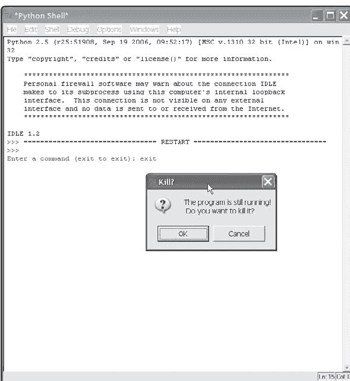

与编程世界中的许多事物不同，运行程序时返回 0 表示状态成功，意味着文件已成功复制。

我们在第 6 章中讨论过 `os` 模块的文件和目录部分，因此没有真正的理由再次重温它。相反，你应该花时间浏览各个模块的各个组件，看看在你用 Python 编写自己的应用程序时会需要什么。

顺便提一下，`win32api` 模块都可以在 python.net 网站免费下载，而且做得非常出色。如果你是 Windows 程序员，我强烈推荐使用它们。Python 的核心在于复用他人的工作并提供你自己的工作供他人复用，因此请不要犹豫寻找最好的模块和库，并在你的应用程序中复用它们。

340

## 结语

如果你从这一章中中学到一点东西，那应该是 Python 库系统是多么丰富和多样，以及现有代码为你提供了多大的功能。当你需要某些功能时，你的首选应该是查看 Python 库中已经提供了什么，而不是编写你自己的代码。为了学习如何做某事而编写代码是一回事，但因为不想使用任何代码而编写代码就是愚蠢的。Python 的目的是以最小的精力为你提供最大的功能，所以请利用这一点。

到此，前半部分的内容就结束了。

# 条款与条件

在事件发生时了解系统可能处于的状态。你可以选择尝试跟踪你感兴趣的所有状态更改，也可以在事件发生时查询系统以获取你所关心的任何内容的当前状态。

以表单上的按钮点击为例，将其作为回调函数的简单示例。假设你有一个包含三个输入字段的表单，包含登录特定网络系统所需的域名、用户名和密码。该表单将包含这三个输入字段以及用于继续或取消操作的按钮。如果用户点击“取消（Cancel）”按钮，输入表单将被删除，状态将恢复到之前的设置。如果点击了“确定（OK）”按钮，应用程序需要检查所有的输入字段都已填写。在用户点击按钮之前，你将不知道数据是否有效；这正是公式中的异步部分。

在 Tk 库中，你可以为几乎所有的事件注册回调函数，无论它们是主要的事件（如点击按钮），还是次要的（如鼠标在给定的表单元素上移动）。跟踪你对给定的回调函数所的操作是非常重要的，因为如果你愿意，你可以在多个事件中使用同一个函数。这里一个重要的区别在于：回调函数是由应用程序使用的，而事件是由控件使用的。控件生成事件，而应用程序监听由这些事件通过回调广播的变化。

# 控件 (Widgets)

在用户术语中，控件（widget）是指任何可以拥有属性并为其生成事件的物体。在通常情况下，控件实际上是指可以放置在窗口上并接收用户输入的东西。在某些情况下，控件可以是不可见的，但仍然接收事件，例如当控件被用于数据库连接时。然而，对于我们的目的，你可以将控件视为任何用户界面元素，例如按钮或输入字段。当我们开始查看 Tkinter 库中提供的供应用程序使用的所有可能元素时，我们将更深入地讨论控件。现在，只需将控件视为在你的代码中为你执行某些操作的黑盒。

## 布局管理器 (Layout Managers)

布局管理器是一种非视觉组件，帮助你将元素放置在你想放置的地方。例如，如果我在输入表单上有三个输入字段（输入值的地方），并希望它们垂直对齐，使一个直接挨在另一个下方，可以通过几种不同的方式实现。首先，我可以直接指定输入字段的位置，将每个字段放在输入表单内给定的垂直位置。这种方法的优点是外观始终如一，但问题是，如果表单调整了大小，输入字段看起来就会错位。

第二种方法是在表单每次调整大小时都移动输入字段。在许多环境中（如旧的 C++ GUI 库），这是你能够让表单在调整大小后看起来正确的唯一方法。然而，这可能涉及大量的编码，并且当表单缩小到超过某个最小尺寸时，往往会导致问题。但是，如果没有其他选择，无论周围环境的规模如何，这确实是控制你输入表单外观的唯一方法。

调整输入表单大小的第三种也是最后的方法是使用所谓的“布局管理器”来处理给定输入表单上输入字段和其他字段的定位。布局管理器使用多种方法之一来定义输入表单上字段之间的关系。例如，布局管理器可以使用指南来定义输入字段应该出现的行和列。另一种可能的方法是定义首选位置，例如按钮始终出现在输入表单的右侧。无论使用哪种方法，布局管理器都会应用该方法的规则，以确定在表单首次显示时以及随后的调整大小或移动时字段应该位于何处。

Tk 库高度依赖布局管理器来定义给定输入表单在运行时的行为。与许多更现代的编程语言不同，Tk/Tl 不包含用于定义输入格式的 WYSIWYG（所见即所得）工具。相反，你需要在代码中完成所有工作。这对于输入表单的动态定义是有利的，但也要求你提前投入更多工作，思考表单应该看起来什么样。这既不是好事，也不是坏事，只是你在编写应用程序时必须考虑的一种权衡。

# 使用 Tkinter


# 创建 Tkinter 应用程序

创建一个 Tkinter 应用程序有两个基本步骤。首先，你必须导入 Tkinter 模块。这是通过 Python 中的标准 `import` 语句实现的。在任何使用 Tkinter 的应用程序顶部，都应该添加以下行：

```python
from tkinter import *
```

通常情况下，你不会在 Python 中这样做，因为这意味着将整个模块及其所有组件导入到你的应用程序中。对于一个模块来说，这通常是过分的，因为它通常包含许多你真正不需要的东西。然而，Tkinter 是一个例外。

一旦你这样做，现在就可以访问 GUI 模块提供的所有功能。为了操作 Tkinter 应用程序，你必须有一个“根（root）”对象。根对象是所有其他组件的基础窗口。在 Tkinter 应用程序中，你可以同时打开多个窗口，但创建 `Tk` 对象才是根。当根对象被销毁时，窗口系统关闭，你的应用程序的 GUI 部分就完成了。

让我们创建一个最简单的 Tkinter 应用程序，只需向你展示在 Python 中是如何完成这一切的。

## 创建标签

```python
from tkinter import *
root = Tk()
root.mainloop()
```

如果你在 IDLE 中运行上述代码，你将看到一个窗口，如图 12.1 所示。该窗口没有任何标题，除了默认的“tk”。它包含了你预期的关闭、最小化和最大化。要关闭该窗口，只需点击右上角的“x”（或 Close）按钮。


运行在桌面上的基础 Tkinter 应用程序。

在窗口上放置组件的第二步是调用该组件的 `pack()` 方法。在这种情况下，我们只需要将标签布局在它的默认位置，这简单就是窗口上的下一个可用空间。

最后，我们调用根窗口的 `mainloop()` 方法来启动进程并在桌面上显示窗口。要关闭窗口并退出程序，请点击窗口右上角的关闭按钮。

## Frame 控件与居中

现在你已经了解了如何创建一个简单的窗口并向其添加标签，让我们为这个过程增加一点复杂性。在这种情况下，你将在窗口中创建一种名为 `Frame`（框架）的新类型控件，并使其在父窗口中垂直和水平方向上居中。然后，我们将添加标签作为框架的子控件，同样在父窗口中居中。为了让这个功能更加实用，你实际上将为主窗口指定一个尺寸，这样你就可以看到 Tk 如何精确地定义你在屏幕上想要的内容。

1. 使用 IDLE 编辑器的 `File | New Window` 命令在 Python 中创建一个新文件。
2. 在新窗口中输入以下代码并选择 `File | Save`。将文件保存为 `ch12_3.py` 到你选择的目录。

```python
# 导入模块
from tkinter import *

# 创建根窗口
root = Tk()
root.geometry("600x500+10+10")

# 创建一个框架来放置文本，具有固定的高宽
myContainer = Frame(root)
myContainer.pack(side=TOP, expand=YES, fill=BOTH)

# 在框架中放置标签
myLabel = Label(myContainer, text="This is a test")
myLabel.pack(side=TOP, expand=YES, fill=BOTH)

root.mainloop()
```

3. 按 F5 键或从编辑器窗口的 Run 菜单中选择 Run Module。你应该看到一个与图 12.3 所示类似的显示。

图 12.3 居中的窗口。

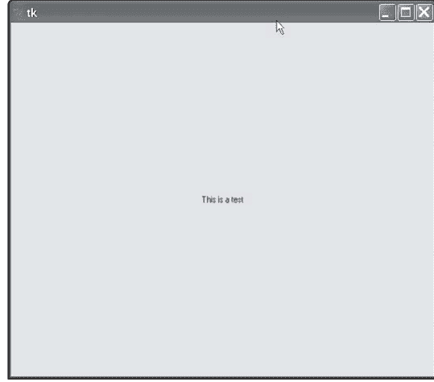

现在，让我们看看程序相对于上一个程序的更改以及这些变化实现了什么。你会注意到在创建根窗口对象之后添加了一行：

```python
root.geometry("600x500+10+10")
```

根对象的 `geometry` 方法指定了窗口在桌面上的尺寸和位置。传递给函数的字符串基本格式为“widthxheight+x+y”，其中 width 是像素为单位的窗口宽度，height 是像素为单位的窗口高度，x 和 y 分别距离屏幕左侧和底部的偏移量。例如，如果我使用字符串“600x400+50+20”，意味着我想要一个宽 600 像素、高 400 像素的窗口。我希望窗口出现在屏幕左侧 50 像素处，距离底部 20 像素处。你不需要指定所有元素。如果我只想指定尺寸，可以将 geometry 字符串写为“600x400”。

程序的下一个组件是：

```python
myContainer = Frame(root)
myContainer.pack(side=TOP, expand=YES, fill=BOTH)
```

`Frame` 对象是 Python 中的一种容器对象。它只是定义了根窗口的一个块区域，将其留作空白区域。`Frame` 对象可以包含其他对象，并允许对象在框架内移动。一旦你定义了框架对象，就可以定义它在父窗口（在此情况下为根窗口）中的显示方式。

`pack()` 方法接受多种选项，这里显示了其中一些。`side` 参数定义了对象如何相对于父对象对齐。在这种情况下，你将框架锚定在父窗口的顶部。`expand` 参数告诉 Tk，当框架的父窗口扩大时，你希望框架对象也跟着扩展。如果你调整窗口大小，框架将随之自动调整大小，受限于布局框架的其他几何布局的约束。最后，`fill` 选项指定了框架对象是否应该填充自身、水平方向或两个方向填充。在这种情况下，你要求框架通过在两个方向上扩展来填充整个窗口。

现在框架已经定义，你就在该框架内构建 `Label` 对象。这样做的好处是，你可以更改框架的行为（例如让它占据新窗口的一半），而不会对框架的子控件（在此情况下为标签）产生任何影响。框架是一个“容器”，容器内的子控件将根据容器的行为进行调整大小或移动。

```python
myLabel = Label(myContainer, text="This is a test")
myLabel.pack(side=TOP, expand=YES, fill=BOTH)
```

标签的定义没有任何变化，但布局逻辑依然存在。如你所见，你正在定义标签执行与框架相同的操作，但是在框架内部而不是根窗口内。如果你将框架定义更改为（例如仅填充窗口的垂直部分），标签也会随之。

## 带有按钮的应用程序

```python
nameentry = None
addressry = None
name = None
address = None
```

```python
def close_window():
    global name
    global address
    global nameentry, addressry
    name = nameentry.get()
    address = addressry.get()
    root.destroy()
```

```python
def DoInputForm(root):
    global nameentry, addressry
```

```python
nameentry = Entry(root)
addressry = Entry(root)
```

```python
nameentry.grid(row=0, column=1)
addressry.grid(row=1, column=1)
```

```python
# 添加一个确定和一个取消按钮
Button(root, text="Ok", command=close_window).grid(row=2, column=0)
Button(root, text="Cancel", command=close_window).grid(row=2, column=1)
```

```python
root = Tk()
DoInputForm(root)
root.mainloop()
```

```python
print("Name: "+name)
```

3. 按 F5 键或从编辑器窗口的“运行”菜单中选择“运行模块”。你应该看到类似于图 12.5 显示的界面。

观察此应用程序的运行情况，你会发现几个新项目。`Entry` 字段是在 `DoInputForm()` 函数中创建的。输入字段创建一个文本区域，用户可以在其中输入任何内容。你可能会注意到使用 `grid()` 布局管理器来定义输入字段和提示在表单上的位置。网格（grid）的概念在用户界面中并不新鲜；电子表格等已经存在多年了。在 Tkinter 中，`grid` 布局允许你按行和列来定义内容。行和列的内容由落在其中的字段的宽度和高度定义。例如，如果你定义了一个包含 100 像素高字段的行，那么该行的最小高度将是 100 像素加上行与之间的间距。同样，列的宽度由列内最宽的条目定义。你可以通过 `width` 和 `height` 属性在条目中设置绝对宽度和高度，但通常最好是让 `grid` 布局管理器为你完成工作。不同的项目在不同的分辨率下会为不同的用户显示，因此允许对布局进行动态管理是一个好主意。注意，如果不指定列数，列将默认为零，即最左侧的列。

这里需要注意的另一点是，如果你不需要创建组件产生的对象（例如 `Label` 对象），没有理由将它们赋值给变量。这可能有点让人困惑，因为你可能会认为对象一旦离开作用范围就会被销毁。不用担心，父窗口维护着组件列表，在父窗口销毁之前不会允许它们被销毁（从而从窗口中消失）。当你需要这些项目时（例如你想要从 `Entry` 字段中检索用户文本），那么你就需要保留对 `Entry` 对象（或你可能创建的其他对象）的引用。

你为按钮分配了一个命令处理程序，以便在用户点击任一按钮时关闭窗口。这不是处理这种情况最优雅的方法，因为你显然不想让“确定”和“取消”按钮执行相同的操作，但它说明了你可以为用户界面中的多个项目使用同一个事件处理器。

当用户点击“确定”或“取消”按钮时，会调用名为 `close_window()` 的命令处理器。注意，我们将窗口上 `Entry` 对象的引用设为了全局变量，并在命令处理器和 `DoInputForm()` 函数中全局引用它们。这允许我们通过使用 `Entry` 对象的 `get()` 方法获取 `Entry` 字段中的返回值。`get()` 方法返回用户在点击“确定”或“取消”按钮之前为该字段输入的字符串。

关于标签顺序（tab order）的一个说明在这里可能很重要。在 Tkinter 对话框中，Tab 键遍历字段的顺序通常由字段本身添加到对话框的顺序定义。不接受用户输入的字段（如标签/label）将不在标签顺序中。因此，对于我们的数据输入表单，在对话框中切换标签的顺序是：

- 姓名 `Entry` 字段
- 地址 `Entry` 字段
- 确定按钮
- 取消按钮

当到达列表顺序时，按下 Tab 键将你回到开头。在取消按钮上按 Tab 键将你回到字段。Shift-Tab（通常称为 backtab）将让你反向遍历列表。上面的代码可以运行，并且确实实现了我们想要的功能，但它存在一个特定问题——它过于复杂且丑陋。你真正想要的是让代码更优雅、不那么笨拙。为了实现这一点，你需要移除全局变量引用。在 Python 中实现此点的最佳方法是使用类，让我们把现有的函数和变量转换为类。

## 创建类来处理用户界面

将一组用户界面封装成类有两个很好的理由。首先，它让用户界面的代码更容易阅读和编辑，更加清晰。更重要的是，它更容易在其他应用程序中重用和扩展代码。一个用户界面只在一个地方使用一次是非常稀见的，相反，常见从一个脚本到另一个脚本。由于这些原因，将你开发的过程代码转换为可以反复使用的类非常有意义。这有助于消除代码中的全局变量。让我们开始操作吧。

1. 使用 IDLE 编辑器的“文件|新建窗口”命令创建一个 Python 文件。
2. 在新窗口中输入以下代码并选择“文件|保存”。将文件保存为你选择的目录下的 `ch12_7.py`。

```python
from tkinter import *

class AddressInputForm:
    def __init__(self):
        self.root = None
        self.nameentry = None
        self.name = ""
        self.address = ""

    def CloseWindow(self):
        self.name = self.nameentry.get()
        self.address = self.addressentry.get()
        self.root.destroy()

    def CreateForm(self):
        self.root = Tk()
        Label(self.root, text="Enter name:").grid(row=0, sticky=W)
        Label(self.root, text="Enter address:").grid(row=1, sticky=W)
        self.nameentry = Entry(self.root)
        self.addressentry = Entry(self.root)
        self.nameentry.grid(row=0, column=1)
        self.addressentry.grid(row=1, column=1)
        # 添加一个确定和一个取消按钮
        Button(self.root, text="Ok", command=self.CloseWindow).grid(row=2, column=0)
        Button(self.root, text="Cancel", command=self.CloseWindow).grid(row=2, column=1)

    def Show(self):
        self.root.mainloop()

af = AddressInputForm()
af.CreateForm()
af.Show()
print("Name: "+af.name)
```

运行这段代码将产生与图 12.5 相同的显示，并具有相同的输出。然而，注意代码看起来有多整洁，使用这种编码方式修改输入字段或提示要容易得多。在将来，除非数据表单是最简单的类型，否则你应该使用类。

## 使用列表框

处理用户界面设计时的常见问题是如何允许用户从一组选项中选择，而这些选项的长度可能是变化的。你可能会考虑显示一系列按钮（我们已经看过了），或者一个复选框列表（这看起来很丑陋）。然而，更好的替代方案是列表框。列表框显示字符串列表，并允许用户选择一个或多个字符串（由程序员决定）对其进行操作。你可能会展示文件名列表，并允许用户选择想要执行操作的文件。也许你想要展示通信系统的连接协议列表，并允许用户只选择其中一个。无论你的需求是什么，如果数据是列表或数组形式，答案可能是你的 GUI 元素使用列表框。

Tk 库提供了 `Listbox()` 类来访问 Python 中的列表框。你可以创建一个列表框，向其添加项目，从中删除项目，并从用户那里获取一个或多个选择。让我们来看看如何使用列表框。例如，你假设用户有一个项目列表，他们需要从中进行选择。一旦项目被选中并处理，你将其从列表框项目列表中删除。此外，你还为用户提供了一次选择多个项目并一次性处理和删除它们的能力。处理项目的工作显然并不兴奋，但至少说，选择和删除项目是有有趣的。你将创建的列表框看起来将像图 12.6 所示。

图 12.6 使用列表框。

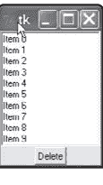

1. 使用 IDLE 编辑器的“文件|新建窗口”命令创建一个 Python 文件。
2. 在新窗口中输入以下代码并选择“文件|保存”。将文件保存为你选择的目录下的 `ch12_7.py`。

```python
from tkinter import *

class ListBoxTest:
    def __init__(self):
        self.root = Tk()
        self.list_box_1 = Listbox(self.root, selectmode=EXTENDED)
        self.list_box_1.pack()
        self.delete_button = Button(self.root, text="Delete", command=self.DeleteSelection)
        self.delete_button.pack()

    def DeleteSelection(self):
        items = self.list_box_1.curselection()
        pos = 0
        for i in items:
            idx = int(i) - pos
            self.list_box_1.delete(idx, idx)
            pos = pos + 1

    def Show(self):
        for i in range(0, 10):
            s = "Item " + str(i)
            self.list_box_1.insert(END, s)
        self.root.mainloop()

lbt = ListBoxTest()
lbt.Show()
```

如果你在 IDLE 中运行该程序，你将看到如图 12.6 所示的列表框。尝试操作该框，选择一个或多个项目并点击 Delete（删除）按钮。你会发现该项目已从列表框中移除。

值得注意的是 `Listbox()` 构造函数中的这段代码：


# 第 12 章 GUI – Tkinter

```python
self.list_box_1 = Listbox(self.root, selectmode=EXTENDED)
```

注意，你在构造函数中传递了 `selectmode="EXTENDED"`。这允许用户一次选择多个项目。如果你省略了此项，列表框将只允许单次选择。此外，你也可以尝试不选择任何项目并点击删除按钮。你会发现什么都没有发生。`Listbox` 类在 GUI 的 `curselection()` 方法中很好地处理了无选择的情况。与许多其他 GUI 库相比，这是一个很好的改进。顺便提一下，`curselection()` 方法返回一个被选中项目的列表。这意味着你可以使用我们讨论过的所有列表方法来处理该列表。

最后是确定要删除的项目索引的、略微复杂的计算。这看起来很奇怪，但不是吗？一旦你删除了一个条目，列表中随后的项目就会错序。例如，如果我在列表框中选择了项目 2、3 和 4，并尝试使用这些索引删除它们，我实际上删除的是项目 2、4 和 6。因为删除操作是基于条目在列表中的索引进行的，而不是基于原始的项目编号。所以，一旦项目 2 消失，项目 3 现在就处于项目 2 原本所在的位置，以此类推。因此，你需要计算出已经处理的偏移量，并将其用于要删除项目的实际索引。

在进入列表框示例的另一个部分之前，还有一点需要注意。使用“双击”事件作为对话框的默认处理已变得常见。例如，如果对话框允许你选择一个项目，在列表框中双击的效果与单击选择该项目然后点击对话框中的 OK 按钮的效果相同。如果你搜索列表框的可用方法，将找不到与双击相关的命令。这是由于底层 Tcl/Tk 系统的遗留，Tkinter 的底层是 Tcl/Tk，Python Tk Tk 使用称为“绑定”（binding）的东西来为系统中的组件添加功能。你可以通过组件的 `bind()` 方法配合适当的绑定字符串来添加双击处理程序，以调用你的方法。现在让我们添加该功能。使用如下所示的方法修改现有的 `__init__` 方法：

```python
def __init__(self):
    self.root = Tk()
    self.list_box_1 = Listbox(self.root, selectmode=EXTENDED)
    self.list_box_1.pack()
    self.delete_button = Button(self.root, text="Delete", command=self.DeleteSelection)
```

## 为列表框绑定事件

```python
self.list_box_1.bind("<Double-Button-1>", self.DoubleClick)
```

当然，你需要创建一个当 Tkinter 系统触发双击事件时被调用的方法。我们将此方法命名为 `DoubleClick`，所以请在类定义中任何地方添加以下代码：

```python
def DoubleClick(self, args):
    item = self.list_box_1.curselection()
    self.list_box_1.delete(item[0], item[0])
```

再次运行程序。它看起来与图 12.6 完全相同，但如果你双击某个项目，该项目将立即从列表框中移除。尝试一下！顺便说一下，这段代码中有一个“错误”。如果你双击空列表，程序会崩溃，因为没有当前选择。看看你能修复它。

## 滚动列表框

如果你玩过上面的代码，可能会注意到，如果你添加了大量项目（例如 50 个），在运行时无法滚动列表框。也就是说，Python 列表框没有内置滚动功能。这看起来很奇怪，因为列表框的设计本意是让你选择大量项目。如果不能滚动，是否意味着你必须一次性显示足够大的所有项目的列表框？如果有大量项目，这将非常糟糕。幸运并不如此。虽然列表本身不包含允许用户滚动的功能，但 `Scrollbar` 类包含了。在典型的 Python 中，你可以结合这两个元素的功能创建一个可以滚动的列表框。图 12.7 显示了对话框中带有滚动条的新列表框。为了制作这个对话框，你需要对现有的列表框代码进行一些修改：


1. 使用 IDLE 编辑器的 `File | New Window` 创建一个新的 Python 文件。
2. 在新窗口中输入以下代码，并选择 `File | Save` 将文件保存为 `12_8.py` 到你所在的目录。

```python
from Tkinter import *

class ListBoxTest:
    def DeleteSelection(self):
        items = self.list_box_1.curselection()
        pos = 0
        for i in items:
            idx = int(i) - pos
            self.list_box_1.delete(idx, idx)
            pos = pos + 1

    def __init__(self):
        self.root = Tk()
        self.frame = Frame(self.root)
        self.scrollbar = Scrollbar(self.frame, orient=VERTICAL)
        self.list_box_1 = Listbox(self.frame, selectmode=EXTENDED, yscrollcommand=self.scrollbar.set)
        self.scrollbar.config(command=self.list_box_1.yview)
        self.scrollbar.pack(side=RIGHT, fill=Y)
        self.list_box_1.pack(side=LEFT, fill=BOTH, expand=1)
        self.frame.pack()
        self.delete_button = Button(self.root, text="Delete", command=self.DeleteSelection)
        self.delete_button.pack()

    def Show(self):
        for i in range(0, 50):
            s = "Item " + str(i)
            self.list_box_1.insert(END, s)
        self.root.mainloop()

lbt = ListBoxTest()
lbt.Show()
```

这里的关键在于创建滚动对象。你可以单独使用滚动条，也可以与其他元素（如列表框）结合使用，如所示。如果你查看结果，你会发现滚动条看起来是列表框的一部分，而不是独立的元素。这是由于我们创建元素的方式。注意我们在显示中添加了一个新的 `Frame` 元素，它包含了列表框和滚动条。这是非常重要的，如果你不使用 `Frame`，你会发现列表框、滚动条和按钮都出现在对话框背景上的随机位置。始终将元素放置在 `Frame` 中，以便对它们对齐显示。

`yscrollcommand` 是用于垂直滚动列表框的属性。如果你也想添加水平滚动条，将使用列表框构造函数中的 `xscrollcommand` 属性。通过将它们关联起来，你是在告诉列表框“监听”滚动条的滚动方法，以获取何时应该移动自身位置的提示。最后，滚动条的方向由其构造函数中的 `orient` 属性设置。显然，在这种情况下可以是水平或垂直的；我们选择了垂直方向。

你不需要理解比这里看到的更多关于列表框滚动的知识。每当你需要列表滚动时，只需放入此处的代码即可。

## 菜单

菜单是现代图形用户界面的支柱。作为用户调用命令的一种简单且直观的方式，菜单是旧命令行界面的自然演进。用户不需要记住记忆晦涩且痛苦的命令（如用 `Alt Shift-Ctrl-Q` 退出应用程序），只需点击 Exit 菜单命令即可终止程序。用户流向基于菜单的应用程序，而不是旧的笨拙的命令行系统。每个不是简单工具的现代程序都有菜单，所以你希望为你的 Python 程序准备菜单并不意外。

幸运的是，在 Tkinter 中处理菜单是最简单的事情之一。你可以使用面向对象的方法非常简单地添加级菜单或子菜单（也称为*级联菜单*）。为了在 Python 中演示菜单，让我们来看一个简单的菜单系统，如图 12.8 所示。注意我们有一个主菜单，在 Tools 菜单下有一个子菜单。

```python
print "Creating a new file.."

def OpenFile(self):
    print "Opening an existing file..."

def Close(self):
    self.root.destroy()

def notdone(self):
    print "Not done yet!!"

def __init__(self):
    ### 定义根窗口
    self.root = Tk()

    # 为窗口定义一个基础菜单
    self.main_menu = Menu(self.root)
    self.root.config(menu=self.main_menu)

    # 创建文件菜单
    fileMenu = Menu(self.main_menu)

    # 将其与窗口菜单系统关联
    self.main_menu.add_cascade(label="File", menu=fileMenu)

    ### 现在，为它添加一些命令
    fileMenu.add_command(label="New", command=self.New)
    fileMenu.add_command(label="Open", command=self.OpenFile)
    fileMenu.add_separator()
    fileMenu.add_command(label="Exit", command=self.Close)

    # 尝试另一种类型的菜单
    toolMenu = Menu(self.main_menu)
    self.main_menu.add_cascade(label="Tools", menu=toolMenu)
    toolMenu.add_command(label="Tool 1", command=self.notdone)
    submenu = Menu(toolMenu)

    toolMenu.add_cascade(label="Others", menu=submenu)
    submenu.add_command(label="Other 1", command=self.notdone)
    submenu.add_command(label="Other 2", command=self.notdone)

    self.root.mainloop()

mt = MenuTest()
```

如果你运行上面的脚本，将看到图 12.8 所示的。这里有几值得注意的地方。首先，在 File（文件）菜单下，你会看到一条线划分了菜单的功能。用户使用这种东西来展示某些功能的结束和开始位置。这种线被称为*分隔符*（separator），可以使用菜单类的 `add_separator()` 方法添加到任何菜单中。你无法选择分隔符，也无法对其进行任何操作；它仅仅是为了指示功能类型的断开。

下一个有趣点是命令是如何与条目关联的。当你向菜单添加新条目时，你指定了在运行时用户选择菜单条目时将调用的可执行代码（通过名称）。与 Python 中的所有回调函数一样，你可以指定一个独立函数（在其他语言中通常被称为*静态方法*），你也可以调用类的方法。要调用方法，你只需要在方法名前面指定 `self` 关键字（例如 `self.notdone`）。这告诉解释器这是一个方法而不是一个函数，并且当它被菜单处理程序调用时，`self` 参数将自动传递给该方法。通过这种方式，这比大多数编译型语言处理回调的方式要优得多，因为那些语言无法通过类方法处理回调。

我们是如何在 Tools（工具）菜单下创建子菜单的？我们将一个菜单与 Tools 菜单关联，而不是与主菜单关联。Tkinter 中的每个条目都可以附加菜单；它们将是当用户从主窗口选择主菜单条目时显示的弹出菜单。这非常棒，你可以很轻松地将菜单从一个移动到另一个。

我们还没有提到关于菜单的一点是菜单分离（tear-off）功能。如果你注意到，当我们所有的菜单显示时，顶部都有一系列破折线 `--`。如果你点击这个条目，菜单将从菜单上撕下来，并作为一个自由浮动的菜单显示。如果你不喜欢这种行为，只需在对菜单的构造函数调用中指定 `tearoff=0` 即可。例如，假设你修改了 Tools 菜单：

```python
toolMenu = Menu(self.main_menu, tearoff=0)
```

按所示修改代码并重新运行应用程序。你会发现工具菜单顶部不再有虚线了，而且它无法被撕下来在应用程序中自由浮动。

## 上下文菜单 (Context Menus)

如果你在 Windows 或 Macintosh 上工作，你可能已经习惯了使用上下文菜单。上下文菜单，或者人们常说的右键菜单，是在你在特定范围内按下右鼠标键时弹出的菜单。例如，如果你正在编写一个编辑程序，上下文菜单可能包含剪切、复制和粘贴等编辑命令。将这些命令添加到你的 Python Tkinter 程序中非常容易，而且这是你在设计和编写程序时应该认真考虑的事情。当对你来说很容易时，让用户的生活变得轻松是一件非常划算的事。要添加上下文菜单，你只需要知道一个方法，菜单类的 `tk_popup()` 方法。让我们看看它是如何工作的。

1. 使用 IDLE 编辑器的 `File | New Window` 创建一个新文件。
2. 在新窗口中输入以下代码并选择 `File | Save`。将文件保存为你选择的目录下的 `ch12_10.py`。

```python
from Tkinter import *

class ContextMenuTest:
    def Cut(self):
        print "Cut"

    def Copy(self):
        print "Copy"

    def Paste(self):
        print "Paste"

    def OnContext(self, args):
        # 定义上下文菜单
        contextMenu = Menu(None, tearoff=0)
        contextMenu.add_command(label="Cut", command=self.Cut)
        contextMenu.add_command(label="Copy", command=self.Copy)
        contextMenu.add_command(label="Paste", command=self.Paste)
        contextMenu.tk_popup(args.x_root, args.y_root, "")

    def __init__(self):
        self.root = Tk()
        self.root.geometry("300x500")
        self.root.bind("<Button-3>", self.OnContext)
        self.root.mainloop()

cmt = ContextMenuTest()
```

关于上下文菜单有几点重要的需要注意。例如，在创建时，你总是希望将 `tearoff` 值设置为 0。上下文菜单分离没有任何意义，因为它是自由浮动的。接下来，你会注意到上下文菜单的结构与任何菜单完全相同。这不是偶然，因为上下文菜单是没有父级的普通菜单。最后是 `tk_popup()` 方法调用。该方法接受三个参数：显示弹出菜单的 x 和 y 位置，以及要选择的项。通常，你会让第三个参数为空。

为了让弹出菜单出现，你需要捕获右点击。这是通过 Tk 对象的 `bind()` 方法实现的。右鼠标由于历史原因是按钮 3。左鼠标是按钮 1，对于支持的系统，中间键是按钮 2。如果没有中间键，你永远不会得到它的回调，这并没有改变编号系统。你绑定 `<Button-3>` 事件，你的上下文处理程序将接收两个参数。首先，它将获得操作的对象。这正是你为止在所有功能中使用的参数。第二个参数是事件参数。它指定了在屏幕上点击鼠标的位置。

# 比例尺控件 (Scale Widgets)

你经常发现自己需要在范围内输入一个值吗？答案是经常，尤其是当你处理数值数据时。例如，假设你需要输入一个百分比来用于应用程序中的透明度。对于给定的窗口，有效值可能是 0% 到 100% 的透明度，表示窗口是完全透明还是完全不透明。强制用户输入该范围内的值、验证范围以确保其正确以及转换输入字符串是非常麻烦的事。

将其转换为一个你可以在计算中实际使用的数字。你难道不认为会有更简单的方法吗？事实证明，使用 Tkinter 库，有一种更好的方法，那种方法被称为 `Scale` 刻度控件。

`Scale` 控件允许你通过简单按下控件上的鼠标按钮并将其从一侧移动到另一侧，将一个值从一个极端“滑动”到另一个极端。`Scale` 允许你以滚动增量移动（使用鼠标在屏幕上滑动单个区块），或者通过点击你想要移动的刻度末端来以单单位移动。作为优点，`Scale` 控件还有一个显示器，显示过程中的当前值。你可以将 `Scale` 控件用于输入，允许用户输入值，或者你可以将其用于显示，指示用户在给定过程中可能处于什么位置。


# 图 12.9：Scale 控件示例

图 12.9 显示了一个包含 `scale` 控件的简单对话框。在这种情况下，我们将控件的范围设置为从 0 到 100，用户将控件滑块值设为 68。

**图 12.9** 一个显示用户所选值的滑块控件。

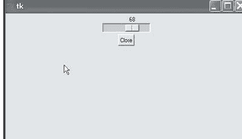

让我们动手构建显示图 12.9 的应用程序，以及一个关闭应用程序并为用户打印出最终所选值的按钮。

1. 使用 IDLE 编辑器的 `File | New Window` 命令在 Python 中创建一个新文件。
2. 在新窗口中输入以下代码并选择 `File | Save`。将文件保存为选定目录下的 `ch12_11.py`。

```python
from Tkinter import *

class ScaleTest:

    def CloseMe(self):
        self.value = self.scale.get()
        self.root.destroy()

    def __init__(self):
        self.value = 0
        self.root = Tk()
        self.root.geometry("500x300")

        ### 创建一个 scale 控件
        self.scale = Scale(self.root, from_=0, to=100, orient=HORIZONTAL)
        self.scale.pack()

        # 创建一个关闭应用的按钮
        Button(self.root, text="Close", command=self.CloseMe).pack()

        # 运行应用
        self.root.mainloop()

st = ScaleTest()
print("Value = " + str(st.value))
```

如果你运行脚本并移动控件，然后点击 `Close` 按钮，你将在控制台上看到显示的值。请注意，如果你在 IDLE 内部运行脚本，你将看不到显示的最终值。这只是 IDLE 环境的一个特性；不必为此操心。顺便说一下，如果你不喜欢滑块在上方显示值，只需在该类的构造函数中简单添加配置选项 `showvalue=False` 即可。

这引出了一个有趣的问题：假设你想在自己的标签（`Label`）或其他控件中显示值。你可以轻松地更新标签来显示值，但你如何知道值何时变化？答案是，`scale` 控件允许你在值发生变化时调用指定的命令方法。为了说明它是如何工作的，请如下所示修改上述代码（修改部分已高亮）：

```python
from Tkinter import *

class ScaleTest:

    def CloseMe(self):
        self.value = self.scale.get()
        self.root.destroy()

    def ShowValue(self, args):
        self.value_label["text"] = str(self.scale.get())

    def __init__(self):
        self.value = 0
        self.root = Tk()
        self.root.geometry("500x300")

        ### 创建一个 scale 控件
        self.scale = Scale(self.root, from_=0, to=100, orient=HORIZONTAL,
                           showvalue=False, command=self.ShowValue)
        self.scale.pack()

        ### 创建一个关闭应用的按钮
        Button(self.root, text="Close", command=self.CloseMe).pack()

        # 创建一个显示值的标签
        self.value_label = Label(self.root, text="0")
        self.value_label.pack()

        # 运行应用
        self.root.mainloop()

st = ScaleTest()
print("Value = " + str(st.value))
```

现在当你运行程序时，你将会在自己的标签中实时看到更新的值。

---

# 第 12 章 GUI – Tkinter

## 单选按钮和复选框

在允许用户做出选择时，编程语言实际上有两种处理方法。首先，你可以允许用户简单地对问题给出答案。这类似于“你希望背景是什么颜色？”之类，后面紧跟着是一个输入字段，允许你输入诸如“白色”或“红色”等内容。显然，由于拼写错误的问题，这是一个充满错误的过程。你可能会得到意料之外的答案，例如，“我妻子眼睛的颜色”。通常的替代方案是允许用户从某种列表中选择颜色。如果列表框（`Listbox`）无疑是更好的选择。但如果你只有二三个供选择的选项呢？在这种情况下，你不想使用列表框，因为它们对普通用户来说有些望而生畏。你想要的是单选按钮或复选框。

**图 12.11** Python 中的单选按钮和复选框

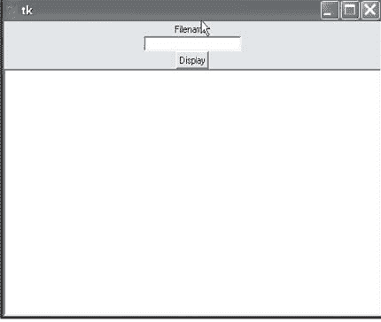

让我们来构建显示图 12.11 的应用程序。

1. 使用 IDLE 编辑器的 `File | New Window` 命令创建一个新的 Python 文件。
2. 在新窗口中输入以下代码并选择 `File | Save`。将文件保存为任意目录下的 `ch12_13.py`。

```python
from Tkinter import *

class FileDisplay:

    def loadfile(self):
        myFile = file(self.filename.get())
        myText = myFile.read()
        myFile.close()
        self.text_widget.insert(0.0, myText)

    def __init__(self):
        # 创建元素
        self.root = Tk()
        Label(self.root, text="Filename: ").pack()
        self.filename = Entry(self.root)
        self.filename.pack()
        Button(self.root, text="Display", command=self.loadfile).pack()

        self.text_widget = Text(self.root)
        self.text_widget.pack(expand=1, fill=BOTH)

        self.root.mainloop()

fd = FileDisplay()
```

如果你在输入框中输入有效名称并点击 `Display` 按钮，你将看到文件加载到文本字段中。再次注意，我们没有为文本字段提供滚动功能。如果你想添加滚动功能，只需按所示修改 `__init__` 方法（更改部分已高亮）：

```python
def __init__(self):
    # 创建元素
    self.root = Tk()
    Label(self.root, text="Filename: ").pack()
    self.filename = Entry(self.root)
    self.filename.pack()
    Button(self.root, text="Display", command=self.loadfile).pack()

    self.frame = Frame(self.root)
    self.scrollbar = Scrollbar(self.frame)
    self.text_widget = Text(self.frame, yscrollcommand=self.scrollbar.set)
    self.text_widget.pack(side=LEFT, fill=BOTH, expand=1)
    self.scrollbar.config(command=self.text_widget.yview)
    self.scrollbar.pack(side=RIGHT, fill=Y)
    self.frame.pack()

    self.root.mainloop()
```

## 总结

在本章中，你学习了 `Tkinter` 库以及如何使用它在 Python 中创建 GUI 应用程序。当然，`Tkinter` 并不是 Python 的一部分，而是一个带有接口的外部系统。事实上，该库被称为 `Tk`，而它的接口被称为 `Tkinter`。你可以使用这个库在 Python 中创建复杂且神奇的东西；我们在本章中仅仅触及了可能性的皮毛。

请记住，本书并不是 `Tkinter` 系统的完整参考书。还有许多未涵盖的控件，以及许多未讨论的功能。你可以在互联网或 Python 系统自带的文档中找到许多关于该库的知识。多尝试这些库，尝试不同的事情，你学到的会比在这里可能学到的多得多。本章旨在作为一个概述和介绍，介绍一些你可能不会考虑过尝试的内容。当你向 Python 系统中安装 `Tk` 时，你还会获得一个完整的帮助文件，其中描述了库中的方法和类。对于我们在这里没有涵盖的任何内容，请参考那份更完整的文档。

`Tkinter` 是一个编写得良好且调试良好的库。它在 UNIX 世界已经存在很长时间，并被移植到了许多操作系统。在下一章中，我们将探索更高级的特性。

---

# 第 13 章 Web 服务器——Apache

## 你的第一个 Python CGI 脚本：Hello Apache

CGI（通用网关接口）协议是外部程序和应用程序环境与 Web 服务器交互的标准方式。Web 上的普通 HTML 文件是静态的，而 CGI 程序（或脚本）是在用户发出请求时执行的，并动态生成内容。为了查看它是如何运作的，让我们用 Python 创建一个简单的脚本，并让 Apache Web 服务器执行它。

1. 在 IDE 编辑器或你喜欢的文本编辑器中创建一个新文件。
2. 将以下代码放入新文件中，并将文件保存为 `ch13_1.py`：

```python
#!c:/Python25/python

from os import *
from cgi import *

print "Content-type: text/html\n\n"
print '<BR>Hello Python!</B>'
```

3. 将该文件保存到 Apache 根目录下的 `cgi-bin` 目录。例如，如果 Apache 系统安装在 `c:\Program Files\Apache Software Foundation\Apache 2.2`，则将文件保存到：

`c:\Program Files\Apache Software Foundation\Apache 2.2\cgi-bin`

在本示例中，文件名为 `ch13_1.py`，表示它是本章创建的第一个程序，但你可以随意命名。无论你决定给文件起什么名字，请记住它，以便下一步使用。

4. 启动 Web 浏览器并在导航框中输入以下 URL：`http://localhost/cgi-bin/ch13_1.py`

显然，如果你给文件起了不同的名字，请将上述 URL 中的 `ch13_1` 替换为你自己的名称。在任何情况下，文件必须以 `.py` 扩展结尾并位于 `cgi-bin` 目录中才能运行。

你应该能看到与图 13.2 类似的显示。请注意，虽然特定的显示是在 Firefox (Mozilla) Web 浏览器中进行的，但结果显示在任何 Web 浏览器中都是相同的。你的小程序输出是简单的 HTML，无论你在什么浏览器中查看，它看起来都一样：

**图 13.2** Hello Python 脚本输出。

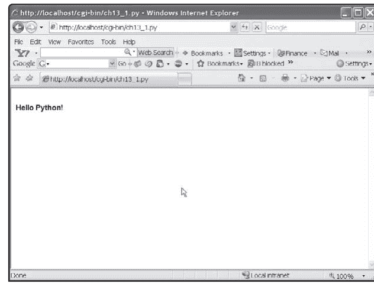

## 查看 Hello Python 脚本

当你查看脚本中涉及的相当简单的代码时，你应该注意到几点。首先，代码引入了两个你从未真正用过的新模块。`os` 模块包含特定操作系统的功能，而 `cgi` 模块导入了直接与 CGI 处理相关的功能。我们在这个脚本中实际上并没有使用其中任何一个，但在处理 Web 相关的代码时，你应该理所当然地使用它们。

脚本使用 `print` 语句将数据输出到 Web 服务器。你会注意到输出的第一行是：

```python
print "Content-type: text/html\n\n"
```

这行代码是 Web 服务器正确解释代码所必需的。顺便提一下，这不是一个有效的 HTML 文件，因为它不包含起始 `<HTML>` 和结束 `</HTML>` 标签。即使有这个问题，今天市场上没有哪个 Web 浏览器会拒绝处理这种输出，因此头部行是必须的。

一旦你输出了头部行，其余代码就会生成简单的 HTML 标签和文本，以便以你想要的方式在浏览器上显示该行。`<B>` 标签以粗体输出数据，而 `<BR>` 标签仅输出一个换行符（在这种情况下为一个空行）。本书并不打算作为 HTML 的入门教程，因为市上有许多此类书籍。

从现在开始的假设是，你已经具备足够的 HTML 知识，可以编写你需要的语句，或者你可以在其他地方查阅它们。我们将主要关注正在编写的脚本的 Python 部分。

服务器加载脚本后，`print` 语句简单地发出代码，服务器将其解释为发送给客户端的文件。然后当脚本结束时，你发送给客户端的“文件”看起来如下：

```
Content-type: text/html

<BR>Hello Python!</B>
```

头部行已就绪。一旦你输出了头部行，其余代码就会生成简单的 HTML 标签和文本，以便以你想要的方式在浏览器上显示该行。`<B>` 标签以粗体输出数据，而 `<BR>` 标签仅输出一个换行符（在这种情况下为空行）。本书并不打算作为 HTML 的入门教程，因为市上有许多此类书籍。

## cgi-bin 目录

我们需要讨论的下一个问题是为什么 `cgi-bin` 目录很重要。目前，我们假设所有文件都需要放在该目录下。普通脚本和 Web 脚本之间的区别不仅仅在于扩展名。如果扩展名是 `.py`，Web 服务器就知道如何处理它。请注意，环境变量你可能会不同。

## 显示环境的脚本


虽然在 Python 脚本中显示简单的 HTML 很好，但除了静态文本外没什么有趣的。在 Web 脚本中使用 Python 的目的是生成动态数据。在本示例中，你将为用户输出系统当前的环境变量。请注意，这些设置是针对运行脚本的机器，而不是用户的机器。

1. 使用 IDLE 编辑器或你喜欢的文本编辑器创建一个新文件。

2. 将以下代码放入新文件中，并将文件保存为 `ch13_2.py`：

```python
from os import *
from cgi import *

print "Content-type: text/html\n\n"

print "These are the environment variables:<br>"
for key, value in environ.items():
    print key, " = =", value, "<br>"
```

3. 将文件保存到 Apache 服务器根目录下的 cgi-bin。在本示例中，文件名为 `ch13_2.py`，你可以随意命名。

4. 通过在 Web 浏览器中输入 URL 运行脚本：`http://localhost/cgi-bin/<filename>.py`

其中 `<filename>` 是你在第 3 步中使用的文件名。

如果你在 Mozilla/Firefox 浏览器中运行程序，你应该能看到与图 13.3 类似的显示。请注意，环境变量你可能会不同

# 用于显示环境的脚本

与此处显示的完全不同。环境变量取决于你安装了什么内容、安装了哪些驱动程序，以及你在 Windows 系统中选择了哪些设置。然而，你至少应该能看到一个变量及其值的列表。

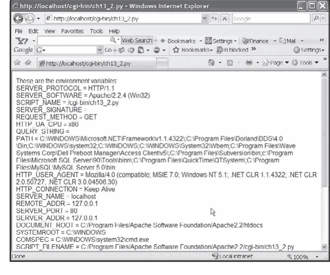

图 13.3

Python 环境变量显示。

再次强调，如果你拥有用于 CGI 和操作系统交互的模块，则可以使用 `environment` 模块来获取环境变量设置，这些设置将在静态 HTML 头部之后显示出来。这个脚本并不具备交互性，但它至少会根据机器的当前设置生成动态数据。

现在，有趣的部分来了。如果你在 Windows 环境中打开命令提示符，然后输入命令“set”并按回车，你将看到为当前用户设置的环境变量列表。将你看到的条目与显示的 Web 页面上的条目进行比较，你会很快发现它们之间半点关系都没有。事实上，如果你在 IDLE 环境中运行该脚本，你会发现结果也是完全不同的。

当你在 IDLE 解释器或命令行中运行脚本时，你是在自己的账户下运行的。然而，如果脚本在 Web 服务器中运行，它是在一个专门为 Web 服务器设计的账户下运行的。因此，你所操作的环境

# 第 13 章 Web 服务器——Apache

是不同的。此外，Web 服务器内部的环境与系统环境也不同。虽然这些差异巨大，但在编写可能在 Web 服务器环境内外执行的代码时，你必须意识到这一点。

## 从 HTML 文件接收数据

虽然 Web 服务器与 Python 脚本之间的单向对话通常很有用，但能够从 Web 页面提供信息并根据该输入生成输出要有趣且有用得多。在 Python 中，`cgi` 模块提供了访问包含输入字段的 HTML 页面发送的信息的功能。这些页面在 HTML 世界中被称为表单（forms），能够以简洁且用户友的方式获取用户输入，然后将其传递给简单的脚本进行进一步处理。

作为一个示例，让我们在 HTML 表单中收集一些用户信息。在这种情况下，你将使用图 13.4 所示的表单，它提示用户输入姓和名。这些信息将传递给 Python 脚本，脚本将合并它们并使用用户的全名向其问候。

图 13.4

一个供 Python 脚本使用的 HTML 输入表单。

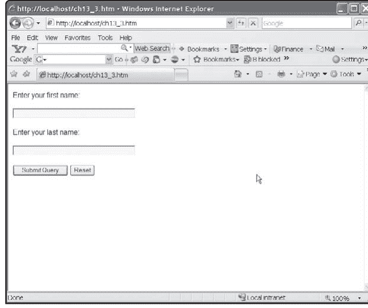

为了实现这一点，你首先需要一个表单。这个在 HTML 中创建表单将调用脚本。

1. 使用你的文本编辑器创建一个新文件。在这种情况下，我选择了使用记事本（Notepad），它在所有版本的 Windows 中都可以方便使用。

2. 将以下代码放入文件中：

```html
<html>
<form action="ch13.py">
<p>Enter first name:</p>
<input type="text" name="firstname" size="40">
<p>Enter last name:</p>
<input type="text" name="lastname" size="40">
<input type="submit">
<input type="reset">
</form>
</html>
```

3. 将文件保存为 ch13.html 并将其存储在 htdocs 目录中。

4. 使用你的编辑器创建一个新文件。

5. 将以下代码放入文件中：

```python
#!c:/Python25/python
import cgi

reshtml = """Content-Type: text/html

<html>
<head><title>Hello</title></head>
<body>
<h1>Welcome!</h1>
<p>You are: %s</p>
</body>
</html>"""

form = cgi.FieldStorage()
```

6. 将文件保存为 ch13.py 并将其放在 cgi 目录中。

7. 通过输入 `http://localhost/ch13.html` 将文件加载到浏览器中。

8. 输入你的姓和名并点击 Submit（提交）按钮。

图 13.5

以下操作的结果：


```python
for f in form:
    print "Field " + f + " = " + form[f].value
```

```python
print
```

# 添加一个隐藏变量，以便我们知道是否已经来过这里

```python
print '<input type="hidden" name="flag" value="1">'
```

```python
print "</p>"
```

```python
def gen_output( dic ) :

    error = 0

    fname = dic.get("firstname", "")
    lName = dic.get("lastname", "")

    if fname == " " or lName == " " :
        error = 1

    if error == 0 :
        print("Hello there " + fname + " " + lName)
```

# 第 13 章 Web 服务器—Apache

```python
return error
```

```python
# 首先，处理头信息。
print "Content-Type: text/html\n"
print "<HTML>"
```

```python
form = cgi.FieldStorage()
```

```python
res = gen_output(form)
if res == 1:
    send_form(form)
```

```python
print "<form>"
print "</html>"
```

## 运行原理

在弄清楚这一切是如何运作之前，首先需要记住的是，代码中的函数定义在从内联代码调用它们之前是不会执行的。这意味着“脚本”实际上是从注释“首先，处理头信息”这一行开始执行的。在这一行下面，你生成了 HTML 头信息，Web 服务器需要读取它以知道如何处理你生成的文件。

接下来的要做工作是获取字段存储信息。在任何从 Web 服务器调用的 Python 脚本中，这些信息始终是可用的。然而，事实并不意味着它一定包含你所需的信息。你可以调用函数 `getvalue()` 来验证数据是否存在于字段存储中。如果未找到指定的字段，你就知道需要为用户生成一个表单供其填写并提交。然而，如果两个值（姓和名）都已找到且具有有效值，程序将显示一条消息并退出。

假设用户还没有填写数据，我们移动到表单生成阶段。注意，我们使用了一个隐藏变量（在代码中称为 `flag`）来检查我们之前是否已经生成过此表单。如果从字段存储中没有找到该变量，说明这是用户第一次使用这个 Python 脚本文件，我们不想告诉他任何缺失的数据，因为他还没有机会实际填写。在他什么都没做的情况下告诉我们发现了错误是不礼貌的。

`send_form()` 函数使用 `FieldStorage` 类的 `getvalue()` 方法来获取姓、名和 flag 的值。`getvalue` 方法的第二个参数是当在类的内部字典中未找到该值时使用的默认值。

我们使用该默认值来查看那里是否有内容。在检查 flag 是否设置之后，你可以直接输出表单的输入字段，你也可以在进行输入字段之前将提示设为红色。实际文本不会改变；你只需要将字体颜色（使用 HTML 字体标签）设置为红色即可。

此示例说明了如何使用 Python 为用户动态生成一个表单以输入数据，以及如何验证这些数据。你可以看到，希望这样的话，追踪哪些数据片段是错误的，并在它们错误时要求用户重新输入将是容易的。最后，这个示例阐明了“隐藏变量”的使用，它可以用于在 HTML 表单和后端 Python 脚本之间传递数据以指示状态。你可以轻松地使用隐藏变量处理如用户 ID 之类的内容，指示存储在服务器上针对特定用户在特定时间的一组半永久数据。自然地，你可以轻松使用这样的系统来确保在特定时间内只有一个用户使用给定的名称登录，或者检查是否存在冲突。

## 基于用户输入的动态 HTML 显示

```python
fDest = form.getvalue("selbox", **)
if check_credentials(fUser, fPw) == 1 :
    process_selection( fDest )
```

现在

你可能会想知道，顺便问一下，为什么我们选择直接将用户发送到一个硬链接位置，而不是简单地向“返回”到上一个页面。在浏览器中，你会按“返回”键回到输入页面，重新填写，然后继续操作。遗憾的是，在一种情况下是不可能的，因为我们处于等式的服务器端，并且不知道用户是从哪里来的。

然而，一旦用户提供了有效的用户名和密码，并告诉我们他们想去的地方，有许多种方法可以实现这一点，例如在我们的 Python 脚本文件中放置用于生成页面的代码、将用户重定向到另一个 HTML 页面，以及创建一个新脚本来创建新页面。在当前脚本中添加新函数并没有特别之处，因此它不会向你展示任何有趣的内容。我们稍后会介绍重定向，因为我们将探索如何将用户发送到新地址。这就只剩下编写一个新的脚本来处理页面并从我们现有的模块调用它了。由于到目前为止我们还没有真正探索过 Python 的这方面，这样做非常有意义。

让我们创建一个新脚本，在这种情况下称为 `ch13_5_1.py`，它将负责处理你网站的“我的股票”页面的工作。要这样做，只需在 `cgi-bin` 目录下创建一个名为 `ch13_5_1.py` 的新文件，并将以下代码放入新文件中。

```python
#!/usr/bin/python2
import cgi
```

```python
def gen_html_header() :
    print "Content-Type: text/html\n\n"
    print "<HTML>"

def gen_html_trailer() :
    print "</HTML>"
```

## 第 13 章 Web 服务器—Apache

```python
def generate_mystocks_page() :
    gen_html_header()
    print "You have reached the My Stocks Page!"
    gen_html_trailer()
```

这段代码并不复杂，也没有执行任何有趣的操作，但它确实说明了你是如何生成新页面的。记住，尽管我们已经在现有的模块中声明了 `gen_html_header` 和 `gen_html_trailer`，但这在新模块中不会产生问题，因为名称的作用域是模块级的。现在我们有了一个处理“我的股票”页面的新模块。一个显而易见的问题是，我们如何从网站现有的处理器中“调用”该模块。Python 是一门解释型语言。这意味着它在创建文件时不需要知道某些东西在哪里——它只需要在被调用时能够找到函数即可。因此，你可以修改原始脚本中的现有 `process_selection()` 函数，读取如下：

```python
def process_selection(sel):
    if sel == '1':
        import ch13_5_1
        ch13_5_1.generate_mystocks_page()
```

注意，我们正在显式地从 `ch13_5_1.py` 文件调用 `generate_mystocks_page()` 函数。如果你执行了此更改并再次运行原始表单，在用户名和密码处输入“admin”，并在下拉列表中选择“我的股票”选项，你将看到页面已正确显示！

## HTML 元素

为了说明所有的 HTML 元素如何映射到它们的 Python 等价项，以及你如何检查你获取了什么，让我们编写一个非常简单的程序，展示各种类型的 HTML 元素，例如单选按钮、复选框等。你的输入表单将看起来类似于图 13.8 所示，它展示了一个非常简单的披萨订单。

### 图 13.8

披萨订单表单。

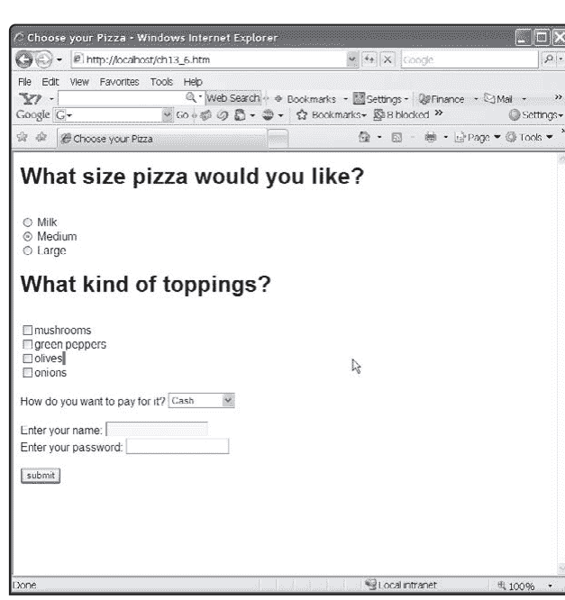

此输入表单的 HTML 如下：

```html
<HTML>
<TITLE>Choose your Pizza</TITLE>

<FORM ACTION="cgi-bin/ch3_6.py">

<!-- 第一，是披萨尺寸 -->
<H1>What size pizza would you like?</H1><BR>

<input type="radio" name="size" value="Personal"> Personal<br>
<input type="radio" name="size" value="Medium" checked> Medium<br>
<input type="radio" name="size" value="Large"><BR><BR>
```

```html
<H1>What kind of toppings?</H1><BR>
```

```html
<INPUT TYPE=CHECKBOX NAME="mushrooms" >mushrooms<BR>
<INPUT TYPE=CHECKBOX NAME="green peppers">green peppers<BR>
<INPUT TYPE=CHECKBOX NAME="olives" >olives<BR>
<INPUT TYPE=CHECKBOX NAME="onions" >onions</P>
```

```html
How do you want to pay for it?
<select NAME="payment">
<option>Cash</option>
<option>Check</option>
<option>Credit Card</option>
</select><BR><BR>
```

```html
Enter your name: <INPUT TYPE=TEXT NAME="name"><BR>
Enter your password: <INPUT TYPE=PASSWORD NAME="password"><BR><BR>
```

```html
<INPUT TYPE=SUBMIT VALUE="submit">
</FORM>
</HTML
```

由于这并不是一本关于 HTML 的书，我们不会花费大量时间来讨论这些元素或它们的工作原理。接下来，让我们关注当用户输入请求的值并按下提交按钮时，这些各种元素是如何被你的 Python 脚本接收的。这是一个非常简单的 Python 脚本代码，它将简单地打印你收到的值。我们将此脚本称为 `ch13_6.py`，这就是在上面 HTML 的 form action 行中引用它的方式。

```python
#!/usr/bin/python
import cgi
```

```python
def gen_html_header() :
    print("Content-Type: text/html\n\n")
    print("<HTML>")

def gen_html_trailer() :
    print "</HTML>"

form = cgi.FieldStorage()

for e in form :
    print "Received " + e + " = " + form.getvalue(e)
```

由于这并不是一本关于 HTML 的书，我们不会花费大量时间来讨论这些元素或它们的工作原理。接下来，让我们关注当用户输入请求的值并按下提交按钮时，这些各种元素是如何被你的 Python 脚本接收的。这是一个非常简单的 Python 脚本代码，它将简单地打印你收到的值。我们将此脚本称为 `ch13_6.py`，这就是在上面 HTML 的 form action 行中引用它的方式。

## Cookies


在这一时刻，如果你不知道互联网和 Cookies，你将会是聋、哑、盲的。Cookies 是跟踪用户的简单信息，以便你尽可能提供良好的体验。遗憾的是，Cookies 有相当糟糕的声誉，人们认为它们可以以某种方式“告知”网站你的行为。严格来说，你不必在浏览器中允许它们，但如果你允许了，它会让你的浏览体验变得丰富。作为服务器端 Python 开发者，你应该意识到 Cookies 的糟糕声誉，并为用户不允许存储它们做好准备。还有其他方案，正如我们所见，即维护状态的隐藏变量。这并不理想，因为你真的不知道用户是否是上次使用系统的同一个用户，但它是行得通的。

```python
value = cookie[1]
if name == "membership": 
    return int(value)
```

- 3. 将文件保存到 Apache 安装根目录下的 `cgi-bin` 目录。
- 4. 在浏览器中，在导航区域输入 `http://localhost/cgi-bin/ch13_7.py` 的 URL 并按回车或 Enter 键。

注意，当你第一次运行程序时，你并不是成员。这是因为 cookie 并不存在。如果你刷新浏览器，它会告诉你你是一个成员。这表明 cookie 已经正确设置。cookie 的“寿命”被设置为 30 秒，主要是为了让它能够自动重置。在现实世界中，你会使用更长的时间。过期日期是通过设置你想要设置的 cookie 值的中的 "expires" 属性来设定的，它是从现在开始的秒数。关于 cookie 的最后一点说明：它们绑定到生成它们的站点。因此，你无法读取来自另一个网站的 cookie，如果你更改了自己网站的 URL，所有现有的 cookie 都会失效。除此之外，它们使用起来非常简单。导入 `Cookie` 模块，创建一个 `SimpleCookie` 对象，并设置你想要设置的 cookie 字符串和属性。这一切不需要任何糟糕的笑话来引发新点子。

创建 cookie 的过程非常简单。你有以下代码：

```python
member = Cookie.SimpleCookie()
member["membership"] = 1
member["membership"]["expires"] = 30
```

第一行将创建实际 cookie 对象。第二行将 cookie 中 `membership` 属性的值设置为 1。最后，我们为 cookie 设置了过期日期（从现在起 30 秒）。

## 上传文件

如果你正在编写一个诸如客户支持、源码控制或文件共享等功能的 Web 服务器应用程序，你可能已经遇到过允许用户上传文件并存储在服务器上的问题。下载文件是一个简单的过程——只需将链接交给浏览器即可。然而，你如何设法将文件从用户机器传输到服务器呢？令人惊讶的是，答案非常简单。大部分工作是由客户端的 HTML 完成的。文件的处理由浏览器和服务器处理，你只需要获取文件数据并将其写回你想要存储在服务器上的位置即可。

以下是如何从客户端将文件上传到服务器的。你首先需要的是执行实际上传操作的客户端代码。要查看它是如何工作的，请创建一个简单的 HTML 文件并将代码放入其中：

```html
<HTML>

<FORM ACTION="cgi-bin/ch13_8.py" METHOD="POST" enctype="multipart/form-data">
  <input type="hidden" name="user" value="lola">
  <input type="hidden" name="action" value="upload">
  <BR><I>File:</I <INPUT TYPE="FILE" NAME=upfile>
  <br>
  <input type="submit" value="Press"> to upload the file:
</form>

</HTML>
```

工作全部由 HTML 文件中的 `input` 语句完成，它允许用户在客户端选择（或浏览）文件。当点击提交按钮时，数据将以多部分格式附加到文件中。这部分尤为重要，正如你在定义中注意的那样，它指定了设置多部分数据格式的编码。如果你忽略了文件的这部分，你的文件将无法正常传输，并且无法以可用的格式到达目的地。一旦你在客户端设置好了一切，唯一剩下的的问题就是在服务器端对其进行处理。

- 1. 使用 IDLE 或你喜欢的文本编辑器创建一个新文件。将此文件命名为 `ch13_8.py`。
- 2. 将以下代码放入 `ch13_8.py` 文件：

```python
#!:/Python25/python

import cgi
import sys

def gen_html_header() : 
    print("Content-Type: text/html\n\n")
    print("<HTML>")

def gen_html_trailer() : 
    print("</HTML>")

gen_html_header()
form = cgi.FieldStorage()

try:
    file_contents = form["upload"].value
    print file_contents
except:
    print sys.exc_info()

gen_html_trailer()
```

- 3. 将文件保存到你的 Apache 根目录下的 `cgi-bin` 目录。

在本示例中，我们只是在打印文件的内容。如果你想将文件实际保存到你的服务器上，只需使用我们在第 6 章中讨论过的文件处理函数打开文件，并将内容写入该文件。

## 重定向

关于页面和服务器的最后一个话题是“重定向”的概念。重定向的想法相当简单。假设你的服务器上有一个脚本是专门为（例如）管理员设计的。如果用户不是管理员，你可能想将他引导到其他脚本。或者，假设你正在更新你网站的一个部分，不希望人们进入特定区域。你可能想将他们引导到系统的其他部分，这样他们就不会获得无法工作的功能。最后，如果你在一家被其他公司收购的公司工作，你可能想将所有流量重定向到处理两家公司业务的新网站。在这些任何情况下，其核心思想都是将用户的浏览器直接发送到一个新的页面。重定向在 HTML 中实现非常简单。

- 1. 使用 IDLE 或你喜欢的文本编辑器创建一个新文件。将此文件命名为 `ch13_9.py`。
- 2. 将以下代码放入 `ch13_9.py` 文件：

```python
#!:/Python25/python

import cgi

def print_redirect(url):
    print 'Status: 302 Moved'
    print 'Location:', url
    print 'Pragma: no-cache'
    print 'Content-Type: text/html'
    print '<!DOCTYPE HTML>'
    print '<title>Redirect (302)</title>'
    print '<h1>Redirect (302)</h1>'
    print '<p>The answer is located at <a href="%s">%s</a>' % (url, url)

print_redirect("http://www.yahoo.com")
```

- 3. 将文件保存到你的 Apache 根目录下的 `cgi-bin` 目录。

通过 `http://localhost/cgi-bin/ch13_9.py` 运行脚本，你会看到网站已临时移动。注意 `cgi.escape()` 方法的使用。该方法将 URL 标准中无效的普通字符转义为接受的字符串（例如十六进制值）。重定向是一个非常实用的功能，你应该将其留在你的工具箱中。

## 错误处理

我们浏览的最后一个话题是错误处理问题。如果你一直在摆弄本章中提到的脚本，那么很有可能创建了语法错误。在创建脚本时，真的有两种处理错误的方法。第一种始终在 IDLE 环境中运行脚本并查看是否生成了任何错误。当然，由于 IDLE 环境不具备与浏览器相同的环境变量，这可能并不有效。然而，检查脚本的语法错误并不是坏主意。当你在浏览器中运行 Python 脚本而不进行检查，并遇到语法错误或其他问题时，浏览器将显示极其无用的信息如“内部错误”，它没有告诉你发生了什么。你如何发现真实发生了什么？

当你编写新脚本时，考虑添加这几行：

```python
import cgitb
cgitb.enable()
```

将它们放在脚本的顶部。这些行允许你的脚本在浏览器中显示错误，而不是仅仅向终端用户显示错误消息。例如，考虑以下示例：

- 1. 使用 IDLE 或你喜欢的文本编辑器创建一个新文件。将此文件命名为 `ch13_10.py`。
- 2. 将以下代码放入 `ch13_10.py` 文件：

```python
#!:c:/Python25/python

import cgi
import cgitb
cgitb.enable()

x = 1/0

print "More stuff here"
```

- 3. 将 `ch13_10.py` 文件放在你的 Apache 根目录下的 `cgi-bin` 目录中。

如果你通过浏览器运行脚本，你将看到一个报告，指示运行页面时出现了问题。这并不好用，所以让我们修复它。在脚本中、`import cgi` 语句下方、问题行上方添加以下行。

## 第 13 章 Web 服务器—Apache

这会激活一个异常处理程序，如果发生任何错误，它将在你的 Web 浏览器中显示错误。如果你不想在脚本中显示错误的详细信息，也可以将问题描述写入文件，可以使用如下所示的行：

```python
import cgitb
cgitb.enable(display=0, logdir="/tmp")
```

`enable` 方法的参数是：一个值表示你想要或不想显示错误消息；第二个参数表示在发生错误时你希望将日志存储在哪里。

## 结语

到此为止，我们对 Python 网络功能的学习就结束。随着我们使用 Python 脚本和数据库等开发应用程序，以后我们将更多地使用 Web 脚本。然而，如果你愿意，你现在已经拥有了使用 HTML 和 Python 编写完整网站所需的所有工具。正如你将在后续章节中看到的，构建网站的其余部分通常是后端工作或图形用户界面设计。

在下一章中，我们将开始探索数据库和 Python 的世界，使用 MySQL 关系数据库系统。之后，我们将回到互联网，并将 HTML、Python 和 MySQL 的世界结合，创建一个完整的 WAMP 系统（对于 Linux 用户来说是 LAMP 系统）。

# 第 14 章 数据库操作

毫无疑问，对企业世界最大的恩惠是数据库。以前从未有这么多普通企业用户能如此容易地获取如此大量的信息。另一方面，也从未有如此多的数据被盗取、破坏或篡改，你必须对利坏并存。数据库负责了计算机行业（特别是互联网）的飞速增长。如果没有数据库，大多数网站上的数据将是静态的，像购物车和对产品可用数量的“即时”检查等功能将是不可能的。想象一下，例如，在某个网站上订购一本书，结果一天或两天后被告诉他们没有现货，你的订单将在“一段时间内”进行补货。数据库提供了对信息的即时访问，允许用户以他们以前所无法的方式找到某物。

在本章中，我们将探索在 Python 中使用数据库。我们将使用 MySQL 数据库，该数据库可以在互联网上免费下载。如果你不是为了商业目的使用数据库，那么使用 MySQL 是免费的，这使得它对于学习数据库技术非常有吸引力。我们将看到如何创建和打开数据库，如何为数据库读写数据，以及如何查找信息并将其显示用户视图。

## 什么是数据库？

简单来说，数据库是信息的组织集合。还有更多技术性的定义，但它们实际上并没有说出太多内容。文本文件是一个数据库，就像一堆杂志一样。没有什么规定数据库必须具有特定的格式，或以特定的方式进行组织，尽管我们必须理解，当一个人说“数据库”时，他真正的意思是“关系数据库”。关系数据库是一个以某种方式相互关联的信息的组织集合。数据库专家会谈论很多术语，其中一些我们并不在乎，而另一些则是你真正需要理解的。

## 简单数据库术语

当你谈论数据库，尤其是关系数据库时，你需要理解一些人们可能会向你抛出的一些术语。关系数据库的用户没有必要成为数据库管理员、设计师甚至是程序员。需要的是你理解数据库系统提供的功能。为了完成工作，你经常需要与那些用“数据库语言”说话的人打交道，你将遇到的术语包括：

**表 (Table)**：数据库中存储数据的单元。

**行 (Row/Record)**：表中的单条记录。

**字段 (Field/Column)**：表中的某个数据列。

**主键 (Primary Key)**：唯一标识表中某行记录的字段。

**外键 (Foreign Key)**：用于建立两个表之间联系的字段。

## 下载与安装

要安装 MySQL 系统，你首先需要做的是下载并安装它。在本书编写时，MySQL 的当前版本是 5.0。你可以从 mysql.com 获取二进制文件和安装程序；只需点击 Downloads 按钮并导航到 Community Server。其余安装是自动的。只需选择所有默认值。系统要求输入 root 密码。输入并记录在某处。最终你将需要使用 root 密码，没有什么比忘记设置是什么导致被迫重新安装更令人恼火的。


除了核心数据库系统外，你还需要下载另一个东西。你需要 MySQL 库。这组模块在流行的 Forge 网站 (`www.sourceforge.net`) 上以 `mysql-python` 项目命名，提供了与 MySQL 数据库交互的完整模块集。如果你感到特别想自虐，可以自己为数据库编写接口。该接口完全基于 socket，且命令集是标准的，但并不是好主意。

## 什么是 MySQL？

在本章（以及本书其余部分）中使用的关系数据库是 MySQL 数据库。该数据库是开源的，这意味着免费下载并使用，这是它受欢迎的主要原因之一。除了免费，MySQL 也很重要，因为它快速、可靠且文档齐全。

请注意，MySQL 有两个版本。第一个是开源的免费版，出版商不提供支持。第二个是商业版本的数据库系统，如果你在商业服务器上工作，可能想要购买它。如果你擅长安装、管理和优化开源软件，那么社区版适合你。相反，如果你更倾向于让别人完成所有的艰苦工作，那么你应该花钱购买企业版。

# 第 14 章 数据库操作

MySQL 模块定义良好、文档详尽，并且能够处理你永远不会考虑到的错误。你可以在 sourceforge 网站 (`www.sourceforge.net`) 上的 `mysql-python` 项目中找到完整的下载包。请确保下载与你正在使用的 Python 版本以及 MySQL 版本相对应的版本（我们正在使用的 Python 解释器版本为 2.5，MySQL 版本为 5.0）。安装文件名为 `MySQL-python-1.2.2.win32-py.5.exe`。如果你安装了不同版本的 Python 服务器，将无法找到它正确安装模块所需的注册表项（针对 Windows）或目录信息。

最后，回到 MySQL 网站，还有一件事你可能需要认真考虑。这就是 GUI 工具下载包，它包含许多用于操作 MySQL 数据库的实用工具。如果不下载这套实用程序，你将需要直接使用 MySQL 命令行客户端进行操作，这可能会有些复杂且枯燥。我们将在本章中使用这些 GUI 工具，因此你必须下载它们才能跟上进度。这些工具和数据库都是免费的，所以没有理由不使用它们。

一旦安装了数据库和所有实用程序，请确保数据库已准备好运行。你可以通过在 IDLE 解释器中尝试导入 `MySQLdb` 模块来轻松查看是否安装了数据库接口模块：

```
IDLE 1.2
>>> import MySQLdb
>>>
```

如果你在解释器中看到上述显示，说明所有内容已正确安装。相反，如果你得到一个错误说未找到 `MySQLdb` 模块，那么说明它要么没有安装，要么没有安装在正确的位置。回去检查你告诉程序放置文件的位置并重试。等一切运行正常后，你需要在 MySQL 中创建一个新数据库，并在该数据库中至少定义一个表。我们现在通过 GUI 工具来看这一点。

## 创建新数据库

为了创建一个新数据库，我们将使用“MySQL Administrator”（MySQL 管理器）GUI 应用程序。你可以在 Windows 桌面开始按钮的 MySQL 组中找到该程序。启动程序后将显示登录界面，如图 14.1 所示。你的服务器主机应该是你的本地机器 (`localhost`)。你可以让所有其他信息保持不变，只需填写你在安装期间创建的 root 密码即可。你记得记下 root 密码了吧？当然，用户名将是 `root`。

图 14.1

MySQL 管理器登录界面。

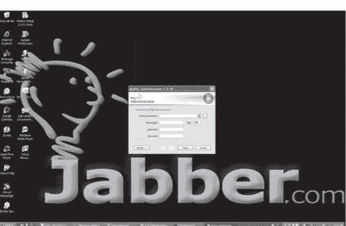

一旦成功登录管理员系统，你将看到管理器的主界面。该面板在窗口左侧显示各种可能的选项，右侧面板显示状态信息。需要注意的重要点是服务器是否正在运行（它必须运行，否则你将无法登录管理器），以及关于服务器版本和机器的一些信息。

主界面如图 14.2 所示。确保你的显示看起来像这样，然后你就可以继续执行下一个任务，确保创建了数据库，并且你的用户和应用程序可以使用该表。

图 14.2

MySQL 管理器主界面。

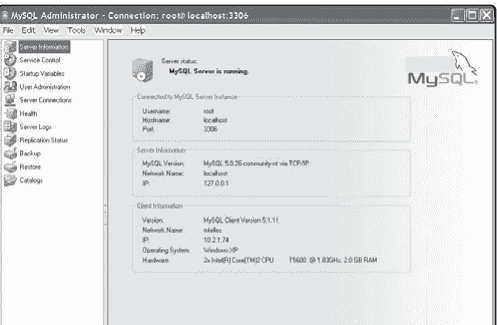

点击管理员左侧上部分的 `catalogs`（目录）按钮，界面下半部分将显示所有可用数据库。要添加新数据库，在显示可用数据库的区域右键点击并选择 `Create schema`（创建架构）。如果你不理解什么是 schema，现在先不要担心——你可以把它想象成一个新的数据库。

我们将新数据库命名为 `test`。我们将新数据库命名为 `test` 以便于识别它。请注意，更改在离开字段后就会应用到内存，但在点击 `Apply`（应用）按钮之前实际数据库不会改变。一旦你创建了 schema 并选择了 `test`，你将看到图 14.3 所示的显示。

图 14.3

MySQL 管理器界面。

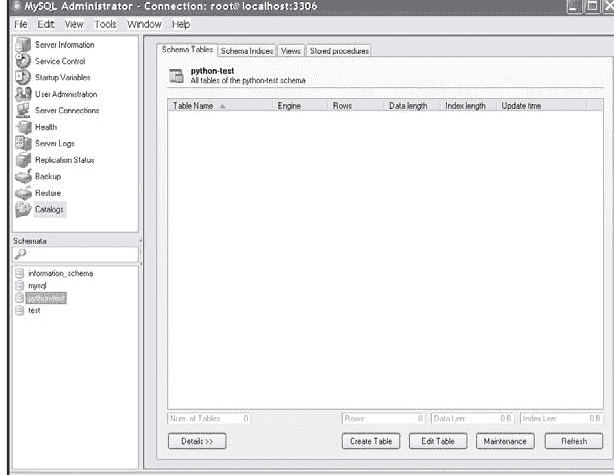

完成数据输入后（记得双击空白行来添加新列），点击对话框底部的 `Apply` 按钮。会弹出一个警告，询问你是否真的要执行显示的 SQL 语句。这只是是将你的输入转换为结构化查询语言（SQL）语句。SQL 是数据库用于添加、删除或修改数据的“语言”。你可以点击右下角的 `Close`（关闭）按钮关闭对话框。恭喜！你现在已经在系统中创建了一个新数据库，并为该数据库创建了一个新表。

## 创建新用户

下一个选项是为数据库创建一个新用户。你实际上不需要创建用户，因为你已经有了 `root`。然而，在 Python 脚本中操作数据库时，使用 `root` 用户是一个坏主意。其因为，`root` 用户拥有数据库中所有内容的访问权限，如果你脚本中的语句出错，可能会造成各种损害。另一个，也是最重要的原因，你可能会在脚本信息中嵌入用户的用户名和密码。尽管这些信息让 Web 变得方便，但如果服务器安全存在漏洞，它们就会被发现。出于这个原因以及许多其他原因，创建新用户是有意义的。

为 MySQL 中创建的每个数据库创建一个新用户的另一个非常好的理由是为了追踪目的。MySQL 系统有一套很好的工具，可以查看单个用户在系统上的操作。如果你对系统中所有的数据库和表都使用同一个用户，那么很难看出某个特定操作可能导致了什么问题。通常情况下，你应该为你在数据库中实现的每个系统都创建一个新用户。

用户修改系统可以在管理员应用程序主窗口的 `User Administration`（用户管理）选择项中找到。点击该标签页将向你显示添加新用户的界面，如图 14.4 所示。

显然，你可以点击 `Add User`（添加用户）按钮来创建一个新用户。当你这样做时，会弹出一个界面要求你输入有关新用户的许多信息。你真正关心的只有用户名和密码。在这种情况下，我在环境中创建了一个名为 `python-test` 的新用户，密码为 `python`。使用 `test` 别名仅仅是为了表示，如果数据库以后被移动到生产环境，我们不希望这个账户留在数据库中。在数据库中保留测试账户是一种安全风险，因为它们倾向于使用非常简单的密码（正如本例所示），因此可能被外部用户破解并用于访问系统。这是一个坏主意，所以你需要在系统正式上线之前能够找到并删除它们。完成后，点击 `Changes`（更改）和 `Add New User`（添加新用户）按钮来完成该过程。

现在，你已经有了数据库，并为它定义了用户，现在是时候进入实际的代码阶段了。第一步是使用 Python 连接到数据库并登录。让我们开始吧。

## 打开已有的数据库

为了与数据库协作，你首先需要连接它。让我们写一个非常简单的程序来完成此操作：

1. 使用 IDLE 编辑器或你喜欢的文本编辑器创建一个新文件。将其命名为 `ch14_1.py`。

2. 在新文件中输入以下代码：

```python
# Do the proper import
import MySQLdb
# Now, connect to the database
db = MySQLdb.connect(host="localhost", user="python-test", password="python", db="python-test")
```

注意，某些行看起来是跨多行的，但它们在编辑器中实际上是单行。它们可能太长而无法在最终文本中放在单行内。如果你愿意，可以在行尾使用行换行符（`\`）来延续行。

3. 通过编辑器窗口的菜单中选择 `Run | Run Module`（运行 | 运行模块），或者在该窗口中按 `F5` 来运行程序。

你可能会认为，此时你会看到代码运行并连接到了数据库。遗憾的是，并没有并没有发生。相反，你会在 IDLE 窗口中看到以下内容：

```
Traceback (most recent call last):
File "E:/Python/ch4_1.py", line 4, in <module>
db = MySQLdb.connect(host="localhost", user="python-test",
password="python", db="python-test")
File "C:\Python25\lib\site-packages\MySQLdb\__init__.py", line 74, in Connect
    return Connection(*args, **kwargs)
File "C:\Python25\lib\site-packages\MySQLdb\connections.py", line 170, in __init__
    super(Connection, self).__init__(*args)
OperationalError: (1044, Access denied for user 'python-test@%' to
database 'python-test')
```

你可能会奇怪为什么得到这样的错误。毕竟，我们创建了正确的数据库，添加了用户，并验证了密码是正确的。为什么我们没有获得正确的连接呢？答案在于适用于数据库以及数据库内表的访问权限。如果你回到管理员应用程序，在用户管理界面选择该用户，你会注意到显示中没有另一个名为 `Schema Privileges`（架构权限）的表。默认情况下，新创建的用户在任何数据库中都没有权限。现在，我们将简单地为他们提供我们创建的数据库的所有权限。按照顺序选择允许他们访问我们的数据库。选择 `python-test` 数据库并使用多选和箭头按钮添加所有权限。你应该能看到与图 14.5 所示类似的显示。

完成这些操作后，回到 IDLE 解释器并再次运行脚本。你现在应该看到它正常运行，这表明你已经无错误地连接到了数据库。这是创建新用户时的常见错误，记住在每次向系统添加新用户时设置权限是非常重要的。一旦你犯了这个错误，就不可能再次犯错，但彻查该错误是一次值得的练习。

注意，我们正在使用 `connect()` 方法来实际与数据库创建会话。`connect()` 方法接受几个参数，这些参数从上下文中可能显而易见，但值得讨论。`host` 参数无疑是运行 MySQL 的机器的名称或 IP 地址。`user` 和 `password` 参数指定了我们为了安全考虑将使用的用于连接数据库的用户。对于我们的目的来说，该账户是我们之前创建的测试账户。最后，`db` 参数是你想要使用的数据库名称，因为对于给定的 MySQL 服务器可能安装了多个数据库。

## 写入数据库

图 14.5

选择了权限的用户管理界面。

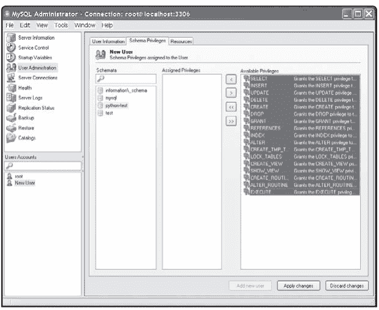

当你定义了一个数据库，并向其添加了一个带有需要填充的列的表，并且有一个连接到该数据库的用户时，你想向数据库中存一些数据以便以后使用是完全合理的。让我们看看向数据库表写入数据涉及的步骤。我们将从展示代码开始，并逐步解释其工作原理。

1. 使用 IDLE 编辑器或你喜欢的文本编辑器创建一个新文件。

2. 在新文件中放置以下代码：

```python
# Do the proper import
import MySQLdb
# Now, connect to the database
db = MySQLdb.connect(host="localhost", user="python-test", password="python", db="python-test")
# get user input for our book

try:
    title = raw_input("Please enter a book title: ")
    if title == "":
        exit
    author = raw_input("Please enter the author's name: ")
    pubdate = int(raw_input("Enter the publication year: "))
except:
    print("Invalid value")
    exit

# Echo back
print("Title: [" + title + "]")
print("Author: [" + author + "]")
print("Publication Date: [" + str(pubdate) + "]")

# create a cursor
cursor = db.cursor()
# execute SQL statement
stmt = "INSERT INTO Books (BookName, BookAuthor, PublicationDate) VALUES ('%s', '%s', %d)"
cursor.execute(stmt, (title, author, pubdate))
print("Record added!")
```

现在，这其实很新鲜——我们之前没做过。接下来的部分只是使用 `raw_input()` 函数从用户处输入数据，获取字符串以填充你将存储在数据库中的数据字段。然而，紧随之后是应用程序真正的“核心”部分：

```python
# 创建一个游标
cursor = db.cursor()
# 执行 SQL 语句
stmt = "INSERT INTO Books (BookName, BookAuthor, PublicationDate) VALUES ('"
stmt = stmt + ', ' + 
stmt = stmt + ', ' + author
stmt = stmt + ', ' + 
stmt = stmt + str(pubdate)
stmt = stmt + ', \')")
cursor.execute(stmt)
print("Record added!")
```

```python
cursor.close()
db.commit()
```

`cursor`（游标）是指向数据库的指针。你使用游标创建可以与数据库进行操作的“视图”。`cursor()` 方法返回一个用于执行操作的数据库游标引用。`stmt` 变量是一个字符串，它被构建成有效的 SQL 语句，以便将值插入数据库系统。一旦你拥有了有效的 SQL 语句，就可以使用游标对象的 `execute()` 方法在数据库中运行该语句。注意，SQL 语句始终是文本字符串，因此你必须进行从数值到字符串等的类型转换。

接下来，你使用游标的 `close()` 方法。这将告诉数据库你已经处理完该对象并释放内存。最后一步是使用数据库连接的 `commit()` 方法提交更改。`commit` 是必要的，因为关系型数据库是在事务（transactions）中运行的。当你打开数据库连接时，你就开始了一个事务。当你完成正在做的任何工作时，就要提交该事务。如果你未能提交事务，数据库将自动 `roll back`（回滚）事务，这将导致没有数据写入磁盘。如果你发现执行看起来成功但之后没有保存任何内容，请检查你是否真的调用了 `commit()`。

在继续之前，最后一点说明。如果你还记得我们之前的数据库表定义，书籍表（book table）的列数比我们在程序插入函数中列出的多一列。原因是该列被定义为 `auto-incrementing`（自动递增）字段。这意味着数据库将跟踪该字段中的值，并在添加下一个值时简单加 1。你可能会在显示中注意到书籍 ID 的值不是 1。这仅仅是因为我在最后一次运行之前调试过代码，而数据库记住了当前的递增值。使用自动递增字段的目的是创建一个保证唯一的值，以便它可以被视为指向其他表的键。

## 从数据库中读取数据

将数据写入数据库相当容易，但用户真正的兴趣点其实是看到数据库里了什么。要找出数据库里有什么，你需要从数据库中读取数据并将其呈现给用户。SQL 中的读取函数被称为 `select` 语句。`select` 语句的一般形式是：

```sql
SELECT [column-names-or-asterisk] FROM [table-names] ...
```

语句后面出现省略号的原因是 `select` 语句包含可选部分。我们稍后会查看其中一些部分。现在，你只需要担心想要从数据库中检索数据的列列表和表名。对于我们的目的，我们想要表中的所有值，`select` 选择的列名值就是星号（`*`）。在 SQL 解释器中，星号被解释为“给出为表定义的所有列”。由于在此时你的数据库中只有一个表，因此你的“表列表”参数就是单张表的名称，即书籍表。

让我们创建一个简单的脚本，检索书籍表中的所有值并将它们打印给终端用户。

1. 使用 IDLE 编辑器或你喜爱的文本编辑器创建一个新文件。

2. 将以下代码放入新文件中：

```python
# (此处为脚本占位)
```

## 更新数据库

修改数据库中的值，允许你更改数据库中单条记录或一次性更改所有记录中的数据。


为了使用 MySQL 数据库的更新功能，你需要决定两件事。首先，你需要确切知道你想要更改哪些记录。其次，你需要知道想要更改记录中的哪些值。通常情况下，你不会想要更改给定记录中被视为“唯一（unique）”的值，因为这可能会导致与其他记录发生冲突。MySQL 会强制执行你应用于数据库的规则，所以当你告诉它某个给定值必须是唯一的时，它将不允许你在具有唯一约束的列（`unique column`）中创建两个具有相同值的记录。这适用于你创建具有相同列值的新记录时，也适用于你将现有记录的列值更改为数据库中另一条记录的相同值时。

为了创建一个更改数据的应用程序，你需要提示用户他想要更改什么内容，以及他将把现有值更改为什么。你可以使用你刚刚编写的代码获取可用字段的名称，并询问用户他想要更改其中的哪一个，以及从什么值更改为什么值。你可以使用 `update` 函数来修改数据库。现在 SQL 中 `update` 函数的基本语法如下：

```
UPDATE <table-name> SET <column-name> = <value> [ WHERE <clause> ]
```

这看起来很困惑，但其实并不是。表名参数仅仅就是你正在操作的表，在这个例中是 "books"。要设置的列名是你想要更改的值，而可选的 `Where` 子句指定了哪些记录应该被更改。让我们来看一些代码，你将看到这是如何操作的。

1. 使用 IDLE 编辑器或你喜欢的文本编辑器创建一个新文件。

2. 在新文件中放入以下代码：

```python
import MySQLdb
import MySQLdb.cursors

def get_column_name(data, prompt, names):
    value = -1
    while value == -1:
        idx = 1
        for col in data:
            print(str(idx) + " *: " + col)
            names.append(col)
            idx = idx + 1

        value = int(raw_input(prompt))
        if value < 1 or value >= idx:
            value = -1
    return value
```

```python
## 连接到数据库并获取游标
conn = MySQLdb.Connect(
    host='localhost', user='python-test',
    passwd='python', db='python-test')
cursor = conn.cursor(cursorClass=MySQLdb.cursors.DictCursor)

# 获取列名并询问用户他们想要
# 使用哪些更改。
cursor.execute("SELECT * FROM books")
data = cursor.fetchone()

names = []
old_value = get_column_name(data, "Which column do you want to change records for ?", names)
names = []

new_value = get_column_name(data, "Which column do you want to change records to ?", names)

stmt = "UPDATE books SET " + names[new_value-1] + " = '" + new_val + "' WHERE " + names[old_value-1] + " = '" + old_val + "'"
print(stmt)
cursor.execute(stmt)

print("Rows affected: " + str(cursor.rowcount))

cursor.close()
conn.commit()
conn.close()
```

3. 保存文件并命名为 `chl_4.py`。在 IDLE 解释器中运行脚本，可以通过从编辑器窗口中选择 `Run | Run Module` 或按 `F5`。你应该能看到与此处显示的类似的显示：

- 1: BookAuthor
- 2: BookName
- 3: PublicationDate
- 4: BookID

Which column do you want to change records for? 4

Which column do you want to change records to? 3

Rows affected: 1

## 查找数据库

现在，让我们来看一个使用 `SELECT` 语句在关系型数据库中进行简单查询的示例。`SELECT` 语句的基本格式如下：

```
SELECT <fields> FROM table [,table] [WHERE <condition>]
```

其中

- `<fields>` 参数是你想要获取的表中的列列表，或者是星号 (`*`) 符号。星号表示你想获取 `select` 语句列出的所有表中的所有字段。
- `table(s)` 参数列出了一个或多个表，这些表包含了你想从数据库中检索的信息。如果只有一个表，你可能只需要 `<fields>` 参数中列出该表中的字段。如果列出了多个表，你可以从这些表中的任何一个选择任何字段。
- `<condition>` 参数是一个或多个子句，用于标识你感兴趣的记录。在 `SELECT` 语句中你不必指定 `Where` 子句。因此，像这样的语句是完全有效的。

```
SELECT * from books;
```

此语句将返回 `Books` 表中的所有列，并将返回 `Books` 表中的所有行，而不考虑这些记录包含的内容。

首先，你将清空我们的 `Books` 表，这样你就知道不会发现任何意外的内容。执行以下命令将删除表中的所有记录：

```
mysql> delete from books;
Query OK, 5 rows affected (0.21 sec)
```

```
mysql> select * from books;
Empty set (0.00 sec)
```

现在你就可以开始操作数据库了，并且知道它是“干净”的，不包含多余的记录。你将编写一个简单的脚本向表中添加大量记录，然后以各种方式对其搜索。

1. 使用你的 IDLE 编辑器或文本编辑器创建一个新文件。

2. 将代码放入新文件中：

```python
# Do the proper
import mysql.db

# Connect to the database
db = mysql.db.connect(host="localhost", user="python", password="python", db="python-test")

# create a cursor
cursor = db.cursor()

# Add some records
def add_record(title, author, pubdate):
    try:
        stmt = "INSERT INTO Books (BookName, BookAuthor, PublicationDate) VALUES (%s, %s, %s)"
        cursor.execute(stmt, (title, author, pubdate))
    except mysql.db.Error:
        print(" ")

add_record("The Sun Also Rises", "Ernest Hemingway", 1850)
add_record("The Moon is a Harsh Mistress", "Robert Heinlein", 1960)
add_record("Friday", "Robert Heinlein", 1988)
add_record("Stranger in a Strange Land", "Robert Heinlein", 1970)
add_record("For Whom the Bell Tolls", "Ernest Hemingway", 1950)
add_record("Fellowship of the Ring", "JRR Tolkien", 1950)
add_record("The Two Towers", "JRR Tolkien", 1952)
add_record("Return of the King", "JRR Tolkien", 1954)
add_record("The Hobbit", "JRR Tolkien", 1948)

def print_result(cursor):
    rows = cursor.fetchall()
    for row in rows:
        print("Column [" + row[0] + "] = " + str(row[2]))

# Search for all titles by Robert Heinlein
print("Books by Robert Heinlein: ")
cursor.execute("select * from books where BookAuthor = 'Robert Heinlein'")
print_result(cursor)

# Now, search for all records made after 1960
print("Books printed after 1960: ")
cursor.execute("select * from books where PublicationDate > 1960")
print_result(cursor)

# Finally, all records that contain the word "the" in the title
print("Books with a title containing 'the': ")
cursor.execute("select * from books where BookName like '%the%'")
print_result(cursor)

cursor.close()
db.commit()
```

3. 保存文件并命名为 `ch4.py`。在 IDLE 解释器中运行该脚本，可以通过从编辑器窗口选择 `Run Module` 或按 `F5` 实现。你应该看到类似于此处显示的显示。请注意，在你的情况下 `BookID` 值可能会不同。这完全没问题，因为 `BookID` 字段是由数据库填充的，并取决于你向表中添加数据的次数。

| Author | BookName | PublicationDate | BookID |
| :--- | :--- | :--- | :--- |
| Robert Heinlein | The Moon is a Harsh Mistress | 1960 | 69 |
| Robert Heinlein | Friday | 1988 | 70 |
| Robert Heinlein | Stranger in a Strange Land | 1970 | 71 |
| Ernest Hemingway | The Sun Also Rises | 1850 | 68 |
| Robert Heinlein | The Moon is a Harsh Mistress | 1960 | 69 |
| Ernest Hemingway | For Whom the Bell Tolls | 1950 | 72 |
| JRR Tolkien | Fellowship of the Ring | 1950 | 73 |
| JRR Tolkien | The Two Towers | 1952 | 74 |
| JRR Tolkien | Return of the King | 1954 | 75 |
| JRR Tolkien | The Hobbit | 1948 | 76 |

# 15 整合一切

在本书的这一部分，你已经学习了 Python 的所有基础语法。你学习了如何编写可以从 Web 服务器调用的脚本，以及如何编写与数据库协同工作的脚本。现在是时候将所有这些内容整合成一个良好的包，在一个地方使用所有的组件了。我们将创建一个参考应用程序，该程序将从 Web 服务器运行，并使用数据库，同时向你展示构建一个完整的 Web 应用程序所涉及的步骤。

我们的 Web 应用程序的目的是创建一个用于维护个人书籍信息的网站。我们在写这些书时记录了它们，并允许人们发布书籍评测供他人阅读。这意味着需要向用户展示供其填写的表单、能够将数据存储在数据库中以便后续检索，并能够对数据库中存储的信息进行报告。这应该涵盖了在典型的 Web 应用中可能用到的 Python 所有方面。

## 设计应用程序

任何系统创建的第一阶段都是应用程序的设计。我们在这里不会进入极其详细的细节，因为现实操作并不是本书的重点。然而，使用 Python 也与其他大多数编程语言一样，在开始之前，你对将要实现的内容有一个良好的理解。在这种情况下，在开始编写代码之前，你需要理解三个领域。

### 程序流

在开始编写应用程序之前，理解用户如何在系统中流转是非常重要的。本质上，用户流程是从起点到终点的“路径”。在我们的案例中，有几个用户流程需要考虑：

- 登录系统
- 退出系统
- 向系统添加新的书籍记录
- 修改系统中现有的书籍记录
- 从系统中删除现有的书籍记录
- 在系统中添加对书籍的用户评测
- 查看系统中的书籍记录
- 查看系统中的书籍评测

当然，在生产环境中你可能需要更多的流程，但目前来说这些足够了。注意，并不是所有的这些流程都需要自己的屏幕或脚本；有些流程可以合并到一个脚本中，并共用单一的用户界面。

你的系统将由一个支持这些流程的主菜单，以及登录和退出功能组成。我们在这里不会进行很多高级别的安全设置。我们只会在用户机器上设置一个 cookie，这样你就知道你的用户是谁。在真实的系统中，你可能需要一个具有强密码和错误检查的完整用户数据库。对于我们正在开发的这种简单原型应用程序来说，这是没有必要的。

### 用户界面设计

一旦你理解了你将实现什么以及用户将在系统内如何移动，下一步就是设计实际的用户界面（UI）。在这个阶段，没有理由要为 UI 出一个死板且快速的设计，但你应该能够画出一些简单的页面，至少作为用户流程过程中各个步骤的占位符。对于我们的目的，目前只需列出我们将创建的表单以及在这些表单上需要的信息就足够了。这不会是一场用户界面设计比赛，因为这些表单纯粹是功能性的。所以让我们来看看你将创建的表单：

- 主菜单表单
- 添加书籍记录表单
- 选择书籍记录表单
- 添加评测表单
- 书籍报告表单
- 评测报告表单

你可能会想登录退出以及修改删除记录的表单在哪里。事实上，登录和退出可以在主表上完成，只需列出系统存储在 cookie 中的表单信息即可。修改表单与添加书籍记录表单完全一样，只是它是预填充的。你可能使用或不在后台使用相同的脚本来处理这些表单，但设计就是设计。

项目计划中用户界面部分的目的是发现你需要哪些元素以及哪些元素可以合并。此外，通过弄清楚你要做什么，你可以更轻松地设计出灵活的表单，并一致地提供终端用户。

### 数据库设计

正如我们之前提到的，数据库是如今大多数应用程序的根本驱动力。尽管我们正在开发一个相当简单的应用程序，但在继续实现真实的数据库表并编写在数据库中存储信息的代码之前，我们需要弄清楚要存储什么。数据库表一旦有了数据，就变得难以更改，因此在我们开始使用它们之前，确保表格设计是正确的是有帮助的。通常，关系型数据库在你开始编写第一行访问它的代码之前，就应该定下来了。这并不意味着你拥有的数据应该是固定不变的，因为你可以随时在遇到新需求时向数据库添加子表来存储信息。然而，在你的应用程序“上线”第一天存在的任何表在整个生命周期内都应该保持相同的布局。这很难实现，但如果你努力实现这个目标，你的应用程序将更有可能没有 bug 并长期生存下去。

在你的情况下，你需要两个数据库表。第一个将维护书籍记录，即你存储的书籍的描述。第二个将维护书籍评测记录，即人们对书籍感受的描述。

这里注意一点：在典型的系统中，你实际上会有更多的表来消除冗余。例如，与其存储作者名和姓，你不如为作者创建一个单一记录并使用标识符来链接书籍。我们的两个表将包含以下内容：

#### 书籍表 (Book Table)

| 列 | 描述 |
| :--- | :--- |
| ID | 代表书籍的唯一标识符 |
| Name | 书名 |
| Author | 书的作者 |
| Date | 这本书的出版日期 |

#### 评测表 (Review Table)

| 列 | 描述 |
| :--- | :--- |
| ID | 代表评测的唯一标识符 |
| Book ID | 链接书籍 |
| Reviewer | 评测者的姓名 |
| Text | 评测文本 |

## 实现数据库表

为了实现你的应用程序，你需要一个新的数据库来存储数据。让我们把数据库命名为 "books"，因为这就是你要存储在数据库中的信息。要创建一个数据库，你将使用 MySQL 管理 GUI，如图 15.1 所示。此屏幕假设你已经启动了管理员程序并使用正确的密码以 root 级别登录，正如我们在上一章中提到的。你还需要点击 `Catalog` 按钮并按 `Ctrl-N` 弹出一个创建 schema 的新窗口。

下一步是在数据库中创建表，用于存储所有书籍的信息。要做到这一点，向你的新数据库添加一个新表，并在表单中填写该表的列，如图 15.2 所示。点击 `Apply` 将在数据库中创建新表（其中没有任何数据），以便你开始用填充数据。

### 实现数据库表

图 15.1

在 MySQL Administrator 中创建新数据库。

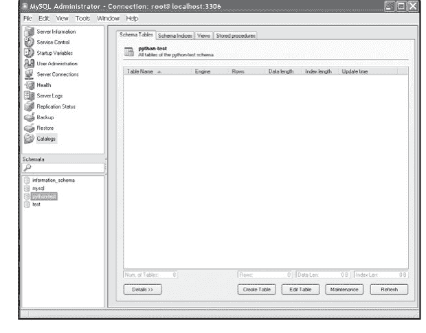

图 15.2

在数据库中创建 Books（书籍）表


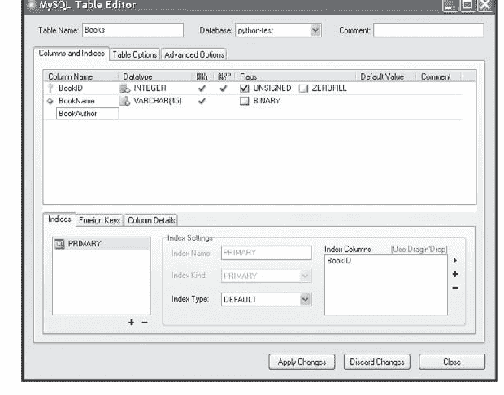

你还需要一个用于书籍评论的表。该表应该包含书籍标识符，用于与书籍标题表进行交叉引用。我们将此信息称为书籍评论表中的“外键”（`foreign key`）。它是指向另一个表的键，而不是当前表。你还需要为该表一个唯一标识符，我们将其称为 `review id`（评论 ID）。

图 15.3 显示了你将使用 MySQL Administrator GUI 应用程序创建的表，以实现 `BookReview` 表。输入你看到的值并点击 Apply Changes（应用更改）按钮来创建新表。

图 15.3

在数据库中创建 Book Review（书籍评论）表。

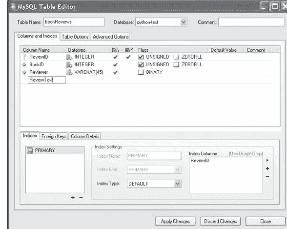

到此时，你已经拥有实现所创建系统所需的所有表。下一步是开始构建实际应用程序。通过这种方式，你需要创建组成主应用程序的表单和脚本。让我们现在就开始吧。

# 实现表单

应用程序的表单将通过脚本代码创建，因为你需要根据系统状态和用户的选择动态生成表单的不同部分。我们将从主菜单表单开始，它看起来如图 15.4 所示。注意，这是当前没有人登录时的主表单视图。当有人登录系统时，它看起来会像图 15.5。然而，通过 Python 脚本的魔法，我们将创建一个脚本来同时生成这两个表单视图，而不需要单独的 HTML 或 Python 文件。

## 实现表单

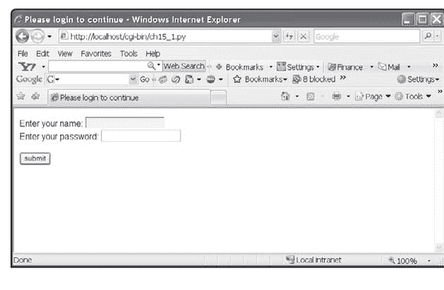

图 15.4

登录表单。

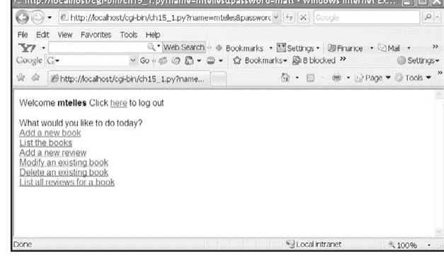

图 15.5

主表单。

我们的表单不是世界上最漂亮的，但非常欢迎你运用创意才华来创建任何你想要让它们看起来更好看。这里的重点是展示 Python、Apache 和 MySQL 数据库的底层功能。

为了实现这里显示的功能，你需要创建一个新的脚本。在这种情况下，我将脚本放置在 Apache `cgi-bin` 目录的子目录下。你可以将其放在任何你想的地方，但你的链接和屏幕显示将相应地不同。要实现该功能，请遵循以下步骤：

1. 使用 IDLE 编辑器或你喜欢的文本编辑器创建一个新文件。

2. 在你的新文件中输入以下代码：

```python
#!c:/Python25/python

import cgi
import sys
import cgitb
import os
import Cookie

def gen_html_header(username):
    if username != None and username != "":
        member = Cookie.SimpleCookie()
        member['username'] = username
        member['username']['expires'] = 60*60*60
        print member

print "Content-Type: text/html\n\n"
print "<html>"

def gen_html_trailer():
    print "</HTML>"

def get_user_cookie():
    if 'HTTP_COOKIE' in os.environ:
        cookies = os.environ['HTTP_COOKIE']
        cookie = cookies.split('=')
        name = cookie[0]
        value = cookie[1]
        if name == "username":
            return value
    return ""

def print_menu():
    print "<BR><BR>"
    print "<What would you like to do today?<BR>"
    print("<a href=../../15_2.htm>Add a new book</a><BR>"
    print("<a href=15_3.py>List the books</a><BR>"
    print("<a href=15_4.py>Add a new review</a><BR>"
    print("<a href=15_6.py>Modify an existing book</a><BR>"
    print("<a href=15_3.py?mode=3>Delete an existing book</a><BR>"
    print("<a href=15_3.py?mode=2>List all reviews for a book</a><BR>"
cgitb.enable()

# 如果我们有 cookie
form = cgi.FieldStorage()
username = get_user_cookie()

# 如果我们获取了一些用户参数
try:
    uname = form.getvalue("name")
    username = uname
except:
    username = " "

# 输出页头
gen_html_header(username)

# 如果有用户名，则输出它
if username != "" and username != " ":
    print "<Welcome " + username + "</B> <a href=15_1.py>here</a>"
    print_menu()
else:
    # 输出登录信息
    print "<TITLE>Please log in to continue</TITLE>"
    print "<FORM ACTION=\"15_1.py\">"
    print "Enter your name: <INPUT TYPE=TEXT NAME=\"name\"><BR>"
    print "Enter your password: <INPUT TYPE=PASSWORD NAME=\"password\"><BR><BR>"
    print "<INPUT TYPE=SUBMIT VALUE=\"submit\">"
    print "</FORM>"

# 输出页脚
gen_html_trailer()
```

3. 将文件保存到你选择的目录，无论是 Apache 的 `cgi-bin` 目录还是 `cgi-bin` 目录下的新创建目录。使用名称 `15_1.py`。

4. 在本地浏览器中输入以下位置来运行程序：`http://localhost/cgi-bin/<your path>`，其中 `<your path>` 是你创建的文件的位置。你应该能看到图 15.4 所示的输出。

它是如何工作的？首先，检查 cookie 是否设置。如果未设置，则显示登录屏幕让他输入用户名和密码。在正常的应用程序中，你会验证他的密码。假设用户已登录，他将看到菜单。这个菜单显示在 `print_menu` 函数中。

对于菜单项，我们现在将实现每一个的功能。从“添加书籍”命令开始。该命令将 HTML 表单和 Python 脚本结合来实现。以下是你将使用的 HTML 表单（我们将命名为 `15.htm`）：

```html
<HTML>
<!-- 用于输入书籍的表单 -->
<form action="cgi-bin/15_2.py">
<p>Book Title:</p>
<input type="text" name="title" size="45">
<p>Author:</p>
<input type="text" name="author" size="45">
<p>Publication Date:</p>
<input type="text" name="pubdate" size="45">
<p>
<input type="submit" value="Add Book"><BR>
<a href="cgi-bin/15_1.py">Return to Main Menu</a></a>
</p>
</form>
</HTML>
```

你只是定义了一个输入创建新书籍所需的三个数据的表单。当用户点击添加书籍按钮时，它会调用你的 Python 脚本。你需要编写该脚本。让我们现在就开始：

```python
#!c:/Python25/python

# 进行正确的导入
import MySQLdb
import cgi

def gen_html_header():
    print("Content-Type: text/html\n\n")
    print("<HTML>")

def gen_html_trailer():
    print("</HTML>")

def add_record(cursor, title, author, pubdate):
    try:
        # 执行 SQL 语句
        stmt = "INSERT INTO Booktitles(BookName,BookAuthor,PublicationDate) VALUES ('"
        stmt = stmt + title
        stmt = stmt + '\', ' '"
        stmt = stmt + author
        stmt = stmt + '\', ' '"
        stmt = stmt + str(pubdate)
        stmt = stmt + "')")
        cursor.execute(stmt)
    except:
        print("Error adding record!")
```

# 看看他们给了我们什么

# 第 15 章 整合一切

```python
form = cgi.FieldStorage()

fTitle = ""
fAuthor = ""
pubDate = -1
try:
    fTitle = form.getvalue("title", "")
    fAuthor = form.getvalue("author", "")
    fPubDate = int(form.getvalue("pubdate", ""))
except:
    # 某些地方不对。
    print("Error: Bad data")
```

# 连接到数据库

```python
try:
    db = MySQLdb.connect(host="localhost", user="python-test",
    password="python", db="books")
```

```python
# 创建游标
cursor = db.cursor(cursorclass=MySQLdb.cursors.DictCursor)
```

```python
add_record(cursor, fTitle, fAuthor, fPubDate)
cursor.close()
db.commit()
except:
    print("Exception in database!<BR>")
```

```python
gen_html_header()
print("The record was added: <BR>")
print("Title: " + fTitle + " <BR>")
print("Author: " + fAuthor + " <BR>")
print("Publication Date: " + str(fPubDate) + " <BR>")
print("<BR>")
print("<a href=\"../cgi-bin/ch15_l.py\">返回主菜单</a><BR>")
gen_html_trailer()
```

# 添加评论

3. 将文件保存到你选择的目录中，无论是 Apache 的 `cgi-bin` 目录，还是 `cgi-bin` 目录下新创建的目录。将文件命名为 `ch15_2.py`。

4. 你应该能够从主菜单跳转到“添加书籍”页面并返回。

# 添加评论

我们的下一个主要功能涉及接下来两个菜单项，它们的关系紧密得令人惊讶。第一个菜单项是列出所有可用书籍，第二个菜单项是给特定的书籍标题添加评论。事实上，剩余的大多数菜单项都是围绕“获取书籍列表并对它们执行某种操作”这一理念构建的。为了实现这一点，你需要列出可用书籍标题的能力。在上一章中，我们看到 SQL 语句可以从数据库中获取项目列表，这正是你在这里要做的，即获取书籍标题列表并显示有关它们的信息。书籍列表的输出将是它们可用的信息。与之前的情况不同在于，你将希望拥有对标题执行不同操作的能力。让我们创建生成书籍报告的代码，看看这里发生了什么。

- 1. 使用 IDLE 编辑器或你喜欢的文本编辑器创建一个新文件。

- 2. 在文件中输入以下代码：

```python
#!c:/Python25/python

# 进行适当的导入
import MySQLdb
import cgi
import sys
import cgitb
import os
import Cookie

def gen_html_header(username):
    if username != None and username != "*":
        member = Cookie.SimpleCookie()
        member["username"] = username
        member["username"]["expires"] = 60*60*60
        print member

print "Content-Type: text/html\n\n"
```

# 第 15 章 整合一切

```python
print "<HTML>"

def gen_html_trailer():
    print "</HTML>"
```

```python
def get_user_cookie():
    if 'HTTP_COOKIE' in os.environ:
        cookies = os.environ['HTTP_COOKIE']
        cookie = cookies.split('=')
        name = cookie[0]
        value = cookie[1]
        if name == "username":
            return value
    return ""
```

```python
def list_records(cursor, username, mode):
    try:
        # 执行 SQL 语句
        stmt = "SELECT * from BookTitles"
        cursor.execute(stmt)
        recs = cursor.fetchall()
        for rec in recs:
            print("Title: " + rec["BookTitle"] + " <BR>")
            print("Author: " + rec["Author"] + " <BR>")
            print("Publication Date: " + str(rec["PublicationDate"]) + " <BR>")
            # 模式 1：允许评论。
            if mode == "1":
                print("<a href=\"../cgi-bin/ch15_4.py?name=" + username + "&id=" + rec["BookID"] + "\">添加评论</a>")
            # 模式 2：允许查看。
            if mode == "2":
                print("<a href=\"../cgi-bin/ch15_5.py?name=" + username + "&id=" + rec["BookID"] + "\">显示评论</a>")
            if mode == "3":
                print("<a href=\"../cgi-bin/ch15_6.py?name=" + username + "&id=" + rec["BookID"] + "\">删除书籍</a>")

        print "<BR>"

    except:
        print "Error listing record!"
```

- 3. 将文件保存到你选择的目录，无论是 Apache 的 `cgi-bin` 目录还是 `cgi-bin` 目录下新创建的目录。调用文件 `ch15_3.py`。

- 4. 你应该能够从主菜单列出书籍并返回。

# 第 15 章整合一切

在这个脚本中并没有新内容。你将从数据库获取书籍列表并在 Web 页面上逐个显示它们。注意 URL 中添加的 "mode" 变量。这将用于确定列表执行的操作。如果 mode 不存在或为零，你将只显示书籍。如果 mode 设置为 "1"，你将允许用户为该书籍标题添加评论。你通过调用带有书籍标识符的新脚本来实现此。我们需要这个标识符，因为书籍标识符是评论数据库的外键。

# 将评论添加到数据库

现在你有了供用户选择的书籍列表，你需要实际上处理请求，获取他们的信息并将其放入数据库。这样做有两个部分：首先，你需要显示用户输入评论的表单；然后，当他提交时你需要处理这些信息并添加记录。你可以通过简单地向脚本传递适当变量和命令来完成任务。让我们看看表单的样子，如图 15.6 所示。

图 15.6

显示的书籍评论表单。


我们将动态生成此表单，主要是为了展示这种操作有多简单。你需要保存记录。为了这样做，你需要在 Python 中创建一个脚本。此脚本将显示表单，然后被再次调用以处理表单。当用户点击按钮时，它将再次运行，但这次是为了处理存储信息在数据库中的请求。

1. 使用 IDLE 编辑器或你喜欢的文本编辑器创建一个新文件。
2. 在你的新文件中输入以下代码：

```python
#!c:/Python25/python

# 进行适当的导入
import MySQLdb
import cgi
import sys
import cgitb
import os
import Cookie

def gen_html_trailer():
    print "</HTML>"

def get_user_cookie():
    if 'HTTP_COOKIE' in os.environ:
        cookies = os.environ['HTTP_COOKIE']
        cookie = cookies.split('=')
        name = cookie[0]
        value = cookie[1]
        if name == "username":
            return value

def save_review(username, id, form):
    # 执行 SQL 语句
    stmt = "INSERT INTO BookReviews (BookID, ReviewedBy, Review) VALUES ('"
    stmt = stmt + id
    stmt = stmt + "', '"
    stmt = stmt + username
    stmt = stmt + "', '"
    stmt = stmt + str(form.getvalue("review"))
    stmt = stmt + ")"
    cursor.execute(stmt)
    print "The review was successfully saved!<BR><BR>"
except :
    print "Error adding record! Stmt: {" + str(stmt) + "}<BR>"
    print sys.exc_info()

cgitb.enable()

# 查看数据给了我们什么
form = cgi.FieldStorage()

# 从字段存储中获取我们需要的信息
username = ""
id = ""
action = "*"

# try :
username = form.getvalue("name")
id = form.getvalue("id")
action = form.getvalue("action")
# except:
# username = "*"

if username == "*":
    username = get_user_cookie()

gen_html_header(username)

# 连接到数据库
try:
    db = MySQLdb.connect(host="localhost", user="python-test",
    passwd="python", db="books")

    # 创建游标
    cursor = db.cursor(cursorclass=MySQLdb.cursors.DictCursor)

    if action == "*" or action == None:
        generate_form(username, id)
    else:
        save_review(username, id, form)

    cursor.close()
    db.commit()

except:
    print("Exception in database!<BR>")

print sys.exc_info()
gen_html_trailer()
```

3. 将文件保存到你选择的目录，无论是 Apache 的 `cgi-bin` 目录，还是 `cgi-bin` 目录下新创建的目录。调用文件 `ch15_4.py`。
4. 现在，你应该能够从主菜单跳转到“添加评论”（Add a Review）页面并再次返回。

如你所见，代码非常直观。数据从表单存储区域获取，并通过 SQL 语句放入数据库。关于这一点有一点说明：这里的假设是评论数据是有效的，可以插入 SQL 语句中。也就是说，它不包含对于要存储它的数据库字段无效的字符。如果你的情况下并非如此，你将需要对数据进行“清洗”（massage），使其由有效字符组成。

注意使用“隐藏”表单值将信息从表单传递到 Python 脚本。这是将数据从一个地方发送到另一个地方的极佳方法，无需用户输入。

## 第 15 章 整合一切

### 列出评论

显然，如果你想让人们评价书籍，你将希望看到其他人对书籍说了什么。列出评论是接下来我们将处理的步骤。这个过程与列出书籍本身相似，但有一个重要的变化。不是简单地选择所有书籍并显示它们，你需要使用书籍的信息来显示数据库中所有相关的记录。这是通过 SQL 中的 `select` 语句实现的，就像以前一样，但在这种情况下，你将为语句附加一个条件。让我们看看如何实现。

记住，当我们之前为书籍编写列表函数时，我们根据模式放置了各种链接。我们随这些链接一起传递的信息之一就是书籍的标识符。我们现在将利用这些信息。此外，你可能还记得显示评论的主菜单是这样的：

```python
print "<a href=ch15_3.py?mode=2>List all reviews for a book</a><BR>"
```

如你所见，我们只是调用了列表例程，但这次模式为 2。这将指示书籍标题信息之后显示打印该书籍评论的链接。

1. 使用 IDLE 编辑器或你喜欢的文本编辑器创建一个新文件。
2. 在你的新文件中输入以下代码：

```python
#!c:/Python25/python

# 进行适当的导入
import MySQLdb
import cgi
import sys
import cgitb
import os
import Cookie

def gen_html_header(username):
    if username != None and username != "*":
        member = Cookie.SimpleCookie()
        member["username"] = username
        member["username"]["expires"] = 60*60*60
        print member
    print("Content-Type: text/html\n\n")
    print("<HTML>")

def gen_html_trailer():
    print("</HTML>")

def get_user_cookie():
    if 'HTTP_COOKIE' in os.environ:
        cookies = os.environ['HTTP_COOKIE']
        cookie = cookies.split('=')
        name = cookie[0]
        value = cookie[1]
        if name == "username":
            return value
    return ""

def list_records(cursor, id):
    try:
        # 执行 SQL 语句
        stmt = "SELECT * from BookReviews where BookID = " + str(id)
        cursor.execute(stmt)
        recs = cursor.fetchall()
        for rec in recs:
            print "ReviewedBy: " + rec["ReviewedBy"] + "<BR>"
            print "Review: " + rec["Review"] + "<BR>"
            print "<BR>"
    except:
        print "Error listing record!"

cgitb.enable()
# 看看他们给了我们什么
form = cgi.FieldStorage()

try:
    id = form.getvalue("id")
    username = form.getvalue("username")
except:
    id = "0"

if username == "*" or username == None:
    username = get_user_cookie()

# 连接到数据库
try:
    db = MySQLdb.connect(host="localhost", user="python-test",
    password="python", db="books")
    # 创建游标
    cursor = db.cursor(cursorclass=MySQLdb.cursors.DictCursor)
    gen_html_header(username)
    list_records(cursor, id)
    print "<a href=\../cgi-bin/ch15_1.py?name=" + username + "*>"
    Return to Main Menu/</a><BR>"
    gen_html_trailer()
    cursor.close()
except:
    print "Exception in database!<BR>"
```

3. 将文件保存到你选择的目录，无论是 Apache 的 `cgi-bin` 目录，还是 `cgi-bin` 目录下新创建的目录。将文件命名为 `ch15_5.py`。
4. 现在，你应该能够从主菜单跳转到“添加评论”（Add a Review）页面并再次返回。

## 结论

在本章中，我们学习了许多关于操作 Web 服务器、动态生成 HTML 和 HTML 表单、操作数据库和关联表，以及在 Python 脚本之间传递数据的知识。本章并不是关于 SQL 或 HTML 更完整书籍的替代品。相反，它的目的是向你展示如何在 Python 环境中处理这些概念。如果你计划在 Web 或数据库领域进行大量工作，我强烈建议你寻找这两个主题的参考书籍。

## 第 16 章 Python 与图形

在最初，只有文本。在计算机世界中，最初一直意味着基于文本的界面和基于文本的显示。这在大型机时代、MS-DOS 的早期计算机时代，以及最初的互联网上都是如此的。早期的 Web 页面是纯文本的，几乎看不到任何图像或图形。然而，随着事物的演进，文本得到了图形的补充。因此，在 Python 中创建和使用图形是有意义的，就就像你在万维网上做的那样。本章将对 Python 的图形化世界进行简要介绍。

### PIL 库

Python 本身不具备图形能力。该语言的核心完全关于循环、决策和字符串处理，正如我们在书中之前的章节中所看到的。要在你的 Python 应用中实现任何类型的图形能力，你需要一个外部库。这并不寻常，正如我们在之前的章节中看到的 CGI 功能和关系型数据库功能一样。就像我们为了使用该数据库的关系型能力而下载了 MySQL 库一样，我们需要下载一个库以便在 Python 中处理图形。在我们的情况下，我们将使用的库是 PIL，即 Python Image Library（Python 库）。与 MySQL 系统类似，PIL 模块以双重方式发布。你可以将该系统作为免费库供任何人使用，也可以支付费用以获得支持。由于我们正在对该库进行实验，我们将下载免费版本并使用。然而，正如你所看到的，创建一个像 PIL 这样高质量的系统付出了巨大的努力，通过支付库的商业版本来支持此类工作是非常值得的。在你在商业系统中使用 Python 时，这是你可能会考虑要做。

### 下载

为了开始使用 PIL 模块，你必须首先下载安装包。PIL 的基础系统可以在 `www.pythonware.com` 网站上。你可以在这里找到整个下载系统：`http://www.pythonware.com/products/pil/index.htm`。在本书编写期间，该库的当前版本为 1.1.6，支持 Python 1.5.2 及更高版本，包括我们在本书中使用的 2.5 版本。如果你使用的是其他版本，请参考网页获取关于使用何种模块的说明。在任何情况下，无论你使用哪个版本，我们在这里操作的基础应该是相同的。多年来，界面已经变得非常标准。

### 安装

对于 Windows 操作系统，PIL 的安装程序是一个标准的微软可执行文件 (`.exe`)。你可以从 Windows 资源管理器或命令行运行安装程序。当你运行安装程序时，你应该能看到屏幕上显示了如图 16.1 所示的对话框。

**图 16.1**  
PIL 安装主界面。

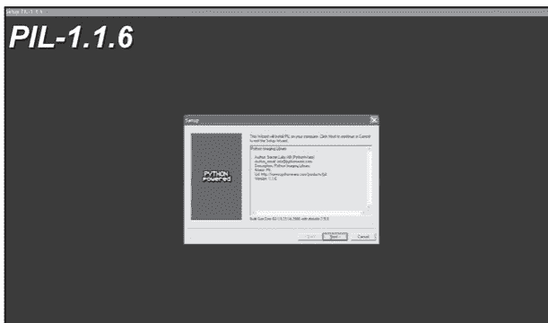

点击“下一步”（next）按钮将带你进入确定正在运行的 Python 版本屏幕。选择正确的版本是重要的，这样 PIL 模块就会被安装在适当的位置。如果你的系统中只安装了 Python 的 2.5 版本（像我一样），你将在电脑显示器上看到图 16.2 所示的屏幕。如果由于某种原因没有显示你的 Python 版本，那么 Python 解释器可能没有注册到你的系统中。修复此问题的简单方法是从网站重新安装 Python。某些注册表项需要被正确创建和设置，以便 Python 正常工作以及其他模块找到它，安装过程会完成这些。

### 验证你的安装

在实际开始使用 PIL 模块编写代码之前，首先要做的工作是验证安装是否正确就位。要做到这一点，简单的方法是在 IDLE 环境中尝试导入正确的模块。在 IDLE 编辑器中输入以下行：

```python
import Image
```

并按下 Return 或 Enter 键。如果系统返回没有错误，说明安装成功。如果显示了错误，请检查你的安装。

### 创建新图像

首先，创建一个新图像。在这个示例中，我们将使用 `new()` 方法创建一个图像对象。该函数接受三个参数：模式、尺寸和背景颜色。

```python
import Image

im = Image.new("RGB", (50, 80), (255, 255, 255))
```


上述代码做了两件事。首先，你导入 `Image` 模块。这让你能够访问 `new()` 函数。接下来，使用该函数创建一个新图像。该函数接受三个参数，其中两个是必须的：

### 函数参数

函数的第一个参数是绘制模式。在这种情况下，我们将只使用 RGB 值，但还有其他模式。正式来说，你可以使用表 16-1 列出的任何模式。字符串是传递给函数的值，而含义仅仅是生成的图像类型。模式代表像素如何在内存中存储以及可以分配给它们的值。

### 表 16-1 PIL 图像模式及其含义

| 字符串 | 含义 |
|---|---|
| "1" | 单比特（单色）图像 |
| "L" | 8 位像素黑白图像 |
| "I" | 32 位有符号像素值彩色图像 |
| "F" | 32 位浮点像素值 |
| "P" | 使用调色板的 8 位像素 |
| "RGB" | 3x8像素红/绿/蓝编码 |
| "RGBX" | 带填充的真色彩图像 |
| "RGBA" | 4x8像素红/绿/蓝/Alpha编码 |
| "CMYK" | 4x8像素色彩分离编码 |
| "YcbCr" | 3x8像素彩色视频格式 |

该方法的第二个参数是图像的尺寸。该方法接受一个包含所需图像高度和宽度的元组。在该区域之外绘图会导致裁剪，并导致图像部分无法正常渲染。

最后一个参数是可选的，它是创建图像时填充图像的背景颜色。这些是 RGB 值，因为我们的图像是 RGB 模式，所以这些值将是

将显示器的红、绿、蓝三个“光枪”均设置为 255。这种特定的组合会产生白色背景。你可以通过将红、绿、蓝值均设置为零 (0) 来创建一个黑色图像。互联网上有许多 RGB 表，可以向你显示颜色的各种其他选项。

# 第 16 章 Python 与图形

## 在图像上绘图

创建一个空白图像并没有什么趣味。人们想看到的是图像表面显示的某种信息。这正是我们程序员的价值所在。PIL 模块为在图像表面上绘图提供了非常丰富的功能，还提供了加载现有图像并修改它们的功能。然而，现在让我们先考虑在图像画布上绘制内容的各种方法。

要实现此目的，请遵循以下步骤：

1. 使用 IDLE 编辑器或你喜欢的文本编辑器创建一个新文件。
2. 将以下代码输入你的新文件中：

```python
import Image
import ImageDraw

# 创建新图像
im = Image.new("RGB", (100, 100), (255, 255, 255))

# 创建一个绘制表面。
draw = ImageDraw.Draw(im)

# 现在，在表面上画一个“X”
draw.line((0, 0) + im.size, 128)
draw.line((0, im.size[1], im.size[0], 0), 128)

# 使用内置图像查看器显示图像。
im.show()
```

3. 保存文件，命名为 `ch16_1.py`。
4. 通过从 Run 菜单中选择 Run Module 或在 IDLE 编辑窗口中按 F5 键来运行该文件。
5. 你应该能在你配置为查看位图文件的程序（默认是 Windows 照片和传真查看器）中看到显示的图像，它看起来应该像图 16.3 所示。

图 16.3
使用 Python PIL 生成的图像。

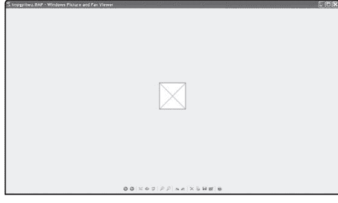

从图像可以看出，我们得到了完全预期的结果：一个显示着“x”的框。让我们看看代码，在这里我们到底做了什么。首先，你需要导入此脚本所需的模块。在这种情况下，我们同时使用了 `draw` 和 `image` 模块，因此它们在第一个代码块中被导入了：

```python
import Image
import ImageDraw
```

### 绘制图像

接下来你需要创建图像文件本身以及用于该表面的绘制表面。图像文件可能已经包含信息（如你所见），但你返回的绘制表面将是一个空白画布，你可以在上面进行任何你想操作。`Draw()` 函数将返回你所需的画布。此功能通过以下几行实现：

```python
# 创建新图像
im = Image.new("RGB", (100, 100), (255, 255, 255))

# 创建一个绘制表面。
draw = ImageDraw.Draw(im)
```

应用程序中有趣的部分是实际的线条绘制。`draw` 类包含了绘制线条的功能。绘图代码看起来如下：

```python
# 现在，在表面上画一个“X”
draw.line((0, 0) + im.size, 128)
draw.line((0, im.size[1], im.size[0], 0), 128)
```

`Draw` 对象的方法接受三个参数，其中只有第一个是必须。参数分别是：`xy`、`options`、`list`。

x 和 y 点用于绘制线条的起点和终点。你可以通过几种方式实现这一点，如上一个示例所示。在第一个示例中，我们使用图像的起点 (0,0) 和以图像尺寸作为终点。因为这些是元组，你可以将它们相加以得到一个可以传递给线条的结果元组。在第二个示例中，我们指定了想要连接的两个点作为 x 和 y 值。

`options` 列表包含填充值（`fill`，即绘制线条的颜色）和宽度值（`width`，该值可以被忽略；它是要使用的线条宽度）。如果你不指定宽度，系统将使用默认宽度。填充值可以是 RGB 值，也可以是文档定义的索引。

除了线条之外，你还可以在画布上绘制几种类型的图像组件。表 16-2 列出了 PIL 模块支持的绘图原语。

### 表 16-2 PIL 中的绘图原语

| 函数 | 用途 |
|---|---|
| `arc` | 给定起点和起始结束角，绘制圆弧。 |
| `bitmap` | 在绘制画布的给定位置绘制位图。 |
| `chord` | 给定起点和起始结束角，在两点之间绘制弦。这与 `arc` 方法相同，但有一个重要的区别：点的末端之间由一条线连接起来。 |
| `ellipse` | 在一组边界矩形内绘制椭圆。椭圆可以可选地填充为用户指定的颜色。 |
| `line` | 在两点之间绘制线条。 |
| `slice` | 绘制椭圆的切片。 |
| `point` | 在图像上绘制点。 |
| `polygon` | 绘制多边形。 |
| `rectangle` | 在图像上绘制矩形。 |

## 加载现有图像

正如你所看到的，`open()` 方法可以将现有图像加载到 `Image` 绘图表面。一旦加载了现有图像，你就可以对它进行许多操作。例如，你可以在图像表面上进行绘图。想象一下你有一张图像，并想在图像上方放置一个著名的带线的圆圈。让我们简单查看如何对图像进行操作。这里是一些简单的代码，将加载一个名为 `cockroach.gif` 的图像（你可能更喜欢使用自己的不那么像虫的图像）并画线。下面的代码命名为 `ch16_3.py`，实现了这一功能。

```python
# 为此脚本进行相应的导入
import os, sys
import Image
import ImageDraw

# 加载图像
try:
    im = Image.open(r"c:\cockroach.gif")
except:
    print("Unable to load image")
    exit(1)
```

```python
# 获取图像的绘图表面
draw = ImageDraw.Draw(im)
```

```python
# 画圆圈
draw.ellipse((0, 0) + im.size)
```

```python
# 画线
draw.line((0, 0) + im.size)
```

```python
# 并显示结果
im.show()
```

该脚本运行的结果是图 16.4 所示的图像。如你所见，你的图像被正确显示，周围有一个圆圈，并且有一条线贯穿。如果你想进行坐标计算，可以将线完全画在圆圈内。

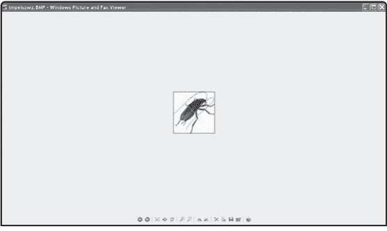

图 16.4
带有重绘线条的已加载图像。

现在，仅仅能够在图像上方绘图几乎没有用处。你通常希望能够修改图像的一部分，以便绘制你想要的部分。为了这一点，PIL 库提供了 `crop()` 方法。`crop()` 方法作用于给定的图像并选择一个给定的边界框。例如，使用之前代码中的蟑虫图片，你可以选择图像中心的一个框。如果你想要，例如，图像每边 50 像素，你可以编写以下代码（命名为 `ch16_4.py`）来完成此任务：

```python
# 为此脚本进行相应的导入
import os, sys
import Image
import ImageDraw

# 加载图像
try:
    im = Image.open(r"c:\cockroach.gif")
except:
    print("Unable to load image")
    exit(1)
```

```python
# 现在，只需获取图像中心
width, height = im.size
center_x = width / 2
center_y = height / 2
center = im.crop((center_x - 50, center_y - 50, center_x + 50, center_y + 50))
```

```python
# 并显示该部分
center.show()
```

如果你尝试此脚本，你将在屏幕上只看到虫子的中间。一旦有了图像，就可以轻松地修改它。只需获取图像的绘图表面，进行你想的操作，然后以你需要的任何格式显示或保存。这就是 PIL 模块的真正威力——快速修改图像并保存到磁盘的能力。

## 显示文本

图形不仅关于线条、颜色和图像，它们还关于在图形上显示文本。例如，你可能希望在你自己的网站使用的图像上放置版权声明，以便他人无法声称并将其用于他们自己的网站。如果你有一张现有图像，使用 PIL 模块在底部放置版权信息是非常困难的。`ImageDraw` 模块包含一个文本函数，允许你在输出图像的指定位置使用指定的字体输出文本字符串。`text()` 方法的实际语法如下：

```python
text(position, string, options)
```

其中：

- `position` 是你希望字符串出现在输出图像上的 x 和 y 坐标。
- `string` 是你想输出的文本字符串。
- `options` 是可以使用的潜在选项列表。

`options` 参数可以包含 `font` 和 `fill`。`font` 选项应该是一个 `ImageFont` 实例，而 `fill` 选项应该指定颜色。

如果你需要知道文本的大小，可以使用 `ImageDraw` 的 `textSize()` 方法。它返回一个包含在给定字体下渲染文本宽度和高度的元组。

## 图像统计

3. 保存文件，将其命名为 `ch16_6.py`。
4. 通过从“运行”菜单中选择“运行模块”或在 IDLE 编辑窗口内按 F5 键来运行该文件。

在本示例中，我们将在之前示例中使用的 `cockroach.gif` 文件上运行脚本，但你可以选择任何喜欢的图像。当你运行脚本并输入图像名称时，我得到了以下输出：

```
Enter the image for statistics: c:\cockroach.gif
The image is in GIF format.
The size of the image is (614, 619)
The image is in P mode.
There are [380066] pixels in the image
The average pixel level is [22.342585235195994]
The extrema for all bands is [(0, 31)]
```

虽然这些信息不是最有用的，但有时可能意味着编写大量特殊代码与确切知道对图像进行何种处理之间的区别。请记住这些统计函数，特别是当你担心在彩色打印机上打印图像并以特定格式保存到磁盘时。

## 旋转图像

在各种图像应用程序中工作时，一个常见问题是需要围绕其中心旋转图像。这在处理照片时尤为明显，例如，摄影师选择旋转相机以获得更好的拍摄角度。在屏幕上显示旋转后的图像会迫使用户转头才能正确查看，这会导致颈部劳损并让程序员感到恼恼。与其让用户对你发火，不如按照他们想要查看和打印的方式旋转图像，这样要好得多也简单得多。

PIL 模块提供了许多变换方法，包括旋转图像的能力。为了查看它是如何运作的，让我们创建一个简单的脚本，生成一个带有文本的图像，然后旋转图像，使文字垂直排列，而不是横向排列。

1. 使用 IDLE 编辑器或你喜欢的文本编辑器创建一个新文件。
2. 在你的新文件中输入以下代码：

```python
import Image
import ImageDraw

# 创建新图像
im = Image.new("RGB", (200, 200), (255, 255, 255))

# 创建绘制画布。
draw = ImageDraw.Draw(im)

# 绘制我们的文本字符串
draw.text((10, im.size[1] - 20), "This text will be rotated", fill=(0, 0, 0))

# 并旋转图像 90 度
out = im.rotate(90)

# 使用内置的图像查看器显示图像。
out.show()
```

3. 保存文件，将其命名为 `ch16_7.py`。
4. 通过从“运行”菜单中选择“运行模块”或在 IDLE 编辑窗口内按 F5 键来运行该文件。

你应该能看到一个非常像图 16.6 的显示。正如你所看到的，文字旋转了 90 度并垂直显示。这里需要注意的一个点是，PIL 的 `rotate()` 方法实际上并没有修改现有的图像。相反，它创建了一个表示旋转后原始图像的新图像。原始图像仍然完好无损，因此内存中实际上有两个图像的副本。

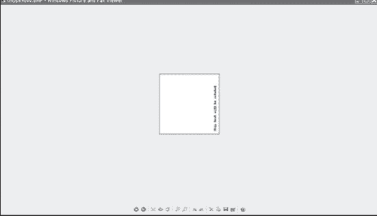

图 16.6
旋转后的文本显示。

## Postscript 打印

`PSDraw` 模块提供了为你的应用程序创建 Postscript 绘图的能力。Postscript 是精确定义输出外观的极佳方式。使用 `begin_document()` 方法开始文档，使用 `end_document()` 方法结束文档。否则，大部分功能与在屏幕上绘图时是完全相同的。例如，如果你想在 Postscript 打印机上显示一个带边框的图像，你可以这样做：

```python
# 导入正确的模块
import Image
import PSDraw

# 加载图像
imageName = raw_input('文件名: ')

# 尝试加载图像
try:
    im = Image.open(imageName)
except:
    print('无法加载图像')
    exit(1)

# 定义显示的框（单位为点）
box = (1 * 72, 2 * 72, 7 * 72, 10 * 72)

ps = PSDraw.PSDDraw()

# 创建文档
ps.begin_document(title)

# 以每英寸 75 DPI 绘制图像
ps.image(box, im, 75)

# 绘制矩形
ps.rectangle(box)

# 绘制居中标题
ps.setfont('HelveticaNarrow-Bold', 36)

w, h, b = ps.textSize(title)

ps.text((4 * 72 - w / 2, 1 * 72 - h), title)

# 并关闭文档
ps.end_document()
```

注意。

## 创建缩略图

在 PIL 中为给定图像创建缩略图非常简单。`Image` 模块包含一个特定的 `thumbnail` 方法，它可以获取一个现有图像并创建缩略图。生成的缩略图也是图像，因此可以显示。让我们来看看如何这样做。

1. 使用 IDLE 编辑器或你喜欢的文本编辑器创建一个新文件。
2. 在你的新文件中输入以下代码：

```python
import os, sys
import Image

name = raw_input("输入图像文件: ")
ht = raw_input("用于缩略图的高度: ")
wd = raw_input("用于缩略图的宽度: ")
outfile = os.path.splitext(name)[0] + ".thumbnail"

if name != outfile:
    try:
        im = Image.open(name)
        im.thumbnail((wd, ht))
        im.show()
    except IOError:
        print("无法为", name, "创建缩略图")
```


- 3. 保存文件，将其命名为 `ch16_8.py`。
- 4. 通过从“运行”菜单中选择“运行模块”或在 IDLE 编辑窗口内按 `F5` 键来运行该文件。使用你喜欢的图像文件，并将其尺寸设置为宽高 50 像素。

你应该看到一个非常像图 16.7 的显示（假设你使用了和我相同的蟑螂图像）。对比你的原始图像和最终的缩略图，你就能看到它缩小了多少。

## 结语

希望这一章让你良好地了解了如何使用 `PIL` 模块处理图像。这个免费库为将高品质图像和图像处理集成到你自己的 Python 脚本中提供了一种极佳的方法。使用 Python 的主要目标之一是停止重复造轮子，并利用现有的工具来创建尽可能出色的脚本和网页。使用像 `PIL` 这样的库将帮助你的应用程序实现这一目标。

本书到此也结束了。我希望你喜欢阅读关于 Python 的内容，就像我喜欢编写它的一样。这不是一个结束，而是一个开始。去实践吧，尽情玩转这种语言，编写新的脚本，创造人们想要使用的新事物。归根结底，这才是它的意义。

# 索引

## A

- `ABC` 语言, 2–3
- 关于 `IDLE` 命令, 78
- 抽象 (`abstraction`), 251
- `access()` 方法, 183
- 访问函数 (`accessor functions`), 252–253, 258–259
- 操作与撤销 (`actions, and undoing`), 64–65
- 添加书籍命令 (`Add Book command`), 446–447
- 加法运算符 (`+`), 43, 44
- `__add__` 方法, 301–304
- `add_separator()` 方法, 365
- 高级数据类型 (`advanced data types`), 98
- 类 (`classes`), 136–137
- 复类型 (`complex type`), 137
- 生成器类型 (`generator type`), 98–139
- `onype`, 139–140
- 对象 (`objects`), 136–139
- `Unicode` 类型 (`Unicode type`), 140–141
- 字母数字 `O` `0`, 323
- `ALT-/` 自动补全命令 (`ALT-/auto complete command`), 70
- `Amoeba` 操作系统, 2
- `and` 关键字, 30
- `and` 逻辑运算符 (`and logical operator`), 46–49
- 匿名函数 (`anonymous functions`), 213
- `anotherTuple` 变量, 129
- `Apache` 软件基金会网站 (`Apache Software Foundation Web`), 377
- `Apache Web` 服务器, 12, 18
- `index.html` 文件, 378
- `dotpython` 模块, 17
- 输出数据到 (`outputting data to`), 380
- 运行脚本 (`running scripts`), 383–384
- 设置 (`setting up`), 377–378
- 测试 (`testing`), 378
- 欢迎屏幕 (`Welcome screen`), 378
- `Apache` 网站, 18
- 拼接字符串 (`appending strings`), 171
- `appendleft()` 方法, 306
- `append()` 方法, 125, 306
- 应用程序 (`applications`)
- 版权数据 (`copyright data`), 204
- 维护易用性 (`maintenance ease`), 250–251
- 模块 (`modules`), 218–219
- 快速更新 (`quick updates`), 9
- `windows` 环境 (`windows environment`), 2
- 弧绘制原语 (`arc drawing primitive`), 269
- 参数 (`arguments`), 200
- 作为日期 (`date as`), 204
- 默认 (`default`), 203–205
- 默认值 (`default values`), 282
- 异常 (`exceptions`), 227–238
- 键码 (`keycode`), 206–207
- 方法 (`methods`), 281
- 多个 (`multiple`), 202
- 可调的 (`tunable`), 201
- 命名规范 (`naming convention`), 202–203
- 可选 (`optional`), 205
- 传递 (`order passing`), 203
- 将函数作为传递 (`passing functions as`), 212–213
- 传递给函数 (`passing to functions`), 201–203
- 作用域 (`scope`), 203
- 信号值 (`signal values`), 205–206
- 类型 (`types`), 200
- 变量数字 (`variable numbers`), 215–216
- 变量 (`variables`), 202
- 属性 (`arg attribute`), 329–330
- 算术运算 (`arithmetic operation`), 98
- `ArithmeticError`, 227
- 数组和 (`arrays and like`), 358
- `ascii_constants` 实例 (`ascii_constants instance`), 112
- `ascii_lowcase` 实例 (`ascii_lowcase instance`), 112
- `ascii_underscore` 实例 (`ascii_underscore instance`), 112
- `assert` 语句 (`statement`), 237
- `AssertionError`, 227
- `=` 语句 (`statement`), 6
- `atof()` 方法, 114
- `total1()` 方法, 115–116
- `total1()` 方法, 114–115
- 修改属性函数 (`attribute modifying functions`), 272–274
- `AttributeError`, 227
- 属性 (`attributes`), 256
- 赋值 (`assignment`), 258
- 类定义变量 (`in class definition variable`), 273–274
- 类 (`classes`), 257–258, 267–271
- 默认值 (`default value`), 272
- 直接设置值 (`directly value`), 268
- 动态 (`dynamic`), 268–269
- 列表化 (`listing`), 269–270
- 名称 (`name`), 272
- 不存在 (`nonexistent`), 272
- 从对象检索 (`objects retrieved from`), 272
- 私有的 (`private`), 274–275
- 公有的 (`public`), 274
- 移除 (`removing`), 273–274
- 星号 (`asterisk *`) 的名称, 215
- 设置 (`setting`), 272–273
- 获取当前值 (`setting or getting current value`), 259
- `AutoCompleteWindow.py`, 89
- 自动补全 (`auto-completion`), 70
- 自增字段 (`auto-incrementing field`), 421
- `Auto-Open Stack` 命令, 73

## B

- 背景颜色 (`background color`), 466–467
- 后置标签 (`backtab`), 356
- 基类 (`base classes`), 291–293
- 八进制 (`base eight`), 101
- 十六进制 (`base sixteen`), 101
- `BASIC`, 3, 6
- `Tkinter` 窗口 (`basic Tkinter window`), 347
- `begin_document()` 方法, 480
- 容器的行为 (`behaviors of containers`), 351
- 二进制文件 (`binary files`), 6–7, 176
- 二进制运算符 (`binary operators`), 43–44
- 二进制值 (`binary values`), 51, 101
- `bind()` 方法, 360, 367
- 位 (`bit values`), 351
- 位绘制原语 (`bit drawing primitive`), 469
- 位为假 (`bit false`), 468
- 位 (`bits`), 51
- 位与运算符 (`&`), 51–53
- 位非取反 (`~`), 42–43, 51–53
- 位运算符 (`bitwise operators`), 51–53
- 位或运算符 (`|`), 51–53
- 空子句 (`blank clauses`), 231–252
- 书籍表 (`Book table`), 439
- 书籍报告 (`book report`), 449–452
- 书籍标题 (`book titles`), 449–452
- 字段 (`Built field`), 433
- 书籍评审表 (`Book Review table`), 442
- 删除书籍 (`books, deleting`), 259–461
- 书籍表 (`books table`), 430
- 自增字段 (`field`), 421
- 列 (`columns`), 413
- 删除所有记录 (`deleting all records`), 431
- 打印值 (`printing values`), 421–424
- 布尔 `True` or `False`, 31
- `build.python`, 177
- `break` 语句, 25, 158, 160
- 错误 (`bugs`), 221
- 内置数据类型 (`built-in data types`), 97
- 内置函数 (`built-in functions`), 102, 111, 198
- 内置帮助系统 (`built-in Help system`), 95
- `BuiltinType`, 315
- `BuiltinMethod`, 316
- `builtin_module_names` 属性, 328
- 商业或科学世界 (`business or scientific world`), 2
- 按钮对象 (`button object`), 352
- 按钮事件 (`Button event`), 367
- `Button()` 类, 351–353
- 按钮 (`button`), 351
- 命令处理器 (`command handler`), 352–353, 355
- 字节码解释器 (`bytecode interpreter`), 8
- 字节 (`bytes`), 10–11

## C

- `C`, 247–248
- 构造函数 (`constructors`), 283
- 缩进 (`indentation`), 22
- 语句终止 (`statement termination`), 20–21
- 指针 (`this pointer`), 258
- 编程语言 (`programming language`), 6
- 函数 (`function`), 599
- `for` 循环 (`for loop`), 153
- `c` 变量, 114
- 日历方法 (`calendar method`), 334
- 提示窗口 (`Call Tip Window`), 68
- 提示 (`call tips`), 68
- 回调函数 (`callback functions`), 344–345
- 回调 (`callbacks`), 344–345
- `call_func()` 函数, 243
- 画布绘制 (`canvas, drawing on`), 467–474
- `capitalize()`, 115–116
- `capsword()` 方法, 318
- `Car` 类 (`Car class`), 285–289
- `Car` 类型 (`Car type`), 254
- 回车符 (`carriage return character`), 20–21
- 回车转义序列 `\r`, 104
- 级联菜单 (`cascading menus`), 363
- 区分大小写变量名 (`case-sensitive variable names`), 35
- 缓存异常 (`caching exceptions`), 50, 226–228
- `ceil()` 函数, 102, 312
- `center()` 函数, 120–121
- 居中 (`centering`), 349–351
- `cgi` 模块, 380, 386
- `cgi` (`Common Gateway Interface`) 接口协议, 379
- `cgi` 脚本 (`cgi scripts`), 25
- `cgi-bin` 目录, 381–382
- 注释 (`comments`), 372
- 显示 (`displaying environment`), 382–384
- `Hello` 脚本 (`Hello script`), 379
- `.py` 扩展, 79
- `cgi-bin` 目录, 381–382
- `cgi.escape()` 方法, 404
- `chid()` 方法, 183
- 复选框 (`check boxes`), 370–399
- `Check` 命令, 87
- `CheckButton` 类, 370–373
- `chmod()` 方法, 183
- `chord` 绘制原语 (`chord drawing primitive`), 469
- 类浏览器 (`Class Browser`), 58–61
- 类命令, 58–61
- 类定义 (`class definition`), 60
- 隐藏变量 (`__class` hidden variable), 270–271
- 类 (`classes`), 98, 136–137, 265–267
- 继承 (`inheritance`), 287–290
- 创建现有类 (`creation from existing classes`), 260
- 规范 (`conventions`), 257
- 定义 (`defining`), 136
- 定义文档字符串 (`defining doc string`), 276
- 定义 (`definition`), 266
- 派生的 (`derived`), 291–293
- 字典 (`dictionary`), 220
- 空 (`empty`), 266
- 处理用户界面 (`handling user interfaces`), 356–357
- 缩进 (`indentation`), 136
- 调试 (`stepping through`), 299–301
- 冒号语句 (`colon()` ending statement), 23
- 颜色属性 (`color attribute`), 258
- 颜色和高亮文本 (`colors and highlighted text`), 75–76
- 列 (`columns`), 355, 408
- 对齐文本 (`justifying text`), 120–121
- 宽度 (`width`), 353
- 合并位值 (`combining bit values`), 51
- 命令处理器 (`command handler`), 352–353
- 命令行 (`command line, arguments`), 190–192
- 立即运行脚本 (`immediately running script`), 92–93
- 输入 (`input`), 166
- 命令解释器 (`Command Interpreter`), 12, 90–93
- 帮助主题 (`Help topics available`), 91
- `help()` 函数, 95
- 操作 (`operation of`), 92–93
- 命令提示符路径 (`command prompt, setting path`), 90–91
- `Windows`, 383
- `Command Shell` (`Command Shell`), 90
- 与菜单关联 (`associated with menus`), 365
- 键绑定 (`keyboard bindings`), 76–77
- 注释区域 (`Comment Region`), 82–83
- 注释掉 (`commenting out`), 82–83
- 注释 (`comments`), 20
- 块 (`blocks of`), 86–87
- `cgi` 脚本 (`cgi scripts`), 382
- 续行符 (`continuation character`), 22
- 内联放置 (`placing inline`), 275–276
- 格式化 (`formatting`), 86–87
- `commit()` 方法, 420
- 比较运算符 (`comparative operators`), 49–50
- 复数 (`complexes`), 303–304
- 复数 (`complex`), 145–146
- 取反 (`negating`), 32
- `True` or `False` 值, 144–147
- 编译的 (`compiled`), 8
- 编译帮助文件 (`CHM`), 95
- 编译语言 (`compiled languages`), 5–7, 19
- 编译阶段 (`compiled stage`), 8
- `compile()` 方法, 123–324
- 复数解释器 (`complex interpreters`), 5–11
- `complex.lang.python.newsgroup`, 18
- 补全显示 (`completion showing`), 68–69
- 复数比较 (`complex comparisons`), 145–146
- 复数数学 (`complex math`), 21–375
- 复数类型 (`complex type`), 98, 117
- `ComplexType` 类型, 316
- 组件与 `pack()` 方法 (`components and pack() method`), 349
- 组合 (`composition`), 262

## 索引

- 索引 (`index`), 259
- 索引 (`index`), 351
- 索引 (`index`), 352
- 索引 (`index`), 355
- 索引 (`index`), 360
- 索引 (`index`), 367
- 索引 (`index`), 369
- 索引 (`index`), 372
- 索引 (`index`), 373
- 索引 (`index`), 379
- 索引 (`index`), 380
- 索引 (`index`), 381
- 索引 (`index`), 382
- 索引 (`index`), 384
- 索引 (`index`), 386
- 索引 (`index`), 397
- 索引 (`index`), 400
- 索引 (`index`), 404
- 索引 (`index`), 408
- 索引 (`index`), 409
- 索引 (`index`), 410–414
- 索引 (`index`), 413
- 索引 (`index`), 416
- 索引 (`index`), 417
- 索引 (`index`), 419
- 索引 (`index`), 420
- 索引 (`index`), 421
- 索引 (`index`), 422
- 索引 (`index`), 423
- 索引 (`index`), 424
- 索引 (`index`), 427
- 索引 (`index`), 428
- 索引 (`index`), 430
- 索引 (`index`), 431
- 索引 (`index`), 433
- 索引 (`index`), 439
- 索引 (`index`), 440
- 索引 (`index`), 442
- 索引 (`index`), 446
- 索引 (`index`), 447
- 索引 (`index`), 449–452
- 索引 (`index`), 450
- 索引 (`index`), 451
- 索引 (`index`), 452–456
- 索引 (`index`), 458–50
- 索引 (`index`), 461
- 索引 (`index`), 466–467
- 索引 (`index`), 469
- 索引 (`index`), 472
- 索引 (`index`), 473–474
- 索引 (`index`), 480
- 索引 (`index`), 488
- 索引 (`index`), 499
- 索引 (`index`), 502

## 索引

- 列出, 412
- 新创建, 414
- 打开, 415–417
- 读取, 421–424
- 引用完整性, 408
- 取回列名, 423
- `root` 用户, 444
- 行, 408
- 搜索, 430–436
- 安全性, 412
- 数据排序, 423
- 切换到命名, 419
- 表格, 419–440
- 术语, 408–409
- 测试账户, 414
- 更新, 424–427
- 验证数据, 419
- 视图, 420
- 写入, 417–421
- 日期, 204, 333–335
- `date` 类, 331
- `date` 对象, 333
- `datetime` 类, 322–333
- `datetime` 模块, 188, 331–336
- `datetime` 对象, 333
- 夏令时, 316
- `Debug | Open Stack Viewer` 命令, 73–74
- `Debug | Configure IDE` 命令, 74–79
- `Debug | Stack Viewer` 命令, 73
- 调试日志文件 (`c:log`), 179
- 调试器, 12, 72–73
- `debug` 命令, 72
- 调试
- 易用性, 9
- 关键字, 27
- `debug | Debug` 命令, 72–73
- `debug`, 转到文件/行号命令, 71–72
- `decimal int`, 532
- 决策关键词, 25–27
- `debent region` 命令, 80–82
- `def` 键, 229, 236, 197
- 默认参数, 204–206
- 默认比较技术, 128
- 默认容器对象, 305–307
- 默认打印机, 64
- `deaultor` 类, 311–312
- 默认, `dict` 类, 331
- `delement` 语句, 33–34, 49–51
- `delattr()` 函数, 273–274
- `deleter` 语句, 459
- `delO` 函数, 126, 135–136, 278

- 分隔符字符串, 66
- `dimiter` for block, 22
- `__del__()` 方法, 284–285
- 已弃用函数, 115
- `deque` 类, 306
- `deque` 对象
- 从 `collection` 对象创建, 307–308
- 创建, 306–307
- 从创建 `deque` 对象, 308
- 对 `deque` 执行的操作, 308–311
- `deque()` 方法, 306
- `dererivation`, 260
- 派生类, 255, 291–293
- 对话框, 353
- 默认处理, 360
- 模型, 66
- `___dict__` 隐藏变量, 272
- `DictCursor` 游标对象, 423–424
- 字典, 132–136
- 添加新键值, 133
- 添加到, 133
- 大括号 `{}` 字符, 132
- 更改值, 133
- 将值转换为字符串, 315
- 创建, 132–133
- `deque` 对象命令, 307–308
- 空, 132
- 获取键和值, 135
- 遍历键, 134–135
- 键, 132
- 潜在异常类型列表, 240
- `keys` 类, 134
- 列出值, 135
- 多条目, 132–133
- 键和值的顺序, 135
- 删除键, 136
- 为键获取值, 133–134
- 在值中存储函数, 151
- 异常的文本, 240
- 元组作为值, 132
- `DictType` 类型, 316
- 数字内容, 112
- 目录, 183–186
- 更改, 67
- 路径, 184–186
- 列子目录, 61–62
- `dir()` 函数, 269–270, 317
- 按值除 (简写 `/`), 44
- 余数, 44–46
- 除以零, 224–226, 230–331, 244
- 除法运算符 (`/`), 43, 301–304

- `DivisionZero` 异常, 229
- `__div__` 方法, 301–304
- `__doc__` 属性, 276
- `doc` 字符串, 275–276, 282
- `doc()` 方法, 277
- 文档文件 (`CHM`), 95
- 用户文档, 275
- 格式化注释, 86–87
- 文档属性, 277
- `DolFormat()` 函数, 335
- `dot` (`.`), 268
- 实例, 202
- `lambda` 函数, 213
- 对象, 303
- 引号 (`*`), 104
- 双击事件, 360
- `Click()` 方法, 360
- 双端队列, 306
- 下载文件, 402
- `draw` 类, 468–469
- `draw` 模块, 导入 468
- `draw()` 函数, 469
- 绘制元素, 469
- `drive~base_directory`, 88
- `dst()` 函数, 336
- 动态 `HTML` 显示，用户输入, 391–396
- 常量, 313
- 复制命令, 65
- 剪切命令, 65
- `Word` 命令, 70
- 查找命令, 65–67
- 在文件中查找, 65–67
- 查找查找命令, 65–67
- 选择命令, 65–67
- 转到行号命令, 67–68
- 粘贴命令, 65
- 重做命令, 64–65
- 替换命令, 65–67
- 全选命令, 65
- 补全命令, 68–69
- 周围父级命令, 69–70
- 撤销命令, 64–65
- 缓冲区, 65
- 模式, 57
- 窗口, 86–89
- 写入, 79
- 在其中创建代码, 93–94
- 存储代码, 93
- `IDLE` 编辑器, 57
- 源码中的位置, 88–89
- 移动到行号, 67–68
- 选项菜单, 88
- 运行方法, 57, 152
- `elif` 和 `Python` 模板, 55
- `elif` 关键字, 144
- `elif` 语句, 26, 147–149
- `ellipse drawing_primitive`, 469
- `ellipse` 子句, 147, 213–232
- `Emacs` 和 `Python` 模板, 55
- 嵌入列表, 124, 127
- 空类, 266
- 空 `deque` 对象, 307
- 空元组, 130
- 编码方案, 78
- `end_object()` 方法, 480
- `end()` 方法, 325
- 用户文档, 275
- 英语关键字, 373
- `entry` 字段控件, 353
- `entry` 字段, 353–356
- 环境模块, 383
- 环境变量, 382–383
- `EnvironmentError`, 227
- `EOFError`, 227
- 时间戳秒, 188
- 等号运算符 (`=`), 49–50
- 等价性测试, 31–32
- 错误代码, 221
- 错误处理, 245, 405–406
- 错误消息, `O`, 82
- 错误, 221
- 捕获错误, 225
- 错误代码, 221
- 异常, 222
- 运行时未找到, 9
- 停止发生的条件, 225
- 回溯轨迹, 224–225
- 自定义, 240
- 无需重新分发代码, 110
- 转义序列, 111, 121
- 转义字符, 121
- 求值, 27
- 事件处理, 259–260, 344
- 事件, 260, 344–345
- `exc_clear()` 方法, 329
- `except` 子句
- 空白, 231–232
- 多个, 229–231
- 多类型异常类型, 230–231
- `except` 语句, 30, 226–228
- `Exception` 类, 227, 298
- 派生类, 297–299
- 异常处理器, 46
- 异常处理, 73, 170, 228
- `else` 子句, 232–234
- `finally` 子句, 234–235
- 关键字, 29–30
- 系统模式, 329
- 异常, 29–30, 119, 270, 221
- 参数, 222, 237–238
- 自动打印 `Stack Viewer`, 73–74
- 空白 `except` 子句, 231–232
- 捕获, 30, 222–226
- 类别, 230
- 清理, 243–244
- 清除, 329
- 可能抛出的代码, 30
- 按类型比较, 239–240
- 委托, 244–246
- 除以零, 225–226
- 错误消息, 222
- 错误, 222
- 信息, 222
- 多个-`except` 子句, 229–231
- 状态部分, 240–241
- 错误发生的位置, 222
- 打印信息, 142
- 抛出, 30, 222–235
- 再次抛出, 144–246
- 语法错误, 222
- 抛出, 27
- 回溯示例, 224–225
- 类型, 239
- 用户定义, 238, 297
- 工作, 239–243
- `exc_info()` 函数, 241–442
- `exc_info()` 方法, 329
- `exc_traceback` 变量, 239, 241, 329
- `exc_type` 变量, 239, 219
- `exc_value` 变量, 240, 329
- `exec` 语句, 346
- `execlo()` 函数, 338
- 执行方法, 420
- `exit` 命令, 150
- `exit()` 函数, 339
- `exit_functional()` 函数, 150
- `exitO()` 方法, 329
- `Expand Word` 命令, 70
- `expO()` 函数, 312
- 指数运算符 (`**`), 46
- 幂, 46
- 指数运算符 (简写 `**`), 46
- 表达式
- 求值, 27
- 高亮括号, 69–70
- 立即模式和侧边, 36–37
- `extendfile()` 方法, 306
- `extendO()` 方法, 306
- 可扩展语言, 1
- 可扩展脚本, 2
- 外部脚本, 79
- `fabO()` 函数, 312
- `factO` 函数, 236
- 阶乘函数, 210–212
- 阶乘, 210–211, 235–237
- 负数, 236
- 未定义变量, 216
- `fchdir()` 方法, 183
- `fdO()` 函数, 277
- `fetchO()` 方法, 422
- `fget()` 方法, 422–423
- `fget()` 函数, 277
- 字段, 413
- 存储信息, 390
- 标签顺序, 355–356
- `Fieldstorage` 类, 186, 387, 390
- `File Class Browser` 命令, 58–61
- `File New Window` 命令, 57, 93, 152
- `File Open` 命令, 57, 913
- `File Module` 命令, 58
- `File Path Browser` 命令, 61–62, 88–89
- `File Recent` 命令, 157
- `File save`, 152, 176
- `File input`, 175–177
- `File` 菜单, 57–62
- `File` 方法, 177
- 文件名, 67
- `File` 对象, 175, 243–244
- `File` 输出, 177–179
- `File` 视图, 373–375
- `fileno()` 方法, 177–186
- 追加访问, 176
- 二进制版本, 11
- `with` 子句, 243–244
- 关闭, 179–180
- 当前位置, 181–182
- 最后修改日期, 190
- 下载, 402
- 列出, 71
- 从“最近文件”菜单加载, 58
- 访问模式, 175
- 作为模块, 218
- 在其中移动, 180
- 名称和路径, 175
- 命名规范, 176
- `op`, 94
- 在其中定位, 180–183
- 写入的 `Python` 对象, 192–195
- 读取访问, 175–176
- 回读数据, 193
- 重命名, 160
- 运行, 94
- 保存, 62–63
- 从从保存并恢复数据, 193–194
- 统计数据, 186–190
- 源码范围, 93

## INDEX

- `fromtimestamp()` 方法, 333
- `fromordinal()` 方法, 333–335
- `fromtimestamp()` 方法, 333
- `fset function()`, 277
- `func function()`, 277
- `func_immutable()` function, 201
- `func_mutable()` function, 202
- functions
    - 匿名, 213
    - 参数, 200, 237
    - 属性修改, 272–274
    - 内置, 111, 198
    - 改变行为, 295–297
    - 完成显示, 69
    - 计算值的前三次次方, 209
    - 数据类型, 201
    - 默认参数, 203–205
    - 定义, 297–200
    - ...的定义, 197
    - 已弃用, 155
    - 显示图表, 68
    - 全局, 210–212
    - 全局作用域, 60
    - 全局变量, 216–218
    - 不变, 151
    - 缩进, 198–199
    - 插入名称, 69
    - 调用, 198
    - `lambda`, 213–214
    - 局部变量, 216–218
    - 与方法的对比, 258
    - 多值, 209–210
    - 无名, 22–33
    - 向其传递参数, 200–201
    - 传递参数, 212–213
    - 传递无效数字, 237–238
    - 执行操作, 198
    - 谓词, 38
    - 递归, 210–212
    - 从内存中移除, 41
    - `return` 关键字, 208
    - 从...返回返回值, 29, 207–208
    - 向调用程序返回返回值, 198
    - 与类同名, 267
    - 扫描输入字符串并调用函数, 212–213
    - 作用域, 198
    - 搜索, 67
    - 存储在值中, 151
    - 存储引用到, 151
    - 元组元组, 209–210
    - 用户定义, 299
- 可变参数, 215–216
- 变量作用域, 39, 216–218
- `FunctionType` 类型, 316

## G

- 垃圾回收, 4
- 通用语言关键字, 31–32
- `generate_mystocks_page()` function, 396
- `generate_generators`, 315, 138–139
- `generate_type`, 138
- `GeneratorExit`, 227
- `GeneratorType` 类型, 316
- `genml_header()` function, 396
- `genml_trailer()` function, 396
- `geometry()` 方法, 350
- `getter()` function, 272
- `get_conf()` 方法, 281–282
- `getcdw()` 方法, 213
- `get()` function, 278
- `get()` 方法, 134, 355
- `getvalue()` function, 390
- `gfunc()` function, 217
- 全局函数, 60
- `global` 关键字, 39, 217
- `global` 语句, 28
- 全局变量, 28, 39, 41, 216–218
- `GNU` 网站, 144
- 转到文件/行命令, 71–72
- 转到行命令, 62–68
- `graphlib()` (`Python Image Library`), 463–465
- 大于运算符 (`>`), 49–50
- 大于或等于运算符 (`>=`), 49–50
- 网格和接口, 355
- 网格布局, 353–356
- 网格管理器, 353–356
- 分组, 327–328
- `group()` 方法, 355
- `group()` 方法, 327
- `GUI` (图形用户界面), 343
    - 回调, 344–345
    - 复选框, 370–373
    - 上文菜单, 366–367
    - 事件处理, 344
    - 事件, 344
    - 布局管理器, 345–346
    - 菜单, 363–365
    - 单选按钮, 370–373
    - 滑块控件, 367–370
    - 文本控件, 373–375
    - 控件, 345
    - `Gill` 工具, 410
- `grip` 应用程序, 144

## H

- `"has-a"` 关系, 26
- `hash` 字符 (`#`), 20
- `Haskell`, 3
- `has_key()` 方法, 133
- `Hello Apache` 脚本, 379–382
- `Hello Python` 脚本, 380–381
- `Hello tk` 应用程序, 347–349
- `Help IDE` 命令, 78
- `Hello` 文件, 95
- `Hello` 模块, 337
- `Help` 系统, 12, 95
- 窗口, 95
- 十进制格式, 100–101
- `hexdits` 常量, 112
- `hex()` 函数, 111
- 隐藏, 390
- 高亮颜色, 75–76
- 高亮关键字, 23, 94
- `HKEY_LOCAL_MACHINEPythonCore.key`, 61
- `htdocs` 目录, 191
- `htm` 扩展, 381
- `HTML` 元素, 396–399
- `HTML` 文件
    - 接收数据, 384–387
    - 发送数据, 387–391
- `HTML` 表单, 446–447
- `HTML` 标签, 380–381
- `Hybrid` 类, 288–289

## I

- `IDE` (集成开发环境), 12
- `idebrief` 包, 89
- 标识符, 39–41
- `IDE` (集成开发环境), 55–60, 79
    - 改变当前目录, 67
    - 清洁状态, 71
    - 完成显示, 68–69
    - 配置, 74–79
    - 调试菜单, 71–78
    - 默认编码, 78
    - 列表, 25
    - 编辑模式, 57
    - 窗口, 79–89
    - 退出, 64
    - 文件菜单, 57
    - 支持的文件类型, 63
    - `Help` 菜单, 78
    - 识别问题, 71
    - 立即模式, 56–57
    - 对话框, 62–64
    - 保存文件, 62–63
    - `Shell` 菜单, 70–71
    - 标签页和空格到达列, 85–86
    - 主题, 75
    - 窗口, 78
- `Idle`, `Eric`, 19
- `IDE` 配置
    - 额外的 `Help` 列表, 78
    - `Fonts/Tabs` 标签, 74–75
    - `General` 标签, 77–79
    - `Get New Keys`, 76–77
    - 高亮标签, 75–76
    - `Keys` 标签, 76–77
    - `Tab` 设置, 75
- `IDE` 编辑器, 56
    - 延续变量, 36–37
    - 编辑窗口, 57
    - 重启 `Shell` 选项, 41
- `IDE` 解释器, 19
- `IDE shell` 加载文件, 13
- `if` 块
    - 包含其他块, 16
    - 缩进, 14–56
    - 内部多语句, 145
    - 变量的作用域, 39–41
- `if` 关键字, 144
- `if` 语句, 27, 38, 150
- 结尾的冒号 (`:`), 23, 144
- `elif` 语句, 26
- `else` 子句, 147–149
- 嵌套, 14
- 单行内, 16–147
- `if_else` 结构, 144–153
- `image` 属性, 314
- `image` 创建, 468–469
- `image` 模块, 465–468
- images
    - 背景颜色, 466–467
    - 创建, 474–475
    - 裁剪, 473–474
    - 显示, 470
    - 显示文本, 474–476
    - 下载, 467–474
    - 绘制, 468–469
    - 在...绘制, 472–474
    - 格式, 370
    - 可用信息, 376–378
    - 加载, 372–374
    - 绘制模式, 466
    - `Postscript` 打印, 380–381
    - 旋转, 378–378
    - 保存, 370
    - 尺寸, 466
    - 缩图, 481–482
- `ImageStat`, 477
- 虚数, 137, 313–315
- 立即模式, 23, 55–56
- 延续变量, 36–37
- `Find` 函数, 65
- 旁效应, 30–37
- 语句, 57
- 语法错误, 222–223
- 立即变量, 27, 346
- `import` 语句, 218, 346
- `from` 子句, 312
- `from` 语句, 218
- 导入
    - 代码, 228
- `defaultdict` 类, 312
- 库, 283
- `math` 库, 102
- `in` 关键字, 31
- `in` 运算符, (`+`), 44, 114, 155
- `Indent Region` 命令, 80
- 缩进, 20–24
- 函数, 198–199
- `if` 块, 145–146
- 层级的重要性, 23–24
- 层级不匹配, 24
- 区域, 80
- 设置层级, 86
- `tab` 字符, 75
- `IndexError`, 227
- 索引, 208–209
- `index()` 函数, 118, 119
- `index HTML` 文件, 95, 378
- 索引
    - 列表, 123
    - 方法, 133
    - 字符串, 108–109
- `index()` 方法, 126
- `Industrial Light`, 2
- 无限变量, 175
- 无限循环, 211–212
- 继承, 253–255
- 继承基类, 290–291
- 继承的类, 255
- `__init__` 函数, 278
- 初始化, 256, 283–284
- 实例化, 136
- `__init__` 方法, 360
- `__init__` 语句, 270, 281, 283, 294
- `input`, 165–170
    - 命令行, 166
    - 清洁状态, 171
    - 完成显示, 68–69
    - 配置, 74–79
    - 调试菜单, 71–78
    - 默默认编码, 78
    - 列表, 25
    - 编辑模式, 57
    - 窗口, 79–89
    - 退出, 64
    - 文件菜单, 57
    - 支持的文件类型, 63
    - `Help` 菜单, 78
    - 识别问题, 71
    - 立即模式, 56–57
    - 对话框, 62–64
    - 保存文件, 62–63
    - `Shell` 菜单, 70–71
    - 标签页和空格到达列, 85–86
    - 主题, 75
    - 窗口, 78
- `input` 字符串, 321, 168
- `input()` 函数, 112, 165–168
- `insert()` 方法, 125
- 安装 `Python`, 14–16
- 实例变量, 266, 283–285
- 实例
    - 属性, 256
    - 改变值, 270–271
- 区分, 218
- 实例变量, 266
- `InstanceType`, 316
- 无效数据, 23, 94
- 整数, 98–102
- 内部变量, 275
- 解释执行代码, 248
- 无效语法, 222
- 迭代遍历, 134–135
- 从字典中移除, 135–136
- 获取值, 133–134

## 索引

- 滚动, 361–363
- 选择多个项目, 359
- 列表推导式, 3–4
- `ListO()` 类, 358
- `ListO()` 构造函数, 359
- `list()` 方法, 18
- 列表 (`lists`), 4, 121–128
    - 追加到 (`appending`), 125
    - 合并, 4
    - 包含其他列表, 124
    - `deque` 对象创建, 307–308
    - 嵌入, 127
    - 空版本, 130
    - 索引, 123
    - 在中间插入项, 125
    - 选中的项目, 359
    - 遍历, 123
    - 列表, 358
    - 自列表, 4
    - `for` 循环: 155–156
    - 修改和扩展, 124
    - 元组 (`tuple`), 123–124
    - 元素数量, 123
    - 第一个元素的位置, 126
    - 反转元素, 127
    - 共享引用, 128
    - 切片 (`slicing`), 4, 124
    - 方括号表示法, 131
    - 零索引, 123

- 非连续数字, 157
- 无序数字, 157
- 遍历字符串, 114
- 遍历值, 154
- 循环 (`loops`), 157
    - 执行直到为假 为止, 27
    - 在条件为真时执行, 161–164
    - 无限循环, 211–212
    - `for` 循环: 153–161
    - 嵌套, 157
    - 质数, 157–158
    - 仅处理特定数字, 158–159
    - 递归, 201
    - 跳过值, 25–26
    - 停止执行, 25
    - 停止处理, 157–158
    - 终止, 160

## M

- 主菜单表单, 442–446
- 主窗口高度, 78
- `mainloop()` 方法, 347, 349
- 对象的可维护性, 250–251
- `major()` 方法, 184
- `madeirs()` 方法, 184
- `maketrans()` 函数, 318–319
- `map()` 函数和 `lambda`, 214
- `match()` 函数, 321, 323
- 匹配 (`matching`), 
    - 单字符数据, 321–322
    - 字符串, 324–326
- `match()` 方法, 324–326
- 数学函数, 208
- `math` 库, 导入, 102
- `math` 模块, 312
- 数学计算, 37
- 数学函数, 312–313
- 复数变量, 314–315
- `maxint` 属性, 329
- `maxint` 值, 98–100
- 成员, 257
- 成员运算符, 53
- 用户的成员状态, 400–401
- 内存 (`memory`), 41
- `MemoryError`, 227
- 菜单 (`menus`), 363–365
- 消息耦合, 261
- 消息传递, 259

- `ListType` 类型, 316
- 字面量字符串 (`literal strings`), 21, 34
- `list()` 方法, 120–121
- `load()` 函数, 193
- 局部变量, 28, 216–218
- `log()` 方法, 310, 312
- `log2()` 函数, 312
- `log AND` 真值表, 48
- `log OR` 真值表, 48
- 逻辑错误, 9
- 逻辑运算符, 46–49
- `log` 表, 391–396
    - 检查用户名和密码, 393
    - 重定向, 395–396
    - 有效用户名和密码, 395
- `log` 页面, 391–396
- 长整数, 99–100
- `long()` 函数, 216
- `LongType` 类型, 316
- `LookupError`, 227
- 循环 (`looping`)
    - 代码流, 143
    - 列表, 155–156

## 索引

- 元字符 (`meta characters`), 326

- 方法 (`+ methods`)
    - 参数, 281–282
    - 自动定义, 283–287
    - 计算, 259
    - 定义, 260
    - 初始化, 259
    - 调用, 137
    - 列出列表, 60, 269–270
    - `self` 参数, 279–281
    - 自身 (`myself`), 265
    - 特殊, 285–287
    - 终止, 259

- `MethodType` 类型 (`+ MethodType`)
- 微软可执行文件 (`.exe`), 464
- 微软 安装文件, 14
- `Microsoft Windows`, 117
- 历史, 164
- 命令行提示, 383
- 免费开发, 1–2
- 安装 `Python`, 14
- `kilo` 方法, 318
- 路径注册表键, 61
- `show` 方法, 470
- `minor` 方法, 184
- 减法运算符 (`-`), 301–304
- `mkdir` 方法, 184
- 模态框, 66
- 建模实体, 251
- `modf()` 函数, 312
- 模运算模块 (`modulo module`), 18
- `modulo` 网站, 17–188
- 模块处理, 27–29
- 模块 (`modules`), 111, 218–219
- 功能完整列表, 337
- 依赖, 261
- 运行时发现的错误, 9
- 提取函数和类, 61
- 文件作为, 218
- 加载, 91
- 名称, 58

- 导航 (`+ navigating`)
    - 导航源码, 60
    - 打开, 57–58
    - 解析, 61
    - 限定函数, 103
    - 从内存中移除, 41
    - 运行, 88–89
    - 搜索, 61–62
    - 用户创建, 27–29
    - 查看类, 60
- 模块级 (`Modules level`), 91
- 模运算运算符 (`*`), 44–46
- 模运算运算符（简写） (`*`), 46
- `Monty Python`, 18
- 鼠标 (`mouse`)
    - 右点击, 367
    - 点击事件, 344
    - 移动事件, 344
- `mul_`, 301–304
- 多个语句, 229–231
- 多重继承, 291–293
- 多个操作系统, 1
- 多个平台, 1
- 乘法运算 (`*`), 44, 301–304
- 乘法（简写）, 294
- `___save()` 方法, 294
- `print()` 方法, 294
- `my()` 函数, 219
- `MySource` 目录, 61–62
- `MySource.py` 文件, 62
- `MySQL`, 12, 187
    - 命令行客户端 (`Command Line client`), 430
    - 社区版 (`Community edition`), 409
    - `Dict` 游标对象 (`DictCursor object`), 323–324
    - 下载, 409–410
    - 信息可用, 409
    - 安装, 409–410
    - 新用户创建, 414
    - 切换到数据库, 409
    - 版本, 409
- `MySQL Administrator`, 410–414, 416
- `MySQL Administrator Table Editor`, 413–414
- `MySQL Command Client`, 419
- `MySQL database`, 409
- `MySQL Python` 库, 149
- `MySQL Web site`, 18, 409–410
- `MySQLDb` 模块, 140
- `MySQL-1.2.2.exe` 文件, 410

## N

- `name` 变量, 103
- `NotFoundError`, 227

- 无名函数 (`nameless functions`), 32–33
- 否定比较 (`negating comparison`), 32
- 负整数, 98
- 负数字, 35
- 负运算符 (`-`), 42–43
- 负值, 42
- 嵌套 (`+ nesting`)
    - `elif` 语句, 148
    - `if` 语句, 146
    - 循环, 157
    - 元组, 129–130
- `.Net` 环境, 17
- `New` 缩进宽度命令 (`Indent Width command`), 86
- `New Window` 命令, 57
- `new()` 函数, 466–467
- `next()` 方法, 138–139
- `next()` 方法, 177
- `__next__`, 299, 306

- 非类型 (`non-type`): 139–140
- 非字母字符 (`non-alphabetic characters`), 117
- 非数字数字 `0`, 323
- `Nontype` 类型, 316
- 非空格 `0`, 323
- 不等于运算符 (`!=`), 49–50
- 不等于运算符 (`<>`), 49–50
- `not in` 成员运算符, 53
- `not` 运算符, 51
- `not` 关键字, 32
- `not` 运算符, 46–49, 145
- `Notepad for Windows`, 64
- 数字 (`numbers`)
    - 添加到字符串, 169
    - 幂, 46
    - 固定宽度, 120
    - 导导零, 120
    - 有理数, 101–103
    - `raw()` 函数, 169
- 变量, 36

- 数值类型 (`numeric types`)
    - 十进制, 100–101
    - 整数, 98
    - 长整数, 99–100
    - 十六进制, 100–100
    - 数值值, 192

## O

- 对象类 (`object-class`), 293
- 面向对象开发 (`object-oriented development`)
    - 抽象, 251
    - 属性, 251–255
    - 数据隐藏, 252–253
    - 继承, 253–255
    - 多态, 255
- 对象, 136–137, 256–257
- 对齐, 330
- 内存块, 283
- 创建, 257
- 调试, 250
- 封装访问和修改数据, 250
- 定义, 248–249
- 无效类型, 140
- 使用顺序, 249–251
- 接收, 283
- 重用, 249–250
- 在泛函数中保存, 293
- 状态, 284–285
- 质量测试, 31–32
- 类型测试, 139–140
- 八进制, 100–104

- `OOP` (面向对象编程)
    - 历史, 247–248
- `Open` 命令, 57
- `Open Module` 命令, 58
- `Open Module` 对话框, 58
- `open()` 函数, 175–176
- `open()`, 472
- 操作系统 (`operating system`)
    - 进程管理, 317–340
- `Python` 版本, 14
- 特异性, 380
- 系统信息, 336–337
- 运算符重载, 301–304

- 运算符 (`+ operators`)
    - 二进制, 43
    - 位运算, 51–53
    - 比较, 49–50
    - 逻辑, 46–49
    - `ship`, 53

## 索引

- 字符串 (`string`), 53
- 一元, 42–43
- 可选参数, 205
- `Options, Code Context` 命令, 88
- `Options` 面板, 86
- `or` 关键字, 12
- `or` 逻辑运算符, 46–49
- `orient` 属性, 363
- `os` `os` 模块, 183–216, 218, 370–380
- `OsError`, 227
- `os.listdir()` 函数, 186
- `os.path` 模块, 183, 186
- 输出, 170–174
    - 将字符串字面量与变量结合, 171
    - 显示不同的数据类型, 171
    - 文件, 177–179
    - 格式化, 172–174
    - `print` 语句, 170–172
    - 特殊字符, 172
- `Overflow`, 227
- 重载运算符, 301–304

## P

- 打包关键字 (`packaging handling keywords`), 27–29
- 打包代码 (`packaging code`), 27
- `pack` 方法, 349
- 主窗口, 349–351
- `Pascal`, 60
- `pass` 关键字, 32
- `pass` 语句, 154
- 缓冲区, 65
- `pass` 命令, 65
- 路径文件, 10
- `path` 属性, 329
- `Path Browser` 命令, 61–62
- `Path Browser` 对话框, 62–64
- `Path Browser` 窗口, 88
- `pattern` 变量, 90–91
- 模式, 61–62, 184–186
- 模式匹配字符, 320–321
- 三元, 320–323
- `pdb` 类, 66
- `pdb` 模块, 73
- `pdb.py` 模块, 58
- `PEP` (`Python` 增强提案), 5
- `Perl`, 248
- 个性化网站, 391
- `PHP`, 248
- `pi` 常数, 313
- `pickle` 模块, 192–195
- 圆角绘制轨迹, 469

- `PIL` (`Python` 图像库), 263–465
- 有效语句占位符, 154
- 纯文本, 78
- `Planet Python` 网站, 17
- `platform` 属性, 329
- 平台和脚本语言, 11
- 加法运算符 (`+`), 301–304
- 点绘制轨迹, 469
- 多边形绘制轨迹, 469
- 多态, 295–297
- `popleft()` 函数, 306
- `poop()` 方法, 306
- 文件中的位置, 180–183
- 负整数, 98
- 加法运算符 (`+`), 42–43
- 负值, 42
- `Postscript` 打印, 480–481
- `Power Shell`, 90
- `pow()` 函数, 312
- 预建库, 12
- 谓词, 38
- 前缀属性, 329
- 质数, 157–158
- `print` 命令, 150
- `print` 语句, 10, 27, 170–174, 278, 380–381
- 可打印常量, 112
- `print_copyright()` 函数, 204
- 打印机, 默认, 64
- `print()` 函数, 7
- `print_function()` 函数, 150
- 打印值, 421–424
- 当前窗口, 64
- 十六进制格式, 101
- 关于示例的信息, 242
- 单独遍历字符串字符, 155
- 字符串, 170–171
- 次数, 32
- 调用栈回溯, 241–242
- 元组, 128–129
- 到 `Windows` 打印机, 64
- 工作目录, 199–200

## 索引

- 程序执行流, 437–438
- 程序运行模式, 23
- 编程语言, 20–21, 143
- 程序
    - 高可读性语言, 3
    - 历史, 2–5
    - 安装器, 14
    - 安装, 14–16
    - 解释型语言, 1, 5, 19
    - 缺少分隔符, 22
    - 启动命令行版本, 90
    - 列表推导式, 3–4
    - 模块化, 2
    - 多个操作系统, 1
    - 多个平台, 1
    - 新闻组, 17–18
    - 面对象, 2, 11
    - 获取, 24
    - 威力, 3–4
    - 预建库, 12
    - 生产环境, 4
    - 公共访问许可, 13
    - 使用原因, 11–12
    - 留关键字, 24–34
    - 简单性, 4
    - 使用的软件, 18
    - 源代码, 14

- 更改顺序, 143
- 退出状态和 `ID`, 338
- 启动, 317–318
- 属性, 257, 277–279
    - 访问, 268
    - 可用性, 268
    - 类, 267–271
    - 定义, 267–268
    - 删除, 277
    - 文档字符串, 277
    - 动态, 268–269
    - 返回值, 277
    - 设置或获取当前值, 259
    - 设置属性值, 277

- 属性定义, 267
- `property()`, 277–278
- `PSDraw` 模块, 480–481
- `PSDraw()`, 480–481
- `.php` 文件, 61–62
- 公共访问许可, 13
- 公共属性, 274
- 标点符号计数, 112
- `.py` 扩展, 379, 381
- `PY` 文件 (`.py`), 63
- `pyc` 文件, 219
- `pyshell` 文件, 224
- `Python`, 248, 377
    - 向后兼容, 25
    - 二进制文件, 14
    - 借鉴自其他语言, 3
    - 广泛的用户群, 11–12
    - 字节码解释器, 8
    - `C` 实现, 4
    - 社区, 17–18
    - 规范, 35–36
    - 当前版本, 14
    - 开发系统, 14
    - 文档, 14
    - 下载, 14
    - 易于学习, 3
    - 编辑器, 5
    - 英语关键字, 3
    - 异常处理能力, 4
    - 扩展, 1, 4
    - 语法结构较少, 3
    - 垃圾回收, 4
    - 获取信息, 16–17
    - 增强建议, 5
    - 语法, 20–24
    - 第三方工具, 12
    - 内存占用, 1
    - 可用工具, 12
    - 真正的面向对象开发, 4
    - 类型, 4
    - 使用, 13
    - `Usenet` 新闻组, 11–12
    - 版本, 14, 78
    - 网站, 11
    - 零索引, 155
- `Python` 调试器模块, 58
- `Python` 创建, 93–94
- `Python` 基金 `Web`, 13, 14–17
- `Python` 接口层, 18
- `Python` 解释器, 1, 309–319
- `Python` 语言模板, 55
- `Python` 库, 305
    - 基础对象, 175
    - `cmath` 模块, 314–315
    - 容器模块, 305–312
    - `math` 模块, 312–313
    - `strings` 模块, 318–319
    - `types` 模块, 315–318
- `Python Microsoft Windows` 文件, 63
- `Python` 官方网站, 95
- `Python` 脚本, 447–449
- 错误处理, 405–406
- 执行函数定义, 390
- 字段存储信息, 390
- `IDLE` 环境生成错误, 405
- 打印, 386–387
- 打印值, 398–399
- 从 `HTML` 文件检索数据, 384–387
- 语法错误, 105
- `Python Shell` 命令, 87
- `Python` 软件基金会, 5
- `Python` 源文件, 61
- `Python Windows` 扩展, 338
- `Python-2.5` 文件, 41
- `PYTHONDOC` 环境, 91, 95
- `PYTHONDOC` 根, 95
- `Python.exe` 文件, 56, 91, 91
- `Python.net` 网站, 340
- `PYTHON_PATH` 环境变量, 61
- `Python-测试数据库`, 412–414
- `Pyhowto` 网站, 464
- `python.exe` 文件, 19, 58
- `pyw` 扩展, 87
- `PyW` 文件 (`pyw`), 63
- 最近使用的文件, 57–58
- 矩形绘制图形, 469
- 递归函数, 210–212
- 递归循环, 221
- 重定向, 395–396, 403–404
- 重做命令, 64–65
- 减少操作, 64–65
- `ReferenceError`, 227
- 引用, 34
- 引用完整性, 408
- 区域
    - 注释, 82–83
    - 缩进, 80
    - 取消注释, 83–84
- 正则表达式解析器, 66
- 正则表达式解析器, 321
- 正则表达式, 65–66, 319–328
- 编译, 223–324
- 复数, 227–328
- 输入字符串, 221
- 匹配字符串, 224–326
- 元字符, 228
- 模式匹配字符, 320–321
- 模式, 320–323
- 单字符, 321
- 关系型数据库, 407, 409
- 余数, 44–46
- `removeto(method)`, 184
- `remove(method)`, 126, 184, 306
- 命名命令, 190
- `命名(method)`, 184
- 重命名文件, 190
- 重复操作符 (`*`), 107–108
- 重复字符串, 107–108
- `Replace` 命令, 65
- `replace(method)`, 115, 118
- 报告对齐, 120–121
- `repr(object)`, 179, 241, 285
- `repr()` 方法, 323
- 保留关键字, 24–34, 266
- 重启命令, 113–114
- 重启 `shell`, 41, 71
- 抛出异常, 244–246
- `return` 关键字, 238
- `return` 语句, 229
- 重用对象, 249–250
- 反转翻译, 318–319
- `reverse(method)`, 127
- 评审数据库, 452–456
- `qtable`, 106
- 引号, 394
- 单选按钮, 370–373, 399
- `raise` 关键字, 30, 235
- `raise` 语句, 240, 244
- 产生异常, 235–337
- `random(method)`, 331
- `random` 模块, 330–331
- 随机数生成, 330
- `randrange(method)`, 331
- `RangeException` 类, 298
- `range(method)`, 154–155
- 范围, 98
- 有理数, 101–103
- 分隔符, 105
- `raw_input()` 函数, 112, 168–170, 198–199, 420
- `readline(method)`, 177
- `readlines(method)`, 177
- `read(method)`, 177
- 只读字符串, 109
- `read` 属性, 314
- `Recent Files` 命令, 57–58
- `Recent Files` 菜单, 57–58
- 列表, 456–459
- `Web` 应用, 449–452
- `rfind()` 函数, 118–119
- 右键菜单, 115
- `index()` 函数, 118
- `runtime()` 函数, 120–121
- `rmdir()` 方法, 184
- `root` 对象, 346–347, 350
- `root` 用户, 414
- `rdirectory`, 378
- `rot3()` 函数, 319
- `rotate()` 方法, 306, 478–479
- 旋转图像, 478–487
- `rowcount` 变量, 427
- 行, 355, 408
- `rstring()` 函数, 115
- `rstrip()` 函数, 117–118
- `Ruby`, 248
- `Run, Check Module` 命令, 87–88
- `Run, Python Shell` 命令, 87
- `Run, Run Module` 命令, 88–89
- `Run, Run Module` 快捷键, 177
- `Run (F5)` 快捷键, 94, 113, 152, 177
- `Run Module`, 152
- `Run Module` 命令, 88–89
- `runme.py` 文件, 92
- 错误, 88
- `Save File` 对框, 94
- `Save (Control-S)` 快捷键, 94
- `save0()` 方法, 294–295, 472–472
- `save.ext` 文件, 259
- 保存文件, 62–63
- `scale` 控件, 367–370
- `schema` 创建, 412
- 科学计数法, 174
- 范围
    - 参数, 203
    - 扩展, 404
    - 函数, 198
    - 标识符, 39–41
    - 变量, 39–41, 216–218
- 脚本文件
    - 命名, 62–63
    - 打开, 58
    - 保存, 62–63
    - 独立脚本程序, 2
    - 脚本应用和平台, 11
- 脚本
    - 创建, 93–94
    - 外部, 79
    - 重定向, 403–404
    - 从命令行运行, 92–93
    - 运行前保存, 78
    - 验证–88
    - 滚动条, 361–373
    - `Scrollbar` 类, 161
    - 滚动列表框, 363–366
- 搜索函数, 111, 118–120
- 搜索
    - 数据库, 430–436
    - 文件名, 67
    - 函数, 67
    - `like` 运算符, 435
    - 区分大小匹配, 66
    - 文本下一次出现, 67
    - 模式匹配语法, 65
    - 正则表达式, 65–66
    - 重复, 66
    - 字符串, 67, 72–119
    - 向上或向下文件, 66
    - 整个单词, 66
    - 通配符, 67
    - 绕回文件开头, 66
- `search()` 函数
- 搜索数据库, 412
- `seed`, 313
- `seed()` 方法, 180
- `seek()` 函数, 181
- `seek0()` 方法, 177
- `Select All` 命令, 65
- `Select File` 命令, 79
- `Select New` 命令, 77
- `Select from Python`, 419
- `Select` 语句, 240, 244
- `raise` 关键字, 30, 235
- `raise` 语句, 240, 244
- 产生异常, 235–337
- `random(method)`, 331
- `random` 模块, 330–331
- 随机数生成, 330
- `randrange(method)`, 331
- `RangeException` 类, 298
- `range(method)`, 154–155
- 范围, 98
- 有理数, 101–103
- 分隔符, 105
- `raw_input()` 函数, 112, 168–170, 198–199, 420

## 索引

- `stat`, 186–190
- 语句, 198
- 显示结果, 79
- 无所操作, 32
- 编辑模式, 57
- 执行 `if true`, 26
- 立即模式, 57
- 解析, 79
- 终止, 20–21
- 撤销和重做操作, 64–65
- 状态, 259
- `static()` 方法, 365
- `start` 方法, 184, 186
- `stmt` 变量, 420
- `StopIteration` 异常, 139, 227, 299
- `str` 变量, 109
- `strftime()` 方法, 332
- `str()` 函数, 179, 241, 285, 287
- `str _function`, 200
- 字符串常量, 111–114
- 字符串转换, 285–287
- 字符串函数, 111
- 字符串字面量, 103–106
- `string` 
    - 转换函数, 114–118
    - 字符串常量, 112–114
    - 字符串操作, 111
    - 字符串运算符, 53
    - 字符串加法运算符 (`+`), 106
    - 字符串变量, 103–106
- `stringify()` 函数, 298
- `stringify()` 方法, 285–287
- `string`（已替换）函数, 68
- 字符串, 318–319
    - 后向访问, 109–110
    - 向字符串添加数字, 169
    - 年龄值, 169
    - 追加, 171
    - 反向搜索, 119
    - 字符串开头和结尾字符 (`^` 和 `$`), 322
    - 拆解为, 119–120
    - 拆分为单词, 318
    - 大写化, 116
    - 修改字符串中的字符, 111
    - 从位置到末尾的字符, 110
    - 补全显示, 68–69
    - 拼接, 106–107
    - 转换为数字类型, 115
    - 将类型转换为, 285–287
    - 将值转换为序数, 334
    - 将值转换为, 241
    - 按索引删除项, 126
- 定界符的, 66
    - 邮箱地址地址, 328
    - 嵌入换行符, 104
    - 空版本, 120
    - 转义序列, 121–122
    - 执行, 34
    - 用变数量空格填充, 108
    - 第一批字符, 110
    - 格式化函数, 120–121
    - 格式化选项, 172–174
    - 前向搜索, 119
    - 组组, 327–328
    - 不变的, 109
    - 索引中的, 108–109
    - 插入字符, 111
    - 整数值, 115–116
    - 在开头插入的项, 125–126
    - 遍历, 117
    - 长度, 109–110
    - 列表, 121, 358
    - 字面量文本, 105
    - 遍历, 114
    - 乘法, 114–118
    - 匹配, 324–326
    - 多索引访问, 110–111
    - 字母字符, 117
    - 填充, 109
    - 起始和结束的位置, 325
    - 打印, 170–171
    - 逐打印字母, 155
    - 引号, 94, 103–104
    - 只读的, 109
    - 删除元素, 126
    - 移除头部和尾空格, 117–118
    - 移除下划线, 117
    - 重复, 107–108
    - 替换字符, 118
    - 反转翻译, 318–319
    - 搜索函数, 118–120
    - 搜索, 69, 72, 325
    - 单字符方法, 321–322
    - 切片, 110–111
    - 跨多行, 104–105
    - 存储, 103
    - 子字符串, 108–110
    - 三引号, 105–106
    - 大写和小小写字符, 116
    - 有效字符, 112–113
    - 重新组合, 318
    - 写入文件, 192
    - `strings` 模块, 318–319
    - `StringType`, 316
- `strip()` 函数, 115, 117–118
- `__str__` 方法, 285–287
- 强类型语言, 34–97
- `Ststrup`, `Bjarne`, 47
- 子目录, 61–62
- 子类, 365, 366
- `__sub__` 方法, 301–304
- 字符串, 108–119, 120
- 减法值（简写）操作, 43–44
- `super` 函数, 293–295
- 语法错误, 9
- 语法, 206–24
- 语法错误, 88, 222–223, 405
- `Syntax` 异常, 222, 227
- `system` 模块, 98–99
- `sys.argv` 变量, 90
- `sys.path` 值, 61
- `sys.stdout` 文件, 480
- `system` 模型, 328–330
- `system path`, 61–62
- `SystemError`, 228
- `SystemException`, 329
- `system` 方法, 339
- `tab` 变量, 130
- `tab` 字符, 75
- `tab` 顺序, 355–359
- `Tab Region`, 84–85
- 表, 408, 439–440
- 访问权限, 416
- 创建, 421
- 删除值, 428
- 可编辑字段, 413
- 实现, 440–442
- 拼接, 430
- 键, 408
- 修改字段, 413
- 在字段间移动, 413
- 写入, 417–421
- `Tanenbaum`, `Andrew S.`, 2
- `tell()` 函数, 181–182
- `tell()` 方法, 177
- `temp()` 方法, 184
- 终止, 284–285
- `text`, 373–375
- 全选, 65
- `text` 和格式化指令, 27
- `text` 控制滚动条, 373
- `text area`, 355
- `text` 文件, 176
- `text` 字符串, 475
- `text` 控件, 373–375
- `textO`, 374–375
- `textSize` 方法, 470
- 主题, 75
- 第三方库, 78
- 第三方工具, 12, 78
- 触摸异常, 27
- `thumbnail()` 方法, 481–482
- 缩图, 481–482
- `time` 类, 332
- `time` 对象, 332
- 时间值, 68
- 时区信息, 335–336
- `timedelta` 类, 331
- `times`, 333
- `times` 乘运算符 (`*`), 107–108
- `timezone`, 335–336
- `time_count()` 方法, 296
- `tk` 应用
    - 按钮, 351–359
    - 标签, 347–359
    - `tk` (或 `Tc`) 图形界面组件, 343
    - `tk` 库, 344–346
    - `tk` 版本, 78
- `Tkinter`
    - 网格布局, 355
    - 菜单, 363–365
    - `scale` 控件, 367–370
    - 条款和条件, 343–346
    - `text` 控件, 373–379
- `Tkinter` 应用, 346
    - 模块, 146
    - `tk_popup()` 方法, 366–367
    - `tmp()` 方法, 184
    - `today()` 方法, 333
    - `toggle Command`, 85–86
    - 工具
    - 命令行, 90–93
    - `IDE`, 55–90
    - `toordinal()` 函数, 334
    - 级别, 91
    - `traceback` 方法, 242
    - `traceback` 对象, 242
    - `tracebacks`, 221–225
- `translate()` 函数, 318
- 几何的, 315
- 几何函数, 313
- `tuple` 元组, 105–106
- `unate()` 方法, 177
- `try ...` 块
    - 路径到执行, 233
    - 抛出, 30
    - `try` 语句, 30, 226–228
    - `else` 子句, 26, 232–234
    - `try, except` 块, 226–231
    - 元组, 118–131, 179–210, 325
- `Tuple` 类型, 38
- `TXT` 文件 (`.txt`), 363
- `type()` 方法, 100
- `typeError`, 228
- `type()` 函数, 139, 317
- 类型, 97, 315–318
    - 高级, 159–161
    - 参数, 200
    - 转换为字符串, 285–287
    - 列表, 269–270
- `type` 模块, 318
- `type` 类型, 316
- `intinfo` 类, 332
    - 类处理类, 356–357
    - 设计, 438–339
    - 网格, 355
    - 列表, 358–363
    - 用户输出, 179–174
    - 用户创建的模块, 27–29
    - 用户定义数据类型, 98
    - 用户定义错误, 240
    - 用户定义异常, 238, 297–299
    - 用户定义函数, 29
    - 用户和数据库, 414
    - `utnow()` 方法, 333
    - `time()` 方法, 184
    - 有效字符, 113
    - 有效值, 367–370
- `ValueError`, 228–229, 237–338
- 可接受的数据类型, 252
- 之间的位位, 52
- 修改, 369
- 计算前三个幂, 209
- 转换为字符串, 241
- 等于和不不等, 49–50
- 翻转位位, 52
- 生成范围的, 31
- 十进制, 100–101
- 递加 1, 44
- 初始化, 259
- 整数, 98–99
- 遍历序列, 26–27
- 列表, 115
- 长整型, 99–100
- 负数, 42
- 八进制, 100–101
- 正数, 42
- 随机选择, 331
- 从函数返回, 29, 207–210
- 反转所有位位, 423
- 侧边, 367
- 如果是真, 32
- 真或假, 38
- 有效, 367–370
- 一元运算符, 42–43
- `UnboundLocalError`
- 未定义的变量类型, 140
- 下划线 (`_`), 35
- `Undo` 命令, 64–65
- 撤销操作, 64–65
- `Unicode` 字符串, 140–141
- `Unicode` 类型, 140–141
- `UnicodeType`, 316
- `UNIX`, 140
- `unlink` 方法, 184
- 解包元组, 131
- `Unify` 命令, 85
- `update` 语句, 424–455, 459
- `date()` 函数, 427
- 加载文件, 410–403
- `upper()` 函数, 115–116
- 使用数据库命令, 419
- 用户流, 437–438
- 用户输入, 165–170, 391–396
- `van Rossum`, `Guido`, 2
- `var` 变量, 243
- 赋值, 20–22, 57
- 假设数据类型, 43
- 在函数范围外可用, 28
- 开始名称, 35–36
