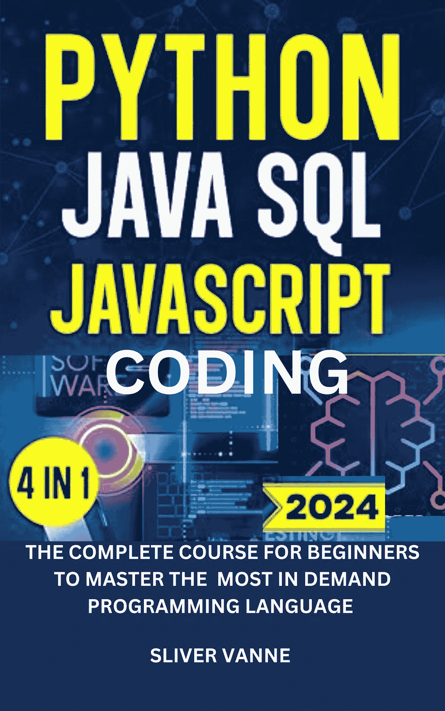

# Python、Java、SQL、JavaScript编码：初学者掌握最热门编程语言的完整课程



## 关于作者

Sliver Vanne 是一位充满热情的软件开发者和教育工作者，在计算机编程领域拥有十多年的经验。他拥有计算机科学背景，并对教学充满热爱，Sliver 致力于通过职业生涯帮助他人发现编程的力量。

Sliver 在职业生涯早期就开始了 `Python` 的旅程，他意识到它的简单性和多功能性是初学者的理想语言。他曾工作于多个领域，包括 Web 开发、数据分析和自动化，利用 `Python` 强大的功能解决复杂问题并构建创新解决方案。

在专业工作之外，Sliver 还致力于教育和导师工作。他教过许多编程工作讨会，开发过在线课程，并在编程主题上过大量文章，始终旨在让无论背景如何的人都能接触技术。

《Python, Java, Sql And Javascript Coding》是 Sliver 的最新尝试，旨在将编程的乐趣带给更广泛的读者。通过清晰的解释、实用的示例和循序渐进的方法，他旨在消除编程神秘感，让读者自信地开启自己的编程之旅。

## 13.1 进阶学习的 Java 话题

## 13.2 Java 认证选项

## 13.3 Java 职业路径与机会

## 13.4 持续学习资源

# 第 1 章：SQL 简介

## 1.1 什么是 SQL？

## 1.2 为什么要学习 SQL？

## 1.3 SQL 环境搭建

## 1.4 关系型数据库概述

## 1.5 SQL 语法与基础查询

# 第 2 章：使用 SELECT 获取数据

## 2.1 SELECT 语句

## 2.2 使用 WHERE 子句过滤数据

## 2.3 使用 ORDER BY 对数据排序

## 2.4 限制结果与分页

## 2.5 使用 GROUP BY 聚合数据

# 第 3 章：使用 INSERT、UPDATE 和 DELETE 修改数据

## 3.1 向表中插入数据

## 3.2 在表中更新数据

## 3.3 从表中删除数据

## 3.4 事务操作

# 第 4 章：使用 JOINs 进行高级查询

## 4.1 理解 JOINs

## 4.2 内连接 (Inner Joins)

## 4.3 外连接 (LEFT, RIGHT, FULL)

## 4.4 自连接与交叉连接

## 4.5 多表连接

# 第 5 章：使用函数进行过滤和操纵数据

## 5.1 字符串函数

## 5.2 数值函数

## 5.3 日期与时间函数

## 5.4 条件函数

## 5.5 聚合函数

# 第 6 章：多表操作与子查询

## 6.1 子查询与嵌套查询

## 6.2 相关子查询

## 6.3 公用表表达式 (CTEs)

## 6.4 使用 UNION、INTERSECT 和 EXCEPT 并查询

## 6.5 集合操作与比较

# 第 7 章：创建与操纵数据库对象

## 7.1 创建与修改表

## 7.2 添加与修改列

## 7.3 创建与管理索引

## 7.4 创建与管理视图

## 7.5 管理存储过程与函数

# 第 8 章：数据完整性与约束

## 8.1 理解数据完整性

## 8.2 主键与唯一约束

## 8.3 外键与引用完整性

## 8.4 检查约束与数据验证

## 8.5 使用触发器维护数据完整性

# 第 9 章：高级 SQL 概念

## 9.1 性能优化技术

## 9.2 大型数据库操作

## 9.3 处理 NULL 值

## 9.4 安全与权限

## 9.5 存储过程与函数优化

# 第 10 章：实际应用中的 SQL

## 10.1 Web 开发中的 SQL

## 10.2 数据分析与商业智能中的 SQL

## 10.3 数据科学与机器学习中的 SQL

## 10.4 数据库管理中的 SQL

## 10.5 云端环境中的 SQL

# 第 11 章：SQL 最佳实践与技巧

## 11.1 编写高效的 SQL 查询

## 11.2 优化数据库架构设计

## 11.3 处理并发与锁定

## 11.4 备份与恢复策略

## 11.5 SQL 查询的调试与故障排除

# 第 12 章：SQL 编程的下一步

## 12.1 进阶学习的 SQL 话题

## 12.2 SQL 认证选项

## 12.3 SQL 职业路径与机会

# 第 1 章：JavaScript 简介

## 1.1 什么是 JavaScript？

## 1.2 为什么要学习 JavaScript？

## 1.3 JavaScript 环境搭建

## 1.4 你的第一个 JavaScript 程序

## 1.5 理解 JavaScript 语法

# 第 2 章：变量与数据类型

## 2.1 声明与使用变量

## 2.2 原生数据类型

## 2.3 字符串

## 2.4 数组与对象

## 2.5 类型转换与强制转换

# 第 3 章：运算符

## 3.1 算术运算符

## 3.2 比较运算符

## 3.3 逻辑运算符

## 3.4 赋值运算符

## 3.5 条件（三元）运算符

# 第 4 章：控制流

## 4.1 条件语句 (if, else if, else)

## 4.2 Switch 语句

## 4.3 循环语句 (for, while, do-while)

## 4.4 Break 与 Continue 语句

## 4.5 使用 try-catch 进行异常处理

# 第 5 章：函数与作用域

## 5.1 函数简介

## 5.2 函数声明与表达式

## 5.3 参数与参数

## 5.4 函数的返回值

## 5.5 词作用域与闭包

# 第 6 章：使用 JavaScript 进行面向对象编程

## 6.1 对象与类简介

## 6.2 使用对象字面量创建对象

## 6.3 构造函数与原型

## 6.4 继承与原型链

## 6.5 ES6 类与模块

# 第 7 章：操作文档对象模型 (DOM)

## 7.1 什么是 DOM？

## 7.2 访问与操作 HTML 元素

## 7.3 事件处理与事件监听器

## 7.4 动态 HTML 操作

## 7.5 表单操作与表单验证

# 第 8 章：异步 JavaScript 与 AJAX

## 8.1 异步 JavaScript 简介

## 8.2 回调函数

## 8.3 Promises 与 Async/Await

## 8.4 Fetch API 与 AJAX 请求

# 第 9 章：JavaScript 库与框架

## 9.1 JavaScript 库与框架概述

## 9.2 jQuery 简介

## 9.3 使用 React.js

## 9.4 Node.js 和 Express.js 简介

## 9.5 在后端开发中使用 JavaScript

# 第 10 章：操作 API 与 JSON

## 10.1 什么是 API？

## 10.2 使用 JavaScript 发起 API 请求

## 10.3 解析与操作 JSON 数据

## 10.4 创建与消费 RESTful API

## 10.5 操作第三方 API

## 11.1 编写整洁易读的代码

## 11.2 调试与错误处理

## 11.3 性能优化技术

## 11.4 测试与调试工具

## 11.5 安全最佳实践

# 第 12 章：JavaScript 编程的后续

## 12.1 进阶学习的 JavaScript 高话题

## 12.2 JavaScript 认证选项

## 12.3 JavaScript 职业路径与机会

## 12.4 持续学习资源

# 第 1 章：编程简介

## 1.1 什么是编程？

编程是指示计算机执行特定任务的艺术。它涉及创建一组被称为 `code` 的指令，计算机可以理解并执行这些指令。将其想象为向计算机下命令以解决问题或自动化流程。

编程使我们能够开发软件应用程序、网站、游戏等等。它赋予了我们将想法变为现实并高效解决复杂问题的能力。通过学习编程，你将获得创建创新解决方案的能力，并为科技行业的职业奠定坚实的基础。

简单来说，编程是……

## 1.2 为什么要学习 Python？

Python 是初学者的卓越选择。以下是学习 Python 的原因：

1. 易于学习和阅读：Python 的语法设计得非常简单……

2. 多功能且强大：Python 用于各种用途……

3. 庞大且强大的社区：Python 拥有庞大且活跃的社区……

4. 就业市场需求量：Python 的流行程度已经……

5. 非常适合原型设计和快速开发：Python 的简单性使其非常完美……

## 1.3 设置 Python 环境

在深入学习 Python 编程之前，你需要设置好 Python 环境。这是一份帮助你完成此工作的步骤指南：

1. 选择并安装 Python 分发版：Python 有不同的发行版本，如 `CPython`、`Anaconda` 和 `PyPy`。

2. 安装过程：一旦下载了 Python 安装程序……

3. 验证安装：安装完成后，打开命令提示符或终端并输入 `python --version`。

4. 集成开发环境 (IDE)：虽然可以在任何文本编辑器中编写……

5. 创建项目文件夹：整理你的 Python 项目是一个良好的习惯……

## 6. 编写并运行你的第一个 Python 程序

打开你选择的 IDE 并在项目文件夹中创建一个新的 Python 文件。从编写一个简单的“Hello, World!”程序开始，这是新编程者的传统起点。将文件以 `.py` 扩展名保存（例如，`hello_world.py`），并从 IDE 中运行它。如果一切设置得正确，你应该会在控制台中看到输出的“Hello, World!”。

恭喜你！你已经成功地搭建了 Python 环境并编写了你的第一个 Python 程序。现在，你准备好深入研究 Python 编程并探索它提供的巨大可能性了。

请记住，随着学习的进行，你可能需要安装额外的库或包来扩展 Python 处理特定任务的能力。但现在，你已经拥有了开启 Python 之之旅的所有要素。

## 1.4 编写你的第一个 Python 程序

现在你已经已经在电脑上安装了 Python，是时候编写你的第一个 Python 程序了。按照以下步骤开始：

1. **选择文本编辑器或 IDE**：打开文本编辑器或集成开发环境 (IDE) 来编写你的 Python 代码。如 `PyCharm`、`Visual Studio Code` 或 Python 随附带的 `IDLE` 等 IDE 提供了更增强的编码体验。

2. **创建 Python 文件**：在你选择的文本编辑器或 IDE 中，创建一个新文件并以 `.py` 扩展名保存。该扩展名表示这是一个 Python 文件。

3. **编写代码**：开始编写你的 Python 代码。让我们从一个传统的初学者程序“Hello, World!”开始吧。输入以下代码：

```python
print("Hello, World!")
```

这段代码在执行时将输出消息“Hello, World!”。

4. **保存文件**：用一个有意义的名字和 `.py` 扩展名保存你的 Python 文件。例如，你可以将其保存为 `hello_world.py`。

5. **运行程序**：要运行你的 Python 程序，打开命令提示符或终端并导航到保存 Python 文件的目录。使用以下命令：

```bash
python hello_world.py
```

此命令告诉 Python 执行 `hello_world.py` 文件中的代码。如果一切设置得正确，你应该会在控制台中看到输出的“Hello, World!”。

恭喜你！你已经编写并执行了你的第一个 Python 程序。你现在正处于成为 Python 程序员的道路上。

随着不断进步，你将学习更多关于 Python 语法、数据类型、控制结构、函数等知识。继续练习、探索和构建项目，以加深对 Python 及其强大能力的理解。

记住将复杂问题分解为更小、更易于管理的任务，并使用 Python 强大的功能来解决它们。不要犹豫查阅文档、在线资源或论坛以寻求指导并扩展知识。

# 第 2 章：上手 Python

## 2.1 Python 语法与结构

要精通 Python 编程，理解它的语法和结构至关重要。Python 拥有简洁且易读的语法，对初非常友好。让我们探索一些关键元素：

1. **语句和缩进**：与其他使用大括号或分号的编程语言不同，Python 使用缩进来定义代码块。缩进是指在行开头放置空格或制表符，用于视觉上表示代码的结构。一致的缩进对于正确执行和可读性至关重要。

例如：

```python
if x > 5:
    print("x is greater than 5")
```

2. **注释**：注释用于标记代码，并会被 Python 解释器忽略。它们对于记录代码或添加备注非常有帮助。在 Python 中，注释以哈希符号（`#`）开头。

例如：

```python
# 这是一条注释
```

3. **变量**：变量用于存储数据值。在 Python 中，你不需要显式声明变量类型。你可以使用等号（`=`）为变量赋值。

例如：

```python
x = 5
name = "John"
```

4. **数据类型**：Python 支持多种数据类型，包括整数、浮点数、字符串、布尔值、列表、元组、字典等。每种数据类型都有其特性和用途。

例如：

```python
age = 25             # 整数
temperature = 98.6   # 浮点数
name = "Alice"       # 字符串
is_true = True       # 布尔值
```

5. **Print 函数**：`print()` 函数用于在控制台中显示输出。它允许你打印变量、字符串甚至进行基础格式化。

例如：

```python
name = "Bob"
print("Hello, " + name + "!") # 输出: Hello, Bob!
```

6. **控制结构**：Python 提供了 `if-else` 语句、循环（如 `for` 和 `while` 循环）等控制结构，根据某些条件控制程序的流。

例如：

```python
if x > 10:
    print("x is greater than 10")
else:
    print("x is less than or equal to 10")
```

这些只是 Python 语法和结构中的几个基础元素。随着学习的深入，你将进一步探索该语言更高级的概念和特性。

## 2.2 变量与数据类型

变量在 Python 中用于存储数据值。它们允许你为值分配名称，并在代码的其他部分引用它。Python 支持分配给变量的各种数据类型。让我们探索一些常用的数据类型：

1. **数值类型**：

    - 整数 (`int`)：表示正、负整数，没有小数。

    - 浮点数 (`float`)：表示带有小数的数字。

例如：

```python
age = 25             # 整数
temperature = 98.6   # 浮点数
```

2. **字符串 (`str`)**：表示封装在单引号 (`' '`) 或双引号 (`" "`) 中的字符序列。你可以对字符串进行各种操作，如拼接和切片。

例如：

```python
name = "Alice"
message = 'Hello, ' + name + '!'
```

3. **布尔值 (`bool`)**：表示逻辑值 `True` 或 `False`。布尔值常用于决策和控制流。

例如：

```python
is_true = True
is_false = False
```

4. **列表**：表示封装在方括号 (`[]`) 中的有序集合。列表存储不同类型且是可变的，你可以修改它们。

例如：

```python
numbers = [1, 2, 3, 4, 5] # 整数列表
names = ['Alice', 'Bob', 'Charlie'] # 字符串列表
```

5. **元组**：与列表类似，元组是封装在圆括号 (`()`) 中的有序集合。然而，元组是不可变的，创建后无法修改它们。

例如：

```python
coordinates = (10, 20) # 整数元组
person = ('Alice', 25, 'Engineer') # 不同数据类型的元组
```

6. **字典**：表示封装在花括号 (`{}`) 中的键值对集合。每个键与其值之间用冒号（`:`）隔开。字典是无序的，你可以通过相应的键访问值。

例如：

```python
person = {'name': 'Alice', 'age': 25, 'occupation': 'Engineer'}
```

这些只是 Python 数据类型的几个示例。随着学习的深入，你将遇到更高级的数据结构和特殊的数据类型。要为变量赋值，请使用等号（`=`）。例如，`x = 10` 将值 10 分配给变量 `x`。

记住选择反映其用途的有意义的变量名，并遵循 Python 的命名规范。变量名应以字母或下划线开头，并包含字母、数字和下划线。

输入和输出 (I/O) 操作在任何编程语言中至关重要，因为它们实现了程序与用户或外部源之间的通信。Python 提供了几个内置函数来处理 I/O 操作。让我们来探索 Python 中的输入和输出：

### 1. 输出

* `print()` 函数：`print()` 函数用于在控制台中显示输出。它接受一个或多个参数，并按照指定的顺序打印它们。你可以打印变量、字符串并进行基础的格式化。

示例：

```python
name = "Alice"
age = 25
print("Hello, " + name + "! You are " + str(age) + " years old.")
```

### 2. 输入

* `input()` 函数：`input()` 函数允许你从控制台获取用户输入。它会向用户显示提示信息并等待他们输入值。输入的内容始终被视为字符串，因此你可能需要将其转换为适当的数据类型。

示例：


```python
name = input("Enter your name: ")
age = input("Enter your age: ")
print("Hello, " + name + "! You are " + age + " years old.")
```

### 3. 文件输入输出

* `open()` 函数：`open()` 函数用于打开文件并返回文件对象。它接受两个参数：文件名和模式（`'r'` 表示读取，`'w'` 表示写入，`'a'` 表示追加等）。
* `read()` 方法：`read()` 方法用于读取文件内容。
* `write()` 方法：`write()` 方法用于向文件写入数据。
* `close()` 方法：`close()` 方法用于关闭文件并释放系统资源。

示例（读取文件）：

```python
file = open("example.txt", "r")
content = file.read()
print(content)
file.close()
```

示例（写入文件）：

```python
file = open("example.txt", "w")
file.write("Hello, World!")
file.close()
```

这些是一些基础 I/O 操作。它们允许你与用户交互、读写文件并高效处理数据。

在处理 I/O 操作时，记住处理异常和错误，例如文件不存在或用户输入错误。你可以使用 `try-except` 块来优雅地处理异常并避免程序崩溃。

## 2.4 基础运算符和表达式

运算符是用于对变量和值执行操作的符号或特殊字符。Python 提供了大量的运算符来处理不同类型的操作。让我们探索 Python 中的一些基础运算符和表达式：

### 1. 算术运算符

* 加法（`+`）：将两个值相加。
* 减法（`-`）：从第一个值中减去第二个值。
* 乘法（`*`）：两个值相乘。
* 除法（`/`）：将第一个值除以第二个值，返回浮点数结果。
* 整除（`//`）：将第一个值除以第二个值，返回整数形式的商。
* 取模（`%`）：返回除法后的余数。
* 幂（`**`）：将第一个值升到第二个值的幂。

示例：

```python
x = 10
y = 3
print(x + y)      # 输出: 13
print(x - y)      # 输出: 7
print(x * y)      # 输出: 30
print(x / y)      # 输出: 3.3333333333333335
print(x // y)     # 输出: 3
print(x % y)      # 输出: 1
print(x ** y)     # 输出: 1000
```

### 2. 赋值运算符

* 赋值（`=`）：将值赋给变量。
* 复合赋值（`+=`、`-=`、`*=`、`/=`、`//=`、`%=`）：执行一项操作并将结果赋给变量。

示例：

```python
x = 10
x += 5 # 等同于： x = x + 5
print(x)   # 输出: 15
```

### 3. 比较运算符

* 等于（`==`）：检查两个值是否相等。
* 不等于（`!=`）：检查两个值是否不等。
* 大于（`>`）、小于（`<`）：检查第一个值是否大于或小于第二个值。
* 大于等于（`>=`）、小于等于（`<=`）：检查第一个值是否大于或等于，或小于等于第二个值。

示例：

```python
x = 10
y = 5
print(x == y)   # 输出: False
print(x != y)   # 输出: True
print(x > y)    # 输出: True
print(x < y)    # 输出: False
print(x >= y)   # 输出: True
print(x <= y)   # 输出: False
```

### 4. 逻辑运算符

* `and`：如果两个条件都为 `True`，则返回 `True`。
* `or`：如果其中任一条件为 `True`，则返回 `True`。
* `not`：返回条件的反值。

示例：

```python
x = 10
y = 5
print(x > y and y < 10) # 输出: True
print(x > y or y < 2)   # 输出: True
print(not(x == y))
```

## 2.5 字符串

字符串是 Python 中最常用的数据类型之一。它们包含在单引号（`''`）或双引号（`""`）中。

### 1. 拼接

`+` 运算符用于连接字符串。

示例：

```python
firstName = "John"
lastName = "Doe"
fullName = firstName + " " + lastName
print(fullName) # 输出: John Doe
```

### 2. 长度

`len()` 函数用于获取字符串长度。

示例：

```python
message = "Hello, World!"
print(len(message)) # 输出: 13
```

### 3. 索引

你可以通过索引访问字符串中的字符。索引从 0 开始。

示例：

```python
message = "Hello, World!"
print(message[0]) # 输出: H
print(message[7]) # 输出: W
```

### 4. 切片

切片允许通过指定起始和结束索引来提取字符串子串。结束索引是不包含的。

示例：

```python
message = "Hello, World!"
print(message[0:5]) # 输出: Hello
print(message[7:]) # 输出: World!
```

### 5. 方法

Python 提供了许多对字符串操作的方法，例如转换大小写、替换字符、分割和连接。

示例：

```python
message = "Hello, World!"
print(message.upper()) # 输出: HELLO, WORLD!
print(message.lower()) # 输出: hello, world!
print(message.replace("Hello", "Hi")) # 输出: Hi, World!
print(message.split(",")) # 输出: ['Hello', ' World!']
```

### 6. 格式化

字符串格式化允许将变量或值插入字符串中。Python 提供了多种格式化方法，包括使用 `%` 运算符、`.format()` 方法和 f-strings（格式化字符串字面量）。

示例：

```python
name = "Alice"
age = 25
print("My name is %s and I am %d years old." % (name, age))
print("My name is {} and I am {} years old.".format(name, age))
print(f"My name is {name} and I am {age} years old.")
```

# 3 控制流

## 3.1 条件语句（`if`、`else`、`elif`）

条件语句允许程序根据某些条件做出决策。在 Python 中，条件语句使用 `if`、`else` 和 `elif`（`else if` 的缩写）关键字来实现。让我们探索这些语句的工作方式：

### 1. `if` 语句

`if` 语句用于在特定条件为 `True` 时执行代码块。

示例：

```python
age = 18
if age >= 18:
    print("You are eligible to vote.")
```

### 2. `else` 语句

`else` 语句用于在 `if` 语句的条件为 `False` 时执行代码块。

示例：

```python
age = 15
if age >= 18:
    print("You are eligible to vote.")
else:
    print("You are not eligible to vote.")
```

### 3. `elif` 语句

`elif` 语句用于检查多个条件。它位于 `if` 和 `else` 语句之间，允许测试额外的条件。

示例：

```python
score = 85
if score >= 90:
    print("Grade A")
elif score >= 80:
    print("Grade B")
else:
    print("Grade C")
```

```python
if score >= 90:
    print("Grade A")
elif score >= 80:
    print("Grade B")
elif score >= 70:
    print("Grade C")
else:
    print("Grade D")
```

注意：`elif` 语句是可选的，可以出现多次以测试不同的条件。

### 4. 嵌套 `if` 语句

你也可以将 `if` 语句嵌套彼此之间以处理更复杂的条件。

示例：

```python
age = 20
if age >= 18:
    if age <= 21:
        print("You are eligible for a special offer.")
    else:
        print("You are eligible to vote.")
else:
    print("You are not eligible for any special offers.")
```

### 5. 三元运算符

Python 提供了一种简写简单 `if-else` 语句的快捷方法，称为三元运算符。

示例：

```python
age = 18
message = "You are eligible to vote." if age >= 18 else "You are not eligible to vote."
print(message)
```

注意：三元运算符对于简单的 `if-else` 条件很有用，但对于复杂条件可能会变得难以阅读。

条件语句是强大的工具，允许你的程序根据特定条件做出决策并采取不同的路径。它们允许你控制程序的流程并使其更加动态。

## 3.2 使用 `for` 和 `while` 循环

循环用于重复执行一组指令多次。Python 提供了两种类型的循环：`for` 循环和 `while` 循环。让我们探索一下这些循环是如何工作的：

### 1. `for` 循环

`for` 循环用于遍历序列（如 `list`、`tuple`、`string` 或 `range`）或其他任何可迭代对象。

示例：

```python
fruits = ["apple", "banana", "cherry"]
for fruit in fruits:
    print(fruit)
```

注意：变量（在此情况下为 `fruit`）在每次迭代中都会获取序列中每个项的值。

### 2. `while` 循环

`while` 循环用于在某个条件为 `True` 的情况下重复执行代码块。

示例：

```python
count = 0
while count < 5:
    print(count)
    count += 1
```

注意：确保包含一个最终会变为 `False` 的条件；否则，循环将无限运行。

### 3. 循环控制语句

* `break`：终止循环并退出循环。
* `continue`：跳过循环中当前迭代的剩余代码并进入下一次迭代。

示例：

```python
for num in range(10):
    if num == 3:
        break
    if num % 2 == 0:
        continue
    print(num)
```

注意：`break` 和 `continue` 语句是可选的，可以用于 `for` 和 `while` 循环。

### 4. 带有 `else` 的循环

`for` 和 `while` 循环都可以有一个 `else` 块，该块在循环完成所有迭代（未遇到 `break` 语句）时执行。

示例：

```python
for num in range(5):
    print(num)
else:
    print("Loop completed successfully.")
```

注意：`else` 块是可选的，可以与 `for` 和 `while` 循环一起使用。

循环对于执行重复性任务和遍历序列至关重要。它们帮助自动化过程并让你的代码更高效。

## 3.3 循环控制语句（`break` 和 `continue`）

除了基本的循环结构外，Python 还提供了两个循环控制语句：`break` 和 `continue`。这些语句允许你对循环的执行有更多的控制。让我们探索这些语句是如何工作的：

### 1. `break` 语句

`break` 语句用于终止当前循环并完全退出循环，无论循环条件如何。

示例：

```python
for num in range(1, 6):
    if num == 4:
        break
    print(num)
```

输出：

```
1
2
3
```

注意：一旦遇到 `break` 语句，循环就会终止，程序执行将继续执行循环之后的下一个语句。

### 2. `continue` 语句

`continue` 语句用于跳过循环中当前迭代的剩余代码，并进入下一次迭代。

示例：

```python
for num in range(1, 6):
    if num == 3:
        continue
    print(num)
```

输出：

```
1
2
4
5
```

注意：当遇到 `continue` 语句时，当前迭代立即停止，循环将进入下一次迭代。

`break` 和 `continue` 语句在循环内部提供了灵活性，允许你根据特定条件控制执行流。它们可以同时用于 `for` 和 `while` 循环。

谨慎使用这些语句很重要，以避免创建难以阅读或理解的代码。过度使用 `break` 和 `continue` 可能会使代码的可维护性降低，且更难调试。

## 3.4 嵌套循环和循环变体

除了基本的 `for` 和 `while` 循环外，Python 还允许将循环嵌套彼此，并提供了循环变体以为你的代码添加更多灵活性。让我们探索嵌套循环和循环变体：

### 1. 嵌套循环

你可以将循环嵌套彼此之间创建更复杂的迭代。内层循环会在外部循环的每次迭代中完成其所有的迭代。

示例：

```python
for i in range(1, 3):
    for j in range(1, 4):
        print(i, j)
```

输出：

```
1 1
1 2
1 3
2 1
2 2
2 3
```

### 2. 循环变体

* `range()` 函数：`range()` 函数通常用于循环以生成数字。

示例：

```python
for i in range(0, 10, 2):
    print(i)
```

输出：

```
0
2
4
6
```

* `enumerate()` 函数：`enumerate()` 函数用于遍历序列的同时跟踪索引。

示例：

```python
fruits = ["apple", "banana", "cherry"]
for index, fruit in enumerate(fruits):
    print(index, fruit)
```

输出：

```
0 apple
1 banana
2 cherry
```

* `zip()` 函数：`zip()` 函数用于遍历多个序列，组合相应的元素。

示例：

```python
names = ["Alice", "Bob", "Charlie"]
ages = [25, 30, 35]
for name, age in zip(names, ages):
    print(name, age)
```

输出：

```
Alice 25
Bob 30
Charlie 35
```

3. 这些循环变体提供了更多的灵活性来处理不同的场景。

## 3.5 条件流练习

现在你学习了 Python 中的条件流，是时候通过练习来付诸实践了。尝试解决以下练习以加强你的理解：

1. 编写一个程序检查数字是正、负还是零。
2. 编写一个程序找到三个数中的最大值。
3. 编写一个程序打印 1 到 50 之间的所有偶数。
4. 编写一个程序要求用户输入密码并一直询问直到密码正确。正确密码为 `"python23"`。
5. 编写一个程序打印到指定项数的斐波纳契数列。斐波纳契数列是每个数字都是前两个数字之和的序列。
6. 编写一个程序计算给定数的阶乘。
7. 编写一个程序打印给定数的乘法表。
8. 编写一个程序找到 1 到 100 之间所有被 7 整除的数字的和。
9. 编写一个程序检查给定字符串是否为回文。回文是指正反读相同的单词、短语、数字或其他字符序列。
10. 编写一个程序找到 1 到 100 之间的质数。

这些练习将帮助你练习并加强对 Python 条件流的理解。可以探索这些问题的不同方法和解决方案。

以下是上述流练习的解答：

1. 检查数字是正、负还是零的解答：

```python
num = float(input("输入数字: "))
if num > 0:
    print("Positive")
elif num < 0:
    print("Negative")
else:
    print("Zero")
```

2. 找到三个数中的最大值的解答：


```python
num1 = float(input("输入第一个数字: "))
num2 = float(input("输入第二个数字: "))
num3 = float(input("输入第三个数字: "))
if num1 >= num2 and num1 >= num3:
    print(num1)
elif num2 >= num1 and num2 >= num3:
    print(num2)
else:
    print(num3)
```

```python
num3 = float(input("Enter the third number: "))

if num1 >= num2 and num1 >= num3:
    largest = num1
elif num2 >= num1 and num2 >= num3:
    largest = num2
else:
    largest = num3

print("The largest number is:", largest)
```

### 3. 打印 1 到 50 之间所有偶数的解决方案：

```python
for num in range(2, 51, 2):
    print(num)
```

### 4. 询问密码直到输入正确为止的解决方案：

```python
password = input("Enter the password: ")
while password != "python123":
    password = input("Incorrect password. Try again: ")
print("Access granted!")
```

### 5. 打印指定项数的斐波那契序列的解决方案：

```python
terms = int(input("Enter the number of terms: "))
num1, num2 = 0, 1

if terms <= 0:
    print("Invalid input")
elif terms == 1:
    print(num1)
else:
    print(num1, num2, end=" ")
    for _ in range(2, terms):
        next_num = num1 + num2
        print(next_num, end=" ")
        num1, num2 = num2, next_num
```

### 6. 计算给定数字阶乘的解决方案：

```python
num = int(input("Enter a number: "))
factorial = 1

if num < 0:
    print("Factorial does not exist for negative numbers.")
elif num == 0:
    print("Factorial of 0 is 1.")
else:
    for i in range(1, num + 1):
        factorial *= i
print("Factorial of", num, "is", factorial)
```

### 7. 打印给定数字乘法表的解决方案：

```python
num = int(input("Enter a number: "))
for i in range(1, 11):
    print(num, "x", i, "=", num * i)
```

### 8. 寻找 1 到 100 之间所有 7 的倍数之和的解决方案：

```python
total = 0
for num in range(1, 101):
    if num % 7 == 0:
        total += num
print("The sum is:", total)
```

### 9. 检查给定字符串是否为回文的解决方案：

```python
string = input("Enter a string: ")
if string == string[::-1]:
    print("Palindrome")
else:
    print("Not a palindrome")
```

### 10. 寻找 1 到 100 之间质数的解决方案：

```python
for num in range(2, 101):
    is_prime = True
    for i in range(2, int(num ** 0.5) + 1):
        if num % i == 0:
            is_prime = False
            break
    if is_prime:
        print(num)
```

这些解决方案将帮助你理解并实现 Python 中的控制流概念。你可以随意修改它们或探索不同的方法来解决这些练习题。

# 第 4 章：函数

## 4.1 定义和调用函数

函数是编程中至关重要的部分，因为允许你将代码分组为可重用的块并执行特定任务。在 Python 中，你可以使用`def`关键字定义自己的函数。让我们探索如何定义和调用函数：

### 1. 定义函数

要定义一个函数，你需要为函数提供一个名称以及一段指定函数应执行的代码。

语法：

```python
def function_name(parameters):
    # 代码块
    # 缩进对于定义函数的范围至关重要
```

示例：

```python
def greet():
    print("Hello, welcome!")
```

### 2. 调用函数

一旦定义了函数，你可以通过其名称后跟括号来调用它。如果函数有参数，你可以在括号内传递值。

语法：

```python
function_name(arguments)
```

示例：

```python
greet() # 调用 greet() 函数
```

输出：

```
Hello, welcome!
```

注意：函数在被调用时执行，程序执行将从上次停止的地方继续。

### 3. 参数和参数

函数可以拥有参数，参数是用于接收函数调用传来的值的变量。在调用函数时，你可以传递参数（arguments），即将赋值给参数的实际值。

示例：

```python
def greet(name):
    print("Hello,", name)

greet("Alice") # 将 "Alice" 作为参数传递给 greet() 函数
```

输出：

```
Hello, Alice
```

注意：参数和参数允许你的函数更具活性和可重用性。

## 4.2 参数和参数

在 Python 函数中，参数用于接收函数调用传来的值，而参数是传递给函数的实际值。理解参数和参数的工作原理对于创建灵活且可重用的函数至关重要。让我们更地探索参数和参数：

### 1. 函数定义中的参数

在定义函数时，你可以在括号内指定参数。这些参数充当传递给函数的值的占位符。

示例：

```python
def add_numbers(x, y):
    sum = x + y
    print("The sum is:", sum)
```

### 2. 调用中的参数

在调用函数时，你可以传递参数，这些是传递给函数的实际值。

示例：

```python
add_numbers(5, 10) # 传递 5 和 10 作为参数
```

输出：

```
The sum is: 15
```

### 3. 位置参数

默认情况下，参数根据其位置匹配。

示例：

```python
def greet(name, age):
    print(f"Hello {name}, you are {age} years old.")

greet("Alice", 25) # 按位置传递
```

输出：

```
Hello Alice, you are 25 years old.
```

### 4. 关键字参数

你也可以使用关键字来传递参数，这样顺序就不再重要。

示例：

```python
def greet(name, age):
    print(f"Hello {name}, you are {age} years old.")

greet(age=25, name="Alice") # 使用关键字传递
```

输出：

```
Hello Alice, you are 25 years old.
```

### 5. 默认参数

你可以在函数定义中指定默认值。如果在调用时没有提供参数，将使用这些默认值。

示例：

```python
def greet(name="Guest"):
    print(f"Hello, {name}")

greet() # 使用默认值
greet("Alice") # 使用提供的值
```

输出：

```
Hello, Guest!
Hello Alice!
```

## 4.3 从函数返回值

在 Python 中，函数可以使用`return`语句返回值。从函数返回值允许执行计算或处理并将结果返回给调用者。让我们探索如何从函数返回值：

### 1. 使用`return`语句

要从函数返回值，使用`return`关键字后跟你想返回的值或表达式。

示例：

```python
def add_numbers(x, y):
    return x + y
```

### 2. 调用返回值的函数

当调用返回值的函数时，你可以将返回值存储在变量中供以后使用或直接在表达式中使用。

示例：

```python
result = add_numbers(10, 5)
print("The result is:", result)
```

输出：

```
The result is: 15
```

`return`语句会结束函数的执行并将值返回给调用者。

### 3. 返回多个值

Python 函数还可以返回多个值。你可以使用逗号分隔这些值，或者将它们作为集合（如元组或列表）返回。

示例：

```python
def divide_numbers(x, y):
    quotient = x / y
    remainder = x % y
    return quotient, remainder

q, r = divide_numbers(10, 3)
print("Quotient:", q)
print("Remainder:", r)
```

输出：

```
Quotient: 3.3333333333333335
Remainder: 1
```

注意：返回多个值时，你可以将它们解包到单独的变量或作为集合使用。

### 4. 返回`None`

如果函数没有`return`语句或者`return`语句没有值，它将返回`None`。`None`表示值的缺失，通常用于指示函数没有有意义的结果。

示例：

```python
def greet(name):
    print("Hello,", name)

result = greet("Alice")
print("Result:", result)
```

输出：

```
Hello, Alice
Result: None
```

你好，Alice

结果：无

注意：未显式返回值的函数将隐式返回`None`。

从函数返回值允许你封装逻辑和计算，使你的代码更具模块化和可重用。

## 4.4 函数作用域与递归

在 Python 中，函数有自己的作用域，这意味着在函数内部定义的变量只能在该函数内部访问。理解函数作用域对于编写简洁且组织良好的代码非常重要。此外，递归是编程中的一个强大概念，函数调用自己来解决问题。让我们探索函数作用域和递归：

### 1. 函数作用域：

在函数内部定义的变量具有局部作用域，这意味着它们只能在该函数内部访问。

示例：

```python
def my_function():
    x = 10
    print("Inside the function:", x)

my_function()
print("Outside the function:", x) # 这将产生错误
```

输出：

```
Inside the function: 10
NameError: name 'x' is not defined
```

注意：定义在任何函数外的变量具有全局作用域，可以在程序的任何地方访问。

### 2. 全局变量：

要在函数内部访问全局变量，你可以使用`global`关键字来指示该变量是全局的而非局部的。

示例：

```python
x = 10
def my_function():
    global x
    x += 5
    print("Inside the function:", x)

my_function()
print("Outside the function:", x)
```

输出：

```
Inside the function: 15
Outside the function: 15
```

注意：在函数内部修改全局变量应该小心，因为这可能让你的代码更难理解和调试。

### 3. 递归：

递归是一种函数调用自己来解决问题的技术。递归函数有一个基本情况（base case），规定了函数何时停止调用自己，以及一个递归情况（recursive case），定义函数如何调用自己。

示例：

```python
def factorial(n):
    if n == 0:
        return 1
    else:
        return n * factorial(n - 1)

result = factorial(5)
print("Factorial:", result)
```

输出：

```
Factorial: 120
```

注意：递归函数可以是解决可以拆分为更小子问题的优雅优雅解决方案。

## 4.5 函数练习

现在你已经学习了 Python 中的函数，是时候将你的知识付诸实践了。这里有一些练习可以帮助你巩固对函数的理解：

### 练习 1：摄氏度转华氏度转换器

编写一个名为`celsius_to_fahrenheit`的函数，接受摄氏度作为参数并返回华氏度。摄氏度转为华氏度的公式为：`F = (C * 9/5) + 32`。

### 练习 2：三数最大值

编写一个名为`max_of_three`的函数，接受三个数字作为参数并返回三个数中的最大值。不允许使用内置的`max()`函数。

### 练习 3：回文检查

编写一个名为`is_palindrome`的函数，接受字符串作为参数，如果字符串是回文（正反读相同），则返回`True`，否则返回`False`。

### 练习 4：斐波纳契数列

编写一个名为`fibonacci`的函数，接受一个数字`n`作为参数并返回第`n`个斐波纳契数。斐波纳契数列从 0 和 1 开始，之后的每个数字都是前两个数字之和（例如 0, 1, 1, 2, 3, 5, 8, 13, ...）。

### 练习 5：质数检查

编写一个名为`is_prime`的函数，接受一个数字作为参数，如果该数字是质数（只能被 1 和自身整除），则返回`True`，否则返回`False`。

以下是上述函数练习的答案：

### 练习 1：摄氏度转华氏度转换器

```python
def celsius_to_fahrenheit(celsius):
    fahrenheit = (celsius * 9/5) + 32
    return fahrenheit
```

### 练习 2：三数最大值

```python
def max_of_three(num1, num2, num3):
    if num1 >= num2 and num1 >= num3:
        return num1
    elif num2 >= num1 and num2 >= num3:
        return num2
    else:
        return num3
```

### 练习 3：回文检查

```python
def is_palindrome(string):
    reversed_string = string[::-1]
    if string == reversed_string:
        return True
    else:
        return False
```

### 练习 4：斐波纳契数列

```python
def fibonacci(n):
    if n <= 0:
        return "Invalid input. Please enter a positive integer."
    elif n == 1:
        return 0
    elif n == 2:
        return 1
    else:
        a, b = 0, 1
        for _ in range(3, n+1):
            a, b = b, a + b
        return b
```

### 练习 5：质数检查

```python
def is_prime(number):
    if number < 2:
        return False
    for i in range(2, int(number**0.5) + 1):
        if number % i == 0:
            return False
    return True
```

这些是上述函数练习的答案：

## 5. 数据结构

在 Python 中，列表（list）是一种可变的数据结构，可以包含一组项目。在本章中，我们将探索如何创建列表、访问元素并执行各种操作。

### 5.1 列表和列表操作

**1. 创建列表：**

要创建一个列表，用方括号`[]`包裹项目并用逗号分隔。

示例：


```python
numbers = [1, 2, 3]
fruits = ["apple", "banana"]
mixed = [1, "hello"]
```

## 2. 访问元素

你可以通过索引访问列表元素。索引从 0 开始。

示例：

```python
numbers = [1, 2, 3, 4, 5]
print(numbers[0]) # 输出: 1
print(numbers[2]) # 输出: 3
```

## 3. 修改元素

列表是可变的，这意味着你可以通过特定的索引修改元素。

示例：

```python
numbers = [1, 2, 3, 4, 5]
numbers[2] = 10
print(numbers) # 输出: [1, 2, 10, 4, 5]
```

## 4. 列表操作

列表支持拼接、重复、长度计算和成员测试操作。

示例：

```python
list1 = [1, 2, 3]
list2 = [4, 5, 6]
result = list1 + list2
print(result) # 输出: [1, 2, 3, 4, 5, 6]

fruits = ["apple", "banana"]
repeated_fruits = fruits * 3
print(repeated_fruits) # 输出: ['apple', 'banana', 'apple', 'banana', 'apple', 'banana']

numbers = [1, 2, 3, 4, 5]
length = len(numbers)
print(length) # 输出: 5

if 3 in numbers:
    print("3 在列表中")
```

## 5. 列表方法

列表具有内置方法允许你执行各种操作，如添加、插入、删除和排序。

示例：

```python
numbers = [1, 2, 3]
numbers.append(4)
print(numbers) # 输出: [1, 2, 3, 4]

fruits = ["apple", "banana"]
fruits.insert(1, "orange")
print(fruits) # 输出: ["apple", "orange", "banana"]

numbers = [1, 2, 3, 4, 5]
numbers.remove(3)
print(numbers) # 输出: [1, 2, 4, 5]

numbers = [4, 2, 1, 3, 5]
numbers.sort()
print(numbers) # 输出: [1, 2, 3, 4, 5]
```

### 5.2 元组和元组操作

在 Python 中，元组（tuple）是一种不可变的数据结构，可以包含一组项目。元组常用于将相关数据组合。在本节中，我们将探索如何创建元组、访问元素并执行各种操作。

**1. 创建元组**

要创建一个元组，用括号 `()` 包裹项目并用逗号分隔。

示例：

```python
numbers = (1, 2, 3, 4, 5)
fruits = ("apple", "banana", "orange")
mixed = (1, "hello", True, 3.14)
```

**2. 访问元素**

你可以通过索引访问元组的单个元素，类似于列表。

示例：

```python
numbers = (1, 2, 3, 4, 5)
print(numbers[0]) # 输出: 1
print(numbers[2]) # 输出: 3
```

元组（Tuples）支持多种操作，例如拼接、重复、长度计算和成员测试，类似于列表。

示例：

```python
tuple1 = (1, 2, 3)
tuple2 = (4, 5, 6)
result = tuple1 + tuple2
print(result) # Output: (1, 2, 3, 4, 5, 6)

fruits = ("apple", "banana")
repeated_fruits = fruits * 3
print(repeated_fruits) # Output: ("apple", "banana", "apple", "banana", "apple", "banana")

numbers = (1, 2, 3, 4, 5)
length = len(numbers)
print(length) # Output: 5

if 3 in numbers:
    print("3 is present in the tuple") # Output: 3 is present in the tuple
```

### 4. 元组方法

元组是不可变的，因此它们没有像列表那样用于修改元素的内置方法。然而，它们拥有几个用于基本操作的方法，例如计数出现次数和查找元素的索引。

示例：

```python
numbers = (1, 2, 3, 2, 4, 2)
count = numbers.count(2)
print(count) # Output: 3

index = numbers.index(4)
print(index) # Output: 4
```

### 5.3 集合与集合操作

在 Python 中，集合（set）是一个无序的唯一元素集合。集合用于执行数学集合操作，如并集、交集和差集。在本节中，我们将探索如何创建集合、执行集合操作以及在集合上使用内置方法。让我们进入集合和集合操作：

#### 1. 创建集合

要创建一个集合，将元素封装在大括号 `{}` 中，或使用 `set()` 函数。

示例：

```python
fruits = {"apple", "banana", "orange"}
numbers = set([1, 2, 3, 4, 5])
```

#### 2. 集合操作

集合支持并集、交集、差集和对称差等各种操作。

示例：

```python
set1 = {1, 2, 3}
set2 = {3, 4, 5}
union = set1.union(set2)
print(union) # Output: {1, 2, 3, 4, 5}

intersection = set1.intersection(set2)
print(intersection) # Output: {3}

difference = set1.difference(set2)
print(difference) # Output: {1, 2}

symmetric_difference = set1.symmetric_difference(set2)
print(symmetric_difference) # Output: {1, 2, 4, 5}
```

#### 3. 集合方法

集合拥有内置方法，允许你执行各种操作，如添加元素、删除元素和检查成员性。

示例：

```python
fruits = {"apple", "banana"}
fruits.add("orange")
print(fruits) # Output: {"apple", "banana", "orange"}

fruits.remove("banana")
print(fruits) # Output: {"apple", "orange"}

if "apple" in fruits:
    print("apple is present in the set") # Output: apple is present in the set
```

当你想要存储一组唯一元素并对它们执行集合操作时，集合非常有用。它们对于查找唯一项目或从列表中删除重复项等任务特别特别有用。

### 5.4 字典与字典操作

在 Python 中，字典（dictionary）是一个无序的键值对（key-value pairs）集合。字典用于高效地存储和检索数据。在本节中，我们将探索如何创建字典、访问值、添加或删除元素以及对其执行各种操作。让我们进入字典和字典操作：

#### 1. 创建字典

要创建一个字典，将键值对封装在大括号 `{}` 中。每个键值对之间用冒号 `:` 分隔。

示例：

```python
student = {
    "name": "John",
    "age": 20,
    "grade": "A"
}
```

#### 2. 访问值

你可以通过引用相应的键来访问字典中的值。

示例：

```python
student = {
    "name": "John",
    "age": 20,
    "grade": "A"
}
print(student["name"]) # Output: John
print(student["age"]) # Output: 20
```

#### 3. 修改值

你可以通过给相应的键分配新值来修改字典中的值。

示例：

```python
student = {
    "name": "John",
    "age": 20,
    "grade": "A"
}
student["age"] = 21
print(student["age"]) # Output: 21
```

#### 4. 字典操作

字典支持各种操作，如添加或删除键值对、检查成员性以及获取项目数量。

示例：

```python
student = {
    "name": "John",
    "age": 20,
    "grade": "A"
}
student["city"] = "New York" # 添加一个新的键值对
print(student) # Output: {'name': 'John', 'age': 20, 'grade': 'A', 'city': 'New York'}

del student["grade"] # 删除一个键值对
```

## 5.5 列表推导式

在 Python 中，列表推导式（list comprehensions）提供了一种简洁的方式来创建列表。

#### 1. 基础语法

列表推导式的基本语法由方括号 `[]` 内部的表达式和 `for` 循环组成。

示例：

```python
numbers = range(10)
doubled_numbers = [num * 2 for num in numbers]
```

#### 2. 使用条件

你可以在列表推导式中包含 `if` 条件来过滤元素。

示例：

```python
numbers = range(10)
even_numbers = [num for num in numbers if num % 2 == 0]
```

#### 3. 嵌套列表推导式

你可以使用嵌套推导式来处理复杂的列表。

示例：

```python
matrix = [[1, 2, 3], [4, 5, 6], [7, 8, 9]]
flattened_matrix = [num for row in matrix for num in row]
```

#### 4. 列表推导式中的函数

你可以在列表推导式中使用函数来转换数据。

示例：

```python
names = ["Alice", "Bob", "Charlie"]
name_lengths = [len(name) for name in names]
```

### 5.6 数据结构练习

现在我们已经涵盖了列表、元组、集合、字典和推导式的知识，让我们通过一些练习来测试对数据结构的理解！这里是一些你可以尝试的练习：

**练习 1**：创建一个包含 1 到 10 数字的 `numbers` 列表。然后，使用列表推导式创建一个名为 `squared_numbers` 的列表，包含 `numbers` 中每个数字的平方。

**练习 2**：创建一个包含三种水果的元组 `fruits`。然后，使用元组操作添加另一种水果。

**练习 3**：创建一个包含五种颜色的集合 `colors`。然后，使用集合操作从集合中删除一种颜色。

**练习 4**：创建一个名为 `student`，包含以下键值对：`name`（姓名）、`age`（年龄）、`major`（专业）。然后，添加一个名为 `university` 的新键值对并打印字典。

**练习 5**：创建一个包含 1 到 10 数字的 `numbers` 列表。然后，使用列表推导式创建一个名为 `even_numbers` 的列表，其中仅包含 `numbers` 中的偶数。

```python
print(colors)
```

Output: `{"red", "green", "yellow", "purple"}`

### 练习 4

```python
student = {
"name": "John",
"age": 20,
"major": "Computer Science"
}
student["university"] = "Harvard"
print(student)
```

Output: `{"name": "John", "age": 20, "major": "Computer Science", "university": "Harvard"}`

### 练习 5

```python
numbers = list(range(1, 11))
even_numbers = [num for num in numbers if num % 2 == 0]
print(even_numbers)
```

Output: `[2, 4, 6, 8, 10]`

这些解决方案演示了不同数据结构的使用及其操作。

# 第 6 章：文件处理

## 6.1 从文件中读取数据

在 Python 中，文件处理允许你操作计算机上的文件。你可以从文件中读取数据、向文件中写入数据，并对文件执行各种操作。在本章中，我们将重点介绍从文件中读取数据。让我们开始学习如何读取数据：

1. **打开文件**

在从文件中读取数据之前，你需要使用 `open()` 函数打开它。`open()` 函数接受两个参数：文件名和你想要打开文件的模式（读取、写入、追加等）。

示例：

```python
file = open("data.txt", "r")
```

2. **读取整个文件**

一旦打开了文件，你就可以使用 `read()` 方法读取其内容。不带任何参数的 `read()` 方法会将整个文件读取并作为字符串。

示例：

```python
file = open("data.txt", "r")
content = file.read()
print(content)
file.close()
```

3. **逐行读取**

你还可以使用 `readline()` 方法逐行读取文件。`readline()` 方法从文件中读取一行，并将文件指针移动到下一行。

示例：

```python
file = open("data.txt", "r")
line1 = file.readline()
line2 = file.readline()
print(line1)
print(line2)
file.close()
```

4. **使用循环读取文件**

为了在未知行数的情况下逐行读取文件，可以使用循环。`readline()` 方法在到达文件末尾时会返回空字符串，因此你可以将其作为终止循环的条件。

示例：

```python
file = open("data.txt", "r")
line = file.readline()
while line != "":
print(line)
line = file.readline()
file.close()
```

## 6.2 向文件中写入数据

在 Python 中，文件处理允许你操作计算机上的文件。除了从文件中读取数据外，你还可以向文件中写入数据。当你想要存储或或保存结果时，向文件中写入数据非常有用。在本节中，我们将探索如何向文件中写入数据。让我们开始学习：

1. **以写入模式打开文件**

在向文件中写入数据之前，你需要使用 `open()` 函数以相应的模式打开它。要为了写入打开文件，请使用模式 `"w"`。

示例：

```python
file = open("output.txt", "w")
```

2. **向文件写入数据**

一旦以写入模式打开了文件，你就可以使用 `write()` 方法向文件写入数据。`write()` 方法接受一个字符串作为参数并将其写入文件。

示例：

```python
file = open("output.txt", "w")
file.write("Hello, world!\n")
file.write("This is some text.")
file.close()
```

3. **写入多行**

要向文件写入多行，你可以多次使用 `write()` 方法，每次使用不同的文本行。记住在每行末尾包含换行符 `\n` 以实现换行。

示例：

```python
file = open("output.txt", "w")
file.write("Line 1\n")
file.write("Line 2\n")
file.write("Line 3\n")
file.close()
```

4. **向文件追加数据**

如果你想向现有文件添加数据而不覆盖其内容，可以使用模式 `"a"` 以追加模式打开文件。

示例：

```python
file = open("output.txt", "a")
file.write("This is some additional text.")
file.close()
```

向文件中写入数据允许你存储和保存信息以备后用。无论你是保存程序输出、记录数据还是创建报告，Python 都提供了向文件中写入数据的方便方法。

## 6.3 处理 CSV 文件

在 Python 中，CSV（逗号分隔值）文件是存储和交换表格数据的流行文件格式。Python 提供了一个了一个名为 `csv` 的内置模块，它让你能够轻松地处理 CSV 文件。在本节中，我们将探索如何使用 `csv` 模块读取和写入 CSV 文件。让我们开始处理 CSV 文件：

1. **读取 CSV 文件**


要从 CSV 文件读取数据，你需要导入`csv`模块。使用`reader`对象遍历每一行。

示例：

```python
import csv
with open('data.csv', 'r') as file:
    reader = csv.reader(file)
    for row in reader:
        print(row)
```

## 写入 CSV 文件

要向 CSV 文件写入数据，你需要导入`csv`模块。使用`writer`对象向文件写入行。

示例：

```python
import csv
with open('data.csv', 'w', newline='') as file:
    writer = csv.writer(file)
    writer.writerow(["Name", "Age"])
    writer.writerow(["Alice", 30])
```

## 6.4 处理 JSON 文件

在 Python 中，JSON（JavaScript 对象表示）是一种存储和交换数据的流行格式。Python 提供了一个名为`json`的内置模块，它让你能够轻松地处理 JSON 文件。在本节中，我们将探索如何使用`json`模块读取和写入 JSON 文件。让我们开始处理 JSON 文件：

### 读取 JSON 文件

要从 JSON 文件读取数据，你需要导入`json`模块。使用`load()`函数从文件中读取 JSON 数据，或使用`loads()`函数从字符串读取。

示例：

```python
import json
with open('data.json', 'r') as file:
    data = json.load(file)
print(data)
```

### 写入 JSON 文件

要向 JSON 文件写入数据，你需要导入`json`模块。使用`dump()`函数将 JSON 数据写入文件，或使用`dumps()`函数将数据作为字符串返回。

示例：

```python
import json
data = {"name": "Alice", "age": 25, "city": "New York"}
with open('output.json', 'w') as file:
    json.dump(data, file)
```

现在我们已经涵盖了 Python 文件处理的基础知识，让我们通过一些练习来实践所学的内容。尝试解决以下练习以巩固你对文件处理的理解：

### 练习 1

编写一个 Python 程序，读取名为`data.txt`的文本文件并统计文件中的行数。打印总行数。

### 练习 2

编写一个 Python 程序，读取名为`data.csv`的 CSV 文件，并计算第二列数字的平均值。打印该平均值。

### 练习 3

编写一个 Python 程序，读取名为`data.json`的 JSON 文件，并打印文件中所有键的值。

### 练习 4

编写一个 Python 程序，将数字 1 到 10 写入一个名为`output.txt`的文件中，每个数字占一行。

### 练习 5

编写一个 Python 程序，读取名为`input.txt`的文件，并将文件内容以反序顺序写入名为`output.txt`的新文件中。假设输入文件每行一句话。

## 文件处理练习答案

### 练习 1

```python
file = open("data.txt", "r")
lines = file.readlines()
num_lines = len(lines)
print("Total number of lines:", num_lines)
file.close()
```

### 练习 2

```python
import csv
with open("data.csv", "r") as file:
    reader = csv.reader(file)
    next(reader)  # 跳过表头
    numbers = [float(row[1]) for row in reader]
    average = sum(numbers) / len(numbers)
    print("Average:", average)
```

### 练习 3

```python
import json
with open("data.json", "r") as file:
    data = json.load(file)
    for key, value in data.items():
        print(key, ":", value)
```

### 练习 4

```python
with open("output.txt", "w") as file:
    for i in range(1, 11):
        file.write(str(i) + "\n")
```

### 练习 5

```python
with open("input.txt", "r") as file:
    lines = file.readlines()
    reversed_lines = reversed(lines)
    with open("output.txt", "w") as file:
        for line in reversed_lines:
            file.write(line)
```

这些答案演示了文件处理的不同方面，包括读取和写入文本文件、CSV 文件和 JSON 文件。它们还展示了计数行数、计算平均值和反转文件内容等技术。继续练习并探索更多文件操作，以精通 Python 中的文件处理。

# 第 7 章：面向对象编程 (OOP)

## 7.1 OOP 简介

面向对象编程（OOP）是一种专注于创建对象（类的实例）的编程范式，允许将代码组织成可重用的模块化结构。OOP 提供了一种基于真实世界对象及其交互来构建和设计程序的方法。

让我们进入 OOP 的核心概念：

1. **类 (Class)**：类是创建对象的蓝图或模板。它定义了类对象将拥有的属性（数据）和行为（方法）。例如，`Car`类可以有颜色、型号和速度等属性，以及`accelerate`（加速）和`brake`（刹车）等方法。

2. **对象 (Object)**：对象是类的实例。它代表基于类定义的特定实体，拥有自己的一组属性值。例如，`Car`类的对象可能颜色为“红色”，型号为“轿车”，速度为 50 km/h。

3. **封装 (Encapsulation)**：封装是将数据（属性）和方法（行为）封装在类中的过程。它允许数据隐藏和抽象，使对象的内部细节对外部世界隐藏。通过使用公共（public）、私有（private）和保护（protected）等访问修饰符控制对对象属性和方法的访问。

4. **继承 (Inheritance)**：继承机制允许类继承另一个类（称为父类）的属性和方法。

5. **多态 (Polymorphism)**：多态是允许对象以不同的形式表现的能力。它允许不同的类对相同的调用执行不同的操作。

6. **抽象 (Abstraction)**：抽象是将复杂的系统拆分为更易于管理的组件的过程，隐藏不必要的细节。

## 7.2 类与对象

在 Python 中，类是创建对象的蓝图或模板，而对象是类的实例。类提供了定义属性和方法的方法。让我们探索如何定义类和对象：

### 类定义

使用`class`关键字后跟类名来定义类。例如：

```python
class Car:
    def __init__(self, color, model):
        self.color = color
        self.model = model
    def accelerate(self):
        print("汽车正在加速")
    def brake(self):
        print("汽车正在刹车")
```

### 创建对象

使用类名后跟括号来创建对象。

```python
my_car = Car("red", "Sedan")
```

### 访问属性和方法

使用点符号（`.`）访问对象的属性和方法。例如：

```python
print(my_car.color) # 输出: red
print(my_car.model) # 输出: Sedan
my_car.accelerate() # 输出: 汽车正在加速
my_car.brake()      # 输出: 汽车正在刹车
```

### 修改属性

通过给属性赋值新值来修改对象的属性。例如：

```python
my_car.color = "blue"
print(my_car.color) # 输出: blue
```

### 类变量

类变量在类的实例之间共享。它们定义在类内部、方法外部。可以使用类名或实例访问。例如：

```python
class Car:
    wheels = 4  # 类变量
    def __init__(self, color, model):
        self.color = color
        self.model = model

print(Car.wheels) # 输出: 4
my_car = Car("red", "Sedan")
print(my_car.wheels) # 输出: 4
```

## 7.3 继承与多态

继承和多态是面向对象编程（OOP）中两个重要的概念，允许代码重用和灵活。让我们探索继承和多态在 Python 中是如何工作的：

### 继承

继承是一种允许类继承另一个类（称为父类或基类）的属性和方法的机制。继承父类的类被称为子类或派生类。子类可以添加新的属性和方法，或重写现有的。例如：

```python
class Vehicle:
    def __init__(self, color, model):
        self.color = color
        self.model = model
    def accelerate(self):
        print("车辆正在加速")

class Car(Vehicle):
    def __init__(self, color, model, num_doors):
        super().__init__(color, model)
        self.num_doors = num_doors
    def accelerate(self):
        print("汽车正在加速")

my_car = Car("red", "Sedan", 4)
my_car.accelerate() # 输出: 汽车正在加速
```

### 多态

多态允许不同类对相同的方法调用有不同的实现。

多态是指对象根据其所处的环境呈现不同形式或具有不同行为的能力。它允许不同类的对象被视为共同父类的对象。多态赋予了代码的灵性和扩展性。

示例：

```python
class Animal:
    def speak(self):
        pass

class Dog(Animal):
    def speak(self):
        print("Woof!")

class Cat(Animal):
    def speak(self):
        print("Meow!")

def make_animal_speak(animal):
    animal.speak()

my_dog = Dog()
my_cat = Cat()
make_animal_speak(my_dog)  # Output: Woof!
make_animal_speak(my_cat)  # Output: Meow!
```

在上面的示例中，`Dog`和`Cat`类都继承自`Animal`类并重写了`speak`方法。`make_animal_speak`函数接收一个`Animal`对象并调用它的`speak`方法。这允许我们把`Dog`和`Cat`对象传递给函数，并让它们根据`speak`方法的具体实现表现出不同的行为。

继承和多态是面向对象编程（OOP）的强大特性，促进了代码复用、模块化和灵活性。它们允许创建类层次，并使对象根据其特定的类实现展示不同的行为。

## 7.4 封装与抽象

封装和抽象是面向对象编程（OOP）中的两个重要概念，有助于组织和管理代码复杂度。让我们探索封装和抽象在 Python 中是如何工作的：

### 封装

封装是将数据（属性）和方法（行为）封装在类内部的过程。它实现了数据隐藏和抽象，使得对象的内部细节对外部世界是隐藏的。通过使用公共（public）、私有（private）和受保护（protected）等访问修饰符来控制对对象属性和方法的访问。

在 Python 中，封装通过命名约定和访问修饰符来实现。根据约定，意图为私有的属性和方法以下划线（`_`）开头。然而，这仅仅是一种约定，仍然可以从类外部访问该属性或方法。

示例：

```python
class Employee:
    def __init__(self, name, salary):
        self._name = name      # 私有属性
        self._salary = salary  # 私有属性

    def get_name(self):
        return self._name  # 私有方法

    def get_salary(self):
        return self._salary  # 私有方法

employee = Employee("John Doe", 5000)
print(employee.get_name())      # Output: John Doe
print(employee.get_salary())  # Output: 5000
```

在上面的示例中，`_name`和`_salary`属性意图为私有，但仍然可以在类外部访问。`get_name`和`get_salary`方法提供了对这些私有属性的受控访问。

### 抽象

抽象是将复杂系统分解为更小、更容易管理的组件来简化系统的过程。它涉及识别对象或系统的本质特征并隐藏不必要的细节。抽象允许创建抽象类和接口，它们定义了共同行为，并为子类的实现提供了契约。在 Python 中，抽象通过使用`abc`模块中的抽象基类（ABCs）来实现。ABC 定义了子类必须实现的抽象方法。

示例：

```python
from abc import ABC, abstractmethod

class Shape(ABC):
    @abstractmethod
    def area(self):
        pass

class Rectangle(Shape):
    def __init__(self, width, height):
        self.width = width
        self.height = height

    def area(self):
        return self.width * self.height

rectangle = Rectangle(5, 8)
print(rectangle.area())  # Output: 40
```

在上面的示例中，`Shape`类是一个抽象基类，它将`area`方法定义为抽象方法。`Rectangle`类继承自`Shape`类并实现了`area`方法。这强制任何继承自`Shape`的类必须实现`area`方法。

封装和抽象是 OOP 中重要的概念，有助于代码组织、数据隐藏和模块化。它们有助于管理复杂度并创建更具维护性和可重用的代码。理解这些概念对于设计和实现有效的面向对象解决方案至关重要。

## 7.5 OOP 练习

* **练习 1：银行账户**：创建一个`BankAccount`类，包含账号、持有人姓名和余额的属性。包括存款和取款的方法，以及显示当前余额的方法。

* **练习 2：学生**：创建一个`Student`类，包含学生姓名、年龄和课程列表的属性。包括添加课程、退课和显示学生信息的方法。

* **练习 3：矩形**：创建一个`Rectangle`类，包含长度和宽的属性。包括计算矩形面积和周长的方法，以及显示矩形尺寸的方法。

* **练习 4：书籍**：创建一个`Book`类，包含标题、作者和价格的属性。包括设置和获取价格的方法。

* **练习 5：员工**：创建一个`Employee`类，包含姓名、职位和薪资的属性。包括涨薪的方法。

* **练习 6：圆**：创建一个`Circle`类，包含半径的属性。包括计算面积和周长的方法。

* **练习 7：汽车**：创建一个`Car`类，包含品牌、型号和年份的属性。包括加速和刹车的方法。

* **练习 8：动物**：创建一个`Animal`类，包含名称和叫声的属性。包括叫的方法。

* **练习 9：三角形**：创建一个`Triangle`类，包含底边和高度的属性。包括计算面积和周长的方法。

* **练习 10：产品**：创建一个`Product`类，包含名称、价格和数量的属性。包括计算总成本的方法。

这些练习将帮助你练习创建类、定义属性和方法以及实现 OOP 概念。以下是 OOP 练习的答案：

### 练习 1：银行账户


```python
class BankAccount:
    def __init__(self, account_number, account_holder, balance=0):
        self.account_number = account_number
        self.account_holder = account_holder
        self.balance = balance

    def deposit(self, amount):
        self.balance += amount

    def withdraw(self, amount):
        if amount <= self.balance:
            self.balance -= amount
        else:
            print("余额不足.")

    def display_balance(self):
        print(f"Account Number: {self.account_number}")
        print(f"Account Holder: {self.account_holder}")
        print(f"Balance: {self.balance}")
```

### 练习 2：学生

```python
class Student:
    def __init__(self, name, age):
        self.name = name
        self.age = age
        self.courses = []

    def add_course(self, course):
        self.courses.append(course)

    def drop_course(self, course):
        if course in self.courses:
            self.courses.remove(course)
        else:
            print("未找到课程.")

    def display_info(self):
        print(f"Name: {self.name}")
        print(f"Age: {self.age}")
        print("Courses:")
        for course in self.courses:
            print(course)
```

### 练习 3：矩形

```python
class Rectangle:
    def __init__(self, length, width):
        self.length = length
        self.width = width

    def calculate_area(self):
        return self.length * self.width

    def calculate_perimeter(self):
        return 2 * (self.length + self.width)

    def display_dimensions(self):
        print(f"Length: {self.length}")
        print(f"Width: {self.width}")
```

```python
class Book:
    def __init__(self, title, author, price):
        self.title = title
        self.author = author
        self.price = price

    def set_price(self, price):
        self.price = price

    def get_price(self):
        return self.price

    def display_info(self):
        print(f"Title: {self.title}")
        print(f"Author: {self.author}")
        print(f"Price: {self.price}")
```

### 练习 5：

```python
class Employee:
    def __init__(self, name, position, salary):
        self.name = name
        self.position = position
        self.salary = salary

    def give_raise(self, amount):
        self.salary += amount

    def display_info(self):
        print(f"Name: {self.name}")
        print(f"Position: {self.position}")
        print(f"Salary: {self.salary}")
```

### 练习 6：圆形

```python
import math

class Circle:
    def __init__(self, radius):
        self.radius = radius

    def calculate_area(self):
        return math.pi * self.radius ** 2

    def calculate_circumference(self):
        return 2 * math.pi * self.radius

    def display_info(self):
        print(f"Radius: {self.radius}")
```

### 练习 7：汽车

```python
class Car:
    def __init__(self, make, model, year):
        self.make = make
        self.model = model
        self.year = year

    def accelerate(self):
        print("The car is accelerating.")

    def brake(self):
        print("The car is braking.")

    def display_info(self):
        print(f"Make: {self.make}")
        print(f"Model: {self.model}")
        print(f"Year: {self.year}")
```

### 练习 8：动物

```python
class Animal:
    def __init__(self, name, sound):
        self.name = name
        self.sound = sound

    def speak(self):
        print(self.sound)

    def display_info(self):
        print(f"Name: {self.name}")
        print(f"Sound: {self.sound}")
```

### 练习 9：三角形

```python
class Triangle:
    def __init__(self, base, height):
        self.base = base
        self.height = height

    def calculate_area(self):
        return 0.5 * self.base * self.height

    def calculate_perimeter(self):
        # 假设这是一个等边三角形
        return 3 * self.base

    def display_dimensions(self):
        print(f"Base: {self.base}")
        print(f"Height: {self.height}")
```

### 练习 10：产品

```python
class Product:
    def __init__(self, name, price, quantity):
        self.name = name
        self.price = price
        self.quantity = quantity

    def calculate_total_cost(self):
        return self.price * self.quantity

    def display_info(self):
        print(f"Name: {self.name}")
        print(f"Price: {self.price}")
        print(f"Quantity: {self.quantity}")
```

这些是前面提到的 OOP 练习的解答。请随时尝试它们并根据需要进行修改。请记住，这些解决方案只是实现所需功能的一种方式，可能还有其他有效的方法。

# 第 8 章：模块和包

## 8.1 导入模块和包

在 Python 中，模块是包含 Python 代码的文件，而包是包含多个模块的目录。导入模块和包允许我们使用在文件中定义的代码和功能。

在 Python 中导入模块和包有不同的不同的方法：

1. **导入模块**：

   要导入一个模块，我们使用 `import` 关键字后跟模块名称。

   示例：

```python
import math
print(math.sqrt(16))   # 输出: 4.0
```

   在上面的示例中，我们导入了 `math` 模块并使用了该模块中的 `sqrt` 函数。

2. **从模块导入特定项**：

   我们也可以使用 `from` 关键字从模块中导入特定项（例如：函数、类、变量）。

   示例：

```python
from math import sqrt
print(sqrt(16))   # 输出: 4.0
```

   在上面的示例中，我们仅从 `math` 模块导入了 `sqrt` 函数，因此我们可以直接使用它，而无需加模块名前缀。

3. **使用别名导入模块**：

   我们可以使用 `as` 关键字为模块指定别名，这允许我们在代码中使用不同的名称引用该模块。

   示例：

```python
import math as m
print(m.sqrt(16))   # 输出: 4.0
```

   在上面的示例中，我们用别名 `m` 导入了 `math` 模块，因此可以使用 `m` 代替 `math` 来访问其函数。

4. **从模块导入所有项**：

   我们可以使用 `*` 从模块中导入所有项。

   示例：

```python
from math import *
print(sqrt(16))
```

5. **导入包**：

   要导入包，我们使用点符号法。

   示例：

```python
import package
package.function()
```

导入模块和包允许我们利用现有的代码。

## 8.2 使用内置模块

Python 提供了许多内置模块，每个模块都自带一套函数和方法。

1. `math`：该模块提供了数学函数和常量。

   示例：

```python
import math
print(math.pi)
```

2. `random`：该模块提供随机数生成。

   示例：

```python
import random
print(random.randint(1, 10))
```

3. `datetime`：该模块允许我们处理日期和时间。

   示例：

```python
import datetime
current_time = datetime.datetime.now()
print(current_time)
```

4. `os`：该模块提供了与操作系统交互的函数。

   示例：

```python
import os
print(os.getcwd())
```

5. `sys`：该模块提供了访问系统特定参数的函数。

   示例：

```python
import sys
print(sys.argv)
```

6. `json`：该模块允许我们处理 JSON 数据。

   示例：

```python
import json
data = '{"name": "John", "age": 30}'
parsed_data = json.loads(data)
print(parsed_data['name'])
```

## 8.3 使用 pip 安装外部库

除了内置模块，Python 还有由社区创建的海量外部库生态系统。为了安装这些外部库，我们使用名为 pip 的包管理器。以下是使用 pip 安装外部库的方法：

1. **检查 pip 是否已安装**：

   打开终端或命令提示符并运行以下命令以检查 pip 是否已安装：

```bash
pip --version
```

   如果已安装 pip，它将显示版本号。如果没有安装，你需要先安装 pip。

2. **安装 pip**：

   如果没有安装 pip，可以使用以下命令从 Python 官方网站下载 `get-pip.py` 脚本：

```bash
curl https://bootstrap.pypa.io/get-pip.py -o get-pip.py
```

   然后，使用以下命令运行脚本：

```bash
python get-pip.py
```

   这将在系统上安装 pip。

3. **安装外部库**：

   一旦安装了 pip，你就可以它来安装外部库。打开终端或命令提示符并运行以下命令来安装库：

```bash
pip install library_name
```

将 `library_name` 替换为你想要安装的库名称。例如，要安装 `requests` 库，运行以下命令：

```bash
pip install requests
```

`pip` 将下载并安装该库及其依赖项。

### 4. 在代码中使用该库

安装库后，你可以在 Python 代码中导入并使用它。这里有一个使用 `requests` 库的示例：

```python
import requests

response = requests.get('https://www.google.com')

print(response.status_code)  # 输出: 200
```

在上面的示例中，我们导入了 `requests` 库并使用它的 `get` 函数向 URL 发 GET 请求。

## 8.4 探索流行的 Python 库

Python 拥有由社区创建的庞大生态系统，为不同的用途提供了广泛的功能。让我们探索一些流行的 Python 库及其应用领域：

1. **NumPy**: `NumPy` 是 Python 科学计算的基础库。它提供了对大型多维数组和矩阵的支持，并提供了一系列用于高效操作这些数组的数学函数。

2. **pandas**: `pandas` 是一个用于数据处理和分析强大库。它提供了高效处理结构化数据（如表格或时间序列）的数据结构，并提供了数据清洗、过滤、分组等函数。

3. **Matplotlib**: `Matplotlib` 是一个绘图库，能够在 Python 中创建静态、动画和交互式的可视化。它提供了各种图表、图形和绘图，使其成为数据可视化的热门选择。

4. **scikit-learn**: `scikit-learn` 是一个机器学习库，提供了用于数据挖掘、数据分析和预测建模的工具。它包含了用于分类、回归、聚类、降维等的各种算法。

5. **TensorFlow**: `TensorFlow` 是由 Google 开发的开源机器学习框架。它提供了一套完整的工具、库和资源生态系统，用于高效地构建和部署机器学习模型。

6. **PyTorch**: `PyTorch` 是另一个流行的机器学习库，侧重于灵活性和易用性。它提供了一个动态计算图框架，并支持深度学习任务的 CPU 和 GPU 加速。

7. **Django**: `Django` 是一个高级 Web 框架，简化了 Web 应用程序的开发。它遵循模型-视图-控制器 (MVC)架构模式，并提供了 URL 路由、模板引擎、数据库集成等功能。

8. **Flask**: `Flask` 是一个轻量级的 Web 框架，提供了简单性和活性。它允许用极少的样板代码开发 Web 应用程序，并支持用于各种功能的扩展，如身份验证、数据库集成等。

9. **SQLAlchemy**: `SQLAlchemy` 是一个流行的 SQL 工具包和对象关系映射 (ORM) 库。它提供了一套用于在 Python 中处理数据库的高级 API，允许开发者使用 Python 对象和 SQL 表达式与数据库交互。

10. **Beautiful Soup**: `Beautiful Soup` 是一个用于网页爬取和解析 HTML 和 XML 文档的库。它通过提供方便的方法文档结构和检索特定元素，简化了从网页提取数据的方法。

这些只是 Python 中可用许多库的示例。Python 包索引 (PyPI) 是根据你的特定需求探索和发现更多库的极佳资源。记住参考每个库的文档来了解其用法和可用功能。


## 8.5 使用第三方库

在 Python 中使用第三方库允许我们利用他人开发的现有代码和功能。这些库可以极大增强我们的项目并节省我们的精力。让我们探索在 Python 中有效使用第三方库的一些关键步骤：

1. **安装库**:

   运行以下命令使用 `pip` 安装库：

   ```bash
   pip install library_name
   ```

   将`library_name`替换为你想要安装的库名称。例如：

   ```bash
   pip install requests
   ```

2. **导入库**:

   安装库后，使用`import`语句将其导入到你的 Python 脚本中。例如：

   ```python
   import requests
   ```

3. **阅读文档**:

   熟悉该库的文档以了解其功能、函数和用法。文档通常提供了有关如何有效使用该库的示例、说明和指南。

4. **探索示例和教程**:

   许多库提供了示例和教程，展示了库的能力并演示了常见的用例。探索这些资源以获得如何有效使用该库的见解。

5. **使用库的函数和类**:

   一旦导入库，就可以使用它的函数、类和其他组件来完成特定任务。有关如何使用特定函数或类的详细信息，请参考该库的文档。

6. **处理依赖项**:

   某些库可能依赖于其他库。确保你已安装所有所需的依赖项。库的文档应该列出这些依赖项。

7. **保持库更新**:

   定期检查库的更新并在可用时升级到最新版本。这确保了你可以获得错误修复、新功能和改进。

8. **为库贡献（可选）**:

   如果你很有经验并愿意贡献，可以考虑为库的开发做出贡献。这可能包括报告问题、提交错误修复、添加新功能或改进文档。

记住，虽然使用第三方库可以极大增强你的项目，但审查并理解许可条款以及使用外部代码的潜在风险是非常重要的。

# 第 9 章：爬虫

## 9.1 爬虫简介

网页爬虫是从网站提取数据的过程。它涉及获取网页的 HTML 内容并进行解析以提取特定信息。通过爬虫，我们可以自动化地从多个页面提取数据，与手动复制粘贴相比节省了精力。

爬虫被广泛用于各种用途，例如：

1. **数据收集**: 爬虫允许我们从不同的网站收集数据并将其合并用于分析或研究目的。

2. **价格比较**: 通过爬取电子商务网站，我们可以收集产品价格并进行比较以找到最优优惠。

3. **内容聚合**: 爬虫可从多个源收集信息并将其聚合到单一平台，例如新闻聚合器。

4. **监控**: 爬虫可跟踪网站的变化，例如监控股票价格、跟踪竞争价格或监控职位发布。

5. **研究**: 爬虫可以协助为学术或业务研究收集数据。

要执行爬虫，我们通常遵循以下步骤：

1. **发送 HTTP 请求**: 使用`requests`等库发送 HTTP GET 或 POST 请求以获取网页的 HTML 内容。

2. **解析 HTML**: 使用`Beautiful Soup`或`lxml`等库解析 HTML 内容并根据标签、类或属性提取特定元素。

3. **提取数据**: 一旦解析了 HTML，我们就可以提取所需的数据，如文本、链接、图像或表格。

4. **存储或处理数据**: 我们可以将提取的数据存储在结构化格式（如 CSV 或 JSON）中，或者对其进行进一步处理以便分析或其他目的。

需要注意的是，网络爬虫应该以负责任且符合道德的方式进行。始终尊重网站的服务条款，避免因过多的请求导致服务器过载。此外，某些网站可能采取了措施来防止或限制网络爬虫，因此在爬取网站之前，检查任何限制是至关重要的。

网络爬虫是从网站提取数据和自动化重复任务的强大工具。

## 9.2 HTML 和 CSS 基础

为了理解网络爬虫，对 HTML（超文本标记语言）和 CSS（层联样式表）的基础了解非常重要。HTML 是用于构建网页内容的标准标记语言，而 CSS 用于样式化和格式化内容的呈现。让我们简要探索 HTML 和 CSS 的基础：

### HTML

HTML 使用标签来定义网页的结构和内容。标签包含在角括号（`<>`）中并成对出现：一个起始标签和一个结束标签。这里有一个简单的 HTML 结构示例：

```html
<html>
<head>
<title>页面标题</title>
</head>
<body>
<h1>这是一个标题</h1>
<p>这是一个段落。</p>
</body>
</html>
```

在上面的示例中，我们有了 HTML 页面的基本结构。`<html>`标签是根元素，它包含了`<head>`和`<body>`元素。`<head>`元素通常包含页面的元信息，而`<body>`元素包含可见内容。

在`<body>`元素内部，我们可以使用各种标签来定义不同类型的内容。例如，`<h1>`标签定义标题，`<p>`标签定义一个段落。

### CSS

CSS 用于样式化和格式化 HTML 元素的显示。CSS 规则由一个选择器和一组属性与值组成。这里是 CSS 的用例示例：

```html
<html>
<head>
<title>页面标题</title>
<style>
h1 {
color: blue;
font-size: 24px;
}
p {
color: green;
}
</style>
</head>
<body>
<h1>这是一个标题</h1>
<p>这是一个段落。</p>
</body>
</html>
```

在上面的示例中，我们在`<head>`元素中添加了一个`<style>`块来定义 CSS 规则。`h1`选择器针对所有的`<h1>`标签并应用指定的属性，如`color`和`font-size`。同样，`p`选择器针对所有的`<p>`标签并应用指定的颜色。

通过结合 HTML 和 CSS，我们可以构建内容并样式化网页的显示。

## 9.3 使用 BeautifulSoup 进行网络爬虫

BeautifulSoup 是一个用于网络爬虫的流行 Python 库。它简化了解析 HTML 内容和从网页提取数据的过程。让我们探索如何使用 BeautifulSoup 进行网络爬虫：

1. **安装 BeautifulSoup**：

   在使用 BeautifulSoup 之前，我们需要安装它。打开你的命令提示符或终端并运行以下命令：

```bash
pip install beautifulsoup4
```

2. **导入 BeautifulSoup**：

   在你的 Python 脚本中，如下所示导入`BeautifulSoup`模块：

```python
from bs4 import BeautifulSoup
```

3. **获取 HTML 内容**：

   使用`requests`等库发送 HTTP GET 请求获取网页的 HTML 内容。例如：

```python
import requests
url = "https://www.example.com"
response = requests.get(url)
html_content = response.text
```

4. **创建 BeautifulSoup 对象**：

   将 HTML 内容传递给`BeautifulSoup`构造函数以创建一个`BeautifulSoup`对象。该对象代表网页解析后的 HTML 结构：

```python
soup = BeautifulSoup(html_content, "html.parser")
```

5. **导航和提取数据**：

   BeautifulSoup 提供了方法和属性来在 HTML 结构中导航并提取数据。例如，你可以使用`find`或`find_all`方法根据标签、类或属性搜索特定的 HTML 元素：

```python
# 查找第一个 <h1> 标签
h1_tag = soup.find("h1")
print(h1_tag.text)

# 查找所有类为 "link" 的 <a> 标签
link_tags = soup.find_all("a", class_="link")
for link in link_tags:
    print(link["href"])
```

你也可以使用字典类的访问访问 HTML 元素的属性（例如`link["href"]`）。

6. **提取文本**：

   使用`.text`属性提取 HTML 元素的文本内容：

```python
print(h1_tag.text)
```

7. **提取属性**：

   使用字典类的访问从 HTML 元素中提取属性值：

```python
print(link["href"])
```

这些只是如何使用 BeautifulSoup 进行网络爬虫的几个基本示例。BeautifulSoup 提供了更多方法和功能来导航、搜索和处理 HTML 结构。更多详细信息和示例请参考 BeautifulSoup 文档。

## 9.4 从网站爬取数据

一旦我们获取了网页的 HTML 内容并创建了`BeautifulSoup`对象，就可以开始从网站爬取数据。让我们探索一些常见的爬取技术：

1. **导航 HTML 结构**：

   使用`BeautifulSoup`方法如`find`或`find_all`，根据标签、类或属性定位元素。

2. **提取文本**：

   使用`.text`属性提取 HTML 元素的文本。例如：

```python
# 查找第一个 <p> 标签
p_tag = soup.find("p")
```

3. **提取属性**：

   使用字典类的访问从 HTML 元素中提取属性值。例如：

```python
# 查找第一个 <a> 标签并获取 href
a_tag = soup.find("a")
```

4. **提取多个元素**：

   使用`find_all`提取匹配特定元素。例如：

```python
# 查找所有的 <a> 标签
a_tags = soup.find_all("a")
for a_tag in a_tags:
    print(a_tag.text)
```

5. **从表格提取数据**：

   如果网页包含表格，你可以导航行和列以提取数据。例如：

```python
# 查找 <table> 标签
table = soup.find("table")
# 从每行中提取列
rows = table.find_all("tr")
for row in rows:
    columns = row.find_all("td")
    for column in columns:
        print(column.text)
```

6. **处理分页和多页面**：

   如果要爬取的数据分布在多个页面，你可能需要遍历每个页面，获取其 HTML 内容并使用 BeautifulSoup 解析。

## 9.5 处理分页和动态内容

在从网站爬取数据时，你可能会遇到数据分布在多个页面，或者内容是动态加载的情况。让我们探索如何在网络爬虫中处理分页和动态内容：

1. **分页**：

   分页是将数据划分为多个页的做法。要从分页网站爬取数据，你需要遍历每个页面并提取所需数据。这里是处理分页的示例：

```python
import requests
from bs4 import BeautifulSoup

url_template = "https://www.example.com?page={}"

for page in range(1, 6): # 假设有 5 个页需要爬取
    url = url_template.format(page)
    response = requests.get(url)
    html_content = response.text
    soup = BeautifulSoup(html_content, "html.parser")
    # 从当前页提取数据
    # ...
    # 重复过程处理下一页
```

2. **动态内容**：

一些网站使用`JavaScript`或`AJAX`来动态加载内容。这意味着初始的 HTML 响应可能不包含你想要抓取的所有数据。为了处理动态内容，你可以使用`Selenium`等工具，或者使用`Puppeteer`等无头浏览器来自动化浏览器交互。

以下是一个使用`Selenium`从具有动态内容的网站抓取数据的示例：

```python
from selenium import webdriver
from selenium.webdriver.chrome.options import Options
from bs4 import BeautifulSoup

# 配置 Selenium 使用无头浏览器
options = Options()
options.headless = True
driver = webdriver.Chrome(options=options)
url = "https://www.example.com"
driver.get(url)

# 等待动态内容加载
# 你可能需要使用显式等待或等待特定元素出现
html_content = driver.page_source
soup = BeautifulSoup(html_content, "html.parser")

# 从页面中提取数据
# ...
driver.quit()
```

在这个示例中，我们使用`Selenium`来自动化浏览器交互。我们配置它使用无头浏览器，这意味着浏览器在后台运行，没有可见的界面。然后，我们导航到所需的`URL`并等待动态内容加载。最后，我们可以使用`BeautifulSoup`从页面中提取数据。

处理分页和动态内容会增加网络爬取过程的复杂性。理解你正在抓取的网站的结构和行为对于确定适当的方法非常重要。请注意网站的服务条款，确保你在抓取数据时没有违反任何法律或伦理准则。

## 9.6 网络爬取练习

现在我们已经涵盖了网络爬取的基础知识以及如何使用`BeautifulSoup`，让我们通过一些练习来提高技能吧。这些练习将让你获得从网站抓取数据的实操经验。以下是几个入门练习题：

*   **练习 1：抓取引言**

    抓取一个包含引言的网站并提取每个引言的文本内容。网站 URL 为`http://quotes.example.com/`。

*   **练习 2：抓取产品信息**

    抓取一个包含产品信息的网站，并提取每个产品的名称、价格和描述。网站 URL 为`http://products.example.com/`。

*   **练习 3：抓取新闻标题**

    抓取一个新闻网站并提取最新新闻文章的标题。网站 URL 为`http://news.example.com/`。

*   **练习 4：抓取天气数据**

    抓取一个天气网站并提取当前温度和天气状况。网站 URL 为`http://weather.example.com/`。

*   **练习 5：抓取电影评分**

    抓取一个电影评论网站并提取特定电影的评分和评论。网站 URL 为`http://movies.example.com/`。

对于每个练习，请遵循以下步骤：

1.  使用`requests`库获取网站的 HTML 内容。

2.  创建一个`BeautifulSoup`对象来解析 HTML 内容。

3.  使用`BeautifulSoup`的方法和属性来导航并提取所需的数据。

4.  根据需要打印或存储提取的数据。

以下是上述网络爬取练习的可能解决方案：

### 练习 1：抓取引言

```python
import requests
from bs4 import BeautifulSoup

url = "http://quotes.example.com"
response = requests.get(url)
html_content = response.text
soup = BeautifulSoup(html_content, "html.parser")

quote_tags = soup.find_all("blockquote")

for quote_tag in quote_tags:
    print(quote_tag.text.strip())
```

### 练习 2：抓取产品信息

```python
import requests
from bs4 import BeautifulSoup

url = "http://products.example.com"
response = requests.get(url)
html_content = response.text
soup = BeautifulSoup(html_content, "html.parser")
product_tags = soup.find_all("div", class_="product")

for product_tag in product_tags:
    name = product_tag.find("h2").text.strip()
    price = product_tag.find("span", class_="price").text.strip()
    description = product_tag.find("p", class_="description").text.strip()
    print("Name:", name)
    print("Price:", price)
    print("Description:", description)
    print()
```

### 练习 3：抓取新闻标题


```python
import requests
from bs4 import BeautifulSoup

url = "http://news.example.com"
response = requests.get(url)
html_content = response.text
soup = BeautifulSoup(html_content, "html.parser")
headline_tags = soup.find_all("h2", class_="headline")

for headline_tag in headline_tags:
    print(headline_tag.text.strip())
```

### 练习 4：抓取天气数据

```python
import requests
from bs4 import BeautifulSoup

url = "http://weather.example.com"
response = requests.get(url)
html_content = response.text
soup = BeautifulSoup(html_content, "html.parser")
temperature_tag = soup.find("span", class_="temperature")
conditions_tag = soup.find("span", class_="conditions")

temperature = temperature_tag.text.strip()
conditions = conditions_tag.text.strip()
print("Temperature:", temperature)
print("Conditions:", conditions)
```

### 练习 5：抓取电影评分

```python
import requests
from bs4 import BeautifulSoup

url = "http://movies.example.com"
response = requests.get(url)
html_content = response.text
soup = BeautifulSoup(html_content, "html.parser")

movie_title = "Example Movie"
movie_tag = soup.find("h2", text=movie_title)
rating_tag = movie_tag.find_next("span", class_="rating")
review_tag = movie_tag.find_next("p", class_="review")

rating = rating_tag.text.strip()
review = review_tag.text.strip()
print("Rating:", rating)
print("Review:", review)
```

- `R`：`R` 是一种专门为统计计算和数据分析设计的编程语言。它提供了许多包，例如 `dplyr` 和 `tidyr`，这些提供了高效的数据处理能力。

- `SQL`：结构化查询语言（`SQL`）是一种用于管理和操作关系型数据库的语言。它提供了一系列命令和函数来执行过滤、排序、连接和聚合数据等操作。

- `电子表格软件`：`Microsoft Excel` 或 `Google Sheets` 等电子表格软件也可以用于基本的数据处理任务。它们为对数据进行过滤、排序和执行计算提供了直观的界面。

## 10.2 使用 Pandas 库

`Pandas` 是 `Python` 中一个用于数据处理和分析的强大开源库。它提供了数据结构和函数，可以高效地处理和操作结构化数据，例如表格数据或时间序列数据。`Pandas` 构建在 `NumPy` 之上，另一个 `Python` 中用于数值计算的库。

要使用 `Pandas` 库，你需要首先安装它。你可以使用 `pip`（`Python` 的包安装器）并在终端或命令提示符中运行以下命令来安装 `Pandas`：

```bash
pip install pandas
```

安装完成后，你可以使用以下导入语句将 `Pandas` 库导入你的 `Python` 脚本或 `Jupyter Notebook` 中：

```python
import pandas as pd
```

`Pandas` 提供了两种主要的数据结构：`Series` 和 `DataFrame`。

- `Series`：`Series` 是一个一维标签数组，可以包含任何数据类型。它类似于电子表格中的列或一维数组。你可以使用 `pd.Series()` 函数创建一个 `Series`。

- `DataFrame`：`DataFrame` 是一个二维标签数据结构，具有可能具有不同数据类型的列。它类似于关系型数据库中的表格或电子表格。你可以使用 `pd.DataFrame()` 函数创建一个 `DataFrame`。

以下是一个使用 `Pandas` 创建 `Series` 和 `DataFrame` 的示例：

```python
import pandas as pd

# 创建一个 Series
s = pd.Series([10, 20, 30, 40, 50])

print(s)

# 创建一个 DataFrame
data = {'Name': ['John', 'Emily', 'Michael', 'Jessica'],
'Age': [25, 30, 35, 40],
'City': ['New York', 'London', 'Paris', 'Sydney']}

df = pd.DataFrame(data)

print(df)
```

`Pandas` 提供了广泛的函数和方法来处理和分析数据。你可以使用 `Pandas` 执行的一些常用操作包括：

- 数据选择和过滤：你可以使用索引或过滤操作来选择 `DataFrame` 的特定行或列。例如，你可以使用 `df['column_name']` 语法来选择特定列，或使用 `df.loc[row_index, column_name]` 语法选择特定单元格。

- 数据清洗和转换：`Pandas` 提供了处理缺失值、删除重复项、转换数据类型、应用数学或统计操作等函数。例如，你可以使用 `df.dropna()` 函数删除带有缺失值的行或列，或使用 `df.apply()` 函数对 `DataFrame` 的每个元素应用函数。

- 数据聚合和分组：你可以根据一列或多列对数据进行分组，并执行聚合操作，如计算每组的总和、平均值或计数。`Pandas` 提供了 `df.groupby()` 函数来分组，以及 `df.agg()` 函数来执行聚合操作。

- 数据合并和连接：你可以根据公共列或键合并或连接多个 `DataFrames`。`Pandas` 提供了 `df.merge()` 和 `df.join()` 等函数来实现这些操作。

## 10.3 过滤、排序和分组

在数据处理和分析中，通常需要对数据进行过滤、排序和分组以提取有意义的见解。`Pandas` 库提供了高效执行这些操作的函数和方法。

### 数据过滤

要根据特定条件过滤数据，可以使用布尔索引或 `df.query()` 方法。布尔索引允许你根据条件选择行或列。`df.query()` 方法允许你使用查询字符串语法来过滤数据。

```python
import pandas as pd

# 创建一个 DataFrame
data = {'Name': ['John', 'Emily', 'Michael', 'Jessica'],
'Age': [25, 30, 35, 40],
'City': ['New York', 'London', 'Paris', 'Sydney']}

df = pd.DataFrame(data)

# 使用布尔索引过滤数据
filtered_data = df[df['Age'] > 30]
print(filtered_data)

# 使用 df.query() 过滤数据
filtered_data = df.query('Age > 30')
print(filtered_data)
```

### 数据排序

要根据一列或多列对数据进行排序，可以使用 `df.sort_values()` 方法。默认情况下，该方法按升序排序数据。你可以指定 `ascending=False` 参数按降序排序。

```python
import pandas as pd

# 创建一个 DataFrame
data = {'Name': ['John', 'Emily', 'Michael', 'Jessica'],
'Age': [25, 30, 35, 40],
'City': ['New York', 'London', 'Paris', 'Sydney']}

df = pd.DataFrame(data)

# 按 'Age' 列升序排序数据
sorted_data = df.sort_values('Age')

# 按 'Age' 列降序排序数据
sorted_data = df.sort_values('Age', ascending=False)
print(sorted_data)
```

### 数据分组

根据一列或多列对数据进行分组，并执行聚合操作，如计算每组的总和、平均值或计数。`Pandas` 提供了 `df.groupby()` 函数来分组，以及 `df.agg()` 函数来执行聚合操作。

```python
import pandas as pd

data = {'Name': ['John', 'Emily', 'Michael', 'Jessica'],
'Age': [25, 30, 35, 40],
'City': ['New York', 'London', 'Paris', 'Sydney']}

df = pd.DataFrame(data)

# 按 'City' 分组并计算年龄平均值
grouped_data = df.groupby('City')['Age'].mean()
print(grouped_data)
```

```python
'Age': ['25', '30', '35', '40'],
'City': ['New York', 'London', 'Paris', 'Sydney']}
df = pd.DataFrame(data)

# 将 'Age' 列转换为数值数据类型
df['Age'] = pd.to_numeric(df['Age'])

# 将 'Age' 列转换为整数数据类型
df['Age'] = df['Age'].astype(int)

print(df.dtypes)
```

## 应用数学或统计操作

`Pandas` 提供了函数和方法来对你的数据应用数学或统计操作。示例包括 `df.sum()`、`df.mean()`、`df.min()`、`df.max()` 以及 `df.apply()`。

```python
import pandas as pd

# 创建一个 DataFrame
data = {'Name': ['John', 'Emily', 'Michael', 'Jessica'],
        'Age': [25, 30, 35, 40],
        'Height': [170, 165, 180, 160],
        'Weight': [70, 60, 80, 55]}
df = pd.DataFrame(data)

# 计算 'Age' 列之和
age_sum = df['Age'].sum()
print(age_sum)

# 计算平均高度
mean_height = df['Height'].mean()
print(mean_height)

# 对列的每个元素应用一个函数
def convert_to_kg(weight):
    return weight / 2.2046

df['Weight'] = df['Weight'].apply(convert_to_kg)
print(df)
```

## 10.5 数据操纵练习

为了练习并增强使用 `Pandas` 库进行数据操纵的技能，这里有你可以尝试的练习题：

### 练习 1：过滤数据

给定一个包含学生信息的 `DataFrame`，过滤数据以选择年龄大于或等于 18 岁的学生。

```python
import pandas as pd
data = {'Name': ['John', 'Emily', 'Michael', 'Jessica'],
        'Age': [17, 20, 19, 18],
        'City': ['New York', 'London', 'Paris', 'Sydney']}
df = pd.DataFrame(data)

# 过滤数据选择年龄 >= 18 的学生
filtered_data = df[df['Age'] >= 18]
print(filtered_data)
```

### 练习 2：排序数据

给定一个包含员工信息的 `DataFrame`，根据员工姓名按字母顺序对数据排序。

```python
import pandas as pd
data = {'Name': ['John', 'Emily', 'Michael', 'Jessica'],
        'Age': [25, 30, 35, 40],
        'City': ['New York', 'London', 'Paris', 'Sydney']}
df = pd.DataFrame(data)

# 根据员工姓名排序数据
sorted_data = df.sort_values('Name')
print(sorted_data)
```

### 练习 3：分组数据

给定一个包含销售数据的 `DataFrame`，按产品类别对数据进行分组并计算每个类别的总销售额。

```python
import pandas as pd
data = {'Product': ['A', 'B', 'A', 'B', 'A', 'B'],
        'Sales': [100, 200, 150, 300, 120, 250]}
df = pd.DataFrame(data)

# 按产品类别分组并计算总销售额
grouped_data = df.groupby('Product')['Sales'].sum()
print(grouped_data)
```

### 练习 4：数据清洗

给定一个包含客户信息的 `DataFrame`，通过用客户的平均年龄填充处理缺失值。

```python
import pandas as pd
import numpy as np
data = {'Name': ['John', 'Emily', 'Michael', 'Jessica'],
        'Age': [25, np.nan, 35, 40],
        'City': ['New York', 'London', 'Paris', 'Sydney']}
df = pd.DataFrame(data)

# 用平均年龄填充缺失值
average_age = df['Age'].mean()
filled_data = df.fillna(average_age)
print(filled_data)
```

# 第 11 章：数据可视化

## 11.1 数据可视化简介

数据可视化是数据的图形化表示，旨在获取洞察并有效地传达信息。它有助于理解数据中的模式、趋势和关系，使人类更容易进行解释和做出决策。数据可视化允许我们以具有视觉吸引力且易于理解的形式来探索和展示复杂信息。

数据可视化可以使用各种图表、图形、地图和绘图来完成。一些常用的可视化类型包括：

1. 折线图（Line Chart）：显示数据随时间变化的趋势或变化。

2. 柱状图（Bar Chart）：使用矩形条比较不同类别的数据。

3. 饼图（Pie Chart）：代表整体的一部分，显示每个类别的比例。

4. 散点图（Scatter Plot）：通过图上的点显示两个变量之间的关系。

5. 直方图（Histogram）：通过条形显示连续数据的分布。

6. 热力图（Heatmap）：以矩阵形式表示数据，用颜色指示值。

7. 地图（Map）：在地图上显示地理数据。

数据可视化是数据分析过程中的关键一步，因为它有助于理解模式、识别异常值并做出数据驱动的决策。它被广泛应用于业务、金融、营销、医疗保健和社会科学等各个领域。

`Python` 提供了多种库进行数据可视化，包括 `Matplotlib`、`Seaborn` 和 `Plotly`。

## 11.2 使用 Matplotlib 库

`Matplotlib` 是 `Python` 中流行的数据可视化库，提供了丰富的绘图功能。

`Matplotlib` 提供两种主要的接口来绘图：`MATLAB` 风格接口和对象接口。`MATLAB` 风格接口更简单，适合快速绘图，而对象接口提供了更多的控制力。

### MATLAB 风格接口

```python
import matplotlib.pyplot as plt
# 简单绘图
plt.plot(x, y)
plt.xlabel('X-axis')
plt.ylabel('Y-axis')
plt.title('Line Plot')
plt.show()
```

### 对象接口

```python
import matplotlib.pyplot as plt
fig, ax = plt.subplots()
ax.plot(x, y)
ax.set_xlabel('X-axis')
ax.set_ylabel('Y-axis')
ax.set_title('Line Plot')
plt.show()
```

`Matplotlib` 提供许多自定义选项，例如更改线条样式、添加标记、设置轴限制、添加图例等。你可以通过 `Matplotlib` 文档了解更多选项。

## 11.3 创建折线图、柱状图和饼图

在本节中，我们将探索如何使用 `Python` 的 `Matplotlib` 库创建折线图、柱状图和饼图。


1. **折线图**：折线图适用于显示数据随时间变化的趋势。

```python
import matplotlib.pyplot as plt
x = [1, 2, 3, 4, 5]
y = [2, 4, 6, 8, 10]
plt.plot(x, y)
plt.xlabel('X-axis')
plt.ylabel('Y-axis')
plt.title('Line Chart')
plt.show()
```

2. **柱状图**：柱状图适用于比较不同类别的数据。

```python
import matplotlib.pyplot as plt
x = ['A', 'B', 'C', 'D']
y = [10, 20, 15, 25]
plt.bar(x, y)
plt.xlabel('Categories')
plt.ylabel('Values')
plt.title('Bar Chart')
plt.show()
```

3. **饼图**：饼图代表整体的一部分。

```python
import matplotlib.pyplot as plt
labels = ['A', 'B', 'C', 'D']
sizes = [10, 20, 15, 25]
plt.pie(sizes, labels=labels)
plt.title('Pie Chart')
plt.show()
```

饼图非常适合表示整体的各个部分，用于展示每个类别的比例。这里是一个创建饼图的示例：

```python
import matplotlib.pyplot as plt

# 类别及其对应的数据
categories = ['A', 'B', 'C', 'D']
values = [30, 20, 15, 35]

# 创建饼图
plt.pie(values, labels=categories)

# 添加标题
plt.title('Pie Chart')

# 显示图表
plt.show()
```

这些示例演示了如何使用 Matplotlib 创建折线、柱状图和饼图。你可以通过添加图例、更改颜色、调整轴限制等方式来定制这些图表。Matplotlib 提供了广泛的选项来定制和增强你的视觉化效果。

## 11.4 使用散点图和箱线图

除了折线、柱状图和饼图之外，Matplotlib 还支持散点图和箱线图。这些类型的图表用于可视化数据点的分布和关系。

### 1. 散点图

散点图用于通过图上的点来显示两个变量之间的关系。这里是一个创建散点图的示例：

```python
import matplotlib.pyplot as plt

# x 和 y 坐标的数据
x = [1, 2, 3, 4, 5]
y = [2, 4, 6, 8, 10]

# 创建散点图
plt.scatter(x, y)

# 添加标签和标题
plt.xlabel('X-axis')
plt.ylabel('Y-axis')
plt.title('Scatter Plot')

# 显示图表
plt.show()
```

### 2. 箱线图

箱线图（也称为须线图）用于显示数据集的分布。它展示了五位数总结：最小值、第一四位数、中位数、第三四位数和最大值。这里是一个创建箱线图的示例：

```python
import matplotlib.pyplot as plt

# 箱图的数据
data = [10, 15, 20, 25, 30, 35, 40, 45, 50]

# 创建箱线图
plt.boxplot(data)

# 添加标签和标题
plt.xlabel('Data')
plt.ylabel('Values')
plt.title('Box Plot')

# 显示图表
plt.show()
```

这些示例演示了如何使用 Matplotlib 创建散点图和箱线图。你可以通过更改标记样式、添加网格线、调整轴限制等方式来定制这些图表。Matplotlib 提供了广泛的选项来定制和增强你的视觉化效果。

## 11.5 数据可视化练习题

这里是一些你可以使用 Matplotlib 库尝试的数可视化练习题：

### 练习 1：折线图

创建一个折线图，以可视化某企业一年的月销售额数据。假设你有两个列表：`months`（`['Jan', 'Feb', 'Mar', ...]`）和 `sales`（`[1000, 1500, 1200, ...]`）。使用合适的标签和标题定制图表。

### 练习 2：柱状图

创建一个柱状图，以比较不同城市的平均月气温。假设你有两个列表：`cities`（`['New York', 'London', 'Paris', ...]`）和 `temperatures`（`[20, 15, 18, ...]`）。使用合适的标签和标题定制图表。

### 练习 3：散点图

创建一个散点图，以可视化一组学生学习时长与考试成绩之间的关系。假设你有两个列表：`study_hours`（`[2, 3, 4, ...]`）和 `exam_scores`（`[80, 85, 90, ...]`）。使用合适的标签和标题定制图表。

### 练习 4：箱线图

创建一个箱线图，以比较不同年龄组的身高分布情况。假设你有一个字典，其中键代表年龄组（`'<20'`, `'20-30'`, `'30-40'`, ...），值是身高的列表（`[160, 165, 170, ...]`）。使用合适的标签和标题定制图表。

### 练习 5：饼图

创建一个饼图，以表示不同智能手机品牌的市场份额。假设你有一个字典，其中键代表品牌名称（`'Apple'`, `'Samsung'`, `'Xiaomi'`, ...），值代表市场份额百分比（`[30, 25, 20, ...]`）。使用合适的标签和标题定制图表。

以下是使用 Matplotlib 库完成数据可视化练习的答案：

### 练习 1：折线图

```python
import matplotlib.pyplot as plt

months = ['Jan', 'Feb', 'Mar', 'Apr', 'May', 'Jun', 'Jul', 'Aug', 'Sep', 'Oct', 'Nov', 'Dec']
sales = [1000, 1500, 1200, 1800, 2000, 1600, 1400, 1700, 1900, 2200, 2100, 2300]
plt.plot(months, sales)
plt.xlabel('Months')
plt.ylabel('Sales')
plt.title('Monthly Sales Data')
plt.show()
```

### 练习 2：柱状图

```python
import matplotlib.pyplot as plt

cities = ['New York', 'London', 'Paris', 'Tokyo', 'Sydney']
temperatures = [20, 15, 18, 22, 24]
plt.bar(cities, temperatures)
plt.xlabel('Cities')
plt.ylabel('Temperatures')
plt.title('Average Temperatures')
plt.show()
```

### 练习 3：散点图

```python
import matplotlib.pyplot as plt

study_hours = [1, 2, 3, 4, 5, 6, 7, 8, 9, 10]
exam_scores = [65, 70, 75, 80, 85, 88, 90, 92, 95, 100]
plt.scatter(study_hours, exam_scores)
plt.xlabel('Study Hours')
plt.ylabel('Exam Scores')
plt.title('Study Hours vs Exam Scores')
plt.show()
```

### 练习 4：箱线图

```python
import matplotlib.pyplot as plt

heights = {
    '<20': [160, 165, 170, 175, 180],
    '20-30': [165, 170, 175, 180, 185],
    '30-40': [170, 175, 180, 185, 190]
}
plt.boxplot(heights.values(), labels=heights.keys())
plt.xlabel('Age Groups')
plt.ylabel('Heights (cm)')
plt.title('Height Distribution by Age Group')
plt.show()
```

### 练习 5：饼图

```python
import matplotlib.pyplot as plt

brands = ['Apple', 'Samsung', 'Xiaomi', 'Huawei', 'Oppo']
market_share = [30, 25, 20, 15, 10]
plt.pie(market_share, labels=brands, autopct='%1.f%%')
plt.title('Market Share of Smartphone Brands')
plt.show()
```

这些答案演示了如何使用 Matplotlib 库创建不同类型的图表。

# 第 12 章：使用 API

## 12.1 API 简介

API 全称为应用程序编程接口（Application Programming Interface）。它是一套允许不同应用程序相互通信的规则和协议。API 定义了应用程序可以使用的方法和数据格式。

API 如何工作？

API 通过发送请求和接收响应来工作。当应用程序需要访问另一个应用程序或服务时，它会向 API 带有特定的参数请求。API 然后处理请求并返回请求的数据或执行操作。

为什么 API 很重要？

API 让应用程序能够共享并集成数据和功能。它们允许开发者利用现有系统构建新的应用程序。API 还为开发者提供了访问和交互外部资源的标准方法，例如数据库、网络服务和云平台。

API 类型

根据实现和使用方式，API 有不同的类型：

*   `Web APIs`：通过互联网使用标准协议的 API。它们允许应用程序访问和交互基于网络的服务，例如从数据库检索数据或向第三方 API 请求。

*   `库 APIs`：包含在软件库或框架中的 API。它们提供了开发者可以使用函数和类。库 API 通常在相同的编程语言中使用。

*   `操作系统 APIs`：由操作系统提供的 API，允许应用程序与系统资源和服务交互。它们提供了用于文件管理、网络通信和进程控制任务的功能。

API 文档

对 API 进行文档记录是为了向开发者提供如何使用它们的信息。API 文档通常包括可用端点、方法、参数和数据格式的详细信息。它还包括关于如何身份验证和向 API 发请求的示例和指南。

在 Python 中发送 API 请求，你可以使用 `requests` 库。`requests` 库通过处理底层的 HTTP 请求和响应，提供了一种与 API 交互的简单方便的方法。

### 安装 requests 库

在使用 `requests` 库之前，你需要先安装它。你可以使用 Python 的包管理器 `pip` 来安装它。打开你的命令提示符或终端并运行以下命令：

```bash
pip install requests
```

这将在你的系统上安装 `requests` 库。

### 发起 GET 请求

一旦安装了 `requests` 库，你就可以开始发送 API 请求。常见的请求类型是 GET 请求，用于从服务器检索数据。这里是一个发送 GET 请求的示例：

```python
import requests

# 发起一个 GET 请求
response = requests.get('https://api.example.com/data')

# 检查响应状态码

if response.status_code == 200:
    # 请求成功
    data = response.json()
    print(data)
else:
    # 请求失败
    print('Error:', response.status_code)
```

在这个示例中，我们使用 `requests` 库中的 `get` 方法向指定的 URL 发起 GET 请求。然后我们检查响应状态码来判断请求是否成功（状态码 200）。如果成功，我们可以使用 `json` 方法访问响应数据。

### 发起 POST 请求

除了 GET 请求之外，你还可以通过 POST 请求向服务器发送数据。POST 请求通常用于执行操作或提交表单。这里是一个发送 POST 请求的示例：

```python
import requests

# 要发送的数据
data = {
    'name': 'John Doe',
    'email': 'johndoe@example.com'
}

# 发起一个 POST 请求
response = requests.post('https://api.example.com/submit', data=data)

# 检查响应状态码

if response.status_code == 200:
    # 请求成功
    result = response.json()
    print(result)
else:
    # 请求失败
    print('Error:', response.status_code)
```

在这个示例中，我们使用 `requests` 库中的 `post` 方法向指定的 URL 发起 POST 请求。我们通过 `data` 参数将数据以字典的形式传递。然后我们可以使用 `json` 方法访问响应数据。

### 处理错误和异常

在发送 API 请求时，恰当地处理错误和异常是非常重要的。`requests` 库提供了 `status_code` 属性来检查响应的状态码。常见的状态码包括表示成功的 200、表示请求错误的 400 以及表示服务器错误的 500。

你可以使用条件语句根据状态码来处理不同的场景。此外，你还可以使用 `try-except` 块来捕获请求过程中可能发生的任何异常。

```python
import requests

try:
    response = requests.get('https://api.example.com/data')
    if response.status_code == 200:
        data = response.json()
        print(data)
    else:
        print('Error:', response.status_code)
except requests.exceptions.RequestException as e:
    print('Error:', e)
```

在这个示例中，我们使用 `try-except` 块来捕获请求过程中可能发生的任何异常。如果发生异常，我们会打印错误信息。

### 添加请求头和身份验证

某些 API 要求请求中包含身份验证或额外的请求头（`headers`）。你可以使用 `headers` 参数添加请求头，并使用 `auth` 参数包含身份验证令牌。这里有一个示例：

```python
import requests

headers = {
    'Authorization': 'Bearer YOUR_AUTH_TOKEN'
}

response = requests.get('https://api.example.com/data', headers=headers)
if response.status_code == 200:
    data = response.json()
    print(data)
else:
    print('Error:', response.status_code)
```

在这个示例中，我们在请求中包含了一个带有令牌（`bearer token`）的 `Authorization` 请求头。

## 12.3 解析与处理 API 响应

在发送 API 请求后，你通常需要解析并处理响应数据以提取你需要的信息。这涉及到处理 JSON 数据，JSON 是与 API 交换数据的常用格式。在本节中，我们将探索如何在 Python 中解析和处理 API 响应。

### 1 解析 JSON 响应

在处理 API 时，响应数据通常以 JSON 格式返回。JSON（JavaScript 对象表示法）是一种轻量级数据格式，对于人类和机器来说都易于读和写。Python 提供了一个名为 `json` 的内置模块，可以方便地处理 JSON 数据。

这里是一个解析 JSON 响应的示例：

```python
import requests
import json

response = requests.get('https://api.example.com/data')
data = response.json()

# 访问特定数据
print(data['name'])
print(data['age'])

# 遍历项目列表
for item in data['items']:
    print(item['name'])
```

在这个示例中，我们使用 `requests` 库中的 `json` 方法来解析 JSON 响应。这会将响应数据转换为我们可以操作的字典。然后我们可以使用字典键访问特定数据，或者遍历项目列表。

### 2 处理 API 响应

一旦解析了 API 响应，就可以对数据进行处理以提取你需要的信息或进行进一步处理。以下是几种处理技术：

-   **过滤数据**：你可以根据特定条件过滤响应数据。例如，你可以只提取符合某些标准的项。

-   **排序数据**：你可以根据某些字段对响应数据进行排序。例如，你可以按流行程度对产品列表进行排序。

-   **聚合数据**：你可以对响应数据进行聚合以计算统计摘要。例如，你可以计算特定字段的平均值、总和或计数。


- **转换数据**：你可以将响应数据转换为不同的格式或结构。例如，你可以将项目列表转换为字典以便索引。

这里是一个处理响应数据的示例：

```python
import requests
import json

response = requests.get('https://api.example.com/data')
data = response.json()

# 过滤数据
filtered_items = [item for item in data['items'] if item['price'] > 50]

# 排序数据
sorted_items = sorted(data['items'], key=lambda item: item['popularity'], reverse=True)

# 聚合数据
total_price = sum(item['price'] for item in data['items'])

# 转换数据
indexed_items = {item['id']: item for item in data['items']}
```

在这个示例中，我们根据条件（`price > 50`）过滤项目，按流行程度倒序排序，计算所有项目的总价格，并将项目列表转换为以 ID 为键的字典。

解析并处理 API 响应允许你从 API 返回的数据中提取相关信息。通过处理 JSON 数据并使用过滤、排序、聚合和转换等技术，你可以让数据符合你的需求。Python 内置的 `json` 模块和语言的活性使得处理 API 响应和操作数据变得简单。

## 12.4 身份验证与频率限制

在处理 API 时，身份验证和频率限制是确保安全和资源公平使用的重要考虑。在本节中，我们将探索如何在 Python 中进行 API 请求身份验证以及处理频率限制。

### 1. 身份验证

API 通常需要身份验证以确保只有授权用户才能访问某些资源或执行某些操作。身份验证方法有多种，如 API Key、OAuth 和 JWT（JSON Web 令牌）。具体取决于你你使用的 API。

这里有一个使用 API Key 进行身份验证的示例：

```python
import requests

headers = {
    'Authorization': 'Bearer YOUR_API_KEY'
}

response = requests.get('https://api.example.com/data', headers=headers)
if response.status_code == 200:
    data = response.json()
    print(data)
else:
    print('Error:', response.status_code)
```

在本示例中，我们在请求中包含了一个带有 API key 的 Authorization 请求头。包含 API key 的特定方法可能取决于 API 的文档。请务必参考 API 文档获取正确的身份验证方法和参数。

### 2. 频率限制（Rate Limiting）

API 提供者通常实施频率限制以防止滥用并确保资源的公平使用。频率限制限制了你在特定时间内可以发送的请求数量。频率限制通常按每分钟或每小时的数定义。

为了处理频率限制，你需要跟踪已发送的请求次数，并确保不超过允许的限制。以下是使用 `time` 模块实现频率的示例：

```python
import requests
import time

RATE_LIMIT = 100 # 每分钟最大请求数
TIME_PERIOD = 60 # 时间周期（秒）

requests_made = 0
start_time = time.time()

while True:
    if requests_made < RATE_LIMIT:
        response = requests.get('https://api.example.com/data')
        requests_made += 1
        if response.status_code == 200:
            data = response.json()
            print(data)
        else:
            print('Error:', response.status_code)
    else:
        elapsed_time = time.time() - start_time
        if elapsed_time < TIME_PERIOD:
            time.sleep(TIME_PERIOD - elapsed_time)
        start_time = time.time()
        requests_made = 0
```

在此示例中，我们维护了一个 `requests_made` 计数器来跟踪时间周期内发送的请求次数。如果计数器超过频率限制，我们将等待周期内的剩余时间后再发送更多请求。这确保了我们不会超过 API 设置的频率限制。

注意的是，不同的 API 可能有不同的频率限制规则和机制。请确保参考 API 文档获取具体的频率限制规则和指南。

身份验证和频率限制是处理 API 的重要方面。通过正确验证 API 请求并处理频率限制，你可以确保 API 资源的安全和公平使用。Python 提供了必要的工具和库，例如 `requests` 库和 `time` 模块，来有效处理身份验证和频率限制。

## 12.5 API 练习

为了练习在 Python 中操作 API，这里有几个你可以尝试的练习：

- **练习 1：天气 API**

  使用天气 API 获取特定位置的当前天气数据。你可以使用 OpenWeatherMap API 或你选择的任何其他天气 API。向 API 发起 `GET` 请求，并打印指定位置的温度、湿度和天气状况。

- **练习 2：RESTful API**

  找到一个提供你感兴趣的话题数据的公共 RESTful API。它可以是关于电影、书籍、体育或任何其他主题的数据。向 API 发起 `GET` 请求并解析响应数据以提取相关信息。例如，你可以获取电影列表并打印出标题和发行年份。

- **练习 3：GitHub API**

  使用 GitHub API 获取有关 GitHub 用户或仓库的信息。你可以对 `/users/{username}` 或 `/repos/{owner}/{repo}` 等端点发送 `GET` 请求，以检索有关特定用户或仓库的信息。解析响应数据并提取相关信息，例如用户的姓名、简介或仓库的星数（stars）和分叉数（forks count）。

- **练习 4：Twitter API**

  如果你有 Twitter 开发者账号，可以使用 Twitter API 获取推文或用户信息。向 Twitter API 端点发送 `GET` 请求以检索有关推文、用户或特定主题的数据。解析响应数据并提取相关信息，例如推文文本、用户名或转发次数和点赞次数。

- **练习 5：自定义 API**

  如果你有一个自定义 API 或可以访问一个需要身份验证的 API，尝试向该 API 发起请求并检索数据。遵循 API 文档进行适当的请求，并在需要时处理身份验证。根据你的需求解析响应数据并提取相关信息。

- 这些练习将帮助你练习发送 API 请求、解析 JSON 响应、处理身份验证以及操作 API 返回的数据。它们将带给你处理真实世界 API 的实践经验，帮助你更熟练地进行 Python API 集成。

以下是上述 API 练习的解决方案：

### 练习 1：天气 API

```python
import requests
import json

api_key = 'YOUR_API_KEY'
location = 'London'
url = f'http://api.openweathermap.org/data/2.5/weather?q={location}&appid={api_key}'
response = requests.get(url)
data = response.json()

temperature = data['main']['temp']
humidity = data['main']['humidity']
weather_condition = data['weather'][0]['description']

print(f'Temperature: {temperature} K')
print(f'Humidity: {humidity}%')
print(f'Weather Condition: {weather_condition}')
```

### 练习 2：RESTful API

```python
import requests
import json

url = 'https://api.example.com/movies'
response = requests.get(url)
data = response.json()

for movie in data['movies']:
    title = movie['title']
    release_year = movie['release_year']
    print(f'Title: {title}, Release Year: {release_year}')
```

### 练习 3：GitHub API

```python
import requests
import json

username = 'USERNAME'
user_url = f'https://api.github.com/users/{username}'
response = requests.get(user_url)
user_data = response.json()

print(f'User: {user_data["name"]}')
print(f'Bio: {user_data["bio"]}')

repo_url = f'https://api.github.com/users/{username}/repos'
response = requests.get(repo_url)
repos_data = response.json()

print('Repositories:')
for repo in repos_data:
    name = repo['name']
    stars = repo['stargazers_count']
    forks = repo['forks_count']
    print(f'{name}: Stars: {stars}, Forks: {forks}')
```

### 练习 4：Twitter API

```python
import requests
import json

bearer_token = 'YOUR_BEARER_TOKEN'
search_query = 'python'
url = f'https://api.twitter.com/2/tweets/search/recent?query={search_query}'
headers = {
    'Authorization': f'Bearer {bearer_token}'
}
response = requests.get(url, headers=headers)
data = response.json()

for tweet in data['data']:
    text = tweet['text']
    username = tweet['author_id']
    retweets = tweet['public_metrics']['retweet_count']
    likes = tweet['public_metrics']['likes_count']
    print(f'Tweet: {text}')
    print(f'Username: {username}')
    print(f'Retweets: {retweets}, Likes: {likes}')
```

### 练习 5：自定义 API

```python
import requests
import json

url = 'https://api.example.com/data'
headers = {
    'Authorization': 'Bearer YOUR_API_KEY'
}
response = requests.get(url, headers=headers)
data = response.json()
# 解析并从响应数据中提取相关信息
```

- 向用户显示温度、湿度和天气状况

该项目将涉及与 API 操作、处理用户输入、发送 HTTP 请求、解析 JSON 响应以及向用户展示数据。

## 2. 项目实现

让我们开始逐步构建该项目：

### 步骤 1：创建一个名为 `weather_app.py` 的 Python 脚本。

### 步骤 2：导入必要的库：

```python
import requests
import json
```

### 步骤 3：定义一个名为 `get_weather` 的函数，它接受位置作为参数并从 API 获取当前天气数据：

```python
def get_weather(location):
    api_key = 'YOUR_API_KEY'
    url = f'http://api.openweathermap.org/data/2.5/weather?q={location}&appid={api_key}'
    response = requests.get(url)
    data = response.json()
    return data
```

### 步骤 4：定义一个名为 `display_weather` 的函数，它接受天气数据作为参数，并向用户显示温度、湿度和天气状况：

```python
def display_weather(data):
    temperature = data['main']['temp']
    humidity = data['main']['humidity']
    weather_condition = data['weather'][0]['description']
    print(f'Temperature: {temperature} K')
    print(f'Humidity: {humidity}%')
    print(f'Weather Condition: {weather_condition}')
```

### 步骤 5：获取用户输入的位置：

```python
location = input('Enter the location: ')
```

### 步骤 6：使用用户输入调用 `get_weather` 函数，并将天气数据存储在变量中：

```python
weather_data = get_weather(location)
```

### 步骤 7：使用天气数据调用 `display_weather` 函数：

```python
display_weather(weather_data)
```

### 步骤 8：运行脚本并通过输入不同的位置来测试应用程序。

大功完成！你构建了一个简单的天气应用程序，它使用 API 获取并显示当前天气数据。

在在这个项目中，我们使用了 OpenWeatherMap API 来获取天气数据。请确保将 `YOUR_API_KEY` 占位符替换为您的实际 API 密钥。您可以在 OpenWeatherMap 网站上注册免费的 API 密钥。

欢迎通过添加额外功能来增强应用程序，例如处理错误、验证用户输入或提供更详细的天气信息。

更多项目可以进一步加强你在 Python 中处理 API 的技能。

以下是您可以开展的更多项目想法，以进一步增强处理 API 的技能：

1. **电影推荐应用**：构建一个电影推荐应用，使用如 `IMDb` 或 `TMDb` 等 API 获取电影数据。允许用户搜索电影、查看详情并根据他们的偏好获取推荐。

2. **新闻聚合器**：创建一个新闻聚合应用，使用各种新闻源的 API 从其获取新闻文章。允许用户根据不同的类别或关键词浏览和搜索文章。

3. **社交媒体分析**：开发一个使用 `Twitter`、`Facebook` 或 `Instagram` 等社交媒体平台 API 的工具，获取数据并分析用户参与度、情感分析或热门话题。

4. **货币转换**：构建一个货币转换应用程序，使用货币汇率 API 在不同货币之间转换。允许用户输入一种货币的金额并显示另一种货币转换后的金额。

5. **食谱查找**：创建一个食谱查找应用，使用食谱 API 根据用户输入（如食材或饮食偏好）获取食谱。显示带有配料、说明和图片的食谱。

6. **股票市场追踪**：开发一个股票市场追踪应用程序，使用 `Alpha Vantage` 或 `Yahoo Finance` 等股票市场 API 获取不同公司的实时股票价格、历史数据和财务信息。

7. **天气预报应用**：扩展上一个项目的天气应用程序，以提供多天的天气预报。使用支持预报数据的天气 API 获取并显示未来几天的天气状况。

这些项目想法将挑战你处理不同的 API、处理更复杂的数据结构并实现额外的功能。你可以选择这些想法中的任何一个或将它们结合创建你自己的独特项目。请参考每个项目的 API 文档，以理解所需的端点、参数和验证方法。

以下是上述提到的项目之一“电影推荐应用”的高级解决方案：

## 1. 电影推荐应用

### 步骤 1：创建一个名为 `movie_recommendation_app.py` 的 Python 脚本。

### 步骤 2：导入必要的库：

```python
import requests
import json
```


## 步骤 3：定义一个名为`get_movie_data`的函数，它接受电影标题作为参数并从 API 获取电影数据：

```python
def get_movie_data(movie_title):
    api_key = 'YOUR_API_KEY'
    url = f'https://api.example.com/movies?title={movie_title}&apikey={api_key}'
    response = requests.get(url)
    data = response.json()
    return data
```

## 步骤 4：定义一个名为`display_movie_details`的函数，它接受电影数据作为参数，并向用户显示标题、发行年份和剧情：

```python
def display_movie_details(data):
    title = data['title']
    release_year = data['year']
    plot = data['plot']
    print(f'Title: {title}')
    print(f'Release Year: {release_year}')
    print(f'Plot: {plot}')
```

## 步骤 5：获取用户输入的电影标题：

```python
movie_title = input('Enter the location: ')
```

## 步骤 6：使用用户输入调用`get_movie_data`函数，并将电影数据存储在变量中：

```python
movie_data = get_movie_data(movie_title)
```

## 步骤 7：使用电影数据调用`display_movie_details`函数：

```python
display_movie_details(movie_data)
```

## 第 4 步：定义一个名为`analyze_social_media_data`的函数，它接收社交媒体数据作为参数并进行分析。这包括分析用户参与度、情感分析或热门话题。

```python
def analyze_social_media_data(data):
    # 对社交媒体数据进行分析
    # 示例：
    # - 计算总点赞、评论和分享数
    # - 对用户评论进行情感分析
    # - 识别热门话题或标签
    # - 生成报告或可视化图表
    # - 等
    pass
```

## 第 5 步：调用`get_social_media_data`函数并将社交媒体数据存储在变量中：

```python
social_media_data = get_social_media_data()
```

## 第 6 步：使用社交媒体数据调用`analyze_social_media_data`函数：

```python
analyze_social_media_data(social_media_data)
```

## 第 7 步：运行脚本并执行必要的分析。

在此项目中，我们使用了占位符 API URL（`https://api.example.com/social_media`）和 API 密钥（`YOUR_API_KEY`）。你需要将这些占位符替换为你选择的社交媒体 API 提供的实际 API URL 和密钥。

## 4. 菜谱查找

### 第 1 步：创建一个名为`recipe_finder.py`的 Python 脚本。

### 第 2 步：导入必要的库：

```python
import requests
import json
```

### 第 3 步：定义一个名为`get_recipe_data`的函数，它接收用户输入（例如食材、饮食偏好）并从 API 获取菜谱数据：

```python
def get_recipe_data(ingredients, dietary_preferences):
    api_key = 'YOUR_API_KEY'
    url = f'https://api.example.com/recipes?ingredients={ingredients}&preferences={dietary_preferences}&apikey={api_key}'
    response = requests.get(url)
    data = response.json()
    return data
```

### 第 4 步：定义一个名为`display_recipe_details`的函数，它接收菜谱数据作为参数，并向用户显示菜谱名称、食材、步骤和图像：

```python
def display_recipe_details(data):
    for recipe in data['recipes']:
        name = recipe['name']
        ingredients = recipe['ingredients']
        instructions = recipe['instructions']
        images = recipe['images']
        print(f'Recipe: {name}')
        print('Ingredients:')
        for ingredient in ingredients:
            print(f'- {ingredient}')
        print('Instructions:')
        for instruction in instructions:
            print(f'- {instruction}')
        print('Images:')
        for image in images:
            print(f'- {image}')
        print('------------------')
```

### 第 5 步：获取食材和饮食偏好的用户输入：

```python
ingredients = input('Enter ingredients (comma-separated): ')
dietary_preferences = input('Enter dietary preferences: ')
```

### 第 6 步：使用用户输入调用`get_recipe_data`函数并将菜谱数据存储在变量中：

```python
recipe_data = get_recipe_data(ingredients, dietary_preferences)
```

### 第 7 步：使用菜谱数据调用`display_recipe_details`函数：

```python
display_recipe_details(recipe_data)
```

### 第 8 步：运行脚本并测试应用。

在此项目中，我们使用了占位符 API URL（`https://api.example.com/recipes`）和 API 密钥（`YOUR_API_KEY`）。你需要将这些占位符替换为你选择的菜谱 API 提供的实际 API URL 和密钥。

## 5. 天气预报应用

### 第 1 步：创建一个名为`weather_forecast_app.py`的 Python 脚本。

### 第 2 步：导入必要的库：

```python
import requests
import json
```

### 第 3 步：定义一个名为`get_weather_forecast`的函数，它接收位置作为参数并从 API 获取天气预报数据：

```python
def get_weather_forecast(location):
    api_key = 'YOUR_API_KEY'
    url = f'https://api.example.com/weather?location={location}&apikey={api_key}'
    response = requests.get(url)
    data = response.json()
    return data
```

### 第 4 步：定义一个名为`display_weather_forecast`的函数，它接收天气预报数据作为参数并显示当前温度、天气状况以及未来几天的预报：

```python
def display_weather_forecast(data):
    current_temp = data['current']['temp']
    conditions = data['current']['conditions']
    forecast = data['forecast']
    print(f'Current Temperature: {current_temp}°C')
    print(f'Conditions: {conditions}')
    print('Forecast:')
    for day in forecast:
        date = day['date']
        high_temp = day['high']
        low_temp = day['low']
        conditions = day['conditions']
        print(f'{date}: High: {high_temp}°C, Low: {low_temp}°C, Conditions: {conditions}')
```

### 第 5 步：获取位置的用户输入：

```python
location = input('Enter a location: ')
```

### 第 6 步：使用用户输入调用`get_weather_forecast`函数并将天气预报数据存储在变量中：

```python
weather_forecast_data = get_weather_forecast(location)
```

### 第 7 步：使用天气预报数据调用`display_weather_forecast`函数：

```python
display_weather_forecast(weather_forecast_data)
```

### 第 8 步：运行脚本并测试应用。

在此项目中，我们使用了占位符 API URL（`https://api.example.com/weather`）和 API 密钥（`YOUR_API_KEY`）。你需要将这些占位符替换为你选择的天气 API 提供的实际 API URL 和密钥。

## 1. 电影推荐引擎

### 第 1 步：创建一个名为`movie_recommendation.py`的 Python 脚本。

### 第 2 步：导入必要的库：

```python
import requests
import json
```

### 第 3 步：定义一个名为`get_movie_recommendations`的函数，它接收用户输入（例如：类型、年份）并从 API 获取电影推荐：

```python
def get_movie_recommendations(genre, release_year):
    api_key = 'YOUR_API_KEY'
    url = f'https://api.example.com/movies?genre={genre}&year={release_year}&apikey={api_key}'
    response = requests.get(url)
    data = response.json()
    return data
```

### 第 4 步：定义一个名为`display_movie_recommendations`的函数，它接收电影推荐数据作为参数，并向用户显示电影名称、类型、年份和简介：

```python
def display_movie_recommendations(data):
    for movie in data['movies']:
        title = movie['title']
        genre = movie['genre']
        release_year = movie['release_year']
        plot_summary = movie['plot_summary']
        print(f'Title: {title}')
        print(f'Genre: {genre}')
        print(f'Release Year: {release_year}')
        print(f'Plot Summary: {plot_summary}')
        print('------------------')
```

### 第 5 步：获取类型和年份的用户输入：

```python
genre = input('Enter a genre: ')
release_year = input('Enter a release year: ')
```

### 第 6 步：使用用户输入调用`get_movie_recommendations`函数并将电影推荐数据存储在变量中：

```python
movie_recommendation_data = get_movie_recommendations(genre, release_year)
```

### 第 7 步：使用电影推荐数据调用`display_movie_recommendations`函数：

```python
display_movie_recommendations(movie_recommendation_data)
```

### 第 8 步：运行脚本并测试应用。

在此项目中，我们使用了占位符 API URL（`https://api.example.com/movies`）和 API 密钥（`YOUR_API_KEY`）。你需要将这些占位符替换为你选择的电影推荐 API 提供的实际 API URL 和密钥。

## 3. 机器学习与人工智能

由于拥有`TensorFlow`、`Keras`和`scikit-learn`等库，Python 是机器学习和人工智能项目的流行选择。这些库提供了预构建的算法和工具，用于训练模型、执行预测和评估性能。

## 4. 自动化与脚本

Python 非常适合自动化重复性任务和创建脚本。它可以用于自动化文件处理、数据爬取、与`APIs`交互或执行系统操作。

## 5. 物联网 (IoT)

Python 用于编程 IoT 设备并将其与云平台集成。`PySerial`和`Raspberry Pi`的`GPIO`库实现了设备与传感器之间的通信，以及数据处理和分析。

## 6. 自然语言处理 (NLP)

Python 结合`NLTK`和`SpaCy`等库被广泛用于处理和分析人类语言。它在情感分析、机器人、语言翻译和文本分类等方面应用广泛。

## 7. 游戏开发

`Pygame`等 Python 框架为开发 2D 游戏提供了平台。Python 的简单性和多功能性使其成为游戏开发初学者的极佳选择。

## 13.3 Python 开发的最佳实践

使用最佳实践开发代码有助于确保 Python 项目的可读性、可维护性和执行效率。以下是 Python 开发的某些最佳实践：

1. **PEP 8 风格指南**：遵循`PEP 8`（Python 增强提案）中概述的指南进行代码格式化。这包括使用一致的缩进、遵守命名规范以及妥善组织导入。

2. **模块化和 DRY（不要重复自己）代码**：使用`functions`和`classes`编写模块化代码以促进代码重用。避免代码重复，而是创建可重用的函数或辅助类。

3. **使用描述性的变量和函数名**：为变量、函数和类选择有意义且描述性的名称。这增强了代码的可读性，让他人更容易理解你的代码。

4. **编写注释**：包含`docstrings`为你的函数、类和模块提供清晰简洁的文档。这有助于其他开发者理解如何使用你的代码，并提高可维护性。

5. **优雅地处理异常**：使用`try-except`块优雅地处理异常和错误。这确保了你的代码不会意外崩溃，并且你可以提供信息丰富的错误消息或备选方案。

6. **使用虚拟环境**：利用虚拟环境（例如`venv`或`conda`环境）为你的项目创建隔离环境。这有助于管理项目依赖并避免包之间的冲突。

7. **使用 Git 进行版本控制**：使用`Git`等版本控制工具来跟踪更改并与他人协作。定期提交代码，编写有意义的提交信息，并使用分支处理不同的功能或错误修复。

8. **单元测试**：使用`pytest`或`unittest`等测试框架编写单元测试，以确保代码的正确性。自动化测试有助于尽早发现 Bug，并为未来的代码修改提供信心。

9. **优化性能**：对代码进行性能分析以识别性能瓶颈并优化关键部分。使用适当的数据结构和算法来提高效率，避免不必要的资源消耗。

10. **可读性优于巧妙**：优先考虑代码的可读性而非巧妙或复杂的解决方案。编写易于理解和维护的代码，即使这意味着要牺牲一些性能或简洁性。

11. **持续集成与部署**：使用`Jenkins`、`Travis CI`或`GitHub Actions`等工具自动化你的开发流程。这确保了你的代码能够持续集成、测试并高效部署到生产环境中。

12. **协作与寻求反馈**：参与代码审查，向经验丰富的开发者寻求反馈，并积极参与 Python 社区。从他人学习并吸收他们的建议可以提高你的编程技能和知识。

以下是上述每个 Python 开发最佳实践的示例：

1. **PEP 8 风格指南**：


```python
# 遵循 PEP 8 指南进行代码格式化的示例
def calculate_total_price(quantity, price_per_unit):
    total_price = quantity * price_per_unit
    return total_price
```

## 2. 模块化和 DRY 代码

```python
# 使用函数的模块化代码示例
def calculate_area(length, width):
    return length * width

def calculate_volume(length, width, height):
    area = calculate_area(length, width)
    volume = area * height
    return volume
```

## 3. 描述性的变量和函数名

```python
# 使用描述性变量和函数名的示例
def calculate_circle_area(radius):
    pi = 3.14159
    area = pi * radius ** 2
    return area
```

## 4. 编写注释

```python
# 使用 docstrings 文档化代码示例
def calculate_factorial(n):
    """
    计算给定数字的阶乘。
    参数:
    n (int): 计算阶乘的数字。
    返回:
    int: 给定数字的阶乘。
    """
    factorial = 1
    for i in range(1, n+1):
        factorial *= i
    return factorial
```

## 5. 优雅地处理异常

```python
# 优雅处理异常的示例
try:
    result = 10 / 0
except ZeroDivisionError:
    print("错误：不允许除以零。")
```

## 6. 使用虚拟环境

```bash
# 使用 venv 创建并激活虚拟环境的示例
python -m venv myenv
source myenv/bin/activate
```

## 7. 使用 Git 进行版本控制

```bash
# 用于版本控制的 Git 命令示例
git init
git add .
git commit -m "Initial commit"
git branch feature_branch
git checkout feature_branch
```

## 8. 单元测试

```python
# 使用 pytest 的单元测试示例
def test_calculate_factorial():
    assert calculate_factorial(0) == 1
    assert calculate_factorial(5) == 120
    assert calculate_factorial(10) == 3628800
```

## 9. 优化性能

```python
# 使用列表推导式优化性能的示例
numbers = [1, 2, 3, 4, 5]
squared_numbers = [num ** 2 for num in numbers]
```

## 10. 可读性优于巧妙

```python
# 优先考虑代码可读性而非简洁性的示例
calculate_total_price(quantity, price_per_unit):
    total_price = quantity * price_per_unit
    return total_price
```

## 11. 持续集成与部署

使用`Jenkins`、`Travis CI`或`GitHub Actions`等工具自动化开发流程，并确保持续集成和部署。

## 12. 协作与寻求反馈

参与代码审查、参与开源项目并向经验丰富的开发者寻求反馈。

这些示例演示了上述每个 Python 开发最佳实践的应用。请注意，这些示例是简化的，用于说明概念。在现实场景中，代码库可能更复杂，需要更全面地应用这些实践。

# 第十四章：后续步骤与资源

以下是一些帮助你继续 Python 开发之旅的学习资源：

1. **Python 官方文档**：官方文档是学习语言、标准库及其各种模块的极佳资源。它提供了全面的指南、教程和参考资料。你可以在这里：[`docs.python.org/3/`](https://docs.python.org/3/)

2. **Python.org**：Python 官方网站提供了丰富的资源，包括教程、社区论坛以及有用库和框架的链接。访问：[`www.python.org/`](https://www.python.org/)

3. **Real Python**: `Real Python` 是一个提供 Python 编程深度教程、文章和视频的在线平台。他们涵盖了从初学者到高级者的广泛主题，并提供实用的示例和练习。访问：[`realpython.com/`](https://realpython.com/)

4. **Python Weekly**: `Python Weekly` 是一份精选的时事通讯，会将最新的 Python 新闻、文章、教程和资源直接发送到你的信箱。订阅地址：[`www.pythonweekly.com/`](https://www.pythonweekly.com/)

5. **Awesome Python**: `Awesome Python` 是一个精选的 Python 框架、库、软件和资源的列表。它是对工具和项目的综合集合，对 Python 开发者非常有用。在此处探索：[`awesome-python.com/`](https://awesome-python.com/)

6. **Python Crash Course**: Eric Matthes 编写的《Python 编程上手》（Python Crash Course）是一本非常受欢迎的初学者书籍。它涵盖了 Python 编程基础，并提供了实战项目来强化你的学习。可以在亚马逊或其他书店找到它。

7. **Python for Data Analysis**: Wes McKinney 编写的《数据分析 Python》（Python for Data Analysis）是一本专注于使用 Python 进行数据分析任务的书籍。它介绍了`Pandas`、`NumPy`和`Matplotlib`等库，并提供了实用的示例和案例研究。亚马逊和其他书店可用。

8. **在线学习平台**: 像 Udemy、`Coursera`和`edX`等平台提供了从初级到高级的各种 Python 课程。这些平台通常设有互动练习、测验和项目，帮助你练习技能。

9. **开源项目**: 贡献开源项目是获得实践经验并与经验丰富的开发者工作的很好的方法。你可以探索`GitHub`、`GitLab`和`Bitbucket`等平台来寻找感兴趣的项目。

10. **Python 大会与聚会**: 参加 Python 大会、聚会和本地用户小组活动。这些聚会提供了建立人脉、向行业专家学习以及发现 Python 社区新进展的机会。

## 14.2 Python 社区与论坛

Python 社区充满活力且乐于支持，提供了各种论坛和平台，让你能够与其他开发者建立联系、寻求帮助并分享知识。以下是一些流行的 Python 社区论坛和资源：

1. **Python Discourse**: `Python Discourse` 是一个讨论 Python 相关主题的官方论坛。它涵盖了广泛的主题，包括语言设计、库、框架和最佳实践。访问：[`discuss.python.org/`](https://discuss.python.org/)

2. **Python Reddit**: Python 子社区 (`r/python`）是一个活跃的社区，Python 爱好者在其中分享新闻、教程、代码片段并参与讨论。它是提问和寻求建议的好地方。探索：[`www.reddit.com/r/python/`](https://www.reddit.com/r/python/)

3. **Stack Overflow**: `Stack Overflow` 是一个流行的编程相关问题（包括 Python）的问答平台。你可以在这里找到大量与 Python 相关的问答，还可以提自己的问题。查看一下：[`stackoverflow.com/`](https://stackoverflow.com/)

4. **Python Discord**: `Python Discord` 是一个活跃且友好的社区，提供聊天频道用于讨论 Python 主题、获取帮助和分享知识。在这里加入他们的服务器：[`discord.gg/python`](https://discord.gg/python)

5. **Python.org 社区**: `Python.org` 网站有一个专门的社区板块，提供了指向邮件列表、用户小组和活动的链接。它是与全球 Python 用户联系的宝贵资源。探索：[`www.python.org/community/`](https://www.python.org/community/)

6. **PyCon**: `PyCon` 是 Python 社区最大的年度会议。它以 Python 专家和爱好者的演讲、工作坊和教程为特色。参加`PyCon`可以建立人脉、学习并沉浸在 Python 社区中。访问：[`us.pycon.org/`](https://us.pycon.org/)

7. **Python 相关聚会**: `Meetup.com` 是一个平台，你可以在其上寻找当地的 Python 聚会和用户小组。参加这些聚会让你与本地开发者建立联系，并了解你所在地区的 Python 相关活动和活动。探索：[`www.meetup.com/`](https://www.meetup.com/)

8. **Python 相关 Slack 和 Discord 频道**: 有许多专门针对 Python 的 Slack 和 Discord 频道，你可以在那里与志同道合的人互动、提问并分享经验。一些流行的频道包括`Pythonistas`、`Python Chat`和`Python Dev`。

9. **Python LinkedIn 和 Facebook 小组**: LinkedIn 和 Facebook 有几个专注于 Python 的小组，你可以在其中加入讨论、提问并与其他 Python 开发者建立联系。在这些平台上搜索 Python 相关小组，以寻找符合你兴趣的社区。

## 14.3 持续改进的技巧

持续改进对于成为更优秀的 Python 开发者以及掌握最新的工具技术至关重要。以下是一些帮助你不断提高 Python 技能的技巧：

1. **定期练习**: 持续的练习是提高 Python 编程技能的关键。每天或每周留出专门的时间进行编码练习、个人项目或挑战，以强化知识。

2. **阅读代码**: 阅读他人的代码，特别是经验开发者或开源项目的代码，是学习新技术和最佳实践极佳方法。探索`GitHub`仓库、库和框架，看看他人如何使用 Python 解决问题。

3. **贡献开源项目**: 为开源项目做贡献是获得实践经验并与经验丰富的开发者共同工作的很好的方法。从小贡献开始，逐步深入。

4. **参加工作坊和会议**: 参加与 Python 相关的工作坊、会议和网络讨会，向行业专家学习并保持更新。这些活动通常提供深入主题的见解并提供社交机会。

5. **关注 Python 博客和邮件**: 订阅 Python 博客和邮件以接收定期更新、教程和文章。这让你了解新的库、框架和 Python 新闻。

6. **参加编程挑战和竞赛**: 参加编程挑战和竞赛（如黑客松或`Kaggle`、`LeetCode`等编程平台）可以促使高效解决问题。

7. **与其他开发者协作**: 通过结对编程、代码审查或小组项目与其他 Python 开发者协作。与他人合作让你接触不同的视角和方法，促进作为开发者的成长。

8. **教学并分享知识**: 教教学是巩固你对主题理解的有力方法。编写教程、制作视频课程或指导同行。分享知识不仅能帮助他人，还能深化你自己的理解。

9. **遵循最佳实践和代码标准**: 关注 Python 最佳实践、编码标准和`PEP`指南。定期回顾并将这些实践应用到你的代码中有助于提高可读性和维护性。

10. **反思并从错误中学习**: 接受错误并从中学习。反思之前的项目并寻找改进空间。分析你面临的挑战，并在未来的项目中找到克服它们的方法。

## 14.4 探索 Python 编程中的职业机会

探索 Python 编程中的职业机会可以开启广泛的可能性，因为 Python 被广泛应用于各种行业和应用中。以下是一些 Python 开发者的常见职业路径：

# Python 职业机会

1. **Web 开发**：Python 在`Django`和`Flask`等 Web 开发框架中被广泛使用。凭借 Python 知识，你可以构建动态且可扩展的 Web 应用。前端开发技能（`HTML`、`CSS`、`JavaScript`）结合 Python 专业知识可以让你成为一名全能的 Web 开发人员。

2. **数据科学与机器学习**：Python 已成为数据科学和机器学习的首选语言。`NumPy`、`Pandas`和`scikit-learn`等库为数据分析、可视化和机器学习算法提供了强大的工具。数据科学和机器学习领域的职业涉及处理大型数据集、统计分析以及开发预测模型。

3. **DevOps 与自动化**：Python 的多功能性和易用性使其成为 DevOps 领域自动化任务和构建工具的热选。Python 可用于配置管理、基础设施供应以及持续集成/持续部署（`CI/CD`）流水线等任务。

4. **科学计算**：Python 在科学计算和研究领域广泛使用。`SciPy`、`matplotlib`和`Jupyter`等库使其成为数值计算、模拟和可视可视强大工具。科学计算领域的职业涉及与物理、生物、金融及其他科学领域相关的项目。

5. **游戏开发**：可以使用`Pygame`和`Panda3D`等库使用 Python 开发游戏。使用 Python 进行游戏开发涉及创建游戏机制、设计用户界面以及实现游戏逻辑。

6. **网络安全**：Python 用于网络安全的各个方面，包括网络扫描、漏洞评估和安全工具的构建。使用 Python 的网络安全职业涉及系统安全、威胁分析以及开发防范网络攻击的解决方案。

7. **后端开发**：Python 被广泛用于后端开发，驱动服务器端逻辑和数据库交互。对`Django`和`Flask`等 Web 框架的知识可以帮助你构建强大且可扩展的后端系统。

8. **自动化测试**：由于其简单性以及拥有如`pytest`和`Selenium`等丰富的测试库，Python 是自动化测试的热选。自动化测试职业涉及编写测试脚本、创建测试框架以及确保软件应用程序的质量。

9. **自由职业与咨询**：凭借 Python 技能，你可以担任自由职业人员或顾问，按项目为单位向客户提供专业知识。自由职业提供了灵活性，让你参与各种项目并在不同行业中积累经验。

10. **教学与培训**：如果你喜欢分享知识并帮助他人学习，你可以追求 Python 编程教学职业。这可能包括在代码训练营、学校、大学担任讲师，或者创建在线课程和教程。

# JAVA 编程简介

# 第 1 章节：Java 编程简介

## 1.1 什么是 Java？

Java 是一种健壮且流行的编程语言，广泛用于开发各种软件应用程序。无论你想构建移动应用、基于 Web 的系统、桌面应用程序甚至是企业级软件，Java 都能满足你的需求。

Java 由 James Gosling 及其团队在 20 世纪 90 年代的 Sun Microsystems 创建。它被设计成一种通用且平台无关的语言，这意味着它可以在不同的操作系统上运行而无需任何修改。这种移植性使得 Java 在软件开发行业中备受青睐。

Java 受欢迎的核心原因之一是其“一次编写，随运行”（write once, run anywhere）的概念。这意味着你编写一次 Java 代码，就可以在任何支持 Java 的设备或操作系统上运行，而无需进行特定的适配。这种灵活性为开发者节省了宝贵的时间精力。

Java 是一种面向对象的编程语言，这意味着它专注于创建相互交互的对象来构建复杂的应用程序。这种方法允许代码模块化和可重用，使得你的项目更易于维护和扩展。

Java 的另一个优势是其庞大的预构建代码库，即 Java 开发工具包（`JDK`）。`JDK`提供了大量即插即用的类和方法，简化了开发过程并加速了你的编码速度。

此外，Java 为多线程提供了极佳的支持，允许开发者创建同时执行多个任务的程序。这一特性对于构建能够高效处理高负载的高性能应用程序特别有用。

除了技术能力外，Java 还拥有一个庞大且活跃的开发者社区，他们为增长做出贡献，并通过各种在线论坛和社区提供支持。这个充满活力的社区确保了你在继续 Java 程序员之旅程时，始终能够随时获得资源和帮助。

## 1.2 为什么要学习 Java？

Java 是一门极具价值的编程语言，以下是你应该学习 Java 编程的一些引人理由：

1. **应用范围广泛**：Java 应用于众多领域，包括 Web 开发、移动应用开发、企业软件、科学研究等。通过学习 Java，你打开了通往大量职业机会的大门，并可以参与各种且令人兴奋的项目。

2. **平台无关性**：Java 的“一次编写，随运行”原则允许你编写可以在任何操作系统上运行的代码，如`Windows`、`macOS`或`Linux`，无需大幅修改。这种移植性让开发者免于为不同平台重写代码的麻烦，使 Java 成为一个高效的选择。

3. **就业市场需求**：Java 在就业市场上一直保持高需求。许多公司和组织依赖 Java 来构建他们的软件系统，并积极寻找熟练的 Java 程序员。通过掌握 Java，你增加了获得丰厚职位机会的机会，并能享受稳定且富有回报的职业。


4. **强大的社区支持**：Java 拥有一个健壮且支持良好的开发者社区。通过大量的在线论坛、讨论板和用户组，你可以轻松地寻求指导、分享知识并与其他 Java 爱好者协作。成为社区的一部分不仅增强了你的学习体验，还提供了宝贵的人脉机会。

5. **面向对象编程 (OOP)**：Java 遵循面向对象编程范式，这促进了模块化和可重用的代码。OOP 允许高效的代码组织，减少冗余并增强代码的可维护性。通过学习 Java，你对 OOP 原理有了深入理解，这些原理在其他编程语言中同样适用。

6. **资源丰富**：Java 拥有丰富的学习资源，包括全面的文档、教程、书籍和在线课程。无论你倾向于自学还是引导式教学，你都可以获得大量高质量资源来支持你的学习旅程。

7. **行业标准**：Java 已经存在了几十年，确立了其作为许多企业级应用行业标准的地位。学习 Java 使你能够与既有的实践和技术接轨，从而更容易与其他开发者协作并将你的代码集成到现有系统中。

## 1.3 设置 Java 开发环境

在开始编写 Java 代码之前，你需要设置开发环境。请遵循以下步骤以确保设置过程的顺畅高效：

1. 安装 Java Development Kit (JDK)：`JDK` 是一个软件包，它为 Java 开发提供了必要的工具、库和运行环境。访问 Oracle 官方网站并下载适用于你操作系统的最新 `JDK` 版本。然后，运行安装程序并按照屏幕上的指示完成安装。

2. 设置 Java 环境变量：安装 `JDK` 后，你需要设置 Java 环境变量。此步骤可确保你的操作系统能够识别 Java 安装路径并找到必要的文件。该过程因操作系统而异，但通常涉及设置 `JAVA_HOME` 和 `PATH` 变量。请在线搜索针对你操作系统的特定说明以获取详细指南。

3. 选择集成开发环境 (IDE)：虽然可以使用简单的文本编辑器编写 Java 代码，但使用集成开发环境 (IDE) 可以极大地提高你的效率。IDE 提供了代码补全、调试工具和项目管理等功能。一些流行的 Java `IDE` 包括 `Eclipse`、`IntelliJ IDEA` 和 `NetBeans`。选择一个适合你喜好的 `IDE` 并在计算机上安装它。

4. 配置 IDE：一旦你选择并安装了 `IDE`，请花时间根据你的需求进行配置。这包括设置 `JDK` 路径、选择编码风格、调整字体大小以及配置代码格式选项。请参考你所选 `IDE` 的特定文档或在线教程，获取如何有效配置它的详细说明。

5. 验证设置：完成上述步骤后，验证你的 Java 开发环境是否设置正确至关重要。打开你的 `IDE` 并创建一个 Java 项目。编写一个简单的“Hello, World!”程序并运行它，以确保一切运行如预期。如果你遇到任何问题，请参考你的 `IDE` 提供的故障排除指南或向 Java 开发者社区寻求帮助。

## 1.4 你的第一个 Java 程序

现在你已经设置好了 Java 开发环境，是时候编写你的第一个 Java 程序了。按照以下步骤开始：

1. 打开你选择的集成开发环境 (IDE)：启动你的 `IDE` 并创建一个项目。给它一个反映程序目的的有意义名称。

2. 创建 Java 类：在 Java 中，程序被组织成类。在项目中创建一个新的 Java 类。通常，类名应该以大写字母开头，并遵循驼峰命名法（CamelCase）。例如，`MyFirstProgram`。

3. 编写 main 方法：每个 Java 程序都从一个名为 `main` 的特殊方法开始。该方法是程序的入口点。在类内部，使用以下语法创建 `main` 方法：

```java
public static void main(String[] args) {
    // 你的代码写在这里
}
```

4. 为你的程序添加代码：在 `main` 方法内部，你可以编写程序运行时将执行的代码。对于你的第一个程序，让我们保持简单，并在控制台打印“Hello, World!”。使用以下代码：

```java
public static void main(String[] args) {
    System.out.println("Hello, World!");
}
```

5. 运行你的程序：一旦写完代码，就可以运行你的程序了。在你的 `IDE` 中，找到“Run”（运行）或“Play”（播放）按钮并点击它。`IDE` 将编译并执行你的代码。你应该能在控制台中看到输出的“Hello, World!”

恭喜你！你成功编写并执行了你的第一个 Java 程序。花点时间庆祝你作为 Java 程序员旅程中的这一里程碑。

现在你已经对如何编写和运行 Java 程序有了基本的了解，可以开始进一步探索这门语言了。尝试不同的代码片段，学习变量、控制结构和其他基础概念。不断练习并积累你的知识，成为一名熟练的 Java 程序员。可能性是无限的，而你才刚刚开始！

## 1.5 理解 Java 语法

要成为一名熟练的 Java 程序员，理解语法（即 Java 语言的规则和结构）非常重要。让我们进入 Java 语法的一些关键元素：

1. 语句 (Statements)：在 Java 中，语句是执行特定操作的指令。每个语句都以分号（`;`）结束。例如，以下代码是一个将值 10 赋值给变量 `x` 的简单语句：

```java
int x = 10;
```

2. 块 (Blocks)：块包含在大括号（`{}`）内，包含多个语句。块通常用于将相关的语句放在一起。例如：

```java
if (x > 5) {
    System.out.println("x is greater than 5");
    System.out.println("This is inside the block");
}
```

3. 注释 (Comments)：注释用于添加解释说明或临时禁用代码。在 Java 中，单行注释以 `//` 开头，而多行注释包含在 `/*` 和 `*/` 之间。程序不会执行注释，注释仅供人类理解。例如：

```java
// 这是一个单行注释

/*
这是一个
多行注释
*/
```

4. 变量 (Variables)：变量用于存储数据。在 Java 中，你需要在使用变量之前对其进行声明。变量可以持有的数据类型由其数据类型决定。例如，要声明一个名为 `num` 的整数变量并给其赋值为 5，你会使用：

```java
int num = 5;
```

5. 数据类型 (Data Types)：Java 拥有多种数据类型，包括整数（`int`）、浮点数（`float`, `double`）、字符（`char`）、布尔值（`boolean`）等。根据你处理的数据性质选择合适的数据类型很重要。

6. 控制结构 (Control Structures)：控制结构允许你控制程序的流程。Java 中常见的控制结构包括 `if-else` 语句、循环（`for`, `while`）和 `switch` 语句。这些结构帮助你做出决策、迭代数据并执行不同的代码块。

7. 方法声明 (Method Declaration)：方法是执行特定任务的代码块。它们定义了一个返回类型（如果没有返回值则为 `void`）、一个名称和一组参数（可选的）。例如：

```java
public int add(int a, int b) {
    return a + b;
}
```

这些只是当你深入学习这门语言时会遇到的一些 Java 语法元素。通过练习编写代码并熟悉语法，对于掌握 Java 编程至关重要。

# 4. 变量类型

Java 支持多种变量数据类型，包括：

*   基本数据类型：包括整数（`int`）、浮点数（`float`, `double`）、字符（`char`）、布尔（`boolean`）等。例如：

```java
int num = 10;
double price = 19.99;
char grade = 'A';
boolean isTrue = true;
```

*   引用类型：包括对象、数组和类。引用类型存储实际数据的内存地址。例如：

```java
String name = "John";
int[] numbers = {1, 2, 3, 4, 5};
```

# 5. 使用变量

一旦你声明并初始化了一个变量，你就可以在代码中使用它。变量可以用于计算、作为函数参数、存储用户输入等。例如：

```java
int x = 5;
int y = 10;
int sum = x + y;
System.out.println("The sum is: " + sum);
```

在上面的代码中，变量 `x` 和 `y` 分别持有值 `5` 和 `10`。变量 `sum` 存储 `x` 和 `y` 相加的结果，然后将其打印到控制台。

# 2.2 基本数据类型

在 Java 中，基本数据类型是存储和处理数据的构建块。它们代表基础的数据类型，并具有预定义的特性和范围。让我们探索 Java 中不同的基本数据类型：

1.  整数类型：

    *   `byte`：表示有符号的 8 位整数。范围：`-128` 到 `127`。

    *   `short`：表示有符号的 16 位整数。范围：`-32,768` 到 `32,767`。

    *   `int`：表示有符号的 32 位整数。范围：`-2,147,483,648` 到 `2,147,483,647`。

    *   `long`：表示有符号的 64 位整数。范围：`-9,223,372,036,854,775,808` 到 `9,223,372,036,854,775,807`。

2.  浮点数类型：

    *   `float`：表示单精度 32 位浮点数。范围：大约 `±3.40282347E+38F`，具有 6-7 位有效小数数字。

    *   `double`：表示双精度 64 位浮点数。范围：大约 `±1.79769313486231570E+308`，具有 15 位有效小数数字。

3.  字符类型：

    *   `char`：表示单个 Unicode 字符。范围：`0` 到 `65,535` 或 `'\u0000'` 到 `'\uffff'`。

4.  布尔类型：

    *   `boolean`：表示布尔值，可以是 `true` 或 `false`。

5.  其他基本类型：

    *   `byte`：表示单字节数据。范围：`-128` 到 `127`。

    *   `short`：表示 16 位整数。范围：`-32,768` 到 `32,767`。

    *   `int`：表示 32 位整数。范围：`-2,147,483,648` 到 `2,147,483,647`。

    *   `long`：表示 64 位整数。范围：`-9,223,372,036,854,775,808` 到 `9,223,372,036,854,775,807`。

    *   `float`：表示单精度 32 位浮点数。

    *   `double`：表示双精度 64 位浮点数。

每种数据类型都有自己的范围和精度。为了优化内存使用并确保计算准确，需要根据需求选择合适的数据类型：

```java
int age = 25;
double price = 19.99;
char grade = 'A';
boolean isTrue = true;
```

在上面的代码中，变量 `age` 持有整数值，`price` 持有浮点数值，`grade` 持有字符值，`isTrue` 持有布尔值。

## 2.3 字符串

在 Java 中，字符串用于表示字符序列。它们通常用于存储和处理文本。以下是与字符串操作的一些重要概念：

1.  字符串声明和初始化：

    *   声明字符串变量并使用 `String` 关键字。例如：

    ```java
    String message = "Hello";
    ```

    *   使用赋值运算符 `=` 初始化字符串变量。例如：

    ```java
    message = "Hello World!";
    ```

2.  字符串拼接：

    *   字符串拼接是将两个或多个字符串合并为一个字符串的过程。在 Java 中，可以使用 `+` 运算符进行拼接。例如：

    ```java
    String firstName = "John";
    String lastName = "Doe";
    String fullName = firstName + " " + lastName;
    ```

3.  字符串长度：

    *   使用 `length()` 方法获取字符串的长度。例如：

    ```java
    String message = "Hello";
    int len = message.length();
    ```

4.  字符串比较：

    *   使用 `equals()` 方法比较字符串的相等性。例如：

    ```java
    String str1 = "Hello";
    String str2 = "Hello";
    boolean isEqual = str1.equals(str2);
    ```

5.  字符串操作：

    *   Java 提供了许多操作字符串的方法，如 `toUpperCase()`、`toLowerCase()`、`substring()`、`replace()`、`trim()` 和 `split()`。

6.  字符串格式化：

    *   可以使用 `printf()` 格式化字符串。例如：

    ```java
    String name = "John";
    int age = 25;
    System.out.printf("My name is %s and I am %d years old.", name, age);
    // 输出：My name is John and I am 25 years old.
    ```

# 2.4 类型转换与强制类型转换

在 Java 中，类型转换允许将值从一种数据类型转换为另一种。有时，你可能需要将变量或值转换为不同的数据类型。让我们探索 Java 中类型转换和强制类型转换的概念：

1.  自动类型转换：
    *   当你将一种数据类型的值赋值给另一种兼容的数据类型时，Java 会自动执行转换。这被称为自动类型转换或宽转换。
    *   例如，将整数值赋值给 `double` 变量：
    ```java
    int num = 10;
    double decimalNum = num; // 自动类型转换
    ```

2.  强制类型转换：
    *   类型转换是将值从一种数据类型转换为另一种类型的手动过程，这可能不会由 Java 自动完成。
    *   强制类型转换需要在转换的值之前指定目标数据类型。
    *   强制类型转换分为两种：宽转换（隐式）转换和窄转换（显式）转换。
    *   宽转换：当你从较小的数据类型转换为较大的数据类型时发生。宽转换不会发生数据丢失。
    ```java
    int num = 10;
    double decimalNum = num; // 自动类型转换
    ```
    *   窄转换：当你从较大的数据类型转换为较小的数据类型时发生。窄转换可能会发生数据丢失，因为目标数据类型可能无法容纳整个值。
    ```java
    double decimalNum = 10.5;
    int num = (int) decimalNum; // 手动类型转换（窄转换）
    ```

3.  类型转换规则：
    *   当没有数据丢失的可能性时，Java 会自动执行宽转换。
    *   窄转换需要显式转换，并可能导致数据丢失。
    *   在不兼容的数据类型之间转换并不总是可能的。例如，直接将字符串转换为整数是不允许的。

4.  隐式转换和显式转换：
    *   隐式转换：也称为宽转换，当 Java 自动将较小的数据类型转换为较大的数据类型时发生。
    *   显式转换：也称为窄转换，当你使用强制类型转换手动将较大的数据类型转换为较小的数据类型时发生。

这是一个同时演示了自动类型转换和显式类型转换的示例：

```java
int num1 = 10;
double num2 = 20.5;
double sum = num1 + num2; // 类型转换
double decimalNum = 10.5;
int num = (int) decimalNum; // 强制类型转换
```

# 第 3 章：运算符与表达式

## 3.1 算术运算符

在 Java 中，算术运算符用于对数值进行数学运算。它们允许你进行加、减、乘、除以及其他数学计算。以下是 Java 中提供的算术运算符：

1. 加法 (+)：将两个操作数相加。
```java
int sum = num1 + num2;
```

2. 减法 (-)：从第一个操作数中减去第二个操作数。
```java
int difference = num1 - num2;
```

3. 乘法 (*)：将两个操作数相乘。
```java
int product = num1 * num2;
```

4. 除法 (/)：将第一个操作数除以第二个操作数。如果两个操作数都是整数，结果将是一个整数（截弃任何小数）。如果至少有一个操作数是浮点数，结果将是一个浮点数。
```java
int quotient = num1 / num2; // 整数除法
double result = (double) num1 / num2; // 浮点数除法
```

5. 取模 (%)：返回第一个操作数与第二个操作数除法的余数。
```java
int remainder = num1 % num2;
```

6. 增 (`++`) 和 减 (`--`)：
   * 增 (`++`) 将 `variable` 的值加 1。
   * 减 (`--`) 将 `variable` 的值减 1。
```java
int num = 10;
```


`num++;` // `num` 现在是 11

`num--;` // `num` 回到了 10

## 7. 复合赋值运算符

- 复合赋值运算符将算术运算与赋值结合。
- 示例：`+=`、`-=`、`*=`、`/=`、`%=`

```java
int num = 10;

num += 5; // 等于 num = num + 5

num -= 3; // 等于 num = num - 3
```

算术运算符遵循优先级规则，这些规则决定了操作的顺序。你可以使用括号来覆盖默认优先级。

这里是一个演示算术运算符用法的示例：

```java
int num1 = 10;
int num2 = 5;
int sum = num1 + num2; // 15
int difference = num1 - num2; // 5
int product = num1 * num2; // 50
int quotient = num1 / num2; // 2
int remainder = num1 % num2; // 0

System.out.println(sum);
System.out.println(difference);
System.out.println(product);
System.out.println(quotient);
System.out.println(remainder);
```

## 3.2 比较运算符

比较运算符用于在 Java 中比较两个值或表达式。它们根据比较结果评估布尔值（`true` 或 `false`）。以下是 Java 中提供的比较运算符：

1. 等于（`==`）：检查两个操作数的值是否相等。

```java
int num1 = 10;
int num2 = 5;
boolean isEqual = num1 == num2; // false
```

2. 不等于（`!=`）：检查两个操作数的值是否相等。

```java
int num1 = 10;
int num2 = 5;
boolean isNotEqual = num1 != num2; // true
```

3. 大于（`>`）：检查第一个操作数的值是否大于第二个操作数的值。

```java
int num1 = 10;
int num2 = 5;
boolean isGreater = num1 > num2; // true
```

4. 小于（`<`）：检查第一个操作数的值是否小于第二个操作数的值。

```java
int num1 = 10;
int num2 = 5;
boolean isLess = num1 < num2; // false
```

5. 大于等于（`>=`）：检查第一个操作数的值是否大于等于第二个操作数的值。

```java
int num1 = 10;
int num2 = 5;
boolean isGreaterOrEqual = num1 >= num2; // true
```

6. 小于等于（`<=`）：检查第一个操作数的值是否小于等于第二个操作数的值。

```java
int num1 = 10;
int num2 = 5;
boolean isLessOrEqual = num1 <= num2; // false
```

比较运算符经常用于条件语句（如 `if-else` 语句）中，根据特定条件做出决策。它们通过评估比较的真假来帮助控制程序的流程。

这里是一个演示比较运算符用法的示例：

```java
int num1 = 10;
int num2 = 5;
boolean isEqual = num1 == num2; // false
boolean isNotEqual = num1 != num2; // true
boolean isGreater = num1 > num2; // true
boolean isLess = num1 < num2; // false
boolean isGreaterOrEqual = num1 >= num2; // true
boolean isLessOrEqual = num1 <= num2; // false

System.out.println(isEqual);
System.out.println(isNotEqual);
System.out.println(isGreater);
System.out.println(isLess);
System.out.println(isGreaterOrEqual);
System.out.println(isLessOrEqual);
```

## 3.3 逻辑运算符

逻辑运算符用于对布尔值进行逻辑运算。以下是 Java 中提供的逻辑运算符：

1. 逻辑与（`&&`）：当两个操作数都为真时返回 `true`，否则返回 `false`。

```java
boolean condition1 = true;
boolean condition2 = false;
boolean result = condition1 && condition2; // false
```

2. 逻辑或（`||`）：当至少有一个操作数为真时返回 `true`，否则返回 `false`。

```java
boolean condition1 = true;
boolean condition2 = false;
boolean result = condition1 || condition2; // true
```

3. 逻辑非（`!`）：反转操作数的值。

```java
boolean condition = true;
boolean result = !condition; // false
```

逻辑运算符经常用于条件语句和循环以控制程序的流程。这里是一个演示逻辑运算符用法的示例：

```java
boolean condition1 = true;
boolean condition2 = false;
boolean result1 = condition1 && condition2; // false
boolean result2 = condition1 || condition2; // true
boolean result3 = !condition1; // false

System.out.println(result1);
System.out.println(result2);
System.out.println(result3);
```

## 3.4 赋值运算符

赋值运算符用于给变量赋值。它们允许使用不同的操作来存储和更新值。以下是 Java 中的赋值运算符：

1. 赋值（`=`）：将右侧的值赋给左侧变量。

```java
int num = 10;
```

2. 加赋值（`+=`）：将右侧的值加到左侧变量上并将结果赋给变量。

```java
int num = 10;
num += 5; // 等于 num = num + 5
```

3. 减赋值（`-=`）：从左侧变量中减去右侧的值并将结果赋给变量。

```java
int num = 10;
num -= 3; // 等于 num = num - 3
```

4. 乘赋值（`*=`）：将右侧的值与左侧变量相乘并将结果赋给变量。

```java
int num = 10;
num *= 2; // 等于 num = num * 2
```

5. 除赋值（`/=`）：将左侧变量除以右侧的值并将结果赋给变量。

```java
int num = 10;
num /= 3; // 等于 num = num / 3
```

6. 取模赋值（`%=`）：计算左侧变量除以右侧值的余数并将结果赋给变量。

```java
int num = 10;
num %= 4; // 等于 num = num % 4
```

这是一个演示赋值运算符用法的示例：

```java
int num = 10;
num += 5; // num = num + 5
num -= 3; // num = num - 3
num *= 2; // num = num * 2
num /= 3; // num = num / 3
num %= 4; // num = num % 4

System.out.println(num);
```

## 3.5 优先级和结合性

在 Java 中，运算符具有不同的优先级级别，这决定了表达式中操作的顺序。当一个表达式包含多个运算符时，优先级较高的会被先计算。如果两个运算符的优先级相同，则由结合性决定求值顺序。

以下是 Java 中一些常用运算符的优先级和结合性：

1. 后置运算符：
   - `()`, `[]`, `.`（从左到右）
   - 示例：`myArray[0]`
2. 一元运算符：
   - `++`, `--`（后置）
   - `+`, `-`, `!`, `~`（前置，从右到左）
   - 示例：`-num`
3. 乘除运算符：
   - `*`, `/`, `%`（从左到右）
   - 示例：`num1 * num2`
4. 加减运算符：
   - `+`, `-`（从左到右）
   - 示例：`num1 + num2`
5. 移位运算符：
   - `<<`, `>>`, `>>>`（从左到右）
   - 示例：`num << 2`
6. 关系运算符：
   - `<`, `>`, `<=`, `>=`（从左到右）
   - 示例：`num1 < num2`
7. 相等运算符：
   - `==`, `!=`（从左到右）
   - 示例：`num1 == num2`
8. 按位与运算符：
   - `&`（从左到右）
   - 示例：`num1 & num2`
9. 按位异或运算符：
   - `^`（从左到右）
   - 示例：`num1 ^ num2`
10. 按位或运算符：
    - `|`（从左到右）
    - 示例：`num1 | num2`
11. 逻辑与运算符：
    - `&&`（从左到右）
    - 示例：`condition1 && condition2`
12. 逻辑或运算符：
    - `||`（从左到右）
    - 示例：`condition1 || condition2`
13. 条件运算符：
    - `? :`（从右到左）
    - 示例：`condition ? value1 : value2`
14. 赋值运算符：
    - `=`, `+=`, `-=`, `*=`, `/=`, `%=`（从右到左）
    - 示例：`num += 5`

括号可以覆盖默认优先级并显式地定义求值顺序。括号内的表达式会被先计算。

以下是一个演示运算符优先级和结合性的示例：

```java
int result = 5 + 10 * 2; // result = 25, 乘法的优先级高于加法
boolean condition = (true && false) || true; // condition = true, 括号覆盖了默认优先级
int value = (num1 + num2) * num3; // value = (num1 + num2) * num3, 括号定义了求值顺序
```

# 第 4 章：控制结构

## 4.1 条件语句（`if`, `else`, `switch`）

条件语句用于根据某些条件控制程序的执行流。它们允许你根据条件的结果执行不同的代码块。在 Java 中，有两种类型的条件语句：`if-else` 语句和 `switch` 语句。

### 1. `if-else` 语句

`if-else` 语句允许你根据条件指定两个代码块。如果条件为真，则执行 `if` 块；如果为假，则执行 `else` 块。

语法：

```java
if (condition) {
    // 条件为真时执行的代码
} else {
    // 条件为假时执行的代码
}
```

示例：

```java
int num = 10;

if (num > 0) {
    System.out.println("Positive number");
} else {
    System.out.println("Negative number");
}
```

### 2. `switch` 语句

`switch` 语句允许根据变量或表达式的值选择多个代码块之一。与多个 `if-else` 语句相比，它提供了更简洁的方式。

语法：

```java
switch (expression) {
    case value1:
        // 如果表达式匹配 value1 则执行的代码
        break;
    case value2:
        // 如果表达式匹配 value2 则执行的代码
        break;
    // 其他情况...
    default:
        // 如果一个都不匹配时执行的代码
}
```

示例：

```java
int day = 3;
String dayName;

switch (day) {
    case 1:
        dayName = "Monday";
        break;
    case 2:
        dayName = "Tuesday";
        break;
    case 3:
        dayName = "Wednesday";
        break;
    // 其他情况...
    default:
        dayName = "Invalid day";
}

System.out.println("Day: " + dayName);
```

条件语句对于根据某些条件做出决策和控制程序流至关重要。它们帮助根据不同的场景执行特定的代码块。

## 4.2 循环语句（`while`, `do-while`, `for`）

循环语句用于重复执行代码块直到满足特定条件。在 Java 中有三种：`while`、`do-while` 和 `for`。

### 1. `while` 循环

`while` 循环只要条件为真就会重复代码块。它在每次迭代之前检查条件。

语法：

```java
while (condition) {
    // 执行的代码
}
```

示例：

```java
int count = 0;

while (count < 5) {
    System.out.println("Count: " + count);
    count++;
}
```

### 2. `do-while` 循环

`do-while` 循环与 `while` 循环类似，但它在每次迭代后检查条件。它保证代码块至少执行一次。

语法：

```java
do {
    // 执行的代码
} while (condition);
```

示例：

```java
int count = 0;

do {
    System.out.println("Count: " + count);
    count++;
} while (count < 5);
```

### 3. `for` 循环

`for` 循环用于固定次数地遍历一组值。它提供了一种紧凑的方式来初始化、测试和更新循环变量。

语法：

```java
for (initialization; condition; update) {
    // 执行的代码
}
```

示例：

```java
for (int i = 0; i < 5; i++) {
    System.out.println("Count: " + i);
}
```

## 4.3 嵌套控制结构

嵌套控制结构是指在一个控制结构内部另一个控制结构。它允许你创建复杂的程序逻辑和层次。在 Java 中，你可以相互嵌套 `if-else` 语句、`switch` 语句和循环。

以下是一些嵌套控制结构的示例：

### 1. 嵌套 `if-else` 语句

你可以相互嵌套 `if-else` 语句来处理多个条件并创建更复杂的决策逻辑。

示例：

```java
int num = 10;

if (num > 0) {
    if (num % 2 == 0) {
        System.out.println("Positive even number");
    } else {
        System.out.println("Positive odd number");
    }
} else {
    System.out.println("Negative number");
}
```

### 2. 嵌套 `switch` 语句

你可以相互嵌套 `switch` 语句来处理不同的情况并创建复杂的控制流。

示例：

```java
int num1 = 10;
int num2 = 5;
char operator = '+';

switch (operator) {
    case '+':
        System.out.println("Addition result: " + (num1 + num2));
        break;
    case '-':
        System.out.println("Subtraction result: " + (num1 - num2));
        break;
    case '*':
        System.out.println("Multiplication result: " + (num1 * num2));
        break;
    case '/':
        if (num2 != 0) {
            System.out.println("Division result: " + (num1 / num2));
        } else {
```


### 3. 嵌套循环：

你可以相互嵌套循环以结构化的方式执行重复操作。这通常用于遍历多维数组或执行复杂的迭代。

示例：

```java
int rows = 5;
int columns = 5;

for (int i = 1; i <= rows; i++) {
    for (int j = 1; j <= columns; j++) {
        System.out.print(i * j + " ");
    }
    System.out.println();
}
```

嵌套控制结构允许你通过组合多个条件和迭代来创建更复杂的程序逻辑。然而，保持可读性并避免过度嵌套至关重要，因为这会导致代码更难以理解和维护。请明智地使用嵌套控制结构，如果嵌套深度过深，请考虑进行重构。

## 4.4 break 和 continue 语句

在 Java 中，`break` 和 `continue` 语句用于循环内部以控制执行流。它们提供了额外的控制机制来修改循环的默认行为。

1. break 语句：

`break` 语句用于提前退出循环。当遇到它时，会立即终止最内层循环，并从循环后的下一个语句开始继续执行。

示例：

```java
for (int i = 1; i <= 10; i++) {
    if (i == 5) {
        break;
    }
    System.out.println(i);
}
```

在上述示例中，当 `i` 等于 5 时，循环将终止。输出将是：

```
1
2
3
4
```

2. continue 语句：

`continue` 语句用于跳过循环体的剩余部分并进入下一次迭代。当遇到它时，会立即跳转到循环的控制表达式并对其求值，以决定继续循环还是终止循环。

示例：

```java
for (int i = 1; i <= 5; i++) {
    if (i == 3) {
        continue;
    }
    System.out.println(i);
}
```

在上述示例中，循环将跳过数字 3 的打印并继续下一次迭代。输出将是：

```
1
2
4
5
```

`break` 和 `continue` 语句为控制循环执行提供了灵活性。它们可以根据某些条件提前终止循环或跳过特定的迭代。然而，谨慎地使用它们对于维护代码可读性以及避免创建难以理解和调试的复杂程序逻辑至关重要。

# 第 5 章：函数与方法

## 5.1 函数简介

函数（也称为方法）是执行特定任务的可重用代码块。它们通过将代码拆分为更小、易于管理的块来帮助实现代码的组织和模块化。函数可以从程序的不同部分被多次调用，减少代码重复并提高代码可读性。

在 Java 中，函数有一个返回类型、名称，并可能接受参数。返回类型指定了函数将返回值的类型，如果函数不返回任何值，则可以为 `void`。函数的名称应该是描述性的，并指明它所执行的任务。参数是可选的，允许你将值传递给函数进行处理。

函数声明的语法：

```java
returnType functionName(parameterType parameter1, parameterType parameter2, ...) {
    // 要执行的代码
    return value; // 如果返回类型不是 void，则可选
}
```

计算数字平方的函数示例：

```java
int square(int num) {
    int result = num * num;
    return result;
}
```

在上述示例中，函数 `square` 接收一个整数参数 `num` 并计算该数字的平方。函数的返回类型为 `int`，表示它将返回一个整数值。

可以使用名称后加括号来调用函数。如果函数期望参数，则可以向函数传递参数。

调用 `square` 函数的示例：

```java
int number = 5;
int squareResult = square(number);
System.out.println("Square of " + number + " is: " + squareResult);
```

输出将是：

```
Square of 5 is: 25
```

函数对于模块化编程、代码重用和改进代码组织至关重要。它们有助于将复杂任务拆分为较小、易于管理的部分。练习创建和使用函数以增强你的编程技能并编写更整洁、更易维护的代码。

## 5.2 定义和调用方法

在 Java 中，方法通过将代码拆分为更小、易于管理的块来帮助实现代码的组织和模块化。方法可以从程序的不同部分被多次调用，减少代码重复并提高代码可读性。

在 Java 中，方法有一个返回类型、名称，并可能接受参数。返回类型指定了方法将返回值的类型，如果方法不返回任何值，则可以为 `void`。方法的名称应该是描述性的，并指明它所执行的任务。参数是可选的，允许你将值传递给方法进行处理。

方法声明的语法：

```java
returnType methodName(parameterType parameter1, parameterType parameter2, ...) {
    // 要执行的代码
    return value; // 如果返回类型不是 void，则可选
}
```

计算数字平方的方法示例：

```java
int square(int num) {
    int result = num * num;
    return result;
}
```

在上述示例中，方法 `square` 接收一个整数参数 `num` 并计算该数字的平方。方法的返回类型为 `int`，表示它将返回一个整数值。

可以使用名称后加括号来调用方法。如果方法期望参数，则可以向方法传递参数。

调用 `square` 方法的示例：

```java
int number = 5;
int squareResult = square(number);
System.out.println("Square of " + number + " is: " + squareResult);
```

输出将是：

```
Square of 5 is: 25
```

方法对于模块化编程、代码重用和改进代码组织至关重要。它们有助于将复杂任务拆分为较小、易于管理的部分。练习创建和使用方法以增强你的编程技能并编写更整洁、更易维护的代码。

## 5.3 参数传递

在 Java 中，参数用于将值传递给方法。它们允许方法根据输入执行操作。参数传递有两种：按值传递和引用传递。

1. 按值传递：

在 Java 中，所有基本数据类型（如 `int`、`float`、`boolean`）按值传递。当将值传递给方法时，会创建该值的拷贝，方法内部对参数的修改不会影响原始值。

示例：

```java
public static void modifyValue(int value) {
    value = value + 10;
    System.out.println("Inside method: " + value);
}

public static void main(String[] args) {
    int num = 5;
    System.out.println("Before method call: " + num);
    modifyValue(num);
    System.out.println("After method call: " + num);
}
```

在上述示例中，`modifyValue` 方法接收整数参数 `value` 并对其加 10。然而，方法内部的修改不会影响原始的 `num`。

输出：

```
Before method call: 5
Inside method: 15
After method call: 5
```

2. 引用传递：

在 Java 中，非基本数据类型（如数组、对象）按引用传递。当将对象或数组的引用传递给方法时，方法内部对参数的修改会影响原始对象或数组。

示例：

```java
public static void modifyArray(int[] array) {
    array[0] = 10;
    System.out.println("Inside method: " + array[0]);
}

public static void main(String[] args) {
    int[] numbers = { 1, 2, 3 };
    System.out.println("Before method call: " + numbers[0]);
    modifyArray(numbers);
    System.out.println("After method call: " + numbers[0]);
}
```

在上述示例中，`modifyArray` 方法接收整数数组参数 `array` 并将索引 0 的值更改为 10。方法内部的修改会影响原始的 `numbers` 数组。

输出：

```
Before method call: 1
Inside method: 10
After method call: 10
```

## 5.4 返回值

在 Java 中，方法可以使用 `return` 语句返回值。方法的返回类型指定了方法将返回的值的类型。当方法遇到 `return` 语句时，它会立即退出方法并返回指定的值（如果返回类型不是 `void`）。

带有 `return` 语句的方法语法：

```java
returnType methodName(parameterType parameter1, parameterType parameter2, ...) {
    // 要执行的代码
    return value; // 指定返回类型对应的值
}
```

以下是一个计算两个数字之和并返回结果的方法示例：

```java
public int sum(int num1, int num2) {
    int result = num1 + num2;
    return result;
}
```

在上面的示例中，`sum` 方法接收两个整数参数 `num1` 和 `num2`。它计算两个数字之和并将结果作为整数返回。

要使用返回的值，你可以将其赋值给一个变量，或直接在表达式中使用它。

调用 `sum` 方法并使用返回值的示例：

```java
int number1 = 5;
int number2 = 10;
int sumResult = sum(number1, number2);
System.out.println("Sum of " + number1 + " and " + number2 + " is: " + sumResult);
```

输出将是：

```
Sum of 5 and 10 is: 15
```

如果方法的返回类型为 `void`，则意味着方法不返回任何值。在这种情况下，可以省略 `return` 语句，或者可以使用不带指定值的 `return;`。

返回类型为 `void` 的方法示例：

```java
public void printMessage() {
    System.out.println("Hello, world!");
}
```

在上面的示例中，`printMessage` 方法不返回任何值。它只是向控制台打印一条消息。

从方法返回值允许你执行计算或处理数据，并将结果提供给调用代码。利用返回语句可以使你的方法更具通用性且可重用性。

## 5.5 方法重载

在 Java 中，方法重载允许你定义多个同名但参数列表不同的方法。重载方法通过允许使用不同类型或数量的参数执行相似的操作，提供了灵活性和便利性。

要重载一个方法，你需要定义多个同名但参数列表不同的方法。参数列表可以在参数数量、类型或两者方面有所不同。

方法重载的示例：

```java
public int calculateSum(int num1, int num2) {
    return num1 + num2;
}

public double calculateSum(double num1, double num2) {
    return num1 + num2;
}

public int calculateSum(int num1, int num2, int num3) {
    return num1 + num2 + num3;
}
```

在上面的示例中，我们有三个名为 `calculateSum` 的方法，但每个方法都有不同的参数列表。第一个方法接收两个整数并返回它们的和。第二个方法接收两个双精度数字并返回它们的和。第三个方法接收三个整数并返回它们的和。

调用重载方法时，Java 根据提供的参数决定调用哪个方法。Java 将参数的类型和数量与可用重载方法的参数进行匹配。

调用重载的 `calculateSum` 方法的示例：

```java
int sum1 = calculateSum(5, 10);
double sum2 = calculateSum(3.5, 2.7);
int sum3 = calculateSum(1, 2, 3);
```

重载方法为方法设计提供了灵活性并提高了代码的可读性。它们允许你为相似的操作使用相同的方法名，使代码更加直观且易于理解。在使用方法重载时，确保方法具有不同的参数列表以避免歧义。

# 第 6 章：面向对象编程

## 6.1 面向对象编程简介

面向对象编程（OOP）是一种围绕对象（类的实例）来组织代码的编程范式。它专注于通过定义类（作为创建对象的蓝图）来创建可重用的模块化代码。

在 OOP 中，核心概念有：

1. **类 (Class)**：类是定义对象的属性（字段）和行为（方法）的蓝图或模板。它指定了对象可以做什么以及持有什么数据。
2. **对象 (Object)**：对象是类的实例。它代表具有特定状态和行为的特定实体或事物。对象由类创建并可以与其他对象相互作用。
3. **封装 (Encapsulation)**：封装是将数据和方法封装在类内部的概念。它从外部访问中隐藏类的内部实现细节，并通过方法提供对数据的访问。
4. **继承 (Inheritance)**：继承允许类从另一个类继承属性和行为的机制。它促进了代码重用并能够创建类层次。
5. **多态 (Polymorphism)**：多态允许不同类的对象被视为共同父类的对象。它允许使用单一的接口来表示不同类型的对象，并为方法的实现提供了灵活性。
6. **抽象 (Abstraction)**：抽象专注于表示对象的本质特征，同时隐藏不必要的细节。它允许你创建抽象类和接口，定义共同行为而不指定其具体实现。

OOP 促进了代码的可重用性、模块化和可维护性。它允许你将现实世界的实体建模为对象，并通过方法定义它们的行为。理解 OOP 的原理对于编写结构化且高效的代码非常重要。练习创建类、对象并利用 OOP 概念来设计更健壮、灵活的应用。

## 6.2 类与对象

在 Java 中，类和对象是面向对象编程的基础构建块。类是定义对象属性和行为的蓝图或模板，而对象是类的实例。

要创建一个类，你需要定义它的属性（变量）和行为（方法）。

类声明的语法：

```java
public class ClassName {
    // 类变量（属性）
    // 类方法（行为）
}
```

以下是一个名为 `Person` 的类示例：

```java
public class Person {
    // 实例变量
    private String name;
    private int age;

    // 构造函数
    public Person(String name, int age) {
        this.name = name;
        this.age = age;
    }

    // 实例方法
    public void sayHello() {
        System.out.println("Hello, my name is " + name);
    }

    public void celebrateBirthday() {
        age++;
        System.out.println("Happy birthday! Now I am " + age + " years old.");
    }
}
```

在上面的示例中，`Person` 类有两个实例变量 `name` 和 `age`，代表人的名字和年龄。它还有一个构造函数在创建类对象时初始化这些变量的值。该类还定义了两个方法 `sayHello()` 和 `celebrateBirthday()` 来执行某些操作。

要创建一个类的对象，你需要使用 `new` 关键字，后跟类名和构造参数（如果有）。

创建 `Person` 类对象的示例：

```java
Person person1 = new Person("Alice", 25);
Person person2 = new Person("Bob", 30);
```

你可以使用点操作符访问对象的属性并调用方法。

访问属性和调用方法的示例：

```java
System.out.println(person1.name); // 输出: Alice
person2.sayHello(); // 输出: Hello, my name is Bob
person1.celebrateBirthday(); // 输出: Happy birthday! Now I am 26 years old.
```


类和对象在面向对象编程中至关重要，因为它们允许你模拟现实世界的实体并定义它们的行为。通过创建类和对象，你可以在程序中实现代码重用、模块化和可维护性。

## 6.3 构造函数与初始化

在 Java 中，构造函数是用于初始化类对象的特殊方法。它们的名称与类名相同，且没有返回值，即使是 `void` 也没有。当使用 `new` 关键字创建对象时，构造函数会被调用。

构造函数允许你设置类实例变量的初始值，并执行任何必要的设置任务。

构造函数的语法：

```java
public ClassName(parameterType parameter1, parameterType parameter2, ...) {
    // 初始化代码
}
```

以下是一个带有构造函数的类示例：

```java
public class Person {
    private String name;
    private int age;

    public Person(String name, int age) {
        this.name = name;
        this.age = age;
    }

    // 其他方法和属性
}
```

在上面的示例中，`Person` 类有一个接收两个参数 `name` 和 `age` 的构造函数。该构造函数使用提供的参数值来初始化实例变量 `name` 和 `age`。

在创建该类的对象时，构造函数会自动调用，作为参数传递的值用于初始化对象。

使用构造函数创建对象的示例：

```java
Person person1 = new Person("Alice", 25);
```

在上面的示例中，调用了 `Person` 构造函数并传入参数 "Alice" 和 25，创建了一个名为 "Alice" 年龄为 25 的新 `Person` 对象。

构造函数还可以被重载，允许你创建具有不同初始值的对象。

重载构造函数的示例：

```java
public class Person {
    private String name;
    private int age;

    public Person(String name) {
        this.name = name;
        this.age = 0;
    }

    public Person(String name, int age) {
        this.name = name;
        this.age = age;
    }

    // 其他方法和属性
}
```

在上面的示例中，`Person` 类有两个构造函数：一个只接收名称参数并将年龄设置为 0，另一个同时接收名称和年龄参数。

构造函数对于初始化对象并确保它们具有有效的初始状态至关重要。它们允许你设置实例变量的初始值并执行任何必要的设置任务。利用构造函数创建具有所需初始值的对象，并确保对象的正确初始化。

## 6.4 封装与数据隐藏

封装是面向对象编程（OOP）的核心原则之一，它促进了数据隐藏并将数据与方法在类内部紧密结合。它允许你控制对对象内部数据的访问，并确保数据通过定义的方法进行访问和修改。

数据隐藏是将类的内部数据设为私有（`private`）的实践，这意味着无法从类外部直接访问它们。相反，通过公共（`public`）方法（即 getter 方法和 setter 方法）来提供对数据的访问。

Getter 方法是提供访问私有变量值的方法，而 setter 方法是允许更改或修改私有变量值的方法。

是 Java 中封装和数据隐藏的示例：

```java
public class Person {
    private String name;
    private int age;

    public String getName() {
        return name;
    }

    public void setName(String name) {
        this.name = name;
    }

    public int getAge() {
        return age;
    }

    public void setAge(int age) {
        if (age >= 0) {
            this.age = age;
        }
    }
}
```

在上面的示例中，`Person` 类拥有私有实例变量 `name` 和 `age`。该类提供了公共 getter 和 setter 方法来访问和修改这些变量。

getter 方法（`getName()` 和 `getAge()`）允许其他类检索私有变量的值。setter 方法（`setName()` 和 `setAge()`）允许其他类修改私有变量的值，并对 `age` 变量进行额外的验证以确保值非负。

通过封装数据并通过 getter 和 setter 方法提供受控访问，类可以强制数据完整性并保持一致性。它还允许类隐藏其内部实现细节，为未来的更改提供灵活性，而不影响使用该类的其他代码部分。

使用 getter 和 setter 访问和修改数据的示例：

```java
Person person = new Person();
person.setName("Alice");
person.setAge(25);

System.out.println("Name: " + person.getName()); // 输出: Name: Alice
System.out.println("Age: " + person.getAge()); // Output: Age: 25
```

在上面的示例中，私有变量 `name` 和 `age` 是通过公共 getter 和 setter 方法进行访问和修改的。

封装和数据隐藏是 OOP 中的重要概念，因为它们促进了代码的可维护性、重用性和安全性。它们允许你控制对对象内部数据的访问，并为处理数据提供了一个一致且受控的接口。

## 6.5 继承与多态

继承和多态是面向对象编程（OOP）中的重要概念，允许你创建类的层次结构，并通过通用接口处理不同类型的对象。

继承是一种允许类（子类）从另一个类继承属性和行为的机制。它促进了代码重用，并允许创建扩展通用类的特化类。

要创建子类，你可以使用 `extends` 关键字后跟父类名。子类继承父类的所有公共和保护成员。

继承的语法：

```java
public class Subclass extends Superclass {
    // 子类成员
}
```

以下是 Java 中继承的示例：

```java
public class Animal {
    protected String name;

    public Animal(String name) {
        this.name = name;
    }

    public void makeSound() {
        System.out.println("动物发出声音");
    }
}

public class Dog extends Animal {
    public Dog(String name) {
        super(name);
    }

    @Override
    public void makeSound() {
        System.out.println("狗在汪汪叫");
    }
}
```

在上面的示例中，`Animal` 类是父类，而 `Dog` 类是扩展 `Animal` 的子类。`Dog` 类继承了 `name` 变量和 `makeSound()` 方法。

多态是将类的对象视为公共类对象的能力。它允许使用单一接口表示不同类型的对象，并为方法实现提供灵活性。

多态通过方法重写实现，子类对父类中已定义的方法提供自己的实现。

要重写方法，你在子类中使用 `@Override` 注解，后跟该方法的签名。

以下是 Java 中多态的示例：

```java
Animal animal = new Dog("Buddy");
animal.makeSound(); // 输出: 狗在汪汪叫
```

在上面的示例中，一个 `Dog` 类对象被赋值给 `Animal` 类型的变量。尽管变量类型是 `Animal`，但调用的 `makeSound()` 方法来自 `Dog` 类，结果为“狗在汪汪叫”。这就是多态的体现，即将子类对象被视为父类对象处理。

# 第 7 章：异常处理

## 7.1 理解异常

在 Java 中，异常是程序执行过程中发生的事件，它会破坏指令的正常执行流。异常是由运行时发生的非预期条件或错误引起的。

当异常发生时，它会创建一个表示异常状态的对象。该对象被称为异常对象，它包含了有关异常类型以及异常发生时程序状态的信息。

Java 提供了一种名为“异常处理”的机制，用来处理这些异常情况，并确保你的程序能够优雅地处理错误并从中恢复。

Java 中有两种类型的异常：检查异常（checked exceptions）和未检查异常（unchecked exceptions）。

1. **检查异常 (Checked Exceptions)**：这些是在编译时就会被检查的异常。它们通常是由程序无法控制的外部因素引起的，例如文件输入/输出、网络操作或数据库访问。检查异常必须在方法签名中使用 `throws` 关键字声明，或者使用 `try-catch` 块进行处理。
2. **未检查异常 (Unchecked Exceptions)**：这些是在编译时不会进行检查的异常。它们通常是由代码中的编程错误或无效条件引起的，例如空指针异常或数组下标越界异常。未检查异常不需要显式声明或捕获，但如果需要，仍然可以使用 `try-catch` 块进行处理。

以下是 Java 中处理异常的示例：

```java
public class ExceptionHandlingExample {
    public static void main(String[] args) {
        try {
            int result = divide(10, 0);
            System.out.println("Result: " + result);
        } catch (ArithmeticException e) {
            System.out.println("Error: Division by zero");
        }
    }

    public static int divide(int dividend, int divisor) {
        return dividend / divisor;
    }
}
```

在上面的示例中，`divide()` 方法执行两个数字之间的除法。然而，如果除数为 0，它将抛出一个 `ArithmeticException`。在 `main()` 方法中，除法操作被封装在 `try` 块中，异常被 `catch` 块捕获并处理。如果发生异常，将执行 `catch` 块并显示相应的错误信息。

异常处理允许你优雅地处理错误并在异常发生时提供备选的执行路径。它有助于防止程序因意外错误而突然终止，从而维护程序的稳定性和可靠性。

## 7.2 使用 Try-Catch 块处理异常

在 Java 中，异常处理通过 `try-catch` 块完成。`try` 块用于封装可能抛出异常的代码，而一个或多个 `catch` 块用于处理被抛出的异常。

`try-catch` 块的语法如下：

```java
try {
    // 可能抛出异常的代码
} catch (ExceptionType1 exceptionVariable1) {
    // 处理 ExceptionType1 的代码
} catch (ExceptionType2 exceptionVariable2) {
    // 处理 ExceptionType2 的代码
} catch (ExceptionType3 exceptionVariable3) {
    // 处理 ExceptionType3 的代码
}
```

以下是使用 `try-catch` 块处理异常的示例：

```java
public class ExceptionHandlingExample {
    public static void main(String[] args) {
        try {
            int result = divide(10, 0);
            System.out.println("Result: " + result);
        } catch (ArithmeticException e) {
            System.out.println("Error: Division by zero");
        }
    }

    public static int divide(int dividend, int divisor) {
        return dividend / divisor;
    }
}
```

在上面的示例中，`try` 块中的代码尝试执行除法操作。如果除数为 0，它将抛出一个 `ArithmeticException`。带有 `ArithmeticException` 参数的 `catch` 块用于捕获并处理此异常。在 `catch` 块内部，会显示相应的错误信息。

如果 `try` 块内部发生异常，程序流将立即跳转到对应的 `catch` 块。只有与抛出的异常类型匹配的 `catch` 块会被执行。如果没有 `catch` 块匹配该异常类型，异常将沿着调用栈向上传播，直到被捕获或程序终止。

你可以拥有多个 `catch` 块来处理 `try` 块中可能抛出的不同类型的异常。`catch` 块按照从上下的顺序进行评估，并执行第一个匹配的 `catch` 块。

你还可以使用 `Exception` 类创建一个不指定特定异常类型的 `catch` 块。该 `catch` 块将捕获任何未被之前的 `catch` 块捕获的异常。

```java
try {
    // 可能抛出异常的代码
} catch (ExceptionType1 exceptionVariable1) {
    // 处理 ExceptionType1 的代码
} catch (ExceptionType2 exceptionVariable2) {
    // 处理 ExceptionType2 的代码
} catch (Exception exceptionVariable) {
    // 处理任何其他异常
}
```

使用 `try-catch` 块进行异常处理允许你处理并从异常恢复，防止程序突然终止。它提供了一种处理异常情况的结构化方法，有助于维护代码的稳定性和可靠性。

## 7.3 多个 Catch 块

在 Java 中，你可以拥有多个 `catch` 块来处理 `try` 块中可能抛出的不同类型的异常。这允许你根据异常的性质为每种异常提供特定的处理。

多个 `catch` 块的语法如下：

```java
try {
    // 可能抛出异常的代码
} catch (ExceptionType1 exceptionVariable1) {
    // 处理 ExceptionType1 的代码
} catch (ExceptionType2 exceptionVariable2) {
    // 处理 ExceptionType2 的代码
} catch (ExceptionType3 exceptionVariable3) {
    // 处理 ExceptionType3 的代码
}
```

以下是多个 `catch` 块的示例：

```java
public class ExceptionHandlingExample {
    public static void main(String[] args) {
        try {
            int[] numbers = {1, 2, 3};
            System.out.println(numbers[5]);
        } catch (ArrayIndexOutOfBoundsException e) {
            System.out.println("Error: Array index out of bounds");
        } catch (NullPointerException e) {
            System.out.println("Error: Null pointer exception");
        }
    }
}
```


# 第 7 章：异常处理

## 7.1 理解异常

在 Java 中，异常是程序执行过程中发生的事件，它会破坏指令的正常执行流。异常是由运行时发生的非预期条件或错误引起的。

当异常发生时，它会创建一个表示异常状态的对象。该对象被称为异常对象，它包含了有关异常类型以及异常发生时程序状态的信息。

Java 提供了一种名为“异常处理”的机制，用来处理这些异常情况，并确保你的程序能够优雅地处理错误并从中恢复。

Java 中有两种类型的异常：检查异常（checked exceptions）和未检查异常（unchecked exceptions）。

1. **检查异常 (Checked Exceptions)**：这些是在编译时就会被检查的异常。它们通常是由程序无法控制的外部因素引起的，例如文件输入/输出、网络操作或数据库访问。检查异常必须在方法签名中使用 `throws` 关键字声明，或者使用 `try-catch` 块进行处理。
2. **未检查异常 (Unchecked Exceptions)**：这些是在编译时不会进行检查的异常。它们通常是由代码中的编程错误或无效条件引起的，例如空指针异常或数组下标越界异常。未检查异常不需要显式声明或捕获，但如果需要，仍然可以使用 `try-catch` 块进行处理。

以下是 Java 中处理异常的示例：

```java
public class ExceptionHandlingExample {

    public static void main(String[] args) {

        try {

            int result = divide(10, 0);

            System.out.println("Result: " + result);

        } catch (ArithmeticException e) {

            System.out.println("Error: Division by zero");

        }

    }

    public static int divide(int dividend, int divisor) {

        return dividend / divisor;

    }

}
```

在上面的示例中，`divide()` 方法执行两个数字之间的除法。然而，如果除数为 0，它将抛出一个 `ArithmeticException`。在 `main()` 方法中，除法操作被封装在 `try` 块中，异常被 `catch` 块捕获并处理。如果发生异常，将执行 `catch` 块并显示相应的错误信息。

异常处理允许你优雅地处理错误并在异常发生时提供备选的执行路径。它有助于防止程序因意外错误而突然终止，从而维护程序的稳定性和可靠性。

## 7.2 使用 Try-Catch 块处理异常

在 Java 中，异常处理通过 `try-catch` 块完成。`try` 块用于封装可能抛出异常的代码，而一个或多个 `catch` 块用于处理被抛出的异常。

`try-catch` 块的语法如下：

```java
try {

    // 可能抛出异常的代码

} catch (ExceptionType1 exceptionVariable1) {

    // 处理 ExceptionType1 的代码

} catch (ExceptionType2 exceptionVariable2) {

    // 处理 ExceptionType2 的代码

} catch (ExceptionType3 exceptionVariable3) {

    // 处理 ExceptionType3 的代码

}
```

以下是使用 `try-catch` 块处理异常的示例：

```java
public class ExceptionHandlingExample {

    public static void main(String[] args) {

        try {

            int result = divide(10, 0);

            System.out.println("Result: " + result);

        } catch (ArithmeticException e) {

            System.out.println("Error: Division by zero");

        }

    }

    public static int divide(int dividend, int divisor) {

        return dividend / divisor;

    }

}
```

在上面的示例中，`try` 块中的代码尝试执行除法操作。如果除数为 0，它将抛出一个 `ArithmeticException`。带有 `ArithmeticException` 参数的 `catch` 块用于捕获并处理此异常。在 `catch` 块内部，会显示相应的错误信息。

如果 `try` 块内部发生异常，程序流将立即跳转到对应的 `catch` 块。只有与抛出的异常类型匹配的 `catch` 块会被执行。如果没有 `catch` 块匹配该异常类型，异常将沿着调用栈向上传播，直到被捕获或程序终止。

你可以拥有多个 `catch` 块来处理 `try` 块中可能抛出的不同类型的异常。`catch` 块按照从上下的顺序进行评估，并执行第一个匹配的 `catch` 块。

你还可以使用 `Exception` 类创建一个不指定特定异常类型的 `catch` 块。该 `catch` 块将捕获任何未被之前的 `catch` 块捕获的异常。

```java
try {

    // 可能抛出异常的代码

} catch (ExceptionType1 exceptionVariable1) {

    // 处理 ExceptionType1 的代码

} catch (ExceptionType2 exceptionVariable2) {

    // 处理 ExceptionType2 的代码

} catch (Exception exceptionVariable) {

    // 处理任何其他异常

}
```

使用 `try-catch` 块进行异常处理允许你处理并从异常恢复恢复防止程序突然终止。它提供了一种处理异常情况的结构化方法，有助于维护代码的稳定性和可靠性。

## 7.3 多个 Catch 块

在 Java 中，你可以拥有多个 `catch` 块来处理 `try` 块中可能抛出的不同类型的异常。这允许你根据异常的性质所需的行为为每种异常提供特定的处理。

多个 `catch` 块的语法如下：

```java
try {

    // 可能抛出异常的代码

} catch (ExceptionType1 exceptionVariable1) {

    // 处理 ExceptionType1 的代码

} catch (ExceptionType2 exceptionVariable2) {

    // 处理 ExceptionType2 的代码

} catch (ExceptionType3 exceptionVariable3) {

    // 处理 ExceptionType3 的代码

}
```

以下是多个 `catch` 块的示例：

```java
public class ExceptionHandlingExample {

    public static void main(String[] args) {

        try {

            int[] numbers = {1, 2, 3};

            System.out.println(numbers[5]);

        } catch (ArrayIndexOutOfBoundsException e) {

            System.out.println("Error: Array index out of bounds");

        } catch (NullPointerException e) {

            System.out.println("Error: Null pointer exception");

        }

    }

}
```

在上面的示例中，`try` 块中的代码尝试访问数组中索引为 5 的元素。由于数组长度为 3，它将抛出一个 `ArrayIndexOutOfBoundsException`。带有 `ArrayIndexOutOfBoundsException` 参数的 `catch` 块用于捕获并处理此异常。

如果 `try` 块中的代码抛出的是 `NullPointerException`，则带有 `NullPointerException` 参数的 `catch` 块将执行。

`catch` 块按照从上下的顺序进行评估。第一个与抛出的异常类型匹配的 `catch` 块将执行，后续的 `catch` 块将被跳过。

正确排序 `catch` 块是非常重要的。如果将父类异常的 `catch` 块放在子类异常的 `catch` 块之前，则父类异常的 `catch` 块将始终执行，子类异常的 `catch` 块将永远无法到达。

你还可以使用 `Exception` 类创建一个不指定特定异常类型的 `catch` 块。该 `catch` 块将捕获任何未被之前的 `catch` 块捕获的异常。

```java
try {

    // 可能抛出异常的代码

} catch (ExceptionType1 exceptionVariable1) {

    // 处理 ExceptionType1 的代码

} catch (ExceptionType2 exceptionVariable2) {

    // 处理 ExceptionType2 的代码

} catch (Exception exceptionVariable) {

    // 处理任何其他异常

}
```

使用多个 `catch` 块允许你对不同类型的异常进行单独处理，并提供适当的错误处理或恢复机制。它通过处理特定的异常及其相应的场景，有助于创建更健壮、更可靠的代码。

## 7.4 抛出自定义异常

在 Java 中，你可以定义并抛出自定义异常，以处理内置异常类未涵盖的特定异常情况。当你需要区分不同类型的异常，或者想要提供更具体的错误信息时，自定义异常非常有用。

要创建一个自定义异常，你需要定义一个继承自 `Exception` 类或其某个子类的类。通常，你会创建一个 `Exception` 类的子类，因为它提供了异常所需的 set 功能。

这里是一个自定义异常类的示例：

```java
public class CustomException extends Exception {

    public CustomException(String message) {

        super(message);

    }

}
```

在上面的示例中，`CustomException` 类继承了 `Exception` 类。它有一个构造函数，接收一个 `String` 参数作为异常消息。`super(message)` 语句调用了 `Exception` 类的构造函数并传递该消息。

你可以使用 `throw` 关键字后跟自定义异常类的实例来抛出自定义异常。

这里是一个抛出自定义异常的示例：

```java
public class ExceptionHandlingExample {

    public static void main(String[] args) {

        try {

            throwCustomException();

        } catch (CustomException e) {

            System.out.println("Caught custom exception: " + e.getMessage());

        }

    }

    public static void throwCustomException() throws CustomException {

        throw new CustomException("This is a custom exception");

    }

}
```

在上面的示例中，`throwCustomException()` 方法使用 `throw` 关键字抛出了 `CustomException` 类的实例。`main()` 方法在 `try` 块中调用该方法，并在 `catch` 块中捕获了抛出的 `CustomException`。然后显示自定义异常的错误消息。

在创建自定义异常时，你可以根据需要添加额外的方法或字段以提供更多信息或功能。自定义异常允许你以更有意义的方式处理特定的异常情况，并为错误处理过程提供更多上下文。

需要注意的是，自定义异常应该在需要时使用，而不应过度使用。它们应该用于处理特定于你的应用程序且需要特殊处理的异常情况。对于常见的异常，通常优于使用 Java 提供的内置异常类。

## 7.5 Finally 块和资源管理

在 Java 中，`finally` 块用于指定一段无论是否发生异常都将执行的代码。`finally` 块通常用于执行清理或资源管理任务，例如关闭文件、释放数据库连接或空释放系统资源。

`try-finally` 块的语法如下：

```java
try {

    // 可能会抛出异常的代码

} finally {

    // 始终会被执行的代码

}
```

这里是一个使用 `finally` 块进行资源管理的示例：

```java
import java.io.*;

public class ExceptionHandlingExample {

    public static void main(String[] args) {

        BufferedReader reader = null;

        try {

            reader = new BufferedReader(new FileReader("file.txt"));

            String line = reader.readLine();

            System.out.println("Read line: " + line);

        } catch (IOException e) {

            System.out.println("Error reading file: " + e.getMessage());

        } finally {

            try {

                if (reader != null) {

                    reader.close();

                }

            } catch (IOException e) {

                System.out.println("Error closing file: " + e.getMessage());

            }

        }

    }

}
```


在上面的示例中，创建了一个`BufferedReader`来从文件中读取。`try`块尝试从文件中读取一行并显示它。如果发生`IOException`，`catch`块将处理它并显示错误消息。

`finally`块用于确保无论是否发生异常，`BufferedReader`总是被关闭。在`finally`块中对`BufferedReader`对象调用`close()`方法以释放与其相关的任何系统资源。如果在关闭文件时发生异常，异常将在`finally`块内部的`catch`块中被捕获处理。

`finally`块在`try`块完成后执行，无论是否抛出或捕获了异常。它确保了指定的清理或资源管理任务始终会被执行。

使用`finally`块进行资源管理对于防止资源泄漏和确保系统资源的有效利用非常重要。它有助于在即使存在异常的情况下通过妥善处理资源来维护程序的稳定性和可靠性。

值得注意的是，在 Java 7 及更高版本中，你可以使用`try-with-resources`语句自动管理和关闭资源，而不需要显式的`finally`块。只要资源实现了`AutoCloseable`接口，`try-with-resources`语句就会自动关闭它们。这简化了资源管理过程并减少了资源泄漏的概率。

# 第 8 章：文件输入/输出

## 8.1 操作文件和目录

在 Java 中，`java.io`包提供了用于处理文件和目录的类和方法。文件输入/输出（I/O）操作允许从文件中读取数据、向文件中写入数据、创建目录等。要处理文件和目录，你通常使用`File`类。`File`类代表文件系统中的文件或目录。它提供了对文件和目录的操作，例如创建文件。以下是`File`类的一些常用方法：

- `exists()`：检查文件或目录是否存在。
- `isFile()`：检查`File`对象是否为文件。
- `isDirectory()`：检查`File`对象是否为目录。
- `getName()`：返回文件或目录的名字。
- `getPath()`：返回文件或目录的路径。
- `createNewFile()`：创建一个新文件。
- `mkdir()`：创建一个新目录。
- `delete()`：删除文件或目录。

这里是一个操作文件和目录的示例：

```java
import java.io.File;
import java.io.IOException;

public class FileIOExample {
    public static void main(String[] args) {
        File file = new File("example.txt");

        // 检查文件是否存在
        if (file.exists()) {
            System.out.println("文件存在");
        } else {
            System.out.println("文件不存在");
            try {
                // 创建新文件
                boolean created = file.createNewFile();
                if (created) {
                    System.out.println("文件已创建");
                } else {
                    System.out.println("创建文件失败");
                }
            } catch (IOException e) {
                System.out.println("创建文件出错: " + e.getMessage());
            }
        }

        // 检查是否为文件
        if (file.isFile()) {
            System.out.println("这是一个文件");
        } else {
            System.out.println("这不是一个文件");
        }

        // 获取名称和路径
        System.out.println("名称: " + file.getName());
        System.out.println("路径: " + file.getPath());

        // 删除文件
        boolean deleted = file.delete();
        if (deleted) {
            System.out.println("文件已删除");
        } else {
            System.out.println("删除文件失败");
        }
    }
}
```

在上面的示例中，创建了一个名为`"example.txt"`的`File`对象。使用`exists()`方法检查文件是否存在。如果不存在，则调用`createNewFile()`方法创建一个新文件。使用`isFile()`方法检查`File`对象是否为文件。`getName()`和`getPath()`方法用于获取文件的名称和路径。最后，调用`delete()`方法删除该文件。

对文件和目录的操作允许你向文件读写数据、在目录中组织和管理数据，并执行各种文件相关的操作。它是文件输入输出（I/O）的一个重要方面，经常用于涉及文件处理的应用程序。

## 8.2 读取和写入文本文件

在 Java 中，你可以使用`java.io`包来读取和写入文本文件。文本文件输入输出（I/O）操作允许你从文件中读取文本并将文本写入文件。这对于读取配置文件、处理日志文件或以人类可读的格式存储数据等任务非常有用。

要从文件中读取文本，你可以使用`BufferedReader`类，它提供了从字符输入流读取文本的方法。要向文件中写入文本，可以使用`BufferedWriter`类，它提供了向字符输出流写入文本的方法。

以下是一个读取和写入文本文件的示例：

```java
import java.io.BufferedReader;
import java.io.BufferedWriter;
import java.io.FileReader;
import java.io.FileWriter;
import java.io.IOException;

public class TextFileIOExample {
    public static void main(String[] args) {
        String fileName = "example.txt";

        // 将文本写入文件
        try (BufferedWriter writer = new BufferedWriter(new FileWriter(fileName))) {
            writer.write("Hello, World!");
            writer.newLine();
            writer.write("This is a text file.");
        } catch (IOException e) {
            System.out.println("Error writing to file: " + e.getMessage());
        }

        // 从文件中读取文本
        try (BufferedReader reader = new BufferedReader(new FileReader(fileName))) {
            String line;
            while ((line = reader.readLine()) != null) {
                System.out.println(line);
            }
        } catch (IOException e) {
            System.out.println("Error reading file: " + e.getMessage());
        }
    }
}
```

在上面的示例中，创建了一个名为`"example.txt"`的文本文件，并使用`BufferedWriter`向其写入了文本。`write()`方法用于将文本写入文件，`newLine()`方法用于插入新行。在`try-with-resources`语句后，`BufferedWriter`在`try`块结束后会被自动关闭。

要从文件中读取文本，使用了`BufferedReader`。`readLine()`方法用于从文件中读取一行文本。同样，在使用`try-with-resources`语句后，`BufferedReader`在`try`块结束后也会自动关闭。

通过使用`BufferedReader`和`BufferedWriter`，你可以高效地读写文本文件。这些类提供了缓冲功能，通过减少磁盘 I/O 操作次数提高性能。

在读取或写入文件时，处理异常是非常重要的。在上面的示例中，捕获了`IOException`并显示了错误信息。适当的异常处理可以确保任何错误都能被优雅地处理，并防止程序在发生文件 I/O 错误时崩溃或出现不可预测的行为。

读取和写入文本文件是 Java 编程中的常见任务，理解如何执行这些操作对于处理基于文件的数据至关重要。

## 8.3 对象序列化

在 Java 中，对象序列化允许将对象转换为字节流，字节流可以写入文件或通过网络发送。这个过程被称为序列化。序列化的对象稍后可以反序列化，即将字节流转换回对象。

要序列化一个对象，该对象的类必须实现`Serializable`接口。`Serializable`接口是一个标记接口，这意味着它没有需要实现的方法。它仅仅表示该类是可以被序列化的。

以下是一个序列化和反序列化对象的示例：

```java
import java.io.*;

public class ObjectSerializationExample {
    public static void main(String[] args) {
        String fileName = "object.ser";

        // 序列化对象
        try (ObjectOutputStream outputStream = new ObjectOutputStream(new FileOutputStream(fileName))) {
            Person person = new Person("John", 25);
            outputStream.writeObject(person);
            System.out.println("Object serialized");
        } catch (IOException e) {
            System.out.println("Error serializing object: " + e.getMessage());
        }

        // 反序列化对象
        try (ObjectInputStream inputStream = new ObjectInputStream(new FileInputStream(fileName))) {
            Person person = (Person) inputStream.readObject();
            System.out.println("Object deserialized: " + person);
        } catch (IOException | ClassNotFoundException e) {
            System.out.println("Error deserializing object: " + e.getMessage());
        }
    }
}

class Person implements Serializable {
    private String name;
    private int age;

    public Person(String name, int age) {
        this.name = name;
        this.age = age;
    }

    @Override
    public String toString() {
        return "Person{name='" + name + "', age=" + age + '}';
    }
}
```

在上面的示例中，`Person`类实现了`Serializable`。创建了一个`Person`对象并使用`ObjectOutputStream`进行序列化。`writeObject()`方法用于写入对象。反序列化对象时使用了`ObjectInputStream`。`readObject()`方法被强制转换为`Person`。如果对象的类结构自序列化发生了变化，可能会抛出`ClassNotFoundException`。

序列化对于保存和加载应用程序状态、通过网络发送对象或缓存对象等任务非常有用。需要注意的是，并不是所有对象都可以序列化。无法序列化的对象包括包含不可序列化字段的对象的对象实现`Serializable`的对象。在序列化对象时，还需要考虑安全性，并确保敏感信息不会存储在序列化数据中。

## 8.4 读取和写入二进制文件

除了读取和写入文本文件，Java 还允许你读取和写入二进制文件。二进制文件包含人类不可读的格式的数据，例如图像、音频文件或序列化对象。读写二进制文件需要处理字节流而不是字符流。

要从文件中读取二进制数据，你可以使用`FileInputStream`类，它提供了从输入流读取字节的方法。要向文件中写入二进制数据，可以使用`FileOutputStream`类，它提供了向输出流写入字节的方法。

以下是一个读取和写入二进制文件的示例：

```java
import java.io.FileInputStream;
import java.io.FileOutputStream;
import java.io.IOException;

public class BinaryFileIOExample {
    public static void main(String[] args) {
        String inputFile = "input.bin";
        String outputFile = "output.bin";

        // 将二进制数据写入文件
        try (FileOutputStream outputStream = new FileOutputStream(outputFile)) {
            byte[] data = {0x48, 0x65, 0x6C, 0x6C, 0x6F, 0x2C, 0x20, 0x57, 0x6F, 0x72, 0x6C, 0x64, 0x21};
            outputStream.write(data);
            System.out.println("Binary data written to file");
        } catch (IOException e) {
            System.out.println("Error writing to file: " + e.getMessage());
        }

        // 从文件中读取二进制数据
        try (FileInputStream inputStream = new FileInputStream(inputFile)) {
            int bytesRead;
            byte[] buffer = new byte[1024];
            while ((bytesRead = inputStream.read(buffer)) != -1) {
                for (int i = 0; i < bytesRead; i++) {
                    System.out.print(buffer[i] + " ");
                }
            }
        } catch (IOException e) {
            System.out.println("Error reading file: " + e.getMessage());
        }
    }
}
```


要从文件中读取二进制数据，可以使用`FileInputStream`。`read()`方法用于从文件中读取字节并到字节数组中。该方法返回读取的字节数，如果到达文件末尾，则返回-1。循环会打印从文件中读取的字节。

在处理二进制文件时，仔细处理数据并确保你正在读取和写入正确类型和大小的数据至关重要。处理不当二进制数据可能会导致数据损坏或对数据的解释错误。

二进制文件I/O通常用于诸如读取和写入图像、音频文件或其他二进制数据的任务。它允许你处理数据的原始字节，并为处理不同类型的二进制数据提供了灵活性。

## 8.5 文件处理最佳实践

在Java中处理文件时，遵循一些最佳实践以确保高效且可靠的文件处理非常重要。以下是一些需要记住的最佳实践：

1. **使用try-with-resources**：在处理文件流或读取器/写入器时，始终使用`try-with-resources`语句。这确保了资源在使用后会自动关闭，即使发生异常也是如此。例如：

```java
try (FileInputStream inputStream = new FileInputStream("file.txt")) {
    // 从文件中读取的代码
} catch (IOException e) {
    // 异常处理
}
```

2. **检查文件是否存在**：在对文件执行任何操作之前，使用`File`类的`exists()`方法检查文件是否存在。这有助于防止在尝试读取或写入不存在的文件时发生错误。

3. **使用绝对文件路径**：在处理文件时，使用绝对路径通常比相对路径更安全。这确保了无论当前工作目录如何，始终从正确的位置访问文件。

4. **处理异常**：在从文件或写入文件时，务必正确处理异常。这包括捕获并处理特定异常、显示有意义的错误信息，并根据特定情况采取适当行动。

5. **使用缓冲流**：在读取或写入大量数据时，使用缓冲流（例如`BufferedReader`或`BufferedWriter`）。缓冲流通过减少磁盘I/O操作的频率来提高性能。

6. **显式关闭资源**：虽然`try-with-resources`会自动关闭资源，但在完成资源使用后显式关闭它们仍然是一个良好的习惯。这有助于确保资源被及时释放并防止资源泄漏。

7. **使用适当的字符编码**：在处理文本文件时，在读取或写入文件时指定适当的字符编码。这确保了文本被正确编码并避免了字符编码不匹配的问题。

8. **检查权限**：在尝试从文件或写入文件之前，使用`File`类的`canRead()`和`canWrite()`方法检查文件的权限。这有助于防止错误并确保可用所需的权限。

9. **谨慎使用相对文件路径**：如果你需要使用相对路径，请注意当前的工作目录，并确保可以从该位置访问文件。避免假设特定的工作目录以使你的代码更具移植性。

10. **清理未使用的文件**：当你完成对文件的操作后，请确保删除或清理任何未使用的文件，以释放磁盘空间并避免混乱。使用`File`类的`delete()`方法删除文件。

# 第9章：与数据库交互

## 9.1 数据库引言

数据库是许多软件系统的关键组件。它们提供了一种结构化的方式来存储、管理和检索数据。在Java中，你可以使用Java数据库连接(JDBC) API与数据库交互。

数据库是以特定方式组织和结构化的相关数据的集合。它由表格（存储实际数据）以及这些表格之间的关系组成。数据库管理系统(DBMS)用于管理数据库并提供数据存储、检索和查询等功能。

有不同类型的数据库，例如关系型数据库（如MySQL, Oracle）、NoSQL数据库（如MongoDB, Cassandra）和内存数据库（如Apache Ignite, Redis）。关系型数据库是最广泛使用的类型，使用结构化查询语言(SQL)与数据交互。

在Java中与数据库交互，你需要使用JDBC建立与数据库的连接。JDBC提供了一系列类和接口，允许你执行SQL语句、检索和操作数据，以及处理数据库事务。

这是一个使用JDBC连接到数据库的示例：

```java
import java.sql.*;

public class DatabaseExample {
    public static void main(String[] args) {
        String url = "jdbc:mysql://localhost:3306/mydatabase";
        String username = "root";
        String password = "password";

        try (Connection connection = DriverManager.getConnection(url, username, password)) {
            System.out.println("连接到数据库");
            // 执行数据库操作
        } catch (SQLException e) {
            System.out.println("连接数据库出错：" + e.getMessage());
        }
    }
}
```

在上面的示例中，使用`DriverManager.getConnection()`方法建立了到MySQL数据库的连接。URL指定了数据库位置，用户名和密码用于身份验证。`getConnection()`方法返回一个`Connection`对象，该对象代表与数据库的连接。

一旦建立连接，你就可以执行各种数据库操作，例如执行SQL语句、检索和更新数据以及管理事务。这些操作是通过从`Connection`对象获取`Statement`和`PreparedStatement`对象完成的。

理解如何与数据库交互对于构建健壮且数据驱动的应用程序至关重要。JDBC提供了一种强大且灵活的方式。

## 9.2 连接数据库

在Java中连接数据库需要使用JDBC API。JDBC通过一组通类和接口与不同的数据库交互。连接数据库的步骤包括加载JDBC驱动程序、建立连接以及处理可能发生的异常。

这是一个使用JDBC连接到MySQL数据库的示例：

```java
import java.sql.*;

public class DatabaseConnectionExample {
    public static void main(String[] args) {
        String url = "jdbc:mysql://localhost:3306/mydatabase";
        String username = "root";
        String password = "password";

        try {
            // 加载JDBC驱动
            Class.forName("com.mysql.cj.jdbc.Driver");

            // 建立连接
            Connection connection = DriverManager.getConnection(url, username, password);
            System.out.println("连接到数据库");

            // 执行数据库操作

            // 关闭连接
            connection.close();
            System.out.println("连接已关闭");
        } catch (ClassNotFoundException e) {
            System.out.println("未找到JDBC驱动");
        } catch (SQLException e) {
            System.out.println("连接数据库出错：" + e.getMessage());
        }
    }
}
```

处理连接过程中可能发生的异常非常重要。在示例中，如果找不到JDBC驱动，将捕获`ClassNotFoundException`；如果在连接数据库时发生错误，将捕获`SQLException`。

在执行必要的数据库操作后，应使用`Connection`对象的`close()`方法关闭连接。关闭连接会释放与其相关的任何资源并确保妥善清理。

不同的数据库对连接URL和身份验证可能有特定的要求。请务必参考你正在使用的特定数据库和JDBC驱动的文档以进行正确的配置。

连接到数据库是Java中处理数据库的第一步。一旦建立连接，你就可以执行各种操作，例如执行SQL语句、检索和更新数据以及管理事务。

## 9.3 执行SQL查询

在使用JDBC建立数据库连接后，你可以执行SQL查询来检索和操作数据。JDBC提供了不同类型的语句来执行SQL查询，例如`Statement`、`PreparedStatement`和`CallableStatement`。这些语句允许你执行SQL语句并获取结果。

以下是一个使用JDBC执行简单SELECT查询的示例：

```java
import java.sql.*;

public class ExecuteQueryExample {
    public static void main(String[] args) {
        String url = "jdbc:mysql://localhost:3306/mydatabase";
        String username = "root";
        String password = "password";

        try (Connection connection = DriverManager.getConnection(url, username, password)) {
            System.out.println("Connected to the database");

            // Create a statement
            Statement statement = connection.createStatement();

            // Execute the query
            String query = "SELECT * FROM customers";
            ResultSet resultSet = statement.executeQuery(query);

            // Process the results
            while (resultSet.next()) {
                int id = resultSet.getInt("id");
                String name = resultSet.getString("name");
                String email = resultSet.getString("email");

                System.out.println("ID: " + id);
                System.out.println("Name: " + name);
                System.out.println("Email: " + email);
                System.out.println("--------------------");
            }

            // Close the result set, statement, and connection
            resultSet.close();
            statement.close();
            connection.close();
        } catch (SQLException e) {
            System.out.println("Error executing query: " + e.getMessage());
        }
    }
}
```

在上述示例中，使用`Connection`对象的`createStatement()`方法创建了一个`Statement`对象。然后使用`Statement`对象的`executeQuery()`方法来执行SELECT查询。查询结果以`ResultSet`对象的形式返回。

为了处理结果，你可以使用`ResultSet`对象的`next()`方法移动到下一行。使用`getInt()`、`getString()`以及其他getter方法根据列名或索引从当前行检索值。

在处理结果后，务必关闭`ResultSet`、`Statement`和`Connection`对象，以释放任何资源并确保妥善清理。

值得注意的是，JDBC支持使用`PreparedStatement`进行参数化查询。参数化查询允许你使用带有动态值占位符的SQL语句执行执行，这有助于防止SQL注入攻击，并在当使用不同值多次执行同一查询时提高性能。

执行SQL查询是Java中处理数据库的一项基础操作。JDBC提供了一种灵活且高效的方式来执行查询并从数据库中检索数据。

## 9.4 检索和操作数据

一旦你执行了SQL查询并使用JDBC获取了结果集，就可以根据需要检索和操作数据。JDBC提供了多种处理结果集的方法和技术，包括检索值、更新数据以及在结果集中导航。

以下是你可以对结果集执行的一些常见操作：

1. **检索值**：你可以使用`ResultSet`对象的getter方法从结果集中检索值。例如，`getInt()`、`getString()`、`getDouble()`等。你可以通过列名或列索引来检索值。
2. **在结果集中导航**：`ResultSet`对象维护一个指向当前行的游标。你可以使用`next()`、`previous()`、`first()`、`last()`、`absolute()`、`relative()`等方法来移动游标并导航结果集。
3. **更新数据**：如果结果集是可更新的，你可以使用setter方法修改数据，例如`updateInt()`、`updateString()`、`updateDouble()`等。在做出更改后，你可以调用`updateRow()`方法更新数据库。
4. **插入数据**：你可以使用`INSERT INTO` SQL语句向表中插入新行。你可以使用`VALUES`子句提供值，或者使用子查询从另一个结果集中检索值。
5. **删除数据**：你可以使用`DELETE FROM` SQL语句根据特定条件从表中删除行。例如，`DELETE FROM customers WHERE id = 1`将删除`id`等于1的行。

以下是一个演示其中一些操作的示例：

```java
import java.sql.*;

public class ManipulateDataExample {
    public static void main(String[] args) {
        String url = "jdbc:mysql://localhost:3306/mydatabase";
        String username = "root";
        String password = "password";

        try (Connection connection = DriverManager.getConnection(url, username, password)) {
            System.out.println("Connected to the database");

            // Create a statement
            Statement statement = connection.createStatement();

            // Execute the query
            String query = "SELECT * FROM customers";
            ResultSet resultSet = statement.executeQuery(query);

            // Process the results
            while (resultSet.next()) {
                int id = resultSet.getInt("id");
                String name = resultSet.getString("name");
                String email = resultSet.getString("email");

                System.out.println("ID: " + id);
                System.out.println("Name: " + name);
                System.out.println("Email: " + email);
                System.out.println("--------------------");
            }
```


// Close the result set, statement, and connection

`resultSet.close();`

`statement.close();`

`connection.close();`

} catch (`SQLException` e) {

`System.out.println("Error executing query: " + e.getMessage());`

}

}

}

*(注：由于提供的待翻译文本中 9.4 的示例代码块似乎重复了 9.3 的内容，且描述与代码逻辑不符，此处严格遵循“不翻译代码块”原则，仅翻译其描述部分)*

**更正：针对 9.4 描述部分的翻译：**

一旦你使用 JDBC 执行了 SQL 查询并获取了结果集，就可以根据需要检索和操作数据。JDBC 提供了多种处理结果集的方法和技术，包括检索值、更新数据以及在结果集中导航。

以下是你可以对结果集执行的一些常见操作：

1. **检索值**：你可以使用 `ResultSet` 对象的 getter 方法从结果集中检索值。例如，`getInt()`、`getString()`、`getDouble()` 等。你可以通过列名或列索引来检索值。
2. **在结果集中导航**：`ResultSet` 对象维护一个指向当前行的游标。你可以使用 `next()`、`previous()`、`first()`、`last()`、`absolute()`、`relative()` 等方法来移动游标并导航结果集。
3. **更新数据**：如果结果集是可更新的，你可以使用 setter 方法修改数据，例如 `updateInt()`、`updateString()`、`updateDouble()` 等。在做出更改后，你可以调用 `updateRow()` 方法更新数据库。
4. **插入数据**：你可以使用 `INSERT INTO` SQL 语句向表中插入新行。你可以使用 `VALUES` 子句提供值，或者使用子查询从另一个结果集中检索值。
5. **删除数据**：你可以使用 `DELETE FROM` SQL 语句根据特定条件从表中删除行。例如，`DELETE FROM customers WHERE id = 1` 将删除 `id` 等于 1 的行。

以下是一个演示其中一些操作的示例：

（代码块保持不变）

## 9.5 数据库事务

在数据库管理系统中，事务是一个逻辑工作单元，由一个或多个数据库操作组成。事务确保一组相关的数据库操作要么全部成功，要么全部失败。JDBC 提供了使用 `Connection` 对象管理事务的支持。

以下是在 JDBC 中使用事务的示例：

（代码块保持不变）

```java
try (Connection connection = DriverManager.getConnection(url, username, password)) {

    System.out.println("Connected to the database");

    // Start the transaction

    connection.setAutoCommit(false);

    // Create a statement

    Statement statement = connection.createStatement();

    // Perform database operations

    try {

        // Update operation 1

        String updateQuery1 = "UPDATE customers SET balance = balance - 100 WHERE id = 1";

        statement.executeUpdate(updateQuery1);

        // Update operation 2

        String updateQuery2 = "UPDATE customers SET balance = balance + 100 WHERE id = 2";

        statement.executeUpdate(updateQuery2);

        // Commit the transaction

        connection.commit();

        System.out.println("Transaction committed");

    } catch (SQLException e) {

        // Rollback the transaction in case of an error

        connection.rollback();

        System.out.println("Transaction rolled back");

    }

    // Close the statement and connection

    statement.close();

    connection.close();

} catch (SQLException e) {

    System.out.println("Error connecting to the database: " + e.getMessage());

}
```

在上面的示例中，事务通过在 `Connection` 对象上调用 `setAutoCommit(false)` 启动。这禁用了自动提交模式，意味着对数据库所做的更改将不会自动提交。

在事务内部，可以使用 `Statement` 对象执行多个数据库操作。在这个示例中，执行了两个更新操作，以将资金从一个客户转移到另一个客户。

如果事务中的所有操作都成功，则会调用 `commit()` 方法将更改提交到数据库。然而，如果在任何操作过程中发生错误，将捕获 `SQLException` 并调用 `rollback()` 方法来撤销在事务内进行的所有更改。

处理异常并确保事务要么被提交要么被回滚是至关重要的。未能这样做可能会导致数据库中的数据不一致。

默认情况下，JDBC 使用自动提交模式，每个 SQL 语句都被视为一个独立的事务并自动提交。然而，当处理多个应该被视为单个单元的关联操作时，使用显式的事务管理是至关重要的。

事务提供了 ACID 特性：原子性（Atomicity）、一致性（Consistency）、隔离性（Isolation）和持久性（Durability）。它们确保所有更改或无都不应用于数据库，从而维护数据的完整性。

管理事务是处理数据库的一个重要方面。JDBC 提供了必要的支持来有效处理事务，并确保数据库操作的可靠性和完整性。

# 第 10 章：Java Swing GUI 开发简介

## 10.1 Java Swing 概述

Java Swing 是 Java 提供的一种强大的 GUI（图形用户界面）工具包，用于构建桌面应用程序。它是 Java Foundation Classes（JFC）的一部分，提供了一系列组件和工具，用于创建交互式且视觉良好的用户界面。

Swing 是平台无关的，这意味着相同的代码可以用于运行在不同操作系统（如 Windows、macOS 和 Linux）上的应用程序。它还遵循模型-视图-控制器（MVC）架构模式，将用户界面逻辑与应用程序逻辑分离，使代码更具模块化且易维护。

以下是 Java Swing 的一些关键特性：

1. **轻量级**：Swing 组件是轻量级的，因为它们是由 Java 直接绘制的，而不是依赖操作系统的原生控件。这导致了更快的渲染和更好的性能。
2. **丰富的组件集**：Swing 提供了广泛的组件，包括按钮、标签、文本字段、复选框、单选按钮、菜单、对话框等。这些组件可以被自定义和组合以创建复杂的用户界面。
3. **布局管理器**：Swing 提供了布局管理器，帮助在容器内安排组件。布局管理器处理组件的缩放和定位，确保用户界面能够自适应不同的屏幕尺寸和分辨率。
4. **事件驱动编程**：Swing 遵循事件驱动编程模型，用户的操作和交互会触发事件。开发者可以注册事件监听器并编写代码来响应这些事件，实现交互式和响应式用户界面。
5. **外观定制（Look and feel）**：Swing 允许自定义用户界面的外观。它提供了不同的外观选项，例如默认的 Metal 外观、特定于系统的系统外观，或自定义的外观设计。

要创建一个 Swing 应用程序，你通常会扩展 `JFrame` 类，该类代表应用程序的主窗口。在框架内部，你可以添加各种 Swing 组件并使用布局管理器对其进行组织。

这是一个展示 Swing 应用程序基本结构的简单示例：

```java
import javax.swing.*;

public class HelloWorldSwing extends JFrame {

    public HelloWorldSwing() {

        super("Hello World Swing");

        // 创建一个标签

        JLabel label = new JLabel("Hello, World!");

        // 将标签添加到内容面板中

        getContentPane().add(label);

        // 设置框架的大小、默认关闭操作和可见性

        setSize(300, 200);

        setDefaultCloseOperation(JFrame.EXIT_ON_CLOSE);

        setVisible(true);

    }

    public static void main(String[] args) {

        SwingUtilities.invokeLater(() -> {

            new HelloWorldSwing();

        });

    }

}
```

在这个示例中，我们扩展了 `JFrame` 类来创建一个自定义框架。在构造函数内部，我们创建了一个带有文本“Hello, World!”的 `JLabel` 组件，并将其将其添加到框架的内容面板中。然后我们设置了框架的大小、默认关闭操作和可见性。

`main()` 方法使用 `SwingUtilities.invokeLater()` 来确保 Swing 组件在事件分发线程（EDT）中创建，该线程是处理 GUI 事件的专用线程。

Java Swing 提供了一个用于构建图形界面桌面应用程序的强大且多功能的工具包。它提供了丰富的组件、布局管理器和自定义选项，使其成为 Java GUI 开发的热门选择。

## 10.2 创建 GUI 组件

Java Swing 提供了一系列丰富的组件，用于创建交互式且视觉良好的用户界面。这些组件都是 `JComponent` 类的子类，可以进行自定义并组合构建复杂的 GUI。

以下是一些常用的 Swing 组件：

1. `JLabel`：显示文本或图像。
2. `JButton`：可以执行操作的可点击按钮。
3. `JTextField`：用于用户输入的文本字段。
4. `JTextArea`：多行文本输入区域。
5. `JCheckBox`：可以选中或取消选择的复选框。
6. `JRadioButton`：组内可选单选按钮。
7. `JComboBox`：可选项目的下拉列表。
8. `JList`：可选列表。
9. `JScrollPane`：为超出可用空间的组件提供滚动功能。
10. `JPanel`：可以包含其他组件的容器组件。

要创建一个 Swing 组件，你需要实例化相应的类并根据需要对其属性进行自定义。

这是一个演示 `JLabel`、`JButton` 和 `JTextField` 的示例：

```java
import javax.swing.*;

public class ComponentsExample extends JFrame {

    public ComponentsExample() {

        super("Swing Components Example");

        // 创建一个标签

        JLabel label = new JLabel("Enter your name:");

        label.setBounds(20, 20, 120, 30);

        // 创建一个文本字段

        JTextField textField = new JTextField();

        textField.setBounds(150, 20, 150, 30);

        // 创建一个按钮

        JButton button = new JButton("Submit");

        button.setBounds(150, 60, 100, 30);

        // 将组件添加到内容面板中

        getContentPane().setLayout(null);

        getContentPane().add(label);

        getContentPane().add(textField);

    }

}
```

```java
getContentPane().add(button);

// Set the size, default close operation, and visibility of the frame

setSize(350, 150);

setDefaultCloseOperation(JFrame.EXIT_ON_CLOSE);

setVisible(true);

}

public static void main(String[] args) {

    SwingUtilities.invokeLater(() -> {

        new ComponentsExample();

    });

}
```

## 4. 实现事件处理代码

编写在响应事件时执行所需操作的代码。此代码位于事件监听器的事件处理方法内部。

以下是一个演示按钮点击事件处理的示例：

```java
import javax.swing.*;

import java.awt.event.ActionEvent;

import java.awt.event.ActionListener;

public class EventHandlingExample extends JFrame {

    public EventHandlingExample() {

        super("Event Handling Example");

        // 创建一个按钮

        JButton button = new JButton("Click me");

        button.setBounds(100, 100, 100, 30);

        // 创建一个事件监听器

        ActionListener listener = new ActionListener() {

            @Override

            public void actionPerformed(ActionEvent e) {

                JOptionPane.showMessageDialog(EventHandlingExample.this, "Button clicked!");

            }

        };

        // 为按钮注册事件监听器

        button.addActionListener(listener);

        // 将按钮添加到内容面板

        getContentPane().setLayout(null);

        getContentPane().add(button);

        // 设置框架的大小、默认关闭操作和可见性

        setSize(300, 300);

        setDefaultCloseOperation(JFrame.EXIT_ON_CLOSE);

        setVisible(true);

    }

    public static void main(String[] args) {

        SwingUtilities.invokeLater(() -> {

            new EventHandlingExample();

        });

    }

}
```


在这个示例中，我们创建了一个标签为 "Click me" 的按钮。然后我们通过实现 `ActionListener` 接口创建一个事件监听器，该接口提供了 `actionPerformed()` 方法。在该方法内部，我们使用 `JOptionPane.showMessageDialog()` 显示消息对话框。

接下来，我们使用 `addActionListener()` 方法将事件监听器注册到按钮上。这确保了当按钮被点击时会通知事件监听器。

最后，我们设置了框架的大小、默认关闭操作和可见性。

为不同类型的事件提供了各种事件监听器接口，例如用于按钮点击的 `ActionListener`、用于鼠标事件的 `MouseListener` 以及用于键盘事件的 `KeyListener`。此外，还有一些适配器类提供了这些接口的默认实现，允许你只重写需要的方法。

Swing 中的事件处理允许你创建交互式且响应式的 GUI 应用程序。

## 10.5 构建简单的 GUI 应用程序

在 Java Swing 中构建简单的 GUI 应用程序涉及创建一个 `JFrame`（主窗口）并向其添加组件。你可以使用布局管理器在框架内定位并调整这些组件的大小。

以下是一个显示标签和按钮的简单 GUI 应用程序示例：

```java
import javax.swing.*;

public class SimpleGUIApplication extends JFrame {

    public SimpleGUIApplication() {

        super("Simple GUI Application");

        // 创建一个标签
        JLabel label = new JLabel("Hello, World!");
        label.setBounds(100, 100, 200, 30);

        // 创建一个按钮
        JButton button = new JButton("Click me");
        button.setBounds(100, 150, 100, 30);

        // 将标签和按钮添加到内容面板
        getContentPane().setLayout(null);
        getContentPane().add(label);
        getContentPane().add(button);

        // 设置框架的大小、默认关闭操作和可见性
        setSize(400, 300);
        setDefaultCloseOperation(JFrame.EXIT_ON_CLOSE);
        setVisible(true);
    }

    public static void main(String[] args) {
        SwingUtilities.invokeLater(() -> {
            new SimpleGUIApplication();
        });
    }
}
```

在这个示例中，我们创建了一个扩展 `JFrame` 的新类 `SimpleGUIApplication`。在构造函数内部，我们使用 `super("Simple GUI Application")` 设置框架的标题。

接下来，我们创建了一个文本为 "Hello, World!" 的标签，并使用 `setBounds()` 设置其位置和大小。我们还创建一个标签为 "Click me" 的按钮并设置其位置和大小。

为了将这些组件添加到框架中，我们首先使用 `setLayout(null)` 将布局管理器设置为 `null`。这允许我们显式地设置每个组件的位置和大小。

然后，我们使用 `getContentPane().add()` 将标签和按钮添加到框架的内容面板。

最后，我们使用 `setSize()` 设置框架的大小，使用 `setDefaultCloseOperation(JFrame.EXIT_ON_CLOSE)` 设置默认关闭操作，并使用 `setVisible(true)` 使框架可见。

要运行该应用程序，我们使用 `SwingUtilities.invokeLater()` 来确保 GUI 组件在事件分发线程（EDT）上创建和更新，EDT 是负责处理用户事件的主线程。

这个简单的 GUI 应用程序创建了一个带有标签和按钮的基础窗口。你可以通过添加事件处理代码来响应按钮点击或其他用户操作，从而进一步增强应用程序。

## 11.1 多线程与并发

多线程是程序同时执行多个线程的能力，允许任务的并发执行。Java 通过 `java.lang.Thread` 类和 `java.util.concurrent` 包提供了对多线程的内置支持。

在 Java 中创建并启动新线程，你可以扩展 `Thread` 类或实现 `Runnable` 接口。以下是一个使用 `Runnable` 接口的示例：

```java
public class MyRunnable implements Runnable {
    public void run() {
        // 在线程中执行的代码
        for (int i = 0; i < 10; i++) {
            System.out.println("Thread: " + Thread.currentThread().getId() + " - " + i);
        }
    }
}

public class MultithreadingExample {
    public static void main(String[] args) {
        // 使用 MyRunnable 创建新线程
        Thread thread = new Thread(new MyRunnable());

        // 启动线程
        thread.start();

        // 在主线程中执行的代码
        for (int i = 0; i < 10; i++) {
            System.out.println("Main Thread: " + i);
        }
    }
}
```

在这个示例中，我们创建了一个实现 `Runnable` 接口的新类 `MyRunnable`。该类中的 `run()` 方法包含了在线程中执行的代码。在这种情况下，它简单地打印线程 ID 和循环索引。

在 `MultithreadingExample` 类中，我们使用 `Thread` 类创建一个新线程，并将 `MyRunnable` 的实例作为目标。然后我们使用 `start()` 方法启动线程，这会调用 `run()` 方法。

启动线程后的代码在主线程中执行。在这种情况下，它也会打印从 0 到 9 的数字。

运行此程序时，你会看到主线程和新线程并发执行，打印它们各自的数字。

Java 还提供了同步机制，例如 `synchronized` 关键字和 `java.util.concurrent` 包，以确保线程安全并管理对共享资源的访问。

Java 中的多线程和并发允许你通过并发执行任务来提高应用程序的性能和响应速度。然而，这需要仔细处理共享资源和同步以避免数据竞态和其他并发问题。

## 11.2 泛型与集合

Java 中的泛型允许你创建处理不同类型的类、接口和方法。这提供了类型安全并有助于防止编译时错误。泛型通常用于集合，以定义存储在集合中的元素类型。

以下是一个与集合配合泛型的示例：

```java
import java.util.ArrayList;
import java.util.List;

public class GenericsExample {
    public static void main(String[] args) {
        // 创建字符串列表
        List<String> stringList = new ArrayList<>();

        // 向列表添加元素
        stringList.add("Apple");
        stringList.add("Banana");
        stringList.add("Orange");

        // 遍历列表并打印每个元素
        for (String fruit : stringList) {
            System.out.println(fruit);
        }
    }
}
```

在这个示例中，我们通过在声明中指定类型参数 `<String>`，使用泛型创建字符串 `List`。这确保了只有 `String` 对象可以添加到列表中。

随后我们使用 `add()` 方法向列表添加了三个字符串。由于列表的类型为 `List<String>`，它只接受字符串对象。

最后，我们使用 `for-each` 循环遍历列表并打印每个元素。

Java 提供了多种泛型集合类，例如 `ArrayList`、`LinkedList`、`HashSet` 和 `HashMap`，可以使用不同的类型进行参数化。这些集合类允许你以类型安全的方式存储和操作特定类型的元素。

这里有一个使用泛型集合类的示例：

```java
import java.util.HashMap;
import java.util.Map;

public class GenericsExample {
    public static void main(String[] args) {
        // 创建一个具有整数型键和字符串型值的 map
        Map<Integer, String> numberNames = new HashMap<>();

        // 向 map 中添加键值对
        numberNames.put(1, "One");
        numberNames.put(2, "Two");
        numberNames.put(3, "Three");

        // 获取并打印特定键的值
        String value = numberNames.get(2);
        System.out.println(value);
    }
}
```

在这个示例中，我们使用泛型创建了一个具有整数型键和字符串值的 `Map`。我们在声明中指定了类型参数 `<Integer, String>`，表示该 map 将具有整数型键和字符串值。

随后，我们使用 `put()` 方法向 map 添加了三个键值对。键是整数，值是字符串。

最后，我们使用 `get()` 方法获取与键 `2` 关联的值并将其打印。

Java 中的泛型和集合允许你编写出可重用且类型安全的代码，这些代码可以处理不同类型的数据。它们提供了一种处理集合的强大方式，并在编译时确保类型安全。

## 11.3 网络与套接字编程

Java 为网络和套接字编程提供了广泛的支持，允许你构建客户端-服务器应用程序并通过网络进行通信。`java.net` 包包含了用于网络操作的类和接口，例如创建套接字、建立连接以及发送/接收数据。

这是一个使用套接字编程的简单客户端-服务器程序的示例：

### 服务器端

```java
import java.io.IOException;
import java.net.ServerSocket;
import java.net.Socket;

public class ServerExample {
    public static void main(String[] args) {
        try {
            // 在端口 1234 上创建服务器套接字
            ServerSocket serverSocket = new ServerSocket(1234);
            System.out.println("服务器已启动。等待连接...");

            while (true) {
                // 接受传入的客户端连接
                Socket clientSocket = serverSocket.accept();

                // 在新线程中处理客户端连接
                Thread clientThread = new Thread(new ClientHandler(clientSocket));
                clientThread.start();
            }
        } catch (IOException e) {
            e.printStackTrace();
        }
    }
}
```

### 客户端

```java
import java.io.BufferedReader;
import java.io.IOException;
import java.io.InputStreamReader;
import java.io.PrintWriter;
import java.net.Socket;

public class ClientExample {
    public static void main(String[] args) {
        try {
            // 连接到 localhost:1234 上的服务器
            Socket serverSocket = new Socket("localhost", 1234);

            // 创建发送/接收数据的输入流和输出流
            BufferedReader in = new BufferedReader(new InputStreamReader(serverSocket.getInputStream()));
            PrintWriter out = new PrintWriter(serverSocket.getOutputStream(), true);

            // 向服务器发送消息
            out.println("Hello, server!");

            // 接收服务器的响应
            String response = in.readLine();
            System.out.println("Server: " + response);

            // 关闭套接字
            serverSocket.close();
        } catch (IOException e) {
            e.printStackTrace();
        }
    }
}
```

在这个示例中，我们有一个服务端应用程序和一个客户端应用程序。

在服务器端，我们创建了一个 `ServerSocket` 对象，在端口 `1234` 上监听传入的客户端连接。我们使用 `while` 循环持续接受客户端连接并在单独的线程中处理每个连接。`ClientHandler` 类代表了处理每个客户端连接的逻辑。

在客户端，我们创建了一个 `Socket` 对象并将其连接到 `localhost:1234` 上的服务器。我们创建了用于发送和接收数据的输入流和输出流。我们使用 `PrintWriter` 类的 `println()` 方法向服务器发送消息，并使用 `BufferedReader` 类的 `readLine()` 方法接收服务器的响应。

套接字编程允许你建立网络连接、发送和接收数据以及构建客户端-服务器应用程序。它被广泛用于各种网络应用程序，如 Web 服务器、聊天应用程序和网络游戏。

## 11.4 Java 反射

Java 反射（Reflection）是一项强大的功能，允许你在运行时检查和操作类、接口、方法和字段的结构和行为。它提供了一种检查类内部细节并执行动态操作的方法，例如创建新对象、调用方法和访问字段。

这里有一个使用 Java 反射检查类方法的示例：

```java
import java.lang.reflect.Method;

public class ReflectionExample {
    public static void main(String[] args) {
        // 获取 String 的类对象
        Class<?> stringClass = String.class;

        // 获取所有的声明方法
        Method[] methods = stringClass.getDeclaredMethods();

        // 打印方法名
        for (Method method : methods) {
            System.out.println(method.getName());
        }
    }
}
```


在这个示例中，我们使用`Class`类和其`getDeclaredMethods()`方法获取`String`类的方法数组。然后遍历该数组并打印名称。

反射允许你执行各种操作，例如创建对象、调用方法、访问字段和检查注解。以下是`Class`类常用的方法：

- `getDeclaredMethods()`：返回类声明的所有方法。
- `getDeclaredFields()`：返回类声明的所有字段。
- `getConstructor()`：返回指定参数类型的构造函数。
- `newInstance()`：创建类的类的实例。
- `getMethod()`：返回指定名称和参数类型的方法。
- `getField()`：返回指定的字段。

反射通常用于需要运行时分析和操作类的框架、库和工具。然而，应谨慎使用，因为它可能会引入复杂性并降低性能。

## 11.5 JavaFX 与 Java Web 开发

JavaFX 是一个用于 Java 构建丰富应用程序的框架。它提供了一系列图形用户界面（GUI）组件、图形和媒体 API，用于创建交互且视觉良好的桌面应用程序。

这里有一个简单的 JavaFX 应用程序示例：

```java
import javafx.application.Application;
import javafx.scene.Scene;
import javafx.scene.control.Button;
import javafx.scene.layout.StackPane;
import javafx.stage.Stage;

public class JavaFXExample extends Application {

    public static void main(String[] args) {
        launch(args);
    }

    @Override
    public void start(Stage primaryStage) {
        // 创建一个按钮
        Button button = new Button("点击我!");

        // 为按钮添加事件处理器
        button.setOnAction(event -> {
            System.out.println("按钮被点击了!");
        });

        // 创建布局面板并将按钮加入其中
        StackPane root = new StackPane();
        root.getChildren().add(button);

        // 使用布局面板创建场景
        Scene scene = new Scene(root, 300, 200);

        // 将场景设置主阶段并显示
        primaryStage.setScene(scene);
        primaryStage.setTitle("JavaFX Example");
        primaryStage.show();
    }
}
```

在这个示例中，我们创建了一个包含按钮的简单 JavaFX 应用程序。我们为按钮添加了一个事件处理器，当它被点击时，会在控制台打印一条消息。

我们创建一个`StackPane`布局面板并将按钮添加到其中。然后，我们创建一个包含该布局面板的`Scene`（场景），将其设置在主阶段（primary stage）上。最后，我们设置阶段的标题并将其显示。

JavaFX 还提供了对创建动画、处理媒体以及使用层级样式表（CSS）对界面进行样式的支持。

Java Web 开发涉及使用 Java 技术构建 Web 应用程序。Java 企业版（Java EE）平台为开发企业级 Web 应用程序提供了一系列 API 和规范。

用于 Web 开发的一些关键 Java 技术包括：

- `Servlets`：用于处理 HTTP 请求和响应的 Java 类。
- `JavaServer Pages (JSP)`：一种使用嵌入在 HTML 中的 Java 代码创建动态网页面的技术。
- `JavaServer Faces (JSF)`：一种用于构建用户界面的组件化 Web 框架。
- `Java Persistence API (JPA)`：一种使用对象关系映射（ORM）访问数据库的标准 API。
- `Enterprise JavaBeans (EJB)`：一种用于构建可扩展和分布式应用程序的组件架构。
- `Java Web Services`：用于构建和消费 Web 服务的 API。

Java Web 开发框架（如`Spring`和`JavaServer Faces`）提供了额外的功能和抽象，以简化 Web 应用程序的开发。

JavaFX 和 Java Web 开发为使用 Java 构建桌面和 Web 应用程序提供了强大的工具和框架。它们提供了广泛的功能，用于为不同平台创建交互且健壮的应用程序。

# 第 12 章：Java 生态系统与最佳实践

## 12.1 Java 开发工具概述

Java 开发工具对于高效编写、测试、调试和部署 Java 应用程序至关重要。这些工具帮助开发者简化工作流、提高生产力并确保代码质量。

以下是一些流行的 Java 开发工具的概述：

1. 集成开发环境 (IDEs)：
   - `IntelliJ IDEA`：由 JetBrains 开发的强大且功能丰富的 IDE。
   - `Eclipse`：一个广泛使用的开源 IDE，拥有庞大的插件生态系统。
   - `NetBeans`：一个为 Java 开发提供广泛支持的开源 IDE。

2. 构建工具：
   - `Apache Maven`：一种流行的构建自动化工具，它根据项目对象模型（POM）管理依赖并构建项目。
   - `Gradle`：一种灵活且可定制的构建工具，使用`Groovy`或`Kotlin`定义构建脚本。

3. 版本控制系统：
   - `Git`：一种分布式版本控制系统，允许开发者高效地跟踪更改、进行协作并管理源码。
   - `SVN (Subversion)`：一种集中式版本控制系统，提供更改的线性历史。

4. 单元测试框架：
   - `JUnit`：Java 应用中最广泛使用的单元测试框架。
   - `TestNG`：一个提供额外功能（如测试配置、并行测试执行和数据驱动测试）的测试框架。

5. 代码质量工具：
   - `SonarQube`：一个用于分析和衡量代码质量、检测 bug 并强制编码标准的平台。
   - `FindBugs`：一种用于识别 Java 程序中潜在 bug 和代码异味道的静态分析工具。
   - `PMD`：一种源代码分析器，用于检测常见的编程缺陷并强制执行编码规则。

6. 持续集成与交付 (CI/CD) 工具：
   - `Jenkins`：一个支持持续集成和交付流水线的开源自动化服务器。
   - `Travis CI`：一种与 GitHub 仓库集成良好的的云端 CI 服务。
   - `CircleCI`：一个提供快速且并行构建的 CI/CD 平台。

这些只是 Java 生态系统中可用众多工具中的几个。根据你的特定需求和偏好，可以选择最适合你开发工作流的工具。

有效使用这些工具可以显著增强开发过程，提高代码质量，并简化 Java 应用程序的部署和维护。关注最新工具和最佳实践以确保高效高效的 Java 开发至关重要。

## 12.2 集成开发环境 (IDEs)

集成开发环境（IDEs）是强大的工具，为开发、测试和调试 Java 应用程序提供全面的环境。IDE 提供了一系列功能，如代码编辑器、语法高亮、自动补全、调试工具以及对项目管理和版本控制的内置支持。

是一些流行的 Java IDE：

1. `IntelliJ IDEA`：
   - 由 JetBrains 开发，`IntelliJ IDEA` 以其强大且智能的功能闻名。
   - 它提供高级代码分析、重构工具和智能代码补全。
   - `IntelliJ IDEA` 支持各种框架和技术，包括`Java EE`、`Spring`和`Android`。
   - 它具有用户友好的界面并支持广泛的自定义。

2. `Eclipse`：
   - `Eclipse` 是一个广泛使用的开源 IDE，拥有庞大的社区和插件生态系统。
   - 它为 Java 开发提供了丰富的功能，包括代码重构、调试和版本控制集成。
   - `Eclipse` 支持各种框架和技术，如`Java EE`、`Maven`和`Git`。
   - 它采用模块化架构，允许开发者自定义和扩展其功能。

3. `NetBeans`：
   - `NetBeans` 是一个为 Java 开发提供全面工具的开源 IDE。
   - 它提供代码编辑、调试、性能分析（profiling）和 GUI 开发等功能。
   - `NetBeans` 内置`Java EE`、`JavaFX`和其他流行的框架。
   - 它具有用户友好的界面并支持快速应用程序开发。

每个 IDE 都有自己的优势和特点，IDE 的选择通常取决于个人偏好和特定的项目需求。建议尝试不同的 IDE，看看哪一个最符合你的工作流并提供你所需的功能。

IDE 通过提供代码生成、自动错误检测和调试功能显著提升了生产力。它们还与构建工具、版本控制系统和其他工具无缝集成，使开发过程更加顺畅高效。

除了上述 IDE，还有其他可用方案，如`BlueJ`、`JDeveloper`和`JGrasp`。选择符合你特定需求和偏好的 IDE 对于确保舒适高效的开发体验至关重要。

## 12.3 单元测试与测试驱动开发

单元测试是软件开发中的一项基本实践，涉及测试单个代码单元以确保其正确性和功能性。它关注于隔离测试应用程序的可测试部分，例如函数、方法或类。

测试驱动开发（TDD）是一种软件开发方法，强调在编写实现代码之前编写测试。TDD 工作流通常遵循以下步骤：

1. 编写测试：编写一个定义代码预期行为的测试。
2. 运行测试：运行测试以确保失败，因为代码尚未实现。
3. 编写实现代码：编写使测试通过的最少代码。
4. 再次运行测试：再次运行测试以验证现在已通过。
5. 重构代码：重构代码以改进其设计、可读性和可维护性，同时确保所有测试均通过。
6. 重复：为下一个代码单元重复此过程。

这是一个使用`JUnit`（一种流行的 Java 单元测试框架）的简单单元测试示例：

```java
import org.junit.jupiter.api.Test;
import static org.junit.jupiter.api.Assertions.*;

public class CalculatorTest {

    @Test
    public void testAddition() {
        Calculator calculator = new Calculator();
        int result = calculator.add(2, 3);
        assertEquals(5, result);
    }
}
```


在这个示例中，我们为`Calculator`类的`add`方法编写了一个测试。我们创建了`Calculator`类的实例，并传入两个数字调用`add`方法。然后，我们使用`JUnit`框架中的`assertEquals`方法来断言加法结果等于预期值。

单元测试和`TDD`提供了许多益处，包括：

- **早期发现 Bug**：在实现代码之前编写测试有助于在开发过程早期识别潜在问题。
- **提高代码质量**：单元测试充当了文档的作用，并确保代码功能按预期运行。
- **更快的开发迭代**：`TDD`促进了持续反馈循环，使开发者能够快速、自信地进行迭代。
- **易于重构**：有了全面的测试套件，开发者可以放心地重构代码，因为任何回归都会被测试捕获。

除了`JUnit`，Java 还有其他可用的单元测试框架，如`TestNG`和`Mockito`。选择一个与你的测试需求匹配且与开发工作流良好集成的框架非常重要。

## 12.4 使用 Git 版本控制

版本控制是软件开发的一个关键方面，有助于团队协作、跟踪更改并有效地管理源代码。`Git`是一个流行的分布式版本控制系统，提供了强大的版本控制和协作功能。

以下是一些与`Git`相关的概念和命令：

1. **Repository (仓库)**：`repository`是存储源代码及其历史的中心位置。它包含了项目的所有文件和目录。
2. **Commit (提交)**：`commit`代表仓库在特定时间的快照。它捕获对文件进行的更改，并包含一条描述更改的提交信息。
3. **Branch (分支)**：`branch`是独立的开发线，允许多个开发者同时处理不同的功能或修复 Bug。分支可以创建、合并和删除。
4. **Clone (克隆)**：克隆仓库会在你的机器上创建远程仓库的本地副本。这允许你在本地上处理代码，并将更改推送到远程仓库。
5. **Push and Pull (推送与拉取)**：`Pushing`指将本地提交推送到远程仓库。`Pulling`则指从远程仓库下载最新更改到你的本地副本。
6. **Merge and Rebase (合并与变基)**：`Merging`将不同分支的更改合并到一个分支中。`Rebase`则将一个分支的更改应用到另一个分支。

以下是一些常用的`Git`命令：

- `git init`：在当前目录初始化一个新的`Git`仓库。
- `git clone [repository_url]`：将远程仓库克隆到本地机器。
- `git add [file]`：将文件暂存以准备提交。
- `git commit -m "Commit message"`：带有描述性信息提交更改。
- `git push`：将本地提交推送到远程仓库。
- `git pull`：从远程仓库拉取最新更改。
- `git branch`：列出仓库中所有的分支。
- `git checkout [branch]`：切换到指定的分支。
- `git merge [branch]`：将指定分支合并到当前分支。
- `git rebase [branch]`：将当前分支变基到指定分支。

`Git`还支持各种工作流，例如集中式工作流、特性分支工作流和`GitFlow`。这些工作流提供了如何构建分支以及处理团队内部协作的指南。

有多个`Git`托管平台，如`GitHub`、`GitLab`和`Bitbucket`，它们为协作、问题跟踪和代码审查提供了额外功能。

使用`Git`进行版本控制允许开发者跟踪更改、有效协作并在需要时轻松回滚到之前的版本。它是维护代码质量和确保开发过程顺利的关键工具。

## 12.5 Java 编码最佳实践与代码质量工具

编写整洁、可维护且高效的代码对于开发高质量的 Java 应用至关重要。以下是要遵循的一些最佳实践以及用于确保代码质量的工具：

1. **遵循 Java 编码规范**：
   - 遵循类、方法、变量和包的`Java Naming Conventions`。
   - 为类、方法和变量使用有意义且描述性强的名称。
   - 编写清晰简洁的注释来记录代码。
2. **使用正确的缩进和格式**：
   - 保持代码缩进一致以提高可读性。
   - 适当使用空格以增强代码可读性。
   - 在整个项目中使用统一的编码风格。
3. **编写模块化和可重用的代码**：
   - 将复杂任务分解为更小的方法或类。
   - 通过提取公共逻辑到单独的方法或工具类中避免重复代码。
   - 使用`interfaces`（接口）和`abstraction`（抽象）来促进松耦合和易维护。
4. **妥善处理异常**：
   - 在代码合适的层次捕获并处理异常。
   - 使用特定的异常类型而非通用类型以提供更有意义的错误信息。
   - 避免在没有适当处理或记录的情况下捕获并忽略异常。
5. **彻底测试你的代码**：
   - 使用`JUnit`或`TestNG`等框架编写单元测试以验证代码的正确性。
   - 目标是高代码覆盖率，以确保大部分代码经过测试。
   - 使用测试驱动开发 (`TDD`) 来引导你的开发过程。
6. **使用代码质量工具**：
   - `SonarQube`：一个强大的代码质量平台，分析代码中的 Bug、漏洞和异味。它提供详细的报告和指标。
   - `FindBugs`：一种静态分析工具，用于检测 Java 代码中的潜在 Bug。
   - `PMD`：源码分析器，识别常见的编程缺陷并强制执行规则。
7. **遵循 SOLID 原则和设计模式**：
   - `SOLID`原则（单一职责、开闭原则、里氏替换、接口隔离、依赖反转）指导整洁可维护代码的设计。
   - 熟悉设计模式，如`Singleton`、`Factory`、`Observer`等，以编写模块化、可扩展且易于理解的代码。

## 第 13 章：Java 编程的下一步

### 13.1 进一步学习的 Java 高级主题

Java 是一门多功能且强大的语言，有广泛的高级主题供你探索以提升 Java 编程技能。以下是一些你可以考虑深入的高级 Java 主题：

1. **多线程与并发**：学习 Java 的线程模型、线程同步、锁和并发数据结构。探索并行编程、线程池和`Executor`框架等概念。
2. **Java 泛型**：理解如何编写泛型类和方法，以创建处理不同类型的可重用代码。学习类型擦除、边界类型参数和通配符。
3. **反射**：探索`reflection API`以在运行时检查和修改类的结构与行为。学习如何动态创建对象、调用方法和访问字段。
4. **Java IO 和 NIO**：深入 Java 的输入输出操作，包括文件处理、流、序列化和反序列化。探索用于非阻塞 I/O 操作的`New IO` (`NIO`) 包。

### 5. Java 数据库连接 (JDBC)

学习如何使用`JDBC`与关系型数据库交互。理解连接池、事务和执行 SQL 查询等概念。

### 6. Java 持久化 API (JPA)

探索`JPA`，这是一个用于对象关系映射 (ORM) 的 Java 规范。学习如何将 Java 对象映射到数据库表、执行 CRUD 操作以及处理关系。

### 7. Java 网络编程

学习 Java 中的网络编程，包括套接字编程、`UDP/TCP`协议和`HTTP`通信。学习如何构建客户端-服务器应用程序以及处理网络相关问题。

### 8. Java 安全

理解 Java 安全原理并学习如何保护你的应用程序。学习身份验证、授权、加密和数字签名等概念。

### 9. Java 性能优化

探索优化 Java 性能的技术。学习性能分析（Profiling）、内存管理、垃圾回收和性能调优。

### 10. Java 企业版 (Java EE)

熟悉`Java EE`及其各种技术，如`servlets`、`JSP`、`JavaServer Faces` (`JSF`)、`Enterprise JavaBeans` (`EJB`) 和`Java Message Service` (`JMS`)。

这些只是在你 Java 编程之旅不断进步时可以深入研究的一些高级主题的示例。选择符合你兴趣和你想要开发的应用程序类型的主题非常重要。

## 13.2 Java 认证选项

Java 认证是验证你的 Java 编程技能并向潜在雇主展示专业知识的有效方式。以下是一些流行的 Java 认证选项：

1. **Oracle 认证助理 (OCA) Java 程序员**：该认证面向初级 Java 开发者，测试你对 Java 编程的基础知识，包括 Java 语法、数据类型、流程控制和面向对象编程概念等主题。
2. **Oracle 认证专业人员 (OCP) Java 程序员**：该认证建立在`OCA`认证的基础上，验证你的高级 Java 编程技能。它涵盖了异常处理、`I/O`、并发和泛型等主题，并要求通过`Java SE 11 Programmer II`考试。
3. **Oracle 认证专家 (OCE) Java EE Web 组件开发者**：该认证侧重于使用`servlets`、`JavaServer Pages` (`JSP`) 和`JavaServer Faces` (`JSF`) 等技术进行`Java EE`Web 组件开发。它要求通过`Java EE 6 Web Component Developer`考试。
4. **Oracle 认证专家 (OCE) Java EE Enterprise JavaBeans (EJB) 开发者**：该认证侧重于`Java EE`应用程序`EJB`开发。它涵盖了`EJB`组件、事务、安全和消息等主题。它要求通过`Java EE 6 Enterprise JavaBeans Developer`考试。
5. **Oracle 认证专家 (OCE) Java EE Web Services 开发者**：该认证验证你开发和部署`Java EE`Web 服务的技能。它涵盖了`SOAP`、`REST`、Java API for XML Web Services (`JAX-WS`) 和 Java API for RESTful Web Services (`JAX-RS`) 等。它要求通过`Java EE 6 Web Services Developer`考试。
6. **Oracle 认证大师 (OCM) Java EE 企业架构师**：该认证面向设计和架构企业级 Java 应用的资深 Java 专业人士。它要求通过多选题考试并完成实操作业。

需要注意的是，Oracle 最近更改了认证计划，引入了“Oracle 认证专业人员：Java SE 11 开发者”认证，取代了针对`Java SE 8`的`OCA`和`OCP`认证。这项新认证专注于`Java SE 11`，涵盖模块、新语言特性以及`Java Platform Module System` (`JPMS`) 等主题。

准备 Java 认证涉及学习相关主题、使用示例题和模拟考试进行练习，以及获取 Java 编程实践经验。有很多资源，包括官方学习指南、在线教程、练习考试和培训课程。

获得 Java 认证可以增强你的简历，提升你作为 Java 开发者的信誉，并开启新的职业机会。然而，必须注意到，在软件开发行业，实践经验和真实项目同样具有价值。

## 13.3 Java 职业路径与机会

Java 是一种广泛使用的编程语言，对熟练的 Java 开发者需求巨大。以下是 Java 生态系统中一些流行的职业路径和机会：

1. **Java 软件开发者**：作为 Java 软件开发者，你可以参与各种项目，包括 Web 应用程序、桌面应用程序、移动 App 和企业软件。你将负责 Java 应用程序的设计、编码、测试和维护。
2. **Java Web 开发者**：Java 常用于 Web 开发，作为 Java Web 开发者，你将专门负责使用`Spring`、`JavaServer Faces` (`JSF`) 和`JavaServer Pages` (`JSP`) 等 Java 框架构建 Web 应用程序。你将与数据库、前端技术和后端框架协作，创建健壮且可扩展的 Web 应用。
3. **Java 企业应用开发者**：在该职位上，你将专注于使用`Enterprise JavaBeans` (`EJB`)、`Java Persistence API` (`JPA`) 和`Java Message Service` (`JMS`) 等技术开发大型企业应用程序。你将设计并实现复杂的业务逻辑，并与各种系统和数据库集成。
4. **Android 应用开发者**：Java 是 Android 应用开发的主要语言。作为 Android 应用开发者，你将使用 Java 配合`Android SDK`为智能手机和平板创建移动应用程序。你将使用各种 Android 库和框架构建用户友好且功能丰富的应用。
5. **Java 后端开发者**：后端开发者侧重于服务端开发以及构建驱动 Web 应用程序的逻辑和基础设施。作为 Java 后端开发者，你将使用`Spring Boot`、`Apache Struts`和`Hibernate`等框架开发可扩展和高性能的后端系统。
6. **Java DevOps 工程师**：DevOps 工程师是开发与运维团队之间的桥梁。作为 Java DevOps 工程师，你将使用`Docker`、`Jenkins`和`Kubernetes`等工具实现 Java 应用程序的部署、监控和管理。你确保软件项目的持续集成和交付。
7. **Java 架构师**：Java 架构师负责设计和实现 Java 应用程序的架构。他们分析业务需求，选择合适的技术，定义系统组件并确保扩展性、安全性和维护性。他们还会为开发团队提供技术指导。
8. **Java 顾问**：Java 顾问独立工作或为咨询公司工作，为 Java 开发项目提供专业知识和指导。他们评估客户需求，推荐解决方案，并协助 Java 应用程序的实施和优化。

这些只是 Java 专业人士可以选择的职业路径和机会的示例。Java 应用于金融、医疗、电子商务和科技等各个行业，因此不同领域的 Java 开发者都有大量的机会。

持续学习、关注最新的 Java 技术和框架，以及通过个人项目或开源贡献获取实践经验，将帮助你在 Java 职业中不断进步。建立人脉、参加会议和加入 Java 社区可以提供宝贵的人脉和学习机会。

## 13.4 持续学习资源

持续学习对于跟上最新的 Java 技术以及提升你作为 Java 开发者的技能至关重要。以下是一些进一步学习的价值资源：

1. **Java 官方文档**：由 Oracle 提供的官方 Java 文档是学习 Java API、语言特性和库的全面资源。它涵盖了从基础语法到高级主题的所有内容，并定期更新。

2. **在线教程和课程**：
   - **Oracle 学习库**：Oracle 为 Java 开发者提供了多种在线教程和课程，包括免费资源和付费课程。
   - **Udemy**：Udemy 是一个在线学习平台，提供广泛的 Java 课程，涵盖免费和付费内容。寻找由经验丰富的导师教授的高评分课程。
   - **Coursera**：Coursera 与大学和机构合作提供在线课程，包括来自知名机构的 Java 编程课程。
   - **Pluralsight**：Pluralsight 提供了庞大的 Java 课程库，涵盖从入门到高级的主题，由行业专家授课。

3. **Java 书籍**：
   - Joshua Bloch 写的《Effective Java》：这本书为编写高效且可维护的 Java 代码提供了实用的建议和最佳实践。
   - Brian Goetz 写的《Java 并发编程》：这本书探索了 Java 中多线程和并发的复杂性，提供了宝贵的见解和技术。
   - Kathy Sierra 和 Bert Bates 写的《Head First Java》：这本对初学者友好的书以有趣且吸引人的方式介绍了 Java 基础知识。
   - Herbert Schildt 写的《Java 完全参考》：这本全面的参考书涵盖了 Java 编程语言的所有方面，是一本非常实用的资源。

4. **Java 博客和网站**：
   - **Baeldung**：Baeldung 提供了关于各种 Java 主题的深度文章和教程，包括框架、库和最佳实践。
   - **DZone Java Zone**：DZone 的 Java Zone 是一个社区驱动的平台，提供关于 Java 开发的文章、教程和讨论。
   - **JavaWorld**：JavaWorld 是 Java 开发者的资源中心，特色是关于 Java 编程的文章、教程、新闻和专家见解。

5. **开源项目和社区**：
   - **GitHub**：在 GitHub 上探索开源 Java 项目并为其做出贡献，以获得实践经验并向经验丰富的开发者学习。
   - **Java 用户组 (JUGs)**：加入本地的 Java 用户组或参与在线社区，与其他 Java 开发者建立联系并分享知识。

6. **会议和活动**：
   - **JavaOne（现为 Oracle Code One）**：参加 Oracle Code One 等会议，这些会议聚集了 Java 专家、行业领袖和开发者，分享知识和见解。
   - **Devoxx**：Devoxx 是在全球举办的一系列 Java 会议，特色是关于各种 Java 相关主题的演讲和工作坊。

# SQL 简介

# 第 1 章：SQL 简介

## 1.1 什么是 SQL？

`SQL`全称为结构化查询语言，是一种专门为管理和操作关系型数据库设计的强大编程语言。它是用户与数据库之间标准的通信手段，允许你轻松地检索、存储、更新和删除数据。

`SQL`是许多流行数据库管理系统的骨干，如`MySQL`、`Oracle`和`Microsoft SQL Server`。它提供了标准化的语法和命令集，让你能够高效地与数据库进行交互。

通过`SQL`，你可以轻松地从大型数据集中提取有价值的信息，执行复杂的计算，创建和修改数据库结构，并自动化各种数据库操作。它的多功能性和简单性使其成为任何处理数据的人不可或缺的工具。

无论你是初学者还是经验丰富的程序员，精通`SQL`都能在数据管理和分析领域开启机遇的世界。在接下来的章节中，我们将深入研究`SQL`的复杂性，让你具备成为熟练的 SQL 程序员所需的技能。

## 1.2 为什么要学习 SQL？

在当今数据驱动的世界中，学习`SQL`是一项价值巨大的投资。以下是你应该开启这段旅程的有力理由：

1. **掌握数据操作**：`SQL`让你能够轻松地从数据库中提取、排序、过滤和聚合数据。通过学习`SQL`，你获得了以有意义的方式检索和处理数据的能力，让你做出明智的决策并发现宝贵的见解。
2. **提升职业前景**：`SQL`是就业市场上非常受欢迎的技能。精通`SQL`为数据分析、数据库管理、商业智能和软件开发等领域的广泛职业机会打开了大门。雇主看重能够有效与数据库工作并利用数据推动业务增长的专业人员。
3. **高效的数据管理**：`SQL`允许你高效地组织和管理大量数据。你可以创建、修改和删除数据库结构，确保数据的完整性和一致性。通过`SQL`，你可以自动化日常任务，简化工作流，并显著改进数据管理流程。
4. **协作与集成**：`SQL`是数据库的通用语言。学习`SQL`让你与其他团队成员无缝协作，无论他们使用何种数据库管理系统。它还促进了与其他技术和平台的集成，让你利用来自各种来源和系统的数据。
5. **分析和可视化数据**：`SQL`不仅仅关于数据提取；它还能让你执行复杂的计算，生成报告并以有意义的方式可视化数据。你可以结合其他工具和编程语言使用`SQL`，以获得更深入的见解并有效地交流你的发现。

## 1.3 设置 SQL 环境

在开始`SQL`编程之前，设置你的`SQL`环境是非常重要的。这里是帮助你入门的分步指南：

1. **选择数据库管理系统 (DBMS)**：选择一个符合你需求的`DBMS`。流行的选项包括`MySQL`、`Oracle`、`Microsoft SQL Server`和`PostgreSQL`。考虑功能、易用性和与操作系统的兼容性。
2. **安装 DBMS**：访问你选择的`DBMS`官网下载适用于你操作系统的安装包。按照供应商提供的说明进行安装。确保你有权限并满足系统要求。
3. **配置 DBMS**：安装完成后，根据你的偏好配置`DBMS`设置。这可能包括指定数据库的默认存储位置、设置用户账户和访问权限以及启用所需的任何其他功能。
4. **选择 SQL 客户端**：SQL 客户端是一个允许你与`DBMS`交互并编写`SQL`查询的工具。流行的 SQL 客户端包括`MySQL Workbench`、`Oracle SQL Developer`和`Microsoft SQL Server Management Studio`。安装你选择的 SQL 客户端并配置其连接到你的`DBMS`。
5. **连接数据库**：启动你的 SQL 客户端并连接数据库服务器。提供必要的凭据（如用户名和密码）以访问数据库。一旦连接，你就可以开始执行`SQL`查询并与数据库交互。
6. **练习、探索和学习**：设置好`SQL`环境后，是时候练习和探索了。熟悉`SQL`客户端的界面，使用示例数据库进行实验，并逐渐建立你的`SQL`技能。有大量的在线资源、教程和练习题可以帮助你增强`SQL`编程能力。

设置 SQL 环境是成为专业 SQL 程序员的关键第一步。

## 1.4 关系型数据库概述

关系型数据库是 SQL 编程的基础。理解关系型数据库的基础是成为精通 SQL 程序员的关键。以下是简要概述：

1. **数据组织**：关系型数据库将数据组织成表，表由行（也称为记录或元组）和列（也称为属性）组成。每个表表示一个特定的实体或概念，列定义了实体的属性或特征。
2. **关系**：关系型数据库通过键建立表之间的关系。主键唯一标识表中的每行，而外键通过引用另一个表的主键建立表之间的关系。这些关系确保了多个表之间的数据完整性和一致性。
3. **规范化**：规范化是组织关系型数据库中数据以消除冗余并确保数据一致性的过程。它涉及将表分解为更小、更易管理的实体并减少数据重复。规范化增强了数据完整性，并支持高效的数据检索和操作。
4. **SQL 操作**：SQL 提供了一系列与关系型数据库交互的操作。最常用的 SQL 操作包括`SELECT`（检索数据）、`INSERT`（插入新数据）、`UPDATE`（修改现有数据）和`DELETE`（删除数据）。这些操作允许你操作表中的数据并执行复杂的查询以提取有意义的信息。
5. **数据完整性与约束**：关系型数据库通过各种约束来执行数据完整性。例如，主键约束确保每行都有唯一的标识符，而外键约束维护相关表之间的引用完整性。其他约束（如`NOT NULL`和`UNIQUE`）通过对数据值实施规则进一步增强了数据完整性。
6. **索引**：索引是一种用于提高数据库查询性能的技术。它涉及在特定列上创建索引，允许更快速的数据检索。索引通过减少需要扫描的数据量来加速查询执行。

## 1.5 SQL 语法与基础查询

SQL 语法是 SQL 编程的构建模块。理解语法和基础查询结构对于编写有效的 SQL 查询至关重要。让我们探索一下关键组件：

1. **SELECT 语句**：`SELECT`语句用于从一个或多个表中检索数据。它指定了要检索的列以及从中获取数据的表。例如：

```
SELECT column1, column2 FROM table_name;
```


# 第 1 章：SQL 基础语法

## 1.1 核心 SQL 语句

SQL（结构化查询语言）是管理和操作关系数据库的标准语言。掌握以下基础语法元素是有效使用 SQL 的前提。

### 1. SELECT 语句

`SELECT`语句用于从数据库中检索数据。它指定了要检索的列以及数据来源的表。例如：

```sql
SELECT column1, column2

FROM table_name;
```

### 2. FROM 子句

`FROM`子句指定了检索数据的表。它与`SELECT`语句配合使用。例如：

```sql
SELECT column1, column2

FROM table_name;
```

### 3. WHERE 子句

`WHERE`子句用于根据指定的条件过滤数据。它允许你检索符合某些标准的特定行。例如：

```sql
SELECT column1, column2

FROM table_name

WHERE condition;
```

### 4. ORDER BY 子句

`ORDER BY`子句根据一个或多个列按升序或降序排序结果集。例如：

```sql
SELECT column1, column2

FROM table_name

ORDER BY column1 ASC;
```

### 5. LIMIT 子句

`LIMIT`子句限制查询返回的行数。在处理大型结果集时特别有用。例如：

```sql
SELECT column1, column2

FROM table_name

LIMIT 10;
```

### 6. INSERT 语句

`INSERT`语句用于向表中插入新数据。它指定了表名和要插入的值。例如：

```sql
INSERT INTO table_name (column1, column2)

VALUES (value1, value2);
```

### 7. UPDATE 语句

`UPDATE`语句用于修改表中的现有数据。它指定了表名、要更新的列以及新值。例如：

```sql
UPDATE table_name

SET column1 = value1, column2 = value2

WHERE condition;
```

### 8. DELETE 语句

`DELETE`语句根据指定的条件从表中删除行。它指定了表名和识别要删除行的条件。例如：

```sql
DELETE FROM table_name

WHERE condition;
```

精通这些基础 SQL 语法元素使你能够有效地检索、操作和管理数据。

# 第 2 章：使用 SELECT 检索数据

## 2.1 SELECT 语句

`SELECT`语句是用于一个或多个表中检索数据的 SQL 核心。它允许你指定想要检索的列以及从中获取数据的表。让我们深入研究`SELECT`语句：

语法：

```sql
SELECT column1, column2, ...

FROM  table_name;
```

### 1. 检索所有列

要从表中检索所有列，可以使用通配符字符`*`。例如：

```sql
SELECT *

FROM  table_name;
```

### 2. 检索特定列

要检索特定列，在`SELECT`关键字之后列出这些列，并用逗号隔开。例如：

```sql
SELECT column1, column2

FROM  table_name;
```

### 3. 列别名

你可以使用`AS`关键字为列提供别名。这对于重命名列或提供更具描述性的名称有用。例如：

```sql
SELECT column1 AS alias1, column2 AS alias2

FROM  table_name;
```

### 4. 检索唯一值

要从列中仅检索唯一/不同的值，使用`DISTINCT`关键字。例如：

```sql
SELECT  DISTINCT column1

FROM  table_name;
```

### 5. 使用 WHERE 子句过滤行

`WHERE`子句允许根据特定条件过滤行。它位于`FROM`句之后，可选的`ORDER BY`句之前。例如：

```sql
SELECT column1, column2

FROM  table_name

WHERE condition;
```

### 6. 对结果集排序

要按升序或降序排序结果集，使用`ORDER BY`句。指定要排序的列以及关键字`ASC`（升序）或`DESC`（降序）。例如：

```sql
SELECT column1, column2

FROM  table_name

ORDER BY column1 ASC;
```

`SELECT`语句是根据特定需求从表中检索数据的通用工具。

## 2.2 使用 WHERE 子句过滤数据

`WHERE`句是`SELECT`语句的一个强大组件，允许根据特定条件过滤数据。它帮助你仅检索符合标准的行。让我们探索使用`WHERE`句过滤数据的各种方法：

语法：

```sql
SELECT column1, column2, ...

FROM  table_name

WHERE condition;
```

### 1. 比较运算符

你可以使用比较运算符在`WHERE`句中比较值。常用的比较运算符包括：

- 等于：`=`
- 不等于：`<>`
- 大于：`>`
- 小于：`<`
- 大于等于：`>=`
- 小于等于：`<=`

例如，检索所有工资大于 50000 的员工：

```sql
SELECT *

FROM employees

WHERE salary > 50000;
```

### 2. 逻辑运算符

逻辑运算符如`AND`、`OR`和`NOT`可用于在`WHERE`句中组合多个条件。这些运算符有助于创建复杂的过滤条件。

例如，检索所有工资大于 50000 且在“销售”部门的员工：

```sql
SELECT *

FROM employees

WHERE salary > 50000 AND department = 'Sales';
```

### 3. 字符串模式与通配符

你可以使用字符串模式和通配符配合比较运算符过滤数据。常用的通配符有：

- `%`：匹配任意字符序列（包括空）。
- `_`：匹配任意单个字符。

例如，检索所有姓以“S”开头的员工：

```sql
SELECT *

FROM employees

WHERE last_name LIKE 'S%';
```

### 4. IN 运算符

`IN`操作符允许你为列指定多个值，并检索匹配其中任何一个值的行。例如，检索所有属于“销售”（Sales）、“市场”（Marketing）和“财务”（Finance）部门的员工：

```sql
SELECT *

FROM employees

WHERE department IN ('Sales', 'Marketing', 'Finance');
```

### 5. NULL 值

要过滤具有`NULL`行，你可以使用`IS NULL`或`IS NOT NULL`操作符。例如，检索没有经理的员工：

```sql
SELECT *

FROM employees

WHERE manager_id IS NULL;
```

## 2.3 使用 ORDER BY 排序数据

`ORDER BY`子句与`SELECT`语句一起使用，根据一个或多个列对结果进行排序。它允许你按照特定的顺序排列检索的数据。让我们探索如何使用`ORDER BY`子句：

语法：

```sql
SELECT column1, column2, ...

FROM table_name

ORDER BY column1 [ASC|DESC], column2 [ASC|DESC], ...;
```

### 1. 升序排序

默认情况下，`ORDER BY`子句按升序对结果集进行排序。为了清晰起见，你可以明确指定`ASC`（升序），它是可选的。例如，按工资升序排序员工：

```sql
SELECT *

FROM employees

ORDER BY salary ASC;
```

### 2. 降序排序

要按降序对结果集进行排序，在列名后使用`DESC`关键字。例如，按入职日期降序排序员工：

```sql
SELECT *

FROM employees

ORDER BY hire_date DESC;
```

### 3. 多列排序

你可以通过多个列对结果集进行排序。排序按照`ORDER BY`子句中指定的列顺序进行。例如，先按部门升序排序员工，然后按工资降序排序：

```sql
SELECT *

FROM employees

ORDER BY department ASC, salary DESC;
```

### 4. 按列位置排序

在`ORDER BY`子句中，除了指定列名，你还可以使用列的位置。列位置从 1 开始，与`SELECT`语句中列的顺序对应。例如，按第二列升序排序员工：

```sql
SELECT *

FROM employees

ORDER BY 2 ASC;
```

`ORDER BY`子句允许你控制数据呈现的顺序，从而更容易分析和理解结果。通过指定排序顺序并使用多个列，你可以自定义数据的呈现方式。

## 2.4 限制和分页结果

在处理大型结果集时，通常需要限制返回的行数，或以较小的块（页）检索数据。SQL 提供了实现这些点的机制，允许更高效的数据检索。让我们探索如何限制和分页结果：

### 1. LIMIT 子句

`LIMIT`子句用于限制查询返回的行数。当你只需要结果集的一个子集时，它特别有用。语法如下：

```sql
SELECT column1, column2, ...

FROM table_name

LIMIT number_of_rows;
```

例如，根据工资检索前 10 名员工：

```sql
SELECT *

FROM employees

ORDER BY salary DESC

LIMIT 10;
```

此查询将仅返回结果集的前 10 行。

### 2. OFFSET 子句

`OFFSET`子句与`LIMIT`子句结合使用，在开始返回行之前跳过指定数量的行。这在实现分页功能时非常有用。语法如下：

```sql
SELECT column1, column2, ...

FROM table_name

LIMIT number_of_rows OFFSET start_row;
```

例如，检索第二页员工，每页包含 10 行：

```sql
SELECT *

FROM employees

ORDER BY employee_id

LIMIT 10 OFFSET 10;
```

此查询将跳过前 10 行并返回接 10 行，从而有效地检索第二页结果。

注意：`OFFSET`子句是从 0 开始的，这意味着第一行位于位置 0。

## 2.5 使用 GROUP BY 聚合数据

`GROUP BY`子句用于根据一个或多个列对行进行分组，并在分组后的数据上执行聚合函数。它允许你在更高级别上总结和分析数据。让我们探索如何使用`GROUP BY`子句：

```sql
SELECT column1, aggregate_function(column2), ...

FROM table_name

GROUP BY column1;
```

### 1. 聚合函数

聚合函数对一组值进行计算并返回单个值。一些常用的聚合函数包括：

- `COUNT()`：返回组中的行数。
- `SUM()`：返回组中值的和。
- `AVG()`：返回组中值的平均值。
- `MIN()`：返回组中的最小值值。
- `MAX()`：返回组中的最大值。

例如，计算每个部门的总工资和平均工资：

```sql
SELECT department, SUM(salary) AS total_salary, AVG(salary) AS avg_salary

FROM employees

GROUP BY department;
```

### 2. 多列分组

你可以通过多个列对数据进行分组以创建更细粒度的组。例如，计算每个部门每个职位的总工资：

```sql
SELECT department, job_title, SUM(salary) AS total_salary

FROM employees

GROUP BY department, job_title;
```

### 3. 使用 HAVING 过滤分组数据

`HAVING`子句用于根据条件过滤分组数据。它适用于聚合函数的结果。例如，检索平均工资大于 50000 的部门：

```sql
SELECT department, AVG(salary) AS avg_salary

FROM employees

GROUP BY department

HAVING AVG(salary) > 50000;
```

`GROUP BY`子句是一个强大的工具。通过分组数据并应用聚合函数，你可以获得关于数据集的趋势和模式。

# 第 3 章：使用 INSERT、UPDATE 和 DELETE 修改数据

## 3.1 向表中插入数据

除了检索数据，SQL 还允许你修改表中的数据。`INSERT`语句用于向表中添加新数据。让我们探索如何向表中插入数据：

语法：

```sql
INSERT INTO table_name (column1, column2, ...)

VALUES (value1, value2, ...);
```

### 1. 向所有列插入值

向所有列插入值可以在`INSERT`语句中省略列名。但请确保值的顺序与列的顺序一致。例如：

```sql
INSERT INTO employees

VALUES (1, 'John', 'Doe', 'john.doe@example.com');
```

此查询向“employees”表中插入一个新行。

### 2. 向特定列插入值

向特定列插入值，请在`INSERT`语句的表名后列出列名。然后按相同顺序提供相应的值。例如：

```sql
INSERT INTO employees (employee_id, first_name, last_name, email)

VALUES (2, 'Jane', 'Smith', 'jane.smith@example.com');
```

此查询向“employees”表中插入一个新行，并指定`employee_id`、`first_name`、`last_name`和`email`列的值。

### 3. 插入多行

你可以通过在`INSERT`语句中指定多个值组来一次插入多行。每组值括起来并用逗号隔开。例如：

```sql
INSERT INTO employees (employee_id, first_name, last_name, email)

VALUES (3, 'Mark', 'Johnson', 'mark.johnson@example.com'),

       (4, 'Emily', 'Davis', 'emily.davis@example.com'),

       (5, 'Michael', 'Wilson', 'michael.wilson@example.com');
```

此查询向“employees”表中插入三个指定的新行。

通过使用`INSERT`语句，你可以向表添加新数据并扩展数据库。提供准确且有效的数据对于维护数据完整性是重要的。

## 3.2 更新表中的数据

`UPDATE`语句允许你修改表中的现有数据。当你需要更改一个或多个行中一列或多列的值时，就会使用它。让我们探索如何更新表中的数据：

语法：

```sql
UPDATE table_name

SET column1 = value1, column2 = value2, ...

WHERE condition;
```

### 1. 更新单行

要更新单行的值，请在`UPDATE`语句中指定表名，并使用`SET`子句为目标列分配新值。你还可以使用`WHERE`子句来过滤要更新的特定行。例如，更新 ID 为 1 的员工的邮箱地址：

```sql
UPDATE employees

SET email = 'newemail@example.com'

WHERE employee_id = 1;
```

此查询更新了 ID 为 1 的员工的"email"列。

### 2. 更新多行

要更新多行，请使用带有`SET`和`WHERE`子句的`UPDATE`语句。`WHERE`子句指定了更新行必须满足的条件。例如，更新所有职位名称为'Manager'的员工的部门：

```sql
UPDATE employees

SET department = 'Sales'

WHERE job_title = 'Manager';
```

此查询将所有职位名称为'Manager'的员工的"department"列更新为'Sales'。

### 3. 更新多列

你可以通过在`SET`子句中包含多个列值对在单个`UPDATE`语句中更新多个列。例如，更新 ID 为 2 的员工的名、姓和邮箱：

```sql
UPDATE employees

SET first_name = 'New First Name', last_name = 'New Last Name', email = 'newemail@example.com'

WHERE employee_id = 2;
```

此查询更新了 ID 为 2 的员工的"first_name"、last_name"和"email"列。

## 3.3 从表中删除数据

`DELETE`语句用于从表中删除一个或多个多行。它允许你根据条件删除特定行，或删除表中的所有行。让我们探索如何从表中删除数据：

语法：

```sql
DELETE  FROM  table_name

WHERE condition;
```

### 1. 删除特定行

要从表中删除特定行，请使用带有`WHERE`子句的`DELETE`语句。`WHERE`子句指定了删除行必须满足的条件。例如，删除 ID 为 1 的员工：

```sql
DELETE FROM employees

WHERE employee_id = 1;
```


此查询删除了 `employees` 表中 `employee_id` 等于 1 的行。

### 2. 删除所有行

要删除表中的所有行，可以在 `DELETE` 语句中省略 `WHERE` 子句。例如，删除 `employees` 表中的所有行：

```sql
DELETE FROM employees;
```

此查询移除了 `employees` 表中的所有行，有效地删除了所有数据。

### 3. 从多个表中删除行

如果你有多个表，可以使用带有 `JOIN` 子句的 `DELETE` 语句同时删除多个表中的行。这确保了其他表中的任何相关数据也被删除。例如：

```sql
DELETE employees, departments
FROM employees
JOIN departments ON employees.department_id = departments.department_id
WHERE departments.location = 'New York';
```

此查询从 `employees` 和 `departments` 表中删除所有部门位于纽约的员工及其相应的部门。

在使用 `DELETE` 语句时，请要谨慎，并双检条件或是否存在条件，以避免意外删除重要数据。在执行任何删除操作之前进行备份始终是一个良好的做法。

## 3.4 处理事务

在 SQL 中，事务是被视为单个单元的一系列一个或多个数据库操作。事务确保了它们中的所有操作都作为一个整体执行，从而提供一致性和数据完整性。让我们探索如何处理事务：

### 1. `BEGIN TRANSACTION`

要启动事务，请使用 `BEGIN TRANSACTION` 语句。这为事务设置了一个起点，并允许你在其内执行多次操作。例如：

```sql
BEGIN TRANSACTION;
```

### 2. 事务中的 SQL 语句

启动事务后，你可以执行任何 SQL 语句，例如 `INSERT`、`UPDATE` 或 `DELETE` 来修改表中的数据。事务中的所有操作都被视为单个单元，直到事务被提交（commit）或回滚（rollback）。

### 3. `COMMIT`

要永久保存事务内所更改，请使用 `COMMIT` 语句。这结束了事务并使更改在数据库中永久化。例如：

```sql
COMMIT;
```

一旦提交，更改将无法撤销。

### 4. `ROLLBACK`

如果需要放弃事务内所更改并恢复到之前的状态，请使用 `ROLLBACK` 语句。这取消了事务并撤销了其内执行的所有更改。例如：

```sql
ROLLBACK;
```

回滚确保了事务内进行的所有更改都被丢弃。

当你需要确保数据的完整性和一致性时，事务非常有用。它们允许你将多次操作作为一个单元来执行，确保所有更改要么被提交要么被回滚。通过使用事务，你可以维护数据库的可靠性和准确性。

# 第 4 章：使用 `JOIN` 进行高级查询

## 4.1 理解 `JOIN`

在 SQL 中，`JOIN` 用于根据它们之间的相关列连接多个表中的行。`JOIN` 允许你在单个查询中从多个表中检索数据。让我们深入了解 SQL 中的 `JOIN`：

### 1. `JOIN` 的类型

有不同类型的 `JOIN`：

- `INNER JOIN`：返回两个表中匹配的行。
- `LEFT JOIN`：返回左表的所有行以及右表的匹配行。
- `RIGHT JOIN`：返回右表的所有行以及左表的匹配行。
- `FULL JOIN`：返回两个表的所有行，无论是否有匹配。

### 2. 语法

使用 `JOIN` 的基本语法如下：

```sql
SELECT columns
FROM table1
JOIN table2 ON table1.column = table2.column;
```

这里 `table1` 和 `table2` 是你想要连接的表名，`column` 是它们之间的共同列。

### 3. 使用别名

为了简化查询并提高可读性，你可以使用表别名为每个表分配一个短名。别名通过 `AS` 关键字创建。例如：

```sql
SELECT e.employee_id, e.first_name, d.department_name
FROM employees AS e
JOIN departments AS d ON e.department_id = d.department_id;
```

在此查询中，`e` 是 `employees` 表的别名，`d` 是 `departments` 表的别名。

### 4. 处理模糊列名

连接具有同名的列时，你需要指定要选择哪个表的列。使用表别名或完整表名后跟一个点（`.`）来指定列。例如：

```sql
SELECT e.employee_id, e.first_name, d.department_name
FROM employees AS e
JOIN departments AS d ON e.department_id = d.department_id;
```

在此查询中，`e.employee_id` 指 `employees` 表中的 `employee_id` 列，而 `d.department_name` 指 `departments` 表中的 `department_name` 列。

`JOIN` 是根据其关系从多个表中组合数据的强大工具。它们允许你从数据库中检索有意义的、整合的信息。

## 4.2 内连接（`INNER JOIN`）

`INNER JOIN` 根据它们之间的相关列连接两个或多个表中的行。它只返回两个表中都匹配的行。`INNER JOIN` 是 SQL 中最常用的连接类型。让我们探索如何使用 `INNER JOIN`：

语法：

```sql
SELECT columns
FROM table1
INNER JOIN table2 ON table1.column = table2.column;
```

### 1. 简单 `INNER JOIN`

要执行简单的 `INNER JOIN`，请在 `ON` 子句中指定你想要连接的表以及相关的列。例如：

```n1ql
SELECT e.employee_id, e.first_name, d.department_name
FROM employees AS e
INNER JOIN departments AS d ON e.department_id = d.department_id;
```

该查询根据 `department_id` 列连接 `employees` 和 `departments` 表，并从 `employees` 表中检索 `employee_id`、`first_name`，并从 `departments` 表中检索 `department_name`。

### 2. 连接多张表

你可以使用 `INNER JOIN` 连接两个以上的表。只需简单添加额外的 `JOIN` 语句并在 `ON` 子句中指定相关列即可。例如：

```n1ql
SELECT e.employee_id, e.first_name, d.department_name, r.role_name
FROM employees AS e
INNER JOIN departments AS d ON e.department_id = d.department_id
INNER JOIN roles AS r ON e.role_id = r.role_id;
```

该查询根据相关列连接 `employees`、`departments` 和 `roles` 表，并从 `employees` 表中检索 `employee_id`、`first_name`，从 `departments` 表中检索 `department_name`，并从 `roles` 表中检索 `role_name`。

### 3. 使用别名

如前所述，使用表别名可以让查询更具可读性。你也可以在 `JOIN` 语句为表指定别名。例如：

```sql
SELECT e.employee_id, e.first_name, d.department_name
FROM employees e
INNER JOIN departments d ON e.department_id = d.department_id;
```

在此查询中，`e` 是 `employees` 表的别名，`d` 是 `departments` 表的别名。

`INNER JOIN` 有助于根据它们的关系组合多张表的数据。它们允许你只检索匹配的行，从而确保数据的相关性和一致性。

## 4.3 外连接（`LEFT JOIN`、`RIGHT JOIN`、`FULL JOIN`）

除了 `INNER JOIN` 之外，SQL 还支持三种类型的外连接：`LEFT JOIN`、`RIGHT JOIN` 和 `FULL JOIN`。外连接返回一个表中的所有行以及另一个表中的匹配行。如果没有匹配，则返回 `NULL` 值。让我们探索不同的外连接类型：

### 1. `LEFT JOIN`

`LEFT JOIN` 返回左表（`table1`）的所有行以及右表（`table2`）的匹配行。如果没有匹配，则对右表的列将返回 `NULL` 值。`LEFT JOIN` 的语法如下：

```sql
SELECT columns
FROM table1
LEFT JOIN table2 ON table1.column = table2.column;
```

例如：

```n1ql
SELECT e.employee_id, e.first_name, d.department_name
FROM employees AS e
LEFT JOIN departments AS d ON e.department_id = d.department_id;
```

该查询从 `employees` 表中检索所有员工，并从 `departments` 表中检索对应的部门名称。如果某个员工没有部门，`department_name` 列将为 `NULL`。

### 2. `RIGHT JOIN`

`RIGHT JOIN` 返回右表（`table2`）的所有行以及左表（`table1`）的匹配行。如果没有匹配，则对左表的列将返回 `NULL` 值。`RIGHT JOIN` 的语法如下：

```sql
SELECT columns
FROM table1
RIGHT JOIN table2 ON table1.column = table2.column;
```

例如：

```n1ql
SELECT e.employee_id, e.first_name, d.department_name
FROM employees AS e
RIGHT JOIN departments AS d ON e.department_id = d.department_id;
```

该查询从 `departments` 表中检索所有部门，并从 `employees` 表中检索对应的员工 ID 和姓名。

### 3. `FULL JOIN`

`FULL JOIN` 返回两个表（`table1` 和 `table2`）中的所有行，无论它们是否存在匹配。如果没有匹配，则对非匹配表的列返回 `NULL` 值。`FULL JOIN` 的语法如下：

```sql
SELECT columns
FROM table1
FULL JOIN table2 ON table1.column = table2.column;
```

例如：

```n1ql
SELECT e.employee_id, e.first_name, d.department_name
FROM employees AS e
FULL JOIN departments AS d ON e.department_id = d.department_id;
```

该查询根据 `department_id` 列连接 `employees` 和 `departments` 表。如果某个员工没有部门，`department_name` 列将为 `NULL`；如果某个部门没有员工，`employee_id` 和 `first_name` 列将为 `NULL`。

外连接有助于在包含一个表中的所有行时，无论它们在另一个表中是否有匹配项。它们允许你检索更完整的数据集，包括不匹配的记录。

## 4.4 自连接和交叉连接

在 SQL 中，还有两种连接类型：自连接和交叉连接。这些连接为查询和组合数据提供了更大的灵活性。

### 1. 自连接

自连接是指将表与其自身进行连接。当你想要组合同一张表中的行时，它是非常有用的。例如，假设有一个带有 `manager_id` 的 `employees` 表。自连接的语法如下：

```sql
SELECT columns
FROM table1
JOIN table1 AS alias ON table1.column = alias.column;
```

### 2. 交叉连接

交叉连接（也称为笛卡尔积）将第一个表中的每一行与第二个表中的每一行组合。当你想要生成两个集合之间的所有组合时，它是非常有用的。交叉连接的语法如下：

```sql
SELECT columns
FROM table1
CROSS JOIN table2;
```

你可以通过添加额外的 `JOIN` 语句连接三个以上的表。每个 `JOIN` 语句都应该在 `ON` 子句中指定表和相关的列。例如：

```sql
SELECT e.employee_id, e.first_name, d.department_name, r.role_name, p.product_name
FROM employees AS e
JOIN departments AS d ON e.department_id = d.department_id
JOIN roles AS r ON e.role_id = r.role_id
JOIN products AS p ON e.product_id = p.product_id;
```

此查询根据各自的相关列连接了“employees”、“departments”、“roles”和“products”表。它从“employees”表中检索了“employee_id”和“first_name”，从“departments”表中检索了“department_name”，从“roles”表中检索了“role_name”，从“products”表中检索了“product_name”。

在连接多个表时，确保表之间的相关列定义恰当且具有相同的数据类型至关重要。这允许对数据的准确匹配和检索。连接多个表是来自各种来源组合和检索数据的强大方式，允许进行全面且有意义的分析。

# 第 5 章：使用函数过滤和处理数据

## 5.1 字符串函数

SQL 中的字符串函数允许你对字符串数据进行处理和操作。这些函数对于修改字符串、提取特定字符或子字符串以及处理字符串的大小等任务非常有用。让我们探索一些常用的字符串函数：

1. `CONCAT`：

   `CONCAT` 函数用于拼接两个或多个字符串。它接受多个字符串参数并返回单个字符串。例如：

   ```sql
   SELECT CONCAT('Hello', ' ', 'World');
   ```

   此查询返回拼接后的字符串 "Hello World"。

2. `LENGTH`：

   `LENGTH` 函数返回字符串的长度，即字符串中字符的数量。例如：

   ```sql
   SELECT LENGTH('Hello');
   ```

   此查询返回字符串 "Hello" 的长度，结果为 5。

3. `SUBSTRING`：

   `SUBSTRING` 函数用于提取字符串的某个。它接受三个参数：字符串、起始位置和子字符串的长度。例如：

   ```sql
   SELECT SUBSTRING('Hello World', 7, 5);
   ```

   此查询返回从字符串第 7 个位置开始的子字符串 "World"。

4. `UPPER` 和 `LOWER`：

   `UPPER` 函数将字符串转换为大写，而 `LOWER` 函数将字符串转换为小写。例如：

   ```sql
   SELECT UPPER('hello');
   SELECT LOWER('WORLD');
   ```

   第一个查询返回 "HELLO"，第二个查询返回 "world"。

5. `REPLACE`：

   `REPLACE` 函数用于将指定的字符串出现的地方替换为另一个字符串。它接受三个参数：原始字符串、要搜索的字符串以及用于替换它的字符串。例如：

   ```sql
   SELECT REPLACE('Hello World', 'World', 'Universe');
   ```

   此查询将原始字符串中的 "World" 替换为 "Universe"，并返回 "Hello Universe"。

这些只是 SQL 中可用字符串函数的几个示例。字符串函数在处理和转换字符串数据方面提供了极大的活性，以满足你的需求。它们允许你对字符串执行各种操作，使处理文本数据更加。

## 5.2 数值函数

SQL 中的数值函数允许你执行数学运算并处理数值数据。这些函数对于执行计算、四舍五入数字和提取数值的特定部分等任务非常有用。让我们探索一些常用的数值函数：

1. `ROUND`：

   `ROUND` 函数用于将数值四舍五入到指定的位数。它接受两个参数：数值和要舍入的位数。例如：

   ```sql
   SELECT ROUND(3.14159, 2);
   ```

   此查询将数字 3.14159 四舍五入到两位小数并返回 3.14。

2. `ABS`：

   `ABS` 函数返回数值的绝对值。它移除了数字的符号（正或负）。例如：

   ```sql
   SELECT ABS(-5);
   ```


此查询返回 `-5` 的绝对值，结果为 `5`。

3. `CEILING` 和 `FLOOR`：
   `CEILING` 函数返回大于或等于数值的最小整数。它将该值向上取整到最近的整数。相反，`FLOOR` 函数返回小于或等于数值的最大整数。它将值向下取整到最近的整数。例如：

```sql
SELECT CEILING(4.2);
SELECT FLOOR(4.8);
```

第一个查询返回 `5`，第二个查询返回 `4`。

4. `SQRT`：
   `SQRT` 函数返回数值的平方根。它计算给定数的非负平方根。例如：

```sql
SELECT SQRT(16);
```

此查询返回 `16` 的平方根，结果为 `4`。

5. `POWER`：
   `POWER` 函数用于将数值提升到指定的幂。它接受两个参数：基值和指数。例如：

```sql
SELECT POWER(2, 3);
```

此查询计算 `2` 的 `3` 次幂并返回 `8`。

这些只是 SQL 中可用数值函数的几个示例。数值函数为计算和处理数值数据提供了广泛的能力。它们允许你对数值执行数学运算，使处理数据更加高效。

## 5.3 日期和时间函数

SQL 中的日期时间函数允许你处理日期时间数据、执行计算并提取信息。这些函数对于日期运算、格式化日期以及从日期时间中提取信息等任务非常有用。让我们探索一些常用的函数：

1. `CURRENT_DATE` 和 `CURRENT_TIME`：
   `CURRENT_DATE` 函数返回当前日期，而 `CURRENT_TIME` 函数返回当前时间。例如：

```sql
SELECT CURRENT_DATE;
SELECT CURRENT_TIME;
```

这些查询分别返回当前日期和时间。

2. `EXTRACT`：
   `EXTRACT` 函数用于提取日期或时间值的特定部分。它接受两个参数：要提取的部分和日期时间值。例如：

```sql
SELECT EXTRACT(YEAR FROM '2022-05-25');
SELECT EXTRACT(MONTH FROM '2022-05-25');
```

第一个查询从日期中提取年份返回 `2022`，第二个查询提取月份返回 `5`。

3. `DATE_ADD` 和 `DATE_SUB`：
   `DATE_ADD` 函数用于向日期时间值添加指定间隔。它接受三个参数：要添加的间隔、要添加的数量以及日期时间值。`DATE_SUB` 函数类似，但是减去指定的间隔。例如：

```sql
SELECT DATE_ADD('2022-01-01', INTERVAL 1 MONTH);
SELECT DATE_SUB('2022-01-01', INTERVAL 1 WEEK);
```

第一个查询为日期添加 `1` 个月返回 `'2022-02-01'`，第二个查询减去 `1` 周返回 `'2021-12-25'`。

4. `DATE_FORMAT`：
   `DATE_FORMAT` 函数用于根据特定格式格式化日期时间值。它接受两个参数：日期时间值和所需的格式。例如：

```sql
SELECT DATE_FORMAT('2022-05-25', '%Y-%m-%d');
SELECT DATE_FORMAT('2022-05-25 12:30:45', '%H:%i:%s');
```

第一个查询将日期格式化为 `'2022-05-25'`，第二个查询将时间格式化为 `'12:30:45'`。

这些只是 SQL 中可用日期时间函数的几个示例。日期时间函数为处理日期时间数据、执行计算和输出结果提供了强大的能力。它们允许你对日期时间值进行处理和提取信息，使在查询中处理时间数据更加高效。

## 5.4 条件函数

SQL 中的条件函数允许你根据特定的条件或标准执行操作。这些函数对于条件计算、分类处理以及根据某些条件过滤数据等任务非常有用。让我们探索一些常用的条件函数：

### 1. CASE
`CASE` 函数用于根据特定条件执行条件计算或处理不同的情况。它允许你定义多个条件以及相应的操作。例如：

```sql
SELECT
  CASE
    WHEN age < 18 THEN 'Minor'
    WHEN age >= 18 AND age < 65 THEN 'Adult'
    ELSE 'Senior'
  END AS age_group
FROM customers;
```

此查询使用 `CASE` 函数根据年龄将客户分为不同的年龄组。

### 2. COALESCE
`COALESCE` 函数用于返回一组表达式中的第一个非空值。它接受多个参数并返回第一个非空值。例如：

```sql
SELECT COALESCE(sales_rep, 'Not assigned') AS assigned_rep
FROM customers;
```

此查询使用 `COALESCE` 函数检查每个客户是否已分配了销售代表。如果 `sales_rep` 值为空，则返回 `'Not assigned'`。

### 3. NULLIF
`NULLIF` 函数用于比较两个表达式，如果它们相等则返回 `null`。它接受两个参数，如果两个值相等则返回 `null`；否则返回第一个值。例如：

```sql
SELECT NULLIF(quantity, 0) AS non_zero_quantity
FROM orders;
```

此查询使用 `NULLIF` 函数检查每个订单中的数量是否为零。如果是零，则返回 `null`；否则返回数量值。

### 4. IFNULL
`IFNULL` 函数与 `COALESCE` 函数相似。它返回一组表达式中的第一个非空值。如果所有值都为空，则返回指定的默认值。例如：

```sql
SELECT IFNULL(sales_rep, 'Not assigned') AS assigned_rep
FROM customers;
```

此查询使用 `IFNULL` 函数检查每个客户是否已分配了销售代表。如果 `sales_rep` 值为空，则返回 `'Not assigned'`。

这些只是 SQL 中可用的条件函数的几个示例。条件函数提供了一种根据特定条件执行操作或在查询中处理不同情况的方法。它们允许你处理条件逻辑并根据某些标准执行计算，使过滤和处理数据变得更容易。

## 5.5 聚合函数

SQL 中的聚合函数允许你对一组值进行计算并返回单一结果。这些函数对于计算总和、平均值、计数以及查找数据集中的最大值或最小值等任务非常有用。让我们探索一些常用的聚合函数：

### 1. SUM
`SUM` 函数用于计算一组值的总和。它接受列或表达式作为参数，并返回总和。例如：

```sql
SELECT SUM(sales_amount) AS total_sales
FROM sales;
```

此查询计算 `sales` 表中 `sales_amount` 列的总和，并返回总销售额。

### 2. AVG
`AVG` 函数用于计算一组值的平均值。它接受列或表达式作为参数，并返回平均值。例如：

```sql
SELECT AVG(price) AS average_price
FROM products;
```

此查询计算 `products` 表中产品的平均价格，并返回平均价格。

### 3. COUNT
`COUNT` 函数用于统计列中的行数或非空值数量。它接受列或表达式作为参数并返回计数。例如：

```sql
SELECT COUNT(*) AS total_customers
FROM customers;
```

此查询统计 `customers` 表中的总行数并返回客户总数。

### 4. MAX 和 MIN
`MAX` 函数用于找到一组值中的最大值。它接受列或表达式作为参数并返回最大值。`MIN` 函数与之类似，但找到的是最小值。例如：

```sql
SELECT MAX(quantity) AS max_quantity
FROM orders;

SELECT MIN(price) AS min_price
FROM products;
```

第一个查询找到 `orders` 表中的最大数量，而第二个查询找到 `products` 表中的最低价格。

# 第 6 章：多表联合操作与子查询

## 6.1 子查询与嵌套查询

子查询（也称为嵌套查询）是嵌入另一个查询中的查询。它们允许你在单次查询中执行复杂操作并从多个表中检索数据。子查询可以用于查询的各个部分，例如 `SELECT`、`FROM`、`WHERE` 和 `HAVING` 子句。让我们探索子查询的概念以及如何使用它们：

### 1. SELECT 子句中的子查询
子查询可以用于 `SELECT` 子句以检索单个值或一组值，然后将这些值包含在结果集中。例如：

```sql
SELECT customer_name, (SELECT COUNT(*) FROM orders WHERE orders.customer_id = customers.customer_id) AS order_count
FROM customers;
```

此查询使用 `SELECT` 子句中的子查询计算每个客户的订单数量，并将其作为列包含在结果集中。

### 2. FROM 子句中的子查询
子查询可以用于 `FROM` 子句以创建一个临时表，供主查询使用。例如：

```sql
SELECT *
FROM (SELECT customer_id, SUM(sales_amount) AS total_sales FROM sales GROUP BY customer_id) AS sales_summary
WHERE total_sales > 1000;
```

此查询使用 `FROM` 子句中的子查询创建一个 `sales_summary`，计算每个客户的总销售额。主查询根据总销售额过滤结果。

### 3. WHERE 子句中的子查询
子查询可以用于 `WHERE` 子句，根据另一个表的条件过滤结果。例如：

```sql
SELECT *
FROM customers
WHERE customer_id IN (SELECT customer_id FROM orders WHERE order_date = '2022-01-01');
```

此查询使用 `WHERE` 子句中的子查询从 `orders` 表中检索特定日期的客户 ID。主查询检索这些客户的详细信息。

### 4. HAVING 子句中的子查询
子查询可以用于 `HAVING` 子句，根据另一个表的条件过滤分组查询的结果。例如：

```sql
SELECT customer_id, SUM(sales_amount) AS total_sales
FROM sales
GROUP BY customer_id
HAVING total_sales > (SELECT AVG(sales_amount) FROM sales);
```

此查询使用 `HAVING` 子句中的子查询计算平均销售额，并过滤总销售额大于平均值的客户。

子查询提供了一种强大的方法，可以在单次查询中执行复杂操作并从多个表中检索数据。它们允许你将复杂任务分解为更易管理的部分，使查询更加高效简洁。

## 6.2 相关子查询

相关子查询是一种特殊的子查询，它内部引用了外部查询的列。这允许子查询针对外部查询的每一行进行评估，从而根据外部查询的值执行计算或比较。让我们探索相关子查询的概念以及如何使用它们：

### 1. SELECT 子句中的相关子查询
相关子查询可以用于 `SELECT` 子句检索依赖于外部查询值的值或值集。例如：

```sql
SELECT customer_name, (SELECT COUNT(*) FROM orders WHERE orders.customer_id = customers.customer_id) AS order_count
FROM customers;
```

在此查询中，子查询通过比较 `orders` 表的 `customer_id` 列与 `customers` 表的 `customer_id` 列，与外部查询关联。对于外部查询的每一行，子查询都会进行一次求值，并返回每个客户的订单计数。

### 2. WHERE 子句中的相关子查询

相关子查询可以用于 `WHERE` 子句，根据源自另一表的条件来过滤结果。例如：

```sql
SELECT *
FROM customers
WHERE EXISTS (SELECT * FROM orders WHERE orders.customer_id = customers.customer_id);
```

在此查询中，子查询通过比较 `orders` 表的 `customer_id` 列与 `customers` 表的 `customer_id` 列，与外部查询关联。`EXISTS` 运算符会检查对于外部查询的每一行，子查询是否至少返回了一行，从而过滤结果，使其只包含下过订单的客户。

### 3. HAVING 子句中的相关子查询

相关子查询也可以用于 `HAVING` 子句，根据源自另一表的条件来过滤分组查询的结果。例如：

```sql
SELECT customer_id, SUM(sales_amount) AS total_sales
FROM sales
GROUP BY customer_id
HAVING total_sales > (SELECT AVG(sales_amount) FROM sales WHERE sales.customer_id = customers.customer_id);
```

在此查询中，子查询通过比较 `sales` 表的 `customer_id` 列与 `customers` 表的 `customer_id` 列，与外部查询关联。对于每个 `customer_id` 组，子查询都会进行一次求值，返回每个客户的平均销售额。随后，`HAVING` 子句过滤结果，只包含总销售额大于其平均销售额的客户。

## 6.3 公用表表达式 (CTEs)

公用表表达式 (CTE) 是可以在查询内部使用的临时命名结果集。CTE 允许你将复杂的查询分解为更小、更易管理的部分，提高 SQL 代码的可读性和可维护性。让我们探索 CTE 的概念以及如何使用：

### 1. 创建 CTE

要创建 CTE，你使用 `WITH` 子句，后跟 CTE 的名称以及定义结果集的子查询。例如：

```sql
WITH sales_summary AS (
  SELECT customer_id, SUM(sales_amount) AS total_sales
  FROM sales
  GROUP BY customer_id
)
SELECT *
FROM sales_summary
WHERE total_sales > 1000;
```

在此查询中，名为 `sales_summary` 的 CTE 计算了来自 `sales` 表的每个客户的总销售额。主查询随后从 `sales_summary` CTE 中选择总销售额大于 `1000` 的行。

### 2. 使用多个 CTE

你可以通过逗号分隔多个 CTE，在单个查询中定义它们。每个 CTE 都可以引用之前的 CTE 或主查询中的表。例如：

```sql
WITH
sales_summary AS (
  SELECT customer_id, SUM(sales_amount) AS total_sales
  FROM sales
  GROUP BY customer_id
),
high_sales_customers AS (
  SELECT *
  FROM sales_summary
  WHERE total_sales > 1000
)
SELECT *
FROM high_sales_customers;
```

在此查询中，定义了两个 CTE：`sales_summary` 计算每个客户的总销售额，`high_sales_customers` 从 `sales_summary` 中选择总销售额大于 `1000` 的行。主查询随后从 `high_sales_customers` CTE 中选择行。

### 3. 递归 CTE

递归 CTE 是特殊的 CTE，允许你执行递归查询，即查询引用其自身。递归 CTE 对于遍历层级数据结构等任务非常有用。例如：

```sql
WITH RECURSIVE employee_hierarchy AS (
  SELECT employee_id, first_name, manager_id, 1 AS level
  FROM employees
  WHERE manager_id IS NULL
  UNION ALL
  SELECT e.employee_id, e.first_name, e.manager_id, eh.level + 1
  FROM employees e
  JOIN employee_hierarchy eh ON e.manager_id = eh.employee_id
)
SELECT *
FROM employee_hierarchy;
```


在此查询中，名为`employee_hierarchy`的递归 CTE 选择了顶级员工（`manager_id`为`NULL`的员工）并为他们分配级别 1。CTE 的递归部分将`employees`表与 CTE 之前的结果进行连接，对于层级中的每一层将`level`加 1。主查询随后从`employee_hierarchy`CTE 中选择所有行，生成员工的层级列表。

CTE 提供了一种将复杂查询分解为更小、更易管理部分的方法。它们允许你创建临时命名结果集，这些结果集可以在查询中被多次引用，提高了 SQL 代码的组织结构和可读性。

## 6.4 使用`UNION`、`INTERSECT`和`EXCEPT`合并查询

在 SQL 中，你可以使用`UNION`、`INTERSECT`和`EXCEPT`运算符合并多个查询的结果。这些运算符允许你合并或比较两个或多个查询的结果集。让我们探索这些运算符的工作原理以及如何使用：

### 1. `UNION`运算符

`UNION`运算符允许你将多个查询的结果集合并为一个单一的结果集。结果集将包含不同的行。例如：

```sql
SELECT column1, column2
FROM table1
UNION
SELECT column1, column2
FROM table2;
```

在此查询中，`UNION`运算符合并了两个`SELECT`语句的结果集，确保删除了重复行。

### 2. `INTERSECT`运算符

`INTERSECT`运算符允许你找到两个或多个查询结果集之间的共同行。结果集仅包含出现在所有`SELECT`语句中的行。例如：

```sql
SELECT column1, column2
FROM table1
INTERSECT
SELECT column1, column2
FROM table2;
```

在此查询中，`INTERSECT`运算符比较了两个`SELECT`语句的结果集，并仅返回出现在两个结果集中的行。

### 3. `EXCEPT`运算符

`EXCEPT`运算符允许你找到出现在第一个`SELECT`语句结果集中、不在第二个`SELECT`语句结果中的行。结果集将仅包含第一个`SELECT`语句的唯一行。例如：

```sql
SELECT column1, column2
FROM table1
EXCEPT
SELECT column1, column2
FROM table2;
```

在此查询中，`EXCEPT`运算符比较了两个`SELECT`语句的结果集，并返回出现在第一个结果集中、不在第二个结果中的行。

需要注意的是，合并查询的结果集的列数和数据类型必须匹配，`UNION`、`INTERSECT`和`EXCEPT`运算符才能工作。如果需要，你可以使用别名或添加虚拟列来确保兼容性。

这些运算符提供了一种合并或比较多个查询结果的方法，允许你执行更复杂的操作并从数据中获得有意义的见解。

## 6.5 集合操作与集合比较

除了`UNION`、`INTERSECT`和`EXCEPT`运算符外，SQL 还提供了集合操作和集合比较运算符，允许对数据集进行操作。这些运算符允许你以更高效、简洁的方式处理和比较行集。让我们探索这些运算符以及如何使用：

### 1. 集合操作

SQL 提供了集合操作：`UNION ALL`、`INTERSECT ALL`和`EXCEPT ALL`。这些操作与其对应的运算符（`UNION`、`INTERSECT`和`EXCEPT`）类似，但它们不会从结果集中删除重复行。例如：

```sql
SELECT column1, column2
FROM table1
UNION ALL
SELECT column1, column2
FROM table2;
```

在此查询中，`UNION ALL`操作合并了两个`SELECT`语句的结果集，包含所有行，即使它们是重复的。

### 2. 集合比较

SQL 提供了集合比较运算符，包括`ALL`、`ANY`和`SOME`，它们允许你将单个值或子查询与一组值进行比较。当你想要检查某个值是否相对于一组值满足某个条件时，这些运算符非常有用。例如：

```sql
SELECT column1, column2
FROM table1
WHERE column1 > ANY (SELECT column1 FROM table2);
```

在此查询中，`ANY`运算符将`table1`中`column1`的值与子查询结果集中的任何一个值进行比较。如果`column1`的值大于子查询中的任何值，则该行将被包含在结果集中。

### 3. 使用`ALL`进行集合比较

`ALL`运算符用于将一个值与集合中的所有值进行比较。如果条件对于集合中的所有值都为真，则返回`TRUE`。例如：

```sql
SELECT column1, column2
FROM table1
WHERE column1 > ALL (SELECT column1 FROM table2);
```

在此查询中，`ALL`运算符将`table1`中`column1`的值与子查询结果集中的所有值进行比较。如果`column1`的值大于子查询中的所有值，则该行将被包含在结果集中。

集合操作和集合比较运算符为 SQL 中的数据集处理和比较提供了强大的工具。它们允许你对行集执行操作，并根据条件进行比较。理解并使用这些运算符可以帮助你编写更高效、更简洁的查询。

# 第 7 章：创建和操作数据库对象

## 7.1 创建和修改表

表是数据库的基础构建模块。在本章中，我们将探索如何在 SQL 中创建和修改表。让我们深入学习：

### 1. 创建表

要创建一个表，你使用`CREATE TABLE`语句，后面紧跟表名和列定义。例如：

```sql
CREATE TABLE customers (
    customer_id INT PRIMARY KEY,
    customer_name VARCHAR(100),
    email VARCHAR(100),
    phone_number VARCHAR(20)
);
```

在此示例中，我们创建了一个名为 "customers" 的表，包含四列：`customer_id`、`customer_name`、`email`和`phone_number`。列定义指定了每列的数据类型和约束。

### 2. 修改表

一旦创建了表，你可以使用`ALTER TABLE`语句对其进行修改。例如，要向现有表添加新列，可以使用`ADD COLUMN`子句：

```sql
ALTER TABLE customers
ADD COLUMN address VARCHAR(200);
```

在此示例中，我们向 "customers" 表添加了一个名为 "address" 的新列，数据类型为`VARCHAR`，最大长度为 200 个字符。

你也可以使用`ALTER TABLE`语句修改现有的列。例如，要更改列的数据类型，可以使用`ALTER COLUMN`子句：

```sql
ALTER TABLE customers
ALTER COLUMN phone_number VARCHAR(15);
```

在此示例中，我们修改了 "customers" 表中的`phone_number`列，使其最大长度为 15 个字符。

### 3. 删除表

要从数据库中删除表及其所有数据，你使用`DROP TABLE`语句，并在后面跟上表名。例如：

```sql
DROP TABLE customers;
```

在此示例中，我们从数据库中删除了 "customers" 表。使用此语句时应小心，因为它会永久删除表及其所有数据。

需要注意的是，创建和修改表需要在数据库中拥有相应的权限。此外，在修改表时，可能需要考虑对现有数据和程序的潜在影响。

## 7.2 添加和修改列

除了创建和修改表之外，你可以在现有表中添加和修改列。这允许你根据数据需求的演变调整数据库结构。让我们探索如何在 SQL 中添加和修改列：

### 1. 添加列

要向现有表添加新列，你使用`ALTER TABLE`语句配合`ADD COLUMN`子句。例如：

```sql
ALTER TABLE customers
ADD COLUMN address VARCHAR(200);
```

在此示例中，我们向 "customers" 表添加了一个名为 "address" 的新列，数据类型为`VARCHAR`，最大长度为 200 个字符。

### 2. 修改列

你可以使用`ALTER TABLE`语句修改表中的现有列。最常见的修改包括更改列的数据类型、长度或可空性。例如：

```sql
ALTER TABLE customers
ALTER COLUMN phone_number VARCHAR(15);
```

在此示例中，我们修改了 "customers" 表中的`phone_number`列，使其最大长度为 15 个字符。

你也可以使用`ALTER TABLE`语句更改列的可空性。例如，要允许列具有`NULL`值，可以使用`ALTER COLUMN`子句配合`SET NULL`或`DROP NOT NULL`选项：

```sql
ALTER TABLE customers
ALTER COLUMN email DROP NOT NULL;
```

在此示例中，我们修改了 "customers" 表中的`email`列，允许其`NULL`值。

### 3. 删除列

要从现有表中删除列，你使用`ALTER TABLE`语句配合`DROP COLUMN`子句。例如：

```sql
ALTER TABLE customers
DROP COLUMN address;
```

在此示例中，我们从 "customers" 表中删除了 "address" 列。

需要注意的是，在修改表时，可能需要考虑对现有数据和程序的潜在影响。建议在开发环境中测试这些修改。在现有表中添加和修改列允许你根据数据需求调整数据库结构。这是维护数据库的一项重要技能。

## 7.3 创建和管理索引

索引是提高查询性能的数据库对象，它们提供了一种更高效的数据组织和搜索方式。在本节中，我们将探索如何在创建和管理索引。

### 1. 创建索引

要在表上创建索引，你使用`CREATE INDEX`语句，后面跟着索引名、表名以及要索引的列。例如：

```sql
CREATE INDEX idx_customers_name ON customers (customer_name);
```

在此示例中，我们在 "customers" 表的`customer_name`列上创建了一个名为`idx_customers_name`的索引。

你也可以对多个列创建索引，在括号内指定列名：

```sql
CREATE INDEX idx_customers_name_email ON customers (customer_name, email);
```

在此示例中，我们在 "customers" 表的`customer_name`和`email`列上创建了一个名为`idx_customers_name_email`的索引。

### 2. 修改索引

要修改现有索引，可以使用`ALTER INDEX`语句。然而，具体的修改内容取决于你使用的数据库系统。某些数据库允许你更改索引名称、从索引中添加或删除列以及更改索引类型。请参考你数据库系统的文档以获取特定的语法和选项。

### 3. 删除索引

要从表中删除索引，你使用`DROP INDEX`语句，后面跟着索引名和表名。例如：

```sql
DROP INDEX idx_customers_name ON customers;
```

在此示例中，我们从 "customers" 表中删除了`idx_customers_name`索引。

索引对于提高查询性能很有价值，但谨慎使用它们非常重要。过度索引会导致数据修改操作（如插入、更新和删除）的性能下降。建议在创建索引之前分析你的查询模式并考虑权衡。

## 7.4 创建和管理视图

视图（Views）是从一个或多个现有表的数据派生的虚拟表。它们允许你简化复杂查询、封装业务逻辑并提供额外的安全层保护。在本节中，我们将探索如何在 SQL 中创建和管理视图：

### 1. 创建视图

要创建视图，你使用`CREATE VIEW`语句，后跟视图名称和定义视图的`SELECT`语句。例如：

```sql
CREATE VIEW view_customers AS
SELECT customer_id, customer_name, email
FROM customers
WHERE status = 'active';
```

在此示例中，我们创建了一个名为`view_customers`的视图，它从`customers`表中选择`customer_id`、`customer_name`和`email`列，但仅包含`status`为 'active' 的行。

### 2. 修改视图

修改现有视图，你使用`ALTER VIEW`语句。然而，可以进行的特定修改取决于你所使用的数据库系统。某些数据库允许更改视图名称、修改底层的`SELECT`语句或从视图中添加/删除列。请咨询你数据库系统的文档以获取具体的可用语法和选项。

### 3. 删除视图

要从数据库中删除视图，你使用`DROP VIEW`语句，后跟视图名称。例如：

```sql
DROP VIEW view_customers;
```

在此示例中，我们从数据库中删除了`view_customers`视图。

视图提供了一种抽象，简化了复杂查询并允许更好的数据管理。它们可以通过提供对底层表的受控且过滤的视图，来限制对敏感数据的访问。需要注意的是，对底层表的更改将反映在视图中，而对视图进行的任何修改都不会影响底层表。

创建和管理视图是增强数据库功能安全性的强大方法。它们可以帮助你简化查询、封装业务逻辑并提供对数据的受控访问。

## 7.5 管理存储过程和函数

存储过程和函数是数据库对象，封装了一组 SQL 语句并可以重复执行。它们提供了一种模块化和复用代码、提高性能并增强安全性的方法。在本节中，我们将探索如何在 SQL 中创建和管理存储过程和函数：

### 1. 创建存储过程

要创建一个存储过程，你使用`CREATE PROCEDURE`语句，后跟过程名称和组成该过程的 SQL 语句。例如：

```sql
CREATE PROCEDURE sp_get_customers
AS
BEGIN
    SELECT * FROM customers;
END;
```

在此示例中，我们创建了一个名为`sp_get_customers`的存储过程，它从`customers`表中选择所有行。

你也可以通过在过程名称后的括号内指定为存储过程定义输入参数。例如：

```sql
CREATE PROCEDURE sp_get_customer_by_id
    @customer_id INT
AS
BEGIN
    SELECT * FROM customers WHERE customer_id = @customer_id;
END;
```

在此示例中，我们创建了一个名为`sp_get_customer_by_id`的存储过程，它接受名为`@customer_id`的输入参数，并从`customers`表中选择匹配提供的`customer_id`的行。

### 2. 修改存储过程

修改现有存储过程，你使用`ALTER PROCEDURE`语句。然而，可以进行的特定修改取决于你所使用的数据库系统。某些数据库允许更改过程名称、修改过程内部的 SQL 语句或添加/删除输入参数。请咨询你数据库系统的文档以获取具体的可用语法和选项。

### 3. 删除存储过程

要从数据库中删除存储过程，你使用`DROP PROCEDURE`语句，后跟过程名称。例如：

```sql
DROP PROCEDURE sp_get_customers;
```


在此示例中，我们从数据库中删除了 `sp_get_customers` 存储过程。

存储过程和函数提供了一种模块化和复用代码的方法，提高了可维护性和性能。它们可以封装复杂逻辑、执行计算或与数据库交互。

# 第 8 章：数据完整性与约束

## 8.1 理解数据完整性

数据完整性是指存储在数据库中的数据的准确性、一致性和可靠性。它确保数据有效并符合预定义的规则或约束。维护数据完整性对于数据库的整体质量和可用性至关重要。在本节中，我们将探索数据完整性以及各种完整性约束：

1. **实体完整性 (Entity Integrity)**：实体完整性确保表中的每一行都通过主键唯一标识。它防止主键列出现重复值或空值。主键可以是单列，也可以是多个列的组合。
2. **引用完整性 (Referential Integrity)**：引用完整性确保表之间的关系得以维护。它基于外键，外键建立了两个表之间的链接。引用完整性约束防止会违反关系的操作，例如删除父表中在子表中具有相关行的父表行。
3. **域完整性 (Domain Integrity)**：域完整性确保列中的数据符合指定的数据类型、格式或值范围。可以通过数据类型约束、检查约束或域约束来实施。
4. **空值约束 (Nullability Constraint)**：空值约束定义了是否允许包含空值。它指定列必须有值（`not null`）还是可以留空（`null`）。
5. **检查约束 (Check Constraint)**：检查约束允许你定义列中数据必须满足的条件。它可以用于强制业务规则或特定的数据需求。
6. **唯一约束 (Unique Constraint)**：唯一约束确保列或一组列的值是唯一的。它防止重复值的出现。
7. **默认约束 (Default Constraint)**：默认约束指定了在未提供值时自动分配给列的默认值。

## 8.2 主键与唯一约束

主键和唯一约束是两种完整性约束，确保列或组列中值的唯一性。它们在维护数据完整性和强制数据库数据唯一性方面起着至性作用。在本节中，我们将详细探索主键和唯一约束：

### 1. 主键

主键是唯一标识表中每行的列或一组列。它提供了一种唯一标识和访问表中的单条记录的方法。主键的一些关键特征包括：

- 主键必须包含唯一值。
- 主键列不能有空值。
- 一个表只能有一个主键。
- 主键通常使用 `PRIMARY KEY` 约束创建。

要创建主键，你可以在 `CREATE TABLE` 语句或 `ALTER TABLE` 语句中使用 `PRIMARY KEY` 约束。例如：

```sql
CREATE TABLE customers (
    customer_id INT PRIMARY KEY,
    customer_name VARCHAR(50),
    email VARCHAR(100)
);
```

在此示例中，`customer_id` 列被定义为 `customers` 表的主键。

### 2. 唯一约束

唯一约束确保列或组列的值是唯一的。它防止指定列中出现重复值。与主键不同，唯一约束允许空值。唯一约束的一些关键特征包括：

- 唯一约束可以应用于一列或多列。
- 一个表可以有多个唯一约束。
- 可以使用 `UNIQUE` 约束创建唯一约束。

要创建唯一约束，你可以在 `CREATE TABLE` 语句或 `ALTER TABLE` 语句中使用 `UNIQUE` 约束。例如：

```sql
CREATE TABLE employees (
    employee_id INT,
    email VARCHAR(100) UNIQUE,
    ...
);
```

在此示例中，`employees` 表中的 `email` 列被定义为具有唯一约束。

主键和唯一约束都提供了在数据库中强制数据唯一性的方法。它们确保指定列（或列）中不会出现重复值，并有助于维护数据的完整性和可靠性。根据数据库设计的需求选择合适的约束至关重要。

## 8.3 外键与引用完整性

外键和引用完整性对于维护数据库中表之间的关系至关重要。它们确保相关表中的数据保持一致且准确。在本节中，我们将探讨外键、引用完整性以及它们在数据库设计中的重要性：

### 1. 外键

外键是表中的一列或一组列，它引用另一个表的主键。它建立了两个表之间的关系，被称为父子关系。子表中的外键列引用父表中的主键列。外键的一些关键特征如下：

- 外键值必须与父表中已有的主键值匹配，或者可以为空（如果允许）。
- 外键可以是单列，也可以是多列组合。
- 一个表可以有多个外键。

要创建外键，你可以在 `CREATE TABLE` 语句或 `ALTER TABLE` 语句中使用 `FOREIGN KEY` 约束。例如：

```sql
CREATE TABLE orders (
    order_id INT PRIMARY KEY,
    customer_id INT,
    ...
    FOREIGN KEY (customer_id) REFERENCES customers(customer_id)
);
```

在此示例中，`orders` 表中的 `customer_id` 列被定义为外键，引用 `customers` 表中的主键 `customer_id`。

### 2. 引用完整性

引用完整性确保表与表之间的关系得到维护。它防止违反关系的操作，例如删除父表中在子表中有相关行的行。当执行引用完整性时，将适用以下规则：

- 你不能向子表插入引用了父表中不存在的主键值的行。
- 如果子表中存在匹配的外键值，你不能更新父表中的主键值。
- 如果子表中存在匹配的外键值，你不能从父表中删除行（除非采取了指定的操作，例如级联删除或设置空值）。

## 8.4 检查约束与数据验证

检查约束用于根据指定的条件或一组条件来验证列中的数据。它们确保数据在插入或更新到表之前符合某些标准。在本节中，我们将探讨检查约束及其在数据验证中的重要性：

### 1. 检查约束

检查约束允许你定义一个列中的数据必须满足的条件。它可以用于强制执行业务规则、特定的数据需求或数据验证。检查约束的一些关键特征如下：

- 检查约束可以应用于一列或多列。
- 可以用来指定简单条件，例如检查值的范围，或使用逻辑运算符指定复杂条件。
- 可以使用 `CHECK` 约束创建检查约束。

要创建检查约束，你可以在 `CREATE TABLE` 语句或 `ALTER TABLE` 语句中使用 `CHECK` 约束。例如：

```sql
CREATE TABLE employees (
    employee_id INT PRIMARY KEY,
    age INT CHECK (age >= 18),
    ...
);
```

在此示例中，`employees` 表中的 `age` 列有一个检查约束，确保年龄大于或等于 18。

### 2. 数据验证

检查约束通过确保数据符合特定标准或业务规则，在数据验证中起着至关重要的作用。它们有助于强制数据完整性并防止插入或更新无效数据。使用检查约束验证数据的常见示例有：

- 检查特定范围的值（例如，年龄在 18 到 65 之间）。
- 强制执行特定格式（例如，电子邮件地址必须遵循特定模式）。
- 验证某些值是否存在（例如，状态列必须为 `active` 或 `inactive`）。

## 8.5 使用触发器维护数据完整性

触发器是响应指定事件而自动执行的数据库对象。它们可以在数据修改操作（如插入、更新或删除）发生之前或执行额外的检查或操作来强制数据完整性。在本节中，我们将探讨触发器及其在维护数据完整性中的作用：

### 1. 触发器

触发器是根据表上发生的特定事件（如插入、更新或删除操作）定义的。当指定的事件发生时，将执行触发器的代码，允许你执行额外的操作或检查。触发器可以定义为在指定事件之前或之后执行。

触发器可以通过以下方式强制数据完整性：

- 在允许数据修改操作之前执行额外的数据验证检查。
- 执行维护引用完整性的操作，例如级联更新或删除。
- 对数据所做的更改进行日志记录或审计。
- 强制执行无法通过其他类型约束轻松实现的复杂业务规则。

### 2. 触发器类型

根据执行时间，触发器主要分为两种类型：

- 之前触发器（Before Triggers）：触发器在指定事件发生之前执行。通常用于数据验证检查或在插入、更新或删除数据之前修改数据。
- 之后触发器（After Triggers）：触发器在指定事件发生之后执行。通常用于数据修改操作后需要执行的操作，例如记录或更新相关表。

要创建触发器，你需要定义触发器事件、时机（之前或之后）以及将执行的触发器代码。触发器代码可以使用 SQL 或数据库支持的特定语言编写。

触发器提供了一种灵活且强大的机制来强制数据完整性并实现复杂的业务规则。它们允许在数据修改操作期间执行自定义操作和检查，从而确保数据的准确性和一致性。

查询优化涉及重写查询或重构数据库模式以提高查询性能。查询优化的某些技术包括：

- 根据表之间的关系使用适当的 `JOIN` 类型（例如 `INNER JOIN`、`LEFT JOIN`）。
- 通过使用 `JOINs` 或相关子查询来避免不必要的子查询或嵌套查询。
- 通过适当的运算符和函数来优化 `WHERE` 子句中的谓词。
- 尽量减少 `SELECT` 子句中函数或计算的使用。

### 3. 数据规范化与反范式化

数据规范化是将数据组织成逻辑表并消除数据冗余的过程。它有助于提高数据完整性并减少存储需求。另一方面，反范式化涉及通过合并表或复制数据来提高查询性能。它对于频繁访问的数据或复杂查询非常有用，但可能会影响数据一致性和更新操作。

### 4. 缓存

缓存涉及将频繁访问的查询结果或数据存储在内存中以便快速检索。缓存可以显著提高查询性能，特别是对于重复或资源密集型的查询。某些缓存技术包括：

- 查询结果缓存：将查询结果存储在内存中，并在后续相同的查询中复用。
- 数据缓存：将频繁访问的数据存储在内存中，以避免磁盘 I/O 操作。

### 5. 分区

分区涉及根据特定标准（例如范围、列表、哈希）将大表或索引划分为更小、更易管理的分区。分区可以通过减少需要扫描或访问的数据量来增强查询性能。

### 6. 数据库调优

数据库调优涉及优化数据库配置设置和参数以提高性能。数据库调优需要考虑 Aspects：

- 内存分配：为数据库缓存分配足够的内存以减少磁盘 I/O 操作。
- 磁盘配置：使用适当的 RAID 级别或存储系统来优化磁盘读写操作。
- 查询优化工具：利用数据库特定的查询优化工具或分析工具来识别并解决性能瓶颈。

## 9.2 处理大型数据库

处理大型数据库在性能、可扩展性和维护方面面临着独特的挑战。大型数据库需要高效的数据存储、检索和管理策略。在本节中，我们将探索有效处理大型数据库的一些技术：

1. **数据分区：**

   将大表或索引划分为更小、更易管理的分区可以提高查询性能和维护效率。分区可以根据范围、列表或哈希等标准进行。它通过减少需要扫描或访问的数据量来实现更快速的数据访问。

2. **索引与查询优化：**

   在频繁查询的列上创建适当的索引可以显著提高大型数据库的查询性能。分析查询执行计划并使用 `JOIN` 优化、谓词优化和适当索引等技术来优化查询可以提高整体性能。

3. **数据归档与清理：**

   定期归档或清理旧或非活动数据有助于缩小数据库大小并提高查询性能。归档涉及将数据移动到单独存储位置，而清理涉及永久删除不再需要的数据。应确保数据完整性并符合任何监管要求。

4. **压缩与数据存储技术：**

   使用压缩技术可以减少数据库的存储有效利用率。数据库压缩可以在表级、列级甚至存储级应用。此外，还可以利用固态硬盘（`SSDs`）或存储区域网络（`SANs`）等先进存储技术。

5. **分区与分片：**

   将大表或索引划分为更小、更易管理的分区可以提高查询性能和维护效率。分区可以根据范围、列表或哈希等标准进行。它通过减少需要扫描或访问的数据量来实现更快速的数据访问。

6. **数据库调优：**

   数据库调优涉及优化数据库配置设置和参数以提高性能。数据库调优需要考虑 Aspects：

- 内存分配：为数据库缓存分配足够的内存以减少磁盘 I/O 操作。
- 磁盘配置：使用适当的 RAID 级别或存储系统来优化磁盘读写操作。
- 查询优化工具：利用数据库特定的查询优化工具或分析工具来识别并解决性能瓶颈。

## 9.3 处理 NULL 值

NULL 值是 SQL 中的特殊值，表示值的缺失或未知值。正确处理 NULL 值对于确保数据完整性和准确结果至关重要。在本节中，我们将探索以下技术：

1. **理解 NULL：**

   NULL 代表值的缺失或未知值。它不等同于 0 或空字符串。当计算或比较涉及 NULL 值时，结果始终为 NULL。在编写 SQL 查询和设计模式时，考虑 NULL 值是非常重要的。

2. **处理 NULL 值：**

   有几种处理 NULL 值的技术：

- `IS NULL` 和 `IS NOT NULL`：这些运算符用于检查列是否包含 NULL 值。例如：

  ```sql
  SELECT * FROM employees WHERE department IS NULL;
  ```

  此查询检索所有未分配部门的员工。

- `COALESCE()`：`COALESCE()` 函数用于将 NULL 值替换为指定的默认值。例如：

  ```sql
  SELECT COALESCE(salary, 0) AS salary FROM employees;
  ```

  此查询返回员工的薪水，将 NULL 值替换为 0。

- `NULLIF()`：`NULLIF()` 函数比较两个表达式，如果它们相等则返回 NULL。它可以用于处理您将特定值视为 NULL 的情况。例如：

  ```sql
  SELECT NULLIF(salary, 0) AS salary FROM employees;
  ```


此查询返回员工的薪水，将 0 视为 `NULL`。

### 3. 连接中的 `NULL`

在处理连接时，`NULL` 值会影响查询结果。妥善处理 `NULL` 以避免错误或不完整的结果。你可以使用 `INNER JOIN`、`LEFT JOIN` 或 `COALESCE()` 等技术来处理连接中的 `NULL`。

### 4. `NULL` 约束

你可以在列上定义 `NULL` 约束来强制值的存在或缺失。例如，`NOT NULL` 约束确保该列不能包含 `NULL` 值。

## 9.4 安全与权限

安全是数据库管理的一个关键方面，确保数据不受未经授权的访问、修改或删除。SQL 提供了多种实现安全措施和管理权限的机制。在本节中，我们将探索 SQL 中的安全和权限：

### 1. 用户验证

用户验证是验证访问数据库的用户身份的过程。SQL 数据库支持多种验证方法，例如用户名/密码验证、集成 Windows 验证或基于证书的验证。实施强密码策略并定期更新用户凭据很重要。

### 2. 用户授权与权限

用户授权是指已验证的用户在数据库内允许的操作。SQL 使用 `GRANT` 和 `REVOKE` 命令来管理表、视图和存储过程的权限。实施最小权限原则可以确保用户仅拥有其角色所需的访问权限。

用户授权涉及根据用户的角色或职责为其授予适当的权限。SQL 数据库提供了在不同级别定义和管理用户权限的机制，例如：

- 数据库级别：控制对整个数据库的访问。
- 模式（Schema）级别：控制对数据库内特定模式的访问。
- 表级别：控制对单个表的访问。
- 列级别：控制对表中特定列的访问。

可以为各种操作授予权限，例如 `SELECT`、`INSERT`、`UPDATE`、`DELETE` 或 `EXECUTE`。为用户授予所需的最小权限非常，以防止未经授权的访问或意外的数据修改。

### 3. 基于角色的访问控制 (RBAC)

RBAC 是一种安全模型，通过将权限分配给角色，然后将角色分配给用户来简化用户权限管理。这种方法允许对权限进行集中管理，并简化为多个用户授予或撤销访问的过程。

### 4. 加密

数据加密是保护数据库中存储敏感信息的关键安全措施。SQL 数据库提供了对静态数据（存储在磁盘上）和传输中数据（网络通信期间）进行加密的机制。加密确保即使发生了未经授权的访问，数据仍然保持不可读状态。

### 5. 审计与日志

审计涉及监控和记录数据库活动，例如用户登录、数据修改或访问尝试。日志提供了事件记录，可用于安全调查、合规性要求或取证分析。实施审计和日志机制有助于检测和防止安全威胁。

### 6. 数据库备份与恢复

定期备份数据库并实施稳健的灾备计划对于数据安全至关重要。备份确保了在意外数据丢失、硬件故障或安全泄露时的数据可用性。安全地存储备份并定期测试恢复过程是非常重要的。

## 9.5 存储过程和函数的优化

存储过程和函数是强大的数据库对象，它们封装了一组 SQL 语句并允许代码模块化和重用。优化存储过程和函数对于提高性能和效率至关重要。在本节中，我们将探索优化存储过程和函数的技术：

### 1. 减少与数据库的往返次数

减少应用程序与数据库之间的往返次数可以显著提高性能。不要为每个操作多次调用数据库，而是考虑将多个操作合并到单个存储过程或函数调用中。

### 2. 参数优化

仔细选择和优化存储过程和函数中的参数可以增强性能。考虑以下因素：

- 为参数使用适当的数据类型以减少数据转换开销。
- 避免传递不必要的参数。
- 在适当的情况下使用 `OUTPUT` 参数以避免不的结果集。

### 3. 避免游标

游标通常用于存储过程和函数中的逐行处理。然而，它们可能效率很低并影响性能。尽可能，尝试使用基于集合的操作来代替游标。基于集合的操作通常更快、更高效。

### 4. 使用临时表

可以在存储过程和函数中使用临时表来存储中间结果。利用临时表可以通过减少主代码的复杂性并允许更好的查询优化来提高性能。

### 5. 索引

在存储过程和函数使用的表上创建适当索引可以显著增强性能。分析过程和函数中的查询，并识别频繁用于 `WHERE` 子句、`JOIN` 条件或 `ORDER BY` 子句的列。在这些列上创建索引以加速查询执行。

### 6. 查询优化

就像优化独立查询一样，优化存储过程和函数内部使用的查询也至关重要。分析查询执行计划，识别潜在的性能瓶颈，并通过使用适当的 `JOIN` 类型、避免不必要的子查询或优化谓词来优化查询。

### 7. 定期维护

定期监控和维护存储过程和函数以确保最佳性能。根据不断变化的要求或数据模式需要审查并更新它们。定期分析性能指标并进行必要的调整以提高效率。

# 第 10 章：真实世界应用中的 SQL

## 10.1 Web 开发中的 SQL

SQL 是 Web 开发中的关键组件，因为它能够在 Web 应用程序中存储、检索和管理数据。在本节中，我们将探索 SQL 在 Web 开发中的作用以及它如何在构建 Web 应用程序各个方面发挥：

### 1. 数据库设计

SQL 用于设计和创建 Web 应用程序的数据库模式。涉及定义表、列、关系、约束和索引。良好的数据库设计可确保高效的数据存储和检索。

### 2. 数据操作

SQL 允许 Web 开发者在数据库中插入、更新和删除数据。这对于管理用户生成的内容（如用户配置、评论或产品评价）至关重要。使用 `INSERT`、`UPDATE` 和 `DELETE` 等 SQL 语句来执行这些操作。

### 3. 数据检索

SQL 用于从数据库检索数据并显示在 Web 页面上。使用 `SELECT` 语句根据用户输入、过滤器或搜索查询等标准查询数据库并获取特定数据。检索到的数据经过处理后显示在 Web 页面上。

### 4. 用户认证与授权

SQL 用于管理 Web 应用程序中的用户认证和授权。用户凭据（如用户名和密码）存储在数据库中并在登录过程中进行验证。使用 SQL 语句检查用户凭据并根据用户角色或权限授予相应的访问权限。

### 5. 表单处理与验证

SQL 用于处理 Web 应用程序中的表单提交。当用户通过表单提交数据时，使用 SQL 语句在数据库中插入或更新数据。SQL 还可以在存储之前对数据进行验证，确保数据完整性并防止 SQL 注入攻击。

### 6. 报告与分析

SQL 用于在 Web 应用程序中生成报告和执行数据分析。SQL 查询可以聚合和总结数据、计算指标或生成图表。这允许企业从其数据中获取洞察并做出明智的决策。

### 7. 性能优化

SQL 用于优化 Web 应用程序的性能。查询优化、索引和缓存等技术被用于提高 SQL 查询的速度和效率。这确保了 Web 页面的加载速度和数据检索效率，提供了流畅的用户体验。

SQL 在 Web 开发中起着重要作用，使开发者能够与数据库交互并在 Web 应用程序中管理数据。精通 SQL 对于构建强大高效的 Web 应用程序至关重要。

## 10.2 数据分析与商业智能中的 SQL

SQL 广泛用于数据分析和商业智能 (BI)，从大型数据集中提取洞察并做出明智的业务决策。在本节中，我们将探索 SQL 如何用于数据分析和 BI：

### 1. 数据提取

SQL 用于从各种源（如数据库、数据仓库或数据湖）提取数据。SQL 查询用于根据时间段、地理区域或特定维度等标准检索特定的数据集。

### 2. 数据转换与清洗

SQL 用于对原始数据进行转换和清洗，使其适用于分析。SQL 查询可执行数据聚合、过滤、连接或数据类型转换等操作。这确保了数据的持续性、准确性，并符合分析所需的格式。

### 3. 数据聚合与总结

SQL 用于聚合和总结数据以得出有意义的洞察。SQL 查询可以跨多个维度计算总和、平均值、计数或百分比等指标。这允许分析师理解趋势、模式和性能指标。

### 4. 数据探索与下钻分析

SQL 允许分析师探索数据并深入研究特定细节。分析师可以使用 SQL 查询在不同粒度的数据的数据之间进行导航，应用过滤器或执行即席查询。这有助于识别数据中的离群值、异常或特定趋势。

### 5. 合并多个数据源

SQL 允许分析师连接多个数据源以创建数据的全面视图。SQL 查询可以结合来自不同表、数据库甚至外部源的数据。这使分析师能够进行跨职分析并对数据的整体理解。

### 6. 报告与仪表板

SQL 用于生成报告和构建交互式仪表板。SQL 查询可以获取所需数据并以视觉上吸引人的格式呈现（如表格、图表或图形）。这些报告和仪表板提供了关键指标的快照，并帮助相关者做出数据驱动的决策。

### 7. 预测分析与机器学习

SQL 可以与预测分析和机器学习技术结合使用。SQL 查询可以在将数据输入机器学习模型之前进行预处理和转换。SQL 也可用于分析模型输出并根据历史数据进行预测。

SQL 是数据分析和 BI 的强大工具，为分析师提供了提取、转换和分析大型数据集的能力。对于任何从事数据驱动决策工作的人来说，深入理解 SQL 是本质重要的。

## 10.3 数据科学与机器学习中的 SQL

SQL 在数据科学和机器学习中起着重要作用，使数据科学家能够提取、处理和分析大型数据集。在本节，我们将探索 SQL 如何应用于数据科学和机器学习：

### 1. 数据提取与准备

SQL 用于从数据库、数据仓库或其他数据源为数据科学项目提取数据。SQL 查询用于根据时间段、地理区域或特定维度等标准检索特定的数据集。SQL 还用于预处理和清洗数据，确保其符合分析所需的格式。

### 2. 数据探索与分析

SQL 允许数据科学家探索和分析数据集。SQL 查询可执行聚合、过滤、连接或子集划分等各种操作。数据科学家可以使用 SQL 计算描述性统计数据、识别模式或探索变量之间的关系。

### 3. 特征工程

特征工程是机器学习中关键的一步，从原始数据中创建有意义的特征。SQL 可以通过组合、聚合或处理现有数据来转换并创建新特征。SQL 查询可计算移动平均值、基于时间的的特征，或在不同列之间进行计算。

### 4. 数据采样与划分

SQL 用于对数据集进行采样和划分，以便训练、验证和测试。SQL 查询可计算准确率、精确率、召回率或 ROC 曲线等性能指标。这确保了数据的代表性。

### 5. 模型评估与验证

SQL 用于评估和验证机器学习模型。SQL 查询可以跟踪模型输出并识别漂移或性能下降。这有助于确保模型有效运行。

### 6. 模型部署与集成

SQL 用于将机器学习模型部署到生产系统中。SQL 查询可以嵌入应用程序或工作流中以集成模型。

### 7. 模型监控与维护

一旦部署了机器学习模型，SQL SQL 监控性能并进行必要的调整。SQL 查询可以监控数据库活动并触发重新训练或重新评估的告警。

SQL 为数据科学家提供了强大的数据处理、探索和分析工具，使他们能够构建准确且稳健的预测模型。

## 10.4 数据库管理中的 SQL

SQL 对于数据库管理至关重要，因为它允许管理员管理和维护数据库。在本节，我们将探索 SQL 如何应用于数据库管理：

### 1. 数据库的创建与配置

SQL 用于创建数据库并配置其设置。`CREATE DATABASE`、`CREATE TABLESPACE` 和 `ALTER DATABASE` 等 SQL 语句用于创建和配置数据库结构、定义存储参数并设置安全性。

### 2. 用户与权限管理

SQL 用于管理数据库中的用户及其权限。`CREATE USER`、`GRANT` 和 `REVOKE` 等 SQL 语句用于创建账户、分配或撤销权限以及管理用户角色。这确保了用户具有执行任务所需的适当访问级别和权限。

### 3. 备份与恢复

SQL 用于数据库备份和恢复操作。`BACKUP DATABASE`、`RESTORE DATABASE` 和 `TRANSACTION LOG` 备份等 SQL 语句用于创建数据库备份，并在数据丢失或系统故障时进行恢复。SQL 还允许管理员执行点恢复，并将特定数据恢复到之前的状态。

### 4. 性能监控与优化

SQL 用于监控和优化数据库性能。SQL 查询可用于收集性能指标、分析查询执行计划、识别性能瓶颈，并通过通过创建索引或重写查询来优化查询性能。SQL 还允许管理员分析系统资源使用情况并识别优化区域。

### 5. 数据维护与清理

SQL 用于数据维护任务，如数据归档、数据删除或数据重组。`DELETE`、`UPDATE` 和 `ARCHIVE` 等 SQL 语句用于删除或归档旧数据或不需要的数据，释放存储空间并提高数据库性能。SQL 还允许管理员执行数据一致性检查并解决数据完整性问题。

### 6. 数据库监控与告警

SQL 用于监控并为数据库事件和条件设置告警。SQL 查询可以跟踪数据库活动、监控磁盘空间使用情况或监控事务日志中的错误或警告。SQL 还允许管理员针对特定事件或阈值设置自动告警或通知。

### 7. 数据库迁移与升级

SQL 用于数据库迁移和升级。SQL 脚本用于将数据从一个数据库版本迁移到另一个版本、执行架构更改或升级数据库组件。SQL 还允许管理员进行兼容性检查、解决迁移问题，并确保平滑过渡到新的数据库版本。

## 10.5 云环境中的 SQL

SQL 在云环境中被广泛使用，在这些环境中，数据库和应用程序托管在云平台上。在本中，我们将探索 SQL 如何在云环境中使用：

### 1. 数据库服务 (DBaaS)

云平台提供数据库服务 (DBaaS)，用户可以配置和管理数据库，而无需担心基础设施维护。SQL 用于与 DBaaS 服务交互，并执行数据库创建、配置、数据操作和查询等任务。云提供商提供基于 SQL 的接口和工具来管理 DBaaS 服务。

### 2. 云端数据仓库

云平台提供数据仓库服务，允许用户存储和分析海量数据。SQL 用于创建和管理数据仓库、定义架构、加载数据以及执行复杂查询。云端数据仓库通常提供优化的 SQL 引擎和分布式计算能力，以处理海量数据。

### 3. 无服务器函数和 API

云平台提供无服务器计算服务，用户无需管理服务器即可运行函数或 API。SQL 可以在无服务器函数内部与数据库交互、执行数据转换或执行 SQL 查询。这允许开发者构建利用 SQL 进行数据处理和检索的无服务器应用程序。

### 4. 数据流水线和 ETL

云环境通常涉及数据流水线和提取、转换、加载 (ETL)过程。SQL 用于定义和执行 ETL 工作流，从各种源提取数据、对其进行转换并加载到目标数据库或数据仓库。云平台提供用于构建和管理数据流水线的基于 SQL 工具和服务。

### 5. 实时分析和流式数据

云平台提供实时分析和流式数据处理的服务。SQL 用于查询和分析流式数据、执行聚合、应用过滤器或连接流。基于 SQL 的流处理引擎和框架允许开发者构建实时分析应用程序。

### 6. 可扩展数据库集群

云平台提供可扩展的数据库集群，可以处理高流量和海量数据。SQL 用于管理和扩展数据库集群、添加或删除节点、执行数据分片或实现复制和故障转移机制。基于 SQL 的管理界面允许管理员高效监控和扩展数据库集群。

### 7. 数据安全与合规性

云平台提供各种安全和合规功能来保护数据。SQL 用于定义和执行安全策略、管理访问控制、执行数据加密并确保符合法规章程。基于 SQL 的审计和监控工具允许管理员跟踪和分析安全事件。

SQL 是云环境的基础组件，为数据库管理、数据处理和分析提供了必要的能力。它使用户利用云平台的可扩展性、灵活性便利性来实现其基于 SQL 的应用程序。

# 第 11 章：SQL 最佳实践与技巧

## 11.1 编写高效的 SQL 查询

在编写 SQL 查询时，效率至关重要，以确保最佳性能并最小化资源消耗。在本节节中，我们将探索一些编写高效 SQL 查询的最佳实践和技巧：

### 1. 使用索引

索引通过允许数据库快速定位所需数据来提高查询性能。识别经常用于 `WHERE` 子句或 `JOIN` 条件的列，并在这些列上创建索引。然而，要警惕过度索引，因为这会影响插入和更新操作。

### 2. 最小化通配符的使用

避免在 `WHERE` 子句中使用开头通配符（例如 `'%value'`），因为这会阻止索引的使用。相反，在适用情况下使用尾部通配符（例如 `'value%'`）或全文搜索功能。

### 3. 明智地使用连接

根据表之间的关系和所需的结果选择合适的连接类型（例如 `INNER JOIN`、`LEFT JOIN`）。避免可能增加查询执行时间的非必要连接。此外，确保连接列具有适当的索引以进行高效匹配。

### 4. 限制结果集

仅检索必要的列和行，以减少数据传输和处理开销。使用 `SELECT` 语句明确指定所需的列，并使用 `WHERE` 子句过滤结果集。

### 5. 使用聚合函数和 GROUP BY

在聚合数据时，使用聚合函数（例如 `SUM`、`AVG`、`COUNT`）和 `GROUP BY` 子句，而不是检索所有并在应用程序中执行计算。这减少了数据传输和处理的需求。

### 6. 尽可能避免子查询

子查询可能会消耗资源并影响查询性能。只要可能，尝试重构查询，通过使用连接或临时表来消除子查询。

### 7. 优化查询执行顺序

理解数据库执行查询的顺序并优化查询执行计划。使用 `EXPLAIN` 或等于特定数据库的工具来分析查询执行计划并进行必要的调整。

### 8. 正确格式化和缩进查询

格式化和缩进查询可以提高可读性和维护性。使用换行、缩进和一致的命名规范使查询更容易理解和调试。

### 9. 使用绑定变量或预语句

为了防止 SQL 注入攻击并提高查询性能，请使用绑定变量或预语句。这些机制允许数据库缓存查询执行计划并在后续执行时重用它们。

### 10. 定期更新统计信息

保持数据库统计信息更新，因为过时的统计信息会导致执行计划低下。使用特定数据库的命令或工具定期更新统计信息。

## 11.2 优化数据库架构设计

数据库架构对 SQL 查询的性能和效率起着关键作用。优化数据库架构设计可以显著提高查询执行时间和资源使用。在本节中，我们将探索一些优化数据库架构设计的最佳实践：

### 1. 规范化架构

规范化数据库架构以消除数据冗余并提高数据完整性。识别重复组将其分离到单独表中。这减少了数据重复，提高了查询性能并确保了数据一致性。

### 2. 选择合适的数据类型

根据数据的性质和大小为列选择合适的数据类型。尽可能使用较小的数据类型可以减少存储空间并提高查询性能。在限制足够的情况下，避免使用通用数据类型如 `VARCHAR(MAX)`。

### 3. 创建适当索引

索引通过允许数据库快速定位所需数据来提高查询性能。识别经常用于 `WHERE` 子句或 `JOIN` 条件的列，并在这些列上创建索引。然而，要警惕过度索引，因为这会影响插入和更新操作。

### 4. 使用主键和外键

使用主键唯一标识表中的行并强制数据完整性。创建外键以建立表之间的关系并确保引用完整。这提高了查询性能和数据一致性。

### 5. 为了性能进行反规范化

在某些情况下，通过合并表或复制数据来反规范化模式可以提高查询性能。这减少了对复杂连接（joins）的需求并提高了数据检索速度。然而，反规范化应该谨慎进行，并且在对性能收益和权衡进行仔细分析后再执行。

### 6. 分区大表

如果你有数百万行的大表，请考虑根据特定标准（例如日期、地区）对其进行分区。分区通过将数据分为更小、易于管理的块，允许更快的数据检索和维护操作。

### 7. 使用聚集索引

聚集索引决定了表中数据的物理顺序。在频繁用于范围查询或排序操作的列上使用聚集索引。这通过减少数据重排的需求来提高查询性能。

### 8. 避免过度使用 NULL 值

避免过度使用 `NULL` 值，特别是用于过滤或连接的列中。`NULL` 值需要额外的处理并可能影响查询性能。在适当的情况下使用默认值或非 `NULL` 约束。

### 9. 考虑分片或复制

对于大规模应用程序，考虑使用分片或复制技术将数据库分布在多个服务器上。这通过分担负载并允许并行处理来提高查询性能。

### 10. 定期监控和优化

定期监控数据库性能指标，分析查询执行计划，并识别优化领域。使用特定特定的工具或第三方监控解决方案来跟踪性能并进行必要的模式设计调整。

## 11.3 处理并发与锁定

并发控制和锁定是管理多用户环境的关键方面，在这些环境中，多个事务可以同时访问和修改相同的数据。妥善处理并发和锁定可确保数据完整性并防止冲突。在本节中，我们将探索 SQL 中处理并发和锁定的一些最佳实践：

### 1. 理解隔离级别

熟悉你的数据库管理系统提供的不同隔离级别（例如，`READ COMMITTED`、`REPEATABLE READ`、`SERIALIZABLE`）。每个隔离级别在并发性和数据一致性之间提供了不同的权衡。根据你的应用程序需求选择合适的隔离级别。

### 2. 使用乐观并发控制

乐观并发控制允许多个事务并发访问和修改数据而无需显式锁定。它依赖于在提交之前验证更改、检测冲突并在必要时解决它们。这种方法尽地减少了锁竞争并提高了并发性。

### 3. 缩短事务长度

尽可能缩短事务，以减少锁的持有时间。长时间运行的事务增加了冲突和锁竞争的机会，导致并发性能和性能下降。将复杂操作拆分为更小、更易于管理的事务。

### 4. 使用行级锁定

尽可能使用行级锁定而不是表级锁定。行级锁定减少了竞争，并允许其他事务并发地访问和修改不同的行。表级锁可能会导致瓶颈并限制并发性。

### 5. 注意锁的粒度

根据事务访问和修改的数据选择合适的锁粒度。细粒度锁可以限制冲突并增加并发性。然而，过多的细粒度锁会产生开销，因此要在粒度和性能之间取得平衡。

### 6. 使用显式锁定

在某些情况下，需要显式锁定来防止冲突并确保数据完整性。使用显式锁定语句（例如 `SELECT FOR UPDATE`、`UPDATE ... WHERE`）来显式地获取和释放锁。然而，使用显式锁定时要小心，因为如果管理不当，可能会导致死锁。

### 7. 处理死锁

当两个或多个事务无限期等待对方持有的资源时，就会发生死锁，导致僵局。实现死锁检测和解决机制（例如超时和死锁图），以自动识别和解决死锁。

### 8. 优化索引

适当的索引可以通过高效的数据检索和修改来减少锁竞争。确保频繁访问的列和连接列具有适当的索引。避免创建不必要的索引，因为它们会在修改期间增加锁定开销。

### 9. 使用连接池

连接池允许多个客户端应用程序共享数据库连接池。这减少了建立和销毁连接的开销，提高了并发性和可扩展性。

### 10. 定期监控和调优

定期监控数据库性能指标，跟踪锁竞争并分析查询执行计划以识别潜在的瓶颈。根据观察到的应用程序模式和需求调整数据库配置、索引和查询设计。

## 11.4 备份与恢复策略

数据丢失会对任何组织产生严重后果。拥有稳健的备份和恢复策略对于保护宝贵数据和确保业务连续性至关重要。在本节中，我们将探索 SQL 备份和恢复的一些最佳实践：

### 1. 定期备份数据库

安排定期备份数据库以捕获所有必要的数据。根据组织对数据丢失的容忍度和数据变化率确定适当的频率。根据需求考虑执行全量备份、差异备份或增量备份。

### 2. 测试你的备份

定期进行测试以确保备份的完整性和有效性。在非生产环境中测试恢复过程，以验证你是否能够从备份中成功恢复数据。定期测试有助于识别备份过程中的任何问题或不一致之处。

### 3. 实施异地备份策略

将备份存储在异地位置，以防止可能影响主数据中心的物理损坏或灾难。考虑使用云存储或远程备份服务器来安全地异地存储备份。这确保了在发生任何现场事故时，你有一份数据的副本副本。

### 4. 使用事务日志进行点映像恢复

事务日志记录了对数据库进行的所有更改，提供了将数据库恢复到特定时间点的能力。配置你的数据库定期备份事务日志以启用点映像恢复。这在需要将数据库恢复到数据丢失事件之前的特定状态的场景下特别有用。

### 5. 测试你的恢复过程

定期测试恢复过程，以确保在故障时能够成功恢复数据库。测试不同的恢复场景，例如从全量备份、差异备份或事务日志备份恢复。定期测试有助于识别恢复过程中的任何差距或问题。

### 6. 实施冗余和高可用性

考虑实施冗余和高可用性解决方案以减少数据丢失和停机的风险。这可能涉及设置数据库复制、集群或镜像，以确保你拥有数据的多个副本，并在主系统故障时能够切换到备用系统。

### 7. 监控并告警备份失败

设置监控和告警系统，以便在发生任何备份失败或问题时通知你。定期检查备份日志并确保备份成功完成。及时检测备份失败可以让你及时处理任何问题并避免数据丢失。

### 8. 记录你的备份和恢复程序

维护一份关于你的备份和恢复程序的详细文档。记录执行备份、从备份中恢复以及在不同场景下恢复数据库的步骤。这些文档将作为你团队的参考，并确保备份和恢复过程的一致性。

### 9. 考虑数据库维护任务

定期执行数据库维护任务，例如重建索引、更新统计信息和完整性检查。这些任务有助于优化数据库性能并防止可能导致数据丢失或损坏的问题。

### 10. 定期审查并更新你的备份策略

随着数据和基础设施的演进，定期审查并更新你的备份策略。评估备份和恢复过程的有效性并进行任何必要的调整。关注备份恢复领域的新技术和最佳实践，以确保你的策略保持更新。

## 11.5 SQL 查询的调试与故障排除

调试和故障排除 SQL 查询是开发者和数据库管理员的一项基本技能。高效地识别和解决问题可以极大提高你 SQL 查询的性能和可靠性。在本节中，我们将探索调试和故障排除 SQL 查询的一些最佳实践：

### 1. 理解查询执行计划

熟悉查询执行计划以及它们如何提供有关数据库引擎执行你的查询的洞察。执行计划显示了检索和处理数据所采取的步骤，帮助你识别潜在的性能瓶颈或错误的查询执行。

### 2. 使用注释掉的代码

在排排除故障时，注释掉查询的部分以隔离可能问题的区域。这种方法通过逐渐移除查询部分直到问题消失，有助于缩小问题来源范围。在处理复杂查询时，注释代码尤为有用。

### 3. 检查语法和错误消息

确保你的 SQL 查询语法正确且没有任何拼写错误。密切关注数据库引擎返回的错误消息，因为它们通常提供了关于问题原因的价值线索。理解常见错误代码的含义，以便快速识别和解决问题。

### 4. 记录并分析查询性能

启用查询日志和监控工具来捕获并分析 SQL 查询的性能指标。检查执行时间、资源使用和查询计划，以识别瓶颈和优化区域。记录运行缓慢的查询，将你的精力集中在改进它们的性能上。

### 5. 使用数据库工具和程序

利用数据库特定的工具和程序来辅助查询调试和故障排除。这些工具通常提供查询剖析、死锁检测和查询计划可视化等功能。熟悉可用的工具并利用它们来简化故障排除过程。

### 6. 拆分复杂查询

如果你有复杂的查询，请将其拆分为更小、更易管理的部分，以便进行故障排除。执行查询的各个部分以识别是哪部分引起的问题。这种方法有助于隔离并解决特定问题，而不会被整个查询的复杂性所淹没。

### 7. 验证输入和参数

确保查询中使用的输入值和参数格式正确且在预期范围内。验证并清理用户输入，以防止 SQL 注入攻击和意外的查询行为。不正确的输入值可能导致查询出现意外结果或错误。

### 8. 分析数据和表结构

检查数据和表结构，以确保它们符合查询的要求。检查是否存在缺失或错误的数据、重复记录以及不一致的表关系。理解数据有助于识别可能影响查询结果或性能的问题。

### 9. 向社区或专家寻求帮助

如果你遇到持续的问题或无法解决问题，请向 SQL 社区或数据库专家寻求帮助。在线论坛、用户组和支持通道是解决困难 SQL 问题的宝贵资源。与他人分享你的问题通常可以带来新的见解和解决方案。

### 10. 记录并共享故障排除解决方案

记录你遇到的问题以及为解决这些问题所采取的排除步骤。建立知识库或与同事分享经验，以帮助面临相似挑战的人。共享解决方案不仅造福他人，还能加强你自己对 SQL 调试技巧的理解。

# 第 12 章：SQL 编程的后续

## 12.1 进一步学习的高级 SQL 主题

SQL 是一门强大的语言，在基础之外具有广泛的能力。为了进一步增强你的 SQL 技能并探索高级主题，请考虑深入以下领域：

### 1. 窗口函数 (Window Functions)

窗口函数允许你对与当前行相关的行集进行计算。它们实现了高级分析和数据操作操作，例如在特定的行窗口内进行排名、分区和数据聚合。理解窗口函数可以极大增强你高效分析和处理数据的能力。

### 2. 通用表表达式 (CTEs)

CTE 提供了一种在 SQL 语句中定义临时结果集的方法，使复杂查询更具可读性和可维护性。它们允许你将查询拆分为更小的逻辑步骤，并在同一查询中重用这些步骤。在处理递归查询或当你需要对同一组数据执行多次操作时，CTE 特别有用。

### 3. 存储过程和函数

存储过程和函数是封装了一组 SQL 语句的数据库对象，可以从代码的其他部分调用。它们允许你创建可重用的代码块，通过减少网络流量来提高性能，并通过控制数据访问来增强安全性。学习如何编写和使用存储过程及函数可以极大增强你 SQL 代码的模块化效率。

### 4. 高级连接 (Advanced Joins)

掌握不同类型的连接（如内连接、外连接和自连接），允许你有效地合并来自多个表的数据。理解连接条件、连接类型和连接策略有助于你编写复杂的查询，以准确且高效地检索所需的数据。

### 5. 索引策略 (Indexing Strategies)

索引在优化查询性能方面起着至关重要的作用。学习不同的索引策略，例如聚集索引、非聚集索引和覆盖索引。理解何时以及如何创建索引，以提高查询性能、减少磁盘 I/O 并缩短查询执行时间。

### 6. 查询优化

优化 SQL 查询涉及理解查询执行计划、识别性能瓶颈并进行适当更改以增强性能。学习索引调优、查询重写和统计信息管理等技术，以优化 SQL 查询的执行并提高整体数据库性能。

### 7. 数据建模与数据库设计

数据建模和数据库设计是构建高效且可扩展数据库系统的关键方面。学习实体关系（ER）建模、规范化技术以及设计数据库模式的最佳实践。理解数据建模和数据库设计原理有助于确保你的 `SQL` 应用程序中的数据完整性、性能和可维护性。

### 8. 高级数据操作

探索高级数据操作技术，例如批量插入、更新和删除。学习 `MERGE` 语句，它允许你将多个多个操作（插入、更新、删除）合并为单个语句。理解这些高级数据操作技术可以极大地简化复杂的数据转换并提高性能。

### 9. 性能调优

深入研究高级性能调优技术，例如查询分析、索引优化、查询计划分析和服务器配置调优。学习如何识别并解决性能瓶颈，以确保最佳的数据库性能和响应速度。

### 10. NoSQL 和新 SQL 技术

考虑探索日益流行的 NoSQL 数据库和新 SQL 技术，例如 `MongoDB`、`Cassandra` 和 `Apache Spark`。理解这些技术可以拓宽你在数据存储和处理方面的选择，允许你根据特定的应用程序需求选择最合适的解决方案。

## 12.2 SQL 认证选项

获取 `SQL` 认证可以增强你的资并证明你在 `SQL` 编程方面的专业知识。根据你的特定需求和职业目标，有多种认证选项可用。以下是一些流行的 SQL 认证计划：

### 1. 微软认证：Azure 数据基础

此认证由 `Microsoft` 提供，侧重于在 `Azure` 云平台上处理数据的基础。它涵盖了核心数据概念、关系型数据库以及使用 `SQL` 查询数据。该认证适用于希望证明自己在云环境中处理数据熟练度的人员。

### 2. 微软认证：Azure 数据库管理员

此认证专为在 `Microsoft Azure` 环境执行数据库管理任务的人员设计。它涵盖了部署和配置 `SQL` 数据库、管理安全、监控和优化性能等主题。该认证验证了你在 `Azure` 云中管理和管理 `SQL` 数据库的技能。

### 3. Oracle 数据库 SQL 认证关联

此认证由 `Oracle` 提供，针对想要展示 `SQL` 基础知识和编写 `SQL` 查询能力的人员。它涵盖了检索和操作数据、创建和管理表以及与模式对象工作等主题。该认证适用于对处理 `Oracle` 数据库感兴趣的人。

### 4. Oracle 数据库管理认证专业人员

此认证同样由 `Oracle` 提供，适用于想要验证 `Oracle` 数据库管理技能的人员。它涵盖了数据库安装和配置、备份与恢复、性能调优和安全管理等主题。该认证证明了你在管理和维护 `Oracle` 数据库方面的专业知识。

### 5. IBM 认证数据库管理员 - Db2

此认证由 `IBM` 提供，针对想要展示管理 `Db2` 数据库技能的人员。它涵盖了数据库设计、安全、性能调优、备份与恢复以及高可用性等主题。该认证适用于处理 `IBM Db2` 数据库的人员。

### 6. MySQL 认证

`MySQL` 为处理 `MySQL` 数据库的人员提供了多种认证。这些认证涵盖了数据库设计、管理、性能调优和高可用等主题。它们验证了你处理 `MySQL` 数据库的技能，并证明了你在管理和优化 `MySQL` 环境方面的能力。

在选择 `SQL` 认证时，请考虑你的特定职业目标、你正在使用或计划使用的数据库平台，以及你所在地区的行业需求。研究每种认证的要求、考试格式和学习资源，以确定哪一个最符合你的需求。

获取 `SQL` 认证可以帮助你在就业市场上脱颖而出，开启新的职业机会，并向潜在雇主证明你的 `SQL` 能力。此外，认证过程本身提供了结构化的学习路径，并确保对 `SQL` 概念和最佳实践有全面的理解。

## 12.3 SQL 职业路径与机会

`SQL` 技能在技术行业非常受欢迎，因为数据在决策和业务运营中起着至关重要的作用。精通 `SQL` 可以开启多种职业路径和机会。是一些考虑的常见 SQL 职业路径：

### 1. 数据库管理员 (DBA)

作为 `DBA`，你将负责管理和维护数据库，确保数据完整性、优化性能并实施安全措施。在依赖数据库高效存储和检索数据的组织中起着至关重要的作用。

### 2. 数据分析师

数据分析师处理大型数据集以提取洞察并提供有价值的信息以支持业务决策。他们使用 `SQL` 查询和操作数据、进行统计分析、创建报告并实现数据可视化。强大的 `SQL` 技能对于数据分析师有效分析和解释数据至关重要。

### 3. 商业智能 (BI) 开发人员

`BI` 开发人员设计并开发帮助组织收集、分析和可视化数据的系统以支持商业智能工作。他们使用 `SQL` 提取和转换数据、创建数据模型、设计和开发报告解决方案，并构建交互式仪表板。

### 4. 数据工程师

数据工程师专注于构建和维护数据基础设施和流水线。他们设计、开发和优化数据存储系统、数据集成过程和数据转换工作流。`SQL` 是数据工程师处理数据库和执行 `ETL`（提取、转换、加载）操作的基础技能。

### 5. 数据科学家

数据科学家将 `SQL` 结合 `Python` 或 `R` 等编程语言来探索和分析大型数据集、构建预测模型并得出洞察。`SQL` 用于提取和操作数据、执行聚合并连接数据集以便进一步分析。

### 6. 软件工程师

`SQL` 熟练程度对于处理数据库以及开发与数据库交互应用程序的软件工程师非常有价值。`SQL` 用于编写高效优化的数据库查询、设计和创建数据库模式，并确保数据的一致性和完整性。

### 7. 数据架构师

数据架构师负责设计和创建满足组织数据要求的架构和解决方案。他们设计数据库模式、定义数据模型并确保跨系统的数据集成和操作性。`SQL` 技能对于数据架构师设计高效可扩展的数据库系统至关重要。

### 8. 数据质量分析师

数据质量分析师专注于评估和确保数据的准确性、完整性和一致性。他们使用 `SQL` 分析数据质量问题，根据预定义规则验证数据，并识别解决数据异常或不一致问题。

### 9. SQL 培训师/教师

如果你拥有 SQL 技能并对教学充满热情，你可以成为 `SQL` 培训师或教师。你可以为个人或组织提供培训和教练服务，帮助他们培养 `SQL` 技能并提升数据库管理能力。

### 10. 自由职业者/顾问

作为自由职业者或顾问，你可以以项目为基础向客户提供 SQL 专家知识。你可以为各种组织开展数据库优化、查询性能调优、数据迁移或其他 SQL 相关项目。

# JavaScript 简介

# 第 1 章：JavaScript 简介

## 1.1 什么是 JavaScript？

JavaScript 是一种强大且多功能的编程语言，广泛用于创建动态和交互式的网页。它是 Web 开发的基础技术，允许开发者为网站添加功能、交互性和响应能力。

与分别用于结构化和样式化网页内容的标记语言 `HTML` 和 `CSS` 不同，JavaScript 是一门功能编程语言，允许你编写脚本并在客户端（用户的网络浏览器）或服务器端（Web 服务器上）执行复杂任务。

JavaScript 极其灵活，支持各种应用程序，如表单验证、交互式地图、实时更新、动画等。它受到所有主流网络浏览器的支持，使其成为一种可以在各种设备和操作系统上运行的跨平台语言。

通过 JavaScript，你可以操作网页元素、处理用户交互、从服务器获取并处理数据、即时创建和修改 HTML 内容，甚至构建整个 Web 应用程序。它的多性和易用性使其成为初学者和经验丰富的开发者的热门选择。

通过掌握 JavaScript，你将拥有赋予网页生命、创建迷人的用户体验并开启 Web 开发领域无限可能的能力。在接下来的章节中，我们将深入这门语言，探索它的语法、特性和最佳实践，让你具备成为精通 JavaScript 程序员的技能。

## 1.2 为什么要学习 JavaScript？

对于渴望成为程序员的 Web 开发人员来说，学习 JavaScript 是一项明智的投资。以下是开启 JavaScript 之旅的一些理由：

1. **增强网站交互性**：JavaScript 让你的网站具有交互性和动态。通过 JavaScript，你可以创建迷人的用户体验、验证表单输入、处理按钮点击和鼠标移动等事件，并在无需刷新整个页面的情况下更新内容。这种交互性极大提高了用户的参与度和满意度。
2. **多功能与范围**：JavaScript 不仅限于 Web 开发。通过 `Node.js` 等框架，JavaScript 可以用于服务器端开发，让你能够构建强大且可扩展的 Web 应用程序。JavaScript 还应用于移动 App 开发、游戏开发甚至机器学习。通过学习 JavaScript，你为自己开启了广阔的职业机会。
3. **需求量大且机会多**：JavaScript 是世界上最流行的编程语言之一，且需求持续增长。许多公司和组织正在寻找熟练的 JavaScript 开发人员来构建和维护他们的 Web 应用程序。通过学习 JavaScript，你增加了获得丰厚工作和职业发展的机会。
4. **庞大且支持社区**：JavaScript 拥有一个蓬勃发展且支持良好的开发者社区。这意味着有无数资源、论坛、教程和库可以帮助你学习并解决遇到的任何问题。成为该社区的一员可以让你获得宝贵的知识和人脉机会。
5. **易于学习和使用**：JavaScript 的学习曲线相对平缓，特别是对初学者而言。它的语法与其他流行的编程语言相似，更容易掌握基础。此外，JavaScript 与 `HTML` 和 `CSS` 的集成允许你利用现有的 Web 开发知识。

## 1.3 设置 JavaScript 开发环境

在深入学习 JavaScript 编程之前，设置开发环境至关重要。遵循以下步骤以确保获得顺畅高效的编码体验：

1. **选择文本编辑器**：首先选择一个符合你偏好和需求的文本编辑器。热门选项包括 `Visual Studio Code`、`Sublime Text`、`Atom` 和 `Notepad++`。这些编辑器提供了语法高亮、自动补全和代码格式化等功能，让编码过程更加高效。
2. **安装网络浏览器**：JavaScript 在浏览器中运行，因此拥有一个现代且可靠的浏览器来测试和调试代码至关重要。`Chrome`、`Firefox` 和 `Safari` 是被广泛使用的浏览器，内置了优秀的开发者工具，允许你检查元素、调试 JavaScript 并监控网络请求。
3. **搭建本地服务器**：为了在本地运行和测试 JavaScript 代码，拥有本地服务器是有益的。这确保了你的代码在不同浏览器中的行为一致，并避免任何跨域问题。你可以使用 `Node.js`、`Apache` 或 `Nginx` 等工具搭建本地服务器。或者，你可以使用 `Live Server` 扩展或 `Python` 的 `SimpleHTTPServer` 进行快速方便的本地开发。
4. **HTML 结构**：JavaScript 与 HTML 元素交互，因此对 HTML 结构有基本的理解很重要。创建一个包含必要元素的 HTML 文件，并使用 `<script>` 标签引入 JavaScript 文件。这允许浏览器加载并执行你的 JavaScript 代码。
5. **JavaScript 控制台**：大多数现代浏览器都提供用于测试和调试的 JavaScript 控制台。你可以通过右键点击网页并选择“检查”或使用开发者工具来访问它。控制台允许你执行 JavaScript 代码、记录消息并检查变量，帮助你识别并修复错误。
6. **库和框架**：JavaScript 拥有庞大的库和框架生态系统，可以提高你的效率并简化复杂任务。一些流行的框架包括 `React.js`、`Vue.js` 和 `jQuery`。根据你的项目需求，你可以选择将这些库集成到你的开发环境中。

## 1.4 你的第一个 JavaScript 程序

现在开发环境已经就绪，是时候编写你的第一个 JavaScript 程序了。让我们从一个简单的“Hello, World!”示例开始，让你熟悉基础知识：

1. 打开你的文本编辑器并创建一个 `.js` 扩展的新文件，例如 `script.js`。
2. 在你的 JavaScript 文件中，首先使用 `console.log()` 函数向浏览器控制台打印消息。这将让你看到程序的输出。

```javascript
console.log("Hello, World!");
```


```javascript
console.log("Hello, World!");
```

3. 保存文件并导航到包含该 JavaScript 文件的 HTML 文件。在 `<body>` 部分添加一个 `<script>` 标签来链接你的 JavaScript 文件。

```html
<script src="script.js"></script>
```

4. 在浏览器中打开你的 HTML 文件并检查控制台。你应该能看到打印出的“Hello, World!”。

恭喜！你已成功编写并执行了第一个 JavaScript 程序。让我们分析一下发生了什么：

- `console.log()` 函数是一个内置的 JavaScript 函数，允许你在浏览器控制台中显示消息。在本例中，它打印了“Hello, World!”。
- 通过在 HTML 文件中链接 JavaScript 文件，浏览器会在加载 HTML 页面时加载并执行 JavaScript 代码。这个简单的程序演示了 JavaScript 程序的基本结构以及它如何与 HTML 文件交互。随着学习深入，你将学习更多变量、函数、控制流等核心概念，这些将使你能够构建更复杂、更交互的应用程序。

现在，你可以尝试不同的消息或探索更多的 JavaScript 功能。

## 1.5 了解 JavaScript 语法

要成为一名精通的 JavaScript 程序员，掌握该语言的基础语法至关重要。理解语法将允许你编写整洁、可读且无错误的代码。让我们探索 JavaScript 语法的一些关键组件：

1. **语句（Statements）**：JavaScript 代码由语句组成，语句是执行特定操作的指令。每个语句都以分号（`;`）结束。例如：

   ```javascript
   let message = "Hello, World!";
   ```

2. **变量（Variables）**：用于在 JavaScript 中存储和处理数据。它们使用 `let` 或 `const` 关键字声明，后跟变量名。例如：

   ```javascript
   let age = 25;
   const PI = 3.14;
   ```

3. **数据类型（Data Types）**：JavaScript 具有多种内置数据类型，包括：

   - `Strings`（字符串）：由单引号（`''`）或双引号（`""`）内的字符表示。
   - `Numbers`（数字）：表示整数和浮点数。
   - `Booleans`（布尔值）：表示 `true`（真）或 `false`（假）。
   - `Arrays`（数组）：表示由方括号（`[]`）内的有序值列表。
   - `Objects`（对象）：表示由花括号（`{}`）内的键值对集合。
   - `Null` 和 `Undefined`：表示值的缺失或未初始化的变量。

4. **运算符（Operators）**：JavaScript 支持用于算术、比较和逻辑运算的各种运算符。一些常用的运算符包括：

   - 算术运算符：`+`（加法）、`-`（减法）、`*`（乘法）、`/`（除法）、`%`（取模）等。
   - 比较运算符：`==`（相等）、`!=`（不等）、`>`（大于）、`<`（小于）等。
   - 逻辑运算符：`&&`（逻辑与）、`||`（逻辑或）、`!`（逻辑非）等。

5. **函数（Functions）**：JavaScript 函数允许你将一组语句组合在一起并作为一个单元执行。函数使用 `function` 关键字进行声明，后跟函数名和一对括号。例如：

   ```javascript
   function greet(name) {
     console.log("Hello, " + name + "!");
   }
   ```

6. **控制流（Control Flow）**：JavaScript 提供控制流语句，允许你做出决策并控制程序的执行流。常见的控制流语句包括 `if` 语句、`for` 循环、`while` 循环和 `switch` 语句。

# 第二章：变量与数据类型

## 2.1 声明和使用变量

在 JavaScript 中，变量用于存储和处理数据。它们提供了一种通过特定名称引用值的方法。让我们探索如何有效地声明和使用变量：

1. **变量声明**：在 JavaScript 中声明变量，你可以使用 `let`、`const` 或 `var` 关键字，后跟变量名。例如：

   ```javascript
   let age;
   const name = "John";
   var count = 10;
   ```

   - `let` 关键字声明一个可以重新赋值为新值的变量。
   - `const` 关键字声明一个常量变量，一旦分配了值，就不能重新赋值。
   - `var` 关键字（旧语法）也声明一个可以重新赋值的变量，但它在作用域上与 `let` 和 `const` 有某些差异。

2. **赋值值**：你可以使用赋值运算符（`=`）为变量赋值。例如：

   ```javascript
   age = 25;
   ```

   - 变量可以被赋予各种数据类型的值，如字符串、数字、布尔值、数组、对象，甚至是特殊值 `null` 和 `undefined`。

3. **变量初始化**：在一条语句中声明变量并给其赋值是常见做法。这被称为变量初始化。例如：

   ```javascript
   let message = "Hello, World!";
   ```

   - 通过初始化变量，你可以立即为它分配一个初始值，使其在随后的代码可以使用。

4. **变量命名规范**：在为变量命名时，请遵循某些约定以确保清晰性和可读性：

   - 使用反映变量用途或内容的描述性名称。
   - 变量名以小写字母开头，对于多单词的名称使用驼峰命名法（例如：`firstName`、`itemPrice`）。
   - 避免使用保留关键字（例如 `let`、`const`、`function`）或预定义的全局变量（例如 `Math`、`Date`）作为变量名。

5. **使用变量**：一旦声明变量并赋值，你就可以在整个代码中使用它。例如：

   ```javascript
   let firstName = "John";
   let age = 25;
   console.log("My name is " + firstName + " and I am " + age + " years old.");
   ```

   - 变量可以用于表达式、与字符串拼接、作为函数参数传递或赋值给其他变量。

## 2.2 基本数据类型

在 JavaScript 中，数据被分为不同的类型。基本数据类型是最基础的类型，表示简单的值。让我们探索 JavaScript 中的基本数据类型：

1. **Number**（数字）：表示数值。它可以是整数或浮点数。例如：

   ```javascript
   let age = 25;
   let pi = 3.14;
   ```

2. **String**（字符串）：表示由单引号（`''`）或双引号（`""`）括的字符序列。例如：

   ```javascript
   let name = "John";
   let message = "Hello, World!";
   ```

3. **Boolean**（布尔值）：表示逻辑值 `true` 或 `false`。常用于条件判断。例如：

   ```javascript
   let isStudent = true;
   let hasCar = false;
   ```

4. **Null**：表示值的刻意缺失。它是表示任何对象的特殊值。例如：

   ```javascript
   let person = null;
   ```

5. **Undefined**：表示变量未初始化。它是未赋值时的默认值。例如：

   ```javascript
   let address;
   let phoneNumber = undefined;
   ```

6. **Symbol**（ES6+）：表示唯一且不可变的值。通常用于创建唯一标识符。例如：

   ```javascript
   let id = Symbol("uniqueId");
   ```

这些基本数据类型是不可变的，意味着它们的值不能更改。然而，变量可以重新赋值。理解基本数据类型对于处理变量和值至关重要。随着学习，你将学习更复杂类型，例如数组和对象以及如何使用它们。

## 2.3 字符串操作

字符串是 JavaScript 中常用的数据类型之一。它们表示字符序列并由单引号（`''`）或双引号（`""`）包围。让我们探索 JavaScript 中常用的字符串操作和技巧：

1. **字符串拼接**：你可以使用 `+` 运算符拼接字符串。这允许你将多个字符串合并为了一个。例如：

   ```javascript
   let firstName = "John";
   let lastName = "Doe";
   let fullName = firstName + " " + lastName;
   console.log(fullName); // 输出: John Doe
   ```

2. **字符串长度**：`length` 属性返回字符串中的字符数。例如：

   ```javascript
   let message = "Hello, World!";
   console.log(message.length); // 输出: 13
   ```

3. **访问字符**：你可以使用方括号和索引访问字符串中的单个字符。在 JavaScript 中，索引从 0 开始。例如：

   ```javascript
   let name = "John";
   console.log(name[0]); // 输出: J
   console.log(name[2]); // 输出: h
   ```

4. **字符串方法**：JavaScript 提供了许多内置字符串方法。常用的字符串方法包括：

   - `toUpperCase()`：将字符串转换为大写。
   - `toLowerCase()`：将字符串转换为小写。
   - `charAt()`：返回指定索引处的字符。
   - `indexOf()`：返回指定值首次出现的索引。
   - `substring()`：提取两个索引之间的字符串部分。
   - `split()`：根据指定的分隔符将字符串分割为子字符串数组。

   ```javascript
   let message = "Hello, World!";

   console.log(message.toUpperCase()); // Output: HELLO, WORLD!
   console.log(message.charAt(4)); // Output: o
   console.log(message.indexOf("World")); // Output: 7
   console.log(message.split(",")); // Output: ["Hello", " World!"]
   ```

### 5. 模板字符串

模板字符串是在 ES6 中引入的，提供了一种方便处理字符串的方法，允许嵌入表达式和多行字符串。它们被反引号（`）包围，并可以包含由 `${}` 指定的占位符。例如：

```javascript
let name = "John";
let age = 25;
let message = `My name is ${name} and I am ${age} years old.`;
console.log(message); // Output: My name is John and I am 25 years old.
```

处理字符串是 JavaScript 中的一项基础技能。练习使用字符串拼接、访问字符、利用字符串方法以及探索模板字符串，以增强你有效操作字符串的能力。

## 2.4 数组和对象

除了基本数据类型外，JavaScript 还提供了更复杂的数据类型：数组和对象。这些数据类型允许你存储和操作值的集合。让我们来探索 JavaScript 中的数组和对象：

### 1. 数组

数组是值的有序列表。它们可以存储任何数据类型的多个值，包括其他数组或对象。数组使用方括号（`[]`）声明。例如：

```javascript
let numbers = [1, 2, 3, 4, 5];
let names = ["John", "Jane", "Mary"];
let mixed = [1, "two", true, [3, 4, 5]];
```

- **访问数组元素**：使用方括号和元素的索引可以访问数组中的单个元素。索引从 `0` 开始。例如：

  ```javascript
  let fruits = ["apple", "banana", "orange"];

  console.log(fruits[0]); // Output: apple
  console.log(fruits[2]); // Output: orange
  ```

- **修改数组元素**：通过向特定索引分配新值来修改数组元素。例如：

  ```javascript
  let numbers = [1, 2, 3, 4, 5];

  numbers[2] = 10;
  console.log(numbers); // Output: [1, 2, 10, 4, 5]
  ```

- **数组方法**：JavaScript 提供了各种内置方法来操作数组。一些常用的数组方法包括：

  - `push()`：在数组末尾添加一个或多个元素。
  - `pop()`：从数组末尾删除最后一个元素。
  - `shift()`：从数组开头删除第一个元素。
  - `unshift()`：在数组开头添加一个或多个元素。
  - `slice()`：将数组的一部分提取到新数组中。
  - `splice()`：通过删除或替换元素来更改数组的内容。

### 2. 对象

对象是键值对的集合，其中键是字符串（也被称为属性名），值可以是任何数据类型，包括其他对象或数组。对象使用大括号（`{}`）声明。例如：

```javascript
let person = {
  name: "John",
  age: 25,
  isStudent: true,
};

let car = {
  make: "Toyota",
  model: "Camry",
  year: 2021,
};
```

- **访问对象属性**：使用点符号（`.`）或方括号和属性名可以访问对象属性。例如：

  ```javascript
  let person = {
    name: "John",
    age: 25,
    isStudent: true,
  };

  console.log(person.name); // Output: John
  console.log(person["age"]); // Output: 25
  ```

- **修改对象属性**：通过向特定属性分配新值来修改对象属性。例如：

  ```javascript
  let car = {
    make: "Toyota",
    model: "Camry",
    year: 2021,
  };

  car.year = 2022;
  console.log(car); // Output: { make: "Toyota", model: "Camry", year: 2022 }
  ```

- **对象方法**：对象也可以拥有方法，即定义为对象属性的函数。方法允许对象执行操作或计算。例如：

  ```javascript
  let calculator = {
    add: function (a, b) {
      return a + b;
    },

    subtract: function (a, b) {
      return a - b;
    },
  };

  console.log(calculator.add(5, 3)); // Output: 8
  console.log(calculator.subtract(10, 4)); // Output: 6
  ```

数组和对象是 JavaScript 中强大的数据类型，允许你处理和组织复杂的数据结构。练习使用数组存储值的集合，使用对象表示现实世界中的实体或概念。

## 2.5 类型转换和强制类型转换

在 JavaScript 中，类型转换和强制类型转换允许你将值从一种数据类型转换为另一种。理解这些过程的工作原理对于有效处理不同类型的数据至关重要。让我们探索 JavaScript 中的类型转换和强制类型转换：

### 1. 类型转换

类型转换也称为类型强制，是显式地将值从一种数据类型转换为另一种。类型转换将一个值转换为另一种类型。常用的方法包括：

- `Number()`：转换为数字类型。
- `String()`：转换为字符串类型。
- `Boolean()`：转换为布尔类型。

### 2. 强制类型转换

强制类型转换，另一方面，是值从一种数据类型自动转换为另一种。这为了确保预期的行为。示例包括：

- 字符串拼接：`"5" + 5` 得到 `"55"`。
- 算术：`"10" - 5` 得到 `5`。
- 比较：`"5" == 5` 为 `true`，而 `"5" === 5` 为 `false`。

## 3.1 算术运算符

JavaScript 中的算术运算符允许你对数值进行数学运算。这些运算符可以用于字面量和变量。让我们探索可用的算术运算符：

1. **加法（+）**：加法运算符用于两个或多个数字或拼接字符串。

   ```javascript
   let sum = 5 + 3;
   console.log(sum); // Output: 8

   let fullName = "John" + " " + "Doe";
   console.log(fullName); // Output: John Doe
   ```

2. **减法（-）**：减法运算符用于从一个数字减去另一个数字。

   ```javascript
   let difference = 10 - 5;
   console.log(difference); // Output: 5
   ```


3. **乘法（`*`）**：乘法运算符用于两个或多个数字相乘。

```javascript
let product = 2 * 3;
console.log(product); // Output: 6
```

4. **除法（`/`）**：除法运算符用于一个数字除以另一个数字。

```javascript
let quotient = 10 / 2;
console.log(quotient); // Output: 5
```

5. **余数/模（`%`）**：余数/模运算符用于获取除法运算的余数。

```javascript
let remainder = 10 % 3;
console.log(remainder); // Output: 1
```

6. **指数（`**`）**：指数运算符用于将数字提升指定的幂。

```javascript
let result = 2 ** 3;
console.log(result); // Output: 8
```

7. **自增（`++`）和自减（`--`）**：自增和自减运算符用于增加或减少变量的值 1。

```javascript
let x = 5;
x++; // 等于 x = x + 1
console.log(x); // Output: 6

let y = 10;
y--; // 等于 y = y - 1
console.log(y); // Output: 9
```

算术运算符可以与变量、字面量和表达式结合，以执行各种计算和操作。理解运算符的优先级并在必要时使用括号来控制操作顺序是非常关重要的。

## 3.2 比较运算符

JavaScript 中的比较运算符允许你比较值并确定它们之间的关系。这些运算符根据比较结果返回一个布尔值（`true` 或 `false`）。让我们来探索 JavaScript 中可用的比较运算符：

1. 等于（`==`）：等于运算符检查两个值是否相等，在必要时它会执行类型转换。

```javascript
console.log(5 == 5); // 输出: true
console.log("5" == 5); // 输出: true
```

2. 不等于（`!=`）：不等于运算符检查两个值是否不相等，在必要时它会执行类型转换。

```javascript
console.log(5 != 3); // 输出: true
console.log("5" != 5); // 输出: false
```

3. 严格相等（`===`）：严格相等运算符检查两个值是否相等且不进行类型转换。它会同时比较值和数据类型。

```javascript
console.log(5 === 5); // 输出: true
console.log("5" === 5); // 输出: false
```

4. 严格不等于（`!==`）：严格不等于运算符检查两个值是否不相等且不进行类型转换。它会同时比较值和数据类型。

```javascript
console.log(5 !== 3); // 输出: true
console.log("5" !== 5); // 输出: true
```

5. 大于（`>`）：大于运算符检查左操作数是否大于右操作数。

```javascript
console.log(5 > 3); // 输出: true
console.log(5 > 10); // 输出: false
```

6. 小于（`<`）：小于运算符检查左操作数是否小于右操作数。

```javascript
console.log(5 < 10); // 输出: true
console.log(5 < 3); // 输出: false
```

7. 大于等于（`>=`）：大于等于运算符检查左操作数是否大于或等于右操作数。

```javascript
console.log(5 >= 3); // 输出: true
console.log(5 >= 5); // 输出: true
```

8. 小于等于（`<=`）：小于等于运算符检查左操作数是否小于或等于右操作数。

```javascript
console.log(5 <= 10); // 输出: true
console.log(5 <= 3); // 输出: false
```

比较运算符通常用于条件语句和循环，以便根据比较结果做出决策。理解这些运算符的工作原理以及它们在不同数据类型下的行为，对于编写可靠的代码至关重要。

## 3.3 逻辑运算符

JavaScript 中的逻辑运算符用于组合或修改布尔值，并根据它们的真值（truthiness）做出逻辑决策。JavaScript 中有三个主要的逻辑运算符：

1. 逻辑与（`&&`）：逻辑与运算符在两个操作数都为 `true` 时返回 `true`。否则，返回 `false`。

```javascript
console.log(true && true); // 输出: true
console.log(true && false); // 输出: false
console.log(false && false); // 输出: false
```

2. 逻辑或（`||`）：逻辑或运算符在至少有一个操作数为 `true` 时返回 `true`。如果两个操作数都为 `false`，则返回 `false`。

```javascript
console.log(true || true); // 输出: true
console.log(true || false); // 输出: true
console.log(false || false); // 输出: false
```

3. 逻辑非（`!`）：逻辑非运算符是一个一元运算符，用于反转其操作数的布尔值。如果操作数为 `false`，则返回 `true`；如果操作数为 `true`，则返回 `false`。

```javascript
console.log(!true); // 输出: false
console.log(!false); // 输出: true
```

逻辑运算符经常用于条件语句和循环，以便根据某些条件控制执行流。它们可以与比较运算符结合，创建复杂的逻辑表达式。

## 3.4 赋值运算符

JavaScript 中的赋值运算符用于给变量赋值。它们允许你根据现有的值或表达式更新变量的值。让我们来探索 JavaScript 中可用的赋值运算符：

1. 赋值（`=`）：赋值运算符用于给变量赋值。

```javascript
let x = 5;
```

2. 加赋值（`+=`）：加赋值运算符将一个值加到变量，并将结果赋值给变量。

```javascript
let x = 5;
x += 3; // 等于 x = x + 3
console.log(x); // 输出: 8
```

3. 减赋值（`-=`）：减赋值运算符从变量中减去一个值，并将结果赋值给变量。

```javascript
let x = 10;
x -= 5; // 等于 x = x - 5
console.log(x); // 输出: 5
```

4. 乘赋值（`*=`）：乘赋值运算符将变量乘以一个值，并将结果赋值给变量。

```javascript
let x = 2;
x *= 3; // 等于 x = x * 3
console.log(x); // 输出: 6
```

5. 除赋值（`/=`）：除赋值运算符将变量除以一个值，并将结果赋值给变量。

```javascript
let x = 10;
x /= 2; // 等于 x / 2
console.log(x); // 输出: 5
```

6. 取模赋值（`%=`）：取模赋值运算符将变量对一个值取模，并将结果赋值给变量。

```javascript
let x = 10;
x %= 3; // 等于 x % 3
console.log(x); // 输出: 1
```

赋值运算符用于根据计算更新变量的值。它们提供了一种简洁的方式为变量赋值结果。

## 3.5 条件运算符（三元运算符）

条件运算符，也称为三元运算符，是 JavaScript 中编写条件表达式简洁方式。它允许你根据条件做出决策并相应地赋值。条件运算符的语法如下：

```
condition ? expression1 : expression2
```

条件运算符的工作原理：
- 首先求值 `condition`。
- 如果 `condition` 为 `true`，则执行 `expression1` 并返回其值。
- 如果 `condition` 为 `false`，则执行 `expression2` 并返回其值。

让我们来看看运算符的一些示例：

```javascript
let isTrue = true;
let message = isTrue ? "它是真的" : "它是假的";
console.log(message); // 输出: 它是真的
```

```javascript
let num = 10;
let result = num > 5 ? "大于 5" : "小于或等于 5";
console.log(result); // 输出: 大于 5
```

在这些示例中，条件被求值，相应的表达式被赋值给变量。条件运算符在需要根据条件为变量赋值而无需编写完整的 `if-else` 语句非常有用。它可以让代码更简洁、更易读。然而，谨慎使用条件运算符并考虑可读性很重要。如果条件或表达式复杂，使用 `if-else` 语句可能会更好。

## 4.1 条件语句（if, else if, else）

JavaScript 中的条件语句允许你根据某些条件控制程序的流程。它们帮助你做出决策，并根据条件的真假执行不同的代码块。JavaScript 中常见的条件语句有 `if`、`else if` 和 `else`。

1. `if` 语句：`if` 语句在指定的条件为真时执行代码块。

```javascript
let age = 18;
if (age >= 18) {
  console.log("你有投票权。");
}
```

在这个示例中，`if` 块内部的代码只有在条件 `age >= 18` 为真时才会执行。

### 2. else if 语句

`else if` 语句用于指定一个新的条件，以测试 `if` 语句中之前的条件是否为假。

```javascript
let age = 16;
if (age >= 18) {
  console.log("You are eligible to vote.");
} else if (age >= 16) {
  console.log("You can get a learner's permit.");
} else {
  console.log("You are too young.");
}
```

在这个示例中，如果第一个条件 `age >= 18` 为假，且条件 `age >= 16` 为真，则会执行 `else if` 块中的代码。如果两个条件都为假，则将执行 `else` 块中的代码。

### 3. else 语句

`else` 语句用于指定当 `if` 或 `else if` 语句中的条件为假时要执行的代码块。

```javascript
let age = 12;
if (age >= 18) {
  console.log("You are eligible to vote.");
} else {
  console.log("You are too young to vote.");
}
```

在这个示例中，如果条件 `age >= 18` 为假，则将执行 `else` 块中的代码。

条件语句可以相互嵌套以处理更复杂的场景。理解执行顺序和正在测试的条件对于确保实现所需的行为很重要。

## 4.2 Switch 语句

JavaScript 中的 `switch` 语句提供了一种根据不同条件控制程序流的替代方法。它允许你将单个值与多个可能的值进行比较，并相应执行不同的代码块。`switch` 语句的语法如下：

```javascript
switch (expression) {
  case value1:
    // 如果 expression 匹配 value1 则执行代码
    break;
  case value2:
    // 如果 expression 匹配 value2 则执行代码
    break;
  case value3:
    // 如果 expression 匹配 value3 则执行代码
    break;
  // 可选：更多 cases
  default:
    // 如果 expression 不匹配任何 case 则执行代码
}
```

以下是 `switch` 语句的工作原理：
- `expression` 被求值一次。
- `expression` 的值与 `case` 语句中指定的值进行比较。
- 如果找到匹配，则执行相应的代码块。
- `break` 语句用于退出 `switch` 语句并防止执行后续的 `case` 语句。如果不使用 `break`，执行将继续到下一个 `case` 语句，直到遇到 `break` 或 `switch` 语句结束。
- 如果没有任何 `case` 值匹配 `expression`，则执行可选的 `default` 情况。

让我们来看一个使用 `switch` 语句的示例：

```javascript
let day = 4;
let dayOfWeek;
switch (day) {
  case 1:
    dayOfWeek = "Sunday";
    break;
  case 2:
    dayOfWeek = "Monday";
    break;
  case 3:
    dayOfWeek = "Tuesday";
    break;
  case 4:
    dayOfWeek = "Wednesday";
    break;
  case 5:
    dayOfWeek = "Thursday";
    break;
  case 6:
    dayOfWeek = "Saturday";
    break;
  case 7:
    dayOfWeek = "Sunday";
    break;
  default:
    dayOfWeek = "Invalid day";
}
console.log(dayOfWeek); // 输出: Wednesday
```

## 4.3 循环语句（for, while, do-while）

循环语句用于重复执行代码块。

#### for 循环

当你知道想要执行代码块的次数时，使用 `for` 循环。

```javascript
for (let i = 0; i < 5; i++) {
  console.log(i);
}
```

#### while 循环

`while` 循环只要指定的条件为真，就会执行代码块。

```javascript
let i = 0;
while (i < 5) {
  console.log(i);
  i++;
}
```

#### do-while 循环

`do-while` 循环至少执行一次代码块，然后检查条件。

```javascript
let i = 0;
do {
  console.log(i);
  i++;
} while (i < 5);
```

### 4.4 Break 和 Continue 语句

在 JavaScript 中，`break` 和 `continue` 语句用于控制循环。

#### break 语句

`break` 语句用于提前退出循环。

```javascript
for (let i = 0; i < 5; i++) {
  if (i === 3) {
    break;
  }
  console.log(i);
}
// 输出: 0, 1
```

#### continue 语句

`continue` 语句用于跳过循环的当前迭代。

```javascript
for (let i = 0; i < 5; i++) {
  if (i === 3) {
    continue;
  }
  console.log(i);
}
// 输出: 0, 1, 2, 4
```

### 4.5 使用 try-catch 进行错误处理

错误处理确保你的代码能够优雅地处理意外错误。JavaScript 提供了 `try-catch` 语句。

```javascript
try {
  // 可能抛出错误的代码
}
```


} catch (error) {

  // 处理错误的代码

}

这是一个使用 `try-catch` 进行错误处理的示例：

```javascript
try {
  let result = 10 / 0;
  console.log(result);
} catch (error) {
  console.log("An error occurred: " + error);
}
```

在这个示例中，将 10 除以 0 将抛出一个“Division by zero”（除以零）错误。`catch` 块将被执行，并且错误消息将打印到控制台。

通过使用 `try-catch`，你可以防止代码在发生错误时意外停止。相反，你可以优雅地处理错误并继续执行你的程序。

还可以使用多个 `catch` 块来处理不同类型的错误。这允许你对特定类型的异常进行不同的处理。

```javascript
try {
  // 可能会抛错误的代码
} catch (errorType1) {
  // 处理错误类型 1 的代码
} catch (errorType2) {
  // 处理错误类型 2 的代码
} finally {
  // 无论是否发生错误，都会执行的代码
}
```

`finally` 块是可选的，无论是否发生错误，它始终会被执行。它可以用于执行清理任务或释放资源。

# 第 5 章：函数与作用域

## 5.1 函数简介

在 JavaScript 中，函数是执行特定任务的可重用代码块。它们允许你将代码组织成逻辑且可重用的单元，使你的代码更模块化且易于维护。函数可以接受称为参数的输入值，并返回输出值。

在 JavaScript 中定义函数，你可以使用以下语法：

```javascript
function functionName(parameter1, parameter2, ...) {
  // 要执行的代码
  return result; // 可选
}
```

以下是函数不同部分的详细说明：

- `function`：用于定义函数的关键字。
- `functionName`：函数的名称，你可以选择一个使其具有意义并与函数执行的任务相关的名称。
- `parameter1`, `parameter2`, ...`：函数可以接受的可选输入值。这些类似于变量，会在函数被调用时存储传递给函数的值。
- `code to be executed`：函数被调用时运行的实际代码。这可以是单行代码也可以是多行代码。
- `return result`：一个可选的语句，指定函数要返回的值。使用了 `return` 语句，函数将停止执行并返回指定的值。如果没有使用 `return` 语句，函数默认将返回 `undefined`。

这里是一个简单函数的示例：

```javascript
function greet(name) {
  return "Hello, " + name + "!";
}

console.log(greet("John")); // 输出: Hello, John!
```

在这个示例中，`greet` 函数接收一个 `name` 参数并返回一个问候消息。使用参数 `"John"` 调用函数，并将返回的值打印到控制台。

函数是 JavaScript 中基本的构建块，允许你编写可重用和模块化的代码。它们促进了代码复用，提高了可读性，并让你的代码更容易理解和维护。

## 5.2 函数声明 vs 函数表达式

在 JavaScript 中，定义函数有两种方式：函数形声明（function declarations）和函数表达式（function expressions）。虽然它们都允许你创建可重用的代码块，但在定义和使用上存在一些差异。让我们探索函数声明和函数表达式：

### 1. 函数声明

函数声明使用 `function` 关键字定义，后面跟着函数的名称。它们通常用于命名函数，这种函数可以在代码的任何地方调用，甚至在声明之前就可以调用。

```javascript
function functionName(parameter1, parameter2, ...) {
  // 要执行的代码
  return result; // 可选
}
```

这是一个函数声明的示例：

```javascript
function add(a, b) {
  return a + b;
}

console.log(add(2, 3)); // 输出: 5
```

函数声明会被“提升”（hoisted），这意味着你可以在可以在代码中定义它们之前调用它们。

### 2. 函数表达式

函数表达式通过将函数赋值给变量来定义。它们通常用于匿名函数，或者赋值给变量或作为参数传递给另一个函数。

```javascript
const functionName = function(parameter1, parameter2, ...) {
  // 要执行的代码
  return result; // 可选
};
```

这是一个函数表达式的示例：

```javascript
const subtract = function(a, b) {
  return a - b;
};

console.log(subtract(5, 2)); // 输出: 3
```

函数表达式不会被提升，因此它们必须在代码中使用之前定义。

函数声明和函数表达式都允许你创建可重用的代码块。在它们之间的选择取决于具体的用例和编码风格偏好。函数声明通常用于命名函数，而函数表达式适用于创建匿名函数或将函数赋值给变量。

## 5.3 参数与实参

在 JavaScript 中处理函数时，参数（Parameters）和实参（Arguments）是重要的概念。它们允许你将值传递到函数并在函数代码中使用。让我们详细探索一下参数和实参：

### 1. 参数 (Parameters)

参数是在函数声明中定义的变量。它们充当调用函数时传递给函数的值的占位符。参数在函数名后的括号内指定。

```javascript
function functionName(parameter1, parameter2, ...) {
  // 要执行的代码
}
```

这是一个带有参数的函数示例：

```javascript
function greet(name) {
  console.log("Hello, " + name + "!");
}
```

在这个示例中，`name` 是 `greet` 函数的参数。

### 2. 实参 (Arguments)

实参是在调用函数时传递的实际值。它们对应于函数声明中的参数。调用函数时，你在括号内提供实参值。

```javascript
functionName(argument1, argument2, ...)
```

这是一个带实参调用 `greet` 函数的示例：

```javascript
greet("John");
```

在这个示例中，`"John"` 是传递给 `greet` 函数的实参。

注意：提供的实参数量应与函数声明中的参数数量匹配。如果提供的参数不足，相应的参数将为 `undefined`。如果提供的参数过多，额外的参数将被忽略。你还可以传递变量、表达式或其他函数调用作为实参。

```javascript
function add(a, b) {
  return a + b;
}

const x = 3;
const y = 4;

console.log(add(x, y)); // 输出: 7
```

在这个示例中，变量 `x` 和 `y` 作为实参传递给 `add` 函数。

参数和实参让函数更加灵活和可重用。它们允许你将值传递到函数并在函数代码中使用，使你的函数更具动态适应性。

## 5.4 函数返回值

在 JavaScript 中，函数可以使用 `return` 语句返回值。`return` 语句允许你将值传回调用函数的代码。这个返回值可以赋值给变量或在程序的其他部分使用。让我们探索如何从函数返回值：

```javascript
function functionName(parameter1, parameter2, ...) {
  // 要执行的代码
  return value; // 可选
}
```

这是一个返回值的函数示例：

```javascript
function multiply(a, b) {
  return a * b;
}

const result = multiply(3, 4);
console.log(result); // 输出: 12
```

在这个示例中，`multiply` 函数接收两个参数 `a` 和 `b`，并使用 `return` 语句返回它们的积。随后，该返回值被赋值给变量 `result` 并打印到控制台。

一个函数可以有多个 `return` 语句，但只有其中一个会被执行。一旦遇到 `return` 语句，函数将立即停止执行并返回指定的值。如果没有使用 `return` 语句，函数将默认返回 `undefined`。

```javascript
function greet(name) {
  if (name === "John") {
    return "Hello, John!";
  } else {
    return "Hello, stranger!";
  }
}

console.log(greet("John")); // Output: Hello, John!
console.log(greet("Jane")); // Output: Hello, stranger!
```

在这个示例中，`greet` 函数根据参数 `name` 的值返回不同的问候语。如果名字是 "John"，则执行第一个 `return` 语句；对于任何其他名字，则执行第二个 `return` 语句。

从函数返回值允许你进行计算、处理数据并生成可以供程序其他部分使用的结果。它允许你创建可以在各种上下文使用的复用函数。

## 5.5 词法作用域与闭包

在 JavaScript 中，词法作用域（lexical scope）是指根据变量声明在代码中的位置，在编译时如何解析变量。词法作用域允许函数访问在其外层作用域中定义的变量，即使外层函数已经执行完毕。这个概念与闭包（closures）密切相关，闭包是能够记住其词法环境的函数，包括其外层作用域中的变量。让我们详细探讨词法作用域和闭包：

### 1. 词法作用域

词法作用域意味着变量的可用取决于它们在源代码中的位置。当函数内部访问变量时，JavaScript 首先在当前函数的作用域内查找该变量。如果未找到，它将继续在外层作用域中查找，依此类推，直到到达全局作用域。

```javascript
function outer() {
  const outerVariable = "I'm in outer scope";

  function inner() {
    console.log(outerVariable);
  }

  inner();
}

outer(); // Output: I'm in outer scope
```

在这个示例中，内部函数定义在外部函数内部。当调用内部函数时，它可以访问在其外层作用域（即外部函数）定义的 `outerVariable`。

### 2. 闭包

闭包是能够“记住”其创建时环境的函数，包括其外层作用域中的变量。这允许它们在外层函数执行完毕后仍然访问并使用这些变量。

```javascript
function outer() {
  const outerVariable = "I'm in outer scope";

  function inner() {
    console.log(outerVariable);
  }

  return inner;
}

const closureFunc = outer();
closureFunc(); // Output: I'm in outer scope
```

在这个示例中，外部函数返回了内部函数。当调用外部函数并将其赋值给变量 `closureFunc` 时，创建了一个闭包。`closureFunc` 仍然可以访问 `outerVariable`，因为它“记住”了自己的词法环境。

闭包是非常强大的，因为它们允许函数在执行上下文销毁后仍然保留对变量的访问。它们通常用于创建私有变量和封装功能。

理解词法作用域和闭包对于编写简洁高效的 JavaScript 代码至关重要。它们允许你通过利用函数与其词法环境之间的关系来编写模块化且可复用的代码。

# 第 6 章：使用 JavaScript 面对象编程

## 6.1 对象与类的介绍

面向对象编程（OOP）是一种将代码组织成对象的编程范式，对象代表现实世界的实体或概念。JavaScript 作为一种多功能语言，通过使用对象和类来支持 OOP。在本章中，我们将介绍 JavaScript 中的对象和类：

### 1. 对象

JavaScript 中的对象是键值对的集合，其中键（keys）被称为属性，值（values）可以是任何有效的 JavaScript 数据类型。对象允许你将相关的数据和函数组合在一起。

```javascript
const person = {
  name: "John",
  age: 30,
  sayHello: function() {
    console.log("Hello, " + this.name + "!");
  }
};
```

在这个示例中，`person` 是一个代表人的对象。它具有 `name` 和 `age` 等属性，以及一个打印问候语的方法 `sayHello`。

你可以使用点符号符号（`object.property`）或括号符号（`object["property"]`）来访问对象属性。

```javascript
console.log(person.name); // Output: John
person.sayHello(); // Output: Hello, John!
```

### 2. 类

类是创建具有相似特征和行为对象的方法。它们作为创建多个对象实例的蓝图或模板。

```javascript
class Person {
  constructor(name, age) {
    this.name = name;
    this.age = age;
  }

  sayHello() {
    console.log("Hello, " + this.name + "!");
  }
}
```

在这个示例中，`Person` 是一个类，它有一个用于初始化对象实例的构造方法和一个 `sayHello` 方法。

要从类创建对象实例，你需要使用 `new` 关键字并像调用函数一样调用类。

```javascript
const person = new Person("John", 30);
console.log(person.name); // Output: John
person.sayHello(); // Output: Hello, John!
```

`new` 关键字创建类的一个新实例，根据构造函数设置其属性，并赋予其访问类方法的权限。对象和类提供了一种结构化的方式来组织操作数据。

## 6.2 使用对象字面量创建对象

在 JavaScript 中，你可以使用对象字面量创建对象。对象字面量是一种直接在代码中定义对象的简单且方便的方法。它们允许你指定属性和方法。让我们探索如何使用对象字面量创建对象：

```javascript
const object = {
  property1: value1,
  property2: value2,
  method1: function() {
    // 执行代码
  },
  method2() {
    // 执行代码
  }
};
```

在这种语法中，使用大括号 `{}` 来定义对象字面量。在大括号内部，你指定对象的属性和方法，并用逗号分隔。

这里有一个使用对象字面量创建对象的示例：

```javascript
const person = {
  name: "John",
  age: 30,
  sayHello() {
    console.log("Hello, " + this.name + "!");
  }
};
```

在这个示例中，`person` 是一个具有 `name` 和 `age` 属性以及 `sayHello` 方法的对象。该方法使用 `this` 关键字引用当前对象并访问其 `name` 属性。

你可以使用点符号（`object.property`）或括号符号（`object["property"]`）来访问对象属性并调用方法。

```javascript
console.log(person.name); // Output: John
person.sayHello(); // Output: Hello, John!
```

对象字面量是创建和初始化具有预定义属性和方法的方便方法。当你需要在不需要类或构造函数的情况下创建一个单个对象时，它们特别有用。

## 6.3 构造函数与原型

在 JavaScript 中，构造函数和原型是面向对象编程的核心概念。构造函数是用于创建和初始化对象的函数，而原型用于向对象添加共享的属性和方法。让我们详细探讨构造函数和原型：

```javascript
function Person(name, age) {
  this.name = name;
  this.age = age;
}

const person1 = new Person("John", 30);
const person2 = new Person("Jane", 25);
```


在本示例中，`Person` 函数作为创建 `Person` 对象的构造函数。`this` 关键字用于将 `name` 和 `age` 属性赋值给对象的每个实例。

### 2. 原型（Prototypes）

原型是与构造函数关联的对象。它们允许你为从构造函数创建的所有实例添加共享的属性和方法。

```javascript
function Person(name, age) {
  this.name = name;
  this.age = age;
}

Person.prototype.sayHello = function() {
  console.log("Hello, " + this.name + "!");
};

const person1 = new Person("John", 30);
const person2 = new Person("Jane", 25);

person1.sayHello(); // 输出: Hello, John!
person2.sayHello(); // 输出: Hello, Jane!
```

在本示例中，`sayHello` 方法被添加到 `Person` 的原型上。这意味着所有 `Person` 对象的实例都将访问此方法。

通过使用原型，你可以避免为对象的每个实例重复方法，从而实现更高效的内存使用。

构造函数和原型是 JavaScript 面向对象编程范式的基本概念。它们允许你创建和自定义具有共享属性和方法的对象。

## 6.4 继承与原型链

继承是面向对象编程中的一个关键概念，允许对象从其他对象继承属性和方法。JavaScript 通过原型链实现继承，原型链是一种将对象连接起来形成原型链的机制。让我们更详细地探索继承和原型链：

### 1. 继承

继承允许对象从父对象（也称为超类或基类）继承属性和方法。这促进了代码复用，并有助于在对象之间建立层次级关系。

```javascript
function Animal(name) {
  this.name = name;
}

Animal.prototype.sayHello = function() {
  console.log("Hello, I'm " + this.name + "!");
};

function Dog(name, breed) {
  Animal.call(this, name);
  this.breed = breed;
}

Dog.prototype = Object.create(Animal.prototype);
Dog.prototype.constructor = Dog;

Dog.prototype.bark = function() {
  console.log("Woof woof!");
};

const dog = new Dog("Buddy", "Labrador");

dog.sayHello(); // 输出: Hello, I'm Buddy!
dog.bark(); // 输出: Woof woof!
```

在本示例中，`Animal` 构造函数定义了 `sayHello` 方法。`Dog` 构造函数使用 `Animal.call(this, name)` 调用 `Animal` 构造函数并继承它的属性。然后，将 `Dog` 的原型设置为通过 `Object.create()` 从 `Animal.prototype` 创建的新对象。这在 `Dog` 和 `Animal` 对象之间建立了原型链。

### 2. 原型链

原型链是一系列相互链接的对象，用于解析属性和方法的查找。当你访问对象上的属性或方法时，JavaScript 首先在对象本身中查找。如果没找到，它将继续在对象的原型中搜索，依此类推，直到到达链的末端。

在上一个示例中，当调用 `dog.sayHello()` 时，JavaScript 在 `dog` 对象中查找 `sayHello` 方法。由于没有找到，它会沿着原型链向上，并在 `Animal.prototype` 中找到它。

## 6.5 ES6 类与模块

ES6（ECMAScript 2015）为 JavaScript 引入了新特性，包括类和模块，提供了一种更结构化的方式来实现面向对象编程。类为创建对象以及定义其属性和方法提供了语法糖，而模块允许对代码进行更好的组织和封装。让我们探索 ES6 类和模块：

### 1. 类（Classes）

JavaScript 中的类提供了更传统的语法来创建对象并定义它们的行为。它们与带有原型的构造函数相似，但提供了更简洁直观的语法。

```javascript
class Person {
  constructor(name, age) {
    this.name = name;
    this.age = age;
  }

  sayHello() {
    console.log("Hello, " + this.name + "!");
  }
}

const person = new Person("John", 30);
person.sayHello(); // 输出: Hello, John!
```

在本示例中，`Person` 是一个类，它有一个用于初始化对象实例的 `constructor` 方法和一个 `sayHello` 方法。`new` 关键字用于创建类的实例。

### 2. 模块（Modules）

JavaScript 中的模块允许将代码组织到单独的文件或模块中，使其更容易管理和复用代码。每个模块都可以导出某些函数、对象或值供其他模块使用。

```javascript
// file: math.js
export const PI = 3.14;

export function square(x) {
  return x * x;
}

// file: main.js
import { PI, square } from "./math.js";

console.log(PI); // 输出: 3.14
console.log(square(4)); // 输出: 16
```

在本示例中，`math.js` 模块使用 `export` 关键字导出 `PI` 常量和 `square` 函数。`main.js` 模块使用 `import` 关键字导入这些值并在代码中使用它们。

模块有助于保持代码有序、减少命名冲突并提高可复用性。

ES6 类和模块为面向对象编程提供了更现代、结构化的方法，使代码易读、可维护且可扩展。

# 第 7 章：使用文档对象模型（DOM）

## 7.1 什么是 DOM？

文档对象模型（DOM）是 HTML 和 XML 文档的编程接口。它将网页的结构表示为对象的层次级树，每个对象代表文档的一部分，如元素、属性或文本节点。DOM 允许 JavaScript 访问和操作网页的内容、结构和样式。

这里有一个简单的 HTML 文档示例：

```html
<!DOCTYPE html>
<html>
<head>
  <title>我的网页</title>
</head>
<body>
  <h1>欢迎访问我的网站！</h1>
  <p>这是一个段落。</p>
  <ul>
    <li>项目 1</li>
    <li>项目 2</li>
    <li>项目 3</li>
  </ul>
</body>
</html>
```

在这个 HTML 文档中，对应的 DOM 树如下：

```text
- document
  - html
    - head
      - title
        - "我的网页"
    - body
      - h1
        - "欢迎访问我的网站!"
      - p
        - "这是一个段落。"
      - ul
        - li
          - "项目 1"
        - li
          - "项目 2"
        - li
          - "项目 3"
```

通过使用 JavaScript 和 DOM，你可以访问并修改网页的元素、属性和文本内容。你还可以添加或删除元素、更改样式、处理事件并执行许多其他操作，根据用户交互或其他情况动态更新页面。理解 DOM 对 Web 开发至关重要，因为它为构建交互性和动态网页提供了基础。

## 7.2 访问和操作 HTML 元素

在 JavaScript 中，你可以使用文档对象模型（DOM）访问并操作网页上的 HTML 元素。DOM 提供了各种方法和属性来与元素交互，例如选择元素、修改内容、更改属性等。让我们探索如何使用 DOM 访问和操作 HTML 元素：

### 1. 访问元素

你可以使用 `getElementById`、`getElementsByClassName`、`getElementsByTagName` 或 `querySelector` 方法访问 HTML 元素。这些方法允许你根据 ID、类、标签名或任何 CSS 选择器选择元素。

```javascript
// 通过 ID 访问元素
const elementById = document.getElementById("myElement");

// 通过类名访问元素
const elementsByClass = document.getElementsByClassName("myClass");
```

```javascript
const elementsByTag = document.getElementsByTagName("div");
```

### 使用 CSS 选择器访问元素

```javascript
const elementBySelector = document.querySelector("#myElement .myClass");
```

### 2. 修改元素

一旦你访问了一个元素，就可以使用各种属性和方法修改其内容、属性或样式。

```javascript
// 修改内容
elementById.innerHTML = "New content";

// 修改属性
elementById.setAttribute("src", "image.jpg");

// 修改样式
elementById.style.color = "red";
```

### 3. 创建并追加元素

你可以使用 `createElement` 方法创建新元素，并使用 `appendChild` 或 `insertBefore` 等方法将它们添加到 DOM 中。

```javascript
// 创建新元素
const newElement = document.createElement("div");

// 添加新元素
elementById.appendChild(newElement);
```

### 4. 移除元素

你可以使用 `removeChild` 方法从 DOM 中移除元素。

```javascript
// 移除一个元素
elementById.removeChild(childElement);
```

## 7.3 事件处理与事件监听器

在 JavaScript 中，事件处理允许你响应用户交互，例如点击按钮、提交表单、悬停在元素上等。文档对象模型（DOM）提供了一种处理事件和为 HTML 元素附加事件监听器的方法。让我们详细探索一下事件处理和事件监听器：

### 1. 事件处理

事件处理涉及定义一个在特定事件发生时执行的函数。你可以使用内联事件处理器或通过附加事件监听器来处理事件。

```html
<!-- 内联事件处理器 -->
<button onclick="handleClick()">点击我</button>

<!-- 事件监听器 -->
<button id="myButton">点击我</button>
```

```javascript
// 附加事件监听器
const button = document.getElementById("myButton");
button.addEventListener("click", handleClick);

// 事件处理器函数
function handleClick() {
  console.log("按钮被点击");
}
```

### 2. 事件监听器

事件监听器是在元素上发生特定事件时被调用的函数。它们提供了一种更灵活、可重用的事件处理方式。你可以使用 `addEventListener` 方法在元素上附加事件监听器。

```javascript
// 附加事件监听器
element.addEventListener(eventType, eventListener);

// 事件监听器函数
function eventListener(event) {
  // 事件处理代码
}
```

`eventType` 参数指定事件的类型（例如 "click"、"submit"、"mouseover"），而 `eventListener` 参数是在事件发生时被调用的函数。`event` 对象包含了有关事件的信息，例如目标元素、事件类型等。

### 3. 移除事件监听器

如果你不再需要某个事件监听器，可以使用 `removeEventListener` 方法将其移除。

```javascript
// 移除事件监听器
element.removeEventListener(eventType, eventListener);
```

确保传递的与附加事件监听器时使用的事件类型和监听器函数相同。

事件处理和事件监听器允许你让网页具有交互性，并响应用户的操作。你可以根据用户交互执行各种操作、更新内容、验证表单、发送 AJAX 请求等。

## 7.4 动态 HTML 操作

在 JavaScript 中，你可以根据用户交互或其他条件，通过添加、删除或修改网页上的 HTML 元素来动态操作它们。文档对象模型（DOM）提供了各种方法和属性来执行动态 HTML 操作。让我们探索一些动态操作 HTML 的常用技术：

### 1. 创建元素

你可以使用 `createElement` 方法创建新元素，并在将其添加到 DOM 之前设置它们的属性或属性。

```javascript
// 创建新元素
const newElement = document.createElement("div");

// 设置属性或属性
newElement.textContent = "New element";
newElement.setAttribute("class", "myClass");

// 将新元素添加到 DOM
const container = document.getElementById("container");
container.appendChild(newElement);
```

### 2. 修改元素

你可以通过访问和更新现有元素的属性、属性或样式来修改现有元素。

```javascript
// 访问元素
const element = document.getElementById("myElement");

// 修改内容
element.textContent = "Updated content";

// 修改属性
element.setAttribute("src", "image.jpg");
```

### 3. 移除元素

你可以使用 `removeChild` 方法从 DOM 中移除元素。

```javascript
// 移除一个元素
const container = document.getElementById("container");
const element = document.getElementById("myElement");

container.removeChild(element);
```

### 4. 克隆元素

你可以使用 `cloneNode` 方法创建现有元素的副本。

```javascript
// 克隆元素
const originalElement = document.getElementById("original");
const clonedElement = originalElement.cloneNode(true);

// 将克隆的元素添加到 DOM
const container = document.getElementById("container");
container.appendChild(clonedElement);
```

动态操作 HTML 元素允许你创建具有交互性且响应式的网页。你可以根据用户交互添加或删除元素、更新内容、更改样式并执行其他操作。

## 7.5 表单操作与表单验证

表单是 Web 开发的重要组成部分，允许用户输入并提交数据。在 JavaScript 中，你可以使用文档对象模型（DOM）来处理表单并执行验证。让我们探索如何处理表单和执行验证：

### 1. 访问表单

你可以使用 `getElementById`、`getElementsByClassName` 或 `getElementsByTagName` 等方法访问表单元素。

```html
<form id="myForm">
  <!-- 表单字段 -->
</form>
```

```javascript
// 访问表单
const form = document.getElementById("myForm");
```

### 2. 访问表单字段

一旦获取了表单元素，可以使用 `elements` 属性或其他方法访问其字段。

```javascript
// 通过名称或索引访问表单字段
const field1 = form.elements["fieldName"];
const field2 = form.elements[0];
```

### 3. 表单验证

你可以执行表单验证，以确保用户输入在提交之前符合特定标准。你可以使用 `required` 属性和 HTML5 表单属性（如 `pattern`、`min`、`max` 等）。你也可以使用 JavaScript 进行自定义验证。

```html
<form>


`<input type="text" required pattern="[A-Za-z]+" />`

`<input type="number" required min="0" max="100" />`

`</form>`

```javascript
// 自定义表单验证
form.addEventListener("submit", function (event) {
  if (!isValid) {
    event.preventDefault();
    // 显示错误信息或执行其他操作
  }
});
```

### 4. 提交表单

你可以使用 `submit` 方法提交表单。

```javascript
// 提交表单
form.submit();
```

你也可以使用事件监听器来处理表单提交。

```javascript
// 处理表单提交
form.addEventListener("submit", function (event) {
  event.preventDefault();
  // 执行表单提交操作
});
```

表单操作和表单验证允许你在网页上收集并验证用户输入。你可以确保数据符合特定标准、显示错误信息或根据表单提交执行其他操作。

异步 JavaScript 是一种编程范式，允许代码独立运行而不阻塞其他任务的执行。它对于处理耗时操作至关重要，例如发送网络请求、访问数据库或执行复杂的计算。在本章中，我们将探索异步 JavaScript 的基础知识以及它如何在 Web 开发中应用。

### 1. 同步执行 vs 异步执行

在同步执行中，每个任务按顺序执行，在任务完成之前会阻塞后续执行。另一方面，异步执行允许多个任务并发执行，而不会阻塞主程序的流。

```javascript
// Synchronous execution
console.log("Task 1");
console.log("Task 2");
console.log("Task 3");

// Asynchronous execution
console.log("Task 1");
setTimeout(() => {
  console.log("Task 2");
}, 2000);
console.log("Task 3");
```

在上面的示例中，在同步执行中，"Task 2" 在 "Task 1" 之后、"Task 3" 之前执行。在异步执行中，"Task 2" 被安排在 2000 毫秒的延迟后运行，允许 "Task 3" 在其之前执行。

### 2. 回调函数

回调函数是 JavaScript 中处理异步操作的常用方法。回调函数是一个作为参数传递给另一个函数，并在异步任务完成后调用的函数。

```javascript
function fetchData(callback) {
  // Simulating an asynchronous task
  setTimeout(() => {
    const data = "Some data";
    callback(data);
  }, 2000);
}

function processResult(result) {
  console.log("Result:", result);
}

fetchData(processResult);
```

在上面的示例中，`fetchData` 函数模拟了一个异步任务并接受一个回调函数作为参数。一旦任务完成，就会调用回调函数 `processResult` 并传入结果。

### 3. Promises

Promises 是 JavaScript 中处理异步操作的另一种方式，是在 ECMAScript 2015 (ES6) 中引入的。Promise 代表异步操作的最终完成或失败，允许你链回调或以更结构化的方式处理错误。

```javascript
function fetchData() {
  return new Promise((resolve, reject) => {
    // Simulating an asynchronous task
    setTimeout(() => {
      const data = "Some data";
      resolve(data);
    }, 2000);
  });
}

fetchData()
  .then((result) => {
    console.log("Result:", result);
  })
  .catch((error) => {
    console.error("Error:", error);
  });
```

在上面的示例中，`fetchData` 函数返回一个 promise，该 promise 用异步任务的结果进行解析。`then` 方法用于处理解析的值，而 `catch` 方法用于处理操作过程中发生的任何错误。

异步 JavaScript 对于开发响应且高效的 Web 应用程序至关重要。它允许你在不阻塞用户界面的情况下执行耗时任务，处理网络请求、访问数据库等。

## 8.2 回调函数

回调函数是异步 JavaScript 编程中的一个基础概念。它们允许你在异步操作完成后执行代码。在本节中，我们将更详细地探讨回调函数，并理解它们如何在 JavaScript 中使用的。

### 1. 理解回调函数

在 JavaScript 中，回调函数是一个作为参数传递给另一个函数并在异步操作完成后调用的函数。它允许你指定异步任务完成后应该发生什么。

```javascript
function fetchData(callback) {
  // Simulating an asynchronous task
  setTimeout(() => {
    const data = "Some data";
    callback(data);
  }, 2000);
}

function processResult(result) {
  console.log("Result:", result);
}

fetchData(processResult);
```

在上面的示例中，`fetchData` 函数模拟了一个异步任务，并在 2000 毫秒后调用回调函数。

### 2. 使用回调处理错误

回调函数可以用于处理异步操作过程中发生的错误。约定约定，`await` 错误错误。

```javascript
function fetchData(callback) {
  // Simulating an asynchronous task
  setTimeout(() => {
    const data = "Some data";
    callback(data);
  }, 2000);
}

function processResult(result) {
  if (error) {
    console.error("Error:", error);
  } else {
    console.log("Result:", result);
  }
}
```

在上面的示例中，`fetchData` 函数模拟了一个异步任务，它调用回调函数错误。

### 3. 回调地狱

在处理多个异步操作时，回调函数会导致嵌套和复杂的代码，通常被称为"回调地狱"或"地狱金字塔"。这代码变得难以阅读。

```javascript
function fetchData(callback) {
  setTimeout(() => {
    const data = "Some data";
    callback(data);
  }, 2000);
}

function processData(data, callback) {
  setTimeout(() => {
    const processedData = data;
    callback(processedData);
  }, 2000);
}

function displayResult(result) {
  console.log("Result:", result);
}

fetchData((data) => {
  processData(data, (processedData) => {
    displayResult(processedData);
  });
});
```

在上面的示例中，我们有两个异步任务：获取数据和处理数据。由于嵌套回调，代码变得难以阅读理解。

## 8.3 Promises 和 Async/Await

Promises 和 async/await 是提供了更结构化、更可读的现代 JavaScript 特性。在本节中，我们将探索 promises 和 async/await，并理解它们如何简化异步编程。

### 1. Promises

Promises 是异步操作最终完成（或失败）的对象，允许你使用 `then` 和 `catch` 方法处理结果。与嵌套回调相比，它们提供了更结构化、更可读的异步处理方式。

```javascript
function fetchData() {
  return new Promise((resolve, reject) => {
    setTimeout(() => {
      const data = "Some data";
      resolve(data);
    }, 2000);
  });
}

fetchData()
  .then((result) => {
    console.log("Result:", result);
  })
  .catch((error) => {
    console.error("Error:", error);
  });
```

在上面的示例中，`fetchData` 函数返回一个 promise，在延迟 2 秒后用获取的数据进行解析。`then` 方法用于处理解析的值，而 `catch` 方法用于处理操作过程中发生的任何错误。

### 2. Async/Await

Async/await 是 promise 之上的语法糖，允许你以同步的方式编写异步代码。`async` 关键字用于定义异步函数，而 `await` 关键字用于暂停函数的执行，直到 promise 解析。

```javascript
async function fetchData() {
  return new Promise((resolve, reject) => {
    setTimeout(() => {
      const data = "Some data";
      resolve(data);
    }, 2000);
  });
}

async function process() {
  try {
    const data = await fetchData();
    console.log("Result:", data);
  } catch (error) {
    console.error("Error:", error);
  }
}

process();
```

```javascript
const result = await fetchData();
console.log("Result:", result);
} catch (error) {
console.error("Error:", error);
}
}
process();
```

在上面的示例中，`fetchData` 函数返回一个 promise，而 `process` 函数使用 `async` 关键字定义为一个异步函数。`await` 关键字用于暂停函数的执行，直到 promise 被解决（resolved）或被拒绝（rejected）。

### 3. Promise 链式与错误处理

Promises 和 `async/await` 可以通过 `then` 和 `catch` 用于链接多个异步操作，并以更结构化的方式处理错误。

```javascript
function fetchData() {
  return new Promise((resolve, reject) => {
    setTimeout(() => {
      const data = "Some data";
      resolve(data);
    }, 2000);
  });
}

function processData(data) {
  return new Promise((resolve, reject) => {
    setTimeout(() => {
      const processedData = data.toUpperCase();
      resolve(processedData);
    }, 2000);
  });
}

fetchData()
  .then((result) => processData(result))
  .then((processedResult) => {
    console.log("Processed Result:", processedResult);
  })
  .catch((error) => {
    console.error("Error:", error);
  });
```

在上面的示例中，`fetchData` 函数返回一个 promise，`processData` 函数也返回一个 promise。通过 `then` 将 promise 链起来以顺序处理数据。操作过程中发生的任何错误都会通过 `catch` 处理。

Promises 和 `async/await` 为 JavaScript 中的异步操作提供了更具结构化且更易读的处理方式。与嵌套回调相比，它们允许你编写更易理解和维护的异步代码。

## 8.4 Fetch API 和 AJAX 请求

Fetch API 和 AJAX（异步 JavaScript 和 XML）是用于发送网络请求并从服务器异步获取数据的技术。在本节中，我们将探索 Fetch API 和 AJAX 请求，并理解它们在 Web 开发中是如何被使用的。

### 1. Fetch API

Fetch API 是一种现代 JavaScript API，它提供了一种内置的方法来发送 HTTP 请求并使用 promise 处理响应。它为传统的 `XMLHttpRequest` 提供了一个更简单、更灵活的替代方案。

```javascript
fetch('https://api.example.com/data')
  .then((response) => response.json())
  .then((data) => {
    console.log("Data:", data);
  })
  .catch((error) => {
    console.error("Error:", error);
  });
```

在上面的示例中，使用 `fetch` 函数向指定的 URL 发送 GET 请求。响应最初是一个 `Response` 对象，然后通过 `json` 方法转换为 JSON。得到的数据会被打印到控制台。

### 2. AJAX 请求

AJAX 是一种允许你在不重新加载整个网页的情况下更新 Web 页面部分的技术。它涉及使用 `XMLHttpRequest` 对象或 Fetch API 等其他现代方法发送异步 HTTP 请求。

```javascript
const xhr = new XMLHttpRequest();
xhr.open('GET', 'https://api.example.com/data', true);
xhr.onreadystatechange = function () {
  if (xhr.readyState === 4 && xhr.status === 200) {
    const data = JSON.parse(xhr.responseText);
    console.log("Data:", data);
  } else if (xhr.readyState === 4 && xhr.status !== 200) {
    console.error("Error:", xhr.status);
  }
};
xhr.send();
```

在上面的示例中，创建了一个 `XMLHttpRequest` 对象并配置为向指定的 URL 发送 GET 请求。`onreadystatechange` 事件处理器用于在 `readyState` 变化时处理响应。如果 `readyState` 为 4（请求完成且响应已就绪）且 `status` 为 200（OK），则解析为 JSON 并打印到控制台。如果 `status` 不是 200，则会记录一个错误。

注意：虽然 `XMLHttpRequest` 仍被广泛使用，但由于其简单性和基于 promise 的方法，Fetch API 正在成为发送 AJAX 请求的首选方法。

Fetch API 和 AJAX 请求对于 Web 开发中从服务器异步获取数据至关重要。它们允许你以灵活且高效的方式发送 HTTP 请求并处理响应。

## 8.5 处理错误和 Promises

处理错误是异步 JavaScript 编程的一个重要方面。在本节中，我们将探索在处理 promises 时处理错误的不同技术。

### 1. 使用 Promise 处理错误

Promises 提供了一种使用 `catch` 方法处理错误的方法。该方法允许你捕获在 promise 链期间发生的任何错误。

```javascript
fetchData()
  .then((result) => {
    console.log("Result:", result);
  })
  .catch((error) => {
```


在上面的示例中，`fetchData` 函数返回一个 promise，并使用 `then` 方法处理解析的值。如果链中的任何 promise 发生错误，该错误将被 `catch` 方法捕获。

#### 2. 在 Promise 中抛出错误

你还可以在 promise 内部抛出错误以指示发生了问题。错误将传播到 `catch` 方法。

```javascript
function fetchData() {
  return new Promise((resolve, reject) => {
    setTimeout(() => {
      const error = new Error("Something went wrong");
      reject(error);
    }, 2000);
  });
}

fetchData()
  .then((result) => {
    console.log("Result:", result);
  })
  .catch((error) => {
    console.error("Error:", error);
  });
```

在上面的示例中，`fetchData` 函数返回一个在 2 秒后带错误拒绝的 promise。`catch` 方法会处理这种情况。

#### 3. 在 Async/Await 中处理错误

在使用 `async/await` 时，你可以使用 `try/catch` 块来处理错误。在异步函数内部抛出的任何错误都将在 catch 块中捕获。

```javascript
function fetchData() {
  return new Promise((resolve, reject) => {
    setTimeout(() => {
      const error = new Error("Something went wrong");
      reject(error);
    }, 2000);
  });
}

async function process() {
  try {
    const result = await fetchData();
    console.log("Result:", result);
  } catch (error) {
    console.error("Error:", error);
  }
}

process();
```

在上面的示例中，`fetchData` 函数返回一个带错误拒绝的 promise。该错误在 `process` 函数的 catch 块中被捕获。

有效地处理错误对于异步 JavaScript 编程至关重要。通过在 promise 中使用 `catch` 方法或在 `async/await` 中使用 `try/catch` 块，你可以以结构化的方式捕获并处理错误。

- `React.js`：一个用于构建用户界面的流行库，由 Facebook 开发。它提供了基于组件的架构，并通过虚拟 DOM 实现了高效的渲染。
- `AngularJS/Angular`：一个用于构建复杂 Web 应用程序的全功能框架。它提供了双向数据绑定、依赖注入和模块化开发等特性。
- `Vue.js`：一个用于构建用户界面的渐进式框架。它提供了灵活且易于上手的 API，可以用于小型到大型应用程序。

### 3. 使用 JavaScript 库和框架的优势

- **更快的开发**：库和框架提供了预写的代码和功能，允许开发者专注于应用程序特定的逻辑，而不是重复造轮子。
- **代码复用**：库和框架促进了代码复用，使开发者能够编写模块化且易于维护的代码，这些代码可以在不同项目之间轻松共享和重用。
- **效率和生产力**：库和框架提供了优化的代码和内置工具，帮助开发者在开发任务中节省时间和精力。
- **社区和生态系统**：流行的库和框架拥有庞大的社区和生态系统，提供详尽的文档、教程以及来自开发者的支持。
- **最佳实践和标准**：库和框架通常遵循行业最佳实践和编码标准，确保了更好的代码质量和可维护性。

JavaScript 库和框架是强大的工具，可以显著增强开发过程，并提高 Web 应用程序的功能和体验。根据项目需求、复杂性和开发者经验选择正确的库或框架是非常重要的。

## 9.2 jQuery 简介

`jQuery` 是一个流行的 JavaScript 库，通过简化 HTML 文档遍历、事件处理、动画和 Ajax 交互，以实现快速 Web 开发。在本节中，我们将介绍 `jQuery` 并讨论它的关键特性和优势。

### 1. jQuery 的关键特性

- **DOM 操作**：`jQuery` 提供了简单简洁的语法来操作文档对象模型 (`DOM`)。它允许你选择元素、修改其属性、操作其内容并应用 CSS 样式。
- **事件处理**：`jQuery` 通过提供在元素上绑定和解绑事件处理程序的方法简化了事件处理。它支持广泛的事件，如 `click`、`hover`、`submit` 等。
- **AJAX 支持**：`jQuery` 包含了发送异步 HTTP 请求和处理服务器响应的方法。它抽象了处理 `XMLHttpRequest` 对象的复杂性，使得 AJAX 交互变得更易实现。
- **动画效果**：`jQuery` 提供了内置的动画功能，允许你创建平滑的过渡和效果。你可以动画 CSS 属性，创建自定义动画并将多个动画链联。
- **跨浏览器兼容性**：`jQuery` 处理了浏览器之间的不一致性，并在不同浏览器之间提供了一致的 API。它抽象了许多浏览器特定的差异，并提供了统一的体验。

### 2. 开始使用 jQuery

要在你的 Web 项目中使用 `jQuery`，你需要在 HTML 文件中包含 `jQuery` 库。你可以下载该库并托管在本地，也可以从内容交付网络 (CDN) 引入。

```html
<!DOCTYPE html>
<html>
<head>
<script src="https://code.jquery.com/jquery-3.6.0.min.js"></script>
</head>
<body>
<h1>Hello, jQuery!</h1>
<script>
// jQuery 代码写在这里
</script>
</body>
</html>
```

一旦你引入包含了 `jQuery` 库，就可以开始使用 `jQuery` 了。

### 3. jQuery 的示例用法

这里有一个展示了某些 `jQuery` 功能的示例：

```javascript
$(document).ready(function() {
  // DOM 操作
  $("h1").text("Hello, jQuery!");

  // 事件处理
  $("button").click(function() {
    alert("Button clicked!");
  });

  // AJAX 请求
  $.ajax({
    url: "https://api.example.com/data",
    method: "GET",
    success: function(response) {
      console.log("Data:", response);
    },
    error: function(error) {
      console.log("Error:", error);
    }
  });

  // 动画效果
  $("div").fadeOut(1000).fadeIn(1000);
});
```

## 9.3 使用 React.js

`React.js` 是一个用于构建用户界面的流行 JavaScript 库。它专注于组件的高效渲染。在本节中，我们将介绍 `React.js` 并讨论关键概念。

### 1. React.js 的核心概念

- **组件**：`React.js` 基于基于组件的架构。组件是封装了逻辑和 UI 的复用构建块。组件可以进行嵌套和组合以创建复杂的 UI 结构。
- **虚拟 DOM**：`React` 使用实际 `DOM` 的虚拟表示，称为虚拟 DOM。它创建了真实 `DOM` 的轻量级拷贝，并通过比较虚拟 DOM 和实际 DOM 来高效地执行更新。这减少了实际 `DOM` 操作的次数。
- **JSX**：`React` 使用 `JSX`（JavaScript 的语法扩展）来定义组件的结构和外观。`JSX` 允许你在 JavaScript 文件中编写类 HTML 代码。它提供了一种定义 UI 的声明方式，使其更容易理解和维护。
- **单向数据流**：`React` 遵循单向数据流，也称为单向绑定。数据通过 `props` 从父组件流向子组件，子组件中的更改通过回调传回父组件。这种方法确保了应用程序内数据流的可预测性和可管理性。

### 2. 开始使用 React.js

要开始使用 `React.js`，你需要设置开发环境。你可以使用像 Create React App 这样的工具，或者使用 `Babel` 和 `Webpack` 手动配置构建流水。一旦环境搭建完成，你就可以通过定义 JavaScript 类或使用函数组件来创建 React 组件。`JSX` 语法允许你定义组件的结构和外观。

```jsx
import React from 'react';

class MyComponent extends React.Component {
  render() {
    return (
      <div>
        <h1>Hello, React!</h1>
      </div>
    );
  }
}
```

在上面的示例中，我们定义了一个名为 `MyComponent` 的 React 组件，它渲染了一个包含 "Hello, React!" 文字的 `h1` 元素。

### 3. React.js 的示例用法

这里有一个展示了常用 `React.js` 功能的示例：

```jsx
import React from 'react';

class Counter extends React.Component {
  constructor(props) {
    super(props);
    this.state = { count: 0 };
  }

  incrementCount() {
    this.setState((prevState) => ({ count: prevState.count + 1 }));
  }

  render() {
    return (
      <div>
        <h1>Counter: {this.state.count}</h1>
        <button onClick={() => this.incrementCount()}>Increment</button>
      </div>
    );
  }
}
```

在上面的示例中，我们定义了一个 `Counter` 组件，它在状态中维护一个计数器。`incrementCount` 方法使用 `setState` 方法更新计数器，这将触发组件的重新渲染。计数器显示在 `<h1>` 元素中，并提供了一个按钮来增加计数。

React.js 提供了丰富的工具、库和社区支持生态。探索 React 文档以学习更多功能，如生命周期方法、条件渲染、表单处理等。加入在线社区，参加工作讨会或聚会，并通过开发小型项目来获得 React.js 的实战经验。

## 9.4 Node.js 和 Express.js 简介

Node.js 和 `Express.js` 是用于服务器端开发的流行 JavaScript 框架。在本节中，我们将介绍 `Node.js` 和 `Express.js`，并讨论它们在构建 Web 应用程序中的作用。

### 1. Node.js

`Node.js` 是一个运行时环境，允许你在服务器端运行 JavaScript。它构建在 `V8` JavaScript 引擎之上，该引擎也用于 Google Chrome。`Node.js` 提供了事件驱动、非阻塞的 I/O 模型，使其非常高效，并适用于构建可扩展且高性能的 Web 应用程序。

`Node.js` 的主要特性包括：

- 异步编程：`Node.js` 使用事件驱动、非阻塞的 I/O 模型，使其能够高效地处理并发请求。这使得 `Node.js` 非常适合构建对高扩展性和响应能力要求的应用程序。
- NPM (Node Package Manager)：`NPM` 是 Node.js 的包管理器，提供了一个庞大的开源库和模块生态系统。它允许你轻松管理依赖项，并将第三方模块集成到你的 `Node.js` 项目中。
- 服务器端开发：`Node.js` 允许你构建服务器端应用程序，处理 HTTP 请求、实现 API、执行文件操作以及与数据库交互等其他服务器端任务。

### 2. Express.js

`Express.js` 是一个构建在 `Node.js` 之上的极简灵活的 Web 应用程序框架。它通过提供一套强大的功能和工具简化了构建 Web 服务器和 API 的过程。`Express.js` 遵循中间件模式，允许你以模块化和可定制的方式处理传入的请求和传出的响应。

`Express.js` 的主要特性包括：

- 路由：`Express.js` 提供了一种简单直观的方法为不同的 HTTP 方法（`GET`、`POST`、`PUT`、`DELETE` 等）定义路由。你可以定义路由处理器来处理特定请求并执行获取数据、更新数据库或渲染视图等操作。
- 中间件：`Express.js` 允许你使用中间件函数处理请求和响应。中间件函数可以执行日志记录、身份验证、输入验证、错误处理等任务。中间件函数按顺序执行，允许你自定义请求流。
- 模板引擎：`Express.js` 支持 EJS、Pug（原名 Jade）和 Handlebars 等模板引擎。模板引擎允许你通过将数据与预定义模板相结合来生成动态 HTML 页面。它们简化了渲染视图和构建服务器端 Web 应用程序的过程。
- 静态文件服务：`Express.js` 提供了一个用于提供静态文件的中间件，如 HTML、CSS、JavaScript 和图像。这允许你直接从服务器提供静态资源，使创建静态网站或提供客户端应用程序变得简单。

### 3. Express.js 的使用示例

这里有一个演示基础 `Express.js` 服务器的示例：

```javascript
const express = require('express');
const app = express();
const port = 3000;

app.get('/', (req, res) => {
  res.send('Hello, Express!');
});

app.listen(port, () => {
  console.log(`Server listening on port ${port}`);
});
```


在上面的示例中，我们创建了一个在端口`3000`上监听的`Express.js`服务器。我们使用`app.get`方法为根 URL（`"/"`）定义了一个路由处理器。当向根 URL 发起`GET`请求时，服务器返回消息 "Hello, Express!"。

`Node.js`和`Express.js`为 JavaScript 服务器端开发提供了一个强大的组合。它们允许你构建可扩展、高效且功能丰富的 Web 应用程序。探索`Node.js`和`Express.js`社区提供的文档、教程和示例，以加深理解并学习高级概念。

## 9.5 在后端开发中使用 JavaScript

JavaScript 不仅在前端开发中流行，还广泛用于后端开发。在本节中，我们将探索使 JavaScript 用于后端开发的不同框架和技术。

### 1. Node.js

如上一节所述，`Node.js`允许 JavaScript 在服务器端运行。它提供了一个在浏览器外执行 JavaScript 的运行时环境。通过`Node.js`，你可以构建服务器端应用程序、处理 HTTP 请求、执行文件操作以及与数据库交互等其他服务器端任务。`Node.js`拥有丰富的生态系统，包含大量的库和框架，是后端开发的极佳选择。

### 2. Express.js

`Express.js`是构建在`Node.js`之上的流行的 Web 应用程序框架。它通过提供一套强大的功能和工具简化了构建 Web 服务器和 API 的过程。`Express.js`允许定义路由、处理中间件函数、使用模板引擎渲染视图并提供静态文件。它遵循极简方法，允许你根据需求灵活构建应用程序。

### 3. MongoDB

`MongoDB`是一种 NoSQL 数据库，以名为`BSON`（二进制 JSON）的 JSON 类格式存储数据。它通常与基于 JavaScript 的后端开发配合使用。`MongoDB`灵活的允许你存储和检索数据而无需定义严格的结构。它与`Node.js`和`Express.js`集成良好，提供了库和驱动程序以便与数据库交互。

### 4. GraphQL

`GraphQL`是一种用于 API 的查询语言和运行时。它允许你定义所需的数据结构并在单个请求中获取它。`GraphQL`提供了一种灵活且高效的数据查询和操作方式，减少了 REST API 中常见的过度获取（over-fetching）和获取不足（under-fetching）问题。`GraphQL`可以与各种后端技术（包括`Node.js`）一起使用，并在来越受欢迎。

### 5. Socket.IO

`Socket.IO`是一个 JavaScript 库，允许浏览器和服务器之间的实时双向通信。它使用`WebSockets`作为底层传输协议，并在旧浏览器上回退到轮询等技术。`Socket.IO`常用于构建实时应用程序，如聊天系统、协作工具和实时仪表盘。

# 第 10 章：处理 API 和 JSON

## 10.1 什么是 API？

API 是应用程序编程接口（Application Programming Interface）。它是一套允许不同软件应用程序相互通信的规则和协议。API 允许不同系统之间交换数据和功能，为开发者访问和交互外部服务、库或平台提供了方法。

关于 API 的一些关键点如下：

1. 接口：API 作为一种接口，定义了不同的软件组件或系统之间如何相互通信。它们提供了一组定义明确的方法、参数和数据格式，开发者可以使用这些工具与底层系统或服务进行交互。

2. 数据与功能交换：API 允许应用程序交换数据并访问外部源的功能。例如，天气 API 可以根据特定位置提供天气数据，而支付网关 API 则允许应用程序处理在线支付。

3. 请求-响应模型：API 通常遵循请求-响应模型。应用程序通过发送带有特定参数的请求消息向 API 发起请求。API 处理请求，执行必要的操作，并返回一个包含请求数据或操作结果的响应消息。

4. 数据格式：API 经常使用标准数据格式来交换信息。`JSON`（JavaScript 对象表示）和`XML`（可扩展标记语言）是用于 API 数据的常用格式。`JSON`因其简单性、可读性以及与 JavaScript 的兼容性而变得广受欢迎。

5. RESTful APIs：`REST`（表述状态转移）是一种用于构建遵循某些原则的 Web 服务的设计模式。RESTful APIs 使用 HTTP 方法（`GET`、`POST`、`PUT`、`DELETE`）对由`URLs`标识的执行操作。它们被广泛使用，为构建 API 提供了一种可扩展且灵活的方法。

6. 验证与安全：API 可能需要验证以确保只有授权的用户或应用程序才能访问数据或服务。常见的验证方法包括 API 密钥、`OAuth`和基于令牌的验证。还会实施加密和速率限制等安全措施，以保护 API 资源免受误用或攻击。

API 是现代软件开发的基础，因为允许应用程序利用其他系统或服务的功能和数据。它们使开发者能够集成外部服务、自动化任务，并构建能够与各种平台通信和协作的应用程序。

在处理 API 时，参考你正在集成的服务或系统提供的 API 文档至关重要。文档将概述可用的端点、请求格式、响应格式、验证方法以及任何特定的指南或限制。

## 10.2 使用 JavaScript 发起 API 请求

JavaScript 提供了各种方法和库来发起 API 请求并与 API 交互。在本节，我们将探索使用 JavaScript 发起 API 请求的一些常用方法。

### 1. XMLHttpRequest

`XMLHttpRequest` (XHR) 对象是一个内置的 JavaScript API，允许你向服务器发送 HTTP 请求。它提供了一种在不刷新整个页面的情况下异步发送和接收数据的方法。这是一个使用 XHR 发起 API 请求的示例：

```javascript
const xhr = new XMLHttpRequest();
const url = 'https://api.example.com/data';

xhr.open('GET', url, true);

xhr.onreadystatechange = function () {
  if (xhr.readyState === 4 && xhr.status === 200) {
    const response = JSON.parse(xhr.responseText);
    // 对响应数据进行某些操作
  }
};

xhr.send();
```

在上面的示例中，我们创建了一个新的`XMLHttpRequest`对象并指定 API 端点的`URL`。然后，我们向该 URL 发起一个`GET`请求，并为`onreadystatechange`事件定义了一个事件监听器。当请求完成（`readyState`为 4）且状态为 200（OK）时，我们将响应数据解析为`JSON`并执行后续操作。

### 2. Fetch API

`Fetch` API 是 JavaScript 中发起 API 请求的一种更新、更现代的方式。与传统的`XMLHttpRequest`相比，它提供了一个更简单且强大的接口。这是一个使用`Fetch` API 发起 API 请求的示例：

```javascript
const url = 'https://api.example.com/data';

fetch(url)
  .then(response => response.json())
  .then(data => {
    // 对数据进行某些操作
  })
  .catch(error => {
    // 处理任何错误
  });
```

在上面的示例中，我们使用`fetch`函数向指定的 URL 发起一个`GET`请求。`fetch`函数返回一个解析为响应对象的`Promise`（承诺）。然后，我们可以使用响应对象上的`json`方法将响应数据解析为`JSON`。随后的`then`块可用于处理数据或可能发生的任何错误。

### 3. 第三方库

还有一些第三方库为发起 API 请求提供了额外的功能和抽象。一些流行的的库包括`Axios`、`jQuery AJAX`和`Superagent`。这些库通常提供简化的语法、自动的`JSON`解析处理以及改进的错误处理。

这是一个使用`Axios`发起 API 请求的示例：

```javascript
const axios = require('axios');
const url = 'https://api.example.com/data';

axios.get(url)
  .then(response => {
    const data = response.data;
    // 对数据进行某些操作
  })
  .catch(error => {
    // 处理任何错误
  });
```

在上面的示例中，我们使用`Axios`向指定的 URL 发起一个`GET`请求。`Axios`提供了简单简洁的语法，响应对象中的`data`属性包含了解析后的响应数据。

在发起 API 请求时，处理错误、验证响应并遵循 API 文档中概述的最佳实践是非常重要的。注意 API 指定的任何验证要求、速率限制和数据格式。

## 10.3 解析和操作 JSON 数据

`JSON`（JavaScript 对象表示）是一种用于表示结构化数据的流行格式。API 用于在服务器和客户端之间传输数据。在本节中，我们将探索如何使用 JavaScript 解析和操作 JSON 数据。

### 1. 解析 JSON

JavaScript 提供了内置方法将`JSON`解析为 JavaScript 对象并将 JavaScript 对象字符串化为`JSON`。

```javascript
const jsonString = '{"name": "John", "age": 30}';
const jsonObject = JSON.parse(jsonString);

console.log(jsonObject.name); // 输出: John

const object = { name: 'Jane', age: 25 };
const jsonString = JSON.stringify(object);

console.log(jsonString); // 输出: {"name":"Jane","age":25}
```

在上面的示例中，`JSON.parse()`用于将字符串解析为对象，`JSON.stringify()`用于将对象转换为字符串。

### 2. 访问 JSON 数据

一旦你将`JSON`解析为 JavaScript 对象，就可以使用点符号或方括号符号访问其属性。

```javascript
const jsonString = '{"name": "John", "age": 30}';
const jsonObject = JSON.parse(jsonString);

console.log(jsonObject.name); // 输出: John
console.log(jsonObject['age']); // 输出: 30
```

在上面的示例中，我们使用点符号（`jsonObject.name`）访问`name`属性，使用方括号符号（`jsonObject['age']`）访问`age`属性。

### 3. 修改 JSON 数据

你可以通过给属性赋值新值来修改`JSON`数据。

```javascript
const jsonString = '{"name": "John", "age": 30}';
const jsonObject = JSON.parse(jsonString);

jsonObject.name = 'Jane';
jsonObject.age = 25;

const modifiedJsonString = JSON.stringify(jsonObject);

console.log(modifiedJsonString); // 输出: {"name":"Jane","age":25}
```

在上面的示例中，我们修改了 JavaScript 对象的`name`和`age`属性，然后使用`JSON.stringify()`将其转换回 JSON 字符串。

### 4. 遍历 JSON 数据

要遍历 JSON 对象的属性，可以使用`for...in`循环。

```javascript
const jsonString = '{"name": "John", "age": 30}';
const jsonObject = JSON.parse(jsonString);

for (let key in jsonObject) {
  console.log(key + ': ' + jsonObject[key]);
}

// 输出:
// name: John
// age: 30
```

在上面的示例中，我们使用`for...in`循环遍历 JavaScript 对象的属性，并向日志中记录键值对。

`JSON`是一种多功能且被广泛支持的数据格式。它允许你轻松地表示复杂的数据结构并在不同系统之间传输数据。JavaScript 提供了方便的方法来解析、访问、修改和字符串化`JSON`数据，使得在你的应用程序中使用`JSON`变得简单。

在处理来自 API 的`JSON`数据时，请确保对数据进行验证和清理，以确保其完整性和安全性。优雅地处理任何潜在的错误或缺失的数据，以提供流畅的用户体验。

## 10.4 创建和消费 RESTful API

REST（表述状态转移）是一种广泛用于构建服务的架构风格。RESTful API 提供了一种通过标准 HTTP 方法（`GET`、`POST`、`PUT`、`DELETE`）在网络上与资源交互的方法。在本节中，我们将探索如何使用 JavaScript 创建和消费 RESTful API。

### 1. 创建一个 RESTful API

要创建一个 RESTful API，你需要一种服务端技术，如`Node.js`或像`Express.js`这样的框架。这里是一个使用`Express.js`创建简单 RESTful API 的示例：

```javascript
const express = require('express');
const app = express();

// 定义一个获取所有项目的路由
app.get('/items', (req, res) => {
  // 从数据库或任何其他数据源检索项目
  const items = [
    { id: 1, name: 'Item 1' },
    { id: 2, name: 'Item 2' },
    { id: 3, name: 'Item 3' }
  ];

  res.json(items);
});

// 定义一个获取特定项目的路由
app.get('/items/:id', (req, res) => {
  const itemId = req.params.id;
  // 根据指定的 ID 获取项目
  const item = { id: itemId, name: `Item ${itemId}` };

  res.json(item);
});

// 启动服务器
app.listen(3000, () => {
  console.log('API server is running on port 3000');
});
```

在上面的示例中，我们创建了一个`Express.js`应用并定义了两个路由：一个用于获取所有项目，另一个用于获取特定项目。我们模拟从数据库检索数据，并使用`res.json()`方法使用`JSON`数据进行响应。

### 2. 消费 RESTful API

要在客户端 JavaScript 应用中消费 RESTful API，你可以使用`fetch`方法或`Axios`这样的第三方库。这里是一个使用`Axios`消费上述 API 的示例：

```javascript
const axios = require('axios');

// 发送 GET 请求获取所有项目
axios.get('http://localhost:3000/items')
  .then(response => {
    const items = response.data;
    // 对项目进行某些操作
  })
  .catch(error => {
    // 处理任何错误
  });

// 发送 GET 请求获取特定项目
axios.get('http://localhost:3000/items/1')
  .then(response => {
    const item = response.data;
    // 对项目进行某些操作
  })
  .catch(error => {
    // 处理任何错误
  });
```


在上面的示例中，我们使用`Axios`对 RESTful API 的指定 URL 发送`GET`请求。`Axios`返回一个`Promise`，我们可以使用`then`和`catch`方法处理响应数据或任何错误。

在创建或消费 RESTful API 时，遵循 REST 原则非常重要，例如为不同的操作使用适当的 HTTP 方法并使用有意义的资源 URL。妥善记录你的 API（包括可用端点、请求/响应格式和身份验证要求）对于他人理解和有效使用你的 API 至关重要。

确保你优雅地处理错误并验证用户输入，以维护你 API 的安全完整性。实现身份验证机制、速率限制和其他安全措施对于保护你的 API 资源也至关重要。

RESTful API 为构建 Web 服务提供了一种灵活可扩展的方法。JavaScript 凭借强大的库和框架，允许你轻松地创建和消费 RESTful API，实现不同系统和应用程序之间的无缝集成。

## 10.5 使用第三方 API

第三方 API 允许开发者访问并将外部服务和功能集成到他们的应用程序中。这些 API 提供了广泛的能力，从社交媒体集成到天气数据和支付网关。在本节中，我们将探索如何使用第三方 API。

### 1. 获取 API 密钥

许多第三方 API 需要`API key`进行身份验证。要使用它们，你通常需要在提供者的网站上注册账户。审阅文档并理解要求至关重要。

### 2. 发起 API 请求

一旦你有了`API key`，就可以使用`fetch`或`XHR`发起请求。API 文档将提供可用端点的详情。这里有一个向`OpenWeatherMap`请求请求以获取当前天气的示例：

```javascript
const apiKey = 'YOUR_API_KEY';
const city = 'London';
const url = `https://api.openweathermap.org/data/2.5/weather?q=${city}&appid=${apiKey}`;

fetch(url)
  .then(response => response.json())
  .then(data => {
    // 对数据进行某些操作
  })
  .catch(error => {
    // 处理任何错误
  });
```

在上面的示例中，我们使用`city`和`apiKey`构建了 URL。

### 3. 处理 API 响应

API 响应可能根据提供者的不同而异。解析响应并提取所需数据非常重要。这里有一个处理`OpenWeatherMap`响应的示例：

```javascript
fetch(url)
  .then(response => response.json())
  .then(data => {
    const temperature = data.main.temp;
    const weatherDescription = data.weather[0].description;
    // 对数据进行某些操作
  })
  .catch(error => {
    // 处理任何错误
  });
```

在上面的示例中，我们从响应数据中提取了`temperature`和`weatherDescription`。

### 4. 速率限制和使用指南

许多第三方 API 都有速率限制，这限制了你在特定时间内可以发出的请求数量。遵守使用指南至关重要，以避免超出这些限制并确保服务不中断。此外，某些 API 可能有额外的服务条款或使用限制。确保你熟悉这些指南以恰当地使用 API。

使用第三方 API 为你的应用程序添加强大功能开启了无限可能。随时保留 API 提供者的文档，并理解 API 的功能、请求格式和响应结构。妥善处理任何错误并验证数据，以确保你的应用程序顺利运行。

## 11.1 编写整洁易读的代码

编写整洁易读的代码对于维护和协作 JavaScript 项目至关重要。整洁的代码更容易被理解、调试和维护。在本节中，我们将探索一些编写整洁易读的 JavaScript 代码的最佳实践和技巧。

### 1. 使用描述性的变量和函数名

为变量、函数和类使用有意义且描述性的名称。这使得你的代码自解释其义且更容易理解。

```javascript
// 坏
const x = 10;
function abc(a, b) {
  // ...
}

// 好
const age = 10;
function calculateSum(num1, num2) {
  // ...
}
```

### 2. 遵循一致的命名规范

选择一种命名规范，例如`camelCase`或`snake_case`，并在整个代码库中始终如一。这可以提高代码的可读性，并让他人更容易理解你的代码。

```javascript
// camelCase
const firstName = 'John';

// snake_case
const last_name = 'Doe';
```

### 3. 使用适当的缩进和格式

一致地对代码进行缩进以清晰地显示代码结构。使用适当的空格和换行来提高可读性。

```javascript
// Bad
function calculateSum(a, b) {
return a + b;
}

// Good
function calculateSum(a, b) {
return a + b;
}
```

### 4. 为代码编写注释

添加注释来解释代码中复杂或显而易见的部分。节节使用注释，并重点解释“为什么”而不是“做了什么”。

```javascript
// 计算两个数字之和
function calculateSum(a, b) {
return a + b;
}
```

### 5. 避免深度嵌套

深层嵌套的代码可能难以追踪和理解。重构你的代码以减少嵌套层并提高可读性。

```javascript
// Bad
if (condition1) {
  if (condition2) {
    if (condition3) {
      // ...
    }
  }
}

// Good
if (condition1 && condition2 && condition3) {
  // ...
}
```

### 6. 拆分复杂函数

如果一个函数执行多个任务，考虑将其拆分为更小、更集中的函数。这改进了代码组织，并更容易理解和测试。

```javascript
// Bad
function processUserData(userData) {
  // 验证用户数据
  // 将用户数据保存到数据库
  // 发送邮件通知
  // ...
}

// Good
function validateUserData(userData) {
  // ...
}

function saveUserData(userData) {
  // ...
}

function sendEmailNotifications(userData) {
  // ...
}
```

### 7. 保持函数短小且用途单一

目标让你的函数保持短并专注于单一任务。这提高了代码的可读性，并更容易理解和维护。

### 8. 使用有意义的注释和文档

在必要时使用注释和文档提供额外的背景和解释。记录你的公共 API 以帮助其他开发者理解如何使用你的代码。

```javascript
/**
* 计算两个数字之和。
* @param {number} a - 第一个数字。
* @param {number} b - 第二个数字。
* @returns {number} 两个数字之和。
*/
function calculateSum(a, b) {
return a + b;
}
```

编写整洁易读的代码是一个持续的过程。定期审查和重构你的代码以提高其可读性。遵循这些最佳实践和技巧将使你的代码更具维护性，更容易协作，并减少引入 bug 的概率。

## 11.2 调试与错误处理

调试和错误处理是开发 JavaScript 应用的关键方面。它们有助于识别和修复问题，提高代码的稳定性，并提供更好的用户体验。在本节中，我们将探索 JavaScript 中调试和错误处理的一些最佳实践和技巧。

### 1. 使用控制台日志

控制台日志是一种常见且有效的调试技术。使用`console.log()`将值和信息输出到浏览器控制台。这有助于你理解代码的流程，并验证变量在不同点的值。

```javascript
function calculateSum(a, b) {
console.log('Calculating sum...');
console.log('a:', a);
console.log('b:', b);
const sum = a + b;
console.log('sum:', sum);
return sum;
}
```

### 2. 利用调试工具

现代浏览器提供了强大的调试工具，允许你检查变量、设置断点并单步执行代码。使用 Chrome DevTools 或 Firefox Developer Tools 等工具来有效地调试你的 JavaScript 代码。

### 3. 使用断点

在代码中设置断点以在特定点暂停执行。这允许你检查变量、单步执行代码，并识别任何问题的来源。断点对于复杂或难以复现的 bug 特别有用。

### 4. 使用 Try-Catch 处理错误

使用`try-catch`块来处理错误并防止代码崩溃。将可能抛出错误包裹在`try`块中，并在`catch`块中捕获并处理任何错误。

```javascript
try {
  // 可能抛出错误的代码
  // ...
} catch (error) {
  // 处理错误
console.error('An error occurred:', error);
}
```

### 5. 提供有意义的错误信息

在捕获和处理错误时，提供有意义的错误信息来解释问题并引导开发者解决它。包含任何相关信息，例如发生错误的函数名或行号。

```javascript
try {
  // 可能抛出错误的代码
  // ...
} catch (error) {
console.error('An error occurred in calculateSum:', error);
}
```

### 6. 验证用户输入

验证用户输入以防止意外或恶意数据导致代码出现错误。检查必填字段是否存在，验证输入格式并对输入进行清理以确保应用程序的完整性。

### 7. 使用错误日志和监控

在生产环境中实现错误日志和监控。像 Sentry、Bugsnag 或自定义解决方案允许你跟踪和监控应用程序中的错误。这有助于你主动地发现问题。

### 8. 在不同环境中测试调试

在不同的环境（如不同的浏览器和设备）中测试并调试你的代码。这有助于识别兼容性问题或特定特定的 bug。

### 9. 记录已知问题和解决方案

如果你遇到已知问题或解决方案，请在代码库或项目文档中记录。这有助于其他开发者在遇到时处理。

## 11.3 性能优化技术

性能优化对于确保 JavaScript 代码高效运行并提供流畅的用户体验至关重要。在本节中，我们将探索一些提高 JavaScript 应用速度的性能优化技术。

### 1. 压缩和打包你的代码

代码压缩涉及移除不必要的字符（如空格和注释），减小文件大小。代码打包将多个文件合并为一个文件，减少获取代码的 HTTP 请求。使用`Webpack`或`Rollup`等工具可以帮助完成这些。

### 2. 使用异步加载

异步加载允许代码并发加载和执行，提高页面加载速度。在引入外部脚本时使用`async`或`defer`属性来控制它们的加载和执行。

```html
<script src="script.js" async></script>
```


### 3. 优化循环和迭代

循环和迭代可能是性能瓶颈，特别是在处理大型数据集时。使用诸如循环展开、缓存循环条件或利用内置数组方法（如`forEach`、`map`或`reduce`）来优化性能。

### 4. 使用对象池

对象池重用对象实例而不是创建新实例，减少内存分配和垃圾回收开销。这种技术对于频繁创建和销毁的对象特别有用。

### 5. 优化 DOM 操作

DOM 操作在性能方面可能是昂贵的。通过使用模板渲染、批量更新或虚拟 DOM 库（如`React`或`Vue.js`）来减少直接 DOM 操作。

### 6. 使用事件委托

事件委托涉及将事件监听器附加到父元素而不是单个子元素。这减少了事件监听器的数量并提高了性能，特别是在处理动态创建或更新的元素时。

### 7. 限制 HTTP 请求

通过合并文件、使用精灵图处理图标或图像，以及利用 CSS 和 JavaScript 压缩和打包等技术，减少 HTTP 请求次数。这可以降低网络延迟并提高页面加载速度。

### 8. 优化网络请求

通过缓存、压缩响应以及利用`HTTP/2`（支持多路复用和服务器推送）等技术来优化网络请求。

### 9. 使用 Web Workers

Web Workers 允许你将 CPU 密集型任务转移到单独线程，提高性能并防止主 UI 线程变得无响应。使用 Web Workers 处理大量计算、图像处理或数据解析等任务。

### 10. 性能分析与测量

使用性能分析和测量工具（如`Chrome DevTools`的`Performance`标签或`Lighthouse`）来识别代码中的性能瓶颈。这有助于确定需要优化的区域，并跟踪优化所产生的影响。

## 11.4 测试与调试工具

测试和调试是开发过程中不可或缺的环节。它们有助于确保 JavaScript 代码的可靠性和稳定性。在本节中，我们将探索一些流行的测试和调试工具，以辅助你的 JavaScript 应用程序的开发。

### 1. 测试框架

测试框架为编写和运行 JavaScript 代码测试提供了一种结构化的方法。一些流行的 JavaScript 测试框架包括：

* `Jest`：强大且广泛使用的测试框架，为编写测试和模拟依赖（mock）提供了简单直观的 API。
* `Mocha`：一个灵活的测试框架，允许你选择偏好的断言库和测试运行器。
* `Jasmine`：一个行为驱动的测试框架，为编写测试提供了表达性的语法。

### 2. 断言库

断言库帮助你在测试中定义预期结果并进行断言。一些流行的 JavaScript 断言库包括：

* `Chai`：一个灵活的断言库，支持不同的断言风格，如`expect`、`should`和`assert`。
* `Jest`：内置断言库，提供了广泛的断言方法。
* `Node.js assert`：`Node.js`内置的断言库，提供了一组简单的断言方法。

### 3. 测试运行器

测试运行器帮助你执行测试并生成测试报告。一些流行的 JavaScript 测试运行器包括：

* `Karma`：一个测试运行器，允许你在多个浏览器中运行测试，并提供热加载和代码覆盖率等功能。
* `Jest`：不仅是一个测试框架，还是一个测试运行器，提供内置运行器并支持并行测试执行和快照测试等功能。
* `Mocha`：一个灵活的测试运行器，可以与各种测试框架和断言库配合使用。

### 4. 调试工具

调试工具帮助你识别并修复 JavaScript 代码中的问题。一些流行的 JavaScript 调试工具包括：

* `Chrome DevTools`：Google Chrome 浏览器内置的强大调试工具集，包括 JavaScript 控制台、断点、单步调试和性能分析。
* `Firefox Developer Tools`：与`Chrome DevTools`类似，Firefox 开发者工具提供了系列 JavaScript 调试工具，以及网络分析和性能分析。
* `Node.js Inspector`：`Node.js`应用内置的调试工具，允许你使用断点和单步调试调试服务器端的 JavaScript 代码。

### 5. 代码检查工具 (Linters)

代码检查工具分析你的 JavaScript 代码，寻找潜在的错误、编码风格违反项以及最佳实践。它们有助于强制执行标准并提高代码质量。一些流行的 JavaScript 代码检查工具包括：

* `ESLint`：高度可配置且广泛使用的检查工具，支持自定义规则、插件以及与编辑器的集成。
* `JSLint`：一个严格的检查工具，侧重于强制良好的编码习惯并防止常见错误。
* `JSHint`：一个宽松的检查工具，旨在检测潜在错误和编码风格问题，而不过于严格。

### 6. 代码覆盖率工具

代码覆盖率工具通过识别代码部分被测试覆盖来衡量测试的有效性。一些流行的 JavaScript 代码覆盖率工具包括：

* `Istanbul`：流行的代码覆盖率工具，与`Mocha`和`Jest`等流行测试框架配合良好。
* `nyc`：一个扩展`Istanbul`的命令行工具，提供了测试过滤和报告等额外功能。

## 11.5 安全最佳实践

安全是 JavaScript 开发的一个关键方面。通过遵循安全最佳实践，你可以保护应用程序及其用户免受各种漏洞和威胁。在本节中，我们将探索一些 JavaScript 应用程序的安全最佳实践。

### 1. 输入验证

验证并过滤所有用户输入，以防止常见的安全漏洞，如跨站脚本 (XSS) 和 SQL 注入攻击。使用输入验证、参数化查询和输出编码等技术来确保数据的完整性和安全。

### 2. 避免 Eval 和函数构造函数

避免使用`eval`函数或`Function`构造函数来执行动态代码。这会引入安全风险，因为它允许执行任意代码。使用替代方法或更安全的方案，如使用`JSON.parse`来解析 JSON 数据。

### 3. 使用严格模式

通过在脚本或函数的开头添加`"use strict";`指令在 JavaScript 代码中启用严格模式。严格模式有助于捕捉常见的编程错误并执行更严格的规则，提高代码安全性。

### 4. 防止跨站脚本攻击 (XSS)

通过妥善过滤用户输入、在渲染动态内容时使用输出编码，以及设置适当的安全响应头（如内容安全策略 CSP）来限制恶意脚本的执行，从而防御攻击。

### 5. 防止跨站请求伪造 (CSRF)

实现 CSRF 防护机制（如反 CSRF 令牌），防止代表身份验证的用户发送未经授权请求。验证请求的来源和完整性以确保其合法性。

### 6. 安全通信

使用`HTTPS`等安全通信协议对传输数据进行加密，防止窃听或篡改。始终确保敏感信息（如密码或个人数据）的安全传输。

### 7. 密码安全

遵循密码安全最佳实践，例如使用强且唯一的密码、在存储前对密码进行哈希和加盐，并强制密码复杂度。考虑使用`bcrypt`或`Argon2`等安全的密码存储解决方案。

### 8. 保护敏感数据

通过对静态数据进行加密并应用访问控制限制访问或修改数据来保护敏感数据。使用安全标准推荐的加密算法和密钥管理实践。

### 9. 定期更新依赖

保持 JavaScript 依赖最新，以获得最新的安全补丁和错误修复。定期检查并更新依赖，避免使用过时或存在漏洞的版本。

### 10. 实现访问控制

应用适当的访问控制以限制对应用程序敏感部分的访问。实现身份验证和授权机制以验证用户的身份和权限。

### 11. 安全错误处理

避免在错误消息中暴露敏感信息。通过优雅地处理错误，向用户提供通用的错误消息，并记录详细的错误信息以便调试。

### 12. 安全测试

定期进行安全测试，包括漏洞扫描、渗透测试和代码审查，以识别并解决应用程序中的安全漏洞。使用安全测试工具和服务来自动化和简化这一过程。

# 第 12 章：JavaScript 编程的进阶阶

## 12.1 进一步学习的进阶 JavaScript 主题

JavaScript 是一种多功能且强大的编程语言，应用广泛。一旦你对基础有了良好的理解，就可以探索更高级的主题来提升你的 JavaScript 技能。在本节中，我们将介绍一些你可以深入学习的高级 JavaScript 主题。

1. **函数式编程**：函数式编程是一种强调使用纯函数和不可变数据的范式。深入学习高阶函数、纯函数、不可变性以及如`Ramda`或`Lodash`等函数式编程库等概念。

2. **异步 JavaScript**：异步 JavaScript 对于处理需要耗时间的任务（如网络请求或文件操作）至关重要。学习回调函数、`Promises`、`async/await`以及如何高效处理异步操作。

3. **设计模式**：设计模式是解决常见编程问题的重用方案。探索流行的设计模式，如`Singleton`（单例）、`Observer`（观察者）、`Factory`（工厂）和`Module`（模块）模式，并学习如何在 JavaScript 中应用它们。

4. **数据结构与算法**：理解数据结构和算法对于编写高效且可扩展的代码至关重要。学习`arrays`（数组）、`linked lists`（链表）、`trees`（树）和`graphs`（图）等数据结构，以及`sorting`（排序）、`searching`（搜索）和图遍历等算法。

5. **高级 DOM 操作**：使用事件委托、自定义事件、Web 组件和`Shadow DOM`等高级技术，深入学习如何操作文档对象模型（`DOM`）。

6. **JavaScript 构建工具**：学习`Webpack`、`Rollup`或`Parcel`等 JavaScript 构建工具，这些工具有助于自动化代码打包、压缩、编译和资源优化等任务。了解如何为你的项目配置和优化这些工具。

7. **JavaScript 模块**：探索 JavaScript 中不同的模块系统，如`CommonJS`和`ECMAScript (ES)`模块，并学习如何使用`Webpack`或`Rollup`等模块打包器来管理依赖并构建模块化的 JavaScript 应用。

8. **JavaScript 框架与库**：探索`React`、`Angular`、`Vue.js`或`Express.js`等流行的 JavaScript 框架和库。学习如何使用这些框架构建健壮的 Web 应用并利用它们的功能和生态系统。

9. **Web API 与浏览器兼容性**：了解现代浏览器提供的各种 Web API，例如`Geolocation API`、`Web Storage API`或`Web Workers`。学习浏览器兼容性以及如何处理不同浏览器之间的差异。

10. **测试与自动化**：深入学习测试框架、工具和技术，例如单元测试、集成测试、端到测试和持续集成。学习`Jest`、`Cypress`或`Selenium`等自动化工具。

11. **性能优化**：学习优化 JavaScript 代码的高级技术，如懒加载、`memoization`（记忆化）、`code splitting`（代码分割）或性能分析。理解浏览器渲染过程以及如何提高应用程序性能。

12. **安全与身份验证**：深化你对网络安全的知识，包括身份验证、授权、跨站脚本 (`XSS`)、跨站请求伪造 (`CSRF`) 和安全编码规范。学习如`Passport.js`或`JSON Web Tokens (JWT)`等安全框架和库。

## 12.2 JavaScript 认证选项

获取 JavaScript 认证可以证明你对该语言的精通程度，让你在雇主和客户面前脱颖而出。虽然认证对于 JavaScript 职业的成功并非强制性，但它们可以为你的技能提供验证并增强你的信誉。在本节中，我们将探索你可以考虑的一些 JavaScript 认证选项。

1. **JavaScript 开发者认证 (Oracle Certified Professional, JavaScript Developer)**：由`Oracle`提供，该认证验证你在 JavaScript 开发方面的技能。它涵盖了 JavaScript 语法、数据类型、函数等主题。

2. **Microsoft Certified: JavaScript Developer**：由`Microsoft`提供，该认证证明你使用 JavaScript 及相关技术构建 Web 应用的能力。涵盖了 HTML、CSS 和 JSON。

3. **JavaScript Modules**：探索 JavaScript 中不同的模块系统，如`CommonJS`和`ECMAScript (ES)`模块，并学习如何使用`Webpack`或`Rollup`等模块打包器来管理依赖并构建模块化的 JavaScript 应用。

通过像 React Native 或 Ionic 等技术，可以使用 JavaScript 开发适用于 iOS 和 Android 平台的移动应用程序。移动应用开发者使用 JavaScript 构建跨平台应用，利用他们现有的 Web 开发技能。他们也可能使用`React`或`Vue.js`等框架进行移动应用开发。

### 5. 游戏开发者

JavaScript 与 HTML5 和 CSS3 可以用于构建浏览器游戏。游戏开发者使用`Phaser`或`PixiJS`等 JavaScript 框架来创建直接在浏览器中运行的交互式游戏。JavaScript 的多功能性使其成为游戏开发的流行选择。

### 6. UI/UX 开发者

UI/UX 开发者专注于创建直观且用户友好的界面。他们使用 JavaScript 来增强用户交互、实现动画并处理用户输入。UI/UX 开发中通常使用`React`或`Vue.js`等 JavaScript 框架来构建可重用和模块化的组件。

### 7. 技术作家

JavaScript 专业知识也可以让你胜任技术写作的职业生涯。技术作家为开发者创建文档、教程和指南。他们需要对 JavaScript 概念有深入的理解，并能够以清晰明了的方式解释复杂的概念。

### 8. JavaScript 培训师或讲师

丰富的 JavaScript 开发者可以通过成为培训师或讲师来分享他们的知识和专长。他们可以教授 JavaScript 课程、工作坊或训练营，帮助开发者学习并提高他们的 JavaScript 技能。

### 9. 自由职业者或顾问

JavaScript 技能在自由职业和咨询市场上非常受欢迎。作为一名自由职业者或顾问，你可以参与各种项目，与不同的客户和组织合作。JavaScript 的流行确保了自由职业市场中稳定的机会流。

### 10. 创业者

凭借强大的 JavaScript 技能，你还可以探索创业机会。你可以开发自己的 Web 或移动应用，创建 JavaScript 库或框架，或者启动一家利用 JavaScript 技术的科技型企业。

## 12.4 持续学习资源

JavaScript 是一门不断演变的语言，作为一名 JavaScript 开发者，不断更新技能并跟上最新趋势和最佳实践是非常重要的。幸运的是，有许多资源可持续学习 JavaScript。在本节中，我们将探索一些顶级资源，帮助你扩展 JavaScript 知识。

### 1. 在线教程和文档

在线教程和文档是学习 JavaScript 的宝贵资源。像`MDN Web Docs`、`W3Schools`和`JavaScript.info`这样的网站提供了 JavaScript 的全面指南、教程和参考。这些资源涵盖了从基础语法到高级概念的所有内容，并提供了代码示例和交互练习。

### 2. 在线学习平台

`Udemy`、`Coursera`和`Pluralsight`等在线学习平台提供了由行业专家教授的各种 JavaScript 课程。这些课程涵盖了不同的 JavaScript 主题、框架和库。它们通常包含视频课程、编码练习和测验，帮助你巩固学习成果。

### 3. JavaScript 框架和库文档

如果你正在使用特定的 JavaScript 框架或库（例如`React`、`Angular`、`Vue.js`），参考它们的官方文档是非常重要的。这些文档资源提供了针对特定框架或库的详细说明、示例和 API 参考。理解文档对于有效利用这些工具至关重要。

### 4. 编码挑战和实践平台

`LeetCode`、`HackerRank`和`Codewars`等编码挑战和实践平台提供了特定的 JavaScript 挑战，帮助你提高解决问题的能力并提高 JavaScript 的熟练程度。这些挑战通常涵盖算法、数据结构和常见的 JavaScript 面试问题。
