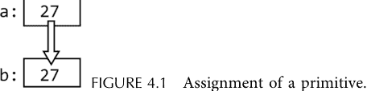
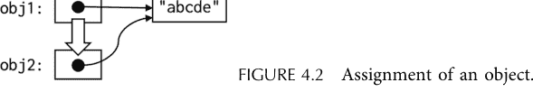
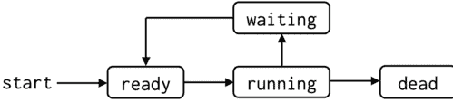
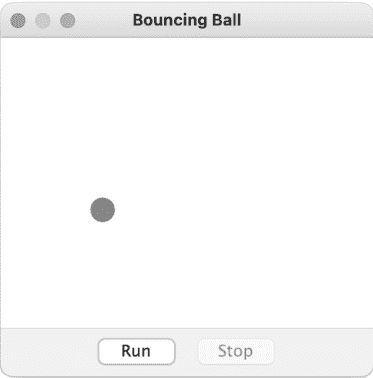

# Java 快速启动指南

> “我们下一个项目将用 Java 来完成。”

遗憾的是，你是一个 C++ 程序员，或者可能是一个 Python 程序员。你打算如何在短时间内进入状态？有很多针对初学者的 Java 书，教你关于计算机是什么以及它是如何用比特位表示一切的。你不需要这些。而在另一个极端，还有一些几千页的部头著作，你几天内根本读不完，甚至可能永远读不完。你需要的是一种介于两者之间的东西。

本书旨在填补这一空白。它是为那些不需要被教如何编程，只需要学习如何在 Java 中实现功能的程序员编写的——并且他们通常需要快速上手。

Java 将从内而外地进行介绍。首先，是类内部的所有内容，其中大部分内容在实践上与 C++ 完全相同。之后，是各种复杂的类、接口以及它们在大规模程序中如何相互关联。

测试是至关重要的，因此（与大多数 Java 书不同）本书详细介绍了 `JUnit`。然后，以防你需要朝那个方向发展，介绍了一些函数式编程、一些关于并行编程的知识，以及足够让你开始构建 `GUI`（图形用户界面）和制作动画的内容。

这本小书内容非常丰富，尽管我尽了全力，但你无法在一个周末内学会 Java。但它应该是一个很好的开始。

# 特性

- 循环方法让你极快地进入 Java
- 对 `JUnit` 测试的完整描述
- Java 函数式编程的总结
- 同步与并行处理的介绍
- 关于构建 `GUI` 的详细描述

设计图像：David Matuszek

作者：Matuszek, David L.

主题：Java (计算机)

排版：Minion by Limited

书籍：https://t.me/books

致过去、现在和未来的学生

作者 xv

序言 xvii

- 5.2.3.1 迭代器 119
- 5.2.4.2 三元运算符 120

## 5.3 外部语言 122

- 5.3.5 内部类 129
- 5.3.9 模块 137

xii 目录

- 9.8.10 `JLabel` 179
- 9.8.11 `JComboBox` 180
- 9.8.15 菜单 183
- 9.8.17 鼠标输入 185

## 第 10 章 线程与动画 189

- 10.6 动球 197
- 10.6.1 `MVC` 198
- 10.6.2 控制器 198
- 10.6.3 模型 199
- 10.6.4 视图 200

索引，209

# 作者

DAVID MATUSZE，大多数我的学生称我为“Dave 博士”。我写下我的第一本书时，正是在德克萨斯大学奥斯汀分校。我拥有计算机科学博士学位，后来在宾夕法尼亚大学担任教职。我已经在行业工作了多年，后来加入了维拉尼亚大学（MCIT）。我教 Java 已经多年了，我对人工智能和编程非常感兴趣。如果你有任何问题，请联系我：davidatusze@gmail.com。

# 前言

在阅读本书之前，你不需要理解或记住所有内容。本书是关于 Java 的快速入门。如果你是从其他语言转过来的，你会发现 Java 的概念是类似的。

你不需要担心 Java。你可以从 https://www.oracle.com/java/technologies/downloads/ 获取 8。

# Java 快速概览

## 1.1 项目

一个程序项目由一个或多个包组成。一个项目包含：

- 包（目录）
- 类（通常每个文件一个）：
    - 字段（数据）
    - 构造函数，包含声明和语句
    - 方法，包含声明和语句

## 2 快速上手 Java

方法类似于函数，不同在于方法属于对象，并且（通常）操作该对象的字段。方法可以包含变量声明，并包含可执行语句。总结一下，Java 的组织结构如下：

- 包（目录）
- 类（通常每个文件一个）

在 Java 9 之后，包可以组织成更大的单元，称为模块。这对于具有大量包的程序是合适的。`JDK`（Java 开发工具）非常巨大，包含了数百个模块、数百个包和数千个类。本书相关的唯一模块是 `java.base`。我们将在 5.3.9 节中简要讨论。

## 1.2 初识：圆形类

以下程序展示了 Java 程序的整体结构，并对 Java 程序提供了一个初步印象。

```java
package examples.shapes;
public class Circle {
    private int radius;

    public Circle(int r) {
        radius = r;
    }

    public double area() {
        return Math.PI * Math.pow(radius, 2);
    }
}
```

# Java 快速入门 3

包声明表示此代码位于名为 `shapes` 的文件夹（目录）中，该文件夹位于名为 `examples` 的文件夹（目录）中。如果需要任何导入声明（此处），它们将紧跟在这一行之后。

代码定义了一个名为 `Circle` 的公共类。`public` 意味着该类可以被程序中的任何代码使用。由于 `Circle` 是公共类，它必须位于名为 `Circle.java` 的文件中；这允许其他代码找到它。

`Circle` 类有一个名为 `radius` 的整数变量。每个新创建的 `Circle` 对象都将有自己的 `radius`，由于 `radius` 被标记为 `private`，它在类外部不可见。

接下来是一个构造函数。之所以能识别为构造函数，是因为它的名称与其所在的类完全相同（`Circle`）。它接收一个整数参数 `r`，将 `r` 的值保存到实例变量 `radius` 中，并返回一个新创建的 `Circle` 对象。它没有使用 `return` 。

最后是一个 `area` 方法，它不接受任何参数。它计算并返回该圆的面积。

现在我们有了一个 `Circle` 类，让我们来使用它。

```java
package examples.shapes;
public class CircleApp {
    public static void main(String[] args) {
        int size = 10;
        Circle c = new Circle(size);
        double area = c.area();
        System.out.printf(
            "The area of a circle " +
            "with radius %d is %7.2f",
            size, area);
    }
}
```

这个 `CircleApp` 类恰好与 `Circle` 类位于同一个目录下。

# Java 快速

`CircleApp` 没有显式构造函数（它有一个隐式构造函数，但现在忽略它）。它确实有一个 `main` 方法，这是程序的起点。出于复杂的原因，`main` 方法始终定义为 `public static void main(String[] args)`——现在先记住这个；理解会在之后。

`main` 方法执行以下操作：

- 声明一个局部变量 `size` 为整数并给其赋值 10。
- 声明另一个类型为 `Circle` 的局部变量 `c`，并使用关键字 `new` 调用 `Circle` 构造函数。它获取一个新创建的 `Circle` 对象并赋值给 `c`。
- 为 `c` 计算面积，并将结果赋值给 `double`（浮点型）变量 `area`。
- 打印结果：

半径为 10 的圆面积为 314.16

## 1.3 数据

Java 中的每个数据值要么是基本类型，要么是对象。共有八种基本类型，大部分是数值类型。对象由类定义，每个类都定义了一种新类型的对象。

四种最重要的基本类型是：`int`（整数，或全数）、`double`（包含小数点的数字）、`boolean`（值 `true` 和 `false` 值）和 `char`（单个字符）。

两个重要的对象类型是字符串（Strings）和数组（arrays）。字符串是由 `String` 类定义的对象，而数组使用更传统的语法定义（但它们仍然是对象）。

基本类型和对象之间一个明显的区别是基本类型拥有操作：如 `3 * n`、`big && round` 等，而对象拥有方法。（异常情况：`+` 运算符可以用于拼接（“相加”）字符串。）

# Java 快速入门 ■ 5

**术语**：你不是“调用”方法。相反，你是在“向对象发送消息”，其中“消息”由方法名及其参数组成。

要向对象发送消息，使用像这样的**点符号法**：`object.method(parameters)`。例如 `firstName.charAt(0)`。

字面量字符串被包含在双引号中：`"Hello"`。字符字面量写在单引号中：`'a'`。

所有变量在使用之前必须被**声明**（declared）；这指定了它们的类型。它们也可以被**定义**（defined），或赋予一个初始值。

```java
int count;              // 声明
count = 0;             // 定义
int count = 0;         // 声明并定义
```

语句，其中表达式的结果是一个可以放入 `returnType` 类型变量中的值。

要向对象发送消息（即调用它的某个方法），请使用 `object.methodName(arguments)` 语法。该表达式的值将是方法返回的值（如果没有返回值，则为 `null`）。

## 1.6 语句

最常用的语句是赋值语句、块（或复合语句）、`if` 语句、`while` 循环和 `for` 循环。除块之外的所有语句都必须以分号结束。可以使用 `println` 方法产生输出。

块通过大括号 `{}` 将任意数量的语句组合成单一的复合语句。

赋值语句给变量赋值。如果该变量之前没有声明过，则必须指定类型；变量可以从声明处一直到最内层闭合块的结束。

`if` 语句测试一个布尔条件，如果条件为真，则执行语句。它可能有一个 `else` 部分，如果条件为假，则将执行不同的语句。由于每个部分只控制一个语句，因此该语句通常是一个块。

```java
if (2 + 2 == 2) {
    System.out.println("All is well.");
} else {
    System.out.println("What??");
}
```

`while` 循环评估一个布尔条件。如果条件为真，它执行一个语句（通常是一个块），然后返回测试。当测试评估为假时，退出。

```java
int count = 10;
while (count > 0) {
    System.out.println(count);
    count = count - 1;
}
System.out.println("Blast off!");
```

循环设置一个初始值，测试一个布尔条件，如果条件为真，则执行语句，执行更新，并返回测试。当测试返回假时，退出。


```
for (int i = 10; i > 0; i = i - 1) {
    System.out.println(i);
}
System.out.println("Blast off!");
```

> 注意：上述语句需要一个布尔条件作为测试。你不能使用数值值作为测试。

Java 没有“打印”语句，但可以使用 `println` 方法像语句一样使用。`System.out.println(arg)` 接收单个参数并将其发送到标准输出，随后是一个换行符 `\n`。`System.out.print(arg)` 执行相同的操作，但没有换行。

## 1.7 程序执行

一个良好的 IDE（集成开发环境）的价值不可言喻。NetBeans、Eclipse、IntelliJ IDEA 和 Xcode（仅限 Mac）都是优秀的选择。其中，IntelliJ IDEA 对初学者来说可能是最容易的。任何 IDE 都会提供运行你程序的简单方法。

程序将从公共类的 `main` 方法开始执行。`main` 方法应该具有此完全相同的头部：

```
public static void main(String[] args) {
```

如果你没有使用 IDE，可以使用任何纯文本编辑器（而不是文字处理器）来创建程序。每个类应该位于一个单独的文件，文件名应该是带有 `.java` 扩展的类名。

如果你使用的是 Java 11 或更高版本，可以通过导航到包含 Java 文件的文件夹并打开命令行/终端窗口来运行程序。在该窗口中，输入 `java fileName`。文件应该运行并产生输出。

如果上述方法不起作用，你可能需要先编译文件然后运行它。要做到这一点，请执行这一对命令：

```
javac ClassName.java
java ClassName.class
```

如果一个程序包含多个文件，任何被另一个文件使用的文件必须在使用它的文件编译之前进行编译。

## 1.8 HELLO WORLD

为了尽快开始编程，你可以使用以下“Hello World”程序作为框架。你不需要完全理解它就可以开始。

```
public class MyClass {
  String hello = "Hello World";
  public static void main(String[] args) {
    new MyClass().doSomething();
  }

  void doSomething() {
    System.out.println(hello);
  }
}
```

如果保存为名为 `MyClass.java` 的文件，可以按照上一节中的指令执行此程序。

这里有两个方法：`main` 和 `doSomething`。程序从 `main` 方法开始执行。`main` 方法处于“静态上下文”中，这意味着它不能直接使用任何非静态的方法或变量。为了跳出静态上下文，`main` 创建了一个 `MyClass` 类型的新对象并立即调用它的 `doSomething` 方法；这里就是你放置代码的地方。在此之后，在你有需要它之前，可以忘记 `static` 这个词了。

`void doSomething()` 定义了一个名为 `doSomething` 的方法。如空括号所示，它不接受参数；如 `void` 所示，它没有返回值。方法体封装在大括号 `{}` 中，由一个对 `System.out.println` 方法的调用组成，参数为 `hello`。`println` 将 "Hello World" 打印到标准输出，这（取决于你如何运行 Java）应该出现在你屏幕的某个地方。

语句以分号结束。上述有两个语句，一个调用 `doSomething`，另一个打印 "Hello World"。

`MyClass` 和 `doSomething` 的名称（但不是 `main`）可以替换为你选择的名称。按照习惯，类名始终大写字母开头，方法名小写字母开头。

以 `HelloWorld` 为起点，你可以添加方法和代码来创建一个有用的程序。

# 第 2 章

# 准备工作

将 Java 认为由一种“内部语言”和一种“外部语言”组成是有很有用的。内部语言由数据、方法和语句组成，对于一个只有一个类的小程序来说，这些足够了。同样复杂的外部语言由用于组织大型程序的所有各种类和接口组成。

在进行一些准备工作后，下一章将描述 Java 的内部语言（非常像 C 或 C++），接下来的章节将描述外部语言。

## 2.1 IDE

**章节摘要：** 强烈建议使用 IDE。如果你还没有使用，IntelliJ IDEA 是最对初学者友好的工具之一。你只需要文本编辑器和命令行就可以创建并运行程序，但那样做是比较费劲的方法。

集成开发环境（IDE）在开发程序方面具有巨大的帮助。一个非常基础的 IDE 集成了文本编辑器、编译器、调试器和代码执行器。专业级 IDE 还会建议适用的方法、提供即时文档查询、纠正错误、自动备份、协助重组代码以及许多其他服务。我有过学生告诉我，他们是因为 IDE 为他们写了程序才通过我的课程。

流行的 Java IDE 有 Eclipse、NetBeans、IntelliJ IDEA 和仅限 Mac 的 Xcode。它们都是优秀的且拥有忠实的用户；它们都有免费版本。它们都可以（并已）用于多种语言。在这些工具中，IntelliJ IDEA 不需要预先知识，只需每一步引导初学者。

尽管如此，有时 IDE 会直接拒绝工作。这可能是升级导致的文件版本不兼容或其他类似问题引起的。（我在 Eclipse 上遇到过很多问题。）重装 IDE 可能有效。探索所有可能的设置也可能有效。当然，你可以切换到不同的 IDE。

还有一些简单的 IDE，通常专门为学生编写，例如 BlueJ、JCreator 和 DrJava。简单 IDE 的优点是不令人望而畏畏。缺点是它们不帮助程序员。

有人说，任何语言中最难编写的程序都是“Hello World”；之后所有的程序都是这一个程序的扩展。同样，一旦你成功使用专业 IDE 编写并运行了程序，剩下的都是扩展。

## 2.2 注释和标签

Java 中有三种注释。

- 以 `//` 开头并持续到行尾的注释。
  - 当放在代码行末尾时，它们对该行代码说明了什么。
  - 当它们单独成一行时，它们对后续代码进行了说明。
  - 许多 IDE 会通过在每行开头添加 `//` 来注释整个代码块。
- 以 `/*` 开头并在 `*/` 结束的注释。
  - 这些用于无法在单行内显示的注释，它们对后续代码进行了说明。
  - 它们也可以用于在代码行的中间插入注释。
- 以 `/**` 开头并在 `*/` 结束的注释。
  - 这些是文档（doc）注释。它们放置在类、方法、接口或变量的声明之前。
  - 文档注释通常在第一行之后的每行以星号开头。

文档注释可以包含如 `@param` 和 `@return` 等标签；其中许多内容在第 5.2.1.2 节 Javadoc 中有描述。

示例：

```
/**
 * 返回两个数字的和。
 * @param a 第一个数字。
 * @param b 第二个数字。不能为负数。
 * @return 两个数字的和。
 * @throws AssertionError 如果 b 为负数。
 */
int add(int a, int b) {
    assert b >= 0; // 除非设置了 ea 否则忽略
    while (b > 0) {
        // 从 b 移动 1 到 a
        b -= 1;
        a += 1;
    }
    return a;
}
```

Javadoc 是一个程序，它能从文档注释和标签中提取信息，并生成非常专业的文档（通常是 HTML 格式，但并非如此）。非文档注释会被忽略。

# 第 3 章

# Java 的“内部语言”

一个 Java 程序由一个或多个类组成。本书使用的“内部语言”是指在单个顶层类内部发生的情况。对于简单的程序，一个类可能就足够了。

## 3.1 变量与命名规范

变量是一个可以赋值的名字。变量在不同时间可以有不同的值。

所有变量都必须声明。当声明一个变量时，会赋予它一个类型，用明它可以拥有什么类型的值。它也可以被赋予一个初始值。`int` 变量只能有一个整数值，`String` 变量只能有一个字符字符串作为其值，以此类推。

Java 是大小写敏感；也就是说，`result`、`Result` 和 `RESULT` 是三个不同的名字。基本类型（`int`、`double` 等）的名字全部小写，而对象类型名称（如 `String`）的首字母大写。

实例变量是在类中声明的，但该类的每个独立实例（或对象）都“拥有”一份单独的。

类变量（或静态变量）使用 `static` 关键字在类中声明。它只有一个，不属于某个对象，并且被认为由类本身“拥有”，而不是由各个对象拥有。

局部变量是在方法内部声明的变量。它仅在方法内部可用。方法的参数也是该方法的局部变量。

常量是一个值不能被改变的“变量”。它通过添加关键字 `final` 来指示。

Java 中的许多种事物都有名称，而不只是变量。恰当的命名和大小写有助于经验丰富的 Java 程序员了解正在命名的是哪种事物。命名有很强的约定：

- 变量名和方法名几乎不缩写：使用 `employee` 而不是 `emp`；使用 `yearEndBonus` 而不是 `yebonos`。（但可以使用常用的缩写，如 `max` 和 `min`。）
- 变量名和方法名始终以小写字母开头。
- 变量名和类名通常是名词。方法名通常是动词，或以动词开头。
- 如果名字由多个单词组成，除了第一个单词外的所有单词的首字母大写，例如 `firstName`、`totalCost`。（这种风格的一种名称是驼峰命名 `camelCase`。）
- 虽然合法，但变量名从不包含下划线（除非是常量）或美元符号。
- 在 Java 9 及更高版本中，不建议在名称中使用下划线（常量除外），单独的下划线不是合法的名称。
- 常量名全大写。如果常量名由多个单词组成，在单词之间使用下划线。例如 `END_OF_LINE_MARKER`。
- 类名和接口名始终大写字母开头，多单词名称使用驼峰命名。

## 3.2 基本数据类型

有八种基本数据类型：`char`、`byte`、`short`、`int`、`long`、`float`、`double` 和 `boolean`。所有其他值（数组、字符串等）都是某种类或对象类型。这种区别是重要的。

### 3.2.1 基本类型

这里是四个最重要且最常用的基本类型：

- `int` 是整数，或“整数”。它可以包含足够用于大多数用途的数字（约正负二十亿）。为了让很大的数字更易读，你可以在数字之间放置下划线。
- `double` 是一个 64 位的“实数”（浮点数）。它可以包含非常大和非常小的数字，精度约为 17 位数字。它可以用科学计数法表示，用 `e` 或 `E` 表示指数：6.02214。
- `char` 是单个字符。
- `boolean` 是真或假。

其他基本类型（`long`、`short`、`byte`、`float`）将在 3.2 节中讨论。

### 3.2.2 数组

数组是相同类型值的有序序列。要访问数组中的值，使用索引。索引范围从 0 到 `length - 1`。

声明数组最简单的语法是或是：

```
int[] array;
```

或者

```
int array[];
```

这声明了一个数组但没有定义它。要定义数组，你必须指定其大小或提供值。数组可以使用大小初始化：

```java
int[] array = new int[5];
```

或者，可以使用特定值创建数组，使用语法：

```
int[] array = new int[] {1, 2, 3, 4, 5};
```

或者使用稍微简单的

```
int[] array = {1, 2, 3, 4, 5};
```

数组中的值本身也可以是数组。这有一种特殊的语法，如下例所示：

```java
double elevation[][]; // 声明
elevation = new double[50][75]; // 定义
elevation[49][74] = 123.45;
```

`elevation` 数组可以被称为二维数组，但更准确的思考方式是一个元素恰好是数组的一维数组。数组可以有三、四甚至更多维度。

多维数组的第一个索引通常称为行数，第二个索引称为列数。上面的数组有 50 行（索引为 0 到 49）和 75 列（索引为 0 到 74）。

数组中的值必须都是相同类型，但部分类型。以下代码构建了一个“三角形”数组数组，每个子数组都比前一个大：

```java
int[][] triangle = new int[10][];
for (int i = 0; i < triangle.length; i++) {
    triangle[i] = new int[i + 1];
}
```

### 3.2.3 字符串

字符串字面量是封装在引号（双引号）中的零或多个字符序列。例如：

"" // 空字符串

"hello" // 包含五个字符的字符串

某些字符不能直接输入字符或字符串常量；例如字符串中的双引号。这些字符可以通过转义（在它们前面加上反斜杠）来包含：

"He said, \"Don't go.\""

重要的转义序列有：

- `\n` 是“换行”字符，取决于它在你的计算机系统上的编码（在 Windows 上与 Unix 和 Macintosh 不同）。
- `\t` 是一个制表符字符，表示任意数量的空白。
- `\"` 是一个双引号字符（在双引号定义的字符串内部很有用）。
- `\'` 是一个单引号字符。
- `\\` 是一个反斜杠字符。
- `\xxxx` 是用恰四个十六进制数字表示的 Unicode 字符。

此外，还有很少使用的 `\b`（退格符）、`\r`（回车符）和 `\f`（分页符）。

虽然转义序列必须使用两个或多个字符来输入，但每个序列实际上只代表一个字符，因此 `"\Who?\\".length()` 的结果是 6。

> 注意：数组有长度字段 `length`，但字符串（String）有长度方法 `length()`。

字符串字面量是值，可以保存在 `String` 类型的变量中：

```java
String name = "We're doing Java";
```

字符串可以使用 `+` 运算符进行拼接，或者说“粘贴在一起”：

```java
String fullName = firstName + " " + lastName;
```

任何类型的值在与字符串拼接（“相加”）时，都会自动转换为字符串：

```java
String message = "There are " + count + "errors.";
```

字符串是不可变的，这意味着你不能更改字符串的长度或内部字符：你只能创建一个新字符串。

### 3.2.4 异常

程序中可能会发生很多错误：除以零、超出数组边界、读取不存在的文件等。当这些情况之一发生时，Java 会创建一个类型为 `Exception`（异常）的对象。`Exception` 有许多不同的子类型，例如 `ArithmeticException` 和常见的 `NullPointerException`。

异常是对象，就像字符串和数组是对象一样，它们分为两种大类：检查异常（checked）和未检查异常（unchecked）。

检查异常是程序被要求处理的异常。例如，如果你尝试读取文件，Java 知道可能会发生很多错误，并要求你在错误发生时编写代码来处理。通常的做法是使用 `try-catch-finally` 语句（参见第 3.3.2.5 节）。基本上，该语句的意思是：“我要做某事，但如果失败了，我会捕获该异常并进行适当的处理。”

未检查异常是可能发生但并不要求你去检查的异常。这些异常几乎会导致程序出现 Bug，例如超出数组边界或尝试使用空对象。解决方案是调试程序。

### 3.2.5 运算符与优先级

Java 拥有算术运算符，具有通常的优先级（乘除在加减之前等）。优先级最高的运算符先执行，且在某些例外情况下，大多数运算符都是左结合的——也就是说，等优先级的运算符从左到右执行。例如，`12 - 2 - 3 * 4 == 10 - 12 == -2`。

常见的运算符按优先级从高到低排序为：

- 方法调用和数组索引
- 算术运算：
  - 一元加 `+` 和一元减 `-`
  - `*`（乘法）、`/`（除法）和 `%`（取余，或模）
  - `+`（加法）`-`（减法）
- 布尔（逻辑）运算符：
  - `!`（非）
  - `&&`（与）
  - `||`（或）
- 不等式测试：
  - `<` `<=` `>=` `>`（小于、小于等于、大于等于、大于）
- 等式测试：
  - `==`（等于）和 `!=`（不等于）
- 赋值运算符：
  - `=`（简单赋值）
  - `+=`、`-=`、`*=`、`/=` `%=`（`x op= y` 是 `x = op y` 的简写）。

一元运算符和赋值运算符是**右结合的**——等优先级的运算符从右到左执行。例如，`a = b += c` 意味着 `a = (b += c)`。

按照习惯，可以使用括号来指定运算顺序。Java 中还有许多其他运算符，但由于很少有程序员知道完整的优先级表，最好使用括号来明确运算顺序。

不重要的运算符（`++`、`--`、`?`、平移和位操作运算符将在后讨论——分别参见 5.2.4.4 节 (`++` 和 `--`)、5.2.4.2 节 (`?`) 和 5.2.4.3 节（位与位移）。

当仅使用整数类型（包括 `char`）进行算术运算时，结果为 `int`。使用 `double` 与任何数值类型进行算术运算的结果为 `double`。

布尔运算 `&&` 和 `||` 是**短路操作**：如果在求值左侧操作后已知结果，则不求值右侧操作。因此，在表达式 `f(x) && g(x)` 中，如果 `f(x)` 为假，则结果必为假，`g(x)` 不会被执行。同样，在表达式 `f(x) || g(x)` 中，如果 `f(x)` 为真，则结果必为真，因此 `g(x)` 不会被执行。


### 3.2.6 声明与类型转换

每个变量都必须声明，并说明其类型和可选的初始值。例如：

- `int count = 0, size;`
- `double min, max, average;`
- `char c;`

如果 Java 认为你可能在给变量赋值之前就使用了它，它会报错。如果 Java 没有捕捉到这个错误，数值类型使用的值将为零，布尔类型为 `false`。

`char` 变量可以存储约 65000 个 UTF-16 字符之一（参见第 5.2.2.4 节）。字符内部存储为数字，并可以像整数一样参与算术运算。你可以写一个 UTF-16 字符，格式为 `\xxxx`，其中 `xxxx` 是十六进制数字。

当仅使用整数类型（包括 `char`）进行算术运算时，结果为 `int`。使用 `double` 与任何数值类型进行算术运算的结果为 `double`。

布尔运算 `&&` 和 `||` 是短路操作：如果在求值左侧操作数后已知结果，则不求值右侧操作数。因此，在表达式 `f(x) && g(x)` 中，如果 `f(x)` 为假，则结果必为假，`g(x)` 不会被执行。同样，在表达式 `f(x) || g(x)` 中，如果 `f(x)` 为真，则结果必为真，因此 `g(x)` 不会被执行。

### 3.2.7 常量

在变量前加上 `final` 关键字会使其变为常量；其值不可更改。例如：

```java
final int DAYS_IN_WEEK = 7;
```

Java 提供了一些内置常量，例如 `Math.PI` 和 `Math.E`。

常量有助于避免使用“魔数”——代码中含义可能不明的数字。如果代码中 29 是一个变量，就会产生疑问：为什么是 29？

然而，用常量的值来命名常量是愚蠢的，例如：

```java
final int TWELVE = 12;
```

因为这并不能提高代码的清晰度。

### 3.2.8 方法

方法类似于函数，区别在于它属于一个类。这使得它能够访问该类的变量和其他方法。其语法如下：

```java
/**
 * 文档注释
 */
access returnType methodName(parameterList) {
  declarations
  statements
}
```

没有特殊的关键字来开始方法的定义。方法定义包括：

1. 可选的文档注释，告诉用户方法的作用以及如何使用。
2. 可选的访问修饰符（参见第 4.1.2 节）。默认为包权限。
3. 方法返回值类型，如果方法不返回值，则为 `void`。
4. 方法名。方法名应以小写字母开头。
5. 括号内的逗号分隔参数列表。如果没有参数，也必须存在括号。每个参数由：
   - 该参数预期值的类型
   - 参数名称
6. 方法体，由一对大括号 `{}` 组成，包含任意数量的声明和可执行语句。

这是一个示例：

```java
/**
 * 闰年是指能被 4 整除但
 * by 100, unless it is also divisible by 400.
 */
boolean isLeapYear(int year) {
  if (year % 4 != 0) return false;
  if (year % 100 != 0) return true;
  return year % 400 == 0;
}
```

在方法体中，你可以声明变量，可以带有也可以不带有初始值，例如：

```java
int count = 0;
```

所有此类声明都是方法的局部的，也就是说，它们只能在方法内部被可见和使用。变量声明通常放在方法体的开头。方法可以使用传递给它的参数的值、它的局部变量以及它所属类定义的任何字段。

> 注意：如果参数或局部变量与类的字段同名，该名称将遮蔽（隐藏）该字段。这在构造函数中很常见，在方法中也可以出于类似的目的。

为了形成一个完整的程序，必须至少有一个包含以下特殊方法的“启动”类：

```java
public static void main(String[] args) { }
```

可以有多个同名的方法，只要它们的参数数量不同或参数类型不同。Java 通过同时查看名称和参数（但不查看返回类型）来决定使用哪种方法。

如果方法被声明为返回特定类型的值，则它必须使用一个 `return` 语句，并带上类型正确的值（或一个可以宽化为正确类型的值）。它不能在没有执行 `return` 语句的情况下就到达方法的末尾。

### 3.2.9 方法调用

方法属于对象，“调用”一个方法就是向对象发送消息。通过命名对象、加上点、方法名以及在括号中提供正确的参数数量和类型：

```java
obj.methodName(arguments)
```

每个参数必须有一个参数，且必须是能够赋值给该参数的类型。被调用的方法返回一个可以在表达式中使用的结果。当一个方法调用同一个类中的另一个方法时（这样对象就在自己说话），对象可以省略。例如，如果 `isLeapYear` 和 `printLength` 在同一个类中，那么在 `printLength` 中你可以说 `this.isLeapYear(year)` 或者直接说 `isLeapYear(year)`。

```java
public void printLength(int year) {
  int days = 365;
  if (isLeapYear(year)) { // "this." 省略
```

在类中声明的变量在类中的任何地方都是可用的。如果声明时带有初始值，该值可以在后续声明中使用。

```java
public class MyClass {
  int x = 5;
  int y = x + 1; // 可以使用 x
  int z = w + 1; // 但 w 是非法的（尚未声明）
  int w = 3;
  // 现在可以使用 x, y 和 z
}
```

顶层声明（即方法之外的声明）按照它们出现的顺序执行。之后，类中的方法是可用的。

**异常：**类中的静态方法（如 `main` 方法）只能使用该类中的静态变量。

### 3.2.11.2 方法中的变量

**块**或**复合语句**是封装在大括号 `{}` 中的一组声明或语句。

**方法**由**头部**和**方法体**组成；方法体是一个**块**。

```java
public double average(double x, double y) {
  double sum = x + y;
  return sum / 2;
}
```

参数（在本例中的 `x` 和 `y`）可以在方法内的任何地方使用，但在方法外部不可用。方法体内声明的变量（本例中的 `sum`）遵循块的作用域规则（见下一节）。参数和方法体内声明的变量是**局部变量**；它们在方法被调用时创建，在方法返回时丢弃。从方法的这一次调用到下一次调用，局部变量会重新开始。

### 3.2.3 块中的变量

**块**或**复合语句**是封装在大括号 `{}` 中的一组声明或语句。

类中声明的变量在类中的任何地方都是可用的。如果声明时带有初始值，该值可以在后续声明中使用。

方法由头部和方法体组成；方法体是一个块。

### 控制语句

控制语句，如 `if` 语句和循环，控制单个语句的执行。如果你想控制多个语句，你必须将这些语句封装在大括号 `{}` 中，以使其成为一个复合语句。

**样式：**Java 标准样式是将左大括号放在行的末尾，而不是单独成行。右大括号应该与包含左大括号的行对齐。


类体或方法体必须始终是一个块。

良好的习惯要求块内部的语句相对于块的起始进行缩进。Java 的标准缩进是四个空格。

## 3.3 同样适用于 C++ 的语句

如果你来自 C++ 或其他 C 语言，你可能已经熟悉本节的所有内容。它包含了所有的循环、条件语句、块等。你可以自由跳转到第 3.3.2 节，不受 C++ 的语句。

### 3.3.1 块

复合语句或块，是封装在大括号 `{}` 中的一组（可能为零）的声明和语句。

**样式：**Java 标准样式是将左大括号放在行的末尾，而不是单独成行。右大括号应该与包含左大括号的行对齐。

### 3.3.1.2 赋值语句

赋值语句将值赋予变量。例如，如果 `x` 的类型是 `int`，那么

```
x = 5;
```

给 `x` 赋值 5。

变量的值可以改变，但其类型不能。例如，赋值语句

```
x = 10;
```

将给 `x` 赋新值 10。

对于每个算术运算符 `op`，表达式

```
variable op= expression;
```

是以下内容的简写形式：

```
variable = variable op expression;
```

例如，`x += 1;` 是 `x` 加上 1。

### 3.3.1.3 方法调用与可变参数 (Varargs)

方法调用可以作为语句使用，因为它们可以产生副作用。例如，如果 `a` 是一个数组，`a.sort()` 会对数组进行排序。

没有副作用的方法不应作为语句使用，因为它们没有执行任何操作。如果 `str` 是字符串 "Hello"，表达式 `str.toUpperCase()` 返回字符串 "HELLO"，这个结果可以被赋值给一个变量，但不会改变 `str` 的值。因此，将 `str.toUpperCase()` 作为语句使用是没有任何作用。

你可以编写一个接受任意数量参数的方法，即可变参数（varargs）。只需在最后一个参数的类型名后加上三个点 `...` 即可。当调用方法时，Java 会自动为你将所有这些值放入一个数组中。

```java
public double average(double... args) {
    double sum = 0;
    for (double arg: args) {
        sum += arg;
    }
    return sum / args.length;
}
```

调用 `average(10.0, 20.0, 30, 41.0)` 将返回 25.25。

### 3.3.1.4 if 语句

`if` 语句测试一个条件。如果条件为真，执行后续语句（通常是一个复合语句）。如果条件为假，`if` 语句不执行任何操作。其语法如下：

```java
if (condition) {
    statements
}
```

例如，以下 `if` 语句会在 `x` 变为负数时将其重置为零。

```java
if (x < 0) {
    x = 0;
}
```

`if` 语句还可以有一个 `else` 分句。如果条件为真，执行条件随后的语句。如果条件为假，则执行 `else` 关键字后面的语句。这两个语句通常都是复合语句。其语法如下：

```java
if (condition) {
    some statements
} else {
    some other statements
}
```

例如：

```java
if (x % 2 == 0) {
    x = x / 2;
} else {
    x = 3 * x + 1
}
```

始终使用大括号是一个良好的习惯，即使它们只包含一条语句。然而，如果任何部分只包含一条（非复合）语句，省略大括号是合法的。如果你这样做，应该将单条语句与 `if` 或 `else` 放在同一行。

```java
if (x % 2 == 0) x = x / 2;
else x = 3 * x + 1;
```

与 Python 不同，Java 没有单一的关键字作为 `else if` 的缩写。

```java
if (x < 0) {
    System.out.println("x is negative");
} else if (x > 0) {
    System.out.println("x is positive");
} else {
    System.out.println("x is zero");
}
```

### 3.3.1.5 while 循环

`while` 循环是在顶部进行测试的循环。其语法如下：

```java
while (condition) {
  statements
}
```

首先测试条件；如果条件为假，则不再进行任何操作，循环直接退出且从不执行语句。如果条件为真，则执行语句，然后再次执行整个循环（从测试开始）。

例如，可以计算非零数字的位数：

```java
int countDigits(int number) {
  int count = 0;
  while (number != 0) {
    number = number / 10;
    count += 1;
  }
  return count;
}
```

大括号表示一个代码块。如果只包含一条语句，可以省略大括号。如果你这样做，应该将单条语句与 `if` 或 `else` 放在同一行。

（注：原文后续部分存在大量乱码和重复错误，此处已根据逻辑清理并翻译了核心内容）

### 3.3.1.6 do-while 循环

`do-while` 循环是在底部进行测试的循环，而不是顶部。其语法如下：

```java
do {
  statements
} while (condition);
```

首先执行语句块，然后测试条件；如果条件为真，则再次执行整个循环。`do-while` 循环至少执行一次。

### 3.3.1.7 for 循环

`for` 循环是在顶部进行测试的循环。其语法如下：

```java
for (initialization; condition; update) {
  statements
}
```

首先测试条件；如果条件为假，则不再进行任何操作，循环退出且从不执行语句。如果条件为真，则执行语句，然后再次执行整个循环（从测试开始）。

### 3.3.1.8 for-each 循环

`for-each` 循环不涉及显式测试；它只是遍历数组中的每个元素。当不需要元素的索引位置时，这种方法更简单方便。其语法如下：

```java
for (type variable : array) {
  statements
}
```

与 `for` 循环一样，如果变量已经声明，则可以省略类型。变量的作用域是整个语句。例如，可以这样打印字符串数组中的每个元素：

```java
for (String name: names) {
  System.out.println(name);
}
```

### 3.3.1.9 经典 switch 语句

正如 `if` 语句根据布尔值在两个代码块之间进行选择，`switch` 语句根据整数、字符、字符串或枚举值在多个代码块之间进行选择。

> 注意：本节描述的是适用于所有 Java 版本的“传统” `switch` 语句。对于 Java 14 及更高版本提供的更新（更好）的版本，请参见章节 3.3.2.3。

其语法较为复杂：

```java
switch (expression) {
  case constant1:
    statements1;
    break;
  case constant2:
    statements2;
    break;
  ...
  case constantN:
    statementsN;
    break;
  default:
    statementsDef;
}
```

操作逻辑如下：计算表达式，然后与每个 `case` 常量进行比较。当发现与表达式相等的常量时，从后续语句开始执行，直到遇到 `break` 或 `return`，或者到达整个 `switch` 语句的结束。

每个 case 末尾并不强制要求 `break` 语句，但强烈建议加上。如果没有 `break` 语句，控制流将“贯穿（fall through）”并执行到下一组语句中。这通常不是你希望发生的情况。在确实是预期行为的少数情况下，你应该包含一个注释，说明这种省略是有意为之，否则你或其他人可能会日后的某个时间“纠正”这个明显的问题。

如果需要对一个或多个常量执行相同的代码，而不是重复代码，可以在一个 case `constant` 之后直接紧跟下一个 case，例如：

```java
case "yes":
case "Yes":
case "YES":
    some statements
```

在 Java 14 及更高版本中，上述内容可以简写为

`case "yes", "Yes", "YES": some statements.`

`default` case 是可选的，且应该放在最后；如果没有找到更早匹配的 `expression`，则将执行它。如果没有找到匹配的 `expression` 且没有 `default` case，则 `switch` 语句将不执行任何操作直接退出。

即使你认为已经涵盖了所有可能性，包含一个 `default` case 也是良好的习惯。`default` case 可以是空的，也可以包含语句 `false;`，以表示这段代码永远不被触及。（`assert` 语句在第 3.3.2.1 节中介绍。）

`statements` 可以是零或多个语句的任何序列。没有必要使用大括号将语句（包括随后的 `break` 语句）组合成复合语句，尽管有时也会这样做。

这里有一个构造的示例：

```java
int i = 3;
String s;
switch (i) {
    case 1:
        s = "one";
        break;
    case 2:
        s = "two";
        break;
    default:
        s = "many";
}
```

这将导致 `s` 被赋值为 "many"。

### 3.3.1.10 标记语句 (Labeled Statements)

标记语句的语法是

```java
identifier: statement;
```

任何语句都可以用标识符进行标记，但只有为循环语句和 switch 语句标记才有意义。标记通常与 `break` 和 `continue` 语句配合使用。

### 3.3.1.11 Break 语句 (Break Statements)

`break` 语句用于提前退出直接包含它的循环（任何类型的循环）或 `switch` 语句。

它也可以用于退出嵌套循环和/或 `switch` 语句。要做到这一点，在你想要退出的循环或 `switch` 语句上放置一个标记（参见前节），并在 `break` 单词之后加上该标记：

```java
break label;
```

给定一个数字数组，考虑找到两个不同的数字，其中一个恰好是另一个的十倍。以下代码解决了这个问题。

```java
int i, j = 0;
int[] ary = {7, 30, 9, 20, 3, 5};
for (int i = 0; i < ary.length; i += 1) {
  for (j = 0; j < ary.length; j += 1) {
    if (i!=j && ary[i] == 10 * ary[j]) {
      break;
    }
  }
}
System.out.println(ary[i] + " , " + ary[j]);
```

有些程序员不喜欢 `break` 语句，事实上，通常有更好的方法在不使用它的解决问题。

### 3.3.1.12 Continue 语句 (Continue Statements)

`continue` 语句用于从循环中间跳转到下一次循环的开始。也就是说，`continue` 语句会导致包含它的循环返回 `while` 循环的测试、`for` 循环的递增和测试，或 `do-while` 循环的开始。

如果 `continue` 语句位于嵌套循环中，它可以用于跳转到特定循环的开始。要做到这一点，在所需的循环上放置一个标记，并在 `continue` 单词之后加上该标记。

```java
continue label;
```

以下代码计算数组 `ary` 中正值的平均值，忽略零和负值。

```java
int[] ary = {10, 20, 5, -1, 30, -12, 50};
double sum = 0;
int count = 0;

for (int i = 0; i < ary.length; i += 1) {
  if (ary[i] > 0) {
    sum += ary[i];
    count++;
  }
}
double average = sum / count;
```

（注：第 65 页的 OCR 文本是碎片/损坏的，我根据提供的代码片段重构了逻辑。）

### 3.3.2.1 断言语句 (Assert Statements)

`assert` 语句的目的是陈述你认为在该点始终为真的某些条件。它不应该被用于检查你认为可能发生的潜在错误情况；对于这种情况，你应该抛出异常（参见 3.3.2.6）。在编写代码时，养成适当编写 `assert` 语句的习惯是一个好主。

有两种形式：

```java
assert booleanExpression;
assert booleanExpression : expression;
```

执行过程如下：评估 `booleanExpression`，如果为真，控制流直接传递到下一条语句。但如果为假，则会抛出一个 `AssertionError`。如果使用第二种形式，表达式的值（可以是任何值）将包含在错误消息中。

默认情况下，断言被视为注释。要使断言变为可执行，请使用 VM 标志 `-enableassertions` 或其缩写。注意：当从命令行运行时，VM（虚拟机）标志可以放置在 `java` 单词之后。当从 IDE 运行时，标志将作为一个配置选项出现。

除非你有额外要添加的内容，否则使用第二种形式（带有 `expression` 的形式）没有太大意义。例如，如果你认为某个数组索引 `i` 始终在数组范围内，你可能会说：

```java
assert i >= 0 && i < myArray.length:
  "Bad array index." + i;
```

最后，惯用写法 `assert false;` 可用于你认为某部分代码（例如 `switch` 语句的 `default` case）永远无法被触及。然而，将此（或任何其他）语句放在 Java 编译器无法确定能触及的地方（例如紧跟 `return` 语句之后）是语法错误。

### 3.3.2.4 空语句 (Empty Statements)

空语句是不执行任何操作的语句。它仅仅是一个分号 `;`。当语法需要语句但逻辑上不需要时，它是很有用的。例如，在 `while` 循环中：

```java
while (condition) {
    ;
}
```

### 3.3.2.5 返回语句 (Return Statements)

`return` 语句用于退出方法并可选地向调用者返回值。如果方法有返回类型不是 `void`，则 `return` 语句必须跟一个该类型的表达式。如果方法是 `void`，则表达式是可选的。

```java
int add(int a, int b) {
    return a + b;
}

void printMessage() {
    return;
}
```

### 3.3.2.2 打印“语句”（Print Statements）

有两个“语句”可以向用户打印消息。它们是：

```java
System.out.println(value);
```

和

```java
System.out.print(value);
```

区别在于 `print` 只打印值的字符串表示，而 `println` 在打印该字符串后会跟一个换行符。也就是说，`print` 之后的下一个打印内容将在同一行，而 `println` 之后的下一个打印内容将另起一行。

尽管 `print` 和 `println` 的使用方式像语句一样，但它们实际上是具有在屏幕上显示副作用的方法。（没有副作用的方法调用也可以用作语句，但这通常是没有意义的，因为返回值被忽略了。）

如果值是对象类型，`print` 和 `println` 将调用其 `toString()` 方法以获取对象的字符串打印表示。这让你对对象的打印方式拥有相当大的控制权（参见第 4.4.1 节）。

在类的参数列表中直接构造字符串（使用“+”）来连接各个部分，以调用或打印 `println`，这通常非常方便。任何“添加”到字符串上的内容都会被转换为字符串。

```java
System.out.println("The sum is " + sum);
```

**技术说明：** `System` 是 `java.lang` 包中的一个类名，而 `out` 是 `System` 类中类型为 `PrintStream` 的对象。`PrintStream` 有多个方法，包括 `print` 和 `println`。在使用这些方法时，你不需要了解这些。

打印到屏幕很容易，但从键盘获取输入需要使用 `Scanner` 对象，该内容将在 3.4.1.3 节中介绍。

### 3.3.2.3 Switch 语句和表达式

Java 14 引入了显著改进的 `switch` 语句。（旧版本仍然可用）。新版本既可以当作语句，也可以用作返回值的表达式。其语法如下：

```java
switch (expression) {
    case constants₁ -> action₁,
    case constants₂ -> action₂,
    ...
    case constantsₙ -> actionₙ
    default -> actiondef
}
```


**expression** 必须产生整数、`String` 或枚举（`Enum`）值。

**constants** 是与 **expression** 类型相同的一个或多个值的逗号分隔的列表。常量不能重复。

switch 无论用作语句还是表达式，都会求值 `expression`，选择一个 `constant` 等于 `expression` 的常量，并执行与该常量关联的唯一 `action`。如果没有匹配的常量，则执行默认 action。

## 50 ■ Java 速览

注意：与“经典”的 switch 语句不同，这里不会“贯穿（fall through）”到下一个 action。

当 switch 用作语句时，每个 action 都是单个语句，也可能是复合语句。default case 是可选的；如果没有匹配到语句且没有 default case，则该语句将不执行任何操作。

当 switch 用作表达式时，每个 action 可以是：

- 类型正确的表达式，用作 switch 的值。
- 一个复合语句，其中包含一个形式为 `yield expression` 的语句。`yield` 的作用类似于方法中的 return 语句；它会导致 switch 以该表达式的值退出。
- 一个 throw 语句。

当 switch 用作表达式时，它必须要么返回一个值，要么抛出一个异常。在实际操作中，这意味着要么需要 default case，要么常量包含了枚举的所有可能值。

下面这个无意义的示例说明了将 switch 作为表达式使用。

```java
long nonsense = switch (i) {
  case 1 -> 1000000000000L;
  case 2 -> 17 * x;
  case 3, 4 -> 'a';
  case 5 -> {
    System.out.println("Five!");
    yield 55;
  }
  case 6 -> throw new RuntimeException();
  default -> -1;
}
System.out.println(nonsense);
```

### 3.3.2.4 switch 语句中的模式匹配

如上一节所述，Java 14 引入了 switch 语句的新形式以及 switch 表达式，它们使用箭头（`->`）代替冒号（`:`）。Java 17 使用模式匹配极大地扩展了 switch 语句和表达式的功能。

**警告：** 模式匹配是 Java 17 的预览功能。这意味着 (1) 它在未来的 Java 版本中可能会变化或消失，并且 (2) 你可能需要设置 `enable-preview` 标志才能使用它。

尽管名字如此，但模式匹配与正则表达式无关。相反，类型切换是基于表达式的类型进行的，并且表达式的结果被赋值给新变量。

```java
switch (expression) {
    case Type1 variable1 -> action1
    case Type2 variable2 -> action2
    ...
    case TypeN variableN -> actionN
    default -> actiondef
}
```

表达式的值必须是 case Types 的超类型。当找到匹配的 Type 时，表达式的值被赋值给相应的变量，并执行 action（表达式或语句）。

与早期版本的 switch 语句不同，任何对象类型都可以作为 case 类型，包括 null。然而，基本类型（Primitives）不能使用。

守卫模式（guarded pattern）允许我们在选择类型后对值进行额外测试。其形式如下：

```
Type variable && guard -> action
```

其中 guard 是使用变量值的布尔表达式。如果布尔表达式复杂，应该用括号括起来。

这是一个使用 switch 表达式的示例。

```java
String s = switch (shape) {
    case Rectangle r && r.width == r.height ->
      "It's a square";
    case Rectangle r ->
      "It's a rectangle";
    case Triangle t ->
      "It's a " + t.width + "by" +
      t.height + "triangle.";
    default -> "It's a shape.";
}
System.out.println(s);
```

### 3.3.2.5 Try-catch-finally

可能抛出检查异常（checked exception）的代码必须放在 try-catch-finally 语句中。语法如下：

```java
try {
    可能会抛异常的代码
} catch (SomeExceptionType variable) {
    处理此异常的代码
} catch (SomeOtherExceptionType variable) {
    处理
} finally {
    始终执行的代码
}
```

default case 是可选的；如果没有匹配到语句且没有 default case，则语句不执行操作。首先执行 try 块。如果正常完成（无异常），则跳过 catch 块。如果在执行 try 块时发生异常或错误，将立即跳转到第一个可以处理它的 catch 块。可以有多个 catch 块；finally 块通常是可选的。但在离开之前始终执行 finally 块。

## 3.3.3 读取文件

读取或写入文本文件的基本方法是 (1) 打开文件，(2) 使用文件，(3) 关闭文件。这些步骤每个都会产生必须处理的异常。

`FileReader` 类有读取字符并以整数形式返回的方法。这很不方便，因此读取文件通常是在 `FileReader` 对象包装一个 `BufferedReader`。

`BufferedReader` 具有以下方法（等）：

- `readLine()` 读取并返回一行（`String` 类型），如果到达文件末尾则返回 null。

### 3.3.2.6 Throw 语句

当 Java 检测到发生错误时，它会创建一个对象并抛出。你的代码可以故意抛出异常。

> **注意：** 这与 C++ 的区别在于，在 Java 中只有 `Throwable` 类型（`Exception` 和 `Error`）可以被抛出。

在本节中我们考虑一个简单的示例。假设如果变量为负，意味着发生了问题。你可能会写：

```java
if (b < 0) {
  throw new Exception("b is negative");
}
```

# Java 55 的“内部语言”

- `read(charArray, index, n)` 从 index 开始向字符数组中填充 n 个字符。返回值是实际读取的字符数。
- `close()` 关闭 `BufferedReader` 和关联的 `FileReader`。关闭一个已经关闭的读取器不会抛出异常。

除了处理异常外，`BufferedReader` 可以像这样使用：

```java
FileReader fr = new FileReader(file);
BufferedReader br = new BufferedReader(fr);
String line = br.readLine();
br.close();
```

`FileReader` 构造函数的 `file` 参数可以是一个 `File` 对象，也可以是一个表示文件通文件路径的字符串。如果文件不存在，构造函数将抛出 `FileNotFoundException`。

`BufferedReader` 的构造函数不会抛出 `IOException`，但任何对 `readLine` 或 `read` 的使用可能会这样做。

## 3.3.4 资源管理器 (Try With Resources)

try-with-resources 语句是 try-catch-finally 语句的扩展，它提供了一种在使用资源后关闭资源更方便的方法。与其写

```java
try { ... }
```

不如写

```java
try (resource declarations) { ... }
```

可以有任意数量的（可关闭的）资源声明，用分号分隔。例如：

```java
FileReader fr = new FileReader("/Users/dev/test.txt");
BufferedReader br = new BufferedReader(fr);
```

# Quick Java

```java
String line = br.readLine();
System.out.println(line);
}
catch (IOException e) {
```

通过这种结构，无论是否发生异常，`FileReader` 和 `BufferedReader` 都会在稍后自动关闭。

如果这段代码出现在标记为 `throws IOException` 的方法中，则不需要 `catch` 子句。`finally` 子句是可选的，但不是必须。

**注意：** 上述路径之所以具有这种形式，是因为这段代码在 Macintosh 上测试过。在 Windows 机器上，路径通常以 `C:` 开头，并使用双反斜杠而不是正斜杠。

Java 9 引入了更短版本的 try-with-resources 语句，这有时很有用。在这个版本中，如果资源之前已经声明且是 `final` 或“事实最终的”（effectively final），则可以直接命名它们。例如，如果 `BufferedReader br` 和 `FileReader fr` 已经定义且是事实最终的，那么以下更简单的形式即可工作：

```java
try (br; fr) {
    line = br.readLine();
    System.out.println(line);
}
catch (IOException e) {
```

**注意：** 如果变量用 `final` 关键字声明，则它就是 **final** 的。如果变量在声明后没有代码可以修改它，则它就是**事实最终的**。

## 3.3.5 写入文件

要写入文本文件，可以使用 `FileWriter`，它有一个 `write` (**string**) 方法和一个 `close()` 方法。下面的示例 使用了 try-with-resources 语句来自动关闭文件。

```java
try (FileWriter fw = new FileWriter(
  "/Users/dave/test2.txt")) {
  fw.write("Hello\n");
  fw.write("Goodbye");
} catch (IOException e) {
```

如果文件 `test2.txt` 不存在，上述代码段将创建该文件，并用 Hello 和 Goodbye 这两行替换该文件的任何现有内容。若要在现有文本文件的末尾添加内容，请使用 `FileWriter` 的 `append(string)` 方法。

## 3.4 类与对象

一个 Java 程序由若干相互作用的对象组成，但每段可执行代码都位于类中。那么，类和对象之间是什么关系呢？

简单来说，每个类定义了一种类型，而对象是该类型的值。这里有一个类比：类就像是一个菜谱，而对象是你按照菜谱做出的东西。一旦你有了菜谱（类），你就可以此制作很多东西（对象）。类中的几乎所有内容都致力于描述对象包含什么以及它能做什么。

类包含字段、构造函数和方法。

- 字段（或实例变量）是属于对象的数据。
- 构造函数创建该类型的新对象。要调用构造函数，请使用 `new` 关键字。
- 方法是操作数据的代码。

构造函数的目的是创建一个处于有效状态的新对象。它通过接受值（作为参数）并将这些值保存到实例变量中来实现，并且通常不涉及其他事情。它可能会一些有限的计算以正确设置对象，但仅此而已了。未来对对象的任何操作将通过方法完成。

### 3.4.1 一些有用对象

每个 Java 程序必须至少有一个类，且该类必须有一个 `public static void main(String[] args)` 方法，这是程序开始执行的地方。在我们开始编写任何额外的类（我称之为 Java 的“外层语言”）之前，本节将介绍几个预定义的类。

Java 提供了大量的包，其中包含大量已经写好并测试过的类。这太棒了，因为这意味着有很多良好的代码准备好供你使用；但这也意味着你需要熟悉这些包。从入门开始，你需要了解两个主要的包：

- `lang` 包含最基础的类，并自动导入到你编写的任何程序中。
- `java.util` 包含了你需要的大部分数据结构。

### 3.4.1 String 对象

`String` 是字符的序列。与许多对象不同，字符串是不可变的——它们不能被修改。如果你对字符串进行修改，你实际上是在创建新的字符串。例如：

```java
String language = "Java";
```

要获取字符串的长度，使用 `length()` 方法：

```java
int numChars = language.length();
```

要获取特定索引处的字符，使用 `charAt(index)`：

```java
char c = language.charAt(0);
```

要将字符串转换为全大写，使用 `toUpperCase()`：

```java
String upper = language.toUpperCase();
```

### 3.4.1.2 StringBuilder 对象

`StringBuilder` 是一个可变的（可修改）对象。它的效率更高。创建一个 `StringBuilder` 使用 `new` 关键字：

```java
StringBuilder builder = new StringBuilder("Java");
```

`StringBuilder` 有很多修改字符串的方法。例如，要在末尾添加文本，可以使用：

```java
builder.append("Script");
```

这里是可以可以使用的一些方法：

- `charAt(index)` 返回索引处的字符。
- `insert(index, string)` 在索引处插入字符串。
- `replace(start, end, string)` 将从 start 到 end-1 的字符替换为字符串。
- `delete(start, end)` 删除从 start 到不包括 end 的字符。

当你完成后，可以要求 StringBuilder 对象返回它的 String 版本：

```java
String s = builder.toString(); // 现在是 "JavaScript"
```

几乎所有提供的类和对象都将数据私有化，访问数据的唯一方法是使用方法。当它们公开数据时，通常是以常量形式，例如 `Math` 类中的 `Math.PI` 和 `Math.E`。通常这是一个良好的做法。

### 3.4.1.3 使用 Scanner

由于使用 `print` 和 `println` 方法产生用户看到的输出非常简单，你可能认为获取用户输入也很容易。并不是。

要从用户读取输入，首先导入 `Scanner` 类。

```java
import java.util.Scanner;
```

（记得导入放在类声明之前）。接下来定义该类型的对象：

```java
Scanner scanner = new Scanner(System.in);
```

`System.in` 参数表示 scanner 从键盘获取输入（参数也可以是文件，甚至是字符串，这对于测试很有用。我们在这里不探索这些选项。）

Scanner 可以读取“令牌”或“行”。令牌是任何被空白字符（空格、制表符、换行符）分隔的字符序列，而行是以换行符为边界的。

读取令牌 Scanner 有 `next()`（将令牌作为字符串读取）、`nextInt()`、`nextDouble()` 和 `nextBoolean()` 方法。它还有许多其他类型的方法，但不包括 `char`。如果用户输入了类型错误的值，将导致 `InputMismatchException`。

避免错误的一种方法是通过“预看”下一个令牌来检查其类型，使用 `nextInt()`、`hasNextDouble()` 方法。

# Java 的“内部语言” ■ 61

`nextBoolean()`，或直接使用 `hasNext()`。或者，可以在 try-catch 语句中对 scanner 进行调用。

`nextLine()` 方法将读取下一行并作为字符串读入。

> 注意：标记（Tokens）通过空白符分隔，而行通过换行符分隔；但换行符是空白符的一种。如果在行末尾读取到一个标记，那么随之其来的 `nextLine()` 将返回一个空字符串。

你很少需要超过一个 Scanner。如果你想在几个不同的类或包中使用 scanner，请使用公有静态变量来持有 Scanner 对象，并将其放在一个可访问的类中。

Scanner 在使用后应该关闭：`scanner.close()`。

与书中描述的大多数类一样，Scanner 类拥有的方法比这里提到的多得多。例如，scanner 可以正则表达式来告诉它要读取的内容。

### 3.4.1.4 Console（控制台）

`java.io.Console` 提供了一种比 Scanner 类简单得多的从用户处输入的方法，但它有一个明显的缺点：它要求存在交互式“控制台”。取决于 Java 程序的执行方式，控制台可能存在也可能不存在。在很多情况下，从命令行运行时可以使用 Console，但在 IDE 中运行时则不可用。

构造函数调用 `new Console()` 在没有可用控制台时将返回 null。否则，这里是新控制台上可执行的一些操作：

- `readLine()` 返回一行，格式为字符串。
- `readLine(formatString, value, ..., value)` 格式化并显示一个用作提示的字符串，然后读取并返回一行。
- 格式化字符串在第 5.2.2.10 节中描述。也可以使用不带插值值的普通字符串。


## 62 ■ Java 速览

- `readPassword()` 返回一个字符数组（即 `char[]`）格式的一行行，但不显示输入的内容。
- `readPassword(formatString, value, ..., value)` 格式化并显示一个用作提示的字符串，然后读取并以字符数组的形式返回一个未显示的行。也可以使用普通字符串。
- `printf(formatString, value, ..., value)` 格式化并显示一个字符串。
- `writer()` 返回一个与此控制台关联的 `PrintWriter`。
- `Console` 对象本身并不具有的 `print` 和 `println` 方法，但这些消息可以发送到 `writer()` 返回的 `PrintWriter`。

### 3.4.15 对象、泛型和栈

最通用的对象类型是 `Object`。如果你声明一个 `Object` 数组，你可以将任何类型的对象放入其中——栈、线程，等等。或者你也可以更具体一些，声明一个（例如）`String` 数组，那么该数组就只能持有字符串。

除了数组，Java 还有各种类型的集合（`Collections`）：`Stacks`、`Lists`、`HashMaps` 等。最初，任何类型的对象都可以被推入到集合中，并且没有方法可以更具体。当你从集合中获取一个值时，你得到的是 `Object`，并且必须将其强制转换为正确的类型。为了向后兼容，这种风格仍然被允许。

例如，Java 有一个 `Stack` 类型（在 `java.util` 包中），具有 `push` 和 `pop` 操作（以及其他）。

```java
Stack stuff = new Stack();
stuff.push("abacadabra");
stuff.push(new File("abc.txt")); // 非法
File foo = (File)stuff.pop();
String spell = (String)stuff.pop();
```

在现代代码中，最好明确放入栈中的是什么类型的值。这是通过使用类型参数或泛型来实现的。类型参数被放在对象类型后的角括号中。

```java
Stack<String> words = new Stack<String>();
words.push("abracabra");
words.push(new File("abc.txt")); // 非法
```

## 63 ■ Java 的“内部语言”

这一行表示 `indexOf` 接受一个 `String` 作为参数，并返回一个 `int` 结果。之后是对该方法作用的简要描述——更详细的描述在页面下方。唯一隐含的含义（因为这是 `String` 类中的一个方法）是 `indexOf` 是你发送给 `String` 的一条消息：例如，`story.indexOf("Toby")` 会在字符串 `story` 中搜索字符串 `"Toby"`。

在这一行中，`indexOf` 和 `String` 是加粗的，意味着它们是可以点击的。通常情况下，描述就是你需要的，你可以点击方法名跳转到详细的描述处。

这些页面上会有很多你不懂的内容。这没关系；重要的是要习惯探索文档，并使用你理解的部分。如果你经常处理字符串，那么浏览一下方法以寻找你可能用到的方法是值得的。

一个需要知道的重要词汇是“`deprecated`（弃用）”。弃用的方法仍然有效，但已被更新、更好的东西所取代。如果可能，请不要使用弃用的方法。通常会有一个指向更新、更出色的版本的链接。

## 3.5 对象与类

将讨论类和对象的语法，但先了解一下这些东西是什么是有帮助的。

在面向对象编程之前，数据和函数分布在整个程序中，也许在某种程度上进行了分组，但没有正式的组织。面向对象编程提供了这种组织。

对象是一个“东西”。有些对象代表现实世界中的东西，例如 `Customer`（客户）或 `Date`（日期）。大多数对象代表“计算机世界”中的东西，例如 `String` 或 `HashMap`。有些东西介于两者之间，例如 `Calendar`（日历）。每个对象都有一些数据，称为字段（`fields`），描述这个特定的对象，并且还有一些方法，定义了对象可以做什么。

方法是一个属于对象的函数（在某些情况下属于一个类）。方法以各种方式操作对象的数据，例如更新它或提供关于它的信息。在起初，Java 并没有实际的函数；它只有方法。

类定义了一个对象类型。它告诉我们每个对象包含哪些字段，以及哪些方法可以操作该对象。

例如，如果你正在编写维护在线商店的软件，你可能会有：

- 一个 `Inventory`（库存）对象，用于维护你出售的 `Item`（物品）对象列表。
- 许多 `Item` 对象，每个都有价格、描述、`shippingWeight`（运重量）、`numberOnHand`（数量）等。
- 一个 `Order`（订单）对象可能是 `Customer` 订购的 `Items` 列表。你可能有方法向此订单添加 `Item` 或从中删除一个 `Item`。
- 每个 `Customer` 对象可能有一个名称、一个当前订单（类型为 `Order`）、一个欠款金额等。

每个类都至少有一个构造函数（`constructor`），用于创建该类型的新对象。要创建一个新的 `Item` 对象，你可能需要向构造函数提供物品的描述、运重量、价格以及任何关于该物品的其他重要信息。

> **核心概念：面向对象编程** 核心在于创建一个由协作、活跃的“代理”（称为“对象”）组成的社会，它们通过共同工作完成所需的任务。

在 Java 中，几乎所有内容，尤其是所有可执行代码，都在类中。

接口（`interface`）是一个类可以选择实现的方法列表。接口在第 4.1.3 节和 5.3.2 节中描述；目前，将接口看作一种类是不误导的。


## Java 的“外部语言”

本书的较早章节关注的是在单个“顶层”类中可以做的事情。一个典型的 Java 程序由多个顶层类组成，并可能使用抽象类、接口、四种内部类的任意一种或全部，以及专门的 `Enum`（枚举）类。虽然这不是标准术语，但你可以将这种结构想象是 Java 的“外部语言”。

## 4.1 类结构

类定义了一个对象类型。它告诉该类型的数据对象包含什么，以及它们拥有哪些方法。以下是类定义中最重要的部分：

```java
access class ClassName {
    fields
    constructors
    methods
}
```

### 4.1.1 简单类

类名是 `Item`，一个简单的示例。我们将首先来看：

```java
public class Item {
    private String name;

    public Item(String name) {
        this.name = name;
    }

    public String getName() {
        return name;
    }
}
```

`Item` 类是一个简单的示例。它有一个字段 `name`，一个构造函数和一个方法 `getName`。

### 4.1.2 类头

类头可以简单到只有 `class` 加上类名，也可以复杂如下：

```java
access class ClassName extends SuperClass
implements Interface1 ..., InterfaceN
```

访问修饰符可以是 `public` 也可以省略：

- `public`：可以在项目的任何地方可见使用。
- `package`：（默认，无关键字）可以在相同包的类中可见使用。

还有两个访问修饰符：

- `protected`：可以在相同目录的类以及该类的子类中可见使用。
- `private`：仅在该类内部可见，如果是内部类，外部类可见。

字段和方法可以使用上述任何访问修饰符，以 `package` 为默认值。方法的局部变量不能这样修饰；它们是局部的。

按照约定，`ClassName` 应该以大字母开头。它定义了一个类型；从该类创建的每个对象都是 `ClassName`。

类按层次结构排列，`Object` 类位于层次结构的根（顶部）。除 `Object` 之外的所有类都扩展另一个类（称为父类），并从该父类继承数据和方法。如果省略父类，则假设为 `Object`。

简单来说，继承意味着如果 B 扩展类 A，那么 A 中的所有数据和方法也是 B 的一部分。B 可以通过定义额外的数据和方法来扩展从 A 接收到的内容。这将在 4.2 节中讨论。

该类还可以实现一些接口，如下一节简要描述的。

### 4.1.3 接口

接口是一个方法列表——只有方法头，而不包含体。实现接口的类必须提供这些方法，具有相同的方法头但也包含体。例如，`String` 类实现了 `CharSequence` 接口，该接口要求 `String` 类提供几个方法，其中包括 `charAt(index)`、`length()` 和 `isEmpty()`。

接口的目的是为相似类提供一组公共方法。例如，`StringBuilder`（见 3.4.1.2 节）也实现了 `CharSequence`，因此它也拥有 `charAt(index)`、`length()` 和 `isEmpty()` 方法，以及许多 `String` 类不具备的其他方法。

接口的语法将在 5.3.2 节中描述。

### 4.1.4 字段

类通常包含字段（更准确地说，是字段声明）。这是存储数据的地方。正是这些字段中的值使得一个对象与相同类型的另一个对象不同。

字段声明的形式如下：

```
static access type fieldName = expression;
```

如果存在 `static` 关键字，则定义的变量只有一个副本，并由该类的所有实例共享。否则，从该类创建的每个对象都拥有 `fieldName` 变量的副本。在前面提到的 `Password` 类中，每个该类型的对象都有自己的 `password` 字段。

> 术语：对象是其类的实例，因此属于对象的字段也称为实例变量。静态变量属于类本身，也称为类变量。

访问修饰符可以省略（“包级”访问），也可以是 `public`、`protected` 或 `private`。

大多数字段应该被标记为 `private`。任何非 `private` 的字段都可以被其他类访问。在程序开发或后续更新时，其他类可能依赖于这些非私有变量，这种（可能的）依赖关系使得在不产生破坏某些代码风险的情况下，很难或无法更新或修改该类。相反，对字段的所有访问都应该受类中方法的控制。这是 Java 提供的类所采用的方法，也是你应该这样做。


更多书籍：https://t.me/booksforits

注意：私有字段对于类是私有的，而不是对于对象是私有的。对象对于相同类型的其他对象没有隐私性。例如，`Password` 类中的代码（见 4.1.1 节）不仅可以访问 `this.password`，还可以访问 `john.password`、`jane.password` 等。

字段的类型可以是任何原始类型（`int`、`double` 等）或任何类类型的名称（`String`、`Exception`、`Password` 等）。

按照习惯，每个 `fieldName` 应该以小字母开头。

如果存在表达式，它通常只是一个简单的值，尽管它可以是一个涉及任何之前定义的字段的表达式。

示例：

- `String name;`
- `double length = 22.75;`
- `private int count = 0;`

### 4.1.5 构造函数 I

构造函数的目的是创建一个处于有效状态的对象。构造函数中不应执行其他工作。

构造函数看起来非常像方法，但 `returnType` 和 `methodName` 被 `ClassName` 替换了。语法如下：

```java
/** documentation comment */
access ClassName(parameter) {
  declarations
  statements
}
```

在构造函数中，`this` 关键字指向正在构造的对象。

构造函数通常不声明任何局部变量；它做的只是使用参数为实例变量赋值。为了方便起见，参数的名称通常与实例变量的名称相同，因此构造函数可能只由一些形式如 `this.name = name;` 的赋值组成。

例如，你可能有一个如下的 `Customer` 类：

```java
public class Customer {
    String name;
    String address;
    double amountOwed = 0;

    /** 这里是构造函数 */
    Customer(String name, String address) {
        this.name = name;
        this.address = address;
    }
}
```

在这里，`this.name` 和 `this.address` 指向实例变量，而 `name` 和 `address` 指向参数。

使用关键字 `new` 调用构造函数。例如：

```java
Customer c = new Customer("Jane", "jane@aol");
```

新创建的对象作为构造函数调用的返回值。构造函数中不需要 `return` 语句。

### 4.1.6 定义方法

方法类似于函数，但它属于一个类。和函数一样，它接收参数并可能返回值。语法如下：

```java
/** documentation comment */
access returnType methodName(parameterList) {
    declarations
    statements
}
```

除极少数例外，方法包含了程序中所有的可执行代码。

可选的文档注释应该告诉用户该方法的作用以及如何使用它。它应该描述对参数值的任何限制，以及对返回值的预期。它不应该论述方法的实现方式。文档（doc）注释可能包含用于添加特定类型信息的标签：`@param` 标签描述参数，`@return` 描述结果，`@throws` 描述可能抛出的异常。附加标签在 5.2.1.2 节中描述。

访问修饰符告诉哪些其他类可以使用此方法。它可以是 `public`、`package`（默认）、`protected` 和 `private`。

`returnType` 告诉方法返回什么类型的值。如果方法不返回值，则需要 `void` 关键字。

按照习惯，`methodName` 应该以小字母开头。方法可以重载；也就是说，只要参数的数量或参数类型不同，就可以有多个同名方法。

### 4.1.7 示例：银行账户

私有字段对于类是私有的，而不是对于对象是私有的。对象对于相同类型的对象没有隐私性。例如，`Password` 类中的代码（见 4.1.1 节）不仅可以访问 `this.password`，还可以访问 `john.password`、`jane.password` 等。

字段的类型可以是任何原始类型（`int`、`double` 等）或任何类类型的名称（`String`、`Exception`、`Password` 等）。

按照习惯，每个 `fieldName` 应该以小字母开头。

如果存在表达式，它只是一个简单的值，尽管它可以是一个涉及之前定义的字段的表达式。

示例：

- `String name;`
- `double length = 22.75;`
- `private int count = 0;`

正确的方法是，对字段的所有访问都由同类中的方法处理。当从另一个账户取款时，是通过请求另一个对象来取款的。

以下简化的银行账户示例展示了方法的用法：

```java
public class Account {
    private int funds = 0;

    void deposit(int amount) {
        if (amount > 0) {
            funds += amount;
        }
    }

    void withdraw(int amount) throws Exception {
        if (funds >= amount) {
            funds -= amount;
        } else {
            throw new Exception("Insufficient funds");
        }
    }

    int getBalance() {
        return funds;
    }

    void transferFrom(Account other, int amount) throws Exception {
        other.withdraw(amount);
        deposit(amount);
    }

    public static void main(String[] args)
        throws Exception {
            Account john = new Account();
            Account mary = new Account();
            john.deposit(100);
            mary.transferFrom(john, 75);
            System.out.println(john.getBalance());
        }
    }
}
```

更多书籍：https://t.me/booksforits

类型（`String`、`array`、`Customer` 等）只占用 4 个字节。这对于大多数对象显然是不够的。

相反，每个对象都存储在内存中一个称为堆（heap）的特定区域，在那里它可以占用所需的任意字节数。变量中实际存储的是对堆中该位置的引用，通常实现为内存地址。

> 注意：引用类似于其他语言中的指针。主要的区别在于不能对引用进行算术运算。

当原始值（primitive value）从一个变量复制到另一个变量时，它会被复制一份。每个变量都有该值的独立拷贝（见图 4.1）。



在赋值 `b = a` 之后，变量 b 拥有来自 a 的值的拷贝，并且任意一个变量都可以被独立地修改。

当一个对象从一个变量复制到另一个变量时，复制的仍然是一个简单值；但该值是对对象的引用，而不是对象本身（见图 4.2）。



在赋值 `obj2 = obj1` 之后，两个变量都指向同一个对象。可以使用任何一个引用来“对话”并修改该对象，无论使用哪个引用来查看它，对象中的数据将是相同的。

## 快速 Java

在调用方法时也会发生相同的情况。如果将原始值作为参数传递，方法将获得该值的拷贝；如果将对象作为参数传递，方法获得的则是该引用的拷贝。

通常没有必要对对象进行拷贝，而且没有内置的简单方法来实现。如果必须进行拷贝，可能最好的方法是在类定义中添加一个拷贝构造函数（copy constructor）。拷贝构造函数是一个接收与参数类型相同的对象作为构造函数，并将其所有数据值拷贝到新对象中。这必须小心进行，因为被复制对象的某些字段本身可能指向其他对象。

### 4.1.9 构造函数 II

当构造一个对象时，它实际上是分层构造的，`Object` 是每个对象的基层。

如果你有一个 `Customer` 类，该类继承自 `Person`，而 `Person` 继承 `Object`，那么当你创建一个新的 `Customer` 对象时，会发生以下情况：

- `Customer` 的构造函数调用 `Person` 的构造函数。
- `Person` 的构造函数调用 `Object` 的构造函数。
- `Object` 的构造函数创建并返回一个基础对象。
- `Person` 的构造函数添加 `Person` 对象所需的数据和方法并返回它。
- `Customer` 的构造函数添加 `Customer` 对象所需的数据和方法并返回它。

结果是 `Customer` 对象继承了 `Person` 的所有数据和方法，以及 `Object` 的所有数据和方法。它可以使用这些内容，就像它们直接定义在 `Customer` 类中一样。

任何构造函数中的第一个动作必须是调用其父类的构造函数。你可以写一个显式调用，例如：`super(parameters);` 这样的调用必须是构造函数中的第一行，因为在开始添加内容之前必须先建立基础。

如果你没有显式地调用父类的构造函数，Java 会为你提供一个隐式的（不可见的）调用。如果你能看到它，它看起来像这样：`super();`

**陷阱：** 只有且仅当你没有为类编写构造函数时，Java 才会提供一个无参数的隐式构造函数。其他代码可能依赖这个隐式构造函数。如果你之后写了显式构造函数，隐式构造函数将会消失，可能会导致之前运行良好的代码出现错误。

如果 `Person` 类有一个带参数的显式构造函数，而你将 `Customer` 写为 `Person` 的子类，你必须写一个带有适当参数来调用 `Person` 构造函数。

```java
public class Customer extends Person {
    private double amountOwed = 0;
    private String otherInfo;
    /** 这里是构造函数 */
    Customer(String name, String address,
        String otherInfo) {
        super(name, address); // 
        this.otherInfo = otherInfo;
    }
}
```

在这个示例中，`Customer` 对象拥有实例变量 `name` 和 `address`，因为它们继承自 `Person` 类。这些变量不应在 `Customer` 类中再次声明。

你可以为一个类拥有多个构造函数，通过参数的数量/或类型来区分。每个构造函数都可以是相互独立的。通常，这些构造函数中的一个会执行大部分工作，而你可能希望其他构造函数调用它。你可以通过使用 `this` 关键字而不是 `super` 来实现这一点。

如果在构造函数中将 `this(parameters)` 作为第一个动作，那么另一个构造函数将被调用，而它负责调用父类构造函数。构造函数可以这样进行“链式调用”，只有链中的最后一个构造函数会调用父类构造函数。

### 4.1.10 静态

对象将关于某事的数据以及操作该某事的方法封装在一起。但对象是由类定义的，类可以有它自己的数据和方法。

**术语：** 类变量（class variable）是属于类本身的一个变量（字段）。类方法（class method）是不与任何对象关联的方法。这些由 `static` 关键字标出。

每个静态变量只有一个拷贝，由该类的所有对象共享。静态变量用于说明关于类的信息，而不是关于任何特定对象。

假设你有一个 `Customer` 类，你想跟踪你有多少个客户；让每个 `Customer` 对象都拥有自己的（可能不同的）`howMany` 值是不合理的的。解决方案是在类中添加一个 `howMany` 字段，但将其设为静态。

```java
public class Customer {
    private String name;
    private String address;
    private double amountOwed = 0;
    private static int howMany = 0;

    Customer(String name, String address) {
        this.name = name;
        this.address = address;
        howMany += 1;
    }
}
```

现在，由于 `howMany` 是类变量，我们不需要特定的对象就可以调用它；我们可以说 `Customer.howMany`。

**注意：** 我们不需要类的对象来使用它的静态字段和方法，但如果我们有一个对象，就可以使用它。也就是说，如果 `richGuy` 是一个 `Customer` 对象，我们可以说 `richGuy.howMany`，同于 `poorGuy.howMany`。这可能看起来很困惑，因为它是在向特定对象发送消息，从对象的类获取响应。

**静态方法**（static methods，类方法的另一种名称）的工作方式相同；它们附加于类，而不是特定的对象。我们可以直接向类“对话”（发送消息），或者通过与该类的任何对象对话来间接进行。例如：

```java
static int getHowMany() {
    return howMany;
}
...
int customers;
// 以下所有行都是等价的
customers = Customer.getHowMany();
customers = richGuy.getHowMany();
customers = poorGuy.getHowMany();
```

静态方法不属于任何特定的对象（实例），因此它们不能使用实例变量或实例方法；它们只能使用静态变量和静态方法。然而，如果静态方法可以访问一个对象，它就可以“对话”（向该对象发送消息），并且可以使用点号符号直接访问该对象的任何非私有字段。

那些不依赖于类中的任何内容，但仅仅因为每个方法都必须位于*某处*而存在的方法，也应该是静态的。

# 84 快速 Java

```java
static double feetToMiles(double feet) {
    return feet / 5280.0;
}
```

## 4.1.11 静态的的转义

Java 是面向对象的，而不是“面向类”的。也就是说，对象被大量使用，而类几乎完全用于定义和创建对象。

然而，一个 Java 程序总是从“静态上下文”开始，即 `public static void main(String[] args)` 方法。因为它是静态的，它不能使用实例变量或实例方法（这些方法属于某个对象，或称“实例”）。

如果你想做的事情足够简单，你可能只想写一个包含少量方法的类。在这种情况下，你可以将每个方法和字段都设为 `static`，但在匆忙中这样做会变得很烦人。或者，你可以创建你所处类的的一个对象，并在该对象上调用非静态方法。这就是我们在书中非常早期的做法。

```java
public class MyClass {
    public static void main(String[] args) {
        new MyClass().run();
    }
    void run() {
        System.out.println("Hello World");
    }
}
```

这个程序启动，和每个 Java 程序一样，是从静态方法 `main` 开始的。然后它创建一个新的 `MyClass` 对象并立即调用该对象的 `run` 方法。其他一切都可以从 `run` 方法继续，你不再被强制将一切都设为静态的。（我给这个方法命名 "run"，但你可以取你喜欢的任何名字。）

## 4.1.12 Main 方法

我们现在可以解释那个异常复杂的 `main` 方法了。它看起来如下：

```java
public class MyClass {
    public static void main(String[] args) { ... }
}
```

类名是 `MyClass`，所以它必须位于名为 `MyClass.java` 的文件中。编译它会生成一个新文件 `MyClass.class`，准备好执行。从你喜欢的操作系统，你或你的 IDE 尝试执行这个文件。怎么做呢？

- **public**: 类和方法都必须是公共的，也就是说，从任何地方可用。特别，它必须对你的操作系统可用。
- **static**: 编译程序定义了类 `MyClass`（以及程序中的任何其他类），但还没有对象，只有类。由于没有对象，所以也没有实例方法。但 `main` 方法是静态的，它属于类 `MyClass`，而该类已经存在。因此，操作系统可以向类 `MyClass` 发送消息。
- **void**: `main` 方法不返回结果。
- **main**: 操作系统总是通过发送 `main(arguments)` 消息来启动 Java 程序，因为它试图在名为 `MyClass.class`（由 `MyClass.java` 编译而来）的文件上运行程序，它会将消息发送给类 `MyClass`。


- **多个类可以拥有 `main` 方法**，因此你可以在程序中拥有多个可能的起始点。例如，你可能有一个程序既可以编码消息也可以解码消息，并在 `Encoder` 类和 `Decoder` 类中都有 `main` 方法。

- **`(String[]) args`**: `main` 方法可以接受参数，既可以来自命令行，也可以来自 IDE。参数之间用空格分隔，代码可以作为字符串存在。如果没有参数也可以的——Java 中零长度数组是合法的。

作为你所拥有的最简单 Java 程序的示例，假设你在名为 `MyPackage` 的文件夹中有一个名为 `MyClass.java` 的文件：

```java
package myPackage;
public class MyClass {
    public static void main(String[] args) {
        System.out.println(args[0] + args[1]);
    }
}
```

如果你位于包含 `myPackage` 文件夹的文件夹/目录中，你可以这样编译这个程序：

```bash
javac myPackage/MyClass.java
```

你可以通过以下命令运行它：

```bash
java myPackage/MyClass abc 123
```

结果将是：

```
abc123
```

## 4.1.13 一个更完整的示例

以下是一个使用类和对象的完整示例，尽管它有点没意义。

这段代码位于一个名为 `Counter.java` 的文件中，位于名为 `tools` 的文件夹（目录）中。文件夹和文件的名称必须与包和类的名称完全匹配。（你的 IDE 会为你处理这一点。）在同一个包/文件夹中可能、且可能已经存在其他类。

```java
package tools;
/**
 * 一个简单的计数器类
 */
public class Counter {
    private int count; // 一个字段

    /** 构造器，创建一个带有初始值的
     * Counter 对象。
     */
    public Counter(int initial) {
        count = initial;
    }

    /** 将计数器增加 n。 */
    public void bump(int n) {
        count += n;
    }

    /** 将计数器增加 1。 */
    public void bump() {
        count++;
    }

    public int getCount() {
        return count;
    }
}
```

```java
myCake = (BirthdayCake)cake;

myCake = (BirthdayCake)obj;

cake = (Cake)obj;
```

向上转型的常见用途是将对象放入一个通用对象的集合中；例如，将一个生日蛋糕放入一个蛋糕数组中。生日蛋糕并没有失去它的特殊特性（例如蜡烛），但通过一个更通用的类型 `Cake` 的变量，这些特性是无法访问的。

在对对象进行向下转型时，Java 会插入一个隐式检查，以确认该对象是否确实是预期的类型，如果不是，则会抛出 `ClassCastException`。当对象位于更特定类型的变量中时，新增的特性（字段和方法）再次变得可用。

你可以使用 `instanceof` 运算符来测试对象是否属于给定的类型或超类型。

```java
myCake instanceof BirthdayCake // true
myCake instanceof Cake // true
myCake instanceof Object // true
```

`instanceof` 可以用来测试变量是否可以强制转换为特定类型，但它并不会执行转换。

```java
if (obj instanceof BirthdayCake) {
    BirthdayCake bc = (BirthdayCake) obj;
    // use bc here
}
```

从 Java 14 开始，可以简写为：

```java
if (obj instanceof BirthdayCake bc) {
    // ...use bc here
}
```

## 4.4 重写

对象从其超类继承方法，而 `Object` 是所有对象的根超类，因此每个对象都继承了 `Object` 类定义的所有方法。

### Java 9 的“外部语言”

如果继承的方法并不是所需要的，可以用具有相同名称、相同参数数量和类型的不同方法来对其重写（替换）。要做到这一点：

1.  直接在方法之前写上 `@Override` 注解。
    - 注解是给编译器的指令。`@Override` 注解要求编译器检查方法名和参数列表是否与继承的方法匹配，因为如果不匹配，你只是在定义另一个方法，而不是在重写方法。
2.  编写一个与你想要重写的方法具有相同名称、相同参数数量以及相同参数类型（顺序相同）的方法。
    - 参数名称不需要相同，重写方法甚至可以有不同的返回类型。
3.  确保新方法的访问权限至少与它所重写的方法相同。（访问权限顺序为 `private`、`package`、`protected` 和 `public`）。如果继承的方法是 `public`，则任何重写它的方法也必须是 `public`。

在定义自己的对象时，重写继承自 `Object` 的三个方法是一个好主意：

- `toString()` 返回对象的字符串表示。
- `equals(obj)` 测试此对象是否等于对象 `obj`。
- `hashCode()` 返回此对象的 `int` 类型的哈希码。

这些方法的继承版本几乎没有用处；它们的存在是为了可以被重写。通过在 `Object` 中定义它们，Java 可以确保每个对象都有这些方法的某个版本。

如果你的类重写了继承的方法，该继承的方法对你仍然可用：只需在方法调用前加上 `super` 即可。也就是说，`super.methodName(parameters)` 将忽略本地方法 `methodName` 并使用继承的版本。

继承的字段可以通过声明一个相同名称的字段被遮蔽（隐藏）。这通常是因为程序员没有意识到该字段已经存在；如果被遮蔽的字段永远不再需要，那么这个错误就是无害的。当变量被遮蔽时，通过 `super.fieldName` 可以访问继承的字段。

### 4.4.1 重写 toString

每个对象都有一个继承自 `Object` 的 `toString` 方法。当向字符串中“添加”对象以及尝试打印对象时，它会被调用。你也可以直接调用它。

继承的 `toString` 方法相当没用。它的主要作用是作为一个占位符，以便你可以将其重写为更有用的版本。

这里是 `Counter` 对象一个可能的 `toString` 方法：

```java
@Override
public String toString() {
    return "count: " + count;
}
```

### 4.4.2 重写 Equals

每个对象都继承自 `Object` 的 `equals` 方法。只有当两个对象位于同一内存位置时，它们才相等。

**重要：** 对于对象，`==` 是恒等测试，而不是相等测试。

继续使用我们的 `Counter` 类作为示例，一个典型的 `equals` 方法如下：

```java
@Override
public boolean equals(Object obj) {
    if (obj == this) return true;
    if (!(obj instanceof Counter)) return false;
    Counter that = (Counter)obj;
    return this.count == that.count;
}
```

1.  首先，我们说我们要重写某个方法（参数名称可以不同，但其他必须相同）。
2.  接下来我们检查是否在比较对象本身。`this` 关键字指向正在执行方法的对象；也就是说，如果我们测试 `c1.equals(c2)`，`this` 指向 `c1`。
3.  `==` 运算符测试的是恒等性；在这里这不是必要的，但它是一个非常快速的测试。
4.  由于该方法接受任何类型的对象作为参数，如果调用的不是 `Counter`，我们可能希望返回 `false`。
5.  如果我们通过了这些测试，我们就知道 `obj` 是一个 `Counter`，但变量 `obj` 的类型仍然是 `Object`。说 `obj.count` 会报错，因为并不是所有对象都有 `count` 字段。我们必须将 `obj` 转换为 `Counter` 对象并保存到 `Counter` 类型的变量中才能使用。
6.  最后，我们有两个可以比较的 `Counter` 对象。这个测试可能相当复杂，但对于我们简单的 `Counter` 对象，只需检查它们的 `count` 字段是否相等。

`equals` 方法应该定义一个等价关系。这意味着对于任何对象 `obj1` 和 `obj2`，它应该具备以下三个属性：

- **反映性**: `obj1.equals(obj1)` 应该始终为 `true`。
- **对称性**: `obj1.equals(obj2)` 的结果应该与 `obj2.equals(obj1)` 相同。
- **传递性**: 如果 `obj1.equals(obj2)` 且 `obj2.equals(obj3)`，那么 `obj1.equals(obj3)` 也应该成立。

遗憾的是，对称性只能“部分实现”。如果 `obj1` 是一个对象而 `obj2` 是 `null`，`obj1.equals(obj2)` 应该返回 `false`，但 `obj2.equals(obj1)` 会导致空指针异常。对称性可以通过让这两者都产生空指针异常来实现，但这似乎并没有什么用处。

幸运的是，任何合理的 `equals` 定义都可能满足这些属性（在 Java 能够满足的范围内如此）。

### 4.4.3 重写 hashCode

Java 中有一个“规则”：如果你重写了 `equals`，那么也应该重写 `hashCode`。

哈希码是分配给对象的任意整数。它的意义并不比电话号码更大。哈希码被 `HashSet` 和 `HashMap` 等许多类使用。如果你从不使用这些类，并且从不把你的代码交给任何可能使用它们的人，那么就没有必要重写 `hashCode`；但由于这样做既廉价又简单，所以你还是应该这样做。

需要记住的一点是，相等的对象必须具有相同的哈希值。如果你只使用对象的一部分来测试相等性，请使用这些相同的部分来创建哈希值。这对于 `HashMap` 等类的正常工作至关重要。

注意，重复一遍，不等的对象**不必**具有不同的哈希值。如果它们不同则更好，如果相同也没有什么大碍。如果你为每个对象都使用零哈希值，你的代码运行速度可能会慢一千倍，但它仍然可以工作。

我们定义了两个 `Counter` 对象，如果它们具有相同的计数值则认为相等，因此 `hashCode` 方法几乎是不写而就的。

```java
@Override
public int hashCode() {
    return count;
}
```

如果你有一个带有 `name` 字段的 `Customer` 类，并且如果两个客户的 `name` 字段匹配才能被视为相等，你可以使用 `name` 的哈希值作为客户的哈希值。

```java
@Override
public int hashCode() {
    return name.hashCode();
}
```

如果你为 `Customer` 的 `equals` 方法还需要其他字段相等，那没关系；相等的客户仍然会获得相同的哈希值。如果你有三或四个客户的名字叫“John Smith”，这在执行时间上不会产生实际影响。


# 高级 Java

Java 是一门庞大且复杂的语言。这一部分之所以被称为“高级”，仅仅是因为你为了入门学习这门语言，并不真正需要了解这些材料中的大部分内容。事实上，所描述的许多特性在 Java 的原始版本中甚至不存在；它们是后来添加的。

## 5.1 信息隐藏

信息隐藏——为代码的每个部分仅提供它需要知道的信息——在编程中是非常重要的。


信息的隐藏并不是出于任何不良目的；它是为了限制人类需要处理的信息量。想象开车：如果你必须关注定时、齿轮比、悬挂等细节，那将会变得困难得多。相反，你被允许简便地访问驾驶所需的信息。

信息隐藏还减少了代码之间的依赖关系。如果对象的内部结构不可用，其他类就无法拥有依赖于该结构的代码。

同样，每个类和每个方法都应该为使用它们的代码提供服务，同时隐藏其操作细节。

### 5.1.1 私有化的原因

对象中的字段默认具有包级访问权限（package access）；我认为这是 Java 的设计缺陷。字段默认应该是私有的（private）。由于它们现在不是私有的，除非有将其设置为公有的理由，否则程序员应该将每个字段标记为私有。

以下是支持这一陈述的五个原因：

- 确保对象的有效性（一致性）是每个类的责任，如果它的变量不是私有的，它就无法拥有完全控制权。
- 如果类中的私有变量得到了错误值，那么该错误一定是由类内部的某些引起的，而不是类外部。这简化了调试工作。
- 如果对象的所有字段都是私有的，那么对对象的所有操作都集中在该对象的方法中。
- 如果对象的所有字段都是私有的，则可以在改变该对象的内部表示而不影响任何其他类。例如，平面上点的表示可以从直角坐标系改为极坐标系。如果其他对象已经在访问该对象的字段，这样做是不可能的。
- 将字段设为私有是信息隐藏的一种形式。它限制了同时也简化了对其他类可以进行的操作。

例如，考虑一个带有实例 `weight`（重量）的 `Person` 类。推测，重量永远不应该是负数。如果发生了错误导致它变成负数，且由于该变量是私有的，那么我们就知道错误一定发生在 `Person` 类内部，而不是其他任何地方。但如果 `weight` 不是私有的，错误可能发生在任何地方（例如，在一个保证能帮助人们每周十磅的 `Product` 类中）。

### 5.1.2 Getter 和 Setter

为了访问私有数据，通常会采用 getter 和 setter 方法。它们具有标准形式：

`access type getName()` 和 `access void setName(arg)`

用于 `weight` 变量的 getter 和 setter 方法可能如下：

```java
public int getWeight() {
    return weight;
}
```

```java
public void setWeight(int weight) throws IllegalArgumentException {
    if (weight < 0) {
        throw new IllegalArgumentException();
    }
    this.weight = weight;
}
```

通常这些方法仅仅是根据给定的名称获取或设置值，并期望它们以后可能会被扩展。

使用 getter 和 setter 会带来轻微的性能损失。然而，它们让你能够自由地修改和更新对象的结构，而不必担心其他类可能正在访问这些对象的字段。它还给了你更多的灵活性。例如，你的对象可以对它的重量撒谎。

```java
public double getPounds() {
    return kilograms / 2;
}
```

虽然这看起来为了为了微小的安全性提升而写了大量代码，但你的 IDE 会自动为你创建 getter 和 setter。

### 5.1.3 私有构造函数

当你调用构造函数时，你会得到一个对象。然而，在某些情况下你并不希望创建对象。你可能有一个类只静态方法和变量。在这种情况下，私有构造函数可能是一个很好的解决方案。

```java
public class OneScanner {
    static Scanner scanner = null;

    private OneScanner() {} // 构造函数

    static Scanner instanceOf() {
        if (scanner == null) {
            scanner = new Scanner(System.in);
        }
        return scanner;
    }

    void close() {
        scanner.close();
        scanner = null;
    }
}
```

## 5.2 内部

### 5.2.1 通用

#### 5.2.1.1 排序

在类内部，变量和方法可以任意排序，但常用的排序如下：

- 静态变量
- 实例变量
- 静态方法
- 实例方法

在块内部，变量从声明点到第一个大括号有效。

```java
{
  x = 1; // 此处非法
  int x;
  x = 2; // 此处合法
}
x = 3; // 此处非法
```

类或接口的大括号不是块，但方法体是一个块，因此上述排序规则适用。

### 5.2.1.2 Javadoc

文档注释（doc comment）是可以使用 javadoc 程序生成专业文档的注释。官方的 Java 文档就是这样生成的。

文档注释应该为需要使用你代码的程序员编写。那个程序员不关心你的代码是如何工作的，只关心它是否有效。实现细节应该放在内部注释中；它们不属于这里。文档注释必须以 `/**` 开始，以 `*/` 结束，并直接放在类、接口、字段、构造函数或方法声明之前。它由一段文本描述和一些可选标签组成；可以使用哪些标签取决于被记录内容的类型。如果文档项已泛型化，类型变量可以使用标签进行指定。因为 javadoc 默认生成 HTML，因此可以在文档注释中包含 HTML 标签。

一个**类**的文档注释应该提供关于它所代表的对象的类型的概括信息。

一个**接口**的文档注释应该说明它提供了哪些功能。

一个**字段**的文档注释应该描述该字段持有的数据。大多数字段应该是私有的；javadoc 可以被设置为包含或忽略关于私有字段和方法的信息。

一个**构造函数**的文档注释应该说明其参数是如何被使用的。

一个**方法**的文档注释应该告诉用户该方法的作用什么以及如何使用它，而不是它是如何实现的。

文档注释可能包含 javadoc 标签。这里是最常用的几个标签：

- `@author` **作者姓名**（用于类和接口）
- `@version` **日期或版本号**（用于类和接口）
- `@param` **名称 目的**（用于描述方法或构造函数的参数；每个参数使用一个标签）
- `@param` **类型参数 目的**（用于泛型类、方法和构造函数的类型参数；每个类型使用一个标签）
- `@return` **描述**（用于方法，告诉预期的结果）
- `@throws` **异常类型 描述**（用于方法或构造函数可能抛出的异常；每个异常类型使用一个标签）
- `@exception` 是 `@throws` 的同义词
- `@deprecated` 文本（应该说明为什么不再再使用该类或方法，并建议一个替代方案）

一个良好的 IDE 可以为你生成骨架化的文档注释，因此你只需要完善细节即可。

方法的文档注释应该以动词短语开头，例如，“找到中位数。”换句话说，编写文档注释时就像它以“此方法 . . ”开头一样。

Python 程序员：Java 与 Python 风格不同，Python 的风格是将文档注释写为祈使句：“找到中位数。”

在引用当前对象时使用这个词，例如，“返回此分数的分子。”

`@param` 和 `@return` 标签不需要提到参数类型或返回值的类型，javadoc 会处理这些。

如果为方法编写文档注释太困难，或者一个方法位于由注释分隔的部分中，这可能表明该方法试图做太多事情。良好的 IDE 可以帮助你将方法拆分为命名良好的独立方法，每个方法都有单一目的。

类被组织在包中，每个公共类都在单独的文件中。为了提供描述整个包的文档，你可以写一个名为 `package-info.java` 的特定名称文件。该文件通常由一个文档注释加上一行标识包及其位置的代码组成，如下：

```
documentation comment
package full.path.to.packageName;
```

### 5.2.1.3 变量声明

在较新的 Java 版本中，在方法中声明带有初始值的变量可以使用 `var` 而不是显式类型。此外，比起

```java
int[] numbers = new int[100];
```

你可以说

```java
var numbers = new int[100];
```


这之所以有效是因为类型从初始值中显而易见。

`var` 声明也可以用于两种 `for` 循环和 `try-with-resources` 语句。它不能用于类或实例变量（即在类内部声明但在方法外部声明的变量）。

尽管 `var` 显然是“variable”的缩写，但它可以与 `final` 结合来声明常量。

## 5.2.1.4 命名空间

名称保留在命名空间中，一个命名空间中的名称与其他命名空间中的名称相互独立。因此，例如，变量可以与方法同名而不引起任何冲突。Java 使用六种不同的命名空间：

- 包名
- 类型名
- 字段（变量）名
- 方法名
- 局部变量名（包括参数）
- 标签

在实例方法中，通过在字段名前加上关键字 `this`，可以将字段名与局部变量名区分开。

名称根据它们在代码中的用法分配给命名空间；例如，方法名后面总是括号。

# 高级 Java

## 5.2.2 数据

### 5.2.2.1 包装类

Java 中的原始值不是对象，所以你不能像对象那样与它们通信（向它们发送消息）。为了弥补这一点，每个原始类型都有对应的包装类。这些类是：`Boolean`、`Byte`、`Character`（不是 `Char`）、`Double`、`Float`、`Integer`（不是 `Int`）、`Long` 和 `Short`。包装类位于 `java.lang` 中，该包会自动导入到每个程序。

装箱和解箱是自动的。如果一个方法期望一个 `Object` 作为参数，但你像原始值那样调用它，原始值将自动“装箱”成正确类型的对象。同样，如果你想给一个 `Integer` 对象加 1，该对象将解箱为 `int`。

> **陷阱：** 如果 `a` 和 `b` 是 `Integer`（不是 `int`）值，测试 `a==b` 测试的是 `a` 和 `b` 在小于 128 时是否相等，但对于较大的值，它测试的是身份（即 `a` 和 `b` 是否为同一个对象）。`equals` 方法 `a.equals(b)` 在所有情况下都测试相等性。

每个包装类都有一些有用的静态常量。

七位电报打机代码。七位足够表示 128 个字符，这在当时看来已经足够了。

遗憾的是，这留下了一个空闲位，如果将这个额外的位被设置为 1 而不是 0，就可以再添加 128 个字符：破折号、“智能引号”、法语字符等。因此，每个制造商都这样做，而且方法各不相同，结果就是，比如在 Windows 机器上的智能引号在 Macintosh 上会显示为乱码，反之亦然。今天你仍然偶尔看到乱码字符，这是由于人们无意中对非 ASCII 字符使用了某些特定于平台的编码。

如今，几乎所有内容都使用 Unicode，它适用于世界上大多数语言。Unicode 包含了数学符号、箭头、交通标志、表情符号等。

当 Java 采用 Unicode 时，Unicode 每个字符使用两个 16 位宽。ASCII 字符集是 Unicode 的子集——'A' 仍然是 65，以此类推。这允许了 65536 个字符，在将中文、日语、阿拉伯语和其他少数语言加入混合体之前，这是足够的。

> **术语：** 在 Java 中，代码点（`code point`）是 Unicode 字符的数值编码，可以放入两个字节中；即从 `'\u0000'` 到 `'\uFFFF'`。补充字符（`supplementary character`）是指需要超过两个字节的字符。Java 可以以某种方式处理补充字符，但 `Character` 类中的大多数方法只能对代码点有效。

在内部，Java 在可以时使用单字节字符表示字符串，在必须时使用双字节字符，在没有其他选择时使用更多字节。坦率地说，它很好地向程序员隐藏了这种复杂性。以“代码点”作为参数的字符方法接收的是一个“普通”字符或一个小于 65536 的数字。

`char` 是一个基本数据类型，所以它不能被视为一个对象。为了弥补这一缺陷，`java.lang` 包包含一个 `Character` 类，其中有许多静态方法。这些包括 `Character.isX(char)`，其中 `isX` 是 `isDigit`、`isLetter`、`isLowerCase`、`isUpperCase` 和 `isWhitespace` 之一。这些方法都可以接收一个字符或一个整数作为参数。

除了 `Character` 类中执行测试字符是否为数字或测试字符在某种语言中是否为字母等的静态方法外，还有两个值得关注：

- `Character.getName(n)` — 返回整数值为 `n` 的 Unicode 字符的名称。例如，`Character.getName('é')` 返回字符串 `'LATIN SMALL LETTER WITH ACUTE'`。
- `Character.codePointOf(string)` — 返回 Unicode 名称为 `string` 的字符的数值。例如，给定字符串 `'LATIN SMALL LETTER WITH ACUTE'`，返回值为 233，即 `(int)'é'`。

## 5.2.2.5 布尔值 (Booleans)

布尔值非常简单。只有两个布尔值：`true`（真）和 `false`（假）。静态方法 `Boolean.toString(boolean)` 将返回字符串 `"true"` 或 `"false"`之一。

如果你一直在一种允许整数代表布尔值的语言中编程（例如，使用 0 表示 `"false"`），那么在 Java 中是行不通的。

有一个 `Boolean.parseBoolean(string)` 方法，但它等同于更简单的 `string.equals("true")`。

## 5.2.2.6 其他基本类型 (Other Primitives)

这里是四种基本类型：

- `long` 是一个 64 位整数，最多可以有 19 位数字（正负 9 亿亿）。要写一个 `long` 字面量值，请在其后面加上 `L`。此类多位数字最好用下划线分隔；例如，`146_603_833_310_800L`。
- `short` 是一个范围在 -32_768 到 32_767 之间的 16 位整数。
- `byte` 是一个范围在 -128 到 127 之间的 8 位整数。

## 5.2.2.10 格式化器

有时你希望获得比 `System.out.print` 和 `System.out.println` 更多的打印控制。例如，你可能希望以整齐的列打印数字。`java.util.Formatter` 类提供了这种额外的控制。

Formatter 的基本用法如下：

```java
Formatter f = new Formatter();
f.format(formatString, value, ..., value);
System.out.print(f);
f.close();
```

在此代码中：

1. 第一行创建了一个新的 Formatter 对象，用于构建字符串并将其保存在变量 `f` 中。
2. 第二行中，期望 `formatString` 包含格式说明符（见下文）。值根据其格式说明符替换到 `formatString` 中，然后生成的字符串添加到 Formatter 对象 `f` 中。
3. 第三行调用格式器的 `toString()` 方法并打印结果。
4. 最后一行释放与格式器相关的资源。

这里有一个示例：

```java
Formatter f = new Formatter();
f.format("The value of %s is %7.4f", "pi", Math.PI);
f.format(" and %s is %6.4f.", "e", Math.E);
System.out.println(f);
f.close();
```

这将打印出：

The value of pi is 3.1416 and e is 2.7183.

在上面的示例中，“pi" 替换了 `%s`，`Math.PI` 的值替换了 `%7.4f`；该数字占据 7 个字符位置，其中 4 位位于小数点后。下一个语句对 `Math.E` 执行了几乎相同的操作，但只留了 6 个字符的空间。

Formatter 会积累所有发送到其 `format` 方法的字符串，并有一个 `toString` 方法可以供 `print` 和 `println` 语句使用。在使用完毕后，应当将其关闭。

如果你想格式化并打印单个字符串，可以使用 `printf` 方法：

```java
System.out.printf(formatString, value, ... value);
```

格式说明符具有以下语法（为了清晰起见加入了非法空格）：

% index$ flags width conversion

可选的 `index$` 允许你选择要将哪个值（从 1 开始计数，而不是从 0）放在此处。例如，格式代码 `%2$s` 表示将第二个值作为字符串放在此处。

可选的 `width` 是要使用的字符位置数。对于浮点数，将 `width` 替换为 `totalWidth.fractionWidth` 以指定字符的总数和小数点后的位数。

以下是可用的标志（均为可选）：

- `-` 左对齐
- `#` 备用格式（用于八进制和十六进制数）
- `0` 用 0 填充而不是空格
- ` `（一个空格字符）用于在正数前添加前导空格
- `+` 正数前加一个加号
- `,` 数字中包含分组分隔符
- `(` 负数用括号括起来

以及一些可能的转换符（必须包含其中之一）：

- `%b` 布尔值
- `%c` 字符
- `%d` 整数
- `%e` 计数法
- `%f` 浮点数
- `%s` 字符串
- `%tc` 完整的日期和时间
- `%n` 本平台上的换行符
- `%%` 字符 `%`

Formatter 类的功能远多于此。特别是针对日期和时间有 30 多种转换符。

## 5.2.2.11 正则表达式

正则表达式描述了某些字符串的模式。例如，正则表达式 `c[au]t` 描述了 "cat"、"cot"、"cut" 这三个单词。正则表达式可以用于测试、搜索和处理字符串。

正则表达式是高度标准化的，并存在许多编程中。如果你熟悉正则表达式，本节将告诉你如何在 Java 中使用它们；但如果不熟悉，你仍然可以使用它们。

## 5.2.3 集合

Java 提供了大量的集合类型，包括集合（set）、列表（list）、映射（map）、栈（stack）和双队列（deque）。这些类型实现了 `java.Collection` 接口。由于这些类型具有许多相同的方法，这对使用它们非常有帮助。

**注意：** 虽然数组无疑是集合，但它们是 Collection 接口的基类，并没有实现它。

只有对象而非“原始类型”（数字、字符和布尔值）可以放入集合中。

使用这些集合比看起来稍微复杂。许多集合类型（包括 Set、List、Map、Queue 和 Deque）本身是接口，而不是类。这意味着你可以声明该类型的变量，但不能创建一个；你只能创建一个实现类的对象。因此，你经常看到这样的代码：

```java
Set<Item> items = new HashSet<>();
```


上述代码将 `items` 为 `Set`，具有所有的 `Set` 操作，但不 `HashSet` 特有的操作。如果以后需要另一种实现（例如 `TreeSet`），可以更改实现而不会影响使用 `items` 变量的代码。

`Stack`、`Vector` 和 `PriorityQueue` 也实现了 `Collection` 接口，但它们是类，因此可以直接创建这些类型的对象。

以下是某些集合类型的简要摘要，以及典型的实现类。

- `Set`、`HashSet` — 无重复、无特定顺序的值集合。
- `List`、`ArrayList` — 有序的值序列，可能重复。
- `Map`、`HashMap` — 键到值的映射。
- `Stack` — 后进先出数据结构。
- `Queue`、`LinkedList` — 先进先出数据结构。
- `PriorityQueue` — “最小”（最高优先级）值优先输出。
- `Deque`、`ArrayDeque` — 可以在末尾插入和删除值。
- `Vector` — 可调整大小的基于数组的值序列。

这里是 `Collection` 接口中列出的一些方法，因此适用于上述类型的所有对象：`add(object)`、`addAll(collection)`、`remove(object)`、`removeAll(collection)`、`clear()`、`contains(object)`、`equals(object)`、`size()` 以及 `toArray()`。

### 5.2.3.1 迭代器 (Iterators)

可迭代对象是任何可以遍历的对象。Java 的所有集合类型都是可迭代对象。这包括各种类型的列表和集合，但不包括数组。

迭代器是一个可以遍历可迭代对象的对象，它一次提供该对象的元素。迭代器只能使用一次；不能重置以重新开始。

Java 有三种迭代器。

- `Enumeration` 已经过时，此处不再讨论。取而代之的是 `Iterator`。
- `Iterator` 是一个可以用于任何类型集合的接口。它提供了 `next()`、`hasNext()` 和 `remove()` 方法。
- `ListIterator` 是用于各种类型列表的接口。它支持正向和反向遍历列表，还可以添加、删除或修改列表元素。

迭代器不是线程安全的（见第 9.2 节）。

`c.iterator()` 将返回集合 `c` 的迭代器。如果 `c` 有任何剩余元素，`c.hasNext()` 方法将返回 `true`，如果是，可以使用 `c.next()` 返回下一个值。

```java
List list = new LinkedList();

list.add("one");
list.add("two");
list.add("three");

Iterator iter = list.iterator();
```

```java
while (iter.hasNext()) {
    System.out.println(iter.next());
}
```

`c.remove()` 方法将从集合中移除 `next()` 返回的最后一个元素。并不是所有的集合类型都允许此操作。

### 5.2.4 其他运算符 (Additional Operators)

除了 `instanceof` 运算符外，Java 的运算符都是一个、两个或三个非字母字符。

#### 5.2.4.1 instanceof

`instanceof` 运算符测试给定的对象是否可以转换为给定类型，但实际的转换由程序员执行：

```java
if (obj instanceof String) {
    String s = (String)obj;
    ... use s...
}
```

从 Java 14 开始，这些现在可以组合使用：

```java
if (obj instanceof String s) {
    ... use s...
}
```

#### 5.2.4.2 三元运算符 (The Ternary Operator)

Java 有一个三元运算符，它类似于表达式的 `if-then-else` 而不是语句的。也就是说，它可以作为表达式或表达式的一部分。

语法为：

```
booleanExpression ? valueIfTrue : valueIfFalse
```

例如：

```java
larger = a > b ? a : b;
```

甚至：

```java
String s = "n is " + (n % 2 == 0 ? "even" : "odd");
```

`valueIfTrue` 和 `valueIfFalse` 不需要是相同的类型，只要其中一种类型在上下文中是合法的即可。三元表达式可以嵌套，但应该使用括号来使嵌套更易读。

#### 5.2.4.3 位与移位运算符 (Bit and Shift Operators)

任何整数类型都可以被视为位序列。如果 `i` 和 `j` 是整数值，则提供以下操作：

- `-i`：反转 `i` 的每一个位，这会将每个 0 反转为 1，每个 1 反转为 0。在数值上，这等于 `-i - 1`。
- `i & j`：对对应的位进行“与”运算。只有当两个位都为 1 时，结果位才为 1。
- `i | j`：对对应的位进行“或”运算。只有当两个位都为 0 时，结果位才为 0。
- `i ^ j`：对对应的位进行“异或”运算。只有当两个位不同时，结果位才为 1。
- `i << j`：将 `i` 的位向左移动 `j` 位。
- `i >> j`：将 `i` 的位向右移动 `j` 位（保留符号位）。
- `i >>> j`：将 `i` 的位向右移动 `j` 位，且在左侧补 0。

#### 5.2.4.4 增减运算符 (Increment and Decrement Operators)

增加运算符 `++` 给变量加 1。递减运算符 `--` 从变量减去 1。它们可以作为前缀或后缀运算符使用。例如：

```java
x++;
++x;
x--;
--x;
```

### 5.3.1 泛型类 (Generic Classes)

泛型类是带有一个或多个类型参数的类。这允许类处理不同类型的对象的同时保持类型安全。这是一个示例：

```java
import java.util.*;

public class Box<T> {
    private List<T> contents;

    public Box() {
        contents = new ArrayList<>();
    }

    public void add(T thing) {
        contents.add(thing);
    }

    public T grab() {
        if (contents.size() > 0) {
            return contents.remove(0);
        } else {
            return null;
        }
    }
}
```

接口和类一样，定义了类型的名称。该类型的变量可以持有任何实现该类型的类的对象。例如：

```java
List<String> names = new ArrayList<String>();
```

在这个示例中，`List` 是一个接口，你无法创建 `List` 类型的对象；而 `ArrayList` 实现了 `List`，因此你可以创建该类型的对象。现在，你可以使用 `List` 接口中指定的方法（`add`、`remove`、`contains` 等）来操作 `names` 变量。如果你以后决定 `names` 应该是一个 `Stack`（一个也实现了 `List` 的类），你可以将声明更改为：

```java
List<String> names = new Stack<String>();
```

代码中不需要进行任何其他更改（可能仅取决于你需要导入的内容）。

**注意：** 接口还可能包含非抽象的静态方法和默认方法。默认方法可以直接使用，也可以在实现类中被重写。这些特性在本书中没有介绍。

在 5.3.1 节中，我们定义了一个带有 `add` 和 `grab` 方法的 `Box` 类。我们之后可能会决定编写一个无关的 `Shelf` 类，它也有这两个方法，然后又一个带有 `add` 和 `grab` 方法的 `Cabinet` 类。这些类以完全不同的方式存储其内容，可能存储在列表或二维数组中。这些类可能具有不同的数据以及额外的、独特的方法。

我们可以编写一个泛型接口（我们称为 `Storage`），来指定这些类必须提供的方法。

```java
interface Storage<T> {
    public void add(T thing); // 没有主体
    public T grab(); // 没有主体
}
```

现在，这些类都可以实现这个新接口，并拥有它们自己的 `add` 和 `grab` 方法版本。

```java
class Box<T> implements Storage<T> { ... }
class Shelf<T> implements Storage<T> { ... }
class Cabinet<T> implements Storage<T> { ... }
```

# 126 快速 Java

这使我们能够编写接受 `Storage` 参数作为参数并使用该参数的 `add` 和 `grab` 方法的方法。接口名称 `Storage` 的用法就像它是父类的名称一样。

```java
void rearrange(Storage<T> storage) {
    // 使用 add 和 grab 的代码
}
```

由于 `rearrange` 适用于任何实现 `Storage` 的类，我们不需要为 `Box`、`Shelf` 和 `Cabinet` 这三个类分别编写不同的 `rearrange` 方法。

定义接口的语法为：

```
accessType interface Name { ... }
```

其中 `accessType` 必须是 `public` 或不指定（即“package”）。

接口可以包含常量（`final` 变量）。在接口内部声明的所有变量自动都是 `public`、`static` 且 `final`，并且必须赋值。可以使用 `public`、`static` 和 `final` 关键字，但它是多余的。同样，接口中的方法也可以（冗余地）用 `abstract` 修饰符声明。

在某些接口中（例如 `Collection` 接口），你会发现列为“可选”的方法。这并不意味着实现类可以省略这些方法。相反，这只是建议提供的方法可以直接抛出 `UnsupportedOperationException`。

### 5.3.3 抽象类

假设我们想写一个 `clear()` 方法来移除 `Box` 对象中的所有内容。我们可能会写：

```java
public void clear() {
    T thing;
    do {
        thing = grab();
    } while (thing != null);
}
```

这可以放在 `Box` 类中，但如果我们想对其他 `Storage` 类型使用它呢？如果我们把它放在 `Box` 类中，那么它只对 `Box` 对象有效。我们显然不想在所有可以使用它的类中都放置该方法的相同副本。

一种解决方案是将 `Storage` 接口更改为抽象类。

```java
abstract class Storage<T> {
    public abstract void add(T thing); // 没有主体
    public abstract T grab(); // 没有主体

    public void clear() {
        T thing;
        do {
            thing = grab();
        } while (thing != null);
    }
}
```

抽象类是一个可以包含抽象方法的类，每个抽象方法都必须标记有 `abstract` 关键字。抽象类是类（所有方法都完全定义）和接口（没有方法被完全定义）之间的中间产物。

通过这一更改，`Box`、`Shelf` 和 `Cabinet` 类不再实现接口 `Storage`，而是继承自抽象类 `Storage`。

```java
class Box<T> extends Storage<T> { ... }
class Shelf<T> extends Storage<T> { ... }
class Cabinet<T> extends Storage<T> { ... }
```

由于抽象类是不完整的，因此不能被用来创建对象。但是，它们可以像接口一样被当作类型。这允许我们编写接受抽象类作为参数的方法，该方法适用于任何扩展了它的子类。

### 5.3.4 Final 类和密封类 (Sealed Classes)

如之前所述，类可以被声明为 `final` 以防止它被子类化。当你想要确保一个类的行为不会被子类更改时这非常有用。

Java 17 还引入了密封类（sealed classes），它们允许你限制哪些类可以扩展某个类。

```java
sealed class Shape permits Circle, Square, Triangle {}

final class Circle extends Shape { }
class Square extends Shape { }
class Triangle extends Shape { }
```

相比仅仅使用 `final` 关键字，这对继承层次结构提供了更细粒度的控制。

### 5.3.5.3 内部类

内部类定义在方法内部，并适用通常的作用域规则。它只在该方法内可访问，因此访问限制（`public`、`protected`、`package`）不再适用。然而，由于从该类创建的对象（及其方法）可能会在方法返回后仍然存在，因此局部内部类不允许使用方法的参数或非最终的（`non-final`）局部变量。

```java
public class OuterClass {
    int outerVariable = 10000;
    static int staticOuterVariable = 2000;

    public static void main(String[] args) {
        OuterClass outer = new OuterClass();
        System.out.println(outer.run());
    }

    Object run() {
        int localVariable = 666;
        final int finalLocalVariable = 300;

        class LocalClass {
            int innerVariable = 40;
        }

        int getSum(int parameter) {
            // 这里无法访问 localVariable
            return outerVariable +
                staticOuterVariable +
                finalLocalVariable +
                innerVariable + parameter;
        }
    }
}
```

```java
import java.awt.event.ActionEvent;
import java.awt.event.ActionListener;
import javax.swing.*;
```

# 高级 Java ■ 133

```java
public class OuterClass extends JFrame {
    public static void main(String[] args) {
        OuterClass outer = new OuterClass();
        JButton button = new JButton("Don't click me!");
        button.addActionListener(
            new ActionListener() {
                public void actionPerformed(ActionEvent event) {
                    System.out.println("Ouch!");
                }
            });
        outer.add(button);
        outer.pack();
        outer.setVisible(true);
    }
}
```


由于匿名内部类发生在方法内部，它们会打断流程并为方法增加几行代码。因此，匿名内部类中的实际代码应保持非常短小。

## 5.3.6 枚举

枚举是类的一种。它有一个父类 `Enum`，并从那里继承了一些方法。枚举拥有“普通”类的所有特征（字段、构造函数、方法等），不同在于枚举具有一组固定的、有限数量的类实例（对象），这些实例直接定义在类本身中。换句话说，当你定义一个枚举时，你定义了它所有可能的值，并且之后无法再创建额外的值。

当你需要一个表示固定值集合中其中一个值的变量时（例如，一年的月份），枚举是合适的。它们提供了类型安全：例如，你不能将一个 `Coin` 值赋值给 `Month` 变量。

枚举最简单的形式由一个常量列表组成，每个常量都是枚举的取值之一。例如，

```java
enum Weekday { SUN, MON, TUE, WED, THU, FRI, SAT }
```

此示例定义了 `Weekday` 类型以及该类型的七个实例（值）。其中每一个都是一个唯一的常量。由于它们是唯一的，因此使用 `==` 运算符以及 `equals` 方法进行比较是安全的。

在 `Weekday` 示例中，每个实例（SUN, MON 等）都是通过（隐式地）调用默认的 `Weekday` 构造函数创建的。像任何类一样，你可以编写自己的构造函数；但是，(1) 那些构造函数将是私有的，并且 (2) 你调用它们不是通过说 `new`，而是通过提供实例名后跟参数列表。例如，

```java
public enum Coin {
    private final int value;

    PENNY(1), NICKEL(5), DIME(10), QUARTER(25);

    Coin(int value) { this.value = value; }

    public int value() { return value; }
}
```

在上述中：

- `value` 是一个字段。它是一个常量，但对于枚举的每个实例它可以是一个不同的常量。
- `PENNY(1)`、`NICKEL(5)` 等是常量，通过调用构造函数创建。它们在枚举中必须位于构造函数和方法之前。
- `Coin(int value)` 是私有构造函数，将数字分配给 `value` 字段。
- `value()` 是一个普通方法。

你可以与枚举一起使用的一些继承方法包括：

- `boolean equals(Object obj)` 测试此枚举对象是否等于 `obj`。
- `String toString()` 返回此对象的可打印名称，例如 "PENNY"。
- `int ordinal()` 返回此对象在枚举中的位置（从 0 开始）。
- `static EnumType valueOf(String name)` 返回可打印名称为 `name` 的对象。
- `static EnumType[] values()` 返回该 `EnumType` 所有实例的数组。

## 5.3.7 记录（Records）

记录（record）是类的一种类型，自 Java 14 版本起可用。其目的是在一个功能齐全的类中封装少量的常量数据。例如，

```java
record Range(int min, int max) {
}
```

上述是一个完整的记录类声明；你不需要在大括号内放置任何内容（尽管你可能想这样做）。

对于该声明，编译器将生成：

- 命名为 `min` 和 `max` 的私有最终字段；
- 带有参数的构造函数；
- `equals()`、`hashCode()` 和 `toString()` 方法。

另一种选项是使用紧凑构造函数（compact constructor）。

```java
public Range {
    assert min <= max;
}
```

记录可以是方法内部的类。你还可以添加字段、初始化器和方法，但它们必须是静态的（除非在模块内部）。

## 5.3.8 序列化

可序列化对象是可以转换为字节序列的对象，以便将其写入文件。为了再次读取，必须存在相同的类。为了让对象可序列化，

- 它必须实现 `java.io.Serializable` 接口。这是一个标记接口——没有任何方法需要定义。所有的字符串、数组和包装后的原始类型都是可序列化的，如果不确定可以查看 Java 文档。为了防止字段被存储或跨网络传输，将其标记为 `transient`。在反序列化时，`transient` 字段将被赋予默认值。

如果在序列化之后类的定义发生了变化，反序列化的结果可能是错误的。为了确保一致性，序列化类应该有一个关联的版本号。

```java
private static final long serialVersionUID = longValue;
```

写入对象的方法是：

```java
FileOutputStream file = new FileOutputStream(pathToFile);
ObjectOutputStream stream = new ObjectOutputStream(file);
stream.writeObject(object);
```

读取序列化对象的基本方法是：

```java
FileInputStream file = new FileInputStream(pathToFile);
ObjectInputStream stream = new ObjectInputStream(file);
object = (type) stream.readObject();
```

这些方法可能会抛出 `IOException` 或 `ClassNotFoundException`，因此必须进行处理，并在后关闭流和文件。

## 5.3.9 模块

包是类的集合。然而，一个非常大的程序可能由数百个包组成。为了让一个包中的类对另一个包中的类可用，必须将其设为公共，这通常并不是理想的。

Java 9 引入了模块，提供了额外的可见性限制。模块是一个包含任意包的目录，以及一个顶级文件 `module-info.java`。该文件包含文本：

```java
module moduleName {
  directives
}
```

如果包位于模块中，`public` 关键字使元素对同一模块中的其他包可见，而不是到处可见。

要从另一个模块的包中使用模块中的包，第一个模块必须导出该包，而第二个模块必须需要该包。例如，一个 `giveModule` 目录可能包含 `src/com/xyz/giver` 和 `src/com/xyz/secret` 包，并带有这个 `module-info.java` 文件：

```java
module giveModule {
    exports com.xyz.giver;
    exports com.xyz.secret to takeModule;
}
```

这表示 giver 包可以被任何需要它的使用，而只有 `takeModule` 模块可以引用该包中的 secret 部分。

**注意：** Windows 使用反斜杠而不是正斜杠来表示目录结构，而 Java 使用点。

在这个示例中，包含 taker 包的目录也包含此 `module-info.java` 文件：

```java
module takeModule {
    requires transitive giveModule;
}
```

可选关键字 `transitive` 意味着任何需要 `takeModule` 的模块也将访问 `giveModule`。

模块不能有循环依赖。如果模块 A 依赖模块 B，则模块 B 不能依赖模块 A。

Java 提供的所有包已组织成约 100 个模块，每个模块声明都会自动需要 `java.base`。`java.base` 模块包含 32 个包，包括 `java.lang`、`java.util`、`java.io` 和 `java.math`。

## 5.3.10 构建工具

Java 程序在执行之前必须经过**编译**（转换为**字节码**）。`javac` **file** 命令会将单个文件（必须具有 .java 扩展名）编译为具有 .class 扩展名的字节码文件。

然而，除了最简单的程序外，所有程序都包含多个类，每个类对应一个单独 .java 文件。在它所依赖的所有类都被编译之前，该文件无法成功编译。此外，编译可能非常耗时，因此我们不希望每次进行细微更改时都编译所有内容。但如果更改了一个 Java 文件并重新编译，依赖于它的文件也必须重新编译。重新编译这些文件可能会重新编译更多文件。

构建工具将文件依赖列表作为输入，仅编译或重新编译那些需要的文件。Ant、Maven 和 Gradle 是流行的构建工具。如果你正在使用 IDE，这些工具中的一个或两个将已内置在其中，你可以让 IDE 完成工作。


# 函数式编程

函数式编程的**基本思想**是函数是值，可以像值一样处理。函数可以存储在变量中，作为参数传递给方法，作为方法的的结果返回，组合形成新函数，并部分或全部应用于参数。与之对应的是数据是不可变的；应用于数据的数据函数会产生新数据，而不是更改现有数据。

增加 Java 函数式编程复杂性的因素有三个。首先，Java 是围绕类方法设计的，而函数是最近引入的。其次，基本类型与对象的处理方式不同，这导致了方法的组合爆炸。第三，Java 的数据结构全都是可变的，这与函数式编程的通用做法不一致。

## 6.1 函数字面量

从 Java 8 开始，你可以按照如下方式定义 lambda 表达式（也称为函数字面量）：

```
(parameters) -> expression
```

或

```
(parameters) -> statement
```

- 每个参数由一个类型（如 `int` 等）和一个名称组成，尽管在许多情况下，类型声明可以被省略或替换为 `var`，Java 会推断出正确的类型。
- 如果只有一个参数且未指定类型，可以省略括号。
- 如果没有参数，则需要空括号 `()`。
- 语句可以是一个复合语句（用大括号括起来），并可以包含 `return` 语句。
- 函数不能定义在顶层；它们只能定义在方法内部（或另一个函数内部）。

方法引用运算符 `::` 是一种将方法“封装”在函数接口内部的方法，使其可以像函数一样使用。

本质上，`x :: m` 是 `x -> x.m(...)` 的缩写，其中 `m` 有未指定的参数数量。如果有多个方法 `m`，将按照类型和参数数量进行方法解析。

## 6.2 函数式接口

函数式接口是任何仅声明一个抽象方法的接口，称为 SAM（单个抽象方法）。例如，`Comparable` 接口声明了 `compareTo(T)` 抽象方法，`Runnable` 接口声明了 `run()`，而 `ActionListener` 接口声明了 `actionPerformed(actionEvent)`。

函数字面量常用的用法是将它们作为参数传递给方法。然而，方法必须指定其每个参数的类型。对于函数字面量，类型将是某种函数接口的名称，但这并不直观。Java 提供了 43 种函数式接口，每个接口都关联一个 SAM。

例如，假设 lambda 表达式为 `x -> x * x`，且 `x` 是整数。那么该 lambda 表达式的类型是 `IntUnaryOperator`，关联的 SAM 是 `applyAsInt(int)`。作为一个简单的示例，我们可以定义这个方法：

```java
void run(IntUnaryOperator fun, int n) {
    System.out.println(fun.applyAsInt(n));
}
```

当我们用 `run(x -> x * x, 12)` 调用此方法时，它将打印 144。

为了一个更有趣的示例，我们将定义一个方法，将函数应用于整数数组的每个元素，并返回一个结果整数数组。

```java
import java.util.function.IntUnaryOperator;
import java.util.Arrays;

public class FunctionTest {
    public static void main(String[] args) {
        FunctionTest test = new FunctionTest();
        int[] a = {1, 2, 3, 4, 5};
        Mapper map = new Mapper();
        int[] b = map.apply(a, x -> x * x);
        System.out.println(Arrays.toString(b));
    }
}

@FunctionalInterface
interface ForEach {
    void apply(int[] a, IntUnaryOperator f);
}

class Mapper implements ForEach {
    public int[] apply(int[] a, IntUnaryOperator f) {
        int[] b = new int[a.length];
        for (int i = 0; i < a.length; i++) {
            b[i] = f.applyAsInt(a[i]);
        }
        return b;
    }
}
```

## 6.3 隐式函数式接口

函数式接口不必使用 `@FunctionalInterface` 注解。任何恰好有一个抽象方法的接口都是函数式接口。

它的用处之一是在图形化用户界面编程。`ActionListener` 接口有一个 SAM `actionPerformed(ActionEvent e)`，它被许多用户界面元素使用，如 `javax.swing.JButton`。与按钮关联动作的传统方法如下：

```
myButton.addActionListener(new ActionListener() {
  @Override
  public void actionPerformed(ActionEvent e) {
    doSomething();
  }
});
```

由于 `ActionListener` 是函数式接口，上面的代码可以简化为：

```
myButton.addActionListener(e -> doSomething());
```

## 6.4 持久化数据结构

不可变数据结构是不可更改的，但可以通过修改来产生新的数据结构。例如，“纯”函数式编程中的字符串大量使用了持久化数据结构。Java 没有提供任何此类结构，因此这限制了 Java 中函数式编程的价值。

# 单元测试

## 7.1 哲学

测试是编程中不可或缺的一部分。你可以进行*临时测试*（随手对当时想到的内容进行测试），也可以构建一个*测试套件*（一组可以随时运行的详尽测试）。

人们天性地希望尽量减少努力，而构建测试套件需要额外的投入。然而，实验反复证明，编写测试套件花费的时间和精力比没有测试套件的情况下进行调试要少，而且能产生更可靠的代码。此外，测试套件的存在使得维护和修改程序变得*容易得多*，特别是在几个月之后。

此外，调试总是比写测试没趣。

截止日期（Deadlines）经常被用作不进行彻底测试的借口——“没时间！”这是一个错误的论点，因为彻底的测试会*减少*总的编程时间。

尽管如此，程序员也是人，他们只有在满足以下条件时 (1) 测试易于编写，更重要的是 (2) 测试运行毫不费力，才会进行适当的测试。一个良好的*测试框架*（如 JUnit）使得这两点都成为可能。

为那些编写时没有考虑到测试的方法编写测试是非常困难的。为了具有可测试性：

- 方法应该只做一件事，而不是做许多事情。方法越简单，测试就越简单。
- 方法应该尽可能自包含。它们对上下文的依赖不应超过绝对必要。它们不应该要求在执行自己之前先执行其他方法。可以独立运行的测试比需要复杂设置的测试容易编写得多。
- 方法绝对不应该与程序员进行任何交互。需要点击多次按钮才能运行的测试频率会低得多，甚至根本不会出现。
- 方法不应该进行任何输入/输出。这里没有介绍的高级技术，这些技术可以在不要求程序员交互的情况下测试输入/输出方法。

幸运的是，编写可测试方法的规则也是良好编程风格的规则。

在编写方法的同时为该方法编写测试是一种良好的实践。有些人甚至主张在编写方法之前编写测试，这有助于明确该方法应该的功能。

在方法被编写和测试之后，可能会发现额外的错误。处理这种这种情况有一种特定的技术。首先，编写一个能演示该错误的测试；然后修复它。这是很有用的，因为出于某种原因，某些错误有反复出现的习惯。

## 7.2 测试什么

测试应该同时涵盖常见情况和边缘情况（后者是最容易出错的地方）。

例如，如果你有一个方法 `isPrime` 用来判断一个数是否为素数，你可能决定测试 `isPrime(28)` 是否为假以及 `isPrime(29)` 是否为真。完成这些后，再测试 `isPrime(30)` 是否为假以及 `isPrime(31)` 是否为真可能是多余的，甚至显得有点愚蠢。

然而，你可能想检查 `isPrime(15)` 是否为假，以防方法以某种方式认为所有奇数都是素数。检查 `isPrime(2)` 是否为真也是值得的，以防方法认为所有偶数都不是素数。事实上，2 是一个边缘情况，因为它是唯一的素数。

另一个边缘情况是 `isPrime(1)`，它应该为假。尽管它通过了通用测试（不能被自己和 1 以外的任何数整除），但数学家并没有将 1 定义为素数。


其他边缘情况是零和负数。这些数没有定义素性，程序员必须决定在这些情况下怎么做（并且最好测试实际发生了什么）。如果决定是“那根本不会发生”，适当的做法是在 `isPrime` 方法的开头放置 `assert n > 0;` 语句，并测试不当调用是否抛出异常。

> 提醒：`assert` 语句（见第 3.3.2.1 节）是“免费”的，因为它们被像注释一样对待。

## 7.3 JUnit

JUnit 是一个成熟的测试框架。要使用它，通用方法是：

1. 定义一个类来存放测试。
2. 包含带有 `@Test` 注解的方法。
3. 包含带有 `@BeforeEach` 注解的方法。
4. 包含带有 `@AfterEach` 注解的方法。

在编写方法的同时为该方法编写测试是一项良好的实践。有些人甚至主张在编写方法之前编写测试，这有助于明确该方法应该的功能。

在方法被编写和测试之后，可能会发现额外的错误。处理这种情况有一种特定的技术。首先，编写一个能演示该错误的测试；然后修复它。这是很有用的，因为出于某种原因，某些错误有反复出现的习惯。

## 7.4 断言

如果你想验证结果，请使用断言。JUnit 提供了大量的断言。首先，导入：

```java
import org.junit.jupiter.api.Assertions.*;
import static org.junit.jupiter.api.Assumptions.*;
```

可用的断言包括：

- `assertEquals(expected, actual)` 比较任意类型。
- `assertEquals(expected, actual, delta)` 比较浮点数，其中 `delta` 是两个数字之间的绝对差异。
- `assertArrayEquals(array1, array2)` 比较数组。对于对象数组，它执行深度比较。
- `assertTrue(booleanExpression)` 和 `assertFalse(booleanExpression)`。
- `assertSame(object1, object2)` 和 `assertNotSame(object1, object2)` 用于身份测试，即 `object1` 和 `object2` 是否引用同一个对象。
- `assertNull(object)` 和 `assertNotNull(object)`。
- `assertTimeout(ms, function)` 如果函数（方法）运行时间超过 `ms` 毫秒，则失败。

    示例：`assertTimeout(100, () -> slowMethod(x, y));`

- `fail(message)` 和 `fail(exception)`。

所有这些测试除 `fail` 外，都可以接受一个可选的消息。

注意：`fail` 方法（是的，它会导致测试失败）对于编写使用复杂逻辑的测试很有用。

一个测试方法可以包含任意数量的断言。然而，如果其中一个失败，该方法中的其余断言将不会执行，因此最好不要有太多。相反，应编写额外的测试方法来测试方法的不同方面。

如果你有一个包含许多方法的类，大多数良好的 IDE 都会为你编写一个骨架测试类，这样你只需要添加断言即可。

测试类也可以包含未注解的方法。这些方法会被 JUnit 忽略，但可以被测试方法调用。

## 7.5 测试异常

如果一个方法可能会抛出异常，你应该测试它在应该抛出时是否确实抛出了。然而，明显的测试写法不起作用。

```java
assertThrows(exception, methodCall); // 错误！
```

问题在于 `assertThrows` 的参数在调用方法之前就会被求值，所以如果 `methodCall` 抛出了异常，`assertThrows` 就没有机会捕获并处理它。

解决这个问题有两种方法。在现代 Java 中，更方便的方法是 `assertThrows` 的第二个参数是一个调用方法的函数。如下所示：

```java
assertThrows(exception, () -> methodCall);
```

这种方法有效，是因为函数被传递给了 `assertThrows`，由它执行该函数以导致异常的发生。例如：

```java
assertThrows(ArithmeticException.class, () -> divide(0, 0));
```

注意：`assertThrows` 的第一个参数必须是一个类，但像 `ArithmeticException` 这样的异常是类型名称，而不是类。使用 `.class` 后缀返回类本身。

如果你没有可用的函数，可以如下方式编写相同的测试：

```java
try {
  divide(0, 0);
  Assertions.fail();
} catch (ArithmeticException e) { }
```

## 7.6 假设

除了断言之外，JUnit 5 还提供了三种假设。

- `assumeTrue(booleanExpression)`
- `assumeFalse(booleanExpression)`

如果不符合条件，测试方法将直接返回而不执行该方法的剩余部分，且该测试被视为“不适用”，而不是成功或失败。

- `assumingThat(booleanExpression, function)`

如果 `booleanExpression` 为 `true`，则将运行函数；否则，不会运行。无论何种情况，测试方法都会继续执行。

> 注意：函数中的断言将产生任何影响。

示例：`assertTrue(System.getProperty("os.name")).equals("Mac OS X"));`

## 7.7 简单测试用例

以下代码测试了一个非常简单的类 `Account`，它在第 4.1.7 节中用作示例。它有一个构造函数以及 `deposit`、`withdraw` 和 `getBalance` 方法（以及 `transferFrom`，此处未进行测试）。`Account` 类的代码在此不再重复，但通过查看用例可以轻松推断。

```java
package account;

import org.junit.jupiter.api.*;
import static org.junit.jupiter.api.Assertions.*;
```

```java
public class AccountTest {
    Account account; // 必须是全局的

    @BeforeEach
    public void setup() {
        this.account = new Account(); // 全局
    }

    @Test
    public void openAnAccount() {
        assertEquals(0, account.getBalance());
    }

    @Test
    public void testDeposit() {
        account.deposit(100);
        assertEquals(100, account.getBalance());
        account.deposit(70);
        assertEquals(170, account.getBalance());
    }

    @Test
    public void testIllegalDeposit() {
        account.deposit(-10000);
        assertEquals(0, account.getBalance());
    }

    @Test
    public void testGoodWithdrawal() throws Exception {
        account.deposit(100);
        account.withdraw(35);
        assertEquals(65, account.getBalance());
    }

    @Test
    @DisplayName("Exception test, old style")
    public void badWithdrawal() {
        try {
            account.withdraw(35);
            fail("Did not throw exception");
        }
        catch (Exception e) {
        }
    }

    @Test
    @DisplayName("Exception test, new style")
    public void badWithdrawal2() {
        assertThrows(Exception.class,
            () -> account.withdraw(35));
    }
}
```

理想情况下，`Account` 中的每个方法都应该单独进行测试。这并不总是可能的。在上面的代码中，在测试取款之前必须向账户中添加资金。


# GUI 与对话框

图形用户界面，或 GUI（读作“gooey”）提供了除了简单的文本输入和打印之外的用户交互。GUI 提供了熟悉的按钮、文本字段、菜单项等，这些是几乎所有面向用户的程序的共同特征。

## 8.1 简史

GUI 从第一个 Java 实现起就已经可用。最初的 GUI 工具包是 AWT，即抽象窗口工具包（Abstract Window Toolkit），它是特定平台的且非常原始。

后来是 Swing，这是一个好得多的平台无关工具包。它是构建在 AWT “之上”的。

第三种工具包 JavaFX 于 2008 年发布。它的初衷是替换 Swing。它在 Java 版本中仍然可用。

## 8.2 对话框

对话框是用于从用户处获取响应的。对话框可以是模态的或非模态的。本节展示了如何创建不同的对话框。

有四种类型的对话框：

- 消息框
- 确认框
- 输入框
- 选项框

### 8.2.1 消息框

消息对话框带有“确定”按钮。它是模态的。显示消息对话框需要：

```java
JOptionPane.showMessageDialog(parent, "这是一条消息");
```

### 8.2.2 确认框

确认对话框带有“是”和“否”按钮。它是模态的。显示确认对话框需要：

```java
int yesNo = JOptionPane.showConfirmDialog(parent, "你真的要这样做吗？");
if (yesNo == JOptionPane.YES_OPTION) {
    System.out.println("已确认");
}
```

### 8.2.3 输入框

输入对话框是模态的，允许用户输入单行文本。显示输入对话框需要：

```java
String userName = JOptionPane.showInputDialog(parent, "你的名字是什么？");
```

### 8.2.4 选项框

选项对话框是模态的，返回返回数组中的索引。显示选项对话框需要：

```java
Object[] options = {"Java", "Python"};
int option = JOptionPane.showOptionDialog(parent, "选择一个语言", "选择", JOptionPane.DEFAULT_OPTION, JOptionPane.INFORMATION_MESSAGE, null, options, options[0]);
```

### 8.2.5 颜色选择器

允许用户选择一种颜色。显示颜色选择器（ColorChooser）需要：

```java
Color chosenColor = JOptionPane.showColorDialog(parent, "选择一种颜色", Color.WHITE);
```

### 8.2.6 加载文件框

文件选择框用于导航到特定文件。显示文件选择框需要：

```java
JFileChooser chooser = new JFileChooser();
chooser.setDialogTitle("加载哪个文件？");
```

获取所选文件的读取器：

```java
BufferedReader br = null;
int result = chooser.showOpenDialog(parent);
if (result == JFileChooser.APPROVE_OPTION) {
    File file = chooser.getSelectedFile();
    try {
        if (file != null) {
            String fileName = file.getCanonicalPath();
            FileReader fr = new FileReader(fileName);
            br = new BufferedReader(fr);
        }
    } catch (IOException e) { }
}
```

### 8.2.7 保存文件框

写入文本文件的代码与读取文件的代码相似。你需要使用保存对话框而不是打开对话框，并使用 `PrintWriter` 代替 `FileReader`。显示保存文件对话框需要：

```java
JFileChooser chooser = new JFileChooser();
chooser.setDialogTitle("另存为文件?");
```

向文件写入内容：

```java
pr.println("Test line");
pr.close();
```

### 8.2.8 自定义对话框

如果提供的对话框没有一个完全符合你的要求的，你可以自己定义。需要导入的内容取决于你使用的组件；以下代码使用了 `javax.swing.JDialog`、`javax.swing.JFrame` 以及后续将介绍的一些组件。

创建一个 JDialog 自定义对话框：

```java
JFrame parent = null;
boolean isModal = true;
JDialog myDialog = new JDialog(parent, isModal);
```

创建一个类似于 JPanel 样样的自定义对话框：

```java
myDialog.add(new JLabel(" 您的文本 "), BorderLayout.CENTER);
JButton closeButton = new JButton("Close");
myDialog.add(closeButton, BorderLayout.SOUTH);
```

自定义对话框应该包含一些监听器：

```java
closeButton.addActionListener(new ActionListener() {
  public void actionPerformed(ActionEvent e) {
    myDialog.setVisible(false);
  }
});
```

显示 JDialog 自定义对话框：

```java
myDialog.pack();
myDialog.setVisible(true);
```

# 如何构建 GUI 程序

这是构建 GUI 程序的通用公式：

1. 导入必要的包。
2. 创建一个用于显示内容的窗口——通常是一个 `JFrame`。可选地创建 `JPanel` 并放入 `JFrame` 中。
3. 使用 `setLayout(manager)` 方法为每个 `JFrame` 和 `JPanel` 选择布局管理器。布局管理器负责将内容放置在窗口或面板正确的位置。
4. 创建一些组件，例如按钮、面板等。
5. 请求布局管理器放置组件。
6. 编写一些监听器并将它们附加到组件上。当用户与组件交互时，会发生一个或多个事件，你的监听器可以执行某些代码来处理该事件。
7. 显示窗口。

## 9.1 事件驱动程序

没有 GUI 的程序从头到尾都是完全受控制的。它可以使用一些对话框与用户交互，但程序始终处于控制状态。

DOI: 10.1201/9781003402947-9

GUI 程序则不同——它是事件驱动的。程序进行一些初始化，创建 GUI，等待某些事情发生——鼠标点击、按键按下、定时器信号、文件传输完成等。每当这些情况中的某一个发生时，就会创建一个事件。每秒可能发生几十甚至上百个事件，其中大多数被忽略了。程序为它所关心的每个事件定义一个监听器，对该事件做出响应，然后返回去“监听”下一个感兴趣的事件。

## 9.2 事件分派线程

Java 程序运行在多个线程（并发执行的代码）中，而 Swing 并不是线程安全的——它不会防止对数据的并发访问，这可能导致数据损坏。直接从主线程运行 Swing 程序可能会导致不可预测的错误。除非你正在进行并行编程，否则你只需要知道如何从特殊的事件分派线程运行 Swing。如下所示：


```java
import javax.swing.SwingUtilities;
import javax.swing.JFrame;

public class MyGUI extends JFrame implements Runnable {
    public static void main(String[] args) {
        SwingUtilities.invokeLater(new MyGUI());
    }

    public void run() {
        // 将组件添加到此 JFrame
        pack();
        setVisible(true);
    }
}
```

`MyGUI` 的名称可以更改，但 `run` 是 `Runnable` 接口要求的方法。

## 9.3 导入必要的包

Swing 组件位于 `javax.swing.*` 中，因此对于 Swing 应用，你始终需要导入它。

Swing 构建在 AWT 之上，并使用了许多 AWT 包，包括大多数布局管理器，因此你需要导入 `java.awt.*`。

大多数监听器也来自 AWT，因此你还需要导入 `java.awt.event.*`。

少数监听器（如 `DocumentListener` 和 `ListSelectionListener`）是 Swing 特有的，所以如果你使用它们，需要导入 `javax.swing.event.*`。

对于更复杂的 GUI，还有你可能需要导入的 `java.awt.something` 和 `javax.swing.something` 包。

> 注意：`javax` 中的 `x` 最初代表“实验”（experimental），但一旦 Swing 被广泛使用，重命名该包就变得不可行。

## 9.4 创建容器

容器是一个可以容纳可见组件的图形区域。组件是可以添加到容器中的东西。

容器的两个重要子类是 `JFrame` 和 `JPanel`。

对于应用程序，主（最外层）容器通常是 `JFrame`：

```java
JFrame frame = new JFrame(); // 或
JFrame frame = new JFrame("标题栏文本");
```

你可以创建一个 `JFrame`。一个 `JPanel` 是可以放入 `JFrame` 中的容器。`JPanel` 是可以添加组件的。

### 创建一个 JPanel

```java
panel = new JPanel(); // 默认布局
panel = new JPanel(layoutManager);
```

## 9.5 添加布局管理器

每个容器（`JFrame` 或 `JPanel`）都关联有一个布局管理器。你可以使用默认的布局管理器或指定一个不同的。这里是几种布局管理器：

- `BorderLayout`（见图 9.1）——这是 `JFrame` 的默认布局管理器。它提供了五个区域中。
- `FlowLayout`（见图 9.2）——这是 `JPanel` 的默认布局管理器。它从左到右，从上到下添加。
- `GridLayout`（见图 9.3）——它将组件放入网格，所有区域大小相同。

要使用于默认的布局管理器，调用 `setLayout(layoutmanager)`。例如：

```java
myPanel.setLayout(new GridLayout(rows, columns));
```

其他布局管理器：

- `BoxLayout` —— 将组件放在单行或单列中。
- `CardLayout` —— 使用 `JComboBox` 选择显示哪一个。
- `GridBagLayout` —— 允许精确控制布局，它很难使用。
- `GroupLayout` —— 分别处理水平和垂直布局。
- `SpringLayout` —— 允许对组件之间的关系进行精确控制。

## 9.6 创建组件

组件是一个图形控件，如按钮或文本区域，供用户交互。组件是可以添加到容器（如 `JPanel` 或 `JFrame`）中的。

图 9.4 显示了一些常用的组件。

| 菜单 | 对话框 | 帮助 |
|---|---|---|
| 这是一个 `JButton` | 这是一个 `JTextField` | 这是一个 `TextArea`；它可以有多个行 |
| 这是一个 `JCheckBox` | 这些是位于 `ButtonGroup` 中的 `JRadioButtons`... | 这是一个 `JLabel` |
| `JComboBox` | | 这是一个 `JSpinner` 20 |

图 9.4 常用组件。

活跃组件是每当发生时都会触发程序的组件。按钮和大多数菜单项都是活跃的：点击活跃组件会有立即效果。

被动组件是接受信息但不立即对其进行处理的；它只是保留信息直到程序请求。文本字段、文本区域、复选框和单选按钮几乎都是被动的。某些组件（如组合框）可以是活跃的，也可以是被动的。

通过向其附加监听器来激活组件。

### 工具提示

工具提示是用户鼠标悬停在组件上时弹出的文本消息，通常用于提供关于组件用途的额外信息。工具提示可以添加到几乎任何组件中。

```java
widget.setToolTip("Purpose of widget");
```

## 9.7 添加监听器

一旦 GUI 程序启动，在发生事件之前，它通常什么都不做。如果该事件有监听器，监听器将执行一段代码块直到完成，然后直到下一次事件发生前什么都不会发生。

许多事件通过内置监听器被“自动”处理。当你在焦点位于文本字段时输入字符时，在底层的某个地方有一个监听器会响应该事件，并在文本字段中绘制该字符。当你点击按钮时，由于内置监听器的作用，按钮会发生“按下”（外观改变）。然而，所有这些内置监听器确实都改变了文本字段或按钮的外观。要让按钮执行某些有用的操作，你必须向它添加一个监听器，在按钮被点击时执行某些代码。

通俗来说，你不应该为文本字段或复选框等被动组件添加监听器。相反，在你需要知道它们的值时再去获取其值。

不同类型的组件有不同类型的监听器。`JButton` 应该有一个 `ActionListener`，而 `JSlider` 可能有一个 `ChangeListener`。

其他监听器（如 `ActionListener`）是函数接口——它们精确定义了一个抽象方法。对于这些监听器，你只需提供一个函数，例如：

```java
addActionListener(event -> code);
```

其他监听器不是函数接口，通常是因为它们指定了多个方法。对于这些情况，你必须定义一个实现所有方法的类，并提供该类的实例——例如参见 9.8.16 节中 `KeyListener` 的实现。

> 你也可以为鼠标点击、鼠标移动和按键编写监听器，但除非你在做特殊处理，否则不需要这样做。

## 9.8 示例代码

Swing 是复杂的。它有许多不同类型的组件，每种组件的处理方式都略有不同。本节采用的方法为一组较重要的组件提供完整的示例代码。在大多数情况下，代码可以通过几次简单的微调来调整。

当使用组件触发事件时，我的示例代码会调用一个我为了测试目的而写的 `handleEvent` 方法（未提供）。这应该被替换为你处理事件的代码。

### 9.8.1 JFrame 和 JPanel

创建 Swing GUI 最简单的方法是让你的主类扩展 `JFrame`。

扩展你的主类：

```java
public class Examples extends JFrame {...}
```

或者，创建一个新的 `JFrame`：

```java
JFrame myFrame = new JFrame();
```

指定当 `JFrame` 关闭时执行的标准操作：

```java
setDefaultCloseOperation(JFrame.EXIT_ON_CLOSE);
```

或使用 `HIDE_ON_CLOSE`、`DISPOSE_ON_CLOSE` 或 `NOTHING_ON_CLOSE`。

指定当 `JFrame` 关闭时执行自定义操作：

```java
addActionListener(new Closer());
private class Closer extends WindowAdapter {
    public void windowClosing(WindowEvent we) {
        update(); // 你的方法
    }
}
```

创建一些放入 `JFrame` 的 `JPanel`：

```java
JPanel controlPanel = new JPanel();
JPanel outputPanel = new JPanel();
JPanel[] panels = new JPanel[numberOfPanels];
```

更改 `JFrame` 的布局管理器：

```java
setLayout(new BorderLayout());
```

向 `JFrame` 添加组件（例如添加到 `NORTH` 区域）：

```java
add(controlPanel, BorderLayout.NORTH);
```

最后一步通常是让 `JFrame` 尺寸、布局并使其可见：

```java
pack();
setVisible(true);
```

上述代码假设它位于扩展了 `JFrame` 的类中。或者，你也可以创建一个 `JFrame` 并将其保存在变量中，然后向该变量发送消息。特别是 `setDefaultCloseOperation`、`getContentPane`、`pack` 和 `setVisible` 消息应该发送给 `JFrame`。

> **技术说明：** 实际上持有组件的是 `JFrame` 的“内容面板”（content pane）；`setLayout` 和 `add` 方法会将这些调用传递给内容面板。非常旧的代码可能仍然显式地引用内容面板。

### 9.8.2 JEditorPane

**编辑器**是一种特殊的容器，支持编辑纯文本（text/plain）或**超文本**（text/html）。它实现了剪切、复制和粘贴的快捷键，但不支持撤销/重做。

其构造使用了较为复杂的嵌套。在下面的示例中，`JFrame` 包含 `JScrollPane` 滚动条，滚动条包含 `JPanel` 内容，内容包含 `JEditorPane` 编辑器。

声明并定义一个 `JEditorPane`：

```java
JEditorPane editor = new JEditorPane();
```

声明并定义一个作为 `JScrollPane` 视图 `JPanel`：

```java
JPanel content = new JPanel();
```

声明并定义一个持有 `JPanel` 的 `JScrollPane`：

```java
JScrollPane scroller = new JScrollPane(editor);
```

设置 `JEditorPane` 显示 HTML：

```java
EditorKit kit = JEditorPane.createEditorKitFor("text/html");
editor.setEditorKit(kit);
```

将 `JEditorPane` 添加到内容 `JScrollPane`：

```java
content.setLayout(new BorderLayout());
content.add(scroller, BorderLayout.CENTER);
```

通过将 `JScrollPane` 放入 `JFrame` 并向其添加 `JEditorPane`，它可以显示文本。

设置 `JEditorPane` 的文本：

```java
editor.setText("This is a sample");
```

### 9.8.3 JScrollPane

滚动面板是为组件提供滚动条的容器。当内容大于显示区域时使用它。

声明并定义一个 `JScrollPane`：

```java
JScrollPane scroller = new JScrollPane();
```

将组件添加到 `JScrollPane`：

```java
scroller.setViewportView(component);
```

### 9.8.4 JTabbedPane

标签面板是一种允许用户通过点击标签切换不同内容的容器。

声明并定义一个 `JTabbedPane`：

```java
JTabbedPane tabbedPane = new JTabbedPane();
```

向 `JTabbedPane` 添加一个标签：

```java
tabbedPane.addTab("Tab 1", component1);
```

### 9.8.5 JButton

按钮通常显示为包含文本的圆角矩形。按钮应该始终视为活动组件。

声明并定义一个 `JButton`：

```java
private JButton myButton = new JButton("Click Me!");
```

将 `JButton` 添加到面板：

```java
someJPanel.add(myButton);
```

### 9.8.6 JTextField

文本字段是可以输入单行文本的矩形。文本字段可以持有任意数量的字符，尽管矩形可能小到无法显示所有。

声明并定义一个 `JTextField`：

```java
JTextField myJTextField = new JTextField();
```

将 `JTextField` 添加到面板：

```java
someJPanel.add(myJTextField);
```

为 `JTextField`（或其他任何 `JComponent`）添加工具提示：

```java
myJTextField.setToolTip("Enter name here");
```

设置 `JTextField` 的内容：

```java
myJTextField.setText("Hello");
```

获取 `JTextField` 的内容：

```java
String myText = myJTextField.getText();
```

### 9.8.7 JTextArea

文本区域是可以输入多行文本的矩形。文本区域可以持有任意数量的文本，尽管矩形可能小到无法显示全部。`JTextArea` 不会自动添加滚动条。

声明并定义一个 `JTextArea`：

```java
private JTextArea myJTextArea = new JTextArea(rows, columns);
```

将 `JTextArea` 添加到面板中：

```java
someJPanel.add(myJTextArea);
```

设置 `JTextArea` 的内容：

```java
myJTextArea.setText(
    "JTextArea 的新文本， \n" +
    "并且它可能包含换行符."
);
```

向 `JTextArea` 的内容中添加文本：

```java
myJTextArea.append("Ehh..就这些了，伙计们！");
```

获取 `JTextArea` 的内容：

```java
String myText = myJTextArea.getText();
```

为与 `JTextArea` 关联的 `Document` 添加监听器：

```java
myJTextArea.getDocument().addDocumentListener(
    new MyJTextAreaListener()
);
```

为 `JTextArea` 的 `Document` 提供监听器（作为内部类）：

```java
public class MyJTextAreaListener implements DocumentListener {
    public void insertUpdate(DocumentEvent arg) {
        handleEvent("JTextArea");
    }
    public void removeUpdate(DocumentEvent arg) {
        handleEvent("JTextArea");
    }
    public void changedUpdate(DocumentEvent arg) {
        handleEvent("TextArea");
    }
}
```

> **注意：** 你不能在 `JTextArea` 本身上附加监听器。此外，最好将 `JTextArea` 视为一个被动组件，并在需要值时使用 `getText()`。

### 9.8.8 JCheckBox

复选框是一个带有关联标签的小正方形框。方框要么被勾选（内部有一个勾选标记），要么为空。每个复选框代表一个单一的是/否选择，并且与其他任何复选框相互独立。

声明并定义一个 `JCheckBox`：

```java
private JCheckBox myJCheckbox = new JCheckBox("这是一个 JCheckBox");
```

将 `JCheckBox` 添加到面板中：

```java
someJPanel.add(myJCheckbox);
```

检查 `JCheckBox` 是否被选中：

```java
boolean checked = myJCheckbox.isSelected();
```

为 `JCheckBox` 添加监听器：

```java
myJCheckBox.addItemListener(event -> handleEvent("JCheckBox"));
```

通常将复选框视为一个被动组件，并在需要值时使用 `isSelected()`。

### 9.8.9 JRadioButton


单选按钮是一个带有关联标签的小空圆圈。圆圈要么被选中（填充），要么为空。单选按钮用于从多个备选项中选择一个。每个单选按钮都属于一个按钮组（`ButtonGroup`），因此选择组中的任何单选按钮都会取消组内所有其他按钮的选中。

如果程序没有指定某个特定的单选按钮为初始选中，那么当程序运行时，没有任何按钮会被选中。一旦做了选择，通常无法回到没有任何按钮被选中的状态。

声明并定义一些 `JRadioButton`：

```java
private JRadioButton myJRadioButton1 =
    new JRadioButton("radio 1");
private JRadioButton myJRadioButton2 =
    new JRadioButton("radio 2");
```

为 `JRadioButton` 声明并定义一个 `ButtonGroup`：

```java
private ButtonGroup myButtonGroup = new ButtonGroup();
```

将 `JRadioButton` 添加到 `ButtonGroup` 中：

```java
myButtonGroup.add(myJRadioButton1);
myButtonGroup.add(myJRadioButton2);
```

将 `JRadioButton` 添加到面板中：

```java
somePanel.setLayout(new GridLayout(2, 1));
somePanel.add(myJRadioButton1);
somePanel.add(myJRadioButton2);
```

初始选中某些 `JRadioButton`：

```java
myJRadioButton1.setSelected(true);
```

检查 `JRadioButton` 是否被选中：

```java
boolean selected1 = myJRadioButton1.isSelected();
boolean selected2 = myJRadioButton2.isSelected();
```

为 `JRadioButton` 添加监听器：

```java
myJRadioButton1.addItemListener(event ->
    handleEvent("JRadioButton1");
myJRadioButton2.addItemListener(event ->
    handleEvent("JRadioButton2"));
```

通常将单选按钮视为被动组件，并在需要值时使用 `isSelected()`。

### 9.8.10 JLabel

复选框和单选按钮有关联标签，但其他组件没有。你可以为某些元素添加标签，但这些标签通常是不活跃的；它们唯一的目的是为了给用户提供引导。

声明并定义一个 `JLabel`：

```java
JLabel myLabel = new JLabel("这是一个 JLabel");
```

将 `JLabel` 添加到面板中：

```java
labelPanel.add(myLabel);
```

`JLabel` 没有特定的监听器。在极少数情况下，如果你需要监听 `JLabel` 上的鼠标点击，可以给 `JLabel` 本身添加鼠标监听器，也可以给包含它的 `JPanel` 添加鼠标监听器。如下所示：

```java
labelPanel.addMouseListener(
    new MouseAdapter() {
        @Override
        public void mouseClicked(MouseEvent e) {
            handleEvent("JLabel");
        }
    });
```

### 9.8.11 JComboBox

声明并定义一个 `JComboBox`：

```java
private JComboBox myJComboBox =
    new JComboBox(
        new String[]{"Java", "Python", "JavaScript"});
```

将 `JComboBox` 添加到面板中：

```java
someJPanel.add(myJComboBox);
```

为 `JComboBox` 添加监听器：

```java
myJComboBox.addActionListener(event -> {
    String selection = (String) myJComboBox.getSelectedItem();
    handleEvent(selection);
});
```

### 9.8.12 JSlider

滑块（slider，图 9.6）是一个可以由用户或程序操作的刻度。

声明并定义一个 `JSlider`：

```java
JSlider mySlider = new JSlider(SwingConstants.HORIZONTAL,
    0, 50);
```

将 `JSlider` 添加到面板中：

```java
somePanel.add(mySlider);
```

设置 `JSlider` 的值：

```java
mySlider.setValue(45);
```

获取 `JSlider` 的值：

```java
int temp = mySlider.getValue();
```

为 `JSlider` 添加监听器：

```java
mySlider.addChangeListener(event ->
    handleEvent("JSlider"));
```

`JSlider` 可以被视为主动或被动组件。

### 9.8.13 JSpinner

计数器（spinner，图 9.7）从给定的范围内选择数字。

声明并定义数字 `JSpinner`：

```java
int min = 10, max = 30, step = 2, initValue = 20;
SpinnerModel model =
    new SpinnerNumberModel(initValue, min, max, step);
private JSpinner mySpinner = new JSpinner(model);
```

将 `JSpinner` 添加到面板中：

```java
someJPanel.add(mySpinner);
```

设置 `JSpinner` 的值：

```java
mySpinner.setValue(20);
```

获取 `JSpinner` 的值：

```java
int value = (int) mySpinner.getValue();
```

为 `JSpinner` 添加监听器：

```java
mySpinner.addChangeListener(event ->
    handleEvent("JSpinner"));
```

通常将 `JSpinner` 视为被动组件，并在需要值时使用 `getValue()`。注意结果值必须转换为 `int`。

### 9.8.14 JProgressBar

进度条是一个随着操作进行而逐渐填充的矩形。正确设置后，它应该在操作结束的同时完成填充。

声明并定义一个数字 `JProgressBar`：

```java
JProgressBar myProgressBar =
    new JProgressBar(min, max);
```

或者

```java
JProgressBar myProgressBar =
    new JProgressBar(); // 0到100
```

在进度条上覆盖百分比消息：

```java
myProgressBar.setStringPainted(true);
```

将 `JProgressBar` 添加到面板中：

```java
someJPanel.add(myProgressBar);
```

设置 `JProgressBar` 的值：

```java
myProgressBar.setValue(20);
```

获取 `JProgressBar` 的值：

```java
int value = myProgressBar.getValue();
```

### 9.8.15 Menus

应用程序的菜单栏持有菜单，每个菜单持有菜单项（见图 9.8）。

| 菜单 | 对话框 | 帮助 |
| :--- | :--- | :--- |
| 菜单项 | | |

声明并定义一个 `JMenuBar`、一个 `JMenu` 和一个 `JMenuItem`：

```java
JMenuBar myMenuBar = new JMenuBar();
JMenu myMenu = new JMenu("菜单");
JMenuItem myJMenuItem = new JMenuItem("菜单项");
```

带有菜单和菜单项设置 `JMenuBar`：

```java
myMenuBar.add(myMenu);
myMenu.add(myJMenuItem);
```

将 `JMenuBar`（带有菜单和菜单项）添加到窗口中：

```java
this.setMenuBar(myMenuBar);
```

为 `JMenuItem` 添加监听器：

```java
myJMenuItem.addActionListener(event ->
    handleEvent("Menu Item"));
```

### 9.8.16 Keyboard Input

对于在文本字段、文本区域、编辑器面板等中的打字，用户所有的按键都会被自动处理；程序员不需要做任何操作。对于其他用途，你可能希望为你选择的 `Container` 添加一个 `KeyListener`。

进行一些常规设置：

```java
JPanel panel = new JPanel();
panel.setPreferredSize(new Dimension(300, 200));
JLabel label = new JLabel("Type here");
panel.add(label);
add(panel, BorderLayout.CENTER); // 添加到 JFrame
```

定义一个 `KeyListener` 并将其附加到 `JPanel` 上：

```java
KeyListener listener = new KeyListener() {
    @Override
    public void keyPressed(KeyEvent e) {
        System.out.println(
            "Pressed " + e.getKeyCode());
    }
    @Override
    public void keyTyped(KeyEvent e) {
        System.out.println(
            "Type: " + e.getKeyChar());
    }
    @Override
    public void keyReleased(KeyEvent e) {
        System.out.println(
            "Released: " + e.getKeyCode());
    }
};
panel.setFocusable(true);
panel.addKeyListener(listener);
```

注意事项：

- 当输入一个字符时，事件处理器 `keyPressed`、`keyTyped` 和 `keyReleased` 会按顺序被调用。当输入其他键（shift、option、上方向键等）时，只有 `keyPressed` 和 `keyReleased` 会被调用。
- 所有三个方法都可以使用 `getKeyCode()`，它返回一个 `int` 类型的值。
- 仅 `keyTyped` 方法可以使用 `getKeyChar` 方法来返回字符。
- `Container` 必须拥有“焦点”（focus）才能响应事件。通常，这通过点击它或使用 Tab 键切换到它来实现。
- 要确定按了哪个键，你可以将键码与 `KeyEvent` 类中的大量常量之一进行比较，例如 `VK_A`、`VK_SHIFT` 或 `VK_DOWN`。非英语键盘的布局不同，但 VK（虚拟键盘）值独立于键盘布局。

### 9.8.17 鼠标输入

所有通用的小部件（widgets）都会自动处理鼠标事件。然而，如果你想执行一些特殊操作，例如指向图像的特定部分，你可以编写自己的鼠标监听器。针对点击、移动和滚动有单独的监听器。

`MouseListener` 接口指定了五个公共 `void` 方法：`mouseEntered`、`mouseExited`、`mousePressed`、`mouseReleased` 和 `mouseClicked`。这些每一个方法都接收一个 `MouseEvent` 参数（见下文）。这些方法中你可能唯一感兴趣的是 `mouseClicked`，但由于 `MouseListener` 是一个接口，所以你必须提供所有方法，即使它们什么都不做。

`MouseMotionListener` 接口还指定了两个公共 `void` 方法：`mouseMoved` 和 `mouseDragged`，两者都带有一个 `MouseEvent` 参数。

`MouseEvent` 对象具有以下方法（其他限于此）：

- `getButton()` 返回 `MouseEvent.BUTTON1`、`MouseEvent.BUTTON2` 或 `MouseEvent.BUTTON3` 之一的值。
- `getX()` 和 `getY()` 返回相对于挂载了监听器的组件的左上角的鼠标位置，以像素为单位。当鼠标指针向右移动时，X 值增加，当鼠标指针向下移动时，Y 值增加。
- `getXOnScreen()` 和 `getYOnScreen()` 返回相对于显示器左上角的鼠标位置。
- `getClickCount()` 返回紧密鼠标点击的次数。

`MouseAdapter` 类提供了上述所有方法的空实现，因此你可以扩展此类并重写任何你感兴趣使用的方法。参见第 9.8.10 节关于 `JLabel` 小部件的章节，以获取使用 `MouseAdapter` 的示例。

还有一个 `MouseWheelListener` 接口。它需要一个带有 `MouseWheelEvent` 参数的 `mouseWheelMoved` 方法。由于 `JScrollPane` 总是更方便，这里没有涵盖该接口。

## 9.9 骰子掷

这是一个完整的（但非常小的）Swing 应用程序：

```java
import javax.swing.*;
import javax.swing.event.*;
import java.awt.*;
import java.util.Random;

public class DiceRoller extends JFrame {
    static Random rand = new Random();
    JButton rollButton;
    JTextField result;

    public static void main(String[] args) {
        SwingUtilities.invokeLater(new Runnable() {
            public void run() {
                new DiceRoller().createShowGUI();
            }
        });
    }

    void createShowGUI() {
        setDefaultCloseOperation(JFrame.EXIT_ON_CLOSE);
        rollButton = new JButton("Roll 'em!");
        getContentPane().add(rollButton, BorderLayout.NORTH);
        result = new JTextField("You haven't rolled yet.");
        getContentPane().add(result, BorderLayout.SOUTH);
        pack();
        setVisible(true);
        rollButton.addActionListener(event -> {
            int number = rand.nextInt(6) + 1;
            result.setText("You rolled a " + number);
        });
    }
}
```


# 10 线程与动画

已经以不同详细程度描述过的有用类有 `StringBuilder`、`Scanner`、`Stack` 和 `HashMap`。本节描述了对编写并发程序重要的一些额外类和方法。

## 10.1 线程

线程是控制流。现代操作系统是多进程处理的：它们同时执行很多事情。线程和其他任何对象没有区别；你可以创建并操作它们。

线程是一个表示控制流的对象。创建和启动 `Thread` 有两种方式：

- 写一个扩展 `Thread` 的类并重写 `run()` 方法。
- 创建该类的实例并调用 `start()`。
- 写一个实现 `Runnable` 的类并重写 `run()` 方法。
- 创建该类的实例并调用 `start()`。

线程可以处于四种状态之一（见图 10.1）：

- Ready（就绪）：已就绪
- Running（运行）：正在执行某些操作
- Waiting（等待或阻塞）：需要某些资源
- Dead（死亡）：永远不再执行



图 10.1 线程的状态

执行由调度器控制，但你可以请求它执行某些操作。调用 `sleep()` 就是其中一种请求。另一种是请求当前线程暂停指定的毫秒。

```java
Thread.sleep(milliseconds);
```

此调用可能会抛出 `InterruptedException`。

```java
try {Thread.sleep(1000);}
catch (InterruptedException e) { }
```

警告：Java 初期版本允许一个线程通过 `stop`、`suspend` 和 `resume` 方法控制其他线程。这被认为是一个糟糕的想法，这些方法立即被废弃了。千万不要使用它们！

使用废弃方法的简单替代方案是由一个线程设置一个标记，另一个线程读取该标记。


```java
boolean okToRun = true;
secondThread.start();
```

```java
public void run() {
    while (firstThread.okToRun) {...}
}
```

# 10.2 同步

在许多情况下，让许多进程（线程）并行运行是非常必要的。例如，在执行数据库访问或文件传输时，可以进行其他工作。

当值被一个线程访问而被另一个线程更改，或者两个线程尝试更新同一个值时，可能会产生微妙且不可还原的错误。为了避免这种情况，Java 引入了同步的概念，简单来说就是赋予一个线程对值或一组值的临时排他访问权限。

你可以对对象进行同步：

```java
synchronized (obj) { code }
```

在这里，`synchronized` 被用作语句。在代码完成之前，其他代码都不能对对象 `obj` 进行同步。

- 注意 1：对你想要访问或修改的对象进行同步通常是合理的，但并非要求。任何对象都可以用于同步，代码可能会访问或修改完全无关的值。

- 注意 2：在对象上进行同步（`Synchronizing`）*仅*防止在*相同*对象上进行同步的其他线程运行。未同步的代码或在其他对象上同步的代码不受影响。

你可以对方法进行同步：

```java
synchronized void methodName(arguments) { code }
```

在这种情况下，`synchronized` 被用作方法修饰符；它对 `this` 所指向的对象进行同步。

在对象上进行同步意味着线程获取了该对象的“锁”，在代码释放之前，任何其他线程都无法对其进行同步。在持有锁期间，该线程还可以使用任何在相同对象上进行同步的其他方法。再次，它无法防止未同步代码或对某些其他对象进行同步的代码的影响。

多线程的意义在于允许不同的线程同时运行，只要它们没有尝试访问相同的对象。同步是昂贵的，而且在追求效率的同时维持其正确性是非常困难的。

# 10.3 定时器

`javax.swing.Timer` 用于调度代码的重复执行。构造函数接受两个参数：一个毫秒为单位的 `int`，用于设置初始延迟和事件之间的时间；以及一个 `ActionListener`（通常是一个匿名内部类），用于在定时器的每次“滴答”（`tick`）执行某些操作。

可以向定时器发送多条消息，包括 `stop()`、`start()`、`setDelay(ms)` 和 `restart()`。

# 10.4 属性更改

`java.beans.PropertySupport` 对象是对象通知其他对象其已更新的一种方式。

术语：Bean（Java豆）是指任何满足以下条件的 Java 类：(1) 具有无参数构造函数，(2) 至少拥有具有 getter 和 setter 的“属性”（私有字段），(3) 是可序列化的。说一个类是 Bean，简单来说就是说它具有这些特征。

基本操作如下：

1. 创建一个新的 `PropertySupportObject(bean)`，其中 `bean` 是要被“观察”或监听的对象。
2. 每当 `bean` 完成更新时，它都应该向 `PropertySupportObject` 发送 `firePropertyChange(propertyName, oldValue, newValue)` 消息。这可能在 bean 内部完成效果最好。
   - `propertyName` 是一个字符串，`oldValue` 和 `newValue` 是 bean 对象或其某部分的值。
   - 只有当 `oldValue` 和 `newValue` 不同时，此方法才会触发 `PropertyChangeEvent`。
3. 要向 bean 添加监听器，向 `PropertySupportObject` 发送 `PropertyChangeListener(listener)` 消息。可以添加任意数量的监听器。
4. 要监听 bean，类必须实现 `PropertyChangeListener` 并重写继承的 `public void propertyChange(PropertyChangeEvent event)` 方法。
   - 事件参数 `event` 提供了可访问字段 `event.propertyName`、`event.oldValue` 和 `event.newValue`。后两个是 `Object` 类型，因此应该转换为所需的类型。

为了使用上述类和方法，一个类并不需要具备所有的 bean 特征。

# 10.5 SwingWorker

工作线程（`worker thread`）提供了一种在后台线程运行长时间耗时过程的方法，使主线程可以继续工作。这在 GUI（图形用户界面）程序中尤为重要，因为长时间运行的过程会导致 GUI 失去响应。

`SwingWorker` 类提供了一种创建工作线程的简单方法。

涉及三个线程：

- **当前线程**（`current thread`）创建并启动 `SwingWorker`，然后继续无中断地运行。
- **工作线程**（`worker thread`）执行长时间的代码。
- **事件调度线程**（`event dispatch thread`）处理所有 GUI 事件。

开始时，创建一个扩展 `SwingWorker` 的类（例如 `Worker`），并带有两个类型参数 $T$ 和 $V$，其中 $T$ 是工作线程要计算的值的类型，$V$ 是一个可以发送到 GUI 的类型。

为了保持示例简短，我们不使用 GUI。长时间运行的过程通常是某些文件或数据库操作，但对于我们的示例，我们将尝试寻找一个大整数的因数。

```java
import java.math.BigInteger;
import javax.swing.SwingWorker;

class Worker extends SwingWorker<BigInteger, Void> {
    private BigInteger big;

    Worker(BigInteger big) { //构造函数
        this.big = big;
    }

    @Override
    public BigInteger doInBackground() {
        return findFactor(big);
    }

    // 这里是我们的长时间运行过程
    BigInteger findFactor(BigInteger big) {
        if (big.mod(BigInteger.TWO).equals(BigInteger.ZERO)) {
            return BigInteger.TWO; // 2 是一个因数
        }

        BigInteger divisor = new BigInteger("3");
        while (big.divide(divisor).compareTo(divisor) >= 0) {
            if (big.mod(divisor).equals(BigInteger.ZERO)) {
                return divisor;
            }
            divisor = divisor.add(BigInteger.TWO);
        }
        return BigInteger.ZERO;
    }
}
```

在类头部，$T$ 即要计算的值类型是 `BigInteger`，而 $V$ 是未使用的。

该类有一个构造函数，用于接受并存储它要使用的数据——在这种情况下，是一个尝试进行因数分解的 `BigInteger`。它有一个必要的方法 `doInBackground()`。

`doInBackground` 方法可以包含长时间的代码，但我们将其放在了一个单独的方法 `findFactor` 中，并从 `doInBackground` 调用。`findFactor` 方法尝试寻找一个 `BigInteger` 的因数，但如果 `big` 是质数，它将返回零。我们还没有讨论 `BigInteger` 类，但它的方法（`add`、`divide` 等）大多是自言自明的。

```java
import java.math.BigInteger;

public class FactorFinder {

    public static void main(String[] args) {
        new FactorFinder(args[0]);
    }

    public FactorFinder(String bignum) {
        BigInteger factor = BigInteger.ZERO;
        BigInteger big = new BigInteger(bignum);
        System.out.println("Trying to factor " + big);

        // 使用 SwingWorker
        Worker worker = new Worker(big);
        worker.execute();
        while (!worker.isDone()) {
            System.out.print('.');
        }

        try {
            factor = worker.get();
            if (factor.equals(BigInteger.ZERO)) {
                System.out.println("\n" + big + " 是质数");
            } else {
                System.out.println("\n" + big + " = " + factor);
            }
        } catch (Exception e) {
            // 异常
        }
    }
}
```

# 10.6 弹跳球

动画通过连续显示一系列静态图像来实现，每幅图像与下一幅之间有微变化。弹跳球是动画的“Hello World”——一个在窗口内稳定移动的小盘，并在遇到窗口边缘时“反弹”（改变方向）。我们的版本（见图 10.2）将有两个按钮：运行（Run）启动动画，停止（Stop）暂停。



图 10.2 弹跳球示例。

我们的实现使用了 MVC 模型，带有命名平庸的 `Model`、`View` 和 `Controller` 类。控制器设置 GUI 并创建另外两种类型的对象；模型控制球的位置；视图在窗口中显示球。

模型被视为“bean”（尽管它不具备所有的 bean 特征），并使用 `PropertyChangeEvent` 来保持模型与代码其余部分的尽可能独立。

在下文中我们只提到弹跳球程序的要点；完整代码位于附录中。

## 10.6.1 MVC

MVC，或模型-视图-控制器（Model-View-Controller），是在使用一个线程控制另一个线程（例如执行动画）时有用的设计模式。

**术语：设计模式**简单是一种被证明通用的代码组织方式。在这里引入 MVC 是为了介绍一些有用的对象和接口。

**模型（model）**是执行模拟、动画或任何实际工作的代码。它不包含任何输入/输出，并且完全独立于视图和控制器。如果有 GUI，模型完全不应该感知它的存在。

**视图（view）**负责显示模型中正在发生的情况的信息。在动画的情况下，它显示动画的当前帧。

**控制器（controller）**用于向模型发送命令或信息。

模型、视图和控制器可以实现为三个独立的类，但在小型 GUI 程序中，将控制器和视图合并为一个类通常会更方便。

## 10.6.2 控制器

控制器的主要工作是设置 GUI，因此它扩展了 `JFrame` 并添加了运行（Run）和**停止（Stop）**按钮。它创建了模型和视图。由于视图必须了解模型，但模型不需要了解视图，因此先创建模型。

```java
model = new Model();
view = new View(model);
```

由于球要在窗口边缘反弹，它必须知道这些边缘在哪里。顶部和左侧边缘位于 0；右侧边缘是窗口的宽度，底部边缘是窗口的高度。如果调整了窗口大小，必须获取新值并将其发送到模型。

```java
this.addComponentListener(new ComponentAdapter() {
    @Override
    public void componentResized(ComponentEvent e) {
        model.setLimits(view.getWidth(), view.getHeight());
    }
});
```

## 10.6.3 模型

模型有四个基本变量：球的 x 和 y 位置，以及每个一个值从一帧（静态图像）到下一帧的变化量。为了方便绘制球，x 和 y 坐标被给出为包围球的正方形的左上角。为了方便为查看器创建一个使用的单一对象，x 和 y 被封装在一个 `Point` 对象中。

```java
private Point position = new Point(0, 0);
private int dx = 6; // x 的变化
private int dy = 4; // y 的变化
```

模型使用 `Timer` 每隔 40 毫秒（或每秒 25 次）向 x 增加 dx，向 y 增加 dy。这足以产生运动的错觉。


## 代码示例

```java
timer = new Timer(40, new ActionListener() {
    @Override
    public void actionPerformed(ActionEvent e) {
        makeOneStep();
    }
});
```

在每一步中，`x` 位置通过 `dx` 进，`y` 位置通过 `dy` 进。当球向左太远或向右太远时，就会发生“反弹”，这通过改变 `dx` 的符号位来实现。

```java
position.x += dx;
if (position.x < 0 || position.x >= xLimit) {
    dx = -dx;
}
position.x += dx;
```

更新 `position.y` 的代码几乎相同。

模型表示一个在边界框内反弹的球。对于模型来说，边界框是否对应于窗口边缘无关。在窗口外绘制是完全合法的；在那里绘制的任何内容只是不可见。

为了让其他类可以使用新位置，模型有一个 `PropertyChangeSupport` 对象（命名为 `pcs`）。它是公共的，以便视图类可以访问。

```java
public PropertyChangeSupport pcs;
```

每当模型完成一步时，它告诉 `pcs` 触发一个包含球的位置值的事件。

```java
this.pcs.firePropertyChange("position", null, position);
```

## 10.6.4 视图

视图类的任务仅仅是每次接收到 `PropertyChangeEvent` 时清空窗口并在其中画一个球。这意味着它必须“监听”这些事件。为了做到这一点，它实现了 `PropertyChangeListener`。

```java
public class View extends JPanel implements PropertyChangeListener {...}
```

它必须为事件提供一个监听器：

```java
@Override
public void propertyChange(PropertyChangeEvent event) {
    position = (Point) event.getNewValue();
    repaint();
}
```

但这还不够；还需要一步：`View` 类是一个监听器，但必须告诉它它早之前使用的同一个 `PropertyChangeSupport` 对象。

```java
model.pcs.addPropertyChangeListener(this);
```

你可以将 `View` 视为“订阅”了 `pcs` 发出的系列事件。

## 附录 A：弹跳球的代码

### 弹跳球：控制器

这是一个基础“弹跳球”动画的示例，使用了模型-视图-控制器设计模式以及 `Timer` 和 `PropertyChangeSupport` 类。

```java
import java.awt.BorderLayout;
import java.awt.event.ActionEvent;
import java.awt.event.ActionListener;
import java.awt.event.ComponentAdapter;
import java.awt.event.ComponentEvent;
import java.util.Timer;
import javax.swing.JButton;
import javax.swing.JPanel;
import javax.swing.JFrame;

public class Controller extends JFrame {
    JPanel buttonPanel = new JPanel();
    // ... (其余代码逻辑保持不变)
}
```

### 弹跳球：模型

```java
/**
 * 设置球应该从之反弹的“墙”。
 * @param xLimit 右侧墙（像素）。
 * @param yLimit 地板（像素）。
 */
public void setLimits(int xLimit, int yLimit) {
    this.xLimit = xLimit - 20;
    this.yLimit = yLimit - 20;
    position = new Point(Math.min(position.x, xLimit), Math.min(position.y, yLimit));
}
```

```java
/**
 * @return 球的 X 坐标。
 */
public Point getPosition() {
    return position;
}
```

```java
/**
 * 告诉球开始移动。这是通过启动一个定时器来实现的，定期告诉球移动“一步”。
 */
public void start() {
    timer.start();
}
```

```java
/**
 * 告诉球停在当前位置。
 */
public void pause() {
    timer.stop();
}
```

```java
/**
 * 告诉球向它移动的方向进一步。如果它撞到了墙，它的移动方向将改变。该方法然后会触发一个 PropertyChange 事件。
 */
public void makeStep() {
    // 执行工作
    position.x += dx;
    if (position.x < 0 || position.x >= xLimit) {
        dx = -dx;
        position.x += dx;
    }
    position.y += dy;
    if (position.y < 0 || position.y >= yLimit) {
        dy = -dy;
        position.y += dy;
    }
    this.pcs.firePropertyChange("position", null, position);
}
```

### 弹跳球：视图

```java
import java.awt.Color;
import java.awt.Graphics;
import java.awt.Point;
import java.beans.*;
import javax.swing.JPanel;

/**
 * 视图显示了 Model 中正在发生的情况。在这个例子中，Model 只有一个弹跳的球。
 * @author David Matuszek
 */
public class View extends JPanel implements PropertyChangeListener {
    Point position = new Point(0, 0);
    /** 这是我们将要查看的内容。 */
    Model model;

    /**
     * 构造函数。为 PropertyChange 事件添加监听器。
     * @param model 需要显示工作的 Model。
     */
    View(Model model) {
        this.model = model;
        model.pcs.addPropertyChangeListener(this);
    }

    /**
     * 显示 Model 中正在发生的情况。
     * 注意：此方法绝不应该被直接调用；请改而调用 repaint()。
     * @param g 用于绘制的 Graphics（绘图对象）。
     * @see javax.swing.JComponent#paint(java.awt.Graphics)
     */
    @Override
    public void paint(Graphics g) {
        g.setColor(Color.WHITE);
        g.fillRect(0, 0, getWidth(), getHeight());
        g.setColor(Color.RED);
        position = model.getPosition();
        g.fillOval(position.x, position.y, 20, 20);
    }

    /**
     * 当接收到 PropertyChangeEvents 时，重绘 JPanel。
     * @param evt 包含球的位置。
     */
    @Override
    public void propertyChange(PropertyChangeEvent evt) {
        position = (Point) evt.getNewValue();
        repaint();
    }
}
```


# 索引

**给编辑者的备注：** 为了帮助你区分计算机字体 (`Consolas`) 和文本字体，我放大了计算机字体。特别注意，第一组中的所有符号（从 `!` 到 `~`）应该使用计算机字体。对于编辑后的索引，应该移除颜色并在全文中使用统一的字体。**注意：** **粗体**术语对应的页码。

- `!` (非), 6
- `&` (位按与), 6
- `&&` (逻辑与), 6
- `++` (加), 1
- `--` (自减), 1
- `::` (方法引用), 142
- `<<` (左移), 21
- `>>` (带符号填充右移), 21
- `>>>` (无符号填充右移), 21
- `^` (异或), 21
- `|` (位按或), 21
- `||` (逻辑或), 6
- `-` (位反), 21
- 算术运算符, 5
- `ArithmeticException` (算术异常), 23
- `array` (数组), 19
- `ArrayList` 类, 118
- `ASCII`, 107
- `assert` 断言语句, 32
- 断言方法, 47
- ` ` (假设), 53
- `AWT` (抽象窗口工具包), 17
- 银行示例, 77
- `bean`, 19
- `BigInteger`, 110
- 位运算符, 121
- `block` (块), 8, 34
- `Blue` (蓝色), 24
- 方法体, 31
- `boolean` (布尔类型), 19
- 布尔值, 109
- 弹跳球示例, 197
- 边界类型参数, 124
- 抽象类, 126
- 抽象方法, 124
- 访问指定, 27
- 激活组件, 168
- 临时测试, 147
- 注解 (`annotation`), 191
- JUnit 中的注解, 150
- 匿名内部类, 132
- `API` (应用程序接口), 64
- `applyAsInt`, 143
- `Box` 类, 123
- 括号样式, 35
- `BufferedReader`, 54
- 构建工具, 138
- 按钮, 174
- 按钮组, 178
- `byte` (字节类型), 19, 109
- `byte` 代码, 138
- `Console` (控制台), 61
- 常量, 18, 26
- 接口中的常量, 126
- 构造函数, 1, 7, 80
- 可见的, 81
- 语法, 74
- 容器, 165
- `continue` 语句, 34, 45
- `Controller` (控制器), 19
- 拷贝构造函数, 80
- `Counter` 类 (计数器类), 86
- 自定义对话框, 162
- `C` 和 `C++` 语言, 32
- `camelCase` (驼峰命名法), 18
- 大小敏感名称, 17
- 转换 (`cast`), 25
- 转换数字, 110
- 转换对象, 89
- `char` 类型 (字符), 19
- `Character` 类, 108
- 字符类 (表达式中), 117
- 字符编码, 107
- 检查异常 (`checked exception`), 23, 53
- `Circle` 类, 2
- `CircleApp` 类, 3
- 类, 1, 7, 69
- 类头, 71
- 类方法, 82
- 类变量, 18, 73, 82
- `ClassCastException`, 90
- 代码点, 108
- `Coin` (硬币)示例, 134
- `Collection` (集合), 62
- 集合类型, 117
- 颜色选择器, 160
- 列, 21
- 组合框 (`combo box`), 180
- 注释, 14
- 紧凑构造函数, 135
- `Comparable` (可比较), 111
- 比较运算符, 6
- 组件, 165
- 复合语句, 31, 34
- 拼接 (`concatenation`), 4, 22
- 条件 (测试), 32
- 确认对话框, 158
- 小进制整数, 105
- 声明, 2, 5, 7
- 声明数组, 19
- 递减运算符, 121
- 默认情况 (`default case`), 43
- 定义数组, 20
- 弃用方法 (`deprecated method`), 66
- `Deque` 接口, 118
- 反序列化 (`deserialization`), 136
- 设计模式, 198
- 对话框 (`dialogs`), 157
- 菱 (`diamond`), 63
- `DiceRoller` (骰子掷器)示例, 186
- 字典, 63
- `do-while` 循环, 34, 39
- 文档 (`doc`) 注释, 15, 76, 101
- 点符号表示, 5, 29, 58
- `double` (双精度浮), 19
- `Double` 类, 107
- 转换数字, 25
- 转换对象, 89
- `Eclipse`, 9, 14
- 边界情况 (`edge cases`), 148
- 编辑器窗格 (`editor pane`), 171
- 有效最终的 (`effectively final`), 56
- 空语句, 34, 46
- 启用预览标记, 51
- 断言标记 (`assertions flag`), 76
- `enum` (枚举), 133
- `Enumeration` (枚举器), 119
- `equals`, 91
- 转义序列, 21
- 事件 (`event`), 164
- 事件驱动程序, 163
- `Exceptions` (异常), 22
- 可执行的, 52
- `FactorFinder`, 195
- 字段 (`field`), 7
- 字段声明, 7
- 文件选择器, 160
- `FileReader`, 54
- `final` 变量, 18
- `final` 类, 128
- `final` 方法, 128
- `float` (浮点类型), 19, 105
- `FlowLayout`, 16
- `for` 循环, 9, 34
- `for-each` 循环, 41
- 格式占位符, 114
- `Form` 类, 113
- 函数式字面量 (`functional literal`), 141
- 函数式接口 (`functional interface`), 142, 169
- 函数式编程, 141
- `FunctionalInterface` 注解, 144
- `HashMap` 类, 62, 118
- 头文件, 31
- 堆 (`heap`), 79
- `Hello World` 程序, 10
- 十六进制, 106
- 层次结构 (`hierarchy`), 72, 88
- 超文本 (`hypertext`), 171
- `IDE` (集成开发环境), 9, 13
- 恒标识 (`identity`), 93
- `if` 语句, 8, 33, 36
- 直接超父类, 88
- 不变字符串 (`immutable strings`), 22, 59
- 不变数据结构, 144
- 递增运算符, 121
- 有限循环, 38
- 信息隐藏, 97
- 继承 (`inheritance`), 72, 88
- 内部类, 129
- 内部语言, 17
- 输入对话框, 158
- 实例变量, 3, 7, 173
- `instanceof` 运算符, 90, 120
- `int` (整数类型), 19, 105
- `Intellij IDEA`, 9, 14
- `Interface` (接口), 67, 124
- `IntUnaryOperator`, 142
- `isLeapYear`, 28
- 可迭代对象, 119
- 迭代器 (`iterator`), 119
- 泛型类, 62, 122
- `getter` 方法, 98
- `Gradle`, 139
- 图形用户界面 (`GUI`), 157
- `Gridlayout`, 166
- 保护模式 (`guarded pattern`), 51
- `GUI` (图形用户界面), 157
- `Java API`, 64
- `java.base`, 2, 65, 138
- `java.lang`, 65, 105, 138
- `java.util`, 6, 138
- `javadoc` 命令, 10, 138
- `javadoc`, 16, 101
- `javadoc` 标签, 102
- `JavaFX`, 157
- `JButton`, 174
- `JCheckBox`, 177
- `JJComboBox`, 180
- `Creator`, 14
- `JDK` (Java 开发工具包), xx
- `handleEvent` 方法, 170
- `hashCode` 方法, 91, 94

## 212 ■ 索引

- `JEditorPane`, 171
- `JFrame`, 165, 170
- `JLabel`, 179
- `JMenu`, 183
- `JMenuBar`, 183
- `JMenuItem`, 183
- `JPanel`, 165, 170
- `ProgressBar`, 182
- `RadioButton`, 172
- `JRE` (Java运行环境), xx
- `ScrollPane`, 172
- `jshell`, nix
- `JSlider`, 180
- `JSpinner`, 181
- `TabbedPane`, 173
- `JTextField`, 175
- `JTextField`, 147, 149
- `JUnit` 测试示例, 153

- `map` 方法, 143
- `Mapper` 类, 144
- 标记接口, 136
- `Maven`, 139
- 成员类, 129
- 菜单, 183
- 消息对话框, 158
- `method`, 1, 7, 27, 67, 75
- 方法引用运算符 (`::`), 142
- 模态对话框, 158
- `Model` (弹跳球), 199
- `module`, 2, 122, 137
- `money`, 表示法, 78
- 鼠标输入, 185
- 多行字符串, 112
- 多进程处理, 189
- `MVC` (视图-控制器), 198

- 键盘输入, 183
- `keys`, 63

- `Label` 控件, 179
- 带标签语句, 44
- `lambda` 表达式, 141
- 布局管理器, 163, 166
- 左结合性, 23
- 字符串和数组的长度, 22
- `List`, 62
- `List` 接口, 118
- 监听器, 164, 169
- `ListIterator` 接口, 119
- 加载文件对话框, 160
- 局部内部类, 131
- 局部变量, 18, 31
- `long` (数值类型), 109
- `long`, 19
- `LTS` (长期支持), 六

- 命名空间, 104
- `NaN` (一个数字), 107
- `NetBeans`, 9, 14
- `new` 关键字, 75
- 换行, `'\n'`, 9
- 非密封类, 128
- `NUL`, 5
- `NullPointerException`, 23, 94

- `Object`, 1, 4, 66, 69
- 对象赋值, 79
- 面向对象编程, 79
- 八进制数, 106
- 运算符, 24
- 选项对话框, 159
- `Oracle`, xx
- 外部语言, 69
- 方法重载, 30
- 重写, 90
- 重写 `equals`, 93
- 重写 `hashCode`, 94
- 重写 `toString`, 92

- 魔数, 26
- `main` 方法, 84
- `map`, 63
- `Map` 接口, 118

- `package` (访问修类型), 71
- `package` (目录), 1, 137
- `package-info.java`, 103
- 参数, 18

更多书籍: https://l.me/booksforits

## 索引 ■ 213

- 参数列表, 27
- 参数化 (泛型)类, 62, 122
- `pass` 控件, 168
- `Password` 类, 70
- `Pattern` 类, 116
- 模式匹配, 50
- `permits` 类, 128
- 持久化数据结构, 144
- 指针, 79
- 优先级, 23
- 预览特性, 51
- 原生类型, 4
- `print` and `println`, 48
- `printf` 方法, 115
- `minLengthOfYear`, 29
- `PriorityQueue` 类, 118
- 私有性, 原因, 98
- `private`, 72
- `private` 构造函数, 99
- `project`, 182
- `protected`, 72
- `public`, 71

- 滚动面板, 172
- 密封类, 128
- 发送消息, 5, 8
- 序列化, 136
- `serialVersionUID`, 137
- `Set` 接口, 118
- `setter` 方法, 98
- 隐藏, 32
- 位运算符, 121
- `short` (数值类型), 109
- 短路运算, 24
- `side effect`, 48
- `spinner`, 181
- `Stack` 类, 118
- `Static`, 7, 82
- `static` 上下文, 84
- `static` 成员类, 130
- `static` 方法, 83
- `static` 变量, 18
- 存储接口, 125
- `String`, 58
- 字符串字面量, 21
- `String` 类型, 111
- `StringBuilder`, 59
- `super` 方法, 80
- 父类, 72
- 补充字符, 108
- `Swing`, 157
- `SwingWorker`, 193
- `switch` 表达式, 49
- `switch` 语句:
- `new`, 49
- 对称性, 94
- 同步, 191

- `Queue` 接口, 118
- 单选按钮, 177
- 读取文件, 54
- 配方比, 57
- `record`, 135
- 引用, 78
- 反射性, 94
- 正则表达式, 116
- 需要 (一个包), 137
- `return` 语句, 7, 34, 46
- 返回类型, 7, 76
- 右结合性, 24
- 行, 21
- `RuntimeException`, 344

- `tabbed`面板, 173
- 标签, 102
- 与对象交互, 59
- 三元运算符, 120
- `Test` 注解, 149
- 测试框架, 147
- 测试套件, 147
- 可测试方法, 198

- `SAM` (单抽象方法), 142
- 保存文件对话框, 161
- `Scanner`, 60
- 作用域, 30

更多书籍: https://t.me/booksforits

## 214 索引

- 测试异常, 152
- 文本区域, 175
- 文本块, 112
- 文本字段, 175
- `this` 方法, 81
- 线程安全, 164
- 线程, 164, 189
- 线程状态, 190
- `throw` 语句, 33, 53
- `Timers`, 192
- `Token`, 60
- `tooltip`, 169
- `toString` (模块), 138
- `transient`, 136
- 传递性
- 传递性 (属性), 94
- 三角形数组, 21
- `try-catch-finally` 语句, 33, 53
- `try-with-resources` 语句, 55
- 二维数组, 21
- 类型, 19
- 类型参数, 62, 122
- 类型变量, 122, 123

- 向上转换数字, 25
- 向上转换对象, 89
- `UTF-16`, 107
- `var` 声明, 104
- `varargs`, 36
- 变量, 17
- `Vector` 类, 118
- 版本号, 137
- `View` (弹跳球), 200
- `View`, 64
- `void`, 7, 11
- `void` 方法, 64
- `Weekday` 示例, 133
- `while` 循环, 8, 33, 38
- 空白字符, 60
- 数字的宽度, 193
- 工作线程, 25
- 包装类, 105

- 未捕获异常, 23, 54
- `Unicode`, 108
- 单元测试, 150

- `Xcode`, 9, 14
- 零基索引 (数组), 5
